# SAS 统计编程

- 3.2 可修改大多数过程输出的语句................................................... 89
- 3.4 根据变量的值选择或分层分析... 93
- 3.6 使用 `PROC PRINT` 列出数据集中的观测值.... 96
- 3.8 使用散点图显示数值变量之间的关系........................................................... 100
- 3.10 汇总数值变量........................................... 108
- 3.12 随机分配处理给观测值................... 116
- 3.14 参考文献..................................................................... 118
- 4.2 从简单规范构建 ....................................... 124
- 4.4 使用输出传送系统........................................... 132
- 4.6 参考文献..................................................................... 151
- 8.2 字符、数值、时间及日期格式...................... 272
- 8.4 任务执行的顺序 ...................................... 285
- 8.6 有结构地思考程序编写...................... 289
- 8.8 案例研究 2：使用蒙特卡洛积分估计积分 ............................................................... 305
- 8.10 丢弃你的统计分布表........... 312
- 8.12 摘要............................................................... 322
- 8.14 练习............................................................ 323
- 9.2 案例研究 1：空间随机性检验的蒙特卡洛 `p` 值 ........................................................ 332
- 9.4 案例研究 2：两个总体相等性的随机化检验 ...................................................... 340
- 9.6 参考文献........................................................ 346

## 关于本书

### 目的

在进行基于数据的分析或模拟研究时，统计编程是必需的。例如，蒙特卡洛方法用于为复杂统计量生成 `p` 值。同时，处理大型数据集正变得司空见惯。许多人仅通过图形用户界面来体验计算。因此，他们可能没有准备好应对构建专门程序来解决其研究问题的挑战。他们可能不熟悉基本编程概念（如循环或条件执行），也不熟悉使程序更易于阅读和维护的编程风格（如带有合理注释的模块化代码）。本书以 SAS 9.2 为平台，介绍用于统计分析、数据管理和模拟的编程思想。书中使用了一些基础统计课程中并不总能遇到的统计方法和概念（如自助法、随机化检验和抖动）来阐述这些编程思想。

### 目标读者

高年级本科生、刚入学的研究生，或从事数据分析、数据管理或模拟研究的专业人士。假定读者对基本的统计估计和检验思想有所了解。

近期，美国统计协会新增了一个统计程序员和分析师分会。这个新 ASA 分会的成员，以及国际统计计算协会（International Association for Statistical Computing，国际统计学会的一个分会）的成员，可能也会对本书感兴趣。

### 本书范围

本书分为两部分。第一部分论述与良好编程习惯相关的基本要点：将外部数据集导入 SAS 以构建分析数据集、生成基本的描述性统计汇总、制作定制表格、生成更具吸引力的输出，以及生成有助于洞察数据的统计图形。第二部分强调在 `DATA` 步、宏和 SAS/IML 环境中的编程。

本书涵盖了 SAS 基础认证考试（Base SAS Certification exam）中的大量主题，同时也涉及 SAS 高级认证考试（Advanced SAS Certification exam）中的 SQL 和宏等主题。书中还讨论了其他主题，例如高质量的图形显示，包括对新的 SAS 9.2 `ODS` 统计图形过程的早期描述之一。书中包含了大量对 SAS 中新的 `ODS` 统计图形过程的示例说明，并介绍了新的 `ODS` 图形编辑器。最后，最后一章介绍了 SAS/IML Studio 的部分功能，例如生成动态链接的数据显示以及从 SAS 调用 R。

### 在统计编程课程中的使用

本书是迈阿密大学（Miami University）一门为期一学期的统计编程课程（STA 402/502）的教材。该课程约 75% 的时间用于讲授本书内容。因此，我相信本书也可用作一个学季的 SAS 统计编程入门课程。这些材料已被统计学专业学生以及来自生态学、老年学、市场营销、微生物学、心理学和经济学等其他学科的学生成功使用。

### 理念与风格

编程是通过实践来学习的。而且，与第一次就写对代码相比，你往往能从代码失败和修复中学到更多。因此，尝试书中各种代码示例以及每章末尾建议的练习，将使你从本书中获得最大收益。本书的行文风格较为随意。我希望这能使阅读变得更有趣。本书并非按照一种简单的线性轨迹来写作——即所有主题都要等到完整定义和阐述之后才被使用。在编程中，你可能会发现，在正式学习某个函数、过程等之前很久，你就已经需要它们了。因此，我会无歉意地、大胆地，并且（在那些偏爱线性展开和讲授的同事看来）令人沮丧地，有时会使用在后续章节才定义的概念，只要这有助于在书的前面部分讲述一个更有趣的故事。此外，许多练习可能需要你深入挖掘额外的编程信息才能顺利完成。我在讲授这些材料时，会在课堂讨论开始时就布置练习，然后在接下来的课堂上，当学生做练习时，我充当他们的顾问。

### 本书使用的软件

本书基于 SAS 9.2 软件。尽管已尽力在印刷时收录最新信息，但后续版本中仍会有新功能。请务必查看 SAS 网站以获取最新更新，并查阅 SAS OnlineDoc 以了解 SAS 新版本中的增强和变更。

### 本书使用的代码

本书使用的代码可从作者页面 `http://support.sas.com/authors` 获取。在 John Bailer 作者页面，选择“示例代码和数据”即可显示本书包含的 SAS 程序。

如需按字母顺序列出可提供示例代码的 SAS 图书索引，请访问 `support.sas.com/bookcode`。选择书名即可显示该书的示例代码。如果你无法通过该网站访问代码，请发送电子邮件至 saspress@sas.com。

### SAS 作者页面

你可以通过 `support.sas.com/authors` 访问本书的作者页面。该页面包含与本书相关的多项功能，包括更多关于本书和作者的信息、书评和书籍更新；示例代码和数据等附加内容；以及作者和 SAS Press 的联系信息。

### 更多资源

SAS 为您提供多种资源，帮助您构建 SAS 技能，探索和应用 SAS 软件的强大功能。无论您处于职场还是学术环境，都有学习产品可帮助您最大化对 SAS 的投资。

- 书店：`http://support.sas.com/publishing/`
- 培训：`http://support.sas.com/training/`
- 认证：`http://support.sas.com/certify/`
- 高等教育资源：`http://support.sas.com/learn/`
- SAS OnDemand for Academics：`http://support.sas.com/ondemand/`
- 知识库：`http://support.sas.com/resources/`
- 支持：`http://support.sas.com/techsup/`
- 学习中心：`http://support.sas.com/learn/`
- 社区：`http://support.sas.com/community/`

### 评论或问题？

如果您对本书有评论或问题，可以通过 SAS 按以下方式联系作者：

**邮寄：**
- SAS Institute Inc.
- SAS Press
- 收件人：A. John Bailer
- SAS Campus Drive
- Cary, NC 27513

**电子邮件：**
- saspress@sas.com

**传真：**
- (919) 677-4444

请在来信中注明书名。

要查看 SAS Press 出版的完整图书列表，请访问 `support.sas.com/publishing`。

### SAS 出版新闻

订阅每月一期的 SAS Publishing News 电子通讯，即可通过电子邮件收到所有新 SAS 出版物的最新信息。请访问 `support.sas.com/subscribe`。

### 致谢

像任何书一样，有许多人因其影响而值得感谢。这些人通常多到无法一一列举，并且总有漏掉某人的危险。尽管我认识到这种危险，我还是试图感谢其中一部分人。我对良好编程风格的意识是在正规课程和资深程序员的非正式影响下形成的。我希望那些曾帮助我度过与 Fortran、Ratfor、Pascal、Speakeasy 等初次接触的前编程导师和教师，会高兴地看到我确实采纳了他们的一些建议。

Walter Piegorsch 对外部项目评审的贡献，促成了迈阿密大学统计编程课程的开设，并因此产生了课程讲义和本书。Walter 是一位杰出的作家，在写本书之前，我曾与他合作写过两本书，这段经历为我提供了很好的背景。Maura Stokes 鼓励我向 SAS Press 提出写这样一本书的想法，令我大为惊讶和高兴的是，我得到了写这本书的鼓励。

本书接受了 SAS 技术审稿人以及 SAS Press 聘请的外部审稿人的广泛评审。我感谢审稿人细致的工作。这一评审过程极其严谨而详尽，本书因此得到了直接改进。SAS 的 Bob Rodriguez 帮助确定了 SAS `ODS` Graphics 和传统图形的呈现方式，而北卡罗来纳大学教堂山分校的 Kathy Roggenkamp 对本书的完整草稿提供了宝贵的建议。

我在 SAS Press 的主要联系人 John West 一直给予我鼓励和支持，非常感谢他帮助本书最终完成。SAS Publications 的工作人员在将手稿转化为排版精美的成书方面做了出色的工作。我对所有人的辛勤付出表示感谢，包括 Amy Wolfe（文字编辑）、Candy Farrell（书籍排版与修改）、Patrice Cherry（封面设计）、Jennifer Dilley（封底设计）、Mary Beth Steinbach（责任编辑）、Stacey Hamilton（市场营销）和 Shelly Goodin（市场营销）。

我还要感谢迈阿密大学多届 STA 402/502 学生。他们帮助我形成了对一门好的统计编程课程应包含什么以及如何展开的想法。迈阿密大学的同事们耐心地容忍我无数次闯入他们的办公室，讲述我最新发现的酷东西。（写书或教书时，你会学到令人惊叹的东西 class.) 最后，我很幸运获得了迈阿密大学的 Barney 奖学金，该奖学金提供了一些支持，让我有时间从事本书材料的编写。

任何致谢部分都不能缺少对家人的认可。我很幸运拥有一个耐心且支持的家庭，即使我在周末下午本可以做其他事情的时候，却分心并对着电脑发牢骚。他们仍然支持我。我要向我的孩子们——Sara、Jacob、Chris 和 Emily——致以衷心的感谢，感谢他们带给我的爱、支持和快乐。最后，我要感谢并致敬我的妻子 Jenny。她是我最好的朋友、体贴而建设性的批评者、热情的支持者，她的爱与支持为我尝试新项目提供了美好的基础。第三次了，我发誓这是我写的最后一本书。

## Part 1

### The Basics—Including Some Nuts and Bolts

+ Chapter 1 Let's Get Started—Preliminaries and a SAS Quick Start...... 3
+ Chapter 2 Reading, Combining, and Managing Data for Later Analysis ........................................ 23
+ Chapter 3 Using SAS Procedures ........................................................ 85
+ Chapter 4 Complex Table Construction and Output Control ........... 121
+ Chapter 5 Basic Models in SAS ..................................................... 155
+ Chapter 6 Producing Statistical Graphics in SAS ........................... 197
+ Chapter 7 Traditional SAS Graphics ............................................... 237


#### Let’s Get Started—Preliminaries and a SAS Quick Start

- 1.1 Statistical Computing versus Programming versus Managing Data ......................................................... 4
- 1.2 Good Programming Practice ......................................................... 4
- 1.3 SAS Program Structure ......................................................... 9
- 1.4 What Is a SAS Data Set? ......................................................... 16
- 1.5 Internally Documenting SAS Programs ......................................................... 18
- 1.6 Summary ......................................................... 19
- 1.7 References ......................................................... 19
- 1.8 Exercises ......................................................... 19

让我们先给出统计编程的工作定义，然后再介绍一个好的统计程序的结构和外观。`DATA` 步和过程的简要概述将通过简单但真实的示例呈现。这为快速上手 SAS 编程提供了快速入门。


##### 1.1 Statistical Computing versus Programming versus Managing Data

计算机是数据分析师和统计学家的分析仪器和实验工具。类似于化学家需要掌握质谱仪的熟练程度，遗传学家需要掌握基因和蛋白质表达技术的熟练程度，统计学家需要具备使用计算机作为工具来构建数据集、进行分析、拟合模型和模拟随机系统的技能。在接下来的章节中，我希望你能对统计编程可以回答的一些问题以及如何使用 SAS 回答这些问题有所了解。本书的重点是统计编程。有些内容涉及数据管理，而统计计算则涉及较少。统计编程可以被视为进行感兴趣的分析所需的编码，这可能包括使用现有过程或自定义现有过程中无法实现的分析。相比之下，统计计算可以被视为统计过程的高效编码（例如，数值方法、随机数生成等）。数据管理可以被概念化为数据文件的结构、存储和操作。本书旨在作为一个介绍，可以引导你阅读更具计算性的书籍，例如 Givens and Hoeting (2005)。这些统计编程思想是使用 SAS 引入的。有许多书籍提供了对 SAS 的优秀介绍（例如，Cody and Pass 1995, Delwiche and Slaughter 2008）。我希望本书能通过强调使用 SAS 解决统计编程问题来补充这些其他书籍。

##### 1.2 Good Programming Practice

我认为良好的编程实践可以超越“我知道它是什么”的范畴。在本节中，建议了一些良好实践的指导方针。这些指导方针受到我多年来在许多编程课程中收到的建议的影响，也受到我多年后查看自己记录不充分的代码时产生的遗憾的影响。最后声明一下，我通常会遵循这些指导方针。然而，在我为简单、一次性应用生成快速程序的情况下，我可能不会那么严格地遵循这些指导方针。所以，让我们开始吧。

**Display 1.1 A SAS program that fits a multiple regression**


```
/*      mreg-country-20may09.sas

Directory:  C:\baileraj\Classes\Spring09\programs\regression-examples
           [Laptop]
Author:     John Bailer
Purpose:    multiple regression example where average life expectancy
            of women is modeled as a function of country characteristics

Input data file - -------------------------------
            country.data

Directories:
            \\Casnov5\MST\MSTLab\Baileraj
            C:\Users\baileraj\BAILERAJ\Classes\Web-Classes\sta402\data

Input variables -------------------------------
Name = country name (Character variable)
Area = country area
Popsize = population size
Pcturban = % residents in urban setting
Lang = primary language
Liter = % literate
Lifemen = average life expectancy men
Lifewom = average life expectancy women
PcGNP = per capita gross national product

Created Variables -----------------------------
logarea = log10(area);
logpopn = log10(popsize);
loggnp = log10(pcGNP);
ienglish = (lang="English");

Data Source: Extracted from World Almanac
*/
* setting up macro variables for directories;
%let DIR1 = C:\Users\baileraj\BAILERAJ\Classes\Web-Classes\sta402\data;
%let DIR2 = \\Casnov5\MST\MSTLab\Baileraj;

data country;
title "country data analysis";
infile "&DIR1\country.data";

input name $ area popsize pcturban lang $ liter lifemen
      lifewom pcGNP;
logarea = log10(area);
logpopn = log10(popsize);
loggnp = log10(pcGNP);
ienglish = (lang="English");
drop area popsize pcgnp;
run;

proc print data=country;
run;

proc reg data=country;
    title "LITER and LOGGNP as predictors of Life expectancy of women";
    model lifewom = liter loggnp/ tol vif collinoint;
    output out=new p=yhat r=resid;
run;
```

### Display 1.1 *(continued)*

```
/* plot life expectancy of women vs. log(GNP) with a linear regression
   fit and LOESS fit superimposed
*/
ods rtf bodytitle
       title="C:\Users\bailera\Desktop\ch1-display-1_1-fig.rtf";
title "";
proc sgplot data=country;
  reg y=lifewom x=loggnp;
  loess y=lifewom x=loggnp;
run;
ods rtf close;
```

在示例中，程序开头有一个注释块（`/*` 和 `*/` 符号之间的所有文本）。程序名称是注释块的第一行。我使用了一种约定，即将日期作为文件名的一部分构建在其中。这是我发现很有用的习惯。目录和作者信息在接下来的几行中给出。我经常使用多台机器，在这里标识这些信息很有帮助。接下来，解释了程序的目的。之后，提供输入数据文件的名称。外部数据文件的目录和它们包含的输入变量接下来被标识。块中最后两个部分描述了创建的其他变量以及数据的原始来源。实际程序语句随后给出。在此示例中，注释块比程序更长。虽然有些人可能会认为这是过度，但我从未后悔注释太多，但我后悔过注释太少。顺便说一下，在此代码中还使用了第二种注释风格——以星号开头并以分号结尾的语句是注释（在代码中，见 `* setting up macro variables for directories;`）。一个更有用的代码版本可能会为数据集中的变量分配标签。例如，以下语句将增强许多统计过程的输出：

```
label lenglish = "Indicator that English is primary language";
```

此外，标签附加到 SAS 数据集中的变量。这将在即将到来的章节中更详细地讨论。

###### 1.2.2 Use meaningful variable names

我的第一次编程经历是使用一种 FORTRAN 版本，该版本对变量名有上限。你可以使用包含最多四个字符的任何变量名。像 `B1` 和 `X27` 这样的变量名很常见。即使是 SAS，在其演变早期，变量名的最大长度也为八个字符。现在，变量名最长可达 32 个字符，可以包含大小写字母和下划线的混合。（这使得程序更易读，尽管 SAS 不区分大小写。）变量名可以以字母（a–z, A–Z）或下划线（_ ）开头，后面

字母、数字或下划线。 在不同应用程序之间传输数据集时要小心（例如，从 SAS 到 Excel 或从 Excel 到 SAS，或从 R 到 SAS）。 一个系统中的变量名在另一个系统中可能无效，并在导入数据时导致奇怪的名称。 使用有意义但不会让人打字麻烦的命名约定。 例如，我认为 `body_weight` 或 `BodyWeight` 比 `X34` 更可取，但我不认为我会使用 `body_weight_in_kilograms`。 在 Display 1.1 中，`loggnp` 和 `pcturban` 在含义上很清楚，而且打字相对简单。 关键思想是，使用合理的变量名可以帮助使你的程序具有自文档化功能。

###### 1.2.3 不要在程序语句中只使用大写字母（尽管适度使用是合理的）

在电子邮件中使用全大写被视为大喊大叫。 在程序中，我认为全大写会使阅读变得更困难，从而更难调试。 许多程序员喜欢看到变量名、数据集名以及特定的 SAS 名称（如格式、函数等）以大写形式显示。 看下面的代码：

```
PROC REG DATA=COUNTRY;
    TITLE "LITER AND LOGGNP AS PREDICTORS OF LIFE EXPECTANCY OF WOMEN";
    MODEL LIFEWOM = LITER LOGGNP/ TOL VIF COLLINOINT;
    OUTPUT OUT=NEW P=YHAT R=RESID;
RUN;
```

现在，看这段代码：

```
proc reg data=COUNTRY;
    title "LITER and LOGGNP as predictors of life expectancy of women";
    model LIFEWOM = LITER LOGGNP/ tol vif collinoint;
    output out=new p=yhat r=resid;
run;
```

然后，看这段代码：

```
proc reg data=country;
    title "liter and loggnp as predictors of life expectancy of women";
    model lifewom = liter loggnp/ tol vif collinoint;
    output out=new p=yhat r=resid;
run;
```

我认为这三个示例中全大写版本的代码可读性最差。 在另外两个示例中，在大小写混合或全部小写之间的偏好是个人口味问题。

###### 1.2.4 缩进自然在一起的程序语句

通过缩进程序语句，你可以突出显示与过程或语句一起出现的行。 或者，你可以识别在循环或条件执行语句中一起执行的代码块。 （关于 DO-END 和 IF-THEN 构造的内容将在后面的章节中详细介绍。）比较以下两个摘自 Display 1.1 的代码段。 在第一种情况下，代码以全大写编写且没有缩进：

```
PROC PRINT DATA=COUNTRY; RUN;
PROC REG DATA=COUNTRY;
TITLE "LITER AND LOGGNP AS PREDICTORS OF LIFE EXPECTANCY OF WOMEN";
MODEL LIFEWOM = LITER LOGGNP/ TOL VIF COLLINOINT;
OUTPUT OUT=NEW P=YHAT R=RESID; RUN;
```

这是第二种情况：

```
proc print data=country;
run;

proc reg data=country;
    title "LITER and LOGGNP as predictors of Life expectancy of women";
    model lifewom = liter loggnp/ tol vif collinoint;
    output out=new p=yhat r=resid;
run;
```

在第二种情况下，很明显调用了两个过程：`PROC PRINT` 和 `PROC REG`（以及随 `PROC REG` 发出的系列语句和命令）。 我认为非大写版本更易于阅读，并且缩进和插入的空白行使你能够轻松识别每个过程所附带的内容。

##### 1.3 SAS 程序结构

现在，我已经花了一些时间在编程的美学上，并用一个示例 SAS 程序来吸引你，是时候描述 SAS 程序的基本组成部分了。 SAS 程序通常存储为带有 `.sas` 扩展名的文件。 在批处理环境中运行 SAS 程序会生成另外两个文件——`.log` 文件（包含描述 SAS 程序执行期间发生情况的消息）和列表文件（文件扩展名为 `.listing`、`.lst` 或 `.lis`）。 如果你使用程序编辑器以交互方式运行 SAS（例如在 Windows 上），那么你就有相应的窗口——编辑器（类似于 `.sas` 文件）、日志和输出（类似于 `.listing` 文件）。

SAS 程序有一系列 DATA 步和过程步（称为 PROCs）。 DATA 步以 `DATA` 语句开始，后跟一组定义数据源、要读取的变量、可能分配的格式、转换、操作等的语句。 过程步以 `PROC` 语句开始，后跟过程名称。 过程具有语句和选项，每个语句的结尾以分号结束。 程序中的每个语句都以分号结束。 分号是 SAS 程序中的保留字符，分号的遗漏可能是导致 SAS 程序无法运行的最常见错误。

DATA 步用于命名数据集、命名数据集中的变量、将变量标识为数值或字符、标识 SAS 输入数据的来源，并为程序提供读取输入数据文件的方向。 与变量名一样，数据集名最长可达 32 个字符，且命名限制相似。 数据可能在程序中使用 `DATALINES` 输入，或使用 `INFILE` 语句从外部文件输入，或从永久保存的 SAS 数据集输入（使用 `LIBNAME` 或 `SET` 语句）。

在 Display 1.1 中，我定义了一个名为 `country` 的 SAS 数据集，其中包含从存储在由宏变量定义的两个目录之一中的外部数据文件 `country.data` 读取的变量。 （有关宏变量的更多信息，请参阅第 10 章。）该数据集具有以下变量——`NAME`、`AREA`、`POPNSIZE`、`PCTURBAN`、`LANG`、`LITER`、`LIFEMEN`、`LIFEWOM` 和 `PCGNP`。 这些变量的值在输入数据文件中以空格分隔。 其中两个变量——`NAME` 和 `LANG`——是字符变量，在 `INPUT` 语句中在其名称后用 `$` 表示。 变量可以在 DATA 步中进行转换或创建新变量。 赋值语句 `logarea=log10(area);` 创建一个新变量，即 `country` 数据集中 `AREA` 变量的以 10 为底的对数。 第 2 章更详细地讨论了导入数据。 第 8 章讨论了作为 DATA 步编程的一部分创建新变量或重新编码变量。

过程步很容易通过在其前面出现的 `PROC` 语句来识别。 （如果你对计算历史感兴趣，请回顾 PL/I 编程结构。 一段时间，SAS 是一个内部程序使用 PL/I 和 FORTRAN 的产品。 现在它的核心是 C 代码。）SAS 过程可用于生成描述性统计（例如，`UNIVARIATE`、`MEANS`、`FREQ`），或拟合模型（例如，`REG`、`GLM`、`GENMOD`、`PHREG`），或生成图形显示（例如，`SGPLOT`、`GMAP`），或操作和处理数据集（例如，`IMPORT`、`CONTENTS`）。

SAS 过程的一般语法为：

```
PROC name DATA=dsn;
    statement 1;  /* often like a subcommand */
    statement 2;
run;
```

###### 建议：在 PROC 步中显式命名要使用的 SAS 数据集。

你应该使用 `DATA=DSN` 选项显式命名在 PROC 步中进行分析的 SAS 数据集。 SAS 在调用 PROC 时使用最后创建的数据集作为默认值。 如果你有长程序，其中数据集被输入、创建、合并、从 PROC 输出等，那么你会很高兴你遵循了这一建议。

###### 建议：在每个 DATA 步和 PROC 步后插入 RUN 语句。

始终以 `RUN` 语句结束 DATA 或 PROC 步的习惯会使 SAS 日志更易于阅读并有助于调试。 将 `RUN` 语句缩进以使其与关闭的 DATA 或 PROC 步对齐是有帮助的。 （我的同事 Kathy Roggenkamp 断言，遵循这些建议会让你成为一个细心且有知识的程序员，我同意。）一些公司要求对编程代码进行质量保证审查，其中分析师会检查你的代码。 仔细遵守这些建议，加上注释，会使代码更有可能满足审查标准。

Display 1.1 中的示例包含三个 PROC 步。 第一个过程，`PROC PRINT`，列出 `country` 数据集中的信息，包括从外部数据文件导入的变量的值和新变量。 第二个过程，`PROC REG`，拟合多元回归模型。 第三个过程，`PROC SGPLOT`，生成带有两个拟合叠加的散点图。

某些过程需要额外的语句。 例如，`SGPLOT` 过程需要至少一个绘图语句（例如，`SCATTER`、`REG`、`LOESS`、`HBAR`）伴随：

ods rtf bodytitle

    file "C:\Users\baileraj\Desktop\ch1-display-1.1-fig.rtf";

proc sgplot data country;

    reg y=lifewom x=loggnp;

    loess y=lifewom x=loggnp;

run;

ods rtf close;

此外，`PROC SGPLOT` 块被指定的 ODS 输出类型或目标所包裹。`SGPLOT` 过程以及相关的 ODS 图形过程需要指定一个 ODS 目标来生成所请求的统计图形。有关更多信息，请参阅第 6 章。对于许多其他过程，默认的 LISTING 目标（在 SAS 交互式会话中为输出窗口）足以显示过程产生的输出。ODS 目标包括网页（HTML 目标）、富文本格式文档（RTF 目标）和 PDF 目标等。有关更多信息，请参阅第 4 章。

某些语句是可选的。例如，在 `PRINT` 过程中，`VAR` 语句不是必需的，但它使您可以指定要打印的数据集中的哪些变量。比较下面两个 `PROC PRINT` 步骤：

```
proc print data=country;
    var LIFEWOM LOGGNP;  * print 2 variables from country data set;
run;

proc print data=country;
run;  * prints all variables in the country data set;
```

## Display 1.2 生成线性回归数据集并拟合模型

```
/* generate a data set of 10 (X,Y) pairs where
   X = 1, 2, ..., 10
   Y ~ N(mu= 3 + 2X, sigma=2)
*/

data lin_reg_data;
    call streaminit(32123);
    do x = 1 to 10 by 1;
        y = 3+2*x+2*RAND('NORMAL');
        output;
    end;
run;

proc print data=lin_reg_data;  * check data generation;
run;

ods rtf bodytitle
    file="C:\Users\baileraj.IT\Desktop\ch1-display-1.2-fig.rtf";
ods graphics on;
proc reg data=lin_reg_data plots(only)=FitPlot(nolimits);
    model y=x;
run;
ods graphics off;
ods rtf close;
```


运行此程序的日志信息如 Display 1.3 所示。日志包含有关数据集的信息（名为 `lin_reg_data` 且存储在临时 `WORK` 库中）。有关数据集和库的更多信息，请参阅第 2 章。数据集中有两个变量——`X` 和 `Y`。`DATA` 或 `PROC` 步骤执行期间经过的时钟时间以及 CPU 时间均提供。日志指出，由 `ODS RTF` 语句生成了一个名为 `ch1-display-1.2-fig.rtf` 的 RTF 文件。

### Display 1.3 运行 Display 1.2 中程序的 SAS 日志

```
1   data lin_reg_data;
2       call streaminit(32123);
3       do x = 1 to 10 by 1;
4           y = 3+2*x+2*RAND('NORMAL');
5           output;
6       end;
7   run;

NOTE: The data set WORK.LIN_REG_DATA has 10 observations and 2 variables.
NOTE: DATA statement used (Total process time):
      real time          1.09 seconds
      cpu time           0.07 seconds

8
9   proc print data=lin_reg_data;  * check data generation;
10  run;

NOTE: There were 10 observations read from the data set WORK.LIN_REG_DATA.
```

### Display 1.3 （续）

```
NOTE: PROCEDURE PRINT used (Total process time):
      real time          2.27 seconds
      cpu time           0.29 seconds

11
12  ods rtf bodytitle file="C:\Users\baileraj.IT\Desktop\ch1-display-1.2-fig.rtf";
NOTE: Writing RTF Body file: C:\Users\baileraj.IT\Desktop\ch1-display-1.2-fig.rtf
13  ods graphics on;
14  proc reg data=lin_reg_data plots(only)=FitPlot(nolimits);
15      model y=x;
16  run;

17  ods graphics off;
18  ods rtf close;
```

`PROC PRINT` 的输出如 Display 1.4 所示，`ODS RTF` 语句和 `PROC REG` 的输出如 Display 1.5 所示。有关拟合回归模型的更多信息，请参阅第 5 章。

### Display 1.4 PROC PRINT 产生的输出

| The SAS SystemObs | x | y |

|---:|---:|---:|

| 1 | 1 | 6.1693 |

| 2 | 2 | 5.8702 |

| 3 | 3 | 10.5551 |

| 4 | 4 | 6.9707 |

| 5 | 5 | 12.0795 |

| 6 | 6 | 14.8699 |

| 7 | 7 | 17.9952 |

| 8 | 8 | 19.1788 |

| 9 | 9 | 17.7443 |

| 10 | 10 | 24.5809 |

Display 1.4 是从交互式 SAS 会话的输出窗口复制的 `PROC PRINT` 输出。如果使用批处理 SAS 执行 Display 1.2 中的程序，这将是 `.lst` 或 `.listing` 文件的内容。

Display 1.5 是 `PROC REG` 的输出，以富文本格式的一系列表格呈现。输出的每个部分都是一个可以单独提取的对象。有关此内容，请参阅第 4 章。与 `REG` 过程关联的 `ODS` 图形生成了 Display 1.5 中的散点图和拟合回归线。

### Display 1.5 PROC REG 和 PROC SGPLOT 产生的输出并由 ODS RTF 语句处理

# The SAS System

The REG Procedure

Model: MODEL1

Dependent Variable: y

| Number of Observations Read | 10 |

| Number of Observations Used | 10 |

|  | Analysis of Variance |  |  |  |  |

| Source | DF | Sum of Squares | Mean Square | F Value | Pr > F |

| Model | 1 | 272.15168 | 272.15168 | 108.08 | <.0001 |

| Error | 8 | 20.14444 | 2.51806 |  |  |

| Corrected Total | 9 | 292.29612 |  |  |  |

| Root MSE | 1.58684 | R-Square | 0.9311 |

| Dependent Mean | 15.32732 | Adj R-Sq | 0.9225 |

| Coeff Var | 10.35301 |  |  |

|  | Parameter Estimates |  |  |  |  |

| Variable | DF | Parameter Estimate | Standard Error | t Value | Pr > |t| |

| Intercept | 1 | 5.33788 | 1.08402 | 4.92 | 0.0012 |

| x | 1 | 1.81626 | 0.17471 | 10.40 | <.0001 |

### Display 1.5 （续）

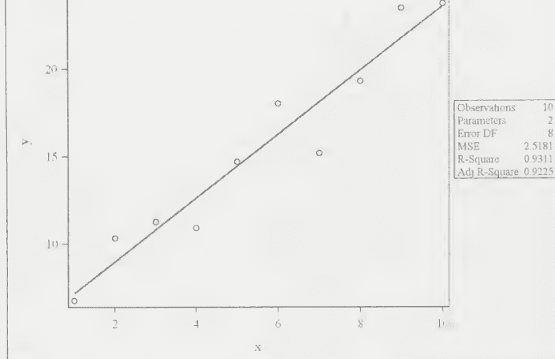

另外，您可以使用带有 `REG` 语句的 `PROC SGPLOT`，或者简单地向 `PROC REG` 添加一个 `PLOT` 语句来生成此图形。通常有多种选项可以生成相同的分析或图形。有关 `ODS` 图形和统计过程产生的不同图形的更多信息，请参阅第 6 章。

Display 1.4 和 Display 1.5 都包含默认标题 The SAS System，因为程序中没有包含 `TITLE` 语句。`ODS GRAPHICS` 语句生成了一个与 `FITPLOT` 选项关联的标题的散点图。

#### 1.4 什么是 SAS 数据集？

SAS 数据集可以被视为一个矩形对象（或数据表），其中行是不同的观测值，列是不同的变量。在某些情况下，例如纵向或重复测量数据，行可以是不同时间测量的同一受试者。数据可以使用 `DATALINES`（如果您喜欢使用来自 SAS 历史的古老语句，也可以使用 `CARDS`）作为 SAS 程序的一部分输入。

```
data test;
    input X Y @@;
    datalines;
1 2 3 2 5 7
;
run;
```

此方法适用于小型数据集，但不适用于大型数据集。SAS 数据可以使用 Display 1.1 中所示的 `INFILE` 语句从外部文件输入。

SAS 库是位于同一位置（例如目录或文件夹）中的 SAS 数据集（以及可能的其它 SAS 对象）的集合。可以使用 `LIBNAME` 或 `SET` 语句从现有 SAS 库读取 SAS 数据。在以下代码中，在 D 驱动器上的目录中创建了一个永久库，其中包含 `SUMMAR98` 数据集。此数据集将被读取并稍后分析。

```
Libname insas "D:\baileraj\grants\odhs-oct98\Datasets";
```

```
data mds mar98; set insas.summar98;
```

在这种情况下，永久 SAS 数据集是一个名为 `summar98.sas7bdat` 的文件，位于由路径 `D:\baileraj\grants\odhs-oct98\Datasets` 指定的文件夹中。（文件扩展名 `.sas7bdat` 在 Windows 中使用并指定 SAS 数据集。）此永久 SAS 数据集被复制到名为 `MDS MAR98` 的临时数据集，并位于 `WORK` 库中。临时数据集将在本次 SAS 会话期间存在。

如 Display 1.2 所示，您可以在 `DATA` 步中生成数据以供以后使用。这是在模拟研究中常见的任务。在以下代码中，生成了一个线性回归数据集，其中 `Y ~ N(μ=3 + 2 X, σ=2)`：

```
data lin_reg_data;
    call streaminit(32123);
    do X = 1 to 10 by 1;
        Y = 3 + 2*X + 2*RAND('NORMAL');
        output;
    end;
run;
```

数据也可以从其他应用程序导入到 SAS，例如 Microsoft Excel（使用导入向导或 `PROC IMPORT`）或 Oracle（使用 `PROC SQL`）。在 Windows 中从文件菜单中选择导入数据会启动导入向导。您可以使用导入向导导入 Microsoft Excel 电子表格或其他 PC 文件格式，前提是您已获得 SAS/ACCESS 接口到 PC 文件格式的许可。如果您没有

使用此软件，然后 Import Wizard 仍可用于导入文本文件或逗号分隔、制表符分隔或任何类型的分隔文件。有关从外部源导入数据并对其进行操作以构建分析数据集的更多信息，请参阅第 2 章。

#### 1.5 内部记录 SAS 程序

可以使用多种策略将注释合并到 SAS 程序中。贯穿程序的注释使其更易于阅读。

+ 1. 注释可以是以星号开头并以分号结束的语句。例如：

```
proc glm data=health_data;
* fit ancova model with covariate x and
  classification variable SMOKE;
    class SMOKE;
    model SBP = x | SMOKE;
run;
```

+ 2. 一块注释通常用 `/*` 和 `*/` 括起来。例如：

```
/* fit ancova model
   covariate: x
   classification variable: SMOKE
*/
proc glm data=health_data;
    class SMOKE;
    model SBP = x | SMOKE;
run;
```

我使用这两种策略，尽管 `/* <comment> . . . */` 策略对于注释掉代码块和定义程序的头信息非常有用。

+ 3. 你可以使用 `TITLE` 语句来注释输出并隐式注释程序。例如：

```
proc glm;
title "fit ancova model with covariate x";
title2 " and classification variable SMOKE";
class SMOKE;
model SBP = x | SMOKE;
run;
```

#### 1.6 摘要

本章介绍了 SAS。更重要的是，它建议了用于构建和记录程序的编码习惯，以便使其更易于阅读、调试、维护和修改。在接下来的章节中，将详细讨论使用 SAS 处理数据分析问题。第 2 章讨论创建分析数据集，这通常涉及将外部数据源读入 SAS，然后处理该数据集。第 3 章介绍基本描述性和图形统计，随后在第 4 章中创建更精细、更定制的表和输出。本书的第一部分以介绍 SAS 统计模型规范和统计图形生成的章节结束。

#### 1.7 参考文献

+ 1. Allison, T., and D. Cicchetti “Sleep in Mammals: Ecological and Constitutional Correlates.” *Science* 194 (1976): No. 4266, pp. 732–734.

+ 2. Cody, Ronald, and Ray Pass. 1995. *SAS Programming by Example*. Cary, NC: SAS Institute Inc.

+ 3. Delwiche, Lora D., and Susan J. Slaughter. 2008. *The Little SAS Book: A Primer*. Fourth Edition. Cary, NC: SAS Institute Inc.

+ 4. Givens, Geof H., and Jennifer A. Hoeting. 2005. *Computational Statistics*. Hoboken, NJ: Wiley Interscience.

+ 5. Moore, David S., and George P. McCabe. 2003. *Introduction to the Practice of Statistics*. 4th Ed. New York: W. H. Freeman and Co.

#### 1.8 练习

+ 1. 在以下代码中，`Y`=年，`X`=注册船只数量（以 1000 为单位），`Z`=被杀死的海牛数量。修改此程序以使其更易读。添加一个介绍性注释块来描述此程序。

¹ 海牛数据集使用基于 “Florida powerboats and manatee deaths, 1977–1990” 数据集，来自 Moore, David S., and George P. McCabe. 2003. *Introduction to the Practice of Statistics*. 4th Ed. New York, NY: W. H. Freeman and Co.

```
OPTIONS LS=75;
DATA EXAMPLE1; INPUT Y X Z; DATALINES;
77  447 13
78  460 21
79  481 24
80  498 16
81  513 24
82  512 20
83  526 15
84  559 34
85  585 33
86  614 33
87  645 39
88  675 43
89  711 50
90  719 47
;
PROC REG; MODEL Z = X / P R CLI CLM;
PLOT Z*X P.*X / OVERLAY;
PLOT R.*X R.*P.; RUN;
```

2. 下载数据 http://lib.stat.cmu.edu/datasets/sleep.² 将数据读入 SAS 数据集。确保将缺失代码从 `-999.0` 重新分配为 `.`（提示：在 `DATA` 步中使用 `IF` 语句。）确保将动物名称识别为字符变量（使用变量声明后的 `$`）。

3. 从 SAS 在线帮助中读取健身数据（Help → Getting Started with SAS Software → Learning to Use SAS → Sample SAS Programs → SAS/STAT → Sample and select Example 2 for `PROC REG`）。该数据集的描述（摘自此示例页面）如下：

这些测量是在北卡罗来纳州立大学体育健身课程中进行的男性身上进行的。变量为年龄（岁）、体重（kg）、氧气摄入率（每公斤体重每分钟毫升）、跑 1.5 英里的时间（分钟）、静息心率、跑步时心率（与氧气率测量时间相同）以及跑步时记录的最大心率。注意：每行下方有两个个体的资料。

```
44 89.47 44.609 11.37 65 178 182 40 59.0 45.313 10.01 62 182 185
44 85.84 54.291 8.65 45 196 168 41 69.16 49.941 9.11 40 166 171
38 89.02 49.874 9.22 55 178 180 47 77.45 44.811 11.63 58 176 176
40 75.98 45.681 11.95 70 176 180 43 81.19 49.091 10.85 64 162 170
44 81.42 39.442 13.08 63 174 176 38 81.87 60.055 8.63 48 170 186
44 73.03 50.541 10.13 45 168 168 45 87.66 37.388 14.03 56 186 192
```

> ² Allison, T., and D. Cicchetti. "Sleep in Mammals: Ecological and Constitutional Correlates." Science 194 (1976): No. 4266, pp. 732–734. Reprinted with permission from AAAS.


```text
45 66.45 44.754 11.12 51 176 176 47 79.15 47.273 10.60 47 162 164
54 83.12 51.855 10.33 50 166 170 49 81.42 49.156 8.95 44 180 185
51 69.63 40.836 10.95 57 168 172 51 77.91 46.672 10.00 48 162 168
48 91.63 46.774 10.25 48 162 164 49 73.37 50.388 10.08 67 168 168
57 73.37 39.407 12.63 58 174 176 54 79.38 46.080 11.17 62 156 165
52 76.32 45.441 9.63 48 164 166 50 70.87 54.625 8.92 48 146 155
51 67.25 45.118 11.08 48 172 172 54 91.63 39.203 12.88 44 168 172
51 73.71 45.790 10.47 59 186 188 57 59.08 50.545 9.93 49 148 155
49 76.32 48.673 9.40 56 186 188 48 61.24 47.920 11.50 52 170 176
52 82.78 47.467 10.50 53 170 172
```

- a. 创建一个包含这些数据的文本文件。
- b. 使用 `INFILE` 语句将数据输入 SAS。有关此任务的更多信息，请参阅第 2 章。
- c. 使用 `PROC UNIVARIATE` 为每个变量生成汇总统计量。有关此任务的更多信息，请参阅第 3 章。
- d. 使用 `PROC SGPLOT` 生成以静息脉搏为函数的跑 1.5 英里时间图。有关此任务的更多信息，请参阅第 6 章。

4. 从具有四个组且均值分别为 (15, 15, 18, 15) 的等重复单因素方差分析模型中生成数据，标准差为 1.5。假设每个组重复五次。提示：SAS 帮助可以建议语法。记住如果 `Z ~ N(0,1)`，则 `μ+σ*Z ~ N(μ, σ²)`。通过使用 `PROC GLM` 拟合方差分析模型来检验四个组的均值相等性。报告结果。提示：你需要使用一个标识生成组的变量，并且需要从指定的分布中生成随机响应。此组变量是与 `PROC GLM` 一起使用的 `CLASS` 语句的一部分。有关线性模型的更多信息，请参阅第 5 章。

5. 生成观测对 (`X`,`Y`)，其中 `Y ~ N(3 + X - 0.5*X², σ=2)`，且 `X` 从 0 到 10 按 0.05 的增量变化。绘制数据的散点图，并叠加回归线和 LOESS 拟合。你是否有证据表明线性回归模型在这里是不充分的？提示：`X²` 项可以使用 `X*X` 或 `X**2` 编码。提示：`DO` 循环可以用非整数增量指定。（参见 SAS 帮助关于 `DO` 循环。）有关生成统计图形的更多信息，请参阅第 6 章和第 7 章。

## 读取、合并和管理数据以供后续分析


- 2.1 数据集的临时与永久状态 ................................... 24
- 2.2 将数据读入 SAS 数据集 ..................................................... 27
- 2.3 写出文件或制作简单报告 ........................................... 39
- 2.4 连接数据集并添加观测 ..................................... 46
- 2.5 合并数据集并添加变量 ................................................ 50
- 2.6 使用 `PROC SQL` 进行数据库处理 ..................................................... 58
- 2.7 摘要 ............................................................................... 70
- 2.8 参考文献 ............................................................................ 71
- 2.9 练习 ............................................................................. 71
- 2.10 自学实验室探索 ..................................................... 73

第 1 章的重点是帮助你开始编写 SAS 程序，并为使你的程序易于阅读和清晰提供建议。（当你需要使用一年前编写的程序时，你会感谢我的，因为它现在与你的当前项目相关。）除了模拟数据你所分析的数据集，你总是需要为统计分析读取一个数据集。坦率地说，你在为分析设置和塑造数据集上花费的时间，可能比做统计描述和分析所花费的时间还要多。本章讨论这项工作。关于用标签增强变量名或用格式增强变量值的其他细节，则推迟到第3章和第8章。在你开始探索将数据读入SAS的方法之前，让我们先对SAS中的函数以及函数如何用于向数据集中添加变量这一主题做一个简短的 digression。

在第1章中，`LOG10`函数在Display 1.1中被介绍，用来生成包含某些变量常用对数值的新变量。在Display 1.2中，你看到了在`DATA`步中使用`RAND`函数生成伪随机数的用法。与`RAND`相关的许多与统计分布有关的函数将在第8章中介绍。虽然本章的重点是创建分析数据集，但你应该牢记，在数据集创建之后，可以从数据集中的变量创建新变量。在Base SAS Help中可以看到SAS函数功能和多样性的一个很好的概览。（按类别查看函数和`CALL`例程。）你会看到描述性统计函数（例如，`MIN`（最小值）、`CV`（变异系数）、`GEOMEAN`（几何平均值）和`STD`（标准差））。你会看到数学函数（例如，`ABS`（绝对值）、`EXP`（指数函数）、`LOG`（以e为底的对数）、`LOG10`（以10为底的对数）、`LOG2`（以2为底的对数）和`SQRT`（平方根））。其他可能对统计程序员感兴趣的函数类别包括三角函数、截断函数、州和邮政编码、变量、日期和时间、组合、数组和字符函数。

### 2.1 数据集的临时与永久状态

SAS中的数据集具有两部分名称。然而，如果你希望它们仅在SAS的特定会话期间存在，那么它们可以具有单部分名称（有点像巴西足球的巨星）。如第1.4节“什么是SAS数据集”中所讨论的，SAS数据集是矩形对象，其中行是不同的观测值，列是不同的变量。将永久SAS数据集视为驻留在称为SAS库的集合中。两部分名称包括库名和数据集名，以句点分隔。例如，`myfiles.nitrofen`具有指向包含我的SAS数据集的子目录的库名`myfiles`。第二部分名称是`nitrofen`，即特定的数据集。`nitrofen`数据集可能包括图形和格式的目录。提示：最好为图形、格式等有单独的位置。（为提供一点背景，`nitrofen`是一种除草剂。该数据集包含水蚤Ceriodaphnia dubia暴露于不同浓度的`nitrofen`的`nitrofen`浓度-生殖反应数据。¹）

¹ Nitrofen数据集来自Bailer, A. John., and James T. Oris. 1994. “Assessing Toxicity of Pollutants in Aquatic Systems.” Chapter 2 in Case Studies in Biometry. Nicholas Lange, Louise Ryan, Lynne Billard, David Brillinger, Loveday Conquest, Joel Greenhouse, eds. New Jersey: John Wiley & Sons, Inc. Reprinted with permission of John Wiley & Sons, Inc.

假设你有一个名为`nitrofen.sas7bdat`的SAS数据集。（记住，`.sas7bdat`是Windows中SAS数据集的常见扩展名。）`nitrofen.sas7bdat`数据集存储在一个指向服务器上位置的路径规范的文件夹中。例如：

`C:\Users\baileraj.IT\BAILERAJ\Classes\Web-CLASSES\sta402\data`

#### Display 2.1 定义一个库并引用该库中的数据集

```
libname myfiles "C:\Users\baileraj.IT\BAILERAJ\Classes\Web-CLASSES\sta402\data";
ods rtf file="C:\Users\baileraj.IT\Desktop\Display-2.1.rtf";
proc means data=myfiles.nitrofen maxdec=1 min q1 median q3 max;
  class conc;
  var total brood1 brood2 brood3;
run;
ods rtf close;
```

确认代码正确，只需快速查看SAS日志：

```
1 libname myfiles "C:\Users\baileraj.IT\BAILERAJ\Classes\Web-CLASSES\sta402\data";
NOTE: Libref MYFILES was successfully assigned as follows:
  Engine:        V9
  Physical Name: C:\Users\baileraj.IT\BAILERAJ\Classes\Web-CLASSES\sta402\data
2
3 ods rtf file="C:\Users\baileraj.IT\Desktop\Display-2.1.rtf";
NOTE: Writing RTF Body file: C:\Users\baileraj.IT\Desktop\Display-2.1.rtf
4 proc means data=myfiles.nitrofen maxdec=1 min q1 median q3 max;
5  class conc;
6  var total brood1 brood2 brood3;
7 run;
NOTE: There were 50 observations read from the data set MYFILES.NITROFEN.
```

SAS日志总结了包含SAS数据集的文件夹已正确分配给库名，并且在`PROC MEANS`中处理了50个观测值（五个浓度中每个浓度10个生物）。

#### Display 2.2 产仔数浓度的五数概括

| Conc | N Obs | Variable | Minimum | Lower Quartile | Median | Upper Quartile | Maximum |

|------|-------|----------|---------|----------------|--------|----------------|---------|

| 0 | 10 | total | 24.0 | 30.0 | 32.5 | 34.0 | 36.0 |

|  |  | brood1 | 3.0 | 5.0 | 5.5 | 6.0 | 6.0 |

|  |  | brood2 | 10.0 | 11.0 | 12.0 | 14.0 | 15.0 |

|  |  | brood3 | 10.0 | 12.0 | 15.0 | 15.0 | 17.0 |

| 80 | 10 | total | 26.0 | 29.0 | 32.5 | 33.0 | 36.0 |

|  |  | brood1 | 3.0 | 5.0 | 5.0 | 6.0 | 8.0 |

|  |  | brood2 | 9.0 | 11.0 | 12.0 | 12.0 | 13.0 |

|  |  | brood3 | 12.0 | 14.0 | 14.5 | 16.0 | 18.0 |

| 160 | 10 | total | 23.0 | 27.0 | 29.0 | 30.0 | 31.0 |

|  |  | brood1 | 2.0 | 6.0 | 6.0 | 6.0 | 6.0 |

|  |  | brood2 | 8.0 | 10.0 | 12.0 | 12.0 | 13.0 |

|  |  | brood3 | 10.0 | 11.0 | 11.0 | 12.0 | 13.0 |

| 235 | 10 | total | 7.0 | 13.0 | 16.5 | 21.0 | 27.0 |

|  |  | brood1 | 2.0 | 4.0 | 6.0 | 6.0 | 7.0 |

|  |  | brood2 | 0.0 | 0.0 | 3.5 | 10.0 | 13.0 |

|  |  | brood3 | 0.0 | 6.0 | 6.5 | 9.0 | 10.0 |

| 310 | 10 | total | 0.0 | 5.0 | 6.0 | 6.0 | 15.0 |

|  |  | brood1 | 0.0 | 5.0 | 5.5 | 6.0 | 7.0 |

|  |  | brood2 | 0.0 | 0.0 | 0.0 | 0.0 | 10.0 |

|  |  | brood3 | 0.0 | 0.0 | 0.0 | 0.0 | 0.0 |

如果不想永久保存数据集，而只想在当前SAS会话中使用它怎么办？其他章节中有大量临时文件存储的示例。例如，Display 1.2中模拟简单线性回归数据集的代码（在Display 2.3中以最小修改重现）生成一个名为`WORK.lin_reg_data`的数据集（其两部分名称），或更简单地`lin_reg_data`（其单部分名称）。

#### Display 2.3 生成临时数据集的示例代码

```
data lin_reg_data;
  call streaminit(32123);
  do x = 0 to 10 by 1;
    y = 3 + 2*x + 2*RAND('NORMAL');
    output;
  end;
run;

ods rtf bodytitle file='C:\Users\baileraj.IT\Desktop\ch2-fig2.3.rtf';
proc sgplot data=lin_reg_data;   * or equivalently, data=work.lin_reg_data;
  scatter y=y x=x;
run;

proc reg data=lin_reg_data;
  model y=x;
run;
ods rtf close;
```

Display 2.3代码中生成的数据集包含11个观测值和两个变量（`X`，`Y`）。SAS日志的一瞥证实了这一点，并显示以下消息：

```
NOTE: The data set WORK.LIN_REG_DATA has 11 observations and 2 variables.
```

`WORK`库是SAS在SAS会话执行期间分配的临时存储。`lin_reg_data`是在本次SAS会话期间存储在此临时库中的数据集。关闭SAS后，`lin_reg_data`数据集就会消失到虚拟蒸汽中，或者如果你愿意的话，消失到电子以太中。

### 2.2 将数据读入SAS数据集

统计合作者或顾问的常见起点是与需要帮助探索变量间关系、检验处理差异或其他同样有趣的事情的同事或客户会面。此时一个重要问题是：“你的数据是否以电子格式存在？”这个问题在不同学科中的答案各不相同。生物医学科学和商业的同事通常使用Microsoft Excel电子表格进行数据录入和分析。社会科学的同事更可能使用SPSS或其他统计应用程序来设置数据并对其进行操作。如果是小数据集，则可能位于以空格、制表符或其他分隔符分隔变量字段的文本文件中。导入不同原始数据类型的文件在后面的章节中讨论。可以直接将数据输入SAS数据表，或在使用不同系统时将数据保存为SAS数据格式。因为我很少，如果有的话，直接将数据输入SAS数据表，并且reading SAS permanent data sets is covered by the first section of this chapter, I won’t spend any more time discussing these topics here.


It is worth noting that most data entry programs allow you to save data in different formats such as a text file (`*.txt file`), or, arguably the lingua franca of the data entry world, the comma-separated values file (`*.csv file`). A later section is devoted to reading the `.csv file`. SAS has an Import Wizard that provides a graphical user interface (`GUI`) for importing data files in different formats including `.csv files`, tab- or other character-delimited files, etc. (Select Import Data from the File menu in Windows the next time you start SAS. You can import text files and other PC file formats such as Excel spreadsheets if you have licensed SAS/ACCESS Interface to PC File Formats.)

Observations from a long-time programmer and curmudgeon follow—I avoid solutions with GUIs in this book. These solutions can be quick and useful, but it is not easy to re-create the menu navigation. Programs that manipulate and manage data can be easily saved and rerun, while a sequence of GUI selections might not be easy to reproduce. One nice option with the SAS Import Wizard is that you can save the programming code generated by the wizard. I would encourage all GUI-loving users to take advantage of this feature so that there is a permanent record of the commands required to get your externally stored data into a SAS data set.

In the sections that follow, I use a data set downloaded from the StatLib server. The data set `SMSA` is part of the Data and Story Library (`DASL`) and includes properties of 60 Standard Metropolitan Statistical Areas (`SMSAs`). The documentation and data set can be downloaded from `http://lib.stat.cmu.edu/DASL/Datafiles/SMSA.html`.² Each of the 60 SMSAs has 17 variables recorded for it. These include the following:
- 1. city name
- 2. mean January temperature (degrees F)
- 3. mean July temperature (degrees F)
- 4. relative humidity
- 5. annual rainfall (inches)
- 6. age-adjusted mortality
- 7. median education
- 8. population density
- 9. percentage of nonwhites
- 10. percentage of white-collar workers
- 11. population
- 12. population per household
- 13. median income
- 14. hazardous chemical pollution potential
- 15. nitrous oxide pollution potential
- 16. sulfur dioxide pollution potential
- 17. nitrous oxide

The first line of the data set includes variable names. For Display 2.4, the line with the variable names has been removed.

### 2.2.1 Reading data directly as part of a program—anyone for datalines?

The SMSA data is read into a SAS data file using a `DATALINES` statement as shown in Display 2.4. In this example, the data is read, and then a subset of five SMSAs is entered into a SAS data set. There is a problem reading the `CITY` variable, which contains embedded blanks. `CITY` is a character variable identified with a `$` following its name in the `INPUT` statement. By default, variables are assumed to be numeric.

#### Display 2.4 Reading free-format data into SAS using a DATALINES statement

```
data SMSA_subset;
input city $ JanTemp JulyTemp RelHum Rain Mortality Education PopDensity pct NonWhite pct_WC pop pop_per_house income HCPot NOxPot SO2Pot NOx;
datalines;
Akron, OH      27      71      59      36      921.87  11.4    3243    8.8     42.6
660328 3.34  29560   21      15      59      15
Albany-Schenectady-Troy, NY      23      72      57      35      997.87  11.0    4281
3.5    50.7   835880  3.14    31458   8       10      39      10
Allentown, Bethlehem, PA-NJ      29      74      54      44      962.35
9.8    4260   0.8     39.4    635481  3.21    31856   6       6
33     6
Atlanta, GA     45      79      56      47      982.29  11.1    3125    27.1    50.2
2138231 3.41   32452   18      8       24      8
Baltimore, MD   35      77      55      43      1071.29 9.6     6441    24.4    43.7
2199531 3.44   32368   43      38      206     38
;
run;
ods rtf bodytitle file='C:\Users\baileraj.IT\Desktop\ch2-fig2.4.rtf';
proc print data=SMSA_subset;
var city JanTemp JulyTemp RelHum NOxPot SO2Pot NOx;
run;
ods rtf close;
```

Whenever you read data into a SAS data set, you should build in checks to confirm that the input data were correctly processed. First, you should always check the SAS log for errors. After any errors are corrected, you should print the data set that is produced, and then compare it to the original data source. While this might seem obvious, it is still worth mentioning. Another easy check that is good to perform is to compare the number of observations in the original data source with the new SAS data set. Let’s check to see whether the attempt to read a subset of the SMSA data set was successful.

The SAS log confirms that there are problems. Here is the (slightly edited) error message associated with processing the first observation:

```
NOTE: Invalid data for JanTemp in line 46 8-9.
RULE: 
----+----1----+----2----+----3----+----4----+----5----+----6----+----7----+----8----+----9----+
Akron, OH 27 71 59 36 921.87 11.4 3243 8.8 42.6 660328 3.34 29560 21 15 59 101 15
city=Akron, JanTemp=. JulyTemp=27 RelHum=71 Rain=59 Mortality=36 Education=921.87
PopDensity=11.4 pct_NonWhite=3243 pct_WC=8.8 pop=42.6 pop_per_house=660328 income=3.34
HCPot=29560 NOxPot=21 SO2Pot=15 NOx=59 ERROR =1 _N_=1
```

`CITY` is read as `Akron,`, and `JANTEMP`, a numeric variable, appears to have invalid data.

`PROC PRINT` confirms that there are problems. For the first observation, the values of the variables should be `CITY="Akron, OH"`, `JANTEMP=27`, `JULYTEMP=71`, `RELHUM=59`, `NOXPOT=15`, `SO2POT=59`, `NOX=15`, and so on. As shown in Display 2.5, the January temperature is missing (for all five observations!), the July temperature is the January value, the relative humidity is the July temperature, and all of the other observations are off by one place in the data.

#### Display 2.5 PROC PRINT of the misread subset of SMSA observations

| Obs | City | JanTemp | JulyTemp | RelHum | NOxPot | SO2Pot | NOx |
|---|---|---|---|---|---|---|---|
| 1 | Akron, | . | 27 | 71 | 21 | 15 | 59 |
| 2 | Albany-S | . | 23 | 72 | 8 | 10 | 39 |
| 3 | Allentow | . | . | 29 | 31856 | 6 | 6 |
| 4 | Atlanta, | . | 45 | 79 | 18 | 8 | 24 |
| 5 | Baltimor | . | 35 | 77 | 43 | 38 | 206 |

The problem is trying to read the character value `OH` into a numeric variable. In free-formatted data, the data values are assumed to be separated by spaces or blanks. Because valid values of `CITY` have embedded blanks, this problem needs to be addressed. In addition, the length of the `CITY` variable is restricted to eight characters, which is the default for character variables. The length of this variable needs to be increased. Display 2.6 uses a `LENGTH` statement to set the length of the variable `CITY` to 27 characters.

```
length city $ 27;
```

In addition, in the `INPUT` statement, single embedded blanks are allowed in the variable value by specifying the `&` character after `CITY`. The `CITY` variable will be read when two consecutive blanks are encountered.

#### Display 2.6 Reading the SMSA data with a length declaration and code to allow embedded blanks in the value of a character value

```
data SMSA_subset;
length city $ 27;
input city & JanTemp JulyTemp RelHum Rain Mortality Education PopDensity pct_NonWhite pct_WC pop pop_per_house income HCPot NOxPot SO2Pot NOx;
datalines;
Akron, OH 27 71 59 36 921.87 11.4 3243 8.8 42.6 660328 3.34 29560 21 15 59 15
Albany-Schenectady-Troy, NY 23 72 57 35 997.87 11.0 4281 3.5 50.7 835880 3.14 31458 8 10 39 10
Allentown, Bethlehem, PA-NJ 29 74 54 44 962.35 9.8 4260 0.8 39.4 635481 3.21 31856 6 6 33 6
Atlanta, GA 45 79 56 47 982.29 11.1 3125 27.1 50.2 2138231 3.41 32452 18 8 24 8
Baltimore, MD 35 77 55 43 1071.29 9.6 6441 24.4 43.7 2199531 3.44 32368 43 38 206 38
;
run;
ods rtf bodytitle file='C:\Users\baileraj.IT\Desktop\ch2-fig2.6.rtf';
proc print data=SMSA_subset;
var city JanTemp JulyTemp RelHum NOxPot SO2Pot NOx;
run;
ods rtf close;
```

The following note in the SAS log proves that the data values were processed correctly:


> NOTE: The data set `WORK.SMSA_SUBSET` has 5 observations and 17 variables.

Display 2.7 shows how the data were entered into the SAS data set.

### Display 2.7 PROC PRINT output from the correctly read subset of the SMSA observations

| Obs | City | JanTemp | JulyTemp | RelHum | NOxPot | SO2Pot | NOx |
| --- | --- | --- | --- | --- | --- | --- | --- |
| 1 | Akron, OH | 27 | 71 | 59 | 15 | 59 | 15 |
| 2 | Albany-Schenectady-Troy, NY | 23 | 72 | 57 | 10 | 39 | 10 |
| 3 | Allentown, Bethlehem, PA-NJ | 29 | 74 | 54 | 6 | 33 | 6 |
| 4 | Atlanta, GA | 45 | 79 | 56 | 8 | 24 | 8 |
| 5 | Baltimore, MD | 35 | 77 | 55 | 38 | 206 | 38 |

## 2.2.2 读取保存为文本的数据集 — INFILE 可以成为你的好帮手

当数据集相对较小时，使用 `DATALINES` 语句进行所谓的内存数据输入是可以的。事实上，您可能希望使用大数据集的子集作为测试数据集，以确保 `INPUT` 语句指定正确。上一节中的代码实现了这一点，本节将再次使用之前的 `INPUT` 语句。当处理较大的数据集时，如果不得不在分析语句或 `PROC` 之前费力地阅读数百行数据，程序会变得庞大且丑陋。因此，需要一种替代方案来指定外部文件进行数据输入。如果外部文件是文本文件，可以使用 `INFILE` 语句读取数据，其中标识了数据文件。您可能会发现，在将数据读入 SAS 数据集之前，需要对数据进行一些预处理。例如，如 Display 2.8 中程序前的注释所示，制表符被替换为两个空格，并且两个 Fort Worth 变量的缺失值被赋值为 SAS 中数值变量的缺失代码（句点）。

### Display 2.8 使用 INFILE 语句将外部文本文件读入 SAS 数据集

```
/*
注意：
1) 输入数据文件中的每个条目由两个空格分隔。在保存文本文件之前，执行了将制表符替换为两个空格的全局替换。
2) 第一行包含变量名称，数据从文件的第二行开始。
3) Fort Worth 的 POP 和 INCOME 有缺失值，数据文件中输入了"."。
4) 将 LENGTH 增加到 39 以容纳 GREENSBORO-WINSTON-SALEM...
*/
options nodate nocenter;
data SMSA_from_txt;
infile "C:\Users\baileraj.IT\Desktop\DT-Book 3\SMSA-DASL-2space-sep.txt";
firstobs=2;
length city $ 39;
input city & JanTemp JulyTemp RelHum Rain Mortality Education PopDensity pct_NonWhite pct_WC pop pop_per_house income HCPot NOxPot SO2Pot NOx;
run;
ods rtf bodytitle file='C:\Users\baileraj.IT\Desktop\ch2-fig2.8.rtf';
proc print data=SMSA_from_txt;
var city JanTemp JulyTemp RelHum NOxPot SO2Pot NOx;
run;
ods rtf close;
```

SAS 日志确认文件在指定路径中被找到。它记录了处理了多少观测：

```
NOTE: The infile "C:\Users\baileraj.IT\Desktop\DT-Book 3\SMSA-DASL-2space-sep.txt" is:
Filename=C:\Users\baileraj.IT\Desktop\DT-Book 3\SMSA-DASL-2space-sep.txt,
RECFM=V,LRECL=256,File Size (bytes)=6203,
Last Modified=15Sep2008:17:07:09,
Create Time=04Jan2009:19:16:14
```

```
NOTE: 60 records were read from the infile "C:\Users\baileraj.IT\Desktop\DT-Book 3\SMSA-DASL-2space-sep.txt".
The minimum record length was 86.
The maximum record length was 120.
NOTE: The data set WORK.SMSA_FROM_TXT has 60 observations and 17 variables.
```

`SMSA_from_txt` 数据集的打印输出显示在 Display 2.9 中。此输出确认 `CITY` 值已正确读入 SAS 变量。

### Display 2.9 使用 INFILE 语句的 SMSA 子集 PROC PRINT 输出

| Obs | City | JanTemp | JulyTemp | RelHum | NOxPot | SO2Pot | NOx |
| --- | --- | --- | --- | --- | --- | --- | --- |
| 1 | Akron, OH | 27 | 71 | 59 | 15 | 59 | 15 |
| 2 | Albany-Schenectady-Troy, NY | 23 | 72 | 57 | 10 | 39 | 10 |
| ... | ... | ... | ... | ... | ... | ... | ... |
| 59 | York, PA | 33 | 76 | 54 | 8 | 49 | 8 |
| 60 | Youngstown-Warren, OH | 28 | 72 | 58 | 13 | 39 | 13 |

## 2.2.3 有时变量位于特定列或采用特定格式

现在，快速坦白一下：并非所有数据都是自由格式的集合，变量值由空格分隔。有时，变量位于固定的、指定的列和行中，并且需要以某种格式进行读取（例如时间、日期、带逗号的数字等）。您将在全书中看到这种场景的多个示例。例如，在 Display 3.9 中，nitrofen 示例（在 Display 2.2 中提及）的数据是从外部文件读取的。以下是 Display 3.9 中使用的 `INFILE` 和 `INPUT` 语句：

```
data nitro_tox;
 infile 'C:\Users\baileraj.IT\desktop\DT-Book 3\ch2-dat.txt'
    firstobs=16 expandtabs missover pad ;
 input @9 animal 2. @17 conc 3. @25 brood1 2. @33 brood2 2. @41
    brood3 2. @49 total 2.;
```

在这个示例中，数据位于特定列。例如，动物 ID 从第 9 列开始，占用两列；浓度从第 17 列开始，占用三列，依此类推。`ANIMAL` 变量之前的 `@9` 命令将输入指针移动到输入记录的第 9 列。`ANIMAL` 变量后面的 `2.` 表示此数值变量的值占用两列的宽度。其余变量分别从第 17、25、33、41 和 49 列开始。`w.`（宽度输入格式）和其他输入格式将在第 3.2 节和第 7.2 节中更详细地讨论。

`INFILE` 语句有一些值得检查的选项。`firstobs=16` 选项声明 SAS 应忽略数据文件的前 15 行。这是一种高效的方式，可以将变量、数据来源等的注释和描述作为数据文件的一部分包含在内。这是一个与第 1 章中的建议一致的建议。`expandtabs` 选项将任何制表符展开为八列的标准制表符间距。`missover` 选项将缺失值赋给 `INPUT` 行中未定义的变量（这比读取行尾有缺失值的自由格式数据问题更小），而 `PAD` 选项将数据行填充为相同的长度。此输入结构是为从 StatLib 服务器读取此文件而指定的。除了 `firstobs=16` 之外，在您的系统上正确读取数据可能不需要此结构。

## 2.2.4 读取逗号分隔值 — 使用逗号分隔符的文本文件

创建了一份 SMSA 数据集的副本，其值为逗号分隔，并存储在名为 `DASL-SMSA-commasep.csv` 的文件中。该文件中的一个观测包含逗号分隔的变量值。缺失值由两个连续的逗号表示。例如，以下是文件中的第一个观测：

```
"Akron, OH",27,71,59,36,921.87,11.4,3243,8.8,42.6,660328,3.34,29560,21,15,59,15
```

用于读取此 `.csv` 数据文件的程序显示在 Display 2.10 中。使用 `firstobs` 选项跳过此文件的第一行（包含变量名称的行）。此外，使用 `PROC PRINT` 中指定的 `firstobs` 和 `obs` 选项，将打印的观测限制为数据集中间的那些观测。

### Display 2.10 使用逗号作为变量值之间的分隔符读取输入数据

```
options nodate nocenter;
data SMSA_from_CSV;
infile "C:\Users\baileraj.IT\Desktop\DT-Book 3\DASL-SMSA-commasep.csv"
firstobs=2 dsd;
length city $ 39;
input city & JanTemp JulyTemp RelHum Rain Mortality Education PopDensity pct_NonWhite pct_WC pop pop_per_house income HCPot NOxPot SO2Pot NOx;
run;

ods rtf bodytitle file='C:\Users\baileraj.IT\Desktop\ch2-fig2.10.rtf';
proc print data=SMSA_from_CSV (firstobs=17 obs=25);
  var city JanTemp JulyTemp RelHum pop pop_per_house income;
run;
ods rtf close;
```

数据集的部分打印显示在 Display 2.11 中。即使 Fort Worth 行包含缺失值，也会被打印出来。这是一个很好的检查，可以确认您正确读取了数据，并且异常或缺失的观测被正确处理。

### Display 2.11 DASL-SMSA-commasep.csv 数据文件的第 17 到 25 个观测

| Obs | City | JanTemp | JulyTemp | RelHum | pop | pop_per_house | income |
| --- | --- | --- | --- | --- | --- | --- | --- |
| 17 | Dayton-Springfield, OH | 30 | 75 | 58 | 942083 | 3.35 | 30232 |
| 18 | Denver, CO | 30 | 73 | 38 | 1428836 | 3.15 | 39099 |
| 19 | Detroit, MI | 27 | 74 | 59 | 4488072 | 3.44 | 33858 |
| 20 | Flint, MI | 24 | 72 | 61 | 450449 | 3.53 | 32000 |
| 21 | Fort Worth, TX | 45 | 85 | 53 | . | 3.22 | . |

（续）

**显示 2.11（续）**

|  | 城市 | JanTemp | JulyTemp | RelHum | pop | pop_per_house | income |
|---|---:|---:|---:|---:|---:|---:|---:|
| 22 | Grand Rapids, MI | 24 | 72 | 61 | 601680 | 3.37 | 29915 |
| 23 | Greensboro-Winston-Salem-High Point, NC | 40 | 77 | 53 | 851851 | 3.45 | 29450 |
| 24 | Hartford, CT | 27 | 72 | 56 | 715923 | 3.25 | 37565 |
| 25 | Houston, TX | 55 | 84 | 59 | 2735766 | 3.35 | 39558 |

## 2.2.5 直接读取 Excel 电子表格

虽然可以将 Excel 文件保存为逗号分隔值文件，并使用上一节中的方法读取，但如果无需进行数据操作 gymnastics，直接读取数据总是更容易的。如果你的计算机上已许可 SAS/ACCESS 软件，则用于读取 Excel 文件和其他文件（如关系数据库）的引擎可在 `LIBNAME` 语句中使用。此外，导入向导使你能够选择一个 Excel 文件并将其读入 SAS 数据集。两种读取 Excel 文件的方法的代码均显示在显示 2.12 中。

**显示 2.12 使用 PROC IMPORT 或指定 EXCEL 引擎的 LIBNAME 语句导入 Excel 电子表格**

```
/* Assumes SAS/ACCESS engines are available */
/* IMPORT code produced by the IMPORT WIZARD */

PROC IMPORT OUT= WORK.DASL_FROM_EXCEL2
    DATAFILE= "C:\Documents and Settings\baileraj\Desktop\DASL-SMSA.xls"
    DBMS=EXCEL REPLACE;
    SHEET="Sheet15";
    GETNAMES=YES;
    MIXED=NO;
    SCANTEXT=YES;
    USEDATE=YES;
    SCANTIME=YES;
RUN;

/* ... via EXCEL engine with LIBNAME */
options nodate;
title ;

libname spreads excel
"C:\Documents and Settings\baileraj\Desktop\DASL-SMSA.xls" header=yes;

ods rtf bodytitle file='C:\Users\baileraj.IT\Desktop\ch2-fig2.12.rtf';
/* list the contents of the spreadsheet that was read */
proc contents data=spreads._all_ varnum;
run;

/* set contents of the 1st worksheet to SAS data set */
data DASL_from_Libname_Excel_engine;
set spreads.'sheet1$'n;
run;

proc print data=DASL_from_Libname_Excel_engine;
run;
ods rtf close;
```

**显示 2.13 使用 LIBNAME 语句指定 EXCEL 引擎引用 Excel 电子表格时产生的 SAS 库内容**

| 目录 |  |
|---|---|
| Libref | SPREADS |
| Engine | EXCEL |
| Physical Name | C:\Documents and Settings\baileraj\Desktop\DASL-SMSA.xls |
| Schema/Owner | Admin |
| # | 名称 | 成员类型 | DBMS 成员类型 |
|---|---|---|---|
| 1 | Sheet1$ | DATA | TABLE |
| 2 | Sheet2$ | DATA | TABLE |
| 3 | Sheet3$ | DATA | TABLE |
| 数据集名称 | SPREADS.'Sheet1$'n | 观测数 |  |
|---|---|---|---|
| 成员类型 | DATA | 变量数 | 17 |
| Engine | EXCEL | 索引 | 0 |
| 创建 | . | 观测长度 | 0 |
| 最后修改 | . | 已删除观测 | 0 |
| 保护 |  | 压缩 | NO |
| 数据集类型 |  | 已排序 | NO |
| 标签 |  |  |  |
| 数据表示 | Default |  |  |
| 编码 | Default |  |  |

##### 按创建顺序排列的变量

| # | 变量 | 类型 | Len | 格式 | Informat | 标签 |
|---:|---|---:|---|---|---|---|
| 1 | city | Char | 39 | $39. | $39. | city |
| 2 | JanTemp | Num | 8 |  |  | JanTemp |
| 3 | JulyTemp | Num | 8 |  |  | JulyTemp |
| 4 | RelHum | Num | 8 |  |  | RelHum |
| 5 | Rain | Num | 8 |  |  | Rain |
| 6 | Mortality | Num | 8 |  |  | Mortality |
| 7 | Education | Num | 8 |  |  | Education |


```text
| 8 | PopDensity | Num | 8 |  |  | PopDensity |
| 9 | _NonWhite | Num | 8 |  |  | %NonWhite |
| 10 | _WC | Num | 8 |  |  | %WC |
| 11 | pop | Num | 8 |  |  | pop |
| 12 | pop_per_house | Num | 8 |  |  | pop/house |
| 13 | income | Num | 8 |  |  | income |
| 14 | HCPot | Num | 8 |  |  | HCPot |
| 15 | NOxPot | Num | 8 |  |  | NOxPot |
| 16 | SO2Pot | Num | 8 |  |  | SO2Pot |
| 17 | NOx | Num | 8 |  |  | NOx |
```

显示 2.13 包含了电子表格在 SAS 库中的内容，如同其出现的那样。每个工作表在 SAS 中成为一个单独的数据集。只有 `Sheet1$` 填充了数据；其他两个电子表格为空。有趣的是，Excel 列标签如果也是有效的 SAS 变量名，则会被分配 SAS 变量名作为其标签。无法映射到有效 SAS 变量名的 Excel 列（例如 `%WC`）会被修改为具有有效的 SAS 名称，通过用下划线替换百分号（例如 `_WC`）。Excel 列标题在 `IMPORT` 过程中被分配为变量的标签。

#### 2.2.6 读取 SPSS 数据文件——那个能干的小 SPSS 引擎

之前描述的 `IMPORT` 过程可使用 `DBMS=SPSS` 选项读取 SPSS 数据集。或者，你可以指定带有 SPSS 引擎的 `LIBNAME` 语句。由于此信息与上一节的信息平行，证明其有效性的工作留给读者。（我一直想在论文或报告中写下这句话。）

### 2.3 写入文件或制作简单报告

本章从强调将数据导入 SAS 开始。下一节讨论生成分析数据集并通过添加观测值（连接数据集或向数据集添加行）和添加变量（合并数据集或向数据集添加列）来更改它。本节讨论如何将用于从外部文件创建 SAS 数据集的一些思想反转，以写入或创建供其他程序分析的数据集，或构建简单报告。

`PUT` 语句可以被视为 `INPUT` 语句的输出类比。它指定变量的值、文本等应如何写入。如果指定了文件名，则 `PUT` 语句写入此位置。如果未指定，则 `PUT` 语句写入 SAS 日志。`PUT` 语句用于回显 SAS 数据集中所有变量的值。`_NULL_` 数据集用于允许在 `DATA` 步编程而不存储数据集。`_ALL_` 指定选择所有变量以显示。诸如 `_NUMERIC_` 或 `_CHARACTER_` 之类的替代指定选择与数据类型相对应的所有变量。以下语句写入文本字符串 `'-'` 50 次：

```sas
put 50*'-';
```

#### 显示 2.14 使用 `PUT` 语句回显数据集中的变量值

```sas
libname myfiles "C:\Users\baileraj.IT\BAILERAJ\Classes\Web-CLASSES\sta402\data";

proc sort data=myfiles.nitrofen;
  by conc;
run;

data _null_; set myfiles.nitrofen; by conc;
  if FIRST.CONC then do; * first observation in concentration group;
    put 50*"-";           * add separator line of 50 dashes + column headings;
    put "Animal" @10 "Conc" @20 "Total" @30 "First?" @40 "Last?";
  end;
  put animal @10 conc @20 total @30 FIRST.CONC @40 LAST.CONC;

* put _all_;  /* useful to check values during input */
run;
```

除了生成报告外，显示 2.14 还介绍了在操作已排序数据集时有用的两个指示变量——`FIRST.VARNAME` 和 `LAST.VARNAME`，其中 `VARNAME` 是用于对数据集排序的 SAS 变量的名称。这两个指示变量是在使用 `BY CONC` 将 `nitrofen` 数据集的内容添加到 `_NULL_` 数据集时定义的（`FIRST.CONC` 和 `LAST.CONC`）。这些变量指示当前观测是否为 BY 变量 `CONC` 的每个级别的第一或最后观测。如显示 2.15 所示，`CONC=0` 条件中的第一个观测——动物 1——具有 `FIRST.CONC=1`（TRUE）和 `LAST.CONC=0`（FALSE）。动物 2 到 9 具有 `FIRST.CONC=0` 和 `LAST.CONC=0`。`CONC=0` 条件中的最后一个观测——动物 10——具有 `FIRST.CONC=0` 和 `LAST.CONC=1`。此程序在它是浓度组中的第一个动物时（即当 `FIRST.CONC=1` 时）写入一条由破折号组成的分隔线和列标题。`@#` 指定变量值或列标题应从第 `#` 列开始打印。

#### 显示 2.15 SAS 日志中 `nitrofen` 变量的回显

| `Animal` | `Conc` | `Total` | First? | Last? |
|---:|---:|---:|---:|---:|
| 1 | 0 | 77 | 1 | 0 |
| 2 | 0 | 83 | 0 | 0 |
| ... | ... | ... | ... | ... |
| 9 | 0 | 74 | 0 | 0 |
| 10 | 0 | 81 | 0 | 1 |
| ... | ... | ... | ... | ... |
| `Animal` | `Conc` | `Total` | First? | Last? |
| 41 | 310 | 6 | 1 | 0 |
| 42 | 310 | 6 | 0 | 0 |
| ... | ... | ... | ... | ... |
| 49 | 310 | 6 | 0 | 0 |
| 50 | 310 | 5 | 0 | 1 |

SAS 日志确认包含 `nitrofen.sas7bdat` 的文件夹已在 `LIBNAME` 路径中正确识别：

```text
NOTE: Libref MYFILES was successfully assigned as follows:
Engine:          V9
Physical Name: C:\Users\baileraj.IT\BAILERAJ\Classes\
                 Web-CLASSES\sta402\data
```

`PUT` 语句可用于创建简单的自定义报告。在显示 2.16 中的程序中，`nitrofen` 数据从外部源读取并写入带有注释的文本文件。`nitrofen` 数据首先按浓度排序，然后按浓度添加到 `_NULL_` 数据集中。从前面的示例可知，`BY CONC` 创建了内部 SAS 变量 `FIRST.CONC` 和 `LAST.CONC`，当一个观测值在组内分别是第一个或最后一个观测值时为真。因此，`DO-END` 块中的语句在 `FIRST.CONC` 为 TRUE 时执行：

```sas
put 6*'+-----' '+';
put 'Conc = ' conc /
    @1 'Brood 1'  @10 'Brood 2'  @20 'Brood 3' @30 'TOTAL' /
    @1 '-------'  @10 '-------'  @20 '-------' @30 '-------';
```

在程序中，如果正在处理的观测值对应于浓度组中的第一只动物，则条件为真。在这种情况下，会写入形式为 `+-----+-----+-----+...+-----+` 的分隔线，以及变量标签和标签下划线。写入位置由 `@n` 规范控制，该规范在写入前将输出指针移动到第 `n` 列。变量的值随后按指定的格式写入：

```sas
put @5 brood1 3. @14 brood2 3. @24 brood3 3. @32 total 3.;
```

`BROOD1` 的值从第 5 列开始写入，固定格式宽度为 3 列。其他输出位置和格式以类似方式指定。第二个 `DATA _NULL_` 块用于在文件底部写入注释。该块中的 `FILE` 规范包含 `MOD` 选项，声明任何 `PUT` 活动都将追加到文本文件的末尾。如果省略了 `MOD` 选项，则整个文本文件将被最后一行覆盖。

#### 显示 2.16 使用带注释的 `nitrofen` 数据打印输出生成格式化的报告

```sas
libname myfiles "C:\Users\baileraj.IT\BAILERAJ\Classes\Web-CLASSES\sta402\data";

proc sort data=myfiles.nitrofen;
    by conc;
run;

data _NULL_;
    set myfiles.nitrofen;
    by conc;
    file 'C:\Users\baileraj.IT\Desktop\nitrofen-put.txt';

    /* Write out header text information for the first observation in each conc */
    if FIRST.conc then do;
        put 6*'+-----' '+';
        put 'Conc = ' conc
            @1 'Brood 1' @10 'Brood 2' @20 'Brood 3' @30 'TOTAL'
            @1 '-------' @10 '-------' @20 '-------' @30 '-------';
    end;

    /* Write out the data for all records */
    put @5 brood1 3. @14 brood2 3. @24 brood3 3. @32 total 3.;
run;

data _NULL_;       /* add last line to the output file */
    file 'C:\Users\baileraj.IT\Desktop\nitrofen-put.txt' MOD;
    put 6*'+-----' '+' /
        'Data from C. dubia Nitrofen exposure data [Bailer & Oris 1993]';
run;
```

显示 2.16 中 `PUT` 语句生成的部分文件列表显示在显示 2.17 中。

#### 显示 2.17 由 `PUT` 语句创建的 `nitrofen-put.txt` 文件内容

```text
+------+--------+--------+--------+
Conc = 0
Brood 1  Brood 2  Brood 3  TOTAL
------   ------   ------   -----
       3       14       10      27
       5       12       15      32
       6       11       17      34
       6       12       15      33
       6       15       15      36
       5       14       15      34
       6       12       15      33
       5       13       12      30
       3       10       11      24
       6       11       14      31
+------+--------+--------+--------+
. . . lines deleted . . .
+------+--------+--------+--------+
Conc = 310
Brood 1  Brood 2  Brood 3  TOTAL
------   ------   ------   -----
       6        0        0       6
       6        0        0       6
       7        0        0       7
       0        0        0       0
       5       10        0      15
       5        0        0       5
       6        0        0       6
       4        0        0       4
       6        0        0       6
       5        0        0       5
+------+--------+--------+--------+

Data from C. dubia Nitrofen exposure data [Bailer & Oris 1993]
```

在计算机软件以及数据分析和显示应用程序中多语言能力是有用的。你会希望将数据从一个系统取出并在不同系统中使用。这就是 Excel 数据表导入到 SAS 数据集时发生的情况。假设你想创建一个包含 SAS 数据集内容的文本文件，空格分隔或逗号分隔。你可以使用带有 `FILE` 规范的 `PUT` 语句来完成此操作。在显示 2.18 中，创建了三个不同的文件：一个以空格分隔的 `nitrofen` 数据值的文本文件，一个以逗号分隔的 `nitrofen` 数据值的文本文件，以及一个以逗号分隔的 `nitrofen` 数据值的文本文件，其中第一行包含文件中的列名。

#### 显示 2.18 创建包含 SAS 数据集内容的外部数据文件

```sas
libname myfiles "C:\Users\baileraj.IT\BAILERAJ\Classes\Web-CLASSES\sta402\data";

/* create a TEXT file with the nitrofen data */
data _NULL_; set myfiles.nitrofen;
    file 'C:\Users\baileraj.IT\Desktop\nitrofen-TEXT.txt';
    put @1 conc @10 animal @15 brood1 @20 brood2 @25 brood3 @30 total;
run;

/* create a CSV file with the nitrofen data */
data _NULL_; set myfiles.nitrofen;
    file 'C:\Users\baileraj.IT\Desktop\nitrofen-CSV.csv' dsd;
    put conc animal brood1 brood2 brood3 total;
run;

/* create a CSV file with the nitrofen data and a row with variable names */
data _NULL_; * write variable names to first line of file;
    file 'C:\Users\baileraj.IT\Desktop\nitrofen-CSV2.csv' dsd;
    put "conc,animal,brood1,brood2,brood3,total";
run;

data _NULL_; set myfiles.nitrofen; * add data values below var names;
    file 'C:\Users\baileraj.IT\Desktop\nitrofen-CSV2.csv' dsd MOD;
    put conc animal brood1 brood2 brood3 total;
run;
```

使用 `PUT` 语句将数据写入外部文件的结果显示在显示 2.19 中。创建了三个单独的文本文件，你可以用你喜欢的编辑器打开它们，例如 Windows 中的 `Notepad`，Linux 中的 `vi` 或 `EMACS` 等。

#### 显示 2.19 使用 `PUT` 语句构建的三个数据文件的最初四行

```text
nitrofen-TEXT.txt
0        1    3   14   10   27
0        2    5   12   15   32
0        3    6   11   17   34
0        4    6   12   15   33

nitrofen-CSV.csv
0,1,3,14,10,27
0,2,5,12,15,32
0,3,6,11,17,34
0,4,6,12,15,33

nitrofen-CSV2.csv
conc,animal,brood1,brood2,brood3,total
0,1,3,14,10,27
0,2,5,12,15,32
0,3,6,11,17,34
```

生成包含 SAS 数据集的逗号分隔值文件的替代方案显示在显示 2.20 中。使用 `CSV` 目标的 `ODS` 与 `PROC PRINT` 一起使用，以生成包含 SAS 数据集的 `*.csv` 数据文件。有关 `ODS` 的更多信息，请参阅第 4 章。第二个使用 File→Export→Data 的替代方案，或等效的 `PROC EXPORT` 代码也显示了。

#### 显示 2.20 生成包含 SAS 数据集的 `*.csv` 数据文件的替代方案


```sas
libname myfiles "C:\Users\baileraj.IT\BAILERAJ\Classes\Web-CLASSES\sta402\data";

/*
  nitrofen = SAS data set in this library
*/

proc contents data=myfiles.nitrofen;
run;

/* Using ODS with CSV + PROC PRINT to produce *.csv file
   Thanks to Kathy Roggenkamp for suggesting this alternative!
*/
ods csv file="C:\Users\baileraj.IT\Desktop\nitrofen.csv";
proc print data=myfiles.nitrofen;
  var conc total;
  id animal;
run;
ods csv close;

/*
  Using File > Export Data ... can be used to construct a
  *.csv file AND save the associated SAS PROC EXPORT code
  (see below)
*/
PROC EXPORT DATA= MYFILES.NITROFEN
  OUTFILE= "C:\Users\baileraj.IT\Desktop\nitrofen2.csv"
  DBMS=CSV REPLACE;
  PUTNAMES=YES;
RUN;
```

SAS 日志确认 `PROC PRINT` 输出正被定向到我计算机桌面上的 `nitrofen.csv` 文件：

```text
96   ods csv file="C:\Users\baileraj.IT\Desktop\nitrofen.csv";
NOTE: Writing CSV Body file: C:\Users\baileraj.IT\Desktop\nitrofen.csv
97   proc print data=myfiles.nitrofen;
98     var conc total;
99     id animal;
100    run;

NOTE: There were 50 observations read from the data set MYFILES.NITROFEN.
```

在 Display 2.21 中，使用 `ODS CSV` 和 `PROC PRINT` 且 `ID` 为 `ANIMAL` 产生的 `*.csv` 文件会使动物编号在 `*.csv` 文件中成为字符变量。（注意数字 1 到 50 周围的双引号。）

##### Display 2.21 由 ODS CSV 和 PROC EXPORT 产生的 *.csv 文件

```
nitrofen.csv (from PROC PRINT with ODS CSV specified)
"animal","conc","total"
"1",0,27
"2",0,32
"3",0,34
...
"48",310,4
"49",310,6
"50",310,5

nitrofen2.csv (produced from PROC EXPORT via File > Export Data ...)
animal,conc,brood1,brood2,brood3,total
1,0,3,14,10,27
2,0,5,12,15,32
3,0,6,11,17,34
...
48,310,4,0,0,4
49,310,6,0,0,6
50,310,5,0,0,5
```

### 2.4 拼接数据集合并添加观测值

在创建分析数据集时，你可能需要添加新的观测值。在这种情况下，不同的观测集合具有相同的变量。此任务在 Display 2.22 中显示。在此示例中，包含七个观测值的数据集被包含五个观测值的数据集补充，以产生包含 12 个观测值的数据集。

#### Display 2.22 添加观测值或行——拼接数据集

| Observation ID | Variable 1 | Variable 2 | Variable 3 |

|---|---|---|---|

| 1 |  |  |  |

| 2 |  |  |  |

| 3 |  |  |  |

| 4 |  |  |  |

| 5 |  |  |  |

| 6 |  |  |  |

| 7 |  |  |  |

此数据集与以下数据集拼接：

| Observation ID | Variable 1 | Variable 2 | Variable 3 |

|---|---|---|---|

| 8 |  |  |  |

| 9 |  |  |  |

| 10 |  |  |  |

| 11 |  |  |  |

| 12 |  |  |  |

产生的以下数据集为：

| Observation ID | Variable 1 | Variable 2 | Variable 3 |

|---|---|---|---|

| 1 |  |  |  |

| 2 |  |  |  |

| 3 |  |  |  |

| 4 |  |  |  |

| 5 |  |  |  |

| 6 |  |  |  |

| 7 |  |  |  |

| 8 |  |  |  |

| 9 |  |  |  |

| 10 |  |  |  |

| 11 |  |  |  |

| 12 |  |  |  |

假设你（愚蠢地？不必要地？）将 `nitrofen` 数据读入每个浓度的单独数据集。在 Display 2.23 中，总窝数变量被输入到单独的数据集中，每个浓度条件一个。为每个浓度定义一个新变量，然后使用 `SET` 命令将每个浓度特定数据集组合起来创建一个单一的分析数据集。

```
data set_all5;
    set conc_0 conc_80 conc_160 conc_235 conc_310;
```

#### Display 2.23 将五个单独的浓度特定数据集的观测值组合成单一的分析数据集

```sas
data conc_0;
    input total @@;
    conc = 0;  * define a variable containing the value of the nitrofen conc.;
    datalines;
27 32 34 33 36 34 33 30 24 31
;
run;

data conc_80;
    input total @@;
    conc = 80;  * define a variable containing the value of the nitrofen conc.;
    datalines;
33 33 35 33 36 26 27 31 32 29
;
run;

data conc_160;
    input total @@;
    conc = 160;  * define a variable containing the value of the nitrofen conc.;
    datalines;
29 29 23 27 30 31 30 26 29 29
;
run;

data conc_235;
    input total @@;
    conc = 235;  * define a variable containing the value of the nitrofen conc.;
    datalines;
23 21 7 12 27 16 13 15 21 17
;
run;

data conc_310;
    input total @@;
    conc = 310;  * define a variable containing the value of the nitrofen conc.;
    datalines;
6 6 7 0 15 5 6 4 6 5
;
data set_all5;
    set conc_0 conc_80 conc_160 conc_235 conc_310;
run;

ods rtf bodytitle file='C:\Users\baileraj.IT\Desktop\ch2-fig2.23.rtf';
proc print data=set_all5;
    var conc total;
run;
ods rtf close;
```

SAS 日志记录了从五个中间数据集读取了 10 个观测值，并且构建的数据集——`set_all5`——包含 50 个观测值和两个变量：

```
NOTE: There were 10 observations read from the data set WORK.CONC_0.
NOTE: There were 10 observations read from the data set WORK.CONC_80.
NOTE: There were 10 observations read from the data set WORK.CONC_160.
NOTE: There were 10 observations read from the data set WORK.CONC_235.
NOTE: There were 10 observations read from the data set WORK.CONC_310.
NOTE: The data set WORK.SET_ALL5 has 50 observations and 2 variables.
```

五个单独的浓度特定数据集拼接的打印输出显示在 Display 2.24 中。

#### Display 2.24 由拼接五个浓度特定数据集形成的组合数据集

| Obs | conc | Total |

| --- | ---- | ----- |

| 1 | 0 | 27 |

| ... | ... | ... |

| 11 | 80 | 33 |

| ... | ... | ... |

| 20 | 80 | 29 |

| 21 | 160 | 29 |

| ... | ... | ... |

| 30 | 160 | 29 |

| 31 | 235 | 23 |

| ... | ... | ... |

| 40 | 235 | 17 |

| 41 | 310 | 6 |

| ... | ... | ... |

| 50 | 310 | 5 |

### 2.5 合并数据集并添加变量

除了向分析数据集添加新的观测值之外，你可能还需要将来自多个数据源的变量组合到单一的分析数据集中。在这种情况下，对于相同的观测集合，你有不同的变量。本节重点介绍从多个数据源添加变量以构建单一分析数据集。此任务在 Display 2.25 中显示。关键点是有一个共同变量——在此情况下为 `OBSERVATION ID`——可用于将这些数据源粘合在一起。Display 2.25 显示了第一个包含七个观测值和三个变量的数据集。第二个数据集有七个观测值和两个不在第一个数据集中的变量。在合并包含相同名称变量的数据集或包含一个数据集中存在而另一个数据集中不存在的观测值的数据集时必须谨慎。这不是问题，但你需要意识到合并可能产生的结果。例如，你可以在合并时覆盖公共变量的值。一个选项是在合并前重命名公共变量。

#### Display 2.25 添加变量和列——合并数据集

| Observation ID | Variable 1 | Variable 2 | Variable 3 |

|---|---|---|---|

| 1 |  |  |  |

| 2 |  |  |  |

| 3 |  |  |  |

| 4 |  |  |  |

| 5 |  |  |  |

| 6 |  |  |  |

| 7 |  |  |  |

此数据集与以下数据集合并：

| Observation ID | Variable 4 | Variable 5 |

|---|---|---|

| 1 |  |  |

| 2 |  |  |

| 3 |  |  |

| 4 |  |  |

| 5 |  |  |

| 6 |  |  |

| 7 |  |  |

产生的以下数据集为：

| Observation ID | Variable 1 | Variable 2 | Variable 3 | Variable 4 | Variable 5 |

|---|---|---|---|---|---|

| 1 |  |  |  |  |  |

| 2 |  |  |  |  |  |

| 3 |  |  |  |  |  |

| 4 |  |  |  |  |  |

| 5 |  |  |  |  |  |

| 6 |  |  |  |  |  |

| 7 |  |  |  |  |  |

假设 Display 2.6 中 `SMSA` 数据的子集存储为需要组合以形成分析数据集的三个数据集。例如，一个数据集可能包含天气数据，第二个可能包含城市居民的人口统计信息，第三个可能包含污染监测数据。这些三个数据集需要组合成一个文件以进行进一步分析。Display 2.26 显示了执行此操作的 SAS 代码。

#### Display 2.26 使用 DATA 步编程合并

```sas
data SMSA_subset_weather;
  length city $ 27;
  input city $ JanTemp JulyTemp RelHum Rain;
datalines;
Akron, OH 27 71 59 36
Albany-Schenectady-Troy, NY 23 72 57 35
Baltimore, MD 35 77 55 43
Allentown, Bethlehem, PA-NJ 29 74 54 44
Atlanta, GA 45 79 56 47
;
run;

data SMSA_subset_demog;
  length city $ 27;
  input city $ Mortality Education PopDensity
    pct_NonWhite pct_WC pop pop_per_house income;
datalines;
Akron, OH 921.87 11.4 3243 8.8 42.6 660328 3.34 29560
Albany-Schenectady-Troy, NY 997.87 11.0 4281 3.5 50.7 835880 3.14 31458
Baltimore, MD 1071.29 9.6 6441 24.4 43.7 2199531 3.44 32368
Allentown, Bethlehem, PA-NJ 962.35 9.9 4260 0.8 39.4 635481 3.21 31856
Atlanta, GA 982.29 11.1 3125 27.1 50.2 2138231 3.41 32452
;
run;

data SMSA_subset_pollution;
    length city $ 27;
    input city & HCpot NOxPot SO2Pot NOx;
datalines;
Akron, OH  21 15 59 15
Albany-Schenectady-Troy, NY  8 10 39 10
Baltimore, MD  43 38 206 38
Allentown, Bethlehem, PA-NJ  6 6 33 6
Atlanta, GA  18 8 24 8
;
run;

proc sort data=SMSA_subset_weather;
    by city;
run;
proc sort data=SMSA_subset_demog;
    by city;
run;
proc sort data=SMSA_subset_pollution;
    by city;
run;

data all_subset;
    merge SMSA_subset_weather SMSA_subset_demog SMSA_subset_pollution;
    by city;
run;

ods rtf bodytitle file='C:\Users\baileraj.IT\Desktop\ch2-fig2.26.rtf';
proc print data=all_subset;
    var city JanTemp mortality NOx;
run;
ods rtf close;
```

每个数据集必须在合并前按 `CITY`——后期合并的公共键——排序，然后使用 `MERGE` 语句进行合并。

```
data all_subset;
    merge SMSA_subset_weather SMSA_subset_demog SMSA_subset_pollution;
    by city;
```

SAS 日志确认了三个 `SMSA` 子集数据集中五个观测值被合并到单一数据集——`all_subset`——中，包含五个观测值：

```
NOTE: There were 5 observations read from the data set WORK.SMSA_SUBSET_WEATHER.
NOTE: There were 5 observations read from the data set WORK.SMSA_SUBSET_DEMOG.
NOTE: There were 5 observations read from the data set WORK.SMSA_SUBSET_POLLUTION.
NOTE: The data set WORK.ALL_SUBSET has 5 observations and 17 variables.
```

合并后的数据集在 Display 2.27 中的打印输出证实了该过程的成功。

#### Display 2.27 合并后的 Common SMSA 数据集

| Obs | City | JanTemp | Mortality | NOx |


| --- | --- | --- | --- | --- |

| 1 | Akron, OH | 27 | 921.87 | 15 |

| 2 | Albany-Schenectady-Troy, NY | 23 | 997.87 | 10 |

| 3 | Allentown, Bethlehem, PA-NJ | 29 | 962.35 | 6 |

| 4 | Atlanta, GA | 45 | 982.29 | 8 |

| 5 | Baltimore, MD | 35 | 1071.29 | 38 |

Display 2.28 探讨了在合并的两个数据集中观测值不完全相同的情况下进行合并。使用了 SMSA 研究中天气和人口统计数据的两个子集。这两个数据集中有三个共同的城市。

#### Display 2.28 使用 DATA 步合并——指示观测值属于特定数据集的指示符（IN=）的定义

```
options nodate nonumber;                         *** comment 0;

data SMSA_subset_weather2;
    length city $ 27;
    input city & JanTemp JulyTemp RelHum Rain;
datalines;
Akron, OH  27 71 59 36
Baltimore, MD  35 77 55 43
Allentown, Bethlehem, PA-NJ  29 74 54 44
Atlanta, GA  45 79 56 47
;
run;

data SMSA_subset_demog2;
    length city $ 27;
    input city & Mortality Education PopDensity
        pct_NonWhite pct_WC pop pop_per_house income;
datalines;
Akron, OH 921.87 11.4 3243 8.8 42.6 660328 3.34 29560
Albany-Schenectady-Troy, NY 997.87 11.0 4281 3.5 50.7 835880 3.14 31458
Baltimore, MD 1071.29 9.6 6441 24.4 43.7 2199531 3.44 32368
Allentown, Bethlehem, PA-NJ 962.35 9.8 4260 0.8 39.4 635481 3.21 31856
;
run;
```

#### Display 2.28 *(continued)*

```
proc sort data=SMSA_subset_weather2;
  by city;
run;

proc sort data=SMSA_subset_demog2;
  by city;
run;

data in_either;    * city in either weather2 or demog2 data set;
  merge SMSA_subset_weather2 (in=in1)
        SMSA_subset_demog2 (in=in2);                         *** comment 2;
  by city;
  weather2_in = in1;    * save indicator of presence in data set;
  demog2_in = in2;
run;

data in_both;    * city in both data sets;
  set in_either;                                      *** comment 3;
  if weather2_in=1 and demog2_in=1;                   *** comment 4;
run;
data in_weather;  * city in weather2 data set;
  set in_either;
  if weather2_in=1;
run;

data in_demog;   * city in demog2 data set;
  set in_either;
  if demog2_in=1;
run;

ods rtf bodytitle file='C:\Users\baileraj.IM\Desktop\ch2-fig2.28.rtf';
                                                     *** comment 5;
proc print data=in_either;                            *** comment 6;
  title "city in EITHER weather OR demog data set OR BOTH data sets";
  var city weather2_in demog2_in JanTemp Rain Mortality income;
run;

proc print data=in_both;
  title "city in BOTH weather AND demog data sets";
  var city weather2_in demog2_in JanTemp Rain Mortality income;
run;

proc print data=in_weather;
  title "city in weather data set";
  var city weather2_in demog2_in JanTemp Rain Mortality income;
run;

proc print data=in_demog;
  title "city in demography data set";
  var city weather2_in demog2_in JanTemp Rain Mortality income;
run;

ods rtf close;
```

NOTE: The data set WORK.IN_BOTH has 3 observations and 15 variables.

```
...
237 data in_weather;  * city in weather2 data set;
238    set in_either;
239    if weather2_in=1;
240 run;
...
```

NOTE: There were 5 observations read from the data set WORK.IN_EITHER.

NOTE: The data set WORK.IN_WEATHER has 4 observations and 15 variables.

```
242 data in_demog;  * city in demog2 data set;
243    set in_either;
244    if demog2_in=1;
245 run;
```

NOTE: There were 5 observations read from the data set WORK.IN_EITHER.

NOTE: The data set WORK.IN_DEMOG has 4 observations and 15 variables.

本程序的关键特征由 *** comment # 标示。

#### *** comment 0

表示抑制 SAS 输出中默认包含的日期和页码信息的选项。

#### *** comment 1

表示需要在合并操作中使用的变量上对数据集进行排序。在此示例中，`CITY` 变量将要合并的观测值进行匹配。

#### *** comment 2

括号语句 `(in=in1)` 定义了一个指示变量 `in1`，用于标识某个城市是否在 `weather2` 数据集中。该变量 `in1` 可在此 `DATA` 步中使用。然而，为了在其他步骤中使用，它需要被赋给不同的变量。在这里，`in1` 变量被赋给变量 `weather2_in`。合并操作的默认行为相当于观测值在任一或两个数据集中。在等价的 SAS 代码中，

```
if weather2_in=1 OR demog2_in=1;
```

#### *** comment 3

表示如果合并数据集的内容包含天气或人口统计数据集中任一的城市，则这些城市将被分配到 in both 数据集。

#### *** comment 4

表示使用子集 IF 语句选择同时存在于天气和人口统计数据集中的观测值。

#### *** comment 5

这是我在程序中常用的一个选项。`ODS RTF` 请求 RTF 输出目标。`BODYTITLE` 将任何标题包含在 RTF 文件的主体中，而非仅将其作为页眉信息的一部分包含。这些选项使信息更易于复制粘贴到其他文档中。此处提供了特定的文件位置。

#### *** comment 6

接下来的四个 `PROC PRINT` 语句显示了使用各种标准合并数据的结果。第一个 `PROC PRINT` 用于任一数据集中的城市。第二个用于同时存在于两个数据集中的城市。第三个用于天气数据集（第一个数据集）中的城市。第四个用于人口统计数据集（第二个数据集）中的城市。

数据集显示在 Display 2.29 中。第一个数据集是合并操作的结果。第二个数据集是选择城市是否同时存在于两个数据集的结果。第三个数据集是选择天气数据集中的城市的结果。第四个数据集是选择人口统计数据集中的城市的结果。指示城市是否在天气数据集或人口统计数据集中存在的变量已显示。还显示了来自天气数据集的两个变量（`JANTEMP` 和 `RAIN`）和来自人口统计数据集的两个变量（`MORTALITY` 和 `INCOME`）。

#### Display 2.29 PROC PRINT 显示从合并两个具有部分共同观测值的数据集创建的数据集

# city in either weather or demography data set or in both data sets

| Obs | city | weather2_in | demog2_in | JanTemp | Rain | Mortality | income |

|---|---|---|---|---|---|---|---|

| 1 | Akron, OH | 1 | 1 | 27 | 36 | 921.87 | 29560 |

| 2 | Albany-Schenectady-Troy, NY | 0 | 1 | . | . | 997.87 | 31458 |

| 3 | Allentown, Bethlehem, PA-NJ | 1 | 1 | 29 | 44 | 962.35 | 31856 |

| 4 | Atlanta, GA | 1 | 0 | 45 | 47 | . | . |

| 5 | Baltimore, MD | 1 | 1 | 35 | 43 | 1071.29 | 32368 |

#### Display 2.29 (continued)

# city in both weather and demography data sets

| Obs | City | weather2_in | demog2_in | JanTemp | Rain | Mortality | income |

|---|---|---|---|---|---|---|---|

| 1 | Akron, OH | 1 | 1 | 27 | 36 | 921.87 | 29560 |

| 2 | Allentown, Bethlehem, PA-NJ | 1 | 1 | 29 | 44 | 962.35 | 31856 |

| 3 | Baltimore, MD | 1 | 1 | 35 | 43 | 1071.29 | 32368 |

# city in weather data set

| Obs | City | weather2_in | demog2_in | JanTemp | Rain | Mortality | income |

|---|---|---|---|---|---|---|---|

| 1 | Akron, OH | 1 | 1 | 27 | 36 | 921.87 | 29560 |

| 2 | Allentown, Bethlehem, PA-NJ | 1 | 1 | 29 | 44 | 962.35 | 31856 |

| 3 | Atlanta, GA | 1 | 0 | 45 | 47 | . | . |

| 4 | Baltimore, MD | 1 | 1 | 35 | 43 | 1071.29 | 32368 |

# city in demography data set

| Obs | City | weather2_in | demog2_in | JanTemp | Rain | Mortality | income |

|---|---|---|---|---|---|---|---|

| 1 | Akron, OH | 1 | 1 | 27 | 36 | 921.87 | 29560 |

| 2 | Albany-Schenectady-Troy, NY | 0 | 1 | . | . | 997.87 | 31458 |

| 3 | Allentown, Bethlehem, PA-NJ | 1 | 1 | 29 | 44 | 962.35 | 31856 |

| 4 | Baltimore, MD | 1 | 1 | 35 | 43 | 1071.29 | 32368 |

### 2.6 使用 PROC SQL 进行数据库处理

作为 `DATA` 步处理的替代方案，SAS 中结构化查询语言的实现 `PROC SQL` 可能是更好的替代方案。（这超出了查询数据表和构建汇总表的明显应用。）事实上，拥有广泛数据库编程经验的程序员来到 SAS 时

(例如，通过正式的计算机科学或管理信息系统培训) 可能会发现 SQL 对数据集的操作比老式的 SAS 程序员更自然。 (是的，这是一个坦白。我的前学生之一 Matt Wheeler，使用 `PROC SQL` 做了相当多的项目工作，这让我意识到我应该学习更多关于这个过程的知识。) 本节提供了该过程的概述，重点介绍使用 `PROC SQL` 拼接和合并数据集。可能有趣的背景参考包括 SAS 高级认证的文档。

大体思路是 `PROC SQL` 将数据集视为可使用命令查询进行操作、处理和显示的表。以下是基本语法，摘自 SAS Help：

```sas
PROC SQL;
    CREATE TABLE name;
    SELECT variables FROM list-of-tables/dataset
        GROUP BY  /* optional */
        HAVING    /* optional */
    ;
```

#### Display 2.30 Running a simple query on a SAS data set containing the highest nitrofen concentration data

```sas
data conc_310;
    input total @@;
    conc = 310;  * define a variable containing the value of the nitrofen conc.;
    datalines;
6 6 7 0 15 5 6 4 6 5
;
run;

ods rtf bodytitle file='C:\Users\baileraj.IT\Desktop\ch2-fig2.30.rtf';
proc sql;
    select conc,total from conc_310;
quit;
ods rtf close;
```

此查询从 `conc_310` SAS 数据集（或表）中选择两个变量（或列）。此查询产生的视图显示在 Display 2.31 中。仅使用 `SELECT`（无 `CREATE`）仅打印所选表的感兴趣条目。

#### Display 2.31 Result of the simple query with the total number of young produced in the highest nitrofen concentration

| conc | total |

|------|-------|

| 310 | 6 |

| 310 | 6 |

| 310 | 7 |

| 310 | 0 |

| 310 | 15 |

| 310 | 5 |

| 310 | 6 |

| 310 | 4 |

| 310 | 6 |

| 310 | 5 |

`PROC SQL` 的真正威力体现在你操作表关系时显现。例如，五 个硝基酚浓度数据集使用 `UNION` 在 Display 2.32 中进行拼接。在 `PROC SQL` 中，SAS 数据集 `all_sql` 是以下命令的结果：

```
create table all_sql as
```

所有变量都从每个数据集中选择，这是以下命令的结果：

```
select * from conc_0
```

* 是一个通配符，表示选择所有变量。`UNION` 将表堆叠成最终表。然后，所有值按 `CONC` 内的 `ID` 进行排序，这是以下命令的结果：

```
order by conc, id;
```

#### Display 2.32 Concatenating data sets using UNION in PROC SQL


```sas
data conc_0;
    input total @@;
    conc = 0;   * define a variable containing the value of the nitrofen conc.;
    id=_n_;     * define an animal ID corresponding the observation number;
    datalines;
27 32 34 33 36 34 33 30 24 31
;
run;

data conc_80;
    input total @@;
    conc = 80;  * define a variable containing the value of the nitrofen conc.;
    id=_n_;     * define an animal ID corresponding the observation number;
    datalines;
33 33 35 33 36 26 27 31 32 29
;
run;

data conc_160;
    input total @@;
    conc = 160; * define a variable containing the value of the nitrofen conc.;
    id=_n_;     * define an animal ID corresponding the observation number;
    datalines;
29 29 23 27 30 31 30 26 29 29
;
run;

data conc_235;
    input total @@;
    conc = 235; * define a variable containing the value of the nitrofen conc.;
    id=_n_;     * define an animal ID corresponding the observation number;
    datalines;
23 21 7 12 27 16 13 15 21 17
;
run;

data conc_310;
    input total @@;
    conc = 310; * define a variable containing the value of the nitrofen conc.;
    id=_n_;     * define an animal ID corresponding the observation number;
    datalines;
6 6 7 0 15 5 6 4 6 5
;
run;
```

#### Display 2.32 (continued)

```sas
proc sql;
    create table all_sql as
    select * from conc_0
    union
    select * from conc_80
    union
    select * from conc_160
    union
    select * from conc_235
    union
    select * from conc_310
    order by conc,id;
quit;  * RUN has no effect on SQL because statements are immediately executed;
       * QUIT ends SQL;
ods rtf bodytitle file='C:\Users\baileraj.IT\Desktop\ch2-fig2.32.rtf';
proc print data=all_sql;
run;
ods rtf close;
```

这五个表（或数据集）的并集产生一个名为`all_sql`的新表，然后将其打印。该表的内容显示在 Display 2.33 中。

#### Display 2.33 Result of combining five nitrofen concentration tables into a single table using `PROC SQL`

| `Obs` | `total` | `conc` | `id` |
| --- | ----- | ---- | --- |
| 1 | 27 | 0 | 1 |
| 2 | 32 | 0 | 2 |
| ... | ... | ... | ... |
| 48 | 4 | 310 | 8 |
| 49 | 6 | 310 | 9 |
| 50 | 5 | 310 | 10 |

除了拼接表之外，`PROC SQL` 还使用连接命令合并表。特别是，`PROC SQL` 中的内连接相当于`DATA`步编程中的合并。Display 2.34 包含合并 SMSA 子集数据集的 `PROC SQL` 代码（即与 Display 2.26 中的合并类似的操作）。

#### Display 2.34 An `inner join` of the three SMSA subset data sets using `PROC SQL`

```sas
data SMSA_subset_weather;
    length city $ 27;
    input city & JanTemp JulyTemp    RelHum Rain;
datalines;
Akron, OH  27 71 59 36
Albany-Schenectady-Troy, NY  23 72 57 35
Baltimore, MD  35 77 55 43
Allentown, Bethlehem, PA-NJ  29 74 54 44
Atlanta, GA  45 79 56 47
;
run;

data SMSA_subset_demog;
    length city $ 27;
    input city & Mortality Education PopDensity
        pct_NonWhite pct_WC pop pop_per_house income;
datalines;
Akron, OH  921.87 11.4 3243 8.8 42.6 660328 3.34 29560
Albany-Schenectady-Troy, NY  997.87 11.0 4281 3.5 50.7 358880 3.14 31458
Baltimore, MD  1071.29 9.6 6441 24.4 43.7 2199531 3.44 32368
Allentown, Bethlehem, PA-NJ  962.35 9.8 4260 0.8 39.4 635481 3.21 31856
Atlanta, GA  982.29 11.1 3125 27.1 50.2 2138321 3.41 32452
;
run;

data SMSA_subset_pollution;
    length city $ 27;
    input city & HCpot NOxPot SO2Pot NOx;
datalines;
Akron, OH  21 15 59 15
Albany-Schenectady-Troy, NY  8 10 39 10
Baltimore, MD  43 38 206 38
Allentown, Bethlehem, PA-NJ  6 6 33 6
Atlanta, GA  18 8 24 8
;
run;

proc sql;
    create table SMSA_subset_sql as
    select * from
        SMSA_subset_weather w, SMSA_subset_demog d, SMSA_subset_pollution p
    where w.city=d.city and d.city=p.city;

ods rtf bodytitle file='C:\Users\baileraj.IT\Desktop\ch2-fig2.34.rtf';
proc print data=SMSA_subset_sql;
    var city JulyTemp education SO2Pot;
run;
ods rtf close;
```

`PROC SQL` 命令包括为每个数据集定义别名。例如：

``` 
select * from
    SMSA_subset_weather w, SMSA_subset_demog d,
        SMSA_subset_pollution p
```

此代码允许 `w.city` 引用 `SMSA_subset_weather` 数据集中的 `CITY` 变量。此外，还声明了一个连接条件，当三个数据集中的 `CITY` 相同时，合并数据集的行相匹配。例如：

```
where w.city=d.city and d.city=p.city;
```

`PROC SQL` 内连接产生的数据集显示在 Display 2.35 中。

#### Display 2.35 Data set produced by the `inner join` of the three SMSA subset data sets

| `Obs` | `City` | `JulyTemp` | `Education` | `SO2Pot` |
|---|---|---|---|---|
| 1 | Akron, OH | 71 | 11.4 | 59 |
| 2 | Albany-Schenectady-Troy, NY | 72 | 11.0 | 39 |
| 3 | Baltimore, MD | 77 | 9.6 | 206 |
| 4 | Allentown, Bethlehem, PA-NJ | 74 | 9.8 | 33 |
| 5 | Atlanta, GA | 79 | 11.1 | 24 |

使用 `DATA` 步编程与使用 `PROC SQL` 合并数据集之间的一个区别是，在使用 `DATA` 步编程合并之前，输入数据集需要按某个键变量排序。`PROC SQL` 中不需要排序。

一个有趣的问题是，“如果正在组合的数据集中没有完全匹配会发生什么？” 在接下来的系列显示中，这个问题得到了解答。在 Display 2.36 中，显示了具有五个城市中的三个城市的两个 SMSA 子集数据集。在 Display 2.37 中，第一个表显示了包含三个共同城市的内连接的结果。第二个和第三个表显示了外连接的结果和连接中第一个数据集的元素（左连接）。第四个表显示了外连接的结果和连接中第二个数据集的元素（右连接）。第五个表显示了外连接的结果和来自两个数据集的元素并集（全连接）。SAS 文档用阴影 Venn 图说明这些连接，这是一个概念化这些操作的良好模型。在本书中，经验显示在 Display 2.36 中显示。输出显示在 Display 2.37 中。

3 外连接是内连接的内容（两个表的交集）加上来自连接中表的额外观测。

#### Display 2.36 (continued)

```
/* RIGHT outer join */
title "RIGHT outer join";
    select coalesce(w.city, d.city),JanTemp,JulyTemp,Education,income from
        SMSA_subset_weather2 as w
    right join
        SMSA_subset_demog2 as d
    on w.city=d.city;

/* FULL outer join */
title "FULL outer join";
    select coalesce(w.city, d.city),JanTemp,JulyTemp,Education,income from
        SMSA_subset_weather2 as w
    full join
        SMSA_subset_demog2 as d
    on w.city=d.city;
quit;
ods rtf close;
```

#### Display 2.37 Results from `inner join`, `left outer join`, `right outer join`, and `full outer join`

##### `inner join`

| `city` | `JanTemp` | `JulyTemp` | `Education` | `Income` |
|---|---|---|---|---|
| Akron, OH | 27 | 71 | 11.4 | 29560 |
| Baltimore, MD | 35 | 77 | 9.6 | 32368 |
| Allentown, Bethlehem, PA-NJ | 29 | 74 | 9.8 | 31856 |

##### `left outer join` with duplicate columns

(edited with columns deleted)

| `city` | `JanTemp` | `JulyTemp` | `Rain` | `city` | `Mortality` | `Education` | `income` |
|---|---|---|---|---|---|---|---|
| Akron, OH | 27 | 71 | 36 | Akron, OH | 921.87 | 11.4 | 29560 |
| Allentown, Bethlehem, PA-NJ | 29 | 74 | 44 | Allentown, Bethlehem, PA-NJ | 962.35 | 9.8 | 31856 |
| Atlanta, GA | 45 | 79 | 47 |   | . | . | . |
| Baltimore, MD | 35 | 77 | 43 | Baltimore, MD | 1071.29 | 9.6 | 32368 |

#### Display 2.38 Table comparing merges of data sets using the `DATA` step with joins of data sets using `PROC SQL`

| Location of `CITY` | `DATA` step | `PROC SQL` |
|---|---|---|
| Either in the weather or demography data set | `data in_either; merge SMSA_subset_weather2 (in=in1) SMSA_subset_demog2 (in=in2); by city; weather2_in = in1; demog2_in = in2; run;` | `proc sql; title "FULL OUTER JOIN"; select coalesce(w.city, d.city), JanTemp, JulyTemp, Education, income from SMSA_subset_weather2 as w full join SMSA_subset_demog2 as d on w.city=d.city; quit;` |
| In both the weather and demography data sets | `data in_both; set in_either; if weather2_in=1 and demog2_in=1; run;` | `proc sql; title "INNER JOIN"; select w.city, JanTemp, JulyTemp, Education, income from SMSA_subset_weather2 as w, SMSA_subset_demog2 as d where w.city=d.city; quit;` |
| In weather data set | `data in_weather; set in_either; if weather2_in=1; run;` | `proc sql; title "LEFT OUTER JOIN"; select coalesce(w.city, d.city), JanTemp, JulyTemp, Education, income from SMSA_subset_weather2 as w left join SMSA_subset_demog2 as d on w.city=d.city; quit;` |
| In demography data set | `data in_demog; set in_either; if demog2_in=1; run;` | `proc sql; title "RIGHT OUTER JOIN"; select coalesce(w.city, d.city), JanTemp, JulyTemp, Education, income from SMSA_subset_weather2 as w right join SMSA_subset_demog2 as d on w.city=d.city; quit;` |

From this table, you can see that an `inner join` is equivalent to a merge that requires observations to be in both data sets. A `full outer join` is equivalent to the default merge in which observations are included if they are in either or both of the data sets. The `left or right outer join` is equivalent to a merge with specified restrictions about whether an observation is included from the first or second data set in a merge.


There are times when you are interested in the complete Cartesian product of the observations in two data sets (i.e., all rows from one data set paired with all rows from another data set). Consider a toy example in which you want to enumerate the sample

#### Display 2.40 Data set constructed from joining all rows from two tables

| `Obs` | `toss` | `face` |
|---|---|---|
| 1 | Heads | 1 |
| 2 | Heads | 2 |
| 3 | Heads | 3 |
| 4 | Heads | 4 |
| 5 | Heads | 5 |
| 6 | Heads | 6 |
| 7 | Tails | 1 |
| 8 | Tails | 2 |
| 9 | Tails | 3 |
| 10 | Tails | 4 |
| 11 | Tails | 5 |
| 12 | Tails | 6 |

### 2.7 Summary

The chapter started with an emphasis on reading data into SAS from various sources. It then moved into strategies for modifying data sets to add observations or variables. The SQL procedure was introduced for manipulating tables using a structured query language. Consistent with the title of this book (the “Statistical Programming” part), the goal of these manipulations is to produce a data set for analysis. Believe it or not, there are a few more topics associated with processing data in SAS that you might need to master. (This observation is similar to the captain of the Titanic observing, “Gee, I bet there is even more ice below the surface associated with that berg.”)

Remember how the special variable `FIRST.CONC` was used in `PUT` statements? There are many other special internal variables, such as those associated with sorting—`FIRST` and `LAST`—and variables associated with observations being in a data set—`IN`. There are many other procedures for updating (`PROC UPDATE`), managing data sets efficiently (`PROC COPY`, `PROC DATASETS`), or reshaping data sets (`PROC TRANSPOSE`). You are encouraged to explore all of these. The transporting of data sets between systems and applications is facilitated by `PROC IMPORT` and `PROC EXPORT`, while moving SAS catalogs between systems is facilitated by `PROC CPORT` and `PROC CIMPORT`. You are encouraged to see the Help pages and other SAS resources and skim the overview and descriptions of these topics. A collection of `PUT`, `SET`, `MERGE`, and `SQL` self-study laboratory exercises are included after the exercises. Working through all of these exercises should help you develop intuition about data set manipulation in SAS.

### 2.8 References

Kuehl, Robert O. 1994. Statistical Principles of Research Design and Analysis. 1st Ed. Belmont, CA: Duxbury Press, a division of Cengage Learning, Inc.

Lange, Nicholas, Louise Ryan, Lynne Billard, David Brillinger, Loveday Conquest, Joel Greenhouse, eds. 1994. Case Studies in Biometry. New Jersey: John Wiley & Sons, Inc.

### 2.9 Exercises

**1.** Generate a customized printout of the meat⁴ data from Chapter 5. (Use `PUT` statements in a SAS data set.) The report should look like the following:

```
Packaging Condition = Plastic

Data        Mean    Std. Dev.

---------------  ------  --------

7.66  6.98  7.80    x.xx    x.xx

Packaging Condition = Vacuum

Data        Mean    Std. Dev.

---------------  ------  --------

5.26  5.44  5.80    x.xx    x.xx

etc.
```

⁴ Meat data set usage based on the “Bacteria growth in meat” data set from Kuehl, R. O. Statistical Principles of Research Design and Analysis. 1st Ed. © 1994. Brooks/Cole, a part of Cengage Learning, Inc. ISBN: 9780534188047(0534188044).

```
raw data . . .
logcount condition
7.66 Plastic
6.98 Plastic
7.80 Plastic
5.26 Vacuum
5.44 Vacuum
5.80 Vacuum
7.41 Mixed
7.33 Mixed
7.04 Mixed
3.51 Co2
2.91 Co2
3.66 Co2
```

**Hints:** You can use `@` as part of a `PUT` statement to put the values of multiple observations on the same line in the text file. You can use functions such as `MEAN` and `VAR` in `DATA` step programming to find summary statistics. Alternatively, you can use `PROC MEANS` with a `CLASS` statement to set a condition and create an output data set with the summary statistics. This output summary statistics data set could be merged with the original raw data set.

**2.** Fifty animals were exposed to one of five concentration levels of nitrogen (10 animals per group, but some observations might be missing in the data). The data was recorded separately for three broods produced by each of the 50 animals. Thus, each animal can have data in each of the three brood data sets. A particular animal is uniquely identified by the `ID` variable. Produce a combined data set containing observations (animals and `ID`s) that has data on all three broods. In addition, construct an additional variable for the total number of young produced in all three broods. Compare the different joins for this data. In particular, construct the following:

- a. `Brood1 [inner join] Brood2 [inner join] Brood3`
- b. `(Brood1 [left join] Brood2) [left join] Brood3`
- c. `(Brood1 [right join] Brood2) [right join] Brood3`
- d. `Brood1 [full join] Brood2 [full join] Brood3`

Print the results for the different combined data sets. Multiple observations are given on each line.

#### Brood=1 数据

变量：`ID` `conc` `number of young`

| `ID` | `conc` | `number of young` |
|---|---|---|
| 3 | 0 | 6 |
| 4 | 0 | 6 |
| 5 | 0 | 6 |
| 6 | 0 | 5 |
| 7 | 0 | 6 |
| 8 | 0 | 5 |
| 9 | 0 | 3 |
| 10 | 0 | 6 |
| 12 | 80 | 5 |
| 13 | 80 | 6 |
| 14 | 80 | 5 |
| 15 | 80 | 8 |
| 16 | 80 | 3 |
| 17 | 80 | 5 |
| 18 | 80 | 7 |
| 19 | 80 | 5 |
| 20 | 80 | 3 |
| 21 | 160 | 6 |
| 22 | 160 | 6 |
| 23 | 160 | 2 |
| 24 | 160 | 6 |
| 25 | 160 | 6 |
| 26 | 160 | 6 |
| 27 | 160 | 6 |
| 28 | 160 | 5 |
| 30 | 160 | 6 |
| 31 | 235 | 4 |
| 32 | 235 | 6 |
| 34 | 235 | 6 |
| 35 | 235 | 6 |
| 36 | 235 | 6 |
| 37 | 235 | 7 |
| 38 | 235 | 4 |
| 39 | 235 | 6 |
| 40 | 235 | 7 |
| 41 | 310 | 6 |
| 42 | 310 | 6 |
| 43 | 310 | 7 |
| 44 | 310 | 0 |
| 45 | 310 | 5 |
| 47 | 310 | 6 |
| 48 | 310 | 4 |
| 49 | 310 | 6 |
| 50 | 310 | 5 |

#### Brood=2 数据

变量：`ID` `conc` `number of young`

| `ID` | `conc` | `number of young` |
|---|---|---|
| 1 | 0 | 14 |
| 2 | 0 | 12 |
| 3 | 0 | 11 |
| 4 | 0 | 12 |
| 6 | 0 | 14 |
| 7 | 0 | 12 |
| 8 | 0 | 13 |
| 9 | 0 | 10 |
| 10 | 0 | 11 |
| 11 | 80 | 11 |
| 13 | 80 | 11 |
| 14 | 80 | 12 |
| 15 | 80 | 13 |
| 16 | 80 | 9 |
| 17 | 80 | 9 |
| 18 | 80 | 12 |
| 19 | 80 | 13 |
| 20 | 80 | 12 |
| 21 | 160 | 12 |
| 22 | 160 | 12 |
| 23 | 160 | 8 |
| 24 | 160 | 10 |
| 25 | 160 | 11 |
| 26 | 160 | 13 |
| 27 | 160 | 12 |
| 29 | 160 | 13 |
| 30 | 160 | 12 |
| 31 | 235 | 13 |
| 32 | 235 | 10 |
| 33 | 235 | 5 |
| 34 | 235 | 0 |
| 35 | 235 | 13 |
| 36 | 235 | 0 |
| 37 | 235 | 0 |
| 38 | 235 | 2 |
| 39 | 235 | 8 |
| 40 | 235 | 0 |
| 41 | 310 | 0 |
| 42 | 310 | 0 |
| 43 | 310 | 0 |
| 45 | 310 | 10 |
| 46 | 310 | 0 |
| 47 | 310 | 0 |
| 48 | 310 | 0 |
| 49 | 310 | 0 |
| 50 | 310 | 0 |

#### Brood=3 数据

变量：`ID` `conc` `number of young`

| `ID` | `conc` | `number of young` |
|---|---|---|
| 1 | 0 | 10 |
| 2 | 0 | 15 |
| 3 | 0 | 17 |
| 4 | 0 | 15 |
| 5 | 0 | 15 |
| 6 | 0 | 15 |
| 7 | 0 | 15 |
| 8 | 0 | 12 |
| 10 | 0 | 14 |
| 11 | 80 | 16 |
| 12 | 80 | 16 |
| 13 | 80 | 18 |
| 14 | 80 | 16 |
| 15 | 80 | 15 |
| 16 | 80 | 14 |
| 17 | 80 | 13 |
| 18 | 80 | 12 |
| 19 | 80 | 14 |
| 20 | 80 | 14 |
| 21 | 160 | 11 |
| 22 | 160 | 11 |
| 23 | 160 | 13 |
| 24 | 160 | 11 |
| 25 | 160 | 13 |
| 26 | 160 | 12 |
| 27 | 160 | 12 |
| 28 | 160 | 11 |
| 29 | 160 | 10 |
| 30 | 160 | 11 |
| 31 | 235 | 6 |
| 32 | 235 | 5 |
| 33 | 235 | 0 |
| 34 | 235 | 6 |
| 35 | 235 | 8 |
| 36 | 235 | 10 |
| 38 | 235 | 9 |
| 39 | 235 | 7 |
| 40 | 235 | 10 |
| 41 | 310 | 0 |
| 42 | 310 | 0 |
| 43 | 310 | 0 |
| 44 | 310 | 0 |
| 45 | 310 | 0 |
| 46 | 310 | 0 |
| 48 | 310 | 0 |
| 49 | 310 | 0 |
| 50 | 310 | 0 |

### 2.10 自学实验室探索

以下代码示例提供了一系列更高级的 `PUT`、`SET`、`MERGE` 和 `SQL` 操作。建议按顺序完成每个 `DATA` 步和 `PROC SQL` 查询，以深入了解 `DATA` 步操作和数据集构建。


# PUT Examples

```sas
data;
    put "Hello World!!!";
    put @20 "Hello World!!!";  * start at column 20;
    put 3*"Hello World!!!";    * 3 copies;
run;

data;
    put;
    put "Hello World!!!" /;
    put @20 "Hello World!!!" /;  * start at column 20;
    put 3*"Hello World!!!" /;    * 3 copies;
    put;
run;

data;
    input name $ @@;
    put "Hello " name ", welcome to SAS Statistical Programming." //;
    datalines;
Dave Hal
;
run;

data;
    file "C:\Users\baileraj.IT\Desktop\put-example.TXT";
* replace path in FILE with folder on your system;
    input name $ @@;
    put "Hello " name ", welcome to SAS Statistical Programming." //;
    datalines;
Dave Hal
;
run;
```

# Concatenating ("Row Binding") Data Sets

## Clean Example

```sas
data d1;
    input v1 v2 v3;
    datalines;
1 2 3
4 5 6
;
run;

data d2;
    input v1 v2 v3;
    datalines;
11 12 13
14 15 16
17 18 19
;
run;

data d12;
  set d1 d2;
run;
proc print;
run;
```

## Not-So-Clean Example

```sas
data d1a;
  input v1 v2 v3;
  datalines;
1 2 3
4 5 6
;
run;

data d2a;
  input var1 var2 var3;
  datalines;
11 12 13
14 15 16
17 18 19
;
run;

data d12a;
  set d1a d2a;
run;

proc print data=d12a;
run;
```

## Fixing the Not-So-Clean Example

```sas
data d1b;
  input v1 v2 v3;
  datalines;
1 2 3
4 5 6
;
data d2b;
  input var1 var2 var3;
  v1=var1;
  v2=var2;
  v3=var3;
  drop var1-var3;
  datalines;
11 12 13
14 15 16
17 18 19
;
data d12b;
  set d1b d2b;
run;

proc print data=d12b;
run;
```

## One Last Concatenation Example

```sas
options formdlim="-";
data d1c;
    input v1 v2 v3;
    datalines;
1 2 3
4 5 6
;
run;

data d2c;
    input var1 var2 var3;
    datalines;
11 12 13
14 15 16
17 18 19
;
run;

data d12c;
    set d1c d2c (rename=(var1=v1 var2=v2 var3=v3));
run;

proc print data=d12c;
run;
```

# Merging Data Examples

## First Merge Data Example

```sas
options formdlim="-";

data m1;
    input ID v1 v2;
    datalines;
1 2 3
2 5 6
4 7 8
;
run;

data m2;
    input ID var1 var2 var3;
    datalines;
1 11 12 13
2 14 15 16
3 17 18 19
;
run;

data M12;
    merge m1 m2;
    by ID;
run;

proc print data=m12;
    title "First Merge data example";
run;
```

## Suppose You Have Common Variables in the Data Sets That Are Merged?

```sas
options formdlim="-";

data m1b;
    input ID v1 v2;
    datalines;
1 2 3
2 5 6
4 7 8
;
run;

data m2b;
    input ID v1 v2 var3;
    datalines;
1 11 12 13
2 14 15 16
3 17 18 19
;
data M12b;
    merge m1b m2b;
    by ID;
run;

proc print data=m12b;
    title "Second Merge data example - common variables in 2 data sets";
run;

data M12b2;
    merge m2b m1b;
    by ID;
run;

proc print data=m12b2;
    title "Second Merge data example - diff merge order";
run;

proc print data=m1b;
run;
proc print data=m2b;
run;
```

## What If the Data Sets Have Multiple Records with an `ID`?

### Many-to-One Merging Issues

```sas
data m1c;
    input ID v1 v2;
    datalines;
1 2 3
1 4 5
2 6 7
;
run;

data m2c;
    input ID var1;
    datalines;
1 11
2 21
2 22
;
run;

data m12c;
    merge m1c m2c;
    by ID;
proc print data=m12c;
    title "many to one merging issues";
run;
```

### Many-to-Many Merging Issues

```sas
data m1d;
    input ID v1 v2;
    datalines;
1 2 3
1 4 5
;
run;

data m2d;
    input ID var1;
    datalines;
1 11
1 12
1 13
;
run;

data m12d;
    merge m1d m2d;
    by ID;
run;

proc print data=m12d;
    title "many to many merging issues";
run;
```

# Basic SQL Stuff

```sas
options formdlim="-";
data junk;
    input cgroup $ x y @@;
datalines;
a 1 2 B 3 4 B 5 6 A 7 8 A 9 10
;
run;
```

## Basic PROC Stuff

```sas
proc print data=junk;

run;

proc sort data=junk;
    by cgroup;
run;

proc print data=junk;
run;

proc means data=junk;
    class cgroup;
    var x y;
run;
```

## SQL Queries

```sas
/* notes:
1. Multiple select statements can be used to generate different views
   of the data
2. SQL continues until QUIT; or a DATA/PROC step
*/
proc sql;
    select *
        from junk;      * select and display all variables;

    select cgroup
        from junk;      * select particular variable;

    select cgroup,x,y
        from junk
            order by cgroup;  * order the rows of the view table;

    select cgroup,x,y
        from junk
            order by x;

    select cgroup,x,y, x/(x+y)*100 as pctsum
        from junk;          * construct and name a new variable/column;

    select cgroup,x,y, x/(x+y)*100 as pctsum
        label='% sum' format=4.1
        from junk;

    select avg(x) label='avg x',avg(y) label='avg y'
        from junk;          * summary functions of SQL;

    select cgroup label='Variable', count(*) label='n',
        avg(x) label='avg x',avg(y) label='avg y'
        from junk
group by cgroup;                 * grouping rows/summaries in SQL;

select cgroup label='Variable', count(*) label='n',
    avg(x) label='avg x',avg(y) label='avg y'
    from junk
    where cgroup in ('A','B')
    group by cgroup ;                 * subsetting rows in SQL;

select cgroup label='Variable', count(*) label='n',
    avg(x) label='avg x',avg(y) label='avg y'
    from junk
    where cgroup in ('A','B')
    group by cgroup
    having avg(x) > 5;

/* to check a query before running it */
/*
validate
    select ....
*/
```

# SQL: Concatenate Examples

## Clean Example

```sas
data d1;
    input v1 v2 v3;
    datalines;
1 2 3
4 5 6
;
run;

data d2;
    input v1 v2 v3;
    datalines;
11 12 13
14 15 16
17 18 19
;
run;

proc sql;
    select * from d1;
    select * from d2;
    select * from d1,d2;
    select *
        from d1
    outer union
    select *
        from d2;
* SET operators in SQL - outer union, union, except, intersect;
```


```sas
select *
    from d1
outer union corr
select *
    from d2;                 * CORR overlays common columns;

select *
    from d1
union
select *
    from d2;                 * even simpler;

create table work.dl2 as
select *
    from d1
outer union corr
select *
    from d2;                 * produce a SAS data set from an SQL query;

/* not-so-clean example */
data d1a;
    input v1 v2 v3;
    datalines;
1 2 3
4 5 6
;
run;

data d2a;
    input var1 var2 var3;
    datalines;
11 12 13
14 15 16
17 18 19
;
run;

proc sql;
select * from d1a,d2a;

select *
    from d1a
outer union
select *
    from d2a;

select *
    from d1a
union
select *
    from d2a;

select *
    from d1a
outer union corr
select var1 as v1, var2 as v2, var3 as v3
    from d2a;                * renaming as part of selection;

/* ==================================================================================== */
/* merging data examples >>>>>>>>>>>>>>>>>>>>>>>>>>>>>>>>>>>>>>>>>>>>>>>>>>>>>>>>>>>>> */
/* ==================================================================================== */

options formdlim="-";

data m1;
    input ID v1 v2;
    datalines;
1 2 3
2 5 6
4 7 8
;
run;

data m2;
    input ID var1 var2 var3;
    datalines;
1 11 12 13
2 14 15 16
3 17 18 19
;
run;

proc sql;
    select *
    from m1,m2;

    select *
    from m1,m2
    where m1.id=m2.id;

    select m1.ID,v1,v2,var1,var2,var3
    from m1,m2
    where m1.id=m2.id;

    select *
    from m1 inner join m2
    on m1.id=m2.id;

    select *
    from m1 right join m2
    on m1.id=m2.id;

    select *
    from m1 left join m2
    on m1.id=m2.id;

    select *
    from m1 full join m2
    on m1.id=m2.id;

/* multiple records per id */
data mlc;
    input ID v1 v2;
    datalines;
1 2 3
1 4 5
2 6 7
;
run;
data m2c;
    input ID var1;
    datalines;
1 11
2 21
2 22
;
run;

proc sql;
    select *
        from mlc,m2c;

    select *
        from mlc,m2c
        where mlc.id=m2c.id;

    select mlc.ID,v1,v2,var1,var2,var3
        from mlc,m2c
        where mlc.id=m2c.id;

    select *
        from mlc inner join m2c
        on mlc.id=m2c.id;

    select * from mlc;
    select * from m2c;

/* many to many merging issues */
data m1d;
    input ID v1 v2;
    datalines;
1 2 3
1 4 5
;
run;

data m2d;
    input ID var1;
    datalines;
1 11
1 12
1 13
;
run;

proc sql;
    select * from m1d;
    select * from m2d;
    select *
        from m1d, m2d
        where m1d.id=m2d.id;
```

## Using SAS Procedures

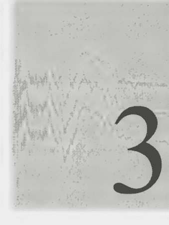

- 3.1 SAS System Options ......................................................... 86
- 3.2 Statements That Can Modify the Output of Most Procedures .... 89
- 3.3 Defining Your Own Formats for Variable Values ........................... 91
- 3.4 Selecting or Stratifying an Analysis by Values of a Variable ...... 93
- 3.5 Displaying Data Set Properties and Observations ........................... 95
- 3.6 Using PROC PRINT to List the Observations in a Data Set ........ 96
- 3.7 Basic Graphical Displays ............................................................... 97
- 3.8 Using Scatter Plots to Display Relationships between Numeric Variables ............................................................... 100
- 3.9 Summarizing Categorical Variables ............................................. 106
- 3.10 Summarizing Numeric Variables ................................................... 108
- 3.11 Selecting a Simple Random Sample ............................................... 115
- 3.12 Randomly Assigning Treatments to Observations ...................... 116
- 3.13 Summary ....................................................................................... 118
- 3.14 References .................................................................................... 118
- 3.15 Exercises ...................................................................................... 119

Chapter 1 presented guidelines for writing easy-to-read programs with sensible variable names and documentation. Chapter 2 described constructing a data set for later analysis. In this chapter, SAS is used to analyze data. This chapter describes SAS system options, statements that can be used anywhere in a SAS program, and procedures for displaying the contents of SAS data sets and listing the observations in a data set. The chapter describes the basic procedures for constructing summary statistics for numeric variables and categorical variables. It includes basic graphical displays for examining the distribution of variable values, and the association between variables.

### 3.1 SAS System Options

Options can be set in SAS that apply for the duration of a program (or until other options are set). Many of these options are used to control the output produced by SAS procedures (e.g., centering output, controlling page separation, or displaying the current date and page number), while other options are used to request that certain information be written to the log file (e.g., macro diagnostic options). The `OPTIONS` statement controls these system options.

Consider the default output produced by the SAS program in Display 3.1. The program generates a simple regression data set (`x_i`, `y_i`), where `x_i=i` and `y_i` is normally distributed with mean `3+2x_i` and variance=`0.25` for `i=1, 2, ..., 10`.

**Display 3.1 Generating and printing a regression data set**

```sas
* generate a 10 observation data set with Y~N(3+2x,0.5^2);
* RECALL: variance=0.25 implies SD=0.5;
*          If Z ~ N(0,1), then Y=mu + sigma*Z ~ N(mu, sigma^2);
*          Here, mu=3+2*X and sigma=0.5;
data test;
call streaminit(0);
do X=1 to 10;
    Y=3+2*X+0.5*RAND('NORMAL');
    output;
end;
run;

proc print data=test;
run;
```

As in Chapter 2, check to see whether the data set that is produced meets expectations. For example, Display 3.2 should include a data set with 10 observations and two variables.

**Display 3.2 (Edited) Output produced by PROC PRINT**

The SAS System    09:21 Sunday, November 8, 2009    1

| Obs | X | Y |
|---:|---:|---:|
| 1 | 1 | 5.7549 |
| 2 | 2 | 6.5498 |
| 3 | 3 | 8.8338 |
| 4 | 4 | 11.0139 |
| 5 | 5 | 12.8750 |
| 6 | 6 | 14.7235 |
| 7 | 7 | 16.8983 |
| 8 | 8 | 18.6677 |
| 9 | 9 | 20.8039 |
| 10 | 10 | 22.0728 |

The output is centered by default. In addition, the date and page number are stamped in the upper right corner of this output. You can change this by adding the following `OPTIONS` statement:

```sas
options nocenter nodate;
```

The output is shown in Display 3.3.

**Display 3.3 Modifying the output with NOCENTER and NODATE options**

```sas
options nocenter nodate;
* generate a 10 observation data set with Y~N(3+2x,0.5^2);
data test;
call streaminit(0);
do X=1 to 10;
    Y=3+2*X+0.5*RAND('NORMAL');
    output;
end;
run;

proc print data=test;
run;
```

The `NOCENTER` option left justifies the output as shown in Display 3.4, while the `NODATE` option suppresses the printing of the date.

**Display 3.4 Output produced by PROC PRINT with options set**

The SAS System    2

| Obs | X | Y |
|---:|---:|---:|
| 1 | 1 | 4.7546 |
| 2 | 2 | 8.0486 |
| 3 | 3 | 8.3544 |
| 4 | 4 | 10.5208 |
| 5 | 5 | 12.7708 |
| 6 | 6 | 14.6989 |
| 7 | 7 | 16.4467 |
| 8 | 8 | 18.7713 |
| 9 | 9 | 21.1995 |
| 10 | 10 | 23.9167 |

While the output is no longer centered and the date is not displayed, the page number is on the far right (and is now equal to 2). There is still a default title. In addition, a new output page is produced by default. A few system options—`LS`, `PAGENO`, and `FORMDLIM`—and a simple `TITLE` statement can address these issues. The `FORMDLIM` option suppresses the default page break and requests that the equal sign be used to separate output pages. `LS=64` requests an output width of 64 characters. `PAGENO=1` starts page numbering at 1. The code in Display 3.5 produces the output shown in Display 3.6.

**Display 3.5 More output controls in an OPTIONS statement**


```sas
options nocenter nodate ls=64 pageno=1 formdlim='=';
title "Generate Regression Data Set";
* generate a 10 observation data set with Y~N(3+2x,0.5^2);
data test;
  call streaminit(0);
  do X=1 to 10;
    Y=3+2*X+0.5*RAND('NORMAL');
    output;
  end;
run;

proc print data=test;
run;
```

As shown in Display 3.6, new output pages are no longer displayed on separate pages. Instead, equal signs separate the pages.

#### Display 3.6 使用 `NOCENTER`、`NODATE`、`LS`、`PAGENO` 和 `FORMDLIM` 选项输出

```
... (lines deleted)
10      10      10      22.7048
----------------------------------------
Generate Regression Data Set                                      1
Obs     X       Y
1       1       5.2468
2       2       6.7896
3       3       9.4197
4       4       10.8899
5       5       13.1966
6       6       14.6113
7       7       17.6854
8       8       18.5715
9       9       20.7987
10      10      22.9057
```

其他系统选项，例如与宏一起使用的选项，已在相关章节中介绍。顺便说一下，你是否注意到输出显示中生成的样本是不同的？为什么会发生这种情况？提示：请参阅随机正态偏差函数 `RAND('NORMAL')` 的帮助文档，以及使用 `STREAMINIT` 设置生成器种子的帮助文档。 （参见第 8 章，第 8.11 节。）

### 3.2 可以修改大多数过程输出的语句

许多语句可以在 SAS 程序中出现。这些语句使你能够注释输出（例如 `TITLE` 和 `FOOTNOTE`）或扩展变量名或变量值（例如 `LABEL` 和 `FORMAT`）。示例说明了在 `DATA` 步中定义的格式与作为 `PROC` 步一部分应用的格式，以及 `TITLE`。

Display 3.7 中提供的程序设置系统选项，以便输出没有日期戳（`NODATE`），不居中（`NOCENTER`），宽度为 64（`LS=64`），从页码 1 开始重新编号输出（`PAGENO=1`），并使用等号作为分页符（`FORMDLIM='='`）。数据块从 `DATALINES` 输入三个观测值。 （顺便说一下，数据集名称 `d1` 并不是一个很吸引人的数据集名称，在第 1 章我对此进行了谴责，我感到内疚。算了，这是一个用于说明的玩具示例。）`INPUT` 语句中的 `@@` 告诉 SAS 即使在找到新变量 `X` 和 `Y` 的值后仍继续读取数据行。这允许在每一行中输入多个观测值。

你可能有兴趣将格式附加到变量的值。分配格式的详细讨论在第 8 章中，但本章讨论了格式的几个基本用法。格式可以通过 `DATA` 步中的赋值附加到变量。或者，它们可以使用 `PROC` 中的语句临时附加到变量。Display 3.7 显示了将格式附加到变量。

变量 `Y` 在数据块中用 `FORMAT` 语句定义。分配的格式 —`dollar6.2`— 以货币形式显示 `Y` 的值，并附带 `$` 符号。格式中的 `6.2` 表示为输出分配六个总空格（包括 `$` 符号和小数点），小数点右侧有两位数字。 （关于格式的更多讨论将在后面的章节中进行。然而，本章让你初步了解使用格式。）此分配的格式会影响引用此数据集中 `Y` 的任何过程。相比之下，第二 `PROC PRINT` 中为变量 `X` 定义了分配的格式。当格式在过程中分配时，它仅在该过程中运行，而不会超出其范围。标题使用 `TITLE` 和 `TITLE2` 语句放置在输出中。标题会一直出现在每一页输出上，直到重置为止。最多可在一页输出上显示 10 个标题。虽然 `TITLE` 指定输出的第一行标题，但语句 `TITLEn` 指定第 `n` 行标题（`n=2,...,10`）。超过三行标题（或多或少）可能会限制一页上的实际输出。可以使用 `FOOTNOTEn` 选项在每一页输出的底部添加行。这与 `TITLEn` 类似，只是你指定要在每页底部包含的文本。

#### Display 3.7 带少量格式选项的代码

```
options formdlim='=' pageno=1 ls=64 nocenter nodate;
data dl;
  input x y @@;
  format y dollar6.2;
  datalines;
1 2 4 3 5 6 12345 123456
;
run;

proc print data=dl;
  title "Y formatted in DATA";
run;

proc print data=dl;
  title2 "X now formatted in the 2nd PROC PRINT";
  format x dollar12.2;
run;

proc print data=dl;
  title2;
run;
```

在 `DATA` 步中设置格式与在 `PROC` 中设置格式的不同影响在 Display 3.8 中显示。

#### Display 3.8 使用少量格式选项打印数据的输出

```
Y formatted in DATA                                                                 1

Obs        x        Y
1          1        $2.00
2          4        $3.00
3          5        $6.00
4          12345    123456

================================================================================
Y formatted in DATA                                                                 2
X now formatted in the 2nd PROC PRINT

Obs                 x        Y
1                   $1.00    $2.00
2                   $4.00    $3.00
3                   $5.00    $6.00
4                   $12,345.00 123456

================================================================================
Y formatted in DATA                                                                 3

Obs        x        Y
1          1        $2.00
2          4        $3.00
3          5        $6.00
4          12345    123456
```

输出反映了 `OPTIONS` 语句中请求的内容。第二标题按第二 `PROC` 中 `TITLE2` 的请求出现在输出中。第一 `PROC PRINT` 请求的 `TITLE` 应用于接下来的两个 `PROC`。`DATA` 步中为 `Y` 定义的格式适用于所有 `PROC`，而第二 `PROC` 中为 `X` 定义的格式仅适用于第二个 `PROC`。问题：“第四个观测值的 `Y` 格式发生了什么？” 问题在于格式的宽度 —`Y` 的 6— 不能容纳变量的值。在这种情况下，输出以不带 `$` 符号和小数的方式显示变量的值。

### 3.3 为变量值定义你自己的格式

在前面的示例中，使用了一些 SAS 内部定义的格式（例如 `DOLLARW.D` 格式）。SAS 内部定义了许多其他格式，包括用于处理和显示日期和时间的格式。有时你想定义自己的格式来显示变量值。在这些情况下，`FORMAT` 过程提供了这种灵活性。

来自 StatLib 服务器的一个示例数据集在下一个示例中（以及本书的其余部分）中使用。该数据集描述了研究硝基酚毒性的实验结果。硝基酚是一种用于水稻的除草剂，数据检查了硝基酚对 *Ceriodaphnia dubia* 的影响，*Ceriodaphnia dubia* 是水蚤。

StatLib 服务器上数据集的 URL—`http://lib.stat.cmu.edu/datasets/csb`—包含描述数据集中变量的文件（`ch2.txt`）、包含数据的文件（`ch2.dat`）以及用于读取数据的 SAS 程序文件。变量包括动物 ID、硝基酚浓度、三个繁殖期中每个繁殖期产生的幼体数量，以及三个繁殖期产生的幼体总数。如果生殖输出随着除草剂浓度的增加而减少，则表明有毒性。Bailer 和 Oris（1994）对这些数据进行了讨论和分析。好吧，背景介绍就到此为止。StatLib 服务器上的数据集已保存到我的桌面并重命名为 `ch2-dat.txt`。

在 Display 3.9 中的程序中，定义了一个格式，将数值变量的值映射为如果变量 `VALUE=0` 则为 **NONE**，如果变量的值为 1 或更大则为 **SOME**。变量的范围 `1—HIGH` 使用关键字 `HIGH`，表示数据集中最大值。然后将此用户定义格式 `TOTFMT` 应用于 `DATA` 步中定义的新变量 `CBROOD3`。显示 `conc=235` 条件的数据。

#### Display 3.9 使用 `PROC FORMAT` 的用户定义格式

```sas
proc format;
    value totfmt       0='none'
                   1-HIGH='some';
run;

data nitro tox;
    infile 'C:\Users\bailera\JT\desktop\DT-Book 3\ch2-dat.txt'
        firstobs=16 expandtabs missover pad;
    input @9 animal 2. @17 conc 3. @25 brood1 2.
          @33 brood2 2. @41 brood3 2. @49 total 2.;
    cbrood3 = brood3;
    format cbrood3 totfmt.;
    label animal = 'animal ID number';
    label conc   = 'Nitrofen concentration';
    label brood1 = 'number of young in first brood';
    label brood2 = 'number of young in 2nd brood';
    label brood3 = 'number of young in 3rd brood';
    label total  = 'total young produced in three broods';
run;

proc print data=nitro; tox;
    where conc=235;
run;
```

> 来自 Bailer, A. John. 和 James T. Oris. 1994. “Assessing Toxicity of Pollutants in Aquatic Systems.” 第 2 章《Case Studies in Biometry》。Nicholas Lange, Louise Ryan, Lynne Billard, David Brillinger, Loveday Conquest, Joel Greenhouse, 编者。新泽西州：John Wiley & Sons, Inc. 经 John Wiley & Sons, Inc. 许可转载。

你可以在 Display 3.10 中确认新变量的格式。

#### Display 3.10 Output produced by user-defined format

| Obs | animal | conc | brood1 | brood2 | brood3 | total | cbrood3 |
|---|---|---|---|---|---|---|---|
| 31 | 31 | 235 | 4 | 13 | 6 | 23 | some |
| 32 | 32 | 235 | 6 | 10 | 5 | 21 | some |
| 33 | 33 | 235 | 2 | 5 | 0 | 7 | none |
| 34 | 34 | 235 | 6 | 0 | 6 | 12 | some |
| 35 | 35 | 235 | 6 | 13 | 8 | 27 | some |
| 36 | 36 | 235 | 6 | 0 | 10 | 16 | some |
| 37 | 37 | 235 | 7 | 0 | 6 | 13 | some |
| 38 | 38 | 235 | 4 | 2 | 9 | 15 | some |
| 39 | 39 | 235 | 6 | 8 | 7 | 21 | some |
| 40 | 40 | 235 | 7 | 0 | 10 | 17 | some |

### 3.4 Selecting or Stratifying an Analysis by Values of a Variable

`BY` 语句用于指定按变量水平分层的数据集分析。它通常与 `SORT` 过程一起使用。例如，以下代码对 nitrofen 数据集 `nitro_tox` 进行排序，并生成输出数据集 `nitro_tox2`，其中观测值已排序：

```
proc sort data=nitro_tox out=nitro_tox2;
    by conc;
run;
proc print data=nitro_tox2;
    by conc;
run;
```

你可以按一个以上的变量排序。例如，假设你想在 `conc` 内按 `total` 排序。以下代码执行排序并在 Display 3.11 中打印结果：

```
proc sort data=nitro_tox;
    by conc total;
run;
proc print data=nitro_tox;
    id animal;
    var conc total;
run;
```

#### Display 3.11 Printout of nitrofen data using animal ID as an identifier and sorted by TOTAL within each CONC level

| animal | conc | total |
|---|---|---|
| 9 | 0 | 24 |
| 1 | 0 | 27 |
| 8 | 0 | 30 |
| 10 | 0 | 31 |
| 2 | 0 | 32 |
| 4 | 0 | 33 |
| 7 | 0 | 33 |
| 3 | 0 | 34 |
| 6 | 0 | 34 |
| 5 | 0 | 36 |
| 16 | 80 | 26 |
| 17 | 80 | 27 |
| ... |  |  |
| 23 | 160 | 23 |
| 28 | 160 | 26 |
| ... |  |  |
| 33 | 235 | 7 |
| 34 | 235 | 12 |
| ... |  |  |
| 44 | 310 | 0 |
| 48 | 310 | 4 |
| 46 | 310 | 5 |
| 50 | 310 | 5 |
| 41 | 310 | 6 |
| 42 | 310 | 6 |
| 47 | 310 | 6 |
| 49 | 310 | 6 |
| 43 | 310 | 7 |
| 45 | 310 | 15 |

你可以使用 `WHERE` 语句限制输出。例如，假设你只想打印三个窝中所有幼崽总数小于 10 的观测值。以下部分代码生成 Display 3.12 中的输出：

```
proc sort data=nitro_tox;
  by conc total;
run;

proc print data=nitro_tox;
  id animal;
  var conc total brood1 brood2 brood3;
  where total<10;
run;
```

#### Display 3.12 Printout of data where total young is less than 10

| animal | conc | total | brood1 | brood2 | brood3 |
|---|---|---|---|---|---|
| 33 | 235 | 7 | 2 | 5 | 0 |
| 44 | 310 | 0 | 0 | 0 | 0 |
| 48 | 310 | 4 | 4 | 0 | 0 |
| 46 | 310 | 5 | 5 | 0 | 0 |
| 50 | 310 | 5 | 5 | 0 | 0 |
| 41 | 310 | 6 | 6 | 0 | 0 |
| 42 | 310 | 6 | 6 | 0 | 0 |
| 47 | 310 | 6 | 6 | 0 | 0 |
| 49 | 310 | 6 | 6 | 0 | 0 |
| 43 | 310 | 7 | 7 | 0 | 0 |


### 3.5 Displaying Data Set Properties and Observations

数据集的内容，包括数据集属性、变量名、类型（字符、数值）、存储长度、格式和标签，都可以使用 `CONTENTS` 过程显示。`nitro_tox` 数据集的这些详细信息可以使用以下代码生成并显示，该代码在 Display 3.13 中给出：

```
proc contents data=nitro_tox;
run;
```

#### Display 3.13 Details of the nitro_tox data set generated and displayed by PROC CONTENTS

The CONTENTS Procedure

Data Set Name: `WORK.NITRO_TOX`          Observations: 50

Member Type: DATA                      Variables: 7

Engine: V8                             Indexes: 0

Created: 10:19 Monday, September 1, 2008   Observation Length: 56

Last Modified: 10:19 Monday, September 1, 2008   Deleted Observations: 0

Protection:                            Compressed: NO

Data Set Type:                         Sorted: NO

Label:

-----Engine/Host Dependent Information-----

Data Set Page Size: 8192

Number of Data Set Pages: 1

First Data Page: 1

Max Obs per Page: 145

Obs in First Data Page: 50

Number of Data Set Repairs: 0

File Name: `C:\DOCUME-1\bailera\LOCALS~1\Temp\SAS Temporary Files\_TD1220\nitro_tox.sas7bdat`

Release Created: 8.0202M0

Host Created: WIN_PRO

#### Display 3.13 (continued)

| # | Variable | Type | Len | Pos | Format | Label |
|---|---|---|---|---|---|---|
| 1 | `animal` | Num | 8 | 0 |  | animal ID number |
| 3 | `brood1` | Num | 8 | 16 |  | number of young in first brood |
| 4 | `brood2` | Num | 8 | 24 |  | number of young in 2nd brood |
| 5 | `brood3` | Num | 8 | 32 |  | number of young in 3rd brood |
| 7 | `cbrood3` | Num | 8 | 48 | TOTFMT. |  |
| 2 | `conc` | Num | 8 | 8 |  | Nitrofen concentration |
| 6 | `total` | Num | 8 | 40 |  | total young produced in three brood |

该输出顶部报告了数据集中的观测数（50）、变量数（7）以及有关数据集的其他信息。输入变量数据集和新定义的变量 `cbrood3` 都显示出来。此外，所有这些变量都是数值型（`TYPE=NUM`），为每个变量分配了 8 个字节进行存储（`LEN=8`）。定义的标签和格式列出。此变量列表按字母顺序排序。如果你想按变量在数据集中读取或创建的顺序查看变量名（它们在数据集中的位置），则使用 `PROC CONTENTS` 的 `VARNUM` 选项。例如：

```
proc contents data=nitro_tox varnum; run;
```

### 3.6 Using PROC PRINT to List the Observations in a Data Set

在你输入、`infile` 或导入数据集并定义标签和格式后，通常希望查看你构建的数据集的观测值和变量。`PROC PRINT` 显示 SAS 数据集中的观测值。此显示可以修改为计算简单的统计量，例如总和，并且可以使用变量来标识列表中的观测值。以下部分 SAS 代码按浓度分组打印 `nitro_tox` 数据集（`by conc`），对每个浓度条件下产生的幼崽总数求和（`sum total`），并使用动物 ID 标识每个观测值（`id animal`）：

```
proc print data=nitro_tox;
by conc;  * assumes input data sorted by this variable;
sum total;
id animal;* animal number used to ID case;
run;
```

此代码生成 Display 3.14 中的打印输出。即使 `cbrood3` 是一个数值变量，它也是使用分配给它的格式显示的。

#### Display 3.14 Output produced by PROC PRINT

```
Nitrofen concentration=0
animal   brood1   brood2   brood3   total   cbrood3
1        3        14       10       27      some
2        5        12       15       32      some
3        6        11       17       34      some
4        6        12       15       33      some
5        6        15       15       36      some
6        5        14       15       34      some
7        6        12       15       33      some
8        5        13       12       30      some
9        3        10       11       24      some
10       6        11       14       31      some
------                           -----
conc                                 314
/* some output deleted here */

Nitrofen concentration=310
animal   brood1   brood2   brood3   total   cbrood3
41       6        0        0        6       none
42       6        0        0        6       none
43       7        0        0        7       none
44       0        0        0        0       none
45       5        10       0        15      none
46       5        0        0        5       none
47       6        0        0        6       none
48       4        0        0        4       none
49       6        0        0        6       none
50       5        0        0        5       none
------                           -----
conc                                 60
                                   ======
                                   1144
```

### 3.7 Basic Graphical Displays

探索研究数据通常从简单的图形摘要开始。讨论 SAS 中统计图形的一个好起点是 `SGPLOT` 过程。可以使用该过程生成大量的图形。在以下代码中，构建了一个水平条形图，其中不同浓度组的幼崽平均数分别显示。限制范围在均值 ±2 个标准差。 此外，还请求了点图来显示这些数据。Display 3.15 中的代码生成 Display 3.16 和 Display 3.17 中的输出。

#### Display 3.15 使用 PROC SGPLOT 生成水平条形图

```
%let DATA_DIR = C:\Users\baileraj.IT\Desktop;
%let OLD_DIR = M:\public.www\classes\sta402\SAS-programs;

data nitro_tox;
    infile "&DATA_DIR\ch2-dat.txt"
          firstobs=16 expandtabs missover pad ;
    input @9 animal 2. @17 conc 3. @25 brood1 2.
          @33 brood2 2. @41 brood3 2. @49 total 2.;
run;

* ods rtf bodytitle file="&DATA_DIR\Display-3.15.rtf";
ods listing image dpi=300;
ods graphics / width=4.5in;
proc sgplot data=nitro_tox;  * Display 3.16;
    hbar conc / response=total stat=mean limits=both limitstat=stddev
                numstd=2;
run;

proc sgplot data=nitro_tox; * Display 3.17;
    dot animal / response=total group=conc;
run;

ods graphics off;
* ods rtf close;
```

Display 3.16 中条形的长度对应于每个浓度下产生的幼崽的平均数量（`stat=mean`），其中 `hbar conc` 表示按浓度分组。极限延伸以反映每个浓度下均值周围标准差的倍数（`limitstat=stddev numstd=2`）。如果需要该信息，极限可以修改为反映每个未知均值的置信区间（`limitstat=clm`）。那么，在什么情况下你会更偏好哪种显示？提示：你是想描述样本中响应的分布？还是想反映在估计未知总体参数时的不确定性？

#### Display 3.16 显示平均幼崽数目的水平条形图，带两个标准差误差线

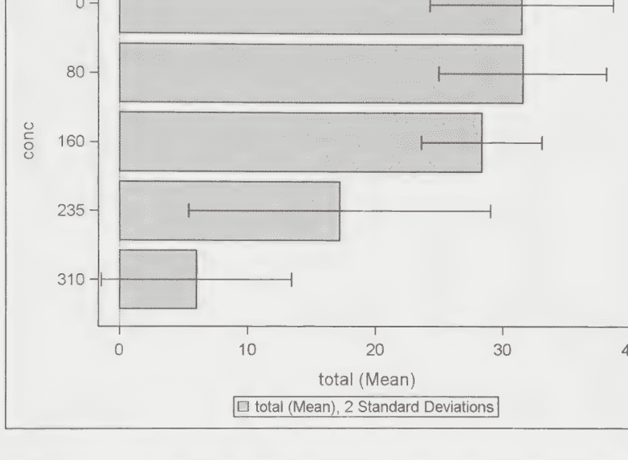

带有极限的条形图常被贬义地描述为炸药图或带插塞的炸药图。点图或散点图在显示数据时 arguably 更受青睐。（有关更多信息，请参阅下一节。）这些图在本书其余部分中被反复强调。

通过 Display 3.15 中第二个 `PROC SGPLOT` 的 `DOT` 语句生成了按硝基酚浓度分组的每只动物产生的幼崽总数点图。Display 3.17 显示了该点图。该图清楚地表明，随着硝基酚浓度的增加，幼崽总数向较低值转移。

#### Display 3.17 按硝基酚浓度分组的个体观测点图

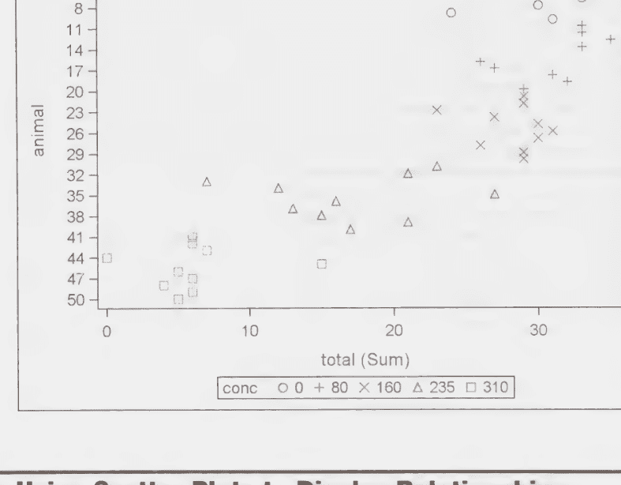

### 3.8 使用散点图显示数值变量之间的关系

在查看两个数值变量之间的关系时，散点图是首选。`SGPLOT` 过程是此显示的工具。你现在是否看到了某种模式？`PROC SGPLOT` 是在数据分析中构建的大多数基本显示所采用的统计图形过程。有关 `PROC SGPLOT` 和其他统计图形过程的更多细节将在第 6 章提供。如果你有点不耐烦，可以直接跳到第 6 章。这些过程是 SAS 9.2 的一个非常酷的补充，花时间探索其使用是值得的。

Display 3.18 中的简单示例生成了三幅图。第一幅图显示了三窝产生的幼崽总数（`total`）与硝基酚浓度（`conc`）之间的关系，其中 `cbrood` 变量的值用作分组变量，从而产生不同的绘图符号。（参见 Display 3.19。）第二幅图显示了窝别计数作为硝基酚浓度的函数。（参见 Display 3.20。）第三幅图稍后会讨论。

#### Display 3.18 生成三个散点图

```
%let DATA_DIR = C:\Users\baileraj.IT\Desktop;
proc format;
value totfmt    0='none'
                1-HIGH='some';
run;

data nitro_tox;
    infile "&DATA_DIR\ch2-dat.txt"
        firstobs=16 expandtabs missover pad ;
    input @9 animal 2. @17 conc 3. @25 brood1 2.
          @33 brood2 2. @41 brood3 2. @49 total 2.;
    cbrood3 = brood3;
    format cbrood3 totfmt.;
run;

* ods rtf bodytitle file="&DATA_DIR\Display-3.18.rtf";
ods listing image dpi=300;
ods graphics / width=4.5in;

proc sgplot data=nitro_tox;    * Display 3.19;
    scatter y=total x=conc  / group=cbrood3;
run;

proc sgplot data=nitro_tox;    * Display 3.20;
    scatter y=brood1 x=conc;
    scatter y=brood2 x=conc;
    scatter y=brood3 x=conc;
run;

* add JITTER to concentration to separate points in the plot;
data nitro_tox3; set nitro_tox;
    jconc = conc + 20*RAND('uniform')- 10;
                        * add jitter to the concentration for plotting;
run;

proc sgplot data=nitro_tox3;    * Display 3.21;
xaxis label = "Nitrofen concentration (jittered)";
yaxis label = "Number of young";
    scatter y=brood1 x=jconc;
    scatter y=brood2 x=jconc;
    scatter y=brood3 x=jconc;
run;

ods graphics off;
* ods rtf close;
```

Display 3.19 显示，随着硝基酚浓度的增加，幼崽数量减少。此外，第三窝无幼崽的动物数量增加。

#### Display 3.19 总幼崽数与硝基酚浓度的散点图，其中 CBROOD3 为分组变量

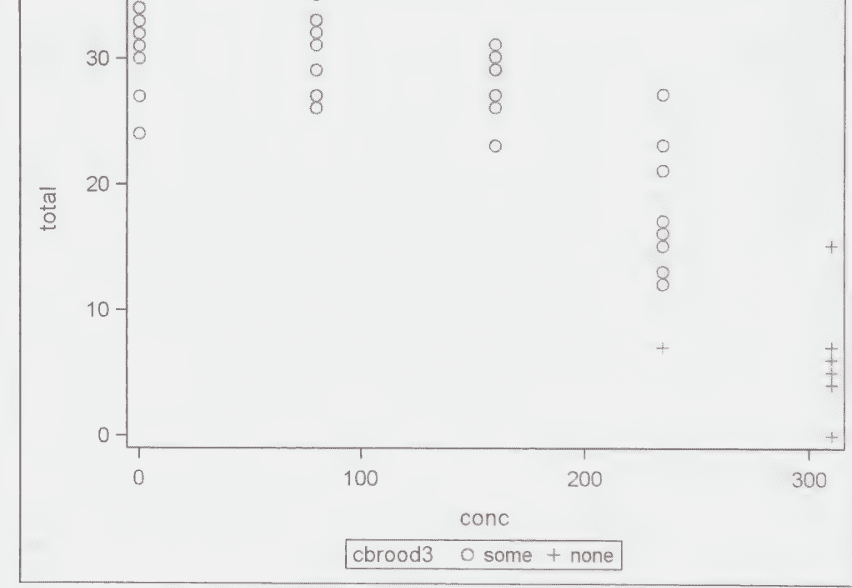

在 Display 3.20 中，通过在 Display 3.18 的 `PROC SGPLOT` 中指定三个 `SCATTER` 语句，将每个窝的计数与硝基酚浓度的图叠加到 Display 3.19 的图上。

#### Display 3.20 各窝幼崽总数与硝基酚浓度的散点图

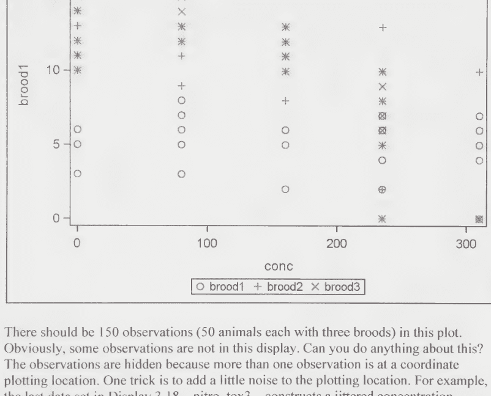

该图应包含 150 个观测值（每只动物 50 只，共三窝）。显然，一些观测值并未显示在此图中。你能做些什么吗？观测值被隐藏是因为多个观测值位于同一坐标绘图位置。一个技巧是给绘图位置添加一点噪声。例如，Display 3.18 中的最后一个数据集——`nitro_tox3`——通过生成一个随机均匀量——`UNIF(-10, 10)`——并将其添加到每个浓度测量值来构建抖动后的浓度（`JCONC`）。这是通过首先生成一个随机均匀变量——`U(0,1)`——然后乘以 20 得到 `U(0, 20)` 实现的。然后从该量中减去 10，得到在域 −10 到 10 上的均匀偏差（即 `U(-10, 10)`）。该均匀偏差被添加到每个浓度测量值以产生抖动后的浓度，并在 Display 3.21 中绘制。最终的 `SGPLOT` 中包含两个语句 `XAXIS` 和 `YAXIS` 以进一步自定义图形。（有关自定义图形的更多信息，请参阅第 6 章。）

#### Display 3.21 各窝幼崽总数与硝基酚浓度的散点图，浓度已抖动

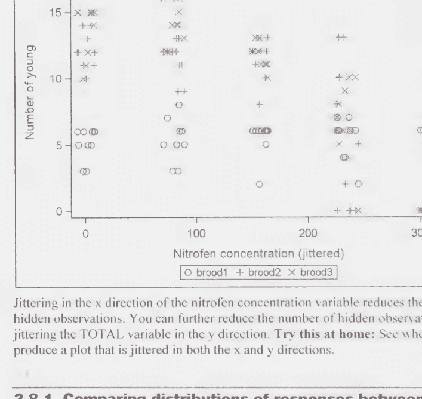


在硝基酚浓度变量的 `x` 方向上进行抖动可减少隐藏观测值的数量。你可以通过在 `y` 方向上对 `TOTAL` 变量进行抖动来进一步减少隐藏观测值的数量。自己试试：看看你能否生成一个在 `x` 和 `y` 两个方向上都进行抖动的图。

### 3.8.1 比较多组之间响应的分布

`Display 3.16` 中的条形图、`Display 3.17` 中的点图和 `Display 3.19` 中的散点图都显示了随着硝基酚浓度增加，总幼崽的分布如何变化。箱线图可能更容易理解且易于构建。箱线图中图形化显示了最小值、第一四分位数（25 百分位）、中位数、第三四分位数（75 百分位）和最大值（所谓的五数概括）。要使用 `PROC SGPLOT` 生成箱线图，可以使用 `VBOX` 或 `HBOX` 语句。要为硝基酚数据集构建并排箱线图，使用以下代码：

```
proc sgplot data=nitro_tox;
 ybox total / category=conc;
 xaxis label = "Nitrofen concentration";
 yaxis label = "Number of young (3 broods)";
 run;
```

该代码的结果显示在 `Display 3.22` 中。箱体由第一四分位数（25 百分位）、中位数和第三四分位数（75 百分位）定义，须线从第三四分位数延伸到最大值，从第一四分位数延伸到最小值。（此构造的变体是可用的。请参阅帮助文档。）箱体中央的菱形表示每个硝基酚浓度的平均总幼崽数的位置。

#### Display 3.22 不同硝基酚浓度下产生的幼崽的并排箱线图

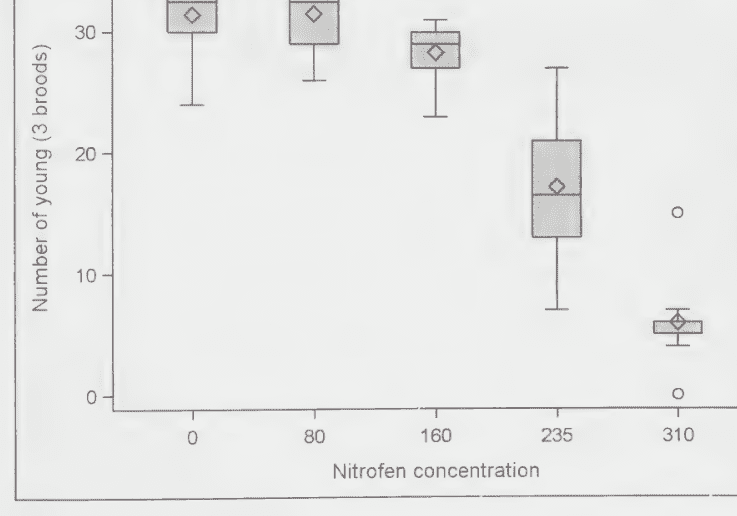

### 3.9 汇总分类变量

分类数据通常通过每个分类变量的水平响应频率或相对频率，或分类变量水平组合的频率来汇总。一个变量的频率表可用于检查数据录入的完整性。例如，五种浓度组中应有 10 只动物。以下用于检查数据完整性的代码使用 `PROC FREQ`，该过程生成了显示 3.23 中的表：

```
proc freq data=nitro_tox;
    table conc;
run;
```

可以看到，五种硝酚浓度水平已正确录入（即 `CONC`=0、80、160、235 和 310，与预期一致）。每个浓度均记录了 10 个观测值。

#### 显示 3.23 各硝酚浓度中的观测值数量

| conc | Frequency | Percent | Cumulative Frequency | Cumulative Percent |
|------|-----------|---------|----------------------|--------------------|
| 0    | 10        | 20.00   | 10                   | 20.00              |
| 80   | 10        | 20.00   | 20                   | 40.00              |
| 160  | 10        | 20.00   | 30                   | 60.00              |
| 235  | 10        | 20.00   | 40                   | 80.00              |
| 310  | 10        | 20.00   | 50                   | 100.00             |

个体对两个或多个分类变量的响应通常以列联表形式显示。在两个分类变量的情况下，一个变量标记行。另一个变量标记列。列联表显示行值和列值每种组合下的观测计数。以下代码请求一个列联表，其中硝酚水平显示为行（`CONC`），第三窝中幼崽的存在情况（`CBROOD3`）显示为列（二水平分类变量）。表输出被修改为仅显示行百分比。（`NOCOL` 和 `NOPCT` 选项分别抑制列百分比和联合百分比的打印。）请求统计检验以查看在第三窝产生幼崽的概率是否对其他窝相同（`CHISQ` 和 `EXACT` 选项），以及是否存在浓度相关的趋势（`TREND` 选项）。以下部分代码生成了显示 3.24 中的输出：

```
proc freq data=nitro_tox;
  table conc*cbrood3 / noperct nocol chisq trend exact;
run;
```

#### 显示 3.24 显示氮浓度与第三窝是否产生幼崽的列联表

The FREQ Procedure

Table of conc by cbrood3

conc (Nitrofen concentration)

| Frequency / Row Pct | none | some | Total |
|---|---:|---:|---:|
| 0 | 0<br>0.00 | 10<br>100.00 | 10 |
| 80 | 0<br>0.00 | 10<br>100.00 | 10 |
| 160 | 0<br>0.00 | 10<br>100.00 | 10 |
| 235 | 1<br>10.00 | 9<br>90.00 | 10 |
| 310 | 10<br>100.00 | 0<br>0.00 | 10 |
| Total | 11 | 39 | 50 |

*(continued)*

#### 显示 3.24 （续）

Statistics for Table of conc by cbrood3

Statistic	DF	Value	Prob

Chi-Square	4	44.7552	<.0001

Likelihood Ratio Chi-Square	4	46.1891	<.0001

Mantel-Haenszel Chi-Square	1	24.5782	<.0001

Phi Coefficient		0.9461

Contingency Coefficient		0.6873

Cramer's V		0.9461

WARNING: 50% of the cells have expected counts less than 5. Chi-Square may not be a valid test.

Fisher's Exact Test

Table Probability (P)	2.677E-10

Pr <= P	5.354E-09

Cochran-Armitage Trend Test

Statistic (Z)	5.0080

One-sided Pr > Z	<.0001

Two-sided Pr > |Z|	<.0001

Sample Size = 50

在最高硝酚浓度下，第三窝产生幼崽的概率似乎下降。有关本例中统计检验的更多细节，请参阅标准分类数据参考资料（例如 Agresti 2002）。Stokes 等人（2009）很好地总结了 SAS 中的分类数据分析方法。

### 3.10 汇总数值变量

如果你被困在荒岛上，只能使用一个 SAS 过程，`PROC UNIVARIATE` 可能是你的选择（假设你在荒岛上对描述数值变量感兴趣）。该过程可以生成位置描述统计量（均值、中位数、分位数）和离散度统计量（标准差、方差、范围、四分位距）。它可以识别数据集中的极值。此外，它还可以生成简单的图形，包括直方图、正态分位数图、茎叶图、箱线图等。以下编程语句生成总幼崽数的直方图，并带有非参数密度估计（显示 3.25）。语句还生成数据分位数与正态分位数的图（显示 3.26）：

```
proc univariate data=nitro_tox;
    var total;
    histogram / kernel;  * histogram with nonpar. Density est.;
    qqplot;             * quantile-quantile plot vs. normal;
run;
```

#### 显示 3.25 五种硝酚浓度条件下 50 个观测值的总幼崽数直方图

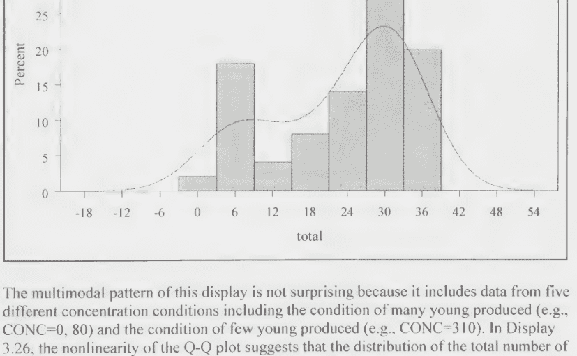

该显示的多峰模式并不令人惊讶，因为它包含了来自五种不同浓度条件的数据，包括产生幼崽较多的条件（例如 `CONC`=0、80）和产生幼崽较少的条件（例如 `CONC`=310）。在显示 3.26 中，Q-Q 图的非线性表明总幼崽数的分布不是正态的。同样，这也不令人惊讶，因为这些数据包含了来自五种不同浓度条件的响应。

#### 显示 3.26 五种硝酚浓度条件下 50 个观测值的总幼崽数正态分位数图

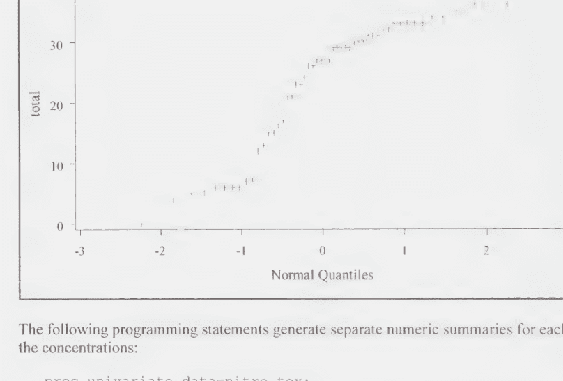

以下编程语句为每种浓度生成单独的数值汇总：

```
proc univariate data=nitro_tox;
  by conc;
  var total;
run;
```

显示 3.25 中的直方图可由 `SGPLOT` 过程按显示 3.27 中的代码和显示 3.28 中的输出生成。请注意 `ODS RTF` 语句中 `STYLE=JOURNAL` 的指定。该指定生成灰度版本的图形，可能更适合期刊发表。有关样式和图形的更多讨论，请参阅第 6 章。

#### 显示 3.27 使用 PROC SGPLOT 生成叠加密度的直方图

```
%let DATA_DIR = C:\Users\baileraj.IT\Desktop;
data nitro_tox;
  infile "&DATA_DIR\ch2-dat.txt"
    firstobs=16 expandtabs missover pad ;
  input @9 animal 2. @17 conc 3. @25 brood1 2.
        @33 brood2 2. @41 brood3 2. @49 total 2.;
run;

*ods rtf style=journal bodytitle
    file="&DATA_DIR\Display-3.27.rtf";  * selecting gray scale style/
B&W;

ods listing image dpi=300 style=journal;
ods graphics / width=4.5in;
proc sgplot data=nitro_tox;          * figure as often used in journal
                                     articles;
  histogram total;
  density total / type=kernel;
  keylegend / location=inside position=topleft;
run;
ods graphics off;
*ods rtf close;
```

#### 显示 3.28 由 PROC SGPLOT 生成的叠加密度直方图

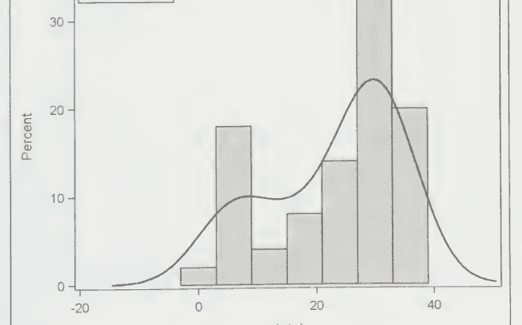

让我们使用 `PROC UNIVARIATE` 查看来自 `SMSA²` 城市数据的 1 月温度数据的数值汇总。（有关更多背景信息，请参阅第 2.2 节。）显示 3.29 包括对 `JANTEMP` 变量的单变量统计请求以及识别与极端低或高温度相关的城市。（这是一种很好的检查数据集中异常值的方法。）

#### 显示 3.29 请求描述 SMSA 数据集中 1 月温度分布的单变量统计

```
options nodate nocenter nonumber;
%let DATA_DIR = C:\Users\baileraj.IT\Desktop;
data SMSA_from_txt;
  infile "C:\Users\baileraj.IT\Desktop\SMSA-DASL-2space-sep.txt"
  firstobs=2;
  length city $ 39;
  input city & JanTemp JulyTemp RelHum Rain Mortality Education PopDensity pct_NonWhite pct_WC pop pop_per_house income HCPot NOxPot SO2Pot NOx;
run;
ods rtf bodytitle file="&DATA_DIR\Display-3.29.rtf";
proc univariate data=SMSA_from_txt;
  var JanTemp;
  id city;
run;
ods rtf close;
```

显示 3.30 中的输出提供了关于观测值数量、中心值和离散度度量的信息。它包括检验均值温度是否为零的统计检验。它显示了 1 月温度数据的分位数和极端观测值（五个最低的 1 月温度和五个最高的 1 月温度）。

#### 显示 3.30 描述 SMSA 数据集中 1 月温度的信息

The UNIVARIATE Procedure

Variable: JanTemp

|  | Moments |  |
|---|---|---|
| N | 60 | Sum Weights | 60 |
| Mean | 33.9833333 | Sum Observations | 2039 |
| Std Deviation | 10.1688985 | Variance | 103.406497 |
| Skewness | 0.96071148 | Kurtosis | 1.08782139 |
| Uncorrected SS | 75.393 | Corrected SS | 6100.98333 |
| Coeff Variation | 29.9231933 | Std Error Mean | 1.31279915 |

**基本统计量度**

| 位置 | 值 | 变异性 | 值 |
|----------|-------|-------------|-------|
| 均值 | 33.98333 | 标准差 | 10.16890 |
| 中位数 | 31.50000 | 方差 | 103.40650 |
| 众数 | 24.00000 | 范围 | 55.00000 |
| | | 四分位距 | 13.00000 |

注：显示的众数为 2 个众数中计数为 5 的较小者。

**位置检验：Mu0=0**

| 检验 | 统计量 | p值 |
|------|----------|---------|
| Student's t | t | Pr > |t| < .0001 |
| 符号检验 | M | Pr >= |M| < .0001 |
| 符号秩检验 | S | Pr >= |S| < .0001 |

**分位数（定义 5）**

| 分位数 | 估计值 |
|----------|----------|
| 100% 最大值 | 67.0 |
| 99% | 67.0 |
| 95% | 54.5 |
| 90% | 48.5 |
| 75% Q3 | 40.0 |
| 50% 中位数 | 31.5 |
| 25% Q1 | 27.0 |
| 10% | 24.0 |
| 5% | 23.0 |
| 1% | 12.0 |
| 0% 最小值 | 12.0 |

| 极值观测 | | | | | |
|---|---|---|---|---|---|
| 最低 | | | 最高 | | |
| 值 | city | Obs | 值 | city | Obs |
| 12 | Minneapolis-St. Paul, MN-WI | 34 | 53 | Los Angeles, Long Beach, CA | 29 |
| 20 | Milwaukee, WI | 33 | 54 | New Orleans, LA | 37 |
| 23 | Utica-Rome, NY | 54 | 55 | Houston, TX | 25 |
| 23 | Albany-Schenectady-Troy, NY | 2 | 55 | San Diego, CA | 47 |
| 24 | Worcester, MA | 58 | 67 | Miami-Hialeah, FL | 32 |

#### 3.10.1 PROC MEANS 用于描述性统计

均值和标准差通常会被计算并报告用于数值变量。`MEANS` 过程可以计算多种数值汇总统计量。在以下代码中，请求了 `PROC MEANS` 的默认输出统计量，用于 nitrofen 研究中产生的幼体总数。设置了一个选项将输出限制为两位小数（`MAXDEC=2`）。此外，该分析按浓度变量的水平进行。以下代码生成了显示 3.31 中的输出：

```
proc means data=nitro_tox maxdec=2;
  class conc;
  var total;
run;
```

显示 3.31 nitrofen 研究中幼体总数的均值、标准差和极值

| 分析变量：total | | | | | | |
|---|---|---|---|---|---|---|
| conc | N Obs | N | Mean | Std Dev | Minimum | Maximum |
| 0 | 10 | 10 | 31.40 | 3.60 | 24.00 | 36.00 |
| 80 | 10 | 10 | 31.50 | 3.27 | 26.00 | 36.00 |
| 160 | 10 | 10 | 28.30 | 2.36 | 23.00 | 31.00 |
| 235 | 10 | 10 | 17.20 | 5.90 | 7.00 | 27.00 |
| 310 | 10 | 10 | 6.00 | 3.71 | 0.00 | 15.00 |

你可以使用 `PROC TABULATE` 自定义表格输出中的统计汇总，详细内容在第 4 章讨论。

### 3.11 选择简单随机样本


简单随机样本可以使用调查过程进行选择。假设你想从 SMSA 数据集（包含 N=60 个城市）中无放回地选择 N=6 个城市的样本。`SURVEYSELECT` 过程使这项任务变得简单。程序显示在显示 3.32 中。

### 显示 3.32 用于从包含 N=60 个城市的数据集中选择 N=6 个城市的简单随机样本的 SAS 程序

```
/*
  60 cities from the SMSA data set are read (cf. Display 2.8)
*/

%let DATA_DIR=C:\Users\baileraj.IT\Desktop;
options nodate nocenter nonumber;
data SMSA_from_txt;
  infile "C:\Users\baileraj\Desktop\SMSA-DASL-2space-sep.txt"
  firstobs=2;
  length city $ 39;
  input city & JanTemp JulyTemp RelHum Rain Mortality Education PopDensity pct_NonWhite pct_WC pop pop_per_house income HCPot NOxPot SO2Pot NOx;
run;

/* DEBUG option - print out N=60 observations in the SMSA data set */
/*
proc print data=SMSA_from_txt;
  var city JanTemp JulyTemp RelHum NOxPot SO2Pot NOx;
run;
*/

proc surveyselect data=SMSA_from_txt
  method=srs n=6 out=sample_SMSA_cities;
run;

ods rtf bodytitle file="&DATA_DIR\Display-3.32.rtf";
proc print data=sample_SMSA_cities;
  var city JanTemp JulyTemp RelHum NOxPot SO2Pot NOx;
run;
ods rtf close;
```

一个包含样本框——所有总体元素的列表的数据集被传递给 `PROC SURVEYSELECT` 作为 `data=SMSA_from_txt`。指定样本量的简单随机样本在 `method=srs n=6` 中指定，结果样本存储在由 `out=sample_SMSA_cities` 指定的 SAS 数据集中。样本在显示 3.33 中打印。

### 显示 3.33 从包含 N=60 个城市的数据集中选择的 N=6 个城市的简单随机样本

| Obs | city | JanTemp | JulyTemp | RelHum | NOxPot | SO2Pot | NOx |
|---|---|---|---|---|---|---|---|

| 1 | Baltimore, MD | 35 | 77 | 55 | 38 | 206 | 38 |
| 2 | Chattanooga, TN-GA | 42 | 79 | 56 | 8 | 27 | 8 |
| 3 | Miami-Hialeah, FL | 67 | 82 | 60 | 1 | 1 | 1 |
| 4 | Milwaukee, WI | 20 | 69 | 64 | 23 | 125 | 23 |
| 5 | Minneapolis-St. Paul, MN-WI | 12 | 73 | 58 | 11 | 26 | 11 |
| 6 | York, PA | 33 | 76 | 54 | 8 | 49 | 8 |

`SURVEYSELECT` 过程可以生成自助样本。Cassell (2007) 对使用 `PROC SURVEYSELECT` 进行此操作有很好的讨论。在他的讨论中，放回抽样使用 `PROC SURVEYSELECT` 的 `METHOD=URS` 选项和 `SAMPRATE=1` 来隐式定义自助样本大小等于原始样本大小。在第 8 章中，使用 `DATA` 步编程实现了百分位自助法。

### 3.12 随机分配处理给观测值

将处理随机分配给实验单元是统计学中的一项基本练习。因此，不应感到惊讶的是，这在 SAS 中可以轻松完成。假设你正在进行一个包含四种处理的实验。你决定每种处理应有五个重复观测。假设四种处理被分配给一个由 1 到 20 编号的 20 个实验单元组成的池。显示 3.34 中的 `PLAN` 过程被调用来创建 1 到 20 的整数的排列——实验单元的标签。

使用 `DATA` 步编程将 `TRT=1` 分配给排列集合中的前五个标签。`TRT=2` 分配给接下来的五个标签，等等。然后该数据集在打印前被转置。

### 显示 3.34 创建 20 个实验单元（EUs）中四种处理的随机化

```
%let DATA_DIR = C:\Users\baileraj.IT\Desktop;
proc plan seed=776655;
title "generate randomization/allocation";
title2 "assign: 4 treatments to 20 EUs";
factors EU=20;
output out=design_crd;
run;

data design_crd;
set design_crd;
if _n_ <= 5 then TRT=1;      * assign first 5 observations to trt 1;
else if _n_ <= 10 then TRT=2;  * assign next 5 obs. to trt 2;
else if _n_ <= 20 then TRT=3;  * assign next 5 obs. to trt 3;
else TRT=4;                   * assign last 5 obs. to trt 4;
run;

proc transpose data=design_crd out=t_design_crd prefix=C;
run;                          * transpose the data for printing;

ods rtf bodytitle file="&DATA_DIR\Display-3.34.rtf";
proc print data=t_design_crd;
run;
ods rtf close;
```

在显示 3.35 中，处理 1 被分配给标签为 3、6、12、8 和 9 的实验单元。处理 2 被分配给标签为 7、13、4、18 和 1 的实验单元，依此类推。虽然这种随机化本可以使用 `DATA` 步编程实现，但 `PROC PLAN` 可以构建其他更复杂的实验设计（例如，随机区组设计、拉丁方、析因实验等）。用于构建实验设计的其他 SAS 过程包括 `FACTEX` 和 `OPTEX`。这两个过程都是 SAS/QC 软件的一部分，可用于构建更广泛的实验设计（例如，分式析因和最优设计）。

### 显示 3.35 使用 PROC PLAN 将四种处理随机化到 20 个实验单元（EUs）

generate randomization/allocation

assign: 4 treatments to 20 EUs

| Obs | _NAME_ | C1 | C2 | C3 | C4 | C5 | C6 | C7 | C8 | C9 | C10 | C11 | C12 | C13 | C14 | C15 | C16 | C17 | C18 | C19 | C20 |
|---|---|---|---|---|---|---|---|---|---|---|---|---|---|---|---|---|---|---|---|---|---|

| 1 | EU | 3 | 6 | 12 | 8 | 9 | 7 | 13 | 4 | 18 | 1 | 19 | 17 | 20 | 15 | 10 | 16 | 5 | 14 | 11 | 2 |
| 2 | TRT | 1 | 1 | 1 | 1 | 1 | 2 | 2 | 2 | 2 | 2 | 3 | 3 | 3 | 3 | 3 | 3 | 3 | 3 | 3 | 3 |

### 3.13 摘要

本章的目的是帮助你开始使用 SAS 过程。本章首先快速介绍了控制 SAS 输出显示的选项。随后是使用 `TITLE` 和 `LABEL` 语句对输出进行注释。介绍了格式的使用并举例说明。使用 `PROC CONTENTS` 显示数据集属性。使用 `PRINT` 过程列出数据集中的变量值。介绍了基本统计图形（`SGPLOT`），随后是分类变量（`FREQ`）和数值变量（`MEANS`、`UNIVARIATE`）的统计汇总。简单随机样本的选择（`SURVEYSELECT`）和处理对实验单元的随机化（`PLAN`）结束了本章。

### 3.14 参考文献

Agresti, Alan. 2002. Categorical Data Analysis. 2d ed. Hoboken, NJ: Wiley Interscience.

Bailer, A. John, and James T. Oris. 1994. "Assessing toxicity pollutants in aquatic systems." Case Studies in Biometry. N. Lange, L. Ryan, L. Billard, D. Brillinger, L. Conquest, and J. Greenhouse, eds. New York, NY: John Wiley & Sons, Inc.

Cassell, David L. 2007. "Don't Be Loopy: Re-Sampling and Simulation the SAS Way." Proceedings of the SAS Global Forum 2007 Conference. Cary, NC: SAS Institute Inc. Available at http://www2.sas.com/proceedings/forum2007/183-2007.pdf.

Stokes, Maura E., Charles S. Davis, and Gary G. Koch. 2000. Categorical Data Analysis Using the SAS System. 2d ed. Cary, NC: SAS Institute Inc.

### 3.15 练习题

+   1. 从 SAS 在线帮助中读取健身数据（Help → Getting Started with SAS Software → Learning to Use SAS → Sample SAS Programs → SAS/STAT → Sample 并选择 Example 2 for `PROC REG`）。该数据集的描述（转载自该示例页面）如下。

这些测量是针对北卡罗来纳州立大学参加健身课程的人员进行的。变量包括年龄（Age，岁）、体重（Weight，公斤）、摄氧率（Oxygen，每分钟每公斤体重的毫升数）、跑完1.5英里的时间（RunTime，分钟）、静息心率（RestPulse）、跑步时心率（RunPulse，与摄氧率测量同时进行），以及跑步时记录的最大心率（MaxPulse）。示例文件指出，本次分析中修改了 MaxPulse 的某些值。

```
data fitness;
input Age Weight Oxygen RunTime RestPulse RunPulse MaxPulse @@;
datalines;
44 89.47 44.609 11.37 62 178 182   40 75.07 45.313 10.07 62 185 185
44 85.84 54.297 8.65 45 156 168   42 68.15 59.571 8.17 40 166 172
38 89.02 49.874 9.22 55 178 180   47 77.45 44.811 11.63 58 176 176
40 75.98 45.681 11.95 70 176 180   43 81.19 49.091 10.85 64 162 170
44 81.42 39.442 13.08 63 174 176   38 81.87 60.055 8.63 48 170 186
44 73.03 50.541 10.13 45 168 168   45 87.66 37.388 14.03 56 186 192
45 66.45 44.754 11.12 51 176 176   47 79.15 47.273 10.60 47 162 164
54 83.12 51.855 10.33 50 166 170   49 81.42 49.156 8.95 44 180 185
51 69.63 40.836 10.95 57 168 172   51 77.91 46.672 10.00 48 162 168
48 91.63 46.774 10.25 48 162 164   49 73.37 50.388 10.08 67 168 168
57 73.37 39.407 12.63 58 174 176   54 79.38 46.080 11.17 62 156 165
52 76.32 45.441 9.63 48 164 166   50 70.87 54.625 8.92 48 146 155
51 67.25 45.118 11.08 48 172 172   54 91.63 39.203 12.88 44 168 172
51 73.71 45.790 10.47 59 186 188   57 59.08 50.545 9.93 49 148 155
49 76.32 48.673 9.40 56 186 188   48 61.24 47.920 11.50 52 170 176
52 82.78 47.467 10.50 53 170 172
;
```

为输出使用相关的标题。

+   2. 构造一个变量，表示跑步时心率与静息心率的比值。这可能代表什么？

+   3. 如果某人能以小于等于 7 分钟/英里的配速跑完一英里，则构造一个指示变量 `VALUE=1`。

+   4. 为你输入或构造的所有变量设置具有描述性的标签。

+   5. 使用 `PROC CONTENTS` 生成数据集的描述。在此过程中包含变量列表及其分配标签等。

6. 为所有数值变量生成一个包含五数概括（MIN、Q1、M、Q3、MAX）的表格。

7. 生成一组图，其中 y 轴绘制跑完 1.5 英里的时间（分钟），x 轴呈现每个数值变量。这些图应打印在一页上。以下是数值变量：

-   年龄（岁）

-   摄氧率（毫升 / 公斤体重 / 分钟）

-   静息心率

-   跑步时心率（与摄氧率测量同时进行）

-   跑步时记录的最大心率

-   跑步时心率与静息心率的比值

8. 生成一个交叉分类表，行标为**静息心率**的四分位类别，列标为**跑完 1.5 英里的时间**的两个类别（类别 1：时间 ≤ 跑完 1.5 英里时间的中位数（分钟）；类别 2：时间 > 跑完 1.5 英里时间的中位数（分钟））。

报告这两个因素独立性的统计检验结果。

**提示：** 你可能需要查看 Display 4.6。

## 复杂表格的构建与输出控制

+   4.1 介绍 `PROC TABULATE`................................................... 122

+   4.2 从简单规格构建................................................... 124

+   4.3 增强 `PROC TABULATE` 输出................................................... 128

+   4.4 使用输出交付系统................................................... 132

+   4.5 总结....................................................... 151

+   4.6 参考文献....................................................... 151

+   4.7 练习.................................................................. 151

本章重点介绍自定义输出。特别地，展示了一个用于生成丰富数据表格汇总的过程（`PROC TABULATE`）。在讨论并说明 `PROC TABULATE` 的一些功能后，将介绍如何控制和重定向 SAS 的输出。然后，将输出交付系统（ODS）作为默认输出显示的一种更优的替代方案进行介绍。此外，ODS 在解决一般统计编程问题方面也显示出潜力。


### 4.1 介绍 PROC TABULATE

比 `PROC FREQ` 更强大……比 `PROC MEANS` 复杂得多……能够呈现最复杂的表格结构……这就是 `PROC TABULATE`。使用 `PROC TABULATE` 指定的表格具有对应于页面、行和列的维度。在页面、行或列中，分类变量可以交叉或嵌套。并且，数值分析变量可以用多种描述性统计量进行汇总。还记得上一章的 nitrofen 数据吗？（Nitrofen 是一种水稻除草剂，在一项实验中使暴露于 nitrofen 的 *Ceriodaphnia dubia*（杜氏网纹蚤）表现出生殖毒性。¹ 记录了三个窝产出的幼体数量。）在以下代码中，使用 `PROC TABULATE` 生成 nitrofen 数据的描述性汇总。

### Display 4.1 PROC TABULATE 与 nitrofen 数据


```
%let DATA_DIR=C:\Users\baileraj\BAILERAJ\Classes\Web-Classes\STA402\FALL-2007\data;

data nitrofen;
  infile "&DATA_DIR\ch2-dat.txt" firstobs=16 expandtabs missover pad;
  input @9 animal 2.    @17 conc 3.    @25 brood1 2.
        @33 brood2 2.  @41 brood3 2.  @49 total 2.;
run;

ods rtf BODYTITLE file="&DATA_DIR\Display-4.1.rtf";
proc tabulate data=nitrofen format=3.;  * include default format for;
  class conc;                         *   numeric summaries;
  var brood1 brood2 brood3 total;
  table (brood1 brood2 brood3 total)*conc,
        n min q1 median*f=4.1 q3 max;
run;
ods rtf close;
```

Display 4.2 中的表格为每个窝以及每个浓度条件下的总幼体数提供了五数概括。

¹ `Nitrofen` 数据集来自 Bailer, A. John., and James T. Oris. 1994. "Assessing Toxicity of Pollutants in Aquatic Systems." Chapter 2 in Case Studies in Biometry: Nicholas Lange, Louise Ryan, Lynne Billard, David Brillinger, Loveday Conquest, Joel Greenhouse, eds. New Jersey: John Wiley & Sons, Inc. 经 John Wiley & Sons, Inc. 许可重印。

#### Display 4.2 暴露于 nitrofen 的 C. dubia 所产幼体数的浓度特异性五数概括

|  |  | N | Min | Q1 | Median | Q3 | Max |
|---|---|---|---|---|---|---|---|
| brood1 | conc |  |  |  |  |  |  |
|  | 0 | 10 | 3 | 5 | 5.5 | 6 | 6 |
|  | 80 | 10 | 3 | 5 | 5.0 | 6 | 8 |
|  | 160 | 10 | 2 | 6 | 6.0 | 6 | 6 |
|  | 235 | 10 | 2 | 4 | 6.0 | 6 | 7 |
|  | 310 | 10 | 0 | 5 | 5.5 | 6 | 7 |
| brood2 | conc |  |  |  |  |  |  |
|  | 0 | 10 | 10 | 11 | 12.0 | 14 | 15 |
|  | 80 | 10 | 9 | 11 | 12.0 | 12 | 13 |
|  | 160 | 10 | 8 | 10 | 12.0 | 12 | 13 |
|  | 235 | 10 | 0 | 0 | 3.5 | 10 | 13 |
|  | 310 | 10 | 0 | 0 | 0.0 | 0 | 10 |
| brood3 | conc |  |  |  |  |  |  |
|  | 0 | 10 | 10 | 12 | 15.0 | 15 | 17 |
|  | 80 | 10 | 12 | 14 | 14.5 | 16 | 18 |
|  | 160 | 10 | 10 | 11 | 11.0 | 12 | 13 |
|  | 235 | 10 | 0 | 6 | 6.5 | 9 | 10 |
|  | 310 | 10 | 0 | 0 | 0.0 | 0 | 0 |
| total | conc |  |  |  |  |  |  |
|  | 0 | 10 | 24 | 30 | 32.5 | 34 | 36 |
|  | 80 | 10 | 26 | 29 | 32.5 | 33 | 36 |
|  | 160 | 10 | 23 | 27 | 29.0 | 30 | 31 |
|  | 235 | 10 | 7 | 13 | 16.5 | 21 | 27 |
|  | 310 | 10 | 0 | 5 | 6.0 | 6 | 15 |

此表在行维度上包含四个不同变量的汇总（`BROOD1`、`BROOD2`、`BROOD3` 和 `TOTAL`），每个变量的汇总都按另一个变量（`CONC`）的值进行分层。列包括样本量以及与窝和 `TOTAL` 变量相关的五数概括（最小值、第一四分位数、中位数、第三四分位数、最大值），这些概括均按 nitrofen 浓度分层。例如，第一行（`BROOD1` 和 `CONC=0`）中的条目对应于暴露于对照条件下的生物体在第一窝中产出的幼体数量的汇总统计量。这里，对照生物体在第一窝中产出的幼体数量的中位数为 5.5。让我们探讨生成此表的语句。

```
proc tabulate data=nitrofen format=3.;
  class conc;
  var brood1 brood2 brood3 total;
  table (brood1 brood2 brood3 total)*conc,
        n min q1 median*f=4.1 q3 max;
run;
```

`class conc` 语句将浓度变量标识为用于构建表格的分类变量。`var brood1 brood2 brood3 total` 语句将这四个变量标识为要进行汇总的数值变量。以下是 `table` 语句的一般形式：

```
table page dimension, row dimension, column dimension;
```

页面、行和列维度用逗号分隔。并非所有页面、行和列维度都是必需的。（在前面的代码示例中，只给出了行和列规格。）在生成此输出的 `TABLE` 语句中，行是四个数值变量与分类变量 `CONC` 之间的嵌套。列包括样本量和五个描述性统计量（最小值、第 25 百分位数、中位数、第 75 百分位数和最大值）。有一个用于格式化其中一个表条目的规格（`median*f=4.1`）。其他条目（例如 `n`、`min`、`q1`、`q3` 和 `max`）根据 `proc tabulate data=nitrofen format=3.` 语句中设置的默认格式进行格式化。

### 4.2 从简单规格构建

逐步构建一个复杂的最终表格是一次良好的学习体验。复杂的最终表格通常是由一系列简单的表格构建而成，最终达到最终表格。在逐步接近 Display 4.2 中的表格的过程中，我们将探讨这一系列简单表格。通常，你从要显示的变量的一般想法开始，但在开始处理之前，列的结构和格式尚未确定。

显示。简单的草图可以帮助你起草一个目标表格。假设你希望将变量列在行上，而将汇总统计量显示在列上。例如：

| Variable | Sample Size | Min | Q1 | Median | Q3 | Max |
|---|---|---|---|---|---|---|
| Brood 1 |  |  |  |  |  |  |
| Brood 2 |  |  |  |  |  |  |
| Brood 3 |  |  |  |  |  |  |
| Total |  |  |  |  |  |  |

要使用 `PROC TABULATE` 实现此目的，请在 `VAR` 语句中识别你希望使用描述性统计进行汇总的数值变量。在行维度中识别这些变量。在 `TABLE` 语句的列维度中识别描述性统计。显示 4.3 展示了编码命令的第一次尝试。

#### 显示 4.3 用于硝基酚数据分析的草表代码

```
%let DATA_DIR=C:\Users\baileraj.IT\BAILERAJ\Classes\Web-Classes\STA402\data;

data nitrophen;
  infile "&DATA_DIR\ch2-dat.txt" firstobs=16 expandtabs missover pad;
  input @9 animal 2.    @17 conc 3.    @25 brood1 2.
        @33 brood2 2.    @41 brood3 2.    @49 total 2.;
run;
ods rtf BODYTITLE file="&DATA_DIR\Display-4.3.rtf";
proc tabulate data=nitrophen;
  var brood1 brood2 brood3 total;
  table brood1 brood2 brood3 total, n min q1 median q3 max;
run;
ods rtf close;
```

不要担心在表格初稿中格式化表格条目或浓度特定的汇总。你希望在开始润色之前先有一个可用的草稿。此表格在显示 4.4 中展示。

#### 显示 4.4 硝基酚数据分析的草表——未格式化且在浓度上汇总

|  | N | Min | Q1 | Median | Q3 | Max |
|---|---|---|---|---|---|---|
| brood1 | 50 | 0.00 | 5.00 | 6.00 | 6.00 | 8.00 |
| brood2 | 50 | 0.00 | 0.00 | 11.00 | 12.00 | 15.00 |
| brood3 | 50 | 0.00 | 6.00 | 11.00 | 14.00 | 18.00 |
| total | 50 | 0.00 | 15.00 | 27.00 | 31.00 | 36.00 |

该草稿已捕捉到表格的本质。然而，所有浓度组在此显示中都被汇总在一起，且小数位数是不必要的。在下一轮代码中，按每个浓度组分层分析。使用 `CLASS` 语句识别浓度，然后通过将 `CONC` 指定为页规格或 `TABLE` 语句中的第一个参数，为每个浓度构造单独的表格：

```
proc tabulate data=nitrofen;
  class conc;
  var brood1 brood2 brood3 total;
  table conc, brood1 brood2 brood3 total, n min q1 median q3 max;
run;
```

此代码生成五个表格，每个浓度组一个，如显示 4.5 所示。

#### 显示 4.5 硝基酚数据分析的第二次尝试——未格式化的表格条目和按每个浓度汇总的单独页面

##### conc 0

|  | N | Min | Q1 | Median | Q3 | Max |
|---|---|---|---|---|---|---|
| brood1 | 10 | 3.00 | 5.00 | 5.50 | 6.00 | 6.00 |
| brood2 | 10 | 10.00 | 11.00 | 12.00 | 14.00 | 15.00 |
| brood3 | 10 | 10.00 | 12.00 | 15.00 | 15.00 | 17.00 |
| Total | 10 | 24.00 | 30.00 | 32.50 | 34.00 | 36.00 |

##### conc 80

|  | N | Min | Q1 | Median | Q3 | Max |
|---|---|---|---|---|---|---|
| brood1 | 10 | 3.00 | 5.00 | 5.00 | 6.00 | 8.00 |
| brood2 | 10 | 9.00 | 11.00 | 12.00 | 12.00 | 13.00 |
| brood3 | 10 | 12.00 | 14.00 | 14.50 | 16.00 | 18.00 |
| total | 10 | 26.00 | 29.00 | 32.50 | 33.00 | 36.00 |

注意：`CONC=160` 和 `CONC=235` 的表格已从显示中省略。

##### conc 310

|  | N | Min | Q1 | Median | Q3 | Max |
|---|---|---|---|---|---|---|
| brood1 | 10 | 0.00 | 5.00 | 5.50 | 6.00 | 7.00 |
| brood2 | 10 | 0.00 | 0.00 | 0.00 | 0.00 | 10.00 |
| brood3 | 10 | 0.00 | 0.00 | 0.00 | 0.00 | 0.00 |
| total | 10 | 0.00 | 5.00 | 6.00 | 6.00 | 15.00 |

以下代码将分类变量 `CONC` 移入行维度（将其与四个分析变量嵌套 `(brood1 brood2 brood3 total)*conc`，以便对每个浓度分别汇总四个变量）。表格条目也被格式化。

```
proc tabulate data=nitrofen format=3.;
class conc;
var brood1 brood2 brood3 total;
table (brood1 brood2 brood3 total)*conc,
n min q1 median*f=4.1 q3 max;
run;
```

如果在 `TABLE` 语句的行规格中切换嵌套顺序会怎样？如果请求以下表格，表格会如何变化？

```
table conc*(brood1 brood2 brood3 total),
n min q1 median*f=4.1 q3 max;
```

你更喜欢哪一个表格？

### 4.3 增强 `PROC TABULATE` 输出

到目前为止，你可能已经受够了硝基酚数据集。接下来使用不同国家的预期寿命数据作为示例。请求一个样本量、均值和标准差的表格，用于男性和女性的预期寿命。此外，还请求识字百分比和 `LOG10(GNP)`。数据代表人口密度稀疏的国家（处于人口密度第一四分位）、人口密度中等（处于人口密度中间 50%）和人口密度稠密的国家（处于人口密度前 25%）。该程序在显示 4.6 中展示。

#### 显示 4.6 针对人口密度不同四分位分别构建预期寿命、`GNP` 和识字百分比的数值统计汇总


```
%let topdir = C:\Users\baileraj.IT\BAILERAJ;      * go ahead and check out;
%let subdir = Classes\Web-Classes\sta402\data\;  * macro variables in Ch 10;
data country;
title 'country data analysis';
infile "&topdir.&subdir.country.data";
input name $ area popnsize pcturban lang $ liter lifemen
      lifewom pcGNP;
logarca = log10(area);
logpopn = log10(popnsize);
loggnp  = log10(pcGNP);
density = popnsize/area;      * construct density variable;
ienglish = (lang="English");
drop area popnsize pcGNP;
run;

proc univariate data=country;  * calculate %tiles of density;
var density;
id name;
output out=cstats Q1=P_25 Q3=P_75;  * output to data set - cstats;
* output out=cstats2 pctlpts=25 75 pctlpre=P ;  * equivalent;
run;

proc print data=cstats;  * check of summary stat data;
run;
/* the CSTATS data set . . .
Obs      P_75      P_25
1   0.40881   0.046858
*/

data country;      * adding Q1 and Q3 to each line of the country data set;
retain P_25 P_75;      * keep values of Q1 and Q3 around to be assigned;
if _n =1 then set cstats;  * read and process CSTATS data set first;
  set cstats;
  set country;
run;

* you need to be somewhat careful in defining categories if any missing;
*   values are present (see Section 8.3) - not a problem in this example;
data country; set country;    * define density categorical var;
if density <= P_25 then density_cat=1;      * [min, Q1];
else if density <= P_75 then density_cat=2;      * [Q1, Q3];
else density_cat=3;                         * (Q3, max];
run;
* aside: could hard code Q1/Q3 but the solution above is a bit slicker and
        avoids the possibility of transcription error, is robust to
        underlying data changes when program is rerun;

proc freq data=country;  * check construction of density category variable;
table density_cat;
run;

* additional check suggested by Kathy Roggenkamp;
proc means data=country n nmiss min max;
class density_cat / missing;
var density;
run;

ods rtf BODYTITLE file="&topdir\Display-4.6.rtf";
proc tabulate data=country;
class density_cat;
var lifemen lifewom liter loggnp;
table (lifemen lifewom liter loggnp)*(n nmiss mean median stddev), density_cat;
run;
ods rtf close;
```

该程序首先读取国家数据集，然后定义额外的变量，包括 `LOGGNP` 和人口密度。使用 `PROC UNIVARIATE` 确定 `DENSITY` 的四分位数，然后创建一个分类变量，指示一个国家是否落在该国家集合人口密度最低的 25%、中间 50% 或最高 25% 中。使用 `PROC FREQ` 检查这些类别的分配。（在这里，四分之一的国家应位于第一个类别，四分之一应位于第三个类别。有一半应位于中间类别）。生成了一个（不太吸引人）的表格，并在显示 4.7 中展示。

#### 显示 4.7 国家数据集数值统计摘要的草案表

| Variable | Statistic | density_cat = 1 | density_cat = 2 | density_cat = 3 |
|---|---|---|---|---|
| lifemen | N | 20 | 40 | 18 |
|  | NMiss | 0 | 0 | 1 |
|  | Mean | 59.25 | 59.65 | 64.94 |
|  | Median | 63.00 | 59.50 | 67.00 |
|  | StdDev | 10.43 | 8.36 | 8.09 |
| lifewom | N | 20 | 40 | 18 |
|  | NMiss | 0 | 0 | 1 |
|  | Mean | 64.60 | 63.20 | 68.83 |
|  | Median | 68.50 | 63.00 | 70.00 |
|  | StdDev | 10.14 | 9.11 | 9.85 |
| liter | N | 19 | 40 | 18 |
|  | NMiss | 1 | 0 | 1 |
|  | Mean | 68.47 | 67.73 | 77.44 |
|  | Median | 79.00 | 70.00 | 87.50 |
|  | StdDev | 28.23 | 22.34 | 23.48 |
| loggnp | N | 20 | 40 | 18 |
|  | NMiss | 0 | 0 | 1 |
|  | Mean | 3.01 | 3.02 | 3.22 |
|  | Median | 2.94 | 3.01 | 3.20 |
|  | StdDev | 0.46 | 0.52 | 0.62 |

该表可以通过更改表项的格式（例如，平均年龄只需一位小数），使用格式，并修改行和列的标题来变得更具吸引力。虽然我描述了一般的改进，但 Haworth（1999）提供了大量关于改进 `PROC TABULATE` 生成的表中标题的指导。表的下一迭代使用以下代码为 `DENSITY` 类别分配格式，标记数值变量，并为表项定义格式：

```
proc format;
  value dfmt 1="Least Dense 25%"
               2="Middle 50%"
               3="Most Dense 25%";
run;
ods rtf bodytitle file="&topdir\Display-4.8.rtf";
proc tabulate data=country format=4.1;
class density_cat;
var lifemen lifewom liter loggnp;
format density_cat dfmt.;
table (lifemen="Life Expectancy (Men)"
       lifewom="Life Expectancy (Women)"
       liter="% Literate" loggnp="Log10 GNP")*
      (n="# countries"*f=2.
       nmiss="# missing"*f=2. mean="Mean"
       median="Median" stddev="Std. Dev."),
      density_cat="Population Density";
run;
ods rtf close;
```

#### 显示 4.8 格式化并标记的国家数据集数值统计摘要表

| Variable | Statistic | Population Density: Least Dense 25% | Population Density: Middle 50% | Population Density: Most Dense 25% |
|---|---|---|---|---|
| Life Expectancy (Men) | # countries | 20 | 40 | 18 |
|  | # missing | 0 | 0 | 1 |
|  | Mean | 59.3 | 59.7 | 64.9 |
|  | Median | 63.0 | 59.5 | 67.0 |
|  | Std. Dev. | 10.4 | 8.4 | 8.1 |
| Life Expectancy (Women) | # countries | 20 | 40 | 18 |
|  | # missing | 0 | 0 | 1 |
|  | Mean | 64.6 | 63.2 | 68.8 |
|  | Median | 68.5 | 63.0 | 70.0 |
|  | Std. Dev. | 10.1 | 9.1 | 9.9 |
| % Literate | # countries | 19 | 40 | 18 |
|  | # missing | 1 | 0 | 1 |
|  | Mean | 68.5 | 67.7 | 77.4 |
|  | Median | 79.0 | 70.0 | 87.5 |
|  | Std. Dev. | 28.2 | 22.3 | 23.5 |
| Log10 GNP | # countries | 20 | 40 | 18 |
|  | # missing | 0 | 0 | 1 |
|  | Mean | 3.0 | 3.0 | 3.2 |
|  | Median | 2.9 | 3.0 | 3.2 |
|  | Std. Dev. | 0.5 | 0.5 | 0.6 |

行和列标题通过在 `TABLE` 语句中分配更有信息量的标签进行修改（例如，`table (lifemen="Life Expectancy (Men)")`）。`DENSITY` 类别变量的值使用 `PROC FORMAT` 进行清理，以为该变量定义格式。

### 4.4 使用输出传送系统

在之前的示例中，`PROC TABULATE` 的调用被 `ODS RTF BODYTITLE` 和 `ODS RTF CLOSE` 命令括起来。实际上，如果你一直在关注，那么你会看到这种惯例被反复使用。`BODYTITLE` 选项很有用，如果指定了 `TITLE` 或 `FOOTNOTE`，因为默认的 `ODS RTF` 行为是将标题和脚注放在文档的页眉和页脚部分。在本书中，输出传送系统（`ODS`）经常被用来生成程序输出的有吸引力的显示。而且，在本书中一个更专业的示例中，`ODS` 被用来生成包含 SAS 数据集观测值的逗号分隔值数据文件。参见显示 2.20。

在本节中，提供了 SAS 最有用的工具之一——输出传送系统（`ODS`）——用于自定义程序输出的简短概述。`ODS` 对于某些 slick 统计图形程序（例如，`PROC SGPLOT`）或生成与统计程序相关的图形显示是必需的。有关更多信息，请参阅第 6 章。

SAS 在线打印机绘图很酷而点阵打印机只是工程师眼中一闪而过的时代发展起来的。SAS 中的许多选项直接针对线打印机输出（例如，`OPTIONS LS=80` 限制每行打印的字符数）。生成可以轻松包含在文档中或在网页上显示的输出的需求导致了 `ODS` 的开发。上一节中 `PROC TABULATE` 产生的所有输出都使用 `ODS` 处理。SAS 在线文档是了解有关 `ODS` 的更多信息的优秀资源。有关更多信息，请参阅 Base SAS 软件文档 http://support.sas.com。

#### 4.4.1 基本思想

那么，`ODS` 是什么？为什么你应该花时间学习更多关于它？`ODS` 是一个将 SAS 输出写入替代目的地的系统。你可以指示 SAS 以以下格式和目的地呈现输出：

- document（`RTF`，即富文本格式）
- Web 页面（`HTML`）
- 用于打印或与他人共享的高分辨率格式（例如，`PDF`）
- 用于额外处理的 SAS 数据集（`OUTPUT` 目的地）

大多数 SAS 程序产生表（也称为输出对象），它们被定向到 `ODS` 指定的目的地。例如，`PROC REG` 的简单调用产生一组输出对象，包括观测对象、`ANOVA` 表对象、拟合统计对象和参数估计对象。参数估计对象包括回归系数的估计值、标准误差、检验统计量和 p 值。这些对象的图形显示的各种属性可以指定为样式。显示 3.27 中使用了一个替代样式（`JOURNAL`）。第 6 章提供了用于呈现这些相同图形显示的多种样式。有关此主题的更详细讨论，请参阅 SAS 文档或其他 `ODS` 特定书籍。例如，参见 Haworth、Zender 和 Burlew（2009）、Haworth（2001）以及 Gupta（2003）的书籍。

#### 4.4.2 目的地——RTF、HTML、PDF 等！

我最频繁使用的 `ODS` 目的地是 `RTF`，既在本書中，也在日常使用 SAS 的分析中。`RTF` 目的地产生一系列表格，可以轻松导入到你喜欢的文字处理器中。`ODS RTF` 语句指定 `RTF` 目的地。即使在某些系统上如果省略此规范语句可能也能正常工作，使用 `ODS RTF` 语句包含 `FILE=` 规范也是良好的编程实践。如果你热衷于使用 TeX 编写文档，你可能更喜欢生成 LaTeX、PostScript 或 PDF 中的输出对象，这将涉及使用 `ODS LATEX`、`ODS PS` 或 `ODS PDF` 语句。如果你想为显示结果提供基于 Web 的出口，生成用于显示输出对象的 HTML 文件可能对你感兴趣。`PDF` 文件对于 Web 也很棒。以下程序使用 `RTF`、`PDF` 和 `HTML` 目的地分别产生三个不同版本的相同 `PROC TABULATE` 表。

##### 显示 4.9 使用国家数据集说明三种不同的 ODS 目的地

```
/* using the COUNTRY data set constructed in DISPLAY 4.6 */

/* set up formats for the density categories */
proc format;
    value dfmt 1="Least Dense 25%"
                2="Middle 50%"
                3="Most Dense 25%";
run;

options nodate nonumber;
%let outdir = C:\Users\baileraj\Desktop;
ODS RTF file="&outdir\tab.rtf";
ODS PDF file="&outdir\tab.pdf";
ODS HTML file="tab.html" path="&outdir";

proc tabulate data=country format=4.1;
    class density_cat;
    var lifemen lifewom liter loggnp;
    format density_cat dfmt.;
    table (lifemen="Life Expectancy (Men)"
           lifewom="Life Expectancy (Women)"
           liter="% Literate" loggnp="Log10 GNP")*
          (n="# countries"*f=2. mean="Mean"
           median="Median" stddev="Std. Dev."),
          density_cat="Population Density";
run;

ODS RTF CLOSE;
ODS PDF CLOSE;
ODS HTML CLOSE;
```

程序会生成一个 `RTF` 表格（`tab.rtf` 文件），如显示 4.10 所示。

##### 显示 4.10 路由到 RTF 目标的数值统计摘要表

|  |  | 人口密度 |  |  |
|---|---|---|---|---|
|  |  | 密度最低的 25% | 中间 50% | 密度最高的 25% |
| 男性预期寿命 | 国家数 | 20 | 39 | 19 |
|  | 均值 | 59.3 | 59.4 | 65.2 |
|  | 中位数 | 63.0 | 59.0 | 68.0 |
|  | 标准差 | 10.4 | 8.3 | 7.9 |
| 女性预期寿命 | 国家数 | 20 | 39 | 19 |
|  | 均值 | 64.6 | 62.9 | 69.2 |
|  | 中位数 | 68.5 | 62.0 | 71.0 |
|  | 标准差 | 10.1 | 9.0 | 9.7 |
| 识字率（%） | 国家数 | 19 | 39 | 19 |


|  | 均值 | 68.5 | 66.9 | 78.6 |
|  | 中位数 | 79.0 | 70.0 | 88.0 |
|  | 标准差 | 28.2 | 22.0 | 23.3 |
| Log10 GNP | 国家数 | 20 | 39 | 19 |
|  | 均值 | 3.0 | 3.0 | 3.3 |
|  | 中位数 | 2.9 | 3.0 | 3.3 |
|  | 标准差 | 0.5 | 0.5 | 0.6 |

程序会生成一个 PDF 表格（`tab.pdf` 文件），如显示 4.11 所示。

### 显示 4.11 路由到 PDF 目标的数值统计摘要表

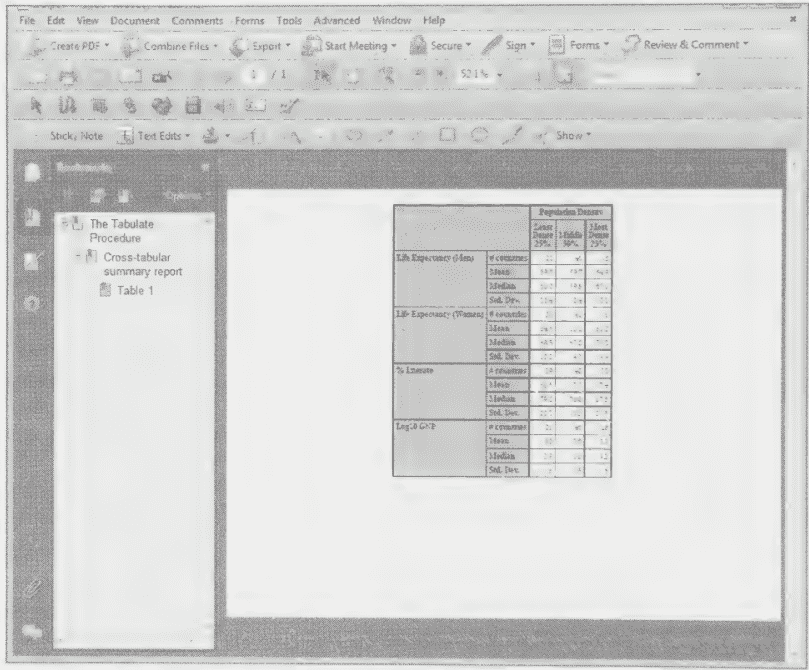

程序会生成一个 HTML 表格（`tab.html` 文件），如显示 4.12 所示。

### 显示 4.12 路由到 HTML 目标的数值统计摘要表

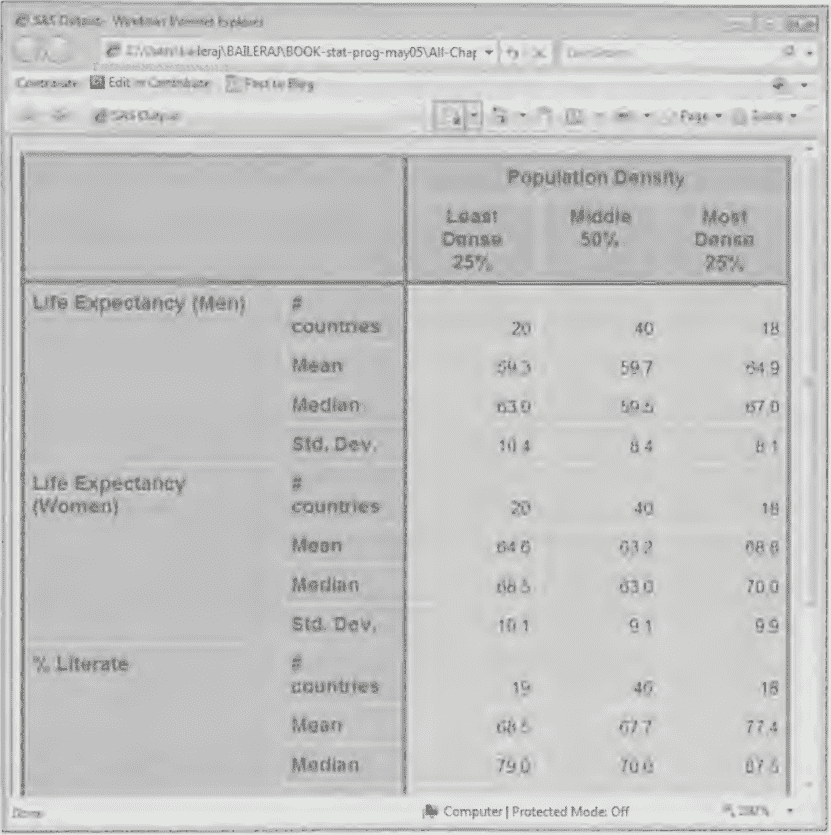

HTML 目标的一个很酷的用途是在网页的框架中显示输出对象，该框架包含输出对象的目录或索引。在显示 4.13 中，`FRAME`、`CONTENTS` 和 `BODY` 的规范创建了一个网页，其中包含针对国家数据集运行的三个过程（`UNIVARIATE`、`TABULATE` 和 `SGPlot`）的结果。注意：`RTF` 和 `PDF` 目标也可以创建目录。

### 显示 4.13 构建包含框架、目录和三个 SAS 过程输出的网页

```
/* using the COUNTRY data set constructed in DISPLAY 4.6 */

/* set up formats for the density categories */
proc format;
   value dfmt  1="Least Dense 25%"
               2="Middle 50%"
               3="Most Dense 25%";
run;

%let outdir = C:\Users\baileraJ.TT\Desktop;
ODS HTML path="&outdir"
         body = 'country-body.html'       /* Output objects      */
         contents = 'country-TOC.html'    /* Table of contents   */
         frame = 'country-frame.html'     /* organizes display   */
         newfile = NONE;                  /* all results to one file*/

title "country data analysis";

proc univariate data=country;  * calculate %tiles of density;
   var density;
   id name;
run;

proc tabulate data=country format=4.1;
   class density_cat;
   var lifemen lifewomn liter loggnp;
   format density_cat dfmt.;
   table (lifemen="Life Expectancy (Men)"
          lifewom="Life Expectancy (Women)"
          liter="% Literate" loggnp="Log10 GNP")*
         (n="# Countries" f=2. mean="Mean"
          median="Median" stddev="Std. Dev."),
         density_cat="Population Density";
run;

proc sgplot data=country;
   scatter x=liter y=lifewom;
   label lifewom="Life Expectancy (Women)";
   label liter="% Literacy in Population";
run;
ods html close;
```

网页的显示效果如显示 4.14 所示。

### 显示 4.14 浏览器中显示包含框架、目录以及三个 SAS 过程输出链接的网页

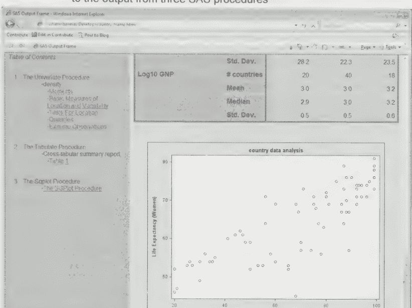

#### 4.4.3 生成的内容及如何选择

有些时候，你可能只想获取过程产生的部分结果。在本节中，你将学习如何确定过程产生了哪些输出对象，以及如何选择特定的表或输出对象。在以下示例中，生成了一个包含 20 个观测的数据集，其中在 `X=1, 2, ..., 10` 的每个值上有两个观测，且 `Y = 3 + 1.5 X + 2*ε`，其中 `ε ~ N(0,1)`。伪随机正态偏差生成器 `RAND` 使用了通过 `call streaminit (54321)` 指定的种子。（指定种子可以让你运行相同代码并复现结果。如果使用 `SEED=0`，则会基于午夜以来的时间生成种子，每次运行代码都会生成不同的数据集。）

```
call streaminit (54321)
```

数据是通过 `DATA` 步骤中的一些编程生成的。（这种编程将在后面的章节中详细介绍，但在这里作为一个有趣的示例。）`ODS RTF` 语句构建了一个包含 `PROC PRINT` 结果的表。

##### 显示 4.15 生成回归数据集的程序

```
data simreg;
  beta0 = 3; * Simulate Y ~ N( 3 + 1.5 X, sigma = 2 );
  beta1 = 1.5;
  sigma = 2;
  call streaminit(54321);
    do nobs = 1 to 2;
      do x = 1 to 10;
        y = beta0 + beta1*x + sigma*RAND('Normal');
        output;
      end;
    end;
run;

ods rtf bodytitle file="C:\Users\baileraj.IT\Desktop\Display-4.15.rtf";
proc print data=simreg;
run;
ods rtf close;
```

`beta0`、`beta1` 和 `sigma` 表示所模拟回归关系背后的参数。`x` 值是设计点，`y` 值是从 `Y | X ~ N(3 + 1.5 X, 2)` 中抽样得到的。该程序生成的数据集如显示 4.16 所示。

##### 显示 4.16 回归数据集的打印输出

| 观测 | beta0 | beta1 | sigma | nobs | x | y |
|---|---|---|---|---|---|---|
| 1 | 3 | 1.5 | 2 | 1 | 1 | 5.5791 |
| 2 | 3 | 1.5 | 2 | 1 | 2 | 6.3030 |
| 3 | 3 | 1.5 | 2 | 1 | 3 | 9.6061 |
| 4 | 3 | 1.5 | 2 | 1 | 4 | 12.7044 |
| 5 | 3 | 1.5 | 2 | 1 | 5 | 11.5614 |
| 6 | 3 | 1.5 | 2 | 1 | 6 | 13.7061 |
| 7 | 3 | 1.5 | 2 | 1 | 7 | 10.1580 |
| 8 | 3 | 1.5 | 2 | 1 | 8 | 16.6643 |
| 9 | 3 | 1.5 | 2 | 1 | 9 | 15.4080 |
| 10 | 3 | 1.5 | 2 | 1 | 10 | 18.8739 |
| 11 | 3 | 1.5 | 2 | 2 | 1 | 4.4572 |
| 12 | 3 | 1.5 | 2 | 2 | 2 | 3.4194 |
| 13 | 3 | 1.5 | 2 | 2 | 3 | 4.6856 |
| 14 | 3 | 1.5 | 2 | 2 | 4 | 9.1104 |
| 15 | 3 | 1.5 | 2 | 2 | 5 | 10.3865 |
| 16 | 3 | 1.5 | 2 | 2 | 6 | 12.7365 |
| 17 | 3 | 1.5 | 2 | 2 | 7 | 13.1883 |
| 18 | 3 | 1.5 | 2 | 2 | 8 | 14.3379 |
| 19 | 3 | 1.5 | 2 | 2 | 9 | 17.0808 |
| 20 | 3 | 1.5 | 2 | 2 | 10 | 17.6742 |

所需的 20 个观测已生成。想看看是否生成了回归结构，是不是很有趣？让我们研究一下，在 `ODS RTF` 上下文中调用 `PROC REG` 会创建哪些输出对象。例如：

```
ods rtf bodytitle file="C:\Users\baileraj.IT\Desktop\Display4.15.rtf";
proc reg data=simreg;
    model y = x;
run;
ods rtf close;
```

这段代码产生的输出如显示 4.17 所示。

##### 显示 4.17 在 ODS RTF 中包裹的 PROC REG 产生的四个输出表

|  | 20 |
|---|---:|
| **读取的观测数** | 20 |
| **使用的观测数** | 20 |

###### 方差分析

| 来源 | 自由度 | 平方和 | 均方 | F 值 | Pr > F |
|---|---|---:|---:|---:|---:|---:|
| 模型 | 1 | 364.69751 | 364.69751 | 119.14 | <.0001 |
| 误差 | 18 | 55.09776 | 3.06099 |  |  |
| 校正总和 | 19 | 419.79528 |  |  |  |

|---|---:|---|---:|
| **均方根误差** | 1.74957 | **R 方** | 0.8688 |
| **因变量均值** | 11.38204 | **调整 R 方** | 0.8615 |
| **变异系数** | 15.37129 |  |  |

###### 参数估计

| 变量 | 自由度 | 参数估计 | 标准误 | t 值 | Pr > \|t\| |
|---|---|---:|---:|---:|---:|---:|
| 截距 | 1 | 3.20517 | 0.84512 | 3.79 | 0.0013 |
| x | 1 | 1.48670 | 0.13620 | 10.92 | <.0001 |

可以看出，`PROC REG` 构造了四个输出对象。假设你想查看产生的输出对象的名称，并且正在考虑只选择部分输出。

`ODS` 命令可以枚举过程产生的所有表和输出对象。同时，`ODS` 命令也可以选择输出对象。在 SAS 在线文档中，`PROC REG` 部分包含一个 `ODS` 表名列表。例如，在 SAS 在线文档的 `PROC REG` 部分，列出了 `PROC REG` 产生的 `ODS` 表及其简短描述和选项。

##### 显示 4.18 PROC REG 产生的 ODS 表

| ODS 表名 | 描述 | 语句 | 选项 |
|---|---|---|---|
| ACovEst | 估计矩阵的一致协方差 | MODEL | ALL, ACOV |
| ACovTestANOVA | 使用 ACOV 估计进行 ANOVA 检验 | TEST | ACOV（MODEL 语句） |
| ANOVA | 模型 ANOVA 表 | MODEL | 默认 |
| ...（已删除） |  |  |  |
| NObs | 观测数 |  | 默认 |
| ...（已删除） |  |  |  |
| OutputStatistics | 输出统计表 | MODEL | ALL, CLI, CLM, INFLUENCE, P, R |
| PartialData | 部分回归杠杆数据 | MODEL | PARTIALDATA |
| ParameterEstimates | 模型参数估计 | MODEL | 默认 |
| ...（已删除） |  |  |  |

`ODS TRACE` 语句使你可以查看产生的所有输出对象的名称。`ODS SELECT` 和 `ODS EXCLUDE` 使你可以选择输出对象。`ODS TRACE` 列出特定程序中所有语句产生的输出对象。默认情况下，此信息列在 SAS 日志中。或者，你可以使用带 `ON /LISTING` 选项的 `ODS TRACE` 在 SAS 输出窗口中列出输出对象。

```
ods trace on /listing;
proc reg;
  model y = x;
run;
ods trace off;
```

这段代码生成的输出如显示 4.19 所示。

#### Display 4.19 PROC REG 输出，列出输出对象

The REG Procedure

Model: MODEL1

Dependent Variable: y

Output Added:

--------------

Name: NObs

Label: Number of Observations

Template: Stat.Reg.NObs

Path: Reg.MODEL1.Fit.y.NObs

--------------

Number of Observations Read 20

Number of Observations Used 20

Output Added:

--------------

Name: ANOVA

Label: Analysis of Variance

Template: Stat.REG.ANOVA

Path: Reg.MODEL1.Fit.y.ANOVA

--------------

Analysis of Variance

Source DF Sum of Squares Mean Square F Value Pr > F

Model 1 364.69751 364.69751 119.14 <.0001

Error 18 55.09776 3.06099

Corrected Total 19 419.79528

Output Added:

--------------

Name: FitStatistics

Label: Fit Statistics

Template: Stat.REG.FitStatistics

Path: Reg.MODEL1.Fit.y.FitStatistics

--------------

Root MSE 1.74957 R-Square 0.8688

Dependent Mean 11.38204 Adj R-Sq 0.8615

Coeff Var 15.37129

Output Added:

--------------

Name: ParameterEstimates

Label: Parameter Estimates

Template: Stat.REG.ParameterEstimates

Path: Reg.MODEL1.Fit.y.ParameterEstimates

--------------

Parameter Estimates

Variable DF Parameter Estimate Standard Error t Value Pr > |t|

Intercept 1 3.20517 0.84512 3.79 0.0013

X 1 1.48670 0.13620 10.92 <.0001

共产生四个输出对象——`NObs`、`ANOVA`、`FitStatistics` 和 `ParameterEstimates`。你可以使用 `ODS SELECT` 语句从 `PROC REG` 中选择特定的输出对象（例如，`ParameterEstimates`）。

```
ods select ParameterEstimates;
ods rtf bodytitle file="reg-est.rtf";
proc reg;
  model y = x;
run;
ods rtf close;
```

输出显示在 Display 4.20 中。

#### Display 4.20 使用 ODS SELECT 选择 ParameterEstimates

| Parameter Estimates |
| Variable | DF | Parameter Estimate | Standard Error | t Value | Pr > |t| |
| Intercept | 1 | 3.20517 | 0.84512 | 3.79 | 0.0013 |
| x | 1 | 1.48670 | 0.13620 | 10.92 | <.0001 |

注：之前的代码与以下 `ODS EXCLUDE` 语句的结果相同。

```
ods exclude NObs ANOVA FitStatistics;
ods rtf bodytitle file="reg-est.rtf";
proc reg;
  model y = x;
run;
ods rtf close;
```

#### 4.4.4 统计程序员应访问的另一个目标——OUTPUT

`OUTPUT` 目标使你能够基于 SAS 过程的输出对象构建 SAS 数据集。以下程序生成一组模拟线性回归数据，提取截距和斜率估计值，生成这些估计值的汇总统计量，并绘制估计值的散点图。

#### Display 4.21 生成一组回归数据、拟合模型并提取和绘制系数


```sas
data simreg;
    beta0 = 3;  * Simulate Y ~ N(3 + 1.5 X, sigma = 2);
    beta1 = 1.5;
    sigma = 2;
    call streaminit(54321);
    do iexpt = 1 to 2000;  * generate 2000 samples/experiments with 20 (x,y) observations;
        do nobs = 1 to 2;  * with 2 replicates at x=1 to 10 by 1;
            do x = 1 to 10;
                y = beta0 + beta1*x + sigma* RAND('Normal');
                output;
            end;
        end;
    end;
run;

proc print data=simreg;
title "first 2 experiments from the SIMREG data set";
    where iexpt<=2;
run;

ods output ParameterEstimates=ParmEst;
proc sort data=simreg;
    by iexpt;
run;
proc reg data=simreg;
    by iexpt;
    model y = x;
run;
ods output close;

proc print data=ParmEst;
title "first 2 experiments from the PARMEST data set";
    where iexpt<=2;
    var iexpt Variable Estimate;
run;
```

#### Display 4.21 （续）

```sas
data ParmEst2; set ParmEst;
retain b0;
if variable="Intercept" then b0 = estimate;
else do;
  b1 = estimate;
  keep iexpt b0 b1;
  output;
end;
run;

proc print data=ParmEst2;  * a nice debugging check;
title "first 5/last 5 lines from the PARMEST2 data set";
where iexpt <= 5 or iexpt >1995;
run;

ods listing image_dpi=300;
ods graphics / width=4.5in;
ods rtf bodytitle file="C:\Users\baileraj.IT\Desktop\Display-4.20.rtf";
proc means data=ParmEst2;
  title;
  var b0 b1;
run;
proc sgplot data=ParmEst2;
  scatter x=b1 y=b0;
  ellipse x=b1 y=b0;  * 95% confidence ellipse;
run;
ods graphics off;
ods rtf close;
```

让我们查看此分析中的代码和一些中间步骤。首先，浏览 SAS 日志：

```
NOTE: The data set WORK.SIMREG has 40000 observations and 7 variables.
NOTE: DATA statement used (Total process time):
  real time          0.20 seconds
  cpu time           0.04 seconds
```

生成了两千组 20 个 `(X,Y)` 观测值，因此 resulting 数据集 `SIMREG` 应包含 40000 个观测值。此外，`BETA0`、`BETA1`、`SIGMA`、`IEXPT` 和 `NOBS` 也包含在每个模拟数据集中，与主要感兴趣的 `X` 和 `Y` 变量一起。如果添加 `KEEP` 或 `DROP` 语句以消除除 `X` 和 `Y` 变量之外的所有变量，则会产生明显更小的数据集。

打印 `SIMREG` 的前 20 个观测值和两个模拟样本，以检查结构是否符合预期。以下代码生成输出，确认在预测变量 `X` 的每个 10 个值处都产生了两个观测值：

```sas
proc print data=simreg;
title " first 2 experiments from the SIMREG data set";
where iexpt<=2;
run;
```

`ODS OUTPUT` 选择从使用 `PROC REG` 拟合的 2000 个回归数据集提取参数估计值。使用以下代码显示输出到 `PARMEST` 数据集的前两个模拟样本的拟合：

```sas
proc print data=ParmEst;
title "first 2 experiments from the PARMEST data set";
where iexpt<=2;
var iexpt Variable Estimate;
run;
```

此代码产生以下输出：

| Obs | iexpt | Variable | Estimate |
| --- | ----- | -------- | -------- |
| 1 | 1 | Intercept | 3.89332 |
| 2 | 1 | x | 1.33037 |
| 3 | 2 | Intercept | 3.91362 |
| 4 | 2 | x | 1.25442 |

每个模拟样本导致一次基于 `PARMEST` 数据集的两行进行的模型拟合，该数据集显示与 `VARIABLE='INTERCEPT'` 相关的估计值作为 `b0`，与 `VARIABLE=X` 相关的估计值作为 `b1`。此 SAS 日志报告与 2000 次模型拟合相关的 4000 行输出。

```
NOTE: The data set WORK.PARMEST has 4000 observations and 9 variables.
```

需要 `DATA` 步编程来从一行中提取截距估计值并将其与每个模型拟合的下一行的斜率估计值配对。这是通过以下代码完成的：

```sas
data ParmEst2; set ParmEst;
retain b0;
if variable="Intercept" then b0 = estimate;
else do;
b1 = estimate;
keep iexpt b0 b1;
output;
end;
run;
```

`PARMEST` 的 4000 行按每组两行处理。第一行对应于截距，基于 `IF` 检查（`if variable="Intercept" then b0 = estimate;`）。该估计值不会立即写入数据集，因为需要将 `b0` 和 `b1` 估计值配对。`RETAIN` 语句在处理下一行时保留截距的值。有关 `RETAIN` 语句的更多信息，请参阅第 9 章。以下代码输出生成的数据集的前五行和最后五行：

```sas
proc print data=ParmEst2;  * a nice debugging check;
    title "first 5/last 5 lines from the PARMEST2 data set";
    where iexpt <= 5 or iexpt > 1995;
run;
```

输出与后续分析所需的数据结构相匹配。

| Obs | iexpt | b0 | b1 |
|---|---|---|---|
| 1 | 1 | 3.89332 | 1.33037 |
| 2 | 2 | 3.91362 | 1.25442 |
| 3 | 3 | 3.14595 | 1.47832 |
| 4 | 4 | 2.88033 | 1.52853 |
| 5 | 5 | 3.46571 | 1.46000 |
| 1996 | 1996 | 2.84155 | 1.42434 |
| 1997 | 1997 | 3.00608 | 1.42357 |
| 1998 | 1998 | 2.43907 | 1.57462 |
| 1999 | 1999 | 3.20998 | 1.33068 |
| 2000 | 2000 | 2.41439 | 1.55405 |

注：SAS 日志确认从 `PARMEST` 处理了 4000 个观测值，并在 `PARMEST2` 数据集中生成了 2000 个观测值。

```
NOTE: There were 4000 observations read from the data set WORK.PARMEST.
NOTE: The data set WORK.PARMEST2 has 2000 observations and 3 variables.
```

此时，你可以确信代码是正确的，现在可以专注于主要感兴趣的分析——探索简单线性回归中截距和斜率估计值的抽样分布。截距和斜率估计值的抽样分布以生成回归数据时设定的底层参数的值为中心。参见 Display 4.22。这并不令人惊讶，因为你知道这些估计值是无偏的。顺便说一下，当你将 2000 个模拟数据集上 `b1` 的观测标准差与 `s(b1)` 的值进行比较时，你看到了什么？它是否符合你的预期？

#### 显示 4.22 基于 2000 个模拟数据集的 b0 和 b1 的均值和标准差估计

| Variable | N | Mean | Std Dev | Minimum | Maximum |
|---|---|---|---|---|---|
| b0 | 2000 | 3.0110602 | 0.9475705 | -0.2508087 | 6.4559523 |
| b1 | 2000 | 1.5003800 | 0.1530830 | 1.0168710 | 2.0029585 |

入门回归课程会推导出斜率和截距估计是相关的（两个线性估计量的协方差）。你可以通过查看显示 4.23 中斜率和截距估计的图来经验地探索这一事实。

#### 显示 4.23 基于 2000 个模拟数据集的估计 b0 和 b1 的图

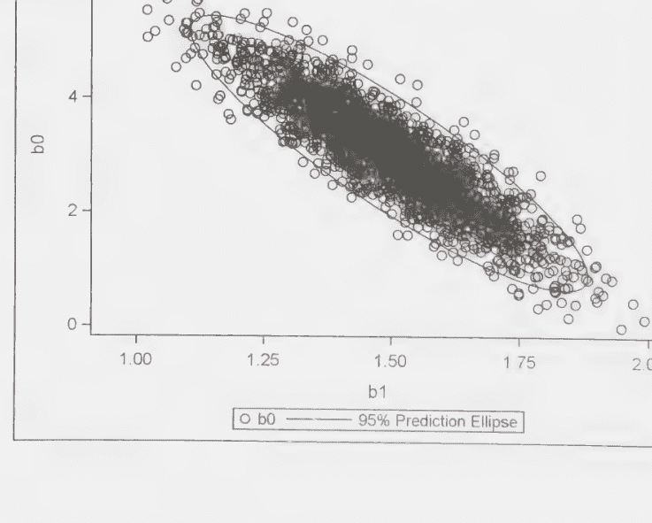

当截距和斜率均为正时，简单线性回归中截距估计与斜率估计之间存在负相关。这是一个很好的机会，可以翻出旧的回归书籍来确认。

### 4.5 摘要

在本章中，回顾了一种强大的程序——`PROC TABULATE`，用于构建汇总表。`ODS` 用于处理过程的输出，以便轻松纳入文档或在网页上显示。使用 `ODS` 中的 `OUTPUT` 目标生成数据集。虽然 `PROC TABULATE` 和 `ODS` 是在 SAS 中生成汇总的极其重要的工具，但 SAS 还有许多其他工具可用于准备报告，包括 `PROC REPORT`。如果您的工作需要您经常生成报告，那么您可能希望更详细地探索 `PROC REPORT`。

### 4.6 参考文献

Delwiche, Lora D., and Susan J. Slaughter. 2008. The Little SAS Book: A Primer, Fourth Edition. Cary, NC: SAS Institute Inc.

Gupta, Sunil. 2003. Quick Results with the Output Delivery System. Cary, NC: SAS Institute Inc.

Haworth, Lauren E., Cynthia L. Zender, Michele M. Burlew. 2009. Output Delivery System: The Basics and Beyond. Cary, NC: SAS Institute Inc.

Haworth, Lauren E. 2001. Output Delivery System: The Basics. Cary, NC: SAS Institute Inc.

Haworth, Lauren E. 1999. PROC TABULATE by Example. Cary, NC: SAS Institute Inc.

### 4.7 练习

- 1. 了解 `PROC TABULATE` 的最佳方法之一是使用玩具数据示例进行练习。尝试在运行过程之前预测每个表的結果。

```sas
options formdlim="-";
data junk;
    input group $ type $ var1 var2;
```

```sas
datalines;
a y 1 100
a y 2 102
a z 3 110
a z 4 112
b y 10 100i
b y 11 1011
b z 20 1200
b z 21 1210
;
run;
```

```sas
proc print data=junk;
run;
```

```sas
proc tabulate data=junk;
    var var1;
    class group type;
    table group*type,var1*mean;
run;
```

```sas
proc tabulate data=junk;
    var var1;
    class group type;
    table group,type*var1*mean;
run;
```

```sas
proc tabulate data=junk;
    var var1 var2;
    class group;
    table (var1 var2)*mean, group;
run;
```

```sas
proc tabulate data=junk;
    var var1 var2;
    class group;
    table (var1 var2)*(n mean), group;
run;
```

2. 在本练习中，重温第 3 章第 3.15 节中的健身数据。

- a. 生成以下每个变量的五数概括表：
  - `Age (years)`
  - `Oxygen intake rate (ml / kg body weight / minute)`
  - `Heart rate while resting`
  - `Heart rate while running (same time Oxygen rate measured)`
  - `Maximum heart rate recorded while running`
- b. 在表中为男性提供单独的汇总，分为 `Time to run 1.5 miles ≤ median time to run 1.5 miles (minutes)` 或 `Time to run 1.5 miles > median time to run 1.5 miles (minutes)`。
- c. 使用 `PROC TABULATE` 与 `ODS RTF` 生成该表。
- d. 针对这些变量比较两个健身组。

3. 使用 `ODS` 创建一个包含基于前一练习数据分析的图形的网页和 PDF 文件。

- a. 生成一组图，其中 Y 轴为 `time to run 1.5 miles (minutes)`，X 轴为以下每个数值变量：
  - `Age (years)`
  - `Oxygen intake rate (ml / kg body weight / minute)`
  - `Heart rate while resting`
  - `Heart rate while running (same time Oxygen rate measured)`
  - `Maximum heart rate recorded while running`
  - `Ratio of the heart rate while running to heart rate while resting`
- b. 将这组图放在一页纸上。提示：使用 `PROC SGSCATTER`。有关 `PROC SGSCATTER` 的更多信息，请参阅第 6 章。
打印网页的框架版本，应生成目录和正文。注意：这可能是您网页的显示。

4. 中心极限定理（CLT）提供了样本均值抽样分布的见解。非正式地说，CLT 指出，从具有有限均值和方差的分布中抽取的独立同分布（i.i.d.）随机变量之和的分布，随着样本量的增加会趋近于正态分布。这通常在口语中概括为“随着样本量的增加，样本均值看起来是正态的”。假设您从一个分布（例如，均匀分布）生成大量样本。您如何图形化地探索样本均值的抽样分布？

例如，以下代码生成 1500 个 25 个随机均匀偏差的样本。


## SAS 中的基本模型

- 5.1 建模概述
- 5.2 线性回归模型
- 5.3 ANOVA 模型—`PROC GLM` 用于单因素 ANOVA
- 5.4 ANOVA 模型—`PROC GLM` 用于具有两个或多个因素的 ANOVA 模型
- 5.5 摘要
- 5.6 参考文献
- 5.7 练习

第 3 章介绍了 SAS 用于生成分类变量和数值变量汇总的过程。第 4 章介绍了自定义输出和创建精美表格。在本章中，您将学习如何指定和拟合变量之间关系的模型。本章描述了研究单个连续变量与其他变量之间关系的 SAS 过程。介绍了用于预测连续响应变量作为一个或多个预测变量的线性函数的线性回归的 SAS 过程。描述了 ANOVA 模型的 SAS 过程。提供了这些统计方法的基本描述。

### 5.1 建模概述


SAS 提供了许多回归过程。这些包括用于构建正态分布响应的线性模型的过程（例如，`REG`、`GLM` 和 `MIXED`）、非正态回归模型（例如，`GENMOD`、`LOGISTIC`、`COUNTREG` 和 `GLIMMIX`）、非线性回归模型（例如，`NLIN` 和 `NLMIXED`）、失效时间模型（例如，`LIFEREG` 和 `PHREG`）以及其他回归方法（例如，`LOESS`、`ROBUSTREG`、`QUANTREG` 和 `TRANSREG`）。其他过程解决了时间序列数据分析（例如，`TSCSREG` 或 `ARIMA`）或结构方程（例如，`CALIS`）问题中的问题。一些通用建模过程使您能够拟合由一组微分方程定义模型（`MODEL`）。讨论这些过程中的统计方法是超出本章范围的。（对于一门统计课程而言，这也是超出范围的。）因此，本章强调了假设响应为正态分布的线性模型。给出了线性回归和基本 ANOVA 模型的一点统计背景。然后介绍用于解决这些任务的 SAS 过程。示例说明了 `PROC REG` 和 `PROC GLM` 的功能。本章无意替代回归课程中的建模介绍。然而，作为描述 SAS 中模型指定的背景，引入了一些基本的统计思想。Kutner 等人（2004）的一本良好的回归或线性模型书籍是本章的绝佳伴侣。此外，本章提供了模型是如何指定的一个示例。您应该能够在处理其他过程时进行概括。Muller 和 Fetterman（2002）提供了使用 SAS 拟合线性模型的广泛介绍。

## 5.2 线性回归模型

显示两个数值变量之间关系的最佳图形方法之一是散点图。（有关散点图的插图，请参阅第 3 章。）虽然一幅图胜过千言万语，但如果您想要生成预测并进行推断，您可能需要比一幅图更多的东西。那么，两个变量之间可能存在的最简单的关系是什么？一条线就是答案。虽然简单的方程 `Y = m X + b` 通常用于在代数中引入线性关系，但在统计建模中，尤其是在您有多个 X 变量时，简单的方程并不容易获得。因此，线性模型被重写为 `Y = β0 + β1 X`，其中斜率为 `β1` 而不是 `m`，y 截距为 `β0` 而不是 `b`。为了进一步使关系的统计建模复杂化，每个 X 值的 Y 值并不期望相同。换句话说，响应值预计是随机的而不是固定的。因此，一个项被添加到方程中以允许具有相同 X 值的响应变化，`Y = β0 + β1 X + ε`。在这个方程中，`ε` 代表随机误差项。`Y` 是响应变量（或因变量）。`X` 是预测变量（或自变量或协变量）。响应变量和预测变量配对是首选，因为它更好地反映了常见的

`situation that variables are often simultaneously measured in observational studies, and the assignment of one variable to Y and another to X can be arbitrary.` An index for each observation is often included in this equation (i.e., `Yᵢ = β₀ + β₁Xᵢ + εᵢ; i=1, ..., n`). A distribution is assumed for the random error term (`εᵢ ~ independent N(0, σ²)`). To find the best fitting line, select the values of the slope and y-intercept that minimize some criteria. The estimated regression coefficients that minimize the sum of squared errors (i.e., `Σ(Yᵢ − β₀ − β₁ Xᵢ)²`) for a predictor variable can be found using `PROC REG` or `PROC GLM`. These procedures can find weighted least squares criterion as well. Other criteria are found in `PROC ROBUSTREG`. Enough background, let’s look at an example.

### 5.2.1 Motorboats and manatees—a look at simple linear regression

For manatees that live in the Florida waterways, encounters with motorboats are a frequent cause of scarring at a minimum, and mortality at worst.¹ Data on motorboat registration and manatee deaths were recorded for years 1977 through 1990 and analyzed (Moore and McCabe (2003)). In the following example, three variables are entered: observation year (`YEAR`), number of motorboats registered in multiples of 1000 (`NBOATS`), and number of manatee deaths (`MANATEES`). `ODS` creates an RTF file for the output of the regression procedure. Additional ODS statements produce a high-quality image and request ODS Statistical Graphics. (For more information about ODS, see Chapter 6.) The code for entering the data and fitting a simple linear regression model (`MANATEES = β₀ + β₁ NBOATS + ε`) follows:

#### Display 5.1 Linear regression to predict manatee deaths as a function of motorboats registered

```
data manatee_deaths;
    input year nboats manatees @@;
    datalines;
77  447  13  78 460  21  79 481  24  80 498  16
81  513  24  82 512  20  83 526  15  84 559  34
85  585  33  86 614  33  87 645  39  88 675  43
89  711  50  90 719  47
;
run;

ODS RTF file="C:\Users\baileraj.IT\Desktop\linreg-output.rtf" bodytitle;
ods listing image dpi=300;
ods graphics / width=4.5in;
proc reg data=manatee_deaths;
    model manatees = nboats / p r cli clm;
    output out=man_pred p=yhat r=resid;
run;
```

> ¹ Manatee data set usage based on “Florida powerboats and manatee deaths, 1977 1990” data set from Moore, David S., and George P. McCabe. 2003. Introduction to the Practice of Statistics. 4th Ed. New York, NY: W. H. Freeman and Co.

#### Display 5.1 (continued)

```
proc sgplot data=man_pred;    * Y vs. X plot with;
  reg x=nboats y=manatees;    *   pred. reg. line and;
    loess x=nboats y=manatees; *   loess fit superimposed;
run;

proc sgplot data=man_pred;    * Y vs. X plot with;
  reg x=nboats y=manatees/cli; * pred. reg. line and;
run;                         * and conf/pred limits;

proc sgplot data=man_pred;
  loess x=yhat y=resid;       * residuals vs. predicted;
  refline 0 / axis=y;         * plot with e=0 reference;
run;
proc sgplot data=man_pred;
  histogram resid;            * histogram of residuals;
  density resid / type=normal; * with normal density;
run;
ods graphics off;
ODS RTF CLOSE;
```

Multiple years of data are entered on each input line. (Recall that `@@` signifies to continue reading a line of data even after all variables for an observation are read.) Then, `ODS` is invoked to direct output, and `PROC REG` is called to fit the model. With `PROC REG`, the `MODEL` statement is all that is required. The `MODEL` statement (`model manatees = nboats`) translates the linear regression model `MANATEES = β₀ + β₁ NBOATS + ε` into code, where the response variable is listed to the left of the equal sign and the predictor variables are listed to the right. In SAS, the default behavior is to always include an intercept in the model. If you want to exclude the intercept, then you need to state so explicitly as an option in the `MODEL` statement. (If you want to fit `MANATEES = β₁ NBOATS + ε`, then use the `MODEL` statement `model manatees = nboats/noint` to exclude the intercept.) The current `MODEL` statement (`model manatees = nboats / p r cli clm`) includes four options. The `p` option stands for predicted and is the fitted model prediction of manatee deaths for each `NBOATS` value in the data set. The `r` option stands for residual and is the difference between the observed number of manatee deaths and the predicted number of manatee deaths based on the fitted model. The `cli` option is the prediction interval for a new observation. The `clm` option is the confidence interval for the mean response.

Hint: The predicted values, confidence intervals, and prediction intervals are generated for values of the predictor variable in the data set. If you want them generated for X values not in the data set, add a hypothetical observation to your data set with X equal to the value of interest, and Y equal to missing (`.`). This observation does not contribute to the estimated intercept and slope. However, a predicted value, confidence interval for the mean, and prediction interval for a new observation are generated for X.

Let’s look at the fit of a linear relationship between the number of motorboats registered and the number of manatee deaths. `ODS` packages the regression results into tables—Analysis of Variance, Parameter Estimates, and Output Statistics—and into various plots. The Analysis of Variance table in Display 5.2 shows the analysis partitioning the total pool of variation into that which is explained by the regression model and that which is unexplained. Additional output in this table includes an estimate of the variance `σ²` (mean squared error=18.29), strength of linear association as measured by the coefficient of determination (`R-square`=0.89), and a hypothesis test for the significance of the predictor variables (`F value` for the test statistic and `Pr>F` for the p-value). Other output is given in this table, including the mean Y value for these data (`Dependent Mean`=29.43).

#### Display 5.2 Analysis of variance table and fit summary from fitting a line to predict manatee deaths from registered motorboats

|  | Analysis of Variance |  |  |  |  |

| Source | DF | Sum of Squares | Mean Square | F Value | Pr > F |

| Model | 1 | 1711.97866 | 1711.97866 | 93.61 | <.0001 |

| Error | 12 | 219.44991 | 18.28749 |  |  |

| Corrected Total | 13 | 1931.42857 |  |  |  |

| Root MSE | 4.27639 | R-Square | 0.8864 |

| Dependent Mean | 29.42857 | Adj R-Sq | 0.8769 |

| Coeff Var | 14.53141 |  |  |


The estimated regression coefficients are presented in the Parameter Estimates table in Display 5.3. The estimates of `β₀` and `β₁` are -41.4 and 0.12, respectively. This implies that the prediction equation for the number of manatee deaths is `MANATEES = b₀ + b₁ NBOATS = -41.43 + 0.12 NBOATS`. With each additional 1000 motorboats registered (`NBOATS` changes by 1), it is predicted that 0.12 additional manatee deaths would be observed. This is a case where you might consider interpreting change relative to a larger increase in the X direction. For example, with each additional 10000 motorboats registered (`NBOATS` changes by 10), it is predicted that 1 additional manatee death would be observed. The intercept does not make any sense here. It corresponds to a prediction of the number of manatees killed when `NBOATS=0`, a value that is well outside the scope of the model because the minimum value for `NBOATS` is 447. A more interpretable intercept can be obtained by rescaling the predictor variable. This is explored in the first problem in Section 5.7, “Exercises.”

### Display 5.3 Parameter estimates from fitting a line to predict manatee deaths from registered motorboats

|  | Parameter Estimates |  |  |  |  |

| Variable | DF | Parameter Estimate | Standard Error | t Value | Pr > |t| |

| Intercept | 1 | -41.43044 | 7.41222 | -5.59 | 0.0001 |

| nboats | 1 | 0.12486 | 0.01290 | 9.68 | <.0001 |

There is a lot more to regression modeling than obtaining a least squares fit. For example, checking model assumptions is presented at the end of this section. Suppose you want to report the results of your model fit to a decision maker. You need to make sure that you are aware of other potential explanations. For example, suppose the manatee population increased over the study period. In this case, the number of manatee deaths due to motorboats could increase as a result of more manatees being at risk, as opposed to how many registered motorboats there are. An alternative analysis might look at the rates of manatee deaths due to motorboats. In SAS, a Poisson regression model might be fit using `PROC GENMOD` with the number of manatee deaths as a response. In this case, the number of manatees is used to define an offset in the model, and the number of motorboats registered is still used as a predictor variable.

Display 5.4 was produced as a result of the options specified with the `MODEL` statement. (Another display including a plot of residuals and Cook’s D statistics was omitted.) The Dep Var column identifies the Y (`MANATEES`) variable for each observation. The Predicted Value column is the model prediction for that value at the associated X (`NBOATS`) variable. The Residual column is the difference between these quantities. The CL Mean and CL Predict columns are produced by the `CLM` and `CLI` options, respectively, in the `MODEL` statement. The values correspond to the confidence interval for the mean response and the prediction interval for a new response, respectively. Information about these columns and the last two columns are beyond the scope of this book. For more information, see the regression documentation.

#### 显示 5.4 残差分析，均值响应的置信区间和预测区间

| Obs | 因变量 海牛 | 预测值 | 均值预测标准误 | 95% CL 均值 下限 | 95% CL 均值 上限 | 95% CL 预测 下限 | 95% CL 预测 上限 | 残差 | 残差标准误 | Student 残差 |

|-----|------------------|-----------------|-------------------------|-------------------|-------------------|----------------------|----------------------|----------|--------------------|------------------|

| 1 | 13.0000 | 14.3827 | 1.9299 | 10.1779 | 18.5876 | 4.1604 | 24.6050 | -1.3827 | 3.816 | -0.362 |

| 2 | 21.0000 | 16.0059 | 1.7974 | 12.0896 | 19.9222 | 5.8989 | 26.1130 | 4.9941 | 3.880 | 1.287 |

| 3 | 24.0000 | 18.6280 | 1.5976 | 15.1472 | 22.1089 | 8.6816 | 28.5745 | 5.3720 | 3.967 | 1.354 |

| ... | ... | ... | ... | ... | ... | ... | ... | ... | ... | ... |

| 12 | 43.0000 | 42.8512 | 1.7974 | 38.9349 | 46.7675 | 32.7442 | 52.9582 | 0.1488 | 3.880 | 0.0383 |

| 13 | 50.0000 | 47.3462 | 2.1762 | 42.6048 | 52.0877 | 36.8917 | 57.8007 | 2.6538 | 3.681 | 0.721 |

| 14 | 47.0000 | 48.3451 | 2.2647 | 43.4109 | 53.2794 | 37.8018 | 58.8884 | -1.3451 | 3.628 | -0.371 |

显示 5.5 中的散点图是 ODS Graphics 和 `PROC REG` 默认生成的三个图形中的两个。第一个散点图包含拟合线、置信区间和预测限，以及汇总拟合统计量（例如，观测数、R-平方）。

#### 显示 5.5 散点图

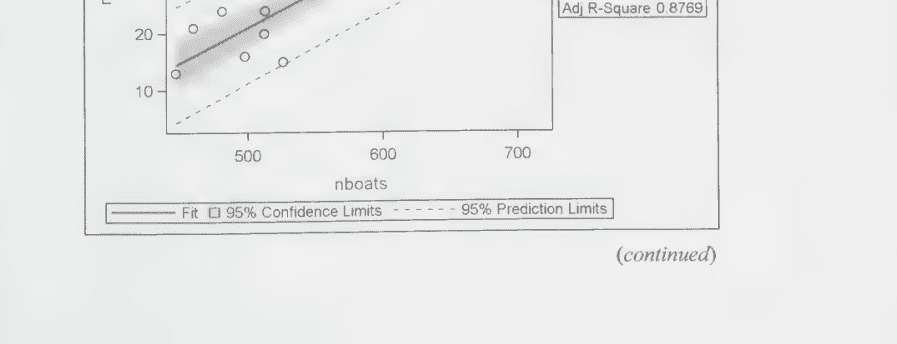

#### 显示 5.5 （续）

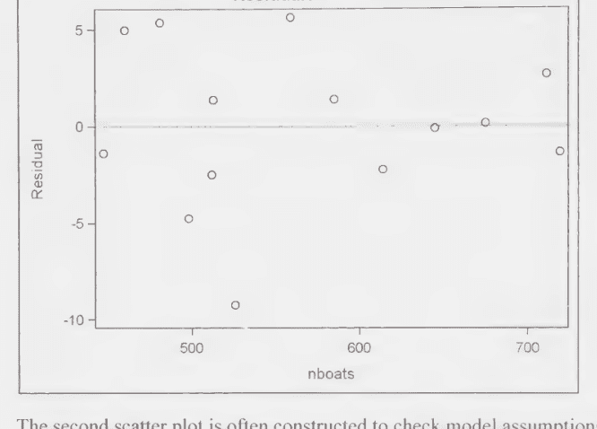

第二个散点图通常用于检查模型假设。模型的残差被绘制为预测变量 `NBOATS` 值的函数。

第三个图是显示 5.6 中显示的拟合诊断图。ODS Graphics 在第 6 章中有详细讨论。但是，本节中包含了一段简短的讨论，以展示 ODS Graphics 与 `PROC REG` 产生的上下文相关统计图形。

#### 显示 5.7A 海牛死亡数与注册机动船数（以 1000 为单位）的散点图，叠加回归线和 LOESS 拟合

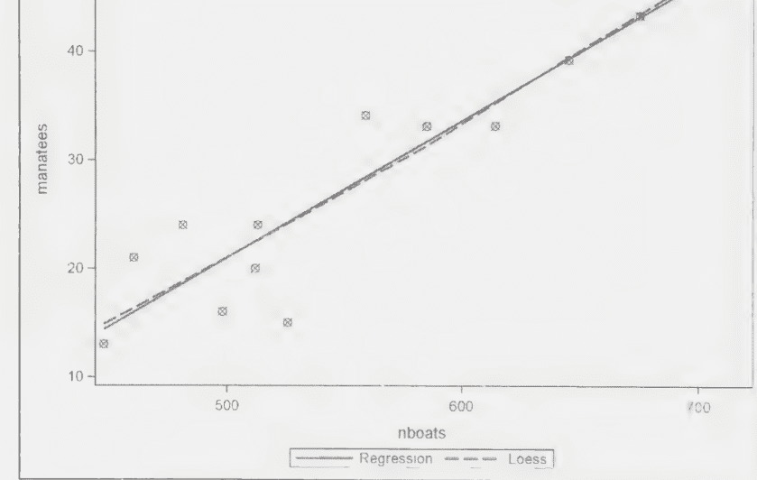

#### 显示 5.7C 具有预测线和置信及预测限的海牛死亡数散点图

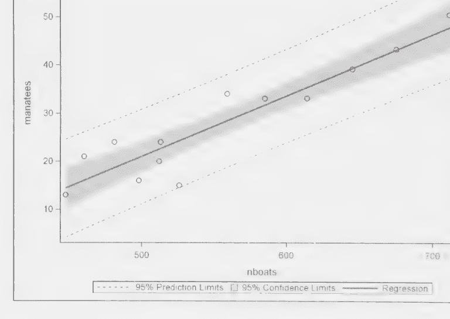

#### 显示 5.7D 残差直方图，叠加正态密度

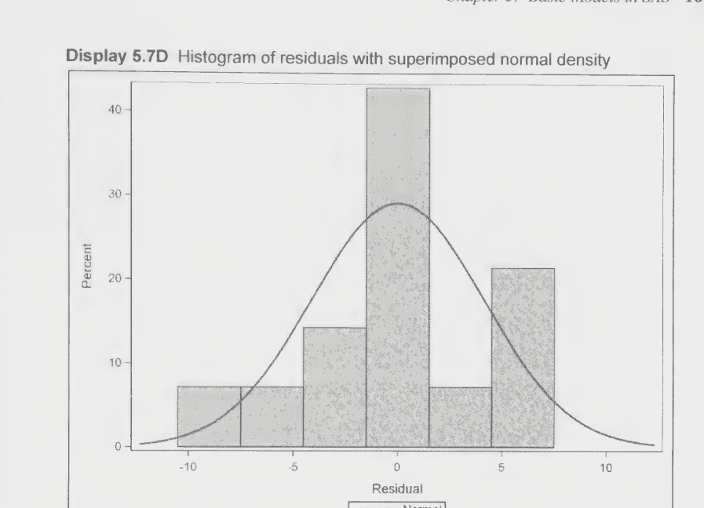

回归的自然扩展是考虑两个或多个预测变量与响应变量之间的关系。具有一个 Y（响应）变量和一个以上 X（预测）变量的模型称为多元回归模型。 （可能引起混淆的来源是该模型有时被称为多元模型。然而，这不是合适的描述。多元更好地描述了同时分析一个以上 Y 变量的情况。多元回归的更好描述是多变量模型。）以下是具有五个预测变量的多元回归问题的公式：

```
Y_i = β_0 + β_1 X_i1 + β_2 X_i2 + β_3 X_i3 + β_4 X_i4 + β_5 X_i5 + ε_i
```

该公式通常在抑制观测索引 i 的情况下书写。例如：

```
Y = β₀ + β₁ X₁ + β₂ X₂ + β₃ X₃ + β₄ X₄ + β₅ X₅ + ε
```

对于该模型，通常做出误差假设（例如，独立且正态分布，具有恒定方差）。从简单线性回归的自然推广来看，截距反映了所有预测变量同时为零时的预期响应。此外，与每个预测变量（`X₁`、`X₂`、`X₃`、`X₄`、`X₅`）相关联的系数（`β₁`、`β₂`、`β₃`、`β₄`、`β₅`）表示在所有其他变量保持不变的情况下，变量对响应的偏效应。

现在你对多元回归有一个快速概述，让我们来看一下为一个关于脑重与体重相关的问题指定多元回归模型。Lunneborg（1994）包含了一组数据，其中包含各种物种的平均脑重和平均体重，包括一些灭绝物种（在本例中为恐龙）。² 由于器官大小与身体大小之间的关系通常遵循幂律，`Y = αX^β`，可以考虑线性化变换。例如，`log(Y) = log(α) + β log(X)` 或 `Y* = β₀ + β₁ X* + ε`，其中 `β₀ = log(α)`，`β₁ = β`。`Y*=log(Y)`，且 `X*=log(X)`。隐含地，对数尺度上的加性误差意味着原始尺度上的乘性误差。

此时，模型是一个简单线性回归模型。在你分析的数据集中，`Y = log₁₀（脑重）` 且 `X = log₁₀（体重）`。你不会对恐龙通常被描述为身体庞大而大脑小的事实感到惊讶。因此，你可能希望允许恐龙具有与其他物种不同的模型。在显示 5.8 中显示的分析程序中，你拟合了一个模型，该模型假设哺乳动物和恐龙具有共同的截距和斜率。你拟合了第二个模型，该模型允许恐龙中 `log₁₀（脑重）` 与 `log₁₀（体重）` 之间的关系具有不同的截距但与其它物种相同的斜率。该第二个模型可以用以下公式表示：

```
log₁₀(brain weight)ᵢ = β₀ + β₁ log₁₀(body weight)ᵢ + β₂ I_dinoᵢ + εᵢ
```

或者，如果你真的喜欢用 Xs 和 Ys 表示模型，则第二个模型可以用以下公式表示：

```
Yᵢ = β₀ + β₁ X₁ᵢ + β₂ X₂ᵢ + εᵢ
```

`I_dino = 1` 表示 diplodocus、triceratops 或 brachiosaurus（该数据集中三个恐龙物种）。`I_dino = 0` 表示所有其他物种。在第一个模型中，共同截距和共同斜率，假设 `β₂=0`。在显示 5.8 中显示的程序中，数据作为程序的一部分读取。变量名在 `INPUT` 语句中指定，并且 `DATALINES` 语句用作 `DATA` 步编程语句与数据之间的分隔符。在 `DATA` 步中，构造了对应于脑重和体重 `log₁₀` 变换的变量。定义了一个指示变量 `IDINO`（为了纪念弗林斯通的爱宠）并指示该物种是否为恐龙。定义了一个新变量 `IDINOBOD`，它是 `IDINO` 和 `LOGBODY` 的乘积。`PROC PRINT` 提供了一个机会来查看指示变量是否定义正确以及变换后的权重是否构造正确。`PROC UNIVARIATE` 使你能够查看每个权重的单变量分布。两个 `PROC REG` 步拟合一个具有共同截距的模型和另一个具有恐龙独特截距的模型。`ODS` 用于构造该程序输出的 RTF 版本。输出的每个部分都是一个独立的表，可以在报告（甚至书籍章节）中进行操作。

#### 显示 5.8 多元回归拟合幂模型

```
data mrexample;
* Lunneborg (1994) - body weight brain example;
input species $ bodywgt brainwt @@;

logbody = log10(bodywgt);      * transform the body and brain weights;
logbrain = log10(brainwt);

idino = 0;                     * define the indicator of dinosaurs;
if (species="diplodoc" or species="tricerat" or species="brachios") then
    idino=1;
idino bod = idino*logbody;

datalines;
beaver        1.35   8.1      cow          465.   423.    wolf         36.33  119.5
goat          27.66 115.     guipig       1.04  5.5     diplodocus   11700. 50.
asielephant   2547. 4603.    donkey       187.1 419.    horse        521.   655.
potarm monkey 10.   115.     cat          3.30 25.6    giraffe      529.   680.
gorilla       207.  406.     human        62.   1320.   afrelephant  6654.  5712.
triceratops   9400. 70.      rhemonkey    6.8   179.    kangaroo     35.    56.
hamster       0.12  1.       mouse        0.023 0.4    rabbit       2.5    12.1
sheep         55.50 175.     jaguar       100.  157.    chimp        52.16  440.
brachiosaurus 87000. 154.5    rat          0.28  1.9    mole         0.122  3.
pig           192.0 180
;
run;

ODS RTF file='D:\baileraj\SAS-Book\SAS-programs\mreg-output.rtf';
```

#### Display 5.8 *(continued)*

```
proc print data=mrexample;       * check to see if indicators properly defined;

   title 'brain wt - body wt data';

run;
```


```sas
proc univariate data=mrexample;   * descriptive statistics for these data;

   var bodywt brainwt;

   id species;

run;

proc reg data=mrexample;          * simple linear regression - same slope/intercept;

   title2 'allometric scaling - brain and body wt. ';

   title3 ' [All species combined] ';

   model logbrain=logbody;

run;

proc reg data=mrexample;          * different intercepts;

   title2 'Dinosaurs fitted with potentially different INTERCEPTS';

   model logbrain=logbody idino;

run;

ODS RTF CLOSE;
```

Display 5.9 中 `PROC PRINT` 的（编辑后）输出表明，指示变量对三种恐龙物种已正确定义。`SPECIES` 变量的值被截断了。为什么会这样？你会如何修复这个问题？**提示：**回顾第 2 章。

#### Display 5.9 数据集的打印输出

| Obs | species | bodywt | brainwt | logbody | logbrain | idino | idinobod |
|---:|---|---:|---:|---:|---:|---:|---:|
| 1 | beaver | 1.35 | 8.1 | 0.13033 | 0.90849 | 0 | 0.00000 |
| 2 | cow | 465.00 | 423.0 | 2.66745 | 2.62634 | 0 | 0.00000 |
| ... |  |  |  |  |  |  |  |
| 6 | diplodoc | 11700.00 | 50.0 | 4.06819 | 1.69897 | 1 | 4.06819 |
| 7 | asieleph | 2547.00 | 4603.0 | 3.40603 | 3.66304 | 0 | 0.00000 |
| ... |  |  |  |  |  |  |  |
| 15 | afreleph | 6654.00 | 5712.0 | 3.82308 | 3.75679 | 0 | 0.00000 |
| 16 | tricerat | 9400.00 | 70.0 | 3.97313 | 1.84510 | 1 | 3.97313 |
| 17 | rhemonkey | 6.80 | 179.0 | 0.83251 | 2.25285 | 0 | 0.00000 |
| ... |  |  |  |  |  |  |  |
| 24 | chimp | 52.16 | 440.0 | 1.71734 | 2.64345 | 0 | 0.00000 |

#### Display 5.9 (continued)

| Obs | species | bodywt | brainwt | logbody | logbrain | idino | idinobod |
|---|---|---|---|---|---|---|---|
| 25 | brachios | 87000.00 | 154.5 | 4.93952 | 2.18893 | 1 | 4.93952 |
| 26 | rat | 0.28 | 1.9 | -0.55284 | 0.27875 | 0 | 0.00000 |
| 27 | mole | 0.12 | 3.0 | -0.91364 | 0.47712 | 0 | 0.00000 |
| 28 | pig | 192.00 | 180.0 | 2.28330 | 2.25527 | 0 | 0.00000 |

`PROC UNIVARIATE` 的输出表明，恐龙在体重测量尺度上最为极端，但在脑重测量尺度上并不在前五名。使用 `ID SPECIES` 与 `PROC UNIVARIATE` 结合在检查极端观测值相关的输出时尤其有帮助。

#### Display 5.10 与体重和脑重变量相关的极端观测值

| 体重 - 极端观测值 |
| 最低 | | | 最高 | | |
| Value | species | Obs | Value | species | Obs |
| 0.023 | mouse | 20 | 2547 | asieleph | 7 |
| 0.120 | hamster | 19 | 6654 | afreleph | 15 |
| 0.122 | Mole | 27 | 9400 | tricerat | 16 |
| 0.280 | Rat | 26 | 11700 | diplodoc | 6 |
| 1.040 | guipig | 5 | 87000 | brachios | 25 |

| 脑重 - 极端观测值 |
| 最低 | | | 最高 | | |
| Value | species | Obs | Value | species | Obs |
| 0.4 | mouse | 20 | 655 | horse | 9 |
| 1.0 | hamster | 19 | 680 | giraffe | 12 |
| 1.9 | Rat | 26 | 1320 | human | 14 |
| 3.0 | mole | 27 | 4603 | asieleph | 7 |
| 5.5 | guipig | 5 | 5712 | afreleph | 15 |

公共截距和斜率模型（即 log₁₀(脑重)ᵢ = β₀ + β₁ log₁₀(体重)ᵢ + εᵢ）的拟合结果显示在 Display 5.11 中。

#### Display 5.11 假设相同关系拟合异速生长回归模型以预测脑重

|  | 方差分析 |  |  |  |
| Source | DF | Sum of Squares | Mean Square | F Value | Pr > F |
| Model | 1 | 17.81230 | 17.81230 | 40.26 | <.0001 |
| Error | 26 | 11.50305 | 0.44242 |  |  |
| Corrected Total | 27 | 29.31535 |  |  |  |
| Root MSE | 0.66515 | R-Square | 0.6076 |
| Dependent Mean | 1.92195 | Adj R-Sq | 0.5925 |
| Coeff Var | 34.60816 |  |  |

|  | 参数估计 |  |  |  |
| Variable | DF | Parameter Estimate | Standard Error | t Value | Pr > |t| |
| Intercept | 1 | 1.10958 | 0.17942 | 6.18 | <.0001 |
| logbody | 1 | 0.49599 | 0.07817 | 6.35 | <.0001 |

具有恐龙不同截距的模型（即 log₁₀(脑重)ᵢ = β₀ + β₁ log₁₀(体重)ᵢ + β₂ I_dinoᵢ + εᵢ）的拟合结果显示在 Display 5.12 中。

#### Display 5.12 假设不同截距拟合异速生长回归模型以预测脑重

| 方差分析 |
| Source | DF | Sum of Squares | Mean Square | F Value | Pr > F |
| Model | 2 | 26.95668 | 13.47834 | 142.86 | <.0001 |
| Error | 25 | 2.35867 | 0.09435 |  |  |
| Corrected Total | 27 | 29.31535 |  |  |  |
| Root MSE | 0.30716 | R-Square | 0.9195 |
| Dependent Mean | 1.92195 | Adj R-Sq | 0.9131 |
| Coeff Var | 15.98167 |  |  |

| 参数估计 |
| Variable | DF | Parameter Estimate | Standard Error | t Value | Pr > |t| |
| Intercept | 1 | 0.93879 | 0.08465 | 11.09 | <.0001 |
| logbody | 1 | 0.74855 | 0.04428 | 16.90 | <.0001 |
| idino | 1 | -2.26674 | 0.23024 | -9.84 | <.0001 |

从这些拟合结果来看，允许恐龙具有不同的截距会带来更好的拟合。特别是，与该项相关的系数显著不同于零。参见 `IDINO` 的检验。残差误差从 0.442 降低到 0.094。决定系数从 0.61 增加到 0.92。模型表明，对于所有非恐龙，预测的 log10(脑重)i = 0.93879 + 0.74855 log10(体重)i。对于恐龙，预测的 log10(脑重)i = 0.93879 + 0.74855 log10(体重)i - 2.26674。或者，对于恐龙，预测的 log10(脑重)i = -1.32795 + 0.74855 log10(体重)i。公共截距和不同截距模型的预测 log10(脑重)作为数据集 `mreexample2` 的一部分生成，如 Display 5.13 所示。数据与来自每个模型的预测一起绘制。

#### Display 5.13 生成 log₁₀(脑重) 与 log₁₀(体重) 的散点图并显示不同拟合

```sas
data mreexample;
* Lunneborg (1994) - body weight brain example;
input species $ bodywt brainwt @@;

logbody = log10(bodywt);      * transform the body and brain weights;
logbrain = log10(brainwt);

idino = 0;                    * define the indicator of dinosaurs;
if (species="diplodoc" or species="tricerat" or species="brachios") then
    idino=1;
idino bod = idino*logbody;

datalines;
beaver      1.35   8.1     cow      465.   423.    wolf      36.33  119.5
goat        27.66  115.    guipig   1.04   5.5    diplodocus 11700. 50.
asielephant 2547.  4603.   donkey   187.1  419.   horse     521.   655.
potormonkey 10.    115.    cat      3.30   25.6   giraffe   529.   680.
gorilla     207.   406.    human    62.    1320.  afrelephant 6654. 5712.
triceratops 9400.  70.     rhemonkey 6.8   179.   kangaroo   35.    56.
hamster     0.12   1.      mouse    0.023  0.4    rabbit    2.5    12.1
sheep       55.50  175.    jaguar   100.   157.   chimp     52.16  440.
brachiosaurus 87000. 154.5  rat      0.28   1.9    mole      0.122  3.
pig         192.0  180
;
run;

data mreexample2;
set mreexample;
same_int_fit = 1.10958 + 0.49599*logbody;
reg_fit = 0.93879 + 0.74855*logbody-2.26674*idino;
run;

proc format;
value dinof 0="Mammal"
            1="Dinosaur";
run;

ods listing image dpi=300;
ods graphics on / reset=all width=4.5in;
proc sgplot data=mreexample2;  * same intercept fit;
scatter x=logbody y=logbrain / group=idino;
series x=logbody y=same_int_fit;
format idino dinof.;
run;

proc sgplot data=mreexample2;  * different intercept fit;
scatter x=logbody y=logbrain / group=idino;
series x=logbody y=reg_fit / group=idino;
format idino dinof.;
run;

proc glm data=mrexample;
class idino;
model logbrain = idino logbody;
format idino dinof.;
run;
```

定义了一个格式以区分恐龙和哺乳动物。该格式用于分组变量。具有公共截距和公共斜率模型拟合的数据显示在 Display 5.14 中。

#### Display 5.14 log₁₀(脑重) 与 log₁₀(体重) 的散点图，拟合来自公共截距和公共斜率模型

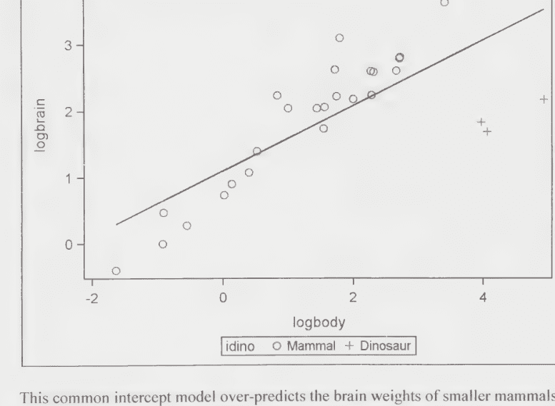

该公共截距模型高估了小型哺乳动物和恐龙的脑重，并低估了大型哺乳动物的脑重。在 Display 5.15 中，你可以确定是否可以通过不同的截距来解决这个问题。

#### Display 5.15 散点图显示 log₁₀(脑重) 与 log₁₀(体重) 的关系，并拟合自不同截距和共同斜率模型

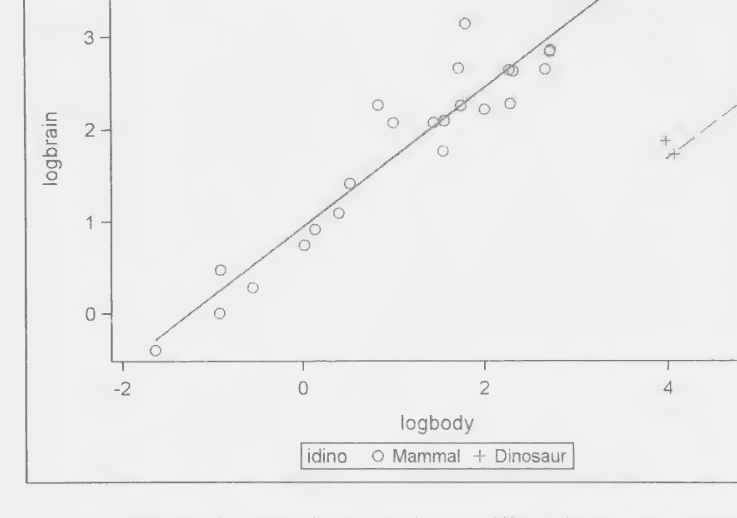

最后两个散点图强烈表明不同截距模型更优。

先前的分析包含了一个连续预测变量（体重）和一个定性预测变量（恐龙）。在分析中，假设恐龙和非恐龙的 log(脑重) 与 log(体重) 之间存在共同的线性关系。但关系可能在组间不同（在本例中，在恐龙和非恐龙之间）。这种类型的分析有时称为协方差分析（ANCOVA），其中响应（log(脑重)）在调整重要协变量（log(体重)）后在组间进行比较。

你可能想考虑如何进行等斜率检验。如果有一个名为 `DSN` 的数据集，其中包含名为 `RESPONSE` 的响应变量、名为 `GROUP` 的分类变量和名为 `X` 的协变量，则等斜率检验可使用 `PROC GLM` 构建。以下语句执行此检验：

```sas
proc glm data=DSN;
    class GROUP;
    model RESPONSE = X GROUP  X*GROUP;
run;
```

（参见与 `X*GROUP` 分量相关的检验。）事实上，Display 5.13 中的 `PROC GLM` 步骤使用 `IDINO` 作为分类变量执行此检验。在前面的语句中，添加 `ODS Graphics` 语句会产生类似于 Display 5.15 的图形。

### 5.3 ANOVA 模型——`PROC GLM` 用于单因素方差分析

在实验研究中，比较不同处理或不同总体之间的平均响应通常是重点。这些模型中分析的数据来自 g 个不同总体的随机样本，或将 g 种处理中的一种随机分配给样本中的实验单元。假设不同组具有可比的变异性，g 组均值相等的原假设检验（即 H₀: μ₁ = ... = μ_g）可使用 F 检验进行检验，该检验检验组间变异相对于组内变异的比率。（参见 Kutner et al. (2004) 对 ANOVA 模型检验及相关主题的讨论。）（回想一下 g=2 对应于熟悉的 t 检验，在本例中为合并方差版本。）第 i 组第 j 个观测值的响应模型（i=1,2,...,g（处理或总体），j=1,2,...,n_i（重复），Y_ij）是单元均值模型（Y_ij = μ_i + ε_ij）。该模型可以写成效应编码模型的形式 Y_ij = μ + α_i + ε_ij，其中 μ 的解释取决于 α_i 的编码。例如，如果 α_g =0，则 μ 对应于第 g 组（参考单元编码）的均值。如果 Σ α_i=0，则 μ 对应于总体均值。（有关更多信息，请参阅第 5.7 节“练习”中的问题 3。）与回归模型一样，ε_ij ~ 独立 N(0, σ²)。

#### 5.3.1 使用单因素方差分析模型比较不同包装条件下细菌生长

很容易达成共识，包装肉类中应抑制细菌生长。可能是不同的包装条件提供不同程度的抑制细菌生长。在 Display 5.16 所示的示例中，检查了 Kuehl (1994) 描述和分析的数据。¹ 不同包装（塑料、真空、混合和 CO₂）的 g=4 的平均 log-细菌生长情况描述如下，每个包装类型有 nᵢ=3 个重复。

##### Display 5.16 拟合单因素方差分析模型


```sas
/* Bacteria in meat under 4 different conditions */
options ls = 75;
data meat;
    input condition $ logcount @@;
datalines;
Plastic    7.66    Plastic    6.98    Plastic    7.80
Vacuum     5.26    Vacuum     5.44    Vacuum     5.80
Mixed      7.41    Mixed      7.33    Mixed      7.04
Co2        3.51    Co2        2.91    Co2        3.66
;
run;

title "bacteria growth under 4 packaging conditions";

ODS RTF file='C:\Users\baileraj.IT\Desktop\oneway-output.rtf';
ods listing image dpi=300;
ods graphics on / width=4.5in;
proc sgplot data=meat;          * graphical comparisons;
    vbox logcount / category=condition;
run;

proc glm data=meat order=data plot(unpack)=diagnostics;
    title2 "fitting the one-way anova model via GLM";
    class condition;
    model logcount = condition;
    means condition / bon tukey scheffe cldiff lines;
    lsmeans condition / cl pdiff;
    lsmeans condition / cl pdiff adjust=Tukey;
    contrast 'plastic vs. rest' condition 3 -1 -1 -1;
    output out=new p=yhat r=resid stdr=eresid;
run;

proc sgplot data=new;          * plots for model checking;
    title2 "residual analyses";
    scatter x=yhat y=resid;
    refline 0 / axis=y;
run;

proc univariate data=new noprint;
    histogram resid / normal;
    qqplot resid / normal;
run;
ods graphics off;

ODS RTF CLOSE;
```

³ 肉类数据集使用基于 Kuehl, R. O. Statistical Principles of Research Design and Analysis. 1st Ed. © 1994. Brooks/Cole, a part of Cengage Learning, Inc. ISBN: 9780534188047(0534188044) 的“肉类细菌生长”数据集。

在示例中，使用 `PROC SGPLOT` 的 `VBOX` 语句生成的并排箱线图创建了四个组中响应的图形显示。`VBOX` 语句标识响应变量 `LOGCOUNT` 和标识不同组的变量 `CONDITION`。

#### Display 5.17 不同包装条件下 `log`-细菌生长的并排箱线图

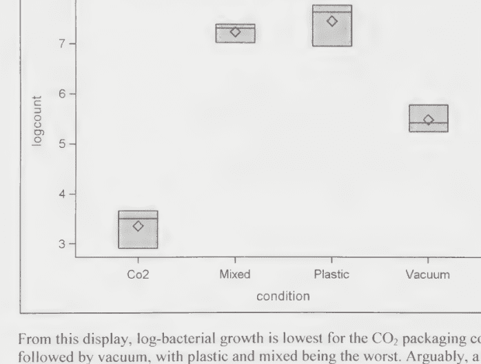

从该显示中，`log`-细菌生长在 CO₂ 包装条件下最低，其次是真空，塑料和混合最差。可以说，箱线图在每组仅有三个观测值时不是很有信息量。然而，该箱线图对于提供适用于重复次数更大的实验的示例非常有用。

`PROC GLM` 请求对四个组之间的均值相等性进行检验，并请求一系列相关分析。`GLM` 是广义线性模型的缩写，其中包括先前描述的回归分析和 ANOVA 模型。广义线性模型通常简称为线性模型。如果您期望的是广义线性模型，`GLM` 可能是令人困惑的过程名称，该模型在 SAS 中使用 `PROC GENMOD` 实现。作为 `PROC GLM` 语句的一部分，使用 `plot(unpack)=diagnostics` 包含诊断图请求。这将在下一章中更详细地讨论。然而，值得一提的是，因为 ANOVA 模型的拟合

```
plot(unpack)=diagnostics
```

#### Display 5.18B 细菌生长 ANOVA 模型拟合的残差直方图，叠加正态密度和核密度

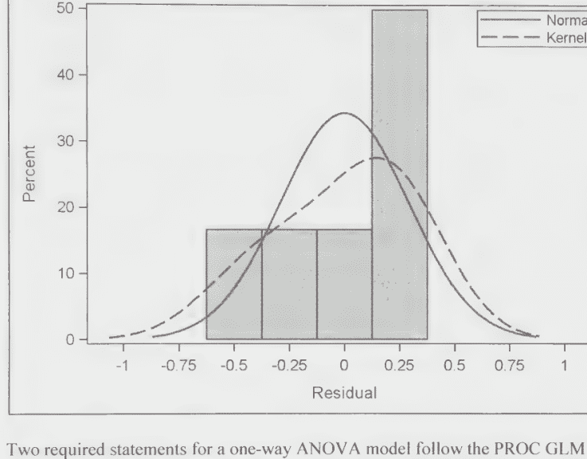

单因素方差分析模型的两个必需语句在 `PROC GLM` 语句之后。`CLASS` 语句标识包含组变量水平的变量。`GLM` 的 `MODEL` 语句类似于 `REG` 的 `MODEL` 语句（特别是语句的形式为：`响应变量 = 预测变量或组变量`）。在 `PROC GLM` 中分析的数据描述如 Display 5.19 所示。

#### Display 5.19 ANOVA 模型结果的包装汇总

| Class Level Information |  |  |
|---|---|---|
| Class | Levels | Values |
| `condition` | 4 | Plastic Vacuum Mixed Co2 |

Number of observations: 12

此信息描述了组变量的水平。这是一个很好的地方来查看输入数据集中的印刷错误。水平条目的拼写错误将导致超过 `g=4` 个水平。例如，如果 `C02`（C-零-二）被输入一个观测值，而 `Co2`（C-oh-two）也被输入两个案例，则表中会有 `g=5` 个水平。观测总数已注明。`PROC FREQ` 的 `CONDITION` 水平表也可以用于检查这一点。

`PROC GLM` 包含两个选项：一个标识输入数据集的选项和 `order=data` 选项。包装按塑料、真空、混合和 CO₂ 的顺序输入。如果没有 `ORDER` 选项，SAS 会在 `PROC GLM` 中进行内部字母排序，这将对 `CONTRAST` 等语句产生影响。特别是，内部字母排序会将 CO₂（编码为 `Co2`）分配为第一个水平，`Mixed` 为第二个水平，`Plastic` 为第三个水平，`Vacuum` 为第四个水平。

Display 5.20 显示了 `g=4` 组均值相等的检验。在分析中，四个包装条件下平均 `log`-细菌计数相同的原假设被拒绝，适用于任何通常选择的显著性水平（F(3,8)=94.58, P<0.0001）。该检验及其相关 p 值连同 ANOVA 表、描述性统计（总体均值、变异系数）和两个额外的检验表一起呈现。Type I 和 Type III 表在不平衡数据的多因素 ANOVA 模型背景下更有意义。

#### Display 5.20 ANOVA 表结果：比较不同包装的平均对数细菌生长

| Source | DF | Sum of Squares | Mean Square | F Value | Pr > F |
|---|---|---:|---:|---:|---:|
| Model | 3 | 32.87280000 | 10.95760000 | 94.58 | <.0001 |
| Error | 8 | 0.92680000 | 0.11585000 |  |  |
| Corrected Total | 11 | 33.79960000 |  |  |  |

| R-Square | Coeff Var | Root MSE | `logcount` Mean |
|---:|---:|---:|---:|
| 0.972580 | 5.768940 | 0.340367 | 5.900000 |

| Source | DF | Type I SS | Mean Square | F Value | Pr > F |
|---|---:|---:|---:|---:|---:|
| `condition` | 3 | 32.87280000 | 10.95760000 | 94.58 | <.0001 |

| Source | DF | Type III SS | Mean Square | F Value | Pr > F |
|---|---:|---:|---:|---:|---:|
| `condition` | 3 | 32.87280000 | 10.95760000 | 94.58 | <.0001 |

`MODEL` 语句之后紧跟的语句（`means condition / bon tukey scheffe cldiff lines`）请求对包装条件进行成对比较。虽然 SAS 提供了许多多重比较程序，但本例中仅调用了三种程序——Bonferroni（`bon`）、Tukey（`tukey`）和 Scheffe（`scheffe`）。`cldiff` 请求包装条件之间成对差异的置信区间。`lines` 请求比较所有均值差异结果的图形显示。对于 `tukey`，`cldiff` 生成 Display 5.21。

#### Display 5.21 Tukey ANOVA 表结果，指定 `CLDIFF`

NOTE: This test controls the Type I experimentwise error rate.

- Alpha: 0.05
- Error Degrees of Freedom: 8
- Error Mean Square: 0.11585
- Critical Value of Studentized Range: 4.52880
- Minimum Significant Difference: 0.89

Comparisons significant at the 0.05 level are indicated by `***`

| condition Comparison | Difference Between Means | Simultaneous 95% Confidence Limits | Significance |
|---|---|---:|---:|---:|
| Plastic - Mixed | 0.2200 | -0.6700, 1.1100 |  |
| Plastic - Vacuum | 1.9800 | 1.0900, 2.8700 | `***` |
| Plastic - Co2 | 4.1200 | 3.2300, 5.0100 | `***` |
| Mixed - Plastic | -0.2200 | -1.1100, 0.6700 |  |
| Mixed - Vacuum | 1.7600 | 0.8700, 2.6500 | `***` |
| Mixed - Co2 | 3.9000 | 3.0100, 4.7900 | `***` |
| Vacuum - Plastic | -1.9800 | -2.8700, -1.0900 | `***` |
| Vacuum - Mixed | -1.7600 | -2.6500, -0.8700 | `***` |
| Vacuum - Co2 | 2.1400 | 1.2500, 3.0300 | `***` |
| Co2 - Plastic | -4.1200 | -5.0100, -3.2300 | `***` |
| Co2 - Mixed | -3.9000 | -4.7900, -3.0100 | `***` |
| Co2 - Vacuum | -2.1400 | -3.0300, -1.2500 | `***` |

Tukey 多重比较程序的 `LINES` 语句产生了 Display 5.22 所示的输出。

#### Display 5.22 Tukey ANOVA 表结果，指定 `LINES`

Means with the same letter are not significantly different

| Tukey Grouping | Mean | N | `condition` |
|---|---:|---:|---|
| A | 7.4800 | 3 | Plastic |
| A | 7.2600 | 3 | Mixed |
| B | 5.5000 | 3 | Vacuum |
| C | 3.3600 | 3 | Co2 |

Display 5.21 和 5.22 都显示，CO₂ 包装条件的平均对数细菌生长显著低于真空包装，而真空包装又显著低于塑料或混合包装。这一事实在 Display 5.21 中得以体现，因为用于成对差异的均值比较的置信区间不包含零。在 Display 5.22 中，这一事实通过不同组别关联的不同字母（A、B 和 C）得以体现。

`MEANS` 语句之后有两个语句，`lsmeans condition / cl pdiff` 和 `lsmeans condition / cl pdiff adjust=Tukey`。这些语句请求不同组的均值，请求每个组中均值响应的置信区间（使用合并方差估计）和均值差异的置信区间，并请求均值相等成对检验的 p 值矩阵。第二个 `LSMEANS` 语句对比较应用了 Tukey 多重比较调整。这两个语句的输出显示在 Display 5.23 中。毫不奇怪，Tukey 调整后的 p 值更大，与未调整的对应值相比，同时置信区间更宽。也可以指定其他调整，例如 Bonferroni。在分析一个处理时，`MEANS` 和 `LSMEANS` 会得到相同的结果。然而，在多因素研究中，如果处理（因子水平的组合）复制不相等，则会出现差异。这在第 5.4 节“ANOVA 模型——具有两个或多个因子的 ANOVA 模型的 `PROC GLM`”中进行了讨论。

#### Display 5.23 通过 `LSMEANS` 进行成对比较（编辑后）

| `condition` | `logcount` `LSMEANS` | `LSMEANS` Number | 95% Confidence Limits |
|---|---:|---:|---|
| Plastic | 7.48000000 | 1 | 7.026844, 7.933156 |
| Vacuum | 5.50000000 | 2 | 5.046844, 5.953156 |
| Mixed | 7.26000000 | 3 | 6.806844, 7.713156 |
| Co2 | 3.36000000 | 4 | 2.906844, 3.813156 |

Least Squares Means for Effect Condition

Pr > |t| for H0: `LSMeans(i)=LSMeans(j)`

Dependent Variable: `logcount`

| i/j | 1 | 2 | 3 | 4 |
|---|---:|---:|---:|---:|
| 1 |  | <.0001 | 0.4514 | <.0001 |
| 2 | <.0001 |  | 0.0002 | <.0001 |
| 3 | 0.4514 | 0.0002 |  | <.0001 |
| 4 | <.0001 | <.0001 | <.0001 |  |

Least Squares Means for Effect Condition

| i | j | Difference Between Means | 95% Confidence Limits for `LSMeans(i)-LSMeans(j)` |
|---|---:|---:|---|
| 1 | 2 | 1.980000 | 1.339141, 2.620859 |
| 1 | 3 | 0.220000 | -0.420859, 0.860859 |
| 1 | 4 | 4.120000 | 3.479141, 4.760859 |
| 2 | 3 | -1.760000 | -2.400859, -1.119141 |
| 2 | 4 | 2.140000 | 1.499141, 2.780859 |
| 3 | 4 | 3.900000 | 3.259141, 4.540859 |

NOTE: To ensure overall protection level, only probabilities associated with preplanned comparisons should be used.

#### Display 5.23 （续）

Adjustment for Multiple Comparisons: Tukey

| `condition` | `logcount` `LSMEANS` | `LSMEANS` Number |
|---|---:|---:|
| Plastic | 7.48000000 | 1 |
| Vacuum | 5.50000000 | 2 |
| Mixed | 7.26000000 | 3 |
| Co2 | 3.36000000 | 4 |

Least Squares Means for Effect Condition

Pr > |t| for H0: `LSMeans(i)=LSMeans(j)`

Dependent Variable: `logcount`

| i/j | 1 | 2 | 3 | 4 |
|---|---:|---:|---:|---:|
| 1 |  | 0.0005 | 0.8564 | <.0001 |
| 2 | 0.0005 |  | 0.0010 | 0.0003 |
| 3 | 0.8564 | 0.0010 |  | <.0001 |
| 4 | <.0001 | 0.0003 | <.0001 |  |

两包装结论之间平均对数细菌计数差异的置信限与基于合并方差 t 检验的置信区间相似。均方误差被用作合并方差的估计值，且自由度相应调整。试一试：在家使用 `PROC TTEST` 比较两种包装条件。均值差异的置信区间与（未调整的）`LSMEANS` 比较相比，与 `PROC TTEST` 相比有何不同？


比较包装条件的定性结论相似。`LSMEANS`语句对于多因素分析更有趣。`CONTRAST`语句允许对特定对比（即系数之和为零的线性组合——`H0: Σ ci μi = 0`对于`Σ ci = 0`）进行检验。要检验塑料条件的均值响应是否等于其他三个条件均值响应的平均值，检验`H0: μplastic = 1/3 (μvacuum + μmixed + μCo2)`或`H0: 3 μplastic - 1 μvacuum - 1 μmixed - 1 μCo2 =0`。这使用以下语句指定：

```
contrast 'plastic vs. rest' condition 3 -1 -1 -1;
```

该语句指定对比的系数并为输出提供标签。`GLM`语句中的`ORDER=DATA`选项保证第一个系数`3`对应于塑料（数据集中第一个条件）。第二个系数`−1`对应于真空，以此类推。该对比检验的结果如下：

| Contrast | DF | Contrast SS | Mean Square | F Value | Pr > F |
|---|---|---|---|---|---|
| plastic vs. rest | 1 | 9.98560000 | 9.98560000 | 86.19 | <.0001 |

这些结果表明，塑料平均对数细菌计数与另外三个条件的平均值不同。最后一条语句构建了一个数据集（`new`），其中包含可用于检验模型假设（例如方差齐性）的残差：

```
output out=new p=yhat r=resid stdr=eresid;
```

`GLM`分析之后的程序——`PROC SGPLOT`和`PROC UNIVARIATE`——生成可用于检验模型的图形显示。（这些程序的输出未包含在内。当总共只有`12`个观测值时，其中一些并不太有趣。）

### 5.4 ANOVA 模型——`PROC GLM`用于具有两个或多个因子的 ANOVA 模型

设计实验中的多个因子通常使用因子处理结构进行分析。假设进行了一项三因素研究，每个因子设为两个水平之一（`2x2x2`或`2³`设计）。这三个因子组合定义了八个处理。因此，前一节中的单因素 ANOVA 模型可以应用。研究因子效应及其可能的交互作用更有趣。在一个缺乏想象力的展示中，将这些因子标记为`A`、`B`和`C`。第`i`个水平因子`A`、第`j`个水平因子`B`、第`k`个水平因子`C`的第`l`个重复的响应模型为`Y_ijkl = μ + α_i + β_j + γ_k + αβ_ij + αγ_ik + βγ_jk + αβγ_ijk + ε_ijkl`。要在`PROC GLM`中请求此模型的分析，可以使用以下部分代码：

```
proc glm data=DSN;
class A B C;
model Y = A B C A*B A*C B*C A*B*C;
run;
```

`MODEL`语句包含主效应（`A B C`）、两两交互作用（`A*B A*C B*C`）以及三阶交互作用（`A*B*C`）。使用 SAS 中的简写表达式请求该模型的一种替代方法如下：

```
model Y = A|B|C
```

可使用此简写的变体拟合更简单的模型。例如，假设你想拟合一个不含三阶交互作用的模型。以下两种`MODEL`语句之一均可使用：

```
model Y = A B C A*B A*C B*C;
```

```
model Y = (A|B|C)@2;
```

拟合因子模型（或任何具有多个因子、包括区组和拉丁方设计的模型）可能会导致 Type I 检验和 Type III 检验出现差异。这种差异反映了当数据非正交时，顺序检验与偏检验相关的问题。（数据非正交通常由单元不平衡引起。）有关更多信息，请参阅设计方面的文献。

两因子模型的指定以及`MEANS`与`LSMEANS`之间的差异通过一个玩具示例来说明。假设你有一个实验，响应变量为`RESPONSE`，它与两个二水平因子`FACTOR1`和`FACTOR2`组合测量。该`2x2`析因实验共有`11`个观测值。每个因子水平组合中有三个重复观测值，除了`(1,1)`组合，其中评估了两个重复观测值。这些数据在下表中给出：

因子 2

| 因子 1 | 1 | 2 |
|---|---|---|
| 1 | 5, 7 | 10, 11, 12 |
| 2 | 8, 9, 10 | 13, 14, 15 |

每个因子水平组合的汇总统计量由`PROC MEANS`生成。交互作用和主效应的检验由`PROC GLM`生成。输入这些数据并进行这些分析的语句显示在 Display 5.24 中。

#### Display 5.24 2×2 实验的交互作用检验、主效应检验和均值计算

```
data twoway;
    input response factor1 $ factor2 $ @@;
    datalines;
5 1 1   7 1 1
10 1 2   11 1 2   12 1 2
8 2 1    9 2 1   10 2 1
13 2 2   14 2 2   15 2 2
;
run;

ods rtf bodytitle;
proc means data=twoway maxdec=1;
    class factor1 factor2;      * calculate cell means;
    var response;
run;

proc means data=twoway maxdec=1;
    class factor1;              * calculate factor 1 level means;
    var response;               * (pool over factor 2 levels);
run;
proc means data=twoway maxdec=1;
    class factor2;              * calculate factor 2 level means;
    var response;               * (pool over factor 1 levels);
run;

proc glm data=twoway;
    class factor1 factor2;
    model response = factor1 | factor2;
    means factor1 factor2;
    lsmeans factor1 factor2;
run;
ods rtf close;
```

三个`PROC MEANS`调用输出显示在 Display 5.25 中。第一个表包含四个单元均值。例如，`(1,1)`单元的均值为`6=(5+7)/2`。`(1,2)`单元的均值为`11=(10+11+12)/3`。第二个表包含`FACTOR1`第一水平中所有五个观测值的均值，以及`FACTOR1`第二水平中所有六个观测值的均值。`FACTOR1`第一水平的均值为`9=(5+7+10+11+12)/5`。`FACTOR1`第二水平的均值为`11.5=(8+9+10+13+14+15)/6`。第三个表包含`FACTOR2`水平的类似汇总。

#### Display 5.25 从 `PROC MEANS` 输出以计算 2x2 实验的单元均值和边际均值

|  | Analysis Variable: response |  |  |  |  |  |  |
|---|---|---|---|---|---|---|---|
| factor1 | factor2 | N Obs | N | Mean | Std Dev | Minimum | Maximum |
| 1 | 1 | 2 | 2 | 6.0 | 1.4 | 5.0 | 7.0 |
|  | 2 | 3 | 3 | 11.0 | 1.0 | 10.0 | 12.0 |
| 2 | 1 | 3 | 3 | 9.0 | 1.0 | 8.0 | 10.0 |
|  | 2 | 3 | 3 | 14.0 | 1.0 | 13.0 | 15.0 |
|  | Analysis Variable: response |  |  |  |  |  |
|---|---|---|---|---|---|---|
| factor1 | N Obs | N | Mean | Std Dev | Minimum | Maximum |
| 1 | 5 | 5 | 9.0 | 2.9 | 5.0 | 12.0 |
| 2 | 6 | 6 | 11.5 | 2.9 | 8.0 | 15.0 |
|  | Analysis Variable: response |  |  |  |  |  |
|---|---|---|---|---|---|---|
| factor2 | N Obs | N | Mean | Std Dev | Minimum | Maximum |
| 1 | 5 | 5 | 7.8 | 1.9 | 5.0 | 10.0 |
| 2 | 6 | 6 | 12.5 | 1.9 | 10.0 | 15.0 |

这些信息可以整理成一个包含单元均值和边际均值的 2x2 表。

#### 因子 2

| 因子 1 | 单元均值 | 1 | 2 | 行均值 |
|---|---|---|---|---|
| 1 | 6 | 11 | 9 |
| 2 | 9 | 14 | 11.5 |
| 列均值 | 7.8 | 12.5 | 10.4 |

使用`PROC GLM`分析该 2x2 实验的输出显示在 Display 5.26 中。没有交互作用。（你可以根据假设的数据结构预测这一点。估计的差值`μ22- μ21`等于估计的差值`μ12- μ11`，其中`μij`等于`FACTOR1`的第`i`水平和`FACTOR2`的第`j`水平的均值响应）。`FACTOR1`和`FACTOR2`均有显著的主效应证据。

#### Display 5.26 来自 `PROC GLM` 的因子信息、ANOVA 表汇总和假设检验

| Class Level Information |
|---|---|
| Class | Levels | Values |
| factor1 | 2 | 1 2 |
| factor2 | 2 | 1 2 |
| Number of Observations Read | 11 |
| Number of Observations Used | 11 |
| Source | DF | Sum of Squares | Mean Square | F Value | Pr > F |
| Model | 3 | 84.54545455 | 28.18181818 | 24.66 | 0.0004 |
| Error | 7 | 8.00000000 | 1.14285714 |  |  |
| Corrected Total | 10 | 92.54545455 |  |  |  |
| R-Square | Coeff Var | Root MSE | response Mean |
| 0.913556 | 10.31535 | 1.069045 | 10.36364 |
| Source | DF | Type I SS | Mean Square | F Value | Pr > F |
| factor1 | 1 | 17.04545455 | 17.04545455 | 14.91 | 0.0062 |
| factor2 | 1 | 67.50000000 | 67.50000000 | 59.06 | 0.0001 |
| factor1*factor2 | 1 | 0.00000000 | 0.00000000 | 0.00 | 1.0000 |
| Source | DF | Type III SS | Mean Square | F Value | Pr > F |
| factor1 | 1 | 24.00000000 | 24.00000000 | 21.00 | 0.0025 |
| factor2 | 1 | 66.66666667 | 66.66666667 | 58.33 | 0.0001 |
| factor1*factor2 | 1 | 0.00000000 | 0.00000000 | 0.00 | 1.0000 |

`MEANS`和`LSMEANS`语句的输出显示在 Display 5.27 中。考虑`FACTOR1`的第 1 水平。`MEANS`语句报告的值为`9`。`LSMEANS`语句报告的值为`8.5`，针对同一因子同一水平。为什么这些值不同？`MEANS`语句报告`FACTOR1`第一水平中`n11+n12=5`个观测值的均值（`9 =(5+7+10+11+12)/5`）。`LSMEANS`语句报告`FACTOR1`第一水平中两个单元的样本均值的均值（`(6+11)/2=8.5`）。

#### Display 5.27 来自 `PROC GLM` 的 `MEANS` 和 `LSMEANS` 语句输出

|  |  | response |  |
|---|---|---|---|
| Level of factor1 | N | Mean | Std Dev |
| 1 | 5 | 9.0000000 | 2.91547595 |
| 2 | 6 | 11.5000000 | 2.88097206 |
|  |  | response |  |
|---|---|---|---|
| Level of factor2 | N | Mean | Std Dev |
| 1 | 5 | 7.8000000 | 1.92353841 |
| 2 | 6 | 12.5000000 | 1.87082869 |

#### Least Squares Means

| factor1 | response LSMEANS |
|---|---|
| 1 | 8.5000000 |
| 2 | 11.5000000 |
| factor2 | response LSMEANS |
|---|---|
| 1 | 7.5000000 |
| 2 | 12.5000000 |

### 5.5 Summary

本章的目的是描述 SAS 中回归和 ANOVA 模型的指定。重点在于线性回归和多元回归模型以及单因素和析因 ANOVA 模型的指定。此讨论旨在补充你对线性模型的研究（如回归或实验设计方法的入门课程）。此外，这些信息让你了解`MODEL`语句在 SAS 中的使用方式，以及分类因子（使用`CLASS`语句）和数值预测变量如何进入回归模型。

### 5.6 References

- Kuehl, Robert O. 1994. *Statistical Principles of Research Design and Analysis*. Belmont, CA: Duxbury Press.
- Kutner, Michael H., et al. 2004. *Applied Linear Statistical Models*. 5th Ed. Boston: McGraw-Hill/Irwin.
- Lunneborg, Clifford E. 1994. *Modeling Experimental and Observational Data*. 1st Ed. Belmont, CA: Duxbury Press.
- Moore, David S., and George P. McCabe. 2003. *Introduction to the Practice of Statistics*. 4th Ed. New York, NY: W. H. Freeman and Co.
- Muller, Keith E., and Bethel A. Fetterman. 2002. *Regression and ANOVA: An Integrated Approach Using SAS Software*. Cary, NC: SAS Institute and John Wiley & Sons, Inc.

### 5.7 Exercises

- 1. 重复海牛死亡和机动船注册数据的回归分析。
  - a. 拟合模型`MANATEES = β00 + β1 NBOATS_i + ε_i`
  - b. 拟合模型`MANATEES = β01 + β1 [NBOATS_i - min(NBOATS)] + ε_i`
  - c. 拟合模型`MANATEES = β02 + β1 [NBOATS_i - average(NBOATS)] + ε_i`

准备一个汇总这三个模型估计的回归系数、标准误差和 p 值 的表。提示：使用`ODS output`操作系数信息。对每个模型，生成如果注册机动船数量为`725,000`时预测的海牛死亡数量。预测值在各模型之间是否会变化？

2. 对海牛死亡数和机动船注册数据拟合一个无截距模型。绘制数据的散点图。将无截距模型的拟合和带截距和`NBOATS`的模型的拟合叠加在散点图上。你更喜欢哪一个模型？

3. 参考包装和对数细菌生长研究。将单因素 ANOVA 模型与回归进行比较。

拟合 ANOVA 模型并使用`PROC GLM MODEL`语句中的`SOLUTION`选项获取估计效应（`μ`、`α₁`、`α₂`、`α₃`、`α₄`的估计值）。

```
proc glm data=meat order=data;
title2 fitting the one-way anova model via GLM;
class condition;
model logcount = condition/solution;
means condition;
run;
```

定义四个指示变量，每个条件一个。例如，若`condition="Co2"`则令`ICO2=1`，否则`ICO2=0`。定义另外三个指示变量。

你能拟合一个包含所有指示变量的回归模型吗？如果可以，如何拟合？

拟合四个不同的回归模型，每个模型包含四个指示变量中的三个。哪个拟合与第 3a 部分的解匹配？这对第 3a 部分的模型拟合代码说明了什么？


```
model logcount = IPlastic IVacuum IMixed;
model logcount = IPlastic IVacuum ICO2;
model logcount = IPlastic IMixed ICO2;
model logcount = IVacuum IMixed ICO2;
```

### 4.
使用 `TOTAL` 的平方根作为响应变量，对 `nitrofen`⁴ 数据拟合一个包含线性项和二次项的回归模型。平方根变换是对泊松数据的标准化变换。在拟合假设误差项为正态的模型之前，它通常对计数数据进行。生成观测计数和模型预测值的图。使用抖动来分离点并清理图表。另一种可能更好的替代方法

> ⁴ `Nitrofen` 数据集来自 `Bailer, A. John., and James T. Oris. 1994. “Assessing Toxicity of Pollutants in Aquatic Systems.” Chapter 2 in Case Studies in Biometry. Nicholas Lange, Louise Ryan, Lynne Billard, David Brillinger, Loveday Conquest, Joel Greenhouse, eds. New Jersey: John Wiley & Sons, Inc. Reprinted with permission of John Wiley & Sons, Inc.`

而不是对平方根变换后的计数进行普通回归的是具有对数链接和泊松分布的广义线性模型。

### 5.
参考脑重和体重数据。拟合允许恐龙具有不同截距和斜率的模型。

`log(brain weight)_i = β₀ + β₁ log(body weight)_i + ε_i`

`log(brain weight)_i = β₀ + β₁ log(body weight)_i + β₂ I_dinoi + β₃ I_dinoi × log(body weight)_i + ε_i`

提示：在 `DATA` 步中定义 `IDINOBOD=IDINO*LOGBODY`。

使用 `TEST` 语句检验 H₀: `β₂=β₃=0`。

### 6.
参考脑重和体重数据。使用带 `CLASS` 语句的 `PROC GLM` 拟合允许恐龙具有不同截距的模型。评论一下这与本章分析的比较。

### 7.
总结在建模中使用的 `SAS` 过程之一（除 `PROC REG` 和 `PROC GLM` 外）所实现的统计分析。

# Producing Statistical Graphics in SAS


- 6.1 Graphics in SAS ......................................................... 197
- 6.2 ODS Statistical Graphics ................................................... 198
- 6.3 Modifying Graphics Using the ODS Graphics Editor..................... 206
- 6.4 Graphing with Styles and Templates......................................... 209
- 6.5 Statistical Graphics—Entering the Land of SG Procedures ........ 216
- 6.6 Case Study: Using the SG Procedures........................................ 224
- 6.7 Summary ....................................................................... 233
- 6.8 References .................................................................... 234
- 6.9 Exercises....................................................................... 235

## 6.1 Graphics in SAS

在前几章中，统计过程被用来显示数据模式和模型摘要。第 4 章和第 5 章中的许多图形由统计过程调用 `ODS Graphics` 产生。在本章中，让我们更仔细地看看如何在 `SAS` 中生成图形以及如何自定义图形。描述有效图形显示的精彩书籍包括 `Tufte (2001)` 和 `Robbins (2005)`，当你思考如何描绘数据时，你应该回顾它们。虽然这些书籍在本章中没有明确讨论，但它们影响了本章中的数据显示。

在早期章节中，大多数如果不是全部的图形都使用了新的 `ODS` 统计图形（`ODS Graphics`）。在这些图形中，在调用过程（例如 `PROC SGPLOT`）之前或在请求图形（例如 `PROC REG` 请求的回归分析的 `ODS` 图形）之前指定一个输出目标（例如 `ODS RTF`）。这不是产生图形的唯一方法。事实上，你也可以使用传统的 `SAS` 图形来产生图形，这将在第 7 章中讨论。

## 6.2 ODS Statistical Graphics

`ODS` 的功能和实用性已在第 4 章中讨论。本书中的大部分输出都是基于使用 `ODS RTF` 目标将各种过程的输出打包。`ODS RTF` 调用应包括 `FILE=` 规范以明确标识用于永久存储输出的文件。`SAS` 在两个 `SAS Note` 中推荐这一点—— http://support.sas.com/kb/32/474.html 和 http://support.sas.com/kb/35/957.html。

`ODS` 的一个方面尚未详细讨论，即使用 `ODS Graphics` 专门用于为统计过程自动产生上下文相关的图形。这里，上下文相关意味着与回归相关的统计图形不一定与 `ANOVA` 模型或生存分析的图形相同。在本节中，探讨了使用 `ODS GRAPHICS` 语句和统计过程可以产生的图形。从本质上讲，`ODS Graphics` 指的是 `SAS 9.2` 中创建图形的新功能。此功能被 `SAS/STAT` 软件、`SAS/ETS` 软件、`SAS/QC` 软件和 `Base SAS` 软件中的众多统计过程广泛使用，这些过程会自动将其输出作为图形产生。它还被 `SAS/GRAPH` 软件中的新过程使用，这些过程创建独立的图形。所有这些产品都共享 `ODS Graphics` 的一般特性，例如用于外观一致性的样式、图像格式、使用 `ODS Graphics Editor` 进行点按编辑等。

在 `Display 6.1` 中，给出了生成具有三次均值响应函数和正态误差的数据集的语句，然后拟合线性回归模型。通过将 `proc reg` 语句嵌套在 `ods graphics on` 语句和 `ods graphics off` 语句之间来生成与回归相关的图形。如果你希望 `ODS Graphics` 由多个过程产生，可以将 `ods graphics on` 语句放在 `SAS` 程序的开头。注意：`ODS Graphics` 消耗额外的资源（时间和内存），这就是为什么它不是产生图形的默认方式。

### Display 6.1 Generating a cubic mean response data set and fitting a linear regression model with ODS Graphics requested

```
data cubic;
    call streaminit(8675309);
    do nrep=1 to 3;
        do x=1 to 10;
            response = 3 + 1*x - .5*x**2 + .05*x**3 + rand('normal',0,1.5);
            output;
        end;
    end;
run;

ods rtf bodytitle file="C:\Users\baileraj.IT\Desktop\fig6p1.rtf";
ods trace on;
ods graphics on;
proc reg data=cubic;
    model response = x;
run;
ods graphics off;
ods trace off;
ods rtf close;
```

`PROC REG` 默认产生的 `ODS Graphics` 显示在 `Displays 6.2A`、`6.2B` 和 `6.2C` 中。`Display 6.2A` 中的拟合诊断面板、`Display 6.2B` 中残差与预测变量的图，以及 `Display 6.2C` 中带置信区间和预测区间的拟合模型被产生。

#### Display 6.2A Fit diagnostics panel

#### Fit Diagnostics for response

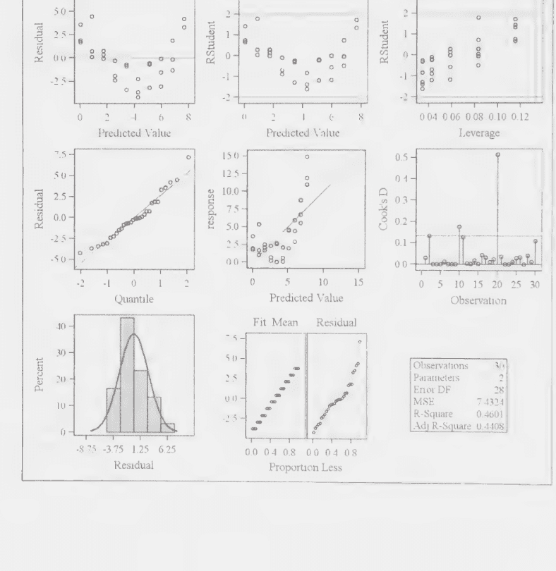

| Observations | 31 |

| Parameters | 2 |

| Error DF | 28 |

| MSE | 7.4324 |

| R-Square | 0.4601 |

| Adj R-Square | 0.4408 |

#### Display 6.2B 残差与预测变量的散点图

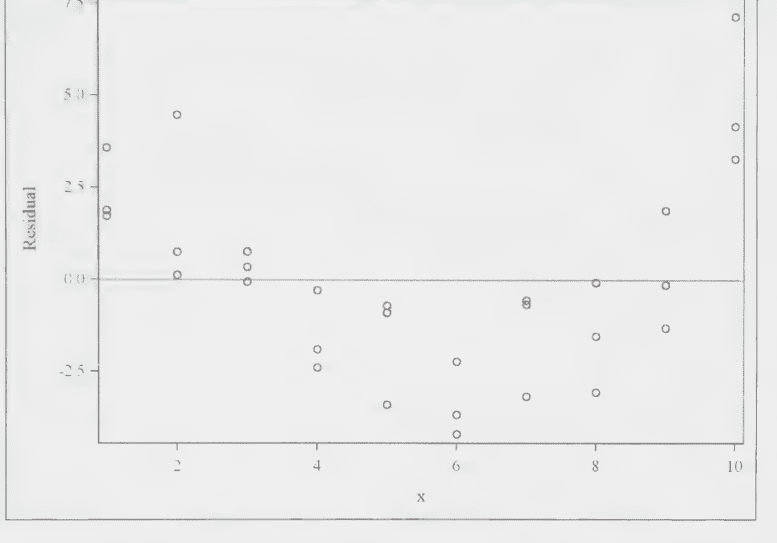

该图显示出一种模式：线性回归模型在 `x` 的较小值（`x≤3`）和较大值（`x≥10`）处低估了响应值（正残差）。它显示模型在 `x` 值介于 4 和 8 之间时高估了响应值（负残差）。这表明使用线性回归模型存在不足。这并不令人惊讶，因为模拟的是三次多项式关系。

#### Display 6.2C 带有置信区间和预测区间的拟合模型

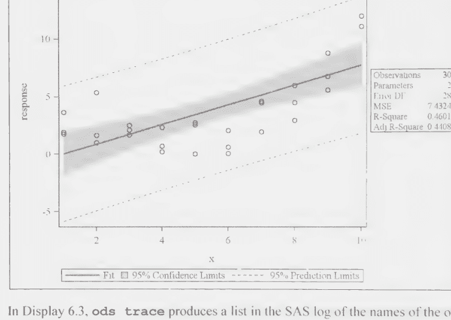

在 `Display 6.3` 中，`ods trace` 在 `SAS` 日志中生成了 `proc reg` 产生的输出对象、表和图的名称列表。特别是，产生了五个输出对象和三个图形。在第 4 章中，`ODS TRACE` 识别了表。然而，在本章中，输出可以包括图形。

#### Display 6.3 由 PROC REG 产生并由 ODS TRACE 列出的输出对象和图形

```
Output Added:
Name:          NObs
Label:         Number of Observations
Template:      Stat.Reg.NObs
Path:          Reg.MODEL1.Fit.response.NObs
-------------
Output Added:
Name:          ANOVA
Label:         Analysis of Variance
Template:      Stat.REG.ANOVA
Path:          Reg.MODEL1.Fit.response.ANOVA
-------------
Output Added:
Name:          FitStatistics
Label:         Fit Statistics
Template:      Stat.REG.FitStatistics
Path:          Reg.MODEL1.Fit.response.FitStatistics
-------------
Output Added:
Name:          ParameterEstimates
Label:         Parameter Estimates
Template:      Stat.REG.ParameterEstimates
Path:          Reg.MODEL1.Fit.response.ParameterEstimates
-------------
Output Added:
Name:          DiagnosticsPanel
Label:         Fit Diagnostics
Template:      Stat.REG.Graphics.DiagnosticsPanel
Path:          Reg.MODEL1.ObswiseStats.response.DiagnosticPlots. DiagnosticsPanel
-------------
Output Added:
Name:          ResidualPlot
Label:         x
Template:      Stat.REG.Graphics.ResidualPlot
Path:          Reg.MODEL1.ObswiseStats.response.ResidualPlots.ResidualPlot
-------------
Output Added:
Name:          FitPlot
Label:         Fit Plot
Template:      Stat.REG.Graphics.Fit
Path:          Reg.MODEL1.ObswiseStats.response.FitPlot
```

每个使用 `ODS Graphics` 的统计过程所产生的图形列表都提供在该过程文档的 `Details` 部分。例如，`PROC REG` 产生的图形可通过选择 `SAS Products→SAS/STAT→SAS/STAT 9.2 User’s Guide→The REG Procedure→Details: REG Procedure→ODS Graphics in SAS Help` 来列出。会显示一个列出图形的表。 （参见 `Display 6.4` 的示例。）`Display 6.2A` 显示了 `DiagnosticsPanel` 对象的图形。

`Display 6.2B` 显示了 `ResidualPlot` 对象的图形。`Display 6.2C` 显示了 `FitPlot` 对象的图形。

#### Display 6.4 由 PROC REG 产生的图形的部分列表

| ODS Graph Name | Plot Description | PLOTS Option |

|---|---|---|

| AdjrsqPlot | Adjusted R-square statistic for models examined using variable selection | ADJRSQ |

| AICPlot | AIC statistic for models examined using variable selection | AIC |

| BICPlot | BIC statistic for models examined using variable selection | BIC |

| CooksDPlot | Cook’s D statistic versus observation number | COOKSD |

| CPPlot | Cp statistic for models examined using variable selection | CP |

| DFFITSPlot | DFFITS statistic versus observation number | DFFITS |

| DFBETASPanel | Panel of DFBETAS statistics versus observation number | DFBETAS |

| DFBETASPlot | DFBETAS statistic versus observation number | DFBETAS(UNPACK) |

| ... | ... | ... |

| VIFPlot | Plot of VIF traces | RIDGE(UNPACK) |

以下 `PROC REG` 语句中的 `PLOTS` 选项请求一个 `DFBETAS` 图的面板。以下代码仅为此回归选择 `DFBETAS`。如果省略了 `only`，则将产生三个默认图形和 `DFBETAS` 图。

```
ods rtf bodytitle file="C:\Users\baileraj.IT\Desktop\fig6p1.rtf";
ods graphics on;
proc reg data=cubic plots(only)=DFBETAS;
  model response = x;
run;
ods graphics off;
ods rtf close;
```

在 `Display 6.5` 中，显示了一个 1x2 图，包含截距和斜率的 `DFBETAS`。

#### Display 6.5 截距和斜率的 DFBETAS 图

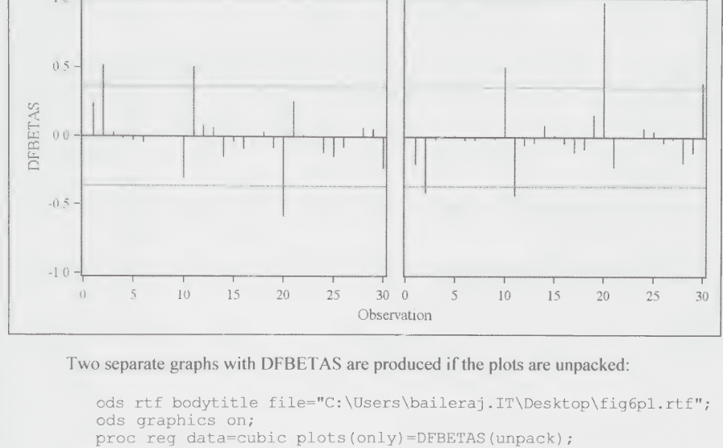

如果将图形解包，则会产生两个单独的 `DFBETAS` 图：

```
ods rtf bodytitle file="C:\Users\baileraj.IT\Desktop\fig6p1.rtf";
ods graphics on;
proc reg data=cubic plots(only)=DFBETAS(unpack);
  model response = x;
run;
ods graphics off;
ods rtf close;
```

您可以在 `ODS SELECT` 和 `ODS EXCLUDE` 语句中指定 `ODS` 图的名称。 （参见 `Display 6.4`。）使用 `PLOTS=` 选项来确定要创建哪些图。使用 `ODS SELECT` 和 `ODS EXCLUDE` 语句来控制哪些图发送到您的 `ODS` 目标。`ODS SELECT` 和 `ODS EXCLUDE` 语句可用于选择输出表和图形。在以下代码中，选择了参数估计的表（`ParameterEstimates`）和带有预测线以及置信区间和预测区间的图形（`FitPlot`）。


```
ods graphics on;
proc reg data=cubic;
  ods select ParameterEstimates FitPlot;
  model response = x;
run;
ods graphics off;
```

### 6.3 使用 ODS Graphics Editor 修改图形

要完成本节中的任务，您应该下载并安装 ODS Graphics Editor。安装信息可在 SAS/GRAPH ODS Graphics Editor: User’s Guide 中找到。您需要请求可编辑图形，然后调用 ODS Graphics Editor。要使用 ODS Graphics Editor，`LISTING` 目标必须处于活动状态，并且您应该处于 SAS windowing 环境中。有三种方式请求可编辑图形：

- 1. 提交以下语句：

```
ods listing sge=on;
```

这将在会话中启用可编辑图形的创建。

- 2. 选择 Results 窗口。在命令行中输入：

```
sgedit on
```

- 3. 在 SAS Registry 中设置默认值。有关更多信息，请参阅 Rodriguez (2009)。

可编辑图形可以通过在 Results 窗口中双击可编辑图形的图标来使用 ODS Graphics Editor 打开。请求可编辑图形时，每个图形会显示两个图标。一个图标用于通常的（不可编辑）图形，一个图标用于可编辑图形。

让我们看看如何修改图形。ODS Graphics Editor 相关的两个主要功能是自定义图形的元素（例如标题、脚注、标记形状等）和注释图形。让我们从 Display 6.2B 中的图开始。如果您在 Results 窗口中向下钻取，可以双击图形以启动 ODS Graphics Editor。显示 ODS Graphics Editor 与 Display 6.2B 图形的界面如下：

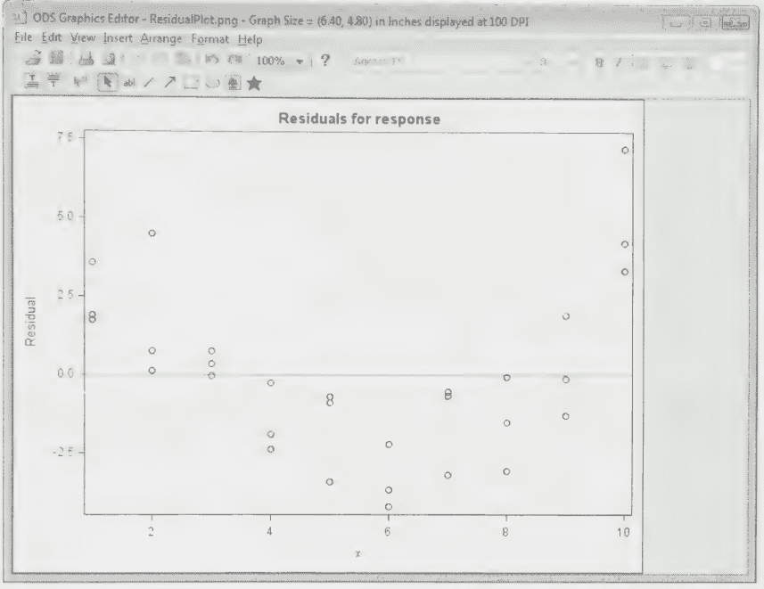

图周围有各种按钮。例如，椭圆按钮使您能够在图上添加、定位、旋转和重塑椭圆。箭头按钮使您能够添加带有末端文本标签的箭头。双击绘图符号、轴标签和标题可以更改它们。使用 ODS Graphics Editor 所做的更改不会反映在 SAS 代码中。因此，您应该使用 ODS Graphics Editor 对图形进行一次性更改。

在 Display 6.6 中，原始图显示在左上角。使用 ODS Graphics Editor 添加并旋转了椭圆（右上和左下）。轴标签被更改（右上），绘图符号被更改（右上）。参考线被加宽（右上）。添加了文本和箭头（左下），并添加了标题和最终文本箭头（右下）。

#### Display 6.6 使用 ODS Graphics Editor 制作自定义图

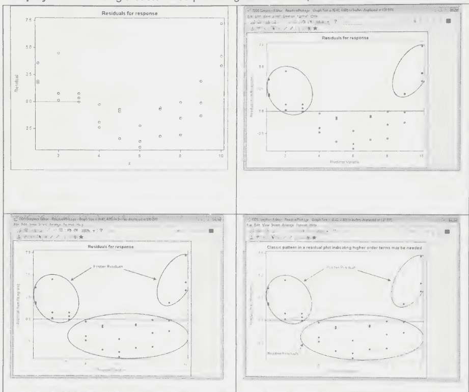

最终图显示在 Display 6.7 中。

#### Display 6.7 使用 ODS Graphics Editor 自定义的图

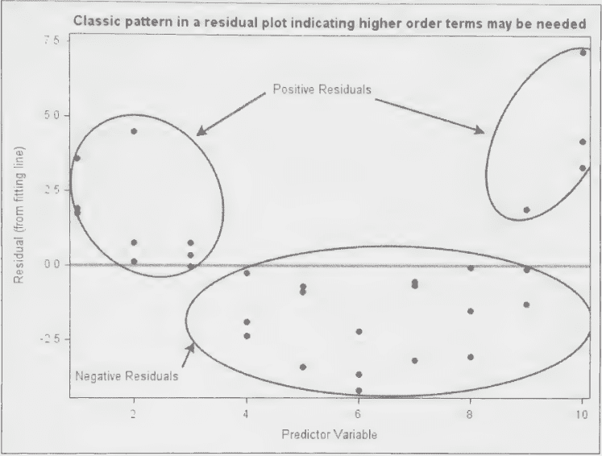

### 6.4 使用样式和模板进行图形绘制

ODS 样式用于“控制所有图形和表的颜色和整体外观”（Kuhfeld 2009）。默认 ODS 样式可用于大多数应用。默认样式会产生颜色多变的图形，这可能不适用于某些期刊应用。以下语句比较了四种不同的样式，用于检查 `PROC REG` 产生的残差直方图。 （参见 Display 6.8。）不同的样式指定为 `ODS RTF` 语句的选项。默认 RTF 样式、`STATISTICAL` 样式、`JOURNAL2` 样式和 `ANALYSIS` 样式进行了比较。

#### 显示 6.8 比较残差直方图的不同的样式

```
data cubic;
    call streaminit(8675309);
    do nrep=1 to 3;
        do x=1 to 10;
            response=3+1*x-.5*x**2 +.05*x**3 + rand('normal',0,1.5);
            output;
        end;
    end;
run;

ods rtf bodytitle file="C:\Users\baileraj.IT\Desktop\hist-default.rtf";
ods graphics on;
proc reg data=cubic plots(only)=RESIDUALHISTOGRAM;
    model response = x;
run;
ods graphics off;
ods rtf close;

ods rtf bodytitle style=STATISTICAL  file="C:\Users\baileraj.IT\Desktop\hist-statistical.rtf";
ods graphics on;
proc reg data=cubic plots(only)=RESIDUALHISTOGRAM;
    model response = x;
run;
ods graphics off;
ods rtf close;

ods rtf bodytitle style=JOURNAL2 file="C:\Users\baileraj.IT\Desktop\hist-journal2.rtf";
ods graphics on;
proc reg data=cubic plots(only)=RESIDUALHISTOGRAM;
    model response = x;
run;
ods graphics off;
ods rtf close;

ods rtf bodytitle style=ANALYSIS file="C:\Users\baileraj.IT\Desktop\hist-analysis.rtf";
ods graphics on;
proc reg data=cubic plots(only)=RESIDUALHISTOGRAM;
    model response = x;
run;
ods graphics off;
ods rtf close;
```

四个直方图排列在显示 6.9 中。`STATISTICAL` 样式推荐用于网页或彩色输出。`JOURNAL2` 样式生成黑白比例直方图，某些期刊可能更偏好该样式（Rodriguez 2009）。`ANALYSIS` 样式施加了彩色背景，并为直方图条和叠加的密度使用不同的配色方案。

在显示 6.9 中，默认 RTF 样式的直方图显示在左上角。`STATISTICAL` 样式的直方图显示在右上角。`JOURNAL2` 样式的直方图显示在左下角。而 `ANALYSIS` 样式的直方图显示在右下角。

一个 *模板* 是一个包含创建图形指令的程序。这些指令是用图形模板语言（GTL）编写的，并使用 `PROC TEMPLATE` 编译。有关更多信息，请参阅 *SAS/GRAPH: Graph Template Language User’s Guide, Second Edition*，以及 Kuhfeld（2009）。此外，Kuhfeld（2010）有一本更新的书籍，涉及 GTL 和统计图形过程的丰富性。对模板可以进行的广泛更改的描述超出了统计编程文本的范围。然而，这个示例应该能让你有所体会。

第一步是找到用于生成图形的模板。你可以使用 `ODS TRACE` 语句如下：

```
ods rtf bodytitle file="C:\Users\baileraj.IT\Desktop\fig6p2.rtf";
ods trace on;
ods graphics on;
proc reg data=cubic plots(only)=RESIDUALHISTOGRAM;
    model response = x;
run;
ods graphics off;
ods trace off;
ods rtf close;
```

此语句的输出标识了该残差直方图的模板。

```
Output Added:
------------
Name:        ResidualHistogram
Label:       Residual Histogram
Template:    Stat.REG.Graphics.ResidualHistogram
Path:        Reg.MODEL1.ObswiseStats.response.DiagnosticPlots.ResidualHistogram
------------
357 ods graphics off;
358 ods trace off;
359 ods rtf close;
```

SAS 日志中此编辑后的输出部分表明 **Stat.REG.Graphics.ResidualHistogram** 是模板。

可以使用以下代码显示此模板的内容：

```
proc template;
    source Stat.REG.Graphics.ResidualHistogram;
run;
```

#### 显示 6.10 Stat.REG.Graphics.ResidualHistogram 模板

```
define statgraph Stat.REG.Graphics.ResidualHistogram;
    notes "Residual Histogram";
    dynamic _DEPName _MODELlabel;
    BeginGraph;
        entrytitle halign=left textattrs=GRAPHVALUETEXT _MODELlabel
            halign=center textattrs=GRAPHTITLETEXT
            "Distribution of Residuals" " for " _DEPName;
        layout overlay /
            xaxisopts=(label="Residual")
            yaxisopts=(label="Percent");
            histogram RESIDUAL / primary=true;
            densityplot RESIDUAL / name="Normal" legendlabel="Normal"
                lineattrs=GRAPHFIT;
            densityplot RESIDUAL / kernel () name="Kernel"
                legendlabel="Kernel"
                lineattrs=GRAPHFIT2;
            discretelegend "Normal" "Kernel" / across=1 location=inside
                autoalign=(topright topleft top);
        endlayout;
    EndGraph;
end;
```

x 轴和 y 轴的更改涉及更改 `xaxisopts` 和 `yaxisopts`，它们是 `layout overlay` 语句的选项。使用此模板，修改 `xaxisopts` 标签。添加 x 轴值的范围（`viewmin` 和 `viewmax`），指定三个刻度值（`tickvaluelist`）并添加两个变量以在 x 轴每端增加一些空间（`offsetmin` 和 `offsetmax`）。修改模板后，需要使用 `PROC TEMPLATE` 编译它，如显示 6.11 所示。然后，你可以通过重新运行原始程序生成新的图形。修改后的模板保存在 `Sasuser` 中，并且每次运行程序时都会访问它。有关管理模板的更多信息，请参阅 SAS/STAT 用户指南的第 21 章。此示例易于描述，但在实践中硬编码轴刻度值是不现实的，因为刻度值本质上是数据依赖的。更现实的持久修改示例包括更改标题或删除正态曲线。试试看：在家更改模板以删除正态密度曲线并更新标题。

#### 显示 6.11 对 Stat.REG.Graphics.ResidualHistogram 模板的修改

```
proc template;
define statgraph Stat.REG.Graphics.ResidualHistogram;
    notes "Residual Histogram";
    dynamic _DEPNAME _MODELLABEL;
BeginGraph;
    entrytitle halign=left textattrs=GRAPHVALUETEXT _MODELLABEL
        halign=center textattrs=GRAPHTITLETEXT
        "Distribution of Residuals" " for " _DEPNAME;
    layout overlay / xaxisopts=(label="Residual"
                        linearopts=(viewmin=-10 viewmax=10
                                    tickvaluelist=(-10 0 10))
                        offsetmin=0.1 offsetmax=0.1)
                    yaxisopts=(label="Relative Frequency (%)");
        referenceLine x=0;
        histogram RESIDUAL / primary=true;
        densityplot RESIDUAL / name="Normal" legendlabel="Normal"
            lineattrs=GRAPHFIT;
        densityplot RESIDUAL / kernel() name="Kernel"
            legendlabel="Kernel"
            lineattrs=GRAPHFIT2;
        discretelegend "Normal" "Kernel" / across=1 location=inside
            autoalign=(topright topleft top);
    endlayout;
EndGraph;
end;

ods rtf bodytitle style=SCIENCE file="C:\users\baileraj.IT\Desktop\fig6p11.rtf";
ods graphics on;
proc reg data=cubic plots(only)= RESIDUALHISTOGRAM;
    model response = x;
run;
ods graphics off;
ods rtf close;
```

直方图显示在显示 6.12 中。

#### 显示 6.12 基于修改后模板的残差直方图

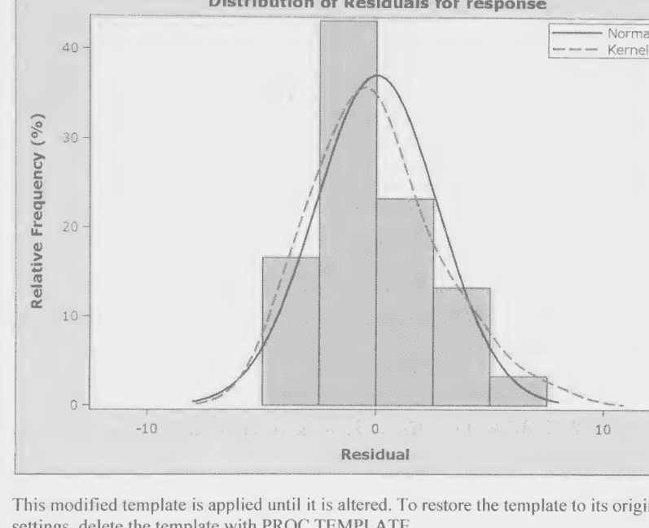

此修改后的模板会一直应用，直到被更改为止。要将模板恢复到原始设置，请使用 `PROC TEMPLATE` 删除模板。

```
proc template;
    delete Stat.REG.Graphics.ResidualHistogram;
run;
```

这一介绍让你了解修改模板所需的内容。如果你想要更多，就深入研究 GTL 文档。

到目前为止的信息适用于由启用 ODS Graphics 的统计过程自动且在上下文中生成的图形。让我们讨论一下使用 SAS/GRAPH 软件中的新统计图形（SG）过程创建独立图形（用于数据或用于特殊定制的统计显示）的方法。这些过程使用相同的底层 ODS Graphics 功能。

### 6.5 统计图形——进入 SG 过程的领域

SAS 9.2 中的 SAS/GRAPH 软件包含一组新的 SG 过程，包括 `SGPLOT`、`SGPANEL` 和 `SGSCATTER`。使用这些新过程，可以用少量语句生成复杂的显示。SG 过程要求在调用过程之前指定 ODS 目标。虽然使用 SG 过程时不需要指定 `ODS GRAPHICS ON`，但 `ODS GRAPHICS ON` 语句中的选项确实适用于 SG 过程。这些选项在 SAS/STAT 用户指南的第 21 章中描述。SAS 文档为使用 SG 过程提供了基本参考。Rodriguez（2009）和 Schwartz（2009）提供了这些过程的良好概述并启动了其使用。

`SGPLOT` 过程使你能够构建一个或多个显示在同一轴上的图。如前几章可能已推断的那样，`SGPLOT` 过程用于单变量和双变量数据的图形显示。显示包括叠加平滑拟合的散点图（例如，使用 LOESS），叠加密度曲线的直方图，时间序列图，条形图，箱线图等等。显示 6.13 提供了与拟合线性回归模型以预测佛罗里达州注册机动船数量作为函数的海牛死亡数相关的分析。¹ 显示 6.13 使用一次 `PROC SGPLOT` 调用生成海牛死亡数与注册机动船数量的散点图，并叠加线性回归和 LOESS 拟合。它使用第二次 `PROC SGPLOT` 调用生成残差与预测变量的散点图，并叠加 LOESS 平滑。

#### 显示6.13 使用PROC SGPLOT分析拟合线性回归模型的残差


### 代码示例

```
data manatee_deaths;
    input year nboats manatees @@;
    datalines;
77 447 13  78 460 21   79 481 24   80 498 16
81 513 24  82 512 20   83 526 15   84 559 34
85 585 33  86 614 33   87 645 39   88 675 43
89 711 50  90 719 47
;

ods rtf bodytitle file="C:\Users\baileraj.IT\Desktop\manatee-plots.rtf";
proc reg data=manatee_deaths;
    title '# Manatees killed regressed on the number of boats registered (FL)';
    model manatees = nboats;
    output out=regress r=resid;
run;

proc sgplot data=manatee_deaths;
    title2 "residual plot from the linear model fit";
    regression x=nboats y=manatees;
    loess x=nboats y=manatees;
run;

proc sgplot data=regress;
    title2 "plot residuals vs. predictor variable (loess fit)";
    loess x=nboats y=resid;
run;
ods rtf close;
```

在显示6.14中，线性回归拟合与LOESS拟合非常相似。`PROC SGPLOT`的另一个关键要素也体现在该显示中——`PROC SGPLOT`中的每个语句都会生成一个图层，这些图层组合在单个图形中。

#### 显示6.14 海牛死亡数与注册机动船数量的散点图，叠加线性回归拟合与LOESS拟合

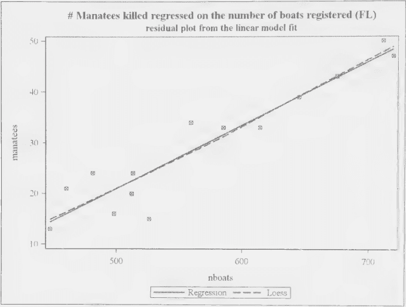

在显示6.15中，残差相对注册机动船数量的图没有表现出任何模式，这支持了线性模型的充分性。

#### 显示6.15 残差相对于注册机动船数量的图，带有LOESS平滑

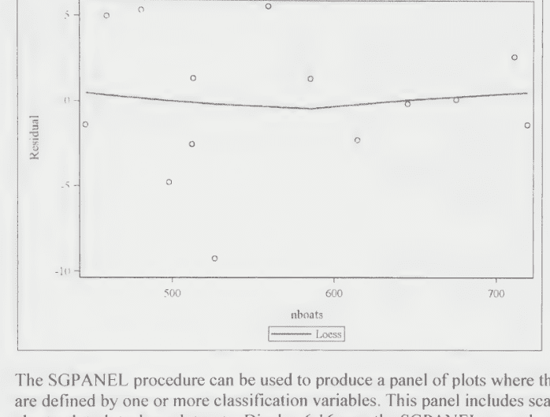

`SGPANEL`过程可用于生成绘图面板，其中面板条目由一个或多个分类变量定义。该面板包括散点图、条形图、点图、箱线图等。显示6.16使用`SGPANEL`过程生成按窝次分组的幼体数量与浓度的独立散点图，并叠加LOESS平滑。

#### 显示6.16 按窝次分组的幼体数量与浓度散点图（叠加LOESS平滑）

```
data nitrophen;
  infile 'C:\Users\baileraj.IT\Desktop\ch2-dat.txt' firstobs=16 expandtabs missover pad;
  input @9 animal 2. @17 conc 3. @25 brood1 2. @33 brood2 2. @41 brood3 2. @49 total 2.;
run;

data nitrophen2; set nitrophen;
  brood = 1; young=brood1; output;
  brood = 2; young=brood2; output;
  brood = 3; young=brood3; output;
  keep conc brood young;
run;

ods rtf bodytitle file="C:\Users\baileraj.IT\Desktop\nitrophen-plots.rtf";
proc sgpanel data=nitrophen2;
title "Brood-specific LOESS fits";
panelby brood;
  loess x=conc y=young;
run;

ods rtf close;
```

这些散点图显示在显示6.17中。

#### 显示6.17 幼体数量与浓度的散点图（叠加LOESS拟合）

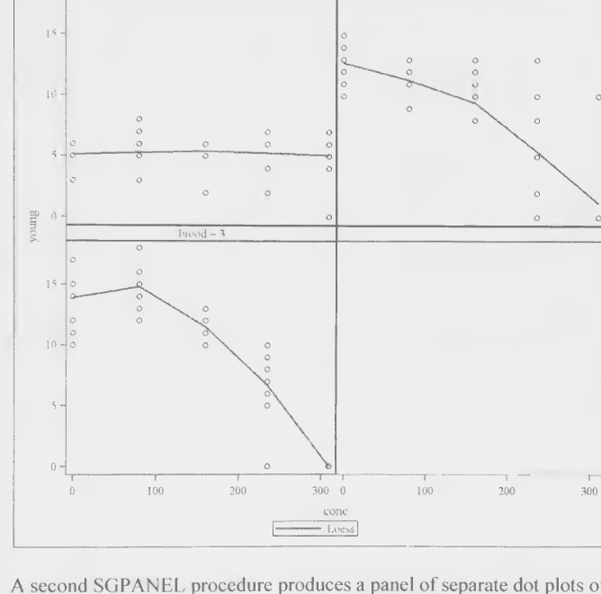

第二个`SGPANEL`过程生成一个面板，其中包含每种浓度下幼体数量的独立点图。代码如显示6.18所示。点图如显示6.19所示。

#### 显示6.18 生成每种浓度下幼体数量的独立点图

```
data nitrofen;
    infile 'C:\Users\baileraj.IT\Desktop\ch2-dat.txt' firstobs=16 expandtabs missover pad;
    input @9 animal 2. @17 conc 3. @25 brood1 2. @33 brood2 2. @41 brood3 2. @49 total 2.;
run;

ods rtf bodytitle file="C:\Users\baileraj.IT\Desktop\nitrofen-dotplots.rtf";
proc sgpanel data=nitrofen;
title "dot plots";
panelby conc / layout=panel novarname columns=5;
dot total;
run;

ods rtf close;
```

`SGPANEL`过程包含指定每个面板分类变量的语句（`panelby conc`），并指定了五列。如果你有两个分类变量，在`PROC SGPANEL`中使用`LATTICE`选项更为合适。使用`LATTICE`选项时，第一个分类变量的值定义行，第二个分类变量的值定义列。

#### 显示6.19 每种浓度下幼体数量的独立点图

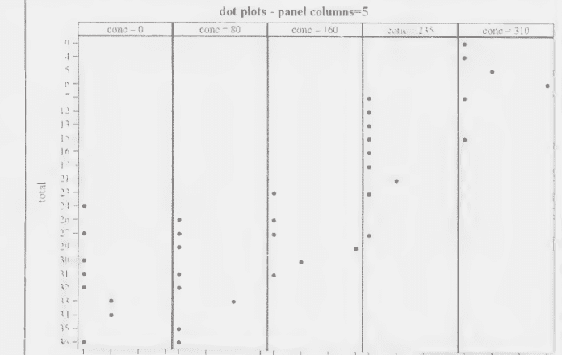

`SGSCATTER`过程生成一个面板，其中包含变量各种组合的散点图。不过，这些面板可以包含独立指定的变量。显示6.20展示了请求绘制三个窝次计数和总计数与浓度关系的独立散点图的代码。

#### 显示6.20 请求绘制窝次计数与浓度关系的散点图面板

```
data nitrofen;
  infile 'C:\Users\baileraj.IT\Desktop\ch2-dat.txt' firstobs=16 expandtabs missover pad;
  input @9 animal 2. @17 conc 3. @25 brood1 2. @33 brood2 2. @41 brood3 2. @49 total 2.;
run;

title;

ods rtf bodytitle file="C:\Users\baileraj.IT\Desktop\nitrophen-plots2.rtf";
proc sgscatter data=nitrofen;
  plot (brood1 brood2 brood3 total)*conc / loess uniscale=ALL;
  * UNISCALE option ensures axis scales are uniform for better comparison;
run;

ods rtf close;
```

此外，每个散点图都添加了LOESS平滑，如显示6.21所示。

#### 显示6.21 窝次计数与浓度的散点图（叠加LOESS平滑）

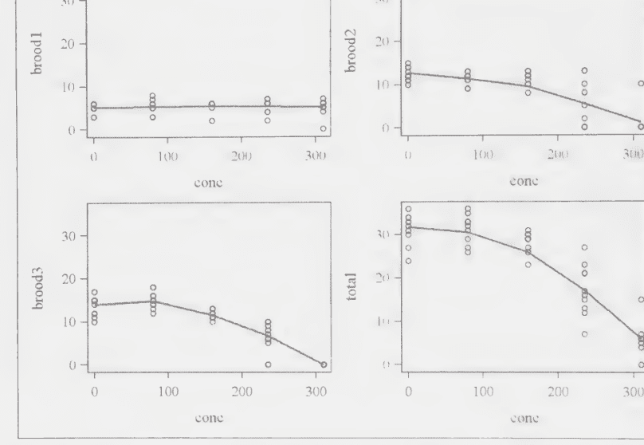

从显示6.21可以看出，硝基酚对第一窝幼体没有影响。在未暴露组和最低浓度组之间，各窝次几乎没有差异。然而，在较高浓度下，第二窝和第三窝产生的幼体数量以及总幼体数量均有所下降。

### 6.6 案例研究：使用SG过程

由于这些新的SG过程对统计程序员和数据分析师非常重要，亲自绘制图形来探索数据集是一项值得的实践。在本节中，你将快速地对第2章SMSA数据集中的部分变量进行图形化探索。显示6.22展示了一个详尽的代码示例，其中使用格式、标签和SG过程来检查数据的关键特征。

#### 显示6.22 对SMSA数据进行格式化、添加标签并绘制图形探索

```
options formdlim='~' nodate;

data SMSA_from_txt;  * from Display 2.8;
  infile "C:\Users\balleraj.T\Desktop\SMSA-DASL-2space-sep.txt" firstobs=2;
  length city $ 39;
  input city & JanTemp JulyTemp RelHum Rain Mortality Education PopDensity
        pct_NonWhite pct_WC pop pop_per_house income HCPot NOxRot SO2Pot NOx;
run;

/* extract and save the 5 number summary for Jan. Temps */
proc univariate data=SMSA_from_txt;
  var JanTemp;
  output out=JanSumOut min=Jmin Q1=JQ1 Median=JQ2 Q3=JQ3 max=Jmax;
run;

/* assign the 5 number summaries (min,Q1,M,Q3,max) to macro variables */
/* (see Ch. 10 for more on Macro magic) */
data _null_;
  set JanSumOut;
  call symputx('M_Jmin', Jmin);
  call symputx('M_JQ1', JQ1);
  call symputx('M_JQ2', JQ2);
  call symputx('M_JQ3', JQ3);
  call symputx('M_Jmax', Jmax);
  %put _user_;
run;

/* create informative formats for later displays */
proc format;
  value gt32F 0="below freezing"
              1="above freezing";
  value JTemp 1 = "&M_Jmin <= Jan. Temp. (F) <= &M_JQ1"
              2 = "&M_JQ1 < Jan. Temp. (F) <= &M_JQ2"
              3 = "&M_JQ2 < Jan. Temp. (F) <= &M_JQ3"
              4 = "&M_JQ3 < Jan. Temp. (F) <= &M_Jmax";
run;

/* define and add a variable indicating Jan. temps > 32 deg F and a variable */
/* containing the Jan. temp quartile category */
data SMSA_from_txt;
  set SMSA_from_txt;

  freezing = (JanTemp>32);
  label freezing="Temp. in January";
  format freezing gt32F.;
```

#### 显示6.22（续）

```
if &M_Jmin < JanTemp <= &M_JQ1 then JanTemp_quart=1;
else if JanTemp <= &M_JQ2 then JanTemp_quart=2;
else if JanTemp <= &M_JQ3 then JanTemp_quart=3;
else if JanTemp <= &M_Jmax then JanTemp_quart=4;

label JanTemp_quart="Interval:";
format JanTemp_quart JTemp.;
run;

/* debugging check to see if variables correctly defined */
proc print data=SMSA_from_txt;
    var JanTemp JanTemp_quart freezing;
run;

/* define set of graphics */
ods rtf bodytitle file="C:\Users\baileraj.IT\Desktop\SMSA-plots.rtf";

* Display 6.23: HISTOGRAM of Jan. Temp.;
proc sgplot data=SMSA_from_txt;
    histogram JanTemp;
    density JanTemp / type=kernel;
run;

* Display 6.24: Scatter plot of Mortality vs. Education;
proc sgplot data=SMSA_from_txt;
    scatter x=Education y=Mortality;
run;

* Display 6.25: Scatter plots with shared y-axis for comparison;
proc sgscatter data=SMSA_from_txt;
    compare y=Mortality x=(Education income JanTemp) / loess;
run;

* Display 6.26: Scatter plot matrix;
proc sgscatter data=SMSA_from_txt;
    matrix Mortality Education income JanTemp / diagonal=(histogram);
run;

* Display 6.27: Separate scatter plots for levels of other variables;
proc sgpanel data=SMSA_from_txt noautolegend;  * to suppress legend;
    panelby freezing;
    loess x=Education y=Mortality;
run;

* Display 6.28: Same plot with diff. symbols and line types for diff var levels;
proc sgplot data=SMSA_from_txt;
    loess x=Education y=Mortality / group=freezing;
run;
```

#### Display 6.22 (continued)

```
* Display 6.29: scatter plot paneled by constructed quartile variable;
proc sgpanel data=SMSA_from_txt;
  panelby JanTemp_quart;
  loess x=Education y=Mortality;
run;

ods rtf close;
```

The results of the various plots are presented in the following displays. The associated display produced by each SG procedure is noted as a comment in the code in Display 6.22. A histogram of the January temperatures with a superimposed density estimate is shown in Display 6.23. A right skew is clear, with most cities exhibiting January temperatures between 20 and 40 degrees Fahrenheit.

#### Display 6.23 Histogram of January temperatures

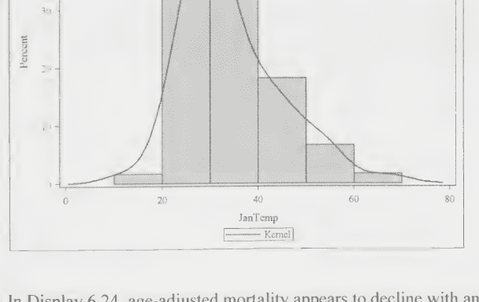

In Display 6.24, age-adjusted mortality appears to decline with an increase in education.

#### Display 6.24 Scatter plot of mortality versus education

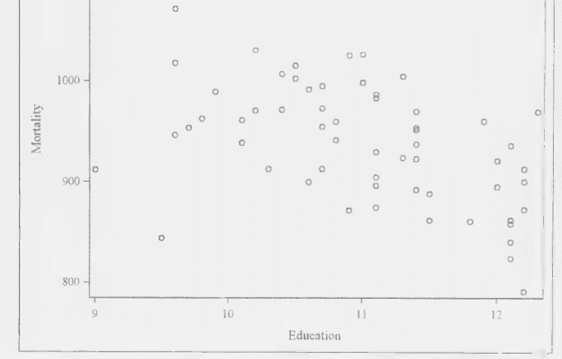

It is interesting to investigate the relationship between one response variable and a collection of predictor variables. In Display 6.25, mortality is plotted versus education, income, and January temperature. It appears that mortality decreases with education and income, but does not vary with January temperatures.

#### Display 6.25 Scatter plots with mortality on the y-axis for comparison


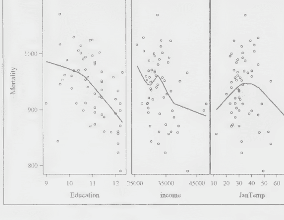

You might expect education and income to be related, and you might want to examine their relationship with mortality and their relationship with each other. Display 6.26 shows the relationships and the distribution of each of the four variables.

### Display 6.26 Scatter plot matrix and histograms of mortality, education, income, and January temperature

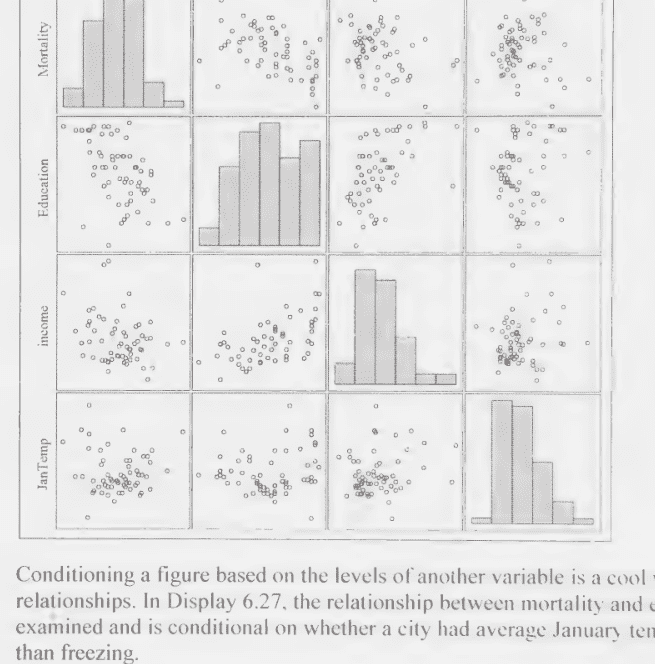

Conditioning a figure based on the levels of another variable is a cool way to explore relationships. In Display 6.27, the relationship between mortality and education is examined and is conditional on whether a city had average January temperatures of less than freezing.

### Display 6.27 Scatter plot of mortality versus education conditional on January temperatures

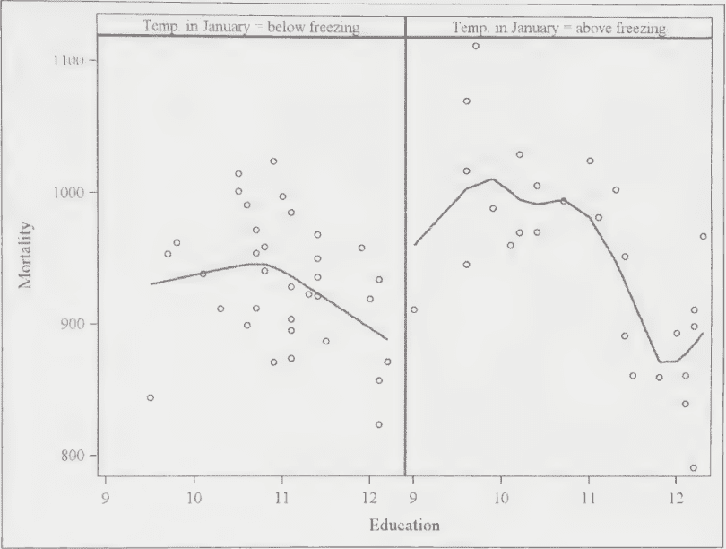

An alternative to Display 6.27 is to plot both groups in the same figure, but use different plotting symbols and line types for fits. Display 6.28 uses `PROC SGPLOT` with a `GROUP=` option. This is opposed to `PROC SGPANEL` with a `PANELBY=` option, which was used to specify group differences in Display 6.27.

### Display 6.28 Scatter plot of mortality versus education conditional on January temperatures

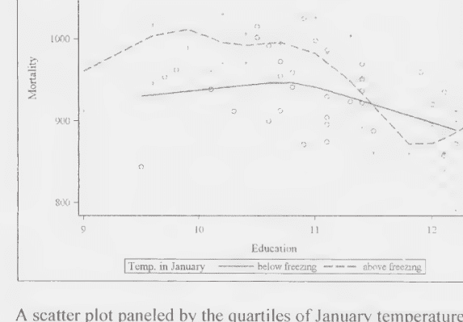

A scatter plot paneled by the quartiles of January temperatures is shown in Display 6.29. Display 6.29 emphasizes that the mortality and education relationship appears strongest in the cities with the warmest January temperatures. Do you want to suggest any explanations?

### Display 6.29 Scatter plot of mortality versus education paneled by quartiles of January temperatures

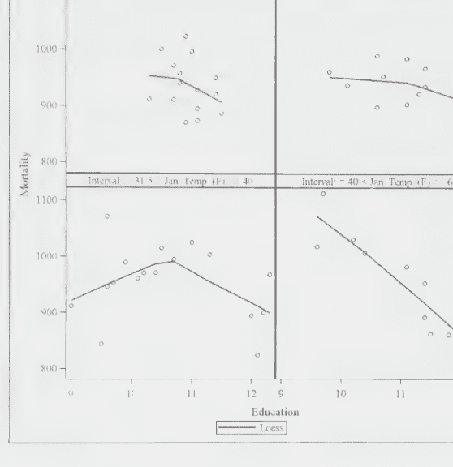

## 6.7 Summary

The chapter began with a brief description of `ODS Graphics`. Customizing `ODS Graphics` using the `ODS Graphics Editor` and changing styles and templates were initially discussed. Next, the richness of `SG` procedures for data displays was explored.

There are many features and benefits of `ODS Graphics` that are not covered in this chapter. For a general introduction to `ODS Graphics`, see Chapter 21, “Statistical Graphics Using ODS,” in the `SAS/STAT User’s Guide`, Second Edition, and Rodriguez (2009) for a brief, high-level introduction to `ODS Graphics`. To customize your `ODS Graphics` to the extreme, learn more about `GTL` and its connection to `ODS Graphics` and the `SGRENDER` procedure.

## 6.8 References

Kuhfeld, Warren F. 2010. Statistical Graphics in SAS: An Introduction to the Graph Template Language and the Statistical Graphics Procedures. Cary, NC: SAS Institute Inc.

Kuhfeld, Warren F. 2009. “Modifying ODS Statistical Graphics Templates in SAS 9.2.” Proceedings of the SAS Global Forum 2009 Conference. Cary, NC: SAS Institute Inc. Available at http://support.sas.com/resources/papers/proceedings09/323-2009.pdf.

Lange, Nicholas, Louise Ryan, Lynne Billard, David Brillinger, Loveday Conquest, Joel Greenhouse, eds. 1994. Case Studies in Biometry. New Jersey: John Wiley & Sons, Inc.

Moore, David S., and George P. McCabe. 2003. Introduction to the Practice of Statistics. 4th Ed. New York, NY: W. H. Freeman and Co.

Robbins, Naomi B. 2005. Creating More Effective Graphs. Hoboken, NJ: Wiley-Interscience.

Rodriguez, Robert N. 2009. “Getting Started with ODS Statistical Graphics in SAS 9.2 (Revised 2009).” Cary, NC: SAS Institute Inc. Available at http://support.sas.com/rnd/app/papers/intods graph.pdf.

SAS Institute Inc. 2009. SAS/GRAPH 9.2: Reference. Cary, NC: SAS Institute Inc.

SAS Institute Inc. 2009. SAS/GRAPH 9.2: ODS Graphics Editor: User’s Guide. Cary, NC: SAS Institute Inc.

SAS Institute Inc. 2009. SAS/GRAPH 9.2: Graph Template Language Reference. Cary, NC: SAS Institute Inc.

SAS Institute Inc. 2009. SAS/GRAPH 9.2: Statistical Graphics Procedures Guide. Cary, NC: SAS Institute Inc.

Schwartz, Susan 2009. “Clinical Trial Reporting Using SAS/GRAPH SG Procedures.” Proceedings of the SAS Global Forum 2009 Conference. Cary, NC: SAS Institute Inc. Available at http://support.sas.com/resources/papers/proceedings09/174-2009.pdf.

Tufte, Edward R. 2001. The Visual Display of Quantitative Information. Second Edition. Cheshire, CT: Graphics Press.

## 6.9 Exercises

- 1. Refer to the packaging and log-bacterial growth data. Construct three different figures that display and summarize the data.
- 2. Refer to the nitrofen data. Generate a plot of the nitrofen data using the square root of `TOTAL` as the response variable versus concentration. Superimpose the fitted quadratic model. Only use `PROC SGPLOT` to generate this figure (i.e., don’t use `PROC REG` to generate fits first).
- 3. Refer to the nitrofen data. Fit a polynomial regression model (center the concentration variable). Use the `ODS GRAPHICS` statement to generate graphical summaries of this analysis.
- 4. Find a data set that interests you. Generate a display that best represents it using one of the `SG` procedures.

## Traditional SAS Graphics

- 7.1 Traditional SAS Graphics ............................................................ 238
- 7.2 Customizing Graphics ................................................................. 238
- 7.3 Why You Need to Learn about Annotate Data Sets .............................. 244
- 7.4 Case Study: Comparing Distributions of Responses ............................ 250
- 7.5 Descriptive Displays of Spatial Data ................................................. 254
- 7.6 Summary .................................................................................... 256
- 7.7 References ................................................................................. 257
- 7.8 Exercises .................................................................................... 257
- 7.9 Appendix: Complete Ohio County Population Data Set ......................... 258


## 7.1 Traditional SAS Graphics

There are many traditional graphics procedures in SAS. These include procedures for producing scatter plots (`GPLOT`), three-dimensional plots (`G3D`), contour plots (`GCONTOUR`), charts (`GCHART`), and maps (`GMAP`). These procedures share features such as using the `GOPTIONS` statement for control and using annotate data sets for enhancements. In this chapter, the focus is on a few applications that highlight the benefits of traditional SAS graphics.

## 7.2 Customizing Graphics

When you invoke a graphics procedure, defaults for symbols, line types, axis tick marks, and labels are set. To see all of the defaults that are used, a scatter plot of the long-term relative frequency concept of probability is provided. In Display 7.1, 1200 virtual tosses of a fair digital coin are generated. A toss results in an `OUTCOME=0` (tails) or `OUTCOME=1` (heads). The number of heads (`NUM HEADS`) is accumulated and divided by the number of tosses (`ITOSS`) to define the relative frequency of heads (`PROBABILITY HEADS`). The relative frequency of heads is plotted versus the accumulated number of heads. For more information about the use of the `RAND` function with seeds set by `STREAMINIT`, see Section 8.11 or SAS Help.

### Display 7.1 Toss a digital coin–relative frequency of heads

```
data cointoss;
retain num_heads 0;
call streaminit(1234567);
do itoss = 1 to 1200;
  outcome = RAND('Bernoulli', 0.50);
  num_heads = num_heads + (outcome=1);
  probability_heads = num_heads / itoss;
  output;
end;
goptions reset=global;
ods rtf bodytitle file="C:\Users\baileraj.IT\Desktop\fig7p1.rtf";
proc gplot;
  plot probability_heads*itoss;
run;
ods rtf close;
```

The scatter plot is shown in Display 7.2.

### Display 7.2 相对频率散点图

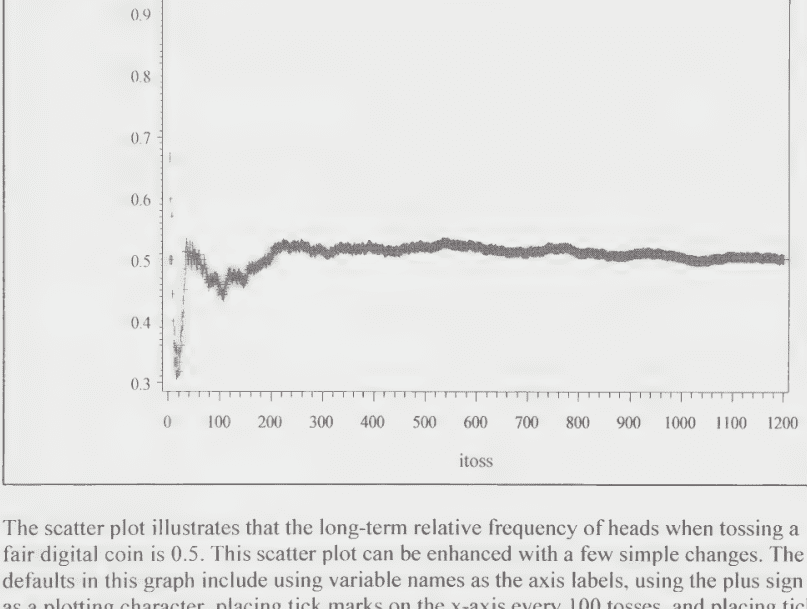

散点图说明了投掷公平数字硬币时正面出现的长期相对频率为 0.5。只需进行几项简单的更改即可增强此散点图。该图的默认设置包括使用变量名作为轴标签、使用加号作为绘图字符、在 x 轴上每 100 次投掷放置刻度标记、在 y 轴上每 0.10 放置刻度标记。y 轴的极值定义为 0.3 和 1.0。可以增强散点图的简单更改包括：

- 1. 提供更有信息量的轴标签。
- 2. 旋转 y 轴标签，以便为绘图区域提供更多空间。


### 限制与调整

- 3. 限制在 y 轴和 x 轴上绘制的值的范围。
- 4. 删除次要轴刻度标记。
- 5. 连接与不同投掷次数相关联的相对频率。

本节使用 `AXIS` 语句解决第 1 项至第 4 项，使用 `SYMBOL` 语句解决第 5 项。

许多这些简单更改都可以使用 `ODS Graphics` 和 `PROC SGPLOT` 实现。例如，第 1 项和第 2 项可以在 `PROC SGPLOT` 中的 `XAXIS` 和 `YAXIS` 语句中使用 `LABEL` 选项来解决。您可以在 `PROC SGPLOT` 和 `PROC SGPANEL` 中创建不规则间隔。在 `PROC GPLOT` 中，要创建不规则间隔，需要一个注释数据集。有关更多信息，请参阅“Secrets of the SG Procedures”第 13 页，网址为 http://support.sas.com/resources/papers/proceedings09/324-2009.pdf。`PROC SGPLOT` `AXIS` 和 `SERIES` 语句中的 `MIN`、`MAX`、`VALUES` 和 `VALUESHINT` 选项也可能有用。

`AXIS` 语句使您能够指定刻度标记值和标签。它使您能够旋转轴标签，还可以做更多操作。以下语句定义了相对频率的受限范围（`MIN=0.35`，`MAX=0.65`），定义了值的间隔（每 0.05），定义了轴的更具扩展性的标签，并将该轴旋转 90 度。

```
axis1 order=0.35 to 0.65 by 0.05
    label=(angle=90 "Estimated Pr(HEADS)");
```

`SYMBOL` 语句和 `AXIS` 语句放置在 `PROC GPLOT` 调用之前。与 `PROC GPLOT` 关联的 `PLOT` 语句标识绘图中哪个轴（垂直轴=`VAXIS` 或水平轴=`HAXIS`）与每个 `AXIS` 语句关联。`SYMBOL` 语句请求在点之间进行插值——在此，相邻的相对频率使用 `JOIN` 选项连接起来。其他插值选项包括用于显示股票市场数据的选项（`HILOC` 用于高低收盘数据）、用于平滑数据的选项（`L1P`、`L3P`、`L5P`、`SM` 和 `SPLINE`）、用于显示多项式回归拟合的选项（`RL`、`RQ` 和 `RC` 以及均值响应的置信区间 `CLM`；或新响应的预测区间 `CLI`）、用于绘制均值 ±1、2 或 3 个标准差的选项（`STD`）或用于显示阶跃函数模式的选项（`STEP`）。

对之前散点图的修订，包括轴、符号和标签更改，在 Display 7.3 中的代码中提供。此代码生成 Display 7.4 中的新散点图。此散点图比其最初版本好得多。这是在制作统计图形时常见的体验。您很少会，甚至永远不会对您制作的第一张图形感到满意。规范是迭代和调整图形，直到您对结果感到满意为止。

#### Display 7.3 投掷数字硬币——正面相对频率（更好的散点图）

```
data cointoss;
    retain num_heads 0;
    call streaminit(1234567);
    do itoss = 1 to 1200;
        outcome = RAND('Bernoulli', 0.50);
        num_heads = num_heads + (outcome=1);
        probability_heads = num_heads / itoss;
        output;
    end;
run;

goptions reset=global;
symbol interpol=join;
axis1 order=0.35 to 0.65 by 0.05
    minor=NONE
    label=(angle=90 "Estimated Pr(HEADS)");
axis2 order=0 to 500 by 50
    minor=NONE
    label=("Number of simulated data points");

ods rtf bodytitle file="C:\Users\baileraj.IT\Desktop\cointoss-figs.rtf";
proc gplot data=cointoss;
    plot probability_heads*itoss / vaxis=axis1 haxis=axis2;
run;
quit;

/* SGPLOT alternatives suggested by Dan Heath  */

proc sgplot data=cointoss;
    xaxis label="Number of simulated data points"
        values=(0 to 500 by 50);
    yaxis label="Estimated Pr(HEADS)"
        values=(0.35 to 0.65 by 0.05);
    series x=itoss y=probability_heads;
run;

proc sgplot data=cointoss;
    xaxis label="Number of simulated data points"
        values=(0 to 500 by 50);
    yaxis label="Estimated Pr(HEADS)"
        values=(0.35 to 0.65 by 0.05);
    series x=itoss y=probability_heads /
        lineattrs=(color=black thickness=2);
run;
ods rtf close;
```

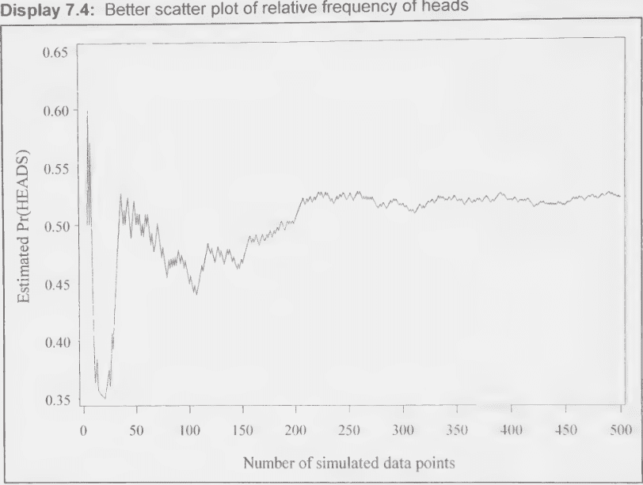

额外的修改将使此散点图更具出版就绪性。由于出版物通常会缩小图形尺寸，您可能希望使绘制的线条更宽，以便成功缩小。颜色（黑色）、线条类型（`line=1` 请求实线）和线条宽度（`width=2` 请求比默认厚度更厚的线条）可以通过 `SYMBOL` 语句进行修改。以下 `SYMBOL` 语句用于前面的代码以生成 Display 7.5：

```
symbol interpol=join color=black line=1 width=2;
```

#### Display 7.5 更好的、更具出版就绪性的正面相对频率散点图

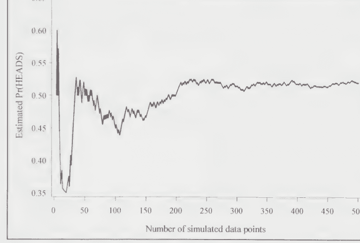

`SYMBOL` 语句可以明确指定散点图中应使用的绘图字符。例如，如果您想要点作为绘图字符，请指定：

```
symbol1 value=dot cv=black;
```

`PROC SGPLOT` 或 `PROC SGPANEL` 中 `MARKERCHAR` 选项的类似规范。`MARKERCHAR` 选项引用一列，并且该列的值（字符串或数字）用作标记。您可能已经注意到在前面的代码中频繁使用 `GOPTIONS`。

```
goptions reset=global;
```

重置图形选项是个好主意。一旦设置了图形选项，它们就会保持设置状态，直到您重置它们。因此，为一张图设置的选项可能会无意中影响后面的图。您可能会惊讶地知道 SAS 在识别其他选项之前会循环遍历特定选项。如果您有图形代码，该代码不会改变您已设置的特定 `SYMBOL` 选项（例如绘图字符），但会改变另一个选项（例如颜色），您可以尝试在每个 `SYMBOL` 语句中定义特征相同（例如在每个 `SYMBOL` 语句中设置 `CV=BLACK`）。

### 7.3 为什么您需要学习注释数据集

> ...他们拿出了二十七张八乘十彩色光面照片，上面有圆圈、箭头，每张照片背面都有一段文字解释每张照片将如何用作反对我们的证据。

您可能有兴趣添加圆圈、箭头和文字来解释一个图形。这就是注释数据集发挥作用的地方。在此点，您已使用 `SYMBOL` 和 `AXIS` 语句的修改构建了图形。现在，您想向图形添加文本、线段和箭头。方法是定义一个包含增强图形说明的数据集（注释数据集）。然后，通过指向此数据集来请求对传统 SAS 图形进行注释。

注释数据集可用于增强使用传统 SAS 图形生成的图形。包括不使用 SAS/GRAPH 软件的程序。注释数据集由每个请求对现有图形执行操作的观测值组成。`SAS/GRAPH` 文档（2009）将其描述为“绘制图形元素或执行操作”的命令。特别是，您定义一个 `FUNCTION` 变量，该变量具有与对图形的操作相关联的特定值。注释数据集具有与图形中定位相关联的变量——`X` 和 `Y`。这些变量可能相对于系统定义——`XSYS` 和 `YSYS`。注释数据集本质上是一系列图形原语，可以轻松应用于现有图形。

让我们从对 Display 7.4 中硬币投掷图的简单注释开始。（代码在 Display 7.3 中。）假设您想在 `PROBABILITY=0.5` 处添加一条水平参考线，并添加文字说明正面出现的长期相对频率应为 0.5。将其分解为步骤会有所帮助。在 0.5 处的水平参考线相当于在此绘图上从 `(0, 0.50)` 绘制到 `(500, 0.50)` 的线。或者相当于将光标移动到点 `(0, 0.50)`，然后绘制线段到 `(500, 0.50)`。添加文本需要定位文本（例如，在水平参考线下方 `(350, 0.48)` 处），然后定义要添加的文本。`ANNOTATE` 函数 `MOVE`、`DRAW` 和 `LABEL` 在 Display 7.6 中实现了这一点。

#### 显示 7.6 对说明抛硬币相对频率的图形进行注释

```
data cointoss;
    retain num_heads 0;
    call streaminit(1234567);
    do itoss = 1 to 1200;
        outcome = RAND('Bernoulli', 0.50);
        num_heads = num_heads + (outcome=1);
        probability_heads = num_heads / itoss;
        output;
    end;
run;

goptions reset=global;
symbol interpol=join;
axis1 order=(0.35 to 0.65 by 0.05)
    minor=NONE
    label=(angle=90 "Estimated Pr(HEADS)");
axis2 order=(0 to 500 by 50)
    minor=NONE
    label=("Number of simulated data points");

data myanno;
length function $ 8 text $ 45;
retain xsys "2" ysys "2";
function="move";  x=0;    y=0.50; output;
function="draw";  x=500;  y=0.50; output;
function="label"; x=350; y=0.48;
    text="Long-term relative frequency of HEADS=0.50"; output;
run;

ods rtf bodytitle
    file="C:\Users\baileraj\Desktop\cointoss2-graph.rtf";
proc print data=myanno;
run;

proc gplot data=cointoss;
    plot probability_heads*itoss / annotate=myanno
                                    vaxis=axis1 haxis=axis2;
run;
quit;
ods rtf close;
```

数据集 `myanno` 包含显示注释的命令。长度声明为 8 确保函数标签不会被截断为四个字符，因为函数的第一个值是四字符值 `move`，而文本长度的声明允许显示更长的文本字符串。 （长度 8 可容纳任何可能的函数参数。）`retain` 语句具有双重功能。它保持 `xsys` 和 `ysys` 的值不变，用于后续行中定义的所有观测值。并且，它将值 2 分配给这些变量。`xsys` 和 `ysys` 变量定义了注释数据集中坐标 `(x,y)` 对所使用的坐标轴定义。值 2 是与数据值比例对应的绝对比例。`XSYS` 和 `YSYS` 值 1 到 6 对应于绝对比例，而 `{7, 8, 9, A, B, C}` 对应于相对比例。你可能会发现 2 对于统计图形的注释或对于与数据区域百分比相关的注释（1, 7）或与图形输出区域百分比相关的注释（3, 9）是最有用的值。第一个观测值将光标移动到 `(0, 0.50)` 位置：

```
function="move"; x=0; y=0.50; output;
```

第二个观测值从当前位置 `(0, 0.50)` 绘制到目标位置 `(500, 0.50)`：

```
function="draw"; x=500; y=0.50; output;
```

第三个观测值在 `(350, 0.48)` 处添加居中文本：

```
function="label"; x=350; y=0.48;
    text="Long-term relative frequency of HEADS=0.50"; output;
```

注释数据集 `myanno` 的内容在显示 7.7 中。

#### 显示 7.7 注释数据集的内容

| Obs | function | Text | xsys | ysys | x | y |
|---|---|---|---|---|---|---|
| 1 | move |  | 2 | 2 | 0 | 0.50 |
| 2 | draw |  | 2 | 2 | 500 | 0.50 |
| 3 | label | Long-term relative frequency of HEADS=0.50 | 2 | 2 | 350 | 0.48 |

注释数据集是通过 `PLOT` 语句的选项作为 `PROC GPLOT` 的一部分呈现的：

```
plot probability_heads*itoss / annotate=myanno;
```

生成的图形和注释显示在显示 7.8 中。

#### 显示 7.8 带注释的硬币正面相对频率散点图

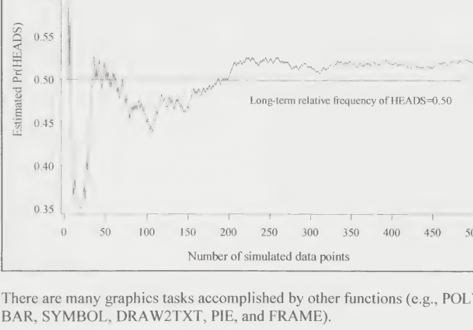

许多图形任务由其他函数完成（例如，`POLY`、`POINT`、`BAR`、`SYMBOL`、`DRAW2TXT`、`PIE` 和 `FRAME`）。

让我们考虑一个更复杂的例子。比值比（`OR`）是 logistic 回归和流行病学调查中报告的常见汇总指标。并不少见，近似置信区间（`CI`）是通过对 `log[OR]` 构造的对称 `CI` 进行指数化而产生的。假设观察到估计 `OR=2` 且估计 `SE{log[OR]}=0.2`。`OR` 的近似 95% `CI` 将为 `exp[log(2) ± 1.96*0.2]`。构造一个显示此内容的图形不是很酷吗？该图形将执行以下操作：

- 说明 `(OR, log[OR])` 关系。
- 将 `OR=2` 映射到其对应的 `log[OR]` 值。
- 从该值移动 ± 1.96 `SE{log[OR]}`。
- 移回 `OR-log[OR]` 轨迹。
- 投影回 `OR` 轴以获得 `CI`。

显示 7.9 提供了构造此图形的代码。图形显示在显示 7.10 中。

#### 显示 7.9 基于指数化对称 CI 构造 OR 的 CI


```
/* generate a profile of [OR, log(OR)] values */
data or_stuff;
   do or=0.01 to 5 by .01;
      logor = log(or);
      output;
   end;
run;

goptions reset=global; * often a good idea, especially if doing a lot of graphs;

/* interpolate btwn [OR, log(OR)] values and set up axes */
symbol interpol=join c=black; * always specify color in symbol stmt;
axis1 label=("Odds Ratio");
axis2 label=(angle=90 "Log(Odds Ratio)");

/* set up annotate data set with arrows and text to illustrate the CI idea */
data myanno;
length function $ 8 text $ 7; * good habit b/c max fcn length=8;
retain xsys "2" ysys "2" function SE;
SE = .2;
function="move"; x=2; y=-5; output;
function="arrow"; x=2; y=log(2); output; * from OR to logOR;
function="arrow"; x=.01; y=log(2); output; * back to y-axis;

function="draw"; x=.01; y=log(2) + 1.96*SE; line=2; output; * upper CI;
function="arrow"; x=exp(log(2) + 1.96*SE); y=log(2) + 1.96*SE; output;
function="arrow"; x=exp(log(2) + 1.96*SE); y=-4.5; output;

function="move"; x=.01; y=log(2); output; * lower CI;
function="draw"; x=.01; y=log(2) - 1.96*SE; output;
function="arrow"; x=exp(log(2) - 1.96*SE); y=log(2) - 1.96*SE; output;
function="arrow"; x=exp(log(2) - 1.96*SE); y=-4.5; output;
function="label";
        x=exp(log(2) - 1.96*SE); y=-4.75; text="LCL OR"; output;
        x=exp(log(2) + 1.96*SE); y=-4.5; text="UCL OR"; output;
        x=2.2; y=-2; text="Step 1"; output;
        x=1; y=log(2) + .25; text="Step 2"; output;
        x=0.5; y=log(2) - 1.96*SE; text="Step 3a"; output;
        x=0.5; y=log(2) + 1.96*SE + .25; text="Step 3b"; output;
        x=3.2; y=-2; text="Step 4a"; output;
        x=1.2; y=-2; text="Step 4b"; position="<"; output; * right justify text;
run;

/* produce the graph with annotation */
ods rtf bodytitle file="C:\Users\baileraj.IT\Desktop\fig7p9.rtf";
proc gplot data=or_stuff;
   plot logor * or / annotate=myanno haxis=axis1 vaxis=axis2;
run;
quit;
ods rtf close;
```

注释数据集的新元素包括：

- 使用 `arrow` 函数。
- 使用 `line=2` 在 `draw` 函数中请求虚线。
- 使用 `position="<"` 请求标签中的文本右对齐。
- 使用 `retain` 将 `label` 函数分配给其后所有注释观测值。

### 显示 7.10 基于指数化对称 CI 构造 OR 的 CI 的概念步骤

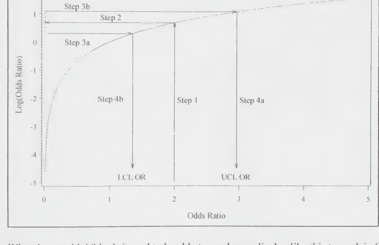

你怎么看？能够制作这样的显示来解释 CI 构造不是很酷吗？

专业的 SAS 程序员经常使用这些方法来构造非常专门的显示。然而，对于想要创建自定义图形的统计用户来说，学习如何使用图形模板语言 `GTL` 和 `PROC SGRENDER` 比学习如何使用注释数据集更值得投入时间。`GTL` 是一种功能强大的语言，具有内置的统计计算功能，而注释数据集是原始的。

## 7.4 案例研究：比较响应分布

在本节中，先前描述的许多想法应用于图形，以帮助你了解实验条件之间响应分布的差异。你将使用 `nitrophen` 数据集，该数据集包含暴露于不同浓度硝基酚的水蚤 `Ceriodaphnia dubia` 的硝基酚浓度-生殖响应数据。² 该数据集在每种浓度下包含 10 个观测值。你想要构造图形以显示响应分布如何随浓度条件变化。你想要呈现数据值和适当的汇总统计量。在第一个图形中，你生成响应与浓度变量的散点图，并在平均响应处设置参考线段。在第二个图形中，你生成散点图，并在每个浓度的响应上叠加箱线图。

显示 7.11 中适用于两个散点图的代码的一些关键操作包括以下内容：

- 定义抖动，以便可以观察到所有观测值。
- 使用 `AXIS` 语句旋转 y 轴标签。
- 定义 x 轴的标签和 x 轴值范围 `AXIS2` 语句的 `LABEL` 和 `ORDER` 部分。
- 抑制 x 轴上的刻度标记和比例值 `AXIS2` 语句中的 `MINOR=NONE`、`MAJOR=NONE` 和 `V=NONE`。

在第一个散点图中，使用注释数据集在 x 轴上方标记浓度值，并绘制并叠加平均响应值的线段。在第二个散点图中，`SYMBOL1` 选择散点图的绘图字符，`SYMBOL2` 选择箱线图插值并指定箱子的宽度 `bwidth=8`。同样，使用注释数据集在 x 轴上方标记浓度值。由于使用了抖动来修改值，因此在这两个散点图中，使用注释数据集来定义 x 轴值。试试看：`AXIS` 语句能否生成这些散点图？

> ² `Nitrophen` 数据集来自 `Bailer, A. John, and James T. Oris. 1994. "Assessing Toxicity of Pollutants in Aquatic Systems." Chapter 2 in Case Studies in Biometry. Nicholas Lange, Louise Ryan, Lynne Billard, David Brillinger, Loveday Conquest, Joel Greenhouse, eds. New Jersey: John Wiley & Sons, Inc. Reprinted with permission of John Wiley & Sons, Inc.`

### Display 7.11 生成总幼崽数与硝基酚浓度的散点图

```
/* load the nitrofen data until a SAS data set is created*/
data nitrofen;
    infile 'C:\Users\baileraj\Desktop\ch2-dat.txt' firstobs=16 expandtabs
        missover pad;
    input @9 animal 2. @17 conc 3. @25 brood1 2. @33 brood2 2.
          @41 brood3 2. @49 total 2.;
    jconc = conc + 15*ranuni(0) - 7.5;  * adding a little jitter to see points;
run;

proc print data=nitrofen;
run;

proc means data=nitrofen;  * obtain means that are hard coded below;
    var total;
    class conc;
run;

/* FIGURE 1: Scatter plot with superimposed segments at group means */
/* set up axes and suppress the x-axis tick marks and labels */
goptions reset=global;
axis1 label=(angle=90 'Total number of young (3 broods)');
axis2 label=('Nitrofen Concentration')  order=(-20 to 340 by 20)
        minor=none major=none v=none;

/* define annotate data set to draw mean segments and nitrofen conc. */
data myanno;
    length function $ 8 text $ 3;
    retain xsys '2' ysys '2';
    function="label"; x=0; y=2; text="0"; output;
    function="label"; x=80; y=2; text="80"; output;
    function="label"; x=160; y=2; text="160"; output;
    function="label"; x=235; y=2; text="235"; output;
    function="label"; x=310; y=2; text="310"; output;
    function='move'; x= 0 - 15; y=31.4; output;   * conc=0;
    function='draw'; x= 0 + 15; y=31.4; size=2; output;
    function='move'; x= 80 - 15; y=31.5; output;   * conc=80;
    function='draw'; x= 80 + 15; y=31.5; size=2; output;
    function='move'; x= 160 - 15; y=28.3; output;   * conc=160;
    function='draw'; x= 160 + 15; y=28.3; size=2; output;
    function='move'; x= 235 - 15; y=17.2; output;   * conc=235;
    function='draw'; x= 235 + 15; y=17.2; size=2; output;
    function='move'; x= 310 - 15; y=6.0; output;   * conc=310;
    function='draw'; x= 310 + 15; y=6.0; size=2; output;
run;
```

### Display 7.11 （续）

```
ods rtf bodytitle file="C:\Users\baileraj.IT\Desktop\fig7p11.rtf";
/* generate figure 1 */
proc gplot data=nitrofen;
  plot total*jconc / vaxis=axis1 haxis=axis2 annotate=myanno;
run;
quit;

/* FIGURE 2: Scatter plot with superimposed box plots */

/* set up axes and suppress the x-axis tick marks and labels */
/* and request box plot interpolations */
options reset=global;
axis1 label=(angle=90 'Total number of young (3 broods)');
axis2 label=('Nitrofen Concentration') order=(-20 to 340 by 20)
  minor=none major=none v=none;
symbol1 i=none v=dot color=black;
symbol2 interpol=box v=none color=black bwidth=8;

/* annotate data set for the concentration labels */
data myanno2;
  length function $ 8 text $ 3;
  retain xsys '2' ysys '2';
  function="label"; x=0; y=2; text="0"; output;
  function="label"; x=80; y=2; text="80"; output;
  function="label"; x=160; y=2; text="160"; output;
  function="label"; x=235; y=2; text="235"; output;
  function="label"; x=310; y=2; text="310"; output;
run;

/* generate figure 2 */
proc gplot data=nitrofen;
  plot total*jconc total*conc / overlay anno=myanno2
    vaxis=axis1 haxis=axis2;
run;
quit;
ods rtf close;
```

幼崽与硝基酚浓度的散点图包含一个表示均值趋势的统计量 `Display 7.12` 中的均值 或值分布的汇总显示 `Display 7.13` 中的箱线图。

### Display 7.12 总幼崽数与硝基酚浓度的散点图，叠加了浓度特异性均值响应的线段

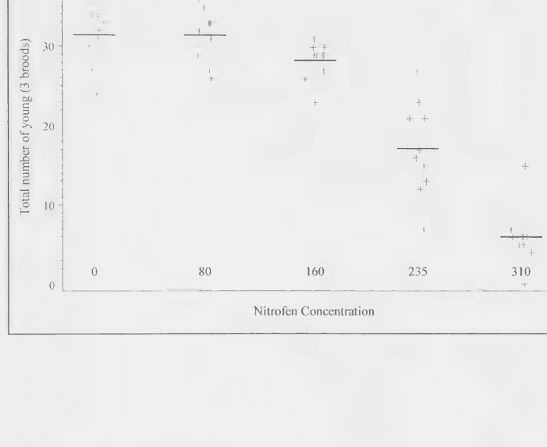

### Display 7.13 总幼崽数与硝基酚浓度的散点图，每个浓度上叠加了箱线图


在两个散点图中，对照组和最低浓度条件下的幼崽总数相似。然而，在三个最高浓度条件下观察到繁殖输出的下降。非正式挑战：使用 `PROC SGPLOT` 制作 `Display 7.13` 中的图形。

你更喜欢哪一个散点图？

## 7.5 空间数据的描述性显示

区域或地理差异通常最好以地图形式描绘。`SAS` 提供了一组地图和用于在这些地图上显示数据的过程。`GMAP` 过程是 `SAS` 中制作地图的基本过程。有关在 `SAS` 中制作地图的概述，请参阅 `Zdeb` `2004`。在 `Display 7.14` 中，提供了制作俄亥俄州各县 1990 年人口的色带地图的代码。

### Display 7.14 制作俄亥俄州各县 1990 年人口的色带地图

```
proc gproject data=maps.counties out=OHIO_counties;
    where state eq 39;
    id state;
run;

/*
(Subset of years from data set of) Ohio County population sizes from 1900-1990
http://www.census.gov/population/cencounts/oh190090.txt
*/
data county_pop;
    length char_county $ 10;
    input county6 1-5 pop90 pop80 pop70 pop60 char_county &;
    county = county6-39000;  * removing state id from FIPS;
    datalines;
39001    25371    24328    18957    19982 Adams
39003    109755   112241   111144   103691 Allen
... (see appendix for complete data set) ...
39175    22254    22651    21826    21648 Wyandot
;
run;
proc gmap data=county_pop
    map=OHIO_counties;
    id county;
    choro pop90;
    note '1990 Population Size (Source: US Census)';
run;
quit;
```


此代码首先使用 `GPROJECT` 进行初始投影，以熟悉的地图方向重构内部 SAS 地图数据集坐标。然后将俄亥俄州县人口数据读入数据集。（完整数据集请参见附录。）地图是通过将地图数据集（`map=OHIO_counties`）与人口数据（`data=county_pop`）链接而构建的。必须有一个变量将每个地图区域链接到与该区域相关联的响应（`id county`）。你需要标识你想要一个色带地图，每个县的着色与县人口值成比例（`choro pop90`）。此代码生成的地图显示在 Display 7.15 中。

### Display 7.15 俄亥俄州各县 1990 年人口地图


该地图说明，最人口众多的县位于西南至东北走廊（辛辛那提→代顿→哥伦布→克利夫兰），西北俄亥俄州（托莱多）还有另一个人口集中区。如果你在地图上标出迈阿密大学的位置，可获得附加分数。不是陷阱题！提示：它不在佛罗里达州。

### 7.6 总结

本章强调了传统的 SAS 绘图以及对其图形显示的定制。还介绍了其他操作。本章以对 SAS 地图世界的展望结束。`SAS/GRAPH` 软件中的图形显示还有更多内容可供探索。如果你对等高线图和三维图感兴趣，那么应探索 `GCONTOUR` 和 `G3D`。如果你对地图显示感兴趣，那么深入研究 SAS 绘图过程，包括 `SAS/GIS` 软件。

第 6 章和第 7 章分别介绍了 `ODS Graphics` 和传统 SAS 绘图的概述。你可以在 `SAS/GRAPH 9.2: Reference` 中找到有关传统 SAS 绘图和 `ODS Graphics` 的更多信息。

传统图形的外观由 `GOPTIONS` 控制，图形显示在图形窗口中并可保存在 SAS 图形目录中。相比之下，`ODS Graphics` 的外观由 `ODS GRAPHICS` 语句中的模板和选项控制。`ODS Graphics` 显示在 `ODS` 目标中，并可保存为多种文件格式。注释数据集用于定制传统 SAS 绘图产生的图形。`ODS Graphics` 编辑器用于定制 `ODS Graphics` 产生的图形，`GTL` 可用于永久修改。

### 7.7 参考文献

`SAS Institute Inc.` 2009. `SAS/GRAPH 9.2: Reference`. Cary, NC: `SAS Institute Inc.`

`Zdeb, Mike` 2004. “The Basics of Map Creation with SAS/GRAPH.” Proceedings of the Twenty-Ninth Annual SAS Users Group International Conference. Cary, NC: `SAS Institute Inc.` Available at http://www2.sas.com/proceedings/sugi29/251-29.pdf.

### 7.8 练习

- 1. 参考包装和对数细菌生长数据。³ 构建三个不同的图形来显示和汇总数据。
- 2. 参考硝基酚数据。使用 `TOTAL` 的平方根作为响应变量相对于浓度的图生成硝基酚数据的图。叠加拟合的二次模型。仅使用 `PROC GPLOT` 生成此图（即，不要先使用 `PROC REG` 生成拟合值）。
- 3. 使用注释数据集和适当的 `SAS/GRAPH` 过程写出你的名字。块印刷即可。

³ 肉数据集的使用基于 `Kuehl, R. O. Statistical Principles of Research Design and Analysis. 1st Ed. © 1994. Brooks/Cole, a part of Cengage Learning, Inc. ISBN: 9780534188047(0534188044)` 中的“肉中细菌生长”数据集。

### 7.9 附录：完整的俄亥俄州县人口数据集

```
/*
Population of Counties by Decennial Census: 1900 to 1990

Compiled and edited by Richard L. Forstall

                Population Division

                US Bureau of the Census

                Washington, DC 20233
*/
data county_pop;
    length char_county $ 10;
    input county6 1-5 pop90 pop80 pop70 pop60 char_county &;
    county = county6-39000;  * removing state id from FIPS;
datalines;
39001    25371    24328    18957    19982 Adams
39003    109755   112241   111144   103691 Allen
39005    47507    46178    43303    38771 Ashland
39007    99821    104215   98237    93067 Ashtabula
39009    59549    56399    54889    46998 Athens
39011    44585    42554    38602    36147 Auglaize
39013    71074    82569    80917    83864 Belmont
39015    34966    31920    26635    25178 Brown
39017    291479   258787   226207   199076 Butler
39019    26521    25598    21579    20857 Carroll
39021    36019    33649    30491    29714 Champaign
39023    147548   150236   157115   131440 Clark
39025    150187   128483   95725    80530 Clermont
39027    35415    34603    31464    30004 Clinton
39029    108276   113572   108310   107004 Columbiana
39031    35427    36024    33486    32224 Coshocton
39033    47870    50075    50364    46775 Crawford
39035    1412140  1498400  1721300  1647895 Cuyahoga
39037    53619    55096    49141    45612 Darke
39039    39350    39987    36949    31508 Defiance
39041    66929    53840    42908    36107 Delaware
39043    76779    79655    75909    68000 Erie
39045    103461   93678    73301    63912 Fairfield
39047    27466    27467    25461    24775 Fayette
39049    961437   869132   833249   682962 Franklin
39051    38498    37751    33071    29301 Fulton
39053    30954    30098    25239    26120 Gallia
39055    81129    74474    62977    47573 Geauga
39057    136731   129769   125057   94642 Greene
39059    39024    42024    37665    38579 Guernsey
39061    866228   873224   924018   864121 Hamilton
39063    65536    64581    61217    53686 Hancock
39065 | 31111 | 32719 | 30813 | 29633 | Hardin
39067 | 16085 | 18152 | 17013 | 17995 | Harrison
39069 | 29108 | 28383 | 27058 | 25392 | Henry
39071 | 35728 | 33477 | 28996 | 29716 | Highland
39073 | 25533 | 24304 | 20322 | 20168 | Hocking
39075 | 32849 | 29416 | 23024 | 21591 | Holmes
39077 | 56240 | 54608 | 49587 | 47326 | Huron
39079 | 30230 | 30592 | 27174 | 29372 | Jackson
39081 | 80298 | 91564 | 96193 | 99201 | Jefferson
39083 | 47473 | 46304 | 41795 | 38808 | Knox
39085 | 215499 | 212801 | 197200 | 148700 | Lake
39087 | 61834 | 63849 | 56868 | 55438 | Lawrence
39089 | 128300 | 120981 | 107799 | 90242 | Licking
39091 | 42310 | 39155 | 35072 | 34803 | Logan
39093 | 271126 | 274909 | 256843 | 217500 | Lorain
39095 | 462361 | 471741 | 484370 | 456931 | Lucas
39097 | 37068 | 33004 | 28318 | 26454 | Madison
39099 | 264806 | 289487 | 303424 | 300480 | Mahoning
39101 | 64274 | 67974 | 64724 | 60221 | Marion
39103 | 122354 | 113150 | 82717 | 65315 | Medina
39105 | 22987 | 23641 | 19799 | 22159 | Meigs
39107 | 39443 | 38334 | 35265 | 32559 | Mercer
39109 | 93182 | 90381 | 84342 | 72901 | Miami
39111 | 15497 | 17382 | 15739 | 15268 | Monroe
39113 | 573809 | 571697 | 606148 | 527080 | Montgomery
39115 | 14194 | 14241 | 12375 | 12747 | Morgan
39117 | 27749 | 26480 | 21348 | 19405 | Morrow
39119 | 82068 | 83340 | 77826 | 79159 | Muskingum
39121 | 11336 | 11310 | 10428 | 10982 | Noble
39123 | 40029 | 40076 | 37099 | 35323 | Ottawa
39125 | 20488 | 21302 | 19329 | 16792 | Paulding
39127 | 31557 | 31032 | 27434 | 27864 | Perry
39129 | 48255 | 43662 | 40071 | 35855 | Pickaway
39131 | 24249 | 22802 | 19114 | 19380 | Pike
39133 | 142585 | 135856 | 125868 | 91798 | Portage
39135 | 40113 | 38223 | 34719 | 32498 | Preble
39137 | 33819 | 32991 | 31134 | 28331 | Putnam
39139 | 126137 | 131205 | 129997 | 117761 | Richland
39141 | 69330 | 65004 | 61211 | 61215 | Ross
39143 | 61963 | 63267 | 60983 | 56486 | Sandusky
39145 | 80327 | 84545 | 76951 | 84216 | Scioto
39147 | 59733 | 61901 | 60696 | 59326 | Seneca
39149 | 44915 | 43089 | 37748 | 33586 | Shelby
39151 | 367585 | 378823 | 372210 | 340345 | Stark
39153 | 514990 | 524472 | 553371 | 513569 | Summit
39155 | 227813 | 241863 | 232579 | 208526 | Trumbull
39157 | 84090 | 84614 | 77211 | 76789 | Tuscarawas
39159 | 31969 | 29536 | 23786 | 22853 | Union
39161 | 30464 | 30458 | 29194 | 28840 | Van Wert
39163    11098    11584    9420    10274 Vinton
39165    113909   99276    84925   65711 Warren
39167    62254    64266    57160   51689 Washington
39169    101461   97408    87123   75497 Wayne
39171    36956    36369    33669   29968 Williams
39173    113269   107372   89722   72596 Wood
39175    22254    22651    21826   21648 Wyandot
;
run;
```

## Part 2

## Doing More with Programming

- Chapter 8 Formatting Variables, Recoding Variables, and Writing Programs ........................................................ 263
- Chapter 9 Programming in a DATA Step ........................................................ 325
- Chapter 10 Macro Programming ........................................................ 351
- Chapter 11 Programming with Matrices and Vectors ........................................................ 389


## Formatting Variables,

Recoding Variables, and

Writing Programs


- 8.1 Internal Representations and Output Displays.................................... 264
- 8.2 Character, Numeric, Time, and Date Formats....................................... 272
- 8.3 Recoding and Transforming Variables in a DATA Step ........... 277
- 8.4 Ordering How Tasks Are Done ....................................................... 285
- 8.5 What Goes and What Stays in a Data Set........................................... 287
- 8.6 Structured Thinking about Writing Programs...................................... 289
- 8.7 Case Study 1: Is the Two-Sample t-Test Robust Enough for Heterogeneous Variances? ........................................................... 290


- 8.8 Case Study 2: Monte Carlo Integration to Estimate an Integral............................................................................... 305

- 8.9 Case Study 3: Simple Percentile-Based Bootstrap................... 310

- 8.10 Throw Out Your Tables of Statistical Distributions ............... 312

- 8.11 Generating Variables Using Random Number Generators....... 320

- 8.12 Summary............................................................................... 322

- 8.13 References........................................................................... 323

- 8.14 Exercises ........................................................................... 323

在前七章中，本书的重点是编写基础代码，使用 SAS 进行各种分析。到现在为止，你应该已经对编写程序的良好习惯有了了解（第 1 章），构建分析数据集（第 2 章），使用过程生成简单的描述性统计（第 3 章），构建复杂的表格并控制输出（第 4 章），使用过程分析简单的线性模型（第 5 章），以及生成高质量的图形显示（第 6 章和第 7 章）。此时，你已准备好超越如何做的描述，进入更实用的主题。本章介绍了不同格式的数据如何读入 SAS。描述了如何在 `DATA` 步中对变量进行重新编码和构建。讨论了操作执行的顺序。提供了在数据集中保留变量和观测值的控制。本章开头的信息将在本章后面用于一个需要定制解决方案的程序中。详细介绍了三个案例研究以说明编程概念。涉及统计分布的操纵以及伪随机数生成结束了本章。

### 8.1 Internal Representations and Output Displays

让我们先讨论如何使用 `informat` 将具有格式值的 data 读入 SAS 数据集，以及如何使用 `format` 显示这些数据。数据可以粗略分为四种类型：字符型、数值型、日期型和时间型。（有人可能会争辩说只有两种类型，因为日期和时间本质上是数值。然而，在讨论格式时，有必要做出这些区分。）`Informat` 告诉 SAS 如何读取数据并存储输入变量。`Format` 告诉 SAS 如何显示变量的值。

读取或存储字符变量最常用的 `informat` 是 `$w`。在此 `informat` 中，`w` 等于变量的列数、字符数或总宽度。读取字符变量的默认 `informat` 是 `$8`。 （即 `$w`，其中默认长度为 8 字节）。在第 5 章中，使用脑重和体重数据集¹ 讨论了多元回归。该数据集包含一个字符变量 `SPECIES`。在本章中，该变量在构建第一个数据集时在 `INPUT` 语句中通过变量名后的 `$` 来标识。 （参见 Display 8.1。）在第二个数据集中，`SPECIES` 在指定于 `INPUT` 语句之前被声明为长度为 15 的字符变量。

#### Display 8.1 使用隐式和显式格式读取字符型和数值型变量

```
data mreexample;
* Lunneborg (1994) - body weight brain example;
input species $ bodywt brainwt @@;
datalines;
beaver      1.35   8.1    cow      465.   423.   wolf      36.33  119.5
goat        27.66  115.   guinea pig   1.04   5.5    diplodocus 11700. 50.
asian elephant 2547.  4603.  donkey   187.1  419.   horse     521.   655.
potar monkey 10.   115.   cat      3.30   25.6   giraffe   529.   680.
gorilla     207.   406.   human    62.    1320.  african elephant 6654. 5712.
triceratops 9400.  70.    rhesus monkey 6.8  179.   kangaroo  35.    56.
hamster     0.12   1.    mouse    0.023  0.4    rabbit    2.5    12.1
sheep       55.50  175.   jaguar   100.   157.   chimp     52.16  440.
brachiosaurus 87000. 154.5 rat     0.28   1.9    mole      0.122  3.
pig         192.0  180
beaver      1.35   8.1    cow      465.   423.   wolf      36.33  119.5
goat        27.66  115.   guinea pig   1.04   5.5    diplodocus 11700. 50.
asian elephant 2547.  4603.  donkey   187.1  419.   horse     521.   655.
potar monkey 10.   115.   cat      3.30   25.6   giraffe   529.   680.
gorilla     207.   406.   human    62.    1320.  african elephant 6654. 5712.
triceratops 9400.  70.    rhesus monkey 6.8  179.   kangaroo  35.    56.
hamster     0.12   1.    mouse    0.023  0.4
rabbit      2.5    12.1
sheep       55.50  175.   jaguar   100.   157.   chimp     52.16  440.
brachiosaurus 87000. 154.5 rat     0.28   1.9
mole        0.122  3.    pig      192.0  180
;
run;

data mreexample2;
    length species $ 15;
    input species bodywt brainwt @@;
    datalines;
beaver      1.35   8.1    cow      465.   423.   wolf      36.33  119.5
goat        27.66  115.   guinea pig   1.04   5.5    diplodocus 11700. 50.
asian elephant 2547.  4603.  donkey   187.1  419.   horse     521.   655.
potar monkey 10.   115.   cat      3.30   25.6   giraffe   529.   680.
gorilla     207.   406.   human    62.    1320.  african elephant 6654. 5712.
triceratops 9400.  70.    rhesus monkey 6.8  179.   kangaroo  35.    56.
hamster     0.12   1.    mouse    0.023  0.4    rabbit    2.5    12.1
sheep       55.50  175.   jaguar   100.   157.   chimp     52.16  440.
brachiosaurus 87000. 154.5 rat     0.28   1.9    mole      0.122  3.
pig         192.0  180
beaver      1.35   8.1    cow      465.   423.   wolf      36.33  119.5
goat        27.66  115.   guinea pig   1.04   5.5    diplodocus 11700. 50.
asian elephant 2547.  4603.  donkey   187.1  419.   horse     521.   655.
potar monkey 10.   115.   cat      3.30   25.6   giraffe   529.   680.
gorilla     207.   406.   human    62.    1320.  african elephant 6654. 5712.
triceratops 9400.  70.    rhesus monkey 6.8  179.   kangaroo  35.    56.
```

#### Display 8.1 （续）

```
hamster      0.12  1.      mouse      0.023 0.4   rabbit      2.5     12.1
sheep        55.50 175.    jaguar     100.   157.   chimp       52.16   440.
brachiosaurus 87000. 154.5  rat        0.28  1.9    mole        0.122   3.
pig          192.0  180
;
run;

ods rtf file="C:\Users\baileraj.IT\Desktop\Display-7-02.rtf";
proc print data=mreexample;
id species;
run;
proc print data=mreexample2;
id species;
run;
ods rtf close;
```

这两个数据集在 Display 8.2 中进行了比较以供对照。

#### Display 8.2 读取字符型和数值型变量后的输出

| data mreexample; input species $ bodywt brainwt @@; | data mreexample2; length species $ 15; input species bodywt brainwt @@; |

| species | bodywt | brainwt | species | bodywt | brainwt |

| beaver | 1.35 | 8.1 | beaver | 1.35 | 8.1 |

| cow | 465.00 | 423.0 | cow | 465.00 | 423.0 |

| wolf | 36.33 | 119.5 | wolf | 36.33 | 119.5 |

| goat | 27.66 | 115.0 | goat | 27.66 | 115.0 |

| guipig | 1.04 | 5.5 | guipig | 1.04 | 5.5 |

| diplodoc | 11700.00 | 50.0 | diplodocus | 11700.00 | 50.0 |

| asieleph | 2547.00 | 4603.0 | asielephant | 2547.00 | 4603.0 |

| donkey | 187.10 | 419.0 | donkey | 187.10 | 419.0 |

| horse | 521.00 | 655.0 | horse | 521.00 | 655.0 |

| potarmon | 10.00 | 115.0 | potarmonkey | 10.00 | 115.0 |

| cat | 3.30 | 25.6 | cat | 3.30 | 25.6 |

（续）

#### Display 8.2 （续）

| data mreexample; input species $ bodywt brainwt @@; | data mreexample2; length species $ 15; input species bodywt brainwt @@; |

| species | bodywt | brainwt | species | bodywt | brainwt |

| giraffe | 529.00 | 680.0 | giraffe | 529.00 | 680.0 |

| gorilla | 207.00 | 406.0 | gorilla | 207.00 | 406.0 |

| human | 62.00 | 1320.0 | human | 62.00 | 1320.0 |

| afreleph | 6654.00 | 5712.0 | afrelephant | 6654.00 | 5712.0 |

| tricerat | 9400.00 | 70.0 | triceratops | 9400.00 | 70.0 |

| rhemonke | 6.80 | 179.0 | rhemonkey | 6.80 | 179.0 |

| kangaroo | 35.00 | 56.0 | kangaroo | 35.00 | 56.0 |

| hamster | 0.12 | 1.0 | hamster | 0.12 | 1.0 |

| mouse | 0.02 | 0.4 | mouse | 0.02 | 0.4 |

| rabbit | 2.50 | 12.1 | rabbit | 2.50 | 12.1 |

| sheep | 55.50 | 175.0 | sheep | 55.50 | 175.0 |

| jaguar | 100.00 | 157.0 | jaguar | 100.00 | 157.0 |

| chimp | 52.16 | 440.0 | chimp | 52.16 | 440.0 |

| brachios | 87000.00 | 154.5 | brachiosaurus | 87000.00 | 154.5 |

| rat | 0.28 | 1.9 | rat | 0.28 | 1.9 |

| mole | 0.12 | 3.0 | mole | 0.12 | 3.0 |

| pig | 192.00 | 180.0 | pig | 192.00 | 180.0 |

在第一个数据集中，`SPECIES` 变量被 `$` 指示符标识为字符变量（而不是使用诸如 `$15.` 之类的 `informat`）。虽然该变量的所有值都被读取，但默认情况下只读取并存储前八个字符。第二个数据集使用 `length` 语句声明变量的类型（字符）和长度（15）。

数值变量使用 `informat` 读取并使用 `format` 显示。数值 `informat` 和 `format` 的指定涉及声明格式的名称、显示宽度以及小数点右侧的小数位数。例如，这里有一个规范：

```
format-namew.d
```

`w` 是总宽度，包括小数点和小数点右侧的小数位数）。`d` 是小数点右侧的小数位数。

当指定 `BESTw.` 格式时，SAS 使用一个或多或少最佳的格式。其他数值格式包括 `Ew.` 用于科学计数法，`COMMAw.d` 用于每连续三位数后加逗号分隔的值，`DOLLARw.d` 用于货币（在数值左侧添加 $），以及 `w.d` 用于最常见和默认的数值格式。Display 8.3 包含一个探索这些数值格式的简单程序。

#### Display 8.3 显示数值格式的 DATA 步

```sas
data numeric_format_show;
/* character formatting illustrated first */
test_num = 1277695.384;
put 'BEST6. / BEST9. / BEST12.' ;
put test_num BEST6.;
put test_num BEST9.;
put test_num BEST12.;
put '-------------------------------';
put 'COMMA7. / COMMA10.1 / COMMA11.3';
put test_num COMMA7.;
put test_num COMMA10.1;
put test_num COMMA11.3;
put '-------------------------------';
put 'E7.';
put test_num E7.;
put '-------- -- -- --------';
put '7. / 10.1 / 11.3';
put test_num 7.;
put test_num 10.1;
put test_num 11.3;
put '-------------------------------';
put 'DOLLAR9. / DOLLAR12.2';
put test_num DOLLAR9.;
put test_num DOLLAR12.2;
run;
```

Display 8.4 中的输出完全正确。像 `1277695.384` 这样的数字需要 `w=11` 和 `d=3` 才能完全显示。如果指定 `w=11`，则需要对值进行四舍五入。有趣的是，当 `w=6` 时，`BEST` 格式会以科学计数法显示。

#### Display 8.4 使用数值格式示例的 SAS 日志输出


```
BEST6. / BEST9. / BEST12.
    1.28E6
    1277695.4
    1277695.384
    .....................
COMMA7. / COMMA10.1 / COMMA11.3
    1,277,695
    1,277,695.4
    1,277,695.384
    .....................
E7.
    1.3E+06
    .....................
7. / 10.1 / 11.3
    1277695
    1277695.4
    1277695.384
    .....................
DOLLAR9. / DOLLAR12.2
    $1277695
    $1277695.38
```

格式可以通过将格式声明为伴随过程的语句来临时关联到变量。格式也可以通过在 `DATA` 步中将格式链接到变量来永久关联到变量。下一节描述了用户定义格式的构造情况，然后使用 `DATA` 步中的声明将其链接到变量。

### 8.1.1 定义你自己的格式和 informat

有时，SAS 的格式和 informat 可能并不完全是你需要的。此外，你可能希望自定义变量值的显示。在这些情况下，你需要定义自己的格式。在第 2 章中，当讨论读取变量值时，该任务曾被简要介绍。在第 3 章中，在介绍增强分析输出时也提到了它。SAS 使用 `FORMAT` 过程相对容易地定义格式和 informat。对于定义数值格式，语句的一般形式如下：

```sas
proc format
<options: LIBRARY=SAS library/catalog to contain formats/informats.>;
value name <value-range-set(s)>;
run;
```

对于定义字符格式，这里是语句的一般形式：

```sas
proc format
<options: LIBRARY=SAS library/catalog to contain formats/informats.>;
value $name <value-range-set(s)>;
run;
```

格式的定义方式类似，只是将 `value` 语句替换为 `invalue` 语句。

下面的示例探讨了定义用户定义格式。考虑一个简单的包含对应于某地区识字居民百分比的变量的数据集。有效响应需要在 0% 到 100% 之间。超出此范围的值无效，而缺失值被标识为缺失。以下代码说明了此格式。（类别的截断点 53、76 和 90 假定已知。）有效范围和缺失值被映射到其格式化的标签。所有其他条目都被标记为无效。`literacyfmt` 格式中的 `OTHER = 'Invalid'` 语句捕获格式声明中尚未分类的所有值。（范围可以从变量的最小非缺失值 `LOW-` 开始，并延伸到最大值 `-HIGH`。Bilenas (2005) 和 Cody 和 Pass (1995) 对这些值以及许多其他格式特性给出了很好的描述。）格式名称 `literacyfmt` 在使用 `FORMAT` 语句将 `LITERACY` 变量链接到 `toyexample2` 数据集的定义中时附加了一个句点。

#### Display 8.6 (continued)

| obs | literacy | literacy_too |
| --- | --- | --- |
| 7 | Fourth quartile | 99.90 |
| 8 | Invalid | 107.00 |
| 9 | Missing | . |

格式附加到 `LITERACY` 变量，但 `LITERACY` 变量的值仍在内部存储为数值变量。这可以通过 `PROC MEANS` 语句的输出得到验证，该输出在 Display 8.7 中提供。在 Display 8.7 中，所有八个非缺失变量值都用于汇总统计，包括两个无效条目。

#### Display 8.7 Output from PROC MEANS

| Variable | N | Mean | Std Dev | Minimum | Maximum |
| --- | --- | --- | --- | --- | --- |
| literacy | 8 | 49.5812500 | 65.6923019 | -99.0000000 | 107.0000000 |
| literacy_too | 8 | 49.5812500 | 65.6923019 | -99.0000000 | 107.0000000 |

## 8.2 Character, Numeric, Time, and Date Formats

正如乐队 Chicago 所唱的：

> "Does anybody really know what time it is? Does anybody really care?"

简单的答案是“是的”。如果你正在分析时间索引的观测值，并且希望 SAS 正确地表示和操作时间-日期数据，你就会在意。

可以使用许多格式来读取和显示日期和时间。这是可以预期的。这些值可能以多种方式记录并作为数据输入。日期可能记录为 30jun10、30jun2010、063010，甚至 30.06.10。所有这些值都需要使用不同的 informat 将其读入 SAS，如 Display 8.8 所示。

#### Chapter 8: Formatting Variables, Recoding Variables, and Writing Programs 273

#### Display 8.8 Formats for reading common date values into SAS

```sas
data tester;
input @1 indate1 date7. @9 indate2 date9.
@19 indate3 mmddyy. @26 indate4 ddmymy8.;
datalines;
30jun10 30jun2010 063010 30.06.10
;
run;
ods rtf file="C:\Users\baileraJ.IT\Desktop\Display-8-08.rtf";
proc print data=tester;
run;
ods rtf close;
```

四个日期值均无错误地读取。然而，Display 8.9 中 `PROC PRINT` 的输出可能会让你感到惊讶。为什么 30jun10、30jun2010、063010 和 30.06.10 都显示为 18443？

#### Display 8.9 Output from PROC PRINT

| Obs | indate1 | indate2 | indate3 | indate4 |
|-----|---------|---------|---------|---------|
| 1 | 18443 | 18443 | 18443 | 18443 |

日期在 SAS 中存储为从选定时间点开始的天数。特别是，SAS 默认选定的时间点是 1960 年 1 月 1 日。因此，2010 年 6 月 30 日距离 1960 年 1 月 1 日为 18443 天。将日期以数值形式存储是有用的。你可能想从日期构造变量。例如，假设 `DOB` 和 `DOD` 分别对应研究中个体的出生日期和死亡日期变量。如果 `DOB` 和 `DOD` 存储为数值变量，则死亡年龄（以年为单位）可以直接用 `AGE AT DEATH=(DOD–DOB)/365.25` 计算。即使你希望以数值形式存储日期，以数值形式显示日期也没有用。要以有用的格式显示日期，请将日期格式之一分配给包含日期的变量，如 Display 8.10 所示。

#### Display 8.10 Assigning date formats to numeric variables

```sas
data tester2;
    input @1 indate1 date7. @9 indate2 date9.
          @19 indate3 mmddyy. @26 indate4 ddmmyy8.;
    format numeric_date9.;
datalines;
30jun10 30jun2010 063010 30.06.10
;
run;

ods rtf file="C:\Users\baileraj.IT\Desktop\Display-8-10.rtf";
proc print data=tester2;
run;
ods rtf close;
```

`informat`——`date7`、`date9`、`mmddyy` 和 `ddmmyy8`——用于读取 Display 8.10 中数据集中的日期。`date9` 格式被分配给 `tester2` 数据集中的所有数值变量。

#### Display 8.11 Output from PROC PRINT with dates appropriately formatted

| Obs | indate1 | indate2 | indate3 | indate4 |
| --- | --- | --- | --- | --- |
| 1 | 30JUN2010 | 30JUN2010 | 30JUN2010 | 30JUN2010 |

除了以有用的格式显示日期之外，你可能还对以不同格式显示日期，或显示日期的组成部分（如日或月）感兴趣。Display 8.12 说明了一些这些选项。

#### Display 8.12 Various date formats

```sas
data date_format_show;
    start = 0;
    put start date9.;
    today = 17700;  * days since Jan 1, 1960;
    put '----------------------------';
    put 'DATE7. / DATE9.';
    put today date7.;
    put today date9.;
    put '----------------------------';
    put 'DAY?. / DAY?.';
    put today day?.;
    put today day7.;
    put '----------------------------';
    put 'EURDFDD8.';
    put today eurdfdd8.;
    put '----------------------------';
```

#### Display 8.12 (continued)

```sas
put 'MMDDYY8. / MMDDYY6.';
put today mmddyy8.;
put today mmddyy6.;
put '----------------------';
put 'WEEKDATE15. / WEEKDATE29.';
put today weekdate15.;
put today weekdate29.;
put '----------------------';
put 'WORDDATE12. / WORDDATE18.';
put today worddate12.;
put today worddate18.;
run;
```

日期使用 Display 8.12 中提供的代码中的 `PUT` 语句写入 SAS 日志。SAS 日志的内容在 Display 8.13 中显示。

#### Display 8.13 SAS log displaying dates using different formats

```
01JAN1960
--------------------------------
DATE7. / DATE9.
17JUN08
17JUN2008
--------------------------------
DAY2. / DAY7.
17
17
--------------------------------
EURDFDD8.
17.06.08
--------------------------------
MMDDYY8. / MMDDYY6.
06/17/08
061708
--------------------------------
WEEKDATE15. / WEEKDATE29.
Tue, Jun 17, 08
Tuesday, June 17, 2008
--------------------------------
WORDDATE12. / WORDDATE18.
Jun 17, 2008
June 17, 2008
```

时间需要存储为相对于参考时间的经过时间。在 SAS 中，时间记录为自午夜以来经过的秒数。Display 8.14 包含代码来使用时间和日期常量定义三个变量（字符表达式中的 `t` 和 `d` 将这些变量定义为时间和日期）。代码显示了值的内部存储值和格式化。

#### Display 8.14 Time and date formats

```sas
Data NULL;
 time_date_origin = 0;
 nowtime = '09:00't;
 today = '17jun2008'd;
 put time_date_origin @20 time_date_origin datetime13.;
 put nowtime @20 nowtime time9.;
 put today @20 today date9.;
 run;
```

在 Display 8.15 中，9:00:00 对应于 9*60*60=32400 秒自午夜以来。而 17JUN2008 对应于自 1960 年 1 月 1 日以来 17700 天。

#### Display 8.15 Time and date values in SAS

|  |  |
|---|---|

| 0 | 01JAN60:00:00 |
| 32400 | 9:00:00 |
| 17700 | 17JUN2008 |

最后一个示例是读取日期、时间和货币数据到 SAS 数据集中的简单说明。数据值被打印出来。假设你的数据格式如下：

```
1       2       3       4
1234567890123456789012345678901234567890 [column guides]
01/01/1960      01:00:00 $100.22
09/29/2003      09:49:59 $12693.79
```

数据可以使用 Display 8.16 中的程序读取和显示。

#### Display 8.16 将日期、时间和货币数据读入 SAS

```sas
data test;
  input @1 date MMDDYY10. @21 time TIME8. @31 money DOLLAR10.2;
  datalines;
01/01/1960      01:00:00  $100.22
09/29/2003      09:49:59  $12693.79
;
run;

ODS RTF file="C:\Users\baileraj.IT\Desktop\Display-8-16.rtf";
proc print data=test;
title "print of date and time w/o formatting - internal SAS representation";
var date time money;
run;

proc print data=test;
title "print of date and time w/ formatting";
var date time;
format date MMDDYY10. time TIME8. money DOLLAR10.2;
run;
ODS RTF CLOSE;
```

比较有格式和无格式打印此数据的情况如 Display 8.17 所示。

#### Display 8.17 包含日期、时间和货币数据的 PROC PRINT 输出

| proc print; var date time money; | proc print; var date time money; format date MMDDYY10. time TIME8. money DOLLAR10.2; |
|---|---|

| Obs | date | time | money | Obs | date | time | money |
| 1 | 0 | 3600 | 100.22 | 1 | 01/01/1960 | 1:00:00 | $100.22 |
| 2 | 15977 | 35399 | 12693.79 | 2 | 09/29/2003 | 9:49:59 | $12,693.79 |

## 8.3 在 DATA 步中重新编码和转换变量

`DATA` 步是定义、重新定义和转换变量以供后续分析的核心枢纽。常见的转换示例包括对响应变量进行方差稳定化或线性化转换、为多项式回归定义高阶项，以及构建指示变量。以下使用 Display 8.18 中编码的 `nitrofen` 数据³ 突出了其中两个任务。

#### Display 8.18 在拟合多项式回归模型之前的数据转换


```
data nitrofen;
infile 'C:\Users\baileraJ.IT\Desktop\ch2-dat.txt' firstobs=16 expandtabs;
input 017 conc 3. 049 total 2.;
sqrt_total = sqrt(total); * transformed response variable;
cconc = conc - 157; * construct mean-centered concentration;
cconc2 = cconc*cconc; * quadratic term;
run;
ods rtf BODYTITLE file="C:\Users\baileraJ.IT\Desktop\Display-8-18.rtf";
ods graphics on;
proc reg data=nitrofen;
model sqrt_total = cconc cconc2; * fit the polynomial reg. model;
run;
ods graphics off;
ods rtf close;
```

均值中心化的浓度是在不同的程序中确定的，并在此处硬编码。 （使用 `PROC STANDARD` 构造包含浓度变量均值中心化版本的变量会更简洁，然后将其输出到新的数据集中。你能在家里弄清楚如何做到这一点吗？）对转换进行 `DATA` 步编程的更令人感兴趣的替代方案还包括以下内容：

- `PROC GLM` with `MODEL SQRT_TOTAL=CONC | CONC;`

- `PROC TRANSREG` with `MODEL POWER(TOTAL / PARAMETER=0.5)=PSPLINE(CONC / CENTER DEGREE=2);`

与此拟合的多项式回归模型关联的 `ODS` 图形如 Display 8.19 所示。

> ³ `Nitrofen` 数据集来自 Bailer, A. John., and James T. Oris. 1994. "Assessing Toxicity of Pollutants in Aquatic Systems." Chapter 2 in Case Studies in Biometry. Nicholas Lange, Louise Ryan, Lynne Billard, David Brillinger, Loveday Conquest, Joel Greenhouse, eds. New Jersey: John Wiley & Sons, Inc. Reprinted with permission of John Wiley & Sons, Inc.

## Display 8.19 来自多项式回归模型的输出


模型拟合得出了以下预测方程：

```
predicted sqrt(Total)=5.25-0.01×(conc-157)-0.00056×(conc-157)²
```

在此模型中，计数响应进行了平方根转换。 （它进行平方根转换是因为我们假设 `Total` 为 Poisson 变量，因此应应用方差稳定化转换。）浓度变量进行了中心化。 变量 `CCONC2` 包含中心化变量的平方。试试看：如果你不将 `CONC` 预测变量中心化而对其进行平方， collinearity 诊断会改变吗？你将如何解释此模型的參數？

另一个常见的转换涉及根据变量的值构造指示变量。 定义这些指示变量的最简单方法之一是进行布尔比较，其结果被强制转换为数值形式。 在这里，如果语句为真，则分配值 1。 如果语句为假，则分配值 0。 在第 5 章中，构造了一个指示变量，以使恐龙的体重和脑重关系与数据集中其他动物不同。 用于构造指示变量的语句如下：

```
idino = 0;                * define the indicator of dinosaurs;
if (species="diplodoc" or species="tricerat" or
    species="brachios") then
idino=1;
```

指示变量 `idino` 首先对所有观测值初始化为 0，如果条件 `(species="diplodoc" or species="tricerat" or species="brachios")` 为真，则重新分配为 1。 这里有一个避免初始化和条件检查的替代语句：

```
idino = (species="diplodoc" or species="tricerat" or
    species="brachios");
```

此语句在条件为假时将 `idino` 分配为 0，在条件为真时将 `idino` 分配为 1。 必须认识到这些比较中大小写很重要。 如果 `species` 的值为 `Diplodoc`，则 `idino` 为 0，因为 `Diplodoc` 与 `diplodoc` 不同。

对于下一个指示变量示例，使用了包装和对数细菌生长数据⁴。 假设你想使用指示变量的线性回归作为单向方差分析模型的替代方案。 数据中存在四种不同的包装条件。 Display 8.20 中的代码为每种条件定义了一个指示变量。 `PROC GLM` 中的 `CLASS` 语句会自动为方差分析模型生成指示变量。

## Display 8.20 为拟合方差分析模型定义不同条件的指示变量

```
options nodate formdlim="-";
data meat;
    input condition $ logcount @@;
    iPlastic = (condition ="Plastic");
    iVacuum = (condition="Vacuum");
    iMixed  = (condition="Mixed");
    iCO2    = (condition="Co2");
    datalines;
Plastic    7.66  Plastic    6.98  Plastic    7.80
Vacuum     5.26  Vacuum     5.44  Vacuum     5.80
Mixed      7.41  Mixed      7.33  Mixed      7.04
Co2        3.51  Co2        2.91  Co2        3.66
;
run;

title "bacteria growth under 4 packaging conditions";

ODS RTF bodytitle file="C:\Users\baileraj.IT\Desktop\Display-8-20.rtf";

proc print data=meat;
title "Print to check indicator variable construction";
run;

proc reg data=meat;
title "Regression with indicator variables: alt. to one-way anova model";
    model logcount = iPlastic iVacuum iMixed;
run;

proc glm data=meat;
title "One-way ANOVA model";
    class condition;
    model logcount = condition;
run;

ods rtf close;
```

Display 8.21 包含 Display 8.20 中 `PROC PRINT` 的输出。 此输出可让你检查重新编码是否按预期工作。 （其他过程的输出被省略）。

## Display 8.21 PROC PRINT 输出

| condition | logcount | iPlastic | iVacuum | iMixed | iCO2 |
|-----------|----------|----------|---------|--------|------|
| Plastic   | 7.66     | 1        | 0       | 0      | 0    |
| Plastic   | 6.98     | 1        | 0       | 0      | 0    |
| Plastic   | 7.80     | 1        | 0       | 0      | 0    |
(continued)

## Display 8.21 (continued)

| condition | logcount | iPlastic | iVacuum | iMixed | iCO2 |
|-----------|----------|----------|---------|--------|------|
| Vacuum | 5.26 | 0 | 1 | 0 | 0 |
| Vacuum | 5.44 | 0 | 1 | 0 | 0 |
| Vacuum | 5.80 | 0 | 1 | 0 | 0 |
| Mixed | 7.41 | 0 | 0 | 1 | 0 |
| Mixed | 7.33 | 0 | 0 | 1 | 0 |
| Mixed | 7.04 | 0 | 0 | 1 | 0 |
| Co2 | 3.51 | 0 | 0 | 0 | 1 |
| Co2 | 2.91 | 0 | 0 | 0 | 1 |
| Co2 | 3.66 | 0 | 0 | 0 | 1 |

打印数据集证实指示变量已正确构造。 （重新编码变量后打印数据始终是一个好主意。）顺便说一下，`PROC REG` 和 `PROC GLM` 输出中 `F_obs=94.58`，均未显示。 不妨自己试试这段代码。

你可以在 `DATA` 步中使用“布尔技巧”来构造更复杂的变量。 让我们重新审视具有变量 `LITERACY` 的数据，该变量记录为百分比。 你想重新编码此变量。 你决定根据变量值所在的区间对观测值进行标记（例如，≤53%、53% 至 76%、76% 至 90% 或 >90%）。 你想将类别标签 1、2、3 和 4 分配给这些区间。 数据包含位于区间内的观测值、一些值超出有效范围（0 到 100）的观测值，以及一个缺失观测值。 Display 8.22 中为类别定义了四个不同的指示变量。

### Display 8.22 定义识字类别的指示变量

```
data toyexample;
    input literacy @@;

/* method 1-2:
    Boolean trick to assign category labels 1-4;
    If a logical comparison is TRUE (FALSE), it evaluates to 1 (0)
    e.g. if literacy=54, (53<literacy<=76)=TRUE while
        (0<literacy<=53)=(76<literacy<=90)=(90<literacy<=100)=FALSE
        And so cat_literacy1 = 1*0 + 2*1 + 3*0 + 4*0 = 2
*/

cat_literacy1 = 1*(0<literacy<=53) + 2*(53<literacy<=76)
    + 3*(76<literacy<=90) + 4*(90<literacy<=100);

cat_literacy2 = 1*(literacy<=53) + 2*(53<literacy<=76)
    + 3*(76<literacy<=90) + 4*(90<literacy<=100);

/*
    method 3:
    First check for nonmissing and valid ranges before Boolean trick
*/

if ( (literacy NE .) AND (0<=literacy<=100) ) then
    cat_literacy3 = 1*(literacy<=53) + 2*(53<literacy<=76)
        + 3*(76<literacy<=90) + 4*(90<literacy<=100);

/* method 4:
    IF-THEN-ELSE blocks to assign category labels
*/

if ( (literacy EQ .) OR (100<literacy)
        OR (literacy<0) ) then cat_literacy4=.;
else if (literacy <=53) then cat_literacy4=1;
else if (literacy <=76) then cat_literacy4=2;
else if (literacy <=90) then cat_literacy4=3;
else cat_literacy4=4;
datalines;
-99 25.55 73.7 83   99.9 107 .
;
run;
ods rtf file="C:\Users\baileraj.IT\Desktop\Display-8-22.rtf";
proc print data=toyexample;
run;
ods rtf close;
```

四个不同的指示变量显示在 Display 8.23 中。

### Display 8.23 不同指示变量的 PROC PRINT 输出

| Obs | literacy | cat_literacy1 | cat_literacy2 | cat_literacy3 | cat_literacy4 |
|---|---|---|---|---|---|
| 1 | -99.00 | 0 | 1 | . | . |
| 2 | 25.55 | 1 | 1 | 1 | 1 |
| 3 | 73.70 | 2 | 2 | 2 | 2 |
| 4 | 83.00 | 3 | 3 | 3 | 3 |
| 5 | 99.90 | 4 | 4 | 4 | 4 |
| 6 | 107.00 | 0 | 0 | . | . |
| 7 | . | 0 | 1 | . | . |

观察定义变量 `cat_literacy1` 的第一种方法。当 `literacy=54` 时，第一个条件 `(0<literacy<=53)` 为 FALSE。第二个条件 `(53<literacy<=76)` 为 TRUE。第三个条件 `(76<literacy<=90)` 为 FALSE。第四个条件 `(90<literacy<=100)` 为 FALSE。考虑以下表达式：

```
cat_literacy1 = 1*(0<literacy<=53) + 2*(53<literacy<=76)
              + 3*(76<literacy<=90) + 4*(90<literacy<=100);
```

如果 `TRUE =1` 且 `FALSE =0`，则该表达式求值为以下内容：

```
cat_literacy1 = 1*(0) + 2*(1) + 3*(0) + 4*(0) = 2
```

如果你希望保留 `LITERACY` 的缺失值，或者希望将有效范围之外的取值赋为缺失值，则此代码不会按预期行为运行。如果 `LITERACY` 缺失 `(.)`，或其取值超出所测试的范围 `(-99` 到 `107)`，则没有任何条件为 TRUE，且 `cat_literacy1=0`。

第二种方法导致了值得注意的其他行为。考虑以下表达式：

```
cat_literacy2 = 1*(literacy<=53) + 2*(53<literacy<=76)
              + 3*(76<literacy<=90) + 4*(90<literacy<=100);
```

此方法在 `LITERACY` 为 `-99` 或缺失时将 `cat_literacy2=1`。此赋值发生是因为条件 `(literacy<=53)` 对 `-99` 为 TRUE（不出所料，因为 `-99≤53`），且缺失观测为 TRUE（可能令人惊讶，因为你可能不知道缺失 `(.)≤53`）。

第三种和第四种方法的行为符合预期。首先进行非缺失值和有效范围的 `IF` 检查。如果该值通过此检查，则类别的分配遵循前两种方法分配类别的方式。第四种方法使用 `IF–THEN–ELSE` 构造。代码稍长，但可能更容易理解。关键是始终使用边界、无效和缺失案例测试你的代码，以确保你得到想要的结果。

## 8.4 任务执行的顺序

在开始为问题实现编程解决方案之前，你需要知道计算执行的顺序（所谓的运算顺序或运算优先级）。让我们快速看一下初学者程序员常见的头痛来源。（如果你已经知道这些内容，则跳过。）计算机做你所说的，而不是你所想的。因此，你应仔细编写程序，尤其是方程。当编码方程时，请记住计算机以特定顺序执行方程的各部分。如果没有括号，则先进行指数运算。然后，第二步进行乘法和除法（同等优先级）。最后进行加法和减法（同等优先级）。括号内的表达式先于其他表达式处理。处理方程时从左到右求值。`AND` 运算符在 `OR` 运算符之前执行，这在复杂的表达式中如果程序未包含括号时可能会产生差异。

让我们从抽象转向具体。下一个示例说明了粗心编码的一些危险。在示例中，请特别注意计算对：

```
x1a=3×2² versus x1b=(3×2)²
x2a=3−2/2 versus x2b=(3−2)/2
x3a=−2² versus x3b=(−2)²
```

你可能期望由于括号的分组，这对会产生不同的值。然而，当你查看代码时，这并不完全清晰。例如，如果你天真地认为代码不考虑运算顺序而从左到右处理，那么你可能会期望 `x2a=3−2/2` 和 `x2b=(3−2)/2` 产生相同的答案。Display 8.24 包含测试代码，证明情况并非如此。

## Display 8.24 运算顺序的测试代码


```
data preced_test;
  x1a = 3*2**2;
  x1b = (3*2)**2;
  x2a = 3-2/2;
  x2b = (3-2)/2;
  x3a = -2**2;
  x3b = (-2)**2;
  put '--------------------------------';
  put ' | Order of operations |';
  put ' | illustrated |';
  put '--------------------------------';
  put '  3*2**2 = ' x1a;
  put ' (3*2)**2 = ' x1b;
  put '  3-2/2 = ' x2a;
  put ' (3-2)/2 = ' x2b;
  put '  -2**2 = ' x3a;
  put ' (-2)**2 = ' x3b;
run;
```

Display 8.24 中编码的每个运算的结果显示在 Display 8.25 中。

#### Display 8.25 运算顺序测试代码的输出

```
--------------------------------
| Order of operations |
| illustrated |
--------------------------------
  3*2**2 = 12
 (3*2)**2 = 36
  3-2/2 = 2
 (3-2)/2 = 0.5
  -2**2 = -4
 (-2)**2 = 4
```

这个编程故事有一个简单的寓意——如果你希望运算按特定顺序进行，请使用括号。

### 8.5 数据集中保留什么、丢弃什么

你已使用 `DATA` 步将数据读入变量并操纵数据，例如定义新变量。完成这些任务后，你可能希望通过去掉多余变量来简化数据集。选项 `DROP` 和 `KEEP` 指定要从 SAS 数据集中删除或保留的变量。除了消除变量之外，你可能还希望保留满足某些条件的观测。语句 `WHERE` 和 `IF` 使你能够指定要在 SAS 数据集中保留的变量的值。例如，以下语句仅包含数值变量 `LITERACY` 缺失值的观测：

```
if literacy EQ .;
```

`IF` 语句可用于一系列 `IF-THEN-ELSE` 表达式。`WHERE` 语句可以执行与 `IF` 语句类似的工作，但它具有特定的运算符，`BETWEEN-AND`、`CONTAINS`、`IS NULL`、`IS MISSING`、`LIKE` 和 `SAME-AND`，这些在 SAS Help 中有详细记录。

`DATA` 步中的编程语句即使在常规分析中也经常需要。在第 2 章中，`SET` 语句将多个数据集的内容放入新创建的数据集中。`OUTPUT` 语句将变量集合的当前规范写入数据集。`OUTPUT` 语句可用于扩展数据集，以便为当前数据集中的每个观测在新数据集中创建多行。这在 Display 8.26 中有所演示，该示例说明了变量和记录的操纵。代码首先将 `nitrofen` 数据读入名为 `nitro` 的 SAS 数据集。然后 `nitro` 的内容被设置为新的 SAS 数据集 `nitrofenA`。每个动物的单条记录被扩展为每个窝的单独行。通过施加 `WHERE` 限制来打印前四个动物的数据。非正式挑战：你能想到另一种纳入此打印限制的方法吗？这种数据结构通常用于 SAS 中的特定模型，例如线性混合效应模型，可使用 `PROC MIXED` 分析。

#### Display 8.26 读取 nitrofen 数据并展开它

```sas
data nitro;
  infile "C:\Users\baileraj.IT\Desktop\ch2-dat.txt" firstobs=16 expandtabs
        missover pad;
  input animal conc brood1 brood2 brood3 total;
run;

data nitrofen_A; set nitro;
  brood=1; count=brood1; conc=conc; output;
  brood=2; count=brood2; conc=conc; output;
  brood=3; count=brood3; conc=conc; output;
  keep animal brood count conc;
run;

ODS RTF FILE="C:\Users\baileraj.IT\Desktop\Display-8-26.rtf";
proc print data=nitro;
  where animal < 5;
  id animal;
run;

proc print data=nitrofen_A;
  where animal < 5;
  id animal;
run;

proc tabulate data=nitrofen_A;
  class conc brood;
  var count;
  table conc*brood,count*(min q1 median q3 max);
run;
ods rtf close;
```

Display 8.27 包含原始数据集前四个观测值的打印输出。

#### Display 8.27 来自 nitro 数据集前四个观测值的 PROC PRINT 输出

| animal | conc | brood1 | brood2 | brood3 | total |
|--------|------|--------|--------|--------|-------|
| 1 | 0 | 3 | 14 | 10 | 27 |
| 2 | 0 | 5 | 12 | 15 | 32 |
| 3 | 0 | 6 | 11 | 17 | 34 |
| 4 | 0 | 6 | 12 | 15 | 33 |

`nitro` 数据集展开为每个窝的单独行，通过新 `nitrofen_A` 数据集前四个观测值的打印输出得到验证，该输出在 Display 8.28 中。

`TABULATE` 过程的输出未包含在内。 （不要抱怨。你在第 4 章里难道还没有得到足够这个数据集吗？）

#### Display 8.28 来自 nitrofen_A 数据集前四个观测值的 PROC PRINT 输出

| Animal | conc | brood | Count |
|---|---|---|---|
| 1 | 0 | 1 | 3 |
| 1 | 0 | 2 | 14 |
| 1 | 0 | 3 | 10 |
| 2 | 0 | 1 | 5 |
| 2 | 0 | 2 | 12 |
| 2 | 0 | 3 | 15 |
| 3 | 0 | 1 | 6 |
| 3 | 0 | 2 | 11 |
| 3 | 0 | 3 | 17 |
| 4 | 0 | 1 | 6 |
| 4 | 0 | 2 | 12 |
| 4 | 0 | 3 | 15 |

### 8.6 关于编写程序的结构化思考

家庭作业问题经常很简单，如果分析需要计算机程序，那么该程序可能只需要几行代码即可实现解决方案。这些小型程序可以在没有太多规划的情况下即兴编写。当你面对更大问题以及需要替代解决方案时，这种快速简短的程序构建策略会彻底失败。在这种情况下，主张采用一种基本策略：将代码模块化，并编写伪代码，该伪代码在实现过程中被操作化为功能性编程语句。本节概述了该策略，并在随后的案例研究中进行了说明。

模块化编程通常在计算机科学中引入，当教授基本编程技能时。基本思想很简单——面对大型复杂任务时，将该任务细分为更小的组件。这些较小的组件可以在合并到较大程序之前实现并测试。通常，这些组件是独立的模块，可以作为子例程或函数实现。然而，这些组件可能代表需要以模块形式实现的离散思想。在 SAS 宏程序中会遇到这些子例程或函数的变体（第 10 章），或在 SAS/IML 模块中（第 11 章）。

伪编码涉及用文字或句子片段书写大型编程任务中应发生的内容。几十年前，编程学生通过关于程序应如何工作的广泛讨论和正式流程图学习结构化编程思想。关于整体程序执行的正式流程图可能会进一步扩展为更大程序的组件或模块，这些组件或模块可以用额外的正式流程图描述。所有这些似乎都是今天许多学生的失落技能（就像快速使用计算尺一样）。伪代码提供了一种方法，可以将任务扩展为模块化片段，并以文本描述这些片段的功能。讨论和流程图中的抽象描述并不能真正让人感受到代码在实践中可能如何工作。

### 8.7 案例研究 1：双样本 t 检验对异方差的鲁棒性是否足够？

统计过程是在假设某些潜在特征的情况下推导出来的。例如，两个总体均值相等性的合并方差 t 检验（即 H₀: μ₁ = μ₂）假设来自两个总体的观测值相互独立，并且两个总体呈正态分布且具有共同方差。该检验具有以下一般形式：

$$t_{stat} = \frac{\bar{Y}_1 - \bar{Y}_2}{s_p \sqrt{\frac{1}{n_1} + \frac{1}{n_2}}}$$

在此方程中：

$$s_p^2 = \frac{(n_1 - 1)s_1^2 + (n_2 - 1)s_2^2}{(n_1 + n_2 - 2)}$$

$\bar{Y}_i$ 和 $s_i^2$ 是第 $i$ 个样本的样本均值和样本方差（$i = 1,2$）。违反等方差假设对均值相等性检验的影响是应用统计学家感兴趣的。当来自两个组的样本量相似时，不等方差的影响最小（Miller 1986）。在本案例研究中，进行蒙特卡洛模拟以研究在使用合并方差 t 检验时，不等方差对均值相等性检验的影响。在本案例研究中，研究 t 检验的操作特征（I 型错误率和功效）。

当你研究异方差对合并方差 t 检验的影响时，思考需要实现的一些任务，例如：

- 指定要生成的条件。
- 生成反映这些条件的 数据集。
- 计算检验统计量。
- 在大量模拟数据集上累积结果。

因此，程序可能输入参数（条件），产生输出（结果），生成数据，并计算检验统计量。

在 SAS 中编写伪代码的一种方法是首先编写一个仅包含注释的程序。例如，Display 8.29 可能是 t 检验模拟程序的起点。

#### Display 8.29 t 检验模拟的伪代码和注释

```sas
/* Problem: Explore whether t-test really is robust to
 violations of the equal variance assumption

 Strategy: See if the t-test operates at the nominal
 Type I error rate when the unequal variance
 assumption is violated
*/
/* specify the conditions to be generated */
/* generate data sets reflecting these conditions */
/* calculate the test statistic */
/* accumulate results over numerous simulated data sets */
```

这不是一个令人兴奋的程序，因为它只是注释。然而，它标识了需要包含在此程序中的代码块。

对于第一个代码块，你需要确定提供条件简单规范的变量。在此示例中，你需要指定模拟实验次数（`Nsims`）、样本量（`N1` 和 `N2`）、总体均值（`Mu_1` 和 `Mu_2`）以及标准差（`Sig_1` 和 `Sig_2`）。你应指定随机数生成器的种子（`Myseed`），以便可以为测试生成相同的序列。

对于第二个代码块，你需要根据这些规范生成数据。更多文本作为此第二个块的占位符添加，如 Display 8.30 所示。

#### Display 8.30 指定 t 检验模拟的条件

```sas
/* Problem: Explore whether t-test really is robust to
violations of the equal variance assumption

Strategy: See if the t-test operates at the nominal
Type I error rate when the unequal variance
assumption is violated
*/

/* specify the conditions to be generated */
Nsims = 1;      * number of simulated experiments;
Myseed = 65432; * specify seed for random number sequence;

N1 = 10;        * sample sizes from populations 1 and 2;
N2 = 10;

Mu_1 = 0;       * mean/sd of population 1;
Sig_1 = 1;

Mu_2 = 0;       * mean/sd of population 2;
Sig_2 = 1;

/* generate data sets reflecting these conditions */
* generate N1 observations ~ N(mu_1, sig_1^2);
* generate N2 observations ~ N(mu_2, sig_2^2);

/* calculate the test statistic */
/* accumulate results over numerous simulated data sets */
```

该程序分配常量，但尚未执行任何工作。在 Display 8.31 中，生成数据的示例代码和计算检验统计量的代码被添加。

#### 展示 8.31 向 t 检验模拟添加数据生成和检验统计量代码

```sas
/*  Problem:  Explore whether t-test really is robust to
        violations of the equal variance assumption
        Strategy:  See if the t-test operates at the nominal
                   Type I error rate when the unequal variance
                   assumption is violated
*/
/* specify the conditions to be generated */

Data simulate_2group_t;
Nsims = 1;      * number of simulated experiments;
Myseed = 65432;  * specify seed for random number sequence;
call streaminit(Myseed);  * see Section 8.11 for more descrip.;

N1 = 10;        * sample sizes from populations 1 and 2;
N2 = 10;

Mu_1 = 0;       * mean/sd of population 1;
Sig_1 = 1;

Mu_2 = 0;       * mean/sd of population 2;
Sig_2 = 1;

do iexpt = 1 to Nsims;

/* generate data sets reflecting these conditions */
* generate N1 observations ~ N(mu_1, sig_1^2);
do ix = 1 to N1;
    group = 1;
    Y = RAND('normal',mu_1,sig_1);
    output;
end;

* generate N2 observations ~ N(mu_2, sig_2^2);
do ix = 1 to N2;
    group = 2;
    Y = RAND('normal',mu_2,sig_2);
    output;
end;

/* calculate the test statistic */
/* accumulate results over numerous simulated data sets */

end;  * of the do-loop over simulated experiments;
run;
ods rtf bodytitle file="C:\Users\baileraj.IT\Desktop\Display-8-32.rtf";
proc print data=simulate_2group_t;
run;
proc means data=simulate_2group_t;
    var y;
    class group;
run;
ods rtf close;
```

用少量模拟实验（`Nsims=1`）和样本量（`N1=N2=10`）运行此程序，可以快速检验数据生成代码。打印数据集并构建生成数据的简单描述性汇总，能进一步增加使用此代码的信心。开发此程序的下一步是计算检验统计量。有多个选项。（实际上，任何程序在任何时候都有多种选项可以考虑。）你可以使用 `DATA` 步编程来生成数据，并使用适当的 SAS 过程计算检验统计量。或者，你也可以在 `DATA` 步中计算检验统计量，然后汇总结果。这两种选项都会详细探讨。

首先，你需要查看 `PROC TTEST` 会生成哪些输出对象。展示 8.32 中，`ODS TRACE` 显示了生成的输出对象。（如需回顾 `ODS TRACE`，请参见第 4 章。）

#### 展示 8.32 确定 PROC TTEST 生成的输出对象


```sas
/* Problem:  Explore whether t-test really is robust to
            violations of the equal variance assumption

    Strategy: See if the t-test operates at the nominal
              Type I error rate when the unequal variance
              assumption is violated

*/

/* specify the conditions to be generated */

data simulate_2group_t;
Nsims = 1;      * number of simulated experiments;
Myseed = 65432;  * specify seed for random number sequence;
call streaminit(Myseed);

N1 = 10;         * sample sizes from populations 1 and 2;
N2 = 10;

Mu_1 = 0;        * mean/sd of population 1;
Sig_1 = 1;

Mu_2 = 0;        * mean/sd of population 2;
Sig_2 = 1;

do iexpt = 1 to Nsims;

/* generate data sets reflecting these conditions */
* generate N1 observations ~ N(mu_1, sig_1^2);
do ix = 1 to N1;
    group = 1;
    Y = RAND('normal',mu_1,sig_1);
    output;
end;

* generate N2 observations ~ N(mu_2, sig_2^2);
do ix = 1 to N2;
    group = 2;
    Y = RAND('normal',mu_2,sig_2);
    output;
end;

end;  * of the do-loop over simulated experiments;
run;

/* calculate the test statistic */
ods rtf file="C:\Users\baileraj.IT\Desktop\Display-8-33.rtf";
ods trace on/listing;
proc ttest data=simulate_2group_t;
    by iexpt;
    class group;
    var Y;
run;
ods trace off;
ods rtf close;
```

`PROC TTEST`的`ODS TRACE`输出对象列于展示 8.33 中。

#### 展示 8.33 `ODS TRACE`输出对象列表及`PROC TTEST`输出

```
Output Added:
-------------
Name:        Statistics
Label:       Statistics
Template:    Stat.TTest.Statistics
Path:        Ttest.ByGroup1.Y.Statistics
-------------
```

| 组 | 样本量 | 均值 | 标准差 | 标准误 | 最小值 | 最大值 |
|---|---|---|---|---|---|---|
| 1 | 10 | -0.2653 | 1.4593 | 0.4615 | -2.8812 | 1.4800 |
| 2 | 10 | 0.4281 | 0.8525 | 0.2696 | -0.7776 | 1.8097 |
| 差值 (1-2) |  | -0.6934 | 1.1951 | 0.5344 |  |  |

```
Output Added:
-------------
Name:      ConfLimits
Label:     Confidence Limits
Template:  Stat.TTest.ConfLimits
Path:      Ttest.ByGroup1.Y.ConfLimits
-------------
```

| 组 | 方法 | 均值 | 95% 均值置信下限 | 95% 均值置信上限 | 标准差 | 95% 标准差置信下限 | 95% 标准差置信上限 |
|---|---|---|---|---|---|---|---|
| 1 |  | -0.2653 | -1.3092 | 0.7786 | 1.4593 | 1.0038 | 2.6641 |
| 2 |  | 0.4281 | -0.1818 | 1.0380 | 0.8525 | 0.5864 | 1.5564 |
| 差值 (1-2) | 合并 | -0.6934 | -1.8162 | 0.4294 | 1.1951 | 0.9030 | 1.7673 |
| 差值 (1-2) | Satterthwaite | -0.6934 | -1.8360 | 0.4492 |  |  |  |

```
Output Added:
-------------
Name:      TTests
Label:     T-Tests
Template:  Stat.TTest.TTests
Path:      Ttest.ByGroup1.Y.TTests
-------------
```

| 方法 | 方差 | 自由度 | t 值 | Pr > \|t\| |
|---|---|---|---|---|
| 合并 | 相等 | 18 | -1.30 | 0.2109 |
| Satterthwaite | 不相等 | 14.503 | -1.30 | 0.2148 |

```
Output Added:
-------------
Name:      Equality
Label:     Equality of Variances
Template:  Stat.TTest.Equality
Path:      Ttest.ByGroup1.Y.Equality
-------------
```

方差齐性检验

| 方法 | 分子自由度 | 分母自由度 | F 值 | Pr > F |
|---|---|---|---|---|
| Folded F | 9 | 9 | 2.93 | 0.1251 |

从这个列表中，你需要选择`TTests`输出表。使用`ods output`选择该输出对象并将其存储到数据集（`Out_TTests`）中。打印该输出对象以查看检验统计量的内容。（这些步骤见展示 8.34。）注意按`iexpt`（用于标识每个模拟数据集的变量）进行的`by`处理。该处理用于为 4000 个模拟数据集中的每一个计算`t`检验。

#### 展示 8.34 显示由`ODS output`创建的数据集内容

```sas
ods output TTests=Out_TTests;
proc ttest data=simulate_2group_t;
  by iexpt;
  class group;
  var Y;
run;

ods output close;
ods rtf bodytitle file="C:\Users\baileraj.IT\Desktop\Display-8-35.rtf";
proc print data=Out_TTests;
run;
ods rtf close;
```

你可能想从展示 8.35 中提取合并方差`t`检验，以及使用 Satterthwaite 自由度调整的单独方差检验。

#### 展示 8.35 由`ODS output`创建的数据集内容

| 观测号 | 模拟实验编号 | 变量 | 方法 | 方差 | t 值 | 自由度 | p 值 |
|---|---|---|---|---|---|---|---|
| 1 | 1 | Y | 合并 | 相等 | -1.30 | 18 | 0.2109 |
| 2 | 1 | Y | Satterthwaite | 不相等 | -1.30 | 14.503 | 0.2148 |

关键观察结果包括：

- 1. 数据集中的变量`Method`用于标识检验。
- 2. 变量`Probt`包含 p 值。

累了吗？所有这些都汇总在展示 8.36 的程序中。

#### 展示 8.36 `t`检验模拟程序的`ODS output`版本

```sas
/* Problem: Explore whether t-test really is robust to
    violations of the equal variance assumption

    Strategy: See if the t-test operates at the nominal
              Type I error rate when the unequal variance
              assumption is violated
*/

/* specify the conditions to be generated */

data simulate_2group_t;
Nsims = 4000;      * number of simulated experiments;
Myseed = 65432;    * specify seed for random number sequence;
call streaminit(Myseed);

N1 = 10;      * sample sizes from populations 1 and 2;
N2 = 10;

Mu_1 = 0;     * mean/sd of population 1;
Sig_1 = 1;

Mu_2 = 0;     * mean/sd of population 2;
Sig_2 = 1;

do iexpt = 1 to Nsims;

/* generate data sets reflecting these conditions */
* generate N1 observations ~ N(mu_1, sig_1^2);
do ix = 1 to N1;
    group = 1;
    Y = RAND('normal',mu_1,sig_1);
    output;
end;

* generate N2 observations ~ N(mu_2, sig_2^2);
do ix = 1 to N2;
    group = 2;
    Y = RAND('normal',mu_2,sig_2);
    output;
end;
end;  * of the do-loop over simulated experiments;
run;
/* calculate the test statistic */
/* Note: ODS TRACE was used to determine the output
         object containing the test statistics. This
         included the pooled-variance t-test and the
         Satterthwaite df approximation for the t-test
         allowing for unequal variances */
ods output TTests=Out_TTests;
```

#### Display 8.36 (continued)

```sas
proc ttest data= simulate 2group t;
  by iexpt;
  class group;
  var Y;
run;
ods output close;

/* accumulate results over numerous simulated data sets */

data out_ttests; set out_ttests;
retain Pooled_p;  * RETAIN explained in Section 8.3;
if method="Pooled" then Pooled_p = Probt;
else do;
  Satter_p = Probt;
  Pooled_reject = (Pooled_p <= 0.05); * Boolean trick again;
  Satter_reject = (Satter_p <= 0.05);
  keep iexpt Pooled_p Satter_p Pooled_reject Satter_reject;
  output;
end;
run;

ods rtf bodytitle file="C:\Users\baileraj.IT\Desktop\Display-8-37.rtf";
proc freq;
  table Pooled_reject Satter_reject;
run;
ods rtf close;
```

合并方差`t`检验和 Satterthwaite 调整在原假设为真且数据来自方差齐性的正态总体时，分别拒绝 4.98% 和 4.83% 的时间。这些拒绝率基于 4000 次模拟实验。估计的蒙特卡洛误差界约为：

$B = 2\sqrt{\frac{(0.05)(0.95)}{4000}} = 0.007$

这表明，当考虑 4000 次模拟实验时，按 α=0.05 运行的程序，其观察到的 I 类错误率将在 0.043 到 0.057 之间。

如果你重复此程序，但将`SIG 2=2`且保持其他变量不变（即第二个总体的方差是第一个总体的四倍），你会观察到合并方差`t`检验和分离方差`t`检验的 I 类错误率分别为 5.33% 和 4.83%。自己试试。

值得注意的是，你可能不希望每次研究其他模拟条件时都要更改硬编码值。宏变量是解决此问题的绝佳方案，并在第 10 章中更详细地探讨。

#### 8.7.1 Case Study 1: Is the Two-Sample t-Test Robust Enough for Heterogeneous Variances? (Revisited Using More DATA Step Programming)

前一个程序的替代方案是在`DATA`步中计算检验统计量。然而，生成数据的结构需要改变。如果你想在`DATA`步中完成所有计算，那么为每个观测使用单独的数据行可能不是最佳做法。你可以使用 Display 8.37 中的代码。

##### Display 8.37 Generating data as one record per simulated experiment

```sas
data simulate_2group_t;

Nsims = 4000;      * number of simulated experiments;
Myseed = 65432;   * specify seed for random number sequence;
call streaminit(Myseed);

N1 = 10;          * sample sizes from populations 1 and 2;
N2 = 10;

Mu_1 = 0;         * mean/sd of population 1;
Sig_1 = 1;

Mu_2 = 0;         * mean/sd of population 2;
Sig_2 = 1;

do iexpt = 1 to Nsims;

* generate N1=10 observations ~ N(mu_1, sig_1^2);
X1 = RAND('normal',mu_1,sig_1);
X2 = RAND('normal',mu_1,sig_1);
X3 = RAND('normal',mu_1,sig_1);
X4 = RAND('normal',mu_1,sig_1);
X5 = RAND('normal',mu_1,sig_1);
X6 = RAND('normal',mu_1,sig_1);
X7 = RAND('normal',mu_1,sig_1);
X8 = RAND('normal',mu_1,sig_1);
X9 = RAND('normal',mu_1,sig_1);
X10 = RAND('normal',mu_1,sig_1);
```

##### Display 8.37 (continued)

```sas
* generate N2=10 observations ~ N(mu_2, sig_2^2);
Y1 = RAND('normal',mu_2,sig_2);
Y2 = RAND('normal',mu_2,sig_2);
Y3 = RAND('normal',mu_2,sig_2);
Y4 = RAND('normal',mu_2,sig_2);
Y5 = RAND('normal',mu_2,sig_2);
Y6 = RAND('normal',mu_2,sig_2);
Y7 = RAND('normal',mu_2,sig_2);
Y8 = RAND('normal',mu_2,sig_2);
Y9 = RAND('normal',mu_2,sig_2);
Y10 = RAND('normal',mu_2,sig_2);

output;

/* calculate the test statistic */
run;
```

`RAND`函数的使用在第 8.11 节“Generating Variables Using Random Number Generators”中更详细地讨论。看起来以下两个语句会产生`X1`和`X2`的相同值：

```sas
X1 = RAND('normal',mu_1,sig_1);
X2 = RAND('normal',mu_1,sig_1);
```


它们不会，因为这些数字是从在每个 DATA 步中启动一次的序列生成的。此函数使用单个种子启动，可以使用 `STREAMINIT` 调用在每个 DATA 步中设置一次。然后，产生伪随机数流。

虽然此代码生成了感兴趣的两个样本（具体而言，每个组样本量为 10），但此任务可能最好使用用于存储生成数据的对象来实现。此当前代码对于其他条件来说过于难以推广。（你会如何修改代码以适应样本量为 50，甚至 25 的情况？）更好的选择是使用一个名为数组的数据存储对象。如果你想提前阅读，第 9.1 节“Storage Bins for Collections of Values”定义、描述并举例说明了 SAS 中数组的许多用途。对于本案例研究，数组被用作简单且定义明确的存储箱。定义在这些数组上的函数计算用于构建合并方差 t 检验的中间统计量。修订后的数组加载程序显示在 Display 8.38 中。

### Display 8.38 Storing simulated data in arrays

```
data simulate_2group_t;

array x{10} x1-x10;    * storage for sample from population 1;
array y{10} y1-y10;    * storage for sample from population 2;

Nsims = 4000;      * number of simulated experiments;
Myseed = 65432;   * specify seed for random number sequence;
call streaminit(Myseed);

N1 = 10;           * sample sizes from populations 1 and 2;
N2 = 10;

Mu_1 = 0;          * mean/sd of population 1;
Sig_1 = 1;

Mu_2 = 0;          * mean/sd of population 2;
Sig_2 = 1;

do iexpt = 1 to Nsims;

    * generate N1=10 observations ~ N(mu_1, sig_1^2);
    do isample1 = 1 to N1;
        x{isample1} = RAND('normal',mu_1,sig_1);
    end;

    * generate N2=10 observations ~ N(mu_2, sig_2^2);
    do isample2 = 1 to N2;
        y{isample2} = RAND('normal',mu_2,sig_2);
    end;

output;

/* calculate the test statistic */

end;
run;
```

关注程序的检验统计量部分。你需要对此计算做什么？你需要计算样本均值和方差、合并方差以及 t 检验统计量。你需要将 t 检验统计量与 t 临界值进行比较或计算 p 值。Display 8.39 中的额外注释解释了这些计算。

### Display 8.39 Pseudocode and comments for the t-test simulation in a DATA step

```
/* calculate the test statistic */
* >>>> calculate sample means and variances;
* >>>> calculate pooled variance and t-test statistic;
* >>>> calculate p-value;
```

`DATA` 步编程用于“Case Study 1: Is the Two-Sample t-Test Robust Enough for Heterogeneous Variances?”在 Display 8.40 中完整展示。

### Display 8.40 DATA step programming

```
data simulate_2group_t;

array x{10} x1-x10;   * storage for sample from population 1;
array y{10} y1-y10;   * storage for sample from population 2;

Nsims = 4000;   * number of simulated experiments;
Myseed = 65432;   * specify seed for random number sequence;
call streaminit(Myseed);

N1 = 10;        * sample sizes from populations 1 and 2;
N2 = 10;
Mu_1 = 0;       * mean/sd of population 1;
Sig_1 = 1;
Mu_2 = 0;       * mean/sd of population 2;
Sig_2 = 1;

do iexpt = 1 to Nsims;

* generate N1=10 observations ~ N(mu_1, sig_1^2);
do isample1 = 1 to N1;
    x{isample1} = RAND('normal',mu_1,sig_1);
end;

* generate N2=10 observations ~ N(mu_2, sig_2^2);
do isample2 = 1 to N2;
    y{isample2} = RAND('normal',mu_2,sig_2);
end;

/* calculate the test statistic */
* >>>> calculate sample means and variances;
xbar = mean(of x1-x10);
ybar = mean(of y1-y10);
```

### Display 8.40 (continued)

```
xvar = var(of x1-x10);
yvar = var(of y1-y10);

* >>>> calculate pooled variance and t-test statistic;
s2p = (9*xvar + 9*yvar)/18;

tstat = (xbar-ybar)/sqrt(s2p*(2/10));

* >>>> calculate p-value ;
Pvalue = 2*(1-CDF('t',abs(tstat),18));
Reject05 = (Pvalue <= 0.05);

output;
end;  * of loop over simulated experiments;
run;
ods rtf bodytitle file="C:\Users\baileraj.IT\Desktop\Display-8-41.rtf";
proc freq data=simulate_2group_t;
    table Reject05;
run;
ods rtf close;
```

运行此程序会产生一个表，显示当均值相等的原假设为真时，在 4000 次模拟实验中，均值相等的原假设被拒绝的比例为 4.98%。样本量为 10 的样本是从具有共同方差的正态总体中抽取的。使用名义 5% 显著性水平。问题：为什么这些结果与之前实现中观察到的结果完全相同？

让我们用几点观察来结束本案例研究。`MEAN` 和 `VAR` 函数用于计算样本均值和方差。`CDF` 函数用于计算随机变量 t 在 18 个自由度下小于或等于观察值的绝对值的概率。该值加倍以构建双尾 p 值。如果你对单侧备择假设如 Hₐ: μ₁ > μ₂ 感兴趣，你会如何修改此代码？你是否看到此代码中的任何低效率？例如，你是否在模拟实验循环中重复计算相同的量？此外，此代码对于其他条件来说过于难以推广。此问题在第 9 章中讨论。

### 8.8 案例研究 2：蒙特卡洛积分估计积分

做另一件很酷的事情是使用随机方法估计积分。曲线（曲面）下的面积（体积）可以从随机生成在某个空间中的点中位于曲线（曲面）下方的比例乘以该空间的面积（体积）来估计。为了使这一点具体化，考虑估计标准正态密度函数在 0 到 1.645 之间面积的问题。你可能已经知道答案——可以查表。但是，让我们看看如何实现随机解。随机解的粗略思路描述在显示 8.41 中。

#### 显示 8.41 随机解的伪代码（蒙特卡洛积分）

```
/* generate data [x, f(x)] in a rectangle containing f(x) = density for N(0,1) */

/* determine proportion of points that lie below f(x) */

/* derive the area estimate and place a bound on the error of estimation */
```

你需要考虑生成数据的矩形的尺寸。x 轴的区间很容易，它是 [0, 1.645]。y 轴的区间配置起来并不困难，但你需要思考一下。标准正态密度具有以下形式：

f(x) = 1/√(2π) exp( -1/2 x² )

该函数的最大值出现在 x=0，因此 y 轴的区间应具有以下范围：

0 to 1/√(2π) = 0.399

因此，你在左下角为 [0, 0] 且右上角为 [1.645, 0.400] 的矩形中生成一个 (x,y) 点。（是的，我向上取整了。）

#### 显示 8.43 生成蒙特卡洛估计 P(0<Z<1.645)

```
data area_est;
retain n_under 0;                * initialize counter - aside: n_under=0 - also works;
seed1 = 98765;                  * seed specified;
call streaminit(seed1);

const = 1/sqrt(2*arcos(-1));    * bring constant calc. outside loop;
n_pts = 4000;
zmult = 1.96;                  * 95% Confidence interval requested;
Area_rectangle = 1.645*.400;

do ii = 1 to n_pts;             * REPEAT { . . . ;
/* generate data [x, f(x)] in a rectangle containing the
                                   f(x) = density for N(0,1) */
x = 1.645*RAND('uniform');
y = 0.400*RAND('uniform');

/* determine proportion of points that lie below f(x) */
iunder = (y<= const*exp(-x*x/2) );
n_under = n_under + iunder;
p_est = n_under/ii;

/* derive the area estimate, SE and CI  */
AUC_hat = Area_Rectangle * p_est;
SE_AUC_hat = Area_Rectangle * sqrt(p_est * (1-p_est) / n_pts);
LCL = AUC_hat - zmult * SE_AUC_hat;
UCL = AUC_hat + zmult * SE_AUC_hat;

output;
end;                            * . . . };

/* write out the results */
put "Area est. = " AUC_hat;
put "(SE = " SE_AUC_hat ")";
put "CI: [" LCL "," UCL "]";
run;
```

估计的积分和相关的逐点 CI 从 SAS 日志中提取并重现：

```
Area est. = 0.4522105
(SE = 0.004823385 )
CI: [0.4427566653 ,0.4616643347 ]
```

P(0<Z<1.645) 的估计值为 0.452（95% CI：0.442，0.462）。你知道答案是 0.45。有趣的是，随着随机生成点数的增加，估计的积分及其相关的逐点 CI 如何变化。

最后一点观察，包含生成估计面积与模拟点数之间关系的绘图代码。并且，包含生成生成的点绘图的代码，这些点根据点是否位于 N(0,1) 密度曲线下方或上方而用不同符号标识。代码在显示 8.44 中提供。这两个图都使用 `PROC SGPLOT` 和 `ODS Graphics`。

#### 显示 8.44 生成蒙特卡洛估计 P(0<Z<1.645) 的程序的图形部分

```
ods rtf bodytitle file="C:\Users\baileraj.IT\Desktop\Display-8-46A.rtf";

/* generate plot of estimate of P(0<Z<1.645) plus pointwise CI */
/* Code enhancement suggested by SAS reviewer */
data area_est; set area_est;
    AUC_TRUE = 0.45;
run;

ods rtf bodytitle file="C:\Users\baileraj.IT\Desktop\Display-8-46.rtf";
ods graphics on;

proc sgplot data=area_est;
where 10 <= ii <= 3500;
label ii="Number of simulated data points";
label AUC_hat ="Estimated Area";

series x=ii y=AUC_hat / name="AUC est." curvelabel;
series x=ii y=LCL / name = "LCL" curvelabel;
series x=ii y=UCL / name = "UCL" curvelabel;
series x=ii y=AUC_TRUE / name="TRUE" lineattrs=(pattern=solid color=black thickness=2);
yaxis values=(0.38 to 0.48 by 0.01);
keylegend "TRUE" / location=inside position=bottomright;

run;
ods graphics off;
ods rtf close;

/* VERSION 2A: using device-based graphics */
/* set up formats and labels for point of randomly generated points */
proc format;
value underfmt 1="Under curve"
                0="Over curve";
run;

/* VERSION 2B: using template-based graphics */
ods rtf bodytitle file="C:\Users\baileraj.IT\Desktop\Display-8-47.rtf";
ods graphics on;

proc sgplot data=area_est;
scatter x=x y=y / group=iunder;
label x="Randomly generated X-coordinate";
label y="Randomly generated Y-coordinate";
format iunder underfmt.;
run;

ods graphics off;
ods rtf close;
```

从第 10 个到第 3500 个点的数量的绘图显示在显示 8.45 中。毫不奇怪，基于少量点的估计是不确定的。然而，随着模拟点数的增加，该估计迅速接近真实值 0.45。此代码使用 `series` 生成参考线。你可以在这里使用 `REFLINE` 语句吗？参考线也可以包含在图例中。

#### 显示 8.45 估计 P(0<Z<1.645) 的逐点 CI 与模拟点数之间的关系图


蒙特卡洛积分方法概念的说明在显示 8.46 中给出。随机生成的点根据点是否位于感兴趣的函数下方或上方（这里为正态密度）而用不同符号绘制。

#### 显示 8.46 位于正态密度下方 (+) 或上方 (o) 的点图


### 8.9 案例研究 3：基于简单百分位的自助法

自助法（参见例如 Efron 和 Tibshirani 1994）是最近添加到数据分析师工具箱中最重要的工具之一。自助法的关键思想是，如果样本分布是总体分布的合理近似，那么你可以通过从样本分布中抽样来近似统计量的抽样分布。对于每次重采样，你计算感兴趣的检验统计量。Bootstrap 重采样上该检验统计量的分布可用于构建包括标准误差估计和 CI 在内的量。构建 CI 的最简单形式是使用自助分布的适当分位数作为 CI。例如，90% 的基于百分位的 CI 由自助分布的第 5 和第 95 百分位数构建。（其他更复杂的自助 CI 构建方法可能更受青睐。例如，可以构建 BCa（偏差校正和加速）自助法。鼓励你进一步了解这一点。）

构建基于百分位的自助 CI 的程序的总体流程在显示 8.47 中描述。

#### 显示 8.47 构建基于百分位的自助 CI


```
/* input the data */
/* construct the t-based CI for the mean response */
/* calculate the bootstrap-based CI for the mean response */
* generate bootstrap resamples of the data vector
* calculate the mean for each resample
* select the 5th and 95th percentiles from the bootstrap distribution of the mean
```

该程序的实现显示在显示 8.48 中。

#### 显示 8.48 构建总体均值的基于百分位的自助 CI

```
/* input the data */
/* From the FITNESS data set found in SAS Help
Help > Getting Started with SAS Software > Learning to Use SAS > Sample SAS Programs > SAS/STAT > Sample and select Example 2 for PROC REG

Note: Only AGE data considered.
*/
data in_data;
    input age @@;
    datalines;
44 40 44 42 38 47 40 43 44 38 44 45 45 47 54 49 51 51 48 49 57 54 52 50 51 54 51 57 49 48 52
;
run;

ODS RTF bodytitle file="C:\Users\baileraj.IT\Desktop\Display-8-49.rtf";

/* construct the t-based CI for the mean response */
proc tabulate data=in_data alpha=0.10;
    var age;
    table age, LCLM UCLM; * 90% CI requested for the mean MPG;
run;

/* calculate the bootstrap-based CI for the mean response */
data boot_data;
array age{31} age1-age31;
array bage{31} bage1-bage31;
input age1-age31;

* generate 4000 bootstrap resamples of the 31 element data vector;
```

#### Display 8.48 (continued)

```
call streaminit(27549);

do i=1 to 4000;
    do ii = 1 to 31;
        ipick = int(31*RAND('uniform')+1);
        bage(ii) = age(ipick);
    end;
    boot_mean = mean(of bage1-bage31);      * calculate the test statistic;
    keep boot_mean;
    output boot_data;
end;

datalines;
44 40 44 42 38 47 40 43 44 38 44 45 45 47 54 49 51 51 48 49 57 54 52 50
51 54 51 57 49 48 52
run;

* select 5th and 95th percentiles from bootstrap distribution of the mean;
proc tabulate data=boot_data;
    var boot_mean;
    table boot_mean, P5 P95;
run;

ods graphics on;
proc sgplot data=boot_data;  * histogram of bootstrap means (not shown);
    histogram boot_mean;
run;
ods graphics off;

ODS RTF close;
```

均值响应的 90% t 基准置信区间为 46.09 至 49.27。均值响应的百分位基准自助置信区间为 46.19 至 49.19。生成重采样的一种替代方法不是使用`DATA`步编程，而是使用 SAS 过程如`SURVEYSELECT`（Wicklin 2008）。

### 8.10 丢弃你的统计分布表

在统计应用中，你可能需要查阅参考分布的分位数来定义拒绝域或确定用于构建置信区间的标准误倍数。此外，你可能需要查阅分布下的面积来构建 p 值。分位数和概率的表通常出现在入门统计书籍的内页和附录中。好消息是，这些表可以用 SAS 中的函数来代替，即`CDF`和`QUANTILE`。`CDF`函数确定 Pr(Y≤c)，其中 Y 是分布中的随机变量。连续分布如均匀、贝塔、卡方、F、伽马、正态、t 和对数正态均包含在内。离散分布如伯努利、二项式、泊松和负二项式也包含在内。以下是`CDF`函数的一般语法：

```
CDF('distribution-name', c, parameter-list-sep-commas)
```

其中`C`= 随机变量的值。

`CDF`函数是请求下尾概率的通用方法。SAS 有许多仍在 SAS 9.2 中工作的不同`CDF`命名函数。例如，``CDF('NORMAL',C)``等价于``PROBNORM(C)``。``CDF('T',C)``等价于``PROBT(C)``。Display 8.50 显示了`CDF`函数在各种计算中的使用。Pr(Z≤-1.645)、Pr{ t[df=6] ≤ -1.645)、Pr{ t[df=60] ≤ -1.645) 和 Pr{ t[df=600] ≤ -1.645) 被计算出来。（问题：当自由度增加时 t→Z 吗？）当 Y ~ 二项式(n=试验=4 且成功概率=0.5) 时，Pr(Y≤m) 对 m=0,1,2,3,4 进行计算。Pr(Y=m) 构造为 Pr(Y≤m)-Pr(Y≤ m-1)，m=1,2,3,4 且 Pr(Y=0)=Pr(Y≤0)。试试看：在家如何用这些函数确定 P(0<Z<1.645)？

#### Display 8.49 SAS 中的`CDF`函数

```
data cdf_examples;

/* Z ~ N(0,1) table values */
 norm_area_left = cdf("Normal",-1.645);

 norm_area_right = 1-cdf("Normal",-1.645);  * area above -1.645 under N(0,1);

/* T ~ t(df) table values */
 t_area_left_06 = cdf("T",-1.645, 6);    * area <= -1.645 for t(df=6);
 t_area_left_60 = cdf("T",-1.645, 60);   * area <= -1.645 for t(df=60);
 t_area_left_600 = cdf("T",-1.645, 600); * area <= -1.645 for t(df=600);

/* Pr(Y<=m) for Y ~ binomial(m=successes, p=prob of success=0.5, n=4 trials) */
 bin_cdf_0 = CDF('binomial', 0, 0.50, 4);
 bin_cdf_1 = CDF('binomial', 1, 0.50, 4);
 bin_cdf_2 = CDF('binomial', 2, 0.50, 4);
 bin_cdf_3 = CDF('binomial', 3, 0.50, 4);
 bin_cdf_4 = CDF('binomial', 4, 0.50, 4);

 p0 = bin_cdf_0;           /* Pr(Y=m) for Y ~ binomial(p=0.5, n=4) */
 p1 = bin_cdf_1 - bin_cdf_0;
 p2 = bin_cdf_2 - bin_cdf_1;
 p3 = bin_cdf_3 - bin_cdf_2;
 p4 = bin_cdf_4 - bin_cdf_3;
 run;
 ods rtf bodytitle file="C:\Users\baileraj.IT\Desktop\Display-8-50.rtf";
 proc print data=cdf_examples;
 run;
 ods rtf close;
```

使用`CDF`函数计算的概率显示在 Display 8.50 中。

#### Display 8.50 `PROC PRINT` 输出的正态和二项式 `CDF` 函数

| `norm_area_left` | `norm_area_right` | `t_area_left_06` | `t_area_left_60` | `t_area_left_600` |
|---|---|---|---|---|
| 0.049985 | 0.95002 | 0.075536 | 0.052600 | 0.050247 |

| `bin_cdf_0` | `bin_cdf_1` | `bin_cdf_2` | `bin_cdf_3` | `bin_cdf_4` | `p0` | `p1` | `p2` | `p3` | `p4` |
|---|---|---|---|---|---|---|---|---|---|
| 0.0625 | 0.3125 | 0.6875 | 0.9375 | 1 | 0.0625 | 0.25 | 0.375 | 0.25 | 0.0625 |

`CDF`值的差异用于计算进行四次试验时二项式随机变量的五个可能值的概率。鉴于 SAS 中可用的其他函数，计算概率质量函数是不必要的。事实上，SAS 提供了一个通用函数，用于使用`PDF`函数获得连续随机变量的概率密度函数 (`PDF`) 值，或离散随机变量的概率质量函数 (`PMF`) 值。以下是该函数的一般语法：

```
PDF('distribution-name', value-of-random-variable, parameter-list-sep-commas)
```

这里可以使用许多分布。Display 8.51 显示了一个程序，该程序使用`PDF`函数计算 Y~二项式(n=4, π=0.5) 时 m=0,1,2,3,4 的 Pr(Y=m) 以及标准正态密度在 z=0 处的值。

#### Display 8.51 `PDF` 和 `PMF` 函数

```
data pdf_examples;

/* Pr(Y=m) for Y ~ binomial(p=prob of success=0.5, n=4 trials) */
bin_0 = PDF('binomial', 0, 0.50, 4);
bin_1 = PDF('binomial', 1, 0.50, 4);
bin_2 = PDF('binomial', 2, 0.50, 4);
bin_3 = PDF('binomial', 3, 0.50, 4);
bin_4 = PDF('binomial', 4, 0.50, 4);

/* Z ~ N(0,1) value of phi(0) */
normal_density_0 = pdf("Normal", 0);
run;
ods rtf bodytitle file="C:\Users\baileraj.IT\Desktop\Display-8-52.rtf";
proc print data=pdf_examples;
run;
ods rtf close;
```

Display 8.51 产生的概率和密度显示在 Display 8.52 中。该显示包括二项式 Pr(Y=m) 和在 z=0 处求值的标准正态密度，`normal_density_0 = 0.399` (= 1/√2π =0.399)。

#### Display 8.52 `PROC PRINT` 输出的正态和二项式 `PDF` 函数

| `bin_0` | `bin_1` | `bin_2` | `bin_3` | `bin_4` | `normal_density_0` |
|---|---|---|---|---|---|
| 0.0625 | 0.25 | 0.375 | 0.25 | 0.0625 | 0.39894 |

假设你想生成 t(df=4) 与标准正态密度的图形比较。以下程序可能有用。

#### Display 8.53 比较标准正态密度与 t₄

```
data t_vs_z;
 do x= -3.5 to 3.5 by .001;
  t4 = x;
  t_density = PDF('t', x, 4);
  z = x;
  z_density = PDF('Normal', x);
  output;
 end;
run;

ods rtf bodytitle file="C:\Users\baileraj.IT\Desktop\Display-8-54.rtf";

ods graphics on;
proc sgplot data=t_vs_z;
 label t_density="t[df=4] density";
 label z_density="N(0,1) density";
 series x=t4 y=t_density / curvelabel;
 series x=z y=z_density / curvelabel;
 xaxis label="value";
 yaxis label="density";
run;
ods graphics off;
ods rtf close;
```

将标准正态密度与 t₄ 进行比较显示在 Display 8.54 中。

#### Display 8.54 比较标准正态密度与 t₄ 的图


分布的`QUANTILE`函数不容忽视。该函数返回与下尾概率相关联的随机变量的值。换句话说，给定累积分布函数 F()、其相关参数和下尾概率，该函数返回 x 的值，使得 F(x) 概率。以下是该函数的语法：

```
QUANTILE('distribution-name', prob, parameter-list-sep-commas)
```

参数列表随分布而变化。Display 8.55 中的程序从连续随机变量（正态）和离散随机变量（二项式）确定分位数。

此输出强化了零可以用你意想不到的方式书写。（在这里，0 的数值计算被写为 -1.15194E-17）。由于离散随机变量的`CDF`是一个阶梯函数，分位数不一定会随着概率参数的变化而变化。

在此第二个程序中，t 分布的自由度为四和 z 分布的分位数针对从 0.01 到 0.99、步长为 0.01 的概率计算。这些分位数在 Display 8.57 的序列图中显示。

#### Display 8.57 生成 t4 与标准正态的 Q-Q 图

```
data t vs z quant;
do prob = .01 to .99 by .01;
	t_quantile = QUANTILE('t', prob, 4);
	z_quantile = QUANTILE('Normal', prob);
	output;
end;
run;
```

```
ods rtf bodytitle file="C:\Users\bailera j.IT\Desktop\Display-8-58.rtf";
ods graphics on;
proc sgplot data=t_vs_z_quant;
	series x=z quantile y=t quantile;
	yaxis label="t[df=4] density";
	xaxis label ="N(0,1) density";
run;
ods graphics off;
ods rtf close;
```

#### 显示 8.58 t4 与标准正态的 Q-Q 图


该显示中的曲率表明 t4 与标准正态分布相比具有更重的尾部（例如，P(Z≤-2) ≈ P(t4≤-3)）。SAS 的先前版本和新版本都包含用于计算分位数的函数，如`PROBIT`（用于标准正态分布）和`TINV`（用于 t 分布）。然而，随着`QUANTILE`的出现，这些其他分布函数变得不再必要。

与分布相关的其他 SAS 函数包括生存函数（`SDF`）以及返回`CDF`、`PDF`或`SDF`的对数的函数——即`LOGCDF`、`LOGPDF`或`LOGSDF`。

### 8.11 使用随机数生成器生成变量

是时候坦白了。在本书中，随机数生成器在正式讨论之前就被使用了。数组在使用前就被使用了，其他概念可能也在这里或那里被悄悄引入而没有适当的解释。然而，耐心会得到回报。这些概念中的大多数最终都会被讨论。

本章中的案例研究包括由``RAND ('Normal')``或``RAND ('Uniform')``调用的随机正态偏差和随机均匀偏差。这些偏差具有等价的函数``RANNOR/NORMAL``和``RANUNI/UNIFORM``，分别。有许多随机数函数和例程，其形式为``RAN####``，其中`####`表示二项式（`BIN`）、柯西（`CAU`）、指数（`EXP`）、泊松（`POI`）和三角（`TRI`）等分布。此外，可以从指定为表的概率分布生成随机偏差（`RANTBL`）。

SAS 包含`CDF`和`QUANTILE`用于从指定的分布参数中获取累积概率和分位数。你可以使用一个类似的函数来进行随机数生成。此函数的语法如下：

```
RAND('distribution-name', parameter-list-sep-commas)
```

参数列表随分布而变化。`RAND`调用的种子使用`STREAMINIT`例程设置。在显示 8.59 中，从三角分布生成了一个随机偏差。

#### 显示 8.59 生成并显示三角随机偏差


```
data triangular;
call streaminit(34567);
do inum = 1 to 1400;
    mynum = RAND('Triangle', 0.70);
        * h=0.70 is a parameter of the triag. distn.;
    output;
end;
run;
ods rtf bodytitle file="C:\Users\baileraj.IT\Desktop\Display-8-60.rtf";
ods graphics on;
proc sgplot data=triangular;
histogram mynum;
run;
ods graphics off;
ods rtf close;
```

显示 8.60 中显示了 1400 个三角偏差的随机样本的直方图。

### 显示 8.60 1400 个随机三角偏差的直方图


另一个在入门统计学中常见的（也许是痛苦地常见）例子是掷两颗骰子。在显示 8.61 中，模拟了 6000 次掷两颗骰子。当骰子面上点数之和大于等于 7 时，记录该值。随机掷骰是通过生成 1 到 6 的整数实现的。每次掷骰的概率为 1/6，使用 `RAND('Table',...)`，其中指定 `p(1)=p(2)=...=p(5)=1/6`。掷出 6 的概率从其他五个概率的指定中隐含得出（即，`p(6)=1-[p(1)+...+p(5)]`）。

### 显示 8.61 模拟掷一对骰子

```
data diceroll;    * rolling two six-sided balanced dice;
    call streaminit(34567);
    do inum = 1 to 6000;
        die1 = RAND('Table', 1/6, 1/6, 1/6, 1/6, 1/6);
        die2 = RAND('Table', 1/6, 1/6, 1/6, 1/6, 1/6);
        sum7plus = (die1+die2)>=7;
        output;
    end;
run;

ods rtf bodytitle file="C:\Users\baileraj.IT\Desktop\Display-8-62.rtf";
proc freq data=diceroll;
    table die1 / nocum testf=(1000,1000,1000,1000,1000,1000);
    table sum7plus;
run;
ods rtf close;
```

显示 8.62 包含每个骰子面的相对频率以及 X² 拟合优度检验的结果。这些结果表明数据与 `die1` 为公平一致（X²=0.6020, df=5, p-value=0.9879）。

### 显示 8.62 6000 次第一次骰子掷骰结果的频率

| die1 | Frequency | Test Frequency | Percent |
|---|---|---|---|
| 1 | 998 | 1000 | 16.63 |
| 2 | 985 | 1000 | 16.42 |
| 3 | 998 | 1000 | 16.63 |
| 4 | 1002 | 1000 | 16.70 |
| 5 | 998 | 1000 | 16.63 |
| 6 | 1019 | 1000 | 16.98 |

虽然你知道独立掷两颗平衡六面骰子时，骰子面上点数之和大于等于 7 的概率应为 58.33%（21/36 次掷骰会产生此事件），但你在 6000 次模拟中观察到该事件的比例为 58.60%。

其他值得探索的例程和函数包括用于生成参数排列的 `RANPERM` 例程。此例程可用于构建随机化和排列检验。即将上演的预告：你能使用 `RANPERM` 例程来重新编码第 9 章中的随机化检验示例吗？

## 8.12 总结

本章是从使用内置过程到构建自己的定制解决方案的过渡。格式化和表示数据值在开始时进行了讨论。随后讨论了使用公式和重新编码变量。伪编码和模块用于描述编写用户定义程序。随后在一系列案例研究中充实了这些程序。本章结束时讨论了与概率分布相关的 SAS 函数。

## 8.13 参考文献

Bilenas, Jonas. 2005. *The Power of PROC FORMAT*. Cary, NC: SAS Institute Inc.

Cody, Ron, and Ray Pass. 1995. *SAS Programming by Example*. Cary, NC: SAS Institute Inc.

Efron, Bradley, and Robert J. Tibshirani. 1994. *An Introduction to the Bootstrap*. New York, NY: Chapman & Hall/CRC.

Miller, Rupert G. 1986. *Beyond ANOVA: Basics of Applied Statistics*. New York, NY: John Wiley & Sons Inc.

Wicklin, Rick. 2008. “SAS Stat Studio: A Programming Environment for High-End Data Analysts.” *Proceedings of the SAS Global Forum 2008 Conference*. Cary, NC: SAS Institute Inc. Available at http://www2.sas.com/proceedings/forum2008/362-2008.pdf.

## 8.14 练习

- 1. 进行蒙特卡洛模拟以检验泊松分布均值的 *t* 基置信区间的行为。泊松随机变量可用于建模无界计数（0, 1, 2, 3, …）。如果 Y ~ Poisson(μ)，则 E(Y)=V(Y)=μ。比较两种置信区间程序在覆盖率和长度方面的表现。

  - a. $\bar{Y} \pm t_{1-\alpha/2,n-1}\dfrac{s_y}{\sqrt{n}}$

  - b. $\left\{\bar{X} \pm t_{1-\alpha/2,n-1}\dfrac{s_x}{\sqrt{n}}\right\}^2$ where $X_i=\sqrt{Y_i}$

  - 选择至少三个 μ 值（例如，2、10 和 25）和三个 n 值（例如，n=15、30 和 50）进行此说明。

- 2. 构建 FITNESS 数据集中 Display 8.49 中使用的均值 AGE 变量的 95% BCa 自助置信区间。

- 3. 构建 FITNESS 数据集中 Display 8.49 中使用的 AGE 变量方差的 95% 置信区间。使用基于百分位数的自助方法获得该区间。

- 4. 使用蒙特卡洛积分估计 π。提供此估计的适当误差界限。

## DATA 步编程


- 9.1 用于值集合的存储箱 ......................................................... 326

- 9.2 案例研究 1：空间随机性检验的蒙特卡洛 p 值 ......................................................... 332

- 9.3 跨观测记住变量值 ........................ 336

- 9.4 案例研究 2：两总体相等性的随机化检验 ......................................................... 340

- 9.5 总结 ......................................................... 346

- 9.6 参考文献 ......................................................... 346

- 9.7 练习 ......................................................... 347

第 8 章介绍了基本编程思想（例如，模块化编程和伪编码）。此外，它还提供了使用 DO-END 语句对重复执行编程步骤块进行编码的方法。还讨论了使用 IF-THEN 语句有条件地执行程序语句的方法。

在本章中，您将了解到一种可在 DATA 步中使用的数据结构（数组）。数组可以存储一组相似类型的元素。提供了涉及这些数据结构的各种操作。一系列示例说明了数组的强大功能和灵活性。默认情况下，SAS 逐条处理数据，忘记前一条记录中变量的值。（抱歉拟人化了 SAS。我知道它实际上并没有忘记值，但这是一个有用的形象。）然而，保留值以便处理未来的记录通常很重要。`RETAIN` 语句解决了这一需求。对 ARRAY 和 RETAIN 的描述和基本说明辅以案例研究，强调了它们的强大功能。

### 9.1 用于存储值集合的存储箱

数组是一种临时数据结构，包含一组变量或值。数组常用于存储变量列表。可以将数组概念化为一个被划分为许多隔间的盒子，每个隔间包含信息。定义数组中变量及其值的方式有很多。那么，如何告诉 SAS 您想要设置一个用于存储值的数组呢？以下是基本语法：

```
ARRAY arrayname{number of array elements} variable-list;
```

（符号 { }、[ ] 和 ( ) 都可以在数组定义中使用。）如果您想直接定义变量的值，可以在变量列表之后进行定义。

#### 9.1.1 在变量列表中定义值

在此示例中，一个数组（`tempF`）用四个华氏温度初始化。该数组被循环遍历一个摄氏温度数组（`tempC`），以计算对应于华氏值的数值。

##### Display 9.1 使用数组转换温度尺度

```
data temps;
  array tempF(4) tempF1-tempF4 (32,50,68,86);
  array tempC(4) tempC1-tempC4;

  do itemp = 1 to 4;
    tempC(itemp) = 5/9*(tempF(itemp)-32);
  end;
  drop itemp;
end;
run;

proc print data=temps;
run;
```

Display 9.1 的打印输出包括以下输出行：

| Obs | temp F1 | temp F2 | temp F3 | temp F4 | temp C1 | temp C2 | temp C3 | temp C4 |
| --- | --- | --- | --- | --- | --- | --- | --- | --- |
| 1 | 32 | 50 | 68 | 86 | 0 | 10 | 20 | 30 |

#### 9.1.2 在变量列表中输入值

您可以从数据行或外部文件中读取变量值到数组中。假设每位养老院居民在连续七个季度中能够进行的日常生活活动（ADL）数量被测量。很自然地将每位居民的数据视为分组。在下图中，一个七元素数组包含一位居民的数据，其前两个 ADL 测量值为 6，其后三个 ADL 测量值为 5，其后一个 ADL 测量值为 4，最后一个 ADL 测量值为 3。

| ADL[1] | ADL[2] | ADL[3] | ADL[4] | ADL[5] | ADL[6] | ADL[7] |
| --- | --- | --- | --- | --- | --- | --- |
| 6 | 6 | 5 | 5 | 5 | 4 | 3 |

对于此示例，以下代码可用于将这些数据读入数组：

```
data D1;
ARRAY ADL{7} ADL1-ADL7;
    input ADL1-ADL7;
    datalines;
6 6 5 5 5 4 3
;
run;
```

在此代码段中，数组名为 `ADL`，元素名为 `ADL1` 至 `ADL7`。通过在数组名 `ADL` 声明后使用 `{7}`，显式声明数组的大小为 7 个元素。您可以通过使用星号，如 `{ * }`，来定义数组的大小，而无需计算数组中的元素数。这在下一段代码中进行了说明：

```
data D2;
ARRAY ADL{*} ADL1-ADL7;
    input ADL1-ADL7;
    datalines;
6 6 5 5 5 4 3
;
run;
```

此数组中的变量定义为 `ADL1` 至 `ADL7`。您可以基于一组变量名定义数组。例如：

```
data D3;
ARRAY ADL{*} t1 t2 t3 t4 t5 time6 time_7;
input t1 t2 t3 t4 t5 time6 time_7;
datalines;
6 6 5 5 5 4 3
;
run;
```

数组常用于处理变量列表。也许数组最常见的用途是将缺失值代码重新分配为 SAS 内部表示。要处理数组的所有元素，请使用带 DO-END 语句对和索引的循环结构。下一节中的示例说明了这种策略。

#### 9.1.3 重新编码数值变量的缺失值代码 “.”

数据集通常继承自数据收集者，或来自对其他目的的初级数据收集后的二级数据分析的某个部分。假设 -999 在 ADL 研究中用作缺失值代码。您希望在进行进一步分析之前将所有 -999 的出现替换为 .。以下代码通过循环遍历数组来实现这一点。

##### Display 9.2 重新编码数值变量中的缺失值

```
data D4;
ARRAY ADL{*} t1 t2 t3 t4 t5 time6 time_7;
input t1 t2 t3 t4 t5 time6 time_7;
DO ielement = 1 to dim(ADL);
    if ADL{ielement}=-999 then ADL{ielement}=.;
END;
datalines;
6 6 5 5 5 4 3
7 -999 4 4 3 -999 2
;
run;
proc print data=D4;
title "Recoding missing values using arrays and DO loop";
run;
```

Display 9.2 的打印输出包括以下输出行：

```
Recoding missing values using arrays and DO loop
Obs    t1    t2    t3    t4    t5    time6    time_7    ielement
1      6     6     5     5     5     4        3         8
2      7     .     4     4     3     .        2         8
```

请注意输出数据集中的索引变量 `ielement`。该索引的值为 8，超出循环范围，这是每次观察循环停止时的情况。您可以通过使用 DROP 语句从输出数据集中消除索引变量。（例如，在前面的代码中，在 datalines 语句之前插入 drop ielement 语句）。数组中包含的变量列表可以隐式定义为所有数值变量、所有字符变量或所有变量，分别使用 `_NUMERIC_`、`_CHARACTER_` 和 `_ALL_` 选项。以下示例说明了这种构造的强大功能。

#### 9.1.4 重新编码所有数值和字符变量的缺失值

假设 ADL 数据集包含居民姓名和性别的字符变量以及随时间记录的七个 ADL 测量值。以下程序将所有数值变量分组到名为 `num_array` 的数组中。它将所有字符变量分组到名为 `char_array` 的数组中。程序循环遍历每个数组，将所有缺失值更改为数值变量的 .，并将所有缺失值更改为字符变量的空白。`dim` 函数确定每个数组中元素的数量以供循环使用。该程序显示在 Display 9.3 中。

##### Display 9.3 重新编码数值和字符变量中的缺失值

```
data D5;
    input name $ sex $ t1 t2 t3 t4 t5 time6 time_7;

ARRAY num_array{*} _NUMERIC_;
ARRAY char_array{*} _CHARACTER_;

/* recode the numeric variables */
DO inum = 1 to dim(num_array);
    if num_array{inum}==-999 then num_array{inum}=.;
END;

/* recode the character variables */
Do ichar = 1 to dim(char_array);
```

##### Display 9.3 (continued)

```
if char_array{ichar}="-999" then char_array{ichar}=" ";
END;

drop inum ichar;
datalines;
MrSmith -999 6   6 5 5 5    4 3
-999      F 7 -999 4 4 3 -999 2
;
run;

proc print data=D5;
title "Recoding missing values using arrays and DO loop";
run;
```

Display 9.3 的打印输出包括以下输出行：

```
Recoding missing values using arrays and DO loop
Obs    name    sex    t1    t2    t3    t4    t5    time6    time_7
1      MrSmith         6     6     5     5     5     4        3
2                   F     7     .     4     4     3     .        2
```

#### 9.1.5 从单条记录创建多个观测值


SAS 中的不同过程可能期望数据具有不同的结构。例如，一些多元过程期望所有变量在单条记录中定义。在其他情况下，例如应用于纵向数据的混合模型，不同的测量值期望在不同的记录中定义。能够将单条记录扩展为多条记录，或将多条记录压缩为单条记录非常重要。假设您的数据具有以下形式：

| Name | Sex | t1 | t2 | t3 | t4 | t5 | time6 | time_7 |
|------|-----|----|----|----|----|----|-------|--------|
| Smith | M | 6 | 6 | 5 | 5 | 5 | 4 | 3 |
| Jones | F | 7 | 5 | 4 | 4 | 3 | 2 | 1 |
| Fisher | M | 5 | 5 | 5 | 3 | 2 | 2 | 1 |

### Display 9.4 将单条记录扩展为多条记录

```sas
data D6;
    input name $ sex $ t1 t2 t3 t4 t5 time6 time_7;

ARRAY num_array{*} _NUMERIC_;
DO inum = 1 to dim(num_array);
    time = inum;
    ADL = num_array{inum};
    output;
END;
keep name sex time ADL;

datalines;
Smith M 6 6 5 5 5 4 3
Jones F 7 5 4 4 3 2 1
Fisher M 5 5 5 3 2 2 1
;
run;
```

`ARRAY`语句收集了所有数值变量。`dim`函数返回该数组的长度（本例中为 =7）。`time`变量在循环中定义，`ADL`变量根据每个数组元素定义。此迭代赋值的結果输出到数据集中。（该数据集巧妙地命名为`D6`，因为这是本章中定义的第六个数据集。也许重新阅读第 1 章关于命名数据集的内容会有所帮助。）`keep`语句仅保留了数据集中四个变量。试试看：如果不使用`keep`语句运行此代码会发生什么。

关于数组的最后一点说明是，数组可以定义为多于一个维度，尽管在求助于更高维度的数据数组之前，你可能更喜欢在`PROC IML`中使用矩阵。

## 9.2 案例研究 1：空间随机性检验的蒙特卡洛 p 值

`p`值，即在原假设为真时，观察到检验统计量至少与检验统计量的观测值一样极端的概率，通常在统计推断中报告。当检验统计量的抽样分布具有熟悉的形式时，可以使用标准统计分布（例如`t`或`F`）来计算`p`值。在其他情况下，如果检验统计量不具有熟悉的形式，则计算`p`值可能非常困难。在下面的示例中，数组用于基于平均最近邻检验统计量的蒙特卡洛`p`值计算。

感兴趣的数量的空间分布可能是聚集的或规则间隔的。聚集的观测值往往比完全空间随机（CSR）观测值之间的距离更小。规则间隔的观测值往往比CSR观测值之间的距离更大。虽然在此上下文中应考虑更复杂的检验统计量（Ripley 1981, Waller and Gotway 2004），但选择了一个非常简单的统计量——平均最近邻距离。定义观测值`i`的最近邻距离如下：

`d(i)=min(d_i1, d_i2, ..., d_i(i-1), d_i(i+1), ..., d_in)` 其中 `d_ij=`观测值`i`与观测值`j`之间的欧几里得距离（`i≠j`）。

假设数据集中有`n`个观测值。平均最近邻距离为 `Σd(i)/n`。

让我们看看当有`n=4`棵树的正方形地块时发生了什么，这些树位于坐标点（.25, .65）、（.25, .75）、（.35, .65）和（.35, .75）。（在不泄露答案的情况下，你可以看到这些坐标点在单位正方形中是聚集的。答案已经被泄露了！确定分析是否证实了眼球内伤检验。）

本分析的策略如下：

- 1. 确定观测数据的最近邻距离。
- 2. 计算观测数据的平均最近邻距离。
- 3. 假设原假设CSR观测值为真，生成在感兴趣区域随机分布的观测样本。
- 4. 计算此模拟数据的平均最近邻距离。
- 5. 重复步骤 3 和 4 多次。
- 6. 蒙特卡洛`p`值是生成的样本比观测数据更极端的比例。为了检验聚集，确定模拟数据的平均最近邻距离是否小于观测数据的平均最近邻距离。

这六个步骤可以被视为计算用于检测聚集的蒙特卡洛`p`值的程序的伪代码。前一章的建议是充实伪代码。在`Display 9.5`中，这六个步骤在实现此分析的程序中用注释标识。

### Display 9.5 计算用于检测聚集的蒙特卡洛 p 值

```sas
/* enter the observed data into data arrays  */
data plot_obs;
    array xobs(4) xobs1-xobs4;
    array yobs(4) yobs1-yobs4;
    do idat = 1 to 4;
        input xobs(idat) yobs(idat) @@;
    end;
datalines;
.25 .65 .25 .75 .35 .65 .35 .75
;
run;

/* STEP 1: Determine nearest-neighbor distances for observed data  */
data plot1;  set plot_obs;
    array xobs(4) xobs1-xobs4;
    array yobs(4) yobs1-yobs4;
    array nnobs(4) nnobs1-nnobs4;

/* Determine nearest-neighbor distance for each point  */
sumnnobs = 0;
do i=1 to 4;      * find nearest-neighbor distance for each point;
    nnobs(i) = 100;  * initialize distances to be large;

/* calculate the Euclidean distance between the ith tree and
   all others - save the smallest value as the distance to its
   nearest neighbor and compare the ith point to all others.
*/
    do j=1 to 4;
        d=sqrt( (xobs(i)-xobs(j))**2 + (yobs(i)-yobs(j))**2 );
        if (d<nnobs(i)) and (d>0) then nnobs(i)=d;
    end;
/* Note: Each point is also compared to itself - thus, d=0
       omitted from updated of nearest neighbor distance. */
    sumnnobs=sumnnobs+nnobs(i);
end;

/* STEP 2: Calculate average nearest-neighbor distance for observed data  */
avgnnobs = sumnnobs/4;
run;

/* Simulate plots under CSR  */
data mccsr1; set plot1;
    array xobs xobs1-xobs4; * observed data;
    array yobs yobs1-yobs4;
    array xsim xsim1-xsim4; * CSR simulated data;
    array ysim ysim1-ysim4;
```

### Display 9.5 （续）

```sas
array nnobs nnobs1-nnobs4; * observed NN distances;
array nncsr nncsr1-nncsr4; * simulated NN distances;

/* STEP 3: Generate many CSR plots with four trees */

* initialize counters of nn avg dist le or ge than observed;
numle = 0;
* numge = 0; * commented out since focus on clustering here;

nsim = 4000;      * user-specified option;
seed1 = 12345;    * if =0, then uses time since midnight;
call streaminit(seed1);

do isim = 1 to nsim;

/* STEP 5: Repeat steps 3 and 4 many times */
do ii = 1 to 4;
    xsim(ii) = RAND('uniform');
    ysim(ii) = RAND('uniform');
end;

/* STEP 4: Calculate average nearest-neighbor distance for simulated data */

sumnncsr = 0;
do i=1 to 4;
    nncsr(i) = 100;  * initialize;

    do j=1 to 4;
        d=sqrt( (xsim(i)-xsim(j))**2 + (ysim(i)-ysim(j))**2 );
        if (d<nncsr(i)) and (d>0) then nncsr(i)=d;
    end;

    sumnncsr=sumnncsr+nncsr(i);
end;
avgnncsr = sumnncsr/4;

/* Accumulate counts of patterns consistent with clustering */
ile = (avgnncsr <= avgnnobs);
numle = numle + ile;

* ige = (avgnncsr >= avgnnobs);
* numge = numge + ige;

drop i j ii xobs1-xobs4 yobs1-yobs4 nnobs1-nnobs4
      sumnnobs sumnncsr;
output;
end;      * of the isim - simulation loop;
```

### Display 9.5 （续）

```sas
/* STEP 6: Calculate the Monte Carlo p-value */
MC_P_value_Cluster = numle/nsim;

* write results to log file with PUT statements;
put "MC P-value (Clustering) = " MC_P_value_Cluster;
put " (based on " nsim " simulated plots)";
run;
```

执行此代码会将结果写入日志文件。以下是结果：

`MC P-value (Clustering) = 0.006`

`(based on 4000 simulated plots)`

聚集检验的`p`值估计为`0.006`，来自假设原假设为CSR观测值的蒙特卡洛模拟。

## 9.3 在观测之间记住变量值

通常在记录内操作变量是相当直接的。棘手的是跨记录操作变量。SAS在开始处理新观测时将数据集中每个变量初始化为缺失值。然而，你可能希望SAS在开始处理新观测时记住变量的值。`RETAIN`语句实现了这一目标。当你看到它在实际操作中时，更容易理解`RETAIN`语句。

### 9.3.1 为单个观测处理多个观测

下面的示例基于需要跟踪个人随时间变化的情况。这些个人正在参与一个在社区中接受服务的项目。个人可以随时从项目中退出（例如，当他或她被送入医院或疗养院时）。个人也可以随时重新加入项目。对于示例，创建了一个小数据文件。数据文件有三个人，其中个人1（`id=1`）只有一次入组和退出时间。个人二（`id=2`）有两次入组和退出时间。个人3（`id=3`）有三次入组和退出时间。（此小数据文件所基于的原始数据集要复杂得多。但小数据文件抓住了分析的精髓。）假设你有以下目标：

+ 1. 统计每个个体的转换次数。
+ 2. 记录每个个体在项目中的总时间。
+ 3. 记录个体在项目中的首次入组时长。

`Display 9.6A`中的代码解决了这些目标。

#### Display 9.6A 处理个体的多次观测

```sas
data test;
input id xstart xstop;
datalines;
1 15 25
2 10 12
2 18 22
3 6 12
3 14 15
3 17 23
;
run;

* make sure that data are sorted by ID and XSTART;
proc sort data=test;
  by id xstart;
run;

proc print data=test;
run;

data test2; set test; by id;          **** Comment 1;
  array start{9} start1-start9;       * (explained on next page);
  array stop{9} stop1-stop9;
  array times{9} times1-times9;

  retain count 0;                     **** Comment 2;
  retain start1-start9 stop1-stop9 times1-times9;

* initialize count and arrays with new ID;
if FIRST.id then do;                 **** Comment 3;
  count = 0;
  do ii=1 to 9;
    start{ii} = .;
    stop{ii} = .;
    times{ii} = .;
  end;
end;

count = count + 1;                   **** Comment 4;
start{count} = xstart;
stop{count} = xstop;
times{count} = xstop - xstart;

if LAST.id=1 then do;            **** Comment 5;
    first_time = times(1);
    total_time = sum(of times1-times9);
    output;  * output results if last obs for ID;
end;

keep id count first_time total_time;
run;

proc print data=test2;
run;
```

#### Display 9.6A (continued)

处理观测后得到以下输出：

| Obs | id | count | first time | total_time |
|---|---|---|---|---|
| 1 | 1 | 1 | 10 | 10 |
| 2 | 2 | 2 | 2 | 6 |
| 3 | 3 | 3 | 6 | 13 |

##### **** Comment 1

原始数据集`test`的内容通过变量`id`复制到新的数据集`test2`中。这创建了两个内部变量`FIRST.id`和`LAST.id`。`FIRST.ID=1`如果记录对应于特定ID的第一条记录。`FIRST.ID=0`用于所有其他记录。`LAST.ID=1`如果记录对应于特定ID的最后一条记录。`LAST.ID=0`用于所有其他记录。对于第一个个体（`id=1`）。`FIRST.ID=1`且`LAST.ID=1`因为该个体只有一条记录。对于第三个个体（`id=3`）。`FIRST.ID=1`且`LAST.ID=0`用于数据行`3 6 12`。`FIRST.ID=0`且`LAST.ID=0`用于数据行`3 14 15`。且`FIRST.ID=0`且`LAST.ID=1`用于数据行`3 17 23`。

##### **** Comment 2

以`retain`开头的两行定义了个体入组次数的计数器，以及入组（`start`）、退出（`stop`）和入组时间（`times`）数组元素的定义。`RETAIN`语句确保这些值在处理同一个体的多条数据行时不会被重置为缺失。数组最多可容纳九次独立的入组时间。

##### **** Comment 3

当为个体的第一条记录时，计数器和数组元素会被初始化。数组元素最初被设为缺失，因为预计大多数个体的入组次数少于最大值。

##### **** Comment 4

数组被当前记录的信息填充。入组时间被计算。

##### **** Comment 5

当为个体的最后一条记录时，个体的转换次数会被计数。总时间会被累积（缺失值会被`sum`函数忽略）。首次停留的时长被定义。并且，结果会被输出。

一种替代且更简洁的编码方式涉及对`RETAIN`语句的更简洁使用。`Display 9.6B`中的代码产生相同的结果。`DATA`步定义了`test2`数据集。你不需要知道每个受试者的最大记录数。你不需要定义数组。Kudos归功于Kathy Roggenkamp建议了这种替代代码。

#### Display 9.6B 不使用数组处理个体的多次观测

```sas
data test;

input id xstart xstop;

datalines;

1 15 25

2 10 12

2 18 22

3 6 12

3 14 15

3 17 23

;

run;

proc print data=test;

run;
```


```
*** make sure data are sorted by ID and XSTART variables;

proc sort data=test;

    by id xstart;

run;

data test2;

    set test;

        by id;

    retain count total_time first_time;

    if first.id then do;

        count=0;

        total_time=0;

        first_time=0;

    end;
```

##### Display 9.6B (continued)

```
count=count+1;
total_time=total_time + (xstop-xstart);
if first.id then first_time=xstop-xstart;
if last.id then output;
keep id count total_time first_time;
run;
proc print data=test2;
run;
```

### 9.4 案例研究 2：两总体相等性的随机化检验

随机化检验（Edgington 1995 和 Good 2001）也可以用于获得 p 值。假设你想检验两个正态分布的相等性，假设每个分布具有相同的未知方差。在这种情况下，通常使用合并方差 t 检验。如果你从第一个（第二个）总体中获得 n1（n2）个观测值，则检验统计量可以写成如下形式：

t^* = \frac{\bar{Y}_1 - \bar{Y}_2}{s_p \sqrt{\frac{1}{n_1} + \frac{1}{n_2}}}

合并方差估计表示如下：

s_p^2 = \frac{(n_1 - 1)s_1^2 + (n_2 - 1)s_2^2}{n_1 + n_2 - 2}

检验统计量与自由度为 n1 + n2 - 2 的 t 分布进行比较。

随机化检验提供了一种获得 p 值的替代方法。如果两个分布相同，则组别归属的标签（即组 1 与组 2）可以被视为随机分配给每个观测值。在两组随机化检验中，考虑所有 \binom{n1 + n2}{n1} 种可能的标签分配给观测值。对于每种分配，你计算检验统计量的值并将其与观测到的检验统计量值进行比较。来自随机化检验的检验统计量超过（或至少与）观测到的检验统计量值相同的比例即为随机化 p 值。作为完全随机化的替代，你可以从（n₁ + n₂ choose n₁）种可能的标签分配中抽取样本。你可以从该样本中计算 p 值。完成此任务的代码在以下示例中显示。

数据从外部永久 SAS 库的成员 `NITROFEN` 中读取。这些数据是 Ceriodaphnia dubia（水蚤）暴露于不同浓度硝基酚后产生的幼体数量。¹ 控制条件和 160 µg 每升条件被选用于分析。

```
libname class 'C:\Users\baileraj.IT\Desktop';

data test; set class.nitrofen;
    if conc 0 | conc=160;
run;

proc print data=test;
    title "NITROFEN: print of (0, 160) concentrations";
    var conc total;
run;
```

`NITROFEN: print of (0, 160) concentrations`

| Obs | conc | total |
|-----|------|-------|
| 1   | 0    | 27    |
| 2   | 0    | 32    |
| 3   | 0    | 34    |
| 4   | 0    | 33    |
| 5   | 0    | 36    |
| 6   | 0    | 34    |
| 7   | 0    | 33    |
| 8   | 0    | 30    |
| 9   | 0    | 24    |
| 10  | 0    | 31    |
| 11  | 160  | 29    |
| 12  | 160  | 29    |
| 13  | 160  | 23    |
| 14  | 160  | 27    |
| 15  | 160  | 30    |
| 16  | 160  | 31    |
| 17  | 160  | 30    |
| 18  | 160  | 26    |
| 19  | 160  | 29    |
| 20  | 160  | 29    |

¹ Nitrofen 数据集来自 Bailer, A. John., and James T. Oris. 1994. “Assessing Toxicity of Pollutants in Aquatic Systems.” Chapter 2 in Case Studies in Biometry. Nicholas Lange, Louise Ryan, Lynne Billard, David Brillinger, Loveday Conquest, Joel Greenhouse, eds. New Jersey: John Wiley & Sons, Inc. Reprinted with permission of John Wiley & Sons, Inc.

比较对照条件和 160 µg 每升条件下平均响应的 t 检验结果被检查。从 Display 9.7 中的代码和结果可以看出，两组 t 检验的结果 p 值为 0.035（假设方差相等）。

```
proc ttest;
title "NITROFEN:  t-test of (0, 160) concentrations";
class conc;
var total;
run;
```

#### Display 9.7 `PROC TTEST` 的输出

```
NITROFEN:  t-test of (0, 160) concentrations

The TTEST Procedure

Statistics

conc  N  Lower CL Mean  Upper CL Mean  Lower CL SD  Upper CL SD  Std Err

0     10  28.827  31.4  33.973  2.4737  3.5963  6.5654  1.137

160   10  26.612  28.3  29.988  1.6229  2.3594  4.3073  0.7461

Diff (1-2) 0.2424 3.1 5.9576 2.2981 3.0414 4.4777 1.361

T-Tests

Variable  Method  Variances  DF  t Value  Pr > |t|

total     Pooled   Equal     18   2.28     0.0341

total     Satterthwaite Unequal 15.5 2.28     0.035

Equality of Variances

Variable  Method  Num DF  Den DF  F Value  Pr > F

total     Folded F 9       9       2.32     0.12
```

构建了一个与之前 t 检验类似的这些分布相等性的随机化检验。在此随机化检验中，检验统计量（本质上是 t 检验的分子）是关注的重点（即，d = Ȳ₁ - Ȳ₂）。`PROC PLAN` 生成 1 到 20 的索引排列的集合。排列集中前 10 个索引对应的 10 个观测值被分配到特定排列的组 1。剩余的观测值被分配到组 2。这些排列被读入 SAS 数据集以进行进一步处理。`PROC TRANSPOSE` 将每组排列的数据放置到单行上。原始测试数据集有 20 (=n₁+n₂) 行观测值，并且包含 `conc` 和 `total` 变量的列。

转置后的数据集 `tran_out` 有一行和 20 列（变量 `xx1` 到 `xx20`）包含合计值，以及一个变量 `_NAME_`，其值为 `TOTAL`（即被转置的变量的名称）。

#### Display 9.8 构造双总体均值相等性随机化检验

```
data test;
  input Obs conc total;     * entering directly as alternative to ;
  datalines;                * permanent SAS data file reference;
  1     0    27
  2     0    32
  3     0    34
  4     0    33
  5     0    36
  6     0    34
  7     0    33
  8     0    30
  9     0    24
 10     0    31
 11   160    29
 12   160    29
 13   160    23
 14   160    27
 15   160    30
 16   160    31
 17   160    30
 18   160    26
 19   160    29
 20   160    29
;
run;

proc print data=test;
  title "NITROFEN: print of (0, 160) concentrations";
  var conc total;
run;

proc transpose data=test prefix=xx out=tran_out;
  var total;
run;

* add variable "type" to identify the observed data;
data obs_test; set tran_out;
  type = "O";     * identifies original data;
run;
```

##### Display 9.8 （续）

```
* check result of TRANSPOSE and the added variable;
proc print data=obs test;
title "Randomization test: observed data";
run;
/*
PROC PLAN used to generate a set of indices for the
randomization test.
*/
proc plan seed=8675309;
factors test=4000 ordered in=20;
output out=d_permut;
run;
/*
PROC TRANSPOSE restructures the data set output from PROC PLAN
*/
proc transpose data=d_permut prefix=in
    out=out_permut(keep=in1-in20);
by test;
run;

proc print data=out_permut;
run;
/*
Write out the original data along with a sample of
permuted indices to an external data file
*/
data _null_; set obs_test;
file 'C:\Users\baileraj.IT\Desktop\my-perm.data';
put type xx1-xx20;
run;

data _null_; set out_permut;
type = 'P'; * permutation data;
file 'C:\Users\baileraj.IT\Desktop\my-perm.data' mod;
/* mod option adds lines to existing file */
put type in1-in20;
run;
/* Excerpt from my-perm.data ...
O 27 32 34 33 36 34 33 30 24 31 29 28 27 30 31 30 26 29 20
P 8 14 4 11 3 2 12 1 6 13 17 9 1 16 9 19 20 7 10 18
P 12 2 8 10 13 7 9 16 4 19 15 3 5 14 17 1 20 11 6 18
P 18 17 13 14 5 8 19 16 3 12 11 9 10 7 2 20 4 6 1 15
... */
```

##### Display 9.8 （续）

```
data perm_data;
  array both{20} x1-x10 y1-y10;
    /* array for observed values */
  array ins{20} in1-in20;
    /* index array */
  array perms{20} xp1-xp10 yp1-yp10;
    /* array for permuted values */

infile 'C:\Users\baileraj.IT\Desktop\my-perm.data';
input type $ @;
  if type='O' then do;
    input x1-x10 y1-y10;
    obs_diff = mean(of x1-x10) - mean(of y1-y10);
    retain obs_diff x1-x10 y1-y10;
  end;
  else do;
    input in1-in20;

* permute observations according to indices in the array 'ins';
    do ii = 1 to 20;
      perms{ii} = both{ ins[ii] };
    end;

/* calculate test statistic for the permuted data and
   save an indicator variable denoting whether the
   value of the statistic for the permuted data set
   is at least as extreme as the observed test statistic.
*/
    perm_diff = mean(of xp1-xp10) - mean(of yp1-yp10);
    perm_ge = (perm_diff >= obs_diff);          * 1-tailed;
    perm_2tail = (abs(perm_diff) >= abs(obs_diff));  * 2-tailed;
    keep obs_diff perm_diff perm_ge perm_2tail;
    output;
  end;
run;

/*
PROC FREQ is used to construct the relative frequency of
randomization test yielding test statistic
(mean difference) for permuted samples at least
as extreme as mean difference observed in the data
*/

proc freq data=perm_data;
title "NITROFEN: randomization test -> upper-tail p-value";
table perm_ge perm_2tail;
run;
```

`PROC FREQ` 的输出显示在 Display 9.9 中。

#### 346 SAS 统计编程

#### Display 9.9 双总体均值相等性随机化检验的输出

| perm_ge | Frequency | Percent | Cumulative Frequency | Cumulative Percent |
|---------|-----------|---------|----------------------|--------------------|
| 0       | 3920      | 98.00   | 3920                 | 98.00              |
| 1       | 80        | 2.00    | 4000                 | 100.00             |

| perm_2tail | Frequency | Percent | Cumulative Frequency | Cumulative Percent |
|------------|-----------|---------|----------------------|--------------------|
| 0          | 3846      | 96.15   | 3846                 | 96.15              |
| 1          | 154       | 3.85    | 4000                 | 100.00             |

随机化检验的双尾 p 值，0.0385，与 t 检验的 p 值非常相似。

在本章中，强调了数据结构和数组。说明了使用数据结构对变量进行重新编码。数组用于获得蒙特卡洛 p 值和随机化检验 p 值的应用中。使用 `RETAIN` 语句，突出了跨观测的计算。该特性在处理来自具有多个但不同记录数个体的示例数据时使用。随机化检验展示了 `ARRAY` 和 `RETAIN` 语句的强大功能。

- Cody, Ron, and Ray. Pass. 1995. SAS Programming by Example. Cary, NC: SAS Institute Inc.

- Edgington, Eugene. 1995. Randomization Tests. New York, NY: Marcel Dekker, Inc.


- Good, Phillip I. 2001. Resampling Methods: A Practical Guide to Data Analysis. 2nd Ed. New York, NY: Birkhauser Boston.

- Ripley, Brian D. 1981. Spatial Statistics. Hoboken, NJ: John Wiley & Sons, Inc.

- Waller, Lance A., and Carol Gotway. 2004. Applied Spatial Statistics for Public Health Data. Hoboken, NJ: John Wiley & Sons, Inc.

### 9.7 练习

- 1. 本章中随机化检验的代码存在固有的低效性。程序执行以下检查：

```
if type='O' then do;
```

然而 `type='O'` 仅在第一行中，但每一行都被检查。修改此程序使其更高效。**提示：** 你可以在 `DATA` 步中使用多个 `INPUT` 语句。

- 2. 双组随机化检验中使用了简单的差值统计量。使用 *t* 统计量是否重要？使用 *t* 统计量进行随机化检验。

- 3. 对包装和对数细菌生长数据进行随机化检验。² 在此问题中，`n₁=n₂=n₃=n₄=3`。使用衡量四个组均值差异的统计量。例如：

$$CSS=\sum_{i=1}^{4}(\bar{Y}_i-\bar{Y})^2$$

$\bar{Y}_i$ 是第 i 个组的算术均值，$\bar{Y}$ 是所有观测值的均值。

- 4. 三组受试者的数据排列成组代码（C、A、B）后跟该组的一个或多个分数，这些分数可能跨越原始数据的多条记录。编写一个程序读取这些数据并创建 SAS 数据集，其中包含变量 `GROUP` 和 `SCORE`，每条观测一个集合。如果遇到无效的组代码（例如 `GROUP=D`），则生成错误消息。忽略数值数据直到下一个有效的组代码。以下是示例数据：

```
C 303 102 150 B 202 C 300 B 450 400 399
420 A 289 280 278 D 14 16 C 27 38
```

**提示：** 将原始数据文件中的每个数据项都作为字符值读取。测试它是否为 A、B 或 C。如果是这些值之一，则将 `GROUP` 设置为该值，然后读取数值数据。如果不是，则使用 `INPUT` 函数将你刚刚读取的字符转换为数字。基于 Cody 和 Pass（1995），`SCORE=INPUT(CHARVAR,5.)` 实现了这一点。

5. 在 Display 9.7 中，你有每个个体的多条开始和停止时间。但每个个体的开始和停止时间是配对的。在数据集中，你有以下内容：

```
1 15 25
2 10 12
2 18 22
3 6 12
3 14 15
3 17 23
```

假设开始和停止时间在不同的行上。

```
1 15
1 25
2 10
2 12
2 18
2 22
3 6
3 12
3 14
3 15
3 17
3 23
```

如何修改 Display 9.7 中的代码以解决此结构？如果某人仍在项目中（即他/她的最后一次开始时间没有停止时间）怎么办？例如，假设所有个体都被随访 30 周。个体 1 和 3 在 30 周结束时仍在接受服务。对先前讨论的类似分析进行（例如，确定入院次数、首次住院长度、总住院长度），并添加表示研究结束时个人是否仍在系统中的指示变量的定义。

```
1 15
2 10
2 12
2 18
2 22
3 6
3 12
3 14
3 15
3 17
```

> ² 肉类数据集的使用基于 Kuehl, R. O. *Statistical Principles of Research Design and Analysis*. 1st Ed. © 1994. Brooks/Cole, a part of Cengage Learning, Inc. ISBN: 9780534188047(0534188044) 中的“肉类细菌生长”数据集。

6. **为期数周的专题项目：** 利用所讨论的计算工具，研究一个你感兴趣的问题。示例项目可包括：统计检验的Ⅰ类错误率与检验功效的模拟、置信区间估计方法的覆盖率与置信区间宽度，或某个大规模数据处理问题。

## 宏编程


- 10.1 什么是宏，为什么要使用宏？........................................352

- 10.2 宏的动机：用数值积分计算 P(0<Z<1.645)........................................352

- 10.3 处理宏.......................................................357

- 10.4 宏变量、参数与函数.......................................357

- 10.5 条件执行、循环与宏.......................................360

- 10.6 调试宏代码与程序...........................................367

- 10.7 保存宏...........................................................374

- 10.8 用于宏的函数与例程...........................................375

- 10.9 补充材料：处理多个数据集.............................379

- 10.10 小结...............................................................385

- 10.11 参考文献............................................................385

- 10.12 练习.............................................................385

### 10.1 什么是宏，为什么要使用宏？

宏处理器是内置于 SAS 中的一个文本处理器。你应该熟悉宏处理器，因为借助它，你只需稍加修改即可执行相同的程序。本章包含一个 `DATA` 步编程练习，用于构造标准正态密度曲线下面积的数值估计。该练习使用了宏编码和宏逻辑，将宏变量替换为硬编码变量，并将程序用宏包裹起来以便通用。本章还介绍调试宏、存储宏以及使用通用内置宏函数的相关知识。本章旨在让你了解为什么宏应该成为你工具箱中的一部分。要了解更多宏相关知识，可参阅 Burlew (2006)、Carpenter (2004) 或《SAS 认证备考指南：SAS® 高级编程》。

### 10.2 宏的动机：用数值积分计算 P(0<Z<1.645)

为了激发你使用宏的兴趣，本节回顾了 8.8 节“案例研究 2：用蒙特卡洛积分估计积分值”中描述的问题。换句话说，你如何估计 P(0<Z<1.645)？第 8 章使用了蒙特卡洛模拟策略，而本节使用了一种数值积分技术——梯形法则。梯形法则通过在指定积分限（例如低限和高限）上对曲线 f(x) 下的面积进行近似，即对一组构造出的相邻梯形面积求和。例如：

[x₁,f(x₁)] [x₂,f(x₂)], ..., [xₖ,f(xₖ)]

x₁=low<x₂<...<xₖ₋₁<xₖ=high

关于数值积分技术的更多信息，参见 Burden and Faires (1989)。如果对 i=1,...,k−1 有 xᵢ₊₁−xᵢ=h，则估计面积可写成如下形式：

 = {½ f(x₁) + f(x₂) + ... + f(xₖ₋₁) + ½ f(xₖ)} × h

该面积估计量在显示 10.1 的程序中实现，其中：

k=25, x₁=0, xₖ=1.645, h=(xₖ−x₁)/24=1.645/24

f(x)=1/√2π exp(−x²/2)

#### 显示 10.1 使用梯形法则估计 P(0<Z<1.645)

```
/*
Estimate P(0 < Z < 1.645) using the trapezoidal rule
*/
data trapper;
trapsum=0;
array x_value(25) x1-x25;
array f_value(25) y1-y25;
low = 0;
high = 1.645;
incr = (high-low)/24;
pi = arccos(-1);

do i=1 to 25;
x_value[i] = low + incr*(i-1);
f_value[i] = (1/sqrt(2*pi))*exp(-x_value[i]*x_value[i]/2);
if i=1 or i=25 then trapsum = trapsum + f_value[i]/2;
else trapsum = trapsum + f_value[i];
end;
area_est = trapsum*incr;
output;
run;
```

```
ods rtf bodytitle file = "c:\users\baileraJ.IT\Desktop\trap.rtf";
proc print data=trapper;
title "Trapezoidal Rule Area Estimate for P(0<Z<1.645)";
var low high incr area_est;
run;
```

```
data trapper2;
set trapper;
array x_value(25) x1-x25;
array f_value(25) y1-y25;
do ii=1 to 25;
xout = x_value[ii];
yout = f_value[ii];
output;
end;
run;
```

```
proc print data=trapper2;
title "Interpolation Points for Trapezoidal Rule";
var ii low high incr area_est xout yout;
run;
```

```
ods graphics on;
proc sgplot data=trapper2;
title "Plot of function values vs. x-values";
scatter x=xout y=yout;
run;
ods graphics off;
ods rtf close;
```

在显示 10.1 中，你可以再次运用第 9 章的思想。你可以使用数组存储 [x_i, f(x_i)] 数据对。该代码根据积分限的设定生成并输出 [x_i, f(x_i)] 数据对，计算面积估计值，打印该分析的各项元素，然后绘制函数值图。标准正态密度下的估计面积为 0.44995，如显示 10.2 所示。

#### 显示 10.2 估计的 P(0<Z<1.645)

#### 梯形法则下 P(0<Z<1.645) 的面积估计

| bs | low | high | incr | area_est |

|---|---|---|---|---|

| 1 | 0 | 1.645 | 0.068542 | 0.44995 |

此外，该 `DATA` 步程序输出了应用梯形法则近似所需的 [x_i, f(x_i)] 数据对。这 25 个点如显示 10.3 所示，其中包含积分限的公共值（`low` 和 `high`）、近似中相邻点之间的增量（`incr`）、点的索引（`ii`）以及面积估计值（`area_est`）。

#### 显示 10.3 估计的 P(0<Z<1.645) 及函数值

#### 梯形法则的插值点

| Obs | ii | low | high | incr | area_est | xout | yout |

|---|---|---|---|---|---|---|---|

| 1 | 1 | 0 | 1.645 | 0.068542 | 0.44995 | 0.00000 | 0.39894 |

| 2 | 2 | 0 | 1.645 | 0.068542 | 0.44995 | 0.06854 | 0.39801 |

| 3 | 3 | 0 | 1.645 | 0.068542 | 0.44995 | 0.13708 | 0.39521 |

| 4 | 4 | 0 | 1.645 | 0.068542 | 0.44995 | 0.20563 | 0.39060 |

| 5 | 5 | 0 | 1.645 | 0.068542 | 0.44995 | 0.27417 | 0.38423 |

| 6 | 6 | 0 | 1.645 | 0.068542 | 0.44995 | 0.34271 | 0.37619 |

| 7 | 7 | 0 | 1.645 | 0.068542 | 0.44995 | 0.41125 | 0.36659 |

| 8 | 8 | 0 | 1.645 | 0.068542 | 0.44995 | 0.47979 | 0.35557 |

| 9 | 9 | 0 | 1.645 | 0.068542 | 0.44995 | 0.54833 | 0.34326 |

| 10 | 10 | 0 | 1.645 | 0.068542 | 0.44995 | 0.61688 | 0.32982 |

| 11 | 11 | 0 | 1.645 | 0.068542 | 0.44995 | 0.68542 | 0.31542 |

#### 显示 10.3 （续）

| Obs | ii | low | high | incr | area est | xout | yout |

|---:|---:|---:|---:|---:|---:|---:|---:|

| 12 | 12 | 0 | 1.645 | 0.068542 | 0.44995 | 0.75396 | 0.30024 |

| 13 | 13 | 0 | 1.645 | 0.068542 | 0.44995 | 0.82250 | 0.28445 |

| 14 | 14 | 0 | 1.645 | 0.068542 | 0.44995 | 0.89104 | 0.26823 |

| 15 | 15 | 0 | 1.645 | 0.068542 | 0.44995 | 0.95958 | 0.25174 |

| 16 | 16 | 0 | 1.645 | 0.068542 | 0.44995 | 1.02813 | 0.23517 |

| 17 | 17 | 0 | 1.645 | 0.068542 | 0.44995 | 1.09667 | 0.21865 |

| 18 | 18 | 0 | 1.645 | 0.068542 | 0.44995 | 1.16521 | 0.20234 |

| 19 | 19 | 0 | 1.645 | 0.068542 | 0.44995 | 1.23375 | 0.18637 |

| 20 | 20 | 0 | 1.645 | 0.068542 | 0.44995 | 1.30229 | 0.17086 |

| 21 | 21 | 0 | 1.645 | 0.068542 | 0.44995 | 1.37083 | 0.15590 |

| 22 | 22 | 0 | 1.645 | 0.068542 | 0.44995 | 1.43938 | 0.14159 |

| 23 | 23 | 0 | 1.645 | 0.068542 | 0.44995 | 1.50792 | 0.12798 |

| 24 | 24 | 0 | 1.645 | 0.068542 | 0.44995 | 1.57646 | 0.11515 |

| 25 | 25 | 0 | 1.645 | 0.068542 | 0.44995 | 1.64500 | 0.10311 |

显示 10.3 中的程序生成的图形如显示 10.4 所示。

**问题：** 你能修改这个程序，使垂直线将密度值连接到 x 轴吗？你能将这些密度值连接起来，以显示为了获得估计面积而累加的各个梯形吗？作为最终的改进，你能将真实密度叠加到图形上吗？

#### 显示 10.4 输出用于梯形法则的 [x,f(x)] 值


你有一个针对特定问题的具体实现。你能用这个实现做什么？请考虑以下问题：

- 1. 如果你想让 k=50 个点而不是 k=25 个点，修改这段代码有多困难？

- 2. 你能将此代码推广以指定不同的积分限吗？

- 3. 你能设置一个开关，仅在请求时才生成图形吗？

- 4. 是否可以将此估计器打包为可调用的程序、子例程或函数？

- 5. 你能将此代码推广到任意函数吗？

对于心急的人来说，这些问题的答案是：不算太难，容易，容易，是的，以及是的。这些答案的共同点是宏。

### 10.3 处理宏

“你在跟我说话吗？你跟我说话吗？你跟我说话吗？”电影《出租车司机》中特拉维斯·比克尔说道。

宏处理器是 SAS 中的特拉维斯·比克尔。要理解原因，请查看 SAS 处理程序的以下简要概述。如果您想要更详细的描述，请参阅 support.sas.com 上的《Introduction to SAS Programs and Macro Processing》，或 Burlew（2006）。


当程序语句被提交时，它们会被发送到输入栈，即计算机内存的一个区域。单词扫描器通过将它们转换为标记来处理这些程序语句。标记被导向适当的位置进行额外处理。适当的位置包括 `DATA` 步编译器、命令处理器和宏处理器。如果程序包含任何宏语句，则 `SAS` 会为宏变量设置一个符号表。实际上，每次使用 `SAS` 时，`SAS` 都会定义某些宏变量。例如，您运行 `SAS` 的那一天是存储在名为 `SYSDAY` 的宏变量中的值。`SAS` 需要在这些命令被处理之前解决任何作为一系列命令一部分的宏请求。那么，单词扫描器如何知道如何将标记导向适当的位置呢？任何以百分号（`%`）或和号（`&`）为前缀的非空白文本都是宏触发器。当单词扫描器遇到宏触发器时，它会将带有 `%` 或 `&` 的标记发送到宏处理器。因此，如果您是包含宏触发器的文本，那么“您正在跟”宏处理器说话。宏处理器与符号表交互以存储或提取宏变量的值。或者更一般地说，宏处理器与单词扫描器交互以解决任何宏语句。宏处理器将宏语句要求从输入栈中替换为文本。这会一直持续到输入栈完全处理完毕为止。所有这些在您查看包含宏语句和变量的代码的解析方式时将会变得更清晰。

## 10.4 宏变量、参数和函数

宏变量可以在 `SAS` 程序中的任何位置引用。唯一例外是在被读入 `SAS` 的数据行中。宏变量可以分配文本值。变量的值存储在本地或全局符号表中。宏变量名必须是有效的 `SAS` 名称。`(#$#% @#$%#!` 不起作用，即使您可能对编程项目有这种感觉)。宏变量在 `SAS` 程序中被引用时前面有一个 `&`。当宏变量在程序中被解析时，它可能与文本紧密相关。如果它跟随文本，则它被引用为 `text&macro-variable`。如果它在文本之前，则它被引用为带有句点分隔值的文本（`&macro-variable.text`）。`SAS` 可以定义某些宏变量（自动宏变量），而程序可以定义其他宏变量（用户定义宏变量。）

当您第一次在 `SAS` 中开始宏编程时，您很可能会使用宏变量在程序中定义简单的替换。在显示 10.5 中，梯形数值积分例程被修改以解决之前的问题。

- 1. 如果你想让 `k=50` 个点而不是 `k=25` 个点，修改这段代码有多困难？
- 2. 你能将此代码推广以指定不同的积分限吗？

宏语句 `%let` 将值分配给 `npts`（`k` 的宏变量），以及 `low` 和 `high`（对应积分限的宏变量）。在以下代码中，程序中出现的每个 `25` 都被替换为 `&npts`。每个 `24` 都被替换为 `&npts-1`。因为您可以指定在此数值积分中要计算的任意数量的点，所以第一个问题得到了回答。包含宏变量 `&LOW` 和 `&HIGH` 将代码推广以指定不同的积分限。因此，第二个问题得到了回答。这些宏变量被合并到此修改程序的标题中。还添加了额外的铃铛和口哨，包括使用 `put` 语句写入结果，以及使用 `file` 语句指定 `put` 输出的位置。

### 显示 10.5 替换积分限和要评估的点数

```sas
/* Estimate P(low < Z < high) using the trapezoidal rule */
%let npts = 50;
%let LOW = -1.645;
%let HIGH = 1.645;

data trapper;
  file "C:\Users\baileraj.IT\Desktop\est.out" MOD;
  trapsum = 0;
  array x_value(&npts) x1-x&npts;
  array f_value(&npts) y1-y&npts;

  low = &LOW;
  high = &HIGH;
  incr = (high-low)/( &npts -1);
  pi = arcos(-1);
  do i = 1 to &npts;
    x_value[i] = low + incr*(i-1);
    f_value[i] = (1/sqrt(2*pi))*exp(-x_value[i]*x_value[i]/2);
```

#### 第 10 章：宏编程 359

### 显示 10.5（续）

```
if i=1 or i=&npts then trapsum = trapsum + f_value[i]/2;
else trapsum = trapsum + f_value[i];
end;
area_est = trapsum*incr;
output;
put;
put "est. P(&LOW < Z < &HIGH) =" area_est " (based on &NPTS points)";
put;
run;
ods rtf bodytitle file = "C:\Users\baileraJ.IT\Desktop\trap.rtf";
proc printtrapper;
title "Trapezoidal Rule Area Estimate for P(&LOW<Z<&HIGH)";
title2 "(based on &NPTS equally spaced points)";
var low high incr area_est;
run;
data trapper2;
set trapper;
array x_value(&npts) x1-x&npts;
array f_value(&npts) y1-y&npts;
do ii=1 to &npts;
xout = x_value[ii];
yout = f_value[ii];
output;
end;
run;
proc print data=trapper2;
title "Interpolation Points for Trapezoidal Rule";
var ii low high incr area_est xout yout;
run;
ods graphics on;
proc sgplot data=trapper2;
title "Plot of function values vs. x-values";
scatter x=xout y=yout;
run;
ods graphics off;
ods rtf close;
```

当您运行此程序时，您会生成 `-1.645` 和 `1.645` 之间标准正态曲线下面积的估计值。

### 显示 10.6 使用数值积分 P(-1.645<Z<1.645) 的 PROC PRINT 输出

#### 梯形法则面积估计 P(-1.645<Z<1.645)

(基于 50 个等间距点)

| Obs | low | high | incr | area_est |
| --- | --- | --- | --- | --- |
| 1 | -1.645 | 1.645 | 0.067143 | 0.89990 |

如果您反复运行此程序并将 `&npts` 更改为不同的值，则会得到显示 10.7 中的输出。

### 显示 10.7 写入文件 est.out 的输出

```
est. P(-1.645 < Z < 1.645) -0.8999027424 (based on 50 points)
est. P(-1.645 < Z < 1.645) -0.8994989035 (based on 25 points)
est. P(-1.645 < Z < 1.645) -0.8984685898 (based on 15 points)
est. P(-1.645 < Z < 1.645) -0.8808617859 (based on 5 points)
est. P(-1.645 < Z < 1.645) -0.8258773355 (based on 3 points)
```

显示 10.7 由五个不同的 `SAS` 代码提交生成。每次提交都涉及重新分配 `&npts` 的值。将一系列 `&npts` 值作为此代码的一部分循环起来会很好。`SAS` 宏编程使您能够使用宏语句 `%DO` 和 `%END`（`DATA` 步语句 `DO-END` 的等价物）来实现这一点。

## 10.5 条件执行、循环和宏

`%LET` 宏语句可以在程序中的任何位置在开放代码中使用。其他宏语句，例如 `%DO` 和 `%END` 以及 `%IF` 和 `%THEN`，只能在定义宏的上下文中使用。宏是一组由宏处理器评估的命令。宏的一般构造涉及声明宏及其可能传递给它的变量，指定要在宏中调用的语句，并以指示宏结束的语句关闭。宏程序如下所示：

```
%macro prog-name;
<text line1
<text line2
<text line3>
<...>
%mend prog-name;
```

宏程序通过对 `%PROG-NAME` 的引用来调用。分号不是必需的。`%PROG-NAME` 是与宏处理器对话，而不是与其他 `SAS` 组件对话。

参数可以传递给宏程序。 （“参数”一词对统计学界有技术含义，对编程界有不同的含义。这里，“参数”是宏的参数，其值可能会影响宏的行为。）在此宏程序示例中，探索了复杂的宏变量构造。请考虑显示 10.8 中的示例。需要解析两个宏变量来定义第三个宏变量。变量具有权重（`weight1` 和 `weight2`）的假设值，分别在两个不同的时间点（`week1` 和 `week2`）测量。两个宏参数（`variable` 和 `obs`）标识感兴趣的变量和时间点。此宏设计为回显日志中的输入并打印感兴趣变量的值。

### 显示 10.8 解析复杂的宏变量

```
%let var1=week;
%let var2=weight;
%let time1=1;
%let time2=2;
%let var1time1 = week1;
%let var1time2 = week2;
%let var2time1 = weight1;
%let var2time2 = weight2;

data tester;
  input week1 weight1 week2 weight2;
  datalines;
15 70 25 74
;
run;

%macro showvalue(variable, obs); * positional parameter;
  %put Value of '&variable' = &variable;
  %put Value of '&obs' = &obs;
  %put Value of '&&&variable.&obs' = &&&variable.&obs;
  proc print;
    var &&&variable.&obs;
  run;
%mend showvalue;

%showvalue(var1, time1)

%showvalue(var2, time2)
```

此程序中一个有趣的构造是 `&&&variable.&obs`。宏变量名称从左到右解析。`&&` 由宏处理器解析为 `&`。在此示例中，当 `&variable=var1 (=week)` 且 `&obs=time1 (=1)` 时，`&&&variable.&obs` 的值为 `var1time1 (=week1)`。调用此宏的 `SAS` 日志显示在显示 10.9 中。

### 显示 10.9 调用宏的输出

```
%showvalue(variable=var1, obs=time1)
Value of '&variable' = var1
Value of '&obs' = time1
Value of '&&&variable.&obs' = week1
```

在显示 10.10 中定义的宏 `trap_area_Z` 中，梯形法则面积估计代码周围放置了一个宏包装器。为此宏定义了参数：`LOW`、`HIGH`、`npts_lo`、`npts_hi`、`npts_by`、`fout`、`print_est`、`print_pts`、`display_graph` 和 `ODS_on`。`trap_area_Z` 的宏声明包括这些参数及其默认值。

```
%macro trap_area_Z
(LOW=-1.645,HIGH=1.645,npts_lo=10,npts_hi=10,npts_by=2,
fout=C:\Users\baileraj.IT\Desktop\est3.out,
print_est=FALSE, print_pts=FALSE, display_graph=FALSE,
ODS_on=FALSE);
```

与显示 10.8 中的位置参数相反，`trap_area_Z` 宏定义中使用了关键字参数。参数可以通过位置、关键字或两种策略的混合传递。 （如果使用混合，则必须在关键字参数之前指定位置参数。）如果您定义了关键字参数，则必须使用关键字在参数列表中调用宏。宏定义中使用的样式必须与调用宏时使用的样式相匹配。出于编写自文档化代码的精神，关键字参数是首选。

`trap_area_Z` 宏的构造明确解决了两个问题：

- 1. 你能设置一个开关，仅在请求时才生成图形吗？
- 2. 是否可以将此估计器打包为可调用程序、子例程或函数？

让我们从此宏的名称及其输入参数开始。输入参数在宏中分配默认值。宏注释描述输入参数。这些注释以 `%*` 开头，以分号结束。如果您使用标准注释（例如，以星号开头，以分号结束），则注释会显示在日志中。但是，注释要到设置适当选项后才会显示。注意：宏内部使用最安全和首选的注释形式为 `/* comment ... */`。

在显示 10.5 中，您将硬编码值转换为宏变量。宏变量使用 `%LET` 语句分配值。在以下宏中，打印、生成图形和使用 `ODS RTF` 均基于宏的参数。`%IF` 和 `%THEN` 语句检查是否请求图形。例如，提交以下代码块：

```
%if %upcase(&display_graph)=TRUE %then %do;
    ods graphics on;
    proc sgplot data=trapper2;
    title "Plot of function values vs. x-values";
    scatter x=xout y=yout;
    run;
    ods graphics off;
%end;
```

当宏参数 `display_graph=true` 时，此代码会导致以下行被包含在处理输入堆栈中。

```
ods graphics on;
proc sgplot data=trapper2;
title "Plot of function values vs. x-values";
scatter x=xout y=yout;
run;
ods graphics off;
```

`%upcase` 函数保证 `&display_graph` 值为 `TRUE`、`True` 或 `true` 在与条件比较之前转换为 `TRUE`。然后由宏处理器评估 `%IF` 和 `%THEN` 语句。如果为真，则 `%DO` 和 `%END` 语句之间的代码作为输入堆栈的一部分进行处理。宏可以根据一系列值评估积分。此选项使用带有 `%end` 语句的 `%do`、`%to` 和 `%by` 设置。例如：

```
%do npts=&npts_lo %to &npts_hi %by &npts_by; *loop over npts values;
```

如果将所有这些想法放在一起，您将得到显示 10.10 中所示的宏。

### 显示 10.10 构建标准正态密度曲线下面积的梯形法则估计

```sas
%macro trap_area_z(LOW=-1.645, HIGH=1.645, npts_lo=10, npts_hi=10, npts_by=2,
    fout=C:\Users\baileraj.IT\Desktop\test3.out,
    print_set=FALSE, print_pts=FALSE, display_graph=FALSE, ODS_on=FALSE);

/* -------------------------------------------------------------------------
Purpose: Estimate P(LOW<Z< HIGH) using the trapezoidal rule

Macro variables:

LOW, HIGH: interval of interest

NPTS_LO, NPTS_HI, NPTS_BY: # function values evaluated in area calc.

FOUT: output data file containing area estimate for each NPTS value

PRINT_EST: print area estimate

PRINT_PTS: print points/nodes {x1-xn} + function values {f(x1)-f(xn)}

DISPLAY_GRAPH: generate PROC GPLOT with function values

ODS_ON: generate ODS RTF output

------------------------------------------------------------------------- */

%do npts = &npts_lo %to &npts_hi %by &npts_by; *loop over npts values;

data trapper;

    file "&fout" MOD;

    trapsum = 0;

    array x_value(&npts) x1-x&npts;

    array f_value(&npts) y1-y&npts;

    low  = &LOW;

    high = &HIGH;

    incr = (high-low)/(( &npts )-1);

    pi = arccos(-1);

    do i=1 to &npts;

        x_value[i] = low + incr*(i-1);

        f_value[i] = (1/sqrt(2*pi))*exp(-x_value[i]*x_value[i]/2);

        if i=1 or i=&npts then trapsum = trapsum + f_value[i]/2;

        else trapsum = trapsum + f_value[i];

    end;

    area_est = trapsum*incr;

    output;


进入`/path/to/xxx`目录，找到`xxx.json`。

在表达式`cvar = avar + bvar`中，加法运算符（`+`）将`avar`与`bvar`相加，得到它们的和`cvar`

在`List.of(arg0, arg1, arg2)`中，`List`接口的工厂方法`of()`接受一系列的元素，返回包含它们的只读列表。

之后我们这样调用`cmd`命令：`cmd arg0 arg1 arg2`。

```
if (condVar > someVal) {console.log("xxx")}
```

#### 显示 10.10 （续）

```
%if %upcase(&print_est)=TRUE %then %do;
proc print data=trapper;
  title "Trapezoidal Rule Area Estimate for P(&LOW<Z<&HIGH)";
  title2 " (based on &NPTS equally spaced points)";
  var low high incr area_est;
run;
%end;

data trapper2;
  set trapper;
  array x_value(&npts) x1-x&npts;
  array f_value(&npts) y1-y&npts;
  do ii=1 to &npts;
    xout = x_value[ii];
    yout = f_value[ii];
    output;
  end;
run;

%if %upcase(&print_pts)=TRUE %then %do;
proc print data=trapper2;
  title "Interpolation Points for Trapezoidal Rule";
  var ii low high incr area_est xout yout;
run;
%end;

%if %upcase(&display_graph)=TRUE %then %do;
ods graphics on;
proc sgplot data=trapper2;
  title "Plot of function values vs. x-values";
  scatter x=xout y=yout;
run;
ods graphics off;
%end;

%if %upcase(&ODS_ON)=TRUE %then %do;
ods rtf close;
%end;

%end;   * of loop over npts values;
%mend trap_area_2;
```

您可以使用 `%GOTO` 在执行期间指示宏处理器移动到不同位置。`%GOTO` 在检查错误时特别方便。在显示 10.11 中的代码和显示 10.12 中的输出中，如果将无效参数作为参数传递，则会生成错误消息。`%sysevalf` 函数评估 `&npts<1` 是否成立。如果是，则生成错误消息并执行分支。宏变量 `&npts` 用单引号括起来。这可以防止宏处理器评估此变量。如果宏变量用双引号括起来，则宏处理器会在表达式中替换宏变量的值。

#### Display 10.11 Macro illustrating %GOTO

```
%macro ncheck(npts);
%* npts = needs to be greater than or equal to 1;
%if %sysevalf(&npts<1) %then %do;
  %put ERROR:  '&npts' must exceed 1;
  %put ERROR:  value of '&npts' = &npts;
  %goto badend;
%end;
%put Value of '&npts' = &npts;
%badend: ;
%mend ncheck;

%ncheck(1)
%ncheck(-2)
%ncheck(0.5)
```

The output is shown in Display 10.12.

#### Display 10.12 NCHECK macro applied to three different arguments

```
%ncheck(1)
Value of '&npts' = 1
%ncheck(-2)
ERROR: '&npts' must exceed 1
ERROR: value of '&npts' = -2
%ncheck(0.5)
ERROR: '&npts' must exceed 1
ERROR: value of '&npts' = 0.5
```

An alternative is to check if `&NPTS<1`, and then use an `%ELSE` branch. This is preferred over `%GOTO` in programming.

This section started with five questions. The fifth question has not been addressed.

Can you generalize this code for any arbitrary function?

This section does not provide the answer. However, you should try it at home. Where in the code is the standard normal density function defined? Can you define a macro variable that contains this arbitrary function, and then pass it as a parameter to a general `TRAP_AREA` macro? Do you need to change more than one line in the previous macro? If you were producing this as a macro that was going to be used in a production environment, would you need to add checks for valid parameter values? How would you do this in the `TRAP_AREA_Z` macro?

Now, the claim could be made that this code matches the first attempt at constructing this macro. Alas, the truth is that debugging and error correction are required. Basic strategies for exploring and debugging errors in macro coding are addressed in the next section.

### 10.6 Debugging Macro Code and Programs

The first thing to do with non-working macro code is to write out the values of the macro variables. You can write to the log the value of a macro variable that you have defined using the statement `%PUT &MACRO-VAR-NAME`. You can display SAS automatic macro variables (`%PUT _AUTOMATIC_`), user-defined macro variables (`%PUT _USER_`), or both types (`%PUT _ALL_`). To debug, specifying a particular macro variable or all user-defined macro variables is more useful. It might be interesting to determine what macro variables are defined by SAS. (You might even be interested in using some of these variables in your programs.) The `SYSDATE`, `SYSDAY`, and `SYSTIME` macro variables are useful for extracting date and time information. `SYSLAST` is useful for defining the use of a default data set in a macro. Display 10.13 includes a request to display the values of macro variables that are automatically defined.

#### Display 10.13 Requesting the display of SAS automatic macro variables

```
656 %put _automatic ;
AUTOMATIC SYSDATE 06JUL08
AUTOMATIC SYSDATE9 06JUL2008
AUTOMATIC SYSDAY Sunday
AUTOMATIC SYSDSN WORK      TRAPPER2
AUTOMATIC SYSERR 0
AUTOMATIC SYSLAST WORK.TRAPPER2
AUTOMATIC SYSPROCNAME GPLOT
AUTOMATIC SYSTIME 09:25
AUTOMATIC SYSVER 9.2
```

There are three main options that are important when constructing and debugging macros. The `SYMBOLGEN` option shows the values of macro variables. It can be used to trace the resolution of complex macro variable names. The `MPRINT` option displays the SAS statements that are generated for execution by the macro processor. The `MLOGIC` option displays a trace of the macro processor’s execution of the macro program. It might be the most useful of all three. The next three displays show the output of these options.

Display 10.14 shows a portion of the SAS log output when the `SYMBOLGEN` option is set before invoking the `TRAP_AREA_Z` macro. This option notes the resolution of each reference to a macro variable in the code that follows. The first references to macro variables in the `TRAP_AREA_Z` macro are in the `%do` loop:

```
%do npts=&npts_lo %to &npts_hi %by &npts_by; *loop over npts values;
```

In this `%do` loop, three macro variables are defined: `npts_lo`, `npts_hi`, and `npts_by`. These references are resolved and noted in the first lines starting with `SYMBOLGEN`:

```
SYMBOLGEN: Macro variable NPTS_LO resolves to 5
SYMBOLGEN: Macro variable NPTS_HI resolves to 25
SYMBOLGEN: Macro variable NPTS_BY resolves to 5
```

#### Display 10.14 SAS log output produced by the SYMBOLGEN option

```
88 options symbolgen nomprint nomlogic;
89 %trap_area Z(LOW=0,HIGH=1.96,npts_lo=5,npts_hi=25,npts_by=5,
display_graph=TRUE)
SYMBOLGEN: Macro variable NPTS_LO resolves to 5
SYMBOLGEN: Macro variable NPTS_HI resolves to 25
SYMBOLGEN: Macro variable NPTS_BY resolves to 5
SYMBOLGEN: Macro variable FOUT resolves to
C:\Users\baileraj.IT\Desktop\est3.out
SYMBOLGEN: Macro variable NPTS resolves to 5
SYMBOLGEN: Macro variable NPTS resolves to 5
SYMBOLGEN: Macro variable NPTS resolves to 5
SYMBOLGEN: Macro variable NPTS resolves to 5
SYMBOLGEN: Macro variable LOW resolves to 0
SYMBOLGEN: Macro variable HIGH resolves to 1.96
SYMBOLGEN: Macro variable NPTS resolves to 5
SYMBOLGEN: Macro variable NPTS resolves to 5
SYMBOLGEN: Macro variable NPTS resolves to 5
SYMBOLGEN: Macro variable LOW resolves to 0
SYMBOLGEN: Macro variable HIGH resolves to 1.96
SYMBOLGEN: Macro variable NPTS resolves to 5

NOTE: The file "C:\Users\baileraj.IT\Desktop\est3.out" is:
Filename=C:\Users\baileraj.IT\Desktop\est3.out,
RECFM=V,LRECL=256,File Size (bytes)=284,
Last Modified=31Oct2009:11:38:46,
Create Time=31Oct2009:11:38:36

NOTE: 1 record was written to the file
"C:\Users\baileraj.IT\Desktop\est3.out".
The minimum record length was 54.
The maximum record length was 54.
NOTE: The data set WORK.TRAPPER has 1 observations and 17 variables.
NOTE: DATA statement used (Total process time):
real time 3.56 seconds
cpu time 0.06 seconds

SYMBOLGEN: Macro variable ODS_ON resolves to FALSE
SYMBOLGEN: Macro variable PRINT_EST resolves to FALSE
SYMBOLGEN: Macro variable NPTS resolves to 5
```

#### Display 10.14 (continued)


```
SYMBOLGEN: Macro variable NPTS resolves to 5
SYMBOLGEN: Macro variable NPTS resolves to 5
SYMBOLGEN: Macro variable NPTS resolves to 5
SYMBOLGEN: Macro variable NPTS resolves to 5

NOTE: There were 1 observations read from the data set WORK.TRAPPER.
NOTE: The data set WORK.TRAPPER2 has 5 observations and 20 variables.
NOTE: DATA statement used (Total process time):
      real time           0.02 seconds
      cpu time            0.00 seconds

SYMBOLGEN: Macro variable PRINT_PTS resolves to FALSE
SYMBOLGEN: Macro variable DISPLAY_GRAPH resolves to TRUE
NOTE: PROCEDURE SGPLOT used (Total process time):
      real time           58.04 seconds
      cpu time            1.96 seconds

NOTE: Listing image output written to SGPlot.png.
NOTE: There were 5 observations read from the data set WORK.TRAPPER2.
SYMBOLGEN: Macro variable ODS_ON resolves to FALSE
```

Display 10.15 shows a portion of the SAS log output when the `MPRINT` option is set before invoking the `TRAP_AREA_Z` macro. This option displays the SAS statements that are generated for execution by the macro processor. After looping over `npts` values, the first lines that are generated include the following:

```
data trapper;
    file "&fout" MOD;
    retain trapsum 0;
    array x_value(&npts) x1-x&npts;
    array f_value(&npts) y1-y&npts;

    low = &LOW;
    high = &HIGH;
    incr = (high-low)/( &npts -1);
    pi = arcos(-1);

    do i= 1 to &npts;
        x_value[i] = low + incr*(i-1);
        f_value[i] = (1/sqrt(2*pi))*exp(-x_value[i]*x_value[i]/2);

        if i=1 or i=&npts then trapsum = trapsum + f_value[i]/2;
        else trapsum = trapsum + f_value[i];
    end;
run;
```

The SAS log output contains the following results:

```
MPRINT(TRAP_AREA_Z):  data trapper;
MPRINT(TRAP_AREA_Z):  file "C:\Users\baileraj.IT\Desktop\est3.out" MOD;
MPRINT(TRAP_AREA_Z):  retain trapsum 0;
MPRINT(TRAP_AREA_Z):  array x_value(5) x1-x5;
MPRINT(TRAP_AREA_Z):  array f_value(5) y1-y5;
MPRINT(TRAP_AREA_Z):  low = 0;
MPRINT(TRAP_AREA_Z):  high = 1.96;
MPRINT(TRAP_AREA_Z):  incr = (high-low)/( 5 -1);
MPRINT(TRAP_AREA_Z):  pi = arcos(-1);
MPRINT(TRAP_AREA_Z):  do i= 1 to 5;
MPRINT(TRAP_AREA_Z):  x_value[i] = low + incr*(i-1);
MPRINT(TRAP_AREA_Z):  f_value[i] = (1/sqrt(2*pi))*exp(-x_value[i]*x_value[i]/2);
MPRINT(TRAP_AREA_Z):  if i=1 or i=5 then trapsum = trapsum + f_value[i]/2;
MPRINT(TRAP_AREA_Z):  else trapsum = trapsum + f_value[i];
MPRINT(TRAP_AREA_Z):  end;
```

The values of the macro variables are substituted (e.g., 5 for `&npts`, 0 for `&low`, 1.96 for `&high`, etc.). These are the SAS statements that will be executed.

#### Display 10.15 SAS log output produced by the MPRINT option

```
MPRINT(TRAP_AREA_Z):  data trapper;
MPRINT(TRAP_AREA_Z):  file "C:\Users\baileraj.IT\Desktop\est3.out" MOD;
MPRINT(TRAP_AREA_Z):  trapsum = 0;
MPRINT(TRAP_AREA_Z):  array x_value(5) x1-x5;
MPRINT(TRAP_AREA_Z):  array f_value(5) y1-y5;
MPRINT(TRAP_AREA_Z):  low = 0;
MPRINT(TRAP_AREA_Z):  high = 1.96;
MPRINT(TRAP_AREA_Z):  incr = (high-low)/( 5 -1);
MPRINT(TRAP_AREA_Z):  pi = arcos(-1);
MPRINT(TRAP_AREA_Z):  do i= 1 to 5;
MPRINT(TRAP_AREA_Z):  x_value[i] = low + incr*(i-1);
MPRINT(TRAP_AREA_Z):  f_value[i] = (1/sqrt(2*pi))*exp(-x_value[i]*x_value[i]/2);
MPRINT(TRAP_AREA_Z):  if i=1 or i=5 then trapsum = trapsum + f_value[i]/2;
MPRINT(TRAP_AREA_Z):  else trapsum = trapsum + f_value[i];
MPRINT(TRAP_AREA_Z):  end;
MPRINT(TRAP_AREA_Z):  output;
MPRINT(TRAP_AREA_Z):  put "est. P(0 < Z < 1.96) =" area_est "(based on 5 points)";
MPRINT(TRAP_AREA_Z):  run;
```

##### 显示 10.15 *(续)*

```
NOTE: The file "C:\Users\baileraj.IT\Desktop\test3.out" is:
      Filename=C:\Users\baileraj.IT\Desktop\test3.out,
      RECFM=V,LRECL=256,File Size (bytes)=568,
      Last Modified=01Nov2009:08:15:46,
      Create Time=31Oct2009:11:38:36

NOTE: 1 record was written to the file
"C:\Users\baileraj.IT\Desktop\test3.out".
      The minimum record length was 54.
      The maximum record length was 54.
NOTE: The data set WORK.TRAPPER has 1 observations and 17 variables.
NOTE: DATA statement used (Total process time):
      real time          0.04 seconds
      cpu time           0.03 seconds

MPRINT(TRAP_AREA_Z):    data trapper2;
MPRINT(TRAP_AREA_Z):    set trapper;
MPRINT(TRAP_AREA_Z):    array x_value(5) x1-x5;
MPRINT(TRAP_AREA_Z):    array f_value(5) y1-y5;
MPRINT(TRAP_AREA_Z):    do ii=1 to 5;
MPRINT(TRAP_AREA_Z):    xout = x_value[ii];
MPRINT(TRAP_AREA_Z):    yout = f_value[ii];
MPRINT(TRAP_AREA_Z):    output;
MPRINT(TRAP_AREA_Z):    end;
MPRINT(TRAP_AREA_Z):    run;

NOTE: There were 1 observations read from the data set WORK.TRAPPER.
NOTE: The data set WORK.TRAPPER2 has 5 observations and 20 variables.
NOTE: DATA statement used (Total process time):
      real time          0.02 seconds
      cpu time           0.01 seconds

MPRINT(TRAP_AREA_Z):    ods graphics on;
MPRINT(TRAP_AREA_Z):    proc sgplot data=trapper2;
MPRINT(TRAP_AREA_Z):    title "Plot of function values vs. x-values";
MPRINT(TRAP_AREA_Z):    scatter x=xout y=yout;
MPRINT(TRAP_AREA_Z):    run;
NOTE: PROCEDURE SGPLOT used (Total process time):
      real time          0.94 seconds
      cpu time           0.31 seconds

NOTE: Listing image output written to SGPlot5.png.
NOTE: There were 5 observations read from the data set WORK.TRAPPER2.

MPRINT(TRAP_AREA_Z):    ods graphics off;
MPRINT(TRAP_AREA_Z):    *loop over npts values;
MPRINT(TRAP_AREA_Z):    data trapper;
MPRINT(TRAP_AREA_Z):    file "C:\Users\baileraj.IT\Desktop\test3.out" MOD;
MPRINT(TRAP_AREA_Z):    trapsum = 0;
MPRINT(TRAP_AREA_Z):    array x_value(10) x1-x10;
MPRINT(TRAP_AREA_Z):    array f_value(10) y1-y10;
```

##### 显示 10.16 由 MLOGIC 选项产生的 SAS 日志输出


```
654 options nosymbolgen nomprint mlogic;
655 %trap_area_Z(LOW=0,HIGH=1.96,npts_lo=5,npts_hi=25,npts_by=5,
display_graph=TRUE)
MLOGIC(TRAP_AREA_Z): Beginning execution.
MLOGIC(TRAP_AREA_Z): Parameter LOW has value 0
MLOGIC(TRAP_AREA_Z): Parameter HIGH has value 1.96
MLOGIC(TRAP_AREA_Z): Parameter NPTS_LO has value 5
MLOGIC(TRAP_AREA_Z): Parameter NPTS_HI has value 25
MLOGIC(TRAP_AREA_Z): Parameter NPTS_BY has value 5
MLOGIC(TRAP_AREA_Z): Parameter DISPLAY_GRAPH has value TRUE
MLOGIC(TRAP_AREA_Z): Parameter FOUT has value
C:\Users\baileraj.IT\BAILERAJ\BOOK-stat-prog-may05\ch-09\est3.out
MLOGIC(TRAP_AREA_Z): Parameter PRINT_EST has value FALSE
MLOGIC(TRAP_AREA_Z): Parameter PRINT_PTS has value FALSE
MLOGIC(TRAP_AREA_Z): Parameter ODS_ON has value FALSE
MLOGIC(TRAP_AREA_Z): %DO loop beginning; index variable NPTS; start value is 5; stop value is 25; by value is 5.

NOTE: There were 25 observations read from the data set WORK.TRAPPER2.
NOTE: PROCEDURE GPLOT used (Total process time):
      real time          1:27.23
      cpu time           4.05 seconds

MLOGIC(TRAP_AREA_Z): %IF condition %upcase(&ODS_ON)=TRUE is FALSE
MLOGIC(TRAP_AREA_Z): %IF condition %upcase(&print_est)=TRUE is FALSE

NOTE: The file "C:\Users\baileraj.IT\Desktop\est3.out" is:
      Filename=C:\Users\baileraj.IT\Desktop\est3.out,
      RECFM=V,LRECL=256,File Size (bytes)=1325,
      Last Modified=06Jul2008:10:51:12,
      Create Time=02Jul2008:15:41:16

NOTE: 1 record was written to the file
"C:\Users\baileraj.IT\Desktop\est3.out".
      The minimum record length was 54.
      The maximum record length was 54.
NOTE: The data set WORK.TRAPPER has 1 observations and 17 variables.
NOTE: DATA statement used (Total process time):
      real time          0.12 seconds
      cpu time           0.01 seconds

MLOGIC(TRAP_AREA_Z): %IF condition %upcase(&print_pts)=TRUE is FALSE
MLOGIC(TRAP_AREA_Z): %IF condition %upcase(&display_graph)=TRUE is TRUE
NOTE: There were 1 observations read from the data set WORK.TRAPPER.
NOTE: The data set WORK.TRAPPER2 has 5 observations and 20 variables.
NOTE: DATA statement used (Total process time):
      real time          0.02 seconds
      cpu time           0.01 seconds

MLOGIC(TRAP_AREA_Z):  %IF condition %upcase(&ODS_ON)=TRUE is FALSE
MLOGIC(TRAP_AREA_Z):  %DO loop index variable NPTS is now 10; loop will iterate again.
...
```

这些选项都很有用。提示：调试宏时，你可能不想同时打开所有选项。将全部三个选项都打开会导致 SAS 日志难以阅读。

### 10.7 保存宏

前面的示例在定义后不久就使用了宏。你通常会想要为将来使用而保存宏。`support.sas.com` 上的 Introduction to Storing and Reusing Macros 提供了关于保存宏的更多学习的良好基础。使用先前定义的宏的三种通用策略包括以下内容：

- 1. 从外部文件插入宏代码。
- 2. 使用 SAS 中的自动调用设施。
- 3. 使用存储和编译的宏。

对于第一种策略，`%INCLUDE` 命令将外部文件的内容插入到发出 `%INCLUDE` 命令的位置。对于第二种策略，自动调用设施将一组宏作为外部文本（`.sas`）文件收集在指定目录中。自动调用设施中的宏使用与实际宏名称匹配的文件名存储。使用自动调用设施调用的宏在 SAS 会话中首次调用时会被编译并存储在 `WORK.SASMACR` 中。必须设置 `MAUTOSOURCE` 选项才能使用自动调用设施，并且 `SASAUTOS` 选项必须指向自动调用设施宏的存储位置。对于第三种策略，编译的宏存储在 SAS 目录中。使用 `MSTORED` 和 `SASMSTORE` 选项。此外，宏定义中必须设置 `STORE` 选项。如果你的宏是生产质量且不经常更新，则首选此策略。

### 10.8 用于宏的函数和例程

在显示 10.11 中，`%SYSEVALF` 评估了逻辑比较 `&NPTS<1`。`%SYSEVALF` 是一个通用评估函数。另一方面，`%EVAL` 函数处理整数算术。还有许多其他函数可用于宏编程。`%INDEX` 查找源字符串中字符串的位置。`%LENGTH` 返回参数的长度并检查有效参数。`%SCAN` 显示参数中的特定单词。`%SUBSTR` 从参数中提取子字符串。在之前的示例中，`%UPCASE` 将参数转换为全大写。显示 10.17 提供了一个简短的示例来说明其中一些函数。

#### 显示 10.17 使用日志结果说明宏函数

```
%let summer = June July August;
%let pickmth = 3;
%let mymonth = %scan(&summer, &pickmth);    * pickmth word of summer;
%let mymonth3 = %substr(&summer, 11, 3);    * start @ position 11 and move 3;
%let upper_month3 = %upcase(&mymonth3);

%put Summer=&summer;
%put Length of '&summer' = %length(&summer);
%put Where is Aug in the '&summer'? = %index(&summer, Aug);
%put Month picked = &pickmth;
%put Which month? = &mymonth;
%put Which month (3 letters)? = &mymonth3;
%put Upper case (3 letters)? = &upper_month3;

From SAS LOG . . .
Summer=June July August
Length of '&summer' = 16
Where is Aug in the '&summer'? = 11
Month picked = 3
Which month? = August
Which month (3 letters)? = Aug
Upper case (3 letters)? = AUG
```

`SYMPUT`、`SYMPUTX` 和 `SYMGET` 函数很有用。`SYMPUT` 和 `SYMPUTX` 函数可用于将 SAS 变量值分配给宏变量。`SYMGET` 函数将宏变量值分配给 SAS 变量。

- `SYMPUT`: SAS 变量值→宏变量
- `SYMPUTX`: SAS 变量值→宏变量
- `SYMGET`: SAS 变量←宏变量值

`SYMPUTX` 与 `SYMPUT` 类似，尽管它还会删除前导和尾随空格。显示 10.18 提供了一个程序，其中宏变量 `&MBROOD1`、`&MBROOD2`、`&MBROOD3` 和 `&MTOTAL` 由变量 `BROOD` 和索引变量 `I` 构造。`%DO` 循环遍历这些变量，为每个巢群生成幼体数量与浓度关系的单独图。

#### 显示 10.18 宏中的 SYMPUT 函数

```
data nitrofen;
 infile 'C:\Users\baileraj.IT\Desktop\ch2-dat.txt' firstobs=16
 expandtabs misssover pad;
 input @9 animal 2.
 @17 conc 3.
 @25 brood1 2.
 @33 brood2 2.
 @41 brood3 2.
 @49 total 2.;
 run;

data test; set nitrofen;
 brood=1; conc=conc; nyoung=brood1; output;
 brood=2; conc=conc; nyoung=brood2; output;
 brood=3; conc=conc; nyoung=brood3; output;
 run;

%macro threeeqs;
 proc sort data=test out=test;
 by brood;
 run;
 %do i=1 %to 3;
 data _null_;
 set test;
 if brood=&i then do;
 &MBROOD&i = nyoung;
 &MTOTAL = total;
 end;
 end;
 run;
 %end;
 %do i=1 %to 3;
 proc gplot data=test;
 plot nyoung*conc = brood;
 where brood=&i;
 run;
 %end;
%mend;
%threeeqs;
 run;
```

> 1 Nitrofen 数据集来自 Bailer, A. John., and James T. Oris. 1994. "Assessing Toxicity of Pollutants in Aquatic Systems." Chapter 2 in Case Studies in Biometry, Nicholas Lange, Louise Ryan, Lynne Billard, David Brillinger, Loveday Conquest, Joel Greenhouse, eds. New Jersey: John Wiley & Sons, Inc. Reprinted with permission of John Wiley & Sons, Inc.

#### Display 10.18 (continued)

```
data _null_;
    set test;
    by brood;
    if first.brood then do;
        i+1;
        ii = left(put(i,2.));
        call symput('mbrood'||ii,trim(left(brood)));
        call symput('mtotal',ii);
    /*
    Alternative with symputx
        call symputx('mbrood'||ii, brood);
        call symputx('mtotal',ii);
    */
    end;
    run;

    %do ibrood = 1 %to &mtotal;
        proc sgplot data=test;
            where brood=&&mbrood&ibrood;
            reg x=conc y=nyoung / degree=2;

            title "Plot: # Young vs. Nitrofen Conc.";
            title2 "[brood &&mbrood&ibrood]";

            %put 'ibrood' = &ibrood;
            %put '&&mbrood&ibrood' = &&mbrood&ibrood;
        run;
    %end;

    proc sgpanel data=test;
        title "SGPANEL alternative display [avoids macros & looping]";
        panelby brood / columns=3;
        reg x=conc y=nyoung / degree=2;

    run;
    %mend;

    ODS RTF bodytitle file="C:\Users\baileraj.IT\Desktop\fig-10-18.rtf";
    %threeregs()
    quit;
    ODS RTF close;
```

Display 10.19A 和 10.19B 表明，硝基酚的影响在第一窝中未被观察到，但在后期的窝中影响是显著的。

#### Display 10.19A SGPLOT plots produced by the %threeregs macro


#### Display 10.19B SGPANEL plot produced by the %threeregs macro


### 10.9 Bonus Material: Processing Multiple Data Sets

统计编程中的一个常见挑战是处理大量数据集。例如，你可能有来自单个受试者的数据存储在单独的文件中，例如电子表格。或者，你可能有针对不同日期的单独数据文件。虽然这些示例需要处理许多文件，但让我们看一个简单的示例来概括问题的本质。

在此示例中，一般问题是合并包含时间和温度数据的数据集。每个日期都有一个不同的数据集可用。构造三个时间和温度数据集的示例如 Display 10.20 所示。数据集名为 `AUG03`、`AUG05` 和 `AUG17`，它们是八月份的三个观测日期。温度（`TEMP`）变量被赋予一个值，该值增加到下午晚些时候的最大值，然后从该点开始下降。

#### Display 10.20 Constructing three data sets for later use

```
/*
    construct 3 example data sets with time and temperature data
*/
data aug03;
    call streaminit(9035768);
    mydate='AUG03';
    do time=1 to 24;
        temp = 74 - abs(time-16) + RAND('Normal',0,0.5);
        output;
    end;
run;

data aug05;
    mydate='AUG05';
    do time=1 to 24;
        temp = 78 - abs(time-16) + RAND('Normal',0,0.5);
        output;
    end;
run;

data aug17;
    mydate='AUG17';
    do time=1 to 24;
        temp = 90 - abs(time-16) + RAND('Normal',0,0.5);
        output;
    end;
run;

/* DEBUGGING BLOCK TO CHECK DATA SET CONSTRUCTION
data tester; set aug03 aug05 aug17;
proc print data=tester;
    id time;
run;

ods rtf bodytitle file='C:\Users\baileraj.IT\Desktop\ch10-fig10.20.rtf';
ods graphics on;
proc sgplot data=tester;
    series x=time y=temp / group=mydate;
    symbol interpol=join;
run;
ods graphics off;
ods rtf close;
*/
```


如果你想读取任意数量的任意名称的数据集，那么你需要确保几件事。在 Display 10.21 中，要合并的数据集的名称被读取。这些数据集名称被分配为宏变量`&DSN1`、`&DSN2`等的值，使用`SYMPUTX`。这项任务类似于上一个示例中构造窝的过程。处理的数据集数量的计数存储为宏变量。

#### Display 10.21 Reading data set names and constructing macro variables

```
/*
create macro variable names corresponding to each data set.
*/
data _null_;
* read data sets and create macro variable with name of each;
retain counter 0;
input times $ @;
counter = counter + 1;
put times counter;
* create a macro variable with each data set name;
* create macro variable name with total number of DSNs;
call symputx('dsn' || LEFT(counter), times);
call symputx('num_data_sets', counter);
datalines;
aug03 aug05 aug17
;
run;
%put _user_;
```

通过`%put _user_`请求执行 Display 10.21 中的代码后用户定义宏变量的值。宏变量和值如下：

```
GLOBAL NUM_DATA_SETS 3
GLOBAL DSN1 aug03
GLOBAL DSN2 aug05
GLOBAL DSN3 aug17
```

这些宏变量是全局的，因为它们是在开放代码中定义的，而不是在宏内部定义。

Display 10.22 包含宏程序。宏程序构建一个`DATA`步，该步连接`&num_data_sets`个数据集，其名称是宏变量的值（例如，`&dsn1`、`&dsn2`和`&dsn&num_data_sets`）。此任务在执行 Display 10.21 中的代码时发生。在 Display 10.22 中，命名合并数据集的宏程序被调用，合并数据集被打印，并生成数据的绘图。

#### Display 10.22 Defining and running a macro program

```
/*
    construct macro to concatenate data sets
*/

%macro concatenator(combine);
  data &combine;
    set
      %do ii = 1 %to &num_data_sets;
        &&ds&ii
      %end;
  ;
run;
%mend concatenator;

/*
    concatenate the three data sets and print results
*/
options mprint mlogic;
%concatenator(combine=all3)

title;
ods rtf bodytitle
    file='C:\Users\baileraj.IT\Desktop\ch10-fig10.24.rtf';
proc print data=all3;
run;

ods graphics on;
proc sgplot data=all3;
  series x=time y=temp / group = mydate;
  yaxis label="Temperature (deg. F)"
    values=(55 to 95 by 10);
  xaxis label="Time (h) since midnight"
    values=(0 to 24 by 6);
ods graphics off;
run;
ods rtf close;
```

设置`mlogic`和`mprint`选项提供了此宏程序执行的跟踪。从此跟踪中，你可以看到`%concatenator(all3)`的结果代码是：

```
data all3;
  set aug03 aug05 aug17;
run;
```

在调用宏之前设置的宏选项的输出如下：

```
MLOGIC(CONCATENATOR): Beginning execution.
MLOGIC(CONCATENATOR): Parameter COMBINE has value all3
MPRINT(CONCATENATOR): data all3;
MLOGIC(CONCATENATOR): %DO loop beginning; index variable II; start value is 1; stop value is 3; by value is 1.
MLOGIC(CONCATENATOR): %DO loop index variable II is now 2; loop will iterate again.
MLOGIC(CONCATENATOR): %DO loop index variable II is now 3; loop will iterate again.
MLOGIC(CONCATENATOR): %DO loop index variable II is now 4; loop will not iterate again.
MPRINT(CONCATENATOR): set aug03 aug05 aug17;
MLOGIC(CONCATENATOR): Ending execution.
```

合并数据集的打印输出显示在 Display 10.23 中。

#### Display 10.23 Printout of the combined data set (Edited)

| Obs | time | temp | mydate | Obs | time | temp | mydate | Obs | time | temp | mydate |
|---|---|---|---|---|---|---|---|---|---|---|---|
| 1 | 1 | 58.3697 | AUG03 | 25 | 1 | 62.7558 | AUG05 | 49 | 1 | 75.3026 | AUG17 |
| 2 | 2 | 59.8335 | AUG03 | 26 | 2 | 63.4330 | AUG05 | 50 | 2 | 75.7583 | AUG17 |
| 3 | 3 | 61.3913 | AUG03 | 27 | 3 | 65.2758 | AUG05 | 51 | 3 | 76.9702 | AUG17 |
| 4 | 4 | 61.5808 | AUG03 | 28 | 4 | 64.8585 | AUG05 | 52 | 4 | 78.1073 | AUG17 |
| 5 | 5 | 62.3649 | AUG03 | 29 | 5 | 67.5989 | AUG05 | 53 | 5 | 78.1268 | AUG17 |
| 6 | 6 | 63.1941 | AUG03 | 30 | 6 | 67.7543 | AUG05 | 54 | 6 | 80.2560 | AUG17 |
| 7 | 7 | 65.1616 | AUG03 | 31 | 7 | 68.3969 | AUG05 | 55 | 7 | 80.6597 | AUG17 |
| 8 | 8 | 66.0599 | AUG03 | 32 | 8 | 70.7063 | AUG05 | 56 | 8 | 81.7086 | AUG17 |
| 9 | 9 | 66.9734 | AUG03 | 33 | 9 | 71.4712 | AUG05 | 57 | 9 | 82.2032 | AUG17 |
| 10 | 10 | 68.2219 | AUG03 | 34 | 10 | 71.7806 | AUG05 | 58 | 10 | 84.3405 | AUG17 |
| 11 | 11 | 68.3961 | AUG03 | 35 | 11 | 72.3482 | AUG05 | 59 | 11 | 84.9583 | AUG17 |
| 12 | 12 | 69.9454 | AUG03 | 36 | 12 | 74.7662 | AUG05 | 60 | 12 | 85.8839 | AUG17 |
| 13 | 13 | 70.4325 | AUG03 | 37 | 13 | 74.0328 | AUG05 | 61 | 13 | 87.4010 | AUG17 |
| 14 | 14 | 72.3879 | AUG03 | 38 | 14 | 76.1863 | AUG05 | 62 | 14 | 88.5098 | AUG17 |
| 15 | 15 | 73.5111 | AUG03 | 39 | 15 | 77.0349 | AUG05 | 63 | 15 | 88.7737 | AUG17 |

#### 显示 10.23（续）

| Obs | time | temp | mydate | Obs | time | temp | mydate | Obs | time | temp | mydate |
|---|---|---|---|---|---|---|---|---|---|---|---|
| 16 | 16 | 73.2513 | AUG03 | 40 | 16 | 77.7682 | AUG05 | 64 | 16 | 90.1271 | AUG17 |
| 17 | 17 | 73.2294 | AUG03 | 41 | 17 | 76.6733 | AUG05 | 65 | 17 | 88.4658 | AUG17 |
| 18 | 18 | 71.7736 | AUG03 | 42 | 18 | 75.4574 | AUG05 | 66 | 18 | 87.6286 | AUG17 |
| 19 | 19 | 70.9356 | AUG03 | 43 | 19 | 74.6361 | AUG05 | 67 | 19 | 87.2270 | AUG17 |
| 20 | 20 | 69.5076 | AUG03 | 44 | 20 | 73.8843 | AUG05 | 68 | 20 | 86.8665 | AUG17 |
| 21 | 21 | 69.1718 | AUG03 | 45 | 21 | 73.8843 | AUG05 | 69 | 21 | 85.3271 | AUG17 |
| 22 | 22 | 68.1008 | AUG03 | 46 | 22 | 71.5441 | AUG05 | 70 | 22 | 83.2352 | AUG17 |
| 23 | 23 | 67.2909 | AUG03 | 47 | 23 | 70.5921 | AUG05 | 71 | 23 | 82.2487 | AUG17 |
| 24 | 24 | 66.8331 | AUG03 | 48 | 24 | 70.7164 | AUG05 | 72 | 24 | 81.5246 | AUG17 |

#### 显示 10.24 三个日期的图


### 10.10 摘要

为了重复使用代码，你应该将其通用化。宏编程是通用化代码的自然方式。本章从一个梯形法则示例开始，通过用宏变量替换硬编码值来进行通用化。然后将代码嵌套在宏中，以便可以轻松调用。参数传递给宏。讨论了根据这些参数循环执行和有条件执行代码。引入并举例说明了宏函数。本章以一个最终示例结束，展示了对大量数据集的自动处理并展示了函数。

### 10.11 参考文献

- 1. Burden, Richard L., and J. Douglas Faires. 1989. *Numerical Analysis*. 4th Ed. Boston: PWS-KENT Publishing Co.

- 2. Burlew, Michele M. 2006. *SAS Macro Programming Made Easy*. 2nd Ed. SAS Institute Inc. Cary, NC.

- 3. Carpenter, Art. 2004. *Carpenter’s Complete Guide to the SAS Macro Language*. 2nd Ed. Cary, NC: SAS Institute Inc.

- 4. SAS Institute Inc. 2007. *SAS Certification Prep Guide: Advanced Programming for SAS® 9*. Cary, NC: SAS Institute Inc.

### 10.12 练习

- 1. 将第 8 章“案例研究 1：双样本 t 检验对异方差是否足够稳健？”中的两组 t 检验模拟嵌套在宏中。（代码包含在此练习中。）参数应包括种子（`MYSEED`）、样本量（`N_X`和`N_Y`）、总体均值（`Mu_X`和`Mu_Y`）、总体 sigma（`SIG_X`和`SIG_Y`）以及模拟次数（`Nsims`）。

运行你的宏以估计`N_X`和`N_Y` = {5, 15, 25} x {5, 15, 25}以及`SIG_Y/SIG_X` = 1, 2, 4的组合的 I 型错误率。在相同条件下以`Mu_X – Mu_Y` = 1估计功效。你可以使用宏变量构建此代码。

```
/* Problem: Explore whether t-test really is robust to violations of the equal variance assumption

    Strategy: See if the t-test operates at the nominal Type I error rate when the unequal variance assumption is violated
*/

data twogroup;

array x{10} x1-x10;
array y{10} y1-y10;

call streaminit(11223344);

do isim = 1 to 10000;

/* generate samples X~N(0,1)  Y~N(0,4) - normal case */
do isample = 1 to 10;
    x{isample} = RAND('normal',0,1);
    y{isample} = RAND('normal',0,2);
end;

/* calculate the t-statistic */
xbar = mean(of x1-x10);
ybar = mean(of y1-y10);

xvar = var(of x1-x10);
yvar = var(of y1-y10);

s2p = (9*xvar + 9*yvar)/18;

tstat = (xbar-ybar)/sqrt(s2p*(2/10));
Pvalue = 2*(1-probt(abs(tstat),18));
Reject05 = (Pvalue <= 0.05);

keep xbar ybar xvar yvar s2p tstat Pvalue Reject05;
output;
end;    * end of the simulation loop;
run;

/*
proc print;
run;
*/

proc freq;
    table Reject05;
run;
```

2. 将第 8 章第 8.8 节“案例研究 2：蒙特卡洛积分估计积分”中的蒙特卡洛估计`P(0<Z<1.645)`的模拟嵌套在宏中。应为积分限、模拟数据点数以及可选的图形显示构造定义宏变量。

3. 编写一个宏，用于在指定置信系数下计算指定数据集中指定变量的均值响应的自助法置信区间。

4. 编写一个宏来拟合多元回归模型，其中`Y`被识别为一个宏变量，每个`X`被识别为另一个宏变量。你的宏应执行以下操作：

- a. 拟合模型。

- b. 绘制残差与每个`X`的关系图。

- c. 绘制残差与`Y`的关系图。

- d. 创建残差的正态概率图。

宏参数应包括数据集名称、响应变量、预测变量和标题。

确保为数据集、响应变量和预测变量传递参数。如果未传递参数，则生成错误消息。

使用第 3 章中描述的健身数据测试你的宏。拟合一个多元回归模型，以预测`RUNTIME`（跑 1.5 英里的时间，单位为分钟）作为`AGE`（岁）、`WEIGHT`（kg）、`OXYGEN`（每公斤体重每分钟的摄氧率，单位为 ml）和`RESTPULSE`（静息心率）的函数。

请记住，健身数据可从 SAS 帮助中获得（帮助→使用 SAS 软件入门→学习使用 SAS→示例 SAS 程序→SAS/STAT→示例。选择`PROC REG`的示例 2）。该数据集的描述和数据列表可在第 3 章的第一项练习中找到。

如果你真的想在这个练习上发疯，让宏执行以下操作：

- a. 绘制残差与每个`X`平方的关系图。

- b. 绘制残差与`X_i` `X_j`（预测变量对）的关系图。

## 使用矩阵和向量编程

- 11.1 定义矩阵和下标 ......................................................... 390

- 11.2 使用对角矩阵和堆叠矩阵 ....................................... 396

- 11.3 使用逐元素运算、重复和矩阵乘法 ................................... 399

- 11.4 将数据集导入 SAS/IML 并将矩阵从 SAS/IML 导出到数据集 ................................... 400

- 11.5 案例研究 1：使用蒙特卡洛积分估计 π ................................... 402

- 11.6 案例研究 2：二分根查找 ...................................................... 403


## 11.7 案例研究 3：使用从 `PROC PLAN` 导入的矩阵进行随机化检验 ................................... 406

## 11.8 案例研究 4：SAS/IML 模块实现蒙特卡洛积分估计 π ................................... 408

## 11.9 介绍 SAS/IML Studio ............................................................... 411

## 11.10 摘要 ............................................................................. 422

## 11.11 参考文献 .......................................................................... 422

## 11.12 练习 ........................................................................... 423

`SAS` 数据集是可以使用过程操作矩形对象。通过宏使用数据集和过程进行模拟已在前一章中描述。不幸的是，反复调用 `DATA` 步和过程会有开销。而且，循环 `DATA` 步和过程会非常慢。那么，你能做什么呢？如果你能以处理矩形数据数组的行和列的方式思考，那么你就有了一个选择。本章介绍了 `PROC IML` 并进行了说明。`SAS/IML` 中的“`IML`”代表交互式矩阵语言。`SAS/IML` 是用于操作矩阵的工具。（如果你想重温往事，请向经验丰富的 `SAS` 程序员询问关于 `PROC MATRIX` 的生活。）

本章的前八节侧重于 `SAS/IML` 中使用矩阵编程的基础知识。最后一节和四个案例研究讨论了 `SAS/IML Studio`。`SAS/IML Studio` 使你能够执行 `GUI` 指定的统计和图形分析。更有趣的是，它提供了一个用于分析和显示动态链接数据和图形的编程环境。

### 11.1 定义矩阵和下标

操作矩阵是统计计算的核心。`SAS/IML` 提供了一种使用矩阵和向量以编程方式实现统计算法的便捷方法。如果你熟悉 `SAS`，`SAS/IML` 是扩展 `SAS` 过程功能的绝佳工具。许多统计研究人员在 `SAS/IML` 等矩阵编程语言中编写他们的新方法。你可以在 `SAS/IML` 中创建模块，以便生成的代码可以与其他人共享并投入生产。你可以在 `DATA` 步中进行编程，但这种类型的计算通常很笨拙。相反，你可以在矩阵编程语言中简洁高效地创建程序。本章的目标不是提供关于矩阵、矩阵操作或矩阵函数的全面信息。如果那是你的目标，你应该找一本好的线性代数书籍或一本强调矩阵在统计中用途的矩阵书籍。`Searle`（1982）有一本在等着你。

什么是矩阵？矩阵可以被视为一种特殊的数据集。矩阵是一个矩形对象，其中所有元素都是相同的数据类型（例如，它们都是数值或都是字符）。以下示例是一个矩阵：


以下示例不是一个矩阵：

`B = [ 17  George  11`

`15  Jungle  15`

`18  June  17 ]`

矩阵具有包括维数在内的属性。维数对应于行数和列数。维数可使用 `SAS/IML` 中的 `NROW` 和 `NCOL` 函数提取。在前面的矩阵示例中，`A` 有 3 行和 3 列，这意味着它具有维数 3×3。矩阵的元素由其行和列位置引用。例如，11 是 `A` 的 `(1,3)` 元素，或 `A[1,3]=11`。具有一个维数等于 1 的矩阵称为向量。这里是一个 3×1 矩阵，称为列向量：

`X = [ 17`

`15`

`18 ]`

这里是一个 1×3 矩阵，称为行向量：

`Y = [17  15  18]`

一个 1×1 矩阵 `Z=[12]` 称为标量。`SAS/IML` 中的矩阵名称是有效的 `SAS` 名称。这意味着其长度为 1 到 32 个字符，可以以字母或下划线开头，并且可以包含字母、数字或下划线。在下一个示例中，矩阵在 `PROC IML` 中定义并执行了一些基本操作（例如，提取一行或一列以及求和行或列）。

在显示 11.1 中，定义了一个 2×3 矩阵。

`C = [ 1  2  3`

`4  5  6 ]`

提取第二行：

`C_r2 = [4 5 6]`

提取第三列：

`C_c3 = [3`

`6]`

`C` 的 `(2,3)` 元素为 `C23=[6]`。矩阵 `C` 由第一行 `[1 2 3]` 定义，后跟第二行 `[4 5 6]`，用逗号分隔行的定义。在 `SAS/IML` 中引用矩阵或矩阵部分的总形式如下：

`matrix-name[row, column]`

通过指定感兴趣的行或列，然后将另一个索引留空，从矩阵中提取行和列。例如，`C[2,]` 选择 `C` 的第二行。在行或列中放置一个 `+` 会对该行或列中的条目求和，从而产生包含和的向量。如果矩阵的列是不同的变量，行是观测值，则列的和除以行数会产生该列或变量的算术平均值。您可以使用 `:` 运算符选择行或列的范围。例如，`C[,2:3]` 选择矩阵 `C` 的第 2 列和第 3 列。

#### 显示 11.1 基本矩阵操作

```
ods rtf bodytitle file="ch-11-display01.rtf";
PROC IML;
  reset noname;  * inhibit default printing of matrix name;

*make a 2x3 matrix;
  C = {1 2 3,4 5 6};
  print '2x3 example matrix C = {1 2 3,4 5 6}' = C;

*select 2nd row;
  C_r2 = C[2,];
  print '2nd row of C = C[2,]' = C_r2;

*select 3rd column;
  C_c3 = C[,3];
  print '3rd column of C = C[,3]' = C_c3;

*select last two columns;
  Col23 = C[,2:3];
  Print 'Columns 2 and 3 of C' = Col23;

*select the (2,3) element of C;
  C23 = C[2,3];
  print '(2,3) element of C = C[2,3]' = C23;
```

#### 显示 11.1 （续）

```
*make a 1x3 matrix by summing rows in each column;
    C_csum=C[+,];
    print '1x3 column sums of C = C[+,] =' C_csum;
*make a 2x1 matrix by summing columns in each row;
    C_rsum=C[,+];
    print '2x1 row sums of C = C[,+] =' C_rsum;
* row means and column means ;
    C_row_mean = C[,+]/ncol(C);
    C_col_mean = C[+,]/nrow(C);
    print '2x1 row means of C = C[,+] =' C_row_mean;
    print '1x3 column means of C = C[+,] =' C_col_mean;
* construct a 3x3 identity matrix;
    I3 = I(3);
    print "3x3 Identity matrix = " I3;
quit;
ods rtf close;
```

`SAS/IML` 中的 `print` 命令是必要的，如果您想显示矩阵的值。执行显示 11.1 中的程序会生成显示 11.2 中的输出。

#### 显示 11.2 基本矩阵操作输出

```
2x3 example matrix C = {1 2 3,4 5 6} -
    1   2   3
    4   5   6

2nd row of C - C[2,] =
    4   5   6

3rd column of C - C[,3] -
    3
    6

(2,3) element of C - C[2,3] =
    6

Columns 2 and 3 of C -
    2   3
    5   6

1x3 column sums of C - C[+,] -
    5   7   9

2x1 row sums of C - C[,+] -
    6
    15

2x1 row means of C - C[,+]
    2
    5

3x1 column means of C - C[,+] =
    2.5   3.5   4.5

3x3 Identity matrix -
    1   0   0
    0   1   0
    0   0   1
```

让我们仔细看看显示 11.1 中的语句。第一个语句用 2 行和 3 列定义矩阵 `C`。每行的条目用逗号分隔。

```
C = {1 2 3,4 5 6};
```

第二个语句用矩阵 `C` 的第二行定义具有 1 行和 3 列的矩阵 `C_r2`。

```
C_r2 = C[2,];
```

矩阵由两个参数引用，参数之间用逗号分隔，并在矩阵名称后用方括号括起来。第一个参数表示行索引。第二个参数表示列索引。仅引用一个索引的矩阵，例如 `C[2,]` 选择第二行和所有列。要选择矩阵的第三列，请发出以下语句：

```
C_c3 = C[,3];
```

您可以使用 `:` 运算符选择索引范围。例如，第四个语句从矩阵 `C` 中选择第 2 列和第 3 列。

```
Col23 = C[,2:3];
```

矩阵的元素可以通过指定其行和列索引来选择。例如：

```
C23 = C[2,3];
```

矩阵 `C` 的第 2 行第 3 列元素被分配给 `C23`。接下来的两个语句说明可以在矩阵的行或列维度上指定操作。

```
C_csum=C[+,];
C_rsum=C[,+];
```

这两个语句通过对矩阵 `C` 的每一列中的行求和形成一个 1×3 矩阵 `C_csum`。它们通过对矩阵 `C` 的每一行中的列求和形成一个 2×1 矩阵 `C_rsum`。显示 11.1 中的最后两个语句按列数和行数分别缩放行和列和。求和用于得出行和列均值。

```
C_row_mean = C[,+]/ncol(C);
C_col_mean = C[+,]/nrow(C);
```

`+` 号对特定索引求和。`NCOL` 和 `NROW` 函数提取矩阵 `C` 的列数或行数。

得出行和列均值的另一种方法使用不同的下标缩减运算符。`+` 运算符在之前的均值行和列语句中使用。`:` 运算符在没有数字在其前面或后面时具有不同的含义。特别是，`:` 下标缩减操作可用于使用以下语句查找行、列或矩阵的均值：

```
C_row_mean2 = C[, :];
C_col_mean = C[:, ];
C_mean = C[:];
```

其他下标缩减运算符可用于提取最小值 (`<`)、最大值 (`>`)、最大值的索引 (`<:>`)、最小值的索引 (`>: <`) 和平方和 (`##`)。例如，`C` 的所有条目的样本方差可以用以下语句计算。首先，您构造所有条目的均值。

```
cmean = C[:];
```

然后，您从所有条目中减去该值，计算平方差之和，并除以观测数减一。

```
cdiff = C-cmean;
cvar2 = cdiff[##]/5;
```

或者，您可以使用单个语句代替三个语句。

```
cvar = (C-C[:])[##]/(nrow(C)*ncol(C)-1);
```

用于提取矩阵属性或操作矩阵的其他函数在后面的显示中介绍。

最后一条语句将 3×3 单位矩阵分配给 `I3`。

```
I3 = I(3);
```

该语句使用 `SAS/IML` 中的 `I()` 函数生成单位矩阵，即对角矩阵，所有对角元素等于 1，所有非对角元素等于 0。

作为最后的观察，在显示 11.1 中，`quit` 用于终止 `PROC IML`。`SAS/IML` 中的 `run` 命令与执行模块相关（您将在第 11.8 节中看到）。如果遇到过程或 `DATA` 步，`IML` 过程也会结束。使用 `quit` 表示 `PROC IML` 的结束是一个好习惯，类似于使用 `run` 表示过程或 `DATA` 步的结束。

有许多特殊的矩阵类型。例如，方矩阵具有相同数量的行和列。对角矩阵是方矩阵，所有对角元素等于非零，所有非对角元素等于 0。单位矩阵 `I3` 是方矩阵、对角矩阵的示例。`SAS/IML` 函数 `DIAG` 可用于从向量构造对角矩阵。`SAS/IML` 函数 `VECDIAG` 可用于从矩阵中提取对角元素到向量中。您可能想要组合矩阵。您可能想要垂直堆叠矩阵，产生具有相同列数但行数增加的矩阵。（这类似于使用 `SET` 选项与数据集。）您可能想要水平组合矩阵，产生具有相同行数但列数增加的矩阵。（这类似于使用 `MERGE` 选项与数据集。）所有这些操作都假设矩阵符合。例如，您只能在它们具有相同列数时垂直堆叠矩阵。`SAS/IML` 特殊符号 `//` 和 `||` 分别产生垂直和水平堆叠。

### 11.2 使用对角矩阵和堆叠矩阵

在以下 `SAS/IML` 代码中，介绍了用于操作对角矩阵和组合矩阵的基本函数。`SAS/IML` 函数 `SHAPE` 用于定义一个 1×3 行向量 `[2 2 2]`，该向量添加到矩阵 `C` 的下方。提供了另一种方法（`J` 函数）。`SAS/IML` 函数 `REPEAT` 用于创建矩阵的指定数量的副本，如显示 11.3 所见。

#### 显示 11.3 汇总、提取、塑形和操作向量和矩阵

```
PROC IML;
*make a 2x3 matrix;
    C = {1 2 3,4 5 6};
    print '2x3 example matrix C = {1 2 3,4 5 6} ' C;

*make a 1x3 matrix by summing rows in each column
and a 2x1 matrix by summing columns in each row;
    C1=C[,+];
    C2=C[+,];

*make a matrix (col. vector) out of second column of C;
    F = C[,2];
    print 'extract 2nd column of C into new vector (F)  C[,2] ' F;
```

#### Display 11.3 （续）

```
*put second column of C on diagonal;
    D = DIAG( C[,2] );
    print '2nd column of C into a diag, matrix (D) =DIAG(C[,2]) ->' D;
*make a vector out of the diagonal;
    CC= VECDIAG(D);
    print 'convert diagonal (of D) into vector (CC) = VECDIAG(D) ->' CC;
*put C next to itself - column binds C with itself;
    E = C || C;
    print 'Column bind C with itself yielding E = C||C =' E;
*put a row of 2s below C - row bind;
    F = C // SHAPE(2,1,3);
    print "Row bind C with vector of 2s (F) = C // SHAPE(2,1,3) ->" F;
* . . . also adds (2 2 2) as another row on C;
    F2 = C // J(1, 3, 2);
    print "Using J(nrow,ncol,value) to add row to C (F2) = " F2;
*create a 6x6 matrix [C // C // C] || [C // C // C];
    K = REPEAT(C,3,2);
    print '6x6 matrix = ' K;
quit;
```

执行此程序会生成 Display 11.4 中的输出。

#### Display 11.4 对向量和矩阵进行汇总、提取、塑形和操作的输出

```
2x3 example matrix C = {1 2 3,4 5 6} -
    C
      1   2   3
      4   5   6
1x3 column sums of C = C[+,] =
    C1
      5   7   9
2x1 row sums of C = C[,+] =
    C2
      6
     15
extract 2nd column of C into new vector (F) = C[,2] -
    F
      2
      5
put 2nd column of C into a diagonal matrix (D) = DIAG(C[,2]) -
    D
      2   0
      0   5
convert diagonal (of D) into vector (CC) = VECDIAG(D) =
    CC
      2
      5
```

在 Display 11.5 中，使用了逐元素运算和矩阵相乘。


```sas
PROC IML;
C = {1 2 3,4 5 6}; * a 2x3 matrix;
D = {1, 1, 1}; * a 3x1 column vector;

* matrix multiplication - C post-multiplied by D;
row_sum = C*D;
print 'row_sum = ' row_sum;

* raise each entry of columns 2 & 3 of C to the third power then multiply by 3 and add 3;
G = 3+3*(C[2:3]##3);
print '3 + 3*(col2&3)^3 (G) = ' G;

* raise each entry of C to itself;
H = C##C;
print 'raise each C element to itself (H) = C##C - ' H;

* multiply each entry of C by itself;
J = C # C;
print 'elementwise multiplication of C with itself (J) = C#C - ' J;
quit;
```

执行此程序会生成 Display 11.6 中的输出。

```
row_sum = 6

15

G

27 84

378 651

H

1 4 27

256 3125 46656

J

1 4 9

16 25 36
```

在 Display 11.5 中，矩阵乘法计算中有一个列向量，其条目全部等于一。赋值 `D = {1, 1, 1}` 创建了该列向量。以下任一赋值都可用于构造该列向量：

```
c1 = shape(1,3,1)
c3 = T({1 1 1})
c4 = T({[3] 1})
```

向量 `c1` 使用 `shape` 函数定义一个值为 1 的 3×1 向量。向量 `c3` 定义一个值为 1 的 1×3 向量，然后使用 SAS/IML 函数 `T` 对其进行转置。向量 `c4` 使用值 1 的重复因子 `[3]` 定义一个 1×3 向量，然后进行转置。矩阵运算的求值顺序是有序的，括号可以帮助避免编码时的混淆。

### 11.4 将数据集导入 SAS/IML 并将矩阵从 SAS/IML 导出到数据集

到目前为止，你一直直接在 `PROC IML` 中输入矩阵。可以想象，在 SAS 中输入和操作一个大型矩阵会很痛苦。SAS/IML 函数 `USE` 和 `READ` 可用于从 SAS 数据集构造矩阵。而 SAS/IML 函数 `CREATE` 和 `APPEND` 可用于从 SAS/IML 矩阵构造 SAS 数据集。

#### 11.4.1 从 SAS 数据集创建矩阵及反之亦然

假设你有一个包含名为 `nitrofen`¹ 的数据集的 SAS 库，该数据集包含 `total` 和 `conc` 等多个变量。Display 11.7 说明了将这些数据导入 SAS/IML，然后添加三列。某一列包含 `CONC`²，另外两列包含 `(CONC − C̄)` 和 `(CONC − C̄)²`，其中 `C̄` 为平均浓度。新的数据集 `n2` 使用 `create` 和 `append` 命令从 SAS/IML 导出。`create` 命令打开一个新数据集。`append` 命令将矩阵 `nitro2` 的内容添加到 `n2` 数据集中。定义了一个包含输出数据集中变量名称的向量 `varnames`。`colname` 参数作为 `create` 语句的一部分指定。

¹ `Nitrofen` 数据集来自 Bailer, A. John, and James T. Oris. 1994. "Assessing Toxicity of Pollutants in Aquatic Systems." Chapter 2 in Case Studies in Biometry. Nicholas Lange, Louise Ryan, Lynne Billard, David Brillinger, Loveday Conquest, Joel Greenhouse, eds. New Jersey: John Wiley & Sons, Inc. Reprinted with permission of John Wiley & Sons, Inc.

##### Display 11.7 读取名为 nitrofen 的 SAS 数据集

```sas
libname mydat 'folder-containing-nitrofen-data';

proc iml;
/* read SAS data in IML */
use mydat.nitrofen;
read all var { total conc } into nitro;

/* alternative coding */
use mydat.nitrofen var{ total conc };
read all into nitro2;

nitro = nitro || nitro[,2]##2;  * adding column with conc^2;

* add column with centered concentration;
nitro2 = nitro2 || (nitro2[,2]- nitro2[,2]/nrow(nitro2));

* adding column with scaled conc^2;
nitro2 = nitro2 || nitro2[,3]##2;

show names;  * show matrices constructed in IML;
*print nitro;
*print nitro2;

* creates SAS data set n2 from matrix nitro;
*   with variable names from the COLNAME argument;
varnames = ('total'||'conc'||'c_conc'||'c_conc2');
print nitro2 varnames;
create n2 from nitro2 [colname=varnames];
append from nitro2;

quit;

proc print data=n2;
title 'print of data constructed in SAS/IML';
run;
```

#### 试试看：在家重写代码，使用下标缩减运算符 `:` 和 `##`。

矩阵在 SAS/IML 中生成并操作，然后导出到 Display 11.8 中显示的 SAS 数据集。该数据集包括幼体总数、硝基酚浓度、中心化浓度以及（中心化浓度）²。

#### Display 11.8 由 SAS/IML 产生的数据集

print of data constructed in SAS/IML

Obs total conc c_conc c_conc2

1 27 0 -157 24649

2 32 0 -157 24649

3 34 0 -157 24649

4 33 0 -157 24649

5 36 0 -157 24649

... (rows deleted) ...

44 0 310 153 23409

45 15 310 153 23409

46 5 310 153 23409

47 6 310 153 23409

48 4 310 153 23409

49 6 310 153 23409

50 5 310 153 23409

让我们让 SAS/IML 做点工作。在下一个案例研究中，使用蒙特卡洛积分估计 π 的任务将被攻克。

### 11.5 案例研究 1：使用蒙特卡洛积分估计 π

在 Display 11.9 中的 SAS/IML 代码中，π 通过随机生成的点落在第一象限圆下方所占的比例来估计。在第 8.8 节“案例研究 2：使用蒙特卡洛积分估计积分”中，循环在 DATA 步程序中使用来计算 Pr(0<Z<1.645) 对应面积的蒙特卡洛估计，其中 Z~N(0,1)。在 Display 11.9 中，生成了 4000 个 `(X,Y)` 坐标对，并在第一象限内均匀分布。`randgen` 例程被调用一次，其中使用 `randseed` 设置种子。这些数据存储在 `temp_mat` 矩阵中。使用 `||` 列绑定运算符添加第三列。该第三列为 1 当随机生成的 Y 小于或等于 √1−x² 时，其编码如下：

```
(temp_mat[,2]<= sqrt(J(nsim,1,1)-temp_mat[,1]##2))
```

以 (0,0) 为中心、半径为 1 的圆在第一象限内的面积为 π/4。 （圆的面积为 π，且以 (0,0) 为中心的圆的 ¼ 落在第一象限。）因此，第一象限中随机生成的点小于圆方程的比例是 π/4 的估计值。此代码的其余部分生成 π 的估计值，对估计误差设定界限，并使用二项分布的正态近似生成 π 的置信区间 (CI)。`J` 函数。

`J(nsim,2,0)`。将矩阵 `temp_mat` 初始化为具有 `nsim` 行、两列且全部为零。

#### Display 11.9 使用 SAS/IML 通过蒙特卡洛积分估计 π（第一象限中的点）

```sas
proc iml;
nsim = 4000;
temp_mat = J(nsim,2,0);

/* Generate (X,Y) with single call using 'randgen' */
call randseed(21509);   * set seed for randgen;
call randgen(temp_mat,'uniform');

temp_mat = temp_mat || (temp_mat[,2]<= sqrt(J(nsim,1,1)- temp_mat[,1]#2));

pi_over4 = temp_mat[+,3]/nsim;

pi_est = 4*pi_over4;
se_est = 4*sqrt(pi_over4*(1-pi_over4)/nsim);
pi_LCL = pi_est - 2*se_est;
pi_UCL = pi_est + 2*se_est;

* ------------------------------------------------------------;
print 'Estimating PI using MC simulation methods with ' nsim 'data points';
print 'PI-estimate = ' pi_est se_est pi_LCL pi_UCL;
quit;
```

执行此程序会生成以下输出：

PI EST      SE EST      PI LCL      PI_UCL

PI-estimate =      3.161 0.0257492 3.1095017 3.2124983

### 11.6 案例研究 2：二分根查找器

有很多问题需要你找到方程的根。例如，你需要找到 x 使得 f(x)=0 当 x 在某个区间内（例如 [a,b]，其中 f(a)<0<f(b) 或 f(a)>0>f(b)。以下示例通过求解 f(x)=x-√3 的根来求解 √3。 （此示例由我的同事 Bob Noble 在他的课堂上用于说明 SAS/IML 编码。它包含在本节中。）下限 `lo` 和上限 `hi` 分别指定为 0 和 3。二分法找到当前区间的中间点 `mid=(lo+hi)/2`，并检查 `mid-√3>0` 是否成立，或等价地检查 `mid²>3` 是否成立。如果成立，则解的猜测 `mid` 太高。因此，`hi` 被设为 `mid`，然后过程重新开始。如果不成立，则 `lo` 被设为 `mid`，

然后过程重新开始。（承认了，这为了找到计算器上一个按键的值而做的工作量很大。然而，这给出了示例的味道并展示了 SAS/IML 的灵活性。）此代码保存了所检查的 `(lo, hi)` 区间历史。代码在区间足够窄时执行完毕。收敛准则设为 `hi-lo<10⁻⁷`。Display 11.10 中的 SAS/IML 代码生成包含 `(lo, hi)` 对的数据集 `process`（即迭代历史），然后对其进行打印和绘图。

#### Display 11.10 使用二分法估计 √3

```sas
options ls=78 formdlim='-' nodate pageno=1;

/* find sqrt(x = 3) using bisection
   Author: Robert Noble
   Modified: John Bailer
*/

proc iml;
 x = 3;
 hi = x;
 lo = 0;
 history = 0||lo||hi;
 iteration = -1;
 delta = hi - lo;
 do while(delta > 1e-7);
   mid = (hi + lo)/2;
   check = mid*mid > x;
   if check
     then hi = mid;
     else lo = mid;
   delta = hi - lo;
   history = history//(iteration||lo||hi);
   iteration = iteration + 1;
 end;
 print mid;
 create process var {iteration low high};
 append from history;
 quit;

proc print data=process;
run;

ods listing image dpi=300;
ods graphics;
proc sgplot data=process;
  series x=iteration y=low;
  series x=iteration y=high;
run;
ods graphics off;
ods listing close;
```

x-√3=0 的解为 x=1.732（即 √3=1.732 如 Display 11.11 所示）。Display 11.11 包含二分法估计 √3 的迭代历史。10⁻⁷ 的收敛准则在第 25 次迭代时达到。

#### Display 11.11 二分法估计 √3 的迭代历史

MID

1.7320509

/* output from PROC PRINT

Obs ITERATION LOW HIGH

1 0 0.00000 3.00000

2 1 1.50000 3.00000

3 2 1.50000 2.25000

4 3 1.50000 1.87500

5 4 1.68750 1.87500

6 5 1.68750 1.78125

7 6 1.68750 1.73438

8 7 1.71094 1.73438

9 8 1.72266 1.73438

10 9 1.72852 1.73438

11 10 1.73145 1.73438

12 11 1.73145 1.73291

13 12 1.73145 1.73218

14 13 1.73181 1.73218

15 14 1.73199 1.73218

16 15 1.73199 1.73209

17 16 1.73204 1.73209

18 17 1.73204 1.73206

19 18 1.73204 1.73205

20 19 1.73205 1.73205

21 20 1.73205 1.73205

22 21 1.73205 1.73205

23 22 1.73205 1.73205

24 23 1.73205 1.73205

25 24 1.73205 1.73205

26 25 1.73205 1.73205

Display 11.12 显示了迭代历史的绘图。绘图使用 ODS Graphics Editor 编辑以更改轴标签和字体并移动图例。`low` 和 `high` 值在迭代中被追踪，直到它们在共同值处收敛，该值即为解。

#### Display 11.12 迭代历史的绘图


试一试：你能否修改代码以包含基于最大允许迭代次数的停止规则？

### 11.7 案例研究 3：使用从 PROC PLAN 导入的矩阵进行随机化检验

在 Display 11.13 中，第 9 章中的两组随机化检验示例被重新审视。（你可能想回顾第 9 章的插图以提醒自己关于随机化检验的想法并查看生成排列的 SAS 代码。）在此示例中，`PROC PLAN` 用于生成索引 1:20 的排列（即标签 1 到 n1+n2）。排列被导入到 SAS/IML 以计算排列检验统计量。实际数据被导入到 SAS/IML 作为矩阵 `nitro`。索引在矩阵 `perm_index` 中。矩阵 `perm_resp` 是根据 `perm_index` 中索引行的排列而重新排列的 `nitro` 中的数据。排列检验统计量在 `PERM_RESULTS` 矩阵中给出。样本均值之差（由于两组样本量相等（n1=n2=10），等于样本和之差）在 `PERM_RESULTS` 矩阵中给出。并且，该差值是否大于检验统计量的观测值这一指标也在 `PERM_RESULTS` 矩阵中给出。`PERM_RESULTS` 矩阵第二列中 1 的比例定义了 p 值。

#### Display 11.13 实现随机化检验的 SAS/IML 代码


```
options nocenter nodate;
libname class 'folder-containing-nitrofen-data';

title "Randomization test in IML - Nitrofen conc 0 vs. 160 compared";
data test; set class.nitrofen;
    if conc=0 | conc=160;
run;

proc plan;
    factors test=4000 ordered in=20;
    output out=d_permut;
run;

proc transpose data=d_permut prefix=in
                    out=out_permut(keep=in1-in20);
    by test;
run;

proc iml;
/* read SAS data in IML */
use class.nitrofen;
read all var { total conc } where (conc=0|conc=160) into nitro;

/* read the indices for generating the permutations into IML */
use out_permut;
read all into perm_index;

obs_vec = nitro[,1];
obs_diff = sum(obs_vec[1:10]) - sum(obs_vec[11:20]);  * test statistic;

PERM_RESULTS = J(nrow(perm_index),2,0);  * initialize results matrix;

do iperm = 1 to nrow(perm_index);
    ind = perm_index[iperm,];          * extract permutation index;
    perm_resp = obs_vec[ind];          * select corresponding obs;
    perm_diff = sum(perm_resp[1:10]) - sum(perm_resp[11:20]);
    PERM_RESULTS[iperm,1] = perm_diff; * store perm TS value/indicator;
    PERM_RESULTS[iperm,2] = abs(perm_diff) >= abs(obs_diff);
end;

perm_Pvalue = PERM_RESULTS[+,2]/nrow(PERM_RESULTS);
print 'Permutation P-value = ' perm_Pvalue;
quit;
run;
```

执行此代码产生排列 p 值为 0.03575。

### 11.8 案例研究 4：SAS/IML 模块实现蒙特卡洛积分以估计 π

在所有之前的示例中，SAS/IML 代码特定于一个特定问题。然而，你可能希望生成可在其他上下文中应用的代码。在 Display 11.14 中，使用“案例研究 1：蒙特卡洛积分估计 π”中的技术构建 SAS/IML 模块。模块的开始以 `start module-name (parm1, parm2, ...)` 标记。其结论以 `finish module-name` 标记。模块通过 `run module-name (parm1, parm2, ...)` 调用，其中在 `run` 语句中为 parm 替换值。在以下示例中，实现了一个模块。该模块用于蒙特卡洛估计 π，取决于对应于在第一象限生成的模拟点数（`nsim`）的参数。该模块使用三个 `nsim` 值运行（400、1600 和 4000）。不出所料，随着模拟点数增加，标准误差和 CI 宽度减小。

#### Display 11.14 使用蒙特卡洛积分估计 π 的 SAS/IML 模块

```
options nocenter nodate;
proc iml;

/* MODULE TO ESTIMATE PI
- Monte Carlo integration used
- Strategy:
    Generate X~Unif(0,1) and Y~Unif(0,1)
    Determine if Y <= sqrt(1-X*X)
    PI/4 estimated by proportion of times condition above is true
- INPUT
    nsim = # simulations
    seed = seed for RANDGEN
- OUTPUT
    estimate of PI along with SE and CI
*/

start MC_PI(nsim, seed);
    temp_mat = J(nsim,2,0);

    call randseed(seed);
    call randgen(temp_mat,'uniform');

    temp_mat=temp_mat||(temp_mat[,2]<=sqrt(J(nsim,1,1)-temp_mat[,1]##2));
    pi_over4 = temp_mat[+,3]/nsim;
```

#### Display 11.14 （续）

```
pi_est = 4*pi_over4;
se_est = 4*sqrt(pi_over4*(1-pi_over4)/nsim);
pi_LCL = pi_est - 2*se_est;
pi_UCL = pi_est + 2*se_est;
*---------------------------------------------------------------;
print 'Estimating PI using MC integration method with' nsim
      'data points';
print pi_est se_est pi_LCL pi_UCL;

finish MC_PI;
/*****************************************************************/
run MC_PI(400, 12345);
run MC_PI(1600, 12345);
run MC_PI(4000, 12345);
quit;
```

执行此程序生成以下输出：

#### Display 11.15：运行 SAS/IML 模块使用蒙特卡洛积分估计 π 的结果

```
Estimating PI using MC integration method with 400 data points
  PI_EST      SE_EST      PI_LCL      PI_UCL
  3.11        0.083185    2.9436299   3.2763701

Estimating PI using MC integration method with 1600 data points
  PI_EST      SE_EST      PI_LCL      PI_UCL
  3.0625      0.0423608   2.9777785   3.147221

Estimating PI using MC integration method with 4000 data points
  PI_EST      SE_EST      PI_LCL      PI_UCL
  3.093       0.0264828   3.0400344   3.1459656
```

对于这三种情况，π 的 CI 确实包含 π 的真实值（3.1415927...）。这并不总是如此。因为正在构建 95% 置信区间，你期望如果多次运行 `MC_PI(4000)`，5% 的运行会产生不包含 π 的区间。

##### 11.8.1 存储和加载 SAS/IML 模块

如果你开发了模块或矩阵希望在未来的 SAS/IML 会话中使用，那么你可以将模块和矩阵存储在存储目录中，以便在未来会话中加载。在 Display 11.16 中，`MC_PI` 模块被保存到由 `libname` 语句定义的目录中的目录 `mystor`。

#### Display 11.16 存储 SAS/IML 模块

```
libname mylib "C:\Users\baileraj.IT";      * location of catalog;
proc iml;

/* MODULE TO ESTIMATE PI
   - Monte Carlo integration used
   - Strategy:
       Generate X~Unif(0,1) and Y~Unif(0,1)
       Determine if Y <= sqrt(1-X*X)
       PI/4 estimated by proportion of times condition above is true
   - INPUT
       nsim = # simulations
       seed = seed for RANDGEN
   - OUTPUT
       estimate of PI along with SE and CI
*/

start MC_PI(nsim, seed);
    temp_mat = J(nsim,2,0);

    call randseed(seed);
    call randgen(temp_mat,'uniform');

    temp_mat=temp_mat||(temp_mat[,2]<=sqrt(J(nsim,1,1)-temp_mat[,1]##2));

    pi_over4 = temp_mat[+,3]/nsim;

    pi_est = 4*pi_over4;
    se_est = 4*sqrt(pi_over4*(1-pi_over4)/nsim);
    pi_LCL = pi_est - 2*se_est;
    pi_UCL = pi_est + 2*se_est;

    *------------------------------------------------------------;
    print 'Estimating PI using MC integration method with' nsim
          'data points';
    print pi_est se_est pi_LCL pi_UCL;

finish MC_PI;

reset storage=mylib.mystor;
store module= MC_PI;

quit;
```

执行此代码后，名为 `MC_PI` 的条目将被包含在 `mystor` 目录中。现在该模块可以用两级 SAS 名称引用，并且可以在未来的 SAS 会话中加载和使用。Display 11.17 表示一个未来的 SAS 会话，其中 `MC_PI` 模块被加载和使用。

#### Display 11.17 加载和使用 SAS/IML 模块

```
options nocenter;
libname mylib "C:\Users\baileraj.IT";    * location of catalog;
proc iml;
reset storage=mylib.mystor;
load module= MC PI;
run MC PI(2500,98765);
quit;
```

此代码生成估计值、标准误差和置信限。

```
pi_est   se_est   pi_LCL   pi_UCL
3.1792 0.0323078 3.1145844 3.2438156
```

### 11.9 介绍 SAS/IML Studio

SAS/IML Studio 提供了一个高度灵活的编程环境，您可以在其中运行 SAS/STAT 或 SAS/IML 分析，然后使用动态链接的图形和数据表显示结果。此外，SAS/IML Studio 还提供了一种从 SAS 调用 R 函数的方法（R Development Core Team, 2008）。本章前面您了解到 SAS/IML 是一种用于高级矩阵-向量计算的编程语言。IMLPlus 是 SAS/IML 的扩展，包含额外的编程功能，可增强 SAS/IML。IMLPlus 是 SAS/IML Studio 3.2 的语言，SAS 9.2 中的一个新统计软件产品，面向编写 SAS 程序以解决统计问题的分析人员，但需要在数据探索和模型构建方面具有更多灵活性。

IMLPlus 实现了在 SAS/IML 中难以或无法执行的技术，包括在不离开 SAS/IML 的情况下调用 SAS 过程、将 SAS/IML 矩阵的值直接传递给 SAS 过程，以及创建和操作动态链接的统计图形。本节提供了 SAS/IML Studio 的许多重要功能的示例说明。然而，并非全面回顾这些功能。如需更多信息，您可以查阅该产品的文档，该文档可在网上获取，网址为 http://support.sas.com/documentation/onlinedoc/imlstudio/index.html。SAS/IML Studio 3.2: User's Guide 非常详尽，并提供了 GUI 界面的良好导览。SAS/IML Studio 3.2 for SAS/STAT Users 可能是更好的、更简洁的起点。本书提供了大量示例，为本节中的一些示例奠定了基础。

在查看示例之前，您应该学习一些基本词汇。下一段中 *class* 的定义以及本段中的大部分信息摘自 *SAS/IML Studio 3.2 for SAS/STAT Users* 第 1 章。SAS/IML Studio 是一个允许访问运行 SAS 的服务器的程序。您在客户端计算机上运行 SAS/IML Studio，而运行 SAS 的计算机是 SAS 服务器。这些通常是同一台计算机，但并非必须如此。了解数据驻留的位置以及如何在客户端和服务器之间移动数据非常重要。

SAS 编程与 SAS/IML Studio 编程之间的一个关键区别是 SAS 是一种过程式编程语言，而 SAS/IML Studio 的结构更类似于面向对象编程语言。*class* 被定义为“数据和查询、检索或操作数据的函数的抽象包”。这些函数被称为方法。对象是类的特定实例。来自 Java 或 C++ 的程序员看到这种结构会感到兴奋，而来自 FORTRAN 或 C 背景的程序员可能会觉得有点奇怪。

#### 11.9.1 案例研究 1：SMSA 数据集的动态和交互式分析

第 6 章包含了 SMSA 数据集中死亡率与预测变量之间关系的各种静态图形。² 在本案例研究中，SMSA 数据表在 SAS/IML Studio 中链接。在 Display 11.18 中，使用菜单选项从导入 SMSA 电子表格到 SAS/IML Studio 构建数据表。

##### Display 11.18 使用 File→Open→File 创建链接数据表


SAS/IML Studio 界面中的菜单可实现额外的分析。事实上，您可以将 SAS/IML Studio 用作菜单驱动的分析工具。（对于使用 SAS/INSIGHT 的分析人员，SAS IML Studio 可以被视为其继任者，具有更大的扩展和定制潜力。）使用 **Graph** 菜单选项生成散点图，该选项打开 Display 11.19 中的对话框。数据对象中每个变量都关联一个字符或数值 **Type**。每个变量都关联一个名义 (**Nom**) 或区间 (**Int**) 的测量水平。

##### Display 11.19 从选择 Graph→Scatter plot 生成的选项对话框


要生成死亡率与教育程度的散点图，请左键单击 Mortality 并 Set Y，然后左键单击 Education 并 Set X。这将生成如 Display 11.20 所示的散点图。该散点图包含使用 Fit Curves 选项叠加的回归线。该选项出现在右键单击散点图窗口时弹出的菜单中。该菜单使您可以更改绘图符号、符号大小和其他特征。

##### Display 11.20 使用 Fit Curves 选项叠加回归线


#### 414 Statistical Programming in SAS

SAS/IML Studio 的真正威力在 Display 11.21 中略有体现。通过一系列左键单击，识别出相对于具有相似教育水平的同行城市而言死亡率较高和较低的点。（在此上下文中，左键单击是指按住 CTRL 键并单击该点）。这会在绘图上放置观测编号，同时突出显示数据表中的观测值。特别是，您可以看到新奥尔良，LA（观测值 37）的死亡率最高，并且在具有相似教育水平的城市中很不寻常。圣何塞，CA（观测值 49）值得注意，因为在教育水平高的城市中死亡率最低。

##### Display 11.21 左键选择与数据对象链接的点


您可能希望在不分别单击每个点的情况下选择一组观测值。Display 11.22 说明了使用选择矩形来突出显示平均教育水平为 12 或以上的城市。在家试试：右键单击数据对象中城市变量左侧的 χ²（第二列）。选择 Label by variable（选择 city 作为用于标记的变量）。查看现在选择点时会发生什么。如果您不耐烦，请参阅 Display 11.26 查看结果。

##### Display 11.22 使用选择矩形选择平均教育水平最高的城市


#### 11.9.2 案例研究 2：多链接图形窗口


之前的案例研究涉及一个绘图和一个数据对象。您使用菜单选项或指向并单击执行操作。在本案例研究中，情况稍微复杂一些。特别是，使用 IMLPlus 命令将先前构建的数据集读入 SAS/IML Studio 并创建 `SMSA` 数据集的永久版本。构建 `MORTALITY` 与 `EDUCATION` 的散点图。构建一月温度（`JANTEMP`）的直方图和 `MORTALITY` 与 `INCOME` 的散点图。Display 11.23 包含这四个对象的声明（数据对象、直方图和两个散点图）。一个方法显示包含 `SMSA` 永久版本的数据表。方法显示直方图和两个散点图。一个方法定位其中两个绘图。

##### Display 11.23 创建一个数据对象、两个散点图和一个直方图

```
declare DataObject dobj;
dobj=DataObject.CreateFromFile("C:\Users\baileraj.IT\DASL_SMSA.sas7bdat");

DataTable.Create(dobj);

declare ScatterPlot plot;
plot = ScatterPlot.Create( dobj, "Education", "Mortality");
declare Histogram hist;
hist = Histogram.Create( dobj, "JanTemp");
hist.SetWindowPosition(50, 50, 50, 50);

declare ScatterPlot plot2;
plot2 = ScatterPlot.Create( dobj, "income", "Mortality");
plot2.SetWindowPosition(0,50,50,50);
```

链接的窗口（数据表、两个散点图和直方图）显示在 Display 11.24 中。点击直方图中两个最低（最左）的温度条会选中 23 个城市。（城市与阴影条的编号相对应。）这些点在散点图上被高亮显示。没有任何一个寒冷城市的平均收入超过 $37,500。只有其中一个寒冷城市的平均受教育年限超过 11.5 年。看起来，死亡率与受教育程度之间的关系以及死亡率与收入之间的关系在寒冷城市和非寒冷城市之间并没有显著差异。

##### Display 11.24 数据对象、两个散点图和一个直方图


#### 11.9.3 案例研究 3：SAS/IML 矩阵操作和调用 SAS/STAT 过程

SAS/IML Studio 使你能够与 SAS/STAT 交互。在 Display 11.25 中，创建了一个包含 `SMSA` 数据的数据对象。变量的子集被写入 SAS 服务器以供 `PROC REG` 使用，后者随后创建了一个包含残差的数据集。残差被复制回 SAS/IML Studio 客户端数据对象，并生成了残差与预测变量 `Education` 的散点图。在零处添加了一条水平参考线。IMLPlus 中的 `submit` 和 `endsubmit` 对（也称为 `submit` 块）是必需的，以便在 SAS 服务器上处理 SAS/STAT 命令。

##### Display 11.25 导出数据对象、拟合回归、添加残差并生成绘图

```
declare DataObject dobj;
dobj=DataObject.CreateFromFile("C:\Users\baileraj.IT\DASL_SMSA.sas7bdat");
DataTable.Create(dobj);

/* follows Ch 4-6 in SAS/IML Studio 3.2 for SAS/Stat Users */
dobj.WriteVarsToServerDataSet({"Education", "Mortality"},
"work", "SMSA", true);

submit;
proc reg data=SMSA;
  model Mortality = Education;
  output out=resout r=residuals;
run;
endsubmit;

ok = CopyServerDataToDataObject( "work", "resout", dobj,
("residuals"),  /* name on SAS server */
{"residuals"},  /* name in DataObject */
("Residuals"),  /* label in DataObject */
true            /* replace if existing variable has this name */
);

declare ScatterPlot resplot;
resplot = ScatterPlot.Create(dobj, "Education", "Residuals");
resplot.DrawUseDataCoordinates();
resplot.DrawLine(0, 0, 1, 0);
```

在 Display 11.26 中，`PROC REG` 输出在 SAS/IML Studio 中显示。选择具有相对较大或较小残差的点可识别出新奥尔良的死亡率明显高于基于受教育程度的线性预测值（即较大的正残差）。宾夕法尼亚州的兰开斯特和约克的死亡率明显低于基于受教育程度的线性预测值。将残差图与数据表动态链接使你能够快速、轻松地评估简单线性回归模型低估或高估的城市特定死亡率。

##### Display 11.26 数据表（左列）、残差与 `Education` 的散点图（右上列）和 `PROC REG` 输出（右下列）


#### 11.9.4 案例研究 4：使用 R 生成平均 `AGE` 的自助法 CI

SAS/IML Studio 支持调用 R 函数的能力。本节不涵盖 R 的所有细微差别，更不用说 SAS/IML Studio 中的数据交换选项了。如果你有兴趣了解更多关于 R 的信息，请参阅 www.r-project.org。

在本案例研究中，你正在使用第 8 章 `FITNESS` 数据中的 `AGE` 变量。在 Display 11.27 中，使用了熟悉的 SAS/IML 命令来定义一个矩阵。矩阵在导出到 R 之前被转置。`ExportMatrixToR` 使矩阵 `myAGEmat` 可作为数据框 `age.df` 在 R 中使用。`submit / R` 与 `endsubmit` 之间的命令包含 R 语句以执行以下功能：

- 1. 回显导出到 R 的矩阵内容。

- 2. 定义均值函数。

- 3. 请求加载 boot 自助法包（Canty 和 Ripley, 2008）。

- 4. 设置随机数生成器的种子。

- 5. 构造 90% 和 95% CI。构造百分位和偏差校正加速自助法 CI（Davison 和 Hinkley, 1997）。

- 6. 生成自助法均值的直方图并叠加 90% 区间的端点。

（作者注：我现在把被批评的机会翻倍了。不喜欢我 SAS 编程的人现在有机会不喜欢我的 R 编码了。）

##### Display 11.27 调用 R 函数生成平均 `AGE` 的自助法 CI

```
* define SAS/IML matrix with AGE data from Chapter 8;
myAGEmat = {
44 40 44 42 38 47 40 43 44 38 44 45 45 47 54 49 51 51 48 49 57 54 52 50
51 54 51 57 49 48 52
};
myAGEmat = t(myAGEmat);
matrib myAGEmat colname={AGE};
print myAGEmat;

* Export matrix to R;
run ExportMatrixToR(myAGEmat, "age.df");

submit / R;
age.df
mymean <- function(x,ii) mean(x[ii])

library(boot)

set.seed(9035768)
myboots.mean <- boot(age.df, mymean, R=4000)
myboots.mean.ci <- boot.ci(myboots.mean, type = c("perc","bca"),
    conf=c(0.90, 0.95))
names(myboots.mean)
names(myboots.mean.ci)
myboots.mean.ci

hist(myboots.mean$t,xlab="Means",
    main="Histogram of means from bootstrap samples")
abline(v=myboots.mean.ci$percent[1,4:5])  # percentile limits
abline(v=myboots.mean.ci$bca[1,4:5],lty=2) # bca limits
endsubmit;
```

在 Display 11.28 中，显示了 90% 百分位 CI 和 90% 偏差校正加速 CI。百分位和偏差校正加速 CI 分别为（46.13 至 49.10）和（46.03 至 49.03）。这些 CI 与 Display 8.49 分析中报告的 CI（46.19 至 49.19）非常相似。

##### Display 11.28 调用 R 函数生成平均 `AGE` 的自助法 CI 的结果

```
BOOTSTRAP CONFIDENCE INTERVAL CALCULATIONS
Based on 4000 bootstrap replicates

CALL :
boot.ci(boot.out = myboots.mean, conf = c(0.9, 0.95),
    type = c("perc", "bca"))

Intervals :
Level    Percentile    BCa
90%  (46.13, 49.10 )  (46.03, 49.03 )
95%  (45.84, 49.42 )  (45.74, 49.29 )
Calculations and Intervals on Original Scale
```

Display 11.29 包含自助法均值 `AGE` 的直方图。CI 端点用垂直参考线标记。自助法均值 `AGE` 的分布是对称的钟形分布。（你惊讶吗？）

##### Display 11.29 自助法均值 `AGE` 的直方图


### 11.10 总结

在本章中，提供了矩阵定义和基本操作。讨论了导入 SAS 数据集以在 SAS/IML 中处理的问题。回顾了熟悉问题的 SAS/IML 解决方案。本章通过介绍 SAS 最强大的增强功能之一来结束。SAS/IML Studio 使你能够动态探索数据并提供一个工具来利用 R 的资源和包。

本章并未全面涵盖矩阵操作、SAS/IML 或 SAS/IML Studio。如果你有兴趣了解更多，请深入研究 SAS/IML 文档。此外，SAS 会议论文集中有许多这些主题包含在论文和演示中。

### 11.11 参考文献

Canty, Angelo and Brian Ripley. 2008. boot: Bootstrap R (S-Plus) Functions. R Package Version 1.2-33.

Davison, Anthony C., and David V. Hinkley. 1997. Bootstrap Methods and their Application. Cambridge: Cambridge University Press.

R Development Core Team. 2008. R: A Language and Environment for Statistical Computing. Vienna, Austria: R Foundation for Statistical Computing. http://cran.r-project.org/doc/manuals/refman.pdf.

SAS Institute Inc. 2009. SAS/IML Studio 3.2: User's Guide. Cary, NC: SAS Institute Inc.

SAS Institute Inc. 2009. SAS/IML Studio 3.2 for SAS/STAT Users. Cary, NC: SAS Institute Inc.

Searle, Shayle R. 1982. Matrix Algebra Useful for Statistics. New York, NY: John Wiley & Sons.

### 11.12 练习

- 1. 使用 SAS/IML 对包装和对数细菌生长数据进行随机化检验。³ 在此问题中，你有 n₁=n₂=n₃=n₄=3。 使用一个衡量四个组均值差异的统计量。 例如：

  $$CSS = \sum_{i=1}^{4} (\bar{Y}_i - \bar{Y})^2$$

  $\bar{Y}_i$ 是第 i 个组的算术平均值。 $\bar{Y}$ 是所有观测值的均值。 注意：这是第 9 章练习的重做。

- 2. 编写一个 SAS/IML 模块来开展一个小的蒙特卡罗模拟，展示在估计指数分布的均值时，均值的 CI 的表现（例如覆盖概率性质）。 回想一下，总体均值的置信区间的公式为

  $$\bar{Y} \pm t(1-\alpha/2,\,n-1)\, s/\sqrt{n}$$

  选择至少三个 n 值来进行此说明（例如，n=15、30 和 50）。

  提示：你可以在 SAS/IML 中通过几种不同方式生成指数随机变量。 你可以使用 `randgen` 指定标准指数（均值=1），然后将这些偏差乘以 `lambda` 来得到随机指数（均值=lambda）。 以下代码生成 20 个来自均值=6 的指数分布的随机偏差：

  ```sas
  proc iml;
      lambda = 6;
      mydevs = J(20,1,0);  * initialize vector to contain deviates;
      call randseed(9753);
      call randgen(mydevs,'exponential');
      mydevs = 6*mydevs;

      mean_dev = sum(mydevs)/nrow(mydevs);

      print mean_dev;
  quit;
  ```

  你如何使用均匀随机偏差以及对指数累积分布函数的处理来生成随机指数偏差？

- 3. 将“案例研究 2：二分根查找器”中的代码放入 SAS/IML 模块中。 该模块应求解任意值 `x` 的平方根，其中初始区间端点（`lo` 和 `hi`）和收敛准则 `delta` 作为输入传递给该模块。 你将如何建立检查以确定 `lo` 和 `hi` 值是否正确指定？

- 4. 编写一个数值积分模块（例如，梯形法则或辛普森法则）通过求第一象限中 `f(x)=4√(1−x²)` 下的面积来估计 π。

- 5. 使用 SAS/IML 将三个不同的文件合并成一个矩阵。 将此矩阵输出到 SAS 数据集。 注意：这是第 2 章家庭作业练习的重做。 将数据表的每一列输入到单独的 SAS 数据集中，然后将每个数据集导入 SAS/IML 进行处理。 打印 resulting SAS 数据集。

  以下描述逐字取自第 2 章的第二个练习：

  五十只动物暴露于硝基酚⁴ 的其中一个浓度水平（每组 10 只动物，但数据中可能缺少一些观测值）。 数据是为每只 50 只动物产生的三个子代分别记录的。 因此，每只动物都可能在三个子代数据集中有数据。 特定动物由 `ID` 变量唯一标识。 生成一个包含观测值（动物和 `ID`）的数据集，该数据集具有全部三个子代的数据。 此外，构建一个额外的变量，表示三个子代产生的幼崽总数。

  | Brood=1 data Variables: `ID`, `conc`, number of young | Brood=2 data Variables: `ID`, `conc`, number of young | Brood=3 data Variables: `ID`, `conc`, number of young |

  |---|---|---|

  | 35 235 6 | 35 235 13 | 35 235 8 |

  | 36 235 6 | 36 235 0 | 36 235 10 |

  | 37 235 7 | 37 235 0 | 37 235 6 |

  | 38 235 4 | 38 235 2 | 38 235 9 |

  | 39 235 6 | 39 235 8 | 39 235 7 |

  | 40 235 7 | 40 235 0 | 40 235 10 |

  | 41 310 6 | 41 310 0 | 41 310 0 |

  | 42 310 6 | 42 310 0 | 42 310 0 |

  | 43 310 7 | 43 310 0 | 43 310 0 |

  | 44 310 0 | 44 310 0 | 44 310 0 |

  | 45 310 5 | 45 310 10 | 45 310 0 |

  | 46 310 5 | 46 310 0 | 46 310 0 |

  | 47 310 6 | 47 310 0 | 47 310 0 |

  | 48 310 4 | 48 310 0 | 48 310 0 |

  | 49 310 6 | 49 310 0 | 49 310 0 |

  | 50 310 5 | 50 310 0 | 50 310 0 |

- 6. 使用硝基酚数据，构建一个包含 `TOTAL` 和 `CONC` 变量列的矩阵。 添加一列作为新构建变量 `CONC`²。 使用矩阵运算求这三个变量的协方差矩阵和相关矩阵。


- 7. 使用 `SAS/IML Studio` 为 `FITNESS` 数据中的 `AGE` 变量生成自助法 CI（参见显示 11.27），`CV=σ/μ`。

## 索引

### A

- `_ALL_` specification, variables selection and display 39–46
- allometric regression models 172–177
- analysis data set 39–46
- analysis of covariance (ANCOVA), multiple regression models 176–177
- analysis of variance (ANOVA)
  - indicator variable construction and transformation 280–285
  - linear regression models 159–166
  - multiple factors, general linear model 188–193
  - one-way GLM 177–188
- `ANALYSIS` style 209–215
- `AND` operators, task ordering 285–286
- `ANNOTATE` functions 244–249
- annotated data sets 244–249
- `ARRAY` statement, values collection storage bins 326–332
- arrays
  - missing value codes, reassignment of numeric variables to 328–329
  - missing value codes, recoding for numeric/character variables 329–330
  - Monte Carlo p-value test of spatial randomness 333–336
  - multiple observations from single record 330–332
  - storage bins for values collection 326–332
  - t-test robustness, heterogeneous variances 301–304
  - trapezoidal rule area estimate 354–357
  - values input in variables list 327–328
  - variables list of values definitions 326–327
- authorship of programming 5
- autocall facility 374
- automatic macro variables 367–374
- `AXIS` statement
  - annotated data sets 244–249
  - customized graphics 239–243
  - response distribution graphics case study 250–254

### B

- Base SAS Help, function review using 24
- `BESTw.` format 268–269
- bisection root finder 403–406
- `BODY` procedure 137–139
- `BODYTITLE` option, `TABULATE` procedure output delivery 132–151
- Bonferroni comparison, one-way analysis of variance 183–188
- Boolean comparison, variable construction and transformation 280–285
- bootstrap sampling
  - percentile-based bootstrap 310–312
  - `SAS/IML Studio`, confidence intervals generation 419–421
  - `SURVEYSELECT` procedure 116
- box plots
  - multiple group comparisons, response distribution 104–105
  - one-way analysis of variance 178–188
  - response distribution graphics case study 250–254
- by conc grouping 96–97
- `BY` statement, variable values selection and stratification 93–95

### C

- `CARDS`, data entry using 16–18
- Cartesian products 68–70
- case studies
  - array data structure 332–346
  - dynamic/interactive analysis, `SMSA` data set 412–416
  - graphical displays 224–233
  - Monte Carlo integration, integral estimation 305–310
  - Monte Carlo integration, π estimation 402–403, 408–411
  - percentile-based bootstrap 310–312
  - random number variables generation 320–322
  - response distribution graphics 250–254
  - statistical distribution 312–319
  - statistical graphics 227–233
  - Statistical Graphics procedures 224–233
  - two-sample t-test robustness 290–304
- categorical variables
  - summarization 106–108
  - `TABULATE` procedure output enhancement 129–132
- `CDF` function 312–319
- `_CHARACTER_` specification, variables selection and display 39–46
- character variables
  - formats for 272–277
  - internal representations and data displays 264–269
  - recoding of missing values in 329–330
- Chi-square goodness of fit test 322
- `CHISQ` option, categorical variables summarization 106–108
- choropleth mapping, spatial data graphics display 254–256
- `CLASS` statement
  - indicator variable construction and transformation 280–285
  - one-way analysis of variance 181–188
  - simple table construction 126–127
- `cldiff` statement, one-way analysis of variance 183–188
- clustering analysis 333–336
- column vector, matrix construction 391–396
- comma-separated values
  - output delivery systems 132
  - SAS data sets 34–46
- `COMMAw.d` format 268–269
- comment `#`, merged data sets and variables addition 56–58
- comments in SAS programs
  - guidelines and sample 5–7
  - internal documentation 18–19
- common intercept model, scatter plots 175–177
- comparison procedures, one-way analysis of variance 183–188
- completely spatially random (CSR) observations 333–336
- complex final tables 124–127
- concatenation of data sets 46–49
  - database processing in `SQL` procedure 60–70
- concentration groups (`CONC`)
  - categorical variables summarization 106–108
  - data set concatenation and observation addition 46–49
  - data set sorting 40–46
  - database processing in `SQL` procedure 59–70
  - matrix construction from SAS data sets 400–402
  - numerical values summary 109–114
  - response distribution graphics case study 250–254
  - scatter plot display, numeric variables, jittered concentration 103–104
  - simple table construction 124–127
  - `TABULATE` procedure table construction 123–124
  - variable recoding and transformation 279–285
  - variable values selection and stratification 93–95
- `CONDITION` variable, one-way analysis of variance 182–188
- conditional execution 360–367
- conditioning techniques
  - statistical graphics 230–233
- t检验稳健性，方差不齐 292–304
- 置信区间
  - 注释数据集 247–249
  - 线性回归模型 160–166
  - 蒙特卡洛积分，积分估计 306–310
  - 蒙特卡洛积分，π估计 402–403, 408–411
  - `ODS Graphics`，拟合模型 199, 202–206
  - 单因素方差分析 183–188
  - 百分位法自助法 310–312
  - `SAS/IML Studio`，自助置信区间生成 419–421
- `CONTENTS`过程
  - 数据集属性和观测值显示 95–96
  - 网页输出显示 137–139
- 列联表 106–108
- 连续随机变量，`QUANTILE`函数 316–319
- `CONTRAST`语句，单因素方差分析 187–188
- `CREATE`，`SQL`过程 59–70
- `create`命令，从SAS数据集构造矩阵 400–402
- 立方平均响应数据 199–206
- 货币数据 276–277
- 自定义格式/ informat 269–272
- 自定义绘图 208–209

## D

- 数据录入程序
  - `DATALINES`语句 29–31
  - 指南 27–39
- 数据生成编码 293–294, 300–304
- 数据管理，定义 4
- 数据集
  - 参见SAS数据集
- `DATA`步编程
  - 数组数据结构案例研究 332–346
  - 条件执行和循环 360–367
  - 使用数据生成 17–18
  - `SQL`过程与数据库处理对比 62–70
  - 格式附加到变量 90–91
  - 格式/informat定义 269–272
  - 宏基本原理 352
  - 宏代码和程序调试 367–374
  - 宏函数和例程 375–379
  - 宏变量、参数和函数 357–360
  - 矩阵构造 391, 395–396
  - 合并数据集 51–58
  - 蒙特卡洛积分，π估计 402–403
  - 多重处理，宏工具 379–384
  - 多元回归模型 169–177
  - `_NULL_`数据集 39–46
  - 数字格式显示 268–269
  - 积分估计的数值积分 352–357
  - `ODS OUTPUT`选择 148–151
  - 输出生成和选择 140–145
  - 开销和速度问题 390
  - 处理宏 357
  - 随机处理分配给观测值 116–118
  - SAS程序结构 10–11
  - 值收集的存储箱 326–332
  - t检验稳健性，方差不齐 294–304
  - 值保留 325–326
  - 变量重新编码和转换 277–285
- 数据库处理，`SQL`过程 58–70
- `DATALINES`语句
  - 使用数据录入 16–18, 29–31
  - 多元回归模型 169–177
- 日期值 272–277
- 日期编程，重要性 5
- `DBMS=SPSS`选项，`SPSS`数据集 39
- 调试程序 367–374
- `DELIMITER=`选项，以逗号分隔的值 34–35
- `DENSITY`类别，`TABULATE`过程输出增强 131–132
- 描述性统计
  - `MEANS`过程 114–115
  - 简单表规范 125–127
  - 空间数据图形显示 254–256
  - `TABULATE`过程表构造 123–124
- `DFBETAS`图，`ODS Statistical Graphics` 204–206
- `DIAG`函数，对角矩阵构造 396
- 对角矩阵
  - 应用 396–398
  - 定义 396
- `dim`函数
  - 单条记录中的多个观测值 332
  - 数字/字符变量中缺失值的重新编码 329–330
- 维度，在矩阵中 391
- 离散随机变量，`QUANTILE`函数 316–319
- 显示选项
  - 基本图形显示 97–100
  - 数据集属性和观测值 96
  - 多组比较，响应分布 104–105
  - `PRINT`过程观测值列表 96–97
  - 散点图，数字变量 100–104
- `DO-END`语句 328
- `%DO`语句 363–367
- 编程文档指南 5–7
- `DOLLARw.d`格式 268–269
- 点图
  - 输出数据显示 99–100
  - 统计图形表示 222–224
- 草稿表 124–127
- `DROP`语句
  - 数据集选择和拒绝 287–289
  - 索引变量消除 329
- `DSD`（分隔符敏感数据）选项，和以逗号分隔的值 34–36

## E

- 逐元素运算 399–400
- `%ELSE`分支 366–367
- `%END`语句 363–367
- 错误消息，宏编程 365–367
- `Ew.`格式 268–269
- `EXACT`选项，分类变量汇总 106–108
- Excel电子表格
  - `LIBNAME`语句 36–39
  - SAS数据集 43–46
- `expandtabs`选项，变量列和格式 34
- 实验设计，随机处理分配给观测值 117–118
- 显式格式 264–269
- 外部文件
  - SAS数据录入和 32–33
  - SAS数据集 43–46
- 极值
  - 描述性统计 114–115
  - 多元回归模型 171–177
  - 在数据集中 108–114

## F

- 因子处理结构，多因子方差分析 188–193
- `FALSE`条件
  - 宏代码调试 372–374
  - 变量重新编码和转换 284–285
- 文件位置和名称 5
- `FILE=`规范，`ODS`目标 134–139
- 文件写入 39–46
- `File→Export→Data`选项 45–46
- `File→Open→File`选项 412–413
- `firstobs`选项
  - 以逗号分隔的值 35
  - 变量列和格式 34
- `Fit Curves`选项，回归线散点图 414–415
- 拟合诊断图
  - 线性回归模型 162–166
  - `ODS Graphics` 199–206
- 拟合模型，`ODS Graphics` 199–206
- `FOOTNOTEn`选项
  - 格式选项 90–91
  - `TABULATE`过程输出交付 132–151
- `FORMAT`过程，和用户定义格式 92–93
- `FORMAT`语句
  - 自定义格式/informats 269–272
  - 变量分配 90–91
  - 变量值 91–93
- 格式
  - 字符、数字、时间、日期格式 272–277
  - 自定义 269–272
  - 内部表示和输出显示 264–269
  - 统计图形过程 225–233
  - `TABULATE`过程输出增强 130–132


## 变量的附加 90–91

- `FORMDLIM`选项，数据修改 88–89
- `FRAME`规范 137–139
- `FREQ`过程
  - 分类变量汇总 106–108
  - 单因素方差分析 182–188
  - 随机化检验用于总体分布 345–346
  - `TABULATE`过程输出增强 129–132
- 自由格式数据 29–31
- 函数回顾
  - 在Base SAS Help中 24
  - 宏 357–360, 375–379
- `FUNCTION`变量，注释数据集 244–249

## G

- 一般线性模型（GLM）
  - 多因子方差分析 188–193
  - 单因素方差分析 179–188
- `GENMOD`过程，线性回归模型 160–166
- `GLM MODEL`语句，单因素方差分析 181–188
- `GLM`过程
  - 指示变量构造和转换 282–285
  - 多因子方差分析 188–193
  - 多元回归模型 176–177
  - 单因素方差分析 179–188
  - 变量转换 278–285
- `GMAP`过程，空间数据图形显示 254–256
- `%GOTO`语句 365–367
- `GPLOT`过程
  - 注释数据集 246–249
  - 自定义图形 240–243
- `GPROJECT`语句，空间数据图形显示 256
- 图形模板语言（GTL）
  - 注释数据集 249
  - ODS Graphics样式和模板 212–215
- 图形显示
  - 案例研究 224–233
  - 自定义 238–243
  - 数据集注释 244–249
  - 在SAS/IML Studio中 416–417
  - ODS Graphics Editor修改 206–209
  - ODS Statistical Graphics 198–206
  - 输出数据 97–100
  - 概述 197–198
  - 响应分布案例研究 250–254
  - 空间数据 254–256
  - 统计图形 216–224
  - 样式和模板 209–215
  - 传统SAS图形 238
- 图形用户界面（GUI） 28
- `Graph→Scatter plot`选项 413–414
- 灰度图，数值汇总 110–114
- `GROUP=`选项，统计图形散点图 230–233
- `GTL`
  - 参见图形模板语言
- `GUI`（图形用户界面） 28

## H

- `HBOX`语句，`SGPLOT`过程 104–105
- 头部文档
  - 指南 5
  - 示例 6–7
- 方差不齐 290–304
- 直方图
  - IMLPlus命令 416–417
  - 多元回归模型 167–177
  - 数值汇总 109–114
  - ODS Graphics样式和模板 209–215
  - 单因素方差分析，`PROC GLM`语句 180–188
  - SAS/IML Studio，自助置信区间生成 421
  - 统计图形案例研究 227–233
  - 三角随机偏差 320–322
- 水平条形图 97–100
- `HTML`语句，输出交付系统 134–139
- 假设检验，多因子方差分析 191–193

## I

- `ID SPECIES`，多元回归模型 170–177
- 单位矩阵，定义 396
- `IF`检查，变量重新编码和转换 285
- `IF`语句
  - 数据集选择和拒绝 287–289
  - 合并数据集和变量添加 55–58
- `%IF`语句 363–367
- `IF-THEN-ELSE`结构
  - 数据集选择和拒绝 287–289
  - 变量重新编码和转换 285
- `IML`过程
  - 矩阵定义和下标 391–396
  - 单条记录中的多个观测值 332
  - 概述 390
- IMLPlus命令
  - 多链接图形窗口 416–417
  - SAS/IML矩阵操作和调用，SAS/STAT调用 418–419
- 隐式格式 264–269
- `IMPORT`过程，Excel电子表格 36–39
- `IMPORT`语句，SPSS数据文件 39
- 导入数据，导入程序 17–18, 28–39, 70–71
- `%INCLUDE`命令 374
- 缩进程序语句 9
- 索引变量 328–329
- 指示变量 280–285
- 推断，线性回归模型 156–166

`INFILE` 语句
  - 逗号分隔值 34–35
  - 数据录入使用 6–7, 17–18
  - SAS 数据录入和 32–33
  - 变量列和格式 33–34

`informats`
  - 自定义 269–272
  - 日期格式 274
  - 内部表示和输出显示 264–269

输入数据
  - 显示 96
  - 宏条件执行和循环 362–367
  - 单因素方差分析 182–188
  - 程序文档 5
  - t 检验稳健性，方差不齐 291–304
  - 变量列表中的值 327–328

`INPUT` 语句
  - `DATALINES` 数据录入和 29–31
  - 内部表示和数据显示 264–269
  - 多元回归模型 169–177
  - 文本文件用于数据录入和 32–33
  - 变量列和格式 33–34

积分估计
  - 宏应用 352–357
  - 蒙特卡洛积分 305–310

交互作用检验，多因素方差分析 189–193

`invalue` 语句，自定义格式/`informats` 270–272

迭代历史，二分根查找器 405–406

## J

`jittered concentration` (`JCONC`)
  - 响应分布图形案例研究 250–254
  - 散点图显示 103–104

`join` 命令 63–70

`JOURNAL2` 样式 209–215

## K

`KEEP` 选项 287–289

`keep` 语句，单条记录中的多个观测 332

关键字参数，宏条件执行和循环 362–367

## L

`LaTeX` 格式，ODS 目标 134–139

`LATTICE` 选项，统计图形表示 222–224

`layout overlay` 语句 213–215

最小二乘拟合，线性回归模型 158–166

`length` 声明
  - 注释数据集 246–249
  - 内部表示和数据显示 267–269

`%LET` 语句 363–367

`libname` 语句，SAS/IML 模块化存储和加载 409–411

`LIBNAME` 语句
  - 数据集排序 40–46
  - Excel 电子表格 36–39
  - SPSS 数据集 39

线性回归模型 (`LRMs`) 156–166
  - ODS 统计图形 199–206, 211–215
  - `SGPLOT` 过程残差分析 217–224

`LINES` 语句，单因素方差分析 183–188

`LISTING` 目标，ODS Graphics Editor 206–209

`listing` 文件，SAS 程序结构 10

`LITERACY` 变量
  - 数据集选择和拒绝 287–289
  - 重新编码和转换 282–285
  - 用户定义格式 270–272

`literacyfmt` 格式 270–272

`LOESS` 拟合 216–224

`LOG10` 函数
  - 数据集结构和实现 24
  - 变量生成 6–7

`LOGCOUNT` 变量，单因素方差分析 179–188

`.logfile`
  - 数据集构造 25–27
  - 数据集排序 40–46
  - SAS 程序结构 9–10, 12–14

循环 360–367

`LS` 选项，数据修改 88–89

`LSMEANS` 语句
  - 多因素方差分析 189–193
  - 单因素方差分析 185–188

## M

宏
  - 基本原理 352
  - 条件执行和循环 360–367
  - 代码和程序调试 367–374
  - 函数和例程 375–379
  - 积分估计 352–357
  - 多数据集处理 379–384
  - 处理 357
  - SAS 程序结构 10
  - 保存 374
  - t 检验稳健性，方差不齐 300
  - 变量、参数和函数 357–360

主效应检验 189–193

地图数据集 254–256

`MARKERCHAR` 选项，自定义图形 243

矩阵构造
  - 二分根查找器 403–406
  - 数据集导入和导出 400–402
  - 定义和下标 390–396
  - 对角和堆叠矩阵 396–398
  - 逐元素运算，重复和相乘矩阵 399–400
  - 来自 SAS 数据集 400–402

Monte Carlo 积分，π 估计
  - 案例研究 402–403, 408–411
  - 随机化检验，PLAN 过程导入 406–407
  - SAS/IML 分析 408–421
  - SAS/STAT 矩阵操作和调用 418–419
  - 统计图形散点图 228–233

`MAUTOSOURCE` 374

均值中心化浓度，数据转换 278–285

均方误差，单因素方差分析 187–188

均值计算
  - 描述性统计 114–115
  - 线性回归模型 160–166
  - 多因素方差分析 189–193
  - 单因素方差分析 182–188
  - 随机化检验用于总体分布 343–346
  - 响应分布图形案例研究 250–254

`MEANS` 过程
  - 多因素方差分析 189–193
  - 用户定义格式 272

`MEANS` 语句
  - 数据集构造 25–27
  - 描述性统计 114–115
  - 多因素方差分析 189–193
  - 单因素方差分析 185–188
  - t 检验稳健性，方差不齐 304

`MERGE` 语句 52–58

合并数据集
  - 指南 50–58
  - SQL 过程 vs. DATA 步处理 64–70

`Method` 变量 297–304

`METHOD=URS` 选项，`SURVEYSELECT` 过程 116

`missover` 选项 34

`MIXED` 过程 287–289

`MLOGIC` 选项
  - 宏代码调试 367–374
  - 多数据集处理 382–384

`MOD` 选项 41–46

`MODEL` 语句
  - 线性回归模型 158–166
  - 多因素方差分析 189–193

建模
  - 线性回归模型 156–166
  - 多因素方差分析模型 188–193
  - 多元回归模型 167–177
  - 单因素方差分析模型 177–188
  - 概述 156

修改语句，过程输出 89–91

模块化编程
  - 指南 289–290
  - Monte Carlo 积分，π 估计 408–411

Monte Carlo 积分
  - 积分估计 305–310
  - 矩阵构造，π 估计 402–403, 408–411
  - p 值检验空间随机性 332–336
  - t 检验稳健性，方差不齐，估计误差 299–304

`MPRINT` 选项
  - 宏代码调试 369–374
  - 多数据集处理 382–384

`MSTORED` 选项 374

多语言 43–46

多数据集处理 379–384

多因素方差分析 189–193

多组，响应分布比较 104–105

多观测，从单观测 336–340

多元回归模型 167–177

相乘矩阵
  - 构造 398
  - 逐元素运算和 399–400

`myanno` 命令，注释数据集 246–249

## N

`NCOL` 函数，矩阵维度 391, 395–396

最近邻距离 333–336

`NOCENTER` 选项 87–89

`NOCOL` 选项 106–108

`NODATE` 选项 87–89

非参数密度估计 109–114

`NOPCT` 选项 106–108

正态分布，随机化检验 340–346

`NROW` 函数 391, 395–396

`_NULL_` 数据集 39–46

零假设
  - 单因素方差分析 182–188
  - t 检验稳健性，方差不齐 299–304

`_NUMERIC_` 规范，变量选择和显示 39–46

数值变量
  - 数据集选择和拒绝 287–289
  - 日期格式 273–274
  - 格式 272–277
  - 内部表示和数据显示 264–269
  - `MEANS` 过程 114–115
  - 缺失值代码，重分配 328–329
  - 单条记录中的多观测 330–332
  - 缺失值重新编码 329–330
  - 散点图显示 100–104
  - 汇总 108–115
  - `TABULATE` 过程增强 128–132
  - 用户定义格式 270–272

数值积分，Monte Carlo 积分估计 305–310

## O

`obs` 选项 35

观测
  - 添加 46–49
  - 注释数据集 246–249
  - 分类变量汇总 106–108
  - 数据集显示 95–96
  - 单条记录的多观测 330–332
  - 单因素方差分析 182–188
  - `OUTPUT` 目标 146–151
  - `PRINT` 过程列表 96–97
  - 随机处理分配 116–118
  - SAS/IML Studio 415–416
  - 变量值跨观测 336–340

优势比 (`OR`)，注释数据集 247–249

ODS (输出传送系统)
  - 基本原理 133
  - 逗号分隔值 45–46
  - 目标 134–139
  - 线性回归模型 157–166
  - 多元回归模型 169–177
  - 数值汇总 110–114
  - `PRINT` 过程结果，表构造 140–145
  - `REG` 过程输出表 141–145
  - SAS 程序结构 12–16
  - 统计图形 198–206
  - `TABULATE` 过程调用 132–151

`ODS EXCLUDE` 语句
  - ODS 统计图形 205–206
  - `REG` 过程输出表 145

ODS Graphics
  - 自定义图形实现 240–243
  - Editor 功能，迭代历史 405–406
  - 线性回归模型 160–166
  - Monte Carlo 积分，积分估计 308–310
  - 统计图形应用 198–206
  - 样式和模板 209–215
  - 变量转换 278–285

`ODS Graphics Editor` 206–209

`ODS GRAPHICS ON` 语句 216–224

`ODS JOURNAL` 语句 133

`ODS OUTPUT` 选择，参数估计 148–151

`ODS PDF` 语句 134–139

`ODS SELECT` 语句
  - ODS 统计图形 205–206
  - `ParameterEstimates` 选择 145

`ODS TRACE` 语句
  - 拟合模型置信和预测区间 199, 202–206

ODS Graphics 样式和模板 212–215
  - `REG` 过程输出表 143–145
  - t 检验稳健性，方差不齐 294–304
  - 单因素方差分析 (`ANOVA`)，`GLM` 应用 177–188

可选语句 (`OPTIONS`)
  - 自定义图形 240–243
  - 变量和格式化 90–91
  - 单因素方差分析 182–188
  - SAS 程序结构 12
  - SAS 系统输出 86–89

`OR` 运算符，任务排序 285–286

操作顺序，任务排序 285–286

`ORDER` 选项，单因素方差分析 182–188

`ORDER=DATA` 选项，单因素方差分析 188

`OTHER='Invalid'` 语句 270–272

`outliers` 112–114

`output`
  - 另请参阅 ODS（输出传送系统）
  - `CDF` 函数正态/二项输出 314–319
  - `date formats` 274–277
  - `matrix manipulations` 393–396
  - `order of operations text code` 285–286
  - t-test robustness, heterogeneous variances 291–304
  - variable transformation 279–285

Output Delivery System
  - 另请参阅 ODS

`OUTPUT` 语句
  - data set selection and rejection 287–289
  - linear regression models 163–166
  - SAS data sets 145–151

output variables
  - categorical variables, summation 106–108
  - character and numeric variable readings 266–269
  - display of 95–96
  - graphical displays 97–100
  - modification statements 89–91
  - multiple group comparisons 104–105
  - numeric variables, scatter plot display 103–104
  - objects and graphs, `REG` procedure/`ODS TRACE` production and listing 199, 203–206
  - `PRINT` procedure list of observations 96–97
  - production and selection 139–145
  - program documentation 5
  - SAS system options 86–89
  - `TABULATE` procedure delivery system 132–151
  - `TABULATE` procedure enhancement 128–132
  - user-defined format for 91–93, 271–272
  - value-based selection and stratification 93–95

## P

p-value
  - one-way analysis of variance 182–188
  - randomization test for 340–346
  - spatial randomness test, Monte Carlo simulation 332–336

`PAGENO` option 88–89

pairwise comparisons 183–188


## P

- `PANELBY=` option 231–233
- Parameter Estimates tables
  - linear regression models 159–166
  - ODS Statistical Graphics 205–206
- parameters of macros 357–360
  - conditional execution and looping 361–367
- parentheses, order of operations text code 285–286
- `PARMEST` data set 148–151
- percentile-based bootstrap 310–312
- permanent data sets 24–27
- π estimation, Monte Carlo integration 402–403, 408–411
- `PLAN` procedure 406–407
- `PLAN` statement 117–118
- `PLOT` statement 246–249
- `plot=diagnostics` request, one-way analysis of variance 179–188
- `PLOTS=` option, ODS Statistical Graphics 204–206
- Poisson regression model 160–166
- pooled variance t-test
  - normal distribution 340–346
  - one-way analysis of variance 187–188
  - robustness, heterogeneous variances 290–304
- power models, multiple regression 169–177
- predictions
  - linear regression models 156–166
  - multiple regression models 167–177
  - ODS Graphics 199, 201–206
- predictions (continued)
  - variable transformation 279–285
- `print` command (SAS/IML) 393–396
- `PRINT` procedure
  - `CDF` function normal/binomial output 314–319
  - comma-separated values and 35–36
  - data set selection and rejection 288–289
  - `DATALINES` statement and 29–31
  - date, time, currency data 277
  - date values 273–277
  - formatting options 90–91
  - indicator variable construction and transformation 281–285
  - `INFILE` statement and 32
  - macro variables, parameters, and functions 360
  - merged data sets and variables addition 57–58
  - multiple regression models 169–177
  - observations listing 96–97
  - output production 87
  - SAS data set 45–46
  - table of results 140–145
- `PRINT` steps
  - SAS data entry 30–33
  - SAS program structure 12–14
- printed data sets 282–285
- probability density function (PDF) 314–319
- probability mass function (PMF) 314–319
- `PROBIT` calculations, `QUANTILE` function 319
- `Probt` variable 297–304
- procedure steps (`PROCs`)
  - data entry 30–31
  - SAS program structure 6–7, 10–12
- `%PROG-NAME` 361–367
- program statements
  - guidelines and sample of 5–7
  - indentation 9
  - overuse of capitals in 8–9
  - variable names in 7–8
- programming
  - best practices 4
  - character, numeric, time, and date formats 272–277
  - data entry and code storage 28
  - data set selection and deletion 287–289
  - `DATA` step variable recording and transformation 277–285
  - defined 4
  - documentation guidelines 5–7
  - format/informat definitions 269–272
  - internal representations and output displays 264–269
  - macro code debugging 367–374
  - modular programming 289–290
  - Monte Carlo integration integral estimation case study 305–310
  - percentile-based bootstrap case study 310–312
  - purpose of 5
  - random number variables generation case study 320–322
  - statistical distribution case study 312–319
  - task ordering 285–286
  - two-sample t-test robustness case study 290–304
- properties, data set display of 95–96
- `PS` format, ODS destinations 134–139
- pseudo-coding
  - guidelines for 290
  - Monte Carlo integration, integral estimation 305–310
  - t-test robustness, heterogeneous variances 291–304
- pseudo-random numbers 301–304
- publication-ready graphics 242–243
- `PUT` statements
  - date formats 275–277
  - report production and 39–46
  - variables in 70–71

## Q

- Q-Q plot, one-way analysis of variance 180–188
- `QUANTILE` function 318–319
- `QUANTILE` function, statistical distribution tables 316–319
- quantile plots 109–114
- `quit` command (SAS/IML) 395–396

## R

- R functions 419–421
- `RAND` function
  - customized graphics 238
  - data set structure and implementation 24
  - random number generation 320–322
  - seed specification 139–145
  - t-test robustness, heterogeneous variances 301–304
- `randgen` routine 402–403
- random number generators 320–322
- random sample 115–116
- random treatment assignment 116–118
- random variable in distribution
  - `CDF` function 312–319
  - `CDF` function normal/binomial output 314–319
  - `QUANTILE` function 316–319
- randomization tests
  - matrix applications 406–407
  - p-values from 340–346
- randomly generated points 308–310
- `RANNOR` deviate 320–322
- `RANPERM` routine 322
- `RANTBL` deviate 320–322
- `RANUNI` deviate 320–322
- recoding of variables 277–285
- recoding missing value codes 329–330
- `REFLINE` statement 309–310
- `REG` `MODEL` statement 181–188
- `REG` procedure
  - indicator variable construction and transformation 282–285
  - linear regression models 158–166
  - multiple regression models 169–177
  - ODS Graphics 199–206
  - ODS Graphics styles and templates, histogram generation 209–215
  - output delivery 141–145
  - SAS/IML matrix manipulations and invocations, SAS/STAT invocations 418–419
  - SAS program structure 10, 14–16
- `REPEAT` function 396–398
- repeating matrices, and elementwise operations 399–400
- reports, guidelines for writing 39–46
- residual analyses
  - linear regression models 160–166, 211–215
  - ODS Graphics 199, 201–206
  - `SGPLOT` procedure analysis 217–224
- response variables
  - linear regression models 156–166
  - multiple factor analysis of variance 189–193
  - multiple group comparisons 104–105
- `RETAIN` statement
  - annotated data sets 246–249
  - parameter estimation 149–151
  - variable values across observations 336–340
- revision, of previous programming 5
- routines 375–379
- row vector 391–396
- RTF files
  - linear regression models 157–166
  - multiple regression models 169–177
  - ODS Graphics styles and templates, histogram generation 209–215
  - ODS Statistical Graphics 198–206
  - output delivery systems 134–139
- RTF files (continued)
  - `PRINT` procedure table construction 140–145
- `RUN` statement 11

## S

- sampling distribution 149–151
- `SAMPRATE=1`, `SURVEYSELECT` procedure 116
- SAS data sets
  - analysis guidelines 39–46
  - annotation 244–249
  - comma-separated values 34–36
  - concatenation and added observations 46–49
  - data entry and management 16–18
  - `DATALINES` statement 29–31
  - default output sample and modification 86–89
  - defined 16–18
  - design and setup of 23–24
  - Excel spreadsheet data 36–39
  - in SAS libraries 17–18, 24–25
  - `INFILE` statement, text file data 32–33
  - internal representations and output displays 264–269
  - merger and variable additions 50–58
  - ODS Statistical Graphics 198–206
  - `OUTPUT` destinations 145–151
  - `PRINT` procedure list of observations 96–97
  - processing macros in 357
  - properties and observations display 95–96
  - random sample selection 115–116
  - reading data into 27–39
  - SAS/IML Studio importing and exporting 400–402
  - SPSS data files 39
  - `SQL` procedure, database processing 58–70
  - temporary vs. permanent status 24–27
  - text files 32–33
  - variable formatting 33–34
- SAS/GRAPH
  - annotated data sets 244–249
  - statistical graphics applications 216–224
- SAS/IML Studio
  - `##` command 398
  - bisection root finder 403–406
  - bootstrap confidence intervals 419–421
  - diagonal and stacked matrices applications 396–398
  - dynamic/interactive analysis, SMSA data set case study 412–416
  - left-click operations in 415–416
  - matrix definition and subscripting 390–396
  - modular storage and loading 409–411
  - Monte Carlo integration, π estimation 402–403, 408–411
  - multiple-linked graphics windows 416–417
  - programming case studies 411–421
  - randomization tests 406–407
  - SAS data set importing and exporting 400–402
  - SAS/STAT matrix manipulations and invocations 418–419
  - special symbols `//` and `||` 396
- SAS libraries, data sets in 17–18, 24–25
- SAS program structure
  - basic components 9–16
  - internal documentation 18–19
  - sample displays 6–7, 13–14
- SAS/QC, random treatment assignment to observations 117–118
- SAS/STAT matrix manipulations and invocations 418–419
- `SASAUTOS` option 374
- `SASMSTORE` option 374
- Satterthwaite degrees of freedom adjustment 297–304
- saving macros 374
- scalar matrix, defined 391
- scatter plots
  - 注释数据集 246–249


## 索引

### 自定义图形与统计图形

- 自定义图形 238–243
- 叠加在线性回归上的 LOESS 拟合 218–224
- 响应分布图形案例研究 250–254
- 统计图形过程 228–233
- 统计图形应用 216–224
- 统计图形散点图 230–233
- 统计图形（SG）过程
  - 案例研究 224–233
  - 概述 216–224
- `SGPANEL` 过程
  - 自定义图形 240–243
  - 宏编程 378–379
  - 统计图形应用 216–224
- `SGPLOT` 过程
  - 箱线图生成，多组比较 104–105
  - 自定义图形实现 240–243
  - 线性回归模型 163–166
  - 宏编程 378–379
  - 蒙特卡洛积分，积分估计 308–310
  - 数值汇总 110–114
  - 单因素方差分析 179–188
  - 输出数据显示 98–100
  - 响应分布图形案例研究 254
- `SGRENDER` 过程 249
- `SGSCATTER` 过程 216–224

### 数据分析与统计模型

- 线性回归模型 156–166
- 多元回归模型 174–177
- 数值变量关系 100–104
- Scheffe 比较，一元方差分析 183–188
- 标准差 114–115
- 标准误估计，基于百分位的自助法 310–312
- 统计计算，定义 4
- 随机解 305–310
- 平方根变换 279–285
- `TRANSREG` 过程，变量变换 278–285
- `TTEST` 过程
  - 单因素方差分析 187–188
  - 随机化检验用于总体分布 342–346
  - t 检验稳健性，异方差 294–304
- Tukey 比较，单因素方差分析 183–188
- 两总体均值相等，随机化检验 340–346
- 2x2 表，多因素方差分析 189–193
- I 型错误率 299–304
- 不等方差，t 检验稳健性 291–304
- 均匀量（UNIF）103–104
- 检验统计量计算
  - 随机化检验用于总体分布 340–346
  - t 检验稳健性，异方差 291–304
- t 检验稳健性，异方差 290–304
- 单因素方差分析
  - 并排箱线图 178–188
  - `SGPLOT` 过程 179–188
  - `TTEST` 过程 187–188
- 数值变量汇总
  - `SGPLOT` 过程 110–114
  - `UNIVARIATE` 过程 108–114
- 单变量统计，数值汇总 112–114

### 函数与矩阵

- `QUANTILE` 函数 318–319
- `SHAPE` 函数
  - 对角和堆叠矩阵应用 396–398
  - 重复和相乘矩阵 400
- 方阵，定义 396
- 堆叠矩阵
  - 应用 396–398
  - 构建指南 396
- 下标约简运算符，矩阵构造 395–396
- `VECDIAG` 函数 396

### SAS 程序、过程与语句

- SAS 程序结构 11–12，14–16
- `SELECT`，`SQL` 过程 59–70
- `SORT` 过程 93–95
- `UNION`，`SQL` 过程 60–70
- `UNIVARIATE` 过程
  - 多元回归模型 169–177
  - 数值变量汇总 108–114
  - `TABULATE` 过程输出增强 129–132
  - 网页输出显示 137–139
- `VARNAME` 命令，数据集排序 40–46
- `VARNUM` 选项 96
- `VBOX` 语句
  - 箱线图生成 104–105
  - 单因素方差分析 179–188
- `VAR` 语句
  - 简单表规范 125–127
  - t 检验稳健性，异方差 304
- `WHERE` 语句
  - 数据集选择和拒绝 287–289
  - 输出限制 94–95
- `TOTAL` 语句
  - 散点图显示 103–104
  - `TABULATE` 过程表构造 123–124
- `TITLE` 语句
  - 格式选项 90–91
- `%THEN` 语句 363–367
- `STREAMINIT` 调用
  - 随机数生成 320–322
  - t 检验稳健性，异方差 301–304
- `SYMBOL` 语句
  - 注释数据集 244–249
  - 自定义图形 239–243
  - 响应分布图形案例研究 250–254
- `SYMPUT` 函数
  - 宏编程 376–379
  - 多数据集处理 380–384
- `SYMBOLGEN` 选项，宏代码调试 367–374
- `STORE` 选项 374
- `TABULATE` 过程特性 122–124
- `TABULATE` 过程输出增强 132
- `TABULATE` 过程表构造 123–124
- `TABULATE` 过程
  - 基本特性 122–124
  - 数据集选择和拒绝 289
  - 描述性统计 115
  - `ODS` 132–151
  - 输出增强 128–132
  - RTF、HTML 和 PDF 目标 134–139
  - 简单表规范 124–127
  - 表构造 121
- `TABLE` 语句
  - 简单表规范 125–127
- `TOTAL` 命令 400–402
- `STANDARD` 过程，变量变换 278–285
- `SURVEYSELECT` 过程，随机样本选择 115–116
- `SQL` 过程，数据库处理 58–70
- `PRINT` 过程观测列表，总和分组 96–97

### 数据集、变量与观测

- `SIMREG` 数据集，`OUTPUT` 目标 146–151
- `SPECIES` 字符变量 264–269
- SPSS 数据集，`IMPORT` 过程 39
- 空间数据 254–256
- 临时数据集，属性 24–27
- 文本文件
  - 逗号分隔符（逗号分隔值）34–36
  - SAS 数据集作为文本 32–33
- 传输数据 70–71
  - 另见导入数据，过程
- 变量选择和分层 93–95
- 变量格式化 91–93
- 值格式
  - 自定义格式/信息格式 270–272
  - 定义 326–327
  - 变量列表输入 327–328
  - 缺失值重新编码 329–330
  - 单条记录的多重观测 330–332
  - 数值变量编码重新分配 328–329
  - 保留 325–326
- 观测间的变量值 336–340
- 观测间变化 336–340
- 单次观测，多次观测 336–340
- 单条记录，扩展为多条记录 330–332
- 处理，随机分配给观测 116–118
- 值收集存储箱 326–332
- 变量值选择和分层 93–95
- 变量
  - 另见输出变量
  - 添加 50–58
  - 按值分析 93–95
  - 列和格式 33–34
  - 创建 24
  - 数据集选择和拒绝 287–289
  - `SQL` 过程中的数据库处理 59–70
  - 分配格式 90
  - 输入和输出变量，编程文档 5–7，70–71
  - 内部表示和输出显示 264–269
  - 数据录入中的长度 30–31
  - 线性回归模型 156–166
  - 值列表定义 326–327
  - 宏变量 357–360
  - 有意义的名称 7–8
  - 多元回归模型 167–177
  - 随机数生成 320–322
  - 重新编码和变换 277–285
  - 报告生成，选择和显示 39–46
  - SAS 程序结构 10
  - 散点图显示，数值变量 100–104
  - 简单表构造 126–127
  - `TABULATE` 过程表构造 123–124
  - 观测间的变量值 336–340
  - 值格式 91–93
  - 列表中输入值 327–328
- `WORK` 库，临时数据存储 27
- `WORK.SASMCR`，保存宏 374
- `XSYS/YSYS` 值，注释数据集 246–249

### ODS、图形与输出

- 网页输出显示 137–139
- RTF、HTML 和 PDF 目标 134–139
- TeX 文档，`ODS` 目标 134–139
- `ODS` 输出
  - 表构造 132–151
  - `TABULATE` 过程 132–151
- 样式和模板，`ODS Graphics` 209–215
- `STATISTICAL` 样式 209–215
- `TEMPLATE` 过程，`ODS Graphics` 样式和模板 212–215
- 系统选项 86–89
  - 自定义图形 238–243
  - `ODS Graphics` 198–206
  - 传统图形显示 238
- 输出数据显示 98–100
- 输出交付，`TABULATE` 过程 132–151
- 简单规范 124–127
- 注释数据集
  - `SYMBOL` 语句 244–249
  - 文本声明 246–249

### 宏编程与模拟

- 宏变量、参数和函数 357–360
- 宏积分估计 352–357
- 宏条件执行和循环 363–367
- 宏编程
  - `SGPANEL` 过程 378–379
  - `SGPLOT` 过程 378–379
  - `SYMPUT` 函数 376–379
- 随机数生成 320–322
- 随机化检验，分布相等 340–346
- 空间随机性，蒙特卡洛 p 值检验 332–336
- p 值空间随机性检验，蒙特卡洛模拟 332–336
- 模拟数据点 307–310
- 三角形随机偏差 320–322
- `SEED=0`，输出生成和选择 139–145
- 任务排序，指南 285–286
- 测试编码，操作顺序 285–286
- 梯形法面积估计
  - 宏积分估计 352–357
  - 宏变量、参数和函数 357–360
  - 标准正态密度曲线 363–367
- `TRUE` 条件
  - 宏条件执行和循环 363–367
  - 变量重新编码和变换 284–285

### 统计分布与变换

- 标准正态密度
  - `CDF` 函数正态/二项输出 315–319
  - `QUANTILE` 函数 317–319
- 统计分布表，替代 312–319
- 时间格式 272，276–277
- 用户定义格式
  - 构造 269–272
  - 多数据集处理 381–384
  - 输出 92–93
- `w` 信息格式 264
- `UNIVARIATE` 过程，单变量统计 112–114
- 缺失值重新编码 329–330

### 空间、集合与其他主题

- Venn 图 64–70
- 值收集存储箱 326–332
- SAS/IML 模块存储 409–411
- SAS/IML Studio 选项 413–414
- SAS/IML Studio 案例研究 412–416
- 编程文档 5–7，70–71
- `F` 统计量 183–188
- `A`? 
- `T`

# 使用 SAS® 解决您的数据分析问题！

在《SAS®中的统计编程》一书中，作者 A. John Bailer 将 SAS 工具与有趣的统计应用相结合，并以 SAS 9.2 为平台，介绍用于统计分析、数据管理、数据显示和模拟的编程思想。本书采用通俗易懂的叙述风格，包含大量示例和案例研究，以结构清晰的方式介绍编程问题。

本书分为两部分。第一部分讲解编程的基本要素，包括培养良好的编程习惯、将外部数据集导入 SAS 以构建分析数据集、生成基本的描述性统计汇总、制作自定义表格、生成更美观的输出以及制作高质量的图形显示。第二部分重点介绍 `DATA` 步、宏和 SAS/IML® 软件中的编程。

书中使用了一些在基础统计课程中不常遇到的统计方法和概念（例如自助法、随机化检验和抖动法）来说明编程思想。本书还广泛展示了 SAS 中新的 `ODS` 统计图形过程，介绍了新的 `ODS` 图形编辑器，并简要介绍了 SAS/IML® Studio 的一些功能，例如生成动态链接的数据显示以及从 SAS 调用 R。


A. John Bailer 博士是俄亥俄州牛津市迈阿密大学统计系的杰出教授兼系主任。他是社会学与老年学系和动物学系的附属成员，环境科学研究所的附属成员，以及斯克里普斯老年学中心（这些机构均隶属于迈阿密大学）的斯克里普斯研究员。他在北卡罗来纳大学教堂山分校获得生物统计学博士学位。他是美国统计协会和风险分析学会的会士，也是国际生物统计学会和国际统计学会的成员。他使用 SAS® 软件已约 30 年，他记得曾几何时，你只需要一本用户指南就能了解 SAS 的一切。

网上免费代码！`support.sas.com/authors`

> “对于需要处理统计问题的程序员分析师、需要编程的统计学家，以及介于两者之间的所有人来说，这本书都是一个赢家！” Christine Leonard Westgate 自雇数据分析师，SAS 用户超过 12 年

> “这本书应有尽有——为各个层次的统计程序员提供了大量有用的信息，从初学者到高级用户。” Brian Adams Sr. 业务绩效分析师 Dominion Virginia Power
