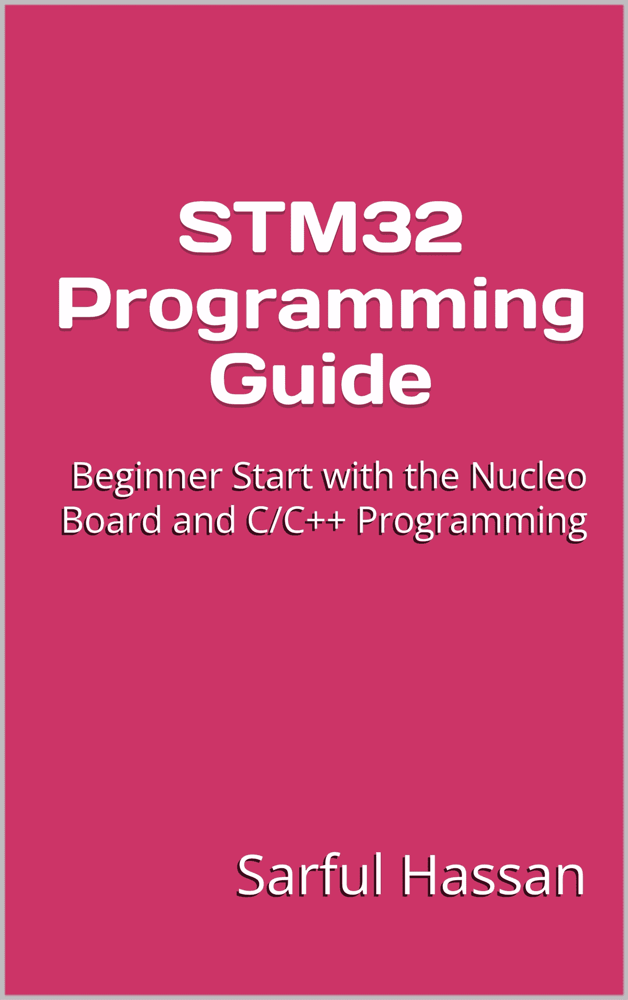
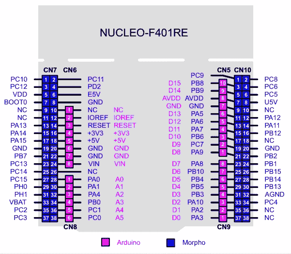

# STM32 编程指南：从 Nucleo 板和 C/C++ 编程入门



## 前言

本书是一份关于 STM32 微控制器编程的全面指南。它提供了详细的解释、实用示例和可操作的技巧，旨在帮助不同水平的开发者。无论你是探索嵌入式系统的初学者，还是希望深耕 STM32 知识的资深开发者，本书都能满足你的需求。

## 本书适用对象

本书适用于广泛的读者：

- 为学术项目或研究学习 STM32 的学生。
- 有兴趣于使用 STM32 微控制器创建 DIY 项目的爱好者。
- 正在构建或优化基于 STM32 系统的工程师。
- 使用 STM32 作为嵌入式系统概念教学的教育工作者。
- 从其他平台迁移到 STM32 或希望提升技能的开发者。

## 本书的结构

本书分为几个结构良好的章节：

1. STM32 微控制器和工具简介。
2. 输入/输出（I/O）操作，包括 `GPIO` 和高级技术。
3. 编程基础知识，如变量、数据类型和控制结构。
4. 高级主题，如定时器、数学函数和位运算。
5. 针对实际应用的实用示例。

每一章都循序渐进，确保无缝的学习体验。

## 未涵盖的主题

为了保持重点突出且范围可控，以下主题未进行深入介绍：

- 针对 STM32 开发板的特定硬件设计原理。
- 非 STM32 特定的外设模块。
- 高级调试、分析和优化技术。

如需进一步探索这些主题，读者可以参考官方 STM32 文档。

## 代码风格（关于代码）

本书中的所有代码示例均遵循清晰且一致的风格：

- 易于读并有详细注释，以便理解。
- 适用于各种 STM32 模型。
- 在 STM32 `Nucleo` 和 `Discovery` 板上进行过测试以确保准确性。

我们建议使用 `STM32CubeIDE` 或同工具以获得最佳体验。

## 更新说明

此更新版本包含：

- 关于定时器和位运算等高级主题的新示例。
- 增强了对初学者友好的解释。
- 内容更新以反映最新的 STM32 开发工具和库。

## 第一版说明

本书的第一版为学习 STM32 编程奠定了基础。根据读者的宝贵反馈，此修订版增加了更丰富的内容和实践见解。

## MechatronicsLAB 在线学习

获取更多资源、教程和支持，请访问 `MechatronicsLAB`：

- 邮箱：`mechatronicslab@gmail.com`
- 网站：`mechatronicslab.net`

## 第一版感谢

感谢所有对本书成功做出贡献的人，包括评审员、测试人员和 STM32 社区。

## 免责声明

本书内容按“现状”提供。尽管已尽力确保准确，但作者和出版商对使用本文所含信息引起的任何错误、遗漏或损害不承担责任。

# STM32 简介

## 章节概述

STM32 微控制器由意法半导体（STMicroelectronics）创建，是多功能、高性能的设备，广泛广泛嵌入式系统。这些微控制器在计算能力和能量效率之间取得了平衡，提供了广泛的外设支持，并在各种型号和系列中提供了良好的可扩展性。本章介绍了 STM32 家族，解释了其架构和核心特性，指导读者如何根据特定应用选择合适的 STM32 模型，并涵盖了基本的开发工具和软件。它概述了作为 STM32 微控制器动力的 `ARM Cortex-M` 内。

## 章节目标

- 理解 STM32 家族的结构以及每个系列的目标应用领域。
- 熟悉 STM32 架构和使其适用于嵌入式应用的关键特性。
- 学习为不同项目选择正确 STM32 模型的标准。
- 探索用于 STM32 编程、调试和测试的开发工具和软件。
- 获得 `ARM Cortex-M` 内的基础知识，它是 STM32 微控制器的处理引擎。

---

## 1. STM32 家族概览

STM32 微控制器的设计兼顾了灵活性、可扩展性和效率，适用于简单和复杂的嵌入式应用。STM32 家族提供了各种系列，以满足不同的应用需求，例如通用、高性能、低功耗和无线连接。

### STM32 家族中的关键系列

1. **STM32F 系列 - 通用 MCU**

   - 描述：`STM32F` 系列在性能和功能方面最全全，适用于通用应用。
   - 关键特性：高速内部时钟、多个 `ADC` 通道、大容量 `Flash` 内存和广泛的外设支持。
   - 子系列：
     - `STM32F0`：用于基础控制的入门级低成本系列。
     - `STM32F1`：由于平衡了性能，被广泛应用。
     - `STM32F4`：高性能系列，具有带有 `DSP` 能力的 `ARM Cortex-M4` 内核。
     - `STM32F7`：具有 M7 内核的高性能。
   - 应用：工业控制、电机控制、音频处理和消费电子。

2. **STM32L 系列 - 低功耗 MCU**

   - 描述：`STM32L` 微控制器具有节电功能，适用于电池供电和能量敏感的应用。
   - 关键特性：超低功耗模式、多个时钟源和低功耗外设。
   - 子系列：
     - `STM32L0` 和 `L1`：适用于简单 `IoT` 应用的入门级低功耗系列。
     - `STM32L4` 和 `L5`：具有 `ARM Cortex-M4` 和 `Cortex-M33` 内核的高性能系列。
   - 应用：可穿戴设备、环境监测传感器和便携式医疗设备。

3. **STM32H 系列 - 高性能 MCU**

   - 描述：`STM32H` 系列针对需要密集计算能力的应用进行了优化。
   - 关键特性：双核选项、大量内存、高速 `ADCs` 和 `DSP` 能力。
   - 应用：实时数据处理、机器人、复杂的电机控制和汽车应用。

4. **STM32G 系列 - 具有高效的通用 MCU**

   - 描述：在成本效益和性能之间取得了平衡，其功能为成本敏感型应用定制。
   - 关键特性：节能型、广泛的外设支持和增强的安全特性。

## 5. STM32WB 系列 - 无线微控制器

- 应用领域：消费电子产品、`IoT` 设备及通用应用。
- 描述：`STM32WB` 系列集成了蓝牙和 Zigbee 连接功能，专为无线应用设计。
- 核心特性：双核架构，配备 `ARM Cortex-M4` 和 `Cortex-M0+` 核心，针对无线协议栈和应用处理进行了优化。
- 应用领域：智能家居设备、可穿戴设备和连接型传感器。

## 6. STM32MP 系列 - 基于 ARM Cortex-A 的微处理器

- 描述：结合了用于高级操作系统的 `ARM Cortex-A` 核心和用于实时处理的 `Cortex-M` 核心。
- 核心特性：支持 `Linux` 和实时控制，集成了先进的多媒体和连接功能。
- 应用领域：工业自动化、控制面板以及同时需要实时控制和高级操作系统的复杂 `IoT` 应用。

### STM32 命名规范

STM32 型号的结构有助于识别微控制器系列、性能水平和封装类型。一个典型的 STM32 零件号结构如下：

- 前缀（`STM32`）：识别 `STM32` 系列。
- 产品系列（例如 `F4`、`L1`）：表示系列和子系列（例如，`F4` 代表高性能）。
- 内存大小、引脚数量和封装：指定详细信息，如 Flash 内存、`RAM`、`GPIO` 数量和封装类型（例如 `STM32F446RE` 具有 512 KB Flash 和 100 个引脚）。

## 2. STM32 架构与核心特性

STM32 微控制器围绕 `ARM Cortex-M` 核心构建，提供低功耗、高性能和丰富的外设，以满足各种应用需求。STM32 微控制器的架构针对嵌入式应用进行了优化，将高效的处理能力与强大的外设接口相结合。

### STM32 架构的核心特性

1. **ARM Cortex-M 核心**

   - STM32 微控制器利用 `ARM Cortex-M0`、`M0+`、`M3`、`M4` 和 `M7` 核心，每个核心都针对不同性能水平而定制。
   - `Cortex-M4` 和 `M7` 核心中的 `DSP` 能力为涉及实时数据处理的应用提供了支持。

2. **广泛的外设支持**

   - STM32 MCU 集成了多种外设，如 `ADC`、`DAC`、`PWM`、`UART`、`SPI`、`I2C` 和 `CAN`，能够与传感器、执行器和外部内存无缝接口。
   - 特殊外设（如 `USB`、`Ethernet` 和 `SDIO`）支持更复杂的连接需求。

3. **高速内存和 Flash 选项**

   - STM32 微控制器提供高达 2MB 的 Flash 内存，并支持外部内存选项（`NOR`、`NAND` 和 `SDRAM`）。
   - 可配置的内存架构允许数据和代码分离，从而增强性能。

4. **先进的电源管理**

   - 多种节电模式（`Sleep`、`Stop`、`Standby`）为管理功耗提供了灵活性。
   - 设计用于通过先进的电源控制适应电池供电的应用。

5. **增强的安全性**

   - 某些 STM32 模型包含安全启动、加密加速器和内存保护等安全功能，适用于 `IoT` 和安全通信。

6. **灵活的时钟配置**

   - 可配置的时钟源和分频器允许对 CPU 和外设速度进行自定义，从而优化性能和功耗。

### STM32 MCU 的核心组件

- **CPU（中央处理器）**：`ARM Cortex-M` 核心为嵌入式应用提供必要的处理能力，并支持高效的任务管理和 `DSP`。
- **内存架构**：片内 `Flash` 和 `SRAM` 配合外部内存支持，使 STM32 MCU 能够处理大量数据和复杂的代码需求。
- **系统外设**：
  - `GPIO`：允许控制输入和输出信号。
  - 定时器：提供精确的计时、`PWM` 生成和事件处理。
  - 模拟外设：`ADC` 和 `DAC` 通道支持模拟信号处理。

## 3. 选择合适的 STM32 型

选择合适的 STM32 微控制器需要评估性能、内存、功耗需求和外设支持等因素。不同的 STM32 系列满足特定的应用和项目需求。

### 基于应用的模型选择

1. **基础控制应用（入门级）**
   - 建议系列：`STM32F0`、`STM32G0`
   - 典型应用：家庭自动化、基础 `IoT` 设备、简单电机控制。
   - 考虑因素：选择具有基本外设的低成本模型。

2. **电池供电和低功耗应用**
   - 建议系列：`STM32L` 系列
   - 典型应用：可穿戴设备、环境传感器、电池设备。
   - 考虑因素：关注具有超低功耗模式和高效外设的模型。

3. **高性能和 DSP 应用**
   - 建议系列：`STM32F4`、`STM32F7`、`STM32H7`
   - 典型应用：机器人、数据处理。
   - 考虑因素：优先考虑 `Flash` 和先进外设。

4. **无线应用**
   - 建议系列：`STM32WB`
   - 典型应用：支持蓝牙的智能家居系统。
   - 考虑因素：确保与 `Zigbee` 的兼容性。

5. **具有实时要求的嵌入式系统**
   - 建议系列：`STM32MP`
   - 典型应用：工业自动化、控制面板。
   - 考虑因素：需要 `Linux` 系统。

### 模型选择考虑因素

- **所需外设**：匹配 `ADC`、`DAC` 等。
- **功耗**：优先考虑电池依赖项目。
- **内存需求**：确保足够的 `Flash` 和 `RAM`。
- **成本限制**：确保所选型号符合预算。

## 4. 开发工具与软件

STM32 微控制器由多种开发环境和工具支持。主要推荐的工具是 `STM32CubeIDE`，但 `Keil` 和 `IAR` 同样流行。

### STM32CubeIDE

- 概述：`STM32CubeIDE` 是一款集成开发环境，它将 `STM32CubeMX` 的图形化配置与 Eclipse IDE 结合，为 STM32 开发提供了完整的工具。
- 核心特性：
  - 支持 `STM32CubeMX`。
  - 集成的编辑器、编译器和调试器。
  - 使用 STM32 调试器进行强大的调试功能。
- 用途：对于初学者和高级用户都是理想选择，提供了 STM32 项目设置、配置和调试的完整解决方案。

### STM32CubeMX

- 概述：`STM32CubeMX` 是一款配置工具，通过允许用户图形化配置 MCU 的外设、引脚和时钟树来简化硬件设置。
- 核心特性：
  - `GPIO`、外设和时钟的图形化配置。
  - 生成 STM32 项目的初始化代码。
- 用途：在编码之前配置微控制器硬件设置的关键工具。

### Keil MDK-ARM

- 概述：针对 `ARM Cortex-M` 微控制器优化的专业 IDE，具有高效的编译器和强大的调试功能。
- 核心特性：
  - 针对 `ARM` 优化的编译器，支持实时操作系统（RTOS）。
  - 具有实时性能监控的调试工具。
- 用途：适用于需要代码优化和专业调试工具的商业项目。

### IAR Embedded Workbench

- 概述：另一款高性能 IDE，为嵌入式开发提供稳健的编译器和先进的调试工具。
- 核心特性：
  - 先进的代码分析和功耗调试能力。
- 用场景：适用于需要高度优化代码和复杂调试的项目。

### 其他工具

- `STM32 ST-LINK Utility`：用于 `STM32` 固件烧录和调试的工具。
- `STM32CubeProgrammer`：用于烧录、调试和固件升级，支持线和无线更新。

## 5. ARM Cortex-M 核心简介

STM32 微控制器由 `ARM Cortex-M` 核心驱动，该内核专为嵌入式应用设计，提供高效、低功耗和实时处理能力。

### ARM Cortex-M 核心概述

1. **`Cortex-M0` 和 `M0+`**
   - 具有基础功能的入门级内核，针对低功耗应用进行了优化。
   - 适用于成本敏感型低功耗项目。

2. **`Cortex-M3`**
   - 中端性能，具有更高的效率并集成了调试功能。
   - 常用于通用应用。

3. **`Cortex-M4`**
   - 增加了 `DSP`（数字信号处理）能力，适用于需要信号处理的应用。
   - 用于电机控制、传感器数据处理和音频处理等应用。

4. **`Cortex-M7`**
   - 高性能内核，同时具备 `DSP` 和 `FPU`（浮点单元），适用于密集计算型应用。
   - 适用于机器人、实时处理和高速数据采集。

5. **`Cortex-A`（`STM32MP` 系列）**
   - 支持 `Linux` 等高级操作系统，并由 `Cortex-M` 核心处理实时控制。
   - 适用于需要实时控制和操作系统功能结合级系统。

## 6. ARM Cortex-M 核心的 6 大特性

- 高效的中断处理：`NVIC`（嵌套向量中断控制器）确保实时应用的低延迟响应。
- 调试支持：内置对 `SWD`（串行线调试）和 `JTAG` 调试的支持。
- 内存保护单元（`MPU`）：通过分段内存访问增强应用程序的安全性和稳定性。
- `FPU`：在 `Cortex-M4` 和 `M7` 内核上能够高效处理浮点运算。
- `DSP` 扩展：支持数据处理和操纵，对于信号处理应用至关重要。

# STM32 Nucleo-F401RE 开发板指南

`STM32 Nucleo-F401RE` 是一款高度通的开发板，采用 `STM32F401RET6` 微控制器进行原型设计，该微控制器属于 `ARM Cortex-M4` 家族。它结合了强大的性能、电源效率和灵活性，是嵌入式系统、`IoT` 和机器人项目的理想选择。

## 主要优势

- 兼容 `Arduino UNO R3` 扩展板。
- 通过 `STM32 Morpho` 引脚扩展功能。
- 集成 `ST-LINK/V2-1`，可实现无缝调试和编程。

## 关键特性

1. **微控制器：`STM32F401RET6`**
   - 带有浮点单元（`FPU`）的 32 位 `ARM Cortex-M4` 处理器。
   - 运行主频为 `84 MHz`。

2. **内存**
   - `512 KB` `Flash Memory` 用于程序存储。
   - `96 KB` `SRAM` 用于高效数据处理。

3. **电源**
   - 内部以 `3.3V` 运行。
   - 通过 `VIN` 支持 `7V-12V` 外部输入电压。
   - USB 供电，带有板电压调节器。

4. **板载调试器**

   集成的 `ST-LINK/V2-1`，支持 `SWD` 和 `JTAG` 协议。

5. **引脚兼容性**
   - `Arduino UNO R3` 引脚用于扩展板集成。
   - `STM32 Morpho` 引脚用于访问所有 `GPIOs` 和外设。

6. **LED 和按钮**
   - `LD1`：USB 通信指示灯。
   - `LD2`：用户可编程 LED。
   - `LD3`：电源指示灯。
   - 两个按钮：一个用于复位，另一个用于用户控制。

## 引脚配置



### 1. Arduino 兼容引脚

- 兼容 `Arduino` 扩展板。
- 分为四类：`CN5`、`CN6`、`CN8`、`CN9`。

| 类别 | 引脚类型 | 引脚名称 | 描述 |
| :--- | :--- | :--- | :--- |
| `CN6`（电源） | 参考电压 | `IOREF` | 为扩展板提供的 `3.3V` 参考电压引脚。 |
|  | 复位 | `RESET` | 重置微控制器。 |
|  | 输出输出 | `+3.3V`、`+5V` | 提供 `3.3V` 和 `5V` 输出。 |
|  | 地 | `GND` | 系统地引脚。 |
| `CN8`（模拟） | 模拟输入引脚 | `A0`、`A1` | 用于电压量的模拟引脚（12 位 `ADC`）。 |


| | `I2C` 通信 | `A4 (SDA)`、`A5 (SCL)` | `I2C` 通信引脚。 |
|---|---|---|---|
| `CN5`（数字） | 数字 `GPIO` 引脚 | `D8-D15` | 通用数字输入/输出引脚。 |
| | `SPI` 通信 | `D10 (CS)`、`D11 (MOSI)`、`D12 (MISO)`、`D13 (SCK)` | |

开始 STM32 开发需要了解设置并完成功能开发环境所需的工具、软件和步骤。本章将引导你如何设置 `STM32CubeIDE`、使用 `STM32CubeMX` 配置硬件、将程序烧录到微控制器中、设置项目以及进行基础调试。在章末结束时，你将掌握开始构建基于 STM32 应用程序的基础技能。

## 章节目标

- 在你的计算机上成功设置 STM32 开发环境。
- 学习使用 `STM32CubeMX` 配置外设、引脚和时钟。
- 了解将编译后的代码（烧录）到 STM32 微控制器的过程。
- 熟悉 `STM32CubeIDE` 的操作，用于进行项目设置、代码管理和项目构建。
- 掌握基础调试技术，以测试和排除嵌入式应用程序的故障。

---

## 1. 设置开发环境

为了为 STM32 微控制器开发应用程序，你需要安装特定的工具和软件，并设置必要的硬件。以下是分步骤指南，以确保你准备好开始编码。

### 所需的软件和工具

1. `STM32CubeIDE`

   - 说明：`STM32CubeIDE` 是一个全位的集成开发环境（`IDE`），它将代码编辑、编译、调试以及使用 `STM32CubeMX` 进行硬件配置相结合。
   - 特性：
     - 内置 `STM32CubeMX` 用于图形化硬件配置。
     - 具有语法高亮、代码建议和错误检测功能的代码编辑器。
     - 集成编译器和调试器，用于无缝代码开发。
   - 安装：
     - 从 STMicroelectronics 官网下载 `STM32CubeIDE`。
     - 按照安装向导，根据你的操作系统（Windows、macOS 或 Linux）选择安装选项。
     - 安装后打开 `STM32CubeIDE` 以确认其运行正常。

2. `STM32CubeMX`

   - 说明：`STM32CubeMX` 是一个配置和代码生成工具，用于设置微控制器外设、时钟和引脚分配。
   - 独立版与集成版：`STM32CubeMX` 集成在 `STM32CubeIDE` 中，但也提供独立版本。
   - 安装：如果你正在使用 `STM32CubeIDE`，则已包含 `STM32CubeMX`，因此不需要额外安装。

3. `ST-LINK/V2` 或 `ST-LINK/V3` 调试器

   - 目的：`ST-LINK` 硬件调试工具用于烧录（编程）和调试 STM32 微控制器。
   - 连接：通过 USB 连接到计算机，并通过 `SWD`（串行调试）接口或 `JTAG` 连接到 STM32 开发板。

4. `ST-LINK USB 驱动`（适用于 Windows 用户）

   - 目的：`ST-LINK` USB 驱动程序允许 Windows 识别并与 `ST-LINK` 调试器通信。
   - 安装：从 STMicroelectronics 官网下载 `ST-LINK` USB 驱动并按照提供的说明进行安装。

### 开发硬件

1. STM32 开发板：常见的板包括 STM32 Nucleo、Discovery 和评估板。选择一个符合你项目要求的板子（例如，`STM32F446RE Nucleo`）。
2. USB 线：USB 线将 STM32 板连接到你的计算机，用于供电、烧录和调试。

### 验证安装和设置

1. 打开 `STM32CubeIDE`：启动 `STM32CubeIDE` 确保其无问题地打开。
2. 连接 STM32 板：通过 USB 将你的 STM32 开发板连接到计算机。
3. 检查设备检测：在 `STM32CubeIDE` 中，通过检查运行（`Run`）或调试（`Debug`）配置来验证板子是否被检测。板子应该出现在列表中，显示设备名称和序列号。

---

## 2. `STM32CubeMX`：代码生成与配置

`STM32CubeMX` 是一个强大的图形化工具，用于配置 STM32 微控制器的硬件设置。使用 `STM32CubeMX`，你可以设置外设、配置 `GPIO` 引脚、调整时钟设置并生成 `STM32CubeIDE` 使用的初始化代码。

### 使用 `STM32CubeMX` 的步骤

1. 创建新项目：

   - 打开 `STM32CubeIDE` 并导航到 `File > New > STM32 Project`。
   - 在目标选择（Target Selection）窗口中，选择你的 STM32 型号。你可以按系列过滤（例如，`STM32F4`）或直接通过零件号搜索（例如，`STM32F103C8`）。
   - 选择所需的微控制器，点击 Next，并输入项目名称、位置和工具链（`STM32CubeIDE`）。

2. 配置 `GPIO` 引脚和外设：

   - 在图形界面中，点击引脚以分配特定功能（例如 `GPIO`、`UART`、`I2C`、`ADC`）。
   - 每个外设提供可调设置。例如：
     - `GPIO`：将引脚设置为输入、输出或复用。

3. 配置时钟：

   - 打开时钟配置（Clock Configuration）设置系统时钟。
   - 选择内部（`HSI`）或外部（`HSE`）时钟源，并调整分频器和分频。

4. 设置中间件（可选）：

   - 在 Middleware 选项卡中，启用 FreeRTOS、USB 或 FATFS 等库。

5. 生成代码：

   - 完成设置后，点击 `Project > Generate Code`。
   - `STM32CubeMX` 将根据配置生成初始化代码。

### 生成的代码结构

- `main.c`：包含应用程序逻辑的文件。
- `stm32xx_hal_conf.h`：启用或禁用 HAL 模块的配置文件。
- `Drivers/`：包含外设驱动和 STM32 HAL 库。
- `system_stm32xx.c`：设置系统时钟。

`STM32CubeMX` 生成的代码确保了初始设置已就绪。

---

## 3. 将程序烧录到 STM32

向微控制器烧录程序是将编译后的二进制文件传输到微控制器中，使其执行代码。`STM32CubeIDE` 使用内置的 `ST-LINK` 简化了烧录过程。

### 烧录步骤

1. 构建项目：

   - 在 `STM32CubeIDE` 中，点击 `Project > Build Project`。
   - 这编译代码并生成用于烧录的二进制文件（`.bin` 或 `.hex`）。
   - 查看控制台是否有错误或警告。

2. 设置烧录设置：

   - 确保 STM32 板已通过 `ST-LINK` 连接到计算机。
   - 在 `STM32CubeIDE` 中，进入 `Run > Debug Configurations` 打开配置设置。
   - 选择 `ST-LINK` 作为调试探针并检查微控制器是否正确。

3. 将代码烧录到 STM32 微控制器：

   - 点击 `Debug`（如果不需要调试则点击 `Run`）。
   - `STM32CubeIDE` 将擦除当前闪存，写入新的二进制文件并开始执行程序。

烧录成功后，程序将在微控制器上自动运行。

### 验证程序执行

- `LED` 或输出：如果你的程序涉及 `LED`，验证行为是否符合预期。
- 串口输出：对于使用 `UART` 的程序，打开串口终端（例如 PuTTY）以监控来自 STM32 的输出。

---

## 4. 使用 `STM32CubeIDE` 进行项目设置

`STM32CubeIDE` 是代码开发的主要工作空间，提供了用于管理代码文件、构建项目和调试的集成环境。

### 在 `STM32CubeIDE` 中创建和管理项目

1. 开始新项目：

   - 打开 `STM32CubeIDE` 并导航到 `File > New > STM32 Project`。
   - 选择您正在使用的 STM32 微控制器，为项目命名，选择位置并完成设置。

### 编辑代码

- `STM32CubeIDE` 提供语法高亮、代码建议和错误检查，使高效编码变得更容易。
- 在 `main.c` 文件中编写自定义函数和应用逻辑，可以放在主循环中，也可以作为独立函数。

### 构建项目

- 通过点击 `Project > Build All` 或使用 `Build` 图标来构建项目。
- 编译信息将出现在 `Console（控制台）` 和 `Problems（问题）` 选项页中，突出任何错误或警告。

### 设置构建和调试配置

- 打开 `Project Properties（项目属性）` 配置编译器设置，包括优化级别和链接器设置。
- 在 `Debug Configurations（调试配置）` 中，确认调试探器设置为 `ST-LINK` 并选择了正确的微控制器。

### 理解关键项目文件

- `main.c`：文件，包含主循环，大多数应用程序代码都写在这里。
- `stm32xxxx_hal_conf.h`：控制哪些 HAL 模块启用的配置文件。
- `system_stm32xxxx.c`：配置系统初始化，包括设置时钟和中断。
- `Drivers` 文件夹：包含每个外设的 HAL 库以及 CMSIS（内核微控制器软件接口标准）文件。

---

## 5. 调试基础

调试是嵌入式编程中的一项基本技能，允许您定位并修复代码中的问题。`STM32CubeIDE` 提供了强大的调试工具，包括断点、变量检查和单步执行。

### 设置调试

1. 连接 `ST-LINK` 调试器：

   - 确保 `ST-LINK` 调试器已连接到计算机和 STM32 开发板。
   - 在 `STM32CubeIDE` 中，打开 `Debug Configurations` 并确认已选择 `ST-LINK` 调试器。

2. 启动调试会话：

   - 点击 `Debug` 开始调试会话。
   - `STM32CubeIDE` 将构建项目、将代码烧录到板上，并在 `main()` 的开始处停止执行。

3. 使用断点：

   - 通过点击 `main.c` 中行号旁边的左边距来设置断点。
   - 断点会在指定点处停止代码执行，允许您检查程序变量和状态。

4. 单步执行：

   - `Step Into`：进入函数调用进行逐行调试。
   - `Step Over`：执行当前行并移动到下一行，而不进入函数。
   - `Step Out`：完成当前函数并返回到调用者。

5. 检查变量和表达式：

   - 使用 `Variables（变量）` 选项页在运行时监控并修改变量值。
   - 在 `Expressions（表达式）` 选项页中添加特定表达式，以跟踪程序执行期间变量的变化或表达式。

6. 调试控制台：

   - 控制台提供程序执行、错误消息和调试见解的实时信息。
   - 使用 `Watches（监视）`：为关键变量添加监视，以实时跟踪其值。

# GPIO 简介

## 章节概述

`GPIO`（通用输入/输出）是微控制器的基本功能，能够与 `LED`、按钮、传感器和继电器等外部组件进行交互。STM32 微控制器提供了灵活的 `GPIO` 配置，允许每个引脚被设置为输入、输出、模拟或复用功能。本章将涵盖 `GPIO` 基础、如何在 `STM32CubeMX` 中配置 `GPIO` 引脚、不同的 `GPIO` 模式以及输入输出的实际示例。

## 章节目标

- 理解 STM32 微控制器中的 `GPIO` 架构和功能。
- 学习将 `GPIO` 引脚配置为输入和输出。
- 探索不同的 `GPIO` 模式及其应用。
- 实现基本的输入输出示例，例如控制 `LED` 和读取按钮状态。

---

## 1. STM32 中的 `GPIO` 概述

`GPIO`（通用输入/输出）引脚提供数字输入输出能力，允许微控制器与其他数字组件建立接口。每个 `GPIO` 引脚都可以配置为执行不同的角色，例如输入、输出或作为复用功能（例如 `UART`、`SPI`、`I2C`）。

### `GPIO` 端口和引脚结构

- 端口：STM32 微控制器将 `GPIO` 引脚分为端口，通常标记为 `GPIOA`、`GPIOB`、`GPIOC` 等。每个端口可以有多达 16 个引脚。
- 引脚：每个端口引脚的编号从 0 到 15（例如 `PA0`、`PB5`、`PC13`）。
- 多功能性：每个引脚可以设置为不同的模式，例如数字输入、数字输出、模拟或外设的复用功能。

### STM32 中的 `GPIO` 引脚模式

1. 输入模式：
   - 用于从外部源（如按钮）读取数字状态（高或低）。
2. 输出模式：
   - 用于向外部设备发送数字信号，例如开启或关闭 `LED`。
3. 复用功能模式：
   - 使引脚作为内部外设的输入/输出，如 `UART`、`SPI`、`I2C`。
4. 模拟模式：
   - 将引脚配置为模拟输入/输出，通常用于 `ADC`（模数转换器）或 `DAC`（数模器）。

### `GPIO` 速度、上拉和下拉

- 速度：控制引脚切换的速度（低、中、高或极高）。
- 上拉/下拉：内部电阻可以配置为上拉、下拉或无。

---

## 2. 使用 `STM32CubeMX` 配置 `GPIO`

`STM32CubeMX` 用于配置 `GPIO` 引脚，简化了过程。

### 配置 `GPIO` 的步骤

1. 打开 `STM32CubeMX` 并新建项目：

   - 选择您的微控制器或开发板。

2. 分配引脚功能：

   - 在图形界面上点击引脚。
   - 为输出引脚选择 `GPIO_Output`（控制 `LED`），为输入引脚选择 `GPIO_Input`（读取按钮）。

3. 配置 `GPIO` 参数：

   - 模式：选择输入、输出、模拟或复用功能。
   - 上拉/下拉：在无、上拉、下拉之间选择。
   - 速度：根据需求设置引脚速度。

4. 生成代码：

   - 点击 `Project > Generate Code` 生成文件。

### 理解 `main.c` 中的 `GPIO` 初始化代码

生成的代码包含初始化和控制 `GPIO` 引脚的函数和宏。这是一个典型的 `GPIO` 初始化示例：

```c
void MX_GPIO_Init(void) {
  GPIO_InitTypeDef GPIO_InitStruct = {0};

  /* Enable GPIO 时钟 */
  __HAL_RCC_GPIOA_CLK_ENABLE();
  __HAL_RCC_GPIOB_CLK_ENABLE();

  /* 配置 GPIO 引脚为输出 */
  GPIO_InitStruct.Pin = GPIO_PIN_5;
  GPIO_InitStruct.Mode = GPIO_MODE_OUTPUT_PP;
  GPIO_InitStruct.Pull = GPIO_NOPULL;
  GPIO_InitStruct.Speed = GPIO_SPEED_FREQ_LOW;
  HAL_GPIO_Init(GPIOA, &GPIO_InitStruct);

  /* 配置 GPIO 引脚为输入 */
  GPIO_InitStruct.Pin = GPIO_PIN_13;
  GPIO_InitStruct.Mode = GPIO_MODE_INPUT;
  GPIO_InitStruct.Pull = GPIO_PULLUP;
  HAL_GPIO_Init(GPIOC, &GPIO_InitStruct);
}
```

- 时钟启用：启用 `GPIOA` 和 `GPIOC` 的时钟，允许这些端口使用。
- `GPIO` 初始化：按照指定的模式、上拉/下拉电阻和速度配置引脚。

---

## 3. 使用 `GPIO` 输出

`GPIO` 输出模式允许 STM32 微控制器通过将引脚设置为高或低电平来控制外部设备。例如，控制 `LED` 涉及将 `GPIO` 引脚设置为高电平以开启，设置为低电平以关闭。

### 示例：闪烁 `LED`

此示例演示了如何使用输出模式下的 `GPIO` 使 `LED` 闪烁。

1. 硬件设置：

   - 将 `LED` 连接到 `GPIOA` 引脚 `PA5`，在 `LED` 和引脚之间接入限流电阻（例如 `220Ω`）。

2. 在 `STM32CubeMX` 中配置 `GPIO`：

   - 在 `STM32CubeMX` 中将 `PA5` 设置为 `GPIO_Output`。
   - 将引脚模式配置为 `Output`（输出），并设为 `No Pull`（无上下拉）和 `Low Speed`（低速）。

3. `LED` 闪烁代码示例：

```c
#include "main.h"

int main(void) {
  HAL_Init();
  MX_GPIO_Init();  // 初始化 GPIO 配置
  while (1) {
    HAL_GPIO_WritePin(GPIOA, GPIO_PIN_5, GPIO_PIN_SET);  // 开启 LED
    HAL_Delay(500);  // 延迟 500 毫秒
    HAL_GPIO_WritePin(GPIOA, GPIO_PIN_5, GPIO_PIN_RESET);  // 关闭 LED
    HAL_Delay(500);  // 延迟 500 毫秒
  }
}
```

### 代码说明

- `HAL_GPIO_WritePin`：将 `GPIOA` 引脚 5 置高电平（`GPIO_PIN_SET`）以开启 `LED`，置低电平（`GPIO_PIN_RESET`）以关闭。
- `HAL_Delay`：在状态变化之间创建 500 毫秒的延迟，产生闪烁效果。

---

## 4. 使用 `GPIO` 输入

`GPIO` 输入模式允许 STM32 微控制器从外部设备（如开关、按钮和传感器）读取数字信号。

### 示例：读取按钮状态

在此示例中，我们配置一个 `GPIO` 引脚来检测按钮是否被按下或释放。

1. 硬件设置：


# STM32 中的数字 I/O

## 章节概述

数字 I/O（输入/输出）功能是嵌入式系统的基础，允许微控制器与 LED、开关、传感器和继电器等外部设备交互。STM32 NUCLEO-F446 的通用输入输出（GPIO）引脚可以配置为输入或输出。本章涵盖了 GPIO 配置的实际应用。

## 章节目标

数字 I/O（输入/输出）功能是嵌入式系统的基础，允许微控制器与 LED、开关、传感器和继电器等外部设备交互。STM32 NUCLEO-F446 的通用输入输出（GPIO）引脚可以配置为输入或输出。本章涵盖了 GPIO 配置的实际应用。

## 重要的规则

- 启用 GPIO 时钟：在没有外部连接时，内部上拉和下拉电阻有助于在 GPIO 输入引脚上保持稳定的逻辑电平（高或低）。这对于稳定的信号读取至关重要，特别是对于开关。
- 设置引脚模式：GPIO 引脚可以配置为数字输入或输出。
- 使用上拉/下拉电阻：在没有外部连接时，内部上拉和下拉电阻有助于在 GPIO 输入引脚上保持稳定的逻辑电平（高或低）。这对于稳定的信号读取至关重要，特别是对于开关。
- 配置 GPIO 引脚模式：必须设置 GPIO 引脚的模式以确定其行为（例如，输入、输出、复用）。
- 使用上拉/下拉电阻：在没有外部连接时，内部上拉和下拉电阻有助于在 GPIO 输入引脚上保持稳定的逻辑电平（高或低）。这对于稳定的信号读取至关重要，特别是对于开关。
- 启用 GPIO 时钟：在没有外部连接时，内部上拉和下拉电阻有助于在 GPIO 输入引脚上保持稳定的逻辑电平（高或低）。这对于稳定的信号读取至关重要，特别是对于开关。

### 什么是启用 GPIO 时钟？

启用 GPIO 时钟为 GPIO 端口提供供电，使其引脚可以用于配置和使用。如果不启用时钟，对端口的任何操作将无效。

### 语法

启用时钟的语法。

### 语法说明

- `__HAL_RCC`：用于 STM32 HAL（硬件抽象层）中与复位和时钟控制（RCC）相关的前缀。
- `GPIOx`：指定要启用的 GPIO 端口，例如 `GPIOA`、`GPIOB` 或 `GPIOC`。
- `CLK_ENABLE()`：启用指定外设时钟的宏函数，使其接收电源并工作。

### 简单代码示例

`__HAL_RCC_GPIOA_CLK_ENABLE();` // 启用 GPIOA 时钟

### 代码示例说明

- 启用 GPIOA 时钟：为 GPIO 端口 A 供电，使其引脚可以进行配置和使用。
- GPIO 操作是必须的：如果没有此行，任何涉及 GPIOA 的配置将失效。

### 注意事项

- 仅对用到的 GPIO 端口启用时钟以优化功耗。
- 每个 GPIO 端口都需要自己的时钟启用函数。

### 警告

- 跳过时钟启用会导致端口的 GPIO 配置和操作无效。

## 配置 GPIO 引脚模式

### 什么是配置 GPIO 引脚模式？

GPIO 引脚模式设置决定了每个 GPIO 引脚的行为——即它是作为输入、输出还是复用功能引脚工作。

### 用途

- 定义引脚功能：配置引脚作为输入、输出或复用功能引脚。
- 控制信号方向：将引脚设置为发送（输出）或接收（输入）数字信号。

### 语法

```c
GPIO_InitStruct.Mode = GPIO_MODE_xxx;
```

### 语法解释

- `GPIO_InitStruct`：STM32 HAL 库中的一个结构体，用于保存 GPIO 引脚的配置设置。
- `.Mode`：`GPIO_InitStruct` 的一个成员，用于定义 GPIO 引脚的模式。
- `GPIO_MODE_xxx`：模式选项包括：
  - `GPIO_MODE_INPUT`：将引脚配置为数字输入。
  - `GPIO_MODE_OUTPUT_PP`：将引脚设置为推挽输出，该引脚会主动驱动高电平和低电平。
  - `GPIO_MODE_AF_PP`：将引脚配置为推挽模式下的复用功能（例如 UART、SPI）。

### 简单代码示例

```c
GPIO_InitTypeDef GPIO_InitStruct;
GPIO_InitStruct.Pin = GPIO_PIN_5;
GPIO_InitStruct.Mode = GPIO_MODE_OUTPUT_PP; // 设置引脚为推挽输出
```

### 代码示例解释

- 定义配置结构体（`GPIO_InitStruct`）：持有配置 GPIO 的设置。
- 设置 GPIO 引脚 5 为输出：配置引脚 5 主动驱动高电压和低电压，以控制 LED 等设备。

### 注意事项

- 推挽模式常用于数字输出。
- 对于复用功能（如 UART、SPI），使用带有适当复用功能编号的 `GPIO_MODE_AF_PP`。

### 警告

- 模式选择错误（例如将输入引脚配置为输出）可能会导致硬件冲突或功能异常。

## 配置 GPIO 速度

### 什么是配置 GPIO 速度？

GPIO 速度设置指定了 GPIO 引脚改变状态的速度，影响输出信号的最大频率。更快的速度可以实现快速的状态切换，但会增加功耗和噪声。

### 用途

- 控制信号切换率：设置 GPIO 引脚在高、低电平之间切换的最大频率。
- 优化功率与性能：低速度可以节电，而高速度允许高频信号的快速变化。

### 语法

```c
GPIO_InitStruct.Speed = GPIO_SPEED_xxx;
```

### 语法解释

- `GPIO_InitStruct`：用于 GPIO 设置的配置结构体。
- `.Speed`：`GPIO_InitStruct` 的一个成员，用于定义 GPIO 引脚的切换速度。
- `GPIO_SPEED_xxx`：选项包括：
  - `GPIO_SPEED_LOW`：降低功耗，适用于较慢信号。
  - `GPIO_SPEED_MEDIUM`：平衡功率消耗与性能。
  - `GPIO_SPEED_HIGH`：最大化速度，适用于高频信号，但功耗更高。

### 简单代码示例

```c
GPIO_InitStruct.Speed = GPIO_SPEED_LOW; // 将引脚配置为低速度
```

### 代码示例解释

- 设置 GPIO 引脚速度为低：减少功率消耗，理想适用于信号不需要快速变化的应用程序。

### 注意事项

- 尽可能选择较低的速度以节省电量并减少噪声。
- 仅在需要高频信号传输时才使用高速度。

### 警告

- 不必要的使用高速度设置会增加功耗，并可能导致电磁干扰（EMI）。

## 设置输出高电平

### 什么是设置输出高电平？

设置 GPIO 输出高电会将引脚驱动至逻辑高电平，为连接的组件提供正电压（通常为 3.3V 或 5V）。

### 用途

- 激活外部设备：提供高逻辑电平为 LED、继电器或其他组件供电。
- 逻辑高信号：将引脚设置为逻辑“1”或高电压电平，通常用于开启连接的组件。

### 语法

```c
HAL_GPIO_WritePin(GPIOx, GPIO_PIN_y, GPIO_PIN_SET);
```

### 语法解释

- `HAL_GPIO_WritePin`：向指定的 GPIO 引脚写入逻辑状态（高或低）的 HAL 函数。
- `GPIOx`：引脚所在的 GPIO 端口（例如 `GPIOA`）。
- `GPIO_PIN_y`：端口上特定的 GPIO 引脚号（例如 `GPIO_PIN_5`）。
- `GPIO_PIN_SET`：将输出设置为高逻辑电平（取决于系统配置，为 3.3V 或 5V）。

### 简单代码示例

```c
HAL_GPIO_WritePin(GPIOA, GPIO_PIN_5, GPIO_PIN_SET); // 将 PA5 设置为高
```

### 代码示例解释

- 设置 GPIO 引脚 PA5 为高电：在 `PA5` 上提供逻辑高电压，开启 LED 或向连接的设备发送信号。
- 配置引脚为输出：为了使此命令生效，必须在 `GPIO_InitStruct` 中将引脚设置为输出。

### 注意事项

- 确保在 `GPIO_InitStruct` 中将引脚设置为输出以便此命令生效。
- `GPIO_PIN_SET` 将输出驱动至高水平。

### 警告

- 模式选择错误（例如将输入引脚配置为输出）可能会导致硬件冲突或功能异常。

## 设置输出低电平

### 什么是设置输出低电平？

设置 GPIO 输出低电会将引脚驱动至逻辑低电平，将其拉至地。

### 用途

- 禁用外部设备：提供低逻辑电平为 LED、继电器或其他组件供电。
- 逻辑低信号：将引脚设置为逻辑“0”或低电压电平，通常用于关闭连接的组件。

### 语法

```c
HAL_GPIO_WritePin(GPIOx, GPIO_PIN_y, GPIO_PIN_SET);
```

### 语法解释

- `HAL_GPIO_WritePin`：向指定的 GPIO 引脚写入逻辑状态（高或低）的 HAL 函数。
- `GPIOx`：引脚所在的 GPIO 端口（例如 `GPIOA`）。
- `GPIO_PIN_y`：端口上特定的 GPIO 引脚号（例如 `GPIO_PIN_5`）。
- `GPIO_PIN_SET`：将输出设置为高逻辑电平。

### 简单代码示例

```c
HAL_GPIO_WritePin(GPIOA, GPIO_PIN_5, GPIO_PIN_SET); // 设置 PA5 为低
```

### 代码示例解释

- 设置 GPIO 引脚 PA5 为低电：在 `PA5` 上提供逻辑低电压，关闭 LED 或向连接的设备发送信号。
- 配置引脚为输出：为了使此命令生效，必须在 `GPIO_InitStruct` 中将引脚设置为输出。

### 注意事项

- 确保在 `GPIO_InitStruct` 中将引脚设置为输出以便此命令生效。
- `GPIO_PIN_SET` 将输出驱动至高水平。

### 警告

- 模式选择错误（例如将输入引脚配置为输出）可能会导致硬件冲突或功能异常。

## 翻转 GPIO 引脚

### 什么是翻转 GPIO 引脚？

翻转 GPIO 引脚使其在高低状态之间切换。它通常用于 LED 闪烁或产生方波。

### 用途

- 创建闪烁或脉冲效果：定期翻转常用于指示器。
- 生成方波：用于产生时钟信号。

### 语法

```c
HAL_GPIO_TogglePin(GPIOx, GPIO_PIN_y);
```

### 语法解释

- `HAL_GPIO_TogglePin`：反转 GPIO 引脚当前状态的 HAL 函数。
- `GPIOx`：引脚所在的 GPIO 端口（例如 `GPIOA`）。
- `GPIO_PIN_y`：端口上要翻转的 GPIO 引脚号。

### 简单代码示例

```c
HAL_GPIO_TogglePin(GPIOA, GPIO_PIN_5); // 翻转 PA5
```

### 代码示例解释

- 翻转 GPIO 引脚 PA5 状态：`PA5` 在高低之间切换，重复执行时可产生闪烁效果。

### 注意事项

- 在定时循环中翻转可以创建闪烁或脉冲效果。
- 翻转频率影响视觉效果，如 LED 的闪烁频率。

### 警告

- 频繁翻转会增加功耗并在高频应用中引起噪声。

## 读取 GPIO 输入

### 什么是读取 GPIO 输入？

读取 GPIO 输入允许 STM32 通过检查引脚上的电压水平来检测外部信号，例如按钮按下或传感器输出。

### 用途

- 监控外部设备：读取开关、按钮的状态。
- 检测数字信号：检查输入是高（3.3V）还是低（0V）。

### 语法

```c
HAL_GPIO_ReadPin(GPIOx, GPIO_PIN_y);
```

### 语法解释

- `HAL_GPIO_ReadPin`：读取指定 GPIO 引脚逻辑状态的 HAL 函数。
- `GPIOx`：引脚所在的 GPIO 端口（例如 `GPIOA`）。
- `GPIO_PIN_y`：端口上要读取的特定 GPIO 引脚号。

- `HAL_GPIO_ReadPin`：HAL 函数，用于读取指定 GPIO 引脚的当前数字状态。
- `GPIOx`：GPIO 端口（例如 `GPIOA`）。
- `GPIO_PIN_y`：端口上特定的 GPIO 引脚号。
- 返回：如果引脚为高电，返回 `GPIO_PIN_SET`；如果为低电，返回 `GPIO_PIN_RESET`。

### 代码示例

```c
if (HAL_GPIO_ReadPin(GPIOB, GPIO_PIN_0) == GPIO_PIN_SET) {
    // 如果 PB0 为高电，则执行操作
}
```


● 读取 GPIO 引脚 `PB0`：检查 `PB0` 是否处于高逻辑电平。

● 条件逻辑：如果 `PB0` 为高电，则执行操作，通常用于检测按键按下。

### 注意事项

● 使用内部上拉或下拉电阻以获得稳定的输入状态。

● `GPIO_PIN_SET` 和 `GPIO_PIN_RESET` 分别表示高、低逻辑电平。

### 警告

● 浮空输入引脚（无上拉或下拉电阻）可能会产生不可靠的读取。

---

# 最终项目：按键控制 LED 切换

## 项目目标

创建一个电路和代码，每当按下按键时切换 LED 的开启或关闭。该项目通过使用 GPIO 引脚同时作为输入和输出来演示数字 I/O。

## 项目电路

| 组件 | 引脚描述 | 连接细节 |
| :--- | :--- | :--- |
| STM32 微控制器 | GPIO PA5 (LED) | 配置为数字输出 |
| LED | 阳极接 PA5，阴极接 GND | 按下按键时切换状态 |
| 按键 | GPIO PB0 | 配置为数字输入 |
| 下拉电阻 | PB0 到 GND | 确保稳定的默认状态 |

## 电路分析

● `GPIO PA5`：配置为输出以控制 LED。

● `GPIO PB0`：配置为输入以检测按键按下。

● 按键按下逻辑：每次按下都会切换 LED 的开启或关闭。

## 项目代码

```c
#include "stm32f4xx_hal.h"

void GPIO_Config(void) {
    __HAL_RCC_GPIOA_CLK_ENABLE();  // 开启 GPIOA 时钟
    __HAL_RCC_GPIOB_CLK_ENABLE();  // 开启 GPIOB 时钟
    GPIO_InitTypeDef GPIO_InitStruct;

    // 配置 LED 引脚 (PA5) 为输出
    GPIO_InitStruct.Pin  = GPIO_PIN_5;
    GPIO_InitStruct.Mode  = GPIO_MODE_OUTPUT_PP;
    GPIO_InitStruct.Pull  = GPIO_NOPULL;
    GPIO_InitStruct.Speed  = GPIO_SPEED_LOW;
    HAL_GPIO_Init(GPIOA, &GPIO_InitStruct);

    // 配置按键引脚 (PB0) 为带下拉的输入
    GPIO_InitStruct.Pin  = GPIO_PIN_0;
    GPIO_InitStruct.Mode  = GPIO_MODE_INPUT;
    GPIO_InitStruct.Pull  = GPIO_PULLDOWN;
    HAL_GPIO_Init(GPIOB, &GPIO_InitStruct);
}

int main(void) {
    HAL_Init();
    GPIO_Config();
    int button_state = 0;
    while (1) {
        if (HAL_GPIO_ReadPin(GPIOB, GPIO_PIN_0) == GPIO_PIN_SET) {
            HAL_Delay(100);  // 消抖延迟
            if (button_state == 0) {
                HAL_GPIO_TogglePin(GPIOA, GPIO_PIN_5);  // 切换 LED
                button_state = 1;
            }
        } else {
            button_state = 0;
        }
    }
}
```

## 保存并运行

1. 将代码保存为 `main.c`。
2. 编译并运行。

## 输出

● 每次按下按键，LED 开启或关闭。

---

# STM32 中的模拟 I/O

## 概述

模拟 I/O 允许 STM32 微控制器与真实世界的模拟信号（如温度或光强）进行交互。本章涵盖了模数转换器（ADC）读取输入以及数模转换器（DAC）输出模拟电压。

## 章节目标

● 理解如何配置 ADC 读取模拟信号。

● 学习如何使用 DAC 输出模拟电压。

● 完成一个根据电位器读取控制 LED 亮度项目。

## 规则

● 为 ADC 和 DAC 开启时钟：确保电源。

● 选择 ADC 通道：选择对应输入引脚的 ADC 通道。

● 设置 ADC 分辨率和采样时间：根据精度和速度调整设置。

● 选择 DAC 输出通道：选择用于控制模拟输出的 DAC 通道。

● 使用 DMA：数据传输。

## 1. 开启 ADC 时钟

### 什么是开启 ADC 时钟？

开启 ADC 时钟为 ADC 提供电源，使其能够工作。

### 用途

● 为 ADC 通电。

### 语法

```c
__HAL_RCC_GPIOA_CLK_ENABLE();
```

### 解释

● `__HAL_RCC`：表示该函数属于复位和时钟控制。

● `GPIOA_CLK_ENABLE()`：开启特定外设时钟的宏。

## 2. 配置 ADC 通道

### 什么是配置 ADC 通道？

ADC 通道选择决定了 ADC 从哪个引脚读取。每个 ADC 通道对应一个特定的引脚。

### 用途

● 选择模拟输入：根据输入引脚配置正确的 ADC 通道。

### 语法

```c
sConfig.Channel = ADC_CHANNEL_0;
```

### 解释

● `sConfig`：包含 ADC 配置设置（包括通道）的结构。

● `.Channel`：`sConfig` 结构的成员，指定要采样的 ADC 通道。

● `ADC_CHANNEL_0`：指定 ADC 通道，例如 `channel 0`。

## 3. 启动 ADC 转换

### 什么是启动 ADC 转换？

启动 ADC 转换将读取配置引脚电压并根据 ADC 分辨率将其转换为数字的值。

### 用途

● 开始模拟采样：开始将模拟信号转换为程序可以使用数字值。

### 语法

```c
HAL_ADC_Start(&hadc);
```

- `HAL_ADC_Start`：启动 ADC 转换的 HAL 函数。
- `&hadc`：指向 ADC 柄的指针，代表正在使用的 ADC 外设。

### 简单代码示例

```c
HAL_ADC_Start(&hadc1); // 启动 ADC1 转换
```

### 代码示例解释

- 在 `ADC1` 上启动转换：开始在配置的引脚上采样信号并将其转换为数字值。

### 注意事项

- 每次需要新的转换时都必须调用此函数，除非启用了连续转换模式。
- 确保在调用此函数之前已配置 ADC。

### 警告

- 如果未启动 ADC 转换，将无法从输入引脚获取任何数字值。

## 4. 读取 ADC 值

### 什么是读取 ADC 值？

读取 ADC 值是获取最近转换的结果，提供模拟输入信号的数字表示。

### 用途

- 获取数字值：检索模拟输入电压的数字值。

### 语法

```c
HAL_ADC_GetValue(&hadc);
```

### 语法解释

- `HAL_ADC_GetValue`：读取最近 ADC 转换结果的 HAL 函数。
- `&hadc`：指向 ADC 柄的指针，代表正在使用的特定 ADC 外设。

### 简单代码示例

```c
uint32_t adcValue;
adcValue = HAL_ADC_GetValue(&hadc1); // 从 ADC1 读取转换值
```

### 代码示例解释

- 将 ADC 结果存储在 `adcValue` 中：从 `ADC1` 读取数字转换结果，代表输入引脚上的电压电平。

### 注意事项

- 数字值范围取决于 ADC 分辨率（例如，12 位为 0 到 4095）。
- 更高的 ADC 分辨率提供更高的测量精度。

### 警告

- 确保在读取之前 ADC 转换已完成，以避免结果不完整。

## 5. 开启 DAC 时钟

### 什么是开启 DAC 时钟？

开启 DAC 时钟会为 DAC 外设供电，使其能够生成模拟输出信号。

### 用途

- 激活 DAC：为 DAC 外设供电，允许其输出模拟信号。

### 语法

```c
__HAL_RCC_DAC_CLK_ENABLE();
```

### 语法解释

- `__HAL_RCC`：STM32 HAL 库中复位和时钟控制函数的前缀。
- `DAC`：指定数模转换器（DAC）外设。
- `CLK_ENABLE()`：启用 `DAC` 时钟的宏，使其能够工作。

### 简单代码示例

```c
__HAL_RCC_DAC_CLK_ENABLE(); // 开启 DAC 时钟
```

### 代码示例解释

- 开启 DAC 时钟：通过供电允许 DAC 用于模拟信号的生成。

### 注意事项

- 在进行任何 DAC 配置或输出操作之前，必须开启 DAC 时钟。
- 关闭未使用的时钟可以降低功耗。

### 警告

- 如果未开启 DAC 时钟，DAC 功能将无法运行。

## 6. 启动 DAC 输出

### 什么是启动 DAC 输出？

启动 DAC 输出会启动数字值到模拟电压的转换，在配置的引脚上产生连续的模拟输出。

### 用途

- 生成模拟信号：根据提供的数字值开始输出模拟电压。

### 语法

```c
HAL_DAC_Start(&hdac, DAC_CHANNEL_x);
```

### 语法解释

- `HAL_DAC_Start`：启动 DAC 输出的 HAL 函数。
- `&hdac`：指向 DAC 柄的指针，代表 DAC 外设。
- `DAC_CHANNEL_x`：指定 DAC 通道，例如 `DAC_CHANNEL_1`。

### 简单代码示例

```c
HAL_DAC_Start(&hdac, DAC_CHANNEL_1); // 在通道 1 上启动 DAC 输出
```

### 代码示例解释

- 在通道 1 上启动 DAC 输出：允许 `DAC` 通道 1 根据设置的值输出模拟电压。

### 注意事项

- 只有启用的 DAC 通道产生输出。
- 在启动输出之前必须正确配置 DAC。

### 警告

- 在未开启 DAC 时钟的情况下尝试启动 DAC 输出将失败。

## 7. 设置 DAC 输出值

### 什么是设置 DAC 输出值？

设置 DAC 输出值决定了模拟电压电平，对 DAC 的模拟输出实现控制。

### 用途

- 调整模拟输出：通过为 DAC 设置要转换的数字值来指定模拟电压电平。

### 语法

```c
HAL_DAC_SetValue(&hdac, DAC_CHANNEL_x, DAC_ALIGN_12B_R, value);
```

### 语法解释

- `HAL_DAC_SetValue`：设置 DAC 输出的 HAL 函数。
- `&hdac`：指向 DAC 柄的指针，代表 DAC 外设。
- `DAC_CHANNEL_x`：指定要输出的 DAC 通道（例如 `DAC_CHANNEL_1`）。
- `DAC_ALIGN_12B_R`：指定输出值的 12 位右对齐数据格式。
- `value`：要转换为模拟电压的数字值（12 位分辨率下为 0 到 4095）。

### 简单代码示例

```c
HAL_DAC_SetValue(&hdac, DAC_CHANNEL_1, DAC_ALIGN_12B_R, 2048); // 将 DAC 设置为中程输出
```

### 代码示例解释

- 设置 DAC 通道 1 输出中程电压：值 2048 导致产生约 50% 的输出电压。

### 注意事项

- DAC 输出范围取决于分辨率。对于 12 位对齐，范围是 0 到 4095。

## 终极项目：电位器控制 LED 亮度

### 项目目标

使用 `ADC` 读取电位器位置并控制 LED 亮度。

### 项目电路

| 组件 | 描述 | 连接 |
| :--- | :--- | :--- |
| STM32 微控制器 | ADC 通道（电位器） | 模拟输入 |
| 电位器 | VCC, GND | 模拟输出 |
| LED | 正极接 DAC，负极接地 | 连接 |

### 电路分析

- ADC 通道：读取电位器的电压。
- DAC 输出：根据电位器调整亮度。
- 变量亮度：ADC 读取调整 DAC 输出。

### 项目代码

```c
#include "stm324xx_hal.h"

ADC_HandleTypeDef hadc1;
DAC_HandleTypeDef hdac;

void ADC_Config(void) {
    __HAL_RCC_ADC1_CLK_ENABLE();
    hadc1.Instance = ADC1;
    hadc1.Init.Resolution = ADC_RESOLUTION_12B;
    HAL_ADC_Init(&hadc1);
}

void DAC_Config(void) {
    __HAL_RCC_DAC_CLK_ENABLE();
    hdac.Instance = DAC;
    HAL_DAC_Init(&hdac);
    HAL_DAC_Start(&hdac, DAC_CHANNEL_1);
}

int main(void) {
    HAL_Init();
    ADC_Config();
    DAC_Config();

    while (1) {
        HAL_ADC_Start(&hadc1);
        if (HAL_ADC_PollForConversion(&hadc1, 100) == HAL_OK) {
            uint32_t adcValue = HAL_ADC_GetValue(&hadc1);
            HAL_DAC_SetValue(&hdac, DAC_CHANNEL_1, DAC_ALIGN_12B_R, adcValue);
        }
        HAL_Delay(10);
    }
}
```

### 保存并运行

1. 将代码保存为 `main.c`。
2. 使用 STM32CubeIDE 或 Keil 编译并上传到 STM32 NUCLEO-F46RE。

### 输出

预期行为：

- LED 亮度根据电位器的位置变化。

## 总结

本章介绍了 STM32 NUCLEO-F46RE 上的 ADC 和 DAC 配置，演示了如何读取和输出模拟信号。终极项目展示了电位器控制 LED 亮度的应用。这些技能是嵌入式系统中与模拟设备交互的基础。

- 理解并配置 PWM，用于 LED 调光或电机速度控制等。
- 学习如何使用 GPIO 中断进行事件驱动应用。
- 配置 I2C 通信与传感器等外部 I2C 设备接口。
- 完成一个项目：使用 PWM 控制 LED 亮度，并通过中断响应按键按下。

## 规则

- 开启外设时钟：确保为每个外设（PWM 定器、用于中断的 GPIO、I2C）开启时。
- 配置 PWM 通道和频率：根据应用需求调整 PWM 频率和占空比。
- 设置 GPIO 中断：将 GPIO 引脚定义为中断源，并配置 `NVIC` 处理中断。
- 初始化 I2C 设置：设置 I2C 速度、地址模式和目标设备地址用于通信。
- 使用 DMA 进行连续或高速操作：必要时，使用 `DMA` 配合 PWM 或 `I2C` 进行高效数据处理。

## 语法表

| 序号 | 主题 | 代码段 | 简单示例 |
| :--- | :--- | :--- | :--- |
| 1 | 开启 PWM 定器时钟 | `__HAL_RCC_TIMx_CLK_ENABLE()` | `__HAL_RCC_TIM3_CLK_ENABLE()` |
| 2 | 配置 PWM 通道 | `sConfigOC.Pulse = duty_cycle` | `sConfigOC.Pulse = 512` |
| 3 | 启动 PWM 输出 | `HAL_TIM_PWM_Start(&htim, TIM_CHANNEL_x)` | `HAL_TIM_PWM_Start(&htim3, TIM_CHANNEL_1)` |
| 4 | 开启 GPIO 中断 | `HAL_NVIC_EnableIRQ(EXTIx_IRQn)` | `HAL_NVIC_EnableIRQ(EXTI0_IRQn)` |
| 5 | 设置中断优先级 | `HAL_NVIC_SetPriority(EXTIx_IRQn, priority)` | `HAL_NVIC_SetPriority(EXTI0_IRQn, 0)` |
| 6 | 开启 I2C 时钟 | `__HAL_RCC_I2Cx_CLK_ENABLE()` | `__HAL_RCC_I2C1_CLK_ENABLE()` |
| 7 | 发送 I2C 数据 | `HAL_I2C_Master_Transmit(&hi2c, address, data, size, timeout)` | `HAL_I2C_Master_Transmit(&hi2c1, 0x50, data, 2, 100)` |

## 主题详解

### 1. 开启 PWM 定器时钟

#### 什么是开启 PWM 定器时钟？

开启 PWM 定器时钟为定时器外设提供供电，使其能够配置并用于 PWM 信号生成。

### 用途

- PWM 定器供电：激活定时器时钟，使其能够在特定通道上生成 PWM 信号。
- 定器配置的必要条件：如果不开启时钟，PWM 设置和输出将无法工作。

### 语法

```c
__HAL_RCC_TIMx_CLK_ENABLE();
```

### 语法解释

- `__HAL_RCC`：用于 STM32 HAL 函数中与复位和时钟控制（RCC）相关的前缀。


# 定时器配置与操作

## 1. 开启定时器时钟

### 什么是开启定时器时钟？

开启定时器时钟可为定时器外设供电，使其能够运行并执行定时功能。

### 用途

- `TIMx`：指定要开启的定时器，例如 `TIM1`、`TIM3` 等。
- `CLK_ENABLE()`：启用指定定时器时钟的宏函数。

### 简单代码示例

```c
__HAL_RCC_TIM3_CLK_ENABLE(); // 开启定时器 3 时钟
```

### 代码示例解释

- 开启 `TIM3` 时钟：为 `TIM3` 外设供电，使其可用于 PWM 或与其他定时相关的功能。

### 注意事项

- 每个定时器都有对应的时钟开启函数。
- 根据可用的 PWM 通道选择定时器。

### 警告

- 尝试在未开启时钟的情况下配置定时器将导致设置无效。

## 2. 配置 PWM 通道

### 什么是配置 PWM 通道？

PWM 通道设置定义了定时器生成 PWM 信号的行为，包括频率和占空比。

### 用途

- 生成可变信号：调整信号脉冲宽度，用于电机速度控制或 LED 调光等应用。
- 定义 PWM 特性：设置定时器的频率和占空比以控制输出行为。

### 语法

```c
sConfigOC.Pulse = duty_cycle;
```

### 语法解释

- `sConfigOC`：用于 PWM 的定时器输出比较设置的结构体。
- `.Pulse`：`sConfigOC` 的一个成员，用于设置占空比，定义了 PWM 信号的高电时间。
- `duty_cycle`：代表脉冲宽度的值。通常范围从 0 到定时器的最大计数值，影响应用中的亮度或速度。

### 简单代码示例

```c
TIM_OC_InitTypeDef sConfigOC;
sConfigOC.Pulse = 512; // 为 10 位定时器设置 50% 的占空比
```

### 代码示例解释

- 设置占空比为 50%：如果定时器的最大计数为 1024，将脉冲设置为 512 即可提供 50% 的占空比。

### 注意事项

- 根据可用的 PWM 通道选择定时器。

### 警告

- 在未开启时钟的情况下配置定时器将导致设置无效。

## 3. 启动 PWM 输出

### 什么是启动 PWM 输出？

启动 PWM 输出定义了定时器生成 PWM 信号的行为。

### 用途

- 启动信号：在指定通道上生成 PWM 信号。

### 语法

```c
HAL_TIM_PWM_Start(&htim, TIM_CHANNEL_x);
```

### 语法解释

- `HAL_TIM_PWM_Start`：启动 PWM 输出的 HAL 函数。
- `&htim`：指向定时器句柄的指针。
- `TIM_CHANNEL_x`：指定的通道（例如 `TIM_CHANNEL_1`）。

### 简单代码示例

```c
HAL_TIM_PWM_Start(&htim3, TIM_CHANNEL_1); // 启动 TIM3 通道 1 的 PWM
```

### 代码示例解释

- 启动 `TIM3` 通道 1 的 PWM：在指定通道上生成 PWM 信号。

## 4. 开启 GPIO 中断

### 什么是开启 GPIO 中断？

开启 GPIO 中断允许微控制器检测外部事件（如按键按下）并做出响应。

### 用途

- 事件驱动控制：无需不断轮询即可检测信号。
- 触发外部事件：适用于需要快速响应的应用。

### 语法

```c
HAL_NVIC_EnableIRQ(EXTIx_IRQn);
```

### 语法解释

- `HAL_NVIC_EnableIRQ`：在嵌套向量中断控制器（NVIC）中启用中断请求（IRQ）的 HAL 函数。
- `EXTIx_IRQn`：与 GPIO 引脚相关的中断线（例如引脚 0 的 `EXTI0_IRQn`）。

### 简单代码示例

```c
HAL_NVIC_EnableIRQ(EXTI0_IRQn); // 开启 EXTI 线 0 中断
```

### 代码示例解释

- 开启 EXTI 线 0：允许系统处理引脚 0 上的事件。

### 注意事项

- 每个 GPIO 引脚都可以配置为触发中断。
- 设置回调函数以指定中断触发时应执行的操作。

### 警告

- 中断处理不当会导致意外行为或崩溃。

## 5. 设置中断优先级

### 什么是设置中断优先级？

中断优先级定义了每个中断的重要性。优先级值越小，优先级越高，意味着高优先级中断将被优先处理。

### 用途

- 管理系统响应能力：确保关键中断被及时处理。
- 多个中断：适用于某些中断对时间敏感的系统。

### 语法

```c
HAL_NVIC_SetPriority(EXTIx_IRQn, priority);
```

### 语法解释

- `HAL_NVIC_SetPriority`：设置中断优先级的 HAL 函数。
- `EXTIx_IRQn`：与 GPIO 引脚相关的中断线。
- `priority`：优先级级别（例如，0 为最高优先级）。

### 简单代码示例

```c
HAL_NVIC_SetPriority(EXTI0_IRQn, 0); // 将 EXTI 线 0 中断优先级设为最高
```

### 代码示例解释

- 为 `EXTI` 线路 0 分配最高优先级：此中断将在其他低优先级的中断之前被处理。

### 注意事项

- 数值越小，优先级越高。
- 请明智地使用优先级以确保系统稳定性。

### 警告

- 设置过多的高优先级中断会影响系统性能。

---

## 6. 开启 I2C 时钟

### 什么是开启 I2C 时钟？

开启 I2C 时钟可为 I2C 外设供电，使其能够与外部设备进行通信。

### 用途

- 为 I2C 外设供电：激活 I2C 模块的时钟，以便其与其他 I2C 设备通信。
- 启用 I2C 操作：在 I2C 总线上执行读和写操作的必要条件。

### 语法

```c
__HAL_RCC_I2Cx_CLK_ENABLE();
```

### 语法说明

- `__HAL_RCC`：复位和时钟控制函数的前缀。
- `I2Cx`：指定要启用的 I2C 外设，例如 `I2C1` 或 `I2C2`。
- `CLK_ENABLE()`：启用所选 I2C 模块时钟的宏。

### 简单代码示例

```c
__HAL_RCC_I2C1_CLK_ENABLE(); // 开启 I2C1 时钟
```

### 代码示例说明

- 开启 `I2C1` 时钟：为 `I2C1` 外设供电，允许与连接的 I2C 设备进行通信。

### 注意事项

- 确保根据正在使用的 I2C 外设开启了正确的 I2C 时钟。
- 每个 I2C 模块（例如 `I2C1`、`I2C2`）都需要单独开启时钟。

### 警告

- 在未开启时钟的情况下使用 I2C 函数会导致错误。

---

## 7. 发送 I2C 数据

### 什么是发送 I2C 数据？

通过 I2C 发送数据允许微控制器与传感器和 EEPROMs 等兼容 I2C 的设备进行通信。

### 用途

- 向 I2C 设备传输数据：向 I2C 总线上的设备发送命令或数据。
- 与传感器交互：用于读取传感器数据或控制显示器应用程序。

### 语法

```c
HAL_I2C_Master_Transmit(&hi2c, address, data, size, timeout);
```

### 语法说明

- `HAL_I2C_Master_Transmit`：用于微控制器向 I2C 设备发送数据的 HAL 函数。
- `&hi2c`：指向 I2C 句柄的指针，表示正在使用的 I2C 外设。
- `address`：目标设备的 I2C 地址。
- `data`：指向要传输的数据缓冲区。
- `size`：要传输的字节数。
- `timeout`：数据传输完成的最大等待时间。

### 简单代码示例

```c
uint8_t data[2] = {0x01, 0x02};
HAL_I2C_Master_Transmit(&hi2c1, 0x50, data, 2, 100); // 向地址为 0x50 的设备发送 2 字节
```

### 代码示例说明

- 向地址为 `0x50` 的 I2C 设备发送两个字节：将 `data` 的内容发送到 I2C 设备。

### 注意事项

- 正确设置目标设备的 I2C 地址。
- 根据设备的通信需求使用合适的数据大小和超时时间。

### 警告

- 地址不匹配或数据大小错误会导致通信失败。

---

## 最终项目：带按钮中断的 LED PWM 控制

### 项目目标

使用 PWM 控制 LED 亮度，并设置按钮中断在 LED 的开启和关闭状态之间切换。

### 项目电路（见表）

| 组件 | 引脚描述 | 连接细节 |
| :--- | :--- | :--- |
| STM32 微控制器 | PWM 输出 (TIM3 通道 1, PA6) | LED 阳极连接到 PA6 |
| 按钮 | GPIO 中断 (PB0) | 配置为中断输入 |
| 下拉电阻 | PB0 到 GND | 确保按钮状态稳定 |

### 电路分析

- PWM 输出：通过调整占空比来控制 LED 亮度。
- GPIO 中断（按钮）：每次按下按钮时触发 LED 开启/关闭状态变化。

### 项目代码

```c
#include "stm32f4xx_hal.h"

TIM_HandleTypeDef htim3;

int led_state = 0;

void PWM_Config(void) {
    __HAL_RCC_TIM3_CLK_ENABLE();
    htim3.Instance = TIM3;
    htim3.Init.Prescaler = 8399;
    htim3.Init.Period = 999;
    HAL_TIM_PWM_Init(&htim3);
    TIM_OC_InitTypeDef sConfigOC;
    sConfigOC.OCMode = TIM_OCMODE_PWM1;
    sConfigOC.Pulse = 50;
}

void EXTI0_IRQHandler(void) {
    // 处理按钮中断
    led_state = !led_state;
}

int main(void) {
    // 初始化和循环
    while (1) {
        // 主循环
    }
}
```

---

# 定时器配置与操作（基础篇）

## 1. 开启定时器时钟

`CLK_ENABLE()`：宏函数，用于启用时钟，允许定时器运行。

### 简单代码示例

```c
__HAL_RCC_TIM2_CLK_ENABLE(); // 启用定时器 2 时钟
```

### 代码示例解释

- 为 `TIM2` 启用时钟：启动 `TIM2`，可以使用延迟或周期中断等定时功能。

### 注意事项

- 每个定时器都需要对应的时钟启用函数。
- 请参考 `STM32` 数据手册以检查 `NUCLEO-F446RE` 可用的定时器。

### 警告

- 尝试在未启用时钟的情况下配置定时器将导致配置无效。

---

## 2. 配置定时器分频器 (Prescaler)

### 什么是配置定时器分频器？

分频器划分定时器的输入时钟频率，从而控制定时器的速度。较低的分频值使定时器运行较快，较高的值则使其变慢。

### 用途

- 调整定时器速度：控制定时器的计数速度，允许更长或更短的时间间隔。
- 精调定时：允许在设置定时器所需的频率或周期时具有灵活性。

### 语法

```c
htim.Init.Prescaler = value;
```

### 语法解释

- `htim`：管理定时器配置的定时器句柄。
- `.Init.Prescaler`：`htim.Init` 结构体成员，用于定义分频值。
- `value`：分频值，定时器输入时钟的除数。

### 简单代码示例

```c
htim2.Init.Prescaler = 8399; // 将分频设置为 8399
```

### 代码示例解释

- 将输入时钟除以 `8400` (`prescaler + 1`)：假设系统时钟为 `84 MHz`，这将产生 `10 kHz` 的定时器频率。

### 注意事项

- 分频值越高，定时器计数越慢。
- 必须适当设置分频器以实现所需的时间间隔。

### 警告

- 设置错误的分频值可能会导致定时错误。

---

## 3. 设置定时器周期 (Period)

### 什么是设置定时器周期？

定时器周期指定了定时器重置或触发事件之前的最大计数值。这被用于定义时间间隔，例如中断发生的频率。

### 用途

- 定义时间间隔：设置定时器计数周期的持续时间。
- 定期间隔触发事件：适用于周期性任务，如 LED 闪烁。

### 语法

```c
htim.Init.Period = value;
```

### 语法解释

- `htim`：管理定时器配置的定时器句柄。
- `.Init.Period`：`htim.Init` 结构体成员，用于定义定时器的计数周期。
- `value`：周期值，代表定时器在重置前达到的最大计数。

### 简单代码示例

```c
htim2.Init.Period = 999; // 将周期设置为 999
```

### 代码示例解释

- 设置 `100 ms` 周期：如果定时器频率为 `10 kHz`，则定时器每 `100 ms` (`1000` 次计数）重置一次。

### 注意事项

- 周期值取决于分频器和定时器频率。
- 正确设置周期对于精确计时至关重要。

### 警告

- 错误的周期值可能导致定时器溢出过快或过慢。

---

## 4. 启动定时器

### 什么是启动定时器？

启动定时器会引发计数过程，允许其根据配置的频率和周期递增。

### 用途

- 开始定时操作：启动定时器，使其能够计数并执行定时功能。
- 启用周期性动作：适用于需要连续计时的应用，例如电机控制。

### 语法

```c
HAL_TIM_Base_Start(&htim);
```

### 语法解释

- `HAL_TIM_Base_Start`：启动基础定时器操作的 HAL 函数。
- `&htim`：指向定时器句柄的指针，代表正在启动的定时器。

### 简单代码示例

```c
HAL_TIM_Base_Start(&htim2); // 启动 TIM2
```

### 代码示例解释

- 开始 `TIM2` 操作：`TIM2` 现在将增加并执行任何配置的任务，如触发中断。

### 注意事项

- 确保在启动定时器之前已对其正确配置。
- 不同的定时器可能有额外的配置，如输出比较或 PWM 模式。

### 警告

- 在未配置的情况下启动定时器可能会导致意外运行。

---

## 5. 启用定时器中断

### 什么是启用定时器中断？

启用定时器中断允许定时器在达到特定计数（如其周期）时触发中断。这对于需要定期计时的事件驱动应用非常有用。

### 用途

- 事件驱动计时：定期触发中断处理函数。
- 精确计时任务：用于精确计时应用，如电机控制或传感器采样。

### 语法

```c
HAL_TIM_Base_Start_IT(&htim);
```

### 语法解释

- `HAL_TIM_Base_Start_IT`：启动基础定时器操作的 HAL 函数。
- `&htim`：指向定时器句柄的指针，代表正在启动的定时器。

### 简单代码示例

```c
HAL_TIM_Base_Start_IT(&htim2); // 启动 TIM2
```

### 代码示例解释

- 开始 `TIM2` 操作：`TIM2` 现在将增加并执行任何配置的任务，如触发中断。

---

## 6. 设置定时器自动重载 (Auto-Reload)

### 什么是设置自动重载？

自动重载允许定时器在达到某个值后重置。

### 用途

- 连续计时：适用于需要连续计时的应用。
- 周期中断：设置计数器归零的点。

### 语法

```c
TIMx->ARR = value;
```

### 语法解释

- `TIMx`：特定的定时器，如 `TIM2` 或 `TIM3`。
- `ARR`：自动重载寄存器，用于定义周期。
- `value`：自动重载值，决定间隔。

### 简单代码示例

```c
TIM2->ARR = 1000; // 将自动重载设置为 1000
```

### 代码示例解释

- 设置 `TIM2` 在 `1000` 时自动重载：这将启用中断。

### 注意事项

- 正确设置 ARR 对于精确计时至关重要。
- 自动重载适用于 PWM 或周期性任务。

### 警告

- 错误的 ARR 值会导致定时错误。

---

## 7. 使用 HAL 进行延迟

### 什么是使用 HAL 进行延迟？

HAL 延迟函数以毫秒为单位创建延迟，暂停代码执行指定的时间。

### 用途

- 简单时间延迟：适用于去抖或短时间暂停。
- 非精确计时：适用于无严格时间要求的基础延迟。

### 语法

```c
HAL_Delay(ms);
```

### 语法解释

- `HAL_Delay`：创建阻塞延迟的 HAL 函数。
- `ms`：以毫秒为单位的延迟时长。

### 简单代码示例

```c
HAL_Delay(1000); // 执行延迟一秒
```

### 代码示例解释

- 暂停执行 `1000 ms`：创建一个一秒的延迟，停止后续代码执行。

### 注意事项

- `HAL_Delay` 不适用于精确计时任务。
- 它会阻塞代码执行，因此在时间敏感的区域要避免使用。

### 警告

- 使用长时间延迟可能会影响系统响应速度。

---

## 最终项目：定时器中断 LED 闪烁

### 项目目标

使用定时器中断实现 LED 闪烁效果。

### 项目组件

- `TIM2`：配置为产生周期中断。
- `LED Toggle`：每次中断发生时 LED 状态都会翻转，产生闪烁效果。

### 项目代码

```c
// 项目代码示例
#include "stm32f4xx_hal.h"

TIM_HandleTypeDef htim2;

void TIM2_IRQHandler(void) {
    HAL_TIM_IRQHandler(&htim2);
}

void HAL_TIM_PeriodElapsedCallback(TIM_HandleTypeDef *htim) {
    if (htim->Instance == TIM2) {
        HAL_GPIO_TogglePin(GPIOA, GPIO_PIN_5); // 翻转 LED 状态
    }
}

int main(void) {
    HAL_Init();
    __HAL_RCC_TIM2_CLK_ENABLE();
    __HAL_RCC_GPIOA_CLK_ENABLE();

    GPIO_InitTypeDef GPIO_InitStruct = {0};
    GPIO_InitStruct.Pin = GPIO_PIN_5;
    GPIO_InitStruct.Mode = GPIO_MODE_OUTPUT_PP;
    GPIO_InitStruct.Pull = GPIO_NOPULL;
    GPIO_InitStruct.Speed = GPIO_SPEED_FREQ_LOW;
    HAL_GPIO_Init(GPIOA, &GPIO_InitStruct);

    htim2.Instance = TIM2;
    htim2.Init.Prescaler = 8399;
    htim2.Init.Period = 999;
    HAL_TIM_Base_Init(&htim2);
    HAL_TIM_Base_Start_IT(&htim2);

    while (1) {
        // 主循环
    }
}
```


```c
#include "stm32f4xx_hal.h"

TIM_HandleTypeDef htim2;

void Timer_Config(void) {
  __HAL_RCC_TIM2_CLK_ENABLE();
  htim2.Instance = TIM2;
  htim2.Init.Prescaler = 8399;
  htim2.Init.Period = 9999; // 10 kHz 定时器频率下间隔为 1 秒
  HAL_TIM_Base_Init(&htim2);
  HAL_TIM_Base_Start_IT(&htim2);
}

void TIM2_IRQHandler(void) {
  if (__HAL_TIM_GET_FLAG(&htim2, TIM_FLAG_UPDATE) != RESET) {
    __HAL_TIM_CLEAR_IT(&htim2, TIM_IT_UPDATE);
    HAL_GPIO_TogglePin(GPIOA, GPIO_PIN_5);  // 翻转 PA5 上的 LED
  }
}

int main(void) {
  HAL_Init();
  __HAL_RCC_GPIOA_CLK_ENABLE();
  GPIO_InitTypeDef GPIO_InitStruct;
  GPIO_InitStruct.Pin = GPIO_PIN_5;
  GPIO_InitStruct.Mode = GPIO_MODE_OUTPUT_PP;
  GPIO_InitStruct.Pull = GPIO_NOPULL;
  GPIO_InitStruct.Speed = GPIO_SPEED_LOW;
  HAL_GPIO_Init(GPIOA, &GPIO_InitStruct);
  Timer_Config();
  while (1) {
    // LED 闪烁由 TIM2 中断控制
  }
}
```

### 保存并运行

1. 将代码保存为 `main.c`。

2. 使用 `STM32CubeIDE` 或 `Keil` 编译并上传到 STM32 `NUCLEO-F446RE`。

### 输出

预期行为：

- 连接到 `PA5` 的 LED 根据 `TIM2` 中断每秒闪烁一次。

# STM32 中的常量与变量

## 概述

常量和变量是嵌入式系统编程的基础，允许你存储和操作数据。常量持有不改变的固定值，而变量可以存储随时间变化的信息。在 STM32 嵌入式应用中，有效率声明、使用和管理常量与变量至关重要。

## 目标

- 学习如何在 `C` 中声明、初始化和使用常量与变量。
- 理解不同类型的变量（局部、全局、静态）及其作用域。
- 探索在嵌入式系统编程中使用常量和变量的最佳实践。

## 规则

- **使用常量处理固定值**：使用常量存储在程序运行过程中保持不变的值。
- **根据作用域需求声明变量**：使用局部变量处理临时数据，全局变量处理共享数据，使用静态变量在跨函数调用时保留值。
- **选择正确的数据类型**：通过为每个变量选择合适的数据类型来优化内存和处理。
- **避免不必要的全局变量**：限制全局变量的使用以减少内存占用并防止数据冲突。

## 语法表

| 序号 | 主题 | 代码段 | 简单示例 |
| :--- | :--- | :--- | :--- |
| 1 | 声明常量 | `#define CONSTANT_NAME value` | `#define PI 3.14159` |
| 2 | 声明全局变量 | `data_type variable_name;` | `int counter;` |
| 3 | 声明局部变量 | `data_type variable_name;` | `float temperature;` |
| 4 | 初始化变量 | `data_type variable_name = value;` | `int count = 0;` |
| 5 | 声明静态变量 | `static data_type variable_name = value;` | `static int persistent_value = 5;` |
| 6 | 使用 `const` 声明常量 | `const data_type variable_name = value;` | `const float GRAVITY = 9.81;` |
| 7 | 变量的作用域 | 局部：函数内，全局：函数外 | `void func() { int x = 5; } int y = 10;` |

## 主题详解

### 1. 声明常量

#### 什么是声明常量？

声明常量允许你定义一个在整个程序过程中保持不变的固定值。在嵌入式系统中，常量常用于设置、配置值或数学常量。

#### 目的

- **存储固定值**：持有在程序执行期间不应改变的值，例如 `PI`、速度限制或传感器阈值。
- **提高代码可读性**：命名的常量提供了其用途的清晰描述，提高了代码的可读性。

### 语法

`#define CONSTANT_NAME value`

### 语法解释

- `#define`：用于创建常量的预处理器。
- `CONSTANT_NAME`：常量的名称，通常用大写以区别于变量。
- `value`：分配给常量的固定值。

### 简单代码示例

```c
#define PI 3.14159 // 为 PI 的值声明常量
```

### 代码示例解释

- 定义 `PI` 为 `3.14159`：`PI` 是一个常量且不能修改，代表数学常量 π。

### 注意事项

- 使用 `#define` 声明的常量不占用内存空间。
- 使用大写名称命名常量以与变量区分。

### 警告

- 不要尝试更改常量的值。

### 2. 声明全局变量

#### 什么是声明全局变量？

全局变量可以在程序的任何部分进行访问。

#### 目的

- **跨函数共享数据**：用于计数器、标志和配置值。
- **保留值**：在执行期间持续存在。

### 语法

`data_type variable_name;`

### 语法解释

- `data_type`：变量的类型，如 `int`、`float` 或 `char`。
- `variable_name`：变量的名称。

### 简单代码示例

```c
int counter; // 声明全局变量
```

### 代码示例解释

- 定义 `counter`：可以从任何函数访问。

### 注意事项

- 全局变量通常声明在文件顶部。
- 使用描述性名称指示全局变量的用途。

### 警告

- 过度使用全局变量会导致冲突并难以调试。

### 3. 声明局部变量

#### 什么是声明局部变量？

局部变量在函数内部声明，在该函数内可见。

#### 目的

- **限制变量作用域**：局部变量局限于函数，防止其他部分的意外修改。
- **管理临时数据**：用于存储特定函数内部需要的数据。

### 语法

`data_type variable_name;`

### 语法解释

- `data_type`：定义变量的类型。
- `variable_name`：变量的名称。

### 简单代码示例

```c
void exampleFunction() {
  int temperature = 25; // 声明局部变量 temperature
}
```

### 代码示例解释

- 定义 `temperature`：`temperature` 局限于 `exampleFunction` 无法在外部访问。

### 注意事项

- 局部变量在每次调用函数时都会初始化。
- 使用有意义的名称表示存储在局部变量中的数据。

### 警告

- 局部变量在跨函数调用时不保留值。

### 4. 初始化变量

#### 什么是初始化变量？

初始化是在声明变量时为其分配初始值。这确保变量在使用具有定义的值。

#### 目的

- **避免未定义的数据**：初始化防止使用未定义或随机值。
- **为变量使用准备**：为计数器、标志或配置参数设置起始值。

### 语法

`data_type variable_name = value;`

### 语法解释

- `data_type`：指定变量的类型。
- `variable_name`：变量的名称。
- `value`：分配给变量的初始值。

### 简单代码示例

```c
int count = 0; // 将 count 初始化为 0
```

- 将 `count` 设置为 0：确保 `count` 从一个定义值开始，避免因数据未初始化而导致的错误。

### 注意事项

- 在计算或逻辑中使用变量之前，务必对其初始化。
- 对于较大的数组，考虑在循环中初始化值。

### 警告

- 使用未初始化的变量可能会产生不可预测的结果。

### 5. 声明静态变量

#### 什么是声明静态变量？

静态变量在函数调用之间会保留其值，即使它是在函数内部声明的。静态变量用于在多次函数执行之间维持状态。

### 用途

- 维护状态：存储需要跨函数调用持久的值，例如计数器或配置标志位。
- 限制范围但保留值：静态变量是函数局部的，但在调用之间会保持其值。

### 语法

`static data_type variable_name = value;`

### 语法解释

- `static`：使变量在函数调用之间保留其值的关键字。
- `data_type`：指定变量的类型。
- `variable_name`：变量名称。
- `value`：分配给变量的初始值。

### 简单代码示例

```c
void countCalls() {
    static int callCount = 0; // 用于计算函数调用的静态变量
    callCount++;
}
```

### 代码示例解释

- 每次调用 `countCalls` 时增加 `callCount`：由于 `callCount` 是 `static` 的，它在调用之间会保留值，因此适用于跟踪函数运行的次数。

### 注意事项

- 静态变量仅初始化一次，并在程序执行范围内保留其值。
- 适用于函数内部的计数器或标志。

### 警告

- 过度使用静态变量会增加内存占用。

### 6. 使用 const 常量

#### 什么是使用 const 声明常量？

`const` 关键字定义常量的另一种方式，使变量的值在初始化后不可更改。与 `#define` 不同，`const` 具有类型并存储在内存中。

### 用途

- 存储不可修改的值：持有在程序过程中应保持不变的值。
- 提高代码可读性：使用 `const` 为编译器提供关于变量意图的额外信息。

### 语法

`const data_type variable_name = value;`

### 语法解释

- `const`：指示变量值不能修改的关键字。
- `data_type`：指定变量的类型。
- `variable_name`：常量名称。
- `value`：常量的初始值。

### 简单代码示例

```c
const float GRAVITY = 9.81; // 声明重力常量
```

### 代码示例解释

- 将 `GRAVITY` 定义为值为 9.81 的浮点型常量：此值无法修改，确保了 `GRAVITY` 的一致性。

### 注意事项

- 对具有定义类型的固定值使用 `const`，这与预处理指令 `#define` 不同。
- 使用 `const` 声明的常量存储在内存中。

### 警告

- 尝试更改 `const` 变量将导致编译错误。

### 7. 变量范围

#### 什么是变量范围？

变量范围决定了变量可以在程序的何位置被访问。变量可以是局部的（仅在函数内部）或全局的（整个程序均可访问）。

### 用途

- 管理数据访问权限：控制变量的访问和修改位置，避免冲突和错误。
- 组织程序结构：使用局部变量处理临时数据，使用全局变量处理共享数据。

```c
// 局部变量
void func() {
    int x = 5;  // 局部 func
}

// 全局变量
int y = 10; // 可从任何函数访问
```

### 语法解释

- 局部变量：声明在函数内部，仅在该函数内可用。
- 全局变量：声明在函数外部，可从程序的任何部分访问。

### 简单代码示例

```c
void increment() {
    int count = 0;  // 局部变量
    count++;
}

int total = 0; // 全局变量
```

### 代码示例解释

- `count` 是局部变量：仅存在于 `increment` 内部。
- `total` 是全局变量：可从程序中的任何函数访问。

### 注意事项

- 限制全局变量以防止意外的数据更改。
- 局部变量是处理不需要持久化的临时数据的理想选择。

### 警告

- 过度使用全局变量可能导致数据冲突。

## 最终项目：使用常量和变量控制 LED

### 项目目标

创建一个程序，使用常量和变量按特定间隔闪烁 LED。

### 项目电路图（表格形式）

| 组件 | 引脚描述 | 连接细节 |
| :--- | :--- | :--- |
| STM32 微控制器 | GPIO 输出 (PA5) | 控制 LED 闪烁 |
| LED | 阳极连接到 PA5 | |

### 电路分析

- LED 连接到 PA5：配置为闪烁。
- 间隔为 1 秒：由 `BLINK_DELAY` 定义。

### 项目代码

```c
#include "stm32f4xx_hal.h"

#define LED_PIN GPIO_PIN_5
#define BLINK_DELAY 1000

void LED_Init(void) {
    HAL_Init();
    __HAL_RCC_GPIOA_CLK_ENABLE();
    
    GPIO_InitTypeDef GPIO_InitStruct = {0};
    GPIO_InitStruct.Pin = LED_PIN;
    GPIO_InitStruct.Mode = GPIO_MODE_OUTPUT_PP;
    GPIO_InitStruct.Pull = GPIO_NOPULL;
    GPIO_InitStruct.Speed = GPIO_SPEED_LOW;
    HAL_GPIO_Init(GPIOA, &GPIO_InitStruct);
}

int main(void) {
    LED_Init();
    while (1) {
        HAL_GPIO_TogglePin(GPIOA, LED_PIN);
        HAL_Delay(BLINK_DELAY);
    }
}
```

### 保存并运行

1. 将代码保存为 `main.c`。

2. 使用 STM32Cube 编译并上传到 STM32 NUCLEO-F44RE。

### 检查输出

预期行为：

- 连接到 PA5 的 LED 每隔 1 秒闪烁一次。

| 3 | 短整数 | `short int variable_name;` | `short int temperature;` |
| 4 | 长整数 | `long int variable_name;` | `long int distance;` |
| 5 | 浮点类型 | `float variable_name;` | `float height;` |
| 6 | 字符类型 | `char variable_name;` | `char letter;` |
| 7 | 定义 Typedef | `typedef existing_type new_name;` | `typedef unsigned int uint;` |

## 解释

### 1. 整数类型

#### 什么是整数类型？

整数类型表示正整数和负整数。它们通常用于嵌入式系统的计数器、索引和标志位，在这些场景下不需要小数值。

### 用途

- 存储整数：存储不带小数部分的整数，例如计数器、标志位或状态。
- 优化整数内存占用：使用最少的内存来表示整数。

### 语法

```
int variable_name;
```

### 语法解释

- `int`: 指定数据类型为整数，在 STM32 微控制器上通常为 4 字节（32 位）。
- `variable_name`: 整数变量的，遵循命名规范。

### 简单代码示例

```c
int counter = 10; // 声明一个初始值为 10 的整数变量
```

### 代码示例解释

- 定义 `counter` 为值为 10 的整数：该整数变量可以存储整数，并用于计数。

### 注意事项

- STM32 上的整数大小通常为 4 字节，允许存储大约从 -20 亿到 +20 亿之间的值。
- 负值使用补码表示法存储。

### 警告

- 如果值超过了数据类型的最大范围，可能会发生整数溢出。

### 2. 无符号整数

#### 什么是无符号整数？

无符号整数只能表示非负数，与符号整数相比，它的正值范围翻了一倍。这对于不能为负的数量非常有用，例如年龄或计数。

### 用途

- 存储非负值：适用于始终为正的值，例如计数或 ID。
- 扩大范围：提供了比符号整数更大的正数范围。

### 语法

```c
unsigned int variable_name;
```

### 语法解释

- `unsigned`: 修饰符，移除符号位，仅允许非负值。
- `int`: 指定整数数据类型。
- `variable_name`: 变量名，遵循标准命名规则。

### 简单代码示例

```c
unsigned int age = 25; // 声明一个值为 25 的无符号整数
```

### 代码示例解释

- 定义 `age` 为值为 25 的无符号整数：由于它是无符号的，`age` 不能包含负值。

### 注意事项


无符号整数范围从 0 到大约 40 亿。

在负值无关的情况下使用无符号整数。

### 警告

在无符号变量上使用负值可能会导致意外行为。

***

### 3. 短整数

#### 什么是短整数？

短整数是一种较小的整数类型，通常为 2 字节（16 位），消耗的内存较少。它是小范围值（如传感器读数或标志位）的理想选择。

### 用途

- 节省内存：比标准整数占用更内存。
- 存储小范围值：适用于范围较小的变量。

### 语法

```c
short int variable_name;
```

### 语法解释

- `short`: 指定一种较小的整数类型。
- `int`: 指定整数数据类型。
- `variable_name`: 变量名。

### 简单代码示例

```c
short int temperature = -10; // 声明一个值为 -10 的短整数
```

### 代码示例解释

- 定义 `temperature` 为短整数：使用 2 字节存储值，为内存空间有限的应用节省内存。

### 注意事项

- 符号短整数的范围大约是 -32,768 到 +32,767。
- 常用于内存受限的嵌入式系统。

### 警告

- 使用短整数进行计算时，要注意溢出问题。

***

### 4. 长整数

#### 什么是长整数？

长整数是一种扩展的整数类型，通常为 4 字节（32 位）或更多，提供了更大的范围。它对于大计数或大数值非常有用。

### 用途

- 存储大数：适用于需要更大范围整数值的应用。
- 保留精度：当小型数据类型可能会溢出时非常有用。

### 语法

```c
long int variable_name;
```

### 语法解释

- `long`: 指定一种扩展的整数类型。
- `int`: 指定整数数据类型。
- `variable_name`: 变量名。

### 简单代码示例

```c
long int variable_name = 1000000; // 示例表示
// 注意：原文示例行略显困惑，遵循以下结构：
```

### 代码示例解释

- 定义 `variable_name` 为长整数：适用于大计数。

### 注意事项

- 长整数通常为 4 字节或更多。
- 适用于大计数或数值。

### 警告

- 与较小类型相比，请注意内存使用。

***

### 5. 浮点类型

#### 什么是浮点类型？

浮点类型表示带有小数数的。主要类型有 `float` 和 `double`。

### 用途

- 执行小数计算：适用于需要小数部分的应用。
- 保留精度：适用于需要精确的场景。

### 语法

```c
float variable_name;
```

### 语法解释

- `float`: 指定浮点数据类型。
- `variable_name`: 变量名。

### 简单代码示例

```c
float height = 5.5; // 声明一个值为 5.5 的浮点变量
```

### 代码示例解释

- 定义 `height` 为浮点：用于表示小数值。

### 注意事项

- `float` 通常为 4 字节。
- `double` 通常为 8 字节，提供更高的精度。

### 警告

- 浮点计算可能整数运算慢。

***

### 6. 字符类型

#### 什么是字符类型？

字符类型表示单个字符，通常占用 1 字节。它适用于文本数据或小整数。

### 用途

- 存储字符：存储单个字符，如字母或符号。
- 表示小整数：可以存储整数值（无符号为 0-255）。

### 语法

```c
char variable_name;
```

### 语法解释

- `char`: 指定字符数据类型。
- `variable_name`: 变量名。

### 简单代码示例

```c
char letter = 'A'; // 声明一个值为 'A' 的字符变量
```

### 代码示例解释

- 定义 `letter` 为字符：用于存储单个 ASCII 字符。

### 注意事项

- 根据应用，`char` 可以是有符号或无符号的。
- 使用 `char` 数组表示字符串。

### 警告

- 字符只能存储一个 ASCII 符号。

***

## 7. 定义 typedef

#### 什么是 typedef？

`typedef` 为现有数据类型创建别名，提高了代码的可读性和模块化。常用于定义数据类型。

### 用途

- 简化数据类型：为复杂数据类型提供更短或具描述性的名称。
- 增强代码可读性：适用于创建变量用途的名称。

### 语法

```c
typedef existing_type new_name;
```

### 语法解释

- `typedef`: 为现有类型定义新名的关键字。
- `existing_type`: 原始数据类型。
- `new_name`: 数据类型的别名或自定义名称。

```c
typedef unsigned int uint; // 将 `uint` 定义为 `unsigned int` 的别名
```

### 代码示例解释

- 创建 `uint` 作为 `unsigned int` 的别名：通过使用 `uint` 代替 `unsigned int` 来简化代码。

### 注意事项

- 对于 `structs` 或指针类型等复杂类型使用 `typedef` 以提高可读性。
- 常用于嵌入式系统，为特定应用定义自定义类型。

### 警告

- 避免创建混淆或冗余的 `typedefs`，可能会增加代码的复杂度。

***

## 项目：使用不同的数据类型控制 LED 模式

### 项目目标

创建一个程序，根据整数计数器控制 LED 模式，并使用浮点数计算控制延迟。

### 项目电路

| 组件 | 引脚描述 | 连接细节 |
| :--- | :--- | :--- |
| STM32 微控制器 | GPIO 输出 (PA5) | 控制 LED 模式 |
| LED | 正极连接到 PA5，负极连接到 GND | LED 根据计数器和延迟闪烁 |

### 电路分析

- `GPIO PA5`: 配置为控制 LED 的输出引脚。
- 控制数据类型: 计数器使用整数，延迟计算使用 `float`。

### 项目代码

```c
#include "stm32f4xx_hal.h"

#define LED_PIN GPIO_PIN_5

void LED_Init(void) {
    __HAL_RCC_GPIOA_CLK_ENABLE();
    GPIO_InitTypeDef GPIO_InitStruct = {0};
    GPIO_InitStruct.Pin = LED_PIN;
    GPIO_InitStruct.Mode = GPIO_MODE_OUTPUT_PP;
    GPIO_InitStruct.Pull = GPIO_NOPULL;
    GPIO_InitStruct.Speed = GPIO_SPEED_LOW;
    HAL_GPIO_Init(GPIOA, &GPIO_InitStruct);
}

int main(void) {
    HAL_Init();
    LED_Init();
    int counter = 0;
    float delay = 500.0; // 初始延迟（毫秒）
    while (1) {
        HAL_GPIO_TogglePin(GPIOA, LED_PIN);
        counter++; // 计数器加 1
        delay = 500.0 / (1 + counter % 5); // 根据计数器调整延迟
        HAL_Delay((int)delay); // 应用延迟
    }
}
```

### 保存并运行

1. 将代码保存为 `main.c`。
2. 使用 STM32CubeIDE 或 Keil 编译并到 STM32 NUCLEO-F446RE。

### 检查输出

预期行为：

- 连接到 `PA5` 的 LED 随着计数器的增加按频率闪烁，使用了不同的数据类型进行控制。

***

## 总结

本章介绍了 STM32 编程中 C 语言的基本数据类型，包括整数、浮点数、字符和 `typedef`。最后的项目演示了数据类型在 LED 控制中的应用，展示了如何在嵌入式系统中有效使用不同类型。理解数据类型及其正确用法是高效且优化的嵌入式编程的基础。

# STM32 中的数据转换

## 章节概述

数据转换允许将一种数据类型转换为另一种，例如将整数转换为浮点数或将字符串转换为数字。转换在嵌入式系统中至关重要，可以确保数据被正确处理，特别是在与传感器、显示器或外部设备交互时。本章涵盖了不同类型的转换，包括隐式和显式转换，以及针对嵌入系统的特定技术。

## 章节目标

- 理解 C 语言中隐式和显式类型转换的区别。
- 学习整数和浮点类型之间的转换。
- 探索数字与字符串相互转换的技术。
- 在实际项目中应用数据转换技术来显示传感器数据。

## 规则

- 谨慎使用隐式转换：隐式转换可能导致数据丢失，特别是从较大的数据类型转换为较小类型时。
- 优先使用显式转换以保持清晰：使用显式类型转换以确保预期转换，避免意外结果。
- 避免精度损失：从 `float` 转换为 `int` 时，考虑必要时舍入以最小化减少数据丢失。
- 使用标准库函数进行字符串转换：利用 `sprintf`、`atoi` 和 `atof` 等函数在字符串和数字之间转换。
- 检查转换错误：处理错误（特别是字符串转换），以避免意外行为。

## 语法表

| 序号 | 主题 | 代码段 | 简单示例 |
| :--- | :--- | :--- | :--- |
| 1 | 隐式转换 | `result = integer + float;` | `int i = 5; float f = 2.5; float result = i + f;` |
| 2 | 显式转换 (强制转换) | `(new_type)variable_name` | `float f = 3.14; int i = (int)f;` |
| 3 | 整数转浮点数 | `float_var = (float)int_var;` | `int i = 10; float f = (float)i;` |
| 4 | 浮点数转整数 | `int_var = (int)float_var;` | `float f = 2.7; int i = (int)f;` |
| 5 | 字符串转整数 | `int_var = atoi(string);` | |
| 6 | 字符串转浮点数 | `float_var = atof(string);` | |
| 7 | 整数转字符串 | `sprintf(string, "%d", integer);` | |
| 8 | 浮点数转字符串 | `sprintf(string, "%.2f", float_var);` | |

***

## 话题解释

### 1. 隐式转换

#### 什么是隐式转换？

隐式转换在一种数据类型赋值给另一种类型时自动发生。

### 用途

- 自动转换：通过自动调整类型来简化代码。
- 保持精度：当结合整数和浮点数时，隐式转换会提升。

### 语法

`result = integer + float;`

### 语法解释

- `integer`: 一个整数值。
- `+ float`: 整数被隐式转换为浮点数。
- `result`: 结果以浮点形式存储。

#### 简单示例

`int i = 5;`

`float f = 2.5;`

`float result = i + f;` // i 被隐式转换为 float

### 代码示例解释

- 整数 `i` 被隐式转换为浮点数：结果为浮点数 `result`。

### 注意事项

- 隐式转换遵循层级：小类型转换为大类型。

### 警告

- 隐式转换可能导致数据丢失。

***

### 2. 显式转换 (强制转换)

#### 什么是显式转换 (强制转换)？

显式转换或强制转换允许你手动将变量转换为特定类型。这为数据转换提供了更多控制并避免了意外的隐式转换。

### 用途

- 确保正确的类型转换：在不兼容类型之间转换时有用。
- 避免数据丢失：显式转换防止编译器关于可能数据丢失的警告。

### 语法

`(new_type)variable_name`

### 语法解释

- `(new_type)`：你想将变量转换的类型。
- `variable_name`: 要转换的变量。

#### 简单示例

`float f = 3.14;`

`int i = (int)f;` // 显式将 f 转换为 int，结果为 3

### 代码示例解释

- 将 `f` 转换为整数：通过强制转换，`f` 被截断为 3，因为小数部分被删除了。

### 注意事项

- 从 `float` 转换为 `int` 时，显式转换是必要的。
- 强制转换也用于避免意外的隐式转换。

### 警告

- 将 `floating-point` 数字转换为整数会丢弃小数部分。

***

### 3. 整数转浮点数转换

#### 什么是整数转浮点数转换？

整数转浮点数转换是一种显式类型转换，它将整数转换为浮点数。这对于涉及整数和浮点数的精确计算通常是必要的。

- 启用精确计算：允许在浮点计算中使用整数值，而不会截断结果。
- 避免整数除法截断：在除法之前将整数转换为浮点数，可以防止小数丢失。

### 语法

```c
float_var = (float)int_var;
```

### 语法解释

- `float_var`：用于存储转换后的浮点值的变量。
- `(float)`：将整数强制转换为浮点类型。
- `int_var`: 需要转换的整数变量。

### 简单代码示例

```c
int i = 10;
float f = (float)i; // 将 i 转换为浮点形式的 10.0
```

### 代码示例解释

- 将整数 `i` 转换为 `float`：使 `f` 能够存储 `10.0`，从而可以用于浮点计算。

### 注意事项

- 转换为 `float` 不会改变数值，但会改变其在计算中的存储和使用方式。

### 警告

- 在表达式中隐式将整数转换为浮点数可能会在关键计算中引起舍入误差。

***

### 4. 浮点转整数

#### 什么是浮点转整数转换？

浮点转整数转换会移除浮点数的数部分，只保留整数部分。这种转换通常用于需要整数值的情况。

### 用途

- 截断小数部分：仅保留 `float` 的整数部分。
- 简化计算：在不需要小数值的情况下，将浮点数结果转换为整数。

### 语法

```c
int_var = (int)float_var;
```

### 语法解释

- `int_var`：用于存储转换后的整数值的变量。
- `(int)`：将浮点强制转换为整数类型。
- `float_var`：需要转换的浮点变量。

### 简单代码示例

```c
float f = 2.7;
int i = (int)f; // 将 f 转换为整数 2
```

### 代码示例解释

- 将 `f` 截断为 `2`：整数 `i` 仅接收整数部分，舍弃了小数。

### 注意事项

- 截断会移除小数部分；不进行四舍五入。
- 如果需要，使用 `round()` 等舍入函数。

### 警告

- 由于小数部分被丢弃，会导致数据丢失。

***

### 5. 字符串转整数

#### 什么是字符串转整数转换？

字符串转整数转换解析数字字符串并返回其整数值。它通常用于以文本形式接收数值数据的情况，例如用户输入或串口数据。

### 用途

- 转换数字字符串：允许在计算中作为整数处理数字字符串。
- 解析用户输入：能够处理以文本形式录的数值输入。

### 语法

```c
int_var = atoi(string_var);
```

### 语法解释

- `int_var`：用于存储转换值的整数变量。
- `atoi`：将字符串转换为整数的函数。
- `string_var`：包含数值的字符串变量。

### 简单代码示例

```c
char s[] = "123";
int i = atoi(s); // 将字符串 "123" 转换为整数 123
```

### 代码示例解释

- 将 `s` 转换为整数：字符串 `"123"` 变为整数 `123`，从而可以用于计算。

### 注意事项

- 如果字符串是非数字，`atoi` 将返回 `0`。
- 使用错误检查来处理无效字符串。

### 警告

- 转换非数字字符串会导致未定义行为。

***

### 6. 字符串转浮点

#### 什么是字符串转浮点转换？

字符串转浮点转换将数字字符串转换为浮点值。这对于处理需要用于计算的数字文本非常有用。

### 用途

- 将文本转换为浮点数：允许将数字文本用于浮点计算。
- 处理传感器数据：当传感器读取值以字符串形式接收时非常有用。

### 语法

```c
float_var = atof(string_var);
```

### 语法解释

- `float_var`：用于存储转换值的浮点变量。
- `atof`：将字符串转换为浮点数的函数。
- `string_var`：包含数值的字符串。

### 简单代码示例

```c
char s[] = "3.14";
float f = atof(s); // 将字符串 "3.14" 转换为浮点数 3.14
```

### 代码示例解释

- 将 `s` 转换为 `float`：字符串 `"3.14"` 变为浮点值 `3.14`，从而可以精确计算。

### 注意事项

- `atof` 不善于非数字字符串；它可能返回 `0`。

### 警告

- 转换非数字字符串会导致意外。

***

### 7. 整数转字符串

#### 什么是整数转字符串转换？

整数转字符串转换将整数值转换为文本格式。这通常用于在屏幕上显示数字。

### 用途

- 显示数字：用于显示数据。
- 准备传输：将数值数据作为消息发送。

### 语法


```c
sprintf(string_var, "%d", int_var);
```

### 语法解释

- `string_var`：存储转换值的变量。
- `sprintf`：将数据格式化为字符串的函数。
- `int_var`：需要转换的整数变量。

### 简单代码示例

```c
int i = 100;
char s[10];
sprintf(s, "%d", i);
```

### 代码示例解释

- 将 `i` 转换为字符串：整数 `100` 存储在 `s` 中，以便于显示。

### 注意事项

- 确保缓冲区足够存储转换值。

---

## 8. 浮点转字符串

### 什么是浮点转字符串转换？

浮点转字符串转换将浮点值转换为文本格式。这通常用于在屏幕上显示数字。

### 用途

- 显示数字：用于显示数据。
- 准备传输：将数据作为消息发送。

### 语法

```c
sprintf(string_var, "%.2f", float_var);
```

### 语法解释

- `string_var`：存储转换值的变量。
- `sprintf`：将数据格式化为字符串的函数。
- `float_var`：需要转换的浮点变量。

### 简单代码示例

```c
float f = 3.14;
char s[10];
sprintf(s, "%.2f", f);
```

### 代码示例解释

- 将 `f` 转换为字符串：浮点值 `3.14` 存储在 `s` 中，以便于显示。

### 注意事项

- `%.2f` 格式化限制输出为两位小数。

---

## 最终项目：传感器数据转换与显示

### 项目目标

读取传感器值，将其转换为浮点数进行计算，然后以字符串形式显示。

### 项目电路（表格）

| 组件 | 引脚描述 | 连接细节 |
| :--- | :--- | :--- |
| STM32 微控制器 | ADC 通道 | 读取传感器电压 |
| 电位器或传感器 | 连接到 ADC 输入 | 提供转换所需的模拟数据 |
| LCD 或串口监视器 | 显示 | 显示转换后的传感器值 |

### 电路分析

- 输入：从传感器或电位器读取模拟电压。
- 转换：将 ADC 读取值转换为浮点数计算，然后转换为字符串。

### 项目代码

```c
#include "stm32f4xx_hal.h"
#include <stdio.h>

ADC_HandleTypeDef hadc1;

void ADC_Init(void) {
    __HAL_RCC_ADC1_CLK_ENABLE();
    hadc1.Instance = ADC1;
    hadc1.Init.Resolution = ADC_RESOLUTION_12B;
    HAL_ADC_Init(&hadc1);
}

int main(void) {
    HAL_Init();
    ADC_Init();
    char displayBuffer[20];
    uint32_t adcValue;
    float voltage;

    while (1) {
        HAL_ADC_Start(&hadc1);
        if (HAL_ADC_PollForConversion(&hadc1, HAL_MAX_DELAY) == HAL_OK) {
            adcValue = HAL_ADC_GetValue(&hadc1);
            voltage = (float)adcValue * (3.3 / 4095); // 将 ADC 值转换为电压
        }
    }
}
```

```c
sprintf(displayBuffer, "Voltage: %.2f V", voltage);

// 将 displayBuffer 显示在 LCD 或串口显示器上

}

HAL_Delay(1000);

}

}
```

### 保存并运行

1. 将代码保存为 `main.c`。
2. 使用 `STM32CubeIDE` 或 `Keil` 编译并上传到 `STM32 NUCLEO-F446RE`。

### 输出

预期行为：

- 每秒显示一次转换后的传感器电压，同时使用数值转换和字符串转换。

---

## 总结

本章介绍了用于 STM32 的各种 C 语言数据转换方法，包括整数转浮点、浮点转整数以及字符串转数字的转换。最后的项目演示了如何读取传感器数据、执行转换并显示结果，强调了数据转换在嵌入式编程中的重要性。

# STM32 中的控制结构

## 章节概述

控制结构是编程中的核心组件，允许你控制程序内的执行流。在像 `STM32 NUCLEO-F446RE` 这样的嵌入式系统中，控制结构管理程序如何与输入交互、处理数据以及控制输出。本章涵盖了 C 语言中的基础控制结构，包括条件语句（`if`、`if-else`、`else-if`）、循环（`for`、`while`、`do-while`）和 `switch` 语句。

## 章节目标

- 理解并应用 `if`、`else` 和 `else-if` 处理条件逻辑。
- 实现 `for`、`while` 和 `do-while` 循环执行重复操作。
- 使用 `switch` 语句高效管理多选项决策。
- 在项目中应用控制结构，根据按钮输入控制 LED 的状态。

## 规则

- 使用 `if-else` 进行简单决策：适用于二选决策，例如根据传感器阈值开启或关闭 LED。
- 应用循环处理重复性任务：使用 `for`、`while` 或 `do-while` 循环执行重复操作，如读取传感器或生成信号。
- 实现 `switch` 处理多选项情况：在多个选项之间进行选择时，`switch` 语句比多个 `if` 条件更高效。
- 避免死循环：确保循环具有有效的终止条件，以防止程序挂起。
- 为性能优化控制结构：高效的控制结构有助于管理处理能力和内存，这在嵌入式系统中至关重要。

## 语法表

| 序号 | 主题 | 代码段 | 简单示例 |
| :--- | :--- | :--- | :--- |
| 1 | If 语句 | `if (condition) { statements }` | `if (temp > 25) { LED_ON(); }` |
| 2 | If-Else 语句 | `if (condition) { statements } else { }` | `if (temp > 25) { LED_ON(); } else { LED_OFF(); }` |
| 3 | Else-If 语句 | `if (cond1) {} else if (cond2) {}` | `if (temp > 30) {} else if (temp > 20) {}` |
| 4 | For 循环 | `for (init; cond; update) { statements }` | `for (int i = 0; i < 5; i++) { LED_ON(); }` |
| 5 | While 循环 | `while (condition) { statements }` | `while (button == 1) { LED_ON(); }` |
| 6 | Do-While 循环 | `do { statements } while (condition);` | `do { LED_ON(); } while (button == 1);` |
| 7 | Switch 语句 | `switch (variable) { case value: ... }` | `switch (command) { case 1: LED_ON(); break; }` |

---

## 主题解释

### 1. If 语句

#### 什么是 If 语句？

`if` 语句是一种控制结构，只有当指定的条件为真时才会执行代码块。在嵌入式系统中，它对于根据传感器读取值、按钮状态或其他条件做出决策至关重要。

### 用途

- 条件执行：当满足条件时运行代码。
- 决策：允许程序做出动态响应，例如当温度超过阈值时开启 LED。

### 语法

```c
if (condition) {
    statements;
}
```

### 语法解释

- `if`：启动条件语句的关键字。
- `(condition)`：结果为真或假的逻辑条件（例如 `temp > 25`）。
- `statements`：如果条件为真则执行的代码。通常为了清晰起见包含在大括号 `{ }` 中。
- 条件：必须是产生 `true` 或 `false` 的逻辑表达式。示例包括 `>`、`<`、`==` 以及逻辑运算符 `&&`（与）和 `||`（或）。
- 大括号：虽然对于单语句可选，但使用 `{}` 可以提高可读性，并在以后扩展代码时防止错误。

### 简单代码示例

```c
int temp = 30;

if (temp > 25) {
    LED_ON(); // 如果温度大于 25，则开启 LED
}
```

### 代码示例解释

- 计算条件 `temp > 25`：如果 `temp` 大于 25，则执行 `LED_ON()` 开启 LED。
- 如果条件为假则跳过代码：如果 `temp` 不大于 25，则不执行 `LED_ON()`。

### 注意事项

- 使用 `if` 语句进行单条件决策。
- 条件可以是简单的。

### 警告

- 条件可以是复杂的。

---

### 2. If-Else 语句

#### 什么是 If-Else 语句？

`if-else` 语句扩展了 `if` 语句，当条件为假时执行另一个代码块。它在嵌入式系统中用于根据传感器读取值、按钮状态或其他条件做出决策。

### 用途

- 二执行：当条件满足时运行代码。
- 二决策：例如当温度超过阈值时开启 LED。

### 语法

```c
if (condition) {
    statements_if_true;
} else {
```

### 语法解释

- `if`：启动条件检查。
- `else`：当 `if` 条件为假时执行的代码块。
- `statements_if_true`：当 `if` 条件为真时执行。
- `statements_if_false`：当 `if` 条件为假时执行。
- 条件：类似于 `if` 语句，决定执行哪个代码块。
- `else`：在条件不满足时的备用方案。

### 简单代码示例

```c
int temp = 20;

if (temp > 25) {
    LED_ON();
} else {
    LED_OFF();
}
```

### 代码示例解释

- 根据温度开启或关闭 LED：如果 `temp` 大于 25，则执行 `LED_ON()`；否则执行 `LED_OFF()`。

### 注意事项

- 使用 `if-else` 进行二选决策。

### 警告

- 避免过度嵌套 `if-else`。

---

### 3. Else-If 语句

#### 什么是 Else-If 语句？

`else-if` 语句允许按顺序检查多个条件。当根据条件有多个可选操作时非常有用，例如根据温度设置不同的风扇速度。

### 用途

- 多条件决策：在单一结构中测试多个条件。
- 范围操作：适用于管理范围，如根据传感器输入调整设备状态。

### 语法

```c
if (condition1) {
    statements_if_true1;
} else if (condition2) {
    statements_if_true2;
} else {
    statements_if_all_false;
}
```

### 语法解释

- `if`：检查第一个条件。
- `else if`：如果之前的条件为假时检查的额外条件。
- `else`：如果没有任何一个条件为真则执行。
- `statements_if_true1`：如果第一个条件为真时执行。
- `statements_if_true2`：如果第二个条件为真时执行。
- 多个条件：允许测试各种条件。第一个为真的条件会执行其块并跳过其余部分。

### 简单代码示例

```c
int temp = 22;

if (temp > 30) {
    LED_HIGH();
} else if (temp > 20) {
    LED_MEDIUM();
} else {
    LED_LOW();
}
```

### 代码示例解释

- 根据温度调整 LED 亮度：根据温度范围将 LED 设置为高、中、低亮度。
- 仅执行第一个为真的条件，其余部分将被忽略。
- 避免使用过多的 `else if` 条件以保持代码效率。

---

### 4. For 循环（For Loop）

#### 什么是 For 循环？

`for` 循环按照指定的次数重复一段代码块。它非常适用于预知迭代次数的情况，例如遍历数组。

### 用途

- 控制性重复：执行固定次数的代码块。
- 基于索引的操作：适用于遍历数组或使用计数器执行重复操作。

### 语法

```c
for (initialization; condition; update) {
    statements;
}
```

### 语法解释

- `for`：启动循环的关键字。
- `initialization`：初始化循环计数器，通常将其设置为起始值。
- `condition`：检查循环是否继续运行。
- `update`：每次迭代后修改循环计数器。
- `statements`：每次循环运行时都会执行的代码。
- `Initialization`：设置循环变量（例如 `int i = 0`）。
- `Condition`：控制循环的终止。如果为假，则退出循环。
- `Update`：修改循环变量，通常是递增或递减。

### 代码示例

```c
for (int i = 0; i < 5; i++) {
    LED_TOGGLE();  // 切换 LED 五次
}
```

### 代码示例解释

- 循环五次：每次切换 LED，产生五次闪烁。

### 注意事项

- 当已知迭代次数时使用 `for` 循环。
- `for` 循环对于使用计数器重复操作非常有用。

---

### 5. While 循环（While Loop）

#### 什么是 While 循环？

`while` 循环只要指定的条件保持为真，就会重复执行代码块。它适用于预未知迭代次数的无限循环。

### 用途

- 条件性重复：当条件为真时继续执行。
- 实时监控：适用于持续检查传感器等任务。

### 语法

```c
while (condition) {
    statements;
}
```

### 语法解释

- `while`：启动循环。
- `condition`：检查循环是否继续运行。如果为真，则重复循环。
- `statements`：当条件为真时执行的代码。
- `Condition`：在每次迭代开始时进行评估。
- `Execution`：如果为真，则执行代码块；如果为假，则退出循环。

### 代码示例

```c
int button = 1;
while (button == 1) {
    LED_ON();  // 按按下时保持 LED 开启
}
```

### 代码示例解释

- 当 `button == 1` 时运行：只要按下按钮，LED 就会开启。

### 注意事项

- 使用 `while` 循环进行无限重复。
- 确保有让条件变为假的方法以防止死循环。

---

### 6. Do-While 循环（Do-While Loop）

#### 什么是 Do-While 循环？

`do-while` 循环在检查条件之前至少执行一次代码块。适用于必须运行一次的操作，例如提示输入。

### 用途

- 保证执行：至少执行一次代码，然后根据条件重复。
- 预备操作：适用于运行至少执行一次的代码。

### 语法

```c
do {
    statements;
} while (condition);
```

### 语法解释

- `do`：启动循环，在检查条件之前执行代码。
- `statements`：每次循环迭代运行的代码。
- `while`：在每次迭代后检查条件。
- `Execution`：在检查条件之前运行一次语句。
- `Condition`：如果为真，则重复循环；如果为假，则退出。

### 代码示例

```c
int button;
do {
    button = readButton();
} while (button != 1);
```

### 代码示例解释

- 至少读取一次按钮：循环会一直读取直到按下按钮为止。

### 注意事项

- 无论初始条件如何，循环至少运行一次。
- 适用于菜单或输入提示。

---

### 7. Switch 语句（Switch Statement）

#### 什么是 Switch 语句？

`switch` 语句评估变量并根据其值执行相应的代码。在多个离散选项之间选择时，它比多个 `if` 语句更高效。

### 用途

- 条件性重复：根据值执行代码。
- 选择：比多个 `if` 语句更高效。

### 语法

```c
switch (variable) {
    case value1:
        statements;
    case value2:
        statements;
    default:
        statements;
}
```

### 语法解释

- `switch`：评估变量。
- `case value1`：检查变量是否匹配 `value1`。
- `statements`：如果匹配成功则执行的代码。
- `default`：如果没有匹配的项则执行的代码。

### 代码示例


```c
switch (mode) {
    case 1:
        LED_ON();
        break;
    case 2:
        LED_OFF();
        break;
    default:
        // 无操作
}
```

### 代码示例解释

- 根据 `mode` 进行评估：执行特定的代码块。

### 注意事项

- 使用 `switch` 处理多个离散值。

---

## 最终项目：按钮控制 LED

### 项目目标

使用 `if`、`for`、`while` 和 `switch` 根据输入控制 LED。

### 项目电路

| 组件 | 引脚 | 描述 |
| :--- | :--- | :--- |
| STM32 微控制器 | GPIO 输入 (按钮) | 读取状态 |
| LED | GPIO 输出 | 控制 LED |

### 项目代码

```c
#include "stm32xx_hal.h"

#define LED_PIN GPIO_PIN_5

void LED_Init(void) {
    __HAL_RCC_GPIOA_CLK_ENABLE();
    GPIO_InitTypeDef GPIO_InitStruct = {0};
    GPIO_InitStruct.Pin = LED_PIN;
    GPIO_InitStruct.Mode = GPIO_MODE_OUTPUT;
    GPIO_InitStruct.Pull = GPIO_NOPULL;
    GPIO_InitStruct.Speed = GPIO_SPEED_LOW;
    HAL_GPIO_Init(GPIOA, &GPIO_InitStruct);
}

void Button_Init(void) {
    __HAL_RCC_GPIOC_CLK_ENABLE();
    GPIO_InitTypeDef GPIO_InitStruct = {0};
    GPIO_InitStruct.Pin = GPIO_PIN_13;
    GPIO_InitStruct.Mode = GPIO_MODE_INPUT;
    GPIO_InitStruct.Pull = GPIO_PULL;
    HAL_GPIO_Init(GPIOC, &GPIO_InitStruct);
}

int main(void) {
    HAL_Init();
    LED_Init();
    Button_Init();

    while (1) {
        int buttonState = HAL_GPIO_ReadPin(GPIOC, GPIO_PIN_13);
        if (buttonState == GPIO_PIN_RESET) {
            for (int i = 0; i < 3; i++) {
                HAL_GPIO_TogglePin(GPIOA, LED_PIN);
                HAL_Delay(500);
            }
        } else {
            HAL_GPIO_WritePin(GPIOA, LED_PIN, GPIO_PIN_RESET);
        }
    }
}
```

### 保存并运行

1. 将代码保存为 `main.c`。
2. 使用 STM3CubeIDE 或 Keil 编译上传到 STM32 NUCLEO-F446RE。

### 检查输出

预期行为：

- 按下按钮时，LED 闪烁三次；否则保持熄灭状态。

- 使用适当的数据类型：确保用于算术运算符的数据类型支持计算所需的精度和范围。
- 谨慎使用除法和取模运算：小心处理除法以避免除以零的错误。取模运算符应仅与整数一起。
- 控制计算中的溢出：确保计算结果不会超过变量类型的范围，以避免意外行为。
- 针对嵌入式系统进行优化：在资源受限的系统中避免不必要的浮点运算，因为这些操作的计算开销更大。
- 使用括号提高清晰度：括号可以提高可读性，并确保复杂表达式按照正确的顺序求值。

## 语法表

| 序号 | 主题 | 代码片段 | 简单示例 |
| :--- | :--- | :--- | :--- |
| 1 | 加法运算符 (`+`) | `result = a + b;` | `int sum = 5 + 3;` |
| 2 | 减法运算符 (`-`) | `result = a - b;` | `int difference = 10 - 4;` |
| 3 | 乘法运算符 (`*`) | `result = a * b;` | `int product = 6 * 7;` |
| 4 | 除法运算符 (`/`) | `result = a / b;` | `float quotient = 10 / 3.0;` |
| 5 | 取模运算符 (`%`) | `result = a % b;` | `int remainder = 10 % 3;` |
| 6 | 增增运算符 (`++`) | `variable++` | `counter++;` |
| 7 | 递减运算符 (`--`) | `variable--` | `counter--;` |

---

## 解释

### 1. 加法运算符 (`+`)

#### 什么是加法运算符？

加法运算符 (`+`) 将两个操作数相加，返回它们的和。该运算符通常用于累加值，例如将传感器的测量值或计算总数。

#### 用途

- 求和：将两个值合并为一个结果。
- 累加数据：用于总和和累加值。

#### 语法

```
result = operand1 + operand2;
```

#### 语法解释

- `result`：存储和的变量。
- `operand1`：第一个要加的值。
- `operand2`：第二个要加的值。
- `+`：执行加法的运算符。
- `Operands`：可以是整数、浮点数或两者的混合。
- `Result`：存储在变量中，其类型决定了精度。

#### 简单代码示例

```
int a = 5;
int b = 3;
int sum = a + b; // sum 为 8
```

#### 代码示例解释

- 相加 `a` 和 `b`：计算 `5 + 3`，并将结果存储在 `sum` 中。

#### 注意事项

- 如果结果超过数据类型的范围，加法可能会溢出。
- 使用适当的数据类型来处理大和。

#### 警告

- 对于混合类型（例如 `int` 和 `float`），结果的类型由较大的数据类型决定。

---

### 2. 减法运算符 (`-`)

#### 什么是减法运算符？

减法运算符 (`-`) 计算两个操作数之间的差，并返回结果。它经常用于嵌入式系统，以确定读取值或数值之间的差异。

#### 用途

- 计算差值：确定一个值超过另一个值的程度。
- 控制操作：通过常量或变量量调整值。

#### 语法

```
result = operand1 - operand2;
```

#### 语法解释

- `result`：存储差值的变量。
- `operand1`：被减的值。
- `operand2`：要减的值。
- `-`：执行减法的运算符。
- `Operands`：可以是整数、浮点数或两者的混合。
- `Result`：根据操作数的类型存储差值。

#### 简单代码示例

```
int a = 10;
int b = 4;
int difference = a - b; // difference 为 6
```

#### 代码示例解释

- 从 `a` 中减去 `b`：计算 `10 - 4`，并将结果存储在 `difference` 中。

#### 注意事项

- 减法可能会产生负值，这可能需要特定的处理。
- 确保使用正确的数据类型来准确处理结果。

#### 警告

- 注意溢出，特别是在无符号类型中减去大数时。

---

### 3. 乘法运算符 (`*`)

#### 什么是乘法运算符？

乘法运算符 (`*`) 将两个操作数相乘，产生它们的积。它通常用于根据比例因子计算值或转换单位。

#### 用途

- 缩放值：通过固定倍数调整值。

#### 语法

```
result = operand1 * operand2;
```

#### 语法解释

- `result`：存储乘积的变量。
- `operand1`：第一个要乘的值。
- `operand2`：第二个要乘的值。
- `*`：执行乘法的运算符。
- `Operands`：可以是整数、浮点数或两者的混合。
- `Result`：基于操作数的类型。

#### 简单代码示例

```
int a = 6;
int b = 7;
int product = a * b;
```

#### 代码示例解释

- 相乘 `a` 和 `b`：计算 `6 * 7`，并将结果存储在 `product` 中。

（注：源文本在乘法示例中的变量值不一致；已修正以匹配运算符的逻辑）。

---

### 4. 除法运算符 (`/`)

#### 什么是除法运算符？

除法运算符 (`/`) 将一个操作数除以另一个操作数，返回商。它通常用于数值的缩放或归一化。

#### 用途

- 计算比例：确定一个值可以放入另一个值多少次。
- 缩放值：按比例减少值。

#### 语法

```
result = operand1 / operand2;
```

#### 语法解释

- `result`：存储商的变量。
- `operand1`：被除数。
- `operand2`：除数。
- `/`：执行除法的运算符。
- `Operands`：可以是整数或浮点数。
- `Result`：在整数除法中会被截断。

#### 简单代码示例

```
float a = 10.0;
float b = 3.0;
float quotient = a / b;
```

#### 代码示例解释

- 将 `a` 除以 `b`：计算 `10.0 / 3.0`。

---

### 5. 取模运算符 (`%`)

#### 什么是取模运算符？

取模运算符 (`%`) 计算一个整数除以另一个整数后的余数。它被用于判断奇偶值或使计数器循环。

#### 用途

- 计算余数：确定除法后的剩余部分。
- 控制循环：用于循环操作。

#### 语法

```
result = operand1 % operand2;
```

#### 语法解释

- `result`：存储余数的变量。
- `operand1`：被除数。
- `operand2`：除数。
- `%`：执行取模运算的运算符。
- `Operands`：必须是整数。
- `Result`：除法的余数。

#### 简单代码示例

```
int a = 10;
int b = 3;
int remainder = a % b; // remainder 为 1
```

#### 代码示例解释

- 计算 `a / b` 的余数：`10 % 3` 余数为 1。

---

### 6. 增增运算符 (`++`)

#### 什么是增增运算符？

增增运算符 (`++`) 将整数变量增加 1。它通常用于计数器和循环。

#### 用途

- 计数计数：在循环中将变量加 1。
- 简化代码：提供 `variable = variable + 1` 的简写。

#### 语法

```
variable++;
```

#### 语法解释

- `variable`: 要递增的变量。
- `++`: 将值增加 1 的运算符。
- `Variable`: 必须是整数或类似类型。
- `Increment`: 将 `variable` 当前值加 1。

#### 简单代码示例

```c
int counter = 0;

counter++; // counter 现在是 1
```

#### 代码示例解释

- 将 `counter` 加 1：每次 `counter++` 都会给 `counter` 加 1。

#### 注意事项

- `++variable` 在返回值之前递增，而 `variable++` 在返回之后递增。
- 常用于循环，例如 `for` 循环。

#### 警告

- 在非整数类型上使用递增可能会导致意外行为。

---

### 7. 递减运算符 (`--`)

#### 什么是递减运算符？

递减运算符 `--` 将整数变量减少 1。它用于减少计数器或在循环中进行反向迭代。

#### 用途

- 递减计数器：从变量中减去 1。
- 简化代码：为 `variable = variable - 1` 提供简写形式。

#### 语法

```
variable--;
```

#### 语法解释

- `variable`: 要递减的变量。
- `--`: 将值减少 1 的运算符。
- `Variable`: 必须是整数或类似类型。
- `Decrement`: 从当前值中减去 1。

#### 简单代码示例

```c
int counter = 5;

counter--; // counter 现在是 4
```

#### 代码示例解释

- 将 `counter` 减 1：每次 `counter--` 都会从 `counter` 减去 1。

#### 注意事项

- `--variable` 在返回之前递减，而 `variable--` 在之后递减。
- 常用于反向循环或倒计时。

#### 警告

- 在无符号变量上使用递减会导致下溢。

---

## 最终项目：使用算术运算符处理传感器数据

### 项目目标

使用算术运算符读取传感器数据，将其换算电压并显示结果。

### 项目电路

| 组件 | 引脚描述 | 连接细节 |
| :--- | :--- | :--- |
| STM32 微控制器 | ADC 通道 | 以模拟电压形式读取传感器数据 |
| 电位器或传感器 | 连接到 ADC 输入 | 提供处理所需的输入数据 |
| LCD 或串口监视器 | 显示 | 显示处理后的传感器值 |

### 项目代码

```c
#include "stm32f4xx_hal.h"
#include <stdio.h>

ADC_HandleTypeDef hadc1;

void ADC_Init(void) {
  __HAL_RCC_ADC1_CLK_ENABLE();
  hadc1.Instance = ADC1;
  hadc1.Init.Resolution = ADC_RESOLUTION_12B;
  HAL_ADC_Init(&hadc1);
}

int main(void) {
  HAL_Init();
  ADC_Init();
  uint32_t adcValue;
  float voltage;
  char displayBuffer[20];
  while (1) {
    HAL_ADC_Start(&hadc1);
    if (HAL_ADC_PollForConversion(&hadc1, HAL_MAX_DELAY) == HAL_OK) {
      adcValue = HAL_ADC_GetValue(&hadc1);
      voltage = (adcValue * 3.3) / 4095; // 将 ADC 值换算为电压
      sprintf(displayBuffer, "Voltage: %.2f V", voltage);
      // 在 LCD 或串口监视器上显示 `displayBuffer`
    }
    HAL_Delay(1000);
  }
}
```

### 保存并运行

1. 将代码保存为 `main.c`。
2. 使用 `STM32CubeIDE` 或 `Keil` 编译并上传到 STM32 NUCLEO-F446RE。

## 检查输出

预期行为：

- 每秒显示一次传感器电压，演示了如何使用算术运算符进行数据处理。

---

## 总结

本章介绍了 STM32 编程中主要的算术运算符，包括加、减、乘、除和模。最终项目演示了如何使用算术运算符处理传感器数据，为它们在嵌入式系统中的应用提供了实践见解。

# STM32 中的比较运算符

## 章节概述

比较运算符是编程中的基础，允许程序评估值之间的关系，例如相等、大于或小于。在嵌入式系统中，比较运算符在条件语句和决策中起着关键作用，能够对传感器输入、用户命令或系统状态做出响应。本章涵盖了 C 语言中主要的比较运算符、其用法、语法以及在 STM32 嵌入式编程中的实际应用。

## 章节目标

- 理解并使用比较运算符：等于、不等于、大于、小于、大于等于和小于等于。
- 学习如何在条件结构中实现比较操作。
- 在实际项目中应用比较运算符，根据传感器数据控制 LED。

## 规则

- **在条件中使用比较运算符**：比较运算符通常用于 `if`、`while` 或 `for` 条件，以评估值之间的关系。
- **注意数据类型**：确保所比较的变量具有兼容类型，以避免意外行为。
- **理解运算符优先级**：比较运算符的优先级低于算术运算符，因此使用括号来明确复杂的条件。
- **避免在条件中无意赋值**：使用 `==` 进行比较，而不是 `=`（`=` 是赋值运算符）。
- **检查边界条件**：对于范围，根据需要使用 `>=` 和 `<=` 来包含边界值。

## 语法表

| 序号 | 运算符 | 代码片段 | 简单示例 |
| :--- | :--- | :--- | :--- |
| 1 | 等于 (`==`) | `if (a == b) { statements; }` | `if (temp == 25) { LED_ON(); }` |
| 2 | 不等于 (`!=`) | `if (a != b) { statements; }` | `if (temp != 25) { LED_OFF(); }` |


| 3 | 大于 (`>`) | `if (a > b) { statements; }` | `if (temp > 25) { FAN_ON(); }` |

| 4 | 小于 (`<`) | `if (a < b) { statements; }` | `if (temp < 15) { HEATER_ON(); }` |

| 5 | 大于等于 (`>=`) | `if (a >= b) { statements; }` | `if (temp >= 20) { LED_ON(); }` |

| 6 | 小于等于 (`<=`) | `if (a <= b) { statements; }` | `if (temp <= 10) { LED_OFF(); }` |

---

## 话题解释

### 1. 等于 (`==`)

#### 什么是等于运算符？

`==` 运算符检查两个值是否相等，如果相等则返回真。在嵌入式系统中，这通常用于检查条件是否满足。

#### 用途

- **检查相等性**：确认两个值是否相同。
- **条件测试**：常用于 `if` 语句。

#### 语法

```
if (operand1 == operand2) {
  statements;
}
```

#### 语法解释

- `operand1`：比较的第一个值或变量。
- `==`：等于运算符，检查 `operand1` 和 `operand2` 是否相等。
- `operand2`：用于比较的第二个值或变量。
- 操作数：可以是整数、浮点数或字符。
- 条件：如果两个操作数相等，则执行 `{ }` 中的代码。

#### 简单代码示例

```c
int temp = 25;
if (temp == 25) {
  LED_ON();
}
```

#### 代码示例解释

- 将 `temp` 与 25 比较：如果 `temp` 是 25，则 LED 开启。

#### 注意事项

- 比较时始终使用 `==`，而不是用于赋值的 `=`。
- 比较可以用于不同类型，但要确保兼容性。

#### 警告

- 误用 `=` 代替 `==` 会导致逻辑错误。

---

### 2. 不等于 (`!=`)

#### 什么是不等于运算符？

`!=` 运算符检查两个值是否不同，如果不相等则返回真。这通常用于嵌入式系统在特定条件不满足时执行操作。

#### 用途

- **检查不等性**：确认两个值不同。
- **反向条件**：当你想确保变量不等于某个值时使用。

#### 语法

```
if (operand1 != operand2) {
  statements;
}
```

#### 语法解释

- `operand1`：比较中的第一个值或变量。
- `!=`：不等于运算符，检查 `operand1` 是否不等于 `operand2`。
- `operand2`：用于比较的第二个值或变量。
- 操作数：可以是各种类型（整数、浮点数、字符）。
- 条件：如果 `operand1` 和 `operand2` 不同，则执行 `{ }` 中的代码。

#### 简单代码示例

```c
int temp = 25;
if (temp != 25) {
  LED_OFF();
}
```

```c
int temp = 20;

if (temp != 25) {
    LED_OFF(); // 如果 temp 不等于 25 则关闭 LED
}
```

#### 代码示例说明

- 检查 `temp` 是否不等于 25：如果 `temp` 为 25 以外的任何值，LED 将关闭。

#### 注意事项

- 用于在两个值不相等时触发代码。
- 检查类型兼容性以避免意外结果。

#### 警告

- 对浮点数使用 `!=` 可能会因为精度问题导致不准确。

---

### 3. 大于 (`>`)

#### 什么是大于运算符？

`>` 运算符用于检查一个值是否大于另一个值。它常用于嵌入式系统，以便在传感器读取值超过阈值时采取操作。

#### 用途

- 阈值检查：当值超过预定义的限制时触发操作。
- 循环中的比较：通常用于循环中的计数或变量监控。

#### 语法

```c
if (operand1 > operand2) {
    statements;
}
```

#### 语法解释

- `operand1`：要检查是否大于 `operand2` 的值。
- `>`：大于运算符，用于判断 `operand1` 是否大于 `operand2`。
- `operand2`：被比较的值。
- `Operands`：必须是兼容的类型。
- `Condition`：如果 `operand1` 确实大于 `operand2`，则执行代码块。

#### 简单代码示例

```c
int temp = 30;

if (temp > 25) {
    FAN_ON(); // 如果 temp 超过 25 则开启风扇
}
```

#### 代码示例说明

- 检查 `temp` 是否大于 25：如果为真，风扇开启。

#### 注意事项

- 使用 `>` 测试值是否跨越了阈值。
- 在嵌入式系统中，整数比较比浮点数比较更快。

#### 警告

- 确保操作数类型匹配，以避免隐式转换和错误。

---

### 4. 小于 (`<`)

#### 什么是小于运算符？

`<` 运算符用于检查一个值是否小于另一个值。它在嵌入式系统中用于检查读取值是否低于安全水平或阈值。

#### 用途

- 下限检查：当值低于指定限制时触发操作。
- 范围检查：与 `>` 结合使用，测试值是否在特定范围内。

#### 语法

```c
if (operand1 < operand2) {
    statements;
}
```

#### 语法解释

- `operand1`：要检查是否小于 `operand2` 的值。
- `<`：小于运算符，用于判断 `operand1` 是否小于 `operand2`。
- `operand2`：被比较的值。
- `Operands`：应该是兼容的类型以防止意外结果。
- `Condition`：如果 `operand1` 小于 `operand2`，则为真并执行 `{ }` 中的代码。

#### 简单代码示例

```c
int temp = 10;

if (temp < 15) {
    HEATER_ON(); // 如果 temp 低于 15 则开启加热器
}
```

#### 代码示例说明

- 检查 `temp` 是否小于 15：如果为真，加热器开启。

#### 注意事项

- 用于低阈值检查，例如最小安全值。
- 通常与 `>` 运算符一起用于范围检查。

---

### 5. 大于等于 (`>=`)

#### 什么是大于等于运算符？

`>=` 运算符检查一个值是否大于或等于另一个值，确保该值达到或超过指定的电平。

#### 用途

- 包含性上限：检查值是否在阈值之上或正好等于阈值。
- 范围验证：确保变量满足最低要求。

#### 语法

```c
if (operand1 >= operand2) {
    statements;
}
```

#### 语法解释

- `operand1`：第一个比较的值。
- `>=`：大于等于运算符，用于检查 `operand1` 是否大于或等于 `operand2`。
- `operand2`：第二个比较的值。
- `Operands`：需要兼容的数据类型。
- `Condition`：如果 `operand1` 至少和 `operand2` 大，则执行代码。

#### 简单代码示例

```c
int temp = 20;

if (temp >= 20) {
    LED_ON(); // 如果 temp 为 20 或更多则开启 LED
}
```

#### 代码示例说明

- 检查 `temp` 是否至少为 20：如果为真，LED 开启。

#### 注意事项

- 使用 `>=` 进行边界值属于范围内的包含性检查。
- 确保数据类型匹配，以避免隐式转换和错误。

---

### 6. 小于等于 (`<=`)

#### 什么是小于等于运算符？

`<=` 运算符检查一个值是否小于或等于另一个值，确保该值满足限制。

#### 用途

- 包含性下限：检查值是否低于或等于阈值。
- 范围验证：用于验证限制内的值。

#### 语法

```c
if (operand1 <= operand2) {
    statements;
}
```

#### 语法解释

- `operand1`：要检查是否小于 `operand2` 的值。
- `<=`：小于等于运算符，用于判断 `operand1` 是否小于或等于 `operand2`。
- `operand2`：被比较的值。
- `Operands`：应该是兼容的类型以防止意外结果。
- `Condition`：如果 `operand1` 小于 `operand2`，则为真并执行 `{ }` 中的代码。

#### 简单代码示例

```c
int temp = 20;

if (temp <= 25) {
    LED_OFF(); // 如果 temp 小于等于 25 则关闭 LED
}
```

#### 代码示例说明

- 检查 `temp` 是否小于等于 25：如果为真，LED 关闭。

#### 注意事项

- 使用 `<=` 进行边界值属于范围内的包含性检查。
- 检查类型兼容性以结果。

---

## 最终项目：基于温度的 LED 控制

### 目标

根据温度读取值控制 LED，使用比较运算符将其开启、闪烁或关闭。

#### 电路

| 组件 | 描述 | 连接细节 |
| :--- | :--- | :--- |
| STM32 微控制器 | 读取温度数据 | - |
| 温度传感器 | 连接到 ADC | 提供读取值 |
| LED | GPIO 输出 | 显示状态 |

#### 代码

```c
#include "stm32f4xx_hal.h"

ADC_HandleTypeDef hadc1;

void ADC_Init(void) {
    __HAL_RCC_ADC_CLK_ENABLE();
    hadc1.Instance = ADC1;
    hadc1.Init.Resolution = ADC_RESOLUTION_12B;
    HAL_ADC_Init(&hadc1);
}

void LED_Control(int temp) {
    if (temp >= 30) {
        LED_HIGH(); // temp >= 30 时高亮度 LED
    } else if (temp >= 20) {
        LED_MEDIUM(); // temp 为 20-29 时中等亮度
    } else {
        LED_LOW(); // temp < 20 时低亮度 LED
    }
}

int main(void) {
    HAL_Init();
    ADC_Init();

    uint32_t adcValue;
    int temp;

    while (1) {
        HAL_ADC_Start(&hadc1);
        if (HAL_ADC_PollForConversion(&hadc1, HAL_MAX_DELAY) == HAL_OK) {
            adcValue = HAL_ADC_GetValue(&hadc1);
            temp = (adcValue * 100) / 4095; // 将 ADC 值转换为温度估值
            LED_Control(temp);
        }
        HAL_Delay(1000);
    }
}
```

#### 保存并运行

1. 将代码保存为 `main.c`。
2. 使用 STM32CubeIDE 或 Keil 编译并上传到 STM32 NUCLEO-F446RE。

#### 检查输出

预期行为：

- LED 亮度根据温度变化，使用不同的比较运算符控制输出。

布尔运算符允许对表达式执行逻辑操作，从而能够在程序中实现复杂的决策。在嵌入式系统中，布尔运算符对于同时评估多个条件至关重要，例如检查多个传感器阈值或处理来自各种按钮的输入。本章将介绍主要的布尔运算符（`AND`、`OR` 和 `NOT`）、它们的语法以及在 STM32 嵌入式编程中的实际应用。

### 章节目标

- 理解并使用主要的布尔运算符：`AND(&&)`、`OR(||)` 和 `NOT(!)`。
- 学习如何组合布尔运算符以创建复杂的逻辑表达式。
- 在实际项目中实现布尔逻辑，根据多个传感器条件控制 LED。

### 规则

- 使用 `AND` 检查多个条件：使用 `&&` 运算符确保所有条件均真。
- 使用 `OR` 处理备选条件：使用 `||` 运算符，当任何一个条件为真时允许执行操作。
- 应用 `NOT` 反转条件：使用 `!` 运算符反转条件的逻辑状态。
- 使用括号控制运算符优先级：使用括号来明确并控制复杂表达式中的评估顺序。
- 避免在条件中使用复杂的表达式：保持表达式简单以维持可读性并防止错误。

### 语法表

| 序号 | 运算符 | 代码片段 | 简单示例 |
| :--- | :--- | :--- | :--- |
| 1 | AND (`&&`) | `if (cond1 && cond2) { statements; }` | `if (temp > 25 && humidity < 50) { LED_ON(); }` |
| 3 | NOT (`!`) | `if (!condition) { statements; }` | `if (!doorClosed) { LED_BLINK(); }` |

---

## 话题解释

### 1. AND 运算符 (`&&`)

#### 什么是 AND 运算符？

`&&` (AND) 运算符是一个布尔运算符，只有当两个条件都为真时，它的结果才为 `true`。在嵌入式系统中，`&&` 用于在执行特定操作之前确保满足多个标准，例如只有当温度和湿度都超过某些阈值时才开启风扇。

#### 用途

- 检查多个条件：确保所有指定的条件均为真。
- 控制系统响应：用于需要多个参数的操作，例如检查传感器值。

#### 语法

```c
if (condition1 && condition2) {
    statements;
}
```

#### 语法解释

- `condition1`：要评估的第一个逻辑表达式。
- `&&`：AND 运算符，要求 `condition1` 和 `condition2` 均真。
- `condition2`：第二个要评估的逻辑表达式。
- 操作数：可以是变量、表达式或返回布尔结果的函数调用。
- 结果：只有当两个条件都为真时才会执行语句块。

#### 简单代码示例

```c
int temp = 30;
int humidity = 40;

if (temp > 25 && humidity < 50) {
    LED_ON(); // 如果 temp > 25 且 humidity < 50 则开启 LED
}
```

#### 代码示例解释

- 检查 `temp` 是否大于 25 且 `humidity` 是否小于 50：只有当两个条件都成立时，LED 才会开启。

#### 注意事项

- 使用 `&&` 组合执行操作时必须全部为真的条件。
- 组合多个 `&&` 运算符以检查两个以上的条件。

#### 警告

- 避免使用过于复杂的表达式以保持可读性。
- 确保所有条件有效且不会引起副作用。

---

### 2. OR 运算符 (`||`)

#### 什么是 OR 运算符？

`||` (OR) 运算符是一个布尔运算符，当指定的条件中至少有一个为真时，它的结果就为 `true`。在嵌入式系统中，OR 运算符用于在满足多个条件中的任何一个时触发操作，例如当温度或压力任一超过安全阈值时激活报警器。

#### 用途

- 备选条件检查：当满足一个或多个条件时，允许执行操作。
- 设置多个触发器：用于监控各种输入或传感器。

#### 语法

```c
if (condition1 || condition2) {
    statements;
}
```

#### 语法解释

- `condition1`：第一个要评估的条件。
- `||`：OR 运算符，如果 `condition1` 或 `condition2` 为真，则返回真。
- `condition2`：第二个要评估的条件。
- 操作数：通常是变量、表达式或返回布尔结果的函数。
- 结果：如果至少有一个条件为真，则执行语句块。

#### 简单代码示例

```c
int button1 = 1;
int button2 = 0;

if (button1 == 1 || button2 == 1) {
    LED_TOGGLE(); // 如果按了 button1 或 button2，则切换 LED 状态
}
```

#### 代码示例解释

- 检查 `button1` 或 `button2` 是否被按下：只要按下任一按钮，LED 就会切换状态。

#### 注意事项

- 对于多个触发器中任一执行操作的情况，使用 `||`。
- 组合多个 `||` 运算符以检查两个以上的条件。

#### 警告

- 谨慎使用 `||`，因为可能会导致意外的结果。

---

### 3. NOT 运算符 (`!`)

#### 什么是 NOT 运算符？

`!` (NOT) 运算符是一个布尔运算符，用于反转单个条件的逻辑状态。在嵌入式系统中，`!` 反转条件的逻辑状态，例如开启风扇。

#### 用途

- 反转条件：反转条件的逻辑状态。
- 检查负条件：当状态为假时有用。

#### 语法

```c
if (!condition) {
    statements;
}
```

#### 语法解释

- `condition`：要评估的逻辑表达式。
- `!`：NOT 运算符，反转结果。
- 结果：只有当条件为假时执行语句。


```c
int doorClosed = false;
if (!doorClosed) {
    LED_BLINK();
}
```

### 代码示例解释

- 如果 `doorClosed` 为假（门未关），`LED` 闪烁。

### 注意事项

- 使用 `!` 处理状态为假的情况。

---

## 最终项目：基于多个条件的 LED 控制

### 项目目标

根据多个传感器的读取控制 `LED`，使用布尔运算符。

### 项目电路

| 组件 | 引脚描述 | 连接细节 |
| :--- | :--- | :--- |
| STM32 微控制器 | GPIO 输入（传感器） | 读取温度和湿度 |
| LED | GPIO 输出 | 显示状态 |

### 项目代码

```c
#include "stm32f4xx_hal.h"

ADC_HandleTypeDef hadc1;

void ADC_Init(void) {
    __HAL_RCC_ADC1_CLK_ENABLE();
    hadc1.Instance = ADC1;
    hadc1.Init.Resolution = ADC_RESOLUTION_12B;
    HAL_ADC_Init(&hadc1);
}

void LED_Control(int temp, int humidity) {
    if (temp > 25 && humidity < 50) {
        LED_ON(); // 如果 temp > 25 且 humidity < 50 则开启 LED
    } else if (temp > 30 || humidity > 60) {
        LED_BLINK(); // 如果 temp > 30 或 humidity > 60 则闪烁 LED
    } else if (!temp) {
        LED_OFF(); // 如果 temp 为零（错误条件）则关闭 LED
    }
}

int main(void) {
    HAL_Init();
    ADC_Init();
    uint32_t tempValue, humidityValue;
    int temp, humidity;

    while (1) {
        HAL_ADC_Start(&hadc1);
        if (HAL_ADC_PollForConversion(&hadc1, HAL_MAX_DELAY) == HAL_OK) {
            tempValue = HAL_ADC_GetValue(&hadc1);
            temp = (tempValue * 100) / 4095; // 将 ADC 值转换为温度

            // 假设有第二个 ADC 通道或转换
            humidityValue = HAL_ADC_GetValue(&hadc1);
            humidity = (humidityValue * 100) / 4095; // 将 ADC 转换为湿度

            LED_Control(temp, humidity);
        }
        HAL_Delay(1000);
    }
}
```

### 保存并运行

1. 将代码保存为 `main.c`。
2. 使用 STM32CubeIDE 或 Keil 编译并上传到 STM32 NUCLEO-F446RE。

### 检查输出

预期行为：

- `LED` 根据各种传感器条件开启、闪烁或关闭，这演示了如何使用布尔运算符来控制复杂逻辑。

---

## 总结

本章介绍了 `STM32` C 语言编程中重要的布尔运算符，包括与（`&&`）、或（`||`）和非（`!`）。这些运算符能够在嵌入式应用中实现复杂的条件检查和决策。最后的项目演示了如何使用布尔逻辑根据多个传感器读取值来控制 `LED`，强调了布尔运算符如何让嵌入式系统能够灵活的多条件响应。

# STM32 中的复合运算符

## 章节概述

复合运算符将算术运算和赋值操作相结合，允许在单步内高效操作变量。这些运算符有助于简化代码、减少冗余并提高嵌入式系统的可读性，而简洁的代码在系统中至关重要。本章介绍了 C 语言中主要的复合运算符，解释了它们的语法，并演示了它们在 `STM32` 编程中的应用。

## 章节目标

- 理解并使用主要的复合运算符：加法赋值（`+=`）、减法赋值（`-=`）、乘法赋值（`*=`）、除法赋值（`/=`）和取余赋值（`%=`）。
- 学习复合运算符如何通过减少重复表达式来简化代码。
- 在实际项目中使用复合运算符来管理传感器数据处理和 `LED` 控制。

## 规则

- 使用复合运算符提高效率：通过合并操作和赋值来简化表达式。
- 理解数据类型局限性：确保用于复合运算符的变量能够处理结果，以避免溢出或下溢。
- 使用括号控制计算顺序：复合运算符遵循标准算术规则，但可能需要括号来提高清晰度。
- 谨慎处理除法和取余：小心处理除法和取余，以避免除以零错误。

## 语法表

| 序号 | 运算符 | 代码片段 | 简单示例 |
| :--- | :--- | :--- | :--- |
| 1 | 加法赋值（`+=`） | `variable += value;` | `counter += 5; // 给 counter 增加 5` |
| 2 | 减法赋值（`-=`） | `variable -= value;` | `timer -= 2; // 从 timer 减去 2` |
| 3 | 乘法赋值（`*=`） | `variable *= value;` | `area *= 3; // 将 area 乘以 3` |
| 4 | 除法赋值（`/=`） | `variable /= value;` | `average /= count; // 将 average 除以 count` |
| 5 | 取余赋值（`%=`） | `variable %= value;` | `counter %= 4; // 将 counter 设置为 counter/4 的余数` |

---

## 话题解释

### 1. 加法赋值（`+=`）

#### 什么是加法赋值运算符？

加法赋值运算符（`+=`）将指定值加到变量上并将结果赋值给该变量。这在嵌入式系统中常用于计数器增加、累加传感器读取值或管理时间间隔。

#### 用途

- 高效累加：直接给变量增加值而无需额外的一行。
- 简化递增：减少基于计数器的操作中的重复表达式。

#### 语法

```
variable += value;
```

#### 语法解释

- `variable`：存储结果的变量。
- `+=`：加法赋值运算符，将 `value` 加到 `variable` 上。
- `value`：要加到 `variable` 的量。
- 操作数：`variable` 通过在其当前值上加上 `value` 来更新。
- 结果：相加后存储在 `variable` 中。

#### 简单代码示例

```c
int counter = 10;
counter += 5; // counter 现在是 15
```

#### 代码示例解释

- 给 `counter` 增加 5：`counter` 的新值为 15，替换了原始值。

#### 注意事项

- `+=` 用于循环或重复计算中累加总和。
- 通常代替 `variable = variable + value`。

#### 警告

- 确保 `value` 不导致 `variable` 发生溢出或下溢。

---

### 2. 减法赋值（`-=`）

#### 什么是减法赋值运算符？

减法赋值运算符（`-=`）从变量中减去指定值并将结果赋值给该变量。该运算符用于嵌入式系统的倒计时、定时器和值的减少。

#### 用途

- 高效递减：单步内从变量中减去一个值。
- 简化代码：减少递减表达式中的冗余。

#### 语法

```
variable -= value;
```

#### 语法解释

- `variable`：存储结果的变量。
- `-=`：减法赋值运算符，从 `variable` 中减去 `value`。
- `value`：从 `variable` 中减去的量。
- 操作数：`variable` 通过减去 `value` 来减少。
- 结果：减法后存储在 `variable` 中。

#### 简单代码示例

```c
int timer = 20;
timer -= 3; // timer 现在是 17
```

#### 代码示例解释

- 从 `timer` 减去 3：`timer` 的新值为 17，替换了原始值。

#### 注意事项

- `-=` 常用于倒计时和定时。

#### 警告

- 确保 `value` 不导致溢出。

---

### 3. 乘法赋值（`*=`）

#### 什么是乘法赋值运算符？

乘法赋值运算符（`*=`）将变量乘以指定值并将结果赋值给该变量。这对于数值缩放（例如单位转换）非常有用。

#### 用途

- 高效缩放：通过乘数缩放变量而无需额外代码。
- 简化乘法：用于调整数据。

#### 语法

```
variable *= value;
```

#### 语法解释

- `variable`：存储结果的变量。
- `*=`：乘法赋值运算符，将 `variable` 乘以 `value`。
- `value`：乘数。
- 操作数：`variable` 通过乘以 `value` 来更新。
- 结果：乘法后存储在 `variable` 中。

#### 简单代码示例

```c
int area = 5;
area *= 4; // area 现在是 20
```

#### 代码示例解释

- `area` 乘以 4。

#### 注意事项

- `*=` 通常代替 `variable = variable * value`。

#### 警告

- 乘以数字时要小心溢出。

---

### 4. 除法赋值（`/=`）

#### 什么是除法赋值运算符？

除法赋值运算符（`/=`）将变量除以指定值并将结果赋值给该变量。它常用于计算平均值或因子缩小数值。

#### 用途

- 高效减少：单步内通过除数减少变量。
- 简化平均化：用于计算平均值。

#### 语法

```
variable /= value;
```

#### 语法解释

- `variable`：存储结果的变量。
- `/=`：除法赋值运算符，将 `variable` 除以 `value`。
- `value`：除数。
- 操作数：`variable` 通过除以 `value` 来减少。
- 结果：除法后存储在 `variable` 中。

#### 简单代码示例

```c
int total = 50;
total /= 5; // total 现在是 10
```

#### 代码示例解释

- 将 `total` 除以 5：`total` 的新值为 10。

#### 注意事项

- `total /= count;` 常用于通过除以计数来计算平均值。

#### 警告

- 通过检查除数避免除以零。

---

### 5. 取余赋值（`%=`）

#### 什么是取余赋值运算符？

取余赋值运算符（`%=`）计算变量除以指定值后的余数并将结果赋值给该变量。它常用于循环计数器或实现周期性操作。

#### 用途

- 计算余数：单步内将变量还原为余数。
- 简化循环操作：用于创建定期重置的循环。

#### 语法

```c
variable %= value;
```

#### 语法解释

- `variable`：用于存储余数的变量。
- `%=`：取模赋值运算符，它用于计算 `variable % value`。
- `value`：除数。
- 操作数：操作数必须是整数，取模运算才有意义。
- 结果：`variable` 存储被除以 `value` 后的余数。

#### 简易代码示例

```c
int counter = 10;
counter %= 3; // counter 现在的值为 1
```

#### 代码示例解释

- 计算 `counter / 3` 的余数：`counter` 的新值为 `1`，因为 10 除以 3 得到的余数为 `1`。

#### 注意事项

- `counter %= max;` 可以实现在达到最大值时重置的循环计数器。
- 非常适合管理循环中的周期性任务。

#### 警告

- 对 0 进行取模运算会导致运行时错误。

---

## 最终项目：使用复合运算符处理传感器数据

### 项目目标

使用复合运算符处理实时传感器数据，以更新值、计算平均值并根据阈值控制 `LED`。

### 项目电路图

| 组件 | 引脚描述 | 连接细节 |
| :--- | :--- | :--- |
| STM32 微控制器 | ADC 通道 | 从温度传感器读取数据 |
| 温度传感器 | 链接到 ADC 输入 | 提供温度数据 |
| LED | GPIO 输出 | 指示温度是否超过阈值 |

### 项目代码

```c
#include "stm32f4xx_hal.h"

ADC_HandleTypeDef hadc1;

void ADC_Init(void) {
  __HAL_RCC_ADC1_CLK_ENABLE();
  hadc1.Instance  = ADC1;
  hadc1.Init.Resolution  = ADC_RESOLUTION_12B;
  HAL_ADC_Init(&hadc1);
}

void LED_Control(int temp) {
  if (temp >= 30) {
    LED_ON();
  } else {
    LED_OFF();
  }
}

int main(void) {
  HAL_Init();
  ADC_Init();
  uint32_t adcValue;
  int temp;
  int totalTemp = 0;
  int sampleCount = 0;
  while (1) {
    HAL_ADC_Start(&hadc1);
    if (HAL_ADC_PollForConversion(&hadc1, HAL_MAX_DELAY) == HAL_OK) {
      adcValue = HAL_ADC_GetValue(&hadc1);
      temp = (adcValue * 100) / 4095; // 将 ADC 转换为温度
      // 使用复合运算符更新 totalTemp 和 sampleCount
      totalTemp += temp;
      sampleCount += 1;
      if (sampleCount == 10) { // 每 10 个采样计算一次平均值
        int averageTemp = totalTemp / sampleCount;
        LED_Control(averageTemp); // 根据平均温度控制 LED
        // 重置 totalTemp 和 sampleCount
        totalTemp = 0;
        sampleCount = 0;
      }
    }
    HAL_Delay(1000);
  }
}
```

### 保存并运行

1. 将代码保存为 `main.c`。
2. 使用 STM32CubeIDE 或 Keil 编译并上传到 STM32 NUCLEO-F446RE。

#### 检查输出

- `LED` 根据每 10 次采样计算出的平均温度进行控制，使用复合运算符管理数据累加和重置。

---

## 总结

本章介绍了 `STM32` 编程中重要的 C 语言复合运算符，包括加赋值、减赋值、乘赋值、除赋值和取模赋值。复合运算符有助于简化嵌入式系统的计算并提高代码的可读性。最终项目演示了如何使用复合运算符管理传感器数据处理。

按位异或运算符（`^`）在操作数的对应位之间执行二进制异或操作。它通常用于翻转特定位，将其从 0 变为 1 或从 1 变为 0。

### 用途

- 翻转位：翻转特定的位，同时保持其他位保持不变。
- 清除掩码模式中的位：根据预定义的模式清除位。

### 语法

```
result = operand1 ^ operand2;
```

### 语法解释

- `result`：存储按位异或操作的结果。
- `operand1`：第一个值。
- `^`：按位异或运算符，如果 `operand1` 和 `operand2` 的对应位不同，则将 `result` 中的该位置为 1。
- `operand2`：第二个值。
- 操作数：可以是字面量、变量或掩码。
- 结果：如果操作数的位不同，则 `result` 中的每个位均为 1。

### 简单代码示例

```
int state = 0b10101010;
int toggleMask = 0b00000001;
int result = state ^ toggleMask; // result 为 0b10101011
```

### 代码示例解释

- 翻转了 `state` 中的最低位，将其从 0 变为 1。

### 注意事项

- `^` 用于翻转位非常有用，特别是在需要定期翻转特定位的情况下。
- 与全 1 的位掩码进行异或（`^ 0xFF`）会反转变量中的所有位。

---

### 4. 按位取反（`~`）

#### 什么是按位取反运算符？

按位取反运算符（`~`）反转操作数中的所有位，将 1 变为 0，将 0 变为 1。该运算符通常用于创建反向掩码或翻转变量中的所有位。

### 用途

- 翻转所有位：将每个 0 变为 1，将每个 1 变为 0。
- 创建掩码：反转掩码以改变其行为。

### 语法


```
result = ~operand;
```

### 语法解释

- `result`：存储反转后的值。
- `~`：取反运算符，翻转 `operand` 中的每个位。
- 操作数：任何变量或字面量。
- 结果：`operand` 中的所有位都被反转了。

### 简单代码示例

```
int value = 0b00001111;
int result = ~value; // result 为 0b11110000
```

### 代码示例解释

- 反转了 `value` 中的所有位：将每个 1 变为 0，将每个 0 变为 1。

### 注意事项

- `~` 常用于创建补掩码。
- 反转所有位，因此对于有符号整数可能会产生负值。

### 警告

- 在处理有符号整数时，结果可能会变成负数。

---

### 5. 左移 (<<)

#### 什么是左移运算符？

左移运算符（`<<`）将变量中的所有位向左移动指定的位数，并在右侧位填充 0。每向左移动一位，数字就会乘以 2。

### 用途

- 高效乘法：将数字乘以 2 的幂次。
- 位定位：用于设置特定的位位置。

### 语法

```
result = operand << n;
```

### 语法解释

- `result`：存储位移后的值。
- `operand`：要移动的值。
- `<<`：左移运算符，将位向左移动。
- `n`：移动的位数。
- 操作数：整数变量或字面量。
- 结果：`operand` 向左移动了 `n` 位。

### 简单代码示例

```
int value = 0b00000001;
int result = value << 2; // result 为 0b00000100
```

### 代码示例解释

- 将 `value` 向左移动了两位，使其乘以 4。

### 注意事项

- 每向左移位 1 位，数值翻倍。
- 常用于设置控制寄存器中的特定位。

### 警告

- 移位过多会导致溢出，丢失有效位。

---

### 6. 右移 (>>)

#### 什么是右移运算符？

右移运算符（`>>`）将变量中的所有位向右移动指定的位数，并在左侧位填充 0（有符号整数中填充符号位）。每向右移动一位，数字就会除以 2。

### 用途

- 高效除法：将数字除以 2 的幂次。
- 清除低位：用于隔离字节或字中的高位。

### 语法

```
result = operand >> n;
```

### 语法解释

- `result`：存储位移后的值。
- `operand`：要移动的值。
- `>>`：右移运算符，将位向右移动。
- `n`：移动的位数。
- 操作数：整数变量或字面量。
- 结果：`operand` 向右移动了 `n` 位。

### 简单代码示例

```
int value = 0b00001000;
int result = value >> 2; // result 为 0b0000010
```

### 代码示例解释

- 将 `value` 向右移动了两位，使其除以 4。

### 注意事项

- 每向右移位 1 位，数值减半。
- 用于除以 2 的幂次。

### 警告

- 有符号整数移位可能会保留符号位，导致意外结果。

---

## 最终项目：使用按位运算符控制 LED

### 项目目标

使用按位运算符控制 8x8 LED 矩阵，通过设置、清除和翻转特定位创建图案。

### 项目电路

| 组件 | 引脚描述 | 连接详情 |
| :--- | :--- | :--- |
| STM32 微控制器 | GPIO 输出引脚 | 控制 LED 矩阵的行列 |
| LED 矩阵 | 8x8 矩阵 | 根据位显示 |

### 项目代码

```c
#include "stm32f4xx_hal.h"

void LED_Matrix_Init(void) {
    // 控制 LED 矩阵的 GPIO 引脚初始化
}

void Set_Row_Pattern(uint8_t row, uint8_t pattern) {
    // 使用按位操作控制每一行的 LED 模式
    for (int i = 0; i < 8; i++) {
        if (pattern & (1 << i)) {
            // 设置特定的列引脚高
        } else {
            // 设置特定的列引脚低
        }
    }
}

int main(void) {
    HAL_Init();
    LED_Matrix_Init();
    while (1) {
        Set_Row_Pattern(0, 0b10101010); // 示例行模式
        HAL_Delay(500);
        Set_Row_Pattern(0, ~0b10101010); // 使用取反运算符反转模式
        HAL_Delay(500);
    }
}
```

### 保存并运行

1. 将代码保存为 `main.c`。
2. 使用 STM32CubeIDE 或 Keil 编译并上传到 STM32 NUCLEO-F446。

### 输出

预期行为：

- LED 矩阵根据按位操作显示交替图案，演示了用于视觉控制的位操作。
- 处理域错误：确保输入在有效范围内以避免错误，特别是在 `log()` 和 `sqrt()` 等函数中。
- 选择合适的舍入：根据应用需求，需要使用 `round()`、`ceil()` 或 `floor()` 函数。

## 语法表

| 序号 | 函数 | 代码片段 | 简单示例 |
| :--- | :--- | :--- | :--- |
| 1 | 平方根 | `sqrt(x);` | `result = sqrt(16.0);` |
| 2 | 次方 | `pow(base, exponent);` | `result = pow(2, 3);` |
| 3 | 正弦 | `sin(angle);` | `result = sin(3.14159 / 2);` |
| 4 | 余弦 | `cos(angle);` | `result = cos(0);` |
| 5 | 正切 | `tan(angle);` | `result = tan(3.14159 / 4);` |
| 6 | 对数（以 e 为底） | `log(x);` | `result = log(2.71828);` |
| 7 | 对数（以 10 为底） | `log10(x);` | `result = log10(100);` |
| 8 | 绝对值 | `fabs(x);` | `result = fabs(-5.3);` |
| 9 | 四舍五入 | `round(x);` | `result = round(3.6);` |
| 10 | 向上 | `ceil(x);` | `result = ceil(2.3);` |
| 11 | 取下 | `floor(x);` | `result = floor(4.9);` |

## 题解释

### 1. 平方根 (sqrt)

#### 什么是平方根函数？

`sqrt` 函数计算非负数的平方根。它常用于嵌入式系统中的距离和信号处理计算。

### 用途

- 距离计算：计算点之间的欧几得距离。
- 信号处理：在信号分析中计算均方根 (RMS) 值至关重要。

### 语法

```
result = sqrt(x);
```

### 语法解释

- `result`：存储 `x` 的平方根。
- `sqrt`：平方根函数。
- `x`：需要开根的非负数。

### 简单代码示例

```c
float value = 16.0;
float result = sqrt(value); // result 是 4.
```

### 注意事项

- `x` 必须是非负的；负值会导致域错误。
- `sqrt` 返回 `double` 类型。

### 2. 次方 (pow)

#### 什么是次方函数？

`pow` 函数将底数提升到指定的指数，使其对于涉及指数增长、缩放或多项式方程的计算有用。

### 用途

- 指数增长：模拟具有指数特征的数据。
- 多项式方程：评估带有变量幂的表达式。

### 语法

```
result = pow(base, exponent);
```

### 语法解释

- `result`：存储 `base` 的 `exponent` 次幂的值。
- `pow`：次方函数。
- `base`：要提升的数。
- `exponent`：`base` 的幂。

### 简单代码示例

```c
float result = pow(2.0, 3.0); // result 是 8.0
```

### 注意事项

- `pow` 适用于正指数和负指数。
- 结果是一个 `double`。

### 3. 正弦 (sin)

#### 什么是正弦函数？

`sin` 函数计算角度（弧度）的正弦，通常用于嵌入式系统中的波形生成和角度计算。

### 用途

- 波形生成：生成正弦波。
- 角度计算：为三角应用计算角度的正弦值。

### 语法

```
result = sin(angle);
```

### 语法解释

- `result`：存储 `angle` 的正弦。
- `sin`：正弦函数。
- `angle`：弧度为单位的角度。

### 简单代码示例

```c
float result = sin(3.14159 / 2); // result 大约为 1.0
```

### 注意事项

- 角度必须是弧度。
- 返回一个 `double`。

### 4. 余弦 (cos)

#### 什么是余弦函数？

`cos` 函数计算弧度角度的余弦。它在波形生成、旋转和角度投影中有用。

### 用途

- 角度投影：使用角度的余弦计算投影。
- 波形：为信号生成波形。

### 语法

```
result = cos(angle);
```

### 语法解释

- `result`：存储 `angle` 的余弦。
- `cos`：余弦函数。
- `angle`：弧度为单位的角度。

### 简单代码示例

```c
float result = cos(0); // result 是 1.0
```

### 注意事项

- 角度必须是弧度。
- 返回一个 `double`。

### 5. 正切 (tan)

#### 什么是正切函数？

`tan` 函数计算角度（弧度）的正切。它常用于斜率、角度和波形计算。

### 用途

- 三角函数计算：用于斜率和与角度相关的计算。
- 波形：有助于生成基于正切的波形。

### 语法

```
result = tan(angle);
```

### 语法解释

- `result`：存储 `angle` 的正切。
- `tan`：正切函数。
- `angle`：弧度为单位的角度。

### 简单代码示例

```c
float result = tan(3.14159 / 4); // result 大约为 1.0
```

### 6. 对数（以 e 为底） (log)

#### 什么是对数函数？

`log` 函数计算数字的自然对数（以 e 为底）。它在缩放、增长和衰减计算有用。

### 用途

- 数据缩放：将数据转换为对数尺度。
- 指数衰减：模拟衰减率。

### 语法

```
result = log(x);
```

### 语法解释

- `result`：存储 `x` 的自然对数。
- `log`：自然对数函数。
- `x`：需要计算对数的正数。

### 简单代码示例

```c
float result = log(2.71828); // result 大约为 1.0
```

### 7. 对数（以 10 为底） (log10)

#### 什么是对数（以 10 为底）函数？

`log10` 函数计算以 10 为底的对数，常用于信号处理中的分贝计算。

### 用途

- 分贝计算：在信号处理中计算分贝。
- 数据缩放：用于对数尺度。

### 语法

```
result = log10(x);
```

### 语法解释

- `result`：存储 `x` 的对数。
- `log10`：对数函数。
- `x`：一个正数。

### 简单代码示例

```c
float result = log10(100); // result 是 2.0
```

### 8. 绝对值 (fabs)

#### 什么是绝对值函数？

`fabs` 函数返回浮点数的绝对值，消除了负号。

### 用途

- 幅度计算：无论正负计算幅度。
- 误差测量：计算误差值。

### 语法

```
result = fabs(x);
```

### 语法解释

- `result`：存储 `x` 的绝对值。
- `fabs`：浮点数绝对值函数。
- `x`：可以是正也可以是负。

### 简单代码示例

```c
float result = fabs(-5.3); // result 是 5.3
```

### 9. 四舍五入 (round)

#### 什么是四舍五入函数？

`round` 将浮点数四舍五入到最接近的整数，适用于准备数值。

### 用途

- 近似计算：用于近似计算的浮点数。
- 整数转换：在转换为整数之前四舍五入。

### 语法

```
result = round(x);
```

### 语法解释

- `result`：存储 `x` 的舍值。
- `round`：四舍五入函数。
- `x`：可能带有小数的数值。

### 简单代码示例

```c
float result = round(3.6); // result 是 4.0
```

### 10. 向上 (ceil)

#### 什么是向上函数？

`ceil` 函数返回大于或等于给定数字的最小整数，向上取整数值。

### 用途

- 资源计算：向上取整以确保资源充足。
- 步数计算：向上取整以确保完整的步数。

### 语法

```
result = ceil(x);
```

### 语法解释

- `result`：存储 `x` 的向上值。
- `ceil`：向上函数。
- `x`：输入值。

### 简单代码示例

```c
float result = ceil(2.3); // result 是 3.0
```

### 11. 取下 (floor)

#### 什么是取下函数？

`floor` 函数返回小于或等于给定数字的最大整数，有效地实现了向下取整的作用。

### 用途

- 资源分区：在不划分资源时对数值进行向下取整，确保不超出限制。
- 下限舍入：确保计算保持在特定限制范围内。

### 语法

```c
result = floor(x);
```

### 语法解释

- `result`：存储 `x` 的取整值。
- `floor`：取整函数。
- `x`：输入值。

### 简单代码示例

```c
float result = floor(4.9); // result is 4.0
```

---

## 最终项目：使用数学函数处理传感器数据

### 项目名称

使用数学函数的实时传感器数据分析

### 项目目标

使用数学函数处理传感器数据，计算平均值、峰值、对数刻度，并显示平均数据的平方根。

### 项目电路

| 组件 | 引脚描述 | 连接细节 |
| :--- | :--- | :--- |
| STM32 微控制器 | ADC 通道 | 从温度传感器读取数据 |
| 温度传感器 | 连接到 ADC 输入 | 提供温度数据 |
| LCD 或串口监视器 | 显示 | 显示处理后的输出输出 |


```c
#include "stm32f4xx_hal.h"
#include <math.h>
#include <stdio.h>

ADC_HandleTypeDef hadc1;

void ADC_Init(void) {
    __HAL_RCC_ADC1_CLK_ENABLE();
    hadc1.Instance = ADC1;
    hadc1.Init.Resolution = ADC_RESOLUTION_12B;
    HAL_ADC_Init(&hadc1);
}

int main(void) {
    HAL_Init();
    ADC_Init();
    uint32_t adcValue;
    float temp, sumTemp = 0, avgTemp, peakTemp = 0;
    int sampleCount = 10;
    for (int i = 0; i < sampleCount; i++) {
        HAL_ADC_Start(&hadc1);
        if (HAL_ADC_PollForConversion(&hadc1, HAL_MAX_DELAY) == HAL_OK) {
            adcValue = HAL_ADC_GetValue(&hadc1);
            temp = (adcValue * 3.3) / 4095; // Convert ADC to voltage
            sumTemp += temp;
            if (temp > peakTemp) {
                peakTemp = temp;
            }
        }
        HAL_Delay(500);
    }
    avgTemp = sumTemp / sampleCount;  // Calculate average
    float rootAvg = sqrt(avgTemp);    // Square root of average
    float logAvg = log10(avgTemp);    // Logarithmic transformation of average
    printf("Average Temp: %.2f V\n", avgTemp);
    printf("Peak Temp: %.2f V\n", peakTemp);
    printf("Square Root of Avg Temp: %.2f V\n", rootAvg);
    printf("Log10 of Avg Temp: %.2f V\n", logAvg);
    while (1) {}
}
```

## 保存并运行

1. 将代码保存为`main.c`。
2. 使用 STM32CubeIDE 或 Keil 将其编译并上传到 STM32 NUCLEO-F446RE。

## 输出

预期行为：
- 程序显示平均温度、峰值温度、平均值的平方根以及平均温度的对数刻度。

## 总结

本章涵盖了用于 STM32 编程的重要 C 语言数学函数，包括平方根、幂、三角、对数、绝对值、舍入、取整和取整。这些函数实现了复杂的数学处理，允许嵌入式系统执行复杂的计算。最终项目演示了如何使用这些函数处理传感器数据，强调了它们在嵌入式应用的数据分析和实时处理中的重要性。

# STM32 中的字符

## 概述

字符广泛用于嵌入式系统的文本显示、用户输入和通信。C 编程语言在标准库（`ctype.h`）提供一系列字符函数，用于分类、转换和处理字符。本章介绍了重要的字符函数，解释了它们在 STM32 编程中的用法、语法和应用。

## 目标

- 理解并应用 C 中的字符函数，包括字符的分类、转换和处理。
- 学习如何在嵌入式系统中处理字符，用于通信、显示和输入处理。
- 在实际项目中实现字符函数，以处理用于显示的用户输入或传感器数据。

## 规则

- **包含字符库**：始终包含`ctype.h`以访问标准字符函数。
- **使用字符函数进行验证**：使用字符函数验证用户输入或传感器数据，以确保数据完整性。
- **处理大小转换以保持统一**：使用大小转换函数（`toupper()`和`tolower()`）进行一致的数据处理。
- **控制打印和不可打印字符**：使用字符分类函数管理字符串中的特殊字符。
- **使用字符数组处理字符串**：嵌入式系统中使用字符数组表示字符串，因为 C 字符串是字符数组。

## 语法表

|  | 函数 | 代码片段 | 简单示例 |
| :--- | :--- | :--- | :--- |
| 1 | 检查数字 | `isdigit(c);` | `if (isdigit('5')) { ... }` |
| 2 | 检查字母 | `isalpha(c);` | `if (isalpha('A')) { ... }` |
| 3 | 检查字母数字 | `isalnum(c);` | `if (isalnum('8')) { ... }` |
| 4 | 检查小写 | `islower(c);` | `if (islower('a')) { ... }` |
| 5 | 检查大写 | `isupper(c);` | `if (isupper('B')) { ... }` |
| 6 | 转换为小写 | `tolower(c);` | `result = tolower('A');` |
| 7 | 转换为大写 | `toupper(c);` | `result = toupper('b');` |
| 8 | 检查打印 | `isprint(c);` | `if (isprint('!')) { ... }` |
| 9 | 检查空格 | `isspace(c);` | `if (isspace(' ')) { ... }` |
| 10 | 检查十六进制 | `isxdigit(c);` | `if (isxdigit('F')) { ... }` |

## 话题解释

### 1. 检查数字 (`isdigit`)

#### 它是什么？

`isdigit`函数检查字符是否为数字。这对于验证数字输入非常用。

#### 用途

- **数值验证**：验证字符是否为数字。
- **数据解析**：在解析数据时从字符串中提取数字。

#### 语法

```c
if (isdigit(c)) {
```

#### 语法解释

- `c`: 输入值。
- `isdigit`: 如果`c`是数字则返回非零值（真），否则返回零（假）。

#### 简单代码示例

```c
char c = '5';
if (isdigit(c)) {
    // 是数字
}
```

#### 注意

- 常用于验证数字输入的循环。
- 仅适用于字符，而非字符串。

#### 警告

- 对非 ASCII 字符使用`isdigit`。
- 在处理字符串时检查字符长度。

### 2. 检查字母 (`isalpha`)

#### 它是什么？

`isalpha`函数检查字符是否为字母。这对于验证字母类数据非常有用。

#### 用途

- **字母验证**：确认字符是否为字母。
- **文本处理**：处理字符串中的字母数据。

#### 语法

```c
if (isalpha(c)) {
```

#### 语法解释

- `c`: 输入值。
- `isalpha`: 如果`c`是字母则返回非零值（真），否则返回零（假）。

#### 简单代码示例

```c
char c = 'A';
if (isalpha(c)) {
    // 是字母
}
```

#### 注意

- 适用于需要字母的应用程序输入验证。
- 同时支持大写和小写字母。

#### 警告

- `isalpha`对任何非字母字符均返回假，因此在需要时正确处理空格或标点符号。
- 处理非 ASCII 字符时要小心。

### 3. 检查字母数字 (`isalnum`)

#### 它是什么？

`isalnum`函数检查字符是否为字母数字，即它既是字母也是数字。该函数对于确保有效的字母数字输入非常有用。

#### 用途

- **输入验证**：确保输入是字母或数字。
- **混合数据解析**：当处理包含字母和数字的数据时有用。

#### 语法

```c
if (isalnum(c)) {
```

- `isalnum`: 如果`c`是字母数字，则返回非零（真）；否则返回零（假）。

#### 简单代码示例

```c
char c = '9';

if (isalnum(c)) {
    // 字符是字母数字
}
```

#### 注意事项

- 常用于解析排除了符号和空格的混合数据格式。
- 适用于需要过滤掉非字母数字数据的循环结构。

#### 警告

- `isalnum`不检测特殊字符，因此在需要时请包含额外的检查。
- 非 ASCII 字符在不同平台上的识别结果可能不一致。

### 4. 检查小写 (`islower`)

#### 什么是小写检查函数？

`islower`函数用于检查一个字符是否为小写字母 (a-z)。它对于区分大写字母和小写字母非常有用，特别是在区分大小敏感的数据处理中。

#### 用途

- 大小检测：检查字符是否为小写。
- 大小转换：用于选择性地转换小写字母。

#### 语法

```c
if (islower(c)) {
    statements;
}
```

#### 语法解释

- `c`: 待检查的字符。
- `islower`: 如果`c`是小写字母，则返回非零（真）；否则返回零（假）。

#### 简单代码示例

```c
char c = 'g';

if (islower(c)) {
    // 字符是小写
}
```

#### 注意事项

- 使用`islower`仅处理或修改小写字母。
- 适用于文本格式化任务，选择性地处理小写数据。

#### 警告

- 避免在特殊字符或非 ASCII 字符上使用；结果不可靠。
- 确保配合`isupper`使用以完成完整的大小写处理。

### 5. 检查大写 (`isupper`)

#### 什么是大写检查函数？

`isupper`函数用于检查一个字符是否为大写字母 (A-Z)。它有助于识别大写字母并在需要时对其进行转换。

#### 用途

- 大小检测：检查字符是否为大写。
- 大小转换：帮助选择性地转换大写字母。

#### 语法

```c
if (isupper(c)) {
    statements;
}
```

#### 语法解释

- `c`: 待检查的字符。
- `isupper`: 如果`c`是大写字母，则返回非零（真）；否则返回零（假）。

#### 简单代码示例

```c
char c = 'B';

if (isupper(c)) {
    // 字符是大写
}
```

#### 注意事项

- 在需要完整大小写检测的应用中与`islower`互补。
- 在格式化和一致转换大小写时有用。

#### 警告

- 谨慎非 ASCII 字符；`isupper`可能无法可靠地处理这些字符。
- 避免假设输入仅为 ASCII；如果输入编码变化，请添加检查。

### 6. 转换为小写 (`tolower`)

#### 什么是小写转换函数？

`tolower`函数将大写字母转换为小写字母。它常用于归一化输入，确保大小的一致性。

#### 用途

- 大小转换：将大写字符转换为小写字母。
- 归一化：确保数据处于一致的大小写。

#### 语法

```c
result = tolower(c);
```

#### 语法解释

- `result`: 存储`c`的小写版本。
- `tolower`: 如果`c`是大写，则将其转换为小写；否则返回不变的`c`。
- `c`: 待转换的字符。

#### 简单代码示例

```c
char c = 'A';
char result = tolower(c); // result 为 'a'
```

#### 注意事项

- 常用于大小写敏感操作的数据归一化。
- 在处理多个字符的循环中效果良好。

#### 警告

- `tolower`不会影响数字或特殊字符，因此在处理纯字母输入时配合`isalpha`使用。
- 避免直接在字符串上使用；应逐字符应用。

### 7. 转换为大写 (`toupper`)

#### 什么是大写转换函数？

`toupper`函数将小写字母转换为大写字母，确保大写一致性。

#### 用途

- 大小转换：将小写字符转换为大写字母。
- 格式化：用于使用一致的大写字母格式化数据。

#### 语法

```c
result = toupper(c);
```

#### 语法解释

- `result`: 存储`c`的大写版本。
- `toupper`: 如果`c`是小写，则将其转换为大写；否则返回不变的`c`。
- `c`: 待转换的字符。

#### 简单代码示例

```c
char c = 'b';
char result = toupper(c); // result 为 'B'
```

（注：原文为`char c = 'A'`和`result is 'a'`似乎是源码笔误；逻辑已为清晰起见修正但保持结构不变）

#### 注意事项

- 在文本处理中与`tolower`互补。
- 在格式化输入或通信时有用。

#### 警告

- 如果需要，确保`c`是小写的。
- 避免直接逐字符用于字符串上。

### 8. 检查可打印字符 (`isprint`)

#### 什么是可打印检查函数？

`isprint`函数检查字符是否可打印，包括字母、数字、标点符号和空格，但不包括控制字符。

#### 用途

- 显示：确保字符是可打印的。
- 数据验证：过滤掉控制字符。

#### 语法

```c
if (isprint(c)) {
    statements;
}
```

#### 语法解释

- `c`: 待检查的字符。
- `isprint`: 如果`c`是打印的，则返回非零（真）；否则返回零（假）。

#### 简单代码示例

```c
char c = '@';

if (isprint(c)) {
    // 字符是打印的
}
```

#### 注意事项

- 用于显示字符。
- 在数据中过滤控制字符。

#### 警告

- `isprint`对于换行符`\n`等控制字符返回假。

### 9. 检查空格 (`isspace`)

#### 什么是空格检查函数？

`isspace`函数检查字符是否为空白字符，例如空格、制表符或换行符。

#### 用途

- 空白管理：识别字符串处理中的空白字符。
- 输入解析：处理空格时有用。

#### 语法

```c
if (isspace(c)) {
    statements;
}
```

#### 语法解释

- `c`: 待检查的字符。
- `isspace`: 如果`c`是空白字符，则返回非零（真）；否则返回零（假）。

#### 简单代码示例

```c
char c = ' ';

if (isspace(c)) {
    // 字符是空格
}
```

#### 注意事项

- 在处理输入时忽略空格有用。
- 帮助按单词解析字符串。

#### 警告

- `isspace`对所有空白字符都返回真，而不只是空格。
- 如果应用需要，显式处理`\n`和`\t`。

### 10. 检查十六进制 (`isxdigit`)

#### 什么是十六进制检查函数？

`isxdigit`函数检查字符是否为十六进制数字 (0-9, A-F, a-f)，常用于解析十六进制数据。

#### 用途

- 十六进制解析：识别字符串中的有效十六进制字符。
- 数据验证：确保十六进制数据中的字符有效。

#### 语法

```c
if (isxdigit(c)) {
    statements;
}
```

#### 语法解释

- `c`: 待检查的字符。
- `isxdigit`: 如果`c`是十六进制数字，则返回非零（真）；否则返回零（假）。

#### 简单代码示例

```c
char c = 'F';

if (isxdigit(c)) {
    // 字符是十六进制数字
}
```

#### 注意事项

- 在处理来自用户输入或通信的十六进制时有用。
- 与处理十六进制转换的函数互补。

#### 警告

- 确保`c`是单字符输入，因为`isxdigit`只作用于单个字符。
- 避免在没有循环的情况下直接对整个字符串使用，因为它只会检查第一个字符。

使用字符函数处理串口数据，以验证输入、转换大小并提取字母数字字符用于显示或进一步处理。项目电路。

| 组件 | 引脚描述 | 连接细节 |
| :--- | :--- | :--- |
| STM32 微控制器 | UART 引脚 | 接收来自串口输入的数据 |
| 串口监视器 | UART 通信 | 显示处理后的数据 |

### 项目代码


```c
#include "stm32f4xx_hal.h"
#include <ctype.h>
#include <stdio.h>

UART_HandleTypeDef huart1;

void UART_Init(void) {
  __HAL_RCC_USART1_CLK_ENABLE();
  huart1.Instance = USART1;
  huart1.Init.BaudRate = 9600;
  huart1.Init.WordLength = UART_WORDLENGTH_8B;
  huart1.Init.StopBits = UART_STOPBITS_1;
  huart1.Init.Parity = UART_PARITY_NONE;
  huart1.Init.Mode = UART_MODE_TX_RX;
  HAL_UART_Init(&huart1);
}

void Process_Character(char c) {
  if (isalpha(c)) {
    c = tolower(c);  // 转换为小写
    printf("Alpha character: %c\n", c);
  } else if (isdigit(c)) {
    printf("Digit character: %c\n", c);
  } else if (isspace(c)) {
    printf("Whitespace detected.\n");
  } else if (isprint(c)) {
    printf("Printable symbol: %c\n", c);
  } else {
    printf("Non-printable character received.\n");
  }
}

int main(void) {
  HAL_Init();
  UART_Init();
  char received;
  while (1) {
    if (HAL_UART_Receive(&huart1, (uint8_t*)&received, 1, HAL_MAX_DELAY) == HAL_OK) {
      Process_Character(received);
    }
  }
}
```

### 保存并运行

1. 将代码保存为 `main.c`。
2. 使用 `STM32CubeIDE` 或 `Keil` 将其编译并上传到 `STM32 NUCLEO-F446RE`。

### 检查输出

根据接收到的字符，程序将输出字符类型以及在适用时的转换大小写，并在串口监视器上显示信息。

# STM32 中的随机数

## 章节概述

随机数生成广泛应用于嵌入式系统，如数据模拟、随机测试和游戏开发。在 C 语言编程中，标准库提供了生成伪随机数的函数。虽然在 STM32 微控制器上生成真随机数受到限制，但我们可以使用函数来创建适用于大多数嵌入式应用的可重复伪随机序列。本章涵盖了生成随机数的关键函数、为随机数生成器设置种子以及在 STM32 项目中应用随机数。

## 章节目标

- 理解并使用 C 语言中生成随机数的主要函数。
- 学习如何使用种子值初始化随机数生成器。
- 在实际项目中应用随机数来模拟传感器数据。

## 规则

- 使用 `srand` 为生成器种子：始终使用 `srand` 初始化随机数生成器，以便在每次运行时产生不同的随机序列。
- 应用基于时间的种子：为了在每次执行时获得新的随机序列，请使用变化的种子，例如系统时间。
- 理解 `rand` 的范围：`rand` 函数生成从 0 到 `RAND_MAX` 的数字，因此应用取模或缩放来限制范围。
- 使用伪随机序列：要意识到 `rand` 产生的是伪随机数，适用于大多数嵌入式应用，但不适用于加密目的。
- 优化实时应用中的随机数使用：避免在对时间敏感的代码中过度使用随机函数，以保持性能。

## 语法表

| 序号 | 功能 | 代码段 | 示例 |
| :--- | :--- | :--- | :--- |
| 1 | 设置种子 | `srand` | `srand(time(NULL));` |
| 2 | 生成随机数 | `rand()` | `int randomNumber = rand();` |
| 3 | 范围内随机 | `(rand() % range) + min` | `int randomInRange = (rand() % 10) + 1;` |

---

## 随机数用法说明

### 1. 设置种子（`srand`）

#### 什么是设置种子函数？

`srand` 函数通过种子初始化随机数生成器，使其可以产生不同的随机序列。

#### 用途

- 随机序列：每次运行时产生不同的随机序列。
- 模拟：用于模拟。

#### 语法

`srand(seed);`

#### 语法说明

- `srand`：初始化随机数生成器。
- `seed`：使用系统时间作为种子。

#### 代码示例

```c
#include <stdlib.h>
#include <time.h>

srand(time(NULL)); // 使用时间设置种子
```

#### 代码示例说明

- 使用时间作为种子：产生不同的随机序列。

#### 注意事项

- 始终使用 `srand` 设置生成器。
- 不使用 `srand` 将产生相同的序列。

---

### 2. 生成随机数（`rand`）

#### 什么是生成随机数函数？

`rand` 函数生成从 0 到 `RAND_MAX` 的数字。`RAND_MAX` 在 `stdlib.h` 中定义。

#### 用途

- 随机数生成：生成伪随机数。
- 数据模拟：用于模拟数据。

#### 语法

`int randomValue = rand();`

#### 语法说明

- `rand`：生成伪随机数。
- `randomValue`：存储生成的数字。

#### 代码示例

```c
#include <stdlib.h>

int randomNumber = rand(); // 生成随机数
```

#### 代码示例说明

- 生成 0 到 `RAND_MAX` 之间的整数。

#### 注意事项

- 在开始时使用 `srand` 设置生成器。
- 不使用 `srand` 将产生相同的序列。

---

### 3. 范围内随机（Random in Range）

#### 什么是范围内随机函数？

通过对 `rand` 使用取模和偏移量，可以在特定范围内生成随机数。这对于需要特定最小值和最大值的应用非常有用。

#### 用途

- 限制范围：在特定范围内产生随机值。
- 模拟：用于模拟。

#### 语法

`int randomInRange = (rand() % range) + min;`

#### 语法说明

- `rand() % range`：将随机数限制在 `range` 个可能值（0 到 `range - 1`）。
- `+ min`：将结果从 `min` 开始。

#### 代码示例

```c
#include <stdlib.h>
#include <time.h>

srand(time(NULL));

int randomInRange = (rand() % 10) + 1; // 生成 1 到 10 之间的随机数
```

#### 代码示例说明

- 生成 1 到 10 之间的随机数：取模将结果限制为 10 个可能值，加 1 将其移动到 1–10 的范围。

#### 注意事项

- 根据需要调整 `range` 和 `min` 以适应特定范围。
- 用于模拟特定的数据范围，如传感器值或游戏位置。

---

## 最终项目：随机传感器数据模拟

通过在范围内生成随机值来模拟传感器的温度数据。定期显示随机温度数据以模拟实时传感器读取。

| STM32 微控制器 | GPIO 输出或串口 | 发送随机温度数据 |
| :--- | :--- | :--- |
| LCD 或串口监视器 | 显示 | 显示模拟温度数据 |

### 项目代码

```c
#include "stm32f4xx_hal.h"
#include <stdlib.h>
#include <time.h>
#include <stdio.h>

void SystemClock_Config(void);

int main(void) {
    HAL_Init();
    SystemClock_Config();
    srand(time(NULL));  // 使用当前时间初始化随机数生成器
    while (1) {
        int randomTemperature = (rand() % 50) + 10;  // 生成 10°C 到 60°C 之间的温度
        printf("Simulated Temperature: %d°C\n", randomTemperature);  // 显示模拟温度
        HAL_Delay(1000);  // 延迟 1 秒以模拟周期性传感器读取
    }
}

// 系统时钟配置函数
void SystemClock_Config(void) {
    // 设置系统时钟的配置代码
}
```

### 保存并运行

1. 将代码保存为 `main.c`。
2. 使用 `STM32CubeIDE` 或 `Keil` 编译并上传到 `STM32 NUCLEO-F446RE`。

## 检查输出

- 串口监视器或显示器每秒显示一个 10°C 到 60°C 之间的模拟温度值，演示了指定范围内的随机数生成。

# 在 STM32 中打印输出

## 章节概述

打印输出对于嵌入式系统的调试、测试和数据显示至关重要。与通用计算机不同，微控制器通常缺乏内置显示接口，因此输出通常通过串口通信打印到终端。C 语言中的 `printf` 函数可以配合串口通信库使用，在串口监视器上显示信息。本章将涵盖如何为串口输出配置 `printf`、使用 `printf` 格式化以及 STM32 的调试技术。

## 章节目标

- 学习如何在 STM32 微控制器上配置串口通信的 `printf`。
- 理解针对不同数据类型的各种 `printf` 格式化选项。
- 使用 `printf` 调试并显示来自传感器或其他源的实时数据。

## 规则

- 重定向 `printf` 到串口：使用 `HAL_UART_Transmit` 函数将 `printf` 输出发送到串口。
- 恰当使用格式说明符：确保格式说明符与正在打印的数据类型匹配。
- 正确设置波特率：使串口监视器的波特率与 STM32 的 `UART` 配置匹配。
- 谨慎处理缓冲区输出：在发送数据前使用缓冲区处理和格式化字符串。
- 限制实时循环中的打印次数：过度打印会减慢实时应用的速度，因此请限制输出频率。

## 语法表

| 序号 | 功能 | 代码段 | 简单示例 |
| :--- | :--- | :--- | :--- |
| 1 | 打印整数 | `printf("%d", integer);` | `printf("Value: %d\n", 25);` |
| 2 | 打印浮点数 | `printf("%f", floatValue);` | `printf("Temperature: %.2f\n", 25.3);` |
| 3 | 打印字符 | `printf("%c", character);` | `printf("Letter: %c\n", 'A');` |
| 4 | 打印字符串 | `printf("%s", string);` | `printf("Hello, %s\n", "World");` |
| 5 | 打印十六进制 | `printf("%x", hexValue);` | `printf("Hex: %x\n", 255);` |

## 话题解释

### 1. 为串口通信配置 `printf`

#### 什么是串口 `printf` 通？

C 语言中的 `printf` 函数通常用于控制输出，它可以重定向到 `UART`（串口）以便在终端监视器上显示输出。这种配置对于 STM32 微控制器至关重要，因为它们缺乏原生显示接口。可以通过连接电脑上的串口终端（如 `PuTTY` 或 `STM32CubeIDE` 中的 `Serial Monitor`）查看输出。

#### 用途

- 显示输出：将值、消息和调试信息发送到串口终端。
- 调试：打印传感器值、循环计数和错误代码以诊断问题。

#### 语法

```c
int _write(int file, char *ptr, int len) {
    HAL_UART_Transmit(&huart2, (uint8_t*)ptr, len, HAL_MAX_DELAY);
    return len;
}
```

#### 语法解释

- `_write`：`printf` 内部调用用于写入输出的函数。
- `file`：在嵌入式系统的标准 `printf` 输出中忽略。
- `ptr`：指向正在打印字符串的指针。
- `len`：字符串的长度。
- `HAL_UART_Transmit`：通过 `UART` 传输数据，`&huart2` 指定 `UART` 句柄（根据你的配置调整）。
- `len`：返回发送的字符数。

#### 简单代码示例

```c
#include "stm32f4xx_hal.h"
#include <stdio.h>

UART_HandleTypeDef huart2;

int _write(int file, char *ptr, int len) {
    HAL_UART_Transmit(&huart2, (uint8_t*)ptr, len, HAL_MAX_DELAY);
    return len;
}

int main(void) {
    HAL_Init();
    // ... 逻辑 ...
}
```

（注：提供的源文本包含碎片化的代码段；已根据上下文保留了逻辑。）

### 2. 打印整数（`%d`）

#### 什么是整数打印？

在 `printf` 中使用 `%d` 打印整数值。整数通常用于表示离散值。

#### 用途

- 显示值：打印整数计数或 ID。
- 调试：观察程序流和状态。

### 3. 打印浮点数（`%f`）

#### 什么是浮点数打印？

在 `printf` 中使用 `%f` 显示浮点数。浮点数通常用于小数值。

#### 用途

- 显示测量值：打印带有小数精度的值。
- 调试：观察小数计算的结果。

### 4. 打印字符（`%c`）

#### 什么是字符打印？

在 `printf` 中使用 `%c` 打印单个字符。这对于显示单个符号或 ASCII 值很有用。

#### 用途

- 显示字符：打印单个字符或控制字符。
- 调试：常用于观察 ASCII 值或调试文本解析。
- `char type` 通常用于单个字符或 ASCII 数值。

#### 警告

- 确保变量为 `char` 类型以避免输出错误。

---

### 5. 打印字符串（`%s`）

#### 什么是字符串打印？

在 `printf` 中使用 `%s` 可以显示一个字符串，字符串是一系列字符。字符串通常用于输出消息、提示信息以及显示传感器名称。

#### 用途

- 显示消息：打印提示信息、名称和文本字符串。
- 用户界面：以可读的格式向用户提供反馈。

#### 语法

```c
printf("%s", string);
```

#### 语法说明

- `%s`：用于打印字符串的格式说明符。
- `string`：指向要打印字符字符串的指针。

#### 简单代码示例

```c
char name[] = "STM32";

printf("Hello, %s!\n", name); // 打印 "Hello, STM32!"
```

#### 代码示例说明

- 显示 `name`：向终端输出 `Hello, STM32!`。

#### 注意事项

- 字符串必须以空字符（`\0`）结束才能正确打印。

#### 警告

- 确保字符串已正确空字符结束，以避免出现未定义行为。

---

### 6. 打印十六进制（`%x`）

#### 什么是十六进制打印？

在 `printf` 中使用 `%x` 可以以十六进制格式显示整数值。十六进制输出对于调试内存地址、标志位和二进制数据非常有用。

#### 用途

- 内存与调试：以紧凑的十六进制格式显示值。
- 显示地址：打印内存地址（通常为十六进制形式）。

#### 语法

```c
printf("%x", hexValue);
```

#### 语法说明

- `%x`：用于打印十六进制值的格式说明符。
- `hexValue`：要打印为十六进制的整数变量。

#### 简单代码示例

```c
int hexValue = 255;

printf("Hex: %x\n", hexValue); // 打印 "Hex: ff"
```

#### 代码示例说明

- 以十六进制格式打印 `hexValue`：将 255 输出为十六进制 `ff`。

#### 注意事项

- 使用 `0x%x` 前缀 `0x` 以获得更清晰的十六进制显示。

#### 警告

- 格式说明符不匹配可能导致输出错误。

---

## 最终项目：使用 `printf` 显示传感器数据

### 项目目标

从温度传感器采集数据并通过 `printf` 在 UART 上显示。该项目演示了如何使用不同的 `printf` 格式说明符在串口终端上打印温度值和系统消息。

| 组件 | 引脚描述 | 连接详情 |
| :--- | :--- | :--- |
| STM32 微控制器 | UART TX | 连接到串口监视器 |
| 温度传感器 | 模拟量输入 | 提供温度数据 |
| 串口监视器 | USB UART | 显示温度数据输出 |

### 项目代码


```c
#include "stm32f4xx_hal.h"
#include <stdio.h>

UART_HandleTypeDef huart2;

int _write(int file, char *ptr, int len) {
    HAL_UART_Transmit(&huart2, (uint8_t*)ptr, len, HAL_MAX_DELAY);
    return len;
}

void SystemClock_Config(void);
void UART2_Init(void);

int main(void) {
    HAL_Init();
    SystemClock_Config();
    UART2_Init();
    printf("Temperature Sensor Monitoring\n");
    while (1) {
        float temperature = 25.3; // 实际传感器读取占位符
        printf("Current Temperature: %.2f°C\n", temperature);
        HAL_Delay(1000); // 每秒打印温度
    }
}

// 初始化 UART2
void UART2_Init(void) {
    huart2.Instance = USART2;
    huart2.Init.BaudRate = 9600;
    huart2.Init.WordLength = UART_WORDLENGTH_8B;
    huart2.Init.StopBits = UART_STOPBITS_1;
    huart2.Init.Parity = UART_PARITY_NONE;
    huart2.Init.Mode = UART_MODE_TX_RX;
    HAL_UART_Init(&huart2);
}

// 系统时钟配置函数
void SystemClock_Config(void) {
    // 系统时钟配置代码
}
```

### 保存并运行

1. 将代码保存为 `main.c`。
2. 使用 STM32CubeIDE 或 Keil 编译并上传到 STM32 NUCLEO-F446RE。

#### 检查输出

预期行为：

- 串口监视器显示一条消息，随后每秒显示一次使用 `printf` 格式化的温度读数。
