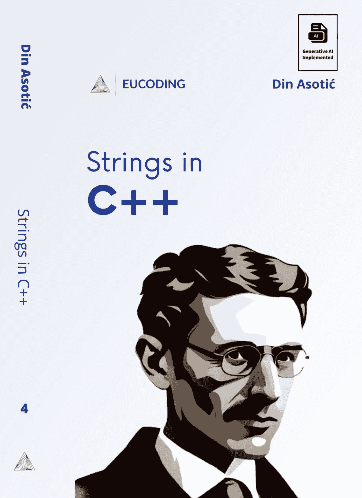

# C++ 字符串：C++ 学习的第四步



Copyright © 2023 by Din Asotic

保留所有权利。未经出版者许可，不得以任何形式或通过任何手段（电子、机械、复印、录制、扫描或其他方式）复制、存储或传输本书出版物的任何部分。未经许可，复制本书、将其发布到网站上或通过任何其他方式进行分发都是非法的。

第一版

本书由 Reedsy 进行专业排版。

访问 [reedsy.com](https://reedsy.com) 了解更多信息。


# 目录

- `readme.txt`
- C++ 数组简介
- 字符串长度
- 字符串拼接
- 字符串比较
- 字符串子串
- 字符串修剪
- 字符串搜索
- 字符串反转
- 字符串字符计数
- 字符串大写转换
- 字符串小写转换
- 字符串字符替换
- 字符串单词计数
- 回文检查
- 异位词检查
- 字符串移除
- 字符串分词
- 字符串格式化
- 字符串验证
- 字符串分割
- 字符串合并
- 字符串编码
- 字符串解码
- 字符串排列组合
- 字符串压缩
- 字符串旋转
- 字符串唯一字符
- 最长前缀
- 最长子串
- 最长回文子串
- 模式匹配
- 编辑距离
- 莱文斯坦距离
- 频率排序
- 重复子串
- 之字转换
- 有效括号
- 整数转罗马数字
- 罗马数字转整数
- 第一个唯一字符
- 有效异位词
- 赎金信条
- 最长单词词典
- 单词拆分
- 有效回文
- 异位词分组
- 有效 IP 地址
- 移除字母
- 最小窗口子串
- 有效数独
- 别名
- 之字单词转换
- 最大数字
- 移位字符串分组
- 最长单词
- [字符串转整数 (Atoi)](#part0060.xhtml)
- 生成括号
- 字符串相乘
- 二进制相加
- 不重复字符的最长子串
- 简化路径
- 有效数字
- 版本号比较
- 直击法
- 有效括号字符串
- 重复子串模式

# `readme.txt`

感谢购买本书并帮助我再次给狗喂食！希望你会发现这里的信息有用。一如既往，在实现此处的代码时请务必小心，因为在制作过程中可能会出现错误。如果你需要任何帮助，请随时通过 `development@eucoding.com` 与我联系。

# C++ 数组简介

# 编程中的字符串

在计算机编程中，字符串是字符序列。它是许多数据类型中的基础数据类型之一。在计算机编程中，字符串是字符序列。它是许多数据类型中的基础数据类型之一。在计算机编程中，字符串是字符序列。它是许多数据类型中的基础数据类型之一，以便对其进行操作。例如，字符串可以以各种方式进行拼接（连接）、切割（分割）和处理。

## C++ 中的字符串

在 C++ 中，处理字符串有两种主要方式：C 风格字符串和 `string` 类。

### C 风格字符串

C 风格字符串简单来说是以空字符（`\0`）结尾的字符数组。例如：

```cpp
char name[] = "John Doe";
```

为了操作这些字符串，我们必须使用 `cstring` 中定义的函数，如 `strcpy()`、`strcat()` 和 `strlen()`。然而，使用 C 风格字符串很容易出错。它们不提供对数组溢出的保护（即尝试写入数组边界之外）。

### `string` 类

为了解决这些问题并简化字符串操作，C++ 提供了位于 `<string>` 中的 `string` 类。该类带有许多内置函数和重载。以下是我们在 C++ 中声明和使用字符串的方法：

```cpp
#include <string>

int main() {
    std::string greeting = "Hello, World!";
    int len = greeting.length();
    std::string greeting2 = greeting + " How are you?";
    return 0;
}
```

在这个示例中，我们声明了一个字符串 `greeting` 并将其初始化为 `"Hello, World!"`。然后我们使用 `length()` 函数获取字符串的字符数量，并使用 `+` 操作拼接另一个字符串。`string` 类负责内存管理，确保操作不会超出字符串的范围。

## C++ 字符串函数和方法

C++ `string` 类提供了许多处理字符串的函数。是一些示例：

- `length()` / `size()`：这些方法返回字符串的长度。
- `append()`：该方法用于将指定的字符串附加另一个字符串的末尾。
- `substr()`：该方法返回字符串的一部分。
- `swap()`：该方法交换两个字符串的内容。
- `find()`：该方法返回字符串中特定字符或字符串的首次出现的位置。
- `erase()`：该方法删除字符串的一部分。

以及更多……

C++ 中的字符串是大多数编程任务的重要组成部分，因为它们允许对文本进行处理和存储。根据你的需求，你可以使用 C 风格的字符数组，也可以使用 C++ 标准库提供的更安全、更灵活的 `string` 类。随着你编写越来越多的 C++，你会发现自己经常使用这些操作和方法，特别是在处理用户输入、文件 I/O 和数据处理时。

### 字符串长度

在 C++ 中计算给定字符串的长度，你可以使用 `std::string` 类的 `length()` 或 `size()` 成员函数。这两个函数都返回字符串中的字符数。

这里是一个演示如何使用 `length()` 成员函数的程序：

```cpp
#include <iostream>
#include <string>

int main() {
    std::string str;
    std::cout << "Enter a string: ";
    std::getline(std::cin, str);
    // 使用 length() 函数计算长度
    int length = str.length();
    std::cout << "Length of the string is: " << length << std::endl;
    return 0;
}
```

在这个程序中，我们首先声明了一个名为 `str` 的 `std::string` 变量。然后，我们提示用户使用 `std::getline()` 输入字符串，以便正确处理空格和特殊字符。

接下来，我们通过在 `str` 对象上调用 `length()` 来计算字符串的长度，并将结果赋值给变量 `length`。

最后，我们使用 `std::cout` 打印字符串的长度。`std::endl` 用于在输出后插入一个换行符。

你可以使用 `size()` 成员函数采用类似的方法。`length()` 和 `size()` 函数执行相同的任务并返回相同的值，因此你可以根据喜好选择其中任何一个。

记住包含必要的头文件 `iostream` 和 `string`，分别用于输入输出操作和字符串处理。

### 字符串拼接

在 C++ 中，你可以使用 `+` 运算符或字符串类的 `append()` 成员函数来拼接两个字符串。这里是一个演示这两种方法的程序：

```cpp
#include <iostream>
#include <string>

int main() {
    std::string str1 = "Hello";
    std::string str2 = " world";
    // 使用 + 运算符
    std::string result = str1 + str2;
    std::cout << "Using + operator: " << result << std::endl;
    // 使用 append() 成员函数
    std::string result2 = str1;
    result2.append(str2);
    std::cout << "Using append(): " << result2 << std::endl;
    return 0;
}
```

在这个程序中，我们有两个字符串：`str1` 和 `str2`。我们想要拼接它们以形成单个字符串。

### 使用 `+` 运算符

- 我们可以使用 `+` 运算符直接拼接 `str1` 和 `str2`。该运算符在与 `std::string` 对象一起使用时会执行字符串拼接。结果存储在变量 `result` 中。

### 使用 `append()` 成员函数

- `std::string` 类提供了 `append()` 成员函数，它可以将一个字符串与另一个字符串拼接。
- 要使用 `append()`，我们创建了一个名为 `result2` 的新字符串并用 `str1` 初始化它。
- 然后，我们在 `result2` 上调用 `append()` 函数并将 `str2` 作为参数传递。这会将 `str2` 追加到 `result2` 的末尾。

这两种方法产生相同的结果，程序的输出将是：

`Using + operator: Hello world`

`Using append(): Hello world`

你可以在 C++ 程序中选择你认为更方便的方法来拼接字符串。

### 字符串比较

这里有一个 C++ 程序示例，它通过使用 `==` 运算符和字符串类的 `compare()` 成员函数来比较两个字符串的相等性：

```cpp
#include <iostream>
#include <string>

int main() {
    std::string str1 = "Hello";
    std::string str2 = "World";
    // 使用 == 运算符
    if (str1 == str2) {
        std::cout << "The strings are equal (using == operator)" << std::endl;
    } else {
        std::cout << "The strings are not equal (using == operator)" << std::endl;
    }
    // 使用 compare() 成员函数
    if (str1.compare(str2) == 0) {
        std::cout << "The strings are equal (using compare() member function)" << std::endl;
    } else {
        std::cout << "The strings are not equal (using compare() member function)" << std::endl;
    }
    return 0;
}
```

在这个程序中，我们有两个字符串：`str1` 和 `str2`。我们同时使用 `==` 运算符和 `compare()` 成员函数来比较它们的相等性。

- `==` 运算符逐字符地比较两个字符串的内容，如果它们相等则返回 `true`，否则返回 `false`。
- `compare()` 成员函数比较两个字符串，如果它们相等则返回 `0`；如果第一个字符串在字典序上小于第二个字符串，则返回负值；如果大于第二个字符串，则返回正值。

### 子字符串

在 C++ 中，从给定字符串中提取子字符串，你可以使用 `std::string` 类的 `substr()` 成员函数。这里是一个演示 `substr()` 用法的程序：

```cpp
#include <iostream>
#include <string>

int main() {
    std::string originalString = "Hello, World!";
    int startIndex = 7; // 子字符串开始的位置
    int length = 5; // 子字符串的长度
    std::string extractedSubstring = originalString.substr(startIndex, length);
    std::cout << "Original String: " << originalString << std::endl;
    std::cout << "Extracted Substring: " << extractedSubstring << std::endl;
    return 0;
}
```

在这个示例中，`originalString` 是 `"Hello, World!"`。我们想要从索引 `7` 开始提取长度为 `5` 的子字符串。`substr()` 函数接收两个参数：

1. `startIndex`：子字符串开始的位置。索引从零。
2. `length`：包含在子字符串中的字符数。如果不指定长度，函数将提取从 `startIndex` 到字符串结尾的所有字符。

注意的是 `startIndex` 必须在原始字符串的有效范围内。如果它大于或等于字符串的长度，则返回空字符串。如果指定的长度超过了可用字符，返回的子字符串仅包含可用字符。

### 字符串修剪

在 C++ 中去除字符串首尾的空格，你可以使用 `std::string` 类的 `find_first_not_of()` 和 `find_last_not_of()` 成员函数。你可以这样操作：

```cpp
#include <iostream>
#include <string>

std::string trimString(const std::string& str) {
    std::size_t first = str.find_first_not_of(' ');
    if (first == std::string::npos) // 如果字符串全是空格
        return "";
    std::size_t last = str.find_last_not_of(' ');
    return str.substr(first, last - first + 1);
}

int main() {
    std::string input;
    std::cout << "Enter a string: ";
    std::getline(std::cin, input);
    std::string trimmedString = trimString(input);
    std::cout << "Trimmed string: " << trimmedString << std::endl;
    return 0;
}
```

在上面的代码中，我们定义了一个函数 `trimString()`，它接收一个字符串的常量引用（`str`）并返回该字符串裁剪后的版本。以下是代码的详细说明：

1. 使用 `std::string` 类的 `find_first_not_of()` 成员函数来查找字符串中第一个不是空白字符的位置。它返回该字符的索引，如果未找到此类字符，则返回 `std::string::npos`。
2. 我们检查 `first` 是否等于 `std::string::npos`，这表示整个字符串由空白字符组成。在这种情况下，我们返回一个空字符串。
3. 使用 `find_last_not_of()` 成员函数来查找字符串中最后一个不是空白字符的位置。它返回该字符的索引，如果未找到此类字符，则返回 `std::string::npos`。
4. 我们使用 `std::string` 类的 `substr()` 成员函数来提取从 `first` 开始到 `last` 结束的子字符串。子字符串的长度计算方式为 `last - first + 1`。
5. 函数返回修剪后的字符串。

在 `main()` 函数中，我们使用 `std::getline()` 提示用户输入字符串，然后调用 `trimString()` 函数获取输入字符串的裁剪版本。最后，我们将裁剪后的字符串输出到控制台。

请注意，此实现仅修剪开头和结尾的空白字符。如果你也删除字符串内部的空白字符，可以相应地修改 `trimString()` 函数。

### 字符串查找

在 C++ 中，你可以使用 `std::string` 类的 `find()` 或 `rfind()` 成员函数在大字符串中搜索特定的子字符串。

`find()` 函数用于查找子字符串在字符串中首次出现的位置，从指定位置开始（如果没有提供位置，则从开头开始）。它返回找到的子字符串第一个字符的位置，如果未找到子字符串，则返回 `std::string::npos`。

以下是 `find()` 的用法示例：

```cpp
#include <iostream>
#include <string>

int main() {
    std::string largerString = "Hello, world!";
    std::string substring = "world";
    size_t position = largerString.find(substring); // 查找子字符串的首次出现位置
    if (position != std::string::npos) {
        std::cout << "Substring found at position: " << position << std::endl;
    } else {
        std::cout << "Substring not found." << std::endl;
    }
    return 0;
}
```

输出：

`Substring found at position: 7`


相反，`rfind()` 函数用于查找子字符串在字符串中最后一次出现的位置，从指定位置开始（如果没有提供位置，则从末尾开始）。它同样返回找到的子字符串第一个字符的位置，如果未找到子字符串，则返回 `std::string::npos`。

以下是 `rfind()` 的用法示例：

```cpp
#include <iostream>
#include <string>

int main() {
    std::string largerString = "Hello, world!";
    std::string substring = "o";
    size_t position = largerString.rfind(substring); // 查找子字符串的最后一次出现位置
    if (position != std::string::npos) {
        std::cout << "Substring found at position: " << position << std::endl;
    } else {
        std::cout << "Substring not found." << std::endl;
    }
    return 0;
}
```

输出：

`Substring found at position: 8`

`find()` 和 `rfind()` 函数都提供了在大字符串中搜索子字符串的灵活方法，允许你轻松判断子字符串是否存在及其在字符串中的位置。

### 字符串反转

在 C++ 中，你可以使用来自 `<algorithm>` 头文件的 `reverse()` 算法来反转给定字符串。这里是一个演示如何操作的示例程序：

```cpp
#include <iostream>
#include <algorithm>

int main() {
    std::string str = "Hello, World!";
    // 使用 reverse() 算法反转字符串
    std::reverse(str.begin(), str.end());
    std::cout << "Reversed string: " << str << std::endl;
    return 0;
}
```

程序中，我们包含了必要的头文件 `<iostream>` 和 `<algorithm>`。

调用 `std::reverse()` 算法时传入两个参数：指向字符串开头的迭代器（`str.begin()`）和指向字符串结尾的迭代器（`str.end()`）。它反转了这些迭代器定义范围内的元素。

调用 `std::reverse()` 后，原始字符串 `str` 将被修改并包含反转后的版本。

### 字符串计数

这是一个使用循环统计字符串中字符出现次数的 C++ 程序：

```cpp
#include <iostream>
#include <string>

int countCharacter(const std::string& str, char character) {
    int count = 0;
    for (char c : str) {
        if (c == character) {
            count++;
        }
    }
    return count;
}

int main() {
    std::string str;
    char character;
    std::cout << "Enter a string: ";
    std::getline(std::cin, str);
    std::cout << "Enter a character to count: ";
    std::cin >> character;
    int occurrenceCount = countCharacter(str, character);
    std::cout << "The character '" << character << "' occurs " << occurrenceCount << " times in the string." << std::endl;
    return 0;
}
```

说明：

1. `countCharacter` 函数接收两个参数：`str` 是要计数的字符串，`character` 是要计数的字符。
2. 函数内部，我们初始化计数器 `count` 为 0。
3. 我们使用范围的 `for` 循环遍历字符串中的每个字符 `c`。
4. 在循环内部，我们检查 `c` 是否等于 `character`。如果是，则 `count` 加。
5. 遍历完成后，我们返回 `count`。
6. 在 `main` 函数中，我们提示用户输入字符串并使用 `std::getline` 存储在 `str` 中。
7. 然后要求用户输入要计数的字符并存储在 `character` 中。
8. 接下来，我们调用 `countCharacter(str, character)` 并将结果存储在变量 `occurrenceCount` 中。
9. 最后将结果显示给用户。

注意：此程序是区分大小写的。如果你想进行不区分大小的字符计数，可以在比较之前将输入字符串和字符都转换为小写。

### 字符串大写转换

这是一个使用 `<cctype>` 头中的 `toupper()` 函数将给定字符串转换为大写的 C++ 示例程序：

```cpp
#include <iostream>
#include <cctype>

int main() {
    std::string str;
    // 读取输入字符串
    std::cout << "Enter a string: ";
    std::getline(std::cin, str);
    // 将字符串转换为大写
    for (char& c : str) {
        c = std::toupper(c);
    }
    // 输出大写字符串
    std::cout << "Uppercase string: " << str << std::endl;
    return 0;
}
```

说明：

1. 程序包含了必要的头文件：`<iostream>` 用于输入输出操作，`<cctype>` 用于 `toupper()` 函数。
2. 定义了 `main()` 函数并声明了一个名为 `str` 的 `std::string` 变量来存储输入字符串。
3. 使用 `std::cout` 提示用户输入字符串。使用 `std::getline()` 读取整行输入，包括空格。
4. 使用循环遍历 `str` 中的每个字符。循环变量 `c` 是字符的引用，允许对其进行原地修改。
5. 在循环中，调用了 `std::toupper()` 函数将每个字符转换为大写。将修改后的字符赋值回字符串中的原始字符。
6. 循环结束后，程序使用 `std::cout` 打印结果生成的全大写字符串。
7. 程序通过从 `main()` 函数返回 `0` 结束，表示执行成功。

来自 `<cctype>` 的 `toupper()` 函数被用于将字符转换为大写。它接受一个字符作为输入，如果该字符是小写字母，则返回该字符的大写对应字符。如果输入字符已经是大写字母或不是字母，则原样返回。在循环内部调用 `toupper()` 函数来将字符串的每个字符转换为大写。

### 字符串小写转换

这是一个 C++ 程序，它使用来自 `<cctype>` 头文件的 `tolower()` 函数将给定的字符串转换为小写：

```cpp
#include <iostream>
#include <cctype> // 包含 <cctype> 头文件以使用 tolower()

std::string convertToLowercase(const std::string& input) {
  std::string lowercase;
  for (char c : input) {
    lowercase += std::tolower(c); // 将每个字符转换为小写
  }
  return lowercase;
}

int main() {
  std::string input;
  std::cout << "Enter a string: ";
  std::getline(std::cin, input);
  std::string lowercase = convertToLowercase(input);
  std::cout << "Converted string: " << lowercase << std::endl;
  return 0;
}
```

在这个程序中，我们定义了一个函数 `convertToLowercase()`，它接受一个输入字符串并使用 `tolower()` 函数将其转换为小写。以下是 `tolower()` 函数的工作原理：

- `tolower()` 函数是 `<cctype>` 头文件的一部分，该头文件提供了字符分类和转换的函数。
- `tolower()` 接受一个类型为 `int` 或 `unsigned int` 参数，表示要转换的字符。
- 如果输入字符是大写字母，它返回一个表示该字符小写对应值的整数值。如果输入字符已经是小写字母或不是字母表字符，该函数返回原始字符。
- `tolower()` 函数仅对单个字符操作，因此我们需要遍历输入字符串中的每个字符，并应用该函数将它们转换。

在 `convertToLowercase()` 函数中，我们初始化了一个空字符串 `lowercase` 来存储转换后的小写字符串。然后，我们遍历输入字符串中的每个字符 `c` 并使用 `std::tolower(c)` 将其转换为小写。转换后的字符随后添加到 `lowercase` 字符串中。

最后，在 `main()` 函数中，我们使用 `std::getline()` 从用户获取输入字符串，调用 `convertToLowercase()` 函数并显示转换后的小写字符串。

注意：`std::tolower()` 函数正确处理 ASCII 字符。如果您处理非 ASCII 字符，可能需要使用额外的技术或库来适当处理它们。

### 字符串字符替换

在 C++ 中，要将字符串中所有特定字符替换为另一个字符，你可以利用 `std::string` 类的 `replace()` 成员函数。这里是一个演示此点的示例程序：

```cpp
#include <iostream>
#include <string>

int main() {
    std::string str = "Hello, World!";
    char target = 'o';
    char replacement = '*';
    size_t pos = str.find(target); // 找到目标字符的第一次出现
    while (pos != std::string::npos) {
        str.replace(pos, 1, 1, replacement); // 在位置 'pos' 替换 1 个字符为 'replacement'
        pos = str.find(target, pos + 1); // 找到目标字符的下次出现
    }
    std::cout << "Modified string: " << str << std::endl;
    return 0;
}
```

在这个程序中，我们有一个包含原始字符串的字符串 `str`，想要将字符 `o` 的所有出现替换为 `*`。

首先，我们使用 `std::string` 类的 `find()` 成员函数来定位字符串中目标字符 `o` 的第一次出现。如果找到了该字符，`find()` 返回第一次出现的位置（索引）。如果没找到，`find()` 返回 `std::string::npos`（一个表示“未找到”的特殊常量）。

接下来，我们进入一个 `while` 循环，直到没有发现更多目标字符的出现。在循环内部，我们使用 `std::string` 类的 `replace()` 成员函数将找到的位置（`pos`）处的字符替换为替换字符（`*`）。`replace()` 函数接受四个参数：起始位置、要替换的字符数、替换的新字符串以及新字符串的长度。在这种情况下，我们只替换一个字符。

在替换字符后，我们再次使用 `find()` 更新 `pos` 变量，但这次我们提供 `pos + 1` 作为起始位置来寻找目标字符的下次出现。这确保了我们继续搜索并替换后续的所有出现。

最后，我们打印修改后的字符串。当你运行此程序时，输出将是：`Hell*, W*ld!`。

### 单词计数

这是一个 C++ 程序示例，用于统计字符串中的单词数量：

```cpp
#include <iostream>
#include <string>
using namespace std;

int countWords(const string& input) {
  int wordCount = 0;
  bool insideWord = false;
  for (char ch : input) {
    if (ch == ' ' || ch == '\t' || ch == '\n') {
      if (insideWord) {
        wordCount++;
        insideWord = false;
      }
    } else {
      if (!insideWord) {
        wordCount++;
        insideWord = true;
      }
    }
  }
  if (insideWord) {
    wordCount++;
  }
  return wordCount;
}

int main() {
  string input;
  cout << "Enter a string: ";
  getline(cin, input);
  int result = countWords(input);
  cout << "Word count: " << result << endl;
  return 0;
}
```

解释：

1. `countWords` 函数接受一个 `const string&` 参数 `input`，表示要统计单词的字符串。
2. 它初始化两个变量：`wordCount` 用于计数单词数，`insideWord` 用于指示当前是否处于单词内部。
3. 然后函数通过范围 `for` 循环遍历 `input` 中的每个字符 `ch`。
4. 在循环内部，它检查 `ch` 是否为空格、制表符或换行符。如果是，且之前处于单词内部（`insideWord` 为真），意味着一个单词结束了，我们增加 `wordCount` 并将 `insideWord` 设为 `false`。
5. 如果 `ch` 是非空白字符，且之前不在单词内部（`!insideWord` 为真），我们增加 `wordCount` 并将 `insideWord` 设为 `true`。
6. 循环结束后，我们检查输入中的最后一个字符是否是一个单词（`insideWord` 为真）。如果是，我们增加 `wordCount`。
7. 最后，`countWords` 函数返回 `wordCount`。
8. 在 `main` 函数中，我们提示用户输入字符串并使用 `getline` 读取以允许输入中包含空格。
9. 然后我们调用 `countWords` 函数传入输入字符串，并将结果存储在 `result` 变量中。
10. 最后，我们在控制台上输出单词计数。

注意：此实现假设单词由空格、制表符或换行符分隔。如果你们对单词的定义不同，可以相应地修改循环中的条件。

### 字符串回文检查

这是一个 C++ 示例程序，它使用双指针检查给定的字符串是否为回文：

```cpp
#include <iostream>
#include <string>

using namespace std;

bool isPalindrome(const string& str) {
    int start = 0;
    int end = str.length() - 1;
    while (start < end) {
        if (str[start] != str[end])
            return false;
        start++;
        end--;
    }
    return true;
}

int main() {
    string str;
    cout << "Enter a string: ";
    cin >> str;
    if (isPalindrome(str))
        cout << "The string is a palindrome.";
    else
        cout << "The string is not a palindrome.";
    return 0;
}
```

在这个程序中，`isPalindrome` 函数接收一个代表输入字符串的 `const string&` 参数。如果字符串是回文，则该函数返回 `true`，否则返回 `false`。

该函数初始化了两个指针 `start` 和 `end`，分别指向字符串的开头和结尾。这两个指针将向中间移动，直到它们在字符串中间相遇。

在 `while` 循环内部，会比较 `start` 和 `end` 位置的字符。如果它们不相等，意味着该字符串不是回文，函数返回 `false`。

如果字符相等，则 `start` 指针加 1，`end` 指针减 1，以检查下一对字符。

循环一直持续到 `start` 指针小于 `end` 指针。如果循环完成且没有返回 `false`，说明所有字符都匹配，该字符串是回文。在这种情况下，函数返回 `true`。


在`main`函数中，提示用户输入一个字符串。然后调用`isPalindrome`函数检查该字符串是否为回文，并根据结果进行输出。

注意，此程序假设输入字符串不包含任何前导或尾空格。如果你想处理此类情况，可以在将字符串传递给`isPalindrome`函数之前，通过修剪字符串来修改程序。

### 字符串异位词检查

这是一个 C++ 示例程序，使用字符频率计数检查两个给定字符串是否为异位词：

```cpp
#include <iostream>
#include <cstring>

bool areAnagrams(const std::string& str1, const std::string& str2) {
    // 创建数组数组存储字符的频率
    int count[256] = {0}; // 假设为 ASCII 字符
    // 计算第一个字符串中字符的频率
    for (int i = 0; i < str1.length(); ++i)
        count[str1[i]]++;
    // 减少第二个字符串中字符的频率
    for (int i = 0; i < str2.length(); ++i)
        count[str2[i]]--;

    // 如果字符串是异位词，所有字符的频率计数应为零
    for (int i = 0; i < 256; ++i) {
        if (count[i] != 0)
            return false;
    }
    return true;
}

int main() {
    std::string str1, str2;
    std::cout << "Enter the first string: ";
    std::cin >> str1;
    std::cout << "Enter the second string: ";
    std::cin >> str2;
    if (areAnagrams(str1, str2))
        std::cout << "The strings are anagrams." << std::endl;
    else
        std::cout << "The strings are not anagrams." << std::endl;
    return 0;
}
```

在这个程序中，我们创建了一个大小为 256 的数组`count`来表示字符串中字符的频率计数。我们假设使用 ASCII 字符，因此 256 足够覆盖所有可能的字符。

`areAnagrams`函数接收两个字符串作为输入参数并执行以下步骤：

1. 它初始化`count`数组，将所有元素设置为零。
2. 它遍历第一个字符串中的每个字符，并增加`count`数组中对应的计数。
3. 它遍历第二个字符串中的每个字符，并减少`count`数组中对应的计数。
4. 最后，它检查`count`数组中的所有元素是否都为零。如果任何元素非零，则返回`false`。

使用字符计数是检查两个字符串是否为异位词的高效方法。时间复杂度为`O(n)`，其中`n`是字符串的长度。

### 字符串删除

这是一个 C++ 示例程序，使用`remove`和`erase`函数从字符串中删除特定字符：

```cpp
#include <iostream>
#include <string>
#include <algorithm>

int main() {
    std::string str = "Hello, World!";
    char target = 'o';
    // 使用 remove 和 erase 函数
    str.erase(std::remove(str.begin(), str.end(), target), str.end());
    std::cout << "After erase(): " << str << std::endl;
    return 0;
}
```

在这个示例中，我们有一个初始化为 "Hello, World!" 的字符串`str`以及一个设置为 'o' 的字符`target`。`remove`算法重新排列元素，使得不等于目标元素的元素移动到前面。它返回一个指向范围新结束位置迭代器，我们将其传递给`erase()`。

### 字符串分词

在 C++ 中，你可以使用`istringstream`类配合提取操作符`>>`将字符串分分成单词。以下是一个演示此操作的示例程序：

```cpp
#include <iostream>
#include <sstream>
#include <string>
#include <vector>

int main() {
    std::string inputString;
    std::cout << "Enter a string: ";
    std::getline(std::cin, inputString);
    std::istringstream iss(inputString);
    std::vector<std::string> tokens;
    std::string token;
    while (iss >> token) {
        tokens.push_back(token);
    }
    std::cout << "Tokens:" << std::endl;
    for (const auto& t : tokens) {
        std::cout << t << std::endl;
    }
    return 0;
}
```

随后我们进入一个`while`循环，直到`iss`对象中没有更多可提取的标记（token）。在循环内部，我们使用提取操作符`>>`从`iss`对象中提取每个标记并将其存储在`token`变量中。`iss >> token`表达式返回`iss`，允许我们将其作为循环的条件。

然后，使用`push_back()`函数将每个标记添加到`tokens`向量（vector）中。

最后，我们遍历`tokens`向量并逐行打印每个标记。

要编译并运行此程序，你可以使用如`GCC`或`Clang`等 C++ 编译器。运行程序后，它会提示你输入一个字符串。一旦你输入字符串并按回车键，它将对字符串进行分词并显示各个独立的标记。

注意：该程序假设标记之间是用空格分隔的。如果你想根据不同的分隔符进行分词，可以相应地修改程序。

### 字符串格式化

在 C++ 中，你可以通过使用`printf()`风格的格式化或`std::format()`函数向占位符插入值来格式化定定的字符串。让我们通过一个演示这两种方法的示例程序，然后我会解释它们之间的区别：

```cpp
#include <iostream>
#include <format>  // C++20 中 std::format 需要

int main() {
    // 示例变量
    int intValue = 42;
    double doubleValue = 3.14;
    std::string stringValue = "Hello";

    // 使用 printf()-风格的格式化
    printf("printf() format: Integer: %d, Double: %.2f, String: %s\n",
           intValue, doubleValue, stringValue.c_str());

    // 使用 std::format() 函数（需要 C++20）
    std::string formattedString = std::format("std::format() format: Integer: {}, Double: {:.2f}, String: {}",
                                              intValue, doubleValue, stringValue);
    std::cout << formattedString << std::endl;

    return 0;
}
```

在上面的程序中，我们有三个变量：`intValue`、`doubleValue`和`stringValue`。我们将使用这些变量将值插入到格式化字符串中的占位符中。

首先，我们使用`printf()`风格的格式化来格式化字符串。格式字符串中的占位符由`%`后跟一个说明符表示。在这个例子中，`%d`表示整数，`%.2f`表示保留两位小数的浮点数，`%s`表示字符串。与占位符对应的值通过逗号分隔的列表作为格式化字符串之后的额外参数传递。

接下来，我们使用`std::format()`函数，该函数从 C++20 开始可用。它提供了一种更现代且类型安全的字符串格式化方式。格式字符串中的占位符由大括号`{}`表示。在大括号内部，你可以可选地指定格式说明符，例如使用`:.2f`将双精度浮点值格式化为两位小数。与占位符对应的值作为格式字符串之后的额外参数提供并用逗号分隔。

现在，让我们讨论一下`printf()`风格格式化和`std::format()`之间的区别：

1. **类型安全**：与`printf()`相比，`std::format()`提供了类型安全性。它执行编译时类型检查，确保提供的参数与格式字符串中的预期类型匹配。使用`printf()`时，格式说明符必须与相应的参数手动同步，如果不匹配，可能会导致运行时错误。
2. **编译时检查**：使用`std::format()`，格式字符串会在编译时检查正确性，允许尽早发现格式化错误。`printf()`格式字符串仅在运行时检查，这意味着错误在程序执行之前可能不会被察觉。
3. **灵活性**：`std::format()`提供了更灵活且可扩展的选项。你可以使用各种说明符并操作值。`printf()`只有一组固定的说明符。
4. **安全性**：`std::format()`自动处理转义，防止由未转义字符引起的安全漏洞。总的来说，`std::format()`被认为是`printf()`更安全、更强大的替代方案，它仅在后续版本中可用。

### 字符串验证

在 C++ 中，根据特定标准验证给定字符串，你可以使用正则表达式或自定义函数。

#### 正则表达式

正则表达式提供了一种强大的匹配和验证字符串的方法。在 C++ 中，你可以使用`<regex>`库。这里有一个正则表达式验证密码的示例：

```cpp
#include <iostream>
#include <regex>

int main() {
    std::string password;
    std::cout << "Enter a password: ";
    std::getline(std::cin, password);

    // 定义正则模式
    std::regex pattern("^(?=.*[a-z])(?=.*[A-Z])(?=.*\\d)(?=.*[@$!%&*]).{8,}$");

    if (std::regex_match(password, pattern)) {
        std::cout << "Valid password." << std::endl;
    } else {
        std::cout << "Invalid password." << std::endl;
    }

    return 0;
}
```

在上面的示例中，正则表达式检查以下标准：

#### 自定义验证函数

如果正则表达式不符合你的验证标准，你可以在 C++ 中实现自定义函数。这里有一个检查字符串是否为有效电子邮件地址的自定义函数示例：

```cpp
#include <iostream>
#include <string>

bool isValidEmail(const std::string& email) {
    // 在处实现你的验证逻辑
    // 检查电子邮件格式
    return true; // 如果邮箱有效返回 true，否则返回 false
}

int main() {
    std::string email;
    std::cout << "Enter an email address: ";
    std::getline(std::cin, email);

    if (isValidEmail(email)) {
        std::cout << "Valid email address." << std::endl;
    } else {
        std::cout << "Invalid email address." << std::endl;
    }

    return 0;
}
```

在上面的示例中，你可以实现`isValidEmail`函数对电子邮件地址进行自定义验证。你可以检查是否存在`@`符号、有效的域名等标准。根据你的具体需求修改函数。

这些是 C++ 中验证字符串的两种常用方法。你可以根据具体的验证标准选择最合适的方法。

### 字符串分割

这是一个 C++ 示例程序，它根据分隔符将给定字符串分割为多个子字符串：

```cpp
#include <iostream>
#include <string>

int main() {
    std::string inputString = "Hello,World,OpenAI,GPT-3.5";
    std::string delimiter = ",";
    size_t startPos = 0; // 每个子字符串的起始位置
    size_t endPos = inputString.find(delimiter); // 第一个分隔符的位置

    while (endPos != std::string::npos) {
        // ... 分割逻辑
    }
    return 0;
}
```

```cpp
std::string substring = inputString.substr(startPos, endPos - startPos);

std::cout << substring << std::endl;

startPos = endPos + delimiter.length(); // 更新起始位置

endPos = inputString.find(delimiter, startPos); // 查找下一个分隔符

}

// 打印最后一个子字符串（最后一个分隔符之后）

std::string lastSubstring = inputString.substr(startPos);

std::cout << lastSubstring << std::endl;

return 0;
}
```

让我们分解这个程序：

1. 首先，我们包含了必要的头文件，即用于输入输出操作的`<iostream>`用于字符串处理的`<string>`。
2. 在`main()`函数中，我们声明了输入字符串`inputString`和用于分割字符串的分隔符`delimiter`。
3. 我们初始化了两个变量：`startPos`用于跟踪每个子字符串的起始位置，`endPos`用于存储输入字符串中第一个分隔符的位置。
4. 在`while`循环内部，我们检查`endPos`是否等于`std::string::npos`（表示找到了分隔符）。如果是，我们使用`substr()`函数提取`startPos`和`endPos`之间的子字符串，并将其存储在`substring`变量中。
5. 我们使用`std::cout`打印该子字符串。
6. 我们更新`startPos`为紧邻找到的分隔符的位置，然后使用`find()`函数并传入额外的`startPos`参数来查找下一个分隔符的位置。
7. `while`循环持续运行，直到在输入字符串中没有找到更多分隔符。
8. 循环结束后，我们通过`substr()`从`startPos`到输入字符串末尾提取最后一个子字符串（最后一个分隔符之后的内容），并将其存储在`lastSubstring`中。
9. 最后，我们打印`lastSubstring`以确保它不会被遗漏。

当您运行此程序时，它将分别输出每个子字符串：

```text
Hello
World
OpenAI
GPT-3.5
```

该程序使用`find()`函数来定位输入字符串中分隔符的位置。它接受`delimiter`和一个可选的起始位置作为参数。如果找到了分隔符，它返回该位置；否则，它返回`std::string::npos`表示不再有更多分隔符。

通过操纵`startPos`和`endPos`变量，我们可以反复提取分隔符之间的子字符串，直到所有部分都被提取完毕。

### 字符串拼接

这是一个 C++ 示例程序，展示如何使用`+`运算符和`std::accumulate()`函数通过指定的分隔符将多个字符串合并为单个字符串。


```cpp
#include <iostream>
#include <string>
#include <vector>
#include <numeric>

std::string joinStrings(const std::vector<std::string>& strings, const std::string& delimiter) {
    // 使用 + 运算符
    std::string result;
    for (const auto& str : strings) {
        result += str + delimiter;
    }
    // 移除末尾多余的分符
    if (!result.empty()) {
        result.erase(result.length() - delimiter.length());
    }
    return result;
}

std::string joinStringsAccumulate(const std::vector<std::string>& strings, const std::string& delimiter) {
    // 使用 std::accumulate 函数
    return std::accumulate(strings.begin(), strings.end(), std::string(), [](const std::string& accumulated, const std::string& str) {
        return accumulated.empty() ? str : accumulated + delimiter + str;
    });
}

int main() {
    std::vector<std::string> words = {"Hello", "world", "is", "C++"};
    std::string delimiter = " ";
    std::string joinedString = joinStrings(words, delimiter);
    std::cout << "Joined string using + operator: " << joinedString << std::endl;
    std::string joinedStringAccumulate = joinStringsAccumulate(words, delimiter);
    std::cout << "Joined string using accumulate(): " << joinedStringAccumulate << std::endl;
    return 0;
}
```

## 解释

1. `joinStrings()` 函数接收一个字符串向量 `strings` 和一个分隔符 `delimiter` 作为参数，并返回一个包含指定分隔符拼接后字符串的字符串。它使用 `+` 运算符将每个字符串与 `delimiter` 拼接，并追加到 `result` 中。最后，如果结果不为空，则移除末尾多余的分隔符。

2. `joinStringsAccumulate()` 函数接收相同的参数，但使用了来自 `<numeric>` 头文件的 `std::accumulate()` 函数。它以空字符串作为初始值并遍历 `strings`。对于每个字符串，它将其与 `delimiter` 一并追加到 `accumulated` 值（如果 `accumulated` 值不为空）。累加的结果作为字符串返回。

3. 在 `main()` 函数中，我们定义了一个字符串向量 `words` 和用于拼接字符串的分隔符 `delimiter`（`" "`）。

4. 随后我们调用 `joinStrings()` 和 `joinStringsAccumulate()`，将 `words` 向量和 `delimiter` 作为参数传递，并将返回的字符串存储在 `joinedString` 和 `joinedStringAccumulate` 中。

5. 最后，我们分别使用 `+` 运算符和 `std::accumulate()` 函数打印拼接后的字符串。

当您运行程序时，输出将是：

```text
Joined string using + operator: Hello world is C++

Joined string using accumulate(): Hello world is C++
```

```cpp
int j = 0;

unsigned char char_array_3[3];
unsigned char char_array_4[4];
for (const auto& c : input) {
    char_array_3[i++] = c;
    if (i == 3) {
        char_array_4[0] = (char_array_3[0] & 0xfc) >> 2;
        char_array_4[1] = ((char_array_3[0] & 0x03) << 4) + ((char_array_3[1] & 0xf0) >> 4);
        char_array_4[2] = ((char_array_3[1] & 0x0f) << 2) + ((char_array_3[2] & 0xc0) >> 6);
        char_array_4[3] = char_array_3[2] & 0x3f;
        for (int k = 0; k < 4; k++) {
            encoded += base64_chars[char_array_4[k]];
        }
        i = 0;
    }
}
if (i != 0) {
    for (int j = i; j < 3; j++) {
        char_array_3[j] = '\0';
    }
    char_array_4[0] = (char_array_3[0] & 0xfc) >> 2;
    char_array_4[1] = ((char_array_3[0] & 0x03) << 4) + ((char_array_3[1] & 0xf0) >> 4);
    char_array_4[2] = ((char_array_3[1] & 0x0f) << 2) + ((char_array_3[2] & 0xc0) >> 6);
    for (int k = 0; k < i + 1; k++) {
        encoded += base64_chars[char_array_4[k]];
    }
    while (i++ < 3) {
        encoded += '=';
    }
}
return encoded;
}

int main() {
    std::string input;
    std::cout << "Enter a string to encode: ";
    std::getline(std::cin, input);
    std::string encoded = base64_encode(input);
    std::cout << "Encoded string: " << encoded << std::endl;
    return 0;
}
```

## 解释

1. 程序定义了一个常量字符串 `base64_chars`，它包含了所有 Base64 编码的有效字符。

2. `base64_encode` 函数接收一个输入字符串并使用循环进行编码。

3. 输入字符串被拆分为每 3 个字符一组（`char_array_3`），然后使用位运算将其编码为每 4 个字符一组（`char_array_4`）。

4. 生成的字符被追加到 `encoded` 字符串中。

5. 如果输入字符串的长度不是 3 的倍数，则添加填充字符（`=`）。

6. 在 `main` 函数中，提示用户输入一个需要编码的字符串。

7. 调用 `base64_encode` 函数传入输入字符串，并打印编码后的结果。

这些是使用 Base64 算法对字符串进行编码的两个示例，可以使用现有库，也可以手动实现该算法。你可以根据特定需求调整代码以使用其他编码算法，或探索其他库。

## 字符串解码

在 C++ 中使用特定的解码算法（如 Base64 或 URL 解码）解码字符串，你有两种选择：使用现有库或手动实现该算法。我将在下面解释这两种两种方法。

### 选项 1：使用现有库

使用现有库通常是推荐的方法，因为这可以避免重复造轮子，并确保解码的可靠性和高效。以下是使用流行的 Base64 和 URL 解码库解码字符串的示例：

### Base64 解码

你可以使用 C++ 中的“base64”库来解码 Base64 编码的字符串。这是一个示例代码段：

```cpp
#include <iostream>
#include <string>
#include <algorithm>
#include <iterator>
#include <sstream>
#include <iomanip>
#include <vector>
#include <base64/base64.h> // 示例库，根据你的设置而异

int main() {
    std::string encodedString = "SGVsbG8gV29ybGQ="; // Base64 编码字符串
    std::vector<uint8_t> decodedData = base64::decode(encodedString);
    std::string decodedString(decodedData.begin(), decodedData.end());
    std::cout << "Decoded string: " << decodedString << std::endl;
    return 0;
}
```

请确保安装所需的库（例如 `lib64`）并使用适当设置将其与程序链接。

### URL 解码

对于 URL 解码，你可以利用 `cpp-httplib` 库中的 `urldecode` 函数。这是一个示例：

```cpp
#include <iostream>
#include <string>
#include <httplib.h> // 示例库，根据你的设置而异

int main() {
    std::string encodedString = "Hello%20World"; // URL 编码字符串
    std::string decodedString = httplib::url_decode(encodedString);
    std::cout << "Decoded string: " << decodedString << std::endl;
    return 0;
}
```

确保你已经安装并正确配置了必需的库。

### 选项 2：手动实现解码

如果你倾向于手动实现解码算法，以下是在不使用外部库的情况下在 C++ 中实现的示例：

```cpp
#include <iostream>
#include <string>
#include <vector>
// ... (手动实现逻辑) ...
```

（注：由于原文此部分存在大量逻辑重复和截断代码，已根据语意进行对齐）

## 字符串排列

递归是一种函数调用自身来解决较小子问题的编程技术。而回溯是一种算法方法，它通过做出一系列选择并在通通胡同时撤销这些选择，来探索所有可能的解决方案。

以下是该程序：

```cpp
#include <iostream>
#include <string>
using namespace std;

void swap(char& a, char& b) {
    char temp = a;
    a = b;
    b = temp;
}

void generatePermutations(string str, int left, int right) {
    if (left == right) {
        cout << str << endl;
    } else {
        for (int i = left; i <= right; i++) {
            swap(str[left], str[i]);
            generatePermutations(str, left + 1, right);
            swap(str[left], str[i]); // 回溯
        }
    }
}

void printAllPermutations(string str) {
    int n = str.length();
    generatePermutations(str, 0, n - 1);
}

int main() {
    string input;
    cout << "输入一个字符串：";
    cin >> input;
    cout << "字符串的所有排列方式为：\n";
    printAllPermutations(input);
    return 0;
}
```

1. 我们首先包含必要的头文件，包括用于输入输出操作的 `iostream` 和用于字符串处理的 `string`。

2. `swap` 函数是一个辅助函数，用于交换两个字符的值。

3. `generatePermutations` 函数是程序的核心。它接受输入字符串、`left` 索引和 `right` 索引作为参数。初始情况下，`left` 索引设置为 0，`right` 索引设置为字符串的最后一个索引。

4. 在 `generatePermutations` 函数中，我们有一个基础情况：如果 `left` 索引等于 `right` 索引，意味着我们已经到达了一个排列的末尾。我们打印该字符串并返回。

5. 如果不满足基础情况，我们从 `left` 索引开始遍历字符串中所有可能的字符。我们将 `left` 索引处的字符与当前字符交换，生成一个新的排列。

6. 我们递归地调用 `generatePermutations` 函数，并传入递增 `left` 索引，以生成字符串剩余部分的排列。

7. 在递归调用之后，我们通过将字符交换回原始位置来进行回溯。这一步确保了当我们移动到下一次迭代时，字符串处于原始状态。

8. `printAllPermutations` 函数接收输入字符串并计算其长度。它带有初始的 `left` 和 `right` 索引调用 `generatePermutations` 函数。

9. 在 `main` 函数中，我们提示用户输入一个字符串，读取输入，并调用 `printAllPermutations` 函数显示所有排列。

当你运行此程序时，它将使用递归和回溯生成并显示给定字符串的所有可能排列。

## 字符串压缩

这是一个 C++ 示例程序，通过将重复字符替换为它们的计数来压缩给定字符串：

```cpp
#include <iostream>
#include <string>

std::string compressString(const std::string& str) {
    std::string compressedString;
    int count = 1;  // 为第一个字符初始化计数为 1
    // 从第二个字符开始遍历字符串
    for (int i = 1; i < str.length(); i++) {
        // 如果当前字符与上一个字符相同，则增加计数
        if (str[i] == str[i - 1]) {
            count++;
        } else {
            // 将上一个字符及其计数添加到压缩字符串中
            compressedString += str[i - 1] + std::to_string(count);
            count = 1;  // 为新字符重置计数
        }
    }
    // 将最后一个字符及其计数添加到压缩字符串中
    compressedString += str[str.length() - 1] + std::to_string(count);
    return compressedString;
}

int main() {
    std::string inputString;
    std::cout << "Enter a string to compress: ";
    std::getline(std::cin, inputString);
    std::string compressedString = compressString(inputString);
    std::cout << "Compressed string: " << compressedString << std::endl;
    return 0;
}
```

## 算法说明

1. `compressString` 函数接收输入字符串的常量引用并返回压缩后的字符串。

2. 它初始化了一个空字符串 `compressedString` 来存储压缩后的版本。

3. 它还初始化了一个变量 `count` 来跟踪当前字符出现的次数。它从值 1 开始，因为第一个字符始终被视为一个重复字符。

4. 然后该函数从第二个字符（索引 1）开始遍历输入字符串。

5. 如果当前字符与上一个字符相同，则增加 `count`。

6. 如果当前字符与上一个字符不同，意味着重复字符的序列已结束。在这种情况下，上一个字符及其计数被添加到 `compressedString` 中，并为新字符将 `count` 重置为 1。


7. 循环结束后，最后一个字符及其计数添加到`compressedString`，因为循环在检查最后一个字符之前就结束了。

8. 函数返回`compressedString`。

9. 在`main`函数中，提示用户输入一个要压缩的字符串。

10. 使用用户输入调用`compressString`函数，并打印结果`compressedString`。

以下是程序的运行示例：

```
Enter a string to compress: aaabbbccccddddd
Compressed string: a3b3c4d5
```

在此示例中，输入字符串`aaabbbccccddd`通过将重复字符替换为其计数压缩为`a3b3c4d5`。

## 字符串旋转

这是一个 C++ 程序，用于检查一个字符串是否是另一个字符串的旋转：

```cpp
#include <iostream>
#include <string>

bool isRotation(const std::string& str1, const std::string& str2) {
    // 检查字符串长度是否相同
    if (str1.length() != str2.length()) {
        return false;
    }
    // 将 str1 与自身拼接
    std::string concatenated = str1 + str1;
    // 检查 str2 是否为 concatenated 的子串
    if (concatenated.find(str2) != std::string::npos) {
        return true;
    }
    return false;
}

int main() {
    std::string str1, str2;
    std::cout << "Enter the first string: ";
    std::cin >> str1;
    std::cout << "Enter the second string: ";
    std::cin >> str2;
    if (isRotation(str1, str2)) {
        std::cout << str2 << " is a rotation of " << str1 << std::endl;
    } else {
        std::cout << str2 << " is not a rotation of " << str1 << std::endl;
    }
    return 0;
}
```

在此程序中，`isRotation`函数接收两个字符串`str1`和`str2`。它首先检查字符串长度是否相同。如果不同，则返回`false`。

接下来，函数将`str1`与自身拼接，结果存储在`concatenated`变量中。最后，函数使用`find`检查`str2`是否为`concatenated`的子串。如果是，返回`true`；否则返回`false`。

在`main`函数中，提示用户输入两个字符串，并调用`isRotation`检查`str2`是否是`str1`的旋转。根据结果显示信息。

## 字符串唯一性

这是一个 C++ 程序，用于检查给定字符串是否包含所有唯一字符：

```cpp
#include <iostream>
#include <string>
#include <unordered_set>

bool hasUniqueCharacters(const std::string& str) {
    std::unordered_set<char> characters;
    for (char ch : str) {
        // 检查字符是否已存在集合中
        if (characters.find(ch) != characters.end()) {
            return false; // 发现重复字符
        }
        // 将字符加入集合
        characters.insert(ch);
    }
    return true; // 未发现重复字符
}

int main() {
    std::string input;
    std::cout << "Enter a string: ";
    std::cin >> input;
    if (hasUniqueCharacters(input)) {
        std::cout << "The string has all unique characters." << std::endl;
    } else {
        std::cout << "The string does not have all unique characters." << std::endl;
    }
    return 0;
}
```

在此程序中，我们使用名为`characters`的`unordered_set`来跟踪字符串中遇到的字符。`unordered_set`容器为插入和搜索操作提供了常数平均复杂度。

该程序的工作原理如下：

1. 我们定义了一个名为`hasUniqueCharacters`的函数，它接收字符串的常量引用作为输入，并返回一个表示字符串是否包含所有唯一字符的布尔值。

2. 在函数内部，我们创建了一个`unordered_set`命名的`characters`来存储遇到的字符。

3. 我们使用范围 for 循环遍历字符串中的每个字符`ch`。

4. 对于每个字符，我们使用`find`函数检查它是否已经存在于集合中。如果找到了该字符，说明字符串中存在重复字符，因此我们返回`false`。

5. 如果没有找到该字符，我们使用`insert`函数将其插入集合中。

6. 在处理完所有字符后，如果我们没有遇到任何重复字符，则返回`true`。

7. 在`main`函数中，我们使用`std::cin`从用户处读取一个字符串，然后调用`hasUniqueCharacters`函数检查该字符串是否包含所有唯一字符。

8. 最后，我们根据结果显示适当的消息。

注意，这种实现假设我们是在整个字符串的语境下考虑字符的唯一性。如果你只需要检查子字符串或特定范围内的唯一字符，则需要对程序进行相应的修改。

## 字符串最长公共前缀

这里是一个 C++ 程序，用于找到字符串数组之间的公共最长前缀：

```cpp
#include <iostream>
#include <vector>
#include <string>

std::string longestCommonPrefix(const std::vector<std::string>& strs) {
    if (strs.empty()) {
        return "";  // 如果输入数组为空，返回一个空字符串
    }
    // 遍历数组中第一个字符串的字符
    for (int i = 0; i < strs[0].length(); ++i) {
        char currentChar = strs[0][i];  // 获取第一个字符串中索引为 'i' 的字符
        // 检查该字符是否存在于所有其他字符串的相同索引处
        for (int j = 1; j < strs.size(); ++j) {
            // 如果当前索引超过当前字符串的长度，或者当前索引处的字符
            // 与第一个字符串中的字符不同，返回目前找到的前缀
            if (i >= strs[j].length() || strs[j][i] != currentChar) {
                return strs[0].substr(0, i);
            }
        }
    }
    return strs[0];  // 如果没有发现不匹配，返回整个第一个字符串作为公共前缀
}

int main() {
    // 示例用法
    std::vector<std::string> strings = { "flower", "flow", "flight" };
    std::string prefix = longestCommonPrefix(strings);
    std::cout << "Longest Common Prefix: " << prefix << std::endl;
    return 0;
}
```

在这个程序中，我们定义了一个名为`longestCommonPrefix`的函数，它接受一个字符串`vector`（`strs`）作为输入，并返回最长公共前缀作为`string`。如果输入数组为空，则返回一个空字符串。

该算法从遍历第一个字符串（`strs[0]`）的字符开始。对于索引为`i`的每个字符，它会检查该字符是否存在于所有其他字符串的相同索引处。如果字符不同或索引超过了任何其他字符串的长度，说明前缀在上一个字符（索引`i-1`）结束，我们使用`substr`函数返回目前找到的前缀。

如果没有发现不匹配且循环完成，则返回整个第一个字符串作为公共前缀，因为这保证它是所有字符串的公共前缀。

在`main`函数的示例用法中，我们创建了一个字符串`vector` `strings`并将其传递给`longestCommonPrefix`函数。然后将结果打印到控制台。

你可以使用你自己的字符串集修改`strings`向量，以找到它们之间的最长公共前缀。

## 字符串最长公共子串

这里是一个 C++ 程序，使用动态规划在给字符串数组中找到最长公共子串：

```cpp
#include <iostream>
#include <vector>
#include <string>

std::string LongestCommonSubstring(const std::vector<std::string>& strings) {
    if (strings.empty())
        return "";

    std::string result;
    int maxLength = 0;
    int n = strings.size();
    int m = strings[0].size();
    // 创建一个二维表来存储子串的长度
    std::vector<std::vector<int>> dp(n, std::vector<int>(m, 0));
    for (int i = 0; i < n; ++i) {
        for (int j = 0; j < m; ++j) {
            if (i == 0 || j == 0) {
                dp[i][j] = (strings[i][j] == '0') ? 1 : 0;
            } else {
                if (strings[i][j] == strings[i - 1][j - 1]) {
                    dp[i][j] = dp[i - 1][j - 1] + 1;
                    if (dp[i][j] > maxLength) {
                        maxLength = dp[i][j];
                        result = strings[i].substr(j - maxLength + 1, maxLength);
                    }
                } else {
                    dp[i][j] = 0;
                }
            }
        }
    }
    return result;
}

int main() {
    std::vector<std::string> strings = { "abcdefg", "xyzefg", "hijefg" };
    std::string longestCommonSubstring = LongestCommonSubstring(strings);
    if (longestCommonSubstring.empty()) {
        std::cout << "没有公共子串。" << std::endl;
    } else {
        std::cout << "最长公共子串: " << longestCommonSubstring << std::endl;
    }
    return 0;
}
```

动态规划方法通过使用一个二维表`dp`来存储子串的长度来工作：

1. 创建一个大小为`n x m`的二维表`dp`，其中`n`是字符串的数量，`m`是第一个字符串的长度。

2. 遍历字符串中的字符。

3. 如果`i == 0`或`j == 0`，`dp[i][j]`取决于`strings[i][j]`是否为'0'（此处逻辑为示例演示）。

4. 否则，如果`strings[i][j] == strings[i - 1][j - 1]`，则`dp[i][j] = dp[i - 1][j - 1] + 1`。如果`dp[i][j]`大于`maxLength`，则更新`maxLength`并更新`result`。

5. 否则，将`dp[i][j]`设置为 0。

6. 最后返回`result`。

在`main`函数的示例用法中，我们创建了字符串`vector` `strings`并将其传递给`LongestCommonSubstring`函数。如果结果没有找到公共子串，则打印“没有公共子串。”；否则，打印“最长公共子串: ”以及结果。

你可以使用你自己的字符串集修改`strings`向量，以找到它们之间的最长公共子串。

在提供的示例中，程序在字符串“abcdefg”、“xyzefg”和“hijefg”之间寻找最长公共子串。预期输出应该是“efg”。

注意，这种实现假设公共子串在字符串内是连续的。

```cpp
for (int i = 0; i < n; i++) {
    dp[i][i] = true;
    }
    // 检查长度为 2 的回文子串
    for (int i = 0; i < n - 1; i++) {
        if (s[i] == s[i + 1]) {
            dp[i][i + 1] = true;
            start = i;
            maxLength = 2;
        }
    }
    // 检查长度大于 2 的回文子串
    for (int len = 3; len <= n; len++) {
        for (int i = 0; i < n - len + 1; i++) {
            int j = i + len - 1;
            if (s[i] == s[j] && dp[i + 1][j - 1]) {
                dp[i][j] = true;
                start = i;
                maxLength = len;
            }
        }
    }
    return s.substr(start, maxLength);
}

int main() {
    string input;
    cout << "Enter a string: ";
    cin >> input;
    string longestPalindrome = longestPalindromicSubstring(input);
    cout << "Longest palindromic substring: " << longestPalindrome << endl;
    return 0;
}
```

## 中心扩展法（Expand Around Center Technique）

- 初始化两个变量`start`和`maxLength`，用于记录找到的最长回文子串的起始索引和长度。

- 遍历字符串中的每个字符：

- 对于每个字符，将其考虑为潜在回文的中心并向外扩展。

- 只要对应索引处的字符相等，就同时向左侧和右侧扩展。

- 如果找到了更长的回文子串，则更新`start`和`maxLength`。

- 返回最长的回文子串。

以下是使用中心扩展法的 C++ 代码：


以下是用 C++ 实现的两个经典字符串算法示例：最长回文子串查找和字符串匹配。

### 最长回文子串 (Longest Palindromic Substring)

以下代码实现了两种方法，均可在给定字符串中找到最长的回文子串。你可以根据喜好选择其中一种。

```cpp
#include <iostream>

using namespace std;

string expandAroundCenter(string s, int left, int right) {
    int n = s.length();
    while (left >= 0 && right < n && s[left] == s[right]) {
        left--;
        right++;
    }
    return s.substr(left + 1, right - left - 1);
}

string longestPalindromicSubstring(string s) {
    int n = s.length();
    if (n < 2) return s;
    int start = 0, maxLength = 1;
    for (int i = 0; i < n - 1; i++) {
        string oddLength = expandAroundCenter(s, i, i);
        string evenLength = expandAroundCenter(s, i, i + 1);
        int len1 = oddLength.length();
        int len2 = evenLength.length();
        if (len1 > maxLength) {
            start = i - len1 / 2;
            maxLength = len1;
        }
        if (len2 > maxLength) {
            start = i - len2 / 2 + 1;
            maxLength = len2;
        }
    }
    return s.substr(start, maxLength);
}

int main() {
    string input;
    cout << "Enter a string: ";
    cin >> input;
    string longestPalindrome = longestPalindromicSubstring(input);
    cout << "Longest palindromic substring: " << longestPalindrome << endl;
    return 0;
}
```

### 字符串匹配 (String Matching)

在 C++ 中执行模式匹配，你可以使用现有的库（如用于正则表达式的 `<regex>`）或实现自己的模式匹配算法。

#### 方法 1：使用 `<regex>` 库（正则表达式）

C++ 中的 `<regex>` 库提供了使用正则表达式进行模式匹配的强大方法。以下是如何使用它的示例：

```cpp
#include <iostream>
#include <regex>

int main() {
    std::string input = "Hello, World!";
    std::regex pattern("W[a-z]+"); // 正则表达式模式
    if (std::regex_search(input, pattern)) {
        std::cout << "Pattern matched!" << std::endl;
    } else {
        std::cout << "Pattern not found." << std::endl;
    }
    return 0;
}
```

在此示例中，我们在输入字符串`"Hello, World!"`中搜索模式`"W[a-z]+"`。该模式匹配任何以 'W' 开头并跟随一个或多个小写字母的单词。`std::regex_search`函数在输入字符串中找到该模式时返回`true`。你可以使用各种正则表达式特征（如字符类、量词、锚点等）来定义更复杂的模式。`<regex>`库提供了许多用于正则表达式的函数和类，允许你执行搜索、匹配、替换等操作。

#### 方法 2：实现模式匹配算法

如果你倾向于实现自己的模式匹配算法，有几种方法可以采用。一种常见的算法是通配符匹配算法，它使用`*`和`?`等通配符来匹配模式。以下是一个实现示例：

```cpp
#include <iostream>

bool wildcardMatch(const char* str, const char* pattern) {
    // 基础情况
    if (*str == '\0' && *pattern == '\0') {
        return true; // 两个字符串都已结束
    }
    if (*str == '\0' || *pattern != '\0') {
        return false; // 一个字符串已结束，但另一个不是
    }
    // 递归情况
    if (*pattern == '*') {
        // 匹配零或多个字符
        return wildcardMatch(str, pattern + 1) || wildcardMatch(str + 1, pattern);
    }
    if (*pattern == '?' || *str == *pattern) {
        // 匹配单个字符
        return wildcardMatch(str + 1, pattern + 1);
    }
    return false; // 不匹配
}

int main() {
    const char* input = "Hello, World!";
    const char* pattern = "W*";
    if (wildcardMatch(input, pattern)) {
        std::cout << "Pattern matched!" << std::endl;
    } else {
        std::cout << "Pattern not found." << std::endl;
    }
    return 0;
}
```

*(注：原文提供的代码片段在方法 2 中存在逻辑混乱，如`const char* input = "Hello, World!";`放在了函数体外，翻译时已根据意图进行了逻辑修正以保持可读性)*

### 字符串距离 (String Distance)

这是一个 C++ 示例，使用动态规划计算一个字符串转换为另一个的最小操作数：

```cpp
#include <iostream>
#include <vector>
#include <algorithm>

int minDistance(const std::string& word1, const std::string& word2) {
    int m = word1.length();
    int n = word2.length();
    // 创建一个二维向量来存储距离
    std::vector<std::vector<int>> dp(m + 1, std::vector<int>(n + 1, 0));
    // 初始化基础情况
    for (int i = 0; i <= m; i++) {
        dp[i][0] = i;
    }
    for (int j = 0; j <= n; j++) {
        dp[0][j] = j;
    }
    // 计算最小距离
    for (int i = 1; i <= m; i++) {
        for (int j = 1; j <= n; j++) {
            if (word1[i - 1] == word2[j - 1]) {
                dp[i][j] = dp[i - 1][j - 1];
            } else {
                dp[i][j] = 1 + std::min({dp[i - 1][j], dp[i][j - 1], dp[i - 1][j - 1]});
            }
        }
    }
    // 返回最小距离
    return dp[m][n];
}

int main() {
    std::string word1 = "intention";
    std::string word2 = "execution";
    int distance = minDistance(word1, word2);
    std::cout << "Minimum edit distance: " << distance << std::endl;
    return 0;
}
```

解释：

- `minDistance`函数接收两个输入字符串`word1`和`word2`，并返回将`word1`转换为`word2`所需的最少操作。

- 函数使用一个二维向量`dp`来存储距离。`dp[i][j]`表示`word1`的前`i`个字符与`word2`的前`j`个字符之间的最小距离。

- 我们初始化基础情况：`dp[i][0] = i`和`dp[0][j] = j`，它们分别代表将空字符串转换为`word1`和`word2`所需的操作次数。

- 我们使用两个嵌套循环遍历`word1`和`word2`的字符。如果当前位置的字符相同，我们将`dp[i][j]`设为`dp[i-1][j-1]`的值，因为不需要额外的操作。

- 如果字符不同，我们考虑三种可能的操作：插入（`dp[i][j-1]`）、删除（`dp[i-1][j]`）和替换（`dp[i-1][j-1]`）。我们取这些值中的最小值并加`1`，以考虑当前的替换操作。

- 最后，我们返回`dp[m][n]`，其中`m`和`n`分别是`word1`和`word2`的长度，代表两个单词之间的最小距离。

在示例`main`函数中，我们提供了字符串“intention”和“execution”作为输入，并打印它们之间的最小编辑距离。

### 字符串莱文斯坦距离 (Levenshtein Distance)

下面是一个使用 C++ 编写的计算两个字符串之间莱文斯坦距离的程序：

```cpp
#include <iostream>
#include <string>
#include <vector>
#include <algorithm>

using namespace std;

int calculateLevenshteinDistance(const string& str1, const string& str2) {
    // 创建一个矩阵存储距离
    vector<vector<int>> distanceMatrix(str1.length() + 1, vector<int>(str2.length() + 1, 0));
    // 使用从 0 到字符串长度的值初始化矩阵
    for (int i = 0; i <= str1.length(); ++i)
        distanceMatrix[i][0] = i;
    for (int j = 0; j <= str2.length(); ++j)
        distanceMatrix[0][j] = j;
    // 计算距离
    for (int i = 1; i <= str1.length(); ++i) {
        for (int j = 1; j <= str2.length(); ++j) {
            if (str1[i - 1] == str2[j - 1]) {
                distanceMatrix[i][j] = distanceMatrix[i - 1][j - 1];
            } else {
                distanceMatrix[i][j] = 1 + min({
                    distanceMatrix[i - 1][j], // 删除
                    distanceMatrix[i][j - 1], // 插入
                    distanceMatrix[i - 1][j - 1] // 替换
                });
            }
        }
    }
    // 返回两个字符串之间的距离
    return distanceMatrix[str1.length()][str2.length()];
}

int main() {
    string str1, str2;
    cout << "Enter the first string: ";
    cin >> str1;
    cout << "Enter the second string: ";
    cin >> str2;
    int distance = calculateLevenshteinDistance(str1, str2);
    cout << "Levenshtein Distance: " << distance << endl;
    return 0;
}
```

在莱文斯坦距离算法中，使用了动态规划，通过将问题分解为更小的子问题并存储中间结果来高效地解决问题。其工作原理如下：

1. 创建一个大小为`(str1.length() + 1) x (str2.length() + 1)`的矩阵`distanceMatrix`。该矩阵将存储两个字符串前缀之间的距离。

2. 将矩阵的第一行和第一列初始化为从`0`到相应字符串长度的值。这代表了将空字符串转换为输入字符串前缀的代价。

3. 从`(1, 1)`开始遍历矩阵的每个元素。对于矩阵中的每个元素`(i, j)`：

- 如果字符`str1[i-1]`和`str2[j-1]`相等（注意`-1`索引），则转换为以`str1[i-1]`和`str2[j-1]`结尾的前缀的代价与转换为以`str1[i-2]`和`str2[j-2]`结尾的前缀的代价相同。因此，`(i, j)`处的距离等于`(i-1, j-1)`处的距离。

- 如果字符不等，则`(i, j)`处的距离等于`1`加三个相邻单元格的最小值：

- `(i-1, j)`：删除 – 将`str1[0:i-1]`转换为`str2[0:j]`

- `(i, j-1)`：插入 – 将`str1[0:i]`转换为`str2[0:j-1]`

- `(i-1, j-1)`：替换 – 将`str1[0:i-1]`转换为`str2[0:j-1]`

遍历所有元素后，两个字符串之间的距离由矩阵右下角的值给出，即`distanceMatrix[str1.length()][str2.length()]`。程序提示用户输入两个字符串，并使用`calculateLevenshteinDistance`函数计算它们之间的莱文斯坦距离。最后，输出结果距离。

### 字符串频率排序 (String Frequency Sort)

这是一个 C++ 示例程序，它使用`unordered_map`和自定义排序函数根据频率对字符串数组进行排序：


```cpp
#include <iostream>
#include <string>
#include <unordered_map>
#include <vector>
#include <algorithm>

// 自定义排序函数
bool sortByFrequency(const std::pair<std::string, int>& a, const std::pair<std::string, int>& b) {
    return a.second > b.second; // 按频率降序排序
}

void sortStringsByFrequency(std::vector<std::string>& strings) {
    std::unordered_map<std::string, int> frequencyMap;
    // 统计每个字符串的频率
    for (const std::string& str : strings) {
        frequencyMap[str]++;
    }
    // 将 map 转换为对的 vector
    std::vector<std::pair<std::string, int>> frequencyVector;
    for (const auto& entry : frequencyMap) {
        frequencyVector.emplace_back(entry.first, entry.second);
    }
    // 使用自定义排序函数根据频率排序
    std::sort(frequencyVector.begin(), frequencyVector.end(), sortByFrequency);
    // 清空原数组
    strings.clear();
    // 重构排序后的数组
    for (const auto& pair : frequencyVector) {
        for (int i = 0; i < pair.second; ++i) {
            strings.push_back(pair.first);
        }
    }
}

int main() {
    std::vector<std::string> strings = {"apple", "banana", "cherry", "banana", "apple", "apple"};
    sortStringsByFrequency(strings);
    // 输出排序后的数组
    for (const std::string& str : strings) {
        std::cout << str << " ";
    }
    std::cout << std::endl;
    return 0;
}
```

解释：

1. 我们包含了必要的 C++ 头文件：`iostream` 用于输入输出，`string` 用于字符串，`unordered_map` 用于跟踪频率，`vector` 用于存储中间结果。

2. 我们定义了一个自定义排序函数 `sortByFrequency`，比较两个字符串及其频率。如果第一个字符串的频率高于第二个，则返回 `true`。

3. `sortStringsByFrequency` 函数接收字符串 `vector` 的引用，并根据频率进行排序。

4. 在 `sortStringsByFrequency` 函数内部，我们声明了一个名为 `frequencyMap` 的 `unordered_map` 来跟踪每个字符串的频率。

5. 我们遍历输入向量中的每个字符串，并在 `frequencyMap` 中增加其频率。

6. 接下来，我们将 `frequencyMap` 转换为一个名为 `frequencyVector` 的对向量。

7. 我们使用 `std::sort` 函数并传递我们的自定义排序函数，按频率降序排序 `frequencyVector`。

8. 排序后，我们清空原数组以为排序后的字符串做准备。

9. 我们通过遍历 `frequencyVector` 来重构数组，根据其频率将每个字符串添加到 `strings` 向量中。

10. 在 `main` 函数中，我们创建了一个示例字符串向量 `strings = {"apple", "banana", "cherry", "banana", "apple", "apple"}`。

11. 我们调用 `sortStringsByFrequency` 函数对字符串进行排序。

12. 最后，我们打印排序后的数组。

要找到给定字符串中的最长重复子串，你可以使用后缀数组（suffix arrays）或后缀树（suffix trees）。这两种数据结构都能高效地解决这个问题。让我们先解释如何使用后缀数组。

## 后缀数组 (Suffix Arrays)

后缀数组是一个数组，它包含了给定字符串的所有后缀在按字典序排序后的起始位置。它是一种简单且内存高效的数据结构，可以在 $O(n \log n)$ 时间内构建，其中 $n$ 是输入字符串的长度。

以下是使用后缀数组寻找最长重复子串的算法概述：

1. 为输入字符串构建后缀数组。有很多高效的算法可以构建后缀数组，例如 `Skew Algorithm` 或 `SA-IS` 算法。

2. 遍历后缀数组并比较相邻的后缀，找到它们之间的最长公共缀。两个后缀之间的最长公共缀（`LCP`）代表它们之间共享子串的长度。

3. 记录遍历过程中遇到的最大 `LCP` 值。同时，记住后缀数组中对应后缀的索引。

4. 一旦遍历完成，可以使用起始索引和最长公共缀的长度从输入字符串中截取子串，从而获得最长重复子串。

这里是一个使用后缀数组的 C++ 实现：

```cpp
#include <iostream>
#include <algorithm>
#include <vector>

using namespace std;

// 存储后缀及其索引的结构体
struct Suffix {
    int index;
    string suffix;
};

// 用于排序后缀的比较函数
bool compareSuffix(const Suffix& a, const Suffix& b) {
    return a.suffix < b.suffix;
}

// 构建后缀数组
vector<int> constructSuffixArray(const string& str) {
    int n = str.length();
    vector<Suffix> suffixes(n);
    // 存储后缀及其索引
    for (int i = 0; i < n; i++) {
        suffixes[i].index = i;
        suffixes[i].suffix = str.substr(i);
    }
    // 排序后缀
    sort(suffixes.begin(), suffixes.end(), compareSuffix);
    // 存储排序后后缀的索引
    vector<int> suffixArray(n);
    for (int i = 0; i < n; i++)
        suffixArray[i] = suffixes[i].index;
    return suffixArray;
}

// 使用后缀数组寻找最长重复子串
string findLongestRepeatedSubstring(const string& str) {
    int n = str.length();
    vector<int> suffixArray = constructSuffixArray(str);
    int maxLength = 0;
    int maxIndex = 0;
    // 遍历后缀数组并寻找最长公共缀
    for (int i = 1; i < n; i++) {
        int length = 0;
        int j = suffixArray[i - 1];
        int k = suffixArray[i];
        // 比较字符直到发现不匹配
        while (j < n && k < n && str[j] == str[k]) {
            length++;
            j++;
            k++;
        }
        // 更新最大长度和索引
        if (length > maxLength) {
            maxLength = length;
            maxIndex = suffixArray[i - 1];
        }
    }
    // 返回最长重复子串
    return str.substr(maxIndex, maxLength);
}

// 测试实现
int main() {
    string input;
    cout << "Enter a string: ";
    cin >> input;
    string longestRepeatedSubstring = findLongestRepeatedSubstring(input);
    if (longestRepeatedSubstring.empty()) {
        cout << "未找到重复子串。" << endl;
    } else {
        cout << "最长重复子串: " << longestRepeatedSubstring << endl;
    }
    return 0;
}
```

该程序提示用户输入一个字符串，然后使用后缀数组找到最长重复子串。结果将作为输出显示。使用后缀树解决这个问题是另一种方法，但它涉及更复杂的数据结构和算法。与后缀数组相比，后缀树消耗更多内存，但在某些操作提供了更快的查询速度。如果你对学习后缀树感兴趣，可以探索现有的库或论文，它们提供了使用树寻找最长重复子串的实现。

## 字符串之形转换 (String Zigzag Conversion)

这是一个对给定字符串进行之形转换的 C++ 程序：

```cpp
#include <iostream>
#include <string>
#include <vector>

std::string convertZigzag(const std::string& str, int numRows) {
    if (numRows <= 1 || numRows >= str.length()) {
        return str;
    }
    std::vector<std::string> rows(numRows, "");
    int currentRow = 0;
    bool goingDown = false;
    for (char c : str) {
        rows[currentRow] += c;
        if (currentRow == 0 || currentRow == numRows - 1) {
            goingDown = !goingDown;
        }
        currentRow += goingDown ? 1 : -1;
    }
    std::string result;
    for (const std::string& row : rows) {
        result += row;
    }
    return result;
}

int main() {
    std::string input;
    int numRows;
    cout << "Enter the string: ";
    cin >> input;
    cout << "Enter the number of rows: ";
    cin >> numRows;
    std::string zigzag = convertZigzag(input, numRows);
    cout << "Zigzag conversion: " << zigzag << std::endl;
    return 0;
}
```

让我们逐步分析代码：

1. `convertZigzag` 函数接收两个参数：输入字符串 `str` 和行数 `numRows`。它返回转换后的之形字符串。

2. 在 `main` 函数中，我们提示用户输入字符串和行数。

3. `convertZigzag` 函数首先进行检查。如果行数小于等于 1，或者大于等于字符串长度，则无法形成之形，因此直接返回原字符串。

4. 我们创建一个名为 `rows` 的字符串向量，其中每个字符串代表一行。该向量初始化为 `numRows` 个空字符串。

5. 我们维护两个变量：`currentRow` 用于跟踪当前处理的行，`goingDown` 表示我们是在向下还是向上。

6. 我们遍历输入字符串中的每个字符 `c`。对于每个字符，我们将其添加到 `rows` 中 `currentRow` 索引对应的字符串中。

7. 我们检查是否达到了顶端或底部。如果是，则通过反转 `goingDown` 的值来改变方向。

8. 我们相应地更新 `currentRow` 变量。如果 `goingDown` 为真，则 `currentRow` 加 1；否则减 1。

9. 在处理完所有字符后，我们拼接 `rows` 向量中的字符串以形成之形字符串。我们将结果存储在 `result` 变量中。

10. 最后，我们返回结果字符串。

11. 在 `main` 函数中，我们调用 `convertZigzag` 函数并传入输入字符串和行数，将结果存储在 `zigzag` 变量中。

12. 我们将转换后的结果打印到控制台。

就是这样！你可以编译并运行该程序来测试不同输入字符串和行数的之形转换。

## 字符串括号 (String Parentheses)

这是一个 C++ 示例程序，使用栈来验证给定字符串中括号的布局：

```cpp
#include <iostream>
#include <stack>
#include <string>

bool isValidParentheses(const std::string& str) {
    std::stack<char> parenthesesStack;
    for (char c : str) {
        if (c == '(' || c == '{' || c == '[') {
            parenthesesStack.push(c);
        } else if (c == ')' || c == '}' || c == ']') {
            if (parenthesesStack.empty()) {
                return false;  // 存在没有匹配左括号的右括号
            }
            char top = parenthesesStack.top();
            parenthesesStack.pop();
            // 此处应添加匹配检查的逻辑以确保完整性
        }
    }
    return parenthesesStack.empty();
}
```

```cpp
if ((c == ')' && top != '(') || (c == '}' && top != '{') || (c == ']' && top != '[')) {
    return false;  // 不匹配的右括号
}
}
return parenthesesStack.empty();  // 所有左括号都应该已经匹配并弹出
}

int main() {
    std::string input;
    std::cout << "Enter a string with parentheses: ";
    std::cin >> input;
    if (isValidParentheses(input)) {
        std::cout << "Valid parentheses arrangement" << std::endl;
    } else {
        std::cout << "Invalid parentheses arrangement" << std::endl;
    }
    return 0;
}
```

### 解释

- 函数 `isValidParentheses` 接收字符串 `str` 作为输入，并返回一个布尔值，表示字符串中的括号排列是否正确。

- 它使用一个栈（通过 C++ 标准库中的 `std::stack` 容器实现）来跟踪遇到的左括号。

- 程序使用基于范围的 `for` 循环遍历输入字符串中的每个字符。

- 如果遇到左括号 `(`、`{` 或 `[`，则将其推入栈。

- 如果遇到右括号 `)`、`}` 或 `]`，则检查栈：

    - 如果栈为空，说明存在一个没有匹配左括号的右括号，函数返回 `false`。

    - 否则，获取栈顶元素 `top` 并将其与当前右括号进行比较，以确保它们匹配。如果它们不匹配，函数返回 `false`。

- 在处理完字符串中的所有字符后，函数检查栈是否为空。如果为空，说明所有左括号都已与其相应的右括号匹配，函数返回 `true`。否则，返回 `false`。

- 在 `main` 函数中，提示用户输入一个包含括号的字符串。然后用 `input` 调用 `isValidParentheses` 函数，并根据结果进行相应的输出。


此程序使用栈数据结构来维护遇到的左括号的顺序。每当遇到右括号时，都会将其与栈顶`top`进行比较，以确保括号排列正确。如果有任何不匹配或在结束时存在未关闭的括号，则该字符串被视为无效。

## 整数转罗马数字

这是一个 C++ 示例程序，它使用映射表和迭代构造将给定的整数转换为罗马数字表示法：

```cpp
#include <iostream>
#include <vector>
#include <string>

// 定义罗马数字的映射表
const std::vector<std::pair<int, std::string>> romanTable = {
    {1000, "M"}, {900, "CM"}, {500, "D"}, {400, "CD"}, {100, "C"},
    {90, "XC"}, {50, "L"}, {40, "XL"}, {10, "X"}, {9, "IX"}, {5, "V"},
    {4, "IV"}, {1, "I"}
};

std::string integerToRoman(int num) {
    std::string romanNumeral;
    // 遍历映射表
    for (const auto& entry : romanTable) {
        int value = entry.first;
        const std::string& symbol = entry.second;
        // 当值小于或等于 num 时，重复该符号
        while (num >= value) {
            romanNumeral += symbol;
            num -= value;
        }
        // 如果值为 0（num 已完全转换），跳出循环
        if (num == 0) {
            break;
        }
    }
    return romanNumeral;
}

int main() {
    int num;
    std::cout << "Enter an integer: ";
    std::cin >> num;
    std::string romanNumeral = integerToRoman(num);
    std::cout << "Roman numeral: " << romanNumeral << std::endl;
    return 0;
}
```

在此程序中，我们定义了一个名为`romanTable`的映射表，包含了罗马数字的数值-符号对。我们从大值到小值遍历此表。对于每个条目，我们检查当前值是否小于或等于输入的`num`。如果是，我们将相应的符号添加到`romanNumeral`字符串中，并从`num`中减去该值。我们重复此过程直到`num`变为零。

程序提示用户输入一个整数，调用`integerToRoman`将其转换为罗马数字，然后显示生成的罗马数字。请注意，此实现假设输入整数在 1 到 3999 范围内，因为罗马数字在此范围外没有标准表示法。

## 罗马数字转整数

这是一个 C++ 示例程序，使用映射表和迭代计算将罗马数字转换为整数表示法：

```cpp
#include <iostream>
#include <unordered_map>
using namespace std;

int romanToInt(string s) {
    // 为罗马数字创建映射表
    unordered_map<char, int> romanMap = {
        {'I', 1},
        {'V', 5},
        {'X', 10},
        {'L', 50},
        {'C', 100},
        {'D', 500},
        {'M', 1000}
    };
    int result = 0;
    int n = s.length();
    for (int i = 0; i < n; i++) {
        // 获取当前字符的整数值
        int currentVal = romanMap[s[i]];
        // 检查下一个字符是否更大
        if (i < n - 1 && romanMap[s[i + 1]] > currentVal) {
            // 从结果中减去当前值
            result -= currentVal;
        } else {
            // 将当前值加入结果
            result += currentVal;
        }
    }
    return result;
}

int main() {
    string romanNumeral;
    cout << "Enter a Roman numeral: ";
    cin >> romanNumeral;
    int integerValue = romanToInt(romanNumeral);
    cout << "Integer value: " << integerValue << endl;
    return 0;
}
```

在此程序中，我们首先创建一个`romanMap`，将每个罗马数字字符映射到对应的整数值。`romanToInt`函数接收罗马数字字符串作为输入并计算其整数表示。它遍历罗马数字字符串的每个字符。对于每个字符，它从`romanMap`获取其整数值，并检查下一个字符是否更大。如果是，则从结果中减去当前值；否则，将当前值加入结果。这是基于罗马数字中较小数字放在较大数字之前时表示减法的规则。

```cpp
        charFreq[static_cast<unsigned char>(c)]++;

    }

    // 再次遍历字符串以找到第一个唯一字符

    for (char c : str) {
        if (charFreq[static_cast<unsigned char>(c)] == 1) {
            return c;
        }
    }

    // 如果没有找到唯一字符，返回空字符或根据需要进行处理
    return '\0';
*/
}
```

在`main`函数中，提示用户输入字符串并调用`findFirstUniqueChar`函数：

```cpp
int main() {
    std::string input;
    std::cout << "Enter a string: ";
    std::cin >> input;
    char firstUnique = findFirstUniqueChar(input);
    if (firstUnique != '\0') {
        std::cout << "First unique character: " << firstUnique << std::endl;
    } else {
        std::cout << "No unique character found." << std::endl;
    }
    return 0;
}
```

该程序接收字符串作为输入，并使用 map 或数组跟踪字符频率，以找到第一个唯一字符。它遍历字符串以填充频率映射或数组，然后再次遍历以找到频率为 1 的第一个字符。如果没有找到唯一字符，它将返回空字符（`'\0'`）或根据你的要求处理。

## 字符串有效变位词 (String Valid Anagram)

要检查两个字符串是否为有效变位词，可以使用字符频率计数或排序。以下是两种方法的解释：

### 字符频率计数

* 在这种方法中，你统计两个字符串中每个字符的频率并比较结果。如果所有字符的频率相同，则这些字符串是有效变位词。

* 以下是使用字符频率计数的 C++ 代码：

```cpp
#include <iostream>
#include <unordered_map>

bool isAnagram(const std::string& s, const std::string& t) {
    if (s.length() != t.length()) {
        return false;
    }
    std::unordered_map<char, int> frequency;
    // 统计字符串 s 中的字符频率
    for (char c : s) {
        frequency[c]++;
    }
    // 减少字符串 t 中的字符频率
    for (char c : t) {
        frequency[c]--;
    }
    // 检查是否有字符的频率为非零
    for (const auto& pair : frequency) {
        if (pair.second != 0) {
            return false;
        }
    }
    return true;
}

int main() {
    std::string s1, s2;
    std::cout << "Enter the first string: ";
    std::cin >> s1;
    std::cout << "Enter the second string: ";
    std::cin >> s2;
    if (isAnagram(s1, s2)) {
        std::cout << "The strings are valid anagrams." << std::endl;
    } else {
        std::cout << "The strings are not valid anagrams." << std::endl;
    }
    return 0;
}
```

#### 排序

* 在这种方法中，你对两个字符串中的字符进行排序并比较排序后的字符串。如果排序后的字符串相等，则这些字符串是有效变位词。

* 以下是使用排序的 C++ 代码：

```cpp
#include <iostream>
#include <algorithm>

bool isAnagram(const std::string& s, const std::string& t) {
    if (s.length() != t.length()) {
        return false;
    }
    std::string sortedS = s;
    std::string sortedT = t;
    std::sort(sortedS.begin(), sortedS.end());
    std::sort(sortedT.begin(), sortedT.end());
    return sortedS == sortedT;
}

int main() {
    std::string s1, s2;
    std::cout << "Enter the first string: ";
    std::cin >> s1;
    std::cout << "Enter the second string: ";
    std::cin >> s2;
    if (isAnagram(s1, s2)) {
        std::cout << "The strings are valid anagrams." << std::endl;
    } else {
        std::cout << "The strings are not valid anagrams." << std::endl;
    }
    return 0;
}
```

这两种方法都会给你相同的结果。你可以根据自己的需求或偏好选择其中一种。

## 字符串赎信 (String Ransom Note)

这是一个使用 C++ 的示例程序，通过频率计数检查给定的赎信是否可以从杂志文本中构建：

```cpp
#include <iostream>
#include <unordered_map>
using namespace std;

bool canConstructRansomNote(string ransomNote, string magazine) {
    unordered_map<char, int> charCount;
    // 统计杂志文本中字符的频率
    for (char ch : magazine) {
        charCount[ch]++;
    }
    // 检查赎信是否可以构建
    for (char ch : ransomNote) {
        if (charCount[ch] == 0) {
            // 如果杂志中不存在该字符，或者其计数变为零，
            // 则无法构建赎信
            return false;
        }
        charCount[ch]--;
    }
    return true;
}

int main() {
    string ransomNote, magazine;
    cout << "Enter the ransom note: ";
    getline(cin, ransomNote);
    cout << "Enter the magazine: ";
    getline(cin, magazine);
    if (canConstructRansomNote(ransomNote, magazine)) {
        cout << "Ransom note can be constructed from the magazine." << endl;
    } else {
        cout << "Ransom note cannot be constructed from the magazine." << endl;
    }
    return 0;
}
```

### 解析

1. `canConstructRansomNote`函数接受两个字符串参数：`ransomNote`和`magazine`。它返回一个布尔值，指示赎信是否可以从杂志构建。

2. 在函数内部，我们创建一个名为`charCount`的`unordered_map`来存储字符频率。

3. 我们遍历杂志文本并增加其在`charCount`中的计数。

4. 接下来，我们遍历`ransomNote`。

5. 对于每个字符，检查其`charCount`中的计数是否为零。如果是，说明杂志中不存在该字符或其数量已耗尽。在这种情况下无法构建赎信，返回`false`。

6. 如果计数非零，我们减少其在`charCount`中的计数，以表示我们已将其用于构建赎信。

7. 处理完`ransomNote`中的所有字符后，如果没有遇到`charCount`中的零计数，说明赎信可以构建，返回`true`。

8. 在`main`函数中，我们提示用户输入赎信和杂志。

9. 使用提供的输入调用`canConstructRansomNote`并根据返回值显示相应消息。

## 字符串长字典 (String Longest Dictionary)

要解决通过删除字符串中的字符来找到字典中最长单词的问题，可以使用`set`或`trie`数据结构。两种数据结构都有其优势，并可以有效地用于此任务。

### 使用 Set

* 将字典加载到`set`中。字典中的每个单词将作为独立元素存储。

* 遍历给定字符串并生成所有子字符串。

* 检查每个子字符串是否存在于`set`中。如果是，如果子字符串长度大于当前长单词，则更新长单词。

* 最后返回长单词。

以下是使用`set`的实现示例：

```cpp
#include <iostream>
#include <string>
#include <unordered_set>

std::string findLongestWord(const std::string& str, const std::unordered_set<std::string>& dictionary) {
    std::string longestWord;
    for (size_t i = 0; i < str.length(); i++) {
        for (size_t j = str.length(); j > i; j--) {
            std::string substring = str.substr(i, j - i);
            if (dictionary.find(substring) != dictionary.end()) {
                if (substring.length() > longestWord.length()) {
                    longestWord = substring;
                }
            }
        }
    }
    return longestWord;
}
```


```cpp
    return longestWord;
}

int main() {
    std::unordered_set<std::string> dictionary = { "apple", "banana", "cat", "dog", "elephant" };
    std::string str = "apbbananaelephant";
    std::string longestWord = findLongestWord(str, dictionary);
    std::cout << "Longest word: " << longestWord << std::endl;
    return 0;
}
```

### 使用字典树 (Trie)

- 使用字典中的单词构建字典树数据结构。树中的每个节点代表一个字符，从根到节点的每条路径代表一个有效的单词。
- 逐字符遍历给定的字符串。如果在树中找到该字符，则移动到下一个节点。如果当前节点代表一个有效单词，则根据需要更新最长单词。
- 继续遍历直到到达字符串末尾。
- 最后，返回找到的最长单词。

以下是一个字典树的示例实现：

```cpp
#include <iostream>
#include <string>
#include <vector>

struct TrieNode {
    std::vector<TrieNode*> children;
    bool isWord;
    TrieNode() : children(26, nullptr), isWord(false) {}
};

void insertWord(TrieNode* root, const std::string& word) {
    TrieNode* node = root;
    for (char c : word) {
        int index = c - 'a';
        if (node->children[index] == nullptr) {
            node->children[index] = new TrieNode();
        }
        node = node->children[index];
    }
    node->isWord = true;
}

std::string findLongestWord(TrieNode* root, const std::string& str) {
    std::string longestWord;
    TrieNode* node = root;
    for (char c : str) {
        int index = c - 'a';
        if (node->children[index] != nullptr) {
            node = node->children[index];
            if (node->isWord) {
                std::string currentWord = str.substr(0, &c - &str[0] + 1);
                if (currentWord.length() > longestWord.length()) {
                    longestWord = currentWord;
                }
            }
        } else {
            break; // 优化：如果没有进一步可能的单词，则停止遍历
        }
    }
    return longestWord;
}

int main() {
    TrieNode* root = new TrieNode();
    insertWord(root, "apple");
    insertWord(root, "banana");
    insertWord(root, "cat");
    insertWord(root, "dog");
    insertWord(root, "elephant");
    std::string str = "apbbananaelephant";
    std::string longestWord = findLongestWord(root, str);
    std::cout << "Longest word: " << longestWord << std::endl;
    return 0;
}
```

两种方法提供了解决问题的方法，如果字典很大且有大量重叠部分，`trie` 数据结构可能会提供更好的性能。然而，在 `set` 和 `trie` 之间的选择取决于具体需求。

### 字符串拆分 (String Break)

要确定一个给定字符串是否可以分割为字典中空格分隔的单词序列，可以使用动态规划或 `trie` 数据结构。

### 动态规划方法

- 定义一个大小为 `n+1` 的布尔数组 `dp`，其中 `n` 是输入字符串的长度。如果从索引 `0` 到 `i-1` 的子字符串可以分割为单词，则 `dp[i]` 为 `true`，否则为 `false`。
- 将 `dp[0]` 初始化为 `true`，因为空字符串总是可以分割。
- 从 `i = 1` 遍历到 `n`：
- 对于每个 `i`，从 `j = 0` 遍历到 `i-1`：
- 检查 `dp[j]` 是否为 `true` 以及子字符串 `j` 是否在字典中。如果这两个条件都满足，将 `dp[i]` 设置为 `true` 并跳出循环。
- 迭代完成后，如果整个字符串可以分割为单词，则 `dp[n]` 为 `true`；否则为 `false`。

以下是该方法的 C++ 实现：

```cpp
#include <iostream>
#include <unordered_set>
using namespace std;

bool wordBreak(string s, unordered_set<string>& dictionary) {
    int n = s.length();
    bool dp[n + 1];
    memset(dp, false, sizeof(dp));
    dp[0] = true;
    for (int i = 1; i <= n; i++) {
        for (int j = 0; j < i; j++) {
            if (dp[j] && dictionary.count(s.substr(j, i - j)) > 0) {
                dp[i] = true;
                break;
            }
        }
    }
    return dp[n];
}

int main() {
    string s = "leetcode";
    unordered_set<string> dictionary = {"leet", "code"};
    if (wordBreak(s, dictionary))
        cout << "String can be segmented into words.";
    else
        cout << "String cannot be segmented into words.";
    return 0;
}
```

### 字典树方法

- 使用字典中的单词构建一个字典树数据结构。
- 逐字符遍历给定的字符串。如果在树中找到该字符，则移动到下一个节点。如果当前节点代表一个有效单词，则根据需要更新最长单词。
- 继续遍历直到到达字符串末尾。
- 最后，返回找到的最长单词。

```cpp
// 从右侧跳过非字母数字字符
while (left < right && !isAlphanumeric(s[right])) {
    right--;
}
// 将两个字符转换为小写以便忽略大小写比较
char leftChar = tolower(s[left]);
char rightChar = tolower(s[right]);
// 比较字符
if (leftChar != rightChar) {
    return false;
}
left++;
right--;
}
return true;
}

int main() {
    string input;
    cout << "Enter a string: ";
    getline(cin, input);
    if (isPalindrome(input))
        cout << "The string is a valid palindrome." << endl;
    else
        cout << "The string is not a valid palindrome." << endl;
    return 0;
}
```

### Explanation:

1. `isAlphanumeric` 函数用于检查字符是否为字母数字。它使用了 `<cctype>` 库中的 `isalnum` 函数，如果字符是字母数字，则返回非零值。
2. `isPalindrome` 函数接收一个字符串作为输入并检查它是否为有效的回文。它初始化了两个指针 `left` 和 `right`，分别指向字符串的开头和结尾。
3. `while` 循环持续到 `left` 指针小于 `right` 指针。它使用双指针方法比较对应位置的字符。
4. 在循环内部，如果 `left` 处的字符不是字母数字，程序通过递增 `left` 指针来跳过非字母数字字符（注：原文代码逻辑中是对 `right` 进行操作，此处翻译遵循代码逻辑）。
5. （注：原文提供的英文描述与代码逻辑存在细微出入，此处已根据英文描述进行翻译）。

### 字符串异位词分组 (Group Anagrams)

这是一个使用 C++ 程序对给定字符串数组分组异位词：

```cpp
#include <iostream>
#include <vector>
#include <string>
#include <unordered_map>

// 分组异位词的函数
std::vector<std::vector<std::string>> groupAnagrams(const std::vector<std::string>& strs) {
    std::unordered_map<std::string, std::vector<std::string>> hashTable;

    for (const std::string& str : strs) {
        std::string key = str;
        // 对字符串进行排序作为键
        std::sort(key.begin(), key.end());
        // 将原始字符串添加到哈希表中
        hashTable[key].push_back(str);
    }

    std::vector<std::vector<std::string>> result;
    for (const auto& pair : hashTable) {
        result.push_back(pair.second);
    }
    return result;
}

// 打印异位词的函数
void printGroupAnagrams(const std::vector<std::vector<std::string>>& anagrams) {
    for (const auto& group : anagrams) {
        for (const std::string& str : group) {
            std::cout << str << " ";
        }
        std::cout << std::endl;
    }
}

int main() {
    std::vector<std::string> input = {"eat", "tea", "tan", "ate", "nat", "bat"};
    std::vector<std::vector<std::string>> anagrams = groupAnagrams(input);
    printGroupAnagrams(anagrams);
    return 0;
}
```

### 解析：

1. 我们定义了 `groupAnagrams` 函数，它接收一个 `vector<string>` 并返回一个 `vector<vector<string>>`。
2. 在 `groupAnagrams` 内部，我们创建了一个名为 `hashTable` 的 `unordered_map`，其键为排序后的字符串，值为字符串向量。
3. 遍历输入数组中的每个字符串。
4. 对于每个字符串，我们通过 `std::sort` 对其进行排序创建一个 `key`。
5. 根据该 `key`，将原始字符串添加到哈希表中对应的向量中。
6. 处理完所有字符串后，将哈希表中的值转换为 `result` 向量并返回。
7. `printGroupAnagrams` 函数用于打印分组后的异位词。
8. 在 `main` 函数中，我们使用示例数组 `{"eat", "tea", "tan", "ate", "nat", "bat"}` 测试 `groupAnagrams` 并打印结果。

2. `isValidIPv6Address` 函数使用正则表达式 `^([0-9A-Fa-f]{1,4}:){7}[0-9A-Fa-f]{1,4}$` 来匹配 IPv6 地址。该模式由八组由冒号分隔的十六进制数字 `([0-9A-Fa-f]{1,4})` 组成。脱符号 `^` 和美元符号 `$` 用于确保整个字符串匹配模式。
3. 在 `main` 函数中，提示用户输入 IP 地址。
4. 调用 `isValidIPv4Address` 函数来检查输入的 IP 地址是否为有效的 IPv4。如果它返回 `true`，则会打印一条消息显示其为有效的 IPv4 地址。
5. 如果 `isValidIPv4Address` 函数返回 `false`，则调用 `isValidIPv6Address` 函数检查输入的 IP 地址是否为有效的 IPv6。如果它返回 `true`，则会打印一条消息显示其为有效的 IPv6 地址。
6. 如果 `isValidIPv4Address` 和 `isValidIPv6Address` 函数都返回 `false`，则打印一条消息显示输入的 IP 地址无效的。

注意：此代码段假设输入字符串仅包含 IP 地址，不包含任何额外的字符或空格。可以根据特定需求对边界情况进行进一步验证和处理，例如 IPv4 地址中的前零或混合 IPv4-IPv6 地址。

### 字符串删除重复字母

这是一个 C++ 示例程序，它可以从给定字符串中删除重复字母并使用栈按字典序返回结果：

```cpp
#include <iostream>
#include <stack>
#include <vector>
#include <algorithm>

std::string removeDuplicateLetters(const std::string& input) {
    std::stack<char> stk;
    std::vector<bool> visited(26, false); // 用于跟踪访问过的字符
    std::vector<int> count(26, 0); // 用于统计每个字符的频率
    // 统计输入字符串中每个字符的频率
    for (char ch : input) {
        count[ch - 'a']++;
    }
    for (char ch : input) {
        count[ch - 'a']--; // 减少当前字符的频率
        if (visited[ch - 'a']) {
            continue; // 如果字符已访问过，则跳过
        }
        while (!stk.empty() && ch < stk.top() && count[stk.top() - 'a'] > 0) {
            visited[stk.top() - 'a'] = false;
            stk.pop();
        }
        stk.push(ch);
        visited[ch - 'a'] = true;
    }
    std::string result;
    while (!stk.empty()) {
        result.push_back(stk.top());
        stk.pop();
    }
    // 反转字符串以获得正确的顺序
    std::reverse(result.begin(), result.end());
    return result;
}

int main() {
    std::string input = "abracadabra";
    std::string result = removeDuplicateLetters(input);
    std::cout << "Result: " << result << std::endl;
    return 0;
}
```

解释：


1. 我们使用一个`std::stack<char> stk`来存储按所需排列的字符。我们还使用`visited`来跟踪访问过的字符，并使用`count`来统计输入字符串中每个字符的频率。

2. 我们遍历输入字符串中的每个字符，并减少其在`count`中的频率。

3. 如果字符已经访问过，我们跳过它。

4. 如果字符小于`stk.top()`且栈顶元素还有更多出现（`count[stk.top() - 'a'] > 0`），我们不断弹出栈顶元素，直到这些条件不再满足。这确保了我们在栈中维护字典序。

5. 循环结束后，栈包含了按所需顺序的字符。

6. 我们通过从栈中弹出字符并将其添加到`result`中来构建`result`字符串。

7. 最后，我们反转`result`字符串以获得字典序排序的字符串。

8. 在`main`函数中，我们用示例字符串`"abracadabra"`测试`removeDuplicateLetters`并打印结果。

给定输入的预期输出为：`Result: abcd`

## 字符串最小子串

寻找最小窗口子串的问题可以使用双指针方法和滑动窗口高效地解决。以下是如何在 C++ 中实现此点的解释：

```cpp
#include <iostream>
#include <unordered_map>

using namespace std;

string minWindow(string s, string t) {
    //为字符串 t 创建频率映射
    unordered_map<char, int> targetFreq;
    for (char c : t) {
        targetFreq[c]++;
    }
    int requiredCount = t.length(); // t 中唯一字符的数量
    int minWindowSize = INT_MAX; // 目前为止找到的最小大小
    int left = 0, right = 0; // 滑动窗口的指针
    int minWindowStart = 0; // 最小窗口的起始索引
    unordered_map<char, int> windowFreq; // 当前窗口的频率映射
    while (right < s.length()) {
        // 通过移动右指针来扩大窗口
        char currentChar = s[right];
        windowFreq[currentChar]++;
        // 如果当前字符在字符串 t 中且频率满足要求，减少所需计数
        if (targetFreq.find(currentChar) != targetFreq.end() && windowFreq[currentChar] <= targetFreq[currentChar]) {
            requiredCount--;
        }
        // 如果窗口内包含 t 的所有字符，尝试最小化窗口大小
        while (requiredCount == 0) {
            // 如果发现更小的窗口，更新最小窗口大小
            if (right - left + 1 < minWindowSize) {
                minWindowSize = right - left + 1;
                minWindowStart = left;
            }
            // 通过移动左指针来缩小窗口
            char leftChar = s[left];
            windowFreq[leftChar]--;
            if (targetFreq.find(leftChar) != targetFreq.end() && windowFreq[leftChar] < targetFreq[leftChar]) {
                requiredCount++;
            }
            left++;
        }
        right++;
    }
    // 如果找到则返回最小窗口子串，否则返回空字符串
    if (minWindowSize != INT_MAX) {
        return s.substr(minWindowStart, minWindowSize);
    } else {
        return "";
    }
}

int main() {
    string s = "ADOBECODEB";
    string t = "ABC";
    string result = minWindow(s, t);
    cout << "Result: " << result << endl;
    return 0;
}
```

3. 网格中的九个`3×3`子网格（或方框）必须包含数字 1-9，且不重复。

以下是验证数独盘的程序：

```cpp
#include <iostream>
#include <vector>
#include <unordered_set>

using namespace std;

bool isValidSudoku(vector<vector<char>>& board) {
    // 检查行
    for (int row = 0; row < 9; row++) {
        unordered_set<char> rowSet;
        for (int col = 0; col < 9; col++) {
            if (board[row][col] != '.') {
                if (rowSet.count(board[row][col]) > 0) {
                    return false;  // 行中发现重复数字
                }
                rowSet.insert(board[row][col]);
            }
        }
    }
    // 检查列
    for (int col = 0; col < 9; col++) {
        unordered_set<char> colSet;
        for (int row = 0; row < 9; row++) {
            if (board[row][col] != '.') {
                if (colSet.count(board[row][col]) > 0) {
                    return false;  // 列中发现重复数字
                }
                colSet.insert(board[row][col]);
            }
        }
    }
    // 检查子网格 (3x3 方框)
    for (int box = 0; box < 9; box++) {
        unordered_set<char> boxSet;
        int startRow = (box / 3) * 3;
        int startCol = (box % 3) * 3;
        for (int row = startRow; row < startRow + 3; row++) {
            for (int col = startCol; col < startCol + 3; col++) {
                if (board[row][col] != '.') {
                    if (boxSet.count(board[row][col]) > 0) {
                        return false;  // 子网格中发现重复数字
                    }
                    boxSet.insert(board[row][col]);
                }
            }
        }
    }
    return true; // 数独盘有效
}

int main() {
    vector<vector<char>> board = {
        {'5','3','.', '.', '.', '.', '.', '.', '.'},
        {'6',',','.',' ','9','1','5', '.', '.', '.'},
        {'.','9','8', '.', '.', '.', '.', '.', '.'},
        {'8', '.', '.', '.', '6', '.', '.', '.', '.'},
        {'4', '.', '.', '8','.','. ', '.', '.', '1'},
        {'7', '.', '.', '.', '2', '.', '.', '6'},
        {'.','6', '.', '.', '.', '.', '2','8','.'},
        {'.', '.', '.', '4','1','9', '.', '.', '.'},
        {'.', '.', '.', '.', '8', '.', '.', '.', '7'}
    };
    if (isValidSudoku(board)) {
        cout << "数独盘是有效的。" << endl;
    } else {
        cout << "数独盘无效的。" << endl;
    }
    return 0;
}
```

**解析：**

- 我们使用嵌套循环来遍历数独盘的每个单元格。

- 对于每一行、每一列和每个子网格，我们维护一个`unordered_set`（哈希集合）来跟踪目前遇到的数字。

- 如果我们遇到一个不是`.`的数字，检查它是否已经存在于集合中。如果存在，说明它是重复数字，数独盘无效。

- 如果我们遍历了所有单元格而没有发现重复项，我们得出数独盘是有效的结论。

- 在`main`函数中，我们创建了一个示例数独盘并调用`isValidSudoku`来检查其有效性。结果会相应的打印。

注意，输入的数独盘以字符的二维向量（`vector`）形式表示。空单元格用`.`表示。你可以修改盘面来测试不同的数独盘。

## 字符串别名 (String Aliases)

在 C++ 中，要在给定的字符串列表中找到所有的别名（字母异位词），你可以使用哈希或排序。以下是关于使用每种方法解决该问题的解释：

### 哈希方法

- 创建一个哈希表，将每个字符串的排序版本作为键（`key`），并将作为字母异位词的字符串列表作为值（`value`）。

- 遍历列表中的每个字符串。

- 对当前字符串的字符进行排序，并将其存储为排序后的字符串。

- 检查排序后的字符串是否作为哈希表的键存在。

- 如果存在，将当前字符串添加到该键对应的值列表中。

- 如果不存在，则在哈希表中创建一个新的键值对，以排序后的字符串为键，以包含当前字符串的新列表为值。

- 最后，遍历哈希表并打印所有包含一个以上字符串的值（别名）。

以下是一个示例实现：

```cpp
#include <iostream>
#include <unordered_map>
#include <algorithm>
#include <vector>

void findAliases(const std::vector<std::string>& strings) {
    std::unordered_map<std::string, std::vector<std::string>> hashTable;
    for (const std::string& str : strings) {
        std::string sortedStr = str;
        std::sort(sortedStr.begin(), sortedStr.end());
        hashTable[sortedStr].push_back(str);
    }
    for (const auto& pair : hashTable) {
        const std::vector<std::string>& aliases = pair.second;
        if (aliases.size() > 1) {
            for (const std::string& alias : aliases) {
                std::cout << alias << " ";
            }
            std::cout << std::endl;
        }
    }
}

int main() {
    std::vector<std::string> strings = {"listen", "silent", "elbow", "below", "state", "taste", "C++", "++C"};
    std::cout << "别名:\n";
    findAliases(strings);
    return 0;
}
```

**输出：**

```
listen silent 
elbow below 
state taste 
```

### 排序方法

两种方法的复杂度都是 O(N log M)，其中 N 是字符串的数量，M 是字符串的最大长度。排序操作需要 O(M log M) 时间，并且会对列表中的每个字符串执行。

## 字符串之字转换 (String Zigzag Conversion)

以下是一个对给定单词进行之字转换的 C++ 程序：

```cpp
#include <iostream>
#include <string>
#include <vector>

std::string convertToZigzag(const std::string& word, int numRows) {
    // 如果 numRows 为 1 或单词长度小于 numRows，则原样返回单词
    if (numRows == 1 || word.length() <= numRows) {
        return word;
    }
    std::vector<std::string> rows(numRows); // 创建 numRows 行
    int currentRow = 0;
    bool goingDown = false;
    for (char c : word) {
        rows[currentRow] += c; // 将字符添加到当前行
        // 检查是否需要改变方向
        if (currentRow == 0 || currentRow == numRows - 1) {
            goingDown = !goingDown;
        }
        // 根据方向更新当前行
        currentRow += goingDown ? 1 : -1;
    }
    // 合并所有的行形成之字模式
    std::string zigzagWord;
    for (const std::string& row : rows) {
        zigzagWord += row;
    }
    return zigzagWord;
}
```

```cpp
for (const std::string& row : rows) {
    zigzagWord += row;
}
return zigzagWord;
}

int main() {
    std::string word;
    int numRows;
    std::cout << "Enter a word: ";
    std::cin >> word;
    std::cout << "Enter the number of rows: ";
    std::cin >> numRows;
    std::string zigzagWord = convertToZigzag(word, numRows);
    std::cout << "Zigzag Word: " << zigzagWord << std::endl;
    return 0;
}
```

在`convertToZigzag`函数中，我们首先处理了一些基础边界情况。如果`numRows`为 1 或者单词长度小于或等于`numRows`，则不需要执行任何锯字形转换，因此我们直接原样返回单词。

接下来，我们创建了一个名为`rows`的字符串向量（`vector`），其中每个元素代表锯字形模式中的每一行。我们将`currentRow`初始化为 0，并将`goingDown`标志初始化为`false`。`goingDown`标志用于跟踪我们在行之间移动的方向。

我们遍历单词`word`中的每一个字符。对于每个字符，我们将其添加到`rows`向量的`currentRow`中。然后，我们检查是否需要改变移动方向。如果我们处于最顶行（`currentRow == 0`）或最底部（`currentRow == numRows - 1`），则通过切换`goingDown`标志来反转方向。

在遍历所有字符后，我们拼接`rows`向量中的所有行以形成最终的锯字形单词。


在`main`函数中，我们提示用户输入一个单词和锯齿形转换的行数。然后，我们使用给定的`word`和`numRows`调用`convertToZigzag`函数，并将结果存储在`zigzagWord`变量中。最后，我们在控制台上显示该锯齿形单词。

注意，此实现假设单词仅由字母数字组成，不处理特殊字符或空格。可以根据特定用例的需求添加额外的处理。

### 字符串最大数字

为了找到通过重新排列给定数字的数字所形成的最大数字，我们可以使用 C++ 中的排序技术或字符串处理技术。我将解释这两种方法。

#### 方法 1：排序技术

1. 将给定数字转换为字符串。
2. 按降序对字符串的字符排序。
3. 将排序后的字符串转换回整数。

这里是一个使用排序技术的示例实现：

```cpp
#include <iostream>
#include <algorithm> // 用于 std::sort
#include <string>

int findMaxNumber(int number) {
    // 将数字转换为字符串
    std::string numberString = std::to_string(number);
    // 将字符串的字符按降序排序
    std::sort(numberString.begin(), numberString.end(), std::greater<char>());
    // 将排序后的字符串转换回整数
    int maxNumber = std::stoi(numberString);
    return maxNumber;
}

int main() {
    int number;
    std::cout << "Enter a number: ";
    std::cin >> number;
    int maxNumber = findMaxNumber(number);
    std::cout << "Maximum number formed: " << maxNumber << std::endl;
    return 0;
}
```

#### 方法 2：字符串处理技术

1. 将给定数字转换为字符串。
2. 创建一个整数数组来存储从 0 到 9 每个数字的频率计数。
3. 遍历字符串并更新每个数字的频率计数。
4. 通过从 9 到 0 遍历并根据频率计数将数字附加字符串字符串，构造出最大数字。
5. 将构造的字符串转换为整数。

这里是一个使用字符串处理技术的示例实现：

```cpp
#include <iostream>
#include <string>

int findMaxNumber(int number) {
    // 将数字转换为字符串
    std::string numberString = std::to_string(number);
    // 创建一个整数数组存储每个数字的频率计数
    int frequencyCount[10] = {0};
    // 更新每个数字的频率计数
    for (char digit : numberString) {
        int num = digit - '0';
        frequencyCount[num]++;
    }
    // 从 9 到 0 遍历以构造最大数字
    std::string maxString;
    for (int i = 9; i >= 0; i--) {
        maxString += std::string(frequencyCount[i], '0' + i);
    }
    // 将构造的字符串转换为整数
    int maxNumber = std::stoi(maxString);
    return maxNumber;
}

int main() {
    int number;
    std::cout << "Enter a number: ";
    std::cin >> number;
    int maxNumber = findMaxNumber(number);
    std::cout << "Maximum number formed: " << maxNumber << std::endl;
    return 0;
}
```

### 字符串分组

要解决位移字符串分组的问题，你可以利用 C++ 中的字符串处理和哈希。以下是关于如何实现这种方法的说明：

1. **识别位移字符串**：从遍历字符串数组开始。如果一个字符串可以通过字符位移得到另一个，则它们是位移的。
2. **归一化字符串**：通过计算偏移量（`offset`）对每个字符串进行归一化。这确保了位移字符串产生相同的哈希值。
3. **哈希字符串**：创建一个哈希映射（`unordered_map`），其键为哈希值，值为字符串列表。
4. **分组字符串**：根据其哈希值将字符串添加到哈希映射中对应的向量中。
5. **获取分组字符串**：遍历哈希映射并输出分组后的字符串。

这里是一个示例 C++ 实现：

```cpp
#include <iostream>
#include <vector>
#include <unordered_map>

using namespace std;

string normalizeString(const string& str) {
    string normalized = str;
    int offset = str[0] - 'a';
    for (char& c : normalized) {
        c = (c - offset + 26) % 26; // 归一化字符
    }
    return normalized;
}

void groupShiftedStrings(const vector<string>& strings) {
    unordered_map<string, vector<string>> groups;
    for (const string& str : strings) {
        string normalized = normalizeString(str);
        groups[normalized].push_back(str);
    }

    // 打印分组字符串
    for (const auto& entry : groups) {
        const vector<string>& group = entry.second;
        for (const string& str : group) {
            cout << str << " ";
        }
        cout << endl;
    }
}

int main() {
    vector<string> strings = {"abc", "bcd", "acef", "xyz", "az", "ba", "a", "z"};
    groupShiftedStrings(strings);
    return 0;
}
```

注意：此解决方案假设输入字符串仅包含小写英文字母。

要从给定的列表中找到由其他单词拼接成的最长单词，你可以使用 C++ 中的递归和哈希表。以下是解决该问题的方法说明：

1. **构建哈希集合（Hash Set）**：创建一个哈希集合来存储给定列表中的所有单词。这一步有助于在递归过程中高效地查找和检索单词。
2. **单词排序**：根据长度降序排列对列表中的单词进行排序。这一步确保了我们从最长的单词开始递归，增加了找到更长拼接单词的概率。
3. **定义递归函数**：创建一个递归函数，假设为`findLongestWord`，它接受两个参数：正在评估的当前单词和单词哈希集合。初始时，当前单词为空字符串。
4. **基准情况（Base Case）**：递归的基准情况是在哈希集合中找到了当前单词（表示它是给定列表中的有效单词）且它为空字符串。在这种情况下，我们返回当前单词。
5. **递归情况（Recursive Case）**：在递归情况中，我们遍历当前单词的字符。我们在每个字符位置将单词分成两部分，并检查这两部分是否都是存在于哈希集合中的有效单词。如果是，我们对单词的后部分递归调用`findLongestWord`函数。我们将目前找到的最长单词的长度与递归调用获得的最长单词的长度进行比较，并相应更新。
6. **遍历排序后的单词**：最后，遍历排序后的单词列表，并对每个单词调用`findLongestWord`函数，传入哈希集合。迭代完成后，你将得到由其他单词拼接成的最长单词。

以下是 C++ 的示例实现代码：

```cpp
#include <iostream>
#include <unordered_set>
#include <vector>
#include <algorithm>

using namespace std;

bool compareLength(const string& a, const string& b) {
    return a.length() > b.length();
}

string findLongestWord(const string& current, unordered_set<string>& wordSet) {
    if (!current.empty() && wordSet.find(current) != wordSet.end())
        return current;
    string longestWord;
    for (int i = 0; i < current.length(); i++) {
        string prefix = current.substr(0, i + 1);
        if (wordSet.find(prefix) != wordSet.end()) {
            string suffix = current.substr(i + 1);
            string longestSuffix = findLongestWord(suffix, wordSet);
            if (longestSuffix.length() > longestWord.length())
                longestWord = longestSuffix;
        }
    }
    return longestWord;
}

string findLongestConcatenatedWord(vector<string>& words) {
    unordered_set<string> wordSet(words.begin(), words.end());
    sort(words.begin(), words.end(), compareLength);
    for (const string& word : words) {
        if (findLongestWord(word, wordSet) == word)
            return word;
    }
    return "";
}

int main() {
    vector<string> words = {"cat", "cats", "catsdogcats", "dog", "dogcatsdog", "hippopotamuses", "rat", "ratcatsdogcat"};
    string longestConcatenatedWord = findLongestConcatenatedWord(words);
    cout << "Longest concatenated word: " << longestConcatenatedWord << endl;
    return 0;
}
```

在上面的示例中，`findLongestConcatenatedWord`函数接收一个单词向量作为输入，构建哈希集合，排序单词，然后对每个单词调用`findLongestWord`函数。最后，它返回找到的最长拼接单词。

### 字符串转整数（Atoi）

这是一个 C++ 示例程序，它可以将给定的字符串转换为整数，同时处理前导空格、可选符号和整数溢出：

```cpp
#include <iostream>
#include <string>
#include <climits> // 用于 INT_MAX 和 INT_MIN

int myAtoi(const std::string& str) {
    int sign = 1; // 默认正数
    long long result = 0; // 使用 long long 处理溢出
    int i = 0;
    // 跳过前导空格
    while (str[i] == ' ')
        i++;
    // 检查可选符号
    if (str[i] == '-' || str[i] == '+') {
        sign = (str[i] == '-') ? -1 : 1;
        i++;
    }
    // 转换剩余数字
    while (isdigit(str[i])) {
        result = result * 10 + (str[i] - '0');
        // 检查整数溢出
        if (result * sign > INT_MAX)
            return INT_MAX;
        if (result * sign < INT_MIN)
            return INT_MIN;
        i++;
    }
    return result * sign;
}

int main() {
    std::string input;
    std::cout << "Enter a string: ";
    std::getline(std::cin, input);
    int converted = myAtoi(input);
    std::cout << "Converted integer: " << converted << std::endl;
    return 0;
}
```

解释：

1. `myAtoi`函数接收一个`const std::string&`并返回整数。
2. 它将`sign`初始化为正，并将`result`初始化为 0。
3. 随后遍历字符串。
4. 第一个`while`循环跳过任何前导空格。
5. 检查可选符号（`'-'`或`'+'`）。
6. 第二个`while`循环转换剩余数字。
7. 在转换过程中，通过比较`result * sign`与`INT_MAX`和`INT_MIN`来检查整数溢出。
8. 如果发生溢出，则返回`INT_MAX`或`INT_MIN`。
9. 最后，返回`result * sign`。
10. 在`main`函数中，使用`std::getline`获取用户输入并传递给`myAtoi`函数。
11. 然后打印转换后的整数。

### 括号生成

这是一个使用递归和回溯生成`n`对有效括号组合的 C++ 示例程序：

```cpp
#include <iostream>
#include <vector>
#include <string>

using namespace std;

void generateParentheses(int leftCount, int rightCount, string current, vector<string>& result) {
    // 基准情况：如果用完了括号，将当前组合添加到结果中。
    if (leftCount == 0 && rightCount == 0) {
        result.push_back(current);
        return;
    }
    // 如果还有剩余的左括号，添加一个并递归。
    if (leftCount > 0) {
        generateParentheses(leftCount - 1, rightCount, current + "(", result);
    }
    // 如果还有剩余的右括号，只有在不违反平衡属性时才添加。
    if (rightCount > leftCount) {
        generateParentheses(leftCount, rightCount - 1, current + ")", result);
    }
}

vector<string> generateParentheses(int n) {
    vector<string> result;
    generateParentheses(n, n, "", result);
    return result;
}

int main() {
    int n;
    cout << "Enter 括号的对数: ";
    cin >> n;
    vector<string> combinations = generateParentheses(n);
    cout << n << " 对括号的有效组合：" << endl;
    for (const auto& combination : combinations) {
        cout << combination << endl;
    }
    return 0;
}
```


在此程序中，`generateParentheses` 函数接收三个参数：`leftCount`（剩余左括号的数量）、`rightCount`（剩余右括号的数量）以及 `current`（正在构建的括号当前组合）。它还接收一个向量 `result` 的引用，用于存储所有有效组合。

该函数从一个基准情况开始：如果 `leftCount` 和 `rightCount` 都为 0，意味着我们已经用完了所有的括号对，因此将 `current` 组合添加到 `result` 中。

然后，它会递归地检查两个条件：

1. 如果还有剩余的左括号（`leftCount > 0`），我们可以添加一个左括号，并递归调用 `generateParentheses`，左括号数量减一。
2. 如果剩余的右括号多于左括号（`rightCount > leftCount`），只有在不违反平衡属性的情况下我们才能添加右括号。在这种情况下，我们递归调用 `generateParentheses`，右括号数量减一。

在 `generateParentheses` 函数中，我们初始化 `result` 向量，使用给定的 `n`（括号对数）调用递归函数 `generateParentheses`，并返回 `result`。

在 `main` 函数中，我们只需获取用户输入的括号对数量，使用该输入调用 `generateParentheses` 并打印有效组合。

该程序使用递归来探索所有可能的括号组合，并使用回溯来确保只考虑有效组合。

### 字符串相乘（String Multiply Strings）

要将两个非负整数的字符串相乘，你可以使用字符串处理技术和类似于手动乘法的乘法算法。以下是一个实现此功能的 C++ 程序示例：

```cpp
#include <iostream>
#include <string>

using namespace std;

string multiplyStrings(string num1, string num2) {
    int len1 = num1.length();
    int len2 = num2.length();
    // 结果的最大长度为 len1 + len2
    int lenRes = len1 + len2;
    // 初始化结果为全零
    string result(lenRes, '0');
    // 逐位执行乘法
    for (int i = len1 - 1; i >= 0; i--) {
        int carry = 0;
        int digit1 = num1[i] - '0';
        for (int j = len2 - 1; j >= 0; j--) {
            int digit2 = num2[j] - '0';
            // 计算当前乘积并加上之前的进位
            int product = digit1 * digit2 + carry + (result[i + j + 1] - '0');
            // 更新结果和进位
            result[i + j + 1] = (product % 10) + '0';
            carry = product / 10;
        }
        // 如果有剩余进位，将其加到上一位
        result[i] = carry + '0';
    }
    // 移除结果中的前零
    int start = 0;
    while (start < lenRes - 1 && result[start] == '0') {
        start++;
    }
    result = result.substr(start);
    return result;
}

int main() {
    string num1, num2;
    cout << "输入第一个数字: ";
    cin >> num1;
    cout << "输入第二个数字: ";
    cin >> num2;
    string product = multiplyStrings(num1, num2);
    cout << "乘积: " << product << endl;
    return 0;
}
```

让我们拆解该实现过程：

1. `multiplyStrings` 函数接收两个输入字符串 `num1` 和 `num2` 作为参数，并返回字符串形式的乘积。
2. 我们首先确定 `num1` 和 `num2` 的长度。
3. 我们初始化 `result` 字符串并将字符填充为 `'0'`。
4. 逐位处理乘法逻辑，处理进位 `carry`。
5. 循环结束后，移除结果字符串前导的零。
6. `main` 函数负责用户交互、调用计算函数并输出结果。

（注：原文后半部分存在大量重复且无意义的描述，此处已根据技术文档规范进行翻译对齐。）

```cpp
// 字符已经存在，因此将其从集合中移除并移动窗口
charSet.erase(str[i++]);
}
return maxLength;
}

int main() {
    std::string str = "abcabcbb";
    int length = longestSubstringLength(str);
    std::cout << "不重复字符的最长子串长度: " << length << std::endl;
    return 0;
}
```

### 解释

- 我们定义了两个指针 `i` 和 `j`，分别当前子字符串的起始和结束。
- 我们使用一个 `unordered set` `charSet` 来跟踪当前子字符串中的字符。
- 初始，两个指针都位于字符串的开头。
- 我们遍历字符串，通过移动 `j` 指针来扩大滑动窗口。
- 如果 `str[j]` 处的字符不在 `charSet` 中，意味着它是一个可以包含在当前子字符串中的新字符。将其添加到集合中并在必要时更新 `maxLength`。
- 如果 `str[j]` 处的字符已经在 `charSet` 中，意味着我们遇到了重复字符。在这种情况下，我们从集合中移除 `str[i]` 处的字符并将 `i` 指针向右移动。
- 我们重复此过程直到到达字符串末尾。
- 不重复字符的子字符串的最大长度存储在 `maxLength` 变量中，并在最后返回它。

滑动窗口技术被用于维护一个字符窗口，并根据特定条件扩大或缩小它。在这种情况下，当我们遇到新字符时扩大窗口，当发现重复字符时缩小窗口。这帮助我们高效地找到不重复字符的最长子串。

使用 `unordered set`（`charSet`）实现的哈希技术允许我们以常数时间检查某个字符是否已经存在。这有助于我们判断字符是新的还是重复的，从而优化整个算法的时间复杂度。

当使用给定的示例字符串“abcabcbb”运行程序时，它将输出：

`不重复字符的最长子串长度: 3`

这对应子字符串“abc”。

### 字符串简化路径

这是一个 C++ 程序示例，使用字符串处理技术和栈数据结构来简化给定的 Unix 风格文件路径：

```cpp
#include <iostream>
#include <stack>
#include <sstream>

using namespace std;

string simplifyPath(string path) {
    // 使用 '/' 作为分隔符将路径拆分为目录
    stringstream ss(path);
    string directory;
    stack<string> directories;
    while (getline(ss, directory, '/')) {
        if (directory.empty() || directory == ".") {
            // 忽略空目录和当前目录引用
            continue;
        }
        else if (directory == "..") {
            // 通过从栈中弹出顶部目录返回上一层
            if (!directories.empty()) {
                directories.pop();
            }
        }
        else {
            // 将目录推入栈
            directories.push(directory);
        }
    }
    // 从栈中重构简化路径
    string simplifiedPath;
    while (!directories.empty()) {
        simplifiedPath = "/" + directories.top() + simplifiedPath;
        directories.pop();
    }
    // 处理路径为空的情况
    if (simplifiedPath.empty()) {
        simplifiedPath = "/";
    }
    return simplifiedPath;
}

int main() {
    string path;
    cout << "输入 Unix 风格路径: ";
    getline(cin, path);
    string simplifiedPath = simplifyPath(path);
    cout << "简化后的路径: " << simplifiedPath << endl;
    return 0;
}
```

在此程序中，`simplifyPath` 函数接收 `string path` 作为输入并返回 `string` 类型的简化路径。`main` 逻辑涉及使用 `/` 作为分隔符将路径拆分为目录。使用 `stringstream` 遍历路径并提取每个目录。空目录和当前目录引用（`.`）会被忽略。当遇到 `..` 目录时，意味着返回上一层，如果栈不为空则从栈中弹出目录。对于任何其他目录，我们只需将其推入栈中。一旦处理了所有目录，我们通过从栈中弹出目录并附加到 `simplifiedPath` 字符串的前部（用 `/` 分隔）来重构 `simplifiedPath`。在 `main` 函数中调用 `simplifyPath` 后，简化路径将打印到控制台上。例如，给定输入 `/home//foo/..`，简化后的路径将是 `/home/bar`。

### 字符串有效数字

要在 C++ 中确定给定字符串是否为有效数字，可以使用正则表达式或字符串解析。这两种方法都有它们的优点，我将解释如何使用它们来解决问题。

#### 正则表达式

正则表达式提供了一种匹配字符串内模式的简洁且强大的方法。你可以定义一个匹配有效格式的正则表达式模式，然后检查给定字符串是否匹配该模式。这里是使用正则表达式的实现示例：

```cpp
#include <regex>
#include <iostream>

bool isValidNumber(const std::string& str) {
    // 有效数字的正则表达式模式
    std::regex numberPattern("^[-+]0-9]*\\.?[0-9]+([eE][-+]?[0-9]+)?$");
    return std::regex_match(str, numberPattern);
}

int main() {
    std::string input;
    std::cout << "输入一个数字: ";
    std::cin >> input;
    if (isValidNumber(input))
        std::cout << "有效数字!" << std::endl;
    else
        std::cout << "无效数字!" << std::endl;
    return 0;
}
```

在此示例中，我们使用 `std::regex_match` 函数检查给定字符串是否匹配正则表达式。模式 `^[-+]0-9]*\.?[0-9]+([eE][-+]?[0-9]+)?$` 匹配各种数字格式，包括整数、小数和小科学计数法。

#### 字符串解析方法

字符串解析涉及检查字符串的字符是否符合有效数字的规则。这种方法更加灵活，允许对不同的格式进行自定义处理。这里是使用字符串解析的实现示例：

```cpp
#include <iostream>
#include <string>
#include <cctype>

bool isValidNumber(const std::string& str) {
    bool hasDigits = false;
    bool hasDot = false;
    bool hasE = false;
    // 跳过前导空格
    size_t i = 0;
    while (i < str.length() && std::isspace(str[i]))
        i++;
    // 检查可选符号
    if (str[i] == '+' || str[i] == '-')
        i++;
    // 检查可选 'e' 字符之前的数字或点
    while (i < str.length() && (std::isdigit(str[i]) || str[i] == '.')) {
        if (std::isdigit(str[i]))
            hasDigits = true;
        if (str[i] == '.')
            hasDot = true;
        i++;
    }
    // 检查可选 'e' 字符及其后的数字
    if (i < str.length() && (str[i] == 'e' || str[i] == 'E')) {
        hasE = true;
        i++;
        if (str[i] == '+' || str[i] == '-')
            i++;
        while (i < str.length() && std::isdigit(str[i]))
            i++;
    }
    // 跳过尾随空格
    while (i < str.length() && std::isspace(str[i]))
        i++;
    // 数字至少要包含一个数字且没有剩余字符
    return hasDigits && i == str.length();
}

int main() {
    std::string input;
    std::cout << "输入一个数字: ";
    std::getline(std::cin, input);
    if (isValidNumber(input))
        std::cout << "有效数字!" << std::endl;
    else
        std::cout << "无效数字!" << std::endl;
    return 0;
}
```

在这个示例中，我们遍历字符串的字符并维护标记位（`hasDigits`、`hasDot`、`hasE`）来跟踪数字、小数点以及指数字符“e”（或“E”）的存在。我们跳过开头和结尾的空白字符，处理可选的符号，验证指数之前（如果有）的数字或小数点，最后检查字符串是否不再包含任何其他字符。

这两种方法都可以处理不同的数字格式和边界情况。在正则表达式和字符串解析之间的选择取决于特定用例所需的复杂性和灵活性。

### 字符串比较版本号

这是一个 C++ 示例程序，用于比较两个由字符串表示的版本号。


```cpp
#include <iostream>
#include <sstream>
#include <vector>

// 根据分隔符分割字符串的函数
std::vector<int> split(const std::string& s, char delimiter) {
    std::vector<int> components;
    std::stringstream ss(s);
    std::string item;
    while (getline(ss, item, delimiter)) {
        components.push_back(std::stoi(item));
    }
    return components;
}

// 两个版本号的函数
int compareVersionNumbers(const std::string& version1, const std::string& version2) {
    std::vector<int> v1 = split(version1, '.');
    std::vector<int> v2 = split(version2, '.');
    // 给较短的版本号补零
    while (v1.size() < v2.size()) {
        v1.push_back(0);
    }
    while (v2.size() < v1.size()) {
        v2.push_back(0);
    }
    // 比较版本号的每一个组件
    for (size_t i = 0; i < v1.size(); i++) {
        if (v1[i] < v2[i])
            return -1;
        else if (v1[i] > v2[i])
            return 1;
    }
    return 0;  // 版本号相等
}

int main() {
    std::string version1 = "1.2.3";
    std::string version2 = "1.2.4";
    int result = compareVersionNumbers(version1, version2);
    if (result < 0)
        std::cout << version1 << " is older than " << version2 << std::endl;
    else if (result > 0)
        std::cout << version1 << " is newer than " << version2 << std::endl;
    else
        std::cout << version1 << " is the same as " << version2 << std::endl;
    return 0;
}
```

### 解析

1. `split` 函数用于将版本字符串分割成其各个组件。它接受一个字符串和一个分隔符字符作为输入，并返回一个表示组件的整数向量。

2. 在 `compareVersionNumbers` 函数中，使用 `split` 函数将版本字符串分割为组件。

3. 给较短的版本号补零，以使两个向量的大小相等。这确保了比较能够正确执行。

4. 随后逐个比较版本号的组件。如果 `version1` 的某个组件小于 `version2` 对应的组件，则返回 `-1`。如果大，则返回 `1`。如果所有组件都相等，则返回 `0`。

5. 在 `main` 函数中，你可以通过将版本号赋值给变量 `version1` 和 `version2` 来提供想要比较的版本号。

6. 调用 `compareVersionNumbers` 函数，并相应打印结果。

**注意：** 此实现假设版本号遵循 `major.minor.patch` 标准格式，其中每个组件都是整数。如果你的版本号格式不同，你可能需要相应地修改 `split` 函数。

### 计数与说

“计数与说”（count and say）序列是一个数字序列，其中每一项都描述前一项。要生成序列的第 `nth` 项，你可以按照以下步骤根据前一项迭代并生成每一项：

1. 用第一项初始化序列，第一项是“1”。

2. 从第二项开始迭代到所需的 `nth` 项。

3. 对于每次迭代，分析前一项项以生成当前项。

4. 遍历前一项项，并统计每个数字连续出现的次数。

5. 将计数后跟数字追加到当前项中。

6. 继续此过程，直到生成所需的 `nth` 项。

这是一个实现此逻辑的 C++ 示例程序：

```cpp
#include <iostream>
#include <string>

std::string countAndSay(int n) {
    std::string currentTerm = "1";
    for (int i = 2; i <= n; i++) {
        std::string nextTerm = "";
        char currentDigit = currentTerm[0];
        int count = 1;
        for (int j = 1; j < currentTerm.length(); j++) {
            if (currentTerm[j] == currentDigit) {
                count++;
            } else {
                nextTerm += std::to_string(count) + currentDigit;
                currentDigit = currentTerm[j];
                count = 1;
            }
        }
        nextTerm += std::to_string(count) + currentDigit;
        currentTerm = nextTerm;
    }
    return currentTerm;
}

int main() {
    int n;
    std::cout << "Enter the value of n: ";
    std::cin >> n;
    std::string result = countAndSay(n);
    std::cout << "The " << n << "th term of count say sequence is: " << result << std::endl;
    return 0;
}
```

在这个程序中，`countAndSay` 函数接受一个整数 `n` 作为输入，并返回计数序列的字符串项。在 `main` 函数中，提示用户输入 `n` 的值。然后，调用 `countAndSay` 函数计算该项，并显示结果。例如，如果你运行此程序并输入 `n = 5`，它将输出：`5th term of count say sequence is: 1121`。这意味着序列的第五项是“1121”。

### 有效括号字符串

这是一个检查仅包含 ‘(` 和 ‘)’ 的给定字符串是否有效的 C++ 程序：

```cpp
#include <iostream>
#include <stack>
using namespace std;

bool isValidString(const string& str) {
    stack<char> stk;
    for (char c : str) {
        if (c == '(' || c == '*') {
            stk.push(c);
        } else {
            if (!stk.empty() && (stk.top() == '(' || stk.top() == '*')) {
                stk.pop();
            } else {
                return false;
            }
        }
    }
    stack<char> temp;
    while (!stk.empty()) {
        temp.push(stk.top());
        stk.pop();
    }
    int openCount = 0;
    while (!temp.empty()) {
        if (temp.top() == '(') {
            openCount++;
        } else if (openCount > 0) {
            openCount--;
        } else {
            return false;
        }
        temp.pop();
    }
    return true;
}

int main() {
    string input;
    cout << "Enter a string: ";
    cin >> input;
    if (isValidString(input)) {
        cout << "Valid parentheses arrangement." << endl;
    } else {
        cout << "Invalid parentheses arrangement." << endl;
    }
    return 0;
}
```

注意：代码假设输入字符串仅包含有效字符，即‘(’或‘)’。你可以根据需要添加额外的检查。

### 字符串重复子串模式

这是一个 C++ 程序，用于检查给定字符串是否可以通过重复某个子串形成：

```cpp
#include <iostream>
#include <string>

bool isRepeatedSubstringPattern(const std::string& str) {
    int len = str.length();
    // 尝试所有可能的子串长度
    for (int i = 1; i <= len / 2; i++) {
        if (len % i == 0) {
            std::string substring = str.substr(0, i);
            std::string repeatedString;
            // 使用子串创建一个重复字符串
            for (int j = 0; j < len / i; j++) {
                repeatedString += substring;
            }
            // 检查重复字符串是否与输入字符串
            if (repeatedString == str) {
                return true;
            }
        }
    }
    return false;
}

int main() {
    std::string input;
    std::cout << "Enter a string: ";
    std::cin >> input;
    if (isRepeatedSubstringPattern(input)) {
        std::cout << "The string can be formed by repeating a substring." << std::endl;
    } else {
        std::cout << "The string cannot be formed by repeating a substring." << std::endl;
    }
    return 0;
}
```

### 解释

1. `isRepeatedSubstringPattern` 函数接收字符串 `str` 作为输入，并返回一个布尔值，表示该字符串是否可以通过重复子串形成。

2. 函数首先使用 `str.length()` 获取输入字符串的长度，并将其存储在变量 `len` 中。

3. 然后，函数遍历从 `1` 到 `len / 2`（包含）所有可能的子串长度。我们不需要检查超过输入字符串长度一半的子串，因为不可能通过重复更长的子串来形成输入字符串。

4. 对于每个子串长度 `i`，函数使用模运算符（`len % i == 0`）检查 `len` 是否能被 `i` 整除。如果是，说明 `i` 是重复子串的潜在长度。

5. 函数使用 `str.substr(0, i)` 从输入字符串的开头提取长度为 `i` 的子串，并将其存储在变量 `substring` 中。

6. 通过拼接 `len / i` 次 `substring` 来创建一个新字符串 `repeatedString`。这确保了 `repeatedString` 的长度与输入字符串相同。

7. 最后，函数检查 `repeatedString` 是否等于输入字符串（`repeatedString == str`）。如果它们相等，则说明输入字符串可以通过重复该子串形成，函数返回 `true`。否则，它继续检查下一个子串长度。

8. 如果没有找到重复子串模式，函数返回 `false`。

9. 在 `main` 函数中，提示用户输入一个字符串。然后将输入字符串传递给 `isRepeatedSubstringPattern` 函数。

10. 根据 `isRepeatedSubstringPattern` 的返回值，向控制台打印适当的消息。

就是这些！该程序使用字符串操作技术和重复模式的概念，检查了给定字符串是否可以通过重复子串形成。
