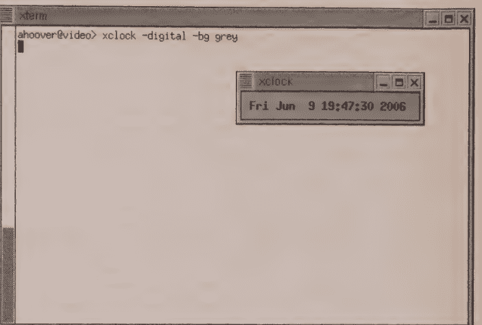
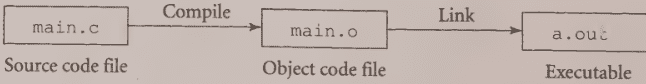
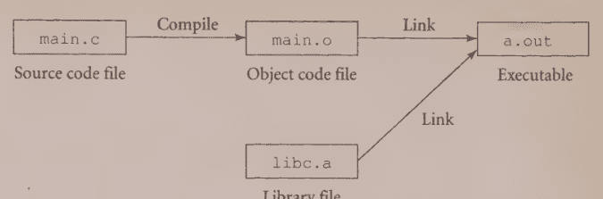
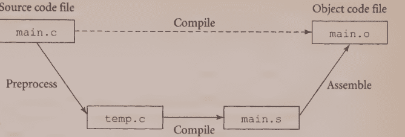
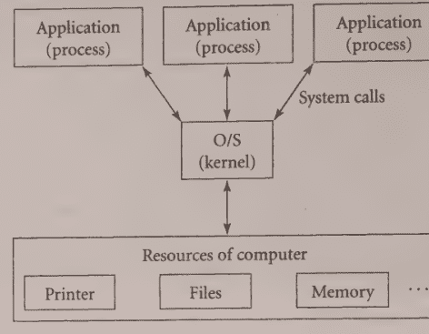
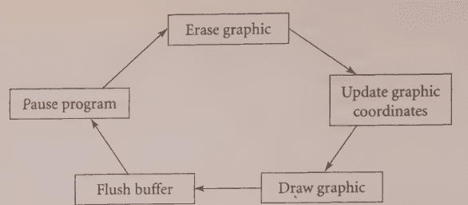
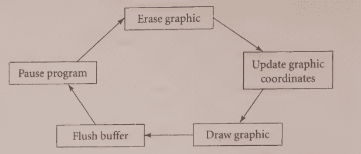
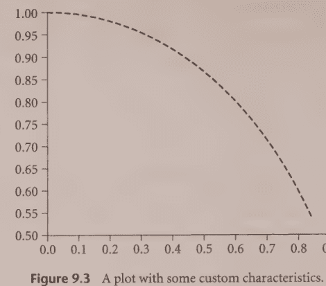
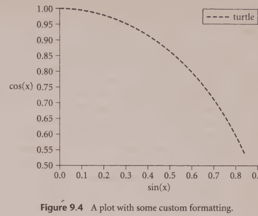

# C 与 Unix 系统编程


克莱姆森大学


## 序言

本书的目标是教授系统编程工具并使读者成为更好的程序员。考虑以下问题：什么是库，如何使用？什么是调试器，它如何帮助？什么是脚本语言，它们什么时候有用？什么是系统调用，它们什么时候有用？

除了编程概念外，本书还探讨了底层数据类型：位和字节、数组、字符串、结构体和指针。理解内存有助于澄清循环和条件等概念。目标是将读者的编程技能从中级提升到高级，并在高级水平上良好运用。

### 本书的读者

本书的内容旨在适用于一个学期的课程。它是在入门编程课程之后编写的。这本书的通俗名称可以是“第二学期编程”。旨在用于数据结构、算法、操作系统和编译器等高级主题。虽然没有规定按照这种顺序进行学习，但系统编程将增强学生实现高级主题的能力。本书强调实践编程技能，这将有利于后续的课程。对于具有更强编程技能的读者，可以简要介绍前面的章节以留出更多时间。

### 给教师的说明

每章书中有很多代码示例。所有示例都通过反复课堂教学经过了充分测试。它们也可以从出版者的网站下载。它们特意设计得很短，以便在课堂期间进行编码、显示和讨论。作者通常在讲座期间使用笔记本电脑执行许多代码示例，进行不同的修改和测试。鼓励学生在课堂期间使用笔记本电脑并执行每章“问题与练习”中的示例或短题。这些互动技术往往有助于吸引学生，本书的设计旨在促进这种教学。然而，使用本书并非需要这些技术。示例足够短，可以在教学期间进行其他类型的展示，教师可以放心使用它们，因为知道它们确实如演示所示运行。

书中的某些章节介绍了主题的多个示例。例如，通过脚本、Perl 和 MATLAB 展示了脚本语言。并不是所有语言都需要深入介绍，但查看多个示例可以明确脚本语言的整体目的和用途。相同的方法适用于库（示例是 C 标准库、`curses` 和 X）以及系统调用（示例是进程、

### 前言

这种涵盖允许讲师在实验工作和课程定制方面具有灵活性，具体取决于重点强调哪些示例。

在书中，Unix 指的是任何类 Unix 的操作系统，包括 Linux、Mac OS X、BSD 变体、Solaris、HP-UX、AIX 等。作者在编写本书时使用了 Linux 来开发示例，但这些示例可以在任何 Unix 或类 Unix 系统上运行。

### 补充材料

本教材的合格采用者可以获得以下补充材料：

- 一套详尽的讲义灯片（PPT 和 PDF 格式），包括书中的所有插图；
- 书中所有示例程序的源代码，已准备好编译和执行；
- 教师解决方案手册，包含所有章末问题和练习题的答案；
- 一个关于软件许可的额外附录。

要获取补充材料，请访问 `www.pearsonhighered.com/`。需要教师专用材料密码的讲师可以联系其当地的培逊教育代表，或发送电子邮件至 `computing@aw.com`。

### 本书与其他书籍有何不同？

本书的重点是系统编程概念；它并不打算作为所涵盖的任何主题的完整参考，例如编辑器、壳、库、脚本语言、系统调用和程序构建。此类书籍将变得异常庞大且难以处理，而且这些主题已经有了良好的参考资料。本书将所有的系统编程概念整合在一起，为系统级问题的解决提供了一个教科书式的视角。

### 致谢

作者感谢所有在开发期间评审过此手稿版本的人：

- Hussein Abdel-Wahab, 老领公立大学
- Brian D. Davison, 利海大学
- * Christopher R. Fischer, 特拉华大学和 Hologic, 公司
- Gene Fisher, 加州州立大学
- Richard Fox, 北肯塔基州大学
- Cindy Fry, 贝勒大学
- Patrick T. Homer, 亚利桑那大学
- Sam Xu, 佛罗里达大西洋大学
- Benjamin A. Kuperman, 奥伯林学院
- Natalie A. Nazarenko, SUNY 弗雷多尼亚州学院
- Bob Reid, 克莱姆森大学
- Bob Rinker, 爱达荷大学
- Nicholas A. Russo, 芝加哥大学
- Melissa Smith, 克莱姆森大学
- Tom Way, 维拉诺大学
- Tilman Wolf, 马萨诸塞大学

他们的努力和反馈具有巨大的价值，并帮助了最终文本的成型。特别感谢评审员 Melissa Smith 和 Bill Reid，他们在本书开发期间都使用了这些材料进行教学。最后，感谢作者的妻子和孩子 Adair、Austin 和 Gabrielle。书写完了，我们去远足吧。

克莱姆森大学

# 引言

## 1.1 什么是系统编程？

计算机系统由硬件和软件组成。软件通常指运行在计算机上的程序。虽然硬件和软件都可以被修改或升级，但这种情况往往发生在软件上。事实上，拥有软件的主要目的是为了提供更改在计算机上执行的指令流的能力。这意味着，在计算机系统的生命周期内，通常预期会编写新程序，或对旧程序进行修改或演进。

鉴于这种预期，寻找让计算机系统支持程序开发的方法是自然而然的。过去的30年里，进化出了许多工具和资源来辅助程序开发。这些包括标准库（也称为系统库）、系统调用、调试器、壳环境、系统程序和脚本语言。这些工具的知识极大地增强了程序员的能力。虽然学习某些特定工具的细节是重要的，但理解何时以及如何使用工具更为重要。

# 第1章 • 引言

许多良好的参考手册可以提供特定语言或工具的详细信息。本书旨在为系统编程中的概念提供更广泛的理解。

我们将系统编程定义为在程序开发过程中使用系统工具。在程序开发期间使用这些工具有几个目的。首先，它节省了大量时间。使用这些工具具有巨大的价值。使用调试器节省了大量时间。

许多良好的参考手册可以提供特定语言或工具的详细信息。本书旨在为系统编程中的概念提供更广泛的理解。

我们将系统编程定义为在程序开发过程中使用系统工具。在程序开发期间使用这些工具有几个目的。首先，它节省了大量时间。使用这些工具具有巨大的价值。使用调试器节省了大量时间。

实际上，我们软件的主要目的是为了提供更改在计算机上执行的指令流的能力。这意味着，在计算机系统的生命周期内，通常预期会编写新程序，或对旧程序进行修改或演进。

鉴于这种预期，寻找让计算机系统支持程序开发的方法是自然而然的。过去的30年里，进化出了许多工具和资源来辅助程序开发。这些包括标准库（也称为系统库）、系统调用、调试器、壳环境、系统程序和脚本语言。这些工具的知识极大地增强了程序员的能力。虽然学习某些特定工具的细节是重要的，但理解何时以及如何使用工具更为重要。

# 第1章 • 引言

Microsoft Windows™ 和 Unix.¹¹ 由于下文将解释的原因，本文提倡在 Unix 系统上学习系统编程概念。请注意，本文讨论集中于学习哪种系统更优。关于哪种操作系统具有更好的商业模式、更好的开发等方面，还有其他正在进行的争论。感兴趣的读者请寻求其他资源来讨论这些争论。

Windows 操作系统旨在简化计算机的使用。Windows 计算机本质上是一个闭源系统。该系统的设计是“交钥匙式”（turnkey），这符合为典型用户提供尽可能易用系统的商业模式。这种设计策略意味着必须深入“内部构造”，以防止典型用户对系统造成破坏性操作。此外，微软对 Windows 的内部运作和设计发布的信息有限。这也是为了保护其设计免受竞争对手侵害的商业策略。最后，Windows 是单体的，不允许系统的各个部分被断开或替换为替代方案。再次，这是一个商业决策；微软想要销售其产品且仅销售其产品，因此它使其系统成为完全集成的。理解这种闭源设计、公开细节匮乏以及 Windows 非模块化的商业动机是很容易的。然而，这些有助于典型计算机用户的属性对于学习系统操作的学生来说可能是令人沮丧的。

另一方面，Unix 特 Linux 具有不同的设计原则。它是开源的，因此其内部运作的所有细节都可以被研究。它是完全模块化的，因此任何系统组件都可以交换为替代方案。例如，Linux 内核的开发完全独立于桌面环境。在内核内部，Unix 操作者在如何配置系统运行方面有许多选择。内核本身也可以可以被交换或修改。有人可能会认为，这些属性阻止了典型计算机用户采用 Unix，因为他们对这种灵活性和开放性并不感兴趣。然而，正是这些属性使得 Unix 成为学习系统操作学生的理想选择。

在本文中，所示示例取自运行 Linux 操作系统的计算机。在大多数情况下，这些示例可以在 Windows 或其他 Unix 系统上同样轻松运行。有一些重要的设计问题区分了 Unix/Linux 和 Windows，例如系统的多用户与单用户性质。这些差异将在适当的地方进行讨论。除了这些考虑之外，在系统的深层内部，系统概念在很大程度上是相似的。

- 1. 在书中，Unix 指任何类 Unix 系统，包括 Linux、Mac OS X、BSD 变体等。

### 1.1.3 为什么选择 C 语言？

选择特定的编程语言是计算领域一个老老的话题。对于应用开发，这场争论仍在继续。然而，对于系统编程，很少有专家支持除 C 语言以外的语言。原因很简单：C 语言最接近硬件。所有的编程语言都提供了不同级别的抽象来辅助程序开发。例如，变量和内存地址的概念简化了程序开发。在所有常用的编程语言中，C 语言提供的抽象最少，最接近硬件。大多数 C 语句都能简单地翻译成机器码。C 中可用的数据类型倾向于反映硬件直接支持的内容。通过间接访问（指针）访问内存为程序员提供了访问系统所有部分的能力。

从历史上看，Linux 内核的开发以及原始 Unix 操作系统的开发都是用 C 语言完成的。大多数系统软件是用 C 开发的。设备驱动几乎总是用 C 。接近硬件的一个间接好处是速度。用 C 写的代码执行速度通常比其他语言编写的代码更快。对于打算从事系统软件工作、或打算开发与硬件（外设或主系统）紧密交互代码的程序员来说，使用 C 语言学习概念提供了开发最实用技能的机会。

这种选择并不排除对其他语言的学习，也不提倡只学习 C 语言。本文范围之外的其他编程概念可能使用另一种编程语言更容易被学习和实现。然而，作者认为，坚实理解最接近硬件的编程语言能更好地理解和妥当使用更抽象的编程语言。

系统程序员的三种主要工具是外壳（shell）、文本编辑器和调试器。熟悉这些工具可以提高编程技能，并缩短程序正常运行所需的时间。以下将作为这些工具及其相互依赖关系的介绍。真正的诀窍在于知道如何将这三者结合使用。此列表中明显缺失的是编译器。编译器是一个强大的工具，无疑可以辅助程序开发。然而，编译器将在第 6.1 节在讨论程序构建时进行更全面的介绍。

假设读者熟悉 shell 中的基本操作，例如生成文件列表。有很多优秀的书籍和在线参考提供了操作特定 shell 所需的细节。附录 B 提供了常用命令列表。本节关注为什么要使用 shell，以及 shell 如何辅助程序开发。

shell 是允许用户运行其他程序的程序。shell 通常在终端（terminal）中执行。历史上，终端是连接到计算机的键盘，为计算机提供纯文本界面。今天，大多数操作系统提供图形化界面，其中可以同时运行多个虚拟终端，每个终端运行一个独立的 shell。如果特定的终端留作系统管理或代表整个系统显示错误消息，那么它有时被称为控制台（console）。在实践中，shell、terminal 和 console 等词是通用的。

大多数 Unix 系统提供了几种启动 shell 的方法。某些系统在登录后提供 shell，但没有图形桌面的好处。在其他系统上，必须通过菜单或鼠标界面手动启动 shell。一旦启动，典型的 shell 看起来就像图 1.1 所示。命令通过纯文本界面输入 shell 中。shell 通过提示符（prompt）告知用户它正在等待下一个命令。在图中，提示符是 `a@>`，即用户名和机器名。某些 shell 配置会在提示符中显示当前目录或其他信息。在全文中，提示符以后将显示为 `a@>` 以保持清晰。

一个典型的命令是程序的名称，它启动了该程序的执行。图 1.1 中的两个 shell 都显示了 `ls` 程序的执行，该程序提供了当前目录下文件的列表。shell 中的许多程序具有纯文本的输入和输出，类似于 `ls`。然而，也可以从 shell 运行图形化（GUI-）的程序。例如，图 1.2 显示了在提示符输入 `xclock` 的结果；它启动了 `xclock` 程序。

这种启动程序的方法对于习惯于今天桌面式运行程序方法的人来说可能很奇怪。点击图标并通过下拉菜单进行是运行程序的典型操作。为什么要启动一个 shell 仅仅为了运行其他程序呢？答案是灵活性。桌面和菜单选项在程序运行方式上的选择有限。通常，桌面和菜单快捷方式

```
$ user
ahoover@video> is
ameter/ ece429/ ece893/ pathplan/ profile/ stare/
Desktop/ ece468/ mail/ Presentations/ Projects/ UNIX/
ce222/ ece854/ Mail/ printcap public_html/ Writing/
ahoover@video> _
```


```
$ login.parl.demerson.edu - default - SSH 安全外壳
文件 编辑 窗口 帮助
快速连接 配置文件
ahoover@video> is
ameter/ ece429/ ece893/ pathplan/ profile/ stare/
Desktop/ ece468/ mail/ Presentations/ Projects/ UNIX/
ce222/ ece854/ Mail/ printcap public_html/ Writing/
ahoover@video> _
```

图 1.1 在两个不同的终端模拟器中运行的 shell 示例。

## 第 1 章 • 引言

```
ahoover@video> ls pathplan/ profile/ stare/
ameter/ ece429/ ece893/ 
Desktop/ ece468/ mail/ Presentations/ Projects/ UNIX/
cece222/ ece854/ Mail/ printcap public_html/ Writing/
ahoover@video> xclock
```


在默认模式下。例如，启动一个文字处理器会在全屏模式下打开程序（程序填满整个屏幕），并打开一个空白页，且所有选项都设置为默认值（加粗关闭；文本左对齐；字体为 Times Roman；等）。假设我们想在更改其中某些选项的情况下启动文字处理器呢？shell 提供了命令行参数来实现这一目的。命令行参数是在 shell 提示符中、要执行的程序名称后输入的任何内容。它提供了关于用户希望如何运行程序的信息。例如，在提示符处输入 `xclock -help` 会得到：

```
ahoover@video> xclock -help
Usage: xclock [-analog] [-bw <pixels>] [-digital] [-brief]
  [-utime] [-fg <color>] [-bg <color>] [-hd <color>]
  [-hl <color>] [-bd <color>]
  [-fn <font_name>] [-help] [-padding <pixels>]
  [-rv] [-update seconds] [-displayS]
  [-geometry geom]
ahoover@video>
```

响应 `-help` 命令行参数后，`xclock` 程序会显示其用法然后退出。该用法解释了启动程序时可以使用的所有命令行参数。对于这个特定的程序，这些参数大部分都会改变时钟的显示方式。例如，`xclock -digital -bg grey` 会导致程序按照 1.3 所示的方式运行。



**图 1.3** 命令行参数改变了程序的运行方式。

命令行参数提供的控制和灵活性在程序开发和系统管理期间通常有用。虽然许多程序可以在运行时重新配置，但通过菜单界面选择选项可能会花费时间。通过命令行参数配置程序可以节省大量时间，特别是当程序被多次运行运行时（例如在开发期间）。

多年来，人们开发了各种 shell。包括 `sh`、`csh`、`tcsh`、`kash` 和 `bash`。在 Windows 系统上，有一个名为 `console` 的简单 shell，有时被称为 DOS console 或命令提示符。shell 在功能上有所不同。除了运行程序和提供命令行参数的能力外，shell 有一组它可以执行的内部命令。例如，大多数 shell 都允许为常用命令设置别名。在 `tcsh` shell 中，输入

```
ahoover@video> alias xc xclock -digital -bg grey
ahoover@video>
```

表 1.1 一些 shell 内部命令。

| 命令 | 说明 |
|---|---|
| `alias` | 创建别名 |
| `cd` | 切换目录 |
| `pwd` | 当前工作目录 |
| `set` | 给 shell 变量赋值 |
| `which` | 程序的完整路径 |

表 1.2 一些 shell 系统程序。

| 命令 | 说明 |
|---|---|
| `grep` | 在文件中搜索特定文本 |
| `ls` | 列出文件及其属性 |
| `man` | 显示命令/程序的手册（帮助） |
| `more` | 使用分页滚动显示文本文件 |
| `time` | 程序的运行时间 |
| `sort` | 对文本文件的行进行排序 |

使得短命令 `xc` 成为长命令 `xclock -digital -bg grey` 的别名。当你反复运行同一个命令时（例如在程序调试期间），这非常有用。


这里考虑的第二个工具是文本编辑器。文本编辑器允许进行的基本操作是编写、编辑、保存和加载。这些操作与文字处理器支持的操作没有太大。然而，除了文字处理器提供的之外，文本编辑器还可以提供额外的功能。例如，1.4 展示了括号的查找。使用文本编辑器 `vi` 时，如果光标位于左或右括号上，按下百分号 `%`，光标将移动到匹配的括号上。再次按下时，光标将回到原来的位置。

```c
#include <stdio.h>

main() {
    int i,sum;

    sum=0;
    for (i=0; i<10; i++) {
        if (i < 5)
            sum=sum+i;
        else
            sum=sum+((i-3)/2+(i/3));
    }
    printf("sum=%d\n",sum);
}
```

`"strange-sum.c"` [已修改] 第15行的第13行 --86%-- 列 1

图 1.5 使用文本编辑器识别或查找程序行号。

并不是所有的文本编辑器都具有所有功能。`vi` 编辑器依赖按键组合来访问功能。`emacs` 编辑器使用按键和菜单操作的结合。较新的文本编辑器倾向于更多依赖更容易找到的操作。深入探讨各种文本编辑器的所有功能超出了本书的范围。人们可以很容易地找到所有流行文本编辑器的在线手册和在线功能指南。要点是，无论使用哪种文本编辑器，程序员都应该花一些时间熟悉那些支持编程的功能。

### 调试器

调试器也许是系统程序员最重要的工具。它允许程序员观察程序的执行，在程序运行时暂停，以便检查变量的值。它允许程序员确定特定代码行是否以及何时被执行。它允许程序员逐步执行程序，一次执行一行，以观察程序通过分支的流程。本节描述了调试器如何工作；调试过程将在下一节中介绍。

调试器本身是一个程序，像任何其他程序一样执行。配合 `shell` 和文本编辑器，有很多调试器。在本书中，示例使用 GNU 调试器进行解释，它通常作为 `gdb` 执行。虽然调试器可以与多个编译器协同工作，但调试器与特定的编译器相关。在书中，概念和示例使用 GNU C 编译器进行解释，它通常作为 `gcc` 执行。

为了解释调试器如何工作，我们将使用图 1.5 中给出的代码示例。假设此代码存储在名为 `sum.c` 的文件中。为了编译该文件，可以执行以下操作：

```
ahoover@video> gcc sum.c
ahover@video>
```

这将产生一个文件 `a.out`，这是一个可执行程序。输入 `a.out` 运行程序：²

```
ahoover@video> a.out
sum=29
ahoover@video>
```

程序被执行，一直运行到结束，此时 `shell` 会提示另一个命令。为了使用调试器运行程序，必须遵循一系列操作：

```
ahoover@video> gcc -g sum.c
ahoover@video> gdb a.out
(gdb) run
Starting program: /home/ahoover/a.out
sum=29
Program exited with code 0.
(gdb) quit
ahoover@video>
```

我们将详细讨论这些这些每一个步骤。

首先，在编译时，我们使用了命令行参数 `-g`。这告诉编译器该可执行文件是为了调试的。（其他编译器使用类似的标志或选项。）在创建可执行文件时，编译器将存储关于程序的额外信息，称为符号表。

> ² 这假设当前目录已包含在 `PATH` 环境变量中；否则必须输入 `./a.out`。

符号表包含了程序所使用的变量列表。对于我们的示例，该列表包含 `i` 和 `sum`。程序在编译时也没有进行优化。通常情况下，编译器会重新排列代码使其运行更快。然而，如果程序是为了调试的，代码的任何重排都将难以关联到执行的是哪一行代码。调试编译时，通常最好关闭所有优化，以便程序执行完全遵循原始代码。可以通过查看可执行文件的大小看到调试编译的效果：

```
ahoover@video> gcc sum.c
ahoover@video> ls -l a.out
-rwxr-xr-x 1 ahoover fusion 4759 Jun 19 53 a.out
ahoover@video> gcc -g sum.c
ahoover@video> ls -l a.out
-rwxr-xr-x 1 ahoover fusion 5843 Jun 19 54 a.out
ahoover@video>
```

可执行文件的大小增加了 1084 字节。这种大小的增加是由符号表的引入引起的，允许编译器优化代码。注意，如果忘记为了调试编译，调试器将无法对你的可执行文件操作。在没有符号表或存在优化的情况下，调试器将丢失。

编译后，我们在创建的 `a.out` 上运行调试器 `gdb`。这不会立即执行我们的程序。它运行调试器并将我们的程序加载到调试环境中。这一点通过提示符的变化得到了强调：从 `ahoover@video>`（`shell` 提示符）变为 `(gdb)`（调试器提示符）。可以将调试器认为是程序的封装。图 1.6 显示了一个图。当调试器启动时，它使用符号表和原始文件来跟踪程序的运行。一旦调试器启动，它有一套自己的命令。其中一个命令是 `run`，开始程序的执行。在我们的示例中，这导致程序像 `shell` 一样运行，最终输出 `sum=29` 然后退出。程序完成后，我们回到调试器提示符 `(gdb)`。退出调试器，输入 `quit` 命令将我们回到 `shell`。

如预期的那样，`i` 的值为 5。我们还可以要求调试器告诉我们程序相对于源代码停在哪里：

```
(gdb) where
#0 main () at sum.c:13
#1 0x004e507 from __libc_start_main (main=0x0048460 <main>,
    argc=1, argv=0xffffffff34, init=0x00482e4 <init>,
    fini=0x0048530 <fini>, rld_fini=0x0000d14 <dl_fini, stack_end=0xffff2ca)
    at /sys/generic/libc-start.c:12
(gdb)
```

如预期，第一行告诉我们我们在 `sum.c` 的第 13 行，这正是我们设置断点的地方。现在可以忽略其他行。第 6 章讨论了函数和变量范围。当程序暂停时，有三种不同的方法启动它：`step`、`next` 和 `continue`。`step` 命令执行下一行代码并再次暂停。例如：

```
(gdb) step
    for (i=0; i<10; i++)
(gdb)
```

我们在执行第 13 行之前使用断点暂停了程序。在 `step` 命令完成后，我们执行了第 13 行并移动到下一行，在这种情况下回到了第 9 行的 `for` 循环顶部。调试器再次在执行行之前暂停了程序，并等待我们的命令。`next` 命令执行同样的操作，但如果下一行代码是函数调用，调试器将执行该函数中的所有代码，然后在函数返回后暂停。换句话说，它将整个调用过程视为一行代码。`step` 命令将进入函数调用并在其代码的第一行处暂停。随后可以使用连续的命令来遍历整个函数。反复发布 `step` 或 `next` 命令允许程序员一次执行一行运行程序，并在每行后暂停。这被称为“单步执行程序”。例如，从我们离开的地方继续：

```
(gdb) next
    10      if (i < 5)
(gdb) next
    Breakpoint 1, main () at sum.c:13
    13          sum=((i-3)/2+(i/3));
(gdb) next
    9       for (i=0; i<10; i++)
```

```
(gdb) next
10 if (i < 5)
(gdb) next
    Breakpoint 1, main () at sum.c:13
13 sum=sum((i-3)/2+(i/3));
(gdb) next
```

每次发布 `next` 命令时，如果到达断点，调试器会通知我们，尽管由于下一行代码已经执行完毕，它会在任何地方暂停。根据情况，使用 `next` 单步执行程序通常比使用 `step` 优越。`step` 命令可能会导致调试器进入系统库函数调用，例如 `printf()`，这些很少被使用。我们——希望——可以期望库代码比我们正在编写的代码更没有错误。知道只按 `[ENTER]` 键会让调试器发布上一个命令很有用，因此不需要反复输入“next”。大多数调试器都有类似的快捷键或按键来简化单步执行。

继续执行程序的第三种方法是通过 `continue` 命令实现的。它重启执行并允许其持续直到到达断点、程序正常退出或程序到达执行非法操作的代码行。非法操作包括尝试除以零或尝试访问错误的内存位置。

观察变量值有两种不同方法。`print` 命令是一次性查看值的请求。调试器显示一次值，在请求之前不会再次显示。`display` 命令是持续观察的请求。调试器在程序暂停时会显示每个变量的值。例如：

```
ahoover@video> gdb a.out
(gdb) break 13
Breakpoint 1 at 0x8084490: file sum.c, line 13.
(gdb) run
Starting program: /home/ahoover/a.out
Breakpoint 1, main () at sum.c:13
13 sum=sum((i-3)/2+(i/3));
(gdb) display i
1: i = 5
(gdb) continue
Continuing.
Breakpoint 1, main () at sum.c:13
13 sum=sum((i-3)/2+(i/3));
```

```
1: i = 6
(gdb) continue
Continuing.
Breakpoint 1, main () @ sum.c:13
13
sum=sum+((i-3)/2+(i/3));
1: i = 7
(gdb)
```

注意，每次程序暂停时，都会显示 `i` 的值。`continue` 命令用于每次恢复程序的执行，使其持续运行，直到再次遇到断点。每当发生这种情况时，循环计数器 `i` 都会增加 1。

可以设置多个断点。例如：

```
(gdb) break 13
Breakpoint 1 at 0x0804490: file sum.c, line 13.
(gdb) break 8
Breakpoint 2 at 0x0804867: file sum.c, line 8.
(gdb) run
Starting program: /home/ahoover/a.out
Breakpoint 2, main () @ sum.c:8
8
sum=0;
(gdb) display i
1: i = 134518128
(gdb) continue
Continuing.
Breakpoint 1, main () @ sum.c:13
13
sum=sum+((i-3)/2+(i/3));
1: i = 5
(gdb)
```

断点的顺序并不重要。当到达任何断点时，调试器都会暂停。在例例中，我们在第 8 行显示了 `i` 的值，而此时它在程序中还未被赋予任何值。那个奇怪的值 `134518128` 本质上是一个在程序执行开始时恰好位于 `i` 中的随机值；稍当程序进入循环内部时，我们看到了更接近正常的值 `5`。

在调试过程中，可以使用 `clear` 命令移除断点。这在长时间的调试会话中非常有用。有时对于程序员来说，退出并使用新的断点从头开始调试过程更为简单。当程序执行了某些意料之外的操作时，程序员可能会想要重新开始，以识别程序在何处异常。

`gdb` 调试器（以及许多其他调试器）包含许多此处未未讨论的命令。这些命令包含了根据读取或写入的变量暂停执行（称为**断点**）、根据信号暂停执行（称为**检查点**以及其他功能。虽然这些命令很有用，但对于常见的调试来说并不是必须的。本节介绍的命令和概念通常足够解决绝大多数调试问题。鼓励读者从这组概念开始，并根据需要探索额外的调试功能。

随着系统的演进，系统工具也在不断演进。前几节概述的三种工具之间的相互依赖关系多年来一直被公认。这导致了集成开发环境（IDE）的建立。IDE 将这三种工具以及编译器合并到一个单一程序或界面中。与其单独运行文本编辑器、编译器和调试器，它们完全可以从单个 IDE 中一起运行。这使得工具之间可以更紧密地集成。通常，IDE 支持基于图形的操作，这些操作将各个工具以某种方式结合在一起，从而进一步加速开发和管理。

在本文编写期间，流行的 IDE 包括微软的 Visual Studio、Eclipse、Sun Micros 的 NetBeans 以及 GNAT Programming Studio。某些 IDE 旨在支持单一编程语言，如 NetBeans（用于 Java）。其他 IDE 支持多种语言，如 Visual Studio 和 Eclipse；前者是专有的，后者是开源的。支持多种语言的优势在于能够协助程序员团队进行大规模软件开发或多平台开发。在一个环境内对程序开发进行集中控制通常是使用 IDE 的最大优势之一。

IDE 是一个强大的工具。然而，理解 IDE 是什么组成的以及它是如何工作的是重要的。学生被鼓励在需要时使用调试器，以帮助跟踪程序问题。

前一节介绍了调试的三个最重要的工具：`shell`、文本编辑器和调试器。在本节中，我们将讨论如何使用调试器。在讨论中，我们必须区分程序逻辑和程序错误。调试通常需要理解代码，并在以及何时使用调试器。调试器可以帮助定位程序中的错误。例如，在调试中常见的情况，接下来的章节将描述这些情况并给出一个示例。

## 1.3 • 如何调试

当程序以异常方式停止时，被称为程序崩溃。某些错误发生会导致系统无法继续执行。例如，假设以下代码位于 `crash1.c` 中：

```c
#include <stdio.h>

int main()
{
    int x,y;
    y=54389;
    for (x=10; x>=0; x--)
        y=y/x;
    printf("%d\n", y);
}
```

在 `shell` 中，我们编译并执行程序，结果发现它崩溃了：

```
ahoover@video> gcc -o crash1 crash.c
ahoover@video> crash1
Floating exception (core dumped)
ahoover@video>
```

错误消息“Floating exception”提供了有限的信息，几乎没有说明哪里。系统创建了一个转储文件来帮助程序员。它包含了程序崩溃瞬间内存的内容和其他系统信息。然而，转储文件通常很大，包含远比常见调试所需的信息。通常，转储文件仅用于高级系统编程。

程序员可能会打开 C 文件并开始研究代码，寻找可能的错误源。在我们较小的程序中，这甚至可能有效。然而，使用调试器要简单得多，并节省大量时间。想法是在调试器中运行程序直到它崩溃，然后在那个时刻观察发生了什么：

```
ahoover@video> gcc -g -o crash1 crash.c
ahoover@video> gdb crash1
(gdb)
run
```

Starting program: /home/ahoover/crash1

Program received signal SIGFPE, Arithmetic exception.

0x0804848b in main () at crash1.c:10

```
10 y=y/x;
(gdb)
```

调试器告诉我们程序在第 10 行崩溃。查看第 10 行的行代码，很容易看出发生问题的可能不多。`y` 或 `x` 的值有问题。最可能的情况是 `x` 的值为零，因此程序正在尝试除以零。我们可以通过要求调试器显示 `x` 的值来测试这一点：

```
(gdb) display x
1: x = 0
(gdb)
```

正如我们所料的那样，`x` 的值为 0。现在我们可以检查代码，确定这是意图之中的，还是我们的实现上存在错误。例如，我们可能并没有打算让循环运行到 `x>=0`，而是本打算让它运行到 `x>0`。

- 除以零并不是导致程序崩溃的唯一原因。导致崩溃的最常见错误可能发生在使用数组或指针时。例如，假设在名为 `crash2.c` 的文件中发生了以下代码：

```c
#include <stdio.h>

main() {
    int x,y,z[3];

    y=54389;
    for (x=10; x>=1; x--)
    z[y]=y/x;
    printf("%d\n",z[0]);
}
```

当我们编译并执行这段代码时，程序崩溃了：

```
ahoover@video> gcc -o crash2 crash2.c
ahoover@video> crash2
Segmentation fault (core dumped)
ahoover@video>
```

使用调试器，我们运行程序直到它崩溃，以找到问题发生的地方：

```
ahoover@video> gcc -g -o crash2 crash2.c
ahoover@video> gdb crash2
(gdb) run
Starting program: /home/ahoover/crash2
Program received signal SIGSEGV, Segmentation fault.
0x0804842a in main ( ) at crash2.c:10
10    z[y]=y/x;
(gdb)
```

## 第一章 • 引言

“段错误”（segmentation fault）通常是错误的内存访问；换句话说，程序试图访问不属于该程序的内存位置。例如，数组有一个指定的尺寸。尝试访问指定尺寸之外的索引就是错误的内存访问。查看程序崩溃的那行代码，我们可以看到对数组 `z[]` 单元索引 `y` 的访问。我们可以询问调试器 `y` 的值，并将其与定义的三个元素数组 `z[]` 的允许范围进行比较，因此允许的范围是 0..2：

```
(gdb) display y
1: y = 54389
(gdb)
```

正如我们所料的那样，`y` 的值超出了数组 `[]` 索引的允许范围。我们再次快速识别了程序运行异常的点，现在可以开始确定是程序逻辑还是实现出了问题。


使用调试器发现程序崩溃的位置可能是调试器最流行的用途。在程序开发过程中，如果观察到崩溃，第一个动作始终应该是在调试器中运行程序以定位问题。

当一个程序运行很长时间而不显示任何新内容，或提示用户输入新内容时，它可能陷入了无限循环中。这意味着在循环中执行的代码永远不会导致控制循环的条件失效，或者循环在一次又一次运行。当然，“很长时间”是一个相对的表达。某些程序可能需要10秒、、1分钟或更长时间来完成复杂的计算。然而，如果你可以去喝杯咖啡、查一下棒球比分，回来发现程序仍然没有响应，那么它可能陷入了无限循环中。例如，以下代码存储在 `infloop.c` 文件中：

```c
#include <stdio.h>

main()
{
    int x,y;

    for (x=0; x<10; x++)
    {
        y=y+x;
    }

if (y > 10)
  x--;
}
```

我们编译并执行这段代码，程序似乎在“永远运行”：

```
ahoover@video> gcc -o infloop infloop.c
ahoover@video> infloop
_
```

`_` 符号表示光标。程序正在运行但永不结束，所以我们再也看不到 shell 提示符。最后我们按下 `CTRL-C` 强制程序停止执行。

我们可以使用调试器执行相同的操作，在调试器中按下 `CTRL-C` 不会导致程序退出。相反，它告诉调试器在当前正在执行的某行暂停程序执行。我们可以查看周围的代码来确定哪个循环正在无限执行：

```
ahoover@video> gcc -g -o infloop infloop.c
ahoover@video> gdb infloop
(gdb) run
Starting program: /home/ahoover/infloop
- [...user presses CTRL-C...]

Program received signal SIGINT, Interrupt.
0x08048444 in main () at infloop.c:8
for (x=0; x<10; x++)

(gdb)
```

在这个例子中，只有一个循环，所以程序目前正在执行该循环中某处的代码行并不意外。为了确定为什么程序不会完成循环，我们可以通过迭代观察循环计数器：

```
(gdb) display x
1: x = 0
(gdb) next
10 y=y+x;
1: x = 0
(gdb) next
11 if (y > 10)
1: x = 0
(gdb) next
12 x--;
1: x = 0
(gdb) next
8 for (x=0; x<10; x++)
1: x = 0
(gdb)
```

在观察了一个完整的迭代后，我们发现计数器 `x` 在每次迭代开始时的值都是0。由于它永远到达10，循环就不会结束。现在我们可以开始检查循环中涉及 `x` 的代码来确定问题。

这种调试技术在程序中有多个独立循环时特别有用。它是确定哪个循环有故障的最快方法，也是确定为什么循环没有正常终止的好方法。

有时程序运行是正确的，直到某一点开始出现异常。通过关注问题的代码可以有所帮助。例如，考虑以下代码：

```c
#include <stdio.h>

main() {
    int choice;
    float ppg, rpg;

    printf("1 得分游戏\n2 篮板游戏\n3 退出\n");
    scanf("%d", &choice);

    if (choice == 1) {
        scanf("%f", &ppg);
        printf("得分: %f\n", ppg);
    } else if (choice == 2) {
        scanf("%f", &rpg);
        printf("次数: %f\n", rpg);
    }
}
```

在最后一步之前，一切看起来都是正常的。然而，我们在菜单输入了2，程序却进入了询问用户输入 `ppg` 值的代码。出了什么问题？到目前为止涉及的变量只有 `choice`，它决定了下一步执行哪部分代码。我们可以显示它的值：

```
(gdb) display choice
1: choice = 1
(gdb)
```

由于某种原因，程序认为我们输入了1，而我们知道自己输入的是2。这是如何发生的？现在当我们专注于寻找涉及变量 `choice` 的错误时，我们回溯最后几行代码就能发现问题。在第 19 行，代码读取的是 `if (choice = 1)` 而不是 `if (choice == 1)`。这段错误的代码在每次执行时实际上都会将 `choice` 的值更改为 1。

这是一个简单的示例，因为程序很短。然而，重要的思想是使用调试器在问题发生附近暂停执行，然后逐行检查相关代码。随着程序长度的增加，这种技术将变得越来越有用。

循环内部的逻辑可能非常复杂，至于无法在脑海中勾勒出每次迭代中所有可能的情况。如果这种循环的行为不正确，可以使用调试器来观察循环，在每次迭代时暂停以检查控制逻辑的变量。这不仅有助于发现错误，还有助于纠正循环内部的任何逻辑问题。例如，考虑以下代码：

```c
#include <stdio.h>

main()
{
    char word[80];
    int i
```

该程序本用于在用户给定的单词中查找任何字母的连续出现情况并报告它们。编译并执行后，它在第一个测试中运行正常：

```
ahoover@video> gcc -o badloops badloops.c
hoover@video> badloops
Enter any word: apple
2 consecutive p
hoover@video>
```

然而，在一个包含三个连续相同字母的测试中，程序输出了一行额外的错误信息：

```
ahoover@video> badloops
Enter any word: appple
3 consecutive p
2 consecutive p
hoover@video>
```

是什么导致了额外行“2 consecutive p”的输出？可以使用调试器观察外层循环的迭代来看发生了什么。外层循环的第一行是 `if (word[i] == word[i+1])`，位于第 14 行。这一行测试两个连续字母是否匹配，而随后的代码确定了连续字母的总跨度。重新编译代码进行调试，思路是在该循环的每次迭代开始时暂停程序，查看它在问题测试用例上的表现。

```
ahoover@video> gcc -o badloops badloops.c
ahoover@video> pdb badloops
(gdb) break 14
Breakpoint 1 at 0x80484d4: file badloops.c, line 14.
(gdb) run
Starting program: /parl/ahoover/ece222/book/1/badloops
Enter any word: appple
```

```
Breakpoint 1, main () at badloops.c:14
14    if (word[i] == word[i+1])
(gdb)
```

变量 `i` 控制着循环的行为。因此，在继续执行程序之前，明智的做法是在每次迭代中观察 `i` 的值。

```
(gdb) display i
1: i = 0
(gdb) continue
Continuing.
```

Breakpoint 1, main () at badloops.c:14

1: i = i

(gdb)

```

在完成第一次迭代后，我们看到程序运行正常。没有显示输出，因为“apple”的前两个字母并不匹配。下一次迭代应该产生输出。

```
(gdb) continue

Continuing.

3 consecutive p

Breakpoint 1, main () at badloops.c:14

14 if (word[i] == word[i+1])

1: i = 2

(gdb)
```

观察到了预期的输出“3 consecutive p”。然而，此时可以看出为什么会有额外的错误输出。`i` 的值为 2，这意味着下一次迭代将从比较“apple”中的第二个“p”和第三个“p”开始。`i` 的值本应该跳过去测试“l”相对于“e”。通过查看循环处的代码，我们现在意识到，在多个连续字符都匹配的情况下，`i++` 移动的字符数不够。该循环的逻辑必须部分重写。

程序开发涉及编写程序来解决给定的问题。仅仅了解编程语言的语法是不够的。人必须知道如何使用语言来处理编程问题。这可以类比为人类交流。知道词汇和语法规则是不够的；人必须熟练运用，才能有效地交流。使用编程语言来开发和编写程序以完成任务是一门艺术，就像使用人类语言进行有效交流是一门艺术一样。

程序开发最重要的技能之一是能够将编程问题分解为一组子问题。代码独立地解决每个子问题。在进行下一个子问题之前，可以对代码进行测试。这是古老的分治哲学。子问题本身可以反复分解为子问题，直到可以独立承担大量的编程工作。几乎所有的编程工作受益于这种方法的变。

为了演示，考虑以下问题。编写一个程序，接受一个整数作为输入，然后判断给定数字是否为两个唯一平方之和。例如，给定数字 13，程序将发现 13 = 9 + 4 是唯一平方之和。同样，给定 17，程序将发现 16 + 1；给定 90，程序将发现 81 + 9。

```
ahoover@video> gcc -o squares squares3.c

ahoover@video> squares3

Enter a number: 90

Found: 81 + 9

ahoover@video> squares3

Enter a number: 14

ahoover@video> squares3

Enter a number: 101

Found: 100 + 1

ahoover@video>
```

该程序运行符合预期。
即使是像示例这样简单的题目，也可以看到分治方法如何对程序开发产生益处。在实现程序设计的第一部分代码时，发现了两个错误。如果程序的各个部分在进行进一步开发或编写代码之前没有经过测试，那么发现这类错误将更加困难。正如前面提到的，这种方法可以受益于几乎任何编程工作，并且应该尽可能地练习。

以下是对 C 编程语言中基本数据类型、操作和语句的快速回顾。建议读者查阅几本涵盖 C 语言语法的优秀书籍以获得更深入的介绍。本次回顾的目的是提醒读者几个关键概念。本节还可以帮助尚未学习过 C 但学习过相关语言（如 C++ 或 Java）编程入门的读者。如果读者愿意承担额外的负担，可以在学习本文中的系统编程概念的同时学习 C 语言的语法。强烈建议此类读者额外购买涵盖 C 编程语言的教材，与本文结合使用。几本优秀的候选书籍包括：

- The C Programming Language, 2nd ed., B. Kernighan and D. Ritchie, Prentice Hall, 1988, ISBN 0131103628.
- Programming in C, 3rd ed., S. Kochan, Sams, 2004, ISBN 0672326663.
- C Primer Plus, 5th ed., S. Prata, Sams, 2004, ISBN 0672326965.

### 1.5.1 基本数据类型

C语言中有四种基本数据类型：`int`、`float`、`double` 和 `char`。`int` 类型用于存储整数。`float` 类型用于存储实数。`double` 类型也用于存储实数，但精度是其两倍，因此可以存储更大范围的数字。`char` 类型用于存储用于显示文本的字符符号和控制符号。以下代码演示了类型之间的差异：

```c
#include <stdio.h>

int main()
{
    int x,y;
    char a;
    float f,e;
    double d;
    x=4;
    y=7;
    a='H';
    f=-3.4;
    d=54.123456789;
    e=54.123456789;
    printf("%d %c %f %lf\n", x,a,e,d);
    printf("%d %c %.9f %.9lf\n", x,a,e,d);
}
```

执行此代码产生如下结果：

- 4 H 54.123455 54.123457
- 4 H 54.123455048 54.123456789

在输出的第一行中，`float` 变量在最后显示的数字上似乎向下舍入了，而 `double` 变量在最后显示的数字上被正确地向上舍入。事实上，`float` 已经耗尽了精度。这在第二行输出中可以看到，此时两个变量都被强制打印九位小数。`double` 变量的值是正确的，但 `float` 的后几位是错误值。

`printf()` 和 `scanf()` 函数是 C 中主要的输出和输入函数。它们被包含在 C 标准库中，标准库通常会被链接到可执行文件中（换句话说，程序员可以使用这些函数，而不必担心它们来自何）。它们的语法涉及将参数列表中的每个变量与引号字符串中的格式符号配对。关于此格式的细节，建议读者查阅 C 编程书籍或任一函数的 man 手页（man page）。

### 1.5.2 基本算术

C 支持的基本算术运算包括加、减、乘、除和模（取余）。在循环内部，对变量进行递增（加 1）或递减（减 1）是很常见的。正因如此，语言提供了 `++` 和 `--` 运算符。以下代码演示了基本算术运算：

```c
#include <stdio.h>

int main()
{
int x,y;
int r1,r2,r3,r4,r5;
x=4;
y=7;
r1=x+y;
r2=x-y;
r3=x*/y;
r4=x*y;
printf("%d %d %d %d\n",r1,r2,r3,r4);
r3++;
r4--;
r5=r4%r1;
printf("%d %d %d\n",r3,r4,r5);
}
```

执行此代码的输出如下：

11 -3 0 28
1 27 5

模运算符只能用于整数变量。所有其他算术运算符均如此。

### 1.5.3 循环

C 中有三种基本的循环：`for`、`while` 和 `do-while`。`for` 循环用于执行固定次数的迭代，在进入循环前已知结束条件。`while` 循环用于执行次数未知的迭代，在条件满足时执行。`do-while` 循环也用于执行次数未知的迭代，但它至少会执行一次。以下代码演示了所有类型的循环：

```c
#include <stdio.h>

int main() {
	int i,x;
x=0;
for (i=0; i<4; i++) {
	x=x+i;
	printf("%d\n",x);
}
while (i<7) {
	x=x+i;
	printf("%d\n",x);
}
do {
	x=x+i;
	i++;
	printf("%d\n",x);
} while (i<9);
}
```

执行此代码的输出为：

0
1
3
6
10
15
21
28

### 1.5.4 条件判断与块

基本的条件判断是 `if-else` 语句。它支持相等（`==`）、不相等 (`!=`) 以及相对大小（`>`、`<`、 `<=`）。可以使用与 (`&&`) 和或 (`||`) 运算符测试多个条件。语句通过大括号 `{}` 进行分组。以下代码演示了条件和块：

```c
#include <stdio.h>

int main()
{
    int i,x;
    x=0;
    for (i=0; i<5; i++) {
        if (i%2 == 0)
            x=x+i;
        else
            x=x-i;
        printf("%d\n",x);
    }
}
```

执行此代码的输出为：

0
1
2
2
4

### 1.5.5 控制流

通常情况下，循环迭代必须执行完成。当到达循环底部，控制权返回顶部。有两种控制流语句：`continue` 和 `break`。`continue` 语句返回循环头部开始下一次；`break` 语句终止循环并立即进入后续代码。以下代码演示了控制流：

```c
#include <stdio.h>

int main() {
    int i,x;
    x=0;
    for (i=0; i<5; i++) {
        if (i%2 == 0)
            continue;
        x=x-i;
        if (i%4 == 0)
            break;
        printf("%d\n", x);
    }
}
```

执行此代码的输出为：

-1
4

# 第1章 • 引言

菜单。阅读该程序的 man页（帮助文档），了解启动时可以给程序提供哪些选项。

6. 对于你选择的文本编辑器，识别出哪个按键或菜单选项可以显示当前光标位置的行号。还要识别如何将光标跳转到指定的行。

7. 通过为调试模式进行编译并在调试器中执行，对以下代码进行调试。程序在代码的哪一行崩溃了？为什么在那个地方崩溃？

```c
/* 此代码有一个编译时错误，并且
**至少**有一个运行时错误。 */
#include <stdio.h>
#include <math.h>

main(int argc,char *argv[])
{
    int n,i;
    int d2,count;
    double d1;
    while (1)
    {
        printf("Enter a number (0 to quit): ");
        scanf("%d",&n);
        if (n == 0)
            break;
        count=0;
        for (i=0; i<n; i++)
        {
            d1=(double)n/(double)i;


```c
            d2=n/i;

            if (fabs(d1-(double)d2) < 0.00001)

                count++;

        }

        if (count == 2)

            printf("%d is prime\n",n);

        else

            printf("%d is not prime\n",n);

    }

}
```

## 问题与练习

- 8. 编写一个程序，要求用户输入一个正整数，然后报告最接近且具有整数平方根的整数。例如，如果用户输入`8`，程序报告`9`。如果用户输入`18`，程序报告`16`。该程序应适用于任何1到7位数的数字。
- 9. 编写一个程序，要求用户输入一个正整数，然后计算该数字所有数字之和。例如，如果用户输入`2784`，则程序报告`21`。如果用户输入`59`，程序报告`14`。该程序应适用于任何1到10位数的数字。
- 10. 你的任务是编写一个管理一组人员联系信息的程序。该程序应存储最多12人的名、姓和电话号码。程序应具有选项：添加人员、删除人员、更新人员信息以及显示所有当前条目的信息。你如何将这项工作分解为一组可以独立实现的子问题？描述这些子问题、你处理它们的顺序，以及在继续下一个子问题之前对每个子问题会进行哪些测试。
- 11. 以下程序可以编译并执行，但并没有按照设计者的意图运行。该程序本应允许用户输入五个整数，并在每次输入新数字时都将列表从小到大进行排序。然而，在简单序列上进行测试时，程序未能正确排序。

使用调试器跟踪问题出在哪里。在第14行设置一个断点。使用 `display` 命令查看变量 `n` 的值（显示当前的数字列表），以及变量 `s` 和 `i`（显示即将交换的两个数字的索引）。使用 `continue` 命令在输入一个数字后、两个数字后和三个数字后，分别让程序在同一点点（第14行）暂停。到那时，你应该就能发现问题所在。这是一个 Bug 还是程序设计缺陷？

```c
#include <stdio.h>

main(){

    int n[5],s,i,j,w;

    for(i=0; i<5; i++)

    {

        printf("Enter any integer: ");
        scanf("%d",&n[i]);

        s=0; /* 寻找最小值的索引 */
        for (j=1; j<=i; j++)
          if (n[j] < n[s])
            s=j;

        w=n[i]; /* 将最小值与当前值交换 */
        n[i]=n[s];
        n[s]=w;
      }

  for (i=0; i<5; i++)
  printf("%d\n",n[i]);
}
```

# 第 2 章 · 位、字节与数据类型

理论上，变量是一个抽象概念。它是计算中使用的值的占位符。在实现中，变量占据固定的存储空间。理解变量在存储上的差异非常重要，因为这影响了不同变量在不同计算中的用法。通过利用正确的数据类型，从而使用正确的内存量，可以提高编程效率（使用64位变量存储1到100之间的整数是浪费空间）。它能促进算术运算的正确编码（在整数上编写浮点运算是浪费时间）。它有助于对位运算有更好的理解，而位运算对于许多计算算法至关重要，例如图形学领域。最后，对内存的正确理解有助于程序设计和调试，特别是使用更复杂的数据类型（如数组和指针）时。本章及后续章节将基于对实际占用内存的理解，建立对C数据类型的理解。

## 2.1 位模型

在C语言中，`int` 和 `float` 之间有什么区别？简单的答案是一个存储整数，而另一个存储实数。但它是如何做到的？或者，来看一些问题：`double` 与 `float` 相比，是如何存储更高精度的数字的？

### 2.1.1 仅符号位模型

在 C 语言中，有几种数据类型使用仅符号位模型。`unsigned char` 是一个 1 字节（8 位）变量，范围从 0 到 255。在 32 位系统上，`unsigned int` 是一个 4 字节（32 位）变量，范围从 0 到 4,294,967,295，而 `unsigned short` 是一个 2 字节（16 位）变量，范围从 0 到 65,535。从技术上讲，C 语言并没有定义 `int` 的大小。然而，32 位的用法已占据主导地位，因此我们在本文将其视为标准。在编写本文时，64 位架构变得越来越常见，对于是将 C 的 `int` 标准化为 4 字节还是继续允许它根据系统架构发生变化，存在争论。无论大小如何，本文介绍的概念都是有效的，但通过将 `int` 的大小固定在特定值上，学习这些概念会更容易。

### 2.1.2 符号位位模型

在需要符号数的情况下，通常的做法是将最高位分配为符号位。这被称为符号位模型：

| 示例位值 | 1 | 0 | 0 | 0 | 1 | 0 | 1 | 1 |
|---|---|---|---|---|---|---|---|---|
| 权重 | 符号 | $2^6$ | $2^5$ | $2^4$ | $2^3$ | $2^2$ | $2^1$ | $2^0$ |
| 权重（十进制） | + 或 - | 64 | 32 | 16 | 8 | 4 | 2 | 1 |

根据通用惯例，符号位为 0 表示正数，而符号位为 1 表示负数。在例例中，使用 8 位表示的十进制值为 -19。使用符号位模型，8 位位可以表示 -127 到 +127 范围内的整数。

符号位模型有两个缺点。首先，注意 0 有两种可能的位值：`00000000` 可以被解释为“正零”，而 `10000000` 被解释为“负零”。这是不符合逻辑的。更重要的是，使用这种模型会让二进制加法变得有些复杂。如果我们有一个零或两个负数，可以完全按照仅符号位模型模型概述的那样进行加法。然而，如果我们有一个负数和一个正数，我们必须改为执行减法。虽然减法不是一项极其困难的任务，但如果无论数字的正负号如何都能使用相同的方法进行二进制加法，那就太好了。

由于这些缺点，C 语言中没有数据类型使用符号位位模型。它通常只出现在简单的计算电路中，或者这些缺点不会带来任何困难的设计问题。接下来讨论的位模型是为了克服这些缺点而设计的。

### 2.1.3 补码位模型

使用补码位模型，正整数（和零）的表示方式与仅符号位模型中完全相同。负数通过应用以下步骤序列表示：

- 1. 写出该数字正版本的位。
- 2. 反反（翻转）所有位。
- 3. 加 1。

例如，为了表示 –7，我们按照以下步骤操作：

| 正值 (+7) | 0 | 0 | 0 | 0 | 0 | 1 | 1 |
|---|---|---|---|---|---|---|---|
| 反转所有位 | 1 | 1 | 1 | 1 | 1 | 0 | 0 |
| 加 1 | 1 | 1 | 1 | 1 | 1 | 0 | 1 |

加 1 的过程与之前节描述的完全相同。根据我们的示例，我们发现使用 8 位表示 –7 的补码位表示是 `11111001`。

当补码数的最高位为 1 时，表示该数为负数。要找到该值，我们执行相同的步骤：

| 未知值 (–?) | 1 | 1 | 1 | 1 | 1 | 0 | 1 |
| 反转所有位 | 0 | 0 | 0 | 0 | 0 | 1 | 0 |
| 加 1 | 0 | 0 | 0 | 0 | 0 | 1 | 1 |

执行这些步骤后，该值提供了负数的数值。在这个例中，我们得到了数值 7，因此原始位模式 `11111001` 已知是 –7。补码位模型解决了符号位模型中的双零问题。零 的唯一位模式是 `00000000`。

使用补码位模型，8 位位可以表示的整数范围是 –128 到 +127。补码让加法和减法更容易实现，因为无论数字的正负号如何，它们都可以相加。例如，考虑 7 + (−5)：

| 进制 10 (十进制) | 进制 2 (二进制) |
|---|---|
| 位位 | 11111111 |
| 7 | 00000111 |
| (−5) | 11111011 |
| 结果 | 00000010 |

−5 的位模式是通过补码转换得到的：+5 = `00000101`；反转变为 `11111010`；加 1 变为 `11111011`。在加法时，每一位都有一个进位。最后的进位再次被丢弃，因为它没有地方可去。然而，必须进行检查。为了使和有效，最高两个位必须是 11 或 00。如果最高两个位是 10 或 01，则结果就是算术溢出。算术溢出是指计算结果超出了可用位可以表示的数值范围。例如：

| 进制 10 (十进制) | 进制 2 (二进制) |
|---|---|
| 位位 | 10000000 |
| (-127) | 10000001 |
| + (-126) | 10000010 |
| -253 | 00000011 |

-127 和 -126 的位模式都是正常计算的（鼓励读者练习）。这两个值都是正常的；补码模型可以使用 8 位表示它们。然而，加法的结果是 `00000011`，这在十进制中等同于 3。这显然是错误的。发生的是溢出。使用 8 位，我们无法表示 -253（它超出了 -128 到 +127 的允许范围）。我们可以通过查看最高两个位来发现发生了溢出，在这个例中它们是 10。

C 语言中的几种数据类型使用补码位模型。`char` 使用 1 字节（8 位）表示 -128 到 +127 范围内的数字。`int` 使用 4 字节（32 位）表示 -2,147,483,648 到 +2,147,483,647 范围内的数字。`short int` 使用 2 字节（16 位）表示 -32,768 到 +32,767 范围内的数字。

### 2.1.4 浮点位模型

为了存储小数，必须使用与之前的位模型完全不同的方法。某些位必须用于表示数字的小数部分一种可能性是用位来表示负的 2 的幂，即分数。例如，我们可以如下使用 1 字节（8 位）：

| 示例位值 | 1 | 0 | 0 | 1 | 0 | 1 | 1 |
|---|---|---|---|---|---|---|---|---|
| 位权 | $2^4$ | $2^3$ | $2^2$ | $2^1$ | $2^0$ | $2^{-1}$ | $2^{-2}$ | $2^{-3}$ |
| 位权（十进制） | 16 | 8 | 4 | 2 | 1 | 0.5 | 0.25 | 0.125 |

这种方法被称为*固定*点模型，因为在分数中可以表示的数字（十进制）的位置是固定的。在例例中，由 8 个位表示的十进制值是 18.375。在这个例子中，只能表示十进制数字的三位小数。这通常被认为是一个局限性，并且是对对可用位数的糟糕利用。

此外，通过使用*浮动*点模型，可以使用相同位数的来表示更广泛的分数。其核心思想是使用科学计数法来表示数字。例如，在十进制计数法中：

$123.456 = 1.23456 \times 10^2$

在计算机中我们只有位，所以我们必须使用科学计数法。例如，上面表示 18.375 的位可以写如下：

$18.375\text{（十进制)} = 10010.011\text{（二进制)} \times 2^4$

由于已知使用的是二进制，我们不需要每次都存储“2”；它是隐含的。同样，我们可以通过假设前导尾数（小数点前的数值）为 1，从而简化数字的存储。浮动点位模型以以下形式存储数字：

$\pm1.f \times 2^e$

必须存储的值是符号位、尾数 $f$ 和指数 $e$ 的位。显然，存储符号只需要 1 个位。剩余的可用位可以分配给尾数和指数。给定 32 个位（4 字节），标准$^1$是使用 23 个位表示尾数，使用 8 个位表示指数：

| 总位数 | 1 | 8 | 23 |
|---|---|---|---|
| 位位置 | 符号 | 指数 (e) | 尾数 (f) |
| | 31 | $30\dots23$ | $22\dots0$ |

尾数中的位表示上述的 2 的负幂。例如，位 22 代表 $2^{-1} = 0.5$；位 21 代表 $2^{-2} = 0.25$；位 20 代表 $2^{-3} = 0.125$；以此此类推。指数 8 位指数用于表示 −127 到 +128 范围内的值。负值支持小分数的表示，从而在小数点后获得更大的精度。相反，正值支持大分数的表示。因此，在可用位的使用上存在选择。例如，可以表示 0.123456 或 123456 或 123456.0，但无法表示 123456.123456。使用 4 字节浮动点模型，十进制可用的总精度约为八位数字。

可以采用以下步骤将数字从十进制转换为二进制浮动点模型：
- 1. 写入符号位。
- 2. 以固定点二进制形式写入数字，不带符号。
- 3. 归一化，将基数（小数点）移动到第一个“1”数字之后。
- 4. 取 *f* 为基数右侧的值，并进行零填充。
- 5. 取 *e* 为给定的指数，通过加上 +127 进行偏移（bias）。

接下来的示例演示了这些步骤。将编码值 −118.625：

| (1) 获取符号位 | s = 1 |
|---|---|
| (2) 以固定点二进制写入 # | 118.625 = 1110110.101 |
| (3) 归一化 | 1110110.101 = 1.11010101 × $2^6$ |
| (4) 获取基数右侧的尾数 | f = 110 101 0100 0000 0000 0000 |
| (5) 获取指数，偏移 +127 | e=6+127 = 133 = 1000 0101 |

指数通过加上 127 进行偏移，以便指数可以仅以幅度的形式存储，但仍能表示 −127 到 +128 的范围。对于我们的示例，最终的 32 位浮动点表示为：

```
1000 0101 11010101000000000000000
```


```
注意，为了方便，以下是位示例：

| 十进制 | 二进制位 |
|---|---|
| 0.123456 或 123456 或 123456.0 | 可以表示，但无法表示 123456.123456。 使用 4 字节浮动点模型，十进制可用的总精度约为八位数字。 |

- 可以使用以下步骤将数字从十进制转换为二进制浮动点模型：
- 1. 写入符号位。
- 2. 以固定点二进制形式写入数字，不带符号。
- 3. 归一化，将基数（小数点）移动到第一个“1”数字之后。
- 4. 取 *f* 为基数右侧的值，并进行零填充。
- 5. 取 *e* 为给定的指数，通过加上 +127 进行偏移。

接下来的示例演示了这些步骤。将编码值 −118.625：

| (1) 获取符号位 | s = 1 |
|---|---|
| (2) 以固定点二进制写入 # | 118.625 = 1110110.101 |
| (3) 归一化 | 1110110.101 = 1.11010101 × $2^6$ |
| (4) 获取基数右侧的尾数 | f = 110 101 0100 0000 0000 0000 |
| (5) 获取指数，偏移 +127 | e=6+127 = 133 = 1000 0101 |

*(注：由于原文文本中存在大量重复和乱码，译文已根据逻辑进行了清理和对齐，以符合高级文档工程师的专业标准)*

# 第 2 章 · 位、字节与数据类型

不同计算系统上存在多种方法。最重要的是，其范围仅涵盖英语。为了解决这些问题，开发了 Unicode 位模型。在最直观的实现中，它使用 16 位模式来表示共 65,536 个符号。这些符号包含了英语之外许多语言的字母表。在 C 语言中，通常使用 `short int` 来存储 Unicode 位模式。由于 ASCII 位模型的流行和持续使用，前 128 个位模式在 Unicode 模型中表示的符号与 ASCII 模型中相同。Unicode 的完整细节可以在参考书 *The Unicode Standard, 5th ed.*, Unicode Consortium, Addison-Wesley, 2006 中找到。

## 2.1.6 位模型总结

总结一下，1100 0010 1110 1101 0100 0000 0000 0000 是什么？

答案取决于如何对这些位进行分组和解释。换句话说，它取决于位模型。以下是一些可能的答案：

| C 变量 | 位模型 | 值或符号 |
|---|---|---|
| 4 `unsigned char` | 仅符号值 | 194 237 64 0 |
| 4 `char` | 补码 | -62 9 64 0 |
| 4 `char` | ASCII | [x] [x] @ [NULL] |
| 1 `int` | 补码 | -1,024,638,976 |
| 1 `unsigned int` | 仅符号值 | 3,270,328,320 |
| 1 `float` | 浮点 | -118.625 |

位可以每 8 位一组进行分组（一次 1 字节），或者每 32 位一组，或者未列出的其他可能。分组后，可以应用不同的位模型来确定所表示的值或符号。

一个重要的概念是理解：位本身并不提供数据。它们必须根据适当的位模型进行分组和解释；否则它们是没有意义的。初级计算机操作员一个常见的陷阱是在文本编辑器中打开任何文件。然而，并不是所有的位都与可打印符号相关。观察示例可见，4 个字节中的 2 个字节不表示任何常规 ASCII 符号；1 个字节表示一个控制值（NULL 字符）；而只有 1 个字节表示一个可打印符号（@ 符号）。这就是为什么使用文本编辑器查看任何随机文件通常会显示为像一堆乱码。文本编辑器使用 ASCII 位模型解释所有位，而底层数据并不是以那种方式编码的。

## 2.2 • 位运算

初级程序员一个常见的陷阱是为给定的数据或计算使用错误的数据类型。这等同于使用了错误的位模型，其后果与使用文本编辑器打开随机文件类似。当看到看起来非常奇怪的值（即乱码）时，应该检查是否使用了正确的数据类型。对计算进行类型转换是为了确保所有涉及的变量都使用相同的位模型。例如：

```c
int i=3;
double d=7.2;
float f;
f=(float)i+(float)d;
```

在最后一个语句中，变量 `i` 和 `d` 前面的 `(float)` 将用于表示值的位转换为 `float` 位模型，以便执行加法操作。

在编程过程中，即使不需要理解变量中单个位是如何组织的，理解变量占用了多少字节通常也是重要的。`sizeof()` 运算符报告数据类型或变量占用了多少字节：

```c
int i;
char c;
double d;
printf("%d %d %d %d\n",sizeof(i),sizeof(c),sizeof(d),sizeof(float));
```

执行这段代码的结果是：

```
4 1 8
```

这符合我们的预期：`char` 类型的变量大小为 1 字节；`int` 和 `float` 各为 4 字节；`double` 是 8 字节。在第 4 章我们查看结构体和指针时，我们将再次回顾 `sizeof()` 运算符。

在某些情况下，一个位就可以存储计算所需的所有信息。例如，文件可以是写保护的也可以不是。用户可以登录，也可以不。程序可以正在运行，也可以不。在许多高级算法中，位经常被用于计算和数据结构。例如，压缩/解压缩程序（解码器）通常操作位模式以减少所需的存储大小。排序方法在操作过程中通常使用树和其他二进制结构。位运算在设备驱动程序和图形编程中也很常见。

在 C 语言中，最小可用的数据类型是 `char`，它是 1 字节（8 位）。我们如何存储或操作单个位呢？一种可能性是使用整个 `char` 来存储单个位。这无疑是浪费的，如果无区别使用，将严重增加运行现代计算系统所需的内存量。另一个选项是研究如何操作 `char` 或任何其他数据类型中的 1 个位。在 C 语言中，这是通过位运算实现的。

在本节中，我们首先描述位掩码（bit masking）。最后在后面的章节中，我们将看到更多的位运算。

### 2.2.1 二进制逻辑

回想单个位的值可以是 0 或 1。位或运算符在两个变量的每一个位上独立地执行或 运算。结果是：

| C 代码 | 变量 a 中的位 | 十进制值 |
|---|---|---|
| a=17; | 00010001 | 17 |
| b=22; | 00010110 | 22 |
| a=a | b; | 00010111 | 23 |

位与运算符在两个变量的每一个位上执行与 运算。结果是：

| C 代码 | 变量 a 中的位 | 十进制值 |
|---|---|---|
| a=17; | 00010001 | 17 |
| b=22; | 00010110 | 22 |
| a=a & b; | 00010000 | 16 |

在位与运算之前，变量 `a` 和 `b` 中只有一个位位置的值都为 1。因此，在位与运算之后，该位置是唯一值为 1 的位位置。

位反反运算符反转变量中的每一个位。结果是：

| C 代码 | 变量 a 中的位 | 十进制值 |
|---|---|---|
| a=17; | 00010001 | 17 |
| a=~a; | 11101110 | 238 |

### 2.2.2 运算符

位运算符有：

| 运算符 | 符号 | 名称 |
|---|---|---|
| ~ | | 位反 |
| & | | 位与 |
| | | 位或 |
| ^ | | 位异或 |
| >> | | 右移 |
| << | | 左移 |

在执行位或运算后，如果两个输入变量 `a` 或 `b` 的任何一个位为 1，变量 `a` 在该位的值为 1。

与 C 语言中的算术或逻辑运算符一样，位运算符可以应用于变量或常量。例如：

```
char x,y;
x=7;
y=6;
x=x&y;
y=y|16;
printf("%d %d\n",x,y);
```

执行此代码的结果是：

```
6 22
```

在位层级上，该代码的结果为：

| C 代码 | 变量 a 中的位 | 十进制值 |
|---|---|---|
| x=7; | 00000111 | 7 |
| y=6; | 00000110 | 6 |
| x=x & y; | 00000110 | 6 |
| y=y | 16; | 00010110 | 22 |

左移和右移运算符分别将位移动到高阶位和低阶位。当一个模式水平写出时，这等同于将位分别向左或向右移动。C 语言中，左移使用两个连续的小于符号（<<）表示，右移使用两个连续的大于符号（>>）表示。移位运算符后的数值表示要移动的位数。例如：

```
unsigned char a,b;
a=17;
a=a << 2;
b=64;
b=b >> 3;
printf("%d %d\n",a,b);
```

执行此代码的结果是：

```
68 8
```

在位层级上，该代码的结果为：

| C 代码 | 变量 a 中的位 | 十进制值 |
|---|---|---|
| a=17; | 00010001 | 17 |
| a=a << 2; | 01000100 | 68 |
| b=64; | 01000000 | 64 |
| b=b >> 3; | 00001000 | 8 |

左移后，变量中的每个位值都向左（向高阶位）移动了两个位。右移后，变量 `b` 中的每个位值都向右（向低阶位）移动了三个位。任何超出最高或最低可用位的位都会丢弃。例如：

| 原位 | 移位 | 丢弃的位 | 结果 |
|---|---|---|---|
| 01101111 | 左移 3 | 011 | 01111 000 |
| 01101111 | 右移 3 | 111 | 000 01101 |

占据新空出位的新位取决于变量所使用的位模型。对于仅幅位模型，新位值始终为 0，如上所示。对于补码位模型，左移的新位值为 0，右移的新位值则是原始最高阶位的复制。后者保持了数值的原始符号，同时以类似于正数的方式移动负数。例如：

```
char a,b;
a=17;
a=a << 2;
b=-65;
b=b >> 2;
printf("%d %d\n",a,b);
```

执行此代码的结果是：

4 -17

在位层级上，该代码的结果为：

| 代码 | 变量 a 中的位 | 十进制值 |
|---|---|---|
| a=17; | 00010001 | 17 |
| a=a >> 2; | 00000100 | 4 |
| b=-65; | 10111111 | -65 |
| b=b >> 2; | 11111011 | -17 |

### 2.2.3 位掩运算

位掩可能是是最常见的位运算类型。它涉及使用位掩来更改或查询变量中的一个多个指定位。位掩指示哪些位将受到影响。其核心思想是对变量进行操作，仅更改位掩指示的位：

变量 → 位掩 (位 N) → 变量（仅位发生变化）

位掩指示第 N 位应该被更改（N 是位位置，也是该位 2 的幂次）。以下是 8 位变量（例如 `unsigned char`）的位掩示例：

| 位掩 | 十进制值 | 要处理的位 |
|---|---|---|
| 00000001 | 1 | 位 0 |
| 00010000 | 16 | 位 4 |
| 10101100 | 172 | 位 2, 3, 5 和 7 |

位掩可以指示任意数量的位受到影响。三种常见的位掩运算作用于单个位：设置位、清零位或查询位如下：

| 运算 | 逻辑 |
|---|---|
| 设置位 | x OR 2^N |
| 清零位 | x AND NOT 2^N |
| 查询位 | x AND 2^N |

读取第 N 位时，位移操作的结果为 1 或 0，取决于其初始值。如果没有该位移操作，结果将取决于位的位置。位掩占据了现在空出位的新位被赋予的值取决于变量所使用的位模型。对于仅幅位模型，新位值始终为 0，如上所示。对于补码位模型，左移的新位值为 0，右移的新位值则是原始最高阶位的复制。后者保持了数值的原始符号，同时以类似于正数的方式移动负数。位掩占据了现在空出位的新位被赋予的值取决于变量所使用的位模型。对于仅幅位模型，新位值始终为 0，如上所示。对于补码位模型，左移的新位值为 0，右移的新位值则是原始最高阶位的复制。后者保持了数值的原始符号，同时以类似于正数的方式移动负数。位掩占据了现在空出位的新位被赋予的值取决于变量所使用的位模型。

| C 代码 | 运算 | a 中的位 | 十进制值 |
|---|---|---|---|
| a=17; | 00010001 | 17 |
| a=a >> 2; | 00000100 | 4 |
| b=-65; | 10111111 | -65 |
| b=b >> 2; | 11111011 | -17 |

```
char a,b;
a=17;
a=a << 2;
b=-65;
b=b >> 2;
printf("%d %d\n",a,b);
```

执行此代码的结果是：

68 8

在位层级上，该代码的结果为：

| C 代码 | a a 中的位 | 十进制值 |
|---|---|---|
| a=17; | 00010001 | 17 |
| a=a << 2; | 01000100 | 68 |
| b=64; | 01000000 | 64 |
| b=b >> 3; | 00001000 | 8 |

左移后，变量中的每个位值都向左（向高阶位）移动了两个位。右移后，变量 `b` 中的每个位值都向右（向低阶位）移动了三个位。任何超出最高或最低可用位的都会丢弃。例如：

| 原位 | 移位 | 丢弃的位 | 结果 |
|---|---|---|---|
| 01101111 | 左移 3 | 011 | 01111 000 |
| 01101111 | 右移 3 | 111 | 000 01101 |

## 2.3 • 内存映射

在本节中，我们引入内存映射的概念。内存映射是一个表，列出代码中的所有变量。表包含变量名、值和内存地址。地址表示变量的大小。每个地址假设为 1 字节。例如，考虑以下代码：

```
char a,b,c;
a=7;
b=-13;
c=0;
```

该代码的内存映射可以这样写：

| 标签 | 地址 | 值 |
|---|---|---|
| a | 400 | 7 |
| b | 401 | -13 |
| c | 402 | 0 |

起始地址并不重要；选择 400 是为了让地址范围与变量值显著不同，从而更容易阅读。地址列中重要的注意的是，每个变量只占用 1 字节。这是因为 `char` 变量的大小只有 1 字节。

如果使用了不同类型的变量，地址列应该反映它们的相对大小。例如，考虑以下代码：

```
char a;
int b;
float c;
double d;
a=7;
b=-13;
c=0.1;
d=42.5;
```

该代码的内存映射可以这样写：

| 标签 | 地址 | 值 |
|---|---|---|
| a | 400 | 7 |
| b | 401–404 | -13 |
| c | 405–408 | 0.1 |
| d | 409–416 | 42.5 |

在这个示例中，我们看到地址列反映了数据类型的相应大小。`char` 是 1 字节，`int` 和 `float` 都是 4 字节，而 `double` 的大小为 8 字节。

重要的是内存中存储的是位模式。为了将其解释为值（或符号），必须应用相应的位模型。哪个模型由数据类型决定。例如，考虑以下代码：

该代码的内存映射可以这样写：

| 标签 | 地址 | 位 | 值/符号 |
|---|---|---|---|
| a | 400 | 00000110 | 6 |
| b | 401–402 | 00000000 00001101 | 13 |
| c | 403 | 00110110 | '6' |

内存映射可以以动态的方式使用，在代码执行时跟踪变量的值。作为一种工具，它允许程序员推演代码以确定其结果。

```
int i,n;
n=0;
for (i=1; i<=4; i++)
n=n+i;
```

这段代码的内存映射可以写如下：

| 标签 (Label) | 地址 (Address) | 值 (Value) |
| --- | --- | --- |
| i | 400–403 | 1 2 3 4 5 |
| n | 404–407 | 0 1 3 6 10 |

注意，内存映射中 i 的最终值为 5，这超出了循环边界 1。这是因为循环直到测试条件 `i<=4` 为假时才会停止，而此时的 `i=5`。这是一个常见的编程错误（在循环结束后才识别循环计数器的值），通过使用内存映射运行代码可以发现这种错误。

内存映射还可以指出另一个常见错误。考虑以下代码，其目的是计算前五个整数之和：

```
int i,sum;
for (i=1; i<=10; i++)
if (i%2 == 0)
sum=sum+i;
```

你发现这个代码错误了吗？通过程序的部分执行，内存映射可以写如下：

| 标签 (Label) | 地址 (Address) | 值 (Value) |
| --- | --- | --- |
| i | 400–403 | 2 |
| sum | 404–407 | ? |

在第一次迭代中，`i=1`，`i%2` 等于 1，因此 `if` 语句失败。在第二次迭代中，`i=2`，`i%2` 等于 0，因此 `if` 语句成立。程序现在运行将 `i` 加到 `sum` 的行。然而，`sum` 之前没有被赋值。它当前的值是多少？答案是该值是未知的。每个变量始终有一个值。不存在“空白”变量；存储变量位的电路必须处于高电压或低电压，对应于 1 和 0。然而，因为程序之前没有给这个变量赋值，当前值是未知的。它可能是 0，也可能是任何值。我们可以修改代码来观察这种效果：

```
int i,sum;
printf("%d\n", sum);
for (i=1; i<=10; i++)
```


`if (i%2 == 0)`

    `sum=sum+i`;

`printf("%d\n", sum);`

```
执行这段代码得到（结果会随机器而异，甚至随时间时刻而变化）：

3457056
3457086

再次运行程序得到：

14852128
14852158
```

程序的后续执行得到类似的奇怪数字，其差值始终为 30。该差异是因为预期的计算，而其余部分是因为程序每次启动时变量中原始未知值。

本节展示的示例相对简单。当内存映射用于处理指针、数组和结构体时，它的威力就会显现出来。在第 3 章和第 4 章中，内存映射将反复用于查看这些构造结构。

## 问题与练习

- 1. 显示以下变量使用的总位数以及所有的位值：

```
char d='K';

int x=-23;

float f=15.25;

int i=1080261088;

double a=24.125;
```

- 2. 将以下每个位模式转换为整数。假设值使用补码位模型进行存储。

```
01001111

00011010

10110011

10011111

0100101111111011

0110000111111011

1101101010101011

1011101010101011
```

- 3. 假设实值使用 4 字节浮点位模型存储，其中用 8 位尾数表示 -127 到 128 的值。可以表示的最大值大约是多少？可以表示的最小分数大约是多少？

- 4. 将以下每个位模式转换为实数。假设值使用浮点位模型存储。

```
0100000010101010000000000000000

0100001110001011100110011000000

110010001010101010101000100010

110001011010101000101010101000
```

- 5. 使用以下代码行启动一个程序：

```c
#include <stdio.h>

main()
{
	char n[10];
	int x;
	printf("Enter a three-digit number: ");
	scanf("%s",n);
	printf("The number is %d",x);
}
```
编写代码将变量 `n` 的 ASCII 模型转换为变量 `x` 的数值位模型。假设用户输入三位数。（提示：位模式代表什么？）

- 6. `10101010` 代表什么？

- 7. 假设编号使用九位数字，例如 `97254`。应该使用什么 C 类型？

- 8. 美国的货币以美元和分计价，美元可以是任何值，分可以是 0 到 99。应该使用什么 C 类型？

- 9. 以下代码的输出是什么？

```c
unsigned char x,y,z;
x=17;
y=25;
z=17;
x=x|32;
y=y&z;
printf("%d %d %d",x,y,z);
```

- 10. 以下代码的输出是什么？

```c
int x=15;
x=(x|20)<<2;
printf("%d",x);
```

- 11. 以下代码的输出是什么？

```c
char i;
double d;
int t;
t=0;
for (d=1.0; d<=1.5; d+=0.1)
  if (d-1.3 > 0)
    t++;
printf("%d",t);
```

- 12. 以下代码的输出是什么？

```c
int i,j;
j=0;
for (i=1; i<100; i=i<<2)
{
  if (i % 7 > 1)
    j=j | i;
}
printf("%d",j);
```

- 13. 以下代码的输出是什么？

```c
int i,j,k;
j=0;
k=16;
for (i=100; i>0; i-=10)
{
  if (k/4 > 0)
    j=j | k;
  if (i <= 70 && i >= 40)
    k=k<<1;
  else
    k=k>>1;
}
printf("%d %d %d",i,j,k);
```

- 14. 使用符号位模型，左移与简单的数学运算相同吗？右移呢？（提示：手写几个示例，并查看二进制和十的值。）

- 15. 编写一个程序，允许用户单独操作 4 字节变量的位。程序开始时所有位的值应为 0。程序应进入一个循环，使用补码位模型打印位值。然后它应该提示用户设置位、清除位或退出。如果用户想要设置位或清除位，程序应该提示是哪一个，更改相应的值，然后回到循环开头。设置位无论当前值如何都将其变为 1；清除位无论当前值如何都将其变为 0。

- 16. 编写一个程序，允许用户执行二进制简单算术运算。启动时，程序应告诉用户这是一个二进制数学程序，并简述如何使用程序。程序应进入一个循环，给出提示，例如“input:”。接收到用户输入后，程序处理它，报告输出结果（或错误），并返回提示。这将一直持续直到用户给出退出程序的关键词（由你选择，良好的选择有"quit""end""exit"等）。用户的输入应为 BSB 形式，其中 B 代表二进制数，S 代表数学符号。部分之间不应有空格。二进制数应由七个0或11组成，例如 `1101100`。位表示符号位，而不是补码。数学符号应来自 `+ / %` 集合。这些符号对应于 C 语言中的自然用法：加、减、除、乘和模。

如果用户输入的数字超过七位，程序应报告错误（且错误信息应有意义）。如果用户输入预期集合之外的数学符号，程序应报告错误。如果用户提供的输入不是 BSB 形式（例如，只有 SB 或 B），则程序应报告错误。所有错误信息在上下语文中都应有意义，告诉用户输入哪里错了。

如果接收到语法正确的输入，程序将两个二进制数转换为 10 进制并执行给定的操作。程序随后将结果转换回二进制并报告给用户。例如：

```
Input: 0000101+0001100
0010001
```

如果用户给出的数学运算得到的答案需要超过 7 位才能表示，程序应报告位溢出的错误信息。如果用户给出的数学运算无效（例如除以 0），程序应报告相关的错误信息。

- 17. 为以下代码编写内存映射。显示程序执行结束时的所有值。

```c
#include <stdio.h>
main()
{
    int i;
    double d;
    char s[10];
    s[0]='r'; s[1]='o'; s[2]='s'; s[3]='e';
    d=0.0;
    for (i=0; i<4; i++)
        d=d+(double)(s[i]-'a');
}
```

# 数组与字符串

除了四种数据类型（`char`, `int`, `float`, `double`）之外，C 语言还支持一些高级数据结构。这些包括数组、字符串、指针和结构体。与基本数据类型一样，每种高级数据结构旨在存储不同的内容：

| 数据结构 | 旨在存储： |
| --- | --- |
| 数组 | 同一类型值的列表 |
| 字符串 | 文本 |
| 指针 | 另一个变量的地址 |
| 结构体 | 混合类型值的组 |

数组旨在将一组相同类型的值组合在一个变量名下。在数组上进行计算比对一组独立命名的变量进行计算要容易得多：

```
for (i=0; i<100; i++)    /* 数组编码 */
sum=sum+qty[i];
sum=qty1+qty2+qty3+...+    /* 不使用数组 */
```

结构体旨在将一组不同类型的值组合在一个变量名下。与数组一样，它使得计算变得更容易。字符串旨在将一系列字符符号组合在一个变量名下。它与数组紧密相关，但由于它专门用于文本数据，因此开发了许多函数来对字符串执行特定的文本操作。指针旨在持有另一个变量的地址，为访问该变量提供“网关”或间接访问路径。它最常用于传递值和代码段（函数）。本章将介绍数组和字符串；指针和结构体将在下一章讨论。

第 3 章 • 数组与字符串

假设读者熟悉数组和字符串的基本语法和用法（尽管将进行简要回顾）。本章的第一个目的是通过检查它们在内存中是如何构造的，描述数组和字符串的工作原理。为了实现这一点，我们将使用内存映射。理解每种数据结构如何存在于内存中对于程序设计特别是调试非常有帮助。本章的第二个目的是描述 C 标准库提供的对字符串数据操作的函数。一旦熟悉了字符串的概念，程序员通过使用这一系统资源可以节省时间和精力的。

## 3.1 • 数组

数组是一种仅使用一个变量名存储一组值的结构。每个值占据一个单元。数组中的每个单元大小相同，意味着它们占据相同数量的内存。每个单元的大小由变量声明中给出的数据类型（`char`, `int`, `float`, `double`）决定。单元的数量也在变量声明中给出。以下是一些示例：

```
int a[2];          /* 2 个单元，每个单元 4 字节 (32 位) */
float b[3];         /* 3 个单元，每个单元 4 字节 (32 位) */
double c[4];      /* 4 个单元，每个单元 8 字节 (64 位) */
char d[5];          /* 5 个单元，每个单元 1 字节 (8 位)   */
```

使用索引访问单元，语法与变量声明中使用的类似。例如：

这些代码段的内存映射可以写为：

### 3.1 数组

| 标签 | 地址 | 值 |
|---|---|---|
| a[0] | 400–403 | 5 |
| a[1] | 404–407 | |
| b[0] | 408–411 | |
| b[1] | 412–415 | 4.0 |
| b[2] | 416–419 | |
| c[0] | 420–427 | |
| c[1] | 428–435 | |
| c[2] | 436–443 | 14.7 |
| c[3] | 444–451 | |
| d[0] | 452 | |
| d[1] | 453 | |
| d[2] | 454 | |
| d[3] | 455 | |
| d[4] | 456 | 'a' |

在这个代码示例中，数组中的大多数单元没有赋值。因此，它们的值是未知的。在内存映射表中将这些条目留空非常方便。这并不意味着它们没有值，只是它们的值是未知的（参见第 2 章）。

访问数组时，使用的索引应该从 0 到单元总数减 1。这些被称为数组边界。然而，C 语言不会检查程序代码是否保持在数组边界。编译并执行超出数组边界的代码是可能的。例如，如果我们在上面的代码中添加以下内容：

```
b[4]=15.9;
printf("%lf\n",b[4]);
```

尽管索引 4 已经超出了变量 `b` 的数组边界，这段代码的输出仍然产生了预期的输出：

15.900000

为什么可以运行？查看内存映射，就可以看到发生了什么。`b[2]` 之后的四个字节可以使用名称 `b[3]` 访问：

| 越界访问 | 标签 | 地址 | 值 |
|---|---|---|---|
| a[0] | 400–403 | 5 |
| a[1] | 404–407 | | |
| b[0] | 408–411 | | |
| b[1] | 412–415 | 4.0 |
| b[2] | 416–419 | | |
| c[0] | 420–427 | | |
| c[1] | 428–435 | | |
| c[2] | 436–443 | 14.7 |
| c[3] | 444–451 | | |
| d[0] | 452 | | |
| d[1] | 453 | | |
| d[2] | 454 | | |
| d[3] | 455 | | |
| d[4] | 456 | 'a' |

（注：原文包含高度跨页的表格数据；上述表格是根据提供的片段重建的。）

在这个代码示例中，数组中的大多数单元没有赋值。因此，它们的值是未知的。在内存映射表中将这些条目留空非常方便。这并不意味着它们没有值，只是它们的值是未知的（参见第 2 章）。

访问数组时，使用的索引应该从 0 到单元总数减 1。这些被称为数组边界。然而，C 语言不会检查程序代码是否保持在数组边界。编译并执行超出数组边界的代码是可能的。例如，如果我们在上面的代码中添加以下内容：

```
b[4]=15.9;
printf("%lf\n",b[4]);
```

尽管索引 4 已经超出了变量 `b` 的数组边界，这段代码的输出仍然产生了预期的输出：

15.900000

为什么可以运行？查看内存映射，就可以看到发生了什么。`b[2]` 之后的四个字节可以使用名称 `b[3]` 访问：

为什么 C 编译器允许数组越界访问？这个问题实际上比看起来的要复杂。并不是所有数组都有固定的、已知的大小。有时程序员需要在程序编译并执行后才决定数组的大小。有时程序员在程序执行期间需要数组改变大小。这些需求使得 C 编译器在所有情况下无法确定数组访问是否越界。答案可能直到程序运行并到达访问数组的代码时才已知。

# 92 第 3 章 • 数组与字符串

| 标签 | 地址 | 值 |
|---|---|---|
| a[0] [0] | 400–403 | |
| a[0] [1] | 404–407 | 7 |
| a[1] [0] | 408–411 | 13 |
| a[1] [1] | 412–415 | |
| a[2] [0] | 416–419 | |
| a[2] [1] | 420–423 | |

该数组总共有六个单元格。它们通过循环最右侧索引的范围来顺序列出，并在完成后增加左侧的下一个索引。相同的步骤也适用于任意维数的数组。例如，考虑以下用于三维数组的代码：

```
int b[2][3][4];
b[0][2][0]=7;
b[1][0][2]=13;
```

该数组有 24 个单元格，总占用 96 字节。该代码的内存映射可以写为：

| 标签 | 地址 | 值 | 标签 | 地址 | 值 |
|---|---|---|---|---|---|
| b[0][0][0] | 400–403 | | b[1][0][0] | 448–451 | |
| b[0][0][1] | 404–407 | | b[1][0][1] | 452–455 | |
| b[0][0][2] | 408–411 | | b[1][0][2] | 456–459 | 13 |
| b[0][0][3] | 412–415 | | b[1][0][3] | 460–463 | |
| b[0][1][0] | 416–419 | | b[1][1][0] | 464–467 | |
| b[0][1][1] | 420–423 | | b[1][1][1] | 468–471 | |
| b[0][1][2] | 424–427 | | b[1][1][2] | 472–475 | |
| b[0][1][3] | 428–431 | | b[1][1][3] | 476–479 | |
| b[0][2][0] | 432–435 | 7 | b[1][2][0] | 480–483 | |
| b[0][2][1] | 436–439 | | b[1][2][1] | 484–487 | |
| b[0][2][2] | 440–443 | | b[1][2][2] | 488–491 | |
| b[0][2][3] | 444–447 | | b[1][2][3] | 492–495 | |

维度索引的增加顺序类似于 10 进制数的计数方式：在增加十位之前先循环个位，在增加百位之前先循环十位，依此类推。

存储在计算机内存中的所有内容都以某种方式按一维顺序展开。。那些通常不被视为一维的内容（如图像、视频、数据库、地图和三维模型）实际上都是通过按一维顺序存储的。我们将在 5.4 节重新访问这一原理。

## 3.2 字符串

字符串是一种特定的数组类型：它是一个 `char` 数组，包含一系列值，其中值为 `'\0'` 表示字符串的结束。尽管数组可以是任意大小，但假设有效数据从第一个单元格开始，并以单元格值为 `'\0'` 结束。例如：

```c
char d[8]; d[0]='H'; d[1]='e'; d[2]='l'; d[3]='l'; d[4]='o'; d[5]='\0';
```

该代码的内存映射可以写为：

| 标签 | 地址 | 值 |
|---|---|---|
| d[0] | 400 | 'H' |
| d[1] | 401 | 'e' |
| d[2] | 402 | 'l' |
| d[3] | 403 | 'l' |
| d[4] | 404 | 'o' |
| d[5] | 405 | '\0' |
| d[6] | 406 | |
| d[7] | 407 | |

数组有八个单元格，但使用了前六个。包含 `'\0'` 字符的单元格在打印或输入扫描期间不可见的。它是不可打印字符，用于控制文本数据的处理。引号内的反斜杠对被称为转义序列或控制序列，用于表示操作。

处理字符串时，遇到 `'\0'` 字符时应该停止。假设剩余单元格中的值（在这种情况下）未被使用。`'\0'` 字符是表示零的另一种方式。例如，名为 `NULL`（第 4 章讨论过）的别名有时也用来表示零。这些别名中的任何一个都可以使用；它们的结果都是单元格中放置相同的模式（零）。从键盘读取输入和向屏幕输出的基本函数分别是 `scanf()` 和 `printf()`。正如每个数据类型都有自己的标识符（`char` 使用 `%c`，`int` 使用 `%i` 或 `%d`，`float` 使用 `%lf`），字符串使用 `%s`。`%s` 标识符让程序员打印字符串变得简单。它是如何工作的？考虑以下打印上述示例的代码：

```c
printf("%c%c%c%c\n", d[0], d[1], d[2], d[3]);
```

这种暴力方法非常麻烦；必须编写代码来特定的打印每个字符，并且必须确切知道打印多少个。`%s` 标识符告诉 `printf()` 变量是一个 `char` 数组，以零结束，并使用其标识符打印每个字节。使用 ASCII 模型，我们可以这样重写 `printf()`：

```c
printf("%s\n", d);
```


注意，当使用`%s`标识符时，`printf()`中没有为变量`d`索引。`printf()`得到的是变量名`d`，而不是`d[0]`到`d[4]`。我们可以使用内存映射解释这一点：

| 地址 | 标签 | 地址 | 值 |
|---|---|---|---|
| d | d[0] | 400 | 'H' |
| | d[1] | 401 | 'e' |
| | d[2] | 402 | 'l' |
| | d[3] | 403 | 'l' |
| | d[4] | 404 | 'o' |
| | d[5] | 405 | 0 |
| | d[6] | 406 | |
| | d[7] | 407 | |

变量名`d`是地址的标签而不是值。它标识了地址`400`。给定该地址，`printf()`函数将打印字节直到遇到零值。因此，它将打印地址`400–404`的字节，并在看到地址`405`处的零值时停止。如果我们编写以下代码会怎样？

```c
printf("%s\n", d[0]); /* 这会做什么？ */
```

这段代码没有任何意义。它似乎要求`printf()`打印以值'H'开头的字符符号。但是'H'呢？`printf()`如何知道程序员意图从地址`400`处的特定'H'开始打印呢？事实上，这段代码将会崩溃。它要求`printf()`从“地址'H'”开始打印字节，会导致段错误。

使用`scanf()`函数读取输入时，基本数据类型（`char`、`int`、`float`、`double`）在变量名前面需要`&`符号。然而，对于字符串不需要。例如：

```c
int x;
float f;
char s[6];
scanf("%d",&x);
scanf("%f",&f);
scanf("%s",s);
```

可以通过查看内存映射来解释：

| 地址标签 | 地址 | 值 |
|---|---|---|
| &x | x | 400–403 |
| &f | f | 404–407 |
| &s[0] | s | 408 |

| 变量`x`和`f`分别引用它们存储的值。同样，`s[0]`到`s[7]`引用值。`&x`用于标识`x`的地址（即`400`）。变量名`n`只是地址的简写。

### 3.2.1 多维字符串

多维数组的常见用途之一是存储字符串列表。由于每个字符串都是一维数组，因此字符串列表表示一个二维数组。例如：

```c
char n[2][4];
n[0][0]='T'; n[0][1]='o'; n[0][2]='m'; n[0][3]=0;
n[1][0]='S'; n[1][1]='u'; n[1][2]='e'; n[1][3]=0;
```

该代码的内存映射可以写为：

| 标签 | n | 地址 | 值 |
|---|---|---|---|
| &(n[0][0]) n[0] | n[0][0] | 400 | 'T' |
| | n[0][1] | 401 | 'o' |
| | n[0][2] | 402 | 'm' |
| | n[0][3] | 403 | 0 |
| &(n[1][0]) n[1] | n[1][0] | 404 | 'S' |
| | n[1][1] | 405 | 'u' |
| | n[1][2] | 406 | 'e' |
| | n[1][3] | 407 | 0 |

二维数组中的每个字符串都使用其存储的地址标签进行引用。`n[0]`和`n[1]`都标识地址（分别为`400`和`404`）。例如，以下代码打印出两个字符串：
`printf("%%s %%s\n", n[0],n[1]);`

## 3.3 • 字符串库函数

许多文本处理问题都涉及一些常见的计算。这些计算包括查找字符串的长度以及比较两个字符串的内容。因为这些操作非常常见，C标准库已经演变为包含执行这些计算的函数。在第8章（第8.3节）中，我们将深入研究C标准库，它包含了用于各种用途的函数；在本节中，我们只关注库中涉及文本处理的部分。即使是这部分也包含了几十个函数。然而，五个函数涵盖了最常见的计算和操作：

| 函数 | 功能 |
|---|---|
| strlen() | 统计字符串中的总字符数 |
| strcmp() | 比较两个字符串，确定是否相同 |
| strcpy() | 将一个字符串复制到另一个字符串变量 |
| strcat() | 将一个字符串附加到另一个字符串 |
| sprintf() | 将格式化输出打印到字符串变量中 |

接下来的章节将从内存的角度检查这些每一个函数。从内存层面研究操作是处理文本处理问题的好方法，而且在处理字符串库函数范围之外的问题时特别有帮助。

### 3.3.1 字符串长度：strlen()

假设我们想要统计字符串中的字符数。例如：

| 字符串 | 长度 |
|---|---|
| "Hello" | 5 |
| "H.i;" | 4 |
| "h ey" | 5 |

我们可以使用以下代码计算字符串的长度：

> 如需完整列表，请参考参考书籍，如 *C: A Reference Manual, 5th ed., S. P. Harbison and G. L. Steele, Prentice Hall, 2002.*

```c
int length;
char s[6];
s[0]='s'; s[1]='u'; s[2]='e'; s[3]='\0';
length=0;
while (s[length] != '\0')
length++;
```

该代码执行期间的内存映射可以写为：

| 标签 | 地址 | 值 |
|---|---|---|
| length | 400–403 | 1 2 3 |
| s[0] | 404 | 's' |
| s[1] | 405 | 'u' |
| s[2] | 406 | 'e' |
| s[3] | 407 | '\0' |
| s[4] | 408 | - |
| s[5] | 409 | |

注意`'\0'`值是如何被控制计算的。当到达它时，计算结束。这种值有时被称为哨兵（sentinel）或标志位（flag）。哨兵的值并不是为了用于计算；而是为了终止数据列表的处理。哨兵被用于文本处理之外的许多计算问题中。

通过调用`strlen()`函数可以执行相同的计算：

```c
length=strlen(s);
```

对于这一个计算，它并没有节省我们大量的代码（1行变为3行代码）。然而，在编写了几百（或几千）次相同计算的代码后，这种节省是累积的。此外，相同的函数可以防止在计算中无意引入错误。即使是经验丰富的程序员也会出错，使用经过验证代码的好处可以节省查找bug的时间。

### 3.3.2 字符串比较：strcmp()

假设我们想要比较字符串以确定它们是否相同。此外，如果它们不同，我们希望知道哪个字符串先达到一个值小于另一个字符串相同索引的索引。例如：

| 字符串 | 比较（含义） |
|---|---|
| "Hello" vs. "Hello" | 0（相同） |
| "Hello" vs. "Helip" | -1（第一个字符串较小） |
| "Hey" vs. "Hallo" | 1（第二个字符串较小） |
| "Hillo" vs. "Hi" | 1（第二个字符串较小） |

我们可以使用以下代码比较两个字符串：

```c
int i,a;
char s[4],t[4];
s[0]='S'; s[1]='u'; s[2]='e'; s[3]='\0';
t[0]='S'; t[1]='u'; t[2]='n'; t[3]='\0';
i=0;
while (a == 0) {
  if (s[i] < t[i]) a--;
  if (s[i] > t[i]) a=1;
  if (s[i] == '\0' || t[i] == '\0')
    break;
  i++;
}
```

该代码执行期间的内存映射可以写为：

| 标签 | 地址 | 值 |
|---|---|---|
| i | 400–403 | 0 1 2 3 |
| a | 404–407 | 0 -1 |
| s[0] | 408 | 'S' |
| s[1] | 409 | 'u' |
| s[2] | 410 | 'e' |
| s[3] | 411 | '\0' |
| t[0] | 412 | 'S' |
| t[1] | 413 | 'u' |
| t[2] | 414 | 'n' |
| t[3] | 415 | '\0' |

循环比较两个字符串在相同索引处的值（`s[0]`到`t[0]`, `s[1]`到`t[1]`等），直到找到值不同的索引或到达字符串末尾。比较结果存储在`a`中。如果字符串相同，比较结果为0。如果第一个字符串小于第二个，结果为-1；如果第一个字符串大于第二个，结果为1。例如，由于"Sue"小于"Sun"，比较结果为-1。通过调用`strcpy()`函数可以执行相同的计算。

### 3.3.3 字符串拷贝：strcpy()

假设我们想要将一个字符串的内容复制到第二个变量。以下代码实现了这一点：

```c
int i;
char s[4],t[4];
s[0]='S'; s[1]='u'; s[2]='e'; s[3]='\0';
i=0;
while (s[i] != '\0')
{
  t[i]=s[i];
  i++;
}
t[i]='\0';
```

该代码执行期间的内存映射可以写为：

| 标签 | 地址 | 值 |
|---|---|---|
| i | 400–403 | 1 2 3 |
| s[0] | 404 | 'S' |
| s[1] | 405 | 'u' |
| s[2] | 406 | 'e' |
| s[3] | 407 | '\0' |
| t[0] | 408 | 'S' |
| t[1] | 409 | 'u' |
| t[2] | 410 | 'e' |
| t[3] | 411 | '\0' |

注意循环不会拷贝`'\0'`字符。它必须在循环完成后添加到新字符串。这是一个常见的错误。如果没有`'\0'`字符，对该字符串的任何处理将持续直到找到内存中的零字节（这可能导致崩溃或其他问题）。通过调用`strcpy()`函数可以执行相同的计算：

```c
strcpy(t,s);
```

源字符串在参数列表中后；目标字符串在前。

### 3.3.4 字符串拼接：strcat()

假设我们希望一个字符串（附加部分）附加另一个字符串（原始字符串）的末尾。例如：

| 原始字符串 | 附加部分 | 结果 |
|---|---|---|
| "Hi" | "there" | "Hi there" |
| "Sun" | "ny" | "Sunny" |
| "a" | "out" | "a.out" |

我们可以使用以下代码拼接两个字符串：

```c
int i,j;
char s[8],t[4];
s[0]='S'; s[1]='u'; s[2]='\0';
t[0]='s'; t[1]='a'; t[2]='n'; t[3]='\0';
i=strlen(s);
j=0;
while (t[j] != '\0')
{
  s[i+j]=t[j];
  j++;
}
s[i+j]='\0';
```

该代码执行期间的内存映射可以写为：

| 标签 | 地址 | 值 |
|---|---|---|
| i | 400–403 | 2 |
| j | 404–407 | 1 2 3 |
| s[0] | 408 | 'S' |
| s[1] | 409 | 'u' |
| s[2] | 410 | 's' |
| s[3] | 411 | 'a' |
| s[4] | 412 | 'n' |
| s[5] | 413 | 0 |
| s[6] | 414 | |
| s[7] | 415 | |
| t[0] | 416 | 's' |
| t[1] | 417 | 'a' |
| t[2] | 418 | 'n' |
| t[3] | 419 | 0 |

在这个示例中，我们使用另一个字符串库函数（`strlen()`）来完成任务。我们看到了使用了其他函数（甚至是其他库）的库函数。将在第8章泛检查库时研究这一原理。在这个示例中，我们还必须显式地在结果末尾添加`'\0'`字符，以便字符串对后续处理保持有效。

通过调用`strcat()`函数可以执行相同的计算：

`strcat(s,t);`

原始字符串在参数列表中在前；附加部分在后。结果被放置在原始字符串变量中。

### 3.3.5 字符串打印：sprintf()

`sprintf()`函数的工作原理与`printf()`函数一样，只是输出“打印”到字符串变量中。这对于将数值数据类型转换为ASCII文本，或者从多个组件创建长字符串非常有用。例如：

```c
char a[24];
float f;
int i;
```

`f=3.72;`
`i=9;`
`sprintf(a,"Price %f, qty %d",f,i);`
`printf("%s\n",a);`

这段代码的输出是：

Price 3.720000, qty 9

这段代码的内存映射揭示了信息；它强调了数字的文本存储与值存储之间的差异：

| 标签 | 地址 | 值 | 标签 | 地址 | 值 |
| :--- | :--- | :--- | :--- | :--- | :--- |
| a[0] | 400 | 'P' | a[13] | 413 | '0' |
| a[1] | 401 | 'r' | a[14] | 414 | ',' |
| a[2] | 402 | 'i' | a[15] | 415 | ',' |
| a[3] | 403 | 'c' | a[16] | 416 | 'q' |
| a[4] | 404 | 'e' | a[17] | 417 | 't' |
| a[5] | 405 | ' ' | a[18] | 418 | 'y' |
| a[6] | 406 | '3' | a[19] | 419 | ',' |
| a[7] | 407 | '.' | a[20] | 420 | '9' |
| a[8] | 408 | '7' | a[21] | 421 | 0 |
| a[9] | 409 | '2' | a[22] | 422 | |
| a[10] | 410 | '0' | a[23] | 423 | |
| a[11] | 411 | '0' | f | 424–427 | 3.72 |
| a[12] | 412 | '0' | i | 428–431 | 9 |

将每个数字作为数值值（float或int）存储与作为文本存储分别需要多少字节？

### 3.3.6 字符串函数示例

以下代码在一个完整的程序中演示了刚刚介绍的几个字符串函数：

```c
#include <stdio.h> /* 用于 printf(), scanf() */
#include <string.h> /* 用于 strlen(), strcmp() */
main() {
    char look[80],test[80];
    printf("Look for: %s");
    scanf("%s",look);
    while (1)
    {
        printf("Enter a string (0 to quit): %s");
        scanf("%s",test);
        if (strcmp(test,"0") == 0)
            break;
        if (strlen(test) < strlen(look))
            printf("%s is too short for %s\n", test,look);
        else if (strcmp(test,look) == 0)
            printf("Found one!\n");
        else if (strncmp(test,look,3) == 0)
            printf("Started the same...\n");
        else
            printf("Not what we're looking for\n");
    }
}
```


编译并执行该代码，我们得到了以下结果（每个输入的文本选择是为了演示不同的函数）：

```
Look for: sun
Enter a string (0 to quit): s
s is too short for sun
Enter a string (0 to quit): sun
Found one!
Enter a string (0 to quit): sunny
Started the same...
Enter a string (0 to quit): sleet
Not what we're looking for
Enter a string (0 to quit): 0
```

最后一个函数调用 `strncmp()` 带有第三个参数，表示要比较的字符数（在本例中为三个）。如果在比较相应数量字符后两个字符串之间没有发现差异，则函数返回零。否则，`strncmp()` 函数的功能与原始 `strcmp()` 函数完全相同。`strcpy()` 和 `strcat()` 函数也有类似的变体，称为 `strncpy()` 和 `strncat()`。

### 3.3.7 非库问题

笨的程序员可能会过度依赖字符串函数。并不是每一个文本处理问题都能通过使用库来轻松解决。对于许多问题，必须编写对字符串数据进行逐字符处理的代码。本节演示了一个示例，我们想要从字符串中删除所有的字母 'a"，并压缩字符以填补空隙。例如：

| 原文 | 结果 |
| :--- | :--- |
| "Saturday" | "Sturdy" |
| "a ball" | "b" |

C 库中没有单一函数可以完成此操作。相反，我们必须编写字符级别的处理字符串的代码。以下代码实现了移除'a'的功能：

```c
int i,j;
char s[6];
s[0]='a'; s[1]='b'; s[2]='a'; s[3]='c'; s[4]=0;
i=0; j=0;
while (s[i] != '\0')
{
    if (s[i] != 'a')
    {
        s[j]=s[i];
        j++;
    }
    i++;
}
```

# 问题与练习 109

```c
int a[4],i;
float b[3];
double d[4];
b[2]=7.2;
for (a[0]=2; a[0]>0; a[0]--)
    b[a[0]-1]=b[a[0]]+1.5;
d[0]=13.5;
for (i=1; i<3; i++)
    d[i]=d[0]+(double)b[i];
}
```

- 3. 考虑以下变量声明。假设每个变量存储的是一个矩阵中的值。编写代码将矩阵 `a` 乘以矩阵 `b`，并将结果存储在矩阵 `c` 中。

```c
float a[3][2],b[2][3],c[2][2];
```

- 4. 为以下代码编写内存映射。显示程序执行结束时所有的值。

```c
#include <stdio.h>
main()
{
  int x[2][3][2];
  int i,j,k;
  for (i=0; i<3; i++)
    for (j=0; j<2; j++)
        x[0][i][j]=i*4+j*2;
  for (k=0; k<2; k++)
    for (j=0; j<2; j++)
        x[1][k][j]=x[0][j][k]-2;
}
```

- 5. 考虑以下代码：

```c
int i,j,t;
char name[50];
printf("What is your name? ");
scanf("%s",name);
t=0;
for (i=0; i<strlen(name); i++)
    for (j='a'; j<name[i]; j++)
        t++;
        printf("%d\n",t);
```

如果用户在提示符处输入“mam”（不包括引号——仅是三个字母 mam 然后按按 [ENTER] 键），输出是什么？

- 6. 考虑以下程序：

```c
#include <stdio.h>
main()
{
  char s[10],t[10];
  int i,j;
  strcpy(s,"frog");
  for (i=0; i<strlen(s); i++)
    t[i]=s[i];
  j=0;
  for (i=0; i<strlen(t); i++)
    j=j+(int)t[i];
  printf("%d\n",j);
}
```

该程序的预期输出是 430，但它经常产生不同的结果。结果似乎取决于程序运行的时间，或者在在哪台电脑上运行。为什么？

- 7. 编写代码将一个输入字符串拆分为两个输出字符串（变量 "first" 和 "last"）。假设用户提供的输入仅包含 a 到 z 和 A 到 Z 的字符。假设输入中恰好有两个大写字母，一个在第一个名字的开头，另一个在最后一个姓氏的开头。例如，给定输入 "JoeSmith"，你的代码应将其拆分为 "Joe" 和 "Smith"。你的代码应该使用以下几行：

```c
char name[50],first[25],last[25];
printf("What is your name? ");
scanf("%s",name);
```

- 8. 编写一个完整的程序，提示用户输入一个字符串，反转其字符并打印反转后的输出。假设字符串不包含空格且最多有 30 个字符。例如："Input: apple" 应该打印 "elppa"。

- 9. 以下代码的输出是什么？

```c
double d[4][3];
int i,j;
for (i=0; i<3; i++)
    for (j=0; j<2; j++)
        if (j == 0)
            d[i][j]=(double)i /5.0;
        else
            d[i][j]=d[i][j-1]+(double)i*1.0;
    printf("%.f\n",d[2][1]);
```

- 10. 编写代码从输入字符串中删除特定字符。假设用户提供的输入仅包含 a 到 z 的字符（且全小写）以及要从输入字符串中删除的字符。你的代码应创建一个输出字符串，从输入字符串中删除该字符，并将字母向前移动以填充任何间隙。例如，给定输入“turtlelandthehare”，要删除的字符为“e”，你的代码应打印出“turturlandthhar”。

你的程序在呈现输出之前从输入字符串创建一个输出字符串，并应包含以下几行：

```c
char input[80],output[80], ch;
printf("Enter a string: ");
scanf("%s",input);
printf("Enter a character to be deleted: ");
getchar();
```

- 11. 为以下代码编写内存映射，提供执行结束时的所有值。代码为变量声明了总多少字节？

```c
main()
{
    char x[3][8];
    int j,length;
    float number;
    double avg;
    for (j=0; j<3; j++)
        if (j == 0)
        {
            printf("Enter input string: ");
            scanf("%s",x[j]);
            length=strlen(x[j]);
        }
        else
            avg=0.0;
}
```

- 12. 编写一个完整的程序，提示用户输入一个字符串，反转其字符并打印反转后的输出。假设字符串不包含空格且最多有 30 个字符。例如："Input: apple" 应该打印 "elppa"。

- 13. 编写一个程序，接受两个长度相同的字符串作为输入并打印它们的反转。

- 14. 编写一个程序在字符串中查找字符第一次出现的位置。

- 15. 编写一个程序统计字符串中每个字符出现的次数。

# 第 3 章 • 数组与字符串

| 示例输入 | 正确输出 |
|---|---|
| abc-aa | Aac |
| dog*cat | loG |
| turtle/frog | caable |
| Frog+turtle | bad input |
| bird/tiger | BabDr |
| emu/zebra | Erwra |

此实验应完全不使用字符串函数完成。避免使用任何 `strlen()`、`strcpy()`、`strcmp()` 以及相关函数。

- 16. 编写一个程序允许用户对 ASCII 文本文件进行拼写检查。程序应从纯 ASCII 文件 `linux.words`（通常位于 `/usr/share/dict`，取决于你系统的 `is` 安装情况）中读取单词字典并将其存储在合适的数组中。然后，程序应从用户提供的输入文件中一个一个读取单词。每个单词都与字典进行比较。如果找到完全匹配，程序将继续处理下一个单词。如果没有找到完全匹配，程序将开始寻找适当的替换建议。

替换词的搜索方式如下：设 N 为原始输入单词的长度减 1。从该 N 值开始，程序应搜索输入单词的前 N 个字符与字典中任何单词的完全匹配项，并将它们添加到建议列表中。随后，程序应搜索输入单词内部长度为 N 的子字符串与字典中任何位置的完全匹配项。将 N 的值减 1 并重复此过程。当建议了 10 个单词或 N 达到 0 时，该过程应停止。

程序应通过简单的文本菜单向用户提供建议列表。该菜单中的一个选项应该是保留原始单词。

在确认字典中找到原始单词后，或在用户选择替换词后，程序应将适当的单词写入输出文件。程序应从命令行参数中获取输入文件和输出文件的名称。程序应检查用户是否提供了命令行参数数量，如果没有提供，则报告错误并显示程序的正确用法。

程序不需要担心单词之间的空格或排列。例如，可以每行输出一个单词，尽管这与它们在输入文件的排列方式不一致。程序不需要处理标点字符，并在检查拼写时忽略它们。

# 指针与结构体

在上一章中，我们使用内存映射来研究数组和字符串的工作原理。在程序设计期间，绘制内存映射通常很有用。在调试期间，它是无价之宝。在本章中，我们将这些思想扩展到指针和结构体。所有变量在内存中都有地址，就像现实世界中所有的房屋和企业都有街道地址一样。然而，通过地图，建筑和街道的布局会变得更加清晰。使用地图探索未知城市或到达目的地通常更容易。同样，为涉及指针的问题设计代码或使用内存映射调试代码通常也更容易。指针（在某种程度上，也包括结构体）可能是 C 语言语言中最难掌握的工具。本章的目标是通过通过对这些工具工作原理的深入理解，提高读者对这些工具的熟练程度。

## 4.1 指针

指针用于存储变量地址的结构。我们通过在变量名前前加上星号符号 (`*`) 来将变量声明为指针类型变量。例如：

```c
char c,*cp;
int i,*ip;
float f,*fp;
double d,*dp;
```

变量 `c`、`i`、`f` 和 `d` 是普通变量，每个持有一个不同类型的值。变量 `cp`、`ip`、`fp` 和 `dp` 都是指针，每个持有一个地址。

# 第 4 章 • 指针与结构体

这些变量中每个有多大？从之前的章节可知，一个 `char` 是 1 字节，一个 `int` 和一个 `float` 各 4 字节（尽管它们使用位的方式不同），一个 `double` 是 8 字节。指针占用多少字节？

为了回答这个问题，请考虑指针持有的内容：一个地址。指针需要足够的位来存储计算系统上所有可能的地址。有多少个地址？在本文写作时，一个常见的计算系统最多有 4 GB 内存。使用 32 位可以存储大约 40 亿个不同的地址，每个字节内存对应一个地址。事实上，这正是为什么此类计算系统限制为 4 GB 内存的原因；因为它有一条 32 位地址总线连接 CPU 和内存¹。我们一直假设使用 32 位架构来解释内存概念。

知道指针变量需要多少字节后，我们现在为上面的示例绘制一个内存图：

| 标签 | 值 |
|---|---|
| c | 400 |
| cp | 401-404 |
| i | 405-408 |
| ip | 409-412 |
| f | 413-416 |
| fp | 417-420 |
| d | 421-428 |
| dp | 429-432 |

无论该地址上存储什么，地址就是地址。所有地址都需要 4 字节。因此，所有指针无论其“指向”的变量类型如何，都需要 4 字节。

指针的使用涉及两个符号：`&` 和 `*`。取地址符 (`&`) 表示变量的“地址”，星号符号 (`*`) 表示“在给定的地址处”。例如：

```c
cp=&c;
ip=&i;
```

该代码的内存图可以如下填充所示¹请参见第 2.1.1 节的讨论。

# 4.1 • 指针 19

| 标签 | 地址 | 值 |
|---|---|---|
| c | 400 | |
| cp | 401–404 | 400 |
| i | 405–408 | 42 |
| ip | 409–412 | 405 |
| f | 413–416 | |
| fp | 417–420 | |
| d | 421–428 | |
| dp | 429–432 | |

## 4.1 指针

```c
char ca[3],*cp;
int ia[3],*ip;
cp=&(ca[0]);
ip=&(ia[0]);
```


这段代码的内存映射可以写为：

| 标签 | 地址 | 值 |
| --- | --- | --- |
| `ca[0]` | 400 |  |
| `ca[1]` | 401 |  |
| `ca[2]` | 402 |  |
| `cp` | 403–406 | 400 |
| `ia[0]` | 407–410 |  |
| `ia[1]` | 411–414 |  |
| `ia[2]` | 415–418 |  |
| `ip` | 419–422 | 407 |

现在考虑以下几涉及指针算术的代码：

```c
*(cp+2)=8; /* * cp + 2 是什么？ */
*(ip+2)=33; /* * ip + 2 是什么？ */
```

在每行代码中，`*` 符号表示将一个值放在给定的地址上。在第一行中，我们将“`cp+2`”的值作为地址。但在哪个地址呢？`cp` 的值为 400。加上 2 得到地址 402。查看内存映射，变量 `ca[2]` 位于该地址，所以这看起来是合理的。现在考虑第二行，我们将“`ip+2`”的值作为地址。`ip` 的值为 407。加上 2 得到地址 409，这恰好是变量 `ia[0]` 的中间位置。这就不符合逻辑了。

指针算术使用“被指向变量”的单位。这些单位在变量声明期间被设置。由于 `cp` 是一个指向 `char` 的指针，它的单位是 1 字节增量。由于 `ip` 是一个指向 `int` 的指针，它的单位是 4 字节增量。通过使用正确的单位，我们可以确定：

```c
cp+2 = cp+2 (1 字节单位) = 400+2 = 402
ip+2 = ip+2 (4 字节单位) = 407+8 = 415
```

生成的内存映射可以如下所示：

第 4 章 • 指针与结构

| 标签 | 地址 | 值 |
|---|---|---|
| `ca[0]` | 400 |  |
| `ca[1]` | 401 |  |
| `ca[2]` | 402 | 8 |
| `cp` | 403–406 | 400 |
| `ia[0]` | 407–410 |  |
| `ia[1]` | 411–414 |  |
| `ia[2]` | 415–418 | 33 |
| `ip` | 419–422 | 407 |

注意使用指针算术时，偏移量与数组索引是匹配的。这就是关键所在。指针和数组可以互换使用；事实上，它们通常是同一个东西。这个概念将在下一节中进一步讨论。

## 4.2 使用指针

指针是很难掌握的工具。它们是许多编码错误的来源，会导致缺陷和安全问题。我们为什么要使用它们？本节讨论了使用指针的一些最常见原因。

### 4.2.1 从函数返回值

使用指针的最常见的原因是从函数返回值。考虑以下程序：

```c
#include <stdio.h>
int division(int numerator, int denominator, int *dividend, int *remainder) {
    printf("address stored in dividend: %u\n", dividend);
    printf("address stored in remainder: %u\n", remainder);
    if (denominator == 0)
        return(0);
    *dividend=numerator/denominator;
    *remainder=numerator%denominator;
}
main() {
  int x,y,d,r;
  x=9;
  y=2;
  printf("address of d: %u\n", &d);
  printf("address of r: %u\n", &r);
  division(x,y,&d,&r);
  printf("%d/%d = %d remainder\n", x,y,d);
  printf("x=%u\n", x);
}
```

首先，我们查看内存映射中的标签和地址（每个变量的大小）列。这可以写如下：

| 标签 | 地址 | 值 |
| --- | --- | --- |
| `numerator` | 400–403 |  |
| `denominator` | 404–407 |  |
| `dividend` | 408–411 |  |
| `remainder` | 412–415 |  |
| `x` | 700–703 |  |
| `y` | 704–707 |  |
| `d` | 708–711 |  |
| `r` | 712–715 |  |

`division()` 函数的参数是变量，因此必须包含在内存映射中。它们应该被处理为函数内部的变量。`main()` 函数使用的地址（700 系列）与 `division()` 函数使用的地址（400 系列）有了一定的分离，仅仅是为了方便组织。实际上，它们在内存中可能紧挨着，或者离得很远，或者在中间的任何位置。每个变量的大小都是 4 字节，因为它们都是 `int` 或指针变量。

当代码执行时，值 9 和 2 进入 `x` 和 `y`，然后发生函数调用。这会导致什么？它创建了所有参数的副本并将它们放在函数的局部内存位置中。此时，内存映射可以写为：

| 标签 | 地址 | 值 |
| --- | --- | --- |
| `numerator` | 400–403 | 9 |
| `denominator` | 404–407 | 2 |
| `dividend` | 408–411 |  |
| `remainder` | 412–415 |  |
| `x` | 700–703 | 9 |
| `y` | 704–707 | 2 |
| `d` | 708–711 |  |
| `r` | 712–715 |  |

`x` 和 `y` 的值被复制到 `numerator` 和 `denominator`，但是 `d` 和 `r` 的地址被复制到了 `dividend` 和 `remainder`。在代码执行后，`d` 和 `r` 之后，内存映射可以写如下：

| 标签 | 地址 | 值 |
| --- | --- | --- |
| `numerator` | 400–403 | 9 |
| `denominator` | 404–407 | 2 |
| `dividend` | 408–411 |  |
| `remainder` | 412–415 |  |
| `x` | 700–703 | 9 |
| `y` | 704–707 | 2 |
| `d` | 708–711 |  |
| `r` | 712–715 |  |

`x` 和 `y` 的值被复制到 `numerator` 和 `denominator`，但是 `d` 和 `r` 的地址被复制到了 `dividend` 和 `remainder`。在代码执行后，内存映射可以写如下：

| 标签 | 地址 | 值 |
| --- | --- | --- |
| `numerator` | 400–403 |  |
| `denominator` | 404–407 |  |
| `dividend` | 408–411 |  |
| `remainder` | 412–415 |  |
| `x` | 700–703 |  |
| `y` | 704–707 |  |
| `d` | 708–711 |  |
| `r` | 712–715 |  |

注意使用指针算术时，偏移量与数组的索引是匹配的。这就是关键所在。指针和数组可以互换使用；事实上，它们通常是同一个东西。这个概念将在下一节中进一步讨论。


## 4.2 使用指针

指针变量中存储的值可以随时被更改。它有时被用作参数，以支持指针和数组是不同的观点。然而，观察底层的内存，我们可以看到两者都可以访问一段有序的内存块。这就是为什么它们可以互换，并且通常被认为是同一种东西。

### 4.2.3 动态内存分配

变量通常通过静态内存分配获得空间。这意味着每个变量的大小（字节）在程序运行之前就已经已知。在程序开始执行时，操作系统（O/S）会在内存中为所有全局变量找到一个位置（在一个称为数据段的区域）。每当进入一个函数（包括 `main()`），都会为其变量和参数值找到空间（在一个称为栈的区域）。在不涉及这些内存区域的实现细节的情况下，重要的一是：在程序运行期间，静态分配变量的大小不会改变。

有时程序在执行之前并不知道需要多少内存。例如，在从文件中读取一行文本时，在选择并读取特定文件之前，程序可能不知道需要多大的字符串来存储所有单词。在这种情况下，程序员可能会决定声明一个足够大小的字符串来存储任何可能的文本行。这是浪费的，并且在某些情况下是不可能的。待读取内容的最大大小可能事先未知。另一种方案是使用动态内存分配。

动态内存分配使用指针变量在程序运行时向操作系统请求内存。动态内存分配的基本函数调用是 `malloc()`，其工作原理如下：

```c
#include <stdlib.h> /* malloc() 的头文件 */

double *a; /* 指针变量 */

a = (double *) malloc (40);

/* ... ... */

/* 类型转换请求多少字节？ */

/* 给操作系统 */
```

类型转换识别了 `malloc()` 返回的地址所预期的指针算术类型（见第 4.2.2 节关于指针算术）。`malloc()` 函数调用是向操作系统提出的内存请求。它接受一个参数，即所需的字节数。在这个示例中，我们请求 40 字节，即 5 个 `double`（每个 `double` 占 8 字节）。

它是如何工作的？操作系统的主要工作之一是管理内存。`malloc()` 调用操作系统获取一段给定大小的内存块。该内存块从一个名为“堆（heap）”的内存区域获取。与其他内存区域（例如栈或数据段）相比，堆通常可以支持大变量。通常，程序可以动态获取比使用静态变量声明获取大得多的内存块。如果可用，将返回该内存块的地址。此代码的内存映射可以写如下：

| 标签 (Label) | 地址 | 值 |
|---|---|---|
| a | 400–403 | 10000 |
| [DM] | 10000–10039 | |

动态分配的内存没有现有标签，因此我们使用 [DM] 为其临时提供一个名称。为了给它一个程序可以识别的名字，我们根据变量 `a` 使用指针或数组语法。任何一种语法都可以用于访问或标记所请求的 40 字节中的不同部分。例如，我们可以写以下代码：

```c
a[0]=8;
*(a+2)=3;
a[3]=9;
```

此代码的内存映射可以写为：

| 标签 (Label(s)) | 地址 | 值 |
|---|---|---|
| a | 400–403 | 10000 |
| *(a+0) | a[0] | 10000–10007 | 8 |
| *(a+1) | a[1] | 10008–10015 | |
| *(a+2) | a[2] | 10016–10023 | 3 |
| *(a+3) | a[3] | 10024–10031 | 9 |
| *(a+4) | a[4] | 10032–10039 | |

字节块中的每个内存单元格都有基于指针的标签和基于数组的标签，并可以使用任何一种语法进行访问。看到指针变量用于动态内存分配，然后使用数组语法进行访问是非常常见的。

每当函数结束时，其静态声明的内存就会从栈中释放并返回给操作系统。这包括 `main` 函数的结束，即程序的结束。动态内存分配则不同。由于分配可以在程序的任何点进行，程序也必须负责释放内存并将其返回给操作系统。这是通过调用 `free()` 函数实现的：

```c
free(a);
```

未能妥当地调用 `free()` 函数可能会导致程序丢失对项的追踪。有时这被称为内存泄漏。例如，考虑以下代码：

```c
double *a;
a=(double*)malloc(70);
a=(double*)malloc(300); /* 内存泄漏 */
```

程序向操作系统请求 70 字节，然后是 300 字节；第二次请求覆盖了第一次请求。程序丢失了第一个 70 字节的地址。`malloc()` 函数有几种变体。一种常见的变体是 `calloc()`，它在请求字节外，还会将每个单元初始化为零。例如：

```c
double *a;
a=(double*)calloc(70,sizeof(double));
```

`calloc()` 函数接受两个参数；第一个是字节数，第二个是每个的大小。它通常与结构一起使用，我们将在下一节中看到更多内容。`sizeof()` 返回大小。

### 4.2.4 双级指针

在上一节中，我们看到内存块如何被作为数组访问。通过使用双级指针，这一概念可以扩展到多维数组。此代码的内存映射可以写如下：

| 标签 (Label(s)) | 地址 | 值 |
|---|---|---|
| a | 400–403 | 10000 |
| *(a+0) | a[0] | 10000–10007 | 8 |
| *(a+1) | a[1] | 10008–10015 | |
| *(a+2) | a[2] | 10016–10023 | 3 |
| *(a+3) | a[3] | 10024–10031 | 9 |
| *(a+4) | a[4] | 10032–10039 | |

字节块中的每个内存单元都有基于指针的标签和基于数组的标签，可以使用任何一种语法进行访问。看到指针变量用于动态内存分配，然后使用数组语法访问是非常常见的。

指针的另一种常见用法是将指针变量传递给函数。当函数需要动态分配内存并将该内存传回调用函数时，这是必要的。以下代码演示了双级指针的使用：

```c
#include <stdio.h>
#include <stdlib.h>

int integers(int listsize,int **list)
{
    int i;
    *list=(int *)malloc(listsize*sizeof(int));
    if (*list == NULL)
        return(0);
    for(i=0; i<listsize; i++)
        (*list)[i]=10+i; /* 混合数组/指针语法 */
    return(1);
}

int main(int argc, char *argv[])
{
    int *numbers;
    int i;
    i=integers(3,&numbers);
    for(i=0; i<3; i++)
        printf("%d\n",numbers[i]);
}
```

`integers` 函数动态为 `int` 列表分配空间并在每个单元中填充值。它的参数之一指示了创建多大的列表。在程序执行完成后，内存映射可以写如下：

| 标签 (Label(s)) | 地址 | 值 |
|---|---|---|
| listsize | 400–403 | 3 |
| list | 404–407 | 708 |
| i | 408–411 | 0 1 2 |
| argc | 700–703 | (继续) |
| argv | 704–707 | |
| numbers | 708–711 | 10000 |
| i | 712–715 | 0 1 2 3 |
| (*list)[0] | numbers[0] | 10000–10003 10 |
| (*list)[1] | numbers[1] | 10004–10007 11 |
| (*list)[2] | numbers[2] | 10008–10011 12 |

这个内存映射图引出了几个有趣的点。首先，它包含了 `argc` 和 `argv`，这些是 `main()` 函数的局部变量。后者 (`argv`) 类似于一个双指针，在内存中正如刚才示例所示。其次，它包含了两个名为 `i` 的变量。每一个变量都属于不同的函数，这就是为什么同一个名字可以使用两次。第三，`(*list)[0]` 语法显示了对双指针的混合指针/数组引用。在大多数情况下，坚持使用纯指针或纯数组语法的代码更容易读。例如，这一行

`*(*list)[i]=10+i;`

可以重写为
`*(*list)+i=10+i;`

## 4.3 结构体

结构是一种用于将一组变量组合在一个名称下的构造。使用结构体的第一步是声明它的组织形式。例如：

```c
struct person {      /* "person" 是结构类型的名称 */
  char first[32];      /* first 字段是 char 数组 */
  char last[32];       /* second 字段是 char 数组 */
  int year;               /* third 字段是 int */
  double ppg;           /* fourth 字段是 double */
};                     /* 以 ; 结束定义 */
```

这段代码并没有创建变量。目前还没有命名的存储字节。相反，这段代码为一个名为 `struct person` 的新变量类型创建了一个模板。可以将 `struct person` 认为与 `int` 或 `double` 类似的构造。它是数据类型的名称，而不是变量的名称。在例例中，

`struct person` 由两个 32 个 `char` 数组、一个 `int` 和一个 `double` 组成，总共 76 字节。

我们可以使用这个 `struct person` 的定义来声明变量，如下：

```c
struct person teacher;
```

我们现在有一个名为 `teacher` 的变量，它提供了 76 字节的存储。变量的每个部分被称为字段，并使用点 (`.`) 符号进行访问。例如：

```c
teacher.year=2006;
teacher.ppg=10.4;
strcpy(teacher.first, "Adam");
strcpy(teacher.last, "Hoover");
```

这段代码的内存映射可以写为：

| 地址标签(s) | 标签(s) | 地址 | 值 |
|---|---|---|---|
| teacher.first | teacher teacher.first[0] | 400 | 'A' |
| teacher.first[1] | | 401 | 'd' |
| teacher.first[2] | | 402 | 'a' |
| teacher.first[3] | | 403 | 'm' |
| teacher.first[4] | | 404 | '\0' |
| teacher.first[5]-[31] | | 405–463 | |
| teacher.last | teacher.last[0] | 432 | 'H' |
| teacher.last[1] | | 433 | 'o' |
| teacher.last[2] | | 434 | 'o' |
| teacher.last[3] | | 435 | 'v' |
| teacher.last[4] | | 436 | 'e' |
| teacher.last[5] | | 437 | 'r' |
| teacher.last[6] | | 438 | '\0' |
| teacher.last[7]-[31] | | | |
| teacher.year | | 464–467 | 2005 |
| teacher.ppg | | 468–475 | 10.4 |

在地址 400 处的数据有两个标签：`teacher.first[0]` 和 `teacher.first`。前者指的是该地址处的 `char` (1 字节)，而后者指的是该地址处的 `struct person` (76 字节)。当然，后者包含了作为其第一个字节的 `a`。一个标签可以引用从给定地址开始的多个字节，这并不令人意外。例如，`teacher.ppg` 指的是从地址 468 开始的 `double` (8 字节)，而不仅仅是第 468 字节。字节数由标签的数据类型决定。在 `teacher` 的情况下，数据类型是 `struct person`，因此该标签指向 76 字节。

拥有一个指向整个结构体的标签有两个用途。第一，它允许在结构体变量之间进行赋值语句。例如，继续上面的代码：

```c
struct person mailman;
mailman=teacher; /* 复制结构体的全部内容 */
```

将结构体赋值给另一个结构体会拷贝每一个字节。当然，结构体必须是相同类型。第二个用途是将结构体作为参数传递给函数。例如：

```c
void DisplayStats(struct person Input)
{
  printf("%s, %lf, %d\n", Input.last, Input.ppg, Input.year);
}
main()
{
  struct person teacher;
  /* ... */
  DisplayStats(teacher);
}
```

当调用 `DisplayStats()` 时，`teacher` 的所有字节都被拷贝到 `Input`。这些示例展示了使用结构体将大量变量组合在一个单一名称下的便利性。

## 4.4 使用结构体

### 4.4.1 数组与结构体

变量可以是全局的，也可以是局部的，就像任何其他变量一样。结构定义也可以是全局的或局部的。此外，在定义的同时，可以同时声明使用该定义的变量。考虑以下代码：

```c
struct fraction { /* 结构定义 */
int x,y;
} global; /* 使用该定义的变量 */
/* 函数外的变量是全局变量 */
```

```c
main()
{
 /* 丢弃结构体模板（使用一次） */
 struct { /* 注意结构体定义没有名称。 */
 char title[20];
float cost;
} paperback; /* 使用该定义的变量 */
int n;
struct fraction local;
n=3;
paperback.cost=4.50;
strcpy(paperback.title,"C");
}
```

```c
some_function()
{
struct x x; /* 变量名与字段名是独立的 */
global.x=1;
x.x=2; /* 所以 "x" 既可以是变量名也可以是字段名 */
}
```

在结构体定义的最后，可以使用该定义声明一个或多个变量。因此，`global` 和 `paperback` 都是变量。前者是 `struct fraction` 类型，而后者...其类型没有名称！可以定义一个结构体模板但从不给它命名，并仅在定义的末尾使用它来定义变量。这导致在以后无法使用该特定的结构体定义声明变量。这种做法很少见，通常不建议这样做。然而，程序员应该能够理解这些技巧，最好使用内存映射来检查它们：

| 地址标签(s) | 地址值 | 数值 |
|---|---|---|
| | global.x | 100-103 | 1 |
| | global.y | 104-107 | |
| paperback.title | paperback.title[0] | 400 | 'C' |
| | paperback.title[1] | 401 | '\0' |

| 地址标签(s) | 标签(s) | 地址 | 数值 |
|---|---|---|---|
| | paperback.title[2]-[19] | 402–419 | |
| paperback.cost | 420–423 | 4.5 | |
| n | 420–427 | 3 | |
| local local.x | 428–431 | | |
| local.y | 432–435 | | |
| x x.x | 700–703 | 2 | |
| x-y | 704–707 | | |

写出内存映射可以加强对变量的理解：`fraction` 是一个结构体定义，而不是变量名。它不属于内存映射。该内存映射还显示了标签如何同时用于结构体变量 (`x`) 和该结构体内部的字段 (`x.x`)。尽管它们标记从相同地址 (700) 开始的字节，但 `x` 指向一个 `struct fraction` (8 字节)，而 `x.x` 指向一个 `int` (4字节)。

### 4.4.3 嵌套结构体

结构体可以嵌套，使得结构体内的字段本身是另一个结构体。例如：


```c
struct name {

    char first[32];

    char last[32];

};

struct person {

    int age;

    float ppg;

    struct name title;  /* 嵌套结构体 */

    /* "name" 必须在上方定义 */

};

struct person boss;

boss.age=80;

boss.ppg=0.1;

strcpy(boss.title.first,"Dean");

strcpy(boss.title.last,"Smith");
```

该代码的内存映射可以写为：

## 4.4 使用结构体

| 地址标签(s) | 标签(s) | 地址 | 数值 |
|---|---|---|---|
| | `boss.age` | 400-403 | 80 | |
| | `boss.ppg` | 404-407 | 0.1 | |
| `boss.title.first` | `boss.title` `boss.title.first[0]` | 408 | 'D' | |
| | `boss.title.first[1]` | 409 | 'E' | |
| | `boss.title.first[2]` | 410 | 'a' | |
| | `boss.title.first[3]` | 411 | 'n' | |
| | `boss.title.first[4]` | 412 | '\0' | |
| | `boss.title.first[5]-[31]` | 413-439 | | |
| `boss.title.last` | `boss.title.last[0]` | 440 | 'S' | |
| | `boss.title.last[1]` | 441 | 'm' | |
| | `boss.title.last[2]` | 442 | 'i' | |
| | `boss.title.last[3]` | 443 | 't' | |
| | `boss.title.last[4]` | 444 | 'h' | |
| | `boss.title.last[5]` | 445 | '\0' | |
| | `boss.title.last[6]-[31]` | 446-471 | | |

标签 `boss` 是一个 `struct person` (72 字节) 的名称，而标签 `.title` 是一个结构体 (64 字节) 的名称。其他嵌套名称 `boss.title.first` 和 `boss.title.last` 分别是指向 408 和 440 地址的数组标签。

### 4.4.4 指针与结构体

结构体的地址可以存储在指针变量中，就像其他类型一样。例如：

```c
struct fraction {

    int x;

    int y;

}

struct fraction f[3], *g;

f[0].x=3;

f[0].y=7;

g=&f[0];

g++;
```

该代码的内存映射可以写为：

| 地址标签(s) | 标签(s) | 地址 | 数值 |
|---|---|---|---|
| f | f[0] f[0].x | 400–403 | 3 |
| f | f[0].y | 404–407 | 7 | |
| f | f[1] f[1].x | 408–411 | | |
| f | f[1].y | 412–415 | | |
| f | f[2] f[2].x | 416–419 | | |
| f | f[2].y | 420–423 | | |
| g | | 424–427 | 400 408 |

变量 `g` 持有一个 `struct fraction` 的地址。使用指针算术，这意味着 `g` 的单位是 8 字节。因此，`g++` 将 `g` 当前的值增加了 8。

继续该代码，可以通过指针变量访问结构体的字节。有两种不同的语法可以做到：

```c
(*g).x=5;
g->y=11;
```

第一行的语法与所有指针相同。`g` 的值为 408；`*` 符号表示前往地址；`.x` 表示该地址的字段。C 语言提供了第二种语法。`->` 语法（连字符后跟大于号）表示“该地址的字段”。该代码的内存映射更新如下：

| 地址标签(s) | 标签(s) | 地址 | 数值 |
|---|---|---|---|
| f | f[0] f[0].x | 400–403 | 3 |
| f | f[0].y | 404–407 | 7 | |
| f | f[1] f[1].x | 408–411 | 5 | |
| f | f[1].y | 412–415 | 11 | |
| f | f[2] f[2].x | 416–419 | | |
| f | f[2].y | 420–423 | | |
| g | | 424–427 | 400 408 |

结构体的指针变量也可以用于动态分配内存。例如：


## 问题与练习

```c
g=(struct fraction*)malloc(sizeof(struct fraction));
```

`struct fraction` 大小为 8 字节；`sizeof()` 操作是确定所需字节数的方便方法。默认情况下，`malloc()` 返回空指针 (`void *`)，这意味着返回值是一个地址，但地址处的变量类型或大小可以是任意值。这使得 `malloc()` 函数可以为任何类型的指针分配空间。通常做法是对 `malloc()` 用的返回值进行类型转换，通过显示指针如何解引用使代码更易读。如上所述，变量 `g` 持有一个指向 `struct fraction` 的指针，以 8 字节为单位递增。此分配后的内存映射更新如下：

| 地址标签(s) | 标签(s) | 地址 | 数值 |
|---|---|---|---|
| f | f[0] f[0].x | 400-403 | 3 | |
| f | f[0].y | 404-407 | 7 | |
| f | f[1] f[1].x | 408-411 | 5 | |
| f | f[1].y | 412-415 | 11 | |
| f | f[2] f[2].x | 416-419 | | |
| f | f[2].y | 420-423 | | |
| g | | 424-427 | 400 408 10000 | |
| g | g.x | 10000-10003 | | |
| g | g.y | 10004-10007 | | |

## 问题与练习

- 1. 写出以下代码的内存映射，提供执行结束时的所有值。此代码为变量声明了多少总字节？

```c
#include <stdio.h>
main()
{
    char *b,c[3];
    int i,*j;
    char a,*b,c[3];
```

> 3. 这特别方便，因为结构体包含的字节数并不总是等于成员的大小。编译器可能会对奇数字节的字段进行填充，例如在 `char` 数组的末尾放置一个未使用的字节，以便在数据总线上对齐。

- 2. 写出以下代码的内存映射，提供执行结束时的所有值。此代码为变量声明了多少总字节？

```c
double d[3];
int i,*j;
char a,*b,c[3];
i=3;
j=\&i;
d[0]=4.2;
for (i=0; i<5; i++)
    c[i%3]=(char)(*j+i);
b=\&a;
```

- 3. 必须使用动态内存分配？给出两个原因。

- 4. 在以下代码中，第一个 `printf("14,")` 输出 "14,"，但第二个 `printf()` 可能会导致总线错误或段错误。为什么？

```c
main()
{
    int *p;
    funct(p);
    printf("%d\n",*p);
}
funct(int *p)
{
    p2=(int*)malloc(4);
    *p2=14;
    printf("%d\n",*p2);
}
```

- 5. 考虑以下变量声明。编写使用这些变量执行矩阵转置的代码。程序应提示输入要转置矩阵的大小。然后动态分配为矩阵分配内存，并提示用户输入矩阵所有元素的值。最后，程序应执行矩阵的转置并报告结果。

```c
int(*a) [10], (*trans) [10];
int i,j,col,row;
r,c;
```

示例：如果矩阵的值为 [1 6 9] [3 5 7] [0 4 1]，则结果矩阵应为 1 × 3，值为 [1 3 0] [6 5 4] [9 7 1]。

- 6. 电话簿通常列出该地区每个居住人员的姓名、地址和电话号码。编写代码定义一个结构体模板，用于存储这些数据。假设姓名和地址的长度均不超过 30 个字符，电话号码恰好为七位数字。

- 7. 下述代码的精确输出是什么？

```c
struct comp {
    char address[80];
    char phone[11];
} tc;
struct inv {
    char barcode[12];
    float price;
    struct comp *manuf;
};
main() {
    struct inv s;
    sprintf(s.address,"300 Main St.");
    strcpy(tc.phone,"3036662489");
    s.price=7.50;
    strcpy(s.barcode,"1961354128");
    s.manuf=&tc;
    printf("%c %s\n",s.manuf->address[5],&tc.phone[6]));
}
```

- 8. 使用以下代码描述一个矩形。假设矩形的边平行于 x轴和 y轴（无旋转），且矩形的四个角根据结构体中的方位名称正确定位。

```c
struct point {
  int x,y;
  };
struct rect {
  struct point ne,se,sw,nw;
  };
```

编写一个名为 `RectArea()` 的函数，返回等于给定矩形面积的整数值。矩形应作为参数传入。

- 9. 使用与上题相同的代码描述矩形。编写一个名为 `RotateRect()` 的函数，接收一个矩形并将其顺时针旋转 90 度。该函数应有一个参数，用于传入和传出矩形。该函数不应返回值。

- 10. 写出下述代码的内存映射，提供执行结束时的所有变量值。该代码为变量总共声明了多少字节？

```c
double testd;
int testi;
struct frog {
  double *x,y;
  };
struct frog turtle,*apple,tv[3];
testi=5;
apple=&testd;
apple->x=&testd;
*(turtle.x)=2.3;
(*apple).y=4.6;
turtle.y=1.5;
for (testi=0; testi<3; testi++)
  tv[testi].x=&tv[(testi+1)%3].y;
*(tv[1].x)=6.4;
```

- 11. 写出下述代码的内存映射，提供执行结束时的所有变量值。该代码为变量总共声明了多少字节？

```c
struct ID {
  int number;
  float cost;
  double *barcode;
};
```

## Questions and Exercises

```c
struct ID list[3],*item;
float *f;
double *d,d2;
d2=555;
list[2].number=13;
list[2].cost=55.22;
list[2].barcode=&d2;
item=$(list[2]);
f=(item->cost);
d=*(item->barcode);
*(*d)+1;
```

12. 写出下述代码的内存映射，提供执行结束时的所有变量值。该代码为变量总共声明了多少字节？

```c
struct passport {
char last[10];
int number;
float fees;
double *country_code;
};
struct passport list[3],*passenger;
char who[7],a,*b;
double *d,d2;
int i,*j;
```

```c
d2=555;
i=11;
j=&i;
strcpy(who,"person");
strcpy(list[1].last,"jones");
list[i].number=129783;
list[i].fees=115.37;
list[1].country_code=&d2;
passenger=&(list[1]);
b=&(passenger->last[0]);
d=passenger->country_code;
*b='t';
passenger->last[4]='y';
for (i=0; i<5; i++)
who[i%3]=(char)(*j);
```

13. 考虑下面的代码行。指出哪些行是无效的（即它们无法编译或可能产生内存错误）。请独立考虑每一行代码。

```c
struct passport {
    char last[10];
    int number;
    float fees;
    double *country_code;
};
struct passport list[3],*passager;
char who[7],a*b;
double *d,d2;
b="Hello";
list[0]->country_code=277;
list[0].country_code=d;
list[2].country_code=&d2;
list[3].country_code=277;
passager.country_code=463;
passager.country_code=&passport;
who[6]='a';
a=5;
b=&(list[0].last[5]);
passager=&list;
passager=&list[0];
list[2]=(*passager);
list[0].fees="world";
list[0].fees=0.65;
*(passager->country_code)=(double)list[0].last;
```

14. 编写一个程序，允许用户操作向量或矩阵中的元素。程序应跟踪一个指定长度的向量和一个恰好为 4x4 的矩阵。程序进入一个循环，显示一组选项（下文所示）。一旦用户选择了一个选项，程序应在用户所选的操作之前之后显示该向量（或相应的矩阵）。例如，如果用户选择了“反转向量”且当前向量为 [-3 0 2 5]，那么程序应该显示：

```
-3 0 2 5
reversed
5 2 0 -3
```

程序将一直运行，直到用户选择退出选项。该程序必须使用以下定义：

```c
struct vector {
    float *data;
    int size;
};
struct matrix {
    struct vector rows[4];
};
```

程序的两个选项应该是向向量输入数据和向矩阵输入数据。对于向量，读取数字直到用户输入 -1（表示向量结束，该数字不包含在内）。向量的最大值为八个数；如果用户输入八个数则程序停止。对于矩阵，程序应简单提示用户输入 16 个数字，按行顺序（第一行、第二行依此类推）。

每个操作向量或矩阵的选项必须在不同的函数中实现。选项包括：
- 向量和：该函数接收一个向量并对其元素求和。返回浮点数。
- 向量反转：该函数接收一个向量并反转其元素。返回值。
- 向量分布：该函数接收三个参数：一个向量两个计数器。执行完成后，计数器应存储向量中正负数的总和。该函数无返回值。
- 向量镜像：该函数接收一个向量。返回一个新的向量，该向量是原向量的拷贝，随后是原向量的反拷贝。如果输入向量长度大于4，则操作仅使用前四个元素。输入向量不应改变。
- 矩阵和：该函数接收一个矩阵并对其元素求和。返回浮点数。
- 矩阵反转：该函数接收一个矩阵并反转每列元素的顺序。该函数无返回值。
- 矩阵分布：该函数接收三个参数：一个矩阵两个计数器。执行完成后，计数器应存储总和。

可选：在程序中包含公式。公式的形式为 =AVERAGE(A2,A5)。该公式将返回 A2、A3、A4 和 A5 四个单元格的平均值。需要三个公式：AVERAGE、SUM 和 RANGE。RANGE 应返回输入最大值和最小值之间的差。SUM 应返回累积总和。输入应该是由端点描述的水平或垂直1D 单元格范围。公式应使用给定范围内的值计算结果；忽略空单元格以及包含文本或其他公式的单元格。如果范围内没有值，则结果应默认为零。

## 5.1 • 流 (Streams)

当程序从源接收字节或向目的地发送字节时，就会发生 I/O 事务。向程序发送字节的示例源包括键盘、鼠标、文件和传感器。向程序发送字节的示例目的包括显示器、文件、打印机和执行器。程序还可以向其他程序发送字节，充当源或目的地。

大多数操作系统（包括 Unix）都使用流模型来控制 I/O。在这种模型中，任何输入或输出事务都可以被视为从源到目的地的字节流。这种字节流通常被称为“流”（stream）。操作系统根据程序调用的函数来创建和管理流。程序对流的操作方式具有一定的控制权，但通常情况下它是由操作系统管理的。

可以使用 `fopen()` 建立 I/O 连接……例如，考虑以下代码：

```c
FILE *fpt;
fpt=fopen("output.txt","w");
fprintf(fpt,"This is a test.");
fclose(fpt);
```


图 5.1 显示了该过程的逐步图。当调用 `fopen()` 时，程序和文件之间建立了一个流连接。当调用 `fprintf()` 时，字节沿流从程序传递到文件。当调用 `fclose()` 时，流连接被断开。正如我们在 5.5 节中看到的，所有的 I/O 事务都以相同的方式使用流。

### 5.1.1 在流上传输字节

有几个函数可以用于在流上传输字节。这些包括熟悉的 `fprintf()` 和 `fscanf()` 函数。例如：

```c
#include <stdio.h>

main() {
    FILE *fpt;
    fpt=fopen("data.txt","w");
    fprintf(fpt,"Fortytwo 42 bytes of data on the wall...");
    fclose(fpt);
}
```

Program
File: output.txt

```
fopen (...)
```

Program      stream
File: output.txt

```
fprintf (...)
```

Program      "This is..."
File: output.txt

```
fclose (...)
```

Program
File: output.txt

**图 5.1** 创建、使用和关闭流的步骤。在这个示例中，字节正在使用 `fprintf()` 函数沿流发送。对于本节剩余的示例，我们将假设此代码已成功执行，因此文件 `data.txt` 存在且可以访问。例如，考虑以下代码：

```c
#include <stdio.h>

main()
{
  FILE *fpt;
  char text[80];
  fpt=fopen("data.txt", "r");
  fscanf(fpt, "%s\n", text);
  printf("%s\n\n", text);
  fclose(fpt);
}
```

在这个示例中，字节正在使用 `fscanf()` 函数在流上传输。假设此代码存储在一个名为 `demo-fscf.c` 的文件中，那么编译并执行它将产生以下输出：

```
ahoover@video> gcc -o demo-fscf demo-fscf
ahoover@video> demo-fscf
Fortytwo
ahoover@video>
```

用于在流上传输字节的通用函数是 `fread()` 和 `write()`。`fread()` 函数从源读取字节到程序中。例如：

```c
#include <stdio.h>

main() {
    FILE *fpt;
    char text[80];
    fpt=fopen("data.txt","r");
    fread(text,1,15,fpt);
    text[15]=\0;
    printf("%s\n",text);
    fclose(fpt);
}
```

假设此代码存储在一个名为 `demo-fread.c` 的文件中，那么编译并执行它将产生以下输出：

```
ahoover@video> gcc -o demo-fread demo-fread.c
ahoover@video> demo-fread
Fortytwo 42 byt
ahoover@video>
```

```bash
ahoover@video> gcc -o demo2-fread demo2-fread.c
ahoover@video> demo2-fread
40
ahoover@video> 
```

由于 `data.txt` 文件仅包含 40 字节，因此 `fread()` 函数无法读取 70 个单元 × 1 字节/单元 = 70 字节的数据。一旦到达文件末尾，`fread()` 会终止。`fread()` 函数的返回值是沿流移动的数据单元数。如果每个单元是 1 字节，则这等同于移动的字节数；否则，为了实现移动的字节数，必须将返回值乘以请求的每个单元的大小（`fread()` 函数的第二个参数）。

还有许多其他函数可以用于在流上移动字节，例如 `fgetc()`、`htonl()`、`gets()` 和 `puts()`。这些函数与 `fscanf()` 和 `fprintf()` 类似，它们在将字节值放入流之前或从流中检索之后，会以某种方式对字节值进行处理。尽管这些函数可以简化涉及文本数据的编程，但应该谨慎使用。初级程序员经常因为不理解这些函数对字节所做的精确操作而陷入陷阱。更谨慎的做法是使用通用的 `fread()` 和 `fwrite()` 函数在流上移动字节，并自定义代码任何所需的字节操作。通过这种方式，程序员可以更确定地知道流事务中发生了什么。

### 5.1.2 系统 I/O 函数

另一组函数也可以用于 I/O。这些函数包括 `open()`、`close()`、`read()` 和 `write()`。它们看起来与之前描述的 `fopen()`、`fclose()`、`fread()` 和 `fwrite()` 函数非常相似。非 f 版本的 I/O 函数与 f 版本有何区别？

非 f 的 I/O 函数是系统调用。根据调用的操作系统不同，它们的行为可能不同。f 版本的 I/O 函数在 C 库中是标准的。程序员可以预期无论底层系统如何，它们的行为都是类似的。除非有特殊，鼓励程序员始终使用 f 版本的 I/O 函数。

一个通规则是，f 版本的 I/O 函数是有缓冲的，而非 f 版本不是的（缓冲区很快会被释放）。这并不总是如此，因为某些 I/O 函数的系统实现可能包含缓冲。但在实践中，程序员可以预见到遇到这种区别。这个问题在第 7 章系统调用中会进一步讨论。

### 5.1.3 标准流

大多数程序从键盘获取用户输入并向屏幕显示输出。为每个程序编写创建这些流的代码是相当单调的。因此，每当程序¹启动时，操作系统会自动创建流。第一个流被称为“标准输入”流，缩写 `stdin`。它将键盘连接到程序。第二个流被称为“标准输出”流，缩写 `stdout`。它将程序连接到显示器。第三个流被称为“标准错误”流，缩写 `stderr`。它将程序连接到仅用于显示错误的辅助显示器。

标准流最常用调用 `scanf()` 和 `printf()` 函数。`scanf()` 函数实际上是更通用 `fscanf()` 函数的特殊版本。虽然 `fscanf()` 可以从任何流接收字节，但 `scanf()` 被“硬连接”到 `stdin` 流。在下面的示例中，`scanf()` 和 `fscanf()` 函数执行完全相同的操作：

```c
char s[80];
scanf("%s","s");
scanf(stdin,"%s");
```

对于 `printf()` 和 `fprintf()` 也是如此。虽然 `fprintf()` 函数可以沿任何流发送字节，但 `printf()` 函数被硬连接到 `stdout` 流。在下面的示例中，`printf()` 和 `fprintf()` 函数执行完全相同的操作：

```c
int x=42;
printf("%d is a nice number\n",x);
fprintf(stdout,"%d is a nice number\n",x);
```

标准流的定义可以在 `stdio.h` 文件中找到（大部分位于 `/usr/include`）。搜索该文件将发现类似下面的代码：

```c
/* Standard streams. */
extern FILE *stdin; /* Standard input stream. */
extern FILE *stdout; /* Standard output stream. */
extern FILE *stderr; /* Standard error output stream. */
```

`struct` 定义等其他内容可以通过系统调用进行访问。例如，程序通常不需要知道临时缓冲区存储的内存位置或大小。然而，有时控制流的缓冲类型是非常重要的。`setvbuf()` 函数可以更改现有流的缓冲类型。

缓冲主题将在第 8.4.1 节中结合图形和接口的背景再次讨论，并涉及相关的回显（echoing）和阻塞（blocking）话题。对于图形界面来说，控制缓冲通常比文本更重要。

## 5.3 • 管道

“管道”一词在 I/O 中有多种用法。有时“管道”一词与“流”通用，指代源和目的地之间的字节流。更多情况下，它用于流被重新连接到备用源或目的地的场景。可以对水管进行如下类比：想象一根水管在源头被断开，但在另一端保持连接。断开的一端随后重新连接到另一个源头的连接上。通过这一概念对流进行建模，可以将流连接称为管道化或流水线化。这种类比还扩展到将单个管道到管道接头替换为三通头，将一个源连接到两个目的地。可以想象重新连接标准输出 `stdout` 流，使其同时将相同的字节发送到文件和显示器。这是管道化的另一个例子。

第 5.1 节讨论了如何使用 I/O 函数创建和终止流。还有另一组函数，包括 `pipe()` 和 `dup()`，可以用于操作流连接。这些函数是系统调用，将在第 7 章中进行更详细讨论。在本节中，我们关注在 shell 级别操作流连接。

请记住，操作系统（O/S）会自动为每个运行的程序创建流。大多数 shell 都提供了在启动时重定向这些流的能力。表 5.1 列出了最常见的选项。为了演示它们的功能，我们将使用以下代码：

```c
#include <stdio.h>

main() {
    int x,s;
    s=0;
```

这段代码提示用户输入整数，并在输入每个新数字时报告总和。当输入零时退出。如果将代码存储在名为 `summer.c` 的文件中，使用所示的输入编译并执行代码，将产生输出：

```
ahoover@video> gcc -o summer.c
ahoover@video> summer
#? 4
sum=4
#? 1
sum=5
#? 7
sum=12
#? 0
ahoover@video>
```

现在假设我们创建一个名为 `input1.txt` 的文件，内容如下：

4
4
1
7
0

表 5.1 用于标准流管道化的常用 shell 符号。

| 符号 | 流连接 |
| --- | --- |
| `<` | 标准输入 `stdin` 来自给定文件 |
| `>` | 标准输出 `stdout` 发送到给定文件 |
| `|` | 第一个程序的标准输出 `stdout` 发送到第二个程序的标准输入 `stdin` |

这与通过键盘输入到程序的字节序列完全相同。`<` 符号允许用户将 `stdin` 流重定向到文件而不是键盘。例如：

```
ahoover@video> summer < input1.txt
$ sum=4
$ sum=5
$ sum=12
$ ahoover@video>
```

以这种方式运行程序，用户从文件 `input1.txt` 而不是键盘向程序提供输入。事实上，程序已经与键盘断开了连接。用户输入的任何内容都不会发送到程序；相反，它们将一直缓冲，直到程序结束，然后发送到 shell。还要注意，从文件发送到程序的字节并没有被显示。这是因为它们不是来自键盘的，而键盘会自动将字节回显到 `stdout` 流中。

`stdout` 流可以以类似的方式处理。`>` 符号允许用户将 `stdout` 流重定向到文件而不是显示器。例如：

```
ahoover@video> summer > output1.txt
4
1
7
0
ahoover@video>
```

以这种方式运行程序，程序将输出到文件 `output1.txt` 而不是终端显示器。在这种情况下，我们可以看到键盘输入的字节，但看不到任何输出。为了验证输出，我们可以执行以下命令：

```
ahoover@video> more output1.txt
$ sum=4
$ sum=5
$ sum=12
$ ahoover@video>
```

我们之前在终端看到的所有输出现在都存储在文件 `output1.txt` 中。

2. 回显主题将在第 8.4.1 节中详细讨论。

最后，我们可以将一个程序的 `stdout` 流连接到另一个程序的 `stdin` 流。为了演示，我们将使用以下额外的代码：

```c
#include <stdio.h>
#include <string.h>

main()
{
    char s[80];
    while (1) {
        if (scanf("%s",s) == 0)
        if (strcmp(s,"sum=5") == 0)
            printf("Bingo!\n");
        else if (strcmp(s,"sum=12") == 0)
            break;
    }
}
```

该程序寻找字符串 "sum=5" 并打印 "Bingo!"。如果它找到 "sum=12"，则退出。这演示了一个程序的输出如何成为另一个程序的输入。

## 5.3 • 管道 165

```c
while (1)
{
    scanf("%s",in);
    if (strcmp(in,".") == 0)
        break;
    strcpy(out,in);
    for (i=0; i<strlen(out); i++)
        if (out[i] == ',' || out[i] == ' ' ||
            out[i] == '"' || out[i] == ';' ||
            out[i] == '!' || out[i] == '?' ||
            out[i] == '(' || out[i] == ')' ||
            out[i] == ':'
        {
            for (j=i; j<strlen(out)-1; j++)
                out[j]=out[j+1];
            out[j]='\0';
        }
    printf("%s\n",out);
}
```

该程序从任何给定输入中移除标点符号。它每行输出输入中的一个移除标点符号后的单词。当输入单个句号 `.` 时，程序结束。如果此代码存储在名为 `depunct.c` 的文件中，编译并执行它将产生以下输出：

```
ahoover@video> gcc -o depunct depunct.c
ahoover@video> depunct
Turtles, frogs hello! .
Turtles
frogs
hello
ahoover@video>
```

在这个示例中，第一个和第三个单词被移除了标点符号，而第二个单词保持不变。

我们考虑创建一个测试文件的任务：

这是一个大测试；我该如何检查输出呢？
想确保它是“完美的”。
这里是一些测试用例：

## 第 5 章 • 输入/输出

- railroad.
- don't
- .railroad
- "Happy days" are here again!
- stra?nge
- This is a clue.

我涵盖了足够的 te-st 000 用例 吗？

请注意，这些测试数据包含了程序本应移除的每个标点符号的单词。它还包含了位于各种单词开头、中间和结尾的其它标点符号。有些单词有多个标点符号。如果这些测试数据存储在名为 `input3.txt` 的文件中，将其管道到标准输入将产生以下输出：

```
ahoover@video> depunct < input3.txt
This
is
a
big
test
[... 长的输出已省略 ...]
000
cases
ahoover@video>
```

不需要在每次修改程序时都重新输入这些用例中的每一个，可以在开发过程中重复使用此测试文件。

管道也可以用于验证输出的正确性。通过前面的示例可以看到这一点。虽然可以手动仔细阅长长的输出并仔细检查每个单词是否有错误，但手动检查本身很容易出错。相反，可以如下所示创建第二个测试文件：

```
This
is
a
[... 每个单词都经过手动处理 ...]
000
cases
```

如果这些数据存储在名为 `expected3.txt` 的文件中，则可以如下所示用于验证程序的正确性：

## 5.4 • 文件 167

```
ahoover@video> depunct < input3.txt > output3.txt
ahoover@video> diff output3.txt expected3.txt
18c18
< perfect.
---
> perfect
ahoover@video>
```


这显示对于其中一个单词，输出与预期输出不匹配。程序哪里出了问题？寻找错误被留给读者在章节末尾作为练习。要点是，通过使用测试文件和管道技术，发现程序中的这类问题变得更容易。

## 5.4 • 文件

每台计算机都熟悉文件，但文件到底是什么？文件是一个一维字节数组。无论文件中包含什么类型的数据，它始终被存储为一个一维字节数组。对于一个包含图像、电影或数据库的文件来说，这似乎是违反直觉的。第 3 章讨论了如何通过将所有数组单元写入长列表中来将多维数组存储在一维内存中。同样的原理也适用于文件存储。图像、电影或数据库可以通过将所有元素写入一个长列表中来存储为一维字节数组。此外，文件中包含什么类型的数据并不重要。如果文件包含文本、图像、歌曲或可执行程序，它仍然是一个一维字节数组。区别仅在于使用了哪种位位模型来分组和编码字节。因此，当我们考虑从文件读取或写入文件时，我们始终可以将该过程视为类似于访问一个一维字节数组。

操作系统的任务之一是管理文件存储。系统通常提供一组供程序使用的函数调用，以便与文件交互。这些包括已经检查的操作，以及读写数据的能力，加上额外的操作。将在讨论每个相关主题时，探索这些额外的操作和相关函数。

### 5.4.1 文件指针

指针（pointer）是用于跟踪流上读取或写入位置的标记。当文件被打开时，文件指针指向文件中的第一个字节。每读取一个字节，文件指针就会自动移动到下一个字节。如果读取了多个字节，文件指针将移动到所有已读字节之外。例如，考虑文件中的以下数据：

```
abcdef
```

假设这些字节存储在名为 `data.txt` 的文件中，将使用以下代码访问文件并演示文件指针的移动：

```c
#include <stdio.h>

main() {
    char *byte;
    FILE *fpt;
    fpt=fopen("data.txt", "r");
    fread(&byte,1,fpt);
    fclose(fpt);
}
```

当文件首次打开时，文件指针值为 0，表示它指向文件的第一个字节：

```
abcdef
```

读取第一个字节后，文件指针移动到第二个字节：

```
abcdef
```

该过程也可以使用文件的映射解释：

| 字节 | 值 |
|---|---|
| 0 | 'a' (97) |
| 1 | 'b' (98) |
| 2 | 'c' (99) |
| 3 | 'd' (100) |
| 4 | 'e' (101) |
| 5 | 'f' (102) |

当文件打开时，文件指针值为 0，表示下一个。从文件中读取第一个字节后，文件指针取值为 1。

## 5.4 • 文件 169

文件指针的值以及其位置可以通过 `fseek()` 函数进行。`fseek()` 在不读取或写入数据的情况下将文件指针移动到一个新值。文件指针的当前值可以使用 `ftell()` 函数获取。以下代码演示了这些函数的使用：

```c
#include <stdio.h>

int main(int argc, char *argv[]) {
    FILE *fpt;
    char *byte;
    long int,move;
    if (argc != 2) {
        printf("Usage: fseek filename\n");
        exit(0);
    }
    if ((fpt=fopen(argv[1],"r")) == NULL) {
        printf("Unable to open %s\n",argv[1]);
        exit(0);
    }
    while (1) {
        where=ftell(fpt); /* 文件指针在哪里? */
        fread(&byte,1,fpt); /* fpt 向前一个字节 */
        fseek(fpt,-1,SEEK_CUR); /* 回退一个字节 */
        printf("Byte %d: %c\n",where,byte);
        printf("Enter bytes %d (+ -) to move, or 0 to quit: ");
        scanf("%d",&move);
        if (move == 0)
            break;
        fseek(fpt,move,SEEK_CUR); /* 移动到目标字节 */
    }
    fclose(fpt);
}
```

此程序打开一个文件并允许用户移动文件指针。它读取 1 个字节，并使用 ASCII 和补码模型显示字节值，以及该字节的文件指针值。它提示用户如何移动文件指针。直到用户输入 0 退出。假设此代码存储在名为 `filesek.c` 的文件中，在上面的 `data.txt` 文件上编译并执行它将产生以下输出：

```
ahoover@video> gcc -o filesek filesek.c
ahoover@video> filesek data.txt
Byte 0: 97 (a)
Enter #bytes (+ -) to move, or 0 to quit: 2
Byte 2: 99 (c)
Enter #bytes (+ -) to move, or 0 to quit: 3
Byte 5: 102 (f)
Enter #bytes (+ -) to move, or 0 to quit: -4
Byte 1: 98 (b)
Enter #bytes (+ -) to move, or 0 to quit: 0
ahoover@video>
```

`ftell()` 函数接受一个参数（流），并返回当前文件指针值。`fseek()` 函数接受三个参数。第一个参数是流，第二个和第三个参数指示移动文件指针的位置。第三个参数是基值，它可以指示文件的开头（`SEEK_SET`）、文件的末尾（`SEEK_END`）或当前文件指针位置（`SEEK_CUR`）。第二个参数是相对于基值的偏移量。这些选项在操作文件指针方面提供了一些灵活性。

### 5.4.2 文件属性

如果文件仅仅是一个一维字节数组，那么与文件相关的所有其他内容在哪里？系统如何知道文件最后修改时间、文件是否为可执行程序，或者文件是否受写保护？系统如何知道文件的大小（字节数）？文件列表提供了大量关于文件的信息。例如：

```
ahoover@video> ls -l
total 40
-rw-r--r ahoover fusion 808 Jul 5 16:58 filesek.c
-rwxrxr-x ahoover fusion 14196 May 28 16:18 ls1
-rw-r--r ahoover fusion 468 May 28 20:21 ls1.c
-rw-r--r ahoover fusion 803 Jul 5 16:58 statfile1.c
----------- ahoover fusion 758 Jul 5 16:58 statfile2.c
-rw-r--r ahoover fusion 7 Jul 5 16:58 readme.txt
ahoover@video>
```

在这个列表中，每行都提供关于文件的信息。文件名本身位于最右侧列。第一列提供了文件的权限，这指示谁允许访问该文件，以及允许哪些类型的访问。字母 "r"、w" 和 "x" 分别代表读（read）、写（write）和执行（execute）。第一个 rwx 应用于文件的所有者，第二个 rwx 应用于文件的组，最后一个 rwx 应用于任何用户。连字符 (-) 表示拒绝该项特定权限。因此，上述列表中的文件 `ls1` 可以被任何人读取或执行，但只能由文件的所有者写入。文件 `stat2.c` 只能由所有者读取或写入，且完全无法执行。在 Unix 系统上，可以使用 `chmod` 系统程序更改文件的权限。例如：

```
ahoover@video> chmod g+w ls1.c
ahoover@video> ls -l ls1.c
-rw-r--r-- ahoover fusion  468 May 28 20:21 ls1.c
ahoover@video>
```

此命令为文件的组添加了写权限。关于 `chmod` 程序的完整描述可以在其 `man` 页面中找到。

回到文件列表，第二列识别文件的所有者，第三列识别文件的所属组。对于示例列表，所有文件都属于用户 "ahoover" 并属于 "fusion" 组。组是指一组共同工作的用户的名称，他们可能都需要访问某个目录。第四列识别文件的大小，以字节为单位。因此，文件 `ls1` 大为 14,196 字节，而文件 `test.txt` 只有 7 字节。文件名之前的剩余列表示文件最后修改的日期和时间。

这仅是 Unix 系统为每个文件维护的信息的一半。所有这些信息存储在系统管理的表中。可以使用 `stat()` 函数调用访问文件信息。以下程序演示了它的用法：

```
#include <stdio.h>
#include <sys/stat.h> /* needed for stat() function */
main(int argc, char *argv[])
{
    struct stat fileinfo; /* 返回文件的信息 */
    int i;
    if (argc != 2)
    {
        printf("Usage: stat filename\n");
        exit(0);
    }
i=stat(argv[1],&fileinfo);
if (i == -1)
{
    printf("Unable to stat %s\n",argv[1]);
    exit(0);
}
printf("size: %d\n",fileinfo.st_size);
printf("permissions: %d\n",fileinfo.st_mode);
printf("last modified: %d\n",fileinfo.st_mtime);
}
```

注意，该程序从未打开文件。相反，它对给定的文件名调用了 `stat()`。这是因为额外信息并不包含在文件本身对应的一维字节数组中，而是维护在系统管理的表中。假设这段代码存储在名为 `statfile.c` 的文件中，对其进行编译并在上述的 `ls1.c` 文件上执行它，将产生如下输出：

```
ahoover@video> gcc -o statfile statfile.c
ahoover@video> ls1.c
size: 468
permissions: 33188
last modified: 1212020479
ahoover@video>
```

文件的大小与文件列表显示的尺寸（468 字节）一致。另外两个字段看起来很奇怪，因为它们经过了编码。对于权限，每种可能的权限仅需 1 位来存储。可以使用以下代码打印各个位：

```
.
for (i=9; i>=0; i--)
if (fileinfo.st_mode & (1 << i))
    printf("1");
else
    printf("0");
printf("\n");
.
```

现在重新编译并运行程序将产生如下结果：

```
ahoover@video> gcc -o statfile statfile.c
ahoover@video> ls1.c
size: 468
permissions: 33188
0110100100
last modified: 1212020479
ahoover@video>
```

将“rw-r--r--”与 33188 的位模式进行比较可以发现，对于每个被授予的权限，相关的位中都有一个值为 1：

```
-rw-r--r--
0110100100
```

文件的最后修改日期也是经过编码的。Unix 系统上的日期存储为一个整数，表示自 1970 年 1 月 1 日午夜（UTC）以来的秒数。因此，大约 1970 年 1 月 1 日之后 12 亿秒后（即 2008 年 5 月 28 日），是文件 `ls1.c` 最后修改的时间。

`stat()` 函数返回此节未涵盖的其他信息。完整描述可以在其 `man` 页面中找到。

### 5.4.3 目录

目录是文件的组织工具。它用于将一组文件组合。从技术上讲，目录是文件名列表以及每个文件的辅助信息。但它可以被概念化为文件名的一维数组。例如，考虑以下文件列表：

```
ahoover@video> ls -a
../ data.txt lsfile.c ls1 ls1.c
ahoover@video>
```

上述文件列表的目录可以写如下：

| 条目 | 文件名 |
| :--- | :--- |
| 0 | ./ |
| 1 | .. |
| 2 | data.txt |
| 3 | lsfile.c |
| 4 | ls1 |
| 5 | ls1.c |

输出显示文件名列表开头有 `./` 和 `..`。这些“文件名”用于为目录提供树形结构。文件名 `./` 指当前目录，即包含所列文件的目录。文件名 `..` 指父目录，即包含当前目录的目录。这两个文件的目录条目用于将目录连接起来，允许一个目录放置在另一个目录“内部”。操作系统管理目录的方式与管理文件相同。它维护了包含目录列表以及每个文件名额外数据的表。可以使用 `opendir()`、`readdir()` 和 `closedir()` 函数访问这些表。例如，考虑以下代码：

```c
#include <stdio.h>
#include <dirent.h>
main(int argc, char *argv[])
{
    DIR *directory; /* 目录 */
    struct dirent *entry; /* 目录条目 */
    if (argc != 2) {
        printf("Usage: ls directory\n");
        exit(0);
    }
    directory=opendir(argv[1]); // 打开目录
    if (directory == NULL) {
        printf("Unable to open %s\n",argv[1]);
        exit(0);
    }
    while ((entry=readdir(directory)) != NULL) { // 读取每个条目
        printf("%s\n",entry->d_name);
    }
    closedir(directory); // 关闭目录
}
```

该程序打开 `.` 目录并读取其中的条目。你可以运行 `ls .` 命令来获得类似的输出。

## 5.5 设备

Unix 的奇妙之处之一是任何外设、连接到系统的硬件都可以像文件一样被访问。这种概念被称为“基于文件的 I/O”。与设备的交互与处理文件相似。以下示例演示了如何使用 `fopen()` 建立设备的 I/O 连接：

```c
#include <stdio.h>
main()
{
    FILE *fpt;
    fpt=fopen("/dev/pts/1","w"); // 打开终端设备
    fprintf(fpt,"Hello terminal.");
    fclose(fpt);
}
```

假设这段代码存储在名为 `fopen-term.c` 的文件中，对其进行编译并执行将产生如下输出：

```
ahoover@video> gcc -o fopen-term fopen-term.c
ahoover@video> fopen-term
Hello terminal.
```

终端的确切名称取决于系统以及当前运行的终端数量。为了确定终端的名称，可以运行 `tty` 程序。例如：

```
ahoover@video> tty
/dev/pts/1
ahoover@video>
```

上述示例可以根据发现的终端名称进行相应修改。以下示例演示了如何使用 `fopen()` 建立与鼠标设备 `/dev/psaux` 的 I/O 连接：

```c
#include <stdio.h>
main() {
    FILE *fpt;
    int c,buf[4];
    fpt=fopen("/dev/psaux","r"); // 打开鼠标设备
    while (1) {
        c=fread(buf,4,1,fpt); // 读取4字节
        printf("Read %d bytes: %d\n",c,buf[0]);
    }
    fclose(fpt);
}
```

假设这段代码存储在名为 `fopen-mouse.c` 的文件中，对其进行编译并执行将产生类似如下的结果：

```
root@video> gcc -o fopen-mouse fopen-mouse.c
root@video> fopen-mouse
Read 1 bytes: 65537
Read 1 bytes: 130856
Read 1 bytes: 65064
Read 1 bytes: 130856
Read 1 bytes: 130600
... [CTRL-C] ...
root@video>
```


运行此示例需要一些小心。首先，鼠标的准确名称取决于系统；通常的做法是将文件名 `dev/mouse` 链接到用于鼠标所使用的任何设备文件名。其次，用户通常必须是 `root` 用户才能运行该程序。鼠标设备文件名通常具有文件权限，使得只有 `root` 用户可以访问它。最后，用户必须移动鼠标才能看到类似上述的输出。每当点击鼠标按钮或移动鼠标时，都应该出现一个字节流。此示例的目的不是为了解码或理解字节值，而是为了演示如何建立到鼠标的流连接。

`/dev` 目录通常用于存储计算系统可能访问的所有设备的文件名。该目录下通常有成千上万个文件名。其中许多文件是预留的，以防某个特定设备连接到计算系统，届时可以通过其相关的设备文件名进行访问。有时，一个设备可能关联有多个设备文件名，每个文件名都提供对该设备不同部分的访问。例如，通常做法是通过文件名 `/dev/hda` 访问硬盘，并通过文件名 `/dev/hda1`、`/dev/hda2` 等访问其各个各个分区。

### 5.5.1 设备驱动程序

驱动程序是一组用于（访问）设备的函数。这些函数包括 `open()`、`close()`、`read()`、`write()`、`seek()` 的自定义版本以及少数其他函数。当通过设备文件名访问设备时，会执行与特定设备相关的函数。

确定执行哪些函数是由某种被称为“主设备号”（major device number）的机制来控制的。通过查看给定文件名的完整文件信息可以查看特定设备文件名的主设备号。例如：

```
ahoover@video> ls -l /dev/hda
brru-rw disk 3, 0 Aug 30 2001 /dev/hda
ahoover@video> ls -1 /dev/psaux
cru------ root root 10, 1 May 27 14:58 /dev/psaux
ahoover@video>
```

对于这些行，请注意中间通常用于报告文件大小的列显示了不同的内容。对于文件 `/dev/hda`，文件列表的一部分报告为 "3, 0"，而对于文件 `/dev/psaux`，文件列表的一部分报告为 "10, 1"。对于这些数字对中的每一对，第一个数字就是主设备号。它告诉操作系统应该访问哪一组设备驱动函数来处理设备。当设备驱动被引入系统时（无论是在内核编译期间）

每个数字对中的第二个数字是次设备号（minor device number）。它用于为使用相同设备驱动函数的多个设备文件名提供唯一 ID。例如，一个系统可能连接了多个相同类型的硬盘。为了允许访问这两块硬盘，每块硬盘都将使用具有相同主设备号但不同次设备号的不同设备文件名。

在程序员熟悉设备驱动程序之前，它们可能看起来很复杂。本章的意图是提供对 I/O 工作原理的通用理解，包括与设备的 I/O。在这种背景下，最需要记住的一点是：设备像文件一样被访问，而设备驱动程序无非是一组为每个设备定制的函数。如需进一步讨论，感兴趣的读者可以参考优秀的书籍《Linux Device Drivers, 3rd ed.》，J. Corbet, A. Rubini, and G. Kroah-Hartman, O'Reilly, 2005。

## 问题与练习

- 1. 写出以下代码产生的 `out.txt` 文件内容。给出具体的字节值。执行结束时，文件总共包含多少字节？

```
#include <stdio.h>
main() {
    FILE *fpt;
    int x;
    fpt=fopen("out.txt","w");
    for (x=0; x<21; x+=3)
        fprintf(fpt,"%2d ",x);
    fclose(fpt);
}
```

- 2. 写出以下代码产生的 `out2` 文件内容。给出具体的字节值或范围。相同变量的值是使用 `fprintf()` 然后通过 `fwrite()` 写入的。

```
#include <stdio.h>
main() {
    FILE *fpt;
    struct frog {
        float d;
        int x;
    } henry;
    henry.d=15.7;
    henry.x=25;
    fpt=fopen("out2","w");
    fprintf("%.2f %d",henry.d,henry.x);
    fwrite(&henry,sizeof(struct frog),1,fpt);
    fclose(fpt);
}
```

- 3. 写出以下代码的内存映射和文件内容，提供执行结束时的所有值。此程序产生的精确输出是什么？

```
#include <stdio.h>
main() {
    double testd;
    int testi;
    FILE *fpt;
    struct frog {
        double x,y;
    };
    struct frog turtle, apple[3];
    testi=2;
    apple=&turtle;
    turtle.y=5.2;
    fpt=fopen("out3","w");
    fwrite(apple,sizeof(struct frog),1,fpt);
    fclose(fpt);
    apple->x=7.3;
    fpt=fopen("out3","r");
    fwrite(apple,sizeof(struct frog),1,fpt);
    fclose(fpt);
}
```


`/dev` 目录通常用于存储计算系统可能访问的所有设备的文件名。该目录下通常有成千上万个文件名。其中许多文件是预留的，以防某个特定设备连接到计算系统，届时可以通过其相关的设备文件名进行访问。有时，一个设备可能关联有多个设备文件名，每个文件名都提供对该设备不同部分的访问。例如，通常做法是通过文件名 `/dev/hda` 访问硬盘，并通过文件名 `/dev/hda1`、`/dev/hda2` 等访问其各个分区。

### 5.5.1 设备驱动程序

驱动程序是一组用于（访问）设备的函数。这些函数包括 `open()`、`close()`、`read()`、`write()`、`seek()` 的自定义版本以及少数其他函数。当通过设备文件名访问设备时，会执行与特定设备相关的函数。

确定执行哪些函数是由某种被称为“主设备号”（major device number）的机制来控制的。通过查看给定文件名的完整文件信息可以查看特定设备文件名的主设备号。例如：

```
ahoover@video> ls -l /dev/hda
brru-rw disk 3, 0 Aug 30 2001 /dev/hda
ahoover@video> ls -1 /dev/psaux
cru------ root root 10, 1 May 27 14:58 /dev/psaux
ahoover@video>
```

对于这些行，请注意中间通常用于报告文件大小的列显示了不同的内容。对于文件 `/dev/hda`，文件列表的一部分报告为 "3, 0"，而对于文件 `/dev/psaux`，文件列表的一部分报告为 "10, 1"。对于这些数字对中的每一对，第一个数字就是主设备号。它告诉操作系统应该访问哪一组设备驱动函数来处理设备。当设备驱动被引入系统时（无论是在内核编译期间）

每个数字对中的第二个数字是次设备号（minor device number）。它用于为使用相同设备驱动函数的多个设备文件名提供唯一 ID。例如，一个系统可能连接了多个相同类型的硬盘。为了允许访问这两块硬盘，每块硬盘都将使用具有相同主设备号但不同次设备号的不同设备文件名。

设备驱动程序在程序员熟悉设备驱动程序之前，它们可能看起来很复杂。本章的意图是提供对 I/O 工作原理的通用理解，包括与设备的 I/O。在这种背景下，最需要记住的一点是：设备像文件一样被访问，而设备驱动程序无非是一组为每个设备定制的函数。如需进一步讨论，感兴趣的读者可以参考优秀的书籍《Linux Device Drivers, 3rd ed.》，J. Corbet, A. Rubini, and G. Kroah-Hartman, O'Reilly, 2005。

## 问题与练习

- 1. 写出以下代码产生的 `out.txt` 文件内容。给出具体的字节值。执行结束时，文件总共包含多少字节？

```
#include <stdio.h>
main() {
    FILE *fpt;
    int x;

    fpt=fopen("out.txt","w");
    for (x=0; x<21; x+=3)
        fprintf(fpt,"%2d ",x);
    fclose(fpt);
}
```

- 2. 写出以下代码产生的 `out2` 文件内容。给出具体的字节值或范围。相同变量的值是使用 `fprintf()` 然后通过 `fwrite()` 写入的。

```
#include <stdio.h>
main() {
    FILE *fpt;
    struct frog {
        float d;
        int x;
    } henry;

    henry.d=15.7;
    henry.x=25;
    fpt=fopen("out2","w");
    fprintf("%.2f %d",henry.d,henry.x);
    fwrite(&henry,sizeof(struct frog),1,fpt);
    fclose(fpt);
}
```

- 3. 写出以下代码的内存映射和文件内容，提供执行结束时的所有值。此程序产生的精确输出是什么？

```
#include <stdio.h>
main() {
    double testd;
    int testi;
    FILE *fpt;
    struct frog {
        double x,y;
    };
    struct frog turtle, apple[3];

    testi=2;
    apple=&turtle;
    turtle.y=5.2;
    fpt=fopen("out3","w");
    fwrite(apple,sizeof(struct frog),1,fpt);
    fclose(fpt);
    apple->x=7.3;
    fpt=fopen("out3","r"); 
    // ... (此处原文存在大量重复错误，翻译已忽略重复部分)
}
```

- 4. 描述两种管道（pipingining）有用的方法。

- 5. 考虑下面的代码。编写一个自定义 `printf` 函数，它接收单个字符串并返回空。在遇到符号（%）时，缓冲区应刷新到标准输出。

```
#include <stdio.h>
#include <stdlib.h>
#include <string.h>

/* 自定义函数在这里 */

main() {
    printf("Test\n");
    sleep(1);
    printf("Wait\n");
    sleep(1);
    printf("All done\n");
}
```

- 6. 使用与练习 5 相同的指令，缓冲区存在一个问题。讨论一种修复此问题的方法，以便程序结束时缓冲区也能刷新。如果你不确定如何编码，请从概念上思考。

- 7. 考虑下面的变量声明。编写代码打开输出文件并写入声明的变量。

```
struct inventory {
    char name[30];
    int count;
    float price;
} log[75];
```

- 8. 写一个程序，读取文本文件并报告每个长度单词的总数。单词被定义为任何字母和数字的连续段，包括符号。

- 9. 写一个程序，读取文本文件并打印任何以用户给定字符串开头的单词。文件名应作为参数给出。程序应提示用户输入搜索字符串。然后程序每次读取一个单词，如果其前 N 个字节与字符串匹配（N 是字符串的长度），则打印。

- 10. 5.3.2 节列出的程序未能正确移除测试文件中所有所需的标点标记。调试程序并修正它。制作另一个测试文件和预期输出文件以便调试。

- 11. 考虑以下结构模板和变量定义：

```
struct rec {
    char name[30];
    double ppg;
    int years;
} team[12];
```

假设有一个文件，整个变量 `team` 已按照其自然数组顺序写入。写一个程序访问文件并读取用户选择的数组单个项。该程序需要两个参数。

第一个是文件名，第二个是所需条目的编号。程序不应读取整个文件；而应该使用其他方法仅访问所需的条目。检索到的信息应当显示出来，然后程序退出。

- 12. 编写一个可以在任何终端上显示文本的程序。程序应提示用户输入用于显示输出的终端设备文件名称，以及要显示的输出内容。然后它应该执行必要的 I/O 操作。此过程应重复进行，直到用户决定退出程序为止。

- 13. 编写一个程序，允许用户搜索加载到内存中的 ASCII 文本文件。程序应该能够通过字节值、ASCII 字符串或地址（内存，而非文件）进行搜索。程序应该报告答案，并环绕上下文（即答案两侧的文件部分）。程序将一直运行，直到用户选择退出选项为止。

该程序必须使用命令行参数来发现要加载的文件名。程序必须使用动态内存分配来创建一个字节数组（记住，数组是指针），以便在其中加载和处理文件。该数组应允许对文件的单个字节进行寻址，且其大小与文件大小（字节）完全一致。

加载完成后，程序应进入循环，为用户提供四个选项。第一个选项允许用户指定一个字节值（0–255）。给定一个值后，程序显示数组中该值的所有出现处。显示格式应为：

```
address context value context
```

其中 address 是内存中位置的 10 进制地址（不是数组索引，也不是文件地址）。值和上下文应使用 ASCII 符号显示。上下文应该是紧邻值之前的 5 个字节以及紧跟在值之后的 5 个字节。如果上下文或值的 ASCII 符号是不可打印字符，请不要担心；直接打印它们即可。然而，符号的打印不应超出数组的开头或越过数组的末尾。如果上下文超过了这些边界，应根据情况在上下文之前或之后显示适当的消息。

第二个程序选项允许用户指定一个 ASCII 字符串。给定该字符串，程序显示数组中该字符串的所有出现处。显示效果应与选项 1 的完全相同（用字符串替换值的位置）。第三个程序选项允许用户指定一个地址（内存），并像选项 1 一样显示地址。第四个程序选项允许用户退出。必须对边界输入进行适当的错误检查（例如，值必须是 0–255 之间，地址必须在预期范围内）。

- 14. 编写两个用于编码和解码明文文件的程序。加密采用简单的密码，将每个字母或数字符号替换为位移后的值。这里有两个对示例：

```
Dog3
=> shifted +1 => Eph4
Cat...0 => shifted -1 => Bzs...9
```

只有字母（大写）和数字（0–9）符号会受到影响。所有其他符号在加密和解密时都应不受影响。符号的位移应在其集合内循环。例如，符号“a”位移 -1 应变为“z”。符号“9”位移 +1 应变为“0”。符号“z”位移 +2 应变为“B”。这在示例中也有体现。

第一个程序应编码文本。它应该一次提示一个单词（字符串），并打印编码后的版本。这应持续进行，直到输入单个符号 ""，此时应终止程序。第一个程序必须接受一个命令行参数来定义位移增量（delta）。delta 的值必须是 -9 到 +9 之间的整数。

第二个程序应解码加密后的文本。它不应该感知用于加密文本的 delta 值。相反，它应该通过尝试使用所有可能的 delta 值进行解密并检查结果文本来推算出 delta 值。为了检查结果，程序必须使用存储在 linux.words 文件中的字典（通常位于 `/usr/share/dict`，取决于你的系统对 ispell 的安装情况）。它应该将每个可能的解密单词与字典进行比较，寻找匹配项。哪个 delta 值产生的与字典单词匹配项最多，就假设其为 delta 的正确值。程序应使用该 delta 值打印解密后的文本（且不应打印其他任何内容）。

假设被加密或解密的消息少于 100 个单词，且没有单词长度超过 30 个字符。

使用 shell I/O 重定向技术开发程序，包括从文件读取 stdin、将编码器的 stdout 通过管道传递给解码器、以及将 stdout 管道到文件。这些操作应当正常工作。

- 15. 编写一个程序，为指定的目录提供文件列表。程序应列出目录下每个文件的文件名、文件大小和修改时间。程序应为用户提供根据文件名、文件大小或最后修改时间进行排序的选项。程序运行一次后退出（不循环）。

该程序的语法（用法）应为

`prog_name [directory] [-s] [-t]`

其中 -s 表示按文件大小排序，-t 表示按最后修改时间排序。这些标志是可选的但互斥的。目录也是可选的；如果省略，则假设默认目录为“”（当前目录）。应对所有可能的命令行参数组合进行测试。

输出应使用固定宽列显示大小和日期。列顺序应为大小、然后是日期、最后文件名。最后修改时间应打印为 12 个字符的字符串（例如“Oct 10 11:37”）。这应通过处理 `ctime()` 返回的字符串并仅打印其部分来实现。

如果目录不是目录（例如，是一个文件名），则程序应报告错误并退出。文件名的排序应按 ASCII 顺序。不需要处理特殊情况，简单的 ASCII 排序即可（这意味着大写字母 A 到 Z 在小写 a 到 z 之前）。文件大小的排序应从大到小。时间的排序应从最近到最久。由于显示列表中不包含年份，这看起来可能是乱序的，但这并不是本练习要解决的问题。

## 6.1 • 程序构建

程序编写完成后，必须将其构建成可执行文件以便能够运行。程序的构建由一系列步骤组成。在每一步中，代码都会被转换以生成一种中间形式。中间形式包括预处理代码、汇编代码、目标代码和库。理解这些步骤和中间形式具有几个重要原因。每种形式都为节省时间或最大化系统资源提供了不同的策略。例如，预处理步骤为重复字符串替换提供了宏；汇编步骤为程序员提供了命名的内存位置；而链接步骤提供了一种在多个程序中重用执行代码的方法。中间形式可以在程序构建之间保留，以加速后续的重建。在每个程序构建步骤都可能发现程序错误。本节将介绍程序构建过程并讨论每个步骤。

### 6.1.1 目标代码与链接

6.1 展示了程序构建的基本步骤图。编译和链接步骤将源代码转换为可执行文件。源代码是程序员编写的 C 程序。例如，假设编写了以下代码：

```c
#include <stdio.h>

int SquareRoot(int n)
{
    if (n == 4)
        return(2);
    else
{
        printf("I cannot compute the square root of %d\n",n);
        return(-1);
    }
}
```



**图 6.1** 构建程序的的基本步骤。

如果这段代码存储在名为 `sqrt.c` 的文件中，则可以如下被编译为目标代码：

```bash
ahoover@video> ls
sqrt.c
ahoover@video> gcc -c sqrt.c
ahoover@video> ls
sqrt.c sqrt.o
ahoover@video>
```

`-c` 标志告诉 `gcc` 在编译阶段停止，不要继续链接。在编译期间实际上有几个步骤，但这些将在下一节中讨论；目前它们被视为一个整体。这创建了一个名为 `sqrt.o` 的文件，其中包含目标代码。目标代码文件包含机器码，即可以在处理器上运行的指令。但目标代码文件不能直接执行。目标代码文件必须链接成一个可以运行的可执行程序。链接是将多个目标代码片段结合并将它们安排成可执行文件的过程。目标代码可以来自多个源代码文件，每个文件都被编译成它自己的目标代码文件。为了演示，考虑以下额外代码：

```c
#include <stdio.h>

int OurSquareRoot(int);

int main(int argc, char *argv[])
{
    int x,s;

    printf("Enter any integer: ");
    scanf("%d",&x);
    s=OurSquareRoot(x);
    if (s != -1)
        printf("The square root of %d is %d\n",x,s);
}
```

如果这段代码存储在名为 `main.c` 的文件中，则可以如下被编译：

```bash
ahoover@video> gcc -c sqrt.c
ahoover@video> gcc -c main.c
ahoover@video> ls
main.c main.o sqrt.c sqrt.o
ahoover@video> gcc sqrt.o main.o
```

```bash
ahoover@video> ls
a.out main.c main.o sqrt.c sqrt.o
ahoover@video>
```

通过这些步骤，创建了两个目标代码文件 `main.o` 和 `sqrt.o`。随后，通过链接目标代码文件创建了一个可执行文件 `a.out`。可执行文件是可以实际运行的文件：

```bash
ahoover@video> a.out
Enter any integer: 4
The square root of 4 is 2
ahoover@video>
```

为了进一步理解可执行文件和目标代码文件之间的区别，请考虑：

```bash
ahoover@video> gcc sqrt.o
... undefined reference to 'main'
ahoover@video>
```

编译器无法创建可执行文件，因为在给定的目标代码中没有找到 `main()` 函数。可执行文件可以包含任意数量的函数，但它必须恰且仅包含 `main` 函数，这样当程序运行时，系统知道从哪里开始执行程序。其他错误在链接期间也会被发现。例如：

```bash
ahoover@video> gcc main.o
... undefined reference to 'SquareRoot'
ahoover@video>
```

在这种情况下，编译器无法创建可执行文件，因为它找不到 `SquareRoot()` 函数的目标代码。

目标代码文件可以从任何源语言创建，就像 C 语言一样。可以链接由多种语言（如 C、C++ 和 Fortran）组合编译的目标代码文件，以及最初直接用机器语言编写的文件。一旦源代码文件被编译成目标代码，源代码的原始语言就不重要了。源代码已转换为可以在主机系统上执行的机器码。

编译时，除非另有指示，否则 `gcc` 会进行链接，然后删除它创建的任何目标代码文件。这样做是为了简化过程，让程序员不需要单独执行所有的编译和链接步骤。它还通过删除可能需要的中间文件节省了系统上的文件存储空间。然而，在编译多个文件时，指示编译器保留目标代码文件通常很方便，这样只需要重新编译修改过的源代码文件。其他所有内容只需要链接。当程序的源代码文件数量增加时，这可以节省时间。它也有助于组织，因为它有助于跟踪在程序构建之间哪些文件被修改过。

链接的主要作用是将目标代码文件合并成可执行文件。然而，它也可以从库文件中引入目标代码。图 6.2 以图的形式展示了这一点。库文件包含频繁使用的函数的目标代码。通过这种方式，源代码[更加高效]。



图 6.2 将库文件与目标代码文件链接以创建可执行文件。


### 6.1.2 编译

编译过程将源代码文件转换为目标代码文件。深入观察，该过程包含三个步骤：预处理、编译、

## 6.1 • 程序构建



**图 6.3** 编译和汇装的步骤。图 6.3 展示了编译的过程。三个变换中，最为复杂的是编译步骤，因此这三个步骤的整个过程通常被简单称为编译。

第一步是预处理。预处理提供了支持文本替换的机制，也称为宏或宏替换。例如，为程序中经常使用的值命名是十分方便的。考虑以下代码：

```c
#include <stdio.h>

#define PI 3.14
#define SQRT2 1.7

int main(int argc, char *argv[])
{
    printf("PI = %lf\n",PI);
    printf("PI = %lf and the square root of 2 = %lf\n",PI,SQRT2);
}
```

行 `#define PI 3.14` 是一个预处理器指令。它的作用是将每个出现 `PI` 的地方替换为 `3.14`。行 `#define SQRT2 1.7` 也是如此。假设这段代码存储在一个名为 `pre1.c` 的文件中。可以命令 `gcc` 编译器在预处理后停止，这样就可以看到结果了。例如：

```bash
ahoover@video> gcc -E pre1.c
```

```c
int main(int argc, char *argv[])
{
    printf("PI = %lf\n",3.14);
    printf("PI = %lf and the square root of 2 = %lf\n",3.14,1.7);
}
ahoover@video>
```

标记 `-E` 在预处理后停止编译过程。引号内的 `PI` 出现处不受影响，因为它们被识别为字符串的一部分。可以使用 `-o` 选项将结果保存到文件中。例如：

```bash
ahoover@video> gcc -E pre1.c -o temp.c
ahoover@video>
```

可以通过对 `temp.c` 运行 `gcc` 从此处继续编译编译，且结果依然相同。例如：

```bash
ahoover@video> gcc temp.c
ahoover@video> a.out
PI = 3.140000
PI = 3.1400000 and the square root of 2 = 1.700000
ahoover@video>
```

编译文件 `temp.c` 生成文件 `a.out`，该文件是可以执行的。

预处理文本替换在许多情况下非常有用。它们可以替代变量，防止在程序执行期间意外改变值。它们还节省了存储空间，因为宏占用零字节的数据内存。预处理的另一个常见用途是复制重复需要的源代码，通常是从包含文件中复制。例如，考虑以下代码：

```c
/* global variables */
int x;
```

假设这段代码存储在一个名为 `globals.h` 的文件中。它可以如下所示在其他源文件中中使用：

```c
#include "globals.h"

int main(int argc, char *argv[]) {
  x=2;
  printf("%d\n",x);
}
```

假设这段代码存储在一个名为 `pre2.c` 的文件中。编译它并在预处理后停止会产生以下结果：

```bash
ahoover@video> gcc -E pre2.c
:
/* global variables */
int    x;

int main(int argc, char *argv[])
{
    x=2;
    printf("%x%d\n",x);
}
ahoover@video>
```

这复制了 `globals.h` 文件，逐行对应。这种方法可以在其他源文件中使用，通过在包含文件中包含它。否则，两个命令可以实现相同的功能。任何以井号 `#` 开头的语句都是预处理器指令，而不是 C 代码。其他常见的预处理器指令有 `#if`、`#else`、`#endif`、`#ifdef` 和 `#ifndef`。例如，一种控制或排除调试代码的方法是使用预处理：

```c
#include <stdio.h>
#include <stdlib.h>

#define DEBUG 1    /*调试输出 */

main()
{
    int        x,y,s;
    y=1;
    s=0;
    for (x=0; x<10; x++)
    {
        y=y<<1;
        s=s+y;
        #if DEBUG == 1
        printf("When x=%d, y=%d\n",x,y);
        #endif
        printf("s=%d\n",s);
    }
}
```

假设这段代码存储在一个名为 `pre3.c` 的文件中。改变 `DEBUG` 的值可以控制输出。编译的第二步是编译，将源代码转换为汇编。第三步也是最后一步是链接，将对象文件组合成可执行文件。

对于由单个文件构建的程序，通常执行一次编译器就足够了。程序员会在每次需要重建程序时手动输入编译命令。对于由大量文件构建的程序，可能需要执行许多编译命令。其中某些命令涉及多个文件名和命令行选项。`Makefile` 工具允许程序员组织编译命令和中间文件，并用更少的手动输入执行重建。

### 6.1.3 Makefile

`Makefile` 是在当前目录（通常是存放源代码的目录）中的文件。按照约定，文件名通常以大写 "M" (`Makefile`) 开头，这样在文件列表中它可以与源代码和对象文件区分开来。然而，该文件也可以以小写 "m" (`makefile`) 开头。

`Makefile` 有两个主要部分：依赖和命令。依赖/命令块的格式如下：

```
file : dependency
	[TAB] command
	[TAB] command
```

依赖描述了文件之间的关系，如果依赖右侧的文件发生了变化，那么左侧的文件就需要重建。左侧的文件通常称为目标（targets），而右侧的文件称为源文件（sources）。执行重建的命令列在依赖之后。每行命令都必须以制表符字符开头，以区分命令行和依赖行。

例如，考虑第 6.1.1 节中的程序。它存储在两个名为 `main.c` 和 `sqrt.c` 的源代码文件中。为该程序编写的 `Makefile` 如下：

```
sqrt : main.o sqrt.o
gcc -o sqrt main.o sqrt.o
main.o : main.c
	gcc -c main.c
sqrt.o : sqrt.c
	gcc -c sqrt.c
```

此文件定义了三个依赖/命令块。在第一个块中，可执行文件 `sqrt` 定义为依赖于两个目标代码文件 `main.o` 和 `sqrt.o`。列出了通过链接这两个目标代码文件来执行该文件的命令。第二个和第三个块提供了目标代码文件的依赖，以及将源代码编译为目标代码文件的命令。

假设目标代码文件和可执行文件都不存在，可以使用此文件按如下方式构建程序：

```
ahoover@video> ls
main.c Makefile sqrt.c
ahoover@video> make
gcc -c main.c
gcc -c sqrt.c
gcc -o sqrt main.o sqrt.o
ahoover@video> ls
main.c main.o Makefile sqrt sqrt.c sqrt.o
ahoover@video> make
```

`make` 程序在当前目录中寻找名为 `Makefile`（或 `makefile`）的文件。它解析该文件中的依赖关系，并对任何需要更新的依赖执行命令。更新通过比较系统文件的最后修改时间来确定；如果依赖关系右侧的文件比左侧的文件修改得更晚，则执行随后的命令。注意，使用 `Makefile` 时唯一需要输入的命令是 "`make`"；所有其他命令都会自动执行。

- `make` 程序通常安装在带有 `gcc` 或相关编译器的系统中。可以在 www.gnu.org/software/make/ 获取 `make` 的开源版本以及完整手册，该项目由 GNU 项目管理。

# 198

# 第 6 章 • 程序管理

继续这个示例，如果立即再次执行 `make`，则什么都不会发生：

```
ahoover@video> make
ahoover@video>
```

这是因为所有依赖项都是最新的。然而，如果源代码文件 `sqrt.c` 被修改了（鼓励读者对该文件进行简单的修改以查看其工作原理），执行 `make` 会导致采取某些操作：

```
ahoover@video> vi sqrt.c
[ modifying file sqrt.c ...]
ahoover@video> make
gcc -c sqrt.c
gcc -o sqrt main.o
ahoover@video>
```

注意，执行的唯一命令是更新依赖文件所需要的，在本例中是 `sqrt.o`，然后是 `sqrt`。对于具有大量文件和构建命令的程序，这可以在重复构建中节省大量时间。

`Makefile` 除了依赖关系和命令外，还可以包含其他行。注释写在 `#` 字符之后。例如：

```
# This is a comment.
sqrt : main.o sqrt.o  # another comment
```

可以编写宏来定义字符串替换。例如：

```
EXEC = sqrt
$(EXEC) : main.o sqrt.o
```

此示例为字符串 `sqrt` 定义了一个名为 `EXEC` 的宏。在 makefile 后后的任何地方，可以通过括号内提供其名称并在前面加上 `$` 符号来使用该宏。对于很长但在多个依赖项或命令中使用的文件列表，宏非常有用。最常用的两个宏是 `all` 和 `clean`。前者通常定义了由 make 中所有命令创建的所有最终目标；后者通常执行命令以删除构建过程中创建的所有中间文件（如目标代码文件）。`Makefile` 还利用了在系统规则集中定义的一些特殊字符和默认规则。（感兴趣的读者建议查阅脚注 1 中列出的在线参考以获取完整细节）。

## 6.1.4 其他构建工具

将程序的源代码从一个系统移动到另一个系统时，第二个系统可能具有构建过程所需的不同编译器或系统程序。由于由于原因，程序的 `Makefile` 可能需要进行修改。已经开发了一些工具来解析系统文件并使用可用的编译器和系统程序自动生成 `Makefile`。此类工具的早期示例之一 `make`，尽管该程序已不再处于活跃开发状态。具有类似目标的当前工具包括由 GNU 项目管理的 `Autotake` 以及已用于多个大型开源项目的 `CMake`。

集成开发环境（IDE）通常使用图形化界面来管理构建过程。依赖关系、命令和命令行选项通常通过特定 IDE 的定制化界面进行配置。然而，在界面之下，IDE 通常会创建一个可以由程序员手动编辑的 `Makefile`。高级程序员进入 IDE 的图形化配置以微调对构建过程的控制，这并不罕见。

## 6.2 代码组织

组织代码并非易事。程序员花费在组织代码上的可能比实际编写新代码还要多。使代码模块化、可读且易于理解在许多方面都能帮助程序员。首先，这些实践有助于设计。编写组织良好的代码通常会导致更清晰的程序设计，反之通常会导致更缺陷和 bug。其次，这些实践有助于调试。在组织良好的代码中发现错误容易得多，特别是当错误在代码编写很久后才发现且作者已经忘记大部分设计时。第三，这些实践促进了代码重用和未来的扩展。程序员有时会诅咒重新查看以前编写的代码，但本节研究了在所有编程语言中都能找到这些方法的成果。

### 6.2.1 函数

使用多个函数编写程序是使代码模块化的经典方法。模块化代码是理想的，原因有两个：第一，它将编程分成若干部分，每个部分都可以独立处理。第二，它允许代码在未来的任务中被重用。例如，考虑以下代码：

```c
#include <stdio.h>
#include <string.h>

int main(int argc, char *argv[])
{
    FILE *fpt;
    char first[20],last[20];
    int i,j,total;

    if (argc != 2) {
        printf("Usage: capfix [filename]\n");
        exit(0);
    }
    if ((fpt=fopen(argv[1],"r")) == NULL) {
        printf("Unable to open %s\n",argv[1]);
        exit(0);
    }

    total=0;
    while (1) {
        if (fscanf(fpt,"%s %s",last[total],first[total]) != 2)
            break;
        total++;
    }
    // ...后续代码根据上下文未完全显示
}
```

*(注：原文提供的代码块在示例处不完整，翻译已与原文逻辑保持一致)*

将代码封装进函数中可以提高模块化程度，并支持未来的代码复用。考虑到这两个观察结果，可以使用多个函数重写上述代码如下：

```c
#include <stdio.h>
#include <string.h>

int ReadData(FILE *fpt,
    char first[20] [30],
    char last[20] [30])

{
    int total;
    total=0;
    while (i)
    {
        if (fscanf(fpt,"%s %s",last[total],first[total]) != 2)
            break;
        total++;
    }
    return(total);
}

void CapFix(char word[30])
{
    int i;
    if (word[0] >= 'a' && word[0] <= 'z')
        word[0]=word[0]-'a'+'A';
    for (i=1; i<strlen(word); i++)
        if (word[i] >= 'A' && word[i] <= 'Z')
            word[i]=word[i-1]-'A'+'a';
}

int main(int argc, char *argv[])
{
    FILE *fpt;
    char first[20] [30],last[20] [30];
    int i,j,total;

    if (argc != 2)
    {
        printf("Usage: capfix [filename]\n");
```

C语言的局限性之一是它仅显式地支持函数的模块化。有时，我们希望对数据进行模块化，或者在编程的其他抽象中引入模块化。C语言对数据模块化提供了一些支持；例如，可以使用结构体创建新的数据类型。然而，C++和Java等其他语言进一步推进了模块化原则，提供了额外的语言结构。无论使用哪种语言，原则都是相同的：设计用于支持模块化的工具应该被审慎地使用，而不仅仅仅仅是因为它们可用。

# 第 6 章 • 程序管理

### 6.2.2 多文件

随着程序中函数数量的增加，将它们拆分成多个文件会非常方便。这使得编辑文件变得更容易，因为需要滚动源代码来寻找感兴趣的函数行数更少了。它也让程序构建更加高效。在修改单个函数内的代码后，只需要重新编译包含该代码的文件。其他文件（假设对象代码文件在程序构建之间被保留）只需要链接即可创建一个新的可执行文件。

分组函数的常用方法是根据它们完成的操作类型进行分组。例如，读写文件数据的函数可能会被共同存储在一个名为 `file.c` 的文件中。另一种分组方法是根据它们所操作的数据类型。例如，在名为 `vector.c` 的文件中，可以预期找到对向量执行数学运算的函数。仅仅由于有多个函数，将函数拆分到多个文件中也可能过度使用。虽然名为 `main.c` 的文件只包含一个函数（`main()` 函数）是很常见的，但在大量文件中每个文件只填充少数几个函数通常是一个坏习惯。

## 6.2.3 变量作用域

变量的作用域定义了程序的哪些部分可以访问并使用变量。在将程序拆多个函数和文件时，作用域是一个帮助组织变量使用的工具。可以使所有变量都是全局变量，在整个程序中都可以访问。然而，为不同的变量提供不同的作用域有助于组织每个变量所需的程度。例如，某些变量可能仅一个函数需要，另一些可能需要几个函数，另一些可能只需要函数的一部分，还有的整个程序都需要。

变量的作用域在它的声明中定义。变量声明可以包含四个部分：

- 1. 数据类型：`int`, `float`, `char`, `double`。这些描述了变量使用多少字节的存储以及使用什么位模型来表示值。

- 2. 修饰符：`signed`, `unsigned`, `short`, `long`。这些修改了使用的字节数以及位如何使用。

- 3. 限定符：`const`, `volatile`。这些为编译器提供了有关变量如何被使用的的信息，以便进行适当优化。

- 4. 存储类：`auto`, `static`, `extern`。这些影响变量的作用域，即变量在整个程序中的可见性。

数据类型和修饰符在第2章中解释。限定符属于优化讨论。本节严格关注由存储类定义的作用域。我们将查看每种可能的存储类以及如何使用它们。

第一个存储类关键字是 `auto`。`auto` 变量仅在其代码块内可见。这是函数内部变量的默认存储类，因此通常省略 `auto` 关键字。例如：

```c
int Function(float e)
{
int x;
auto int y;
[...]
}
```

变量 `x`, `y` 和 `e` 都具有 `auto` 存储类和相同的变量作用域。`auto` 变量仅在其代码块内可见。这是函数内部变量的默认存储类，因此通常省略 `auto` 关键字。例如：


```c
int Function(float e)
{
int x;
auto int y;
[...]
}
```

`auto`变量具有`auto`存储类和相同的变量作用域。这些变量在代码函数内可见，当函数结束时，它们的值就会消失。

`auto`存储类可以在花括号内使用提供更小的作用域。例如：

```c
main()
{
int x;
x=42;
{
int x;
x=7;
printf("%xd\n",x);
}
```

这段代码定义了两个`x`变量，它们具有相同的变量作用域。这些变量仅在代码块内可见，当函数结束时，它们的值就会消失。

`auto`存储类可以在花括号内使用提供更小的作用域。例如：

```c
main()
{
int x;
x=42;
{
int x;
x=7;
printf("%xd\n",x);
}
}
```

这段代码定义了两个`x`变量，它们具有相同的变量作用域。这些变量仅在代码块内可见，当函数结束时，它们的值就会消失。

注意嵌套作用域的使用很容易被滥用。新手程序员往往被随手声明新变量的便利所吸引，仅仅是因为他们懒得回到代码顶部（通常是函数顶部）去声明它们。这种做法有几个坏。首先，分隔符使得代码变得不那么组织。它也让试图阅读、调试或扩展代码的人变得更加困难。使用块作用域可能是件好事，例如，当程序员想在不支付函数执行成本的情况下将代码模块化时。然而，这应该少用。

第二个存储类关键字是`static`。`static`变量具有更大的作用域。`static`关键字可以在两种上下文中使用：在单个函数内或整个文件中。在第一种情况下，静态存储类使得变量的值在连续调用中保持持久。例如，考虑以下代码：

```c
#include <stdio.h>

int summer(int x)
{
    static int sum=0;

    sum=sum+x;
    return(sum);
}
```

```c
main()
{
  int i,j;

  for (i=0; i<5; i++)
  {
    j=summer(i);
    printf("%d\n", j);
  }
}
```

变量`sum`具有函数静态作用域。如果这段代码存储在名为`function-static.c`的文件中，那么编译并执行它产生：每当调用`summer()`时，变量`sum`的值都会保留。这当函数需要通过重复调用维持局部变量的知识时可能非常有用。例如，函数可以保留局部数组的内容，通过连续调用向其添加或从中提取某些内容。

静态类提供了第二种类似的持久作用域，但具有更大的作用域。例如：

```c
#include <stdio.h>

static int sq=0;

int summer(int x)
{
  static int sum=0;
```

第三种存储类关键字是`extern`。`extern`变量是多个文件之间共享的全局变量。为了使用`extern`关键字，必须首先对一个具有文件作用域的变量进行声明。例如：

## 6.2 • 代码组织

```
#include <stdio.h>

int x;

int main(int argc, char *argv[])
{
x=1;
printf("main: %d\n",x);
function();
printf("main: %d\n",x);
}
```

变量`x`文件作用域。假设这段代码存储在一个名为`ext1.c`的文件中。现在考虑以下代码：

```
#include <stdio.h>

extern int x;

void function()
{
printf("function: %d\n",x);
x=7;
printf("function: %d\n",x);
}
```

假设这段代码存储在一个名为`ext2.c`的文件中。在该文件中，变量`x`使用`extern`存储类声明，因此它具有全局作用域。编译并执行这段代码会产生以下结果：

```
ahoover@video> gcc -o ext1.c ext2.c
ahoover@video> ext
main: 1
function: 1
function: 7
main: 7
ahoover@video>
```

注意，`x`的值在两个文件的所有函数中都保持不变。为了创建一个具有全局作用域的变量，必须在一个文件中声明它，并在所有其他想要访问它的文件中作为`extern`引用它。对象代码链接器通常会尝试将具有相同名称且都使用文件作用域的变量声明合并为一个具有全局作用域的变量，因此程序员有时会省略`extern`关键字。然而，为了避免链接器执行意外的操作并提高代码的清晰度，最好显式地声明意为全局变量的作用域。

## 6.2.4 注释、缩进和变量名

程序员最基本的组织工具涉及代码的可读性和视觉布局。注释是程序员编写的注解，类似于用于记录整个项目期间思路的小型笔记。缩进是指在嵌套块中开始代码行时使用的空格数量和规则性。变量名的选择应该描述变量的作用，使代码更易读。所有这些实践都促进了清晰性和组织性。

需要注意的是，在使用任何工具时并没有通用的“最佳”方法。这些工具的使用某种程度上是一门艺术。它可以与厨房的组织相比较。不同的人可能喜欢将烹饪设备放在不同的抽屉或柜子里，以不同的方式组织食物等等。然而，无论选择何种组织方式，共同目标都是安排材料以方便烹饪。来到新厨房的厨师可能无法立即识别或适应所有的安排，但如果厨房组织良好，新厨师就能工作。保持代码组织良好是一项类似的且具有相似回报的工作。大多数程序员都会形成个人风格；无论细节如何，一致性都是一个重要特征。以下是一些采用的约定。

注释可以由于各种原因在整个程序中使用。大多数函数在开头应该有几句话来描述该函数解决的任务。在注释中描述函数的输入和输出也是常见的。在函数内部，代码块可以有单句或短语的描述，作为代码的纯文本大纲。程序用途、历史（修订）、待办列表和作者信息通常在主源文件的顶部注释。名称重叠的变量可能会有注释定义其目的或预期的值范围。在复杂或对问题至关重要的代码中，可以逐行编写注释。以下演示了其中一些用法：

```
/*
** 此程序提示用户输入一个数字，
** 然后确定该数字是否为两个不同整数
** 的平方和。
*/
```

## 6.2 • 代码组织

```
#include <stdio.h>

main()
{
    int i,j;      /* 用于测试所有平方对 */
    int number;

    printf("Enter a number: \
```

文件开头的多行注释描述了程序的目的。对变量`i`和`j`的注释描述了它们的作用，因为它们的名称没有描述性。每个循环开头的的一些简单注释描述了每个代码块的作用。

缩进是指每行代码开头的空格数。通常，同一个块内的代码行应该具有完全相同的缩进，以便程序员更容易感知到分组的语句。定义块边界的代码行可以与块内部的代码行对齐缩进。例如：

```
i=0;
while (i < 3)
{
    printf("Hello turtle %d\n",i);
    i++;
}
printf("How are you?\n");
```

这是作者在本书中使用的风格。一些程序员倾向于将块标识符与包含它的块对齐，而不是被包含的块对齐。例如：

```
i=0;
while (i < 3)
{
    printf("Hello turtle %d\n",i);
    i++;
}
printf("How are you?\n");
```

还有程序员倾向于将某些块标识符与其他行合并。例如：

```
i=0;
while (i < 3) {
    printf("Hello turtle %d\n",i);
    i++;
}
printf("How are you?\n");
```

最后这种风格增加了可以同时看到的代码行数。所有这些风格都是可以接受的，尽管在意义很的情况下，某些程序员（如某些厨师）对简短的变量名偏组织执。

变量名通常应该描述变量的。例如：

```
int ProgramRunning=1; /* 0 => 继续 */
```

有时变量名描述它所管理的过程。

### 6.2.5 预处理

预处理严格来说不是一种 C 语言结构；它在编译之前发生。通过预处理提供的文本替换可以以多种方式支持代码组织。首先，它们可以使代码更具可读性。当意义仍然清晰时，查看短字符串比每次验证所有细节要容易：

```
#define KAZAM(x) ((x)*3)-2
```

在整个程序中使用`KAZAM(x)`将更容易阅读、理解和调试。

其次，通过使用宏可以编写具有可扩展性的程序。使用替换更改常量要容易得多。例如：

```
#define MAX_LINES 20
```

在一个处理数据并期望最大量的程序中，使用宏编码该常量允许以后轻松更改。

第三，文本替换对于可移植性很有用。它们有助于为不同的处理器或操作系统编译相同的源代码。例如，`int`是 4 字节，但在某些系统上它可能是 2 字节或 8 字节。可以使用替换命名 4 字节实体，并根据编译代码机器替换为相应的数据类型：

```
#define four_bytes int /* 用于 32 位机器 */
#define four_bytes long int /* 用于 16 位机器 */
#define four_bytes short int /* 用于 64 位机器 */
```

```
main()
{
    four_bytes x,y,a;
}
```

在这个示例中，变量`x`, `y`, `a`将是 4 字节（无论是`int`、`long int`还是`short int`），只要在编译之前执行了相应的预处理器指令。

### 6.2.6 typedef

`typedef`是 C 语言中为现有数据类型提供别名的的工具。它为已有名称的数据类型提供新名称：

```
typedef SomeExistingType MyNameForIt;
```

# 214 第 6 章 • 程序管理

例如，假设程序员想让`int`有一个第二个名字 "frog"：

```
typedef int frog;
```

现在可以使用 "frog" 作为`int`的别名来编写代码：

```
main()
{
    int a;
    frog b;
}
```

变量`a`和`b`都是`int`类型；"frog" 只是`int`的一个别名。

现有数据类型的别名之所以有用，有两个原因。首先，它们可以提高代码的可读性。例如，涉及结构体的代码可能很难阅读，因为结构体定义至少需要两个单词（例如 "struct x"）。可以使用`typedef`为这个多单词标签赋予一个单单词的别名：

```
struct TemplateName {
    int field1;
    float field2;
}
typedef struct TemplateName NewStructType;
```

"NewStructType" 不是一个变量名，它现在是`struct TemplateName`的别名。现在可以用两种方式定义`struct TemplateName`类型的变量：

```
struct TemplateName s1;
NewStructType s2;
```

变量`s1`和`s2`都是相同的数据类型`struct TemplateName`。`typedef`和结构体定义经常被组合在一起：

```
typedef struct TemplateName {
    int field1;
    float field2;
} NewStructType;
```

这与上面的示例具有相同的最终结果。

`typedef`的第二个用途是可移植性。`typedef`通常用于实现与上一节中描述的预处理相同的可移植性目标。例如：

```
typedef int Int32; /* 4 字节变量 */
typedef short int Int16; /* 2 字节变量 */
```

# 6.3 程序分发方法 215

现在可以使用数据类型名称`Int32`和`Int16`来编写代码。如果代码被移动到另一个体系架构，只需要更改`typedef`即可。

### 6.2.7 讨论

总而言之，有很多工具可以帮助程序员组织代码。当使用不当或不被充分理解时，它们会带来巨大的痛苦。如果代码绝对永远被移植到任何其他系统，尝试阅读充斥着`typedef`的代码会令人感到沮丧。如果整个程序少于 20 行，尝试阅读被拆分成多个函数的代码是痛苦的。包含单个函数的文件通常是多余的。多层预处理替换处理起来非常费力，而且当它们没有提供任何实际灵活性时，这些是不必要的。这些工具的存在并不是为了展示程序员的价值，而是为了帮助组织代码。应该使用它们，但应该在尊重组织代码原始目标的前提下谨慎地使用。

一个相关的讨论涉及抽象。抽象指的是程序员在代码中实现一个想法所需的细节程度。语言构造越抽象，程序员越少需要理解机器实际上是如何实现它的。反之，语言构造越具体，程序员就越需要理解机器如何实现该想法。C 语言并不抽象。某些为了帮助组织代码而开发的工具也试图抽象化细节。虽然这是一个值得赞誉的目标，但应该谨慎使用。抽象并不一定能让程序组织得更好。有时，让细节清晰可见可能更好，这样可以更好地管理程序。

# 6.3 程序分发方法

一旦写好程序，就可以用方便的方式对代码打包，以便将其分发到其他计算机和系统。如果目标分发系统与编写程序的系统完全相同，则可以分发可执行文件。如果目标计算机运行不同的操作系统或具有不同的硬件，则必须在分发之前为所有目标平台编译源代码，或者需要分发源代码本身，以便在目标系统上进行编译。本节讨论了打包和分发程序的常用方法和工具。

### 6.3.1 归档

程序分发最基础的工具是归档。归档工具将一组文件组合进名为归档文件的文件中。归档文件包含所有单独文件的内容以及一些元数据。元数据通常详细列出了文件的大小、最后修改日期时间、每个文件的路径或子目录，以及可能的附加信息。归档文件通常还包含一些校验或错误检查内容，以便验证打包后文件的有效性。

大多数归档工具还包含无损压缩能力。当文件添加到归档时，它会被压缩，因此归档文件占的空间比原始文件小得多。这对于长期存储以及程序分发都很方便。某些归档工具依赖外部或归后压缩，因此整个归档会被压缩/解压缩。这通常会导致更小的归档文件。Unix 系统上常见的归档工具包括`ar`和`tar`。`ar`程序通常用于库文件，将多个对象代码放入单个文件中。`tar`程序更通用地用于任何类型文件。例如：

```
ahoover@video> ls
main.c Makefile sqrt.c
tar dist.tar *
```

在这个示例中，使用`tar`创建了一个名为`dist.tar`的归档文件，其中包含当前目录下的所有文件。归档的内容可以列出：

```
ahoover@video> tar tf dist.tar
main.c
Makefile
sqrt.c
```

# 6.3 程序分发方法 217

命令行选项可提取文件、向归档添加更多文件并执行各种其他操作。详细信息可以在`tar`的 man 页面中找到。

`tar`程序不提供压缩。相反，它依赖`gzip`工具进行归后压缩。例如：

```
ahoover@video> ls -l
-rw-r-- 1 ahoover fusion 10240 Oct 15 2008 dist.tar
-rw-r-- 1 ahoover fusion 221 Oct 15 2008 main.c
-rw-r-- 1 ahoover fusion 125 Oct 15 2008 Makefile
-rw-r-- 1 ahoover fusion 171 Oct 15 2008 sqrt.c
ahoover@video> gzip dist.tar
ahoover@video> ls -l
-rw-r-- 1 ahoover fusion 485 Oct 15 2008 dist.tar.gz
```

注意，归档文件最初比其内部单独文件的内容之和大。这是由于上述的元数据信息。

归档工具包括 PKZIP、WinZip、WinRAR，它们都包含内置压缩。它们是专有软件，但已经获得了很高的普及率。zip 归档文件格式规范属于公有领域，被 MS Windows 资源管理器原生支持。

### 6.3.2 软件包

包管理系统是一种更高级程序分发工具。包文件与归档文件类似，但它包含了额外信息。它可能描述如何编译或执行从包文件中提取的文件。它可能描述如何在目标系统上安装或组织文件，其中每个文件的确切位置取决于目标系统的配置。例如，如果目标系统包含旧版本的库文件，但已安装的程序需要该旧库文件，那么包安装程序可能会重命名提取出的库文件版本，以为两个程序维护版本。通常，包管理器安装的所有程序的依赖信息都保存在目标系统上的一个本地文件中。该文件通常还包含关于所有安装程序及其相互依赖关系的历史元数据。

+ - `tar`和`gzip`的免费版本可以从 GNU 项目 www.gnu.org 获取。

# 218

第 6 章 • 程序管理

软件包通常维护在针对特定包管理工具组织的网站上。存储在那里的包有时包含为特定目标系统构建的可执行文件。以这种方式使用包与使用更传统的归文件没有太大区别。优点是安装此类包非常快；缺点是包中包含的构建内容必须与目标系统的规格完全匹配。相比之下，许多包文件包含源代码以及如何从提取出的文件中构建可执行文件的指令。某些包管理系统包含工具，这些可以自动与一个或多个网站交互以获取包。这进一步自动化了包的分发过程，目标用户只需要知道所需包的名称，而不一定非要获取它。大多数包管理系统都有命令行工具的图形界面前端。这使得即使是经验相对较少的用户也能使用包分发工具。


示例包管理系统包括 `rpm`、`deb/dpkg` 和 `portant/emerge`。`rpm` 包格式被 Fedora (Red-Hat) 和 openSUSE Linux 发行版使用。`deb` 包文件格式和 `dpkg` 软件工具被 Debian 和 Ubuntu Linux 发行版使用。`portage` 包文件格式和 `emerge` 软件工具被 Gentle Linux 发行版使用。在编写此时，所有这些 Linux 发行版都是最流行的发行之一；它们流行的主要原因之一（如果不是主要原因）是包管理系统提供的软件分发和安装的便利性。在 MS Windows 系统上，专有的工具 `InstallShield` 和 `WISE Installer` 执行类似的操作。然而，MS Windows 系统在内核和系统文件安排方面的多样性少于 Unix 系统，因此软件的分发和安装管理没有那么复杂。

## 问题与练习题

- 1. 考虑以下代码：

```c
#include <stdio.h>

char * Flip_A_Coin(int x)
{
  if (x%2 == 0)
    return("heads");
else
    return("tails");
}
```

假设此代码存储在名为 `coin1.c` 的文件中并编译为：

`ahoover@video> gcc -o coin1 coin1.c`

你预期看到什么样的错误？该错误在程序构建的哪个阶段发生？

- 2. 考虑以下代码：

```c
#define HEADS 0

#include some_library.h

char * Flip_A_Coin(int x)
{
  if (x%2 == HEADS)
    return("heads");
  else
    return("tails");
}

main()
{
  printf("%s\n", Flip_A_Coin(1));
}
```

假设此代码存储在名为 `coin2.c` 的文件中并编译为：

`ahoover@video> gcc -o coin2 coin2.c`

你预期看到什么样的错误？这取决于什么种情况？该错误在程序构建的哪个阶段发生？

- 3. 考虑以下代码：

```c
#define HEADS "heads"
#define TAILS "tails"

char * Flip_A_Coin(int x)
{
  if (x == heads)
    return(HEADS);
else
  return(TAILS);
}
```

假设此代码存储在名为 `coin3.c` 的文件中并编译为：

`ahoover@video> gcc -c coin3.c`

你预期看到什么样的错误？该错误在程序构建的哪个阶段发生？

- 4. 写出以下代码的内存映射，提供执行结束时的所有值。该程序产生的输出是什么？

```c
#include <stdio.h>

int x;

int Magic(int z)
{
  z=x*4;
  return(z);
}

int main()
{
  int y;
  x=6;
  y=8;
  x=Magic(y);
  printf("%d %d\n", x, y);
}
```

- 5. 考虑以下程序：

```c
#include <stdio.h>

main()
{
  int a, b, c, d;
  a=0;
  while (1) {
    printf("%d\n", a);
    printf("Input: ");
    scanf("%d", &c);
    if (c == 0) break;
    d=0;
    for (b=1; b<c; b++)
      if (c%b == 0) d++;
    if (d == 2 || c == 1) a=a+c;
  }
}
```

这个程序是做什么的？使用良好的原则重写代码。包含注释并重新命名变量和调整缩进。如果你认为必要，请使用多个函数、块和预处理。

- 6. 写出以下代码的内存映射，提供执行结束时的所有值。此代码声明了总共多少字节？

```c
#include <stdio.h>

typedef struct {
  int dollars;
  int cents;
} money;

main()
{
  money a, *b;
  a.dollars=3;
  b.a;
  b.;
}
```

- 7. 列出四种组织代码的方法。

- 8. 写出以下代码的内存映射，提供执行结束时的所有值。该程序的精确输出是什么？

```c
#include <stdio.h>

#define MAX 3
#define MAGIC 6

main()
{
  int n[MAX];
  int i;
  s=0;
  for (i=0; i<MAX; i++)
  {
    n[i]=i;
    s++;
    if (s)
      printf("yes\n");
    else
      printf("no\n");
  }
}
```

- 9. 写出以下代码的内存映射，提供执行结束时的所有值。该程序的精确输出是什么？

```c
#include <stdio.h>

main()
{
  int a[6];
  int s;
  typedef int stair;
  stair b;

  a[0]=10;
  b=a;
  s=0;
  for (i=2; i<5; i++)
  {
    *b++;
  }
  printf("%d\n", s);
}
```

- 10. 考虑以下代码。指出哪些行是无效的（即它们无法通过编译或可能导致运行时错误）。

```c
#define TOTAL 5
#define TURTLE 2

typedef struct {
    char name[TOTAL];
    int vehicle_id;
    float kpg;
    double *manuf_code;
} Entry list[3], *passenger;
double d, d2;

Entry.kpg=35.6;
list[1].kpg=39.1;
passenger->vehicle_id=7;
who[TOTAL]=TURTLE;
list[2].manuf_code=&d2;
list.kpg=28.7;
name[0]=11;
list[3].name[0]=who[1];
list[TURTLE].vehicle_id=7;
list[TOTAL].vehicle_id=3;
```

- 11. 编写一个程序，显示一个文本文件的裁剪版本。裁剪后的显示应显示每个单词的前 N 个字母，单词之间有均匀间距。例如，如果之前的句子被裁剪为三个字母，它看起来像：

```
The clo
of eac wor
```

要显示的文件应由用户作为命令行参数提供。标点符号不应特殊处理；程序应使用预处理来定义裁剪字母、单词之间的额外间距、每行显示的单词数以及停止的最大单词数。

- 12. 编写一个维护电话数据库的程序。项目使用以下结构存储和处理：

```c
struct entry {
    char name[32];
    int telephone;
    char address[32];
};
```

程序应使用多个不同的函数。一个函数允许用户向数据库添加条目。另一个函数允许用户搜索数据库中的条目。搜索可以通过名称或电话号码启动；无论何种情况，搜索都应返回条目的所有信息。第三个函数允许用户从数据库中删除条目。每当更新更新，另一个函数应将整个数据库写入文件进行存储。程序启动时应读取此文件以初始化数据库。主函数应为用户提供交互式菜单。条目信息的显示应由另一个函数处理。

将函数组织在至少两个代码文件和一个头文件中。程序的正确性很重要，但应尽努力使用良好的原则来组织代码。

## 问题与练习

```
f f f
rr r r
oo o o
frogorf
oo o o
r r r
 f f f
```

程序的正确性至关重要，但应恰当地应用以下组织工具。程序应该使用预处理来定义最大字长，并测试用户对其的正确使用。应该使用适当详细的注释来描述存储和/或显示径向输出（radial printout）的方法。

- 15. 编写一个程序来创建和解包自定义归档文件。该归档文件应该是添加到它的各个文件字节的简单拼接。归档文件的开头应存储某些信息，描述归档中的文件数量，以及每个文件的名称和大小。程序应使用命令行参数来允许用户创建归档文件、列出归档文件内容或解包归档文件。每次运行程序时，只允许这三个选项中的一个。对于第一个选项（创建归档文件），用户可以在命令行上指定任意数量的文件。程序不需要处理子目录；如果提供给归档的任何文件名是目录，则程序应报告错误并退出。

可选：增加第四个选项以向现有归档添加文件。为了实现这一功能，除了添加新文件外，必须更新描述归档内容的信息。实现此目的的方法是重建整个归档。另一种方案是让归档文件的头部足够大，以容纳额外的内容信息。还有一种方案是将信息分散在整个归档文件中，而不是全部放在开头。

- 16. 从程序分发的角度来看，存档文件（archive file）和包文件（package file）有什么区别？

# 系统调用

操作系统（O/S）是一个具有两个主要工作的程序：管理计算机资源（包括外设、文件和内存），并协调在计算机上运行的所有其他程序。图 7.1 显示了一个概念图。实际上，操作系统是一个程序集合，其核心是内核。在引导（即从硬盘或其他辅助内存加载操作系统）后，内核会被执行。内核最终运行 `init` 进程，该进程负责产生所有其他进程。内核还充当应用程序与计算机资源之间的协调者。

内核为其他程序提供一组函数，称为系统调用。系统调用用于请求访问机器资源、与当前正在运行的其他程序进行通信以及启动新程序。一组系统调用有时被称为应用程序编程接口（API）。不同的操作系统提供不同的系统调用集合。多年来，已经开发出标准来使所有系统中的部分系统调用规范化，例如 POSIX。详细阐述完整的 POSIX 标准或对比不同内核系统调用的差异超出了本书的范围。相反，本章侧重于解释系统调用提供的一些主要操作族。书中为某些族提供了详细示例，以便读者熟悉系统调用的使用。这些涵盖旨在补充（或为）操作系统教科书中通常看到的内容做准备。

- 1. 感兴趣的读者请参阅 *Advanced Programming in the UNIX Environment, 2nd ed.*，R. Stevens and S. Rago, Addison-Wesley, 2005, ISBN 0201433079。这本优秀的书籍提供了许多 Unix API 的历史，并对许多系统调用进行了比较介绍。

# 7.1 • 操作族

现代 Unix 内核提供了数百个不同的系统调用。这些系统调用通常被分为若干族函数，每个族都有特定的目的或操作类型。本节回顾了系统调用的一些常见分类法。后面的章节将详细查看这些族中的几个。

内存管理系统调用请求操作系统以某种方式处理内存块，通常是为了让内存能够被应用程序使用。示例系统调用包括 `mmap()`、`get()`、`shmget()`、`mprotect()`、`lock()` 和 `shmctl()`。这些操作涉及对操作系统管理的内存的低级属性的操作。例如，操作系统通常维护内存保护级别，其中较低的级别（如操作系统使用的级别）无法被其他程序访问。这些系统调用中的允许更改内存部分的访问权限，以便应用程序可以使用它。

时间管理系统调用请求操作系统访问系统时钟，在某些情况下根据其值采取行动。示例包括 `time()`、`timer()`、`set()`、`setimeofday()` 和 `alarm()`。这些系统调用从系统时钟检索值，或根据系统时钟启动或停止定时器。`alarm()` 函数安排在指定时间过后向进程发送信号（信号将在 7.4 节中讨论）。

文件系统调用请求操作系统访问文件或设备。示例系统调用包括 `open()`、`read()`、`write()`、`close()`、`creat()`（不是拼写错误——末尾有一个）



"e"）、`iseek()` 和 `link()`。这些函数与 C 标准库函数 `fopen()`、`fread()`、`write()` 和 `fclose()` 相似，这些在第 5 章中进行了详细介绍。库函数与系统调用之间的关系将在下一节中探讨。

后后的章节将详细检查三族系统调用。进程系统调用请求操作系统运行另一个程序，或控制其运行方式。示例包括 `fork()`、`exec()`、`execv()` 和 `wait()`。这些函数将在 7.3 节中讨论。信号系统调用提供了一种原始的进程间通信形式。示例包括 `signal()`、`pause()`、`kill()` 和 `sigaction()`。它们通常用于向进程发送消息，告诉它所犯的错误并要求其终止。这些函数将在 7.4 节中讨论。套 系统调用允许一台计算机上的程序通过网络与另一台计算机上的程序通信。示例包括 `socket()`、`bind()`、`connect()`、`listen()`、`accept()`、`send()` 和 `recv()`。这些函数将在 7.5 节中讨论。

其他系统调用还包括用于消息传递、共享内存、信号量和线程管理的调用。这些系统调用族中，有些整本书都专门介绍它们的理论和用法。本章的目标是让读者了解系统调用，并通过许多示例展示如何以及何时何时使用它们来解决问题。

## 7.2 库与系统调用

许多标准库函数构建在系统调用之上，这意味着库函数使用系统调用作为其代码的一部分。例如，`malloc()` 函数族构建在 `mmap()` 和 `brk()` 函数之上，这意味着为了完成工作，会调用调用者。`malloc()` 函数位于 C 标准库中，而 `mmap()` 是一个系统调用。另一个例子是，`sleep()` 库函数是通过调用几个时间系统调用（如 `alarm()`）来实现的。`sleep()` 函数提供了一个单一函数让程序暂停指定的时间。`fopen()`、`fread()`、`write()` 和 `fclose()` 库函数构建在 `open()`、`read()`、`write()` 和 `close()` 系统调用之上。这是库函数与系统调用之间常见的层级关系。

库函数倾向于隐藏系统资源管理的细节，并为应用程序提供更简单的接口。这对于应用程序编程通常是有益的。例如，操作系统使用各种技术来管理可用的物理内存

## 第 7 章 • 系统调用

将内存向应用程序呈现为一段连续的虚拟内存。内存管理系统调用允许程序员进入这些细节并在最底层对内存进行操作。大多数时候，应用程序对这些操作并不感兴趣，它们只是想请求一块内存。C 标准库中的 `malloc()` 系列函数通过在内存管理系统调用之上提供了这种能力。然而，对于某些类型的编程，进入最底层的细节是非常重要的。例如，设备驱动程序的程序编写就涉及通过系统调用进入机器的细节。

库函数有时会提供系统调用无法直接提供的额外功能。例如，C 标准库函数 `open()`、`read()`、`write()` 和 `fclose()` 提供了缓冲功能，而系统调用 `open()`、`read()`、`write()` 和 `close()` 通常不具备该功能。当执行 `read()` 调用时，从文件中读取的字节数超过请求量。额外的字节存储在由库代码管理的缓冲区中。当程序调用 `read()` 时，系统可能可以使用缓冲区中已有的字节满足请求，从而消除了另一个 `read()` 系统调用的需求。库函数经常优化操作以减少系统调用的次数，从而加快程序的执行速度。

库函数通常比系统调用更具移植性。它们都有标准：ANSI C 标准定义了许多库函数，而 POSIX 标准定义了许多系统调用。然而，由于系统调用提供了对内核的直接访问，不同的操作系统（包括 Unix 的不同变体）会有至少略有不同的系统调用。因此，旨在移植到许多不同系统的应用程序通常尽可能使用库函数而不是系统调用。

系统调用、库调用和系统程序的页面都存储在不同的目录中，通常称为节或章节。手册页（man pages）位于第 1 节，系统调用页位于第 2 节，库函数页位于第 3 节。使用 `man`可以通过命令行参数指定节。例如：

```
man 2 stat
... 提供系统调用 stat() 的手册页 ...
```

```
man 3 printf
... 提供库函数 printf() 的手册页 ...
```

```
man 1 ls
... 提供系统程序 ls 的手册页 ...
```

## 7.3 • 进程系统调用

默认情况下，`man` 程序将从第 1 节开始并向上查找。如果省略了节号，结果将是具有给定名称页面的最小节号。这可能会引起困惑，举一个例，第 1 节中有一个 `stat()` 程序，第 2 节中也有 `stat()` 调用。

系统调用可能因为各种原因失败。例如，请求的资源可能忙或暂时不可用，或者应用程序可能没有访问请求资源的权限。当系统调用失败时，它通常返回值 -1。如果程序员想知道系统调用失败的原因，可以调用 `perror()` 函数来显示与错误码相关的字符串。这在程序开发和调试期间通常非常有帮助。

进程系统调用处理新程序的启动。示例系统调用包括 `fork()`、`exec()`、`exec()` 和 `wait()`。这些这些函数背后的范式似乎有点奇怪。为了启动一个新程序，当前运行的程序会创建自己的克隆；然后克隆用新程序的代码替换自己的代码。因此，所有程序都是内核启动后在系统中运行的第一个程序的克隆后代。为了理解这种范式，本节将首先提供一些进程的背景知识，然后详细查看系统调用。

### 7.3.1 进程

进程是一个运行中的程序，即当前正在执行的程序。在现代计算系统中，通常有几十个进程并发运行。大多数操作系统都有允许用户查看当前进程列表的系统程序。在 Unix 系统上，用户可以运行 `ps` 程序：

```
ahoover@video> ps
PID TTY TIME CMD
15461 pts/3 00:00:00 tsh
15794 pts/3 00:00:00 ps
ahoover@video>
```


输出中的每一行都列出了进程，以及关于该进程的一些信息。`PID` 是进程标识符，分配给每个进程的唯一数字。`TTY` 是运行程序的终端。`TIME` 是累计执行时间，或程序运行了多久。`CMD` 是启动程序时使用的命令，包括命令行选项。

上一个示例只显示了两个进程，因为默认 `ps` 只显示在当前终端启动的进程。它也可以带有适当的标志运行，以显示系统中当前运行的所有进程：

```
ahoover@video> ps -ef
UID PID PPID TTY TIME CMD
root 1 0 ? 00:00:09 init [5]
root 2 1 ? 00:00:00 [keventd]
root 3 1 ? 00:00:09 [ksftirqd_CPU0]
root 4 1 ? 00:00:00 [kswapd]
root 5 1 ? 00:00:00 [bdfflush]
[...]
liy 14276 14273 pts/1 00:00:00 -tcsh
```

2. 从技术上讲，进程以快速的速度在处理器或处理器核心之间换入换出，提供了它们正在并发运行的幻觉。

通过 `bg` 命令，可以将程序移动到后台并恢复执行：

```
ahoover@video> bg
[1]    loop &
ahoover@video> ps
PID TTY             TIME CMD
15461 pts/3    00:00:00 tcsh
16904 pts/3    00:00:06 loop
16906 pts/3    00:00:00 ps
ahoover@video>
```

通过发布 `fg` 命令，可以将程序移回前台，并将其标准输入（stdin）流重新连接到键盘：

```
ahoover@video> fg
loop
[]
[CTRL-C]
ahoover@video>
```

最后显示的命令 `CTRL-C` 会终止当前正在前台运行的程序。对于在后台运行的程序，必须将其移动到前台，或者使用 `kill` 命令将其终止。例如：

```
ahoover@video> loop
[]
CTRL-Z
Suspended
ahoover@video> bg
[1]    loop &
ahoover@video> ps
PID TTY             TIME CMD
15461 pts/3    00:00:00 tcsh
16974 pts/3    00:00:06 loop
16975 pts/3    00:00:00 ps
ahoover@video> kill 16974
[1] + Terminated      loop
ahoover@video> ps
PID TTY             TIME CMD
15461 pts/3    00:00:00 tcsh
16976 pts/3    00:00:00 ps
ahoover@video>
```

# 7.3 进程系统调用

在这个示例中，通过运行 `ps` 程序找到了 `loop` 程序的 `PID`。然后将该 `PID` 用于 `kill` 命令中以终止 `loop` 程序。最后，程序在从 shell 运行时，使用 `&` 即可立即将其放入后台执行：

```
ahoover@video> loop &\
[1] 16909
ahoover@video>
```

`loop` 程序在后台开始执行，shell 会显示其 `PID` (16909)。

为什么程序需要在后台运行呢？某些程序不需要键盘输入。例如，许多系统程序监控资源或记录日志，而永远不需要用户的输入。这从本节较早较长的 `ps` 列表中可以看到，几个根进程（root processes）没有关联的控制终端（它们在 `TTY` 字段中显示为 "?"）。某些用户应用程序也可以被推到后台。例如，假设启动了一个程序来对数百万记录的数据库进行排序，这可能运行几个小时。该程序在运行时没有需要占用终端键盘和屏幕流。相反，它可以在后台运行。每当后台进程终止时，shell 都会报告。

## 7.3.2 fork()

`fork()` 系统调用会创建当前运行程序的克隆。原始程序在调用 `fork()` 函数后将继续执行下一行代码。克隆程序也从下一行代码开始开始执行。例如，考虑以下代码：

```c
#include <stdio.h>
#include <unistd.h>

main()
{
    int i;

    printf("Ready to fork...\n");
    i=fork();
    printf("Fork returned %d\n",i);
    while (1);
}
```

父进程

```
--> printf("Ready to fork...\n");
i=fork();
printf("Fork returned %d\n",i);
```

子进程

```
--> printf("Ready to fork...\n");
i=fork(); i=18077
--> printf("Fork returned %d\n",i);
```

图 7.2 fork 系统调用期间的事件时间轴。

该程序调用了 `fork()` 函数，然后进入无限循环。假设代码存储在名为 `fork1.c` 的文件中，则可以如下方式编译和执行：

```
ahoover@video> gcc -o fork1 fork1.c
ahoover@video> fork1
Ready to fork...
Fork returned 18077
Fork returned 0
```

图 7.2 显示了事件的时间轴。原始程序（父进程）显示输出“Ready to fork...”，然后调用 `fork()` 函数。在那个点，程序被克隆（子进程开始），并且有两个它的副本在运行。每个副本都执行显示“Fork returned...”的代码行。请注意，返回值是不同的。父进程（原始）从 `fork()` 得到的返回值与子进程（克隆）不同。在父进程中，`fork()` 返回子进程的 `PID`，而在子进程中，`fork()` 返回零。继续示例，可以挂起前台进程，以便查看进程表：

```
[]
[CTRL-Z]
Suspended

```

ahoover@video ps

PID TTY TIME CMD

15461 pts/3 00:00:00 tcsh

18076 pts/3 00:00:01 fork1

18077 pts/3 00:00:01 fork1

18078 pts/3 00:00:00 ps

ahoover@video kill 18076

[1] + Terminated

```

```

ahoover@video ps

PID TTY TIME CMD

15461 pts/3 00:00:00 tcsh

18079 pts/3 00:00:00 ps

ahoover@video>

```

注意有两个 `fork1` 副本在运行。`kill` 命令用于父进程，导致其终止，连同子进程。然而，两个进程的终止取决于系统行为；在某些系统中，必须独立地杀死子进程。

克隆程序并以相同方式运行并没有意义。`fork()` 的返回值允许程序影响其克隆将执行的代码。例如，考虑以下代码：

```c

#include <stdio.h>

#include <unistd.h>

main()

{

    int i, j;

    printf("Ready to fork...\n");

    i=fork();

    if (i == 0) {

        printf("Child process.\n");

        for(j=0; j<3; j++) {

            printf("Child %d\n", j);

            sleep(1);

        }

    } else {

        printf("Parent process.\n");

        for(j=0; j<3; j++) {

            printf("Parent %d\n", j);

            sleep(1);

        }

    }

}
```

`getpid()` 函数是一个返回当前进程 `PID` 的系统调用。该程序调用 `fork()`，创建了一个克隆。假设此代码存储在名为 `fork3.c` 的文件中，那么编译并执行它产生的输出如下：

```
$ ahoover@video> gcc -o fork3 fork3.c
ahoover@video> fork3
Parent=18210
Who am I? 18210
Who am I? 18211
Who am I? 18212
Who am I? 18213
ahoover@video>
```

再次，输出行的顺序每次运行都会不同，因为所有进程都在并发执行。在循环或嵌套中使用 `fork()` 时应格外小心。如果编写错误，可能会导致“进程炸弹”，不断产生进程直到进程表满，从而导致系统崩溃或进入不可用状态。

## 7.3.3 exec() 族

`exec()` 系列系统调用用另一个代码替换进程当前正在执行的代码。进程保留其 `PID`，但在其他方面变成了新程序。例如，考虑以下代码：

```c

#include <stdio.h>

#include <unistd.h>

main()

{

    char program[80],*args[3];

    int i;

    printf("Ready to exec()...\n");

    strcpy(program, "date");

    args[0]="date";

    args[1]="-u";

    args[2]=NULL;

    i=execvp(program,args);

    printf("i=%d ... did it work?\n",i);

}
```

## 第 7 章 系统调用

此程序调用 `execvp()` 函数将其代码替换为 `date` 程序。如果代码存储在名为 `exec1.c` 的文件中，那么编译并执行它将产生如下输出：

```
ahoover@video> gcc -o exec1 exec1
ahoover@video> exec1
Ready to exec()...
Tue Jul 15 20:17:53 UTC 2008
ahoover@video>
```

该程序输出“Ready to exec()...”这一行，并在调用 `execvp()` 函数后，将其代码替换为 `date` 程序。注意，“... did work”这一行并没有显示，因为在那个点代码已经被替换了。相反，我们看到的是执行“date -u”的输出。

如果 `execvp()` 函数无法找到或执行替换代码，则该函数执行失败，原代码继续执行。可以通过修改上面示例中的一行代码来实现：

```c

strcpy(program,"find_a_date");   /* 修改了 program */
```

重新编译并执行此程序将产生如下输出：

```
ahoover@video> gcc -o exec1 exec1.c
ahoover@video> exec1
Ready to exec()...
i=-1 ... did it work?
ahover@video>
```

因为找不到程序“find_a_date”，`execvp()` 函数执行失败，原代码继续了执行。

`exec()` 族有几种变体，包括 `execl()`、`exec1()`、`execle()`、`execv()` 和 `execvp()`。它们实现相同的效果，但在替换代码和参数的命名或调用方式上不同。

### 7.3.4 wait()

`wait()` 系统调用挂进程，等待子进程结束。这允许对父进程和子进程的同步操作进行某些控制。例如，考虑以下代码：

```c

#include <stdio.h>

#include <unistd.h>
```

```c

main()

{

    int i,j;

    j=0;

    printf("Ready to fork...\n");

    if (i == 0)

    {

        printf("The child executes this code.\n");

        for (i=0; i<5; i++)

            j=j+1;

        printf("Child j=%d\n", j);

    }

    else

    {

        wait();

        printf("The parent executes this code.\n");

        printf("Parent j=%d\n", j);

    }

}
```

这段代码与第 7.3.2 节的示例非常相似。然而，`wait()` 函数在父进程到达的块中执行。这导致父进程暂停，直到子进程完成，此时父进程恢复执行。如果这段代码存储在名为 `wait1.c` 的文件中，那么编译并执行它将产生如下输出：

```
$ahoover@video> gcc -o wait1.c
$ahoover@video> wait1
Ready to fork...
The child executes this code.
Child j=10
The parent executes this code.
Parent j=24148
$ahoover@video>
```

与第 7.3.2 节的类似示例不同，执行这段代码将始终按照此顺序产生输出。注意，`wait()` 函数的返回值是子进程的 `PID`。

`wait()` 函数会暂停，直到任何子进程完成。使用 `waitpid()` 函数可以获得更精细的同步控制，它可以等待具有特定 `PID` 的进程，或者等待进程以特定方式或特定条件终止。通过使用互斥锁（mutexes）以及线程库证明的其他概念（如 pthreads），可以获得更精细的同步和进程控制。然而，这些主题超出了本文的范围。感兴趣的读者鼓励阅读《UNIX Systems Programming: Communication, Concurrency and Threads, 2nd ed., K. Robbins and S. Robbins, Prentice Hall, 2003, ISBN 0130424110》，以涵盖线程和系统调用的内容。

`system()` 函数是一个 C 标准库函数，它将 `fork()`、`exec()` 和 `wait()` 函数整合到一个方便的调用中。例如，考虑以下代码：

```c

#include <stdio.h>

#include <stdlib.h>

main() {

    char text[80];

    printf("Ready to system()...\n");

    sprintf(text, "date -u\n");

    system(text);

    printf("Did it work?\n");

    sleep(4);

    printf("Indeed it did.\n");

}
```

该程序打印一条“ready”消息，然后使用 `system()` 执行 `date` 程序。随后调用 `sleep()` 函数以强调原程序的继续执行。`sleep()` 函数暂停程序指定的秒数（在此例中为 4 秒）。假设这段代码存储在文件 `system1.c` 中，那么编译并执行它将产生如下输出：

```
ahoover@video>$ gcc -o system1 system1.c
ahover@video>$ system1
Ready to system()...
Tue Jul 15 20:17:53 UTC 2008
Did it work?
Indeed it did.
ahoover@video>
```

# 7.4 信号调用

正如章开头所述，信号（O/S）有两个主要工作：它管理进程间的通信，并提供处理中断的方法。现代操作系统提供一组信号。每个信号通过名称和 ID 标识。表 7.2 列出了来自 POSIX 标准的信号。

## 7.4.1 signal()

`signal()` 请求操作系统为指定的信号安装信号处理函数。这意味着当接收到信号时，该函数将被执行。例如，考虑以下代码：

```c

#include <stdio.h>

#include <signal.h>

main() {

    void f(int); /* 信号处理函数原型 */

    int i;

    signal(SIGFPE,f); /* 安装处理器 */

    for (i=-3; i<=3; i++) {

        printf("%d\n",12/i);

    }

}

void f(int signum) {

    printf("You can't divide by zero!\n");

    exit(SIGFPE);

}
```

这段代码为 `SIGFPE` 信号安装了一个处理器。当程序导致浮点异常（一种算术错误）时，就会执行 `f(signum)`。在 Unix 系统上，命令 `man 7 signal` 将显示所有信号。也可以通过 `kill -1` 列出，或者可以在 `/usr/include/signal.h` 或衍生系统头文件中找到。

`sleep()` 函数暂停程序指定的秒数。如果程序被信号中断，则执行处理器，`sleep()` 可能会中断或恢复。这就是为什么如果调用被信号中断，`sleep()` 函数的返回值通常是剩余的秒数。如果进程被无法忽略或捕获的信号（如 `SIGKILL` 或 `SIGSTOP`）中断，进程将立即终止。

## 7.4 • 信号调用

f() 将执行。如果这段代码存储在名为 sig1.c 的文件中，编译并执行它将产生以下输出：

```
ahoover@video> gcc -o sig1 sig1.c
ahoover@video> sig1
-4
```


-6

'You can't divide by zero!'

`ahoover@video>`

```
```

当变量的值达到零时，程序尝试除以零，从而产生一个 `SIGFPE` 信号。程序跳转到 `f()` 信号处理函数并执行其代码。按照传统，`exit()` 函数应该返回信号值，以指示程序终止的原因。

应用程序还可以请求忽略某个信号。例如，考虑以下代码：

```c
#include <stdio.h>
#include <signal.h>
main()
{
    signal(SIGINT, SIG_IGN); /* 告诉此系统 忽略该信号 */
    printf("I'm running ...\n");
    while (1)
    {
        printf("Still going ...\n");
        sleep(1);
    }
}
```

在本示例中，`signal()` 的第二个参数被赋予值 `SIG_IGN`，这要求操作系统忽略该信号。当用户按下 CTRL-C 终止程序时，通常产生 `SIGINT` 信号。如果这段代码存储在名为 `sig2.c` 的文件中，编译并执行它将产生以下输出：

```
ahoover@video> gcc -o sig2 sig2.c
ahoover@video> sig2
I'm running ...
Still going ...
[... CTRL-C ... nothing happens ...]
Still going ...
Still going ...
[... CTRL-\ ...]
Quit
ahoover@video>
```

该程序除非被用户终止，否则将无限运行。然而，当用户按下 CTRL-C 时，什么都没有发生。用户可以按下 CTRL-\ 键序列来强制程序终止。这会产生 `SIGQUIT` 信号，其效果与 `SIGINT` 信号非常相似。

最后，之前定义过备用信号处理函数的程序可以使用 `signal()` 将信号处理程序恢复为默认值。例如，考虑以下代码：

```c
#include <stdio.h>
#include <signal.h>
main(){
{
    int i;
    signal(SIGINT,SIG_IGN); /* 忽略信号 */
    printf("I'm running ...\n");
    for (i=1; i<10; i++)
    {
        printf("Still going ...\n");
        sleep(1);
        if (i == 3)
            signal(SIGINT,SIG_DFL); /* 重新安装默认处理器 */
    }
}
}
```

如果这段代码存储在名为 `sig3.c` 的文件中，在反复按下 CTRL-C 的同时编译并执行将产生以下输出：

```
ahoover@video> gcc -o sig3.c
ahoover@video> sig3
I'm running ...
Still going ...
Still going ...
Still going ...
Still going ...
ahoover@video>
```

程序在重新安装默认信号处理程序之前，会显示三次循环内的输出，然后就在用户足够快地按下 CTRL-C 并导致程序终止之前，正常地显示第四次。

### 7.4.2 kill()

信号可以由用户、操作系统或其他进程产生。用户可以通过键盘序列产生信号，例如通过按下 CTRL-C。该信号通常用于用户请求操作系统终止一个进程。当程序发生错误时（例如除以零或尝试访问无效或受限的内存位置），操作系统通常会产生信号。通常这些信号也会导致进程终止。另一个进程可以通过调用 `kill()` 系统函数来产生信号。这种信号通常从父进程发送到子进程，告诉子进程终止。然而，这些信号可以向任何方向发送，并用于提供有限的进程间通信（IPC）。例如，考虑以下代码：

```c
#include <stdio.h>
#include <unistd.h>
#include <signal.h>
int running;
main()
{
    void f(int);
    int i,j;
    char text[80];
    i=fork(); /* 父进程与子进程现在运行 */
    if (i == 0)
    {
        /* 子进程 */
        signal(SIGUSR1,f); /* 安装处理器 */
        printf("Child waiting...\n");
        running=1;
        while (running == 1)
            sleep(1);
    }
    else
    {
      while (1) {
        sleep(1);
        printf("Command? %s",text);
        scanf("%s",text);
        if (strcmp(text, "frog") == 0)
          kill(i,SIGUSR1);
        if (strcmp(text, "quit") == 0)
          break;
      }
    }
}
void f(int signum) {
  printf("Child received a frog!\n");
  running=0;
}
```

该程序首先执行 `fork()` 创建子进程。子进程为 `SIGUSR1` 信号安装了一个信号处理器，该处理器显示一行简单的文本。子进程随后进入无限父进程循环，请求用户输入一个字符串。如果用户输入 "frog"，则父进程使用 `kill()` 函数向子进程发送 `SIGUSR1` 信号。如果这段代码存储在名为 `kill1.c` 的文件中，编译并执行将产生以下输出：

```
ahoover@video> gcc -o kill1 kill1.c
ahoover@video> kill1
Child waiting...
Command? turtle
Command? frog
Child received a frog!
Command? quit
ahoover@video>
```

该程序还使用全局变量在 `f()` 信号处理函数和 `main()` 函数之间进行通信。
`kill` shell 命令在第 7.3 节中引入，它调用 `kill()` 系统调用。它允许用户从 shell 向进程发送信号。它可以通过命令行参数向给定进程发送特定信号。例如，考虑以下代码：

## 7.5 • 系统调用

```c
#include <stdio.h>
#include <signal.h>
main()
{
    signal(SIGINT, SIG_IGN); /* 告诉此系统 忽略该信号 */
    printf("I'm running ...\n");
    while (1)
    {
        printf("Still going ...\n");
        sleep(1);
    }
}
```

在本示例中，`signal()` 的第二个参数被赋予值 `SIG_IGN`，这要求操作系统忽略该信号。当用户按下 CTRL-C 终止程序时，通常产生 `SIGINT` 信号。如果这段代码存储在名为 `sig2.c` 的文件中，编译并执行它将产生以下输出：

```
ahoover@video> gcc -o sig2 sig2.c
ahoover@video> sig2
I'm running ...
Still going ...
[... CTRL-C ... nothing happens ...]
Still going ...
Still going ...
[... CTRL-\ ...]
Quit
ahoover@video>
```

该程序除非被用户终止，否则将无限运行。然而，当用户按下 CTRL-C 时，什么都没有发生。用户可以按下 CTRL-\ 键序列来强制程序终止。这会产生 `SIGQUIT` 信号，其效果与 `SIGINT` 信号非常相似。

最后，之前定义过备用信号处理函数的程序可以使用 `signal()` 将信号处理程序恢复为默认值。例如，考虑以下代码：

```c
#include <stdio.h>
#include <signal.h>
main(){
{
    int i;
    signal(SIGINT,SIG_IGN); /* 忽略信号 */
    printf("I'm running ...\n");
    for (i=1; i<10; i++)
    {
        printf("Still going ...\n");
        sleep(1);
        if (i == 3)
            signal(SIGINT,SIG_DFL); /* 重新安装默认处理器 */
    }
}
}
```

如果这段代码存储在名为 `sig3.c` 的文件中，在反复按下 CTRL-C 的同时编译并执行将产生以下输出：

```
ahoover@video> gcc -o sig3.c
ahoover@video> sig3
I'm running ...
Still going ...
Still going ...
Still going ...
Still going ...
ahoover@video>
```

程序在重新安装默认信号处理程序之前，会显示三次循环内的输出，然后就在用户足够快地按下 CTRL-C 并导致程序终止之前，正常地显示第四次。

赋予一个相应的、可读名称。例如，`130.127.69.75` 对应的域名是 `www.clemson.edu`。

端口是计算机上用于网络通信的标识符。一台计算机可能同时有多个进程参与不同的网络通信；每个进程都将被分配一个不同的端口号。端口由一个 16 位非负整数标识。0–1023 范围内的端口值通常保留给系统进程使用。其中大多数被标准化为传统服务，例如 telnet（端口 23）、安全外壳 shell（端口 22）、Web 服务器（端口 80）等。在 Unix 系统上，文件 `/etc/services` 包含了标准化端口的完整列表。1024–49151 范围内的端口值通常分配给应用程序。49152–65535 范围内的端口值未被预留，通常用于临时连接。进行网络通信的每台计算机上所使用的端口并不需要匹配。在建立连接时，调用方计算机必须知道它想要调用的计算机的 IP 地址以及它想要通信的进程的端口号。

有很多系统程序可以管理和报告 IP 和端口号信息。在 Unix 系统上，`ifconfig` 程序报告机器的 IP 地址。例如：

```
ahoover@> ifconfig eth0
eth0 Link encap:Ethernet Hwaddr 00:D0:F7:C1:07
inet addr:130.127.24.92 Bcast:130.127.24.255 [...]
UP BROADCAST RUNNING MULTICAST MTU:1500 [...]
RX packets:331531262 errors:1 dropped:0 [...]
TX packets:34052244 errors:0 dropped:0 [...]
collisions:0 txqueuelen:1000
RX bytes:38858647315 (3679.7 Mb) TX bytes: [...]
Interrupt:5 Base address:0xf00
ahoover@>
```
系统的 IP 地址 `130.127.24.92` 可以在输出的第二行看到（部分输出为了适应页面被截断）。在 MS Windows 系统上，`ifconfig` 程序产生类似的输出。`nslookup` 程序可以查询 IP 地址的 DNS 名称，反之亦然。例如：

```
ahoover@> nslookup 130.127.24.92
Server: 130.127.24.10
Address: 130.127.24.10#53
non-authoritative answer:
Name:    addrpa = video.clemson.edu.
ahoover@>
```

# 第 7 章 系统调用

系统的 `video.clemson.edu` 名称可以在输出中看到。`netstat` 程序可以显示当前用于网络进程通信的所有端口。例如：

```
ahoover@> netstat --protocol=inet
Active Internet connections (without servers)
Proto Local Address Foreign Address State
tcp *:736 *:914 TIME_WAIT
tcp *:42961 *:60000 ESTABLISHED
tcp ahoover-pc.cle:3260 ESTABLISHED
tcp cerberus.parl.cle:39644 ESTABLISHED
tcp cerberus.parl.cle:47362 ESTABLISHED
tcp cerberus.parl.cle:58697 ESTABLISHED
tcp cerberus.parl.cle:58699 ESTABLISHED
tcp *:739 sunrpc TIME_WAIT
tcp *:737 sunrpc TIME_WAIT
tcp *:741 sunrpc TIME_WAIT
tcp 60000 42961 ESTABLISHED
tcp 60000 741 TIME_WAIT
ahoover@>
```

输出的每一行代表一次不同的通信。本地地址（Local Address）是本地系统的名称和端口。远程地址（Foreign Address）是远程系统的名称和端口。状态（State）被系统用于管理网络通信的开启、关闭以及本身。

`iptables` 程序管理系统的防火墙。防火墙是一种常用的安全工具，用于阻止特定端口参与网络通信。例如，可以配置防火墙以防止任何发往机器端口 23 的数据包被递送。即使机器运行着监听端口 23 的 telnet 服务器，也无法连接客户端，因为防火墙阻止了该端口。`iproute2` 程序包是网络管理工具现代重写，执行与上述类似的操作。

4. `iproute2` 软件包可以从 Linux Foundation 免费获取：`www.linuxfoundation.org/en/Net:Iproute2`。

## 7.5 • Socket 系统调用


图 7.3 服务器与客户端交互。

### 7.5.2 客户端-服务器模型

大多数网络通信遵循客户端-服务器模型。在这种模型中，一台计算机上的进程作为服务器，另一台计算机上的进程作为客户端。服务器打开一个端口等待客户端建立连接。建立连接时，进程必须识别它想要通信的 IP 和端口。这可以类比为给有多个人的房子打电话：IP 就像标识房屋的电话，而端口就像想要通话的人的名字。图 7.3 显示了一个图。在示例中，服务器监听本地端口 42。客户端使用其本地端口 93 尝试连接 `192.168.0.1`，这表示服务器的 IP 以及其监听的端口。接下来的子节将从服务器和客户端的角度解释创建、使用和关闭网络通信的步骤。

### 7.5.2.1 socket()

建立网络通信的第一步是创建一个 socket。socket 提供了一个用于进行网络通信的标识符。新创建的 socket 相当于一个尚未用于拨打的电话；socket 标识符尚未用于连接任何地方。以下代码演示了这一点：

```c
#include <sys/types.h> /* 系统定义 */
#include <sys/socket.h> /* 网络系统函数 */
#include <netinet/in.h> /* 协议定义 */
```

```c
int sock;
sock=socket(PF_INET, SOCK_STREAM, IPPROTO_TCP);
if (sock < 0)
    printf("socket failed\n");
```

`socket()` 系统调用有三个参数：域（domain）、通信类型和协议（protocol）。这些参数共同描述了如何使用 socket。解释这些参数的所有可能值超出了本文的范围；那将涉及网络协议和层的详细研究。然而，示例中列出的值提供了最常见的 IPv4 通。

### 7.5.2.2 bind()

建立网络通信的第二步取决于进程是作为服务器还是客户端。服务器通常会绑定到它监听的 IP 和端口。

```c
int i_sock;
struct sockaddr_in my_addr;
unsigned short listen_port=60000;
```

```c
/* socket 已创建 ... */
/* 本地地址结构 */
memset(&my_addr, 0, sizeof(my_addr)); /* 清空结构 */
my_addr.sin_family = AF_INET; /* 地址族 */
my_addr.sin_addr.s_addr = htonl(INADDR_ANY); /* 我的 IP */
my_addr.sin_port = htons(listen_port);
```

```c
/* 将 socket 绑定到本地地址 */
i=bind(sock, (struct sockaddr *)&my_addr, sizeof(my_addr));
if (i < 0)
    printf("bind failed\n");
```


`struct sockaddr_in` 包含了连接信息，包括 IP 和端口。它在 `bind()` 函数相当于电话号码。在详细层面，首先使用 `memset()` 函数对结构进行零值清空。这样做是为了确保结构中未使用的部分为零。然后向结构中填充关于如何使用 socket 的信息。`htons()` 函数是这类函数之一，用于确保字节顺序符合网络传输的要求。在 `bind()` 调用中，地址值 `INADDR_ANY` 表示 socket 应该绑定到当前执行进程的机器的 IP 上。在示例中，服务器将在自己的 IP 端口号 60000 上监听。

### 7.5.2.3 listen()

绑定后，服务器通常会调用 `listen()` 函数来等待通信：

```c
int i,sock;

/* socket 已创建并绑定 ... */

/* 监听 */
i=listen(sock,5);
if (i < 0)
    printf("listen failed\n");
```

`listen` 函数的第二个参数描述了当服务器处理另一个通信时可以队列多少连接。在示例中，操作系统将队列多五个连接尝试，然后再向尝试连接的客户端返回错误值。

### 7.5.2.4 connect()

客户端执行一个与绑定类似的步骤，但它不是在监听，而是主动拨号以建立连接。例如：

```c
int i,sock;
struct sockaddr_in addr_send;
char *server_ip="130.127.24.92";
unsigned short server_port=60000;
```

```c
/* socket 已创建 ... */
```

# 256 第 7 章 系统调用

```c
/* 创建用于连接的套接字地址结构 */
memset(&addr_send, 0, sizeof(addr_send)); /* 清空结构 */
addr_send.sin_family = AF_INET; /* 地址族 */
addr_send.sin_s_addr = inet_addr(server_ip);
addr_send.sin_port = htons(server_port);
```

```c
/* 连接到服务器 */
i=connect(sock, (struct sockaddr *) &addr_send,
sizeof(addr_send));
if (i < 0)
printf("connect failed\n");
```

在例示例中，`struct sockaddr_in` 结构体填充了客户端想要连接的服务器信息。`connect()` 函数用于调用服务器以尝试建立连接。

## 7.5.2.5 accept()

一旦服务器接收到传入的连接请求，它就可以接受该连接。例如：

```c
int                 i,sock,sock_recv,addr_size;
struct sockaddr_in   recv_addr;
```

```c
/* ... 套接字创建、绑定并监听 ... */
/* 传入的连接 -- 获取新的接收数据套接字 */
addr_size=sizeof(addr_recv);
sock_recv=accept(sock, (struct sockaddr *) &recv_addr,
&addr_size);
```

`accept()` 函数返回第二个套接字（在本例中为 `sock_recv`），数据将在该上面传输。这使得原始套接字（在本例中为 `sock`）能够继续监听额外的连接。

## 7.5.2.6 send() and recv()

在客户端和服务器建立连接后，就可以传输和接收数据。例如，客户端可以执行以下代码：

```c
int sock_bytes_sent;
char text[80];
/* ... 套接字已创建并连接 ... */
```

```c
/* 发送一些数据 */
printf("Send? ");
scanf("%s",text);
bytes_send=send(sock,text,strlen(text),0);
```

`send()` 函数接受四个参数：套接字标识符、指向数据的地址、要发送的字节数以及标志位设置。通常标志位的值设置为零。服务器执行类似的代码来接收数据。
例如：

```c
int sock_recv,bytes_received;
char text[80];
/* ... 套接字创建、绑定并接受 ... */
/* 接收一些数据 */
bytes_received=recv(sock_recv,text,80,0);
text[bytes_received]=\0';
printf("Received: %s\n",text);
```

`recv()` 函数调用的参数与 `send()` 类似，但第三个参数（在本例中为 80）表示可以接收的最大字节数。服务器和客户端都可以执行 `send()` 和 `recv()`；通信可以是双向的。同时注意，数据并不一定必须双向。`send()` 和 `recv()` 函数与 `fread()` 和 `fwrite()` 函数相似，它们的参数定义了一个地址和字节数，而不是给定地址处的数据类型。

## 7.5.2.7 close()

一旦通信完成，服务器和客户端都应该关闭各自的套接字。例如：

```c
int i,sock_recv;
/* ... 套接字通信完成 ... */
i=close(sock_recv);
if (i < 0)
    printf("close failed\n");
```

`close()` 系统调用会在操作系统内部启动一系列操作以终止连接。因此，套接字可能仍会在 `netstat` 列表中出现几秒钟，直到操作系统完成关闭操作。

## 7.5.3 示例

在节一节中，将发起网络通信与拨打电话进行了类比。然而，与电话通信（通信大多是人对人的）不同，在网络编程中，除了一对一的进程通信外，还有各种情况。呼叫者可能想要广播公告，同时调用整个子网的通信。呼叫者可能打开一个套接字并用它同时与多个远程进程进行通信。服务器一次只接受一个调用，也可以向多个并发调用开放。这些调用可以通过同一个端口进行所有管理，或者服务器可以在一个端口上接收多个传入的调用，并在不同的临时端口上为每个调用管理通信。这些只是可以使用套接字系统调用的一些情况。以下两个示例演示了两种特定情况，并为每种情况详细介绍了客户端和服务器程序。

### 7.5.3.1 单服务器-客户端连接

以下程序将第 7.5.2 节所有的思想整合到一个服务器程序和一个客户端程序中。服务器在端口 60000 上监听客户端，当客户端连接时，服务器读取任何传入的数据并一次打印一行。如果服务器接收到字符串 "shutdown"，那么它将关闭套接字并退出。

以下代码是用于服务器的：

```c
#include <stdio.h>
#include <sys/types.h> /* 系统类型定义 */
#include <sys/socket.h> /* 网络系统函数 */
#include <netinet/in.h> /* 协议与结构定义 */
#define BUF_SIZE      1024
#define LISTEN_PORT  60000
int main(int argc, char *argv[])
{
    int                 sock_listen,sock_recv;
    struct sockaddr_in   my_addr;
    struct sockaddr_in   recv_addr;
    int                 i,addr_size,bytes_received;
    char                buf[BUF_SIZE];
    fd_set              readfds;
    struct timeval      timeout={0,0};
    int                 incoming_len;
    struct sockaddr_in   remote_addr;
    int                 sock_listen;
    int                 sock_recv;
    int                 bytes_send,send_len,msg_size;
    int                 select_ret;
    /* ... 套接字创建、绑定并监听 ... */
    /* 传入的连接 -- 获取新的接收数据套接字 */
    addr_size=sizeof(recv_addr);
    sock_recv=accept(sock, (struct sockaddr *) &recv_addr,
    &addr_size);
    while (1)
    {
        FD_ZERO(&readfds);
        FD_SET(sock_recv, &readfds);
        if (select(sock_recv + 1, &readfds, NULL, NULL, &timeout) > 0)
        {
            bytes_received=recv(sock_recv,buf,80,0);
            buf[bytes_received]=\0;
            printf("Received: %s\n",buf);
            if (strcmp(buf,"shutdown") == 0)
                break;
        }
    }
    close(sock_recv);
    close(sock_listen);
}
```
*(注：由于原文提供的代码块在示例中存在严重的格式混乱和重复，翻译时根据逻辑对代码结构进行了对齐还原，以确保可读性并保留了所有逻辑含义)*

注意，服务器并不管理多个客户端。它允许一个客户端连接并与其通信。以下代码是用于客户端的：

```c
#include <stdio.h>
#include <sys/types.h>
#include <sys/socket.h>
#include <netinet/in.h>
#include <string.h>
#include <unistd.h>
#define BUF_SIZE      1024
#define SERVER_IP "127.0.0.1"
#define SERVER_PORT 60000
int main(int argc, char *argv[])
{
    int sock_send;
    struct sockaddr_in addr_send;
    int i;
    char text[80],buf[BUF_SIZE];
    int bytes_sent,send_len;
    /* 创建用于发送数据的套接字 */
    sock_send=socket(PF_INET, SOCK_STREAM, 0);
    if (sock_send < 0)
    {
        printf("socket() failed\n");
        exit(0);
    }
    /* 创建用于连接的套接字地址结构 */
    memset(&addr_send, 0, sizeof(addr_send)); /* 清空结构 */
    addr_send.sin_family = AF_INET; /* 地址族 */
    addr_send.sin_s_addr = inet_addr(SERVER_IP);
    addr_send.sin_port = htons(SERVER_PORT);
    /* 连接到服务器 */
    i=connect(sock_send, (struct sockaddr *) &addr_send,
sizeof(addr_send));
    if (i < 0)
    {
        printf("connect failed\n");
        exit(0);
    }
    while (1)
    {
        /* 发送一些数据 */
        printf("Send? ");
        scanf("%s",text);
        if (strcmp(text,"quit") == 0)
            break;
        strcpy(buf,text);
        send_len=strlen(text);
        bytes_sent=send(sock_send,buf,send_len,0);
    }
    close(sock_send);
}
```

### 7.5.3.2 多个并发客户端

此示例的操作与上一个示例类似，但服务器在同一个端口上管理多个并发连接。服务器创建套接字并绑定的方式与上一个示例完全相同。然而，服务器不再使用 `listen()` 函数，而是使用 `select()` 函数来监听流量

## 第7 章 • 系统调用

该 socket。`select()` 函数被赋予一个零超时值，以便它不会阻塞。如果 socket 上没有接收到任何内容，程序将继续。如果接收到了内容，服务器将使用 `recvfrom()` 系统调用直接读取入站数据。它不会创建第二个 socket 来管理通信。这允许服务器能够在一个单一 socket 上接收来自任意数量客户端的数据。

以下是服务器的代码：

```c
#include <stdio.h>
#include <sys/types.h> /* 系统类型定义 */
#include <sys/socket.h> /* 网络系统函数 */
#include <netinet/in.h> /* 协议与结构体定义 */
#define BUF_SIZE 1024
#define LIST_PORT 60000
int main(int argc,char *argv[])
{
    int sock_recv;
    struct sockaddr_in my_addr;
    int i;
    fd_set readfds;
    struct timeval timeout={0,0};
    int incoming_len;
    struct sockaddr_in remote_addr;
    int recv_msg_size;
    char buf[BUF_SIZE];
    int select_ret;
    /* 创建接收用的 socket */
    sock_recv=socket(PF_INET, SOCK_DGRAM, IPPROTO_UDP);
    if (sock_recv < 0)
    {
        printf("socket() failed\n");
        exit(0);
    }
    /* 本地地址结构 */
    memset(&my_addr, 0, sizeof(my_addr)); /* 清空结构体 */
    my_addr.sin_family = AF_INET;      /* 地址族 */
    my_addr.sin_addr.s_addr = htonl(INADDR_ANY); /* 当前 IP * */
    my_addr.sin_port = htons((unsigned short)LIST_PORT);
    /* 将 socket 绑定到本地地址 */
    i=bind(sock_recv, (struct sockaddr *) &my_addr, sizeof (my_addr));
    if (i < 0)
    {
        printf("bind failed\n");
        exit(0);
    }
    /* 监听 ... */
    while (1)
    {
        do
            {
                FD_ZERO(&readfds);               /* 清空 socket 集合 */
                FD_SET(sock_recv,&readfds);      /* 将 socket 加入监听列表 */
                select_ret=select(sock_recv+1,&readfds,NULL,NULL,&timeout);
                if (select_ret > 0)              /* 任何 socket 有数据到达？ */
                {
                    incoming_len=sizeof(remote_addr); /* 谁发给我们的？ */
                    recv_msg_size=recvfrom(sock_recv,buf,BUF_SIZE,0,
                                            (struct sockaddr *)&remote_addr,&incoming_len);
                    if (recv_msg_size > 0)         /* 发送了什么？ */
                    {
                        buf[recv_msg_size]='\0';


```
printf("From %s was received: %s\n",
       inet_ntoa(remote_addr.sin_addr),buf);
    }
  }
} while (select_ret > 0);
if (strcmp(buf,"shutdown") == 0)
  break;
}
close(sock_recv);
}
```

## 第7 章 系统调用

除了允许多个客户端同时与服务器通信外，此示例还演示了另一种类型的网络通信。在 `socket()` 系统调用中，通信类型为 `SOCK_DGRAM`，协议为 `IPPROTO_UDP`。这些值使得通信可靠性略低，但速度更快，因为使用的协议开销较小。这对于拥塞已知且可以控制的局域网非常有用，或者适用于不需要数据完美传输的应用，例如多媒体流传输。

以下是客户端的代码：

```c
#include <stdio.h>
#include <sys/types.h>
#include <sys/socket.h>
#include <netinet/in.h>
#define BUF_SIZE 1024
#define SERVER_IP "130.127.24.92"
#define SERVER_PORT 60000
int main(int argc, char *argv[])
{
    int sock_send;
    struct sockaddr_in addr_send;
    char text[80],buf[BUF_SIZE];
    int send_len,bytes_send;
    /* 创建发送数据的 socket */
    sock_send=socket(PF_INET, SOCK_DGRAM, IPPROTO_UDP);
    if (sock_send < 0) {
        printf("socket() failed\n");
        exit(0);
    }
    /* 填充发送数据的地址结构 */
    memset(&addr_send, 0, sizeof(addr_send)); /* 清空结构体 */
    addr_send.sin_family = AF_INET; /* 地址族 */
    addr_send.sin_addr.s_addr = inet_addr(SERVER_IP);
    addr_send.sin_port = htons((unsigned short)SERVER_PORT);
    while(1)
    {
        printf("Send ?");
        scanf("%s",text);
        if (strcmp(text,"quit") == 0)
            break;
        // ... (其余代码)
    }
    close(sock_send);
}
```

客户端创建了 `socket`，但没有使用 `connect()` 系统调用与服务器通信。相反，它使用 `sendto()` 系统调用，并带有一个填充正确的 `struct sockaddr_in`，其中包含要发送数据的 IP 和端口。客户端程序可以多次运行，并并发与服务器通信。

## 问题与练习

- 1. 什么是系统调用？系统调用用于什么？
- 2. 写出以下代码的内存映射，提供执行结束时的所有值。可以使用多个映射，也可以为每个进程写一个内存区域。该程序的精确输出是什么？
```c
#include <stdio.h>
#include <unistd.h>
main()
{
    int i,j,k;
k=0;
    for (j=0; j<4; j++)
        k=k+j;
    i=fork();
    if (i == 0)
      j=j+k;
    else
      i=k%3;
    printf("%d %d %d\n",i,j,k);
}
```
- 3. 什么是信号？信号通常用于什么？
- 4. 以下代码的精确输出是什么？
```c
#include <stdio.h>
#include <unistd.h>
main()
{
  int i,j;
  i=fork();
  for (j=0; j<3; j++)
  {
    if (i == 0 && j == 0)
      printf("Cats\n");
    else if (i == 0)
    {
      sleep(2);
      printf("Dogs\n");
    }
    else
    {
      sleep(2);
      printf("Raining\n");
    }
  }
}
```
- 5. 以下哪些是一组函数的代码，哪些不是 (a) 库 (b) 设备驱动程序 (c) 应用程序接口 (API)。
- 6. 以下代码的精确输出是什么？（提示：在非法访问时产生 SIGGV）。
```c
#include <stdio.h>
#include <signal.h>
main()
{
    void f(int);
    int i;
    double *t,x[5];
    signal(SIGGV);
    x[0]=0.0;
    t=0;
    for (i=1; i<5; i++)
    {
        x[i]=(double)i+1.0;
        if (x[i-1] > 2.0)
            *t=42.3;
        printf("Ok\n");
    }
}
void f(int signum)
{
    printf("Bad!\n");
    exit(SIGGV);
}
```
- 7. 编写一个 C 程序，使用系统函数对自己进行排序，并将排序后的版本输出到名为 `sorted-code` 的文件中。假设你的代码保存在 `.c` 的文件中。排序时，系统调用应使用 `sort` 程序。
- 8. 编写一个产生并控制多个进程的程序。程序应使用 `fork()`、`wait()`、`execvp()` 等系统调用来管理进程。程序应使用信号进行进程间通信。协调简单的命令结构：主进程为 "base"，子进程为 "planes"。`base` 进程为主进程。它应该在一个简单的循环中运行，提示用户输入命令。有效的输入命令包括 "launch","bomb N","status","refuel N" 和 "quit"。无效命令应产生错误消息。接收到 `quit` 命令后，程序结束。`launch` 命令应导致一个进程启动。所有子进程应执行相同的代码。子进程应该执行一个简单的循环，以每秒 5 单位燃料的速度从 100 向下计数“燃料”。每 3 秒，它应该通过打印“Bomber N to base, # fuel left”来报告燃料状态，其中 N 是子进程 PID。接收到信号 `SIG1` 后，子进程应该打印“Bomber N to base, bombs away!”其中 N 是子进程 PID。接收到信号 `SIG2` 后，子进程应该“加油”，将其值重置为 100。燃料耗尽时，子进程应向主进程发送信号 `SIG2` 然后退出。主进程必须维护子进程的 PID 列表。给定 `bomb N` 命令，主进程应向子进程 ID = N 发送 `SIG1`。给定 `refuel` 命令，主进程应向进程 ID = N 发送 `SIG2`。给定 `status` 命令，主进程应列出子进程 ID。接收到 `SIG2` 信号后，主进程应打印“SOS! Plane has crashed!”。主进程将不知道哪个子进程发送了信号，因此如果发生这种情况，后续状态将处于错误。
- 9. 什么是 `socket`？绑定 `socket` 意味着什么？
- 10. `htons()` 和相关函数转换多字节整数的顺序以供网络传输……向用户查询一个 32 位整数值。程序随后应打印相同字节反向排序后的值。例如，如果用户输入 257，程序将输出 16842752。（提示：如果用户输入 16842752，程序应该打印什么？）
- 11. 编写两个程序（一个客户端和一个服务器），通过网络实现文件传输。启动时，服务器应监听并等待客户端连接。客户端连接到服务器后进入一个循环。在这个循环中，用户可以输入“get [file]”、“put [file]”或“quit”。第一个选项应导致服务器发送主文件中的字节。客户端应在本地打开同名文件并保存接收到的字节。第二个选项应以相反的方式工作，导致在服务器上保存文件的副本。第三个选项退出客户端。

# 库

库是一组函数，被封装为系统资源，旨在供系统上的其他程序使用。通常，库不是为单个程序编写的，而是供许多程序使用的。通过将函数封装为系统资源，代码就不需要为每个使用它的程序重写。虽然库可能包含任意数量的函数，但它不包含一个重要的函数：`main()`。库不是一个可执行程序。库由函数组成，这些函数可以与 `main()` 组合成完整的可执行程序。

在典型的计算系统中，有很多库。单个库倾向于包含关于单一主题的函数，例如数学计算、内存调试、网络操作或图形处理。某些库很小，包含 10 个左右的函数，而其他库可能包含数千个函数。某些库被认为是标准库，已在大量计算系统中变得常见。例如 C 标准库和 X 库。某些库由个人或公司开发，以支持其特定的产品线，仅存在于这些产品的计算系统中。

在使用库时，程序可能不会使用内部的每一个函数。程序可能只调用该库中的单个函数，也可能使用所有函数，或者使用它们之间的任意数量。程序可以使用多个库。一个库可以构建在另一个库之上，调用它的函数。在后一种情况下，使用顶层库的程序也必须使用底层库。图形库特别是通过这种方式发展起来。

# 第 8 章 • 库

本章从系统资源的角度涵盖了库。一个严谨的程序员必须知道如何以及使用库。使用库可以节省编程时间，因为程序员可以使用现有的代码。库代码通常由专家编写，因此具有良好的设计和性能。因为库被许多程序员使用，它通常由广泛的受众进行调试，因此程序员可以放心地使用它。

了解一些常用库的基础知识也是有用的。为了理解库是如何工作的，并熟练使用它们，本章将详细描述三个库。C 标准库提供了数百个用于常用文本处理和数学运算的函数。`curses` 库提供了创建基于字符的图形界面的函数。`X` 库提供了创建基于像素的图形界面的函数，包括窗口和鼠标交互。然而，这些库的范围并不是为了让读者成为这些特定库的专家。相反，它们旨在让读者熟悉库库。程序员通常只有通过大量接触该库的代码或产品开发，才能成为某个特定库的专家。这种熟悉程度通常是处理特定任务时的目标。

# 8.1 • 使用库

使用库有两个基本步骤。首先，必须在 C 程序代码中包含一个或多个头文件。其次，必须将库链接到可执行文件中。这些概念可以通过以下代码示例演示：

```
#include <stdio.h>
#include <math.h>
main()
{
    double x,s;
    s=8.0;
    x=sqrt(s);
    printf("%lf\n",x);
}
```

## 8.1 使用库

在这个示例中，我们正在使用 `sqrt()` 函数，它是 `math` 库中的函数之一。假设此代码存储在名为 `sq.c` 的文件中。首先，包含头文件 `math.h` 以使用 `math` 库。其次，在编译时，我们必须链接 `math` 库：

```
gcc -o sq sq.c -lm
```

命令行参数 `-lm` 通知编译器链接 (-l) 到名为 `m` 的库。这个库文件实际上包含了 `sqrt()` 函数以及 `math` 库中所有其他函数的代码。在接下来的两个部分中，我们将查看头文件中包含的内容以及为什么需要它，以及库文件以及它是如何工作的。

### 8.1.1 头文件

头文件不包含库中任何函数的代码。这些代码包含在库文件中，在链接期间被引入的。为什么我们需要包含头文件呢？例如：

```
#include <math.h>
```

可以将头文件认为是如何使用库的指令。它包含了函数原型，这些原型描述了所有函数的输入和输出，包括每个函数取多少个以及什么种类型的参数，以及每个函数返回什么类型的值。例如，在 `math.h` 中，我们可以追踪到以下代码：

```
double sqrt(double x);
```

这个原型告诉我们 `sqrt()` 函数接收一个 `double` 类型的参数，并返回一个 `double` 类型。通过将头文件包含到我们的程序中，我们告知编译器该函数的工作方式，以便它能够正确编译我们对该函数的使用。记住，我们的程序并不包含 `sqrt()` 函数的代码。因此，编译器需要函数原型来正确对齐我们调用该函数的代码。

头文件也可以包含常量。例如，在 `math.h` 中，我们可以找到以下代码：

```
#define M_PI 3.14159265358979323846 /* pi */
```

- 1. 函数原型通常使用嵌套的预处理替换来编写，以实现实现的灵活性和系统独立性。然而，展开预处理替换的最终效果是产生像此处所示的代码。

### 8.1.2 库文件 (Library Files)

库文件包含库中函数的实际代码。在编译期间，我们必须链接库文件，将代码与我们自己的代码结合在一起。在 8.1 节开头的示例中，我们在编译时使用了命令行参数 `-lm`，告诉编译器链接到 `m` 文件，这正是库文件。但这个文件在哪里，它内部究竟是什么呢？

在 Unix 系统上，库文件通常存储在 `/usr/lib` 中。Unix 系统使用以下约定命名库文件：它们以字母 `lib` 开头，并以后缀 `.a` 结尾。库文件中唯一的部分在于这些部分中。因此，我们在编译时称为为 `m` 的库文件，在系统上的实际名称为 `libm`。我们可以通过以下命令找到它：

```
ls -l /usr/lib/lib.a
-rw-r--r-- 1 root 3092430 Sep 4 2001 /usr/lib/lib.a
```

注意，该文件相当大，大约 3 MB（文件大小随系统而异）。这表明库文件中有很多代码。数学库包含几十个函数，其中一些非常复杂。

在 Windows 系统上，库文件没有固定的前缀，但它们以 `.lib` 或 `.dll` 后缀结尾。它们可以在多个目录中找到，包括 `C:\System32;`、`C:\Windows` 以及作为编译器一部分安装的子目录（对于 MS Visual C 编译器，这将会是 `C:\Program Files\Visual StudioVC98\Lib`）。

在链接时，编译器知道在标准目录中查找库文件，这些目录通常在安装编译器时定义。它还识别任何命名约定，例如扩展 `libm`。然而，某些库文件可能存储在非标准目录中。例如，系统中可能会添加一个新库，并将其存储在自己的文件夹中，以便于维护。X 库通常存储在 `/usr/X11/include` 中，而库文件存储在 `/usr/X11R6/lib` 中。为了与之链接，在查找库文件时，除了标准目录外，我们必须告诉编译器查看该目录：

```
gcc -o prog1 prog1.c -X11 -L/usr/X11R6/lib
```


命令行参数 `-L/usr/X11R6/lib` 告诉编译器将路径 `/usr/X11R6/lib` 添加到查找库文件的目录集合中。

库文件包含库中所有函数的实际代码。库函数的代码是静态的，从这个意义上说，它们预计不会改变（忽略库升级的时刻）。因此，它是预编译的，并存储在一种称为库文件的中间格式中。对于目前的讨论，库文件的详细格式并不重要；只要知道它是以前已经编译过并准备好被链接的代码就足够。如果有人尝试用文本编辑器打开 `/usr/lib/libm.a` 文件，它看起来会像乱码，因为因为它不是源代码（ASCII 文本）。

## 8.2 库的用途 (Purpose of Libraries)

将一组函数封装成库有几个原因：

- **便利性、避免重复。** 这一类别中的一个例子是字符串函数库。许多字符串函数很容易编写。例如，`strlen()` 函数只有几行代码。然而，字符串函数被频繁地使用，尽管它们可能很容易编写，但将它们放在库中是方便的，可以避免每次编写新程序时都重写它们。

- **难以编写。** 这一类别中的一个例子是数学库。数学库中的函数如 `sqrt()` 和 `cos()`，在本质上是迭代的，非常难以编写。例如，为了求解一个数的平方根，可以不断地自己相乘，降低数值，直到它接近要求平方根的数值。因为这些函数很难编写，我们更倾向于利用那些深入研究过这些问题并已经写好供用代码的专家知识。虽然我们可能写出一个可行的方法，但专家们基于对计算数学的详细研究编写了更高效的方法。

- **硬件/系统独立性。** 这一类别中的一个例子是图形库，例如 X 库或 OpenGL 库。为了访问某部分硬件，程序必须通过操作系统（O/S）中的设备程序（见 I/O 第 5 节）。程序可以为特定的硬件调用 `open()` 函数，然后调用 `write()` 函数发送数据。如果只只为一个系统（定义为操作系统加硬件）开发应用程序，那么这对于图形输出来说是种可行的方法。但在大多数情况下，我们希望应用程序能够在各种图形显示器或显卡上运行。

图 8.1 显示了一个例子。假设在系统 A 上，我们有一块先进的显卡，可以渲染带有阴影光照、纹理和其他高级特的三维图形。


**图 8.1** 如果程序打算在不同的硬件或系统上运行，则必须编写能够与多个设备程序工作的程序。

另一方面，系统 B 有一个廉价的低分辨率显示器。（注：此处原文存在重复，已按逻辑处理）。

## 8.3 C 标准库 (The Standard Library)

C 中最重要的库被称为标准库。它包含了用于基础 I/O、字符串处理和数学计算的数百个函数。标准库实际上是一组组合在一起的库。由于它被组织成不同的文件。

最常见的错误之一是忘记包含头文件。这可能会导致程序出现意料之外且困惑的行为。例如：

```
main()
{
  double a,b;
  nb=9.0;
  a=sqrt(b);
  printf("%lf\n",a);
}
```

在某些系统上，编译并执行此代码可能会产生如下输出：

1075970687.000000


表 8.1 C 标准库中常见的头文件。

| 头文件 | 内容 |
|---|---|
| stdio.h | I/O 函数，例如 `printf()` 和 `scanf()` |
| stdlib.h | 大函数，包括内存分配 |
| string.h | 字符串函数，例如 `strlen()` 和 `strcpy()` |
| math.h | 数学函数，例如 `fabs()` 和 `sqrt()` |
| time.h | 用于转换各种时间和日期格式的函数 |

## 8.4 • Curses 库

当然，这并不是 9 的平方根。初级程序员看到这里时，往往会对错误的来源感到困惑。垃圾值是从哪里来的呢？答案是没有包含头文件 `math.h`，导致编译器不知道 `sqrt()` 函数返回的值的类型。默认情况下，编译器假设所有函数都返回一个 `int`。然而，`sqrt()` 函数实际上返回的是一个 `double`。这导致了不匹配，使得返回值被错误解释，从而导致垃圾值的出现。

- 某些编译器会对这种潜在问题发出警告。例如，编译器可能会产生以下警告：

```c
main.c(8) : 'sqrt' undefined; assuming extern int
```

通过反复练习，程序员将学会识别这种警告是一个潜在的严重问题，而且某些程序员会利用“默认返回 int”的特性，在没有适当函数原型声明或未使用头文件的情况下编写代码。有经验的程序员应该意识到这种做法，并准备好处理这种方式编写的代码。

## 8.4 • Curses 库

Curses 是一个用于字符终端的基本图形库。它提供了最低层次的图形支持，历史可以追溯到大多数现代计算机显示器只能打印文本的时代（无法显示图像或其他图形）。这些显示器被称为终端。虽然大多数现代计算机显示器可以显示图像和其他图形，但 curses 库和字符图形仍然有用。例如，许多计算系统在首次通电时会使用“引导加载程序”（boot loader）。这个引导加载程序在操作系统加载之前运行。如果没有操作系统及其操作高级图形函数的设备驱动程序，计算系统仅具备字符图形的能力。同样，在安装操作系统时，通常无法使用高级的图形功能。在某些嵌入式系统中，一个简单的字符显示可能就是全部了。像 curses 这样的库在所有这些情况下都是很有用的。

以下代码用于演示 curses 库的基本操作：

- 2. curses 库由 GNU 项目管理。该库和在线文档可以在 www.gnu.org/software/ncurses/ncurses.html 找到。


**图 8.4** 将输入流回显到输出流。

buffer。可以使用 `nocbreak()` 函数在 curses 中开启行缓冲。例如：

```c
#include <curses.h>

main()
{
    initscr(); /* 开启 curses */
    nocbreak(); /* 开启行缓冲 */
    /* 默认情况下键盘输入是不缓冲的 */
    getch(); /* 等待用户输入 */
    endwin(); /* 关闭 curses */
}
```

表面上，这个程序等待用户输入一个字符并终止。然而，当运行此程序时，用户可以输入任意数量的键；在按下 [ENTER] 键之前，程序不会结束。这是因为输入被缓冲了。可以通过调用 `cbreak()` 函数来关闭行缓冲。

### 8.4.1.2 回显 (Echoing)

回显是指将字节从输入流复制到输出流的过程。图 8.4 显示了这一过程。当开启回显时，输入流中出现的每个字节都会被直接复制到输出流中，同时被交给程序进行处理。回显是用户在向程序提供输入时，能够看到自己正在输入内容的方法。

默认情况下，curses 中的键盘输入是回显的。接下来的示例演示了如何关闭回显：

```c
#include <curses.h>

main()
{
    int i;
    initscr();
    nocho();      /* 关闭回显 */
    for(i=0; i<5; i++)
    getch();      /* 等待用户输入 */
    endwin();
}
```

`noecho()` 函数关闭回显。当运行此程序时，屏幕上不会显示字符。可以使用 `echo()` 函数重新开启回显。

### 8.4.1.3 阻塞 (Blocking)

阻塞是指程序等待字节在输入流中出现的过程。图 8.5 显示了这一过程。当开启阻塞时，每个输入函数调用都会等待数据在输入流中出现。在接收到输入之前，程序将不会继续。当关闭阻塞时，函数调用将检查是否存在数据。如果存在数据，则正常进行读取，就像开启了阻塞一样。然而，如果没有数据，函数调用将立即返回并通知程序不存在数据。这允许程序无论是否存在输入数据都能继续运行。

默认情况下，`scanf()` 函数是一个阻塞函数；它会等待接收到输入。curses 库也是如此。接下来的示例演示了如何关闭阻塞：

```c
#include <curses.h>

main()
{
  int i;
  initscr();
  odelay(5); /* 关闭阻塞 */
  for(i=0; i<5; i++)
  {
    getch(); /* 等待用户输入 */
  }
  endwin();
}
```

| 键盘 | 程序 | 键盘 | 程序 |
| :--- | :--- | :--- | :--- |
| (等待) | 获取输入 | (如果没有数据则继续) | 获取输入 |

图 8.5 输入流上的阻塞类型。

阻塞与非阻塞 (Blocking Nonblocking)

当运行此程序时，用户将看到“Hello world”字样在屏幕上移动。`usleep()` 函数调用用于控制运动速度。`usleep()` 函数暂停程序指定的微秒数，与 `sleep` 相比，它提供了更精细的暂停控制。

在许多情况下，能够控制阻塞是非常重要的。例如，银行机通常不会永远等待用户提供密码或命令交易。在等待固定时间后，银行程序将继续运行。这是一个定时阻塞的例子。另一个例子是考虑电影播放程序。用户期望在电影播放时能够倒退、暂停并与电影进行交互。这可以通过非阻塞输入来实现。将在下一节中进一步探讨。

### 8.4.2 动态图形

创建移动图形的最基本技术是在图形之前的位置擦除屏幕，并立即在相邻位置重新绘制。反复重复这个过程就会产生运动的幻觉。以下代码演示了这种技术：

### 8.4.2.1 运动

curses 库通常用于菜单和基础交互。然而，它可以用于创建动态或移动的图形，尽管性质是有限的。在本节中，我们学习一些创建动态图形的技术。虽然这些技术是用 curses 库演示的，相同的技术也可以应用于其他图形库。

```c
#include <curses.h>

main() {
  int i;

  initscr();
  clear();          /* 清除屏幕 */

  for (i=0; i<30; i++) {
    move(10,i);
    addstr("Hello world"); /* 刷新缓冲区 */
    refresh();
    usleep(100000); /* 暂停 0.1 秒 */
    move(10,i);      /* 回到之前的位置 */
    addstr(" ");     /* 绘制空格 */
  }
  getch();
  endwin();
}
```

# 286

# 第8章 • 库



**图 8.6** 创建移动图形的步骤。通常从“擦除图形”步骤开始循环是非常方便的。

。请注意，必须在适当的时间刷新输出缓冲区（使用 `refresh()` 函数），否则该技术将不起。如果将 `refresh()` 调用移动到循环的底部，图形将永远无法被看到。暂停（使用 `usleep()` 函数）也是如此。正确的操作顺序是 (1) 绘制图形，(2) 刷新缓冲区，(3) 暂停程序，(4) 擦除图形，以及 (5) 移动到新位置。图 8.6 展示了这些步骤。由于它是循环的，过程可以从任何点开始。通常将涉及单个图形的所有代码放在一起，并在最后进行刷新和暂停是非常方便的。在这种情况下，循环将从擦除图形的步骤开始。我们将在下文中再次看到这一点。

## 8.4.2.2 运动过程中的用户输入

移动图形通常需要循环，如上所述。只有当循环持续迭代时，图形才会保持运动。如果我们要求用户在图形运动期间向程序提供输入，那么我们必须关闭阻塞。否则，任何用于输入的函数调用都将等待直到接收到输入。与此同时，图形的运动看起来暂停了。使用固定时间阻塞通常也是一个坏主意，除非该固定时间非常小。否则，在用户立即提供输入的迭代期间，图形的移动速度将比程序等待阻塞超时的迭代期间快。

以下代码演示了在图形运动时对用户输入进行轮询（polling）。轮询是指使用非阻塞函数调用来检查用户输入，并在提供输入时对输入执行操作，否则继续执行程序执行。

```c
#include <curses.h>

int main() {
    int i,row;
    char ch;

    initscr();
    clear();
    nodelay(stdscr,TRUE); /* turn off blocking */
    row=10;

    for (i=0; i<30; i++) {
        move(row,i);
        addstr("Hello world");
        refresh();
        usleep(100000);
        move(row,i);
        addstr("                                 ");
        ch=getch(); /* poll for input */
        if (ch == 'z') /* act on input */
            row++;
    }
    getch();
    endwin();
}
```

此程序的工作原理与上一个示例类似，但如果用户按下“z”，图形将向下移动。无论是否有输入，图形都会持续向右移动跨越屏幕。执行此程序时，用户会注意到当输入“z”时，它也会显示在屏幕上，位于移动图形的附近。这是回显（echoing）的结果。在大多数使用动态图形的程序中，回显是被关闭的。在循环开始前调用 `noecho()`，可以轻松此示例添加到此功能。

## 8.4.2.3 变速率图形

使用上述的基本循环结构，图形的移动速率由每次迭代中暂停的时间决定。增加 `usleep()` 会导致图形移动得更慢，而减小 `usleep()` 则导致函数。

# 第8章 • 库



**图 8.6** 创建移动图形的步骤。通常从“擦除图形”步骤开始循环是非常方便的。请注意，必须在适当的时间刷新输出缓冲区（使用 `refresh()` 函数），否则该技术将不起。如果将 `refresh()` 函数调用移动到循环的底部，那么图形将永远无法被看到。暂停（使用 `sleep()` 函数）也是如此。正确的操作顺序是 (1) 绘制图形，(2) 刷新缓冲区，(3) 暂停程序，(4) 擦除图形，以及 (5) 移动到新位置。图 8.6 展示了这些步骤。由于它是循环的，过程可以从任何点开始。通常将涉及单个图形的所有代码放在一起，并在最后进行刷新和暂停是非常方便的。在这种情况下，循环将从擦除图形的步骤开始。我们将在下文中再次看到这一点。

## 8.4.2.2 运动过程中的用户输入

移动图形通常需要循环，如上所述。只有当循环迭代时，图形才会保持运动。如果我们要求用户在图形运动期间向程序提供输入，那么我们必须关闭阻塞。否则，任何用于输入的函数调用都将等待直到接收到输入。与此同时，图形的运动看起来暂停。使用固定时间阻塞通常也是一个坏主意，除非该固定时间非常小。否则，在用户立即提供输入的迭代期间，图形的移动速度将比程序等待阻塞超时的迭代期间快。

以下代码演示了在图形运动时对用户输入进行轮询。轮询是指使用非阻塞函数调用来检查用户输入，并在提供输入时对输入执行操作，否则继续执行程序执行。

```c
#include <curses.h>

main()
{
    int i,row;
    char ch;

    initscr();
    clear();
    nodelay(stdscr,TRUE); /* turn off blocking */
    row=10;

    for (i=0; i<30; i++) {
        move(row,i);
        addstr("Hello world");
        refresh();
        usleep(100000);
        move(row,i);
        addstr("                                 ");
        ch=getch(); /* poll for input */
        if (ch == 'z') /* act on input */
            row++;
    }
    getch();
    endwin();
}
```

此程序的工作原理与上一个示例类似，但如果用户按下“z”，图形将向下移动一行。无论是否有输入，图形都会持续向右移动跨越屏幕。执行此程序时，用户会注意到当输入“z”时，它也会显示在屏幕上，位于移动图形的附近。这是回显的结果。在大多数使用动态图形的程序中，回显是被关闭的。在循环开始前调用 `noecho()`，可以轻松此示例添加到此功能。

## 8.4.2.3 变速率图形

使用上述的基本循环结构，图形的移动速率由每次迭代中暂停的时间决定。增加 `usleep()` 会导致图形移动得更慢，而减小 `usleep()` 则导致函数。否则，在用户立即提供输入的迭代期间，图形的移动速度将比程序等待阻塞超时的迭代期间快。

以下代码演示了在图形运动时对用户输入进行轮询。轮询是指使用非阻塞函数调用来检查用户输入，并在提供输入时对输入执行操作，否则继续执行程序执行。


# 第8章 • 库

## 8.5 • X 库

为了理解 X 库，本节首先描述了通用图形库的发展。检查 Unix 系统和 MS Windows 系统使用的图形库是有益的。它们之间有很多相似之处，也有不同之处，这有助于突出程序员需要的内容。

在 8.2 节中，我们看到图形库作为操作系统（特别是设备驱动程序）与应用程序之间的标准化函数调用。这使得同一个应用程序可以在具有不同能力的图形上运行。近期这些能力经历了巨大的增长，从简单的二维栅格缓冲到全纹理、光照控制以及三维对象和场景的复杂渲染。应用程序依赖图形库来实现所有这些功能，无论是在硬件中（如果图形硬件支持）还是在库本身的软件中实现。

随着图形硬件能力的扩展，图形库演化出了一种层级结构，类似于能力的演进。图 8.7 展示了这种层级结构以及一些流行的图形库。在 Unix 系统上，X 库位于底层。X 库提供了窗口的创建和操作。每个窗口都可以作为一个“屏幕”或“显示”。这允许用户同时运行多个应用程序，每个程序都有自己的图形显示，即使系统本身只有一个显示器或硬件显示。这种能力已成为桌面用户的默认预期。但是，如果没有 X 库或，它将无法实现

除了窗口函数外，X 库还提供了绘制简单二维图形的函数，例如线条、圆形和栅格（图像）。这些原语的基本属性可以被操纵，例如线条颜色、宽度类型类型（点线、虚线或实线）。X 库还提供了与用户输入设备交互的函数，特别是键盘和

4. X 库有多个发行版本。在写作期间，最流行的发行版由 X.Org Foundation 维护。库和文档可以在 `www.x.org/wiki/` 找到。

| Unix 系统 | MS Windows 系统 |
|---|---|
| 3D 图形 | `OpenGL` 库 | `Direct X` 库 |
| 用户界面 | `GTK+` 库 | |
| 用户输入 | | `Win 32` 库 |
| 2D 图形 | `X` 库 | |
| 窗口管理 | | |

**图 8.7** 流行图形库的层次结构和内容。

...鼠标。最重要的是，根据用户与整个系统的交互方式，输入可以被定向到相应的窗口（和程序）。

MS Windows 系统上对应的库是 `Win32` 库。它提供了上述描述的所有功能：窗口的创建和操作、二维图形的绘制以及对用户输入的控制。然而，它提供了一个 X 库不具备的额外功能：*用户界面*。在 MS Windows 系统上，所有菜单的外观和操作方式都相似。所有的对话框和消息框的外观和操作方式也都相似。打开文件时，不同应用程序之间的界面看起来也相似。这是因为 `Win32` 库提供了一系列函数，用于创建和交互菜单、对话框、消息框以及标准用户界面的其他部分。X 库没有提供等效函数集。X 库的开发者希望系统的所有部分都能保持模块化。任何系统操作员都可以自由地安装和设置他们选择的用户界面。由于 X 库中没有提供用于标准用户界面的函数，因此开发了额外的库来提供不同的用户界面。这些库包括 `GTK+`、`Motif` 和 `Qt`。虽然起初看起来是一个好主意，并且符合模块化系统开发的精神，但事实证明是有问题的。只有极少数的计算机用户想要更改标准用户界的能力。大多数应用程序开发者都依赖标准用户界面。即使是经验丰富的系统程序员通常也倾向于依赖标准用户界面。许多用户利用微调或调整用户界面以适应个人偏好的功能，但为为所有用户提供完全独特的界面界面似乎并没有任何优势。在编写时，

`GTK+` 库是 Unix 系统上流行的用户界面库，但尚没有共识的标准。

X 库与 `Win32` 库之间的另一个重要区别是“显示”与硬件的分离。使用 X 库，应用程序打开一个窗口，并在与运行应用程序的硬件不同的硬件上与用户进行交互。这是通过网络实现的。例如，用户可以远程登录到一台机器，在该机器上运行应用程序，并在本地显示器上以图形方式显示其输出。这个过程也可以反过来进行，在远程机器上显示输出。`Win32` 库不提供窗口和显示的分离。该库只能与直接连接到系统的硬件交互。虽然这种能力有时很有用，但系统程序员很少使用。正如书中强调的那样，经验丰富的系统程序员倾向于通过 shell 界面与程序进行交互。远程文本显示能力通常足够通过网络与程序进行交互。

随着三维图形变得流行（特别是对于游戏），又出现了一个层级的库，以满足硬件无关的应用程序开发需求。在 Unix 系统上，通常使用 `OpenGL` 库。它提供了用于操作和渲染三维网格、应用纹理以及控制光线的函数。在 Windows 系统上，通常使用 `DirectX` 库。它提供了类似的函数组用于操作和显示三维图形。尽管这些库主要是为特定系统开发的，但这两个库的实现版本都可以在其他平台可用。主要区别是 `OpenGL` 库是开源的，而 `DirectX` 库是专有软件。在编写时，两者都可以免费获取。

Unix 系统与 MS Windows 系统之间还有最后一个需要讨论的重要区别。在 MS Windows 系统上，不仅用户界面是标准的，系统界面也是标准化的。所有窗口的外观和操作方式都相似。标题栏具有标准尺寸和标准字体。应用程序菜单始终从左上角开始向右列出，每个菜单都是一个下拉菜单。每个窗口的系统菜单始终出现在右上角，由三个一致的图标组成：下水平（最小化窗口）、正方形（最大化窗口）和 X（关闭窗口）。鼠标使用相同的光标。系统菜单始终位于左下角，时钟显示在右下角。在背景（或桌面）上点击右键会弹出一个控制桌面外观的菜单，而在桌面上点击左键则允许用户绘制图标或启动应用程序。在 Unix 系统上，系统界面并不是标准化的。这

### 8.5.1 Windows

`gnome` 桌面很流行，但在本文编写时，还没有共识的标准。

Unix 系统缺乏标准化的是模块化开发的结果。这让用户具有最大的灵活性，并在某种程度上为系统各个部分之间提供了更一致的接口。MS Windows 系统的系统软件在很大程度上是单体且集成的。这种方法的优势是，用户可以预见到系统及其应用程序将以某种可预测的方式出现和运行。这通常减少了用户熟练掌握新计算机甚至新应用程序所需的时间。这有助于用户熟悉新界面。这些决定无疑对系统产生直接影响。在 X 库编程范式中，窗口是一个虚拟显示器。它允许多个窗口共享同一个显示器。以下代码演示了使用 X 库创建窗口的基本步骤：

```c
#include <stdio.h>
#include <stdlib.h>
#include <X11/Xlib.h> // X 库定义

main(int argc, char *argv[]) {
    Display *Monitor; /* 显示器 */
    Window DrawWindow; /* 要创建的窗口 */
    GC WindowGC; /* 图形上下文 */
}
```

```c
/* 首先，每个 X 必须连接显示器 */
Monitor=XOpenDisplay(NULL);
if (Monitor == NULL) {
    printf("无法打开图形显示\n");
    exit(0);
}
```

```c
/* 创建窗口 - 描述一些属性 */
DrawWindow=XCreateSimpleWindow(Monitor,RootWindow(0),
10,10, /* 屏幕上的 x,y */
100,50, /* 宽度，高度 */
2, /* 边框 */
BlackPixel(Monitor,0), /* 前景颜色 */
WhitePixel(Monitor,0)); /* 背景颜色 */
```

```c
/* 创建默认图形上下文 */
WindowGC=XCreateGC(Monitor,DrawWindow,0,NULL);
```

```c
/* 将窗口映射到屏幕，并刷新 */
XMapWindow(Monitor,DrawWindow);
XFlush(Monitor);
```

```c
/* 等待2秒，然后关闭 X 库 */
sleep(2);
XCloseDisplay(Monitor);
```

假设此代码存储在 `window.c` 文件中，通过以下命令编译：

```bash
gcc -o window.c -L/usr/X11R6/lib -lX11
```

它们用于初始化库。第二个调用的函数是 `XCreateSimpleWindow()`，它为程序创建一个可用的窗口。有几个函数可以创建窗口，对窗口外观的控制程度各不相同。这一个是最简单的。第三个调用的函数 `XCreateGC()` 用于创建一个图形上下文（graphics context）。图形上下文包含了关于如何在窗口中绘制图形的信息。这些信息包括使用何种字体、如何绘制线和其他基元，以及绘图时使用何种颜色。此示例演示了创建一个具有所有默认值的图形上下文。`XMapWindow()` 函数在指定的显示器上绘制窗口（记住在 X 库中，窗口和显示器的概念是分离的，因此窗口可以在多个不同的显示器上创建）。由于输出是缓冲的，因此需要调用 `XFlush()` 函数来强制刷新缓冲区，以确保窗口实际上显示在屏幕上。最后，示例程序睡眠 2 秒然后关闭对 X 库的使用。

`Window` 和 `GC`（图形上下文）变量实际上都是结构。每个结构包含一个变量列表，前者关于窗口的外观，后者关于向窗口内绘图。程序可以创建任意数量的窗口和图形上下文，每个都有不同的变量名。可以使用单个图形上下文供所有窗口使用。

在运行此程序时，窗口可能不会出现在指定的位置 (10,10)。由于窗口管理器的参与。窗口管理器是一个运行在系统上的程序，它实际上控制窗口的放置。它通常尝试放置窗口，使得它们之间的重叠部分最少。因此，它可能会覆盖程序对特定窗口位置请求，转而选择另一个位置。X 库中有一些函数调用可以覆盖窗口管理器，并根据程序的规范强制放置窗口，例如 `XSetWMHints()`。这些函数超出了本文的讨论范围。

### 8.5.2 二维图形

X 库中有大量函数可以绘制二维图形。以下代码演示了如何绘制一条线段：

```c
#include <stdio.h>
#include <stdlib.h>
#include <X11/Xlib.h>
```

```c
main(int argc, char *argv[])
{
    Display     *Monitor;
    Window      DrawWindow;
    GC          WindowGC;
    int         x1,y1,x2,y2;
}
```

```c
Monitor=XOpenDisplay(NULL);
DrawWindow=XCreateWindowSimpleWindow(Monitor,RootWindow(Monitor,0),
    10,10,      /* 屏幕上的 x,y */
    100,50,     /* 宽,高 */
    2,          /* 边宽 */
    BlackPixel(Monitor,0),
WhitePixel(Monitor,0)));
WindowGC=XCreateGC(Monitor,DrawWindow,0,NULL);
XMapWindow(Monitor,DrawWindow);
XFlush(Monitor);
```

```c
while (1)
{
    printf("Line coordinates? %d %d");
    scanf("%d %d %d %d",&x1,&y1,&x2,&y2);
    if (x1 == -1)
        break;
    XDrawLine(Monitor,DrawWindow,WindowGC,x1,y1,x2,y2);
    XFlush(Monitor);
}
XCloseDisplay(Monitor);
```

在初始化库并创建及映射窗口后，该程序进入循环。循环使用传统的 `printf()` 和 `scanf()` 函数从用户处获取线段所需的端点。然后使用给定坐标调用 `XDrawLine`。坐标系的原点在左上角，x 轴向右为正，y 轴向下为正。单位是像素；作为参考，此示例中创建的窗口大小为 100 × 50 像素。

绘制二维图形的附加函数包括 `XDrawRectangle()`、`XDrawPoint()` 和 `XDrawArc()`。后者可以绘制圆、椭圆或弧的任何部分。

### 8.5.3 图形属性

控制图形绘制方式的属性存储在图形上下文（GC）中。`Win32` 库有一个类似的结构，称为设备上下文（DC）。以下代码演示了如何将绘制线条的颜色从默认（黑色）改为蓝色：

```c
#include <stdio.h>
#include <stdlib.h>
#include <X11/Xlib.h>

main(int argc, char *argv[])
{
    Display *Monitor;
    Window DrawWindow;
    GC WindowGC;
    int x1,y1,x2,y2;
    XGCValues GCValues;
    unsigned long GCmask;
    int i;

Monitor=XOpenDisplay(NULL);
DrawWindow=XCreateSimpleWindow(Monitor,RootWindow(Monitor,0),10,10,100,50,2,BlackPixel(Monitor,0),WhitePixel(Monitor,0));
WindowGC=XCreateGC(Monitor,DrawWindow,0,NULL);
XMapWindow(Monitor,DrawWindow);
XFlush(Monitor);

/* 将前景颜色改为蓝色 */
GCmask=GCForeground;
GCValues.foreground=0x0000FF; /* 红色是 0xFF0000 ... */
i=XChangeGC(Monitor,WindowGC,GCmask,&GCValues);
if (i == 0)
{
    printf("Unable to change GC values\n");
    exit(i);
}
```

```c
while (1)
{
    printf("Line coordinates? %d");
    scanf("%d %d %d %d",&x1,&y1,&x2,&y2);
    if (x1 == -1)
        break;
    XDrawLine(Monitor,DrawWindow,WindowGC,x1,y1,x2,y2);
    XFlush(Monitor);
}
XCloseDisplay(Monitor);
```

```c
#include <curses.h>

main()
{
    int i,row;
    char ch;

    initscr();
    clear();
    nodelay(stdscr,TRUE); /* turn off blocking */
    row=10;

    for (i=0; i<30; i++) {
        move(row,i);
        addstr("Hello world");
        refresh();
        usleep(100000);
        move(row,i);
        addstr("                                 ");
        ch=getch(); /* poll for input */
        if (ch == 'z') /* act on input */
            row++;
    }
    getch();
    endwin();
}
```


`XChangeGC()` 函数调用接受三个相关参数：要更改值的 GC、一组新值以及一个掩码（mask）。这组新值存储在 `XGCValues` 变量中，这是另一个结构。掩码变量指示该结构中的哪些值将用于更改给定的 GC。在单次 `XChangeGC()` 函数调用中可以更改多个值。例如：

```c
GCmask=GCForeground | GCLineStyle | GCLineWidth
GCValues.foreground=0x0000FF; /* 红色是 0xFF0000 ... */
GCValues.linestyle=LineSolid;
GCValues.linewidth=1;
```

`XChangeGC()` 函数调用接受三个相关参数：要更改值的 GC、一组新值以及一个掩码。这组新值存储在 `XGCValues` 变量中，这是另一个结构。掩码变量指示该结构中的哪些值将用于更改给定的 GC。在单次 `XChangeGC()` 函数调用中可以更改多个值。

### 8.5.4 用户输入

有多个函数在接收事件的方式上有所不同。`XNextEvent()` 是阻塞函数；它在接收到事件之前不会返回。`XPeekEvent()` 可以配合适当的代码来实现非阻塞输入。

程序可以请求将多种类型的事件发送给它，然后对其进行处理，例如：

```c
EventMask=ButtonPressMask | KeyPressMask | PointerMotionMask;
/* 查看 /usr/include/X11/X.h 获取所有掩码 */
XSelectInput(Monitor,DrawWindow,Event);
```

```c
while (1)
{
    XNextEvent(Monitor,&SomeEvent);
    /* XEvent 及其派生类型（例如 XButtonEvent）事件类型和内容的完整列表 */
    if (SomeEvent.type == ButtonPress)
        printf("Button pressed!\n");
    if (SomeEvent.type == KeyPress)
        printf("Key pressed!\n");
    if (SomeEvent.type == MotionNotify)
        printf("Mouse is moving!\n");
}
```

使用这些概念，我们可以使用鼠标输入来控制线条的绘制。以下代码可以替换 8.5.2 节示例中的文本界面：

```c
int WhichPoint;

WhichPoint=0; /* 0=>第一个点, 1=>第二个点 */
while (1)
{
    XNextEvent(Monitor,&SomeEvent);
    if (SomeEvent.type == ButtonPress)
    {
        if (WhichPoint == 0)
        {
            x1=SomeEvent.button.x;
            y1=SomeEvent.button.y;
            WhichPoint=1;
        }
    }
}
```

### 8.5.5 字体

```c
else
{
x2=SomeEvent.xbutton.x;
y2=SomeEvent.button.y;
WhichPoint=0;
if (x1 == x2 && y1 == y2)
    break; /* exit loop and program */
    XDrawLine(Monitor,DrawWindow,WindowGC,x1,y1,x2,y2);
XFlush(Monitor);
}
}
```

终端显示器使用固定的字符图形网格。字符只能在网格单元内绘制。例如，字符不能绘制在两行文本中间。此外，字体是固定的，通常是 Courier 字体，该字体中每个字符占据相同的空间。使用 X 库，程序可以在窗口的任何位置使用任何字体绘制文本。它没有字符网格限制；位置单位是像素。为了使用特定字体绘制文本，程序必须首先设置图形上下文，以便知道如何该字体进行绘制。以下代码演示了如何使用 X 库绘制文本：

```c
#include <stdio.h>
#include <string.h>
#include <X11/Xlib.h>

main(int argc, char *argv[])
{
    Display     *Monitor;
    Window      DrawWindow;
    GC          WindowGC;
    int         x1,y1;
    XGCValues   GCValues;
    unsigned long GCmask;
    XEvent      SomeEvent;
    char        text[80];
    Font        NewFont;
```

```c
Monitor=XOpenDisplay(NULL);
DrawWindow=XCreateSimpleWindow(Monitor,RootWindow(Monitor,0),10,100,50,2,
BlackPixel(Monitor,0),
WhitePixel(Monitor,0));
GC=XCreateGC(Monitor,DrawWindow,NULL);
XMapWindow(Monitor,DrawWindow);
XFlush(Monitor);

NewFont=XLoadFont(Monitor,"r14");
```

```c
GCmask=GCForeground | GFont;
GCValues.foreground=0xFF0000;
GCValues.font=NewFont;
XChangeInput(Monitor,WindowGC,GCmask,&GCValues);
```

```c
XSelectInput(Monitor,DrawWindow,ButtonPressMask);
```

```c
while (1)
{
NextEvent(Monitor,SomeEvent);
if (SomeEvent.type == ButtonPress)
{
x1=SomeEvent.xbutton.x;
y1=SomeEvent.xbutton.y;
strncpy(text,"Hello!");
XDrawString(Monitor,DrawWindow,WindowGC,x1,y1,
text,strlen(text));
XFlush(Monitor);
}
```c

XCloseDisplay(Monitor);

}

```

该程序将在用户按下鼠标按钮时，在当前鼠标位置绘制“Hello!”。程序使用 `XLoadFont` 函数从系统加载关于“r14”字体的相关信息。它将该字体分配给所创建窗口的图形上下文。程序使用 `XDrawString` 函数实际绘制文本。文本的属性由之前在图形上下文中设置的值控制。

关于如何使用特定字体绘制文本的信息存储在系统的字体文件中。字体文件使用多种格式，但它们都包含相同的基本信息：给定字体中所有字符的外观。为了使用某种字体，程序必须通过名称识别字体。X 库提供了识别系统中可用字体的函数。以下代码演示了这些函数：

```c

#include <stdio.h>

#include <X11/Xlib.h>

main() {

    char text[80],partial[80];

    char **AvailableFonts;

    int font_count,i;

    Display *Monitor;

    Monitor=XOpenDisplay(NULL);

    printf("Enter a string to search: ");

    scanf("%s",%s",partial);

    AvailableFonts=XListFonts(Monitor,text,10,&font_count);

    for (i=0; i<font_count; i++)

        printf("%s\n",AvailableFonts[i]);

    XFreeFontNames(AvailableFonts);

    XCloseDisplay(Monitor);

}

```

`XListFonts()` 在系统中搜索匹配给定字符串的字体，并返回所有部分匹配的字体名称列表。示例程序请求最多 10 个匹配项并将其打印。应该调用 `XFreeFontNames()` 函数来释放为 `XListFonts()` 函数存储字体名称而分配的内存。还有其他与加载和处理字体相关的函数；但它们超出了本文的范围。

## 8.6 创建库

创建库涉及几个步骤。首先，必须对所需函数的源代码进行编译并存储为对象代码。其次，将对象代码文件打包在一起创建一个库文件。第三，通常会编写一个包含文件，其中包含库文件中函数的原型声明。包含文件还可以定义在库内部使用的常量、结构体定义、宏和全局变量定义。完成后，包含文件和库文件就可以像任何其他库一样使用。

以下代码将用于演示库的创建：

```c

int Largest(int first, int second)

{

    if (first > second)

        return first;

    else

        return second;

}

```

该程序将在用户按下鼠标按钮时，在当前鼠标位置绘制“Hello!”。程序使用 `XLoadFont` 函数从系统加载关于“r14”字体的相关信息。它将该字体分配给所创建窗口的图形上下文。程序使用 `XDrawString` 函数实际绘制文本。文本的属性由之前在图形上下文中设置的值控制。

关于如何使用特定字体绘制文本的信息存储在系统的字体文件中。字体文件使用多种格式，但它们都包含相同的基本信息：给定字体中所有字符的外观。为了使用某种字体，程序必须通过名称识别字体。X 库提供了识别系统中可用字体的函数。以下代码演示了这些函数：

## 问题与练习

- 1. 在编写和编译程序过程中，必须采取哪两个步骤才能使用库？

- 2. 编写了一个程序，它同时使用了 math 库和一个自定义的小部件库。该程序的代码存储在一个名为 `myprog.c` 的文件中。math 库文件位于标准系统目录，但名为 `libwidget.a` 的小部件库文件位于自定义目录 `/lib/widget`。对于 `gcc` 编译器，请编写编译代码并生成可执行文件所需的命令，包括所有的命令行参数。

- 3. 设备驱动程序和系统库之间有什么相似之处和不同之处？

- 4. 下面代码片段包含了一些不熟悉的文本：

```
#include <stdio.h>
#include <stdlib.h>
#include <wintrin.h>
/* ... */
WINTRUST_FILE_INFO FileData;
memset(&FileData, 0, sizeof(FileData));
FileData.cbStruct = sizeof(WINTRUST_FILE_INFO);
FileData.pcwszFilePath = pwszSourceFile;
FileData.hfile = NULL;
FileData.pgKnownSubject = NULL;
```

人们应该如何发现 `WINTRUST_FILE_INFO` 的定义，以及如何解释它？

- 5. 下面公式可以描述投资通过复利积累随时间增加价值的情况：

$F = le^{rt}$

其中 $l$ 是初始投资金额，$r$ 是利率，$t$ 是利息积累的年数，$F$ 是最终积累的价值。例如，给定的初始投资 $l$ 为 714.926，以 $r$ 为 0.02 的利率按 $t$ 为 3 年的期限积累利息，将得到最终价值 $F$ 为 10000.00。编写一个程序，在给定其他三个变量的情况下计算所需的初始投资。该程序应提示用户输入所需的值，然后报告所需的初始投资。程序应使用 math 库来获取 $e$ 的值（使用定义的宏 `M_E`）并使用 `pow()` 函数来计算幂。

- 6. 下面公式可以描述加载坡道的尺寸：

```
$$\sin(\theta) = \frac{h}{l}$$
```

其中 $\theta$ 是坡道的倾斜角，$h$ 是坡道的高度，$l$ 是坡道的长度。编写一个程序，根据所需的倾斜角和高度计算所需的坡道长度。例如，给定倾斜角为 9.5 度，高度为 0.5 米，坡道长度需要 3.03 米。程序应提示用户输入所需的值，并计算并报告所需的长度。程序应使用 math 库中的 `sin()` 函数，并使用宏 `M_PI` 作为 $\pi$ 的值将角度转换为弧度（弧度 = 度 $\times \frac{180}{\pi}$）。

- 7. 编写一个程序，利用 math 库求解三角形。三角形有六个感兴趣的值，即每条边的长度和每个顶角的角度：


余弦定理规定：

```
$A^2 = B^2 + C^2 - 2BC \cos a$
$B^2 = A^2 + C^2 - 2AC \cos b$
$C^2 = A^2 + B^2 - 2AB \cos c$
```

(8.1)

正弦定理规定：

```
$$\frac{A}{\sin a} = \frac{B}{\sin b} = \frac{C}{\sin c}$$
```


在六个未知值中给定任意三个，就可以使用这些方程求解出剩余三个值。这就是该程序的目标。程序应该是菜单驱动的，选项包括输入三角形边长或角度的值、显示已知值、求解未知值、重置（使所有值都变为未知）以及退出。不要求图形界面；一切都应该是基于文本的。在求解未知值时，程序应检查是否恰好输入了三个值；多于或少于程序应向用户提供适当的错误语句。它还应该检查并拒绝负长度或角度、所有边相等、一个边大于另外两边之和，以及允许范围之外的角度。

- 8. 编写一个程序，允许用户向表单输入数据。程序应使用 `ncurses` 库提供的字符图形和功能。程序应在相同的位置连续显示表单的提示（具体的提示内容和位置由程序员决定）。在用户每次按键后，表单中输入的数据应被更新并显示。表单字段应包括人的名、姓和街道地址。两个姓名字段限制在 20 个字符内，街道地址字段限制在 30 个字符内。按下 `[ENTER]` 键会导致光标（当前数据输入点）移动到下一个字段的第一个字符。如果当前字段是街道地址，按下 `[ENTER]` 应让程序报告数据并退出。

- 9. 编写一个程序，允许用户向表单输入数据。程序应使用 `ncurses` 库提供的字符图形和功能。程序应在相同的位置连续显示表单的提示（具体的提示内容和位置由程序员决定）。在用户每次按键后，表单中输入的数据应被更新并显示。表单字段应包括人的名、姓和街道地址。两个姓名字段限制在 20 个字符内，街道地址字段限制在 30 个字符内。按下 `[ENTER]` 键会导致光标（当前数据输入点）移动到下一个字段的第一个字符。如果当前字段是街道地址，按下 `[ENTER]` 应让程序报告数据并退出。

- 10. 编写一个程序，使用 `curses` 让用户玩视频游戏。游戏应使用 `ncurses` 提供的字符图形和功能。基本动作比照《外星入侵者》游戏。

# 310 第 8 章 • 库

...使用适当的值。对象的速度应该是主循环定时次数的整数标量。例如，如果坦克的移动标量为 3，则坦克将在循环的每三次迭代移动一次。控制值包括游戏的整体速度、外星人的移动速度、坦克炮弹的速度以及外星人掉落炸弹的百分比概率。这些控制值都应该设置为固定值。

- 11. 编写一个使用 X 库显示屏幕保护程序的程序。窗口中应该显示一个在窗口内垂直弹跳的圆。窗口应该足够大以填充大部分屏幕，不需要特定尺寸。圆应该从窗口中心开始向上移动。圆的半径由读者决定。圆的中心应每 0.1 秒移动 1 像素，通过使用 `loop()` 函数进行控制。圆应该被“擦除”（用背景色绘制）然后重绘（用前景色），以产生运动的幻觉。当圆撞击窗口边界（顶部或底部）时，圆应该反转方向。程序应无限运行。

- 12. 编写一个使用 X 库显示时钟的程序。程序应使用 `time()` 函数获取当前时间。时间应以 `HH:MM:SS` 格式作为文本显示，其中 `HH` 是当前小时，`MM` 是当前分钟，`SS` 是当前秒。显示应每秒更新一次，使用 `sleep()` 函数控制。时间应使用 `DrawString()` 函数在程序创建的窗口中心显示。程序应无限运行。

- 13. 编写一个使用 X 库允许用户在窗口中绘制简单二维原型的程序。原型的各种属性应该可以通过第二个窗口中的鼠标点击来选择。程序应无限运行，直到用户按下系统“X”关闭窗口，然后杀死程序。启动程序时，会打开两个窗口。这两个窗口的大小都不应是足以容纳所需内容的合理尺寸。第一个窗口将作为画布在其中绘图；否则将是空的。第二个窗口将作为调色板，包含图标。这些图标将允许用户选择各种属性来控制绘图。应该有四组图标。图标的具体外观和分布由读者决定。

第一组图标应该显示直线、弧和圆。这组图标控制用户绘制的形状。如果选择了直线，用户通过双击任何按钮来绘制直线，每个按钮对应一个端点。如果选择了弧，用户通过点击任何按钮多次来绘制弧，前两次点击用于边界框的角，第二次和第三次点击用于弧的起始和结束角度（查看 `XDrawArc()` 了解工作原理）。如果选择了圆，用户通过双击任何按钮来绘制圆，第一次点击在中心，第二次点击在半径上的任意点。

第二组图标应该显示两种线型：实线和虚线。第三组图标应该显示四种线宽，从 1 到 4 像素不等。第四组图标应该显示一组四种颜色（由读者选择）。绘制的任何原形都应使用所选的线型、线宽和颜色。所有当前选中的图标都应该通过在周围画红色矩形来高亮。每组图标始终应恰好有一个选项处于激活状态，包括启动时的默认选择。

- 14. 创建一个库。该库应包含两个函数：`Hello()` 和 `World()`。调用 `Hello()` 函数应该打印字符串 `"Hello"`；调用 `World()` 函数应该打印字符串 `"World."`。该库应使用一个标记（使用静态全局变量实现）来跟踪上次打印的字符串。只有当 `"World"` 是上次打印的字符串时，调用 `Hello()` 函数才打印 `"Hello"`，反之亦然。标记应在每次函数调用结束时更新。如果打印了字符串，每个函数返回 1，否则返回 0。编写一个使用该库并测试函数正确运行的简单程序。

- 15. 描述过度依赖或不当使用库时可能出现的两个问题。

# 脚本语言

脚本语言是一种非常高级的编程语言，通常针对特定类型的编程工作。例如，shell 脚本语言提供了简化文件列表操作的机制。考虑一项每周任务：系统管理员想要在用户目录中搜索大文件，然后向每个用户发送电子邮件，其中包含其文件的个性化列表，作为公告的一部分以减少网络存储。系统管理员可以使用 shell 脚本语言快速编写程序来完成该任务。与 C 语言相比，使用 shell 脚本语言编写程序花费的时间更短，因为脚本语言提供了许多简化此类任务编码的机制。从这个角度来看，使用脚本语言编写程序的主要目的是节省编码时间。

脚本语言比标准编程语言提供了更高层次的抽象。最大的区别在于数据和类型定义。大多数脚本语言不区分整数、实值、字符串和其他数据类型。它们依赖上下文和内置转换器来隐式地更改用于存储值的位模式并执行计算。这使得处理数字和文本的程序更容易编写，因为程序员不需要跟踪值实际上是如何存储的或对值的计算实际上是如何执行的。然而，在没有显式声明和类型转换的情况下，这是危险的。

# 第 9 章 • 脚本语言

脚本语言往往有利于自动化其他程序的执行，例如运行备份或创建日志文件。它们对于快速原型设计非常有用，目标是查看程序的外观或运行方式。脚本语言也适用于编写使用一次后丢弃的程序。这类程序不需要严格定义或维护。应该遵循良好的代码组织技术，但对于使用一次后删除的程序，可以跳过注释和其他组织实践。同样，程序可能很短，因此不需要函数和其他组织技术。某些脚本程序在较长时间内仍然有用，在这种情况下应该遵循更多的代码组织原则。然而，大多数脚本程序都是“快速草率”的，主要目标是把程序写出来。

大多数脚本语言使用 C 语法，因此对经验丰富的 C 程序员来说是可读的。然而，它们也使用了许多快捷方法，例如临时变量声明。它们倾向于使用短的文本或符号来实现常用操作，例如从文件读取数据或测试变量的相等性。因此，详细追踪可能会困难。即使专家也会遇到困难，但大多数脚本语言提供了许多实现相同功能的方法，取决于使用了快捷方法。

脚本语言使用解释运行程序。没有编译步骤，也没有与源代码分离的可执行文件。某些解释器在加载时会对源代码进行准编译，因此程序中访问超过一次的部分（例如循环）执行速度会更快。然而，通常情况下脚本程序的运行速度比用 C 语言编写的程序慢。执行速度不是主要的考虑因素，因为预计程序只会运行一次或任务相对较短。相反，程序编写时间是主要的考虑因素。

有很多不同的脚本语言，包括 shell 脚本（本身有许多变体）、Perl、Python、Tcl、PHP、Ruby、JavaScript 和 VBScript。大多数脚本语言都是针对特定类型的工作开发的。特定语言可能包含附加功能，如哈希表或图形用户界面组件，这些有助于特定类型的编程。本章将详细介绍三种脚本语言。shell 脚本最常用于系统管理任务。Perl 最常用于“粘合”其他程序，特别是 Web 服务器/客户端以及数据库交互。MATLAB¹ 最常用于表格数据的批处理以及生成大量的图表。其目标并不是让读者成为这三种语言的专家，而是让读者熟悉那些可以将脚本语言作为有用工具的任务。脚本语言是如此多样化且变化多测，每隔几年就会出现一种新语言，因此几乎不可能精通所有这些语言。但它们具有许多共同的设计目标和特征。通过探索这三种脚本语言，读者将为精通任何一种脚本语言做好准备。

## 9.1 • 使用脚本语言

脚本语言使用解释器程序来执行脚本代码。对于许多脚本语言，解释器程序可以以交互方式运行。例如：

```
ahoover@video> python

Python 1.5.2 (#1, Jul 5 2001, 03:02:19)

>>> x=7

>>> print x

7

>>> print "Hello from python"

Hello from python

>>>

>>> [CTRL-D]

ahoover@video>
```

这演示了 Python 脚本语言的使用。在启动 Python 脚本解释器后，它会显示 `>>>` 作为提示符。可以在此提示符下输入 Python 语句，结果将交互式显示。关键键序列 CTRL-D 可退出 Python 解释器。

Shell 的工作原理类似；书中的大部分示例已经展示了 Shell 的交互式用法。Shell 也可以用来启动另一个 Shell。例如：

```
ahoover@video> sh

sh-2.05$ ls

hello.py hello.sh

sh-2.05$ mkdir temp

sh-2.05$ ls

hello.pl hello.py hello.sh temp

sh-2.05$ exit

exit

ahoover@video>
```

¹ GNU Octave 是一个类似于 MATLAB 的免费开源程序，并能够运行本章中的相同示例，地址为 www.octave.org。

在例例中，程序 `sh` 启动了 Bourne shell，它显示 `sh-2.05$` 作为提示符。然后可以输入标准的 Shell 语句，结果将交互式显示。`exit` 命令退出 Bourne shell 解释器，在上面的示例中，它返回到了 `tcsh` shell 解释器。

虽然脚本语言可以交互式使用，但也可以作为编程语言使用。在这种情况下，会编写并保存一个包含语句的脚本文件。例如：

```
@filenames=<>
$count=@filenames;
if ($count > 5) {
    print "large directory\n";
} else {
    print "small directory\n";
}
```

这是一个 Perl 脚本，用于查找当前目录下的文件数量；如果文件数量大于五个，则报告“large directory”；否则报告“small directory”。如果将上述语句存储在名为 `dirsize.pl` 的文件中，则可以通过以下方式执行：

```
ahoover@video> ls

dirsize.pl hello.pl hello.py hello.sh

ahoover@video> perl < dirsize.pl

Small directory

ahoover@video>
```

以这种方式运行脚本会将脚本文件中的语句重定向（pipe）到解释器中。脚本也可以像这样执行：

```
ahoover@video> perl dirsize.pl

Small directory

ahoover@video>
```

以这种方式运行脚本会将脚本文件名作为命令行参数传递给解释器。虽然脚本文件可以通过这些方式运行，但运行脚本文件最常见的方法是用一行识别解释器的代码来启动。例如：

```
#/usr/local/bin/perl
print "Hello from perl\n"
```

脚本文件的第一行具有独特的语法。`#!` 序列告诉系统该行的剩余部分是执行该脚本文件的程序名称。如果这些语句存储在名为 `hello.pl` 的文件中，则可以如下所示执行：

```
ahoover@> hello.pl

Hello from perl

ahoover@>
```

在这种情况下，系统根据脚本文件的第一条语句找到脚本解释器。

上几个示例展示了运行脚本文件的三种不同方法。这种在脚本编程中通过多种方式完成任务的方法是一种范式。同样在这些示例中，从第一个示例到最后一个示例，执行脚本所需的按键次数减少了。这是脚本语言中处常见的另一种范式，其目标是通过减少完成任务所需的代码量或按键次数来节省编程时间。

为了让最后一个示例正常工作，脚本文件必须具有执行权限。可以通过以下方式检查和更改：

```
ahoover@> ls -l hello.pl

-rw-r--r-- fusion 49 Sep 4 15:18 hello.pl

ahoover@> chmod 755 hello.pl

ahoover@> ls -l hello.pl

-rwxr-xr-x fusion 49 Sep 4 15:18 hello.pl
```

文本编辑器通常以读写写权限保存新文件，因此必须使用 `chmod` 来添加执行权限。此时此，程序员通常不再将脚本文件视为语句的列表，而是开始将其视为程序。这种分界线是微妙的，且其区别可能是：

> 确切路径可能因系统而异。可以使用 `which` 命令（例如 `which perl`）来查找系统上脚本解释器的确切路径。

这种区别是模糊的。最常见的区别涉及解释与编译。许多脚本语言是纯解释型的，这意味着它们在遇到脚本文件中的语句时会逐条进行分析。如果该语句对于该语言是有效的，则执行它，然后解释器继续处理下一行。然而，某些脚本语言会执行某种编译，在开始执行之前将整个脚本文件转换为中间形式。Perl 的工作方式就是这样。如果 Perl 脚本中的任何语句是无效的，解释器将在开始执行之前报告错误。这两种执行形式都可以与 C 程序的编译进行对比，在 C 程序中，源代码被编译为机器码并保存到单独的文件中执行。脚本语言的优势是跳过了编译步骤，使得脚本程序的分发和使用更加简单。缺点是由于解释过程，脚本程序的运行速度比机器码慢。在任何情况下，本章的其余部分将脚本称为程序，并假设所有示例脚本文件都具有执行权限。

初级脚本编写遇到的一个常见错误是解释器的路径。例如，考虑以下脚本：

```
#!usr/local/bin/perl
print "Hello from perl\n"
```

如果这段代码存储在名为 `hello.pl` 的文件中，则可以如下执行：

```
ahoover@> hello.pl

Hello from perl

ahoover@>
```

问题是系统不知道如何执行该文件。这通常是因为解释器不在 `PATH` 环境中。要修复这个问题，你可以使用解释器的完整路径：

```
#!/usr/local/bin/perl
print "Hello from perl\n"
```

另一个常见错误是文件没有执行权限。要修复这个问题，你可以使用 `chmod` 命令：

```
chmod 755 hello.pl
```

一旦文件变为可执行，你就可以直接运行它：

```
./hello.pl
```

# 320

第 9 章 • 脚本语言

不同的 shell 脚本语言可以被视为人类语言的不同方言。所有方言之间都有差异，但所有 shell 脚本语言的核心语法都有许多共同点。如果一个程序员精通这些核心内容，那么大多数 shell 脚本在具有一定熟悉程度的情况下都可以被阅读和理解。

本节将重点关注 Bourne (`sh`) 脚本语言。Bourne-again shell (`bash`) 脚本语言是 `sh` 脚本语言的超集，因此这里讨论的语法同时适用于两者。为了解释其用法，将讨论该语言的主要特征。示例将重点展示如何利用它来节省完成某些编程任务所需的时间和精力。

### 9.2.1 输入/输出

Bourne shell 的基本 I/O 语句是用于显示文本的 `echo` 和用于从键盘读取输入的 `read`。例如，考虑以下代码：

```
#!/bin/sh
echo Name a fruit?
read FRUIT
echo Vegetable?
read VEGGIE
echo $FRUIT and $VEGGIE are healthy foods
```

如果将此代码存储在名为 `foods.sh` 的文件中，则可以如下所示执行：

```
ahoover@video> foods.sh

Name a fruit?

apple

Vegetable?

potato

apple and potato are healthy foods

ahover@video>
```

`read` 语句会获取按下 `[ENTER]` 键之前输入的所有字符，并将它们存储在给定的变量中。例如：

```
ahoover@video> foods.sh

Name a fruit?

apple pie

Vegetable?
```

3. 假设文件权限已正确设置，如第 9.1 节所示。

`echo` 语句将如示例所示打印多个参数。默认情况下，`echo` 会消除冗余的空白符（空格和制表符），并在参数之间留出单个空格。例如：

```
ahoover@video> foods.sh

Name a fruit?

apple pie

Vegetable?

ice cream cake

apple pie and ice cream cake are healthy foods

ahoover@video>
```

这是 shell 编程提供的快捷方法之一。假设程序员最可能是在显示文本，并会从空格单一化的默认行为中获益。可以通过将所需的输出包含在双引号内并在 `echo` 语句中抑制这种行为。这样，多个单词的字符串将被视为单个参数。例如，上述程序的最后一行可以修改为：

```
echo "$FRUIT and $VEGGIE are healthy foods"
```

运行这个新程序将产生以下输出：

```
ahoover@video> foods2.sh

Name a fruit?

apple pie

Vegetable?

ice cream cake
```


apple pie and ice cream cake are healthy foods

`ahoover@video>`

```
注意，额外的空格被保留了。
有几个符号影响输出的显示方式。正如刚才提到的，双引号将多个单词分组为单个参数，防止空白符的合并。以下代码演示了其他特殊符号：
```

```
#!/bin/sh

# 这是一个注释

# 特殊符号包括 # $ \ ' { } *

HI=Hello
```

```
echo HI             # 显示 HI

echo $HI           # 显示 Hello

echo \$HI       # 显示 $HI

echo '$HI'         # 显示 $HI

echo "$HI"      # 显示什么？

echo "${HI}"     # 显示 Hello
```

`#` 符号开始注释，其后的所有内容都被视为注释的一部分。`$` 符号表示字符串的剩余部分是一个变量。`\` 符号是一个转义序列，表示下一个字符应字面显示；使用单引号（`''`）表示内部的所有内容都应字面显示。大括号（`{}`）可以在变量相邻其他文本显示时将其名称括起来；通过这种方式，shell 会尝试显示变量名的值，由于该值未定义，因此显示为空白。

### 9.2.2 变量

变量在在使用之前不需要显式声明。当第一次看到新变量名时，shell 环境会自动为其分配空间。例如：

```
#!/bin/sh

OCKS=4

echo Price?

read PRICE

echo $OCKS for sale, $PRICE
```

如果将此代码存储在名为 `rocks.sh` 的文件中，则可以如下所示执行：

```
ahoover@video> rocks.sh

Price?

4

rocks for sale
ahoover@video>
```

对于熟悉 C 语言编程或其他高级语言的人来说，这看起来可能非常奇怪。这是 shell 编程提供的快捷方法之一。其思想是节省程序员编写变量声明的时间，允许即时声明变量。变量所持数据类型也不重要。在 shell 程序中，只有一种变量类型，不区分文本和数值数据。所有变量都存储为字符串。可以在变量上执行数值操作，但 

按照惯例，变量通常使用大字母命名。如果使用两个或多个单词命名变量，惯例上使用下划线字符来分隔单词。某些变量是自动声明的。例如：

```
#!/bin/sh

AUTHOR_NAME="Douglas Adams"
```

```
#!/bin/sh

echo Run with arguments:

echo $1

echo $2

echo $$
```

如果将此代码存储在名为 `vars.sh` 的文件中，执行它将产生如下的输出：

```
ahoover@video> vars.sh turtle frog

Run with 3 arguments
First three line arguments:

vars.sh
turtle
frog
PID is
ahoover@video>
```

命令行参数的存储方式与 C 语言类似。进程 ID（PID）在并发执行脚本副本时，可以唯一地命名可能会冲突的临时文件。

```
#!/bin/sh

NAME=Unknown

while [ $NAME != "Fred" ]
do
  echo Who are you?
  read NAME

echo Let me see ...
echo Found you!
```

如果将此代码存储在名为 `loop2.sh` 的文件中，执行它将产生如下输出：

```
ahoover@video> loop2.sh

Who are you?

Joe

Let me see ...

Who are you?

Fred

Let me see ...

Found you!
ahoover@video>
```

`while` 语句在 shell 脚本中用于处理未知长度的数据。

### 9.2.4 条件判断

`if` 语句是脚本中程序流控制的主要方法。例如：

```
#!/bin/sh

NAME="Fred"
if [$NAME = "Fred" ]; then
echo Matches
fi
```

如果将此代码存储在名为 `if1.sh` 的文件中，执行它将产生以下输出：

```
ahoover@video> if1.sh

Matches
ahoover@video>
```

`if` 语句测试条件；如果条件成立，则执行 `then` 和 `fi` 之间的代码。

`if` 语句包含 `else` 子句，类似于编程语言。例如：

```
#!/bin/sh

NAME="Joe"
if [ $NAME = "Fred" ]; then
    echo Matches
else
    echo No match
fi
```

如果将此代码存储在名为 `if2.sh` 的文件中，执行它将产生以下输出：

```
ahoover@video> if2.sh

No match
ahoover@video>
```

多个语句可以使用 `elif` 语句连接，类似于其他编程语言。

`if` 语句以及上一节中的 `while` 语句最常用 `test` 程序来评估条件。`test` 程序可以通过其全名 "test" 调用，也可以通过使用方括号的快捷别名调用。例如：

```
#!/bin/sh

NAME="Joe"
if test $NAME = "Fred"; then  # 一种测试语法
    echo Hello Fred
fi

if [ $NAME = "Joe" ]; then  # 另一种测试语法
    echo Hello Joe
fi
```

如果将此代码存储在名为 `if3.sh` 的文件中，执行它将产生以下输出：

```
ahoover@video> if3.sh

Hello Joe
ahoover@video>
```

两种语法都是等效的，但通常首选方括号语法，因为它更短且更易于阅读。注意，当使用方括号语法时，方括号内的所有参数必须具有

> 对感兴趣的读者鼓励在 shell 提示符处输入 which [ 以查看两种语法之间的关系。

## 9.2 Shell 脚本

前导和后缀空格这些这些与其他编程语言相比可能是多余的，但在 Shell 脚本中，它们是必要的，为了正确分隔所有参数。

`test` 程序提供了一种用于评估字符串等价性的简便方法，如前面的示例所示。字符串也可以进行不等性或其他条件的测试。例如：

```bash
#!/bin/sh

NAME="Fred"
GHOST=""

if [ "$NAME" != "Joe" ]; then
    echo "Where's Joe?"
fi

if [ -z "$GHOST" ]; then
    echo Boo!
fi

if [ -n "$GHOST" ]; then
    echo "I'm not a ghost."
fi
```

如果此代码存储在名为 `if4.sh` 的文件中，执行它产生以下输出：

```
ahoover@video> if4.sh

Where's Joe?
Boo!
ahoover@video>
```

`-z` 选项测试字符串是否为空，而 `-n` 测试字符串是否不为空。注意在这个示例中，所有变量都置于双引号内。这是一个良好的习惯，因为如果变量是一个空字符串，它将不会作为 test 程序的出现，结果可能与预期的不符。

可以使用 test 程序进行数值比较。例如：

```bash
#!/bin/sh

i=7
j=9
if [ "$i" -lt "$j" ]; then
    echo Lesser
fi

if [ "$i" -gt "$j" ]; then
    echo Greater
fi
```

如果此代码存储在名为 `if5.sh` 的文件中，执行它产生以下输出：

```
ahoover@video> if5.sh

Lesser
ahoover@video>
```

`-lt` 标记测试第一个参数是否小于第二个；`-gt` 标记测试第一个参数是否大于第二个。`-le` 和 `-ge` 标记也测试相等性，但在评估中包含了参数相等的情况。

可以使用 test 程序评估文件属性。例如：

```bash
#!/bin/sh

FILE=if6.sh
if [ -f "$FILE" ]; then
    echo "FILE exists"
fi

if [ -x "$FILE" ]; then
    echo "FILE is executable"
fi
```

如果此代码存储在名为 `if6.sh` 的文件中，执行它产生以下输出：

```
ahoover@video> if6.sh

FILE exists
FILE is executable
ahoover@video>
```

`-f` 标记测试具有给定名称的文件是否存在。`-r`、`-w` 和 `-x` 标记测试文件的读、写、执行权限是否设置。`-d` 标记给定文件名是否为目录。其他标记测试文件的额外属性。

`if` 语句和 test 程序共同提供了一种方便的控制流方法。例如，这些方法适用于编写一个以非凡方式搜索一组文本文件的程序。与在 C 中编写相同的程序相比，在 Shell 脚本中使用这些方法可能会节省编程时间。

### 9.2.5 Shell 外部程序

Bourne Shell 解释器只有少数内置命令和语言结构。为了编写 Shell 脚本，程序员通常利用 Shell 外部的许多其他程序。Shell 脚本通过将它们作为命令调用来调用外部程序。这是通过使用反引号（`` ``）将要运行的程序名称以及任何参数括起来来实现。整个被反引号括的字符串将被替换为运行该命令产生的输出。例如：

```bash
#!/bin/sh

FILES='ls'
echo $FILES
```

如果此代码存储在名为 `backquotes.sh` 的文件中，执行它产生以下输出：

```
ahoover@video> ls
backquotes.sh
ahoover@video> backquotes.sh
backquotes.sh
ahoover@video>
```

这种机制在 Shell 脚本编程中很常用。它允许脚本使用其他程序完成某些工作，将结果放入脚本中的变量中，或使用结果控制程序流。

上一节介绍的 test 程序是外部程序的示例。然而，test 程序不产生任何输出。它只评估真/假表达式，并使用其退出（返回）状态码来报告评估。因此，使用 test 程序进行编程不需要反引号机制。一个更复杂的表达式评估程序是 `expr`。例如：

```bash
#!/bin/sh

i=3
j=7
a='expr $i + $j'
b='expr $j / $i'
echo "$a $b"
```

如果此程序存储在名为 `expr1.sh` 的文件中，执行它产生以下输出：

```
ahoover@video> expr1.sh
10 2
ahoover@video>
```

`expr` 程序可以执行各种数值和字符串表达式的评估。由于评估结果输出到 stdout，因此在命令周围放置反引号以便将结果赋值给变量。另一个另一个示例：

```bash
#!/bin/sh

files='ls'
i=1
for name in $files
do
    echo "File $i is $name"
    i=`expr $i + 1`
done
```
（等待，上面的循环中 OCR 有些错误，根据标准 Shell 语法修正了逻辑）：
```bash
#!/bin/sh

files='ls'
i=1
for name in $files
do
    echo "File $i is $name"
    i=$(expr $i + 1)
done
```

（注：此处后续文本存在大量 OCR 错误、重复和乱码，已根据要求提取并翻译核心逻辑。）

## 9.2 • Shell 脚本

在本示例中，`sed` 的命令行参数表示搜索字符串 "e" 并将其全局范围内所有出现的地方替换为字符串 "o"。`sed` 程序可以使用类似的命令来插入、追加和删除文本；然而，所示的用法是最常用的。`awk` 程序类似于 `cut` 程序的的高级版本；它可以用于解析文本行，并以所需的格式显示它们。例如：

```
$ ahoover@video> ls -l
-rw-r--r-- ahoover fusion 72 Sep 2 18:00 data2.txt
-rw-xr-xr-x ahoover fusion 176 Sep 3 15:57 sizes.sh
$ahoover@video> ls -1 | awk '{print $4;}'
72
176
ahoover@video> .
```

`awk` 程序提供了比 `cut` 程序更强大的格式化能力，类似于 C 语言中 `printf()` 语句提供的功能。

通过这几个 Shell 外部程序的示例，可以很容易看出 Shell 脚本程序员可以拥有的丰富选项。附录 C 提供了一份几十个 Shell 外部程序的列表。其中许多程序在功能上是重叠的，但共同目标仍然是：节省编程时间。一旦程序员熟悉了其中的一些程序和方法，它们通常可以成为处理重复性工作的有用工具。

### 9.2.6 其他特性

Shell 编程还有许多特性在本节中未被涵盖。未涵盖的特性包括退出码、模式匹配（通配符）、将变量导出到其他脚本或 Shell、`case` 语句以及函数。当与大量的 Shell 外部程序结合时，有许多方法可以完成任务。总的来说，它们可以被看作一组巨大的快捷方式。个人程序员倾向于熟悉少数可用的快捷方式，并在一有机会时就使用它们。即使是高级的 Shell 程序员，也不可能使用所有这些工具，甚至无法熟练掌握更高级程序（例如 `sed` 和 `awk`）的完整语法。每个 Shell 外部程序都有一个可以查询的页面，以查找其语法细节。程序员的主要目标是理解这些程序如何与 Shell 编程交互。如果程序员面临执行重复性任务的情况，花时间寻找使用 Shell 脚本完成任务的方法是值得的。这是学习 Shell 脚本新工具和新用的常用方式。

## 9.3 • Perl

Perl 是一种与 Shell 脚本类似的内置语言。然而，它包含了比 Shell 脚本更多的内置功能。其中一些功能等同于 Shell 脚本通过调用外部程序获得的能力。例如，Perl 有一个内置的 `tr` 命令，用于进行字符转换，类似于系统程序 `tr`。另一个内置命令 `substr` 执行与系统程序 `cut` 类似的操作。系统程序 `test` 提供的评估真/假表达式和检查文件属性的能力在 Perl 中是内置的。Perl 还包含了一些 Shell 脚本中没有的特性，例如哈希表（hashes）和引用（references）。总来说，Perl 是比 Shell 脚本语言功能丰富的语言。

Perl 解释器程序不是交互式运行的。当它启动时，会扫描脚本并将其编译成一种称为语法树的中间形式。语法树不是机器码，但解释原始 Perl 代码的速度更快（在编译阶段也会进行一些有限的优化）。因此，Perl 程序的运行速度通常比相应的 Shell 脚本程序更快，但没有等效的 C 程序快。

Perl 的流行随着 Web 服务器和 Web 相关应用程序的普及。它经常被用于编写在 Web 服务器、数据库程序和客户端之间运行的程序。例如，考虑客户端向服务器发送某些数据以启动事务的情况。服务器希望根据表单数据自定义下一个网页的外观。一个 Perl 程序可以在中间执行这种自定义。另一个例子是考虑 Web 服务器 需要根据接收到的某些数据访问数据库的情况。同样，一个 Perl 程序可以在中间执行访问。对于这类任务，Perl 有时被称为 Web 的“粘胶水语言”（glue language），因为它被用于编写在主程序中运行的小型程序。需要注意的是，这类程序可以使用 Shell 脚本或其他编程语言编写。然而，Perl 提供了许多编程快捷方式和特性，使得编写脚本程序更加快速。

本节解释了 Perl 语言的一些基础知识以及如何用于编程。目标是让读者熟悉节省编程时间的概念，而不是作为参考。有许多书籍可以更完整地教授 Perl 或作为参考。感兴趣的读者请参阅 *Learning Perl, 5th ed.*, R. Schwartz, T. Phoenix, and b. foy, O'Reilly, 2008, ISBN 0596520107; 或 *Beginning Perl, 2nd ed.*, J. Lee, Apress, 2004, ISBN 159059391X。

### 9.3.1 输入/输出

Perl 语言的基础 I/O 语句用于显示文本的 `print` 和从键盘读取输入的 `<STDIN>`。例如，考虑以下代码：

```
#!/usr/local/bin/perl
print "Name an animal: ";
$a1=<STDIN>
print "Name another animal: ";
$a2=<STDIN>
print "A $a1 and $a2 go for a walk ...n"
```

如果这段代码存储在名为 `animals1.pl` 的文件中，则可以如下执行：

```
ahoover@video animals1.pl
Name an animal: turtle
Name another animal: frog
A turtle
and frog
go for a walk ...
ahoover@video>
```

`<STDIN>` 语句从标准输入读取所有输入，直到按下回车，并将其存储在变量中。与其他编程语言不同，Perl 将回车键（换行符）包含在存储的字符集中。这对于基于行的处理非常方便。可以使用 `chomp` 操作移除换行符。例如：

```
#!/usr/local/bin/perl
print "Name an animal: ";
```


`chomp($a1=<STDIN>)`

`print "Name another animal: ";`

`chomp($a2=<STDIN>)`

`print "A $a1 and $a2 go for a walk ...n"`

如果这段代码存储在名为 `animals2.pl` 的文件中，则可以如下执行：

```
ahoover@video animals2.pl

Name an animal: turtle

Name another animal: frog

A turtle and frog go for a walk ...

ahoover@video>
```

`chomp` 操作可以在单独的赋值语句中使用，但通常像上面示例那样结合使用。Shell 脚本中用于格式化字符串的特殊符号（`{}`）在 Perl 中的处理方式相似。分号用于分隔 Perl 代码行，通常放在每行的末尾。

为了对输出格式化提供更多控制，Perl 提供了 `printf` 操作。它是基于同名的 C 函数建模的。例如：

```
#!/usr/local/bin/perl

$t=4;

$s="turtles"

$f=1.3;

printf "The %d %s move at %f kph ...n", $t,$s,$f;
```

如果这段代码存储在名为 `animals3.pl` 的文件中，则可以如下执行：

```
ahoover@video animals3.pl

The 4 turtles move at 1.300000 kph ...

ahoover@video>
```

C 语言中用于格式化 `printf()` 语句的大多数符号在 Perl 版本的 `printf` 中可用，且遵循相同的约定。
Perl 提供了访问文件的 `open` 和 `close` 语句。例如：

```
#!/usr/local/bin/perl

$n=42;

open DATA ">data1.txt";

print DATA "History of the world\n"

printf DATA "Answer: %d\n", $n;

close DATA;
```

执行此程序会生成一个名为 `data1.txt` 的文件，内容如下：

History of the world
Answer: 42

`open` 和 `close` 语句的工作类似于 C 语言的 `open()` 和 `close()` 函数，但语法略有不同。I/O 的类型通过文件名前的管道符号来标识：`<` 用于读取，`>` 用于写入，`>>` 用于追加。C 语言文件指针的对等物是 Perl 中的文件句柄（filehandle），它可以在 `print` 和 `printf` 语句中使用，用于指示写入字节的流。可以使用钻石操作符 `<>` 包围文件句柄名称从文件中读取数据。例如：

```
#!/usr/local/bin/perl

open WORLD, "data.txt";

$=<WORLD>; #使用钻石操作符

print ("$s");

close WORLD;
```

如果此程序存储在名为 `redata.pl` 的文件中，那么执行它将产生以下输出：

```
- ahoover@video> redata.pl

(1) History of the world

ahoover@video>
```

每当使用钻石操作符读取一个流时，它都会读取一整行文本，包括换行符。

### 9.3.2 变量

Perl 中有两种主要的变量类型：标量（scalars）和数组（arrays）。标量名字前面有一个美元符号 (`$`)。变量中存储的数据类型并不重要。在内部，所有数据都存储为字符串，所有数值表达式都使用双精度浮点数进行求值，但大多数操作符会自动对变量中的数据进行类型强制转换。例如：

```
#!/usr/local/bin/perl

# 这是一个注释

$x=3;

$y=7.2;

$z="14frog";

$a=$x+$y;

$b=$x+$z;
```

> 5. 在 shell 脚本中，当变量位于赋值的左侧时会省略 `$` 符号，但在表达式或语句中使用变量时会包含它；在 Perl 编程中，无论上下文如何，都始终使用它。这在不同脚本语言之间来回切换可能会引起困惑。

```
$c=$y+$z;

print "$a $b $c\n";
```

如果这段代码存储在名为 `vars1.pl` 的文件中，那么执行它将产生以下输出：

```
ahoover@video> vars1.pl

10.2 17 21.2

ahoover@video>
```

任何以井号 (`#`) 开头的行或行的一部分都被视为注释。当持有字符串数据的变量被用于算术运算时，操作符会尝试将数据转换为数值。在例例中，前两个字符被用于形成数值 14，随后该值被用于运算。其他方便的快捷方式还包括复制和拼接字符串的能力。

```
#!/usr/local/bin/perl

$x="turtle";

$y=$x . $y;

$z=$x . $y;

print "$y $z\n";
```

如果这段代码存储在名为 `vars2.pl` 的文件中，那么执行它将产生以下输出：

```
ahoover@video> vars2.pl

frofrogfrog turtlefrogfrog

ahoover@video>
```

交叉符号 (`x`) 按指定的次数复制前面的文本。点 (`.`) 运算符拼接字符串。

数组变量名字前面有一个 at 符号 (`@`)。数组变量的工作方式与 C 语言数组类似，包含一组连续的、整数索引的值。例如：

```
#!/usr/local/bin/perl

@a=("green frog", "orange tiger", "turtle");

print "@a[0] @a[1] @a[2]\n";

$f=$a[2];

print "$f\n";
```

如果这段代码存储在名为 `vars3.pl` 的文件中，那么执行它将产生以下输出：

```
ahoover@video> vars3.pl

green orange tiger turtle

turtle

ahoover@video>
```

标量变量可以取数组变量中任何单个元素的值。`qw` 运算符提供了一个使用单单词列表初始化数组的方便快捷方式。例如：

```
#!/usr/local/bin/perl

@a=qw /frog tiger turtle /

print "%a[0] @a[1] @a[2]\n"

print "%a\n"
```

如果这段代码存储在名为 `vars4.pl` 的文件中，执行它将产生以下输出：

```
ahoover@video> vars4.pl

frog tiger turtle

frog tiger turtle

ahoover@video>
```

有几种语法可以实现相同的功能，如本例中的两个 `print` 语句所示。范式是，程序员应该在编写代码时使用任何最节省时间的语法；例如，在本例中，第二种语法优于第一种。然而，Perl 中有很多快捷方式。初级程序员不太可能写出最短的代码；随着经验的增加，程序规模和编写时间通常会减少，直到达到某种程度的熟悉。

与大多数脚本语言一样，Perl 中的变量在使用之前不需要声明。然而，Perl 提供了一种种强制执行变量声明的方法。例如：

```
#!/usr/local/bin/perl

use strict;

my $x=3;

my $y=7.2;
```

`use strict` 语句会强制要求在使用变量前声明它。如果不这样做，Perl 将会报错。这有助于避免由于拼写错误导致的 Bug。此外，`my` 关键字用于声明局部标量变量。

### 9.3.3 循环与条件判断

Perl 语言拥有熟悉的 `for` 和 `while` 语句。例如：

```
#!/usr/local/bin/perl

for ($i=0; $i<5; $i++) {

  $t=$i;

}

print "$t\n";

$j=0;

while ($j < 5) {

  $t=$j;

  $j++;

}

print "$t\n";
```

如果这段代码存储在名为 `loops1.pl` 的文件中，那么执行它将产生以下输出：

```
ahoover@video> loops1.pl

10

20

ahoover@video>
```

`foreach` 语句的语法是将参数（在本例中为 `$i`）赋予第二个参数（在此情况下为 1, 2, 3, 4）中的每一个值，并执行循环体。第二个参数可以通过多种方式形成。例如，如果想要一个值范围，使用以下语法通常更短：

```
foreach $i (1..4)
```

这与之前的示例效果相同。列表不需要是连续的值；事实上，它不需要是数值值。例如：

```
#!/usr/local/bin/perl

foreach $i (1,2,"frog","turtle")

{

  print "tiger\n";

}
```

循环代码块的大括号是要求的，即使块只有一行。`next` 语句可以跳转到循环的下一次迭代，而 `last` 语句可以退出循环。这些与 C 语言中的 `continue` 和 `break` 语句工作方式相似。

注意上一个例子，$t 的值在使用之前未被定义。这是 Perl 提供的一种快捷方式。如果未定义的变量被用于数值运算，则其值被假设为 0；如果未定义的变量被用于字符串运算，则其值被假设为空字符串。这种快捷方式允许程序员在跳过变量声明的同时，也跳过变量初始化。

## 第 9 章 • 脚本语言

这段代码简单地打印了四次 "tiger"。最后，第一个参数可以完全省略，使用默认变量名。例如：

这段代码输出 "10"， 与上面的示例相同。它没有定义一个变量名来在每次迭代中存储列表值，而是使用了 `$_`，这是默认的变量名。这种简便方法在 Perl 编程中被频繁使用。

$ 默认变量也可以用于从流中读取数据的 `while` 循环。例如：

```
#!/usr/local/bin/perl

while <STDIN> {

    print "$_";

}
```

为了进行演示，此示例使用了之前创建的 `data.txt` 数据文件。如果此代码存储在名为 `default1.pl` 的文件中，执行它将产生以下输出：

```
ahoover@video> default1.pl < data1.txt

History of the world

Answer: 42

ahoover@video>
```

使用这种语法，`while` 语句从给定的流（在本例中为 STDIN）读取，直到没有更多数据可用。默认变量 `$_` 在每次迭代中被赋予输入行的内容。这为经常执行的任务提供了一种简洁的语法。

Perl 语言拥有熟悉的 `if` 条件语句。例如：

```
#!/usr/local/bin/perl

foreach (1,2,"turtle","frog") {

    if ($_ >= 2) {

        print "number\n";

    }
```

```perl

if ($_ eq "frog") {

    print "animal\n";

}
```

如果此代码存储在名为 `if1.pl` 的文件中，执行它将产生以下输出：

```
ahoover@video> if1.pl

number

animalahoover@video>
```

`if` 语句的语法与 C 语言的 `if` 语句相似，不同之处代码块周围的大括号是强制要求的。如果测试的条件是数值，则使用数学符号（`< <= != >=`）作为运算符。如果测试的条件是文本，则使用字符串（`lt eq ne gt ge`）作为运算符。Perl 语言还有 `else` 和 `elsif` 语句，可以与语句配合使用。

### 9.3.4 模式替换

Perl 语言中最受欢迎的功能之一是模式匹配和替换。在最基础的形式下，它的工作原理类似于文字处理程序中的查找和替换函数。例如：

```
#!/usr/local/bin/perl

$a="Hello Mr. Frog, how are you?";

$a =~ s/Frog/Turtle/;

print "$a\n";
```

如果此代码存储在名为 `pattern1.pl` 的文件中，执行它将产生以下输出：

```
ahoover@video> pattern1.pl

Hello Mr. Turtle, how are you?

ahover@video>
```

操作 `s/Frog/Turtle/` 搜索字符串 `Frog` 并将其替换为字符串 `Turtle`。`=~` 符号对被称为绑定运算符，它要求 Perl 使用左侧的变量对右侧执行操作。

查找和替换操作通常在从 STDIN 流接收的文本上执行。这允许 Perl 程序员使用涉及默认变量名的简便方法。以下数据将用于演示：

Hello Mr. Frog, how are you?
Fine! Thank you Mr. Frog.
How are you Mr. Turtle?
I've seen a lot of frogs today...
Is it a holifrog day?

假设这些数据存储在名为 `data2.txt` 的文件中。以下代码从 STDIN 流获取输入并执行与上一个示例相同的替换：

```
#!/usr/local/bin/perl

while (<STDIN>)

{

s/Frog/Turtle/

  print;

}
```

`while` 语句、查找替换语句或 `print` 语句都没有指示变量名，因为 Perl 使用默认变量名 `$_` 执行所有这些操作。这种简洁的表示法可能会令人困惑，但编写 Perl 程序的目标之一是尽可能缩短程序代码。如果此代码存储在名为 `pattern2.pl` 的文件中，那么在 `data2.txt` 文件上执行它将产生以下输出：

```
ahoover<video> pattern2.pl < data2.txt
```


Hello Mr. Turtle, how are you?

Fine! Thank you Mr. Turtle.

How are you Mr. Turtle?

I've seen a lot of frogs today...

Is it a holifrog day?

ahoover<video>

查找和替换操作通常在从 STDIN 流接收的文本上执行。这允许 Perl 程序员使用涉及默认变量名的简便方法。以下数据将用于演示：

Hello Mr. Frog, how are you?
Fine! Thank you Mr. Frog.
How are you Mr. Turtle?
I've seen a lot of frogs today...
Is it a holifrog day?

假设这些数据存储在名为 `data2.txt` 的文件中。以下代码从 STDIN 流获取输入并执行与上一个示例相同的替换：

```
#!/usr/local/bin/perl

while (<STDIN>)

{

s/Frog/Turtle/

  print;

}
```

`while` 语句、查找替换语句或 `print` 语句都没有指示变量名，因为 Perl 使用默认变量名 `$_` 执行所有这些操作。这种简洁的表示法可能会令人困惑，但编写 Perl 程序的目标之一是尽可能缩短程序代码。如果此代码存储在名为 `pattern2.pl` 的文件中，那么在 `data2.txt` 文件上执行它将产生以下输出：

```
ahoover<video> pattern2.pl < data2.txt

Hello Mr. Turtle, how are you?

Fine! Thank you Mr. Turtle.

How are you Mr. Turtle?

I've seen a lot of frogs today...

Is it a holifrog day?

ahoover<video>
```

## 9.4 • MATLAB

MATLAB 是一个专为数学工作设计的软件包，例如求解几何、三角函数、线性代数和统计问题。它像 shell 一样，可以以交互方式使用，也可以作为解释器运行脚本程序。它包含了绘制二维和三维函数以及数据集的能力，这使其对于数据分析和可视化非常有用。MATLAB 是一项商业产品；免费的开源 GNU Octave 程序行为类似，并用于执行本节中的所有示例。还有许多其他类似的工具，如 Mathematica、LabVIEW 和 Maple。这些工具中某些工具采用的方法各不相同；例如，Mathematica 的设计侧重于符号数学运算，而 MATLAB 则侧重于数值分析。然而，所有这些软件包的功能都是重叠的，本节讨论的概念对于大多数数学软件包都是通用的。

图 9.1 显示了程序启动时显示的 MATLAB 界面。它由三个窗口组成：命令窗口（右侧）、文件列表（左上侧）和命令历史（左下侧）。MATLAB 也可以如下所示不带图形界面启动：

```
matlab -nodesktop -nojvm -nosplash
```

在这种情况下，只显示命令窗口。在任何情况下，命令窗口都是输入 MATLAB 命令的主窗口。

MATLAB 可以以交互方式使用，就像使用 shell 一样。例如：

```
>> format compact
>> x=7
x=
7
>> y=x*2
y=
14
>> disp 'Hello from MATLAB'
Hello from MATLAB
>>
```

`>>` 符号是 MATLAB 命令窗口的提示符。在提示符处输入命令后，结果会立即被计算并显示。默认情况下，MATLAB 在大多数输出周围显示空行。命令

`format compact` 抑制空行的显示，允许在不滚动的情况下看到更多文本。通过在行末尾包含分号（；），可以完全抑制输出的显示。例如：

```
>> x=7;
>> y=-3;
>> z=x*y
z=
-21
>>
```

在最后一行之后，显示了结果，因为命令没有以分号结束。

MATLAB 脚本是 MATLAB 命令的列表，旨在像程序一样执行。它可以使用任何文本编辑器编写。MATLAB 界面提供了自身的文本编辑器，可以通过主菜单中的 File->New->M-File 访问。按照习惯，MATLAB 脚本使用 `.m` 扩展名存储，有时被称为 M-文件。接下来的代码将用于演示 MATLAB 脚本的执行：

```
x=41;
y=3.3;
z=x/y;
disp (z);
```

假设此代码存储在名为 `intro1.m` 的文件中，则可以如下所示执行：

```
>> run intro1
  12.4242
>>
```

它也可以通过简单输入文件名来运行：

```
>> intro1
  12.4242
>>
```

像 shell 一样，MATLAB 会跟踪它自己的当前工作目录。可以使用标准的 Unix 命令打印工作目录并更改它。例如：

```
>> cd /users/ahoover
>> pwd
ans = =
/users/ahoover
>>
```

本节解释了 MATLAB 语言的一些基础以及如何用于编程。目标是让读者熟悉节省编程时间的概念，从而确定 MATLAB 脚本作为合适工具的工作类型。有许多书籍可以更完整地教授 MATLAB 或作为参考。感兴趣的读者请参阅 *MATLAB: Introduction with Applications, 3rd ed.*, A. Gilat, Wiley, 2008, ISBN 0470108770；或 *Mastering MATLAB 7*, D. Hanselman and B. Littlefield, Prentice Hall, 2004, 或 0314301811。

### 9.4.1 输入/输出

MATLAB 的 I/O 函数是 `disp` 和 `input`。例如：

```
% 这是一个注释
x=input('Enter a number: ');
y=input('Second number: ');
```

```
z=x/y;
disp('Their ratio is ');
disp(z);
```

如果此代码存储在名为 `io1.m` 的文件中，则执行它将产生以下输出：

```
>> io1
Enter a number: 7
Second number: 3
Their ratio is
2.3333
>>
```

百分符号（%）用于表示注释。一对单引号（''）用于封装在每个函数中用于显示的字符串。

`input` 函数显示给定的文本并接受数值值作为输入。

### 9.4.2 变量

MATLAB 中的所有变量都是数组。数组的维度数量以及每个维度的元素数量（大小）是由创建该变量的操作的上下文定义的。例如：

```
>> a=2
a =
2
>> b=[3 1 5]
b =
3 1 5
>> c=[6 2; 8 3; 14 42]
c =
6 2
8 3
14 42
>>
```


变量 `a` 是一个单值，但 MATLAB 将其存储为单元素数组。变量 `$b$` 被声明为包含三个值的一维数组。变量 `$c$` 被声明为包含六个值的二维数组，组织为三行两列。分号（`;`）用于在直接初始化变量时分隔值的不同行。

数组的索引根据矩阵表示法的约定进行标记。例如：

索引值从一开始，$^8$，且维度从左上角按照“行、列”顺序进行索引。

有几种简写机制可以使用范围值来填充数组。例如：

```matlab
>> d=[0:0.2:1]

d =

0 0.2000 0.4000 0.6000 0.8000 1.0000
```

> 8. 这在从零索引的 C 代码与从一索引的 MATLAB 代码之间进行转换时可能会导致问题。

# 第 9 章 • 脚本语言

```matlab
>> e=linspace(0,1,4)

e =

   0    0.3333    0.6667    1.0000

>>
```

变量 `d` 的声明使用了一个起始值（`0`）、结束值（`1`）以及数组中连续值之间的增量（`0.2`）。这产生了一个包含六个元素的一维数组。变量 `e` 使用 `linspace` 函数声明，其参数为起始值（`0`）、结束值（`1`）以及元素数量（`4`），这些值在两个端点之间均匀分布。这产生了一个包含四个元素的四维数组。初始化数组的其他快捷方法还包括 `diag`、`eye`、`ones`、`rand` 和 `zeros`，它们都提供了为数组填充数值的机制。

与其他脚本语言一样，MATLAB 中的变量在使用之前并不需要显式声明。MATLAB 环境在看到变量名时会为变量分配空间，并在整个程序使用过程中管理用于存储变量的空间。变量的大小可以通过多种方式进行调整。例如：

```matlab
>> b

b =

   3        1       -2

>> b(6)=-12

b =

   3        1    -2       0    -12

>> b(2)=[]

b =

   3     -2       0       0    -12

>> b(2,1)=21

b =

   21      0       0       0

>>
```

输入变量名会报告其当前值。在变量当前维度或边界之外的索引上赋值，会导致其自动扩展为能够容纳新值的矩形尺寸。在索引上赋值 `[]`（空方括号）会导致该索引元素被删除，其他值将收缩以填补空白。还有其他几种机制可以用于调整值范围、移动值范围或转置数组维度。所有这些机制都为动态内存管理提供了快捷方法。特别是，它们简化了表格数据的处理。

### 9.4.3 循环与条件语句

MATLAB 语言拥有熟悉的 `for` 和 `while` 循环编程语句。例如：

```matlab
i=1:3,
disp('Hello');
end

i=0;
while i<3,
disp('Goodbye');
ni=i+1;
end
```

如果这段代码存储在名为 `loops1.m` 的文件中，执行它将产生以下输出：

```matlab
>> loops1

Hello

Hello

Hello

Goodbye

Goodbye

Goodbye

>>
```

`for` 语句通过可选的增量（默认为 `1`）将计数变量从起始值迭代到结束值。`while` 语句在条件为真时持续迭代。对于这两种循环，循环定义逗号与 `end` 语句之间的所有语句在每次迭代中都会执行。MATLAB 语言还包含 `break` 和 `continue` 语句，其操作类似于 C 语言中的对应语句。

在处理表格数据时，一种常见的循环操作是对表中的每个元素执行相同的操作。MATLAB 通过矩阵操作促进了这一点。例如：

```matlab
>> a=[3 1 6]
a=
    3 1 6
>> b=[4 5 2]
b=
    4 5 2
>> c=a-b
```

```matlab
c =
-1 -4 4

>>
```

最后一条语句 `c=a-b` 本质上是一个循环语句。对 `a` 和 `b` 的每对元素进行减法以创建变量 `c`。对于矩阵加法和乘法也可以执行类似的语句。其他机制提供了将一个矩阵的范围复制到另一个的功能。因此，矩阵操作为处理表格数据提供了方便的简写表示法。

MATLAB 语言还有熟悉的 `if` 条件语句。例如：

```matlab
for i=1:3,
  if i >= 2,
    disp('Hello');
  end
i=0;
while i<3,
  if i >= 2,
    disp('Goodbye');
  else
    disp('Oops - forgot something');
  end
  i=i+1;
end
```

如果这段代码存储在名为 `loops1.m` 的文件中，执行它将产生以下输出：

```matlab
>> loops1

Hello

Hello

Hello

Goodbye

Goodbye

Goodbye

>>
```

### 9.4.4 内置数学函数

MATLAB 提供了大量的内置函数用于执行各种操作。例如：

| 函数 | 描述 | 函数 | 描述 |
| --- | --- | --- | --- |
| 基础函数 | | 基础函数 | |
| `sqrt` | 平方根 | `log` | 自然对数 |
| `exp` | 指数 | `abs` | 绝对值 |
| `min` | 最小值 | `max` | 最大值 |
| `sum` | 数值之和 | `length` | 数组长度 |
| 三角函数 | | 统计函数 | |
| `cos` | 余弦 | `mean` | 平均值 |
| `sin` | 正弦 | `median` | 中位数 |
| `tan` | 正切线 | `var` | 方差 |
| `acos` | 反余弦 | `std` | 标准差 |
| `atan` | 反正切 | `cov` | 协方差矩阵 |
| 舍入函数 | | 排序函数 | |
| `ceil` | 向上取整 | `issorted` | 测试是否排序 |
| `floor` | 向下取整 | `unique` | 消除重复 |
| `round` | 四舍五入到最近整数 | | |



该命令的输出。其他选项还包括使用什么符号来标记数据点，以及为符号和线条使用什么颜色。

绘图格式（例如标题、图例和坐标轴标签）可以通过绘图窗口的菜单界面手动更改。然而，也可以使用脚本模板进行更改。例如：

```
xlabel('sin(x)');
ylabel('cos(x)');
legend('turtle');
```


将这些行添加到之前的示例中，将生成图 9.4 所示的图表。`xlabel` 和 `ylabel` 语句为 x轴和 y轴提供文本标签。`legend` 语句为每条绘制的数据线提供文本标签。所有其他语句用于提供标题、更改轴范围、开启或关闭网格以及在图的特定位置绘制任意文本。这些语句为生成大量图表的程序提供了一种方便的机制。通过变量和循环，可以对每个图表应用自定义格式。相比之下，手动执行相同的工作（例如在电子表格程序中）在生成大量图表时需要长得多。MATLAB 还提供了一组用于绘制 3D 数据的函数，包括 `plot3`、`mesh`、`meshgrid` 和 `surf` 函数。

### 9.4.6 其他功能

MATLAB 提供了许多此处讨论的额外功能。例如，可以使用 MATLAB 求解线性方程组。MATLAB 提供了-



用于将函数拟合到数据集并以各种方式对值进行插值。符号表达式可以进行求值，例如通过解析（而不是数值）方法处理数学函数。还有许多可以添加到基础 MATLAB 中的包，提供了额外的函数和功能。其中一个比较流行的包提供了图像处理机制。所有这些功能都简化了数学数据或表格数据的处理。如果某任务涉及为此类工作编写程序，编写 MATLAB 脚本通常比使用 C 语言编写相同的程序花费少得多。

## 9.5 • 讨论

计算专业人员以对交易工具的偏好有强烈的观点而闻名，例如操作系统、文本编辑器和代码开发环境。脚本语言也不无例外。对于某些程序员来说，特定的脚本语言适用于所有的编程工作。这无疑是一个谬误。这可以部分解释为某人对特定语言可能拥有的经验量。随着在脚本语言中学习的快捷键越来越多，程序员获得了熟练度并意识到可以节省了更多时间。但实际上，过度使用某种特定的编程语言通常源于相反：对其他语言的缺乏经验。

## 问题与练习题

脚本语言只是编程工作可用的许多工具之一。当使用得当时，它们可以节省编程时间。然而，程序员只有在脚本语言具有专门支持其所承担任务的功能时，才使用该脚本语言。将脚本语言强加于问题不仅会导致编程时间变长，还可能产生效率低下、运行速度远于所需的代码，以及由于脚本语言缺乏形式化方法导致代码难以管理。例如，使用脚本语言编写编码器（数据压缩器和解压缩器）是不明智的。

新的脚本语言定期被发明。它们通常由于一组程序员发现自己正在做某种特定的重复性工作而产生。为了节省时间，小组开发了一种脚本语言来简化或自动化部分工作。计算专业人员在其职业生涯中看到多种脚本语言的可能性极低。理解设计目标和局限性有助于人们对如何使用脚本语言进行编程做出良好的决策。

- 1. 使用脚本语言进行编程工作的主要目标是什么？
- 2. 为了将脚本文件视为程序，通常会对脚本文件做哪两件事？
- 3. 脚本语言在变量方面提供了哪些快捷键？
- 4. 写一个 shell 程序来重命名当前目录下的所有文件。它应该删除文件名中的所有元音。例如，`apple.txt` 应重命名为 `ppl.txt`。如果生成的为空为空，则不重命名该文件。
- 5. 写一个 shell 程序来计算给定目录中的文件数量。该目录应作为命令行参数指定。程序不需要递归计算子目录中的文件；相反，它不应该计算任何子目录。
- 6. 写一个 perl 程序，计算给定句子中单词 "the" 的出现次数。例如，该句子中包含一个或多个 "s" 的单词计数为 2。使用 C 语言编写相同的程序。比较程序代码的长度。
- 7. 写一个 Perl 子程序，接受两个文件名作为参数，如果两个文件内容相同，则返回非零值。如果文件不同，则返回 0。
- 8. 写一个程序读取 `/u/japublic` 目录，并为所有以 `.pl` 结尾的文件授予全局执行权限。对于目录中的其他文件，取消除用户读取以外的所有其他权限。跳过所有子目录。
- 9. 写一个 Perl 程序来自动创建个人网页。该程序应作为命令行参数接受一个包含以下文本格式数据的文件名：

```
name

address

email

biographical sketch

web link #1

web link #2
```

程序应根据以下内容创建网页：

```
<TITLE>name's Web Page</TITLE>

name<P>

address<P>

email<P>

<HR>

<H2>Biography</H2>

biographical sketch<P>

<HR>

<H2>Favorite web links</H2>

<ul>

<LI><a href="http://...web link #1">name of link #1</a><P>

<LI><a href="http://...web link #2">name of link #2</a><P>

</ul>
```


应使用任何网络浏览器测试网页。

## 364 第9章 • 脚本语言

- 10. 写一个程序读取输入，将多个空格和制表符替换为单个空格，将所有大写字母转换为小写，并打印结果。程序不要使用显式变量名。
- 11. 脚本和 MATLAB 在数据存储和处理方面有什么区别？
- 12. 写一个 MATLAB 程序判断一个圆是否完全在另一个圆内部。程序应提示用户输入两个圆的圆心和半径，然后进行计算。程序应打印声明答案的消息，并绘制两个圆以显示。读取文本文件并显示英语字母表中 26 个字母出现频率直方图。例如，这个句子中 a 的计数为 2。应该对每个字母计算该计数。计数不区分大小写，并忽略所有其他字符。计数应作为图表显示，带有适当的轴标签和标题。
- 14. 写一个 MATLAB 程序求解三角形。遵循第 8 章第 7 题的说明。在求解三角形后，程序应在图中显示该三角形。

## ASCII 表

下表提供了美国信息交换标准代码 (ASCII) 位模型的二进制、十进制和符号代码或字形。十进制值 0–31 和 127 是控制字符，没有字形；其他的代表可打印字符。对于不可打印字符，提供了描述以及一种可以在 C 编程和 Perl 等相关语言中使用的字符转义代码（并非所有不可打印字符都有转义代码）。

# 366 附录 A • ASCII 表

## 控制字符

| 十进制 | 符号 | 二进制 | 转义码 | 说明 |
|---|---|---|---|---|
| 0 | NUL | 00000000 | \0 | 空字符 |
| 1 | SOH | 00000001 | | 头部 |
| 2 | STX | 00000010 | | 文本开始 |
| 3 | ETX | 00000011 | | 文本结束 |
| 4 | EOT | 00000100 | | 传输结束 |
| 5 | ENQ | 00000101 | | 询问 |
| 6 | ACK | 00000110 | | 确认 |
| 7 | BEL | 00000111 | \a | 响铃 |
| 8 | BS | 00001000 | \b | 退格 |
| 9 | HT | 00001001 | \t | 水平制表 |
| 10 | LF | 00001010 | \n | 换行 |
| 11 | VT | 00001011 | \v | 垂直制表 |
| 12 | FF | 00001100 | \f | 页 |
| 13 | CR | 00001101 | \r | 回车 |
| 14 | SO | 00001110 | | 移出 |
| 15 | SI | 00001111 | | 移入 |
| 16 | DLE | 00010000 | | 数据链路逸 |
| 17 | DC1 | 00010001 | | 设备控制 1 |
| 18 | DC2 | 00010010 | | 设备控制 2 |
| 19 | DC3 | 00010011 | | 设备控制 3 |
| 20 | DC4 | 00010100 | | 设备控制 4 |
| 21 | NAK | 00010101 | | 否定确认 |
| 22 | SYN | 00010110 | | 同步空 |
| 23 | ETB | 00010111 | | 传输结束 |
| 24 | CAN | 00011000 | | 取消 |
| 25 | EM | 00011001 | | 介质结束 |
| 26 | SUB | 00011010 | | 替换 |
| 27 | ESC | 00011011 | | 逸 |
| 28 | FS | 00011100 | | 文件分隔符 |
| 29 | GS | 00011101 | | 组分隔符 |
| 30 | RS | 00011110 | | 记录分隔符 |
| 31 | US | 00011111 | | 单元分隔符 |
| 127 | DEL | 01111111 | | 删除 |

## 可打印字符

| 十进制 | 符号 | 二进制 | 十进制 | 符号 | 二进制 | 十进制 | 符号 | 二进制 |
|---|---|---|---|---|---|---|---|---|
| 32 | [space] | 00100000 | 64 | @ | 01000000 | 96 | ' | 01100000 |
| 33 | ! | 00100001 | 65 | A | 01000001 | 97 | a | 01100001 |
| 34 | " | 00100010 | 66 | B | 01000010 | 98 | b | 01100010 |
| 35 | # | 00100011 | 67 | C | 01000011 | 99 | c | 01100011 |
| 36 | $ | 00100100 | 68 | D | 01000100 | 100 | d | 01100100 |
| 37 | % | 00100101 | 69 | E | 01000101 | 101 | e | 01100101 |
| 38 | & | 00100110 | 70 | F | 01000110 | 102 | f | 01100110 |
| 39 | ' | 00100111 | 71 | G | 01000111 | 103 | g | 01100111 |
| 40 | ( | 00101000 | 72 | H | 01001000 | 104 | h | 01101000 |
| 41 | ) | 00101001 | 73 | I | 01001001 | 105 | i | 01101001 |
| 42 | * | 00101010 | 74 | J | 01001010 | 106 | j | 01101010 |
| 43 | + | 00101011 | 75 | K | 01001011 | 107 | k | 01101011 |
| 44 | , | 00101100 | 76 | L | 01001100 | 108 | l | 01101100 |
| 45 | - | 00101101 | 77 | M | 01001101 | 109 | m | 01101101 |
| 46 | . | 00101110 | 78 | N | 01001110 | 110 | n | 01101110 |
| 47 | / | 00101111 | 79 | O | 01001111 | 111 | o | 01101111 |
| 48 | 0 | 00110000 | 80 | P | 01010000 | 112 | p | 01110000 |
| 49 | 1 | 00110001 | 81 | Q | 01010001 | 113 | q | 01110001 |
| 50 | 2 | 00110010 | 82 | R | 01010010 | 114 | r | 01110010 |
| 51 | 3 | 00110011 | 83 | S | 01010011 | 115 | s | 01110011 |
| 52 | 4 | 00110100 | 84 | T | 01010100 | 116 | t | 01110100 |
| 53 | 5 | 00110101 | 85 | U | 01010101 | 117 | u | 01110101 |
| 54 | 6 | 00110110 | 86 | V | 01010110 | 118 | v | 01110110 |
| 55 | 7 | 00110111 | 87 | W | 01010111 | 119 | w | 01110111 |
| 56 | 8 | 00111000 | 88 | X | 01011000 | 120 | x | 01110000 |
| 57 | 9 | 00111001 | 89 | Y | 01011001 | 121 | y | 01110001 |
| 58 | : | 00111010 | 90 | Z | 01011010 | 122 | z | 01110010 |
| 59 | ; | 00110111 | 91 | [ | 01011011 | 123 | { | 01110011 |
| 60 | < | 00111100 | 92 | \ | 01011100 | 124 | | | 01110100 |
| 61 | = | 00111101 | 93 | ] | 01011101 | 125 | } | 01110111 |
| 62 | > | 00111110 | 94 | - | 01011110 | 126 | ~ | 01111110 |
| 63 | ? | 00111111 | 95 | | | 127 | | | | |

## 常用 Shell 命令

下表提供了 shell 中常用的命令列表。许多命令是大多数 shell 的内置命令，但某些实际上是系统程序。每个命令都有简要说明或用法。更多信息可以在特定 shell（如 `sh`, `bash`, `tcsh`）的帮助页面找到。

| 命令 | 说明 |
|---|---|
| ls | 列出 |
| cd | 切换目录 |
| pwd | 输出工作目录 |
| mkdir | 创建新目录 |
| rmdir | 删除目录 |
| rm | 删除文件 |
| mv | 重命名或移动文件 |
| alias | 为命令创建别名 |
| unalias | 删除现有别名 |
| fg | 在前台运行进程 |
| bg | 在后台运行进程 |
| kill | 向进程发送信号（通常用于终止） |
| nice | 以指定的优先级运行进程 |
| renice | 修改进程优先级 |
| time | 显示命令执行时长 |

| 命令 | 说明 |
|---|---|
| chgrp | 更改文件的组 |
| chmod | 更改文件的权限位 |
| chown | 更改文件的所有 |
| umask | 设置创建文件的默认权限 |
| echo | 打印指定的消息 |
| set | 给 shell 变量赋值 |
| unset | 删除 shell 变量 |

## 系统程序

下表提供了大多数 Unix 系统可用的程序列表。提供了每个命令的简要说明。更多信息可以在程序的 man 页面中找到。

| 程序 | unique |
|---|---|
| ar | 创建或从归档提取文件 |
| at | 指定时间运行命令 |
| awk | 文本处理（模式匹配和替换） |
| basename | 显示完整路径的文件名 |
| bc | 文本计算器 |
| cal | 文本日历 |
| cat | 合并文件并输出到标准输出 |
| compress | 压缩文件 |
| cp | 复制文件 |
| crontab | 定时执行命令 |
| cut | 显示文本每行的选字段 |
| date | 显示日期和时间 |
| dd | 复制并转换文件（有限转换） |
| df | 报告可用磁盘空间 |
| diff | 比较两个文件 |
| dirname | 显示完整路径的目录 |

# 附录 C • 系统程序

- `du` 显示磁盘占用情况 |
- `ed` 文本编辑器 |
- `eval` 返回命令的值 |
- `exit` 退出 shell |
- `expr` 求值简单表达式 |
- `file` 确定文件类型 |
- `find` 搜索模式 |
- `head` 显示文件的开头部分 |
- `lex` 生成词法分析器 |
- `ln` 将现有文件链接到新文件名 |
- `lp` 将文件发送到打印机 |
- `lprm` 从打印机删除文件 |
- `lpq` 打印打印机文件列表 |
- `mail` 文本电子邮件 |
- `make` 根据 makefile 构建程序 |
- `man` 显示命令的手手册 |
- `patch` 对文本文件应用更改 |
- `ps` 显示进程列表 |
- `rm` 删除文件 |
- `rmdir` 删除目录 |
- `sed` 文本处理（流编辑器） |
- `sleep` 指定一段时间 |
- `sort` 排序一个多个文件 |
- `strings` 显示二进制文件的文本部分 |
- `strip` 移除可执行文件的无关部分 |
- `tail` 显示文件的结尾 |
- `test` 测试简单表达式并返回结果 |
- `touch` 更新文件的访问和修改时间 |
- `tr` 转换文本文件的字符 |
- `tty` 显示终端名称 |
- `uname` 显示系统名称 |
- `uncompress` 解压文件 |
- `uniq` 过滤文件中的重复行 |
- `wc` 显示文件的行数、字和字节数 |
- `who` 显示谁登录了系统 |
- `yacc` 生成解析器 |

# 索引

- `.` 后缀，274
- 抽象，215
- `accept()` 函数，229, 256
- 激活窗口，294
- 加法
- 二进制，61–62
- C，51
- 地址
- 显示，252
- IP，250–251
- 变量。见 指针
- `addstr()` 函数，280–281
- `alara()` 函数，228–229
- `alias` 命令，24
- 数据类型的别名，213–215
- `all` make 宏，198
- 美国信息交换标准代码 (ASCII)
- 位模型
- 概览，68–70
- 表格，365–367
- 间隔符号 (&)
- 后台程序，233
- 位运算，73–74
- C，54
- 指针，118
- `scf()`,95
- AND 运算符
- 二进制逻辑运算，72
- 位运算，73–74
- C，53
- 尖括号 (<>) 用于文件名
- 指令，193
- 注释。见 注
- 附加字符串，101–102
- 编程接口 (APIs)，227
- `ar` 程序，216
- 归档文件，216–217
- `args` 变量，107
- 命令行，22–23, 106–108
- 外部程序，329
- shell 脚本，323
- `argv` 变量，107–108
- 算术运算
- C，51
- 指针，120–122

# 376

# 索引

- 算术溢出, 65
- 数组边界, 89–90
- 数组, 87–88
- 崩溃自, 37–38
- 作为文件, 167
- MATLAB, 352
- 多维的, 91–93
- 概述, 88–91
- Perl, 338
- 作为指针, 125–127
- 字符串: 见 Strings (字符串)
- 结构体的, 135–136
- ASCII（美国信息交换标准码）位概述, 68–70
- 表格, 365–367
- 汇装过程, 195
- 星号 (*)
- Perl 模式替换, 345
- 指针, 117–118, 120–121, 130
- Perl 中的 @ 符号 (@), 338
- 属性，文件, 170–173
- 自动存储类, 205
- Automake 工具, 199
- 自动化执行，脚本语言用于, 314
- `awk` 程序, 332–333
- 二进制运算
    - 加法, 61–62
    - 逻辑, 72
    - `bind()` 函数, 229, 254–255
- 位模型, 59–60
- ASCII 和 Unicode, 68–70
- 浮点数, 65–68
    - 仅阶码, 60–62
    - 符号位值, 62–63
    - 总结, 70–71
    - 补码, 63–65
- 位运算符, 73–77
- 位掩码操作, 77–78
- 位, 60
- 位运算, 71–72
    - 二进制逻辑运算, 72
    - 运算符, 73–77
    - 位掩码操作, 77–78
- 块缓冲, 157
- curses 阻塞, 283–284
- 块
    - C, 53–54
    - 缩进, 211–212
    - 引导加载器, 279
    - 边界，数组, 89–90
- 大括号 ({})
    - Perl, 340–341
    - 脚本, 222
- 中括号. 见 尖括号；方括号
- 反引号 (‘’)
    - 外部程序, 329
    - Perl, 346
- 后台程序, 233–234
- 脚本中的反斜杠 (\), 322
- 错误内存访问，崩溃自, 38
- `bash` 壳, 319–320
- `bg` 命令, 233–234
- `break` 语句
    - C, 54
    - MATLAB, 355
- 断点, 30–33
- `brk()` 函数, 229
- 缓冲区
    - curses 库, 281–282
    - 概述, 157–159

# 索引 377

- 构建程序, 186
    - 编译, 190–196
    - makefiles, 196–199
    - 杂工具, 199
    - 对象代码和链接, 186–190
- `chmod` 命令
    - 权限, 171
    - 用于脚本, 317
- `chomp()` 运算符, 335–336
- `clean` 宏, 198
- `clear()` 函数, 34
- 客户端-服务器模型, 253
- 内置 MATLAB 函数, 357–358
- 总线错误, 91
- 字节, 60
    - `accept()`, 256
    - `bind()`, 254–255
    - `close()`, 256–357
    - `connect()`, 255–256
    - `listen()`, 255
    - 多个客户端, 261–265
- C 语言, 49
    - 算术运算, 51
    - 运算符, 19
    - 条件语句和块, 53–54
    - 数据类型, 50–51
    -流程控制, 54–55
    - 循环, 51–52
    - 标准库, 277–279
    - `send()` 和 `recv()`, 255–257
    - 单服务器-客户端连接, 258–261
    - `socket()`, 255
- 引用传递, 124
- 按值传递, 124
- `calloc()` 函数, 129–130
- 覆盖变量, 90
- 克隆程序, 235–239
- `close()` 函数, 228
- 设备驱动程序, 177
    - 库函数, 229–230
    - `socket`, 257
- 系统 I/O, 155
- 位运算中的脱字符 (^), 73
- `case` 语句, 356
- 捕点, 34
- `break()` 函数, 282
- `cd` 命令, 24
- 单元, 88
- CGI（通用网关接口）模块, 346
- Perl 中的 `close` 语句, 336–337
- `closedir()` 函数, 174–175
- 关闭 `socket`, 257
- `CMake` 工具, 199
- 链，管道, 163–164
- `char` 字符数据类型
    - 位模型, 65, 68–99
    - 位运算, 73
    - C, 50
    - 无符号, 62
- 代码组织, 199
    - 注释, 210–211
    - 函数, 199–214
    - 缩进, 212–212
    - 多个文件, 104
    - 预处理, 212–213
    - 总结, 215
    - `typedef`, 213–215
    - 变量名, 212
- 字符
    - 缓冲, 281–282
    - 替换, 330

# 索引 378

- 代码组织（续）
    - 变量作用域, 204–210
- 库中的常量, 271–272
- `continue` 语句
    - C, 54
    - 调试器, 32–33
- 命令行参数, 22–23
- 命令提示符, 23
- 控制字符, 68
- makefiles, 196–197
- 控制序列, 93
- 方便库, 275
- shell, 369–370
- 复制
    - 字符串, 100–131
    - 结构, 132
- 核心储文件, 36
- `cos()` 函数, 275
- 概述, 210–211
- Courier 字体, 300
- 崩溃，调试, 35–38
- 脚本, 322
- `create()` 函数, 228
- 通用网关接口 (CGI) 模块, 346
- `ctime` 函数, 310
- 字符串比较, 98–100, 327
- 编译
    - 在调试器中, 39
    - 影响, 233–234
    - 信号, 246–247
    -过程, 190–196
- CTRL-Z, 234
- 归档文件压缩, 216
- 字符串拼接, 101–102
- 条件语句
    - C, 53–54
    - MATLAB, 356–357
    - Perl, 342–343
    - 脚本, 322
- 当前目录
    - 在文件列表内, 174
    - 在提示符中, 20
    - 打印, 24
- `connect()` 函数, 229, 235–256
- 连接
    - `.h` 头文件, 280
    - 设备, 176–177
    - curses 库, 279
    - I/O, 150
    - 动态图形, 285–289
    - 客户端-服务器, 258–261
    - I/O 控制, 281–284
    - `socket`, 255–256
    - 概述, 279–281

# 索引 379

- `cut` 程序, 331–332
- 数据类型
    - 别名, 213–215
    - C, 50–51
    - 脚本语言, 313
    - 变量, 204–215
- 数据库独立 (DBI) 模块, 346
- Cs（设备上下文）, 296
- `deb/dpkg` 系统, 219
- 调试器和调试, 19
    - 无限循环, 38–40
    - 循环逻辑, 43–44
    - 概述, 27–35
    - 部分工作程序, 40–43
    - 程序崩溃, 35–39
- 调试代码, 193
- 定义结构体, 132
- 定义变量
    - MATLAB, 354
    - Perl, 339–340
    - 指针类型, 117, 120
    - 作用域, 204–206
- 减法操作, 51
- Perl 中的默认变量名, 340, 342
- `#define` 指令, 191
- 结构体的定义, 136–137
- 依赖
    - 在 makefiles, 196–197
    - 在包, 217–218
    - `/dev` 目录, 177
- 设备上下文 (DCs), 296
- 设备
    - 驱动程序, 177–178
    - I/O, 175–177
- `diag` 函数, 354
- `diff` 程序, 164
- 困难代码库, 275
- Perl 模式替换, 345
- 指令，预处理器, 191–193
- 目录, 173–175
- DirectX 库, 291
- `disp()` 函数, 349
- 显示命令, 32
- 分发方法
    - 归档, 216–218
    - 包, 217
- 分治治法
    - 示例, 45–49
    - 零值, 36–37
    - do-while 循环, 52
- 域名系统 (DNS), 250–251
    - 控制台, 23
    - 双精度数据类型
    - 位模型, 59, 68
    - C, 50
    - 双精度指针, 129–132
    - 双引号 (")
    - 脚本, 321
- 绘线, 299–300
- 驱动程序，设备, 177–178
- 储储文件, 36
- `exec()` 族, 239–240
- `exec()` 函数, 229, 240
- 动态图形, 285–289
- 动态内存分配, 127–129
- 执行执行权限, 171
- 动态链接库, 190
- `execc()` 函数, 229
- `excvp()` 函数, 240
- `echo()` 函数, 283
- `echo` 语句, 320–321
- 回显键盘输入, 282–283
- 浮点位模型指数, 66–67
- Eclipse IDE, 34
- `expr` 程序, MATLAB, 329–330
- MATLAB 中的表达式, 350
- `elif` 语句, 362
- `#else` 指令, 193
- `else` 语句
- `extern` 存储类, 205, 208–210
- 外部-外部程序
    - MATLAB, 356
    - Perl, 343
    - 脚本脚本, 228–333
    - 脚本脚本, 325
- `eye` 函数, 354
- `elseif` 语句, 356, 443
- `fclose()` 函数
- `emacs` 文本编辑器, 27
- `#endif` 指令, 193
- `endwin()` 函数, 280
- C 中的等号 (=), 53
- `fflush()` 函数, 158
- C 中的相等性测试, 53
- `fg get()` 函数, 155
- 归档文件中的错误检查, 216
- `fi` 语句, 255
- 错误流, 156–157
- 结构中的字段, 133
- 错误，调试. 见 调试器和调试
- MATLAB 中的图形窗口, 359
- 转义序列, 93
- 基于文件的 I/O, 175
- Perl 文件句柄, 337
- 脚本, 322
- Perl 中的文件操作, 336–337
- `/etc/services` 文件, 251
- 文件, 167
- 事件, 297–300
- 归档, 216–273
- 叹号 (!)
- 属性, 170–173
- 位运算, 733
- 目录, 173–175
- 脚本, 317
- 文件指针, 167–170

# 索引 381

- 头部, 270
- 库, 271–273
- 多, 204
- 系统调用, 229–230
- 查找函数, 357
- 墙, 252
- 静态字体, 300
- 浮点位模型, 66
- 标记, 98
- 双精度数据类型
    - 位模型, 59, 68
    - C, 50
- 浮点位模型, 65–68
-流程控制, 54–55
- 冲刷, 157–158
- 字体, 300
- 设备
    - 设备, 175–176
    - MATLAB, 351
    - I/O, 150
    - 系统调用, 229–256
- 循环
    - C, 52
    - MATLAB, 355–357
    - Perl, 342–343
    - 脚本, 322
- `foreach` 语句, 341
- 外部地址, 252
- `fork()` 函数, 229, 235–239
- 格式命令, 351
- 格式紧凑, 348
- `printf()` 函数
    - MATLAB, 350–351
    - 流, 150–154, 156
- `fputc()` 函数, 155
- 指数在浮点位模型中, 65–68
- `fread()` 函数
    - MATLAB, 351
    - 流, 151–152, 154, 155
    - 系统调用, 239–240
- `free()` 函数, 129
- `fcancf` 函数
    - MATLAB, 351
    - 流, 150–154
- `fseek()` 函数
    - 文件指针设置, 169
    - MATLAB, 351
- `fe11()` 函数, 169–170
- 函数
    - 注释, 210–211
    - 内核. 见 系统调用
    - 在库中, 271
    - MATLAB, 357–358
    - 概述, 199–204
    - 带指针的返回值, 122–125
- `frite()` 函数
    - MATLAB, 351
    - 流, 151–154
    - 系统调用, 239–240
- `GC`（图形上下文）变量, 294
- `gcc` 编译器
    - 头文件路径, 273
    - 选项, 195–196
- `GCs`（图形上下文）, 296
- `gdb` 程序, 28–29
- `getch()` 函数, 281, 284
- `getpid()` 函数, 239
- `gets()` 函数, 155
- `gettimer()` 函数, 228
- 全局变量, 208–209
- GNAT 编程工作室, 34
- `gnome` 桌面, 292
- GNU 调试器, 28

# 382
# 索引

- GNU Octave 程序, 347
- `goto` 语句, 55
- 图形 (Graphics)
  - 动态, 285–289
  - 变变率, 287–289
  - 图形上下文 (GCs), 294, 296
  - 图形库, 276
    - curses. 参见库
    - 概览, 289–292
    - X. 参见 X 库
- 大于符号 (>)
  - C, 53
  - MATLAB, 347
  - Perl, 337
  - 管道 (pipes), 160
  - 移位操作, 73, 75–76
- `grep` 程序
  - 描述, 24
  - 管道链, 163–166
  - GTK+ 库, 290–291
  - `gzip` 工具, 217
- 硬件 (Hardware)
  - 独立性, 275–276
  - 与显示器的分离, 291
- Hash 符号 (#)
  - makefiles, 198
  - Perl, 338
  - 预处理指令, 193
  - 脚本, 317, 322
- Perl 中的哈希值, 346
- 头文件 (Header files)
  - C, 278
  - 包含, 270
  - 概览, 271–273
  - 图形库中的层级结构, 289–290
- `htonl()` 函数, 255
- `htons` 函数, 268
- IDE (集成开发环境), 34
- `#if` 指令, 193
- `if` 语句
  - C, 53
  - MATLAB, 356
  - Perl, 342–343
  - shell 脚本, 325–328
- `ifconfig` 程序, 251
- `#ifdef` 指令, 193
- `#ifndef` 指令, 193
- `imake` 工具, 199
- `importdata` 函数, 352
- `#include` 指令, 193, 271
- 增操作, 51
- 缩进 (Indentation), 211–212
- 独立性库, 275–276
- 数组单元索引, 88
  - 递增, 92
  - MATLAB, 353
- 间接循环访问, 88
- 无限循环, 38–40
- `itschr()` 函数, 280
- `input()` 函数, 349
- 输入/输出 (Input/output), 149
  - 缓冲区, 157–159
  - curses 库, 281–284, 286–287
  - 设备, 175–178
  - 文件. 参见 Files (Files)
  - MATLAB, 349–352
  - Perl, 335–337
  - 管道, 159–167
  - shell 脚本, 320–322
  - 流, 150–157
  - 系统函数, 155
  - LabVIEW 工具, 347
- X 库, 297–300
- 语言 (Languages)
- InstallShield 软件包系统, 218
- C. 参见 C 语言
- `int` 数据类型
  - 位模型, 59, 62, 65
  - 位运算, 73
  - C, 50
  - 作为默认返回值, 279
  - 低位, 61
- 集成开发环境 (IDEs), 34
- 左移操作, 73, 75–76
- MATLAB 中的图例, 360
- 接口 (Interfaces)
  - APIs, 227
  - 字符串长度, 97–98
- 小于符号 (<)
  - 图形, 290–291
  - C, 53
  - Internet 协议 (IP) 地址, 250–251
    - 打印 (sprinting)
  - 最后一条语句, 341
- 余弦定理, 307
- 正弦定理, 307
- 脚本解释器, 314–318
  - `lib` 后缀, 274
- 进程间通信 (IPC)
  - `libc.a` 文件, 174
  - `libm.a` 文件, 270
  - 信号, 229, 243
- 库 (Libraries), 269–272
  - C, 277–279
  - 代码文件, 274–275
  - 头文件, 189–190
    - I/O. 参见 Input/output
  - Linux 操作系统,
    - 链接, 189–202–271
    - 制作, 302–305
    - 陷阱, 305
- 键盘输入
  - 目的, 255–277
  - 回显, 282–283
  - Perl, 335
  - 系统调用, 229–231
  - 脚本, 320–321
- 行缓冲 (Line buffering)
  - 标准流, 156
  - 刷新, 157
  - `kill` 命令, 233–234
  - `kill()` 函数, 229, 247–249
  - `ksh` shell, 319
- 绘制线条, 299–303
  - 数字, 26
- 链接 (Linking)
  - 库, 270–271
  - 对象代码, 186–190
  - 本地地址, 252
- `listen()` 函数, 229, 255
- 逻辑错误 (Logic errors)
  - C, 51–52
  - 调试, 43–45
  - 无限, 38–40
  - 程序, 25
  - 输出, 20–21
  - 管道链, 163
  - `man` 册, 24, 230
- 逻辑操作, 72
- 逻辑操作符, 53
- 循环 (Loops)
  - C, 51–52
  - 无限, 38–40
  - MATLAB, 355–356
  - shell 脚本, 324–325
- 无损压缩, 216
- 内存 (Memory)
  - 动态分配, 127–129
  - 库管理, 229–230
  - 泄漏, 129
  - 映射, 79–82
  - 存档文件中的元数据, 216–217
  - 减号 (-), 51
  - 变量修符, 204–205
- 宏 (Macros)
  - 优势, 213
  - 家族, 229–230
  - 仅幅位模型, 60–62
  - 主设备号, 177–178
  - `main()` 函数
  - makefiles, 198
- makefiles, 196–199
  - `alloc()` 函数
- 模块化代码函数, 199–204
- Perl 模块, 346
- 取模运算, 51
- 运动 (Motion)
  - 二进制逻辑操作, 72
  - 位运算, 73
  - 动态图形, 285–286
  - 鼠标连接, 176–177
  - 移动图形, 285–286
- `move()` 函数, 281
- `mprotect()` 函数, 228–93
- 下一个命令
- NetBeans IDE, 34
- 嵌套 (Nesting)
  - 二进制逻辑操作, 72
  - 位运算, 73
- 不打印字符
  - 绘制中的用户输入, 286–287
- NULL 值, 94
- shell 脚本中的数值数据
  - 比较, 327
  - 对象代码, 186–190
  - 数据类型, 327
  - 多维数组, 91–93
  - 多维字符串, 96
- 多文件, 204
  - 多行注释, 211
  - 多个同时客户端, 261–265
- 乘法运算, 51
- 变量名, 212, 322
- 负数
  - 位模型, 62–65
  - 浮点, 67
  - 移位操作, 76
- 网络 (Networks)
  - Internet 协议 (IP) 地址, 250–251
  - 管道, 160–161
  - `socket` 系统调用
- 溢出 (Overflow), 65
  - 使用, 203
  - 独立性库, 276–279
- 输出 (Output)
  - 输入/输出, 349–352
  - 绘制, 359–360
- OR 操作符
  - 图形, 53
  - Perl, 337
  - 系统 I/O, 155
  - 图形库, 291
- 顺序 (Order)
  - 条件判断, 30–361
  - 概览, 347–349
  - 错误, 352
- 打印
  - 库, 229–230
  - 调试, 35–39
  - 目录, 174
  - 进程 ID (ID), 232
  - 括号 (()), 231–335
- 移植性 (Portability)
  - 端口/软件包系统, 218
- Pound 符号 (#)
  - makefiles, 198
  - Perl, 338
  - 预处理指令, 193
  - 脚本, 317, 322
- `pow` 函数, 307
- 精度
  - 浮点位模型, 67
  - MATLAB, 351
  - Perl, 337
- 预处理, 190–191
  - 优势, 212
  - 指令, 191–193
- `print` 命令
  - 调试器, 32
  - Perl, 335
- `printf()` 函数
  - 地址,, 119–120
  - 二进制模型, 69
  - C, 50
  - Perl, 336
  - 标准流, 156
  - 字符串, 94–95
- 打印字符串, 94–95, 102–103
- 程序
  - 崩溃，调试, 35–38
  - 开发, 16–18, 45–49
  - 错误与逻辑错误, 35
  - 管理, 185
  - 编译, 190–196
  - 分发方法, 215–218
  - makefiles, 196–199
  - 对象代码与链接, 186–190
  - 测试, 164–167
- 程序
  - 后台, 233–234
  - 克隆, 235–239
  - 外部, 328–333, 346
- 提示符
  - MATLAB, 347
  - shell, 20
- 原型
  - 库中的, 271
  - 快速开发, 313
- `ps` 程序, 231–232
- `puts()` 函数, 155
- `pwd` 命令, 24
- `python` 脚本解释器, 315
- Python 脚本语言, 315, 318–319
- Qt 库, 290
- 变量修符, 205
- `quit` 命令, 29
- `qw` 操作符, 339
- `r` 权限, 171
- `rand` 函数, 354
- 快速原型开发, 313

# 388

# 索引

- `read()` 函数, 228
- 变量, 204–210
- 设备驱动程序, 177
- 标准流，屏幕, 156
- 来自库的函数, 229–230
- 脚本语言
- 系统 I/O, 155
- 讨论, 361–362
- 读取权限, 171
- MATLAB. 参见 MATLAB软件
- 脚本中的 `read` 语句, 320
- 包
- 可读性
- 概述, 313–315
- 预处理, 用于, 212–213
- Perl. 参见 Perl 脚本语言
- `typedefs`, 用于 214
- shell 脚本. 参见 Shell 脚本
- `readd()` 函数, 174–175
- 使用, 315–319
- `recv()` 函数, 229–256
- 查找并替换函数, 343–346
- `recvfrom()` 函数, 262
- `sed` 程序, 332–333
- 管道重定向, 159–163
- `seek()` 函数, 177
- Perl 中的引用, 346
- 段错误
- `refresh()` 函数, 281
- 数组边界, 91
- 内存租赁, 129
- 崩溃源于, 38
- 余数运算, 51
- `select()` 函数, 261–262
- 移除断点, 33
- 分号 ( : )
- 重复，用于库, 275
- MATLAB, 348, 353
- 重启挂起的进程, 233–234
- Perl, 336
- `send()` 函数, 229, 256–257
- 右移操作, 73, 75–77
- `sendto()` 函数, 265
- 四舍五入函数, 358
- 哨兵, 98
- `rpm` 包系统, 218
- `set` 命令, 24
- `settimer()` 函数, 228
- 可扩展性，预处理, 213
- `setbuf()` 函数, 159
- Perl 中的标量变量, 337–340
- `sh` shell, 319–320
- `scanaf()` 函数
- Shell 环境, 16
- 通过...阻塞, 283
- 命令列表, 369–370
- C, 50
- 概述, 20–25
- 与 `getch` 比, 281
- Shell 脚本, 319–320
- 标准流, 156
- 条件判断, 325–328
- 用于字符串, 94–95
- 外部程序, 328–333
- 科学计数法, 66
- 特性, 333–334
- 作用域
- 输入/输出, 320–322
- 结构, 136–137
- 循环, 324–325
- 变量, 322–324
- 移位操作, 73, 75–77
- `shmctl()` 函数, 228
- `shget()` 函数, 228
- 短数据类型模型, 59, 65, 70
- `sigaction()` 函数, 229
- `sigPE` 信号, 244–245
- `SIGINT` 信号, 245
- 符号位, 62
- 符号值位模型, 62–63
- `signal()` 函数, 229, 243–247
- 信号调用, 229, 243
- `kill()`, 247–249
- `signal()`, 243–247
- `SIGQUIT` 信号, 246
- `SIGUSR1` 信号, 248–249
- `SIGUSR2` 信号, 249
- 单引号 ('')
- MATLAB, 350
- 脚本, 322
- 单客户端连接, 258–261
- `sizeof()` 运算符
- 位模型, 121
- 数据类型, 129
- 用于结构体, 141
- `sleep()` 函数, 222, 254
- `socket()` 函数, 229, 253–254, 264
- Sockets, 229
- 客户端-服务器模型, 253–257
- 关闭, 255–256
- 创建, 253–254
- 多个客户端, 261–265
- 网络概念和命令, 250–252
- 发送和接收数据, 256–257
- 排序程序, 244
- `sprintf()` 函数, 102–103
- `sqrt()` 函数, 275
- 方括号 ([])
- MATLAB, 354
- shell 脚本, 326–327
- 标准流, 156–157
- 重定向, 159–163
- 标准化端口, 251
- Windows 接口, 291
- `stat()` 函数, 171–172
- 静态存储类, 205–207
- MATLAB 中的统计, 358
- `std` 函数, 358
- `stderr` 流, 156
- 目的, 157
- Perl 中的 STDIN 语句, 335
- `std` 流
- 用于, 156
- 重定向, 161–162
- `stdio.h` 头文件
- 内容, 278
- FILE 数据类型, 272–273
- 标准流定义, 186
- `stdlib.h` 头文件, 278
- `stdout` 流
- 用于, 156
- 重定向, 161–162
- `step` 命令, 31–32
- 单步执行程序, 31–32
- 变量存储类, 205
- `strcat()` 函数, 101–102
- `strcpy()` 函数, 100–101
- 流
- 缓冲区, 157–159
- 重定向, 161–162
- 标准, 156–157
- 传输字节, 150–155
- `string.h` 头文件, 278
- 字符串, 87–88
- 比较, 98–100, 327
- 拷贝, 100–101
- 外部程序, 330–333
- 示例, 103–104
- 长度, 97–98
- 库函数, 97
- 多维, 96
- 自己的问题, 105–106
- 视图, 93–96
- Perl, 336
- 打印, 94–95, 102–103
- shell 脚本, 323
- `strlen()` 函数, 97–98
- `strncmp()` 函数, 104
- 结构体, 387
- 数组的, 135–136
- 定义和作用域, 136–137
- 嵌套, 138–139
- 视图, 132–135
- 指针, 139–141
- 子网络, 250
- 分治法中的子问题, 45–49
- 替换字符, 330
- 模式, 343–346
- `substr` 命令, 334
- 减法, 51
- `sum` 函数, 358
- `surf` 函数, 360
- 挂起进程, 233–234
- 符号表, 28–29
- 内存映射中的符号, 80
- 同步, 240
- 语法树, 333
- 系统调用, 227–228
- 族, 228–229
- 库, 229–231
- 网络, 250–252
- 进程. 参见进程系统调用
- 信号, 243–249
- `socket`. 参见 Sockets
- 系统时, 228
- `system()` 函数, 242
- 系统独立性，用于库, 275–276
- 系统 I/O 函数, 155
- 系统编程概述, 15–17
- 后台需求, 17
- 用于 C, 19
- IDE, 34
- 程序开发, 45–49
- shell, 20–25
- 文本编辑器, 25–27
- 用于 Unix, 17–18
- 系统程序, 371–373
- UIDs (标识符), 232
- 无缓冲流, 157
- shell 脚本中的下划线 (_), 323
- `tar` 程序, 216–217
- `tcs` shell, 319
- 模板，作为结构体, 132–133
- 终端
- Unicode 模型, 70
- 未分配数据类型, 59, 62
- `use` 语句, 339–340
- shell 执行, 20–21
- 终止程序, 233–234
- 测试，用于管道, 164–167
- 文本编辑器, 19, 25–27
- 文本函数, 352
- 3D 图形, 291
- 3D 绘图, 360
- 波浪线 (~) 位操作, 73
- 模式替换, 143
- `time()` 函数, 228
- `time.h` 头文件, 280
- 程序运行时间, 232
- `time` 程序, 24
- 顶部程序, 332
- 通过流传输, 150–155
- 三角形函数, 358
- 2D 图形, 294–295
- 二进制补码模型, 63–65
- 类型转换, 71
- `typedef` 语句, 213–215
- 轮询, 286–287
- `usleep()` 函数, 285
- `usr/include` 目录, 273
- `usr/lib` 目录, 274
- `usr/X11` 目录, 274
- 内存映射中的值, 80
- 内存映射, 79–82
- 名字, 212, 322
- Perl, 337–340
- 作用域, 204–210
- shell 脚本, 322–324
- 结构体, 137
- 符号表中, 29
- 变变率图形, 287–289
- 竖线符号 (!) 位操作, 73–74
- 竖线符号 (|) (续)
- Perl 替换, 345
- 管道, 160
- `vi` 编辑器, 25–27
- 虚拟内存, 230
- `void` 指针, 141
- `volatile` 修饰符, 205
- `w` 权限, 171
- `wait()` 函数, 229, 240–243
- `waitpid()` 函数, 241–242
- 警告，编译器, 279
- 观察点, 34
- `wc` 程序, 164
- Web 编程. 参见 Perl 语言
- 异常数字, 64
- `which` 命令, 24
- `while` 循环
- C, 52
- MATLAB, 355–356
- Perl, 340
- shell 脚本, 324–325
- `echo`, 321
- MATLAB, 352
- Win32 库, 290–291
- 窗口管理器, 294
- X 库中的 Windows, 289, 292–294
- Windows , 18
- WinRAR 工具, 217
- WinZip 工具, 201
- WISE 安装包系统, 218
- Perl 模式替换中的单词, 345
- `write()` 函数, 228
- 设备驱动程序, 177
- 用于, 275–276
- 来自库的函数, 229–230
- 系统 I/O, 155
- 写权限, 171
- `X.h` 头文件, 272
- X 库
- 字体, 300–302
- 图形库概述, 289–292
- 图形属性, 296–297
- 二维图形, 294–295
- 用户输入, 297–300
- 窗口, 292–294
- `x` 权限, 171
- `XChangeGC()` 函数, 297
- `XXclock` 程序, 20, 22
- `XCreateGC()` 函数, 294
- `XCreateSimpleWindow()` 函数, 294
- `XDrawArc()` 函数, 295
- `XDrawLine()` 函数, 295
- `XDrawPoint()` 函数, 295
- `XDrawRectangle()` 函数, 301
- `XDrawString()` 函数, 294
- `XFlush()` 函数, 294
- `XFreeFontNames()` 函数, 302
- `label` 语句, 360
- `ListFonts()` 函数, 302
- `LoadFont()` 函数, 301
- `xlsread()` 函数, 352
- `xlswrite()` 函数, 352
- `XMapEvent()` 函数, 294
- `XNextEvent()` 函数, 298–299
- `XOpenDisplay()` 函数, 293
- `XOR` 运算符, 73
- `XPeekEvent()` 函数, 299
- `SelectInput()` 函数, 298

`XSetWMHints()` 函数, 294
符号位位模型, 62

`ylabel` 语句, 360
补码位模型, 63–64
`zeros` 函数, 354

零 (Zeros)

`.zip` 文件格式, 217
`\0` 字符串, 93–94

培逊编辑团队与全球教育工作者密切合作，向学生介绍各个学科领域不断变化的世界。培逊教育向国际市场提供此产品，该版本可能与也可能与美国版本有所不同。

# 国际版

这是一本全球学院大学广泛使用的经典书目的特别版本。培逊出版这一独家版本是为了及美国和加拿大以外的学生的利益。如果您在美国或加拿大境内购买了此书，请注意，该书是在未经出版商或作者许可的情况下被非法进口的。培逊国际版

ISBN-13: 978-0-13-136451-6
ISBN-10: 0-13-136451-0
EAN 9780131364518 900000

```
