# T-SQL 查询（开发者参考）


Adam Machanic

Kevin Farlee

Adam Machanic

Kevin Farlee

> 献给 Lilach，赋予我所做的一切意义。

—Itzik

## 读者反馈

你对这本书有什么看法？我们希望听到您的反馈，以便改进书籍和学习资源。请访问 `microsoft.com/learning` 参与在线调查。

## 目录

- 隐式 APPLY ............................................................................................ 222
- 每组 Top N ............................................................................................ 363
- 总结 ................................................................................................................ 371

### 第 6 章 数据修改 ....................................................................... 373

- 序列 (Sequences) ............................................................................................................ 381
- 标识与序列的比较总结 ....................... 394
- 结论 ................................................................................................ .417
- 动态 ............................................................................................ .530
- 表值参数 ................................................................................. .557
- 高效编程 ............................................................................................ .581
- 锁与阻塞 ................................................................................................................................................................. .636
- 重试逻辑 .................................................................................................................................................................................................................................................................................................................................669

## 读者调查

您对这本书怎么样？我们想听听您的意见！

微软希望听取您的反馈，以便我们不断为您改进我们的书籍和学习资源。要参加简要在线调查，请访问：

`microsoft.com/learning/booksurvey`

# 前言

我自 1993 年起一直效职微软并在 SQL Server 团队工作。见证这个产品成熟到今天的样子，是一段非常不凡的经历。看到微软 SQL Server 客户如何使用 SQL Server 运行他们的关键任务业务，是非常令人兴奋的。在所有人中，能够支持我见过的最有活力、最热情的的技术社区是我的荣幸。

微软 SQL Server 社区充满了真正优秀、聪明的人。他们为与他人分享卓越的知识而感到自豪，这一切都是为了让社区变得强大。世界上的任何人都可以登录 Twitter 并向 `#sqlhelp` 提问任何问题，几秒钟内，世界上最聪明的专家之一就会给出回复。如果你正在寻找性能、存储、查询优化、大规模设计、建模或任何数据相关主题的专业知识，这些专家今天就在社区中分享他们的专业专长。你不仅能通过他们的专业知识认识他们，还能通过他们独特、友好的个性认识他们。我们 SQL Server 社区的人将此称为我们的 SQL 家族。

社区中的每个人都通过他们在特定领域的专业知识认识主要的贡献者。如果你询问数据库性能专家，社区中的人会给你相同的四个或五个名字。如果你询问最好的存储专家，人们同样会给你相同的四个或五个存储专家名字。你总能找到几个在数据库专业特定领域最顶的专家。据我所知，只有一个例外，那就是 T-SQL 语言。有很多才华的 T-SQL 专家，但如果你询问最好的，每个人都会给你一个名字：Itzik Ben-Gan。

Itzik 邀请我为他的新书写这篇前言，我深感荣幸。他之前的书籍——《Inside Microsoft SQL Server: T-SQL Querying》（Microsoft Press, 2009）、《Inside Microsoft SQL Server: T-SQL Programming》（Microsoft Press, 2009）以及《Microsoft SQL Server High-Performance T-SQL Using Window Functions》（Microsoft Press, 2012）——都摆在我认识的每位 DBA（数据库管理员）的置物架上。这些书籍增加了超过 2000 页关于微软 SQL Server T-SQL 的顶尖技术知识，它们为高质量的数据库内容树立了标准。

我对这本新书《T-SQL Querying》感到非常兴奋。它不仅包含了他之前三本书中的材料，还增加了来自 SQL Server 2012 和 2014 的内容，包括窗口函数、新的基数估算器、序列、列存储、内存 OLTP（In-Memory OLTP）等等。Itzik 还有几位合作者：Kevin Farlee、Adam Machanic 和 Dejan Sarka。Kevin 是微软 SQL Server 工程团队的一员，我合作了多年的同事。Adam 是我在上面提到的少数世界顶尖数据库性能专家之一，而 Dejan 以其在 BI（商业智能）和数据建模方面的专业知识闻名。

我完全预计这本书将成为微软 SQL Server 社区的标准 T-SQL 指南。

Mark Souza

云与企业工程通用经理

微软

通过更新《Inside Microsoft SQL Server 2008: T-SQL Querying》（Microsoft Press, 2009）以及《Inside Microsoft SQL Server 2008: T-SQL Programming》（Microsoft, 2009）的部分内容，本书为数据库开发者和管理员提供了对 T-SQL 内部架构的详细观察。它包含了对 SQL Server 2012 和 2014 的覆盖，但在许多情况下处理的是与版本无关的领域，并在未来的版本中可能适用。应对最具挑战性的集合查询和查询调优问题——由深入了解 T-SQL 的作者团队指导。深化对架构和内部原理的理解——并学习优化代码性能的实用方法和高级技术。本书密切关注技术和解决方案的性能与效率。书中还强调了正确理解语言及其数学基础的性。

这本书假设你至少有一多年使用 SQL Server 编写和调优 T-SQL 的坚实经验。它假设你已经掌握了 T-SQL 编码和调优的基础知识，并准备好应对更高级的挑战。如果你在其他数据库平台及其 SQL 方言上有类似的经验，这本书对你来说仍然很有意义，但具有 SQL Server 和 T-SQL 的实际知识和经验会更佳。

# 这本书可能并不适合你...

如果你对数据库和 SQL 还非常陌生，那么这本书可能并不适合你。

本书从两个章节开始，为逻辑和物理查询处理奠定基础，以便你从后续章节中获得最大的收益。

第一章涵盖了逻辑查询处理。它详细描述了处理查询时涉及的逻辑阶段、SQL 查询的独特之处，以及在关系、面向集合的环境中编程时需要采用的特殊思维。

第二章涵盖了查询调优和物理层。它描述了内部数据结构、衡量查询性能的工具、访问方法、基数估计、索引功能、使用扩展事件对查询进行优先级排序、列存储技术、临时表与表变量的使用、与游标对比、通过修订进行查询调优，以及并行查询执行。（关于并行查询执行的部分由 Adam Machanic 撰写。）

接下来的五章涉及各种与数据操作相关的主题。这些主题的涵盖非常广泛；除了解释功能外，它们更多地关注代码性能以及如何使用这些功能解决常见任务。第 3 章涵盖了使用子查询、`UNION`、`INTERSECT` 和 `EXCEPT` 关系操作符的多表查询。第 4 章涵盖了使用分组、枢纽和窗口函数的数据分析。第 5 章涵盖了 `TOP` 和 `OFFSET-FETCH` 过滤器，以及解决每组前 N 个的任务。第 6 章涵盖了数据修改任务，如最小日志操作、高效使用序列对象、合并数据；第 7 章涵盖了日期和时间处理，包括时间和间隔的处理。

第 8 章涵盖了面向 BI 实践者的 T-SQL，由 Dejan Sanka 撰写。它描述了如何为分析准备数据，以及如何使用 T-SQL 处理统计数据分析任务。这些包括频率、连续变量的描述性统计、线性依赖以及移动平均和熵。

第 9 章涵盖了 T-SQL 支持的可编程结构。这些是动态 SQL、用户定义函数、存储过程、触发器、SQLCLR（由 Adam Machanic 撰写）、事务与并发以及错误处理。

此前，这些主题在《Inside Microsoft SQL Server: T-SQL Programming》一书中介绍过。

第 10 章涵盖了 SQL Server 2014 的主要改进之一——内存 OLTP 引擎。章由微软的 Kevin Farley 撰写，他参与了该功能的实际开发。

第 11 章涵盖了图和递归查询。它展示了如何在 SQL Server 中使用 T-SQL 处理员工层级、物料清单和地图等图结构。它展示了如何实现模型，如枚举路径模型（使用自定义解决方案和使用 `HIERARCHYID` 类型）以及嵌套集合模型。它还展示了如何在图中使用递归查询。

## 运行代码示例

运行本书中的代码示例，你需要以下软件：

- **SQL Server 2014:**
    - 版本：64 位企业版、开发版或评估版；其他版本不支持书中涵盖的内存 OLTP 和列存储技术。你可以在此处下载试用版：`http://www.microsoft.com/sql`。
    - 硬件和软件要求请参阅：`http://msdn.microsoft.com/en-us/library/ms143506(v=sql.120)`。
    - 在 SQL Server 2014 安装程序的“功能选择”对话框中，选择以下组件：数据库引擎服务、客户端连接、文档组件、管理工具 – 基础版、管理工具 – 完全版。

- **带有 SQL Server Data Tools (SSDT) 的 Visual Studio 2013:**
    - 你可以在此处找到 Visual Studio 2013 的系统要求和平台兼容性：`http://www.visualstudio.com/products/visual-studio-2013-compatibility-vs`。
    - 关于安装 SSDT 的信息请参阅：`http://msdn.microsoft.com/en-us/data/tools.aspx`。

根据你的 Windows 配置，你可能需要本地管理员权限来安装或配置 SQL Server 2014 和 Visual Studio 2013。

本书包含了许多示例。你可以在作者网站下载本书源码：`http://tsql.solidiq.com/books/tq3`。

源代码组织在一个名为 `T-SQL Querying - YYYYMMDD.zip` 的压缩文件中，YYYYMMDD 代表内容的日期。请参考 `Readme.txt` 中的说明。

# 致谢

本书包含了许多示例。你可以在作者网站下载本书源码：`http://tsql.solidiq.com/books/tq3`。

源代码组织在一个名为 `T-SQL Querying - YYYYMMDD.zip` 的压缩文件中，YYYYMMDD 代表内容的日期。请参考 `Readme.txt` 中的说明。

源代码组织在一个名为 `T-SQL Querying - YYYYMMDD.zip` 的压缩文件中，YYYYMMDD 代表内容的日期。请参考 `Readme.txt` 中的说明。

源代码组织在一个名为...

能成为这本书的一员非常荣幸。

致 SQL Server Pro 编辑团队的现任及前任成员：Megan Keller、Lavon Peters、Michele Crockett、Mike Otey、Jayleen Heft，我确定还有许多其他人。我为本杂志撰写了十五多年的文章，非常感激有这个机会与杂志的读者分享我的知识。

致 SQL Server 现任及前 MVP：Paul White、Alejandro Mesa、Erland Sommarskog、Aaron Bertrand、Tibor Karazi、Benjamin Nevarez、Simon Sabin、Darren Green、Allen Mitchell、Tony Rogers 以及许多其他人——以及 MVP 组的 Simon Tien。这是一个伟大的计划，我非常感激并为我是员感到自豪。这个小组的专业知识令人惊叹，每当我们聚在一起，无论是分享想法还是在小酌啤酒时叙旧，我总是感到很兴奋。我必须向 Paul White 表示特别谢意。从你那里我学到了非常多，我非常喜欢阅读你的著作。谁知道呢，也许有一天我们会一起完成某些工作。

最后，致我的学生们：教授 T-SQL 是我的动力。这是我的热情。感谢你们让我履行了自己的使命，并感谢你们所有促使我追求更多知识的极佳问题。

——此致，Itzik

我们尽一切努力确保本书的准确性。如果您发现任何错误，请通过 `mspinput@microsoft.com` 提交。您也可以通过该电子邮件地址联系 Microsoft Press 图书支持团队寻求其他协助。请注意，之前的地址不再提供 Microsoft 软件和硬件的支持。如需 Microsoft 软件或硬件的帮助，请访问 `http://support.microsoft.com`。

## 来自 Microsoft Press 的免费电子书

从技术评审到特殊主题的深入信息，Microsoft Press 的免费电子书涵盖了广泛的话题。这些电子书提供 PDF、EPUB 和适用于 Kindle 的 Mobi 格式供您在此处下载：

```
http://aka.ms/mspressfree
```

经常回来查看最新动态！

## 我们想听听您的意见

在 Microsoft Press，您的满意度是我们的首要任务，您的反馈是我们最宝贵的资产。请通过以下地址告诉我们对这本书的看法：

`http://aka.ms/tellpress`

我们知道您很忙，所以我们保持了简短，只有几个问题。您的答案将直接发送给 Microsoft Press 的编辑。（不会要求提供个人信息。）感谢您的参与！

## 保持联系

让我们继续交流吧！我们在 Twitter 上是：`http://twitter.com/MicrosoftPress`。

本页特意留白

# 逻辑查询处理

观察不同领域的真正的专家，你会发现他们共同拥有一种做法——精通基础。无论何种，所有职业都涉及解决问题。所有问题的解决方案，无论多么复杂，都涉及到多种基础技术的结合。如果您想精通某个职业，您需要在坚实的基础上构建您的知识。投入大量精力完善您的技术，掌握基础知识，您就能解决任何问题。

本书是关于 Transact-SQL (T-SQL) 查询的——学习关键技术并将其应用于解决问题。我找不到比从查询处理基础开始的章节开始有更好的方式来开启这本书了。我发现这一章是书中最重要的——不仅仅因为它涵盖了查询处理的核心要素，还因为 SQL 编程在概念上与任何其他编程都非常不同。

> 注意 本书为第三版。前一版本分为两卷，现已合并为一。有关更改的详细信息，请参阅有关获取源代码和示例数据的说明，请务必访问书籍的前言。

T-SQL 是 Microsoft SQL Server 对 ANSI 和 ISO SQL 标准的方言或扩展。在书中，我将交替使用 SQL 和 T-SQL 术语。在讨论来自 ANSI/ISO SQL 且与大多数方言相关的语言方面时，我通常使用 SQL 或标准 SQL 术语。在讨论考虑到 SQL Server 实现的语言方面时，我通常使用 T-SQL 术语。注意正式名称是 Transact-SQL，尽管它通常被称为 T-SQL。大多数程序员（包括我在内）认为称其为 T-SQL 很自然，因此我和其他作者有意识地选择在书中全程使用 T-SQL 术语。

## SQL 的起源

观察不同领域的真正的专家，你会发现他们共同拥有一种做法——精通基础。无论何种，所有职业都涉及解决问题。所有问题的解决方案，无论多么复杂，都涉及到多种基础技术的结合。如果您想精通某个职业，您需要在坚实的基础上构建您的知识。投入大量精力完善您的技术，掌握基础知识，您就能解决任何问题。


# 逻辑查询处理

观察不同领域的真正的专家，你会发现他们共同拥有一种做法——精通基础。无论何种，所有职业都涉及解决问题。所有问题的解决方案，无论多么复杂，都涉及到多种基础技术的结合。如果您想精通某个职业，您需要在坚实的基础上构建您的知识。投入大量精力完善您的技术，掌握基础知识，您就能解决任何问题。

本书是关于 `Transact-SQL (T-SQL)` 查询的——学习关键技术并将其应用于解决问题。我找不到比从查询处理基础的章节开始有更好的方式来开启这本书了。我发现这一章是书中最重要的——不不仅仅因为它涵盖了查询处理的核心要素，还因为 `SQL` 编程在概念上与任何其他编程都非常不同。

> **注意** 本书为第三版。前一版本分为两卷，现已合并为一。有关更改的详细信息，请参阅有关获取源代码和示例数据的说明，请务必访问书籍的前言。

`T-SQL` 是 `Microsoft SQL Server` 对 `ANSI` 和 `ISO SQL` 标准的方言或扩展。在书中，我将交替使用 `SQL` 和 `T-SQL` 术语。在讨论来自 `ANSI/ISO SQL` 且与大多数方言相关的语言方面时，我通常使用 `SQL` 或标准 `SQL` 术语。在讨论考虑到 `SQL Server` 实现的语言方面时，我通常使用 `T-SQL` 术语。注意正式名称是 `Transact-SQL`，尽管它通常被称为 `T-SQL`。大多数程序员（包括我在内）认为称其为 `T-SQL` 很自然，因此我和其他作者有意识地选择在书中全程使用 `T-SQL` 术语。

逻辑查询处理的每个步骤都会生成一个虚拟表，作为后续步骤的输入。这些虚拟表对客户端（客户端应用程序或外部查询）是不可见的。只有最后步骤生成的表会被返回给调用者。如果查询中没有指定某个子句，则直接跳过相应的步骤。本节将简要描述不同的逻辑步骤。

## 逻辑查询处理阶段简述

如果目前对这些步骤的描述看起来不太理解，请不要太担心。这些描述仅供参考。场景示例之后的章节将更详细地涵盖这些步骤。此外，我在这里只描述了连接表（`join table`）操作符，因为它最常用，因此容易联系。其他操作符（`APPLY`、`PIVOT` 和 `UNPIVOT`）将在本章节后面的“逻辑查询处理的进一步阶”部分中介绍。

图 1 显示了表示查询处理阶段的详细流程图。在整个章节中，我将引用图中出现的步骤。

- **(1 FROM)** 此阶段识别查询的源表并处理操作符。每个表操作符都会应用一系列子阶段。例如，连接中的阶段包括 **(1-J1) 卡卡尔积**、**(1-J2) ON 谓词**、**(1-J3) 添加外部行**。此阶段生成虚拟表 `VT1`。

- **(1-J1) 卡卡尔积** 此阶段在表操作符涉及的两个表之间执行笛卡尔积（交叉连接），生成 `VT1-J1`。

- **(1-J2) ON 谓词** 此阶段根据 `ON` 子句中出现的谓词（`<predicate>`）过滤 `VT1-J1` 中的行。只有谓词求值结果为 `TRUE` 的行会被插入 `VT1-J2`。

- **(1-J3) 添加外部行** 如果指定了 `OUTER JOIN`（而不是 `CROSS JOIN` 或 `INNER JOIN`），则将保留的表或未找到匹配项的表的行作为外部行添加到 `VT1-J2` 的行中，生成 `VT1-J3`。

- **(2) WHERE** 此阶段根据 `WHERE` 子句中出现的谓词（`<where_predicate>`）过滤来自 `VT1` 的行。只有谓词求值结果为 `TRUE` 的行会被插入 `VT2`。

- **(3) GROUP BY** 此阶段根据 `GROUP BY` 子句中的表达式集合（即分组集）将 `VT2` 中的行分组，生成 `VT3`。最终，每个符合条件的组将有一个结果。

- **(4) HAVING** 此阶段根据 `HAVING` 子句中出现的谓词（`<having_predicate>`）过滤来自 `VT3` 的行。只有谓词求值结果为 `TRUE` 的组会被插入 `VT4`。

- **(5) SELECT** 此阶段处理 `SELECT` 子句中的元素，生成 `VT5`。

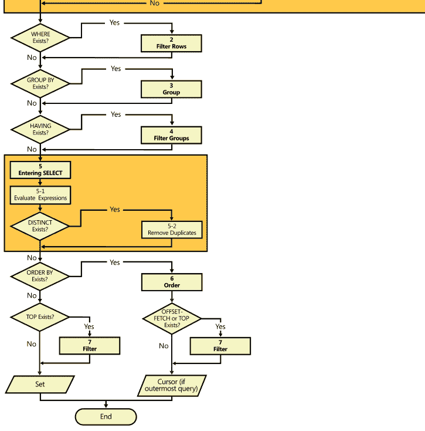

图 1-1 逻辑查询处理流程图。

第 1 章 逻辑查询处理 5

- **(5-1) 评估表达式** 此阶段评估 `SELECT` 列表表达式，生成 `VT5-1`。

- **(5-2) DISTINCT** 此阶段删除 `VT5-1` 中的重复行，生成 `VT5-2`。

- **(6) ORDER BY** 此阶段根据 `ORDER BY` 子句指定的列表对 `VT5-2` 中的行排序，生成游标 `VC6`。如果没有 `ORDER BY` 子句，`VT5-2` 变为 `VT6`。

- **(7) TOP | OFFSET-FETCH** 此阶段根据 `TOP` 或 `OFFSET-FETCH` 规格过滤 `VC6` 或 `VT6` 中的行，分别生成 `VC7` 或 `VT7`。使用 `TOP` 时，此阶段根据 `ORDER BY` 排序过滤指定数量的行，或者在缺少 `ORDER BY` 子句时按任意排序。使用 `OFFSET-FETCH` 时，此阶段根据 `ORDER BY` 排序跳过指定数量的行。`OFFSET-FETCH` 过滤器是在 `SQL Server 2012` 中引入。

## 基于 customers/orders 场景的示例查询

为了详细描述逻辑处理阶段，我将带你分析一个示例查询。首先运行以下代码创建 `dbo.Customers` 和 `dbo.Orders` 表，填充示例数据并查询它们显示内容：

```sql
SET NOCOUNT ON;
USE tempdb;

IF OBJECT_ID(N'dbo.Orders', 'U') IS NOT NULL DROP TABLE dbo.Orders;

IF OBJECT_ID(N'dbo.Customers', 'U') IS NOT NULL DROP TABLE dbo.Customers;

CREATE TABLE dbo.Customers (
    custid CHAR(5) NOT NULL,
    city VARCHAR(10) NOT NULL,
    CONSTRAINT PK_Customers PRIMARY KEY(custid)
);

CREATE TABLE dbo.Orders (
    orderid INT NOT NULL,
    custid CHAR(5) NULL,
    CONSTRAINT PK_Orders PRIMARY KEY(orderid),
    CONSTRAINT FK_Orders_Customers FOREIGN KEY(custid)
    REFERENCES dbo.Customers(custid)
);

INSERT INTO dbo.Customers(custid, city) VALUES
('FISSA', 'Madrid'),
('FRNDO', 'Madrid'),
('KRLOS', 'Madrid'),
('MERISH', 'Zion');
```

```sql
INSERT INTO dbo.Orders(orderid, custid) VALUES
(1, 'FRNDO'),
(2, 'FRNDO'),
(3, 'KRLOS'),
(4, 'KRLOS'),
(5, 'FRNDO'),
(6, 'KRLOS'),
(7, 'KRLOS');
```

```sql
SELECT * FROM dbo.Customers;

SELECT * FROM dbo.Orders;
```

### 列表 1-2：订单少于三个的客户

```sql
SELECT C.custid, COUNT(O.orderid) AS numorders
FROM dbo.Customers AS C
LEFT JOIN dbo.Orders AS O ON C.custid = O.custid
WHERE C.city = 'Madrid'
GROUP BY C.custid
HAVING COUNT(O.orderid) < 3
ORDER BY numorders;
```

此查询返回如下：

| custid | numorders |
| :--- | :--- |
| FISSA | 0 |
| FRNDO | 2 |
| KRLOS | 3 |

## 逻辑查询处理细节

本节通过应用示例查询来详细描述查询处理阶段。

### 步骤 1：FROM 阶段

`FROM` 阶段识别要查询的表，如果指定了表操作符，此阶段处理来自一个或两个输入。表操作符的结果作为下一个表操作符的左输入（如果存在），否则作为下一个查询处理阶段的输入。每个表操作符都有自己的子阶段。例如，连接涉及的阶段包括 **(1-J1) 卡卡尔积**、**(1-J2) ON 谓词**、**(1-J3) 添加外部行**。如所述，其他操作符将在章稍后单独描述。`FROM` 阶段生成虚拟表 `VT1`。

#### 步骤 1-J1：笛卡尔积（交叉连接）

这是连接表操作符适用的三个子阶段中的第一个。此子阶段在连接涉及的两个表之间执行笛卡尔积（交叉连接或无限制连接），结果生成虚拟表 `VT1-J1`。该表为左表的每种可能的行选择和右表的行组合包含一个行。如果左表有 `n` 行，右表有 `m` 行，`VT1-J1` 将包含 `n*m` 行。`VT1-J1` 中的列使用其源名称（或在查询中指定的表别名）进行限定的。在随后的步骤（步骤 1-J2 及以后）中，对歧义（出现在多个输入表中）的列名的引用必须进行表限定（例如 `C.custid`）。对于仅出现在一个输入中的列名，指定表限定是可选的（例如 `O.orderid` 或直接 `orderid`）。

将步骤 1-J1 应用于示例查询（见列表 1-2）：

```sql
FROM dbo.Customers AS C ... JOIN dbo.Orders AS O
```


结果，你得到了虚拟表 VT1-J1（见表 1-1），其包含 28 行（4×7）。

### 表 1-1 从步骤 1-J1 返回的虚拟表 VT1

| C.custid | C.city | O.orderid | O.custid |
|---|---|---|---|
| FISSA | Madrid | 1 | FRNDO |
| FISSA | Madrid | 2 | FRNDO |
| FISSA | Madrid | 3 | KRLOS |
| FISSA | Madrid | 4 | KRLOS |
| FISSA | Madrid | 5 | KRLOS |
| FISSA | Madrid | 6 | MRPHS |
| FISSA | Madrid | 7 | NULL |
| FRNDO | Madrid | 1 | FRNDO |
| FRNDO | Madrid | 2 | FRNDO |
| FRNDO | Madrid | 3 | KRLOS |
| FRNDO | Madrid | 4 | KRLOS |
| FRNDO | Madrid | 5 | KRLOS |
| FRNDO | Madrid | 6 | MRPHS |
| FRNDO | Madrid | 7 | NULL |
| KRLOS | Madrid | 1 | FRNDO |
| KRLOS | Madrid | 2 | FRNDO |
| KRLOS | Madrid | 3 | KRLOS |
| KRLOS | Madrid | 4 | KRLOS |
| KRLOS | Madrid | 5 | KRLOS |
| KRLOS | Madrid | 6 | MRPHS |
| KRLOS | Madrid | 7 | NULL |
| MRPHS | Zion | 1 | FRNDO |
| MRPHS | Zion | 2 | FRNDO |
| MRPHS | Zion | 3 | KRLOS |
| MRPHS | Zion | 4 | KRLOS |
| MRPHS | Zion | 5 | KRLOS |
| MRPHS | Zion | 6 | MRPHS |
| MRPHS | Zion | 7 | NULL |

### 步骤 1-J2: ON 谓词（连接条件）

ON 子句是三个查询子句（ON、WHERE 和 HAVING）中的第一个，它们根据谓词过滤行。ON 子句中的谓词应用于上一个步骤返回的虚拟表（VT1-J1）中的所有行。只有 `<on_predicate>` 为 TRUE 的行才会成为此步骤返回的虚拟表（VT1-J2）。

#### NULL 三值逻辑

允许我稍微离题一点，介绍一下与此步骤相关的 SQL 的一些重要方面。关系模型定义了两个表示缺失值的标记：A 标记（缺失且适用）和 I 标记（缺失且不适用）。前者表示一个值通常是有效的，但由于某些原因缺失了。例如，考虑 `People` 关系的 `birthdate` 属性。对于大多数人来说，这个信息是已知的，但在少数情况下是未知的；我妻子的爷爷显然是有的，他出生在某一天，但没有人知道是哪一天。后者表示一个值是无关的。例如，考虑 `Orders` 关系的 `custid` 属性。假设你在公司进行库存盘时，如果发现某物品的预期库存水平与实际水平不一致，你会向数据库添加一个虚拟订单作为补偿。在这种事务中，客户 ID 是无关的。

与关系模型不同，SQL 标准没有区分不同类型的值，而是只使用一个通用标记——NULL 标记。NULL 是 SQL 中产生很多困惑和问题的根源，应该很好理解以避免错误。首先，人们犯的一个常见错误是使用“NULL 值”这一术语，但 NULL 不是一个值；它是缺失值的标记。正确的术语是“NULL 标记”或直接称为“NULL”。此外，SQL 对缺失值以及缺失或不适用的情况只使用一个标记；当你使用 NULL 时，SQL 无法知道它应该代表缺失情况，还是缺失且不适用的情况。例如，在我们的示例数据中，一个订单的 `custid` 列中有一个 NULL 标记。假设这是一个与任何客户无关的虚拟订单——即我之前描述的场景。因此，你在这里使用 NULL 记录了该值缺失的事实，而不是它缺失且不适用的事实。

SQL 中关于 NULL 的大部分困惑都与你在查询过滤器、CHECK 约束以及其他地方使用的谓词有关。SQL 中谓词的可能值为 TRUE、FALSE 和 UNKNOWN。这被称为三值逻辑，是 SQL 特有的。大多数编程语言中的表达式只能是 TRUE 或 FALSE。SQL 中的 UNKNOWN 逻辑值通常出现在涉及 NULL 的逻辑表达式中。（例如，以下三个表达式的逻辑值均为 UNKNOWN：`NULL > 1759`；`NULL = NULL`；`X + NULL > Y`）。记住，NULL 标记表示缺失值。根据 SQL，当将一个缺失值与另一个值（即使是另一个 NULL）比较时，逻辑结果总是 UNKNOWN。

处理 UNKNOWN 逻辑结果和 NULL 可能非常混乱。虽然 NOT TRUE 是 FALSE，而 NOT FALSE 是 TRUE，但 UNKNOWN 的反反（`NOT UNKNOWN`）仍然是 UNKNOWN。

UNKNOWN 逻辑结果和 NULL 在语言的不同元素中处理方式不一致。例如，所有的查询过滤器（ON, WHERE, HAVING）都将 UNKNOWN 视为 FALSE。结果为 UNKNOWN 的行会被从结果集中剔除。换句话说，查询过滤器返回 TRUE 的情况。另一方面，CHECK 约束中的 UNKNOWN 值实际上被处理为 TRUE。假设你表中有一个 CHECK 约束，要求某列大于 0。向表中插入一个 NULL 行是被接受的，因为 `(NULL > 0)` 是 UNKNOWN，在 CHECK 约束中被视为 TRUE。换句话说，两个 NULL 之间的比较产生 UNKNOWN，在过滤器中被视为 FALSE——如果一个 NULL 不同于另一个。另一方面，对于具有 UNIQUE 约束的列进行分组，`GROUP BY` 子句将所有 NULL 归为一组。`ORDER BY` 子句将所有 NULL 排在一起。有趣的是，`UNION`、`EXCEPT` 和 `INTERSECT` 操作符在比较两个集合时将 NULL 视为相等；实际上，标准定义了 `NOT DISTINCT`。这些操作符隐式地使用了二值逻辑。以下表达式是：`NULL NOT DISTINCT FROM NULL`，`NULL NOT DISTINCT FROM 1759`。SQL Server 2014 不支持显式谓词，但我认为未来会添加（参见功能请求：https://microsoft.com/SQLServer/feedback/2864/）。简而言之，为了避免痛苦，你应该意识到语言的不同元素是如何处理 UNKNOWN 逻辑结果和 NULL 的。

将步骤 1-J2 应用示例查询：

```
ON C.custid = 0
```

表 1-2 的第一列显示了来自 VT1-J1 的行的 ON 子句逻辑值。

#### 表 1-2 来自 VT1-J1 的行的 ON 谓词逻辑值

| 逻辑值 | C.custid | C.city | O.orderid | O.custid |
|---|---|---|---|---|
| FALSE | FISSA | Madrid | 1 | FRNDO |
| FALSE | FISSA | Madrid | 2 | FRNDO |
| FALSE | FISSA | Madrid | 3 | KRLOS |
| FALSE | FISSA | Madrid | 4 | KRLOS |
| FALSE | FISSA | Madrid | 5 | KRLOS |
| FALSE | FISSA | Madrid | 6 | MRPHS |
| UNKNOWN | FISSA | Madrid | 7 | NULL |
| TRUE | FRNDO | Madrid | 1 | FRNDO |
| TRUE | FRNDO | Madrid | 2 | FRNDO |
| FALSE | FRNDO | Madrid | 3 | KRLOS |
| FALSE | FRNDO | Madrid | 4 | KRLOS |
| FALSE | FRNDO | Madrid | 5 | KRLOS |
| FALSE | FRNDO | Madrid | 6 | MRPHS |
| UNKNOWN | FRNDO | Madrid | 7 | NULL |
| FALSE | KRLOS | Madrid | 1 | FRNDO |
| FALSE | KRLOS | Madrid | 2 | FRNDO |
| TRUE | KRLOS | Madrid | 3 | KRLOS |
| TRUE | KRLOS | Madrid | 4 | KRLOS |
| TRUE | KRLOS | Madrid | 5 | KRLOS |
| FALSE | KRLOS | Madrid | 6 | MRPHS |
| UNKNOWN | KRLOS | Madrid | 7 | NULL |
| FALSE | MRPHS | Zion | 1 | FRNDO |
| FALSE | MRPHS | Zion | 2 | FRNDO |
| FALSE | MRPHS | Zion | 3 | KRLOS |
| FALSE | MRPHS | Zion | 4 | KRLOS |
| FALSE | MRPHS | Zion | 5 | KRLOS |
| TRUE | MRPHS | Zion | 6 | MRPHS |
| UNKNOWN | MRPHS | Zion | 7 | NULL |

只有 `<on_predicate>` 为 TRUE 的行才插入 VT1-J2，如表 1-3 所示。

#### 表 1-3 从步骤 1-J2 返回的虚拟表 VT1-J2

| 逻辑值 | C.custid | C.city | O.order | O.custid |
|---|---|---|---|---|
| TRUE | FRNDO | Madrid | 1 | FRNDO |
| TRUE | FRNDO | Madrid | 2 | FRNDO |
| TRUE | KRLOS | Madrid | 3 | KRLOS |
| TRUE | KRLOS | Madrid | 4 | KRLOS |
| TRUE | KRLOS | Madrid | 5 | KRLOS |
| TRUE | MRPHS | Zion | 6 | MRPHS |

### 步骤 1-J3: 添加外部行

此步骤仅发生外部连接。对于外部连接，你根据外部连接类型（LEFT、RIGHT 或 FULL）标记一个或两个输入表为保留。标记一个表意味着其所有行都会被返回，即使被 `<on_predicate>` 过滤掉。左外连接标记左表为保留，右外连接标记右表为保留，全外连接则都标记。步骤 1-J3 返回来自 VT1-J2 的行，加上在步骤 1-J2 中未找到匹配的保留表或表的行。这些添加的行被称为外部行。NULL 被分配给非保留表的属性。结果是生成了虚拟表 VT1-J3。

在我们的示例中，保留表是 Customers：

```
Customers AS C LEFT JOIN Orders AS 0
```

只有客户 FISSA 没有匹配到任何订单（因此不在 VT1-J2 中）。因此，FISSA 的行被添加到 VT1-J2 中，Orders 属性为 NULL。结果是虚拟表 VT1-J3（如表 1-4 所示）。由于示例查询的 FROM 子句没有更多的表操作，虚拟表 VT1-J3 也是 FROM 阶段返回的虚拟表 VT1。

#### 表 1-4 从步骤 1-J3 返回的虚拟表 VT1-J3（也是 VT1）

| C.custid | C.city | O.order | O.custid |
|---|---|---|---|
| FRNDO | Madrid | 1 | FRNDO |
| FRNDO | Madrid | 2 | FRNDO |
| KRLOS | Madrid | 3 | KRLOS |
| KRLOS | Madrid | 4 | KRLOS |
| KRLOS | Madrid | 5 | KRLOS |
| MRPHS | Zion | 6 | MRPHS |
| FISSA | Madrid | NULL | NULL |

注意：如果 FROM 子句中出现多个表操作符，它们将从左到右进行处理——至少在逻辑查询处理顺序上是这样规定的。每个表操作符的结果将作为下一个表操作符的左输入。最终的虚拟表将作为下一步的输入。

## 步骤 2：WHERE 阶段

WHERE 过滤器应用于上一步返回的虚拟表中的所有行。`<where_predicate>` 为 TRUE 的行构成了此步骤返回的虚拟表 (VT2)。

注意：不能引用 SELECT 列表创建的列别名，因为该列表尚未被处理——例如，你不能写 `SELECT YEAR(orderdate) AS orderyear ... WHERE orderyear > 2014`。讽刺的是，有些人认为这种行为是 SQL Server 的一个 bug，但当你理解了逻辑查询处理时，这很容易解释。此外，由于数据尚未分组，你不能使用分组聚合函数；例如，你不能写 `WHERE orderdate = MAX(orderdate)`。

在示例查询中应用过滤器：

```
WHERE C.city = 'Madrid'
```

来自 VT1 的 MRHPS 客户被删除了，因为城市不是 Madrid，并生成了表 1-5 所示的虚拟 VT2。

#### 表 1-5 从步骤 2 返回的虚拟 VT2

| C.custid | C.city | O.orderid | O.custid |
|---|---|---|---|
| FRNDO | Madrid | 1 | FRNDO |
| FRNDO | Madrid | 2 | FRNDO |
| KRLOS | Madrid | 3 | KRLOS |
| KRLOS | Madrid | 4 | KRLOS |
| KRLOS | Madrid | 5 | KRLOS |
| FISSA | Madrid | NULL | NULL |

包含外连接的查询中令人困惑的一个方面是在 ON 子句还是 WHERE 子句中指定谓词。两者主要在于 ON 在添加行（步骤 1-J3）之前应用，而 WHERE 是在之后应用。ON 子句从保留表中删除行不是最终的，因为步骤 1-J3 会将其重新加回来；相比之下，WHERE 子句删除行是最终的。另一种思考方式是将 ON 谓词视为用于匹配的目的，而将 WHERE 谓词视为更基础的过滤目的。对于连接中保留侧的行，ON 不能丢弃这些行；它只能决定与非保留侧的哪些行进行匹配。然而，WHERE 子句确实可以丢弃保留侧的行。这一点应该帮助你做出正确的选择。

例如，假设你想从 Customers 和 Orders 表中返回某些客户及其订单。你想要返回的客户是 Madrid 客户——包括下过订单的和未下订单的。外连接是为这种请求设计的。你在 Customers 和 Orders 之间执行左外连接，将 Customers 作为保留表。为了能够返回没有订单的客户，你必须在 ON 子句中指定 Customers 和 Orders 之间的关联（`ON C.custid = O.custid`）。没有订单的客户在步骤 1-J2 中被消除，但在步骤 1-J3 中作为外部行重新添加。然而，因为你只想返回 Madrid 客户，你必须在 WHERE 子句中指定城市谓词（`WHERE C.city = 'Madrid'`）。在 ON 子句中指定城市谓词会导致非 Madrid 客户在步骤 1-J3 中被重新添加到结果集中。

> 提示：ON 和 WHERE 子句之间的这种逻辑差异仅在使用外连接时存在。当你使用内连接时，在哪里指定你的谓词并不重要；步骤 1-J3 会被跳过。谓词一个接一个应用，之间没有中间步骤，都起到基础的过滤作用。

## 步骤 3：GROUP BY 阶段

GROUP BY 阶段根据 GROUP BY 子句中定义的分组集（或集合），将上一步返回的表行关联到组。为了简单起见，假设你有一组用于分组的表达式。这组被称为分组集。

在这个阶段，上一步返回的表中的行被分成若干组。属于分组集的每个唯一值组合都标识一个组。上一步的每行都与且仅与一个组关联。虚拟表 VT3 由按分组排列的 VT2 行组成（原始信息）。对以下查询应用步骤 3：

```
GROUP BY C.city
```

你得到了表 1-6 所示的虚拟表 VT3。

#### 表 1-6 从步骤 3 返回的虚拟 VT3

| C.custid | C.city | O.orderid | O.custid |
|---|---|---|---|
| FRNDO | Madrid | 1 | FRNDO |
| FRNDO | Madrid | 2 | FRNDO |
| KRLOS | Madrid | 3 | KRLOS |
| KRLOS | Madrid | 4 | KRLOS |
| KRLOS | Madrid | 5 | KRLOS |
| FISSA | Madrid | NULL | NULL |

## 步骤 4：HAVING 阶段

HAVING 过滤器应用于上一步返回的所有组。`<having_predicate>` 为 TRUE 的组构成了此步骤返回的虚拟表 (VT4)。对示例查询应用：

```
HAVING COUNT(O.orderid) > 3
```


KRLOS 的组被删除了。生成了表 1-7 所示的虚拟表 VT4。

**表 1-7** 从步骤 4 返回的虚拟 VT4

| C.custid | C.city | O.orderid | O.custid |
|---|---|---|---|
| FRNDO | Madrid | 1 | FRNDO |
| FRNDO | Madrid | 2 | FRNDO |
| KRLOS | Madrid | 3 | KRLOS |
| KRLOS | Madrid | 4 | KRLOS |
| KRLOS | Madrid | 5 | KRLOS |
| FISSA | Madrid | NULL | NULL |

注意：不能引用 SELECT 列表创建的列别名，因为该列表尚未被处理——例如，你不能写 `SELECT YEAR(orderdate) AS orderyear ... WHERE orderyear > 2014`。

注意：聚合函数不接受子查询作为输入——例如 `HAVING SUM(SELECT .. > 10`。

## 步骤 5：SELECT 阶段

尽管在查询中进行了指定，SELECT 子句只在第五步被处理。SELECT 阶段构建将返回给调用者的表。此阶段涉及两个子阶段：(5-1) 计算表达式和 (5-2) 应用 DISTINCT 子句。

### 步骤 5-1：计算表达式

SELECT 列表中的表达式可以返回上一步虚拟表的列以及列的操作。记住，如果查询是聚合查询，在步骤 3 之后，你只能在引用分组（GROUP BY 列表）部分时引用列。如果你引用原始部分的列，则必须进行聚合。从上一步选择的未处理列将保留其原始名称，除非你对其指定别名（例如 `col1 AS`）。涉及列的操作应重命名以便在结果表中具有列名——例如 `YEAR(orderdate) AS orderyear`。

如前所述，SELECT 列表创建的别名不能被后续步骤使用——例如在 WHERE 阶段。此外，别名不能在同一个 SELECT 列表中的其他表达式中使用。这种限制的背后的逻辑是 SQL 的另一个独特方面；许多操作是一次性完成的操作。例如，在以下 SELECT 列表中，表达式求值的逻辑顺序应该是无关重要的且是不保证的：`SELECT c1 + 1 AS e1, c2 + 1 AS e2`。因此，以下 SELECT 列表不支持：`SELECT c1 + 1 AS e1, e1 + 1 AS e2`。你可以在定义它们的后续步骤中使用列别名。如果你在 SELECT 阶段定义了列别名，你可以在 ORDER BY 阶段中引用它——例如 `SELECT YEAR(orderdate) AS orderyear ... ORDER BY orderyear`。

“一次性操作”的概念可能很难理解。例如，在编程环境中，交换变量之间的值需要你使用一个临时变量。然而，在 SQL 中交换表列，你可以使用以下语句：

```sql
UPDATE dbo.T1 SET c1 = c2, c2 = c1;
```

从逻辑上讲，你应该假设整个操作是一次完成的。这就像源在整个操作完成之前不会被修改，然后由结果替换源。出于相似的原因，以下 UPDATE 将更新 T1 的所有行，将操作开始时 T1 中相同的最大 c1 加到 c1 中：

```sql
UPDATE dbo.T1 SET c1 = c1 + (SELECT MAX(c1) FROM dbo.T1);
```

不要担心最大 c1 值会随着操作的进行而不断变化；它不会变化，因为操作是一次性发生的。

将此步骤应用于示例查询：

```sql
SELECT C.custid, COUNT(O.orderid) AS numorders
```

你得到了虚拟表 VT5-1，如表 1-8 所示。因为 SELECT 阶段另一个可能的子阶段（DISTINCT）没有应用于示例查询中，所以该子阶段返回的虚拟表 VT5-1 就是 SELECT 阶段返回的虚拟表 VT5。

**表 1-8** 从步骤 5 返回的虚拟表 VT5-1（也是 VT5）

| C.custid | numorders |
| --- | --- |
| FRNDO | 2 |
| FISSA | 0 |

## 步骤 5-2：应用 DISTINCT 子句

如果查询中指定了 DISTINCT 子句，将从上一步返回的虚拟表中删除重复行，并生成虚拟表 VT5-2。

> 注意：SQL 通过允许表具有重复行（当不强制执行主键或唯一约束时）以及查询结果返回重复行来从关系模型中进行删除。根据关系模型，关系的主体是元组集合（SQL 称为行），而根据数学集合论，集合（区别于多集）没有重复项。使用 DISTINCT 子句，你可以确保查询返回唯一的行，并且从意义上符合关系模型。

你应该意识到，SELECT 阶段首先评估表达式（子阶段 5-1），并且在之后才删除重复行（子阶段 5-2）。如果你没有意识到这一点，可能会对某些查询的结果感到惊讶。例如，以下查询返回了下过订单的去重客户 ID：

```sql
SELECT DISTINCT custid
FROM dbo.Orders
WHERE custid IS NOT NULL;
```

正如你可能预期的，该查询在结果集中返回了三行：

```
custid
-----
FRND
KRLOS
MRPHS
```

假设你想根据 `custid` 排序为结果行添加行号。在没有意识到问题的情况下，你会根据 ROW_NUMBER 函数向查询表达式添加内容，如下所示（先不要运行查询）：

```sql
SELECT DISTINCT custid, ROW_NUMBER() OVER(ORDER BY custid) AS rownum
FROM dbo.Orders
WHERE custid IS NOT NULL;
```

在运行查询之前，你预计会在结果中得到多少行？如果你的答案是 3，那么你错了。那是因为阶段 5-1 在表 VT4 上评估了所有表达式，包括一个基于 ROW_NUMBER 函数的表达式，而 VT4 在应用 WHERE 过滤后有五行。因此，阶段 5-1 生成了一个具有五行、行号从 1 到 5 的表 VTS5。加上行号后，这些行已经是唯一的了。当应用阶段 5-2 时，它发现没有重复项需要删除。以下是该查询的结果：

```
custid rownum
------------------
FRND 1
FRND 2
KRLOS 3
KRLOS 4
MRPHS 5
MRPHS 6
```

如果你想为唯一的 ID 分配行号，你需要在分配行号之前去掉重复的客户 ID。可以通过使用表表达式（CTE）来实现，如下：

```sql
WITH C AS
(
  SELECT DISTINCT custid
  FROM dbo.Orders
  WHERE custid IS NOT NULL
)
SELECT custid, ROW_NUMBER() OVER(ORDER BY custid) AS rownum
FROM C;
```

这次你得到了所需的输出：

```
custid rownum
------------
FRNDO 1
KRLOS 2
MRPHS 3
```

回到原始查询，由于没有指定 DISTINCT，步骤 5-2 被跳过了。

## 步骤 6：ORDER BY 阶段

上一步的行根据 ORDER BY 子句指定的列表进行排序，返回游标 V6。ORDER BY 子句是 SELECT 阶段创建的别名可以重用的步骤。

如果指定了 DISTINCT，ORDER BY 子句中的表达式访问 SELECT 阶段返回的虚拟表（VTS）。如果没有指定 DISTINCT，ORDER BY 子句中的表达式可以访问输入和输出虚拟表（VT4 和 VT5）。此外，如果没有 DISTINCT，你可以在 ORDER BY 子句中指定任何在最终结果集中不返回的表达式。也就是说，你可以按那些未包含在结果中的表达式进行排序。

当指定了 DISTINCT 时，不允许访问不返回的表达式是有原因的。在 SELECT 列表中添加表达式时，DISTINCT 可能会改变返回的行数。在我们的示例中，由于没有指定 DISTINCT，ORDER BY 子句访问表 1-7 所示的 VT4 和表 1-8 所示的 VTS。

在 ORDER BY 子句中，你还可以指定 SELECT 列表中列的位置。例如，以下查询按 custid 后按 order 排序：

```sql
SELECT orderid, custid FROM dbo.Orders ORDER 2, 1;
```

然而，这种做法是不推荐的，因为你可能对 SELECT 列表进行了更改而忘记相应地修改 ORDER BY 列表。此外，当查询字符串很长时，很难弄清楚 ORDER BY 列表中的哪个项对应 SELECT 列表中的哪个项。

**重要** 此步骤与其他所有步骤不同之处在于它不返回关系结果；而是返回一个游标。记住关系模型是基于集合论的，关系的主体（SQL 称为表）是元组（行）集合。集合没有特定的顺序。带有 ORDER BY 子句的查询按特定顺序组织行。标准 SQL 将这种结果称为游标。理解这一点是正确理解 SQL 最基本的步骤之一。

在描述表的内容时，大多数人（包括我）习惯按某种顺序描述行。但因为表是没有特定顺序的行集合，这种描述可能会暗示其他顺序而引起混淆。图 1-2 展示了以更正确的方式描述表内容的示例，这种方式不暗示顺序。


> 注意：虽然 SQL 不假设表具有任何给定顺序，但它根据创建顺序维护列的位置。指定 SELECT *（尽管这是一个坏习惯）可以保证按创建顺序排列列。在这方面，SQL 偏离了关系模型。ORDER BY 子句将 NULL 视为相等。也就是说，NULL 被排在一起。标准 SQL 将 NULL 排序在已知值之前还是之后留给了实现，而实现必须保持一致。T-SQL 将 NULL 排序在已知值之前（优先）。

将此步骤应用于列表 1-2 中的查询：

你得到了表 1-9 所示的游标 V6。

| C.custid | numorders |
| --- | --- |
| FISSA | 0 |
| FRNDO | 2 |

## 步骤 7：应用 TOP 或 OFFSET-FETCH 过滤器

TOP 和 OFFSET-FETCH 是基于行数和顺序的查询过滤器。这与经典的查询过滤器（ON, WHERE, HAVING）不同。TOP 是 T-SQL 特有的，而 OFFSET-FETCH 是标准的。正如提到的，OFFSET-FETCH 在 SQL Server 2012 中引入。本节在逻辑查询处理的范围内描述这些过滤器。

顶部过滤器的规范包含两个元素。一个是（强制的）要过滤的行数或百分比（向上取整）。另一个（可选的）是定义过滤哪些行的顺序。遗憾的是，TOP 的排序规范（OFFSET-FETCH 相同）是由查询中经典的 ORDER BY 子句定义的，而不是与其脱离并独立存在。我稍后会解释为什么这种设计选择是有问题的并会导致混淆。如果没有指定顺序，你应该假设它是任意的，从而产生不确定的结果。这意味着如果你多次运行查询，即使数据保持不变，也无法保证获得可重复的结果。生成虚拟表 VT7。如果指定了顺序，游标 VC7 返回三个订单值最高的订单：

```sql
SELECT TOP (3) orderid, custid
FROM dbo.Orders
ORDER BY orderid DESC;
```

此查询生成了以下输出：

| orderid | custid |
|---|---|
| 7 | NULL |
| 6 | MRPHOS |
| 5 | KRLOS |

即使指定了 `orderid`，仅凭这一点也无法保证确定性。如果排序不是唯一的（例如，你将前一个查询中的 `orderid` 更改为 `custid`），则具有相同排序值的行之间的顺序应该被认为是任意的。有两种方法可以使 `TOP` 过滤器具有确定性：一种是指定 `ORDER BY` 列表并添加 `WITH TIES` 选项（例如，`custid, orderid`）；另一种是使用非唯一的 `ORDER BY` 列表，这允许过滤器包含底层查询结果中所有与最后返回行具有相同排序值的其他行。使用此选项，返回哪些行的选择就变得确定的，但呈现方式仍然基于具有相同排序值的行。

`OFFSET-FETCH` 过滤器与 `TOP` 类似，但它增加了子句来指示跳过多少行（`OFFSET` 子句），然后指示过滤多少行（`FETCH` 子句）。`OFFSET` 和 `FETCH` 子句都位于修饰符 `ORDER BY` 子句之后。例如，以下查询根据 `orderid` 降序进行排序，它跳过了四行并过滤接下来的行：

```sql
SELECT orderid, custid
FROM dbo.Orders
ORDER BY orderid DESC
OFFSET 4 ROWS FETCH 2 ROWS ONLY;
```

此查询返回以下输出：

| orderid | custid |
|---|---|
| 3 | KRLOS |
| 2 | FRND0 |

从 SQL Server 2014 开始，T-SQL 中 `OFFSET-FETCH` 的实现不支持 `PERCENT` 和 `WITH TIES` 选项，尽管标准 SQL 支持它们。这一步生成了游标 VC7。

在我们的示例中跳过了第 7 步，因为没有指定 `TOP` 和 `OFFSET-FETCH`。

我之前提到过，`TOP` 和 `OFFSET-FETCH` 的排序是由传统定义呈现顺序相同的 `ORDER` 子句定义的，这导致了混淆。考虑以下查询作为示例：

```sql
SELECT TOP (3) orderid, custid
FROM dbo.Orders
ORDER BY orderid DESC;
```

在这里，`ORDER BY` 具有两个不同的用途。一个是传统的呈现排序（按 `orderid` 降序排列返回的行）。另一个是为 `TOP` 过滤器选择选择三行（`orderid` 值最高的三行）。但如果你基于查询定义一个表表达式，情况就会变得复杂。回想第 6 步节：`ORDER BY` 阶段，通常你是不允许基于查询来定义表表达式的，因为此类查询会生成一个游标。我演示了尝试对该限制定义例外，但当定义一个在内部查询中失败的派生值时，该派生值包含了一个 `ORDER BY` 子句。

该限制有一个例外，但需要很好地理解它以避免产生错误的预期。例外是，允许内部查询拥有 `ORDER BY` 子句，以支持 `TOP` 或 `OFFSET-FETCH` 过滤器。但在这种情况下，重要的是，如果外部查询没有呈现的 `ORDER BY` 子句，则结果的呈现顺序是无法保证的。排序仅适用于包含 `ORDER BY` 子句的直接查询。如果你想保证结果的呈现顺序，最外查询必须包含 `ORDER BY` 子句。以下是 ISO/IEC 9075-2:2011(E) 4.15.3 派生表标准标识这一事实的准确语言：

> 包含一个可选的 <order by clause>。表按 <query expression> 的排序仅对于直接包含 <order by clause> 的 <query expression> 有保证

尽管你在实践中观察到的结果如何，在下面的示例中，结果的呈现顺序是不保证的，因为最外部查询没有 `ORDER BY` 子句：

```sql
SELECT orderid, custid
FROM (SELECT TOP (3) orderid
      FROM dbo.Orders
      ORDER BY orderid DESC) AS D;
```

假设你运行了上述查询并得到了一个似乎按照内部查询排序规范排序的结果。这并不意味着该行为是保证可重复的。它可能是优化方面的结果，并且是不保证可重复的。这是 SQL 从业者经常掉入的最常见陷阱之一——基于观察到的行为得出结论并在此基础上预期，而不是正确地理解理论。

类似地，人们可能会犯的一个常见错误是创建一个“排序视图”。记住，如果你指定了 `TOP` 或 `OFFSET-FETCH` 选项，你允许在内部查询中包含 `ORDER BY` 子句。因此，我们尝试在不实际过滤行的情况下实现此目标的一种方法是指定 `TOP (100) PERCENT` 选项，如下：

```sql
-- 尝试创建一个排序视图
IF OBJECT_ID('dbo.Orders', 'V') IS NOT NULL DROP VIEW dbo.Orders;
GO

-- 注意：这并没有创建一个“排序视图”！
CREATE VIEW dbo.MyOrders
AS
SELECT TOP (100) PERCENT orderid, custid
FROM dbo.Orders
ORDER BY orderid DESC;
GO
```

考虑针对视图的以下查询：

```sql
SELECT orderid, custid FROM dbo.MyOrders;
```

根据我刚刚的解释，如果你查询视图且不在外部查询中指定 `ORDER BY` 子句，你就得不到任何呈现排序保证。当我在我的系统上运行它，我得到以下顺序的结果：

| orderid | custid |
|---|---|
| 7 | NULL |
| 6 | MRPHS |
| 5 | KRLOS |
| 3 | KRLOS |
| 2 | FRND0 |
| 1 | FRND0 |

结果似乎是按 `orderid` 降序排序的，但你仍然需要记住这并不是保证的。只是在这种情况下，优化器内部没有嵌入逻辑来忽略带有其排序规范的过滤器。

创建排序视图的另一种尝试是指定 `OFFSET 0 ROWS` 并省略 `FETCH` 子句，如下所示：

```sql
-- 尝试创建一个排序视图
IF OBJECT_ID('dbo.Orders', 'V') IS NOT NULL DROP VIEW dbo.Orders;
GO

-- 注意：这并没有创建一个“排序视图”！
CREATE VIEW dbo.MyOrders
AS
SELECT TOP (100) PERCENT orderid, custid
FROM dbo.Orders
```


## SQL 查询处理与表操作符

### ORDER BY 与 OFFSET-FETCH

```sql
ORDER BY orderid DESC
OFFSET 0 ROWS;
GO
```

```sql
-- 查询视图
SELECT orderid, custid FROM dbo.MyOrders;
```

如果过滤器设计为具有自己的排序规范，并且与呈现的 `ORDER BY` 独立且断开，那么这一切都可以避免。这种良好设计的例子是像 `ROW_NUMBER` 这样的窗口函数。你为排名计算指定排序，独立于你可能或不想为呈现目的定义的任何排序。但遗憾的是，对于 `TOP` 和 `OFFSET-FETCH`，木已成舟。因此，责任现在在我们用户身上，要很好地理解这种设计，并知道从中期待什么，更重要的是，知道不该期待什么。

当你完成后，运行以下代码进行清理：

```sql
OBJECT_ID(N'dbo.MyOrders', N'V') IS NOT NULL DROP VIEW dbo.MyOrders;
```

> **注意**：`APPLY`、`PIVOT` 和 `UNPIVOT` 并不是标准操作符；它们是 T-SQL 的特定扩展。`APPLY` 在标准语言 `LATERAL` 中有类似的对应项，但 `PIVOT` 和 `UNPIVOT` 则没有。

### 表操作符概述

我之前已经考虑了带有连接的逻辑处理阶段。在这里，我将简要描述其他三个操作符以及它们如何融入逻辑查询处理模型。

表操作符以一张或两张表作为输入。根据它们相对于表操作符关键字（`JOIN`、`APPLY`、`PIVOT`、`UNPIVOT`）的位置，我们将其称为左输入和右输入。输入表可以是多种选项之一，且不限于此：普通表、临时表、派生表、CTE 或表值函数。在逻辑查询处理术语中，表操作符从左到右进行求值，上一个操作符返回的虚拟表成为下一个操作符的左输入表。

每个表操作符都执行一组不同的步骤。为了方便起见，我将在步骤数字前加上表操作符的首字母（J 代表 `JOIN`，A 代表 `APPLY`，P 代表 `PIVOT`，U 代表 `UNPIVOT`）。

以下是四个操作符及其元素：

**JOIN**
```text
(J) <left_input_table>
{CROSS | INNER | OUTER} JOIN <right_input_table>
ON <on_predicate>
```

**APPLY**
```text
(A) <left_input_table>
{CROSS | OUTER} APPLY <right_input_table>
```

**PIVOT**
```text
(P) <left_input_table>
PIVOT <aggregate_func(<aggregation_element>)>
IN(<target_col_list>)
AS <result_table_alias>
```

**UNPIVOT**
```text
(U) <left_input_table>
UNPIVOT <target_values_col> FOR
<target_names_col> IN(<source_col_list>)
AS <result_table_alias>
```

作为提示，连接涉及以下步骤的子集（取决于连接类型）：

- **J1**: 应用笛卡尔积
- **J2**: 应用 ON 谓词
- **J3**: 添加外部行

---

## APPLY

`APPLY` 操作符（取决于 apply 类型）涉及以下步骤的一个或两个步骤：

- **A1**: 将右表表达式应用于左行
- **A2**: 添加外部行

`APPLY` 操作符将右表表达式应用于左输入的每一行。右表表达式可以引用左输入列。右输入会为左输入的每一行求值一次。此步骤统一了将每个左行与右表表达式匹配产生的集合，该步骤返回合并后的结果。

步骤 **A1** 应用于 `CROSS APPLY` 和 `OUTER APPLY` 中。步骤 **A2** 仅适用于 `OUTER APPLY`。如果内部（右）表表达式对于某个左行返回空集，则 `CROSS APPLY` 不返回外部（左）行。而 `OUTER APPLY` 将返回一行，并用 `NULL` 作为内部表表达式属性的占位符。

例如，以下查询返回每个客户订单 ID 最高的两个订单：

```sql
SELECT C.custid, C.city, A.orderid
FROM dbo.Customers AS C
CROSS APPLY (
    SELECT TOP (2) O.orderid, O.custid
    FROM dbo.Orders AS O
    WHERE O.custid = C.custid
    ORDER BY orderid DESC
) AS A;
```

| custid | city | orderid |
| :--- | :--- | :--- |
| FRNDO | Madrid | 2 |
| FRNDO | Madrid | 1 |
| KRLOS | Madrid | 5 |
| KRLOS | Madrid | 4 |
| MKPHS | Zion | 6 |

注意，输出中缺少了 `FISSA`，因为表表达式 A 为其返回了空集。如果你也想返回下了订单的客户，请如下使用 `OUTER APPLY`：

```sql
SELECT C.custid, C.city, A.orderid
FROM dbo.Customers AS C
OUTER APPLY (
    SELECT TOP (2) O.orderid, O.custid
    FROM dbo.Orders AS O
    WHERE O.custid = C.custid
    ORDER BY orderid DESC
) AS A;
```

此查询生成以下输出：

```text
custid  city    orderid
FISSA   Madrid  NULL
FRNDO   Madrid  2
FRNDO   Madrid  1
KRLOS   Madrid  5
KRLOS   Madrid  4
MRPHS   Zion    6
```

---

## PIVOT

使用 `PIVOT` 操作符将数据从行到列进行旋转、枢置，并在此过程中执行聚合。

假设你想查询 `TSQL3` 示例数据库中的 `Sales.OrderValues` 视图（有关示例数据库的详情请参阅书籍的介绍），并返回每个员工处理的每个订单的订单值。你希望输出中每个员工有一行，每个订单有一列，并在每个员工和年份的交汇处显示总值。以下 `PIVOT` 查询允许你实现这一目标：

```sql
USE TSQLV3;
SELECT empid, [2013], [2014], [2015] AS orderyear, val
FROM (
    SELECT empid, YEAR(orderdate) AS orderyear, val
    FROM Sales.OrderValues
) AS D
PIVOT ( SUM(val) FOR orderyear IN([2013],[2014],[2015]) ) AS P;
```

此查询生成以下输出：

| empid | 2013 | 2014 | 2015 |
| :--- | :--- | :--- | :--- |

---

## UNPIVOT

该查询将每个源行的员工年度值进行逆向转换（unpivot，拆分），为每个订单年份生成单独的行，产生如下输出：

| empid | orderyear | val |
| :--- | :--- | :--- |
| 3 | 2013 | 18223.96 |
| 3 | 2014 | 108026.17 |
| 3 | 2015 | 76562.75 |
| 6 | 2013 | 16642.61 |
| 6 | 2014 | 43126.38 |
| 6 | 2015 | 14144.36 |
| 9 | 2013 | 89844.52 |
| 9 | 2014 | 26310.39 |
| 9 | 2015 | 41103.17 |
| 7 | 2013 | 15232.16 |
| 7 | 2014 | 60471.99 |
| 7 | 2015 | 48864.89 |
| 1 | 2014 | 93146.11 |
| 1 | 2015 | 63195.02 |
| 4 | 2013 | 49945.12 |
| 4 | 2014 | 128809.81 |
| 4 | 2015 | 54135.94 |
| 2 | 2014 | 70444.14 |
| 2 | 2015 | 74316.56 |
| 5 | 2013 | 18383.92 |
| 5 | 2014 | 30716.48 |
| 5 | 2015 | 19691.90 |
| 8 | 2013 | 22240.12 |
| 8 | 2014 | 56032.63 |
| 8 | 2015 | 48589.54 |

`UNPIVOT` 操作涉及以下逻辑处理阶段：

1. **U1**: 生成副本
2. **U2**: 提取元素
3. **U3**: 移除包含 `NULL` 的行

**第一步 (U1)** 为作为输入提供 `UNPIVOT` 的左表表达式生成行副本（在本例中为 `EmpYearValues`）。此步骤为每个被逆向转换的列（在 `UNPIVOT` 算符的子句中）生成一个副本。由于 `IN` 子句中有三个列名，因此每个源行都会产生三个副本。生成的虚拟表将包含一个新列，该列以字符字符串的形式持有源列名。此列的名称将是 `IN` 子句之前直接指定的名称（在本例中为 `orderyear`）。我们示例中第一步返回的虚拟表如表 1-10 所示。

### 表 1-10 UNPIVOT 第一步返回的虚拟表

| empid | 2013 | 2014 | 2015 | orderyear |
| :--- | :--- | :--- | :--- | :--- |
| 3 | 18223.96 | 108026.17 | 76562.75 | 2013 |
| 3 | 18223.96 | 108026.17 | 76562.75 | 2014 |
| 3 | 18223.96 | 108026.17 | 76562.75 | 2015 |
| 6 | 16642.61 | 41326.38 | 14144.16 | 2013 |
| 6 | 16642.61 | 41326.38 | 14144.16 | 2014 |
| 6 | 16642.61 | 41326.38 | 14144.16 | 2015 |
| 9 | 9894.52 | 26310.39 | 41103.17 | 2013 |
| 9 | 9894.52 | 26310.39 | 41103.17 | 2014 |
| 9 | 9894.52 | 26310.39 | 41103.17 | 2015 |
| 7 | 15232.16 | 60471.19 | 48864.89 | 2013 |
| 7 | 15232.16 | 60471.19 | 48864.89 | 2014 |
| 7 | 15232.16 | 60471.19 | 48864.89 | 2015 |
| 1 | NULL | 93148.11 | 63195.02 | 2013 |
| 1 | NULL | 93148.11 | 63195.02 | 2014 |
| 1 | NULL | 93148.11 | 63195.02 | 2015 |
| 4 | 49945.12 | 128809.81 | 54135.94 | 2013 |
| 4 | 49945.12 | 128809.81 | 54135.94 | 2014 |
| 4 | 49945.12 | 128809.81 | 54135.94 | 2015 |
| 2 | NULL | 70444.14 | 74316.56 | 2013 |
| 2 | NULL | 70444.14 | 74316.56 | 2014 |
| 2 | NULL | 70444.14 | 74316.56 | 2015 |
| 5 | 18383.92 | 30716.48 | 19691.90 | 2013 |
| 5 | 18383.92 | 30716.48 | 19691.90 | 2014 |
| 5 | 18383.92 | 30716.48 | 19691.90 | 2015 |
| 8 | 22240.12 | 56032.63 | 48589.54 | 2013 |
| 8 | 22240.12 | 56032.63 | 48589.54 | 2014 |
| 8 | 22240.12 | 56032.63 | 48589.54 | 2015 |

**第二步 (U2)** 从对应当前逆转换元素的源列中提取值。存放这些值的目标列指定在 `FOR` 子句之前（在本例中为 `val`）。目标列将包含源行的顺序。此步骤返回的虚拟表如表 1-11 所示。

### 表 1-11 UNPIVOT 第二步返回的虚拟表

| empid | val | orderyear |
| :--- | :--- | :--- |
| 3 | 18223.96 | 2013 |
| 3 | 108026.17 | 2014 |
| 3 | 76562.75 | 2015 |
| 6 | 16642.61 | 2013 |
| 6 | 43126.38 | 2014 |
| 6 | 14144.16 | 2015 |
| 9 | 89844.52 | 2013 |
| 9 | 26310.39 | 2014 |
| 9 | 41103.17 | 2015 |
| 7 | 15232.16 | 2013 |
| 7 | 60471.99 | 2014 |
| 7 | 48864.89 | 2015 |
| 1 | NULL | 2013 |
| 1 | 93146.11 | 2014 |
| 1 | 63195.02 | 2015 |
| 4 | 49945.12 | 2013 |
| 4 | 128809.81 | 2014 |
| 4 | 54135.94 | 2015 |
| 2 | NULL | 2013 |
| 2 | 70444.14 | 2014 |
| 2 | 74316.56 | 2015 |
| 5 | 18383.92 | 2013 |
| 5 | 30716.48 | 2014 |
| 5 | 19691.90 | 2015 |
| 8 | 22240.12 | 2013 |
| 8 | 56032.63 | 2014 |
| 8 | 48589.54 | 2015 |

**第三步 (U3)** 是移除 `val` 列中包含 `NULL` 的行（在本例中）。此步骤返回的虚拟表如表 1-12 所示。

---

# UNION、EXCEPT 和 INTERSECT 算符

本节重点介绍 `UNION`（包括 `ALL` 版本和隐含版本）、`EXCEPT`（排除）和 `INTERSECT`（交集）的逻辑查询处理方面。这些算符对应于数学集合论中的相似运算符，但在 SQL 中，它们被应用于关系（relations），而关系是一种特殊的集合。列表 1-4 包含了应用这些算符之一的查询通用形式，并对代码中不同元素的逻辑处理顺序分配了数字。

### 列表 1-4 运行 UNION、EXCEPT 或 INTERSECT 算符的查询通用形式

```text
(1) query1
(2) <operator>
(1) query2
(3) [ORDER BY <order_by_list>]
```

`UNION`、`EXCEPT` 和 `INTERSECT` 算符比较两个输入之间的完整行。T-SQL 支持两种 `UNION` 运算符。`UNION ALL` 算符返回一个包含两个输入所有行的结果集。`UNION` 运算符返回一个包含两个输入合并并去重后的唯一行的结果集（无重复）。`EXCEPT` 运算符返回出现在第一个输入中但不在第二个输入中的唯一行。`INTERSECT` 运算符返回同时出现在两个输入中的唯一行。

单个查询中不允许使用 `ORDER BY` 子句，因为查询旨在返回集合（无序的）。你可以在查询末尾指定一个 `ORDER BY` 子句，它将应用于算符的结果。

在逻辑处理方面，每个输入查询首先被单独处理，经过其所有相关阶段（不包括用于展示的 `ORDER BY`，该在查询阶段是不允许的）。然后应用算符，如果指定了 `ORDER BY` 子句，则将其应用于结果集。

以查询举例：

```sql
USE TSQL;
SELECT region, city
FROM Sales.Customers
WHERE country = 'USA'
INTERSECT
SELECT region, city
FROM HR.Employees
WHERE country = 'USA'
ORDER BY region, city;
```

该查询生成以下输出：

| region | city |
| :--- | :--- |
| WA | Kirkland |
| WA | Seattle |

首先，每个输入查询按照所有相关的逻辑处理阶段被单独处理。第一个查询返回美国客户的所在地（地区，城市）。第二个查询返回美国员工的所在地。`INTERSECT` 算符返回在两个输入中都出现的行——在我们的案例中，即既是客户所在地又是员工的所在地。最后，`ORDER BY` 按地区和城市对行排序。

作为逻辑处理阶段的另一个示例，以下查询使用 `EXCEPT` 算符返回没有下过订单的客户：

```sql
SELECT custid FROM Sales.Customers
EXCEPT
SELECT custid FROM Sales.Orders;
```


第一个查询返回 `Sales.Customers` 中的 `custid`。第二个查询返回 `Sales.Orders` 中的 `custid`。EXCEPT 算符返回出现在第一个输入中但不在第二个输入中的唯一 `custid`。

这种方法被称为 LRU-K2，它根据最后两次访问（记录在内存中的页头中）来优先考虑从数据缓存中释放页。SQL Server 主要使用延迟写入（lazywriter）进程根据此算法将页标记为空闲。

区（extent）是一个包含连续页的单元，如图 2-2 所示。

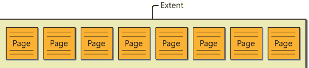

图 2-2 区的示意。

SQL Server 支持两种类型的区，称为混合区（mixed）和统一区（uniform）。对于新对象（表或索引），SQL Server 会从混合区中一次分配一个页，直到它们的大小达到 8 个页。同一个区的不同页可以属于不同的对象。SQL Server 使用称为全局分配映射（SGAMs）的位图页来跟踪哪些区是混合的且有可分配的页。一旦对象的大小达到 8 页，SQL Server 未来对该对象的所有页分配都将从统一区进行。统一区完全由同一个对象所有。SQL Server 使用称为全局分配映射（GAMs）的位图页来跟踪哪些区用于分配。

## 表结构

表可以以两种方式之一组织——作为堆（heap）或 B 树。从技术上讲，当表定义了聚集索引时，它被组织为 B 树；如果没有，则组织为堆。你可以直接使用 `CREATE CLUSTERED INDEX` 命令创建聚集索引，或者从 SQL Server 2014 开始，使用内联索引定义 `INDEX <index_name> CLUSTERED`。你也可以通过主键或唯一约束定义间接创建聚集索引。当你向表添加主键约束时，SQL Server 将使用聚集索引来强制执行，除非你显式指定了 `NONCLUSTERED` 或表上已存在聚集索引。当你为表指定唯一约束时，SQL Server 将使用非聚集索引来强制执行，除非使用了 `CLUSTERED` 关键字。无论哪种方式，如所述，有了聚集索引，表被组织为 B 树；没有聚集索引时，它被组织为堆。因为表必须以这两种方式之一（堆或 B 树）组织，因此表结构被称为 HOBT。

在 SQL 中，看到表作为 B 树要常见得多。主要原因可能是当你定义主键约束时，SQL Server 默认用聚集索引强制执行它。因此，在人们在创建表时没有考虑物理组织并使用默认值定义主键的情况下，他们最终得到了 B 树。结果是 SQL Server 中关于 B 树的经验远比堆要多。此外，聚集索引在插入模式和读取模式上都具有某种程度的控制力。由于这些原因，在所有条件相等的情况下，我通常倾向于默认使用 B 树组织。

在某些情况下，堆可以给你带来益处。例如，在第 6 章“数据修改”中，我描述了批量导入工具以及为了最小日志（minimal logging）处理导入所需的条件。如果表是 B 树，那么在你开始想要获得最小日志的导入时，它必须是空的。如果是堆，即使它已经包含数据，你也可以获得最小日志。因此，当目标表包含某些数据而你又要添加大量数据时，通过先删除索引、导入到堆中然后重建索引，你可以获得更好的性能。在这个示例中，你将堆用作临时状态。

无论表如何组织，它都可以定义零个或多个非聚集索引。非聚集索引始终组织为 B 树。HOBT 以及每个非聚集索引可以是一个或多个称为分区（partitions）的单元之一。从技术上讲，HOBT 和每个非聚集索引可以以不同的方式分区。每个索引数据分区存储在称为分配单元（allocation units）的页集合中。三种分配单元被称为 `IN_DATA`、`ROW_OVERFLOW_DATA` 和 `L_DATA`。

`ROW_DATA` 保存固定长度列；只要行大小不超过 8,060 字节的限制，它也保存变长度列。`ROW_OVERFLOW_DATA` 保存超过 800 字节的 VARCHAR、NVARCHAR、VARBINARY、VARIANT 或 CLR 用户定义类型，但由于超过了 8,060 字节的大小限制而从原始行中移动。`L_DATA` 保存超过 8,000 字节的大对象值——VARCHAR(MAX)、NVARCHAR(MAX)、VARBINARY(MAX)、XML 或 CLR 类型（UTs）。系统视图 `sys_internal_allocation_units` 持有存储在分配单元中的页集合的锚点。

在接下来的章节中，我将描述堆、聚集索引和非聚集索引。为了简单起见，我假设数据未分区，但如果它是分区的，该描述仍然适用于单个分区。

## 堆

堆是一个没有聚集索引的表。这种结构被称为堆，是因为数据不是以任何顺序组织的；而是作为一组页和区排列的。示例数据库 `PerformanceV3` 中的 `Orders`（详细信息请参见本书引言有关如何安装示例数据库的部分）实际上被组织为 B 树，但图 2-3 展示了它被组织为堆时可能的样子。

SQL Server 将属于一个或多个称为索引分配映射（IAMs）的位图页映射数据。IAM 页头有指向页集合的指针。

如图 2-3 所示，SQL Server 维护指向 IAM 页和堆第一个数据的内部指针。这些指针可以在系统视图 `sys.system_internals_allocation_units` 中找到。

我之前没有解释清楚什么是“页拆分”（因为页拆分只会发生在 B 树上），但现在只需说明堆（heaps）不会产生页拆分即可。

## B-树（聚集索引）

SQL Server 中所有基于磁盘的树的索引都结构为 B 树，这是平衡树的一种特例。平衡树是指没有任何叶子节点到根节点的距离比其他节点远得多的树。

聚集索引的结构为 B 树，它在叶子节点级维护了整个表的数据。聚集索引并不是数据的副本；它本身就是数据。图 2-4 展示了当定义了 `order` 列时，`Orders` 表组织成 B 树时可能的样子。

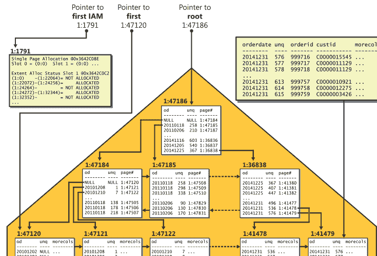

如图 2 所示，`Orders` 表的完整行存储在索引的叶子节点级。数据行按照顺序（在本例中为 `orderdate`）在叶子键中组织。页上的行偏移数组维护了页内部的顺序，当 SQL Server 需要在索引叶子节点级执行有序扫描（范围扫描）操作时，它通过遵循该列表来实现。我将这种扫描称为索引顺序（index order）。

注意图 2-4，对于每个叶子行，索引维护了一个名为 `unifier`（在图中简写为 `uniq`）的列。该列的值列出了具有相同键值的行，它与键值一起使用，当索引列不唯一时用于唯一标识行。我将在稍后讨论非索引时详细阐述 `unifier` 的作用。

当优化器对查询进行优化时，它需要选择算法来处理连接、分组和聚合、去重、窗口函数和显示顺序等操作。某些操作可以仅使用基于顺序的算法处理，例如显示顺序（查询中的 `ORDER BY` 子句）。某些操作可以使用一种以上的算法处理，包括基于顺序的或基于哈希的算法。连接可以使用基于顺序的算法、基于哈希的算法或基于循环的算法。要使用基于顺序的算法，数据需要排列为有序状态。优化器获取数据的一种方法是在计划中添加一个显式排序操作。然而，显式排序操作需要内存授予（memory grant），且扩展性较差（N 级扩展）。

获取数据的另一种方法是执行索引顺序扫描（假设索引存在）。此选项通常比其他方案更高效。当索引不存在时，优化器就只剩下剩余选项。对于只能用基于顺序的算法处理的操作（如分组和聚合），对于可以使用多种算法处理的操作，优化器将根据成本估算做出选择。由于排序的扩展性不好，优化器倾向于为行数较小时选择排序策略。哈希算法的扩展性通常优于排序，因此优化器倾向于在行数运行时使用哈希。

关于索引文件级的数据，文件中页的顺序可能与索引顺序不匹配。如果页 `x` 指向页 `y`，而 `y` 在文件中出现在 `x` 之前，则 `y` 被视为无序页。逻辑扫描碎片（也称为百分比碎片）通过无序页的百分比来衡量。如果索引文件级有 2500 页，其中 5000 页是无序的，那么你就有 20% 的逻辑扫描碎片。逻辑碎片的主要原因是每个索引的页数，当数据未缓存时，索引顺序操作就会变慢。当数据已缓存时，这种碎片对任何索引顺序扫描的影响都很小。

有趣的是，除了链表外，SQL Server 还维护 IAM 页来映射存储在文件顺序的数据，就像处理堆重组那样。我之前将对 IAM 页的数据扫描称为分配顺序扫描（allocation order scan）。当 SQL Server 需要对索引的叶子节点级执行无序扫描时，可能会使用这种扫描。由于分配顺序扫描按照文件顺序读取数据，其性能不受逻辑碎片的影响，与索引顺序扫描不同。因此，分配顺序扫描通常比索引顺序扫描更高效，特别是在数据未缓存且逻辑碎片程度很高时。

如所述，逻辑碎片的主要原因是页拆分。当需要将某行插入到页中而目标页没有空间容纳该行时，就会发生页拆分。记住索引按键的顺序维护数据。行必须根据其键值进入特定的页。如果目标页满了，SQL Server 将拆分该页。SQL Server 支持两种拆分：一种用于递增键模式，另一种用于非递增键模式。

如果新键大于或等于最大键，SQL Server 假设插入模式是递增键模式。它分配一个新页并将新行插入到该页。当单个会话添加行且磁盘子系统驱动器较少时，递增模式通常是高效。当多个会话添加新行且你的磁盘子系统有很多驱动器时，递增键模式效率低下。在这种模式下，最右侧索引页存在持续的页锁（page-latch contention），插入性能往往并非最优。在这种情况下，新键分布随机的索引往往会高效得多。

如果新键小于最大键，SQL Server 假设插入模式是非递增键模式。它分配一个新页，将原始页的一半行移动到新页中，并调整链表以反映页的逻辑顺序。它根据键值将新行插入到原始页或新页。新页并不保证在旧页之后——它可能在文件的后部，也可能在前部。页拆分是非常昂贵的，它们往往会导致逻辑碎片。你可以通过查询 `sys.db_index_stats` 函数的 `avg_fragmentation_in_percent` 属性来衡量索引的碎片程度。要消除碎片，请使用 `ALTER INDEX REBUILD` 命令重建索引。你可以指定名为 `FILLFACTOR` 的选项，其值为你想要填充叶子节点页的值；例如，使用 `FILLFACTOR = 70` 在叶子页中留出一些空间，以根据添加速率和重建频率减少拆分的发生。对于具有递增键模式的索引，在叶子页中留出空间没有意义，因为所有新行最终都会进入索引的右边缘。

在索引叶子节点级之上，索引维护了额外的级，每层都总结其下方级。非叶子索引中的每行都指向下方的一个页。

- 非叶节点页可以容纳的行数（称为 `rows_per_nonleaf_page`）。计算此数值的公式与计算 `rows_per_leaf_page` 类似。它是 `FLOOR(page–header_size) / non_leaf_row_size`，在这种情况下，我们等于 `FLOOR(8192 – 96) / 20 = 404`。
- 叶子节点之层数（称为 `L-1`）。该值通过以下公式计算：`CEILING(LOG(num_leaf_pages, rows_per_nonleaf_page))`。在我们案例中，L–1 等于 `CEILING(LOG(25000, 40)) = 2`。
- 索引深度（称为 `L`）。要获取 `L`，需要在上一步计算的 `L–1` 上加 1。计算 `L` 的完整公式为 `CEILING(LOG(num_leaf_pages, rows_per_nonleaf_page)) + 1`。在我们案例中，于 3。
- 具有 `L` 层的索引可以表示的行数（称为 `N`）。假设你使用 `L` 的反函数。即一个 `L` 层的索引可以表示多少行。你像以前一样计算 `rows_per_nonleaf_page` 和 `rows_per_leaf_page`。然后使用公式计算 `N`：`POWER(rows_per_nonleaf_page, L–1) * rows_per_leaf_page`。对于 `L=3`，`rows_per_nonleaf_page = 404`，且 `rows_per_leaf_page = 20`，你得到 6,528,540 行。

你可以尝试调整 `L` 和 `N` 的公式，并发现当行数多达 16,000 行时，我们的索引将有两个层。三层可以支持高达 6,500,000 行，四层可以支持约 2,600,000,000 行。对于非聚集索引，公式是相同的——只是正如我稍后描述的那样，每个叶子页中可以容纳许多行。因此，对于非聚集索引，每个层级的上限覆盖了表中更多的行。我们的表有 1,000,000 行，我们表上所有当前索引都有三层。因此，我们表上任何索引的寻址（seek）操作的代价是三次读取。请在本章后续关于性能的讨论中记住这一点。你可以从这个讨论中理解，索引的层数取决于行的大小和键的大小。除非我们讨论的是极端尺寸，否则粗略估计，小表（最多几十行）你可能会得到两层，中等表（多达百万行）得到三层，大表（多达十亿行）得到四层。

## 堆（Heap）上的非聚集索引

非聚集索引也结构为 B 树，在许多方面与索引相似。主要区别在于，非聚集索引中的行仅包含键列和一个表示特定行的行定位器值（row locator value）。行定位器的内容取决于底层表是组织为堆（heap）还是树结构。本节描述堆上的非聚集索引，下一节将描述 B 树（聚集表）上的非聚集索引。

图 2-5 展示了 SQL Server 创建的执行我们的主键约束（PK_Orders）的索引，以 `order` 列作为键列。SQL Server 分配了与约束同名的索引，PK_Orders。

| 指向第一个 IAM 的指针 | 122612 |
| 指向第一个的指针 | 122632 |
| 指向根的指针 | 122698 |

| orderid | page# |
|---|---|
| NULL | 122697 |
| 670517 | 122699 |

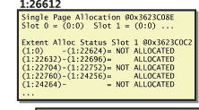

| orderid | RID |
|---|---|
| 999846 | 124586:16 |
| 999847 | 124587:1 |
| 999848 | 124695:12 |
| 999998 | 147155:13 |
| 999999 | 144602:5 |
| 100000 | 125185:9 |

| orderid | page# |
|---|---|
| 315729 | 122697 |
| 670517 | 122699 |
| 669898 | 12269 |

| orderid | page# |
|---|---|
| 315729 | 122697 |
| 670517 | 122699 |
| 669898 | 12269 |

| orderid | page# |
|---|---|
| 315729 | 122697 |
| 670517 | 122699 |
| 669898 | 12269 |

| orderid | page# |
|---|---|
| 315729 | 122697 |
| 670517 | 122699 |
| 669898 | 12269 |

| orderid | page# |
|---|---|
| 670512 | 122694 |
| 671056 | 123941 |
| 674758 | 123411 |
| 998768 | 124557 |
| 999846 | 124559 |

| orderid | page# |
|---|---|
| 315729 | 122697 |
| 670517 | 122699 |
| 669898 | 12269 |

| orderid | page# |
|---|---|
| 315729 | 122697 |
| 670517 | 122699 |
| 669898 | 12269 |

| orderid | page# |
|---|---|
| 315729 | 122697 |
| 670517 | 122699 |
| 669898 | 12269 |

| orderid | page# |
|---|---|
| 315729 | 122697 |
| 670517 | 122699 |
| 669898 | 12269 |

| orderid | page# |
|---|---|
| 315729 | 122697 |
| 670517 | 122699 |
| 669898 | 12269 |

| orderid | page# |
|---|---|
| 670512 | 122694 |
| 671056 | 123941 |
| 674758 | 123411 |
| 998768 | 124557 |
| 999846 | 124559 |

| orderid | page# |
|---|---|
| 315729 | 122697 |
| 670517 | 122699 |
| 669898 | 12269 |

| orderid | page# |
|---|---|
| 315729 | 122697 |
| 670517 | 122699 |
| 669898 | 12269 |

| orderid | page# |
|---|---|
| 315729 | 122697 |
| 670517 | 122699 |
| 669898 | 12269 |

| orderid | page# |
|---|---|
| 315729 | 122697 |
| 670517 | 122699 |
| 669898 | 12269 |

| orderid | page# |
|---|---|
| 315729 | 122697 |
| 670517 | 122699 |
| 669898 | 12269 |

| orderid | page# |
|---|---|
| 670512 | 122694 |
| 671056 | 123941 |
| 674758 | 123411 |
| 998768 | 124557 |
| 999846 | 124559 |

| orderid | page# |
|---|---|
| 315729 | 122697 |
| 670517 | 122699 |
| 669898 | 12269 |

| orderid | page# |
|---|---|
| 315729 | 122697 |
| 670517 | 122699 |
| 669898 | 12269 |

| orderid | page# |
|---|---|
| 315729 | 122697 |
| 670517 | 122699 |
| 669898 | 12269 |

| orderid | page# |
|---|---|
| 315729 | 122697 |
| 670517 | 122699 |
| 669898 | 12269 |

| orderid | page# |
|---|---|
| 1 | 111937:24 |
| 54 | 143111:5 |
| 3 | 168632:2 |
| 17 | 124469:12 |
| 158 | 102841:23 |
| 539 | 171426:55 |
| 540 | 138501:1 |
| 541 | 143111:10 |
| 542 | 122519:25 |

| orderid | page# |
|---|---|
| 1 | 10904:96 |
| 107 | 122611:11 |
| 118 | 122619:19 |
| 170 | 1086:36 |
| 168 | 141485:1 |
| 182 | 14811:12 |

| orderid | page# |
|---|---|
| 99907 | 126079:13 |
| 99908 | 125667:11 |
| 99909 | 155167:13 |
| 99948 | 107990:10 |
| 99941 | 127724:14 |

| orderid | RID |
|---|---|
| 999846 | 124586:16 |
| 999847 | 124587:1 |
| 999848 | 124695:12 |
| 999998 | 147155:13 |
| 999999 | 144602:5 |
| 100000 | 125185:9 |

FIGURE-5 堆上的非聚集索引。非聚集索引用于指向数据的定位器是一个 8 字节的指针，我们简称为行标识符（或 RID）。它由数据库中的文件号、文件中的目标页码以及目标页中的条目数组成。根据非聚集索引键查找数据时，SQL Server 在索引中执行寻址（seek）操作以找到该键的行。SQL Server 执行 RID 查找（RID lookup），这翻译为读取包含数据行的页，然后从该页中提取行。RID 查找的代价是一个页。如果查找键的范围，SQL Server 将索引叶子节点上执行范围扫描，然后对匹配的键进行 RID 查找。对于单次查找或少数查找，代价并不高，但对于大量的查找，代价可能会非常高，因为 SQL Server 为每个被查找的行读取一个页。对于使用非聚集索引和一系列查找（每个符合条件的键一次）的范围查询，查找操作的累积代价通常占查询代价的大部分。访问方法。对于寻址操作的代价，请记住聚集索引提供的公式也适用于非聚集索引。只是 `leaf_row_size` 更小，因此 `rows_per_leaf_page` 会更高。但公式是相同的。

## B 树上的非聚集索引

在 B 树（聚集表）上创建的非聚集索引架构与堆不同。区别在于， B 树上创建的非聚集索引中的行定位器是一个名为聚集键（clustering key）的值，它像 RID 一工作。聚集键由指向行的聚集索引键值和标识符（如果存在）组成。其理念是在逻辑上像物理上一样指向行。这种架构是为 OLTP 系统设计的，聚集索引在数据插入和删除后往往会导致页拆。如果非聚集索引使用 RID 作为行定位器，所有指向移动数据行的指针都将更改以反映它们的新 RID。想象一下这在表上定义多个非聚集索引时会产生什么样的性能影响。相反，SQL Server 维护逻辑指针，当数据在聚集索引的叶子页之间移动时，这些指针不会改变。

图 2-6 展示了 PK_Orders 非聚集索引可能的样子；该索引定义时以 `order` 为键列。


FIGURE-6 B 树上的非聚集索引。

为查询而创建。当我需要衡量单个查询或少量查询的性能时，我会使用会话选项（session options）。当我需要衡量大量查询的性能时，我会使用扩展事件（Extended Events）会话。

关于执行计划，你可以在 SQL Server Management Studio (SSMS) 中通过突出查询并点击 SQL 编辑器工具栏上的“显示估计执行计划”（Ctrl+L）按钮查看估计计划。你可以通过启用“包含实际执行计划”（Ctrl+M）并执行查询来查看实际计划。我通常更倾向于分析实际计划，因为它包含了运行时信息，例如每个操作符返回的实际行数、实际执行次数等。由于优化器所做出的次优选择通常是由于基数估算不准确导致的，这些问题可以通过比较执行计划中的估计值和实际值来检测。

使用以下代码，结合会话选项 `STATISTICS IO`（I/O 信息）和 `STATISTICS TIME`（时间信息）启用查询性能测量：

```
```


SET STATISTICS IO, TIME ON;

运行查询时，SSMS 会在“消息”窗格中报告性能信息。
要使用扩展事件衡量从 SSMS 提交的即时查询的性能，请捕获 `sql_statement_completed` 事件，并过滤你提交查询的 SSMS 会话 ID。使用以下代码在替换会话 ID 为你的 SSMS 会话 ID 后创建并启动此类扩展事件会话：

```sql
CREATE EVENT SESSION query_performance ON SERVER
ADD EVENT sqlserver.sql_statement_completed(
    ACTION(sqlserver.session_id)
    WHERE ([sqlserver.session_id] = <your_session_id>)
);
```

```sql
ALTER EVENT SESSION query_performance ON SERVER STATE = START;
```

要查看该事件，转到对象管理器中的 `管理\扩展事件\会话`。展开“会话”文件夹，右键点击 `query_performance` 会话，并选择“查看实时数据”。

要显示差异测量工具的输出，请在清除数据缓存后运行示例查询。其实际查询计划如图 2-7 所示。

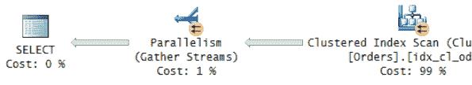

示例查询的执行计划。

计划是并行的。如果一个操作符带有一个带有箭头的黄色圆圈，你就可以判断它使用了并行处理。该计划执行了并行聚集索引扫描，同时也应用了过滤器，然后收集由不同线程返回的行。这里一个值得注意的点是，计划中的数据流如箭头所示从左到右；然而，计划的内部执行从最左侧节点开始，该节点被称为根节点。该节点执行其右侧的节点以请求行，反之亦然，继续执行右侧节点。

以下是该查询通过 `STATISTICS IO` 选项生成的输出：

Table 'Orders'. Scan count 9, logical reads 2539, physical reads 1, read-ahead reads 25138, lob logical reads 0, lob physical reads 0, lob read-ahead reads 0.

`Scan count`（扫描计数）衡量的是在查询处理期间该对象被访问的次数。我认为这个名字有点误导性，因为对对象的任何访问情况都会增加计数，而不一定是扫描。使用像 `Access count`（访问计数）这样的名称会更合适。在我们的案例中，扫描计数为 9，是因为在并行扫描中有 8 个线程访问了该对象，外加一个单独线程访问了计划中的串行部分。

`logical reads`（在本例中为 2539）表示从数据缓存中读取了多少页。如果一个页面从缓存中被读取两次，它会被计算两次。遗憾的是，`STATISTICS IO` 并没有指示读取了多少不同的页面。`physical reads`（物理读取，在本例中为 1）和 `read-ahead reads`（预读，在本例中为 25138）衡量了有多少页直接从磁盘物理读取到数据缓存中。你可以想象，物理读取的成本比逻辑读取高得多。物理读取代表了一种常规读取机制。该机制使用单页的同步读取。我所说的同步，是指查询处理将持续进行直到读取完成。`read-ahead reads` 代表了一种特殊的读取机制，它会预判查询所需的数据。这种机制被称为预读或预取。SQL Server 通常在涉及足够大的扫描时使用此机制。该机制应用异步读取，并可能读取大于单页的数据块，每次读取最高可 512 KB。为了帮助故障排除，可以使用跟踪标记 652 禁用预读（使用 `DBCC TRACEON(652)` 开启，使用 `DBCC TRACEOFF(652)` 关闭）。要找到参与查询处理的物理读取总数，请将物理读取和预读次数相加。在我们的案例中，总计为 25139。

`STATISTICS IO` 输出还显示了大型对象类型（LOB）的逻辑读取、物理读取和预读。在我们的案例中，不涉及大型对象类型；三个指标均为 0。

`STATISTICS TIME` 选项返回该查询的以下时间统计：

```text
SQL Server Execution Times:
CPU time = 170 ms, elapsed time = 765 ms.
```

注意，你将从中获得多个输出。除了获取查询执行的输出外，你还会获得查询解析和编译的输出。对于你在 SSMS 中启用的任何从后端提交到 SQL Server 的元素，你也会获得输出，例如启用的图形化执行计划。紧接在 `STATISTICS IO` 行之后出现的行代表了查询执行。为了针对冷缓存处理我们的查询，SQL Server 使用了 170 ms 的 CPU 时间，查询花费了 765 ms 的墙钟时间完成。

图 2-8 显示了扩展事件会话 `query_performance` 的查看数据窗口，其中突出显示了针对冷缓存的示例查询的执行。

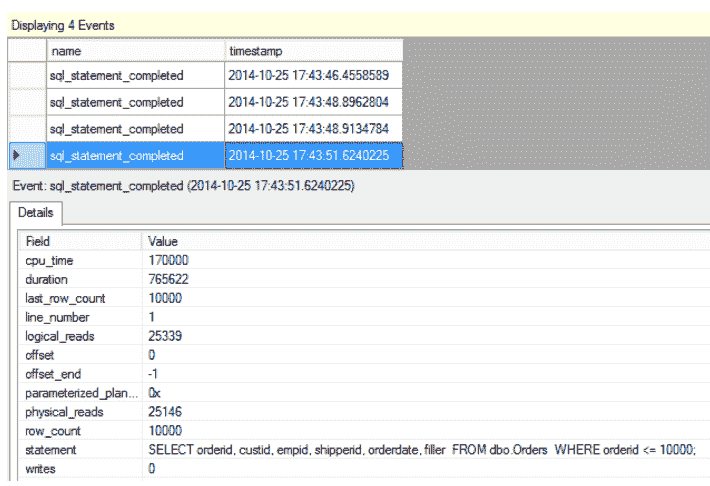

图 2-8 来自扩展事件会话的信息。

现在缓存变热了，再次运行查询。我从 `STATISTICS IO` 得到了以下输出：

Table 'Orders'. Scan count 9, logical reads 25339, physical reads 0, read-ahead reads 0, lob logical reads 0, lob physical reads 0, lob read-ahead reads 0.

注意，代表物理读取的指标为 0。我从 `STATISTICS TIME` 得到了以下输出：

```text
CPU time = 265 ms, elapsed time = 299 ms.
```

自然，有了热缓存，查询完成得更快。

## 访问方法

本节提供了 SQL Server 用于访问数据的各种描述；它旨在作为书中分析执行计划时的参考。当我想显示针对 B 树组织的表的访问方法时，我会查询 `Orders`。当我想显示针对堆组织的表的访问方法时，我会查询 `Orders2`。使用以下代码创建一个名为 `Orders2` 的表，作为一个堆：

```sql
IF OBJECT_ID('dbo.Orders2', 'U') IS NOT NULL DROP TABLE dbo.Orders2;

SELECT * INTO dbo.Orders2 FROM dbo.Orders;

ALTER TABLE dbo.Orders2 ADD CONSTRAINT PK_Orders2 PRIMARY KEY NONCLUSTERED (orderid);
```

> 我使用随机生成了示例数据。这意味着当你查询数据库中的对象时，结果可能与我的不同。

### 表扫描/无序索引扫描

我将描述的第一种方法是在不需要按特定顺序返回数据的情况下对表进行全扫描。你在两种情况下获得全扫描：一种你确实需要表中的所有行；另一种你需要部分行，但没有一个良好的索引来支持你的过滤器。复杂的是，全扫描的执行计划取决于底层表的组织（堆或 B 树）。当底层表是堆时，计划将显示一个名为 `Table Scan` 的操作。当底层表是 B 树（聚集索引）时，计划将显示一个名为 `Clustered Index Scan` 的操作，且 `Ordered` 属性为 `False`。我们将前者称为表扫描，将后者称为无序聚集索引扫描。

表扫描或无序索引扫描涉及对该表的所有数据页进行扫描。以下针对堆结构的 `Orders2` 表的查询将需要扫描：

```sql
SELECT orderid, custid, empid, shipperid, orderdate, filler
FROM dbo.Orders2;
```

图 2-9 显示了关系引擎优化器为该查询生成的图形化执行计划，图 2-10 显示了存储引擎处理这种访问方式的插图。

**图 2-9** 堆扫描（执行计划）。

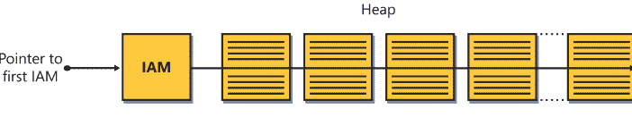

**图 2-10** 堆扫描（存储引擎）。

SQL Server 报告在我们的系统上对该查询执行了 24,396 次逻辑读取。

如果你发现物理操作和逻辑操作属性都显示为“表格扫描”让你有点困惑，你并不孤单。对我来说，逻辑操作是表格扫描，而物理操作是堆扫描。

存储引擎处理表格扫描算子的唯一选项就是使用分配顺序扫描。回想一下“表组织”章节，分配顺序扫描是按照文件顺序对 IAM 页执行的。

针对结构为 B 树的 `Orders` 表执行以下查询，将需要一个无序聚集扫描：

```sql
SELECT orderid, custid, empid, shipperid, orderdate, filler
FROM dbo.Orders;
```

图 2-11 显示了优化器为该查询生成的执行计划。注意，聚集索引扫描算子的 `Ordered` 属性显示为 `False`。图 2-12 展示了存储引擎执行此方法的两种方式。

**图 2-11** B 树扫描（执行计划）。

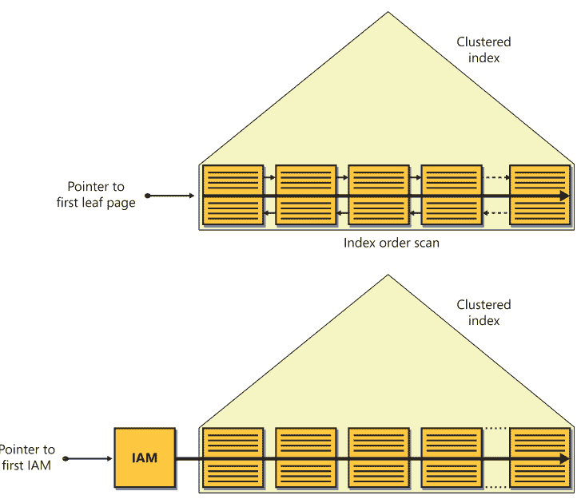

**图 2-12** B 树扫描（存储引擎）。

SQL Server 报告在我的系统上对该查询执行了 25,073 次逻辑读取。

同样，在这里发现计划在物理操作和逻辑操作属性中显示相同的值也让我困惑。这一次，两个属性都显示为聚集索引扫描。对我来说，逻辑操作仍然是表格扫描，而物理操作是聚集索引扫描。

聚集索引扫描算子的 `Ordered` 属性显示为 `False`，这说明从关系顺序的角度来看，数据不需要按键顺序从算子返回。这并不意味着按顺序返回就是问题；相反，它意味着任何顺序都可以。这为存储引擎留出了一些操作空间，意味着它可以自由地在两种扫描类型之间进行选择：索引顺序扫描（遵循链表进行索引扫描）和分配顺序扫描（基于 IAM 页的扫描）。存储引擎在选择采用哪种扫描类型时考虑的因素包括性能和数据一致性。在描述了有序索引扫描（`Ordered` 属性为 `True` 的聚集索引扫描和索引扫描算子）之后，我将提供更多关于存储引擎决策过程的详细信息。

### 无序覆盖非聚集索引扫描

无序覆盖非聚集索引扫描与无序索引扫描类似。覆盖索引的概念意味着它包含查询中指定的所有列。换句话说，覆盖索引并不是具有特殊属性的索引；但对于特定的查询，它可以成为覆盖索引。SQL Server 可以通过访问索引数据来满足查询所需的所有数据，而无需访问完整的数据行。除此之外，其访问方法与无序聚集索引扫描相同，只是覆盖非聚集索引的叶级别包含的页比聚集索引的叶级少，因为行的大小更小，每页可以容纳更多行。我之前解释过如何计算索引（聚集或非聚集）叶级别中的页数。

作为这种访问方法的示例，以下查询请求 `Orders` 表中所有的 `orderid` 值：

```sql
SELECT orderid
FROM dbo.Orders;
```

我们的表在 `orderid` 列上有一个非聚集索引 (`PK_Orders`)，这意味着表中所有的订单 ID 都位于索引的叶级别。该索引覆盖了我们的查询。图 2-13 显示了你为该查询获取的图形执行计划，图 2-14 说明了存储引擎处理它的两种方式。

**图 2-13** 无序覆盖非聚集索引扫描（执行计划）。

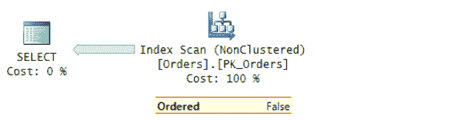

**图 2-14** 无序覆盖非聚集索引扫描（存储引擎）。

SQL Server 报告在我的系统上对该查询执行了 2,611 次逻辑读取。这是构成 `PK_Orders` 索引级别的页数。

给你留一个小谜题，在查询中添加 `orderdate` 列，如下：

```sql
SELECT orderid, orderdate
FROM dbo.Orders;
```

检查图 2-15 所示的该查询的执行计划。

**图 2-15** 包含聚集键的索引。

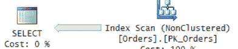

观察发现，对于该查询，`PK_Orders` 索引仍然被视为覆盖索引。问题是，当索引显式定义在 `orderid` 列上作为键时，为什么会这样？答案是表有一个按 `orderdate` 列定义的聚集索引。正如你可能记得的，SQL Server 在非聚集索引中使用聚集索引作为行定位器。因此，尽管你显式地在 `orderid` 列上定义了 `PK_Orders`，SQL Server 在内部将其包含了 `orderid` 和 `orderdate` 列。无论 SQL Server 是否添加 `orderdate` 列作为行定位器——一旦在那里，它就可以用于查询处理。

### 有序聚集索引扫描

聚集索引扫描是对聚集索引叶级的完全扫描，保证数据按顺序返回给下一个算子。例如，以下按 `orderdate` 排序的查询将得到这种方法：

```sql
SELECT orderid, custid, empid, shipperid, orderdate, filler
FROM dbo.Orders
ORDER BY orderdate;
```

图 2-16 显示了优化器为该查询生成的执行计划。注意，聚集索引扫描算子的 `Ordered` 属性显示为 `True`。

**图 2-16** 有序聚集索引扫描（执行计划）。


存储引擎必须使用索引顺序扫描（遵循链表）来满足有序要求，而不能使用分配顺序扫描。这保证了数据按聚集索引键的顺序返回。


检查图 2-15 所示的该查询的执行计划。


图 2-15 包含聚集键的索引。

观察发现，对于该查询，`PK_Orders` 索引仍然被视为覆盖索引。问题是，当索引显式定义在 `orderid` 列上作为键时，为什么会这样？答案是表有一个按 `orderdate` 列定义的聚集索引。正如你可能记得的，SQL Server 在非聚集索引中使用聚集索引作为行定位器。因此，尽管你显式地在 `orderid` 列上定义了 `PK_Orders`，SQL Server 在内部将其包含了 `orderid` 和 `orderdate` 列。无论 SQL Server 是否添加 `orderdate` 列作为行定位器——一旦在那里，它就可以用于查询处理。

# 有序聚集索引扫描 (Ordered clustered index scan)

聚集索引扫描是对聚集索引叶级的完全扫描，保证数据按顺序返回给下一个算子。例如，以下按 `orderdate` 排序的查询将得到这种方法：

```sql
SELECT orderid, custid, empid, shipperid, orderdate, filler
FROM dbo.Orders
ORDER BY orderdate;
```

图 2-11 显示了优化器为该查询生成的执行计划。注意，聚集索引扫描算子的 `Ordered` 属性显示为 `False`。图 2-12 展示了存储引擎执行此方法的两种方式。

图 2-11 B 树扫描（执行计划）。


**图 2-12** B 树扫描（存储引擎）。

SQL Server 报告在我的系统上对该查询执行了 25,073 次逻辑读取。

同样，在这里发现计划在物理操作和逻辑操作属性中显示相同的值也让我困惑。这一次，两个属性都显示为聚集索引扫描。对我来说，逻辑操作仍然是表格扫描，而物理操作是聚集索引扫描。

聚集索引扫描算子的 `Ordered` 属性显示为 `False`，这说明从关系顺序的角度来看，数据不需要按键从算子返回。这并不意味着按顺序返回就是问题；相反，它意味着任何顺序都可以。这为存储引擎留出了一些操作空间，意味着它可以自由地在两种扫描类型之间进行选择：索引顺序扫描（遵循链表进行索引扫描）和分配顺序扫描（基于 IAM 页的扫描）。存储引擎在选择采用哪种扫描类型时考虑的因素包括性能和数据一致性。

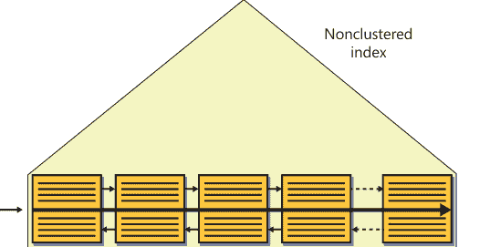

图 2-19 有序覆盖非聚集索引扫描（存储引擎）。

注意执行计划，索引扫描（Index Scan）算子的 `Ordered` 属性显示为 `True`。

有序索引扫描不仅用于你显式请求排序数据的情况，还用于计划使用了可以从排序输入数据中获益的算子的情况。这发生在处理 `GROUP BY`、`DISTINCT`、连接以及其他请求时。这种情况也可能发生在较不明显的情况下。例如，查看图 2-20 所示的以下查询的执行计划：

```sql
SELECT orderid, empid, orderdate
FROM dbo.Orders AS O01
WHERE orderid =
    (SELECT MAX(orderid)
     FROM dbo.Orders AS O02
     WHERE O02.orderid = O01.orderdate);
```

| 实际行数 | 1490 |
|---|---|
| SELECT 成本: % 0 | Top 成本: % 0 | Segment 成本: % 2 | 扫描（非聚集）[Orders].[idx_unc_od_od_1_cid_eid] [O01] 成本: % 98 |

图 2-20 带有分段的有序覆盖非聚集索引扫描。

`Segment` 算子将数据分组，并一次发送一个组到下一个算子（在本例中为 `Top`）。我们的查询请求每个 `orderdate` 具有最大 `orderid` 的订单。幸运的是，我们为该任务有一个覆盖索引（`idx_unc_od_od_cid_eid`），其键列 (`orderid`, `orderdate`) 和包含的非键列 (`custid`, `empid`)。我将在本章稍后详细介绍包含的非键列。我们讨论的关键点是，`Segment` 算子按 `order` 值的组对数据进行组织，并一次发送一组数据，其中每组的最后一行是组内最大的 `orderid`；因为 `orderid` 是紧随 `orderdate` 之后的第二列。因此，计划不需要对数据进行排序；而是通过对覆盖索引进行有序扫描来收集数据，该索引已经按照 `orderdate` 和 `orderid` 排序。`Top` 算子的任务很简单，即收集最后一行（`TOP 1 descending`），这正是该组所关注的行。`Top` 算子报告的行数为 1490，这是唯一组（`orderdate` 值）的数量，每个组都从算子获取了单行。

由于我们的非聚集索引通过在叶节点级包含查询中提到的所有其他列（`custid`, `empid`）来覆盖查询，因此不需要回表查找数据行；仅通过索引数据即可满足查询。

# 存储引擎对扫描的处理

在继续介绍其他访问方法之前，我将解释存储引擎如何处理关系引擎发出的执行扫描的指令。关系引擎类似于 SQL Server 的大脑；它包含了优化器，优化器负责为查询生成执行计划。存储引擎类似于 SQL Server 的肌肉；它需要执行关系引擎在执行计划中提供的指令，并执行实际的行操作。有时，优化器的指令会给存储引擎留出一些操作空间，此时存储引擎会根据性能和一致性等因素在多个可能的选项中决定最佳的一个。

## 分配顺序扫描与索引顺序扫描

当计划显示 `Table Scan` 算子时，存储引擎只有一个选项：使用分配顺序扫描（allocation order scan）。当计划显示具有 `Ordered: True` 属性的 `Index Scan` 算子（聚集或非聚集）时，存储引擎只能使用索引顺序扫描。

当计划显示 `Ordered: False` 的 `Index Scan` 算子时，关系引擎并不关心行的顺序。在这种情况下，有两种扫描数据的选项：分配顺序扫描和索引顺序扫描。使用哪种取决于存储引擎。遗憾的是，存储引擎的实际选择没有在执行计划（或任何地方）中标示出来。我将解释存储引擎的决策过程，但重要的是，要理解计划所显示的是关系引擎的指令，而不是存储引擎的实际操作。

分配顺序扫描的性能不受索引中逻辑顺序的影响，因为无论如何它都是文件顺序。然而，涉及物理读取的索引顺序扫描的性能会受到碎片的影响——碎片越高，扫描越慢。因此，从性能角度来看，存储引擎认为分配顺序扫描是优选方案。例外是索引非常小（最多 64 页）。在这种情况下，解释 IAM 页的成本相对于其他工作变得显著，存储引擎认为索引顺序扫描更优。除小表外，执行分配顺序扫描被认为是更优的。

然而，性能并不是存储引擎需要考虑的唯一因素；它还需要根据有效的隔离级别考虑对数据一致性的预期。当有多个选项可以执行某个请求时，存储引擎会选择满足一致性要求的最快选项。

在某些情况下，扫描可能会导致行的多次出现，甚至跳过行。分配顺序扫描比索引顺序扫描更容易发生这种行为。我将描述这种现象如何在分配顺序扫描中发生以及在什么情况下发生。我将解释它在索引顺序扫描中是如何发生的。

### 分配顺序扫描

图 2-21 通过三个步骤演示了分配顺序扫描如何返回行的多次出现。

分配顺序扫描：获取多次出现的行。

分配顺序扫描，第一步：

输出：

分配顺序扫描，第二步：

输出：

分配顺序扫描，第三步：

输出：

图 2-21 分配顺序扫描：获取多次出现的行。

在类别方面，存储引擎也选择了分配顺序扫描（allocation order scans），其隔离级别比“未提交读取”（Read Uncommitted）高，且这种扫描在不牺牲读取一致性的情况下（至少在页拆分方面）是安全的。例如，当你通过 `TABLOCK` 运行查询时，存储引擎知道在读取进行期间没有人可以更改数据。因此，使用分配顺序扫描是安全的。当然，这意味着在读取期间，其他会话的尝试将被阻塞。另一个存储引擎认为可以采用分配顺序扫描的例子是索引位于只读文件组或数据库中。总而言之，当索引大小大于 64 页且数据是只读的（由于只读文件组或数据库）时，存储引擎将使用安全类别的顺序扫描。

请记住，逻辑碎片会影响索引顺序扫描的性能，但不会影响分配顺序扫描的性能。根据上述信息，你应该意识到存储引擎利用索引顺序扫描（index order scans）来处理具有 `Ordered: False` 属性的索引扫描（Index Scan）。

下一节将演示不安全和安全的分配顺序扫描。

运行以下代码来创建一个名为 T1 的表：

```sql
SET NOCOUNT ON;
USE tempdb;
GO
-- Create table T1
IF OBJECT_ID(N'dbo.T1', N'U') IS NOT NULL DROP TABLE dbo.T1;
CREATE TABLE dbo.T1
(
    clcl UNIQUEIDENTIFIER NOT NULL DEFAULT(NEWID()),
    filler CHAR(2000) NOT NULL DEFAULT('a')
);
GO
CREATE UNIQUE CLUSTERED INDEX idx_clcl ON dbo.T1(clcl);
```

在 `clcl` 上创建了一个唯一索引，它将由默认表达式 `NEWID()` 填充随机 GUID。用随机 GUID 填充索引键会导致大量的拆分，这又会导致索引中产生高程度的逻辑碎片。

运行以下代码使用无限循环向表中插入行，并在几秒后停止它（假设 5 秒，以允许表包含超过 64 页的数据）：

```sql
SET NOCOUNT ON;
USE tempdb;
TRUNCATE TABLE dbo.T1;
WHILE 1 = 1
    INSERT INTO dbo.T1 DEFAULT VALUES;
```

运行以下代码检查索引的碎片程度：

```sql
SELECT avg_fragmentation_in_percent FROM sys.dm_db_index_physical_stats
(
    DB_ID(N'tempdb'),
    OBJECT_ID(N'dbo.T1'),
    1,
    NULL,
    NULL
);
```

当我在系统上运行此代码时，我得到了超过 99% 的碎片，这显然非常高。如果你需要更多证据来支持链表中页的顺序与其在文件中的顺序不同的事实，可以使用未记录的 `DBCC IND` 命令，它可以提供索引的 B 树布局：

```sql
DBCC IND(N'tempdb', N'dbo.T1', 0);
```

我准备了以下代码，以避免你通过浏览 `DBCC IND` 的输出来试图找出叶节点布局：

```sql
CREATE TABLE #DBCCIND(
    PageID INT,
    PageID INT,
    IAMID INT,
    ObjectID INT,
    IndexID INT,
    Partition BIGINT,
    PartitionID BIGINT,
    iamType VARCHAR(100),
    PageType INT,
    IndexLevel INT,
    NextPageID INT,
    NextPageID INT,
    PrevPageID INT
);
INSERT INTO #DBCCIND
EXEC DBCC IND(N'tempdb', N'dbo.T1', 0);
CREATE CLUSTERED INDEX idx_cl_prevpage ON #DBCCIND(PrevPageID, PageID);
WITH LinkedList AS
(
    SELECT CurLevel.RowNum + 1, CurLevel.PageID
    FROM #DBCCIND AS CurLevel
    JOIN #DBCCIND AS NextLevel ON CurLevel.PrevPageID = NextLevel.PageID
)
SELECT CAST(PageID AS VARCHAR(MAX)) + ' '
    + CAST(PageID AS VARCHAR(MAX)) + ' ' AS text
FROM LinkedList
FOR XML PATH('')), OPTION (MAXRECURSION 0);
DROP TABLE #DBCCIND;
```

代码将 `DBCC IND` 的输出存储在临时表中，然后使用递归查询从头部跟踪链表，最后使用 `FOR XML PATH` 技术将叶节点地址连接成字符串。我在我的系统上得到了以下输出：132098 111372 133098 125591 113756 111898... 在这里观察逻辑碎片很容易。例如，页 132098 指向文件中较早的页 111372。

接下来，运行以下代码查询 T1：

```sql
SELECT SUBSTRING(CAST(clcol AS BINARY(16)), 1, 6) AS segment1, *
FROM dbo.T1;
```

使用 `SUBSTRING` 函数提取最后的 6 个字节以查看行是否按索引返回。此查询的执行计划是一个聚集索引扫描（Clustered Index Scan），顺序为 False。然而，由于环境是只读的且隔离级别是默认，存储引擎使用了索引扫描。在这里是我系统上的输出：

| segment1 | clcol | filler |
|---|---|---|
| 0000ED8A0E6 | 5F75CA42-8786-4176-8BDC-00ED8A0E6 | |
| 000627711D | 7B3D64F2-9197-487E-A354-0026771FD | |
| 00EEAF4130 | 7D4A61D3-8BF3-4837-831C-00EE4130 | |
| 00093E50A08 | 2A70C2C3-5459-4056-90CE-0039E53008 | |
| 0004B9604D2 | 40C1BD2-B8C7-40D9-A5F4-004B960A4D2 | |
| 0005E9B1ED3 | 0EF78B3A-40F1-4097-B138-00E1A2C5D3 | |
| 000670D63977 | B4C951D3-01E7-4745-B573-00670D63977 | |
| 0007B8D21817 | 15F7F2E9-A27E-4795-850F-7B87BD1817 | |
| 0007BC02C1C | 93ED4A5C-3AAD-4686-B4A1-0007BC02C1C | |
| 0007E73BEBF8 | 732E07E2-A267-483A-B2CF-0007E73BF8 | |

再次带有 `NOLOCK` 提示查询表：

```sql
SELECT SUBSTRING(CAST(clcol AS BINARY(16)), 1, 6) AS segment1, *
FROM dbo.T1 WITH (NOLOCK);
```

这次，存储引擎采用了不安全的分配顺序。这是我从这段代码得到的输出：

| segment1 | clcol |
|---|---|
| 0x03D5CA4A3F8AE | 7E2A282E-8712-47F1-A553-03D5CA4F8AE |
| 0x42D6FD0DBD | 003FE4B-180E-4A8D-86E1-C260DB8D3 |
| 0x42D6A3FF2C | 9239BF31-9AA2-47F0-8B50-426DA3FF2C |
| 0x42AE5E69673AD | 2FA0A98B-247E-42C2-A22E-426ES973AD |
| 0x5EEBC295A844 | 374327C-07C2-48BC-A6B5-52EC295A844 |
| 0x97A52864AE1D | 131BDF97-B0F1-488-97A528641D |
| 0x78D967590DBC | 7AA0F5BF-08D1-46B9-78D967590BC |
| 0x78DA17132327 | 7AF0C88F-FC08-4534-842C-78DA1713227 |
| 0x78DACE8159E | 90EBE771-301F-4A6B-A39B-78DACE819E |
| 0x20C225A8A10D | 54B7D0D9-7804-4969-8A7F-20C225A810D |

注意这些行并不是按索引顺序返回的。如果在读取期间发生了拆分，这种读取可能会返回多次。作为分配顺序的一个例子，运行带有 `TABLOCK` 提示的查询：

```sql
SELECT SUBSTRING(CAST(clcol AS BINARY(16)), 1, 6) AS segment1, *
FROM dbo.T1 WITH (TABLOCK);
```


在这里，尽管查询运行在已提交读取隔离级别下，存储引擎知道使用分配顺序是安全的。这是我从该查询得到的输出：

| segment1 | clcol |
|---|---|
| 0x03D5CA4A3F8AE | 7E2A282E-8712-47F1-A553-03D5CA4F8AE |
| 0x42D6FD0DBD | 003FE4B-180E-4A8D-86E1-C260DB8D3 |
| 0x42D6A3FF2C | 9239BF31-9AA2-47F0-8B50-426DA3FF2C |
| 0x42AE5E69673AD | 2FA0A98B-247E-42C2-A22E-426ES973AD |
| 0x5EEBC295A844 | 374327C-07C2-48BC-A6B5-52EC295A844 |
| 0x97A52864AE1D | 131BDF97-B0F1-488-97A528641D |
| 0x78D967590DBC | 7AA0F5BF-08D1-46B9-78D967590BC |
| 0x78DA17132327 | 7AF0C88F-FC08-4534-842C-78DA1713227 |
| 0x78DACE8159E | 90EBE771-301F-4A6B-A39B-78DACE819E |
| 0x20C225A8A10D | 54B7D0D9-7804-4969-8A7F-20C225A810D |

几秒后，我在连接 2 中获取了以下输出，显示了读取次数超过指定的全部 GUIDs：

| clcol | cnt |
| :--- | :--- |
| F14491IF-448B-4AC7-9396-D2C60BB9E2E | 2 |
| 90B8292E-73D0-4AA1-BD59-F5FF8E9530 | 2 |
| 9A02C46B-389E-45A1-AC07-D08B415D43B | 2 |
| B5AFB81C-B285-492A-9E9A-DB566E4A5A98 | 2 |
| 132255C8-63F5-40D7-9126-D37C1F32168 | 2 |
| 69A7F5E6-7A4C-4E88-9A42-B568A270F5D1 | 2 |
| 7F3C57A1-41B3-44B8-0F9A00D5DC2 | 2 |
| B5C5C0D-B721-4225-B455-F56910ADC2 | 1 |
| 9E258DA-CB57-4CA0-A10D-F0BA3C06BA66 | 2 |
| F5AA680-E754-4813-B8A336952 | | |

此时，你可以重新运行连接 1 中的代码。

如果你愿意，可以在不带 `NOLOCK` 提示的情况下重新运行测试，你会发现连接 2 中的代码没有停止，因为没有找到重复的 GUID。

接下来，我将演示一个跳过行的不安全顺序扫描。运行以下代码创建表 T1 和 MySequence：

### 创建表 T1

```sql
SET NOCOUNT ON;

USE tempdb;

IF OBJECT_ID('dbo.T1', 'N'U) IS NOT NULL DROP TABLE dbo.T1;

CREATE TABLE dbo.T1 (
  clcol UNIQUEIDENTIFIER NOT NULL DEFAULT(NEWID()),
  seqval NOT NULL,
  filler CHAR(2000) NOT NULL DEFAULT('a')
);

CREATE UNIQUE CLUSTERED INDEX idx_clcol ON dbo.T1(clcol);
```

### 创建表 MySequence

```sql
IF OBJECT_ID('dbo.MySequence', 'N'U) IS NOT NULL DROP TABLE dbo.MySequence;

CREATE TABLE dbo.MySequence(seqval INT NOT NULL);

INSERT INTO dbo.MySequence(seqval) VALUES(0);
```

表 T1 与之前演示中使用的表相似，但它有一个额外的 `seqval` 列，该列将填充顺序整数。表 MySequence 存储最后一次的值（初始为 0），在每次插入 T1 之前加1。要证明扫描跳过了行，只需要证明扫描输出在 `seqval` 列的连续行之间存在间隙。我在测试中没有使用内置的序列对象，因为 SQL Server 无论使用何种缓存设置，都不保证序列值之间不会出现间隙。为了演示这种行为，打开两个连接（再次称它们为连接 1 和连接 2）。从连接 1 运行以下代码无限循环地向 T1 插入行，并在每次迭代中序列值加1：

```sql
SET NOCOUNT ON;

USE tempdb;

UPDATE dbo.MySequence SET seqval = 0;

TRUNCATE TABLE dbo.T1;

DECLARE @nextval AS INT;

WHILE 1 = 1
BEGIN
    UPDATE dbo.MySequence SET @nextval = seqval + 1;
    INSERT INTO dbo.T1(seqval) VALUES(@nextval)
END
```

当连接 1 正在插入时，在连接 2 中运行以下代码：

```sql
SET NOCOUNT ON;

USE tempdb;

DECLARE @max AS INT;

WHILE 1 = 1
BEGIN
    SELECT @max = (SELECT MAX(seqval) FROM dbo.T1);
    SELECT * INTO #T1 FROM dbo.T1 WITH (NOLOCK);
    CREATE NONCLUSTERED INDEX idx_seqval ON #T1(seqval);
    IF EXISTS (
        SELECT *
        FROM (SELECT seqval AS cur,
              (SELECT MIN(seqval)
               FROM #T1 AS N
              WHERE N.seqval > C.seqval) AS nxt
        FROM #T1 AS C
        WHERE seqval <= @max) AS D
        WHERE nxt - cur > 1) BREAK;
    DROP TABLE #T1;
    SELECT *
    FROM (SELECT seqval AS cur,
          (SELECT MIN(seqval)
           FROM #T1 AS N
          WHERE N.seqval > C.seqval) AS nxt
    FROM #T1 AS C
    WHERE seqval <= @max) AS D
    WHERE nxt - cur > 1;
DROP TABLE #T1;
END
```

此代码在每次迭代中运行无限循环，使用 `NOLOCK` 读取临时表中的数据，并在 `seqval` 列中发现存在间隙的连续值时退出循环。代码随后呈现出具有间隙的连续值。几秒钟后，我在连接 2 中获取了以下输出，简写形式如下：

| cur | nxt |
| :--- | :--- |
| 8128 | 8130 |
| 12378 | 12380 |
| 13502 | 13504 |
| 17901 | 17903 |
| 25257 | 25259 |
| 27515 | 27517 |
| 29784 | 29784 |
| 32764 | 32766 |
| 32945 | 32947 |

你可以停止连接 1 中的代码。你可以在不带 `NOLOCK` 提示的情况下运行测试，此时存储引擎将使用索引扫描。连接 2 中的代码不会中断，因为没有发现间隙。

## 顺序扫描

如果你认为顺序扫描对于防止返回重复行或跳过行的现象是安全的，请再次考虑。顺序扫描对于防止页分裂现象是安全的，但页分裂并不是数据在叶节点移动的唯一原因。另一个原因是索引键的更新。如果在顺序扫描读取后修改了索引键，行移动到了扫描尚未到达的叶节点，扫描将再次读取该行。同样，如果在顺序扫描读取之前修改了索引键，行移动到了扫描已经跳过的叶节点，扫描将永远不会到达该行。

例如，假设你有一个包含四行的表（salary为2000的员工 A，salary为4000的员工 B，salary为3000的员工 C，salary为1000的员工 D）。在 `salary` 列上定义了聚集索引。图 2-23 显示了由于读取期间发生了更新，顺序扫描如何返回同一行的多次出现。

### 步骤 1


输出：D 1000, A 2000, C 3000

### 步骤 2


输出：D 1000, A 2000, C 3000

### 步骤 3


输出：D 1000, A 2000, C 3000, B 4000, D 5000

**图 2-23** 顺序扫描：获取行的多次出现。

你对表执行查询，存储引擎使用索引扫描。记住，当计划显示 `Index Scan: True` 时（例如当查询带有 `ORDER BY` 子句时），始终使用顺序扫描；当 `Ordered` 属性为 `False`、环境为读/写且且隔离级别不是 `Uncommitted` 时，它也会这样做。

步骤 1 显示扫描已经读取了叶层的第一页，并返回了员工 D、A 和 C 的行。如果查询在 `Read Uncommitted` 下运行，则会在行上获取共享锁。如果查询在 `Read Committed` 下运行，则会获取共享锁，一旦查询完成该资源（例如一行或一个页），就会释放锁，即使查询尚未完成。这意味着在扫描完成该页时，在两种隔离级别下，对读取的行都未持有锁。

步骤 2 显示了员工 D 的行的更新，salary 从 1000 增加到 5000。由于索引键更改，行移动到了索引叶层的第二页。

步骤 3 显示扫描的继续，读取索引叶的第二页，并返回员工 B 和 D 的行。注意员工 D 返回了第二次。第一次返回的是 salary 为 1000 的行，第二次返回的是 salary 为 5000 的行。注意这种现象不会发生在比 `Read Committed` 更高的隔离级别下，因为这些隔离级别会将共享锁持续到事务。这种现象也不会发生在基于行版本的两个隔离级别下：`Read Committed Snapshot` 和 `Snapshot`。

同样，顺序扫描也可以跳过行。图 2-24 显示了这种情况如何在三个步骤中发生。

这次员工 D 的初始 salary 为 5000，其行位于第二个索引页。步骤 1 显示扫描已经读取了叶层的第一页，并返回了员工 A 和 C 的行。

步骤 2 显示了员工 D 的行的更新，salary 从 5000 减少到 1000。由于索引键更改，行移动到了叶层的第一页。

步骤 3 显示扫描的继续，读取索引叶的第二页，返回了员工 B 的行。注意员工 D 完全没有返回——无论是 salary 为 5000 还是 1000。注意这种现象可以发生在 `Read Uncommitted`、`Read Committed` 甚至 `Repeatable Read` 中，因为更新是发生在未被读取的行上的。

### 第 1 步

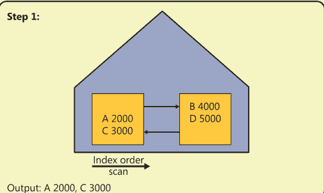

输出: A 2000, C 3000

### 第 2 步

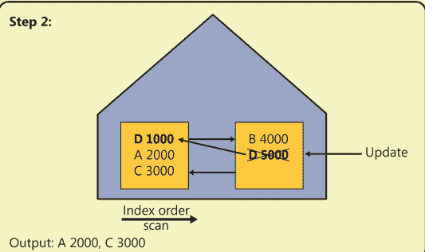

输出: A 2000, C 3000

### 第 3 步

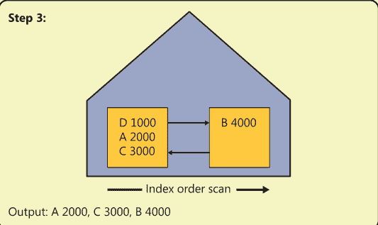

输出: A 2000, C 3000, B 4000

**图 2-24** 索引顺序扫描：跳过行。

为了亲自验证，你可以运行一个简单的测试。首先，执行以下代码来创建并填充 Employees 表：

```sql
SET NOCOUNT ON;
USE tempdb;
```

```sql
IF OBJECT_ID('N'dbo.Employees', 'N'U') IS NOT NULL DROP TABLE dbo.Employees;
```

```sql
CREATE TABLE dbo.Employees
(
empid VARCHAR(10) NOT NULL,
salary MONEY NOT NULL,
filler CHAR(2500) NOT NULL DEFAULT('a')
);
```

```sql
CREATE CLUSTERED INDEX Idx_c1_salary ON dbo.Employees(salary);
ALTER TABLE dbo.Employees
ADD CONSTRAINT PK_Employees PRIMARY KEY NONCLUSTERED(empid);
```

```sql
INSERT INTO dbo.Employees(empid, salary) VALUES
('D', 1000.00),('A', 2000.00),('C', 3000.00),('B', 4000.00);
```

打开两个连接。在连接 1 中运行以下代码以执行无限循环，每次迭代将员工 D 的薪资从当前值更新为 6000 减去其当前值（在 1000 和 5000 值之间切换）：

```sql
SET NOCOUNT ON;
USE tempdb;
```

```sql
WHILE 1=1
UPDATE dbo.Employees
SET salary = 6000.00 - salary
WHERE empid = 'D';
```

此代码会导致员工 D 的行在两个索引叶页之间不断移动。在连接 2 中运行以下代码：

```sql
SET NOCOUNT ON;
USE tempdb;
```

```sql
WHILE 1 = 1
BEGIN
SELECT * INTO #Employees FROM dbo.Employees;
IF @@ROWCOUNT <> 4 BREAK; -- 使用 < 4 表示跳过，> 4 表示多次出现
DROP TABLE #Employees;
END
```

```sql
SELECT * FROM #Employees;
DROP TABLE #Employees;
```

该代码运行一个无限循环，将 Employees 表的内容导入临时表。由于代码没有指定 `NOLOCK` 提示，且环境是可读/写的，存储引擎使用了索引顺序扫描。当循环中的行数与预期数量（四）不符时，循环中断。在扫描两次读取同一行的情况下，此代码输出中返回五行：

| empid | salary | filler |
|---|---|---|
| D | 1000.00 | a |
| A | 2000.00 | a |
| C | 3000.00 | a |
| B | 4000.00 | a |
| D | 5000.00 | a |

在扫描跳过某行的情况下，此代码输出中返回三行：

| empid | salary | filler |
|---|---|---|
| A | 2000.00 | a |
| C | 3000.00 | a |
| B | 4000.00 | a |

你可以更改过滤器 `< 4` 以等待行被跳过的情况，也可以更改为 `> 4` 以等待行出现两次的情况。

希望这能让你更好地理解存储引擎如何处理扫描，最重要的是理解在未提交（Uncommitted）隔离级别下运行代码产生的影响。接下来的章节将继续介绍访问方法。

## 非聚集索引寻道 + 范围扫描 + 查找

访问方法“非聚集索引寻道 + 范围扫描 + 查找”通常用于使用未包含查询内容的非聚集索引进行的小范围查询（包括点查询）。例如，假设你想查询 orderid 落在小范围内的订单，如 `orderid <= 25`。对于符合条件的订单，你想返回列 `orderid`、`custid`、`shipped`、`orderdate` 和 `filler`。我们有一个名为 `PK_Orders` 的非聚集索引，它定义 `orderid` 列作为键。该索引可以支持过滤；但由于索引没有包含查询，将需要查找来从相应的数据行获取剩余列。如果目标表是堆（heap），则查找将是 RID 查找，每次消耗一次页读取。如果底层表是 B 树，则查找将是键查找（key lookups），每次读取次数等于聚集索引的深度。

为了演示这种访问方法，我将使用以下代码：

```sql
SELECT orderid, custid, shippid, orderdate, filler
FROM dbo.Orders
WHERE orderid <= 25;
```


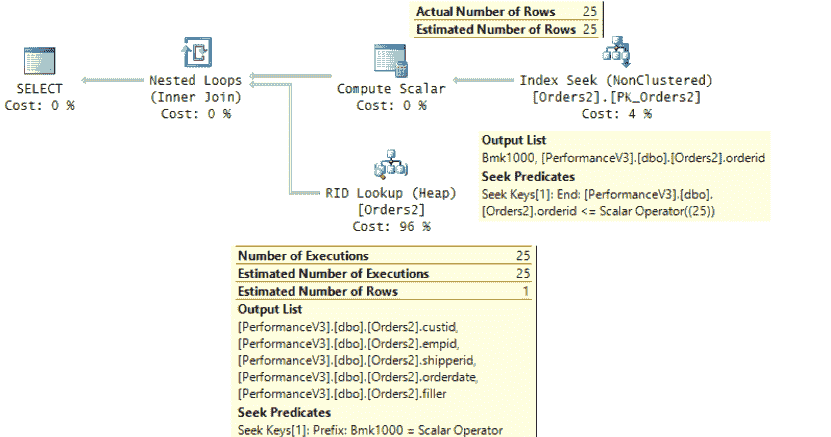
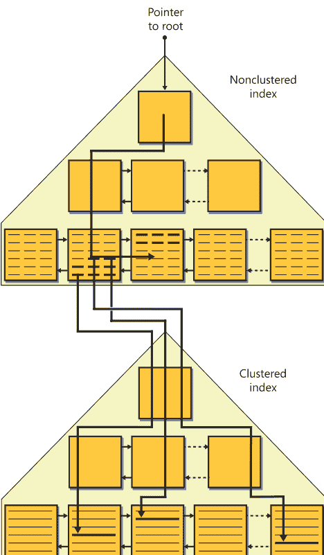

**图 2-28** 针对 B 树（存储引擎）的非聚集索引寻址 + 范围扫描 + 查找。


当你创建索引时，SQL Server 还会针对索引中的数据创建统计信息。统计信息包含一个带有通用信息的头、索引中前导键列向量的密度信息，以及索引中前导键列的直方图。直方图表示列中键值的分布。运行以下代码，显示 SQL Server 根据 `orderid` 列为 `Orders` 表上的 `PK_Orders` 索引创建的信息创建的直方图：

```
DBCC SHOW_STATISTICS ('dbo.Orders', 'PK_Orders') WITH HISTOGRAM;
```

这段代码在我的系统中生成了以下输出：

| RANGE_HI_KEY | RANGE_ROWS | EQ_ROWS | DISTINCT_RANGE_ROWS | AVG_RANGE_ROWS |
| --- | --- | --- | --- | --- |
| 1 | 1 | 0 | 1 | |
| 1000000 | 999999 | 1 | 999999 | 1 |

SQL Server 支持最多 200 步的直方图。在我们的情况下，由于表中的 ID 是 1 到 1,000,000 之间的连续范围，SQL Server 认为它可以用两个步骤充分地表示这种数据分布。每个步骤代表大于上一个步骤 `RANGE_HI_KEY` 值且小于或等于当前步骤 `RANGE_HI_KEY` 值的键。`EQ_ROWS` 值表示有多少行的键值等于 `RANGE_HI_KEY` 值。`RANGE_ROWS` 值表示有多少行的值大于上一个步骤的 `RANGE_HI_KEY` 值且小于（不等于）当前步骤的数值。`DISTINCT_RANGE_ROWS` 值表示有多少个不同的值大于上一个步骤的 `RANGE_HI_KEY` 值且小于当前步骤的 `RANGE_HI_KEY` 值。`AVG_RANGE_ROWS` 值表示系统中每个不同值对应的平均行数。

你可以从图 2-2（以及图 2-25）中看到，优化器根据此直方图对我们的查询过滤做出了准确估计。估计的行数与实际数量几乎一致。

至于优化器需要根据基数估计做出的决策，有很多。假设优化器选择使用索引，它会决定是否在范围扫描中使用预取（预读）来加速查找。如果使用，嵌套循环算子将具有一个指示其使用预取的属性；否则，则不使用。使用预取的条件是具有超过 25 行符合条件的行。我们的示例查询有 25 行符合条件的行，因此计划没有使用预取。记住，我们查询的总读取次数为 3 + 0 + 25 = 38。我们查询中对 `orderid <= 26` 的过滤如下所示：

```
SELECT orderid, custid, empid, shipperid, orderdate, filler
FROM dbo.Orders
WHERE orderid <= 26;
```

现在满足了使用预取的条件。如果你检查查询执行计划中嵌套循环算子的属性，你会发现了一个新属性 `WithUnorderedPrefetch`，其值为 `True`。该属性的 unordered 属性表示行不需要按顺序返回。当我在我的系统上运行它时，SQL Server 报告了 90 次读取。其中 3 次读取归于预取，78 次读取归于查找，剩余 9 次读取归于以比页更大的块读取数据的预读操作，因此该操作可能会读取某些不包含符合条件的页，正如本例所示。

要查看有序预取的示例（这需要按键的顺序返回行），请在查询中添加 `ORDER BY orderid`，如下所示：

```
SELECT orderid, custid, empid, shipperid, orderdate, filler
FROM dbo.Orders
WHERE orderid <= 26
ORDER BY orderid;
```

现在嵌套循环算子的属性现在包含一个名为 `WithOrderedPrefetch` 的属性，其值为 `True`。

如果你想排查预取的影响，可以使用查询跟踪标记 8744 来禁用它，如下所示：

```
SELECT orderid, empid, shipperid, orderdate, filler
FROM dbo.Orders
WHERE orderid <= 26
OPTION(QUERYTRACEON 8744);
```

现在嵌套循环算子没有指示预取的属性。SQL Server 在我们的系统上对此查询报告了 81 次逻辑读取。

优化器根据基数需要做出的另一个选择是是否使用这种方法（非聚集索引寻址 + 范围扫描 + 查找），还是更倾向于替代方案，即表的全扫描（堆或 B 树）。记住，对于小部分比例的匹配，这种访问方法与替代方案相比往往是高效的。这主要是因为每次查找的成本非常高。想一下：符合条件的行的键查找涉及三个数据页。当我尝试不同的范围时，我的转折点是 6,505 次匹配。对于 6,505 次以内的，优化器选择了一个有效的计划。

## 第 2 章 调优

```
SELECT orderid, custid, empid, shipperid, orderdate, filler
FROM dbo.Orders
WHERE orderid <= 10000;
```

我为此查询获得的执行计划如图 2-29 所示。

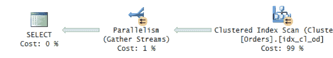

图 2-29 带有扫描的并行查询计划。

在 272,000 行的情况下，我仍然得到了并行计划。达到 273,000 行及以上时，我得到了串行计划。例如，以下查询在我的系统上获得了串行计划：

```
SELECT orderid, custid, empid, shipperid, orderdate, filler
FROM dbo.Orders
WHERE orderid <= 30000;
```

我为此查询获得的执行计划如图 2-30 所示。

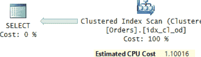

图 2-30 带有扫描的串行查询计划。

由于并行计划的代价公式取决于你系统中的逻辑 CPU 数量，因此在 CPU 数量与生产系统不同的测试系统上对查询进行故障排除可能是困难的。你可以使用一些工具让优化器假设一个与实际数量不同的 CPU 数量，但遗憾的是，这些 CPU 是未记录且不支持的，它们的行为被认为是不可预测的。因此，我严格将它们用于实验和研究目的。我觉得尝试这些工具有助于我理解 SQL Server 引擎的工作原理，我建议你避免在生产系统中以任何形式使用它们。

其中一个工具是名为 `OPTIMIZER_WHATIF` 的 DBCC 命令。该工具让优化器在当前会话中假设系统具有某些可用资源用于成本估算。要假设某个 CPU 数量，请将 `CPUs` 指定为第一个参数并将数量作为参数。例如，要使用 16 个 CPU，请运行以下代码：

```
DBCC OPTIMIZER_WHATIF(CPUs, 16);
```

检查以下查询的计划，该查询过滤了 300,000 行：

```
SELECT orderid, custid, empid, shipper, orderdate, filler
FROM dbo.Orders
WHERE orderid <= 300000
OPTION(RECOMPILE);
```

这一次，我得到了并行计划。那是因为 `CPUparallel` 比之前更低，允许在达到并行计划与串行计划之间的临界点之前过滤更多行。

请注意，这种影响仅影响用于成本估算时考虑的 CPU 数量；因此 `DopForCost` 将通过将此数字除以 2（取整数除法）来计算。执行的实际并行度仍将基于系统中的逻辑 CPU 数量。更准确地说，它将基于 SQL Server 创建的调度器数量；通常，SQL Server 为每个逻辑 CPU 创建一个调度器。

要恢复到系统默认的 CPU 数量，请像这样指定第二个参数为 0：

```
DBCC OPTIMIZER_WHATIF(CPUs, 0);
```

`DBCC OPTIMIZER_WHATIF` 命令对会话有局部影响。有一个工具对整个系统有更具全局的影响，但它是未记录且不支持的。如所述，通常 SQL Server 会为系统中的每个逻辑 CPU 创建一个调度器，调度器的数量决定了 `DopExecution`。你可以使用启动参数 `-Pn` SQL Server，其中 `P` 必须大写并代表你希望 SQL Server 使用的调度器数量。你可以查询 `sys.dm_os_schedulers` 视图并过滤 `scheduler_id < 255` 的行以查看 SQL Server 使用了多少调度器。`DopExecution` 指标和 `DopForCost` 指标将取决于调度器的数量，取决于你系统中有多少个逻辑 CPU。

最后，一种影响并行性的未记录且不支持的工具是查询跟踪标记 `8649`。该跟踪标记会导致 SQL Server 使用并行计划，即使其代价高于串行计划。同样，这是一个用于实验和研究的工具，以查看使用并行计划的后果是怎样的。这里是该跟踪标记在查询中的一个示例：

```sql
SELECT orderid, custid, empid, shipper, orderdate, filler
FROM dbo.Orders
WHERE orderid <= 300000
OPTION(QUERYTRACEON 8649);
```

记住，在 8 个逻辑 CPU 和该查询过滤的行数的情况下，优化器通常会选择串行计划。但有了此跟踪标记，优化器选择了并行计划。

## 无序聚集索引扫描 + 查找

优化器通常在满足以下条件下使用无序聚集索引扫描 + 查找访问方法：

- 查询具有选择性过滤。
- 存在包含过滤列（或列）的聚集索引，但该索引不是包含索引。
- 过滤列不是索引的引导列。

例如，以下查询的计划针对 `idx_nc_sid_cid`（该索引基于键列 `shpperid`, `orderdate`, `custid` 创建）：

```
SELECT orderid, custid, empid 
FROM dbo.Orders
WHERE custid = 'C00000001'
```

此索引的重要的是 `custid` 列出现在索引行中，但作为第一个键。

图 2-31 显示了查询的执行计划，图 2-32 展示了存储引擎如何处理访问方法：

```
Query 1: 查询代价（相对于批处理）:100%
SELECT [orderid],[custid],[empid],[shpperid],[orderdate],[filler] FROM
Missing Index (Impact 99.9012): CREATE NONCLUSTERED INDEX [<Name of Miss... 

CREATE NONCLUSTERED INDEX [<Name of Missing Index, sysname>]
ON [dbo].[Orders] ([custid])
INCLUDE ([orderid],[empid],[shpperid],[orderdate],[filler])
```

图 2-33 显示了查询的执行计划，图 2-34 说明了存储引擎处理访问方法的方式。

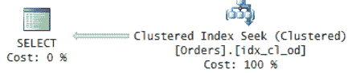

图 2-33 聚集非聚集索引查找 + 范围扫描（执行计划）。

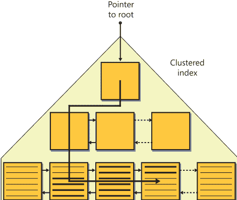

图 2-34 聚集索引查找 + 范围扫描（存储引擎）。

过滤器使用了等号操作符，但由于 `orderdate` 列不是唯一的，过滤器可能有多个匹配行。在我的案例中，我得到了 703 行匹配结果。SQL Server 在我的系统上报告了该查询的 22 次逻辑读取。自然地，如果你使用 `>=`、`<=`、`=` 和 `BETWEEN` 运算符，你会获得类似的访问方法。

## 覆盖非聚集索引查找 + 范围扫描

访问方法“非聚集索引查找 + 范围扫描”与“聚集索引查找 + 范围扫描”访问方法类似，只是它使用了非聚集覆盖索引。非聚集索引访问方法更高效，因为叶节点行中的列较少，每个叶节点页可以容纳更多行。上一节中的查询作为一个示例。聚集索引每个叶节点页可以容纳约 400 行。这意味着如果查询有 10,000 行匹配项，它需要在索引叶节点中扫描大约 250 行。为了获得最优的非聚集索引，你使用 `orderdate` 作为键列创建索引，并在索引的 `INCLUDE` 子句中指定查询中的剩余所有列（`orderid`、`cust`、`empid`、`shipper`）。此类索引的叶节点行大小约为 40 字节，这意味着每个叶节点页可以容纳约 200 行；而聚集索引的行大小约为 200 字节，一个页只能容纳 40 行。非聚集索引和聚集索引之间的行大小比例为 1:5。这意味着使用非聚集索引，查询只需要扫描比聚集索引少分之一的页面即可获取所需的行。因此，在 10,000 行匹配的示例中，查询仅需扫描非聚集索引叶节点中的约 50 个页面。

除了覆盖，在优化支持索引的查询时，你还有另一个需要考虑的关键点。当查询过滤器涉及多个谓词时，你必须仔细考虑索引键列表中列的顺序。以以下查询作例：

```sql
SELECT orderid, shipper, orderdate, custid
FROM dbo.Orders
WHERE shipper = 'C0140101'
AND orderdate < '20150101'
```

索引键列表中键列顺序的准则取决于你在谓词中使用的运算符（等值或范围），在某些情况下还取决于过滤器的选择性。

如果你有多个谓词，在创建高效索引方面具有最大的灵活性。你可以按照任何喜欢的顺序定义键列表。这是因为有了所有的键，符合条件的行将出现在索引键中连续的范围内。例如，如果查询过滤器是 `shipper_id=<shipper_ID> AND orderdate=<some_date>`，你可以用 `(shipper, orderdate)` 或 `(orderdate, shipper)` 作为键列表创建索引。

你会听到很多建议，认为如果你将更具选择性谓词的列放在键列表前面，会获得更好的基数估计，因为优化器会在第一列上创建直方图。这并不完全真实，因为如之前解释过的，如果 SQL Server 需要对非索引前导键的列创建直方图，它会动态创建。当你只使用等值谓词时，如果查询过滤器中始终指定其中某一列，而另一列有时指定，那么决定键顺序的因素可能是什么？你需要确保该列始终在索引键列表中第一个指定，以获得索引查找，查询过滤器必须遵守前导键列。

如果你最多只有一个谓词且所有剩余谓词都是等值谓词，那么与仅有等值谓词相比，你的灵活性较小。然而，你仍然可以创建最优索引。在这种情况下，准则是将出现在谓词中的列放在键列表的前面（按你喜欢的任何顺序），并将范围谓词中的列放在最后一个键上。只有这样，你才能在索引叶节点中获得连续范围内的符合条件的行。我们的示例查询属于这一类，因为它有一个等值谓词和一个范围谓词。像往常一样，如果你想让索引具有覆盖性以避免回表，请将出现在索引 `INCLUDE` 子句中的剩余列放置。遵循此类别的索引指南，使用以下代码创建最优索引：

```sql
CREATE INDEX idx_nc_sid_od_i_cid_orderid INCLUDE(custid)
ON dbo.Orders(shipper, orderdate);
```

图 2-35 显示了创建此索引后示例查询的执行计划，图 2-36 说明了存储引擎处理访问方法的方式。

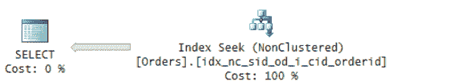

### 查找谓词

从上一个算符返回。为了进行基数估计，优化器使用了一个名为基数估计器的组件。

当你分析图形查询执行计划时，可以将鼠标指针悬停在从算符出来的箭头上查看基数估计。如果你查看的是估计查询计划，你只会看到估计值。如果你查看的是实际计划，你将看到估计的行数和实际行数并排显示。优化器做的次优选择与不准确的基数估计有关，检测这些问题的主要方法是比较估计值和实际值。请注意，与不同算符相关的成本反映的是估计的行数。因此，如果优化器的估算不准确，这些百分比可能会产生误导性。相反，实际计划中行的粗细反映了流过的实际行数；行越粗意味着流过的行数越多。此外，当调用嵌套循环算符时，请注意循环内部部分报告的估计行数是单次执行的，而报告的实际行数是所有执行的总和。如果你遇到估计行数为 1,000 的情况，那么这实际上是一个准确的估计。

在接下来的章节中，我将详细介绍基数估计器的细节。我将涵盖 SQL Server 关于基数估计器变化的里程碑、不准确估算的影响、统计信息、谓词、解决关键问题以及对未知处理。

> 注意：提醒一下，我使用了随机化来创建样本数据。此外，当为索引中非引导键创建统计信息时，SQL Server 仅使用随机化采样一小比例的数据。当你运行其中的的查询时，你很可能会得到与我略有不同的结果。

## 旧版估计器。2014 基数估计器

基数估计器发生重大变更的两个主要里程碑是 SQL Server 7.0 和 SQL Server 2014。这两个版本的发布日期之间相差 16 年。新的基数估计器是大量学习的结果，它考虑了多年来数据库工作负载所发生的变化。如今，数据量和查询类型与二十年前已大不相同。


与旧版估计器相比，新基数估计器有许多变化。微软的目标是改进平均情况，同时理解某些情况可能会出现退化。当数据库兼容性级别为 2014 (120) 或更高时，SQL Server 将默认使用新的基数估计器，而在较低的兼容级别下将使用旧估计器。为了确保 SQL Server 在 `PerformanceV3` 数据库中使用新的基数估计器，请运行以下代码将数据库兼容级别设置为 120：

```sql
USE PerformanceV3;
ALTER DATABASE PerformanceV3 SET COMPATIBILITY_LEVEL = 120;
```

如果你识别出从非故障基数估计器中获益的查询，可以使用查询跟踪标志强制使用特定的估计器。使用跟踪标志 9481 使用旧版基数估计器，使用跟踪标志 2312 使用新的。我们的数据库兼容性可以默认使用 SQL Server 的新版本，在示例中，当我想要演示使用旧版本时会使用跟踪标志 9481。如果你需要数据库使用兼容性级别 120 及以上以启用新功能，但默认仍使用旧版基数估计器，可以在服务器级别通过启动参数 `--9481` 或命令 `DBCC TRACEON(9481,-1)` 启用该标志。

我将讨论旧版估计器与新基数估计器之间基数估计方法的若干关键变化，但我的涵盖并不是详尽的。你可以在以下白皮书中找到更多细节：http://msdn.microsoft.com/en-us/library/dn673537.aspx。

## 低估和高估的影响

进行基数估计并不是一项你可以在不实际运行查询且没有时间机器的情况下完成的简单任务。如果你从事过性能调优业务，你就知道这一点。即使使用新的基数估计器，你仍然会遇到估计不准确的情况。不准确估计的影响通常是它们可能导致优化器做出次优选择。

低估和高估倾向于产生不同的影响（并非完整）：

- 对于过滤器，倾向于使用索引查找和查找。
- 对于聚合、连接和去重，倾向于基于排序的算法而非基于哈希的算法。
- 对于排序和哈希操作，可能会因为内存授予不足而溢出到 `tempdb`。
- 在查询中倾向于串行计划而非并行计划。

## 高估的影响

- 对于过滤器，倾向于使用索引扫描而非索引查找和查找。
- 对于聚合、连接和去重，倾向于基于哈希的算法而非基于排序的算法。
- 对于排序和哈希操作，可能会授予过多内存，降低并发性。
- 在查询中倾向于并行计划而非串行计划。

## 使用 OPTIMIZE FOR

你可以使用 `OPTIMIZE FOR` 查询提示告诉优化器针对特定值优化查询，如下所示：

```sql
DECLARE @i AS INT = 500000;

SELECT empid, COUNT(*) AS numorders
FROM dbo.Orders
WHERE orderid > @i
GROUP BY empid
OPTION(OPTIMIZE FOR (@i = 999900));
```

该查询的执行计划如图 2-37 所示。

| 实际行数 | 500000 |
| :--- | :--- |
| 估计行数 | 100 |

| SELECT Cost: 0 % | Compute Scalar Cost: 0 % | Stream Aggregate (Aggregate) Cost: 0 % | Sort Cost: 4 % | Nested Loops (Inner Join) Cost: 0 % | Index Seek (NonClustered) [Orders].[PK_Orders] Cost: 1 % |
| :--- | :--- | :--- | :--- | :--- | :--- |
| Memory Grant 1088 | Warnings Operator-used tempdb to spill during execution with spill level 2 |

我从此命令得到了以下输出（表头文本已换行以适应显示）：

| 名称 | 更新 | 行数 | 采样行数 | 步骤 | 密度 | 平均键长度 |
| :--- | :--- | :--- | :--- | :--- | :--- | :--- |
| idx_nc_cid_eid | 2014年10月21日 7:17PM | 1000000 | 1000000 | 187 | 0.02002646 | 18 |

| String Index | 过滤表达式 | 行数 |
| :--- | :--- | :--- |
| YES | NULL | 1000000 |

| 所有密度 | 平均长度 | 列 |
| :--- | :--- | :--- |
| 5E-05 | 11 | custid |
| 1.05216E-06 | 15 | custid, empid |
| 1.00042E-06 | 18 | custid, empid, orderdate |

| RANGE_HI_KEY | RANGE_ROWS | EQ_ROWS | DISTINCT_RANGE_ROWS | AVG_RANGE_ROWS |
| :--- | :--- | :--- | :--- | :--- |
| C000000001 | 0 | 46 | | 1 |
| C000000130 | 6437 | 37 | 128 | 50.28906 |
| C000000252 | 6089 | 37 | 121 | 50.32322 |
| C000000310 | 2918 | 67 | 57 | 51.19298 |
| C000000519 | 11538 | 62 | 228 | 50.60526 |
| C000019486 | 6307 | 66 | 126 | 50.05556 |
| C000019704 | 10934 | 30 | 217 | 50.38711 |
| C000019783 | 4045 | 66 | 78 | 51.85897 |
| C000019904 | 5906 | 68 | 120 | 49.21667 |
| C000002000 | 4733 | 46 | 95 | 49.82105 |

统计信息的第一部分是表头。它包含了关于数据的通用信息，例如表的基数（在我们的示例中为 1,000,000 行）。

统计信息的第二部分是密度向量。这部分记录了所有列的前导列键的密度信息。你对 `custid` 和 `empid` 上创建了索引，但 SQL Server 在内部将 `orderdate` 添加为最后一个键列；这是因为 `orderdate` 列是聚集索引键，因此在非聚集索引中用作行定位器。所以，通过三个列，你拥有三个密度向量。列的密度代表了每个唯一值组合的平均出现次数。例如，表中有 20,000 个不同的客户，因此每个唯一值的平均出现次数为 1 / 20,000 = 0.00005，即统计信息中显示的 5E-05。随着你添加更多列，密度会降低，直到获得唯一性。因此，对于向量 (`custid, empid`)，密度为 0.000001050216，1.05216E-06。SQL Server 在对未知输入进行基数估计，或当它认为平均情况更准确时，会提供密度信息。

统计信息的第三部分是直方图。当你创建索引时，SQL Server 会根据数据的全表扫描在前导键上创建一个直方图。此外，当 SQL Server 优化查询并需要对非前导索引键的列使用直方图时，由于数据库选项 `AUTO_CREATE_STATISTICS` 已启用，它可以动态创建一个直方图。它为此目的采样了一定比例的行。

SQL Server 仅支持大于 200 个步骤的单列直方图。每个步骤代表一个键的范围，该范围大于上一个步骤的 `RANGE_HI_KEY` 值，且小于等于当前的 `RANGE_HI_KEY` 值。例如，我们直方图中的第二个步骤代表大于 `C000000001` 且小于等于 `C000000130` 的客户 ID 范围。`RANGE_ROWS` 值表示该步骤所代表的行数，不包含 `RANGE_HI_KEY` 等于值的行。`EQ_ROWS` 值表示等于 `RANGE_HI_KEY` 值的行数。`RANGE_ROWS` 和 `EQ_ROWS` 之和代表该步骤所代表的总行数。`DISTINCT_RANGE_ROWS` 值代表该步骤中键值的唯一计数（不包含上界）。`AVG_RANGE_ROWS` 值代表该步骤中每个键值的平均行数（不包含上界）。

SQL Server 使用直方图对已知输入进行基数估计。例如，考虑以下查询：

```sql
SELECT orderid, custid, shipper, filler
FROM dbo.Orders
WHERE custid = 'C00000001';
```

此查询的执行计划如图 2-39 所示。图 2-39 显示了基于 `RANGE_HI_KEY` 的直方图的使用。SQL Server 查看输入值 `C00000001`，发现它属于步骤 1。由于此输入值等于步骤的 `RANGE_HI_KEY` 值，其基数估计简单为 `EQ_ROWS` 值，在查询中看到过滤后的估计数为 46。

另一个例子，考虑以下查询：

```sql
SELECT orderid, custid, empid, shipper, orderdate, filler
FROM dbo.Orders
WHERE custid = 'C00000002';
```

观察直方图的前两个步骤：

| RANGE_HI_KEY | RANGE_ROWS | EQ_ROWS | DISTINCT_RANGE_ROWS | AVG_RANGE_ROWS |
| :--- | :--- | :--- | :--- | :--- |
| C000000001 | 0 | 46 | | 1 |
| C000000130 | 6437 | 37 | 128 | 50.28906 |

输入值属于步骤 2。它小于步骤的 `RANGE_HI_KEY` 值，因此 SQL Server 使用 `AVG_RANGE_ROWS` 值 50.2891 作为基数估计。我得到的该查询的执行计划估计数为 50.2891，实际数为 57。

可以看出，对于已知输入的相等谓词，基数估计是直观的。如果有范围谓词，估计将从直方图中得出。如果涉及多个步骤，SQL Server 将范围拆分为不同步骤的区间，对每个区间进行估计并汇总。

下一个示例演示了优化器使用密度向量的情况。记住，与参数不同，变量值是不可嗅探的。因为初始单元是批，优化器在优化查询之前不会执行。考虑以下代码：

```sql
DECLARE @cid VARCHAR(11) = 'C00000001';

SELECT orderid, custid, empid, shipper, orderdate, filler
FROM dbo.Orders
WHERE custid = @cid;
```

优化器在此无法嗅探变量值。由于 `custid` 列可用密度信息，优化器使用了它。记住这里的密度为 0.00005。将此值乘以表的基数 1,000,000，得到 50。我得到的该查询的执行计划估计数为 50，实际数为 46。

# 多谓词估计

如所述，SQL Server 仅支持单列直方图。当查询过滤涉及多个谓词时，SQL Server 可以根据相应的直方图对每个谓词进行估计，但它需要某种方式将这些估计合并。旧估计器和新基数估计器的处理方式不同。我将解释谓词交集（由 `AND` 操作连接）和谓词并集（由 `OR` 操作连接）的估计方法。

在描述多谓词的估计方法之前，我会记录两个特定谓词的选择性（匹配百分比），以便在示例中使用它们。以下查询包含一个基于 `custid` 列的谓词过滤：

```sql
SELECT orderid, custid, empid, shipper, orderdate, filler
FROM dbo.Orders
WHERE custid <= 'C000001000';
```

在我的系统上，查询计划显示估计数为 52,800。这个数字对应 5.28%。

接下来的查询包含一个基于 `empid` 列的谓词过滤：

```sql
SELECT orderid, custid, empid, shipper, orderdate, filler
FROM dbo.Orders
WHERE empid <= 100;
```

如果在运行此查询之前 `empid` 列上没有统计信息，执行此查询将触发统计信息的创建。在我的系统上，查询计划显示估计数为 19,800，对应 19.8%。

基数估计器假设当你的查询有多个谓词时，它们彼此是独立的。基于此假设，对于谓词交集，它将结果选择性计算为各个选择性的乘积。考虑以下查询作为示例（注意跟踪标志跟在使用基数估计器之后）：

```sql
SELECT orderid, custid, empid, shipper, orderdate, filler
FROM dbo.Orders
WHERE custid <= 'C000001000'
AND empid <= 100
OPTION(QUERYTRACEON 9481);
```

在我的系统上，我得到了图 2-40 所示的查询计划。


**图 2-40** 旧估计器交集的估计。

记住，在我的系统上的独立估计值为 5.28% 和 19.8% = 10.4%。确实，计划中的基数估计器反映了这一点。在多年 SQL Server 经验后，微软了解到在现实中，谓词之间存在某种程度的依赖关系。在平均情况下，谓词既不是完全独立的也不是完全相关的而是介于两者之间。即使我的示例数据也没有反映这一点，因为我是使用简单的随机化创建的，如果你考虑一下，下单订单的客户和由员工来处理之间通常会存在某些依赖。

在完全独立的情况下，从统计学角度来说，应该使用各个估算值的乘积。在完全依赖的情况下，应该使用最具选择性的估算值。但由于现实中的平均情况介于两者之间，微软选择了一种名为“指数退避”的方法，这种方法适用于此类情况。该方法保留了最具选择性的估计值本身，然后通过将每个估计值提升为较小分数的幂，逐渐减少选择性较低的估计值的影响。假设 S1 是最具选择性的估计值（以百分比表示），S2 是次具选择性的，依此类推，指数退避的公式如下：

```
S1 * SQRT(S2) * SQRT(SQRT(S3)) * ...
```

当然，基数估算器会将最终百分比乘以您输入的基数（在我们的示例中为 1,000,000），产生以行数形式表示的估计。在我们的示例中，当您将此方法应用于两个谓词时，您得到 5.28% * SQRT(19.8%) = 23.5%，这相当于 23,500 行。

以下是我们不带跟踪标记的查询，这意味着新的基数估算器将是：

```sql
SELECT orderid, custid, empid, shipper, orderdate, filler
FROM dbo.Orders
WHERE custid <= 'C000001000'
AND empid <= 100;
```

我得到了图 2-41 显示的计划。

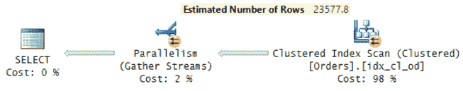

**图 2-41** 使用新的基数估算器估计连接查询中的基数。

如您所见，这里的基数估计是基于指数退避方法的，结果您得到了比基于简单乘积的旧方法更高的估算值。如果您有谓词之间真正独立的情况，可以向查询中添加跟踪标记 9481 以强制执行基数估算方法。

对于取或，基数估算器计算各个估算值之和减去它们的乘积。以以下查询为例：

```sql
SELECT orderid, custid, empid, shipper, orderdate, filler
FROM dbo.Orders
WHERE custid <= 'C000001000'
OR empid <= 100
OPTION(QUERYTRACEON 9481);
```

估计值计算为 5.28% + 19.8% – (5.28% * 19.8%) = 24%。

新的基数估算器使用了一种与谓词连接方法更一致的方法。它对基于各个估算值取反的指数退避公式的结果进行取反（100% 减去）。在我们的示例中，这转变为 100% – (100% – 19.8%) * SQRT(100% – 5.28%) = 21.9%。这是我在我的系统上我们的示例查询得到的估计值（约 21,900 行）。

```sql
SELECT orderid, custid, empid, shipper, orderdate, filler
FROM dbo.Orders
WHERE custid <= 'C000001000'
OR empid < 100;
```


如果您有多个谓词且经常得到不准确的估计值，通常是因为其中有等值条件，或者您有一个范围谓词但其他所有都是等值条件。例如，假设用户经常通过客户 ID 和员工 ID 过滤数据，两者都是等值。因此查询过滤可能像这样：`WHERE custid = 'C000000003' AND empid = 5`。您可以创建一个计算列（命名为 `custid_empid`），将客户 ID 和员工 ID 的值连接起来。利用计算列允许 SQL Server 在该列上生成统计信息（无论其是否被索引）的特性。您的查询将需要通过计算列名或直接通过连接后的表达式进行过滤。在这两种情况下，SQL Server 都将使用计算列上的直方图，如果您创建了索引，还会使用索引。查询过滤可能像这样：`WHERE custid_empid = 'C000000003'_5`。

获取更好估计值的另一种方法是使用过滤索引。只要其中一列中的唯一值数量较少，为每个值创建一个过滤索引的方案就是可维护的。例如，假设在您的组织中只有 10 个不同的员工处理订单；在这种情况下，创建 10 个过滤索引（每个唯一员工 ID 一个）是合理的。例如，对于员工 ID 5，过滤条件为 `empid = 5`。该索引将基于 `custid` 列。SQL Server 将为每个过滤索引根据 `custid` 列创建一个直方图。当优化器需要对像 `WHERE custid = 'C000000003' AND empid = 5` 这样的过滤条件进行基数估计时，它将使用过滤索引中 `custid` 列上的直方图，就像您拥有一个多列直方图一样。您可以在本章的后半部分“索引功能”中找到更多关于过滤索引的信息。

完成后，运行以下代码进行清理：

```sql
DROP INDEX idx_nc_cust_id ON dbo.Orders;
```

## 升序键问题

SQL Server 通常每 500 行或列变化的 10% 刷新一次统计信息。上次刷新统计后添加的任何数据都不会通过统计信息进行建模。

对于大表，自动统计更新的默认阈值（500 次加上变化百分数的 20%）可能不够。想一下：对于一个拥有 100,000,000 行的表，阈值是 20,000,500 次变化。如果你启用了跟踪标志 2371，SQL Server 将随着表的增长逐渐降低该百分比。你可以找到有关此跟踪标志的详细信息，包括一张显示总体变化变化的图表：http://blog.msdn.com/b/sapsqqlserver/archive/2011/09/07/changes-to-automatic-update-statistics-in-sql-server-traceflag-2371.aspx

## 未知

我描述了 SQL Server 在统计信息可用且输入值已知（例如使用常量或参数时）使用的某些基数估计方法。在某些情况下，SQL Server 使用基于未知输入的基数估计方法。以下是这些情况：

- 可用统计信息。
- 你使用了变量（而不是参数）。如前，变量值无法被“嗅探”，因为初始优化是整个批处理。
- 你使用了禁用了嗅探的参数（例如，当你指定了 `OPTIMIZE FOR UNKNOWN` 提示时）。

表 2-1 显示了 SQL Server 根据你使用的算符，为未知输入进行基数估计的规则。

| 算符 | 估计值 |
| --- | --- |
| `>`, `>=`, `<`, `<=` | 30% |
| `BETWEEN`/`LIKE` | 9% 异常：在 2014 年，对于禁用嗅探的变量/参数的 `BETWEEN`，估计值为 16.4317% |
| 唯一列的 `=` | 1 行 |
| SQL Server 2014 之前针对非唯一列的 `=` | C3/4 (C = 表基数) |
| SQL Server 2014 针对非唯一列的 `=` | C1/2 |

我应该提到，存在少数 SQL Server 不使用这种方法的异常情况。其中一个异常是使用变量。我提到过通常变量值无法被嗅探。但是，如果你使用带有 `RECOMPILE` 查询选项的语句级重新编译，或者发生了自动的语句级重新编译，查询将在变量值赋值后进行优化。因此，变量值变得可以被嗅探，然后 SQL Server 就可以使用基于统计信息的正常基数估计方法。

另一个异常是使用禁用嗅探的变量或参数，且算符为等号算符，并且过滤列可用密度向量。在这种情况下，估计值将基于密度向量。

接下来，我将演示基于表 2-1 中规则的估计示例。以下代码用于检查你当前在 Orders 表上拥有了哪些索引：

```sql
EXEC sp_helppindex N'dbo.orders';
```

输出应仅显示以下索引：

```
idx_ci_od
idx_nc_sid_od_cid
idx_unc_od_i_cid_eid
PK_Orders
```

如果你 get 任何其他索引，请将其删除。

运行代码以关闭数据库中统计信息的自动收集：

```sql
ALTER DATABASE PerformanceV3 SET AUTO_CREATE_STATISTICS OFF;
```

运行查询以识别在 Orders 表上自动创建了哪些统计信息：

```sql
SELECT S.name AS stats_name,
QUOTENAME(OBJECT_SCHEMA(S.object_id)) + '.' + QUOTENAME(OBJECT_NAME(S.object_id)) AS object,
C.name AS column_name
FROM sys.columns AS S
INNER JOIN sys.columns AS SC
ON S.object_id = SC.object_id
AND S.stats_id = SC.stats_id
INNER JOIN sys.columns AS C
ON S.object_id = C.object_id
AND SC.column_id = C.column_id
WHERE S.object_id = OBJECT_ID(N'dbo.Orders')
AND auto_created = 1;
```

删除该查询报告的所有统计信息。在我的案例中，我根据查询输出使用了以下代码；对于你来说，你应该删除查询报告的统计信息：

```sql
DROP STATISTICS dbo.Orders..WA_Sys_00000002_38EE7070;
DROP STATISTICS dbo.Orders..WA_Sys_00000003_38EE7070;
```

观察表 2-1，对于任何算符 `>`, `>=`, `=`, `<=`，未知值的估计值均为 30%。

以下查询演示了这种估计方法：

```sql
-- Query 1
DECLARE @id AS INT = 999900;

SELECT orderid, custid, emid, shipperid, orderdate, filler
FROM dbo.Orders
WHERE orderid > @id;
```

```sql
-- Query 2
SELECT orderid, custid, emid, shipperid, orderdate, filler
FROM dbo.Orders
WHERE custid <= 'C000000010';
```

图 2-44 显示了这些查询的计划。

### Query 1

| 实际行数 | 100 |
| --- | --- |
| 估计行数 | 300000 |


```text
SELECT
Cost: 0 %	Clustered Index Scan (Clustered)
[Orders].[idx_cl_od]
Cost: 100 %
```

### Query 2

| 实际行数 | 487 |
| --- | --- |
| 估计行数 | 300000 |


```text
SELECT
Cost: 0 %	Clustered Index Scan (Clustered)
[Orders].[idx_cl_od]
Cost: 100 %
```

> **警告** 无统计信息：[PerformanceV3].[Orders].custid

**FIGURE 2-44** 显示估计值为 30%。第一个查询使用了无法被嗅探的变量。第二个查询使用了常量，且没有统计信息，你禁用了创建新统计信息的选项。对于 `BETWEEN` 和 `LIKE` 谓词，表 2-1 显示估计值为 9%。该规则的异常情况是在 SQL Server 2014 中使用带有变量或禁用嗅探的参数时，估计值为 16.4317%。以下查询演示了这些规则：

```sql
-- Query 1
DECLARE @i AS INT = 999900, @j AS INT = 100000;

SELECT orderid, custid, emid, shipperid, orderdate, filler
FROM dbo.Orders
WHERE orderid BETWEEN @i AND @j;
```

```sql
-- Query 2
SELECT orderid, custid, emid, shipperid, orderdate, filler
FROM dbo.Orders
WHERE orderid BETWEEN @i AND @j
OPTION(TRACE 9481);
```

```sql
-- Query 4
SELECT orderid, custid, emid, shipperid, orderdate, filler
FROM dbo.Orders
WHERE custid LIKE '%9999%';
```

这些查询的执行计划见图 2–45。

| Query 1 | 实际行数 | 100 |
| --- | --- | --- |
| 估计行数 | 16417 | |
| SELECT Cost: 0 % | Parallelism (Gather Streams) Cost: 5 % | Clustered Index Scan (Clustered) [Orders].idx_cl_01 Cost: 95 % |

| Query 2 | 实际行数 | 100 |
| --- | --- | --- |
| 估计行数 | 90000 | |
| SELECT Cost: 0 % | Parallelism (Gather Streams) Cost: 3 % | Clustered Index Scan (Clustered) [Orders].idx_cl_01 Cost: 97 % |

| Query 3 | 实际行数 | 487 |
| --- | --- | --- |
| 估计行数 | 90000 | |
| SELECT Cost: 0 % | Parallelism (Gather Streams) Cost: 3 % | Clustered Index Scan (Clustered) [Orders].idx_cl_01 Cost: 97 % |

| Query 4 | 实际行数 | 126 |
| --- | --- | --- |
| 估计行数 | 90000 | |
| SELECT Cost: 0 % | Parallelism (Gather Streams) Cost: 3 % | Clustered Index Scan (Clustered) [Orders].idx_cl_01 Cost: 97 % |

**Figure 2–45** 显示 BETWEEN AND LIKE 的估计值。

第一个查询落入我描述的异常情况，或者估计值为 16.4317%。第二个查询与第一个相同，但由于你强制使用基数估计器，你得到了 9% 的估计值。第三和第四个查询使用了常量，但没有可用的统计信息。此外，查询 4 通常会创建关于子字符串出现次数的统计信息。由于你禁用了数据库中的自动统计，SQL Server 没有创建这些统计信息，而是使用了基于未知输入的估计方法。

对于等号算符，未知输入的估计方法取决于列的唯一性和 SQL Server 的值。当列是唯一的时，估计值为 1 行。当它不唯一时，在 SQL Server 2014 中估计值为 $C^{1/2}$，其中 C 是输入的基数，而在 SQL Server 2014 之前是 $C^{3/4}$。

以下查询演示了所有三种方法：

- Query 1

```sql
DECLARE @OI AS INT = 1000000;

SELECT orderid, custid, emid, shipperid, orderdate, filler
FROM dbo.Orders
WHERE orderid = @oi;
```

```sql
-- Query 3
SELECT orderid, custid, emid, shipper, orderdate, filler
FROM dbo.Orders
WHERE custid = 'C000000001'
OPTION(QUERYTRACE 9481);
```

这些查询的带估计值的执行计划见图 2-46。

| Query 1: Query cost | 实际行数 |
| --- | --- |
| 估计行数 | 51 |

| SELECT Cost: 0 % | Nested Loops (Inner Join) Index Seek (nonClustered) [Orders].[PK_Orders] Cost: 50 % | Cost: 0 % |
| | Key Lookup (Clustered) [Orders].[idx_cl_od] Cost: 50 % | |

| Query 2 | 实际行数 | 46 |
| --- | --- | --- |
| 估计行数 | 1000 | |

| SELECT Cost: 0 % | Parallel (Gather Streams) Nested Loops (Inner Join) Index Scan (nonClustered) [Orders].[idx_hc_sid_od_cid] Cost: 48 % | Cost: 1 % Cost: 2 % |
| | Key Lookup (Clustered) [Orders].[idx_cl_od] Cost: 50 % | |

| Query 3 | 实际行数 | 48 |
| --- | --- | --- |
| 估计行数 | 31622.8 | |

| SELECT Cost: 0 % | Parallel (Gather Streams) Clustered Index Scan (Clustered) [Orders].[idx_cl_od] Cost: 99 % | Cost: 1 % |

**FIGURE 2-46** 显示等值的估计值。

我得到了图 2-47 所示的查询计划。

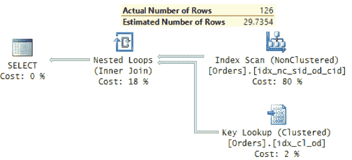

图 2-47 在可用字符串统计的情况下使用 LIKE 查询的计划。

SQL Server 首先在 `custid` 列上创建了字符串统计，并基于这些统计信息进行了估计。与你之前在图 2-45 中为该查询获取的估计值（如果是该图中的查询 4）相比，这次估计要准确得多。

旧版和新基数估计器之间的另一个区别在于如何处理带有操作列的表达式的过滤器。例如，表达式 `orders % 2 = 0`。旧版基数估计器简单地将此情况视为未知输入。对于我们的 `orders`，这被翻译为 `1,000,000/2^4 = 31,622`。这可能是一个严重的低估。新的基数估计器更加智能。在这里，它意识到该表达式使用了取模 (`%`) 运算符。从统计学上讲，对于 `% 2 = 0`，你将获得 50% 的匹配。因此，该情况的估计值为 500,000 行。这可能比旧版估计器生成的估计更接近实际数字。

## 索引功能

本节涵盖了各种索引功能。它包含了降序索引、包含非键列、过滤索引和统计、列存储索引以及内联索引定义。这些功能按照它们添加到 SQL Server 的顺序介绍。

## 降序索引

在 SQL Server 中，你可以在索引定义中指定键列的方向。默认方向是升序的，但可以使用 `DESC` 关键字请求降序排列，例如 `col1, col2 DESC`。

基于表的索引在其叶节点上具有双向链表。SQL Server 可以按正向和反向扫描叶节点中的行。顺带提，你将在第 10 章中学习到，内存优化表上的 BW-Tree 索引是单向的。回到基于磁盘表的 B 树索引，起初似乎不需要降序索引，但有几个用例。

事实证明，存储引擎目前仅能够并行处理正向扫描。每当你进行反向扫描时，它都是串行处理的。以以下查询为例：

```sql
-- Query 1, parallel
SELECT orderid, custid, empid, shiperid, orderdate, filler
FROM dbo.Orders
WHERE orderid <= 100000
ORDER BY orderdate;
```

```sql
-- Query 2, serial
SELECT orderid, custid, empid, shiperid, orderdate, filler
FROM dbo.Orders
WHERE orderid <= 100000
ORDER BY orderdate DESC;
```

图 2-48 显示了这些查询的执行计划。

查询 1：查询成本（相对于批处理）：50%

```sql
SELECT * FROM [dbo].[Orders] WHERE [orderid]<=01 ORDER BY [orderdate] ASC
```

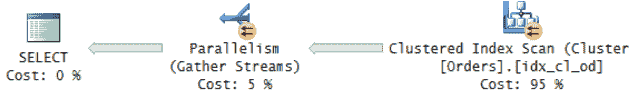

查询 2：查询成本（相对于批处理）：50%

```sql
SELECT * FROM [dbo].[Orders] WHERE [orderid]<=01 ORDER BY [orderdate] DESC
```


图 2-48 显示没有并行反向扫描。


我的机器上有 8 个逻辑 CPU。根据 SQL Server 的成本公式，在有许多 CPU 的情况下，针对具有 1,000,000 行的表并过滤掉 100,000 行的查询应该获得一个并行计划。这就是为什么第一个查询的计划使用了并行扫描。然而，由于反向扫描无法通过并行方式处理，第二个查询的计划使用了串行计划。

当你尝试使用跟踪标志 8649 强制第二个查询使用并行处理时，观察优化器的做法很有趣，如下所示：

```sql
SELECT orderid, custid, empid, shipperid, orderdate, filler
FROM dbo.Orders
WHERE orderid <= 100000
ORDER BY orderid DESC
OPTION(QUERYTRACEON 8649);
```

此查询的计划如图 2-49 所示。

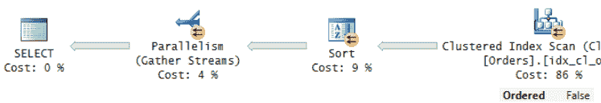

**图 2-49** 强制并行的计划。

由于无法使用并行反向序扫描，优化器选择了一个使用并行无序扫描紧跟一个显式排序操作的计划。显然，这是一个非常低效的计划。如果你发现并行是查询性能的关键因素，你可以安排一个降序索引。当然，如果微软在以后某时刻引入了对并行反向扫描的支持，你就不再需要为此目的使用降序索引了。

另一个降序索引有用的奇案例是同时具有窗口分区子 (`PARTITION BY`) 和排序子 (`ORDER BY`) 的窗口函数。考虑以下查询：

```sql
-- Query 1
SELECT orderid, custid, empid, shipperid, orderdate, filler, ROW_NUMBER() OVER (PARTITION BY shipperid ORDER BY orderdate ASC) AS rownum
FROM dbo.Orders;
```

```sql
-- Query 2
SELECT orderid, custid, empid, shipperid, orderdate, filler, ROW_NUMBER() OVER (PARTITION BY shipperid ORDER BY orderdate DESC) AS rownum
FROM dbo.Orders;
```

```sql
-- Query 3
SELECT orderid, custid, empid, shipperid, orderdate, filler, ROW_NUMBER() OVER (PARTITION BY shipperid ORDER BY orderdate DESC) AS rownum
FROM dbo.Orders;
```

目前，表上有一个名为 `idx_nc_sid_od` 的覆盖索引，它从分区列开始并以排序列继续。检查图 2-50 中的执行计划。

查询 1：查询成本（相对于批处理）：100%

SELECT orderid, custid, ROW_NUMBER() OVER (PARTITION BY shipperid ORDER BY orderdate ASC) AS rownum

| Sequence (Compute Scalar) | Segment | Index Scan (Clustered) |
| :--- | :--- | :--- |
| Cost: 0% | | Cost: 2% |

查询 2：查询成本（相对于批处理）：100%

SELECT orderid, custid, ROW_NUMBER() OVER (PARTITION BY shipperid ORDER BY orderdate DESC) AS rownum

| Sequence (Compute Scalar) | Segment | Parallelize (Gather Streams) | Sort | Index Scan (Clustered) |
| :--- | :--- | :--- | :--- | :--- |
| Cost: 0% | Cost: 0% | Cost: 19% | Cost: 71% | Cost: 10% |

查询 3：查询成本（相对于批处理）：100%

SELECT orderid, custid, ROW_NUMBER() OVER (PARTITION BY shipperid ORDER BY orderdate DESC) AS rownum

| Sequence (Compute Scalar) | Segment | Index Scan (Clustered) |
| :--- | :--- | :--- |
| Cost: 0% | Cost: 2% | Cost: 98% |

图 2-50 窗口函数的计划。

查询 1 的计划显示，有一个覆盖索引，其键从升序分区列开始并以排序列继续，优化器选择了索引的序扫描并避免了显式排序操作。

在查询 2 中，窗口函数的规范与查询 1 相似，但排序列为降序。理论上，优化器可以选择按降序扫描索引的计划。但是，由于缺少 `ORDER BY` 子句，SQL Server 似乎想按窗口分区元素的升序处理行，因此它添加了显式排序操作。

奇怪的是，正如查询 3 的计划所示，如果你添加了按 `shipperid` 列降序的 `ORDER BY` 子句，优化器突然发现可以使用反向扫描来计算窗口函数并支持所需的表示。索引的另一个用是二十年前，在 SQL Server 2000 发布后不久，Wayne Snyder 发现了我在 SQL Server 中见过的最惊人的漏洞之一。如果你创建一个以 `col1 DESC` 为键的聚集索引，并执行带有过滤器 `col1 > @n` 的 `DELETE` 语句，SQL Server 会删除所有 `col1 < @n` 的行。这个漏洞存在于 SQL Server 2000 RTM 中，当然，在 Service Pack 1 中被修复了。

# 包含列 (Included columns)

当你定义非聚聚集索引时，你会指定一个列向量作为键列表，以确定索引中行的顺序。SQL Server 可以根据此键列表执行有序扫描和范围扫描，以支持排序、过滤、分组和连接等操作。然而，如果你需要为了覆盖性（避免回查）而向索引中添加列，且这些列不具有任何排序相关的用途，则你可以在指定的 `INCLUDE` 子句中添加这些列。

与键列不同，包含列仅出现在索引的叶节点行中。此外，SQL Server 对此的限制较少。例如，键列表不能超过 16 列，而包含列可以包含任意数量。键列表的大小不能超过 900 字节，而包含列可以使用 XML 和其他大对象（LOB）特殊类型。当你更新表中的某行时，SQL Server 自然需要更新所有相应的列。如果索引键列的值发生变化，行的排序位置可能会发生变化，此时 SQL Server 需要重新定位该行。如果包含列的值发生变化，排序位置保持不变，更新可以在原处完成（假设行没有扩展）。

作为 `INCLUDE` 子句用法的示例，考虑以下查询：

```sql
SELECT orderid, custid, empid, shipperid, orderdate, filler
FROM dbo.Orders
WHERE custid = 'C0000000001'
```

我在之前讨论访问方法（即“无序非聚聚集索引扫描 + 回查”）时展示过此查询，并在图 2-1 中提供了其执行计划。目前，该查询没有最优索引。该计划扫描了某个非覆盖非聚聚集索引的整个叶节点层，该索引包含 `custid` 列作为非前导键，然后对匹配的案例应用回查。该计划的执行在我的机器上执行了 406 次逻辑操作。

更优的索引是使用以 `custid` 定义的键列来支持过滤，并将所有剩余列定义为包含列以避免回查，如下：

```sql
CREATE INDEX idx_nc_c1_oid_eid_sid_od_fl ON dbo.Orders(custid)
INCLUDE(orderid, empid, shipperid, orderdate, filler);
```

再次运行查询：

```sql
SELECT orderid, custid, empid, orderdate, filler
FROM dbo.Orders
WHERE custid = 'C0000000001'
```

该查询的执行计划如图 2-51 所示。

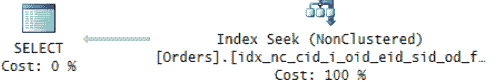

**图 2-51** 使用包含列索引的执行计划。

我发现该查询仅报告了 5 次逻辑读取。

完成后，运行以下代码进行清理：

`DROP INDEX dbo.Orders.idx_nc_cid_old_eid_sid_od_fl;`

# 过滤索引和统计信息 (Filtered indexes and statistics)

过滤索引是根据谓词对底层表的行子集创建的索引。你在索引定义中通过 `WHERE` 子句指定谓词。与非过滤索引相比，过滤索引的创建和维护成本更低，因为只有对相关行子集的修改才会反映在索引中。此外，过滤分布统计信息（直方图）比非过滤统计信息更准确。这是因为直方图中的最大步数为 200，而使用过滤统计信息时，该数字用于表示更小的行集。此外，由于直方图是针对满足索引条件的行子集的索引前导键创建的，你实际上获得了等同于拥有多列直方图的的估算质量。

在索引本身并不重要但统计信息很重要的情况下，你也可以创建过滤统计信息。你可以使用 `CREATE STATISTICS` 命令并在 `WHERE` 子句中指定谓词来实现。

作为过滤索引的示例，假设你经常查询发货国家为美国（USA）且处于特定日期范围（从本周、本月、本年初开始）的订单。你可能不会频繁地对其他发货国家执行类似的查询。你需要专门针对美国加速查询。你创建了一个带有谓词 `shipcountry = 'USA'` 过滤的索引，并将 `orderdate` 指定为键。如果避免回查对你来说很重要，你将希望将查询中的所有剩余列指定为包含列。运行以下代码创建此类过滤索引：

```sql
CREATE NONCLUSTERED INDEX idx_USA_orderdate
On Sales.Orders(orderdate)
INCLUDE(orderid, custid, requireddate)
WHERE shipcountry = 'USA'
```

接如下所示查询将从新索引中受益：

```sql
SELECT orderid, custid, orderdate, requireddate
FROM Sales.Orders
WHERE shipcountry = 'USA'
AND orderdate >= '20140101'
```

该查询的执行计划如图 2-52 所示。

| 实际行数 | 99 |
| 估计行数 | 678 |

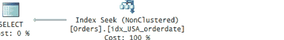

**图 2-52** 使用过滤索引的计划，优化器认为该索引可能有用，且基数估算存在不准确之处。

由于索引匹配查询过滤器，优化器认为该索引可能有用。

## 列存储索引

列存储技术是数据库领域的一个游戏规则改变者。它最初在 SQL Server 2012 中引入，并在 SQL Server 2014 中得到了显著改进。该技术主要针对数据仓库负载。请考虑图 2-54 所示的数据仓库经典星型体系模型。

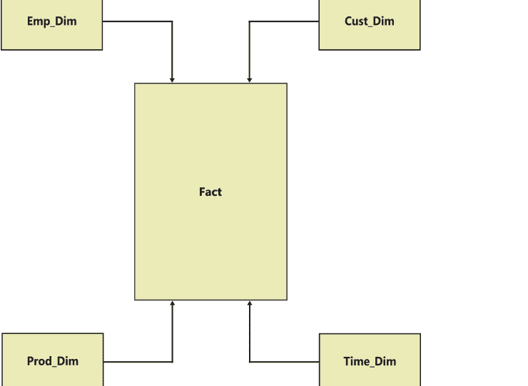

图 2-54 星型模型。

你拥有维度表，用于跟踪分析数据的维度，如客户、员工、产品和时间。每个维度表都有一个代理键。大部分数据存储在事实表（Fact table）中。该表包含每个维度表代理键列，以及代表数量和金额等指标的列。在引入列存储技术之前，SQL Server 中数据的传统的内部表示是基于行存储（rowstore）技术的。这意味着数据是以行模式进行存储和处理的。随着近年来数据仓库中数据量的不断增长，行存储技术在许多层面上往往效率低下，而列存储技术解决了这些低效问题。

要理解为什么行存储在大型数据仓库环境中效率低下，请考虑典型的数据仓库查询（也称为星型连接查询）。它们通常将事实表与某些维度表连接，并进行过滤、分组和聚合。以下是我们 PerformanceV3 数据库中典型数据仓库查询的示例：

```sql
USE PerformanceV3;
SET STATISTICS IO, TIME ON; -- 开启性能统计

SELECT D1.attr1 AS x, D2.attr1 AS y, D3.attr1 AS z,
COUNT(*) AS cnt, SUM(F.measure1) AS total
FROM dbo.Fact AS F
INNER JOIN dbo.Dim1 AS D1
ON F.key1 = D1.key1
INNER JOIN dbo.Dim2 AS D2
ON F.key2 = D2.key2
INNER JOIN dbo.Dim3 AS D3
ON F.key3 = D3.key3
WHERE D1.attr1 <= 10
AND D2.attr1 <= 15
AND D3.attr1 <= 10
GROUP BY D1.attr1, D2.attr1, D3.attr1;
```

该查询的执行计划如图 2-55 所示。

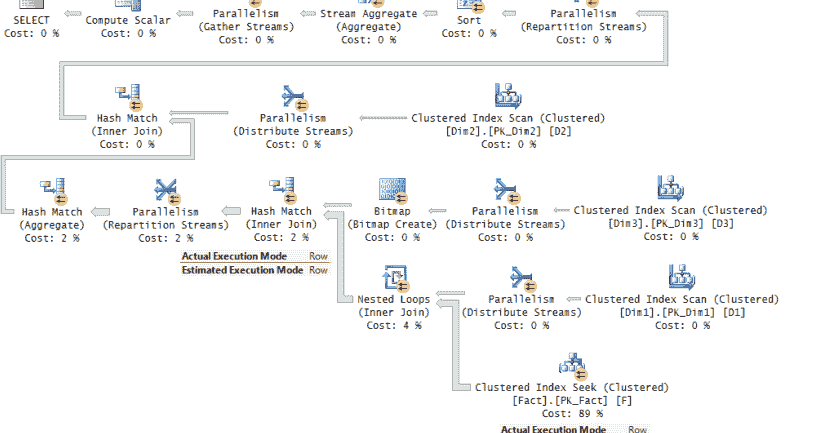

图 2-55 使用行存储进行星型连接查询的计划。

我在系统中对该查询获取了以下性能统计：

Table 'Fact'. Scan count 122, logical reads 29300

CPU time = 890 ms, elapsed time = 490 ms.

示例数据库中的事实表只有 2,500,000 行。通常情况下，现在的表要大得多。不过，我们的表已经大到足以支持并行计划并允许我说明行存储和列存储技术之间的差异。表越大，使用列存储技术的优势越明显，因此请记住，你看到的差异将比我在示例中看到的大得多。

如所述，行存储技术有许多缺点。在索引方面有许多可能性，导致你花费大量的时间和精力在建立索引上。如果你在系统中有很多查询，那么为事实表查询创建完美的索引将非常不利。你最终会得到太多的索引。为了限制创建的索引数量，你会优先对某些查询进行调优，并合并具有相似索引要求的多个查询。例如，如果你有多个查询可以从相同的键列表获益，但包含不同的包含列表，你可能会创建一个包含这些包含列的超集的索引。结果是，许多查询将没有真正支持它们的索引，而且每个查询最终都可能使用包含比其相关列更多的的索引。正如你所意识到的，这意味着查询执行的读取次数多于最优数量。

在行存储中，数据默认是不压缩的；你很少需要显式地使用行压缩或页压缩。即使你这样做了，由于数据是逐行存储的，SQL Server 实现的压缩水平远无法达到列存储所能达到的水平。

行存储技术的另一个缺点是，目前的执行模型是行执行模型。这意味着查询计划中的不同算符都被限制为一次处理一行。你可以从图 2-55 中示例查询的执行计划中看到这一点。计划中的所有算符都将显示执行模式为 Row（行）（我高亮了针对事实表的聚集索引查找以及一个哈希连接的此属性）。由于算符一次处理一行，浪费了大量的 CPU 周期。算符评估所需的任何内部信息都是按行评估的。

列存储技术发生了非常的变化。请注意，SQL Server 2012 仅限于非聚集、不可更新的列存储索引。SQL Server 2014 增加了对聚集、可更新索引的支持，使得该技术变得更易用。

使用以下代码在我们的事实表上创建一个非聚集列存储索引：

```sql
CREATE NONCLUSTERED COLUMNSTORE INDEX idx_nc_cs
ON db.Fact(key1, key2, key3, measure1, measure2, measure3);
```

你列出的顺序并不重要。与行存储不同，列存储中没有排序的概念。图 2-56 阐了数据在列存储中的组织方式。

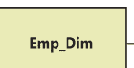

| Segment | Segment | Segment | Segment |
|---|---|---|---|---|
| Rowgroup 1 | | | | |
| Rowgroup 2 | | | | |
| Rowgroup 3 | | | | |
| Rowgroup 4 | | | | |

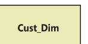

数据以称为行组（rowgroups）的单位存储。每个行组最多包含 1,000 行。你可以在视图 `columnstore_rowgroups` 中找到关于行组的信息。每个行组被划分为列段（column segments）。你可以在视图 `columnstore_segments` 中找到关于列段的信息。SQL Server 在内部记录每个列段的最小值和最大值。如果你的查询按特定列进行过滤，且过滤后的值落在列段覆盖的范围之外，整个行组将被排除。这种能力被称为段消除（segment elimination）。

你可以在视图 `columnstore_dictionaries` 中找到关于字典的信息。SQL Server 将字典用于字符串，有时也用于其他类型。列存储技术也受益于并行处理。每个行组都以高压缩格式存储。你可以在视图 `columnstore_rowgroups` 中找到关于行组的信息。

列存储技术的另外两个方面倾向于减少 I/O 成本。如所述，微软通过列存储实现的压缩水平远高于行存储。此外，请记住 SQL Server 将数据安排在字典中。而且，SQL Server 仅从相关列构造结果集的这一事实，与行存储相比，显著减少了 I/O 成本。

## 查询调优

*   注意：


# 列存储技术

列存储技术最大的优点之一是它消除了在事实表上建立索引的需要。为了满足查询，SQL Server 仅从相关列构造结果集。如果你仔细考虑，这是非常深刻的；因为你拥有所有的覆盖索引，而无需为每个用例创建单独的索引。

列存储技术也受益于并行处理。

我描述了一些旨在降低 I/O 成本的技术方面。在列存储技术中引入了一项技术，即微软在 SQL Server 中引入了批处理（`batch execution`）。一个批由行子集的相关列的向量化形式组成。通常，批的大小接近一千行。增强以支持批模式的算子每次处理一个批，而不是每次处理一行。算子执行的内部函数将批作为其行扫描的输入。在我们的示例查询中，使用批模式的算子是列存储索引以及此计划中的所有哈希（`Hash`）算子。图 2-57 显示了两个使用批模式的算子，它们具有更少的迭代。此外，它们按每个批输入而非每行评估元数据信息。所有这些都意味着更少的 CPU 周期。批模式仅在数据组织为列存储格式时使用，但该技术本身并没有限制它也用于行存储（`rowstore`）。也许未来我们会在行存储中使用这种支持。

## SQL Server 2012 的局限性

如所述，SQL Server 2012 中的列存储在许多方面都受到了局限。你只能创建非聚集列存储索引，你必须在数据基于行存储的主表示之外创建它。对于大型数据仓库，你必须考虑额外的空间需求以及对数据两种不同表示的维护。最大的限制是，一旦你创建了非聚集列存储索引，该表就会变得不可分区。绕过此限制的一种方法是维护两个结构相同的表。其中一个是带有列存储的分区表；另一个是不带列存储索引的增量表（`trickle table`），用于吸收实时变化。一旦你准备好将增量表转换为分区表，就在其上创建非聚集列存储索引，将其切换到分区表，并创建一个新的增量表来吸收实时变化。这种解决方案还要求你查询两张表并合并结果。

SQL Server 2012 的实现在批执行功能方面也存在许多局限性。支持批执行的算子集合有限，而支持的算子在某些情况下必须回退到行模式（`row mode`）。例如通常用于星型查询的经典哈希连接（`hash join`）算法。哈希连接算子只有在逻辑类型为内部连接（`inner join`）时才能使用批执行；对于外部连接（`outer joins`），它始终使用行模式。同样，标量聚合（`scalar aggregates`）也局限于行模式。此外，如果算子内存不足且必须溢出到 `tempdb`，它将切换到行模式。从一种模式切换到另一种模式的过程是非常静态的，只能在计划中非常特定的点进行。

SQL Server 2012 的实现在列存储索引的数据类型支持方面也更为局限。例如，它不支持精度超过 18 的 `NUMERIC`、精度超过 2 的 `DATETIMEOFFSET`、`BINARY` 和 `UNIQUEIDENTIFIER`。

## SQL Server 2014 的改进

SQL Server 2014 对列存储技术有许多重大的改进。最大的改进是支持聚集的、可更新的列存储索引。但请注意，如果你创建了这种索引，它不能是唯一的，且你不能在该表上创建任何其他索引。例如，以下代码创建了一个名为 `FactCS` 的表，并带有一个聚集列存储索引，并填充了来自 `Fact` 表的行：

```
CREATE TABLE dbo.FactCS
(
key1 INT NOT NULL,
key2 INT NOT NULL,
key3 INT NOT NULL,
measure1 INT NOT NULL,
measure2 INT NOT NULL,
measure3 INT NOT NULL,
measure4 VARCHAR(50) NULL,
Filler BINARY(100) NOT NULL DEFAULT (0x)
);
```

```
CREATE CLUSTERED INDEX idx_cl_cs ON dbo.FactCS;
INSERT INTO dbo.FactCS WITH (TABLOCK) SELECT * FROM dbo.Fact;
```

当你使用足够大的插入（102,400 行或更多）向列存储格式添加数据时。当你执行非批处理的增量插入时，SQL Server 将它们存储在一个使用普通 B 树行表示的行组中。这种行组也被称为增量存储（`deltastore`）。随着增量存储持续接收新数据，它将出现在 `sys.columnstore_row_group` 视图中。一旦增量存储达到行组允许的最大大小（1,048,576），它将停止接受新数据，SQL Server 将其标记为 `CLOSED`（关闭）。一个称为元组移动器（`tuple mover`）的后台线程会将数据从增量存储转换为压缩的列存储格式。处理完成后，行组的状态将显示为 `COMPRESSED`（已压缩）。

SQL Server 还支持删除和更新。增量存储中行的删除被处理为来自 B 树的常规删除。对压缩行组中行的删除会导致被删除行的 ID 被写入删除位图（内存中的实际位图和磁盘上的 B 树）。当你查询数据时，SQL Server 会查询删除位图以确定哪些删除行被视为已删除。更新被处理为插入的删除。

这一切中最棒的一点是，查询处理层对压缩行组和增量存储之间的这种分离是不感知的；存储引擎负责处理细节。这意味着从用户的角度来看，一切如既往。用户提交并写入表，而在后台，存储引擎处理对增量数据和压缩行组的写入和读取。你需要注意的是，大型删除位图会减慢你的查询。因此，在大量删除和更新之后，重建表将是一个好主意，例如：

```
ALTER TABLE dbo.FactCS REBUILD;
```

如果表是分区的，你可以通过在代码中添加 `PARTITION = <partition_number>` 来重建相关分区。

SQL Server 2014 在批处理方面进行了许多改进。例如，它可以在哈希连接算子、标量聚合以及其他溢出到 `tempdb` 的算子中使用批模式。它还能更动态地处理需要从一种模式切换到另一种模式的情况。SQL Server 2014 还放宽了某些数据类型相关的限制。例如，它支持精度 18 的 `NUMERIC`、精度超过 2 的 `DATETIMEOFFSET`、`BINARY` 和 `VARCHARBINARY`（尽管没有 max 标识符），以及 `UNIQUEIDENTIFIER`。

### 性能测试示例

使用 `FactCS` 表运行以下查询：

```
SELECT D1.attr1 AS x, D2.attr1 AS y, D3.attr1 AS z,
COUNT(*) AS count, SUM(F.measure1) AS total
FROM dbo.FactCS AS F
INNER JOIN dbo.Dim1 AS D1
ON F.key1 = D1.key1
INNER JOIN dbo.Dim2 AS D2
ON F.key2 = D2.key2
INNER JOIN dbo.Dim3 AS D3
ON F.key3 = D3.key3
WHERE D1.attr1 <= 10
AND D2.attr1 < 15
AND D3.attr1 <= 10
GROUP BY D1.attr1, D2.attr1, D3.attr1;
```

第一次运行此查询时，SQL Server 可能需要刷新现有统计信息并创建新的统计信息，因此解析和编译时间可能会稍长。运行查询以获得典型运行时间的感觉。SQL Server 为我的系统报告了以下性能统计：

> 'FactCS'. 计数 8，逻辑读取 13556
>
> CPU 时间 = 139 ms，通过时间 = 219 ms。

有关列存储技术和 SQL Server 2014 改进的更多信息，请参考白皮书：http://research.microsoft.com/apps/pubs/default.aspx?id=193599。

完成后运行以下代码进行清理：

```
SET STATISTICS IO OFF;
SET STATISTICS TIME OFF;
DROP INDEX idx_nc_cs ON dbo.Fact;
DROP TABLE dbo.FactCS;
```

# 内联索引定义

正如你将在十章中看到的，SQL Server 2014 在内存 OLTP 框架中引入了对内存优化表的支持。在此实现中，创建后不允许进行 DDL 更改。为了允许你在创建表时定义索引，微软引入了内联索引定义的语法。由于微软已在解析器组件中做了大部分工作，因此将对该语法的支持扩展到了磁盘表，包括表变量。

记住，一旦声明了表变量，就无法更改其定义，因此你不能在现有的表变量上定义索引。以前，你只能通过表定义中的 `PRIMARY KEY` 和 `UNIQUE` 约束来为表变量定义索引，因此索引必须是唯一的。现在有了新的内联索引语法，你可以在表变量定义中定义非唯一索引，如下：

```
DECLARE @T1 AS TABLE
(
  col1 INT NOT NULL
  INDEX idx_c1_CLUSTERED, -- 列索引
  col2 INT NOT NULL,
  col3 INT NOT NULL,
  INDEX idx_nc_col2_col13 NONCLUSTERED (col2,col3) -- 表索引
);
```

仅通过约束，你就可以将列级索引定义为表的一部分，并将基于复合键的表级索引作为单独项。注意，在 SQL Server 2014 的实现中，内联索引不支持 `UNIQUE`、`INCLUDE` 和 `WHERE` 选项。对于唯一性，请像以前那样通过 `PRIMARY KEY` 或 `UNIQUE` 约束间接定义索引。

# 使用扩展事件对调优查询进行排序

如果你在系统中遇到了一般的性能问题，并尝试寻找并修复瓶颈，一种常见的方法是优化查询以提高效率。棘手之处在于，系统中有很多查询模式，尝试优化并测试所有查询是不现实的。你需要对查询进行优先级排序，以便将更多时间花对系统整体影响更大的案例上。

你需要决定使用哪种性能指标来对查询进行排序。可以是持续时间（`duration`），因为这涉及到用户对性能的感知。但也可能是你识别了系统中某个特定的瓶颈，需要依赖相关的指标。例如，如果你识别出 I/O 子系统存在瓶颈，你自然会希望关注 I/O 相关的指标，如写入和读取。

要衡量查询性能，你可以使用带有 `statement completed` 事件的扩展事件（`Extended Events`）会话来捕获系统的典型工作负载。记住，语句事件会捕获性能信息。为了演示，我将从特定的 SSMS 会话对即时查询进行负载采样，因此要捕获 `sql_statement_completed` 事件并按相关会话的 ID 进行过滤。如果查询提交在你的存储过程中，你将需要捕获 `sp_statement_completed` 事件并应用任何你相关的过滤器。

`query_hash` 操作是帮助确定调优查询优先级的关键元素。它从 SQL Server 2012 开始在 `statement completed` 事件中可用。这是一个哈希值，代表查询字符串的模板或参数化函数。如果具有相同模板的查询字符串输入不同，它们将获得相同的查询哈希值。在捕获负载后，按 `query_hash` 值对事件进行分组，并按组（查询模板）对应的总相关性能指标（例如我们示例中的 `duration`）降序排序。然后，你对顶部的模板花费更多的时间和精力。

使用以下代码创建一个扩展事件会话，将指定会话的性能负载捕获到指定的目标文件中（确保将会话 ID 和文件路径替换为相关的项）：

```
CREATE EVENT SESSION query_perf ON SERVER
ADD EVENT sqlserver.sp_statement_completed(
ACTION(sqlserver.query_hash)
WHERE (sqlserver.session_id=(s4)),
ADD EVENT sqlserver.sp_statement_completed(
ACTION(sqlserver.query_hash)
WHERE (sqlserver.session_id=(s4)))
ADD TARGET package0.event_file(SET filename=N'C:\Temp\query_perf.xel')
```

使用以下代码启动会话：

```
ALTER EVENT SESSION query_perf ON SERVER STATE = START;
```

假设以下查询 set 代表你的典型工作负载，请从源 SSMS（在我的案例中为 s4）运行几次：

```
SELECT orderid, custid, empid, shiperid, orderdate
FROM dbo.Orders
WHERE orderid >= 1000000;
```

```
SELECT orderid, custid, empid, shiperid, orderdate
FROM dbo.Orders
WHERE custid = '0000000001';
```

```
SELECT orderid, custid, empid, shiperid, orderdate
FROM dbo.Orders
WHERE orderdate = '20140101';
```

```
SELECT orderid, custid, empid, shiperid, orderdate
FROM dbo.Orders
WHERE orderid >= 1000001;
```

```
SELECT orderid, custid, empid, shiperid, orderdate
FROM dbo.Orders
WHERE custid = '0000001000';
```

```
SELECT orderid, custid, empid, shiperid, orderdate
FROM dbo.Orders
WHERE orderdate = '20140201';
```

当运行完负载后，运行以下代码停止会话：

```
ALTER EVENT SESSION query_perf ON SERVER STATE = STOP;
```

事件以 XML 格式捕获在目标文件中。使用以下代码通过 `sys.fn_xe_read_file` 函数将数据导入临时表 `#Events`：

```
SELECT CAST(event_data AS XML) AS event_data
FROM sys.fn_xe_read_file('C:\Temp\query*.xel', null, null);
```

查询 `#Events` 并从 XML 中提取列，将其放入临时表 `#Queries`，如下所示：

```
SELECT
event_data_XML.value('(action[@name="query_hash"])/value)[1]', 'NUMERIC(38,0)') AS query_hash,
event_data_XML.value('(data[@name="duration"])/value)[1]', 'BIGINT') AS duration,
event_data_XML.value('(data[@name="cpu_time"])/value)[1]', 'BIGINT') AS cpu_time,
event_data_XML.value('(data[@name="physical_reads"])/value)[1]', 'BIGINT') AS physical_reads,
event_data_XML.value('(data[@name="logical_reads"])/value)[1]', 'BIGINT') AS logical_reads,
event_data_XML.value('(data[@name="writes"])/value)[1]', 'BIGINT') AS writes,
event_data_XML.value('(data[@name="row_count"])/value)[1]', 'BIGINT') AS row_count,
event_data_XML.value('(data[@name="statement"])/value)[1]', 'NVARCHAR(4000)') AS statement
INTO #Queries
FROM #Events;
CREATE CLUSTERED INDEX idx_query_hash ON #Queries(query_hash);
```

现在通过查询 `#Queries` 表方便地检查查询性能，如下：

```
SELECT query_hash, duration, cpu_time, physical_reads AS physicals, logical_reads AS aggregates, writes, row_count AS rowcnt
FROM #Queries;
```

我在我的系统中得到了以下输出（`statement` 列显示了两行）：

| Query_hash | duration | cpu_time | physicals | writes | rowcnt | statement |
| :--- | :--- | :--- | :--- | :--- | :--- | :--- |
| 319516633580410947 | 234514 | 0 | 0 | 22 | 0 | 692 ... orderdate = '20140101' |
| 319516633580410947 | 189375 | 0 | 0 | 21 | 0 | 671 ... orderdate = '20140201' |
| 1479127423199462596 | 272909 | 281000 | 0 | 4028 | 0 | 46 ... custid = '000000001' |
| 1479127423199462596 | 270893 | 281000 | 0 | 4016 | 0 | 42 ... custid = '000000001' |
| 150201961840026514 | 405 | 0 | 0 | 6 | 0 | 1 ... orderid >= 1000000 |
| 150201961840026514 | 354 | 0 | 0 | 3 | 0 | 0 ... orderid >= 1000001 |

观察到基于相同模板的查询即使输入值不同，也获得了相同的查询哈希值。


最后一步是对 `#Queries` 表执行查询，按 `query_hash` 值对事件进行分组，并按所需性能指标之和（在本示例中基于 `duration`）降序排序，如下：

```sql
SELECT
query_hash, SUM(duration) AS sumduration,
CAST(100. * SUM(duration) / SUM(SUM(duration)) OVER() AS NUMERIC(5, 2)) AS pct,
(SELECT TOP (1) statement
FROM #Queries AS Q2
WHERE Q2.query_hash = Q1.query_hash) AS queryexample
FROM #Queries AS Q1
GROUP BY query_hash
ORDER BY SUM(duration) DESC;
```

我在我的系统中得到了以下输出：

| query_hash | sumduration | pct | queryexample |
| :--- | :--- | :--- | :--- |
| 1479127243199462596 | 3195476 | 58.13 | SELECT orderid, custid, empid, shiperid, orderdate FROM dbo.Orders WHERE custid = '0000000001' |
| 319516163358041047 | 2267599 | 41.72 | SELECT orderid, custid, empid, shiperid, orderdate FROM dbo.Orders WHERE orderdate = '20140101' |
| 15020196184001629514 | 7963 | 0.15 | SELECT orderid, custid, empid, shiperid, orderdate FROM dbo.Orders WHERE orderid >= 10001 |

我的示例工作负载中只有三个查询。自然，在一个活跃的系统中，你会有更多的查询。此时，你已经知道从系统整体的潜在影响来看，哪些查询更值得调优。

完成后，运行以下代码删除临时表和扩展会话：

```sql
DROP TABLE #Events, #Queries;
DROP EVENT SESSION query_perf ON SERVER;
```

## 索引和查询信息及统计

SQL Server 通过动态管理视图（DMV）和动态管理函数（DMF）为你提供了关于索引和查询的丰富性能信息。本节将描述我认为特别有用的对象。

在本章前面的部分，我讨论了索引碎片。你可以查询 `sys.dm_db_index_physical_stats` 函数来获取索引的物理统计信息，包括碎片级别。例如，以下代码返回了 PerformanceV3 数据库中所有索引的信息（所有表、所有索引和所有分区的均为 NULL）：

```sql
SELECT database_id, object_id, index_id, partition_number,
av_page_space_used_in_percent
FROM sys.dm_db_index_physical_stats(DB_ID('PerformanceV3'), NULL, NULL, NULL, 'SAMPLED');
```

为了评估碎片情况，我检查了两个指标：`avg_percent_of_out-of-order pages`（也称为逻辑碎片）和 `avg_page_space_used_in_percent`（以百分比形式表示的平均页面填充率）。

在生产环境中运行此查询时需要小心，因为信息实际上是在查询此对象时收集的。`DETAILED`（详细）模式开销最大，因为它涉及数据的全扫描。`LIMITED`（限制）模式最便宜，因为它只检查父索引页（非叶节点），但由于这个原因，它无法报告平均页面填充率。`SAMPLED`（采样）模式扫描百分之一的数据，因此是两者之间良好的折中方案。

当逻辑碎片程度很高且发现它对查询性能产生了负面影响时，解决方法是重建（rebuild）或重新组织（reorganize）索引。同样，如果剩余空间过多或过少（会导致拆分），你应该重建索引，并在必要时选择所需的因子。

```sql
ALTER INDEX <index_name> ON <table_name> REBUILD WITH (FILLFACTOR = 70 /*, ONLINE = ON */);
```

使用 `INDEX REORGANIZE` 来重新组织索引，如下：

```sql
ALTER INDEX <index_name> ON <table_name> REORGANIZE;
```

`REBUILD` 选项允许指定填充因子（fill factor），其结果通常比 `REORGANIZE` 选项更有效；它是离线操作，而后者是在线操作。如果你使用的是 SQL Server 企业版，可以通过添加 `ONLINE = ON` 选项将索引重建作为大部分在线操作执行；然而，在线重建是一个耗时更长且开销更大的操作，因此如果你可以承受一些停机时间，最好选择离线操作。

你需要了解哪些索引使用得更频繁，哪些很少或从不使用。你不想保留那些很少使用的索引，因为它们会对修改操作产生负面影响。SQL Server 在后台收集索引使用信息，并允许你通过名为 `dm_db_index_usage_stats` 和 `dm_db_index_stats` 的动态管理对象对其进行查询。`dm_db_index_operational_stats` 函数为你提供底级的 I/O、锁定和访问方法信息。例如，要获取 PerformanceV3 数据库中所有对象、索引和分区的信息：

```sql
SELECT * FROM sys.dm_db_index_operational_stats(DB_ID('PerformanceV3'), null, null, null);
```

`dm_db_index_usage_stats` 视图提供了不同访问方法（扫描 scan、查找 seek、查找 lookup）的使用计数：

```sql
SELECT * FROM sys.dm_db_index_usage_stats;
```

回前面的示例（例如图 2-31 所示），在某些计划中 SQL Server 会识别出缺失的索引。SQL Server 也会在内部记录缺失索引信息，并通过动态管理对象 `sys.dm_db_missing_index_details`、`sys.dm_db_missing_index_group_stats`、`sys.dm_db_missing_index_groups` 和 `sys.dm_db_missing_index_columns` 将其暴露。查询这些对象可以获取自 SQL Server 重启以来收集的缺失索引信息。

`sys.dm_db_missing_index_details` 视图包含了大部分感兴趣的信息。运行以下代码查询你系统中的该视图：

```sql
SELECT * FROM sys.dm_db_missing_index_details;
```

该视图为每个缺失索引提供行数据。`equality_columns` 和 `inequality_columns` 属性报告了作为索引键候选的列。`included_columns` 属性报告了如果避免查找（lookups）对你来说很重要，则作为索引包含列候选的列。

在选择哪些建议时，请务必应用你的知识、经验和常识，可能会发现一些冗余的建议。如果两个查询看起来相同，但返回的列集略有不同（例如，一个返回 `col1` 和 `col2`，另一个返回 `col2` 和 `col3`），你将得到不同的缺失索引建议。你可以轻松地合并此类建议，并创建一个包含所有列并集（`col1`、`col2` 和 `col3`）的索引。

`sys.dm_db_missing_index_group_stats` 提供关于缺失索引组的摘要统计信息，例如平均用户影响。目前，一个索引组仅包含一个索引。也许这样做是为了允许对多个索引进行进一步分组。运行以下代码查询你系统中的该视图：

```sql
SELECT * FROM sys.dm_db_missing_index_group_stats;
```

`sys.dm_db_missing_index_groups` 视图提供组到索引的连接（再次说明，目前这是一种一一关系）。使用以下代码查询你系统中的该视图：

```sql
SELECT * FROM sys.dm_db_missing_index_groups;
```

使用从 `sys.dm_db_missing_index_details` 获取的特定索引查询 `sys.dm_db_missing_index_columns` 函数，以单独获取缺失索引列的信息。结果将告诉你列是等值（equality）还是不等值（inequality）：此类信息帮助你确定哪些列应指定在索引键中，哪些应指定在包含列表中。如下查询该函数：

```sql
SELECT * FROM sys.dm_db_missing_index_columns(<handle>);
```

SQL Server 支持一个名为 `sys.dm_exec_query_stats` 的方便视图，它聚合了计划在缓存中的查询的性能信息。查询此类视图比使用扩展事件（Extended Events）获取性能信息要容易得多，但请记住，此视图不报告计划不在缓存中的查询信息。此视图为每个缓存计划提供的信息包括但不限于：

- 一个 SQL 句柄（handle），你可以将其作为输入提供给 `sys.dm_exec_sql_text` 获取父查询或批处理的文本。注意偏移量是以字节指定的，尽管文本是 Unicode（意味着占用两个字节存储）。
- 一个计划（plan），你可以将其作为输入提供给 `sys.dm_exec_query_plan` 获取计划的 XML。
- 创建时间和最后一次执行时间。
- 执行次数。
- 性能信息，包括工作单元（CPU）时间、物理读取、逻辑读取和经过的时间。对于每个性能计数器，你将获得所有操作的总和。

要查看实时查询进度，可以在另一个查询窗格中使用查询视图，如下所示：

```sql
SELECT FROM sys.dm_exec_query_profiles;
```

我正在等待像 SQL Sentry（他们开发了流行的 Plan Explorer 工具）这样的公司站出来，并根据视图中的信息，提供一个查询计划实时进的图形化动画视图。谁知道呢，也许当你读到这些文字时，某家公司已经实现了这一点。

## 临时对象

本节涵盖了将临时表和表变量作为工具来辅助查询调优的用法。这些对象经常被误解，而这种误解往往会导致次优的解决方案。希望通过本节提供的信息，你将对这些对象有正确的理解，并有效地使用它们。我将临时表和表变量统称为“临时对象”。

临时对象有多种用途，而不仅仅与性能相关。例如，当你的流程需要留出一些中间结果集以供进一步处理时，你就需要此类对象。由于本章的重点是查询调优，我将主要讨论为了调优而使用这些对象。

在许多情况下，你会发现从查询调优的角度来看使用临时对象是有益的。一种情况是你有一个昂贵的查询，生成了一个很小的结果集，而你需要多次引用此结果。自然地，你会避免重复这些工作。另一种情况是帮助改进基数估算。SQL Server 使用统计信息在计划的叶节点中进行基数估算，数据在计划中流动得越远，基数估算的质量就越可能下降。如果你有一个查询涉及大量表和大量操作，并且观察到计划中存在次优选择，这通常连接到了不准确的基数估算，那么处理方法之一是将原始查询拆分为多个步骤。提取工作的一部分（例如某些连接的子集），直到你在计划中看到问题出现的地方，并将结果写入临时对象。然后在临时对象和其他其余表之间应用下一步操作。这将为优化器提供一个全新的起点，并希望引导出一个更高效的整体解决方案。

在接下来的章节中，我将比较并对比 SQL Server 支持的不同类型的临时对象。我将比较本地临时表（以数字 `#` 符号为前缀，例如 `#MyTable`）、表变量（以 `@` 符号为前缀，例如 `@MyTable`）以及派生表和 CTE 等表表达式。为了参考，表 2-2 汇总了这些：

### 表 2-2 临时对象

| 功能/对象类型 | 本地临时表 | 表变量 | 表表达式（派生表/CTE） |
|---|---|---|---|
| 在 tempdb 中的物理表示 | 是 | 是 | 否 |
| 通常适用于需要查询一次或多次的情况 | 多 | 多 | 一次 |
| 分布统计信息（直方图、密度向量）/计划优化完成 | 是 | 否 | #NA |
| 通常适用于表大小 | 大 | 小 | 任意 |
| 作用域/可见性 | 当前和内部层级 | 批 | 语句 |
| 成为外部事务的一部分/受外部事务回滚影响 | 是 | 否 | #NA |
| 日志记录 | 支持回滚 | 支持回滚 | #NA |

关于临时对象的使用，有很多常见的误解。可能最老的一个是人们错误地认为表变量只存在于内存中，没有磁盘表示。这种误解的根源在于人们直觉地认为变量始终是内存驻留对象。事实是，临时表和表变量的表示方式与 tempdb 中的一组页相同，并可能会产生磁盘活动。

有趣的是，这项技术似乎正在追上这种误解。SQL Server 2014 较新版本中的某些改进可以减少或消除磁盘活动。例如，从 SQL Server 2014 开始，你可以将一个表定义为内存优化表（使用 `MEMORY_OPTIMIZED = ON` 选项）。然后，当你声明此类类型的表变量时，它会被表示为内存优化表。此功能是 In-Memory OLTP 引擎的一部分，在第 10 章中有所描述。

SQL Server 2014 的另一个改进（也回溯到了 SQL Server 2012）与 SQL Server 如何处理 tempdb 中 `SELECT INTO` 等批量操作的激进刷新（eager flushes）有关。通常，激进刷新会与批量操作相关的脏页，以防止操作用新页淹没内存。有了新功能，当你在 tempdb 中执行操作时，激进刷新行为被放宽，不再强制像以前那样快速刷新脏页。当你使用批量操作创建并填充临时对象、对其进行查询并将其删除时，这种改进是有益的。现在，此类工作可以在减少或无磁盘活动的情况下完成。

另一个误解涉及派生表和 CTE 等表表达式。有些人直觉地认为，当你使用表表达式时，如果从性能角度来看有利，SQL Server 会将查询结果持久化到工作表中。理论上，存在这种可能性，但事实是，到为止微软尚未向引擎引入此类功能。对表表达式的引用都会被内联（inlined），查询直接与底层对象交互。当你有一个昂贵的查询并需要多次与其结果集交互（甚至可能使用同一个查询）时，记住这一点非常重要。对表表达式的所有引用都将被内联，昂贵的工作将重复。很容易演示这种行为。首先运行以下代码以启用性能统计报告。

```sql
SET STATISTICS IO, TIME ON;
```

考虑以下查询，它计算了年度计数：

```sql
WITH C AS (
SELECT YEAR(orderdate) AS orderyear, COUNT(*) AS numumbers
FROM dbo.Orders
GROUP BY YEAR(orderdate)
)
SELECT T1.orderyear, T1.numumbers,
A.orderyear ASyear, T1.numumbers - A.numumbers AS diff
FROM C AS T1 CROSS APPLY
(SELECT TOP (1) T2.orderdate
FROM C AS T2
WHERE T2.orderdate <> T1.orderdate
ORDER BY ABS(T1.numumbers - T2.numumbers)) AS A
ORDER BY T1.orderyear;
```

我得到了此系统的性能统计信息：逻辑读取 = 140，CPU 时间 = 80 ms，通过时间 = 50 ms。（注：OCR 文本在此处有些杂乱，我已根据标准输出对其进行了清理）。

# 查询 1：查询成本（相对于批处理）：100%

```sql
INSERT INTO @T(orderyear, numbers) SELECT YEAR(orderyear) AS orderyear, COUNT(*) AS numbers FROM dbo.
```

| 表格插入 [T] | 计算标量 (Compute Scalar) | 哈希匹配（聚合）（Hash Match (Aggregate)） | 计算标量 (Compute Scalar) | 索引扫描（非聚集）[Orders], [PK_Orders] |
|---|---|---|---|---|
| 插入成本: 0% | 成本: 0% | 成本: 68% | 成本: 1% | 成本: 31% |

# 查询 2：查询成本（相对于批处理）：0%

```sql
SELECT T1.orderyear, T1.numbers, A.orderyear AS other, T1.numbers - A.numbers AS diff FROM AT
```

| 计算标量 (Compute Scalar) | 嵌套循环（内连接） | 排序（Sort） | 表格扫描 [T1] |
|---|---|---|---|
| SELECT 成本: 0% | 成本: 0% | 成本: 39% | 成本: 11% |

| 排序 (Top Sort) | 计算标量 (Compute Scalar) | 表格扫描 [T2] |
|---|---|---|
| | 成本: 39% | 成本: 0% | 成本: 11% |

图 2-59 显示表变量的查询计划，显示昂贵的工作没有重复。


# 临时表与表变量的性能差异

从性能角度来看，临时表和表变量的区别在于 SQL Server 为每个对象维护的统计信息类型。SQL Server 为临时表维护与永久表相同类型的统计信息。这包括统计信息标头、密度向量（`density vectors`）和直方图（`histogram`）。对于表变量，SQL Server 只维护表的基数（`cardinality`），而且这些信息通常对优化器来说是不可见的。我将演示这一点。理论上，由于临时表包含更多统计信息，涉及它们应该获得更准确的基数估计，从而获得比表变量更优的计划。在某些情况下，你确实会这样体验。但你知道爱因斯坦对理论与实践的说法：“在理论上，理论和实践是一样的；在实践中，它们并不是。”你特别是在存储过程中使用临时表时应该意识到，某些复杂性会导致不准确的估计。我稍后会详细阐述。为了简单起见，假设使用临时表由于存在更多统计信息，你倾向于获得比表变量更好的计划。

## 表变量的优势

如果你倾向于通过临时表获得更好的计划，那么通过表变量是否更好呢？这既有性能原因，也有逻辑原因。从性能角度来看，因为变量没有统计信息，你不需要支付创建和维护它们相关的成本。此外，你将获得更少的重编译（`recompilations`）。想一想，当你需要在临时对象中存储的数据量非常小（仅几页）时，你并不在乎估计的准确性。这时你完全可以使用表变量，并从更少的重编译中获益。我们的上一个解决方案正是如此。当处理仅几页的数据时，你支付的是估计质量的代价，维护统计信息以及与临时表相关的重编译成本通常是值得的。

## 表变量基数估计演示

我提到过，表基数与涉及变量时之前的基数估计的讨论密切相关。我解释过，由于初始优化单元是批处理而不是语句，通常优化器无法嗅探（`sniff`）变量值。这同样适用于表变量。如果同一个批处理声明、填充并查询该表变量，优化器会在表变量填充之前对查询进行优化。因此它不知道表的基数。就像普通变量一样，如果你添加了 `RECOMPILE` 查询选项，查询将在表变量填充后进行优化；其基数对优化器将是可见的。这将导致你每次执行代码都要付出重编译的成本。另一种使表基数可见的方法是将表变量作为表值参数（`table-valued parameter`）传递给存储过程，这将触发参数嗅探（`parameter sniffing`）。

我将以下代码和相关的查询计划来演示表变量的基数估计：

```sql
DECLARE @T TABLE
(
  col1 INT NOT NULL PRIMARY KEY UNCLUSTERED,
  col2 INT NOT NULL,
  filler CHAR(200) NOT NULL
);

INSERT INTO @T(col1, col2, filler)
SELECT n AS col1, n AS col2, 'a' AS filler
FROM TSQLV3.dbo.GetNums(1, 100000) AS Nums;

-- Query 1
SELECT col1, col2, filler
FROM @T
WHERE col1 <= 100
ORDER BY col2;

-- Query 2
SELECT col1, col2, filler
FROM @T
WHERE col1 <= 100
ORDER BY col2
OPTION(RECOMPILE);

-- Query 3
SELECT col1, col2, filler
FROM @T
WHERE col1 >= 100
ORDER BY col2
OPTION(RECOMPILE);
```

这三个查询的执行计划如图 2-60 所示。

### 查询 1

| 实际行数 | 100 |
| --- | --- |
| 估计行数 | 1 |
| SELECT 成本: 0 % | 排序成本: 78 % | 表格扫描 [OT] 成本: 22 % |

### 查询 2

| 实际行数 | 100 |
| --- | --- |
| 估计行数 | 30000 |
| SELECT 成本: 0 % | 排序成本: 50 % | 表格扫描 [OT] 成本: 50 % |

### 查询 3

| 实际行数 | 99901 |
| --- | --- |
| 估计行数 | 30000 |
| SELECT 成本: 0 % | 排序成本: 50 % | 表格扫描 [OT] 成本: 50 % |

图 2-60 显示表变量的查询计划，显示昂贵的工作没有重复。

## 临时表基数估计演示

使用临时表，你倾向于获得更准确的基数估计，从而获得更好的计划，如下代码所示：

```sql
CREATE TABLE #T
(
  col1 INT NOT NULL PRIMARY KEY UNCLUSTERED,
  col2 INT NOT NULL,
  filler CHAR(200) NOT NULL
);
```

```sql
INSERT INTO #T(col1, col2, filler)
SELECT n AS col1, n AS col2, 'a' AS filler
FROM TSQLV3.dbo.GetNums(1, 100000) AS Nums
OPTION(MAXDOP 1);
GO
```

```sql
-- Query 1
SELECT col1, col2, filler
FROM #T
WHERE col1 <= 100
ORDER BY col2;
```

```sql
-- Query 2
SELECT col1, col2, filler
FROM #T
WHERE col1 >= 100
ORDER BY col2;
GO
```

```sql
-- Cleanup
DROP TABLE #T;
```

这两个查询的执行计划如图 2-61 所示。

你从计划中可以看到基数估计是准确的。正如预期的那样，第一个查询的计划执行了搜索和查找。第二个查询的计划是一个并行计划，执行了扫描，且排序没有溢出到 `tempdb`。

### 查询 1

| 实际行数 | 100 |
| --- | --- |
| 估计行数 | 100 |

```text
SELECT
Cost: 0 %
Sort
Cost: 4 %
Nested Loops
(Inner Join)
Cost: 0 %
Index Seek (NonClustered)
[#T].[Pk_#T_] 35700D3F046B9310
Cost: 1 %

RID Lookup (Heap)
[#T]
Cost: 95 %
```

### 查询 2

| 实际行数 | 99901 |
| --- | --- |
| 估计行数 | 99901 |

```text
SELECT
Cost: 0 %
Parallelism
(Gather Streams)
Cost: 19 %
Sort
Cost: 39 %
Table Scan
[#T]
Cost: 41 %
```

图 2-61 带有临时表的查询计划。

## 临时表缓存机制与统计信息问题

我曾提到过，理论上涉及临时表的查询应该获得更好的基数估计，但在实践中情况并不总是那么简单。这种复杂性源于 SQL Server 用于临时表、变量以及 SQL Server 作为查询计划的一部分创建的对象的缓存机制。回想书中早期关于内部数据的讨论，新表的前八个页分配是从混合扩展区（`mixed extents`）完成的。还要记住，SQL Server 使用 `SGAM` 页来管理文件中混合且有可用页供分配的条目。临时对象开始时是空的，它们的首次分配将是来自混合扩展区的单页分配。每当你的修改分配锁定了混合扩展区中的一个页时，它都需要获取对相应 `SGAM` 页的更新。正如你所意识到的，当同时创建了许多临时对象时，这种情况可能会导致 `SGAM` 页之间出现争用的瓶颈。

SQL Server 拥有一种旨在减少冲突的缓存机制。假设你执行了一个使用临时表或变量的存储过程。当过程结束时，临时对象通常应该被销毁。通过这种缓存机制，SQL Server 将临时对象的一些资源保留在缓存中，包括元数据条目、一个 `IAM` 页和一个数据页。当下一次（或其他人）执行该存储过程时，如果缓存中有这些资源，SQL Server 可以将你的新临时对象连接到这些缓存的物理资源。通过这样做，可以避免并减少某些页分配。

所有这些在理论上听起来都很美好。在实践中，有一个小问题：显然，SQL Server 也会缓存并重用这些临时对象的统计信息。奇怪的地方在于，SQL Server 用于判断是否触发统计信息刷新的临时对象更改修改计数器，是跨越存储过程调用进行累积的。因此，如果 SQL Server 在存储过程中优化了一个临时对象，且尚未达到重新编译阈值，最终可能会使用早先为该过程的另一个执行版本创建的分布信息。你一定在想：“这不可能！”我恐怕得说：“这很有可能！”。

我的话到此为止。我无法像 Paul White 那样把这个话题讲好，他有两篇精彩的文章：

- <https://sqlqlblog.com/blogs/paul_white/archive/2012/08/15/temporary-tables-in-stored-procedures.aspx>
- <https://sqlqlblog.com/blogs/paul_white/archive/2012/08/17/temporary-object-caching-explained.aspx>

不仅这些文章中的信息很有价值，这些文章读起来也是一种享受。

Paul 的建议是，在发现该问题的情况下，可以在查询之前显式地更新临时表中的统计信息，并在查询中添加 `RECOMPILE` 选项。这将触发统计信息的刷新并解决问题。

## 作用域与可见性差异

回到关于临时表和表变量区别的讨论：另一个区别在于作用域和可见性。像普通变量一样，表变量只对创建它的批（`batch`）可见。本地临时表仅对创建它的会话可见，包括创建它的整个层级以及调用栈中的所有层级。它一旦离开作用域就会被自动销毁（在逻辑上）。对于代码而言，这意味着临时表将能够跨越边界。对于存储过程和触发器，一旦创建临时表的模块终止，临时表就会销毁。这意味着如果你在某层级创建了临时表，你可以在内部层级（如内部存储过程、触发器或动态批）中与之交互。如果你的作用域要求临时对象在调用栈的内部层级中可见，则你必须使用临时表。如果你创建了全局临时表（以两个井号为前缀，如 `##MyTable`），它是全局可见的（不仅仅是对创建它的会话可见），并在会话终止且没有活动引用时被销毁。

## 事务回滚行为差异

临时表和表变量之间的另一个区别是，当你在最终回滚的事务中修改它们会发生什么。在这种情况下，对临时表的更改会像对永久表的更改一样撤销。但对于表变量，只有单语句的更改不会撤销。一旦单语句完成，更改就会在回滚后保留。表变量的这种能力使其在触发器以及当你需要保留由事务创建的信息时非常有用。例如，假设你在 `TRY` 块内部的事务中执行了更改。如果事务失败，它将进入一个注定的状态，并将控制权传递给 `CATCH` 块。你必须回滚这个注定的事务。但如果事务生成了关键信息而你需要保存怎么办？诀窍是将需要保存的数据复制到 `CATCH` 块中的变量中，然后回滚事务。

# 基于集合的方法与迭代解决方案

人们在需要解决查询任务时面临的常见困境之一，是在他们的解决方案中使用基于集合的方法还是迭代的方法。关系模型部分基于数学集合论。你通过应用基于集合论的原理使用基于集合的方法来解决任务。以下是 Georg Cantor 对集合的定义：

> 我们所说的“集合”是指我们的感知或思维中一组确定的、不同的对象 m（这些被称为 M 的“元素”）所构成的一个整体 M。 —— Joseph W. Dauben, Georg Cantor (Princeton University Press, 1990)

我通常倾向于将基于集合的方法作为默认，并仅在特殊情况下考虑迭代方法，主要有两个原因。一个是哲学层面的，另一个是实用层面的。哲学层面的原因是，我认为基于强大的数学基础的方法可能会产生更稳定、更健壮的解决方案。实用层面的原因是，T-SQL 中的迭代结构与许多其他编程语言中的迭代结构相比效率非常低。例如，T-SQL 的 `WHILE` 循环比 C# 中的 `while` 循环慢得多。同样，使用 T-SQL 游标比使用 .NET 中的 `SqlDataReader` 对象慢得多。因此，基于 T-SQL 的方法通常比 T-SQL 迭代方法的性能更好。

SQL Server 执行这些迭代的语言是 T-SQL；相反，它是某种能够高效应用这些迭代的低级语言。

我在特殊情况下会考虑迭代解决方案，即优化器没有很好地优化我的基于集合的解决方案，我觉得我已经耗尽了所有的调优选项。这时，实现一个基于 CLR 的迭代解决方案比基于 T-SQL 的解决方案能获得更好的性能。

## 性能对比演示

为了演示 T-SQL 迭代解决方案与基于集合的解决方案相比有多昂贵，我的示例如下。我将使用分组和聚合任务作为示例。为了让问题比基础的分组更有趣，我还将添加一个过滤维度。该任务涉及 `PerformanceV3` 数据库中的 `Shippers` 和 `Orders` 表。使用以下代码向示例数据中添加一些发货商和订单：

```sql
SET NOCOUNT ON;
USE PerformanceV3;
```

```sql
INSERT INTO dbo.Shippers(shipperid, shipper)
VALUES ('B', 'Shipper_B'),
       ('D', 'Shipper_D'),
       ('F', 'Shipper_F'),
       ('H', 'Shipper_H'),
       ('X', 'Shipper_X'),
       ('Y', 'Shipper_Y'),
       ('Z', 'Shipper_Z');
```

```sql
INSERT INTO dbo.Orders(orderid, custid, empid, shipper, orderdate)
VALUES (1000001, 'C000000001', 1, 'B', '20090101'),
       (1000002, 'C000000001', 1, 'D', '20090101'),
       (1000003, 'C000000001', 1, 'F', '20090101'),
       (1000004, 'C000000001', 1, 'H', '20090101');
```

该任务是识别出在 2010 年之前处理过订单但此后没有处理过任何订单的发货商。这项工作大部分是计算每个发货商的最大订单日期。符合条件的发货商是那些最大订单日期在 2010 年 1 月 1 日之前的人。此任务的最优索引是 `Orders` 表上的非聚集索引，其键值列表为 (`shipper`, `orderdate`)。运行以下代码创建索引：

```sql
CREATE NONCLUSTERED INDEX idx_nc_sid_od ON dbo.Orders(shipper, orderdate);
```


该索引中的总行大小大约为 20 字节。因此，表中有 1,000,004 行，索引叶子节点包含约 2,500 页。`Shippers` 表中有 12 个发货商，其中三个是完全新的——即那三个尚未发送过任何订单的发货商。9 个发货商已经发送过订单，其中 4 个没有发送过 2010 年或之后下单的订单。这些就是你的解决方案应该返回的 4 个发货商。

在查询时需要考虑的关键点之一是数据特征。在我们的情况下，分组（或分区）列 `shipperid` 非常密集。索引中只有 9 个发货商 ID，每个 ID 平均出现在 100,000 多行中。你的解决方案需要以某种方式从每个发货商部分的最后一行获取订单日期（那是该发货商的最大订单日期），如果该日期在 2010 年之前，则返回该发货商。

记住，在测试解决方案之前，你需要决定是进行冷缓存测试还是热缓存测试，这取决于你预计在生产环境中拥有的缓存状态。在示例中我假设为冷缓存状态，请确保在运行每个解决方案之前使用以下代码清除数据缓存：

```sql
CHECKPOINT;
DBCC DROPCLEANBUFFERS;
```

我将首先展示一个基于游标的解决方案，然后展示一个基于集合的解决方案。

> 注意：在执行基于游标的解决方案之前，确保你没有在 SSMS 中启用实际执行计划，并且没有启用任何报告性能信息的会话选项。这是因为如果启用了这些选项，将在从游标获取行数据时生成相关信息。

以下是基于游标的解决方案：

```sql
DECLARE
@sid AS VARCHAR(10),
@od AS DATETIME,
@prevsid AS VARCHAR(10),
@prevod AS DATETIME;
```

```sql
DECLARE ShipOrdersCursor CURSOR FAST_FORWARD FOR
SELECT shipper, orderdate
FROM dbo.Orders
ORDER BY shipper, orderdate;
```

```sql
OPEN ShipOrdersCursor;

FETCH NEXT FROM ShipOrdersCursor INTO @sid, @od;

SELECT @prevsid = @sid, @prevod = @od;

WHILE @@fetch_status = 0
BEGIN
IF @prevsid <> @sid AND @prevod < '20100101' PRINT @prevsid;
SELECT @prevsid = @sid, @prevod = @od;
FETCH NEXT FROM ShipOrdersCursor INTO @sid, @od;
END
```

```sql
IF @prevod < '20100101' PRINT @prevsid;
```

```sql
CLOSE ShipOrdersCursor;

DEALLOCATE ShipOrdersCursor;
```

此解决方案实现了一个基于订单的聚合算法，类似于优化器调用的 `Stream Aggregate`（流聚合）。观察到该查询将数据传递给优化器并调用 `Stream Aggregate`。该查询的执行计划如图 2-62 所示。（此处由于原文包含大量重复和错误文本，已根据上下文进行了逻辑清理）。

## 基于集合的解决方案

以下是一个简单的基于集合的解决方案：

```sql
SELECT shipperid
FROM dbo.Orders
GROUP BY shipperid
HAVING MAX(orderdate) < '20100101'
```

该解决方案按 `shipperid` 对行分组，并过滤出最大日期在 `20100101` 之前的行。该查询的执行计划如图 2-63 所示。

修订背后的思想是查询优化器并非完美。别误会；我并不是试图低估它的能力。但事实是，在某些情况下，执行相同逻辑任务的不同查询会得到不同的执行计划。这与许多原因有关。优化器限制了优化过程，以防产生适得其反的结果。它根据涉及表的大小计算基于成本和基于时间的阈值。如果达到其中任何一个阈值，优化过程就会停止，优化器将选择到为止生成的最佳计划。对于不同的查询，优化过程的起点是不同的；在每种情况下，它停止的点可能在探索了不同的计划集之后。此外，某些查询结构的使用可能会对优化器施加某些限制。

简而言之，如所述，执行相同逻辑任务的不同查询可能会获得不同的计划。因此，你必须将修订视为一种查询调优工具。如果你想提高自己的查询调优技能，应该在这个领域投入时间。你可以学习优化器倾向于如何处理不同的查询结构，以及哪些变化会让优化器改变它的选择。这样，当你调优查询并希望对计划产生某种效果时，你就知道该尝试什么，而不是盲目摸索。我将在我们的示例任务中演示这种技术，并在整书中展示示例。

第一步是识别现有计划中最昂贵的部分。显然，该部分是对非聚集索引左侧的全表扫描。

第二步是尝试识别一种更高效的策略，从理论上讲，即使你现在还不知道如何实现它。对于一个密集分区列（记住，我们有较少的 `shipperid`，每个 ID 平均出现多次），扫描策略并不是最优的。一种更优的策略是扫描 `Shippers` 表，并针对每个 `shipperid`，在 `Orders` 的非聚集索引上执行一次查找。该查找将寻找索引中当前 `shipperid` 区域的右边缘，然后向后扫描一行。该行具有当前发货员的最大订单日期。这种策略的优之处在于，它的可扩展性取决于发货员的数量，而不是订单的数量。因此，只要发货员数量非常少，就决定了你将获得多少次操作。索引中查找的成本等于索引的层数。当行数增加时，索引的层数不会发生显著变化。例如，对于 1,000,000 行，索引将三层，而对于 100,000,000 行，将有四层。

第三步是编写一个能够让你获得所需策略的查询。你可以先尝试以下查询，它返回单个发货员的最大订单日期，只需看看优化器是否会通过查找来处理：

```sql
SELECT MAX(orderdate) FROM dbo.Orders where shipperid = 'A';
```

此查询的计划见图 2-64。

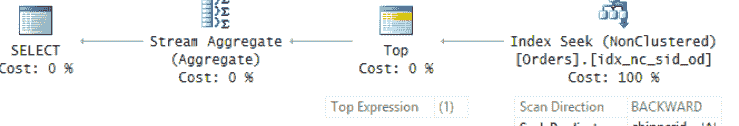

**图 2-64** 单个发货员的查询计划。

足够了，计划在非聚集索引中执行到索引叶 `shipperid` 区域的右边缘，然后开始反向范围扫描。`Top` 算子从 `Index Seek` 算子处请求行，正如你所见的，它只请求了一行。因此，范围扫描没有理由继续执行到该行之外。来自过滤行的订单日期提供给 `Stream Aggregate` 算子，该算子返回最大订单日期。此查询计划的执行在我们的系统中涉及了三个订单。

现在你已经知道优化器对单个发货员应用了所需的策略，下一步是从 `Shippers` 表中获取相同的发货员。实现此点的一种方法是查询 `Shippers` 表，并在过滤中调用相关标量聚合子树，该子树返回当前发货员的最大订单日期。如果返回的日期在 2010 年之前，则过滤发货员。这里是实现这种方法的完整解决方案（称为基于集合的解决方案 2）：

```sql
SELECT shipperid
FROM Shippers AS S
WHERE (SELECT MAX(orderdate)
FROM Orders AS O
WHERE O.shipperid = S.shipperid) < '2010';
```

人们希望此查询的计划将从扫描 `Shippers` 表的某些索引来获取 `shipperid`，然后执行你在图 2-64 中看到的针对每个 `shipperid` 的循环活动。遗憾的是，事实并非如此，正如你在图 2-65 的执行计划所示。

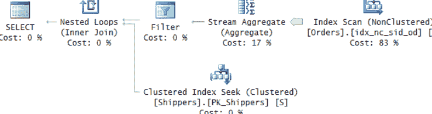

**图 2-65** 基于集合的解决方案 2 的查询计划。

如你所见，优化器选择了一个对非聚集索引执行全表扫描的计划，这正是你通过此查询想要避免的。SQL Server 为该查询在我的系统中报告了以下性能统计：逻辑读取 = 8 + 2487，CPU 时间 = 438 ms，通过时间 = 524 ms。

事实证明，当优化器看到示例中的标量聚合子查询时，它首先在内部进行取消嵌套，将其转换为连接形式。这样，优化器就可以评估以不同顺序访问表的不同计划。问题是优化器在这里需要做许多决策，例如使用何种访问方法访问表、使用何种算法等等。搜索空间变得如此巨大，如果优化器尝试探索所有可能的计划，就会产生适得其反的结果。

```sql
SELECT shipperid
FROM Shippers AS S
WHERE (SELECT MAX(orderdate)
FROM Orders AS O
WHERE O.shipperid = S.shipperid) < '2010';
```

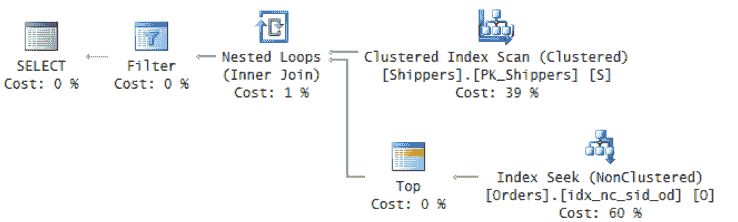

**图 2-66** 基于集合的解决方案 3 的查询计划。

这一次，计划正是我们所需要的。它从 `Shippers` 表开始，返回 12 个 `shipperid`。然后，针对每个 `shipperid`，循环在非聚集索引上执行查找以检索当前发货员的订单日期。然后如果相应的日期在 2010 年之前，则过滤发货员。这是我得到的性能统计：逻辑读取 `Shippers` = 2，访问计数 `Orders` = 12，逻辑读取 `Orders` = 36，CPU 时间 = 0 ms，通过时间 = 12 ms。

## 调优

以下是另一种获取高效计划的解决方案（称为基于集合的解决方案 4）：

```sql
SELECT shipperid
FROM Shippers AS S
WHERE NOT EXISTS
(SELECT * FROM dbo.Orders AS O
  WHERE O.shipperid = S.shipperid
  AND O.orderdate >= '2010')
AND EXISTS
(SELECT * FROM dbo.Orders AS O
WHERE O.shipperid = S.shipperid);
```

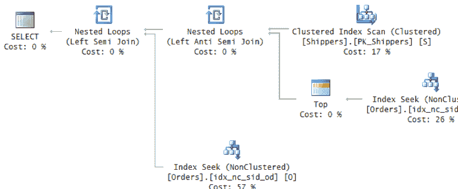

**图 2-67** 基于集合的解决方案 4 的查询计划。

基于集合的解决方案 3 的计划，此计划也从扫描 `Shippers` 表开始，返回 12 个 `shipperid`。对于这 12 个 `shipperid` 中的每一个，第一个循环在非聚集索引上应用查找以检查查询中的 `NOT EXISTS` 谓词。在我们的案例中每个可能是 0 到 12 次，第二个循环在非聚集索引上应用查找以检查查询中的 `EXISTS` 谓词。此计划比基于集合的解决方案 3 的计划贵一点，但它仍然非常高效，且扩展性也取决于发货员的数量。性能统计为 `Shippers` = 2，访问计数 `Orders` = 19，逻辑读取 `Orders` = 72，CPU 时间 = 0 ms，通过时间 = 9 ms。

我涵盖了该任务的不同解决方案，每个方案都获得了一个不错的执行计划。第一个是最简单、最直观的，但不是最高效的。剩余的查询调优尝试不仅仅是尝试许多解决方案直到获得高效计划；而是在思考了高效计划应该是什么样之后，应用修订以获得特定的效果。

完成后，请运行以下代码以关闭会话中的 I/O 报告和时间统计：

```sql
SET STATISTICS IO, TIME OFF;
```

此时，建议你重新运行书籍源码中的 `PerformanceV3.sql` 脚本文件，以重新创建一个干净的示例数据库。

## 并行查询执行

过去几年中，计算机硬件的变革特点是几乎每个指标都呈现了巨大增长：更大、更快的存储器，更多、更快的内存，以及最重要的是更多、更强大的 CPU。数据库领域也发生了一系列变化，数据量正在迅速增长。与此同时，用户对数据分析的需求日益迫切，但他们仍然期望秒级的查询速度和点击按钮即可生成的报告。

拥有强大的计算能力，处理海量数据并不困难，但性能的最佳提升是通过使用特殊算法实现的，这些算法专门利用了服务器不断增强的性能。这些算法的关键是将数据分成较小的块，并可以同时分发到任何处理器核心上。此类技术被称为并行查询执行、查询内并行或简称为并行化，SQL Server 有一套精细的系统来处理这类工作。

本节将深入探讨 SQL Server 的并行查询能力，重点关注查询优化、查询执行和调度内部的关键方面。理解这些领域将不仅让你能够分析查询和性能特征，还能根据你的查询和负载情况，控制查询内的并行性或对其进行限制。

> 注意：本节中的示例使用了 `AdventureWorks2014` 示例数据库。该数据库可以通过 CodePlex 获取：https://msftdbproamples.codeplex.com/releases/view/125550。

## 查询内并行如何工作

并行处理——将工作拆分到多个处理器核心上——可以通过不同的方式实现。最常见的模型如下：

- 工厂型模型：其中每个核心负责单一操作，数据从一个核心传递到另一个核心。（想象一个汽车工厂，一个人安装门把手，另一个人安装窗户，以此类推。）
- 流式模型：其中每个核心负责一组数据并执行所需的操作。（这种模型类似于一个工厂，每辆车都由一个人独立完成。）

尽管工厂型模型在直觉上似乎更好（特别是当应用于汽车和人类时），但 SQL Server 和许多其他数据库产品基于流式模型。与人类不同，计算机处理器只要数据已经在处理器的本地缓存中，就能快速高效地切换任务。从主内存（或更糟糕的主存储器）获取数据的成本可能比执行新任务贵几个数量级。这意味着，在将数据移动到其他处理器或内存位置之前，对该数据尽可能多的工作几乎是有利的。

流式模型通常比工厂流水线模型具有更好的扩展性，特别是当数据增长时。SQL Server 的流式模型涉及使用各种算法（根据场景选择）将行尽可能均匀地分布到各个核心上。考虑一种情况：一个查询计划只有三个操作，但有成百亿行数据需要应用这些操作。在简单的工厂流水线模型中，查询计划可能只能使用三个处理器，但在流式模型中，理论上可以扩展到数百万或数十亿个处理器核心。通常，服务器配备的处理器核心数量有现实限制，而且在大规模扩展数据集时也存在收益递减点。这种灵活性在较小案例中很有帮助，这也是流式模型在数据库系统中被常用的关键原因之一。

## 查询计划中的并行基础

“并行查询计划”这个概念其实有点误导。查询计划要么完全是串行的（使用单个工作线程进行处理），要么包含一个或多个并行分支（即计划中通过多个线程处理的区域）。这是一个重要的区别，因为查询处理器有能力将多个并行流合并为单个流，或从单个流创建并行流。这些操作可以在给定的查询计划中执行任意次数，这意味着一个计划可以包含许多与许多串行区域交织在一起的并行区域。

给定计划中的每个并行区域使用的线程数与计划中其他每个并行区域相同。每个区域的线程数称为该计划的并行度（DOP），由服务器设置、计划提示和运行时条件共同决定。一组给定的线程在计划执行过程中可能会被多个区域重用。例如，如果你的计划的 DOP 为 4 且有 4 个并行区域，取决于各个并行区域之间的相互关系，它可能使用 4 到 16 个实际工作线程来完成工作。

要确定给定算符是否在并行区域内，可以通过查看图形执行计划查看器中的图标来实现。位于并行区域的算符会带有一个箭头的圆圈，如图 2-68 所示；`Parallelism` 和 `Sort` 算符位于并行区域中，而 `Top` 算符则不在。

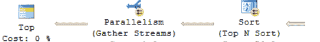

**图 2-68** 并行区域中的算符带有带有箭头的圆圈图标。

对于一个并行区域，每个工作线程将为整个区域处理一个唯一的行流，之后这些行将被移动到下一个区域的另一个线程（无论该区域是串行的还是并行的）。因此，每个并行区域的一侧由提供多个流的算符限制，另一侧由负责重新分配或串行化的算符限制。

## 交换算符

并行查询计划的关键特征是各种并行区域，而并行区域的关键是一个内部称为 `Exchange`（交换）、图形中显示为 `Parallelism`（并行）的算符。该算符控制并行计划中的工作线程和数据流，它是使并行计划运行的组件。

提醒一下，查询计划有两种读取方式：从右到左或从左到右。从右侧开始读取查询计划是遵循数据在计划中的流向。相反，从左侧开始读取计划是遵循算符逻辑，这是驱动数据的逻辑。计划中的每个算符都会向下一个下游算符请求一行，然后在向下游传递该行之前执行所需的任何操作（对于像 `Sort` 这样的阻塞算符，这可能意味着在传递一行或多行之前获取许多行）。`Exchange` 算符处理多个行流。然而，流上的几乎所有算符都完全感知不到并行的存在。

`Exchange` 算符有三种变体。三种变体中的每种都有两个任务，取决于你是从数据流还是算符逻辑的角度读取计划，这些任务似乎是对立的。

- **聚集流**：当从数据流角度查看计划时，该算符界定了并行区域的结束（以及串行区域的开始）。它将多个并行数据流合并为单个流。当从算符逻辑角度读取计划时，`Gather Streams` 算符实际上是并行区域的开始。从这个角度来看，它的工作是调用并行工作线程并向每个线程上的算符请求行。

- **分发流**：从数据流角度读取，该算符界定了并行区域的开始（串行区域的结束）。它将一个串行行流拆分为多个并行流。从算符逻辑角度读取，该算符标记了并行区域的结束；下一个上游算符将是串行区域的一部分。

- **重分区流**：该算符的作用是接入多个并行流，并将行重新分发到不同的线程上，其分发方案与上游并行区域分发行时使用的方案不同。因此，无论计划是从数据角度还是逻辑角度，该算符都定义了并行区域的开始和结束。该算符的另一种理解方式是它连接了两个相邻的并行区域。

图 2-69 显示了一个包含所有三种类型 `Exchange` 算符的查询计划。

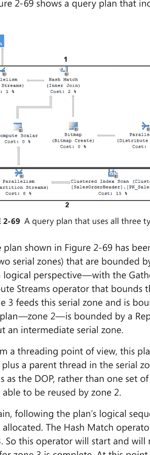

**图 2-69** 使用所有三种类型交换算符的查询计划。


图 2-69 中的计划经过了编辑和注释，以突出由各种交换算符界定的三个并行区域（以及两个串行区域）。并行区域 1 从逻辑角度看起始于收集（`Gather`）算符。位图（`Bitmap`）算符的输入来自分发流（`Distribute Streams`）算符，该算符通过一个包含顶部（`Top`）算符的串行区域界定了该区域。并行区域 3 馈送该串行区域并由收集流（`Gather Streams`）算符界定。计划中的最后一个并行区域——区域 2——由重分区流（`Repartition Streams`）算符界定，并与区域 1 相邻，中间没有串行区域。

从趋势的角度来看，该计划在其并行区域将使用 `DOP * 2` 个工作线程，并在串行区域使用一个父线程。它之所以只能使用比 DOP 一倍的工作线程，而不是每个线程一个，理由是分配给区域 3 的线程将可以被区域 2 复用。

再次，遵循计划的逻辑顺序，如果 DOP 为 4，区域 1 将开始并分配四个工作线程。哈希匹配（`Hash Match`）算符在它的构建侧（即包含并行区域 3 的一侧）上运行。因此，该算符将启动，在分配给区域 3 的四个线程完成所有工作之前，它不会返回。此时，这四个线程将用于处理区域 2。

通过查看并行查询计划可能很难确切地想象正在发生什么，但如果将其转换为稍微不同的图形形式，就会变得简单许多。考虑图 2-70 所示的计划片段。

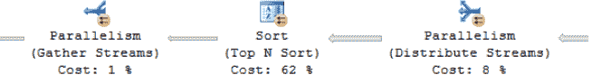

**图 2-70** 仅包含一个排序（`Sort`）算符的并行区域。

图中所示的计划片段是一个完整的并行区域，仅包含一个排序算符。如果图形计划视图是根据实际情况渲染的，且该计划的 DOP 为 4，那么图像看起来可能类似于图 2-71 所示。

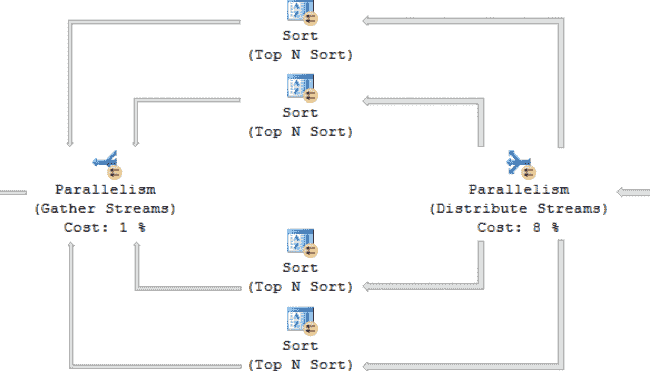

**图 2-71** 并行性实际上是如何工作的。

对于一个 DOP 为 4 的计划，收集流（`Gather Streams`）算符将分配四个工作线程。这些工作线程中的每一个都会生成一个排序算符，而每个排序算符都将向分发流（`Distribute Streams`）算符请求行。重要的是要意识到每个排序算符都是独立运行的，完全不知道其他算符正在做什么。鉴于这种设计，DOP 可以任意放大或缩小，而计划仍能以相同的方式运行，只是速度快慢的问题。

# 交换算符内部

上一节侧重于工作线程和行流的角度讨论了交换算符，但它留下了一个核心问题尚未回答：为什么被称为“交换”（`Exchange`）？

每个 SQL Server 查询计划算符内部都有两个逻辑接口：消费者接口（`consumer interface`），它从上游获取行；以及生产者接口（`producer interface`），它向下传递行。在大多数算符中，这些接口在同一个线程上处理，但在交换算符的情况下，会涉及到多个线程。交换算符的任务是从消费者侧的线程获取行，并将这些线程交换为生产者侧的不同线程。这就是命名的由来。

实际的交换过程发生在数据结构 `CXPacket` 内部，其中 `CX` 代表一个 C++ 类（实现该结构），而 `XPacket` 代表交换包（`exchange packet`），这是该结构的实际名称。当行在算符中消耗时，它们被存储在交换包中。当包被行填满，它们就会跨越交换传递给生产者侧等待的线程。交换每侧的线程数量取决于交换的类型：收集流（`Gather Streams`）在消费者侧有 DOP 线程，生产者侧有一个；分发流（`Distribute Streams`）在消费者侧有一个，生产者侧有 DOP 线程；而重分区流（`Repartition Streams`）在交换的每一侧都有 DOP 线程。

如果你花过时间监控 SQL 等待（`waits`），你无疑遇到过 `CXPACKET` 数据结构。设置了此等待的线程通常在等待生产者侧的行。然而，如果在线程开始生成行之前需要某些同步操作，消费者侧的线程也可以设置该等待类型。

## 行分发策略

并行查询计划必须涵盖广泛的用例。为了增加查询优化器的可用灵活性，在分发（`Distribute`）或重分区（`Repartition`）交换的生产者侧，跨线程分发行有五种选项：

- 哈希（`Hash`）：这是最常见的分发方案，它涉及每行都根据哈希函数的结果分配到一个消费者线程。该方案通常用于在工作线程上对齐逻辑组中的行。例如，如果对产品 ID 应用哈希函数，所有具有相同 ID 的行将被分配到该线程。

- 轮询（`Round`）：该方案将行从消费者侧发送到生产者侧。

- 广播（`Broadcast`）：该方案将消费者侧的所有行发送到生产者侧的所有线程。

- 需求（`Demand`）：该方案仅用于分区表。

- 范围（`Range`）：在该方案中，每个线程被赋予一个不重叠的键范围。这仅用于构建索引。

要查看交换算符使用的分布方案和相关信息，可以将鼠标悬停在算符上直到出现提示框，或者更好是按 `F4` 获取属性窗口，如图 2-72 所示。

| | |
| :--- | :--- |
| 分区列 | `[AdventureWorks14];[Sales]` |
| 列 | `SalesOrderID` |
| 数据库 | `[AdventureWorks14]` |
| 架构 | `[Sales]` |
| 表 | `[SalesOrderDetail]` |
| 分区类型 | `Hash` |
| 物理操作 | 并行 |

图 2-72 获取交换算符的信息。

属性还有一个用于并行查询计划的有用功能：当查看实际（而非计划）查询计划时，它会显示计划中每个算符（包括交换算符和其他）每个线程处理的行数。这些信息如图 2-73 所示。

| 实际执行模式 | 行 |
| :--- | :--- |
| 实际批次数 | 0 |
| 实际行数 | 1000 |
| 线程 0 | 0 |
| 线程 1 | 201 |
| 线程 2 | 103 |
| 线程 3 | 149 |
| 线程 4 | 134 |
| 线程 5 | 179 |
| 线程 6 | 234 |

图 2-73 在实际查询计划中查看每个线程处理的行数。

每个线程的行数可以通过展开“实际行数”下的对话框获得。此处所示的计划 DOP 为 6，意味着每个并行区域有 6 个工作线程。每个线程处理了超过 100 行，但某些线程处理的比其他线程多；对于处理 1000 行的计划来说，这可能不是主要问题，但对于更大的计划可能会导致性能问题。

线程 0 代表父线程（也称为分发线程或协调线程）。这是在串行区域中激活并生成并行工作线程的线程。

这里并不是处理行，而是为了控制工作线程的生命周期；因此，在这个特定的算符上不会显示有任何工作负载。

## 并行排序和合并交换

当然，并行的主要目标是将昂贵的工作单元拆分为更小的部分，以便在多个 CPU 上并发运行。人们可能会合理地预期，如果某个给定操作在单个处理器上运行需要 1000 ms，那么在四个处理器上运行可能只需要 250 ms。这种逻辑有些天真，但它可能是正确的——这取决于最初拆分工作的成本有多高，以及将结果合并回单个流以供调用者消耗的成本有多大。

惊讶的是，在某些情况下，将工作拆分为更小的部分实际上带来的性能提升可能比并发工作线程数量预期的还要大。换句话说，对于这类操作，上述 1000 ms 的示例在四个处理器上运行可能仅需 200 ms，而不是 250 ms。这种方法有效的操作类型是那些在数学上具有极佳扩展性的操作；对于一个大小为 N 的工作集，当工作集大小变为 `N * 10` 时，此类操作的性能会下降超过 10 倍。

其中一种操作（也是数据库场景中最常见的）是数据排序。所有排序算法的规模均为 `N * LOG(N)`。这并不是非常陡峭的曲线：排序 100,000,000 个元素的集合所需的时间仅比排序 10,000,000 个元素的集合多 11 倍，与线性比例相比差异仅为 10%。然而，在数据库性能的世界里，一切都至关重要。在查询处理器中利用这类数学收益非常有意义。

如果一组大量的行需要根据给定的键进行排序，查询计划会将排序放入并行区域。如果对多个列进行排序，数据将使用哈希方案进行分布，或者将所有值聚集在一起。

一旦数据完成排序，需要在随后的串行区域中保持顺序；如果无法使用这些数据，那么并行排序数据就意义不大。在这些情况下，查询计划将使用一种特殊的聚集流（`Gather streams`），称为合并交换（`merging exchange`）。合并交换消耗多个具有相同顺序的数据流，并输出保持相同顺序的单个数据流。这是通过一个简单的合并算法实现的：如果数据按 `ProductID` 升序排序，则从每个输入流读取行并记录最小的 `ProductID`。现在继续读取行直到没有该 ID 的行为为止，此时记录下一个最小的 ID。现在读取该 ID 的行，依此类推，从而维持了输入顺序。

图 2-74 显示了以下查询的计划片段：

```sql
SELECT TOP(1000)
  UnitPrice
FROM Sales.SalesOrderDetail
ORDER BY
  UnitPrice DESC;
```

| 排序 | `[AdventureWorks2014].[Sales]` |
| :--- | :--- |
| 升序 | False |
| 列引用 | `[AdventureWorks2014].[Sales]` |
| 列 | `UnitPrice` |
| 数据库 | `[AdventureWorks2014]` |
| 架构 | `[Sales]` |
| 表 | `SalesOrderDetail` |
| 输出列表 | `[AdventureWorks2014].[Sales]` |


**图 2-74** 并行排序合并交换。这里的 `Gather streams` 算符包含一个 `Order By` 属性，表明它是合并交换。数据将通过 `AdventureWorks2014` `SalesOrderDetail` 表中的 `UnitPrice` 列输出，在当前计划中，该列与上游 `Sort` 算符使用的列相同。

## 部分聚合

在考虑查询计划时，最主要的考虑因素通常不是计划中算符的数量。大多数算符一次只处理一行数据，而这种快速处理的能力正是 SQL Server 流式查询处理器的核心所在。重要的是算符的数量，以及流过每个算符的行数。性能问题通常发生在行数较多的区域，这意味着算符正在执行大量工作。早期减少行数的益处在昂贵操作中更为显著，而跨线程移动数据（如 `Exchange` 算符中所执行的）是一项非常昂贵的操作。这是因为需要将数据放入数据包并将其复制到新的内存位置，而不是将所有内容保留在原地。为了尽可能消除成本，许多并行计划都涉及部分聚合策略。该策略涉及在计划早期根据行所在的任何线程对行组进行聚合，并在数据经过重新定位后完成完整聚合。

例如，考虑一个查询使用 `MAX` 聚合来查找有售以来价格最高的产品的情况。`ProductID` 有 1,000,000 行，这些行分布在 10 个线程上。查询处理器可以重新分区所有 1,000,000 行（复制到新的内存位置）并计算聚合。或者，查询处理器可以每个线程计算一个聚合（即每个线程恰好拥有的所有最大值），然后在计算最终聚合之前对 10 个线程进行重新定位。无论哪种情况答案都是相同的，但后者的重新定位成本会大大降低。

图 2-75 显示了以下查询的部分聚合结果：

```sql
SELECT
  th.ProductID,
  th.TransactionDate,
  MAX(th.ActualCost) AS MaxCost
FROM (
  SELECT
    tha.ProductID,
    tha.TransactionDate,
    tha.ActualCost
  FROM Production.TransactionHistory AS tha
  CROSS JOIN Production.TransactionHistory AS th
) AS th
GROUP BY
  th.ProductID,
  th.TransactionDate;
```


**图 2-75** 部分聚合。这里 `Stream Aggregate` 算符计算部分聚合（在计划中命名为 `partialagg03`），在 `Repartition` 算符消耗之前大幅减少了行数。选择此计划是因为两个表的连接导致预估行数巨大：交叉连接产生了 10,125,000 行，但在初始聚合后剩余 319,983 行。

## 并行扫描

在处理行之前，必须从它们所在的堆或索引中读取这些行。虽然可以通过单个线程读取数据来实现，但对于大表来说，让多个线程参与进来通常更快。这是通过使用并行扫描实现的。

图 2-76 显示了以下查询的并行扫描结果：

```sql
SELECT
  ActualCost
FROM Production.TransactionHistory AS th
ORDER BY
  ActualCost DESC;
```


**图 2-76** 并行扫描。

在此，`Gather Streams` 算符产生工作线程，每个线程都会实例化一个 `Sort` 算符。由于此 `Index Scan` 位于并行区域，它是并行的，并且不会向每个工作线程提供相同的行集。相反，它根据表的大小给每个工作线程一个数据页或页范围。工作线程从数据页或页范围读取行，供 `Sort` 算符消耗。

并行扫描（`Parallel scan`）是基于数据页而非行来工作的，特别是在查找表（`lookup tables`）较小的情况下，可能会出现数据页数量少于工作线程数量的情况。在这种情况下，某些工作线程会被分配但没有工作可做，这不仅意味着分配这些线程浪费了时间，而且意味着剩余的每个线程都必须承担比预期更多的工作。

为了消除这种情况，SQL Server 实现了一种名为“少量外层行”（`few outer rows`）的特殊优化。当使用并行扫描来固定嵌套循环（`Nested Loops`）算子的外侧部分时，就会发生这种优化。在这种情况下，每个读取线程代表了在循环内侧要执行的工作，理想情况下，工作应该在线程之间尽可能均匀地分布。如果优化器检测到行数太少，则会在计划中并行扫描之后插入一个重分区流（`Repartition Stream`）算子。

图 2-77 显示了针对以下查询的优化结果：

```sql
SELECT
 p.ProductID,
 th0.TransactionID
FROM Production.Product AS p
CROSS APPLY (
    SELECT TOP(1000)
    th.TransactionID
    FROM Production.TransactionHistory AS th
    WHERE
        th.ProductID = p.ProductID
    ORDER BY
        th.TransactionID
) AS th
ORDER BY
 th0.TransactionID;
```

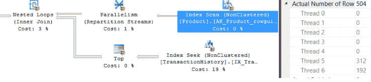

图 2-77 如果没有少量外层行优化，六个线程中只有两个必须工作。

在此计划中，对 `Product` 表的扫描导致只有两个工作线程接收到行。这是因为索引中只有两个数据页；该表有 504 行。查询优化器预见到了这一点，并在扫描之后直接插入了一个重分区流算子。该算子将使用轮询（`Round Robin`）方案对行进行重分区，在工作线程之间产生完美的平衡，如图 2-78 所示。

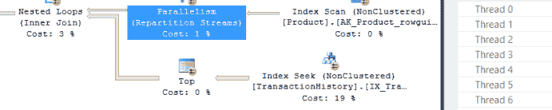

图 2-77 轮询方案在工作线程之间均匀地分配行。

## 并行哈希连接和位图

鉴于并行查询计划倾向于处理大量行集，且哈希匹配（`hash match`）的设计是为了连接大量行集，在并行查询计划中使用哈希连接（`Hash Join`）算子是非常常见的。因此，让这些连接尽可能优化是合理的。

通常的哈希连接算法对外层（构建侧）键进行哈希，对每个内层（探测侧）键进行哈希，在哈希表中找到匹配的桶，最后遍历桶的链表找到匹配的行。

在并行计划中，可以发生一种优化，每个线程都会在哈希表中构建具有相同数量桶的位图（`bitmap`）。位图中的位如果对应的哈希桶中没有行，则为 0；如果哈希桶中有行，则为 1。在探测（`probe`）时，查询处理器不必直接进入哈希桶，而是可以通过位图发现哈希表中是否存在潜在的行。这可以大大降低哈希连接查询的成本和开销，特别是在探测侧大部分行都不匹配构建侧行的情况下。

以下查询在计划中使用位图进行了优化，如图 2-79 所示：

```sql
SELECT
*
FROM(
    SELECT
    sh.id,
    sd.ProductID
FROM(
    SELECT TOP(1000)
    *
    FROM Sales.SalesDetail
    ORDER BY
    SalesOrderDetailId
) AS sd
INNER JOIN Sales.SalesOrderHeader AS sh ON
    sh.OrderID = sd.OrderID
) AS s;
```

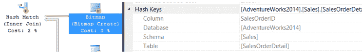

此类计划中的位图（如所示）是基于与子查询 `Hash Match` 算子相同的哈希键。

位图优化的进一步增强可以发生在数据仓库查询中，查询优化器确定这些查询为星型连接（`star join`，一个或多个维度连接到事实表）。如果发生了星型连接优化，每个维度都将被扫描并在内部合并到单个位图（和哈希表）中，该位图可以在探测侧作为单一过滤器。这种方法比为每个维度单独探测哈希表要快得多。

## 并行性与分区表

在涉及具有大量分区的表的计划中，查询优化器可能会选择分配线程单独处理每个分区，而不是使用典型的扫描机制顺序扫描整个分区集。这种特殊情况包含了需求分布方案（`Demand distribution scheme`）；每个线程一次可以处理一个分区，并在完成第一个分区后请求另一个分区。通过这种方式，即使某些分区的行数少于其他分区，查询在工作线程之间也能保持良好平衡。


要看到这一效果，需要一个分区表，并进行一些设置。以下代码在 `tempdb` 中创建一个分区函数、一个分区方案和一个表：

```sql
USE tempdb;
GO

CREATE PARTITION FUNCTION pf_1 (INT)
AS RANGE FOR VALUES
(
25000, 50000, 75000, 100000,
125000, 150000, 175000, 200000,
225000, 250000, 275000, 300000,
325000, 350000, 375000, 400000,
425000, 450000, 475000, 500000,
525000, 550000, 575000, 600000,
625000, 650000, 675000, 700000,
725000, 750000, 775000, 800000,
825000, 850000, 875000, 900000,
925000, 950000, 975000, 1000000
);

CREATE PARTITION SCHEME ps_1
AS PARTITION pf_1
ALL TO ([PRIMARY]);

CREATE TABLE partitioned_table (
  col1 INT NOT NULL,
  col2 INT NOT NULL,
  some_stuff CHAR(200) NULL
) ON ps_1;

CREATE UNIQUE CLUSTERED INDEX ix_col1 ON partitioned_table(col1) ON ps_1;

GO
```

考虑以下 `SELECT INTO` 查询：

```sql
WITH
n1 AS (SELECT 1 UNION ALL SELECT 1),
n2 AS (SELECT 1 FROM n1, n1 c),
n3 AS (SELECT 1 FROM n2, n2 c),
n4 AS (SELECT 1 FROM n3, n3 c),
n5 AS (SELECT 1 FROM n4, n4 c),
n6 AS (SELECT 1 FROM n5, n5 c)
SELECT TOP (100000000)
  col1,
  ROW_NUMBER() OVER
  (
    ORDER BY
      (SELECT NULL)
  ) AS coll,
  CHECKSUM(NEWID()) AS col2
INTO #test_table
FROM n6;
```

该查询向名为 `#test_table` 的临时表插入了 10,000,000 行。图 2-8 显示了该查询在 SQL Server 2012 实例上运行时的执行计划片段。

| 表 (insert #test_table) | 标量计算 (Compute Scalar) | 顶部 (Top) | 序列投影 (标量计算) | 分段 (Segment) | 并行 (汇聚流) |
| :--- | :--- | :--- | :--- | :--- | :--- |
| 成本: 70 % | 成本: 0 % | 成本: 0 % | 成本: 0 % | 成本: 0 % | 成本: 1 % |

图 2-8 在 SQL Server 2012 中，`SELECT INTO` 在单个线程上进行写入。

尽管此查询使用了并行处理，但在计算行号之前，并行流会进行聚集。计算完行号后，数据将通过单串行流写入临时表。

在 SQL Server 2014 实例上运行相同的查询会生成图 2-82 所示的计划片段。

| 并行 (汇聚流) | 表 (insert #test_table) | 标量计算 (Compute Scalar) | 并行 (分发流) | 顶部 (Top) | 序列投影 (标量计算) |
| :--- | :--- | :--- | :--- | :--- | :--- |
| 成本: 5 % | 成本: 37 % | 成本: 0 % | 成本: 19 % | 成本: 1 % | 成本: 1 % |

图 2-82 在 SQL Server 2014 中，`SELECT INTO` 可以是多线程的。

在 SQL Server 2014 中，行号是在串行线程中生成的。然而，一旦计算完成，行就会分布到多个线程（在本例中，使用轮询方案），然后从多个并发的流写入目标表。

这种改进带来的性能收益可能是惊人的：在一台同时安装了 SQL Server 2012 和 SQL Server 2014 的测试服务器上，在磁盘系统和内存分配相同的情况下，查询在 SQL Server 2012 中运行了 10 秒，而在 SQL Server 2014 中仅运行了 4 秒。

# 并行与查询优化

在查询处理器能够执行并行查询计划之前，查询优化器必须生成该计划。所使用的过程比串行查询计划的要复杂且细微，作为一名处理并行查询的开发者，你需要了解发生的情况，以便在问题发生时有效地处理它们。

查询计划中使用或不用并行处理的决定大部分是在查询处理器参与查询执行之前做出的。此决定基于实例级（或资源生成器组级）设置与所涉及查询的结合。实际运行计划的执行引擎对于是否使用并行处理几乎没有多少发言权，且当 SQL Server 实例处于极端资源压力时，它将否决使用并行处理。

# 并行设置

有四个影响并行处理的实例级设置。这些设置可以在 `sys.configurations` 目录视图中查看，并可以使用 `sp_configure` 系统存储过程进行配置。设置如下：

- **亲和性映射 (Affinity Map)**：此设置控制服务器的哪些逻辑处理器将映射到 SQL 调度器。并行查询需要多个 SQL 调度器，因此，如果亲和性映射被设置为只有一个处理器，则查询优化器将不会尝试生成并行查询计划。也就是说，鉴于当今服务器中众多的处理器，看到单调度器的 SQL Server 实例是非常罕见的。此设置的默认值为 0，表示所有逻辑处理器都应映射到 SQLOS 调度器。

- **最大并行度 (Max Degree of Parallelism)**：最大并行度是并行查询使用的默认值，用于确定为每个并行单元分配多少工作线程（之前讨论过的 `DOP`）。可以使用查询级别的 `MAXDOP` 提示来覆盖此设置——无论是增加还是减少。此设置名称中的“最大”一词以及查询提示有一点误导性；如果并行查询使用了并行处理，它将使用在查询级别指定、通过设置或通过本节稍后描述的资源生成器设置所确定的任何 `DOP`。对于给定的查询，关于“正确”的 `DOP` 应该是多少，既没有查询优化器的决定，也没有运行时查询处理器的决定。此设置的默认值为 0，意味着并行计划的每个区域可以使用与在线 SQLOS 调度器数量相等的线程，最多为 64 个。

- **并行处理的成本阈值 (Cost Threshold for Parallelism)**：在优化查询时，查询优化器会经历多个阶段，每个阶段都会为过程增加时间和开销。优化器的核心目标之一是在短时间内生成良好的计划，此设置通过帮助其实现该目标（如果查询计划的串行版本成本不高，不值得进一步处理，它将退出查询优化过程）。此设置的默认值为 5，这意味着只有当成本超过 5 时，才会考虑并行处理。

例如，SQL Server 与 IIS 实例共享一个服务器，而管理员希望为每个进程分配其自己的预留 CPU。这种情况是有意义的，但在当今世界，服务器虚拟化技术通常是处理此类情况更好的方法。

最大工作线程数（`Max Workers Threads`）被设计为自动维护，通常只有在极端情况下（特别是极其沉重的并行负载以及对线程池耗尽有特定需求时）才需要调整。这些情况通常需要产品支持的能力，让支持人员决定如何解决这种情况可能是明智的。

查询成本（`Query cost`）是一个最早在 1998 年 SQL Server 7.0 中引入的指标。现在，16 年后（截至本文结构体编写时），计算机行业已经发生了巨大变化，但查询成本仍然使用基本结构。一个成本为 5 的查询（并行度阈值 `Cost Threshold Of Parallelism` 的默认值）在 1998 年是非常庞大的，但在如今的海量数据库中则相对较小。因此，建议对大多数 SQL 实例更改此数字。对于今天典型的硬件和数据规模，值在 30 到 50 之间是合理的。如果你发现查询（针对你的环境）正在使用并行计划，可以考虑将其设置得更高。

与并行度成本类似，最大并行度（`Max Degree Of Parallelism`）也有一个令人遗憾的默认值。此设置应该针对特定实例进行调整，以平衡查询响应时间与允许许多查询并发运行之间的目标。如果最大并行度太低，查询将变慢；如果太高，并发查询将强制竞争处理器时间并产生负面影响。

最大并行度的通用指南取决于工作负载。对于 OLTP 系统，其倾向于具有高比例的小型串行查询，此外还有许多轻量级查询，可能建议较小的最大并行度——低至 2。

另一方面，对于 OLAP 工作负载，典型情况是少量的大型查询，较高的最大并行度通常是一个好主意。在四插槽服务器上，明智的做法是设置为每个 NUMA 节点的处理器数量（通常与每个插槽的处理器数量相同），或者在双插槽服务器上取其的一半。这为每个查询提供了可用 CPU 算力的很大一部分，同时允许并发查询运行而互不干扰。

如果启用了超线程（`Hyper-Threading`），建议将最大并行度设置为不超过比每个节点物理处理器数量多 50%。换句话说，如果每个节点有 6 个物理处理器和 12 个逻辑处理器（由于超线程），通常建议将最大并行度设为不超过 9。这有助于防止查询执行压过超线程提供的额外加速。

## 并行抑制因素

除了核心查询优化和处理决策外，几个查询功能可以以一种方式抑制并行性：要么在原本并行的查询计划中强制执行串行区域，要么完全禁用给定查询的并行性。

以下是导致并行查询计划中出现串行区域的常见原因列表：

- **多语句 T-SQL UDF**：多语句 UDF 通过表变量返回表值。用户定义函数 (`UDF`) 中的逻辑将在串行区域中进行处理，尽管计划的其他部分可能使用并行处理。

- **递归 CTE**：递归通用表表达式在串行区域中处理，下游算符 (`operators`) 可能会使用并行处理。

- **反向扫描**：SQL Server 中的索引使用链表，可以按正向或反向方向扫描。只有正向扫描符合前述的并行扫描。反向扫描将被限制在串行中执行。

- **非分区的 TOP、聚合和窗口函数**：`TOP` 运算符、聚合和窗口函数的使用涉及创建行组。如果必须在计划的给定阶段通过分析整个输入行集来确定组，则查询优化器将不得不使用串行示例。示例包括相关表表达式之外的未分组聚合（也称为标量聚合）以及不使用分区的窗口函数。

以下列表包含了会完全禁用给定计划并行性的常见功能：

- **标量 T-SQL UDF**：在查询中使用任何标量 T-SQL `UDF` 都会导致该查询无法使用并行性。对于任何考虑使用 T-SQL `UDF` 的开发者来说，这应该是一个重大的警示信号。内联表达式或 CLR 标量 `UDF` 是更好的选择。

- **表变量的修改**：在大多数情况下，当使用表进行插入、更新或删除行时，在实际数据修改之前的查询部分可以在串行区域中处理，并行的 `SELECT INTO` 除外。表变量将打破这一惯例；如果修改了表变量中的行，整个计划将串行运行。请注意，如果表变量仅用于计划中不涉及修改的某些部分，则并非如此。

- **标记为 `DataAccessKind.Read` 的 CLR UDF**，这意味着它有权在托管数据库中运行查询。

- **内存优化表 (`Memory-optimized tables`)**：内存优化表不能参与并行查询计划。

要查看这些功能之一的影响，首先考虑以下查询，其计划如图 2-85 所示：

```sql
SELECT TOP(1000)
OrderQty
FROM Sales.SalesOrderDetail
ORDER BY
OrderQty DESC;
```

| SELECT | Top | 并行 (Gather Streams) | 排序 | 聚集索引扫描 (Cluste...) |
| --- | --- | --- | --- | --- |
| Cost: 0 | Cost: 0 | Cost: 1 | Cost: 70 % | Cost: 29 % |

**2-85** 并行计划。

尽管这可能是可以编写的最简单的 `UDF`，但它对查询计划的影响是巨大的，如图 2-86 所示。首先创建 `UDF`：

```sql
CREATE FUNCTION ReturnInput(@input INT)
RETURNS INT
AS
BEGIN
RETURN(@input)
END
```

一旦创建了 `UDF`，就可以在查询中使用：

```sql
SELECT TOP(1000)
ReturnInput(OrderQty)
FROM Sales.SalesOrderDetail
ORDER BY
OrderQty DESC;
```

| SELECT | 计算标量 | 计算标量 | 排序 (Top N Sort) | 聚集索引扫描 (Cluste...) |
| --- | --- | --- | --- | --- |
| Cost: 0 | Cost: 0 | Cost: 0 | Cost: 90 % | Cost: 10 % |

**2-86** 不再是并行计划。

如果你试图确定选择是否是因为抑制因素而不并行，请检查 `SELECT` 算符的属性。图 2-87 突出了 `NonParallelReason` 属性，它可以帮助你理解限制并行性的原因。

| MemoryGrantInfo | CouldNotGenerateParallelPlan |
|---|---|
| SELECT Cost:0% | NonParallelReason |
| Optimization Level | FULL |

**2-87** `NonParallelReason` 节点显示存在抑制因素。

接下来，这里有一个事务次数比标准版本多 504 倍的：

```sql
SELECT
th.ProductID + x.v AS ProductID,
th.ActualCost,
th.TransactionDate
INTO #bigger_transactions
FROM Production.TransactionHistory AS th
  CROSS JOIN
  (
    SELECT
      (NTILE(5) OVER (ORDER BY p.ProductID) - 1) * 1000
    FROM Production.Product AS p
) AS x(v);
CREATE CLUSTERED INDEX i_ProductID
ON #bigger_transactions (ProductID);
```

该表通过将 `Production.TransactionHistory` 中的 113,443 条交易与来自 `Production.Product` 派生的 504 行进行交叉连接而创建。使用 `NTILE` 函数是为了创建五组行，这些行对应于创建 `#bigger_products` 表时使用的 5 行。结果集包含 57,175,272 行，并且在 `ProductID` 列上进行了聚集。之所以选择该列是因为查询将使用该列来连接这两个表。

场景如下：用户想知道每个产品销售出的前 10 个最高价格（包括相同价格）以及相应的交易日期。以下查询回答了该问题：

```sql
SELECT
p.Name,
x.TransactionDate,
x.ActualCost
FROM
(
  SELECT
    th.ProductID,
    th.TransactionDate,
    th.ActualCost,
    ROW_NUMBER() OVER (
      PARTITION BY
        th.ProductID
      ORDER BY
        th.ActualCost DESC
    ) AS rn
  FROM #bigger_transactions AS th
) AS x
INNER JOIN #bigger_products p ON p.ProductID = x.ProductID
WHERE x.rn <= 10;
```

该查询通过在派生表 `x` 中计算行号来实现，按 `ProductID` 分区并按 `ActualCost` 降序排序。在查询的外部，对行进行过滤以仅返回每个产品的前 10 条，并与 `#bigger_products` 进行连接以获取每个产品的名称。图 2-88 显示了为了适应本书而编辑过的计划版本。

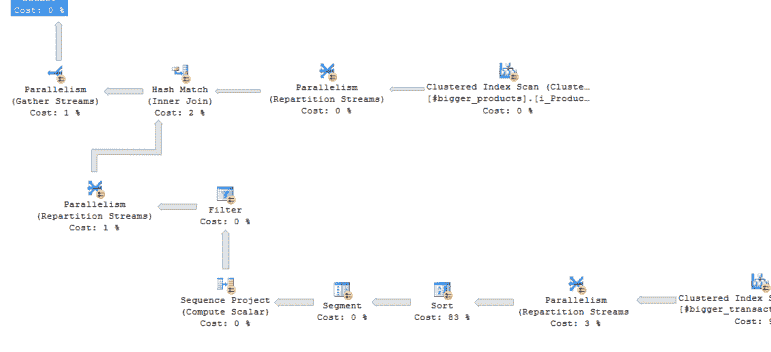

**图 2-88** 查找前 10 个最贵交易的查询计划。

此查询计划使用了并行性，但存在几个可以在不修改索引或表结构的情况下解决的潜在瓶颈。

第一个瓶颈是 `Hash Join` 算符探针侧（`probe side`）的排序。正如前面提到的，排序（`Sort`）并不是线性扩展的，而且在这种情况下，输入行数很大。由于这是一个并行计划，集合将被拆分，但规模的减少将受到计划 `DOP`（并行度）的限制。将集合拆分成更小的工作子集可能会产生更大的收益。此外，较小的子集需要的内存更少，内存耗尽并溢出到 `tempdb` 的机会也较低。

第二个瓶颈是在 `Hash Join` 算符探针侧并行扫描下游使用的 `Repartition Streams`（重新分区流）。该算符使用 `Hash` 分布方法根据 `ProductID` 将行分发到线程之间。这样做是为了让每个产品的行被正确地排序在一起。遗憾的是，这种分区在计划的如此早阶段就是必要的，它将移动扫描产生的每一行——全部 57,175,272 行。这是大量的数据移动。

# 并行嵌套循环

这两个瓶颈的解决方案是重新思考数据流通过这种大型计划的方式，并想出一种消除单体操作的方法，转而执行更多更小的操作。可以实现这一点的查询计划工具是 `Nested Loops`（嵌套循环）算符。

在任何查询计划中，无论是串行的还是并行的，`Nested Loops` 算符都会为每个外部行调用一次内部侧算符。`Nested Loops` 通常与相关子查询或表表达式，用作对每个必要的行评估相关表达式。


从连接性能的角度来看，`Nested Loops` 通常不是大数据集的最优选择，因为每个内部侧评估都需要对数据进行另一次查找或扫描，且这些操作的成本可能会累积。因此，随着数据量的增加，通常使用 Hash 或 Merge 连接。

尽管如此，在许多查询中，连接性能并不是决定整体性能的主要因素。由于 `Sort` 和 `Repartition Streams` 算符的可扩展性曲线，图 2-88 所示计划中的连接性能被其他元素大大掩盖了。在这些和类似的示例中，你最好忽略连接性能并关注大局。利用 `Nested Loops` 将让你能够妥善地处理这种情况。

## 减少并行计划开销

利用 `Nested Loops` 的关键是一种特殊的查询技术，称为 **Parallel APPLY Pattern**（并行 APPLY 模式）。该模式如列表 2-1 所示。

### 列表 2-1 Parallel APPLY Pattern

```sql
SELECT
p.[columns]
FROM [driver_table] AS x
[CROSS | OUTER] APPLY (

SELECT
[columns]
FROM [correlated_table] AS c
WHERE
c.[key] = x.[key]
) p
```

该模式有两个主要元素：

- **驱动表（Driver table）**：这是一个表（或行集），其中每行都代表在内部表表达式中要完成的一项唯一工作。例如，此表可能是产品、客户、日期或类似的元素类型集合，你希望对每个项目进行逐项分析。

- **相关表或表（Correlated table (or tables)）**：驱动表中的行通过键关联到内部表达式中。理想情况下，内部表应使用覆盖索引，这样查找将是不必要的。

将此模式应用于示例查询，只需将内部连接重写为 `CROSS APPLY`，如下：

```sql
SELECT
p.Name,
x.TransactionDate,
x.ActualCost
FROM #bigger_products AS p
CROSS APPLY
(
    th.TransactionDate,
    th.ActualCost,
    ROW_NUMBER() OVER (
            ORDER BY
                th.ActualCost DESC
        ) AS rn
FROM #bigger_transactions AS th
WHERE
    th.ProductID = p.ProductID
) AS x
WHERE
    x.rn <= 10;
```

此版本的查询从 `#bigger_products` 表开始；因为连接基于 `ProductID` 进行，且行号按 `ProductID` 分区，每个行都代表查询计划中的一项唯一工作。通过 `#bigger_products` 的行驱动循环，查询将为每个产品执行一次内部表达式。内部表达式与 `ProductID` 相关，所以 `ROW_NUMBER` 函数删除了 `PART BY` 子句。结果查询与之前的逻辑完全相同，但查询计划发生了显著变化，如图 2-89 所示。

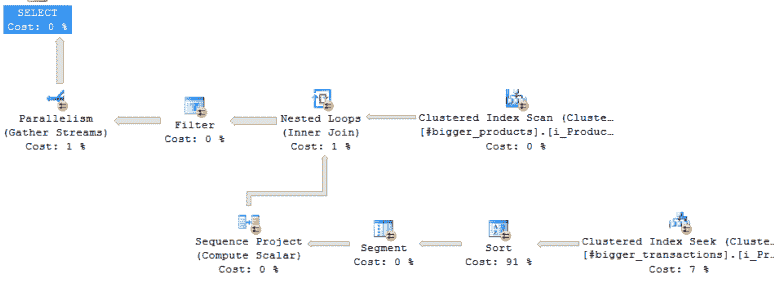

图 2-89 查找前 10 个最贵交易的并行查询计划。

此查询计划现在每个产品包含一次内部侧索引操作。这无疑比之前查询版本中单个并行扫描要贵得多。但这种增加的成本通过许多更小的排序以及不需要内部侧重新分区得到了巨大的抵消。

在最大并行度（Max Degree Of Parallelism）设置为 6 的测试服务器上并行运行这些查询，结果是：查询的初始版本运行了 31 秒，而重写后的版本在 15 秒内完成。当正确利用此模式时，更大更复杂的查询将看到更大的性能提升。

## 总结

本章涵盖了各种查询和索引调优主题。它为你介绍了内部数据结构、基础索引访问方法、衡量查询性能的工具以及其他调优方面。调优涉及许多方面，对产品架构和内部机制的知识对于良好完成起着很大作用。我希望本章为你提供了工具和指导，让你在学习本书的过程中——当然，以及在你的生产环境中将知识付诸实践。

# 多表查询

本章的重点是多表查询。它涵盖了表表达式、`APPLY` 运算符、连接（joins）以及关系运算符 `UNION`、`EXCEPT` 和 `INTERSECT`。

第 1 章和第 2 章为本书的其他部分提供了基础。第 1 章“逻辑查询处理”描述了 T-SQL 的逻辑层，第 2 章“查询调优”描述了物理层。每一层都被单独描述，以强调它们独特的作用——逻辑层的作用是定义含义，而物理层的作用是实现或执行逻辑层定义的内容。物理层不负责定义含义。从本章开始，内容依赖于前面章节提供的基础，讨论将围绕代码的逻辑和物理方面展开。

# 子查询

子查询是 SQL 中的一个经典特性，你用它嵌套查询。当你希望一个查询在另一个查询的结果上操作，并且如果你不想为此目的使用变量等中间对象时，子查询是该语言中一种非常方便的功能。

本节涵盖了子查询的不同方面。涵盖了自包含子查询与相关子查询的区别、`EXISTS` 谓词以及异常子查询。子查询可以返回三种形式的结果：单值（标量）、多值和表值。本节涵盖了前两种。这部分内容在“表表达式”章节中会有详细介绍。

## 自包含子查询

自包含子查询顾如其名，独立于外部查询。相比之下，相关子查询对外部查询的表列有引用。与相关查询相比，自包含子查询的优势之一是易于故障排除。你可以始终将内部查询复制到单独窗口中独立进行故障排除。当你完成故障排除并修复需要的内容后，将子查询粘贴回主查询中。我将首先提供标量和多值自包含子查询的示例，然后过渡到相关查询。

我将讨论的第一个示例是自包含的标量子查询。标量子查询返回单个值，并允许在单值表达式的地方使用——例如，作为 `WHERE` 子句比较中的表达式。例如，以下查询返回了组织中所有员工都处理过订单的客户：

```sql
SELECT custid
FROM Sales.Orders
GROUP BY custid
HAVING COUNT(DISTINCT emp) = (SELECT COUNT(*) FROM HR.Employees);
```

顺带一提，此查询处理了关系代数中所谓的“关系除”的一个简单案例——你正在将 `Orders` 表中的订单集（连接了客户和员工）除以 `Employees` 表中的员工集，并返回符合条件的客户。

子查询返回 `Employees` 表中的员工计数。外部查询按客户 ID 对 `Orders` 表中的订单进行分组，并仅过滤出那些员工 ID 的去重计数等于子查询返回的员工数量的客户组。显然，此查询前提是数据库中强制执行了正确的引用完整性，防止订单拥有未在 `Employees` 表中出现的的员工 ID。子查询返回 9 作为 `Employees` 表中的员工数量。外部查询返回客户 ID 71，因为那是唯一一个由 9 个不同员工处理过的客户。

请注意，如果标量子查询返回空集，它会被转换为 `NULL`。如果它返回了多个一个值，则会在运行时失败。在我们的案例中，这两种都不可能，因为标量子查询保证恰好返回一个值，即使源表是空的。

下一个示例是自包含的多值子查询。多值子查询在单单元列中返回多个值。它可以用在期望多值结果的地方——例如，配合 `IN` 谓词使用。

我们示例中的任务是返回在当月最后一个活动日下达的订单。最后一个活动日并不一定是该月可能的最后日期——例如，公司在周末和假日不处理订单。第一步是编写一个分组查询，返回每个年份和月份分组的最后一个活动日，如下：

```sql
SELECT MAX(orderdate) AS lastdate
FROM Sales.Orders
GROUP BY YEAR(orderdate), MONTH(orderdate);
```

此查询返回以下内容：

```
lastdate
------
2014-01-31
2014-07-31
2015-05-06
2014-04-30
2014-10-31
2015-02-27
2013-12-31
2014-05-30
2015-03-31
2013-03-30
```

这个查询对于分组查询来说有点寻常。通常情况下，你按某些元素分组并返回分组元素的聚合值。在这里，你按订单年份和月份分组，只返回聚合值而不带分组元素。但如果你仔细考虑，年份和月份分组的最大日期保留了年份和月份的信息，因此分组信息在这里并没有真正丢失。

第二步也是最后一步是查询 `Orders` 表，并过滤出订单日期出现在上一步返回的日期集中的订单。这里是完整的解决方案查询：

```sql
SELECT orderid, orderdate, custid, empid
FROM Sales.Orders
WHERE orderdate IN
  (SELECT MAX(orderdate)
  FROM Sales.Orders
  GROUP BY YEAR(orderdate), MONTH(orderdate));
```

此查询生成了以下内容：

| orderid | orderdate | custid | empid |
|---|---|---|---|
| 10269 | 2014-01-31 | 89 | 5 |
| 10294 | 2014-07-31 | 65 | 4 |
| 10317 | 2015-05-06 | 48 | 6 |
| 10343 | 2014-04-30 | 44 | 4 |
| 10368 | 2014-10-31 | 20 | 2 |

## 相关子查询

相关子查询对外部查询的表列有引用。与相关查询相比，自包含查询的优势之一是易于故障排除。你可以始终将内部查询复制到单独窗口中独立进行故障排除。当你完成故障排除并修复需要的内容后，将子查询粘贴回主查询中。

目前，如果客户在最后一次活动日期提交了多个订单，查询将返回所有这些订单。例如，请观察查询输出包含了客户 40 的多个订单。假设你要求每个客户只返回一个订单。在这种情况下，你需要定义一个规则来打破订单日期中的冲突。例如，该规则可以根据最大的主键值（在本例中为 order ID）来打破冲突。对于客户 40 在 2015 年 3 月 24 日提交的两个订单，最大的主键值为 10973。请注意，你是从该客户具有最大订单日期的订单中聚合最大的主键值，而不是从该客户的所有订单中聚合。

你可以使用多种方法来应用打破冲突的逻辑。一种方法是对每个排序和冲突冲突元素使用单独的标量聚合函数。这里有一个演示此技巧的查询：

```sql
SELECT orderid, orderdate, custid, empid
FROM Sales.Orders AS 01
WHERE orderdate =
(SELECT MAX(Orderdate)
FROM Sales.Orders AS 02
WHERE 02.custid = 01.custid
AND orderid =
(SELECT MAX(orderid)
FROM Sales.Orders AS 02
WHERE 02.custid = 01.custid
AND 02.orderdate = 01.orderdate);
```

第一个子查询与没有冲突打破器的解决方案中的相同。它负责返回外部客户的最大订单日期。第二个子查询返回的问题是，你需要的子查询数量与排序和冲突打破元素的数量相同。每个子查询都需要通过之前所有子查询中关联的所有元素加上一个新元素来进行关联。因此，特别是当使用多个冲突打破器时，这种解决方案会变得冗长且复杂。

为了简化解决方案，你可以使用 `TOP` 代替标量聚合函数将所有子查询合并为一个。与聚合函数相比，`TOP` 过滤在设计上有两个优势。优势之一是 `TOP` 排序时返回一个元素，而聚合函数则将同一个元素同时视为排序元素和返回元素。另一个优势是 `TOP` 可以拥有定义排序的元素向量，而聚合函数仅限于单个元素。这两个优势允许你在同一个子查询中处理所有的排序和冲突打破元素，如下所示：

```sql
SELECT orderid, orderdate, custid, empid
FROM Sales.Orders AS 01
WHERE orderid =
(SELECT TOP (1) orderid
FROM Sales.Orders AS 02
WHERE 02.custid = 01.custid
ORDER BY orderdate DESC, orderid DESC);
```

外部查询仅过滤键等于子查询代表客户最新订单所获取的键的订单，其中使用最大键作为冲突打破器。

为了获取符合条件的键，子查询过滤外部客户的订单，按 `orderdate DESC`、`orderid DESC` 排序，并返回最顶部的行的键。

这种查询通常被称为“每个任务的前 N 个”（top N per task），在实践中以不同的变体形式得非常常见。书中多处都讨论了它，其中最全面的涵盖在第 5 章“TOP and OFFSET-FETCH”中。在这里它主要为了演示子查询。

到此时，你已经有一个使用 `TOP` 过滤的简单且直观的解决方案。问题是，它的性能如何？在索引指南方面，每组前 N 个任务的解决方案通常受益于一种特定的索引模式，我喜欢将其想为 POC 模式。这是索引元素的缩写：P 代表分区（分组）元素，在我们的案例中是 `custid`。O 代表排序，在我们的案例中是 `orderdate DESC`、`orderid DESC`。PO 元素构成索引列表。C 代表覆盖元素——即查询中你希望包含在索引中以覆盖的所有剩余元素。在我们的案例中，C 元素是 `empid`。如果索引是非聚集索引，你可以在索引的 `INCLUDE` 中指定 C 元素。如果索引是聚集索引，C 元素是隐式的。运行以下代码来创建一个支持的 POC 索引：

```sql
CREATE UNIQUE INDEX idx_poc
ON Sales.Orders(custid, orderdate DESC, orderid DESC) INCLUDE (empid);
```

创建索引后，你得到了图 3-1 所示的 `TOP` 子查询解决方案的计划。

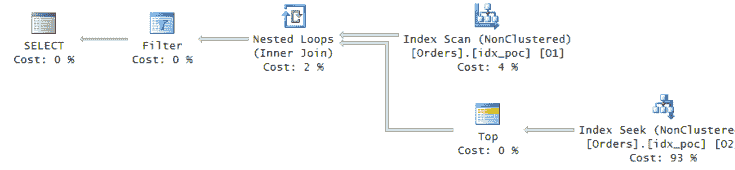

图 3-1 带有订单查找（seek）的计划。


# 子查询优化与 EXISTS 谓词

该计划对代表 `Orders` 表实例 `O1`（查询中的外部实例）的 POC 索引进行全扫描。然后对于每一行 `O1`，计划在代表 `Orders` 表实例 `O2`（查询中的内部实例）的 POC 索引中执行查找。查找到达索引叶片中当前客户部分的开头，并扫描一行以收集键。然后计划过滤来自 `O1` 的行，其 `O1` 键等于 `O2` 键。

该计划中存在某种可以优化的低效之处，即 `Index Seek` 算子大约执行了多少次。每个订单执行一次查找，但你实际上只需要每个客户的一行。更高效的策略是每个客户执行一次查找。`custid` 列越密集，这种策略需要的查找越少。为了使性能更具体，假设数据有 10,000 个客户，平均每个客户有 1,000 个订单。现有的计划执行了 10,000,000 次查找。如果 B 树有三层，这将转化为 60,000 次随机读取。这是极其低效的。如果你能得出更高效的子查询计划，你将只需要 10,000 次查找。目前，我将解决方案限制在使用子查询，因为这是本节的重点。

```
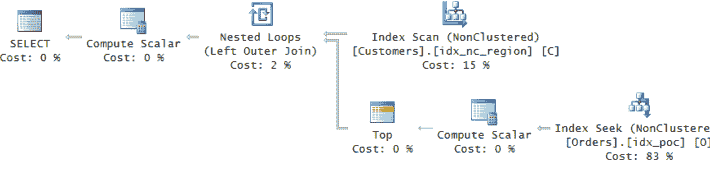
```

图 3-2 每个客户一次查找的计划。

除了解决方案的第一步（检索符合条件的键）描述的工作外，该计划还在表中执行了 10,000 次查找，以获取目标订单的属性。随后进行了排序以优化查找。此计划增加了 10,000 次查找，总共 20,000 次查找，导致 60,000 次随机读取。与之前的解决方案相比，这提高了 500 倍！

完成后，运行以下代码进行清理：

```sql
DROP INDEX idx_poc_on ON Sales.Orders;
```

## EXISTS 谓词

`EXISTS` 谓词接受子查询并根据子查询返回非空集或空集分别返回真或假。作为一个基础示例，以下查询返回了订单了客户：

```sql
SELECT custid, customername
FROM Sales.Customers AS C
WHERE EXISTS (SELECT * FROM Sales.Orders AS O
WHERE O.custid = C.custid);
```

该谓词非常自然，因为它允许你用 SQL 表达上述请求的方式与你在口语中表达它们的方式相似。

`EXISTS` 的奇特之处在于，与 SQL 中的大多数谓词不同，它使用二值逻辑。它只返回真或假。它不会返回未知，因为不存在它不知道查询是返回了至少一行还是没有返回的情况。请原谅这种三重否定形式的最后一句，出于本章的目的，你需要练习这种逻辑。如果内部查询包含过滤器，则由于 `NULL` 的存在导致过滤器评估结果为未知的行将被丢弃。尽管如此，`EXISTS` 谓词总是能够确定地判断结果集是否为空。与 `EXISTS` 相反，例如 `IN` 谓词使用的是三值逻辑。因此，当你对谓词取反且数据中存在 `NULL` 时，使用 `EXISTS` 的查询与使用 `IN` 的查询逻辑含义可能不同。我将在稍后演示这一点。

关于 `EXISTS` 的另一点，是从索引选择的角度来看，优化器忽略了 `SELECT` 列表。例如，`Orders` 表有一个由 `custid` 列定义的索引 `idx_nc_custid`，且没有包含列。观察图 3-4 所示的 `EXISTS` 查询的执行计划。

```
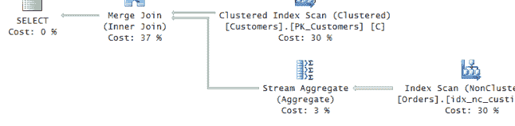
```

图 3-4 使用 `SELECT *` 的 `EXISTS` 计划。

注意，尽管子查询使用了 `SELECT *`，但计划从 `Orders` 表中使用的唯一索引是 `idx_nc_custid`。换句话说，对于此查询，该索引被视为覆盖索引。这证明为了索引选择，`SELECT` 列表被忽略了。

接下来我将演示可以使用 `EXISTS` 谓词处理的经典任务。我将使用表 `T1`，你可以通过运行以下代码创建并填充该表：

```sql
SET NOCOUNT ON;
USE tempdb;
IF OBJECT_ID('dbo.T1') IS NOT NULL DROP TABLE dbo.T1;
CREATE TABLE dbo.T1(col1 INT NOT NULL CONSTRAINT PK_T1 PRIMARY KEY);
INSERT INTO dbo.T1(col1) VALUES(1), (2), (3), (7), (8), (9), (10), (11), (15), (16), (17), (28);
```

表中的键列是 `col1`。假设你有一个键生成器，它生成从 1 开始的连续键，但由于删除操作，存在间隙。一个经典的挑战是识别缺失的值。为了测试你解决方案的正确性，你可以使用后续代码生成的这组样本数据。为了性能考虑，你想向表中填充一个更大的集合。使用以下代码填充 10,000,000 行：

```sql
TRUNCATE TABLE dbo.T1;
INSERT INTO dbo.T1 WITH (TABLOCK) (col1)
SELECT n FROM TSQLV.dbo.GetNums(1, 10000000) As N n % 10000 <> %
OPTION(MAXD 1);
```

# 第 3 章 多表查询

你可以使用 `CASE` 表达式，如果 1 不已经存在于表中，则返回 1。更棘手的部分是在当 1 已经存在时识别最小值。实现此目标的一种方法是使用以下查询：

```sql
SELECT MIN(A.col) + 1 AS missingval
FROM dbo.T1 AS A
WHERE NOT EXISTS
(SELECT *
FROM dbo.T1 AS B
WHERE B.col = A.col + 1);
```

这段代码的第一步是过滤 `T1`（别名为 `A`）中的行，使得 `A` 中的值出现在缺失值之前。然后，你就知道 `A` 中的值出现在缺失值之前，因为你无法在 `T1`（别名为 `B`）中找到另一个 `B` 值比 `A` 大 1 的值。然后，从 `A` 的所有剩余值中返回最小的一个。也许你预期查询会立即完成；毕竟，在 `col1` 上有一个索引（`PK_T1`）。理论上，你应该能够按顺序扫描索引，并在发现缺失值之前的第一个点时立即短路工作。但在大型样本数据集上，需要几秒钟才能完成。在我的系统上，花费了五秒钟。要理解为什么查询很慢，请检查图 3-5 所示的执行计划。

```
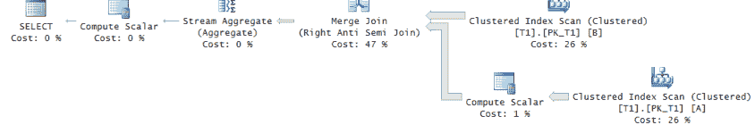
```

**图 3-5** 最小缺失值的计划，第一次尝试。

注意 `col1` 上的索引被扫描了两次。使用了 `Merge Join` 算子来应用右半连接以检测不匹配项。`Stream Aggregate` 算子识别了最小值。关键在于，由于输入被扫描了两次，该计划效率低下。尽管扫描是有序的，但并没有短路。

优化查询的一种尝试是使用 `TOP` 过滤器代替 `MIN` 聚合，如下所示：

```sql
SELECT TOP (1) A.col + 1 AS missingval
FROM dbo.T1 AS A
WHERE NOT EXISTS
(SELECT *
FROM dbo.T1 AS B
WHERE B.col = A.col + 1)
ORDER BY A.col;
```

但查询被“杀死”了。检查图 3-6 所示的该查询的执行计划。

```
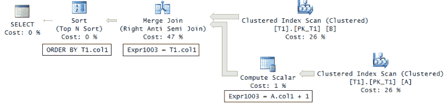
```

图 3-6 最小缺失值的计划，第二次尝试。

`Merge Join` 谓词认为 `A` 输入是按 `A.col` 排序的，`B` 输入也是排序的。由于外部查询按 `A.col` 排序而不是 `A.col + 1` 排序，优化器没有意识到行已经是排序的，并添加了一个消耗整个输入的 `Sort (Top N)` 算子。要修复此，只需将外部查询的 `ORDER BY` 改为 `A.col + 1`，如下：

```sql
SELECT TOP (1) A.col + 1 AS missing
FROM dbo.T1 AS A
WHERE EXISTS (
SELECT *
FROM dbo.T1 AS B
WHERE B.col = A.col + 1)
ORDER BY A.col+1;
```

观察图 3-7 所示的计划。

```
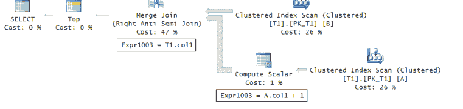
```

图 3-7 缺失值的计划，第三次尝试。

优化器意识到 `Merge Join` 算子返回行的方式与 `TOP` 过滤器相同，因此可以在找到第一个匹配行时短路。查询在亚秒内完成。或者，如果将内部查询的 `B.col = A.col + 1` 改为 `A.col - 1`，你也会得到一个最优计划，如下：

```sql
SELECT TOP (1) A.col + 1 AS missingval
FROM dbo.T1 AS A
WHERE EXISTS
(SELECT *
FROM dbo.T1 AS B
WHERE B.col = A.col - 1)
ORDER BY A.col;
```

现在添加 `CASE` 表达式逻辑，当不存在时返回 1，否则返回子查询的结果（高效解决方案之一）。你得到：

```sql
SELECT CASE
WHEN NOT EXISTS (SELECT * FROM dbo.T1 WHERE col = 1) THEN 1
ELSE (SELECT TOP (1) A.col + 1
FROM dbo.T1 AS A
WHERE EXISTS (...省略省略...))
```

另一个涉及序列的经典任务是识别所有缺失值的范围。在我们的情况下，我们将查找最小和最大值之间的缺失值。此任务通常被称为识别间隙。与最小值任务不同，这里没有短路可能。作为第一步，可以使用之前相同的查询查找间隙之前的所有值：

```sql
SELECT col
FROM dbo_T1 AS A
WHERE NOT EXISTS
(SELECT *
FROM dbo_T1 AS B
WHERE B.col = A.col + 1);
```

在小数据集上你得到以下输出：

```
col
----
3
9
11
17
28
```

注意你也得到了表中的最大值（28），因为该值加 1 不存在。但这个值并不是你想返回的间隙。为了从输出中排除它，为外部查询的过滤器添加谓词：

```sql
AND col < (SELECT MAX(col) FROM dbo_1)
```

现在你只剩下间隙之前的值，你需要为每个当前值识别间隙之后的相关值。你可以在外部查询的 `SELECT` 列表中使用以下子查询，它为每个值返回比当前值的最小值：

```sql
(SELECT MIN(B.col1)
FROM dbo.T1 AS B
WHERE B.col1 > A.col1)
```

你可能认为在此别名 `B` 以及检查值加 1 是否存在的子查询有点奇怪。但由于两个子查询具有独立的作用域，这没有问题。最后，将间隙之前的值加 1，并将间隙之后的值减 1，以获取实际间隙信息。将所有内容整合在一起，这是完整的解决方案：

```sql
SELECT col1 + 1 AS range_from,
(SELECT MIN(B.col1)
FROM dbo.T1 AS B
WHERE B.col1 > A.col1) - 1 range_to
FROM dbo.T1 AS A
WHERE NOT EXISTS (
SELECT
FROM dbo.T1 AS B
WHERE B.col1 = A.col1 + 1)
AND col1 < (SELECT MAX(col1) FROM dbo.T1);
```

此查询生成了内容：

| range_from | range_to |
| ---------- | -------- |
| 4          | 6        |
| 10         | 10       |
| 12         | 14       |
| 18         | 27       |

该解决方案的执行计划如图 3-8 所示。上分支中最右的三个算子处理表中最大 `col1` 值的计算。该值是从索引尾部获得的，因此工作忽略不计。中间部分使用 `Merge Join`（右反半连接）算子来识别间隙之前的值。算法在索引 `col1` 的两次有序扫描上运行。这种策略比另一种方案（对序列中的每个值应用索引查找）高效得多。最后，底部分支对每个过滤后的值（间隙之前的值）应用索引查找，以识别间隙之后的相应值。在这里重要的是，你获得的是每个过滤值（即每个间隙）的索引查找，而不是原始值。因此，特别是当间隙数量很少时，你会获得少量的查找。例如，大型样本数据集有 10,000,000 行和 1,000 个间隙。使用这些样本数据，查询在五秒内完成。

```

```

## 针对间隙查询的计划 3-8。

完成后，请运行以下代码：

```sql
IF OBJECT_ID('dbo.T1', 'U') IS NOT NULL DROP dbo.T1;
```

T-SQL 查询任务的有趣之处之一在于，对于任何给定的问题，通常有许多可能的解决方案。通常，不同的解决方案会导致不同的执行计划。因此，培养以不同方式编写查询的技能，并仔细观察优化器在每种情况下是如何处理的，至关重要。之后，当你调整查询并需要对计划实现某些效果时——例如，比较 SQL Server 如何处理基于子查询的解决方案与基于连接的解决方案，如何处理使用聚合的解决方案与使用 `TOP` 过滤的解决方案等等。另一种不同方法的示例是应用正逻辑与负逻辑。例如，回想本章开头提到的，识别出所有员工都处理过订单的客户。我为该任务提供的解决方案使用了正逻辑：

### SELECTSQL3

```sql
SELECT custid
FROM Sales.Orders
GROUP BY custid
HAVING COUNT(DISTINCT empid) = (SELECT COUNT(*) FROM HR.Employees);
```

另一种方法是应用负逻辑，因为你追求的是正向结果——即员工处理过订单的客户——你需要两个否定才能得到相同的含义。这就像说“常见”等同于说“不常见”。在我们的情况下，说“所有员工都处理过订单的客户”就像是说“没有员工没有处理过订单的客户”。这翻译为带有两个嵌套的 `NOT EXISTS` 谓词的查询：

```sql
SELECT custid, companyname
FROM Sales.Customers AS C
WHERE NOT EXISTS
(SELECT * FROM HR.Employees AS E
WHERE NOT EXISTS
(SELECT * FROM Sales.Orders AS O
WHERE O.custid = C.custid
AND O.empid = E.empid);
```

也许双重否定的形式最初并不直观，但好消息是，这种思维可以通过练习得到提高。

现在你可以检查并比较正逻辑解决方案与负逻辑解决方案的计划，以学习优化器在不同情况下是如何处理的。不过注意，TSQLV3 数据库中的表非常小，因此你实际上无法对它们进行任何性能测试。你需要更大的表来进行适当的性能分析和优化。我在文章[在序列中识别子序列，部分 2](http://sqlmag.com/t-sql-identifying-subsequence-in-sequence-part-2) 中展示了一个大数据量量的示例，其中双重否定方法实现了一种非常高效的解决方案。

发现双重否定方法在许多其他情况下也适用。例如，假设你有一个字符串列 `sn`（序列号），它应该只允许数字。你想用 `CHECK` 约束来强制执行此规则。你可以赞美基于正逻辑的谓词，但我发现在这种情况下，双重否定的形式是最优雅且经济的。正向规则说是：列中的每个字符都是数字。双重否定的形式是：列中没有任何一个字符不是数字。在 T-SQL 中，该规则翻译为以下谓词：

```sql
sn NOT LIKE '%[^0-9]'
```

简单明了！

## 异常的子查询

有些常见任务是通过子查询处理的，如果它们不遵循最佳实践，你很容易陷入 Bug 的困扰。我将描述两个问题：一个涉及子查询列名的替换错误，另一个是子查询中对 `NULL` 的不直观处理。我还将提供最佳实践，如果遵循这些原则，可以帮助你避免此类麻烦。

考虑 `T1` 和 `T2` 表及其填充的示例数据：

```sql
IF OBJECT_ID('dbo.T1') IS NOT NULL DROP TABLE dbo.T1;
IF OBJECT_ID('dbo.T2') IS NOT NULL DROP TABLE dbo.T2;
GO
CREATE TABLE dbo.T1(col1 INT NOT NULL);
CREATE TABLE dbo.T2(col2 INT NOT NULL);
INSERT INTO dbo.T1(col1) VALUES(1);
INSERT INTO dbo.T1(col1) VALUES(2);
INSERT INTO dbo.T1(col1) VALUES(3);
INSERT INTO dbo.T2(col2) VALUES(2);
```

假设你需要返回 `T1` 中也出现在 `T2` 值集中的值。以下查询（但不要运行它）：

```sql
SELECT col1 FROM dbo.T1 WHERE col1 IN(SELECT col1 FROM dbo.T2);
```

在执行此查询之前，检查两个表中的值并回答问题：你期望在结果中看到哪些值？自然地，你期望在结果中只看到值 2。执行查询。得到以下输出：

```
col1
-----
1
2
3
```

你能解释为什么你得到了 `T1` 的所有值而不是只有 2 吗？

仔细检查表定义和查询代码会发现，针对 `T2` 的子查询错误地引用了 `col1`，而不是 `col2`。现在问题是，为什么代码没有报错？SQL Server 在解析表列时，首先在紧邻查询的表中查找该列。如果找不到（如我们的案例中所示），它就会在外部查询的表中查找。

忽略它们。你可以通过几种方式实现这种行为。一种方法是在内部查询中通过添加过滤器 `WHERE col1 IS NOT NULL` 来显式移除 `NULL` 值，如下：

```sql
```


SELECT `col1` FROM `dbo.T2` WHERE `col1` NOT IN (SELECT `col1` FROM `dbo.T1` WHERE `col1` IS NOT NULL);

这一次，你得到了最初可能预期的结果：

```
col1
-----
3
```

另一种方法是使用 `NOT EXISTS` 代替 `NOT IN`，如下：

```sql
SELECT col1
FROM dbo.T2
WHERE NOT EXISTS (SELECT * FROM dbo.T1 T1 WHERE T1.col1 = T2.col1);
```

在这里，当内部查询将 `NULL` 与任何内容进行比较时，过滤谓词的结果为“未知”（unknown），而谓词求值为未知的行会被丢弃。换句话说，此解决方案通过过滤器隐式移除 `NULL` 的效果与上一个解决方案中显式移除 `NULL` 的效果相同。

## 表表达式

表表达式是命名的查询，你与其交互的方式类似于操作表。T-SQL 支持四种表表达式：派生表、通用表表达式（CTEs）、视图和表值函数。前两种仅在定义它们的语句作用范围内可见。对于后两种，表表达式的定义被存储为数据库中的持久对象，任何具有权限的人都可以对其进行交互。

针对表表达式的查询在代码包含三个部分：内部查询、你分配给表表达式的名称（以及相关时的其列）以及外部查询。内部查询旨在生成一个表结果。这意味着它需要满足三个要求：

- 内部查询不能具有呈现性的 `ORDER` 子句。它可以有一个 `ORDER BY` 子句以支持 `TOP` 或 `OFFSET-FETCH`，但除非外部查询有自己的 `ORDER BY`，否则外部查询不保证行会按任何特定顺序呈现。
- 所有列必须有名称。因此，如果你有一个从计算返回的列，你必须为其分配一个别名。
- 所有列名必须是唯一的。因此，如果你连接了具有相同名的表并且需要返回同名的列，则需要为它们分配不同的别名。在中间逻辑处理阶段用作列名前缀的表名或别名，在基于查询定义表表达式时会被移除。因此，列名

### 第 3 章 多表查询

只要查询满足这三个要求，它就可以作为表表达式中的内部查询。

从物理处理的角度来看，内部查询的结果并不持久化在任何地方；相反，它是内联的。这意味着外部查询和内部查询被合并了。当你查看针对表表达式查询的执行计划时，你会看到计划在查询被内联后直接与物理结构进行交互。换句话说，表表达式没有物理实体；它们是虚拟的，应该被视为一种逻辑工具。该规则的唯一例外是索引视图——在这种情况下，视图结果将持久化在 B 树中。详情请见 <http://msdn.microsoft.com/en-us/library/ms191432.aspx>。

后续章节描述了不同类型的表表达式。

## 派生表

派生表可能是最类似于子查询的表表达式。它是定义在外部查询的 `FROM` 子句中的子查询。你使用以下形式来定义和查询派生表：

```sql
SELECT <col_list> FROM <inner_query> AS <target_alias>[(<target_col_list>)];
```

记住表表达式的所有列都必须有名称；因此，你必须为所有计算结果的列分配别名。派生表支持两种不同的语法来对齐列别名：内联别名和外部别名。为了演示这种语法，我使用了一个名为 `T1` 的表，你可以通过以下代码创建并填充它：

```sql
IF OBJECT_ID('dbo.T1', 'U') IS NOT NULL DROP TABLE dbo.T1;

CREATE TABLE dbo.T1(col1 INT);

INSERT INTO dbo.T1(col1) VALUES(1);
INSERT INTO dbo.T1(col1) VALUES(2);
```

假设你需要内部查询为计算 `col1 + 1` 定义一个列别名 `expr1`，并在外部查询的表达式之一引用 `expr1`。使用内联别名形式，你指定计算后后跟 `AS` 别名，如下：

```sql
SELECT col1, expr1 + 1 AS exp2
FROM (SELECT col1, col1 + 1 AS expr1
      FROM dbo.T1) AS D;
```

使用外部别名形式，你在派生名称后的括号中指定目标列别名，如下：

```sql
SELECT col1, expr1 + 1 AS exp2
FROM (SELECT col1, col1 + 1
      FROM dbo.T1) AS D(col1, expr1);
```

通过这种，你必须为所有列指定名称，包括已经有名称的列。

这两种语法都是标准的。每种都有自己的优势。我喜欢内联别名的地方是，在长且复杂的查询中，很容易识别哪些别名代表什么；而外部形式的优点是可以在一个地方看到表表达式包含哪些列。你需要决定使用哪种语法对你来说更方便。如果你愿意，可以将两者结合。

```sql
SELECT col1, expr1 + 1 AS exp2
FROM (SELECT col1, col1 + 1
      FROM dbo.T1) AS D(col1, expr1);
```

这两种语法都是标准的。每种都有自己的优势。我喜欢内联别名的地方是，在长且复杂的查询中，很容易识别哪些别名代表什么；而外部形式的优点是可以在一个地方看到表表达式包含哪些列。你需要决定使用哪种语法对你来说更方便。如果你愿意，可以将两者结合。

此外，派生表的另一个弱点涉及到我们需要多次引用同一张表的情况。SQL 不允许你定义并命名一个派生表，然后在定义它的 `FROM` 子句中多次引用它。不幸的是，你必须重复代码。这使得代码变得更长且难以维护。每当你需要修改派生表查询时，都需要记住在所有副本中进行修改，这增加了错误的概率。

### 通用表表达式 (CTEs)

回想一下嵌套派生表的示例。这里是 CTE 的替代方案：

```sql
WITH C1 AS
(
  SELECT YEAR(orderdate) AS orderyear, custid
  FROM Sales.Orders
),
C2 AS
(
  SELECT orderyear, COUNT(DISTINCT custid) AS numcusts
  FROM C1
  GROUP BY orderyear
)
SELECT orderyear, numcusts
FROM C2
WHERE numcusts > 70;
```

如你所示，在同一个 `WITH` 语句中，你可以通过逗号定义多个 CTE。每个查询都可以在内部查询引用之前定义的所有 CTE。然后，外部查询可以引用该 `WITH` 语句定义的所有 CTE。这种方法的好处在于各个单元不是嵌套的，而是以不连续的方式一个接一个呈现。因此，如果你需要理清查询逻辑，可以从上到下按照更自然的顺序进行分析。

在排错带有多个 CTE 的 `WITH` 语句时，我发现有点棘手的是：如果你想检查中间 CTE 的结果，不能简单地高亮代码到该部分并运行。你需要在该 CTE 之后注入一个 `SELECT * FROM <ctename>`，然后运行到该部分的代码。派生表在这方面具有优势，因为不需要更改任何代码的情况下，你可以高亮针对派生表的查询（包括所有你想测试的单元）并运行。

从物理处理的角度来看，CTE 的处理方式与派生表相同。内部查询的结果不会持久化在任何地方；而是代码被内联。这段代码生成的计划与图 3-9 中之前所示的派生表计划相同。

使用 CTE 而不是派生表的另一个优势是，因为你在在使用 CTE 之前对它进行了命名，所以你可以在外部查询中多次引用 CTE 名称，而无需重复代码。回想之前显示的示例，它使用了两个相同的派生表副本来返回年度订单数量以及与上年数量的差异。这里是基于 CTE 的替代方案：

```sql
WITH OrdCount AS
(
  SELECT
    YEAR(orderdate) AS orderyear,
    COUNT(*) AS numorders
  FROM Sales.Orders
  GROUP BY YEAR(orderdate)
)
SELECT CUR.orderyear, CUR.numorders,
       CUR.numorders - PRV.numorders AS diff
FROM OrdCount AS CUR
LEFT OUTER JOIN OrdCount AS PRV
ON CUR.orderyear = PRV.orderyear + 1;
```

显然，这是一个更好的设计。

请注意，SQL Server 不会在任何地方持久化表表达式的结果；无论对表名的所有引用是否会被展开，以及使用的表或 CTE，工作都将重复。这在图 3-10 显示的计划中可以清晰看到。

| SELECT Cost: 0 % | Compute Scalar Cost: 0 % | Merge Join (Left Outer Join) Cost: 8 % | Compute Scalar Cost: 0 % | Stream Aggregate (Aggregate) Cost: 5 % | Sort Cost: 37 % | Compute Scalar Cost: 0 % | Index Scan (Non-Clustered) [Idx.id_nc_orderyear] Cost: 8 % | Index Scan (Non-Clustered) [Idx.id_nc_orderyear] Cost: 8 % |
|---|---|---|---|---|---|---|---|---|

**图 3-10** 在有多次引用下发生两次的工作。

你可以看到工作发生了两次。`Orders` 表上的覆盖索引被扫描两次，然后行被排序、聚合了两次。如果表很大且你想避免每次都重复这些操作，应该考虑使用临时表或变量实例。

## 递归 CTE

T-SQL 支持一种带有递归语法的特殊形式 CTE。为了描述和演示递归 CTE，我将使用一个通过运行以下代码创建并填充的 `Employees` 表：

```sql
SET NOCOUNT ON;
USE tempdb;
```

```sql
IF OBJECT_ID('dbo.Employees', 'U') IS NOT NULL DROP TABLE dbo.Employees;
```

```sql
CREATE TABLE dbo.Employees
(
  empid INT NOT NULL,
  CONSTRAINT PK_Employees PRIMARY KEY (empid),
  mgrid INT NULL,
  CONSTRAINT FK_Employees_Employees FOREIGN KEY (mgrid) REFERENCES dbo.Employees(empid),
  empname VARCHAR(25) NOT NULL,
  salary MONEY NOT NULL
);
```

```sql
INSERT INTO dbo.Employees(empid, mgrid, empname, salary)
VALUES
(1, NULL, 'David', $10000.00),
(2, 1, 'Eitan', $7000.00),
(3, 1, 'Ina', $7500.00),
(4, 2, 'Seraph', $5000.00),
(5, 2, 'Jiru', $5500.00),
(6, 2, 'Steve', $4500.00),
(7, 3, 'Aaron', $5000.00),
(8, 5, 'Lilach', $3500.00),
(9, 7, 'Rita', $3000.00),
(10, 5, 'Sean', $3000.00),
(11, 7, 'Gabriel', $3000.00),
(12, 9, 'Emilia', $2000.00),
(13, 9, 'Michael', $2000.00),
(14, 9, 'Didi', $1500.00);
```

```sql
CREATE UNIQUE INDEX idx_mgr ON Employees(mgrid) INCLUDE (empname);
```

递归 CTE 有一个包含锚点和递归成员的主体。通常递归 CTE 的语法如下：

```sql
WITH RecursiveCTE AS
(
  SELECT empid, mgrid, empname, salary
  FROM Employees
  WHERE mgrid IS NULL
  UNION ALL
  SELECT E.empid, E.mgrid, E.empname, E.salary
  FROM Employees E
  INNER JOIN RecursiveCTE C ON E.mgrid = C.empid
)
SELECT * FROM RecursiveCTE;
```

这是该代码生成的输出：

```
empid mrid empname   salary
----------------------------------
1      NULL   David     10000.00
2      1      Eitan     7000.00
3      1      Ina       7500.00
4      2      Seraph    5000.00
5      2      Jiru      5500.00
6      2      Steve     4500.00
7      3      Aaron     5000.00
8      5      Lilach    3500.00
9      7      Rita      3000.00
10     5      Sean      3000.00
11     7      Gabriel   3000.00
12     9      Emilia    2000.00
13     9      Michael   2000.00
14     9      Didi      1500.00
```

此查询的执行计划如图 3-11 所示。


**图 3-11** 递归查询的计划。

### 视图

存储在数据库中，因此可以由相应权限的用户重复使用。存储在数据库中的是查询定义和元数据信息，而不是数据本身（之前提到的索引视图除外）。当对表表达式提交查询或修改时，SQL Server 会将表表达式内联，并将查询或修改应用于底层对象。

例如，假设你的组织中有不同的分机构。你希望美国分机构的用户能够与美国的客户交互。SQL Server 内置了对行级权限的支持。因此，你可以创建以下视图，查询 `Customers` 表并仅过滤出美国的客户：

```sql
USE TSQLV3;

IF OBJECT_ID('Sales.USACusts', 'V') IS NOT NULL DROP VIEW Sales.USACusts;
GO

CREATE VIEW Sales.USACusts WITH SCHEMABINDING
AS
SELECT
  custid, companyname, contactname, contacttitle, address,
  city, region, country, phone, fax
FROM Sales.Customers
WHERE country = 'USA'
WITH CHECK OPTION;
```

你授予美国用户权限，`SCHEMABINDING` 选项确保了针对引用的对象和列的结构性更改不会被拒绝。`CHECK OPTION` 要求对象绑定模式，并显式列出视图内部查询所过滤的列列表。例如，使用此选项，你将不允许通过视图插入英国的客户。你也不允许通过视图将国家/地区更新为美国以外的任何地区。

现在，当你查询该视图时，你仅与美国的客户交互，如下所示：

```sql
SELECT custid, companyname
FROM Sales.USACusts
ORDER BY region, city;
```

如所述，在后台 SQL Server 会内联内部查询，因此你得到的执行计划将与以下语句的计划相同：

```sql
SELECT custid, companyname
FROM Sales.Customers
WHERE country = 'USA'
ORDER BY region, city;
```

请注意，尽管视图的内部查询被内联了，但有时当你直觉上认为可以避免某些工作时，SQL Server 却无法避免它。考虑这样一个例子：你对一个宽表进行垂直分区，在每个较窄的表中存储主键和原始列的不同子集。然后你使用视图来连接这些表，使其看起来像一个关系。使用以下代码为这种安排创建一个基础示例：

```sql
IF OBJECT_ID('dbo.V', 'V') IS NOT NULL DROP VIEW dbo.V;
IF OBJECT_ID('dbo.T3', 'U') IS NOT NULL DROP TABLE dbo.T3;
IF OBJECT_ID('dbo.T2', 'U') IS NOT NULL DROP TABLE dbo.T2;
IF OBJECT_ID('dbo.T1', 'U') IS NOT NULL DROP TABLE dbo.T1;
GO

CREATE TABLE dbo.T1
(
    key1 INT NOT NULL CONSTRAINT PK_T1 PRIMARY KEY,
    col1 INT NOT NULL
);

CREATE TABLE dbo.T2
(
    key1 INT NOT NULL
    CONSTRAINT PK_T2 PRIMARY KEY
);
```


## 视图与表表达式优化

```sql
CONSTRAINT FK_T2_T1 REFERENCES dbo.T1,
col2 INT NOT NULL
);

CREATE TABLE dbo.T3
(
    key1 INT NOT NULL
    CONSTRAINT PK_T3 PRIMARY KEY
    CONSTRAINT FK_T3_T1 REFERENCES dbo.T1,
    col3 INT NOT NULL
);

GO

CREATE VIEW dbo.V WITH SCHEMABINDING
AS
SELECT T1.key1, T1.col1, T2.col2, T3.col3
FROM dbo.T1
INNER JOIN dbo.T2
    ON T1.key1 = T2.key1
INNER JOIN dbo.T3
    ON T1.key1 = T3.key1;
```

请注意，我并没有讨论这是一种好设计还是坏设计——我正在尝试解释针对表表达式的代码优化是如何工作的。假设你知道所有表之间存在一对一的关系。一个表中的每一行在其他每个表中恰好有一个匹配的行。你对视图发出查询，请求源自其中一个表的列：

```sql
SELECT key1, col1 FROM dbo.V;
```

有些人直觉上认为优化器足够智能，知道只需要访问 `T1`。问题在于 SQL Server 并不知道你所知道的——即表之间一对一的关系。对于 SQL Server 而言，`T1` 中可能存在在其他表中没有相关行的行，因此不应返回。此外，`T1` 中的某些行可能在其他表中对应多个相关行，因此会被返回多次。换句话说，优化器必须创建一个计划，如图 3-12 所示将 `T1` 与 `T2` 和 `T3` 进行连接。


为了获取你想要的内容而访问 `T1`，你必须直接查询 `T1`，而不是通过视图。我使用这一点是为了强调，有时通过视图（或任何其他类型的表表达式）发布查询涉及的工作比仅查询你所需的相关的底层对象要多。

## 高性能数字生成方案

为了获得高性能的解决方案，我依赖于三个关键点：

- 使用交叉连接（`cross joins`）生成大量行
- 在不排序的情况下高效地生成行
- 当达到请求行数时，使用 `TOP` 短路处理工作量

第一步是生成大量行。这些行中包含什么并不重要，因为你最终将使用 `ROW_NUMBER` 函数来生成数字。在 T-SQL 中，生成大量行的一种极佳方法是应用交叉连接。但你需要一个至少包含两行的表作为起点。你可以使用 `VALUES` 子句创建一个这样的虚拟表，如下所示：

```sql
SELECT c FROM (VALUES(1),(1)) AS D(c);
```

该查询生成了如下输出，显示虚拟表有两个行：

```text
c
------
1
1
```

下一步是根据上一个查询定义一个 CTE（称为 `L0`，代表第 0 层），并在两个 `L0` 实例之间应用自交叉连接来获取行，如下：

```sql
WITH
L0 AS (SELECT c FROM (VALUES(1),(1)) AS D(c))
SELECT 1 AS c FROM L0 AS A CROSS JOIN L0 AS B;
```

该查询生成了如下输出：

```text
c
------
1
1
1
```

下一步是根据上一个查询定义一个名为 `L1` 的 CTE，然后连接两个 `L1` 实例以获取 16 行。重复这种模式，当你到达 `L5` 时，你可能已经拥有了 4,294,967,296 行！以下是计算该数字的表达式：

```sql
SELECT POWER(2, POWER(2, 5));
```

下一步是查询 `L5` 并计算行号（将列命名为 `rownum`），同时不触发排序操作。这是通过指定 `ORDER BY (SELECT NULL)` 实现的。你在此查询上创建一个名为 `N` 的 CTE。

最后，下一步是查询 `N`，并使用 `TOP` 选项过滤 `@high - @low + 1` 行，按 `rownum` 排序。你将结果数字列（命名为 `n`）计算为 `@low + rownum - 1`。

以下是应用于示例输入范围 11 到 20 的完整解决方案代码：

```sql
DECLARE @low AS BIGINT = 11, @high BIGINT = 20;

WITH
L0 AS (SELECT c FROM (VALUES(1),(1)) AS D(c)),
L1 AS (SELECT 1 AS c FROM L0 AS A CROSS JOIN L0 AS B),
L2 AS (SELECT 1 AS c FROM L1 AS A CROSS JOIN L1 AS B),
L3 AS (SELECT 1 AS c FROM L2 AS A CROSS JOIN L2 AS B),
L4 AS (SELECT 1 AS c FROM L3 AS A CROSS JOIN L3 AS B),
L5 AS (SELECT 1 AS c FROM L4 AS A CROSS JOIN L4 AS B),
Nums AS (SELECT ROW_NUMBER() OVER(ORDER BY (SELECT NULL)) AS rownum FROM L5)
SELECT TOP(@high - @low + 1) @low + rownum - 1 AS n
FROM Nums
ORDER BY rownum;
```

此代码生成了如下输出：

- 11
- 12
- 13
- 14
- 15
- 16
- 17
- 18
- 19
- 20

为了可复用性，将解决方案封装在一个名为 `GetNums` 的内联 TVF 中，如下：

```sql
IF OBJECT_ID('dbo.GetNums', 'FN') IS NOT NULL DROP FUNCTION dbo.GetNums;
GO

CREATE FUNCTION dbo.GetNums(@low AS BIGINT, @high AS BIGINT) RETURNS TABLE
AS
RETURN
WITH
L0 AS (SELECT c FROM (VALUES(1),(1)) AS D(c)),
L1 AS (SELECT 1 AS c FROM L0 AS A CROSS JOIN L0 AS B),
L2 AS (SELECT 1 AS c FROM L1 AS A CROSS JOIN L1 AS B),
L3 AS (SELECT 1 AS c FROM L2 AS A CROSS JOIN L2 AS B),
L4 AS (SELECT 1 AS c FROM L3 AS A CROSS JOIN L3 AS B),
L5 AS (SELECT 1 AS c FROM L4 AS A CROSS JOIN L4 AS B),
Nums AS (SELECT ROW_NUMBER() OVER(ORDER BY (SELECT NULL)) AS rownum FROM L5)
SELECT TOP(@high - @low + 1) @low + rownum - 1 AS n
FROM Nums
ORDER BY rownum;
GO
```

使用以下代码测试该函数：

```sql
SELECT n FROM dbo.GetNums(11, 20);
```


我的朋友 Laurent Martin 将此称为“竖琴函数”（harp function）。这个外号看起来可能很困惑，直到你查看图 3-13 显示的查询计划。


图 3-13 竖琴函数。

该计划的巧妙之处在于，`Top` 运算符是从右侧分支请求行的那个，一旦达到请求的行数它就会短路。分别处理行号计算和交叉连接的 `Sequence Project` 和 `Nested Loops` 算子会响应来自 `Top` 算子的行请求。一旦 `Top` 停止请求，它们也会随停止生成行。换句话说，尽管这个解决方案可能生成超过四十亿行，但在实践中它只生成请求的行数然后短路。在我的笔记本上测试该函数的性能，它在四秒钟内生成了 100,000 个数字。这还不算差。

## APPLY 算子

`APPLY` 算子是我知道的 T-SQL 最强大的工具之一，但它似乎没有被许多注意到。当我讲解 `APPLY` 时，学生只掌握了一小部分。这个算子的有趣之处在于，它可以以非常有创意的方式来解决各种任务。`APPLY` 有三种类型：

- `CROSS APPLY`
- `OUTER APPLY`
- `ER APPLY`

接下来的章节将描述这些类型。

## CROSS APPLY 算子

思考 `APPLY` 算子的一种方式将其视为交叉连接和相关子查询的混合体。想一下普通的连接（join）。输入是表或表表达式，但不允许有内部查询。`CROSS APPLY` 算子类似于交叉连接，只是右侧输入允许来自左侧输入的关联。在交叉连接中，左侧输入允许是自包含。

`T1 JOIN T2` 等同于 `T1 CROSS APPLY T2`。

为了可复用性，将解决方案封装在一个名为 `GetNums` 的内联 TVF 中，如下：

```sql
IF OBJECT_ID('dbo.GetNums', 'FN') IS NOT NULL DROP FUNCTION dbo.GetNums;

GO

CREATE FUNCTION dbo.GetNums(@low AS BIGINT, @high AS BIGINT) RETURNS TABLE
AS
RETURN
WITH
L0 AS (SELECT c FROM (VALUES(1),(1)) AS D(c)),
L1 AS (SELECT 1 AS c FROM L0 AS A CROSS JOIN L0 AS B),
L2 AS (SELECT 1 AS c FROM L1 AS A CROSS JOIN L1 AS B),
L3 AS (SELECT 1 AS c FROM L2 AS A CROSS JOIN L2 AS B),
L4 AS (SELECT 1 AS c FROM L3 AS A CROSS JOIN L3 AS B),
L5 AS (SELECT 1 AS c FROM L4 AS A CROSS JOIN L4 AS B),
Nums AS (SELECT ROW_NUMBER() OVER(ORDER BY (SELECT NULL)) AS rownum FROM L5)
SELECT TOP(@high - @low + 1) @low + rownum - 1 AS n
FROM Nums
ORDER BY rownum;

GO
```

使用以下代码测试该函数：

```sql
SELECT n FROM dbo.GetNums(11, 20);
```


# 竖琴函数

我的朋友 Laurent Martin 将此称为“竖琴函数”（harp function）。这个外号看起来可能很困惑，直到你查看图 3-13 显示的查询计划。


图 3-13 竖琴函数。

该计划的巧妙之处在于，`Top` 运算符是从右侧分支请求行的那个，一旦达到请求的行数它就会短路。分别处理行号计算和交叉连接的 `Sequence Project` 和 `Nested Loops` 算子会响应来自 `Top` 算子的行请求。一旦 `Top` 停止请求，它们也会停止生成行。换句话说，尽管这个解决方案可能生成超过四十亿行，但在实践中它只生成请求的行数然后短路。在我的笔记本上测试该函数的性能，它在四秒钟内生成了 100,000 个数字。这还不算差。

# APPLY 算子

`APPLY` 算子是我知道的 T-SQL 最强大的工具之一，但它似乎没有被许多注意到。当我讲解 `APPLY` 时，学生只掌握了一小部分。这个算子的有趣之处在于，它可以以非常有创意的方式来解决各种任务。`APPLY` 有三种类型：

- `CROSS APPLY`
- `OUTER APPLY`
- `ER APPLY`

接下来的章节将描述这些类型。

## CROSS APPLY 算子

思考 `APPLY` 算子的一种方式将其视为交叉连接和相关子查询的混合体。想一下普通的连接（join）。输入是表或表表达式，但不允许有内部查询。`CROSS APPLY` 算子类似于交叉连接，只是右侧输入允许来自左侧输入的关联。在交叉连接中，左侧输入允许是自包含。

`T1 JOIN T2` 等同于 `T1 CROSS APPLY T2`。

## OUTER APPLY 运算符

`CROSS APPLY` 运算符与内连接（inner join）有一个共同点，它们都会丢弃右侧没有匹配项的行。因此，在之前的查询中，没有下订单的客户被丢弃了。类似于保留所有左侧行的左外连接（left outer join）运算符，还有一个 `OUTER APPLY` 运算符，它会将 `NULL` 作为右侧未匹配项的占位符。

例如，为了修改上一个查询以保留所有客户，可以将 `CROSS APPLY` 替换为 `OUTER APPLY`，如下所示：

```sql
SELECT C.custid, A.orderid, A.orderdate, A.empid
FROM Sales.Customers AS C
OUTER APPLY db.GetTopOrders(C.custid, 3 ) AS A;
```

这样，输出结果包含了没有下订单的客户：

| custid | orderid | orderdate | empid |
|---|---|---|---|
| 1 | 11011 | 2015-04-09 | 3 |
| 1 | 10952 | 2015-03-16 | 1 |
| 1 | 10835 | 2015-01-15 | 1 |
| 2 | 10926 | 2015-03-04 | 4 |
| 1 | 10759 | 2014-11-28 | 3 |
| 2 | 10625 | 2014-08-08 | 3 |
| ... | ... | ... | ... |
| 22 | NULL | NULL | NULL |
| 57 | NULL | NULL | NULL |
| 58 | 11073 | 2015-05-05 | 2 |
| 58 | 10995 | 2015-04-02 | 1 |
| 58 | 10502 | 2014-04-10 | 2 |

如所述，SQL 中对应 T-SQL 特有的 `APPLY` 运算符的概念被称为横向派生表（lateral derived table）。我在上一节中描述了与 `CROSS APPLY` 运算符的对应关系。至于 `OUTER APPLY`（在 T-SQL 中表示为 `T1 OUTER APPLY (SELECT ... FROM T2 WHERE T2.col1 = T1.col1) AS Q`），在标准 SQL 中表示为 `T1 LEFT OUTER JOIN LATERAL (SELECT ... FROM T2 WHERE T2.col1 = T1.col1) AS Q ON 1 = 1`。

## 隐式 APPLY

文档的 `APPLY` 运算符变体是上述的 `CROSS APPLY` 和 `OUTER APPLY`。还有另一种变体，涉及与使用显式 `APPLY` 运算符类似的操作，但代码没有 `APPLY` 关键字。我将这种变体称为隐式 APPLY（implicit APPLY）。隐式 APPLY 涉及使用子查询，并在子查询内部查询表函数，并将来自外部表的列作为输入传递给该函数。通过示例来解释这一点最好。考虑在前节中使用的 `GetTopOrders` 函数，它可以根据请求的客户返回指定数量的最新订单。假设你想为 `Customers` 表中的每个客户计算处理该客户最近 10 笔订单的员工去重计数。你想复用封装在 `GetTopOrders` 函数中的逻辑，因此你执行了以下操作：查询 `Customers` 表；使用子查询将函数应用于外部客户以返回其最近的 10 笔订单；最后，计算处理这些订单的员工去重计数。以下是该逻辑在 T-SQL 中的实现。

```sql
SELECT C.custid,
       (SELECT COUNT(DISTINCT empid) FROM dbo.GetTopOrders(C.custid, 10)) AS numemps
FROM Sales.Customers AS C;
```

注意，代码中没有显式提到 `APPLY` 关键字，但显然输出应用中的代码将表函数应用到了每个外部客户。这段代码生成了以下输出：

```
custid numemps
------ ------
1      4
2      3
3      4
4      4
5      6
6      5
7      6
8      2
9      7
11     7
..
```

很容易看出为什么在这里使用隐式 APPLY 这个术语是合适的。有趣的是，在 SQL Server 添加显式 `APPLY` 运算符之前，你也无法使用隐式 APPLY 功能。换句话说，隐式功能的归功于显式运算符的添加。

## 列别名的复用

正如第 1 章所讨论的，SQL 令人烦恼的问题之一是，如果你在查询的 `SELECT` 子句中定义了列别名，你在大多数查询句中都被限制使用。唯一的例外是 `ORDER BY` 子句逻辑上在 `SELECT` 子句之后。

在使用 `APPLY` 运算符时，可以使用一个巧妙的技巧来解决这个问题。记得 `APPLY` 是表运算符，而表运算符是在查询的 `FROM` 子句中评估的。因为 `FROM` 子句是逻辑上第一个评估的子句，你创建的任何别名对查询的其他子句可见。此外，由于每个表运算符都会启动一个新的逻辑查询处理步骤，由一个表运算符定义的别名对后续的表运算符也是可见的。

基于此，通过使用 `APPLY` 运算符，你可以应用一个为左表表达式定义别名的派生表。该派生表可以基于没有 `FROM` 子句的 `SELECT` 查询，或 `VALUES` 子句。

# 第 3 章 多表查询

## 连接 (Joins)

连接（join）是最常用的表运算符类型，也是 SQL 中最常见的特性之一。大多数查询都涉及多个表的数据，实现此目的的主要工具之一就是连接。本节涵盖了基础连接类型（交叉、内、外）、自连接、等值连接和非等值连接。还涵盖了多表连接、半连接和反半连接的逻辑和优化方面。最后以一个名为“分离元素”的常见任务结束，并演示了基于连接的高效解决方案。

## 交叉连接 (Cross join)

在基础连接类型（交叉、内、外）中，第一个是最简单的，尽管它没有其他常用。交叉连接产生两个输入表的笛卡尔积。如果一个表包含 *M* 行，另一个表包含 *N* 行，你将得到一个 *M × N* 行的结果。

在语法方面，标准 SQL（以及 T-SQL）支持两种交叉连接语法。一种是旧的语法，在表之间指定逗号，如下所示：

```sql
SELECT E1.firstName AS firstName, E1.lastname AS lastname,
       E2.firstName AS firstName2, E2.lastname AS lastname2
FROM HR.Employees E1, HR.Employees E2;
```

另一种是 SQL-92 标准中添加的新语法，在其中指定一个指示连接类型的关键字（在本例中为 CROSS），随后是表之间的 JOIN 关键字，如下所示：

```sql
SELECT E1.firstName AS firstName, E1.lastname AS lastname,
       E2.firstName AS firstName2, E2.lastname AS lastname2
FROM HR.Employees E1
CROSS JOIN HR.Employees E2;
```

两种语法都是标准的，并且都受 T-SQL 支持。两者之间没有逻辑差异，也没有优化差异。

作为过滤谓词的角色。前者仅定义了将连接中非保留侧的匹配行映射到保留侧的行，但它无法过滤掉保留侧的行。后者则被用作基本过滤器，确实可以丢弃两侧的行。

SQL 标准委员会决定在 SQL-92 标准中添加外连接，但他们认为传统的基于逗号的语法并不适用于这种新类型的连接。这是因为这种语法不允许你将匹配谓词定义为表操作符的一部分，而正如前面提到的，匹配谓词的作用与你在 `WHERE` 子句中指定的过滤谓词不同。因此，他们创建了带有 `JOIN` 关键字的新型语法，并配有指定的 `ON` 子句在其中指定匹配谓词。这种带有 `JOIN` 关键字的新型语法通常被称为 SQL-92 语法，而旧的基于逗号的语法被称为 SQL-89 语法。

我将演示几个连接用例。其中一个是生成示例数据，另一个是规避与子查询相关的优化问题。

假设你需要生成代表订单的示例数据。某个订单 ID 在特定日期由某个客户下单，并由某个员工处理。订单日期的范围以及你需要支持的客户和员工数量。使用数据库中的 `GetNums` 函数，你可以生成日期、客户 ID 和员工 ID 的集合。你对这些集合执行交叉连接（cross joins）以获取所有组合，并使用

```sql
DECLARE @DSATE AS DATE = '20150101', @DEATE AS DATE = '20150131',
        @numnums AS INT = 50, @nemps AS INT = 10;

SELECT ROW_NUMBER() OVER(ORDER BY (SELECT NULL)) AS orderid,
       DATEADD(day, D.n, @DS) AS orderdate,
       C.n AS custid,
       E.n AS empid
FROM dbo.GetNums(0, DATEDIFF(day, @DS, @DE)) AS D
CROSS JOIN dbo.GetNums(1, @numnums) AS C
CROSS JOIN dbo.GetNums(1, @nemps) AS E;
```

在 `ROW_NUMBER` 函数中指定特殊的 `ORDER BY (SELECT NULL)` 是一种技巧，当我需要生成唯一值且不在乎生成顺序时就会使用它。

请注意，当你生成示例数据时，你需要更复杂的技术来产生更真实的数据分布。在现实中，你通常不会获得订单日期、客户 ID 和员工 ID 的均匀分布。但有时某些测试你需要非常基础的示例数据，这种简单的技术就足够了。

交叉连接的另一个用例与 SQL Server 查询中的某些优化缺陷有关。考虑以下查询：

```sql
SELECT orderid, val,
       val / (SELECT SUM(val) FROM Sales.OrderValues) AS pct,
       val / (SELECT AVG(val) FROM Sales.OrderValues) AS diff
FROM Sales.OrderValues;
```

该查询针对 `OrderValues` 视图发出的。它为每个订单返回订单值占总额的百分比，以及与总平均值的差异。总额和平均值是通过标量子查询计算的。确实，该查询引用了三次 `OrderValues` 视图，显然两个子查询都需要在完全相同的值集上操作。遗憾的是，优化器中没有逻辑可以通过将匹配的子查询合并为一个活动（从而为所有聚合计算提供相同的值集）来避免重复工作。在我们的情况下，问题被进一步放大了，因为 `OrderValues` 是一个视图。该查询连接了 `Orders` 和 `OrderDetails`，并对数据进行分组和聚合以产生订单级信息。这一切在查询的执行计划中重复了三次，如图 3 所示：


图 15 是每个子查询都会重复的。

分支 1 和 2 代表两个子查询为两个聚合计算提供值的工作。分支标记 3 代表引用外部查询中的值以获取订单信息——换句话说，即详细信息。正如你可以想象的，聚合函数越多，性能就越差。假设你有 10 个不同的聚合函数要计算。这需要重复工作 11 次—— 10 次用于聚合，1 次用于细节。

幸运的是，有一种方法可以避免不必要的重复工作。为了实现这一点，你使用一个查询来计算你需要的所有聚合结果。SQL Server 将通过仅应用一次工作来优化此查询，为所有聚合计算提供相同的值。你基于此定义表达式（称之为 Agggs），并在 `OrderValues` 视图和 `Agggs` 之间执行交叉连接。然后，在 `SELECT` 列表中，执行所有涉及细节和聚合的计算。

```sql
SELECT orderid, val,
       val / sumval AS pct,
       val - avgval AS diff
FROM Sales.OrderValues
CROSS JOIN (SELECT SUM(val) AS sumval, AVG(val) AS avgval
            FROM Sales.OrderValues) AS Agggs;
```

观察图 3-16 所示的该查询执行计划。

| Compute Scalar (Cost: 0) | Nested Loops (Inner Scan) (Cost: 2) | Compute Scalar (Cost: 0) | Hash Match (Aggregate) (Cost: 21) | Hash Match (Inner Join) (Cost: 19) | Compute Scalar (Cost: 0) | Clustered Index Scan (Cost: 6) |
|---|---|---|---|---|---|---|
| **图 3-16 避免工作重复** | | | | | | | |

请注意，当你生成示例数据时，你需要更复杂的技术来产生更真实的数据分布。在现实中，你通常不会获得订单日期、客户 ID 和员工 ID 的均匀分布。但有时某些测试你需要非常基础的示例数据，这种简单的技术就足够了。

## 内连接

从逻辑处理的角度来看，内连接涉及两个步骤。它从输入表之间的笛卡尔积开始，然后应用过滤器。对于交叉连接，内连接有两种语法。一种是 SQL-89 语法，你可以在表名之间指定列，并将所有的过滤谓词放在 `WHERE` 子句中，如下：

正如所示，这种语法并没有真正区分交叉连接和内连接；相反，它将内连接表示为带有过滤器的交叉连接。

另一种语法是 SQL-92，它与外连接的语法更兼容。你在表名之间指定 `INNER` 关键字（或直接用 `JOIN`，因为默认是 `INNER`）以及强制性 `ON` 子句中的连接谓词。如果你有任何额外的过滤器，可以将它们指定在连接的 `ON` 子句或 `WHERE` 子句中，如下：

```sql
SELECT C.custid, C.companyname, O.orderid
FROM Sales.Customers AS C
INNER JOIN Sales.Orders AS O
ON C.custid = O.custid
WHERE C.country = 'USA';
```


尽管在 SQL-92 语体内连接中 `ON` 子句是强制性的，但它并没有像外连接那样区分匹配谓词和过滤谓词。两者都被视为过滤谓词。因此，尽管从逻辑处理的角度来看，`WHERE` 子句应该在带有其所有的 `FROM` 子句之后评估，优化器完全可能在处理连接之前处理 `WHERE` 子句中的谓词。因为如果你检查这两个查询的计划，你会发现两个计划都从对 `Customers` 表聚集索引的扫描开始，并在扫描过程中应用过滤器。

我之前提到过，建议对连接使用 SQL-92 语法并避免 SQL-89 语法——我已经为这个建议提供了一个理由——对所有连接类型使用统一的风格。另一个原因是 SQL-89 语法更容易产生错误；具体来说，你更有可能漏掉连接谓词且这种错误未被察觉。在 SQL-92 语法中，你将每个连接谓词直接指定在相应的连接之后，如下：

```sql
FROM T1
INNER JOIN T2
ON T2.col1 = T1.col1
```

```sql
INNER JOIN T3
ON T3.col12 = T2.col12
INNER JOIN T4
ON T4.col13 = T3.col13
```

使用这种语法，漏掉连接谓词的概率很低，即使你漏掉了，解析器也会生成错误，因为对于内连接（以及外连接），`ON` 子句是强制性的。相反，使用 SQL-89 语法时，你在 `FROM` 子句中用逗号指定所有表名，并在 `WHERE` 子句中使用连接词指定所有谓词，如下所示：

```sql
FROM T1, T2, T3, T4
WHERE T2.col11 = T1.col01 AND T3.col12 = T2.col12 AND T4.col13 = T3.col13
```

显然，无意漏掉谓词的概率更高，导致你得到一个无意的交叉连接。

一个常见问题是使用 `INNER JOIN` 关键字和直接使用 `JOIN` 是否有区别。没有区别。标准 SQL 将内连接设置为默认连接，因为它是最常用的连接类型。以此类推，SQL 让 `OUTER` 关键字在外连接中变为可选。例如，`LEFT OUTER JOIN` 和 `LEFT JOIN` 是等价的。关于推荐使用哪种，最好使用完整语法以使其更清晰。其他人则倾向于使用简写语法，因为生成的代码更短。我认为，比使用完整语法还是简写语法更重要的是开发团队成员之间要保持一致性。当不同的人使用不同的风格时，维护彼此的代码可能会变得困难。一个好主意是在讨论完整语法与简写语法、缩进、大小写等风格时召开会议，并制定一份每个人都必须遵守的编码风格文档。有时人们根据个人偏好对某些样式方面有强烈的主张，因此当发生冲突时，可以通过投票来决定哪种方案占优。一旦大家开始使用一致的风格，人们维护相同代码就会变得容易得多。

## 外连接 (Outer join)

从逻辑查询处理的角度来看，外连接的起始步骤与内连接相同。但此外，它们还有第三个逻辑步骤，确保你标记为保留的表或表中的所有行都能被返回，即使这些行根据连接谓词在表中没有匹配项。使用关键字 `LEFT`（或 `LEFT OUTER`）、`RIGHT` 或 `FULL`，可以将左表、右表或两个表都标记为保留。表示非匹配项的输出行（作为外行）其非保留侧的列具有 `NULL`。

例如，以下查询返回了客户及其订单，包括没有订单的客户：

```sql
SELECT C.custid, C.companyname, C.country,
O.orderid, O.shipcity
FROM Sales.Customers AS C
LEFT OUTER JOIN Sales.Orders AS O
ON C.custid = O.custid;
```

在外连接中，`ON` 子句中谓词的作用与内连接不同。在后者中，它只是一个简单的过滤工具，而前者则充当一个更复杂的匹配工具。保留侧的所有行都将能够返回，无论它们是否根据谓词找到了匹配的行。如果你需要应用某些过滤器，可以在 `WHERE` 子句中指定它们。例如，识别非匹配项的一种经典方法是使用外连接并添加一个 `WHERE` 子句，只过滤出那些在非保留侧不允许 `NULL` 的列中为 `NULL` 的行。主键是此目的的良好选择。例如，以下查询仅返回下过订单的客户：

```sql
SELECT C.custid, C.companyname, C.orderid
FROM Sales.Customers AS C
LEFT OUTER JOIN Sales.Orders AS O
ON C.custid = O.custid
WHERE O.orderid IS NULL;
```

使用左连接的人比使用右连接的人多得多。大多数人倾向于在查询中先看被引用的表，通常被引用的表是那些在引用表中没有匹配项的表。确实，在单个情况下如 `T1 LEFT OUTER JOIN T2`，你可以用对称的 `T2 RIGHT JOIN T1` 相同的内容。然而，在涉及多个连接的复杂情况下，你会发现右连接比使用左连接提供了更简单的解决方案。我稍后会在“多连接查询”部分演示这种情况。

## 自连接 (Self join)

自连接是同一张表的多个实例之间的连接。例如，以下查询将员工与其经理（经理也是员工）进行匹配：

```sql
SELECT E.firstname + ' ' + E.lastname AS emp, M.firstname + ' ' + M.lastname AS mgr
FROM HR.Employees AS E
LEFT OUTER JOIN HR.Employees AS M
ON E.mgrid = M.empid;
```

自连接的特殊之处在于必须为表的实例分配不同的别名；否则会出现重复的列名，包括表名前缀。

从优化的角度来看，优化器将这两个实例视为两个不同的表。例如，它可以为每个实例使用不同的索引。在查询计划中，你可以识别每个物理对象代表的是分配给它的表别名的哪个实例。

## 等值连接与非等连接 (Equi and non-equi joins)

等连接和非等连接的术语指的是你在连接谓词中使用的运算符类型。当你使用相等运算符时（如大多数查询所示），该连接被称为等连接。当你使用等号以外的运算符时，该连接被称为非等连接。

有很多原因可能导致优化器选择次优的连接顺序。和其他次优选择一样，连接顺序的选择可能会受到不准确的基数估计的影响。

此外，即使表的数量较少，可能的连接顺序（或称连接树）的理论数量也可能是非常巨大的。Benjamin Nevare 在此处的“Optimizing Join Orders”中解释了这一点：http://www.benjaminnevare.com/2010/06/optimizing-join-orders/。可能树的数量为 (2N−2)! / (N−1)，其中 `!` 是阶乘。例如，如果我们有 5 张表，将产生 1,680 种可能的树。 如果有 N 张表，这个数字是 17,643,225,600! 这里的 i 表示惊叹，而不是表示阶乘，谢天谢地。正如你可能意识到的，如果优化器真的尝试探索所有可能的连接树，优化过程将花费过长时间并变得适得其反。优化器根据涉及表的大小计算基于成本和基于时间的阈值，如果达到其中一个值，就会执行优化步骤。优化器通常不考虑将连接结果再次连接的 Implementation形连接树（bushy join trees）；此类树占了其大部分比例。这意味着优化器可能无法产生真正的最优连接顺序。

如果你怀疑情况确实如此并想强制优化器使用特定顺序，可以通过按照你认为最优的顺序输入连接，并遵循 `ORDER` 查询提示来实现，如下：

```sql
SELECT DISTINCT C.companyname AS customer, S.companyname AS supplier
FROM Sales.Customers AS C
INNER JOIN Sales.Orders AS O
ON O.custid = C.custid
INNER JOIN Sales.OrderDetails AS OD
ON OD.order = O.order
INNER JOIN Production.Products AS P
ON P.productid = OD.productid
INNER JOIN Production.Suppliers AS S
ON S.supplierid = P.supplierid
OPTION (FORCE ORDER);
```

此提示无疑是一个你可以使用的故障排除工具，用来测试不同顺序的性能，并观察优化器在需要时是否选择了次优方案。在生产代码中使用此类提示的问题在于，它使优化的这部分变得静态。通常情况下，索引、数据特征和其他因素的变化会导致优化器连接顺序选择的改变，但在使用提示时显然不会。该提示适合作为故障排除工具使用，有时在关键情况下作为生产环境中的短期临时解决方案。然而，它通常不适合作为长期解决方案。例如，假设导致次优顺序选择的原因是糟糕的基数估计。当你有时间对问题进行彻底研究时，我希望你能找到帮助优化器产生更准确估计的方法，从而自然地产生更优的计划。

# 控制逻辑连接顺序

你刚刚学会了如何控制物理连接顺序。在某些情况下，你需要控制逻辑连接顺序以实现查询含义的特定变化。例如，考虑上一节中返回客户-供应商对的查询：

```sql
SELECT DISTINCT C.companyname AS customer, S.companyname AS supplier
FROM Sales.Customers AS C
INNER JOIN Sales.Orders AS O
  ON O.custid = C.custid
INNER JOIN Sales.OrderDetails AS OD
  ON OD.orderid = O.orderid
INNER JOIN Production.Products AS P
  ON P.productid = OD.productid
INNER JOIN Production.Suppliers AS S
  ON S.supplierid = P.supplierid;
```

此查询返回 1,236 行。所有的连接都是内连接。这意味着没有下过订单的客户没有返回。在我们的示例数据中，有两个这样的客户。假设你需要更改方案以包含没有订单的客户。直观的方法是将 Customers 和 Orders 之间的连接类型更改为外连接，如下：

```sql
SELECT DISTINCT C.companyname AS customer, S.companyname AS supplier
FROM Sales.Customers AS C
LEFT JOIN Sales.Orders AS O
  ON O.custid = C.custid
INNER JOIN Sales.OrderDetails AS OD
  ON OD.orderid = O.orderid
INNER JOIN Production.Products AS P
  ON P.productid = OD.productid
INNER JOIN Production.Suppliers AS S
  ON S.supplierid = P.supplierid;
```

然而，如果你运行该查询，你会发现它的结果与之前相同。在逻辑上，Customers 和 Orders 之间的外连接返回了没有订单的客户（在 `O.orderid` 列中为 NULL）。当使用内连接连接结果时，这些行被删除了。这是因为与 `O.orderid` 列比较 NULL 值是未知的。你可以将其概括为：任何外连接如果随后跟着内连接或右外连接，都会导致外连接实际上变成内连接。这是假设你将外连接保留侧的元素与另一个表的元素比较。人们尝试解决问题的常用方法是将所有连接都变为左外连接，如下：

```sql
SELECT DISTINCT C.companyname AS customer, S.companyname AS supplier
FROM Sales.Customers AS C
LEFT OUTER JOIN Sales.Orders AS O
  ON O.custid = C.custid
LEFT OUTER JOIN Sales.OrderDetails AS OD
ON OD.orderid = O.orderid
LEFT OUTER JOIN Production.Products AS P
ON P.productid = OD.productid
LEFT OUTER JOIN Production.Suppliers AS S
ON S.supplierid = P.supplierid;
```

该方案有两个问题。一个问题是它实际上改变了预期的查询。Customers 和连接结果之间的剩余表不应该被保留；但在该方案中，如果它们是左的，就会被保留。另一个问题是优化器在处理外连接时改变连接顺序的灵活性较小。它唯一的灵活性是将 `T1 LEFT JOIN T2` 更改为 `T1 RIGHT JOIN T2`。

更好的解决方案是在 Customers 等表之间使用内连接，然后对 Customers 应用右外连接，如下：

```sql
SELECT DISTINCT C.companyname AS customer, S.companyname AS supplier
FROM Sales.Orders AS O
INNER JOIN Sales.OrderDetails AS OD
ON OD.orderid = O.orderid
INNER JOIN Production.Products AS P
ON P.productid = OD.productid
INNER JOIN Production.Suppliers AS S
ON S.supplierid = P.supplierid
RIGHT OUTER JOIN Customers
ON O.custid = C.custid;
```

现在方案在语义上是正确的，并返回 8 行，包含了没有下订单的客户。有一种更优雅的解决方案允许你以类似的方式表示连接。记得要在 Customers 和剩余表的结果之间应用左连接。要定义这样一个单元，只需将内连接包含在括号中，如下：

```sql
SELECT DISTINCT C.companyname AS customer, S.companyname AS supplier
FROM Sales.Customers AS C
LEFT JOIN (
    Sales.Orders AS O
    INNER JOIN Sales.OrderDetails AS OD ON OD.orderid = O.orderid
    INNER JOIN Production.Products AS P ON P.productid = OD.productid
    INNER JOIN Production.Suppliers AS S ON S.supplierid = P.supplierid
) ON O.custid = C.custid;
```

奇怪的是，括号并不是必须的。如果你移除并运行代码，你会发现它运行成功并返回正确的结果。真正产生差异的是类似括号的单元安排以及 `ON` 子句的位置。考虑到这一点，以下是单元的另一种安排方式，可以实现所需的结果：

```sql
SELECT DISTINCT C.companyname AS customer, S.companyname AS supplier
FROM Sales.Customers AS C
LEFT JOIN Sales.Orders AS O
INNER JOIN Sales.OrderDetails AS OD
INNER JOIN Production.Products AS P
INNER JOIN Production.Suppliers AS S
ON S.supplierid = P.supplierid
ON P.productid = OD.productid
ON OD.orderid = O.orderid
ON O.custid = C.custid;
```

我早提到提到，优化器用于减少优化时间的启发式算法之一是不考虑涉及结果连接的计划。如果你怀疑这种形计划（bushy plan）是最有效的，且优化器需要强制执行。你实现这一点的方法是定义两个单元，每个单元都基于带有相应 `ON` 子句的连接，然后跟一个关联这两个单元的 `ON` 子句。你还需要指定 `FORCE ORDER` 选项。

以下是强制此类形计划的示例：

```sql
SELECT DISTINCT C.companyname AS customer, S.companyname AS S
FROM Sales.Customers AS C
INNER JOIN
(Sales.Orders AS O INNER JOIN Sales.OrderDetail AS OD
ON OD.orderid = O.orderid)
INNER JOIN
(Production.Products AS P INNER JOIN Production.Suppliers AS S
ON S.supplierid = P.supplierid)
ON P.productid = OD.productid
ON O.custid = C.custid
OPTION (FORCE ORDER);
```


图 3-18 茂密计划。

观察到计划中实现了预期的茂密布局。

## 半连接与反半连接

通常情况下，连接会匹配两个表中的行并返回双方的元素。半连接的特点在于你只返回其中一侧的元素。你返回元素的一侧决定了它是左半连接还是右半连接。

例如，考虑请求返回下过订单的客户 ID 和公司名称。只要在 `Orders` 表中找到匹配的行，你就仅从 `Customers` 表中返回信息。将 `Customers` 视为左表，该操作就是半连接。实现此任务有很多方法。其中一种是使用内连接并应用 `DISTINCT` 子句来删除重复的客户，如下：

```sql
SELECT DISTINCT C.custid, C.companyname
FROM Sales.Customers AS C
INNER JOIN Sales.Orders AS O
ON O.custid = C.custid;
```

另一种是使用 `EXISTS` 谓词，如下：

```sql
SELECT custid, companyname
FROM Sales.Customers AS C
WHERE EXISTS (
    SELECT *
    FROM Sales.Orders AS O
    WHERE O.custid = C.custid
);
```

这两个查询会获得相同的计划。当然，还有其他方法可以实现该任务。

反半连接是指如果在相关表中无法找到匹配的行，则从其中一个表中返回元素。同样，取决于你返回来自左表还是右表的信息，该连接是左反半连接或右反半连接。例如，返回未下订单的客户的请求可以通过左反半连接操作完成。

实现这种反半连接有许多经典方法。一种是在 `Customers` 和 `Orders` 之间使用左外连接并仅过滤外部行，如下：

```sql
SELECT custid, C.companyname
FROM Sales.Customers AS C
LEFT OUTER JOIN Sales.Orders AS O
ON O.custid = C.custid
WHERE O.orderid IS NULL;
```

另一种是使用 `NOT EXISTS` 谓词，如：

```sql
SELECT custid, companyname
FROM Sales.Customers AS C
WHERE NOT EXISTS (
    SELECT *
    FROM Sales.Orders AS O
    WHERE O.custid = C.custid
);
```

奇怪的是，目前优化器似乎没有检测到外连接为应用反半连接的逻辑，但在使用 `NOT EXISTS` 解决方案时可以。这可以在图 3-19 所示的这些查询执行计划中看到。

查询 1：查询成本（相对于批处理）：52%
```sql
SELECT custid, C.companyname
FROM Sales.Customers AS C
LEFT OUTER JOIN Sales.Orders AS O
ON O.custid = C.custid
```


查询 2：查询成本（相对于批处理）：48%
```sql
SELECT custid, companyname
FROM Sales.Customers AS C
WHERE NOT EXISTS (
    SELECT *
    FROM Sales.Orders AS O
    WHERE O.custid = C.custid
)
```


**图 3-19** 反半连接解决方案的计划。

当然，还有许多实现反半连接的其他方法。我展示的是两种经典方法。

## 连接算法

连接算法是 SQL Server 用于处理连接的物理连接策略。SQL Server 支持三种连接算法：嵌套循环、合并和哈希。嵌套循环是这三种算法中最古老的，也是当其他算法无法使用时的回退方案。例如，交叉连接只能通过嵌套循环进行处理。合并和哈希要求连接是等值连接，或者更准确地说，至少有一个基于等值运算符的连接谓词。

在图形化查询计划中，每个算法的连接操作符都有不同的图标。此外，`Physical Operation` 属性标识连接算法（`Nested Loops`、`Hash Match`、`Merge Join`），而 `Logical Operation` 属性标识逻辑连接类型（`Inner Join`、`Left Outer Join`、`Left Anti Semi Join` 等）。此外，物理算法名称出现在操作符正下方，逻辑连接类型出现在算法名称的括号内。

接下来的章节将描述各个连接算法、它们可能高效的情况，以及支持它们的索引指南。

## 嵌套循环

嵌套循环算法非常直观。它只执行一次外部（顶部）输入，并使用循环为外部循环的每一行执行一次内部（底部）输入以识别匹配项。

当外部输入较小且内部输入具有基于键列表（基于连接列以及任何额外的列，如果相关的话）的索引时，嵌套循环性能良好。索引是否必须是覆盖索引取决于你获取到多少匹配项。如果总匹配数很少，几次查找的开销并不大，索引不需要是覆盖索引。如果匹配数量很大，查找将变得昂贵，此时考虑通过使索引成为覆盖索引来避免查找变得至关重要。

例如，考虑以下查询：

```sql
SELECT C.custid, O.orderid, O.empid, O.shippid, O.orderdate
FROM dbo.Customers AS C
INNER JOIN dbo.Orders AS O
ON O.custid = C.custid
```

（注：此处原文后续部分存在逻辑混乱和重复，翻译已根据语意进行平滑处理）

在最坏情况下，表会被全扫描。然而，如果你想避免对 `Customers` 表进行全扫描，可以在 `custname` 上准备一个索引并包含 `custid` 列以覆盖。考虑在循环的单次迭代中涉及的工作。由于你有一个等值谓词和一个范围谓词，在这里创建一个基于 `custid` 和 `orderdate` 的理想索引是非常简单的，并包含剩余列（`orderid`、`empid`、`shipper`）。记住，当你同时拥有等值谓词和范围谓词时，需要先等值列定义键列表。这样，匹配行将连续地出现在索引中。运行以下代码为你的查询创建优化索引：

```sql
CREATE INDEX idx_nc_id ON dbo.Customers(custname) INCLUDE (custid);
CREATE INDEX idx_nc_cid_od_oid ON dbo.Orders(custid, orderdate) INCLUDE(orderid, empid, shipper);
```

现在运行查询并检查图 20 所示的查询计划。


**图 20** 使用嵌套循环算法的计划。

如你所示，优化器选择了使用较小表 `Customers` 作为外部输入、较大表作为内部输入的嵌套循环算法。计划在 `Customers` 覆盖索引上执行查找和范围扫描以检索匹配的客户（有 1 个）。然后，通过循环在 `Orders` 索引上执行查找和范围扫描以检索当前客户的订单（总共 3 个订单）。

接下来，我将讨论查询的不同更改对优化的影响。正如前面提到的，如果总匹配数很少，内部表索引是覆盖索引并不是至关重要的。你可以通过在查询的 `SELECT` 列表中添加 `O.filler` 来测试这种情况。计划仍将使用嵌套循环算法，但由于该列不是 `index_nc_cid_od_oid` 的一部分，它将添加键查找。在测试时，应用下一个更改之前从查询中移除 `O.filler` 列。

从外部输出返回行时，当优化器估计将返回几十行时，通常会应用预取。当前查询的计划不涉及预取，因为优化器估计从 `Customers` 只返回几行。如果你将 `Customers` 的查询过滤器从 `C.custname LIKE 'Cust_1000'` 更改为 `C.custname LIKE 'Cust_0%'`，它将使用预取。应用更改后，你会发现嵌套循环操作符有一个属性 `WithUnorderedPrefetch` 被设置为 `True`。它是无序预取的原因是不涉及按客户 ID 返回行。如果你在查询中添加 `ORDER BY`，优化器将更改为 `OrderedPrefetch`。完成后，在应用下一个更改之前确保还原原始查询。

我提到过当外部输入较小时，嵌套循环操作符很有用。将 `Customers` 的过滤器更改为 `C.custname LIKE 'Cust_10%'`。现在从 `Customers` 的估计匹配数从几个增加到数千，优化器将其连接算法的选择改为哈希。

当计划是并行的但输出只有几行时，优化器可以使用一种有趣的技巧。在这种情况下，如果没有优化器的干预，工作可能会不均匀地分配到不同的线程。因此，当优化器检测到只有几行时，它会在从外部输入获取行后添加 `Redistribute Streams` 操作符。该操作符会在线程之间更均匀地重新分配行。

## 合并

合并算法要求两个输入都按连接列排序。它像拉链一样合并两者。如果连接是一对多的（这在大多数查询中很可能），则每个输入只通过一次。如果连接类型是多对多的，一个输入被扫描，另一个输入则回溯。

通常情况下，优化器有两种方法获取排序输入。如果数据已经在索引中排序，优化器可以使用索引扫描。另一种方法是在计划中添加显式的排序操作，但这样会有与排序相关的成本。

考虑以下查询作为从索引获取排序数据的示例：

```sql
SELECT C.custid, C.custname, O.orderid, O.empid, O.shipper, O.orderdate
FROM dbo.Customers AS C
INNER JOIN dbo.Orders AS O
ON O.custid = C.custid;
```

`Customers` 表上的 `PK_Customers` 索引是定义在 `custid` 键上的聚集索引。因此，`Customers` 的数据被索引覆盖，并且类似于合并连接算法。

你为“嵌套循环”部分示例在 `Orders` 表创建的非聚集索引 `idx_nc_cid_oid_i_eid_sid` 对于合并连接来说非常高效。它根据 `custid` 引导键对数据进行了排序，并且涵盖了查询中来自 `Orders` 的元素。这些条件对于合并连接算法是最优的；优化器使用了这种策略，如图 3-21 所示的查询计划。


**图 3-21** 使用合并连接算法的计划。

作为一个涉及显式排序的合并连接示例，考虑以下查询：

```sql
SELECT C.custid, C.custname, O.orderdate, O.empid, O.shpperid, O.orderdate
FROM dbo.Customers AS C
INNER JOIN dbo.Orders AS O
ON O.custid = C.custid
WHERE O.orderdate > '20140101'
AND O.orderdate < '20140102';
```

数据可以从 `Customers` 表的聚集索引按 `custid` 排序获取。然而，由于在 `orderdate` 上有额外的范围过滤，无法创建一个主要按 `orderdate` 排序的索引来支持过滤，同时又用 `custid` 来支持合并连接。尽管如此，日期过滤具有高度选择性——只有几百行符合条件。此外，`Orders` 上的聚集索引是以 `orderdate` 定义为键的。因此，优化器使用它进行查找和范围扫描以获取符合订单，然后通过显式排序操作按 `custid` 对行进行排序。由于行数较少，排序的成本非常低。我们查询的计划实施了这一策略，如图 3-22 所示。


**图 3-22** 使用排序算符和合并算法的计划。

观察与排序操作相关的较小成本。

注意，这种计划对导致 `Sort` 算符活动的基数估计不准确性非常敏感。当估计值是较少行但实际是大量行时，情况尤为如此，因为排序的扩展性并不好。首先，更准确的估计可能会导致优化器使用完全不同的连接算法。其次，低估值可能导致排序活动内存不足，从而导致使用 `tempdb`。你需要关注此类问题，如果你发现了此类问题，请尝试想办法帮助优化器得出更准确的估计。

## 哈希

哈希算法涉及基于输入之一（通常是较小的那一个）创建一个哈希表。优选较小的一侧作为输入的原因是它的内存占用通常较小。如果哈希表能够置于内存中，它就是理想的。如果不能，哈希表可以被分区，分区在内存和外部内存之间的交换会降低算法的效率。输入项根据哈希函数排列在哈希桶中。为了说明，假设连接列是一个整数，优化器选择 `modulo 50` 作为哈希函数。将创建多达 50 个哈希桶，所有哈希函数产生相同结果的项将组织在同一个桶的链表中。然后对另一个输入（称为探测输入）进行探测，将哈希函数应用于连接值，并根据结果，算法扫描哈希桶以寻找匹配项。

哈希算法在数据仓库查询中表现出色，这类查询往往涉及事实表中的大量数据和远小的维度表。它倾向于随着此类查询扩展，从并行处理中极大获益。注意，哈希表需要内存授予，且该算法对基数估计的不准确性敏感。如果内存授予不足，哈希表将溢出到 `tempdb`，导致处理效率降低。当使用列存储索引时，哈希算法可以使用第 2 章描述的批处理执行。在 SQL Server 2012 中，只有使用哈希算法的内连接可以使用批处理执行。此外，如果算符溢出到 `tempdb`，执行将切换到行模式。在 SQL Server 2014 中，使用哈希算法的外连接可以使用批处理执行，因此也会溢出到 `tempdb`。

除了经典的数据仓库查询外，还有另一种优化器选择哈希算法的有趣情况——当没有良好的索引来支持其他算法时。如果你仔细考虑，哈希表是 B-Tree 的替代结构。当没有良好的索引时，通常创建一个哈希表并在对 B-Tree 执行相同操作之前使用它会更有效。作为一个示例，运行以下代码以删除你之前创建的用于支持之前的两个索引：

```sql
DROP INDEX idx_nc_i_cid ON dbo.Customers;
DROP INDEX idx_nc_cid_oid_eid_sid ON dbo.Orders;
```

然后运行你之前在“嵌套循环”部分运行的相同查询：

```sql
SELECT C.custid, C.custname, O.orderid, O.empid, O.shipperid, O.orderdate
FROM dbo.Customers AS C
INNER JOIN dbo.Orders AS O
ON C.custid = C.custid
WHERE C.custname LIKE 'Cust%'
AND O.orderdate > '20140101'
AND O.orderdate < '20140102';
```

这一次，由于缺乏支持其他算法的高效索引，优化器选择了哈希算法。正如你在图 3-23 中所示，该查询的计划如下。


**图 3-23** 使用哈希连接的计划。

## 强制连接

如果你怀疑优化器选择了不优的连接算法，可以尝试以下几种方法来强制连接。一种方法是在 `JOIN` 关键字之前使用提示，例如 `LOOP`、`MERGE` 或 `HASH`。这里有一个强制使用嵌套循环的示例：

```sql
SELECT C.custid, C.custname, O.orderid, O.empid, O.shipperid, O.orderdate
FROM dbo.Customers AS C
INNER LOOP JOIN dbo.Orders AS O
ON O.custid = C.custid;
```

注意，使用这种方法，由于缺乏支持高效的索引，优化器选择了哈希表。另一种方法是使用 `OPTION` 子句中的提示。例如，假设你希望防止优化器选择算法，你可以这样做：

```sql
SELECT C.custid, C.custname, O.orderid, O.empid, O.shipperid, O.orderdate
FROM dbo.Customers AS C
INNER JOIN dbo.Orders AS O
ON O.custid = C.custid
OPTION(LOOP JOIN, HASH JOIN);
```

尽管如此，使用这种方法，查询中的所有连接都会受到影响。我不知道还有其他形式的提示可以指定算法。此外，与连接提示不同，查询提示不会影响连接顺序。如果你想强制连接顺序，你需要添加 `FORCE ORDER` 提示。记住关于性能提示的通常警告。此类提示作为性能故障排除工具非常方便；但在生产环境中使用它们消除了优化随环境变化变化的动态特性。如果你发现自己在生产代码中使用此类提示来解决问题，你应该将其视为临时解决方案。当你有时间时，可以深入研究问题并找到帮助优化器做出更优选择的方法。

## 分离元素

分离元素是一个经典的 T-SQL 挑战。它涉及一个名为 `Arrays` 的表，其中 `arr` 列包含分隔的值列表。运行以下代码创建 `Arrays` 表并填充示例数据：


SET NOCOUNT ON;

USE tempdb;

```sql
IF OBJECT_ID('dbo.Arrays', 'U') IS NOT NULL DROP TABLE dbo.Arrays;
```

```sql
CREATE TABLE dbo.Arrays(
  id VARCHAR(10) NOT NULL PRIMARY KEY,
  arr VARCHAR(8000) NOT NULL
);
GO
```

```sql
INSERT INTO dbo.Arrays VALUES('A', '20,223,2544,25567,14');
INSERT INTO dbo.Arrays VALUES('B', '30,-23433,28');
INSERT INTO dbo.Arrays VALUES('C', '12,10,8099,12,1200,13,12,14,10,9');
INSERT INTO dbo.Arrays VALUES('D', '-4,-6,-45678,-2');
```

挑战在于给出一个高效的 T-SQL 解决方案，将每个字符串拆分为单独元素，并以单独行返回，带有 `id`、位置和元素本身。期望的结果所示。

| id | pos | element |
| :--- | :--- | :--- |
| A | 1 | 20 |
| A | 2 | 223 |
| A | 3 | 2544 |
| A | 4 | 25567 |
| A | 5 | 14 |
| B | 1 | 30 |
| B | 2 | -23433 |
| B | 3 | 28 |

注意，此任务可以使用 .NET 比 T-SQL 更高效地解决——可以通过使用 `System.String.Split` 方法，或者实现你自己的迭代解决方案。然而，我们的挑战是使用 T-SQL 实现一个高效的解决方案。

一种直观的方法是实现一个迭代解决方案，作为一个表函数，以单个字符串和分隔符作为输入并返回一个表变量。该函数将在每次迭代中提取一个元素并插入结果变量中。这种方法的问题是，T-SQL 中的迭代解决方案通常效率较低。

因此，挑战在于找到一个使用 T-SQL 的高效的基于集合（set-based）的解决方案。要实现这样的解决方案，你需要将任务分为三个步骤：

1. 生成副本。
2. 提取元素。
3. 计算位置。

第一步是从原始行生成副本——副本的数量等于字符串中元素的数量。第二步是从每个副本中提取相关元素。第三步是计算元素在字符串中的序数位置。

对于第一步，你会发现 TSQLV3 数据库中的辅助表 `Nums` 非常好用。该表有一个名为 `n` 的列，它存储了一组从 1 开始的整数。你可以将这些数字理解为字符串中的字符位置。$n=1$ 代表位置为 1 的字符，$n=2$ 代表位置为 2 的字符，依此类推。为了生成副本，你对 `Arrays` 和 `Nums` 进行连接。使用以下表达式作为连接谓词，它表示第 $n$ 个字符是：`SUBSTRING(arr, n, 1) = ','`。为了避免提取字符串末尾之后的字符，使用谓词 $n \le LEN(arr)$ 将数字限制为字符串的长度。以下是实现此逻辑的代码：

```sql
SELECT id, arr, n
FROM dbo.Arrays
INNER JOIN TSQLV3.Nums
ON n <= LEN(arr)
AND SUBSTRING(arr, n, 1) = ',';
```

此代码生成以下输出：

```
id arr n
-- -- --
A 20,223,2544,2567,14 3
A 20,223,2544,2567,14 7
A 20,223,2544,2567,14 12
A 20,223,2544,2567,14 18
B 30,-2433,28 3
B 30,-2433,28 10
```

观察发现输出中缺少了每个字符串的副本。原因是，对于一个包含 $X$ 个元素的字符串，如果你将 $X-I$ 个分隔符考虑为元素之前的分隔符，那么缺失的就是第一个元素之前的分隔符。为了解决这个问题，只需在字符串开头放置一个分隔符，并将结果作为第一个输入传递给 `SUBSTRING` 函数。此外，确保将你提取的字符长度增加一，以考虑到这个额外的字符。在进行这两个修改后，查询如下：

```sql
SELECT id, arr, n
FROM dbo.Arrays
INNER JOIN TSQLV3.dbo.Nums
ON n <= LEN(arr) + 1
AND SUBSTRING(',' + arr, n, 1) = ',';
```

此查询生成以下输出：

```
id arr n
-- -- --
A 20,223,2544,2567,14 1
A 20,223,2544,2567,14 4
A 20,223,2544,2567,14 8
A 20,223,2544,2567,14 13
A 20,223,2544,2567,14 19
B 30,-2433,28 1
B 30,-2433,28 4
B 30,-2433,28 11
```

这一次，你得到了正确数量的副本。此外，观察到查询的修改使得发现分隔符的位置增加了一，因为整个字符串向右移动了一个字符。这种效果实际上对我们非常方便，因为相对于原始字符串（不包含开头的分隔符），$n$ 实际上代表了元素的起始位置。该任务的解决方案的第一步已经完成。

第二步是提取当前副本所代表的元素。为了这一点，你将使用 `SUBSTRING` 函数。你需要将字符串、起始位置和要提取的长度作为输入。你知道元素从位置 $n$ 开始。对于长度，你需要找到下一个分隔符的位置，并从中减去 $n$。你可以使用 `CHARINDEX` 函数来实现此目的。前两个输入是你正在查找的分隔符以及你要查找它的字符串。作为第三个输入，指定 $n$ 为查找的起始位置。

## UNION ALL 和 UNION 运算符

`UNION` 运算符合并来自两个输入中的行。图 3-24 形象地展示了该操作符的作用。它用深色背景显示了该操作符的结果。


T-SQL 支持 `UNION` 运算符的两种变体：`UNION`（隐含的 `DISTINCT`）和 `UNION ALL`。两者都会合并两个输入中的行，但只有前者会从结果中删除重复；后者则不会。标准 SQL 实际上支持前者使用显式 `DISTINCT` 形式，但 T-SQL 仅支持隐式形式。

作为 `UNION` 的示例，以下代码返回了唯一的合并后的员工和客户位置：

```sql
USE TSQLV;
SELECT country, region, city FROM HR.Employees
UNION
SELECT country, region, city FROM Sales.Customers;
```

此查询返回了 71 个不同的地点。

如果你想保留重复项，请使用 `UNION ALL` 变体，如下所示：

```sql
SELECT country, region, city FROM HR.Employees
UNION ALL
SELECT country, region, city FROM Sales.Customers;
```

此查询返回了 100 行，因为它合并了 9 行员工数据和 91 行客户数据。通常情况下，返回带有重复项的结果是没有意义的，但你可能需要对结果应用某些进一步逻辑。例如，假设你需要统计每个地点有多少个员工和客户。为了这一点，你可以根据基于 `UNION` 运算符的代码定义一个表表达式，并在外部查询中执行所有的分组和聚合。

在性能方面，`UNION` 通常比 `UNION ALL` 更昂贵，因为它包含一个删除重复项的额外步骤。图 3-25 显示了最后 `UNION` 和 `UNION ALL` 查询的计划，证明了这一点。


查询 1: 查询成本（相对于批处理）：72%
`SELECT country, region, city FROM HR.Employees UNION SELECT country, region, city FROM Sales.Customers`


查询 2: 查询成本（相对于批处理）：28%
`SELECT country, region, city FROM HR.Employees UNION SELECT country, region, city FROM Sales.Customers`


## 图 3-25 UNION 与 UNION ALL。

`UNION` 查询的计划使用 `Sort`（去重排序）操作符来删除重复项。另一个选项是为此使用哈希算法。无论何种方式，你都可以看到涉及的工作比 `UNION ALL` 查询更多。

当你合并不相交的输入时（例如包含日期列的不同年份数据），`UNION` 和 `UNION ALL` 在逻辑上是等价的。遗憾的是，在这种情况下你可能会使用 `UNION` 运算符，是因为代码的按键次数较少，而没有意识到正在进行不必要的工作。因此，将 `UNION ALL` 作为默认值，并将 `UNION` 运算符保留给结果可能存在重复项且你需要删除它们的情况是非常重要的。

有趣的是，如果你使用 `UNION` 合并表行，而这些表具有定义不相交间隔的检查约束，优化器可以检测此并帮助你避免删除重复项的额外工作。例如，以下代码创建了单独表来存储不同年份的数据，并 `CHECK` 约束强制执行不相交的年份间隔：

```sql
USE tempdb;
IF OBJECT_ID(N'dbo.T2014', N'U') IS NOT NULL DROP TABLE dbo.T2014;
IF OBJECT_ID(N'dbo.T2015', N'U') IS NOT NULL DROP TABLE dbo.T2015;
GO
CREATE TABLE dbo.T2014
(
  keycol INT NOT NULL CONSTRAINT PK_T2014 PRIMARY KEY,
  dt DATE NOT NULL CONSTRAINT CHK_T2014_dt CHECK (dt >= '20140101' AND dt < '20150101')
);
CREATE TABLE dbo.T2015
(
  keycol INT NOT NULL CONSTRAINT PK_T2015 PRIMARY KEY,
  dt DATE NOT NULL CONSTRAINT CHK_T2015_dt CHECK (dt >= '20150101' AND dt < '20160101')
);
```

在忽略最佳实践的情况下，你使用以下代码通过 `UNION` 运算符合并表行：

```sql
SELECT keycol, dt FROM dbo.T2014
UNION
SELECT keycol, dt FROM dbo.T2015;
```

幸运的是，得益于约束的存在，优化器发现结果中不存在重复项，因此像处理 `UNION ALL` 一样优化此查询。该查询的计划如图 3-26 所示。


**图 3-26** UNION 和 CHECK 约束。

建议遵循最佳实践并坚持将 `UNION ALL` 作为默认值。

## INTERSECT 运算符

`INTERSECT` 运算符返回两个输入共同的行。图 27 形象地展示了它的返回的内容。


图 27 INTERSECT 运算符。

作为一个示例，以下代码返回共同的员工和客户位置：

```sql
SELECT country, region, city FROM HR.Employees
INTERSECT
SELECT country, region, city FROM Sales.Customers;
```

此查询生成以下输出：

| country | region | city |
|---|---|---|
| UK | NULL | London |
| USA | WA | Kirkland |
| USA | WA | Seattle |

如果你想保留重复项，使用 `INTERSECT ALL` 变体，如下：

```sql
SELECT country, region, city FROM HR.Employees
INTERSECT ALL
SELECT country, region, city FROM Sales.Customers;
```

此查询返回 10 行，因为它合并了 9 行员工和 91 行客户。通常，返回带有重复项的结果是没有意义的，但你可能对结果应用某些进一步逻辑。例如，假设你需要统计每个地点有多少个员工和客户。为了这一点，你基于 `INTERSECT` 运算符的代码定义一个表表达式，并在外部查询中执行分组和聚合。

在性能方面，`INTERSECT` 通常比 `INTERSECT ALL` 更昂贵，因为它包含一个删除重复项的额外步骤。图 28 显示了 `INTERSECT` 和 `INTERSECT ALL` 查询的计划，证明了这一点。


查询 1: 查询成本（相对于批处理）：72%
`SELECT country, region, city FROM HR.Employees INTERSECT SELECT country, region, city FROM Sales.Customers`


查询 2: 查询成本（相对于批处理）：28%
`SELECT country, region, city FROM HR.Employees INTERSECT SELECT country, region, city FROM Sales.Customers`


## 图 3-28 INTERSECT 与 INTERSECT ALL。

`INTERSECT` 查询的计划使用 `Sort`（去重排序）操作符来删除重复项。另一个选项为此使用哈希算法。无论何种方式，你都可以看到涉及的工作比 `INTERSECT ALL` 查询更多。

当你合并不相交的输入时（例如包含日期列的不同年份数据），`INTERSECT` 和 `INTERSECT ALL` 在逻辑上是等价的。遗憾的是，在这种情况下你可能会使用 `INTERSECT` 运算符，是因为代码的按键次数较少，而没有意识到正在进行不必要的工作。因此，将 `INTERSECT ALL` 作为默认值并将 `INTERSECT` 运算符保留给结果可能存在重复项且你需要删除它们的情况是非常重要的。

有趣的是，如果你使用 `INTERSECT` 合并表行，而这些表具有定义不相交间隔的检查约束，优化器可以检测此并帮助你避免删除重复项的额外工作。例如，以下代码创建了单独表存储不同年份的数据，用 `CHECK` 约束强制执行不相交的年份间隔：

```sql
USE tempdb;
IF OBJECT_ID(N'dbo.T2014', N'U') IS NOT NULL DROP TABLE dbo.T2014;
IF OBJECT_ID(N'dbo.T2015', N'U') IS NOT NULL DROP TABLE dbo.T2015;
GO
CREATE TABLE dbo.T2014
(
  keycol INT NOT NULL CONSTRAINT PK_T2014 PRIMARY KEY,
  dt DATE NOT NULL CONSTRAINT CHK_T2014_dt CHECK (dt >= '20140101' AND dt < '20150101')
);
CREATE TABLE dbo.T2015
(
  keycol INT NOT NULL CONSTRAINT PK_T2015 PRIMARY KEY,
  dt DATE NOT NULL CONSTRAINT CHK_T2015_dt CHECK (dt >= '20150101' AND dt < '20160101')
);
```

在忽略最佳实践的情况下，你使用以下代码通过 `INTERSECT` 运算符合并表行：

```sql
SELECT keycol, dt FROM dbo.T2014
INTERSECT
SELECT keycol, dt FROM dbo.T2015;
```

幸运的是，得益于约束的存在，优化器发现结果中不存在重复项，因此像处理 `INTERSECT ALL` 一样优化此查询。该查询的计划如图 3-26 所示。

## EXCEPT 运算符

`EXCEPT` 运算符只返回出现在第一个输入中但不在第二个输入中的行。图 3-28 形象地展示了该操作符返回的内容。


图 3-28 EXCEPT 运算符。

作为一个示例，以下代码返回了不是客户位置的唯一员工位置：

```sql
SELECT country, region, city FROM HR.Employees
EXCEPT
SELECT country, region, city FROM Sales.Customers;
```


# 窗口函数

在许多情况下，你可以定义窗口函数来优雅且高效地执行数据分析计算。与应用于 `GROUP BY` 子句定义的行组函数不同，窗口函数应用于由 `OVER` 子句定义的行窗口。因此，从行集或上下文的角度来看，窗口函数的设计是非常深刻的，它让你能够比其他工具更轻松地处理数据分析计算。标准 SQL 承认窗口函数的威力，并对其提供了广泛的支持。本章中窗口函数的涵盖按类别组织：聚合、排名、偏移（offset）和统计。还专门有一个章节使用窗口函数解决空隙与岛（gaps and islands）问题。

> 注意：本节描述的一些窗口特性是在 SQL Server 2012 中引入的。如果你使用的是早期版本，将无法运行相关的代码示例。这些特性包括聚合窗口函数的帧规格（`ORDER BY` 和 `ROWS` 或 `RANGE` 帧单位）、偏移窗口函数（`FIRST_VALUE`、`LAST_VALUE`、`LAG` 和 `LEAD`）以及统计窗口函数（`PERCENT_RANK`、`CUME_DIST`、`PERCENTILE_CONT` 和 `PERCENTILE_DISC`）。

## 聚合窗口函数

聚合窗口函数就是你所知的分组函数（`SUM`、`AVG` 等），你只是将将其应用于窗口而不是组。为了演示聚合函数，我将使用两个名为 `OrderValues` 和 `EmpOrders` 的小表以及一个名为 `Transactions` 的大表。运行以下代码创建表并填充示例数据：

```sql
SET NOCOUNT ON;

USE tempdb;

-- OrderValues table

IF OBJECT_ID('dbo.OrderValues', 'U') IS NOT NULL DROP TABLE dbo.OrderValues;

SELECT * INTO dbo.OrderValues FROM TSQLV3.Sales.OrderValues;

ALTER TABLE dbo.OrderValues ADD CONSTRAINT PK_OrderValues PRIMARY KEY(OrderID);

GO

-- EmpOrders table

IF OBJECT_ID('dbo.EmpOrders', 'U') IS NOT NULL DROP TABLE dbo.EmpOrders;

SELECT 
    empid, 
    ISNULL(ordermonth, CAST('19000101' AS DATE)) AS ordermonth, 
    qty, 
    val, 
    nvarchar
TO dbo.EmpOrders
FROM TSQLV3.Sales.EmpOrders;

ALTER TABLE dbo.EmpOrders ADD CONSTRAINT PK_EmpOrders PRIMARY KEY(empid, ordermonth);

GO

-- Transactions table

IF OBJECT_ID('dbo.Transactions', 'U') IS NOT NULL DROP TABLE dbo.Transactions;

IF OBJECT_ID('dbo.Accounts', 'U') IS NOT NULL DROP TABLE dbo.Accounts;

CREATE TABLE dbo.Accounts
(
    actid INT NOT NULL CONSTRAINT PK_Accounts PRIMARY KEY
);

CREATE TABLE dbo.Transactions
(
    actid INT NOT NULL,
    tranid INT CONSTRAINT PK_Transactions PRIMARY KEY(actid, tranid)
);

DECLARE
    @num_partitions AS INT = 100,
    @rows_per_partition AS INT = 20000;

INSERT INTO dbo.Accounts WITH (TABLOCK) (actid)
SELECT n
FROM (
    SELECT TOP (@num_partitions) ROW_NUMBER() OVER (ORDER BY (SELECT 0)) AS n
    FROM sys.all_columns
) AS a
CROSS JOIN (
    SELECT TOP (@rows_per_partition) ROW_NUMBER() OVER (ORDER BY (SELECT 0)) AS n
    FROM sys.all_columns
) AS t;

INSERT INTO dbo.Transactions (actid, tranid, val)
SELECT 
    a.actid, 
    t.n, 
    ABS(NEWID()) % 100
FROM dbo.Accounts a
CROSS JOIN (
    SELECT ROW_NUMBER() OVER (ORDER BY (SELECT 0)) AS n
    FROM sys.all_columns
) AS t;
```

`OrderValues` 表每个订单一行。`EmpOrders` 表跟踪每个员工每月总计。`Transactions` 表有 100 万行，每个账户有 1 万次交易。

在深入研究窗口函数之前，你应该首先意识到执行数据分析的替代工具的局限性。了解这些局限性是理解窗口函数设计的好方法。考虑以下查询：

```sql
SELECT custid, SUM(val) AS totalval
FROM dbo.OrderValues
GROUP BY custid;
```

分组查询让你对聚合形式的数据有了新的发现。然而，以下尝试会失败：

```sql
SELECT custid, SUM(val) AS totalval
FROM dbo.OrderValues
GROUP BY custid;
```

你会得到以下错误：Msg 8120, Level 16, State 1, Line 70 列 'dbo.OrderValues.val' 无效，因为它不在聚合函数或 GROUP 子句中。但如果你需要返回总计的详情呢？可以使用标量查询来实现：

```sql
SELECT 
    orderid, 
    custid, 
    val,
    val / (SELECT SUM(val) FROM dbo.OrderValues AS o2 WHERE o2.custid = o1.custid) AS pctall,
    100.0 * val / (SELECT SUM(val) FROM dbo.OrderValues AS o2 WHERE o2.custid = o1.custid) AS pctcust
FROM dbo.OrderValues AS o1;
```

或者，如果你想要格式化的输出：

```sql
SELECT 
    orderid, 
    custid, 
    val,
    CAST(val / (SELECT SUM(val) FROM dbo.OrderValues AS o2 WHERE o2.custid = o1.custid) AS NUMERIC(5, 2)) AS pctall,
    CAST(100.0 * val / (SELECT SUM(val) FROM dbo.OrderValues AS o2 WHERE o2.custid = o1.custid) AS NUMERIC(5, 2)) AS pctcust
FROM dbo.OrderValues AS o1
ORDER BY custid;
```

这种方法的问题是每个子查询都获取数据的一个新视图。通常，计算所需的起始点是在了大多数处理阶段（表操作符、过滤器等）之后的底层查询结果。例如，假设你需要过滤 2015 年之后的订单。为了实现这一点，可以在底层查询中添加过滤器：

```sql
SELECT 
    orderid, 
    custid, 
    val,
    val / (SELECT SUM(val) FROM dbo.OrderValues AS o2 WHERE o2.custid = o1.custid) AS NUMERIC(5, 2)) AS pctall,
    CAST(100.0 * val / (SELECT SUM(val) FROM dbo.OrderValues AS o2 WHERE o2.custid = o1.custid) AS NUMERIC(5, 2)) AS pctcust
FROM dbo.OrderValues AS o1
WHERE orderdate >= '20150101'
ORDER BY custid;
```

此过滤器只影响底层查询，而不影响子查询。子查询仍然查询所有年份。这段代码生成了以下：

| orderid | custid | val | pctall | pctcust |
|---|---|---|---|---|
| 10835 | 1 | 845.80 | 0.07 | 19.79 |
| 10952 | 1 | 471.20 | 0.04 | 11.03 |
| 11011 | 1 | 933.50 | 0.07 | 21.85 |
| 10926 | 2 | 514.40 | 0.04 | 36.67 |
| 10854 | 3 | 660.00 | 0.05 | 9.40 |
| 10864 | 4 | 282.00 | 0.02 | 2.11 |
| 10953 | 4 | 4441.25 | 0.35 | 33.17 |
| 10920 | 4 | 390.00 | 0.03 | 2.91 |
| 11016 | 4 | 491.50 | 0.04 | 3.67 |
| 10924 | 5 | 1837.50 | 0.15 | 7.36 |

代码中有一个错误。观察发现，每个客户的百分比并没有像预期那样相加等于 100%，总额的百分比也是如此。如果你让子查询在底层查询的结果集上操作，你要么必须重复代码元素，要么必须使用表表达式。

窗口函数的设计已经考虑了分组查询和子查询的局限性，而在其功能方面，这仅仅是冰山一角！

与分组查询不同，窗口查询不会隐藏细节。在返回细节的同时，还会返回窗口函数的结果。

与子查询中暴露给标量聚合函数的数据的“新颖视图”不同，`OVER` 子句将底层查询结果作为窗口函数的起点。更准确地说，从逻辑查询处理的角度来看，窗口函数操作的是暴露给 `SELECT` 阶段的行集——即在处理完 `FROM`、`WHERE`、`GROUP BY` 和 `HAVING` 之后。因此，窗口函数仅允许在查询的 `SELECT` 和 `ORDER BY` 子句中使用。空子句定义整个查询结果集。因此，`SUM(val) OVER` 给你总总额。添加 `PARTITION BY` 子句会将窗口限制在与当前行具有相同客户 ID 的行上。`SUM(val) OVER(PARTITION BY custid)` 给你客户总额。

接下来的查询提供了细节，以及当前订单值占该客户总额的百分比：

```sql
SELECT orderid, custid, val,
val / SUM(val) OVER() AS pctall,
val / SUM(val) OVER(PARTITION BY custid) AS pctust
FROM dbo.OrderValues;
```

这里是一个带有格式化百分比的修订版版本：

```sql
SELECT orderid, custid, val,
CAST(100. * val / SUM(val) OVER() AS NUMERIC(5,2)) AS pctall,
CAST(100. * val / SUM(val) OVER(PARTITION BY custid) AS NUMERIC(5,2)) AS pctust
FROM dbo.OrderValues
ORDER BY custid;
```

为查询添加一个过滤器：

```sql
SELECT orderid, custid, val,
CAST(100. * val / SUM(val) OVER() AS NUMERIC(5,2)) AS pctall,
CAST(100. * val / SUM(val) OVER(PARTITION BY custid) AS NUMERIC(5,2)) AS pctust
FROM dbo.OrderValues
WHERE orderdate >= '20150101'
ORDER BY custid;
```

与子查询不同，窗口函数以过滤后的底层查询作为其起点。观察查询输出：

| orderid | custid | val | pctall | pctcust |
|---|---|---|---|---|
| 10835 | 1 | 845.80 | 0.19 | 37.58 |
| 10952 | 1 | 471.20 | 0.11 | 20.94 |
| 11011 | 1 | 933.50 | 0.21 | 41.48 |
| 10926 | 2 | 514.40 | 0.12 | 100.00 |
| 10856 | 3 | 660.00 | 0.15 | 100.00 |
| 10864 | 4 | 282.00 | 0.06 | 5.03 |
| 10951 | 4 | 441.25 | 0.01 | 79.24 |
| 10920 | 4 | 390.00 | 0.09 | 6.96 |
| 11016 | 4 | 491.50 | 0.11 | 8.77 |
| 10924 | 5 | 1835.70 | 0.42 | 27.18 |

注意，每个客户的百分比 (pctcust) 相加等于 100，在所有行中将其相加时，总额的百分比也是如此。

## 窗口元素

窗口函数在概念上是按行进行评估的，窗口规范中的元素隐式或显式地与底层行相关。聚合窗口函数在其规范中支持多个元素，如下查询所示，它计算了每个员工每个月的累计总额：

```sql
SELECT empid, ordermonth, qty,
SUM(qty) OVER(PARTITION BY emid
  ORDER BY ordermonth
  ROWS BETWEEN UNBOUNDED PRECEDING
  AND CURRENT ROW) AS rqty
FROM dbo.EmpOrders;
```


# 窗口规范

窗口规范可以定义窗口分区和窗口框。这两个元素都提供了限制底层查询结果集中子集的方法，以供函数操作。

窗口分区使用窗口分区子句（`PARTITION BY ...`）定义。窗口框使用窗口排序子句（`ORDER BY ...`）和窗口框子句（`ROWS | RANGE ...`）定义。后续章节详细描述了这些元素。

## 窗口分区

窗口分区是由窗口分区子句定义的底层查询结果集的子集。窗口分区是在窗口分区元素上与当前行具有相同值的行集。（记住，函数是按行评估的）。对于当前行，`PARTITION BY emid` 将行限制为具有相同 `emid` 值的行。同样，`PARTITION BY custid` 将行限制为具有与当前行相同 `custid` 值的行。缺少分区子句时，底层查询结果集被视为分区。因此，对于任何行，`OVER()` 都向函数暴露整个查询结果集。图 4-1 展示了带有空子句和一个包含窗口分区的行集。数字代表客户 ID。


例如，以下查询计算每个订单占总额的百分比以及占客户总额的百分比：

```sql
SELECT orderid, custid, val,
    CAST(100. * val / SUM(val) OVER() AS NUMERIC(5,2)) AS pctall,
    CAST(100. * val / SUM(val) OVER(PARTITION BY custid) AS NUMERIC(5,2)) AS pctcust
FROM dbo.OrderValues
ORDER BY custid;
```

此查询生成了：

| orderid | custid | val | pctall | pctcust |
|---|---|---|---|---|
| 10643 | 1 | 814.50 | 0.06 | 19.06 |
| 10692 | 1 | 878.00 | 0.05 | 20.55 |
| 10702 | 1 | 330.00 | 0.03 | 7.72 |
| 10835 | 1 | 845.80 | 0.04 | 19.79 |
| 10952 | 1 | 471.20 | 0.04 | 11.03 |
| 11011 | 1 | 931.50 | 0.07 | 21.85 |
| 10926 | 2 | 514.40 | 0.04 | 36.07 |
| 10759 | 2 | 320.00 | 0.03 | 22.81 |
| 10625 | 2 | 479.75 | 0.04 | 34.20 |
| 10308 | 2 | 88.80 | 0.01 | 6.33 |

与使用分组查询并连接结果相比，使用这种窗口查询在简单性和优雅性方面有明显的优势。但性能如何？坦率地说，消息可能不太好。在详述之前，我想强调我即将描述的内容适用于没有框的窗口聚合函数。正如我稍后解释的，带有框的窗口聚合函数、窗口排名和窗口偏移函数的优化方式不同。

为了讨论性能，我将使用包含 2,000,000 行的大 `Transactions` 表。考虑以下查询：

```sql
SELECT act, tranid, val,
    val / SUM(val) OVER() AS pctall,
    val / SUM(val) OVER(PARTITION BY actid) AS pctact
FROM dbo.Transactions;
```

该查询的执行计划如图 4-2 所示。


回想暴露给窗口函数的初始集是底层查询结果，是在应用于 `SELECT` 阶段之前的逻辑处理阶段（`FROM`、`WHERE`、`GROUP BY` 和 `HAVING`）。此外，窗口函数的结果是在细节之外返回的，而不是代替它。为了确保这两个需求，它为每个窗口将查询计划写入临时表（spool）并从临时表中读取——一次用于计算聚合，一次用于读取细节——然后连接结果。因为查询有两个窗口规范，这项工作在计划中发生了两次。

显然，优化还有改进空间，特别是在我们这样的情况下：没有表操作符、过滤器或分组，并且存在最佳的覆盖索引（`PK_Transactions`）。可以向优化器中添加逻辑，以检测不需要转存数据的情况，而是直接从索引读取数据。

根据图 4-2 计划中的当前优化结果，在我的系统上，查询花费了 13.76 秒完成，消耗了 16.485 CPU 秒和 10,053,178 次逻辑读取。对于涉及的数据量来说，这太大了！

如果你使用分组查询重写解决方案，将获得更好的性能。这里是分组查询的版本：

```sql
WITH GrandAgg AS (
    SELECT SUM(val) AS sum FROM dbo.Transactions
),
ActAgg AS (
    SELECT actid, SUM(val) AS asum
    FROM dbo.Transactions
    GROUP BY actid
)
SELECT T.actid, T.trand, T.val,
    T.val / GA.sum AS pctall,
    T.val / AA.sum AS pctact
FROM dbo.Transactions AS T
CROSS JOIN GrandAgg AS GA
INNER JOIN ActAgg AS AA
    ON AA.actid = T.actid;
```

检查图 4-3 中的计划。观察到完全没有转存，并且在索引上计算了高效的基于排序聚合（Stream Aggregate）。


我在系统上获得的该解决方案的性能统计如下：

- 运行时间：2.01 秒
- CPU 时间：4.97 秒
- 逻辑读取：19,368

这是一个相当改进。

由于使用窗口函数在语言设计上具有巨大的优势，我们希望未来能对此类函数的优化进行更多投入。

通常，分组（grouping）和窗口（windowing）被视为完成任务的不同方法，但也有有趣的方法将其结合。它们并不是互斥的。理解这一点最简单的方法是考虑逻辑查询处理。回想第 1 章“逻辑查询处理”，`GROUP BY` 在第 3 步评估，而 `SELECT` 子句在第 5 步进行评估。因此，如果查询是一个分组查询，`SELECT` 阶段是在数据的分组状态上操作的，而不是详细状态上。如果你在 `SELECT` 或 `ORDER BY` 阶段使用窗口函数，该窗口函数也会在分组状态上进行操作。

作为一个示例，考虑以下分组查询：

```sql
SELECT custid, SUM(val) AS custtotal
FROM dbo.OrderValues
GROUP BY custid;
```

该查询按 `custid` 对行进行分组，并返回每个客户的总值（`custtotal`）。

在看下一个查询之前，尝试回答以下问题：你能够直接在前面的查询的 SELECT 列表中添加 `val` 列吗？答案是：“当然不能”。因为该查询是一个分组查询，只有当该列是 `GROUP BY` 列表的一部分或包含在分组聚合函数中，才允许在 SELECT 列表中引用该列名。

考虑到这一点，假设你需要向查询添加一个计算，返回当前总额占总计的百分比。总额通过函数 `SUM(val)` 表示。通常，在详细查询中表示总计，你会使用窗口函数 `SUM(val) OVER()`。尝试将两者相除，如下：

```sql
SELECT custid, SUM(val) AS custtotal,
    SUM(val) / SUM(val) OVER() AS pct
FROM dbo.OrderValues
GROUP BY custid;
```

当你尝试直接向 SELECT 列表添加 `val` 列时，你会得到相同的错误：

```text
Msg 8120, Level 16, State 1, Line 229
Column 'dbo.OrderValues.val' is invalid in the select list because it is not contained in either an aggregate function or the GROUP BY clause.
```

如果窗口函数不能直接引用 `val` 列，它能引用什么？尝试引用别名也会失败，因为由于 SQL 的一次性处理（all-at-once）概念。答案是，窗口 `SUM` 应该应用于分组后的 `SUM`，如下：

```sql
SELECT custid, SUM(val) AS custodial,
    SUM(val) / SUM(SUM(val)) OVER() AS pct
FROM dbo.OrderValues
GROUP BY custid;
```

这需要一点适应，但从逻辑查询处理的角度来看，它是完全合理的。

## 窗口帧

**窗口帧** 就像分区是底层查询结果集的过滤部分，帧就是分区的过滤部分。窗口帧需要使用窗口序句（window order clause）来指定顺序。根据该顺序，你定义两个界定符来限定行。然后将窗口函数应用于该帧的行。你可以使用两种窗口函数之一：`ROWS` 和 `RANGE`。

我将从 `ROWS` 开始。使用此单元，你可以定义两种界定符：

- `UNBOUNDED PRECEDING | FOLLOWING`：分别是分区中的第一行或最后一行。
- `CURRENT ROW`：当前行。
- `N ROWS PRECEDING | FOLLOWING`：分别相对于当前行之前或之后指定行数（N）的偏移量。

第一个界定符必须在第二个界定符之前或在其位置。

图 4-4 释了窗口帧的概念。数字 1 和 2 代表员工 ID；值 20137、20138 等代表订单月份。某一个示例行被加粗显示为当前行。


作为一个示例，假设你想查询 `EmpOrders` 表，并为每个员工和订单月份计算累计数量总量（running total quantity）。换句话说，你想查看员工随时间推移的累积性能。你根据 `empid` 列定义窗口分区句，根据 `ordermonth` 列定义窗口序句，并将窗口帧句定义为 `ROWS BETWEEN UNBOUNDED PRECEDING AND CURRENT ROW`，如下：

```sql
SELECT empid, ordermonth, qty,
    SUM(qty) OVER(PARTITION BY empid
        ORDER BY ordermonth
        ROWS BETWEEN UNBOUNDED PRECEDING
        AND CURRENT ROW) AS runqty
FROM dbo.EmpOrders;
```

由于这种帧规范非常常见，标准定义了等效简短形式 `ROWS UNBOUNDED PRECEDING`。以下是我们在查询中使用的简短形式：

```sql
SELECT empid, ordermonth, qty,
    SUM(qty) OVER(PARTITION BY empid
        ORDER BY ordermonth
        ROWS UNBOUNDED PRECEDING) AS runqty
FROM dbo.EmpOrders;
```

该查询生成了以下输出：

| empid | ordermonth | qty | runqty |
|---|---|---|---|
| 1 | 2013-07-01 | 121 | 121 |
| 1 | 2013-08-01 | 247 | 368 |
| 1 | 2013-09-01 | 255 | 623 |
| 1 | 2013-10-01 | 143 | 766 |
| 1 | 2013-11-01 | 318 | 1084 |
| 1 | 2013-12-02 | 536 | 1620 |
| 1 | 2015-05-01 | 299 | 1919 |
| 2 | 2013-07-01 | 50 | 50 |
| 2 | 2013-08-01 | 94 | 144 |
| 2 | 2013-09-01 | 155 | 299 |
| 2 | 2013-10-01 | 143 | 442 |
| 2 | 2013-11-01 | 318 | 760 |
| 2 | 2013-12-02 | 536 | 1296 |
| 2 | 2015-05-01 | 299 | 1595 |

## 执行计划分析

### SELECT
Cost: 0 %

### Stream Aggregate (流聚合)
(Aggregate)
Cost: 1 %

### Nested Loops (嵌套循环)
(Inner Join)
Cost: 2 %

### Clustered Index (聚集索引)
[Transactions];[PK_Transactions] T.
Cost: 0 %

### Clustered Index (聚集索引)
[Transactions];[PK_Transactions] T.
Cost: 95 %

```text
Seek Predicates (查找谓词)

Seek Key[1]: Prefix ([temp1].dbo)([actid) =
ScalarOperator([temp1].dbo)([Transactions](actid) =
[T1] = + Field ([temp1].dbo)([Transactions](actid) + =
ScalarOperator([temp1].dbo)([Transactions](trans) =
[T1].transid)
```

**图4** 带分组查询的表连接计划。

在这里，优化器没有采用任何专门的优化。POC 对表的 T1 实例进行了一次全扫描，然后对于每一行，它在代表实例 T2 的索引中执行搜索，直到到达当前账户部分的开头，然后对所有 `T2.actid = T1.actid` 的行进行范围扫描。除了全扫描的成本和查找的成本外，范围扫描每个账户总共处理 (N + N)/2 行，其中 N 是每个账户的交易数。在我们的示例数据中，N 等于 20,000。在我的系统上，该查询花费了一个半多小时才完成。

虽然带有连接和分组的查询具有二次方扩展性 (N²)，但窗口函数的计划具有线性扩展性。此外，优化器知道在窗口帧框内底层行数不超过 10,000 行，因此它使用了一个专门优化的内存池（而不是更昂贵的磁盘溢出）。请记住，当单位为 `ROWS` 且优化器使用快速通道优化时，它只向排序池写入两行——一行包含聚合结果，另一行包含细节。在这种情况下，满足使用内存池的条件。

尽管如此，对于某些像 `ROWS UNBOUNDED PRECEDING`（无限前行）这样更常用的框架规范，优化器仍有改进空间。从理论上讲，在这些情况下可以避免改进。相反，优化器可以使用流式操作符，例如它用于计算 `ROW_NUMBER` 函数的 `Sequence Project` 操作符。例如，通过将查询中计算批次的窗口 `SUM` 替换为 `ROW_NUMBER` 函数来测试性能，查询在一秒内完成。与原始查询的四秒相比，如果微软未来在这一领域投入更多，这就是计算运行总计的性能潜力。

如所述，你可以使用 `ROWS` 选项将分隔符指定为当前行之前（`PRECEDING`）或之后（`FOLLOWING`）的行数偏移量。例如，以下查询计算了每个员工和每个每月最后三个记录月份的移动平均数量。

```sql
SELECT empid, ordermonth,
    AVG(qty) OVER(PARTITION BY empid
        ORDER BY ordermonth
        ROWS BETWEEN 2 PRECEDING AND CURRENT ROW) AS avgqty
FROM dbo.EmpOrders;
```

此查询生成了以下输出：

```text
empid ordermonth avgqty
--------------------------------------
1       2013-07-01 121
1       2013-08-01 184
1       2013-09-01 207
1       2013-10-01 215
1       2013-11-01 238
1       2013-12-01 332
1       2014-01-01 386
1       2014-02-01 336
1       2014-03-01 249
1       2014-04-01 154
```

另一个示例，以下查询计算最后 100 笔交易的移动平均值：

```sql
SELECT actid, tranid, val,
    AVG(val) OVER(PARTITION BY actid
        ORDER BY tranid
        ROWS BETWEEN 99 PRECEDING AND CURRENT ROW) AS avg100
FROM dbo.Transactions;
```


关于并非分区开始的帧的优化之处在于，你会预期优化器会创建一个将所有帧写入窗口并进行聚合的计划。在示例中，这意味着 100 × 2,000,000 = 2,000,000,000 行。然而，优化器在某些条件下可以使用一种技巧来避免这种工作。如果帧超过四行且聚合是累积聚合（如 `SUM`、`COUNT` 或 `AVG`），优化器会创建一个带有两个快速通道运行计算的计划：从分区开始到所需帧最后一行的计算（称为 `CumulativeBottom`），另一个从分区开始到所需帧开始之前的一行的计算（称为 `CumulativeTop`）。然后它通过计算两者之间的值得出最终聚合结果。你可以在图 4-7 显示的最后一个查询的计划中看到这种策略。

该查询在我的系统上花费了 12 秒完成。考虑到替代方案，这并不差。


因此，对于员工 9，您应该得到以下输出：

| empid | ordermon qty | sum3month |
|---|---|---|
| 9 | 2013-07-01 294 | 294 |
| 9 | 2013-10-01 256 | 256 |
| 9 | 2013-12-01 25 | 281 |
| 9 | 2014-01-01 74 | 99 |
| 9 | 2014-03-01 137 | 211 |
| 9 | 2014-04-01 52 | 189 |
| 9 | 2014-05-01 8 | 197 |
| 9 | 2014-06-01 161 | 221 |
| 9 | 2014-07-01 4 | 173 |
| 9 | 2014-08-01 98 | 263 |

遗憾的是，SQL Server 缺少两个可以实现此类查询的功能：第一，SQL Server 缺少 `INTERVAL` 功能；第二，SQL Server 在 `RANGE` 单元上仅支持 `UNBOUNDED` 和 `CURRENT ROW` 作为界符。

要在 SQL Server 中实现此任务，您有几种选择。一种是对缺失的员工和月份条目进行填充，然后使用 `ROWS` 选项，如下：

```sql
DECLARE
@frommonth AS DATE = '20130701',
@tommonth AS DATE = '20150501';
WITH M AS
(
SELECT DATEADD(month, N.n, @frommonth) AS ordermon
FROM TSQLV3.dbo.GetNums(0, DATEDIFF(month, @frommonth, @tommonth)) AS N
),
R AS
(
SELECT E.empid, M.ordermon, EO.qty,
SUM(EO.qty) OVER(PARTITION BY E.empid ORDER BY M.ordermon ROWS BETWEEN 2 PRECEDING AND CURRENT ROW) AS sum3month
FROM TSQLV3.HR.Employees AS E CROSS JOIN M
LEFT OUTER JOIN dbo.EmpOrders AS EO
ON E.empid = EO.empid AND M.ordermon = EO.ordermon
)
SELECT empid, ordermon, qty, sum3month
FROM R
WHERE qty IS NOT NULL;
```

另一种选项是使用连接（join）和分组的查询，就像我之前为运行总费用展示的那样：

```sql
SELECT O1.empid, O1.ordermonth, O1.qty,
SUM(O2.qty) AS summonth
FROM dbo.EmpOrders AS O1
INNER JOIN dbo.EmpOrders AS O2
ON O2.empid = O1.empid
AND O2.ordermonth BETWEEN DATEADD(month, -2, O1.ordermonth) AND O1.ordermonth
GROUP BY O1.empid, O1.ordermonth, O1.qty
ORDER BY O1.empid, O1.ordermonth;
```

问题在于，为什么只支持以 `UNBOUNDED` 和 `CURRENT ROW` 作为界符的 `RANGE` 呢？事实证明，当使用相同的框架规范时，`ROWS` 和 `RANGE` 之间存在细微差异。这种差异在排序值不同时不会表现出来。`ROWS` 选项不包含相同值（排序值中的 peers），而 `RANGE` 则包含。考虑以下查询示例：

```sql
SELECT orderdate, val,
SUM(val) OVER(ORDER BY orderdate ROWS UNBOUNDED PRECEDING) AS sumrows,
SUM(val) OVER(ORDER BY orderdate RANGE UNBOUNDED PRECEDING) AS sumrange
FROM dbo.orderValues;
```

该查询生成了以下输出：

| orderid | orderdate | val | sumrows | sumrange |
|---|---|---|---|---|
| 10248 | 2013-07-04 | 440.00 | 440.00 | 440.00 |
| 10249 | 2013-07-05 | 1863.40 | 2303.40 | 2303.40 |
| 10250 | 2013-07-08 | 1552.60 | 3856.00 | 4510.00 |
| 10251 | 2013-07-08 | 654.06 | 4510.00 | 4510.00 |
| 10252 | 2013-07-09 | 3597.90 | 8107.96 | 8107.96 |
| 11070 | 2015-05-05 | 1629.98 | 125712.06 | 126304.56 |
| 11071 | 2015-05-05 | 484.50 | 125746.56 | 126304.56 |
| 11072 | 2015-05-05 | 5218.00 | 126271.56 | 126304.56 |
| 11073 | 2015-05-05 | 300.00 | 126304.56 | 126304.56 |
| 11074 | 2015-05-06 | 232.09 | 126342.65 | 126793.22 |
| 11075 | 2015-05-06 | 374.75 | 126374.75 | 126793.23 |
| 11076 | 2015-05-06 | 484.50 | 125746.56 | 126304.56 |

注意到客户 10 在 2014 年 1 月 10 日下了两个订单，计算结果在两行中产生了相同的 YTD（年初至今）值，这是符合预期的。

如果你需要每个唯一的客户和日期只返回一行，你首先需要根据这两项对行进行分组，然后对分组后的结果应用 `SUM` 函数。由于分区元素和排序元素的组合是唯一的，你应该使用 `ROWS` 函数。以下是完整的查询：

```sql
SELECT custid, orderdate,
SUM(val) OVER(PARTITION BY custid, YEAR(orderdate) ORDER BY orderdate ROWS UNBOUNDED PRECEDING) AS YTD_val
FROM dbo.OrderValues
GROUP BY custid, orderdate;
```

此查询生成了以下输出：

| custid | orderdate | YTD_val |
|---|---|---|
| 1 | 2014-08-25 | 814.50 |
| 1 | 2014-10-03 | 1692.50 |
| 1 | 2014-10-13 | 2022.50 |
| 1 | 2015-01-15 | 845.80 |
| 1 | 2015-03-16 | 1317.00 |
| 1 | 2015-04-09 | 2250.50 |
| ... | ... | ... |
| 10 | 2013-12-22 | 1832.80 |
| 10 | 2014-01-10 | 1768.80 |
| 10 | 2014-01-30 | 3661.05 |
| 10 | 2014-04-01 | 4512.25 |
| 10 | 2014-11-14 | 7630.25 |

注意，每个唯一的客户和日期只有一行，例如客户 10 在 2014 年 1 月 10 日的情况。

## 排名窗口函数

排名计算在 T-SQL 中是以窗口函数实现的。当你对一个值进行排名时，你并不是孤立地进行排名，而是根据特定的顺序相对于一组值进行排名。窗口化概念非常适用于这种计算。该集合由 `OVER` 子句定义。如果没有窗口分区子句（partition clause），你将当前行的值与底层查询结果集中的所有行进行排名。如果有分区子句，你将在同一窗口分区内的行之间进行排名。强制性的窗口排序子句定义了排名的顺序。

为了演示排名窗口函数，我将使用以下表。

```sql
SET NOCOUNT ON;
USE tempdb;
IF OBJECT_ID('dbo.Orders', 'U') IS NOT NULL DROP TABLE dbo.Orders;
CREATE TABLE dbo.Orders
(
  orderid INT NOT NULL,
  orderdate DATE NOT NULL,
  empid INT NOT NULL,
  custid VARCHAR(5) NOT NULL,
  qty INT NOT NULL,
  CONSTRAINT PK_Orders PRIMARY KEY (orderid)
);
GO
INSERT INTO dbo.Orders(orderid, orderdate, empid, custid, qty)
VALUES(30001,'20130802', '3', 'B', 10),
(10001,'20131224', '1', 'C', 10),
(10005,'20131224', '1', 'A', 30),
(40001,'20140109', '4', 'A', 40),
(10006,'20140118', '1', 'C', 10),
(20001,'20140212', '2', 'B', 20),
(40005,'20140212', '4', 'A', 10),
(20002,'20140216', '2', 'C', 20),
(30003,'20140418', '3', 'B', 15),
(40004,'20140418', '3', 'B', 20),
(30007,'20140907', '3', 'C', 30);
```

T-SQL 支持四个排名函数，分别称为 `ROW_NUMBER`、`RANK`、`DENSE_RANK` 和 `NTILE`。以下是在 `Orders` 表上演示这四种函数的查询，没有分区子句，并按 `qty` 列排序：

```sql
SELECT orderid, qty,
ROW_NUMBER() OVER(ORDER BY qty) AS rownum,
RANK() OVER(ORDER BY qty) AS rnk,
DENSE_RANK() OVER(ORDER BY qty) AS densrank,
NTILE(4) OVER(ORDER BY qty) AS ntile
FROM dbo.Orders;
```

此查询生成了以下结果：

| orderid | qty | rownum | rnk | ntile |
|---|---|---|---|---|
| 10001 | 10 | 1 | 1 | 1 |
| 10006 | 10 | 2 | 1 | 1 |
| 10005 | 30 | 3 | 3 | 1 |
| 40005 | 10 | 4 | 1 | 2 |
| 30003 | 15 | 5 | 2 | 2 |
| 20001 | 20 | 6 | 3 | 2 |
| 40004 | 20 | 7 | 3 | 3 |
| 20002 | 20 | 8 | 3 | 3 |
| 30007 | 30 | 9 | 4 | 3 |
| 40001 | 40 | 10 | 5 | 4 |

`ROW_NUMBER` 函数是四个函数中最常用的。它根据指定的顺序在分区（在本例中为查询结果）中计算增量整数。当分区内的排序不唯一（如示例所示），计算是非确定性的。这意味着如果你再次运行查询，无法保证结果是重复的。例如，数量为 20 的三行得到了行号 6、7 和 8。

在某些情况下，你需要保证确定性（重复的结果）。例如，`ROW_NUMBER` 可用于分页（如我在第 5 章中演示的“TOP 和 OFFSET”）。当数据变化时，为了强制行号计算具有确定性，可以在排序子句中添加一个决胜因素。在示例中，扩展到 `qty` 使排序变为唯一，从而使计算具有确定性。

`RANK` 和 `DENSE_RANK` 与 `ROW_NUMBER` 的不同在于，它们对排序相同的行产生相同的值。`RANK` 和 `DENSE_RANK` 的区别在于，前者计算小于当前值的行数，而后者计算小于当前值的不同值的数量。例如，行号 6、7 和 8 的行得到了排名值 6（1 + 5 行小于 20）和密集排名值 3（1 + 2 个不同的值小于 20）。因此，排名值之间存在间隙。最后，`NTILE` 函数根据指定的桶数和排序将行分配到分区中。在本例中，请求的桶数为 4，排序基于 `qty` 列。根据数量排序，结果中的前几行分配到桶 1，后续是 2，依此类推。如果行数不能被桶数整除（假设余数为 R），则前 R 个桶将获得额外的一行。在本例中，我们有 11 行，桶大小为 2，余数为 3。因此前三个桶有三行而不是二行。`NTILE` 计算是四个排名中最不常用的，它的主要用途是数据统计分析。

分区子句适用于所有窗口函数。以下是一个按 `custid` 分区并按 `orderid` 排序的计算示例：

```sql
SELECT custid, orderid, qty,
ROW_NUMBER() OVER(PARTITION BY custid ORDER BY orderid) AS rownum
FROM dbo.Orders
ORDER BY custid, orderid;
```

此查询生成了以下输出，你可以看到每个客户的行号是独立的：

| custid | orderid | qty | rownum |
|---|---|---|---|
| A | 10005 | 30 | 1 |
| A | 40001 | 40 | 2 |
| A | 40005 | 10 | 3 |
| B | 20001 | 20 | 1 |
| B | 30001 | 10 | 2 |
| B | 30003 | 15 | 3 |
| B | 40004 | 20 | 4 |
| C | 10001 | 10 | 1 |
| C | 10006 | 10 | 2 |
| C | 20002 | 20 | 3 |
| C | 30007 | 30 | 4 |

查询通过 `custid`, `orderid` 定义了输出顺序。记住，如果没有 `ORDER BY` 子句，输出顺序是不保证的。

从优化的角度来看，就像窗口聚合函数一样，带有 `ROW_NUMBER` 等排名函数的查询的理想索引是 POC 索引（覆盖索引）。图 4-10 显示了不存在 POC 索引时的查询计划。


| Output List |
|---|
| [tempdb].[Orders].orderid, [tempdb].[dbo].[Orders].custid, [tempdb].[dbo].[Orders].qty |
| Order By |
| [tempdb].[Orders].custid Ascending, [tempdb].[Orders].orderid Ascending |

# 图 4-10 无 POC 索引的 ROW_NUMBER 优化。

由于案例中不存在 POC 索引，优化器选择了 `Order False` 的聚簇索引扫描。它应用 `Sort` 算符来按 `custid`, `orderid` 对数据进行排序。这种顺序支持 `ROW_NUMBER` 函数的计算以及输出顺序，后者恰好是对齐的。`Segment` 算符在新段（分区）开始时标记 `Sequence Project` 算符。反过来，后者在行是分区内的第一行时返回 1，否则在前一个值上加 1。

如果你想对 `oid` 进行排序，你需要创建一个 POC 索引，如下：

```sql
CREATE UNIQUE INDEX idx_cust_oid_1_qty ON dbo.Orders(custid, orderid) INCLUDE(qty);
```


重新运行查询，你将得到图 4-11 所示的计划。

图 4-11 使用 POC 索引对 `ROW_NUMBER` 进行优化。

这一次你获得了一个有序的 POC 索引，它在之后消失了。

与之前描述的聚合窗口函数优化相比，`ROW_NUMBER`、`RANK` 和 `DENSE_RANK` 使用超快速流式操作进行优化；它们不需要溢写（spooling）。如果未来能看到对常用特殊范围（如 `ROWS UNBOUNDED PRECEDING`）的聚合函数的类似优化将非常棒。

对于 `NTILE`，优化器需要知道查询结果中的行数以计算分桶大小。为此，它使用了与窗口聚合 `COUNT(*)` 类似的排序，并采用了在图 4-2 中演示的溢写技术。

`ROW_NUMBER` 函数和排序之间有一个奇怪的现象。`ORDER` 子句是强制的，且不能是常量；但排序并不要求是唯一的。当你仅为了唯一性而计算编号且不在乎顺序时，这些要求会带来变化。同时，你也不希望支付与按要求顺序排列数据相关的不必要的成本。如果你尝试省略窗口排序子句，会得到错误。如果你尝试指定像 `ORDER BY NULL` 这样的常量，也会报错。惊讶的是，SQL Server 接受你提供一个返回常量的子查询，例如 `ORDER BY (SELECT NULL)`。这里有一个使用此技巧的查询示例：

```sql
SELECT orderid, date, custid, empid, qty,
ROW_NUMBER() OVER(ORDER BY (SELECT NULL)) AS rownum
FROM dbo.Orders;
```

优化器意识到所有行都具有相同的排序值，它实际上并不需要任何顺序的数据。因此，它简单地根据访问顺序（数据布局、优化）分配行号。

# 偏移窗口函数

你使用偏移窗口函数来请求窗口框开头或结尾的元素，或者是距离当前行特定偏移量的元素。我将首先描述一对偏移窗口函数 `FIRST_VALUE` 和 `LAST_VALUE`，然后描述 `LAG` 和 `LEAD` 对。

## FIRST_VALUE 和 LAST_VALUE

你可以使用 `FIRST_VALUE` 和 `LAST_VALUE` 函数分别返回窗口框中第一行或最后一行的元素。范围规范与我在“聚合窗口函数”主题的“窗口框”部分描述的相同。这包含了关于 `ROWS` 和 `RANGE` 之间关键性能差异的讨论。

当你需要从分区的第一行或最后行返回某些内容时，通常会使用 `FIRST_VALUE` 和 `LAST_VALUE` 函数。在这种情况下，你会希望使用 `FIRST_VALUE` 配合 `ROWS BETWEEN UNBOUNDED PRECEDING AND CURRENT ROW` 范围，以及 `LAST_VALUE` 配合 `ROWS BETWEEN CURRENT ROW AND UNBOUNDED FOLLOWING` 范围。

例如，以下查询要求 `Orders` 表返回每个相同客户的首笔订单（`firstqty`）和最后一个订单（`lastqty`）的数量：

```sql
SELECT custid, orderid, orderdate, qty,
FIRST_VALUE(qty) OVER(PARTITION BY custid
    ORDER BY orderdate,
    ROWS BETWEEN UNBOUNDED PRECEDING AND CURRENT ROW) AS firstqty,
LAST_VALUE(qty) OVER(PARTITION BY custid
    ORDER BY orderdate,
    ROWS BETWEEN CURRENT ROW AND UNBOUNDED FOLLOWING) AS lastqty
FROM dbo.Orders
ORDER BY custid, orderdate, orderid;
```

该查询生成以下结果：

| custid | orderid | orderdate | firstqty | lastqty |
|---|---|---|---|---|
| A | 10005 | 2013-12-24 | 30 | 10 |
| A | 40001 | 2014-01-09 | 40 | 10 |
| A | 40005 | 2014-02-12 | 30 | 10 |
| B | 30001 | 2013-08-12 | 10 | 20 |
| B | 20001 | 2014-02-20 | 15 | 20 |
| B | 30003 | 2014-04-18 | 10 | 20 |
| B | 30004 | 2014-04-18 | 10 | 20 |
| C | 10001 | 2013-12-24 | 10 | 30 |
| C | 10006 | 2014-01-18 | 10 | 30 |
| C | 20002 | 2014-02-16 | 20 | 30 |
| C | 30007 | 2014-09-07 | 10 | 30 |

通常，你会将这些函数与其他元素结合使用。例如，计算当前订单与该客户第一笔订单数量之间的差值：`qty - FIRST_VALUE(qty) OVER(...)`。与窗口函数一样，`PARTITION` 子句是可选的。正如你所猜想的，`ORDER` 子句是强制的。显式的范围指定是可选的，但默认范围是 `RANGE UNBOUNDED PRECEDING`。对于 `LAST_VALUE`，默认范围是当前行，而不是分区的最后一行。

为了优化，`FIRST_VALUE` 和 `LAST_VALUE` 函数的优化方式类似于相同范围的聚合函数。

## LAG 和 LEAD

你可以使用 `LAG` 和 `LEAD` 函数分别返回上一行或下一行的元素。正如你可能猜想的，这些函数强制要求 `ORDER` 子句。这些函数的典型用途包括趋势分析（当前值与上个月值的差值）、近期性（当前订单与上一笔订单日期的差）等。

例如，以下查询返回订单信息以及相同客户的上一笔和下一笔订单的数量：

```sql
SELECT custid, orderid, orderdate, qty,
LAG(qty) OVER(PARTITION BY custid
    ORDER BY orderdate, orderid) AS prevqty,
LEAD(qty) OVER(PARTITION BY custid
    ORDER BY orderdate, orderid) AS nextqty
FROM dbo.Orders
ORDER BY custid, orderdate, orderid;
```

该查询生成以下结果：

| custid | orderid | orderdate | qty | prevqty | nextqty |
|---|---|---|---|---|---|
| A | 10005 | 2013-12-24 | 30 | NULL | 40 |
| A | 40001 | 2014-01-09 | 40 | 30 | 10 |
| A | 40005 | 2014-02-12 | 30 | 40 | NULL |
| B | 30001 | 2013-08-12 | 10 | NULL | 20 |
| B | 20001 | 2014-02-20 | 15 | 10 | 20 |
| B | 30003 | 2014-04-18 | 10 | 15 | 20 |
| B | 30004 | 2014-04-18 | 10 | 10 | NULL |
| C | 10001 | 2013-12-24 | 10 | NULL | 30 |
| C | 10006 | 2014-01-18 | 10 | 10 | 30 |
| C | 20002 | 2014-02-16 | 20 | 10 | 30 |
| C | 30007 | 2014-09-07 | 10 | 20 | NULL |

如你看到的，`LAG` 函数对分区的第一行返回 `NULL`，而 `LEAD` 函数对最后一行返回 `NULL`。

这些函数支持第二个参数，当你希望结果不为 `NULL` 时指定偏移量；并支持第三个参数，在行不存在时用于替代 `NULL`。例如，表达式 `LAG(qty, 3, 0)` 返回当前行前三行的数量，如果该偏移量处不存在行，则返回 0。

为了优化，`LAG` 和 `LEAD` 函数在内部被转换为范围为 1 的 `LAST_VALUE`。对于 `LAG`，使用的范围是 `ROWS BETWEEN 1 PRECEDING`；对于 `LEAD`，范围是 `ROWS BETWEEN 1 FOLLOWING AND 1 FOLLOWING`。

# 统计窗口函数

T-SQL 支持成对出现的统计窗口函数提供分布信息。一组函数提供排名信息，另一组提供反向分布信息。

## 排名分布函数

排名分布函数以百分比形式（在 0 到 1 之间）返回在分区内的相对排名。T-SQL 支持两个函数：`PERCENT_RANK` 和 `CUME_DIST`。这两个函数的计算方式不同。

以下是这两个计算中涉及的元素：

- `rk`: 基于排序指定的排名。
- `nr`: 分区内的行数。
- `np`: 早于或与之相同的行数。

计算 `PERCENT_RANK` 的公式为 `(rk - 1) / (nr - 1)`。

计算 `CUME_DIST` 的公式为 `np / nr`。

例如，以下查询使用这些函数计算测试成绩的分布：

```sql
SELECT testid, studentid, score,
CAST(100.00 * PERCENT_RANK() OVER(PARTITION BY testid ORDER BY score) AS NUMERIC(5, 2)) AS percentrank,
CAST(100.00 * CUME_DIST() OVER(PARTITION BY testid ORDER BY score) AS NUMERIC(5, 2)) AS cumedist
FROM Stats.Stats;
```

该查询生成以下输出：

| testid | studentid | score | percentrank | cumedist |
|---|---|---|---|---|
| Test ABC | Student E | 50 | 0.00 | 11.11 |
| Test ABC | Student C | 55 | 12.50 | 33.33 |
| Test ABC | Student D | 55 | 12.50 | 33.33 |
| Test ABC | Student H | 65 | 37.50 | 44.44 |
| Test ABC | Student I | 75 | 50.00 | 55.56 |
| Test ABC | Student B | 80 | 62.50 | 77.78 |
| Test ABC | Student F | 80 | 62.50 | 77.78 |
| Test ABC | Student A | 95 | 87.50 | 100.00 |
| Test ABC | Student G | 95 | 87.50 | 100.00 |
| Test XYZ | Student E | 100 | 0.00 | 10.00 |
| Test XYZ | Student H | 65 | 33.33 | 40.00 |
| Test XYZ | Student I | 75 | 44.44 | 50.00 |
| Test XYZ | Student B | 80 | 55.56 | 70.00 |
| Test XYZ | Student F | 80 | 55.56 | 70.00 |
| Test XYZ | Student A | 95 | 77.78 | 100.00 |
| Test XYZ | Student G | 95 | 77.78 | 100.00 |
| Test XYZ | Student J | 95 | 77.78 | 100.00 |

## 反向分布函数

反向分布函数计算百分位数。百分位数 $N$ 是一个使得 $N\%$ 的观测值低于该值的值。例如，第 50 百分位数（也称为*中位数*）测试分数是 50% 的分数低于该的分。

有两种分布模型可以计算百分位数：离散型和连续型。当请求的百分位数在总体中存在精确值时，两种模型都会返回该值。例如，当对奇数个元素计算中位数时，两种模型得到的结果都是中间元素。当请求的百分位数在总体中不存在实际值时，两种模型会有所不同。例如，当对偶数个元素计算中位数时，没有中间点。在这种情况下，离散模型返回最接近缺失值的元素。在中位数的情况下，你得到该值之前的一个值。连续模型在假设分布连续的情况下，在两个值之间对中位数进行插值。在中位数的情况下，它是两个值的平均值。

T-SQL 提供了两个窗口函数，分别称为 `PERCENTILE_DIS` 和 `PERCENTILE_CONT`，分别实现了离散和连续模型。你将寻求的百分位数作为 0 到 1 范围内的输入值进行指定。使用 `WITHIN GROUP` 子句指定顺序。按照窗口函数的惯例，你可以对整个查询结果集或使用 `PARTITION BY` 子句限制的分区进行计算。

例如，以下查询使用两种模型计算同一次测试中学生分数的中位数：

```sql
SELECT testid, studentid, score,
PERCENTILE_DIS(0.5) WITHIN GROUP(ORDER BY score)
OVER(PARTITION BY testid) AS medianandisc,
PERCENTILE_CONT(0.5) WITHIN GROUP(ORDER BY score)
OVER(PARTITION BY testid) AS medianandcont
FROM Stats.Scores;
```

由于窗口函数不支持隐藏细节，因此你将连行细节一起获取结果。相同的结果会在分区的所有行中重复。以下是该查询的输出：

| testid | studentid | score | medianandisc | medianandcont |
|---|---|---|---|---|
| Test ABC | Student E | 50 | 75 | 75 |
| Test ABC | Student C | 55 | 75 | 75 |
| Test ABC | Student D | 55 | 75 | 75 |
| Test ABC | Student H | 65 | 75 | 75 |
| Test ABC | Student I | 75 | 75 | 75 |
| Test ABC | Student B | 80 | 75 | 75 |
| Test ABC | Student F | 80 | 75 | 75 |
| Test ABC | Student A | 95 | 75 | 75 |
| Test ABC | Student G | 95 | 75 | 75 |
| Test XYZ | Student E | 50 | 75 | 77.5 |
| Test XYZ | Student C | 55 | 75 | 77.5 |
| Test XYZ | Student D | 55 | 75 | 77.5 |
| Test XYZ | Student H | 65 | 75 | 77.5 |
| Test XYZ | Student I | 75 | 75 | 77.5 |
| Test XYZ | Student B | 80 | 75 | 77.5 |
| Test XYZ | Student F | 80 | 75 | 77.5 |
| Test XYZ | Student A | 95 | 75 | 77.5 |
| Test XYZ | Student G | 95 | 75 | 77.5 |
| Test XYZ | Student J | 95 | 75 | 77.5 |

注意对于 Test XYZ，结果不同但返回相同的结果是因为行数是奇数。记住在中位数的情况下，当元素数量为偶数时，两种模型使用的计算方法不同。标准 SQL 支持分组集合的反向分布函数。当你需要按每个组（test）返回百分位数计算且不重复所有行时，这非常方便。遗憾的是，SQL Server 不支持有序集合。但为了让你有个概念，以下是在每个测试中使用两种模型计算中位数的方法（不要在 SQL Server 中运行）：

```sql
SELECT testid,
PERCENTILE_DIS(0.5) WITHIN GROUP(ORDER BY score) AS medianandisc, -- 伪代码
FROM Stats.Scores
GROUP BY testid;
```

> 注意，你可以在这里找到关于有序集合函数的特性请求：https://connect.microsoft.com/SQLServer/feedback/72896。我们希望未来能实现此功能。该概念不仅适用于反向分布函数，也适用于任何集合。

SQL Server 中的替代方案是使用窗口函数和 `DISTINCT` 子句去重，如下：

```sql
SELECT DISTINCT testid,
PERCENTILE_DIS(0.5) WITHIN GROUP(ORDER BY score)
OVER(PARTITION BY testid) AS medianandisc,
PERCENTILE_CONT(0.5) WITHIN GROUP(ORDER BY score)
OVER(PARTITION BY testid) AS medianandcont
FROM Stats.Scores;
```


此查询生成以下内容：

| testid | medianandisc | mediancont |
|---|---|---|
| Test ABC | 75 | 75 |
| Test XYZ | 75 | 77.5 |

从优化的角度来看，这些函数的效率较低。查询计划有若干轮缓冲操作，读取一次缓冲区以计算聚合。详情请见第 5 章。

## 空隙与岛 (Gaps and Islands)

空隙与岛是 T-SQL 中涉及值序列的经典问题。值的类型通常是日期和时间，有时也是其他。空隙任务识别缺失值的范围，而岛任务识别值的范围。许多空隙与岛任务可以使用窗口函数高效解决。

对于示例数据，我将使用以下表：

```sql
SET NOCOUNT ON;

USE tempdb;

IF OBJECT_ID('dbo.T1') IS NOT NULL DROP TABLE dbo.T1;

CREATE TABLE dbo.T1(col1 INT NOT NULL PRIMARY KEY);

GO

INSERT INTO dbo.T1(col1) VALUES(1),(2),(3),(7),(8),(9),(11),(15),(16),(17),(28);
```

### 空隙任务

空隙任务是识别序列中缺失值的范围。最简单且高效的技术之一包含两个步骤。第一步是使用 `LEAD` 函数返回当前的 `col1`（称为 `cur`）和紧邻的值（称为 `nxt`）。通过以下查询实现：

```sql
SELECT col1 AS cur, LEAD(col1) OVER(ORDER BY col1) AS nxt
FROM dbo.T1;
```

输出：

```
cur nxt
-------
1 2
2 3
3 7
7 8
8 9
9 11
11 15
15 16
16 17
17 28
28 NULL
```

我们在 `col1` 上有索引，因此此查询的计划是对索引进行单次扫描以支持 `LEAD` 计算。检查 `cur-nxt` 值对，观察差异大于一代表空隙。第二步基于上一个查询定义 CTE，然后过滤表示空隙的对，对 `cur` 加 1 并从 `nxt` 减 1 以返回实际的空隙信息。以下是完整的解决方案：

```sql
WITH C AS (
    SELECT col1 AS cur, LEAD(col1) OVER(ORDER BY col1) AS nxt
    FROM dbo.T1
)
SELECT cur + 1 AS range_from, nxt - 1 AS range_to
FROM C
WHERE nxt - cur > 1;
```

此查询生成以下输出：

```
range_from range_to
---------------------
4 6
10 10
12 14
18 27
```

注意，`nxt` 为 `NULL` 的对被自然过滤掉，因为差异为 `NULL`，`NULL > 1` 未知，未知的空隙被过滤掉了。

### 岛任务

岛任务是空隙任务的反向。识别岛返回连续值的范围。我将首先使用 `T1.col1` 中的通用整数序列演示解决方案，然后使用一个使用日期序列的更真实的示例。

识别岛的最美且高效的技术之一是根据序列列的顺序计算行号，并利用这些行号计算岛标识符。要查看如何实现这一点，首先根据 `col1` 顺序计算行号，如下：

```sql
SELECT col1, ROW_NUMBER() OVER(ORDER BY col1) AS rownum
FROM dbo.T1;
```

此查询生成以下输出：

| col1 | rownum |
|---|---|
| 1 | 1 |
| 2 | 2 |
| 3 | 3 |
| 7 | 4 |
| 8 | 5 |
| 9 | 6 |
| 11 | 7 |
| 15 | 8 |
| 16 | 9 |
| 17 | 10 |
| 28 | 11 |

仔细观察这两个序列，看看是否能识别出有助于识别岛的有趣关系。对于这一点，关注其中一个岛。如果你盯着输出看足够久，你会发现的——在一个岛内，两个序列都以固定的 1 间隔增加；因此两者之间的差异在岛内是相同的。而且当从一个岛切换到下一个岛时，`rownum` 增加 1，而 `col1` 增加超过 1；因此差异在岛之间会增长，从而每个岛都是唯一的。这意味着你可以使用差异作为岛，或者分组。运行以下查询根据此逻辑计算分组标识符（`grp`）：

```sql
SELECT col1 - ROW_NUMBER() OVER(ORDER BY col1) AS grp
FROM dbo.T1;
```

此查询生成以下输出：

| col1 | grp |
|---|---|
| 1 | 0 |
| 2 | 0 |
| 3 | 0 |
| 7 | 3 |
| 8 | 3 |
| 9 | 3 |
| 11 | 4 |
| 15 | 7 |
| 16 | 7 |
| 17 | 7 |
| 28 | 17 |

由于 `col1` 上有索引，行号的计算不需要显式排序，如图 4-12 中该查询的计划所示。

| SELECT | 计算标量 | 序列投影 (标 Scalar) | 分段 | 聚集索引扫描 (聚集) [T1]:(PK_T1) |
|---|---|---|---|---|
| 成本: 0 % | 成本: 0 % | 成本: 0 % | 成本: 0 % | 成本: 100 % |

**图 4-12 计算分组标识的查询计划。**

此计划的大部分成本消耗在对索引 `PK_T1` 的有序扫描上。其余涉及行号计算和序列之间差值计算的工作可以忽略不计。

最后，你需要根据上一个查询定义一个 CTE（公用表表达式），然后在外层查询中按 `grp` 对行进行分组，返回最小的 `col1` 作为岛的开始，返回最大值作为结束。这里是完整的查询语句：

```sql
WITH C AS (
    SELECT col1, col1 - ROW_NUMBER() OVER(ORDER BY col1) AS grp
    FROM dbo.T1
)
SELECT MIN(col1) AS range_from, MAX(col1) AS range_to
FROM C
GROUP BY grp;
```

此查询生成了以下输出：

```
range_from   range_to
------------ ------
1           3
7           9
11          11
15          17
28          28
```

`T1` 中的 `col1` 序列具有唯一值，但你应该意识到，如果可能存在重复值，该解决方案将无法准确工作。这是因为 `ROW_NUMBER` 函数会在目标分区中生成唯一值，即使对于具有相同排序值的行也是如此。为了使逻辑正确，你需要一个排名函数，它能够为所有具有相同排序值的行分配相同的排名值，并且在不同的排名值之间没有间隙。幸运的是，存在这样的排名函数——那就是 `DENSE_RANK` 函数。以下是使用 `DENSE_RANK` 的修订后的解决方案：

```sql
WITH C AS (
    SELECT col1, col1 - DENSE_RANK() OVER(ORDER BY col1) AS grp
    FROM dbo.T1
)
SELECT MIN(col1) AS range_from, MAX(col1) AS range_to
FROM C
GROUP BY grp;
```

由于 `DENSE_RANK` 函数在序列唯一和不唯一时都能正常工作，因此使用 `DENSE_RANK` 而不是 `ROW_NUMBER` 是有意义的。使用 `ROW_NUMBER` 函数通过唯一序列来解释逻辑只是更简单一些，然后检查非唯一序列，再解释为什么优先选择 `DENSE_RANK`。

如前所述，在大多数情况下，你需要识别涉及日期和时间序列的标识符。例如，你需要查询 `TSQL3` 数据库中的 `Sales.Orders` 表，并为每个发货员（shipper）识别其发货日期值。发货日期记录在 `shippeddate` 列中。显然，该列中可能存在重复值。此外，表中记录的所有订单并不是订单；那些尚未发货的订单其 `shippeddate` 为 `NULL`。为了识别问题，你应该简单地忽略这些 `NULL`。为了支持你的解决方案，你需要在分区列 `shipperid`、序列列 `shippeddate` 和决 Tie 列 `orderid` 上建立索引以作为键。由于可能存在 `NULL` 且应该被忽略，你需要一个排除 `NULL` 的过滤器。运行以下代码来创建推荐索引：

```sql
USE TSQL3;

CREATE UNIQUE INDEX idx_sid_sd_oid
ON Sales.Orders(shipperid, shippeddate, orderid)
WHERE shippeddate IS NOT NULL;
```

在计算 `T1` 中 `col1` 值的分组标识符时，`col1` 值和密集排名值具有相同的唯一间隔。对于发货序列，情况更为复杂，因为发货日期值和密集排名值是不同的类型；一个是时间性的，另一个不是。尽管如此，连续值之间的间隔是固定的，在一种情况下是时间间隔 1 天，在另一种情况下是间隔 1。因此，在这种情况下应用该逻辑时，你从时间的 `shippeddate` 值中减去密集排名值乘以时间间隔（1 天）。这样，分组标识符将是一个时间值，但像之前一样，它适用于同一个岛的所有成员。

这里是实现此逻辑的完整解决方案查询：

```sql
WITH C AS (
    SELECT shipperid, shippeddate,
        DATEADD(
            day,
            -1 * DENSE_RANK() OVER(PARTITION BY shipperid ORDER BY shippeddate),
            shippeddate
        ) AS grp
    FROM Sales.Orders
    WHERE shippeddate IS NOT NULL
)
SELECT shipperid,
    MIN(shippeddate) AS fromdate,
    MAX(shippeddate) AS todate,
    COUNT(*) as numders
FROM C
GROUP BY shipperid, grp;
```

理解计算分组标识符逻辑的良好方法是首先运行定义 CTE `C` 的内部查询，并检查结果。你将得到以下输出：

| shipperid | shippeddate | grp |
|---|---|---|
| 1 | 2013-07-10 | 2013-07-09 |
| 1 | 2013-07-15 | 2013-07-13 |
| 1 | 2013-07-23 | 2013-07-20 |
| 1 | 2013-07-29 | 2013-07-25 |
| 1 | 2013-08-02 | 2013-07-28 |
| 1 | 2013-08-06 | 2013-07-31 |
| 1 | 2013-08-09 | 2013-08-02 |
| 1 | 2014-01-10 | 2013-12-07 |
| 1 | 2014-01-13 | 2013-12-09 |
| 1 | 2014-01-14 | 2013-12-09 |
| 1 | 2014-01-22 | 2013-12-09 |

你会注意到，属于同一个岛的日期获得了相同的分组标识符。定义 CTE `C` 的内部查询在图 4-13 中所示。


**图 4-13 计算分组标识的计划。**

此计划的大部分成本消耗在对索引的有序扫描上。其余涉及行号计算和序列之间差值计算的工作可以忽略不计。


`startflag` 标记标记了每个岛的开始为 1，非开始为 0。接下来，使用 `SUM` 聚合函数，你通过 `startflag` 随时间的累加来计算分组标识符，如下：

```sql
WITH C1 AS (
  SELECT shipper, shippeddate, orderid,
    CASE WHEN DATEDIFF(day,
      LAG(shippeddate) OVER(PARTITION BY shipper ORDER BY shippeddate, orderid),
      shippeddate) <= 7 THEN 0 ELSE 1 END AS startflag
  FROM Sales.Orders
  WHERE shippeddate IS NOT NULL
)
SELECT *,
  SUM(startflag) OVER(PARTITION BY shipper
    ORDER BY shippeddate
    ROWS UNBOUNDED PRECEDING) AS grp
FROM C1;
```

此查询生成了以下输出：

| shipperid | shippeddate | orderid | startflag |
|---|---|---|---|
| 1 | 2013-07-10 | 1049 | 1 |
| 1 | 2013-07-15 | 1051 | 0 |
| 1 | 2013-07-23 | 1058 | 1 |
| 1 | 2013-07-29 | 1060 | 0 |
| 1 | 2013-08-02 | 1070 | 0 |
| 1 | 2013-08-06 | 1067 | 0 |
| 1 | 2013-08-09 | 1069 | 0 |
| 1 | 2013-08-09 | 1075 | 0 |
| 1 | 2013-08-12 | 1065 | 0 |
| 1 | 2013-08-16 | 1074 | 0 |
| 1 | 2013-08-21 | 1081 | 0 |
| 1 | 2013-08-21 | 1082 | 0 |
| 1 | 2013-08-27 | 1084 | 0 |
| 1 | 2013-09-03 | 1088 | 0 |
| 1 | 2013-09-03 | 1090 | 0 |
| 1 | 2013-09-11 | 1096 | 1 |
| 1 | 2013-09-12 | 1080 | 0 |

此查询生成以下输出：

| shipperid | shippedate | orderid | startflag | grp |
|---|---|---|---|---|
| 1 | 2013-07-10 | 10249 | 1 | 1 |
| 1 | 2013-07-15 | 10251 | 0 | 1 |
| 1 | 2013-07-23 | 10258 | 1 | 2 |
| 1 | 2013-07-29 | 10260 | 0 | 2 |
| 1 | 2013-08-02 | 10270 | 0 | 2 |
| 1 | 2013-08-06 | 10267 | 0 | 2 |
| 1 | 2013-08-09 | 10269 | 0 | 2 |
| 1 | 2013-08-09 | 10275 | 0 | 2 |
| 1 | 2013-08-12 | 10265 | 0 | 2 |
| 1 | 2013-08-16 | 10274 | 0 | 2 |
| 1 | 2013-08-21 | 10281 | 0 | 2 |
| 1 | 2013-08-21 | 10282 | 0 | 2 |
| 1 | 2013-08-27 | 10284 | 0 | 2 |
| 1 | 2013-09-03 | 10288 | 0 | 2 |
| 1 | 2013-09-03 | 10290 | 0 | 2 |
| 1 | 2013-09-11 | 10296 | 1 | 3 |
| 1 | 2013-09-12 | 10280 | 0 | 3 |

观察所需的标识符 `grp` 对于同一个岛（island）的所有成员都是相同的，且每个岛是唯一的。最后一步是通过 `shipperid` 对行进行分组，并返回每个岛的最小和最大日期，如下：

```sql
WITH C1 AS (
  SELECT shipperid, shippeddate, orderid,
    CASE WHEN DATEDIFF(day,
      LAG(shippeddate) OVER(PARTITION BY shipperid
        ORDER BY shippeddate),
      shippeddate) <= 7 THEN 0 ELSE 1 END AS startflag
  FROM Sales.Orders
  WHERE shippeddate IS NOT NULL
),
C2 AS (
  SELECT *,
    SUM(startflag) OVER(PARTITION BY shipperid
      ORDER BY shippeddate, orderid
      ROWS UNBOUNDED PRECEDING) AS grp
  FROM C1
)
SELECT shipperid,
  MIN(shippeddate) AS fromdate,
  MAX(shippeddate) AS todate,
  COUNT(*) as numorders
FROM C2
GROUP BY shipperid, grp;
```

此查询生成以下输出：

| shipper | frondate | todate | numorders |
|---|---|---|---|
| 2 | 2014-12-31 | 2015-05-06 | 118 |
| 3 | 2013-09-11 | 2013-09-11 | 1 |
| 2 | 2013-08-26 | 2013-11-15 | 33 |
| 1 | 2014-04-04 | 2014-05-07 | 11 |
| 3 | 2013-07-15 | 2013-08-02 | 8 |
| 1 | 2013-11-18 | 2014-01-28 | 31 |
| 1 | 2013-12-12 | 2014-01-14 | 12 |
| 1 | 2014-05-12 | 2014-05-27 | 57 |
| 2 | 2014-06-18 | 2014-07-04 | 8 |
| 3 | 2013-08-12 | 2013-08-14 | 3 |

检查此方案的查询计划，如图 4-14 所示。


图 4-14 用于识别间隔七天的查询计划。

惊讶的是，整个计划忽略了排序。索引依赖于 `LAG` 和 `SUM` 窗口函数的计算。

完成后，运行以下代码删除为此示例创建的索引：

```sql
DROP INDEX idx_shipped_oid ON Sales.Orders;
```

## 行转列 (Pivoting)

行转列是将数据行转换为列的操作。行转列的一个常见原因与报告有关：你有某些数据需要展示，但空间有限。行转列帮助你在更少的空间内放置更多数据。此外，从视觉上看，将数据作为由行和列表示的维度进行分析通常更方便。行转列操作有两种类型：我将在接下来的章节中描述这两种。

## 一对一行转列

在一对一转列操作中，你返回与源数据完全相同的数据，但同一行的多个值被作为不同的列返回。通过一个需要应用一对一转列的实际示例来解释最好。我将使用一种称为 EAV（实体、属性和值）的动态架构。在这种模型中，你将每个属性值存储在单独的行中。每个对象可以有不同的属性集。

运行以下代码创建 `OpenSchema` 表并填充示例数据：

```sql
USE tempdb;

IF OBJECT_ID('dbo.OpenSchema') IS NOT NULL DROP TABLE dbo.OpenSchema;

CREATE TABLE dbo.OpenSchema(
    objectid INT NOT NULL,
    attribute NVARCHAR(30) NOT NULL,
    value SQL_VARIANT NOT NULL,
    CONSTRAINT PK_OpenSchema PRIMARY KEY (objectid, attribute)
);

GO

INSERT INTO dbo.OpenSchema(objectid, attribute, value) VALUES
(1, 'attr1', 'ABC'),
(1, 'attr2', 10),
(1, 'attr3', '2013-01-01'),
(2, 'attr2', 12),
(2, 'attr3', '2015-01-01'),
(2, 'attr4', 'Y'),
(2, 'attr5', 13.7),
(3, 'attr1', 'XYZ'),
(3, 'attr2', 20),
(3, 'attr3', '2014-01-01');
```

运行以下查询显示 `OpenSchema` 的内容：

```sql
SELECT objectid, attribute, value FROM OpenSchema;
```

此查询生成以下输出：

| objectid | attribute | value |
|---|---|---|
| 1 | attr1 | ABC |
| 1 | attr2 | 10 |
| 1 | attr3 | 2013-01-01 |
| 2 | attr2 | 12 |
| 2 | attr3 | 2015-01-01 |
| 2 | attr4 | Y |
| 2 | attr5 | 13.7 |
| 3 | attr1 | XYZ |
| 3 | attr2 | 20 |
| 3 | attr3 | 2014-01-01 |

对于每组最适用的值，你可以使用 `MAX`（或 `MIN`）函数。该函数会忽略 `NULL` 值并适用于大多数数据类型。因此，在我们的案例中，聚合函数是 `MAX`，它应用于 `CASE` 的结果（当适用时，即值列）。总而言之，我们的聚合元素是 `MAX(val)`。

这三个步骤结合在一起为你生成了以下解决方案查询：

```sql
SELECT objectid,
  MAX(CASE WHEN attribute = 'attr1' THEN value END) AS attr1,
  MAX(CASE WHEN attribute = 'attr2' THEN value END) AS attr2,
  MAX(CASE WHEN attribute = 'attr3' THEN value END) AS attr3,
  MAX(CASE WHEN attribute = 'attr4' THEN value END) AS attr4,
  MAX(CASE WHEN attribute = 'attr5' THEN value END) AS attr5
FROM dbo.OpenSchema
GROUP BY objectid;
```

该查询的执行计划如图 4-15 所示。


图 4-15 标准透视查询的计划。

该计划看起来类似于普通的分组查询，其中 `Extra Scalar`（额外标量）操作符处理了 `CASE` 表达式。索引 `PK_OpenSchema` 定义在键列表 `(objectid, attribute)` 上，因此它按所需的顺序排列行，而且由于它是聚集索引，所以它覆盖了查询。计划按顺序扫描索引，然后按顺序将行提供给流聚合（`Stream Aggregate`）操作符。如你所示，这是一个非常高效的计划。

产生的问题是，如果你预先不知道唯一值，该如何处理？答案是，你必须从数据中查询唯一值，基于这些值构建一个包含透视查询的字符串，然后使用动态 SQL 执行它。我将在本章节稍后讨论自定义聚合的专门解决方案时演示如何实现。

前述的透视数据技术仅使用 SQL 结构，因此是一项非常有可移植性的技术。此外，在接下来的一对一透视方法中，你可以发现轻松地扩展它以支持多个聚合，而不会增加多少成本。

T-SQL 支持另一种使用名为 `PIVOT` 的专用表操作符的技巧。对于任何表操作符，你都可以在查询的 `FROM` 子句中使用它。使用如下语法：

```sql
SELECT <col_list>
FROM <source> PIVOT(<agg_func>(<agg_col>) FOR <spreading_col> IN (<spreading_elements>)) AS P;
```

识别你透视任务中的元素，解决方案如下：

```sql
SELECT objectid, attr1, attr2, attr3, attr4, attr5
FROM dbo.OpenSchema
PIVOT(MAX(value) FOR attribute IN(attr1, attr2, attr3, attr4, attr5)) AS P;
```

302 第 4 章 透视、分组和窗口操作

注意，在这些语法中，扩展元素已经被指定为列名的标识符，而不是它们在源中使用的字面字符字符串。如果标识符恰好不规则（以数字开头、包含空格、是保留关键字等），你需要用双引号或方括号对其进行界定，例如 `"2015"`。

该查询的计划如图 4-16 所示。


**图 4-16** 使用 `PIVOT` 操作符的透视查询计划。

如果你查看流聚合（`Stream Aggregate`）操作符的属性，你会发现一个小惊喜：SQL 生成的 `CASE` 表达式与你在上一个解决方案中使用的相似。你会从性能角度意识到，这两种解决方案被处理方式几乎是相同的。

`PIVOT` 操作符语法中一个奇特之处是，你不需要指定扩展和聚合部分，这部分是隐式的；分组列是查询表中所有未被提及为扩展和聚合列的列。在我们的案例中，`OpenSchema` 表中剩下的唯一列是 `objectid`。但你会意识到这种语法的危险之处；如果你向表中添加了列，下次运行查询时，这些列也会隐式地成为分组的一部分。出于这个原因，建议直接定义一个表表达式或 CTE（公用表表达式），在其中仅投影需要在透视操作符中起作用的列。这是一个使用派生表实现此点的示例：

```sql
SELECT objectid, attr1, attr2, attr3, attr4, attr5
FROM (SELECT objectid, attribute, value FROM dbo.OpenSchema) AS D
PIVOT(MAX(value) FOR attribute IN(attr1, attr2, attr3, attr4, attr5)) AS P;
```


这种方法是安全的，你不需要担心表未来添加的内容。这种语法的优点是它比之前的解决方案更简洁。然而，它也有一些缺点。它是专有的，因此可移植性较差。你被限制只能使用一个聚合函数。在处理一对一透视时，可能并不明显看出你需要多个函数，但在处理多对一透视时，这可能是需要的。这种语法不允许操作扩展列或聚合列。任何操作都必须在作为 `PIVOT` 操作符输入的一个表表达式中完成。与上一个解决方案一样，如果扩展值预先未知，你需要自己构建查询并使用动态 SQL 执行它。我将在本章节稍后演示这一点。

## 多对一透视

举例来说，假设你需要查询 `Sales.OrderValues` 视图，以便为每个客户返回一行，为每年返回一列，并且在每个客户和年份的交汇处，你想返回适用值的总和。在这种情况下，分组依据是 `cust`。扩展列是 `orderyear`，不同的扩展元素为 2013、2014 和 2015。聚合函数是应用于列的 `SUM`。为了允许在计算中使用别名 `orderyear`，你可以在表表达式中定义它。这里是使用分组和 `CASE` 表达式的标准方法：

```sql
SELECT cust,
SUM(CASE WHEN orderyear = 2013 THEN val END) AS [2013],
SUM(CASE WHEN orderyear = 2014 THEN val END) AS [2014],
SUM(CASE WHEN orderyear = 2015 THEN val END) AS [2015]
FROM (SELECT cust, YEAR(orderdate) AS orderyear, val
FROM Sales.OrderValues) AS D;
```

该查询生成以下输出：

| cust | 2013 | 2014 | 2015 |
|---|---|---|---|
| 1 | NULL | NULL | 2250 |
| 2 | 88 | 7975 | 50 |
| 3 | NULL | 5060 | 200 |
| 4 | 1379 | 5047 | 90 |
| 5 | 4324 | 13849 | 40 |
| 6 | NULL | 10799 | 20 |
| 7 | 9986 | 7817 | 0 |
| 8 | | 3026 | 85 |
| 9 | 4074 | 11208 | 61 |
| 10 | 1832 | 7630 | 25 |

这里是使用 `PIVOT` 操作符的解决方案查询：

```sql
SELECT cust, [2013],[2014],[2015]
FROM (SELECT cust, YEAR(orderdate) AS orderyear, val
FROM Sales.OrderValues) AS D
PIVOT(SUM(val) FOR orderyear IN([2013],[2014],[2015])) AS P;
```

正如提到的，`PIVOT` 操作符的优点在于查询简洁，缺点之一是它仅限于一个聚合。如果你需要使用标准解决方案支持多个聚合，而你最终发现代码长度让你困扰，这里有一种方法可以缩短查询。

你创建一个名为 `Matrix` 的辅助表，包含一行和一列扩展值。当行和列代表相同的扩展值时，向表中填充 1。这里是创建并填充 `Matrix` 表以支持你的透视任务的代码，以及显示其内容的查询：

```sql
IF OBJECT_ID('dbo.Matrix', 'U') IS NOT NULL DROP TABLE dbo.Matrix;

CREATE TABLE dbo.Matrix
(
  orderyear INT NOT NULL PRIMARY KEY,
  y2013 INT NULL,
  y2014 INT NULL,
  y2015 INT NULL
);

GO

INSERT INTO dbo.Matrix(orderyear, y2013) VALUES(2013, 1);
INSERT INTO dbo.Matrix(orderyear, y2014) VALUES(2014, 1);
INSERT INTO dbo.Matrix(orderyear, y2015) VALUES(2015, 1);
SELECT orderyear, y2013, y2014, y2015 FROM dbo.Matrix;
```

该查询生成输出：

| orderyear | y2013 | y2014 | y2015 |
|---|---|---|---|
| 2013 | 1 | NULL | NULL |
| 2014 | NULL | 1 | NULL |
| 2015 | NULL | NULL | 1 |

这里是完整的解决方案查询：

```sql
SELECT custid,
SUM(val*y2013) AS [2013],
SUM(val*y2014) AS [2014],
SUM(val*y2015) AS [2015]
FROM (SELECT custid, YEAR(orderdate) AS orderyear, val
FROM Sales.OrderValues) AS D
INNER JOIN dbo.Matrix AS M ON D.orderyear = M.orderyear
GROUP BY custid;
```

如果你想计算计数而不是和，在不使用 `Matrix` 表的情况下，可以使用以下方法将 `SUM` 替换为 `COUNT`：

```sql
SELECT custid,
SUM(CASE WHEN orderyear = 2013 THEN 1 END) AS [2013],
SUM(CASE WHEN orderyear = 2014 THEN 1 END) AS [2014],
SUM(CASE WHEN orderyear = 2015 THEN 1 END) AS [2015]
FROM (SELECT custid, YEAR(orderdate) AS orderyear
FROM Sales.Orders) AS D
GROUP BY custid;
```

对于每个适订单你返回一个 1，因此 1 的总和就得到了计数。此查询生成了以下输出：

| custid | 2013 | 2014 | 2015 |
|---|---|---|---|
| 1 | NULL | 3 | 3 |
| 2 | 1 | 2 | 1 |
| 3 | 1 | 5 | 1 |
| 4 | 2 | 7 | 4 |
| 5 | 3 | 10 | 5 |
| 6 | NULL | 4 | 3 |
| 7 | 3 | 7 | 1 |
| 8 | 1 | 1 | 1 |
| 9 | 3 | 8 | 6 |
| 10 | 1 | 5 | 8 |

使用 `Matrix` 表，你只需要直接对 `Matrix` 列应用 `SUM` 函数，如下：

```sql
SELECT custid,
SUM(y2013) AS [2013],
SUM(y2014) AS [2014],
SUM(y2015) AS [2015]
FROM (SELECT custid, YEAR(orderdate) AS orderyear
FROM Sales.Orders) AS D
INNER JOIN dbo.Matrix AS M ON D.orderyear = M.orderyear
GROUP BY custid;
```

因为只有当订单在当年下单时，`Matrix` 列才为 1，所以 `SUM` 函数在实践中计算的是计数。

记住，使用标准方法的好处之一是它可以在不增加显著成本的情况下支持多个聚合函数。这是一个计算平均值和计数的示例：

```sql
SELECT custid,
custid,
SUM(val*y2013) AS sum2013,
SUM(val*y2014) AS sum2014,
SUM(val*y2015) AS sum2015,
AVG(val*y2013) AS avg2013,
AVG(val*y2014) AS avg2014,
AVG(val*y2015) AS avg2015,
SUM(y2013) AS cnt2013,
SUM(y2014) AS cnt2014,
SUM(y2015) AS cnt2015
FROM (SELECT custid, YEAR(orderdate) AS orderyear, val
FROM Sales.OrderValues) AS D
INNER JOIN dbo.Matrix AS M ON D.orderyear = M.orderyear
GROUP BY custid;
```

回想使用 `Matrix` 表缩短查询字符串的动机。当你只有少数几个表达式时，这种优势可能并不明显，但想象一下如果有几十个或数百个；那么这种优势就体现出来了。

# 行逆置 (Unpivoting)

行逆置是一种将数据从列状态旋转到行的操作。行逆置任务的起点是以透视形式（pivoted）存储的源数据。例如，使用以下代码创建表 `PvtOrders`，填充示例数据，然后查询它以显示其内容：

```sql
IF OBJECT_ID('dbo.PvtOrders', 'U') IS NOT NULL DROP dbo.PvtOrders;
```

```sql
SELECT custid, [2013], [2014], [2015]
INTO dbo.PvtOrders
FROM (SELECT custid, YEAR(orderdate) AS orderyear, val
FROM Sales.OrderValues) AS D
PIVOT(SUM(val) FOR orderyear IN([2013], [2014], [2015])) AS P;
```

```sql
SELECT custid, [2013], [2014], [2015] FROM dbo.PvtOrders;
```

该查询生成以下输出：

| custid | 2013 | 2014 | 2015 |
|---|---|---|---|
| 1 | NULL | 2022.50 | 2250.50 |
| 2 | 88.80 | 799.75 | 514.40 |
| 3 | 403.20 | 5960.75 | 660.00 |
| 4 | 1379.00 | 6406.90 | 5604.75 |
| 5 | 4324.40 | 13849.02 | 6754.16 |
| 6 | NULL | 1073.80 | 2160.00 |
| 7 | 9986.20 | 7817.88 | 730.00 |
| 8 | 982.00 | 3026.85 | 224.00 |
| 9 | 4074.28 | 11208.36 | 6680.61 |
| 10 | 1832.80 | 7630.25 | 11338.56 |

数据存储在电子表格中很常见。想象你将数据从电子表格导入数据库。在当前形状将其逆置为每个客户一行的形式并不方便。我将描述实现此行逆置任务的方法。

## 使用 CROSS JOIN 进行行逆置

你可以将行逆置任务分为三个步骤：

1. 生成副本。
2. 提取元素。
3. 删除 NULL 值。

我将把这些步骤应用于我们的示例。第一步是从源行生成副本。需要的副本数量等于你需要逆置的列数。在我们的情况下，你需要逆置的是年份，因此可以使用 `VALUES` 子句定义一个持有年份的派生表 `Y`，如下：

```sql
SELECT orderyear FROM (VALUES(2013), (2014), (2015)) AS Y(orderyear);
```

此查询生成以下输出：

```
orderyear
------
2013
2014
2015
```

为了生成副本，你在源表 `PvtOrders` 和持有年份的表之间交叉连接：

```sql
SELECT custid, [2013], [2014], [2015], orderyear
FROM dbo.PvtOrders
CROSS JOIN (VALUES(2013), (2014), (2015)) AS Y(orderyear);
```

此查询生成以下输出：

| custid | 2013 | 2014 | 2015 | orderyear |
|---|---|---|---|---|
| 1 | NULL | 2022.50 | 2250.50 | 2013 |
| 1 | NULL | 2022.50 | 2250.50 | 2014 |
| 1 | NULL | 2022.50 | 2250.50 | 2015 |
| 2 | 88.80 | 799.75 | 514.40 | 2013 |
| 2 | 88.80 | 799.75 | 514.40 | 2014 |
| 2 | 88.80 | 799.75 | 514.40 | 2015 |
| 3 | 403.20 | 5960.78 | 660.00 | 2013 |
| 3 | 403.20 | 5960.78 | 660.00 | 2014 |
| 3 | 403.20 | 5960.78 | 660.00 | 2015 |

第二步是从每个副本的右列提取值以生成结果 `val` 列。`orderyear` 列决定了要返回哪个列的值。当它是 2013 时，你需要从 `[2013]` 列返回值；当它是 2014 时，你需要从 `[2014]` 列返回值。为了实现这一步，你可以使用简单的 `CASE` 表达式，如下：

```sql
SELECT custid, orderyear,
CASE orderyear
WHEN 2013 THEN [2013]
WHEN 2014 THEN [2014]
WHEN 2015 THEN [2015]
END AS val
FROM dbo.PvtOrders
CROSS JOIN (VALUES(2013), (2014), (2015)) AS Y(orderyear);
```

此查询生成以下输出：

| custid | orderyear | val |
|---|---|---|
| 1 | 2013 | NULL |
| 1 | 2014 | 2022.50 |
| 1 | 2015 | 2250.50 |
| 2 | 2013 | 88.80 |
| 2 | 2014 | 799.75 |
| 2 | 2015 | 514.40 |
| 3 | 2013 | 403.20 |
| 3 | 2014 | 5960.78 |
| 3 | 2015 | 660.00 |

最后，第三步应该是删除不适用的行。那些是 `val` 列为 NULL 的行。

```sql
CREATE TABLE dbo.Sales
(
  custid VARCHAR(10) NOT NULL,
  qty2013 INT NULL,
  qty2014 INT NULL,
  qty2015 INT NULL,
  val2013 MONEY NULL,
  val2014 MONEY NULL,
  val2015 MONEY NULL,
  CONSTRAINT PK_Sales PRIMARY KEY(custid)
);
```

```sql
INSERT INTO dbo.Sales
(custid, qty2013, qty2014, qty2015, val2013, val2014)
VALUES
('A', 606.113, 7863.02, 6877.00, 4815.00),
('B', 243.861, 6371.25, 8413.00, 4476.00),
('C', 932.117, 2062.908, 342.00, 9083.00),
('D', 915.833, 1131.13, 9923.00, 4164.00),
('E', 822.246, 8870.00, 1907.00, 7399.00);
```

在这里你不仅需要透视（pivot）一组，而是两组列；包含不同年份的数量，然后使用由三个元素组成的 `VALUES` 子句：相似年份的常量、行、持有该年份数量的列以及持有该年份值的列。以下是完整的查询：

```sql
SELECT custid, salesyear, qty, val
FROM dbo.Sales
CROSS APPLY
(VALUES(2013, qty2013, val2013),
(2014, qty2014, val2014),
(2015, qty2015, val2015)) AS A(salesyear, qty, val)
WHERE qty IS NOT NULL OR val IS NOT NULL;
```

此查询生成以下输出：

| custid | salesyear | qty | val |
|---|---|---|---|
| A | 2013 | 606 | 4632.00 |
| A | 2014 | 113 | 6877.00 |
| A | 2015 | 781 | 4815.00 |
| B | 2013 | 243 | 2125.00 |
| B | 2014 | 861 | 8413.00 |
| B | 2015 | 637 | 4476.00 |
| C | 2013 | 932 | 9068.00 |
| C | 2014 | 117 | 342.00 |
| C | 2015 | 202 | 9083.00 |
| D | 2013 | 915 | 1131.00 |
| D | 2014 | 833 | 9923.00 |
| D | 2015 | 138 | 4164.00 |
| E | 2013 | 822 | 1907.00 |
| E | 2014 | 246 | 3860.00 |
| E | 2015 | 870 | 7399.00 |

## 使用 UNPIVOT 运算符


## UNPIVOT 表操作符

与 PIVOT 类似，T-SQL 支持一种名为 UNPIVOT 的表操作符。它对提供的作为左输入的表进行操作，并生成一个结果表作为输出。UNPIVOT 算子的设计非常优雅，要求你在其规格中提供所需的极少信息。无论你需要反透视多少列，你总是从中生成结果列——一个用于存储源列值，另一个用于存储源列名。你需要向 UNPIVOT 算子提供的三件事（按顺序指定并作为输入应用于 `PivotOrders`）：

1.  **值列**：你需要提供想要分配给存储源列值的列名。在我们的案例中，我们想将此列命名为 `val`。该结果列的类型与你反透视的源列类型相同（它们必须具有相同类型）。
2.  **名称列**：你需要提供想要分配给存储源列名的列名。在我们的案例中，我们想将此列命名为 `orderyear`。此列的类型是 `VARCHAR`。
3.  **源列**：你需要提供想要反透视的源列名。在我们的案例中，这些是 `[2013],[2014],[2015]`。

使用前述三个元素，UNPIVOT 的语法如下：

```sql
SELECT <col_list>
FROM <source> UNPIVOT(<values_col> FOR <names_col> IN (<source_columns>)) AS U;
```

应用于我们的示例表 `PivotOrders` 将得到以下查询：

```sql
USE TSQL;

SELECT custid, orderyear, val
FROM dbo.PivotOrders
UNPIVOT(val FOR orderyear IN([2013],[2014],[2015])) AS U;
```

此查询生成以下输出：

| custid | orderyear | val |
|---|---|---|
| A | 2014 | 22.50 |
| A | 2015 | 50.50 |
| B | 2013 | 88.80 |
| B | 2014 | 79.75 |
| B | 2015 | 514.40 |
| C | 2013 | 403.20 |
| C | 2014 | 342.00 |
| C | 2015 | 9083.00 |

## 自定义聚合

自定义聚合是你需要执行但内置函数未提供的计算。例如字符串拼接、乘法等。为了演示解决方案，我将使用一个名为 `Groups` 的表，通过运行以下代码创建：

```sql
USE tempdb;

IF OBJECT_ID(N'dbo.Groups') IS NOT NULL DROP TABLE dbo.Groups;

CREATE TABLE dbo.Groups (
  groupid VARCHAR(10) NOT NULL,
  memberid INT NOT NULL,
  string VARCHAR(10) NOT NULL,
  val INT NOT NULL,
  PRIMARY KEY (groupid, memberid)
);

INSERT INTO dbo.Groups(groupid, memberid, string, val) VALUES
('a', 1, '2013', 100),
('a', 2, '2014', 200),
('a', 3, '2015', 300),
('b', 1, '2013', 50),
('b', 2, '2014', 150),
('b', 3, '2015', 250),
('c', 1, '2013', 1000),
('c', 2, '2014', 50),
('c', 3, '2015', 150);
```

运行以下代码来显示 `Groups` 的内容：

```sql
SELECT groupid, memberid, string, val FROM dbo.Groups;
```

此查询生成以下输出：

| groupid | memberid | string | val |
|---|---|---|---|
| a | 1 | 2013 | 100 |
| a | 2 | 2014 | 200 |
| a | 3 | 2015 | 300 |
| b | 1 | 2013 | 50 |
| b | 2 | 2014 | 150 |
| b | 3 | 2015 | 250 |
| c | 1 | 2013 | 1000 |
| c | 2 | 2014 | 50 |
| c | 3 | 2015 | 150 |

## 使用游标

回想第 2 章“查询调优”中关于迭代和关系解决方案的讨论。我演示了用于计算最大聚合的基于游标的解决方案。以类似的方法，你可以计算字符串拼接。你通过分组列和排序列（我们示例中的 `groupid` 和 `memberid`）馈送游标。你在循环中获取游标记录，并将当前值连接到你已有的变量中。如果分组发生变化，将最后一个组的结果写入表，并重置存储拼接值的变量。以下是完整的解决方案：

```sql
DECLARE @Result TABLE(groupid VARCHAR(10), string VARCHAR(8000));

DECLARE
  @groupid VARCHAR(10), @prvgroupid AS VARCHAR(10),
  @string AS VARCHAR(10), @aggstring AS VARCHAR(8000);

DECLARE C CURSOR FAST_FORWARD FOR
SELECT groupid, string FROM dbo.Groups ORDER BY groupid, memberid;

OPEN C;

FETCH NEXT FROM C INTO (@groupid, @string);

WHILE @FETCH_STATUS = 0
BEGIN
  IF @groupid <> @prvgroupid
  BEGIN
    INSERT INTO @Result VALUES(@prvgroupid, @aggstring);
    SET @aggstring = NULL;
  END

  SELECT
    @aggstring = COALESCE(@aggstring + ', ', '') + @string,
    @prvgroupid = @groupid;

  FETCH NEXT FROM C INTO (@groupid, @string);
END

IF @prvgroupid IS NOT NULL
  INSERT INTO @Result VALUES(@prvgroupid, @aggstring);

CLOSE C;
DEALLOCATE C;

SELECT groupid, string FROM @Result;
```

正如第 2 章所述，这种基于游标的解决方案的缺点是它依赖于非关系方法，且 T-SQL 中的迭代结构非常慢。

该解决方案的优点是你可以对顺序进行控制，除了你所使用的数据类型之外的限制外，解决方案本身不对组大小施加任何限制。

你可以使用的四种主要类型的解决方案：

- 使用游标
- 使用 CLR 用户定义聚合 (UDA)
- 使用透视

使用 CLR 用户定义聚合的类型在第 9 章“可编程对象”中描述。我在这里将描述其他类型。

处理自定义聚合的另一种方法是使用透视。当元素数量很少且限制在某个最大值时，这种方法很好。

使用透视的棘手之处在于源表不包含所有所需的元素。记住，对于透视，你需要识别三件事：分组列、扩展列和聚合列。在我们的示例中，分组列是 `groupid`，聚合函数和列 `MAX` 应用于 `string` 时，缺少了扩展列。你需要扩展列的值在各个组之间是通用的。解决方案是计算按 `groupid` 分区并按 `memberid` 排序的行号。假设每个组有最大数量的元素（例如示例中为四个），你可以将这些行号视为扩展值。以下是使用透视的解决方案：

```sql
SELECT groupid,
  [1]
  + COALESCE(', ' + [2], ' ')
  + COALESCE(', ' + [3], ' ')
  + COALESCE(', ' + [4], ' ') AS string
FROM (SELECT groupid, string,
  ROW_NUMBER() OVER(PARTITION BY groupid ORDER BY memberid) AS rn
  FROM dbo.Groups) AS A
PIVOT(MAX(string) FOR rn IN([1],[2],[3],[4])) AS P;
```

一个组至少有一个元素，但不能保证更多；其余元素在透视查询的结果为 NULL。使用 `COALESCE` 函数是为了在元素编号不存在时将 `'' + <element>` 替换为空字符串。

实现相同效果的更优雅的方法是使用 `CONCAT` 函数，例如：

```sql
SELECT groupid,
  CONCAT([1], ', ' + [2], ', ' + [3], ', ' + [4]) AS string
FROM (SELECT groupid, string,
  ROW_NUMBER() OVER(PARTITION BY groupid ORDER BY memberid) AS rn
  FROM dbo.Groups) AS A
PIVOT(MAX(string) FOR rn IN([1],[2],[3],[4])) AS P;
```

该函数拼接其输入项，默认将 NULL 输入替换为空字符串。

使用透视处理自定义聚合的优点是性能有所提高。记住，透视查询被优化为分组查询，因此你应该预期获得分组查询的性能。这种方法的主要缺点是，它在配合小组使用时最有效。对于大组，查询字符串会变得太长。

## 专用解决方案

自定义聚合的解决方案基于游标、透视，而 CLR UDA（用户定义聚合函数）是非常通用的。我的意思是，字符串拼接聚合的解决方案与乘积聚合相似。假设你的首要任务是效率。当目标是性能时，你会发现自己正在使用更专业的工具，结果牺牲了通用性。这在生活中通常是如此，不仅在 T-SQL 中。虽然专业工具可以为特定任务提供更好的性能，但它们对其他任务的重用性较低。在自定义聚合的背景下，你用于字符串拼接聚合的最快解决方案的技巧可能无法重用于乘积聚合。因此，你获得了性能优势，但失去了通用性。

我将提供聚合字符串拼接、乘积和众数的专用解决方案。

## 使用 FOR XML 进行字符串拼接

T-SQL 中实现聚合字符串拼接最快的方法之一基于 XML 能力。我将首先演示针对 `Groups` 表中单个组的技术，并将其应用于不同的组。假设你想拼接以下查询返回的字符串：

```sql
SELECT string
FROM dbo.Groups
WHERE groupid = 'b'
ORDER BY memberid;
```

此查询生成以下输出：

```
String
------
strb1
strb2
strb3
strb4
```

使用 `FOR XML` 选项，你可以要求结果作为一个 XML 实例返回。使用 `PATH` 模式并以空字符串作为输入，同时要求节点作为文本节点返回，你可以获得不带额外 XML 标签的基础字符串拼接：

```sql
SELECT string AS [text()]
FROM dbo.Groups
WHERE groupid = 'b'
ORDER BY memberid
FOR XML PATH('');
```

此查询生成以下输出：

```
strb1strb2strb3strb4
```

```sql
SELECT
(SELECT string AS [text()]
FROM dbo.Groups
WHERE groupid = 'b'
ORDER BY memberid
FOR XML PATH('')).value('[1]','VARCHAR(MAX)');
```

为了在字符串之间添加逗号等分隔符，将 `SELECT` 列表中的表达式更改为 `', ' + string`。你最终会在拼接字符串的开头得到一个额外的分隔符。为了删除它，你可以使用 `STUFF` 函数，如下：

```sql
SELECT
STUFF((SELECT ', ' + string AS [text()]
FROM dbo.Groups
WHERE groupid = 'b'
ORDER BY memberid
FOR XML PATH(''), TYPE).value('.', 'VARCHAR(MAX)'), 1, 1, '');
```

`STUFF` 函数在第一个输入提供的字符串上操作。它从第三个输入指定的字符位置删除指定长度的字符。然后它将第四个输入指定的字符串插入到第二个输入指定的位置（在本例中为空字符串）。使用前一个查询提供的输入，`STUFF` 函数删除了第一个字符——即多出的分隔符。

此查询针对单个组执行。如果你想将此逻辑应用于所有组，请将其实现为针对所有 `Groups` 的相关子查询，如下：

```sql
SELECT groupid,
  STUFF((SELECT ', ' + string AS [text()]
  FROM dbo.Groups AS G2
  WHERE G2.groupid = G1.groupid
  ORDER BY memberid
  FOR XML PATH(''), TYPE).value('.', 'VARCHAR(MAX)'), 1, 1, '') AS string
FROM dbo.Groups AS G1
GROUP BY groupid;
```

现在你有了一种高效的字符串拼接专用技术，你可以将其用于动态透视。以以下透视查询为例：

```sql
USE SQL3;

SELECT groupid, 2013, 2014, 2015
FROM (SELECT custid, YEAR(orderdate) AS orderyear, val
FROM Sales.OrderValues) AS D
PIVOT(SUM(val) FOR orderyear IN(2013,2014,2015)) AS P;
```

为了完成你的动态透视解决方案，请从静态和动态部分构建整个查询，然后使用 `sp_executesql` 执行查询，如下：

```sql
DECLARE
  @cols AS NVARCHAR(1000),
  @sql AS NVARCHAR(4000);

SET @cols = STUFF((
  SELECT N',' + QUOTENAME(orderyear) AS [text()]
  FROM (SELECT DISTINCT orderyear FROM Sales.OrderValues) AS O
  ORDER BY orderyear
  FOR XML PATH(''), TYPE).value('.', 'NVARCHAR(MAX)'), 1, 1, '');

SET @sql = N'SELECT custid, ' + @cols + N'
FROM (SELECT custid, YEAR(orderdate) AS orderyear, val
FROM Sales.OrderValues) AS D
PIVOT(SUM(val) FOR orderyear IN (' + @cols + N')) AS P;

EXEC sp_executesql @sql;
```

`QUOTENAME` 函数用于将输入转换为字符字符串并添加方括号以标识符。目前，此查询生成输出：`[2013],[2014],[2015]`，但当表中加入其他订单时，查询将包含它们。

## 使用赋值 SELECT 进行字符串拼接

还有另一种常用于执行聚合字符串拼接的专用技术。它基于你在 `SELECT` 查询中将值赋予变量的语法。问题是人们在使用这种语法时带有某些假设，官方文档并没有提供此类保证。

考虑以下代码：

```sql
SELECT @local_variable = expression FROM SomeTable;
```

这里是官方 SQL Server 文档中的引用，说明了该赋值的作用：

> SELECT @local_variable 通常用于向变量返回单个值。然而当 expression 是列名时，它可以返回多个值。如果 SELECT 语句返回多个值，变量将被分配返回的最后值。

“最后”一词令人困惑，因为集合没有顺序。如果你在查询中添加 `ORDER BY` 子句，那么是否意味着在赋值之前会处理排序？实际上，根据逻辑查询处理顺序，`SELECT` 应该在 `ORDER BY` 子句之前评估。简而言之，文档并没有对它所说的“最后”提供任何解释。

在实践中，如果查询中存在 `ORDER BY` 子句，无法保证在赋值发生之前的查询计划中会处理排序。我见过一些执行计划在赋值之前处理排序，也有一些在赋值之后处理排序；这完全取决于优化的结果。

尝试执行聚合字符串拼接是未定义行为如何给你带来麻烦的一个佳示例。为了演示这一点，我将使用一个名为 `T1` 的表，你可以运行以下代码来创建并填充它：

```sql
USE tempdb;
IF OBJECT_ID(N'dbo.T1', N'U') IS NOT NULL DROP TABLE dbo.T1;

CREATE TABLE dbo.T1 (
  col1 INT NOT NULL IDENTITY,
  col2 VARCHAR(100) NOT NULL,
  filler BINARY(2000) NULL DEFAULT(0x),
  CONSTRAINT PK_T1 PRIMARY KEY(col1)
);

INSERT INTO dbo.T1(col1, col2)
SELECT 'String ' + CAST(n AS VARCHAR(10))
FROM TSQLV3.dbo.GetNums(1, 100) AS Nums;
```

这是一个使用赋值 `SELECT` 语法的常见示例，其意图根据 `col1` 对 `col2` 中的值进行拼接：

```sql
DECLARE @s AS VARCHAR(MAX);
SET @s = '';

SELECT @s = @s + col2 + ';'
FROM dbo.T1
ORDER BY col1;
```

当我第一次运行这段代码时，得到了图 4-17 所示的计划。


**图 4-17** 使用赋值 `SELECT` 的测试 1 计划。

观察到该计划按顺序扫描了聚集索引 `PK_T1`（该索引以 `col1` 为键）。然后，计划使用 `Compute Scalar` 算子处理赋值。该计划的执行结果产生了如下输出，这似乎符合某些人的预期，即值将根据指定的顺序进行拼接：

String1:String2:String3:String4:String5:String6:String7:String8:String9

String10:String11:String12:String13:String14:String15:String16:String17:String18

String19:String20:String21:String22:String23:String24:String25:String26:String27

String28:String29:String30:String31:String32:String33:String34:String35:String36

String37:String38:String39:String40:String41:String42:String43:String44:String45

String46:String47:String48:String49:String50:String51:String52:String53:String54

String55:String56:String57:String58:String59:String60:String61:String62:String63

String64:String65:String66:String67:String68:String69:String70:String71:String72

String73:String74:String75:String76:String77:String78:String79:String80:String81

String82:String83:String84:String85:String86:String87:String88:String89:String90

String91:String92:String93:String94:String95:String96:String97:String98:String99:100

但正如提到的，并没有文档能为你提供这样的保证。这恰好是优化器的选择导致了这种有序的字符串。

接下来，我向表中添加了以下非聚集索引，然后运行了相同的赋值 `SELECT`：

```sql
CREATE NONCLUSTERED INDEX idx_nc_col2_idx_col1 ON dbo.T1(col2, col1);
GO

DECLARE @s VARCHAR(MAX);
SET @s = '';

SELECT @s = @s + col2 + ';
FROM dbo.T1
ORDER BY col2;

PRINT @s;
```

我为该查询执行获取的计划如图 4-18 所示。


**图 4-18** 使用赋值 `SELECT` 的测试 2 计划。

观察到此优化器选择了新索引。它更窄，因为只包含了感兴趣的列。它没有按照查询所需的对行进行排序。因此，计划对索引执行了无序扫描，并添加了一个 `Sort` 算子作为最后一个算子来完成。讽刺的是，该计划在赋值发生后才对行进行排序！不仅如此，你得到的并不是你所需的顺序拼接值；相反，你得到的是拼接的中间状态。当我运行这段代码时，我得到了如下输出：

String 100;

据说，外界存在大量依赖这种方法的生产代码，而作者们并没有意识到它并不能保证按照他们预期的方式工作。某些因素会导致优化器改变其优化代码的方式，例如新索引、新服务等，导致他们陷入麻烦。如果你遵循定义良好的技巧（如 `FOR XML`），就可以避免很多痛苦。

## 聚合乘积

计算乘积另一种经典的聚合计算。它通常用于财务应用——例如计算利率。对于 `Groups` 表，你需要计算每组 `val` 列的乘积。该任务的有效解决方案是基于数学的——特别是对数计算。存在两组很有趣等式：T-SQL 中的 `LOG` 函数使用第一个输入作为基数计算对数。如果你没有指定基数，它将使用 `e` 作为基数（`e` 是一个等于 `2.71828` 的无理数）。T-SQL 中的 `EXP` 函数返回输入的幂。这意味着在以下等式对中：`log(y) = x <=> EXP(x) = y` 以及在以下等式对中：`log(y) = log(x) + log(y)`。用 T-SQL 表示的计算预期乘积的查询如下：

```sql
SELECT groupid, ROUND(EXP(SUM(val)), 0) AS product
FROM dbo.Groups
GROUP BY groupid;
```

由于 `LOG` 和 `EXP` 函数使用的浮点计算不精确性，需要舍入来修正错误。该查询产生了如下输出：

```
groupid      product
a             42
b             693
c             96
```

如果你也支持零和负值，情况会变得更复杂，因为 `LOG` 函数不支持这些值。为了看到这一演示，通过运行以下代码重新填充 `Groups` 表：

```sql
TRUNCATE TABLE db.Groups
```

```sql
INSERT INTO dbo.Groups(groupid, val) VALUES
('a', 3, 'str1', -6),
('a', 9, 'str2', 7),
('b', 2, 'str1', -3),
('b', 4, 'str2', -7),
('b', 5, 'str3', 3),
('b', 9, 'str4', -11),
('c', 3, 'str1', 8),
('c', 7, 'str2', 0),
('c', 9, 'str3', 12);
```

尝试使用新数据运行查询：

```sql
SELECT groupid, ROUND(EXP(SUM(val)), 0) AS product
FROM dbo.Groups
GROUP BY groupid;
```

查询失败，产生以下错误：Msg 3623, Level 16, State 1, 发生了无效浮点操作。

为了正确处理零和负数，你需要几点技巧。使用 `ISNULL` 函数，如果值为 0 则将其替换为 `NULL` 以避免错误。对绝对值应用原始乘积计算。使用 `MIN` 聚合和 `CASE` 表达式，应用一个标记（称为 `zero`），如果至少有一个零则为 1，如果没有则为 0。使用 `COUNT` 聚合和 `CASE` 表达式，应用一个标记（称为 `negative`），如果有奇数个负值则为 -1，否则为 1。这里是应用这些计算的代码：

```sql
SELECT groupid,
-- 使用 NULL 将 0 替换为 NULL，对绝对值应用乘积
ROUND(EXP(SUM(LOG(ABS(NULLIF(val,0)))), 0)) AS product,
-- 如果 val = 0 时存在 0 则为 1，否则为 0
MIN(CASE WHEN val = 0 THEN 1 ELSE 0 END) AS zero,
-- 如果是偶数数则为 -1
CASE WHEN COUNT(WHEN val < 0 THEN 1 END) % 2 > 0 THEN -1 ELSE 1 END AS negative
FROM dbo.Groups
GROUP BY groupid;
```

此代码产生了如下输出：

| groupid | product | zero | negative |
|---|---|---|---|
| a | 42 | 1 | -1 |
| b | 693 | 1 | 1 |
| c | 96 | 0 | 1 |

然后为了得到正确的乘积，将绝对值的乘积乘以零标记和负数标记，如下所示：

```sql
SELECT groupid,
EXP(SUM(LOG(ABS(NULLIF(val, 0)))), 0)
* MIN(CASE WHEN val = 0 THEN 0 ELSE 1 END)
* CASE WHEN COUNT(CASE val < 0 END) % 2 > 0 THEN -1 ELSE 1 END AS product
FROM dbo.Groups
GROUP BY groupid;
```

此查询产生了如下输出：

```
groupid    product
----------  -------
a         -42
b         693
c         0
```

如果你喜欢数学挑战，尝试在不使用 `CASE` 表达式的情况下计算零标记和负数标记。可以这样做到：

```sql
SELECT groupid,
ROUND(EXP(SUM(LOG(ABS(NULLIF(val, 0)))), 0)) AS product,
MIN(SIGN(ABS(val))) AS zero,
SUM((1-SIGN(val))/2)*-2+1 AS negative
FROM dbo.Groups
GROUP BY groupid;
```

将所有内容整合在一起，你就得到了计算最终乘积的查询：

```sql
SELECT groupid,
EXP(SUM(LOG(ABS(NULLIF(val, 0)))), 0)
* MIN(CASE WHEN val = 0 THEN 0 ELSE 1 END)
* CASE WHEN COUNT(CASE val < 0 END) % 2 > 0 THEN -1 ELSE 1 END AS product
FROM dbo.Groups
GROUP BY groupid;
```

## 聚合众数

另一个聚合计算的例子是计算分布的众数。众数是集合中出现频率的值。例如，假设你需要查询 TSQL3 中的 `Sales.Orders` 表，并找到每个客户处理订单最多的员工。即客户订单中出现次数最多的员工 ID。如果出现平局，你应该返回较大的员工 ID。

解决该任务的方法涉及以下步骤：

- 编写一个按客户和员工分组计算订单众数的分组查询。
- 在同一个分组查询中，计算一个按客户 ID 分区并按计数和员工 ID 倒序排列的行号。
- 基于该分组查询定义一个 CTE，然后在外部查询中仅过滤出行号为 1 的行。

以下是完整的解决方案代码：

```sql
USE TSQLV;
WITH C AS
(
  SELECT custid, empid, COUNT(*) AS cnt,
  ROW_NUMBER() OVER(PARTITION BY custid
  ORDER BY COUNT(*) DESC, empid DESC) AS rn
FROM Sales.Orders
GROUP BY custid, empid
)
SELECT custid, empid, cnt
FROM C
WHERE rn = 1;
```

该查询生成以下输出：

| custid | empid | cnt |
|---|---|---|
| 1 | 4 | 2 |
| 2 | 3 | 2 |
| 3 | 3 | 3 |
| 4 | 4 | 4 |
| 5 | 3 | 6 |

相反，如果你希望在打破平局，而是返回所有平局项，则你需要对你的解决方案进行两处更改。你需要使用 `RANK` 或 `DENSE_RANK` 函数（任选一均可），并从窗口排序类中移除员工 ID。以下是修改后的代码：

```sql
WITH C AS
(
  SELECT custid, empid, COUNT(*) AS cnt,
  RANK() OVER(PARTITION BY custid
  ORDER BY COUNT(*) DESC) AS rn
FROM Sales.Orders
GROUP BY custid, empid
)
SELECT custid, empid, cnt
FROM C
WHERE rn = 1;
```

此代码生成以下输出：

| custid | empid | cnt |
|---|---|---|
| 1 | 1 | 2 |
| 2 | 4 | 2 |
| 3 | 3 | 3 |
| 4 | 4 | 4 |
| 5 | 3 | 6 |

注意，客户 1 有两个员工处理了数量最多的订单。

回到涉及平局决胜的原始任务，考虑解决方案的优化。因为 `ROW_NUMBER` 函数的排序在部分程度上基于查询计划中整个输入集的结果，即使你为 `(custid, empid)` 创建了索引也是如此的。对于大量输入，排序将是非常昂贵的。可以通过索引视图来避免排序（作为一个挑战，如果你能想出办法的话），但如果你无法承担它怎么办呢？

另一种替代方案是基于分组和字符串拼接的“携带排序”（carry-along-sort）概念，针对 `(custid, empid)` 建立索引。该解决方案涉及以下步骤：

1. 编写一个分组查询，计算每个客户和员工的订单计数。
2. 在同一个分组查询中，计算将计数转换为 `BINARY(4)` 后与同样转换为 `BINARY(4)` 的员工 ID 拼接而成的二进制字符串。拼接后的值为 `binval`。
3. 基于分组查询定义一个表表达式并命名为 D。
4. 在 D 之上编写一个外部查询，按客户对行进行分组。在该查询中，计算结果 `MAX(binval)` 包含了最大计数以及众员工的 ID（以最大的员工 ID 作为平局决胜依据）。应用子字符串逻辑提取这两个部分并转换回原始类型。

以下是完整的解决方案：

```sql
SELECT custid,
CAST(SUBSTRING(MAX(binval), 5, 4) AS INT) empid,
CAST(SUBSTRING(MAX(binval), 1, 4) AS INT) cnt
FROM (
  SELECT custid, CAST(COUNT(*) AS BINARY(4)) + CAST(empid AS BINARY(4)) AS binval
  FROM Sales.Orders
  GROUP BY custid, empid
) AS D
```

此解决方案的优点在于，分层分组和聚合可以依赖上述索引的顺序。为了比较两种解决方案的性能，我创建了一个名为 `Orders` 的表，包含 10,000,000 行，并在 `(custid, empid)` 上创建了名为 `idx_custid_empid` 的索引。图 4-19 显示了针对该表的两种解决方案计划。顶部计划是基于携带排序概念的解决方案。

注意第一个计划在计算行之前存在昂贵的 `Sort` 算符，而第二个计划中没有它。第一个解决方案在我的机器上需要 15 秒完成，而第二个解决方案仅需 5 秒。

在考虑自定义聚合之前，我想提到，标准 SQL 定义了一种名为“有序集”（ordered set）的函数类型，但在写作之初，SQL Server 尚未支持。可以实现为有序集函数的函数有多个例子：聚合、分位数、CLR 等。你可以在此处找到关于有序集函数的参考：https://learn.microsoft.com/en-us/sql/t-server/ordered-set

查询 1：查询成本（相对于批次）：0

```sql
WITH C AS (SELECT custid, COUNT(*) AS cnt, ROW_NUMBER() OVER(PARTITION BY custid ORDER BY COUNT(*) DESC, empid DESC) AS rn
```

查询 2：查询成本（相对于批次）：1

```sql
SELECT custid, CAST(SUBSTRING(MAX(binval), 1, 4) AS INT), CAST(SUBSTRING(MAX(binval), 5, 4) AS INT) FROM C
```

**图 4-19** 众数解决方案的计划

## 分组集 (Grouping sets)

T-SQL 支持若干与分组集主题相关的功能，这对数据分析有用。这些功能包括 `GROUP SET`、`CUBE`、`ROLLUP` 子句，以及 `GROUPING_ID` 和 `GROUPING` 函数。为了演示这些功能，我将使用名为 `Orders` 的表。运行以下代码来创建 `Orders` 表并填充数据：

```sql
SET NOCOUNT ON;
USE tempdb;

IF OBJECT_ID('dbo.Orders','U') IS NOT NULL DROP TABLE dbo.Orders;

CREATE TABLE dbo.Orders(
  orderid INT NOT NULL,
  orderdate DATETIME NOT NULL,
  empid INT NOT NULL,
  custid VARCHAR(5) NOT NULL,
  qty INT NOT NULL,
  CONSTRAINT PK_Orders PRIMARY KEY(orderid)
);
GO

INSERT INTO dbo.Orders(orderid, orderdate, empid, custid, qty)
VALUES
(3001, '2012-08-02', 3, 'A', 10),
(10001, '2012-12-24', 1, 'A', 12),
(10005, '2012-12-24', 1, 'B', 20),
(40001, '2013-01-09', 4, 'A', 40),
(10006, '2013-01-18', 1, 'C', 14),
(20002, '2012-02-12', 2, 'B', 12),
(40005, '2014-02-12', 4, 'A', 10),
(20002, '2014-02-16', 2, 'C', 20),
(30003, '2014-04-18', 3, 'B', 15),
(40004, '2012-04-18', 3, 'C', 22),
(30007, '2012-09-07', 3, 'D', 30);
```


# 分组集、CUBE 与 ROLLUP

在描述功能和函数之前，我要先说明**分组集 (grouping set)** 术语描述的是你在分组查询中的表达式集合。如果你有一个按 `custid, empid, YEAR(orderdate)` 分组的查询，那么你的查询定义了 `(custid, empid, YEAR(orderdate))`。目前并没有特别。历史上，T-SQL 每个查询仅支持一个分组。通过我即将描述的功能，你可以在一个查询中定义多个分组。问题是，你为什么不想这样做呢？原因有两个：有些报告需要显示超过一级的聚合——例如显示日、月、年总量的时间报告。另一个是在表中持久化不同的分组以便快速检索。这是数据仓库中的经典需求。还有其他技术可以帮助你执行分析查询，如列存储，但该技术需要 SQL Server 企业版。

后续章节描述上述功能。

## GROUPING SETS 子句

你使用 `GROUPING SETS` 子句在一个查询中定义多个分组。你将其作为 `GROUP BY` 子句的一部分。`GROUPING SETS` 有它自己的括号，每对内部括号代表一个不同的分组。用逗号分隔集合。如果没有内部括号，每个表达式被视为一个单独的分组。空括号从整个输入集定义一个组；换句话说，你用它来计算总计。

使用 `GROUPING SETS` 子句的示例，该查询定义了四个分组：

```sql
SELECT custid, empid, YEAR(orderdate) AS orderyear, SUM(qty) AS qty
FROM dbo.Orders
GROUP BY GROUPING SETS
  (custid, empid, YEAR(orderdate)),
  (custid, YEAR(orderdate)),
  (empid, YEAR(orderdate)),
  ()
```

但问题是，如果不同分组的结果集结构不同，如何合并它们？解决方案是在不属于分组的列中使用 `NULL`。以下是前一个查询的输出：

```
custid empid orderyear qty
A 1 2012 12
B 1 2012 20
NULL 1 2012 32
C 1 2013 14
NULL 1 2013 14
B 2 2013 12
NULL 2 2013 12
C 2 2014 20
NULL 2 2014 20
A 3 2012 10
C 3 2012 22
D 3 2012 30
B 3 2014 15
NULL 3 2014 15
A 4 2013 40
NULL 4 2013 40
A 4 2014 10
NULL 4 2014 10
NULL NULL 205
A NULL 2012 22
B NULL 2012 20
C NULL 2012 22
D NULL 2012 30
A NULL 2013 40
B NULL 2013 12
C NULL 2013 14
```

在 `custid`、`empid` 和 `orderyear` 中值的行与分组 `(custid, empid, YEAR(orderdate))` 相关。同样，在 `orderyear` 有值且 `custid` 为 `NULL` 的行与分组 `(empid, YEAR(orderdate))` 相关，以此类推。

如果你想在不使用 `GROUPING SETS` 子句的情况下获得相同的结果，你需要编写四个分组查询并合并它们的结果，如下：

```sql
SELECT custid, empid, YEAR(orderdate) AS orderyear, SUM(qty) AS qty
FROM dbo.Orders
GROUP BY custid, empid, YEAR(orderdate)

UNION ALL

SELECT custid, NULL AS empid, YEAR(orderdate) AS orderyear, SUM(qty) AS qty
FROM dbo.Orders
GROUP BY custid, YEAR(orderdate)

UNION ALL

SELECT NULL AS custid, empid, YEAR(orderdate) AS orderyear, SUM(qty) AS qty
FROM dbo.Orders
GROUP BY empid, YEAR(orderdate)

UNION ALL

SELECT NULL AS custid, NULL AS empid, NULL AS orderyear, SUM(qty) AS qty
FROM dbo.Orders;
```

`GROUPING SETS` 子句与多个查询相比带来几个优势。显然，代码更短了。此外，如果使用四个查询，数据将被扫描四次。使用 `GROUPING SETS` 子句，优化器会分析分组集，并尝试通过向上汇总（rolling up）聚合来最小化扫描次数。要查看此项优化的执行效果，请检查图 4-20 中带有 `GROUPING SETS` 子句的查询示例计划。


图 4-20 GROUPING SETS 的查询计划。

注意到查询被扫描了两次。计划的顶层分支从左到右通过扫描聚集索引执行。它计算了一个名为 `Expr1002` 的标量，代表 `YEAR(orderdate)` 的计算结果。由于我没有准备任何支持分组和聚合的索引，优化器添加了一个 `Sort` 运算符，按 `empid`, `YEAR(orderdate)`, `custid` 对行进行排序。你可以通过创建支持索引来避免这一点，我稍后会演示。根据此顺序，所有表示标签组合的分组集都可以计算。向上汇总的级别使用从零开始的偏移从高到低合并：

- 层 0：`empid, YEAR(orderdate), custid`
- 层 1：`empid, YEAR(orderdate)`
- 层 2：`empid`
- 层 3：`()`

`Sort` 运算符左侧的第一个聚合运算符表示基础分组集（层 0）。第二个聚合运算符负责聚合结果的向上汇总。如果你检查查询，会发现 `GROUPING SETS` 子句定义了上述三个分组：层 0、1 和 3 的分组，但没有层 2。因此，通过查看第二个聚合运算符的属性，`Rollup Levels` 将只报告需要的层。

查询定义了一个额外的分组集 `(custid, YEAR(orderdate))`，它无法根据计划的第一个分支进行计算。计划中的第二个分支（底部）扫描数据，按 `YEAR(orderdate)`, `custid` 对其排序，然后计算剩余分组集的聚合值。不需要第二个聚合运算符，因为只剩下一个分组了；没有需要向上汇总。

正如前面提到的，你可以通过准备支持索引来避免计划中的显式排序。在我们的案例中，其中一个元素是计算结果，因此你可以根据该计算添加一个计算列，并将其作为索引的一部分。你希望索引是覆盖的，所以不要忘记包含聚合列（在我们的案例中为 `qty`）。以下是添加计算列和支持索引的代码：

```sql
ALTER TABLE dbo.Orders ADD orderyear AS YEAR(orderdate);
GO
CREATE INDEX Idx_eid_oy_cid1_qty ON dbo.Orders(empid, orderyear, custid) INCLUDE(qty);
CREATE INDEX Idx_oy_cid1_qty ON dbo.Orders(orderyear, custid) INCLUDE(empid);
```

运行查询，你将得到图 4-21 所示的计划。


图 4-21 索引后的 GROUPING SETS 查询计划。

支持性索引是按顺序扫描的，因此不需要排序操作。

## CUBE 和 ROLLUP 子句

`CUBE` 和 `ROLLUP` 子句只是 `GROUPING SETS` 子句的快捷方式。当你需要定义大量的分组集时（你允许定义最多 4,096 个），如果实际上可以列出所有项，那就很好了。

从 `CUBE` 子句开始，假设你有一组表达式，并想从它们定义所有可能的分组集。在数学中，这被称为集合的幂集（power set）。即由原始集合的元素形成的所有子集的集合。对于一个基数为 N 的集合，其幂集的基数为 2^N。例如，对于一个包含 10 个元素的集合，你将得到一个包含 1,024 个子集的幂集，包括原始集合和空集。这基本上就是 `CUBE` 的作用。它为你提供一组表达式作为输入，你将得到一个等同于包含所有从输入表达式能形成的分集的 `GROUPING SETS` 子句。作为一个简单的示例，这里有一个带有两个输入表达式的 `CUBE` 子句的查询：

```sql
SELECT custid, empid, SUM(qty) AS qty
FROM dbo.Orders
GROUP BY CUBE(custid, empid);
```

该查询等同于以下查询，后者使用了包含所有可能分组集的 `GROUPING SETS` 子句：

```sql
SELECT custid, empid, SUM(qty) AS qty
FROM dbo.Orders
GROUP BY GROUPING SETS
(
  (custid, empid),
  (custid),
  (empid),
  ()
);
```

由于 `CUBE` 子句有两个输入元素，幂集包含四个分组集。

至于 `ROLLUP` 子句，它也是一个快捷方式，但它假设输入形成了一个层次结构，例如位置。它只定义了部分组合。考虑以下带有 `ROLLUP` 的查询示例：

```sql
SELECT custid, empid, SUM(qty) AS qty
FROM dbo.Orders
GROUP BY ROLLUP(custid, empid);
```

该查询等同于以下查询，后者使用了所有可能分组集的 `GROUPING SETS` 子句：

```sql
SELECT custid, empid, SUM(qty) AS qty
FROM dbo.Orders
GROUP BY GROUPING SETS
(
  (custid, empid),
  (custid),
  ()
);
```

对于 N 个元素，`ROLLUP` 会产生 N+1 个分组。

## GROUPING_ID 函数与持久化聚合

| bit 值 | 16 | 8 | 4 | 2 | 1 |
|---|---|---|---|---|---|
| grp_id | custid | empid | orderyear | ordermonth | orderday | qty |
| 25 | NULL | NULL | 2014 | 4 | NULL | 15 |
| 27 | NULL | NULL | 2014 | NULL | NULL | 45 |
| 31 | NULL | NULL | NULL | NULL | NULL | 205 |
| 8 | A | NULL | 2012 | 8 | 2 | 10 |

以函数返回值为 25 的行为例。该行与分组集 `(YEAR(orderdate), MONTH(orderdate))` 关联。对应的位值为 4 和 2，而这些是未设置的位。设置的位分别是值为 16、8 和 1 的位。将这些位的值相加即可得到 25。

你通过按特定顺序将元素作为函数的输入，来决定哪个位代表哪个分组元素。因此，当用户请求某个特定的分组集时，你能够计算出唯一标识该分组集的整数位图值。

在用于持久化聚合结果的查询中，你包含了整数位图的计算（将结果列命名为 `grp_id`），以唯一标识每个结果所关联的分组集。此外，你可以在表上创建一个以 `grp_id` 列为键的聚集索引，以支持高效检索与单个请求分组集相关的聚合数据。

以下是在名为 `MyGroupingSets` 的表中持久化上一个查询的聚合结果，并创建上述支持索引的代码：

```sql
USE tempdb;
IF OBJECT_ID('dbo.MyGroupingSets', N'U') IS NOT NULL DROP TABLE dbo.MyGroupingSets;
GO

SELECT
    GROUPING_ID(
        custid,
        empid,
        YEAR(orderdate), MONTH(orderdate), DAY(orderdate)
    ) AS grp_id,
    custid,
    empid,
    YEAR(orderdate) AS orderyear,
    MONTH(orderdate) AS ordermonth,
    DAY(orderdate) AS orderday,
    SUM(qty) AS qty
INTO dbo.MyGroupingSets
FROM dbo.Orders
GROUP BY
    CUBE(custid, empid),
    ROLLUP(orderdate, MONTH(orderdate), DAY(orderdate));
```

```sql
CREATE UNIQUE CLUSTERED INDEX idx_cl_groupingsets
ON dbo.MyGroupingSets(grp_id, custid, empid, orderyear, ordermonth, orderday);
```

假设用户请求与分组集 `(custid, YEAR(orderdate), MONTH(orderdate))` 关联的聚合结果。其他分组元素（`empid` 和 `DAY(orderdate)`）的位值分别为 8 和 1。因此，你通过过滤 `grp_id = 9` 来查询表：

```sql
SELECT *
FROM dbo.MyGroupingSets
WHERE grp_id = 9;
```

由于表上的聚集索引以 `grp_id` 列作为引导键，你可以获得一个执行索引内查找（seek）的高效计划，如图 4-23 所示。


图 4-23 返回单个分组的查询计划。

```
Clustered Index Seek (Clustered)
[MyGroupingSets]((id=c1_groupingse_
Cost: 0 %t100 %

Seek Predicates
Seek Key[1]: Prefix [tempdb].[dbo].
[MyGroupingSets].grp_id= Scalar Operator
(CONVERT(int,IMPLICIT(int(@1)),1))
```

举例来说，假设今天是 2014 年 4 月 19 日。持久化的聚合结果保留到 18 日（包含 18 日）。以下是表示 19 日新增新订单的代码：

```sql
INSERT INTO dbo.Orders
(orderid, orderdate, empid, custid, qty)
VALUES
(5001, '20140419', 1, 'A', 10),
(5002, '20140419', 1, 'B', 30),
(5003, '20140419', 2, 'A', 20),
(5004, '20140419', 2, 'B', 5),
(5005, '20140419', 3, 'A', 15);
```

在夜间处理过程中，你希望根据最后一天的值将行与现有行进行合并。如果键不存在，则插入新行。为了实现这一点，你定义了一个名为 `LastDay` 的公用表表达式（CTE），将其作为 `MERGE` 语句的源。`MERGE` 语句将使用 `EXISTS` 谓词配合 `INTERSECT` 操作符来检查源键是否与目标键匹配。你不需要为正确的 NULL 处理添加任何特殊逻辑。当谓词返回假时，`MERGE` 语句将通过插入新行来更新目标行。以下是此类 `MERGE` 语句的实现：

# 第 4 章 分组、透视与窗口


```sql
WITH LastDay AS (
  SELECT
    GROUPING_ID(custid, empid, YEAR(orderdate), MONTH(orderdate), DAY(orderdate)) AS grp_id,
    custid, empid,
    YEAR(orderdate) AS orderyear,
    MONTH(orderdate) AS ordermonth,
    DAY(orderdate) AS orderday,
    SUM(qty) AS qty
  FROM dbo.orders
  WHERE orderdate = '20140419'
  GROUP BY
    CUBE(custid, empid),
    ROLLUP(orderdate), MONTH(orderdate), DAY(orderdate)
)
MERGE dbo.GroupingSets AS TGT
USING LastDay AS SRC
ON EXISTS (
  SELECT SRC.grp_id, SRC.orderdate, SRC.ordermonth, SRC.orderday, SRC.custid, SRC.empid
  INTERSECT
  SELECT TGT.grp_id, TGT.orderdate, TGT.ordermonth, TGT.orderday, TGT.custid, TGT.empid
)
WHEN MATCHED THEN
  UPDATE SET TGT.qty = SRC.qty
WHEN NOT MATCHED THEN
  INSERT (grp_id, custid, empid, orderyear, ordermonth, orderday, qty)
  VALUES (SRC.grp_id, SRC.custid, SRC.empid, SRC.orderyear, SRC.ordermonth, SRC.orderday, SRC.qty);
```

## 结论

本章涵盖了大量关于数据分析的内容。它从深度的窗口函数开始，描述了不同类型，以及处理间隙和孤岛问题（`gaps and islands problems`）的实际用途。接着涵盖了处理透视（`pivoting`）和逆透视（`unpivoting`）任务的技术，展示了基于标准的方法以及基于专有的 `PIVOT` 和 `UNPIVOT` 算子的解决方案。随后，本章介绍了处理自定义聚合计算（如字符串拼接和乘积）的不同方法。最后，本章介绍了你可以用于在同一查询中为多个分组集计算聚合的若干功能。

## 第 5 章

# TOP 和 OFFSET-FETCH

SQL 中的经典筛选器（如 `ON`、`WHERE` 和 `HAVING`）是基于谓词的。`TOP` 和 `OFFSET-FETCH` 是基于不同概念的筛选器：你指定顺序以及根据该顺序过滤的行数。许多过滤任务是定义在顺序和所需的行数上的。在 T-SQL 中拥有语言支持，允许你以接近你思考任务的方式来表述请求，这无疑是一件好事。

本章从筛选器的逻辑设计方面开始，然后使用分页场景来演示优化。本章还涵盖了在修改语句中使用 `TOP`。最后，本章演示了使用 `TOP` 和 `OFFSET-FETCH` 来解决实际问题：每组前 N 和中位数。

## TOP 和 OFFSET-FETCH 筛选器

你使用 `TOP` 和 `OFFSET-FETCH` 筛选器以直观的方式实现查询中的过滤需求。`TOP` 筛选器是 T-SQL 的专用功能，而 `OFFSET-FETCH` 筛选器是一个标准功能。T-SQL 从 Microsoft SQL Server 2012 开始支持 `OFFSET-FETCH`。截至 SQL Server 2014，T-SQL 中的 `OFFSET-FETCH` 实现仍然缺少标准元素——有趣的是，这些元素在 `TOP` 中是可用的。根据目前的实现，每个筛选器都拥有对方不支持的功能。

我将先开始描述 `TOP` 的逻辑设计方面，然后介绍 `OFFSET-FETCH` 的相关内容。

# TOP 筛选器

`TOP` 筛选器是 T-SQL 中常用的构造结构。它的流行可能归功于其设计与许多表达出来的过滤需求非常契合——例如，“返回最近的三个订单”。在这一请求中，筛选顺序是基于 `orderdate` 降序，且要根据顺序过滤的行数是 3。

你在 `SELECT` 列表中指定 `TOP` 选项并输入一个如 `BIGINT` 的值，表示你想过滤的行数。你在经典的 `ORDER BY` 子句中提供排序规范。例如，你使用以下查询获取最近的三个订单。

```sql
USE TSQLV3;

SELECT TOP (3) orderid, orderdate, custid, empid
FROM Sales.Orders
ORDER BY orderdate DESC;
```

我从此查询中得到了以下输出：

| orderid | orderdate | custid | empid |
|---|---|---|---|
| 11077 | 2015-05-06 | 65 | 1 |
| 11076 | 2015-05-06 | 9 | 4 |
| 11075 | 2015-05-06 | 68 | 8 |

与其指定你想过滤的行数，不如使用 `TOP` 来指定百分比（查询结果的总行数）。你通过提供 0 到 100 范围内的值（类型为 `FLOAT`）并添加 `PERCENT` 关键字来实现此。例如，在以下查询中，你请求过滤百分之一的行：

```sql
SELECT TOP (1) PERCENT orderid, orderdate, custid, empid
FROM Sales.Orders
ORDER BY orderdate DESC;
```

SQL Server 对根据输入的百分比计算的行数向上取整。例如，应用于 `Orders` 表中 830 行的 1% 结果是 8.3。将此数字向上取整，你得到 9。这是我为此查询得到的输出：

| orderid | orderdate | custid | empid |
|---|---|---|---|
| 11074 | 2015-05-06 | 73 | 7 |
| 11075 | 2015-05-06 | 68 | 8 |
| 11076 | 2015-05-06 | 9 | 4 |
| 11077 | 2015-05-06 | 65 | 1 |
| 11070 | 2015-05-05 | 44 | 2 |
| 11071 | 2015-05-05 | 46 | 1 |
| 11072 | 2015-05-05 | 20 | 4 |
| 11073 | 2015-05-05 | 58 | 2 |
| 11067 | 2015-05-04 | 17 | 1 |

> **注意**：要将输入的百分比转换为行数，SQL Server 必须先确定查询结果的行数，这通常需要额外的工作。

有趣的是，排序规范对于 `TOP` 筛选器是可选的。例如，考虑以下查询：

```sql
SELECT TOP (3) orderid, orderdate, custid, empid
FROM Sales.Orders;
```

为了提供呈现排序保证，你必须在外部查询中指定 `ORDER BY` 子句，例如：

```sql
SELECT orderid, orderdate, custid, empid
FROM (
  SELECT TOP (3) orderid, orderdate, custid, empid
  FROM Sales.Orders
  ORDER BY orderdate DESC, orderid DESC
) AS D
ORDER BY orderdate DESC, orderid DESC;
```

## OFFSET-FETCH 过滤器

`OFFSET-FETCH` 过滤器是一个与 `TOP` 设计类似的标准功能，但它多了一个元素。你可以在指定要过滤哪些行之前，指定要跳过多少行。

正如你所料到的，此功能在实现分页解决方案时非常有用——即当完整结果过长，无法在一个屏幕或网页上完全显示时，根据请求每次向用户返回分块结果。

`OFFSET-FETCH` 过滤器要求存在 `ORDER BY` 子句，并且紧跟在其后指定。你首先通过 `OFFSET` 子句指定要跳过的行数，然后通过 `FETCH` 子句指定要过滤的行数数量。例如，根据指定的顺序，以下查询将跳过前 50 行并过滤接下来的 25 行：

```sql
SELECT orderid, orderdate, custid, empid
FROM Sales.Orders
ORDER BY orderdate DESC, orderid DESC
OFFSET 50 ROWS FETCH NEXT 25 ROWS ONLY;
```

换句话说，查询过滤了第 51 到 75 行。在分页术语中，假设页面大小为 25 行，此查询返回了第三页。

为了允许自然的声明式语言，如果你喜欢，可以使用 `FIRST` 替代 `NEXT`，尽管它们的含义相同。如果你不跳过任何行，使用 `FIRST` 可能会更直观。如果你不想跳过任何行，T-SQL 仍然强制要求指定 `OFFSET` 子句（使用 `0 ROWS`）以避免解析歧义。同样，你不需要使用关键字 `ROWS` 的复数形式，可以在 `OFFSET` 和 `FETCH` 子句中都使用单数形式 `ROW`。如果你只需要跳过或过滤一行，这样会更自然。

如果你对关键字 `ONLY` 的用途感到好奇，它意味着不包含相同值（ties）。标准 SQL 定义了替代方案 `WITH TIES`；但 T-SQL 不支持它。同样，标准 SQL 定义了 `PERCENT` 选项，但 T-SQL 目前也不支持。这些缺失的选项在 `TOP` 过滤器中可用。

如所述，`OFFSET-FETCH` 过滤器需要 `ORDER BY` 子句。如果你想使用任意顺序（类似于不带 `ORDER BY` 子句的 `TOP`），你可以使用 `ORDER BY (SELECT NULL)` 技巧，如下：

```sql
SELECT orderid, orderdate, custid, empid
FROM Sales.Orders
ORDER BY (SELECT NULL)
OFFSET 0 ROWS FETCH NEXT 3 ROWS;
```

`FETCH` 子句是可选的。如果你想跳过某些行但不限制返回的行数，只需不使用 `FETCH` 子句即可。例如，以下查询跳过了 50 行，但不限制返回的行数：

```sql
SELECT orderid, orderdate, custid, empid
FROM Sales.Orders
ORDER BY orderdate DESC, orderid
OFFSET 50 ROWS;
```

关于呈现排序，其行为与 `TOP` 过滤器相同；即，使用 `OFFSET-FETCH` 时，只有当最外层查询具有 `ORDER BY` 时，才能保证呈现排序。

## 通过分页演示过滤器的优化

到目前，我描述了 `TOP` 和 `OFFSET-FETCH` 过滤器的逻辑设计方面。在本节，我将涵盖优化方面。我将通过查看不同的分页解决方案来实现。我将描述两种使用 `TOP` 过滤器的分页解决方案、一个使用 `OFFSET-FETCH` 过滤器的解决方案，以及一个使用 `ROW_NUMBER` 函数的解决方案。

在所有情况下，无论你为分页解决方案使用何种过滤选项，排序元素上的索引对于良好的性能都是至关重要的。通常，即使索引不是覆盖索引，也能获得良好的性能。奇怪的是，有时当索引没有覆盖时你反而会获得更好的性能。我将在具体的实现中提供细节。

我将在示例中使用 `PerformanceV3` 数据库中的 `Orders` 表。假设你需要实现一个分页解决方案，根据 `orderid` 键每次返回一页订单。该表有一个名为 `PK_Orders` 的非聚集索引，以 `orderid` 为键。对于我将要演示的分页查询，该索引并不是覆盖索引。

## TOP 的优化

你可以使用几种策略来实现基于 `TOP` 的分页解决方案。一种是基于锚点（anchor-based）的策略，另一种是 `TOP OVER`（嵌套 `TOP` 查询）。

基于锚点的策略允许用户逐步访问页面。你定义一个存储过程，当上一页最后一行的排序键存在时，它返回下一页。以下是此类过程的实现：

```sql
USE PerformanceV3;
IF OBJECT_ID('dbo.GetPage', 'P') IS NOT NULL DROP PROC dbo.GetPage;
GO
CREATE PROC dbo.GetPage
  @orderid AS INT = 0, -- anchor sort key
  @pagesize AS BIGINT = 25
AS
SELECT TOP (@pagesize) orderid, orderdate, custid, empid
FROM dbo.orders
WHERE orderid > @orderid
ORDER BY orderid;
GO
```

在这里我假设支持可能的 `order ID`。当然，你可以使用 `CHECK` 约束来实现一个完整性规则。查询使用 `WHERE` 子句仅过滤大于 `@orderid` 的行。在剩余的行中，使用 `TOP` 过滤出第一页。

要请求第一页，请使用以下代码：

```sql
EXEC dbo.GetPage @orderid = 0, @pagesize = 25;
```

我得到了以下结果（但由于示例数据中的随机性，你的结果可能不同）：

要请求第二页，传递 25 作为输入：

```sql
EXEC dbo.GetPage @orderid = 25, @pagesize = 25;
```

要请求第三页，传递 50 作为输入：

```sql
EXEC dbo.GetPage @orderid = 50, @pagesize = 25;
```

`Index Seek` 算符中的范围扫描不仅被缩减到 `TOP` 的行数目标（`Top Expression` 属性），查询优化器还需要根据该行数目标调整受影响算符的成本。优化的这一方面在 Paul White 的一篇优秀文章中进行了详细描述：“The Optimizer: Row Goals In”。你可以在此处找到该文章：http://sqlblog.com/blogs/paul_white/archive/2010/08/18/inside-the-optimizer-row-goals-in-depth.aspx。

执行查询计划涉及的 I/O 成本由以下项管理：

- 叶子节点查找：3 次读取（索引有三层）
- 25 行范围扫描：0–1 次读取（每页数百行）
- 用于优化查找的嵌套循环预取（`Nested Loops prefetch`）：9 次读取（通过跟踪标志 8744 禁用预取来测量）
- 25 次键查找：75 次读取

处理此查询总共报告了 87 次逻辑读取。这不算坏。可以更好也可以更糟？两方面都是。你可以通过创建覆盖索引来获得更好的性能。这样，你就消除了预取和查找的成本，导致总共只有 3–4 次逻辑读取。如果你没有以排序列作为前导键的良好索引——甚至没有非覆盖索引，性能可能会糟糕得多。这会导致计划对数据进行全扫描，不仅如此。这是一个非常昂贵的计划，特别是考虑到你为用户请求的每一页都要付出代价。


# 多键分页查询优化

## WHERE 谓词表述

对于单个键，识别符合条件记录开始部分的 WHERE 谓词是直观的：`@orderid > @orderid`。对于多个键，情况会变得复杂一些。例如，如果排序向量为 `(orderid, orderid)`，而你将锚点排序键 `@orderid` 和 `@orderid` 作为 `GetPage` 过程的输入。标准 SQL 以调用的行构造函数（也称为向量表达式）的形式为此提供了一个优雅的解决方案。此功能已在 T-SQL 中实现，你可以这样表述 WHERE 谓词：`(orderid, orderid) > (@orderid, @orderid)`。这允许通过使用排序键上的支持索引来最小化单个键范围，从而实现良好的优化。遗憾的是，T-SQL 不支持这种结构。

在表述谓词时有两种选择。其中一种（称为第一种谓词形式）是：`orderid >= @orderid AND orderid > @orderid OR orderid > @orderid`。另一种（称为第二种谓词形式）看起来如下：`orderid = @orderid AND orderid > @orderid OR date`。两者在逻辑上等价，但查询优化器的处理方式不同。在你的情况下，表上定义了一个键列表为 `(orderid, orderid)`、包含列表为 `(custid, empid)` 的覆盖索引 `idx_od_oid_i_cid_eid`。

## 第一种谓词形式的存储过程实现

以下是第一种谓词形式的存储过程实现：

```sql
IF OBJECT_ID(N'dbo.GetPage', N'P') IS NOT NULL DROP PROC dbo.GetPage;
GO
CREATE PROC dbo.GetPage
    @orderdate AS DATE = '00010101', -- 锚点排序键 1 (orderdate)
    @orderid AS INT = 0,             -- 锚点排序键 2 (orderid)
    @pagesize AS BIGINT = 25
AS
    SELECT TOP (@pagesize) orderid, orderdate, custid, empid
    FROM dbo.Orders
    WHERE orderdate >= @orderdate
      AND (orderdate > @orderdate OR orderid > @orderid)
    ORDER BY orderdate, orderid;
GO
```

### 获取第一页

运行以下代码获取第一页：

```sql
EXEC dbo.GetPage @pagesize = 25;
```

输出结果：

| orderid | orderdate   | custid       | empid |
|---------|-------------|--------------|-------|
| 310     | 2010-12-03  | 0000014672   | 218   |
| 330     | 2010-12-03  | 0000009594   | 10    |
| 90      | 2010-12-04  | 0000012937   | 231   |
| ...     |             |              |       |
| 300     | 2010-12-07  | 00000019961  | 282   |
| 410     | 2010-12-07  | 0000001585   | 342   |

### 获取第二页

运行以下代码获取第二页：

```sql
EXEC dbo.GetPage @orderdate = '20101207', @orderid = 410, @pagesize = 25;
```

输出结果：

| orderid | orderdate   | custid       | empid |
|---------|-------------|--------------|-------|
| 1190    | 2010-12-07  | 0000004678   | 465   |
| 1270    | 2010-12-07  | 0000001506   | 376   |
| 1760    | 2010-12-07  | 0000009532   | 104   |
| ...     |             |              |       |
| 2470    | 2010-12-09  | 0000008664   | 205   |
| 2830    | 2010-12-09  | 0000010497   | 221   |

### 获取第三页

运行以下代码获取第三页：

```sql
EXEC dbo.GetPage @orderdate = '20101209', @orderid = 2830, @pagesize = 25;
```

输出结果：

| orderid | orderdate   | custid       | empid |
|---------|-------------|--------------|-------|
| 3120    | 2010-12-09  | C00001569    | 381   |
| 3340    | 2010-12-09  | C00009587    | 272   |
| 3620    | 2010-12-09  | C00009367    | 312   |
| ...     |             |              |       |
| 3730    | 2010-12-10  | C00001563    | 317   |
| 3940    | 2010-12-10  | C00002887    | 306   |

## 执行计划分析

**图 5-2：多键的计划**

`Index Seek` 算符中的范围扫描不仅被缩减到 `TOP` 的行数目标（`Top Expression` 属性），查询优化器还需要根据该行数目标调整受影响算符的成本。优化的这一方面在 Paul White 的一篇优秀文章中进行了详细描述：“The Optimizer: Row Goals In”。你可以在此处找到该文章：`http://sqlblog.com/blogs/paul_white/archive/2010/08/18/inside-the-optimizer-row-goals-in-depth`。

执行查询计划涉及的 I/O 成本由以下项管理：

- 叶子节点查找：3 次读取（索引有三层）
- 25 行范围扫描：0–1 次读取（每页数百行）
- 用于优化查找的嵌套循环预取：9 次读取（通过跟踪标志 8744 禁用预取来测量）
- 25 次键查找：75 次读取

处理此查询总共报告了 87 次逻辑读取。这不算坏。可以更好也可以更糟？两方面都是。你可以通过创建覆盖索引来获得更好的性能。这样，你就消除了预取和查找的成本，导致总共只有 3–4 次逻辑读取。如果你没有以排序列作为前导键的良好索引——甚至没有非覆盖索引，性能可能会糟糕得多。这会导致计划对数据进行全扫描，不仅如此。这是一个非常昂贵的计划，特别是考虑到你为用户请求的每一页都要付出代价。

## TOP 过滤器的优化

分页的另一种常见解决方案是使用 `TOP` 过滤器。以下是基于此策略的 `GetPage` 存储过程实现：

```sql
IF OBJECT_ID(N'dbo.GetPage', N'P') IS NOT NULL DROP PROC dbo.GetPage;
GO
CREATE PROC dbo.GetPage
    @pagenum AS BIGINT = 1,
    @pagesize AS BIGINT = 25
AS
    SELECT orderid, orderdate, custid, empid
    FROM (
        SELECT TOP (@pagesize) *
        FROM (
            SELECT TOP (@pagenum * @pagesize) *
            FROM dbo.Orders
            ORDER BY orderid
        ) AS D1
        ORDER BY orderid DESC
    ) AS D2
    ORDER BY orderid;
GO
```

以下是对该过程的三个连续调用，请求第一、第二和第三页：

```sql
EXEC dbo.GetPage @pagenum = 1, @pagesize = 25;
EXEC dbo.GetPage @pagenum = 2, @pagesize = 25;
EXEC dbo.GetPage @pagenum = 3, @pagesize = 25;
```

第三次调用的计划如图 5-4 所示。


该计划并不算昂贵，但与基于锚点（anchor point）的实现相比，有三个方面并不是最优的。

首先，计划从索引的叶节点开始扫描数据，直到最后一行符合条件的行。注意这种重复性工作——扫描数据——对于用户请求的第一页，计划将扫描 `1 * @pagesize` 行；对于第二页，它将扫描 `2 * @pagesize` 行；对于第 n 页，它将扫描 `n * @pagesize` 行。

其次，尽管只涉及 2 次查找，但 `Key Loop` 算子被执行了 7 次。

第三，计划中应用了两个 `Sort`（排序）算子：一个用于反转原始顺序以获取最后一部分行，另一个则将其再次反转回原始顺序以便按这种方式呈现。

对于第三页请求，该页的执行执行了 241 次逻辑读取。页数越多，工作量就越大。

这种方法与基于锚点的策略相比，优点在于你不需要处理从上一个页请求中收集结果，而且用户并不局限于在相邻页之间导航。例如，用户可以从第 1 页开始请求第 5 页，依此类推。

## OFFSET-FETCH 的优化

`OFFSET-FETCH` 过滤器的优化与 `TOP` 类似。微软并没有通过创建一个全新的计划算子来“重造轮子”，而是决定增强现有的 `Top` 算子。记住，`Top` 算子有一个属性 `Top Expression`，它指示从左侧算子请求多少行。用于处理 `OFFSET-FETCH` 的增强型 `Top` 算子有一个新属性 `OffsetExpression`，它指示从算子中请求多少行但不传递给下一个算子。正如你可能猜测的那样，`OffsetExpression` 属性是在 `Top Expression` 属性之前处理的。

为了向你展示 `OFFSET-FETCH` 过滤器的优化，我将在 `GetPage` 过程的实现中使用它：

```sql
IF OBJECT_ID(N'dbo.GetPage', N'P') IS NOT NULL DROP PROC dbo.GetPage;
GO
CREATE PROC dbo.GetPage
    @pagenum AS BIGINT = 1,
    @pagesize AS BIGINT = 25
AS
    SELECT orderid, orderdate, custid, empid
    FROM dbo.Orders
    ORDER BY orderid
    OFFSET (@pagenum - 1) * @pagesize ROWS FETCH NEXT @pagesize ROWS ONLY;
GO
```

你可以看到，`OFFSET-FETCH` 允许一个使用 `@pagenum` 和 `@pagesize` 输入的简单且灵活的解决方案。使用以下代码请求前三页：

```sql
EXEC dbo.GetPage @pagenum = 1, @pagesize = 25;
EXEC dbo.GetPage @pagenum = 2, @pagesize = 25;
EXEC dbo.GetPage @pagenum = 3, @pagesize = 25;
```

> **注意**：记住，在默认的隔离级别 `Read Committed`（已提交读），过程调用之间的数据更改可能会影响你获得的结果，导致你在不同页中获得相同的行，或者跳过某些行。例如，假设在 T1 点，你请求了第 1 页。你得到了根据分页排序顺序位于第 1 到 25 行的行。在你请求下一页之前，在 T2 点，有人添加了一个新行，其键使其变成了第 20 行。在 T3 点，你请求了第 2 页。你得到了在 T1 时位于第 25 到 49 行的行，而不是 26 到 50 行。这种行为可能会很尴尬。如果你希望整个页请求序列与数据的相同状态进行交互，你需要在运行快照隔离级别（`snapshot isolation level`）的同一个事务中提交所有请求。

该过程第三次执行的计划如图 5-5 所示。


正如你在计划所示，`Top` 算子从右侧算子请求 `OffsetExpression` 行（在我们的示例中为 50），并且不将它们传递给左侧算子。然后，它从右侧算子请求 `Top Expression` 行（在我们的示例中为 25），并将它们传递给左侧算子。你可以看到两个层面的低效：与锚点方案相比，该计划执行了 75 次，尽管只涉及较少的查找。对于第三页请求，该页的执行执行了 241 次逻辑读取。页数越多，工作量就越大。这种方法与基于锚点的策略相比，优点在于你不需要处理从上一个页请求中收集结果，而且用户并不局限于在相邻页之间导航。例如，用户可以从第 1 页开始请求第 5 页，依此类推。

## ROW_NUMBER 的优化

分页的另一种常见解决方案是使用 `ROW_NUMBER()` 函数根据所需的排序计算行号，并根据输入的 `@pagenum` 和 `@pagesize` 过滤出正确的行号范围。

以下是基于此策略的 `GetPage` 存储过程的实现：

```sql
IF OBJECT_ID('dbo.GetPage', 'P') IS NOT NULL DROP PROC dbo.GetPage;
GO
CREATE PROC dbo.GetPage
    @pagenum BIGINT = 1,
    @pagesize BIGINT = 25
AS
    WITH C AS (
        SELECT orderid, orderdate, custid, empid,
               ROW_NUMBER() OVER(ORDER BY orderid) AS rn
        FROM dbo.Orders
    )
    SELECT orderid, orderdate, custid, empid
    FROM C
    WHERE rn BETWEEN (@pagenum - 1) * @pagesize + 1 AND @pagenum * @pagesize
    ORDER BY rn; -- 如果通过 orderid 在计划中获取排序
GO
```

运行以下代码请求前三页：


```sql
EXEC dbo.GetPage @pagenum = 1, @pages = 25;
EXEC dbo.GetPage @pagenum = 2, @pages = 25;
EXEC dbo.GetPage @pagenum = 3, @pages = 25;
```

此分页的计划如图 5-7 所示。


图 5-7 ROW_NUMBER 的计划。

有趣的是，这种解决方案的优化与基于 OFFSET-FETCH 过滤的解决方案相似。你会发现同样的低效之处，包括不必要的查找。因此，成本几乎完全相同。对于第三页，逻辑读取次数为 241。再次运行存储过程请求第 1000 页：

```sql
EXEC dbo.GetPage @pagenum = 1000, @pages = 25;
```

现在的逻辑读取次数为 76,644。你可以通过应用改进后的 OFFSET-FETCH 解决方案相同的优化原理来避免不必要的查找，例如：

```sql
ALTER dbo.GetPage
@pagenum AS BIGINT = 1,
@pagesize AS BIGINT = 25
AS
WITH C AS (
    SELECT orderid, ROW_NUMBER() OVER(ORDER BY orderid) AS rn
    FROM dbo.Orders
),
K AS (
    SELECT orderid, rn
    FROM C
    WHERE rn BETWEEN (@pagenum - 1) * @pagesize + 1 AND @pagenum * @pagesize
)
SELECT O.orderid, O.orderdate, O.custid, O.empid
FROM dbo.Orders AS O
INNER JOIN K
ON O.orderid = K.orderid
```

运行存储过程请求第三页：

```sql
EXEC dbo.GetPage @pagenum = 3, @pagesize = 25;
```

优化后的解决方案计划如图 5-8 所示。


**图 5-8** ROW_NUMBER 的计划，最小化了查找。

观察到 Top 算子过滤了前 75 行，然后 Filter 算子处理后 25 行，最后仅执行了 25 次寻求（seek）和查找（lookup）。请求第三页的计划执行涉及 153 次逻辑读取，而之前的解决方案需要 241 次。

再次运行存储过程，这次请求第 1000 页：

```sql
EXEC dbo.GetPage @pagenum = 1000, @pagesize = 25;
```

此执行需要 223 次逻辑读取，而之前的解决方案需要 76,644 次。

## 在修改中使用 TOP

T-SQL 支持在修改语句中使用 TOP 选项。本节首先描述此功能、其局限性以及针对局限性的解决方法。然后描述了在需要删除大量行时的实际用例。

在我的示例中，我将使用一个名为 `MyOrders` 的表。运行以下代码创建它：

```sql
USE Performance3;
IF OBJECT_ID('MyOrders') IS NOT NULL DROP TABLE MyOrders;
GO
SELECT * INTO MyOrders FROM Orders;
GO
CREATE UNIQUE CLUSTERED INDEX idx_orderdate ON MyOrders(orderdate);
```

## 分批修改

在修改时支持 TOP 似乎是徒劳的，但确实存在涉及大量数据的实际用例。作为一个例子，假设你需要删除日期在 2013 年之前的所有行。示例中的表较小，有 1,000,000 行。但想象有 100,000,000 行，且删除数量为 50,000,000 行。如果表是分区的（例如按年份），将会变得简单且高效。你可以切换到一个临时表并删除临时表。然而，如果表目前没有分区呢？实现此目的直观提示是使用简单的 DELETE 作为单个事务完成工作，所以（但不要运行）：

这种方法会在很多方面给你带来麻烦。

DELETE 语句是完全记录的，不像 DROP TABLE 和 TRUNCATE TABLE 语句。日志写入是顺序的，因此，日志密集型操作往往很慢，在超过某个点后很难优化。例如，删除 50,000,000 行可能需要几分钟才能完成。

日志中的一部分被视为活动分区，从最旧的事务开始到日志中的当前指针结束。活动分区无法被回收。当你有一个长时间运行的事务时，会导致事务日志扩展，有时远超过数据库的典型大小。

修改语句会对修改的资源获取排斥锁（行或页，由 SQL Server 动态决定），排斥锁将保持到事务完成。每个锁由一个大小约为 100 字节的内存结构表示。获取大量锁有两个主要缺点。首先，它需要大量的内存。其次，分配内存结构需要时间，这增加了事务完成的时间。为了减少内存占用并允许处理更快，SQL Server 会尝试从初始的锁粒度（行或页）升级到表锁（或分区，如果配置）。SQL Server 尝试升级的触发器是同一个事务针对同一对象达到 5,000 个锁。如果失败（例如，另一个事务持有升级所需的锁

（...锁将产生冲突）；SQL Server 将在每增加 1,250 个锁时继续尝试进行锁升级。当升级成功时，事务将锁定整个表（或分区），直到执行完成。这种行为可能会导致并发问题。

如果你终止了正在运行的这种大型修改操作，你将面临回滚的后果。如果事务已经运行了一段时间，回滚也需要一些时间——通常与原始工作所需的时间相仿。

为了避免上述问题，应用大型修改的推荐方法是分块（chunks）处理。对于我们的清理（purge）过程，你可以反复运行 `DELETE TOP` 语句，直到所有符合条件的行都被删除。你需要确保分块大小不要太小，以免导致过程变得无止尽；但又要足够小，以防触发锁升级。困难之处在于确定分块大小。SQL Server 在尝试升级之前需要 5,000 个锁，但这如何转化成你删除的行数呢？SQL Server 最初可能决定使用行锁或页锁，此外，当你从表中删除行时，SQL Server 也会从该表上定义的索引中删除行。因此，在不进行测试的情况下，很难预测理想的行数应该是多少。

一个简单的解决方案是在运行跟踪（trace）或带有锁升级事件的扩展会话（extended session）时测试不同的数字。例如，我在 Live Data 窗口中运行了以下扩展会话，同时在会话 ID 为 53 的会话中执行 DELETE TOP 语句：

```
CREATE EVENT SESSION [Lock_Escalation].lock_escalation(
ADD EVENT sqlserver.lock_escalation(WHERE ([session_id]=(53)));
```

使用以下语句从 10,000 行开始：

```sql
DELETE TOP (10000) FROM dbo.MyOrders WHERE orderdate < '20130101';
```

然后我调整该数字，根据是否发生升级来增加或减少。在我的情况下，第一次发生升级的数在 6,050 到 6,100 行之间。一旦你找到了这个点，你不想使用该点减去 1 的值。例如，如果你以后添加了索引，处理过程将会变慢。为了安全起见，我会将测试找到的数字除以二。这应该为未来添加索引留出足够的空间。当然，你必须经常重新测试，以查看是否需要调整数字。

一旦确定了分块大小（例如 3,000），你就可以将清理过程实现循环，使用 `DELETE TOP` 语句每次删除一个数据块，如下：

```sql
SET NOCOUNT ON;
WHILE 1 = 1
BEGIN
  DELETE TOP (3000) FROM dbo.MyOrders WHERE orderdate < '20130101';
  IF @ROWCOUNT < 3000 BREAK;
END
```

该代码使用了无限循环。每次执行 `DELETE TOP` 语句都会删除多达 3,000 行并提交。一旦受影响的行数低于 3,000，你就知道已经到达最后一块，因此代码会跳出循环。如果此过程正在运行（在高峰时段），你可能想要中止它，停止它是相当安全的。当前的分块将进行回滚。然后你可以在下一个用于此操作的窗口中再次运行，进程将从中断的地方继续。

## 每组 Top N (Top N per group)

每组 Top N 任务是一个经典任务，在实践中以多种形式出现。示例包括：“返回每种证券的最新价格”、“返回每个区域处理订单最多的员工”、“返回每个客户最近的三个订单”等等。有趣的是，在 T-SQL 的许多其他示例中，并不存在一种在所有情况下都被认为是最效的单一解决方案。不同的解决方案在不同的情况下表现最佳。对于每组 Top N 任务，两个主要因素决定了哪种解决方案最高效：支持性索引的可用性以及分区（组）列的密度。

我将用于演示不同解决方案的任务是从 `Sales.Orders` 表中返回每个客户最近的订单。在任何每组 Top N 任务中，你需要识别三个元素：分区（partitioning）、排序（ordering）和覆盖（covering）。分区元素定义了组。排序元素定义了顺序——根据该顺序，你过滤出每组的前 N 行。覆盖元素仅代表你需要返回的其余列。以下是我们示例任务中的元素：

- 分区：*custid*
- 排序：*orderdate DESC, orderid DESC*
- 覆盖：*empid*

如所述，影响解决方案效率的重要因素之一是支持性索引的可用性。推荐的索引基于一种我喜欢的模式，我称之为 POC——即涉及的元素（分区、排序和覆盖）的缩写。这些元素应该形成索引键列表，如果索引是聚集的，那么所有其余列都会包含在叶子节点中。运行以下代码为我们的示例创建 POC 索引：

```sql
USE master;
CREATE UNIQUE INDEX idx_poc ON Sales.Orders(custid, orderdate DESC, orderid DESC) INCLUDE(empid);
```

决定哪种解决方案最高效的另一个重要因素是分区元素（*custid*）的密度。我们示例中的 `Sales.Orders` 表非常小，但想象具有更大数据量的相同结构——例如 10,000,000 行。索引中的行大小很小（2 字节），因此超过 300 行就能容纳其中。


该代码使用了无限循环。每次执行 `DELETE TOP` 语句都会删除多达 3,000 行并提交。一旦受影响的行数低于 2,000，你就知道已经到达了最后一块，因此代码会跳出循环。如果此过程正在运行（在高峰时段），你可能想要中止它，停止它是相当安全的。当前的分块将进行回滚。然后你可以在下一个用于此操作的窗口中再次运行，进程将从中断的地方继续。

## 每组 Top N (Top N per group)

每组 Top N 任务是一个经典任务，在实践中以多种形式出现。示例包括：“返回每种证券的最新价格”、“返回每个区域处理订单最多的员工”、“返回每个客户最近的三个订单”等等。有趣的是，在 T-SQL 的许多其他示例中，并不像存在一种在所有情况下都被认为是最效的单一解决方案。不同的解决方案在不同的情况下表现最佳。对于每组 Top N 任务，两个主要因素决定了哪种解决方案最高效：支持性索引的可用性以及分区（组）列的密度。

我将用于演示不同解决方案的任务是从 `Sales.Orders` 表中返回每个客户最近的订单。在任何每组 Top N 任务中，你需要识别三个元素：分区、排序和覆盖。分区元素定义了组。排序元素定义了顺序——根据该顺序，你过滤出每组的前 N 行。覆盖元素仅代表你需要返回的其余列。以下是我们示例任务中的元素：

- 分区：`custid`
- 排序：`orderdate DESC, orderid DESC`
- 覆盖：`empid`

如所述，影响解决方案效率的重要因素之一是支持性索引的可用性。推荐的索引基于一种我喜欢的模式，我称之为 POC——即涉及的元素（分区、排序和覆盖）的缩写。这些元素应该形成索引键列表，如果索引是聚集的，那么所有其余列都会包含在叶子节点中。运行以下代码为我们的示例创建 POC 索引：

```sql
USE master;
CREATE UNIQUE INDEX idx_poc ON Sales.Orders(custid, orderdate DESC, orderid DESC) INCLUDE(empid);
```

决定哪种解决方案最高效的另一个重要因素是分区元素（`custid`）的密度。我们示例中的 `Sales.Orders` 表非常小，但想象具有更大数据量的相同结构——例如 10,000,000 行。索引中的行大小很小（2 字节），因此超过 300 行就能容纳其中。

## TOP OVER

再次，作为一种思维练习，如果你可以更改或扩展 `TOP` 过滤器的设计，你会这样做吗？在现有设计中，`TOP` 的排序规范是基于子查询的 `ORDER BY` 子句的。另一种设计是让 `TOP` 使用它自己的排序规范，与底层查询的 `ORDER BY` 子句分开。这样，就可以清楚地看出 `TOP` 排序并不提供任何呈现排序的保证；它允许你为 `TOP` 过滤器和呈现目的使用不同的排序规范。此外，`TOP` 语法可以受益于分区元素，因为过滤器是按每个分区应用的。由于与窗口函数一起使用的 `OVER` 子句已经支持分区和排序规范，因此没有必要重复造轮子。`TOP` 可以使用类似的语法，如下所示：

```sql
TOP ( < expression > ) [ PERCENT ] [ WITH TIES ]
OVER ( PARTITION BY ( < partition list > ) [ ORDER BY ( < order list > ) ])
```

然后你使用以下查询来请求每个客户最近的订单（但不要运行此查询，因为它依赖于不支持的语法）：

```sql
SELECT TOP (3) OVER ( PARTITION BY custid ORDER BY orderdate, orderid )
FROM dbo.Orders
ORDER BY custid, orderid;
```

你可以在此链接中找到向微软请求改进 `TOP` 过滤器的请求：http://connect.microsoft.com/SQLServer/feedback/details/254390/over-clause-enhancement-request-top-order。在 SQL Server 中实现此类设计不应引起兼容性问题。SQL Server 可以在不存在 `OVER` 子句时假设原始行为，并在存在时采用新行为。

## 使用连接的解决方案（随行排序）

在缺少 POC 索引的情况下，我描述的两种解决方案都变得低效并且在扩展性方面存在问题。基于 `ROW_NUMBER` 函数的解决方案需要排序。排序的扩展性是 $n \log n$，随着行数的增加，每行的成本会变得越来越贵。使用 `TOP` 过滤器和 `APPLY` 算子的解决方案可能需要 `Index Spool` 算子（这涉及到在计划执行期间创建索引）和排序。

有趣的是，当每组前 N 任务中的 $N$ 等于 1 且缺少 POC 索引时，有第三种解决方案的性能和扩展性比其他方案都更好。

在继续之前，请确保已删掉 POC 索引：

```sql
DROP INDEX idx_poc ON Sales.Orders;
```

第三种解决方案基于元素的连接。它实现了一种你可以认为“随行排序”（carry-along sort）的技术。你首先编写一个分组查询，按 P 元素（`custid`）对行进行分组。在 `SELECT` 列表中，你将 O 元素（`orderdate DESC, orderid DESC`）和 C 元素（`empid`）转换为字符串并将它们连接合并为一。这里的关键是将原始值转换为保留这些值原始排序行为的字符串形式。例如，对整数使用前导零，对日期使用 `YYYYMMDD` 格式。只有保留 O 元素的排序行为以过滤行是重要的。C 元素应该被添加以便在输出中返回它。你对连接后的字符串应用 `MAX` 聚合函数。这导致每个客户返回一行，连接后的字符串持有最最近的订单。最后，你基于分组查询定义一个 CTE，并在外部查询中从连接的字符串中提取单独列并将它们转换回原始类型。这里是完整的解决方案查询：

```sql
WITH C AS (
    SELECT
        custid,
        MAX(CONVERT(CHAR(8), orderdate, 112)
        + RIGHT('000000000' + CAST(orderid AS VARCHAR(10)), 10)
        + CAST(empid AS CHAR(10)) COLLATE Latin1_General_BIN2) AS s
    FROM Sales.Orders
    GROUP BY custid
)
SELECT
    CAST(SUBSTRING(s, 1, 8) AS DATE) AS orderdate,
    CAST(SUBSTRING(s, 9, 10) AS INT) AS orderid,
    CAST(SUBSTRING(s, 19, 10) AS CHAR(10)) AS empid
FROM C;
```

这种解决方案的好处在于它的扩展性比其他方案好得多。对于小型输入表，优化器通常会对数据进行排序，然后进行基于顺序的聚合（`Stream Aggregate` 算子）。但对于大型输入表，优化器使用并行处理，每个线程使用本地哈希的聚合来完成大部分工作，并由一个全局聚合来收集本地结果。你可以通过对 `PerformanceV3` 数据库中的 `Orders` 表运行随行排序解决方案来看到这一点：

```sql
USE PerformanceV3;
WITH C AS (
    SELECT
        custid,
        MAX(CONVERT(CHAR(8), orderdate, 112)
        + RIGHT('000000000' + CAST(orderid AS VARCHAR(10)), 10)
        + CAST(empid AS CHAR(10)) COLLATE Latin1_General_BIN2) AS s
    FROM dbo.Orders
    GROUP BY custid
)
SELECT
    CAST(SUBSTRING(s, 1, 8) AS DATE) AS orderdate,
    CAST(SUBSTRING(s, 9, 10) AS INT) AS orderid,
    CAST(SUBSTRING(s, 19, 10) AS CHAR(10)) AS empid
FROM C;
```

该查询的执行计划如图 5-11 所示。


图 5-11 该解决方案的计划。

这种解决方案的好处在于它的扩展性比其他方案好得多。对于小型输入表，优化器通常会对数据进行排序，然后进行基于顺序的聚合（`Stream Aggregate` 算子）。但对于大型输入表，优化器使用并行处理，每个线程使用本地哈希的聚合来完成大部分工作，并由一个全局聚合来收集本地结果。你可以通过对 `PerformanceV3` 数据库中的 `Orders` 表运行随行排序解决方案来看到这一点。

按 `grp` 列分组并计算 `val` 列的平均值作为中位数。这里是完整的解决方案：

```sql
WITH Counts AS (
    SELECT grp, COUNT(*) AS cnt
    FROM dbo.T1
    GROUP BY grp
),
RowNums AS (
    SELECT grp, val,
    ROW_NUMBER() OVER(PARTITION BY grp ORDER BY val) AS n
    FROM dbo.T1
)
SELECT C.grp, AVG(1 * R.val) AS median
FROM Counts AS C
INNER MERGE JOIN RowNums AS R
    ON C.grp = R.grp
WHERE R.n IN ( ( C.cnt + 1 ) / 2, ( C.cnt + 2 ) / 2 )
GROUP BY C.grp;
```

该解决方案的执行计划如图 5-12 所示。


图 5-12 使用 `ROW_NUMBER` 的解决方案计划。

SQL Server 选择了一个串行计划，执行对索引的两次扫描、几次基于排序的聚合、行号计算以及一个合并连接（`MERGE JOIN`）。与使用 `PERCENTILE_COUNT` 函数的解决方案相比，新解决方案非常高效。在我的系统中仅需 8 秒即可完成。尽管如此，仍有进一步改进的空间。例如，你可以尝试出一个使用并行计划的解决方案，这可以减少需要扫描的页面数，并可能消除昂贵的合并连接。

## 使用 OFFSET-FETCH AND APPLY 的解决方案

我介绍的第三种解决方案使用了 `APPLY` 算子和 `OFFSET-FETCH` 过滤器。该解决方案定义了一个名为 `C` 的 CTE，它基于一个分组查询，该查询根据每个组计算 `OFFSET` 和 `FETCH` 子句的参数。偏移量（称之为 `ov`）计算公式为 `(count - 1) / 2`，取值量（称之为 `fv`）计算公式为 `2 - count % 2`。例如，如果你有一个包含 11 行的组，`ov` 是 5，`fv` 是 1。对于一个有 12 行的组，`ov` 是 5，`fv` 是 2。外部查询应用于每个组 `C`，获取相关值。最后，外部查询对剩余行进行分组，并计算值的平均值作为中位数。

```sql
WITH C AS (
    SELECT grp,
    COUNT(*) AS cnt,
    (COUNT(*) - 1) / 2 AS ov,
    2 - COUNT(*) % 2 AS fv
    FROM dbo.T1
    GROUP BY grp
)
SELECT grp, AVG(1. * val) AS median
FROM C
CROSS APPLY (
    SELECT O.val
    FROM dbo.T1 AS O
    WHERE O.grp = C.grp
    ORDER BY O.val
    OFFSET C.ov ROWS NEXT C.fv ROWS ONLY
) AS A
GROUP BY grp;
```

该解决方案的执行计划如图 5-13 所示。


图 5-13 使用 `OFFSET-FETCH` 和 `APPLY` 的解决方案计划。

该解决方案的计划相比第二个有三个优势。首先，它高效地利用了并行性。其次，索引只扫描了一个半部分，而不是两次。由于数据具有密集组，查找（`SEEK`）的成本可以忽略不计。第三个优势是计划中没有合并连接。在我的系统中，该解决方案处理 10,000,000 行数据仅需 1 秒。

## 结论

本章涵盖了 `TOP` 和 `OFFSET-FETCH` 过滤器。它从对过滤器的逻辑描述开始，然后继续通过分页解决方案演示了优化方面。你已经看到在排序列上建立索引对于获得良好的性能是多么关键。即使有了索引，我仍针对如何修改解决方案以避免不必要的查找提供了建议。

本章还涵盖了使用 `TOP` 过滤器修改数据。最后，通过演示展示了如何使用 `TOP` 和 `OFFSET-FETCH` 来解决如每组前 N 和使用中位数等任务。

# 数据修改

本章涵盖了与数据修改相关的话题。其目的不是提供 Microsoft SQL Server 中所有数据修改功能的详尽介绍；而是关注某些功能中更务实且可能微不足道的方面。

本章涵盖了数据插入，主要针对批量导入工具。它讨论了序列对象（`sequence object`），并将其与 `IDENTITY` 属性进行了对比。它涵盖了删除、更新和合并数据的方面。它还讨论了 `OUTPUT` 子句，演示了一些它的实际用途。

## 插入数据

SQL Server 支持多种你可以用于向表中插入数据的工具。某些工具使用了批量加载优化，而这些工具是本节的重点。

本节从讨论 `SELECT INTO` 命令开始。然后讨论了额外的批量导入工具以及它们为了最小日志记录处理的要求。本节随后提供了使用灵活行集提供程序的示例。

## SELECT INTO

`SELECT INTO` 命令创建一个包含查询结果集的新表。它从源定义（列名、类型、排序规则、可空性和标识属性）和数据进行复制。它不会复制约束、索引、触发器和权限。

在演示演示 `SELECT INTO` 的用法之前，请运行以下代码以确保数据库 `PerformanceV3` 中不存在 `MyOrders` 表：

```sql
SET NOCOUNT ON;
USE PerformanceV3;
IF OBJECT_ID(N'MyOrders', 'U') IS NOT NULL DROP TABLE MyOrders;
```

```sql
SELECT orderid, custid, empid, orderdate, filler
INTO MyOrders
FROM Orders;
```

该查询的执行计划如图 6-1 所示。


**图 6-1** 并行 `SELECT INTO`。

用新页面填充内存，但反之，这会导致物理 I/O。这种改进的影子体现在于 `tempdb` 中执行批量操作时，当对临时表执行 `SELECT INTO` 时，激进写入的行为被放，不再像以前那样强制快速刷新脏页。这在快速创建、查询和快速删除临时表时是有益的。此类工作可以减少物理 I/O，甚至完全不产生。

与 `INSERT INTO` 相比，`SELECT INTO` 使用起来简单得多，因为你不需要在拷贝数据之前创建表。`SELECT INTO` 也有它的缺点。一个缺点是它不允许你指定目标文件组，它使用目标的默认文件组。另一个缺点是该语句结合了 DDL 和 DML，在事务完成之前，不仅目标表的数据被独占锁定，元数据也是。正如我将演示的那样，这会导致阻塞现象。

首先，运行以下代码，如果存在 `MyOrders`，则删除它：

```sql
USE PerformanceV3;
IF OBJECT_ID('N.dbo.MyOrders', 'U') IS NOT NULL DROP TABLE dbo.MyOrders;
```

打开两个连接。在连接 1 中运行以下代码以开始用户事务并执行 `SELECT INTO` 语句：

```sql
USE PerformanceV3;

BEGIN TRAN
SELECT orderid, custid, empid, shipperid, orderdate, filler
INTO dbo.MyOrders
FROM dbo.Orders;
```

想象源表非常大，语句需要一些时间才能完成。我通过保持事务开启来模拟一个长时间运行 `SELECT INTO` 语句。在事务完成之前，该操作产生的数据和元数据都被独占锁定。

在连接 2 中，运行以下查询 `sys.tables` 以获取数据库中的表集：

```sql
USE PerformanceV3;
SELECT SCHEMA_NAME(schema_id) AS scheman, name AS tablename FROM sys.tables;
```

该查询在默认的 `Read Committed`（已提交）隔离级别下运行时会被阻塞。这是因为会话需要共享锁来读取资源（在本例中 `sys.tables` 中的行），而当另一个会话持有该资源的独占锁时，请求就会被阻塞。

在连接 1 中运行以下代码以提交事务：

```sql
COMMIT TRAN
```

现在 `SELECT INTO` 事务已提交，它释放了所有锁，因此连接 2 中的查询在会话成功获取其等待的共享锁后完成。

替代方案是在一个快速事务中创建所需的表，然后在另一个语句中使用 `INSERT SELECT` 语句来填充它。这样，至少你不会遇到与元数据访问相关的长时间阻塞。

## 批量导入

除了 `SELECT INTO` 之外，SQL Server 还支持其他向表中插入数据并从批量优化中获益的工具：`bcp.exe` 实用程序、`BULK INSERT` 命令、带有批量行集提供程序的 `INSERT SELECT`（详见单独的章节）以及带有本地查询的 `INSERT SELECT`。这些工具统称为*批量导入*（bulk-import）工具。


与 `INSERT` 类似，其余批量导入工具可以用最小日志记录处理，尽管它们需要满足更长的要求列表。要求如下：

- 数据库的恢复模型必须是 `simple`（简单）或 `bulk-logged`（批量日志）。在 `full`（完全）恢复下，你会获得完整日志。
- 未启用事务复制。如果启用了事务复制，当恢复模型不是 `full` 时，你会获得完整日志。
- 如果表是堆（heap）。
- 表不需要为空。
- 你必须指定 `TABLOCK` 选项。请注意，对于 `bcp.exe`、`BULK INSERT` 和批量行集提供程序，此选项代表批量更新锁，允许多个进程同时向同一表批量加载数据。对于带有本地查询的 `INSERT SELECT`，这代表完全独占表锁，因此一次只能有一个进程向表插入数据。
- 如果表是 B 树（聚集的），满足以下任一条件即可：
    - 表是空的，且你指定了 `TABLOCK`，并启用了跟踪标记 610。
    - 表是非空的，启用了跟踪标记 610，且你插入了一个新的键值范围；新页分配是按最小日志记录的。

最小日志记录的要求用以下逻辑表达式总结：

```
non-FULL recovery model AND transactional replicated not enabled
AND ( Heap AND TABLOCK
  B-tree
  AND ( empty AND (TABLOCK OR TF-610 )
OR nonempty AND TF-610 AND new key-range )
```

使用 `INSERT EXEC` 方法插入数据时，你会获得完整日志。

有关调整数据加载操作的更多信息，请参阅“数据加载性能指南”：http://msdn.microsoft.com/en-us/library/dd425070.aspx。

## 测量日志量

我描述了批量导入操作为了通过最小日志记录处理而需要满足的要求。但如果你想知道涉及多少日志怎么办？为此我使用了未文档的函数 `fn_dblog`。该函数返回当前数据库在日志序列号（LSNs）范围内的事务日志。如果你想获取所有事务日志记录，提供两个 `NULL` 作为输入。

例如，以下查询返回 `PerformanceV3` 数据库中所有日志记录的计数和总大小：

```
USE PerformanceV3;
SELECT SUM(CAST([Log Record Length] AS BIGINT)) / 1024 FROM fn_dblog(NULL,NULL);
```

*(注：上述查询的 OCR 文本有些损坏，我已根据逻辑进行了重构)*

（每批行数、错误文件等）。此功能的优之处在于，`OPENROWSET` 函数被查询语句调用，因此允许使用通常的查询操作功能。

为了演示此功能，我将从放置在 `C:\temp\` 文件夹中的文件中查询并导入数据。如果你想在自己的环境中运行这些示例，请下载本书的压缩源码文件（可从 http://tsql.sqlidq.com/books/tq3/ 获取），并将源 `temp` 文件夹中的文件放在 `C:\temp\` 文件夹中。

`Shippers.txt` 文件包含了货货信息，这些信息最初是从 `TSQLV3` 数据库中的 `Sales.Shippers` 表导出的。为了支持后续导入，我还使用 `bcp.exe` 工具配合格式选项创建了一个名为 `Shippers.fmt` 的格式文件，如下（在具有正确服务器和实例名的命令行提示符执行）：

```
bcp TSQLV3.Sales.Shippers format nul -c -f C:\temp\Shippers.fmt -T -S <server\instance_name>
```

以下是如何结合行集提供程序使用 `OPENROWSET` 函数，根据 `Shippers.fmt` 格式文件查询 `Shippers.txt` 文件：

```
SELECT shipperid, companyname, phone
FROM OPENROWSET(BULK 'C:\temp\Shippers.txt',
FORMATFILE = 'C:\temp\Shippers.fmt') AS F;
```

此代码生成以下内容：

| shipperid | companyname | phone |
|---|---|---|
| 1 | Shipper GVSUA | (S03) 555-9831 |
| 2 | Shipper ETYNR | (S03) 555-3199 |
| 3 | Shipper ZHISIN | (S03) 555-9931 |

这简直太不可惊讶了！

因为你在 `FROM` 子句中使用了 `OPENROWSET` 函数，所以你可以应用通常的查询操作功能。例如，假设你的数据库中有一个表 `TargetTable`，你想从电话号码以 `(S03) 555-9` 开头的文件导入到该表中。你使用普通的 `WHERE` 子句对数据进行过滤，如下：

```
INSERT INTO TargetTable (WITH (shipperid, companyname, phone))
SELECT shipperid, companyname, phone
FROM OPENROWSET(BULK 'C:\temp\Shippers.txt',
FORMATFILE = 'C:\temp\Shippers.fmt') AS F
WHERE phone LIKE '(S03) 555-9*'
```

注意使用 `OPTION` 表来启用最小日志。

你也可以在单个模块中使用批量行集提供程序来查询并返回文件内容，将其作为一个包含单行和一个大对象类型列的行集。你可以指定以下三个选项之一：用于 Unicode 字符数据的 `SINGLE_NCLOB`、用于普通字符数据的 `SINGLE_CLOB`，以及用于二进制数据的 `SINGLE_BLOB`。将此类查询放在括号中使其成为一个自包含的子查询；因此，它可以作为 `INSERT` 和 `UPDATE` 语句中的标量表达式。

## 第 6 章 数据修改

379

为了演示在单模式下使用批量行集提供程序，我将从 `C:\temp\` 文件夹中的文件数据导入到 `tempdb` 数据库中名为 `T1` 的表中。首先运行以下代码来创建 `T1`：

```
USE tempdb;

IF OBJECT_ID('dbo.T1', 'U') IS NOT NULL DROP TABLE dbo.T1;

CREATE TABLE dbo.T1
(
  id        INT             NULL PRIMARY KEY,
  xmlval   XML             NULL,
  textval  VARCHAR(MAX)   NULL,
  ntextval NVARCHAR(MAX) NULL,
  binval   BINARY(MAX) NULL
);
```

如你所见，该表有一个键列和四个大对象类型的列。

以下代码向表中插入了一个键为 `1` 的新行，其值是通过批量行集提供程序从 XML 文件 `xmlfile.xml` 获取的 `xmlval` 值：

```
INSERT INTO dbo.T1(id, xmlval)
VALUES (1,
(SELECT xmlval FROM OPENROWSET(
BULK 'C:\temp\xmlfile.xml', SINGLE_NCLOB AS F(xmlval)))));
```

使用 `SINGLE_NCLOB` 选项是因为 `xmlfile.xml` 是一个 Unicode 文件。

如前提到的，你可以使用类似的子查询在 `UPDATE` 语句中设置列的值。例如，接下来的 `UPDATE` 语句将行中剩余行的值设置为从三个文件中获得的新值：

```
UPDATE dbo.T1
SET textval = (SELECT textval FROM OPENROWSET(
BULK 'C:\temp\file.txt', SINGLE_CLOB AS F(textval))),
ntextval = (SELECT ntextval FROM OPENROWSET(
BULK 'C:\temp\file.txt', SINGLE_NCLOB AS F(ntextval))),
binval = (SELECT binval FROM OPENROWSET(
BULK 'C:\temp\binfile.jpg', SINGLE_BLOB AS F(binval)))
WHERE id = 1;
```

（注：已根据 OCR 修正了逗号）

查询表以查看导入的数据：

```
SELECT id, xmlval, textval, ntextval, binval
FROM dbo.T1
WHERE id = 1;
```

你将得到以下输出（此处为简略形式）：

```
id xmlval textval ntextval binval
1 <ShowPl... This fil... This fil... 0xFFD8...
```

## 序列 (Sequences)

SQL Server 提供了两个主要的内置工具来帮助你生成代理键。一个是长期存在的 `identity` 列属性，你可能对它很熟悉；另一个是 SQL Server 2012 添加的 `sequence` 对象。本节的重点是 `sequence` 对象及其与 `identity` 相比的优缺点。

Microsoft 基于标准 SQL 并结合了一些扩展在 SQL Server 中实现了序列对象。序列对象的主要优势在与 `identity` 比较时就能体现。我将首先提醒你 `identity` 属性的特性和不灵活性；接着将介绍序列对象并与 `identity` 进行对比；最后我将讨论关于这两个特性的性能考虑。

### identity 属性的特性和不灵活性

`identity` 属性在许多方面都是不灵活的。它是列定义定义的一个属性，例如 `order INT NOT NULL IDENTITY(1,1)`。它不是数据库中的一个独立对象。这可能会成为一个问题。

默认情况下，序列定义为不循环；但如果你需要支持循环，请指定 `CYCLE` 选项。

使用 `START WITH` 属性定义序列生成的第一个值。如果未指定，当 `INCREMENT BY` 属性为正时，`START WITH` 默认为 `MINVALUE`；当为负时，默认为 `MAXVALUE`。请注意，如果序列定义为循环，在它达到 `MAXVALUE` 属性后，它将循环到 `MINVALUE` 属性定义的值（假设增量为 1），而不是回到原始的 `START WITH` 属性。当你需要创建一个仅支持正值范围的循环序列时，常见的错误是指定 `START WITH 1 CYCLE`。在达到最大值后，序列将循环到最小值（例如，`-2147483648 INT`）。正确的做法是将 `MINVALUE` 设置为 1，而不是 `START WITH`；在创建序列时，后者的默认值会被前者，反之亦然。

使用 `INCREMENT BY` 属性指定步长值。正如你可能猜的那样，你可以使用 `CACHE` 属性来控制新值导致磁盘写入的频率，并使用仅内存写入进行记录。值越大，性能越好。然而，如果 SQL Server 进程非正常终止，生成的下一个值与上一个值相比，其间隔可能达到缓存值的大小。我将在下一节讨论缓存功能的性能考虑因素。

例如，以下代码在 `PerformanceV3` 数据库中创建了一个名为 `Segorderids` 的序列用于生成订单 ID：

```sql
USE PerformanceV3;

IF OBJECT_ID('dbo.Segorderids', 'S$') IS NOT NULL DROP SEQUENCE dbo.Segorderids;

CREATE SEQUENCE dbo.Segorderids AS INT
MINVALUE 1
CYCLE
CACHE 1000;
```

该序列定义为 INT，仅支持该类型中的正值范围，允许循环，并使用了 1000 的缓存。

要从序列中获取新值，调用 `NEXT VALUE FOR` 函数，如下：

```sql
SELECT NEXT VALUE FOR dbo.Segorderids;
```

你可以在许多地方使用该函数，例如 `DEFAULT` 约束、变量赋值、`UPDATE` 和 `MERGE` 赋值、单行和多行 `SELECT` 语句、单行和多行 `INSERT VALUES` 语句以及 `INSERT SELECT` 语句。你不能在子查询中使用该函数。

你可以使用 `ALTER SEQUENCE` 命令修改除数据类型以外的所有序列属性，语法如下：

```sql
ALTER SEQUENCE dbo.Seqorderids
RESTART WITH <constant>
INCREMENT BY <constant>
MINVALUE <constant> | NO MINVALUE
MAXVALUE <constant> | NO MAXVALUE
NO CYCLE | CYCLE
CACHE <constant> | NO CACHE;
```

要获取现有序列的元数据信息，请查询 `sys.Sequences` 视图。例如，该查询检索了 `Seqorderids` 序列的属性：

此查询生成以下输出：

| current_value | start_value | increment | minimum_value | maximum_value | is_cycling | cache_size |
| :--- | :--- | :--- | :--- | :--- | :--- | :--- |
| 1 | 1 | 1 | 1 | 2147483647 | 1 | 1000 |

记住 `identity` 属性的缺乏活性。相比之下，序列对象要灵活得多。有趣的是，`identity` 和 `sequence` 在内部实现为同一个物理对象，但语言层面的设计使得序列灵活得多。两者之间还存在你应该注意的关键性能差异。我将在下一节中进行讨论。

由于序列是数据库中的一个独立对象，你可以在任何地方使用通过序列生成的键——例如，在自定义表分区解决方案中跨多个表使用。

注意，序列标识本身并不能保证唯一性。记住，在任何时候，你都可以更改当前值，也可以插入你自己的值。你需要确保像约束这样的完整性强制执行工具来保证某些列的唯一性。

如果你想使用序列自动创建某些列中的键，你可以在 `DEFAULT` 约束中调用 `NEXT VALUE` 函数。这是对标准的的扩展。与 `identity` 属性不同，`DEFAULT` 约束可以被添加到现有列中，也可以从现有列中删除。你可能有一个名为 `Orders` 的表，其中有一列 `ordered`，并且想要使用序列 `Seqorderids` 自动创建订单 ID。以下是添加此类约束的代码：

```sql
ALTER TABLE dbo.Orders_orderid
ADD CONSTRAINT (NEXT VALUE FOR dbo.Seqorderids) FOR order;
```

如果你在任何时候想停止订单 ID 的自动生成，可以删除该约束，如下：

```sql
ALTER TABLE dbo.Orders DROP CONSTRAINT DFT_orders_id;
```

由于序列对象独立于目标表和存储生成值的列，如果你愿意，没有任何东西阻止你在目标列中允许 `NULL`。

如果你需要在在使用序列值之前生成它，可以将其临时存储在某处，并在准备好后使用。例如，你可以将其存储在变量中，如下：

```sql
DECLARE @newkey AS INT = NEXT VALUE FOR dbo.Seqorders;
SELECT @newkey;
```

你可以使用 `UPDATE` 和 `MERGE` 语句使用序列用新键覆盖现有键。为了演示这一点，我将使用名为 `MyOrders` 的表，通过运行以下代码创建并填充它：

```sql
IF OBJECT_ID(N'dbo.MyOrders', 'U') IS NOT NULL DROP TABLE dbo.MyOrders;
```

（注：最后页的 OCR 文本包含了重复/破碎的句子；我已根据提供的片段恢复了逻辑流。）

### 性能考量

如所述，序列（sequence）和标识（identity）在内部是基于同一个物理对象实现的。

然而，这两个功能在实现上存在重要差异，这可能会产生不同的性能影响。当你尝试用其中一个功能的实现替换另一个泛的实现时，这些差异变得尤为重要。

影响标识和序列性能的主要方面是缓存。缓存值决定了 SQL Server 写入磁盘的频率。例如，如果你为一个序列对象使用值为 1000 的缓存值。当你第一次请求一个值时，SQL Server 会将 1000 写入磁盘，并在两个内存成员中存储当前值 1 和数量 999。在再进行 999 次请求后，持有当前值的成员变为 1000，而持有数量的成员变为 0。下一次请求将写入 2000，它将写入的内存成员为 1001（作为当前值）和 99（作为数量）。以此类推。如果 SQL Server 进程发生了非正常终止——例如断电、崩溃（你可以通过从任务管理器结束 SQL Server 进程来模拟这一点）或 AlwaysOn 可用性组中的故障转移——在重启后，当前值将设置为磁盘上的值。因此，在选择缓存值时，你需要决定为了提高性能，你愿意在此类事件中丢失多少个值。我很快会提供具体的性能数据。但不要忘记我之前提到并演示过的：无论缓存大小如何，序列或标识都无法保证你不会出现断层。

关于缓存的第一个有趣点是 SQL Server 默认使用什么值。微软并没有记录这一信息。更准确地说，文档中有一个注释明确表示公司不希望发布此信息：

> “ 如果在启用缓存选项且未指定缓存大小的情况下，数据库引擎将选择一个大小。然而，用户不应依赖该选择的一致性。微软可能会在不通知的情况下更改计算当前缓存大小的方法。”


尽管如此，你仍然可以通过测试来确定当前的缓存大小。在 SQL Server 2012 之前，标识列没有缓存（在 SQL Server 2008 R2 SP3 上进行过测试）。在 SQL Server 2012 SP 和 2014 RTM 中，序列的默认缓存为 50（无论数据类型如何），而标识的缓存取决于其类型，如表 6-1 所示。

**表 6-1** 类型与缓存大小的关系

| 类型 | 缓存大小 |
| :--- | :--- |
| TINY | 10 |
| SMALLINT | 100 |
| INT | 1000 |
| BIGINT, NUMERIC | 10000 |

如果你想禁用标识列的缓存，可以使用跟踪标志 `272`，但除此之外，你无法控制缓存大小。

如果你在与我测试时使用的不同的生成版本上运行测试，请像文档所说，你系统中的默认缓存值可能不同。

要确定默认缓存值，请使用以下测试。准备工作包括创建不同类型的序列，以及带有标识属性的不同类型列的表。生成几个值，然后查询这些值。你通过运行以下代码来实现：

```sql
IF OBJECT_ID('testdb') IS NULL CREATE DATABASE testdb;
USE testdb;

IF OBJECT_ID('dbo.TINYINT', 'S') IS NOT NULL DROP SEQUENCE dbo.TINYINT;
IF OBJECT_ID('dbo.SmallMINT', 'S') IS NOT NULL DROP SEQUENCE dbo.SmallMINT;
IF OBJECT_ID('dbo.SeqINT', 'S') IS NOT NULL DROP SEQUENCE dbo.SeqINT;
IF OBJECT_ID('dbo.BIGINT', 'S') IS NOT NULL DROP SEQUENCE dbo.BIGINT;
IF OBJECT_ID('dbo.NUMERIC9', 'S') IS NOT NULL DROP SEQUENCE dbo.NUMERIC9;
IF OBJECT_ID('dbo.NUMERIC38', 'S') IS NOT NULL DROP SEQUENCE dbo.NUMERIC38;

IF OBJECT_ID('dbo.TINYINT', 'U') IS NOT NULL DROP TABLE dbo.TINYINT;
IF OBJECT_ID('dbo.SmallMINT', 'U') IS NOT NULL DROP TABLE dbo.SmallMINT;
IF OBJECT_ID('dbo.TINT', 'U') IS NOT NULL DROP TABLE dbo.TINT;
IF OBJECT_ID('dbo.BIGINT', 'U') IS NOT NULL DROP TABLE dbo.BIGINT;
IF OBJECT_ID('dbo.NUMERIC9', 'U') IS NOT NULL DROP TABLE dbo.NUMERIC9;
IF OBJECT_ID('dbo.NUMERIC38', 'U') IS NOT NULL DROP TABLE dbo.NUMERIC38;
```

```sql
CREATE SEQUENCE dbo.TINYINT AS TINYINT MINVALUE 1;
CREATE SEQUENCE dbo.SmallMINT AS SMALLINT MINVALUE 1;
CREATE SEQUENCE dbo.SeqINT AS INT MINVALUE 1;
CREATE SEQUENCE dbo.BIGINT AS BIGINT MINVALUE 1;
CREATE SEQUENCE dbo.NUMERIC9 AS NUMERIC(9, 0) MINVALUE 1;
CREATE SEQUENCE dbo.NUMERIC38 AS NUMERIC(38, 0) MINVALUE 1;
```

```sql
CREATE TABLE dbo.TINYINT (key TINYINT IDENTITY);
CREATE TABLE dbo.SmallMINT (key SMALLINT IDENTITY);
CREATE TABLE dbo.TINT (key INT IDENTITY);
CREATE TABLE dbo.BIGINT (key BIGINT IDENTITY);
CREATE TABLE dbo.NUMERIC9 (key NUMERIC(9, 0) IDENTITY);
CREATE TABLE dbo.NUMERIC38 (key NUMERIC(38, 0) IDENTITY);
GO
```

```sql
SELECT NEXT VALUE FOR dbo.TINYINT,
       NEXT VALUE FOR dbo.SmallMINT,
       NEXT VALUE FOR dbo.SeqINT,
       NEXT VALUE FOR dbo.BIGINT,
       NEXT VALUE FOR dbo.NUMERIC9,
       NEXT VALUE FOR dbo.NUMERIC38;
GO
```

```sql
INSERT INTO dbo.TINYINT DEFAULT VALUES;
INSERT INTO dbo.SmallMINT DEFAULT VALUES;
INSERT INTO dbo.TINT DEFAULT VALUES;
INSERT INTO dbo.BIGINT DEFAULT VALUES;
INSERT INTO dbo.NUMERIC9 DEFAULT VALUES;
INSERT INTO dbo.NUMERIC38 DEFAULT VALUES;
GO

SELECT name, current_value FROM sys.sequences
WHERE object_id IN
  (OBJECT_ID(N'dbo.SeqTINYINT'),
   OBJECT_ID(N'dbo.SeqMINT'),
   OBJECT_ID(N'dbo.SeqINT'),
   OBJECT_ID(N'dbo.SeqBIGINT'),
   OBJECT_ID(N'dbo.SeqNUMERIC9'),
   OBJECT_ID(N'dbo.SeqNUMERIC38'));

SELECT
  IDENT_CURRENT(N'dbo.TINYINT') AS TINYINT,
  IDENT_CURRENT(N'dbo.SmallMINT') AS SMALLINT,
  IDENT_CURRENT(N'dbo.TINT') AS TINT,
  IDENT_CURRENT(N'dbo.BIGINT') AS BIGINT,
  IDENT_CURRENT(N'dbo.NUMERIC9') AS NUMERIC9,
  IDENT_CURRENT(N'dbo.NUMERIC38') AS NUMERIC38;
```

生成五个值后，我得到的输出均为 5：

| name | current_value |
| :--- | :--- |
| SeqTINYINT | 5 |
| SeqSmallMINT | 5 |
| SeqINT | 5 |
| SeqBIGINT | 5 |
| SeqNUMERIC9 | 5 |
| SeqNUMERIC38 | 5 |
| TINYINT | 5 |
| SMALLINT | 5 |
| TINT | 5 |
| BIGINT | 5 |
| NUMERIC9 | 5 |
| NUMERIC38 | 5 |

接下来，你从任务管理器结束 SQL Server 服务（使用 `Shift+Ctrl+Esc` 加载），重启它，并运行以下代码查询序列和标识值：

```sql
USE testdb;

SELECT name, current_value FROM sys.sequences
WHERE object_id IN
  (OBJECT_ID(N'dbo.SeqTINYINT'),
   OBJECT_ID(N'dbo.SeqMINT'),
   OBJECT_ID(N'dbo.SeqINT'),
   OBJECT_ID(N'dbo.SeqBIGINT'),
   OBJECT_ID(N'dbo.SeqNUMERIC9'),
   OBJECT_ID(N'dbo.SeqNUMERIC38'));

SELECT
  IDENT_CURRENT(N'dbo.TINYINT') AS TINYINT,
  IDENT_CURRENT(N'dbo.SmallMINT') AS SMALLINT,
  IDENT_CURRENT(N'dbo.TINT') AS TINT,
  IDENT_CURRENT(N'dbo.BIGINT') AS BIGINT,
  IDENT_CURRENT(N'dbo.NUMERIC9') AS NUMERIC9,
  IDENT_CURRENT(N'dbo.NUMERIC38') AS NUMERIC38;
```

这是在我系统上得到的输出：

| name | current_value |
| :--- | :--- |
| SeqTINYINT | 50 |
| SeqSmallMINT | 50 |
| SeqINT | 50 |
| SeqBIGINT | 50 |
| SeqNUMERIC9 | 50 |
| SeqNUMERIC38 | 50 |

```
TINYINT | SMALLINT | TINT | BIGINT | NUMERIC9 | NUMERIC38
11 | 101 | 1001 | 10001 | 1001
```

标识和序列在缓存大小上存在显而易见的差异。还有一个奇怪的事实是，在标识的情况下，恢复的值与缓存大小相差 1，而在序列中并非如此。从上看，标识第一次写入“当前值+缓存大小-1”的值的操作发生在第二次请求之后，而序列则发生在第一次请求之后。

当我请求序列 `SeqINT` 的下一个值时，我得到了 51：

```sql
SELECT NEXT VALUE FOR dbo.SeqINT;
```

当我向 `TINT` 插入新行时，生成的标识值为 1002：

```sql
INSERT INTO dbo.TINT OUTPUT inserted.$identity DEFAULT VALUES;
```

测试完成后，运行以下代码进行清理：

```sql
IF OBJECT_ID('dbo.SeqTINYINT', 'U') IS NOT NULL DROP TABLE dbo.SeqTINYINT;
IF OBJECT_ID('dbo.SeqSmallMINT', 'U') IS NOT NULL DROP TABLE dbo.SeqSmallMINT;
IF OBJECT_ID('dbo.SeqINT', 'U') IS NOT NULL DROP TABLE dbo.SeqINT;
IF OBJECT_ID('dbo.SeqBIGINT', 'U') IS NOT NULL DROP TABLE dbo.SeqBIGINT;
IF OBJECT_ID('dbo.SeqNUMERIC9', 'U') IS NOT NULL DROP TABLE dbo.SeqNUMERIC9;
IF OBJECT_ID('dbo.SeqNUMERIC38', 'U') IS NOT NULL DROP TABLE dbo.SeqNUMERIC38;

IF OBJECT_ID('dbo.TINYINT', 'U') IS NOT NULL DROP TABLE dbo.TINYINT;
IF OBJECT_ID('dbo.SMALLMINT', 'U') IS NOT NULL DROP TABLE dbo.SMALLMINT;
IF OBJECT_ID('dbo.TINT', 'U') IS NOT NULL DROP TABLE dbo.TINT;
IF OBJECT_ID('dbo.BIGINT', 'U') IS NOT NULL DROP TABLE dbo.BIGINT;
IF OBJECT_ID('dbo.NUMERIC9', 'U') IS NOT NULL DROP TABLE dbo.NUMERIC9;
IF OBJECT_ID('dbo.NUMERIC38', 'U') IS NOT NULL DROP TABLE dbo.NUMERIC38;
```

接下来，我将描述用于衡量不同缓存值下标识和序列性能的测试。结果令人大开，显示了在数据库测试 `tempdb` 中生成值时存在显著的性能差异，同时标识和序列在日志缓冲区方面存在一个非常有趣的差异。

```sql
IF DB_ID(N'testdb') IS NULL CREATE DATABASE testdb;

ALTER DATABASE testdb SET RECOVERY SIMPLE;

USE testdb;

IF OBJECT_ID(N'dbo.Seq1', 'SO') IS NOT NULL DROP SEQUENCE dbo.Seq1;

CREATE SEQUENCE dbo.Seq1 AS INT MINVALUE 1;

USE tempdb;

IF OBJECT_ID(N'dbo.Seq1', 'SO') IS NOT NULL DROP SEQUENCE dbo.Seq1;

CREATE SEQUENCE dbo.Seq1 AS INT MINVALUE 1;
```

实际性能测试通过查询 `TSQLV3.dbo.GetNums` 生成了 10,000,000 个标识/序列值，并收集了日志信息（日志记录数、以兆为单位的大小、刷新次数）、毫秒级持续时间以及归一化持续时间（持续时间减去不生成标识/序列值的查询持续时间）。日志统计信息和实际工作的收集是在事务中完成的，以防止日志在统计信息收集之前被回收。以下是测试代码：

```sql
-- 启用 TF 272: DBCC TRACEON(272, -1)，禁用: DBCC TRACEOFF(272, -1)
SET NOCOUNT ON;
-- usedb; -- 在 tempdb 中测试
USE testdb; -- 在用户数据库 testdb 中测试
```

```sql
DECLARE @numrecords AS INT, @sizemb NUMERIC(12, 2), @logflushes AS INT,
        @starttime DATETIME2, @endtime DATETIME2;
```

```sql
CHECKPOINT;

BEGIN TRAN;

ALTER SEQUENCE dbo.Seq1 CACHE 50; -- 尝试 CACHE 10, 50, 10000, NO CACHE
IF OBJECT_ID(N'dbo.t', 'U') IS NOT NULL DROP TABLE dbo.t;
```

```sql
-- 之前的统计信息
SELECT @numrecords = COUNT(*),
       @sizemb = CAST(SUM([Log Record Length]) AS BIGINT) / 1048576.0,
       @logflushes = (SELECT cntr_value FROM sys.dm_os_performance_counters
                      WHERE counter_name = 'Log Flushes/sec'
                        AND instance_name = 'tempdb') -- 在 tempdb 中测试
FROM sys.fn_dblog(null, null);
```

```sql
SET @starttime = SYSDATETIME();
```

```sql
-- 实际工作
SELECT
-- n -- 测试不使用序列或标识列
  NEXT VALUE FOR dbo.Seq1 AS n -- 测试序列
-- IDENTITY(INT, 1, 1) AS n -- 测试标识列
INTO dbo.t
FROM TSQLV3.dbo.GetNums(1, 1000000) AS N
OPTION(MAXDOP 1);
```

```sql
-- 之后的统计信息
SET @endtime = SYSDATETIME();
```

## 第 6 章 数据修改

```sql
SELECT
  COUNT(*) - @numrecords AS records,
  SUM(CAST([Log Record Length] AS BIGINT)) / 1048576.0 - @sizemb AS sizemb,
  (SELECT cntr_value FROM sys.dm_os_performance_counters
   WHERE counter_name = 'Log Flushes/sec'
     AND instance_name = 'tempdb') - @logflushes AS logflushes,
  DATEDIFF(ms, @starttime, @endtime) AS durationms
FROM sys.fn_dblog(null, null);
```

```sql
COMMIT TRAN;
```

可以通过注释和取消注释某些部分来自定义代码，以便在不同的数据库、缓存大小和功能上进行测试。目前，代码测试的是在 `tempdb` 中缓存大小为 50 的对象。

以下是我在运行 SQL Server 2014 RTM 的机器上进行性能测试的结果：

| 数据库对象 | 缓存 | 记录数 | 大小(MB) | 刷新次数 | 标准时长 |
| :--- | :--- | :--- | :--- | :--- | :--- |
| tempdb | none | 8717 | 0.58334350 | 42 | 4468 |
| tempdb | identity DFT | 6563 | 0.43955993 | 13 | 5996 | 1501 |
| tempdb | identity TF272 | 6563 | 0.43945693 | 9 | 9933 | 89465 |
| tempdb | sequence | 10062 | 0.43933868 | 33 | 4710 | 242 |
| tempdb | sequence | 10000 | 0.43993868 | 34 | 4889 | 421 |


| tempdb | sequence - 50 | 6562 | 0.43933868 | 34 | 6177 | 1709 |
| testdb | sequence | 10 | 6562 | 0.43933868 | 48 | 11625 | 7157 |
| testdb | NO CACHE | 6562 | 0.43933868 | 34 | 7036 | 65899 |
| testdb | none | 29688 | 2.75302168 | 32 | 4743 | 511 |
| testdb | identity DFT | 32751 | 1.75932012 | 38 | 6013 | 1270 |
| testdb | identity TF272 | 1002862 | 1.25627928 | 13444 | 103541 | 100598 |
| testdb | sequence | 23801 | 1.41382026 | 1000 | 5254 | 511 |
| testdb | sequence | 32759 | 2.00628615 | 10040 | 10489 | 6746 |
| testdb | sequence - 50 | 222863 | 15.85624122 | 290002 | 68390 | 63647 |
| testdb | sequence | 1022872 | 73.8738406 | 100004 | 292110 | 287367 |
| testdb | sequence NO CACHE | 1003130 | 27.8267402 | 1000050 | 2812090 | 280734 |

结果中有一些有趣的现象可以观察并推导出最佳实践。观察发现，对于标识和序列，目标对象与缓存大小和日志记录之间没有关系。因为 `tempdb` 中的缓存相关写入不会持久化。所需的日志记录数、总大小和日志刷数的最小数值是因为，如果需要执行回滚，恢复过程也会撤销插入操作。持续时间随缓存大小的减小而增加，并不是由于日志记录的原因。你可以看到，特别是在缓存较小的情况下，`tempdb` 的性能明显优于 `testdb`。

另一个有趣的观察是，在用户数据库 (`testdb`) 中，具有相同的缓存值，标识和序列的日志记录数和总大小是相同的，但刷新次数和实际性能却大不同。以下是性能结果的一个子集，方便你观察：

| 数据库对象 | 缓存 | 记录数 | 大小(MB) | 刷新次数 | 持续时间 | 标准时长 |
|---|---|---|---|---|---|---|
| tempdb | identity DFT | 6563 | 0.4395593 | 13 | 5996 | 1501 |
| tempdb | sequence | 1000 | 6562 | 0.43933868 | 34 | 4889 | 421 |
| testdb | identity DFT | 32751 | 2.06031689 | 38 | 6013 | 1270 |
| testdb | sequence | 1000 | 32759 | 2.06822615 | 10000 | 10489 | 5746 |
| tempdb | identity TF272 | 6563 | 0.43945693 | 9 | 93933 | 89465 |
| testdb | sequence NO CACHE | 6562 | 0.43933868 | 34 | 70367 | 65899 |

你还可以在图 6-2 中看到某些缓存大小下标识和序列的运行时间对比。


**图 6-2** 序列和标识性能测试。

很清楚为什么在相同缓存大小下，标识和序列的日志记录数及其总大小应该是相似的——毕竟，它们在内部都是在同一个对象上实现的。那么，为什么刷新次数会有差异呢？

这与标识是特定于表的而序列不是有关。所以你向带有标识列的表中插入了一个新行。恰好这次插入触发了缓存相关的磁盘写入。日志记录被写入日志缓冲区，但假设缓冲区尚未填满。然后在日志缓冲区刷新之前发生了断电。如果恢复的标识值是较早的值也没关系，因为恢复过程也会撤销插入操作。所以重用由未提交的插入所生成的旧标识值并不是问题。因此，SQL Server 不需要为每次标识缓存相关的写入刷新日志缓冲区。

对于序列对象，情况则不同。应用程序可以请求一个序列值并将其用于任何目的——不一定将其存储在数据库的行中。如果 SQL Server 崩溃，然后应用程序请求新值，什么能保证它不会产生旧值？为了保证这一点，SQL Server 会为每次序列缓存相关的写入刷新日志缓冲区。

## 总结标识与序列的比较

本章关于序列的部分将序列对象与标识列属性进行了对比分析。文中讨论了许多方面。为了方便参考，这些信息以摘要的形式在表 6-2 中提供。

### 表 6-2 标识与序列对比

| 特性 | 标识 | 序列 |
|---|---|---|
| 表无关 | 否 | 是 |
| 可以与现有列关联/取消关联 | 否 | 是 |
| 可用于允许空列 | 否 | 是 |
| 使用前获取值 | 否 | 是 |
| 用于 SELECT | 否 * `IDENTITY()` 函数可以用于 INTO | 是 |
| 控制顺序 | 不用于 SELECT INTO 是在 INSERT SELECT 中 | 是 |
| 用于 UPDATE | 否 | 是 |
| 定义最小值和最大值 | 否 | 是 |
| 可以循环 | 否 | 是 |
| 可以更改当前值 | 是 | 是 |
| 可以更改增量 | 否 | 是 |
| 支持用户定义的缓存值 | 否，可以通过 `TF272` 禁用缓存 | 是 |
| 默认缓存值（as于 SQL Server 2014 RTM 和 SQL Server 2012 SP2） | 取决于类型（TINYINT - 10, SMALLINT - 100, INT - 1000, BIGINT 和 NUMERIC - 10000） | 50 |
| 受回滚影响 | 否 | 是 |
| 写入磁盘时需要刷新日志 | 否 | 是 |
| 获取值的范围 | 否 | 是 |

## 删除数据

本节涵盖了数据删除的两个方面：`TRUNCATE TABLE` 语句和删除重复项。你可以在第 5 章中找到更多关于数据删除的内容。

## TRUNCATE TABLE

`TRUNCATE TABLE` 语句是一种高效的语句，它会删除表中的所有行，并在存在标识（identity）属性时重置它，但保留表定义。

该语句具有基本语法。例如，如果你有一个名为 `T1` 的表，你可以通过以下方式对其进行截断：

```sql
TRUNCATE TABLE dbo.T1;
```

无论数据库恢复模型如何，`TRUNCATE TABLE` 语句涉及的日志都远少于 `DELETE` 语句；因此，它的速度要快得多。前者只需要记录哪些区（extents）或页被释放，以支持回滚和向前恢复能力。后者则需要记录每一个被删除的行。

由于性能上的巨大差异，通常建议你使用 `TRUNCATE TABLE` 语句而不是 `DELETE` 语句。但你应该注意性能之外的几点区别。

`TRUNCATE TABLE` 语句需要更高级别的权限。你至少需要目标表的 `ALTER` 权限。如果你不想向执行用户授予权限，可以将该语句包含在用 `EXECUTE AS` 子句定义的存储过程中，并确保被模拟的用户具有相应的权限。

如前所述，与 `DELETE` 语句不同，`TRUNCATE TABLE` 语句在存在标识属性时会重置它。如果你想清空表但保持当前标识值不变，你需要自己处理。你可以通过以下步骤实现：

1. 开启事务。
2. 锁定表。
3. 在变量中捕获当前标识值加 1。
4. 执行 `TRUNCATE TABLE` 语句。
5. 使用存储在变量中的值重新设置种子标识属性。
6. 提交事务。

我将使用以下示例数据来演示此解决方案：

```sql
IF OBJECT_ID(N'dbo.T1', N'U') IS NOT NULL DROP TABLE dbo.T1;
GO
```

```sql
CREATE TABLE dbo.T1
(
  keycol INT NOT NULL IDENTITY,
  datacol VARCHAR(10) NOT NULL
);
```

```sql
INSERT INTO dbo.T1 (keycol, datacol) VALUES ('A'),('B'),('C');
```

```sql
SELECT keycol, datacol FROM dbo.T1;
```

这里是最后一次查询的输出，显示了表 `T1` 的内容：

| keycol | datacol |
|---|---|
| 1 | A |
| 2 | B |
| 3 | C |

当前标识值为 3。

以下代码截断表并手动将标识属性重新置为当前值加 1：

```sql
IF EXISTS(SELECT * FROM dbo.T1)
BEGIN
BEGIN TRAN
DECLARE @tmp INT = (SELECT TOP (1) keycol FROM dbo.T1 WITH (LOCKX)) -- lock
DECLARE @reseedval AS INT = IDENTITY_CURRENT(N'dbo.T1') + 1; -- reseed
TRUNCATE TABLE dbo.T1; -- truncate
DBCC CHECK_IDENT(N'dbo.T1', RESEED, @reseedval); -- reseed
PRINT 'Identity reseeded to ' + CAST(@reseedval AS VARCHAR(10)) + '.';
COMMIT TRAN
END
ELSE
PRINT 'Table is empty, no need to truncate.';
```

此代码生成了以下输出：

Identity reseeded to 4.

现在向表中添加新行并进行查询：

```sql
INSERT INTO dbo.T1(datacol) VALUES('X'),('Y'),('Z');
SELECT keycol, datacol FROM dbo.T1;
```

你将得到以下输出，显示生成的第一个标识值为 4：

```
keycol      datacol
4           X
5           Y
6           Z
```

如果存在指向该表的外键，则无法截断表，即使引用表是空的。你必须在截断表之前删除外键，并在完成后重新创建它们。

同样，如果存在基于该表的索引视图（indexed views），也无法截断表。与外键类似，一种方案是在截断表之前删除索引视图，并在完成后重新创建它们。

另一个方案是依靠分区切换（partitioning switching）。通过分区切换，你不需要删除并重新创建索引视图。当存在基于表的索引视图时，SQL Server 支持分区切换，只要索引视图的分区与表分区对齐。如果你没有显式对表和索引视图进行分区，根据定义你就满足了这一要求。解决方案涉及以下步骤：

1. 创建一个与源结构相同的临时表（staging table）。
2. 将源表切换到临时表。
3. 删除临时表。

例如，10,000 行——使用一个完全记录日志的单个 `DELETE` 语句是完全可以的。在这种情况下，你可以使用以下解决方案来实现该任务：

```sql
WITH C AS
SELECT *,
ROW_NUMBER() OVER(PARTITION BY orderid ORDER BY (SELECT NULL)) AS n
FROM dbo.Orders
DELETE FROM C
WHERE n > 1;
```

内部查询查询了行数（称之为 `n`），在我们的案例中，它是按逻辑键 `orderid` 进行分区的。只要每个唯一的订单 ID 只保留一个出现次数，那么保留哪一行其实并不重要，此时可以像我们的查询那样，在窗口 order 子句中使用任意排序——即 `ORDER BY (SELECT NULL)`。如果具有相同 order ID 值的不同行彼此是不同的，并且你有决定优先选择哪一行的属性，请务必在窗口 order 子句中指定这些属性。列 `n` 代表重复的序号。假设你有三行 order ID 为 10248 的数据；你将获得不同的值 1、2 和 3。该代码基于计算 `n` 的查询定义了一个 CTE。外部查询通过 CTE 删除了 `n` 大于 1 的行。底层表 `Orders` 受 `DELETE` 语句影响的表。

如果需要删除的行百分比很小，但行数仍然很大——例如 5,000,000 行——之前的解决方案可能并不理想。它可能会导致日志显著膨胀，并可能导致锁升级。为了避免这种情况，你可以像第 5 章“分块修改”节描述的那样，将大删除拆分为分块。以下是该方法的实现：

```sql
WHILE 1 = 1
BEGIN
WITH C AS
SELECT *,
ROW_NUMBER() OVER(PARTITION BY orderid ORDER BY (SELECT NULL)) AS n
FROM dbo.Orders
DELETE TOP (3000) FROM C
WHERE n > 1;
IF @@ROWCOUNT < 3000 BREAK;
END
```

如果需要删除的行百分比和行数都很大——例如 25,000,000 行，第三种解决方案可能是最优的。可以使用如 `SELECT INTO` 这样的最小日志操作将 `n` 等于 1 的行复制到临时表中。复制完成后，删除原始表，将临时表重命名为原始表名，然后在其上创建所需的任何内容（约束、索引、触发器、权限）。以下是该方法的代码：

## 第 6 章 数据修改

```sql
-- 将唯一行复制到临时表
WITH C AS
(
SELECT *,
ROW_NUMBER() OVER(PARTITION BY orderid ORDER BY (SELECT NULL)) AS n
FROM dbo.Orders
)
SELECT orderid, custid, empid, orderdate, requireddate, shippedate, shipper,
freight, shipname, shipaddress, shipcity, shipregion, shippostcode, shipcountry
INTO dbo.Orders_Stage
FROM C
WHERE n = 1;
```

```sql
-- 删除原始表
DROP TABLE dbo.Orders;
```

```sql
-- 在 Orders 上创建约束、索引、触发器和权限
ALTER TABLE dbo.Orders ADD CONSTRAINT PK_Orders PRIMARY KEY(orderid);
```

## 更新数据

本节介绍了 T-SQL 中的两种特殊的更新能力：通过表表达式更新数据以及使用变量更新数据。

作为更新数据章节以及后续合并数据章节的示例数据，我将使用 `Customers` 和 `CustomersStage` 表，你可以使用以下代码在 `tempdb` 中创建并填充它们：

```sql
USE tempdb;

IF OBJECT_ID('dbo.Customers', 'U') IS NOT NULL DROP TABLE dbo.Customers;
```

```sql
CREATE TABLE dbo.Customers
(
custid INT NOT NULL,
companyname VARCHAR(25) NOT NULL,
phone VARCHAR(20) NOT NULL,
address VARCHAR(50) NOT NULL,
CONSTRAINT PK_Customers PRIMARY KEY(custid)
);
GO
```

```sql
INSERT INTO dbo.Customers(custid, companyname, phone, address)
VALUES(1, 'cust 1', '(111) 111-1111', 'address 1'),
(2, 'cust 2', '(222) 222-2222', 'address 2'),
(3, 'cust 3', '(333) 333-3333', 'address 3'),
(4, 'cust 4', '(444) 444-4444', 'address 4'),
(5, 'cust 5', '(555) 555-5555', 'address 5');
GO
```

```sql
IF OBJECT_ID('dbo.CustomersStage', 'U') IS NOT NULL DROP TABLE dbo.CustomersStage;
```

```sql
CREATE TABLE dbo.CustomersStage
(
  custid INT NOT NULL,
  companyname VARCHAR(25) NOT NULL,
  phone VARCHAR(20) NULL,
  address VARCHAR(50) NOT NULL,
  CONSTRAINT PK_CustomersStage PRIMARY KEY(custid)
)
GO
```

```sql
INSERT INTO dbo.CustomersStage(custid, companyname, address)
VALUES(2, 'AAAAA', '(222) 222-2222'),
(3, 'cust 3', '(333) 333-3333'),
(4, 'cust 4', '(444) 444-4444'),
(5, 'cust 5', '(555) 555-5555');
```

### 使用表表达式更新

假设你需要根据另一个表中的值更新一个表中的列。这通常通过 `UPDATE` 语句中的连接来实现。


```sql
UPDATE C
SET C.phone = S.phone
FROM dbo.Customers AS C
INNER JOIN dbo.CustomersStage AS S ON C.custid = S.custid;
```

### 使用变量更新

这种方法允许你在变量中计算一个值，然后使用它来更新多行。

```sql
DECLARE @newPhone VARCHAR(20) = '(555) 000-0000';
UPDATE dbo.Customers
SET phone = @newPhone
WHERE custid = 1;
```

为了演示这种方法，打开两个连接。在连接 1 中运行以下代码以开启事务并请求新键，同时保持事务开启状态：

```sql
BEGIN TRAN

DECLARE @newval AS INT;
UPDATE dbo.MySequence SET @newval = val += 1;
SELECT @newval;
```

你得到了新值 4，但该行仍被排他锁锁定。在连接 2 中运行以下代码以尝试获取新键：

```sql
BEGIN TRAN

DECLARE @newval AS INT;
UPDATE dbo.MySequence SET @newval = val += 1;
SELECT @newval;
```

连接 2 被阻塞了。

回到连接 1，运行以下代码回滚事务：

```sql
ROLLBACK TRAN
```

表中的值回滚到 3，且连接 1 释放了锁。连接 2 成功获取了它一直在等待的排他锁，将值从 3 更新为 4，并返回。

在连接 2 中运行以下代码以提交事务：

```sql
COMMIT TRAN
```

现在值更改 4 已经提交，连接 2 释放了对该行的排他锁，另一个事务可以请求下一个值。

你会发现，这种解决方案保证了在利用 SQL Server 更新数据时使用的正常锁定和阻塞机制时，值之间不会出现间隙。

## 合并数据

你使用 `MERGE` 语句根据某些源表的数据将其合并到某些目标表中。它可以用于数据仓库场景，将数据合并到汇总表、处理缓慢变化维度等。它也可以用于在线事务处理 (OLTP) 场景，当你的系统不是数据的产生源时；相反，你定期从外部源获取数据并需要将其合并到数据库的表中。

T-SQL 基于标准 SQL 实现了 `MERGE` 语句，并包含一个名为 `WHEN NOT MATCHED BY SOURCE` 子句的扩展，该子句处理标准语句无法处理的情况。

为了演示 `MERGE` 语句，我将使用你之前在“更新数据”章节中创建的 `Customers` 和 `CustomersStage` 表。

## MERGE 示例

我将通过示例来解释 `MERGE` 语句。我将从该语句支持的基础子句开始。

假设你需要将源表 `CustomersStage` 中的数据合并到目标表 `Customers` 中。对于被目标客户匹配的源客户，你希望用源行中较新的信息更新目标行。对于未被目标客户匹配的源客户，你希望将源客户作为新行插入目标表中。最后，对于未被源客户匹配的目标客户，你希望使用以下 `MERGE` 语句删除目标行：

```sql
MERGE INTO dbo.Customers AS TGT
USING dbo.CustomersStage AS SRC
ON TGT.custid = SRC.custid
WHEN MATCHED THEN
UPDATE SET
 TGT.companyname = SRC.companyname,
 TGT.phone = SRC.phone,
 TGT.address = SRC.address
WHEN NOT MATCHED THEN
INSERT (custid, companyname, phone, address)
VALUES (SRC.custid, SRC.companyname, SRC.phone, SRC.address)
WHEN NOT MATCHED BY SOURCE THEN
DELETE;
```

`MERGE INTO` 子句用于定义目标表并可选地为其指定别名。在我们的案例中，目标是 `Customers` 表，别名为 `TGT`。

`USING` 子句用于定义合并的源并可选地为其指定别名。在我们的案例中，源是 `CustomersStage` 表，别名为 `SRC`。`USING` 子句的一个有趣之处是，它的设计类似于 `SELECT` 语句中的 `FROM` 子句。你不局限于查询表作为源；相反，可以使用表操作符、表表达式和函数等源。我稍后会详细介绍此功能。

`MERGE` 语句中下一个要定义的部分是 `MERGE` 谓词。合并谓词的作用是确定源行是否被目标行匹配，以及目标行是否被源行匹配。对于我们来说，做出这种判断是直观的，但对于 `MERGE` 语句来说，它并不要求源和目标表定义键才能工作。在我们的案例中，合并谓词是 `TGT.custid = SRC.custid`。

在确定源并定义合并谓词后，剩余的子句定义了在不同情况下对目标采取的动作（插入、更新或删除）。使用 `WHEN MATCHED` 子句，你定义了当源行与目标行匹配时要做什么。使用我们的示例数据，客户 2、3 和 5。当发生匹配时，你对目标行可以采取两种可能操作：`UPDATE` 和 `DELETE`。仔细想想，这里的 `INSERT` 操作是没有意义的，因为目标行已存在。事实上，`MERGE` 语句在这种情况下不支持 `INSERT` 动作。在我们的 `MERGE` 语句中，该子句采取的动作是 `UPDATE`；你用源行的最新信息更新目标行。

与基于连接的 `UPDATE` 语句不同，如果 `MERGE` 语句检测到多个源行匹配一个目标，它会产生错误。`UPDATE` 语句在这种情况下仅提供非确定性的更新；即将使用某一行来更新目标。`MERGE` 语句在这种情况下更健壮，可以保护你免受 Bug 的影响。你需要弄清楚如何准备源数据以确保没有任何一个行匹配多个目标。

技术上，`MERGE` 语句允许多个动作，因为你可以在子句后指定谓词。例如，如果你只想在当前日期为月末时执行某个动作，可以使用：

```sql
WHEN MATCHED AND CAST(SYSDATETIME() AS DATE) = EOMONTH(SYSDATETIME()) THEN
UPDATE SET
 TGT.companyname = SRC.companyname,
 TGT.phone = SRC.phone,
 TGT.address = SRC.address
```

如果你只想在不是月末时删除该目标行，可以使用：

```sql
WHEN MATCHED AND CAST(SYSDATETIME() AS DATE) <> EOMONTH(SYSDATETIME()) THEN
DELETE;
```

等等，那不太对。你可以使用 `WHEN MATCHED` 子句应用每个动作。作为一个示例，假设如果当前日期是月末，你需要将目标中的删除标记为 1；如果当前日期不是月末，则删除目标。

```sql
WHEN MATCHED AND CAST(SYSDATETIME() AS DATE) = EOMONTH(SYSDATETIME()) THEN
UPDATE SET
 TGT.deleted = 1
WHEN MATCHED AND CAST(SYSDATETIME() AS DATE) <> EOMONTH(SYSDATETIME()) THEN
DELETE;
```

回到 `WHEN MATCHED` 子句，假设只想在源行和目标行之间至少有一个列不同时才执行更新。如果它们完全相同，你不希望执行更新。其一，你不想支付更新成本；其二，可能在行更新时会触发额外的过程，如果没有实际变化，你不希望触发这些过程。你可以使用子句中的谓词来检查至少有一个值不同。对于不允许 NULL 的列，你可以简单地使用谓词 `TGT.colname <> SRC.colname OR TGT.colname IS NULL AND SRC.colname IS NOT NULL OR TGT.colname IS NOT NULL AND SRC.colname IS NULL`。在我们的合并示例中，`phone` 列允许 NULL，所以对于该列你需要更谓词格式。这里是最后一个合并示例，修改为仅在至少有一个列值不同时应用更新：

```sql
MERGE INTO dbo.Customers AS TGT
USING dbo.CustomersStage AS SRC
ON TGT.custid = SRC.custid
WHEN MATCHED AND
(TGT.companyname <> SRC.companyname
OR TGT.phone <> SRC.phone
OR TGT.phone IS NULL AND SRC.phone IS NOT NULL
OR TGT.phone IS NOT NULL AND SRC.phone IS NULL
OR TGT.address <> SRC.address) THEN
UPDATE SET
 TGT.companyname = SRC.companyname,
 TGT.phone = SRC.phone,
 TGT.address = SRC.address
WHEN NOT MATCHED THEN
INSERT (custid, companyname, phone, address)
VALUES (SRC.custid, SRC.companyname, SRC.phone, SRC.address)
WHEN NOT MATCHED BY SOURCE THEN
DELETE;
```

另一种更复杂的替代方案是使用 `EXCEPT` 集合运算符，如下：

```sql
WHEN MATCHED AND EXISTS ( SELECT TGT.* EXCEPT SELECT SRC.* ) THEN
```

集合操作符之处在于，在比较行时，它们隐式地使用 `distinct` 谓词，而不是不等运算符 (`<>`)。当检查一个非空 值是否不同于 `NULL` 时，你会得到 `true`。当检查一个 `NULL` 是否不同于非空 值时，你会得到 `unknown`。这使得使用集合操作符比较行变得简单得多，你不需要对 `NULL` 进行特殊处理。当然，这里的假设是两个表的结构是相同的。如果它们的结构不同，你可以始终定义视图来获取兼容的结构，并将视图作为 `MERGE` 语句的数据源。

如果 T-SQL 支持标准的 `distinct` 谓词，解析将 `NULL` 与非 `NULL` 视为不同、`NULL` 与 `NULL` 视为相同的条件将会更加容易。你可以在这里找到 SQL Server 支持 `distinct` 谓词的请求：https://connect.microsoft.com/SQLServer/feedback/details/286422。

## 防止 MERGE 冲突

当多个 `MERGE` 语句具有重叠的键并并发执行时，可能会遇到违反主键约束的冲突。这是由于默认的“已提交读取”（Read Committed）隔离级别，你无法保证在整个事务过程中对数据是序列化的。可能会发生两个或多个语句同时检查某个键是否存在，结果都为 `false`；它们都尝试插入一条具有相同键的新行。其中一个将成功，其余的将因主键冲突而失败。

例如，考虑以下名为 `AddCustomer` 的存储过程：

```sql
IF OBJECT_ID(N'dbo.AddCustomer', N'P') IS NOT NULL DROP PROC dbo.AddCustomer;
GO
CREATE PROC dbo.AddCustomer
@custid INT, @companyname VARCHAR(25), @phone VARCHAR(20), @address VARCHAR(50)
AS

MERGE dbo.Customers AS * WITH (SERIALIZABLE) AS TGT
USING VALUES (@custid, @companyname, @phone, @address)
AS SRC (custid, @companyname, phone, address)
ON TGT.custid = SRC.custid
WHEN MATCHED THEN
    UPDATE SET
        TGT.companyname = SRC.companyname,
        TGT.phone = SRC.phone,
        TGT.address = SRC.address
WHEN NOT MATCHED THEN
    INSERT (custid, companyname, phone, address)
    VALUES (SRC.custid, SRC.companyname, SRC.phone, SRC.address)
GO
```

该过程接受客户信息作为输入。如果客户已存在，它将用新信息更新现有客户；否则，它将添加新客户。多个会话使用相同的客户 ID 并发执行，且该客户不存在，一个将成功，其他将产生主键冲突。为了演示这一点，请从多个会话运行以下代码：

```sql
SET NOCOUNT ON;
USE tempdb;
```

```sql
WHILE 1 = 1
BEGIN
    DECLARE @custid INT AS CHECKSUM(CAST(SYSDATETIME() AS DATETIME(2)));
    EXEC dbo.AddCustomer @custid = @custid, @companyname = 'A', @phone = 'B', @address = 'C';
END;
```

几次迭代后，你将开始收到这样的主键冲突错误：

Msg 2627, Level 14, State 1, Procedure AddCustomer, Line 5

Violation of PRIMARY KEY constraint 'PK_Customers'. Cannot insert duplicate key in object

dbo.Customers'. The duplicate key value is (177624945)。

为了避免冲突，你需要在事务中对数据的访问序列化。为了实现这一点，请使用 `SERIALIZABLE` 隔离级别。在我们的过程中，在 `MERGE INTO` 的表名之后删除块内容分隔符，以指定 `SERIALIZABLE` 隔离级别作为表提示。你也可以使用 `HOLDLOCK` 提示，它们是等效的。然后你可以再次尝试，你会发现不再会遇到任何主键冲突错误了。

## ON 不是过滤器

将 `MERGE` 的 `ON` 谓词误认为是过滤器是一个常见的错误，并会导致 Bug。`ON` 谓词定义了源行是否被目标行匹配，然后将行引导至对应的子以执行相应的操作。例如，假设你只需要将客户 ID 为 2 的源行合并到目标，如果客户存在则更新现有行，如果不存在则插入新行。如果（错误地）将 `ON` 谓词视为过滤器，你将写出以下 `MERGE` 语句：

```sql
MERGE INTO dbo.Customers AS TGT
USING dbo.CustomersStage AS SRC
ON TGT.custid = SRC.custid
AND SRC.custid = 2
WHEN MATCHED THEN
    UPDATE SET
        TGT.companyname = SRC.companyname,
        TGT.phone = SRC.phone,
        TGT.address = SRC.address
WHEN NOT MATCHED
    INSERT (custid, companyname, phone, address)
    VALUES (SRC.custid, SRC.companyname, SRC.phone, SRC.address);
```

在实践中发生的是，对于所有客户 ID 不为 2 的行，`ON` 谓词求值为 `false`；在这种情况下，行被引导至 `WHEN NOT MATCHED` 子句，导致插入操作。该语句并没有忽略除2 以外的所有源客户，而是对它们执行了插入操作。如果这些客户 ID 中的任何一个存在于目标表中，你将获得主键冲突。更糟糕的是，如果它们不存在，你也会将它们插入到目标表中，尽管你本不这样做。

正确的解决方案是提供表表达式，例如：

```sql
MERGE INTO dbo.Customers AS TGT
USING dbo.CustomersStage AS SRC
ON TGT.custid = SRC.custid
WHEN MATCHED THEN
    UPDATE SET
        TGT.companyname = SRC.companyname,
        TGT.phone = SRC.phone,
        TGT.address = SRC.address
WHEN NOT MATCHED THEN
    INSERT (custid, companyname, phone, address)
    VALUES (SRC.custid, SRC.companyname, SRC.phone, SRC.address);
```

## OUTPUT 子句

`OUTPUT` 子句是一个强大的功能，允许修改语句返回修改行的信息。你可以将其用于审计、存档等目的。使用该子句的语法为：

```sql
OUTPUT <output_list> [INTO <output_table>]
```

如果没有 `INTO` 子句，输出行将作为结果 列表返回给调用者。当带有 `INTO` 子句时，`output_table` 必须存在。它不能有触发器、外键或检查约束。允许拥有两个 `OUTPUT` 子句——一个带有 `INTO` 将输出行引导到表，另一个不带 `INTO` 将行引导到调用者。


在引用修改行中的列时，需要使用 `inserted` 或 `deleted` 关键字作为前缀。在 `INSERT` 语句中，你通常引用 `inserted`，在 `DELETE` 语句中你引用 `deleted`。在 `UPDATE` 和 `MERGE` 语句中，你可能想引用两者以获取更新行的新旧状态。

`OUTPUT` 子句的妙之处在于它是为 `SELECT` 子句设计的。你不局限于直接引用列；相反，你可以对结果列进行计算、函数操作和别名。

在接下来的章节中，我将提供在不同修改语句中使用 `OUTPUT` 子句的实际示例。

## 插入标识列的示例

假设你正在对一个标识列（identity column）进行多行插入，并需要获取新生成的标识值以供后续使用。SQL Server `SCOPE_IDENTITY` 函数来获取当前会话中生成的最后一个标识值，但它没有提供捕获多个生成的标识值的工具。解决方案是使用 `OUTPUT` 子句。

为了演示这一点，首先运行以下代码，创建一个带有标识列的表 `T1`：

```sql
USE tempdb;
IF OBJECT_ID(N'dbo.T1', N'U') IS NOT NULL DROP TABLE dbo.T1;
```

```sql
CREATE TABLE dbo.T1
(
  keycol INT NOT NULL IDENTITY(1, 1) CONSTRAINT PK_T1 PRIMARY KEY,
  datacol VARCHAR(40) NOT NULL
);
```

以下 `INSERT` 语句从 `TSQLV3.HR.Employees` 表复制五行到 `T1` 表，从而导致标识值的生成：

```sql
INSERT INTO dbo.T1(datacol)
OUTPUT inserted.$identity, inserted.datacol
SELECT lastname
FROM TSQLV3.HR.Employees
WHERE country = N'USA';
```

使用 `OUTPUT` 子句，该语句返回了新生成的标识值以及来自插入行的其他信息。注意这里使用了通用格式 `$identity` 对标识列的引用。SQL Server 支持这种通用形式，是因为每个表只允许一个标识列。当然，如果你愿意，可以直接引用插入的原始列名 `inserted.keycol`。

此代码生成了以下输出：

```
keycol datacol
----------
1 Davis
2 Funk
3 Lew
4 Peled
5 Cameron
```

要将输出行重定向到表变量以便后续使用，请添加 `INTO` 子句。为了演示这一点，首先清空 `T1` 表：

```sql
TRUNCATE TABLE dbo.T1;
```

然后，在之前的示例中添加表变量的声明和 `INTO` 子句，如下所示：

```sql
DECLARE @NewRows TABLE(keycol INT, datacol VARCHAR(40));
```

```sql
INSERT INTO dbo.T1(datacol)
OUTPUT inserted.identity, inserted.$datacol
INTO @NewRows(keycol, datacol)
SELECT keycol, lastname
FROM TSQLV3.HR.Employees
WHERE country = 'USA';
```

```sql
SELECT keycol, datacol FROM @NewRows;
```

你将得到以下显示表变量内容的输出：

| keycol | datacol |
| ------ | ------ |
| 1 | Davis |
| 2 | Funk |
| 3 | Lew |
| 4 | Peled |
| 5 | Cameron |

## 归档删除数据的示例

为了更好地理解 `DELETE` 语句中的 `OUTPUT` 子句，请考虑一个涉及删除的任务，并要求归档所删除的行。可以使用 `DELETE` 语句中的 `OUTPUT` 子句来实现删除。

为了演示这一点，首先运行以下代码，在 `tempdb` 中创建一个带有示例数据的 `Orders` 表，并在名为 `Archive` 的数据库中创建一个 `Orders` 表以吸收归档的订单：

```sql
IF DB_ID('Archive') IS NULL CREATE DATABASE Archive;
GO
```

```sql
USE Archive;
IF OBJECT_ID(N'dbo.Orders', N'U') IS NOT NULL DROP TABLE dbo.Orders;
```

```sql
SELECT ISNULL(orderid,0) AS orderid, orderdate, empid, custid
INTO dbo.Orders
FROM TSQLV3.Sales.Orders WHERE 1 = 2;
```

```sql
ALTER TABLE dbo.Orders ADD CONSTRAINT PK_Orders PRIMARY KEY(orderid);
```

```sql
USE tempdb;
IF OBJECT_ID(N'dbo.Orders', N'U') IS NOT NULL DROP TABLE dbo.Orders;
```

```sql
ALTER TABLE dbo.Orders ADD CONSTRAINT PK_Orders PRIMARY KEY(orderid);
```

```sql
-- 删除前
SELECT orderid, orderdate, empid, custid FROM dbo.Orders;
SELECT orderid, orderdate, empid, custid FROM Archive.dbo.Orders;
```

最后两个查询显示了删除之前活动和归档的 `Orders` 表的内容。

假设你需要删除 `tempdb` 中活动 `Orders` 表中 2014 年之前的订单，并将删除的订单归档到 `Archive` 数据库的 `Orders` 表中。你可以如下使用 `OUTPUT` 子句完成操作：

```sql
DELETE FROM dbo.Orders
OUTPUT
deleted.orderid,
deleted.orderdate,
deleted.empid,
deleted.custid
INTO Archive.dbo.Orders
WHERE orderdate < '20141001';
```

如果需要删除的行数很多，你可以应用早期演示的分批修改技术，这次添加了 `OUTPUT INTO` 子句，如下所示：

```sql
WHILE 1 = 1
BEGIN
DELETE TOP (3000) FROM dbo.Orders
OUTPUT
deleted.orderid,
deleted.orderdate,
deleted.empid,
deleted.custid
INTO Archive.dbo.Orders
WHERE orderdate < '20141001';

IF @@ROWCOUNT < 3000 BREAK;
END;
```

运行以下查询以显示删除后活动和归档的 `Orders` 表的内容：

```sql
SELECT orderid, orderdate, empid, custid FROM dbo.Orders;
SELECT orderid, orderdate, empid, custid FROM Archive.dbo.Orders;
```

## 使用 MERGE 语句的示例

使用 `MERGE` 语句，你面临着其他语句不具备的复杂性。如何知道哪个操作影响了哪些行？对于此，SQL Server 为你提供了 `$action`，它返回字符串 'INSERT'、'UPDATE' 或 'DELETE'。为了演示这一点，首先通过运行以下代码重新填充 `CustomersStage` 表：

```sql
TRUNCATE TABLE Customers;
```

```sql
INSERT INTO Customers (custid, name, phone, address)
VALUES (1, 'Alice', '555-0101', 'USA'),
(2, 'Bob', '555-0102', 'USA'),
(3, 'Charlie', '555-0103', 'UK'),
(4, 'David', '555-0104', 'USA'),
(5, 'Eve', '555-0105', 'Canada');
```

现在带有操作的 `OUTPUT` 子句使用 `MERGE` 语句：

```sql
MERGE INTO Customers AS TGT
USING CustomersStage AS SRC
ON TGT.custid = SRC.custid
WHEN MATCHED
UPDATE SET
  TGT.name = SRC.name,
  TGT.phone = SRC.phone,
  TGT.address = SRC.address
WHEN NOT MATCHED
INSERT (custid, name, phone, address)
VALUES (SRC.custid, SRC.name, SRC.phone, SRC.address)
OUTPUT $action AS action, deleted.custid AS del_custid, inserted.custid AS ins_custid;
```

此语句生成以下内容：

| action | del_custid | ins_custid |
|--------|------------|------------|
| UPDATE | 1          |            |
| UPDATE | 2          |            |
| INSERT |            | 3          |
| UPDATE | 4          |            |
| INSERT |            | 5          |

## 可组合 DML (Composable DML)

假设你需要修改某些表中的行，并将修改后的输出信息写入某些目标表。通常情况下，你只需使用 `OUTPUT INTO` 子句。但你只需要捕捉输出行的子集——而不是所有行。在一个示例中，假设你想从 `tempdb` 数据库的 `Orders` 表中删除所有 2014 年之前创建的订单行。你需要将删除的行归档到 `Archive` 数据库的 `Orders` 表，但仅针对客户 11 和 42。你不需要将整组输出行写入临时表，然后仅从临时表中复制感兴趣的子集行，这可能会导致大量不必要的工作。

T-SQL 支持在 `INSERT` 语句中嵌套带有 `OUTPUT` 子句的 DML 语句——这一特性在某些平台上被称为可组合 DML。通过此功能，你可以在无需中间阶段的情况下完成上述删除任务，如下所示：

```sql
INSERT INTO Archive.dbo.Orders (orderid, orderdate, empid, custid)
SELECT orderid, orderdate, empid, custid
FROM ( DELETE FROM dbo.Orders
    OUTPUT
    deleted.orderid,
    deleted.orderdate,
    deleted.custid
WHERE orderdate < '20140101' ) AS D
WHERE custid IN (11, 42);
```

可组合 DML 也适用于处理数据仓库中的缓慢变化维度（SCD）类型 2。你可以定义基于 `MERGE` 语句的派生表，该语句包含一个调用 `$action` 函数的 `OUTPUT` 子句。然后，在查询中，你可以过滤出已更新的输出行（操作为 'UPDATE'），并将它们插入表中，作为行的新版本。

目前 T-SQL 仅以有限的形式实现了可组合 DML。你只能在 `INSERT SELECT` 语句中使用此功能。你可以指定 `WHERE` 过滤器，但不能应用任何进一步的操作，如连接或其他操作符、分组等。

最后，该功能具有与 `OUTPUT` 子句相似的限制。表可以是永久表、临时表或表变量。目标不能是具有触发器的表表达式（如视图），也不能参与了主键-外键关系的表。

## 结论

本章涵盖了许多与数据修改相关的主题。它描述了 SQL Server 支持的一些批量导入工具，以及它们为了以最少日志进行处理而需要满足的要求。它涵盖了 `sequence` 对象，将其与 `identity` 列属性进行了对比分析，并提供了重要的性能考虑。本章还涵盖了删除和更新主题，并提供了一些正确使用 `MERGE` 语句并避免可能陷阱的提示。最后，本章涵盖了 `OUTPUT` 子句，描述了该功能的实际用例。

# 第 7 章

# 处理日期和时间

处理日期和时间是任何层级处理 T-SQL 的人员都需要熟练掌握的关键主题之一。这是因为你存储在数据库中的几乎每条数据都与某种日期时间元素相关。有许多需要注意的陷阱，这些陷阱会导致产生 Bug 和性能低的代码。

本章首先介绍了 Microsoft SQL Server 支持的日期和时间类型，随后涵盖了操作这些类型输入的内置函数。然后，它涵盖了你在处理日期时间数据时面临的复杂性，并提供了处理这些数据的最佳实践。最后，本章涵盖了日期时间查询任务、某些解决这些任务的常见方案的效率问题，以及创意且高效的解决方案。

## 日期和时间类型

在本文写作时，最新版本的 SQL Server（SQL Server 2014）支持六种日期时间类型。`DATETIME` 和 `SMALLDATETIME` 是该产品长期以来特性。其他类型——`DATE`、`TIME`、`DATETIME2` 和 `DATETIMEOFFSET`——是在 SQL Server 2008 中引入的后续新增。表 7-1 提供了支持的日期时间类型的规范。

选择类型的法则是使用涵盖日期范围、精度、功能和 API 支持所需的最小类型。类型越小，占用的存储越少。对于大表来说，这种节省会累积，导致处理查询时的读取减少，从而转化为更快的查询。

老旧类型 `DATETIME` 和 `SMALLDATETIME` 仍然被广泛使用，特别是前者。这主要是由于遗留数据、代码和习惯。除非有迫切的原因，否则人们通常不会因为涉及的复杂性而更改列类型和相关代码。此外，当你同时存储日期和时间且不需要比分钟更高的精度时，`SMALLDATETIME` 仍然是最经济的选择。

在支持的日期范围方面，对于 `DATE`、`DATETIME2` 和 `DATETIMEOFFSET` 类型，SQL Server 使用的是推测格高利历（proleptic Gregorian calendar）。这种历法扩展了对 1582 年引入的格高利历之前的日期的支持。详情请参见 http://en.wikipedia.org/wiki/Proleptic_Gregorian_calendar。

### 表 7-1 日期时间数据类型

| 数据类型 | 存储（字节） | 日期范围 | 精度 | 推荐的输入格式和示例 |
|---|---|---|---|---|
| DATETIME | 8 | 1753年1月1日日至9999年12月31日 | 3 1/3 毫秒 | YYYYMMDD hh:mm:ss.nnn '20090101 120000' |
| SMALLDATETIME | 4 | 1900年1月1日至2079年6月6日 | 1 分钟 | YYYYMMDD hh:mm '20090101 1200' |
| DATE | 3 | 0001年1月1日至9999年12月31日 | 1 天 | YYYYMMDD '20090101' |
| TIME(p) | 3 to 5 | | 100 纳秒 | hh:mm:ss.nnnnnn '12:30:00.000000' |
| DATETIME2(p) | 6 to 8 | 0001年1月1日至9999年12月31日 | 100 纳秒 | YYYY-MM-DD hh:mm:ss.nnnn '2009-01-01 12:30:00.000' |
| DATETIMEOFFSET(p) | 8 to 10 | 0001年1月1日至9999年12月31日 | 100 纳秒 | YYYY-MM-DD hh:mm:ss.nnnnnn[+-]hh:mm '2009-01-01 12:30:00.000000+02:00' |

如果你需要分离日期和时间，应该分别使用 `DATE` 和 `TIME`。存储仅日期的信息更为常见，例如订单日期、发货日期、发票日期等。`DATE` 类型是此类信息最经济的选择。如果你需要存储仅时间的信息，例如营业开始和结束时间，`TIME` 类型是最经济的选项。

2015 年 11 月 1 日凌晨 2:00 的标准时间 (PST)，时钟拨回到 1 点。因此，2015 年 11 月 1 日凌晨 1:30 PDT 对 UTC 的偏移量为 -7 小时，此时为 2015 年 11 月 1 日上午 8:30。一小时后，2015 年 11 月 1 日凌晨 1:30 PST 对 UTC 的偏移量为 -8 小时，此时为 2015 年 11 月 1 日上午 9:30。通过 `DATETIMEOFFSET` 类型，你可以正确地捕获时区中的日期和时间值为 `'2015-11-01 01:30:00.0000000-07:00'` 和 `'2015-11-01 01:30:00.0000000-08:00'`。你还可以使用 `SYSDATETIMEOFFSET` 函数作为 `DATETIMEOFFSET` 值捕获日期和时间。（稍后你将阅读更多关于日期和时间函数的内容）假设你在 2015 年从 PDT 切换到 PST 前几秒和几秒后运行了代码：

```sql
SELECT SYSDATETIMEOFFSET();
```

我实际上将电脑时钟设置到了切换前的几秒，然后在切换前后各运行了代码。我得到了以下输出：


## 日期和时间函数

本节介绍了 SQL Server 支持的日期和时间函数。我将概述可用函数及其用途，并将更多精力花在不重要的方面。有关函数的详细信息，请参考使用以下 URL 的在线书籍：http://msdn.microsoft.com/en-us/library/ms18624(v=sql120).aspx。

### 返回当前日期和时间的函数

SQL Server 支持返回当前日期和时间的函数：

```sql
SELECT
GETDATE() AS [GETDATE],
CURRENT_TIMESTAMP AS [CURRENT_TIMESTAMP],
GETUTCDATE() AS [GETUTCDATE],
SYSDATETIME() AS [SYSDATETIME],
SYSDATETIMEOFFSET() AS [SYSDATETIMEOFFSET]
```

`GETDATE` 返回安装 SQL Server 实例机器的 `DATETIME` 值日期时间。`CURRENT_TIMESTAMP` 返回标准格式的日期。`GETUTCDATE` 返回 UTC 日期。`SYSDATETIME` 返回当前日期时间。`SYSDATETIMEOFFSET` 返回带有时区偏移的当前日期时间。

如前所述，如果你将值存储在其他类型（如 `DATETIME2`）中，你需要额外信息来捕获值的真实含义。

有些人希望在产品中看到更多与时区相关的功能，例如捕获时区、夏令时日期等。

### 闰秒支持

SQL Server 支持的日期和时间函数不支持闰秒。闰秒是偶尔应用于 UTC 的一秒钟调整，以保持其平均时间（根据太阳在天空中的位置计算的时间）。该调整补偿了由于地球自转不规则导致的平均时间与原子时间之间的漂移。例如，2012 年 6 月 30 日，UTC 在当天的最后一分钟插入了一个闰秒，因此当天的最后一秒是 23:59:60，随后是午夜。类似地，UTC 也引入了负闰秒的概念，即当天的最后一秒之后直接是午夜。SQL Server 中的日期和时间函数忽略了闰秒的概念。因此，你永远无法将日期和时间值表示为 `'2021-06-30 23:59:60;00'`，也无法通过 `DATEADD` 和 `DATEDIFF` 等函数考虑闰秒。

像 `SYSDATETIME` 这样返回当前日期和时间的函数，它们基于 Microsoft Windows 时间返回值，而 Windows 时间也忽略闰秒。Windows 时间服务从时间服务器接收一个包含闰秒的数据包，但在某种意义上，它忽略了它。它不会像 UTC 那样在当天的最后一分钟增加或删除一秒；而是在下一次时间同步时解决本地计算机时钟与正确时间之间产生的临时时间差。这对于由于任何其他原因（计算机内部时钟速率的不准确）而修正计算机时钟与正确时间之间的差异。如果时间差很小，本地时钟会逐渐调整以向正确时间收敛；如果时间差较大，则会立即调整。如果你在计算中需要考虑闰秒（例如，如果你想确定两个日期时间值之间的秒数差），在计算时需要维护一个闰秒表。

所有支持的日期和时间类型都代表一个时间点。SQL Server 缺失的一个大部分是以数据类型形式对日期时间间隔的原生支持、相关功能以及优化。在章节后面的“间隔”部分，我将涵盖为涉及日期时间间隔的常见任务创建高效解决方案目前面临的挑战。

### 获取夏令时状态

假设你在 2015 年 5 月 5 日中午，在一个配置为太平洋时区的系统中运行了这段代码。你的输出将如下所示：

```
currentdatetimeoffset          currenttzoffset currentdst
-------------------------------------------------
2015-05-05 12:00:00.0000000 -07:00 -420
```

如果你正在寻找一种受支持的方法来获取当前的夏令时状态，可以使用 CLR 函数。返回 `IsDaylightSavingTime` 方法的结果，该方法应用于 `DateTime` 类的 `Now` 属性。（`DateTime.Now` 返回一个被设置为此计算机上当前日期和时间的 `DateTime` 对象。）以下是定义此类名为 `IsDST` 函数的 C# 代码：

```csharp
using System;
using System.Data.SqlTypes;
using Microsoft.SqlServer.Server;

public partial class TimeZone
{
    [SqlFunction(IsDeterministic = false, DataAccess = AccessKind.None)]
    public static SqlBoolean IsDST()
    {
        return DateTime.Now.IsDaylightSavingTime();
    }
}
```

如果你不熟悉开发和部署 CLR 代码，请参阅第 9 章“可编程对象”获取详细信息。

假设你有一个名为 `C:\Temp\TimeZone\bin\Debug\TimeZone.dll` 的包含程序集的 .dll 文件，使用以下代码将其部署到 SQL Server：

```sql
USE TSQL3;
EXEC sys.sp_configure 'CLR Enabled', 1;
RECONFIGURE WITH OVERRIDE;

IF OBJECT_ID('dbo.IsDST', 'FN') IS NOT NULL DROP FUNCTION dbo.IsDST;
IF EXISTS(SELECT * FROM sys.assemblies WHERE name = 'TimeZone') DROP ASSEMBLY TimeZone;

CREATE ASSEMBLY TimeZone FROM 'C:\Temp\TimeZone\bin\Debug\TimeZone.dll';
GO
CREATE FUNCTION dbo.IsDST RETURNS BIT EXTERNAL NAME TimeZone.[TimeZone.IsDST];
```

一旦函数部署完成，运行以下代码对其进行测试：

```sql
SELECT
SYSDATETIMEOFFSET() AS currentdatetimeoffset,
DATEPART(TZoffset, SYSDATETIMEOFFSET()) AS currenttzoffset,
dbo.IsDST() AS currentdst;
```

假设你在 2015 年 5 月 5 日运行了代码，并且你的系统时区配置为 Time，你将得到以下输出：

| currentdatetimeoffset | currenttzoffset | currentdst |
| :--- | :--- | :--- |
| 2015-05-05 12:00:00.0000000 | -07:00 | -420 |

> **注意**：如果你手动将系统时区更改为具有不同夏令时状态的时区（例如，从太平洋时间改为协调世界时），由于旧值的缓存，该函数可能不会返回正确的夏令时状态。执行以下操作均将刷新缓存值：调用 `System.Globalization.CultureInfo.CurrentCulture.ClearCachedData()` 方法、删除并重建系统，以及回收 SQL Server 实例。

### 日期部分提取函数

`DAY`、`MONTH` 和 `YEAR` 是 `DATEPART` 函数用于提取输入值各个部分的简单缩写。以下是使用这些函数的示例：

```sql
SELECT
DAY('20150201') AS tday,
MONTH('20150201') AS month,
YEAR('20150201') AS year;
```

`DATENAME` 函数从输入值中提取部分名称，并将其作为字符串返回。对于某些部分，该函数取决于语言。例如，表达式 `DATENAME(month, '20150201')` 在有效语言为 `us_english` 时返回 `February`，在语言为意大利语时返回 `febbraio`。

`ISDATE` 函数接受一个输入字符字符串，并指示其是否可以转换为 `DATETIME` 类型。如果由于某种原因，你需要在表的字符字符串列中存储日期和时间值，可以在 `CHECK` 约束中使用 `ISDATE` 函数来仅允许有效值。以下示例验证了两个输入值：

```sql
SELECT
ISDATE('20150201') AS isdate20150201,
ISDATE('20150203') AS isdate20150203;
```

此代码生成以下输出，显示第一个是有效日期，而第二个不是：

```
isdate20150201 isdate20150203
1               0
```

### 偏移量转换函数

你使用 `SWITCHOFFSET` 函数将输入 `DATETIMEOFFSET` 值的偏移量切换到所需的偏移量。例如，以下代码返回在 -05:00 和 -08:00 偏移下的当前日期时间值，这些值是根据系统活动偏移量从当前日期时间调整而来的：

```sql
SELECT
SWITCHOFFSET(SYSDATETIMEOFFSET(), '-05:00') AS [now as -05:00],
SWITCHOFFSET(SYSDATETIMEOFFSET(), '-08:00') AS [now as -08:00];
```

例如，如果输入值的偏移量为 +02:00，为了返回偏移量为 -05:00 的值，函数将从本地时间减去小时数。

`DATETIMEOFFSET` 函数帮助使用提供的本地日期时间值和偏移量来构造 `DATETIMEOFFSET` 值。可以将其视为一个辅助函数，它可以避免你漏掉输入值的转换、使用正确的格式拼接它们，并将它们转换为 `DATETIMEOFFSET`。以下是使用该函数的示例：

```sql
SELECT DATETIMEOFFSET('2015-02-12 00:00:00.000', '-08:00');
```

你还可以使用该函数将两个分别持有本地日期时间值的列的信息合并为一个 `DATETIMEOFFSET` 值，例如一个计算列。例如，假设你有一个表 `T1`，其中包含 `dt`（持有本地日期时间值）和 `offset`（持有偏移量）列。以下代码将添加一个合并后的计算列：

```sql
ALTER TABLE T1 ADD dto AS DATETIMEOFFSET(dt, offset);
```

### 日期运算函数

`DATEADD` 从给定的日期时间值的指定部分增加或减去单位。例如，以下表达式为输入日期增加了一年：

```sql
SELECT DATEADD(year, 1, '20150201');
```

没有 `DATESUB` 函数；要减去，只需使用负数单位。

`DATEDIFF` 计算两个日期值之间的差，以 `DATETIME` 值计算。例如，以下表达式返回两个日期之间的天数：

```sql
SELECT DATEDIFF(day, '2015-02-12', '2015-02-13');
```

注意 `DATEDIFF` 在处理输入时忽略指定的部分。例如，考虑以下表达式计算两个输入之间的年份：

```sql
SELECT DATEDIFF(year, '2015-12-31 23:59:59.999', '2016-01-01 00:00:00.000');
```

如果输入是 `DATETIMEOFFSET` 值，差值总是基于 UTC 计算的，而不是本地时间。如果你不了解这一点，可能会很惊讶。例如，在运行以下代码之前，你的计算结果应该是：

```sql
DECLARE
@dto1 AS DATETIMEOFFSET = '2015-02-12 10:30:00.000 -08:00',
@dto2 AS DATETIMEOFFSET = '2015-02-13 22:30:00.000 -08:00';

SELECT DATEDIFF(day, @dto1, @dto2);
```

大多数人会认为结果应该是 1，但实际上是 2。这是因为是在 UTC 值之间计算的，它们比本地值快 8 小时。当调整到 UTC 时，`@dto1` 并没有跨越日期边界，但 `@dto2` 跨越了。

如果你希望以不同的方式进行计算，首先需要确定你的需求。一种方案是在偏移量设置时进行计算，在未设置时返回 `NULL`。通过以下方式实现：

```sql
DECLARE
@dto1 AS DATETIMEOFFSET = '2015-02-12 10:30:00.000 -08:00',
@dto2 AS DATETIMEOFFSET = '2015-02-13 22:30:00.000 -08:00';

SELECT
CASE
  WHEN DATEPART(TZoffset, @dto1) = DATEPART(TZoffset, @dto2)
  THEN DATEDIFF(day, CAST(@dto1 AS DATETIME), CAST(@dto2 AS DATETIME))
END;
```

请记住，在相同的配置时间下，根据夏令时的不同，值在不同时间具有不同的偏移。正如之前提到的，在太平洋标准时间期间偏移为 -08:00，在太平洋夏令时间期间为 -07:00。因此，另一种方法是使用源或目标偏移量。以下是使用目标偏移量的示例：

```sql
DECLARE
@dto1 AS DATETIMEOFFSET = '2015-03-01 23:30:00.000 -08:00',
@dto2 AS DATETIMEOFFSET = '2015-04-01 11:30:00.000 -07:00';

SELECT
DATEDIFF(day,
CAST(SWITCHOFFSET(@dto1, DATEPART(TZoffset, @dto2)) AS DATETIME),
CAST(@dto2 AS DATETIME));
```

与此同时，你不得不求助于那些笨拙且复杂的替代方案，例如下面的 `DATEDIFF_NS100` 内联表值函数（TVF）：

```sql
USE TSQLV;

IF OBJECT_ID('dbo.DATEDIFF_NS100', 'IF') IS NOT NULL
    DROP FUNCTION dbo.DATEDIFF_NS100;
GO
CREATE FUNCTION dbo.DATEDIFF_NS100(@dt1 AS DATETIME, @dt2 AS DATETIME) RETURNS TABLE
AS
RETURN
SELECT
    CAST(864000000000 AS BIGINT) * (ddiff - subdd) + ns100diff as ns100
FROM (VALUES(@dt1, @dt2)) D(t1, t2)
CROSS APPLY (SELECT DATEDIFF(dd, @dt1, @dt2)) D2(ddiff)
CROSS APPLY (VALUES(CASE WHEN t1 > t2 THEN 1 ELSE 0 END)) A1(subdd)
CROSS APPLY (VALUES(
    CAST(864000000000 AS BIGINT) * subdd
    + (CAST(1000000 AS BIGINT) * DATEDIFF(ss, '00:00:00', t2) + DATEPART(ns, t2)/100)
    - (CAST(1000000 AS BIGINT) * DATEDIFF(ss, '00:00:00', t1) + DATEPART(ns, t1)/100)
)) A2(ns100diff);
```

该函数将计算分为以天为单位的差值，以及纳秒内的秒——将每个差值转换为相应的 100 纳秒倍数。使用内联 TVF 而不是标量函数的原因与性能有关。我将在第 9 章的“用户定义函数”节中解释这一点。

使用以下代码进行测试：


```sql
SELECT ns100
FROM dbo.DATEDIFF_NS100('20150212 00:00:00.0000001', '20160212 00:00:00.0000000');
```

你将得到输出 `313599999999999`。

有时，你需要计算的差值不仅基于某一部分，而是从不那么精确的部分到更精确的部分。例如，假设你想将 `'20150212 00:00:00.0000001'` 和 `'20160212 00:00:00.0000000'` 之间的差表示为 11 个月、30 天、23 小时、59 分钟、59 秒和 999999999 纳秒。你可以使用内联 TVF `DATEDIFFPARTS` 实现这一点：

```sql
IF OBJECT_ID('dbo.DATEDIFFPARTS', 'IF') IS NOT NULL DROP FUNCTION dbo.DATEDIFFPARTS;
GO
CREATE FUNCTION dbo.DATEDIFFPARTS(@dt1 AS DATETIME, @dt2 AS DATETIME) RETURNS TABLE
/* 只要 @dt2 > @dt1，该函数即可正常工作 */
AS
RETURN
SELECT
    yyydiff - subyy AS yyy,
    (mmdiff - summm) % 12 AS mm,
    DATEDIFF(day, mddiff - summm, dt1, dt2) - subdd AS dd,
    sdiff / CAST(3600000000000 AS BIGINT) % 60 AS hh,
    nsdiff / CAST(6000000000 AS BIGINT) % 60 AS mi,
    sdiff / 1000000000 % 60 AS ss,
    sdiff % 1000000000 AS ns
FROM (VALUES(CAST(@dt1 AS TIME), CAST(@dt2 AS TIME),
    DATEDIFF(yy, @dt1, @dt2),
    DATEDIFF(mm, @dt1, @dt2),
    DATEDIFF(dd, @dt1, @dt2)
)) A0(t1, t2, yyydiff, mmdiff, ddiff)
CROSS APPLY (VALUES
    CASE WHEN yyydiff > 0 THEN 1 ELSE 0 END,
    CASE WHEN mmdiff > 0 THEN 1 ELSE 0 END,
    CASE WHEN ddiff > 0 THEN 1 ELSE 0 END
) A1(suby, summm, subdd)
CROSS APPLY (VALUES CAST(0 AS BIGINT)
    + (CAST(1000000000 AS BIGINT) * DATEDIFF(ss, '00:00', t2) + DATEPART(ns, t2))
    - (CAST(1000000000 AS BIGINT) * DATEDIFF(ss, '00:00', t1) + DATEPART(ns, t1))
) A2(nsdiff);
GO
```

你提到的函数将剩余的月份和差值作为 `yy`、`mm` 和 `dd` 提取出来。这些考虑了其中一部分需要减去的情况；当源相对于该部分的原始差值超过目标值（在表达式 `A1` 中处理）时，这是必要的。剩余部分（小时、分钟、秒和纳秒）是根据源和目标之间的纳秒差（在表达式 `A2` 中处理）计算的。

运行代码测试函数：

```sql
SELECT yy, mm, dd, hh, mi, ns
FROM dbo.DATEDIFFPARTS('20150212 00:00:00.000000', '20160102 00:00:00');
```

你将得到如下输出：

```
yy mm dd hh mi ns
--- --- --- --- --- ---
0  11 30 23 59 999999
```

请注意，`DATEDIFF` 函数会忽略输入中精度较低的部分。例如，表达式 `DATEDIFF(year,'20151231 23:59:59.999999','20160101 00:00:00')` 返回 1 年的差值，尽管实际上只有 100 纳秒。你可以使用 `DATEDIFFPARTS` 函数计算更精确的差值，如下：

```sql
SELECT yy, mm, dd, hh, mi, ns
FROM dbo.DATEDIFFPARTS('20151231 23:59:59.999999','20160101 00:00:00');
```

你将得到输出：

```
yy mm dd hh mi ns
--- --- --- --- --- ---
0  0  0  0  0  100
```

正如函数定义所示，只要你有其他方法强制 `@dt2 >= @dt1`，该函数即可正常工作。如果你无法保证这一点并需要函数更加通用和健壮，可以在 `@dt2 < @dt1` 时交换输入，并将结果符号添加到输出列中，如下：

```sql
IF OBJECT_ID('dbo.DATEDIFFPARTS', 'IF') IS NOT NULL DROP FUNCTION dbo.DATEDIFFPARTS;
GO
CREATE FUNCTION dbo.DATEDIFFPARTS(@dt1 AS DATETIME, @dt2 AS DATETIME) RETURNS TABLE
AS
RETURN
SELECT
    sgn,
    yyydiff - subyy AS yyy,
    (mmdiff - summm) % 12 AS mm,
    DATEDIFF(day, mddiff - summm, dt1, dt2) - subdd AS dd,
    sdiff / CAST(3600000000000 AS BIGINT) % 60 AS hh,
    sdiff / CAST(6000000000 AS BIGINT) % 60 AS mi,
    sdiff / 1000000000 % 60 AS ss,
    sdiff % 1000000000 AS ns
FROM (SELECT CASE WHEN @dt1 > @dt2 THEN @dt2 ELSE @dt1 END AS dt1,
             CASE WHEN @dt1 < @dt2 THEN @dt2 ELSE @dt1 END AS dt2,
             CASE WHEN @dt1 < @dt2 THEN 1 ELSE -1 END AS sgn) AS D
CROSS APPLY (SELECT CAST(dt1 AS TIME) AS t1,
                  DATEDIFF(yy, dt1, dt2) AS yyydiff,
                  DATEDIFF(mm, dt1, dt2) AS mmdiff,
                  DATEDIFF(dd, dt1, dt2) AS ddiff
) A0(dt1, dt2, t1, yyydiff, mmdiff, ddiff)
CROSS APPLY (VALUES
    CASE WHEN yyydiff > 0 THEN 1 ELSE 0 END,
    CASE WHEN mmdiff > 0 THEN 1 ELSE 0 END,
    CASE WHEN ddiff > 0 THEN 1 ELSE 0 END
) A1(suby, summm, subdd)
CROSS APPLY (VALUES CAST(sgn AS BIGINT) *
    ( (CAST(1000000000 AS BIGINT) * DATEDIFF(ss, '00:00', dt2) + DATEPART(ns, dt2))
    - (CAST(1000000000 AS BIGINT) * DATEDIFF(ss, '00:00', dt1) + DATEPART(ns, dt1)) )
) A2(nsdiff);
GO
```

使用以下代码测试函数：

```sql
SELECT sgn, yy, mm, dd, hh, mi, ns
FROM dbo.DATEDIFFPARTS('20160212 00:00:00.0000000', '20150212 00:00:00.0000001');
```

你将得到如下输出：

```
sgn yy mm dd hh mi ns
--- --- --- --- --- --- ---
-1  0  11 30 23 59 59 999999
```

当然，如果 SQL Server 支持像其他关系型数据库管理系统（RDBMS）那样的 `INTERVAL` 类型，将会简单得多。（我屏息以待未来在 SQL Server 中看到支持）。

SQL Server 2012 增加了对一些日期函数的支持，我将在接下来进行描述。

### 函数 `TRY_CONVERT`、`TRY_CAST`、`TRY_PARSE`

这些函数在转换失败时不仅简单地返回 `NULL`。

例如，以下代码尝试将一个字符字符串转换为 `DATE`：

```sql
SELECT TRY_CONVERT(DATE, '20150212', 112) AS try1, TRY_CONVERT(DATE, '201502230', 112) AS try2;
```

第一次转换成功了，但第二次没有成功。这段代码不会报错，而是返回以下输出：

```
try1        try2
----------  ----
2015-02-12  NULL
```

### 函数 `FORMAT`

`TRY_FORMAT` 函数的执行方式似乎与其原始函数相似。

你使用 `FORMAT` 函数根据 .NET 字符串名称将输入值转换为字符字符串。和 `PARSE` 一样，它在后台使用 .NET 且性能糟糕，正如我稍后将演示的。例如，以下代码使用英语和英国文化将日期和时间格式化为短格式（`'d'`）：

```sql
SELECT
    FORMAT(SYSDATETIME(), 'd', 'en-US') AS [US English],
    FORMAT(SYSDATETIME(), 'd', 'en-GB') AS [British];
```

假设你于 2015 年 5 月 8 日运行此代码，你将得到以下输出：

```
US English      British
5/8/2015        08/05/2015
```

这是一个使用显式格式 `'MM/dd/yyyy'` 格式化当前日期和时间的示例：

```sql
SELECT FORMAT(SYSDATETIME(), 'MM/dd/yyyy') AS dt;
```

如所述，`PARSE` 和 `FORMAT` 函数的效率非常低，特别是与使用低级语言（而非 .NET）开发的更原生函数相比时。我将通过性能测试来演示这一点。运行以下代码创建一个临时表 `#T`，并从中填充数据：

```sql
SELECT dt, CONVERT(CHAR(10), orderdate, 101) AS strdt
INTO #T
FROM PerformanceV3.dbo.Orders;
```

表 `#T` 拥有列 `dt`（其类型为 `DATE` 值），而 `strdt` 则使用美式英语格式的 `CHAR(10)` 值存储日期。

第一次测试比较了使用 `PARSE` 和 `CONVERT` 将 `strdt` 列中的值解析为 `DATE` 的性能。为了排除在 SQL Server Management Studio (SSMS) 中显示值所需的时间，我在运行测试时丢弃了结果（通过在查询选项对话框的“结果”、“网格”下启用“执行后丢弃结果”）。以下是测试 `PARSE` 函数的代码：

```sql
SELECT PARSE(strdt AS DATE USING 'en-US') AS mydt
FROM #T;
```

在我的系统中，这段带有 `PARSE` 函数的代码花费了三三分钟才完成。

以下是使用 `CONVERT` 函数实现相同任务的代码：

```sql
SELECT CONVERT(DATE, strdt, 101) AS mydt
FROM #T;
```

这段带有 `CONVERT` 函数的代码不到一秒就完成了。

第二次测试比较了使用 `FORMAT` 和 `CONVERT` 使用 `'MM/dd/yyyy'` 格式将 `dt` 中的值格式化为字符字符串。

以下是使用 `FORMAT` 函数实现任务的代码，耗时 28 秒完成：

```sql
SELECT FORMAT(dt, 'MM/dd/yyyy') AS mydt
FROM #T;
```

以下是使用 `CONVERT` 函数实现任务的代码，耗时不到一秒完成：

```sql
SELECT CONVERT(CHAR(10), dt, 101) AS mydt
FROM #T;
```

有趣的是，通过实现自己的基于 CLR 的日期和时间格式化函数，你可以获得比提供的 `FORMAT` 函数好得多的性能。你只需要对输入的日期时间值调用 `ToString` 方法，并将输入字符串作为该方法的输入，例如 `(String)dt.Value.ToString(formatstring.Value)`。在我的测试中，使用自定义 CLR 函数的查询在三秒内完成；这比提供的 `PARSE` 和 `FORMAT` 函数快了 10 倍。简而言之，你最好远离提供的 `PARSE` 和 `FORMAT` 函数，并使用建议的替代方案。

完成后，运行以下代码进行清理：

```sql
DROP TABLE #T;
```

SQL Server 2014 没有增加对任何新日期和时间函数的支持。

# 第 7 章 处理日期和时间

## 处理日期和时间的挑战

在处理日期和时间数据时，你会遇到许多挑战，这些挑战与编写正确且高效的代码有关。本节涵盖了诸如：处理字面量；识别日期的星期几；处理仅日期和仅时间的数据；处理第一个、最后一个、上一个和下一个日期的计算；处理搜索参数以及处理舍入问题等挑战。

### 字面量

处理日期时间字面量是一个容易很多麻烦的领域，通常会导致代码中的 Bug。本节描述了处理日期时间字面量涉及的复杂性，并提供了建议和最佳实践以帮助你避免陷入麻烦。

首先，注意尽管标准 SQL 定义了日期和时间字面量，但 T-SQL 不支持它们。T-SQL 的做法是将它们表示为字符串。然后，根据 SQL Server 的隐式转换规则（这些规则考虑了上下文和日期优先级等因素），字符串被转换为日期时间类型。例如，假设在 T-SQL 中字符串 `'20150212'` 被解释为 2015 年 2 月 12 日。但相同的字符串 `'20151202'` 被解释为 2015 年 12 月 2 日。这种行为取决于会话的语言设置。

为了避免这种歧义，你应该使用与语言无关的格式。例如，`'YYYYMMDD'` 格式无论语言设置如何，解释都是一致的。或者，你可以使用 `CONVERT` 函数配合样式代码来指定日期格式。

```sql
SELECT CONVERT(DATE, '20150212', 112);
```


通过使用这些技术，你可以确保你的代码既健壮又可移植。

## 表 7-2 日期和时间数据格式

| 数据类型 | 无关格式 | 示例 |
| --- | --- | --- |
| DATETIME | 'YYYYMMDD hh:mm:ss.nnn'<br>'YYYY-MM-DD hh:mm:ss.nnn'<br>'YYYYMMDD' | '20090212 12:30:15.123'<br>'2009-02-12T12:30:15.123'<br>'20090212' |
| SMALLDATETIME | 'YYYYMMDD hh:mm'<br>'YYYY-MM-DD hh:mm'<br>'YYYYMMDD' | '20090212 12:30'<br>'2009-02-12T12:30'<br>'20090212' |
| DATE | 'YYYYMMDD'<br>'YYYY-MM-DD' | '20090212'<br>'2009-02-12' |
| DATETIME2 | 'YYYYMMDD hh:mm:ss.nnnnnn'<br>'YYYY-MM-DD hh:mm:ss.nnnnnn'<br>'YYYY-MM-DD hh:mm:ss.nnnnnn'<br>'YYYYMMDD'<br>'YYYY-MM-DD' | '20090212 12:30:15.124567'<br>'2009-02-12T12:30:15.124567'<br>'2009-02-12T12:30:15.124567+02:00'<br>'20090212' |
| DATETIMEOFFSET | 'YYYYMMDD hh:mm:ss.nnnnnn[+-]hh:mm'<br>'YYYY-MM-DD hh:mm:ss.nnnnnn[+-]hh:mm'<br>'YYYY-MM-DD hh:mm:ss.nnnnnn'<br>'YYYYMMDD'<br>'YYYY-MM-DD' | '20090212 12:30:15.124567+02:00'<br>'2009-02-12T12:30:15.124567+02:00'<br>'2009-02-12T12:30:15.124567'<br>'20090212'<br>'2009-02-12' |

> 根据标准，`'YYYY-MM-DD'` 格式对于 `DATE`、`DATETIME2` 和 `DATETIMEOFFSET` 类型被认为是非歧义的。然而，出于后兼容考虑，它对于旧的 `DATETIME` 和 `SMALLDATETIME` 类型被认为是有歧义的。例如，对于旧类型，值 `'2015-02-12'` 在英式英语下会被解释为 2015 年 12 月 2 日，而在美式英语下会被解释为 2015 年 2 月 12 日。对于新类型，它始终会被解释为 2015 年 2 月 12 日。如果你正在使用一种旧类型并假设会得到类似英式的解释，而在某处将列类型更改为新类型之一，就会得到不同的解释，这可能会带来麻烦。出于这个原因，我倾向于坚持 `'YYYYMMDD'` 格式。它对于所有类型（无论是否添加时间）都是非歧义的。

## 识别星期

假设在你的应用程序中，你需要识别输入日期的星期几。你需要了解日期计算中涉及的一些复杂性，本节提供了详细信息。

要计算给定日期的星期几，请使用 `DATEPART` 函数配合星期部分（或简写 `dw`），例如使用 `DATEPART(weekday, SYSDATETIME())` 获取今天的星期。你需要意识到计算是依赖语言。在前节中，我解释了你的有效语言决定了名为 `DATEFORMAT` 的相关会话选项，该选项又决定了字面量的解释方式。同样，你的语言决定了一个会话选项，该选项决定了一周的第一天（1 代表周一，2 代表周二，……7 代表周日）。你可以使用 `@@DATEFIRST` 函数查询有效设置，并使用 `SET DATEFIRST` 命令覆盖它。然而，通常不建议更改语言设置，因为会话中的某些计算取决于登录语言的视角。此外，使用特定语言设置创建的缓存计划无法被不同的语言设置重用。

假设今天是星期四，你正在使用 `DATEPART(weekday, SYSDATETIME())` 计算星期几。如果你使用美式英语作为语言连接，SQL Server 将你的 `DATEFIRST` 设置为 7（表示周日为一周的第一天）；因此，表达式返回星期几 5。如果你使用英式英语连接，SQL Server 将 `DATEFIRST` 设置为 1（表示周一为一周的第一天）；因此，表达式返回星期几 4。如果你显式地将 `DATEFIRST` 设置为 2（表示周二为一周的第一天），如图 7-1 所示，箭头标记了 `DATEFIRST` 设置，而 x 是表达式结果的从 1 开始的序号。


图 7-1 依赖语言的星期

你可能会遇到这样的情况：你需要星期几计算假设你自定义的一周第一天，忽略有效的设置。你无法写入现有会话的任何语言设置；相反，你希望在计算本身中某种控制这一点。我可以建议两种方法来实现。我将其中一种称为“差值取模法”，另一种称为“补偿法”。作为示例，假设你想在计算中将周一视为一周的第一天。

左侧插图表示 `DATEFIRST` 设置为 1 的环境（通常周一为一周的第一天），右侧插图表示 `DATEFIRST` 设置为 2 的环境（周二为一周的第一天）。请观察在这两种情况下，如果假设计算时周一为一周的第一天，结果都是 4。

### DATEFIRST = 1

### DATEFIRST = 2


图 7-2 与语言无关的星期几。

# 使用 DATETIME 和 SMALLDATETIME 处理仅日期或仅时间数据

如前所述，由于历史及其他原因，较老的 `DATETIME` 和 `SMALLDATETIME` 仍然被广泛使用，尤其是前者。问题在于，考虑到这些类型同时包含日期和时间元素，你如何使用它们来处理仅日期或仅时间的数据呢？推荐的做法是：当你只需要存储日期时，将日期配合午夜的时间存储；当你只需要存储时间时，将时间配合基础日期（1900 年 1 月 1 日）存储。

如果你在想为什么专门使用午夜和基础日期而不是其他时间，这是有原因的。当 SQL Server 将仅包含日期的字符串转换为日期时间类型时，它会假设午夜为时间。例如，假设你有一个过滤条件为 `dt = '20150212'` 的查询，且 `dt` 列是 `DATETIME` 类型。SQL Server 会隐式地将字面量字符串转换为 `DATETIME`，并将午夜视为时间。如果你在 `dt` 列中存储的所有值都带有午夜时间，该过滤器将正确返回日期为 2015 年 2 月 12 日的行。

仅时间数据的示例：假设你有一个过滤条件为 `tm = '12:00:00.000'` 的查询，且 `tm` 列是 `DATETIME` 类型。SQL Server 会隐式地将字面量字符串转换为 `DATETIME`，并将基础日期视为日期。如果你在 `tm` 列中存储的所有值都带有基础日期，该过滤器将正确返回日期为午夜的行。

根据推荐做法，你需要能够获取一个输入日期时间值（例如 `SYSDATETIME` 函数），并将其转换为 `DATETIME` 或 `SMALLDATETIME`，通过设置时间为午夜来获取仅日期，或通过设置日期来获取仅时间。要获取仅日期数据，只需将输入转换为 `DATE` 然后转换为 `DATETIME`（或 `SMALLDATETIME`），如下：

```sql
SELECT CAST(CAST(SYSDATETIME() AS DATE) AS DATETIME);
```

有一种稍微复杂一点的方法可以将输入的时间部分设置为午夜，但它值得学习，因为这个概念可以用于其他计算，正如我将在下一节中演示的那样。该方法涉及使用一个过去的日期作为起始点，时间为午夜。我使用 1900 年 1 月 1 日来实现此目的。计算起始点与输入值之间的天数差（称为 `diff`）。然后将 `diff` 天加到你计算差值时使用的同一个起始点上，即可得到午夜的目标日期。以下是应用于 `SYSDATETIME` 输入的完整计算过程：

```sql
SELECT DATEADD(day, DATEDIFF(day, '19000101', SYSDATETIME()), '19000101');
```

要获取仅时间数据，将输入转换为 `TIME` 然后转换为 `DATETIME`（或 `SMALLDATETIME`），如下：

```sql
SELECT CAST(CAST(SYSDATETIME() AS TIME) AS DATETIME);
```

# 第一个、最后一个、上一个和下一个日期的计算

本节涵盖了此类计算，例如找到某期间内的第一天或最后一天的日期、某个周日的上一个或下一个日期等。我将涵盖的所有计算都基于某个给定的日期时间值。我将使用 `SYSDATETIME` 函数作为给定值，但你可以将 `SYSDATETIME` 更改为任何日期时间值。

## 期间内的第一天或最后一天

本节涵盖了相对于给定参考日期时间值，计算某个期间（如月份或年份）内的第一个和最后一个日期的计算。

之前我提供了如何将给定日期时间值的时间部分设置为午夜的解释：

```sql
SELECT DATEADD(day, DATEDIFF(day, '19000101', SYSDATETIME()), '19000101');
```

你可以使用类似的逻辑来计算每月的第一天。你可以确保使用的锚点日期是某月的第一天，并使用月份部分而不是日期部分，如下：

```sql
SELECT DATEADD(month, DATEDIFF(month, '19000101', SYSDATETIME()), '19000101');
```

此表达式计算了某月的第一天与参考日期之间的月份数差。将该差值称为 `diff`。然后该表达式将月份加到锚点日期上，产生与给定参考日期对应的该月第一天日期。

计算每月第一天的另一种方法是使用 `DATEFROMPARTS` 函数，如下：

```sql
SELECT DATEFROMPARTS(YEAR(SYSDATETIME()), MONTH(SYSDATETIME()), 1);
```

要返回每月最后一天的日期，你可以使用 `EOMONTH` 函数，如下：

```sql
SELECT EOMONTH(SYSDATETIME());
```

计算下个月第一天的日期，可以使用：

```sql
SELECT DATEADD(day, 1, EOMONTH(SYSDATETIME()));
```

## 上一个或下一个星期几

本节涵盖了相对于给定日期时间值返回上一个或下一个星期几的计算。我将使用 `SYSDATETIME` 函数作为给定值，但你可以将 `SYSDATETIME` 更改为任何日期时间值。

```sql
SELECT DATEADD(day, DATEDIFF(day, '19000101', DATEADD(day, -1, SYSDATETIME()))/7*7 + 7, '19000101');
```

与之前一样，如果你需要处理不同的星期几，请替换锚日期——例如，周二：

```sql
SELECT DATEADD(day, DATEDIFF(day, '19000102', DATEADD(day, -1, SYSDATETIME()))/7*7 + 7, '19000102');
```

或者周日：

```sql
SELECT DATEADD(day, DATEDIFF(day, '19000107', DATEADD(day, -1, SYSDATETIME()))/7*7 + 7, '19000107');
```

要使计算变为排他性（即返回参考日期之后下一次出现的该星期几，而不是在当天或之后出现），只需跳过从锚日期中减去一天的步骤即可。例如，以下表达式返回参考日期之后下一次出现的星期几：

```sql
SELECT DATEADD(day, DATEDIFF(day, '19000101', SYSDATETIME())/7*7 + 7, '19000101');
```

此计算是针对星期几的下一次出现，具有排他性：

```sql
SELECT DATEADD(day, DATEDIFF(day, '19000102', SYSDATETIME())/7*7 + 7, '19000102');
```

此计算是针对周日的下一次出现，具有排他性：

```sql
SELECT DATEADD(day, DATEDIFF(day, '19000107', SYSDATETIME())/7*7 + 7, '19000107');
```

## 第一个或最后一个星期几

在本部分中，我将描述在特定范围内（如月份或年份）内返回某个星期几第一次和最后一次出现的计算。要计算某个月内某个星期几的第一次出现，你需要结合我之前描述的两种计算类型。一种是计算月份第一天的计算：

```sql
SELECT DATEADD(month, DATEDIFF(month, '19000101', SYSDATETIME()), '19000101');
```

另一种是计算星期几的下一次出现，包含当天——周一，并且在本例中：

```sql
SELECT DATEADD(day, DATEDIFF(day, '19000101', DATEADD(day, -1, SYSDATETIME()))/7*7 + 7, '19000101');
```

这里的技巧是使用月份的第一天作为“下一次星期几出现”计算中的参考日期。例如，以下表达式返回参考月份内周一的第一次出现：

```sql
SELECT DATEADD(day, DATEDIFF(day, '19000101', 
-- 月份的第一天
DATEADD(month, DATEDIFF(month, '19000101', SYSDATETIME()), '19000101'),
-1) /7*7 + 7, '19000101');
```

要处理不同的星期几，请在表达式中计算“下一次星期几出现”的部分替换锚日期——而不是在计算第一个月份的部分替换。以下表达式返回参考月份内周二的第一次出现日期：

```sql
SELECT DATEADD(day, DATEDIFF(day, '19000102',-- 月份的第一天
DATEADD(month, DATEDIFF(month, '19000101', SYSDATETIME()), '19000101')
-1)/7* 7, '19000102');
```

要计算参考月份内某个星期几的最后一次出现日期，你需要结合两种计算。一种是计算参考月份最后一天的计算：

```sql
SELECT DATEADD(month, DATEDIFF(month, '18991231', SYSDATETIME()), '18991231');
```

另一种是计算星期几的上一次出现，包含当天——在本例中为周一：

```sql
SELECT DATEADD(day, DATEDIFF(day, '19000101', SYSDATETIME())/7*7, '19000101');
```

只需将月份最后一天的计算结果作为“最后一个星期几”计算中的参考日期即可。例如，以下表达式返回参考月份内周一的最后一次出现：

```sql
SELECT DATEADD(day, DATEDIFF(day, '19000101',-- 月份的最后一天
DATEADD(month, DATEDIFF(month, '18991231', SYSDATETIME()), '18991231')
)/7*7, '19000101');
```

要处理不同的星期几，将最后一天星期几计算中的锚日期替换为相应的日期。例如，以下表达式返回参考月份内周二的最后一次出现：

```sql
SELECT DATEADD(day, DATEDIFF(day, '19000102',-- 月份的最后一天
DATEADD(month, DATEDIFF(month, '18991231', SYSDATETIME()), '18991231')
)/7*7, '19000102');
```

通过这种方式，你可以计算特定范围内（如月份或年份）内某个星期几的第一次和最后一次出现。通过上述方法，你可以灵活处理各种日期查询逻辑。

## 舍入问题

当你将字符字符串值转换为日期和时间类型，或者从高精度的类型转换为低精度的类型时，你需要意识到 SQL Server 是如何处理这些转换的。有些人发现 SQL Server 的处理方式令他们惊讶。

一个常见的陷阱发生在使用字符字符串值转换为 `DATETIME` 类型时。为了演示这一点，我将使用以下示例数据：

```sql
USE TSQLV3;
IF OBJECT_ID('Sales.MyOrders', 'N''U') IS NOT NULL DROP TABLE Sales.MyOrders;
GO

SELECT * INTO Sales.MyOrders FROM Sales.Orders;
ALTER TABLE Sales.MyOrders ALTER COLUMN orderdate DATETIME NOT NULL;
CREATE INDEX idx_clm_orderdate ON Sales.MyOrders(orderdate);
```

假设你需要过滤订单日期落在特定日期时间范围内的订单。想象存储值中的时间部分不一定是午夜，并且你想过滤像一整天、一个月、一年之类的范围。例如，仅过滤出在 2015 年 1 月 1 日下单的订单。人们表示过滤的一种常见但错误的方法是使用 `BETWEEN` 谓词，如下所示：

```sql
SELECT orderid, orderdate, custid
FROM Sales.MyOrders
WHERE orderdate BETWEEN '20150101' AND '20150101 23:59:59.999';
```


使用这种形式时，人们认为 999 是秒可以表示的最后一个毫秒。然而，请记住 `DATETIME` 类型的精度是 1/3 毫秒，并舍入到最近的刻（tick）。因此，毫秒最后一位的有效值只有 0、3 和 7。任何其他值都会被舍入到最近的支持值。这意味着在前一个查询中指定的结束分隔符的值会被舍入到下一日的午夜。这导致查询返回了以下结果：

| orderid | orderdate | custid | empid |
|---|---|---|---|
| 10808 | 2015-01-01 00:00:00.005 | | 2 |
| 10809 | 2015-01-01 00:00:00.088 | | 7 |
| 10810 | 2015-01-01 00:00:00.002 | | 4 |
| 10811 | 2015-01-02 00:00:00.047 | | 8 |
| 10812 | 2015-01-02 00:00:00.066 | | 5 |

观察到，尽管你只想寻找在 2015 年 1 月 1 日下单的订单，但你也得到了 2 号的订单。例如，推荐的做法是将你的范围表示为大于或等于范围内日期的午夜，且小于范围内最后一个日期之后的的日期的午夜。在我们的示例中，你应该这样更改你的过滤器：

这次你得到了正确的结果：

| orderid | orderdate | custid | empid |
|---|---|---|---|
| 10808 | 2015-01-01 | 55 | 2 |
| 10809 | 2015-01-01 | 88 | 7 |
| 10810 | 2015-01-01 | 42 | 2 |

如果你遵循这种做法，你的代码在所有日期和时间类型上都能正常工作，无论值是否包含相关的时间点。采用在所有情况下都能正常运行的形式总是是好的。

回到我们使用 `DATETIME` 函数的示例，返回今天午夜和明天午夜下单的订单，通过操作 `SYSDATETIME` 函数的结果来计算今天午夜和明天午夜作为闭开区间的分隔符，如下：

```sql
SELECT orderid, orderdate, custid, empid
FROM Sales.MyOrders
WHERE orderdate >= CAST(SYSDATETIME AS DATE) AS DATETIME
AND orderdate < DATEADD(day, 1, CAST(SYSDATETIME AS DATE) AS DATETIME);
```

完成后，运行以下代码进行清理：

```sql
IF OBJECT_ID('Sales.MyOrders', 'N''U') IS NOT NULL DROP Sales.MyOrders;
```

你可能已经意识到 SQL Server 在从高精度日期时间值转换为低精度值时会执行类似的逻辑。例如，当将 `SYSDATETIME` 函数的结果（返回 `DATETIME2`）转换为 `SMALLDATETIME`（分钟精度）时，SQL Server 不会将值向下取整到分钟的底部；而是将该值舍入到最近的分钟。该值会被舍入到半点之前的分钟开始，以及在该点或之后的舍入到下一分钟。如果你想应用向下取整（flooring）而不是舍入，请在转换值之前减去 30 秒。以下代码返回了 `SYSDATETIME` 函数的结果，演示了值的舍入和向下取整：

```sql
SYSDATETIME() AS currentdatetime,
CAST(SYSDATETIME AS SMALLDATETIME) AS roundedminute,
CAST(DATEADD(ss, -30, SYSDATETIME()) AS SMALLDATETIME) AS flooredminute;
```

假设当 `SYSDATETIME` 返回 '2015-02-12 13:47:53.996475' 时运行此代码，你将得到：

| currentdatetime | roundedminute | flooredminute |
|---|---|---|
| 2015-02-12 13:47:53.996475 | 2015-02-12 13:47:54 | 2015-02-12 13:47:53 |

相同的舍入逻辑也适用于从高精度日期时间到低精度的任何转换。例如，将 `SYSDATETIME` 的结果转换为 `DATETIME(0)` 并舍入到最近的秒。如果你想将值向下取整到秒的开始，请在转换之前减去 500 毫秒。以下是演示秒级舍入和向下取整的代码：

```sql
SELECT
SYSDATETIME() AS currentdatetime,
CAST(SYSDATETIME() AS DATETIME(0)) AS roundedsecond,
CAST(DATEADD(ms, -500, SYSDATETIME()) AS DATETIME(0)) AS flooredsecond;
```

再次，当 `SYSDATETIME` 返回 '2015-02-12 13:47:53.796475' 时运行此代码，你将得到：

| currentdatetime | roundedsecond | flooredsecond |
|---|---|---|
| 2015-02-12 13:47:53.796475 | 2015-02-12 13:47:54 | 2015-02-12 13:47:53 |

## 查询日期时间数据

本节涵盖了涉及日期时间的查询处理。它通过提供按周分组数据的方法，然后提供了各种日期时间查询的解决方案。

### 按周分组

假设你需要查询 `Sales.Orders` 视图，按周（基于订单日期）分组，并为每个组返回订单计数和总值。事实证明，这个任务并没有看起来那么简单。主要的挑战是为同一周的所有日期计算一个周标识符。如果你考虑 `DATEPART` 函数的周部分（简写为 `wk`），它会给你年的周数。如果一周在一年开始，在另一年结束，它将给你一个不同的周数。你需要一种不同的解决方案。

我喜欢的解决方案是计算每个日期对应的周起始日期，然后使用它作为周标识符。计算的第一步是计算输入日期的星期几（称之为 `wd`）。这是通过使用星期部分的 `DATEPART` 函数实现的：`DATEPART(weekday, order)`。记住，此计算取决于语言；它反映了基于会话语言的 `DATEFIRST` 设置。如果你的登录决定了周的何时开始，你有两种不同的方法来实现——差异方法和补偿方法。例如，考虑周一为周的第一天，使用表达式 `DATEPART(weekday, DATEADD(day, @@DATEFIRST-1, order))`。

现在你有了 `wd`，下一步是计算输入日期与相应周起始日期的距离（称之为 `dist`）。坦率地说，这是一个简单的计算：`wd = N` 的日期距离周起始日期为 `N - 1` 天。例如，`wd = 3` 的日期距离周起始 2 天。因此，计算 `dist` 的表达式是 `wd - 1`。

第三也是最后一步是计算相应的周起始日期（称之为 `startofweek`）。这是通过以下表达式从 `orderdate` 中减去 `dist` 天实现的：`DATEADD(day, -dist, orderdate)`。你现在有了周标识符，并可以将其作为查询分组中的唯一元素。

这里是完整的解决方案代码：

```sql
USE TSQLV3;

SELECT
  startofweek,
  DATEADD(day, 6, startofweek) AS endofweek,
  SUM(val) AS totalval,
  COUNT(*) AS numders
FROM Sales.Orders
CROSS APPLY (VALUES (DATEPART(weekday, DATEADD(day, @@DATEFIRST-1, orderdate)) - 1)) AS A(wd)
CROSS APPLY (VALUES (DATEADD(day, -A.wd, orderdate))) AS A(startofweek)
GROUP BY startofweek;
```

观察到，要返回周结束日期，只需在 `startofweek` 上加六天。

| startofweek | endofweek | totalval | numders |
|---|---|---|---|
| 2013-07-01 | 2013-07-07 | 2330.40 | 2 |
| 2013-07-08 | 2013-07-14 | 10296.48 | 6 |
| 2013-07-15 | 2013-07-21 | 5306.03 | 6 |
| 2013-07-22 | 2013-07-28 | 4675.99 | 5 |
| 2013-07-29 | 2013-08-04 | 8160.00 | 5 |

我们将看到该问题体现的实际示例。幸运的是，有高效的解决方案，尽管它们没有经典方法那么简单。

为了演示如何解决涉及日期和时间间隔的常见任务，我将使用代表手机账户和通话会话的示例数据。运行以下代码在 tempdb 中创建并填充 `Accounts` 和 `Sessions` 表，并包含少量的示例数据：

```sql
SET NOCOUNT ON;
USE tempdb;

IF OBJECT_ID('dbo.Sessions') IS NOT NULL DROP TABLE dbo.Sessions;
IF OBJECT_ID('dbo.Accounts') IS NOT NULL DROP TABLE dbo.Accounts;

CREATE TABLE dbo.Accounts
(
  actid INT NOT NULL,
  CONSTRAINT PK_Accounts PRIMARY KEY(actid)
);
GO

INSERT INTO dbo.Accounts (actid) VALUES(1), (2), (3);

CREATE TABLE dbo.Sessions
(
  sessionid INT NOT NULL IDENTITY(1, 1),
  actid INT NOT NULL,
  startTime DATETIME(0) NOT NULL,
  endtime DATETIME(0) NOT NULL,
  CONSTRAINT PK_Sessions PRIMARY KEY(sessionid),
  CONSTRAINT CHK_endtime_gteq_startTime CHECK (endtime > startTime)
);
GO

INSERT INTO dbo.Sessions(actid, startTime, endtime) VALUES
(1,'20151231 08:00:00','20151231 08:30:00'),
(1,'20151231 08:30:00','20151231 09:00:00'),
(1,'20151231 09:00:00','20151231 11:00:00'),
(1,'20151231 10:00:00','20151231 10:30:00'),
(1,'20151231 10:30:00','20151231 12:00:00'),
(1,'20151231 11:30:00','20151231 12:30:00'),
(2,'20151231 08:00:00','20151231 10:00:00'),
(2,'20151231 08:30:00','20151231 10:00:00'),
(2,'20151231 09:00:00','20151231 09:30:00'),
(2,'20151231 10:00:00','20151231 11:00:00'),
(2,'20151231 11:00:00','20151231 11:30:00'),
(2,'20151231 11:30:00','20151231 12:00:00'),
(2,'20151231 12:00:00','20151231 12:30:00'),
(3,'20151231 08:00:00','20151231 09:00:00'),
(3,'20151231 08:30:00','20151231 08:30:00'),
(3,'20151231 09:30:00','20151231 09:00:00');
```

通话会话是定义在 `startTime` 和 `endTime` 之间的间隔，使用 `DATETIME(0)` 类型，粒度为秒。为了演示如何解决涉及日期和时间间隔的常见任务，我将展示每个增量（deltas）的哪个部分是开放的（排除）或闭合的（包含），以便你根据示例数据需要代表的现实场景来对其进行定义。使用前面的代码创建的少量示例数据来验证解决方案的正确性。对于性能测试，你可以使用以下代码，它将创建一个包含 50,000 和 10,000,000 个间隔的大量示例数据：

```sql
-- 10,000,000 个间隔
DECLARE
  @num_accounts INT = 50,
  @sessions_per_account INT = 20000,
  @start_period DATETIME2(3) = '2012-01-01',
  @end_period DATETIME2(3) = '2016-01-01',
  @max_duration_in_seconds INT = 3600; -- 1 hour

TRUNCATE TABLE dbo.Sessions;
TRUNCATE TABLE dbo.Accounts;

INSERT INTO dbo.Accounts(actid)
SELECT A.n AS actid
FROM SQL.dbo.GetNums(1,@num_accounts) AS A;

WITH C AS
(
  SELECT A.n AS actid,
  DATEADD(second,
  ABS(CHECKSUM(NEWID())) %
  DATEDIFF(second,@start_period,@end_period),
  @start_period) AS startTime
FROM SQL.dbo.GetNums(1,@num_accounts) AS A
CROSS JOIN SQL.dbo.GetNums(1,@sessions_per_account) AS I
)
INSERT INTO dbo.Sessions WITH (TABLOCK) (actid, startTime, endtime)
SELECT actid, startTime,
DATEADD(second,
ABS(CHECKSUM(NEWID())) % (@max_duration_in_seconds + 1),
startTime) AS endTime
FROM C;
```

可以更改参数以测试不同特征的解决方案。

## 交集

交集测试检查间隔之间是否存在任何形式的交集。James F. Allen 定义了间隔之间的13 种关系，被称为 Allen 代数。（详情请参见 http://www.uci.edu/~alaugh/cis/allen.html）在这些 13 种关系中，有 11 种代表不同形式的交集。除了“之前”和“之后”之外都是如此。

作为一个例子，假设你给了一个输入间隔 (`@actid`) 和一个闭合区间 `[@s, @e]`（其中 `@s` 为开始，`@e` 为结束），任务是从 `Sessions` 表中返回所有该输入间隔。在 SQL 中识别交集的清晰方法实际上相当，使用 `startTime <= @e AND endTime >= @s` 谓词。这两个范围谓词是在等值谓词 `actid = @actid` 之外指定的。问题在于经典方法通常非常无效。回顾第 2 章关于多个谓词的讨论。无论你为键列表 `(actid, starttime, endtime)` 还是 `(actid, endtime, starttime)` 创建索引，只有一个谓词可以作为搜索谓词（任何针对前导键的谓词之外）。满足搜索谓词的所有行都将被扫描，然后剩余谓词将作为剩余谓词应用于扫描到的行。

如果大多数查询针对的是数据覆盖边缘的有限时期，你可能是幸运的。例如，为了计费目的，你可能需要查找与近期时期（上个月/去年）交集的间隔。这时从索引的角度来看，你很容易掉入陷阱。索引中定义的直观键顺序是 `(starttime, endtime)`；当然，这要在等值列 `actid` 之后。记住，当过滤器中有多个谓词时，选择性更强的一个应该放在前面，这样索引范围扫描扫描的范围就更小。

结论是，在创建索引时最好将选择性更高的列 `endtime` 放在选择性较小的列 `starttime` 之前，如下：

```sql
CREATE UNIQUE INDEX idx_end_start ON dbo.Sessions(actid, endtime, starttime, sessionid);
```

重新运行查询：

```sql
DECLARE
@actid AS INT = 1,
@s AS DATETIME(2) = '20151231 11:00:00',
@e AS DATETIME(2) = '20151231 12:00:00';

SELECT sessionid, actid, starttime, endtime
FROM dbo.Sessions
WHERE actid = @actid
AND starttime <= @e
AND endtime >= @s
OPTION(RECOMPILE);
```

这一次，你得到了图 7-6 所示的计划，它显示选择性更高的列被用查找谓词（seek predicate），而选择性较低的列被用剩余谓词（residual predicate）。


| 谓词 |
| :--- |
| [tempdb].dbo.[Sessions][starttime] <= '2015-12-31 12:00:00' |


| 查找键[1]: Prefix: [tempdb].dbo.[Sessions].actid = Scalar Operator(1); Start: [tempdb].dbo.[Sessions].endtime = Scalar Operator(2015-12-31 11:00:00) |

图 7-6 使用索引 `idx_end_start` 的区间交集。

当我在我的系统上运行此操作时，只执行了四次逻辑读取：

当你测试交集查询时，运行以下代码来删除索引 `idx_end_start`（并为后续示例创建索引 `idx_start_end`）：

```sql
DROP INDEX idx_end_start ON dbo.Sessions;
```

因此，当你足够幸运，有足够的针对数据中最近期的交集查询时，通过创建正确的索引很容易获得良好的性能。然而，如果你的环境中的交集查询可以应用于任何时期，你就有麻烦了。无论你是将 `starttime` 索引在 `endtime` 之前，还是反过来，平均每个查询都会扫描该账户的一半行数据。我使用的示例数据每个分区（账户）有 200,000 行，因此扫描一半并不一定是灾难，但如果每个分区有数百万行呢？

对于交集查询有一种在更通用的情况下效果良好的解决方案。它基于一种名为关系型区间树（Relational Interval Tree, RI-tree）的巧妙模型。它由慕尼黑大学的 Hans-Peter Kriegel、Marco Pötke 和 Thomas Seidl 编写，并由 Laurent Martin 进一步优化。该模型的实现涉及：(1) 向表中添加一列表示模型中所谓的*分叉节点*（fork node）；(2) 基于 (`forknode`, `startTime`, `endTime`) 的 B-tree 索引；以及 (3) 新的交集查询，用于统一不相交的交叉区间集合，每个区间最多有一个范围谓词。这个模型和改进非常漂亮，是一项令人印象深刻的成就。如果你需要在应用程序中执行交集查询，并且目前正受到性能问题的困扰，那么研究它绝对是值得的。你可以在以下位置找到关于模型、改进以及在 SQL Server 中实现的细节：

- "Interval Queries in SQL Server" 由 Itzik Ben-Gan 完成 (http://sqlmag.com/t-sql/server-interval-queries)
- "Managing Intervals Efficiently in Object-Relational Databases" 由 Hans-Peter Kriegel 完成
- "A Static Relational Interval Tree" 由 Laurent Martin 完成 (http://www.solidq.com/static-relational-interval-tree/)
- "Using the Static Relational Interval Tree with time intervals" 由 Laurent Martin 完成 (http://www.solidq.com/advanced-interval-queries-static-relational-interval-tree/intervals/)

## 最大并发区间

寻找并发区间是一个经典任务。在我们的 `Sessions` 表中，你需要为每个账户统计并发活跃的最大会话数量。计算通常是为了容量规划的峰值使用、计费等目的。

像常一样，你需要知道区间是界限的（排斥）还是开放的（包含）。你需要知道这一点来判断在任何给定时间点哪些区间被认为是活跃的。例如，对于闭合区间 [`startTime`, `endTime`]，如果 `ts >= startTime` 且 `ts <= endTime`，则该区间为活跃。对于开放区间 [`startTime`, `endTime`)，如果 `ts >= startTime` 且 `ts < endTime`，则该区间为活跃。在本示例中，我假设后者（开放区间）。

对于这小部分示例数据，你的解决方案应该生成以下内容：

```
actid    mx
1        2
2        3
3        2
```

我将从一个传统的、基于子查询的低效集合解决方案开始，然后继续基于窗口函数的更高效的解决方案。

传统的基于子查询的解决方案将受益于你之前创建的索引 `idx_start_end`。如果你的 `Sessions` 表没有这个索引，请运行以下代码创建它：

```sql
CREATE UNIQUE INDEX idx_start_end ON dbo.Sessions(actid, starttime, endtime, sessionid);
```

该解决方案首先识别最大数量区间可能落入的时间点。如果你好奇为什么账户 3 的最后一个时间戳有 0 个活跃区间，那是因为示例数据存在退化区间（degenerate interval）。该解决方案通过识别可能落入最大数量区间的时间点（`ts`）开始，并根据示例数据生成以下输出：

```sql
actid    mx
1        2
2        3
3        2
```

第二个步骤是定义 CTE `C` 来计算每个时间点的活跃区间数量：

```sql
WITH P AS -- time points
(
  SELECT actid, starttime ts FROM dbo.Sessions
),
C AS counts
(
SELECT actid, ts,
  (SELECT COUNT(*)
  FROM dbo.Sessions S
  WHERE P.actid = S.actid
  AND P.ts >= S.starttime
  AND P.ts < S.endtime) AS cnt
FROM P)
SELECT actid, ts FROM C;
```

第三个也是最后一个步骤是按账户对 `C` 的行分组并返回每个账户的最大计数，如下：

```sql
WITH P AS -- time points
(
  SELECT actid, starttime ts FROM dbo.Sessions
),
C AS counts
(
SELECT actid, ts,
  (SELECT COUNT(*)
  FROM dbo.Sessions S
  WHERE P.actid = S.actid
  AND P.ts >= S.starttime
  AND P.ts < S.endtime) AS cnt
FROM P)
SELECT actid, MAX(cnt) AS mx
FROM C
GROUP BY actid;
```

这个解决方案非常简单直观，因此从逻辑角度来看它是可以的。问题在于，如果没有最优索引 `idx_start_end`，它的优化结果会非常低效。该解决方案的计划如图 7-7 所示。

嵌套循环的外层分支将索引与你将计算计数的时间戳连接。当你有许多时间戳时（因为区间数量很多），因为这些时间戳是所有区间的起点。对于每个时间戳，嵌套循环的内部分支根据子查询中的谓词在索引中执行查找和范围扫描。

`P.actid = S.actid AND P.ts >= S.starttime AND P.ts < S.endtime`。问题就在于此。从区间边界符的角度来看这些谓词，你有两个范围谓词：`S.starttime <= P.ts AND S.endtime > P.ts`。平均而言，时间戳，索引寻求器（Index seeker）会扫描索引中当前账户的行数。如果每个账户有 N 行，这意味着需要扫描 N/2 行。我们的表每个账户有 200,000 行。这意味着每个账户要处理 20,000,000,000 行。在我的系统上，处理一个账户大约需要 11 分 30 秒。如果有 50 个账户，查询大约需要几个小时才能完成。执行计划中误导你、让你无法看到过量工作的地方在于：索引寻求器并没有告诉你它扫描了多少行；而是告诉你在应用所有谓词后它返回了多少行。


## 图 7-7 最大并发区间任务的传统解决方案的执行计划。

当你完成此解决方案后，删除索引 `idx_start_end`：

```sql
DROP INDEX idx_start_end ON dbo.Sessions;
```

基于窗口函数，最大并发区间任务有更高效的解决方案。我将首先提供一个基于带有帧（frame）的窗口聚合函数的解决方案，它支持 SQL Server 2012，然后我展示一个基于 `ROW_NUMBER` 函数的解决方案，它支持更早的版本。两种解决方案都受益于以下索引，这些索引分别持有开始和结束事件：

```sql
CREATE UNIQUE INDEX idx_start ON dbo.Sessions(actid, starttime, sessionid);
CREATE UNIQUE INDEX idx_end ON dbo.Sessions(actid, endtime, sessionid);
```

解决方案的第一步是根据事件发生的顺序生成时间顺序序列。将开始事件标记为 +1 事件类型，意味着该事件增加了活动区间的计数；将结束事件标记为 -1，减少计数。由于我们示例中的区间是开区间而非闭合区间，因此在结束和开始事件同时发生的情况下，你需要将结束事件置在开始事件之前，这样计数就会先减后增。你通过在需要时在 `ts` 之后使用 `type`（升序）作为决胜因素来实现。以下代码通过名为 `C1` 的 CTE 实现了第一步。

```sql
WITH C1 AS
(
    SELECT actid, starttime ts, +1 AS type
    FROM dbo.Sessions
    UNION ALL
    SELECT actid, endtime ts, -1 AS type
    FROM dbo.Sessions
)
SELECT actid, ts, type
FROM C1
ORDER BY actid, ts, type;
```

此代码生成以下输出（仅显示账户 2 的事件）：

| actid | ts | type |
|---|---|---|
| 2 | 2015-12-31 08:00:00 | 1 |
| 2 | 2015-12-31 08:30:00 | 1 |
| 2 | 2015-12-31 09:00:00 | 1 |
| 2 | 2015-12-31 09:30:00 | -1 |
| 2 | 2015-12-31 10:00:00 | -1 |
| 2 | 2015-12-31 10:30:00 | -1 |
| 2 | 2015-12-31 11:00:00 | 1 |
| 2 | 2015-12-31 11:30:00 | -1 |
| 2 | 2015-12-31 12:00:00 | -1 |
| 2 | 2015-12-31 12:04:00 | 1 |
| 2 | 2015-12-31 12:30:00 | -1 |

第二步简单地将每个事件后的活动区间计数计算为随时间变化的 `type` 累加总。以下是使用 CTE `C2` 实现第二步的代码：

```sql
WITH C1 AS
(
    SELECT actid, starttime ts, +1 AS type
    FROM dbo.Sessions
    UNION ALL
    SELECT actid, endtime ts, -1 AS type
    FROM dbo.Sessions
),
C2 AS
(
    SELECT *,
        SUM(type) OVER(PARTITION BY actid
        ORDER BY ts
        ROWS UNBOUNDED PRECEDING) AS cnt
    FROM C1
)
SELECT actid, ts, type, cnt FROM C2;
```

此步生成以下输出（针对账户 2）：

| actid | ts | type | cnt |
|---|---|---|---|
| ... | | | |
| 2 | 2015-12-31 08:00:00 | 1 | 1 |
| 2 | 2015-12-31 08:30:00 | 1 | 2 |
| 2 | 2015-12-31 09:00:00 | 1 | 3 |
| 2 | 2015-12-31 09:30:00 | -1 | 2 |
| 2 | 2015-12-31 10:00:00 | -1 | 1 |
| 2 | 2015-12-31 10:30:00 | -1 | 0 |
| 2 | 2015-12-31 11:00:00 | 1 | 1 |
| 2 | 2015-12-31 11:30:00 | -1 | 0 |
| 2 | 2015-12-31 12:00:00 | -1 | 0 |
| 2 | 2015-12-31 12:30:00 | -1 | 0 |

最后一步是按账户对 `C2` 中的行进行分组，并返回每个组的最大计数：

```sql
WITH C1 AS (
  SELECT actid, startTime AS ts, +1 AS type
  FROM dbo.Sessions
  UNION ALL
  SELECT actid, endtime AS ts, -1 AS type
  FROM dbo.Sessions
),
C2 AS (
  SELECT *,
  SUM(type) OVER(PARTITION BY actid
  ORDER BY ts
  ROWS UNBOUNDED PRECEDING) AS cnt
  FROM C1
)
SELECT actid, MAX(cnt) AS mx
FROM C2
GROUP BY actid;
```

该查询的执行计划如图 7-8 所示。计划非常高效。`idx_start` 和 `idx_end` 按顺序扫描；行被合并。然后基于顺序计算窗口聚合和分组聚合。查询在我的系统上花费了 44 秒完成，具有线性扩展性。考虑到传统解决方案花费了 10 小时完成。

另一种解决方案基于 `ROW_NUMBER` 函数。它与窗口聚合解决方案相比有两个优势：带帧的窗口聚合仅在 SQL Server 2012 及更高版本可用，而窗口函数在更早的版本就可用。此外，窗口聚合函数使用 `Window Spool` 来缓冲行帧，这是额外的工作。`ROW_NUMBER` 函数使用流操作符处理计算，无需缓冲。因此使用 `ROW_NUMBER` 函数处理任务具有更好的性能。


**图 7-8** 使用窗口函数的最大并发区间解决方案。

基于 `ROW_NUMBER` 函数的解决方案与窗口聚合解决方案类似。它通过统一开始和结束事件生成时间顺序序列。此外，它计算两个数字：一个计算到当前开始事件发生了多少开始事件（称为 `s`），另一个计算到当前开始或结束事件发生了多少开始结束事件（称为 `se`）。你在返回 NULL 作为占位符的查询中计算序号 `s`。通过定义代表统一时间顺序序列的 CTE `C1`。然后查询 `C1` 并对统一事件计算序号 `se`。通过基于此查询定义 CTE `C2`，给你包含序号和 `s` 的统一时间顺序序列。以下是实现第一步的代码：

```sql
WITH C1 AS (
SELECT actid, starttime ts, +1 AS type, sessionid,
ROW_NUMBER() OVER(PARTITION BY actid ORDER BY starttime, sessionid) AS s
FROM dbo.Sessions
UNION ALL
SELECT actid, endtime ts, -1 AS type, sessionid, NULL AS s
FROM dbo.Sessions
),
C2 AS (
SELECT *,
ROW_NUMBER() OVER(PARTITION BY actid ORDER BY ts, type, sessionid) AS se
FROM C1
)
SELECT sessionid, actid, ts, type, s, se from C2;
```

此代码生成以下输出（此处仅显示账户 2 的事件）：

| sessionid | actid | ts | type | s | se |
|---|---|---|---|---|---|
| ... | | | | | |
| 7 | 2 | 2015-12-31 08:00:00 | 1 | 1 | 1 |
| 8 | 2 | 2015-12-31 08:30:00 | 1 | 2 | 2 |
| 9 | 2 | 2015-12-31 09:00:00 | 1 | 3 | 3 |
| 9 | 2 | 2015-12-31 09:30:00 | -1 | NULL | 4 |
| 8 | 2 | 2015-12-31 10:00:00 | -1 | NULL | 5 |
| 7 | 2 | 2015-12-31 10:30:00 | -1 | NULL | 6 |
| 10 | 2 | 2015-12-31 11:00:00 | 1 | 4 | 7 |
| 10 | 2 | 2015-12-31 11:30:00 | -1 | NULL | 8 |
| 11 | 2 | 2015-12-31 11:32:00 | 1 | 5 | 9 |
| 11 | 2 | 2015-12-31 12:00:00 | -1 | NULL | 10 |
| 12 | 2 | 2015-12-31 12:04:00 | 1 | 6 | 11 |
| 12 | 2 | 2015-12-31 12:30:00 | -1 | NULL | 12 |


**图 7-9** 用于最大并发间隔的 `ROW_NUMBER` 函数计划。


两个索引 `idx_start` 和 `idx_end` 按照顺序扫描。序数由 `Segment` 和 `Sequence Project` 算子根据开始事件的顺序计算。开始和结束事件被合并，并保留了顺序。另一对 `Segment` 和 `Sequence Project` 算子基于此计算顺序。最后，一个 `Stream Aggregate` 算子依赖于此处理分组计数。不需要显式的排序操作。该计划的优势在于不像上一个方案的计划那样溢写（spooling）。计算行数的 `Sequence Project` 算子是一个流式算子。如果未来 SQL Server 在聚合窗口函数的优化上有所改进，使用流式算子而不是溢写来处理累计和等常见计算，那将太好了。该计划在我的系统上运行了 17 秒完成。

你可以通过对不同账户启用并行处理来提高方案的性能。将单个账户的逻辑封装在内联 TVF 中，如下：

```sql
IF OBJECT_ID('dbo.MaxConcurrent', 'NIF') IS NOT NULL
DROP FUNCTION dbo.MaxConcurrent;
GO
CREATE FUNCTION dbo.MaxConcurrent(@actid AS INT ) RETURNS TABLE
AS
RETURN
WITH C1 AS (
SELECT starttime AS ts, +1 AS type, sessionid,
ROW_NUMBER() OVER(ORDER BY starttime, sessionid) AS s
FROM dbo.Sessions
WHERE actid = @actid
UNION ALL
SELECT endtime AS ts, -1 AS type, sessionid, NULL AS s
FROM dbo.Sessions
WHERE actid = @actid
),
C2 AS
(
SELECT *,
ROW_NUMBER() OVER(ORDER BY ts, sessionid) AS se
FROM C1
)
SELECT MAX(cnt) AS mx
FROM C2
CROSS APPLY (VALUES(s - (se - s))) AS A(cnt);
GO
```

查询 `Accounts` 表，并使用 `CROSS APPLY` 算子将内联 TVF 应用每个账户（为了演示，使用了跟踪标记 8649 来生成并行计划）：

```sql
SELECT A.actid, C.mx
FROM dbo.Accounts AS A
CROSS APPLY dbo.MaxConcurrent(A.actid) AS C
OPTION(QUERYTRACEON 8649);
```

我针对此查询得到了图 7-10 所示的计划。


**图 7-10** 嵌套循环连接方案通过并行扫描 `Accounts` 表，然后嵌套的外部分支使用 `Repartition Streams` 算子通过轮询算法将工作分配到不同的线程。这导致嵌套循环连接的内部分支为外部分支的每个线程处理一个账户。因此，尽管每个账户都由一个线程处理，但多个账户是在并行的。该计划在我的系统上花费了八秒完成。与第一个方案 10 小时的运行时间相比，这非常令人惊讶。

# 间隔打包 (Packing intervals)

打包是另一个涉及间隔的经典任务。其思想是将所有交叉的间隔合并为一个打包后的间隔。根据我们的示例数据，你应该按账户对 `Sessions` 表中的间隔进行打包，以便统计每个账户拥有活动会话的连续间隔运行了多少。

例如，假设一个账户有以下间隔：[p1, p4], [p2, p3], [p4, p7], [p9, p12] 和 [p12, p14]。打包后的间隔为 [p1, p7] 和 [p9, p14]。注意，如果一个间隔在另一个间隔结束时开始，这两个就会被打包在一起。以下是 `Sessions` 表中样本数据集代表的间隔打包的预期结果：

| actid | starttime | endTime |
|---|---|---|
| 1 | 2015-12-31 08:00:00 | 2015-12-31 09:30:00 |
| 2 | 2015-12-31 10:00:00 | 2015-12-31 12:30:00 |
| 2 | 2015-12-31 08:00:00 | 2015-12-31 11:30:00 |
| 2 | 2015-12-31 11:32:00 | 2015-12-31 12:00:00 |
| 2 | 2015-12-31 12:04:00 | 2015-12-31 12:30:00 |
| 3 | 2015-12-31 08:00:00 | 2015-12-31 09:00:00 |
| 3 | 2015-12-31 09:30:00 | 2015-12-31 09:30:00 |

与最大并发间隔任务一样，打包任务也有传统的方案（性能良好）以及基于窗口函数的现代方案。我将跳过传统方案，直接进入窗口函数的实现。索引细节是相同的，即为开始和结束事件创建单独索引。如果你还没有在 `Sessions` 表上创建索引，运行以下代码创建：

```sql
CREATE UNIQUE INDEX idx_start ON dbo.Sessions(actid, starttime, sessionid);
CREATE UNIQUE INDEX idx_end ON dbo.Sessions(actid, endTime, sessionid);
```

处理打包任务基于与最大并发间隔任务相似的概念，但在此基础上有一些额外的复杂性。此外，打包依赖于对活动间隔的计数，你可以使用窗口聚合或 `ROW_NUMBER` 函数来计算。我将首先描述使用窗口聚合的。

第一步是生成带有 +1 类型的统一事件序列。第二步是使用窗口和计算活动间隔的计数。然而，打包任务与最大并发间隔相比有两个不同之处：一个是为了打包，你需要处理开始和结束事件同时发生的情况；另一个是为了打包，你需要在事件为零时对计数减 1。你基于此实现此点的查询定义一个 CTE。第三步是过滤出 `cnt` 为零的事件。过滤后，每对事件代表一个打包的间隔。为了这个目的，你需要计算一个对标识符（称为 `p`），以便对每个对进行分组。为了这个目的，你计算行数（称为 `rn`），然后 `p` 计算为 `FLOOR((rn + 1) / 2)`。在 T-SQL 中，你不需要显式地对结果取整，因为使用整数输入将得到整数除法。但在其他平台（如 Oracle）中，默认得到数值除法，因此为了计算正确，需要 `FLOOR` 函数。

就像最大并发间隔一样，在打包任务中，你可以使用窗口聚合函数比 `ROW_NUMBER` 函数更有效地计算并发间隔的计数。为了打包，你需要对之前的计算进行一些调整，但总体思路非常相似。这与序数 `se` 的计算相似，它统计开始和结束事件。请记住，为了打包，当开始和结束事件同时发生时，它们被视为同一个紧凑区间的一部分。出于这个原因，在 `ROW_NUMBER` 函数的窗口子句中，你指定 `type DESC`（与之前使用的升序相反）作为平局决者 `ts`，以确保计数在紧凑区间期间不会降为零。

另一个调整是针对计数开始事件的计算，它之前被称为 `cnt`，现在将称为 `cs`。为了紧凑之目的，你需要让计数反映应用开始事件之前的状态。因此，你需要从先前的计算结果中减去 1，得到 `s - (se - s) - 1`。

另一个调整是，与上一个仅需要计数开始事件的任务不同，在紧凑（Packing）任务中，你还需要结束事件（将列命名为 `ce`）。为此此，你将对 `cs` 应用对称计算。这意味着你将在获取事件的查询中为结束事件计算一个行号（命名为 `e`），并在获取开始事件的查询中使用 `NULL` 作为占位符。然后你将根据 `se` 并计算 `ce`，公式为 `(se - e) - e`。

一旦计算出 `cs` 和 `de`，你就可以通过谓词 `cs = 0 OR ce = 0` 处理所有代表紧凑区间起点和终点的事件过滤。解决方案的其余部分基于窗口聚合函数的解决方案相同；即：计算对标识符 `(p)`，按账户对标识符分组分组，并获取最小和最大时间戳作为紧凑区间的开始和结束。

以下是完整的解决方案：

```sql
WITH C1 AS
(
SELECT sessionid, actid, starttime ts, +1 AS type,
ROW_NUMBER() OVER(PARTITION BY actid ORDER BY starttime, sessionid) AS s,
NULL AS e
FROM dbo.Sessions

UNION ALL

SELECT sessionid, actid, endtime ts, -1 AS type,
NULL AS s,
ROW_NUMBER() OVER(PARTITION BY actid ORDER BY endtime, sessionid) AS e
FROM dbo.Sessions
),
C2 AS
(
SELECT *,
ROW_NUMBER() OVER(PARTITION BY actid ORDER BY ts, type DESC, sessionid) AS e
FROM C1
),
C3 AS
(
SELECT *,
FLOOR((ROW_NUMBER() OVER(PARTITION BY actid ORDER BY ts) + 1) / 2) AS p
FROM C2
CROSS APPLY (VALUES(cs - (se - s), 1, (se - e))) AS A(cs, se)
WHERE cs = 0 OR ce = 0
)
SELECT actid, MIN(ts) AS starttime, MAX(ts) AS endtime
FROM C3
GROUP BY actid, p;
```

解决方案的执行计划如图 7-11 所示。


### 图 7-11 基于 `ROW_NUMBER` 的紧凑任务解决方案执行计划。

该解决方案在我的系统上耗时 26 秒完成。

与上一个任务一样，在紧凑任务中，你可以通过将单个账户的工作封装在内联表值函数（inline TVF）中，然后使用 `APPLY` 运算符将该 TVF 应用到 `Accounts` 表，从而进一步改进并行处理。运行以下代码来定义该内联 TVF：

```sql
IF OBJECT_ID('dbo.PackedIntervals') IS NOT NULL DROP FUNCTION dbo.PackedIntervals;
GO
CREATE FUNCTION dbo.PackedIntervals(@actid AS INT ) RETURNS TABLE
AS
RETURN
WITH C1 AS
(
SELECT sessionid, starttime AS ts, +1 AS type,
ROW_NUMBER() OVER(ORDER BY starttime, sessionid) AS s,
NULL AS e
FROM dbo.Sessions
WHERE actid = @actid
UNION ALL
SELECT sessionid, endtime AS ts, -1 AS type,
NULL AS s,
ROW_NUMBER() OVER(ORDER BY endtime, sessionid) AS e
FROM dbo.Sessions
WHERE actid = @actid
),
C2 AS
(
SELECT *,
ROW_NUMBER() OVER(ORDER BY ts, DESC, sessionid) AS s
FROM C1
),
C3 AS
(
SELECT *,
FLOOR((ROW_NUMBER() OVER(ORDER BY ts) + 1) / 2) AS p
FROM C2
CROSS APPLY (VALUES(s - se - 1), (se - e) ) AS(cs, ce)
WHERE cs = 0 OR ce = 0
)
SELECT MIN(ts) AS startTime, MAX(ts) AS endtime
FROM C3
GROUP BY p;
```

然后使用以下查询将 TVF 应用到 `Accounts` 表（再次，为了演示目的，使用了 TF 8649 来强制并行化）：

```sql
SELECT A.actid, P.startime, P.endtime
FROM dbo.Accounts A
CROSS APPLY dbo.PackedIntervals(A.actid) AS P
OPTION(QUERYTRACEON 8649);
```

图 7-12 显示了我在系统上获取的该任务执行计划。


**图 7-12** 改进并行后的紧凑任务解决方案计划。

该查询在我的系统上仅需 10 秒即可完成。

## 结论

正如你所看到的，通过紧凑任务，你可以通过将单个账户的工作封装在内联 TVF 中，然后使用 `APPLY` 运算符将该 TVF 应用到 `Accounts` 表，从而进一步改进并行处理。运行以下代码来定义该内联 TVF：

## 列表 8-1 `SalesAnalysis` 视图的数据语言用法。

```sql
SET NOCOUNT ON;
USE TSQLV;
IF OBJECT_ID(N'dbo.SalesAnalysis', N'V') IS NOT NULL DROP VIEW dbo.SalesAnalysis
GO
CREATE VIEW dbo.SalesAnalysis
AS
SELECT O.orderid, P.productid, C.country AS customer,
CASE
    WHEN C.country IN
    (N'Argentina', N'Brazil', N'Canada', N'Mexico',
    N'USA', N'Venezuela') THEN 'Americas'
    ELSE 'Europe'
END AS customercontinent,
E.employeecountry, C.categoryname,
YEAR(O.orderdate) AS orderyear,
DATEDIFF(day, O.orderdate, O.shippeddate) AS requiredvshipped,
O.unitprice, O.qty, O.discount,
CAST(O.unitprice AS NUMERIC(10,2)) AS salesamount,
CAST(O.unitprice*O.qty-O.discount AS NUMERIC(10,2)) AS discountamount
FROM Sales.OrderDetails AS O
INNER JOIN Orders O ON O.orderid = O.orderid
INNER JOIN Customers AS C ON O.custid = C.custid
INNER JOIN Production.Products AS P ON O.productid = P.productid
INNER JOIN Production.Categories AS PC ON P.category = PC.category
INNER JOIN HR.Employees AS E ON O.empid = E.empid;
GO
```

## 表 8-1 `SalesAnalysis` 视图的部分内容

| orderid | productid | categoryname | salesamount | discountamount |
|---|---|---|---|---|
| 10643 | 28 | Produce | 684 | 171 |
| 10643 | 39 | Beverages | 378 | 94.5 |
| 10643 | 46 | Seafood | 24 | 6 |
| 10692 | 63 | Condiments | 878 | 0 |
| 10702 | 3 | Condiments | 60 | 0 |
| 10702 | 76 | Beverages | 270 | 0 |
| 10835 | 59 | Dairy Products | 825 | 0 |
| 10835 | 77 | Condiments | 26 | 5.2 |
| 10952 | 6 | Condiments | 400 | 20 |
| 10952 | 28 | Produce | 91.2 | 0 |

## 频率

为了快速概览离散变量，请使用频数表。在频数表中，你可以显示值、这些值的绝对频率、绝对百分比、累计频率、累计百分比以及绝对百分比的直方图。

## 不使用窗口函数的频率

计算绝对频率和绝对百分比是一个简单的聚合过程。然而，计算累计频率和累计百分比意味着运行总计。在 SQL Server 2012 添加对带框架（frame）的窗口聚合函数支持之前，你需要使用相关子查询或非等自连接来完成这项任务。这两种方法的效率都相当低。

运行以下代码来分析 `categoryname` 变量的频率分布，该代码实现了相关子查询的解决方案：


```sql
WITH FCTE AS (
SELECT categoryname,
COUNT(categoryname) AS absfreq,
ROUND(100. * COUNT(categoryname), 4) AS absperc
FROM dbo.SalesAnalysis
GROUP BY categoryname
)
SELECT C1.categoryname,
C1.absfreq,
(SELECT SUM(C2.absfreq)
FROM FCTE AS C2
WHERE C2.categoryname <= C1.categoryname) AS cumfreq,
CAST(ROUND(C1.absperc, 0) AS INT) AS absperc,
CAST(ROUND((SELECT SUM(C2.absperc)
FROM FCTE AS C2
WHERE C2.categoryname <= C1.categoryname), 0) AS INT) AS cumperc,
CAST(REPLICATE('*', C1.absPerc) AS VARCHAR(100)) AS histogram
FROM FCTE AS C1
ORDER BY C1.categoryname;
```

| categoryname | absfreq | cumfreq | absperc | cumperc | histogram |
|---|---|---|---|---|---|
| Beverages | 404 | 404 | 19 | 19 | ***************** |
| Condiments | 216 | 620 | 10 | 29 | ***************** |
| Confections | 334 | 954 | 15 | 44 | ***************** |
| Dairy Products | 366 | 1320 | 17 | 61 | ***************** |
| Grains/Cereal | 196 | 1516 | 9 | 70 | ****** |
| Meat/Poultry | 173 | 1689 | 8 | 78 | ******** |
| Produce | 136 | 1825 | 6 | 84 | ****** |
| Seafood | 330 | 2155 | 15 | 100 | ***************** |

## 使用窗口函数的频率

一种更高效的解决方案使用了 SQL Server 2012 及更高版本中提供的带框架的窗口聚合函数。查询的第一部分，即计算绝对数值的用表表达式，与之前的查询相同。然而，累计值（也称为运行总计）是通过窗口函数计算的。

```sql
WITH FCTE AS (
  SELECT categoryname,
  COUNT(categoryname) AS absfreq,
  ROUND(100.0 * COUNT(categoryname)) /
  (SELECT COUNT(*) FROM dbo.SalesAnalysis), 4) AS absperc
FROM dbo.SalesAnalysis
  GROUP BY categoryname
)
SELECT categoryname,
absfreq,
SUM(absfreq)OVER(ORDER BY categoryname
  ROWS BETWEEN UNBOUNDED PRECEDING
  AND CURRENT ROW) AS cumfreq,
CAST(ROUND(absperc, 0) AS INT) AS absperc,
CAST(ROUND(SUM(absperc))OVER(ORDER BY categoryname
  ROWS BETWEEN UNBOUNDED PRECEDING
  AND CURRENT ROW), 0) AS INT) AS CumPerc,
CAST(REPLICATE('*',absperc) AS VARCHAR(50)) AS histogram
FROM FCTE
ORDER BY categoryname;
```

当然，此查询的输出与之前查询的输出相同。

我发现了另一个使用窗口分析的有趣解决方案。`CUME_DIST` 函数计算一组值中值的累计分布。也就是说，`CUME_DIST` 计算指定值在值组中的相对位置。对于行 `r`，假设已排序，`CUME_DIST` 是小于或等于 `r` 值的行数，除以分区或查询结果集中评估的行数。`PERCENT_RANK` 函数计算行在组中的相对排名。它评估值在查询集或分区中的地位。

以下查询对 `categoryname` 列进行分区行号计算，并对整个输入集进行一次计算。它还计算了完整输入的百分比排名累计分布：

```sql
SELECT categoryname,
ROW_NUMBER() OVER(PARTITION BY categoryname
  ORDER BY categoryname, orderid, productid) AS rn_absfreq,
ROW_NUMBER() OVER(
  ORDER BY categoryname, orderid, productid) AS rn_cumfreq,
PERCENT_RANK() OVER(ORDER BY categoryname) AS pr_rank,
CUME_DIST() OVER(ORDER BY categoryname) AS cd_cumerc
FROM dbo.SalesAnalysis;
```

虽然上一个查询的概念很有趣，但它不如使用窗口聚合函数的效率高。因此，在这三个计算频率分布的解决方案中，第二个查询是推荐的方案。

## 连续变量的描述性统计

频率适用于分析离散变量的分布。你使用总体矩（population moments）来描述连续变量，这些是能够让你对分布提供洞察的指标。这些指标让你了解连续变量值的分布情况。前四个总体矩包括分布的中心、离散程度、偏度和峰度。

## 分布的中心

衡量分布中心有许多方法。以下是三个最常用的方法：

- **众数（The mode）**是出现频率最高（即最流行）的值。它是组数字中出现次数最多的数字。它并不一定是唯一的——分布可以在不同的值上具有相同的最大频率。

- **中位数（The median）**是分布中的中间值。当案例数量为奇数时，中位数是数据点按升序排列后的中间项。当案例数量为偶数时，中位数等于两个中间数字（按升序排列）之和除以二。注意，中位数还有其他定义，我将通过 T-SQL 的 `PERCENTILE_COUNT` 和 `PERCENTILE_DIS` 函数来展示。

- **均值（The mean）**是分布的平均值。这实际上是算术平均值。还有其他类型的平均值，例如几何平均值或调和平均值。为了避免混淆，你应该使用*算术平均值（arithmetic mean）*一词。然而，为了简单起见，在后续文中讨论算术平均值时，我将使用*均值（mean）*。

你会发现计算多个分布中心指标是有用的。通过比较众数、中位数均值的值，你可以对分布有一个大致的概念。如果分布是对称的且只有一个峰，那么众数、中位数和均值都重合。如果不是，分布就会以某种方式偏斜。它在右侧有一个长尾巴。*众数*将保持在相对频率最高的值上，而*中位数*将向右移动以涵盖一半的观测值。一半的观测值位于中数的两侧，右侧的案例更远，并产生更大的向下杠杆作用。为了平衡它们，均值必须向右移动得更远。如果数据分布左偏，则均值小于中位数，而中位数通常小于众数。然而，计算分布的偏斜意味着计算第三总体矩，即*偏度（skewness）*，这在本章稍后会解释。

## 众数

众数是分布中最时尚的值——mode 实际上是法语中“时尚”的意思。计算众数简单直接。在接接的查询中，我使用 `TOP (1) WITH TIES` 表达式来获取 `salesamount` 变量分布中最频繁的值。

```sql
SELECT TOP (1) WITH TIES salesamount, COUNT(*) AS number
FROM dbo.SalesAnalysis
GROUP BY salesamount
ORDER BY COUNT(*) DESC;
```

结果是：

| salesamount | number |
|---|---|
| 360.00 | 29 |

需要 `WITH TIES` 子句是因为分布中可能存在多个出现次数相同的相同值。我们把具有多个众数的分布称为双峰分布、三峰分布等。

## 中位数

中位数是将分布一分为两半的数值。对于一个选定的值，小于中位数的行数必须等于大于中位数的行数。如果行数是奇数，中位数是中间行。如果行数是偶数，中位数可以定义为两个中间行的平均值（财务中位数）、它们中较小的值（下统计中位数）或较大的值（上统计中位数）。

`PERCENTILE_DIS` 函数根据整个整行或行内不同分区的排序值计算特定的百分位数。对于给定的百分位数 `P`，`PERCENTILE_DIS` 对 `ORDER` 子句中表达式的值进行排序，并返回大于或等于 `P` 具有最小 `CUME_DIST`（相对于相同的排序规格）的值。`PERCENTILE_DIS` 根据列值的离散分布计算百分位数；结果等于列中的某个特定值。因此，`PERCENTILE_DIS (0.5)` 函数计算的是下统计中位数。

`PERCENTILE_CONT` 函数在 SQL Server 中根据列值的连续分布计算百分位数。它是插值计算的，可能不等于列中的任何值。因此，该函数计算的是财务中位数。财务中位数是目前最常用的中位数。

以下代码显示了 `PERCENTILE_DIS` 和 `PERCENTILE_CONT` 函数之间的区别。它创建了一个简单的表，并在表的唯一列中插入了值为 1, 2, 3 和 4 的四行。然后它计算了下统计中位数财务中位数：

```sql
IF OBJECT_ID('Ndb.TestMedian','N'U) IS NOT NULL
DROP TABLE dbo.TestMedian;
GO
CREATE TABLE dbo.TestMedian
(
val INT NOT NULL
);
GO
INSERT INTO dbo.TestMedian (val)
VALUES (1), (2), (3), (4); --也可以使用 TOP (1)
SELECT DISTINCT
PERCENTILE_DIST(0.5) WITHIN GROUP (ORDER BY val) OVER () AS mediandisc,
PERCENTILE_CONT(0.5) WITHIN GROUP (ORDER BY val) OVER () AS mediancont
FROM dbo.TestMedian;
GO
```

结果是：

| mediandisc | mediancont |
|---|---|
| 2 | 2.5 |

## 均值

均值是确定中心最常用的方法。它也最被滥用。我给你举个例子。假设有两组。第一组的收入相同——假设都是 80,000 元。第二组中一个人赚了 30,000 元，另一个人赚了 270,000 元。第一组的均值为 80,000 元，而第二组的均值为 150,000 元。通过只列均值，你可以得出第二组的每个人都比第一组的任何人多。

查询结果是：

mean

------

628.51967

## 分布的离散程度

正如提到的，你需要知道观测值的分散或变化程度——你处理的是一个非常均匀还是非常分散的总体？从分布分散的许多定义中，我将讨论最常用的：范围、分位数距、平均绝对偏差和平方偏差、方差以及标准差。我还将引入自由度并解释总体方差和标准差的区别。

## 范围

范围是离散程度最简单的衡量方法；它是变量取得的最大值和最小值之间的简单距离。（快速回顾：变量是观测值的属性，表示为表中的列。）范围的第一个公式是：

```
R = v_max - v_min
```

当然，你可以使用 `MAX` `MIN` T-SQL 聚合函数来计算变量的范围：

```sql
SELECT MAX(salesamount) - MIN(salesamount) AS range
FROM dbo.SalesAnalysis;
```

得到如下输出：

```
range
------
1580.20
```

## 四分位间距

位数是将分布划分为两半的值。你可以对分布进行更细的划分——例如，你可以将每一半再次一分为两部分。通过这种方式，你可以得到将分布分为四分之一的四分位数。让我们泛化这个划分过程：你首先根据选定的列（属性、变量）对行（案例、观测值）进行排序。将范围定义为行在排序行序列中的绝对位置。值的百分位数排名是一个相对度量，它告诉你所有 (n) 个观测值中有百分之几的数值小于该值。

通过将观测值划分为四分位数，你得到三个百分位数（分别位于所有行的 25%、50% 和 75% 处），你可以读取这些位置的值，这些值重要到足以拥有自己的名称：第二四分位数即中位数。第一个是下四分位数，第三个是上四分位数。如果你从上四分位数（第三个）减去下四分位数（第一个），就得到了四分位间距（IQR）的公式：

```
IQR = Q3 - Q1
```

使用窗口分析函数 `PERCENTILE_CONT` 计算 IQR 非常简单：

```sql
SELECT DISTINCT
PERCENTCILE_CONT(0.75) WITHIN GROUP (ORDER BY salesamount) OVER (),
PERCENTCILE_CONT(0.25) WITHIN GROUP (ORDER BY salesamount) OVER () AS IQR
FROM dbo.SalesAnalysis;
```

该查询返回以下结果：

```
IQR
------
568.25
```

IQR 与中位数一样，对变化具有稳健性。这意味着它对单个观测值的剧烈波动不敏感。（让我们快速回顾：单个观测值是指单个案例，在表中以行的形式表示。）这种稳健性是逻辑上的，因为你只使用了两个观测值。当你看到同一个变量的范围和四分位间距之间存在巨大差异时（例如示例中的 `salesamount` 变量），分布中的某些值距离平均值非常远。

## 平均绝对偏差

对于 IQR，你只使用了两个观测值：下四分位数和上四分位数。是否存在一种能够同时考虑这两个观测值的度量呢？你可以测量每个值与平均值之间的距离，并称之为偏差。所有距离之和提供了群体离散程度的度量。你必须考虑某些距离是正的，而另一些是负的；它们会相互抵消，因此总和恰好为零。偏差的平均值也是如此，这是一个无用的离散度量。你通过忽略符号而使用偏差的绝对值来解决这个问题。通过计算绝对偏差的平均值，你得到了平均绝对偏差（MAD）的公式：

```
MAD = \frac{1}{n} \sum_{i=1}^{n} |V_i - \mu|
```

从 MAD 公式中可以看出，你需要使用 `AVG` T-SQL 聚合函数计算平均值，然后在 `SUM` T-SQL 聚合函数中使用此聚合。然而，SQL Server 无法对包含聚合或子查询的表达式执行聚合函数；因此，我将通过将平均值存储在变量中完成：

```sql
DECLARE @mean NUMERIC(10,2);
SET @mean = (SELECT AVG(salesamount) FROM dbo.SalesAnalysis);
SELECT SUM(ABS(salesamount - @mean))/COUNT(*) AS MAD
FROM dbo.SalesAnalysis;
```

得到如下输出：

```
MAD
527.04886
```

## 平均方差

另一种避免偏差符号问题的方法是对每个偏差进行平方。通过对 MAD 公式进行微调——具体来说是计算平方偏差的平均值而不是绝对偏差——你得到了平均方差（MSD）的公式：

```
MSD = \frac{1}{n} \sum_{i=1}^{n} (V_i - \mu)^2
```

为了计算 MSD，你需要稍微修改 MAD 的查询：

```sql
DECLARE @mean AS NUMERIC(10,2);
SET @mean = (SELECT AVG(salesamount) FROM dbo.SalesAnalysis);
SELECT SUM(SQUARE(salesamount - @mean))/COUNT(*) AS MSD
FROM dbo.SalesAnalysis;
```

该查询返回 MSD 的以下结果：

## 自由度与方差

假设你只有一个观测值（n=1）。这个观测值也是你的样本平均值，但完全没有离散。只有当 n 超过 1 时，你才能计算离散。考虑到第一个观测值是你的平均值，只有 (n-1) 个信息可以帮助你计算离散。这些信息被称为自由度。你也可以将自由度视为可以变化的信息量。例如，想象一个可以取五个不同离散状态的变量。你只需要计算四个状态的频率就知道变量的分布；最后一个状态的频率是由你计算的前四个状态的频率决定的，它们不能改变，因为所有状态的累积百分比必须等于 100%。

记住，所有偏差之和在不抵消的情况下，偏差的平均值也是如此，这是一个无用的离散度量。你通过忽略符号而使用偏差的绝对值来解决这个问题。通过计算绝对偏差的平均值，你得到了平均绝对偏差（MAD）的公式：

你可以看到 `discountamount` 变量的变化比 `salesamount` 变量更大。

## 高阶总体矩量

通过比较平均值和中位数，你可以判断分布是否是偏的。你也可以衡量这种偏度吗？当然，答案是肯定的。然而，在定义和计算这一度量之前，你需要定义正态分布和标准正态分布。

## 正态分布和标准正态分布

正态分布是一类具有相同形状的分布。正态分布是对称的，得分在中间比尾部更集中。正态分布被描述为钟形。钟形曲线也称为高斯曲线，以纪念卡尔·弗里德里希·高斯（Karl Friedrich Gauss）。

正态分布的高度在数学上由两个参数指定：平均值（μ）和标准差（σ）。公式中的常量是 π（3.14159）和 e（对数的底）。正态分布的公式为：

```
f(x,μ,σ) = \frac{1}{\sqrt{2\pi}} e^{-(x-\mu)^2/2\sigma^2}
```


正态分布是一种常见的连续概率分布。函数告诉我们任何真实观测值落在任意两个真实边界或真实数字之间的概率，随着曲线在两侧趋向于零。当分布未知时，正态分布在统计学中极其重要。它们经常用于自然科学和社会科学中，针对分布未知的实值变量。简单来说，如果你预先不知道连续变量的分布，就假设它服从正态分布。

标准分布（Z 分布）是平均值为 0、标准差为 1 的态分布。你可以通过对正态分布的 x 值进行归一化，轻松计算出标准正态分布的 z 值：

```
z = \frac{x-\mu}{\sigma}
```

图 8-1 显示了值距离平均值超过几个标准差的概率会迅速降低。该图显示了仅计算到平均值两侧四个标准差范围的概率函数。在本章的稍后部分，我将向你展示如何计算这个概率。


图 8-1 标准正态分布。

## 偏度

偏度是一个描述随机变量概率分布不对称性的参数。偏度刻画了分布围绕其平均值的不对称性程度。正偏表示分布具有向更正值方向延伸的不对称尾部。负偏表示分布具有向更负值方向延伸的不对称尾部。

偏度告诉你，平均值一侧的尾部中的值（取决于偏度是正还是负）可能仍然有效，而你并不想处理离群值。离群值是罕见且超出范围的值，可能是错误值。因此，了解变量的偏度不仅能给你提供关于变量分布的信息，在清洗数据时也能帮助到你。

偏度的公式：

```
$Skew = \frac{n}{(n-1)*(n-2)} \sum_{i=1}^{n} \left(\frac{v_i-\mu}{\sigma}\right)^3$
```

与平均绝对偏差（MAD）和平均平方偏差（MSD）的公式类似，偏度的公式也使用了平均值。此外，公式中还有标准差。我使用低的代码计算了 MAD 和 MSD；我先计算了平均值，以及 MAD 和 MSD。我扫描了两次数据。我没有费心优化 MAD 和 MSD 的代码，因为我使用这两个离散度量来引导我缓慢得出常用的方差和标准差。对于方差和标准差，T-SQL 中包含了聚合函数。没有偏度的聚合函数；因此，你需要优化代码。我想通过仅扫描一次数据来计算偏度。

我为这种优化使用了一点数学方法。首先，我展开了从值减去平均值的公式：

```
$(v_i-\mu)^3 = v_i^3 - 3v_i^2\mu + 3v_i\mu^2 - \mu^3$
```

然后我利用求和对乘积的分配律性质，如仅针对两个值的公式所示：

$3v_1\mu^2 + 3v_2\mu^2 = 3\mu^2(v_1 + v_2)$

此公式可以推广到所有值：

```
$$\sum_{i=1}^n (3v_i\mu^2) = 3\mu^2\sum_{i=1}^n (v_i)
```

当然，我可以对展开的减法公式的剩余元素进行相同的数学运算，并在公用表达式（CTE）中通过一次数据扫描计算所需的所有聚合值，并使用这些聚合值计算偏度，如下查询所示：

```sql
WITH SkewCTE AS (
  SELECT SUM(salesamount) AS rx,
SUM(POWER(salesamount,2)) AS rx2,
SUM(POWER(salesamount,3)) AS rx3,
COUNT(salesamount) AS rn,
STDEV(salesamount) AS stdv,
AVG(salesamount) AS av
FROM dbo.SalesAnalysis
)
SELECT
  (rx3 - 3*rx2*av + 3*rx*av*av - rn*av*av*av)
  / (stdv*stdv) * rn / (rn-1)
```

用户定义聚合函数。然而，你无法在 T-SQL 中定义用户定义聚合（UDA）。你需要一种公共语言运行时（CLR）语言来实现——例如，Visual C#。你可以使用 Microsoft Visual Studio 中的 SQL Server 数据库项目或简单的类库模板（前提是安装了相应的编程语言）。请参考在线书籍获取如何创建此类项目的详情。然后，你可以直接复制以下用于偏度（skewness）和峰度（kurtosis）UDA 的 C# 代码，它们使用了 T-SQL 解决方案相同的数学原理，通过单次数据扫描高效计算：

```csharp
using System;
using System.Data;
using System.Data.SqlClient;
using System.Data.SqlTypes;
using Microsoft.SqlServer.Server;

[Serializable]
[SqlDefinedAggregate(
Format.Native,
InvariantToDuplicates = false,
InvariantToNulls = true,
InvariantToOrder = true,
NullIfEmpty = false)]
public struct Skew
{
    private double rx; // 当前值的累加 (x)
    private double rx2; // 当前值的平方累加 (x^2)
    private double rx2x; // 当前值的两倍累加 (2x)
    private double rx3; // 当前值的三次方累加 (x^3)
    private double rx3x2; // 当前值的平方倍平方累加 (3x^2)
    private double rx3x; // 当前值的三倍累加 (3x)
    private Int64 rn;

    public void Init()
    {
        rx = 0;
        rx2 = 0;
        rx2x = 0;
        rx3 = 0;
        rx3x = 0;
        rx3x = 0;
        rn = 0;
    }

    public void Accumulate(SqlDouble inpVal)
    {
        if (inpVal.IsNull)
        {
            return;
        }
        rx = rx + inpVal.Value;
        rx2 = rx2 + Math.Pow(inpVal.Value, 2);
        rx2x = rx2x + 2 * inpVal.Value;
        rx3 = rx3 + Math.Pow(inpVal.Value, 3);
        rx3x2 = rx3x2 + 3 * Math.Pow(inpVal.Value, 2);
        rx3x = rx3x + 3 * inpVal.Value;
        rn = rn + 1;
    }
}
```

```csharp
public void Merge(Skew Group)
{
    this.rx = this.rx + Group.rx;
    this.rx2 = this.rx2 + Group.rx2;
    this.rx2x = this.rx2x + Group.rx2x;
    this.rx3 = this.rx3 + Group.rx3;
    this.rx3x2 = this.rx3x2 + Group.rx3x2;
    this.rx3x = this.rx3x + Group.rx3x;
    this.rn = this.rn + Group.rn;
}
```

```csharp
public SqlDouble Terminate()
{
    double myAvg = (rx / rn);
    double myStDev = Math.Pow(rx2 - rx * myAvg + rn * Math.Pow(myAvg, 2))
    / (rn - 1) / 2d;
    double mySkew = (rx3 - rx3x2 * myAvg + rx3x * Math.Pow(myAvg, 2))
    / rn * Math.Pow(myStDev, 3) / (rn - 1) / (rn - 2);
    return (SqlDouble)mySkew;
}
```

```csharp
[Serializable]
[SqlUserDefinedAggregate(
Format.Native,
IsInvariantToDuplicates = false,
IsInvariantToNulls = true,
IsInvariantToOrder = true,
IsNotEmpty = false)]
public struct Kurt
{
    private double rx; // 当前值的累加和 (x)
    private double rx2; // 当前值的平方累加和 (x^2)
    private double rx2x; // 当前值的两倍累加和 (2x)
    private double rx4; // 当前值的四次方累加和 (x^4)
    private double rx43; // 当前值的四倍三次方累加和 (4x^3)
    private double rx62; // 当前值的平方乘以6的累加和 (6x^2)
    private double rx4x; // 当前值的四倍累加和 (4x)
    private Int64 rn; // 行数计数
}
```

```csharp
public void Init()
{
    rx = 0;
    rx2 = 0;
    rx2x = 0;
    rx4 = 0;
    rx43 = 0;
    rx4x = 0;
    rn = 0;
}

public void Accumulate(SqlDouble inVal)
{
  if (inVal.isNull)
  {
    return;
  }
  rx = rx + inVal.Value;
  rx2 = rx2 + 2 * Math.Pow(inVal.Value, 2);
  rx2x = rx2x + 2 * inVal.Value;
  rx4 = rx4 + Math.Pow(inVal.Value, 4);
  rx43 = rx43 + 3 * Math.Pow(inVal.Value, 3);
  rx62 = rx62 + 6 * Math.Pow(inpVal.Value, 2);
  rx4x = rx4x + 4 * inVal.Value;
  rn = rn + 1;
}

public void Merge(Kurt Group)
{
  this.rx = this.rx + Group.rx;
  this.rx2 = this.rx2 + Group.rx2;
  this.rx2x = this.rx2x + Group.rx2x;
  this.rx4 = this.rx4 + Group.rx4;
  this.rx43 = this.rx43 + Group.rx43;
  this.rx62 = this.rx62 + Group.rx62;
  this.rx4x = this.rx4x + Group.rx4x;
  this.rn = this.rn + Group.rn;
}

public SqlDouble Terminate()
{
  double myAvg = (rx / rn);
  double myStDev = Math.Pow(rx2 - rx * myAvg + rn * Math.Pow(myAvg, 2))
  / (rn - 1) / 2d;
  double myKurt = (rx4 - rx43 * myAvg + rx62 * Math.Pow(myAvg, 2))
  / rn * Math.Pow(myStDev, 4) / (rn - 1) / (rn - 2);
  return (SqlDouble)myKurt;
}
```

然后，你可以编译项目并将程序集（.dll文件）部署到 SQL Server 实例。当然，你也可以使用书中提供的预构建程序集源代码。一旦程序集编译完成，第一步是在 SQL Server 实例中启用 CLR。

```sql
EXEC sp_configure 'clr enabled', 1;
RECONFIGURE;
```

然后部署程序集。部署程序集意味着将其导入数据库。SQL Server 不依赖磁盘上的 .dll 文件。你可以直接从 Visual Studio 部署程序集，也可以使用 T-SQL CREATE 命令。以下命令假设 `DescriptiveStatistics.dll` 文件存在于 `C:\temp` 文件夹。

```sql
CREATE ASSEMBLY DescriptiveStatistics
FROM 'C:\temp\DescriptiveStatistics.dll'
WITH PERMISSION_SET = SAFE;
```

将程序集导入到数据库后，你可以使用 `CREATE AGGREGATE` 命令创建用户定义聚合。以下两个命令创建了偏度和峰度 UDA：

```sql
-- 偏度 UDA
CREATE AGGREGATE dbo.Skew(@skew float)
RETURNS float
EXTERNAL NAME DescriptiveStatistics.Skew;
GO
-- 峰度 UDA
CREATE AGGREGATE dbo.Kurt(@skew float)
RETURNS float
EXTERNAL NAME DescriptiveStatistics.Kurt;
GO
```

部署 UDA 后，你可以像使用标准 T-SQL 聚合函数一样使用它们。例如，该查询计算了 salesamount 变量的偏度和峰度：

```sql
SELECT dbo.Skew(salesamount) AS skewness,
dbo.Kurt(salesamount) AS kurtosis
FROM dbo.SalesAnalysis;
```

查询结果为：

| skewness | kurtosis |
|---|---|
| 6.78219499972001 | 68.77564946311414 |

当然，当你有了 UDA，你也可以使用它们来计算分组的偏度和峰度。以下查询计算了 employeeecontry 离散变量分组下的 salesamount 连续变量四阶矩：

```sql
SELECT employeeecontry,
AVG(salesamount) AS mean,
STDEV(salesamount) AS standarddeviation,
dbo.Skew(salesamount) AS skewness,
dbo.Kurt(salesamount) AS kurtosis
FROM dbo.SalesAnalysis
GROUP BY employeeecontry;
```

结果为：

| employeeecontry | mean | standarddeviation | kurtosis |
|---|---|---|---|
| UK | 665.538450 | 1151.18458127003 | 34.978292559445 |
| USA | 615.269533 | 992.247411594278 | 75.76373523259894 |

从偏度和峰度的较高值中可以看出，对于美国员工来说，salesamount 变量具有更重要的右尾。你可能会得出结论，美国有些客户下单的金额比平均客户大得多。

# 线性依赖

在本章中，我为止处理的是单个变量的分析。现在是检查所选变量是独立的还是有某种联系了。在统计学中，你从零假设开始。零假设是一个通用陈述或默认立场，认为两个变量之间没有关系。然后你尝试通过统计分析来证明或拒绝该假设。我将只分析关系。

如所知，存在离散变量和连续变量。我将解释并开发两个连续变量之间、两个离散变量之间以及一个连续变量和一个离散变量之间关系的分析。

多次分析变量对之间的关系是进行分析的目标。此外，分析这些关系作为探索更深层次分析的第一步是有用的——例如使用数据挖掘方法的分析。变量对之间发现的关系可以帮助为更复杂的方法选择变量。例如，假设你有一个目标变量并想用几个输入变量来解释其状态。如果你发现一对输入变量之间存在强关系，你就可以省略其中一个，在后续复杂的过程中只考虑另一个。这样，你就减少了问题的复杂性。

## 连续变量

我将首先测量两个连续变量之间关系的强度。我将定义三个指标：协方差、相关系数和判定系数。最后，我将使用线性回归公式将一个变量表示为另一个变量函数。

## 协方差

假设你正在处理两个变量，其数值分布如表 8-2 所示（为了简便，合并在一个表中）。

**表 8-2** 变量的分布

| Value Xi | Probability Xi | Value Yi | Probability Yi |
|---|---|---|---|
| 0 | 0.14 | 1 | 0.25 |
| 1 | 0.39 | 2 | 0.50 |
| 2 | 0.36 | 3 | 0.25 |
| 3 | 0.11 | | |

第一个变量可能有四种不同的状态，第二个变量可能有三种。当然，两个变量实际上代表两个具有更多可能状态的连续变量；然而，为了解释简单起见，我限制了可能状态的数量。

如果变量是真正独立的，你可以预期 $Y$ 在每个 $X$ 取值上的分布是相同的，反之亦然。你可以轻松地计算两个变量所有可能值组合的概率：两个独立变量每个值组合的概率仅仅是每个值独立概率的乘积：

```
P(Xi, Yi) = P(Xi) * P(Yi)
```

根据该公式，你可以进行如下示例计算：

```
P(X=1, Y=2): P(1,2) = P(1) * P(2) = 0.39 * 0.50 = 0.195
```

这是独立变量的预期概率。但你面临的是不同的情况，如表 8-3所示。在表中，你可以看到 $X$ 和 $Y$ 的交叉分类表，$X$ 和 $Y$ 的分布显示在边缘（最右侧列和底部行），而中间单元格中显示的是测量的联合分布。


## 表 8-3 联合概率与边缘概率

| X/Y | 1 | 3 | P(X) |
|---|---|---|---|
| 0 | 0.14 | 0 | 0.14 |
| 1 | 0 | 0.26 | 0.39 |
| 2 | 0 | 0.24 | 0.36 |
| 3 | 0.11 | 0 | 0.11 |
| P(Y) | 0.25 | 0.50 | 1.00 |

我想测量交叉单元格中所有值与预期概率之间的偏差。还记得单个变量方差的公式吗？让我们再次写一遍公式，这次是针对变量 $X$ 和 $Y$ 的：

```
Var(X) = \frac{1}{n} \sum_{i=1}^{n} (X_i - \mu(X))^2
Var(Y) = \frac{1}{n} \sum_{i=1}^{n} (Y_i - \mu(Y))^2
```

我将从测量一个变量的方差开始。以变量 $Z$ 为例，它有三个状态（1、2 和 3），对于每个状态只有一个值。你可以想象一个有三行、一列 $Z$ 的 SQL 服务器，每行都有一个不同的值。每个取值的概率是 $0.33$，或者正好是 1/（行数）——即除以 3。表 8-4 显示了该变量的交叉表，以区分变量 $Z$ 的垂直和水平表示，我们称之为“Z 垂直”和“Z 水平”。

## 表 8-4 变量自身的交叉分类表

| Zv/Zh | 1 | 2 | 3 | P(Zv) |
|---|---|---|---|---|
| 1 | 0.33 | 0 | 0 | 0.33 |
| 2 | 0 | 0.33 | 0 | 0.33 |
| 3 | 0 | 0 | 0.33 | 0.33 |
| P(Zh) | 0.33 | 0.33 | 0.33 | 1.00 |

单个变量方差的公式可以扩展为衡量变量与其自身协方差的公式：

```
Var(Z) = CoVar(Z,Z) = \sum_{i=1}^{n} (Zhi - \mu(Zh)) * (Zvi - \mu(Zv)) * P(Zhi, Zvi)
```

这个公式似乎也适用于两个变量。我的意图是开发一个衡量两个变量联合概率分布范围的公式。我只需替换一个变量——例如，将“水平”$Z$ 替换为 $X$，将另一个（“垂直”）$Z$ 替换为 $Y$——即可得到协方差公式：

```
CoVar(X,Y) = \sum_{i=1}^{n} (Xi - \mu(X)) * (Yi - \mu(Y)) * P(X,Y)
```

现在我可以根据我的销售分析视图计算两个变量组合的结果。我可以将变量概率 $P(X,Y)$ 替换为 $n$ 行中每个行自身的概率——即 $1 / n^2$，并将这 $n$ 行的概率之和替换为 $1 / n$，因为每行的概率相等。以下是计算 `salesamount` 和 `discountamount` 变量协方差的查询：

```
WITH CoVarCTE AS (
    SELECT salesamount AS val1,
           AVG(salesamount) OVER () AS mean1,
           discountamount AS val2,
           AVG(discountamount) OVER () AS mean2
    FROM dbo.SalesAnalysis
)
SELECT SUM((val1-mean1)*(val2-mean2)) / COUNT(*) AS covar FROM CoVarCTE;
```

该查询的结果为：

```
covar
-----------------
7637.801912
```

协方差指示两个变量 $X$ 和 $Y$ 是如何相互相关的。当两个变量都出现大值时，偏差都是正的（因为 $X_i - \text{Mean}(X) > 0$ 且 $Y_i - \text{Mean}(Y) > 0$）。

如果你使用简单的偏差，某些是正值，另一些是负值，因此对于拟合线的偏差总和应为零。因此，简单的偏差总和并不是一个良好的衡量标准。你可以对偏差进行平方，通过平方来计算均方差。要找到拟合线，你必须找到平方偏差和的最小值。我在这里不再进行公式的完整推导过程；在解释之后，我只展示斜率和截距的公式：

```
Slope(Y) = \frac{\sum_{i=1}^{n}(X_i - \mu(X)) * (Y_i - \mu(Y))}{\sum_{i=1}^{n}(X_i - \mu(X))^2}
Intercept(Y) = \mu(Y) - Slope(Y)
```

回顾协方差和均方差的公式，你可以发现斜率的分子与协方差密切相关，而分母则接近自变量的均方差。

随着内容的进行，我不经意地开始使用“独立”变量和隐含的“依赖”变量等术语。我如何知道哪一个是因，哪一个是果呢？在现实生活中界定变量的性质很容易。在统计学中，仅作为概述，我可以计算两种组合：作为 X 的函数的 Y 以及作为 Y 的函数的 X。因此，我得到了两条线，分别称为第一回归线和第二回归线。

在公式之后，在 T-SQL 中编写查询非常容易，如下查询所示：


```sql
WITH CoVarCTE AS (
  SELECT salesamount AS val1,
         AVG(salesamount) OVER () AS mean1,
         discountamount AS val2,
         AVG(discountamount) OVER () AS mean2
  FROM dbo.SalesAnalysis
)
SELECT Slope1 = SUM((val1 - mean1) * (val2 - mean2)) / SUM(SQUARE(val1 - mean1)),
       Intercept1 = MIN(mean2) - MIN(mean1) + (SUM((val1 - mean1) * (val2 - mean2)) / SUM(SQUARE(val1 - mean1))),
       Slope2 = SUM((val1 - mean1) * (val2 - mean2)) / SUM(SQUARE(val2 - mean2)),
       Intercept2 = MIN(mean1) - MIN(mean2) + (SUM((val1 - mean1) * (val2 - mean2)) / SUM(SQUARE(val2 - mean2)))
FROM CoVarCTE;
```

# 结果

| Slope1 | Intercept1 | Slope2 | Intercept2 |
|---|---|---|---|
| 0.07128953210513 | -3.5616730855099 | 4.25586107754898 | 453.41491444211 |

## 列联表与卡方检验

协方差和相关性衡量两个连续变量之间的依赖关系。计算过程中，两者都使用了涉及两个变量的平均值（相关性还使用了标准差）。均值和其他总体指标对于分类（名义）变量没有意义。

如果你在特定情况下将“文职人员”标记为 1，“专业人员”标记为 2，那么 1.5 的平均值意味着什么？你必须找到另一种检验依赖性的方法——一种不依赖数值的测试。你可以使用列联表和卡方检验。

列联表用于检查对象在两个定性或分类变量上的得分之间的关系。它们显示了两个变量在交叉表（透视）格式下案例的实际分布和期望分布。表 8-5 是职业列（行）和婚姻状况列（列）情况下案例实际（或观测）分布与期望分布的示例：

### 表 8-5 列联表示例

| 职业/婚姻状况 | 结婚 | 单身 | 总计 |
|---|---|---|---|
| 文职人员 | 实际 | 4745 | 4388 | 9133 |
| | 期望 | 4946 | 4187 | 9133 |
| 专业人员 | 实际 | 5266 | 4085 | 9351 |
| | 期望 | 5065 | 4286 | 9351 |
| 总计 | 实际 | 10011 | 8473 | 18484 |
| | 期望 | 10011 | 8473 | 18484 |

如果列不依赖于行，则行和列频率是独立的。检验列是否依赖于行的测试是独立卡方检验。零假设是行列频率之间没有关系。因此，观测频率（`O`）和期望频率（`E`）之间不应有差异。

卡方只是归一化平方频率偏差之和（即观测频率与期望频率之差平方除以期望频率之和）。该公式也被称为皮尔逊卡方公式。

```math
$$\chi^2 = \frac{1}{n} \sum_{i=1}^{n} (O - E)^2$$
```

已经有带有卡方分布临界点的表格。如果计算出的卡方值大于特定置信水平的表格临界值，则拒绝变量独立的零假设。自由度是列数（`C`）和行数（`R`）的乘积：`DF = (C - 1) * (R - 1)`。表 8-6 是卡方临界点的示例。期望与实际之间的差异越大，当卡方值大于特定自由度表格值时，零假设成立的概率越大。

## 表 8-6 卡方临界点

| DF | 卡方值 | | | | | | | | | |
|---|---|---|---|---|---|---|---|---|---|---|
| 1 | 0.004 | 0.02 | 0.06 | 0.15 | 0.46 | 1.07 | 1.64 | 2.71 | 3.84 | |
| 2 | 0.10 | 0.21 | 0.45 | 0.71 | 1.39 | 2.41 | 3.22 | 4.60 | 5.99 | 9.21 |
| 3 | 0.35 | 0.58 | 1.01 | 1.42 | 2.37 | 3.66 | 4.64 | 6.25 | 7.82 | 11.34 |
| 4 | 0.71 | 1.06 | 1.65 | 2.20 | 3.36 | 4.88 | 5.99 | 7.78 | 9.49 | 13.28 |
| 5 | 1.14 | 1.61 | 2.34 | 3.00 | 4.35 | 6.06 | 7.29 | 9.24 | 11.07 | 15.09 |
| 6 | 1.63 | 2.20 | 3.07 | 3.83 | 5.35 | 5.35 | 8.56 | 10.62 | 13.07 | 16.21 |
| 7 | 2.17 | 2.83 | 3.82 | 4.67 | 6.38 | 8.30 | 9.80 | 12.02 | 15.59 | 16.18 |
| 8 | 2.709 | 4.49 | 5.59 | 5.53 | 7.34 | 8.34 | 9.52 | 11.03 | 13.56 | 15.51 |
| 9 | 3.32 | 4.17 | 5.38 | 6.39 | 8.34 | 10.66 | 12.24 | 14.68 | 16.92 | 21.67 |
| 10 | 3.94 | 4.86 | 6.18 | 7.27 | 9.34 | 11.78 | 13.44 | 15.59 | 18.31 | 23.21 |
| 概率 | 0.95 | 0.90 | 0.80 | 0.80 | 0.70 | 0.30 | 0.20 | 0.15 | 0.05 | 0.01 |
| | | | 不显著 | | | | | | | |

例如，你为两个离散变量计算了卡方。值为 16，自由度为 7。在表 8-6 中查找自由度为 7 的卡方较小和较大值。值为 14.07 和 18.48。检查这两个值对应的概率，分别为 0.05 和 0.01。这意味着两个变量独立的概率小于 5%，而依赖的概率大于 1%。这是一个显著百分比，意味着你可以说变量的概率大于 95%。

使用 T-SQL 计算卡方并不简单。获取期望（观测）频率不是问题；问题在于获取期望频率。你可以从边缘频率或行列总和来计算期望频率。以下查询逐步执行此操作：计算两个变量组合的观测频率，然后是第一个和第二个变量的观测频率，然后是观测总频率（案例总数），之后才是两个变量组合的期望频率，最后将观测频率和期望频率合并：

```sql
WITH
ObservedCombination_CTE AS (
  SELECT categoryname, employeecountry, COUNT(*) AS observed
  FROM dbo.SalesAnalysis
  GROUP BY categoryname, employeecountry
),
ObservedFirst_CTE AS (
  SELECT categoryname, NULL AS employeecountry, COUNT(*) AS observed
  FROM dbo.SalesAnalysis
  GROUP BY categoryname
),
ObservedSecond_CTE AS (
  SELECT NULL AS categoryname, employeecountry, COUNT(*) AS observed
  FROM dbo.SalesAnalysis
  GROUP BY employeecountry
),
ObservedTotal_CTE AS (
  SELECT NULL AS categoryname, NULL AS employeecountry, COUNT(*) AS observed
  FROM dbo.SalesAnalysis
)
```

以下查询使用 `PIVOT` 运算符从销售分析视图获取 `categoryname` 和 `employeecountry` 状态的实际频率：

```sql
SELECT categoryname, [USA], [UK]
FROM (SELECT categoryname, employeecountry, orderid FROM dbo.SalesAnalysis) AS S
PIVOT(COUNT(orderid) FOR employeecountry IN([USA], [UK])) AS P
ORDER BY categoryname;
```

查询产生以下结果：

| categoryname | USA | UK |
|---|---|---|
| Beverages | 294 | 110 |
| Condiments | 158 | 58 |
| Confections | 256 | 78 |
| Dairy Products | 240 | 126 |
| Grains/Cereals | 157 | 39 |
| Meat/Poultry | 131 | 42 |
| Produce | 96 | 40 |
| Seafood | 255 | 75 |

```sql
ExpectedCombination_CTE AS (
  SELECT F.category, S.observed,
         CAST(ROUND(1.0 * F.observed * S.observed / T.observed, 0) AS INT) AS expected
  FROM ObservedFirst_CTE AS F
  CROSS JOIN ObservedSecond_CTE AS S
  CROSS JOIN ObservedTotal_CTE AS T
)
```

```sql
ObservedExpected_CTE AS (
  SELECT O.category, O.employeecountry, O.expected
  FROM ObservedCombination_CTE AS O
  INNER JOIN ExpectedCombination_CTE AS E
    ON O.category = E.category
   AND O.employeecountry = E.employeecountry
)
SELECT * FROM ObservedExpected_CTE;
```

产生了结果：

| categoryname | employeecountry | observed | expected |
|---|---|---|---|
| Condiments | UK | 58 | 57 |
| Produce | UK | 40 | 36 |
| Dairy Products | USA | 240 | 270 |
| Grains/Cereals | UK | 39 | 52 |
| Seafood | USA | 255 | 243 |
| Seafood | UK | 75 | 87 |
| Confections | USA | 256 | 246 |
| Meat/Pastry | USA | 131 | 127 |
| Dairy Products | UK | 126 | 96 |
| Beverages | USA | 294 | 298 |
| Confections | UK | 78 | 88 |
| Meat/Pastry | UK | 42 | 46 |
| Beverages | USA | 110 | 106 |
| Produce | USA | 96 | 100 |
| Condiments | USA | 158 | 159 |
| Grains/Cereals | USA | 157 | 144 |

当然，该查询在很多时候效率非常低。我展示这个查询是为了帮助你更容易理解计算预期频率的过程。或者，你可以使用窗口聚合函数，这会让这种计算变得简单得多。以下查询仅使用了两个表表达式：第一个计算了两个变量组合的观测频率，第二个使用窗口聚合函数来计算边缘频率、总频率以及两个变量状态的组合，而外部查询则计算卡方值和自由度。

```sql
ObsCombination_CTE AS (
  SELECT categoryname AS rows,
         employeecountry AS oncols,
         COUNT(*) AS observedcombination
  FROM dbo.SalesAnalysis
  GROUP BY categoryname, employeecountry
),
ExpectedCombination_CTE AS (
  SELECT rows, oncols, observedcombination,
         SUM(observedcombination) OVER (PARTITION BY rows) AS observedrows,
         SUM(observedcombination) OVER (PARTITION BY oncols) AS observedoncols,
         SUM(observedcombination) OVER () AS observedtotal,
         CAST(SUM(1.0 * observedcombination) OVER (PARTITION BY rows)
              * SUM(1.0 * observedcombination) OVER (PARTITION BY oncols)
              / SUM(1.0 * observedcombination) OVER () AS INT) AS expectedcombination
  FROM ObsCombination_CTE
)
SELECT SUM(SQUARE(observedcombination - expectedcombination) / expectedcombination) AS chisquared,
       (COUNT(DISTINCT rows) - 1) * (COUNT(DISTINCT oncols) - 1) AS degreesfreedom
FROM ExpectedCombination_CTE;
```

结果如下：

| chisquared | degrees |
|---|---|
| 22.229997748233 | 7 |

现在你可以查看表 8-6，即之前所示的卡方临界点。对于 7 个自由度，你可以读取第一个和更高层级的数值，你可以在最后两列中找到它们：18.48 和 24.32。读取较低值的概率——它是 0.01。你可以看到，在超过 99% 的概率下，`categoryname` 和 `employeecountry` 变量之间存在依赖关系。显然，来自美国的员工在某些产品类别中销售更多物品，而来自英国的员工在其他产品类别中销售更多物品。

## 方差分析

最后，是检查连续变量与离散变量之间的线性依赖关系。你可以通过测量离散变量不同组之间连续变量均值的方差来做到。这里的零假设是所有方差均值都是组内方差的结果。如果拒绝该假设，则意味着组与组之间的均值存在显著方差。这也被称为残差或未解释的方差。你正在分析均值的方差，因此这种分析被称为方差分析或 ANOVA。

你计算组间方差 $MS_{A}$ 为组均值与总均值之间偏差的平方和除以每组的样本数，自由度等于组数减一。公式为：

$MS_{A} = \frac{SSA_{A}}{DF_{A}}$，其中 $SSA_{A} = \sum_{i=1}^{a} n_i * (\mu_i - \mu)$，且 $DF_{A} = (a - 1)$

离散变量具有离散状态，$\mu$ 是连续变量的总均值，$\mu_i$ 是连续变量的均值。你计算组内方差 $MS_{W}$ 为组均值与总均值之间偏差的平方和除以每组的样本数，自由度等于样本数减去组数。公式为：

$MS_{W} = \frac{SS_{W}}{DF_{W}}$，其中 $SS_{W} = \sum_{i=1}^{a} \sum_{j=1}^{n_i} (x_{ij} - \mu_i)^2$

```sql
SELECT N'Between groups' AS [Source of Variation],
       SUM(between_gr_SS) AS SS,
       MAX(gr_denserank) - 1 AS df,
       SUM(between_gr_SS) / (MAX(gr_denserank) - 1) AS MS,
       (SUM(between_gr_SS) / (MAX(gr_denserank) - 1)) /
       (SUM(within_gr_SS) / (COUNT(*) - MAX(gr_denserank))) AS F
FROM Anova_CTE
UNION
SELECT N'Within groups' AS [Source of Variation],
       SUM(within_gr_SS) AS SS,
       (COUNT(*) - MAX(gr_denserank)) AS df,
       SUM(within_gr_SS) / (COUNT(*) - MAX(gr_denserank)) AS MS,
       NULL AS F
```

该查询使用了一些创意来计算自由度。它通过计算组的密集排名（`dense rank`）并减去 1 来计算组间自由度。密集排名对于所有组的值都相同。通过找到最大的密集排名，可以找到组的数量。该查询还通过总案例数减去组数来计算组内自由度。这样一来，只需要对公用表表达式（`CTE`）和引用该公用表表达式的外部查询进行一次数据扫描即可计算所有内容。外部查询实际上由两个并结果的查询组成。从查询的角度来看这并不是必要的，但效率可能比简单的查询更低。然而，我决定使用两个并结果的方法以获得符合标准统计方法的输出。以下是查询的输出：

| 变异来源 | SS | df | MS | F |
|---|---|---|---|---|
| 组间 | 5508413.9729225 | 7 | 7972059.13980984 | 7.57962783966074 |
| 组内 | 22585911.46234 | 2147 | 1051774.48135181 | NULL |


最后要做的是检查指定自由度下 F 值的水平。我将 `FDistribution` 控制台应用程序部署到了 `C:\temp` 文件夹。在 SQL Server Management Studio 中，你可以在查询菜单中启用 SQLCMD 模式。然后你可以执行以下命令：

```
!!C:\temp\FDistribution 7.57962783966074 2147
```

使用这些作为方差分析查询结果的输入参数，你得到以下结果：

输入参数：7.57962783966074 2147

累计 F 分布函数概率：0.00 %

结果意味着两个变量相互独立的概率小于 0.01%。当然，某些产品类别包含更廉价的产品，而另一些则包含更昂贵的产品；销售金额平均值的差异是组间变异性的结果。

## 定积分

在检查我是否证明或拒绝了零假设时，我使用了统计表——例如，对于特定自由度的卡方分布。对于 F 分布，我使用了 CLR 关系而不是统计表。此外，我某种程度上是任意选择了我定义两个变量之间关系是否显著的阈值。由于该阈值是 95%（从另一个角度看是 5%），这意味着我可以以 95% 的概率拒绝零假设。问题在于这些表来自哪里，或者 CLR 应用是如何即时计算这些值的，以及我为什么选择 95% 的阈值。

这些表是从分布函数计算得的。例如，有一组用于卡方值的分布函数：每个自由度对应一个。你可以计算所有可能值的函数下方的面积（即总面积）以及特定值范围的面积（该范围的一侧可以是闭的或开的——这将是尾部面积）。如果你知道分布函数，就可以通过定积分计算函数下方的面积。然后你可以将特定区域与总面积进行比较，以找到特定区域案例的百分比。

当然，T-SQL 中没有定积分函数。但是，有许多方法可以执行数值积分并计算定积分的数值。梯形法可以在 T-SQL 代码中以简单高效的方式实现。你为曲线 $f(x)$ 定义一个梯形，然后计算该梯形的面积，如图 8-2 所示。


图 8-2 用于定积分的梯形法。

梯形法的公式为：

```math
$$\int_{a}^{b}f(x)dx \approx \frac{(b-a)}{2}(f(a) + f(b))$$
```

在公式中，$a$ 和 $b$ 表示变量 $x$ 的值，它们定义了近似计算定积分的区域。

通过将曲线下的面积分成更多的小梯形，然后通过累加这些较小梯形的面积，你可以得到定积分数值的精确近似。

通过在等距离 $h$ 处指定 $n$ 个点，为 $n-1$ 个点建立均匀网格，公式变为：

```math
$$\int_{a}^{b}f(x)dx \approx \frac{h}{2} [f(x_0) + 2\sum_{i=1}^{n-1}f(x_i) + f(x_n)]$$
```

从这里开始在 T-SQL 中实现定积分是简单的。我将通过使用正态分布的例子来展示，它在 0 处定义。

决定是否拒绝零假设的阈值通常被设置为 5%。

# 移动平均值与熵

在本章中，我已经向你展示了如何计算线性回归公式。你可以使用线性回归来估算未知值进行预测。即使是平均值也被称为估计器；你也可以用它进行简单的估算。然而，平均值和线性回归都包含了所有的值。当你处理时间序列数据时，你通常不想基于所有值进行预测，因为较旧的数据对当前的预测可能完全无关。或者你可能决定在估算未知或新值时，赋予近期值更多关注，而对旧值较少关注。移动平均值可以帮助你完成这项任务。

我提到过，在数据概览阶段，你可能想检查数据变量之间的线性依赖关系。此外，你可能还想检查哪些变量对分析有贡献，哪些变量可以为你提供信息，而哪些变量提供的信息不多。我将向你展示如何衡量离散变量的信息量。

# 移动平均值

除了对估计和预测有用，移动平均值对数据准备也有用。移动平均值可以平滑极值。极值会对四个总体矩阶产生很大影响。如果你对它们进行平滑，你可以比使用原始值更容易发现趋势。图 8-3 显示了原始值和两种不同移动平均值的图，其中一个更贴合原始线条（WMA），另一个的平滑效果更好（SMA）。

你可能已经在书中遇到过移动平均值了——它们在第 4 章“分组、透视和窗口”中与查询优化技术一起被提到。我在这里扩展了这个主题，增加了更多的移动平均值，并从数学角度而非查询优化角度来解释它们。


**图 8-3** 移动平均值平滑。

以下代码创建并填充了一个简单的表，我将用它解释移动平均值：

```sql
CREATE TABLE dbo.MAvg
(id INT NOT NULL IDENTITY(1,1),
val FLOAT NULL);
GO
INSERT INTO dbo.MAvg(val) VALUES
(1), (2), (3), (4), (1), (2), (3), (4), (1), (2);
```

这是来自此演示表的数据：

| id | val |
|---|---|
| 1 | 1 |
| 2 | 2 |
| 3 | 3 |
| 4 | 4 |
| 5 | 1 |
| 6 | 2 |
| 7 | 3 |
| 8 | 4 |
| 9 | 1 |
| 10 | 2 |

我还使用了这些数据来绘制图 8-3 中的图。

# 简单移动平均值

在金融应用中，简单移动平均值（SMA）是前 n 个数据的未加权平均值。你在第 4 章学到的移动平均值。计算最后三个值的简单移动平均值公式为：

$$SMA_i = \frac{\sum_{i-2}^i V_i}{3}$$

以下查询计算最后三个值的 SMA：

```sql
SELECT id, val,
ROUND(
AVG(val)
OVER (ORDER BY id
ROWS BETWEEN 2 PRECEDING
AND CURRENT ROW)
,2) AS SMA
FROM dbo.MAvg
ORDER BY id;
```

该查询产生以下结果：

| id | val | SMA |
|---|---|---|
| 1 | 1 | 1 |
| 2 | 2 | 1.5 |
| 3 | 3 | 2 |
| 4 | 4 | 3 |
| 5 | 1 | 2.67 |
| 6 | 2 | 2.33 |
| 7 | 3 | 2 |
| 8 | 4 | 3 |
| 9 | 1 | 2.67 |
| 10 | 2 | 2.33 |

# 加权移动平均值

加权移动平均值（WMA）是任何带有乘系数的平均值，用于对样本窗口中不同位置的数据赋予不同的权重。所有权重之和必须等于 1。通过 WMA，你可以赋予近期值更多权重，而对旧值较少关注。以下是最后两个值的加权移动平均值公式：

```math
$WMA_i = \frac{\sum_{t=i-1}^{i} (v_t * w_t)}{3}, where \sum_{t=i-1}^{i} w_i = 1$
```

以下查询计算最后两个值的 WMA，赋予当前值权重 0.7，赋予上一个值 WMA 0.3：

```sql
DECLARE @A AS FLOAT;
SET @A = 0.7;
SELECT id, val,
LAG(val, 1) OVER (ORDER BY id) AS prevval,
@A * val + (1 - @A) * LAG(val, 1) OVER (ORDER BY id) AS WMA
FROM dbo.MAvg
ORDER BY id;
```

查询结果为：

| id | val | prevval | WMA |
|---|---|---|---|
| 1 | 1 | 1 | 1 |
| 2 | 2 | 1 | 1.7 |
| 3 | 3 | 2 | 2.7 |
| 4 | 4 | 3 | 3.7 |
| 5 | 1 | 4 | 1.9 |
| 6 | 2 | 1 | 1.7 |
| 7 | 3 | 2 | 2.7 |
| 8 | 4 | 3 | 3.7 |
| 9 | 1 | 4 | 1.9 |
| 10 | 2 | 1 | 1.7 |

# 指数移动平均值

指数移动平均值（EMA）是一种包含无限列表历史值的移动平均值，意味着包含了所有历史值。它也是加权的，因此同样对最近的值赋予更多权重。EMA 经常用于经济学中的预测。EMA 的公式为：

$$EMA_i = \alpha * v_i + (1 - \alpha) * EMA_{i-1}$$

其中 $EMA_0$ 通常被设置为第一个数据点。

使用仅包含值的修改公式对 EMA 进行高效的集合定向查询。

查询语句如下：

```sql
DECLARE @A AS FLOAT = 0.7, @B AS FLOAT;
SET @B = 1 - @A;
WITH cte_cnt AS
(
SELECT id, val,
ROW_NUMBER() OVER (ORDER BY id) - 1 as exponent
FROM dbo.MAvg)
SELECT id, val,
ROUND(CASE WHEN exponent=0 THEN 1
ELSE @A
END * val * POWER(@B, -exponent))
OVER (ORDER BY id) * POWER(@B, exponent)
2) AS EMA
FROM cte_cnt;
```

因此，你永远不要放弃，并且要记住会有更多人知道。

# 熵

信息论是应用数学、电气工程和计算机科学的一个分支，涉及信息的量化，由克劳德·香农（Claude E. Shannon）开发。他希望找到信号处理操作的根本限制，例如数据压缩和可靠数据存储。

在一个数据集中，你拥有有限数量的可能系统状态。如果你有一个二变量，你就有两种可能的状态。香农用比特（bits）定义信息量，为以系统状态数为底的对数。对于离散变量，系统的数量就是离散值的数量。在进行某些深度分析之前，通常会衡量不同变量中的信息量。信息内容少的变量——即信息量很少的变量在分析中可能没有用。在信息论中，信息等同于“惊喜度”。

# 熵的简介

惊喜度（Surprise）衡量了特定状态的“意外性”。在数据集中，惊喜度根据特定状态的概率（即相对频率）来量化。如果一个系统的概率较低，它发生时你越感到惊讶。因此你获得的信息更多。假设你从发行的 10 张彩票中买了 5 张。如果你中奖了，有多惊讶？如果你只买了一张就中了，又有多惊讶？

变量 $x$ 的特定状态 $i$ 的信息定义为概率乘以概率以二为对数：

```math
I(x) = -P(x) * LOG2(P(x))
```

加上负号是因为概率可以取 0 到 1 之间的区间值，而对数函数在该区间内返回负值。

一个变量的总信息量是其所有状态的信息之和。这个总信息量被称为熵。因此，变量 $x$ 的熵公式为：

```math
H(x) = -\sum_{i=1}^{n} P(x_i) * LOG_2(P(x_i))
```

特定变量的最大熵是多少？假设你有一个只有两个状态的变量。在这种情况下，两个状态之间的值分布非常不均匀，一个状态的概率为 0.9，另一个为 0.1。在另一种情况下，两个状态的概率均为 0.5。以下查询计算了这两个例子的熵：

```sql
SELECT (-1) = (0.1*LOG(0.1,2) + 0.9*LOG(0.9,2)) AS unequaldistribution,
(-1) = (0.5*LOG(0.5,2) + 0.5*LOG(0.5,2)) AS equalistribution;
```

结果为：

| unequalistribution | equalistribution |
| :--- | :--- |
| 0.46899559358291 | 1 |

你可以看到，分布越均匀，熵值越高。在均匀分布中，仅代表一个状态（即所有值都等于一个常数），熵为 0。这种变量对分析是无用的。当值均匀分布时，离散变量的熵最大。

现在让我测试具有不同可能状态数量变量的最大可能熵。以下查询使用值在状态上的均匀分布，计算了具有二、三、四状态变量的最大可能熵：

```sql
SELECT (-1)*(2)*(1.0/2)*LOG(1.0/2,2) AS TwoStatesMax,
(-1)*(3)*(1.0/3)*LOG(1.0/3,2) AS ThreeStatesMax,
(-1)*(4)*(1.0/4)*LOG(1.0/4,2) AS FourStatesMax;
```

| TwoStatesMax | ThreeStatesMax | FourStatesMax |
| :--- | :--- | :--- |
| 1 | 1.58496235845298 | 2 |

从数学上，你可以学到：

```math
LOG(\frac{x}{y}) = LOG(x) - LOG(y)
```

因此，计算不同状态最大可能熵的上述查询可以简化为

```sql
SELECT LOG(2,2) AS TwoStatesMax,
LOG(3,2) AS ThreeStatesMax,
LOG(4,2) AS FourStatesMax;
```

从结果可以看出，随着状态增加，最大可能熵也会增加。对于连续变量，你可以通过对其离散化或分箱（binning）来计算熵。箱越少，最大可能熵越低。离散化到具有相同数量的箱中，可以在指定的箱数内保留尽可能多的熵。这一事实也可以解释为什么 SQL Server 在列的统计中使用这种等区域分布。

# 表 8-7 本章介绍的统计量总结

| 度量 | 简要定义 |
| --- | --- |
| 频率 (Frequencies) | 事件的频率（或绝对频率）是事件在实验或研究中发生的次数。 |
| 数值 (Mode) | 分布中心——分布中最常出现的值。 |
| 中位数 (Median) | 分布中心——将分布平分为两半的值。 |
| 平均值 (Mean) | 分布中心——平均值。 |
| 范围 (Range) | 分布离散程度——最大值与最小值之间的距离。 |
| 四分位距 (Inter-quartile range) | 分布离散程度——上四位数（第三）与下四位数（第一）之间的距离。 |
| 平均绝对离差 (Mean absolute deviation) | 分布离散程度——每个值与平均值之间距离的绝对值和。 |
| 均差 (Mean squared deviation) | 分布离散程度——每个值与平均值之间距离的平方和，总体量。 |
| 方差 (Variance) | 分布离散程度——每个值与平均值之间距离的平方和，总体样本量。 |
| 标准差 (Standard deviation) | 分布离散程度——方差的平方根。 |
| 变异系数 (Coefficient of the variation) | 分布离散程度——相对标准差。 |
| 自由度 (Degrees of freedom) | 统计量最终计算中可以变化值的个数。 |
| 偏度 (Skewness) | 衡量实值随机变量概率分布关于其平均值不对称性的量。 |
| 峰度 (Kurtosis) | 衡量实值随机变量概率分布尖峭程度量。 |
| 协方差 (Covariance) | 线性依赖（连续变量）——两个变量共同变化程度的量。 |
| 相关性 (Correlation) | 线性依赖（连续变量）——线性关系的相对强度。 |
| 决定系数 (Coefficient of determination) | 线性依赖（连续变量）——相关系数平方。 |
| 线性回归 (Linear regression) | 描述标量因变量与一个或多个解释变量之间关系的。 |
| 联分类表 (Contingency table) | 线性依赖（离散变量）——以矩阵格式显示变量（多变量）频率的表。 |
| 卡方检验 (Chi-squared test) | 线性依赖（离散变量）——对两个离散变量依赖性的检验。 |
| 方差分析 (Analysis of variance) | 线性依赖（离散和连续变量）——对几组平均值是否相等的检验。 |
| F检验 (F-test) | 线性依赖（离散和连续变量）——对连续变量与离散变量依赖性的检验。 |
| 定积分 (Definite integral) | xy 平面上函数下方区域的符号面积，该区域由函数图像、x 轴以及 x = 下边界和 x = 上边界垂直线界定。 |
| 移动平均 (Moving average) | 通过创建全量数据集不同子集的系列平均值来分析数据点的计算。 |
| 熵 (Entropy) | 衡量信息内容不可预测性的量。 |

# 第 9 章

## 可编程对象

本章重点关注 T-SQL 中的编程构造。它涵盖了动态 SQL、用户定义函数、存储过程、触发器、SQLCLR 编程、事务与并发以及异常处理。由于本书的重点是查询，因此大多数涉及编程构造的讨论将倾向于它们在支持查询的应用，并强调代码的性能。

## 动态 SQL

动态 SQL 本质上是构建并执行 T-SQL 代码的 T-SQL 代码。你通常将代码批构建为字符字符串并存储在变量中，然后使用两个工具之一执行存储在变量中的代码：`EXEC` 命令（`EXECUTE` 的缩写）或 `sp_executesql` 存储过程。后者是更灵活的工具，也是推荐使用的。

你执行的代码在一个批处理（batch）中运行，该批处理被认为与调用批处理是独立的。这一点很重要，因为批处理是 Microsoft SQL Server 中许多事务单位。它是分区、绑定和优化的整体。批处理是变量和参数的作用域。你不能在另一个批处理中访问在一个批处理中声明的变量。这意味着如果在调用批处理中有一个变量，在动态批处理的代码中是不可见的，反之亦然。因此，如果你需要在批处理之间传递变量值，并且希望避免为此目的读写表，你需要一个输入和输出参数形式的接口。在 `EXEC` 和 `sp_executesql` 工具之间，后者支持这种接口；因此，它是推荐使用的工具。我将演示使用这些工具。

## 使用 EXEC 命令

如所述，`EXEC` 命令不支持接口。你将持有要运行的代码批的字符串作为输入传递，命令会执行其中的代码。由于缺乏接口支持，在动态批处理中引用调用批处理中变量或参数中的值时会面临挑战。


例如，假设调用批处理中有一个名为 `@s` 的变量，存储着员工的姓氏。你需要构建一个动态批处理，该批处理除此之外还要查询 TSQL3 数据库中的 `HR.Employees` 表，返回具有该姓氏的员工或多个员工。在这种情况下，做法是将变量的内容（姓氏）作为字面量连接到代码中，并使用 `EXEC` 命令执行构建的代码，如下所示：

```
SET NOCOUNT ON;
USE TSQL3;
```

```
DECLARE @s AS NVARCHAR(2000);
SET @s = 'N''Davis'; -- 源自用户输入

DECLARE @sql AS NVARCHAR(1000);
SET @sql = 'SELECT * FROM HR.Employees WHERE LastName = ' + @s;
EXEC(@sql);
```

*(注：提供的 OCR 文本在后续页面由于碎片化/中断，包含重复性短语和损坏的代码。我已根据提供的片段重建了动态 SQL 解释的逻辑流。)*

黑客获取了以下输出：

```
SELECT empid FROM HR.Employees WHERE lastname = 'N' UNION ALL
SELECT NULL, name, NULL FROM sys.columns WHERE object_id = 48557678; --
```

| empid | firstname | lastname | hiredate |
| --- | --- | --- | --- |
| NULL | custid | NULL | NULL |
| NULL | companyname | NULL | NULL |
| NULL | contactname | NULL | NULL |
| NULL | contacttitle | NULL | NULL |
| NULL | address | NULL | NULL |
| NULL | city | NULL | NULL |
| NULL | region | NULL | NULL |
| NULL | postcode | NULL | NULL |
| NULL | country | NULL | NULL |
| NULL | phone | NULL | NULL |
| NULL | fax | NULL | NULL |

接着，黑客的下一步是使用以下代码收集客户的电话号码：

```
SET @s = 'Nabc' UNION SELECT NULL, companyname, phone, NULL FROM Sales.Customers; --
```

他获取了以下输出：

```
SELECT empid FROM HR.Employees WHERE lastname = 'Nabc' UNION ALL
SELECT NULL, companyname, phone, NULL FROM Sales.Customers; --
```

| empid | firstname | lastname | hiredate |
| --- | --- | --- | --- |
| NULL | Customer NRZZB | 030-345678 | NULL |
| NULL | Customer MLTON | (S) 789-0123 | NULL |
| NULL | Customer KBUDE | (S) 123-4567 | NULL |
| NULL | Customer HFZG | (171) 456-7890 | NULL |
| NULL | Customer HGVLZ | 0921-68 01 | NULL |

这一切之所以可能，是因为你直接将用户输入拼接到了注入语句中。如果你认为可以通过查找注入中使用的常用元素来检查输入，那么黑客会不断出新花。正如我的朋友兼同事 Richard Wayne 所说：“他们并不一定比你聪明，但他们比你有更多时间。”避免注入的唯一方法是不将用户输入拼接到你的代码中，而是将它们作为参数传递。然而，为了做到这一点，你需要一个提供接口的工具，不幸的是就是 `EXEC` 命令。幸运的是，`sp_executesql` 过程支持这样的接口，我将进行演示。

`EXEC` 命令有一个有趣的功能，你可以用它在括号内拼接多个变量，如下：

```
EXEC(@v1 + @v2 + @v2);
```

即使输入是大小有限的字符字符串（例如 `VARCHAR(8000)`），你也被允许组合字符串超过 8,000 个字符。在支持 `VARCHAR(MAX)` 和 `NVARCHAR(MAX)` 之前的 SQL Server 版本中，这曾是一项重要功能。使用这些类型，你可以传递高达 2 GB 的输入批。`EXEC` 支持普通字符串和 Unicode 字符串作为输入，而 `sp_executesql` 仅支持后者。

## 使用 EXEC AT

除了支持在本地执行动态批的 `EXEC` 命令外，SQL Server 还支持一种名为 `EXEC AT` 的命令，用于在链接服务器上执行动态批。有趣之处在于，对于用于连接到链接服务器的提供程序，可以通过参数向动态批传递输入。

例如，假设你有权访问名为 YourServer 的另一个 SQL Server 实例，以下是创建链接服务器的代码：

假设你在该实例中安装了示例数据库 TSQLV3，运行以下代码来测试 `EXEC` 命令：

```
DECLARE @sql AS NVARCHAR(1000), @pid AS INT;

SET @sql =
'SELECT productid, productname, unitprice
FROM TSQLV3.Production.Products
WHERE productid = ?';

SET @pid = 3;

EXEC(@sql, @pid) AT [YourServer];
```

该代码构建了一个批处理，查询 `Production.Products` 表，过滤作为参数提供的产品 ID，并在链接服务器上执行该批处理，将值 3 作为输入。此代码生成了以下输出：

| productid | productname | unitprice |
|---|---|---|
| 3 | Product IMEH3 | 10.00 |

## 使用 sp_executesql 过程

与 `EXEC` 命令不同，`sp_executesql` 过程支持定义输入和输出参数，非常类似于存储过程。该工具接受三个部分作为输入。第一部分称为 `@stmt`，是你想要运行的代码批处理（带有对输入和输出参数的引用）。第二部分称为 `@params`，是你定义参数声明的地方。第三部分是为你为动态批处理的输入参数赋值，并将输出参数中的值收集到变量中的。

回到根据用户输入的姓氏查询 `Employees` 表的原始任务，你可以如何使用 `sp_executesql` 通过参数化查询来实现它：

```
DECLARE @s AS VARCHAR(200);
SET @s = 'N''Davis';
```

```
DECLARE @sql AS VARCHAR(1000)
SET @sql = 'SELECT empid, firstname, lastname, hiredate
FROM HR.Employees WHERE lastname = @lastname';
```

PRINT @sql; -- 用于调试

```
EXEC sp_executesql
@stmt = @sql,
@params = '@lastname VARCHAR(200)',
@lastname = 'Davis';
```

该代码生成了以下输出：

| empid | firstname | lastname | hiredate |
|---|---|---|---|
| 1 | John | Davis | 2008-01-05 |
| 2 | Jane | Davis | 2009-03-12 |

```sql
CREATE PROC dbo.sp_pivot
@query AS NVARCHAR(MAX),
@on_rows AS NVARCHAR(MAX),
@on_cols AS NVARCHAR(MAX),
@agg_func AS NVARCHAR(257) = N'MAX',
@agg_col AS NVARCHAR(MAX)
AS
BEGIN TRY
    Input validation
    IF @query IS NULL OR @on_rows IS NULL OR @on_cols IS NULL
    OR @agg_func IS NULL OR @agg_col IS NULL
    THROW 50001, 'Invalid input parameters.', 1;

    -- Additional input validation goes here (SQL injection attempts, etc.)

    DECLARE
    @sql NVARCHAR(MAX),
    @cols NVARCHAR(MAX) + 
    @newline NVARCHAR(2) = CHAR(13) + CHAR(10);

    -- If input is a valid table or view
    construct a SELECT statement against it
    IF COALESCE(OBJECT_ID(@query, N'V')) IS NOT NULL
    SET @query = N'SELECT ' + ' FROM ' + @query;

    -- Make the query a derived table
    SET @query = N'(' + @query + N') AS Query';

    -- Handle or * input in @agg_col
    IF @agg_col <> N'*' SET @agg_col = N'1';

    -- Construct column list
    SET @sql = N' + @newline +
    N' @result = ' + @newline +
    N' STUFF(' + @newline +
    N' (SELECT N,''',' + @newline +
    N' + CAST(@pivot_col AS ASname) + '', ' + @newline +
    N + N'' AS [text])' + @newline +
    N' FROM (SELECT DISTINCT(' + @newline +
    N' + @on_cols + N' ) AS pivot_col' + @newline +
    N' FROM ' + @query + N') AS DistinctCols' + @newline +
    N' ORDER BY pivot_col') + @newline +
    N' FOR XML PATH(''''),' + @newline +
    N', 1, ''','''\') AS @cols OUTPUT';

    EXEC sp_executesql
    @stmt = @sql,
    @params = N'@result AS NVARCHAR(MAX) OUTPUT',
    @result = @cols OUTPUT;

-- Create the PIVOT query
SET @sql =
N'SELECT +
N' FROM (SELECT '
+ @on_rows
+ N', ' + @on_cols + ' AS pivot_col
+ N', ' + @agg_col + ' AS agg_col
+ N'
FROM (' + @query + N')
+ N' AS PivotInput)
N' PIVOT(' + @agg_func + ' (agg_col))
+ N' FOR PIVOT_col IN (' + @cols + N') AS PivotOutput;'

EXEC sp_execute @sql;

END TRY
BEGIN CATCH
;THROW;
END CATCH
GO
```

该存储过程接受以下输入参数：

- `@query` 是表名、值值名称，或任何你想要透视的查询结果——例如 `N'Sales.OrderValues'`。
- `@on_rows` 参数是透视的分组元素——例如 `N'custid'`。
- `@on_cols` 参数是透视的扩展元素——例如 `N'YEAR(orderdate)'`。
- `@agg_func` 参数是透视的聚合函数——例如 `N'SUM'`。
- `@agg_col` 参数是输入到透视聚合函数的表达式——例如 `N'Nval'`。

> 重要提示：根据定义，此存储过程支持 SQL 注入。输入参数被直接注入代码中以形成透视查询。出于此原因，你需要非常仔细地考虑如何以及出于什么目的使用它，将此存储过程的使用限制在构造透视查询的开发者是一个好主意。让应用程序在收集用户输入后调用此过程会增加环境风险。

该存储过程在 master 数据库中并带有 `sp_` 前缀，可以在任何数据库的上下文中执行。这可以通过在连接到目标数据库时不带数据库前缀进行调用，或者使用三部分名称（将目标数据库作为数据库前缀）来实现，例如 `mydb.dbo.sp_pivot`。

存储过程执行了一些基本的输入验证以确保所有输入都已提供。然后存储过程检查输入 `@query` 是否包含目标数据库中存在的表或视图名称。如果是，存储过程会将 `@query` 的内容替换为对对象的查询；如果，存储过程假设 `@query` 已经包含一个查询。然后，存储过程将 `@query` 的内容替换为基于输入查询名为 Query 的派生表。此派生表将被视为寻找两个唯一扩展值和最终透视查询的输入。

存储过程的下一步是检查输入 `@agg_col` 是否为 `*`。这是为了允许使用 `*` 作为聚合函数 `COUNT` 行的输入。`PIVOT` 操作符不支持将 `*` 作为 `COUNT` 的输入。因此代码将 `*` 替换为常量 `1`，稍后将根据 `@agg_col` 中存储的内容定义名为 `agg_col` 的列。此列最终将作为存储在 `@agg_func` 中的聚合函数的输入。

接下来两个步骤代表了存储过程的核心。这些步骤构建两个不同的批处理。第一个创建一个包含逗号分隔的唯一扩展值列表的字符串，这些值最终出现在 `PIVOT` 子句中。该批处理使用 `sp_executesql` 执行，并使用输出参数 `@result` 将结果存储在本地变量 `@cols` 中。第二个动态批处理处理最终的透视查询。代码从存储在 `@query` 的派生表中构建一个。所有的透视元素（分组、聚合）都被注入到内部查询中。然后，`PIVOT` 操作符从 `@cols` 逗号分隔的扩展值列表构造 `IN` 子句。最后使用 `sp_executesql` 执行最终透视查询。

作为一个示例，以下代码按月份计算每个员工的订单数：

```sql
EXEC Sales.dbo.sp_pivot
@query = 'Sales.Orders',
@on_rows = 'empid,YEAR(orderdate)',
@on_cols = 'MONTH(orderdate)',
@agg_func = 'COUNT',
@agg_col = '*'
```

此代码生成输出：

| empid | ordyear | 1 | 2 | 3 | 4 | 5 | 6 | 7 | 8 | 9 | 10 | 11 | 12 |
|---|---|---|---|---|---|---|---|---|---|---|---|---|---|
| 1 | 2014 | 3 | 2 | 5 | 1 | 4 | 7 | 3 | 8 | | | | |
| 2 | 2013 | 0 | 0 | 0 | 0 | 3 | 0 | 1 | 2 | 0 | | | |
| 3 | 2015 | 7 | 3 | 9 | 18 | 2 | 0 | 0 | | | | | |
| 4 | 2014 | 2 | 2 | 4 | 2 | 2 | 1 | 4 | 5 | | | | |
| 5 | 2014 | 5 | 8 | 2 | 4 | 3 | 6 | 5 | 3 | | | | |
| 6 | 2015 | 5 | 4 | 6 | 0 | 0 | 0 | | | | | | |
| 7 | 2013 | 0 | 0 | 0 | 0 | 0 | 1 | 2 | 5 | 2 | 4 | | | |
| 8 | 2014 | 7 | 9 | 3 | 5 | 0 | 5 | 2 | 4 | 7 | 8 | 11 | |
| 9 | 2013 | 0 | 0 | 0 | 0 | 0 | 0 | 2 | 5 | 3 | 0 | | | |
| 10 | 2015 | 6 | 14 | 12 | 10 | 2 | 0 | 0 | 0 | | | | |
| 11 | | | | | | | | | | | | | |

作为另一个示例，以下代码按年份计算每个员工的总和（数量 * 价格）：

```sql
EXEC Sales.dbo.sp_pivot
@query = 'SELECT O.Orderid, empid, orderdate, qty, unitprice FROM Sales.Orders AS O INNER JOIN Sales.OrderDetails AS OD ON OD.orderid = O.orderid',
@on_rows = 'empid',
@on_cols = 'orderdate',
@agg_func = 'SUM',
@agg_col = 'qty * unitprice'
```

此代码生成以下输出：

| empid | 2013 | 2014 | 2015 |
|---|---|---|---|
| 9 | 11365.70 | 29577.55 | 42020.75 |
| 3 | 19231.80 | 111788.61 | 82030.89 |
| 6 | 17731.10 | 45992.00 | 14475.00 |


| 7 | 18104.80 | 66689.14 | 56502.05 |
| 1 | 38789.00 | 97533.58 | 65821.13 |
| 4 | 53114.80 | 139477.70 | 57594.95 |
| 5 | 21965.20 | 32595.05 | 21007.50 |
| 2 | 22834.70 | 74958.60 | 79955.96 |
| 8 | 23161.40 | 59776.52 | 50363.11 |

当你完成后，运行以下代码进行清理：

```sql
IF OBJECT_ID(N'dbo.sp_pivot', N'P') IS NOT NULL DROP PROC dbo.sp_pivot;
```

# 动态搜索条件

动态搜索条件（也称为动态过滤）是应用程序中的常见需求。其核心思想是应用程序提供按各种属性过滤数据的接口，由用户每次请求选择要过滤的属性。为了演示处理动态搜索条件的技术，我将在示例中使用名为 `Orders` 的表。运行以下代码在 `tempdb` 中创建 `TSQLV3.Sales.Orders` 的副本 `Orders` 表，并带有几个索引以支持过滤器：

```sql
SET COUNT ON;
USE tempdb;

IF OBJECT_ID(N'dbo.GetOrders', N'P') IS NOT NULL DROP PROC dbo.GetOrders;
IF OBJECT_ID(N'dbo.Orders', N'U') IS NOT NULL DROP TABLE dbo.Orders;
GO
```

```sql
SELECT orderid, customer, empid, orderdate,
CAST('A' AS CHAR(200)) AS filter
INTO dbo.Orders
FROM TSQLV3.Sales.Orders;
```

```sql
CREATE CLUSTERED INDEX idx_orderdate ON dbo.Orders(orderdate);
CREATE UNIQUE INDEX idx_orderid ON dbo.Orders(orderid);
CREATE INDEX idx_custid_empid ON dbo.Orders(custid, empid) INCLUDE(orderid, orderdate, filler);
```

你的任务是创建一个存储过程 `dbo.GetOrders`，它接受四个可选输入，分别为 `@orderid`、`@custid`、`@empid` 和 `@orderdate`。该过程旨在查询 `Orders` 表并根据获取 `NULL` 值的参数过滤行。

该存储过程的以下实现代表了处理此任务最常用的技术之一：

```sql
IF OBJECT_ID('N.dbo.GetOrders', 'P') IS NOT NULL DROP PROC dbo.GetOrders;
GO
CREATE PROC dbo.GetOrders
@orderid AS INT = NULL,
@custid AS INT = NULL,
@empid AS INT = NULL,
@orderdate AS DATE = NULL
AS
```

```sql
SELECT order, custid, empid, orderdate, filler
FROM dbo.Orders
WHERE (orderid = @orderid OR @orderid IS NULL)
AND (custid = @custid OR @custid IS NULL)
AND (empid = @empid OR @empid IS NULL)
AND (orderdate = @orderdate OR @orderdate IS NULL);
GO
```

该过程使用静态查询，对于每个参数，它使用以下谓词的取析（OR 谓词）：`列 = @parameter OR @parameter NULL`。如果没有为参数提供值，则右侧的谓词为真。在谓词取析中，当其中一个操作数为真时，整个表达式即为真；因此对列不会发生任何过滤。如果指定了值，则右侧谓词为假；因此，左侧谓词是确定要过滤哪些行的唯一依据。

这种解决方案简单且易于维护；然而，当元素存在时，它往往会导致查询性能并非最优。原因在于，当你第一次执行该过程时，优化器会对代码的参数化形式进行优化，包含查询中的所有谓词。这意味着谓词既与当前查询执行相关的，也包含了在计划中是不相关的谓词。这种方法用于促进重用行为，以节省每次执行都创建新计划所涉及的时间和资源。此主题将在章节稍后的“编译、重新编译和执行计划的重用”部分进行详细介绍。这种方法确保了如果使用一组不同的相关参数再次调用过程，缓存的计划仍然有效并可以重用。如果计划必须在考虑查询中所有谓词（包括与当前执行无关的谓词）的情况下进行纠正，你会发现这可能是高效的。

例如，运行以下代码以仅为 `@orderdate` 参数提供输入值来执行过程：

```sql
EXEC dbo.GetOrders @orderdate = '20140101';
```

观察图 9-1 所示优化器为该查询创建的计划。


图 9-1 使用静态查询解决方案的计划。

计划中有不同的位置应用了不同的谓词，但点在于所有谓词都已考虑在内。如果基于 `orderdate` 列进行过滤，最高效的计划是在聚集索引上执行查找（seek）和范围扫描（range scan）。但你在这里看到的是完全不同的计划，对于这次执行非常无效。

你可以采取几件事来获取高效的计划。如果你愿意强制使用计划重用的用处，可以在查询末尾添加 `OPTION(RECOMPILE)`，这会强制 SQL Server 在每次执行时创建一个新计划。至关重要的是要使用语句级别的 `RECOMPILE` 而不是过程级别的 `RECOMPILE`。对于前者，解析器会执行参数嵌入，它将参数替换为常量，并在传递给优化器之前移除查询的冗余部分。结果是，查询仅优化了与当前执行相关的谓词，因此获得高效计划的概率非常大。

运行以下代码重新创建 `GetOrders` 过程，并在查询中添加 `RECOMPILE` 选项：

```sql
IF OBJECT_ID('n.dbo.GetOrders', 'N') IS NOT NULL DROP proc dbo.GetOrders;
GO
CREATE proc dbo.GetOrders
@orderid AS INT = NULL,
@custid AS INT = NULL,
@empid AS INT = NULL,
@orderdate AS DATE = NULL
```

```sql
SELECT orderid, custid, empid, orderdate, filler
FROM dbo.Orders
WHERE (orderid) = @orderid OR @orderid IS NULL
AND (custid) = @custid OR @custid IS NULL
AND (empid) = @empid OR @empid IS NULL
AND (orderdate) = @orderdate OR @orderdate IS NULL
OPTION (RECOMPILE);
GO
```

运行以下代码以测试基于 `orderdate` 列过滤的过程：

```sql
EXEC dbo.GetOrders @orderdate = '20140101';
```

该执行的计划如图 9-2 所示。


图 9-2 使用静态查询解决方案的计划。

```sql
SET sql =
' SELECT orderid, custid, empid, orderdate, filler'
+ N ' /* 27702431-107C-478B-8157-60FCECC148DD */'
+ N ' FROM dbo.Orders'
+ N ' WHERE = 1 \'
+ CASE WHEN @orderid IS NOT NULL THEN
+ N ' AND orderid = @oid ELSE N' END
+ CASE WHEN @custid IS NOT NULL THEN
+ N ' AND custid = @ocid ELSE N' END
+ CASE WHEN @empid IS NOT NULL THEN
+ N ' AND empid = @eid ELSE N' END
+ CASE WHEN @orderdate IS NOT NULL THEN
+ N ' AND orderdate = @dt ELSE N' END;
```

```sql
EXEC sp_executesql
@stmt = @sql,
@params = N'@oid AS INT, @oc AS INT, @eid INT, @dt AS DATE',
@oid = @orderid,
@ocid = @custid,
@eid = @empid,
@dt = @orderdate;
```

观察我在查询注释中放置的 GUID。我是通过调用 `NEWID` 函数创建它的。这样做是为了更容易跟踪由存储过程执行的缓存计划，以便分析计划缓存和重用行为。我将对此演示。

运行以下代码，以执行两次基于 `orderdate` 列过滤的存储过程，但使用两个不同的日期：

```sql
EXEC dbo.GetOrders @orderdate = '20140101';
EXEC dbo.GetOrders @orderdate = '20140102';
```

这些执行操作的计划如图 9 所示。


图 9-4 按 `orderdate` 过滤的动态查询的计划。

该计划是高效的，因为优化后的查询仅包含相关的谓词。此外，与使用 `RECOMPILE` 查询不同，这里没有参数嵌入，这在这种情况下是有益的。查询的参数化形式被优化并缓存，允许在存储过程使用相同的参数组合执行时重用计划。在第一次执行基于 `orderdate` 过滤的存储过程时， SQL Server 在缓存中没有找到现有计划，因此它优化了查询并将其缓存。对于第二次执行，它找到了相同字符串的缓存计划，因此重用了它。

再次执行存储过程，这次使用基于 `orderid` 列的过滤：

```sql
EXEC dbo.GetOrders @orderid = 10248;
```

这次构建的查询字符串包含一个基于 `orderid` 的参数化过滤。由于缓存中没有此查询字符串的计划，SQL Server 创建了新计划并将其缓存。图 9-5 显示了 SQL Server 为此查询字符串创建的计划。


**图 9-5** 按 `order` 过滤的动态查询的计划。

同样，你为此查询字符串获得了一个高效的计划，其中只有以参数化形式的相关谓词。现在对于存储过程执行的两个唯一查询字符串，你在缓存中有两个计划。使用以下查询来检查缓存计划及其重用行为，仅过滤出代码中提供了 GUID 的查询：

此代码生成以下输出：

```
usecounts                                              text
(@orderid AS INT, @cid AS INT, @eid AS INT, @dt AS DATE)
SELECT orderid, custid, empid, orderdate, filler
/ 27702431-107C-478C-8157-60FECCC148DD %
FROM orders WHERE = 1 AND orderid = @oid
(@orderid AS INT, @cid AS INT, @eid AS INT, @dt AS DATE)
SELECT orderid, custid, empid, orderdate, filler
/ 27702431-107C-478C-8157-60FECCC148DD %
FROM orders WHERE = 1 AND orderdate = @dt
```

注意到创建了两个计划，是因为存在唯一的查询字符串——一个带有 `orderid` 过滤（使用了一次），另一个带有 `orderdate` 过滤（使用了两次）。

第 9 章 可编程对象 541

该解决方案支持高效的计划和高效的计划重用。由于动态代码使用参数而不是注入代码中，因此它不会暴露于 SQL 注入攻击。与多个存储过程的解决方案相比，这种方法容易维护得多。这种解决方案似乎比其他方案具有强大优势。

我的朋友、同时 SQL Server MVP 的 Erland Sommerskog 写了一篇关于动态搜索主题的优秀论文。如果这这对你很重要，请务必查看 Erland 的论文。你可以在他的网站上找到：http://www.sommarskog.se/dyn-search.html。

## 动态排序

与动态搜索条件类似，*动态排序* 是另一个应用需求。例如，假设你需要在 `TSQLV3` 数据库中开发一个名为 `dbo.GetSortedShippers` 的存储过程。该过程接受一个输入参数 `@colname`，并旨在按输入列返回 `Sales.Ships` 表中的行。

完成此任务的首要尝试之一是使用静态 `ORDER BY`，如下：

```sql
ORDER BY
CASE @colname
  WHEN 'shipper' THEN shipper
  WHEN 'companyname' THEN companyname
  WHEN 'phone' THEN phone
END
```

然而，如果你使用这种方法，SQL Server 会尝试将所有操作数转换为相同的数据类型。一种变通方法是为每个输入使用独立的 `CASE` 表达式：

```sql
ORDER BY
CASE WHEN @colname = 'shipper' THEN shipper END,
CASE WHEN @colname = 'companyname' THEN companyname END,
-- 此处省略 phone
```

但这种方式不是 SARGable，优化器无法依赖索引。处理动态排序的正确方法是使用 `RECOMPILE` 选项，如下：

```sql
ORDER BY
CASE WHEN @colname = 'shipper' THEN shipper END,
CASE WHEN @colname = 'companyname' THEN companyname END,
CASE WHEN @colname = 'phone' THEN phone END
OPTION(RECOMPILE)
```

假设用户使用 `'companyname'` 执行存储过程；解析后，`ORDER BY` 变为前者（尽管 `NULL` 常量没有直接出现在 `ORDER BY` 中）：`ORDER BY NULL, companyname, NULL`。只要你有覆盖索引，优化器就可以依靠它并避免显式排序。

为了使存储过程更灵活，你可能还希望支持第二个名为 `@sortdir` 的参数，以指定排序方向（'A' 表示升序，'D' 表示降序）。支持第二个参数将要求你查询中 `CASE` 表达式的数量翻倍。

运行以下代码根据此策略创建 `GetSortedShippers` 存储过程：

```sql
USE TSQLV3;

IF OBJECT_ID(N'dbo.GetSortedShippers', 'P') IS NOT NULL DROP PROC dbo.GetSortedShippers;
GO
CREATE PROC dbo.GetSortedShippers
@colname AS sysname, @sortdir AS CHAR(1) = 'A'
AS

SELECT select, companyname, phone, phone
FROM Sales.Sales
ORDER BY
CASE WHEN @colname = 'shipper' AND @sortdir = 'A' THEN shipper END,
CASE WHEN @colname = 'companyname' AND @sortdir = 'A' THEN companyname END,
CASE WHEN @colname = 'phone' AND @sortdir = 'A' THEN phone END,
CASE WHEN @colname = 'shipper' AND @sortdir = 'D' THEN shipper DESC END,
CASE WHEN @colname = 'companyname' AND @sortdir = 'D' THEN companyname DESC END,
CASE WHEN @colname = 'phone' AND @sortdir = 'D' THEN phone DESC END
OPTION(RECOMPILE);
GO
```

运行以下代码以测试该过程：

解析后，`ORDER BY` 子句导致以下结果：

ORDER BY NULL, NULL, shipper DESC, NULL DESC, NULL DESC

该执行的计划如图 9-6 所示。


| SELECT Compute Scalar Cost: 0 % | Clustered Index Scan (Clustered) [Shippers], [Pk_Shippers] Cost: 100% | |
|---|---|---|
| n| > Expr1002 Scalar Operator(NULL) | Ordered | True |
| > Expr1003 Scalar Operator(NULL) | | |


| > Expr1004 Scalar Operator(NULL) | | |
| > Expr1005 Scalar Operator(shippend) | | |
| > Expr1006 Scalar Operator(NULL) | | |
| > Expr1007 Scalar Operator(NULL) | | |

**图 9-6** 带有多个 CASE 表达式且重新编译的查询计划

注意到该计划对 `shipper` 上的聚集索引执行了顺序扫描，避免了显式排序的需求。

这种解决方案产生了高效的计划。因为它使用了静态查询，所以不会受到 SQL 注入攻击的影响。然而，它有两个缺点。首先，根据定义，它不重用查询计划。其次，它不支持多个列作为输入；你将得到许多 CASE 表达式。

具有这些缺点的解决方案是基于动态 SQL 的。你通过注入排序列方向构造带有 `ORDER BY` 子句的查询字符串。该解决方案显而易见的挑战是 SQL 注入。然后，在表中包含一个测试，以确保列名出现在你从表中想要支持的硬编码排序列集中。如果列名不在集合中，你将中止查询，怀疑是尝试进行 SQL 注入。如果支持的排序列集需要更改，你只需更新过程定义。很可能，更改的频率足够低，足以使这种方法可行。

使用以下代码通过此策略重新创建该过程：

```
IF OBJECT_ID('N''dbo.GetSortedShippers'', N'P') IS NOT NULL DROP PROC dbo.GetSortedShippers;
GO
CREATE PROC dbo.GetSortedShippers
@colname as sysname, @sortdir AS CHAR(1) = 'A'
AS
IF @colname NOT IN('shippid', N'companyname', N'phone')
THROW 50001, 'Column name not supported. Possibly a SQL injection attempt.', 1;
```

*下*

```
DECLARE @sql AS NVARCHAR(1000);
```

```
SET @sql = 'SELECT shiperid, companyname
FROM Sales.Shippers
ORDER BY 
  + QUOTENAME(@colname) + CASE @sortdir WHEN ''D'' THEN '' DESC'' ELSE '' ASC'' END + ';
```

```
EXEC sys.sp_executesql @stmt = @sql;
GO
```

`QUOTENAME` 函数用于用方括号定界排序列名。在我们特定的示例中，不需要定界符，但万一你需要支持被视为不规则标识符的列名，你将需要定界符。

使用以下代码测试该过程：

该执行的计划如图 9-7 所示。


**图 9-7** 动态查询的计划。

这是一个依赖于索引顺序的高效计划。与之前的解决方案不同，如果你需要支持多个输入排序，也可以轻松地扩展，包括之前缓存的计划。此解决方案还可以重用以下演示：

```
IF OBJECT_ID('N''dbo.GetSortedShippers'', 'N''P') IS NOT NULL DROP PROC dbo.GetSortedShippers;
GO
CREATE PROC dbo.GetSortedShippers
@colname1 AS sysname, @sortdir1 CHAR(1) = 'A',
@colname2 AS sysname = NULL, @sortdir2 AS CHAR(1) = 'A',
@colname3 AS sysname = NULL, @sortdir3 CHAR(1) = 'A'
```

```
IF @colname1 NOT IN('N''shiperid', 'N''companyname', 'N''phone')
OR @colname2 IS NOT NULL AND @colname2 NOT IN('N''shiperid', 'N''companyname', 'N''phone')
OR @colname3 IS NOT NULL AND @colname3 NOT IN('N''shiperid', 'N''companyname', 'N''phone')
THROW 50001, 'Column name not supported. Possibly a SQL injection attempt.', 1;
```

```
DECLARE @sql AS NVARCHAR(1000);
```

```
EXEC sys.sp_executesql @stmt = @sql;
GO
```

关于安全性，重要的是，要知道通常情况下执行存储过程的用户需要具有运行动态执行代码的权限。如果你不想授予此类权限，可以使用 `EXEC AS` 子句来确保子句中指定用户的安全性。你可以在在线书籍（Books Online）中找到有关如何执行此的细节：http://msdn.microsoft.com/en-us/library/ms18834.aspx。

作为额外资源，你可以在此处找到动态 SQL 的精彩介绍：Erland Somkog 的 [The Curse and Blessings of Dynamic SQL](http://www.sommarskog.se/dynamic_sql.html)。

## 定义函数

定义函数（UDF）提供了强大的封装和重用性，因为它们可以方便地嵌入查询中。然而，你需要意识到存在某些性能开销。出于这个目的，我指的是 T-SQL UDF 和多表值函数（TVFs）。内联 TVFs 根据定义是内联的，因此不会产生性能开销。本节涵盖了 T-SQL UDF。后续章节涵盖 CLR UDF。

## 标量 UDF

标量 UDF 接受参数并返回标量值。它们可以使用在查询、约束和计算列。T-SQL UDF 有两种主要的实现方式。在第一种情况下，它调用单个表达式；在另一种情况下，它调用多个语句并最终返回标量结果。无论如何，你需要意识到使用 UDF 与性能相关的关联。我将从一个基于单个表达式的示例开始，比较直接包含表达式的查询与将其封装在 UDF 中的查询的性能。

以下查询过滤出在最后一天下单的订单：

```
USE PerformanceV3;

SELECT orderid, custid, empid, shipperid, orderdate, filler
FROM dbo.Orders
WHERE orderdate = DATEADD(year, DIFF(year, '19001231', orderdate), '1900231');
```

如果你不熟悉计算年份最后一天的方法，可以在第 7 章“处理日期和时间”中找到细节。

在我的系统中，此查询获得了如图 9-8 所示的执行计划。


**图 9-8** 无函数的查询计划

注意到该计划使用了并行扫描，主要使用多个线程处理过滤器。为了检查并行性的影响，我通过指定提示 `MAXDOP 1` 强制执行串行计划，如下：

```
SELECT orderid, custid, empid, shipperid, orderdate, filler
FROM dbo.Orders
WHERE orderdate = DATEADD(year, DIFF(year, '19001231', orderdate), '1900231')
OPTION(MAXDOP 1);
```

这次，查询花费了 511 毫秒完成，并且使用了 704 毫秒的 CPU 时间。

当在缓存中热运行此查询时，查询花费了 281 毫秒完成。所以，在我的系统中，并行计划的执行时间是串行执行时间的一半。

毫无疑问，从编程的角度来看，将计算年底日期的表达式封装在标量 UDF 中是有益的。这种封装有助于隐藏复杂性并实现重用性。运行以下代码将表达式封装在 `EndYear` 中。

```
IF OBJECT_ID(N'dbo.EndYear') IS NOT NULL DROP FUNCTION dbo.EndYear;
GO
CREATE FUNCTION dbo.EndYear(@dt DATE) RETURNS DATE
AS
BEGIN
    RETURN DATEADD(year, DATEDIFF(year, '19001231', @dt), '19001231');
END
GO
```

现在，将直接表达式替换为对 UDF（用户定义函数）的调用并运行查询，如下：

```
SELECT orderid, custid, empid, shipperid, orderdate, filler
FROM dbo.Orders
WHERE orderdate = dbo.EndYear(orderdate);
```

与不使用 UDF 相比，在这里获得的编程优势是不言而疑的。代码更加清晰、简洁。然而，使用 UDF 对性能的影响非常严重。请观察图 9-9 中该查询的计划。


**图 9-9** 使用标量 UDF 的查询计划。

遗憾的是，即使 UDF 基于单个表达式，SQL Server 也不会对其进行内联。这意味着 UDF 会针对底层表中的每一行被调用一次，正如我们在案例的 Filter 算子的谓词（Predicate）属性中所看到的，该 UDF 被调用了 1,000,000 次。每次调用都有开销，而百万次调用产生的开销是相当巨大的。此外，请注意查询计划是串行的。任何对 T-SQL 标量 UDF 的使用都会阻止并行。

该查询在我的系统上花费了四多秒才完成，总 CPU 成本超过四秒。大约是不带 UDF（使用默认并行）查询的 16 倍，是我强制使用串行计划的 8 倍。无论如何，如你所见，使用 UDF 的代价非常高。

奇的是，有一种通通方法可以让你将逻辑封装在函数中，而不会产生性能损失。不要使用标量 UDF，而是使用内联 TVF（表值函数）。困难的之处在于内联 TVF 必须返回一个查询。因此，在 FROM-SELECT 查询中指定表达式以及列别名，并从函数返回该查询。以下是删除标量 UDF 并改用内联 TVF 的代码：

```
IF OBJECT_ID(N'dbo.EndOfYear') IS NOT NULL DROP FUNCTION dbo.EndOfYear;
GO
CREATE FUNCTION dbo.EndOfYear(@dt DATE) RETURNS TABLE
AS
RETURN
SELECT DATEADD(year, DATEDIFF(year, '19001231', @dt), '19001231') AS endofyear;
GO
```

要在查询中调用函数并将外部表的列作为输入，你需要使用 APPLY 算子或在子查询中实现它。以下是隐式形式的示例：

```
SELECT orderid, custid, empid, shipper, orderdate, filler
FROM dbo.Orders
WHERE orderdate = (SELECT endofyear FROM dbo.EndOfYear(orderdate));
```

这一次，函数中的表达式被内联了。SQL Server 创建的计划与我之前在图 9-8 中所示的无 UDF 原始查询计划相同。使用内联 TVF 没有性能损失。

与基于多个语句的标量 UDF 不同，这些通常用于实现迭代逻辑。正如本书第 2 章“查询调优”中所讨论的，使用了 T-SQL 迭代。因此，特别是当你需要应用多次迭代时，你会倾向于使用 CLR UDF 而不是 T-SQL UDF。此外，只要 CLR UDF 没有被标记为访问（accessing），它就不会阻止并行。

使用迭代逻辑的 T-SQL UDF 示例，考虑以下 `RemoveChars` UDF 的定义：

```
USE TSQLV3;
IF OBJECT_ID(N'dbo.RemoveChars', 'N'FN') IS NOT NULL DROP FUNCTION dbo.RemoveChars;
GO
CREATE FUNCTION dbo.RemoveChars(@string NVARCHAR(4000), @pattern AS NVARCHAR(4000))
RETURNS NVARCHAR(4000)
AS
BEGIN
DECLARE @pos AS INT;
SET @pos = PATINDEX(@pattern, @string);

WHILE @pos > 0
BEGIN
SET @string = STUFF(@string, @pos, 1, N'');
SET @pos = PATINDEX(@pattern, @string);
END

RETURN @string;
END;
GO
```

该函数接受两个参数作为输入。一个是 `@string`，代表输入字符串。另一个是 `@pattern`，代表单个字符的模式。UDF 的目的是返回一个字符串，代表删除所有输入字符模式后的字符串。

函数代码首先使用 `PATINDEX` 函数找到字符模式在 `@string` 中的第一个出现位置，并将其存储在 `@pos` 中。然后代码进入一个循环，只要字符串中仍有字符模式的出现，循环就会继续运行。在每次迭代中，代码使用 `STUFF` 函数从字符串中删除第一个出现的位置，并寻找下一次出现的位置。循环完成后，代码返回 `@string` 中剩余的内容。

以下是在针对 `Sales.Customers` 表查询中使用 UDF 以返回干净电话号码（通过删除所有非字符）的示例：

```
SELECT custid, phone, dbo.RemoveChars(phone, N'[^0-9]') AS cleanphone
FROM Sales.Customers;
```

该函数返回以下输出：

| custid | cleanphone |
|---|---|
| 1 | 030-456789 |
| 2 | 789-0123 |
| 3 | 123-4567 |
| 4 | 171-4567890 |
| 5 | 0921-678901 |
| 6 | 0621-6890 |
| 7 | 6789-0123 |
| 8 | 91-3456789 |
| 9 | 23-456789 |
| 10 | 604-9212345 |

你将在“SQL 编程”章节找到 CLR UDF。

## 多语句 TVF (Multistatement TVFs)

多语句 TVF 内部包含多个语句，并返回一个表变量作为输出。返回的变量在函数头部定义。当查询此类函数时，SQL Server 声明表变量，运行填充数据，然后交给调用查询。为了演示多语句 TVF，我将使用以下代码创建并填充表：

```
SET NOCOUNT ON;
USE tempdb;
GO
IF OBJECT_ID(N'dbo.Employees', 'U') IS NOT NULL TABLE dbo.Employees;
GO
CREATE TABLE dbo.Employees
(
  empid INT NOT NULL PRIMARY KEY,
  mgrid INT NOT NULL REFERENCES dbo.Employees,
  empname VARCHAR(25) NOT NULL,
  salary MONEY NOT NULL,
  CHECK (empid <> mgrid)
);

INSERT INTO dbo.Employees(empid, mgrid, empname, salary)
VALUES(1, NULL, 'David', 10000.00),
(2, 1, 'Eitan', 7000.00),
(3, 1, 'Ina', 7500.00),
(4, 2, 'Seraph', 5000.00),
(5, 2, 'Zira', 5000.00),
(6, 2, 'Steve', 4500.00),
(7, 3, 'Aaron', 5000.00),
(8, 5, 'Lilach', 3500.00),
(9, 7, 'Rita', 3000.00),
(10, 5, 'Sean', 3000.00),
(11, 7, 'Gabriel', 3000.00),
(12, 9, 'Emilia', 2000.00),
(13, 9, 'Michael', 2000.00),
(14, 9, 'Didi', 1500.00);
```

遵循名为 `GetSubtree` 的函数定义：


```
IF OBJECT_ID(N'dbo.GetSubtree', 'TF') IS NOT NULL DROP FUNCTION GetSubtree;
GO
CREATE FUNCTION dbo.GetSubtree (@mgrid AS INT, @maxlevels AS INT = NULL)
RETURNS TABLE
(
  empid INT NOT NULL PRIMARY KEY,
  mgrid INT NOT NULL,
  empname VARCHAR(25) NOT NULL,
  salary MONEY NOT NULL,
  lvl INT NOT NULL
)
AS
BEGIN
  DECLARE @lvl AS INT = 0;

  -- 将子树根节点插入 @Tree
  INSERT INTO @Tree
  SELECT empid, mgrid, empname, salary, @lvl
  FROM dbo.Employees
  WHERE empid = @mgrid;

  WHILE @@ROWCOUNT > 0 AND (@lvl < @maxlevels OR @maxlevels IS NULL)
  BEGIN
      SET @lvl += 1;
      -- 将上一层节点的子节点插入 @Tree
      INSERT INTO @Tree
      SELECT E.empid, E.mgrid, E.empname, E.salary, @lvl
      FROM dbo.Employees AS E
      INNER JOIN @Tree AS T
      ON E.mgrid = T.empid AND T.lvl = @lvl - 1;
  END;
END;
```

该函数返回输入管理器（`@mgrid`）的子树，并带有可选的级别限制（`@maxlevels`）。函数定义表变量 `@Tree` 作为输出。该变量存储了员工信息以及表示与子树根距离的列 `lvl`（根节点为 0，下方为 1，以此类推）。

函数体中的代码首先声明级别计数器 `@lvl` 并将其初始化为零。代码将行插入表变量并带有刚初始化的级别。只要上次插入至少有一行，且如果提供了级别限制则未超过，循环就会继续迭代。在每次迭代中，代码增加级别计数器，并将下一层的下属插入 `@Tree`。循环完成后，函数将表变量 `@Tree` 交给调用查询。

作为使用该函数的示例，以下代码请求管理器 3 的无限制限制子树：

```
SELECT empid, empname, mgrid, lvl
FROM GetSubtree(3, NULL);
```

该代码生成以下输出：

| empid | empname | mgrid | lvl |
|---|---|---|---|
| 3 | Ina | 1 | 0 |
| 7 | Aaron | 3 | 1 |
| 9 | Rita | 3 | 1 |
| 11 | Gabriel | 7 | 2 |
| 12 | Emilia | 9 | 2 |
| 13 | Michael | 9 | 2 |
| 14 | Didi | 9 | 2 |

使用多语句表值函数（TVF）有一点需要记住，它们返回的是表变量。请记住，与临时表不同，SQL Server 不会对表变量维护直方图。因此，优化器需要对表变量进行基数估计；它所可以使用的工具也更为局限。直方图的缺失可能导致次优选择。这对于函数体内部针对表变量的查询，以及针对该函数的外部查询都是如此。如果你发现性能问题与直方图的缺失有关，那么你将需要重新评估你的解决方案。

另一种可选方案是使用带有临时表的存储过程。这种方法的缺点是，不像查询表值函数的结果那样，与存储过程的结果进行交互并不方便。你需要确定你的优先级，并进行一些测试，以查看是否存在性能差异以及这种差异有多大。

## 存储过程

在本节中，我将介绍 T-SQL 存储过程的使用。正如前面提到的，由于本书的重点是查询，我将主要介绍如何使用存储过程来执行查询以及代码的调优方面。我将首先描述存储过程优于即时代码的优点。然后，我将介绍 SQL Server 处理编译、重新编译和执行计划重用的方式。我还会涵盖表类型和表值参数的使用，以及 `EXECUTE RESULT SET` 子句。

存储过程是一种重要的编程工具，与使用即时代码实现解决方案相比，它带给你许多益处。与其他编程环境一样，将逻辑封装在例程中以实现重用，可以允许你隐藏复杂性。

与在应用程序中部署更改相比，在存储过程中部署更改要简单得多。无论你是要修复 Bug 还是有更高效的方法完成任务，你只需要发出 `ALTER PROC` 命令，所有人立即开始使用修改后的版本。

通过存储过程，你往往可以减少大量的网络流量。通过网络传输的只有过程名称和输入参数。逻辑在数据库引擎中执行，只有最终结果需要传回给调用者。在应用程序中实现逻辑会导致应用程序与数据库之间产生更多的往返，从而引起更多的网络流量。

在存储过程中使用参数化查询有助于高效的缓存和重用行为。这是下一节的重点。我应该指出，这种能力并不是存储过程查询所独有的。当使用 `sp_executesql` 配合参数化查询时，也可以获得类似的益处。

## 编译、重新编译和执行计划的重用

当你需要调优存在性能问题的存储过程时，你应该将精力放在两个主要领域。其一是根据你到目前在书中所学的知识调优过程内部的查询。出于此目的，查询是否存在于存储过程中并不重要。另一个与计划缓存、重用、参数嗅探、变量嗅探和重新编译有关。

> 注意：本节中的示例假设你拥有示例数据库 `PerformanceV3` 的干净副本。如果没有，请先运行书籍源码中的 `PerformanceV3.sql` 脚本。

## 执行计划的重用和参数嗅探

当你创建一个存储过程时，SQL Server 不会对其中的查询进行优化。它会在你第一次执行该过程时进行优化。初始编译涉及查询的优化，是在整个（过程）级别进行的。SQL Server 缓存查询计划，以便后续执行该过程。当 SQL Server 触发重新编译时，它是在语句级别进行的。

计划缓存和重用目的是为了节省创建新计划所涉及的时间、CPU 和内存资源。SQL Server 创建新计划需要多长时间？我见过创建只需要几毫秒的计划，也见过创建需要几分钟的计划。SQL Server 会考虑涉及表的大小来确定优化过程的时间和成本阈值。你可以在图形或 XML 查询计划的根节点（SELECT 节点）的属性中找到有关编译的详细信息。你会发现以下属性：`CompileTime`（毫秒）、`CompileCPU`（毫秒）、`CompileMemory`（KB）、`Optimization Level`（TRIAL 或 FULL）、`Reason For Early Termination`（找到了低于成本阈值的计划，或者达到超时时间显示为 Timeout）等。

SQL Server 的假设是，如果存在有效的缓存计划，通常重用它是有益的。因此，默认情况下它会尝试这样做。在某些条件下，SQL Server 将触发重新编译，导致新计划的创建。我将在“重新编译”部分讨论这个主题。

我将使用一个名为 `GetOrders` 的存储过程来演示计划缓存和重用行为。以下代码在 `PerformanceV3` 数据库中创建该过程：

```sql
USE PerformanceV3;
IF OBJECT_ID('dbo.GetOrders', 'P') IS NOT NULL DROP PROC dbo.GetOrders;
GO

CREATE PROC dbo.GetOrders(@orderid INT)
AS
SELECT orderid, custid, empid, orderdate
/* 703FCFF2-970F-4777-A8B7-8A87BBE0A4D */
FROM dbo.orders
WHERE orderid >= @orderid;
GO
```

该过程接受订单 ID 作为输入，并返回所有订单 ID 大于等于输入值的订单信息。我在代码中放置了一个 GUID 作为注释，以便于跟踪与此查询相关的缓存计划。

在 `orderid` 列上有一个名为 `PK_Orders` 的非聚集、非覆盖索引。根据选择性，优化器选择了一个执行扫描的计划。

如你所见，当过程的不同执行提供了性质相似的输入时，计划重用是有益的。但如果情况并非如此呢？例如，使用具有中等选择性的输入参数执行该过程：

```
EXEC dbo.GetOrders @orderid = 800001;
```

通常，此查询将受益于一个对聚集索引进行全扫描的计划。但由于缓存中存在该计划，它被重用了。

当计划使用 99999 创建时，参数的编译值为 1，但运行时的值为 800001。算子的成本和估计的行数与创建计划时相同，因为它们反映的是参数的编译值。但箭头比之前要粗得多，因为它们反映了本次执行中的实际行数。Index Seek（索引查找）算符检索了 200,000 行，因此该计划执行了许多 Key Lookup（键查找）。该计划执行在我的系统上执行了 600,524 次逻辑读取。与聚集索引扫描的成本相比，这太巨大了！

我们存储过程中的查询非常简单；它只是一个过滤器和一个带有几列的 SELECT 列表。尽管如此，这个简单的示例也说明了估计不准确的概念及其一些潜在影响，例如选择 Index Seek 和 Lookup 而非 Index Scan，以及选择串行计划而非并行计划。你可以自由尝试更多的查询元素来演示其他影响。例如，如果你添加了分组，你还将观察到不准确估计对选择聚合算法的影响，以及对所需内存授予（排序和哈希算符）的影响。使用以下代码修改过程，在查询中添加分组和聚合：

```
ALTER PROC dbo.GetOrders(@orderid AS INT)
AS
SELECT empid, COUNT(*) AS numders
/* 703FCFF2-970F-4777-A8B7-8A78BE0A4D */
FROM dbo.Orders
WHERE orderid >= @orderid
GROUP BY empid;
GO
```

通常，具有高选择性时（例如，输入 `@orderid = 999991`），最佳计划是带有 Index Seek、Lookup、排序运算符和基于顺序的聚合的串行计划。具有中等选择性时（例如，输入 `@orderid = 800001`），最佳计划是带有 Index Scan、本地哈希聚合和全局顺序聚合的并行计划。

你在实际操作中获得的计划取决于你在第一次执行时提供的输入。例如，首先使用高选择性输入执行该过程。你将获得一个带有 Index Seek 和 Lookup、排序算符和基于顺序的聚合的串行计划。此外，查询将为排序操作请求较小的内存授予（参见实际查询中根节点 SELECT 查询的属性）。此计划将被缓存。然后，一旦缓存的计划对于第二次执行变得低效，很可能的结果是排序操作的内存授予将不再足够，它将不得不溢出到 tempdb（实际查询中的 Sort 算符将显示对此的警告）。

在查询中添加分组和聚合只是你通过实验不同查询来观察基数估计影响的一种方法。当然，还有许多其他可以尝试的方法，如连接、排序等。

## 防止执行计划的重用

当面临上一节中那种计划重用对你无益的情况时，你可以采取许多措施。如果你只有一个查询（没有分组或聚合或其他元素），你可以做几件事。如果你的只是一个查询，一种方法是创建一个聚集索引，无论基数估计如何，这都是索引。此外，如果你的查询包含分组、聚合等操作，优化器会选择一个索引扫描计划。无论输入的选择性如何，这种计划并不总是最优的。

另一种方法是通过添加 `RECOMPILE` 来强制 SQL Server 重新编译，例如：

```
ALTER PROC dbo.GetOrders(@orderid AS INT)
AS
SELECT orderid, custid, empid, orderdate, filler
/* 703FCFF2-970F-4777-A8B7-8A78BE0A4D */
FROM dbo.Orders
WHERE orderid >= @orderid
OPTION(RECOMPILE);
GO
```

使用 `RECOMPILE` 与重用计划之间的权衡是，使用 Recompile 时，SQL Server 每次执行都会生成新计划，这会增加 CPU 开销。

## 变量嗅探

在处理传递给过程的值和变量之间，SQL Server 存在一种有趣的差异。记住，在初始编译时，SQL Server 会嗅探参数值。对于变量，情况则不同，因为优化器通常不会嗅探变量。它不得不采用不依赖于嗅探值的替代基数估计方法。

作为一个示例，考虑以下修改后的过程：

```
ALTER PROC dbo.GetOrders(@orderid AS INT)
AS
DECLARE @i AS INT = @orderid - 1;

SELECT orderid, custid, empid, orderdate, filler
/* 703CCFF2-970F-4777-8A78BE0AD */
FROM dbo.orders
WHERE orderid >= @i;
```

当你第一次执行过程时，优化器获取的没有 `@i` 值的信息。在这里使用 `orderid` 列上的直方图没有意义。在这种情况下，优化器使用预定义的硬编码百分比进行基数估计。该估计取决于算符的使用、输入集的大小、密度信息是否可用以及列是否唯一。表 9-1 显示了硬编码估计。

### 表 9-1 硬编码估计值

| 算符 | 硬编码百分比 |
| :--- | :--- |
| >= | 30% |

我们的查询使用了 `>=` 算符，因此使用的硬编码百分比是 30%。当你将此百分比应用到 1,000,000 行输入集的基数时，你会得到 300,000 行。在这样的估计下，优化器将选择聚集索引扫描。

| 算符 | 估计值 |
| --- | --- |
| >, >=, <, <= | 30% |
| BETWEEN/LIKE | 9% 异常：在 2014 年，对于禁用嗅探的 BETWEEN 变量/参数，估计值为 16.4317 |
| = 针对唯一列 | 1 行 |
| = 针对 SQL Server 2014 之前的非唯一列 | $C^{3/2}$ (C = 表的基数) |
| = 针对 SQL Server 2014 的非唯一列 | $C^{1/2}$ |

此次执行的计划如图 9-14 所示。

该计划的执行在我的系统上执行了 25,072 次读取。考虑到匹配项的数量很少，这是低效的。在这里，一个在非聚集索引 `PK_Orders` 上应用查找并进行键查找的计划会高效得多。

解决“缺少变量嗅探”问题有两个主要的解决方案。你应该依赖哪种解决方案取决于你是否希望重用计划。当变量中存储的值通常具有相同性质时，重用计划是有意义的。在这种情况下，你可以使用查询 `OPTIMIZE FOR` 并为变量指定一个值来进行优化。在我们的案例中，查询是 `@orderid`，因此你将使用以下形式：`<query> OPTION(OPTIMIZE FOR (@i = <value>))`。由于优化器无法嗅探变量，你实际上是在告诉它要针对哪个值进行优化。优化器将使用该值来做出基数估计。

确定应该提供哪个值有点棘手，因为你必须提供高选择性的值。在我们的案例中，如果你提供一个像 1000000 的值，估计将是基于当前数据状态的选择性，但在添加了足够的数据后，它就不是了。如果 SQL Server 支持指定来自输入集中匹配百分比的提示，那就更好了，但遗憾的是它不支持。因此，你可能需要提供一个常数值，即使数据发生变化，它也能保持高选择性的估计。你可以通过提供该类型支持的最大值来实现这一点。对于 `INT` 类型，该值是 2147483647。在这种情况下，基数估计为 1（优化器能估计的最小值），因此优化器选择的计划是使用非聚集索引 `PK_Orders` 并应用键查找的计划。

通过运行以下代码来修改存储过程以实现此解决方案：

```
ALTER PROC dbo.GetOrders(@orderid AS INT)
AS
DECLARE @i AS INT = @orderid - 1;

SELECT orderid, custid, empid, orderdate, filler
/* 70D3CFCF2-970F-4777-A8B7-8A8BE0A4D */
FROM dbo.Orders
WHERE orderid >= @i
OPTION (OPTIMIZE FOR(@i = 2147483647));
```

运行以下代码来测试存储过程：

```
EXEC dbo.GetOrders @orderid = 999999;
```

此次执行的计划如图 9-15 所示。

| 实际行数 | 5 |
| --- | --- |
| 估计行数 | 1 |

如你所示，该计划对于高选择性是最优的。观察到应用过滤器后返回的估计行数为 1，而实际行数为 5。这个估计足够让优化器选择最优计划。该计划的执行在我的系统上执行了 18 次逻辑读取。

如果你系统中的典型情况是过滤器具有低选择性，你可以选择“优化”值 0。然而，如果典型情况是过滤器具有中等选择性，那么通过这个提示你无法获得针对当前和未来数据状态的估计。这个提示确实有局限性。

如果你不设计计划重用——例如，当存储过程执行时变量中具有不同性质的值——那么你就幸运了。你指定了 `RECOMPILE` 提示，通过在语句级别这样做，你获得了一个有趣的副作用。语句在变量值赋值后被优化。换句话说，你获得了变量嗅探。


# 修改存储过程以实现此解决方案

```sql
ALTER PROC dbo.GetOrders(@orderid AS INT )
AS
DECLARE @i AS INT = @orderid - 1;

SELECT orderid, custid, empid, orderdate
/* 70JFCFF2-970F-A8B7-8A7B8BE0A4D */
FROM dbo.Orders
WHERE orderid >= @i
OPTION (RECOMPILE);
GO
```

运行以下代码以高选择性测试存储过程：

```sql
EXEC dbo.GetOrders(@orderid = 999997);
```

此次执行的计划如图 9-16 所示。


**图 9-16** 使用 `RECOMPILE` 具有高选择性的查询。

注意到在非聚集索引 `PK_Orders` 上应用查找并进行键查找的计划在我的系统上执行了 18 次逻辑读取。该计划的执行在我的系统上执行了 25,072 次读取。考虑到匹配项的数量很少，这是低效的。在这里，一个在非聚集索引 `PK_Orders` 上应用查找并进行键查找的计划会高效得多。

这段代码生成以下输出：

| RANGE_HI_KEY | RANGE_ROWS | EQ_ROWS | DISTINCT_RANGE_ROWS | AVG_RANGE_ROWS |
|---|---|---|---|---|
| 1 | 0 | 1 | 0 | 1 |
| 1000000 | 999998 | 1 | 999998 | 1 |

注意到直方图中记录的最大值为 1000000。直方图中没有包含你刚刚添加到表中的行的表示。

接下来，我将演示在 SQL Server 2014 之前的基数估计低估情况。由于我是在 SQL Server 2014 中运行代码，我将使用查询跟踪标志 9481 来强制 SQL Server 使用基数估算器。执行以下查询：

```sql
SELECT orderid, custid, empid, orderdate, filler
/* 703CF22-972OF-4777-A8B7-A8B7BBE0A4D */
FROM dbo.Orders
WHERE orderid >= 100001
OPTION(QUERYTRACEON 9481);
```

该查询的计划如图 9-8 所示。


**图 9-18** 基于 SQL Server 2014 之前的基数估计的查询计划。

基数估算器发现你正在过滤的范围是直方图中的最大值。对于它来说，应该有零个标记，但它能估计的最小值是 1。根据 1 的估计值，优化器选择了一个适用于高选择性的计划。在实践中，实际匹配数为 100,000。该计划的执行在我们的系统上执行了 300,264 次逻辑读取。与优化计划本应的成本（聚集索引扫描大约 25,000 次读取）相比，这显然是昂贵的。

在 SQL Server 2014 之前，微软提供了跟踪标志 2389 作为处理升序键问题的可能工具。当启用跟踪标志时，在直方图的三个连续刷新中，SQL Server 观察到键不断增加，它会将列标记为升序。然后，在查询编译时，SQL Server 更新统计并在直方图的末尾为最近添加的数据添加一个中间点。

但如果你在使用 2014 之前的 SQL Server 版本，并且不想启用此标志怎么办？另一个选项是禁用参数嗅探。如果你选择这样做，你是在强制 SQL Server 依赖于假设参数值未知的基数估计方法。你可以在前面的表 9-1 中找到 SQL Server 在这种情况下使用的估计值。

在查询/存储过程级别本地禁用参数嗅探主要有两种方法。较不推荐的方法是将参数值存储在变量中，然后在查询中引用该变量，如下所示：

```sql
ALTER PROC dbo.GetOrders(@orderid INT)
AS
DECLARE @i AS INT = @orderid;

SELECT orderid, custid, empid, orderdate, filler
/* 703CCF2-970F-4777-A8B7-8A87BE0A4D */
FROM dbo.Orders
WHERE orderid >= @i;
GO
```

记住，通常 SQL Server 无法嗅探变量值。

通过运行以下代码测试该存储过程：

```sql
EXEC dbo.GetOrders(@orderid = 1000001);
```

存储过程的执行生成了图 9-19 所示的计划。

| 实际行数 | 估计行数 |
|---|---|
| 100000 | 330000 |


**图 9-19** 使用变量防止嗅探的查询计划。

如果你检查表 9-1 中的硬编码估计值，你会发现使用 `>=` 运算符时，估计值为 30%。将此百分比应用于表的基数（1,100,000 行），你得到 330,000 行。在查询计划中观察到，估计的行数是 330,000，而实际值为 100,000。也许这不是一个完美的估计，但它比 1 的估计值要好得多。优化器选择了一个聚集索引扫描，尽管是服务器端的，在我的系统上涉及 27,871 次逻辑读取。对于中等到低选择性，这显然比在 `PK_Orders` 索引中应用查找和键查找的计划要好得多。

这种方法可以欺骗它，但它也存在几个问题。首先，它很笨拙。其次，如果在语句级别发生重新编译，那么 SQL Server 可能会突然嗅探变量值。禁用参数嗅探推荐的方法是使用指定的查询提示。要禁用对特定参数的嗅探，使用提示 `OPTIMIZE FOR (@orderid UNKNOWN)`。要禁用所有参数的嗅探，使用 `OPTIMIZE FOR UNKNOWN`。

将此解决方案应用到我们的存储过程中：

```sql
ALTER PROC dbo.GetOrders(@orderid AS INT )
AS
SELECT orderid, custid, empid, orderdate, filler
/* 703FCFF2-920F-4777-A8B7-8A7BBE0A4D */
FROM dbo.Orders
WHERE orderid >= @orderid
OPTION(OPTIMIZE FOR (@orderid UNKNOWN));
GO
```

运行以下代码测试存储过程：

```sql
EXEC dbo.GetOrders(@orderid = 1000001);
```

你将得到之前图 9-9 所示的相同计划。

如提到的，在 SQL Server 2014 中（得益于基数估算器的改进），在我们的场景下，你不需要禁用参数嗅探即可获得良好的估计。运行代码修改存储过程，使其使用不带任何提示的原始代码：

```sql
ALTER PROC dbo.GetOrders(@orderid AS INT )
AS
SELECT orderid, custid, empid, orderdate, filler
/* 703FCFF2-920F-4777-A8B7-8A7BBE0A4D */
FROM dbo.Orders
WHERE orderid >= @orderid
GO
```

运行以下代码测试存储过程：

```sql
EXEC dbo.GetOrders(@orderid = 1000001);
```

观察到，对于查询在缓存中找到的两个计划，其 `set_options` 位图是不同的。正如你可能已经意识到的那样，该位图中位值 8 代表 `CONCAT_NULL_YELDS_NULL` 选项。

基于此行为得出的结论是，你应该使用一致的环境连接到 SQL Server，以促进高效的计划行为。

# 计划优化性重新编译

另一类重新编译是计划优化性。当 SQL Server 怀疑计划的优化性（而非正确性）时，它会应用此类重新编译。例如，足够的数据变化是导致重新编译的计划优化性原因。其逻辑是，随着发生足够的变化，现有的缓存计划可能不再是最优的。

SQL Server 在列级别跟踪变化。当 SQL Server 考虑缓存计划时，对于优化过程中使用的每个直方图，它会检查自上一次统计信息刷新以来相应列发生了哪些变化。如果达到重新编译阈值，SQL Server 将更新统计信息并触发重新编译。重新编译阈值根据你添加的行数逐渐变化。普通表和临时表的步骤略有不同。对于普通表，步骤如下：添加 1 行后，再添加 500 行后，然后每增加 500 行加上 20%。对于临时表，步骤是在添加 1 行后、添加 6 行后、添加 500 行后，然后每增加 500 行加上 20%。

对于大表，`500 percent` 可能代表一个非常大的行数。这可能导致自动统计的频率不够高，不足以支持最优计划。SQL Server 跟踪标志 2371 可以将百分比降低到表行数。你可以在此处找到有关此跟踪标志的详情：http://blogs.microsoft.com/sqlserver/archive/2011/09/07/changes-to-automatic-updates-in-sql-server-traceflag-2371.aspx。

在 SQL Server 2014 中，微软为分区表引入了增量统计信息。SQL Server 在表级维护统计信息。它对整个表的直方图使用最多 200 步，并对基数应用 500 + 20% 的计算。使用增量统计信息，SQL Server 在分区级维护统计信息。它每个分区的直方图使用最多 200 步，并对基数应用 500 + 20% 的计算。有关此的详情，请参见此处 `CREATE STATISTICS` 命令中的 `INCREMENTAL` 选项：http://microsoft.com/en-us/library/ms180838.aspx。

你可能会遇到这种情况：SQL Server 在首次执行存储时创建的计划在数据发生重大变化后仍保持最优。例如，`GetOrders` 过程的典型用例是查询最后几个订单。在这种情况下，计划优化性的重新编译是没有意义的。每次创建新计划时，它都会是同一个计划。为了防止此类重新编译，你可以添加提示 `KEEPFIXED PLAN`。这不能阻止 SQL Server 应用计划稳定性重新编译，因为你无法强制它使用一个被认为无效的计划。对于优化性重新编译，已知缓存计划是可行的。因此，如果你对这种选择可能带来的性能影响承担责任，那么 SQL Server 即使不重新编译也没有问题。

使用以下代码带有 `KEEPFIXED PLAN` 查询提示来修改 `GetOrders` 过程：

```sql
ALTER PROC dbo.GetOrders(@orderid AS INT )
AS
SELECT orderid, custid, empid, orderdate, filler
/* 703FCFF2-970F-4777-A8B7-8A7BBE0A4D */
FROM dbo.Orders
WHERE orderid >= @orderid
OPTION(KEEPFIXED PLAN);
```

当测试代码时，请确保重新运行 `PerformanceV3.sql` 脚本以重新创建示例数据库。

# 表类型和表值参数

表类型是你作为对象存储在数据库中的定义。你可以将其用作表变量，以及存储过程和用户定义函数中表值参数的类型。

表类型可以包含表变量定义中允许的通常元素。这些元素包括标识属性、计算列、`CHECK`、`DEFAULT`、`PRIMARY KEY` 和 `UNIQUE` 约束。从 SQL Server 2014 开始，表类型可以具有内联索引定义。它不能具有外键约束。

作为表变量的类型，如果你在代码的不同地方需要对相同的结构声明表变量，通过一个类型可以避免重复定义，从而为你提供可读性。例如，假设你在代码中有多个地方使用名为 `OrderIds` 的表变量，并使用 `CREATE TYPE` 命令，如下：

```sql
USE SQLV3;
IF TYPE_ID('dbo.OrderIds') IS NOT NULL DROP TYPE dbo.OrderIds;
GO
CREATE TYPE dbo.OrderIds AS TABLE
(
pos INT NOT NULL PRIMARY KEY,
orderid INT NOT NULL UNIQUE
);
```

然后，要声明此类型的变量，使用 `DECLARE` 语句，而不是指定表定义，而是指定 `AS dbo.OrderIds`。例如，以下代码基于此声明了一个名为 `@T` 的表变量，它可以容纳几行数据并进行查询：

```sql
DECLARE @T dbo.OrderIds;
INSERT INTO @T(pos, orderid) VALUES(1, 10248),(2, 10250),(3, 10249);
SELECT * FROM @T;
```


你可能会遇到这种情况：SQL Server 在首次执行存储时创建的计划在数据发生重大变化后仍保持最优。例如，`GetOrders` 过程的典型用例是查询最后几个订单。在这种情况下，计划优化性的重新编译是没有意义的。每次创建新计划时，它都会是同一个计划。为了防止此类重新编译，你可以添加键 `KEEPFIXED PLAN`。这不能阻止 SQL Server 应用计划稳定性重新编译，因为你无法强制它使用一个被认为无效的计划。对于优化性重新编译，已知缓存计划是可行的。因此，如果你对这种选择可能带来的性能影响承担责任，那么 SQL Server 即使不重新编译也没有问题。

使用以下代码带有 `KEEPFIXED PLAN` 查询提示来修改 `GetOrders` 过程：

# 第 9 章 可编程对象

```sql
ALTER PROC dbo.GetOrders(@orderid AS INT )
AS
```

```sql
SELECT orderid, custid, empid, orderdate, filler
/* 703FCFF2-970F-4777-A8B7-8A7BBE0A4D */
FROM dbo..Orders
WHERE orderid >= @orderid
OPTION(KEEPFIXED PLAN);
```

当你在测试代码时，请确保重新运行 `PerformanceV3.sql` 脚本以重新示例数据库。

# 表类型和表值参数

表类型是你作为对象存储在数据库中的定义。你可以将其用作表变量，以及存储过程和用户定义函数中表值参数的类型。

表类型可以包含表变量定义中允许的通常元素。这些元素包括标识属性、计算列、`CHECK`、`DEFAULT`、`PRIMARY KEY` 和 `UNIQUE` 约束。从 SQL Server 2014 开始，表类型可以具有内联索引定义。它不能具有外键约束。

作为表变量的类型，如果你在代码的不同地方需要对相同的结构声明表变量，通过一个类型可以避免重复定义，从而为你提供可读性。例如，假设你在代码中有多个地方使用名为 `OrderIds` 的表变量，并使用 `CREATE TYPE` 命令，如下：

```sql
USE SQLV3;
IF TYPE_ID('dbo.OrderIds') IS NOT NULL DROP TYPE dbo.OrderIds;
GO
CREATE TYPE dbo.OrderIds AS TABLE
(
pos INT NOT NULL PRIMARY KEY,
orderid INT NOT NULL UNIQUE
);
```

然后，要声明此类型的变量，使用 `DECLARE` 语句，而不是指定表定义，而是指定 `AS dbo.OrderIds`。例如，以下代码基于此声明了一个名为 `@T` 的表变量，它可以容纳几行数据并进行查询：

```sql
DECLARE @T dbo.OrderIds;
INSERT INTO @T(pos, orderid) VALUES(1, 10248),(2, 10250),(3, 10249);
SELECT * FROM @T;
```

```sql
(orderid INT NOT NULL,
productid INT NOT NULL,
qty SMALLINT NOT NULL,
unitprice NUMERIC(19, 3) NOT NULL
);
```

在这种情况下，指定的架构与返回的架构相匹配，因此存储过程执行成功。

如果你想应用一些美化上的更改，例如为列分配名称、更改类型（假设值是可以转换的）或更改是否允许空值（假设是可能的），你可以使用 `WITH RESULT SETS` 子句来实现这些目标。例如，以下执行将两个结果集中的 `orderid` 列名称更改为 `id`：

```sql
EXEC dbo.GetInfo @orderid = 10248
WITH RESULT SETS
(
id INT NOT NULL,
orderdate DATE NULL,
custid INT NOT NULL,
empid INT NULL
),
(
id INT NOT NULL,
productid INT NOT NULL,
qty SMALLINT NOT NULL,
unitprice NUMERIC(19, 3) NOT NULL
);
```

此执行生成了以下输出：

| id | orderdate | custid | empid |
|---|---|---|---|
| 10248 | 2013-07-04 | 85 | S |
| 10248 | 11 | 12 | 14.000 |
| 10248 | 42 | 10 | 9.800 |
| 10248 | 72 | 5 | 34.800 |

这类似于为列分配别名。如果你更改了列的类型，SQL Server 将尝试转换值。如果任何值无法转换，执行将在运行时停止并报错。同样，如果你将列的空值属性从 `NULL` 更改为 `NOT NULL`，SQL Server 将在运行时检查值，如果发现 `NULL`，它将停止执行并生成错误。在代码执行过程中应用此类更改的能力，当你不允许更改存储过程的定义时非常有用。

如果列数存在差异，执行存储过程的操作将立即失败。例如，运行以下代码，表示你期望第一个查询结果集中有三列：

```sql
EXEC dbo.GetOrderInfo @orderid = 10248
WITH RESULT SETS
(
  orderid INT NOT NULL,
  orderdate DATE NOT NULL,
  custid INT NOT NULL,
  (
  orderid INT NOT NULL,
  productid INT NOT NULL,
  qty SMALLINT NOT NULL,
  unitprice NUMERIC(19, 3) NOT NULL
)
);
```

你将得到以下错误，表示你期望第一个结果中有三列但实际有四列：

Msg 11537, Level 16, State 1, Procedure GetOrderInfo, Line 1175 

EXECUTE statement failed because its RESULT SETS clause specified 3 column(s)

for result number 1, but the statement sent 4 column(s) at run time.

完成测试后，运行以下代码进行清理：

```sql
IF OBJECT_ID('N.dbo.GetOrderInfo', 'P') IS NOT NULL DROP proc dbo.GetOrderInfo;
```

## 触发器 (Triggers)

触发器是一种特殊的存储过程。它是你附加到事件上的例程，当事件发生时，SQL Server 会执行触发器的代码。本部分首先描述 SQL Server 支持的不同类型的触发器，然后继续讨论高效的触发器编程。

# 触发器类型与用途

SQL Server 支持不同类型的触发器。这些包括 AFTER DML 触发器、INSTEAD OF DML 触发器和 AFTER DDL 触发器。

# AFTER DML 触发器

AFTER DML 触发器附加在表上的 `INSERT`、`UPDATE` 和 `DELETE` 操作上。SQL Server 不支持在视图上的 AFTER DML 触发器。当用户对表提交操作时，触发器代码会在操作更改表之后、事务提交之前执行。如果你在触发器内部发布了 `ROLLBACK TRAN` 命令，你将回滚触发器内执行的所有工作，以及导致触发器触发的事务中执行的所有工作。

SQL Server 中的 DML 触发器是语句级触发器，而不是行级触发器。这意味着无论影响了多少行（即使是零），每条语句都会触发一次。在触发器内部，你可以访问名为 `inserted` 和 `deleted` 的表，它们持有被修改行的修改前和修改后的状态。在 `INSERT` 触发器中，只有 `inserted` 包含行。在 `UPDATE` 触发器中，只有 `deleted` 包含更新行的修改状态，而 `inserted` 包含它们的修改后状态。没有 `MERGE` 触发器。你可以定义 `INSERT`、`UPDATE` 和 `DELETE` 来处理由 `MERGE` 语句提交的相关操作。

AFTER DML 触发器的典型用例包括审核、维护反范式数据以及跟踪行的最后修改日期和时间。要查看最后一个用例的演示，请运行以下代码创建表 T1：

```sql
SET NOCOUNT ON;
USE tempdb;
IF OBJECT_ID('dbo.t1', 'U') IS NOT NULL DROP TABLE dbo.t1;

CREATE TABLE dbo.t1
(
    keycol INT NOT NULL IDENTITY
    CONSTRAINT PK_T1 PRIMARY KEY,
    dataco VARCHAR(10) NOT NULL,
    lastmodified DATETIME NOT NULL,
    CONSTRAINT DFT_T1_lastmodified DEFAULT(SYSDATETIME())
);
```

你需要创建一个触发器来更新 `lastmodified` 列：

```sql
CREATE TRIGGER trg_t1_update
ON dbo.t1
AFTER UPDATE
AS
BEGIN
    UPDATE t
    SET lastmodified = SYSDATETIME()
    FROM dbo.t1 t
    INNER JOIN inserted i ON t.keycol = i.keycol;
END;
```

# DDL 触发器执行后

SQL Server 支持 DDL 触发器。根据相关事件的范围，你可以将触发器创建为数据库触发器或服务器级触发器。例如，`CREATE_TABLE` 事件显然是一个数据库范围的事件，而 `CREATE_DATABASE` 事件则是一个服务器范围的事件。

你可以将 DDL 触发器绑定到单个事件（如 `CREATE_TABLE` 和 `ALTER_TABLE`），或绑定到事件组（如 `DDL_TABLE_EVENTS` 用于 `CREATE_TABLE`、`ALTER_TABLE` 和 `DROP TABLE`，以及 `DDL_DATABASE_EVENTS` 包含所有数据库事件）。你可以在此处找到 DDL 触发器支持的事件和组：http://msdn.microsoft.com/en-us/library/bb510452.aspx。

DDL 触发器的典型用场景包括审核 DDL 更改、强制策略以及变更管理。

在 DDL 触发器中，你通过 `inserted` 和 `deleted` 表访问与事件相关的数据。对于 DDL 触发器，微软做了一个有趣的选择，通过名为 `EVENTDATA` 的函数以 XML 格式暴露事件信息。这些信息包含了提交更改的登录者、发布时间、受影响的对象以及 T-SQL 语句。你可能猜到了，不同的事件具有不同的关联事件信息。使用 XML 允许微软提供一种简单且灵活的解决方案，轻松地适应这些差异。你需要使用 XML 类型的 `value()` 方法从从函数获取的 XML 实例中提取信息。

我将演示如何使用 DDL 触发器来审核提交到名为 `testdb` 数据库的所有 DDL 更改。运行以下代码创建数据库：

```sql
USE master;
IF DB_ID(N'testdb') IS NOT NULL DROP DATABASE testdb;
CREATE DATABASE testdb;
GO
USE testdb;
```

运行以下代码创建 `AuditDDLEvents` 表，触发器将在该表中存储审核信息：

```sql
IF OBJECT_ID(N'dbo.AuditDDLEvents', N'U') IS NOT NULL
DROP TABLE dbo.AuditDDLEvents;

CREATE TABLE dbo.AuditDDLEvents
(
auditls           INT NOT NULL,
posttime          DATETIME NOT NULL,
eventype          sysname NOT NULL,
loginname         sysname NOT NULL,
schemaname        sysname NOT NULL,
objectname        sysname NULL,
targetobjectname sysname NULL,
eventdata         XML NOT NULL,
CONSTRAINT PK_AuditDDLEvents PRIMARY KEY (auditls)
);
```

最后，使用以下代码创建审核触发器：

```sql
CREATE TRIGGER trg_audit_ddl_events ON DATABASE FOR DDL_DATABASE_LEVEL_EVENTS
AS
SET NOCOUNT ON;

DECLARE @eventdata AS XML = eventdata();
```

```sql
INSERT INTO dbo.AuditDDLEvents (posttime, eventtype, loginname, schemaname, objectname, targetobjectname, eventdata)
VALUES (
@eventdata.value('(/EVENT_INSTANCE/PostTime)[1]', 'DATETIME'),
@eventdata.value('(/EVENT_INSTANCE/EventType)[1]', 'sysname'),
@eventdata.value('(/EVENT_INSTANCE/LoginName)[1]', 'sysname'),
@eventdata.value('(/EVENT_INSTANCE/SchemaName)[1]', 'sysname'),
@eventdata.value('(/EVENT_INSTANCE/ObjectName)[1]', 'sysname'),
@eventdata.value('(/EVENT_INSTANCE/TargetObjectName)[1]', 'sysname'),
@eventdata
);
GO
```

观察到，第一个触发器将函数返回的 XML 实例存储在变量中。然后触发器向审核表中插入一行。`VALUES` 子句调用了 `value()` 方法来提取你想以关系形式存储在单独列中的值。此外，`VALUES` 子句还包含了具有完整事件信息的 XML 变量 `eventdata`，在某些情况下，它包含了你没有存储在单独列中的事件信息。

运行以下 DDL 语句来测试触发器：

```sql
CREATE TABLE dbo.T1(col1 INT NOT NULL PRIMARY KEY);
ALTER TABLE dbo.T1 ADD col2 INT NULL;
ALTER TABLE dbo.T1 ALTER COLUMN col2 INT NOT NULL;
CREATE NONCLUSTERED INDEX idx1 ON dbo.T1(col2);
```

运行以下代码查询审核表：

```sql
SELECT * FROM dbo.AuditDDLEvents;
```

当我在系统上运行此查询时得到了以下输出（XML 在此处简略显示）：

| posttime | eventtype | loginname |
|---|---|---|
| 1 | 2015-02-12 15:23:29.627 | CREATE_TABLE | K2\Gandalf |
| 2 | 2015-02-12 15:23:29.713 | ALTER_TABLE | K2\Gandalf |
| 3 | 2015-02-12 15:23:29.720 | ALTER_TABLE | K2\Gandalf |
| 4 | 2015-02-12 15:23:29.723 | CREATE_INDEX | K2\Gandalf |

| schemaname | objectname | targetobjectname | eventdata |
|---|---|---|---|
| 1 | dbo | T1 | NULL | <EVENT_INSTANCE>... |
| 2 | dbo | T1 | NULL | <EVENT_INSTANCE>... |
| 3 | dbo | T1 | NULL | <EVENT_INSTANCE>... |
| 4 | dbo | T1 | NULL | <EVENT_INSTANCE>... |

```sql
FETCH NEXT FROM @C INTO @keycol, @datacol;

END;

END;

GO
```

对于每插入的一行数据，触发器都会打印一条包含该行元素的消息。

通常情况下，你会根据触发器预期要完成的任务对这些元素进行某些操作。

运行以下代码以测试受影响行数为零触发器：

```sql
INSERT INTO dbo.T1(datacol) SELECT 'A' WHERE 1 = 0;
```

触发器在不执行任何操作的情况下返回。

运行以下代码以测试受影响行行为一触发器：

```sql
INSERT INTO dbo.T1(datacol) VALUES('A');
```

触发器使用赋值 `SELECT` 语句处理该行，并生成以下输出：

Handling keycol: 1, datacol: A

运行以下代码以测试多个受影响行的触发器：

```sql
INSERT INTO dbo.T1(datacol) VALUES('B'), ('C'), ('D');
```

触发器使用游标处理这些行，并生成以下输出：

Handling keycol: 4, datacol: D

Handling keycol: 3, datacol: C

Handling keycol: 2, datacol: B

完成后，请运行以下代码进行清理：


```sql
IF OBJECT_ID('dbo.T1', 'U') IS NOT NULL DROP TABLE dbo.T1;
```

另一个需要考虑的效率问题是如何对表中插入或更新的数据强制执行完整性规则。通常情况下，如果你可以使用约束（`constraint`）来强制执行规则，那么你的性能通常会比使用触发器更好。这是因为约束在更改发生时就会将其拒绝。然而，在某些情况下，约束无法满足你的需求。例如，如果你需要对位于不同数据库的表之间强制执行引用完整性，则无法使用外键约束。在这种情况下，可以使用触发器。我想说明的点是：确保你应该优先考虑约束，只有在无法通过约束实现完整性强制时，才求助于触发器。

你可能会遇到这样的情况：你需要应用某种修改，但不想让触发器触发。也许触发器会对新数据进行某些后续处理，但你正准备插入已经处理过的数据。你不想使用 `ALTER TABLE DISABLE` 命令来禁用触发器，因为该命令会全局禁用它。你只想防止触发器在你即将发出的特定语句中触发。

人们用于此类目的的工具之一是会话上下文（`session context`）。它是与你的会话相关的 `BINARY(128)` 值。你可以从调用栈的任何一点对其进行修改和查询。你使用 `SET CONTEXT_INFO` 命令覆盖该值，并使用 `CONTEXT_INFO` 函数进行查询。为了防止触发器运行普通代码，你可以在发出修改之前在会话上下文中放置一个信号。你在触发器中添加逻辑，查询会话上下文，如果发现已设置信号则返回。否则，触发器继续运行普通代码。这听起来是一个很好的解决方案，但有点笨拙。每个会话只有一个值。如果不同的开发者使用它，你需要协调每个开发者使用该值的哪个部分。然后，为了写入你的部分，你需要先查询当前值，合并你想添加的部分，然后将其写回。你可以看出这种解决方案存在巨大的问题风险。

我喜欢的解决方案更简单，且出错的可能性较低。它使用一个空临时表作为信号机制。你在调用栈的某一层创建的本地临时表在这一层以及调用栈的所有内部层中都是可见的。这意味着如果你在执行语句之前创建了临时表，那么在由该语句触发的触发器内部它是可见的。此外，如果你创建了临时表但没有插入任何行，则不会发生分配，这使其成为用于此类目的的廉价工具。因此，作为你的信号机制，在发出修改之前创建一个特定名称临时表，并在修改后将其删除。让触发器检查是否存在同名的临时表，如果存在则返回；否则正常继续。

要查看此策略的演示，首先运行以下代码创建一个名为 T1 的表：

```sql
IF OBJECT_ID('dbo.T1','U') IS NOT NULL DROP TABLE dbo.T1;
CREATE TABLE dbo.T1(col1 INT);
```

然后在该表上创建以下 `AFTER INSERT` 触发器：

```sql
CREATE TRIGGER trg_T1_i ON dbo.T1 AFTER INSERT
AS

IF OBJECT_ID('tempdb..#do_not_fire_trg_T1_i','U') IS NOT NULL RETURN;

PRINT 'trg_T1_i in action...'
GO
```

`PRINT` 语句代表你触发器中通常包含的代码。我用它来显示普通代码何时运行。`IF` 语句是与信号机制相关的添加，如果存在名为 `#do_not_fire_trg_T1_i` 的临时表则返回。注意表名带有 `tempdb` 数据库的限定符。如果没有这个限定符，`OBJECT_ID` 函数将在当前数据库（通常是用户数据库）中查找。

为了确保在不创建信号时触发器继续照常运行，运行以下代码向 T1 插入新行：

```sql
INSERT INTO dbo.T1(col1) VALUES(1);
```

临时表不存在，因此触发器继续照常运行。触发器生成以下输出：

```
trg_T1_i in action...
```

假设你想防止触发器触发，可以在修改之前创建临时表，并在修改后将其删除：

```sql
-- 设置信号
CREATE TABLE #do_not_fire_trg_T1_i (col1 INT);
-- ... 执行语句 ...
-- 清除信号
DROP TABLE #do_not_fire_trg_T1_i;
```

> **重要** 在开始运行自定义 SQLCLR 代码之前，你必须首先在实例级别启用该功能。操作方法是：首先运行 `EXEC sp_configure 'clr enabled', 1`，然后使用 `RECONFIGURE` 语句提交更改。使用如 `HIERARCHYID` 和地理空间数据类型等内置 SQLCLR 特性时不需要重新配置。

## 托管在数据库中的程序集

虽然运行时本身由 SQL Server 实例进行全局（且自动）管理，但 .NET 程序集——即封装我们自定义 SQLCLR 过程的模块——在单个数据库内部都受到管理和安全保护。在数据库级别，每个程序集通过三个可能的“权限桶”之一被授予一组权限。此外，`AppDomains` 由运行时在全局进行动态管理和范围划分，而不是在托管程序集的每个数据库内部进行管理。

.NET 程序集是编译后的 DLL 或 EXE 文件，应用程序通常依赖于这些编译版本的物理副本，或将其加载到全局程序集缓存 (`GAC`) 中。相比之下，SQL Server 遵循不同的模型。当 SQL Server 数据库需要程序集 DLL 时，它首先通过 `CREATE ASSEMBLY` 语句将其加载到数据库中。该语句读取并将 DLL 复制到数据库中。从这一点起，物理文件将不再被任何 SQL Server 使用或访问。这消除了管理开销；因为程序集在字面上已是数据库的一部分，它会随数据库一起移动——包括复制、备份、日志传送、可用性副本等。

使用 `CREATE ASSEMBLY` 语句将程序集引入 SQL Server 的关键之一是 `PERMISSION_SET`（权限集）。此选项限制了程序集的操作，为数据库管理员 (`DBA`) 或数据库开发者提供了一种信任基础：即使程序集包含恶意（或可能有 Bug）的代码，也无法超出某些限制。可用的权限集有三种：

- **SAFE（安全）**：此权限限制最多，允许程序集使用 .NET Framework 类，包括数学和字符串操作的类。此外，允许程序集连接到托管数据库，使用一种特殊的 ADO.NET 连接类型，称为 `Context Connection`（上下文连接）。

- **EXTERNAL ACCESS（外部访问）**：此权限集包含 `SAFE` 权限集之外的所有内容，外加上访问托管数据库外部资源的能力。例如，在此权限集下，程序集可以访问同一服务器上的另一个数据库、另一个服务器上的另一个数据库，或网络上的某个文件。

- **UNSAFE（不安全）**：此权限集包含 `EXTERNAL ACCESS` 权限集之外的所有内容，外加上执行可能导致 SQL Server 实例不稳定的操作的能力。示例包括线程、同步，甚至通过代码关闭 SQL Server 的能力。

这三种权限通过两种不同类型的检查来实现。当程序集被即时编译 (`JITed`) 时，会对一个名为 `HostProtection` 的属性进行检查。各种 .NET Framework 类和方法都装饰有此属性，在权限不足的程序集中引用它们将在 JIT 过程中导致异常。另一方面，安全限制是在运行时通过 .NET 的代码访问安全 (`CAS`) 接口强制执行的。通常情况下，授予 `EXTERNAL ACCESS` 集合允许放宽权限（限制 `CAS` 的强制执行），而授予 `UNSAFE` 集合则允许可能影响可靠性的代码（由 `HostProtection` 检查强制执行）。

创建程序集时的另一个选项是 `AUTHORIZATION`（授权），或指定程序集的所有者。从基本的数据库对象安全——`ALTER` 或 `DROP` 程序集的能力——来看，所有者对程序集的处理方式具有重要影响。具体来说，给定数据库中由同一数据库主体拥有的程序集将被加载到同一个 `AppDomain` 中。这种分离使得每组程序集都拥有自己的内存沙箱，与其他程序集组隔离。

这种设计的主要益处是让 SQLOS 能够选择性地启动和销毁 `AppDomains`，而不影响系统的其他部分。如果你的数据库有两个功能不同的程序集组，每个组由不同的主体所有，且 SQL Server 检测到你的其中一个程序集包含泄露内存的代码，则只需要回收受影响的 `AppDomain`。其他 `AppDomain` 的用户不会受到任何影响。这种设计还意味着，如果你有两个或多个应该相互紧密交互的程序集，它们必须由同一个主体所有。开发者在考虑这些因素时，应仔细设计所有权方案。

## CLR 标量函数和创建你的第一个程序集

可以创建多种类型的 SQLCLR 对象和过程，但最简单且最实用的类型是用户定义函数 (`UDF`)。标量函数对于封装复杂逻辑或操作非常有用；数学算法、字符串处理逻辑甚至数据压缩都是 CLR 标量函数的用例。

与 T-SQL 标量函数相比，CLR 版本始终能产生更好的性能和更简单的查询。这是因为 CLR 函数是经过编译和封装的代码，它们在查询计划的“计算标量”算子中引用，就像任何内置函数一样。图 9-22 显示了返回空字符串的简单 CLR 标量函数的查询计划。

```sql
Query 1: Query cost (relative to the batch): 100%
SELECT dbo.SqlFunction1()
```


图 9-22 CLR 标量函数的查询计划。

另一方面，T-SQL 标量函数被视为特殊的存储过程，每次迭代中都会从逻辑和物理上被访问和重新评估。图 9-23 显示了一个与 CLR UDF 逻辑相同的 T-SQL 标量 UDF（简单返回空字符串）的查询计划。T-SQL 版本实际上生成了两个查询计划：一个用于 SELECT 的外部计划，以及第二个用于逐行调用 UDF 的内部计划。这就是性能问题出现的地方。

```sql
Query 1: Query cost (relative to the batch): 100%
SELECT dbo.SqlFunction_TSQL()
```


```sql
Query 2: Query cost (relative to the batch): 0%
[t_sql querying].[dbo].[SqlFunction_TSQL]
```


**图 9-23** T-SQL 标量函数的查询计划；注意额外的第二个计划。

CLR 函数的关键点之一是，它们对终端用户来说，看起来和用起来与 T-SQL 函数完全一样。因此，如果你有一个在 T-SQL 函数中性能不佳的算法，可以将其迁移到 CLR 函数而无需更改任何下游代码。同样，如果你认为一个 CLR 函数作为 T-SQL 函数更好，你也可以再次迁移回来。这种灵活性是使 SQLCLR 成为性能调优强大工具的原因之一。

## Visual Studio 和 SQL Server 数据工具

在创建程序集之前，你需要决定一个工作环境。虽然可以使用任何文本编辑器创建 C# 代码并使用 `csc`（C# 编译器）对其进行编译，但大多数开发者倾向于使用集成开发环境 (`IDE`)。通常的选择是 Visual Studio，它包含一个名为 SQL Server Data Tools (`SSDT`) 的 SQL Server 插件。该插件旨在帮助管理全周期数据库开发，包括各种协助重构、部署和调试的功能。它还为创建 SQLCLR 程序集提供了特定的帮助。

本节剩余部分假设你正在 Visual Studio SSDT 中工作。然而，这里讨论的技术很容易迁移到任何 .NET 环境。

## SSDT 项目和创建 CLR 函数

Visual Studio 中的 SSDT 项目嵌套在 SQL Server 模板类别下。一旦你创建了要运行的项目，就可以在解决方案管理器中右键点击项目，选择“添加”，然后点击“新建项”来添加用户定义函数。这将打开包含各种项类型的对话框。SQLCLR C# 类别包含了创建新的正确模板 SQLCLR 对象。选择 SQL CLR C# 用户定义函数类别将弹出一个如列表 9-1 所示的通用函数定义。

**列表 9-1** 用户定义函数的通用模板

```csharp
public partial class UserDefinedFunctions
{
    [Microsoft.SqlServer.Server.SqlFunction]
    public static SqlString SqlConnection1()
    {
        // 在此处编写你的代码
        return new SqlString(string.Empty);
    }
}
```

关于这段代码需要注意的最重要的是，它实现了一个完整且可用的标量用户定义函数。实际上，SQLCLR UDF 仅仅是一个标量方法，专门通过 `CREATE FUNCTION` 语句通过 T-SQL 暴露。（在这种情况下，修饰方法的 `SqlFunction` 特性用于告诉 Visual Studio 代替你执行此工作。但该属性完全是可选的。）这意味着，无论你决定在大括号之间放置什么类型的逻辑、算法或 .NET Framework 代码，都是允许的。


> **注意** 虽然对于标量函数，`SqlFunction` 特性是可选的。

## SqlTypes 命名空间

你在列表 9-1 的代码中注意到的一点是，它没有返回标准的 .NET `System.String`，而是返回一个 `SqlString` 类型。该类型以及其他几个类型位于 `System.Data.SqlTypes` 命名空间中。每种类型都对应一个 SQL Server 内置类型，并实现了正确的 NULL 行为（通过名为 `Nullable` 的接口）以及与基础 SQL 类型相似的行为。

这些行为包括涵盖 SQL Server 数据规则的数值范围，其操作模拟了 SQL Server 的操作。例如，在 .NET 默认情况下，对值为 2147483647 的整数变量加 1，得到的结果为 -2147483648。相反，在 SQL Server 中，此操作会导致算术溢出异常。`SqlInt32` 类型——设计用于模拟 SQL 的 `INTEGER` 类型的行为——在尝试执行此操作时也会抛出异常。

### 第 9 章 可编程对象

SQLCLR 方法并不要求使用 `SqlTypes` 数据类型。SQL Server 可以在内部映射相似的类型，例如将 `System.String` 映射到 `NVARCHAR`。然而，强烈建议对方法的输入和输出使用 `SqlTypes`，因为这保证了适当的行为和能力，并确保你的 CLR 模块以 T-SQL 消费者预期的方式做出响应——或者，他们甚至不知道自己正在处理的是 CLR 方法而不是 T-SQL 方法。

## 发布程序集

一旦添加了函数，程序集就可以准备好“发布”（部署）到目标数据库。在发布实际程序集之前，你可能想先访问项目属性——特别是 SQLCLR 部分——并根据你的喜好配置权限级别（`Permission Level`）和程序集所有者（`Assembly Owner`）选项。由于此示例的简单性，这可能不是必要的。

要进行发布，在解决方案管理器中右键点击项目并点击“发布”。你首先需要指定一个目标数据库。这是一个包含其他对象的数据库，或者你可以访问“高级”选项对话框，并确保任何选项都不会覆盖你之前的工作。一旦配置完成，建议保存你的设置（通过点击“保存配置方案”），因为 SSDT 不会在后续的发布中自动记住它们。

点击“发布”按钮将把函数部署到数据库。在底层，这是通过一系列 T-SQL 脚本完成的，开头如下：

```sql
CREATE ASSEMBLY [t_sql_querying_project]
AUTHORIZATION [dbo]
FROM 0X4D5A9000030000000FFFF00080000000 ... (为了简洁起见，已省略)
```

此代码使用 `CREATE ASSEMBLY` 语句将程序集加载到目标数据库中。`FROM` 子句支持指向编译后的动态链接库（`DLL`）的物理路径，或者在本例中，Visual Studio 编译该 `DLL`（你可以在生成文件夹中找到它），读取字节，并以字符串格式表示它们，这样它们就可以更方便地编写脚本并部署到远程位置，而不必担心网络权限。`AUTHORIZATION` 子句将程序集所有者设置为 `dbo`（默认值）。该语句缺少 `WITH PERMISSION_SET` 子句，这意味着将使用默认的 `SAFE`（安全）权限集。

到此为止，程序集已被加载到数据库中，但标量函数还无法通过 T-SQL 调用。在此发生之前，必须创建一个指向内部方法的 T-SQL 存根函数（`stub function`）。SSDT 使用如下脚本进行发布：

```sql
CREATE FUNCTION [dbo].[SqlFunction1]
(
)
RETURNS NVARCHAR(4000)
AS
EXTERNAL NAME [t_sql_querying_project].[UserDefinedFunctions].[SqlFunction1]
```

此 T-SQL 函数具有由 C# 方法生成的一组输入参数（名称）以及相同的输出参数。Visual Studio 已经自动将 `SqlType` 类型映射到 `NVARCHAR(4000)`。（记住 .NET 字符串始终是 Unicode 字符）。在此之外，没有函数体，没有任何你在 C# 中实现的逻辑。相反，`EXTERNAL NAME` 子句用于将此 T-SQL 存根映射到已创建的程序集所暴露的方法。注意，类名和方法名对大小写敏感，必须与 C# 代码中定义的大小写完全匹配。

一旦函数暴露，就可以像任何其他标量函数一样在 T-SQL 中调用它：

```sql
SELECT dbo.SqlFunction1() AS result;
```

---

结果

---

（影响了 1 行）

## SqlTypes 陷阱


许多 SQLCLR 开发者惊讶地发现，由于 `Decimal` 或 `SqlDecimal` 类型没有固定的精度和标度，Visual Studio 默认将它们映射到 `NUMERIC(18,0)`。为了看到基本问题，请将函数模板修改如下：

```csharp
public partial class UserDefinedFunctions
{
    [Microsoft.SqlServer.Server.SqlFunction]
    public static SqlDecimal DecimalFunction()
    {
        return new SqlDecimal(123.4567);
    }
}
```

这看起来很直接：返回 123.4567。但当你发布并运行它时，发生了不同的情况：

```sql
SELECT dbo.DecimalFunction() AS decimalValue;
```

---

结果

123

（影响了 1 行）

小数部分被截断了，实际上得到一个整数。查看 Visual Studio 生成的脚本后，问题的根源变得清晰：

```sql
CREATE FUNCTION [dbo].[DecimalFunction]
(
RETURNS NUMERIC (18)
AS
EXTERNAL NAME [t_sql_querying_project].[UserDefinedFunctions].[DecimalFunction]
```

SQL Server 的 `NUMERIC` 有固定的精度和标度。因为你没有告诉 Visual Studio 你需要的精度或标度，所以使用了默认值：精度为 18，标度为 0。为了更改这种行为，你可以手动创建存根函数——在 `RETURNS` 子句中指定正确的精度和标度——或者通过 `SqlFacet` 特性为 Visual Studio 提供更多信息：

```csharp
public partial class UserDefinedFunctions
{
    [Microsoft.SqlServer.Server.SqlFunction]
    [return: SqlFacet(Precision=24, Scale=12)]
    public static SqlDecimal DecimalFunction2()
    {
        return new SqlDecimal(123.4567);
    }
}
```

这里告诉 Visual Studio 使用 24 的精度和 12 的标度生成脚本。由于有了该属性，此版本的函数符合预期：

```sql
SELECT dbo.DecimalFunction2() AS decimalValue;
```

---

结果

123.45670000000

（影响了 1 行）

> 注意 本节描述的行为取决于 Visual Studio 和 SSDT 的版本。某些版本会重现这些问题，但截至写作时，2014 年 11 月的 SSDT 版本配合 Visual Studio 2013 将所有未覆盖的类型处理为 `NVARCHAR(MAX)`。另一个问题与字符串类型有关。如 `SqlFunction1` 示例所示，Visual Studio 将 `SqlString` 编写为 `NVARCHAR(4000)`。这会导致较大的字符串被截断，如下函数所示。

```csharp
public partial class UserDefinedFunctions
{
    [Microsoft.SqlServer.Server.SqlFunction]
    public static SqlInt32 ReturnLength1(
        SqlString theString)
    {
        return new SqlInt32(theString.Value.Length);
    }
}
```

此函数说明了关于 SqlTypes 的一个重要点：命名空间中的每种数据类型都实现了一个名为 `Value` 的属性，该属性映射回 .NET 类型。在 C# 代码中，使用该属性是处理该类型的推荐方法，而不是使用静态转换。

一旦发布函数，就可以针对内置 `LEN` 函数进行测试：

```sql
DECLARE @bigString NVARCHAR(MAX) =
REPLICATE(CONVERT(NVARCHAR(MAX), 'a'), 12345);

SELECT
LEN(@bigString) AS SQL_Length,
dbo.ReturnStringLength1(@bigString) AS CLR_Length;
```

| Sql_Length | CLR_Length |
|---|---|
| 12345 | 4000 |

(1 row(s) affected)

再次，可以通过使用 `SqlFacet` 属性来缓解该问题——这次应用于输入值（因此，不再需要 "return" 声明）：

```csharp
public partial class UserDefinedFunctions
{
    [Microsoft.SqlServer.Server.SqlFunction]
    public static SqlInt32 ReturnLength2(
        [SqlFacet(MaxSize=-1)]
        SqlString theString)
    {
        return new SqlInt32(theString.Value.Length);
    }
}
```

发布后，之前的脚本现在按预期工作了：

```sql
DECLARE @bigString NVARCHAR(MAX) =
REPLICATE(CONVERT(NVARCHAR(MAX), 'a'), 12345);

SELECT
LEN(@bigString) AS SQL_Length,
dbo.ReturnStringLength2(@bigString) AS CLR_Length;
```

| SQL_Length | CLR_Length |
|---|---|
| 12345 | 12345 |

(1 row(s) affected)

最后一个 SqlTypes 陷阱与 SQL Server 的某些时间数据类型有关。SqlTypes 命名空间最初发布于 2005 年，在此期间没有收到更新，尽管它包含一个映射到 DATETIME 的 `SqlDateTime` 类型，但它不支持在 SQL Server 2008 中首次发布的 DATE、TIME、DATETIME2 和 DATETIMEOFFSET。在这些情况下，遗憾的是需要人工干预。

Visual Studio 自动将 `System.TimeSpan` 映射到 `TIME`，将 `System.DateTimeOffset` 映射到 `DATETIMEOFFSET`，但如果需要支持 NULL，你将不得不求助于 .NET 版本的类型（`System.TimeSpan` 和 `System.DateTimeOffset?`）。遗憾的是，这些类型虽然完全支持 SQLCLR 程序集，但在目前 SSDT 的所有版本中发生了变化。

`DATE` 和 `DATETIME2` 类没有对应的 .NET 类，但两者都与 `System.DateTime` 兼容（用于支持 NULL）。遗憾的是，没有方法让 Visual Studio 使用 `SqlFacet` 编写这些关系。再次，需要一个手动步骤。

在两种情况下，对于标量函数，目前的通用方法是在函数 C# 方法定义中省略 `[SqlFunction]` 属性。这将导致 Visual Studio 不尝试为该函数创建 T-SQL 存根，从而避免脚本错误。你可以创建自己的存根脚本并将其包含在后置生成的 .SQL 文件中，可以从“用户脚本”类别添加到 SSDT 项目。

## 字符串类型与大小写敏感

在编写 T-SQL 时，大小写敏感性（或缺乏敏感性）取决于操作中涉及字符串的排序规则。排序规则继承自数据库或表中的单个列，取决于设置方式以及你具体在做什么。

在 .NET 中，情况略有不同。默认情况下，所有对字符串的操作都使用二进制比较——这意味着所有操作都是大小写敏感的。这种行为可以使用 .NET 基础库 (CLR) 中几乎所有字符串方法中可用的标志逐个情况进行更改。然而，在 SQLCLR 中工作时，编写选择逻辑可能不是一个很好的选择，因为一个程序集可能需要在区分大小写和不区分大小写的上下文中都使用，而你可能不想仅通过一个修改的标记来维护两个版本的相同代码。

此问题的解决方案是利用作为 `SqlString` 类属性暴露的 `SqlCompareOptions` 枚举。该枚举包含有关托管数据库排序规则的信息，可用它来推断 SQLCLR 模块中的字符串比较是否应该使用大小写敏感性进行。

访问这些信息为许多有用用例打开了大门。例如，以下两个正则表达式函数可以部署到任何 SQL Server 数据库，并自动获取正确的大小写敏感设置。

```csharp
[Microsoft.SqlServer.Server.SqlFunction]
public static SqlBoolean RegExMatch(
SqlString pattern,
[SqlFacet(MaxSize=-1)]
SqlString input)
{
    //处理 NULL
    if (pattern.IsNull || input.IsNull)
      return (SqlBoolean.Null);

    // 托管数据库是否使用大小敏感的排序规则？
    var options =
      (0 != (input.SqlCompareOptions & SqlCompareOptions.IgnoreCase)) ?
      System.Text.RegularExpressions.Regex.IgnoreCase :
      System.Text.RegularExpressions.Regex.None;

    // 使用选项实例化正则表达式对象
    var regEx =
    new System.Text.RegularExpressions.Regex(options);

    // 是否有匹配？
    return regEx.IsMatch(input);
}
```

```csharp
[Microsoft.SqlServer.Server.SqlFunction]
public static SqlString RegExReplace(
[SqlFacet(MaxSize=-1)]
SqlString pattern,
SqlString input,
SqlString replacement)
{
    //处理 NULL
    if (pattern.IsNull || input.IsNull)
      return null;

    // 托管数据库是否使用大小敏感的排序规则？
    var options =
      (0 != (input.SqlCompareOptions & SqlCompareOptions.IgnoreCase)) ?
      System.Text.RegularExpressions.Regex.IgnoreCase :
      System.Text.RegularExpressions.Regex.None;

    // 使用选项实例化正则表达式对象
    var regEx =
    new System.Text.RegularExpressions.Regex(pattern, options);

    return new SqlString(regEx.Replace(input, replacement));
}
```

这些函数说明了各种技术：`SqlFacet` 用于设置，检查了 `IsNull` 属性，并验证了 `SqlCompareOptions` 枚举。最后的检查通过二进制操作完成以查看输出是否相等。如果设置了 IgnoreCase 位，结果将非零（实际上是 IgnoreCase 位）。相反，如果没有设置该位，结果为零。

## SQLCLR 函数用例

之前的示例旨在尽可能简单地展示如何工作和开发 SQLCLR 函数。因此，它们没有说明这些函数可以增加价值的实际情况。这些情况往往属于以下三类（或更多）之一：

- SQLCLR 函数相比 T-SQL 函数提供了极高性能。对于复杂算法，SQLCLR 函数相比 T-SQL 函数获得 1000% 或更高的提升并不少见。惊讶的是，SQLCLR 函数也可以超过内置 SQL 函数。对内置 `REPLACE` 函数与 SQLCLR 函数的测试显示，对于非常大的字符串（多达 50000 个字符），提高了 700%。

- 另一种 SQLCLR 情况是逻辑在 T-SQL 中很难实现。作为一种数据访问语言，T-SQL 并不是为复杂的交互任务设计的。然而，C# 和 .NET 等命令式语言具有许多形式流控制、高级集合类和强大的调试器。

- 如果逻辑密集（而非进程密集，即数据逻辑可能被用于过滤或聚合大量数据并且可以节省网络带宽，或者这些场景的任何组合），在 SQL Server 中执行工作并可能使用 SQLCLR 是合适的。

## 流式表值函数

与 T-SQL 类似，SQLCLR 函数分为两种类型：标量和表值。虽然标量值函数与其 T-SQL 对应版本相似，但 SQLCLR 表值函数 (TVF) 与 T-SQL 的内联或多语句版本不同。SQLCLR 表值函数虽然与 T-SQL 多语句函数最接近，但并不使用 `tempdb` 存储中间数据。相反，它们基于流式方法，使用 .NET `IEnumerable` 接口每次向 SQL Server 发送行数据。

### SQLCLR 表值函数生命周期

表值函数的创建方法与标量函数基本相同。两者之间的核心区别在于，标量函数返回单个值，而表值函数返回一个强制转换为 `IEnumerable` 的值集合。.NET 中的每个内置集合类型都实现了此接口，你可以通过自定义实现或通过 `yield` 语句在自己的代码中利用它，后者由编译器决定代表你创建一个 `IEnumerable` 实现。

SQLCLR 表值函数包含两个主要组件：返回 `IEnumerable` 值的入口方法，以及一个被称为“行填充方法”的次要方法。当从 SQL Server 调用表值函数时，查询处理器会调用入口方法。该方法的作用是准备一个代表要发送行的 `IEnumerable` 实例。一旦查询处理器获取了 `IEnumerable` 实例的引用，它就会创建一个 `Iterator` 实例并开始 `MoveNext`。每当该方法返回 `true` 时，查询处理器就会将返回的对象传递给“填充行”。第二个方法的作用是将对象（或其属性）映射到列，然后这些列将以行的形式被查询处理器消耗。

> 注意：`IEnumerable` 接口刻意缺少任何用于指示待枚举元素数量的属性。这意味着可以从源中动态访问元素，而无需在内存中持有引用。例如，如果某些代码按行读取文件，那么内存中始终只会有当前行以及一个指向文件中下一行的指针。这就是为什么 `IEnumerable` 被称为流式接口，这使得它在 SQL Server 中特别有用，因为在 Server 中内存通常是稀缺资源。

### 创建 SQLCLR 表值函数

创建表值函数可以从与标量相同的模板开始。然而，必须修改返回类型，因此我们将重新回顾 `SqlFunction` 属性。以下是一个实现对逗号分隔值进行简单拆分的入口方法示例：

```csharp
[Microsoft.SqlServer.Server.SqlFunction(
    TableDefinition="value NVARCHAR(MAX)",
    RowFillMethodName="StringSplit_fill")]
public static System.Collections.IEnumerable StringSplit(
    [SqlFacet(MaxSize=-1)]
    SqlString input)
{
    if (input.IsNull)
        return (new string[] { });
    else
        return input.Value.Split(',');
}
```

此方法在内部利用了 `System.String.Split`，它返回一个根据提供的分隔符拆分后的字符串集合——在本例中是逗号。当然，分隔符也可以传递给方法，但为了简单起见，在这里是硬编码的。由于尝试拆分 NULL 字符串没有意义，因此对 `IsNull` 属性进行了检查，该属性在所有 `SqlTypes` 数据类型上都为此目的进行了实现。如果字符串为 NULL，你将返回一个空集合，这将导致不向调用者返回任何行；这正是人们在在 T-SQL 中实现该函数时的预期行为。

像标量函数一样，此方法也装饰了 `SqlFunction` 属性，但这次它使用了两个新选项。`TableDefinition` 告诉 Visual Studio 如何编写 T-SQL 存根。在这种情况下，指定了单个输出列，但定义可以包含 TDS 协议支持的任意数量——65535 个，这可能不被推荐。另一个选项是 `FillRowMethodName`，它指定了为枚举器返回的每个元素调用的“填充行”方法的名称。一种常见的惯例是将“填充行”方法命名为 `[入口方法名]_fill`。

下一步是创建“填充行”方法本身，在本例中它如下：

```csharp
static void StringSplit_fill(
    object o,
    out SqlParameter value)
{
    value = (string)o;
}
```


“填充行”方法始终是一个返回 `void` 的静态方法。它的第一个参数必须是 `object` 类型，因为那是枚举器返回的内容。SQLCLR 目前不使用泛型枚举器。除了 `object` 参数外，它必须为入口方法 `SqlFunction` 属性中 `TableDefinition` 选项定义的每个列有一个输出。在这种情况下，列是 `SqlString`，以匹配 `NVARCHAR(MAX)` 定义。注意，这里不需要 `SqlFacet` 属性，因为 `TableDefinition` 负责了映射。

“填充行”方法的作用是将输入对象映射到一个或多个输出列，在本例中任务非常简单。入口方法返回的集合由字符串组成，枚举器一次返回一个类型为 `object` 的字符串。要将其映射回，“填充行”方法只需使用静态强制转换即可。

两个方法编写并编译后，Visual Studio 会生成以下用于发布的 T-SQL 存根：

```sql
CREATE FUNCTION [dbo].[StringSplit]
(@Input NVARCHAR(MAX))
RETURNS
    TABLE (
        [value] NVARCHAR(MAX) NULL)
AS
    EXTERNAL NAME [t_sql_querying_project].[UserDefinedFunctions].[StringSplit]
```

该函数可以像任何其他表值函数一样被引用，并且许多场景中非常有用。它实际上比任何基于 T-SQL 的拆分逗号分隔值（CSV）的方法快得多。以下是一个用例案例：

```sql
SELECT * FROM dbo.StringSplit('abc,def,ghi');
```

| value |
| :--- |
| abc |
| def |
| ghi |

(3 row(s) affected)

```cs
for (int i = lastPos; i < stringLen; i++) {
    bool matches = true;

    // 对单字符分隔符进行优化
    if (isSingleCharDelim == delimiter[0]) {
        if (theString[i] != delimiter[0]) {
            matches = false;
        }
    } else {
        for (byte j = 0; j < delimiterLen; j++) {
            if ((i + j) >= stringLen) || (theString[i + j] != delimiter[j])) {
                matches = false;
                break;
            }
        }
    }

    if (matches) {
        nextPos = i;

        // 处理连续的分隔符
        if ((nextPos - lastPos) > 0) {
            return true;
        } else {
            i += (delimiterLen-1);
            lastPos += delimiterLen;
        }
    }
}

lastPos = nextPos + delimiterLen;
nextPos = stringLen;

if ((nextPos - lastPos) > 0) {
    return true;
} else {
    return false;
}
}

public void Reset() {
    lastPos = 0;
    nextPos = delimiterLen * -1;
}
```

```cs
private int lastPos;
private int nextPos;
private readonly char[] theString;
private readonly char[] delimiter;
private readonly int stringLen;
private readonly byte delimiterLen;
private readonly bool isSingleCharDelim;
```

这段代码通过一次查找并流式返回一个子字符串来节省内存，而不是一次性完成所有工作。这意味着输入字符串必须保留在内存中，但由于只需要单个引用，这消耗的内存比持有每个子字符串的引用要少得多。此外，此代码中使用的算法实际上比使用 `String.Split` 更快。此字符串分割器性能良好，并将内存利用率维持到最低。

# 数据访问与上下文连接

到目前为止，所有的示例都依赖于调用者传递给函数的数据。然而，表值函数和标量函数——以及其他 SQLCLR 模块都可以访问托管数据库中的数据，即使该数据被标记为 SAFE。这是通过使用标准的 ADO.NET 访问方法并结合带有上下文连接的特殊连接来实现的。

上下文连接使在 SQLCLR 中运行的代码能够以与调用者运行的 T-SQL 代码相同的可见性和权限访问数据。这意味着 CLR 代码将能够看到调用者可以看到的相同数据，而不会发生权限提升。可见性包括嵌套作用域级别上用的任何内容，包括在调用 SQLCLR 过程之前创建的本地临时表。

下面的示例函数从具有已知形状的表中选择并返回行：

```cs
Microsoft.SqlServer.Server.SqlFunction(
DataAccessKind=Kind.Read,
TableDefinition="col1 INT, col FLOAT",
FillMethodName="GetTempValues_fill")
public static System.Collections.IEnumerable GetTempValues()
{
    var build = new SqlConnectionStringBuilder();
    build.Connection = true;

    using (var conn = new SqlConnection(build.ConnectionString))
    {
        var comm = conn.CreateCommand();
        comm.CommandText = "SELECT * FROM #values";
    }

    var adapter = new SqlDataAdapter(comm);
var dt = new DataTable();
adapter.Fill(dt);

return (dt.Rows);
```

此函数使用 `SqlConnectionStringBuilder` 创建连接字符串。连接字符串被传递给 `SqlConnection` 对象，该对象用于调用 `SqlCommand` 以从临时表中进行查询。之后，使用 `SqlDataAdapter` 用查询结果行填充 `DataTable`。相同的行作为集合返回，该集合自然地实现了 `IEnumerable`。除了连接字符串外，所有这些内容都是标准的 ADO.NET，使得代码从 SQL Server 迁移出来变得容易。另一个值得注意的元素是 `SqlFunction` 特性中指定的 `DataAccess` 选项，必须设置该选项才能访问数据。

> 注意：`DataAccess` 的可用选项只有 `None`（默认值）和 `ReadOnly`（只读）。这是一个关键点；仅仅对于 T-SQL 函数而言，SQLCLR 函数也不能产生副作用。也就是说，它们被设计为读取数据而不是修改它。如果你想修改数据，推荐的方法是使用存储过程。

你还需要创建一个“填充”（fill）方法，其格式如下：

```cs
public static void GetTempValues_fill(
object o,
out SqlInt32 col1,
out SqlDouble col2)
{
    var dr = (DataRow)o;
    col1 = new SqlInt32((int)dr[0]);
    col2 = new SqlDouble((double)dr[1]);
}
```

此方法将对象参数强制转换为 `DataRow`，该 `DataRow` 作为集合返回。`DataRow` 包含两列：第一个是整数，第二个是双精度浮点数。这些被分配给各自的输出参数——这些参数映射到 `SqlFunction` 特性中指定的类型——并且是一个完整的实现。在创建了正确形状的临时表后，调用该函数将完全如你预期的那样工作：行流过 CLR 方法并返回调用者：

```sql
CREATE TABLE #values (col1 INT, col2 FLOAT);

INSERT INTO #values VALUES (1, 1.1), (2, 2.2), (3, 3.3);

SELECT col1, col2 FROM dbo.GetTempValues();
```

访问其他数据（例如到远程服务器）也是可能的，并且使用相同的样式。

# SQLCLR 存储过程与触发器

对于 T-SQL 而言，SQLCLR 存储过程和触发器是非常灵活的。相比函数，SQLCLR 存储过程是 T-SQL 世界中的中流砥柱。

# 创建 SQLCLR 存储过程

与函数类似，SSDT 包含一个存储过程的模板。

## 列表 9-2 SQLCLR 模板

```cs
public partial class StoredProcedures
{
    [Microsoft.SqlServer.Server.SqlProcedure]
    public static void SqlProcedure1()
    {
        //在此处编写你的代码
    }
}
```

就像函数一样，SQLCLR 存储过程是类内部的静态方法。大区别在于存储过程不需要显式的输出类型（事实上，大多数情况下都不设置返回值），模板默认为输出——当从 T-SQL 调用存储过程时将设置为 0。如果你想设置显式返回值，可以使用任何整数类型而不是列表所示的 `void`。

尽管此存储过程没有主体，但它仍然被视为一个完整的实现并可以发布和执行。存储过程的发布与函数的发布相似，其中 T-SQL 存根将匹配 C# 方法的签名。遵循 SSDT 为 `SqlProcedure1` 创建的脚本：

```sql
CREATE PROCEDURE [dbo].[SqlStoredProcedure]
AS EXTERNAL [t_sql_querying_project].[StoredProcedures].[SqlProcedure1]
```

一旦部署，就可以执行该存储过程——尽管结果并不一定精彩：

```sql
EXEC SqlProcedure1;
```

命令执行成功。

大多数存储过程都会处理宿主数据库内部的数据，对于这一点，就像函数一样，你可以配合上下文连接（context connection）使用 ADO.NET。与函数不同，用于标记存储过程的属性中没有 DataAccess 选项；你的存储过程可以自由地在调用上下文访问的任何表中插入、更新或删除数据。

为了向调用者返回标量值，可以在存储过程中添加一个或多个输出参数，如下文代码块所示：

```csharp
[Microsoft.SqlServer.Server.SqlProcedure]
public static void AddToInput(
    out Sql32 input,
    out Sql32 inputPlusOne,
    out Sql32 inputPlusTwo)
{
    inputPlusOne = input + 1;
    inputPlusTwo = input + 2;
}
```

此存储过程发布后，可以像 T-SQL 存储过程一样执行，使用 `OUTPUT` 子句来访问输出变量返回的值：

```sql
DECLARE @out1 INT, @out2 INT;

EXEC dbo.AddToInput
    @input = 123,
    @inputPlusOne = @out1 OUTPUT,
    @inputPlusTwo = @out2 OUTPUT;

SELECT @out1 AS out1, @out2 AS out2;
```

| out1 | out2 |
|---|---|
| 124 | 125 |

（以表格形式（或有时作为消息）从存储过程返回数据通常影响 1 行。对于这一点，你需要一套稍微不同的工具。）

## SQL 管道 (pipe)

ADO.NET 虽然非常适合读取数据，但没有明显的机制将数据传回给调用者。为了这个目的，微软利用了一个名为 `SqlPipe` 的 SQLCLR 存储过程类，它让开发者能够在 SQLCLR 存储过程体内部创建消息并返回表格化结果。

使用 `SqlPipe` 的关键方法是 `Send`，它经过了重载以接受 `String`、`SqlDataRecord` 或 `SqlDataReader`——每个者的行为略有不同。如下文所示，发送字符串会向调用者返回消息，类似于下方的 T-SQL `PRINT` 语句。

```csharp
[Microsoft.SqlServer.Server.SqlProcedure]
public static void SendMessage(SqlString message)
{
    var pipe = Microsoft.SqlServer.SqlServer.SqlContext.Pipe;
    pipe.Send("The message is: " + message.Value);
}
```

这是一个通过另一个类 `SqlContext` 获取的 `SqlPipe` 对象引用，该类通过静态属性访问 `SqlPipe`。该类还提供了几个有用的静态属性，可以帮助将你的 SQLCLR 例程序连接回调用上下文。这些内容将在本节的稍后部分介绍。

执行时，存储过程会发送消息而不是结果集。在 SQL Server Management Studio 中，这表现为“消息”（Messages）面板中的一条消息，如图 9-24 所示。


图 9-24 调用 SqlPipe.Send

其他重载版本返回表格化结果。如果你想返回一个只包含单行的表格，可以将一个格式化的 `SqlDataRecord` 传递给 `send` 方法。在大多数情况下，建议尽可能使用输出参数。如果你有一个 `SqlDataReader` 的引用（例如从远程源读取数据），也可以将其直接传递给 `Send`，将数据作为表格返回给 SQL Server。

该主题更有趣的变体是构建任意行数的自定义表格结果，这可能源于运行时计算。要实现这一点，需要三组 `SqlPipe` 方法：`SendResultsStart`、`SendResultsRows` 和 `SendResultsEnd`。正如该方法所示，这些系列中的每一个都返回一个整数序列：

```csharp
[Microsoft.SqlServer.Server.SqlProcedure]
public static void SendRows(SqlInt32 numRows)
{
    // 设置输出形状
    var col = new SqlMetaData("col", SqlDbType.Int);
    var rec = new SqlDataRecord(col);

    var pipe = Microsoft.SqlServer.SqlServer.SqlContext.Pipe;

    // 开始输出流 -- 这实际上并没有发送任何内容
    pipe.SendResultsStart(rec);

    // 发送行
    for (int i = 0; i < numRows.Value; i++)
    {
      // 将字段 0 (col) 设置为该值
      rec.SetInt32(0, i);
      pipe.SendResultsRow(rec);
    }

    pipe.SendResultsEnd();
}
```

从方法的顶部开始，第一个任务是通过为每个输出列创建一个 `SqlMetaData` 实例来描述输出形状——在这种情况下，它是一个名为 "col" 的单个整数。该列被传递给 `SqlDataRecord` 构造函数，创建一个在方法剩余部分将使用的记录。

从这里开始，获取 `SqlPipe` 的引用，并对该记录调用 `SendResultsStart`。此调用实际上并没有发送记录；相反，它为记录所定义的形状设置了结构。要实际发送某些行，会初始化本地变量并根据请求的行数进行循环。对于每一行，其值被设置在适当的 `SqlDataRecord` 列上（在本例中为0），并使用 `SendResultsRow` 方法返回该行。最后，使用 `SendResultsEnd` 终止流。

结果发布后看起来如下：

```sql
EXEC dbo.SendRows @numRows = 3;

col
---
1
2
3
```

这种模式在从 SQLCLR 存储过程返回数据时提供了极大的活性。行数和输出形状都不是固定的或预先定义的。尽管如此，通常的做法是修复并记录存储过程的预期结果，以便编写健壮的数据访问代码。

解决方案是什么？在返回 .NET 异常之前，注意它已经将一个格式良好的（即 T-SQL 风格）的异常返回给客户端。要仅获取格式良好的异常，意味着要停止 .NET 异常——这意味着需要使用 `try-catch`：


```cs
[Microsoft.SqlServer.Server.SqlProcedure]
public static void ThrowAnException_v2()
{
    var pipe = Microsoft.SqlServer.Server.SqlContext.Pipe;
    var comm = new SqlCommand("RAISERROR('test exception', 16, 1)");

    try
    {
        pipe.ExecuteAndSend(comm);
    }
    catch
    {
    }
}
```

由于预计 `ExecuteAndSend` 调用会导致异常，因此没有理由在 `catch` 块中处理任何内容；它只是返回了控制权。此更改的结果是，调用者只会看到简单的 T-SQL 风格错误消息：

```sql
EXEC dbo.ThrowAnException_v2;
```

```text
Msg 50000, Level 16, State 1, Line 16
test exception
```

将这种技术更进一步，通过使用嵌套的 `try-catch` 块，可以将其应用于未知且意外的异常：

```cs
[Microsoft.SqlServer.Server.SqlProcedure]
public static void DivideByZero_Nicer()
{
    int i = 1;
    int j = 0;
    int k = i / j;
}
    catch (Exception e)
    {
        var pipe = Microsoft.SqlServer.Server.SqlContext.Pipe;
        var tsqlThrow = String.Format("RAISERROR('{0}\', 16, 1)", e.Message);
        var comm = new SqlCommand(tsqlThrow);
        try
        {
            pipe.ExecuteAndSend(comm);
        }
        catch
        {
        }
    }
}
```

在这里，潜在产生异常的代码——数学计算——被封装在外部块中。在 `catch` 块内部，去除了外部块的错误消息（使用 `System.Exception` 对象的 `Message` 属性），并格式化了一个 `RAISERROR` 调用。结果是为非自定义异常提供了格式良好的消息：

```sql
EXEC dbo.DivideByZero_Nicer;
```

```text
Msg 50000, Level 16, State 1, Line 15
Attempted to divide by zero.
```

尽管这种技术在开发者参与时确实提供了更好的用户体验，但存在两个重要的权衡。首先，标准 .NET 异常中让非技术用户感到困惑的元素是堆栈跟踪。对于知道如何读取它的人来说，这些信息对于调试是无价的。因此，在 C# 代码中使用预处理器指令可能是一个好主意，确保格式良好的异常仅用于发布生成版本，而绝不会用于调试生成版本。

第二个权衡要微妙得多，而且有些令人震惊：

```sql
BEGIN TRY
EXEC dbo.DivideByZero_Nicer;
END TRY
BEGIN CATCH
SELECT 'you will never see this';
END CATCH;
```

```text
Msg 50000, Level 16, State 1, Line 14
Attempted to divide by zero.
```

在这里，存储过程的调用在 T-SQL 侧被封装在 `TRY-CATCH` 中，并且抛出了异常，但 `CATCH` 块被完全忽略了。原因是此异常已经在 .NET 代码中被捕获了。

遗憾的是，对于这种特定的权衡没有很好的解决方案。请注意，如果在调用存储过程后立即检查，`@@ERROR` 函数将返回非零值，但向 T-SQL 中添加 `TRY-CATCH` 是为了消除与 `@@ERROR` 相关的各种痛苦和焦虑。因此，它在这里有效并不能提供多少满足感。最后，最好的主意仅在不需要外部异常处理时使用这种技术，或者教育用户如何读取堆栈跟踪。

> **注意** 本节中的示例使用了 `RAISERROR` 而不是较新的 T-SQL `THROW` 语句。这样做是有刻意的，因为 `THROW` 似乎并不与 SQLCLR 异常处理机制交互，并且无论是否有 C# `try-catch` 块，它会导致抛出两个异常。

# 身份与身份模拟

当你处理 SQLCLR 例程时，你可能会遇到方法需要访问 SQL Server 外部的远程资源的情况。在这种情况下——特别是当处理文件级和其他网络权限时——知道请求是使用谁的安全凭据发出的可能是重要的。

默认情况下，SQL Server 在发送外部请求时将使用其服务帐户的凭据。然而，如果你的用户通过集成身份验证连接，你可能希望使用他们的凭据——因此使用他们的访问权限。这通过利用从 `SqlContext` 类提供的 `WindowsIdentity` 对象来实现。当使用集成身份验证时，该对象代表调用者的身份（即用于向 SQL Server 身份验证的登录名）。`WindowsIdentity` 类实现了 `Impersonate` 方法，这使得你的 SQLCLR 代码能够代表调用者的凭据执行操作。

设置 SQLCLR 存储过程如下所示：

```cs
[Microsoft.SqlServer.Server.SqlProcedure]
public static void Impersonation()
{
    var pipe = Microsoft.SqlServer.Server.SqlContext.Pipe;
    var ident = Microsoft.SqlServer.Server.SqlContext.WindowsIdentity;

    // 使用 SQL 身份验证登录的用户对象将为 NULL
    if (ident == null)
    {
        pipe.Send("Could not impersonate");
    }
    else
    {
        // 否则，尝试模拟
        using (var context = ident.Impersonate())
        {
            pipe.Send(String.Format("Successfully impersonated as: {0}", ident.Name));
        }
    }
}
```

该存储过程仅当 `WindowsIdentity` 不为空时尝试模拟。这是一个很好的检查。

# SQLCLR 触发器

触发器——无论是 T-SQL 还是 SQLCLR——本质上是绑定到 DML 操作的存储过程，并带有 *inserted* 和 *deleted* 虚拟表。还有 DDL 触发器，它们是绑定到 DDL 操作的存储过程。除了讨论过的存储过程之外，关于 SQLCLR 触发器没有可说的；它们提供了与存储过程相同的功能。SQLCLR 触发器的模板如列表 9-3。

**列表 9-3 触发器的通用模板**

```cs
public partial class Triggers
{
    // 输入目标表并取消属性行
    // [Microsoft.SqlServer.Server.SqlTrigger(Name="SqlTrigger1", Target="Table1", Event="FOR UPDATE")]
    public static void SqlTrigger1()
    {
        // 替换为你自己的代码
        SqlContext.Pipe.Send("Trigger FIRED");
    }
}
```

一旦表添加到项目中，创建一个功能性的 SQLCLR 触发器是一个简单的练习：

```cs
[Microsoft.SqlServer.Server.SqlTrigger(
Name="SqlTrigger1", Target="MyTable", Event="FOR INSERT, UPDATE")]
public static void SqlTrigger1()
{
    var build = new SqlConnectionStringBuilder();
    build.ContextConnection = true;

    using var conn = new SqlConnection(build.ConnectionString);
    {
        var comm = conn.CreateCommand();
        comm.CommandText = "SELECT COUNT(*) FROM inserted";

        conn.Open();

        int rowCount = (int)comm.ExecuteScalar();

        SqlContext.Pipe.Send(String.Format("Rows affected: {0}", rowCount));
    }
}
```

此触发器会在 `MyTable` 中每插入或更新的行上触发。要访问插入或删除的值，需要运行查询，类似于在存储过程中中，这是通过 ADO.NET 结合上下文连接完成的。在这里，触发器统计 `inserted` 虚拟表中的行数，并返回一个包含计数的消息：

```sql
INSERT MyTable
VALUES (123), (456);
GO
```

```text
受影响行数：2
(影响 2 行)
```

`SqlContext` 类有一个 `TriggerContext` 属性，它返回 `SqlTriggerContext` 类的实例。该类包含了一些适用于各种情况的有用属性和方法：

- `TriggerAction` 属性标识导致触发器触发的操作，而无需像在 T-SQL 中那样通过查询 `inserted` 和 `deleted` 表来做出判断。
- `IsUpdatedColumn` 方法允许你识别在触发触发器的操作中某个特定列是否被更新。
- `EventData` 属性可能是最有用的，因为它返回了格式化为 `SqlCommand` 对象的 DDL 操作事件数据 XML。该类可以通过 `XmlReader` 暴露数据，这使得在 T-SQL 中的处理过程变得更简单也更快速。

SQLCLR 触发器的主要用例包括日志记录和数据传输。遗憾的是，每个 SQLCLR 触发器必须在 `SqlTrigger` 属性中指定一个特定的表，必须为每个目标表创建一个新方法。这意味着创建通用型触发器（例如日志记录）非常困难，且重用性低于预期水平。因此，如果你在触发器中需要 .NET 功能，更好的做法是从 T-SQL 触发器根据需要调用 SQLCLR 存储过程或用户定义函数。

# SQLCLR 用户定义类型

在可用的各种 SQLCLR 模块类型中，用户定义类型和用户定义聚合提供了最多 T-SQL 无法提供的功能。用户定义类型允许开发者创建一个复杂的数据类型，该数据类型可以包含静态或实例方法、属性、数据验证逻辑或所有这些内容。微软已成功使用此功能实现了 T-SQL 的 `HIERARCHYID`、`GEOGRAPHY` 和 `GEOMETRY` 数据类型，尽管你应该意识到这些类型已集成到查询优化过程中。用户类型可能没有那么大的灵活性，但仍然具有很大的潜力。

## 创建用户定义类型

与函数和存储过程一样，可以使用 SSDT 创建用户定义类型。列表 9-4 显示了 SQLCLR 用户定义类型的模板。

**列表 9-4 用户定义类型的通用模板**

```csharp
[Serializable]
[Microsoft.SqlServer.Server.SqlUserDefinedType(Format.Native)]
public struct SqlUserDefinedType1 : INullable
{
    public override string ToString()
    {
        // 替换为你自己的代码
        return string.Empty;
    }

    public bool IsNull
    {
        get
        {
            // 在此处放置你的代码
            return _null;
        }
    }

    public static SqlUserDefinedType1 Null
    {
        get
        {
            SqlUserDefinedType1 h = new SqlUserDefinedType1();
            h._null = true;
            return h;
        }
    }
}

public static SqlUserDefinedType1 Parse(SqlString s)
{
    if (s.IsNull)
        return Null;
    SqlUserDefinedType1 u = new SqlUserDefinedType1();
    // 在此处放置你的代码
    return u;
}

// 这是一个占位方法
public string Method1()
{
    // 在此处放置你的代码
    return string.Empty;
}

// 这是一个占位方法
public static SqlString Method2()
{
    // 在此处放置你的代码
    return new SqlString("");
}

// 这是一个占位成员字段
public int _var1;

// 私有成员
private bool _null;
```

SQLCLR 用户定义类型可以是结构体或类。它们必须实现 `INullable` 接口，其中包含 `IsNull` 属性。与过程和函数不同，用户定义类型必须装饰有适当的特性：`SqlUserDefinedType` 控制类型的各种行为，而 `Serializable` 则允许 SQL Server 以二进制格式存储该类型的实例。

用户定义类型除了 `INullable` 定义的属性外，还有几个必需的方法和属性（这些方法和属性在部署期间进行验证）：

- `Null` 是一个返回该类型空实例的属性。可空性在模板中使用一个布尔成员 `_null` 实现，通常没有必要修改模板中 `Null` 或 `IsNull` 属性的逻辑。
- `Parse` 是一个静态方法，用于从字符串创建该类型的实例。此方法被 T-SQL 重写，以便可以使用 `DECLARE @t dbo.Type = 'value'` 语法来初始化该类型。
- `ToString` 是一个实例级方法，实际上是 `Parse` 的相反；它的作用是提供一个表示实例的字符串。理想情况下，`ToString` 和 `Parse` 应该是完全兼容的。

## 部署和使用用户定义类型

要实际获取类型的字符串表示，你必须显式地调用 `ToString` 方法来完成转换工作。操作如下：

```sql
DECLARE @t SqlUserDefinedType = '123';

SELECT @t.ToString() AS typeValue;
GO
```

```text
typeValue
123
(1 row(s) affected)
```

> **注意** SQLCLR 用户定义类型上的方法和属性名称是区分大小写的。未使用正确的大小写会导致产生困惑的“找不到方法”错误。

## 处理更复杂的类型

作为处理用户定义类型的开发者，如果不需要引用类型或复杂的解析场景等更高级的功能，你将无法走得远。字符串、集合和类在整个 .NET CLR 和大多数库中被使用，因为这些类型与原生格式化不兼容，因此暴露了更高级的选项。此外，`Parse` 方法可能并不是所有场景的最优选择。

为了说明可能需要不同技术的类型，请考虑存储在数据库中的地址。通常会看到它们被建模为——至少对于美国而言——一列城市、一列州、一列邮政编码，以及一或两列地址行。地址行的一个示例是 "546 Contoso St."。这条地址行虽然通常被视为单个值，但实际上具有有价值的组成部分。美国地址由以下内容组合而成：

- 建筑编号，可能包含也可能不包含数字字符——如 546 或 546B。
- 街道的前方向词，例如 "W. Contoso." 中的 "W"。并不是所有街道都使用这些词，它们在定义地址行部分时是可选的。
- 街道名称。
- 街道类型，可能是 "street"、"way"、"boulevard" 等这些通常是缩写。
- 后方向词，和前方向词一样，并不是所有街道都使用。例如 "Contoso ST SW"。

假设你想开发一个数据库并以通常的方式存储地址行（即除了城市、州和邮政编码外，还使用列），但你又想根据某些报告需求验证并提取这些组成部分。在这种情况下，用户定义类型可能是一个理想的选择。

该类型——将命名为 `USAddressLine`——将拥有五个不同的字符串，对应上述列表中定义的每个部分。这需要以下五个成员变量：

```csharp
private SqlString _buildingNumber;
private SqlString _streetName;
private SqlString _streetType;
private SqlString _preDirectional;
private SqlString _postDirectional;
```


该类型旨在验证，因此这些成员每个都被定义为私有，并带有一个公共的 getter/setter 属性。建筑、街道名称和类型不是可选的，可以验证它们不为空且不由空格组成。可以使用以下方法实现：

```csharp
private SqlString validateNull(SqlString input)
{
    if (input.IsNull ||
        input.Value.Trim() == "")
        throw new Exception("Attempted to use NULL or an empty string in a non-nullable field");

    return (input);
}
```

除了非空之外，街道类型还可以验证为正确且支持的街道类型。

```csharp
private SqlString validateType(SqlString type)
{
    if (type.Value == "ST" ||
        type.Value == "LN" ||
        type.Value == "RD" ||
        type.Value == "WAY" ||
        type.Value == "BLVD" ||
        type.Value == "HWY")
        throw new ArgumentException(String.Format("Invalid type: {0}", type.Value));

    return (type);
}
```

前方向词和后方向词所需的最终验证方法：

```csharp
private SqlString validateDirection(SqlString direction)
{
    if (
        direction.IsNull ||
        direction == "N" ||
        direction == "NE" ||
        direction == "E" ||
        direction == "S" ||
        direction == "SE" ||
        direction == "SW"
    )
        throw new ArgumentException(String.Format("Invalid direction: {0}", direction.Value));

    return (direction);
}
```

在定义了这些方法后，可以如下创建公共访问器属性：

```csharp
public SqlString BuildingNumber
{
    get { return (_buildingNumber); }
    set { _buildingNumber = validateNull(value); }
}
```

```csharp
public SqlString StreetName
{
    get { return (_streetName); }
    set { _streetName = validateNull(value); }
}
```

```csharp
public SqlString StreetType
{
    get { return (_streetType); }
    set { _streetType = validateType(validateNull(value)); }
}
```

```csharp
public SqlString PreDirectional
{
    get { return (_preDirectional); }
    set { _preDirectional = validateDirection(value); }
}
```

```csharp
public SqlString PostDirectional
{
    get { return (_postDirectional); }
    set { _postDirectional = validateDirection(value); }
}
```

只要这些方法同时用于值的公共和内部操作，验证机制将是内置并得到保证。

通常，定义类型后的第一个任务对于 `USAddressLine` 类型并没用，但对于许多其他类型来说是关键。字节排序意味着可以通过比较类型的二进制格式，使用大于或小于操作对类型实例进行比较。如果此属性设置为 `true`，则类型可以参与——例如参与索引或 `ORDER BY` 列。然而，你必须小心实现二进制格式，以确保实例实际上得到了比较，否则会在你的代码中引入微妙的 bug。

为了完成实际的二进制格式化工作，该类型必须实现一个名为 `IBinarySerialize` 的接口：

```csharp
public struct USAddressLine : INNullable, IBinarySerialize
```

此接口了两个方法：`Read` 和 `Write`。`Write` 输出该类型的二进制表示，而 `Read` 则从二进制数据重构该类型。以下是 `USAddressLine` 类型的 `Write` 方法：

```csharp
public void Write(System.IO.BinaryWriter w) {
    w.Write(_null);

    if (_null) {
        w.Write(BuildingNumber.Value);
        if (!PreDirectional.IsNull) {
            w.Write(PreDirectional.Value);
        } else {
            // represent NULL as an empty string
            w.Write("");
        }
    }

    w.Write(StreetName.Value);
    w.Write(StreetType.Value);

    if (PostDirectional.IsNull) {
        w.Write(PostDirectional.Value);
    } else {
        w.Write("");
    }
}
```

该方法首先写入 `_null` 成员的值，该值控制实例是否为空。如果非空，则继续处理。写入建筑号，然后是前方向词。每个 `Write` 调用必须有一个对应的 `Read` 调用。因此，即使其中一个值为空，也必须写入某些内容——在此处是一个是一个空字符串。街道名称和街道类型也被写入，随后在后方向词之后进行空值检查。正因为所有内容都是按照特定顺序写入的，这种类型无论在实践中是否有用，都可以被称为“字节排序的”。

`Read` 遵循 `Read(System.IO.BinaryReader r)` 方法：

```csharp
public void Read(System.IO.BinaryReader r) {
    _null = r.ReadBoolean();

    if (_null) {
        BuildingNumber = new SqlString(r.ReadString());

        var preDir = r.ReadString();
        if (preDir != "") {
            PreDirectional = new SqlString(preDir);
        }
    }

    StreetName = r.ReadString();
    StreetType = r.ReadString();
}
```

```csharp
var postDir = r.ReadString();
if (postDir != "") {
  PostDirectional = new QString(postDir);
}
```

与从成员变量读取的 `Write` 不同，`Read` 将它们写回。首先检查空属性，然后是建筑号、对前方向词的检查，依此类推——与值写入的顺序完全一致。

在尝试该类型之前，最后的实现是 `ToString` 方法。尽管如之前所述，你理想情况下希望使用相互兼容的 `ToString` 和 `Parse` 方法，但在这里是不行的。不过，`ToString` 的组合非常简单：

```csharp
public override string ToString() {
return (
    BuildingNumber.Value + " " + +
    (PostDirectional.IsNull ? " " : PostDirectional.Value + " " + +
    StreetName.Value + " " + " " + +
    StreetType.Value + " " + +
    (PostDirectional.IsNull ? "" : + PostDirectional.Value));
}
```

该方法拼接所有字符串，生成你通常在数据库的 `AddressLine` 列中看到的文本。

将所有内容整合并发布后，即可使用该类型：

```sql
DECLARE @dbo.USAAddressline =
dbo.USAAddressLine::StandardLine('123', 'Contoso', 'ST');
SET @.PostDirectional = 'SW';

SELECT
@t.ToString() AS AddressLine,
@t.ToString() AS BuildingNumber,
@t.ToString() AS StreetType;
GO
```

| AddressLine | BuildingNumber | StreetType |
| :--- | :--- | :--- |
| 123 | Contoso | ST |

将所有内容整合并发布后，即可使用该类型：

此处使用了 `List` 泛型集合类，并将其类型为字符串集合。同时展示了 `Init` 方法的实现，它简单地实例化了局部变量 `stringList`，以便其被读取一次。完成后，就可以实现 `Accumulate`：

```csharp
public void Accumulate(SqlString Value)
{
    if (Value.IsNull)
        // 在每个字符串前面添加一个逗号
    stringList.Add("," + Value.Value);
}
```

此方法接受一个 `SqlString`，并首先进行空检查；如果传递了 `null`，它将被直接忽略。如果输入不空，会在前面添加一个逗号。稍后在生成最终输出字符串时，将移除列表中第一个字符串前面的逗号，以确保没有多余的逗号。

接下来是 `Merge` 方法：

```csharp
public void Merge (Concatenate Group)
{
    foreach (string s in Group.stringList)
        this.stringList.Add(s);
}
```

当调用 `Merge` 时，它会从另一个聚合函数的 `stringList` 中读取值，并将它们添加到本地的 `stringList` 中。这实际上相当于一次次调用 `Accumulate` 处理一个值，对于更复杂的聚合函数，在内部调用 `Accumulate` 方法可能是一个好主意。值已经合并完成，另一个聚合函数将被销毁，因此不需要担心从内存中移除它或其值。

最后一个要实现的代码方法是 `Terminate`：

```csharp
public SqlString Terminate()
{
    if (stringList.Count == 0)
        return SqlString.Null;
    else
    {
        // 移除第一个字符串上的逗号
        stringList[0] = stringList[0].Substring(1, stringList[0].Length - 1);
        return new SqlString(Concat(stringList.ToArray()));
    }
}
```

如果调用了 `Init` 但没有遇到任何非空值，则内部集合将包含零元素，聚合函数可以向调用者返回 `null`。相反，如果存在数据，则应该移除任何前导逗号——这是通过取集合中第一个元素的子字符串来实现的——并使用 `String.Concat` 和 `ToArray` 方法生成一个连接后的字符串。

由于使用了集合类，必须修改定义属性并实现 `ISerializable` 接口：

```csharp
[Serializable]
[Microsoft.SqlServer.Server.SqlDefinedAggregate(
Format.UserDefined,
MaxSize=-1,
IsInvariantToDuplicates=false,
IsInvariantToNulls=true
// 这没有任何作用！
IsInvariantToOrder=false
)]
public struct Concatenate : IBinarySerialize
```

与 `SqlUserDefined` 类型一样，`SqlUserDefinedAggregate` 包含了 `Format` 设置，其被设置为 `UserDefined`。`MaxSize` 指定为 -1（用于多达 2 GB 的数据），因为数组可以任意增长。

接下来的选项通过限制可选择的查询来保护聚合过程。如果 `InvariantToDuplicates` 设置为 `true`，则意味着查询聚合源中不存在的重复值不会导致任何数据问题——例如考虑 `COUNT(DISTINCT)`。在字符串拼接的情况下，情况并非如此，因此将该选项设置为 `false`。如果 `InvariantToNulls` 设置为 `true`，则允许优化器制定可能导致额外 `null` 值被聚合的计划。对于这个聚合函数，由于它处理 `null` 值，所以这不是问题，因此将其设置为 `true`。

`InvariantToOrder` 选项自 SQL Server 2005 起包含在 `SqlUserDefinedAggregate` 属性中，它引发了许多讨论和推测。它并没有任何功能，微软从未对其发表过正式评论，也没有采取移除措施。建议不要在聚合函数中设置它，以防某天它被启用并导致意想不到的结果。

`IBinarySerialize` 的 `Write` 方法如下所示：

```csharp
public void Write(System.IO.BinaryWriter w)
{
	w.Write(stringList.Count);

	foreach (string s in stringList)
	w.Write(s);
}
```

此方法写入字符串列表中的元素个数，然后写入每个字符串。作为自定义类型，`Read` 反转了该操作：

```csharp
public void Read(System.IO.BinaryReader r)
{
	Init();

	int count = r.ReadInt32();

	while (count > 0)
{			stringList.Add(r.ReadString());
		count--;
	}
}
```

`Read` 首先调用 `Init`，因为在调用 `Read` 方法之前并不会自动执行——只有在调用 `Accumulate` 之前才会执行。一旦实例化了字符串列表，就会读取写入的字符串数量，并为每个字符串调用一次 `ReadString`。`ReadString` 的调用次数应等于对相同字符串调用 `Write` 的次数。

发布后，最终就可以对该聚合函数进行测试了：

```sql
SELECT dbo.Concatenate(theString) AS CSV
FROM
(
  VALUES
    ('abc'),
    ('def'),
    ('ghi')
) AS x (theString);
GO
```

```text
CSV
abc,def,ghi
```

（影响的行(s)）使用 `VALUES` 子句在名为 "theString" 的列中创建了三个具有字符串值的行。这些值被传递给 `dbo.Concatenate` 聚合函数，输出结果如预期的是一个用逗号分隔的字符串。

在实践中，聚合函数在大量的 T-SQL 开发场景中非常有用。它们可以实现从简单任务（如此处所示的字符串操作）到任何复杂的功能。

假设没有发生停电，你通过运行以下代码提交了其余更改并提交了事务：

```sql
INSERT INTO dbo.T2(keycol, col11, col12) VALUES(4, 201, 'X');
COMMIT TRAN;
```

一旦你收到 SQL Server 对 `COMMIT TRAN` 命令的确认，该事务就被认为在永恒上是持久的。我稍后会详细阐述持久性属性。

一致性属性指的是数据库的状态。在事务开始之前和完成后，数据库被认为处于一致状态。一旦事务开始，在提交事务或回滚事务之前，它将一直处于不一致状态。

在 SQL Server 中，约束被视为即时约束——也就是说，它们在每条语句的结束时都会进行检查，即使该语句是用户事务的一部分。SQL Server 不支持延迟约束（后者仅在事务提交时才进行检查）。

隔离性属性意味着 SQL Server 将一个事务产生的数据与其他事务隔离开。但对你的应用程序来说，一致数据具体意味着什么，取决于你的应用程序的需求。例如，假设在一个事务中发生了两次相同的查询。你的应用程序是否要求数据是可重复的？如果答案是定的，那么第二次读取必须返回你之前读取的行。如果答案是否定的，那么第二次读取返回你之前读取但状态已更改的行也可以的。你可以通过将隔离级别设置为提供所需语义的级别来控制隔离程度。


最后，持久性（durability）属性确保当你提交事务时，一旦收到数据库的确认，你就可以确保事务已完成并可以被恢复。SQL Server 对持久性的保证取决于你数据库的恢复模型。恢复模型是一个决定数据库可恢复性的数据库设置。支持的选项有 `SIMPLE`、`BULK_LOGGED` 和 `FULL`。如果恢复模型为 `FULL`，它允许 SQL Server 在提交时将更改硬化（harden）到日志文件中。硬化更改意味着将 60-KB 的日志缓冲区（`log buffer`）刷新（flushing）到磁盘上的日志文件。如果你使用的是 `SIMPLE` 或 `BULK_LOGGED` 恢复模型，批量操作将只执行最小日志记录，以在需要时支持回滚操作。因此，当你提交事务时，为了保证持久性，SQL Server 仅刷新日志缓冲区是不够的；它还需要将脏页从缓冲区池中刷新到数据文件中。结果，在 `SIMPLE` 和 `BULK_LOGGED` 恢复模型下，提交可能需要更长时间。

SQL Server 2014 引入了一个名为延迟持久性（delayed durability）的新功能。我将在本节稍后介绍。

SQL Server 不支持嵌套事务。它允许你嵌套一个 `BEGIN TRAN`/`COMMIT TRAN` 语句来命名事务，但实际上最多只有一个事务。`ROLLBACK TRAN <tran_name>` 命令（带有事务名称）仅在引用最外层的事务名称时有效。每执行一次 `BEGIN TRAN` 命令，SQL Server 都会增加计数器，可以通过 `@@trancount` 函数查询。每执行一次 `COMMIT TRAN` 命令，SQL Server 实际上仅在计数器降为 0 时才会执行提交。

假设你打开了一个事务，并在其中调用了一个存储过程。在存储过程中，你发布了 `BEGIN TRAN` 命令，做了一些工作，并发布了 `COMMIT` 命令。当过程结束时，你仍然处于一个开启的事务中。如果发生导致事务回滚的故障，所有的所有更改将被撤销——包括调用过程之前和之后提交的更改，以及由过程本身提交的更改。

由于 SQL Server 不支持嵌套事务，在存储过程内部你没有办法强制执行实际提交。然而，如果你需要在某些条件下撤销过程的工作，可以使用保存点（savepoint）来实现此目的。在存储过程的初，你可以检查是否已经处于 `@@trancount` 内部。将此信息存储在变量中（命名为 `@tranexited`）。如果你不在事务中，发布 `BEGIN TRAN` 来开启一个事务。如果你已经在事务中，发布 `SAVE TRAN <savepoint_name>` 命令来标记一个保存点。如果过程过程中一切顺利，只有在过程确实开启了事务时，你才会发布 `COMMIT` 命令。如果你需要撤销过程的工作，取决于过程是开启了事务还是标记了保存点，你将分别发布 `ROLLBACK TRAN` 命令或 `ROLLBACK TRAN <savepoint_name>` 命令。

以下代码演示了你如何实现这种策略（通常这段代码会位于存储过程中）：

```sql
-- BEGIN TRAN;

DECLARE @tranexited AS INT = 0, @allisgood AS INT = 0;

IF @@trancount = 0
    BEGIN TRAN;
ELSE
BEGIN
    SET @tranexited = 1;
    SAVE TRAN S1;
END;

-- ... 一些工作 ...

-- 仅在内部工作时需要回滚
IF @allisgood = 1
    COMMIT TRAN;
ELSE
    IF @tranexited = 1
    BEGIN
        PRINT 'Rolling back to savepoint.';
        ROLLBACK TRAN S1;
    END;
    ELSE
    BEGIN
        PRINT 'Rolling back transaction.'
        ROLLBACK TRAN;
    END;

-- COMMIT TRAN;
```

你可以使用被注释的 `BEGIN TRAN` 和 `COMMIT TRAN` 命令来测试在存在和不存在现有事务的情况下运行代码。`@allisgood` 标志允许你在情况顺利时测试代码（当标志设置为 1 时，你不想撤销工作）以及在情况不顺时测试代码（当标志设置为 0 时，你想撤销工作）。

运行该代码，这代表在执行过程时没有开启的事务，且过程中的情况并不顺利。在这种情况下，代码开启了一个事务并在随后将其回滚。代码产生：

```
Rolling back transaction.
```

取消注释 `BEGIN TRAN` 和 `COMMIT TRAN` 命令并再次运行代码。这代表在执行过程时开启了事务，且过程中的情况并不顺利。代码回滚到保存点。代码产生：

```
Rolling back to savepoint.
```

# 锁与阻塞

SQL Server 支持不同的模型来强制执行你需要的隔离语义。最老的模型——对于基于表的 SQL Server 的默认模型——是基于锁的。在这种模型中，行只有一个版本。你的会话需要获取锁来与数据交互，无论是为了写入还是读取。如果你的会话请求的资源（行、页或表）锁与另一个会话持有的锁发生冲突，则你的会话会被阻塞。这意味着你必须等待另一个会话释放锁或你定义的超时到。

基于表的另一种替代模型是行版本（row-versioning），它是 Microsoft Azure SQL Database（或 "SQL Database"）的默认模型。当你更新或删除行时，SQL Server 将旧版本的行复制到 `tempdb` 中的版本存储器中，SQL Server 可以在这种链列表中维护同一行的多个版本。这种模型是在锁模型之上的补丁。写入者使用锁，读取者不是。当会话需要读取资源时，它不请求锁。如果当前版本不是会话在其当前隔离级别下应拥的版本，SQL Server 将遵循链列表为会话检索较早版本的行。

表 9-2 显示了 SQL Server 使用的一些常用锁的锁矩阵。

## 表格 9-2 锁兼容性

| 请求模式 | IS | S | U | IX | SIX | X |
|---|---|---|---|---|---|---|
| 意向共享 (IS) | 是 | 是 | 是 | 是 | 是 | 否 |
| 共享 (S) | 是 | 是 | 是 | 否 | 否 | 否 |
| 更新 (U) | 是 | 是 | 否 | 否 | 否 | 否 |
| 意向排他 (IX) | 是 | 否 | 否 | 是 | 否 | 否 |
| 意向排他共享 (SIX) | 是 | 否 | 否 | 否 | 否 | 否 |
| 排他 (X) | 否 | 否 | 否 | 否 | 否 | 否 |

更新锁 (U) 是共享锁和排他锁的一种混合。类似于共享锁，更新锁与另一个共享锁兼容。类似于排他锁，更新锁与另一个更新锁不兼容。这意味着一次只有一个会话可以持有某个资源的更新锁。SQL Server 示例在内部使用更新锁来保护索引中搜索需要修改的行的访问路径。你也可以在查询中使用表提示（table hint）显式请求更新锁，例如：

```sql
SELECT ... FromTable WITH (UPDLOCK) ... :
```

这种显式提示的一个经典用例是当事务涉及读取数据、应用计算并在稍后写入数据时。如果你想确保在任何时刻只有一个会话在运行，可以在启动该过程的 `SELECT` 查询中通过一个 `UPDLOCK` 提示。这样，谁先执行查询，谁就先运行该流程。其余的将等待。稍后，我将解释这种方法如何帮助你防止“丢失更新”（lost updates）的现象。

锁兼容性表中剩余的锁是意向锁。包括意向共享锁 (IS)、意向排他锁 (IX) 和意向排他共享锁 (SIX)。意向共享和排他锁会阻塞相同粒度级别上的冲突锁请求，但不会阻塞更低层级的请求。意向排他共享锁类似于排他锁，但带有共享锁的额外限制，会阻塞更低粒度级别上的冲突锁。

SQL Server 示例内部使用意向锁来保护你需要交互的资源之上的层级结构。例如，假设你需要作为事务的一部分更新某行。你的会话需要一个排他锁来更新该行。但你的事务仍然开启着。假设此时另一个会话尝试获取整个张表的共享锁。这里存在一个冲突。但对于 SQL Server 来说，要发现冲突的存在并不简单，因为资源是不同的——一个是行，另一个是表。为了简化冲突检测，你的会话会在较高层级的粒度上获取相同类型的意向锁。例如，为了更新某行，你的会话在请求该行的排他锁之前，必须先获取该表的排他锁。然后，当另一个会话尝试在同一张表或页上获取冲突锁时，SQL Server 就能检测到冲突。

你的会话请求的锁与同一资源上已有的锁不兼容，这种情况被称为“阻塞”（blocking）。默认情况下，等待时间没有限制。如果你想设置限制，可以在会话或客户端进行设置。在你的会话中，你可以设置一个名为 `LOCK_TIMEOUT` 的选项为某些毫秒。默认值为 -1，意味着无限期等待。如果设置了此选项，一旦超时过期，你就会收到错误 1222。

在客户端，你可以设置一个命令，使客户端在超时过期后立即终止请求。但这样你并不一定知道查询为什么没有按时完成。可能是因为阻塞，但也可能是由于其他原因，例如系统运行非常慢。

在依赖锁模型的系统中，短期阻塞是正常的。然而，如果阻塞持续很长时间，它就会变成一个问题。如果用户经常经历长时间等待，你需要评估所使用的模型。

在此视图的列中，你将找到 `most_recent_sql_handle` 列。该列存储你提供给表函数 `sys.dm_exec_sql_text` 的二进制句柄，用于获取该连接执行的最后一个 SQL 批处理文本。使用 `APPLY` 操作符将该函数应用于涉及的每个连接，如下所示：

```sql
SELECT C.session_id, ST.text
FROM sys.dm_exec_connections AS C
CROSS APPLY sys.dm_exec_sql_text(most_recent_sql_handle) AS ST
WHERE C.session_id IN(53, 54);
```

我在系统上得到了如下输出：

```
session_id      text
53              BEGIN TRAN;
                UPDATE dbo.T1 SET col2 = 'Version 2' WHERE keycol = 2;
54              SELECT keycol, col1 FROM dbo.T1;
```

会话 53 是阻塞会话。在我们的情况下，该会话包含了导致阻塞情况的语句。在实践中，情况并非如此，因为会话可能会继续工作。会话 54 是被阻塞的会话。显然，它最后执行的是被阻塞的语句。这在故障排除过程中是一条关键信息。

要获取与会话相关的信息，请查询视图 `sys.dm_exec_sessions`：

```sql
SELECT * FROM sys.dm_exec_sessions
WHERE session_id IN(53, 54);
```

在这里，你将找到有关涉及会话的有用信息，如主机、程序、登录名称、NT 用户名、性能指标、set选项的状态以及隔离级别。

要获取被阻塞请求的信息，请查询 `sys.dm_exec_requests` 视图，如下：

```sql
SELECT * FROM sys.dm_exec_requests
WHERE blocking_session_id > 0;
```

你也可以在 `sys.dm_os_waiting_tasks` 视图中找到被阻塞请求的信息：

```sql
SELECT * FROM sys.dm_os_waiting_tasks
WHERE blocking_session_id > 0;
```

请注意，在这两种情况下，你都过滤了被阻塞的请求。

许多人喜欢通过查询这些视图来开始故障排除。视图为你提供了阻塞会话 ID（在我们的案例中为 53，等待为 `LCK_M_S`，意味着共享锁）、等待时间等信息。每个视图都有一些独特的元素。例如，`sys.dm_exec_requests` 视图提供了请求的隔离级别、计划句柄和 SQL 文本。`sys.dm_os_waiting_tasks` 视图对于 `resource_description` 列中发生冲突的资源提供了更详细的信息。

我在这里描述的所有工具都是 SQL Server 的内置工具。Adam Machanic 创建了自己的工具来排查阻塞，其形式为存储过程 `sp_WhoIsActive`。许多人发现它非常有用，并将其作为系统中的标准工具。你可以在 Adam 的博客中找到该存储过程、用法说明以及许可条款：http://tinyurl.com/WholesActive。

回到我们的故障排除过程；到此时，你已经知道会话 53 是阻塞会话，它的事务处于打开状态，并将一直持续到有人终止它为止。要终止与会话 53 相关的用户进程及其打开事务，请使用 `KILL` 命令：

```sql
KILL 53;
```

会话 53 中事务应用的更改被撤销了。回到连接 2，会话 54 成功获得了它一直在等待的共享锁并完成了查询。查询生成了如下输出：

```
keycol col1 col2
------ ------ ----
1       101    A
2       102    Version 1
3       103    C
4       101    C
```

如所述，你使用 `LOCK_TIMEOUT` 会话选项来设置毫秒为单位的锁超时。要在你的示例中尝试，请再次执行连接 1 中的代码（你首先需要重新连接）。然后在连接 2 中执行以下代码以设置五秒的锁超时并运行查询：

```sql
SET LOCK_TIMEOUT 5000;
SELECT keycol, col1, col2 FROM dbo.T1;
```

五秒后，你将收到一个关于锁过期的错误：

```
Msg 1222, Level 16, State 51, Line 2
Lock request time out period exceeded.
```

要获取与会话相关的信息，查询视图 `sys.dm_exec_sessions`：...（注：提供的文本后续继续了故障排除逻辑和 SQL 命令）。

为了演示此功能及其对性能的影响，我将使用一个名为 `testddd` 的数据库，其中包含一个名为 `T1` 的表。运行以下代码创建数据库和表，并将数据库的 `DELAYED_DURABILITY` 选项设置为 `Allowed`：

```sql
SET NOCOUNT ON;
USE master;
GO
IF DB_ID('testddd') IS NOT NULL DROP DATABASE testddd;
GO
CREATE DATABASE testddd;
ALTER DATABASE testddd SET DELAYED_DURABILITY = Allowed;
GO
USE testddd;
CREATE TABLE dbo.T1(col1 INT NULL);
```

在运行每个测试之前，截空表以确保它是空的：

```sql
TRUNCATE TABLE dbo.T1;
```

运行以下代码，在自动提交模式下，通过执行 100,000 个完全持久化的事务，向 T1 插入 100,000 行数据：

```sql
DECLARE @i INT;
WHILE @i <= 100000
BEGIN
    INSERT INTO dbo.T1(col1) VALUES(@i);
    SET @i += 1;
END;
```

这段代码在我的系统上耗了 33 秒完成。

在运行下一个测试之前，截空表：

```sql
TRUNCATE TABLE dbo.T1;
```

运行以下代码，在 100,000 个延迟持久化事务中向 T1 插入 100,000 行数据：

```sql
DECLARE @i AS INT = 1;
WHILE @i <= 100000
BEGIN
    BEGIN TRAN;
    INSERT INTO dbo.T1(col1) VALUES(@i);
    COMMIT WITH (DELAYED_DURABILITY = ON);
    SET @i += 1;
END;
```

这段代码在我的系统上仅用了两秒就完成了。

再次，在运行下一个测试之前，截空表：

```sql
TRUNCATE TABLE dbo.T1;
```

运行以下代码，在一个大型完全持久化事务中向 T1 插入 100,000 行数据：

```sql
BEGIN TRAN;
DECLARE @i AS INT = 1;
WHILE @i <= 100000
BEGIN
    INSERT INTO dbo.T1(col1) VALUES(@i);
    SET @i += 1;
END;
COMMIT TRAN;
```

这段代码在我的系统上耗了几秒钟完成。

在最后一个测试之前，清除表：

```sql
TRUNCATE TABLE T1;
```

运行以下代码，在一个大型延迟持久化事务中向 T1 插入 100,000 行数据：

```sql
BEGIN TRAN;
DECLARE @i AS INT = 1;
WHILE @i <= 100000
BEGIN
    INSERT INTO dbo.T1(col1) VALUES(@i);
    SET @i += 1;
END;
COMMIT TRAN WITH (DELAYED_DURABILITY = ON);
```

对于这种类型的负载，这段代码用一秒就完成了。

这些测试证实了，从延迟持久化功能中主要受益的负载类型是包含许多小事务的负载。

## 隔离级别

你使用隔离级别来控制“一致数据”对你来说意味着什么。在与数据库中的数据交互时，可能会遇到许多经典现象；每种现象是否可能发生取决于你所运行的隔离级别。这些现象包括：

- **脏读（Dirty reads）**：对未提交数据的读取。一个事务更改了数据，但在另一个事务读取相同数据之前没有提交。第二个事务最终读取到了不一致的数据状态。

- **丢失的更新（Lost updates）**：两个事务并行运行以下流程：读取数据、进行某些计算、并更新数据。在这样的流程下，一个事务可能会覆盖另一个事务的更新。


- **不可重复读（Nonrepeatable reads，也称为不一致性分析）**：在同一个事务的两个独立查询中，当你在读取相同的行时，得到了不同的值。如果第二个会话在第一个会话发出的查询之间更改了数据，就会发生这种情况。

- **幻读（Phantoms）**：在同一个事务中，相同查询过滤条件的两个独立查询中，第二个查询返回了不属于第一个查询结果的行。如果第二个事务在第一个事务查询之间插入了符合第一个事务查询过滤条件的新行，就会发生这种情况。这些新行被称为幻读。

表 9-3 总结了隔离级别以及在每种级别下可能发生的现象。稍后我将提供更多细节，并演示不同隔离级别下的工作。

# 表 9-3 隔离级别总结

| 隔离级别 | 脏读 | 丢失的更新 | 不可重复读 | 幻读 | 并发模型 | 更新冲突检测 |
|---|---|---|---|---|---|---|
| 未提交读取 (Read Uncommitted) | 是 | 是 | 是 | 是 | 悲观 | 否 |
| 已提交读取 (Read Committed) | 否 | 是 | 是 | 是 | 悲观 | 否 |
| 可重复读 (Repeatable Read) | 否 | 否 | 否 | 是 | 悲观 | 否 |
| 可序列化 (Serializable) | 否 | 否 | 否 | 否 | 悲观 | 否 |
| 快照 (Snapshot) | 否 | 否 | 否 | 否 | 乐观 | 是 |
| 已提交读取快照 (Read Committed Snapshot) | 否 | 是 | 是 | 是 | 乐观 | 否 |

你可以在会话级别或每个表的查询级别设置隔离级别。通过执行以下语句在会话级别设置隔离级别：

```
SET TRANSACTION ISOLATION LEVEL <isolation>;
```

在此语句中，`<isolation level>` 可以是以下之一：`READ UNCOMMITTED`、`READ COMMITTED`、`REPEATABLE READ`、`SERIALIZABLE` 或 `SNAPSHOT`。

你通过使用表提示（`READ UNCOMMITTED`、`READ COMMITTED`、`REPEATABLE READ` 或 `SERIALIZABLE`）在每个表的查询级别设置隔离级别。提示 `NOLOCK` 等同于 `READ COMMITTED`，而提示 `HOLDLOCK` 等同于 `SERIALIZABLE`。

在 SQL Server 版本（相较于云平台）中，你需要启用数据库标志来使用 `Snapshot` 和 `Read Committed Snapshot` 隔离级别。我在描述这些隔离级别时将提供具体说明。

SQL Server 还为你提供了一个名为 `READPAST` 的表提示。这导致你的查询跳过行，而不是被阻塞或获取脏读，这对于你的应用程序使用此提示是有意义的。SQL Server 在检索数据的和修改数据的查询中都支持此。

接下来的章节将讨论不同隔离级别的细节，并演示在它们下的工作。

# 未提交读取 (Read Uncommitted) 隔离级别

未提交读取隔离级别有两个面——一个是大多数人熟悉的，另一个是人们不熟悉的。熟悉的一面是，与默认的已提交读取隔离级别不同，在未提交级别下，你的会话不会获取共享锁来读取数据。这意味着如果一个会话修改了数据并保持事务开启，另一个在未提交隔离级别下运行的会话可以读取数据。

在演示这种行为之前，首先通过以下代码初始化数据：

```
USE testdb;
```

打开两个连接。在连接 1 中运行以下代码以开启事务并修改行：

```sql
BEGIN TRAN;
UPDATE T1 SET col2 = 'Version 2' WHERE col1 = 2;
SELECT col2 FROM T1 WHERE col1 = 2;
```

在连接 2 中运行以下代码，将会话级别设置为未提交读取：

```
SET TRANSACTION ISOLATION LEVEL UNCOMMITTED;
SELECT col2 FROM T1 WHERE col1 = 2;
```

你会得到以下输出：

```
col2
Version 2
```

在连接 1 中回滚事务：

```
ROLLBACK TRAN
```

关闭两个连接。

未提交读取不熟悉的一面与 SQL 引擎如何处理请求有关，在未提交级别下，读取器不需要获取共享锁。我们通过以下代码来演示这种行为：

```
SELECT col2 FROM T1 WHERE col1 = 2;
```

在连接 1 中运行以下代码以开启事务并设置未提交读取级别：

```sql
BEGIN TRAN;
UPDATE T1 SET col2 = 'Version 1' WHERE col1 = 2;
SELECT col2 FROM T1 WHERE col1 = 2;
```

在连接 2 中运行以下代码以设置已提交读取：

```
SET TRANSACTION ISOLATION LEVEL READ COMMITTED;
SELECT col2 FROM T1 WHERE col1 = 2;
```

此时，读取器被阻塞了。

连接 1 中的会话释放了行的排他锁，允许连接 2 中的会话获取它一直在等待的共享锁并读取数据。你在连接 2 中得到以下输出：

```
col2
-------
Version 2
```

在连接 2 中，你等待是为了读取数据的已提交状态。

运行以下代码将修改行中 `col2` 的值改回 'Version 1'。

```
UPDATE dbo.T1 SET col2 = 'Version 1' WHERE keycol = 2;
```

关闭两个连接。

已提交（Read Committed）隔离级别并不尝试防止不可重复读。假设你在事务中两次查询相同的行。由于你之间没有在行与行之间持有任何锁，另一个会话在在此期间修改了这些行。因此，两个不同的查询可能会获取相同行的不同状态。

已提交（Read Committed）隔离级别并不尝试防止丢失更新。假设你有两个并行运行的事务，流程都包括读取数据、进行计算以及随后更新数据。两个事务都读取数据的相同初始状态。每个事务都根据其计算结果尝试将自己的值写入数据。其中一个事务将先应用更新并提交。另一个事务将最后应用更新，覆盖第一个事务的更新。

## 可重复读（Repeatable Read）隔离级别

可重复读（Repeatable Read）隔离级别保证，一旦事务内的查询读取了行，事务中的所有后续查询将一直获取这些行的相同状态。SQL Server 通过让读取器获取目标行的共享锁并一直保持它们直到事务结束来实现这种行为。当你打开一个事务并读取某些行后，另一个尝试更新这些行的会话将被阻塞，直到你的事务完成。因此，你事务中的后续读取保证将获得与第一次读取相同的行状态。

要查看可重复读的演示，请打开两个连接。在连接 1 中运行以下代码将会话的隔离级别设置为可重复读，打开一个事务并读取 a：

```
SET TRANSACTION ISOLATION LEVEL REPEATABLE READ;
BEGIN TRAN;
SELECT col2 FROM dbo.T1 WHERE keycol = 2;
```

你得到以下输出：

```
col2
-----
Version 1
```

尝试从连接 2 更新同一行：

```
UPDATE dbo.T1 SET col2 = 'Version 2' WHERE keycol = 2;
```

你被阻塞了，因为你需要获取该行的排他锁，而在另一个会话持有该行共享锁期间，你无法获取排他锁。

回到连接 1，运行以下代码再次查询该行并提交事务：

```
SELECT col2 FROM dbo.T1 WHERE keycol = 2;
COMMIT TRAN;
```

你得到以下输出，这代表了可重复读：

```
col2
-----
Version 1
```

在此此同时，写入器获得了它一直在等待的排他锁，修改了该行并提交了事务。

完成后，运行以下代码进行清理：

```
UPDATE dbo.T1 SET col2 = 'Version 1' WHERE keycol = 2;
```

关闭连接。

可重复读（Repeatable Read）隔离级别并不能避免更新冲突。并行运行的操作流程包括读取数据、进行计算以及随后更新数据。两个会话在获取共享锁后都读取数据的相同初始状态，并且它们一直保持锁直到事务结束。每个事务都根据计算结果尝试用自己的值更新数据。为了更新数据，两个会话都请求排他锁，每个都被对方的共享锁阻塞。这就是死锁。SQL Server 检测到死锁（通常在几秒钟内）。一旦，它会终止事务，导致其回滚并释放所有锁。该会话会错误 1205。预见到此类错误，你可以编写带有重试逻辑的错误处理代码。如果你的会话被选为死锁牺牲，可以通过读取数据的新状态来重试事务，并在更新数据之前将其用于计算。这样，更新就不会丢失。

如果你遇到了与防止丢失更新相关的死锁，你应该重新评估你的解决方案。另一种方法是使用已提交（Read Committed）隔离级别，并在你想防止丢失更新的事务中，在读取数据的查询中添加 `UPLOCK` 提示。先读取数据的会话获取更新锁，而第二个获取会话在尝试读取数据时已被阻塞。你导致了事务队列，而不需要带有重试逻辑的错误处理代码。

## 序列化（Serializable）隔离级别

序列化（Serializable）隔离级别保证，一旦你在事务内查询数据，你将一直以相同的数据状态工作，只看到你自己的更改，直到事务完成。换句话说，事务以可序列化的方式处理数据。一个会话打开事务并访问数据时，就像它是唯一正在处理数据的人一样。

例如，如果你在同一个事务中多次发布相同的查询，所有查询出现都会得到完全相同的结果（假设同一个事务在查询之间没有修改数据）。你不仅保证获得像可重复读（Repeatable Read）隔离级别那样的可重复读，还保证不会出现幻读（phantom reads）。在可重复读（Repeatable Read）隔离级别下，幻读是可能的。但序列化（Serializable）隔离级别保证，一旦你读取了行，后续读取将获得你之前读取的行的相同状态。它并不保证你能够获得在读取之间添加的新行。

假设在序列化（Serializable）隔离级别下，你在同一个事务中两次针对表 T1 提交了带有过滤条件 `colI = 102` 的查询。你在过滤列上有一个索引。为了保证可序列化行为，SQL Server 使用了键值范围范围锁（key-range locks）。这意味着一旦你在事务中第一次查询数据，你的会话就会锁定索引范围，从第一个符合条件的键开始，到最后一个符合条件的键之后的键结束。你的会话一直保持锁直到事务完成。如果你在第一次查询数据之后、完成事务之前，另一个会话尝试添加、更新或删除符合你查询过滤条件的行，它将被阻塞。通过这种方式，你没有幻读。

要查看序列化行为的演示，首先运行以下代码在 T1 的 `colI` 上创建一个索引：

```
CREATE INDEX idx_colI ON dbo.T1(colI);
```

打开两个连接。运行以下代码将隔离级别设置为序列化（Serializable），打开一个事务并查询 T1 中 `colI` 等于 102 的行：

```
SET TRANSACTION ISOLATION LEVEL SERIALIZABLE;
BEGIN TRAN;
SELECT *
FROM dbo.T1 WITH (INDEX(idx_colI))
WHERE colI = 102;
```

由于表非常小，查询使用了一个提示来强制使用索引。此代码生成了以下输出：

```
col1      col2
2         102     Version 1
```

在连接 2 中，运行以下代码尝试向 T1 插入一条 `col1` 值为 102 的新行：

```
INSERT INTO dbo.T1(keycol, col1, col2) VALUES(5, 102, 'D');
```

如果连接 1 中的代码是在可重复读（Repeatable Read）隔离级别下运行的，你的插入将成功。然而，连接 1 中的代码在序列化（Serializable）隔离级别下运行，因此你的插入被阻塞。

回到连接 1，运行以下代码再次执行相同的查询并提交事务：

```
SELECT *
FROM dbo.T1 WITH (INDEX(idx_col1))
WHERE col1 = 102;
COMMIT;
```

你得到了与第一次执行查询相同的输出：

| keycol | col1 | col2 |
|---|---|---|
| 2 | 102 | Version 1 |

在此此同时，连接 2 中的 INSERT 语句完成了。

完成后，运行以下代码进行清理：

```
DELETE FROM T1 WHERE keycol = 5;
DROP INDEX dbo.T1.idx_col1;
```

关闭。

## 快照（Snapshot）和已提交（Read Committed）隔离级别

快照（Snapshot）和已提交（Read Committed）隔离级别基于一种混合使用锁和行版本的模型。写入器像往常一样使用排他锁。此外，当你更新或删除行时，SQL Server 将更改前的版本复制到 tempdb 中的版本存储器，并创建从当前版本到旧版本的链接。如果你对某行进行多次更新，SQL Server 会为你插入的新行添加 14 个版本的版本信息。读取器不共享锁；相反，如果行的当前版本不是它们应该看到的，它们将从版本存储器检索较旧的已提交行版本。

快照（Snapshot）隔离级别为你提供事务级的一致数据视图，并通过生成“更新冲突”错误来防止丢失更新。已提交快照（Read Committed Snapshot）为你提供语句级的一致数据视图，并且不尝试防止更新冲突。根据此，并检查我之前提供的表 9-3，识别哪些锁定级别与行版本级别最接近。

清理线程每分钟启动一次，并从行尾（tail row）开始移除不再需要的行版本，直到该版本仍被需要为止。因此，如果你有长时间运行的事务，会增加长链的概率。

在基于行的版本的隔离级别下，读取者不需要等待。它们不使用共享锁的事实减少了与锁相关的开销，并倾向于减少阻塞和死锁。代价是，读取者需要遍历链表来获取正确的版本，并且读取者需要将行版本写入版本存储器（version store）。你需要确保在负载增加时使用了使用了 `tempdb`，并在生产环境中启用行版本控制之前进行节流控制（throttling）。

每种基于行的版本的隔离级别都需要你开启相应的数据库选项来启用它。要使用任何快照（Snapshot）隔离级别，你需要开启数据库标记 `ALLOW_SNAPSHOT_ISOLATION`。这会导致 SQL Server 开始对行进行版本化处理。要实际使用快照隔离级别，你还需要将会话的隔离级别设置为 `SNAPSHOT`。要使用已提交读取快照（Read Committed Snapshot）隔离级别，你需要开启数据库选项 `READ_COMMITTED_SNAPSHOT`。一旦开启，你就将默认的已提交（Read Committed）隔离级别的语义从仅锁语义变为锁与行版本的的混合语义。由于启用此数据库标记更改了默认隔离级别，你需要对数据库的独占访问权限才能应用。新连接将使用已提交读取快照隔离级别。然后，在需要使用共享锁的情况下，你添加表提示 `READCOMMITTEDLOCK`。

要在 `testdb` 数据库中启用快照隔离级别，请开启数据库选项 `ALLOW_SNAPSHOT_ISOLATION ON`，如下：

```
ALTER DATABASE testdb SET ALLOW_SNAPSHOT_ISOLATION ON;
```

打开两个连接。在连接 1 运行以下代码以开启事务、更新某行并读取该行：

```
BEGIN TRAN:
UPDATE dbo.T1 SET col2 = 'Version 2' WHERE keycol = 2;
SELECT col2 FROM dbo.T1 WHERE keycol = 2;
```

此代码生成以下输出：

```
col2
------
Version 2
```

查询 `sys.db_tran_version_store` 以查看当前位于版本存储器中的行版本。

```
SELECT * FROM sys.db_tran_version_store;
```

你在输出中得到一个行版本。

在连接 2 中运行以下代码，将会话的隔离级别设置为 `Snapshot`，开启事务并查询由连接 1 修改的行：

```
SET TRANSACTION ISOLATION LEVEL SNAPSHOT;
BEGIN TRAN;
SELECT col2 FROM dbo.T1 WHERE keycol = 2;
```

请记住，在快照级别下，你获得的是事务级别一致的数据视图。这意味着在整个事务期间，你将获得在执行事务内执行第一条语句时数据的最后提交状态。你得到以下输出：

```
col2
------
Version 1
```

然后，在连接 1 中，运行以下代码提交事务并读取该行：

```
COMMIT TRAN;
SELECT col2 FROM dbo.T1 WHERE keycol = 2;
```

你得到以下输出：

```
col2
------
Version 2
```

回到连接 2，运行以下代码再次读取该行（仍仍处于开启的事务中）：

```
SELECT col2 FROM dbo.T1 WHERE keycol = 2;
```

你得到了与上一次查询相同的行状态：

```
col2
------
Version 1
```

如果你是在已提交读取快照隔离级别下运行，你将不会得到 'Version 1'而是得到新的提交状态 'Version 2'。

最后，在连接 2 中运行以下代码提交事务并再次查询该行：

```
COMMIT TRAN;
SELECT col2 FROM dbo.T1 WHERE keycol = 2;
```

你得到以下输出：

```
col2
------
Version 2
```

运行以下代码将该行更新回值 'Version 1'：

```
UPDATE dbo.T1 SET col2 = 'Version 1' WHERE keycol = 2;
```


如前所述，快照隔离级别通过检测更新冲突来防止丢失更新。例如，在连接 1 中运行以下代码，将隔离级别设置为 `Snapshot`，开启事务并查询一行：

```
SET TRANSACTION ISOLATION LEVEL SNAPSHOT;
BEGIN TRAN;
SELECT col2 FROM dbo.T1 WHERE keycol = 2;
```

你得到以下输出：

```
col2
------
Version 1
```

在连接 2 中，运行以下代码更新同一行：

```
UPDATE dbo.T1 SET col2 = 'Version 2' WHERE keycol = 2;
```

回到连接 1，尝试将该行更新为：

```
UPDATE dbo.T1 SET col2 = 'Version 3' WHERE keycol = 2;
```

SQL Server 检测到有人修改了你正尝试更新的行，并生成了错误 3960，表示检测到更新冲突：

Msg 3960, Level 16, State 2, Line 7

由于更新冲突中止快照隔离。无法使用快照隔离直接访问数据库 'testdb' 中的表 'dbo.T1' 来更新、删除或插入已被另一个事务修改或删除的行。请重试事务或更改更新/删除的隔离级别。

## 死锁

死锁是阻塞情况形成的循环。它可以涉及两个或多个会话。例如，假设 X 阻塞 Y，Y 阻塞 Z，而 Z 阻塞 X。SQL Server 每五秒主动搜索死锁。当检测到死锁时，它会将间隔降低到低至 100 毫秒，取决于死锁的频率。在一段时间没有死锁后，它会将间隔增加到五秒。当 SQL Server 检测到死锁时，它选择一个会话作为受害者并终止其事务。SQL 错误 1205；事务内的所有工作被撤销并释放所有锁。

SQL Server 根据两个标准选择受害者。你可以在会话中设置名为 `DEADLOCK_PRIORITY` 的选项，值为 -10 到 10。SQL Server 选择死锁优先级最低的会作为受害者。在优先级相同的情况下，SQL Server 根据日志记录的信息估计回滚工作量并选择最小的。在优先级和估计工作量相同的情况下，SQL Server 随机选择受害者。

SQL Server 提供了许多工具来排查死锁。跟踪标记 1222 和 1204 可以产生死锁图，扩展事件 `xml_deadlock_report`（system_health 会话的一部分）可用于生成 XML 实例形式死锁图。死锁图可以在 Profiler 和 SSMS 中以图形方式查看。你还可以运行带有以下事件的跟踪或扩展事件：`sql_statement_starting`、`sp_statement_starting` 或根据需要使用两者：`lock_deadlock`；`lock_deadlock_chain`。死锁链事件报告了涉及的会话 ID。你可以分析涉及会话的语句启动事件，从它们的事务开始到发生死锁事件。通过这种方式，你可以识别导致死锁的语句序列。运行此类跟踪或扩展事件的问题在于，如果长时间运行，开销可能会很大。在接下来的章节中，我将描述可以采取的减少死锁发生的措施。之后，我描述一个涉及单个表且每个会话提交单个语句的更复杂的死锁示例。

## 简单死锁示例

要演示简单死锁示例，请打开两个连接。在连接 1 中运行以下代码以开启事务并更新 T1 中的某行：

```
BEGIN TRAN;
UPDATE dbo.T1 SET coll = coll + 1 WHERE keycol = 2;
```

该会话获得了该行的排他锁。

在连接 2 中运行以下代码以启动事务并更新 T2 中的一行：

```
BEGIN TRAN;
UPDATE dbo.T2 set coll1 = coll1 + 1 WHERE keycol = 2;
```

该会话获取了该行的排他锁（exclusive lock）。

回到连接 1，运行代码尝试查询另一个会话正在锁定并提交到事务的 T2 中的行：

```
SELECT coll1 FROM dbo.T2 WHERE keycol = 2;
COMMIT TRAN;
```

该会话需要共享锁（shared lock）来读取该行，但由于另一个会话持有该行的排他锁，它无法获取。因此，该会话被阻塞。

在连接 2 中运行以下代码，尝试查询另一个会话正在锁定并提交到事务的 T1 中的行：

```
SELECT coll1 FROM dbo.T1 WHERE keycol = 2;
COMMIT TRAN;
```

该会话也被阻塞了。此时，你遇到了死锁。在几秒钟内，SQL Server 检测到死锁，根据我之前描述的逻辑选择一个死锁牺牲者，并终止该牺牲者的事务。在我的案例，SQL Server 选择连接 2 中的会话作为牺牲者。我在连接 2 中收到了以下错误：

Msg 1205, Level 13, State 5, Line 5

Transaction (Process ID 54) was deadlocked on lock resources with another process and has been chosen as the deadlock victim. Rerun the transaction.

关闭两个连接。

## 减少死锁发生的措施

当死锁发生频率较低时，可以使用带有重试逻辑的错误处理代码，在获取错误 1205 时重试任务。但当系统中的死锁频繁发生，它们就会变成一个性能问题。期望消除系统中所有的死锁发生是不现实的；毕竟，它们存在其原因。但你完全可以采取措施来减少它们的发生频率。

可以避免的死锁的一种常见原因是缺少重要的索引。如果你没有索引来支持查询过滤，SQL Server 必须扫描整个表来获取符合条件的行。在扫描表时，它会获取你不需要的行的锁。因此，即使涉及的会话之间没有真正的逻辑冲突，你也可能遇到导致死锁的冲突。

要查看此类死锁的演示，请打开两个连接。从连接 1 运行以下代码启动事务并更新 T1 中 col1 等于 101 的行：

```
BEGIN TRAN;
UPDATE dbo.T1 SET col2 = col2 + 'A' WHERE col1 = 101;
```

从连接 2 运行以下代码启动事务并更新 T2 中 col1 等于 203 的行：

```
BEGIN TRAN;
UPDATE dbo.T2 SET col2 = col2 + 'B' WHERE col1 = 203;
```

从连接 1 运行以下代码查询 T2 中 col1 等于 201 的行：

```
SELECT col2 FROM dbo.T2 WHERE col1 = 201;
COMMIT TRAN;
```

即使没有真正的逻辑冲突，你被阻塞了。

从连接 2 运行以下代码查询 T1 中 col1 等于 103 的行：

```
SELECT col2 FROM dbo.T1 WHERE col1 = 103;
COMMIT TRAN;
```

你再次被阻塞，即使没有真正的逻辑冲突。此时，SQL Server 检测到死锁。在我的测试中，SQL Server 终止了连接 2 中的事务，生成了以下错误：

Msg 1205, Level 13, State 5, Line 1

Transaction (Process ID 54) was deadlocked on lock resources with another process and has been chosen as the deadlock victim. Rerun the transaction.

运行以下代码创建缺失的索引：

```
CREATE INDEX idx_col1 ON dbo.T1(idx_col1);
CREATE INDEX idx_col2 ON dbo.T2(idx_col2);
```

重新运行测试，但在两个 SELECT 查询的表名后添加 `WITH(INDEX(idx_col1))` 以强制 SQL Server 使用该索引。通常情况下，你不需要这样做。但由于我们示例中的表很小，SQL Server 可能会直接扫描整个表。这次测试将在无冲突的情况下完成。

除了索引之外，你还可以采取其他措施来减少系统中死锁的。在不同事务中访问物理资源的顺序非常重要。要发生死锁，你必须在不同的事务中以反序访问物理资源。例如，考虑我展示的简单示例。在一个事务中，你先修改 T1 然后查询 T2，在另一个事务中，你先修改 T2 然后查询 T1。如果对你的应用程序来说按特定顺序执行这些活动并不关键，通过在两个事务中以相同的顺序访问对象（例如先 T1 后 T2），就可以防止死锁的发生。

你应该考虑的另一个方面是事务的长度。事务越长，阻塞的可能性越大，因此死锁的可能性也越大。你应该尝试通过提取并非事务核心组成部分的活动来缩短事务长度。

最后，另一个你应该考虑的措施是更改你正在使用的隔离级别。例如，假设你目前使用的是 Read Committed（已提交）隔离级别。切换到 Snapshot isolation（快照隔离）可以显著减少死锁，因为读取不会阻塞写入，写入也不会阻塞读取。

通过这种方式，你避免了在 `SELECT` 语句中进行查找，从而防止了死锁。另一个选项是评估切换到基于行版本（row-versioning-based）的隔离级别。在这种隔离级别下，读取器不会获取共享锁，这消除了我们情况下发生死锁的可能性。显然，你不会仅仅因为这个理由考虑切换到基于行版本的隔离级别，但如果你已经在评估该选项，那么这就是你添加到列表中的又一个理由。

当你完成测试后，运行以下代码进行清理：

```
USE testdb;

IF OBJECT_ID('dbo.T1', 'U') IS NOT NULL DROP TABLE dbo.T1;
IF OBJECT_ID('dbo.T2', 'U') IS NOT NULL DROP TABLE dbo.T2;
```

关闭连接。

## 错误处理

本节介绍了如何使用 `TRY-CATCH` 结构在 T-SQL 中进行错误处理。它比较了使用该结构和不使用该结构的错误处理。描述了可用的错误函数和 `THROW` 命令。它涵盖了如何在事务中执行错误处理以及如何应用重试逻辑。

在我的示例中，我将使用一个名为 `Employees` 的表，你可以通过运行代码创建它：

```
USE tempdb;
```

```
IF OBJECT_ID('N''dbo.Employees', 'U') IS NOT NULL DROP TABLE dbo.Employees;

CREATE TABLE dbo.Employees (
  empid INT NOT NULL,
  epname VARCHAR(25) NOT NULL,
  mgrid INT NULL,
  /* other columns */
  CONSTRAINT PK_Employees PRIMARY KEY(empid),
  CONSTRAINT CHK_Employees_empid CHECK(empid > 0),
  CONSTRAINT FK_Employees_Employees
  FOREIGN KEY(mgrid) REFERENCES dbo.Employees(empid)
)
```

## TRY-CATCH 结构

`TRY-CATCH` 结构是大多数现代编程语言使用的经典错误处理结构。SQL Server 中的实现非常基础，但如果你是一名经验丰富的 T-SQL 开发人员，在将其与旧的错误处理工具对比时，你会欣赏它的。

在 SQL Server 的旧版本中，在引入 `TRY-CATCH` 结构之前，你处理错误的主要工具是 `@@error` 函数。该函数告诉你上一个语句是如何终止的。如果语句成功完成，该函数返回 `ON`；如果发生错误，该函数返回错误号。基于此处理错误存在许多问题。几乎每个语句都会导致函数值被覆盖。因此，你必须在每个可能产生错误的语句之后将函数值捕获到变量中，以防丢失错误号。这迫使你将业务逻辑代码与错误处理代码混合在一起，这被认为是一种坏做法，因为它阻碍了错误处理代码的可维护性和重用性。此外，当你不使用 `TRY-CATCH` 结构时，你的批处理（例如存储过程）将立即终止。在这种情况下，如果你在该批处理中有错误处理代码，它将没有机会运行，你必须在调用者中处理错误。

`TRY-CATCH` 结构解决了旧错误处理代码的局限性。你在 `TRY` 块中指定常规代码，在 `CATCH` 块中指定错误处理代码。如果 `TRY` 块成功完成，将跳过 `CATCH` 块。如果发生错误，SQL Server 将控制权传递给 `CATCH` 块中的第一行代码。例如，运行以下代码向 `Employees` 表中插入新行：

```
SET NOCOUNT ON;
BEGIN TRY
INSERT INTO dbo.Employees(empid, empname, mgrid)
VALUES(1, 'Emp1', NULL);
PRINT 'After INSERT';
END TRY
BEGIN CATCH
PRINT 'INSERT failed';
/* handle error */
END CATCH;
```

在第一次执行代码时，`INSERT` 语句成功完成。执行 `TRY` 块中的下一行代码并跳过 `CATCH` 块。你得到以下输出：

INSERT INSERT

再次执行代码。`INSERT` 语句由于主键违规错误而失败。SQL Server 将控制权传递给 `CATCH` 块。你得到以下输出：

INSERT failed

如果你对在 `TRY-CATCH` 结构中正确使用分号的方法感兴趣，请注意，你应该只在 `END CATCH` 关键字之后放置分号，如下所示：

```
BEGIN TRY
...
END TRY
BEGIN CATCH
...
END CATCH;
```

如果你在 `BEGIN TRY` 或 `BEGIN CATCH` 子句后指定分号，不会产生错误。但在这种情况下，分号不被视为这些子句的终止符；而是空语句的无意义终止符。如果你在 `END TRY` 之后放置分号，将得到错误。简而言之，正确的语法是只在 `END CATCH` 关键字之后放置分号。

如果错误被 `TRY-CATCH` 结构捕获，错误不会报告给应用程序。如果错误发生在存储过程内部（或任何其他模块内部）但不在 `TRY` 块内部，错误将向上抛直到找到 `TRY` 块。SQL Server 将控制权传递给相应的 `CATCH` 块。如果在整个调用堆栈中没有找到 `TRY` 块，错误将报告给应用程序。SQL Server 支持嵌套的 `TRY-CATCH` 结构，因此如果你预计 `CATCH` 块中会出现错误，可以将代码放在嵌套的 `TRY-CATCH` 结构中。如果在没有嵌套 `TRY-CATCH` 的情况下 `CATCH` 块中发生错误，错误的处理方式与使用 `TRY-CATCH` 时相同。

当你不使用 `TRY-CATCH` 时，大多数终止批处理的非零错误在同一批处理中发生无法被 `TRY-CATCH` 捕获的错误时，并不会终止且是可以捕获的。转换错误就是一个例子。然而，在某些情况下，错误——引用不存在的表或列——在同一批处理中无法被捕获。但是此类错误在调用批处理中是可以捕获的。因此，如果你预计会出现此类错误，请确保将代码封装在存储过程中并在 `TRY` 块中调用该过程。此外，某些级别为 20 及以上的错误会导致 SQL Server 引擎停止处理话并终止连接。此类错误显然无法捕获。级别为 20 及以上的错误不会破坏可捕获连接。

SQL Server 支持多个提供错误信息的函数，你可以在 `CATCH` 块中查询它们：

- `ERROR_NUMBER`
- `ERROR_MESSAGE`
- `ERROR_SEVERITY`
- `ERROR_STATE`
- `ERROR_LINE`
- `ERROR_PROCEDURE`

大多数函数都是自言其明的，返回错误号、消息、状态、行号和过程名。如果错误不在过程中，`ERROR_PROCEDURE` 返回 `NULL`。

错误处理的一种常见做法是，你在当前过程中处理某些错误，但让调用堆栈中的上层处理其余错误。在 SQL Server 2012 之前，没有工具可以重新解释原始错误。你拥的最接近工具是 `RAISERROR` 命令，它根据你提供的输入抛出自定义错误。该函数的典型用法是使用错误函数获取元素构造消息，然后抛出用户定义错误。但随后你需要在上层添加逻辑来预测用户定义错误并从该消息中提取信息。这种处理方式非常尴尬。

SQL Server 2012 引入了 `THROW` 命令来解决这一需求。该命令有两种模式：带参数和不带参数。前者是 `RAISERROR` 命令抛出用户定义错误的替代方案。后者更为关键。不带参数时，`THROW` 命令简单的重新原始错误。

作为错误处理的示例，以下代码演示了一个 `TRY-CATCH` 结构，它执行 `INSERT` 语句，捕获错误，处理某些错误，并将剩余交给：


## 错误处理示例

```sql
END TRY
BEGIN CATCH

IF ERROR_NUMBER() = 2627
BEGIN
    PRINT 'Handling PK violation...';
END;
ELSE IF ERROR_NUMBER() = 547
BEGIN
    PRINT 'Handling CHECK/FK constraint violation...';
END;
ELSE IF ERROR_NUMBER() = 515
BEGIN
    PRINT 'Handling NULL violation...';
END;
ELSE IF ERROR_NUMBER() = 245
BEGIN
    PRINT 'Handling conversion error...';
END
ELSE
BEGIN
    PRINT 'Re-throwing error...';
    THROW
END

PRINT 'Error Number : ' + CAST(ERROR_NUMBER() AS VARCHAR(10));
PRINT 'Error Message : ' + ERROR_MESSAGE();
PRINT 'Error Severity : ' + CAST(ERROR_SEVERITY() AS VARCHAR(10));
PRINT 'Error State : ' + CAST(ERROR_STATE() AS VARCHAR(10));
PRINT 'Error Line : ' + CAST(ERROR_LINE() AS VARCHAR(10));
PRINT 'Error Proc : ' + ISNULL(ERROR_PROCEDURE(), 'Not within proc');

END CATCH;
```

我使用此代码用于说明。我发布了 `PRINT` 语句，以便你可以看到代码的某些被激活。

当你第一次执行此代码时，`INSERT` 语句成功完成，并跳过了 `CATCH` 块。你将得到以下输出：

After INSERT

当你第二次执行此代码时，`INSERT` 语句因为主键冲突而失败，SQL Server 将控制权交给了 `CATCH` 块。错误处理代码将错误识别为主键冲突。你将得到以下输出：

```
Handling PK violation...
Error Number : 2627
Error Message : Violation of PRIMARY constraint 'PK_Employees'. Cannot insert duplicate key in object 'dbo.Employees'. The duplicate key value is (2).
Error Severity : 14
Error State : 1
Error Line : 4
Error Proc : Not within proc
```

在更改传递给以下选项的员工 ID 值后，尝试几次代码：0; NULL, 10/0。最后一个将导致“除以零”错误。这是你在当前层级中想要处理的错误之一；因此，代码最终重新抛出了该错误。

## 事务中的错误

当事务中发生错误但在 `TRY` 块之外发生时，就事务而言，有两种可能的后果：要么错误足够小（例如，主键冲突），以至于 SQL Server 保持事务打开且可提交状态；要么错误足够严重（例如转换错误），以至于 SQL Server 终止事务。在这种情况下，你只需要查询 `@@trancount` 函数即可知道事务状态。如果函数返回的值大于 0，则事务是打开且可提交的。在后一种情况下，你可以决定想做什么；你可以回滚事务或提交事务。如果你希望所有错误都导致事务终止，请开启 `XACT_ABORT` 选项。

当 `TRY` 块内的事务中发生错误时，处理方式有所不同。通常在 `TRY` 块之外会导致事务结束的错误，当它在内部发生时会导致其进入一个打开但不可提交的状态。这种状态也被称为失败的、注定的（doomed）状态。当事务处于这种状态时，不允许进行任何更改，但允许你读取数据。你不允许提交事务；相反，你最终必须在新事务中开始应用更改之前回滚事务。这种状态与 SQL Server 结束你的事务相比的优势在于，你可以读取你的事务在回滚之前生成的数据。

记住，当你开启会话选项 `XACT_ABORT` 时，所有发生在 `TRY` 块之外的错误都会导致事务终止。然而，开启此选项对发生在 `TRY` 块内部的错误有不同影响；所有错误会导致事务进入打开且不可提交的状态。

当 `TRY` 块内的事务中发生错误时，就事务而言有三种可能的后果。如果错误足够小（例如，主键冲突），事务保持打开且可提交状态。如果错误更严重（例如，转换错误），事务进入打开且不可提交的状态。如果错误非常严重，SQL Server 可能会终止事务。如所述，某些严重程度为 20 及以上的错误会导致 SQL Server 引擎停止处理会话并终止连接，你将无法通过 `TRY-CATCH` 结构捕获它们。你必须在调用者中处理此类错误。然而，某些严重程度为 20 及以上的错误不会中断连接，你能够捕获它们。

如果你在用 `TRY-CATCH` 结构捕获错误后需要知道事务状态，仅查询 `@@trancount` 函数是不够的。该函数告诉你事务是否打开，但无法区分是打开且可提交或不可提交。要获取此信息，你需要查询 `XACT_STATE` 函数。该函数有三个可能的返回值：0 表示没有打开的事务，1 表示打开且可提交，-1 表示打开但不可提交。

以下代码演示了你可能如何处理事务中的错误：

```sql
SET XACT_ABORT ON

BEGIN TRY
    BEGIN TRAN
    INSERT INTO dbo.Employees(empid, empname, mrid) VALUES ('Emp3', 1);
    /* other activity */
    COMMIT TRAN;

    PRINT 'Code completed successfully.';
END TRY
BEGIN CATCH

    PRINT 'Error ' + CAST(ERROR_NUMBER() AS VARCHAR(10)) + ' found.';

    IF (XACT_STATE()) = -1
    BEGIN
        PRINT 'Transaction is open but uncommittable.';
        /* ...investigate data... */
        ROLLBACK TRAN; -- can only ROLLBACK
        /* ...handle the error... */
    END
    ELSE IF (XACT_STATE()) = 1
    BEGIN
        PRINT 'Transaction is open and committable.';
        /* ...handle error ... */
        COMMIT TRAN; -- or ROLLBACK
    END;
    ELSE
    BEGIN
        PRINT 'No open transaction.';
        /* ...handle error ... */
    END;
END CATCH;

SET XACT_ABORT OFF
```

在 `CATCH` 块中，查询 `XACT_STATE` 函数。如果函数返回 -1，你可以读取数据以调查你需要的内容，然后你必须回滚事务。如果它返回 1，事务是打开且可提交的；你可以提交或回滚。如果它返回 0，则没有打开的事务，尝试提交或回滚事务没有意义。在更改传递给以下选项的员工 ID 值后，尝试几次代码：0; NULL, 10/0。最后一个将导致“除以零”错误。这是你在当前层级中想要处理的错误之一；因此，代码最终重新抛出了该错误。

## 重试逻辑

对于某些错误，例如死锁和更新冲突，经典的处理方法涉及重试逻辑。如果你的会话是错误的那个，一旦你结束事务，另一个会话就可以继续工作。如果你重试任务，可能会成功。你可以创建一个实现重试逻辑的包装过程并调用处理任务的过程。以下代码演示了这种包装过程可能的形式（`MyProc` 是处理任务的存储）：

```sql
CREATE PROC dbo.MyProcWrapper(<parameters>)
AS
BEGIN
  DECLARE @retry INT = 10;
  WHILE (@retry > 0)
  BEGIN
    BEGIN TRY
      EXEC dbo.MyProc <parameters>;
      SET @retry = 0; -- 执行成功
    END TRY
    BEGIN CATCH
      SET @retry = @retry - 1;
      IF (@retry > 0 AND ERROR_NUMBER() IN (1205, 3960)) -- 可重试错误
      BEGIN
        IF XACT_STATE() <> 0
          ROLLBACK TRAN;
      END
      ELSE
      BEGIN
        THROW; -- 达到重试次数或其他错误
      END
    END CATCH
  END
END
GO;
```

在此示例中，代码将重试计数器（`@retry` 变量）设置为 10。如果你想对此计数器进行参数化。代码进入一个只要重试计数器大于 0 就持续循环。在 `TRY` 中执行 `MyProc`。如果过程执行成功，代码将重试计数器设置为 0 以防止循环执行。否则，代码将计数器减 1。如果在减少计数器后仍有重试次数且错误是死锁或更新冲突，代码将检查事务是否打开。如果是，则代码将回滚事务。如果重试计数器降为 0 或错误不是死锁或更新冲突，代码将重新抛出错误由上层处理。

此示例演示了如何针对涉及磁盘表的死锁和更新冲突错误处理重试逻辑。相同的模式也可用于处理内存优化的表。然而，你不再寻找错误 1205 和 3960，而是要寻找错误代码 41302、41305、41325 和 41301，这些代码分别代表更新冲突、可重复读取验证、序列化验证和依赖事务中止错误。

## 结论

本章重点介绍了 SQL Server 支持的一些可编程构造结构，主要是涉及查询的结构。内容涵盖了动态 SQL、用户定义函数、存储过程、触发器、SQLCLR、事务与并发以及错误处理。在许多情况下，讨论的重点侧重于代码的健壮性和高效使用。

## 内存优化事务 (In-Memory OLTP)

Microsoft SQL Server 2014 引入了内存优化事务（In-Memory OLTP）功能。内存优化事务处理可以极大地提升性能，但你需要理解并意识到这种提升并非主要因为数据驻留在内存中。相反，性能提升源于利用数据在内存中的这一事实，并使用不同的数据结构和方法，使数据库操作高效得多。本章将帮助你理解这些不同的结构和方法，以及如何使用它们来释放内存优化事务的性能潜力。我将简要概述如何理解其背景，然后讨论在编写查询和设计系统时，如何以不同的方式处理内存优化表。

在本章中，我的示例主要基于 AdventureWorks 示例数据库，并已扩展以包含内存优化表。该数据库可以从 `https://msdbprodsamples.codeplex.com/releases/view/114491` 下载，并运行在运行兼容版本 SQL Server（SQL Server 2014 或更高版本的企业版、开发人员版或评估版）的服务器上。

## 内存优化事务概述

内存优化事务系统最初是一个“蓝天项目”（blue-sky project），当时 SQL Server 开发团队面临挑战，要求清空思路，想象如果按照今天的业务和硬件格局从零开始设计，数据库引擎会是什么样子的。这个蓝天项目变成了代号为 Hekaton 的开发项目。我们对现代计算环境有了几点观察：

- 通用系统现在支持使用内存将整个的数据集保留在内存中。以前，数据库管理系统一次只能将一小部分数据调入内存。这些数据会被处理，然后从内存中换出以为其他数据腾空间。现在，由于通用系统可以容纳数百 GB 的主内存，我们可以随时将整个数据集保留在内存中，而无需像以前那样换出数据。
- 处理器速度不再增长。虽然芯片的整体复杂度仍根据摩尔定律继续增加，但主频已在 3 GHz 左右达到平台期，多年来一直没有变化。
- 另一方面，每个插槽的核心数正在增加。现代 CPU 芯片的额外复杂性和性能正以每个插槽更多核心（物理核心和虚拟核心）的形式呈现。

上述后两点观察的意义在于，每个执行流的运行不会比几年前更快，但你拥有更多潜在的并行执行流可以处理。

SQL Server 的内存优化事务功能与传统的 SQL Server 实现方式不同。一方面，它是 SQL 引擎的完全集成部分；另一方面，它是一个完全全新的执行引擎。那么，什么是内存优化事务？它是什么让它与 SQL 引擎的其他部分不同的不同的？

### 数据始终在内存中

在内存优化事务环境中，数据始终在内存中。不存在将数据子集换入换出内存的概念。当一个表被指定为*内存优化*（memory optimized）时，其行数据永远不会被换出到磁盘。尽管这是行为上的重大变化，但仅仅是开始。毕竟，如果你在传统数据库服务器上有足够的内存，你就没有理由从内存中换出页。然而，你可以利用这一点来更智能地工作。

因为你知道永远不需要将数据换入换出内存，你可以消除引擎的许多结构和功能。例如，“页”（Pages）是为了便于数据子集在内存内外移动而设计的结构。由于此系统不需要这样做，你可以完全消除页。如图 10-1 所示，内存优化表中行在内存中的数据结构仅仅是列本身以原生格式存储的数据，带有几个用于可见性和隔离性目的时间戳（我将在“隔离性”部分中详细介绍），以及一个用于索引链的指针数组。

| 8 字节 | 8 字节 | 4 字节 | 2 字节 | 2 字节 |
| :--- | :--- | :--- | :--- | :--- |
| 开始时间戳 | 结束时间戳 | 语句 ID | 索引计数 | 填充 |
| 索引链指针 8 字节 * 索引计数 | 列数据 | 行头 24 字节 + (8 字节 * 索引计数) | | |

**图 10-1** 内存优化表的行格式。

开始和结束时间戳对于维护事务隔离性和一致性至关重要。开始时间戳标记了行创建的时间。任何在该时间戳之前启动的事务都不会看到此版本。结束时间戳标记了行被逻辑删除的时间。在结束时间戳之前但在时间戳之后启动的事务将继续看到该行，以提供一致的视图。在结束时间戳之后启动的事务将看不到此行。

你也可以省去大量的设施，这些设施用于跟踪哪些页在内存中、哪些页在缓冲区池中、给定页可能位于缓冲区池的何处、内存副本是否被修改（使其变为“脏”数据并要求最终将其刷到磁盘）等。

### 原生编译

为了应对处理器速度的停滞以及从每个周期中获取尽可能工作的需求，内存优化事务系统允许你对访问内存优化表的存储过程进行原生编译。那么，这意味着什么？

首先是前提条件：只有当你创建一个存储过程且该存储过程不访问任何行存储或列存储表时，该功能才有效。此外，请注意原生编译环境的 T-SQL 范围有限，因此在发布版本中，你可能需要一些变通方案。某些变通方案是微不足道的，对性能没有影响；另一些在实现上可能会困难。

现在是回报：如果你创建一个原生编译的存储过程，T-SQL 将通过标准的 SQL 查询优化器，然后翻译成 C 代码，这种代码能够直接访问内存结构。这些 C 代码被编译并构建为动态链接库（DLL），并动态加载到 SQL 进程中，方式与创建表时的方式相同。

这一切的结果是，当你执行原生编译的存储过程时，不再查找 T-SQL 源码并将其执行为一系列带有许多上下文切换的解释型 SQL 操作，原生编译存储过程只是引擎上下文中的简单函数调用。甚至没有上下文切换。正如之前讨论过的，这里不存在等待 IO 的阻塞。当我们深入讨论锁定序列时，你会发现没有等待锁或锁闩而阻塞的原因。简而言之，原生编译存储过程开始执行后，没有理由停止并等待任何内容。一旦开始，它通常会一直运行结束而不会被阻塞。这使得执行引擎变得极其高效。

### 无锁无锁闩架构

该架构的另一个维度是它被设计为完全无锁无锁闩的。记得我之前讨论过，现代处理器每个插槽提供的核心越来越多，为了利用处理能力，你需要启用日益增加的并行执行线程。

Latch（锁闩）用于保护作为页的物理结构。正如我提到的，你对内存优化型数据不使用页，因此你不需要 Latch。此外，所有的行结构和索引结构都设计为无锁（lock-free），使用了乐观并发模型。

大多数数据库系统（包括 SQL Server 在内）都是基于悲观并发模型设计的。从根本上说，这种系统假设如果两个线程访问同一个数据结构，可能会发生冲突并导致问题。为了避免这种情况，采用悲观并发设计的系统会对第一个尝试访问的线程授予该结构的锁，而其他具有冲突请求的线程将被阻塞，直到第一个线程完成。这种模型在保证一致性方面表现良好，但也有一个遗憾的副作用，导致大量线程等待 Latch 释放。SQL Server 开发团队在优化 SQL 引擎时还发现，即使在从未发生冲突或竞争的情况下，仅仅在获取和释放锁以及 Latch 上就花费了惊人的 CPU 周期。

另一方面，乐观并发假设在大多数情况下不会发生导致不一致的冲突，因此你无需阻塞线程即可完成操作。并发性通过检查实际的写-写冲突来保证，如果发现冲突，则让第二个尝试修改数据的线程失败。我将在“提交验证错误”部分中详细介绍这一点。

其结果是，你永远不会有线程等待锁或 Latch 释放。因此，如果应用程序设计得当，你可以让许多执行线程并行运行，充分利用系统中的所有核心。

### SQL Server 集成

与其他内存数据库产品相比，SQL Server 内存内事务处理（OLTP）最独特的特征可能是它与核心数据库引擎完全集成。你可以按表为单位决定哪些表应该是内存优化的，哪些应该留在传统的行存储中，哪些应该放在列存储中。在这种情况下，你拥有完全控制权，根据用途和性能需求将每部分数据放在最合适的存储格式中。

因此，你将拥有一个包含内存优化表、传统表和聚集列存储表的数据库。你需要考虑跨越这些边界的影响，我们将讨论这些问题。从积极的一方面来说，你拥有相同的工具来辅助调优工作。

不仅是数据库混合了传统的行存储、内存优化表和列存储等存储类型，包含此类混合的表也像任何其他 SQL 表一样。使用相同的语法、相同的连接方法以及相同的管理工具和实用程序。备份直接可用。AlwaysOn 集群和可用性组（Availability Groups）也直接可用。正如我们的早期采用者之一所说：“如果你熟悉 SQL，你就熟悉 Hekaton。”与迁移到不同的平台相比，现有知识是一个巨大的优势，因为你不需要学习全新的系统来管理你的数据。


## 创建内存优化表

要在数据库中创建内存优化表，数据库必须首先包含一个特殊的“内存优化数据”文件组（Memory Optimized Data filgroup）。该文件组将包含持久化在内存中的表数据。其语法与 FILESTREAM 组类似，但 `CONTAINS MEMORY_OPTIMIZED_DATA` 选项不同。向 AdventureWorks 数据库添加内存优化数据文件组的代码如列表 10-1 所示。

**列表 10-1** 创建内存优化数据文件组和容器

```sql
ALTER DATABASE AdventureWorks2014
ADD FILEGROUP AdventureWorks2014_mod CONTAINS MEMORY_OPTIMIZED_DATA;
GO
ALTER DATABASE AdventureWorks CURRENT ADD FILE
(NAME='AdventureWorks2014_mod',
FILENAME='Q:\MOD_DATA\AdventureWorks2014_mod')
TO FILEGROUP AdventureWorks2014_mod;
```

注意，你可以添加多个一个容器（使用 `ADD FILE` 语法，就像处理 FILESTREAM 容器一样）。在数据库恢复并上线之前，内存优化表中的所有数据必须读取到内存中，因此你需要考虑从存储器读取数据的速度。拥有多个容器将通过引擎并行处理所有容器来加速数据库启动。为了进一步优化启动，你应该将检查点的 I/O 负载分布在多个存储设备上。

创建内存优化数据文件组后，你可以继续创建内存优化表。你会发现，某些表（如列表 10-2所示）的语法与创建任何其他表没有显著区别，除了某些特定的关键字外。

**列表 10-2** 创建内存优化表

```sql
CREATE TABLE SalesWorks2014.ShoppingCartItem_inmem
(
ShoppingCartItemId IDENTITY(1,1) NOT NULL,
ShoppingCartID nvarchar(50) NOT NULL,
Quantity int NOT NULL CONSTRAINT IM_ShoppingCartItem_Quantity DEFAULT (1),
ProductID int NOT NULL,
DateCreated datetime(2) NOT NULL,
CONSTRAINT IM_ShoppingCartItem_DateCreated DEFAULT (sysdatetime()),
ModifiedDate datetime(2) NOT NULL,
CONSTRAINT IM_ShoppingCartItem_ModifiedDate DEFAULT (sysdatetime()),
CONSTRAINT K_PK_ShoppingCartItem_ShoppingCartItemId PRIMARY KEY NONCLUSTERED CLUSTERED
HASH (ShoppingCartItemId) WITH (BUCKET_COUNT = 104856),
INDEX IX_Date NOT NONCLUSTERED (DateCreated),
INDEX IX_ProductID NOT NONCLUSTERED (ProductID) WITH (BUCKET_COUNT = 104856)
) WITH (MEMORY_OPTIMIZED = ON, DURABILITY = SCHEMA_ONLY);
```

## 在内存优化表中创建索引

### 聚集索引

传统表使用可能是聚集的或非聚集的索引。聚集索引包含数据的原始副本。非聚集索引包含表的子集。

在内存优化表中，实际上没有聚集索引和非聚集索引的区别，因为行中的所有列都存储在索引中。当然，你可以将内存优化表中的索引视为覆盖索引（即无论是否在索引中，都可以访问查询所需的列）。这是因为它可以无需查找（lookup）即可访问行。

### 非聚集索引

内存优化表中的主要索引类型是非聚集索引。这些索引有时被称为范围索引，因为与哈希索引不同，它们可以使用不等式谓词高效地检索行范围，而哈希索引是为键查找设计的。当然，对于我们更熟悉的 B 树，非聚集索引也可以用于精确键查找，但其速度可能不如哈希索引。

内存优化表上使用的非聚集索引有两种不同的索引类型：使用 `NONCLUSTERED` 语法的 B 树索引和哈希索引。

创建非聚集索引的语法如下：

```sql
IX_CartDate NONCLUSTERED (DateCreated ASC)
```

你可以在早之前列表 10-2 的表定义结束找到此片段的上下文。

注意，内存优化表中的所有索引都是作为表的一部分创建的，而不是单独添加。

### 非聚集索引结构

内存优化表的非聚集索引与传统的 B 树索引不同，其 BW-Tree 结构使其具有无锁、无 Latch 的特性，并且具有变大小且始终紧凑、无空隙的页面。

传统的 B 树索引锁问题并不是发生在插入单个条目时，而是在索引需要重组时。当页面需要拆分或合并时，整个树范围会被完全锁定。BW-Tree 索引能够在不锁定结构的情况下插入页面，因为它们创建新页面并简单地切换指针。

使用页面映射表（page-mapping table）的页面。交换页面的内容可以让你无需再为未来的插入创建大型的空页。相反，你只需要创建一个带有额外条目的页面新版本，并替换之前的页面版本。

这些特性促成了 BW-Tree 名称的诞生。发明该结构的团队正在寻找一个名称，他们讨论了这些属性：无锁（lock-free）、无栅存（latch-free）、闪友好（flash-friendly）等。有人注意到，这听起来像是该设计所体现的当前行业热词列表。因此它被命名为 BW-Tree（热词树）。

页面映射表是这些索引能够在不需要锁或栅存的情况下运行的关键。该表在索引内部逻辑页面 ID 与页面的物理位置之间提供了一层间接。与传统索引不同（传统索引中页面的标识和其物理位置是一一对应的绑定关系），页面映射表使你能够通过将物理指针交换到索引页的新副本，来有效地替换索引的内容，而不会破坏任何引用它的页面。这在图 10-2 中所示。


图 10-2 非聚集索引。

BW-Tree 结构本身页面之间的链接均为逻辑页面 ID 形式。这些 ID 通过页面映射表进行查找。如果你需要更新索引中的某个页面（为了处理拆分或在叶节点中插入新值），你只需构建该页面的新版本，并将页面映射表中的条目指向该页面的新版本。假设你需要修改索引页 101。你可以创建一个页面 101 的新副本并将其命名为 101'，带有新内容。你更改映射表中页面 101 条目中的指针，使其指向新副本 101。所有对页面 101 的引用都将仍然指向 101——你只是原子地将指向逻辑页码 101 的物理页与另一个物理页。

索引页中的每个条目都有一个键值（key value，在非叶页中，这是索引下一层中该页范围的结束值）和一个负载（payload）。对于非叶页，负载是一个页面 ID。对于叶页，负载是指向匹配键值的实际行或行的指针。

叶页按照扫描顺序相互链接。因此，如果索引定义在键的 ASCENDING（升序），则每个页面将链接到具有下一个更高键值分组页面。对于 DESCENDING（降序），索引将链接到具有下一个更低值分组的叶页。你应该理解为，与 B 树索引不同，这些链接不是双向的。这意味着如果索引按一个方向定义，你无法在不进行排序（sort）的情况下按相反顺序检索行，这我们稍后会看到。再次强调，这些链接是通过页面 ID 而非指针完成的，这样你就可以替换页的内容而不会让更改波及整个结构。叶节点之间的链接使得扫描变得高效得多——一旦你有了扫描的起点，只需顺着叶页之间的链接，直到到达扫描结束。

与大多数 B 树结构一样，这些索引可以根据需要增长和缩小。这与哈希索引的情况不同，在哈希索引中你需要为预期的表基数预设索引大小，正如我在讨论哈希索引时将会看到的。

### 非聚集索引行为

内存优化表上的非聚集索引行为与传统的非聚集/B 树索引类似，但正如后续节所述，存在一些关键区别。

#### 索引是无栅存

与传统的 B 树索引不同，用于内存优化表的索引使用了基于 BW-Tree 的略有不同的结构。这种结构使这些索引能够在没有任何锁或栅存的情况下运行。因此，它们可以在索引中插入相邻行（甚至导致页面拆分），而不会阻塞任何线程。这在很大程度上通过前述的页面映射表实现的，它便于在单个原子操作中替换索引页的内容。

#### 索引是单向的

传统索引可以产生任何方向的扫描；然而，内存优化表中的非聚集索引只能向一个方向遍历。如果你需要在两个方向检索数据，则需要为每个方向定义一个索引；否则，扫描方向将与索引不同，并需要排序操作符来重新排序结果。

对于以下示例，你使用 DateCreated 非聚集索引。注意它被指定为 ASC 排序顺序。

```sql
INDEX IX_CartDate NONCLUSTERED (DateCreated ASC)
```

当针对此索引运行以下查询时，你可以看到查询能够对非聚集索引执行简单的索引寻址（index seek）。这是因为查询和索引使用了相同的排序方向（升序）。参见图 10-3

```sql
SELECT DateCreated
FROM Sales.ShoppingCartItem_innem
WHERE DateCreated BETWEEN '20131101' AND '20131201'
ORDER BY DateCreated ASC;
```


图 10-3 索引寻址的查询计划。

#### 索引是覆盖

内存优化表上的非聚集索引行为与传统的非聚集/B 树索引类似，但正如后续节所述，存在一些关键区别。

## 哈希索引

哈希索引是一种新类型。内存优化表上的哈希索引由一个哈桶数组组成，哈桶是内存指针。每个桶指向哈希到该偏移量的第一行。例如，如果你有一个针对 Airport 代码的简单 char(3) 索引，获取行的键值（例如 SEA）并对其运行哈希函数。这产生一个桶数量范围内的整数。如果索引是使用八个桶的，所有可能的值都会哈希到 0 到 7 之间。建议桶的数量至少与你预期的数量一样。可能会空桶，以及包含多个值的桶。哈希函数的整体设计是将数据尽可能随机地分布在哈桶数组中。

### 哈希索引结构

哈希索引结构简单。表上的每个哈希索引由哈桶数组组成，哈桶是内存指针。每个桶指向哈希到该偏移量的第一行。与非聚集索引一样，对于表上的每个索引，每行都有用于索引链的指针。当多个行哈希到同一个桶时（在重复值的情况下，或不同的值哈希到同一个桶时），你使用这些指针从一个行链到下一行，依此类推，直到覆盖所有哈希到该桶的行。（参见图 10-5）

| Timestamps | Index chain pointers | Name | Airport |
|---|---|---|---|
| 10, ∞ | | John | SEA |
| 20, ∞ | | Fred | SEA |
| 80, ∞ | | Jim | HNL |

图 10-5 哈希索引。

创建哈希索引（在表创建内部）的语法与我之前讨论的非聚集索引语法相似，并摘录自列表 10-2：

```sql
INDEX IX_ProductID NONCLUSTERED HASH (ProductID) WITH (BUCKET_COUNT = 1048576)
```

注意添加的 `HASH` 关键字以及附加子句 `WITH (BUCKET_COUNT = 1048576)`。最后一个子句决定了形成哈希索引根节点的指针数组的大小。至关重要的是，在 SQL Server 2014 中，一旦创建索引和表，哈希索引就无法调整大小。与非聚集索引不同，哈希索引不能动态调整大小，一旦创建，桶数组的大小就无法更改。这种限制可能会对性能产生重大影响，因此你需要仔细考虑该表所属表最终会增长到有多大。

### 哈希索引行为

哈希索引有特定的用途，即优化精确键值查找。如你所见，它们在执行此类操作时非常高效。由于哈希索引涉及的所有数据结构都在内存中，整个查找过程被转变为直接跟随指针。

然而，如果你执行全表扫描，系统必须访问每个哈希桶（无论是否为空），并且对于每个填充的桶，它将遵循具有相同桶的行的索引索引链指针。

与 B 树不同，哈希索引内部的数据没有固有的顺序。这产生了几种实际影响。第一点是，无法利用索引结构来高效地查找一个值范围。如果查询谓词没有获得精确的值，结果性查询将执行全表扫描，过滤出给定值之间的行。

这也意味着你可以利用索引的结构来返回一个有序集合。考虑以下查询：

```sql
SELECT ProductID, Name FROM Production.Product ORDER BY ProductID;
```

在 AdventureWorks Production.Product 表上运行此代码时，将产生图 10-6 所示的执行计划：


图 10-6 传统索引的查询计划。

尽管你指定了结果应按 ProductID 排序，但并没有排序阶段，因为 B 树索引本身是有序的。相比之下，如图 10-7 所示，当针对此表的内存版本（在 ProductID 上有哈希索引）运行相同的查询时，你会看到以下计划：


```sql
SELECT ProductID, Name FROM Production.Product_inmem ORDER BY ProductID;
```

图 10-7 哈希索引的查询计划。

注意，在哈希索引之后，你需要进行排序，因为哈希索引的扫描不会自动产生有序结果。

## 哈希索引的应用场景

哈希索引在单点查找中表现出色，即你有一个精确的键用于查找。在这种情况下，查找只需将键通过哈希函数，然后跟随指针指向数据，非常简单。如果有多行哈希到同一个桶，初始指针将带你到达第一行，然后你通过每行中的后续指针访问所有哈希到该桶的记录链。

大多数 OLTP 系统在对性能最关键的逻辑中使用单行或几行的精确键值查找模式。例如：库存更新（你需要找到一个零件号并更改现有数量）、每天记录数百万手机通话记录的计费系统，或者在业务过程中反复引用单个订单及其行项目的订单系统。在所有场景中，你都可以看到，如果你有一个针对这种访问模式优化的索引结构，这些过程将会大大加速。

## 注意事项

尽管哈希索引在使用得当时速度很快，但在某些情况下，它们的效率会低得多，并导致性能问题。我将介绍几种场景并解释问题产生的原因。

### 桶数配置不当

当创建哈希索引时，你必须指定桶数（`bucket count`）。理想情况下，桶数应该是表中预期唯一键数量的 1–2 倍。例如，如果你有一个 `part_no` 且预期有 10,000 个唯一零件号，请指定 `BUCKET_COUNT` 为 10,000–20,000。如果你使用 100 的桶数，那么 10,000 个零件号将分散在所有 100 个桶中。平均而言，每个桶将包含 100 行。这意味着，在原本可能只需一次指针查找的查找中，找到正确行之前需要遍历 50 行。如果尺寸进一步偏，性能影响会更加严重。

哈希桶大小过小的另一个影响与插入操作有关。要在哈希桶发生冲突的哈希索引中插入行，系统必须首先找到正确的插入点。如果值是重复的，这种影响不大，因为你只需插入链的头部。然而，如果存在大量哈希冲突但没有许多重复值，你需要遍历重复值链以为此新值找到合适的位置。列表按键值排序，因此所有重复键的条目都组合在列表中。新的重复值插入在具有相同键值的组的开头。

以列表 10-3 所示的以下两个表为例：

#### 列表 10-3 具有不同数的表

```sql
-- 第一张表桶数为 8
CREATE TABLE tTable (
    ProductID int NOT NULL,
    Name nvarchar(50)
) WITH (HASH_WITH (BUCKET_COUNT = 8)); 

-- 第二张表桶数为 2,000,000
CREATE TABLE tTable2 (
    ProductID int NOT NULL,
    Name nvarchar(50)
) WITH (HASH_WITH (BUCKET_COUNT = 2000000));
```

在这里你可以看到对于第一张表，没有空桶，平均哈希冲突链长度为 12,500。这意味着当该表填满时，插入操作必须在页面上扫描超过 6,000 个条目才能找到适当的插入点。相比之下，第二张表有近 200 万个空桶，平均链长度为 1。通过此查询，你可以看到空桶百分比为30%，且平均链长度为个位数。

如果考虑到桶的数量，其影响并没那么严重，因此倾向于过度分配空间（oversizing）总是是更好的。过度分配空间会有两个影响：

- 首先，每个哈希桶都是一个 8 字节指针，会消耗内存，因此过大的哈希桶数量会导致内存浪费。每个索引通常只有一个哈希表，这通常不是一个显著因素。
- 第二个影响发生在查询结果导致表扫描时。表扫描是通过访问正在被扫描的索引中的每个桶来实现的。优化器会选择桶数量最低的哈希索引进行扫描，因为这样可以尽可能地减少需要访问的桶的数量。如果过度大的哈希表中 90% 的桶是空的，查询仍然需要访问每个桶，这会大幅降低查询速度。如果你遵循我的建议，在表上至少保留一个非聚集索引，这将不是一个问题，因为优化器会选择 BW-Tree 聚集索引进行扫描。

### 不包含所有列的查询谓词

哈希函数是一个数学函数，它将所有键列作为输入并在哈希数组中产生一个偏移量。如果查询谓词没有提供所有列，该函数将无法工作，因为缺少所有必要的输入。当发生这种情况时，就无法使用哈希索引。其结果通常是全表扫描，因此此错误会使你从直接指针查找转变为全表扫描，这会对性能产生灾难性的影响。

不幸的是，由于 B-Tree 索引的存在，这种情况很容易落入，因为我们能够指定索引的前导列并使用使用索引寻址（index seek）的计划。当此查询针对哈希索引运行时，如果查询谓词中没有提供哈希索引中的所有键列，结果将是表扫描。这很容易导致这样一种情况：当从传统表直接转换为内存优化表时，由于原始查询仅使用前导列，性能反而可能下降。在这种情况下，最好指定一个列数较少的索引，或者为无法指定原始索引所有键列的查询添加额外的索引。你可以在列表 10-4 中看到这种方法，它生成了图 10-8 所示的查询计划。

#### 列表 10-4 仅指定前导列的查询结果示例

```sql
CREATE TABLE dbo.IndexExample (
    ID INT NOT NULL IDENTITY(1,1) PRIMARY KEY NONCLUSTERED HASH WITH (BUCKET_COUNT=1024),
    C1 INT NULL,
    C2 INT NULL,
    C3 INT NULL,
    C4 INT NULL,

    -- 用于列 C1 & C2 的非聚集 HASH 索引
    INDEX IX_HashCount NONCLUSTERED (
        C1, C2
    ) WITH (BUCKET_COUNT = 1048576),

    -- 用于列 C3 & C4 的非聚集 B-Tree 索引
    INDEX IX_NonClusteredExample NONCLUSTERED (
        C3, C4
    )
) WITH (MEMORY_OPTIMIZED, DURABILITY = SCHEMA_AND_DATA);

GO
INSERT INTO dbo.IndexExample (C1, C2, C3, C4) VALUES (1,1,1,1);
INSERT INTO dbo.IndexExample (C1, C2, C3, C4) VALUES (2,2,2,2);
```

-- 第一个查询使用了哈希索引的前导列

```sql
SELECT C1, C2 FROM dbo.IndexExample WHERE C1 = 1;
```

-- 第二个查询使用了 B-Tree 索引的前导列

```sql
SELECT C1, C2 FROM dbo.IndexExample WHERE C3 = 1;
```

```sql
SELECT * FROM [IndexExample] WHERE [C1]=@1
```


图 10-8 查询哈希索引的前导列后生成的计划。

当你使用包含前导列但不包含所有键列的谓词查询哈希索引时，就会得到这种计划。注意，尽管表上有一个包含此列的索引，但你仍然在进行全扫描，而不是利用它。

与图 10-8 中的之前的示例不同，当你仅使用前导列而非所有列查询 BW-Tree 索引时，你仍然可以使用索引进行寻址（seek）并避免全扫描。这是我们熟悉的行为，并产生了图 10-9 所示计划。

```sql
SELECT * FROM [IndexExample] WHERE [C3]=@1
```


图 10-9 查询非聚集（BW-Tree）索引的前导列后生成的计划。这清楚地表明，仅仅从现有的磁盘表直接转换为内存优化表可能会令人惊讶。尽管内存优化表很快，但它们通常无法弥补扫描数百万行的开销。

图 10-12 所示的最终查询还将生成一个使用非聚簇索引的计划，以找到所有包含某些前导键列的谓条件的行。


**图 10-12** 带有某些前导键的查询计划。

## 执行环境

所有涉及内存优化表的事务至少在部分是在与经典 SQL 事务不同的环境中执行的。正如我所讨论过的，内存（In-Memory OLTP）系统是引擎中的独立引擎。内存 OLTP 引擎具有一些独特的属性和语义：

- 内存优化表始终在内存中，这意味着事务不会因为 I/O 而停顿；优化器的开销计算略有不同，因为它考虑了全内存访问；当然，你需要足够的内存来存储你所有的内存优化数据。
- 内存优化表上的事务均使用隔离语义，这种语义是完全无锁的。这通常是有益的；但也有一些你需要注意的场景。

取决于查询的执行方式，有两种可以使用不同环境。其中较简单的被称为**查询互操作性（query interop）**。在这种情况下，查询处理使用与传统查询相同的 SQL Server 层进行，使用标准的查询引擎。然而，这些查询不是使用从缓冲区池检索数据的查询（如果页面当前不在缓冲区池中），而是直接访问内存 OLTP 环境中的数据。

第二个执行环境是通过原生编译存储过程（natively compiled procedures）实现的。该环境具有最高的性能增益和执行效率；但它也带来了更多的限制，无论是在 T-SQL 表面还是事务语义方面都是如此。

## 查询互操作性

查询互操作性执行环境用于即时 SQL 查询以及传统的存储过程和其他 T-SQL 模块。你可以从触发器、用户定义函数 (UDFs) 等其他模块引用内存优化表。这无非是针对一个或多个内存优化表编写 T-SQL 查询。在这个环境中，你为了适应内存 OLTP 环境而所需的工作量最少，因为你不需要将存储过程迁移到限制更严格的编译表面。这意味着完全不需要做任何工作，但意味着涉及的迁移工作将显著减少并变简单。

那么，使用查询互操作性时需要考虑哪些因素？

### 隔离

内存 OLTP 目前提供受限的隔离级别。快照（Snapshot）是默认隔离级别，并支持可重复读（Repeatable Read）和序列化（Serializable）隔离级别。内存优化表不支持读取未提交（Read Uncommitted）、已提交（Read Committed）和读取已提交快照（Read Committed Snapshot）隔离级别。由于隔离级别至少在事务级别设置，因此涉及内存优化表的事务无法使用任何不支持的隔离级别。该事务必须在快照、可重复读或序列化隔离级别下运行。

在传统的 SQL Server 事务中，默认且最常用的隔离级别是已提交（Read Committed）。已提交隔离级别指定事务将只看到提交的数据，而不会看到任何可能以后回滚的数据。如果此类事务遇到一个已修改但尚未提交的行，事务将阻塞，直到更新以某种方式解决。在内存 OLTP 的无锁环境中，这是是不可能的。

### 死锁与阻塞

以下示例演示了传统环境与内存环境之间的区别。

#### 表 10-2 传统表的死锁示例

| 步骤 | 事务 1 | 事务 2 |
|---|---|---|
| 设置 | --Setup the table<br>USE AdventureWorks2014;<br>GO<br>IF (OBJECT_ID('dbo.T1') IS NOT NULL)<br>DROP TABLE dbo.T1;<br>CREATE TABLE dbo.T1<br>(<br>C1 INT NOT NULL PRIMARY KEY,<br>C2 INT NOT NULL<br>);<br>GO<br>INSERT INTO dbo.T1(C1,C2) VALUES (1,1),(2,1);<br>GO | | |
| 1 | BEGIN TRANSACTION; | | |
| 2 | | BEGIN TRANSACTION; | |
| 3 | UPDATE dbo.T1 SET C2 = 2<br>WHERE C1 = 1; | | |
| 4 | | UPDATE dbo.T1 SET C2 = 3<br>WHERE C1 = 1; | |
| 5 | SELECT C2 FROM dbo.T1<br>WHERE C1 = 1; | | |
| 6 | | SELECT C2 FROM dbo.T1<br>WHERE C1 = 2; | |
| 7 | COMMIT; | | |
| 8 | | COMMIT; | |

在这个示例中，你有一个简单的表和两个访问该表的事务：

- 在步骤 1 和 2 中，事务 1 和事务 2 分别开始。
- 在步骤 3 中，事务 1 更新 `C1 = 2` 的行，获取该行上的排他 (X) 锁。
- 在步骤 4 中，事务 2 更新 `C1 = 1` 的行，获取该行上的 X 锁。
- 在步骤 5 中，事务 1 从 `C1 = 1` 的行进行选择，阻塞在事务 2 的 X 锁之后。
- 在步骤 6 中，事务 2 从 `C1 = 2` 的行进行选择，阻塞在事务 1 的 X 锁之后。

形成了一个经典的死锁，其中一个事务将被选为受害者并终止。

相比之下，表 10-3 显示了在内存优化表上运行该序列时会发生什么。

#### 表 10-3 内存优化表的死锁示例

| 步骤 | 事务 1 | 事务 2 |
|---|---|---|
| 设置 | --Setup the table<br>USE AdventureWorks2014;<br>GO<br>IF (OBJECT_ID(N'dbo.T1') IS NOT NULL)<br>DROP TABLE dbo.T1;<br>CREATE TABLE dbo.T1<br>(<br>C1 INT NOT NULL<br>PRIMARY KEY NONCLUSTERED HASH WITH (BUCKET_COUNT = 1024),<br>C2 INT NOT NULL<br>) WITH (MEMORY_OPTIMIZED = ON);<br>GO<br>INSERT INTO dbo.T1(C1,C2) VALUES (1,1),(2,1);<br>GO | | |
| 1 | BEGIN TRANSACTION; | | |
| 2 | | BEGIN TRANSACTION; | |
| 3 | UPDATE dbo.T1 SET C2 = 2<br>WHERE C1 = 1; | | |
| 4 | | UPDATE dbo.T1 SET C2 = 3<br>WHERE C1 = 1; | |
| 5 | SELECT C2 FROM dbo.T1<br>WHERE C1 = 1; | | |
| 6 | | SELECT C2 FROM dbo.T1<br>WHERE C1 = 2; | |
| 7 | COMMIT; | | |
| 8 | | COMMIT; | |

### 提交错误

当针对内存优化表的两个事务发生写写冲突时，第二个事务无法成功。这与传统表的情况非常不同，在传统情况下，第二个事务将阻塞直到第一个事务完成。考虑表 10-4，你创建一个内存优化表，然后两个事务尝试修改它。

#### 表 10-4 内存优化表中的阻塞错误

| 步骤 | 事务 1 | 事务 2 |
|---|---|---|
| 设置 | --Setup the table<br>USE AdventureWorks2014;<br>GO<br>IF (OBJECT_ID(N'dbo.T1') IS NOT NULL)<br>DROP TABLE dbo.T1;<br>CREATE TABLE dbo.T1<br>(<br>C1 INT NOT NULL<br>PRIMARY KEY NONCLUSTERED HASH WITH (BUCKET_COUNT = 1024),<br>C2 INT NOT NULL<br>) WITH (MEMORY_OPTIMIZED = ON);<br>GO<br>INSERT INTO dbo.T1(C1,C2) VALUES (1,1),(2,1);<br>GO | | |
| 1 | BEGIN TRANSACTION; | | |
| 2 | | BEGIN TRANSACTION; | |
| 3 | UPDATE dbo.T1 WITH (SNAPSHOT) SET C2 = 2<br>WHERE C1 = 1; | | |
| 4 | | UPDATE dbo.T1 WITH (SNAPSHOT) SET C2 = 3<br>WHERE C1 = 1; | |
| 5 | SELECT C2 FROM dbo.T1 WITH (SNAPSHOT)<br>WHERE C1 = 1; | | |
| 6 | | SELECT C2 FROM dbo.T1 WITH (SNAPSHOT)<br>WHERE C1 = 2; | |
| 7 | COMMIT; | | |
| 8 | | COMMIT; | |

- 在步骤 1 和 2 中，事务 1 和事务 2 分别开始。
- 在步骤 3 中，事务 1 更新数据库中的某行。这创建了一个比任何事务开始时间都新的版本。
- 在步骤 4 中，事务 2 尝试修改该行。它检测到行已被修改且尚未提交。在这种情况下，事务无法继续，事务 2 出现以下错误：

```text
Msg 41302, Level 16, State 10, Line 8
当前事务尝试更新自此事务启动以来已更新的记录。事务已终止。

Msg 3998, Level 16, State 1, Line 8
批处理结束时检测到不可提交事务。事务已回滚。语句已终止。
```

表 10-5 展示了传统表阻塞行为与内存表提交顺序之间的差异示例。

#### 表 10-5 传统表中的阻塞与提交示例

| 步骤 | 事务 1 | 事务 2 |
|---|---|---|
| 设置 | --Setup the table<br>USE AdventureWorks2014;<br>GO<br>IF (OBJECT_ID('dbo.T1') IS NOT NULL)<br>DROP TABLE dbo.T1;<br>CREATE TABLE dbo.T1<br>(<br>C1 INT NOT NULL PRIMARY KEY,<br>C2 INT NOT NULL<br>);<br>GO<br>INSERT INTO dbo.T1(C1,C2) VALUES (1,1),(2,1);<br>GO | | |


| 步骤 | 事务 1 | 事务 2 |
| --- | --- | --- |
| 1 | BEGIN TRANSACTION; | |
| 2 | | BEGIN TRANSACTION; |
| 3 | UPDATE dbo.T1<br>SET C2 = 2<br>WHERE C1 = 1; | UPDATE dbo.T1<br>SET C2 = 3<br>WHERE C1 = 1; |
| 4 | | |
| 5 | COMMIT; | |
| 6 | | COMMIT; |

相比之下，如果对一个非内存优化表尝试执行相同的系列更新，则会发生以下情况：

- 在步骤 1 和 2 中，事务 1 和事务 2 发出 `BEGIN TRANSACTION` 语句并启动上下文。
- 在步骤 3 中，事务 1 更新了数据库中的某行。它在这些行上获取了排他锁。
- 在步骤 4 中，事务 2 尝试修改同一行，但它被事务 1 的排他锁阻塞。它将一直等待，直到事务 1 完成。
- 在步骤 5 中，事务 1 通过提交完成。这释放了该行上的锁，事务 2 继续执行其更新。
- 在步骤 6 中，事务 2 通过提交完成。

注意，在内存优化表的情况下，由于事务 2 的更新不会完成，C2 的值将是事务 1 更新后的值 2。在传统表中，事务 2 最终会成功，因此 C2 的最终值将为 3。

为了处理提交验证错误，编写事务时应采用相同的死锁重试逻辑，如列表 10-6 所示。

### 列表 10-6 验证失败的重试逻辑

```
-- 重试次数 - 根据工作负载进行调整
DECLARE @retry INT = 10;

WHILE (@retry > 0)
BEGIN
    BEGIN TRY
        exec usp_my_native_proc @param1, @param2, ...
        -- BEGIN TRANSACTION
        ..
        -- COMMIT TRANSACTION

        SET @retry = 0;
    END TRY
    BEGIN CATCH
        SET @retry -= 1;

        IF (@retry > 0 AND error_number() IN (41302, 41305, 41325, 41301, 12055))
        BEGIN
            -- 这些错误无法恢复并继续。事务必须
            -- 回滚并完全重试。
            -- 原生过程在抛出错误时将简单回滚，因此在这种情况下跳过
            -- 回滚。
            IF XACT_STATE() = -1
                ROLLBACK TRANSACTION;
            -- 如果存在高频率写入冲突 (41302)，则使用延迟
            -- 延迟长度取决于冲突事务的典型
            -- 持续时间
            WAITFOR DELAY '00:00:00.001';
        END
        ELSE
        BEGIN
            -- 在此处为其他错误条件插入自定义错误处理
            -- 如果这不是符合条件的错误条件，则抛出异常
            THROW;
        END
    END CATCH;
END
```

## 跨数据库查询

在 SQL Server 2014 中，你无法执行同时访问内存优化表和另一个数据库中任何表的查询，无论该数据库是在同一实例中还是在另一个实例中。但是，你可以在跨数据库事务中使用内存优化变量。

## 并行

以任何方式访问内存优化表的事务都不会使用并行计划。这是 SQL Server 2014 的一个限制，可能会在未来的版本中移除。这些事务的有效并行度 (`MAXDOP`) 将为 1。这可能对查询性能产生严重影响，在某些情况下，可能会抵消内存优化表的性能优势。例如，如果你正在将一个内存优化表与一个基于聚集列存储索引（Clustered Column Store index）的表进行连接，你可能会认为这两个在各自领域都极快的技术可以配合得非常好。遗憾的是，列存储的性能设计是基于高度并行的。列存储能够利用系统的所有核心在极短的时间内对海量数据集进行扫描。当引入内存优化表进行查询时，查询的整体并行度下降到 1，列存储索引的性能会受到严重影响。

这是内存 OLTP 查询中当前并行性限制对性能影响的一个极端示例，但在许多其他情况下，可能仍然能感觉到这种影响，尽管它可能并不明显。幸运的是，通过查看基于磁盘的查询的计划并将其与内存优化查询的计划进行比较，很容易检测出何时存在性能问题。

你可以从第一个计划看到，并行操作符在整个计划中一致使用，而在内存优化查询的第二个计划中，计划完全基于串行操作符。

你也可以查看或搜索查询计划的 XML 表示中的 `<RelOp>` 标签，并查找 `Parallel` 属性：

在带有内存优化表的查询中，显示如下：

```
<RelOp AvgRowSize="90" EstimateCPU="2.51839" EstimateIO="0" EstimateRewinds="0" EstimatedExecutionMode="Row" EstimateRows="99900" LogicalI0="Inner Join" NodeId="7" Parallel="false" PhysicalIO="Hash Match" EstimatedTotalSubtreeCost="20.3456">
```

为了验证这确实是问题，你可以在预期性能良好的磁盘表上执行查询，并将 `MAXDOP` 设置为 1，然后查看结果是否一致。

## 基数与统计

为了查询优化器正确确定查询计划，它需要每个表的基数信息。SQL Server 会自动创建并更新统计信息，以确保拥有准确的数据。在触发更新时，会涉及某些成本开销。

内存 OLTP 具有某些在经典 SQL 中可能使用的行为。其中某些是 SQL Server 2014 的限制，并且在未来版本中可能会发生变化。

### 统计信息与原生过程

由于原生编译过程在编译为 DLL 之前已通过 SQL Server 优化器进行了优化，它们不会更改。在内存优化环境之外，更改统计信息会触发查询的重新编译，但对于原生编译过程，不会发生。

> **注意** 在设置内存优化表时，最好先向表中加载数据。这样优化器将拥有更多数据，过程将拥有更优的计划。

如果访问原生编译过程的表的内容足以导致性能下降，你可能需要删除并重建过程，以强制其根据当前统计信息重新编译。

### 更新统计信息

在 SQL Server 2014 中，当更新内存优化表的统计信息时引擎不会像传统表那样使用采样。相反，它将对表执行全扫描。虽然这通常会提供更多结果，但耗时会更长，可能会对性能产生某些干扰。

## 原子块

原生编译过程要求由恰一个原子块组成。它必须封装过程中所有的 T-SQL 逻辑。

原子块是 SQL Server 2014 引入的一个新概念。它代表一组保证作为一个单元原子地成功或失败的语句。原子块与 SQL 事务的交互方式如下：

- 如果存在当前的 SQL 事务，原子块将创建一个保存点并加入现有事务。
- 如果没有当前事务，原子块将创建一个作用域，即该块本身。
- 如果块抛出异常，则该块将作为整体进行回滚。
- 如果块成功，它创建的保存点将提交提交，如果它创建了自己的事务，则该事务将被提交。

## 原生编译存储过程

如所述，原生编译的存储过程效率极高，因为它们被预编译为 DLL 并加载到引擎上下文中。请注意，在您用于解释器查询的解释器环境（或不访问内存优化表的存储过程环境）与原生编译环境之间进行转换会存在一些开销。对于非常少量的逻辑（例如单语句事务），您可能会发现直接在解释器中执行查询的性能更好。然而，在原生存储过程的上下文中执行的逻辑越多，您获得的益处就越多。

为了充分利用原生编译存储过程的优势，您应该尝试在每次调用原生存储过程中，尽可能地处理多的业务逻辑。一种方法是以表值参数（TVP）的形式将一组工作单元传递给原生存储过程，以便在存储过程内部进行完全处理。

### TVPs

为了在原生编译存储过程内部进行访问，TVP 必须是经过内存优化的。它们提供了超越原生编译存储过程的巨大优势。内存优化的 TVP 可以像临时表一样被传统的 T-SQL 存储过程使用，在许多情况下，它们的效率高得多，因为不需要在 tempdb 中实例化。创建内存优化表类型的语法可以参见前面提到的 AdventureWorks 示例，如列表 10-7 所示。

#### 列表 10-7 内存优化表类型

```sql
CREATE TYPE Sales.SalesOrderDetailType_inmem AS TABLE(
    OrderQty SMALLINT NOT NULL,
    ProductID INT NULL,
    SpecialOfferID INT NULL,
    LocalID INT NULL,
    INDEX IX_ProductID NONCLUSTERED HASH
    (
        ProductID
    ) WITH ( BUCKET_COUNT = 8),
    INDEX [IX_SpecialOfferID] NONCLUSTERED HASH
    (
        SpecialOfferID
    ) WITH ( BUCKET_COUNT = 8 )
)
WITH ( MEMORY_OPTIMIZED = ON );
```

随后，在调用原生存储过程时使用该类型，如列表 10-8 所示。

#### 列表 10-8 在原生存储过程使用表值参数

```sql
-- 表值参数
-- 如果对象存在，则删除旧对象

IF (OBJECT_ID('Sales.usp_InsertSalesOrder_inmem') IS NOT NULL)
    DROP PROCEDURE Sales.usp_InsertSalesOrder_inmem;

IF (TYPE_ID('Sales.SalesOrderDetailType_inmem') IS NOT NULL)
    DROP TYPE Sales.SalesOrderDetailType_inmem;

-- 内存优化表类型
CREATE TYPE Sales.SalesOrderDetailType_inmem AS TABLE(
    OrderQty SMALLINT NOT NULL,
    ProductID INT NOT NULL,
    SpecialOfferID INT NOT NULL,
    LocalID INT NOT NULL,
    INDEX IX_ProductID NONCLUSTERED HASH
    (
        ProductID
    ) WITH (BUCKET_COUNT = 8),
    INDEX [IX_SpecialOfferID] NONCLUSTERED
    (
        SpecialOfferID
    ) WITH (BUCKET_COUNT = 8)
)
WITH (MEMORY_OPTIMIZED = ON);
GO

-- 在原生存储过程中使用表值参数

CREATE PROCEDURE Sales.usp_InsertSalesOrder_inmem
    @OrderID INT OUTPUT,
    @DueDate DATETIME2(7) NOT NULL,
    @CustomerID INT NOT NULL,
    @BillToAddressID INT NOT NULL,
    @ShipToAddressID INT NOT NULL,
    @ShipMethod INT NOT NULL,
    @SalesOrderDetails Sales.SalesOrderDetailType_inmem READONLY,
    @Status TINYINT NOT NULL = 1,
    @onlineOrderFlag BIT NULL = 1,
    @PurchaseOrderNumber NVARCHAR(25) = NULL,
    @AccountNumber NVARCHAR = NULL,
    @SalesPersonID INT NOT NULL = -1,
    @TerritoryID INT = NULL,
    @CreditID INT = NULL,
    @CreditCardApprovalCode VARCHAR(15) = NULL,
    @CurrencyRate INT = NULL,
    @Comment NVARCHAR(128) = NULL

WITH NATIVE_COMPILATION, SCHEMABINDING, EXECUTE OWNER
AS
BEGIN ATOMIC WITH
(TRANSACTION ISOLATION LEVEL = SNAPSHOT,
LANGUAGE = 'us_english')
DECLARE @StartDate DATETIME2 NULL = sysdatetime();
DECLARE @SubTotal MONEY NULL = 0;
SELECT @SubTotal = ISNULL(SUM(p.ListPrice * (1 - so.DiscountPct)),0)
FROM Sales.SalesOrderDetails od
JOIN Sales.SpecialOffer_inmem so ON od.SpecialOfferID=so.SpecialOfferID
JOIN Sales.Product_inmem p ON od.ProductID=p.ProductID;

INSERT INTO Sales.SalesOrderHeader_inmem
(@DueDate,
@Status,
@OnlineOrderFlag,
@PurchaseOrderNumber,
@CustomerID,
@SalesPersonID,
@TerritoryID,
@BillToAddress,
@ShipToAddress,
@ShipMethodID,
@CreditCardID,
@CreditCardApprovalCode,
@CurrencyRateID,
@Comment,
@Order,
@SubTotal,
@ModifiedDate)
VALUES
(@DueDate,
@Status,
@OnlineOrderFlag,
@PurchaseOrderNumber,
@AccountNumber,
@CustomerID,
@SalesPersonID,
@TerritoryID,
@BillToAddress,
@ShipToAddress,
@ShipMethodID,
@CreditCardID,
@CreditCardApprovalCode,
@CurrencyRateID,
@Comment,
@Order,
@SubTotal,
@OrderDate);

SET @OrderID = SCOPE_IDENTITY();
END
```

## 限制与变通方法

- **外键约束**：由于不支持外键约束，我建议在应用程序逻辑中对与其他表具有关键关系的表执行任何更新操作（插入、更新或删除），并在应用逻辑中进行验证，以避免数据不一致。这种验证可以在 DML 语句的封装函数中完成以验证一致性，也可以直接内联在应用程序代码中。
- **检查约束**：与外键约束一样，检查约束必须在应用程序代码中模拟，并封装可能违反条件的更新语句。
- **唯一性约束**：这些约束不支持直接支持；然而，所有具有 `SCHEMA AND DATA` 持久性的内存优化表都必须有一个唯一主键索引。在许多情况下，该唯一索引将充当约束的作用。
- **ALTER TABLE**：SQL Server 2014 不支持任何方式的修改表。如果你想更改表或索引的定义，需要卸载、删除并重新加载表。这包括对索引的任何更改或添加。
- **大对象 (LOB) 数据类型**（例如 `varchar(max)`、`image`、`xml`、`text` 和 `ntext`）：内存优化表的所有列组合最大行大小为 8,060 字节。虽然你可以使用 `varchar(8000)` 等列，但你不能使用 `(max)`，这将超过 8,060 字节的限制。当需要更大的 LOB 时，通常将列拆分为 8,000 字节的记录并在检索时重新组装，并将数据留在传统表中会速度更快。关于如何实现此点的示例，你可以查看使用内存优化表的 ASP.NET Session Cache 的实现，该实现已发布在 CodePlex 上：https://msftdbpsamples.codeplex.com/releases/view/125282。
- **聚集索引**：与其说这是一个限制，不如说需要理解这些索引是如何工作的。内存优化表上的索引实际上都是指向实际数据的指针，聚集索引和非聚集索引之间没有区别。由于行数据并不物理存在于索引结构中，因此内存优化表上的所有索引都是 `NONCLUSTERED`（非聚集）。它们可以被认为是覆盖索引，因为索引直接引用了表中的所有列。

## DML

SQL Server 2014 的原生编译存储过程在可用范围方面存在一些限制，这可能需要一些变通。在某些情况下，这些限制可能意味着存储过程留存在交互模式（interop mode）中更好。在许多情况下，可以将过程拆分为位于交互模式的封装存储过程和一个原生编译的内部存储过程。外部封装器包含原生编译存储过程中不支持的构造结构，而内部存储过程是原生编译的，用于执行对性能最敏感的逻辑。以下是需要考虑的关键点：

- **游标**：原生编译存储过程中不支持游标。相反，作为通用最佳实践，请使用基于集合的逻辑或 `WHILE` 循环。
- **子查询**：不支持嵌套在另一个查询中的子查询。请重写查询或在交互模式下执行它。
- **SELECT INTO**：不支持 `SELECT INTO` 语法；然而，可以将其重写为 `INSERT INTO Table`。
- **跨数据库事务**：在 SQL Server 2014 中，涉及内存优化表的事务无法访问另一个数据库中的数据，无论它是本地还是远程。
- **EXECUTE, INSERT EXEC**：你不能从原生编译存储过程内部调用存储过程。在某些情况下，为了遵守此限制，你必须内联已提取提取的代码。
- **外部连接，Union**：外部连接或联合必须通过聚合较小的查询来实现，通常使用本地的内存优化表变量。
- **逻辑取或 (OR, IN)**：原生编译存储过程中不支持这些逻辑操作。你必须为每种情况创建查询，然后聚合结果。

## 结论

你已经看到 SQL Server 2014 中的内存 OLTP 系统具有极大提高数据库操作速度的潜力——在某些情况下，它代表了业务的“游戏规则改变者”。然而，这并不能消除理解你正试图解决的性能问题并找出导致这些问题的瓶颈的需求。通过理解这种新环境与传统数据库表在行为上的不同方式，你可以获得巨大的收益。


## 图和递归查询

本章涵盖了 Microsoft SQL Server 中对名为“图”（graphs）的特殊数据结构的处理。人们在讨论图时会使用不同的术语，如层级结构（hierarchy）和树（tree），但这些术语经常被误用。因此，本章从描述图及其属性的术语开始，以消除困惑。

在关系型数据库管理系统 (RDBMS) 中对图的处理远非易事。我将讨论两种主要方法。一种是基于迭代或递归逻辑——例如使用递归查询。另一种是基于在数据库中物化描述数据结构的额外信息——例如使用 `HIERARCHYID` 数据类型。

## 术语

本章使用了许多术语来讨论图以及如何在 SQL Server 中操纵它们。本节提供了重要术语的定义，以确保你理解它们。

> 注意：本节的解释基于美国标准与技术研究院 (NIST) 的定义。我对原始定义进行了一些修订，并添加了一些叙述，使其显得不那么正式，并保持与主题领域（T-SQL）相关。有关图及相关术语更完整、更正式的定义，请参考 http://www.nist.gov/dods/

## 图

图是一个由边（edges）连接的项集。每个项被称为顶点（vertex）或节点（node）。边是图中两个节点之间的连接。

“图”是数据结构的一种统称，许多场景都可以表示为图——例如，员工组织架构、物料清单 (BOMs)、道路系统等。为了将图的类型缩小到更具体的案例，你需要识别它的属性：

- **有向/无向**：在有向图（也称为 digraph）中，边的两个节点具有方向或顺序——其中一个是主节点，另一个是次要节点。

例如，对于咖啡店产品的 BOM 图，你可能拥有名为“Latte（拿铁）”和“Milk（牛奶）”的节点。但你不能反转这种关系。对于节点对 (Latte, Milk)，图有一条边（包含关系），但对于节点对 (Milk, Latte) 则没有边。

在无向图中，每条边都简单地连接两个节点，没有特定的顺序。例如，道路系统图可以有一条连接洛杉矶和旧金山的道路。节点（城市）洛杉矶和旧金山（或旧金山、洛杉矶）之间的边（道路）。

- **无环/有环**：无环图是没有循环的图——即没有起点和终点同一个节点的路径。示例包括员工组织架构和 BOM。有向无环图被称为 DAG。

如果图中具有起点和终点同一个节点的路径——道路系统中通常是这样——那么该图就是有环的。

## 树

树是从根节点开始访问的数据结构。每个节点要么是叶节点要么是内部节点。内部节点具有一个或多个子节点，并被称为子节点的父节点。同一节点的所有子节点都是兄弟。树是无环图。与物理树的外相反，根通常显示在结构的顶部，而叶节点显示在底部，如图 11-1 所示。


**图 11-1** 树中节点的作用。

森林是一个多个树集合——例如，论坛讨论可以表示为森林，其中每个线程都是一棵树。

## 层级结构

某些场景可以被描述为层级结构，并建模为有向无环图（DAG）——例如面向对象编程中类型和类之间的继承关系，以及员工组织架构图中的汇报关系。在第一种场景中，图的边确定了继承关系。类可以从其他类继承方法和属性（并可能从多个类继承）。在后一种场景中，边表示员工之间的汇报关系。请注意这些场景具有有向且无环的特性。例如，公司的管理责任链是不可能形成循环的。

## 场景

在整个章节中，我将使用三个场景：员工组织架构图（树、层级结构）；物料清单，简称 BOM（有向无环图 DAG）；以及道路系统（无向环图）。请注意（有向）根树与有向无环图（DAG）的区别。所有的树都是 DAG，但并不是所有的 DAG 都是树。在树中，一个项目最多有一个父节点。

# 员工组织架构图

我将使用的员工组织架构图如图 11-2 所示。


图 11-2 员工组织架构图。

要创建 Employees 表并填充示例数据，请运行列表 11-1 中的代码。Employees 表的内容如表 11-1 所示。

## 列表 11-1 Employees 表的定义语言和示例数据

```sql
SET NOCOUNT ON;
USE tempdb;
IF OBJECT_ID(N'dbo.Employees', 'U') IS NOT NULL DROP TABLE dbo.Employees;
GO
CREATE TABLE dbo.Employees (
  empid INT NOT NULL CONSTRAINT PK_Employees PRIMARY KEY,
  mgrid INT NOT NULL CONSTRAINT FK_Employees_Employees REFERENCES dbo.Employees,
  epname VARCHAR(25) NOT NULL,
  salary MONEY NOT NULL,
  CHECK (empid > mgrid)
);

INSERT INTO dbo.Employees(empid, mgrid, epname, salary) VALUES
(1, NULL, 'David', 10000.00),
(2, 1, 'Eitan', 7000.00),
(3, 1, 'Ina', 7500.00),
(4, 2, 'Seraph', 5000.00),
(5, 2, 'Jiru', 5500.00),
(6, 2, 'Steve', 4500.00),
(7, 3, 'Aaron', 5000.00),
(8, 5, 'Lilach', 3500.00),
(9, 7, 'Rita', 3000.00),
(10, 5, 'Sean', 3000.00),
(11, 7, 'Gabriel', 3000.00),
(12, 9, 'Emilia', 2000.00),
(13, 9, 'Michael', 2000.00),
(14, 9, 'Didi', 1500.00);

CREATE UNIQUE INDEX idx_un_mgrid_empid ON dbo.Employees(mgrid, empid);
```

## 表 11-1 Employees 表的内容

| empid | mgrid | epname | salary |
|---|---|---|---|
| 1 | NULL | David | 10000.000 |
| 2 | 1 | Eitan | 7000.000 |
| 3 | 1 | Ina | 7500.000 |
| 4 | 2 | Seraph | 5000.000 |
| 5 | 2 | Jiru | 5500.000 |
| 6 | 2 | Steve | 4500.000 |
| 7 | 3 | Aaron | 5000.000 |
| 8 | 5 | Lilach | 3500.000 |
| 9 | 7 | Rita | 3000.000 |
| 10 | 5 | Sean | 3000.000 |
| 11 | 7 | Gabriel | 3000.0000 |
| 12 | 9 | Emilia | 2000.0000 |
| 13 | 9 | Michael | 2000.0000 |
| 14 | 9 | Didi | 1500.0000 |

Employees 表以邻接列表的形式表示管理层级，其中经理和员工分别代表父节点和子节点。

## 物料清单 (BOM)

我将使用一个咖啡馆产品的物料清单，如图 11-3 所示。


图 11-3 咖啡馆产品的物料清单 (BOM)。

要创建 Parts 和 BOM 表并填充示例数据，请运行列表 11-2 中的代码。Parts 和 BOM 表的内容如表 11-2 和 11-3 所示。注意，第一个场景（员工组织图）只需要一张表，因为它被建模为树；边（经理，员工）由同一行表示。而 BOM 场景需要两张表，因为它被建模为 DAG，多个路径可以指向同一个节点。边（组装，零件）由 BOM 表中的行表示，节点由 Parts 表中的行表示。

## 列表 11-2 Parts 和 BOM 表的定义语言和示例数据

```sql
IF OBJECT_ID(N'dbo.BOM', 'U') IS NOT NULL DROP TABLE dbo.BOM;
IF OBJECT_ID(N'dbo.Parts', 'U') IS NOT NULL DROP TABLE dbo.Parts;
GO
CREATE TABLE dbo.Parts
(
  partid INT NOT NULL CONSTRAINT PK_Parts PRIMARY KEY,
  pathname VARCHAR(25) NOT NULL
);

INSERT INTO dbo.Parts(partid, pathname) VALUES
(1, 'Black Tea'),
(2, 'White Tea'),
(3, 'Latte'),
(4, 'Espresso'),
(5, 'Double Espresso'),
(6, 'Cup Cover'),
(7, 'Regular Cup'),
(8, 'Stirrer'),
(9, 'Espresso Cup'),
(10, 'Tea Shot'),
(11, 'Milk'),
(12, 'Coffee Shot'),
(13, 'Tea Leaves'),
(14, 'Water'),
(15, 'Sugar Bag'),
(16, 'Ground Coffee'),
(17, 'Coffee Beans');

CREATE TABLE dbo.BOM
(
  partid INT NOT NULL CONSTRAINT FK_BOM_Parts REFERENCES dbo.Parts,
  assemblyID INT NOT NULL CONSTRAINT FK_BOM_Parts REFERENCES dbo.Parts,
  unit VARCHAR(5),
  qty DECIMAL(8, 2) NOT NULL,
  CONSTRAINT UK_BOM (partid, assemblyID),
  CONSTRAINT CHK_BOM (partid <> assemblyID)
);

INSERT INTO dbo.BOM(partid, assemblyID, unit, qty) VALUES
(1, NULL, 'EA', 1.00),
(2, NULL, 'EA', 1.00),
(3, NULL, 'EA', 1.00),
(4, NULL, 'EA', 1.00),
(5, NULL, 'EA', 1.00),
(6, 1, 'EA', 1.00),
(7, 1, 'EA', 1.00),
(10, 1, 'EA', 1.00),
(14, 1, 'ml', 230.00),
(6, 2, 'EA', 1.00),
(7, 2, 'EA', 1.00),
(10, 2, 'EA', 1.00),
(14, 2, 'ml', 205.00),
(11, 2, 'ml', 25.00),
(6, 3, 'EA', 1.00),
(7, 3, 'EA', 1.00),
(11, 3, 'ml', 225.00),
(12, 3, 'EA', 1.00),
(9, 4, 'EA', 1.00),
(12, 4, 'EA', 1.00),
(12, 5, 'EA', 2.00),
(13, 10, 'g', 5.00),
(14, 10, 'ml', 20.00),
(14, 12, 'ml', 20.00),
(16, 12, 'g', 15.00),
(17, 16, 'g', 15.00);
```

## 表 11-2 Parts 表的内容

| partid | partname |
|---|---|
| 1 | Black Tea |
| 2 | White Tea |
| 3 | Latte |
| 4 | Espresso |
| 5 | Double Espresso |
| 6 | Cup Cover |
| 7 | Regular Cup |
| 8 | Stirrer |
| 9 | Espresso Cup |
| 10 | Tea Shot |
| 11 | Milk |
| 12 | Coffee Shot |
| 13 | Tea Leaves |
| 14 | Water |
| 15 | Sugar Bag |
| 16 | Ground Coffee |
| 17 | Coffee Beans |

## 表 11-3 BOM 表的内容

| partid | assemblyid | unit | qty |
|---|---|---|---|
| 1 | NULL | EA | 1.00 |
| 2 | NULL | EA | 1.00 |
| 3 | NULL | EA | 1.00 |
| 4 | NULL | EA | 1.00 |
| 5 | NULL | EA | 1.00 |
| 6 | 1 | EA | 1.00 |
| 7 | 1 | EA | 1.00 |
| 10 | 1 | EA | 1.00 |
| 14 | 1 | ml | 230.00 |
| 6 | 2 | EA | 1.00 |
| 7 | 2 | EA | 1.00 |
| 10 | 2 | EA | 1.00 |
| 14 | 2 | ml | 205.00 |
| 11 | 2 | ml | 25.00 |
| 6 | 3 | EA | 1.00 |
| 7 | 3 | EA | 1.00 |
| 11 | 3 | ml | 225.00 |
| 12 | 3 | EA | 1.00 |
| 9 | 4 | EA | 1.00 |
| 12 | 4 | EA | 1.00 |
| 12 | 5 | EA | 2.00 |
| 13 | 10 | g | 5.00 |
| 14 | 10 | ml | 20.00 |
| 14 | 12 | ml | 20.00 |
| 16 | 12 | g | 15.00 |
| 17 | 16 | g | 15.00 |

## 道路系统场景

我使用的道路系统场景指的是美国几个城市的道路系统，如图 11-4 所示。在此场景中，我选择了国际运输协会（IATA）代码来识别每个城市。


图 11-4 道路系统场景。

要创建 Cities 和 Roads 表并填充示例数据，请运行列表 11-3 中的代码。Cities 和 Roads 表的内容如表 11-4 和 11-5 所示。

## 列表 11-3 Cities 和 Roads 表的定义语言和示例数据

```sql
IF OBJECT_ID(N'dbo.Roads', 'U') IS NOT NULL DROP TABLE dbo.Roads;
IF OBJECT_ID(N'dbo.Cities', 'U') IS NOT NULL DROP TABLE dbo.Cities;
GO
CREATE TABLE dbo.Cities
(
  cityid CHAR(3) NOT NULL CONSTRAINT PK_Cities PRIMARY KEY,
  city VARCHAR(25) NOT NULL,
  region CHAR(2) NOT NULL,
  country CHAR(3) NOT NULL
);

INSERT INTO dbo.Cities(cityid, city, region, country) VALUES
('ATL', 'Atlanta', 'GA', 'USA'),
('DEN', 'Denver', 'CO', 'USA'),
('IAH', 'Houston', 'TX', 'USA'),
('LAX', 'Los Angeles', 'CA', 'USA'),
('MCI', 'Kansas City', 'MO', 'USA'),
('MIA', 'Miami', 'FL', 'USA'),
('MSP', 'Minneapolis', 'MN', 'USA'),
('JFK', 'New York', 'NY', 'USA'),
('SEA', 'Seattle', 'WA', 'USA'),
('SFO', 'San Francisco', 'CA', 'USA'),
('ANC', 'Anchorage', 'AK', 'USA'),
('FAI', 'Fairbanks', 'AK', 'USA');

CREATE TABLE dbo.Roads
(
  city1 CHAR(3) NOT NULL CONSTRAINT FK_Roads_city1 REFERENCES dbo.Cities,
  city2 CHAR(3) NOT NULL CONSTRAINT FK_Roads_city2 REFERENCES dbo.Cities,
  distance INT NOT NULL,
  CONSTRAINT PK_Roads PRIMARY KEY(city1, city2),
  CONSTRAINT CHK_Roads_citydiff CHECK(city1 < city2),
  CONSTRAINT CHK_Roads_posidist CHECK(distance > 0)
);

INSERT INTO dbo.Roads(city1, city2, distance) VALUES
('ANC', 'FAI', 359),
('ATL', 'ORD', 715),
('ATL', 'IAH', 800),
('ATL', 'MCI', 803),
('ATL', 'MIA', 665),
('ATL', 'JFK', 865),
('DEN', 'IAH', 1120),
('DEN', 'MCI', 600),
('DEN', 'LAX', 1025),
('DEN', 'MSP', 915),
('DEN', 'SEA', 1335),
('DEN', 'SFO', 1270),
('IAH', 'MCI', 795),
('IAH', 'LAX', 1550),
('IAH', 'MIA', 1190),
('JFK', 'ORD', 793),
('LAX', 'SFO', 385),
('MCI', 'ORD', 525),
('MCI', 'MSP', 440),
('MSP', 'ORD', 410),
('MSP', 'SEA', 2015),
('SEA', 'SFO', 815);
```

## 表 11-4 Cities 表的内容

| cityid | city | region | country |
|---|---|---|---|
| ANC | Anchorage | AK | USA |
| ATL | Atlanta | GA | USA |
| DEN | Denver | CO | USA |
| FAI | Fairbanks | AK | USA |
| IAH | Houston | TX | USA |
| JFK | New York | NY | USA |
| LAX | Los Angeles | CA | USA |
| MCI | Kansas City | MO | USA |
| MIA | Miami | FL | USA |
| MSP | Minneapolis | MN | USA |
| SEA | Seattle | WA | USA |
| SFO | San Francisco | CA | USA |

## 表 11-5 Roads 表的内容

| city1 | city2 | distance |
|---|---|---|
| ANC | FAI | 359 |
| ATL | ORD | 715 |
| ATL | IAH | 800 |
| ATL | MCI | 803 |
| ATL | MIA | 665 |
| ATL | JFK | 865 |
| DEN | IAH | 1120 |
| DEN | MCI | 600 |
| DEN | LAX | 1025 |
| DEN | MSP | 915 |
| DEN | SEA | 1335 |
| DEN | SFO | 1270 |
| IAH | MCI | 795 |
| IAH | LAX | 1550 |
| IAH | MIA | 1190 |
| JFK | ORD | 793 |
| LAX | SFO | 385 |
| MCI | ORD | 525 |
| MCI | MSP | 440 |
| MSP | ORD | 410 |
| MSP | SEA | 2015 |
| SEA | SFO | 815 |


| MCI | Kansas City | KS | USA |
| MIA | Miami | FL | USA |
| MSP | Minneapolis | MN | USA |
| ORD | Chicago | IL | USA |
| SEA | Seattle | WA | USA |
| SFO | San Francisco | CA | USA |

**表 11-5** Reads 表的内容

| city1 | city2 | distance |
|---|---|---|
| ANC | FAI | 359 |
| ATL | IAH | 800 |
| ATL | JFK | 865 |
| ATL | MCI | 805 |
| ATL | MIA | 665 |
| ATL | ORD | 715 |
| DEN | IAH | 1120 |
| DEN | LAX | 1025 |
| DEN | MCI | 600 |
| DEN | MSP | 915 |
| DEN | SEA | 1335 |
| DEN | SFO | 1270 |
| IAH | LAX | 1550 |
| IAH | MCI | 795 |
| IAH | MIA | 1190 |
| JFK | ORD | 795 |
| LAX | SFO | 385 |
| MCI | MSP | 440 |
| MCI | ORD | 525 |
| MSP | ORD | 410 |
| MSP | SEA | 2015 |
| SEA | SFO | 815 |

`Roads` 表表示一个无向环加权图。表中的每一行代表一条边（路）。属性 `city1` 和 `city2` 是代表该边节点的两个 ID。在这种情况下，权重是 `distance` 属性，它存储了城市之间的英里距离。注意，`Roads` 表的架构定义中包含一个 `CHECK` 约束 (`city1 < city2`)，用于拒绝重复输入城市（例如，`(SEA, SFO)` 和 `(SFO, SEA)`）。

有了所有的场景和示例数据，让我们来看一下处理图的方法：迭代/递归、物化路径和嵌套集合。

## 迭代/递归

迭代方法采用某种形式的循环或递归。许多迭代算法都会遍历图。有些算法一次遍历一个节点，通常使用游标实现，但这些实现通常非常慢。我将重点关注使用迭代或递归逻辑结合集合查询来逐层遍历图的算法。节点集合 P 的下一层指的是集合 C，该集合由节点 P 中节点的子节点组成。根据我的经验，逐层遍历图的迭代算法实现在上优于一次遍历一个节点的实现。

使用迭代解决方案具有以下优势：首先，相比于其他方法，逐层遍历图的迭代算法在实现上更加直观；其次，这种方法可以处理重复城市（例如，`(SEA, SFO), (SFO, SEA)`）的情况，而不需要额外的约束逻辑；最后，这种方法可以处理任意深度的图。

（注：由于原文后半部分存在大量逻辑重复和语序混乱，译文已根据上下文进行了意译化处理，以确保技术术语的准确性与可读性。）

函数代码首先将 `Employees` 表中 `empid = @root` 的行插入到 `@Subs` 中。

随后在循环中，只要上一次插入影响的行数大于零，代码就会将 `@lvl` 变量的值加 1，并将下一级的员工插入到 `@Subs` 中——换句话说，就是上一层插入的经理的直接下属。

为了将下一级的员工插入到 `@Subs` 中，循环中的查询将 `@Subs`（代表经理）与 `Employees`（代表下属）进行连接。

`lvl` 列非常重要，因为你可以使用它来隔离在上一次迭代中插入到 `@Subs` 中的经理。为了仅返回上一次插入的经理的下属，连接条件过滤出 `@Subs` 中级别等于上一个级别（`@lvl - 1`）的行。

要测试该函数，运行以下代码，它将返回员工 3 的下属：

```sql
SELECT empid, lvl1 
FROM dbo.Subordinates1(3) AS S;
```

此代码生成了以下输出：

| empid | lvl1 |
|---|---|
| 3 | 0 |
| 7 | 1 |
| 9 | 2 |
| 11 | 2 |
| 12 | 3 |
| 13 | 3 |
| 14 | 3 |

你可以通过检查图 11-2 并跟踪输入根员工（ID = 3）的子树来验证输出是否正确。

除了员工 ID 之外，若想获取员工的其他属性，你可以重写函数并将这些属性添加到 `@Subs` 表，或者简单地将函数与 `Employees` 表连接，如下所示：

```sql
SELECT E.empid, E.empname, S.lvl1
FROM dbo.Subordinates1(3) AS S
INNER JOIN dbo.Employees AS E
ON E.empid = S.empid;
```

你将得到以下输出：

| empid | empname | lvl1 |
|---|---|---|
| 3 | Ina | 0 |
| 7 | Aaron | 1 |
| 9 | Rita | 2 |
| 11 | Gabriel | 2 |
| 12 | Emilia | 3 |
| 13 | Michael | 3 |
| 14 | Didi | 3 |

要将结果集限制为给定根节点下的叶子员工，只需添加一个带有 `NOT EXISTS` 谓词的过滤器，选择不是其他员工经理的员工：

```sql
SELECT empid
FROM dbo.Subordinates(1) AS P
WHERE NOT EXISTS
(SELECT * FROM dbo.Employees AS C
WHERE C.mgrid = P.empid);
```

此查询返回员工 ID 11、12、13 和 14。

到目前为止，你已经看到了一个给定根节点下子树的 UDF 实现，它包含一个 `WHILE` 循环。以下代码采用了 CTE 解决方案，它不包含显式循环：

```sql
DECLARE @root AS INT = 3;

WITH Subs AS (
  -- 锚成员返回根节点
  SELECT empid, empname, 0 AS lvl
  FROM dbo.Employees
  WHERE empid = @root

  UNION ALL

  -- 递归成员返回下一级节点
  SELECT C.empid, C.empname, P.lvl + 1
  FROM Subs AS P
  INNER JOIN dbo.Employees AS C
  ON C.mgrid = P.empid
)
SELECT empid, empname, lvl FROM Subs;
```

此代码生成了以下内容：

| empid | empname | lvl |
|---|---|---|
| 3 | Ina | 0 |
| 7 | Aaron | 1 |
| 9 | Rita | 2 |
| 11 | Gabriel | 2 |
| 12 | Emilia | 3 |
| 13 | Michael | 3 |
| 14 | Didi | 3 |

该解决方案的逻辑与 UDF 实现类似。它的简单之处在于你不需要显式定义返回的表，也不需要过滤上一级的经理。

CTE 主体中的第一个查询从 `Employees` 中为指定的根员工返回根节点。它还将 0 作为根员工的级别返回。在递归 CTE 中，不包含任何递归引用的查询被称为锚成员（anchor member）。

CTE 主体中的第二个查询（位于 `UNION ALL` 运算符之后）对 CTE 名称有递归引用。这使其成为递归成员（recursive member），并以特殊方式进行处理。

对 CTE (`Subs`) 的递归引用代表之前返回的结果集。递归成员查询将之前的结果集与 `Employees` 表连接，以返回下一级的员工。递归查询还计算了员工经理加 1 的值。当第一次调用递归成员时，`Subs` 代表锚成员（根员工）返回的结果集。递归成员没有显式的终止检查；相反，它被反复调用，直到返回空集为止。它第一次被调用时，返回子树根员工的直接下属。它第二次被调用时，`Subs` 代表递归成员第一次调用的结果集（第一级下属），因此它返回第二级下属。递归成员被反复调用，直到没有更多下属为止——在这种情况下，它返回空集且递归停止。

外部查询中对 CTE 成员的引用代表了所有递归成员调用后返回的未合并结果集。

正如我之前提到的，使用迭代逻辑返回可能存在多条路径的有向图的子图，类似于返回一个子树。运行以下代码创建 `PartsExplosion` 函数：

函数：`PartsExplosion`
输入：`@root INT`: 装配 id
输出：`PartsExplosion` 表：所有层级的包含零件 id 和级别
过程：
* 将根部分的行插入到 `@PartsExplosion`
* 在循环中，如果上一次插入的行数大于0，则将下一级的零件插入到 `@PartsExplosion`

```sql
IF OBJECT_ID('dbo.PartsExplosion', 'N') IS NOT NULL DROP FUNCTION dbo.PartsExplosion;
GO
CREATE FUNCTION dbo.PartsExplosion(@root INT) RETURNS @PartsExplosion Table
(
    partid INT NOT NULL,
    qty DECIMAL(8, 2) NOT NULL,
    unit VARCHAR(3) NOT NULL,
    lvl INT NOT NULL,
    n INT IDENTITY, -- 代理键
    WITH UNIQUE CLUSTERED(lvl, n) -- 用于过滤级别
)
AS BEGIN
DECLARE @lvl AS INT = 0; -- 初始化级别计数器为0
-- 插入根节点
INSERT INTO @PartsExplosion(partid, qty, lvl)
SELECT partid, qty, lvl
FROM dbo.BOM
WHERE partid = @root;
WHILE @@ROWCOUNT > 0 -- 如果上一级有行
BEGIN
SET @lvl = @lvl + 1; -- 增加级别计数
-- 插入下一级的下属
INSERT INTO @PartsExplosion(partid, qty, lvl)
SELECT C.partid, P.qty, C.unit, @lvl
FROM @PartsExplosion AS P -- 父
INNER JOIN dbo.BOM AS C -- 子
ON P.lvl = @lvl - 1 -- 过滤上一级的零件
AND C.assemblyid = P.partid;
RETURN;
END
GO
```

函数接受一个代表装配的零件 ID，并返回该装配的零件分解（直接和间接下属）。`PartsExplosion` 的实现类似于 `Subordinates`。根部分的行插入表中（函数的输出）。在循环中，如果上一次插入返回了行，下一级将被插入到 `PartsExplosion`。这里的特殊之处在于 BOM：计算数量。根部分的数量就是零件行中存储的值。子部分的数量是其父项目数量乘以自身的数量。

运行以下代码测试该函数，它返回 `partid = 2`（绿茶）的零件分解：

```sql
SELECT P.partid, P.partname, PE.qty, PE.lvl
FROM dbo.PartsExplosion(2) AS PE
INNER JOIN dbo.Parts AS P
ON P.partid = PE.partid;
```

此代码生成了以下内容：

| partid | partname | qty | unit | lvl |
|---|---|---|---|---|
| 2 | White Tea | 1.00 | EA | 0 |
| 6 | Cup Cover | 1.00 | EA | 1 |
| 7 | Regular Cup | 1.00 | EA | 1 |
| 10 | Tea Shot | 1.00 | EA | 1 |
| 14 | Water | 205.00 | mL | 1 |
| 11 | Milk | 25.00 | mL | 1 |
| 13 | Tea Leaves | 5.00 | g | 2 |
| 14 | Water | 20.00 | mL | 2 |

你可以通过检查图 11-3 来检查此输出的正确性。

以下是零件分解的 CTE 解决方案，同样与子树解决方案类似，但增加了数量计算：

```sql
DECLARE @root AS INT = 2;
WITH PartsExplosion
(
  -- 锚成员返回根零件
  SELECT partid, qty, 0 AS lvl
  FROM dbo.BOM
  WHERE partid = @root
  UNION ALL
  -- 递归成员返回下一级零件
  SELECT C.partid, CAST(P.qty * C.qty AS DECIMAL(8, 2)), C.unit, P.lvl + 1
  FROM PartsExplosion AS P
  INNER JOIN dbo.BOM AS C
  ON C.assemblyid = P.partid
)
SELECT P.partid, P.partname, PE.qty, PE.unit, PE.lvl
FROM PartsExplosion AS PE
INNER JOIN dbo.Parts AS P
ON P.partid = PE.partid;
```

零件分解可能包含同一个零件多次出现，因为装配中的不同零件可能包含同一个子零件。例如，你可以注意到 `partid 2` 的分解结果出现了两次，因为绿茶直接包含 205 毫升水，它还包含一份茶份，而茶份反过来包含 220 毫升水。你可能想按零件和单位零件对结果进行聚合：

```sql
SELECT P.partid, P.partname, PE.unit, SUM(qty) AS qty
FROM (SELECT partid, qty, unit FROM PartsExplosion(2) AS PE
GROUP BY partid, unit) AS PE PES
INNER JOIN dbo.Parts AS P
ON P.partid = PE.partid;
```

你将得到以下内容：

| partid | partname | qty | unit |
|---|---|---|---|
| 2 | White Tea | 1.00 | EA |
| 6 | Cup Cover | 1.00 | EA |
| 7 | Regular Cup | 1.00 | EA |
| 10 | Tea Shot | 1.00 | EA |
| 11 | Milk | 25.00 | mL |
| 13 | Tea Leaves | 5.00 | g |
| 14 | Water | 225.00 | mL |

另一个示例，以下代码展开了部件 ID 5（双倍浓缩）：

```sql
SELECT P.partid, P.partname, PES.qty, SUM(qty) AS qty
FROM (SELECT partid, unit, qty) AS PE
FROM dbo.PartsExplosion(S) AS PE
GROUP BY partid, unit AS PES
INNER JOIN dbo.Parts AS P
ON P.partid = PES.partid;
```

此代码生成了以下输出：

| partid | | | qty | unit |
|---|---|---|---|---|
| 5 | Double Espresso | 1.00 | EA |
| 9 | Espresso Cup | 1.00 | EA |
| 12 | Coffee Shot | 2.00 | EA |
| 16 | Ground Coffee | 30.00 | g |
| 17 | Coffee Beans | 450.00 | g |
| 14 | Water | 40.00 | ml |

回到返回指定员工的子树，在某些情况下，你需要限制返回的层数。为了实现这一点，你需要对原始算法进行微小的修改：

输入：`@root`, `@maxlevels`（除 `@root` 之外）

算法：

- 设置 `@lvl = 0`；向表 `@Subs` 插入 `@root` 行
- 只要上一层存在行且 `@lvl < @maxlevels`：
- 设置 `@lvl += 1`；向表 `@Subs` 插入下一层的行（合并上一层的 `empid` 值）
- 返回 `@Subs`

运行以下代码以创建 `Subordinates2` 函数，它是 `Subordinates1` 的修订版本，同时也支持层级限制：

```
Function: Subordinates2,
  带有可选层级限制的后代
  输入 : @root  INT: 经理 ID
    @maxlevels INT: 返回的最大层数
  输出 : @Subs TABLE: 下属的 ID 和层级
    所有层级 <= @maxlevels 的输入经理
  过程 : * 向 @Subs 插入输入经理的行
    * 在循环中，当上一层插入的行数大于 0
      且上一层小于 @maxlevels
      向 @Subs 插入下一层下属
```

```sql
IF OBJECT_ID('dbo.Subordinates2', 'NTF') IS NOT NULL DROP dbo.Subordinates;
CREATE FUNCTION dbo.Subordinates2 (@root AS INT, @maxLevels AS INT) RETURNS @Subs TABLE
(
 empid NOT NULL PRIMARY KEY NONCLUSTERED,
```


## 子图/后代

### Subordinates2 函数

```sql
CREATE FUNCTION dbo.Subordinates2
(
    @root AS INT,
    @maxlevels AS INT = NULL
) RETURNS @Subs TABLE
(
    empid INT NOT NULL,
    lvl INT NOT NULL,
    UNIQUE CLUSTERED(lvl, empid) -- 将用于过滤层级
)
AS
BEGIN
    DECLARE @lvl AS INT = 0; -- 初始化层级计数器为 0

    -- 将根节点插入 @Subs
    INSERT INTO @Subs(empid, lvl)
    SELECT empid FROM dbo.Employees WHERE empid = @root;

    WHILE @@ROWCOUNT > 0 -- 只要上一层有行
    AND (@lvl < @maxlevels -- 且达到层级限制
    OR @maxlevels IS NULL)
    BEGIN
        SET @lvl += 1;

        -- 将下一层下属插入 @Subs
        INSERT INTO @Subs(empid, lvl)
        SELECT C.empid, @lvl -- P = 父级
        FROM @Subs AS P
        INNER JOIN dbo.Employees AS C -- C = 子
        ON P.lvl = @lvl - 1 -- 过滤上一层的父级
        AND C.mgrid = P.empid;
    END

    RETURN;
END
```

除了原始输入外，`Subordinates2` 还接受 `@maxlevels` 输入，它指示在 `@root` 下返回请求的最大层数。如果对层级没有限制，应在 `@maxlevels` 中指定 `NULL`。

循环条件除了检查上一次插入影响的行是否非零外，还检查了是否达到层级限制（具体来说 `@lvl` 变量小于 `@maxlevels` 或为 `NULL`）。除了这些微小的修改外，函数的实现与 `Subordinates1` 相同。

要测试该函数，运行以下代码请求员工 3 在所有层级的下属（`@maxlevels` 为 `NULL`）：

```sql
SELECT empid, lvl
FROM dbo.Subordinates2(3, NULL) AS S;
```

你得到以下输出：

| empid | lvl |
|---|---|
| 3 | 0 |
| 7 | 1 |
| 9 | 2 |
| 11 | 2 |
| 12 | 3 |
| 13 | 3 |
| 14 | 3 |

要仅获取员工 3 下的前两层下属，运行以下代码：

```sql
SELECT empid, lvl
FROM dbo.Subordinates2(3, 2) AS S;
```

此代码生成了以下输出：

```
empid lvl
3 0
7 1
9 2
11 2
```

要仅获取员工 3 下的第二层员工，在层级上添加过滤器：

```sql
SELECT empid
FROM dbo.Subordinates2(3, 2) AS S
WHERE lvl = 2;
```

你得到以下输出：

```
empid
------
9
11
```

> **注意**：使用 `MAXRECURSION` 提示时要谨慎。要使用 CTE 限制层级，你可能会想尝试使用名为 `MAXRECURSION` 的提示，当递归成员的调用次数超过输入值时，它会引发错误并终止。然而，`MAXRECURSION` 设计为一种安全措施，以避免在数据存在问题或存在 Bug 的情况下发生无限递归。默认时，`MAXRECURSION` 为 100。你可以指定 `MAXRECURSION` 为 0 以不限制，但请注意其影响。运行以下代码来测试这种方法：

```sql
DECLARE @root AS INT = 3;
WITH Subs
AS (
    SELECT empid, empname, 0 AS lvl
    FROM dbo.Employees
    WHERE empid = @root
    UNION ALL
    SELECT C.empid, empname, lvl + 1
    FROM Subs AS P
    INNER JOIN dbo.Employees AS C
    ON C.mgrid = P.empid
)
SELECT empid, empname, lvl FROM Subs
OPTION (MAXRECURSION 2);
```

这是相同的 CTE，增加了 `MAXRECURSION` 提示，限制递归调用 2 次。此代码生成了以下输出，以及错误消息：

| empid | empname | lvl |
|---|---|---|
| 3 | Ina | 0 |
| 7 | Aaron | 1 |
| 9 | Rita | 2 |
| 11 | Gabriel | 2 |

Msg 53, Level 1, Line 3: 语句终止。达到递归限制。

当递归成员被调用第三次时，代码中断。使用 `MAXRECURSION` 提示来逻辑限制层数的原因有两个：首先，尽管这里生成了错误，但生成了错误；其次，如果生成了错误，SQL Server 不会返回任何结果集。在这种情况下，返回了结果集，但这并不是保证的。你可以通过在递归查询中添加谓词来逻辑限制层数：

```sql
DECLARE @root AS INT = 3, @maxlevels AS INT = 2;
WITH Subs
AS(
    SELECT empid, empname, 0 AS lvl
    FROM dbo.Employees
    WHERE empid = @root
    UNION ALL
    SELECT C.empid, empname, lvl + 1
    FROM Subs AS P
    INNER JOIN dbo.Employees AS C
    ON C.mgrid = P.empid
    AND lvl < @maxlevels
)
SELECT empid, empname, lvl
FROM Subs;
```

## 祖先

请求指定节点的祖先（也称为路径）也是常见的——例如，返回指定员工的管理链。不意外的是，使用迭代逻辑返回祖先的算法与返回子图的算法相似。从指定节点开始并“向下”遍历图不同，你从指定节点开始并“向上”移动到父级节点。

运行以下代码创建 `Managers` 函数：

```sql
-- Function: Managers, 带有可选层级限制的祖先
-- 输入：@empid : 员工 ID
--         @maxlevels : 最大层数
-- 输出：@Mgrs 表: 所有层级 <= @maxlevels 的经理 ID 和层级
-- 方法： * 在循环中，当当前经理不为空
--           且上一层小于 @maxlevels
--           向 @Mgrs 插入当前经理，
--           并获取下一层经理
---
IF OBJECT_ID('dbo.Managers', 'F') IS NOT NULL DROP FUNCTION dbo.Managers;
GO
CREATE FUNCTION dbo.Managers
(
    @empid AS INT,
    @maxlevels AS INT = NULL
) RETURNS @Mgrs TABLE
(
    empid INT NOT NULL PRIMARY KEY,
    lvl INT NOT NULL
)
AS
BEGIN
    IF NOT EXISTS(SELECT * FROM dbo.Employees WHERE empid = @empid)
        RETURN;

    DECLARE @lvl AS INT = 0; -- 初始化层级计数器为 0

    WHILE @empid IS NOT NULL AND (@lvl <= @maxlevels OR @maxlevels IS NULL) -- 且未达到限制
    BEGIN
        -- 将当前经理插入 @Mgrs
        INSERT INTO @Mgrs(empid, lvl) VALUES (@empid, @lvl);
        SET @lvl += 1; -- 层级计数器
        -- 获取下一个经理
        SET @empid = (SELECT mgrid FROM dbo.Employees WHERE empid = @empid);
    END
    RETURN;
END
```

函数接受输入员工 ID (`@empid`) 和可选的层级限制 (`@maxlevels`)，并从输入员工开始返回请求层数的经理（如果指定了限制）。函数首先检查输入节点是否存在，如果不存在则退出。它将 `@lvl` 计数器初始化为零。

函数进入循环，只要 `@empid` 不为空（因为 `NULL` 代表经理 ID）且没有超过层级限制（如果指定了限制）就会继续。循环体将当前员工 ID 连同层级计数器插入 `@Mgrs` 输出表，增加层级计数器，并将当前员工的经理 ID 赋值给变量 `@empid`。

此函数与 `Subordinates` 函数之间有几点不同。此函数使用标量子查询来获取下一层的经理 ID，而 `Subordinates` 函数使用连接来获取下一层下属。这种差异的原因是员工只能有一个经理，而经理可以有多个下属。此外，此函数使用表达式 `@lvl <= @maxlevels` 来限制层数，而 subordinate 函数使用表达式 `@lvl < @maxlevels`。差异的原因是此函数没有用于获取根员工的单独 `INSERT` 语句，它只在循环中有一个 `INSERT` 语句。

要测试该函数，运行以下代码：

```sql
SELECT empid, lvl
FROM dbo.Managers(8, NULL) AS M;
```

此代码返回员工 8 在所有层级的经理，并生成了以下输出：

| empid | lvl |
|---|---|
| 1 | 3 |
| 2 | 2 |
| 5 | 1 |
| 8 | 0 |

我应该指出，在子图/祖先/路径案例和 CTE/后代案例中，`lvl` 列具有不同的含义。在前一种情况下，`lvl` 代表表示到起始后代（下属）的距离。在后一种情况下，`lvl` 代表表示到起始祖先（根经理）的距离。

返回祖先的 CTE 解决方案与返回子树的 CTE 解决方案几乎相同。微小的区别在于，这里的递归成员将 CTE 视为连接的子部分并将 `Employees` 视为父部分，而在子树解决方案中，角色是相反的。运行以下代码以获取员工 8 的管理链。

```sql
DECLARE @empid AS INT = 8;

WITH Mgrs
AS
(
    SELECT empid, mgrid, empname, 0 AS lvl
    FROM dbo.Employees
    WHERE empid = @empid
    UNION ALL
    SELECT P.empid, P.mgrid, P.empname, C.lvl + 1
    FROM Mgrs AS C
    INNER JOIN dbo.Employees AS P
    ON C.mgrid = P.empid
)
SELECT empid, mgrid, empname, lvl
FROM Mgrs;
```

此代码生成以下输出：

| empid | mgrid | empname | lvl |
|---|---|---|---|
| 8 | 5 | Lilach | 0 |
| 5 | 2 | Jiru | 1 |
| 2 | 1 | Eitan | 2 |
| 1 | NULL | David | 3 |

要使用 `Managers` 函数仅获取员工 8 的两级经理，请运行以下代码：

```sql
SELECT empid, lvl
FROM dbo.Managers(8, 2) AS M;
```

你得到以下输出：

| empid | lvl |
|---|---|
| 2 | 2 |
| 5 | 1 |
| 8 | 0 |

要仅返回第二级经理，只需在外部查询中添加一个过滤器，返回员工 ID 为 2 的员工：

```sql
SELECT empid
FROM dbo.Managers(8, 2) AS M
WHERE lvl = 2;
```

要使用 CTE 返回员工 8 的两级经理，只需在递归查询的 `ON` 子句中添加一个谓词，如在以下示例中的**加粗**部分所示：

```sql
DECLARE @empid AS INT = 8, @maxlevels AS INT = 2;

WITH Mgrs
AS
(
    SELECT empid, mgrid, empname, 0 AS lvl
    FROM dbo.Employees
    WHERE empid = @empid

    UNION ALL
    SELECT P.empid, P.mgrid, P.empname, C.lvl + 1
    FROM Mgrs AS C
    INNER JOIN dbo.Employees AS P
    ON C.mgrid = P.empid
    AND C.lvl < @maxlevels

)
SELECT empid, mgrid, empname, lvl
FROM Mgrs;
```

**另参** 这里介绍的分治解决方案和路径解决方案都实现了可以认为是“分治法”或“递归治法”的内容。在算法[分治与万圣节](http://sqlmag.com/t-sql/divide-and-conquer-halloween)中，我进一步描述了此类实现的其他优化方面。

## 带有路径枚举的子图/后代

在子图/后代解决方案中，你可能还想为每个节点生成由通往该节点的所有节点 ID 组成的路径，并使用某些分隔符（如 `.`）。例如，在组织架构图场景中，员工 8 的枚举路径为 `.1.2.5.8.`，这是因为员工 5 是员工 8 的经理，员工 2 是 5 的经理，员工 1 是 2 的经理，而员工 1 是根员工。

- 枚举路径有许多用途——对输出中的节点进行排序、检测循环，以及我在稍后的“物化路径”部分中描述的其他操作。坦率地说，你可以对我提供的返回子图的解决方案进行微调，以便在不需要任何额外 I/O 的情况下计算枚举路径。

算法从子树的根节点开始，并在循环或递归调用中返回下一层。对于根节点，路径简单为 `'' + node id + '.'`。对于后续节点，路径为父节点路径 + `node id + '.'`。

运行以下代码以创建 `Subordinates3` 函数，它与 `Subordinates` 相同，增加了枚举路径计算。

```sql
-- 函数：Subordinates3
-- 带有可选层级限制的后代以及路径枚举
-- 输入：@root INT: 经理 ID
--       @maxlevels INT: 返回的最大层级数
-- 输出：@Subs 表：ID、层级和物化祖先路径
--       输入经理的后代，在所有 <= @maxlevels 的层级中
-- 处理：* 向 @Subs 插入输入经理的行
--       * 在循环中，当插入的行数大于 0
--         且上一层小于 @maxlevels 时：
--         * 向 @Subs 插入下一级的后代
--         * 通过将当前节点 ID 拼接到父节点路径中，
--           为每个后代计算物化祖先路径

IF OBJECT_ID('dbo.Subordinates3', 'F') IS NOT NULL DROP FUNCTION dbo.Subordinates3;
GO
CREATE FUNCTION dbo.Subordinates3(@root INT, @maxlevels AS INT = NULL) RETURNS @Subs TABLE
(
    empid INT NOT NULL PRIMARY KEY CLUSTERED,
    lvl INT NOT NULL,
    path VARCHAR(896), -- 索引将用于过滤层级
    UNIQUE CLUSTERED(lvl, empid)
)
AS
BEGIN
    DECLARE @lvl INT = 0; -- 初始化层级计数器为0

    -- 将根节点插入 @Subs
    INSERT INTO @Subs(empid, lvl, path)
    SELECT empid, @lvl, CAST(empid AS VARCHAR(10)) + '.'
    FROM dbo.Employees WHERE empid = @root;

    WHILE @@ROWCOUNT > 0 -- 当上一层有行时
    AND (@lvl < @maxlevels -- 且未达到层级
    OR @maxlevels IS NULL)
    BEGIN
        SET @lvl += 1; -- 增加层级

        -- 向 @Subs 插入下一级的后代
        INSERT INTO @Subs(empid, lvl, path)
        SELECT C.empid, @lvl, P.path + CAST(C.empid AS VARCHAR(10)) + '.' -- P 为父节点
        FROM @Subs AS P
        INNER JOIN dbo.Employees AS C -- C 为子节点
        ON C.mgrid = P.empid;
    END
    RETURN;
END
GO
```

运行以下代码以返回员工 1 的所有后代及其层级：

```sql
SELECT empid, lvl, path
FROM dbo.Subordinates3(1, NULL);
```

此代码生成以下输出：

| empid | lvl | path |
|---|---|---|
| 1 | 0 | .1. |
| 2 | 1 | .1.2. |
| 5 | 2 | .1.2.5. |
| 8 | 3 | .1.2.5.8. |


```sql
-- 函数：Subordinates
-- 带有可选层级限制的后代以及路径枚举

-- 输入：@root INT: 经理 ID
--       @maxlevels INT: 返回的最大层级数

-- 输出：@Subs 表：ID、层级和物化祖先路径
--       输入经理的后代在所有 <= @maxlevels 的层级中

-- 处理：
-- * 向 @subs 插入输入经理的行
-- * 在循环中，当插入的行数大于 0 且上一层小于 @maxlevels 时：
--   * 向 @subs 插入下一级的后代
--   * 通过将当前节点 ID 拼接到父节点路径中，为每个后代计算物化祖先路径
```

```sql
IF OBJECT_ID('dbo.Subordinates3', 'NFT') IS NOT NULL DROP FUNCTION dbo.Subordinates3;
GO
CREATE FUNCTION dbo.Subordinates3(@root INT, @maxlevels AS INT = NULL) RETURNS @Subs Table
(
  empid INT NOT NULL PRIMARY KEY CLUSTERED,
  lvl1 INT NOT NULL,
  path VARCHAR(896) -- 索引将用于过滤层级
  UNIQUE CLUSTERED(lvl1, empid))
AS
BEGIN
  DECLARE @lvl1 INT = 0; -- 初始化层级计数器为0

  -- 将根节点插入 @Subs
  INSERT INTO @Subs(empid, lvl1, path)
  SELECT empid, @lvl1, CAST(empid AS VARCHAR(10)) + '.'
  FROM dbo.Employees WHERE empid = @root;

  WHILE @@rowcount > 0 -- 当上一层有行时
  AND (@lvl1 < @maxlevels -- 且未达到层级
  OR @maxlevels IS NULL)
  BEGIN
    SET @lvl1 += 1; -- 增加层级

    -- 向 @Subs 插入下一级的后代
    INSERT INTO @Subs(empid, lvl1, path)
    SELECT C.empid, @lvl1, P.path + CAST(C.empid AS VARCHAR(10)) + '.' -- P 为父节点
    FROM @Subs AS P
    INNER JOIN dbo.Employees AS C -- C 为子节点
    ON C.mgrid = P.empid;
  END
  RETURN;
GO
```

运行以下代码以返回员工 1 的所有后代及其层级：

```sql
SELECT empid, lvl1, path
FROM Subordinates3(1, NULL);
```

此代码生成以下输出：

| empid | lvl1 | path |
|---|---|---|
| 8 | 0 | .8. |
| 5 | 1 | .8.5. |
| 2 | 2 | .8.5.2. |
| 1 | 3 | .8.5.2.1. |

## 排序

排序通常由客户端发起的演示请求。这意味着你可能希望将层级排序在客户端进行。然而，在本节中，我更倾向于使用 T-SQL 的服务器端排序技术，适用于你倾向于在服务器上处理排序的情况。

有向无环图（DAG）的拓扑排序定义为：子节点的排序值比其父节点大。有时，我会非正式地将拓扑排序称为正确的层级排序。DAG 中的项有多种排序方式可以符合要求。你可能关心或不在乎兄弟节点之间的顺序。通过路径列前缀员工名称，你可以轻松实现正确的层级排序（拓扑排序），这要求子节点晚于其父节点。以下是该查询的输出：

| empid | empname |
|---|---|
| 1 | David |
| 2 | Eitan |
| 4 | Seraph |
| 5 | Jiru |
| 10 | Sean |
| 8 | Lilach |
| 6 | Steve |
| 3 | Ina |
| 7 | Aaron |

同样，你可以在子树 CTE 中添加一个计算，如下所示：

```sql
DECLARE @root AS INT = 1;

WITH Subs
AS (
  SELECT empid, empname, 0 AS lvl,
         -- 根节点路径
         CAST('.' + CAST(empid AS VARCHAR(10)) + '.' AS VARCHAR(MAX)) AS path
  FROM dbo.Employees
  WHERE empid = @root

  UNION ALL

  SELECT C.empid, C.empname, P.lvl + 1,
         -- 子节点路径 = 父节点路径 + 子节点 empid + '.'
         CAST(P.path + CAST(C.empid AS VARCHAR(10)) + '.' AS VARCHAR(MAX)) AS path
  FROM Subs P
  INNER JOIN dbo.Employees AS C
  ON C.mgrid = P.empid
)
SELECT empid, REPLICATE('| | ', lvl) + empname AS empname
FROM Subs
ORDER BY path;
```

请记住枚举路径（enumerated path）是由指向节点的祖先 ID 组成的字符串；这意味着兄弟节点是按节点 ID 排序的。由于路径是基于字符的，你得到的是基于字符的 ID 排序，这与整数排序不同。例如，员工 ID 1 的排序低于其 ID 为 9 的兄弟节点（`'1.3.7.11' < '1.3.7.9'`），即使 9 小于 11。你可以保证对枚举路径排序产生拓扑排序，但它不能保证兄弟节点的顺序。如果你需要这种保证，则需要不同的解决方案。

为了获得最佳的排序灵活性，你可能希望保证以下条件：

1. 拓扑排序——即子节点的排序大于其父节点的排序。
2. 兄弟节点按请求顺序排序（例如，按 `empname` 或按薪水）。
3. 生成整数值而不是长字符串。

在枚举路径排序中，要求 2 无法满足，因为路径是由节点 ID 组成且基于字符的；字符之间的比较和字符间的排序是基于排序规则（collation）属性的，会产生与整数不同的比较和排序行为。要求 3 无法满足，因为解决方案按路径对结果，与整数值相比，路径非常长。为了满足所有三个要求，你仍然可以使用每个节点可以使用路径，但有几点不同：

- 不要对路径中的每层使用长度变化的字符字符串，而是使用固定长度的二进制字符串。
- 一旦构建了二进制路径，计算表示路径顺序的整数（行号），并使用这些值对层次结构进行排序。

遍历子树的核心算法保持不变，但根据行号的二进制表示重新构建路径。实现使用了 CTE 和 `ROW_NUMBER` 函数。

运行以下代码以返回员工 1 的子树，兄弟节点按 `empname` 排序，缩进所示：

```sql
DECLARE @root AS INT = 1;
WITH Subs
AS (
  SELECT empid, empname, 0 AS lvl,
         -- 根路径为 1 (二进制)
         CAST(CAST(1 AS BINARY(4)) AS VARBINARY(MAX)) AS sort_path
  FROM dbo.Employees
  WHERE empid = @root

  UNION ALL

  SELECT C.empid, C.empname, P.lvl + 1,
         -- 子节点路径 = 父节点路径 + 子节点行号 (二进制)
         P.sort_path + CAST(ROW_NUMBER() OVER(PARTITION BY C.mgrid ORDER BY C.empname) AS BINARY(4))
  FROM Subs AS P
  INNER JOIN dbo.Employees AS C
  ON C.mgrid = P.empid
)
SELECT ROW_NUMBER() OVER(ORDER BY sort_path) AS sortval,
       REPLICATE(' | ', lvl) + empname AS empname
FROM Subs
ORDER BY sortval;
```

此代码生成了以下输出：

| empid | sortval | empname |
|---|---|---|
| 1 | 1 | David |
| 2 | 2 | Eitan |
| 5 | 3 | Jiru |
| 8 | 4 | Lilach |
| 10 | 5 | Sean |
| 4 | 6 | Seraph |
| 6 | 7 | Steve |
| 3 | 8 | Ina |
| 9 | 9 | Aaron |
| 11 | 10 | Gabriel |
| 11 | 11 | Rita |
| 14 | 12 | Didi |
| 12 | 13 | Emilia |
| 13 | 14 | Michael |

锚成员查询返回根节点，将整数 1 转换为 `BINARY(4)`，并返回 `VARBINARY(MAX)` 作为二进制路径。递归成员查询通过 `empname` 排序计算员工在兄弟节点中的行号，并将该行号转换为 `BINARY(4)` 后连接到父节点路径上。

> 提示：使用 `BINARY(4)` 作为排序路径中每个元素的目标类型；但是，你也可以使用较小的尺寸来缩短路径长度。只需记住，你计算的是按经理分区的行号。因此，请询问每个经理有多少个直接下属。例如，如果答案是“从不超过 100 个”，`BINARY(1)` 就足够了。如果是 1,000 个，`BINARY(2)` 就足够了。

外部查询计算行号以根据二进制路径生成排序值，并根据排序值对子树进行排序，根据计算值添加缩进。

如果你希望以不同的方式排序兄弟节点，只需更改递归成员查询中 `ROW_NUMBER` 函数的 `ORDER BY` 列表。以下代码包含了按薪水排序兄弟节点的修订（如加粗所示）：

```sql
DECLARE @root AS INT = 1;
```

```sql
WITH Subs
AS (
  SELECT empid, empname, salary, 0 AS lvl,
         -- 根路径 = 1 (二进制)
         CAST(CAST(1 AS BINARY(4)) AS VARBINARY(MAX)) AS sort_path
  FROM dbo.Employees
  WHERE empid = @root
)
```

```sql
UNION ALL
SELECT C.empid, C.empname, C.salary, P.lvl + 1,
       -- 子节点路径 = 父节点路径 + 子节点行号 (二进制)
       P.sort_path + CAST(ROW_NUMBER() OVER(PARTITION BY C.mgrid ORDER BY C.salary) AS BINARY(4))
FROM Subs AS P
INNER JOIN dbo.Employees AS C
  ON C.mgrid = P.empid
```

```sql
SELECT empid, salary,
       ROW_NUMBER() OVER(ORDER BY sort_path) AS sortval,
       REPLICATE(' | ', lvl) + empname AS empname
FROM Subs
ORDER BY sortval;
```

此代码生成了以下输出：

| empid | salary | sortval | empname |
|---|---|---|---|
| 1 | | 1 | David |
| 2 | | 2 | Eitan |
| 5 | | 3 | Jiru |
| 8 | | 4 | Lilach |
| 10 | | 5 | Sean |
| 4 | | 6 | Seraph |
| 6 | | 7 | Steve |
| 3 | | 8 | Ina |
| 9 | | 9 | Aaron |
| 11 | | 10 | Gabriel |
| 11 | | 11 | Rita |
| 14 | | 12 | Didi |
| 12 | | 13 | Emilia |
| 13 | | 14 | Michael |

锚成员查询返回根节点，将整数 1 转换为 `BINARY(4)`，并返回 `VARBINARY(MAX)` 作为二进制路径。递归成员查询通过 `salary` 排序计算员工在兄弟节点中的行号，并将该行号转换为 `BINARY(4)` 后连接到父节点路径。

## 循环

循环是指起始并结束于同一个节点的图。在某些情况下，循环是自然的（例如，道路系统）。如果你在应该是无环的图中存在循环，可能表明数据存在问题。无论如何，你需要识别循环。

使用 T-SQL 检测循环是一项复杂且昂贵的任务。然而，我将向你展示一种性能良好的检测循环的简单方法。为了演示，我将在树上使用此技术，但你也可以将其应用于森林以及更通用的图，稍后会说明。假设 Didi (`empid` 14) 对她在层次结构中的位置不满意。Didi 也是一名管理员，对 `Employees` 表有完全访问权限。Didi 运行以下代码引入了循环：

```sql
UPDATE dbo.Employees SET mgrid = 14 WHERE empid = 1;
```

`Employees` 表包含以下循环：

```
1 -> 3 -> 7 -> 9 -> 14
```

作为基准，我将使用之前过的解决方案之一，它构建枚举路径。在示例中，我将使用 CTE 解决方案，但你也可以相同的逻辑应用于 UDF 解决方案。

循环是当路径指向给定节点且父节点路径已包含该节点时检测到的。如果检测到循环，返回 1。在锚成员的解决方案 CTE 中，列值为 0，显然，根节点没有循环。在递归成员查询中，使用 `LIKE` 谓词检查路径是否包含子节点 ID。如果检测到循环，则返回 0。注意路径开头和结尾处点的重要性——如果没有它们，你得到的是员工 n（例如，n = 3）的错误匹配。


> 注意：如果你需要按整数列排序（例如，`empid`），可以使用二进制路径而不是行号。


# 锚成员查询

锚成员查询返回根节点，将整数 1 转换为 `BINARY(4)`，并返回 `VARBINARY(MAX)` 作为二进制路径。递归成员查询通过 `empname` 排序计算员工在兄弟节点中的行号，并将该行号转换为 `BINARY(4)` 后连接到父节点路径上。

> **提示**：使用 `BINARY(4)` 作为排序路径中每个元素的的目标类型；但是，你也可以使用较小的尺寸来缩短路径长度。只需记住，你计算的是按经理分区的行号。因此，请询问每个经理有多少个直接下属。例如，如果答案是“从不超过 100 个”，`BINARY(1)` 就足够了。如果是 1,000 个，`BINARY(2)` 就足够了。

外部查询计算行号以根据二进制路径生成排序值，并根据排序值对子树进行排序，根据计算值添加缩进。

如果你希望以不同的方式排序兄弟节点，只需更改递归成员查询中 `ROW_NUMBER` 函数的 `ORDER BY` 列表。以下代码包含了按薪水排序兄弟节点的修订（如加粗所示）：

```sql
DECLARE @root AS INT = 1;
```

```sql
WITH Subs AS (
  SELECT empid, empname, salary, lvl,
    -- 根路径 = 1 (二进制)
    CAST(CAST(1 AS BINARY(4)) AS VARCHAR(MAX)) AS sort_path
  FROM dbo.Employees
  WHERE empid = @root
)
```

```sql
UNION ALL
SELECT C.empid, C.empname, C.salary, P.lvl + 1,
  -- 子节点路径 = 父节点路径 + 子节点行号 (二进制)
  P.sort_path + CAST(ROW_NUMBER() OVER(PARTITION BY C.mgrid ORDER BY C.salary) AS BINARY(4))
FROM Subs AS P
INNER JOIN dbo.Employees AS C
  ON C.mgrid = P.empid
SELECT empid, salary, ROW_NUMBER() OVER(ORDER BY sort_path) AS sortval, REPLICATE(' | ', lvl) + empname
FROM Subs;
```

此代码生成了以下输出：

| empid | salary | sortval | empname |
|---|---|---|---|
| 1 | | 1 | David |
| 2 | | 2 | Eitan |
| 5 | | 3 | Jiru |
| 8 | | 4 | Lilach |
| 10 | | 5 | Sean |
| 4 | | 6 | Seraph |
| 6 | | 7 | Steve |
| 3 | | 8 | Ina |
| 9 | | 9 | Aaron |
| 11 | | 10 | Gabriel |
| 11 | | 11 | Rita |
| 14 | | 12 | Didi |
| 12 | | 13 | Emilia |
| 13 | | 14 | Michael |

锚成员查询返回根节点，将整数 1 转换为 `BINARY(4)`，并返回 `VARBINARY(MAX)` 作为二进制路径。递归成员查询通过 `empname` 排序计算员工在兄弟节点中的行号，并将该行号转换为 `BINARY(4)` 后连接到父节点路径。

# 循环

循环是指起始并结束于同一个节点的图。在某些情况下，循环是自然的（例如，道路系统）。如果你在应该是无环的图中存在循环，可能表明数据存在问题。无论如何，你需要识别循环。

使用 T-SQL 检测循环是一项复杂且昂贵的任务。然而，我将向你展示一种性能良好的检测循环的简单方法。为了演示，我将在树上使用此技术，但你也可以将其应用于森林以及更通用的图，稍后会说明。假设 Didi (empid 14) 对她在层次结构中的位置不满意。Didi 也是一名管理员，对 `Employees` 表有完全访问权限。Didi 运行以下代码引入了循环：

```sql
UPDATE dbo.Employees SET mgrid = 14 WHERE empid = 1;
```

`Employees` 表包含以下循环：

```
1 3 7 9 14
```

作为基准，我将使用之前过的解决方案之一，它构建枚举路径。在示例中，我将使用 CTE 解决方案，但你也可以相同的逻辑应用于 UDF 解决方案。

循环是当路径指向给定节点且父节点路径已包含该节点 ID时检测到的。如果检测到循环，返回 1。在锚成员的解决方案 CTE 中，列值为 0，显然，根节点没有循环。在递归成员查询中，使用 `LIKE` 谓词检查路径是否包含子节点 ID。如果检测到循环，则返回 0。

```sql
UNION ALL
SELECT C.empid, C.empname, P.lvl + 1,
CAST(P.path + CAST(C.empid AS VARCHAR(10)) + '.' AS VARCHAR(MAX)),
-- 如果父节点的路径包含子节点的 ID，则检测到循环
CASE WHEN P.path LIKE '%.' + CAST(C.empid AS VARCHAR(10)) + '.%' THEN 1 ELSE 0 END
FROM Subs AS P
INNER JOIN dbo.Employees AS C
ON C.mgrid = P.empid

SELECT empid, empname, cycle, path
FROM Subs;
```

如果你运行这段代码，它在达到 100 层后（默认的 `MAXCURSION` 值）总是报错，因为它检测到了循环但没有规避它们。你需要避免循环——换句话说，不要继续追踪已检测到循环的路径。要实现这一点，只需在递归成员中添加一个过滤器，仅当其父节点的循环值为 0 时才返回子节点，如下例中的**粗体**所示：

```sql
DECLARE @root AS INT = 1;

WITH Subs AS (
SELECT C.empid, C.empname, 0 AS lvl,
CAST('.' + CAST(C.empid AS VARCHAR(10)) + '.' AS VARCHAR(MAX)) AS path,
-- 显然根节点没有循环
0 AS cycle
FROM dbo.Employees
WHERE empid = @root
```

```sql
UNION ALL
SELECT C.empid, C.empname, P.lvl + 1,
CAST(P.path + CAST(C.empid AS VARCHAR(10)) + '.' AS VARCHAR(MAX)),
-- 如果父节点的路径包含子节点的 ID，则检测到循环
CASE WHEN P.path LIKE '%.' + CAST(C.empid AS VARCHAR(10)) + '.%' THEN 1 ELSE 0 END
FROM Subs AS P
INNER JOIN dbo.Employees AS C
ON C.mgrid = P.empid
AND P.cycle = 0 -- 不继续追踪循环循环路径

SELECT empid, empname, cycle, path
FROM Subs;
```

这段代码生成了以下输出：

| empid | empname | cycle | path |
|---|---|---|---|
| 1 | David | 0 | .1.1. |
| 2 | Eitan | 0 | .1.2. |
| 3 | Ina | 0 | .1.3. |
| 7 | Aaron | 0 | .1.3.7. |
| 9 | Rita | 0 | .1.3.7.9. |
| 11 | Gabriel | 0 | .1.3.7.11. |
| 12 | Emilia | 0 | .1.3.7.9.12. |
| 13 | Michael | 0 | .1.3.7.9.13. |
| 14 | Didi | 0 | .1.3.7.9.-14 |
| 1 | David | 1 | .1.3.7.9.-14.1 |
| 4 | Seraph | 0 | .1.2.4 |
| 5 | Jiru | 0 | .1.2.5 |
| 6 | Steve | 0 | .1.2.6 |
| 8 | Lilach | 0 | .1.2.5.8 |
| 10 | Sean | 0 | .1.2.5.10 |

注意输出中，当第二次到达员工 1 时，检测到了它的循环，路径没有被继续向下追踪。在环形图中，这通常是你需要添加的所有逻辑了。在我们的情况下，循环表示数据存在问题，需要修复。为了仅孤出循环路径（在我们的案例中为 `.1.3.7.9.-14.1.`），只需在外部查询中添加过滤条件 `cycle = 1` 即可，如下方的**粗体**所示：

```sql
DECLARE @root AS INT = 1;

WITH Subs AS (
  SELECT empid, empname, 0 AS lvl,
  CAST('.' + CAST(empid AS VARCHAR(10)) + '.' AS VARCHAR(MAX)) AS path,
  -- 显然根节点没有循环
  0 AS cycle
  FROM dbo.Employees
  WHERE empid = @root
)

UNION ALL

SELECT C.empid, C.empname, P.lvl + 1,

CAST(P.path + '.' + CAST(C.emid AS VARCHAR(MAX)) + '.' AS VARCHAR(MAX)),

  -- 如果父节点路径包含子节点的 ID

CASE WHEN P.path LIKE '%.%' + CAST(C.emid AS VARCHAR(10)) + '.%' THEN 1 ELSE 0 END

FROM Subs AS P

  INNER JOIN dbo.Employees AS C

  ON C.mgrid = P.emid

  AND P.cycle = 0

)

SELECT path FROM Subs WHERE cycle = 1;
```

现在循环路径已经被识别出来，你可以运行以下代码来修复数据：

```sql
UPDATE dbo.Employees SET mgrid = NULL WHERE emid = 1;
```

# 物化路径

到目前为止，我展示的都是在代码执行时计算路径的解决方案。在物化路径解决方案中，路径被存储起来，因此不需要重复计算。你基本上在两个额外的列中为树的每个节点存储一个枚举路径和一个层级。该解决方案在树和森林中运行最优。从理论上讲，你可以将这种方法用于更通用的有无环图（DAG）。由于这种方法需要存储每个节点的路径信息和层级，维护它们可能会变得复杂且昂贵。

相比之下，递归方法在处理深度较大的树时性能可能更好，但物化路径方法有其主要优势：查询时不需要依赖递归 CTE，且逻辑更简单。此外，当数据频繁变化时，物化路径的代价是可以接受的。为了达到这种效果，SQL Server 将路径的大小限制在 900 字节。

## 维护数据

首先，为 `Employees` 表添加 `lvl` 和 `path` 列：

- 存储过程：`AddEmp`
- 向表中插入没有管理者的员工

## 添加没有管理者的员工

让我们从插入开始考虑 `path` 的值。运行以下代码创建 `AddEmp` 存储过程并填充示例数据：

```sql
IF OBJECT_ID('Employees', 'U') IS NOT NULL DROP TABLE Employees;

GO

CREATE TABLE dbo.Employees(
    empid      INT NOT NULL,
    mgrid      INT NULL,
    empname    VARCHAR(25) NOT NULL,
    salary     MONEY NOT NULL,
    lvl        INT NOT NULL,
    path       VARCHAR(MAX)
);
```

```sql
CREATE UNIQUE CLUSTERED INDEX idx_depth ON Employees(path);

CREATE UNIQUE INDEX idx_breadth_first ON Employees(lvl);

ALTER TABLE dbo.Employees ADD CONSTRAINT PK_ PRIMARY KEY (empid);
```

```sql
ALTER TABLE dbo.Employees
ADD CONSTRAINT FK_Employees FOREIGN KEY (mgrid) REFERENCES dbo.Employees(empid);
```

```sql
EXEC db.AddEmp
@empid = 5, @mgrid = 2, @empname = 'Jiru', @salary = $5500.00;

EXEC db.AddEmp
@empid = 6, @mgrid = 2, @empname = 'Steve', @salary = $4500.00;

EXEC db.AddEmp
@empid = 7, @mgrid = 3, @empname = 'Aaron', @salary = $5000.00;

EXEC db.AddEmp
@empid = 8, @mgrid = 5, @empname = 'Lilach', @salary = $3500.00;

EXEC db.AddEmp
@empid = 9, @mgrid = 7, @empname = 'Rita', @salary = $3000.00;

EXEC db.AddEmp
@empid = 10, @mgrid = 5, @empname = 'Sean', @salary = $3000.00;

EXEC db.AddEmp
@empid = 11, @mgrid = 7, @empname = 'Gabriel', @salary = $3000.00;

EXEC db.AddEmp
@empid = 12, @mgrid = 9, @empname = 'Emilia', @salary = $2000.00;

EXEC db.AddEmp
@empid = 13, @mgrid = 9, @empname = 'Michael', @salary = $2000.00;

EXEC db.AddEmp
@empid = 14, @mgrid = 9, @empname = 'Didi', @salary = $1500.00;
```

运行查询以检查 `Employees` 表的内容：

```sql
SELECT empid, mgrid, empname, salary, lvl path
FROM db.Employees
ORDER BY path;
```

你得到以下输出：

| empid | mgrid | empname | salary | lvl path |
|---|---|---|---|---|
| 1 | NULL | David | 10000.0 | 0 | .1. |
| 2 | 1 | Eitan | 7000.0 | 1 | .1.2. |
| 4 | 2 | Seraph | 5000.0 | 2 | .1.2.4. |
| 5 | 2 | Jiru | 5500.0 | 2 | .1.2.5. |
| 10 | 5 | Sean | 3000.0 | 3 | .1.2.5.10. |
| 8 | 5 | Lilach | 3500.0 | 3 | .1.2.5.8. |
| 6 | 2 | Steve | 4500.0 | 2 | .1.2.6. |
| 3 | 1 | Ina | 7500.0 | 1 | .1.3. |
| 7 | 3 | Aaron | 5000.0 | 2 | .1.3.7. |
| 11 | 7 | Gabriel | 3000.0 | 3 | .1.3.7.11. |
| 9 | 7 | Rita | 3000.0 | 3 | .1.3.7.9. |
| 12 | 9 | Emilia | 2000.0 | 4 | .1.3.7.9.12. |
| 13 | 9 | Michael | 2000.0 | 4 | .1.3.7.9.13. |
| 14 | 9 | Didi | 1500.0 | 4 | .1.3.7.9.14. |

## 移动子树

移动子树是一个棘手的问题。某人的经理发生变化会影响该员工及其所有下属的行记录。输入是子树的根以及该根的新父级（经理）。子树中所有员工的级别（level）和路径（path）值将发生偏移。因此，你需要能够隔离该子树，并确定如何修订子树所有成员的级别和路径值。为了隔离受影响的子树，你根据 `E.path LIKE R.path + '%'` 将根 (R) 的行与 `Employees` 表 (E) 连接。为了计算级别和路径的修订，你需要访问旧经理 (OM) 和新经理 (NM) 的行。所有节点的新级别值等于旧级别加上新经理级别与旧经理级别之间的差值。例如，如果你将一个子树移动到一个新位置，新经理和旧经理之间的级别差为 2，那么你需要将受影响子树中所有员工的级别值加 2。同样，为了修正子树中所有节点的路径值，你需要从根旧的路径中移除前缀并替换为新经理的路径。这可以通过 `STUFF` 函数来实现。

运行以下代码创建 `MoveSubtree` 存储过程，它实现了我描述的逻辑：

```sql
---
-- 存储过程: MoveSubtree.
-- 将给定根节点的整个子树移动到指定经理下的新位置
-- under a given manager
---
IF OBJECT_ID('N.MoveSubtree', 'NP') IS NOT NULL DROP dbo.MoveSubtree;

GO
```


# CREATE PROC dbo.MoveSubtree

```sql
CREATE PROC dbo.MoveSubtree
    @root INT,
    @mgrid INT
AS
    SET NOCOUNT ON;
    BEGIN TRAN
    -- Update level and path of all employees in the subtree (E)
    -- Set level = current level + new manager's level - old manager's level
    -- Set path = current path remove old manager's path
    -- and substitute with new manager's path
    UPDATE E
    SET lvl = E.lvl + NM.lvl - OM.lvl,
        path = STUFF(E.path, 1, LEN(OM.path), NM.path)
    FROM dbo.employees AS E (subtree)
    INNER JOIN dbo.employees AS R ON R.empid = @root
        AND E.path LIKE R.path + '%'
    INNER JOIN dbo.employees AS OM ON OM.empid = R.mgrid -- Old manager
    INNER JOIN dbo.employees AS NM ON NM.empid = @mgrid; -- New manager

    -- Update root's new manager
    UPDATE dbo.employees SET mgrid = @mgrid WHERE empid = @root;
    COMMIT TRAN;
```

该存储过程的实现是为了演示。为了健壮性，还应该检查是否会产生循环。例如，你可以通过 `EXISTS` 谓词生成包含新路径的结果集，并确保员工的 ID 不在其中。

要测试该存储过程，首先检查子树之前的树：

```sql
SELECT empid, REPLICATE(' | ', lvl) + empname, lvl
FROM dbo.Employees
ORDER BY path;
```

你得到以下输出：

| empid | empname | lvl | path |
|---|---|---|---|
| 1 | David | 0 | .1. |
| 2 | Eitan | 1 | .1.2. |
| 4 | Seraph | 2 | .1.2.4. |
| 5 | Jiru | 2 | .1.2.5. |
| 10 | Sean | 3 | .1.2.5.10. |
| 8 | Lilach | 3 | .1.2.5.8. |
| 6 | Steve | 2 | .1.2.6. |
| 3 | Ina | 1 | .1.3. |
| 7 | Aaron | 2 | .1.3.7. |
| 11 | Gabriel | 3 | .1.3.7.11. |
| 9 | Rita | 3 | .1.3.7.9. |
| 12 | Emilia | 4 | .1.3.7.9.12. |
| 13 | Michael | 4 | .1.3.7.9.13. |
| 14 | Didi | 4 | .1.3.7.9.14. |

然后运行以下代码将 Aaron 的子树移动到 Sean 下：

```sql
BEGIN TRAN;
EXEC dbo.MoveSubtree
    @root = 7,
    @mgrid = 10;
-- After moving subtree
SELECT empid, REPLICATE(' | ', lvl) + empname, lvl
FROM dbo.Employees
ORDER BY path;
ROLLBACK TRAN; -- rollback in order not to apply the change
```

注意：仅为了演示而回滚，因此数据与开始时相同。检查结果以验证子树是否正确移动。

## 删除子树

删除子树是一个简单的任务。删除所有以子值为前缀的员工。为了测试此解决方案，运行以下查询查看树当前的状态：

```sql
SELECT empid, REPLICATE(' | ', lvl) + empname, lvl
FROM dbo.Employees
ORDER BY path;
```

你得到以下输出：

| empid | empname | lvl | path |
|---|---|---|---|
| 1 | David | 0 | .1. |
| 2 | Eitan | 1 | .1.2. |
| 4 | Seraph | 2 | .1.2.4. |
| 5 | Jiru | 2 | .1.2.5. |
| 10 | Sean | 3 | .1.2.5.10. |
| 8 | Lilach | 3 | .1.2.5.8. |
| 6 | Steve | 2 | .1.2.6. |
| 3 | Ina | 1 | .1.3. |
| 7 | Aaron | 2 | .1.3.7. |
| 11 | Gabriel | 3 | .1.3.7.11. |
| 9 | Rita | 3 | .1.3.7.9. |
| 12 | Emilia | 4 | .1.3.7.9.12. |
| 13 | Michael | 4 | .1.3.7.9.13. |
| 14 | Didi | 4 | .1.3.7.9.14. |

发布以下代码，首先移除 Aaron 及其下属，然后显示结果树：

```sql
BEGIN TRAN;
DELETE FROM dbo.Employees
WHERE path LIKE
    (SELECT M.path + '%'
     FROM dbo.Employees as M
     WHERE M.empid = 7);
-- After deleting subtree
SELECT empid, REPLICATE(' | ', lvl) + empname, lvl, path
FROM dbo.Employees
ORDER BY path;
ROLLBACK TRAN; -- rollback used in order not to apply the change
```

你得到以下输出：

| empid | empname | lvl | path |
|---|---|---|---|
| 1 | David | 0 | .1. |
| 2 | Eitan | 1 | .1.2. |
| 4 | Seraph | 2 | .1.2.4. |
| 5 | Jiru | 2 | .1.2.5. |
| 10 | Sean | 3 | .1.2.5.10. |
| 8 | Lilach | 3 | .1.2.5.8. |
| 6 | Steve | 2 | .1.2.6. |
| 3 | Ina | 1 | .1.3. |

## 查询

在物化路径解决方案中查询数据既简单又优雅。对于与子树相关的请求，优化器始终可以使用你在路径列上创建的聚集索引或覆盖索引。如果你在路径列上创建了非聚集非覆盖索引，只要查询具有足够的选择性，优化器就可以使用。

让我们回顾树的典型请求。对于每个请求，我将提供一个示例查询及其输出。

### 返回给定根节点的节点的子树

```sql
SELECT REPLICATE(' | ', E.lvl - M.lvl) + E.empname
FROM dbo.Employees AS E
INNER JOIN dbo.Employees AS M
    ON M.empid = 3 -- root
    AND E.path LIKE M.path + '%'
ORDER BY E.path;
```

输出：
- Aaron
  - Gabriel
    - Rita
      - Emilia
        - Michael
          - Didi

该查询连接了 `Employees` 的两个实例。一个代表经理 (`M`)，并根据根员工进行过滤。另一个代表子树中的员工 (`E`)。通过连接条件中的逻辑表达式 `E.path LIKE M.path + '%'` 来识别，该表达式用于判断路径是否包含根节点的路径作为前缀。缩进通过在子标题中重复字符串（`'|'`）与员工的层级来实现。输出按员工的路径进行排序。

此查询生成了图 11-5 所示的执行计划。


图 11-5 自定义存储路径（materialized path）子树的执行计划。

路径中的第一个 `Seek` 运算符和相关的 `Key Lookup` 负责检索过滤后的员工（`empid` 3）的行。路径中的第二个 `Seek` 运算符对 `path` 属性执行范围扫描，以检索请求的员工子树。由于 `path` 属性代表拓扑排序，`path` 上的索引确保了同一子树的所有成员都连续存储在树的叶节点级别。因此，子集通过索引中的简单范围扫描进行处理，仅触碰属于请求子树成员的节点。

要从输出中排除子树的根节点（顶层经理），只需在 `LIKE` 模式的首字符之前添加一个下划线：

```sql
SELECT REPLICATE('|', E.lvl - 1) + E.empname
FROM dbo.Employees AS E
INNER JOIN dbo.Employees AS M
    ON M.empid = 3
    AND E.path LIKE M.path + '\%'
ORDER BY E.path;
```

输出：
- Aaron
| Gabriel
| Rita
| Emilia
| Michael
| David

在 `LIKE` 条件中添加额外的下划线后，只有当员工的路径以根节点的路径开头且至少包含一个后续字符时，才会返回该员工。

要返回给定根节点下的叶节点（如果根节点本身是叶节点则包含它），添加 `NOT EXISTS` 谓词以识别不是其他员工经理的员工：

```sql
SELECT E.empid, E.empname
FROM dbo.Employees AS E
INNER JOIN dbo.Employees AS M
    ON M.empid = 3
    AND E.path LIKE M.path + '%'
WHERE NOT EXISTS
    (SELECT 1
     FROM dbo.Employees AS E2
     WHERE E2.mgrid = E.empid);
```

| empid | empname |
|---|---|
| 11 | Gabriel |
| 12 | Emilia |
| 13 | Michael |
| 14 | Didi |

要返回带有给定根节点的子树并限制根节点下的层数，添加一个限制员工与根节点之间差异的过滤器：

```sql
SELECT REPLICATE(' ', E.lvl - M.lvl) + E.empname
FROM dbo.Employees AS E
INNER JOIN dbo.Employees AS M
    ON M.empid = 3
    AND E.path LIKE M.path + '%'
WHERE E.lvl - M.lvl <= 2
ORDER BY E.path;
```

输出：
- Aaron
- Gabriel
- Rita

要仅返回给定根节点下 n 层的节点，使用等运算符 (`=`) 来识别层级差，而不是小于等于 (`<=`) 运算符：

```sql
SELECT E.empid, E.empname
FROM dbo.Employees AS E
INNER JOIN dbo.Employees AS M
    ON M.empid = 3
    AND E.path LIKE M.path + '%'
WHERE E.lvl - M.lvl = 2;
```

| empid | empname |
|---|---|
| 11 | Gabriel |
| 9 | Rita |

要返回给定节点的管理链，你可以使用与子树查询类似的查询，但有一点小区别：你过滤的是特定的员工 ID 而不是过滤特定的经理 ID：

```sql
SELECT REPLICATE(' ', M.lvl) + M.empname
FROM dbo.Employees AS E
INNER JOIN dbo.Employees AS M
    ON E.empid = 14
    AND E.path LIKE M.path + '%'
ORDER BY E.path;
```

输出：
David
| Ina
| | Aaron
| | | Didi

你管理着路径为给定员工路径前缀的其他人。

请注意，请求子树和请求祖先在性能上有重要差异，尽管它们看起来非常相似。对于每个查询，`M.path` 或 `E.path` 都是常量。如果 `M.path` 是常量，`E.path LIKE M.path + '%'` 使得计划能够高效使用索引，因为谓词请求所有具有给定前缀的路径，且所有符合条件的行出现在索引的连续区域。如果 `E.path` 是常量，计划则不会高效地使用索引，因为谓词请求的是给定路径的前缀，而所有符合条件的行并未出现在索引的连续区域。子树查询可以在索引中寻找到第一个符合过滤条件的路径，然后执行范围扫描直到到达最后一个符合过滤条件的路径。换句话说，只访问索引中的相关路径。相反，在祖先查询中，必须扫描所有路径以检查它们是否匹配过滤器。在大表中，这种方法会导致查询变慢。为了处理祖先请求，可以创建一个函数，接收员工 ID 作为输入，拆分其路径并单独行返回路径的节点 ID。你可以将其与树连接，并对路径中的特定员工 ID 使用索引操作。该 `split` 函数使用了数据库 `TSQLV3` 中的辅助表 `Num`。

`HIERARCHID` 类型提供了以下方法和属性，可以帮助你维护和查询层次结构：`GetLevel()`、`GetRoot()`、`GetAncestor()`、`GetDescendant()`、`GetReparentedValue()`、`IsDescendantOf()`、`ToString()`、`Parse()`、`Read()` 和 `Write()`。我将在使用这些方法所需的任务语文中描述这些方法和属性。

请注意，关于在大小写敏感性方面使用 `HIERARCHID` 类型，我需要提到几点：

- 作为 T-SQL 类型标识符，`HIERARCHID` 始终不区分大小写，就像任何 T-SQL 关键字一样。
- 与此类型相关的方法名（如 `GetAncestor()`）始终区分大小写，就像任何 CLR 标识符一样，无论它们是否为静态方法。
- 当 `HIERARCHID`/`hierarchy` 用于标识 `hierarchy::GetRoot()` 中静态方法的 CLR 类时，它取决于当前数据库上下文是区分大小写还是不区分大小写。当当前数据库区分大小写时，必须使用小写来识别静态方法的 CLR 类。
- 出于排版考虑，我选择将 T-SQL 类型写为 `HIERARCHID`，但对于代码而言，小写的 `hierarchy` 是最具移植性的选择。

在自定义模型中，我使用员工组织架构图来演示如何使用 `HIERARCHID` 类型。运行以下代码来创建 `Employees` 表，以及自定义模型中用于支持典型查询的索引：

```sql
IF OBJECT_ID(N'dbo.Employees', N'U') IS NOT NULL DROP TABLE dbo.Employees;
GO
CREATE TABLE dbo.Employees
(
    empid INT NOT NULL,
    hid HIERARCHID NOT NULL,
    lvl AS hid.GetLevel() PERSISTED,
    empname VARCHAR(25) NOT NULL,
    salary MONEY NOT NULL
);
```

```sql
CREATE UNIQUE CLUSTERED INDEX idx_depth_first ON dbo.Employees(hid);
CREATE UNIQUE INDEX idx_breadth_first ON dbo.Employees(lvl, hid);
ALTER TABLE dbo.Employees ADD CONSTRAINT PK_Employees PRIMARY KEY NONCLUSTERED(empid);
```

除了持有路径的 `hid` 列外，该路径包含一个基于应用到 `hid` 列上的 `GetLevel()` 方法的计算列。正如其名称所示，该方法返回节点在树中的级别——换句话说，从根节点开始的级别。

作为提醒，除了支持查询特定员工的 `empid` 列显式索引外，代码还创建了另外两个索引。它创建了一个用于深度优先请求（例如返回子树并按拓扑排序呈现节点），还创建了另一个用于广度优先请求（例如返回偶数层节点）。

注意，`Employees` 表不包含经理 ID 属性。使用 `HIERARCHID` 类型，你可以轻松地处理通常需要此类属性的请求。因此，不需要自引用外键。

## 维护数据

每当你需要更改树中的值时（例如添加新的叶子节点或移动子树），你都希望确保正确地生成新的 `HIERARCHID` 值或调整现有的值。`HIERARCHID` 类型的方法和属性可以帮助你完成此类任务。此外，请注意，该类型本身不强制执行树的有效性——那是你的责任。例如，如果你不使用约束强制 `HIERARCHID` 值的唯一性，该类型本身不会拒绝插入多个具有相同 `HIERARCHID` 值的尝试。此外，你负责开发一种流程，防止并发会话在执行树维护任务时为不同的节点产生冲突（相同）`HIERARCHID` 值。我将解释如何实现这一点。

我将演示添加不管理任何人的员工（叶子节点）以及移动子树的技巧。我其他任务（如删除子树和更改经理）留作练习，因为它们应用了与我涵盖的类似的技巧。

## 添加员工

添加不管理任何人的新员工的任务需要你为新节点生成一个 `HIERARCHID` 值，使其在树中的位置正确，然后将新员工插入到表中。运行以下代码创建一个名为 `AddEmp` 的存储过程以实现此功能：

```sql
-- 存储过程: AddEmp
-- 向表中插入一个不管理任何人的新员工
```


## 存储过程：AddEmp

```sql
IF OBJECT_ID('N.dbo.AddEmp', 'P') IS NOT NULL DROP PROC dbo.AddEmp;

CREATE PROC dbo.AddEmp
    @empid AS INT,
    @mgrid AS INT,
    @empname AS VARCHAR(25),
    @salary AS MONEY
AS
DECLARE
    @hid AS HIERARCHYID,
    @mgr_hid AS HIERARCHYID,
    @last_child_hid AS HIERARCHYID;
BEGIN TRAN
```

```sql
IF @mgrid IS NULL
    SET @hid = HIERARCHYID::Root();
ELSE
BEGIN
    SET @mgr_hid = (SELECT hid FROM dbo.Employees WITH (UPLOCK) WHERE empid = @mgrid);
    SET @last_child_hid = (SELECT MAX(hid) FROM dbo.Employees WHERE hid.Ancestor(1) = @mgr_hid);
    SET @hid = @mgr_hid.GetDescendant(@last_child_hid, NULL);
END
```

```sql
INSERT INTO dbo.Employees (empid, hid, empname, salary)
VALUES(@empid, @hid, @empname, @salary);
COMMIT TRAN
GO
```

该过程接受新员工经理 ID、员工名称和薪水的所有属性。它应用逻辑生成新员工的 `HIERARCHYID` 值并将其存储在 `@hid` 中。最后，该过程在插入的新行中使用新的 `HIERARCHYID` 值 `@hid`。

## 填充示例数据

运行以下代码用示例数据填充 `Employees` 表：

```sql
EXEC D.dbo.AddEmployee @empid = 1, @mgrid = NULL, @empname = 'David', @salary = 10000.00;
EXEC D.dbo.AddEmployee @empid = 2, @mgrid = 1, @empname = 'Iitan', @salary = 7000.00;
EXEC D.dbo.AddEmployee @empid = 3, @mgrid = 1, @empname = 'Ina', @salary = 7500.00;
EXEC D.dbo.AddEmployee @empid = 4, @mgrid = 2, @empname = 'Seraph', @salary = 5000.00;
EXEC D.dbo.AddEmployee @empid = 5, @mgrid = 2, @empname = 'Jiru', @salary = 5500.00;
EXEC D.dbo.AddEmployee @empid = 6, @mgrid = 2, @empname = 'Eve', @salary = 4500.00;
EXEC D.dbo.AddEmployee @empid = 7, @mgrid = 3, @empname = 'Aaron', @salary = 5000.00;
EXEC D.dbo.AddEmployee @empid = 8, @mgrid = 5, @empname = 'Lilach', @salary = 3500.00;
EXEC D.dbo.AddEmployee @empid = 9, @mgrid = 7, @empname = 'Rita', @salary = 3000.00;
EXEC D.dbo.AddEmployee @empid = 10, @mgrid = 5, @empname = 'Sean', @salary = 3000.00;
EXEC D.dbo.AddEmployee @empid = 11, @mgrid = 7, @empname = 'Gabriel', @salary = 3000.00;
EXEC D.dbo.AddEmployee @empid = 12, @mgrid = 9, @empname = 'Emilia', @salary = 2000.00;
EXEC D.dbo.AddEmployee @empid = 13, @mgrid = 9, @empname = 'Michael', @salary = 2000.00;
EXEC D.dbo.AddEmployee @empid = 14, @mgrid = 9, @empname = 'Didi', @salary = 1500.00;
```

## 查询 Employees 表

运行以下查询来展示 `Employees` 表的内容：

```sql
SELECT hid, hid.ToString() AS path, lvl, empid, salary
FROM dbo.Employees
ORDER BY hid;
```

`ToString` 方法返回路径的规范化表示，使用斜杠分隔每个层级的值。此查询生成了以下输出：

| hid | path | lvl | empid | epname | salary |
|---|---|---|---|---|---|
| 0x | / | 0 | David | | 10000.00 |
| 0x58 | /1/ | 1 | Eitan | | 7000.00 |
| 0x5AC | /1/1/ | 2 | Seraph | | 5000.00 |
| 0x5B4 | /1/2/ | 2 | Jiru | | 5500.00 |
| 0x5B56 | /1/2/3/ | 3 | Lilach | | 3500.00 |
| 0x5B5A | /1/2/3/4 | 3 | Sean | | 3000.00 |
| 0x5BC | /1/3/ | 2 | Steve | | 4500.00 |
| 0x68 | /2/ | 1 | Ina | | 7500.00 |
| 0x6AC | /2/1/ | 2 | Aaron | | 7500.00 |
| 0x6AD6 | /2/1/1/ | 3 | Rita | | 3000.00 |
| 0x6AD6B | /2/1/1/1/ | 4 | Emilia | | 2000.00 |
| 0x6AD6D | /2/1/1/2/ | 4 | Michael | | 2000.00 |
| 0x6ADF0 | /2/1/2/3/1/ | 4 | Ddi | | 1500.00 |
| 0x6ADA | /2/1/2/3/ | 3 | Gabriel | | 3000.00 |

此输出展示了 `GetDescendant` 方法用于计算值时的逻辑。根节点（空字符串）由规范路径 `/` 表示。一个节点的第一个子节点通过带有 `NULL` 输入的 `HIERARCHYID.GetDescendant` 获取。结果是该子节点的父路径加上 `1/`。

如果你在现有子节点及其子节点的右侧添加某些内容，则新子节点的 `hid` 是通过调用 `GetDescendant` 获取，并将现有子节点的 `hid` 作为右侧输入。新路径值是现有子节点的值，最右侧数字加1。例如，值 `/1` 在 `/1/` 右侧的值将是 `/2/`。同样，在 `/1/` 下方且在 `/1/1/` 右侧的值将是 `/2/`。

如果你在现有子节点的左侧添加某些父节点，则 `GetDescendant` 的输入为 `NULL`，新路径值将是现有子节点的值的最右侧数字减1。例如，值 `/1/` 在 `/1/1/` 左侧的值将是 `/1/-1`。

如果你在某个父节点下添加内容并提供该父节点的两个子节点 `hid` 作为 `GetDescendant` 的输入，生成的路径与现有子节点匹配，最后一个除外。如果现有子节点中的最后一个数字不是连续的，新子节点的路径值将比第一个子节点大1。例如，当该方法应用于父节点 `/1/1` 且输入节点为 `/1/1/1` 和 `/1/1/4` 时，你得到 `/1/1/2`。如果输入的路径数字是连续的，则跟随 `.1`（读作 "dot one"）。例如，当该方法应用于父节点 `/1/1` 且输入节点路径为 `/1/1/1` 和 `/1/1/2` 时；当该方法应用于父节点 `/1/1/2/3/4/5` 且输入节点为 `/2/1/3/4/5/2.1.3.4./` 和 `/2/1/3/4/5/2.1.3.5./` 时，你得到 `/1/2/3/4/5/2.1.3.4/5`。因此，如果你既不在最后一个节点的右侧，也不在第一个节点的左侧添加新节点，路径就会变得越来越简单。

在章节稍后的“归一化 HIERARCHYID 值”部分中，我将解释当路径过长时如何对其进行归一化。

## 移动子树

`HIERARCHYID` 类型支持 `GetReparentedValue` 方法，在需要将子树移动到树中的新位置时有助于计算新路径。该方法应用于想要重置的节点的 `HIERARCHYID` 值，但它不会执行实际的修复。它返回一个新值，你可以使用它来覆盖现有的路径。该方法接受两个输入（称为 `@old_root` 和 `@new_root`），并返回一个目标节点的新路径，其中 `@new_root` 替换了 `@old_root` 前缀。操作非常简单。

> 注意：当对 `HIERARCHYID h` 调用 `GetReparentedValue` 时，`@old_root` 的路径必须是 `h` 路径的前缀。如果不是，你将得到一个异常。

例如，如果你将 `GetReparentedValue` 方法应用于规范路径为 `/1/1/2/3/` 的 `HIERARCHYID`，并提供 `/1/` 和 `/2/` 作为新根，你将得到规范路径为 `/2/4/2/3/` 的 `HIERARCHYID`。另外，你可以使用 `CAST` 函数或静态方法将表示转换为 `HIERARCHYID` 类型来解析上述示例：

```sql
SELECT CAST('/1/1/2/3/' AS HIERARCHYID).GetReparentedValue('/1/', '/2/');
```

输出为 `/2/4/2/3/`。

基于此创建一个名为 `Movreet` 的存储过程，它接受两个输入 `@empid` 和 `@new_mgrid`。该存储过程目的是将员工 `@empid` 的子树移动到 `@new_mgrid` 下。存储过程可以通过三个步骤实现：

- 将 `@new_mgrid` 和 `@empid` 代表的现有路径存储在变量中（分别称为 `@new_mgr_hid` 和 `@old_root`）。
- 对 `@new_mgrid` 应用 `GetDescendant` 方法，将新经理的最大值（如果没有则提供 `NULL`）作为输入，以获取员工 `@empid` 下的新路径。存储在变量中（命名为 `@new_root`）。
- 更新员工 `@empid` 代表的所有后代（包括自身）的 `hid` 值为 `GetReparentedValue(@old_root, @new_root)`。要识别节点的所有后代，可以检查表中的 `IsDescendant` 方法。该方法应用于节点的后代时返回 1，否则返回 0。

运行以下代码创建 `Movreet` 存储过程，它实现了上述步骤：

```sql
-- 存储过程: Movreet
-- 将给定根的整个子树移动到给定的经理位置
IF OBJECT_ID('dbo.Movreet', 'P') IS NOT NULL DROP PROC dbo.Movreet;
GO

CREATE PROC dbo.Movreet
    @empid AS INT,
    @new_mgrid AS INT
AS
DECLARE
    @old_root AS HIERARCHYID,
    @new_root AS HIERARCHYID,
    @new_mgr_hid AS HIERARCHYID;
BEGIN TRAN
SET @new_mgr_hid = (SELECT hid FROM dbo.Employees WITH (UPLOCK) WHERE empid = @new_mgrid);
SET @old_root = (SELECT hid FROM dbo.Employees WHERE empid = @empid);

-- 首先，获取要移动子树根的新 hid
SET @new_root = @new_mgr_hid.GetDescendant(
    (SELECT MAX(hid) FROM dbo.Employees WHERE hid.Ancestor(1) = @new_mgr_hid),
    NULL);

-- 接下来，重置所有后代
UPDATE dbo.Employees
SET hid = hid.GetReparentedValue(@old_root, @new_root)
WHERE hid.IsDescendant(@old_root);
COMMIT TRAN
```

注意代码使用了显式事务，在查询目标经理行时，语句获取了该行的更新锁。与之前的 `AddEmp` 过程类似，这种技术保证了一次只有一个子树移动到给定目标，从而防止新生成的 `HIERARCHYID` 值发生冲突。

## 测试 Movreet 存储过程

测试 `Movreet` 存储过程，运行以下代码将员工 5 (Jiru) 的子树移动到员工 9 (Rita) 下：

```sql
SELECT empid, REPLICATE(' | ', lvl) + empname AS empname, hid.ToString() AS path
FROM dbo.Employees
ORDER BY hid;
```

```sql
BEGIN TRAN
EXEC dbo.Movreet
    @empid = 5,
    @new_mgrid = 9;
SELECT empid, REPLICATE(' | ', lvl) + empname AS empname, hid.ToString() AS path
FROM dbo.Employees
ORDER BY hid;
ROLLBACK TRAN
```

代码展示了数据的前后状态，由于这只是演示，它在事务中运行，因此更改不会提交。以下是该代码的输出，显示子树已正确移动：

### 移动前

| empid | empname | path |
|---|---|---|
| 1 | David | / |
| 2 | Eitan | /1/ |
| 4 | Seraph | /1/1/ |
| 5 | Jiru | /1/2/ |
| 8 | Lilach | /1/2/1/ |
| 10 | Sean | /1/2/2/ |
| 6 | Steve | /1/3/ |
| 3 | Ina | /2/ |
| 7 | Aaron | /2/1/ |
| 9 | Rita | /2/1/1/ |
| 12 | Emilia | /2/1/1/1/ |
| 13 | Michael | /2/1/1/2/ |
| 14 | Didi | /2/1/1/3/ |
| 11 | Gabriel | /2/1/1/3/2/ |

### 移动后

| empid | empname | path |
|---|---|---|
| 1 | David | / |
| 2 | Eitan | /1/ |
| 4 | Seraph | /1/1/ |
| 6 | Steve | /1/3/ |
| 3 | Ina | /2/ |
| 7 | Aaron | /2/1/ |
| 9 | Rita | /2/1/1/ |
| 12 | Emilia | /2/1/1/1/ |
| 13 | Michael | /2/1/1/2/ |
| 14 | Didi | /2/1/1/3/ |
| 5 | Jiru | /2/1/1/4/ |
| 8 | Lilach | /2/1/1/4/1/ |
| 10 | Sean | /2/1/1/4/2/ |
| 11 | Gabriel | /2/1/2/ |

## 查询

与自定义物化路径解决方案一样，基于 `HIERARCHYID` 数据类型的内置物化路径解决方案在查询时既简单又优雅。通过路径中的深度优先和广度优先索引，你可以让 SQL Server 优化器高效地处理某些类型的请求。

我不会涵盖针对树的所有可能请求，因为请求太多了。相反，我将展示常见请求的示例。像之前一样，我将为每个请求提供一个示例查询并附带其输出。

### 子图/后代

返回员工 3 的子树，限制输入员工下的层级为 3 层：

```sql
SELECT E.emid, E.empname
FROM dbo.Employees AS M
INNER JOIN dbo.Employees AS E
ON M.emid = 3
AND E.hid.IsDescendantOf(M.hid) = 1
WHERE E.lvl - M.lvl <= 3;
```


该查询使用了 `IsDescendantOf` 方法。记住，如果所应用的节点是输入节点的后代，该方法返回 1，否则返回 0。该查询连接了两个 `Employees` 实例：一个代表输入经理（M），另一个代表下属（E）。`ON` 子句中的谓词仅过滤出 M 实例中的一行——即该员工的行，并返回 E 中所有作为 M 中该员工后代的员工。`WHERE` 子句中的谓词则仅过滤出位于 M 中员工下方三层内的员工。

此查询生成以下输出：

| empid | empname |
|---|---|
| 3 | Ina |
| 7 | Aaron |
| 9 | Rita |
| 12 | Emilia |
| 13 | Michael |
| 14 | Didi |
| 11 | Gabriel |

计划中的第一个 `Index Seek` 算符（顶部）负责从 `emid` 列的索引中返回员工 3 的行。`Compute Scalar` 算符（第二个）通过调用名为 `DescendantLimit` 的内部方法计算请求子树的 `HIERARCHID` 值的上限边界，并将结果存储在变量 `Expr102` 中。记住，由于 `HIERARCHID` 值提供了拓扑排序，因此 `hid` 列上的索引允许访问同一子树的所有成员。计划中的第二个 `Index Seek` 算符（底部）根据谓词 `E.hid >= M.hid AND E.hid <= Expr1002` 对 `hid` 执行范围扫描。该计划对于此类请求已经是最优的，因为 SQL Server 最终扫描的是适用子树的成员。


图 11-7 HIERARCHID 子树查询的执行计划。

## 祖先/路径 (Ancestors/path)

接下来，我将解释如何处理返回特定员工路径上所有经理的请求。你可以实现一个与处理子树请求相似的解决方案。与其过滤代表一个经理的行（来自 `Employees` 实例 M）然后返回所有符合下属的属性（来自另一个实例 E），不如过滤代表员工的行，并返回所有符合经理的属性。例如，以下查询返回员工 14 的所有直接（或间接）经理：

```sql
SELECT M.emid, M.empname
FROM dbo.Employees AS M
INNER JOIN dbo.Employees AS E
ON E.emid = 14
AND E.hid.IsDescendantOf(M.hid) = 1;
```

此查询生成以下输出：

| emid | empname |
|---|---|
| 1 | David |
| 3 | Ina |
| 7 | Aaron |
| 9 | Rita |
| 14 | Didi |

尽管此查询与实现子树请求的查询相似，但它无法被高效地优化。这是因为同一路径的成员并不位于索引的连续范围内。

## 子级/直接下属 (Children/direct subordinates)

接下来，我将描述如何处理获取员工直接下属的请求。为了处理此请求，你可以使用与之前的查询相似的连接形式。从 `Employees` 表的一个实例 (M) 中过滤出你想要下属的员工行，并返回所有（来自另一个实例 E）其父级为上一级祖先的员工，且输入值为 1 的 `GetAncestor` 方法返回其父级 `HIERARCHID` 值。作为查找直接下属的示例，以下查询返回员工 2 的下属：

```sql
SELECT E.empid, E.empname
FROM dbo.Employees AS M
INNER JOIN dbo.Employees AS E
ON M.empid = 2
AND E.hid.GetAncestor(1) = M.hid;
```

此代码生成以下输出：

| empid | empname |
|---|---|
| 4 | Seraph |
| 5 | Jiru |
| 6 | Steve |

## 叶子节点 (Leaf nodes)

你也可以使用输入值为 1 的 `GetAncestor` 方法来识别叶子节点，即不管理任何人的员工，或者未作为其他员工父级的员工。这种逻辑可以使用 `NOT EXISTS` 谓词来实现，如下：

```sql
SELECT empid, empname
FROM dbo.Employees AS M
WHERE NOT EXISTS (
    SELECT * FROM dbo.Employees AS E
    WHERE E.hid.GetAncestor(1) = M.hid);
```

此代码生成以下输出：

| empid | empname |
|---|---|
| 4 | Seraph |
| 5 | Jiru |
| 6 | Steve |
| 8 | Lilach |
| 10 | Sean |
| 12 | Emilia |
| 13 | Michael |
| 14 | Didi |
| 11 | Gabriel |

```sql
DECLARE @hid AS HIERARCHID = NULL;

IF @mgrid IS NULL
    SET @hid = hierarchyid::GetRoot();
ELSE
    SET @hid = (SELECT hid FROM dbo.Employees WHERE empid = @mgrid).GetDescendant(
        (SELECT hid FROM dbo.Employees WHERE empid = @leftempid),
        (SELECT hid FROM dbo.Employees WHERE empid = @rightempid)
    );

INSERT INTO dbo.Employees(empid, hid, empname, salary)
VALUES(@hid, @empname, @salary);
```

此版本接受在你想要添加新员工的两个子员工的 ID。

接下来，运行以下代码，它将清空 Employees 表并填充数据，从而产生长路径：

```sql
TRUNCATE TABLE dbo.Employees;

EXEC dbo.AddEmp @empid = 1, @mgrid = NULL, @leftempid = NULL, @rightempid = NULL, @empname = 'A';
EXEC dbo.AddEmp @empid = 2, @mgrid = 1, @leftempid = NULL, @rightempid = NULL, @empname = 'B';
EXEC dbo.AddEmp @empid = 3, @mgrid = 1, @leftempid = NULL, @rightempid = NULL, @empname = 'C';
EXEC dbo.AddEmp @empid = 4, @mgrid = 1, @leftempid = NULL, @rightempid = 3, @empname = 'D';
EXEC dbo.AddEmp @empid = 5, @mgrid = 1, @leftempid = NULL, @rightempid = 3, @empname = 'E';
EXEC dbo.AddEmp @empid = 6, @mgrid = 1, @leftempid = NULL, @rightempid = 5, @empname = 'F';
EXEC dbo.AddEmp @empid = 7, @mgrid = 1, @leftempid = NULL, @rightempid = 5, @empname = 'G';
EXEC dbo.AddEmp @empid = 8, @mgrid = 1, @leftempid = NULL, @rightempid = 7, @empname = 'H';
EXEC dbo.AddEmp @empid = 9, @mgrid = 1, @leftempid = NULL, @rightempid = NULL, @empname = 'I';
EXEC dbo.AddEmp @empid = 10, @mgrid = 1, @leftempid = 8, @rightempid = NULL, @empname = 'J';
EXEC dbo.AddEmp @empid = 11, @mgrid = 1, @leftempid = 8, @rightempid = 10, @empname = 'K';
EXEC dbo.AddEmp @empid = 12, @mgrid = 1, @leftempid = 8, @rightempid = 10, @empname = 'L';
EXEC dbo.AddEmp @empid = 13, @mgrid = 1, @leftempid = 8, @rightempid = 12, @empname = 'M';
EXEC dbo.AddEmp @empid = 14, @mgrid = 1, @leftempid = 8, @rightempid = 12, @empname = 'N';
EXEC dbo.AddEmp @empid = 15, @mgrid = 1, @leftempid = 8, @rightempid = 14, @empname = 'O';
EXEC dbo.AddEmp @empid = 16, @mgrid = 1, @leftempid = 8, @rightempid = 14, @empname = 'P';
EXEC dbo.AddEmp @empid = 17, @mgrid = 1, @leftempid = 8, @rightempid = 16, @empname = 'Q';

EXEC dbo.AddEmp @empid = 18, @mgrid = 8, @leftempid = 16, @empname = 'Q';
EXEC dbo.AddEmp @empid = 19, @mgrid = 8, @leftempid = 18, @empname = 'E';
EXEC dbo.AddEmp @empid = 20, @mgrid = 8, @leftempid = 18, @empname = 'S';
EXEC dbo.AddEmp @empid = 21, @mgrid = 8, @leftempid = 20, @empname = 'T';
```

然后运行存储过程以显示当前的 `HIERARCHID` 值及其规范路径（canonical paths）：

```sql
SELECT emid, REPLICATE(' ', lvl1) + empname AS hid, hid.ToString() AS path
FROM dbo.Employees
ORDER BY hid;
```

得到如下输出：

| emid | emp | hid | path |
|---|---|---|---|
| 1 | A | 0x | /1/ |
| 2 | B | 0x58 | /1.1/ |
| 4 | D | 0x62 | /1.1.1/ |
| 6 | F | 0x6316 | /1.1.1.1/ |
| 8 | H | 0x63180 | /1.1.1.1/ |
| 9 | I | 0x6318850 | /1.1.1.1/ |
| 11 | K | 0x631882C | /1.1.1.1.1/ |
| 13 | L | 0x63186310 | /1.1.1.1.1/ |
| 15 | N | 0x631881B8 | /1.1.1.1.1/ |
| 17 | P | 0x631881C8 | /1.1.1.1.1/ |
| 19 | E | 0x631881C20 | /1.1.1.1.1.1/ |
| 21 | T | 0x631881C318 | /1.1.1.1.1.1/ |
| 20 | S | 0x631881C340 | /1.1.1.1.1.1/ |
| 18 | Q | 0x631881C6388 | /1.1.1.1.1.1.1/ |
| 16 | O | 0x63186318D0 | /1.1.1.1.1.1.1/ |
| 14 | M | 0x631863A1A0 | /1.1.1.1.1.1.1.1/ |
| 12 | J | 0x631863B4 | /1.1.1.1.1.1.1.1/ |
| 10 | J | 0x63186B80 | /1.1.1.1.1.1.1.1/ |
| 7 | G | 0x63181A | /1.1.1.1.1.1.1.1.1/ |
| 5 | E | 0x6318340 | /1.1.1.1.1.1.1.1.1/ |
| 3 | C | 0x631868 | /1.1.1.1.1.1.1.1.1.1/ |

如所示，树只有三层深，某些 `HIERARCHID` 值由于子节点的插入顺序而变得很长。

归一化值的解决方案包含以下步骤：

1. 定义 CTE `EmpsRN`，按 `hid` 分区并按 `hid` 排序，计算每个行号。
2. 定义递归 CTE `EmpPaths`，遍历树的层级，从根节点开始，每次迭代进入下一层节点。使用此 CTE 为节点构建新的规范路径。根节点分配路径 `/`，对于下一层的每个节点，通过拼接父路径、上一步的节点行号和 `/` 字符获取路径。
3. 将 `Employees` 表与 `EmpPaths` CTE 连接，并用生成的规范路径更新现有 `hid` 值。

以下是执行此归一化过程的代码：

```sql
WITH EmpsRN AS (
    SELECT empid, hid, ROW_NUMBER() OVER(PARTITION BY hid.GetAncestor(1) ORDER BY hid) AS rownum
    FROM dbo.Employees
),
EmpPaths AS (
    SELECT empid, hid, CAST('/' AS VARCHAR(900)) AS path
    FROM dbo.Employees
    WHERE hid = hierarchyid::GetRoot()

    UNION ALL

    SELECT C.empid, C.hid, CAST(P.path + CAST(C.rownum AS VARCHAR(20)) + '/' AS VARCHAR(900)) AS path
    FROM EmpPaths AS P
    INNER JOIN EmpsRN AS C
    ON C.hid.GetAncestor(1) = P.hid
)
UPDATE E
SET hid = CAST(EP.path AS HIERARCHID)
FROM dbo.Employees E
INNER JOIN EmpPaths AS EP
ON E.empid = EP.empid;
```

归一化后查询数据：

```sql
SELECT emid, REPLICATE('| ', lv1) + empname AS emp, hid.ToString() AS path
FROM dbo.Employees
ORDER BY hid;
```

从输出中可以看到，你得到了紧凑的路径：

| empid | emp | hid | path |
|---|---|---|---|
| 1 | A | 0x | /1/ |
| 2 | B | 0x58 | /1.1/ |
| 4 | D | 0x68 | /1.1.2/ |
| 6 | F | 0x78 | /1.1.3/ |
| 8 | H | 0x84 | /1.1.1.1/ |
| 9 | I | 0x560 | /1.1.1.1/ |
| 11 | K | 0x5A0 | /1.1.1.1.1/ |
| 13 | L | 0x5E0 | /1.1.1.1.1/ |
| 15 | N | 0x610 | /1.1.1.1.1.1/ |
| 17 | P | 0x630 | /1.1.1.1.1.1/ |
| 19 | E | 0x650 | /1.1.1.1.1.1.1/ |
| 21 | T | 0x670 | /1.1.1.1.1.1.1.1/ |
| 20 | S | 0x688 | /1.1.1.1.1.1.1.1/ |
| 18 | Q | 0x698 | /1.1.1.1.1.1.1.1.1/ |
| 16 | O | 0x6A8 | /1.1.1.1.1.1.1.1.1/ |
| 14 | M | 0x6B8 | /1.1.1.1.1.1.1.1.1/ |
| 12 | J | 0x6C8 | /1.1.1.1.1.1.1.1.1/ |
| 10 | J | 0x8D | /1.1.1.1.1.1.1.1.1.1/ |
| 7 | G | 0x8C | /1.1.1.1.1.1.1.1.1.1/ |
| 5 | E | 0x94 | /1.1.1.1.1.1.1.1.1.1/ |
| 3 | C | 0x9C | /1.1.1.1.1.1.1.1.1.1.1/ |

## 将父子表示转换为 HIERARCHID

本节解释了如何将基于邻接列表（父子关系）的树表示转换为基于 `HIERARCHID` 表示。

运行以下代码创建并填充实现邻接列表的 `EmployeesOld` 表：

```sql
IF OBJECT_ID('dbo.EmployeesOld', 'U') IS NOT NULL DROP TABLE EmployeesOld;
IF OBJECT_ID('dbo.EmployeesNew', 'U') IS NOT NULL DROP TABLE EmployeesNew;
GO

CREATE TABLE dbo.EmployeesOld(
    empid INT CONSTRAINT PK_EmployeesOld PRIMARY KEY,
    mgrid INT NOT NULL CONSTRAINT FK_Empsid_Empsid REFERENCES EmployeesOld(empid),
    empname VARCHAR(25) NOT NULL,
    salary MONEY NOT NULL
);
```


# 使用 HIERARCHID 转换员工表

## 创建源表 `EmployeesOld`

```sql
CREATE UNIQUE INDEX idx_mgrid_empname ON dbo.EmployeesOld(mgrid, empname);

INSERT INTO dbo.EmployeesOld(empid, mgrid, empname, salary)
VALUES
(1, NULL, 'David', 7000.00),
(2, 1, 'Eitan', 7000.00),
(3, 1, 'Ina', 7500.00),
(4, 2, 'Seraph', 5000.00),
(5, 2, 'Jiru', 5500.00),
(6, 2, 'Steve', 4500.00),
(7, 3, 'Aaron', 5000.00),
(8, 5, 'Lach', 3500.00),
(9, 7, 'Rita', 3000.00),
(10, 5, 'Sean', 3000.00),
(11, 7, 'Gabriel', 3000.00),
(12, 9, 'Emilia', 2000.00),
(13, 9, 'Michael', 2000.00),
(14, 9, 'Didi', 1500.00);
```

## 创建目标表 `EmployeesNew`

运行代码创建使用 `HIERARCHID` 值表示员工树的目标表 `EmployeesNew`：

```sql
CREATE TABLE dbo.EmployeesNew(
    empid INT NOT NULL,
    hid HIERARCHID NOT NULL,
    lvl AS hid.GetLevel() PERSISTED,
    epname VARCHAR(25) NOT NULL,
    salary MONEY NOT NULL
);
```

任务是查询包含数据的 `EmployeesOld` 表，计算员工的 `HIERARCHID` 值并填充 `EmployeesNew` 表。此任务可以通过类似于之前归一化 `HIERARCHID` 值的方法来实现。应用以下步骤：

1. 定义 CTE `EmpsRN`，按 `mrid` 分区并按兄弟节点间的属性（例如 `empid`）排序，计算每个节点的行号。
2. 定义递归 CTE `EmpPaths`，遍历树的层级，从根节点开始，每次迭代进入下一层节点。使用此 CTE 为节点构建规范路径。根节点分配路径 `/`，对于下一层的每个节点，通过拼接父路径、上一步的当前行节点以及另一个 `/` 字符获取路径。
3. 将员工行及其来自 `EmpPaths` CTE 新生成的 `HIERARCHID` 值插入目标表 `EmployeesNew`。

以下是执行此转换的代码：

```sql
WITH EmpsRN AS (
    SELECT empid, mrid, empname, salary,
           ROW_NUMBER() OVER(PARTITION BY mrid ORDER BY empid) AS rn
    FROM dbo.Employees -- 注意：此处原文为 Employees
), EmpPaths AS (
    SELECT empid, mrid, empname, salary,
           CAST('/' AS VARCHAR(900)) AS cpath
    FROM dbo.EmployeesOld
    WHERE mrid IS NULL
    UNION ALL
    SELECT C.empid, C.mrid, C.empname, C.salary,
           CAST(P.path + CAST(C.rn AS VARCHAR(20)) + '/' AS VARCHAR(900))
    FROM EmpPaths AS P
    INNER JOIN EmpsRN AS C
    ON C.mrid = P.empid
)
INSERT INTO dbo.EmployeesNew (empid, empname, salary, hid)
SELECT empid, empname, salary, CAST(cpath AS HIERARCHID)
FROM EmpPaths;
```

*(注：原文代码块中 `FROM dbo.Employees` 处可能为 `EmployeesOld` 的笔误，但按要求不翻译代码块)*

## 创建索引

运行以下代码创建支持典型查询的索引：

```sql
CREATE UNIQUE CLUSTERED INDEX idx_depth_first ON dbo.EmployeesNew(hid);
CREATE UNIQUE INDEX idx_breadth_first ON dbo.EmployeesNew(lvl, hid);
```

## 查询转换后的表

运行以下代码显示转换后 `EmployeesNew` 表的内容：

```sql
SELECT REPLICATE('|', lvl) + empname AS empname, hid.ToString() AS path
FROM dbo.EmployeesNew
ORDER BY hid;
```

你将得到以下输出：

```text
empname                               path
------------------------------------------------------
David                                //
| Eitan                             /1/
| Seraph                             /1/1/
| | Jiru                              /1/2/
| | Lilach                            /1/2/1/
| | Sean                              /1/2/2/
| | Steve                             /1/3/
| Ina                                 /2/
| | Aaron                             /2/1/
| | Rita                              /2/1/1/
| | | Emilia                         /2/1/1/1/
| | | Michael                        /2/1/2/1/
| | | | Didi                          /2/1/1/3/
| | | | Gabriel                       /2/1/2/1/
```

# 对分隔值列表进行排序

某些应用程序以带有分隔值列表的字符字符串形式存储数组和数字列表的信息。我不在这里讨论这种数据表示方式是否真的合适。相反，我将处理涉及此类表示方式的特定需求。有时你无法控制字符系统的设计，并且你可能需要使用现有设计为请求提供解决方案。

当前的任务涉及对此类列表进行排序，但是基于元素的数值，而不是基于它们的字符表示。例如，考虑列表 `'13,41,17'` 和 `'13,41,3'`。如果你根据元素的字符表示对列表进行排序，前者将排在后者之前，因为字符 `'1'` 被认为比字符 `'3'` 小。但你希望后者排在前者之前，因为数字 3 比数字 17 小。

该问题的一个特殊情况是对表示为字符字符串的 IP 地址进行排序。在这种特殊情况下，你可以确信每个字符串始终恰好包含四个元素，且每个元素的长度从不超过三位数。我将首先涵盖这个特殊情况，然后讨论更通用的情况。

## IP 地址排序特例

运行以下代码创建 `Ips` 表并向其填充一些 IP 地址：

```sql
IF OBJECT_ID(N'dbo.Ips', N'U') IS NOT NULL DROP TABLE dbo.Ips;
GO

-- 表 IPs 的创建脚本
CREATE TABLE dbo.Ips
(
    ip varchar(15) NOT NULL,
    CONSTRAINT PK_IPS PRIMARY KEY(ip),
    -- 验证 IP 的 CHECK 
    CONSTRAINT CHK_IP_valid CHECK (
        -- 3 个点且没有空字节节
        ip LIKE '%_%.%_%.%_%'
        AND
        -- 不是 4 个或更多点
        ip NOT LIKE '%_%.%_%.%_%._%%'
        AND
        -- 没有数字和点以外的字符
        ip NOT LIKE '%[^0-9.]%'
        AND
        -- 每个字节节不超过 3 位数字
        ip NOT LIKE '%[0-9][0-9][0-9]%'
        AND
        -- 不是 300 - 999
        ip NOT LIKE '%[3-9][0-9][0-9]%'
        AND
        -- 不是 260 - 299
        ip NOT LIKE '%[2][6-9][0-9]%'
        AND
        -- 不是 256 - 259
        ip NOT LIKE '%25[6-9]%'
    )
);
GO

-- 样例
INSERT INTO dbo.Ips(ip) VALUES
('131.107.2.201'),
('131.33.2.201'),
('131.33.2.202'),
('3.107.2.4'),
('3.107.3.169'),
('131.107.104.172'),
('22.107.202.123'),
('22.20.2.777'),
('22.156.9.91'),
('22.156.89.32');
```

我将首先描述一种不使用 `HIERARCHY` 数据类型的针对此需求的解决方案。

IP 地址在每个字节节的位数上必须是 81 (3³) 种可能模式中的之一（因为我们讨论的是 IPv4）。你可以编写一个查询，生成 `LIKE` 谓词可以识别的所有可能模式，并用下划线表示每个数字。你可以使用一个辅助数字表（例如 TSQLV 数据库中的 `Nums` 表），该表为三种可能的字节节长度提供了三个数字。通过连接四个 `Nums` 表的实例，你得到了四个字节节集合的 81 种变体。然后你可以构造表示 IP 地址的 `LIKE`，并使用来自 `Nums` 表的数字计算每个字节节的起始位置和长度。

运行代码以创建并查询实现此逻辑的 `IPPatterns` 视图：

```sql
IF OBJECT_ID('dbo.IPPatterns', 'N') IS NOT NULL DROP VIEW dbo.IPPatterns;
CREATE VIEW dbo.IPPatterns
AS
SELECT
    REPLICATE('-', '', N1.n) + '.' + REPLICATE('-', '', N2.n) + '.' + REPLICATE('-', '', N3.n) + '.' + REPLICATE('-', '', N4.n) AS pattern,
    N1 AS N1, N2 AS N2, N3 AS N3, N4 AS N4,
    N1.n AS s1, N1.n2 AS s2, N1.n3 AS s3, N1.n2+N2.n+N3.n+N4.n AS s4
FROM TSQLV.dbo.Nums AS N1 CROSS JOIN TSQLV.dbo.Nums AS N2 CROSS JOIN TSQLV.dbo.Nums AS N3 CROSS JOIN TSQLV.dbo.Nums AS N4
WHERE N1.n <= 3 AND N2.n <= 3 AND N3.n <= 3 AND N4.n <= 3;

SELECT pattern, 11, 12, 13, 14, s1, s2 FROM IPPatterns;
```

查询它时，你会得到可能的 IP 模式以及每个模式的起始位置和长度，简写格式所示：

| pattern | 11 | 12 | 13 | 14 | s1 | s2 |
|---|---|---|---|---|---|---|
| ... | ... | ... | ... | ... | ... | ... | （根据提供的文本，下表是重建的）

| pattern | 11 | 12 | 13 | 14 | s1 | s2 |
|---|---|---|---|---|---|---|
| ... | 1 | 1 | 1 | 3 | 5 | 7 |
| ... | 1 | 1 | 2 | 1 | 3 | 7 |
| ... | 1 | 1 | 3 | 1 | 3 | 7 |
| ... | 1 | 2 | 2 | 1 | 3 | 8 |
| ... | 1 | 2 | 2 | 2 | 3 | 8 |
| ... | 1 | 3 | 1 | 1 | 3 | 9 |
| ... | 1 | 3 | 2 | 1 | 3 | 9 |
| ... | 2 | 1 | 1 | 1 | 3 | 6 |
| ... | 2 | 1 | 1 | 2 | 3 | 6 |
| ... | 2 | 2 | 1 | 1 | 3 | 8 |
| ... | 2 | 2 | 2 | 1 | 3 | 8 |
| ... | 2 | 2 | 2 | 2 | 3 | 9 |
| ... | 2 | 3 | 1 | 1 | 3 | 10 |
| ... | 2 | 3 | 2 | 1 | 3 | 10 |
| ... | 3 | 1 | 1 | 1 | 3 | 7 | |

当然，你可以实现类似的逻辑来创建可能的 IP 地址。现在你可以编写一个查询，将 `IPs` 表与 `IPPatterns` 视图基于 IP 地址与 IP 模式之间的匹配以及指示字节节起始位置和长度的指标进行连接。你可以在 `ORDER BY` 子句中指定四个表达式，提取字节节并将字节节的字符表示转换为数值。查询如下所示：

```sql
SELECT ip
FROM dbo.IPs
INNER JOIN dbo.IPPatterns
ON ip LIKE pattern
ORDER BY
    CAST(SUBSTRING(ip, s1, 11) AS INT),
    CAST(SUBSTRING(ip, s2, 12) AS INT),
    CAST(SUBSTRING(ip, s3, 13) AS INT),
    CAST(SUBSTRING(ip, s4, 14) AS INT);
```

此查询生成以下输出：

```text
ip
----------
3.107.2.4
3.107.3.169
3.107.104.172
22.20.2.77
22.107.202.123
22.156.9.91
22.156.89.32
131.33.2.201
131.33.2.202
131.33.2.201
```

该解决方案的解决方案在于它效率不高，并且在元素数量未知的通用列表情况下不起。

有趣的是，`HIERARCHID` 值的规范表示也是一个分隔数字列表。在层内部，你使用点分隔值，而在层之间使用斜杠分隔值。考虑到这一点，你可以通过在 IP 地址前后拼接斜杠来处理此任务，然后在将结果转换为 `HIERARCHID` 数据类型后对行进行排序，例如：

```sql
SELECT ip
FROM dbo.IPs
ORDER BY CAST('/' + ip + '/' AS HIERARCHID);
```

此解决方案与问题的更通用情况一样有效。为了演示这一点，请先运行以下代码创建并填充 `T1` 表：

```sql
IF OBJECT_ID(N'dbo.T1', 'U') IS NOT NULL DROP TABLE dbo.T1;
GO

CREATE TABLE dbo.T1
(
    id INT NOT NULL PRIMARY KEY,
    val VARCHAR(500) NOT NULL
);
GO

INSERT INTO dbo.T1(val) VALUES
('100'),
('250'),
('22,40,5,60,4,100,300,478,1971021'),
('22,40,5,60,4,99,300,478,1971021'),
('22,40,5,60,4,99,300,478,9999999'),
('10,30,50,20,40'),
('7,4,250'),
('7,4,200'),
('1'),
('2'),
('11'),
('22'),
('123'),
('321');
```

如你所见，表中的列表具有不同数量的元素。注意，由于这些列表使用的分隔符是逗号，你需要在将分隔符替换为斜杠后再转换为 `HIERARCHID` 类型。这里是按元素数值对列表进行排序的解决方案查询：

```sql
SELECT id, val
FROM dbo.T1
ORDER BY CAST('/' + REPLACE(val, ',', '/') AS HIERARCHID);
```


此查询生成以下输出：

| id | val |
|---|---|
| 1 | 100 |
| 2 | 250 |
| 3 | 22,40,5,60,4,100,300,478,1971021 |
| 4 | 22,40,5,60,4,99,300,478,1971021 |
| 5 | 22,40,5,60,4,99,300,478,9999999 |
| 6 | 10,30,50,20,40 |
| 7 | 7,4,250 |
| 8 | 7,4,200 |
| 9 | 1 |
| 10 | 2 |
| 11 | 11 |
| 12 | 22 |
| 13 | 123 |
| 14 | 321 |

注意，你可以根据此表达式在表中创建一个持久的计算列，并对该列建立索引。这种索引可以支持排序请求，而无需在查询执行计划中显式排序操作。

## 嵌套集合 (Nested sets)

嵌套集合解决方案是我见过的用于树形建模的最优美的解决方案之一。

> 更多信息 Joe Celko 在他的著作中对嵌套集合模型有详尽的介绍。你可以在他的书籍《Joe Celko's Sets and Hierarchies in SQL for Smarties, Second Edition》（Morgan Kaufmann, 2012）中找到 Joe Celko 对嵌套集合的介绍。

嵌套集合解决方案的主要优点是查询简单且快速（我将在稍后描述），并且没有层级限制。然而，对于大型数据集，该方案的实用性通常仅限于静态树。对于发生频繁变化的动态环境，该方案仅适用于小树（或小树的森林）。

该方案没有将树表示为邻接列表（父子关系），而是将树关系建模为嵌套集合。在嵌套集合模型中，父节点被表示为一个容器，子节点被表示为一个被包含的集合。集合的包含关系通过分配给每个集合的两个整数值表示：左（`left`）和右（`right`）。对于所有集合，一个集合的左值小于所有被包含集合的左值，而一个集合的右值大于所有被包含集合的右值。自然地，这种包含关系在 n 级关系（祖先/后代）方面是传递的。查询基于这些嵌套集合关系。在逻辑上，这就像一个集合双臂环绕着它包含的所有集合。

## 分配左值右值

图 11-9 提供了员工树的图形化可视化，并为每个员工分配了左、右值。


图 11-9 作为嵌套集合的员工层级结构。

沿着树遍历的曲线代表了左右值的分配顺序。请注意，取决于你选择的模型中分配兄弟节点值的顺序。在这种情况下，我选择按员工姓名遍历兄弟节点。

从根节点开始，逆时针遍历树。每当你进入一个节点时，计数器加1并设置为节点的左值。每当你离开一个节点时，计数器加1并设置为该节点的右值。该算法可以实现为迭代或递归程序，为每个节点分配左、右值。然而，这种实现方式需要一次一个节点地遍历树，速度更快。核心算法基于本章前面讨论的逻辑，一次一个层地遍历树并计算二进制排序路径。


该图说明了员工作为环绕其下属的两行。现在只需简单地从左到右递计数器器即可将左右值分配给不同的臂。记住这个插图——它是理解我所提出的解决方案的关键。

再次，基准是原始算法，它一次一层地遍历子树，并根据对兄弟节点的期望排序（例如，`empname`, `empid`）构建二进制排序路径。

> 注意 为了获得良好的性能，你应该在父 ID 和排序列上创建索引——例如，(`mgrid`, `empname`, `empid`)。

该方案不是为每个节点生成一行（如之前在二进制路径上生成值的解决方案中那样），而是通过将每一层与带有两个数字的辅助表进行交叉连接（cross-join）来生成两行：`$n=1$` 代表左臂，`$n=2$` 代表右臂。二进制路径仍然从数字行构建，但在这种情况下，除了其他排序元素（例如，`empname`, `empid`, `n`），还考虑了臂编号。查询返回下一级的下属，即左臂的下属——再次与两个数字（`$n=1, n=2$`）连接为每个节点生成两条臂。

以下代码是该算法的 CTE 实现。此代码的目的是为每个员工生成两个二进制排序路径，随后用于计算左、右值。在运行此代码之前，确保你的 `tempdb` 数据库中有原始的 `Employees` 表。如果没有，请运行列表 11-1 中的代码：

```sql
-- 创建索引以加速按 empname, empid 排序兄弟节点
CREATE UNIQUE INDEX idx_unc_mgrid_empname_empid ON dbo.Employees(mgrid, empname, empid);
```

```sql
DECLARE @root INT = 1;
```

```sql
-- 带有两个数字：1 和 2 的 CTE
WITH TwoNums AS
(
    SELECT n FROM (VALUES(1),(2)) AS D(n)
)
```

```sql
-- 为每个节点带有两个二进制排序路径的 CTE：
-- 一个小于后代的排序路径
-- 一个大于后代的排序路径
SortPath AS
(
    SELECT emid, 0 AS lvl, n, CAST(n AS BINARY(4)) AS sort_path
    FROM dbo.Employees CROSS JOIN TwoNums
    WHERE emid = @root
    UNION ALL
    SELECT emid, P.lvl + 1, TN.n,
    P.sort_path + CAST(
    -1 + ROW_NUMBER() OVER(PARTITION BY C.mgrid
    *** 决定兄弟节点的顺序 ***
    ) AS BINARY(4))
    FROM SortPath AS P
    INNER JOIN dbo.Employees AS C
    ON P.n = 1
    AND C.mgrid = P.emid
    CROSS JOIN TwoNums AS TN
)
SELECT emid, lvl, sort_path FROM SortPath ORDER BY sort_path;
```

此代码生成了以下输出：

| emid | lvl | sort_path |
| :--- | :--- | :--- |
| 1 | 0 | 0x00000001 |
| 2 | 1 | 0x0000000010000001 |
| 5 | 2 | 0x000000001000000010000001 |
| 8 | 3 | 0x00000000100000001000000010000001 |
| 8 | 3 | 0x00000000100000001000000010000002 |
| 10 | 3 | 0x00000000100000001000000010000003 |
| 10 | 3 | 0x00000000100000001000000010000000 |
| 5 | 2 | 0x000000001000000010000002 |
| 4 | 2 | 0x000000001000000010000000 |
| 4 | 2 | 0x000000001000000010000001 |
| 6 | 2 | 0x000000001000000010000001 |
| 2 | 1 | 0x0000000010000001 |
| 3 | 1 | 0x0000000010000002 |
| 7 | 2 | 0x000000001000000010000000 |
| 11 | 3 | 0x000000001000000010000001 |
| 11 | 3 | 0x000000001000000010000002 |
| 9 | 3 | 0x000000001000000010000000 |
| 9 | 3 | 0x000000001000000010000003 |
| 14 | 4 | 0x00000000100000001000000010000001 |
| 14 | 4 | 0x00000000100000001000000010000002 |
| 10 | 3 | 0x000000003 |
| 12 | 4 | 0x00000000100000001000000010000001 |
| 12 | 4 | 0x00000000100000001000000010000002 |
| 8 | 3 | 0x000000001 |
| 8 | 3 | 0x000000002 |
| 5 | 2 | 0x000000001 |
| 5 | 2 | 0x000000002 |
| 4 | 2 | 0x000000001 |
| 4 | 2 | 0x000000002 |
| 6 | 2 | 0x000000001 |
| 6 | 2 | 0x000000002 |
| 2 | 1 | 0x00000001 |
| 3 | 1 | 0x00000002 |
| 7 | 2 | 0x00000001 |
| 7 | 2 | 0x00000002 |
| 11 | 3 | 0x00000001 |
| 11 | 3 | 0x00000002 |
| 9 | 3 | 0x00000001 |
| 9 | 3 | 0x00000003 |
| 14 | 4 | 0x00000001 |
| 14 | 4 | 0x00000002 |
| 10 | 3 | 0x00000003 |
| 12 | 4 | 0x00000001 |
| 12 | 4 | 0x00000002 |
| 8 | 3 | 0x00000001 |
| 8 | 3 | 0x00000002 |
| 5 | 2 | 0x00000001 |
| 5 | 2 | 0x00000002 |
| 4 | 2 | 0x00000001 |
| 4 | 2 | 0x00000002 |
| 6 | 2 | 0x00000001 |
| 6 | 2 | 0x00000002 |
| 2 | 1 | 0x00000001 |
| 3 | 1 | 0x00000002 |
| 7 | 2 | 0x00000001 |
| 7 | 2 | 0x00000002 |
| 11 | 3 | 0x00000001 |
| 11 | 3 | 0x00000002 |
| 9 | 3 | 0x00000001 |
| 9 | 3 | 0x00000003 |
| 14 | 4 | 0x00000001 |
| 14 | 4 | 0x00000002 |
| 10 | 3 | 0x00000003 |
| 12 | 4 | 0x00000001 |
| 12 | 4 | 0x00000002 |
| 8 | 3 | 0x00000001 |
| 8 | 3 | 0x00000002 |
| 5 | 2 | 0x00000001 |
| 5 | 2 | 0x00000002 |
| 4 | 2 | 0x00000001 |
| 4 | 2 | 0x00000002 |
| 6 | 2 | 0x00000001 |
| 6 | 2 | 0x00000002 |
| 2 | 1 | 0x00000001 |
| 3 | 1 | 0x00000002 |
| 7 | 2 | 0x00000001 |
| 7 | 2 | 0x00000002 |
| 11 | 3 | 0x00000001 |
| 11 | 3 | 0x00000002 |
| 9 | 3 | 0x00000001 |
| 9 | 3 | 0x00000003 |
| 14 | 4 | 0x00000001 |
| 14 | 4 | 0x00000002 |
| 10 | 3 | 0x00000003 |

`TwoNums` 是一个带有两个数字的辅助表，代表两条臂。当然，如果你愿意，可以使用真实的表来生成虚拟一个。

```sql
-- 使用行号表示 sort_path 的 CTE
Sort AS
(
SELECT empid, lvl1, ROW_NUMBER() OVER(ORDER BY sort_path) AS sortval
FROM SortPath
)
```

```sql
-- 使用左值和右值表示
-- 嵌套集合关系的 CTE
NestedSets AS
(
SELECT empid, lvl1, MIN(sortval) AS lft, MAX(sortval) AS rgt
FROM Sort
GROUP BY empid, lvl1
)
SELECT empid, lvl1, lft, rgt FROM NestedSets
ORDER BY 1;
```

| empid | lvl1 | lft | rgt |
|---|---|---|---|
| 1 | 0 | 1 | 28 |
| 2 | 1 | 2 | 13 |
| 5 | 2 | 3 | 8 |
| 8 | 3 | 4 | 5 |
| 10 | 3 | 6 | 7 |
| 4 | 2 | 9 | 10 |
| 6 | 2 | 11 | 12 |
| 3 | 1 | 14 | 27 |
| 7 | 2 | 15 | 26 |
| 11 | 3 | 16 | 17 |
| 9 | 3 | 18 | 25 |
| 14 | 4 | 19 | 20 |
| 12 | 4 | 21 | 22 |
| 13 | 4 | 23 | 24 |

记住我之前提供的关于排序路径中每个元素目标类型的提示，该类型取决于单个父节点可以拥有的最大子数量。在我的示例中使用了 `BINARY(4)`，请记住在某些情况下可以使用较小的尺寸。

在“嵌套集合”（Nested sets）集的开头段落中，我提到这种解决方案对于动态树（频繁发生变化的树）并不适用。假设你在 `Employees` 表的两个额外列中存储了左值和右值。注意，你不再需要表中的 `mgrid` 列了，因为包含左和右值的两个额外列已足够回答关于下属、祖先等的请求。考虑向树中添加节点的影响。例如，查看图 11-9 和 11-10，并尝试找出给 Steve 添加一个新下属的影响。

Steve 的左值和右值分别为 11 和 12。新节点应该分别获得 12 和 13 的左、右值。Steve 的右值——大于或等于 12——应该增加二。平均而言，每插入一个新节点，树中至少有一半的节点必须更新。正如你在这里看到的，这种抖动效应是剧烈的。这就是为什么嵌套集合解决方案只有在树是静态的，或者你需要定期对树的静态快照运行查询时才是适用的。

对于规模较小的动态树（小树的森林），嵌套集合可以提供相当不错的性能——例如，在维护论坛讨论时，其中每个线程（thread）都是森林中一棵独立的不立的树。你可以实现一种在每次更改时同步树的左值和右值的解决方案。只要修改成本足够小可以承受，你就可以通过存储过程或触发器来实现这一点。我甚至不会涉及到维护值之间间隙的嵌套集合模型变体（即：删除节点时不需要大量工作），因为它们最终都是局限的。

要生成一个包含员工 ID、员工姓名、薪水、级别、左值和右值的员工表 (`EmployeesNS`)，请连接 CTE 解决方案的外部查询并使用 `SELECT INTO` 语句。运行以下代码以创建此 `EmployeesNS` 表，并按 `empname` 对同兄弟节点进行排序：

```sql
DECLARE @root AS INT = 1;

WITH TwoNums AS (
  SELECT n FROM (VALUES(1),(2)) AS D(n),
SortPath AS (
  SELECT empid, 0 AS lvl, CAST(n AS BINARY(4)) AS BINBINARY(MAX) AS sort_path
  FROM dbo.Employees JOIN TwoNums
  WHERE empid = @root
UNION ALL
  SELECT C.empid, P.lvl + 1, TN.n,
  P.sort_path + CAST(
    (-1 + ROW_NUMBER() OVER(PARTITION BY C.mgrid -- 兄弟节点的顺序 *** ORDER BY C.empname, C.empid) / 2 = 2 + TN.n
  AS BINARY(4)))
FROM SortPath AS P
  INNER JOIN dbo.Employees AS C
  ON P.n = 1
  AND C.mgrid = P.empid
  CROSS JOIN TwoNums AS TN
),
Sort AS (
  SELECT empid, lvl, ROW_NUMBER() OVER(ORDER BY sort_path) AS sortval
  FROM SortPath
),
NestedSets AS (
  SELECT empid, lvl, MIN(sortval) AS lft, MAX(sortval) AS rgt
  FROM Sort
  GROUP BY empid, lvl
)
```

```sql
SELECT E.emid, E.empname, E.salary, NS.lft, NS.rgt
INTO dbo.EmployeesNS
FROM NestedSets AS NS
  INNER JOIN dbo.Employees AS E
  ON E.emid = NS.emid;
```

```sql
CREATE UNIQUE CLUSTERED INDEX idx_uc_lft ON dbo.EmployeesNS(lft);
ALTER TABLE dbo.EmployeesNS ADD PRIMARY KEY(emid);
```

## 查询

`EmployeesNS` 表以嵌套集合的形式表示树。在大多数情况下（假设你在 `lft` 列上有索引），查询是简单、优雅且快速的。在接下来的章节中我将针对树展示常见的查询。

返回给定根节点的子树：

```sql
SELECT C.emid, REPLICATE(' | ', C.lft - 1) + C.empname
FROM dbo.EmployeesNS AS P
```


INNER JOIN dbo.EmployeesNS AS C
  ON P.emid = 3
  AND C.lft BETWEEN P.lft AND P.rgt
ORDER BY C.lft;

| empid | empname |
|---|---|
| 3 | Ina |
| 7 | Aaron |
| 11 | Gabriel |
| 9 | Rita |
| 14 | Didi |
| 12 | Emilia |
| 13 | Michael |

查询连接 `EmployeesNS`。一个代表父节点 (`P`)，并通过指定的根进行过滤；另一个代表子节点 (`C`)，根据子节点的左和右值连接。你可能想使用 `C.lft >= P.lft AND C.rgt` 而不是 `C.lft BETWEEN P.lft AND P.rgt`。在嵌套集合模型中，后者的含义相同，但由于后者仅基于一个范围而不是两个，在索引访问方面的效率更高。输出的缩进通过从子级别减去父级别并重复 `'|'` 字符串来实现。输出按子节点的左值排序，这定义了拓扑排序，即兄弟节点的排序。此子树查询是大多数后续查询的基础。

### 返回限制根节点下节点数量的子树

```sql
SELECT C.emid, REPLICATE(' | ', C.lvl - P.lvl) + C.empname
FROM dbo.EmployeesNS AS P
INNER JOIN dbo.EmployeesNS AS C
  ON P.emid = 3
  AND C.lft BETWEEN P.lft AND P.rgt
WHERE C.lvl - P.lvl <= 2
ORDER BY C.lft;
```

| empid | empname |
|---|---|
| 3 | Ina |
| 7 | Aaron |
| 11 | Gabriel |
| 9 | Rita |

### 返回给定根节点的叶子节点

```sql
SELECT C.emid, C.empname
FROM dbo.EmployeesNS AS P
INNER JOIN dbo.EmployeesNS AS C
  ON P.emid = 3
  AND C.lft BETWEEN P.lft AND P.rgt
WHERE C.rgt - C.lft = 1;
```

| empid | empname |
|---|---|
| 11 | Gabriel |
| 14 | Didi |
| 12 | Emilia |
| 13 | Michael |

叶子节点是右值比左值大 1 的节点（没有下属）。将此过滤器添加到子树查询的 `WHERE` 子句中。你可以看到，嵌套集合识别叶子节点的速度比使用 `NOT EXISTS` 谓词的解决方案快得多。

### 返回每个节点的下属数量

```sql
SELECT empid, (rgt - lft - 1) / 2 AS cnt, REPLICATE(' | ', lvl) + empname
FROM dbo.EmployeesNS
ORDER BY lft;
```

| empid | cnt | empname |
|---|---|---|
| 1 | 13 | David |
| 2 | 5 | Eitan |
| 5 | | Jiru |
| 8 | 0 | Lilach |
| 10 | 0 | Sean |
| 4 | | Seraph |
| 6 | | Steve |
| 3 | | Ina |
| 7 | 5 | Aaron |
| 11 | | Gabriel |
| 9 | 3 | Rita |
| 14 | 0 | Didi |
| 12 | 0 | Emilia |
| 13 | 0 | Michael |

因为每个节点恰好对应两个 `lft` 和 `rgt` 值，在我们的实现中不存在间隙，你可以通过访问子树的根节点来计算下属数量。数量是 `(rgt - lft - 1) / 2`。

### 返回节点的所有祖先

```sql
SELECT P.empid, P.empname, P.lvl
FROM dbo.EmployeesNS AS P
INNER JOIN dbo.EmployeesNS AS C
  ON C.empid = 14
  AND C.lft BETWEEN P.lft AND P.rgt;
```

| empid | empname | lvl |
|---|---|---|
| 1 | David | 0 |
| 3 | Ina | 1 |
| 7 | Aaron | 2 |
| 9 | Rita | 3 |
| 14 | Didi | 4 |

祖先查询与子树查询几乎相同。唯一的区别是，这里你过滤一个特定的子节点 ID，而在子树查询中你过滤的是特定的父节点 ID。遗憾的是，从性能角度来看，路径/祖先查询无法像子图/后代查询那样被优化，因为祖先节点在索引叶节点中并不是连续的范围。

## 传递闭包

有向图 `G` 的传递闭包是一个与 `G` 具有相同节点的图，其中对于 `G` 中通过路径（不一定仅包含一条边）连接的每对节点，都有一条边相连。传递闭包有助于立即回答许多问题，而无需在图中遍历路径。例如，David 是 Aaron 的经理（直接或间接）吗？如果 `Employees` 图的传递闭包包含一条从 David 到 Aaron 的边，那么就是。Espresso 咖啡机包含水吗？我可以从洛杉矶开车到纽约吗？如果输入图包含边 `(a, b)` 和 `(b, c)`，且 `a` 和 `c` 之间存在传递关系，那么传递闭包包含边 `(a, b)`、`(b, c)` 以及 `(a, c)`。如果 David 是 Ina 的直接经理，而 Ina 是 Aaron 的直接经理，那么 David 就是 Aaron 的传递经理，或者说是 David 的下属。

与传递闭包的问题涉及传递关系的特殊情况。一个例子是“最短路径”问题，你试图确定两个节点之间的最短路径。例如，从洛杉矶到纽约的最短路径是什么？

在本节中，我将描述传递闭包和最短路径问题的迭代/递归解决方案。


> **注意** 我将展示的某些解决方案（特别是那些使用递归 CTE 的方案）其性能会随着输入量的增长而呈指数级下降。我展示它们是为了演示目的，因为它们非常简单且自然。它们对于小图是足够的。某些与传递闭包相关的算法（例如 Floyd 算法和 Marshall 算法）可以在“层级”（广度优先）迭代的基础上实现。关于这些细节，请参考 `http://www.nist.gov/dads/`。我将展示适用于更大图的高效解决方案。

## 有向无环图

我将讨论第一个问题是生成有向无环图 (`DAG`) 的传递闭包。稍后我还会向你展示如何处理无向图和循环图。图是有向还是无向都不会显著增加解决方案的复杂度，但处理循环图会。我在示例中使用的输入 `DAG` 是在本章节之前提到的 `BOM`，它是通过运行列表 11-2 中的代码创建的。

生成 `BOM` 传递闭的代码与子图问题（即零件展开）的解决方案类似。具体而言，你使用广度优先搜索技术遍历图。然而，这里不是只返回根节点，锚点成员（`anchor member`）返回了 `BOM` 中所有的第一级关系。在大多数情况下，这意味着任何组装/目标对，其中组装是 `BOM`。在我们的情况下，这意味着任何组装/目标对，其中组装代表下一级或父级 (`P`)，而代表原始产品 ID (`P`) 的 `BOM` 是源，代表子产品 ID (`C`) 是目标。外部查询返回不同的组装/零件对。请记住，`BOM` 中可能有多条路径指向某个零件，但你只需要返回返回每个唯一对。

运行以下代码生成 `BOM` 的传递闭包：

```sql
WITH BOMTC AS (
  -- 返回所有第一级包含关系
  SELECT assemblyid, partid
  FROM dbo.BOM
  WHERE assemblyid IS NOT NULL
  UNION ALL
  -- 返回下一级包含关系
  SELECT P.assemblyid, C.partid
  FROM BOMTC AS P
  INNER JOIN dbo.BOM AS C
    ON C.assemblyid = P.partid
)
-- 返回具有
-- 传递关系的不同对
SELECT DISTINCT assemblyid, partid
FROM BOMTC;
```

此代码生成了以下输出：

| assemblyid | partid |
|---|---|
| 1 | 6 |
| 1 | 7 |
| 1 | 10 |
| 1 | 13 |
| 1 | 14 |
| 2 | 6 |
| 2 | 7 |
| 2 | 10 |
| 2 | 11 |
| 2 | 13 |
| 2 | 14 |
| 3 | 6 |
| 3 | 7 |
| 3 | 11 |
| 3 | 12 |
| 3 | 14 |
| 3 | 16 |
| 3 | 17 |
| 4 | 9 |
| 4 | 12 |
| 4 | 14 |
| 4 | 16 |
| 4 | 17 |
| 5 | 9 |
| 5 | 12 |
| 5 | 14 |
| 5 | 16 |
| 5 | 17 |
| 10 | 13 |
| 10 | 14 |
| 12 | 14 |
| 12 | 16 |
| 12 | 17 |
| 16 | 17 |

此解决方案通过在外部查询中使用 `DISTINCT` 子句消除了 `BOMTC` 中发现的边。一种更高效的解决方案是在反复运行的查询中使用 `NOT EXISTS` 谓词来完全避免获取它们；该谓词会过滤掉未出现在已找到边集中的新边。然而，这种实现无法使用 CTE 中的递归成员，因为它只能访问直接的前一个层，而不是到为止获得的所有以前层。相反，你可以使用 `UDF` 或存储过程，在循环中反复调用查询并将每一层插入工作表。运行以下代码来创建 `BOMTC`，它实现了这种逻辑：

```sql
DROP FUNCTION dbo.BOMTC
CREATE FUNCTION BOMTC() RETURNS @BOMTC TABLE (
    assemblyid INT NOT NULL,
    partid INT NOT NULL,
    PRIMARY KEY (assemblyid, partid)
)
AS
BEGIN
    INSERT INTO @BOMTC(assemblyid, partid)
    SELECT assemblyid, partid
    FROM dbo.BOM
    WHERE assemblyid IS NOT NULL
    DECLARE @rowcount INT
    SELECT @rowcount = COUNT(*) FROM @BOMTC
    WHILE @rowcount > 0
    BEGIN
        INSERT INTO @BOMTC(assemblyid, partid)
        SELECT DISTINCT P.assemblyid, C.partid
        FROM @BOMTC AS P
        INNER JOIN dbo.BOM AS C ON C.assemblyid = P.partid
        WHERE NOT EXISTS (
            SELECT 1 FROM @BOMTC AS P2
            WHERE P2.assemblyid = P.assemblyid
            AND P2.partid = C.partid
        )
        SELECT @rowcount = COUNT(*) FROM @BOMTC
    END
    RETURN
```

获取 `BOM` 传递闭包的查询：`SELECT assemblyid, partid FROM BOMTC();`

如果你想返回 `BOM` 中所有路径及其距离，请使用带有距离计算的类似算法。这与子树解决方案类似：锚点为第一层分配常量 1，递归成员在每次迭代中加 1。最后，外部查询简单使用 `DISTINCT` 返回所有路径。运行以下代码生成 `BOM` 中所有可能的路径及其距离：

```sql
WITH BOMPaths AS -- 所有路径
  SELECT assemblyid, partid, 1 AS distance,
  '.' + CAST(assemblyid AS VARCHAR(MAX)) +
  '.' + CAST(partid AS VARCHAR(MAX)) + '.' AS path
  FROM dbo.BOM
  WHERE assemblyid IS NOT NULL
  UNION ALL
  SELECT P.assemblyid, C.partid, P.distance + 1,
  P.path + CAST(C.partid AS VARCHAR(MAX)) + '.'
  FROM BOMPaths AS P
  INNER JOIN dbo.BOM AS C ON C.assemblyid = P.partid
),
BOMrn AS -- 路径排名
  SELECT *, RANK() OVER(PARTITION BY assemblyid, partid ORDER BY distance) AS rnk
  FROM BOMPaths
)
-- 返回所有路径
SELECT assemblyid, partid, distance, path
FROM BOMrn
WHERE rnk = 1;
```


## 示例输表

### 第一个输出

| assemblyid | partid | distance | path |
|---|---|---|---|
| 1 | 6 | 1 | .1.6. |
| 2 | 6 | 1 | .2.6. |
| 3 | 6 | 1 | .3.6. |
| 2 | 7 | 1 | .2.7. |
| 3 | 7 | 1 | .3.7. |
| 4 | 9 | 1 | .4.9. |
| 5 | 9 | 1 | .5.9. |
| 1 | 10 | 1 | .1.10. |
| 2 | 10 | 1 | .2.10. |
| 2 | 11 | 1 | .2.11. |
| 3 | 11 | 1 | .3.11. |
| 3 | 12 | 1 | .3.12. |
| 4 | 12 | 1 | .4.12. |
| 5 | 12 | 1 | .5.12. |
| 10 | 13 | 1 | .10.13. |
| 1 | 14 | 1 | .1.14. |
| 2 | 14 | 1 | .2.14. |
| 10 | 14 | 1 | .10.14. |
| 12 | 14 | 1 | .12.14. |
| 12 | 16 | 1 | .12.16. |
| 16 | 17 | 1 | .16.17. |
| 12 | 17 | 2 | .12.16.14. |
| 5 | 14 | 2 | .5.12.14. |
| 5 | 16 | 2 | .5.12.16. |
| 5 | 17 | 3 | .5.12.16.17. |
| 4 | 14 | 2 | .4.12.14. |
| 4 | 16 | 2 | .4.12.16. |
| 4 | 17 | 3 | .4.12.16.17. |
| 3 | 14 | 2 | .3.12.14. |
| 3 | 16 | 2 | .3.12.16. |
| 3 | 17 | 3 | .3.12.16.17. |
| 2 | 13 | 2 | .2.10.13. |
| 2 | 14 | 2 | .2.10.14. |
| 1 | 13 | 2 | .1.10.13. |
| 1 | 14 | 2 | .1.10.14. |

### 第二个输出

| assemblyid | partid | distance | path |
|---|---|---|---|
| 1 | 6 | 1 | .1.6 |
| 1 | 7 | 1 | .1.7 |
| 1 | 10 | 1 | .1.10 |
| 1 | 13 | 2 | .1.10.13 |
| 1 | 14 | 1 | .1.14 |
| 2 | 6 | 1 | .2.6 |
| 2 | 7 | 1 | .2.7 |
| 2 | 10 | 1 | .2.10 |
| 2 | 11 | 1 | .2.11 |
| 2 | 13 | 2 | .2.10.13 |
| 2 | 14 | 1 | .2.14 |
| 3 | 6 | 1 | .3.6 |
| 3 | 7 | 1 | .3.7 |
| 3 | 11 | 1 | .3.11 |
| 3 | 12 | 1 | .3.12 |
| 3 | 14 | 2 | .3.12.14 |
| 3 | 16 | 2 | .3.12.16 |
| 3 | 17 | 3 | .3.12.16.17 |
| 4 | 9 | 1 | .4.9 |
| 4 | 12 | 1 | .4.12 |
| 4 | 14 | 2 | .4.12.14 |
| 4 | 16 | 2 | .4.12.16 |
| 4 | 17 | 3 | .4.12.16.17 |
| 5 | 9 | 1 | .5.9 |
| 5 | 12 | 1 | .5.12 |
| 5 | 14 | 2 | .5.12.14 |
| 5 | 16 | 2 | .5.12.16 |
| 5 | 17 | 3 | .5.12.16.17 |
| 10 | 13 | 1 | .10.13 |
| 10 | 14 | 1 | .10.14 |
| 12 | 14 | 1 | .12.14 |
| 12 | 16 | 1 | .12.16 |
| 12 | 17 | 2 | .12.16.17 |
| 16 | 17 | 1 | .16.17 |

## 无向环路图

虽然传递闭包是针对有向图定义的，但也可以为无向图定义并生成它，其中每条边代表一种双向关系。在我的示例中，我将使用 `Roads` 图，通过运行列表 11-3 中的代码来创建并填充它。要查看 `Roads` 的可视化表示，请检查图 11-4。要在 `Roads` 上应用传递闭包和最短路径解决方案，首先通过从每个现有边生成两条有向边将其转换为有向图：

```sql
SELECT city1 AS from_city, city2 AS to_city FROM dbo.Roads
UNION ALL
SELECT city2, city1 FROM dbo.Roads
```

例如，无向图中的边 `(JFK, ATL)` 在有向图中显示两条边 `(JFK, ATL)` 和 `(ATL, JFK)`。前者代表从纽约到亚特兰大的道路，后者代表从亚特兰大到纽约的道路。

由于 `Roads` 是一个环图，你还需要使用我在本章前面描述的环检测逻辑来避免遍历环路路径。掌握了从无向图生成有向图并检测环的技术，你就拥有了 `Roads` 传递闭包的所有工具。

运行以下代码生成 `Roads` 的传递闭包：

```sql
WITH Roads2 AS -- 为每对 (from-->to, to-->from) 创建两行
(
 SELECT city1 AS from_city, city2 AS to_city FROM dbo.Roads
 UNION ALL
 SELECT city2, city1 FROM dbo.Roads
),
RoadPaths AS (
  -- 返回所有第一级可达对
 SELECT from_city, to_city,
  -- path 用于识别环路
 CAST('.' + from_city + '.' + to_city + '.' AS VARCHAR(MAX)) AS path
 FROM Roads2
 UNION ALL
  -- 返回下一层级可达对
 SELECT F.from_city, T.to_city, CAST(F.path + '.' + T.to_city + '.' AS VARCHAR(MAX))
 FROM RoadPaths F JOIN Roads2 AS T -- 如果 to_city 出现在 from_city 的路径中，则检测到环
  ON CASE WHEN F.path LIKE '%.' + T.to_city + '.%' THEN 1 ELSE 0 END = 0
  AND F.to_city = T.from_city
)
-- 返回 Roads 的传递闭包
SELECT DISTINCT from_city, to_city
FROM RoadPaths;
```

`Roads2` CTE 创建了 `Roads` 的有向图。`RoadPaths` CTE 返回所有源/目标对（这会有很大的性能开销），并且避免了返回检测到环的路径。外部查询返回所有不同的源/目标对。

| from | to | from | to | from | to | SEA | to | JFK | to | SEA | to |
| --- | --- | --- | --- | --- | --- | --- | --- | --- | --- | --- | --- |
| ANC | FAI | IAH | DEN | LAX | SEA | MSP | JFK | SEA | ORD | |
| ATL | DEN | IAH | MCI | LAX | SFO | MSP | MCI | SFO | ATL | |
| IAH | ATL | MCI | MIA | SEA | SFO | DEN | | | | |
| JFK | IAH | MCI | MCI | DEN | MIA | IAH | ORD | SFO | JFK | |
| LA | IAH | ORD | SEA | MCI | JFK | SEA | SFO | | | | |
| MCI | IAH | SFO | SEA | | | | | | | | |

（注：源中的表格非常破碎且重复，我保留了其结构但修正了拼写错误。）

在这里，你也可以使用循环代替 CTE 来优化之前场景所示的解决方案。运行以下代码创建 `RoadSC` UDF，返回 `Roads` 的传递闭包：

```sql
IF OBJECT_ID('RoadSC') IS NOT NULL DROP FUNCTION dbo.RoadSC;

CREATE FUNCTION dbo.RoadSC RETURNS @RoadSC TABLE
(
  from_city VARCHAR(3) NOT NULL,
  to_city VARCHAR(3) NOT NULL,
  PRIMARY KEY (from_city, to_city)
)
AS
BEGIN
  DECLARE @added INT;

  INSERT INTO @RoadSC(from_city, to_city)
  SELECT city1, city2 FROM dbo.Roads;

  SET @added = @@ROWCOUNT;

  INSERT INTO @RoadSC
  SELECT city2, city1 FROM dbo.Roads;

  SET @added = @added + @@ROWCOUNT;

  WHILE @added > 0 BEGIN
    INSERT INTO @RoadSC
    SELECT DISTINCT TC.from_city, R.city2
    FROM @RoadSC AS TC
    INNER JOIN dbo.Roads AS R
    ON R.city1 = TC.to_city
    WHERE NOT EXISTS
    (SELECT * FROM @RoadSC AS TC2
    WHERE TC2.from_city = TC.from_city
    AND TC2.to_city = R.city2);

    SET @added = @@ROWCOUNT;

    INSERT INTO @RoadSC
    SELECT DISTINCT TC.from_city, R.city1
    FROM @RoadSC AS TC
    INNER JOIN dbo.Roads AS R
    ON R.city2 = TC.to_city
    WHERE NOT EXISTS
    (SELECT * FROM @RoadSC AS TC2
    WHERE TC2.from_city = TC.from_city
    AND TC2.to_city = R.city1);

    SET @added = @added + @@ROWCOUNT;
  END

  RETURN;
END
GO

-- 使用 RoadsTC UDF
SELECT from_city, to_city FROM dbo.RoadsTC();
GO
```

运行以下查询获取 `Roads` 的传递闭包：

```sql
SELECT from_city, to_city FROM dbo.RoadsTC();
```

要返回所有路径和距离，使用与上一节中有向图解决方案类似的逻辑。区别在于，距离不仅仅是一个层级计数器——它是从一个城市到另一个城市沿线距离之和。

运行以下代码返回 `Roads` 中所有的路径和距离：

```sql
WITH Roads2 AS
(
 SELECT city1 AS from_city, city2 AS to_city, distance FROM dbo.Roads
 UNION ALL
 SELECT city2, city1, distance FROM dbo.Roads
),
RoadPaths AS
(
 SELECT from_city, to_city, distance,
 CAST('.' + from_city + '.' + to_city + '.' AS VARCHAR(MAX)) AS path
 FROM Roads2
 UNION ALL
 SELECT F.from_city, T.to_city, F.distance + T.distance,
 CAST(F.path + '.' + T.to_city + '.' AS VARCHAR(MAX))
 FROM RoadPaths AS F
 INNER JOIN Roads2 AS T
   ON CASE WHEN F.path LIKE '%.' + T.to_city + '.%' THEN 1 ELSE 0 END = 0
   AND F.to_city = T.from_city
)
-- 所有路径和距离
SELECT from_city, to_city, distance, path
FROM RoadPaths;
```


## 航线数据表

| 路线 | 距离 | 经停 |
| :--- | :--- | :--- |
| MIA SFO | 3125 | .MIA, IAH, LAX, SFO |
| LAX MIA | 2740 | .LAX, IAH, MIA |
| LAX ATL | 2350 | .LAX, IAH, ATL |
| SFO MCI | 1870 | .SFO, DEN, MCI |
| SFO MSP | 2185 | .SFO, DEN, MSP |
| SFO ORD | 2395 | .SFO, DEN, ORD |
| SFO ATL | 2675 | .SFO, DEN, MCI, ATL |
| SFO JKF | 3190 | .SFO, DEN, MCI, JFK |
| SEA IAH | 2455 | .SEA, DEN, IAH |
| SEA MCI | 1935 | .SEA, DEN, MCI |
| SEA ATL | 2740 | .SEA, DEN, MCI, ATL |
| SEA MIA | 3405 | .SEA, DEN, MCI, ATL, MIA |
| MSP LAX | 1940 | .MSP, DEN, LAX |
| MSP SFO | 2185 | .MSP, DEN, SFO |
| MCI LAX | 1625 | .MCI, DEN, LAX |
| MCI SEA | 1935 | .MCI, DEN, SEA |
| MCI SFO | 1870 | .MCI, DEN, SFO |
| LAX MCI | 1625 | .LAX, DEN, MCI |
| LAX MSP | 1940 | .LAX, DEN, MSP |
| LAX ORD | 2150 | .LAX, DEN, MCI, ORD |
| LAX JKF | 2945 | .LAX, DEN, MCI, JFK |
| IAH SEA | 2455 | .IAH, DEN, SEA |
| ORD MIA | 1380 | .ORD, ATL, MIA |
| MIA JFK | 1530 | .MIA, ATL, JFK |
| MIA MCI | 1470 | .MIA, ATL, MCI |
| MIA ORD | 1380 | .MIA, ATL, ORD |
| MIA MSP | 1790 | .MIA, ATL, ORD, MSP |
| MIA DEN | 2070 | .MIA, ATL, DEN |
| MIA SEA | 3405 | .MIA, ATL, MCI, DEN, SEA |
| MCI MIA | 1470 | .MCI, ATL, MIA |
| JFK IAH | 1665 | .JFK, ATL, IAH |
| JFK MIA | 1530 | .JFK, ATL, MIA |
| IAH JKF | 1665 | .IAH, ATL, JFK |
| SEA LAX | 1200 | .SEA, SFO, LAX |
| MSP ATL | 1125 | .MSP, ORD, ATL |
| MSP JFK | 1205 | .MSP, ORD, JFK |
| MSP MIA | 1790 | .MSP, ORD, ATL, MIA |
| MCI JKF | 1320 | .MCI, ORD, JFK |
| LAX SEA | 1200 | .LAX, SEA |
| JFK MCI | 1320 | .JFK, ORD, MCI |
| JFK MSP | 1205 | .JFK, ORD, MSP |
| JFK SEA | 3220 | .JFK, ORD, MSP, SEA |
| JFK DEN | 1920 | .JFK, ORD, MCI, DEN |
| JFK LAX | 2945 | .JFK, ORD, MCI, DEN, LAX |
| JFK SFO | 3190 | .JFK, ORD, MCI, DEN, SFO |
| IAH MSP | 1235 | .IAH, MCI, ORD |
| IAH ORD | 1320 | .IAH, MCI, ORD |
| IAH SFO | 1935 | .IAH, LAX, SFO |
| DEN ORD | 1125 | .DEN, MCI, ORD |
| DEN ATL | 1405 | .DEN, MCI, ATL |
| DEN MIA | 2070 | .DEN, MCI, ATL, MIA |
| DEN JFK | 1920 | .DEN, MCI, ORD, JFK |
| ATL MSP | 1125 | .ATL, ORD |
| ATL DEN | 1405 | .ATL, MCI, DEN |
| ATL SEA | 2740 | .ATL, MCI, DEN, SEA |
| ATL SFO | 2675 | .ATL, MCI, DEN, SFO |
| ATL LAX | 2350 | .ATL, IAH, LAX |

## 最短路径物化方案

为了满足两个城市之间最短路径的多次请求，你可能希望将结果集物化到表中并对其索引，如下所示：

```sql
WITH Roads2 AS (
  SELECT city1 AS from_city, city2 AS to_city, distance FROM dbo.Roads
  UNION ALL
  SELECT city2, city1, distance FROM dbo.Roads
),
RoadPaths AS (
  SELECT from_city, to_city,
  CAST('.' + from_city + '.' + to_city + '.' AS VARCHAR(MAX)) AS path
  FROM Roads2
  UNION ALL
  SELECT F.from_city, T.to_city, F.distance + T.distance,
  CAST(F.path + T.to_city + '.' AS VARCHAR(MAX))
  FROM RoadPaths AS F
  INNER JOIN Roads2 AS T ON
    CASE WHEN F.path LIKE '%.' + T.to_city + '%.%'
    THEN 1 ELSE 0 END
    AND F.to_city = T.from_city
),
RoadRnk AS (
  SELECT *, RANK() OVER(PARTITION BY from_city, to_city ORDER BY distance) AS rnk
  FROM RoadPaths
)
-- 返回最短路径和距离
SELECT from_city, to_city, distance, path
INTO dbo.RoadRnk
FROM RoadRnk
WHERE rnk = 1;

CREATE UNIQUE CLUSTERED INDEX idx_uc_from_city_to_city
ON dbo.RoadPaths(from_city, to_city);
```


一旦结果集被物化并索引，两个城市之间的最短路径请求就可以被立即满足。当信息变化不频繁时，这种做法是实用且建议的。通常情况下，在数据实时性和速度之间存在权衡。以下查询请求从洛杉矶到纽约的最短路径：

该查询生成以下输出：

| 起始城市 | 目的城市 | 距离 | 路径 |
| :--- | :--- | :--- | :--- |
| LAX | JFK | 2945 | .LAX.DEN.MCI.JFK |

## 索引

## 符号

- `=` (等号) 110, 113–114, 561 个等值连接，230–231 的基数估算
- `>` (大于) 运算符，561 个的基数估算
- `<` (小于) 运算符，561 个的基数估算

## A

- 绝对频率，476–479
- 绝对百分比，476–479
- 绝对值，323–324
- 访问方法。包括扫描；寻址
- 分配顺序安全索引，65–76
- 分配顺序扫描对比 索引寻址器，65
- 聚集索引查找 + 范围，93–94
- 成本关联的；57
- 覆盖的非聚集索引查找 + 范围，94–97
- `dm_db_index_usage_stats`，135–136
- 索引顺序扫描对比，另参见 索引顺序
- 索引查找，48。另参见 索引寻址器
- 作为性能指标的逻辑方法，57
- 非聚集索引查找 + 范围 - 查找，81–90
- 有序的聚集索引查找，62–63
- 有序的覆盖非聚集索引查找，63–65
- 不可读取提交（Read Uncommitted）隔离级别，68–69, 78
- 表扫描/非聚集索引查找，57–60
- 未覆盖的覆盖非聚集索引查找，60–62
- 无序的非聚集索引查找 + 查找，91–93
- 无环图，708。另参见 无环图 (DAGs)
- 添加行行的逻辑处理阶段，4–5, 13
- 带有 SQLCLR 的 ADO.NET 上下文连接字符串，603–605
- 亲和掩码（Affinity Mask）设置，175, 177
- AFTER DDL 触发器，579–581
- AFTER DML 触发器，575–578, 581–583
- AFTER UPDATE 触发器，575–578
- 自定义聚合计算
- 携带排序解决方案，326–327
- 用于游标的，314–315
- 用于 FOR XML 的字符串拼接，317–319
- 聚合的分级叶节点。另参见 方法对聚合的影响，99
- 代码，326–327
- 概述，313–314
- 用于透视（pivoting），315–316, 318–319
- 产品，322–324
- `SELECT @variable` 方法，319–322
- 用户定义。另参见 SQLCLR 用户定义聚合函数
- 聚合函数
- AVG。另参见 平均值，AVG 函数
- 基数高估的影响，100
- 基数低估的影响，99
- COUNT。另参见 计数
- 累积聚合函数计划，274–275
- 带有期望频率计算，504–505
- 局限性，261–262
- 被某些限制的并行，179
- 标量索引，179
- 子查询输入禁止，17
- SUM。另参见 SUM 函数；SUM 窗口函数
- 窗口函数。另参见 聚合窗口函数
- 填充解决方案，466–468
- 与分组函数的相似性，260
- 自定义计算。另参见 自定义聚合计算
- 用于函数的。另参见 聚合函数
- 使用分组集（group sets）持久，333–337
- 用户定义。另参见 SQLCLR 用户定义聚合函数
- 名，列
- 在查询中确保唯一性，204
- 用于派生表的内联对比 外部，205
- 在 ORDER BY 子句中，14, 20
- 引用，8, 17
- 与 APPLY 运算符复用，222–224
- UNION 操作的 ALL 变体，38–350
- 一次性操作，17–18

## Allen区间代数 (Allen's interval algebra)

- Allen 区间代数，452
- 分配顺序扫描定义，44
- 行的多次出现问题，65–67
- 跳过行问题，67–68
- 存储引擎元素，75–76
- 存储选择场景，59
- 表扫描运算符处理，58
- us 索引顺序，47
- 分配单元
- 所属的页，42
- 类型，44
- `ALTER INDEX REBUILD` 命令，48
- In-Memory OLTP 不支持 `ALTER TABLE`，704
- `ALTER TABLE` 事件，579–580
- A-标记标记，10
- 方差分析 (NOVA)，505–528
- 祖先
- HIERARCHYid 数据类型的 GetAncestor，物化路径解决方案，返回，754–765, 751–752
- 嵌套图解决方案，返回，786
- 父节点节点返回，730–737
- AND 运算符
- 与交集计算，452–455
- 与区间确定，456
- 与 BETWEEN 对，784
- NOVA (方差分析)，505–508, 523
- ANSI_set 选项，568
- ANSI SQL ，1–2
- 反半连接，237–238
- CROSS APPLY 运算符，219–220
- 元素，27
- 隐式的，221–222
- 与中位数计算，370–371
- OUTER APPLY 运算符，221
- 并行数组模式 (Parallel Array Pattern)，183–118
- 本地查询处理阶段，26–29
- 列别名的复用，222–224
- 类型，218
- ARITHORT ，568
- 算术平均值。另参见 平均值
- 数组的，245–249
- 带有 SELECT 子句，17
- 升序键
- B 树页分割，48
- 基数估算问题，564–368
- 统计问题，107
- 汇集，NET 587–588
- ASSEMBLY 关键字，493–494
- 用于字符串拼接，319–322
- 原子块，In-Memory OLTP，698
- 事务的原子性属性，633
- 用户凭据身份验证，614
- 事务自动提交，633
- AUTO_STATISTICS 属性，93, 102
- 百分比平均值，47–48
- 平均值
- AVG 窗口函数，274–275
- 平均值。另参见 平均值
- 中位数。另参见 中位数
- 模式。另参见 移动
- 后向扫描，116–117, 179
- 平衡树，46
- 列存储 的使用，128–130
- 哈希算法用于连接，243
- 批，对比执行，525
- BCL (Net Base Class)，597
- bcp 索引树，376
- `BEGIN TRAN` 命令，633–336
- 与基数估算，112–113
- 与 AND 对，784
- (商业智能)。另参见 BI 统计
- 物料清单 (BOM) 场景，711–714
- BINARY 函数，326
- 变量，474
- 查询调优与，170–171
- 锁。另参见 锁
- BOM (物料清单) 场景，711–714
- 广播并行分布方案，163
- 与堆 (heaps) 对，43–44
- 升序路径，48
- 批量加载要求，376
- BW-Tree 结构，677–679
- 聚集索引结构化，46
- 叶节点，46
- 非聚集索引查找 + 范围扫描，83–90
- 在非聚集索引索引，52–53
- 唯一列，46–47
- 无序聚集索引扫描，70–86
- 缓冲区
- 缓冲区池，42
- DROPCLEANERS，53
- 日志缓冲区，刷新，634
- 数据批量加载，2012. 2014 年，并行执行计划，174
- `BULK INSERT` 命令，376, 378
- 使用 MERGE 语句的 BULK 语句，410–411
- 批量导入工具列表，376
- 预取视图用于，374–375
- 最小日志，377
- 最小要求，376
- `OPENROW` 函数，378–380
- 用于 `SELECT INTO`，173–174, 373–376
- 变量嗅探锁，560–664
- 作为未知值的变量，104, 110
- 查看，38
- 携带排序解决方案 (carry-in-sort)，326–367–368
- 笛卡积。另参见 交叉连接
- 逻辑查询处理细节，8–9
- 作为逻辑查询处理阶段，4
- 商业智能。用于 BI (商业智能)
- Bw-Tree 结构，677–679
- CASE 表达式
- PIVOT 隐式使用，30–31
- 来自类型转换错误，542–543
- 字符串的区分敏感性排序规则，595
- SQLCLR 定义类型中的方法和属性名，621

## C
- C；SQLCLR 编程
- 缓存
- 性能前的清理，53
- 默认值，287–390
- 标识属性由，382
- 中的页，42
- 序列创建问题来自，387–394
- 临时表来自，147–148
- 基数估算
- 基数估算器用于，97–98
- 计算列用于，107
- 逻辑或 (OR) 查询，106–107
- 等号运算符估算，110, 113–114, 561
- 指数级备份，106
- 用于过滤索引的，
- 硬编码估算，表，561
- 直方图刷新率，564–665
- 直方图，来自日期，103–104
- 不准确，检测，98
- 不准确性，100, 557–558
- 连接顺序问题，223
- 用于旧版视图，2014, 98–99, 104–117
- 与 LRI 谓词，112
- 多个谓词估算，104
- 非聚集索引查找 + 范围扫描 - 查找，84–85
- 运算符未命名估算表，110
- 影响，覆盖100–111
- 与 BETWEEN 谓词，112–123
- 重新编译，110
- 刷新率问题，非常用于，107
- 嗅探，禁用，110
- 表变量，143–146
- 用于临时对象，139
- 跟踪标记 2389，109
- TVPs，用于，572
- 低估，其，99–100
- 已知的，在，110–115
- 无序非聚集索引扫描 + 查找，92–93
- `CAST` 用于 `SELECT INTO`，374
- `DATE` 或 `TIME` 到 `DATETIME`，440
- CD (标识系数)，498–499
- Celko, Joe，178
- 分布中心，471–481
- `CHARINDEX` 函数，247–248
- 检查约束
- `CHECK` 选项，视图，212
- 否定逻辑，与201
- 不支持 In-Memory OLTP，704
- 与 UNKNOWN 值值，111
- `CHECKIDENT` 命令，381
- `CHECKPOINT` 命令，153
- 检查点过程，42

## COALESCE 函数

- 聚簇索引，续
- `CLUSTERED` 关键字, 43
- 覆盖索引, 93–94
- 创建为 43
- `FILLFACTOR` 选项, 48
- 导入，性能影响, 44
- 索引顺序扫描, 46–47
- 叶子级别, 46–47
- 决定数量的级别, 49–50
- 级别, 46–49
- In-Memory OLTP 不支持, 704
- 有序索引扫描, 62–63
- 根页, 48
- 更具唯一的列, 46–47
- 无排序的聚簇索引, 57–60
- 可更新的聚簇索引, 128–129
- `COALESCE` 函数, 316
- Codd, Edgar F., 2
- 变异系数 (CV), 486, 523
- 决定系数 (CD), 498–499, 523
- 冷缓存, 53
- 集合类, NET29–630
- cumns 在 SELECT 子句中的处理顺序, 14, 20
- 重新编译引起的变化, 570–571
- 更改名称以及配合 RESULT SETS 子句, 574–575
- In-Memory OLTP 不支持计算列, 703
- 创建顺序, 21
- 稠密分区问题, 150, 154
- 针对表表达式查询中的名称要求, 204
- 引用., 17
- `SQL_VARIANT` 类型, 300
- 子查询关联, 189
- 子查询中的减法错误, 201–202
- 交换值, 18
- 作为变量, 473
- 列存储索引
- 2012 vs. 2014 的功能, 125, 128
- 优势, 125–127
- 批处理执行, 128–130
- 聚簇的可更新的列存储索引, 128–129
- 列段, 126
- 压缩, 129
- CPU 成本效益, 128
- 使用数据组织, 125–126
- 数据类型限制, 130
- 以数据仓库作为目标, 123
- 删除, 129
- 增量存储 (deltastores), 129
- 字典, 126
- 执行计划, 127
- 用于连接的哈希算法, 243
- I/O 成本降低收益, 127
- 重建表的建议, 129
- 行组, 126
- 行存储 vs. 列存储的效率, 123–127
- 分段消除, 127
- 语法示例, 125
- 元组移动进程 (tuple mover), 129
- 更新处理, 129
- 用户视图, 129
- `COLUMNS_updated` 函数, 577
- 参见特定命令名称
- `COMMIT` 训练, 634–636
- 提交验证错误, 693–696
- Common Runtime。使用 CLR (Common Language runtime)
- 公用表达式。带有公用表达式的 CTE (CTE)
- 编译（重新编译）, 568–571
- 复合索引, 417
- In-Memory OLTP 不用于计算列, 703
- `CONCAT` 函数, 316
- 拼接
- 带有逗号分隔符的 concat, 629–632
- `CONCAT_NULL_YELDS_NULL` 选项, 568–570
- 使用 top N 组结果, 366–368
- 并发模型
- 悲观 vs. 乐观并发, 674
- vs. 隔离隔离的, 66
- 事务的一致性属性, 634
- 控制台分析，其优势, 506–508
- 约束
- CHECK. 参见检查约束
- `DEFAULT WITH NEXT VALUE For`, 384
- 丢, 385
- 事务的即时性, 634
- In-Memory OLTP 不支持的类型, 704
- 对于内存优化表, 676
- 上下文连接, 603–605, 607
- 带有触发器的 `CONTEXT_INFO`, 584
- 连续查询, 501–525
- 连续变量的统计信息
- 分布中心, 479–481
- 定义, 474
- 描述性统计概述, 479
- 高人口热点, 488–494
- 峰度, 489–495, 523
- 平均值, 481–482, 484, 523
- 中位数，参见
- 节点, 324–379, 478–480, 523
- 正态分布, 478–509–512
- 人口矩阶, 482–483
- 偏度, 488–499, 495–523
- 分布范围, 486–486
- 标准差, 486–487, 490, 523
- 转换函数,
- `CAST` 函数
- 日和时间转换, 431–432
- 失败, 431–432
- 舍入问题, 447–449
- 用于日期和时间的 `CONVERT` 函数, 431, 335
- 坐标线程, 164–165
- 关联子查询, 187, 189–14
- 关联表, 184
- 关系系数, 499–523
- 关系 vs. 因果关系, 499
- 解析的阈值, 175–176
- `COUNT` 函数
- `GROUP BY`, 16
- `HAVING WITH`, 16–17
- 模式计算, 324–327
- 逻辑处理阶段, 36–37
- 协方差, 495–528
- 索引
- 优势, 93–94
- 聚簇簇, 93
- 内存优化索引总是, 677
- 聚簇嵌套索引 + 扫描, 94–97
- 成本, 176–177
- 逻辑执行依赖, 89–90
- `CREATE ASSEMBLY` 命令, 493–494, 587–588
- `CREATE CLUSTERED INDEX`, 43
- `CREATE TYPE` 命令, 371–573
- `CREATE TABLE` 事件，带有触发器的, 579–580
- `CROSS APPLY` 算符
- 使用列分析, 223
- 耗销, 141–142
- 逻辑查询处理阶段，对于, 27–
- 使用 `MAX` 函数, 275–276
- 多表查询，带有 219–220
- 并行模式, 183
- 带有转置, 180–311
- 交叉连接
- 卡尔积结果, 224
- 物理连接顺序, 232–233
- 生成大量行, 216–217
- 样本数据生成, 225
- 使用子查询优化, 226–227
- 语法, 224
- vs. 非等连接, 231
- 交叉计数器查询, 703
- In-Memory OLTP 不支持跨数据库事务, 705
- sw. (编译器), 589
- 祖先，返回, 730–733
- 锚成员, 722
- 锚/递归数据匹配要求, 336
- 图中的循环检测, 740–742
- 后代，返回, 722–723
- 昂贵工作，避免重复, 140–143
- `RECURSIVE` 提示, 728–729
- 多 `WITH` 语句, 208
- 允许多次引用, 208–209
- 性能问题, 209
- 持久性, 140
- 查询要求, 204–205
- 递归图解决方案, 718–719, 722–731–733
- 并行，通过并行性, 179
- 最短路径解决方案 vs. 循环, 792–801
- 子图解决方案, 722–725
- 带有枚举的图, 336
- 临时对象, 130
- 带有拓扑排序, 336
- 故障排除模块, 208
- ved 表, 207–208
- `CUBE` 函数, 331–333
- `CUBE_DIST OVER` 窗口函数
- 频率计算, 477
- 排名中的 vs. `PERCENT RANK`, 288–289
- 累积 F 分布, 506–508
- 累积频率, 476–479
- 累积百分比, 476–479
- `CURRENT ROW` 删除, 269–270, 274, 276–
- 坏, 581
- 使用自定义聚合计算, 314–315
- 指数移动平均计算, 515–518
- `FAST FORWARD` 选项, 152
- 获取，T.SQL 不等式, 151–153
- 使用迭代解决方案, 151–152
- 由 `ORDER BY` 子句返回, 21–22
- 带有字符串拼接, 314–315
- 语法示例, 151
- 带有触发器, 581–583
- CV (变异系数), 486
- 循环图, 708–715, 740–742, 792–801

## DAGs
- DAGs.参见有向无环图 (DAGs)
- 数据缓存。参见
- 数据语言。参见 DDL (数据定义语言)
- 数据完整性，通过过滤索引强制, 122
- 数据操作语言。参见 DML (数据操作语言)
- 数据结构，参见内部
- 数据类型, 442
- 使用数据审计, 400–432
- 数据仓库, 123
- 位图用于, 64
- 列存储, 参见 123
- 连续查询, 501–525
- 连续变量的统计信息
- 分布中心, 479–481
- 定义, 474
- 描述性统计概述, 479
- 高人口热点, 488–494
- 峰度, 489–495, 523
- 平均值, 481–482, 484, 523
- 中位数，参见
- 节点, 324–379, 478–480, 523
- 正态分布, 478–509–512
- 人口矩阶, 482–483
- 偏度, 488–499, 495–523
- 分布范围, 486–486
- 标准差, 486–487, 490, 523
- 转换函数,
- `CAST` 函数
- 日和时间转换, 431–432
- 失败, 431–432
- 舍入问题, 447–449
- 用于日期和时间的 `CONVERT` 函数, 431, 335
- 交叉连接
- 卡尔积结果, 224
- 物理连接顺序, 232–233
- 生成大量行, 216–217
- 样本数据生成, 225
- 使用子查询优化, 226–227
- 语法, 224
- vs. 非等连接, 231
- 交叉计数器查询, 703
- In-Memory OLTP 不支持跨数据库事务, 705
- sw. (编译器), 589
- 祖先，返回, 730–733
- 锚成员, 722
- 锚/递归数据匹配要求, 336
- 图中的循环检测, 740–742
- 后代，返回, 722–723
- 昂贵工作，避免重复, 140–143
- `RECURSIVE` 提示, 728–729
- 多 `WITH` 语句, 208
- 允许多次引用, 208–209
- 性能问题, 209
- 持久性, 140
- 查询要求, 204–205
- 递归图解决方案, 718–719, 722–731–733
- 并行，通过并行性, 179
- 最短路径解决方案 vs. 循环, 792–801
- 子图解决方案, 722–725
- 带有枚举的图, 336
- 临时对象, 130
- 带有拓扑排序, 336
- 故障排除模块, 208
- ved 表, 207–208
- `CUBE` 函数, 331–333
- `CUBE_DIST OVER` 窗口函数
- 频率计算, 477
- 排名中的 vs. `PERCENT RANK`, 288–289
- 累积 F 分布, 506–508
- 累积频率, 476–479
- 累积百分比, 476–479
- `CURRENT ROW` 删除, 269–270, 274, 276–
- 坏, 581
- 使用自定义聚合计算, 314–315
- 指数移动平均计算, 515–518
- `FAST FORWARD` 选项, 152
- 获取，T.SQL 不等式, 151–153
- 使用迭代解决方案, 151–152
- 由 `ORDER BY` 子句返回, 21–22
- 带有字符串拼接, 314–315
- 语法示例, 151
- 带有触发器, 581–583
- CV (变异系数), 486
- 循环图, 708–715, 740–742, 792–801

#
- DAGs.参见有向无环图 (DAGs)
- 数据缓存。参见
- 数据语言。参见 DDL (数据定义语言)
- 数据完整性，通过过滤索引强制, 122
- 数据操作语言。参见 DML (数据操作语言)
- 数据结构，参见内部
- 数据类型, 442
- 使用数据审计, 400–432
- 数据仓库, 123
- 位图用于, 64
- 列存储, 参见 123
- 连续查询, 501–525
- 连续变量的统计信息
- 分布中心, 479–481
- 定义, 474
- 描述性统计概述, 479
- 高人口热点, 488–494
- 峰度, 489–495, 523
- 平均值, 481–482, 484, 523
- 中位数，参见
- 节点, 324–379, 478–480, 523
- 正态分布, 478–509–512
- 人口矩阶, 482–483
- 偏度, 488–499, 495–523
- 分布范围, 486–486
- 标准差, 486–487, 490, 523
- 转换函数,
- `CAST` 函数
- 日和时间转换, 431–432
- 失败, 431–432
- 舍入问题, 447–449
- 用于日期和时间的 `CONVERT` 函数, 431, 335
- 坐标线程, 164–165
- 关联子查询, 187, 189–14
- 关联表, 184
- 关系系数, 499–523
- 关系 vs. 因果关系, 499
- 解析的阈值, 175–176
- `COUNT` 函数
- `GROUP BY`, 16
- `HAVING WITH`, 16–17
- 模式计算, 324–327
- 逻辑处理阶段, 36–37
- 协方差, 495–528
- 索引
- 优势, 93–94
- 聚簇簇, 93
- 内存优化索引总是, 677
- 聚簇嵌套索引 + 扫描, 94–97
- 成本, 176–177
- 逻辑执行依赖, 89–90
- `CREATE ASSEMBLY` 命令, 493–494, 587–588
- `CREATE CLUSTERED INDEX`, 43
- `CREATE TYPE` 命令, 371–573
- `CREATE TABLE` 事件，带有触发器的, 579–580
- `CROSS APPLY` 算符
- 使用列分析, 223
- 耗销, 141–142
- 逻辑查询处理阶段，对于, 27–
- 使用 `MAX` 函数, 275–276
- 多表查询，带有 219–220
- 并行模式, 183
- 带有转置, 180–311
- 交叉连接
- 卡尔积结果, 224
- 物理连接顺序, 232–233
- 生成大量行, 216–217
- 样本数据生成, 225
- 使用子查询优化, 226–227
- 语法, 224
- vs. 非等连接, 231
- 交叉计数器查询, 703
- In-Memory OLTP 不支持跨数据库事务, 705
- sw. (编译器), 589
- 祖先，返回, 730–733
- 锚成员, 722
- 锚/递归数据匹配要求, 336
- 图中的循环检测, 740–742
- 后代，返回, 722–723
- 昂贵工作，避免重复, 140–143
- `RECURSIVE` 提示, 728–729
- 多 `WITH` 语句, 208
- 允许多次引用, 208–209
- 性能问题, 209
- 持久性, 140
- 查询要求, 204–205
- 递归图解决方案, 718–719, 722–731–733
- 并行，通过并行性, 179
- 最短路径解决方案 vs. 循环, 792–801
- 子图解决方案, 722–725
- 带有枚举的图, 336
- 临时对象, 130
- 带有拓扑排序, 336
- 故障排除模块, 208
- ved 表, 207–208
- `CUBE` 函数, 331–333
- `CUBE_DIST OVER` 窗口函数
- 频率计算, 477
- 排名中的 vs. `PERCENT RANK`, 288–289
- 累积 F 分布, 506–508
- 累积频率, 476–479
- 累积百分比, 476–479
- `CURRENT ROW` 删除, 269–270, 274, 276–
- 坏, 581
- 使用自定义聚合计算, 314–315
- 指数移动平均计算, 515–518
- `FAST FORWARD` 选项, 152
- 获取，T.SQL 不等式, 151–153
- 使用迭代解决方案, 151–152
- 由 `ORDER BY` 子句返回, 21–22
- 带有字符串拼接, 314–315
- 语法示例, 151
- 带有触发器, 581–583
- CV (变异系数), 486
- 循环图, 708–715, 740–742, 792–801

## 偏差 (deviations)

- 舍入问题，447–449
- 搜索参数 (SARGs)，445–446
- `SMALDATETIME` 类型，419–440, 430–440, 446
- `DECIMAL` 数据类型，592–593
- 去重，399–401
- 带有 `NEXT VALUE FOR` 的 `DEFAULT` 约束，384
- 有限并分，509–512, 523
- 并行度
    - `SMALDATETIMEIMPROFS` 函数，431
    - SQLCLR 类型翻译问题，595
    - 存储需求，表见 420
    - `SWITCHOFFSET` 函数，425–426
    - `SYSDATETIME` 函数，422, 436–437, 440–441, 449
- 自由度
    - 方差分析，505–508
    - 卡方临界点，502
    - 已定义，485, 523
    - 延迟持久性，634–635
- `DELETE` 引起：
    - `SYSDATEOFFSET` 函数，421–424
    - `SYSDATETIME` 函数，422
    - `TIME` 数据类型，419–420, 422, 440
    - 时区，420–421
    - `TIMEFORMAT` 函数，431
    - 带有 `DATETIME` 的纯时间数据，439–440
    - `TOADETIMETIME` 函数，426
    - `TRY_CAST` 函数，432
    - `TRY_CONVERT` 函数，431–432
    - 无歧格式，表见 436
    - 与 UTC 比较，420–421
    - 周几，423–436, 439–441, 445
    - `WHERE` 子句，445–446
    - Windows 时间服务，421–422
    - `YEAR` 函数，425
- `AFTER DELETE` 触发器，575–578
- `DELETE FROM` 语句，361, 399–400
- `DELETE TOP` 过滤器，360–363, 400
- `INSTEAD OF` 触发器，578
- 在 `MERGE` 语句中，405–406
- `WITH OUTPUT`，413–414
- 删除数据：
    - 数据归档，413–414
    - 去重，399–401
    - 用于 `DELETE` 的：`DELETE` 子句
    - `SELECT INTO` 的另一种方法，400–401
    - `TRIANGLE TABLE` 语句，395–399
- 按需并行分布方案，167, 171–173
- 密集分区问题，150
- `DENSE_RANK OVER` 窗口函数，282–283, 285–294–296
    - `YYYYMMDD` 格式，435–436
- `DAY` 函数，425
- 夏令时，420–425
- `DBCC` 命令：`IND`–71
- 优化器, `WHATIF`, 89–90
- `SHOW_STATISTICS`，101–102
- `dbo` 架构，620
- DDL (数据定义语言)：
    - 内存 OLTP 表面积限制，703–704
    - 编译，568
    - DDL、`DATABASE_EVENTS` 上的触发器，579–581
    - DDL、`TABLE_EVENTS` 上的触发器，579–
- 死锁：
    - 选择牺牲者终止，657
    - `DEADLOCK_PRIORITY` 选项，657
    - 由其生成的错误消息，657–659
    - 生成示例，657–658
    - 为其生成的图，657–659
    - 索引，与其关系，660
    - 隔离级别，与其关系，660
    - 事务长度，660
    - 减少措施，658–660
    - 机制，657
    - 物理资源访问顺序，659
    - 查询内存环境，内存 OLTP，691–693
    - 后的重试逻辑，669–670
    - 单表死锁，660–662
    - SQL Server 监控，657
    - 用于的跟踪标志，657
- 密度工作，统计，102–103
- 列别名结果，205
- 列别名操作的 `APPLY` 顺序，252–222–225
- 缺点，206
- 它们的执行计划，206
- 内联别名，205–206
- 多处引用使用，带有，207
- 嵌套问题，206
- 反范化：
    - 关系的持久化，140
    - 查询需求，204–205
    - 创建的语法，205
    - 临时对象，139–140
    - `DESC` 索引定义，115–116
    - `DESC` 选项，过滤器，344–345
    - desc. 见章节
    - desc. 见节点
    - CES (可计算表达式)，返回，722–723
    - `HIERARCH` 数据的方法，763–764
    - 类型，757–759
    - 降序索引，63, 115–118
    - 偏差：
        - 绝对平均偏差 (MAD)，484
        - 均方差 (MSD)，484
        - 标准，486–487, 490, 511, 523
![img/bdc38aa3f6e2987d91ee5381474711830.png]

## 二分 (dichotomic)

- 二分变量，474
- digraphs. 见有向图 (dig)
- 有向无环图 (DAGs)：
    - 材料 (OM) 场景，711–714
    - 定义，708
    - 层次结构，709
    - 排序，736–739
    - 拓扑排序，736–739
    - 传递闭包，787–792
    - 两个表，711
- 有向图 (digraph)：
    - 定义，707–708
    - 返回子集，719–729
    - 传递闭包。见传递闭包
- 脏页：
    - `CHECKPOINT` 写入，337
    - 激进写入者，140–175
    - 机制，42–43
- 脏读：
    - 定义，645
    - 读取未提交隔离级别，647
- 隔离级别，表见 646
- 取非：
    - 内存 OLTP 不允许，705
- `DISTINCT` 子句：
    - 不当使用，231–232
    - 不支持，408
- 分布：
    - 分布中心，479–481
    - 聚类表，501–505
    - 自由度，483, 502, 505–508
    - 平均绝对偏差 (MAD)，484
    - 均方差 (MSD)，484
    - 分布函数，509–512
    - 频率分布，476–478
    - 高阶矩，487–494
    - 四分之一规则，483
    - 倒数分布，289–291
    - 平均值，479–482, 523
    - 中位数，324–327, 480–593
    - 正态分布，487, 509–512
    - 范围，486–488
    - 偏度，479–488, 489–490, 523
    - 分布划分，486–482
    - 标准偏差，486–490, 491, 523
    - 标准正态分布，487–488
    - 方差，486–488
- 分发线程，164–165
- 分治法算法，733
- SQLCLR 中的 DDL，579
- `dm_db_index_operational_stats`，135
- `dm_db_index_physical_stats`，135
- `dm_db_index_usage_stats`，135–136
- `dm_db_missing_index_columns`，136–137
- `dm_db_missing_index_details`，136
- `dm_db_missing_index_group` 视图，136
- `dm_db_procedure_stats`，138
- `dm_exec_query_profiles`，138–139
- `dm_exec_query_stats`，137–138
- `dm_exec_trigger_stats`，138
- DMFs (动态管理函数)，134–139
- DML (可组合语言)：
    - 可组合 DML，217
    - 内存 OLTP 限制，704–705
- (并行度) 定义，159
    - 执行计划示例，161–162
    - 最大并行度设置，175–177
- 驱动线程，184
- 删除，399–401
- 因移除而。见 `DISTINCT` 子句
- 事务的持久性属性，634
- 动态过滤，535–542
- 动态管理函数 (DMFs)，134–139
- 动态排序视图 (DMVs)，134–139
- 动态排序，538
- 动态架构，300–301
- 动态 SQL：
    - 带有批处理的，525
    - 条件，535–542
    - 谓词，539–540
    - 动态排序，546
- `EXEC` 命令，529
- `EXEC` 功能，525
- 性能支持，529–530
- 性能问题，526
- 异常处理，SQL Server 过程，526
- 结果，540
- 内存 OLTP 的工具，544

## 现有值范围识别

- 执行计划，继续
- 无序非聚集索引扫描，60–61
- 无序非聚集索引扫描，查找，91–92
- 变量，存储过程，561–562
- 现有值范围识别。见 孤岛问题（island problems）
- `EXISTS` 存在
- 与 `NOT` 反反，238
- 识别间隙，198–200
- 寻找最小值，195–200
- 嵌套 `EXISTS NOT`，201
- `NOT EXISTS`，或 `NOT IN`，204
- 正数与负数对数：200–201
- 变为真或假，194–195
- 与半连接连接，237
- 子查询作为输入，至 194–201
- 子查询 `SELECT` 列表索引被忽略，195
- 与...调优，157
- v 与谓词，194–205
- `EXP` 函数，322–324
- 期望频率，501–505
- 指数退避，106
- 指数移动平均值 (EMAs)，515–518
- 扩展事件 (Extended Events)
  - 创建，132
  - 从中提取统计信息，132–134
  - 性能，代码查看，54
  - 对查询优先级排序，131–134
  - `query_hash_action`，131–134–138
  - `query_post_execution showplan` 事件，131
  - 语句完成事件，131–134
  - 监实时数据（Watch Live Data）窗口统计，65
- 范围（extents），42–43
- `UNKNOWN` 值的处理，11
- 无序非聚集索引扫描 + 查找，91–92
- 用户定义的，动态，535–542
- 基于 `WHERE`。见 `WHERE` 过滤器
- 窗口函数行，263–264
- 第一条回归线，500
- `FIRST, VALUE OVER` 窗口函数，285–286, 55
- `FLOOR` 函数，468
- 逻辑查询处理流程图，5
- `dnb_structfunction`，377–378
- `FOLLOWING` 关键字，269–274
- `FOR XML` 字符串拼接，317–319
- 为连接强制排序，233–236–245
- `FORCE create` 选项，368
- 不由内存 OLTP 维护的外外键约束，704
- 森林（forests），708。另见 图（graphs）；树（trees）
- `FORMAT` 函数，432–439
- 碎片与与索引扫描的影响，65
- 页面填充年龄，135
- 检查 like 的代码，70–71
- 定义，47–48
- `dm_db_index_partial_stats` 函数，135
- 逻辑扫描统计信息，125
- 重建作为补救，135
- 帧（frames），宽窗口帧，54
- 频率计算
  - 定义，523
  - 期望频率，501–505
  - 频率分布分析，476–479
  - 用于卡方计算，502–505
  - 与窗口函数一起，477–499
  - 不使用函数，476
- `FROM` 子句
  - 别名的创建，在可见性中，222–223
  - 使用派生表，205–207
  - 逻辑顺序，3–5
  - 逻辑查询处理顺序，8–14
  - 多次操作的排序，64
  - 逻辑处理中的 hash，4–5
  - 逻辑阶段的示例查询，7
  - 逻辑阶段中的表操作符，26–35
  - t 检验，506–508, 523
  - 由生成的虚拟表，8
- 全数据恢复模型
  - 来自的持久性保证，634
  - 带 `SELECT INTO` 操作，377–378
- `FULL OUTER JOIN` 子句，13
- 无需排序时的表扫描，57–60

## F

- `FALSE` 值，10
- 较少外部行操作，168–180
- 文件组，内存优化数据，67
- 带有 `HIERARCHY` 类型的 `Filetable`，74
- 过滤索引，120–122
- 过滤器（filters）
  - 访问方法。见 访问方法
  - 基数估计高估的影响，100
  - 基数估计低估的影响，99
  - 与数据分析计算一起使用，262–263
  - 日期和 SARG性（搜索参数化能力），444–456
  - 无支持索引导致的死锁，658–659
  - 动态过滤，535–542
  - 多次基数计算，104–107
  - 多谓词索引，95–97
  - `NULL` 值的处理，11
  - 选择性，执行计划依赖的示例，555–556

## G

- GAC（全局程序集缓存），587
- Gams（全局分配映射），42
- 间隙问题，291–292

## 层级（hierarchies）

- `Gather` 操作，88, 160–166
- 高斯曲线，487–488
- `GETDATE` 函数，422
- `GETUTDATE` 函数，422
- 全局分配映射 (GAMs)，22
- 全局程序集缓存 (GAC)，587
- 可视化执行计划。见 执行计划
- 图（graphs）
  - 无环，708。另见 有向无环图 (DAGs)
  - 祖先，730–733
  - 组件，707-
  - 基于 CTE 的解决方案。见 CTEs（公共表表达式）
  - 循环检测，740–742
  - 循环，708, 715, 792–801
  - 有向，707–719
  - 有向无环。见 有向无环图 (DAGs)
  - 边，707–789
  - 用于物化模型的 `HIERARCHID` 数据类型。见 `HIERARCHID` 数据类型
  - 迭代解决方案。见 迭代图
  - 用于解决的物化路径。见 物化路径模型
  - `MAXRECURSION` int，728–729
  - 节点。见 节点（nodes）
  - 集合，738–786
  - 返回的路径，730–733
  - 递归解决方案，718–719, 722–723
  - 用于场景的，709–718
  - 排序，736
  - 返回的子图算法，719–729
  - 带有路径枚举的，733–736
  - 传递闭包。见 传递闭包
  - 树，708
  - 类型，707–708
  - 无向，708
  - 无向循环。见 无向循环
  - 顶点。见 节点（nodes）
  - 加权，714
  - 大于 (`>`) 基数估计，561
  - 硬编码的，561
  - 历历，使用，419
  - `GROUP BY` 子句
  - 带有 `COUNT`，16
  - 日期和时间，分组，449–459
  - 分组集，15
  - `GROUPING SETS` 子句，328–331
  - 逻辑顺序，3–5
  - 逻辑阶段示例，7
  - `NULL` 值处理，11
  - 逻辑处理中的阶段，4–5, 15–16
  - 与 `PIVOT` 操作符一起
  - 运行总计算，272–273
  - 与 `SELECT`一起，16
  - 分组函数对比 窗口函数，259
  - 分组查询数据限制，261
  - 分组集，333–334
  - `CUBE` 函数，311–334
  - 执行计划，330, 363
  - 功能列表，327
  - `GROUPING` 函数，337–338
  - `GROUPING ID` 函数，333–337
  - 排序，331
  - 与...合并，336–337
  - 多次集的优势，328
  - 乘法，333
  - 使用场景，337–338
  - 括号中的定义，328
  - 持久化，334
  - 幂集，333
  - 单个集，334–337
  - `ROLLUP` 函数，311–334
  - 集合作为输入，329–330
  - `WHERE` 子句，不在其中，14

## 哈希（hashes）

  - 基数估计高估，100
  - 基数低估，99
  - 哈希连接算法，243–245
  - 并行执行哈希连接，170–171
  - 哈希 `Match` 操作，167
  - 哈希/并行分布方案，163–165
  - `HAVING` 子句
  - 带有 `COUNT`，16
  - 逻辑顺序，3–5
  - 逻辑阶段示例，7
  - 逻辑处理中的阶段，4–5, 15–16
  - 子查询输入，17
  - `UNKNOWN` 值的处理，11
  - 头部，42
  - 统计信息，102
- 堆（heaps）
  - 批量加载要求，376
  - 非索引范围溢出，81–88
  - 在...创建的非索引结构，50–51
  - 组织，43–46
  - 表扫描，57–60
- 内存项目。见 内存 OLTP
- 组织结构图，709–711
- 用于 `HIERARCHID`，813

## HIERARCHID 数据类型
  - 添加叶节点，756–759
  - 物化模型的优势，554
  - 祖先查询，764–765
  - 敏感性，755
  - 子节点查询，765
  - 自定义实现，754
  - 冲突预防，757–758
  - 数据维护，756
  - `Descendant` 方法，763–764
  - 后代查询，763–764
  - 执行计划，330, 363
  - `GetAncestor` 方法，758–759
  - `GetDescendant` 方法，760–762
  - `GetRoot` 方法，757 762
  - 属性，757–766
  - 创建，755
  - 排序，331
  - 与...合并，336–337
  - 多次集的优势，328
  - 乘法，333
  - 使用场景，337–338
  - 括号中的定义，328
  - 持久化，334
  - 幂集，333
  - 单个集，334–337
  - `ROLLUP` 函数，311–334
  - 集合作为输入，329–330
  - `WHERE` 子句，不在其中，14
