# C++ 编程入门指南

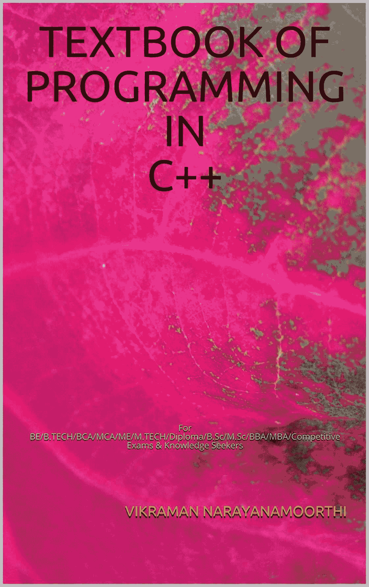

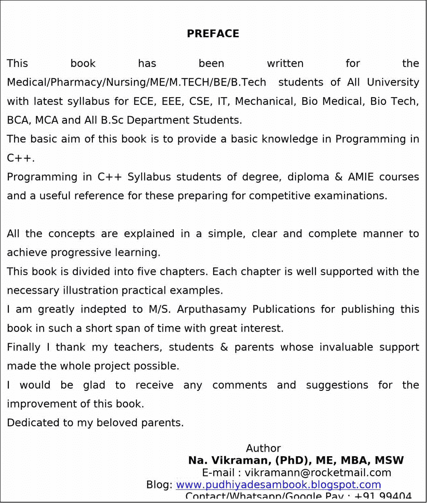<map name="awmap1"><area shape="rect" href="http://www.pudhiyadesambook.blogspot.com" coords="249, 675, 537, 692"></map>

## 第 1 单元：面向对象的编程范式

- 编程范式的比较
- 面向对象语言
- 面向对象编程的优点
- 与 C 的比较
- C++ 概述
- 指针、引用与结构
- 函数 - 作用域与命名空间
- 源文件与程序

### 过程化编程

高级语言如 `BASIC`、`COBOL`、`C`、`FORTRAN` 通常被称为过程编程。

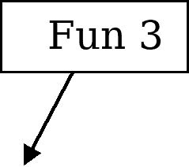[](Images/image01301.jpeg)[](Images/image01302.jpeg)[](Images/image01303.jpeg)[](Images/image01304.jpeg)[](Images/image01305.jpeg)使用这种方法，问题被看作一系列要执行的操作，如读取、处理、显示或打印。为了执行这些任务，必须使用函数概念。

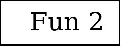[](Images/image01307.jpeg)

### 图. 过程化程序的典型结构

- 该概念基本上由许多条语句组成，这些语句被组织或分组为函数。
- 在开发这些函数时，程序员必须注意在各个函数中使用的数据。
- 在多函数程序中，数据必须声明为全局，以便程序内的所有函数都能访问该数据，且每个函数也可以拥有自己的数据，称为局部数据。

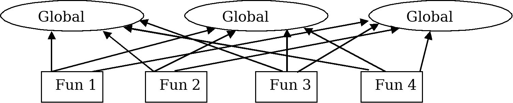

### 图. 过程化编程中数据与函数的关系

- 全局数据可以在程序的任何地方访问。在大型程序中，很难识别哪个函数访问了哪些数据。在这种情况下，我们必须重新检查外部数据以及访问全局数据的函数。在这种情况下，有很多机会出现错误。

### 过程化编程 (C) 的特点：

- 侧重于执行任务（算法）
- 大型程序被分成较小的程序，称为函数
- 大多数函数共享全局数据
- 数据在系统中从函数之间自由流动
- 函数将数据从一种形式转换为另一种形式
- 在程序设计中采用自上而下（TOP-DOWN）的方法

### 面向对象编程

- 这种编程方法的开发是为了减少在过程化编程方法中遇到的某些缺点。
- `OOProgramming` 方法将数据视为关键元素，且允许数据在程序中自由流动。
- 它将数据与操作数据的函数更紧密地封装；它还保护数据不受函数外部的意外修改。
- 面向对象编程方法将程序分为许多称为“对象”的实体，并在对象周围构建操作数据的数据和函数。
- 对象的数据只能通过与对象相关的函数访问。然而，一个对象的函数可以访问其他对象的函数。

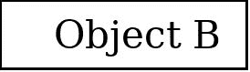

## 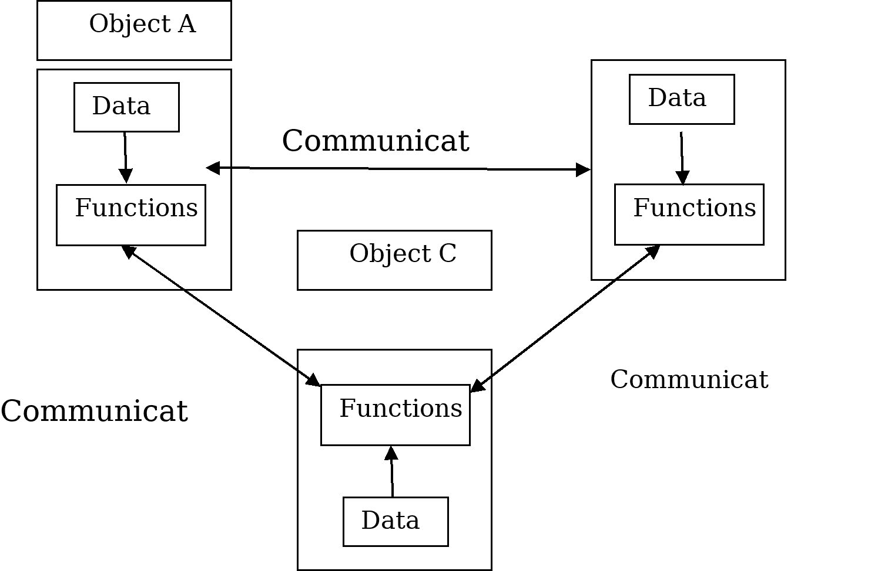[](Images/image01314.jpeg)图. OOP 中数据与函数的组织

### 面向对象编程 (C++) 的特点

- 侧重于数据而非过程
- 程序被分为所谓的 `OBJECTS`（对象）
- 数据结构的设计使其表征对象的特征
- 操作对象数据的函数在数据结构中绑定在一起
- 数据是隐藏的，不能被外部函数访问
- 对象之间可以通过函数进行相互通信
- 需要时可以随时方便地添加新的数据和函数
- 在程序设计中遵循自下而上（BOTTOM-UP）的方法

### 编程范式的比较

#### C 与 C++ 的区别

`C` 是一种过程化编程语言，而 `C++` 是一种面向对象的编程语言。之所以需要面向对象的环境，是因为 `C` 等过程化编程语言在大型程序的无 Bug 性、复杂性和可重用性方面无法达到预期结果。`C++` 消除了 `C` 语言所面临的陷阱。

许多差异使得 `C++` 成为 `C` 的理想替代方案。`C++` 中有许多 `C` 语言不支持的概念，如数据隐藏、数据封装、继承、多态、类、对象、运算符重载和消息传递。这些概念可以消除大型程序中 `C` 语言的复杂性。

`C` 与 `C++` 的主要区别在于我们使用 `class`（用户定义数据类型）的地方，通过 `class` 我们导出其他概念。`Class` 类似于 `C` 中的结构体。在结构体中只能声明混合数据类型，而 `C++` 允许我们在定义数据之外声明并定义函数。这使得主函数更加简单，并将所有函数分组到单个 `class` 中。

`C++` 中的运算符重载概念允许我们创建自己的新语言。通过这种方式，我们可以对类变量（即对象）进行算术运算，使得程序更容易理解。在 `C` 中，我们无法像在 `C++` 中那样对结构体变量进行算术运算。

在 `c` 中，对于大型程序，冗余代码的存在是不可避免的。这在 `C++` 中可以通过继承来消除。

在 `c` 中，一个程序的代码意外访问另一个程序的代码是可以避免的。这在 `C++` 中可以通过数据隐藏来消除，它帮助程序员构建不被程序其他代码入侵的安全程序。

在 `c` 中，如果我们想在不修改函数的情况下向程序额外功能是非常困难的。这在 `C++` 中可以通过继承来消除，继承允许我们在不修改现有类的情况下添加额外功能。这一概念提供了程序的可重用性。

| 序号 | 过程化编程 (C) | 面向对象编程 (C++) |
| :--- | :--- | :--- |
| 1.2.3.4.5. | 程序被分成较小的子程序，称为函数。这里全局数据被大多数函数共享。采用自上而下的方法。数据安全且对所有函数可见。这里无法重用，因此无法避免冗余代码。 | 程序被分为对象和类。对象之间可以通过函数相互通信。采用自下而上的方法。数据是安全的，并在声明它的类中可用。在这里，我们可以通过继承概念重用现有的。 |

### 面向对象语言：

面向对象编程语言分为两类：1. 基于对象的编程语言 2. 面向对象的编程语言

#### 基于对象的编程：

支持对象编程的语言被称为基于对象的编程语言。它们没有继承和动态绑定。基于对象是一种支持封装和标识的编程风格。

实现此功能的主要特性：

1. 数据封装
2. 数据隐藏和访问机制
3. 对象的自动初始化和清理
4. 运算符重载

#### 面向对象编程

面向对象编程包含了基于对象的编程的所有特性，并增加了继承和动态绑定两个额外特性。

### OOP 概念是

- 对象
- 类
- 数据抽象与封装
- 继承
- 多态
- 动态绑定
- 消息传递

### 对象

- 对象是面向对象系统中的基本运行时实体。
- 每个实体都可以被视为对象。对象包含数据和操作这些数据的代码。
- 它们可能代表一个人、一个地方、一个银行账户、一个数据表或计算机必须处理的任何项目。
- 某些对象可能对应现实世界的实体，例如学生、员工、银行账户等。
- 每个对象将有一个名为 `attributes`（`data`）的状态以及一个名为 `operations`（`function`）的行为。

当程序执行时，对象之间通过向彼此发送消息来相互交互。例如，如果 `customer` 和 `account` 是程序中的两个对象，那么 `customer` 对象可能会向 `account` 对象发送消息。每个对象都包含用于操作数据的数据和代码。对象之间可以交互而无需了解对方数据或代码的细节。只需要知道对象接受的类型类型以及对象返回的响应类型即可。

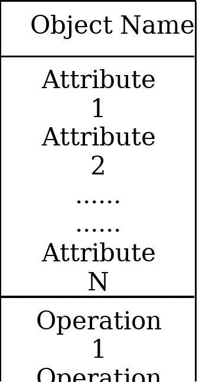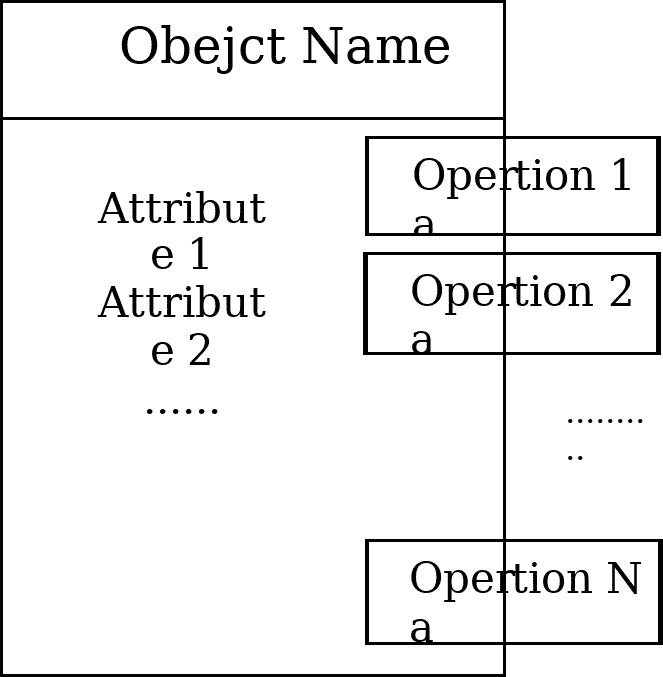

**图 2 表示对象的两种方式**

台台灯可能只有两种可能的状态（`on` 和 `off`）和两种可能的行为（`turn on`、`turn off`），但你的台式收音机可能有额外的状态（`on`、`off`、`current volume`、`current station`）和行为（`turn on`、`turn off`、`increase volume`、`decrease volume`、`seek`、`scan` 和 `tune`）。

### 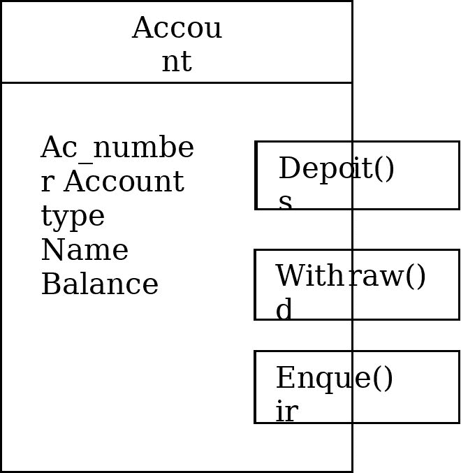 示例：

| 账户 |
| 账号 账户类型 名称 余额 |
| `Deposit()` `Withdraw()` `Enquire()` |

- 每个对象都拥有其自己的身份，尽管它们的 `attributes` 和操作是相同的，但对象之间永远不会相等。
- 例如，在人对象的情况下，两个人将具有相同的属性，如 `name`、`age`、`sex`；但它们是不相等的。

### 类

- 我们知道对象包含数据以及操作这些数据的函数或代码。通过 `class` 的帮助，对象的整个数据和代码集合可以作为一个用户定义的数据类型。
- 对象是 `class` 类型的变量。
- 类是用户定义的数据类型，行为类似于编程语言的内置类型。
- 一旦定义了 `class`，我们就可以创建许多与该 `class` 关联的对象。
- 因此，`class` 是相似类型对象的集合，即具有相同状态（`attributes`）和行为（`operations`）的对象被分组到一个 `class` 中。
- 例如，`mango`、`apple` 和 `orange` 是类 `fruit` 的成员。
- 创建对象的语法与在 `C` 中创建整数对象的语法没有区别。
- 如果 `fruit` 已经定义为 `class`，那么语句

### 示例：

```
fruit mango;
```

将创建一个属于类 `fruit` 的对象 `mango`。

### 示例例：

1. 类：`person` 对象：`girl`、`boy` 属性：`Name`、`Age` 操作：`speak()`、`listen()`、`walk()`
2. 类：`vehicle` 对象：`car`、`bus` 属性：`Name`、`model`、`color` 操作：`start()`、`stop()`、`accelerate()`

### 在 C++ 中，类可以表示为：

```cpp
Class account
{
Private:
  char name[20]; int act_type; float balance;
Public:
};
deposit( ); withdraw( );
```

- 它类似于 `C` 中的结构体声明。
- 它允许创建被称为 `objects` 的类变量。

### 示例：

```cpp
#include <iostream>
#include <conio.h>
using namespace std;

class account {
private:
  int a;
public:
  void getdata() {
    cout << "enter number to check: ";
    cin >> a;
  }
  void check() {
    if(a % 2 == 0)
      cout << "given number is even";
    else
      cout << "given number is odd";
  }
};

void main() {
  getscr();
  account e;
  e.getdata();
  e.check();
}
```

**输出：**

Enter number to check: 9

given number is odd

2.

```cpp
#include <iostream>
#include <conio.h>
using namespace std;

class velocity {
private:
  int v, a, t;
public:
  void getdata() {
    cout << "Enter values for velocity, acceleration,
and time: ";
    cin >> v >> a >> t;
  }
  void calculate() {
    v = v + (a * t);
    cout << "FINAL VELOCITY= " << v;
  }
};

void main() {
  getscr();
  velocity ob;
  ob.getdata();
  ob.calculate();
}
```

**输出：**

Enter values for velocity, acceleration,and time: 10 5 2

FINAL VELOCITY= 20

### 封装

- 封装是 OOP 最显著的特征。将数据和函数封装成一个单元被称为封装。
- 数据对外部不可见；只有这些函数可以访问它。
- 这也被称为“数据隐藏”或“信息隐藏”。

### 抽象

- 抽象指的是在不包含细节的情况下表示基本特征的行为。为了更清楚地理解这个概念，以“开关”为例。你只知道特定的开关，因为内部发生的情况是被隐藏的。
- 类使用了抽象的概念。它们也被称为抽象数据类型 (ADT)。

### 继承

- 继承是一个类的对象获取另一个类属性的过程。
- 它提供了重用性，即我们可以向现有类添加额外的功能。
- 这可以通过从现有类派生出一个新类来实现。
- 现有的类被称为基类，新类被称为派生类（子类）、父类（超类）。

### 多态

- 多态是 OOP 力量的关键。
- 它是一个希腊语词，意味着采取多种形式（许多形式）的能力。
- 它是支持数据以多种形式进行处理的能力的概念，即它允许一个名称被用于多个相关的用途，而这些用途在技术上是不同的。
- 例如，一个操作在不同的实例中可能会表现出不同的行为。

以下是在 C++ 程序中实现多态的不同方法：

- 函数重载
- 运算符重载
- 动态绑定

## 动态绑定

- 绑定（Binding）是指将过程调用与响应该调要执行的代码链接起来。
- 动态绑定（也称为后期绑定）意味着与给定过程关联的代码在运行时的调用之前是未知的。
- 它与多态和继承相关。

## 示例

- 考虑上图中的 `draw` 过程。通过继承，每个对象都拥有此过程。
- 然而，它的算法对于每个对象都是唯一的，因此 `draw` 过程将在定义该对象的每个类中重新定义。
- 在运行时，将调用与当前引用对象匹配的代码。

## 消息传递

- 一个面向对象（OO）的程序由一组相互通信的对象组成。
- 因此，在面向对象语言中编程的过程涉及以下步骤：
  - 创建定义对象及其行为的类。
  - 从类定义创建对象。
  - 建立对象之间的通信。
- 发给对象的消息是执行某个过程的请求，因此它将调用接收对象中的一个函数（过程），以生成所需的结果。
- 对象之间通过发送和接收信息进行通信，就像人与之间传递消息一样。
- 消息传递涉及指定对象的名称、函数（消息）名称以及要发送的信息。

## 示例

`employee.salary(name);`


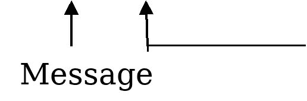

信息

对象具有生命周期。它们可以被创建和销毁。

只要对象存活，与对象的通信就是可能的。

## 面向对象编程（OOP）的优点

- 可以轻松管理软件的复杂性。
- 数据隐藏概念帮助程序员构建安全的程序。
- 通过类概念我们可以自定义数据类型。
- 继承概念可以消除冗余代码。
- 消息传递概念帮助程序员在不同对象之间进行通信。
- 需要时可以轻松地添加新的数据和函数。
- OOP 将数据元素与其操作的函数结合得更紧密。

## 面向对象编程的应用

- 实时系统
- 仿真与建模
- 对象数据库
- 超文本、超多媒体和专家文本
- 人工智能和专家系统
- 神经网络和并行编程
- 决策支持和办公自动化系统
- CIM/CAM/CAD 系统

## C 与 C++ 的比较

### C 语言

- 自上而下的方法
- 过程导向
- 变量无法动态泛化
- 没有引用变量概念
- 内存管理
  - 分配：`malloc()`，`calloc()`
  - 释放：`free()`
  - 类型转换：
    语法：`(typename) expression`
- 不支持继承、多态、动态绑定、封装等面向对象的概念。
- 没有内联函数或友元函数。
- 输入和输出：
  - 分别使用 `Scanf()` 和 `printf()` 库函数读取输入和写入输出。
- 没有作用域解析符来访问函数内部块中的全局变量。
- 不使用构造函数和析构函数。
- 不支持继承、多态、封装、动态绑定等面向对象的概念。

### C++ 语言

- 自下而上的方法
- 面向对象
- 允许变量的动态初始化，例如：`cin>>str;`

```
int len=strlen(str);
```

- 使用引用变量，例如：`float tot=100`

```
float & sum=tot;
// 此处引用变量 sum 引用变量 tot
```

- 内存管理
  - 分配：使用 `new` 运算符。
  - 释放：使用 `delete` 运算符。
  - 类型转换：
    语法：`typename (expression)`
- 内联函数：内联函数是请求[编译器](http://en.wikipedia.org/wiki/Compiler)执行[内联展开](http://en.wikipedia.org/wiki/Inline_expansion)的函数。
- 例如：

```cpp
#include<iostream.h> class class inl
{
public:
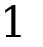
inline int cube(int a) return a*a*a;
};

Int main()
{
inl o;
int c=o.cube(3); return 0;
}
```

- 输入和输出：
  - 用于读取输入的 `>>` 提取运算符


- 用于打印输出的`<<`运算符

  例如：

```cpp
cin>> a;
cout<<a;
```

- 作用域解析符：

  作用域解析符有助于识别并指定标识符所指的上下文。语法：`::member_name`

- 使用友元函数和虚函数。

- 不使用构造函数和析构函数。

- 支持继承、多态、封装、动态绑定等面向对象的概念。

## C++ 编程概述

C++ 由 BJARNE STROUSSTRUP 于 20 世纪 80 年代初在美国马里山的 AT&T 贝尔实验室开发。

Stroustrup 结合了‘C’语言和‘SIMULA67’的特征，创建了一种支持 OOP 概念的更强大的语言，该语言命名为“带类的 C”。1983 年底，名称改为 C++。

C++ 的想法来源于‘C’语言的递增运算符（`++`），意味着更多的增加。

C++ 是‘C’语言的超集，大多数‘C’语言的特性也可以应用于 C++，但面向对象的特性（类、继承、多态、重载）使得 C++ 真正成为一种面向对象的编程语言。


C++ 程序的结构

| 包含文件 |

| :--- |

| 类定义 |

| 成员函数定义 |

| 主函数程序 |

包含文件为编译器提供了链接系统库中函数的指令。

例如：

```cpp
#include <iostream.h>
#include–预处理器 指令 iostream.h–头文件
```

- 类是将数据及其关联函数绑定在一起的方法。它是一种自定义数据类型。必须在类声明部分声明。

- 成员函数定义描述了类函数如何实现。这必须是 C++ 程序的下一个部分。

- 最后是主程序部分，程序从这里开始执行。

```cpp
main( )
{
}
```

程序执行从左括号开始在右括号处结束。

主函数的右括号是程序的逻辑终点。

## 输入 / 输出语句

输入流

语法：

```cpp
cin >> var1 >> var2 >>;
```

- `cin` – 关键字，它是在 C++ 中预定义的对象，对应标准输入流。

- `>>` - 是提取或获取运算符

提取操作（`>>`）从左侧的流对象获取值并将其放入右侧的变量中。

例如：

```cpp
cin>>x; cin>>a>>b>>c;
```

输出流：语法：

```cpp
cout<<var1<<var2;
```

- `cout` - 标准输出流对象

- `<<` - 是插入或放入运算符

它将右侧变量的内容定向到左侧的对象。

输出流可用于在屏幕上显示消息。

例如：

```cpp
cout<<a<<b; cout<<”value of x is”<<x;
```

## 令牌

程序中的最小单元被称为令牌。

C++ 具有以下令牌：

- 关键字

- 标识符

- 常量

- 字符串

- 运算符

- C++ 程序使用这些令牌、空白符和语言语法编写。

- 大多数 C++ 令牌与 C 令牌基本相似，但有一些添加和微调。

### 关键字


- 关键字实现了特定的 C++ 语言特性。

- 关键字具有预定义的含义，用户无法更改。

- 关键字不能作为程序变量的名称。

- ANSI C 关键字中增加了额外的关键字，以增强其功能并使其成为面向对象的语言。

### 特有的 C++ 关键字

有几个是 C++ 特有的关键字。

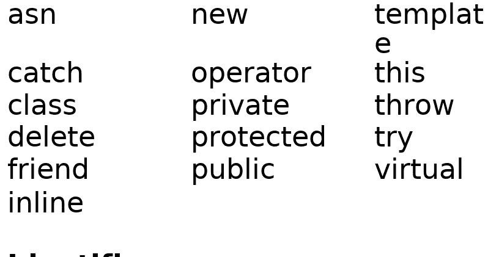

标识符是指程序员创建的变量、函数、数组、类等的名称。它们是任何语言的基础性要求。

这些标识符的命名规则在 C 和 C++ 中通用：

1. 仅允许字母、数字和下划线。

2. 名字不能以数字开头。

3. 大写和小写字母是有区别。

4. 已声明的关键字不能作为变量名。

C 和 C++ 之间的主要区别在于名称长度的限制，即`C`只识别名称中的前 32 个字符。而`C++`对长度没有限制，因此名称中的所有字符都是意义的。

### 常量

它指的是程序执行过程中不改变的固定值。`C++`识别 C 中可用的所有常量。

### 常量的类型：

- 整数常量-例如：`123`, `25`–不带小数点

- 字符常量-例如：‘A’, ‘B’, ‘*’, ‘1’

- 实数常量-例如：`12.3`, `2.5` - 带有小数点

### 字符串

字符序列被称为字符串。字符串常量用双引号括起来，如下：

### 示例：

“Hello”

### 运算符

运算符告诉计算机执行某些数学或逻辑操作的符号。

### 运算符类型

1. 算术运算符

2. 关系运算符

3. 逻辑运算符

4. 赋值运算符

5. 递增运算符

6. 条件运算符

7. 位运算符

8. 特殊运算符

9. 操纵符

10. 内存分配/删除运算符

### 操纵符

操纵符用于格式化数据显示的运算符。常用的操纵符有`endl`、`setw`。

### endl 操纵符

它用于输出语句并插入换行符，其效果与在‘C’语言中使用换行符`\n`相同。

### 示例：

```cpp
#include <iostream.h> main()
{

}
```

### 输出：

```cpp
int a=10, b=20;
cout << “C++ language” << endl; cout << “A value: “ << a << endl; cout << “B value:” << b << endl;
```

C++ language A value: 10

B value: 20

### 指针

C++ 增加了常量指针和指向常量的指针的概念。

### 常量指针

```cpp
Char * const ptr1=”GOOD”;//常量指针 我们不能修改指针 1 的地址。
```

### 指向常量的指针

```cpp
int const * ptr1=&m;//指向常量的指针 它所指向的内容不能改变。
```

### Void

`void`的用途：

(i) 当函数不返回返回值时指定其返回类型。

(ii) 为函数指示空参数列表。

### 示例：

```cpp
void func(void);
```

(iii) 它用于指针声明。

### 示例：

```cpp
void *p;//p 变成指针
```

在 C 语言中允许在不转换为非 void 指类型的情况下将任何 void 指针赋值给非 void 指针。

### 示例：

```cpp
void *ptr1; char *ptr2; ptr2=ptr1;
```

但在 C++ 中是不允许的。C++ 中的 void 指针不能直接赋值给其他类型的指针。我们需要使用强制转换符。

### 例如：

```cpp
void *ptr1; char *ptr2;
ptr2=(char*)ptr2;
```

### 引用变量

C++ 提供了一种名为引用变量的新类型变量。引用变量为之前定义的变量提供了一个别名（替代名称）。

例如，如果我们把变量`sum`变成变量`total`的引用，那么

 `sum`和`total`可以互换使用表示该变量。引用变量的创建方式如下：

### 示例：

```cpp
float total = 100; float & sum = total;
cout << sum << total;
```

这两个变量引用内存中的同一个数据对象，即`total`, `sum`

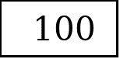

引用变量的主要应用是在向函数传递参数。

### 示例程序：

```cpp
void f(int & x)//使用引用
{
x=x+10;//x 增加了；所以 m 也被增加了
}
int main( )
{
int m=10;
f(m);//函数调用
..................
..................
}
```

当执行函数调用`f(m)`时，会发生以下初始化：`int & x=m;`

因此在执行语句`f(m);`后，`x`变成了`m`的别名。

当函数增加`x`时，`m`也会增加。

2 这种函数也被称为引用传递。

3 引用传递机制在面向对象编程中非常有用，因为它允许通过引用操作对象，并消除了对象参数来回复制。

4 引用不仅可以为内置类型创建，也可以为自定义类型创建。

- `enum`关键字通过为单词分配值`0`、`1`、`2`等来自动枚举单词列表。

- 该功能提供了一种创建符号常数的替代方法（使用`#define`预处理器指令）。

- `enum`的语法与`struct`语句相似。

### 语法：

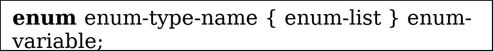

- 在这种形式下，`enum-type-name`是可选的。然而，如果你想在多个地方使用`enum`类型，最好使用另一种`enum`声明方式：

### （或）

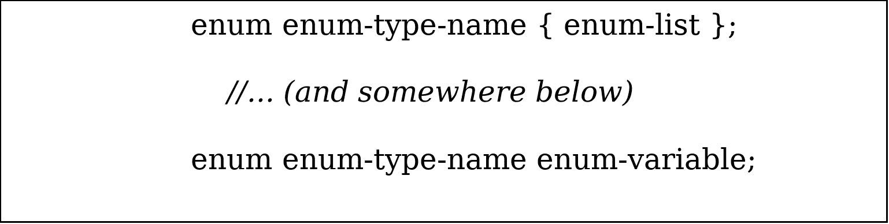

- 在第二种情况下，`enum-type-name`不能省略。

### 示例：

```cpp
enum shape{circle,triangle,circle}; enum color{yellow,blue,white,red}; enum position{off,on};
```

- 与`C`相比，C++`中的枚举数据类型略有不同。在`C++`中，标签名`shape`、`color`、`position`变成了新的类型名。

- 通过使用这些标签名，我们可以声明新变量。`shape ellipse;//ellipse 的类型是 shape` / `color background;//background 的类型是 color`

- `C`定义枚举的类型为`ints`。

- 在`C++`中，每个枚举数据类型保留其自身的独立类型，即`C++`不允许将`int`值自动转换为`enum`值。

### 示例：

```cpp
color background = blue;//允许
color background = 7;//C++ 中错误
color background = (color) 7; //可以
```

- 枚举值可以代替`int`值使用。`int c = red;// 有效，`color`类型提升为`int`

- 默认情况下，枚举成员被分配从`0`开始的整数值，每个后续的枚举成员都比前一个值大一，除非你显式地为某个枚举成员指定值，即：我们可以通过显式为枚举成员分配整数值来覆盖默认值。

- 枚举成员在枚举内部不需要具有唯一的值。

- 每个枚举成员的名字被视为常量，并且在定义`enum`的作用域内必须是唯一的。

- 枚举成员可以提升为整数值。

### 示例：

```cpp
Enum color{red,blue=5,green=9}; Enum color{red=5,blue,green};
```

注意：后续初始化的枚举成员比其前一个成员大一。

- `C++`也允许创建匿名枚举（即没有标签名的枚举）。

### 示例：

```cpp
enum{off,on};
```

在这里，`off`是`0`，`on`是`1`。这些常量可以像普通常量一样的方式被引用。

```cpp
int switch_1=off; int switch_2=on;
```

### 特性：

- 一个枚举集合可以包含重复的常量值。例如，你可以在同一个集合中将值`0`与两个不同的标识符关联。

- 枚举列表中的标识符必须与相同作用域内具有相同可见性的标识符区分开，包括普通变量名和其他枚举列表中的标识符。

- 枚举标签遵循正常的作用域规则。它们必须与具有相同可见性的其他枚举、结构和 union 标签区分。

### 函数

函数是`C++`程序的构建块。函数将若干程序语句分组为一个单一单元。该单元可以从程序的其他部分调用。

- 即使算法可用，实现一个大型程序也是困难的。

- 为了简单地实现这样的程序，应该将其拆分成若干独立的任务，这些任务可以被容易设计、实现和管理。

- 将大型程序拆分为小的、易于管理的任务并进行独立设计的过程被称为模块化编程。

- 程序中重复的指令组可以组织成函数。

- 函数是一组可以独立处理的程序语句。

- 成员函数

- 主函数

- 函数原型声明

- 引用传递

- 引用返回

- 内联函数

- 默认参数

- 常量参数

- 函数重载

- 友函数和虚函数

### 默认参数

```cpp
#include<iostream.h> 
#include<conio.h> 
class abc
{
public:
};
```

```cpp
void abc::sum(int a, int b, int c)
{
    int d=a+b+c;
}
```

### 作用域：

在`C`中，无法从块内部访问全局版本的变量。`C++`通过引入`::`运算符解决了这个问题。

示例：

```cpp
#include<iostream>
int m=10;
void main()
{
    int m=20;
    cout << ::m;
}
```

### 命名空间：

它用于定义名称定义的上下文。示例：

```cpp
#include <iostream>
using namespace std;

namespace first_space
{
    void func(){
        cout << "Inside first_space" << endl;
    }
}

namespace second_space
{
    void func(){
        cout << "Inside second_space" << endl;
    }
}

int main()
{
    first_space::func();
    second_space::func();
    return 0;
}
```

### 源文件与程序

以上示例。使用类 – 类定义：

类可以被描述为带有成员的数据集合。`C++`将数据和函数关联到一个单元的属性被称为封装。有时类不包含任何数据成员或成员函数，称为空类。

类的定义的语法：

关键字

类`classname`

{

用户定义的类名

}; 类结束需要分号

可以使用一个语句创建多个对象，如`Class s1,s2,s3;`或`Student s1,s2,s3;`。也可以通过在大括号后放置这些名称来创建对象。因此定义：

```cpp
Class student
} s1,s2,s3;
```

访问类成员：

一旦了类的对象，必须访问其成员。这是通过成员访问运算符`.`实现的。

[](Images/image0139.jpeg)语法：访问类的数据成员`对象名 . 数据成员`

类定义的对象 成员访问指示符

1 类的数据成员

访问成员函数的语法：

[](Images/image0142.jpeg)[](Images/image0143.jpeg)[](Images/image0144.jpeg)`对象名.函数名 (实际参数)`

类定义的对象 成员访问指示符

传递函数的参数 例如：`s1.setdata(10, “Ram”); s1.outdata( )`

对象`s1`可以分别用于访问成员函数`setdata`和`outdata`。

考虑以下程序

```cpp
#include <iostream.h> 
#include <string.h> 
class student

{
private:
int roll_no; char  name[20];

public:
void setdata(int roll_no_in, char name_in)
{

roll_no = roll_no_in; strcpy(name, name_in);
}

void  outdata(  )//显示数据  成员
{
```

```cpp
cout<<”rollno = “<< roll_no <<endl; cout<<”name = “ << name << endl;

}

};

void main( )

{

student s1; s1.setdata(1, “Ram”);

s2.setdata(10,”Kumar”); cout<<”Student details . . .”<<endl; s1.outdata(  );

s2.outdata(  );

}
```

**输出:**

```
Student details Rollno = 1 Name = Ram Rollno = 10 Name = Kumar
```

### 客户端-服务器模型

客户端寻求服务，而服务器提供由客户端请求的服务。在上面的示例中，`student`类类似于服务器，而`student`类的对象类似于客户端。它们通过发送消息来调用服务器。

在以下语句中：

```cpp
s2.setdata(10, “kumar”);
```

对象`s2`向服务器请求带有参数`10`和`kumar`的消息`setdata`，服务器接受这些消息并执行操作，并在客户端调用`outdata( )`函数时显示结果。

### 定义成员函数

类的数据成员必须在类体内部声明，而类的成员函数可以通过以下任何一种方式定义：

- 在类规范内部

- 在类规范外部

成员函数定义的语法取决于它是在类规范内部定义还是外部定义的，但它们执行的操作是相同的。

#### (a) 类体内部的成员函数

所有在类体内部定义的成员函数。例如：


## 类与对象

### 类定义

```cpp
Class classname
{
private:
    int age;
    int setage(int agein); // 成员函数
    {
        age = agein; // 函数体
    }

    ………..
public:
    int b;
    void rect()
    {
        . . ... // 函数体
    }
};
```

#### (b) 类体外部的成员函数

在类体内部声明函数原型，然后在类体外部定义它。这是通过使用“作用域解析运算符”（`::`）来实现的。它充当标识标签，用于通知编译器该函数属于哪个类。

**语法：**

```cpp
class classname
{
    . . . .
    Returntype memberfunction(arguments); // 函数声明
    . . . .
};

returntype classname :: memberfunction(arguments) // 函数定义
{
    // 函数体
}
```

### 在类内部访问成员函数

类的成员通过该类的对象使用点运算符`.`来访问。

**示例：**

```cpp
#include <iostream.h>
class number
{
    int num1, num2; // 默认为私有
public:
    void read()
    {
        cout << "Enter first number: ");
        cin >> num1;
        cout << "Enter second number: ");
        cin >> num2;
    }

    int max()
    {
        if (num1 > num2)
            return num1;
        else
            return num2;
    }

    // 成员函数的嵌套
    void showmax()
    {
        cout << "maximum = " << max();
    }
};

void main()
{
    number n1;
    n1.read();
    n1.showmax();
}
```

**输出：**

```
Enter first number : 5
Enter second number : 10
Maximum = 10
```

类的成员函数可以调用其所属类的任何其他成员函数，这被称为“成员函数的嵌套”。

### 数据隐藏

数据被隐藏在类内部，因此无法进行未经授权的访问，这是 OOP 的特性。

类中定义的所有数据和函数默认都是私有的（`private`）。通常情况下，数据成员被声明为私有，成员函数被声明为公共（`public`）。

**数据隐藏的方法：**

*   私有（`Private`）
*   公共（`Public`）
*   受保护（`Protected`）

这些关键字被称为访问控制说明符。

#### 私有成员（Private members）

只有同一类的成员函数可以访问这些成员。

类的私有成员在类外部是不可访问的。

```cpp
Class person
{
private:
    int age; // 私有数据
    int getage(); // 私有函数
    . . . .
};

person p1;
a = p1.age; // 无法访问私有数据，错误
p1.getage(); // 错误访问
```

即，我们无法通过对象来访问私有成员。

#### 受保护成员（Protected member）

受保护成员的访问控制与私有成员相似。受保护成员的访问控制如下所示：

```cpp
Class person
{
protected:
    . . . .
    int age; // 受保护数据
    int getage(); // 受保护函数
    . . . .
};
```


```cpp
person p1;
a = p1.age;
p1.getage();
```

#### 公共成员（Public Members）

无法访问受保护成员。

类中公共部分声明的所有数据成员和函数都可以从程序的任何地方无限制地访问。

**示例：**

```cpp
Class person
{
public:
    int age; // 公共数据
    int getage(); // public 函数
};

person p1;
a = p1.age; // 可以访问公共数据
p1.getage(); // 可以访问公共函数
```

### 成员函数的嵌套

类的成员函数可以调用其所属类的任何其他成员函数，这被称为“成员函数的嵌套”。通过使用点运算符调用类中的成员函数。

考虑以下示例：

```cpp
#include <iostream.h>
class set
{
    m, n;
public:
    void input();
    void display();
};

void set::input()
{
    if (m > n)
        return m;
    else
        return n;
}

void set::display()
{
    cout << m;
}
```

这是成员函数的嵌套。

### 数组（Arrays）

数组可以作为类的一部分使用。

**示例：**

```cpp
Class abc
{
    int a[size]; // a 是数组
    size;
public:
    size;
};
```

### 内联函数（Inline function）

使用函数的主要目的是为了节省内存空间，然而每次函数被调用时，都需要花费额外的时间执行任务。为了解决这个问题，C++ 提出了一种新功能：内联函数。内联函数是在被调用时由编译器将函数调用替换为相应的代码。

内联函数可以如下定义：


**示例：**

```cpp
inline int cube(int a)
{
    return (a * a * a);
}
```

上述内联函数可以通过语句调用：

```cpp
c = cube(3);
d = cube(2 + 2);
```

对于`c`和`d`，上述的输出分别为`27`和`64`。

要使函数变为内联，只需为函数定义加上`inline`关键字。所有内联函数必须在调用之前定义。记住，`inline`关键字只是向编译器发送一个请求，而不是命令。如果函数定义过长或复杂，编译器可能会忽略此请求将其编译为普通函数。

内联函数在某些情况下可能不起作用：

*   对于返回值的函数存在循环、`switch`或`goto`。
*   对于返回值的函数存在`return`语句。
*   如果函数包含静态变量。
*   如果内联函数是递归的。

**示例程序：**

```cpp
/* 使用内联函数对不同数据类型进行乘法和除法的程序 */
#include <iostream.h>
#include <conio.h>
class inlinefunc
{
    int a, b;
    float c, d;
public:
    void multiply();
    void divide();
};

inline void inlinefunc::multiply()
{
    cout << "Enter 2 integers:";
    cin >> a >> b;
    int x = a * b;
    cout << x;
}

inline void inlinefunc::divide()
{
    cout << endl << "Enter 2 float values:";
    cin >> c >> d;
    float y = c / d;
    cout << y;
}

void main()
{
    inlinefunc f;
    clrscr();
    f.multiply();
    f.divide();
    getch();
}
```

### 空类（Empty classes / Stubs）

使用类的主要目的是封装数据和代码，然而，可以拥有一个既没有数据也没有代码的类。换句话说，可以有空类。

空类的声明如下：

```cpp
Class xyz
{
};

Class abc
{
};
```

此类空类也称为存根（stubs）。它们用于创建类模板。

## 传递对象参数

*   可以存在接受类对象作为参数的函数，就像存在接受其他变量作为参数的函数一样。
*   可以通过以下方式将对象作为参数传递给函数：
    1.  按值传递对象：将整个对象的拷贝传递给函数。
    2.  按引用传递对象：仅将对象的地址隐式地传递给函数。
    3.  按指针传递对象：将对象的地址显式地传递给函数。

### 按值传递对象

在这种情况下，对象的拷贝被传递给函数，在函数内部对对象进行的任何修改都不会反映在调用该函数的对象上。

示例：

```cpp
#include <iostream.h>
class test
{
    int m1, m2;
public:
    void get()
    {
        cin >> m1 >> m2;
    }
    void read(test t3)
    {
        m1 = t3.m1;
        m2 = t3.m2;
    }
    void display()
    {
        cout << m1 << m2;
    }
};

void main()
{
    test t1;
    cout << "Enter Ist object data";
    t1.get();
    cout << "display Ist object data";
    t1.display();
    test t2;
    cout << "copy of object1 to object2";
    t2.read(t1);
    cout << "display 2nd object data";
    t2.display();
}
```

运行：

```
Enter Ist object data 34
56
display Ist object data 34
56
copy of object1 to object2 display 2nd object data 34
56
```

`t1`的成员被拷贝到`t2`中。对对象`t1`和`t2`数据成员所做的任何修改对于调用者的实际参数都是不可见的。

### 按引用传递对象

按引用传递的对象的访问性与按值传递的对象相似。在调用函数中对此类对象进行的修改也会反映在调用函数中。

示例：

```cpp
#include <iostream.h>
class test
{
    int m1, m2;
public:
    void get()
    {
        cin >> m1 >> m2;
    }
    void read(test &t3)
    {
        m1 = t3.m1;
        m2 = t3.m2;
    }
    void display()
    {
        cout << m1 << m2;
    }
};

void main()
{
    test t1;
    cout << "Enter Ist object data";
    t1.get();
    cout << "display Ist object data";
    t1.display();
    test t2;
    cout << "copy of object1 to object2";
    t2.read(t1);
    cout << "display 2nd object data";
    t2.display();
}
```

运行：

```
Enter Ist object data 34
56
display Ist object data 34
56
copy of object1 to object2 display 2nd object data 34
56
```

## 构造函数

*   构造函数是一个特殊的成员函数，用于初始化对象数据成员并为它们分配必要的资源。
*   构造函数需要遵循的规则：
    1.  构造函数应该声明在`public`区域。
    2.  它们在对象创建时被自动调用。
    3.  它们没有返回值类型，甚至不允许使用`void`。
    4.  它的名称与它所属的类名相同。

### 语法

```cpp
class classname
{
    …………
    …………
public:
    classname()
    {
        // 构造函数体
    }
};
```

### 构造函数的类型

1.  默认构造函数
2.  参数构造函数
3.  拷贝构造函数

### 默认构造函数

不显式接受参数的构造函数被称为默认构造函数。

示例：

```cpp
#include <iostream.h>
class test
{
    int m1, m2;
public:
    test()
    {
        m1 = 50;
        m2 = 25;
    }
    void display()
    {
        cout << m1 << m2;
    }
};

void main()
{
    test t1; // 调用默认构造函数
    cout << "Initialized data members";
    t1.display();
}
```

运行：

```
Initialized data members
50 25
```

### 参数构造函数

构造函数可以带参数被调用。参数列表可以在大括号内指定，类似于函数中的参数列表。带参数的构造函数被称为参数化构造函数。

示例：

```cpp
#include <iostream.h>
class test
{
    int m1, m2;
public:
    test(int, int); // 构造函数声明
    void display()
    {
        cout << m1 << m2;
    }
};

test::test(int x, int y) // 构造函数定义
{
    m1 = x;
    m2 = y;
}

void main()
{
    test t1(50, 100); // 参数化构造函数调用
    test t2(80, 90);
    cout << "Initialized data members";
    t1.display();
    cout << "Initialized data members";
    t2.display();
}
```

*(注：原文示例中`main`函数逻辑略有错乱，此处已根据语意翻译并对齐结构)*

由于原文文本中存在部分重复和格式错乱，已根据您的要求对提供的英文文本进行了逻辑翻译，并保留了所有 Markdown 格式。

因此，构造函数在创建对象时被调用，取决于传递参数的数量和类型。

在创建类`account`的对象期间，调用不同构造函数的情况：

```cpp
class account
{
public:
    account();
    account(int an);
    account(int acvalue, float bal);
    ………………
};

account acc1;
account acc2(45);
account acc3(324, 675.50);
```

### 拷贝构造函数

*   拷贝构造函数用于从另一个对象声明并初始化对象（即将所有数据从一个对象拷贝到另一个对象）。
*   例如：`integer obj2(obj1);`。上述语句定义了对象`obj2`并同时初始化或拷贝了`obj1`的值。
*   该语句的另一种形式是`Integer obj2 = obj1;`。
*   通过拷贝构造函数初始化的过程被称为拷贝初始化。
*   拷贝构造函数接受一个与自身同类对象的引用作为参数。
*   示例：

```cpp
#include <iostream.h>
class code
{
    int id;
public:
    code() {}
    code(int a) { id = a; }
    code(code &x) { id = x.id; }
};

void main()
{
    code A(100);
    code B(A);
    code C = A;
    code D;
    D = A;
    cout << " Id of A object is:";
    A.display();
    cout << " Id of B object is:";
    B.display();
    cout << " Id of C object is:";
    C.display();
    cout << " Id of D object is:";
    D.display();
}
```

**输出：**

```
Id of A object is:100
Id of B object is:100
Id of C object is:100
Id of D object is:100
```

**解释：**

*   在此程序中，每当调用带参数构造函数时，主程序都会传递值`100`。
*   现在，通过语句`code B(A)`，可以将对象`A`中包含的数据拷贝到对象`B`中。
*   这些数据可以通过引用被对象`X`接收。这里`A`应该作为实际参数，而`x`应该作为形式参数，也就是说对实际参数的更改应该反映在形式参数中，因为这是一个拷贝构造函数。

### 析构函数

*   当对象不再被需要时，它可以被销毁。
*   一个类可以有另一个特殊的成员函数，称为析构函数，它在对象被销毁时被调用。
*   析构函数是一个具有字符`~`（波浪号）后跟其类名和括号的成员函数。
*   它应该如下声明：`~classname();`。
*   当对象超出作用范围且不再需要时，可以自动调用析构函数。
*   一般格式：

```cpp
class classname
{
    …………
    ………….. // 私有成员
public:
    ~classname(); // 析构函数原型或声明
};

classname :: ~classname()
{
    // 析构函数体定义
}
```

#### 定义析构函数的规则

*   析构函数名与类名相同，但带有波浪号（`~`）。
*   与构造函数不同，析构函数不接受任何参数。
*   析构函数没有构造函数那样的返回类型，因为它在对象超出作用范围时自动调用。
*   析构函数必须声明在类的公共（`public`）部分，以便其所有用户访问。
*   每个类只能有一个析构函数。无法进行重载。

示例程序：


```cpp
#include< iostream.h> 
int count =0;

class test
{
public: 
    test( );
    ~test ( );
};

test::test( )
{
    count ++;
    cout<< “object “<< count<<”constructor of test is called”:
}

test::~test( )
{
    cout<< “object “<< count<<” Destructor of test is called”: count--;
}

void main()
{
    test x; // 构造函数调用
    {
        test y; // 构造函数调用
    }
}
```

**输出：**

`object 1 constructor of test is called object 2 constructor of test is called object 2 destructor of test is called object 1 destructor of test is called`

在上述程序每当创建对象时，都会调用相应的构造函数。程序结束后，对象超出了范围(scope)，自动调用析构函数。

## 运行时内存分配/ NEW、DELETE 运算符

- 每当定义数组时，编译时会设置指定数量的内存，这可能无法充分或不足。
- 如果出现编译时未知所需内存的情况，可以在执行期间进行内存分配。
- 在运行时分配内存的技术被称为动态内存分配。
- C 提供了两个特殊运算符来执行内存管理：
  - 用于动态内存分配的`new`运算符。
  - 用于动态释放的`delete`运算符。

### new 运算符

`new`运算符为变量和对象提供动态内存分配。

一般格式：`Pointer variable = new datatype;`

- 这里是`datatype`的指针。`New`运算符为变量分配足够的内存。
- 指针变量持有分配的内存地址。
- 示例：`p=new int; q= new float;` 其中`p`是`int`类型指针，`q`是`float`类型。

这里，`p` & `q`是指针变量，我们必须将其声明为指针变量：`int *p; float *q;`。

可以将指针的声明和赋值组合：`int *p=new int; float *q = new float;` 随后我们使用语句`*p=32; *q=5.5;`将`32`分配给新创建的`int`对象，将`5.5`分配给`float`对象。

带初始化的内存分配：`Pointer variable= new datatype(value);`

示例：`int *p=new int(32); float *q = new float(5.5);`。

一维数组的内存分配：`Pointer variable= new datatype [ size ];`

示例：`int *p=new int[20];` 为 20 个整数的数组创建一个内存空间。`P[0]`指第一个元素，`p[1]`指第二个，以此类推。

示例：

```cpp
void main( )
{
    int n;
    cout<<”enter no of elements to be processed”; cin>>n;
    int *pt= new int[  n];//运行时为变量 pt 分配空间
    cout<<”enter  elements”;
    for(int i=0;i<n;i++)
    {
        cin>>pt[i];
    }
    cout<<”display elements”; for(int i=0;i<n;i++)
    {
        cout<<pt[i];
    }
}
```

**运行：**

`enter no of elements to be processed 5`

`enter the elements 43 56 54 23 67`

`display elements 43 56 54 23 67`

### delete 运算符

当数据对象不再需要时，将其销毁以释放内存空间重用。

一般格式：`delete pointer variable;`

`pointer variable`是指向用`new`运算符创建的数据对象的指针。

示例：`delete p; delete q;`。

如果我们想释放动态分配的数组，一般格式：`delete [size] pointer variable;` 其中`size`指定要释放的数组元素数量。

上述示例程序的示例：`delete [n] pt;`。

### this 指针

`this`指针作为隐藏参数传递给所有非成员函数调用，并在所有非静态函数的体内作为局部变量可用。`this`指针是一个常量指针，持有当前对象的内存地址。`this`指针在静态成员函数中不可用，因为静态成员函数可以在没有对象（通过类名）的情况下调用。

示例：

```cpp
#include<iostream.h> #include<conio.h>
class add
{
    int a; 
public:
    add(int x) { a=x; }
    void sum() { this->a=this->a+4; }
    void display() { cout<<"\na="<<this->a; }
};

void main()
{
    clrscr();
    add ob(3);
    ob.display();
    ob.sum();
    ob.display();
    getch();
}
```

**输出：**

`a=3 a=7`

带返回值的 this 指针：

```cpp
#include<iostream.h> #include<conio.h>
class add
{
    int a; 
public:
    add(int x) { a=x; }
    add*  sum() { this->a=this->a+4; return(this) }
    void display() { cout<<"\na="<<this->a; }
};

void main()
{
    clrscr(); add obj(3);
    add *ob=&obj; ob->display(); ob=ob->sum(); ob->display();
}
```

**输出：**

`a=3 a=7`

## 友元函数和友类

### 定义

使用`friend`关键字声明的函数称为友函数（friend function），即对两个类都具有“友元”关系的普通函数，从而允许该函数访问这些类的私有数据。

### 友函数的特殊性质

- `friend`函数的作用域不受限制
- `friend`函数不能通过该类的对象来调用
- `friend`函数可以访问私有（private）和公共（public）数据成员
- `friend`函数可以在私有区域或公共区域声明，而不会影响其含义。

要使一个外部函数成为某个类的友，我们只需要像下面所示将该函数声明为该类的友即可：

```cpp
class ABC
{
……..
……… public:
……
…….
friend void display( ); // 声明;
};
```

### 示例

```cpp
#include <iostream.h> 
class sample
{
    int x,y; 
public:
    void getvalue()
    {
        x=50; y=40;
    }
    friend void display( sample a);
};

void display( sample a)
{
    cout<<a. x<< b. y;
}

void main( )
{
    ABC obj1;
    obj1\. getvalue( ); display( obj1);
}
```

程序的输出将为：50 40

- 函数通过使用点运算符和传递给它的对象来访问类变量`x`和`y`。
- 函数调用`display(obj1)`将对象`obj1`按值传递给友函数。

### 带有友函数的类

考虑操作两个不同类对象的情况，在这种情况下，可以使用友函数来桥接这两个类。

### 示例

```cpp
#include<iostream.h>
class result; // 提前声明类 test
{
    int n1,n2; 
public:
    void getmark( )
    { 
        n1=45; n2=78;
    }
    friend void display(  test,  result);// 友函数声明
};

class result
{
    int tot; 
public:
    friend  void  display(test,result);// 友函数声明
};

void display( test t, result r)
{
    ot=  t.n1+t.n2;// 使用 t 对象访问 test 类的私有成员 cout<<r.  tot;
}

void main(  )
{
    test t; result r;
    t.getmark(  );
    display( t,  r);
}
```

### 解释

- 程序包含两个类：`test`和`result`。
- `display`函数是友函数，用于访问两个类的私有数据成员。
- 友函数的声明可以放在类的私有区域，也可以放在公共区域。
- 每个类的对象都已作为参数传递给函数`display()`。
- 它可以通过这些参数访问两个类的私有成员。
- 在程序开头对类`result;`的提前声明是必要的，因为一个类在类`test`声明之前是无法被引用的。

### 友函数的用途

1. 对两个不同类的对象进行操作。
2. 友函数可以用来增加重载运算符的通用性。

## 友元类

### 定义

另一个类中所有操作或使用友元类私有成员的函数。

### 示例

```cpp
#include<iostream.h> 
class two;

class one
{
private:
    int x, y;
public:
    void setdata(int a, int b)
    {
        x=a; y=b;
    }
    friend class two;
};

class two
{
    int z; 
public:
    void addone(one obj)
    {
        z= obj. x + obj . y;
    }
    void display(one obj )
    {
        cout<<”X is: “<<obj.x<<”Y  is:”<<obj.y;
        cout<< “sum of one class data members”<< z;
    }
};

void main( )
{
    one obj1; two obj2;
    obj1\. setdata( 45,65); obj2. addone(obj1); obj2\. display( obj1);
}
```

**运行**

```
X is:  45
Y is:  65
sum of one class data members: 110
```

### 解释

- 类`two`是类`one`的友元，因此在类`two`的成员函数中可以使用类`one`对象访问类`one`的所有私有成员。
- 这里`addone()`和`display()`函数使用了类`one`的私有数据成员。因此这两个函数都以类`one`对象作为参数。

## 函数重载

- 可以定义多个同名但执行不同操作的函数。
- 它有助于减少对不寻常函数名的需求，使代码更易读。
- 这可以通过函数多态或函数重载的概念来实现。
- 函数重载允许多个函数具有不同的参数类型共享相同的名称。
- 函数多态意味着函数定义可以有多种形式。定义必须仅在参数的数量和类型上不同。

### 示例：多个交换函数

```cpp
#include<iostream.h>
void swap(char x, char y)
{
    // 逻辑省略
}
void swap(int x, int y)
{
    // 逻辑省略
}
void swap(float x, float y)
{
    // 逻辑省略
}

void main()
{
    // 调用示例
}
```

*(注：原文示例代码块不完整，此处根据结构翻译逻辑)*

由于原文提供的`swap`示例代码片段不完整，此处为基于结构的翻译：

```cpp
#include<iostream.h>
void swap(char x, char y)
{
    // 逻辑
}
// ... 其他重载函数
```

*(注：由于原文中`swap`示例代码逻辑较乱且不完整，此处保持其逻辑结构并翻译注释)*

**更正：原文中的`swap`示例似乎存在排版错误或截断，此处按要求保留其 Markdown 格式翻译。**

- 运算符重载（Operator overloading）是对现有运算符进行重载的概念。
- 运算符重载允许我们为运算符分配多个含义。
- 被重载的运算符被称为运算符函数。
- C++ 语言使用关键字`operator`来对运算符进行重载。
- 你通过在运算符前加上`operator`关键字来声明一个运算符函数。
- `operator`关键字用于重载内置运算符。
- 重载的运算符与重载的函数是有区别的。
- 运算符重载是指：当在一个或多个变量上使用相应的运算符时，告诉编译器如何执行特定操作的能力。
- 我们可以重载（赋予额外的含义）所有的 C++ 运算符，但以下除外：

| 序号 | 运算符 | 含义 |
| :--- | :--- | :--- |
| 1. | `.` | 类成员访问运算符 |
| 2. | `.*` | 成员指针访问运算符 |
| 3. | `::` | 作用域解析运算符 |
| 4. | `size of` | 大小运算符 |
| 5. | `?:` | 条件运算符 |
| 6. | `#` | 预处理器转为字符串 |
| 7. | `##` | 预处理器连接 |

表：不能重载的运算符

- 与大量符合运算符重载定义的运算符相比，这些被排除的运算符非常少。

**注意：** 尽管运算符的语义可以扩展，但我们无法改变它的语法，以及控制其使用的规则（例如操作数的个数、优先级和结合性）。（例如，乘法运算符的优先级将高于加法运算符）

- 记住，当一个运算符被重载时，它的原始含义并不会丢失。

## 可重载运算符

- C++ 提供了各种运算符，用于对各种操作数执行操作。
- 根据运算符所操作的操作数数量，可以将运算符分为一元运算符和二元运算符。
- C++ 允许几乎所有运算符被重载，在这种情况下，至少有一个操作数必须是类的一个实例（对象）。

| 序号 | 运算符类别 | 运算符 |
| :--- | :--- | :--- |
| 1. | 算术 | `+`, `-`, `*`, `/`, `%` |
| 2. | 位运算 | `&`, `|`, `~`, `^` |
| 3. | 逻辑 | `&&`, `||`, `!` |
| 4. | 关系 | `>`, `<`, `++`, `!=`, `<=`, `>=` |
| 5. | 赋值 | `=` |
| 6. | 算术赋值 | `+=`, `-=`, `+=`, `/=`, `%=`, `&=`, `|=`, `^=` |
| 7. | 移位 | `<<`, `>>`, `<<=`, `>>=` |
| 8. | 一元增减 | `++`, `--` |
| 9. | 下标 | `[]` |
| 10. | 函数调用 | `()` |
| 11. | 解引用 | `->` |
| 12. | 一元符号前缀 | `+`, `-` |
| 13. | 分配与释放 | `new`, `delete` |

表：C++ 可重载运算符

### 示例

编译器对减法运算符`-`的处理方式取决于该运算符的使用方式。

- 当它放在数值的左侧（如`-48`）时，编译器将该数字视为负值。
- 当用于两个整数值之间时（如`80-712`），编译器执行减法操作。
- 当用于一个整数和一个双精度浮点数之间时（如`558-9.27`），编译器将用右侧数减去左侧数；该操作产生一个双精度浮点数。
- 当`-`符号双写并放在变量的一侧时（例如`--Variable`或`Variable--`），变量的值需要减 1；换句话说，应该从该值中减去 1。

`*`运算符应用于指针变量时，给出指针所指向的值。但它也常用于乘法。

- 因此，操作数的数量和类型决定了后续操作的性质。

`<<`和`>>`等输入输出操作是运算符重载的良好示例。

- `<<`: 内置定义用于位移。
- 但在 C++ 中，它用于显示值。
- 同样地，我们可以为所有其他 C++ 运算符定义额外的含义。

## operator 关键字

- `operator`关键字促进了 C++ 运算符的重载。
- `operator`关键字指示其后的运算符符号是待重载的 C++ 运算符，用于对其类的成员进行操作。
- 要为运算符定义额外任务，我们必须指定它相对于所应用的类具有什么含义。
- 这是通过一个特殊的函数（称为运算符函数）来实现的，该函数描述了该

```cpp
return_type operatorop(arglist)
{
    body of operator function//定义的任务
}
```

图：运算符重载的语法

其中，

- `return_type`是指定操作返回值的类型。


`Op` 是被重载的运算符，即运算符符号。

`Op` 前面伴有关键字 `operator`。

`Operator op` 是函数名。

示例：

```cpp
int operator+(int a, int b)
{
    return a+b;
}
```

### 重载过程

- 创建一个类。
- 在类的公共部分声明运算符函数。它可以是成员函数或友元函数。
- 定义运算符所需的操作。

### 运算符重载的类型

- 一元重载
- 二元重载

## 一元运算符

- 一元运算符作用于一个操作数。
- 调用运算符的语法是 `operator`。
- 不带参数的重载被称为一元重载。
- 常用的一元运算符有减（`--`）和增（`++`）。

示例：

```cpp
#include<iostream.h>
#include<conio.h>

class unary
{
    int x, y, z;
public:
    void getdata()
    {
        cout<<"Enter the x,y,z values: ";
        cin>>x>>y>>z;
    }
    void display()
    {
        cout<<x<<"\t"<<y<<"\t"<<z;
    }
    void operator-();
};

void unary::operator-()
{
    x=-x;
    y=-y;
    z=-z;
}

void main()
{
    clrscr();
    unary ob;
    ob.getdata();
    cout<<"BEFORE ACTIVATING THE OPERATOR\n";
    ob.display();
    -ob;
    cout<<"AFTER ACTIVATING THE OPERATOR\n";
    ob.display();
    getch();
}
```

输出：

```
Enter the x,y,z values: 5 6 7
BEFORE ACTIVATING THE OPERATOR
5	6	7
AFTER ACTIVATING THE OPERATOR
-5-6-7
```

```cpp
cout<<"\ nAFTER OVERLOADING\n";

s.display();

getch();

}
```

### 输出

```
BEFORE OVERLOADING
values of x,y for increment operator 1276
values of p,q for decrement operator 8045
AFTER OVERLOADING
values of x,y for increment operator 1376
values of p,q for decrement operator 7945
```

### 增/减运算符的局限性

对变量进行加或减 1 操作是一种非常常见的编程实践。将变量加 1 称为递增，将变量减 1 称为递减。

1. 前置符号法会导致变量在表达式中使用其值之前进行更新。
   - 而后置符号法会导致它在在使用其值之后进行更新。
   - `obj1=++obj2;`
   - 效果与语句 `obj1=obj2++;` 完全相同。
   - 当 `++` 和 `--` 运算符被重载时，前置和后置重载运算符函数之间没有区别。

2. 增、减运算符仅适用于整数变量，不适用于浮点变量，也不适用于字面量。

3. 前置和后置的执行受 Java 控制，你无法改变执行顺序。
   - 例如：`num = (((x--)))* count; //仍然是最后递减 x。括号不会强制提前执行`

4. 使用增或减运算符的一个局限性是，被操作的变量只能增加或减少数值“一个”（ONE）。
   - 如果你需要增加（或减少）更大的（或更小）的值，则必须使用如下语句：
     - `j += 2;`（或）`j -= 5;`

### 二元运算符重载

- [二元](http://www.tech-faq.com/binary.html)运算符可以类似于类似于运算符的方式进行重载。
- 二元运算符作用于两个操作数，即两个两个数。
- 使用单个显式参数重载被称为二元运算符重载。
- 重载二元运算符的语法为：

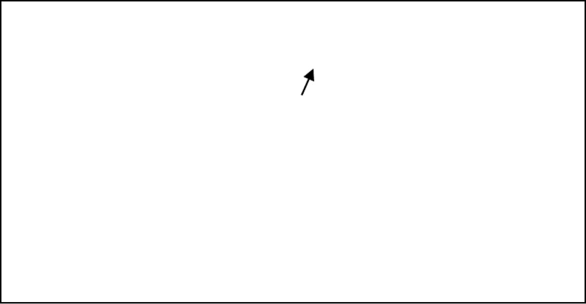

`Argument to operator function return_type operator op(arg)`

```cpp
{
    body of operator function//task defined
}
```


我们应该注意：

1. 如果是成员函数，它仅显式地接收一个类类型参数。
2. 即：二元重载运算符函数将第一个对象作为隐式操作数，第二个操作数必须作为显式参数传递。
3. 第一个对象的成员变量无需使用点运算符（dot）即可访问。
4. 此，如果参数是对象，则可以使用点运算符访问第二个参数成员，否则可以直接访问。

请注意，重载的二元运算符函数是定义在第一个对象类中的成员函数。

例如：

- 考虑以下表达式：
  - `C = A + B;//算术表示法`
  - 上述表达式包含三个对象分别为 `A`、`B` 和 `C`，其中 `A` 和 `B` 是操作数，而 `C` 是接收 `A` 和 `B` 之和的对象。
  - 在上述表达式中，运算符函数应该用于相两个自定义数据类型并返回一个自定义数据类型。

- 为了执行上述表达式，二元运算符函数将写为：


```cpp
user_defined operator+(user_defined rhs)
{
    user_defined temp; temp.x = x + rhs.x; temp.y = y + rhs.y;
    return temp;
}
```

- 现在考虑语句：
  - `temp.x = x + rhs.x;`
  - 在上述表达式中，`x` 是调用运算符成员函数的对象 `A` 的数据成员。
  - 而 `rhs.x` 指的是对象 `B` 的数据成员，该对象被作为参数传递给函数。由于函数 `operator+()` 需要返回结果。
  - 我们需要一个 `temp` 变量（相同类类型）来存储要返回的值。

注意：这里应该注意到，在重载二元运算符时，运算符左侧的对象被用于调用运算符函数，而运算符右侧的操作数始终作为参数传递给函数。

### 示例程序

```cpp
/*演示二元运算符重载的程序*/
#include <iostream.h>
#include<conio.h>

class complex
{
    float x;//实部
    float y;//虚部 
public:
    complex()//构造函数 1
    {
    }
    complex(float real,float imag)//构造函数 2
    {
        x=real; y=imag;
    }
    complex operator+(complex c); 
    void display();
};

/* 使用成员函数重载运算符*/ 
complex complex::operator+(complex c)
{
    complex temp;//临时 temp.x=x+c.x;//这些是 temp.y=y+c.y; //浮点加法
    return(temp);
}

void complex::display()
{
    cout<<x<<"+j+"<<y<<"\n";
}

int main()
{
    clrscr();
    complex c1,c2,c3;
    // ... 逻辑继续 ...
    return 0;
}
```

（注：提供的文本在源代码中包含一些重复和碎片化的注释；我在保持所提供逻辑的同时清理了结构。）

### 程序说明

- 让我们看看 `operator+` 并看它是如何实现的：

```cpp
complex::operator+(complex c)
{
    complex temp;//临时 temp.x=x+c.x;//这些是 temp.y=y+c.y; //浮点加法
    return(temp);
}
```

- 我们应该注意以下特征：
  - 它只接收一个类类型参数。
  - 它返回一个复类型。
  - 它是 `complex` 的成员函数。

- 现在看调用语句：
  - `c3=c1+c2;`
  - 上述调用语句等于：
  - `c3=c1.operator+(c2);`

- 我们知道成员函数只能通过同类的对象进行调用。这里，`c1` 承担调用函数的职责，而 `c2` 扮演参数的角色。

### 算术运算符

- 作为二元运算符，它们涉及两个参数，这两个类型不需要相同。
- 算术运算符有：
  - `+`（加法）
  - `-`（减法）
  - `*`（乘法）
  - `/`（除法）
  - `%`（取模）

### 运算符重载规则

尽管重新定义运算符看起来很简单，但在重载它们时存在某些限制和局限性。

- 只有现有的运算符可以被重载。不能创建新的运算符。
- 重载的运算符至少有一个操作数是用户定义的类型。
- 我们不能改变运算符的基本含义，即我们不能重新定义 `plus(+)` 运算符从另一个值中减去一个值。
- 重载的运算符遵循原始运算符的语法规则。它们不能被重写。
- 有某些运算符是不能重载的。
- 我们不能使用友函数来重载某些运算符。然而，可以使用成员函数来重载它们。
- 通过成员函数重载的一元运算符不接受显式参数，也不返回任何显式值。
- 通过成员函数重载的二元运算符接受一个显式参数。
- 当使用通过成员函数重载的二元运算符时，左侧的操作数必须是相关类的一个对象。
- 二元算术运算符（如 `+`、`=`、`*` 和 `/`）必须显式地返回一个值。它们不能尝试修改自身的参数。

# 第三单元

### 基类与派生类的关系

- 派生类的声明
- 继承的形式-继承与成员访问权限性
- 多重继承
- 多级继承
- 混合继承
- 派生类中的构造函数-派生类中的析构函数
- 虚基类
- 成员函数重写
- 虚函数

## 继承

- C++ 强力支持可重用性概念，即一个已经编写并测试过的类可以被用来创建一个新类。
- 这就像孩子继承父母的特征（如母亲的容貌和父亲的智力），可重用的属性将减少调试时间。
- 时间开销和成本开销将减少。
- 因此，可重用机制被应用于继承。

### 基类与派生类的关系

- 从旧类派生出新类的机制，或从现有类构建新类的技术被称为继承。
- 旧类被称为基类，新类被称为派生类。
- 派生类从基类继承部分或全部的特征。
- 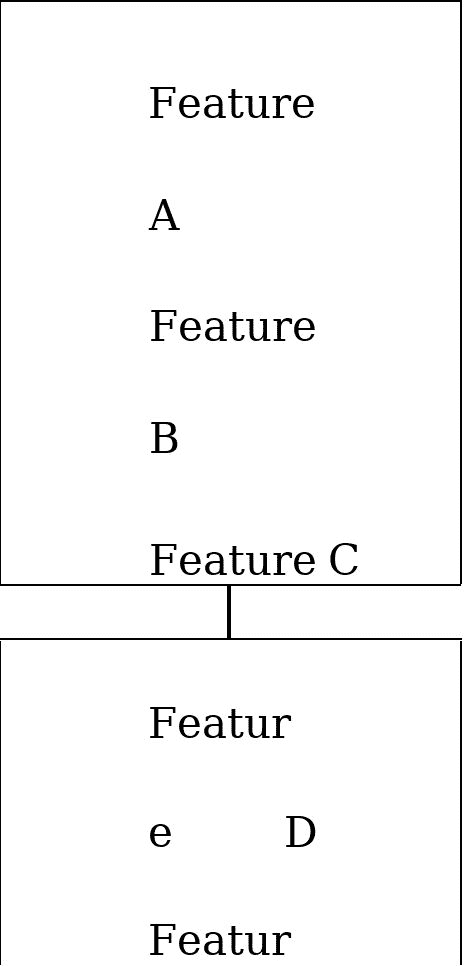基类保持不变。


基类


派生类

1

定义在派生类中

定义在基类中，也可从派生类访问

图. 基类与派生类的关系

- 一个类还可以从多个层级继承属性。
- 基类通常被称为祖类、父类或超类。
- 派生类被称为后代类、子类或子类。
- 在上面的图中，派生类继承了基类的特征 (A,B,C) 并添加了自身的特征 (D)。

### 派生类的声明

- 派生类通过继承另一个类（称为基类）的属性并添加自身的特征来扩展其功能。
- 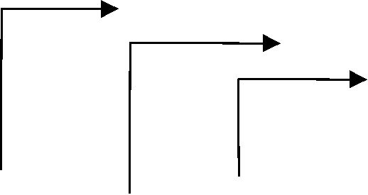声明派生类的通用形式为

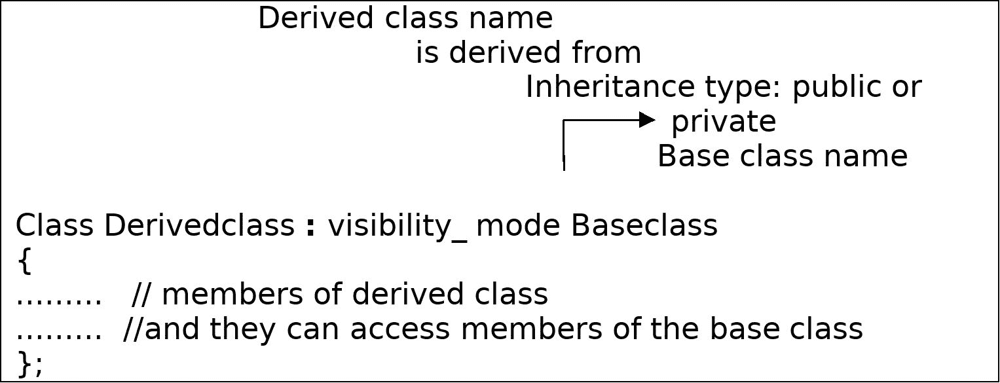

图. 派生类的声明语法

- 派生类自基类的派生通过冒号（`:`）表示。
- 可见性模式是可选的，如果存在，可以是 `private`（私有）或 `public`（公共）。
- 默认的可见性模式是 `private`。
- 可见性模式指定了基类的特征是以公开还是私有的方式继承的。

**注意：**

- 在声明派生类时，不会为其分配内存。
- 但在实例化创建对象时，会分配内存。

## 4 继承与成员访问权限

以下是派生的三种可能样式：

```cpp
Class abc : private xyz// 私有派生
{
.......// abc 的成员
.......
};
```

上述类派生自基类 `xyz`。

```cpp
Class abc : public xyz// 公有派生
{
......//abc 的成员
......
};
```

```cpp
Class abc : xyz// 默认的私有派生
{
......//abc 的成员
......
};
```


当派生类以 `private`（私有）可见性模式继承基类时，即当基类以私有方式被继承时：

- 基类的所有“公共成员”都变成派生类的“私有成员”。
- 因此，基类的所有公共成员只能通过派生类的成员函数访问。
- 派生类的对象无法访问这些成员。

**注意：**

- 类的所有“公共成员”都可以通过其自身的对象使用点操作符访问。
- 即基类的任何成员对派生类的对象来说都是不可见的。


当派生类以 `public`（公共）可见性模式继承基类时，即当基类以“公共”方式被继承时：

- 基类的所有“公共成员”都变成派生类的“公共成员”。
- 因此，基类的所有公共成员都可以通过派生类的成员函数访问。
- 派生类的对象也可以访问它们。

**注意：**

- 在这两种情况下，基类的“私有成员”都无法继承到派生类中。
- 即基类的“私有成员”永远不会成为其派生类的成员。

### 使私有成员可继承

- 我们可以让派生类继承私有成员。
- 这可以通过将 `private` 的可见性限制修改为 `public` 来实现。
- 这将消除“数据隐藏”的优势。
- C++ 提供了第三种可见性修饰符 `protected`，它在继承中具有有限的作用。
- 声明为 `protected` 的数据成员可以被所属类的成员函数访问。
- 任何直接派生自该类的类也可以访问。
- 这些数据成员无法被这两个类之外的函数访问。
- 类现在可以使用下所示的可见性模式：

```cpp
class abc
{
protected:
...............
................//对类内部及其直接派生类可见
public:
................//对程序中的所有函数可见
};
```

- 是合法的类定义。

**注意：**

- 当保护成员在公共派生中被继承时，它在派生类中也变为保护。
- 因此可以被派生类的成员函数访问。
- 它也适用于进一步继承。
- 当保护成员在私有派生中被继承时，它在派生类中变为私。
- 尽管它可以被派生类的成员函数访问。
- 它无法用于进一步继承（因为私有成员不可被继承）。
- `private`、`protected` 和 `public` 关键字可以在类声明中以任何顺序和任意次数出现。

例如：

```cpp
class abc
{
protected:
...............
................
public:
................
................
private:
.............
..............
public:
.............
.  ............

};
```

是合法的类定义。

**注意：**

- 可以以 `protected` 模式继承基类（称为保护派生）。
- 在保护派生中，基类的公共和保护成员都变成派生类的保护成员。


下表总结了基类成员在三种派生类型中发生的变化：

| 基类可见性 | 派生类可见性 | |
| :--- | :--- | :--- |
| 公有派生 | 私有派生 | 保护派生 |
| 私有 | 不继承 | 不继承 | 不继承 |
| 保护 | 保护 | 私有 | 保护 |
| 公有 | 公有 | 私有 | 保护 |

表.继承成员的可见性

## 单继承

- 拥有一个基类的派生类称为单继承。

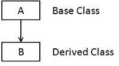

图. 单继承

- 单继承的语法格式：

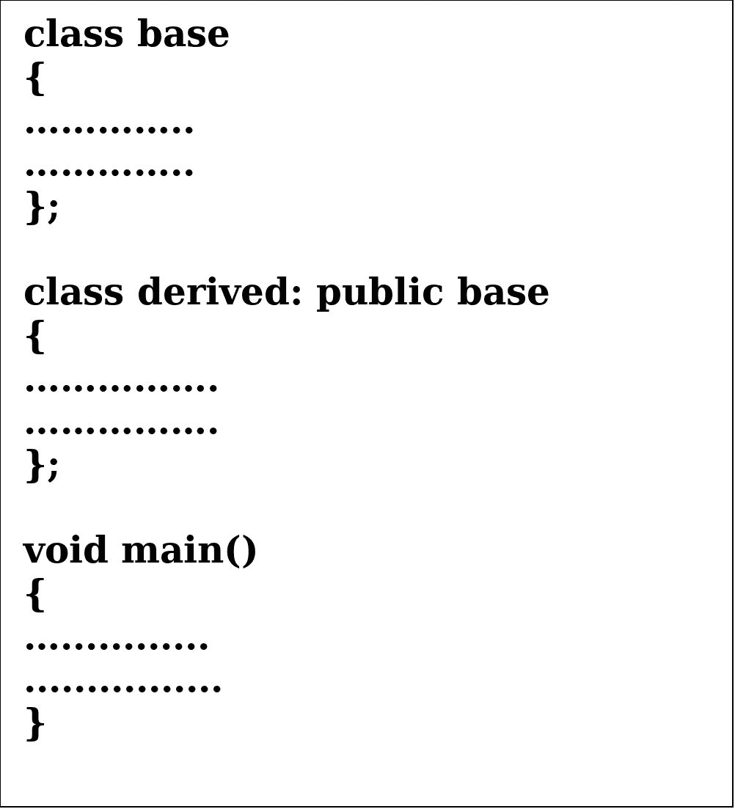

示例程序：

```cpp
#include <iostream.h> #include<conio.h>

class base//base class
{
    int a,b;//private; not inheritable
public:public; ready for inheritance
    int sum;

    void getdata()
    {
        cout<<”enter sales values for a and b”<<endl; cin>>a>>b;
    }

    void calculate()
    {
        sum=a+b;;
    }
};

class derived: public base//derived class
{//base class is publicly inherited
public:
    void putdata()
    {
        cout<<”the sum value is:”<<sum;
    }
};

void main()
{
    clrscr();
    derived d;//object of derived class d.getdata();
    d.calculate(); d.putdata();
    getch();
}
```

输出：

```
enter sales values for a and b 58
the sum value is:13
```

### 程序说明


- 在上述的示例中，我们定义了 `base` 为基类，`derived` 为派生类，其中其可见性模式为 `public`。
- 这样公有数据就可以被派生类继承，就像是它自己的类的公数据一样。
- 在此继承中，没有必要同时创建基类和派生类的对象。
- 相反，我们可以只创建一个派生类的对象。
- 我们可以通过该派生类对象调用派生类和基类的所有成员函数。

## 多重继承

- 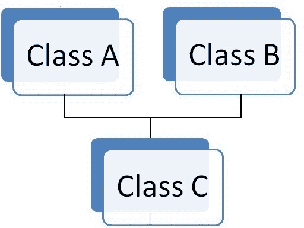拥有多个基类的派生类称为多重继承。

超类（父类 2）

子类（子类）

图. 多重继承

- 多重继承派生类（多个基类）的通用语法如下：

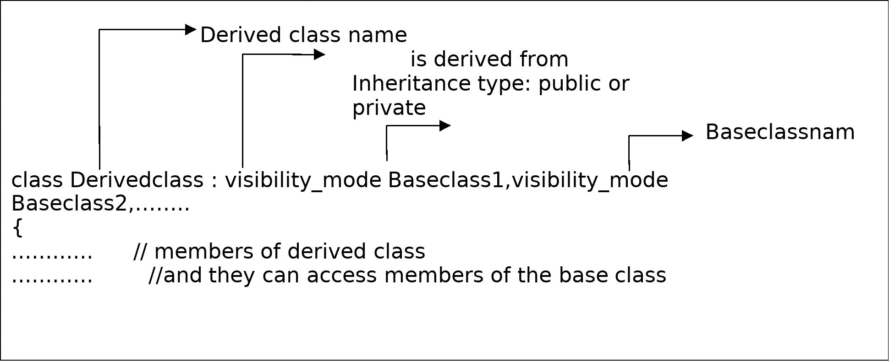

图. 多重继承的语法

- 多重继承的派生类声明如下：

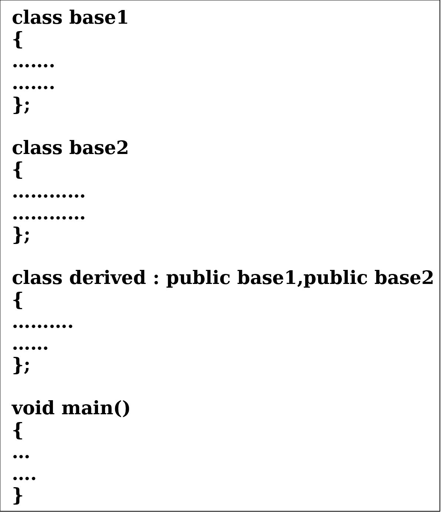

- 多重继承允许我们将多个现有类的特征结合，作为定义新类的起点。
- 它就像孩子继承了一个父母的身体特征和另一个父母的智力。


### 示例程序 1

```cpp
#include<iostream.h> #include<conio.h>

class abc
{
public:
    int a;
    void getdata()
    {
        cout<<"enter a value:"<<endl; cin>>a;
    }
};

class def
{
public:
    int b; void get()
    {
        cout<<"\nenter b value: "<<endl; cin>>b;
    }
};

class xyz : public abc, public def
{
public:
    void show()
    {
        cout<<"a and b values are: "<<a<<"\t"<<b;
    }
};

void main()
{
    clrscr();
    xyz w; w.getdata();
    w.get();
    w.show();
    getch();
}
```

输出：

```text
enter a value: 6 enter b value: 9
a and b values are: 6  9
```

### 示例程序 2

```cpp
#include<iostream.h> #include<conio.h>

class M
{
protected:
    int m;
public:
    void getdata_m()
    {
        cout<<"enter the value of m:  "<<endl;
        cin>>m;
    }
};

class N
{
public: public:
};

int n;
void getdata_n()
{
    cout<<"\nenter the value of n: <<endl; cin>>n;
}

class mul: public M,public N
{
public:
    int product;
    void calculate()
    {
        product=m*n;
    }
    void show()
    {
        cout<<"product of m and n is: "<<product;
    }
};

void main()
{
    clrscr(); mul m1;
    m1.getdata_n(); m1.getdata_m(); m1.calculate(); m1.show();
    getch();
}
```

## 多级继承

- 从派生类派生出另一个类的机制被称为多级继承。
- 多级继承的派生类声明如下：

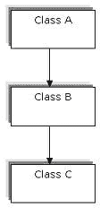

图. 多级继承

- 多级继承的派生类声明如下：

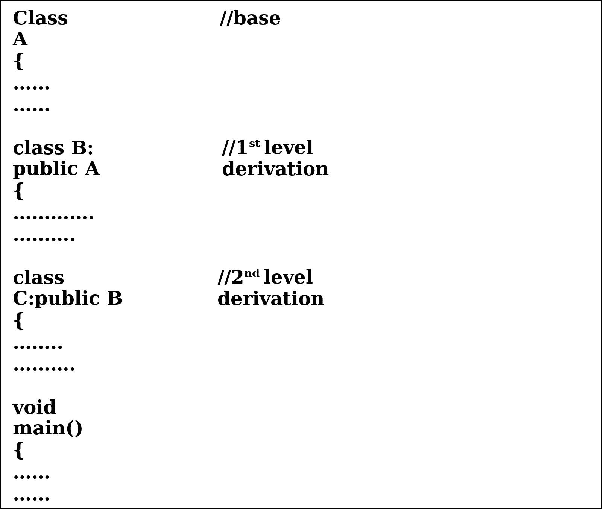

- 如上图所示，从另一个派生类派生一个类并不罕见。
- 类 `A` 作为派生类 `B` 的基类。
- 随后又作为派生类 `C` 的基类。
- 类 `B` 被称为中间基类，因为它为 `A` 和 `C` 之间的继承提供了连接。
- 链 `ABC` 被称为继承路径。

### 示例程序

```cpp
//多级继承的程序//
#include<iostream.h> #include<conio.h>

class student
{
protected:
    int rollno; public:
    void getdata()
};
// (后续代码根据逻辑省略)
```

```cpp
void display_a()
{
    cout<<"arts:  "<<endl;
}

};

class medical : public student
{
public:
    void display_md()
    {
        cout<<"medical: "<<endl;
    }
};

class engineering : public student
{
public:
    void display_e()
    {
        cout<<"engineering: \n"<<endl;
        cout<<"in engineering student can opt for any of the departments: "<<endl;
    }
};

class mechanical: public engineering
{
public:
    void display_m()
    {
        cout<<"engineering in mechanical: "<<endl;
    }
};

class civil: public engineering
{
public:
    void display_c()
    {
        cout<<"engineering in civil: "<<endl;
    }
};

class electronics: public engineering
{
public:
    void display_el()
    {
        cout<<"engineering in electronics: "<<endl;
    }
};

void main()
{
    clrscr();
    arts a; medical md; civil c; mechanical m; electronics  el;
    c.getdata_s(); a.display_a(); md.display_md(); c.display_e(); c.display_c(); m.display_m(); el.display_el();
    getch();
}
```

**输出：**

学生拥有的选项为：

```text
arts:

medical:

engineering:

in engineering student can opt for any of the departments: engineering in civil:

engineering in mechanical:

engineering in electronics:
```

## 混合继承

- [混合继承](http://guides.wikinut.com/Inheritance-and-Its-types/6dfqqlfm/)是将一种或多种类型的继承组合在一起的方法。

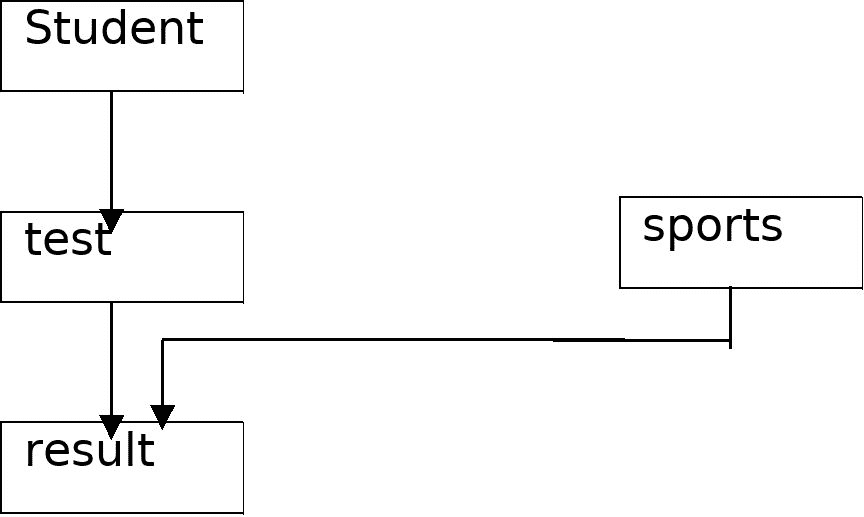

图. 混合（多级、多重）继承

## 虚基类

- 考虑一种情况，当涉及三种继承，即多级继承、多重继承和层次继承。
- 那么，`child` 将拥有两个直接基类 `parent1` 和 `parent2`，而它们本身有一个共同的基类 `grandparent`。
- `child` 通过两条独立的路径继承 `grandparent` 的特性。
- 它也可以像“虚线”所示那样直接继承。
- `grandparent` 有时被称为间接基类。

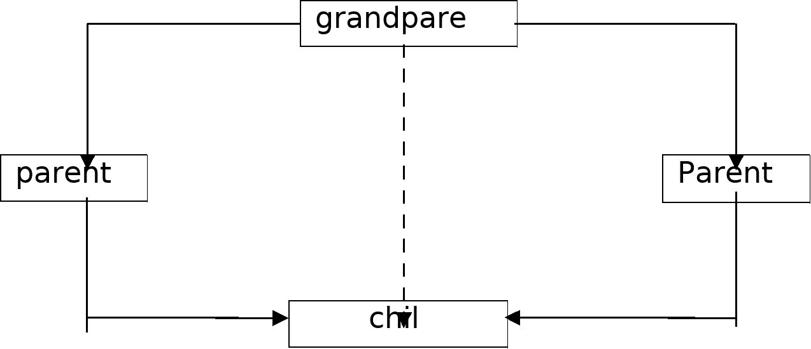

图. 多路径继承

- `child` 类的这种继承可能会产生一些问题。
- `grandparent` 类的所有公共和保护成员都被继承到 `child` 类中两次；第一次通过 `parent1` 类，第二次通过 `parent2` 类。
- 这意味着 `child` 类将拥有一组从 `grandparent` 继承的重复成员，这引入了歧义并应该被避免。
- 由于这些多条路径导致的继承成员重复可以通过将共同的基类声明为虚基类来避免，同时如下所示声明直接或中间的基类：

```cpp
class grandparent
{
….
….
};

class parent1 : virtual public grandparent
{
…….
…..
….
};

class parent2 : public virtual grandparent
{
…….
…..
….
};

class child : public parent1, public parent2
{
…….
.  ……// 只会继承一份 grandparent 的副本
…….
};
```

- 当一个类被变成虚基类时。
- C++ 会采取必要的措施，确保无论虚基类和派生类之间存在多少条继承路径，都只继承该类的一个副本。

注意：关键字 `virtual` 和 `public` 可以任意顺序使用。

### 示例程序

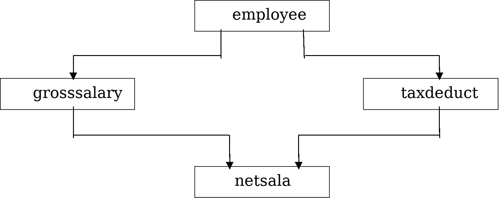作为虚基类作为虚基类

图. 虚基类

```cpp
#include<iostream.h> #include<conio.h>

class employee
{
public:
    char ename[ ];
    void getname()
    {
        cout<<"Enter the emp name"; cin>>ename;
    }
};

class grosssalary : virtual public employee
{
public:
    float bp,hra,da,gross;
    void getdetails()
    {
        cout<<"Enter the basicpay, hra, da"; cin>>bp>>hra>>da; gross=bp+hra+da; cout<<"gross"<<gross<<endl;
    }
};

class taxdeduct : public virtual employee
{
public:
    float tax;
    void deduct()
    {
        cout<<"Enter the tax amount to be deducted: "; cin>>tax;
    }
};

class netsalary : public salary,public taxcal
{
    float net;
public:
    void netpay()
    {
        net=gross-tax;
        cout<<"Netsalary of the employee:  "%(ename<<"\t"<<net;
    }
};

void main()
{
    netsalary ob; clrscr();
    ob.getname(); ob.getdetails(); ob.deduct();
    ob.netpay();
    getch();
}
```

**输出：**

```text
Enter the emp name: geetha

Enter the  basicpay, hra, da : 1200040005000

Gross: 21000

Enter the tax amount to be deducted: 2000 Netsalary of the employee geetha: 19000
```

## 抽象类

- 抽象类是不用于创建对象的类。
- 抽象类的设计目的仅是作为基类（供其他类继承）。
- 在之前的示例中，`employee` 类是一个抽象类，因为没有被用于创建任何对象。

## 虚函数

- 当我们在基类和派生类中使用相同的函数名时，基类中的函数通过在性普通声明前使用 `virtual` 关键字声明为虚函数。
- 可以在运行时更改的成员函数被称为虚函数。
- 当函数被变为虚函数时，C++ 根据基指针指向的对象的类型，而不是指针的类型，在运行时决定使用哪个函数。
- 因此，通过让基指针指向不同的对象，我们可以执行虚函数的不同版本。
- 虚函数的定义语法为：

```cpp
class classname
{
public:
. . . . .
virtual returntype functionname (arguments)
{
. . . .  .
. . . .  .
}
};
```

- 虚函数应该定义在类的公共部分。
- 当一个函数是虚而另一个是普通函数时，编译器在运行时决定创建哪个函数。
- 在这里我们需要创建一个 `basepointer`。
- 如果 `basepointer` 指向基类，它将执行基类函数。
- 如果 `basepointer` 指向派生类，它将执行派生类函数。

### 示例程序

```cpp
#include <iostream.h> #include<conio.h>

class Base
{
public:
    void display()
    {
        cout<<"\ndisplay base";
    }
    virtual void show()
    {
        cout<<"\nshow base";
    }
};

class Derived:public Base
{
public:
    void display()
    {
        cout<<"\ndisplay Derived";
    }
    void show()
    {
        cout<<"\nshow Derived";
    }
};

void main()
{
    clrscr(); Base b;
    Derived d; Base *bptr;
    cout<<”nbptr points to Base"; bptr=&b;
    bptr->display();// 调用基类 display 函数
    bptr->show();// 调用基类 show 函数
    cout<<”nbptr points to Derived"; bptr=&d;
    bptr->display();// 调用派生类 display 函数
    bptr->show();// 调用派生类 show 函数
    getch();
}
```

**输出：**

```text
nbptr points to Base

display base

show base

nbptr points to Derived

display base

show Derived
```

### 程序的解释

- 基指针首先持有基类对象的地址，这意味着将运行基类成员函数 `display` 和 `show`。
- 接下来基指针指向派生类对象，在执行派生类函数之前，它会检查相应的基类函数是否为虚。
- 如果不是虚函数则执行基类函数，否则将执行派生类函数。

### 虚函数的规则

1. 虚函数必须是某个类的成员。
2. 它们不能是静态成员。
3. 通过基指针访问。
4. 基类中的虚函数即使不使用也必须定义。
5. 基类虚函数的原型（或声明）与派生类版本必须相同。
6. 我们不能使用派生类的指针来访问基类对象。

## 成员函数重写

基类和派生类具有相同名称和参数的成员函数。如果你创建一个派生对象并编写代码访问该成员函数，只会调用派生类的成员函数，即派生类的成员函数重写了基类的成员函数。这一 C++ 编程特性被称为函数重写。

### 示例程序

```cpp
Class base
{
public:
    void print()
    {
        cout<<”Print from base”;
    }
}
```

```cpp
Class derived:public base
{
Public:
    Void print()
    {
        Cout<<”Print from derived”;
    }
};

Void main()
{
    Derived d;
    d.print(); //invokes print() from derived d
}
```

**输出：**

```text
Print from derived Print from derived
```

## 在继承中使用构造函数和析构函数

## 派生类中的构造函数

- 构造函数可以用于初始化对象的数据成员并分配内存等所需的资源。
- 在单继承的情况下，当派生类和基类都包含构造函数时，首先执行基类构造函数，然后执行派生类的构造函数。
- 在多继承的情况下，基类构造函数按照它们在派生类声明中出现的顺序执行。
- 在多级继承的情况下，构造函数将按照继承的顺序执行。
- 虚基类的构造函数会在任何非虚基类之前被调用。
- 如果有多个虚基类，它们按照声明的顺序被调用。

| 继承方式 | 执行顺序 |
| :--- | :--- |
| `Class A : public B` | `A();` 基类构造函数 |
| `{` | `B();` 派生类构造函数 |
| `};` | |
| `Class A : public B,public C` | `B();` 基类（第一个） |
| `{` | `C();` 基类（第二个） |
| `};` | `A();` 派生类 |
| `Class A : public B,virtual public C` | `C();` 虚基类 |
| `{` | `B();` 普通基类 |


| }; | A();派生类 |

**表 1. 基类构造函数的执行顺序**


## 派生类中的空构造函数

### 单继承情况 1：基类和派生类中都没有构造函数

当基类或派生类都没有构造函数时，编译器会自动创建类对象而不会产生任何错误。

**示例程序：**

```cpp
Class A
{
public: void dis( )
{
    cout<<”Hai Friends”;
}
};

Class B: public A
{
public:
    void display( )
    {
        cout<<”Have a nice day”;
    }
};

void main( )
{
}
```

**情况 2：仅基类中有一个构造函数**

```cpp
B s;/*派生类的对象*/ s.dis( );
s. display( );
```

```cpp
#include <iostream.h> class A
{
public:
    A (  )/*基类中的空构造函数*/
    {
        cout<<” Have a nice day”;
    }
};

class B: public A
{
public:
};

void main( )
{
    B s;/*派生类的对象*/
}
```

如果创建了派生类对象，它将首先检查基类并执行相应的默认构造函数。

### 情况 3：仅派生类中有构造函数

```cpp
#include <iostream.h> Class A
{
public:
};

Class B: public A
{
public:
    A (  )/*派生类中的空构造函数*/
    {
        cout<<”Have a nice day”;
    }
};

void main( )
{
    B  s;/*派生类的对象*/
}
```

当创建派生类对象时，它会首先检查基类；如果基类中没有构造函数，它将跳过基类并运行派生类的构造函数。

### 情况 4：基类和派生类中都有构造函数

```cpp
#include <iostream.h> class A
{
public:
    A (  )/*基类中的空构造函数*/
    {
        cout<<”Have a nice day”;
    }
};

class B: public A
{
public:
    B (  )/*派生类中的空构造函数*/
    {
        cout<<”Welcome”;
    }
};

void main( )
{
    B  s;/*派生类的对象*/
}
```

当创建派生类对象时，它将检查基类并执行相应的构造函数，然后执行相应的派生类构造函数。

## 多继承

### 多继承类中的构造函数

```cpp
#include <iostream.h>

class  A/*基类 1*/
{
public:
    A  ()/*基类 1 中的空构造函数*/
    {
        cout<<”Have a nice day”;
    }
};

class  B/*基类 2*/
{
public:
    B( )/*派生基类基类 2 中的空构造函数*/
    {
        cout<<”Welcome”;
    }
};

class C: public A,  public B/*派生类*/
{
public:
    C  ( )/*派生类中的空构造函数*/
    {
        cout<<”Good Morning”;
    }
};

void main( )
{
    C  s;/*派生类的对象*/
}
```

**输出：**

```
Have a nice day Welcome
Good Morning
```

构造函数的执行取决于继承这些类以创建新类的顺序，例如`public A`、`public B`，它将首先执行相应的类`A`构造函数，然后是类`B`构造函数，最后是派生类构造函数。

## 多级继承

### 多级继承中的构造函数

```cpp
#include <iostream.h>

class A
{
public:
    A (  )/*基类中的空构造函数*/
    {
        cout<<”Have a nice day”;
    }
};

class B: public A
{
public:
    B( )/*第一级派生类中的空构造函数*/
    {
        cout<<”Welcome”;
    }
};

class C:  public  B/*第二级派生类中的空构造函数*/
{
};

void main( )
{
    C c; 
}
```

**输出：**

```
Have a nice day
Welcome
Good Morning
```

C/C++ 的 IO 基于流（streams），流是流进和流出程序的一系列字节（就像水和油在管道中流动一样）。在输入操作中，数据字节从输入源（如键盘、文件、网络或另一个程序）流入程序。在输出操作中，数据字节从程序流向输出汇（如控制台、文件、网络或另一个程序）。流在程序和实际 IO 设备之间充当中介，通过这种方式使程序员无需处理实际的设备，从而实现与设备无关的 IO 操作。

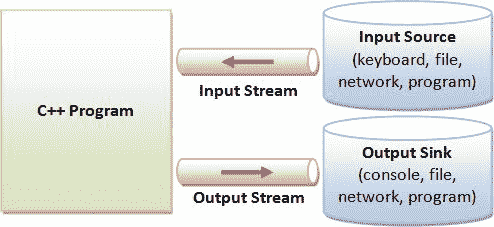

C++ 同时提供了格式化 IO 和非格式化 IO 函数。在格式化（或高级级）IO 中，字节被分组并转换为`int`、`double`、`string`或用户定义类型。在非格式化（或低级）IO 中，字节被视为原始字节且不进行转换。格式化 IO 操作通过重载流插入运算符（`<<`）和流提取运算符（`>>`）来实现，这提供了一个一致的公共 IO 接口。

要执行输入和输出，C++ 程序需要：

1. 构造一个流对象。
2. 将流对象连接（关联）到实际 IO 设备（例如：键盘、控制台、文件、网络、另一个程序）。
3. 通过流公共接口中定义的函数以与设备无关的方式执行输入/输出操作。某些函数在外部格式和内部格式之间转换数据（格式化 IO）；而另一些则不转换（非格式化或二进制 IO）。
4. 将流与实际 IO 设备分离（例如：关闭文件）。
5. 释放流对象。

## iostream 库包含

- `<iostream.h>`：包含`cin`、`cout`、`cerr`和`clog`对象
- `<iomanip.h>`：包含参数化流操纵符
- `<fstream.h>`：包含用户控制的文件处理操作关重要的信息

## ios 基类

`istream`和`ostream`继承自`ios`。`iostream`继承自`istream`和`ostream`。

- `<<`（左移运算符）
    - 重载为流插入运算符
- `>>`（右移运算符）
    - 重载为流提取运算符
    - 这两个运算符均与`cin`、`cout`、`cerr`、`clog`以及用户定义的流对象一起使用

### istream: 输入流

```cpp
cin >> someVariable;
```

- `cin`知道要给`someVariable`分配什么类型的数据（基于`someVariable`的类型）。

### ostream: 输出流

```cpp
cout << someVariable;
```

- `cout`知道输出的数据类型。

```cpp
cerr << someString;
```

- 无缓冲 - 立即打印`someString`。

```cpp
clog << someString;
```

- 缓冲 - 当输出缓冲区满或刷新时立即打印`someString`。

### ostream: 执行格式化和非格式化输出

- 使用`put()`处理字符，使用`write()`处理非格式化字符。
- 输出十进制、八进制和十六进制的数字。
- 为浮点数设置不同的精度。
- 格式化文本输出


`cin.get()`：从流输入一个字符（甚至是空白字符）并返回它。
`cin.get(c)`：从流输入一个字符并存储在`c`中。

## 非格式化输入/输出函数

### put()`, `get()` 和 `getline()`

`ostream`的成员函数`put()`可用于输出一个`char`。`put()`返回调用的`ostream`引用，因此可以级联调用。例如：

```cpp
// ostream 类

ostream & put (char c); // 向 ostream 放入字符 c

// 示例

cout.put('A');

cout.put('A').put('p').put('p').put('\n');

cout.put(65);
```

```cpp
// istream 类

// 单字符输入

int get (); // 获取一个字符，存储在 c 中并返回调用的 istream 引用

// C 字符串输入

istream & get (char and); // 获取一个字符并作为 int 返回。在文件末尾返回 EOF。

istream & get (char & c);

istream & get (char * cstr, streamsize n, char delim = '\n'); // 获取 n-1 个字符或直到分隔符，并存储在 C 字符串数组 cstr 中。附加空字符以终止 C 字符串。在输入流中保留分隔符。

istream & getline (char * cstr, streamsize n, char delim = '\n'); // 与 get() 相同，但从输入流中提取并丢弃分隔符。
```

示例：

```cpp
int inChar;

while ((inChar = cin.get()) != EOF) { // 读取到文件末尾

    cout.put(inchar);

}
```

### read()`, `write()` 和 `gcount()`

```cpp
// istream 类

istream & read (char * buf, streamsize n); // 从 istream 读取 n 个字符并保留在字符数组 buf 中。与 get()/getline() 不同，它不会在输入末尾附加空字符。它用于二进制输入，而不是 C 字符串。

streamsize gcount() const; // 返回上一次非格式化输入操作（get()、getline()、ignore() 或 read()）提取的字符数。

// ostream 类

ostream & write (const char * buf, streamsize n) // 从字符数组写入 n 个字符。
```

## 格式化控制台 IO 函数

C++ 提供了各种格式化控制台函数用于格式化输出。它们有三种类型：

1. `ios`类函数标志
2. 操纵符
3. 用户定义的输出函数

### 成员函数和标志

输出流（`ostream`类）具有了一些用于控制输出的有用成员函数。注意这些函数不仅可以用于`cout`，还可以用于其他输出流。

`setf()`：设置标志函数。以标志作为参数。可以开启的标志包括：

- `ios::fixed`：指定以固定点法输出浮点数。
- `ios::scientific`：指定以科学计数法（指数）输出浮点数。
- `ios::showpoint`：指定即使对于整数也显示小数点。
- `ios::right`：当指定宽度时，输出项右对齐。
- `ios::left`：当指定宽度时，输出项左对齐。
- `unsetf()`：调用此函数关闭某个标志。
- `precision()`：为浮点数设置小数点后的特定数字位数。以该数字作为参数。
- `width()`：用于指定下一个输出项的字段宽度。以字符数作为参数。使用此函数时，左、右对齐标志有效。
- `fill()`：用于指定填充字段额外空间的字符（配合`width()`使用）。以字符作为参数。

```cpp
int x = 1234;

cout.setf(ios::right);

cout.width(10);

cout << "Hello";

cout.width(15);

cout << x;

// 上述输出为：

//Hello1234
```

```cpp
int x = 1234;

cout.setf(ios::right);

cout.fill('.'); // 修改填充字符

cout.width(10);//设置宽度为 10

cout << x;

// 上述输出为：

//......1234
```

### 流操纵符

流操纵符是可以通过放在插入运算符`<<`右侧使用的符号或函数。

普通操纵符只是一个符号，类似于变量：

```cpp
cout << endl; // endl 是一个流操纵符
```

参数化流操纵符看起来像函数调用 -- 它有一个或多个参数：

```cpp
cout << setw(10); // setw() 是一个参数化操纵符
```

许多流操作符只是成员函数所执行任务的替代方式。一个很棒的好处是可以使用链式调用，将操作符与其他使用插入运算符的输出语句混合使用。

```cpp
cout << setw(10) << "Hello" << endl;
```

`setprecision()`是一个带参数流操作符，它执行与成员函数`precision()`相同的任务。

```cpp
cout.precision(2);//将小数精度设置为 2 位有效数字

cout << setprecision(2); // 效果相同！
```

`setw()`是一个带参数流操作符，它执行与成员函数`width()`相同的任务。

```cpp
cout.width(10);//为下一次输出设置字段宽度为 10

cout << setw(10); // 效果相同！
```

`setfill()`是一个带参数流操作符，它执行与成员函数`fill()`相同的任务。

```cpp
cout.fill('*');//设置填充字符为 '*'

cout << setfill('*');// 效果相同！
```

`setiosflags()`是一个带参数流操作符，它执行与成员函数`setf()`相同的任务。

```cpp
cout.setf(ios::left);//设置左对齐标志

cout << setiosflags(ios::left); // 效果相同！
```

还有一些较新的流操作符，对应于某些格式化标志。例如：

```cpp
cout.setf(ios::left);//为 cout 设置左对齐

cout << left; // 同样为 cout 设置左对齐
```

## 文件输入输出

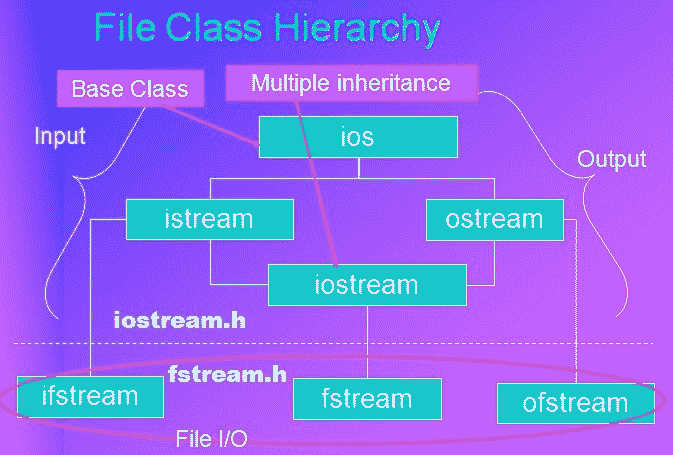

在 C++ 中进行文件处理，必须包含头文件`<iostream.h>`和`<fstream.h>`。

`<fstream>`包含了`<ifstream>`和`<ofstream>`。

## 文件打开模式

其中`filename`是表示打开的文件名的字符串，`mode`是一个可选参数，可以是以下标志的组合：

| `ios::in` | 用于输入操作打开。 |
| :--- | :--- |
| `ios::out` | 用于输出操作打开。 |
| `ios::bin` | 以二进制模式打开。 |
| `ios::ate` | 将初始位置设置为文件末尾。如果未设置此标志，则初始位置为文件开头。 |
| `ios::app` | 所有输出操作都在文件末尾进行，将内容追加到文件的当前内容之后。 |
| `ios::trunc` | 如果以输出操作打开且文件已存在，则其原有内容将被删除并由新内容替换。 |

`ios::nocreate` - 如果文件不存在，则打开操作失败。
`ios::noreplace` - 如果文件存在，则打开操作失败。

类`ofstream`、`ifstream`和`fstream`的每个打开打开成员函数都有默认模式，如果在未提供第二个参数的情况下打开文件，将使用该模式：

| 类 | 默认模式参数 |
| :--- | :--- |
| `ofstream` | `ios::out` |
| `ifstream` | `ios::in` |
| `fstream` | `ios::in \| ios::out` |

## 文件关闭

当我们完成对文件的输入和输出操作时，应当将其关闭，以便通知操作系统并使其资源重新可用。为此，我们调用流的成员函数`close`。该成员函数会刷新关联缓冲区并关闭文件：


一旦调用了此成员函数，流对象就可以重用于打开另一个文件，该文件也可以再次被其他进程打开。

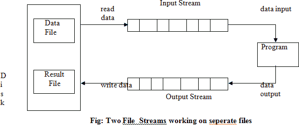

## 示例

可以使用构造函数或创建对象来打开文件。以下示例展示了：

```cpp
#include <iostream.h>

#include <fstream.h>

int main() {

    ofstream fout("example.txt");

    fout << "This is a line.\n";

    fout << "Another line.\n";

    fout.close();

    return 0;

}
```

输出：

```
This is a line.
Another line.
```


## 文件位置

`<istream>` 和 `<ostream>` 重新定位文件指针（读取或写入文件的字节数）的成员函数。这些成员函数是：

- 用于 `istream` 的 `seekg()` (seek get)
- 用于 `ostream` 的 `seekp()` (seek put)

提供了 `tellg()` 和 `tellp()` 来分别返回 get 和 put 指针的当前位置。

## 错误（异常）处理

异常是指程序中意外的情况。这些意外情况可能是故障，导致错误，进而导致程序失败。C++ 的错误处理机制通常称为异常处理。

## 异常的类型

1. 同步异常
2. 异步异常

### 同步异常

在程序执行期间，由于输入数据中的故障或不适合处理当前数据类型的技术而发生的异常被称为同步异常。

示例：`out of range`（越界）、`divide by zero`（除零）、`overflow`（溢出）、`underflow`（下溢）。

### 异步异常

由程序控制之外事件引起的错误称为异步异常。

示例：磁盘故障。

## 异常处理机制

异常处理机制的目的是提供检测和报告“异常情况”的方法，以便采取适当措施。异常处理机制包括以下任务操作：

1. 发现问题（命中异常）
2. 通知已发生（抛出异常）
3. 接收错误信息（捕获异常）
4. 采取纠正措施（处理异常）

以下示例展示了它是如何工作的：

```cpp
#include <iostream.h>
#include <fstream.h>

int main() {
    try {
        throw "Error occurred";
    } catch (const char* msg) {
        cout << msg << endl;
    }
    return 0;
}
```

- 一个用于检测并抛出异常
- 另一个用于捕获异常并采取适当措施。

### 异常处理模型

异常处理机制使用了三个块：`try`、`throw`、`catch`。这三个异常处理模型之间的关系所示：

- 关键字 `try` 用于一组（由大括号括围）可能产生异常的语句。这组语句被称为 `try` 块。
- 当检测到异常时，使用 `try` 块中的 `throw` 语句将其抛出。
- 由关键字 `catch` 定义的 `catch` 块捕获 `try` 块中 `throw` 语句抛出的异常，并对其进行适当处理。
- 一般格式：

```cpp
try
{
    ... // 检测并...异常的语句块
    throw exception; // 抛出异常
    ...
    ...
}
catch (type arg)
{
    ...
    ...
    ... // 处理异常的语句块
}
```

- 当 `try` 块抛出异常时，程序控制将离开 `try` 块并进入 `catch` 块中的 `catch` 语句。
- 异常是用于传输有关问题信息的对象或变量。
- 如果抛出的对象的 `type` 与 `catch` 语句中的 `arg` 类型匹配，则执行 `catch` 块来处理异常。
- 如果它们不匹配，程序将通过自动调用的 `abort()` 函数终止。
- `catch` 块可以有多个 `catch` 语句，每个语句句对应于一种特定类型的异常。
- 例如，如果 `throw` 块可能会抛出两个异常，则 `catch` 块将有两个 `catch` 语句，每个语句对应一种异常类型。每个 `catch` 语句被称为异常处理程序。
- 当没有检测到并抛出异常时，控制将跳转到 `catch` 块之后紧后的语句。也就是说，`catch` 块会被跳过。

**示例：除以零**

```cpp
#include<iostream.h>

void main()
{
    int x, y, z;
    cout<<"enter the values of x, y, z"; cin>>x>>y>>z;
    try
    {
        if(x == y)
            throw y;
        else
        {
            int d= z / (x - y);
            cout<<"the result of z/(x-y) is:"<< d;
        }
    }
    catch(int y)
    {
        cout<<"exception caught x-y is "<<<< x-y;
    }
}
```

**运行 1:**
enter the values of x, y, z 50 30 20
the result of z/(x-y) is: 1

**运行 2:**
Enter the values of x, y, z 30 30 20
exception caught x-y is : 0

**使用生成异常的函数：**

```cpp
#include<iostream.h>

void divide(int x, int y, int z)
{
    if(x == y)
    {
        cout<<"we are inside the function";
        throw (x-y);
    }
    else
    {
        int d= z / (x - y);
        cout<<"the result of z/(x-y) is:"<< d;
    }
}

void main()
{
    try
    {
        cout<<" we are inside the try block";
        divide(10, 20, 30); // 调用 divide()
        divide(10, 10, 20); // 调用 divide()
    }
    catch(int i) // 捕获异常
    {
        cout<<"exception caught x-y is : "<<i;
    }
}
```

**运行:**
we are inside the try block
we are inside the function
the result of z/(x-y) is: -3
we are inside the function
exception caught x-y is: 0

### 使用对象的多个 catch 语句

- 要用对象抛出异常，需要定义一个 `abstract class`（抽象类）。
- 一个 `abstract class` 无非只是一个带有空数据成员的类。
- 类名作为无名对象被调用，用于抛出异常。

**示例：**

```cpp
#include<iostream.h>

class positive { };
class negative { };
class zero { };

void greater(int num)
{
    if(num > 0)
        throw positive();
    else if (num < 0)
        throw negative();
    else
        throw zero();
}

void main()
{
    int num;
    cout<<"enter any number "; cin>>num;
    try
    {
        greater(num);
    }
    catch(positive)
    {
        cout<<"positive exception";
    }
    catch(negative)
    {
        cout<<"negative exception";
    }
    catch(zero)
    {
        cout<<"zero exception";
    }
}
```

### 模板

OOP 的一个重要特性是代码的可重用。模板支持泛型编程，允许不同的数据类型。

**模板的类型**
有两种模板：
- 函数模板
- 类模板

#### 函数模板

函数模板定义了一组函数。函数模板本身不是一个函数，而是编译器用于生成函数的蓝图。函数模板在调用点实例化。

**函数模板的语法**

```cpp
template <template-parameter-list>
return_type function_name(parameter-list)
{
    ...
}
```

**示例：**

```cpp
#include<iostream.h>
#include<conio.h>

template <class T>
void swap(T &x, T &y)
{
    T z; z=x; y=z;
}

void main()
{
    clrscr();
    int a,b;
    cout<<"\nEnter 2 integers:"; cin>>a>>b;
    swap(a,b);
    cout<<"\nafter swapping the values are "<<a<<"\t"<<b;
    float c,d;
    cout<<"\nEnter 2 float values:"; cin>>c>>d;
    swap(c,d);
    cout<<"\nafter swapping the values are "<<c<<"\t"<<d;
    getch();
}
```

#### 类模板

类模板与类的关系就像类与对象的关系。类定义如何构造对象，而类模板定义如何生成一组类。

注意 class template（类模板）和 template class（模板类）之间的区别：
- class template 是用于生成类的模板。你不能声明类模板的对象。
- template class 是类模板的实例。

**类模板的语法**

```cpp
template <template-parameter-list>
class class_name
{
    ...
};
```

**示例：**

```cpp
#include<iostream.h>
#include<conio.h>

template <class T>
class pair{
    T a,b;
public:
    pair(T, T);
    T getmax();
};

template <class T> pair<T>:: pair(T x, T y)
{
    a=x; b=y;
}

template <class T> T pair<T>::getmax()
{
    T z; z=(a>b)?a:b; return z;
}

void main()
{
    clrscr();
    int p,q;
    cout<<"\nEnter 2 integers:"; cin>>p>>q;
    pair<int> ob1(p,q);
    cout<<"\nThe biggest number is "<<ob1.getmax();
    float r,s;
    cout<<"\nEnter 2 float values:"; cin>>r>>s;
    pair<float> ob2(r,s);
    cout<<"\nThe biggest number is "<<ob2.getmax();
    getch();
}
```

```cpp
cout<<"\nThe biggest number is "<<ob2.getmax(); getch();
}
```

## 使用模板的优势

- 模板支持泛型编程，允许开发可重用的软件组件（如函数、类等），并在单个框架内支持不同的数据类型。
- 模板会根据传递给它们的参数数据类型执行适当的操作。
- 在实现如 `vectors`、`stacks`、`lists`、`queues` 等通用结构时，模板非常有用，这些结构可以与任意类型配合。
- 模板在编译时进行类型检查。因此，编译器可以在编译时确定与模板定义相关的类型是否能够执行该模板定义所需的所有功能。
- 从设计上来说，模板可以用于非常复杂的问题空间。

## 使用模板的固有缺点

- 从历史角度看，某些编译器对模板的支持较差。因此，使用模板可能会降低代码的可移植性。
- 许多编译器在检测到模板定义错误时缺乏清晰的指令。这会增加开发模板的工作量，并促成了 Concepts（概念）的发展，以便未来将其纳入 C++ 标准中。
- 由于编译器会为每个模板类型生成额外的代码，无加别使用模板会导致代码膨胀，导致可执行文件变大。
- 因为模板本质上暴露了其实现，在大型系统中不智的使用会导致更长的构建时间。
- 调试使用模板开发的代码可能困难。由于编译器会替换模板，调试器在运行时很难定位到代码。
- 模板的模板（嵌套）并非所有编译器都支持，或者可能有最大嵌套层级。
- 模板位于头文件中，当进行更改时需要对所有项目部分进行完全重新编译。
- 没有信息隐藏。所有代码都暴露在头文件中。没有任何库可以单独包含代码。

## 标准模板库

标准模板库 (STL) 包含：

- 容器 (Containers)
- 算法 (Algorithms)
- 迭代器 (Iterators)

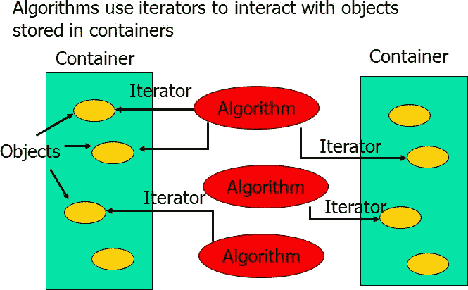

容器是内存中组织存储数据的方式，例如元素数组。

STL 中的算法应用于容器以处理其数据的程序，例如在数组中搜索元素，或对数组进行排序。

迭代器是指针概念的泛化，它们指向容器中的元素，例如，你可以增加迭代器以指向数组中的下一个元素。

- 迭代器是类指针的实体，用于访问容器中的单个元素。
- 它们通常用于从一个元素移动到另一个元素，这个过程被称为遍历容器。
- 成员函数 `begin()` 和 `end()` 返回指向容器第一个元素和最后一个元素之后元素的迭代器。

### 容器

容器是存储数据的方式，可以是内置数据类型（如 `int` 和 `float`），也可以是类对象。

STL 提供了几种基本类型的容器：

- `<vector>`: 一维数组
- `<list>`: 双向链表
- `<deque>`: 双端队列
- `<queue>`: 队列
- `<stack>`: 栈
- `<set>`: 集合
- `<map>`: 关联数组

### i) 序列容器

序列容器按顺序存储一组元素，换句话说，每个元素（第一个和最后一个除外）前面都有一个特定的元素，后面都有另一个元素，`<vector>`、`<list>` 和 `<deque>` 就是序列容器。

### ii) 关联容器

关联容器是非顺序的，但它使用一个 `key`（键）来访问元素。键（通常是数字或字符串）被容器用于按特定顺序排列存储的元素，例如在字典中，条目按字母顺序排序的。

- `<set>` 存储许多包含键的项。键是用于排序项的属性，例如，集合可以存储 `Person` 类的对象，这些对象根据名称按字母顺序排序。
- `<map>` 存储对象对：一个键对象和一个关联的值对象。`<map>` 在某种程度上类似于数组，不同之处在于它不是使用索引号访问元素，而是使用任意类型的索引来访问元素。

### iii) 适配器容器

容器适配器只是特殊的容器，它们使用 STL 提供的容器、迭代器和算法的通用框架。

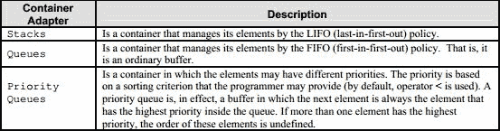

## 算法

范围 (range) 是任何可以通过迭代器或指针访问的对象序列，例如数组或某些 [STL 容器](http://www.cplusplus.com/stl) 的实例。但注意，算法直接通过迭代器对值进行操作，不会以任何方式影响任何容器的结构（它永远不会影响容器的大小或存储分配）。算法的类型有：

I. **非修改算法**：某些方法是：
1. `count()`
2. `equal()`
3. `find()`
4. `find_end()`
5. `find_if()`
6. `search()`

II. **修改算法**：某些方法是：
1. `copy()`
2. `fill()`
3. `generate()`
4. `remove()`
5. `replace()`
6. `reverse()`
7. `unique()`

III. **排序算法**：某些方法是：
1. `binary_search()`
2. `equal_range()`
3. `merge()`
4. `sort()`
5. `partial_sort()`
6. `Partition()`

IV. **集合算法**：
1. `include()`
2. `set_difference()`
3. `set_intersection()`
4. `set_union()`

V. **关系算法**：某些方法是：
1. `equal()`
2. `max()`
3. `max_element()`
4. `min()`
5. `min_element()`
6. `mismatch()`

让我们通过使用 vector 模板来展示容器、迭代器和算法的工作。


```cpp
#include <vector>
#include <iostream>

vector<int> v(3);  // 创建一个大小为 3 的 int vector
v[0]=23;
v[1]=12;
v[2]=9; // vector 已满
v.push_back(17);// 在数组末尾添加新值
for (int i=0; i<v.size(); i++) // vector 的成员函数 size()
    cout << v[i] << " "; // 随机访问 i 个元素
```


```cpp
#include <vector>
#include <algorithm>
#include <iostream>

int key;

int arr[] = { 12, 3, 17, 8, 34, 56, 9 }; // 标准 C 数组

vector<int> v(arr, arr + 7); // 使用 C 数组初始化 vector

vector<int>::iterator iter;

cout << "enter value:";

cin >> key;

iter = find(v.begin(), v.end(), key); // 在 v 中查找整数 key

if (iter != v.end()) // 找到元素
    cout << "Element " << key << " found" << endl;
else
    cout << "Element " << key << " not in vector v" << endl;
```


`find()` 算法用于查找一个数字是否存在于给定的 `vector` 中。

## 瀑布模型

瀑布模型是软件工程中首次广泛使用的软件开发生命周期（SDLC）模型，以确保项目的成功。在“瀑布”方法中，软件开发的整个过程被划分为不同的阶段。在瀑布模型中，通常上一个阶段的输出将顺序作为下一个阶段的输入。

以下是瀑布模型不同阶段的图示表示。

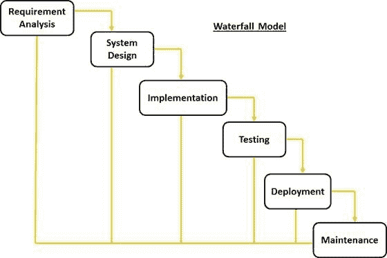

瀑布模型中的顺序阶段包括：

- **需求收集与分析：** 在这一阶段，捕获待开发系统的所有可能需求，并记录在需求规格文档中。
- **系统设计：** 在这一阶段研究第一阶段的需求规格书，并准备系统设计。系统设计有助于明确硬件和系统需求，还有助于定义整体系统架构。
- **实现：** 根据系统设计的输入，首先开发称为“单元”的小型程序，并在下一阶段对它们进行集成。每个单元都将对其功能进行开发和测试，这被称为单元测试。
- **集成与测试：** 在实现阶段开发的所有单元在对每个单元进行测试后，集成到一个系统中。集成完成后，对整个系统进行测试，以发现任何故障和失败。
- **系统部署：** 一旦完成功能和非功能测试，产品将部署到客户环境或发布到市场。
- **维护：** 客户环境中会出现一些问题。为了修复这些问题，会发布补丁。此外，为了增强产品，还会发布更好的版本。维护是为了在客户环境中交付这些更改。

所有这些阶段都是相互级联的，进度表现为稳步地向下流动（像瀑布一样）穿过各个阶段。只有在完成前一个阶段定义的 `set` 目标并获得签字确认后，才会开始下一个阶段，因此得名“瀑布模型”。在该模型中，各阶段之间是不重叠的。

## 瀑布模型的应用

每种开发的软件都是不同的，需要根据内部和外部因素遵循适当的 SDLC 方法。使用瀑布模型最合适的情况包括：

- 需求有详尽的文档、清晰且固定。
- 产品定义稳定。
- 技术已理解且不具动态性。
- 没有模糊的需求。
- 拥有充足的资源和所需的专业知识来支持产品。
- 项目周期较短。

## 瀑布模型的优缺点

### 优点

瀑布式开发的优点是它允许部门化和控制。可以为开发的每个阶段设定带有截止日的计划，产品可以逐一通过开发模型的各个阶段。

开发从概念开始，经过设计、实现、测试、安装、故障排除，最后于运行和维护。开发的每个阶段都按照严格的顺序进行。

### 缺点

瀑布式开发的缺点是不允许进行大量的反思或修订。一旦应用程序进入测试阶段，就很难回溯并更改在概念阶段没有妥善记录或考虑周全的内容。

下表列出了瀑布模型的优缺点：

| 优点 | 缺点 |
| :--- | :--- |
| 简单、易于理解和使用 | 在生命周期后期之前不会产生可运行的软件。 |
| 由于模型的僵性，易于管理。每个阶段都有特定的交付物和评审过程。 | 风险和不确定性高。 |
| 阶段一个一个地处理并完成。 | 不适用于复杂和面向对象的项目的模型。 |
| 对于需求非常明确的小型项目效果良好。 | 长期和持续项目的糟糕模型。 |
| 阶段定义明确。 | 不适用于需求具有中等到高变更风险的项目。因此，该过程模型的风险和不确定性很高。 |
| 里程碑明确。 | 很难衡量阶段内的进度。 |
| 任务于安排。 | 无法适应变化的需求。 |
| 过程和结果都有详尽文档。 | 在生命周期后期之前产生可运行的软件。 |
|  | 在生命周期期间调整范围会导致项目终止。 |
|  | 集成在最后以“爆炸式”完成，这使得无法早期识别任何技术或业务瓶颈或挑战。 |

## 喷泉流模型

Anthony Aleong, Glen Mitchell, Kareem Shaw

瀑布模型已广为人知，但它不再像以前那样有用了。在 1991 年《信息中心季刊》的一篇文章中，Larry Runge 表示，“当我们自动化文员和会计师的工作时，SDLC 效果非常好。但在为知识工作者构建系统时——帮助台的人员、试图解决问题的专家或试图带领公司进入世界百强名单的高管——它的效果就差得多，甚至完全无效。”

另一个问题是，瀑布模型假设用户的唯一角色是指定需求，并且所有需求都可以预先指定。遗憾的是，需求在整个过程中以及之后不断增长和变化，需要大量的反馈和迭代咨询。因此，开发了许多其他 SDLC 模型。

喷泉模型承认，尽管某些活动不能在其他活动之前开始（例如，你需要设计然后可以开始编码），但在整个开发周期中活动存在大量的重叠。

### 喷泉模型

- 支持增量式开发。
- 承认某些活动无法先于其他活动，但在整个开发周期中活动存在大量的重叠。
- 意味着你先进行某些分析，然后是某些设计，然后是某些实现。
- 各个阶段之间的并行性以及阶段内的迭代。
- 开发面向对象的系统，这更有可能让我们关注整体的局部，称为“类”或子系统。
- 子系统是紧密工作的类集合。
- 支持人类学习，并适用于大多数项目。

### 面向对象的生命周期符号（喷泉模型）

任何面向对象的版本的整体软件开发生命周期的图形表示都必须考虑到隐含的高度重叠和迭代。在纯面向对象的软件开发方法中，“瀑布”模型是一种过于限制的方法，可以被图 1 所示的高度迭代的“喷泉”模型所取代。该模型包含了复用和域分析/设计。


图 1. 面向对象的软件生命周期的喷泉模型。

活动的合并和重叠通过圆形符号的重叠程度来表示。面向对象系统中维护需求的减少通过较小的活动圆圈来象征。

在喷泉中，水向中间上升然后落回，要么落入下方的“池”，要么在中间层被重新捕获。面向对象的软件开发也是如此，从分析到设计到实现的总体流贯穿了分析、设计和实现这二（或三个）宽泛“阶段”的迭代循环，“池”代表类的“软件池”或仓库”。

这张图图 1 概述了面向对象开发系统级感知的般特征。在分析、设计、实现和单元测试阶段存在高度的合并。

首先，喷泉模型（fountain model）为面向对象软件生命周期中的阶段提供了图化版本，并清晰地表示了面向对象技术实现的迭代和重叠。其次，由于成功的软件项目的基础是需求分析和规范，因此这一阶段被置于图表的底部。因此，生命周期向上生长到软件使用的顶峰，仅在必要的维护阶段才会回落。这有效地将周期的某个阶段回到了较低水平。将此模型应用于特定环境可能会导致如原型设计之类的软件生命周期：面向对象的编程语言非常适合这种开发环境。

系统不仅可以从图 1 所示的系统生命周期角度来看，还可以从许多（通常是大量的）自主类的协同整合角度来看。在类开发和系统规范之间，可以更方便地进行交互式修改，因此不再需要在系统生命周期的早期阶段冻结整个系统需求规范——这一面向对象的方法论的属性被许多作者正面评价。因此，由于面向对象的程序本质上是作为一个相互作用的类系统（通常是独立开发的），生命周期模型的阶段可以更准确地应用于每个单独类的开发周期，而不是整个系统。

## 喷泉模型：优势

- 迭代式瀑布开发模式。
- 经典线性。
- 分析、设计、编码、测试与发布。

## 喷泉模型：劣势

- 未反映面向对象特性。
- 无法提交交付物。

## 对象分析的不同模型

与传统的系统分析不同（传统方法收集用户需求然后编写规范，并要求用户对规范签字），对象方法使用一种更具迭代性的过程，其中需求和规范被反复审查，并且用户深度参与。

对象技术有许多不同的方法来帮助分析和设计计算机系统。我们将回顾四种最流行的系统：Rumbaugh、Booch、Coad-Yourdon 和 Shlaer-Mellor。在大多数情况下，这些方法非常相似，但每种方法都有自己的图形化表示实体的方法。对于所有项目来说，理解和使用这四种方法可能会变得困难甚至不可能。如果需要，可以将一种方法的概念与另一种技术的概念结合起来，基本上创建你自己的对象开发技术。最重要记住的一点是，最终结果才是真正重要的，而不是选择一种分析技术而非另一种技术。记住，进行适当的分析和设计以满足用户需求，比盲目地遵循一个毫无意义的程序要重要得多。

传统的系统开发方法有时被称为瀑布法。通过瀑布法，对象分析师遵循分析、设计、编码、测试和维护的逻辑演进。遗憾的是，系统开发很少符合这种结构化方法。终端用户以改变主意或识别出他们忘记识别的某些功能而闻名。这些需求的变化可能发生在系统开发的任何阶段，分析师必须努力将这些变化纳入系统。

面向对象的方法论需要一个更具迭代性的过程，且具有相同的五个步骤。迭代过程要么添加新属性，要么更清晰地定义现有属性，而不像传统方法那样重做已经完成的规范。迭代过程有助于减少对系统到底应该做什么以及用户到底想要什么的困惑。面向对象的软件开发方法假设用户需求会发生。然而，你使用哪种编程语言（无论是 `FORTRAN` 还是 `C++`）并不重要。此外，你使用哪种系统开发技术并不重要，你将在系统开发中遵循相同的五个步骤。仅仅是这五个步骤的应用方式决定了你系统开发项目的差异。

## Rumbaugh 方法

Rumbaugh 方法列在第一是因为这是这些作者最喜欢的，我们发现这是一个非常友好且易于使用的方法。对于传统的系统分析师来说，Rumbaugh 方法与传统的系统分析和设计方法最接近，新手将识别熟悉的符号和技术。Rumbaugh 方法的主要优势在于对象分析，但它在对象设计方面也非常出色。Rumbaugh 在对象分析阶段有三个交付物：`Object model`（对象模型）、`Dynamic model`（动态模型）和 `functional model`（功能模型）。这三个模型与传统的系统分析相似，增加了对象模型部分，包括 `classes`（类）的定义以及 `classes` 变量和行为。Rumbaugh 对象模型非常像实体关系图，只是现在图中有了行为和类层次结构。动态模型是一个“状态转换”图，显示了实体如何从一个状态转变为另一个状态。功能模型等同于传统系统分析中熟悉的数据流图。

## Booch 方法

Booch 方法的主要优势在于对象系统设计。Grady Booch 在他的方法中包含了与传统需求分析相似的需求需求分析，以及一个领域分析阶段。Booch 的对象系统设计方法分为四个部分：定义 `class hierarchies`（类层次结构）的逻辑结构设计，以及描述 `object methods`（对象方法）的物理结构图。此外，Booch 以非常类似于 Rumbaugh 方法的方式定义了 `classes`（类）的动态，以及对对象实例动态的分析，在其中描述了对象如何改变状态。

## Coad-Yourdon 方法

Coad-Yourdon 方法的主要优势在于系统分析。他们的方法基于一种名为“SOSAS”的技术，这代表了组成他们方法分析部分的五个步骤。系统分析的第一步称为 `Subjects`（主体），它们基本上是对象的数据流图。第二步称为 `Objects`（对象），在其中他们识别 `object classes`（对象类）和 `class hierarchies`（类层次结构）。第三步称为 `Structures`（结构），将结构分解为两种类型：`classification structures`（分类结构）和 `composition structures`（组合结构）。`classification structures` 处理相关类之间的继承连接，而 `composition structures` 处理类之间的所有其他连接。分析的下一步是 `Attributes`（属性），最后一步是 `Services`（服务），在其中识别了每个类的所有行为或方法。

在分析之后，Coad 和 Yourdon 定义了组成他们方法设计部分的四个部分。系统设计的步骤为：

- 问题域组件：这将定义应该位于问题域的类。
- 人机交互组件：这些步骤定义了对象之间的接口类。
- 任务管理组件：在这里识别系统级管理类。
- 数据管理组件：此设计步骤识别了数据库访问方法所需的类。

## Shlaer-Mellor 方法

Shlaer-Mellor 方法论的主要优势在于系统设计，而在分析方面被认为较为薄弱。Shlaer-Mellor 方法论包含三个模型：信息模型、状态模型和过程模型。信息模型包含 `objects`、`variables` 以及 `objects` 之间所有的关系，它基本上是系统的数据模型。状态模型记录 `objects` 的不同状态以及 `objects` 之间可能发生的变化。过程模型本质上只不过是传统的数据流图。

既然我们已经涵盖了对象方法的基础知识，让我们来看下如何使用这些技术创建现实世界的对象。

## 面向对象的设计模型

一种面向对象的方法论基于开发模块和组件的重用。因此，需要一种考虑到这种重用的新开发模型。如图 1.15“面向对象的设计模型”所示，面向对象模型构建了将现有软件模块集成到系统开发中。一个可用组件数据库为重用提供组件。面向对象模型从问题的表述和分析开始。在设计阶段之后，会对组件库进行调查，查看是否有任何组件可以在系统开发中重用。如果库中没有该组件，则必须开发一个新组件，这涉及该模块的表述、分析、编码和测试。新组件被添加到库中并用于构建新应用程序。

该模型旨在通过将现有模块集成到开发中降低成本。这些模块通常质量更高，因为它们已经过其他客户的现场测试，并且应该经过了调试。使用该模型的开发时间应该更短，因为需要写的代码更少。

图 1.15 面向对象的设计模型

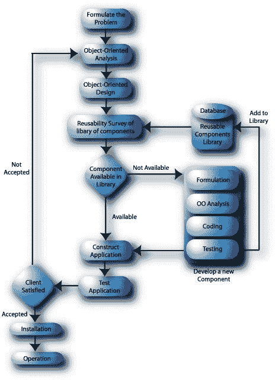

随着组件库随时间的增长，面向对象模型应该与其他模型相比更具优势。

# 一个设计问题示例

**任务：** 如果给我们这样一个问题：“编写一个程序来实现简单的储蓄账户”……账户应允许存款、取款、利息和手续费。

**解决方案：** 问题产生了许多需要理解的概念，例如 `bank account`、`deposit`、`withdrawal`、`balance` 等。OO 语言允许程序员将这些概念一直引入编码步骤。储蓄账户可以用 `account number` 和 `balance` 属性以及 `deposit` 和 `withdrawal` 方法来构建，以符合 `bank account` 的概念。这允许设计阶段和编码阶段之间几乎直接的映射，使得代码易于阅读和理解（从而降低维护和开发成本）。

OOP 还允许软件重用！……这个储蓄账户的概念应该独立于问题的其他部分被理解。这种通用的储蓄账户肯定会在其他某些金融问题中找到重用。

在与客户讨论后，可以实现以下表述——设计一个包含柜员和 ATM 交互的银行系统，规则如下：

- 现金银员和 ATM 负责发放现金。
- 网络由许多银行共享。
- 每笔交易都将涉及一个账户和记录。
- 有不同类型的银行账户。
- 有不同类型的交易。
- 所有银行使用相同的货币。
- 允许外币交易。
- ATM 机机和柜员需要银行卡。

## 步骤 1：识别可能的类

- `ATM`、`cashier`、`cashier station`、`software`、`customer`、`cash`。
- `banking network`、`bank`。
- `transaction`、`transaction record`。
- `account`、`deposit account`、`long term savings account`、`current account`。
- `withdrawal`、`lodgement`、`cheque`。
- `currency`。
- `foreign currency`、`euro cheque`。
- `cash card`、`computer system`。

## 步骤 2：移除模糊的类

- `software`、`computer system`、`cash`。

## 步骤 3：添加产生的新类

- `currency converter`

## 步骤 4：创建关联

- `Banking Network`（包括柜员和 `ATMs`）。
- `Banks`（持有账户）。
- `Account`（有一个 `balance`、一个 `currency` 和一个 `transactions` 日志）。
- `Transaction`（需要银行卡）。
- `Lodgement`（有一个 `account number` 和一个 `amount`）。
- `Withdrawal`（有一个 `account number` 和一个 `amount`）。
- `Cheque`（是一种 `withdrawal`，有一个 `payee` 和一个 `amount`）。
- `Eurocheque`（是一种 `cheque`，有一个 `currency`）。
- `ATMs`（接受银行卡，发放现金）。

## 步骤 5：细化类

**Bank（银行）：**

- 有一个名称。
- 有账户。
- 有基本货币。
- 有一个排序代码。

**Account（账户）：**

- 有一个所有者。
- 有 `balance`。
- 有一个 `account number`。
- 有 `transactions` 日志。

**Deposit Account（存款账户）：**

- 是一种 `account`。
- 有一个共享利率。

**Current Account（活期账户）：**

- 是一种 `account`。
- 有 `overdraft limit`。

**Transaction（交易）：**

- 有一个 `account`。
- 有一个 `date`。
- 有一个 `value`。
- 有一个 `bank`。
- 有一个 `account`。
- 有一个 `number`。

**Withdrawal（取款）：**

- 是一种 `transaction`。

**Lodgement（存款）：**

- 是一种 `transaction`。

**Cheque（支票）：**

- 是一种 `withdrawal`。
- 有一个 `payee`。

**EuroCheque（欧元票）：**

- 是一种 `cheque`。
- 有一个 `currency`。

**CurrencyConverter（货币转换器）：**

## 步骤 6：类的视觉化表示

 图 1.16 `Bank` 类。

 图 1.17 `Account` 类。

 图 1.18 `Transaction` 类。


## 组件软件

（如何在面向对象设计中表示“组件”？请解释。）

将项目分解为逻辑组件是面向对象分析设计的本质。这也是组件软件的基础，组件软件由二进制形式（而非源代码）的可重用软件部分组成，可以相对容易地插入其他供应商的组件中。重要的是，基于组件的软件开发方法并不规定应用程序的结构。相反，它是一种使二进制组件能够编程、使用和独立演变的模型。组件独立于使用它们的应用程序，也独立于创建它们的编程语言。组件软件允许软件开发人员专注于他们最擅长的领域。

## 组件软件与编程

组件软件的一个很好的类比可以在汽车行业中找到，在该行业中，汽车制造商通常从不同的制造商购买单个汽车零件（如发动机和变速箱），然后用这些组件组装成汽车。对于组件软件，这些部分可以原样使用——它们不需要重新编译，你不需要源代码，而且不受限于某一种编程语言。这一过程的术语是**二进制重用**，因为它基于接口而不是基于源代码层面的重用。虽然软件组件必须遵守约定的接口，但它们的内部实现是完全自主的。正因如此，你可以使用过程化语言也可以使用面向对象的语言来构建组件。

基于组件的编程模型的主要目标之一是促进互操作性。互操作性是计算机领域中的流行术语之一，对不同的人有不同的含义。在组件软件的语境下，互操作性简单意味着组件之间协同工作的能力。当你检查一个项目并注意到软件似乎被不自然地强凑在一起的地方时，就应该将应用程序划分为组件。

## 案例研究：控件

让我们以控件为例。在过去的 Windows 编程旧时代，如果你的程序需要一个工具栏，你只需将工具栏代码直接写入应用程序的主部分。这种方法存在两个固有的问题。首先，你的目标可能不是创建一个酷炫的工具栏，而是创建一个带有工具栏的优秀应用程序。其次，在你花费了许多宝贵时间开发工具栏后，如果你公司的其他开发者想在他们的项目中使用该工具栏，由于代码散落在整个程序中并响应 `WM_CREATE`、`WM_PAINT` 和 `WM_LBUTTONDOWN` 消息，他们无法轻松地重用它。

解决这一问题的基于组件的方法是将工具栏变成一个独立的组件。问题就变成了工具栏组件和应用程序应该如何交互——即整个互操作性问题。组件软件范式要求所有组件都定义一个接口，以暴露该组件可用的功能。只要组件实现了接口且客户端应用程序遵守该接口，就能实现互操作性。在工具栏示例中，应用程序开发者可以从某个专门制作工具栏的其他开发者那里购买工具栏组件，从而节省开发、调试和维护时间。

## 封装与合约

之前提到的面向对象编程的一个重要原则是封装。封装向对象用户隐藏了对象的实现。对象的用户只能访问对象的接口。在项目中使用预构建对象的开发者只感兴趣“合约”——即对象支持的承诺行为。组件软件正式化了对象与客户端之间合约的概念。每个对象通过实现某些接口来声明它的能力。访问对象服务的唯一方法是通过它所支持的接口。这种合约是互操作性的基础。

## 原型

尽管面向对象的分析和设计描述了系统功能，但在选择产品后不久，为一些关键系统组件构建原型是非常重要的。原型能够让你充分理解实现系统某些功能的难易程度如何。它还可以给用户提供一个对用户界面设计的可用性和实用用性发表意见的机会，并让你评估所选软件工具、功能规范与用户需求之间的匹配程度。此外，原型制作可以进一步定义用例，它实际上实际上让用例建模变得简单得多。

原型有多种方式进行分类。以下类别是一些被接受的原型，代表了查看原型的非常不同的方式，每种方式都有自己的优势：

- 水平原型。
- 垂直原型。
- 分析原型。

水平原型是对接口的模拟（即它具有完整功能系统中将包含的整个用户界面），但不包含任何功能。这种方法的优点是实现非常快，提供了对系统的良好感受，并允许用户根据他们对系统的正常预期感知来评估界面。

垂直原型是具有完整功能的系统特征的子集。这种方法的主要优势是实现的少数功能可以进行深度的测试。在实践中，原型是水平和垂直的混合体：建立界面的大部分部分以便用户获得系统的感觉，而具有高风险特征的功能会带有更多功能进行原型制作。

分析原型是探索问题领域的辅助工具。这类原型用于告知用户并演示概念验证。然而，它不被用作开发的基础，完成任务后就会被丢弃。最终产品将使用原型暴露的概念，而不是它的代码。领域原型是最终软件解决方案增量开发的辅助工具。它通常用作向用户或其他开发团队其他成员分阶段交付子系统的工具。它证明了实现的可行性，并最终将演变成一个可交付的产品。

制作原型所需的典型时间从几天到几周不等，取决于原型的类型和功能。原型制作应该包含来自所有受项目影响的用户组的代表，特别是终端用户和管理人员，以确保原型的整体结构符合为整体设计的要求。

## 对象识别的活动顺序

1. 在终端用户或应用领域专家的帮助下制定几个场景。
2. 在应用领域专家的帮助下，从场景中提取用例。
3. 然后并行进行以下操作：
   - 使用 Abbot 的文本分析技术分析每个用例中的事件流。
   - 生成 `UML` 类图。

## 案例研究：铁路预订系统

使用面向对象设计开发一个铁路预订系统。绘制必要的图表。

让我们通过软件工具展示 OOAD 的过程。

## 铁路预订系统问题描述

需要开发软件来自动化人工铁路预订系统。系统应该是分布式的。它被设计为提供以下功能：

1. **订座：** 乘客应该能够在火车上预订座位。乘客填写预订表并交给办事员，然后由办事员检查指定旅行日期的座位可用情况。如果有座位，则在系统中输入关于车次名称、车次、旅行日期、出发站、目的地、人员姓名、性别和总票价的信息。要求乘客支付所需的票价并打印车票。如果没有座位，则通知乘客。
2. **取消预订：** 想要取消预订的乘客需要填写表单。然后将表单和车票提交给办事员。办事员随后删除系统中的条目并更改该列车的预订状态。办事员手划车票以标记为已取消。
3. **更新列车信息：** 只有管理员可以在系统中输入与列车信息相关的更改，如列车名称、车次、列车路线等。
4. **报告生成：** 系统应提供生成不同报告的功能。系统应能够生成订票图、每月列车报告等。
5. **登录：** 出于安全考虑，系统的所有用户都分配了用户 ID 和密码。只有当 ID 和密码正确时，用户才允许进入系统并从系统的可用选项中选择。
6. **查看订票状态：** 所有用户都应该能够在线查看列车的订票状态。用户需要输入车次和票上打印的码，以便系统显示其当前的订票状态，如已确认、RAC 或候补名单。
7. **查看列车时刻：** 应提供查看整个列车网络时刻表的相关信息。用户应该能够查看车名、车次、上车站和终点、行程时长等。

## 分析与设计方法论

该流程的步骤序列如下：

### 步骤 1：如果存在预设计模型，则选择它

根据开发平台选择框架。

### 步骤 2：利用用例图

任何分析和设计过程的通用流程都是从识别系统功能和与系统相关的参与者开始。我们用用例图来描述要开发的系统的概览。

在分析上述问题后，我们确定了系统的以下用例和参与者。

与系统相关的参与者有：

1. 管理员。
2. 订票员。
3. 乘客。
4. 打印机。

系统的用例有：

1. 预订座位。
2. 取消订票。
3. 更新列车信息。
4. 报告生成。
5. 登录。
6. 查看订票状态。
7. 查看列车时刻。

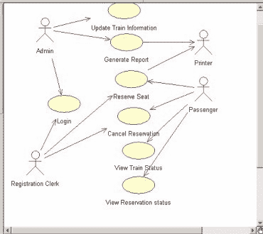

图 2：铁路订票系统用例图。

### 步骤 3：定义类并将它们与每个用例关联

我们将考虑登录用例并描述其完整流程。

为了实现此用例，我们需要一个用户界面来输入用户 ID 和密码。这需要与数据库进行验证，因此我们需要一个实体类，并且为了协调前端和后端之间的工作，我们需要一个控制类。我们需要为这些类每一个分配一个名称。

- 边界类类型：`Login Form`
- 实体类：`Login_Information`（数据库表名）
- 控制类：`Login_Ctrl`

### 步骤 4：用序列图和协作图描绘类与之间的交互

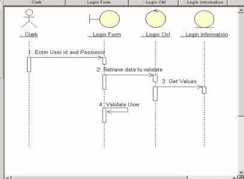

### 步骤 5：根据需要绘制活动图和状态机图

这些图应该被命名并与其他相关的图相关联。

### 步骤 6：为所有实体类绘制类图，描绘类之间的关系

为每个类定义属性。你必须为这些图赋予适当的。将每个类标记为持久化。它们是用于存储数据的数据库表。

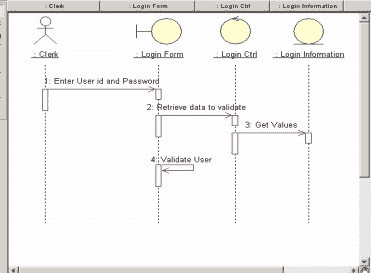

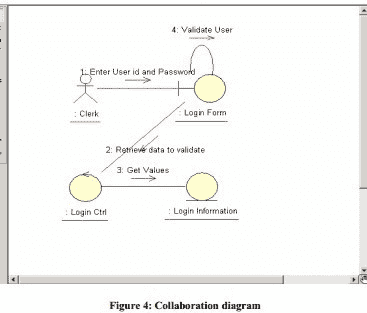

### 步骤 7：定义系统组件

定义系统组件，例如 `exes`、`dlls`、`activeX` 控制等。

假设你想将软件开发为可执行文件，因此所有的边界类和控制类都分配给 `exe`。创建一个可执行软件组件并给它命名。此组件必须分配给类。

然后，绘制组件图以显示系统组件之间的关系。你必须给该图命名。

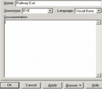

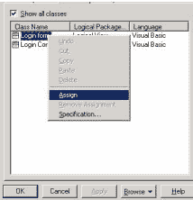

### 步骤 8：绘制部署图

现在，绘制部署图以描绘系统的网络布局。

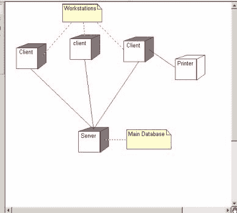

创建部署图并给它命名。

### 步骤 9：执行正向工程任务

现在，执行正向工程任务以生成伪代码。
