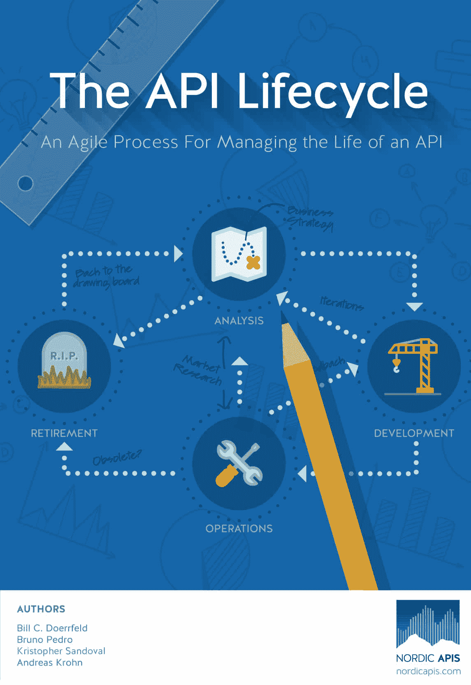
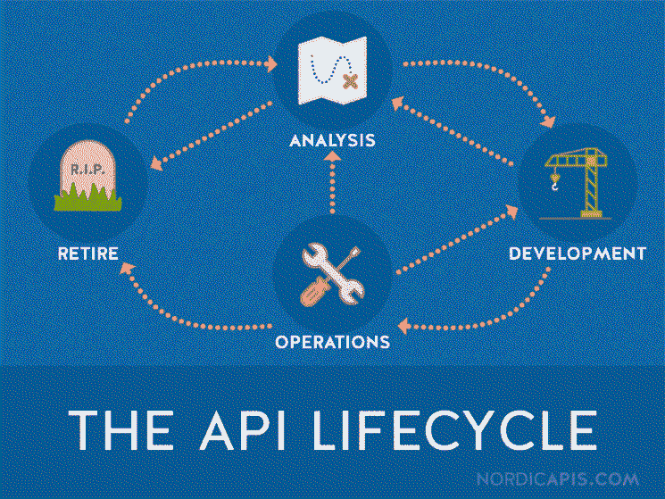
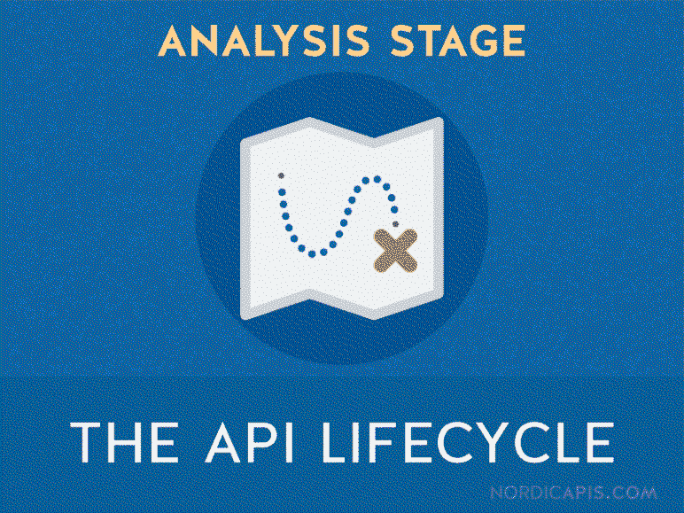
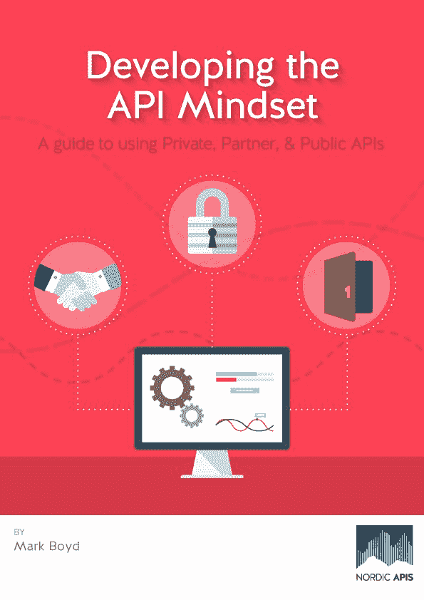
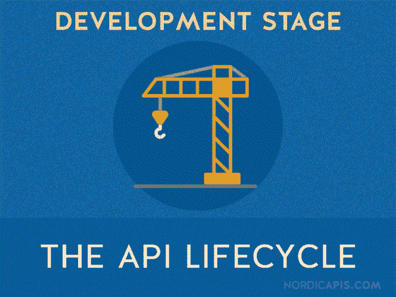
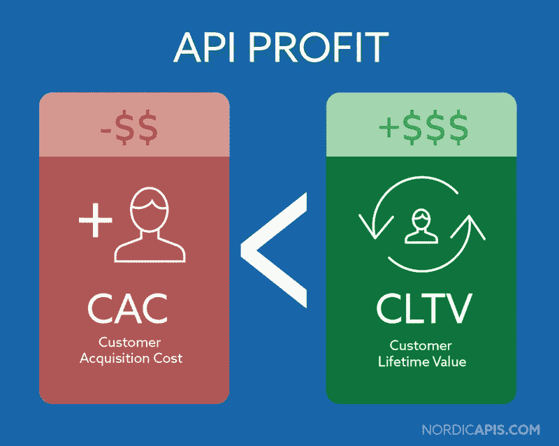
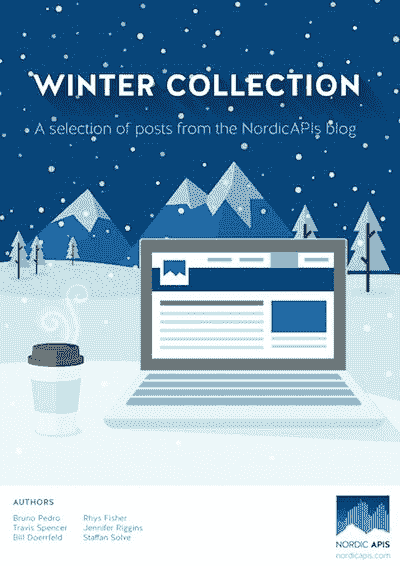
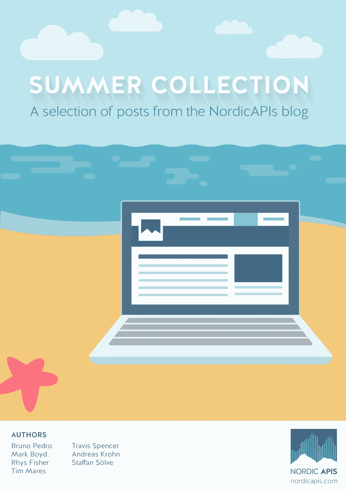

# API 生命周期：管理 API 生命周期的敏捷流程

## 前言

Nordic APIs 运营了大约 2 年。在短短这么短的时间里，我们举办了数百场专门针对 API 的演讲活动，并邀请了众多国际专家参与——这让我们有机会一窥了领先的 Web API 驱动型业务的内部运作机制。

在工作过程中，我们发现了一个反复出现的趋势：不成功的 API 在培养兴趣和创建可持续服务方面都显得得履维艰。相比之下，成功的 API 广受关注，并被视为具有多次迭代生命周期的产品。因此我们在想：它们成功的关键要素究竟是什么？

我们的第四本电子书《API 生命周期》（*The API Lifecycle）介绍了一种用于管理 API 生命周期的敏捷流程——这是帮助所有 API 和微服务提供者建立质量标准的“秘制配方”。本手册描绘了一个整体模型，将 Web API 视为一个不断演变的业务和产品。从构思到弃用，它概述了市场研究、业务战略、开发、运营、推广以及其他成功创建和维护 API 的关键组件。

受经验丰富的 API 顾问 [Andreas Krohn](http://andreaskrohn.se/) 和 [Travis Spencer](http://travisspencer.com/) 的启发，API 生命周期图由四个不同阶段组成：`Analysis`（分析）、`Development`（开发）、`Operations`（运营）和 `Retirement`（退役）。我们的电子书扩展了这些概念，将理论根于我们在 [2015 世界巡回](http://nordicapis.com/tour/nordic-apis-world-tour-2015/) 活动期间收集的知识，这些活动将 API 行业专家聚集在一起，讨论 API 生命周期的不同阶段。我们还在自己的[博客](http://nordicapis.com/what-is-the-future-of-the-api-space/)中深入探讨了这些想法，采访了[领先的 Web API 人士](http://nordicapis.com/blog) 以进行额外研究，并融入了一些我们自己的见解，为在盈利性 Web API 的整个产品周期期间需要考虑的事项创建了一个全面的概述。

请享受《API 生命周期》，并告诉我们如何改进。请务必加入 Nordic APIs 的[通讯](http://nordicapis.com/newsletter/) 以获取更新，并关注我们获取有关未来[活动](http://nordicapis.com/event-calendar/)的新闻。

感谢阅读！

> – Bill Doerrfeld，Nordic APIs 总编辑

与 Nordic APIs 联系：

[Facebook](http://facebook.com/nordicapis) | [Twitter](http://twitter.com/nordicapis) | [Linkedin](https://www.linkedin.com/company/nordic-apis) | [Google+](https://plus.google.com/u/0/+Nordicapis/posts) | [YouTube](https://www.youtube.com/user/nordicapis)

[博客](http://nordicapis.com/blog/) | [首页](http://nordicapis.com) | [通讯](http://nordicapis.com/newsletter/) | 联系我们

## 构景整个 API 生命周期

从构思到弃用，软件即服务（[SaaS](http://en.wikipedia.org/wiki/Software_as_a_service)）往往处于不断的演变之中。查看 Dropbox](https://www.dropbox.com/release_notes) 等高频平台的更新日志即可证明这一点。在这些日志中，你会发现错误修复和更新，最新的更新可能是在过去几周内完成的。

开放这些 SaaS 平台的 API 变化同样迅速。以至于创建了 [API Changelog](https://www.apichangelog.com) 来通知用户 API 文档的变化（在本文撰写期间，[Dropbox API](https://www.apichangelog.com/api/dropbox) 在过去 30 天内有 22 次更新）。这种持续的迭代过程不仅是敏捷的——它的演变与许多业务因素共生，这些因素共同构成了整个 API 生命周期的有机体。

由于 Web API 的主要功能是供第三方产品消费，因此 API 是一种独特的业务产品。它兼具软件和内部资产的特殊状态使其生命周期与众不同——受到持续反馈和市场验证的高度驱动。与可能具有更改 UI 或底层构造能力的标准 SaaS 产品相比，API 的粒度状态可能使其更加难以捉摸。

### 现代软件开发的现状

[敏捷](http://nordicapis.com/what-makes-an-agile-api/)……[Scrum](http://en.wikipedia.org/wiki/Scrum_%28software_development%29）……当代软件开发正推动快速发布和流式响应。对变化的响应需要快速执行，利用用户反馈、数据和统计数据。这些特征正在成为整个软件领域的标准做法。但生产和维护 API 是一样的吗——还是说它是完全不同的另一个物种？

### 作为有生有机体的 API

API 生命周期的具体形态取决于 API 的功能以及其核心业务战略。我们在 Nordic APIs 将常见的 API 生命周期简化为四个主要阶段：`Analysis`（分析）、`Development`（开发）、`Operations`（运营）和 `Retirement`（退役）。如上面的映射所示，这些元素共同工作并相互影响。一旦循环开始，每个阶段之间开放且同步的交换将有助于从业人员针对内部和外部因素稳定 API。在本介绍章节中，我们将介绍主要阶段，并在后续章节中对每个阶段进行深入探讨。

## #1：分析阶段

此阶段涉及定义业务目标。公司应该批判性地自问 API 是否适合自己的情况。某些行业（如社交网络）依靠 API 作为其数字生态系统的自然延伸。相反，传统的非数字公司在处理 API 如何扩展业务方面必须发挥创意。

API 应该能够促进现有运营，或以某种方式朝着公司总体目标。在我们的电子书[开发 API 思维](http://nordicapis.com/developing-the-api-mindset-private-and-public-apis/)中，我们定义了三种 API：

-   私有 API（Private APIs）简化内部运营以降低成本。
-   合作伙伴 API（Partner APIs）与合作伙伴组织专门合作，扩大服务的市场范围以产生收入。
-   公共 API（Public APIs）通过向公众开放服务形成新的生态系统。如果你打算公发布，请在执行分析时获取反馈，以确定[访问控制](http://nordicapis.com/should-you-control-how-your-public-api-is/)。无论选择何种 API 战略，在开始生产之前，都应明确制定其使命声明、使用预测、[增长模型](http://nordicapis.com/achieve-accelerated-growth-apis/)、营销战略和预期的[财务回报](http://nordicapis.com/5-ways-apis-will-increase-revenue/)。

## #2：开发阶段

有了业务证明和目标，下一步是定义与战略合作的技术需求和机会。开发计划需要考虑以下因素：

-   API 执行哪些`运营`
-   `管理`和`托管`
-   使用的[方法和协议](http://nordicapis.com/rest-better-than-soap-yes-use-cases/)
-   规模和`可扩展性`
-   `访问`和安全控制
-   `易用性`和体验
-   开发`团队` ……以及其他因素

对 API 流程的深入理解将有助于形成技术需求。例如，了解你的 API 是将[开放公司的数据](http://nordicapis.com/open-data-how-to-make-it-work-for-your-business/)，还是作为[内容分发渠道](http://nordicapis.com/apis-as-a-content-distribution-channel/)将影响整体设计。

通常情况下，API 开发阶段应该模拟在分析阶段中设定的业务目标。一个有规律的开发阶段会考虑 API 流程的[设计、构建和测试](http://nordicapis.com/api-design-testing-state-art/) 以及安全性。在设计 API 时，要兼顾[人机交互可用性](http://nordicapis.com/designing-apis-humans/)和[机器标准](http://nordicapis.com/designing-apis-machines/)。在这一阶段，实施并评估 API 版本策略也是一个好主意，这将为未来的 的更新奠定良好基础。

在开发阶段，团队可能会选择返回**分析阶段**以进行额外的市场研究和通用准备。这可能是由于技术瓶颈，或者是由于修订 API 主要目标的冲动。如果 API 感觉已经完善、经过测试、安全且已准备好通用使用，你就可以移动到**运营阶段**了。

## #3：运营阶段

如果你的团队像侧排肉一样精简，你可能会直接向大众发布最小可行性产品（MVP）。由于架构松散，运营阶段除了营销之外，涉及大量的调整和错误修复是自然的。

为了提高知名度，API 提供者可以举办**黑客松**，改进首页和文档的 **SEO**，设立专门的 **@Dev** 频道，并使用流行的**发现性**方法和渠道。如果资源允许，公司还应该聘佣专门的 **API 布道师（API Evangelist）**，在实体活动和整个博客圈推广 API。

根结底，营销 API 很大程度上取决于一种从内而外的方法。拥有一个[易于使用的开发者门户](http://nordicapis.com/designing-apis-humans/)、嵌入的**帮助台**，以及[我们过去列出的其他 DX（开发者体验）驱动的建议](http://nordicapis.com/why-api-developer-experience-matters-more-than-ever/)，将有助于提高转化率。

生命周期的这部分可能会消耗最多的精力和时间。监控使用统计数据，并与用户互动。使用任何有用的数据辅助持续修订。特别是如果 API 程序处于闭测测试阶段，收集反馈的入站策略将对辅助这一迭代开发过程产生极大帮助。确保所有的 API 更改在你的发布说明中都有详细的记录。

这个令人兴奋的阶段将为 API 从业者带来真实的市场需求，并可能为业务带来全新的机会。在这里收集的统计数据和数据将影响技术需求，可能导致重新回到**开发阶段**以进行增量更改或发布新 API 版本，或者咨询**分析阶段**以进行更大的转型。如果预测看起来不乐观，团队此时可能会考虑移动到**退役阶段**。

## #4：退役阶段

老去会来，退役是生活的一部分。在 API 世界也无如此。了解哪些因素导致了微小修订，哪些因素导致了大规模废弃是有好处的。在这个阶段，供应商可能会由于使用率有限、插件过时、缺乏第三方创新、相反的财务激励等原因决定退休一个 API。如果 API 导致原生分发渠道流量减少，业务可能会面临失去优势的风险。

如果你的关键性能指标（KPI）显示为平线，版本化、废弃或将 API 转入更内部状态都是可以考虑的选项。此时，可以重新尝试**分析阶段**，如果可行，则重复生命周期。例如，公共 API 作为合作伙伴方案提供可能仍然是有盈利的。当 API 不再是实现业务目标的最佳解决方案时，**退役** API 或 API 版本是最佳选择。无论解决方案是什么，我们建议发布透明的公开公告，并提供合理的时间表。

## 选择你的冒险：

在本章中，我们对这种某种非传统的 API 生命周期提供了一个俯观的视角。后续章节将对生命周期中的每个阶段提供细粒度的视角，并辅以特定的行业用例，以演示针对每个阶段的有效策略。以下是我们的路线：

1. 分析阶段
2. 开发阶段
3. 运营阶段
4. 退役阶段

# I：分析阶段

API 具有一个活跃的产品生命周期，该周期连接在内部演变和第三方波动之间。在这一部分，我们将开始深入研究生命周期流程的第一步，以考虑在开发 API 之前在**分析阶段**内应该做哪些准备。

## 1. 准备你的 API 业务策略

某些人忽视了，**分析阶段**应该是任何 API 生命周期的第一个站站。它涉及研究和关键决策，这些将影响你 API 的未来所有设计。其目的是验证你的组织*为什么*需要 API 以及*谁*将要使用它。

这一关键阶段为 API 形成了一个**业务计划**。在这一开发前的 API 阶段，你应该衡量目标受众的兴趣，进行市场研究，预测你所在行业的趋势，并做出使用预测。为了形成策略，你需要决定 API 的业务目标以及哪些核心 API 功能可以帮助实现这一结果，然后将这些知识与适当的收益模型相结合。

定义上述观点将有助于组织为开发、运营和营销分配资源，并有助于估计你 API 的投资回报率（ROI）。这种准备也将为未来生命周期阶段的决策提供路线图。

### 1.1 需要考虑的基础事项

开发和发布 API 应该获得与新产品发布相同的准备。特别是如果 API 是主产品，或是作为整个平台的底层结构构建的，最终业务目标应该是贯穿整个生命周期的重点。

在游戏早期，你希望对以下问题制定答案：

* 我的组织为什么需要一个 API？
* API 将完成哪些功能？
* API 的价值主张是什么？
* 我的目标受众是谁？
* 我的受众*想要*使用我的 API 吗？
* 如果是供公众使用，你想象会有什么样的第三方产品基于你的 API 构建？
* API 将是核心业务产品吗？
* 我的组织是否拥有成功开发和维护 API 所需的资源？
* 在分析期间我应该考虑哪些类型的指标？

确实，即使是传统的非数字化公司，例如建筑与工程公司贝德哲（Bechtel）、商业信息公司邓白氏布拉德街（Dun & Bradstreet）以及[漫威漫画](http://developer.marvel.com/docs)，也成功创建了卓越的平台。根结底，[每家公司都应该考虑如何利用 API 来提升业务](http://nordicapis.com/should-every-company-consider-providing-an-api/)。

许多组织开发 API 是为了扩展其现有功能。另一方面，一些企业正转向 API 平台化发展，将 API 定位为`核心价值`。许多[人脸识别](http://blog.mashape.com/list-of-10-face-detection-recognition-apis/)、自然[语言处理](http://blog.mashape.com/list-of-25-natural-language-processing-apis/)以及[机器学习服务](http://blog.mashape.com/list-of-50-machine-learning-apis/) 都在做这一点。

## 1.3 执行市场调研

与任何商业活动一样，查看你所在行业内竞争对手在做什么以衡量竞争情况至关重要。市场调研是你发布前策略中的关键组成部分。利用现有的[API 发现工具](https://www.apirise.com/8-api-discovery-tools/)来加强你的研究。

根据该领域内其他 API 的成功情况，这有助于在你的 API 中推广替代方法或协议。创建一个账户并对竞争对手的 API 进行测试调用，想象这种体验如何能够改进。这将帮助明确你的产品在市场上的生存空间。

## 1.4 使你的 API 与业务目标保持一致

API 应该要么增强现有的业务，要么以某种方式助力公司的整体目标。在我们的电子书[开发 API 思维](http://nordicapis.com/developing-the-api-mindset-private-partner-and-public-apis/)中，我们定义了三种类型的 API 分类：私有的、合作伙伴和公共的。每种类型都有自己的优点和潜在缺点。API 提供者可以考虑使用多种策略来利用其 API 并证明其投资回报率 (ROI)。

### 私有 API 策略

使用内部 API 蓬勃发展的行业类型是那些需要数据安全的行业，或者那些从分发数据中无法获利的行业。这些业务从简化内部运营的方法中受益匪浅。例如，银行通常使用内部 API 进行转账并实现内部效率。

私有 API 的`收益`可能是：

*   简化内部运营
*   整合分发渠道
*   数据不公开发，提高安全性

潜在的`缺点`可能是：

*   潜在的收入流无法获取
*   没有足够的开发者知道你的 API 的存在

### 合作伙伴 API 策略

许多企业应用选择在大型数据交换交易中与信誉合作伙伴建立 API 合作。以 [ESPN 体育 API](http://developer.espn.com/docs) 为例。他们的公共 API 被收紧，因为它降低了其主要分发渠道的价值。现在，ESPN API 集成由合作伙伴组织完成。

为 B2B 交换开放 API 的`收益`：

*   数据并非完全公开，保留了安全性和数据控制
*   B2B 交易可能产生巨大的收入和互利的数据交换
*   将资产扩展到具有既有市场的声誉良好的、成熟的服务中

单一合作伙伴策略的潜在`缺点`可能是：

*   某些收入流无法通过开放手段获取
*   没有建立开放的开发者生态系统，认知仍然有限

### 公共 API 策略

公共 API 是我们谈论 Web API 时通常指的是。这是一种向第三方开发者开放并集成到其应用程序中的服务。从社交网络、网约车、项目管理应用、数据处理工具等，都是服务开放给第三方开发者在互利交换中进行消费的常见领域。通过这种策略，提供者可能会收取使用费，或者创建一个免费使用的平台来提高品牌知名度。

`收益`：

*   将服务品牌扩展到更多应用有助于营销和[认知度](http://nordicapis.com/3-steps-to-increasing-brand-awareness-with-apis/)
*   如果开发者愿意为你的服务付费，则可能产生一个盈利的生态系统
*   可能提高更多终端用户的体验

`缺点`：

*   部分资产被暴露给公众，失去了数据的私有有性
*   随着认知度的提高，安全威胁的风险也随之增加
*   第三方应用可能声誉良好或不够成熟
*   投资回报率的时间周期增加

## 1.5 选择你的 API 业务计划

估算 API 的财务回报可能很难察觉。例如，对于公共 API，来自第三方应用的收入产生可能比正常时间长倍，因为你必须等待第二个产品的生命周期达到可持续运营并获得终端用户。在免费使用的场景下，该产品可能直接产生收入，但可能会提高品牌认知度，这最终可能导致增长，甚至有助于在收购交易中使用杠杆。

API Science 的创始人 John Musser 认为“API 商业模式并非通用的”，他在该领域的工作中识别出至少[20 种 API 商业模式变体](http://www.slideshare.net/jmusser/j-musser-apibizmodels2013)。

分级订阅、按需付费、免费增值（freemium）、基于单位的、收入分成——有许多变现可能，最后，大多数 API 都拥有多样化的变现系统。在下一章中，我们将讨论如何变现你的 API。

 更多关于 API 策略的信息，请查看开发 API 思维

## 2. 变现模型

在开发之前，考虑你的 API 如何增加总收入至关重要。这个最后的分析阶段将指导你完成这一目标。我们提供了 5 种 API 变现模型，希望帮助作为 API 提供者的为开发者和终端用户带来价值，并通过托管你的 API 获得收益。

## 2.1 你如何衡量你的 API 是否盈利？

这是最显而易见的变现方法——直接对其收费。但仅仅因为易于衡量并不意味着它会成功。Zazueta 表示，“如果你的数据具有人们愿意为其付费的价值，那么这种策略就会起作用。”在着手之前，你应该与客户交谈，看看他们是否愿意为这些服务付费，以及愿意付多少。

直接销售可能是销售你的 `API` 最简单的方法，但 Zazueta 说，这可能也是最具挑战性的方法，因为你的开发者受众可能很难看出它的价值。他建议从 `Freemium Model`（免费增值模式）开始，让开发者体验一下他们可以访问的数据“滋味”，并希望这能让他们意欲未尽。

### 2.3 API 变现技巧 #2：将 API 访问作为溢价推销的机会

这是 SaaS 世界中经常使用的一种小技巧，例如 POS 巨头 Salesforce。在 `Premium`（高级版）订阅中添加 `API` 访问可以为升级到更高级别的提供强有力的动力，因为它允许终端用户更轻松地定制自己的体验和工作流。`API` 访问通常是订阅高级软件包时附带的多个额外福利之一，这使得这种变现模型更难衡量。Zazueta 提供了这些衡量此模型的尝试：

1. 比较包含 `API` 的软件包与不包含软件包的销售情况。
2. 让你的销售团队在销售备注中标记“对 API 的关注程度”。
3. 衡量使用该 `Premium` 软件包用户的 `API` 调用次数。
4. 衡量活跃 `API` 用户与非活跃用户产生的 `ARPU` 或收入。

此外，你还可以衡量 `API` 用户与不使用该软件包功能的用户之间订阅续费率的对比。

### 2.4 API 变现技巧 #3：通过你的 API 驱动产生收入的活动

这种模型跟踪起来最困难，因为它通常支持间接收入。根据情况，它可能是最符合你整体业务目标的 API 变现方法。

例如，电子邮件营销软件通常通过发送的邮件进行变现，但 `APIs` 用于从客户关系管理软件 (`CRM`) 中自动过滤联系人。没有联系人，你就无法发送电子邮件，这就是为什么通过 `API` 接入联系人的数量是证明其价值的极佳方法。此外，你可以对比使用 `API` 的用户与未使用 `API` 的用户是否发送更多邮件——这会影响收入。

另一种方法是跟踪你的应用程序是否真的驱动了线索。如果你与客户签署了按线索付费 (`PPL`) 协议，你可以通过 `CRM` 跟踪该线索。对于这两种情况，如果集成了多个第三方应用程序，跟踪将变得复杂，意味着需要进行越来越细粒度的测量。

### 2.5 API 变现技巧 #4：通过战略合作伙伴扩大分

在 SaaS 世界，将你的 `API` 与战略合作伙伴集成有可能让你的 `API` 进入整个预设市场。这使你能够向更广泛的受众推广品牌，吸引更多潜在客户。例如，PayPal 和 Stripe 允许服务商和卖家使用他们的 `API`，因为它提供了一种简单的付款方式，而且，交易越多，这些热门支付服务的赚得就越多。

这种策略也有助于用户留存。如果你的客户同时也订阅了你的战略集成伙伴，他们就不可能因为离开你们任何一方而中断工作流。对于不断提出要求的终端用户来说，这些战略合作伙伴的价值是不言而疑的，他们现在可以使用这些集成云工具构建定制化的工作流。此外，这类集成正在不断增加：

“我们看到最佳解决方案的兴起是下一个自然演进，”[Zendesk 帮助台软件](http://zendesk.com) 产品高级副总裁 Adrian McDermott 说道。“如果互联网是平台，那么对单一提供商集成的需求就过时了——多个最佳解决方案可以通过互联网无缝运行，而不需要由一个组织来监督。”

对于战略合作伙伴，创建一个互利共利的共享数据协议是重要的。你想知道你的 `API` 在多大程度上帮助了他们的业务，同样，他们也想知道他们的产品对你的产品的影响。

### 2.6 API 变现技巧 #5：提高运营效率并缩短上市时间

“构建良好、设计良好的 `APIs` 可以帮助你更快地构建应用程序。它帮助你更快地创新。更重要的是，它帮助你更快地失败，”Zazueta 说，“如果你构建了一个安全且管理良好的 `API`……而且你将那些内部的受众视为你的客户，你实际上可以获得各种极好的收益。”Zazueta 说，他看到某些公司的内部流程从几个月加快到了几个小时，仅仅是因为从 `API` 中获得的效率。

使用内部 `API` 的一些额外收益包括：
* 更快的客户入驻
* 对数据的更深访问
* 对开发的更紧密控制
* 更快的应用程序构建
* 更快的应用程序收入潜力的测试

内部 `APIs` 也适用于精益创业模式，即你尽可能快地生产并将其推向市场。在这种情况下，如果 `API` 并不那么有用，你的组织就没有浪费大量的时间和资源来实现它——你能够快速转型。

由于这是内部收益，你不需要使用 `ARPU` 来衡量它。你可以从衡量引入 `API` 之前之后构建和引入特定功能所需的时间开始。你还可以通过所需的人力将其转换为美元。当然，在采取此行动之前，你需要确保设计并开始在内部使用 `API` 不会花费过多的精力和资源。

### 2.7 混合、匹配、衡量 API 变现模型

现实是，你的 API 变现策略可能涉及这些模型的组合。可能没有模型完全适合你的情况，但可能某些 API 变现技巧有助于产生收入。

“这里的目标是建立一个推动业务实现目标的 API 程序，”Zazueta 说，“一个无法做到点的程序不会长久。”

### 2.8 你的 API 变现清单

我们创建此清单是为了让你轻松判断自己是否能够快速对 API 进行变现。“是”或“可能”都值得考虑

1. 你能否通过直接对你的 `API` 收费获利？
2. 提供 `API` 访问可以作为一种溢价推销的机会吗？
3. 是否有通过你的 API 间接驱动收入的方法？
4. 是否有战略合作伙伴合作伙伴的机会？
5. `API` 能否提高运营效率并缩短上市时间？

那么，在实施 API 变现策略时，有两个问题时刻记在脑中：
* 你是否对每个可能的 API 相关收入来源衡量了用户平均收入 (`ARPU`)？
* 你是否正在将此 `ARPU` 与未使用你 `API` 的客户的 `ARPU` 进行对比？

## 3. 理解你的目标 API 消费者

消费者画像是任何业务创业的必要第一步。在本章中，我们将涵盖帮助在 API 特定背景下理解你目标用户的策略。

### 3.1 应对日益多样化的消费者

在任何呈现出此类指数级增长的经济体，随着市场的演变，其参与者的`多样性`自然会增加。事实证明，`API` 空间正变得日益多样化——它不再是少数独立开发者出于趣味而创建组合的时代了。`APIs`已经进入了[大型业务交易](http://nordicapis.com/apis-are-evolving-the-b2b-landscape/)，赢得了[企业级产品设计师](http://blog.apiary.io/2015/05/03/The-Role-of-the-API-Designer/)的关注，促成了[数十亿美元级初创公司](http://www.betaboston.com/news/2014/07/03/uber-mobile-app-cloud-service-api/)的诞生，并影响了[创意营销活动](http://nordicapis.com/apis-part-of-the-creative-palette/)等等。

因此，由于各种受众产生了了这些新兴趣，`API` 提供者可能会问：**我们在卖给谁呢？**

在 Nordic APIs，我们追踪了这种创新的爆发式增长，目睹了新玩家的加入——要么成功连接，要么在废弃中出局。[随着越来越多的消费者进入 API 空间](http://nordicapis.com/what-is-the-future-of-the-api-space/)，现在比以往任何时候都重要的是，考虑第三方开发者之间广泛的`专业化`领域变得至关重要。这些因素表现为：

* 不同的技术理解水平
* 不同的行业背景
* 地理位置
* 在线活动
* `API` 用例
* 协议偏好
* 编程语言偏好
* ……以及更多。

[Mike Kelly](https://twitter.com/mikekelly85) 经营着位于伦敦的 [Stateless.co](http://stateless.co/) `API` 战略咨询公司。他描述了目前该领域开发者的广泛性：

> “当然有如系统集成商、移动端、网页、嵌入式系统等大类。事实上，存在无数形式的开发者，每一个人都有自己的一限制和需求，这就是为什么开发一套真实的开发者画像非常重要。”

### 3.2 为什么要创建开发者“画像？”

传统的业务模式需要一个消费者画像的过程。同样也可以以一种符合这个小众 `API` 领域逻辑的方式进行。深入了解你的目标消费者至关重要，因为它将影响以下方面：

* **市场契合度 (Market Fit)**：了解你的消费者可以帮助你发现你的 `API` 可能会满足的市场中尚未被满足的需求。
* **功能性 (Functionality)**：理解用例可以帮助围绕该需求设计 `API` 功能。
* **细分 (Segmentation)**：了解你的用户有助于细分营销工作并降低客户获取成本。
* **创意营销 (Creative Marketing)**：了解你的受众对什么感兴趣有助于针对该受众定制营销方案，影响你的信息、语气、外观、设计、风格等，以吸引你的目标受众。

Kelly 接着提到，建立开发者画像的重要性在于，它们建立了一个重要的`参考框架`：

> “如果你无法清晰地描述你的目标客户以及他们对你的 `API` 的用例，通常表明底层主张不够聚焦。同样，如果你无法明确确定拟议的功能如何为你的某个画像群体提供即时价值，那么这是一个强烈的信号，表明它尚不属于路线图……我非常喜欢任何鼓励通过关注客户端而非服务器端来处理 `API` 策略和设计的方法。”

### 3.3 开发者大脑

“了解你的人口统计。”。“理解你消费者的`心理`。”在一般的业务讨论中我们经常听到这样的短语。是否可以将同样的哲学应用于营销 `APIs` 呢？

开发者不是你的普通消费者。在与 Nordic APIs 的会话中，国际开发者计划管理机构 [Catcy Agency](http://catchyagency.com/) 的总经理 [Jason Hilton](https://twitter.com/catchyjason) 指出了以下属性。开发者的大脑天生是`分析性的`。他们欣赏`真实性`。而且在充斥着泛滥的过度狂热营销的竞争工具海中，他们有权保持`怀疑`。网页开发者特别想要拿起并试用一个产品，期望其表现正如广告宣传的那样有`即时证明`。

随你如何看待这些概括，但在开发适用于这一特定受众的营销信息和故事时，它们是值得考虑的。内容和美学都可以根据其执行情况被融入，也可以被疏远。例如，创建一个开发者门户，应该根据我们简短的心理检查进行直观设计，具有`透明的`信息、`吸引人的布局`以及允许人们测试 `API` 调用的`交互式`模块。

### 3.4 但也有许多其他人对 API 感兴趣！

Dopter 的 [Andreas Krohn](http://andreaskrohn.se/) 敦促我们考虑更广泛的 `API` 营销和布教范围。与其如此过度关注开发者，`API` 提供者应该创建更多具包容性的*客户*画像。

> “我非常讨厌营销中这种对开发者的崇拜方式”

在 [Dopter](https://twitter.com/dopterse) 这家 `API` 战略咨询公司工作时，Krohn 经常遇到想要通过举办黑客松来接触*开发者*以推广其 `APIs` 的提供者。虽然这是一种有效的策略，但*开发者真的是对 API 感兴趣的唯一受众吗？* 事实是，设计师、企业家、营销人员和其他业务负责人在营销 `API` 时同样是需要考虑的重要组成部分。

Krohn 认为我们自然地针对开发者是因为以下原因：

1. `APIs` 是技术性的。
2. 开发者与其他开发者产生共鸣。
3. 硅谷的影响。
4. 单一开发者的神话。

随着 API 领域日益多样化，使用它们的开发者群体特征也变得越来越丰富。

### 3.6 多样的行业背景

随着近期 B2B 和企业关注度的上升，API 提供者是否应该向个人开发者销售？还是直接寻求业务合作伙伴关系是更好的主意？API 的营销和消费方式因`industry` 不同而存在巨大。API 提供者可能从两个人的初创公司到拥有数百员工的企业开发团队不等。消费者端也存在同样的多样性，这影响了获取 API 的方式。核心价值信息也会根据 API 是面向初创公司、大型组织中的工程师还是为了说服高层领导而改变。我们可以首先将 API 领域的消费端分为两个不同的群体：

*   **企业级开发者**：在大型组织内部工作的开发者。他们面临的挑战是，自己可能不是决策者。由于在内部工作，这意味着他们必须向上级汇报，涉及多个方，并可能导致更长的决策过程。
*   **自由职业开发外坊**：这些是小型初创团队，他们正在寻找实用的 API 集成来加速其产品开发。

根据 Catchy Agency 的 Jason Hilton 的说法，行业差异意味着“值得应用特定的技术和策略。对于任何其他产品一样，营销开发者计划也需要投入同样多的精力和考虑。”

### 3.7 API 用例

API 提供者必须想象 API 在真实场景中的`use case`。为什么有人会想使用你的 API？提供者应该考虑数据提供的可能性，并脑风暴可以使用该 API 创建的`applications`。Kelly 认为这个过程将帮助识别消费者的需求：

> “良好的画像（persona）的关键在于建立具体的的用户场景和故事……在决定为客户提供什么之前，你必须了解他们客户的需求。”

这个过程还涉及到考虑使用 API 创建的产品的`business model`。Hilton 指出：“API 的商业模式非常重要——我们知道严肃的开发者会通过付费应用或投放广告来变现。试图让付费应用的开发者去实现一个广告 API 是没有意义的。”

### 3.8 弱化企业品牌

营销、关系、拓展——这些典型的 B2B 销售动机、标签和战术可能会产生负面的联想。有时，企业客户可能需要弱化企业品牌以吸引技术社区。在技术社区中，“布道者（Evangelist）”这一职位现在比以往任何时候都更加常见。像“布道者”或“开发者倡导（developer advocate）”等替代角色有助于传达`true passion`，并且[对你所推广的内容拥有热情和坚定的信念](http://timoelliott.com/blog/2013/07/how-to-become-a-technology-evangelist.html)将会赢得胜利。根据 Catchy 团队的说法，2015 年的教训是：“如果你有一个开发者布道者，你就有了一个开发者计划。”

### 3.9 开发者体验

面向开发者的材料的呈现对于该领域的成功至关重要。API 提供者可以利用各种策略，通过迎合观众的口味和需求，来帮助获取开发者、提高上手效率并维持用户留存。创建高质量开发者体验的卓越推理可以在 John Musser 的“[[10 个开发者为什么讨厌你的 API 的原因](http://www.slideshare.net/jmusser/ten-reasons-developershateyourapi)””中找到。追溯 Andreas Krohn 对增加包容性的立场，API 体验还应该考虑创业者体验、经理体验和设计师体验。本着这种精神，拥抱开发者语言，但也要为你的观众定制内容、`appearance`、UI 和 UX。根据 Kelly 的说法，“开发者体验是 API 最重要的质量指标。它至关重要。”

### 3.10 只要他们构建，他们就会到来

在这个领域，仅仅在对你的消费者没有深入了解的情况下开放平台是行不通的。技术公司内部的产品团队通常认为产品会被使用，但很多时候，营销过于薄弱或效率低下，导致采用率低。

进行必要的研究以找到你的消费者*究竟是谁*。谁是能够传递你 API 价值的关键影响者？这取决于了解该受众的需求，这需要在开发开始之前进行彻底的分析。

# II 开发阶段

API 生命周期阶段最重要的行动可能是实现 API 并赋予其生命。继续阅读了解更多关于此过程的信息，并理解哪些因素有助于为 API 选择最佳标准、设计和编程语言组合。

## 4. 构建你的 API

本章涵盖了在 API `Development` 阶段需要采取的行动以及需要解决的最重要挑战。我们将考虑有哪些实现选项，并探索 API 管理及其重要性。我们将定义[API 可用性以及为什么它很重要](http://nordicapis.com/why-api-developer-experience-matters-more-than-ever/)，并考虑 API 部署后应采取哪些立即步骤。

### 4.1 实现期间需要考虑的事

此时，你应该已经有一个[定义良好的 API 业务策略和文档](http://nordicapis.com/api-lifecycle-analysis-stage-preparing-your-api-strategy-pre-launch/ "API 生命周期分析阶段：准备你的发布前 API 策略")。这包括定义你的主要 API 利益相关者是谁，并决定 API 如何被消费。到此为止，你应该已经有了以下问题的答案：

*   **API 提供了什么价值**？它是分发数据的手段，还是提供了可以用于构建应用的具体功能？
*   **谁将消费** API？消费者是与 API 交互以获取数据，还是代表其他用户消费它？
*   **有多少消费者**使用 API？它是一个内部使用的私有 API，还是将向数百万消费者开放？

回答这些问题将帮助你在实现过程中走捷径。让我们从理解你想通过 API 实现什么开始，以便定义你将使用哪些方法和协议。

[/content]#### 方法和协议

定义 API 方法和端点的最佳方式是遵循你想提供的功能，并选择最合适的标准和协议。识别你的主要 API 消费者通常可以使用什么类型的数据。

如果你的主要消费者是移动应用，请考虑提供请求和返回尽可能信息的端点，以防止大量的带宽消耗并加快涉及 API 调用的操作。相反，如果你提供一个主要供金融市场使用的 API，请仔细研究他们使用的框架以及他们如何与外部 API 通信。

无论你做什么，我们建议不要跟随那些被称为“未来”的最新趋势。趋势在稳定并被广泛采用之前会发生多次变化，你的 API 需要跟上这种市场波动。确定你的目标受众中 80% 的人在使用什么，并提供那个。

#### SDK 编程语言

选择如何提供 API 访问与 API 如何被消费直接相关。它主要会被移动应用开发者使用吗？如果是，提供现成的移动 SDK。脑风潜在的 API 用例是选择如何打包 SDK 的第一步。

如果你不能 100% 确定你的 API 将被如何使用，你可以始终提供几种流行编程语言的 SDK。[Algolia](https://www.algolia.com/ "Algolia") 作为一个搜索引擎 API，正在采用这种方法，提供了一种在 Ruby、Python、Node、PHP 或 Objective-C 等语言中使用其服务的简单方法。但请注意，随着 API 的演变和方法的更改，维护大量的 SDK 并非一项易事。[APIMATIC](https://apimatic.io/ "APIMATIC") 和 [REST United](http://restunited.com/ "REST United") 是提供自动 SDK 生成的服务。通过这些工具，每当你的 API 发生变化时，你都可以重新运行 SDK 生成，为你的消费者提供最新的代码版本。

### 4.2 API 管理

在实现 API 端点并决定消费者将如何与你的 API 交互之后，你必须考虑持续运营。最重要的因素是控制你的 API 访问条件，并确定在用高峰高峰如何表现。你可以采用 DIY 的方法，也可以使用 API 管理服务，例如 [3scale](http://www.3scale.net/ "3scale") 或 [Apigee](https://apigee.com/ "Apigee")。

无论你选择什么解决方案，记住你将受到其工作方式的影响。仔细定义长期目标以及你想要处理的常见场景。如果你选择的解决方案没有提供大多数 API 消费者所使用的功能，那么从长远来看，你可能会被迫进行调整。

#### 访问控制

API 管理中最重要的方面之一是定义并自动化 [控制谁可以访问你的 API](http://nordicapis.com/building-a-secure-api/) 的过程，以及在需要时采取了哪些措施来启用访问限制。

大多数 API 管理平台都提供某种形式的访问控制功能，包括 API 调用限制额分级以及通过不同的付费计划对消费者进行区分。要寻找的第一个访问控制功能是你的 API 将如何验证身份并授权消费者。

取决于你会有哪种消费者以及会发生什么种的使用情况，有几种选择：

*   **API keys**：控制 API 访问最简单的方法。通常你必须为每个消费者发放一个 API 密钥，并在每次调用通过 `HTTP` 请求头提供身份标识。
*   **OAuth 2**：这可能是 Web API 使用的最流行的授权标准。OAuth 2 让你将基于令牌的身份验证与基于用户范围（scopes）的细粒度访问控制相结合。当 API 消费者代表其他用户进行调用时，这是最佳解决方案。
*   **Origin IP address**：它可以与其他访问控制方法结合，也可以单独使用。单独使用适用于你向非常有限的受众提供 API 的情况。为了获得更好的效果，你还应该将源信息添加到你的日志和使用分析中。

无论你选择哪种访问控制策略，始终记住它必须适应你 API 最常用的用例。例如，如果你的主要 API 使用是通过移动 App 进行，那么使用基于简单 API 密钥的验证就没有意义了。在这种情况下，使用 OAuth 并让移动 App 代表其用户操作是有意义的。

### 4.3 维护

虽然发布你的 API 可能是一项令人兴奋的挑战，但保持其运行通常被认为是很无聊的。API 维护通常被推到次要计划，只有在问题开始出现后才被考虑。不要遵循这条路；从开始就实施一个良好的维护计划。

维护 API 的日常活动通常与 [文档](http://nordicapis.com/using-templates-for-documentation-driven-api-design/)、与消费者的沟通以及主动理解某些运行是否符合预期有关。因此，维护大部分工作通过定期测试你的 API 完成，以确保一切运行都与文档一致。

#### 测试

主动了解你的 API 是否按照你提供的文档运行并遵循你的服务质量的一种方法，是针对单个端点[定期运行测试](http://nordicapis.com/api-design-testing-state-art/ "API Design & Testing State of the Art")。有了监控，如果任何测试失败，你可能希望在消费者遇到问题之前修复错误。这些类型的测试可以在你的 API 上执行：

*   **以性能为导向的测试**：对你的 API 提供的每个方法进行单独调用。如果响应时间超过了指定的时间限制，则意味着特定端点存在问题。
*   **功能性测试**：这种测试通过对每个 API 方法进行单次调用来彻底测试每个 API 功能，使用不同种类的有效负载（payloads），甚至发送会产生错误的数据。然后将响应与预期行为进行比较以定位错误。
*   **用例测试**：这是一种更复杂的测试类型，可以通过将不同端点的调用组合到单个测试中来实现。每个测试都应该期望特定的响应和执行时间限制。

有几种工具可以帮助你自动地定期运行 API 测试。例如，[POSTMAN](http://www.getpostman.com/ "POSTMAN") 是一个 [Chrome 应用](https://chrome.google.com/webstore/detail/postman-rest-client-packa/fhbjgbiflinjbdggehcddcbncdddomop?hl=en "POSTMAN")，让你能够运行上述所有测试。还有 [SmartBear](http://smartbear.com/product/alertsite-uxm/capabilities/monitor-apis/) API 监控工具包。如果你正在寻找更具 SaaS 特性的，可以尝试 [Runscope](https://www.runscope.com/ "Runscope")，这是一个定期运行测试并报告结果的服务。其他有用的监控解决方案包括 [APImetrics](http://apimetrics.io/) 和 [API Science](https://www.apiscience.com/)。

#### 管理

即使一切符合预期，有时你也需要对 API 引入更改。当这种情况发生时，通过以下方式考虑对你的消费者和内部系统的影响：

*   **通知消费者变更**：与使用你 API 的开发者建立清晰的沟通渠道，以透明的方式告知更改。
*   **保持与旧版本的兼容**：确保引入的更改不会破坏原有功能。记住，你的 API 消费者可能无法立即更新他们的系统。
*   **减少停机时间**：不要让系统停止——即使是瞬间。你的构建和部署流程应确保 API 更改不会影响调用和功能。API 停机可能会导致消费者端的停机或质量损失，因此要将其降至最低。

通过遵循[持续集成](http://en.wikipedia.org/wiki/Continuous_integration) 方法并在部署前充分测试代码，可以减少停机时间。确保没有破坏性更改可以通过遵循良好的 API 版本控制策略来实现。如果你提供并维护不同版本的 API，消费者就不会在他们正在使用的版本上受到影响。一个连接 API 文档更改与消费者之间的的解决方案是 [API Changelog](https://www.apichangelog.com/)，它是一个自动发现你的 API 文档更改并通知订阅者的工具。

也请查看我们的 Winter Collection eBook - 它是我们在 2014-2015 季最佳建议的合集

在 [Nordic APIs World Tour](http://nordicapis.com/tour/nordic-apis-world-tour-2015/) 期间，顶级 API 实践专家在四个国际城市中与会者分享了他们的见解，在亲密的会议环境中触及了 API 开发、安全、设计、运营等主题。

许多演讲中一个反复出现的主题是 `API 设计`。因此，在本章中，我们将总结演讲者传达的重要 API 设计教训，并添加一些我们自己的见——包括关于技术实施的实用技巧，以及关于在设计 API 时如何隐藏（或不隐藏）复杂性的更多哲学思考。

API 设计不应从技术文档开始，而应源于你的基本目标。了解你的 API 需要完成什么是至关重要的。这在 [API 生命周期的分析阶段](http://nordicapis.com/api-lifecycle-analysis-stage-preparing-your-api-strategy-pre-launch/) 中有所定义。

正如 [Axway](https://www.axway.com/) 的 Phillipp Schöne 所指出的，API 设计者应该问：“*API 如何支持业务功能，而不是它们如何支持 IT 的需求*。”

记住 API 的独特性很重要。作为消费者，连接到服务的底层数据或功能本质上是一个独特的过程。虽然与 SaaS 产品具有可比性，但来自 [Dopter](http://dopter.se/) 的 [Andreas Krohn](https://twitter.com/andreaskrohn) 指出了两个关键区别：

- 第一是 `API 是构建模块`而非成品：“*如果有人在使用你的 API，他们基本上是在把自己业务的一部分外包给你你*”。
- 他的第二个教训是`机器不是灵活的`。如果 SaaS 产品发生变化，人可以适应；但如果 API 发生变化，机器就没有那么适应性。这影响了 API 设计和整个生命周期，并影响了我们如何准备参数更改和版本控制。

理解受众的需求适用于整个生命周期。如果你正在对现有的 API 进行更新、版本控制或重大重构，你需要仔细响应来自用户的 `feedback`，以使新版本尽可能好。

[Marjukka Niinioja](http://nordicapis.com/speakers/marjukka-niinioja/) 是 [PlanMill](http://www.planmill.com/) 的高级顾问和经理，她分享了在重大重构期间利用用户反馈的经验：开发 PlanMill 的新的 [RESTful API](http://www.planmill.com/planmill-rest-api-1-5/)、UI 和后端架构。

PlanMill 密切关注了他们收到的内部反馈，注意到三个反复出现的要点：

1. API 对开发者来说太复杂了，难以使用。
2. 文档不足。
3. 错误处理需要改进。

通过利用这些反馈，并通过亲自测试和消费 API，PlanMill 团队能够确定在重新部署期间需要考虑的重要方面。教训是，如果你正在重新设计一个 API，你就准备好发布杀手级的 API 改进了——因为你已经有了`关于 API 功能如何使用的真实世界数据`，这些数据可以被重新利用以提高效率和整体 API 用户体验。

### 谁为复杂性买单？

Nordic APIs 资兵 [Ronnie Mitra](https://www.linkedin.com/in/ronniemitra) 来自 [API Academy](https://twitter.com/mitraman) 认为复杂性是必要的——相反应该避免的是困惑。Mitra 主张：“*设计师的工作是减少困惑并在他们的业务领域中拥抱复杂性*。”

目前正向更简单的产品和更简单的界面设计发展。Mitra 作为开发者体验和 API 设计的专家，提倡明智设计的软件和 API，它们既保持简单，又能满足复杂需求。引用 John Maeda 的《简单性法则》，Mitra 指出：“*简单在于减去显而易见的东西，并增加有意义的东西*。”

F1 赛车的方向盘与普通汽车的方向盘相比非常复杂，“*是针对其用户和特定情况进行了设计和优化的*”。Ronnie 提出了一个非常好的观点：“*每一个设计决定都是一个关于你（作为 API 提供者）还是客户端应用开发者将为复杂性付出代价的决策*”。例如，`OAuth` 对于服务提供者来说实现很复杂，但对于客户端开发者来说很容易用。我们无法避免复杂性，但我们可以架构我们的 API，让面向用户的端看起来异常地简单。

### API 优先策略与遗留系统

来自 Axway 的 [Ross Garrett](https://twitter.com/gssor) 也讨论了对企业组织而言应用 API 优先策略意味着什么。在处理遗留系统时，他指出，混乱的基础设施组合可以通过适当的 API 管理策略来掩盖。

> “你的旧架构[可能没有]有用的 API，或者可能是旧的 SOAP 服务，这些服务在移动性或云集成背景下表现不佳。某些遗留物需要保留，但 API 管理可以通过翻译所有旧接口来扩展和重用。” 为为用户提供一个整洁的业务外观。

### 超媒体与可演变性

谈论 API 设计而不提到超媒体（Hypermedia）是不可能的，这个主题在 [Nordic APIs World Tour 2015](http://nordicapis.com/tour/nordic-apis-world-tour-2015/) 期间的多次演讲中提到。来自 [里斯本理工学院](http://www.ipl.pt/en) 的 [Pedro Felix](http://www.twitter.com/pmhsfelix) 对 HTTP 进行了深度解析。他这样总结他关于 API 设计的演讲：

> “如果你遇到了问题，保持冷静并寻找 HTTP [RFC](https://www.ietf.org/rfc.html)”

Pedro 将[超媒体](http://nordicapis.com/hypermedia-apis-and-adaptive-design/)视为可演变性的关键因素，允许 API 提供者快速响应新需求而不破坏应用程序。对于 Mitra 关于复杂性分布的理论，使用超媒体意味着客户端开发者的初始增加了，但考虑到未来的变化，整体复杂性降低了。

来自 [Apigee](http://apigee.com/) 的 [Brian Mulloy](https://twitter.com/landlessness) 展示了一个用于[物联网](https://en.wikipedia.org/wiki/Internet_of_things) 的超媒体 API。通过使用超媒体，所有状态、操作和数据都在 API 内部描述。

Mulloy 将[物联网 API 设计](http://nordicapis.com/apis-power-the-internet-of-things/) 描述为物理对象的信息设计。他将其与家乡底特律汽车化生产的早期进行了对比。突然城市有了大量的汽车，但基础设施并未为大量汽车涌入做好准备。随之而来的困惑导致了混乱甚至大量的交通事故。

解决方案是使用信息设计，形成了今天全球范围内使用的标准设计。人行横道、交通信号灯、停止标志和车道线明确了在交通中如何行为。类似于汽车的早期阶段，我们仍在研究如何组织和设计今天的物联网 API。

组织内部拥有共同愿景对于 API 互连性的接受是关键。为了说服 API 的反对者（无论是架构师还是工程师），在他的[演讲](http://www.slideshare.net/duvander/the-architect-is-not-convinced)中，来自 [Orchestrate](http://orchestrate.io/) 的 [Adam Duvander] 介绍了 API 提供者可以构建其 API 产品的四种方式以促进自信采用。

# 1. 架构师想要`control`：架构师习惯于传统的基础设施方法——在本地服务器上存储数据——他们可能反对云端操作，希望能够“触碰”软件。为了消除这种刻板印象，API 提供商可以提供下载和本地存储数据集的能力，甚至为 API 提供本地化、专用的、托管的选项。

# 2. 架构师想要`zero downtime`：为了增强服务的可靠性，拥有面向开发者的透明日志以通信 API 的运行时间至关重要。

# 3. 架构师想要看到`responsibility`：API 系统需要设计为[安全系统](http://nordicapis.com/how-to-control-user-identity-within-microservices/)，并使用[现代方法](http://nordicapis.com/building-a-secure-api/)。

## 4. 架构师需要一个保证`longevity`的集成方案

在“为现在而开发”的方法中，开发人员正在创建一个供`立即`使用的 API，完全侧重于集成现有的功能集并支持特定的查询集。然而，这种方法的缺点是，它们仅在所设计的用途上是健壮的，并无其他。为服务或系统的即时需求和要求进行设计固然很好，但对长期支持帮助不大。

保持`consistency`。如果你的 API 使用的调用运行不在相同的[环境](http://blog.8thlight.com/craig-demyanovich/2011/10/03/inconsistent-apis.html)中，那么寻找 bug 将变成一项苦差。如果你的[文档在功能上不一致](https://twittercommunity.com/t/rest-api-inconsistent/31794)，你可能会面临困惑并导致用户群体分裂。如果你有一套引用外部来源的方法，请在每个地方都使用这种方法。如果你用一个请求涵盖了另一个请求，请确保没有冗余。数据的价值取决于其是否易于理解。当用户从你的 API 接收数据时，考虑其交付的方法。按类型界定数据，并在某些限制内允许排序。允许 API 具有更大实用性的强大、动态服务，是许多开发者的[共同需求](http://www.computerszone.org/50-most-useful-apis-for-developers/)。

返回说明显而易见的错误（`something went wrong`）、无用的错误（`ERROR`）或完全令人困惑的错误（`error code:9423`）是失败的——如果你的用户无法发现出了什么，他们就会停止使用该 API。同样，未能返回有效的 `JSON` 并拒绝记录错误代码的实际含义，会导致潜在的 API 开发产生怀疑。确保所有的错误返回都是易于理解的`Uptime` 是我们的第五个也是最后一个建议，因为它是一个我们可以全面判断 API 的极佳指标。它代表了所有部分的协同工作——如果 API 的单个元素管理不当，`uptime` 可能会受到影响。在编写此时，Bit.ly 报告[过去 24 小时的可用性为 100%](http://status.bitly/)，年度可用率为 [99.9%](http://bitly.com/post/5192365/bit-ly-1)。同样，Twitter 报告[100% 的可用性](https://dev.twitter.com/overview/status)，平均可用率为 [99.9%](http://social.downornot.com/)。正如他们所说，证明就在于结果（或者在本例中是 `uptime`）。

## 5.1 总结 API 设计技巧

考虑到开发你的 API 是一项严肃的任务。现在所出的选择将极大地影响你未来的成功。虽然这些解决方案事后实施，但在开始时实施它们要容易得多。这不仅将交付更完整的集成功能集，还将带给你一个终端文档和用户体验简单的产品。这些设计和开发概念可能很简单，但其应用的影响是惊人的巨大——实施它们可以带来爆炸性的增长、高用户采用率和长期使用。设计一个允许 API 提供者处理大多数复杂性的 API，并为客户简化流程。最，不要忘记 API 设计应该服务于你的业务需求。

# III 运营阶段

在这一部分，我们讨论哪些因素构成了阶段以及如何处理它们。我们将考虑将你的 API 转换为开发者想要的内容，并学习这将对你的业务产生什么影响。其他关键行动包括与你的 API 受众保持良好关系并为他们提供适当的支持渠道。

## 6. 营销你的 API

首先，让我们从一个不同的角度来看你的 API——将你的 API 不仅作为一个面向开发者的工具，而是一个解决实际问题的完整产品。在这一章中，我们将看到这个角度如何微调你 API 的推广，使其更多关注受众的视角和需求。

### 6.1 将你的 API 作为产品运行

为什么你应该把你的 API 视作一个成熟的产品？API 不不是支持你现有产品的某种吗？虽然这听起来很奇怪，但像运行任何其他产品一样运行 API 实际上非常有道理。

根据定义，产品是为了满足一组消费者需求而存在的东西。通常，在产品开发期间，你会研究[消费者需要什么](http://nordicapis.com/api-lifecycle-analysis-stage-preparing-your-api-strategy-pre-launch/)，以便相应设计你的产品。你还会进行研究以了解消费者将如何使用你设计的的产品。这些活动的结果最终将导致你新产品的创建。

由于您的开发者门户将是所有与 API 相关活动的核心，它应该提供轻松访问以下所有资源：

*   **[API 文档](http://nordicapis.com/spark-api-adoption-good-documentation-practises/ "如何通过良好的文档实践促进 API 采纳")**：这可能是最重要的资源，文档应始终保持更新，并提供快速开始使用您的 API 所需的所有信息。
*   **应用注册**：提供任何开发者都能理解的、易于遵循的注册流程。该过程的输出应该是一个 `API Key`，或者如果您使用 OAuth，则为 `Client ID` 和 `Secret`。
*   **API 控制台**：开发者通常希望在不编写任何代码的情况下测试您的 API。可以提供一个 [API 控制台](http://nordicapis.com/html-hypermedia-apis-and-adaptive-web-design/)或者提供可以复制粘贴的现成代码。这种对 API 功能的初印象应该是简洁且强大的。
*   **SDKs**：测试之后，您的开发者将希望在现有的应用程序内部调用 API。提供合适的 SDK，并遵循每种编程语言的打包和安装标准。例如，如果您提供 Ruby SDK，请将其作为 Ruby gem 的形式提供。
*   **公告**：让您的观众随时了解与您的 API 相关的任何动态。宣布所有即将进行的 API 更改和其他相关活动。
*   **用例**：提供您的观众能够产生共鸣的全面用例。用使用您的 SDK 的示例代码进行补充。比起阅读完整的参考文档，通过故事来理解您的 API 如何工作容易得多。
*   **支持**：直接从您的开发者门户提供简单的支持通道。当开发者有疑问时，他们应该能够在门户内部联系您的支持团队。对支持请求提供快速反馈并始终进行跟进。
*   **外部资源链接**：链接到有助于开发者使用您的 API 的外部资源。让您的文档链接到您所遵循的标准，并提供相关的社交媒体链接，以便开发者关注您的公告。

如果您实现了所有的建议，您将拥有一个卓越的 API 开发者门户，但您仍然需要吸引开发者加入。网站活动应与对 API 和开发者门户使用情况的永久监测相结合，这样您才能正确衡量引力。

### 6.3 使用不同的引流渠道

为了获得尽可能的结果，培养 API 用户群应该通过多个不同的渠道进行。在此过程中，您应该衡量每个渠道的活动并进行相应调整。正如您将看到的，营销渠道具有不同的成本，您应该理解获取每个新开发者的平均成本是多少。

在产品世界中，这个值通常被称为`客户获取成本`或 `CAC`，可以作为模型来确定是否应该放弃任何渠道。除此，您还应该估计从每个使用您 API 的新开发者那里获得的未来总收入。`客户生命周期价值`或 `CLTV` 定义了每个开发者平均将产生多少收入。

为了[盈利](http://nordicapis.com/5-ways-apis-will-increase-revenue/ "API 增加收入的五种方法)，您应该始终确保 `CAC` 小于 `CLTV`。否则，您为开发者支付的费用将超过从他们身上获得的潜在未来收入。考虑到这一点，让我们来看一些可能的引流渠道。

#### 推广您的 API

推广是大多数流行 API 所使用的方法之一。推广通常通过面对面与开发者小组见面，分享关于您的 API 如何使用的故事来进行。所谓的“API 传道者”用于通过在线媒体以及通过参加面向开发者的聚会、会议和其他相关活动来线下地推广 API。

自然地，这种类型的推广成本范围可能几乎为零——特别是如果您自己自己在网上做这些工作——但如果您雇佣一组专门的传道者来参加每一个可能的开发者会议，成本可能会更高。要务实，，从小开始，并在过程中衡量您的结果。

#### 黑客松、活动、会议

另一种流行的引流方法是通过举办黑客松或面向开发者的活动来推广您的 API。黑客松可能针对特定的行业或主题，并且通常是基于位置的——这允许您针对特定的目标群体，并发现和推广可以在其他渠道上展示的新型用例。

#### 集成与合作伙伴关系

获得引力的一种有趣方法是将您的 API 与其他产品和 API 的增长挂钩。可以通过创建集成来实现，让使用其他产品的开发者能够轻松获取并使用您的 API。集成通常针对特定的用例，因此仔细研究哪种用例会吸引最多的开发者。某些集成可能非常简单——例如编写代码并发布指南——但在某些情况下，您可能需要参与合作伙伴关系的开发。

在这里，成本将主要与软件开发活动相关——但不要忘记，在集成上线后您还需要对其进行维护和支持。

### 6.4 支持您的 API

支持越接近您的观众，效果越好。了解您的 API 消费者通常在哪里寻求帮助，并在那些地方发声。不要强迫您的开发者使用从他们的角度来看不合理的特定工具和流程，否则您将开始看到他们在在使用不顺后开始放弃您的 API。

增长支持通道的一种简单方法是保持开放。让与 API 相关的活动尽可能公开透明，意味着您的支持团队将花费更少的时间回答相同的请求。

#### 使用 GitHub

[GitHub](https://github.com/) 被认为是最受欢迎的友好的服务，API 提供商应该认真对待它。通过使用他们的免费计划，您可以创建一个仓库来提供易于使用的支持通道。GitHub 提供了一种管理与代码更改相关问题并与开发者开放互动的方法。遵循这种方法的的一个示例公司是 Spotify，他们一直通过 GitHub 公开他们所有与 API 相关的 `https://github.com/spotify/web-api/issues "Spotify Web API 问题`。

#### 其他面向开发者的支持工具

研究您的开发者群体，了解他们最常使用哪些其他网络服务。在这些平台上拥有席之地也很重要。流行的服务包括 [Stack Overflow](http://stackoverflow.com/ "Stack Overflow")、特定的 [subreddits](http://www.reddit.com/ "reddit")、[Twitter](https://twitter.com/ "twitter") 或 [Facebook](https://www.facebook.com/ "Facebook")。虽然社交媒体不是特定的支持通道，但您它可以对开发者对您的 API 可能提出的任何问题提供快速反馈。记住始终开放并提供有帮助的回复。

## 7. API 指标重要性

成功和失败是相对主观的术语——对于一家企业成功的定义对另一个企业可能被认为是失败，某些性能领域成功的相对标准可能会随行业之间、部门之间而变化，甚至根据[具体情况而异](http://nordicapis.com/open-data-how-to-make-it-work-for-your-business/)。这种预期、结果和影响的波动性可能会使 API 文档、实现和支持成为一项艰巨的任务。

幸运的是，那些与 API 打交道的人有一个秘密工具，可以让他们理解复杂的性能评估世界——`metric analysis`（指标分析）。合理使用指标分析可以帮助企业理解其消费者，并帮助进一步开发和实施用户友好且高效的 API。

在本文中，我们将探讨指标分析，展示如何利用它来放大 API 领域的成功。我们将建议需要分析的指标类型，演示指标分析的理论应用，并讨论两个由于不同的指标分析方法论而导致的成功与失败的真实案例。读完本文，你将能够牢牢掌握良好的 API 指标分析的定义、应用和影响。

## 7.1 什么是指标分析？

根据《牛津词典》，指标（metrics）是[“衡量某物的[方法]，或通过这种测量获得的结果”](http://www.oxdictiondictionaries.com/us/definition/american_english/metrics)。指标是我们衡量系统特定部分价值的方式，衡量一个事件从开始到完成的整个，包括其实施产生的影响。

既然我们已经知道了什么是指标，那为什么它对 API 如此重要呢？指标，以及延伸出的`以 API 为中心的指标分析`，是现代业务中无价的工具。指标可以用于开发新流程，建立对产品和目标消费者的基础理解，驱动对你的制造过程和交付方法的整体理解，并创造[你的 API 变现和优化](http://nordicapis.com/how-to-monotize-your-api/)的机会。使用指标可以让你对整个 API 流程拥有俯瞰视角，正如古话所云——“见一木不见森林”。

## 7.2 指标分析工具和服务

有很多类型的指标可以被捕获、分析并用于开发更有效的 API 系统。指标很大程度上可以分为两类：`internal metrics`（内部指标）和`external metrics`（外部指标）。

### 内部指标

内部指标源自内部 Web 服务器、用户反馈表以及通过内部系统可观察到的趋势数据。这些包括：

*   `User type`（用户类型）：消费者是重复用户还是新用户？
*   `Days since last session`（上次会话至今数）：重复用户上次使用 API 是多久以前？
*   `Traffic sources`（流量来源）：API 内部函数是通过自己的 Web 应用程序还是第三方应用程序调用的？
*   `Function grouping`（函数分组）：用户调用某个函数以及其他函数的频率是多少？
*   `Types of data requested`（请求的数据类型）：你的服务器处理媒体请求、纯文本请求或其他类型的请求频率是否更高？
*   `Access speeds`（访问速度）：你的系统响应请求有多快？瓶颈在哪里？
*   `Service requests`（服务请求）：某些服务被请求的频率是多少？是否存在从未被请求的服务？
*   `Error reporting`（错误报告）：用户报告系统错误的频率是多少？具体错误是什么？

### 外部指标

这些指标通过源自 API 开发者之外的过程和应用程序获得。内部指标更关注实际 API 和整体系统的运行情况，而外部指标则更关注社区和潜在用户群。这些指标可能涉及第三方系统：

*   API 和服务的采纳率 - [WebTrends](http://www.webtrends.com)
*   重定向和公开数据 - [Google Analytics](http://www.google.com/analytics)
*   市场趋势和行为 - [Adobe](http://www.adobe.com/solutions/digital-analytics/marketing-reports-analytics.html)

## 7.3 示例——东京交通问题

理解指标分析重要性的一种方法是，展示将其合理应用的情况与不当应用的情况，对比两种方法的结果。假设我们是日本东京道路的工程师，东京是世界上最大的城市之一。我们的任务是解决整个城市最拥堵路口之一的拥堵问题。

让我们先在不使用指标分析的情况下处理这个问题。我们将使用`observational approach`（观察法）。通过站在横跨道路最拥堵区域的天桥上，我们在笔记本上记录下观察结果，记录车辆数量和提供的车道数。根据这些观察结果，设计了一个方案，将道路增加两条车道。施工预算时间设定在 24 小时进度表内。你假设拥堵会因为你的解决方案而缓解，然后你就离开了。几个月后，你观察到的拥堵只是蔓到了新的道路上，加剧了问题。观察法产生的问题比解决的要多，被认为是一个彻底的失败。

现在，让我们用`metric-based approach`（基于指标的方法）来处理这个问题。在接到项目后，你首先查看城市道路地图。你观察到拥堵的道路可能由于拥堵区域几英路外的红灯路口而产生问题；因为高速公路在继续另一条高速公路之前汇入城市干道，该区域变成了`bottleneck`（瓶颈），通过限制整个系统的吞吐量加剧了拥堵。利用这些数据，你决定增加一条绕过城市干道的三车道高速公路，允许流量根据驾驶者的需求进入和绕过路口。你还决定实施环岛而不是红绿灯，认为流量应该通过这种方式得到缓解。该计划被安排在几周的施工进度中，避开高峰时段的工作。在实施该解决方案后，你收集了整整一周的数据，记录了一天中某些时间的故障点或问题。拥堵得到了显著缓解，基于指标的方法被认为是成功的。

## 7.4 交通问题解决方案

这两种方法之间的区别是什么？它们都旨在缓解拥堵，尽管第一种方法与第二种不同，但从理论上它们应该是有效的。区别在于实施过程中对数据的使用。

*   在观察法中，拥堵这一`全局问题`是通过`特定`解决方案解决的。在基于指标的方法中，拥堵这一`全局问题`是通过`全局`解决方案解决的。
*   第一种方法出现的问题源于未能理解`end-consumer`（扩大城市干道，以及 24 小时施工计划干扰了高峰期）。第二种方法理解了终端消费者的需求。
*   观察法规避了数据分析，假设局部解决方案可以解决问题，而基于指标的方法观察了解决方案的`衡量结果`，并对施工过程中出现的任何新需求进行调整。

## 7.5 交通问题与 API

那么，东京的拥堵问题与 API 开发有什么关系？上述两种方法是 API 开发和实施周期的完美类比，展示了对指标分析的衡量需求。在开发 API 时，必须监控内部和外部指标，以确保 API 长期有效。在开发和实施 API 时，必须考虑以下关键因素：

*   `end-consumer`（终端消费者）的需求，即与 API 及其前端系统交互的用户

*   `implementation` 的实施方法和时间尺度，即 API 是将立即实施还是随时间推移实施
*   实现的类型，即 API 是 `specific`（定义单一用途或目的）还是 `global`（完全对现有的结构和系统进行重构）
*   `measurable solution`（可衡量的解决方案），或者你的 API 实现对 `end-consumer`（终端消费者）产生的影响

### 7.6 整个生命周期中的指标

为了更好地理解这一概念，让我们逐点分解 [API 生命周期](http://nordicapis.com/envisioning-the-entire-api-lifecycle/)，检查指标分析在每个阶段的作用。

在 API 生命周期的第一阶段，即 分析阶段，指标分析的使用可能是最有效且用得最广泛的。在确定 API 的实用性、对其实现性的需求，以及在私有 API、合作伙伴 API 和公共 API 之间做出决策时（这一主题在我们的电子书[开发 API 思维](http://nordicapis.com/developing-the-api-mindset-private-partner-and-public-apis/) 中有更详尽的介绍），指标分析的使用专门旨在帮助你理解你的客户群、他们的需求以及易访问性和扩展性的相对重要性。通过分析市场趋势、审查 Web 服务器数据以及对潜在客户和用户进行轮询，指标可以帮助有效地收窄并定义 API 系统的目标。

在 API 生命周期的第二阶段，即 开发阶段，指标分析从外部角色转变为内部角色。通过分析开发者可用的系统、跟踪功能的管理和实施，并使用各种严谨的测试和错误跟踪方法，可以支持质量并将产品精炼到其最佳的初始状态。未能对此阶段的各种指标进行适当分析，可能会导致大量的隐性失败、功能集的缺失以及用户群体的整体不满。

在接近 API 生命周期的末尾时，运营阶段 在指标分析方面的权重几乎与第一阶段一样大，因为它关注的是公共使用、接收情况以及通过迭代和补丁进行的内部响应。监控用户统计数据（包括使用方法和持续时间、关于易用性和扩展性的总体反馈，以及对 API 系统的整体印象）不仅可以帮助你进一步完善产品、建立充满信心且强大的用户群体并快速响应错误和问题，还可以帮助你为未来的开发项目做好准备，并让下一次尝试的第一阶段变得更加顺利。

最后，API 生命周期的第四阶段是 退役阶段。这一阶段通常是之前四个阶段有效分析的直接结果。在退役和弃 API 时，有关使用率、操作系统和浏览器支持、财务响应以及用户群信心的指标都可以为退役、继续或迭代 API 的决策提供依据。

未能进行 API 指标分析可能导致产品经历昂贵且长时间的开发周期，发布后发现需求很小，导致 API 在财务上不可行。然而，有效的指标分析可以帮助快速且以低成本生产出出色的产品，从而获得更高的需求和更长的寿命。这就是指标分析的原始力量。

### 7.7 真实失败案例 - Heartbleed

API 安全是一个大问题，随着越来越多的公司采用[以 API 为中心的设计理念](http://nordicapis.com/why-you-should-build-apps-with-an-api-backend-baas/)，它正成为一个日益关注的问题。由于指标分析不当导致安全失败的最著名例子之一是臭名昭昭的[Heartbleed 漏洞](http://en.wikipedia.org/wiki/Heartbleed)。这个漏洞影响了实现 `OpenSSL`（一种广泛使用的安全协议）的用户，其数据输入验证算法存在漏洞，允许缓冲区溢出（一种旨在允许数据超过最大缓冲区并“溢出”到二级缓冲区注册表的系统）中的过量数据在未经过验证或检查恶意代码的情况下被完整读取。由于此漏洞，数据可以在不经过验证的情况下强制通过溢出系统，执行的命令使得内部数据、系统和服务易受到外部恶意攻击。

此漏洞直接是指标分析不当的结果。在 `OpenSSL` 系统和 API 的初始构建期间，并没有针对缓冲区溢出进行适当的“负向测试”（即对失败场景进行测试）；如果当时做了，该问题可能在早期被发现并在被滥用之前得到修补。`end-consumers` 对安全系统的需求没有被正确识别，因为系统本身的漏洞没有针对常见的验证失败和恶意攻击场景进行适当测试。通过在指标分析过程中没有承认缓冲区溢出事件的发生率以及此类情况下未通过验证的数据类型，导致整类漏洞基本上被忽视了，直到为时已晚。

### 7.8 真实成功案例 - FedEx ShipAPI

当 FedEx 开始为他们的货运和物流系统开发 API 时，他们心中只有一个问题——效率。通过摒弃“越成熟越好”的教条并专注于[敏捷的 API 和业务开发模式](http://nordicapis.com/what-makes-an-agile-api/)，FedEx 的 API（被称为 `ShipAPI`）堪称最令人期待的成功故事。

曾几何时，FedEx 被他们所谓的“WISMO”（我的订单在哪里？）电话所淹没——客户面临着货运时间差异巨大、交付日期不准确以及 FedEx 未向客户提供更新等问题。为了纠正这个问题，FedEx 分析了这些电话的频率、发生位置、发送的包裹类型以及使用的货运服务。此外，FedEx 还检查了其内部操作、在 FedEx 设施接收时扫描条码的比例，以及长距离包裹跟踪系统的有效性。

通过使用内部指标（利用来自用户和操作者的轶性指标以及来自服务器、扫描系统和内部报告的硬性指标），FedEx 能够确定其系统的弱点，缩短了交付产品的时间，提高了客户的满意度和信心，并创建了一个比以前任何系统都能更快、更准确更新客户信息的沟通渠道。一夜之间，FedEx 品牌成为了快速高效运输的代名词，这很大程度上归功于他们利用指标分析对 API 进行有效开发和实施。

为什么 Web API 会退役？哪些业务因素促成了这一决策？在这一部分，我们将研究 API 生命周期中的“退役阶段（Retirement Stage）”，通过深入分析 API 弃用的用例，试图尝试回答这些棘手的问题，并探讨如何在不损害开发者社区声誉的情况下，成功退役你的 API。

## 8. 大型公共 API 退役历史

人老终有时，退役是生活的一部分。在 API 世界中亦然如此。[Netflix](http://apievangelist.com/2013/03/12/netflix-api-is-much-more-than-a-public-api/)、[Google Earth](https://developers.google.com/earth/)、LinkedIn 以及 [ESPN](http://developer.espn.com/blog/read/publicretirement) API 的退役就是近期一些大型公共 API 弃用的示例。每一次重大的 API 退役往往会引发开发者社区的担忧；[公共 API 命中定毁灭了吗？](https://www.linkedin.com/pulse/20140905122647-2464386-are-public-apis-going-away)

我们并不这么认为——不要忘记目前估计有 13,000 个 Web API 在运行，该领域已显示出[指数级增长](http://www.programmableweb.com/api-research)，并预计随着物联网的发展而增加（[这不仅仅是一种时尚](http://www.forbes.com/sites/groupthink/2014/10/16/the-internet-of-things-isnt-a-technology-fad/)）。然而，万物皆有终结。随着条件的改变，技术必须进化以适应新的市场状况。面向用户的 API 对某些组织来说可能是成功的，但对其他组织来说，开放环境可能并不可行且盈利。

### 8.1 退役意味着什么？

退役意味着许多含义。一个 API 版本可能被计划完全弃用，或者 API 可能仍以受限的形式存在，并增加访问控制。API 可能只是精简了其多余功能以变得更加整合和精炼，或者完全被内部技术或外部竞争对手取代。

为了充分理解促使重大 API 变化的条件，我们将列出 `5 个导致 API 退役的常见原因`。以近几年的大型 API 弃用为例，我们将探索通过研究推测出的每种原因背后的逻辑。听起来有趣吗？我们认为从事后视眼中可以学习到的东西非常迷人……

### 8.2 退役原因 #1：缺乏第三方开发者创新

导致 API 关闭的常见场景是：API 接收到的开发者和终端用户使用有限或未经请求的使用。尽管这可能是由于营销不力，但也可能证明该 API 未能为其消费者提供真正的价值。

#### Netflix

Netflix 在 2009 年自豪地发布了他们的 API 计划，引用第三方开发者创建新应用的可能性。最终，他们停止向开发者发放新的 API 密钥，[到 2014 年，这已对所有用户关闭](https://gigaom.com/2014/11/14/netflix-is-shutting-down-its-public-api-today/)，除了特定的合作伙伴集成外。根据 Netflix 工程总监 Daniel Jacobson 的说法，他们的理由是“为了更好地集中精力，并使其与全球会员库的需求保持”。

最终，Netflix 的所有公共 API 请求相当于大约[一天](http://www.slideshare.net/danieljacobson/top-10-lessons-learned-from-the-netflix-api-oscon-2014) 的私有 API 请求。公共 API 的用户群太小，无法维持其存在。

结果是取消公共 API 计划以采用单一的私有/合作伙伴 Java API。现在，任何设备上的 Netflix 应用都接入 Netflix 私有 API，该 API 为所有消费者执行数据收集、数据格式化数据交付。Netflix 还消除了 API 中的版本控制，以拥抱无性和持续的变化。

我们从这个案例中了解到，当一个品牌和原生平台如此强大时，创建一个公共生态系统可能并非必要。此外，根据技术专家 [Andy Thurai](https://www.linkedin.com/pulse/20140905122647-2464386-are-public-apis-going-away)，同时维护公共 API 和私有/合作伙伴 API“变得非常昂贵且耗时”。

### 8.3 退役原因 #2：相反的财务激励、竞争

如果接口干扰了主要业务目标，公共 API 可能会退役。通过向任何人开放数据进行消费，提供者面临着失去市场优势的风险，特别是当这从原生分发渠道转移业务时。

#### ESPN

在 ESPN 的情况下，他们退役其体育数据平台的理由是“为了将工程资源与在我们的 API 平台上开发核心 ESPN 产品的需求更好地对齐”。今天，如果你访问 [ESPN 开发者中心](http://developer.espn.com/docs)，你会发现所有 API 都对像 IFTT、Pulse 和 foursquare 等“战略合作伙伴”开放。

[Hacker News 讨论](https://news.ycombinator.com/item?id=8149477) 认为这是因为开发者正在将其应用变现。[Andy Thurai](https://www.linkedin.com/pulse/20140905122647-2464386-are-public-apis-going-away) 同意，“实际原因似乎是他们获得更好的控制。”我们了解到，通过暴露内部资产，业务可能会失去分发渠道。

#### Strava

[Strava](https://www.strava.com/) 为可穿戴设备提供健身软件。从 Strava v3 开始，他们开始为开发者制定[新要求](https://engineering.strava.com/update-on-the-api-v3-release-and-v2-retirement/)。当开发者整合盈利技术时，会导致 API 退役。

### 8.4 退役原因 #3：技术变革与服务整合

技术领域在不断进化。因此，技术的进步可能会使 API 过时。这经常发生在内部重构、收购或行业进步中。API 退役可能源于协议的演变，例如用 REST 替换 SOAP，或者终端用户体验的变化，例如 Netflix 从 DVD 分发转向视频流。

#### Skype

Skype 取消桌面 API 的理由是不支持新的移动开发。Skype 公共 API 在 [2004 年首次引入](https://andyabramson.blogs.com/voipwatch/2004/11/skype_api_now_o.html) 后被微软收购。微软关闭桌面 API 是为了拥抱 Skype URIs 和微软客户端。这一终止让一些开发者感到[愤怒](https://aragonresearch.com/microsoft-kills-skype-desktop-apis-leaves-developers-scrambling/)，因为它消除了第三方应用的收入，并通过 [Skype URIs](https://msdn.microsoft.com/en-us/library/office/dn74582.aspx) 减少了功能。

#### Google Maps Data API

Google 在发布新 API 的同时，也会弃用旧版本。2010 年，Google 宣布将停止 Google Maps Data API，这是一项用于存储地理数据的服务。主要原因是 [Google Maps API](https://developers.google.com/maps/documentation/?csw=1) v3 版本推出了一种改进的查询和存储方法，使得 [Google Maps Data API](http://maps-data-liberation.appspot.com/) 过时。

其他由于过时技术计划退役的 Google API：

*   [Google Webmaster Tools](http://googlewebmastercentral.blogspot.in/2015/03/deprecation-of-old-webmaster-tools-api.html)
*   [Google SOAP Search API](http://googlecode.blogspot.com/2009/08/well-earned-retirement-for-soap-search.html)

## Fedex

在撰本文时，[Fedex](http://images.fedex.com/us/developer/downloads/FXF_Automation_XML_Tracking_change.pdf) 正在将其 API 更新为 Fedex Web Services，通过大规模的重新设计来取代基于 XML 的跟踪应用程序。

### 8.5 退役原因 #4：版本控制

版本控制是目前为止退役 API 最常见的原因。对于大多数企业来说，API 是一项相对较的技术，你经常会看到今天仍在使用的 `v1`、`v2` 或 `v3`。类似于设备上的操作系统升级，在发起重大更改时，抓取并替换整个版本通常更为简单。当需要对 API 参数进行重大编辑或引入新的使用控制时，就会产生版本控制。

一些严重影响开发者和终端用户的剧烈变化可能会被悄悄隐藏在新的 API 版本文档中。功能可能会被删除、权限可能会受限、类可能会更改等。由于版本控制是许多 API 生命周期中的一个共同组成部分，我们并不打算创建一个它们的详尽列表。相反，这两个版本更新的示例给开发者和终端用户带来了一些“惊喜”……

#### YouTube

YouTube 在迁移到 YouTube Data API `v3` 的过程中，令用户感到惊讶的是，发现 Data `v3` 将不再支持昂贵智能电视上的 YouTube 应用程序。

#### Twitter v1

Twitter 的 `v1` 最终于 2013 年退役。作为目前使用的[第 3 流行的 API](http://www.programmableweb.com/news/most-popular-apis-least-one-will-surprise-you/2014/01/23)，这一公告[引发了整个开发者社区的担忧](http://www.itworld.com/article/2712336/unified-communications/the-death-of-the-twitter-api-or-a-new-beginning-.html)，认为简单的集成已成为过去。该更新增加了 `OAuth`，需要客户端密钥并在 Twitter 上创建应用程序。根据 [Mathew Mombra](https://twitter.com/mombrea) 的说法，这些更改很可能是为了：

*   通过不那么宽松的访问强制执行调用速率限制
*   减少他们的系统负载
*   降低 API 漏洞
*   推广他们的嵌入式推文计划

### 8.6 退役原因 #5：安全考虑

作为许多大规模退役的考虑因素之一，API 提供者可能会选择停止某个公共 API，特别是因为与将内部数据和流程公开而相关的安全考虑。

#### Google Earth API

该 API 被关闭是因为它依赖于 [NPAPI Framework](http://en.wikipedia.org/wiki/NPAPI)，Google 提到这种过时的技术已成为一个安全隐患。

#### SnapChat

尽管 SnapChat 在技术上从未发布过公共 API，但这个流行的应用程序在各种平台上产生了各种混合应用，这些应用都调用了他们的“私有” API。这一直没有得到制，直到 2015 年初，SnapChat 与 Windows 商店合作，开始打击这些流氓应用程序。

## 9. 准备弃用

 的研究中，Lungu 发现 14% 的弃用方法在生态系统中产生了负面连锁反应，7% 的弃用类触发了连锁反应。只有 16% 的弃用有系统的替代，这意味着大多数编辑都是手动完成的。因此，对 API 的任何更改都会引起产生深远影响的涟漪。

### 9.2 准备开发者反应

为了与你的社区保持良好关系，我们建议使用以下技术来为 API 的退役做准备：

*   **制定退役计划：**为完全弃用提供至少 6 个月的时间范围。这有望为团队提供足够的时间寻找新的集成或合作伙伴关系。如果某些团队面临困境，请考虑延长这一时间范围。[Google Maps](https://developers.google.com/maps/terms) 和 [Youtube](https://developers.google.com/youtube/terms#deprecation) 遵循提前一年公告后后弃用的政策。
*   **分阶段进行更改：** 以符合过去承诺的方式对你的退役计划进行分层。如果仍在运行，请尽早关闭旧版本。Twitter 过去曾创建过退役时间表。
*   **公开公告：** 编写并推广博客文章，明确列出 API 更改、何时生效、谁会受影响以及你的社区需要知道的任何其他重要信息。将这些信息发布到你的专用社交账号。
*   **缓解过渡：** 如果你的 API 正在被整合、版本化或合并到单独的服务中，请通过迁移指南和常见问题解答（FAQ）缓解这一过程。例如，当 Google Maps 数据迁移时，他们创建了一个[数据解放工具](http://maps-data-liberation.appspot.com/)来提供完整下载或迁移到他们新控制台。
*   **使用停机测试（Blackout testing）：** 停机测试是在短时间窗口内计划关闭所有 API 功能。这有助于开发者查看 API 的缺失将如何影响他们的系统，同时也作为开发者更新代码的行动号召。Youtube API、[Twitter API](http://www.adweek.com/socialtimes/twitter-scheduling-blackout-tests/477207)、[Mendeley API](http://blog.mendeley.com/developer-resources/mendeley-api-blackout-testing/) 以及许多其他过去都使用过停机测试。
*   **不要违反你自己的服务条款：** 检查你的服务条款，确保在拔掉电源之前没有关于持续支持的约束性合同。提前计划的一种明智方法是在创建新的 API 版本时编写弃用策略。

# V 敏捷思维

![](Images/image00107.jpeg

API 生命周期的每个阶段都不应被视为静态的。进展通常是非线性的，这意味着从一个阶段获得的信息应该同时影响其他终端。阶段之间的迭代通信对于影响明智进展并获得可持续的内部生态系统至关重要。

![](Images/image00077.

例如，如果你收到客户对某项操作不满的多次投诉，应该引发只影响开发的更改，但告知分析，甚至可能影响退役。

既然你的 API 已经经历了其生命中的所有阶段，它可能已经完全改变，也可能保留了大部分原始形态。现在由于我们已经充分掌握了每个阶段，在这一部分，我们将考虑采用“敏捷”思维对于开发和维护 API 意味着什么，并提供有助于加速这一过程的有用资源。

# 10. 什么是敏捷 API？

敏捷。API。API。敏捷。听起来很悦耳，但它真的如此吗？“敏捷”已成为一个流行词，往往伴随着许多误解。在一次 Nordic APIs 大会上，来自 Beepsend SMS 解决方案的 Christian Nilsson 探讨了在 API 领域下真正敏捷的含义，并提供了 6 条建议，帮助 API 提供者确定“敏捷”对他们来说真正意味着。

## 10.1 什么是敏捷？

敏捷可以定义为解决问题的方法、一种软件开发流程以及一种业务流程。正如其字面意思所暗示，敏捷是精简、灵活且充满激情的，并且快速应对变化的能力。

对于 Nilsson 来说，敏捷有三个共同主题：

1. 敏捷是拆解事物——但没有到让他们崩溃的地步。
2. 敏捷意味着你可以快速转变业务策略。
3. 敏捷不能被之前的决策负担。

### 敏捷 API 误解 #1：如果你不敏捷，你就不会。

通常，服务越接近终端消费者，在响应问题时越需要敏捷。正如 Nilsson 所说：“互联网用户是反复无常的花变的。他们充满好奇心。他们会瞬间离开你的服务。”

然而，有些业务天生就是僵化的。当这些业务增加与终端消费者的距离时，它们变得不那么敏捷而更稳定。这为业务赢得了更强的可靠性声誉，对于银行等灵活性较低的行业来说，这是一个极具市场价值的特征。

服务应该问自己：**为什么我们需要这个 API？** “敏捷”对我们和我们的业务模型意味着什么？它对我们合适吗？对我们的客户合适吗？最后，根据 Nilsson 的说法，“你并不会因为敏捷就自动成功，你成功是因为你对自己的核心模式充满热情。”

### 敏捷 API 误解 #2：只有一种完美的软件开发流程。

很多时候，项目管理工具被抛给软件开发人员，是为了让他们在透明的环境中工作得更快。但软件开发流程随需求而异，相应的工具应该支持——而不是强制你的软件开发流程。

API 项目经理应该从评估其开发团队的规模和构成开始，并批判性地分析团队试图共同解决的问题。考虑到这些因素，正确的开发策略自然会产生，通常直接源于对该主题的小组讨论。

### 敏捷 API 误解 #3：你的系统是安全的。

安全并不始于终于智胜黑客。现如今，无论你的系统有多安全，你都在不断与无数的脚本、人为错误和隐蔽的密码作斗争。在这个不断不稳定且不安全的世界里，人们不应该放松警惕并假设一切将保持稳定。

像 [Heartbleed](http://mashable.com/2014/04/10/heartbleed-programmer/) 这样的漏洞在互联网上游荡，系统依赖项可以随时被更改——例如 `AWS` 最近强制的 `MySQL` 更改。克服这些障碍的方法是通过中心化配置，这确保了保持系统更新不是劳动密集型工作。你必须对技术中的任何漏洞保持警惕，并确保所有开发者都采取积极措施避免跨站脚本攻击([XSS 漏洞](http://en.wikipedia.org/wiki/Cross-site_scripting))）。

*关于实现 API 安全检查的深度研究，请查看：[API 安全：深度解析 OAuth 和 OpenID Connect](http://nordicapis.com/api-security-oauth-openid-connect-depth/)*

### 敏捷 API 误解 #4：你广泛的 SLA 和 EULA 会救你。

Paypal 的 `SLA` 包含了 97 页内容。服务水平协议 (`SLA`) 或最终用户许可协议 (`EULA`) 的现实是，它是最理想的情况。某些用户不可避免地不当使用服务。你的团队或客户有多少次金钱和耐心为了琐事诉到法庭？你可能喜欢你的 `SLA` 或 `EULA` 创造了一种恐惧感，但 Nilsson 认为，API 提供者应该对消费者更有吸引力，而不是用冗长的用户协议吓走他们。

### 敏捷 API 误解 #5：你的 API 是“特殊的”。保守好你的秘密配方。

根据 Nilsson 的说法，代码中已经没有秘密了。业务的“秘密配方”真正在于执行。秘密配方在于你如何适应并转型波动的市场。这是你实践敏捷的方式。这也是你提供极佳客户服务的方式。

> “如果你的秘密是没有人弄清楚你使用什么技术，那么你就完蛋了，你没完了，你无可救了。你的秘密必须是你的员工、你的 DNA、你的业务模式、你改变的能力……”

技术只是你用以支持员工并帮助他们追求卓越的又一个渠道。此外，如果你对你的技术保密，当出现问题时，你能依靠谁？围绕开放代码和协作建立的社区可以帮助 API 的价值大幅增加；这正是[全球范围内智慧城市](http://nordicapis.com/how-apis-are-driving/) 正在意识到的。

### 敏捷 API 误解 #6：NoSQL 是驱动所有 API 的未来。

Nilsson 认为，用于存储和检索数据的 NoSQL 并不如宣传的那样。他承认 `NoSQL` 有解决许多问题的能力，但认为它不能解决所有问题。正如编程开发世界中的所有事物一样，解决方案需要是敏捷的。通常这意味着将 `NoSQL` 与关系数据库等解决方案配合。

## 10.2 结论

API 提供者必须根据其定位整合创意解决方案。在构建敏捷 API 时，你必须记住所有因素，并遵循之前章节概述的四个阶段，你应该准备好响应你的团队需求、业务需求以及终端客户的需求。

# 11. 第三方工具

现在，你充满信心并准备好出发，但在管理 API 方面可能仍需要一些指导。我们汇集了以下协助 API 提供者的流行第三方工具——从文档、监控到安全解决方案——我们在书中提到过或推荐使用的工具。此列表并不意味着详尽，而是我们感兴趣的精选列表。

易于生成 API 文档的框架。

*   [Apiary](https://apiary.io/)
*   [API Blueprint](https://apiblueprint.org/)
*   [Swagger](http://swagger.io/)
*   [APIMATIC](https://apimatic.io/)
*   [REST United](http://restunited.com/)
*   [3Scale](http://www.3scale.net/)
*   [Apigee](https://apigee.com)
*   [Axway](https://www.axway.com/)
*   [Mashery](http://www.mashery.com/)
*   [Mulesoft](https://www.mulesoft.com)
*   [SmartBear](http://smartbear.com/product/ready-api/overview/)

允许提供者监控其 API 或 API 依赖活动的服务。

*   [API Changelog](https://www.apichangelog.com/)
*   [APIMetrics](http://apimetrics.io/)

*   [APIScience](https://www.apiscience.com/)
*   [POSTMAN](https://www.getpostman.com/)
*   [Runscope](https://www.runscope.com/)
*   [SmartBear](http://smartbear.com/product/ready-api/soapui-ng/features/functional-testing/)

协助嵌入适当的身份控制、访问管理以及通过授权、身份验证、委托等提供的和服务工具。

*   [OAuth 2.0](http://oauth.net/2/)
*   [OpenID Connect](http://openid.net/connect/)
*   [Ping Identity](https://www.pingidentity.com)
*   [Stormpath](https://stormpath.com/)
*   [Twobo Technologies](http://www.twobotechnologies.com/)

API 目录服务、枢纽、市场平台等，有助于让您的 API 被第三方开发者发现：

*   [APIs.io](http://apis.io/)
*   [Mashape](https://www.mashape.com/)
*   ProgrammableWeb

除了使用社交媒体渠道和内部博客进行更新外，这些面向开发者的渠道也可用于扩大您的受众：

*   特定的 Sub-reddits：[API](http://www.reddit.com/r/api/), [Programming](http://www.reddit.com/r/programming)
*   [GitHub](https://github.com/)
*   [Stack Overflow](http://stackoverflow.com/ "Stack Overflow")

# Nordic APIs 资源

2015 年 5 月，Nordic APIs 以 API 生命周期为主题举行了世界巡回，访问了伦敦、哥本哈根、慕尼黑和西雅图。如果您错过了，仍然可以在这里观看会议视频：

*   [介绍 API 生命周期，Andreas Krohn](https://www.youtube.com/watch?v=Hc-lDZALeXQ)
*   [你的小设备需要一个 API，Brian Mulloy](https://www.youtube.com/watch?v=ogrHFkLIIAk)
*   [传递访问：通过 OAuth 进行用户间数据共享，Jacob Ideskog](https://www.youtube.com/watch?v=CU5ptUHQeBo)
*   [将 ERP API 化，Marjukka Niinioja](https://www.youtube.com/watch?v=ZyVGvMVBk6U)
*   [将 API 安全集成到全面的身份平台中](https://www.youtube.com/watch?v=dl0jD29XkK4)
*   [简单的时代：平衡简单与复杂性，Ronnie Mitra](https://www.youtube.com/watch?v=mJnKXY2jj6E)
*   [API 安全的细节：随时保护您的数据](https://www.youtube.com/watch?v=tj03NRM6SP8)

“培养 API 思维”：通过 Nordic APIs 活动的案例区分了公共、私有和合作伙伴 API 的业务策略。

“Nordic APIs 冬季精选集”：我们在 2014 - 2015 冬季发布的最佳 11 篇博客文章

“Nordic APIs 2014 夏季精选集”：提供最佳实践提示的 Nordic APIs 内容。

## 尾注

*Nordic APIs 是一个独立的博客，本出版物未获得文中提到的任何公司的授权、赞助或其他批准。所有商标、服务标记、注册商标和注册服务标记均为其所有者的财产。*

*   部分图标由 [Freepik](http://www.freepik.com) 制作，并受 [CC BY 3.0](http://creativecommons.org/licenses/by/3.0/) 许可。
*   部分图像版权归 [Twobo Technologies](http://www.twobotechnologies.com/) 所有，经许可使用。

Nordic APIs AB Box 133 447 24 Vargarda, Sweden

[Facebook](http://facebook.com/nordicapis) | [Twitter](http://twitter.com/nordicapis) | [Linkedin](https://www.linkedin.com/company/nordic-apis) | [Google+](https://plus.google.com/u/0/+Nordicapis/posts) | [YouTube](https://www.youtube.com/user/nordicapis)

[博客](http://nordicapis.com/blog/) | [首页](http://nordicapis.com) | [通讯](http://nordicapis.com/newsletter/) | 联系

