# Boost 图形库

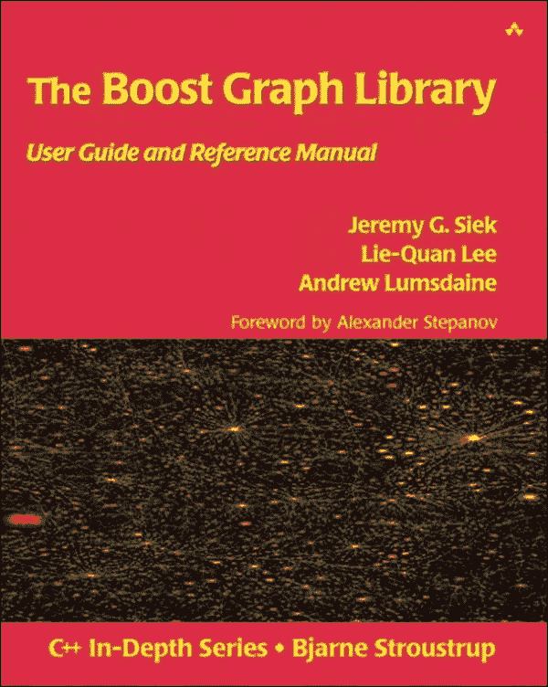

*“我把这封信写得比平时更长，是因为我没有时间把它写短。”*

—布莱斯·帕斯卡

ISO/ANSI C++ 标准的出现，标志着 C++ 程序员进入了一个新纪元的开启。该标准提供了许多新功能和机会，但现实世界中的程序员如何才能找到时间，从这些海量信息中发现关键的智慧结晶呢？`C++ 深度系列`通过为程序员提供针对特定主题的简洁、专注的指南，最大限度地减少了学习时间和困惑。

该系列中的每本书都介绍一个单一主题，其技术深度适用于该主题。该系列实用的方法旨在将专业人士的编程技能提升到下一个水平。这些短小而深入的专著由领域专家编写，可以在不受无关材料干扰的情况下进行阅读和参考。系列书籍之间相互交叉引用，并引用了 Bjarne Stroustrup 编写的《C++ 语言程序》。

在你开发 C++ 技能时，将本质信息从炒作和华丽外表中分离出来，并找到成长所需的深度内容变得日益重要。`C++ 深度系列`提供了工具、概念、技术以及 C++ 的新方法，将为你提供关键的竞争优势。

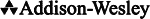

```
add_edge(2, 1, g);
add_edge(3, 5, g);
add_edge(4, 6, g);
```

```
#include <boost/graph/topological_sort.hpp>
#include <boost/graph/adjacency_list.hpp>
```

```cpp
public:
  topo_sort_visitor(OutputIterator iter) : m_iter(iter) { }
template <typename Graph, typename OutputIterator>
```

泛型编程（Generic Programming）是一种程序设计和实现的方法论，它通过使用抽象需求规范将数据结构和算法分离。在 C++ 中，泛型编程的特点是通过使用模板实现参数多态，并强调效率。

```cpp
AdditiveAbelianGroup total = v[0].zero();
//    有效表达式：
```

#### 代码 own：虚函数是较小的，模板是庞大的

```cpp
public:

};

  }
void print_equal2(const PointType* a, const PointType* b) {
```

```cpp
assert(sum1 == sum2); // 它们应该是等的
```

```cpp
*i         // 解引用 (来自 TrivialIterator)
```

## 2.4.2 类中的嵌套 typedef

```cpp
double* m_data;
struct array_traits {
```

```cpp
{
}
                int n = 0, int m = 0);
```

- 将特定类型 `file_dep_graph` 替换为模板参数 `Graph`。除非存在一个与算法使用的所有图类型共享的标准接口，否则这就是 BGL 图遍历概念引入的地方。对于 `topo_sort()`，我们需要一个建模 `VertexListGraph` 和 `IncidenceGraph` 概念的图。

从 6 号路由器到所有其他路由器的最短路径共同构成最短路径树。表示这种树的一种有效方法是记录树中每个节点的父节点。这里我们简单地使用 `std::vector` 来记录父节点。

设置父节点属性映射以记录最短路径树 85a

```cpp
std::vector<vertex_descriptor> parent(num_vertices(g));
// 所有顶点初始为自身的父节点
typedef graph_traits<Graph>::vertices_size_type size_type;
for (size_type p = 0; p < num_vertices(g); ++p)
  parent[p] = p;
```

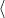从 Graphviz dot 文件读取无向图 91b

复制无向图，将字符串标签转换为整数权重 91c

调用 Prim 算法并在前驱映射中记录 MST 95a

计算生成树的权重 95b

标记树边并输出到 dot 文件 95c

```cpp
return EXIT_SUCCESS;
}
```

前两个步骤（从 dot 文件读取和复制图）与上一节相同。在调用 Prim 算法时，第一个参数是图，第二个参数是前驱映射（predecessor map）。前驱映射记录了最小生成树。对于图中的每个顶点 `v`，`parent[v]` 是 `v` 相对于最小生成树的父节点。在算法内部，`parent[v]` 可能会被赋值多次，但最后一次赋值保证设置了正确的父节点。可以使用 `prim_minimum_spanning_tree` 的多个命名参数来微调算法，但默认行为通常足够了。

`parent` 数组用于存储树的结构。为了将树视觉化，可以遍历 `parent` 数组并输出每条边。这是验证算法正确性的一种实用方法。树的总权重可以通过累加树中边的权重来计算。树的根通常是第一个顶点索引。

# 第 7 章 连接通分量

关于网络的一个基本问题是哪些顶点之间是可以相互到达的。例如，一个设计良好的网站在网页之间应该有足够的链接，使得所有页面都能从首页访问。此外，如果有返回首页的链接，或者至少是返回序列中的上一个页面会更好。在有图中，相互可达的顶点组称为*强连通分量*。在无向图中，相互可达的顶点组称为*连通分量*。

对 2 亿个网页的研究显示，互联网上的 5600 万个网页形成了一个大的强连通分量 [7]。研究还显示，当视为无向图时，有一个包含 1.5 亿页的大型连通分量，约有 5000 万页与该大分量断开（它们存在于自身更小的连通分量中）。

BGL 提供了两个用于计算图的所有连通分量的函数：一个用于图不变的情况（或仅需计算一次连通分量的情况），另一个用于图不断增长的情况。BGL 还实现了 Tarjan 算法，用于线性时间内计算图的强连通分量。

在接下来的章节中，我们首先从一些定义开始，然后将 BGL 连通分量函数应用于万维网网络。

## 7.1 定义

`path`（路径）是一个顶点的序列，其中每个顶点与路径中的下一个顶点之间都有边连接。如果从顶点 `u` 到 `w` 存在路径，则我们说顶点 `w` 对于顶点 `u` 是`reachable`的（可达的）。`connected component`（连通分量）是无向图中一组相互可达的顶点。`strongly connected component`（强连通分量）是有向图中一组互为可达的顶点。无向图的可达关系和有向图的互可达关系都是`等价关系`（equivalence relations）：它们具有自反性、对称性和传递性。满足等价关系的对象构成一个`等价类`（equivalence class）。因此，连通分量是可达关系的一个等价类，同样，强连通分量也是互可达关系的一个等价类。结果，这两种可达关系将图的顶点划分成互不交的子集。

## 7.2 连通分量与网络连接

计算无向图的连通分量是深度优先搜索的应用。其思想是在图上运行 DFS，并将同一 DFS 树中的所有顶点标记为同一个连通分量。BGL 的 `connected_components()` 实现调用了 `depth_first_search()` 并传入一个特殊的访问对象，该对象为每个发现的顶点标记当前分量标签，并在“起始顶点”事件点增加当前分量的计数。

计算图 7.1 所示网络连通分量的步骤如下：(1) 将网络读入内存，(2) 使用 BGL 图表示它，(3) 调用 `connected_components()` 函数。图中的每个顶点都被分配一个整数，表示该顶点所属的分量。以下是程序的大纲。

**图 7.1. 一组互联网路由器，边表示直接连接。**

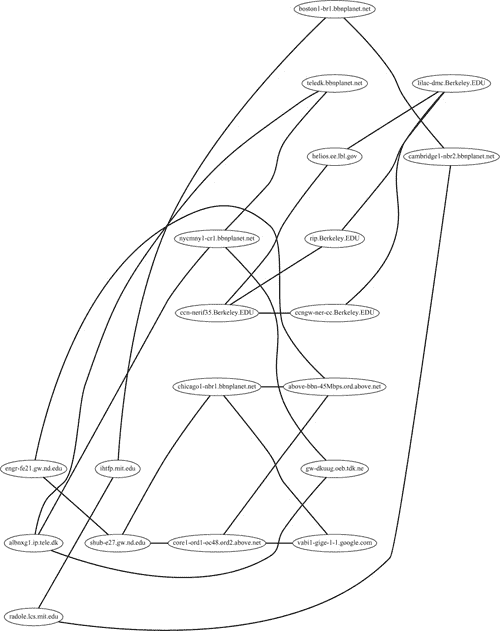

cc-internet.cpp 98a ≡

```cpp
#include <fstream>
#include <vector>
#include <string>
#include <boost/graph/connected_components.hpp>
#include <boost/graph/graphviz.hpp>

int main()
{
  using namespace boost;
  将图读入内存 98b
  为分量分配创建存储 100a
  调用连通分量函数 100b
  按分量对顶点上色并写入 dot 文件 100c
}
```

图 7.1 的图是从文件 `cc-internet.dot` 读取的，该文件采用 Graphviz dot 格式。选择 `GraphvizGraph` 类型（而不是 `GraphvizDigraph`）是因为要表示的图是无向。

将图读入内存 98b ≡

```cpp
GraphvizGraph g;
read_graphviz("figs/cc-internet.dot", g);
```

使用一个大小为 `num_vertices(g)` 的向量来存储图中每个顶点被分配的分量整数。

为分量分配创建存储 100a ≡

```cpp
std::vector<int> component(num_vertices(g));
```

调用 `connected_components()` 的第一个参数是图的类型，它必须是 `VertexListGraph` 和 `IncidenceGraph` 的模型。`GraphvizGraph` 类型是合适的，因为它建模了这些概念。第二个参数是从顶点到分量编号的属性映射（property map）。该属性映射使用 `iterator_property_map` 适配器构建，封装了指向 `component` 向量开头的迭代器。`connected_components()` 返回发现的分量总数，并在 `component` 向量中记录每个顶点的分量分配。`connected_components()` 算法还有一个名为 `color_map` 的参数，用于深度优先搜索。这里使用了默认值；算法在内部创建颜色映射并使用图的顶点索引映射来索引数组。

调用连通分量 100b ≡

```cpp
int num_comp = connected_components(g,
  iterator_property_map(component.begin(), component.end()));
```

为了可视化结果，根据分量编号为每个顶点分配颜色。然后将图写入 Graphviz 文件。图 7.2 显示了结果。

**图 7.2. 连通分量。**

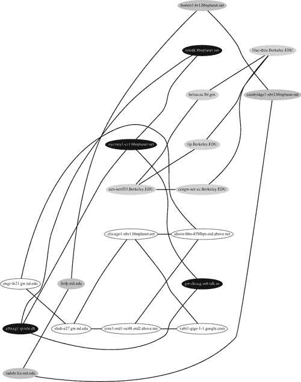

按分量对顶点上色并写入 dot 文件 100c ≡

```cpp
property_map<GraphvizGraph, attribute_t>::type attr_map = get(vertex_attribute, g);
std::string color[] = { "white", "gray", "lightgray" };
graph_traits<GraphvizGraph>::vertex_iterator vi, vi_end;
for (tie(vi, vi_end) = vertices(g); vi != vi_end; ++vi) {
  attr_map[*vi] = color[component[*vi]];
  if (component[*vi] == "white") {
    attr_map[*vi].erase("color");
  } else {
    attr_map[*vi]["style"] = "filled";
    if (component[*vi] == "black") {
      attr_map[*vi]["fontcolor"] = "white";
    }
  }
}
write_graphviz("figs/cc-internet-out.dot", g);
```

## 7.3 强连通分量与网页链接

图 7.3 显示了一组通过 URL 链接连接的网页，它们被抽象地表示有向图。本节的目标是计算该图的强连通分量。

**图 7.3. 表示 URL 链接的图。**

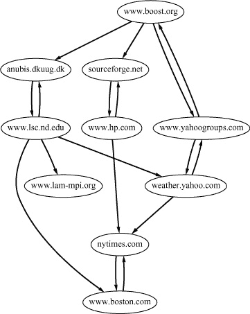

程序的概述如下。首先，从 Graphviz dot 文件读取图到内存。然后为将计算的分量分配创建存储。调用 `strong_components()` 算法并使用结果为图的顶点上色。

```cpp
#include <fstream>
#include <map>
#include <string>
#include <boost/graph/strong_components.hpp>
#include <boost/graph/graphviz.hpp>

int main()
{
  using namespace boost;
  将有向图读入内存 103a
  为分量分配分配存储 103b
  调用强连通分量函数 103c
  按分量编号对顶点上色并写入 dot 文件 104
  return EXIT_SUCCESS;
}
```

使用 `GraphvizDigraph` 类型从 `scc.dot` 文件读取图（因为图是有向的）。

```cpp
GraphvizDigraph g;
read_graphviz("figs/scc.dot", g);
```

在调用 `strong_components()` 时，使用了 `associative_property_map` 适配器来提供函数所需的属性映射接口。该适配器根据 `AssociativeContainer`（如 `std::map`）创建一个属性映射。在这种情况下，选择 `std::map` 来实现属性映射的效率并不高，但它展示了属性映射接口的灵活性。由于 `GraphvizDigraph` 的顶点描述符是一个整数，因此它具备 `std::map` 所需的小于运算符。

为分量分配存储空间 103b ≡

```cpp
typedef graph_traits<GraphvizDigraph>::vertex_descriptor vertex_t;

std::map<vertex_t, int> component;
```

调用 `strong_components()` 算法的结果存储在 `component` 数组中，为每个顶点分配了一个分量编号。分量编号范围从 0 到 `num_comp-1`。传递给 `strong_components()` 函数的图必须是 `VertexListGraph` 和 `IncidenceGraph` 概念的模型——事实上，`GraphvizDigraph` 满足这些标准。第二个参数（分量映射）必须是一个 `ReadWritePropertyMap`。还有几个可以指定的具名参数，但它们都是仅供内部使用的工具属性映射。默认情况下，算法为这些属性映射创建数组，并使用图的顶点索引属性作为它们的偏移量。

调用强连通分量函数 103c ≡

```cpp
int num_comp = strong_components(g, make_assoc_property_map(component));
```

程序最后根据顶点所属的分量对其进行上色。输出被写入一个 dot 文件，生成如图 7.4 所示的图。

**图 7.4 强连通分量。**

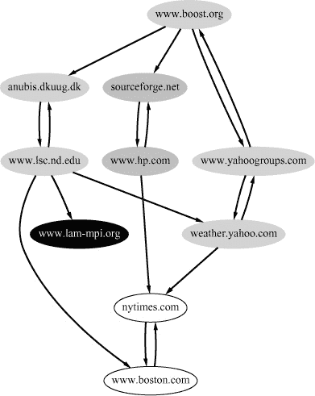

按分量编号为顶点上色并写入 dot 文件 104 ≡


```cpp
property_map<GraphvizDigraph, vertex_attribute_t>::type
  vertex_attr_map = get(vertex_attribute, g);

std::string color[] = { "white", "gray", "black", "lightgray" };

graph_traits<GraphvizDigraph>::vertex_iterator vi, vi_end;

for (tie(vi, vi_end) = vertices(g); vi != vi_end; ++vi) {
  vertex_attr_map[*vi]["color"] = color[component[*vi]];
  if (color[component[*vi]] == "white")
    vertex_attr_map[*vi].erase("color");
  else
    vertex_attr_map[*vi]["style"] = "filled";
  if (vertex_attr_map[*vi]["color"] == "black")
    vertex_attr_map[*vi]["fontcolor"] = "white";
}

write_graphviz("figs/scc-out.dot", g);
```

# 第 8 章 最大流

最大流问题是确定某种数量（例如水）能够通过网络传输的最大量的问题。

求解最大流问题的算法有着悠久的历史，第一个算法由 Ford 和 Fulkerson 提出 [12]。目前为止已知的通用算法是 Goldberg 的 push-relabel（推重标记）算法 [9, 16, 17]，它基于 Karzanov 引入的预流（preflow）概念 [20]。

BGL 包含了两种计算最大流的算法：Edmonds–Karp 算法（Ford–Fulkerson 算法的改进版）和 push-relabel 算法。

## 8.1 定义

流网络是一个有向图 `G = (V, E)`，包含一个源顶点 `s` 和汇顶点 `t`。每条边都有一个正实值的容量（capacity），并且在每对顶点上定义了一个流函数 `f`。流函数必须满足三个约束：

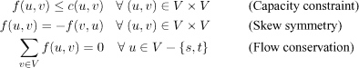

网络的流是进入汇顶点 `t` 的净流量。边的残量容量是 `r(u, v) = c(u, v) – f(u, v)`。`r(u, v) > 0` 的边是残量边 `E[f]`，它们引导出残量图 `G[f] = (V, E[f])`。`r(u, v) = 0` 的边是饱和（saturated）。

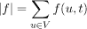

最大流问题是确定 `|f|` 的最大可能值以及图中每对顶点对应的流值。流网络的一个重要属性是最大流与割（cut）有关。根据最大流最小割定理 [12]，从源 `s` 到汇 `t` 的最大流等于割开两者的最小容量。

## 8.2 边连通性

无论工程师是在设计电话网络、局域网还是互联网，一个重要的考虑因素是网络对损伤的韧性。例如，如果电缆在风暴中被中断，是否还有其他电缆可以传输？在图术语中，这通过图的边连通性来描述。计算图的边连通性可以转化为一系列最大流问题。

具体来说，对于无向图，让 `α(u, v)` 表示断开顶点 `u` 和 `v` 的最小边数。如果将这两个顶点视为源汇并将每条边的容量设置为 1，那么最小容量割（通过最大流算法计算）就等于最小边数。因此，通过求解最大流，我们也确定了可以切断的边。现在，为了找到整个图的边连通性，可以对每对顶点运行最大流算法。所有顶点对割的最小值将是图的最小割。

对每对顶点执行最大流代价很大，因此减少需要检查的顶点对会更好。这可以通过利用最小断开集的特殊属性来实现。设 `p` 为最小度顶点，`δ` 为最小度。如果 `α(G) = δ`，则 `S*` 就是 `p`。如果 `α(G) ≤ δ – 1`，则可以证明对于 `S*` 的任何子集 `S`，相对于 `S` 中顶点的非邻居顶点集合是非空的。这意味着最小割可以通过从 `S = {p}` 开始，从 `S` 的非邻居集合中选取顶点 `k`，计算 `α(p, k*)`，然后将 `k` 加入 `S` 来重复此过程，直到 `S` 的非邻居集合为空。

我们将边连通性算法实现为一个函数模板，它使用了 `BGL VertexListGraph` 接口。该函数返回图的边连通性，并将断开集中的边写入输出迭代器。边连通性函数的概要如下。

```cpp
template <typename VertexListGraph, typename OutputIterator>
typename graph_traits<VertexListGraph>::degree_size_type
edge_connectivity(VertexListGraph& g, OutputIterator disconnecting_set)
{
  // 类型定义
  // 变量声明
  // 从无向图创建一个网络流图
  // 寻找最小度顶点并计算 S 的邻居和 S 的非邻居
  // 主循环
  // 计算割边的正向边
  return c;
}
```

实现的第一个部分创建了一些类型定义，以便为访问图性性（graph traits）中的类型提供更短的名称。根据输入的无向图 `g` 创建了一个网络流图（一种有向图），因此使用了 `adjacency_list` 图类。

### 类型定义

```cpp
typedef typename graph_traits<VertexListGraph>::vertex_descriptor vertex_descriptor;
typedef typename graph_traits<VertexListGraph>::degree_size_type degree_size_type;
typedef color_traits<default_color_type> Color;
typedef typename adjacency_list_traits<vecS, vecS, directedS>::edge_descriptor edge_descriptor;
typedef adjacency_list<vecS, vecS, directedS, no_property,
  property<edge_capacity_t, degree_size_type,
    property<edge_residual_capacity_t, degree_size_type,
      property<edge_reverse_t, edge_descriptor> > > > FlowGraph;
```

我们使用 `std::set` 来处理集合 `S` 和 `S` 的邻居，因为必须确保插入时的唯一性。集合 `S` 和 `S` 的非邻居使用 `std::vector` 表示，因为我们预先知道插入的元素是唯一的。

### 变量声明

```cpp
vertex_descriptor u, v, p, k;
edge_descriptor e1, e2;
bool inserted;
typename graph_traits<VertexListGraph>::vertex_iterator vi, vi_end;
degree_size_type delta, alpha_star, alpha_S_k;
std::set<vertex_descriptor> S, neighbor_S;
std::vector<vertex_descriptor> S_star, nonneighbor_S;
std::vector<default_color_type> color(num_vertices(g));
std::vector<edge_descriptor> pred(num_vertices(g));
```

网络流图基于输入图构建。流图中的每条边都有三个属性——容量、剩余容量和反向边——分别通过属性映射对象 `cap`、`res_cap` 和 `rev_edge` 访问。

### 从无向图创建一个网络流图

```cpp
FlowGraph flow_g(num_vertices(g));
typename property_map<FlowGraph, edge_capacity_t>::type cap = get(edge_capacity, flow_g);
typename property_map<FlowGraph, edge_residual_capacity_t>::type res_cap = get(edge_residual_capacity, flow_g);
typename property_map<FlowGraph, edge_reverse_t>::type rev_edge = get(edge_reverse, flow_g);

typename graph_traits<VertexListGraph>::edge_iterator ei, ei_end;
for (tie(ei, ei_end) = edges(g); ei != ei_end; ++ei) {
  u = source(*ei, g), v = target(*ei, g);
  tie(e1, inserted) = add_edge(u, v, flow_g);
  cap[e1] = 1;
  tie(e2, inserted) = add_edge(v, u, flow_g);
  cap[e2] = 1;
  rev_edge[e1] = e2;
  rev_edge[e2] = e1;
}
```

在主算法中，若干功能被分为独立的函数。第一个是寻找最小度顶点，通过遍历所有顶点并比较它们的度来实现。

### 寻找最小度顶点

```cpp
template <typename Graph>
std::pair<typename graph_traits<Graph>::vertex_descriptor, typename graph_traits<Graph>::degree_size_type>
min_degree_vertex(Graph& g) {
  typename graph_traits<Graph>::vertex_descriptor p;
  typedef typename graph_traits<Graph>::degree_size_type size_type;
  size_type delta = std::numeric_limits<size_type>::max();
  typename graph_traits<Graph>::vertex_iterator i, iend;
  for (tie(i, iend) = vertices(g); i != iend; ++i) {
    if (degree(*i, g) < delta) {
      delta = degree(*i, g);
      p = *i;
    }
  }
  return std::make_pair(p, delta);
}
```

我们还需要将每个顶点（以及一组顶点）的所有邻居插入到集合中的能力，这可以通过检查 `adjacent_vertices()` 实现。我们假设输出迭代器类似于 `std::set` 的 `std::insert_iterator`。

### 输出邻居辅助函数

```cpp
template <typename Graph, typename OutputIterator>
void neighbors(const Graph& g, typename graph_traits<Graph>::vertex_descriptor u, OutputIterator result) {
  typename graph_traits<Graph>::adjacency_iterator ai, aend;
  for (tie(ai, aend) = adjacent_vertices(u, g); ai != aend; ++ai) {
    *result++ = *ai;
  }
}

template <typename Graph, typename VertexIterator, typename OutputIterator>
void neighbors(const Graph& g, VertexIterator first, VertexIterator last, OutputIterator result) {
  for (; first != last; ++first) {
    neighbors(g, *first, result);
  }
}
```

算法的初始步骤是寻找最小度顶点 `p`，设置 `S`，然后计算 `S` 的邻居和非邻居。我们使用 `std::set_difference` 计算 `V - S`（其中 `V` 是顶点集合）。

### 寻找最小度顶点并计算 `S` 的邻居和非邻居

```cpp
tie(p, delta) = min_degree_vertex(g);
S_star.push_back(p);
alpha_star = delta;
S.insert(p);
neighbor_S.insert(p);
neighbors(g, S.begin(), S.end(), std::inserter(neighbor_S, neighbor_S.begin()));
std::set_difference(vertices(g).first, vertices(g).second, neighbor_S.begin(), neighbor_S.end(), std::back_inserter(nonneighbor_S));
```

算法的迭代部分在 `nonneighbor_S` 为空时结束。在循环中，使用 Edmonds-Karp 算法计算 `p` 与非邻居 `k` 之间的最大流。在流算法期间标记（非白色）的顶点对应于割的一侧。因此，如果割的大小是目前最小的，则将标记顶点记录在 `S*` 中，将 `k` 插入 `S`，并重新计算 `S` 的邻居和非邻居。

### 主循环

```cpp
while (!nonneighbor_S.empty()) {
  k = nonneighbor_S.front();
  alpha_S_k = edmunds_karp_max_flow(
    flow_g, p, k, capacity_map(cap).residual_capacity_map(res_cap),
    reverse_edge_map(rev_edge).color_map(&color[0]).predecessor_map(&pred[0]));
  if (alpha_S_k < alpha_star) {
    alpha_star = alpha_S_k;
    S_star.clear();
    for (tie(vi, vi_end) = vertices(flow_g); vi != vi_end; ++vi) {
      if (color[*vi] != Color::white()) {
        S_star.push_back(*vi);
      }
    }
  }
  S.insert(k);
  neighbor_S.insert(k);
  neighbors(g, k, std::inserter(neighbor_S, neighbor_S.begin()));
  nonneighbor_S.clear();
  std::set_difference(vertices(g).first, vertices(g).second, neighbor_S.begin(), neighbor_S.end(), std::back_inserter(nonneighbor_S));
}
```

最后一步是找到割中的边，这些边是指一个顶点在 `S` 中而另一个顶点在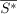中。这些边被写入名为 `disconnecting_set` 的输出迭代器，并返回割中边的数量。

计算割的入向边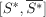110b ≡

```cpp
std::vector<bool> in_S_star(num_vertices(g), false);

typename std::vector<vertex_descriptor>::iterator si;

for (si = S_star.begin(); si != S_star.end(); ++si)
  in_S_star[*si] = true;

degree_size_type c = 0;
for (si = S_star.begin(); si != S_star.end(); ++si) {
  typename graph_traits<VertexListGraph>::out_edge_iterator ei, ei_end;
  for (tie(ei, ei_end) = out_edges(*si, g); ei != ei_end; ++ei)
    if (!in_S_star[target(*ei, g)]) {
      *disconnecting_set++ = *ei;
      ++c;
    }
}
```

图 8.1 显示应用边连通性算法的示例图。

**图 8.1 边连通性的示例图。**

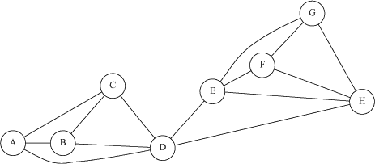

`edge-connectivity.cpp` 111 ≡


```cpp
#include <algorithm>
#include <utility>
#include <boost/graph/edmunds_karp_max_flow.hpp>
#include <boost/graph/push_relabel_max_flow.hpp>
#include <boost/graph/adjacency_list.hpp>
#include <boost/graph/graphviz.hpp>
namespace boost {
  寻找最小度顶点函数 108b
  输出邻居辅助函数 109a
  边连通性算法 107a
}
int main()
{
  using namespace boost;
  GraphvizGraph g;
  read_graphviz("figs/edge-connectivity.dot", g);
  typedef graph_traits<GraphvizGraph>::edge_descriptor edge_descriptor;
  typedef graph_traits<GraphvizGraph>::degree_size_type degree_size_type;
  std::vector<edge_descriptor> disconnecting_set;
  degree_size_type c = edge_connectivity(g, std::back_inserter(disconnecting_set));
  std::cout << "The edge connectivity is " << c << "." << std::endl;
  property_map<GraphvizGraph, vertex_attribute_t>::type
      attr_map = get(vertex_attribute, g);
  std::cout << "The disconnecting set is {";
  for (std::vector<edge_descriptor>::iterator i = disconnecting_set.begin();
       i != disconnecting_set.end(); ++i)
    std::cout << "(" << attr_map[source(*i, g)]["label"] << ","
      << attr_map[target(*i, g)]["label"] << ") ";
  std::cout << "}." << std::endl;
  return EXIT_SUCCESS;
}
```

示例程序的输出如下：

边连通性为 2。

割割集为 {(D,E) (D,H) }。

# 第 9 章 隐式图：骑士巡游

骑士巡游问题如下：为骑士找到一条路径，恰好访问一次 $n \times n$ 棋盘上的所有格子。骑士巡游是哈密顿路径（Hamiltonian path）的一个例子——即通过图中每个顶点的简单路径（其中棋盘上的每个格子被视为一个顶点）。图的边由骑士跳跃的模式决定（例如向上两格再向一格）。在本节中，我们使用通用的回溯算法来寻找骑士巡游。回溯算法是暴力的且速度非常慢，我们还展示了使用 Warnsdorff 启发式算法的改进。哈密顿路径问题是 NP 完全困难的（对于较大规模的问题，无法在合理的时间内解决）。普通 $8 \times 8$ 棋盘上的骑士巡游示例见图 9.1。

**图 9.1 骑士巡游的示例。**

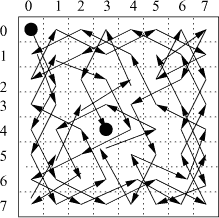

该示例的一个独特之处在于，它没有使用显式的数据结构（如 `adjacency_list` 类）来表示图。相反，它根据骑士在棋盘上允许的移动推导出一个隐式图结构 `knights_tour_graph`。

## 9.1 骑士跳跃作为图

`knights_tour_graph` 是 `AdjacencyGraph` 的模型，因此我们需要实现一个 `adjacent_vertices()` 函数，返回一对相邻迭代器。`knights_tour_graph` 是根据棋盘上骑士允许的移动推导出的隐式图结构。`adjacent_vertices()` 函数需要实现一个返回相邻迭代器对的函数。

```cpp
typedef std::pair<int, int> Position;
Position knight_jumps[8] = {
  {2, 1}, {1, 2}, {-1, 2}, {-2, 1},
  {-2, -1}, {-1, -2}, {1, -2}, {2, -1}
};
```

`knights_tour_graph` 是 `AdjacencyGraph` 的模型，因此我们需要实现一个 `adjacent_vertices()` 函数，返回一对相邻迭代器。`adjacent_vertices()` 函数需要实现一个返回相邻迭代器对的函数。

```cpp
struct knight_adjacency_iterator
  : public boost::forward_iterator_helper<
    knight_adjacency_iterator, Position, std::ptrdiff_t, Position*>
{
  knight_adjacency_iterator() { }
  knight_adjacency_iterator(int ii, Position p, const knights_tour_graph& g)
  : m_pos(p), m_g(&g), m_i(ii) { valid_position(); }
  Position operator*() { return m_pos + knight_jumps[m_i]; }
  void operator++() { ++m_i; valid_position(); }
  bool operator==(const knight_adjacency_iterator& x) const { return m_i == x.m_i; }

protected:
  void valid_position();
  Position m_pos;
  const knights_tour_graph* m_g;
  int m_i;
};
```

```cpp
void knight_adjacency_iterator::valid_position() {
  Position new_pos = m_pos + knight_jumps[m_i];
  while (m_i < 8 && (new_pos.first < 0 || new_pos.second < 0
      new_pos.first >= m_g->m_board_size
      | new_pos.second >= m_g->m_board_size)) {
    ++m_i;
    new_pos = m_pos + knight_jumps[m_i];
  }
}
```

```cpp
std::pair<knights_tour_graph::adjacency_iterator, knights_tour_graph::adjacency_iterator>
adjacent_vertices(knights_tour_graph::vertex_descriptor v, const knights_tour_graph& g) {
  typedef knights_tour_graph::adjacency_iterator Iter;
  return std::make_pair(Iter(0, v, g), Iter(8, v, g));
}
```

`knights_tour_graph` 类只包含棋盘的大小（存储为数据成员）以及 `AdjacencyGraph` 所需的类型定义。`num_vertices()` 函数返回棋盘上的格子数量。

```cpp
struct knights_tour_graph
{
  typedef Position vertex_descriptor;
  typedef std::pair<vertex_descriptor, vertex_descriptor> edge_descriptor;
  typedef knight_adjacency_iterator adjacency_iterator;
  typedef void out_edge_iterator;
  typedef void in_edge_iterator;
  typedef void edge_iterator;
  typedef void vertex_iterator;
  typedef int degree_size_type;
  typedef int vertices_size_type;
  typedef int edges_size_type;
  typedef directed_tag directed_category;
  typedef disallow_parallel_edge_tag edge_parallel_category;
  typedef adjacency_graph_tag traversal_category;
  knights_tour_graph(int n) : m_board_size(n) { }
  int m_board_size;
};

int num_vertices(const knights_tour_graph& g) { return g.m_board_size * g.m_board_size; }
```

既然骑士的移动已经映射到 Boost 图接口上，我们就可以查看一些可以解决骑士巡游问题的图算法了。

## 9.2 回溯图搜索

回溯图搜索的思想与深度优先搜索相似，它们都会探索路径直到遇到死胡同。回溯图搜索的不同之处在于，在遇到死胡同后，算法会回溯并取消死胡同路径的标记，然后沿着不同的路径继续。在下面的代码中，回溯搜索使用栈（而不是递归方法）实现，并使用属性映射（property map）记录每个顶点的发现时间。栈中包含了时间戳-顶点的对，以便在从死胡同回溯后能够获得正确的时间戳。一旦所有顶点都已访问，或者所有可能的路径都已耗尽，搜索即完成。

尽管上一节中定义的图是隐式的（特别地代表了棋盘上骑士的移动），但它仍然模拟了一个 BGL 图。因此，回溯算法是针对 `Graph` 实现的，而不仅仅是针对 `knights_tour_graph`。生成的算法可以复用于任何建模 `Graph` 的图数据结构。

```cpp
template <typename Graph, typename TimePropertyMap>
bool backtracking_search(Graph& g,
    typename graph_traits<Graph>::vertex_descriptor src, TimePropertyMap time_map)
{
    // 创建栈并初始化时间戳 116
    S.push(std::make_pair(time_stamp, src));
    while (!S.empty()) {
        // 从栈顶获取顶点，记录时间，并检查是否完成 117a
        // 将所有相邻顶点推入栈 117b
        // 如果处于死胡同，回滚 117c
    } // while (!S.empty())
    return false;
}
```

使用 `std::stack` 来记录需要探索的顶点。顶点推入栈的时间戳也被记录了。

```cpp
// 创建栈并初始化时间戳 116
typedef typename graph_traits<Graph>::vertex_descriptor Vertex;
typedef std::pair<int, Vertex> P;
std::stack<P> S;
int time_stamp = 0;
```

下一步是记录栈顶顶点的时间戳，并检查图中的所有顶点是否已记录，从而判断算法是否结束。

```cpp
// 从栈顶获取顶点，记录时间，并检查是否完成 117a
Vertex x;
tie(time_stamp, x) = S.top ();
put(time_map, x, time_stamp);
// 所有顶点都已访问，成功！
if (time_stamp == num_vertices(g) - 1)
  return true;
```

现在扫描所有相邻顶点，如果相邻顶点尚未被访问，则将其加入栈。没有可用的相邻顶点则表示遇到了死胡同。

```cpp
// 将所有相邻顶点推入栈 117b
bool deadend = true;
typename graph_traits<Graph>::adjacency_iterator i, end;
for (tie(i, end) = adjacent_vertices(x, g); i != end; ++i)
  if (get(time_map, *i) == -1) {
    S.push(std::make_pair(time_stamp + 1, *i));
    deadend = false;
  }
```

如果算法到达死胡同，则从栈中弹出顶点，直到找到一个尚未探索的顶点为止。当我们回溯时，每个顶点的时间戳都会被重置，因为这些顶点可能通过更好的路径到达。

```cpp
// 如果处于死胡同，回滚 117c
if (deadend) {
  put(time_map, x, -1);
  S.pop();
  tie(time_stamp, x) = S.top();
  while (get(time_map, x) != -1) { // 回溯到上顶点
    put(time_map, x, -1);
    S.pop();
    tie(time_stamp, x) = S.top();
  }
}
```

## 9.3 Warnsdorff 启发式

Warnsdorff 选择下一次跳跃位置的启发式是预瞻每一个可能的跳跃，并查看从该格子可以进行多少跳跃。我们称之为*后继数*（number of successors）。选择后继数最少的格子作为下一步移动。这种启发式之所以有效，是因为它优先访问受限制最多的顶点，从而避免了某些潜在的终点。下面的函数计算一个顶点的后继数。

```cpp
template <typename Vertex, typename Graph, typename TimePropertyMap>
int number_of_successors(Vertex x, Graph& g, TimePropertyMap time_map) {
  int s_x = 0;
  typename graph_traits<Graph>::adjacency_iterator i, end;
  for (tie(i, end) = adjacent_vertices(x, g); i != end; ++i)
    if (get(time_map, *i) == -1)
      ++s_x;
  return s_x;
}
```

为了实现这种算法，我们从回溯算法开始，但不是将相邻顶点推入栈，而是首先根据后继数对它们进行排序。排序通过将相邻顶点放入队列来实现。一旦所有相邻顶点都在队列中，就将它们弹出并推入栈。队列为空意味着死胡同。

```cpp
template <typename Graph, typename TimePropertyMap>
bool warnsdorff (Graph& g, typename graph_traits<Graph>::vertex_descriptor src,
    TimePropertyMap time_map)
{
  // 创建栈并初始化时间戳 116
  S.push(std::make_pair(time_stamp, src));
  while (!S.empty()) {
    // 从栈顶获取顶点，记录时间，并检查是否完成 117a
    // 将相邻顶点放入局部优先队列
    std::priority_queue<P, std::vector<P>, compare_first> Q;
    typename graph_traits<Graph>::adjacency_iterator i, end;
    int num_succ;
    for (tie(i, end) = adjacent_vertices(x, g); i != end; ++i)
      if (get(time_map, *i) == -1) {
        num_succ = number_of_successors(*i, g, time_map);
        Q.push(std::make_pair(num_succ, *i));
      }
    bool deadend = Q.empty();
    // 将局部优先队列中的顶点移动栈
    for (; !Q.empty(); Q.pop()) {
      tie(num_succ, x) = Q.top();
      S.push(std::make_pair(time_stamp + 1, x));
    }
    // 如果处于死胡同，回滚 117c
  } // while (!S.empty())
  return false;
}
```

# 第 10 章 与其他图库接口


尽管 BGL 的主要目标是辅助新应用程序和图算法的开发，但有很多现有代码可以从使用 BGL 算法中受益。与现有图数据结构配合 BGL 算法的一种方法是将数据从旧图格式复制到 BGL 图中，然后使用 BGL 算法。这种方法的问题在于，执行这种复制可能不方便且开销很大。另一种方法是通过为现有数据结构封装一个 BGL 接口来直接使用它。

适配器模式 [14] 是为现有类提供新接口的一种机制。这种方法通常要求将被适配的对象包含在一个提供所需接口的新类中。在为 BGL（骨架图库）封装图时，不需要这种包含关系，因为 BGL 图接口完全由自由函数（全局非成员函数）组成。对于这种接口，适配一个接口不需要创建一个新的图类，只需要对构成该接口的自由函数进行重载即可。在 §10.3 中，我们将详细展示这种工作机制是如何运作的。

BGL 包含了针对 LEDA [29] `GRAPH` 类型、Stanford GraphBase [22] `Graph*` 类型的重载，以及针对 STL `std::vector` 的重载。LEDA 是一种流行的用于组合计算的面向对象库，包含了图数据结构和算法。由 Donald Knuth 编写的 Stanford GraphBase 是一系列图数据集、图生成器以及在这些图上运行图算法的程序。

在接下来的章节中，我们将展示如何使用 BGL 算法结合 LEDA 和 SGB 图数据结构。然后，我们将查看针对 LEDA 图的 BGL 适配函数的实现，并提供如何为其他图库实现适配器的示例。

在 §1.4.1 中，我们通过将 `topological_sort()` 同时应用于由列表向量表示的图 `std::vector<std::list<int>>` 以及一个由 `boost::adjacency_list` 表示的图，展示了 BGL 算法的灵活性。我们将在后续两个章节中继续该示例——调度一组相互依赖的任务——首先使用 LEDA 的 `GRAPH` 类型，然后使用 Stanford GraphBase (SGB) `Graph` 类型。

## 10.1 结合 LEDA 图使用 BGL 拓扑排序

头文件 `boost/graph/leda_graph.hpp` 包含了函数重载，这些函数将 LEDA 参数化的 `GRAPH` 类型适配到 BGL 接口。针对 LEDA `GRAPH` 的 BGL 接口记录在 §14.3.5 中。LEDA–BGL 接口使用 LEDA 版本 4.1 进行测试，这是 LEDA 最后免费版本之一。除了包含 `leda_graph.hpp` 头文件外，你必须安装 LEDA，设置编译器的包含路径和库路径，并链接 LEDA 库。详情请参 LEDA 文档。

以下是任务调度程序的大纲，这次使用 LEDA `GRAPH` 来表示任务依赖关系。

topo-sort-with-leda.cpp 120a ≡

```cpp
#include <vector>
#include <string>
#include <iostream>
#include <boost/graph/topological_sort.hpp>
#include <boost/graph/leda_graph.hpp>

// 取消与 C++ 标准库冲突的 LEDA 宏。
#undef string
#undef vector

int main()
{
    using namespace boost;
    创建一个以任务 120b 标记顶点的 LEDA 图
    向 LEDA 图添加边 121a
    对 LEDA 图执行拓扑排序 121b
    return EXIT_SUCCESS;
}
```

LEDA `GRAPH` 类允许用户将对象附加到图的顶点和边上，因此在这里我们将任务名称（`std::string` 形式）附加到顶点上。我们使用常用的 BGL `add_vertex()` 函数向 `leda_g` 添加顶点，并将任务名称作为要附加到顶点的属性对象传入。我们将 `add_vertex()` 返回的顶点描述符存储在 `vector` 中，以便在添加边时能够快速访问任何顶点。

创建一个以任务 120b 标记顶点的 LEDA 图 ≡

```cpp
typedef GRAPH<std::string, char> graph_t;
graph_t leda_g;
typedef graph_traits<graph_t>::vertex_descriptor vertex_t;
std::vector<vertex_t> vert(7);
vert[0] = add_vertex(std::string("pick up kids from school"));
vert[1] = add_vertex(std::string("buy groceries"));
vert[2] = add_vertex(std::string("get cash at ATM"));
vert[3] = add_vertex(std::string("drop off kids at practice"));
vert[4] = add_vertex(std::string("cook dinner"));
vert[5] = add_vertex(std::string("eat"));
vert[6] = add_vertex(std::string("dinner"));
```

下一步是添加边。我们再次使用 BGL 函数向 LEDA 图添加边 121a ≡

```cpp
// (基于上下文的添加边的实现)
```

现在我们有了图，可以调用 `topological_sort()`。我们再次使用 LEDA 的 `node_array` 来标记顶点。在 `boost/graph/leda_graph.hpp` 中定义的 `make_leda_property_map` 函数创建了一个满足 `PropertyMap` Concept 的适配器。

对 LEDA 图执行拓扑排序 121b ≡

```cpp
std::vector<vertex_t> topo_order;
node_array<color_type> color_array(leda_g);
topological_sort(leda_g, std::back_inserter(topo_order), make_leda_property_map(color_array));
std::reverse(topo_order.begin(), topo_order.end());
for (std::vector<vertex_t>::iterator i = topo_order.begin(), n = 1; i != topo_order.end(); ++i, ++n)
    std::cout << n << ": " << leda_g[*i] << std::endl;
```

## 10.2 结合 SGB 图使用 BGL 拓扑排序

SGB 定义了一个实现邻接列表风格数据结构的 `Graph` 结构体。`boost/graph/stanford_graph.hpp` 中的重载函数将 SGB `Graph` 结构体适配到 BGL 接口。除了包含 `stanford_graph.hpp` 头外，你必须安装 Stanford GraphBase，并应用 SGB 分发包中的 PROTOTPES 修改文件。这是因为原始 SGB 头文件没有定义函数的 ANSI 标准原型，而 C++ 编译器需要这些。编译使用 SGB–BGL 接口的程序时，你需要设置 SGB 的包含路径和库路径，并链接 SGB 库。SGB–BGL 接口记录在 §14.3.4 中。以下代码显示了计算一组相互依赖任务拓扑排序的大纲。

topo-sort-with-sgb.cpp 122a ≡

```cpp
#include <vector>
#include <string>
#include <iostream>
#include <boost/graph/topological_sort.hpp>
#include <boost/graph/stanford_graph.hpp>

int main()
{
    using namespace boost;
    创建一个 SGB 图 122b
    为任务创建标签 122c
}
```

向 SGB 图添加边 123a

对 SGB 图进行拓扑排序 123b

```cpp
gb_recycle(sgb_g);

return EXIT_SUCCESS;
}
```

我们通过调用 SGB 函数 `gb_new_graph()` 创建一个 SGB 图。

创建一个 SGB 图 122b ≡

```cpp
const int n_vertices = 7;
Graph* sgb_g = gb_new_graph(n_vertices);
```

接下来，我们为图中的任务（顶点）编写标签。由于在 `stanford_graph.hpp` 中定义了 `sgb_vertex_id_map`，通过它可以轻松地将 SGB 顶点描述符转换为整数，因此将标签存储在数组中是非常方便的。

为任务创建标签 122c ≡

```cpp
const char* tasks[ ] = {
  "pick up kids from school",
  "buy groceries (and snacks)",
  "get cash at ATM",
  "drop off kids at soccer practice",
  "cook dinner",
  "pick up kids from soccer",
  "eat dinner" };
const int n_tasks = sizeof(tasks) / sizeof(char*);
```

SGB 图将图的顶点存储在数组中，因此我们可以通过数组的偏移量访问任何顶点。`gb_new_edge` 函数接受两个 `Vertex*` 参数和一个边权重（我们不需要它）。

向 SGB 图添加边 123a ≡

```cpp
gb_new_arc(sgb_g->vertices + 0, sgb_g->vertices + 3, 0);
gb_new_arc(sgb_g->vertices + 1, sgb_g->vertices + 3, 0);
gb_new_arc(sgb_g->vertices + 1, sgb_g->vertices + 4, 0);
gb_new_arc(sgb_g->vertices + 2, sgb_g->vertices + 1, 0);
gb_new_arc(sgb_g->vertices + 3, sgb_g->vertices + 5, 0);
gb_new_arc(sgb_g->vertices + 4, sgb_g->vertices + 6, 0);
gb_new_arc(sgb_g->vertices + 5, sgb_g->vertices + 6, 0);
```

接下来，我们执行拓扑排序。我们将 SGB 图原封地传递给算法。这一次，我们不再创建颜色映射，而是让算法为自己创建一个。然而，为了实现这一点，`topological_sort()` 函数需要一个从顶点到整数的映射。SGB–BGL 接口提供了这种属性映射。顶点到索引的属性映射通过调用 `get(vertex_index,sgb_g)` 获取。

对 SGB 图进行拓扑排序 123b ≡

```cpp
typedef graph_traits<Graph*>::vertex_descriptor vertex_t;

std::vector<vertex_t> topo_order;
topological_sort(sgb_g, std::back_inserter(topo_order),
  vertex_index_map(get(vertex_index, sgb_g)));

int n = 1;
for (std::vector<vertex_t>::reverse_iterator i = topo_order.rbegin();
     i != topo_order.rend(); ++i, ++n)
  std::cout << n << ": " << tasks[get(vertex_index, sgb_g)[*i]] << std::endl;
```

## 10.3 实现图适配器

为其他图库和数据结构实现新的适配器并不困难。作为创建新适配器的示例，本节将详细解释为 LEDA `GRAPH` 提供的 BGL 接口的实现方法。

创建适配器面临的首要问题是应该实现哪些 BGL 概念。以下概念在 LEDA 之上实现起来非常简单：`VertexListGraph`、`BidirectionalGraph`、`VertexMutableGraph` 和 `EdgeMutableGraph`。

与 BGL 图类相关的所有类型都通过 `graph_traits` 类访问。该 traits 类可以按照以下方式对 LEDA `GRAPH` 类进行部分特化。`node` 和 `edge` 类型是 LEDA 中顶点和边描述符的等价物。LEDA `GRAPH` 用于有向图，因此我们为 `directed_category` 选择了 `directed_tag`。LEDA `GRAPH` 不会自动防止并行边的插入，因此我们为 `edge_parallel_category` 选择了 `allow_parallel_edge_tag`。LEDA 函数 `number_of_nodes()` 的返回类型为 `int`，因此我们为图的 `vertices_size_type` 选择该类型。用于 `traversal_category` 的标签类型必须反映图类型模拟了哪些遍历概念。因此，我们创建了一个继承自 `bidirectional_graph_tag`、`adjacencygraph_tag` 和 `vertex_list_graph_tag` 的标签类。迭代类型将在后文中描述。

LEDA 图的 traits 124 ≡

```cpp
namespace boost {

  struct leda_traversal_category:
    public bidirectional_graph_tag,
    public adjacencygraph_tag,
    public vertex_list_graph_tag;

  template <typename V, typename E>
  struct graph_traits<GRAPH> {
    typedef node vertex_descriptor;
    typedef edge edge_descriptor;
    typedef directed_tag directed_category;
    typedef allow_parallel_edge_tag edge_parallel_category;
    typedef int vertices_size_type;
    typedef leda_traversal_category traversal_category;
  };
}
```

首先编写 `BidirectionalGraph` 的 `source()` 和 `target()` 函数。我们使用 LEDA `GRAPH` 类型作为图参数，并使用 `graph_traits` 指定边参数。如果需要更改顶点或边的类型，只需在 `graph_traits` 中一处完成。LEDA 提供了 `source()` 和 `target()` 函数，因此我们只需调用它们。

```cpp
template <typename V, typename E>
typename graph_traits<V,E> >vertex_descriptor
source(typename graph_traits<V,E> >edge_descriptor e, const GRAPH& g)
{
  return e.source();
}

template <typename V, typename E>
typename graph_traits<V,E> >vertex_descriptor
target(typename graph_traits<V,E> >edge_descriptor e, const GRAPH& g)
{
  return e.target();
}
```


我们需要实现的来自`IncidenceGraph`的下一个函数是`out_edges()`。该函数返回一对出边迭代器。由于 LEDA 不使用 STL 风格的迭代器，因此需要实现它们。幸运的是，Boost 有用于实现迭代器的工具，即`iterator_adaptor`。`iterator_adaptor`类允许用户通过提供策略类来创建标准的迭代器。以下代码是我们出边迭代器的策略类。在 LEDA 中，边对象本身被用作迭代器。它具有`Succ_Adj_Edge()`和`Pred_Adj_Edge()`函数用于移动到下一个和前一个边。

出边迭代器策略 125b ≡

```cpp
struct leda_out_edge_iterator_policies
{
  template <typename Iter>
  static void increment(Iter& i) { i.base() = Succ_Adj_Edge(i.base(), 0); }

  template <typename Iter>
  static void decrement(Iter& i) { i.base() = Pred_Adj_Edge(i.base(), 0); }

  template <typename Iter>
  static typename Iter::reference dereference(const Iter& i) { return i.base(); }

  template <typename Iter>
  static bool equal(const Iter& x, const Iter& y) { return x.base() == y.base(); }
};
```

现在使用`iterator_adaptor`来填充`out_edge_iterator`类型。`iterator_adaptor`的两个模板参数是适配类型和策略类。后续参数指定了迭代器的关联类型，例如值类型和引用类型。

出边迭代器类型 125c ≡

```cpp
typedef iterator_adaptor<edge, leda_out_edge_iterator_policies,
  edge, const edge&, const edge*, std::forward_iterator_tag, std::ptrdiff_t
> out_edge_iterator;
```

有了在`graph_traits`中定义的`out_edge_iterator`，我们就可以准备定义`out_edges()`函数了。在下面的定义中，返回类型应该是一对出边迭代器，因此我们使用`std::pair`然后通过`graph_traits`来访问出边迭代器类型。在函数体中，我们通过传入第一个相邻边作为起始迭代器，并传入`0`作为结束迭代器（`0`在 LEDA 中被用作结束哨兵）来构造出边迭代器。`First_Adj_Edge`的参数`0`告诉 LEDA 我们想要的是出边（而不是入边）。

LEDA 的出边函数 126a ≡

```cpp
template <typename V, typename E>
std::pair<typename graph_traits< GRAPH<V,E> >::out_edge_iterator,
          typename graph_traits < GRAPH<V,E> >::out_edge_iterator>
out edges(typename graph_traits < GRAPH<V,E> >::vertex_descriptor u,
          const GRAPH<V,E>& g)
{
  typedef typename graph_traits< GRAPH<V,E> >::out_edge_iterator Iter;
  return std::make_pair( Iter(First_Adj_Edge(u, 0)), Iter(0) );
}
```

其余迭代器类型和接口函数是使用相同技术构建的。LEDA 包装接口的完整代码位于`boost/graph/leda_graph.hpp`。在下面的代码中，我们使用 BGL 概念检查来确保我们正确实现了 BGL 接口。这些检查并不测试实现的运行时行为；运行时行为是在`test/graph.cpp`中测试的。

leda-concept-check.cpp 126b ≡

```cpp
#include <boost/graph/graph_concepts.hpp>
#include <boost/graph/leda_graph.hpp>
int main()
{
  typedef GRAPH<int,int> Graph;
  function_requires < VertexListGraphConcept<Graph> >();
  function_requires < BidirectionalGraphConcept<Graph> > ();
  function_requires < VertexMutableGraphConcept<Graph> >();
  function_requires < EdgeMutableGraphConcept<Graph> > ();
  return EXIT_SUCCESS;
}
```

# 第 11 章 性能指南

在本章中，我们讨论了 BGL 图族`adjacency_list`各种选择选择对性能的影响。其目的是为 BGL 用户提供一些基本指南，说明在不同情况下哪些图类型可能效率最高。我们展示了一系列实验，显示了在几种 BGL `adjacency_list`变体上不同基本操作的性能。实验研究了稀疏图和稠密图，并使用了两种不同的编译器（Microsoft Visual C++ 和 GNU C++）。

作为主要的 BGL 图组件，`adjacency_list`允许用户控制用于内部图结构的实际数据结构。它的前两个模板参数`EdgeList`和`VertexList`分别用于选择实际的容器来表示出边序列和顶点序列。用户可以使用`vecS`、`listS`或`setS`作为`EdgeList`，以选择`std::vector`、`std::list`或`std::set`。用户可以指定`vecS`或`listS`分别选择`std::vector`或`std::list`作为骨干。

## 11.1 图类比较

实验比较了`adjacency_list`几种变体的性能。实验涵盖了大多数基本图操作：插入和删除顶点及边，以及沿着顶点、边和每个顶点的出边遍历图。实验是在小型（100 个顶点）、中型（1,000 个顶点）和大型（10,000 个顶点）的稀疏图和稠密图上进行的。对于稀疏图，边的数量是顶点数的十倍。对于稠密图，边的总数是顶点数的平方。

计时运行在一台具有双 733MHz CPU 的 Dell 机器上，内存为 512 MB。实验针对两个编译器进行了重复：cygwin 下的 Microsoft Visual C++ 6.0 和 GNU C++ 2.95.3。Visual C++ 的优化标志设置为最高速度。Visual C++ 的`-O3`优化标志被设置为最高速度。

### 11.1.1 结果与讨论

### 添加边和顶点

对于第一个实验，我们调用`add_vertex()`和`add_edge()`直到图拥有边和顶点。结果所示图 11.1。这里的这里的获胜者是带有`VertexList=listS`选择器的`adjacency_list`类之一。

**图 11.1 添加边和顶点的结果。**

### 添加边

对于这个实验，我们向已有顶点的图添加边。结果所示图 11.2。使用 Visual C++ 的明显获胜者是带有`VertexList=vecS`选择器的`adjacency_list`，无论图的大小和稀疏程度如何。使用 GNU C++ 时，当图稀疏时，带有`EdgeList=listS`的`adjacency_list`类胜出。

**图 11.2 添加边的计时结果。**

### 删除边

这个实验在带有顶点的图上添加和删除边。结果所示图 11.3。对于顶点数较少的图，这里的结果并不明显。然而，显然，带有`VertexList=setS`选择器的`adjacency_list`是大型图的获胜者。

**图 11.3 删除边的计时结果。**

### 删除顶点

这个实验向图中添加顶点和边，然后删除所有顶点。结果所示图 11.4。这里的明显获胜者是`listlist`，它是专门为此操作设计的。`adjacency_list`的其他变体在此项操作上的表现糟糕，因为它的实现不是常数时间复杂度。

**图 11.4 删除顶点的计时结果。**

此实验向图中添加了 |V| 个顶点和 |E| 条边，然后清除并移除所有顶点。`clear_vertex()`操作会遍历图并移除所有引用该顶点的边。结果如图图 11.5 所示。随着图规模不断增大，显然带有`VertexList=vecS`的`adjacency_list`是获胜者。

**图 11.5. 清除顶点的实验计时结果。**

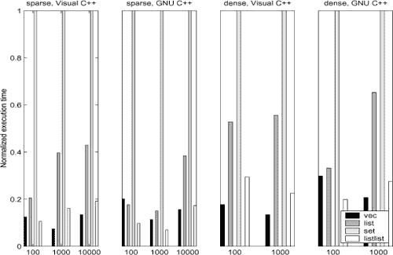

### 顶点集遍历

此实验遍历图中的所有顶点，从每个顶点读取一个内部属性值。结果如图图 11.6 所示。在头三种图类型中这里没有明显的获胜者。由于这些图类具有相同的`VertexList=vecS`，因此顶点遍历速度非常快。对于大图，`listlist`的顶点遍历速度较慢，因为它使用了`VertexList=listS`。

**图 11.6. 遍历顶点集的实验计时结果。**

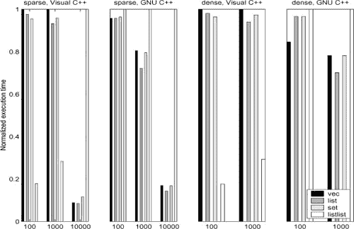

### 边集遍历

此实验遍历图中所有的边，从每条边读取一个内部属性值。结果如图图 11.7 所示。这里的明显获胜者是带有`EdgeList=vecS`的`adjacency_list`。

**图 11.7. 遍历边集的实验计时结果。**

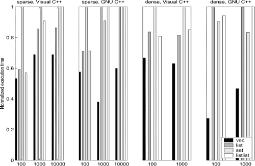

### 出边遍历

此实验遍历图中每个顶点的出边，从每个顶点和每条出边读取内部属性。结果如图图 11.8 所示。这里的明显获胜者是带有`EdgeList=vecS`的`adjacency_list`。

**图 11.8. 遍历出边的实验计时结果。**

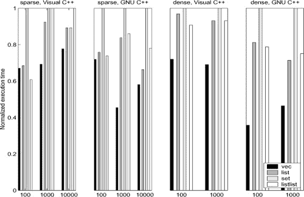

## 11.2 结论

不同的组合在遍历速度和插入/删除速度之间有不同的权衡。以下总结了我们的实验结果。

- 为`EdgeList`使用`vecS`通常可以提供高效的出边遍历。
- 为`VertexList`使用`vecS`通常可以提供高效的顶点集遍历。
- `EdgeList`使用`setS`支持高效的边删除。特别是对于出边序列应使用`std::set`。
- 为了高效添加边，`EdgeList`应使用`vecS`或`listS`。
- 如果移除顶点是常见操作，则应为`VertexList`使用`listS`，因为使用`std::list`作为骨干可以实现常时间内移除顶点。
- 对于清除顶点，`VertexList`使用`vecS`是一个很好的选择（可以使用`clear_vertex()`函数移除所有关联边）。

# 第二部分：参考手册

## 第 12 章：BGL 概念

本章描述了 BGL 中图的底层接口（基本概念）。这些概念分为三类：提供图遍历机制的机制、提供图修改机制的机制，以及访问附加在顶点和边上的属性的访问者（visitors）。

### 所有图概念需求中所使用的记法在此处汇总。

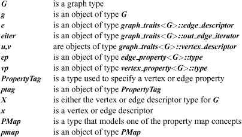

## 12.1 图遍历概念

Boost 图库（BGL）的核心是接口（以概念的形式表示），这些接口定义了如何以数据结构中立的方式检查和操作图。事实上，如第 9 章所示，BGL 图接口甚至不需要使用显式数据结构来实现。对于某些问题，基于某些函数隐式地定义图会更自然或更高效。

BGL 图接口并不是以单一概念的形式出现。相反，它被分解为更小的、不同的部分。概念的目的是封装算法的接口需求。为了最大化算法的可重用性，重要的是不要在接口中包含实际上对于算法正确运行所必需的操作。通过将图接口分解为更小且不同的概念，我们为图算法编写者提供了良好的选择，让他们从中选出提供算法所需功能的最小概念。

图 12.1 显示了图遍历概念之间的细化化关系。表 12.1 给出了图遍历概念的有效表达式和相关类型的总结。

**图 12.1. 图概念及细化关系。**

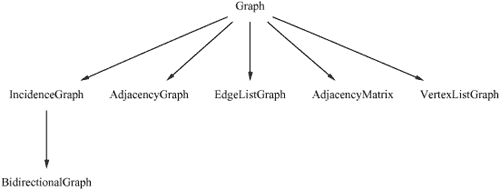

**表 12.1. 图遍历概念总结。**

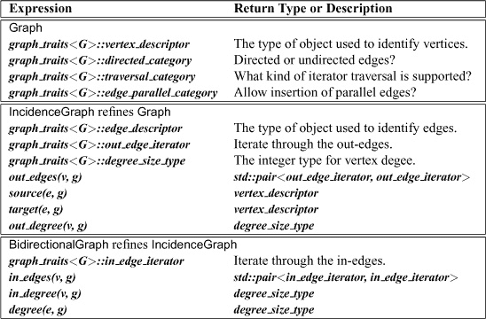

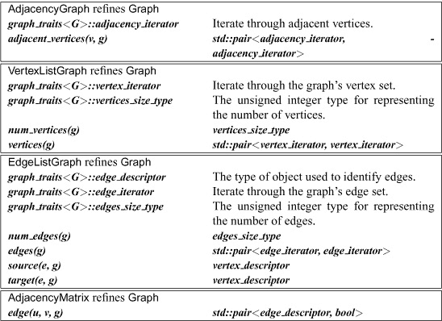

### 12.1.1 无向图

BGL 为访问和操作无向图提供的接口与有向图的接口相同。接口相同是因为无向图和有向图之间存在等效性。也就是说，任何无向图都可以表示为有向图，其中每个无向边（u, v）被替换为两条有向边：（u, v）和（v, u）。这种有向图被称为无向图的`有向版本`。图 12.2 展示了一个无向图及其有向版本。注意，对于无向图中的每条边，有向图都有两条边。因此，BGL 使用`out_edges()`函数（或`in_edges()`）来访问无向图中的关联边。同样，BGL 使用`source()`和`target()`来访问顶点。起初看起来可能违背直觉。然而，通过识别无向图和有向图之间的等效性，BGL 允许许多算法应用于有向图和无向图。

**图 12.2. 一个无向图及其等效向图。**

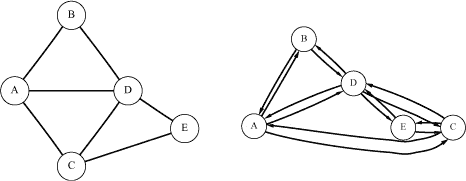

下面的示例演示了如何在无向图在使用`out_edges()`、`source()`和`target()`。虽然边的方向对于无向图并不重要，但当对顶点 u 应用`out_edges()`函数时，边描述符的源顶点始终是 u，而目标顶点是 u 的相邻顶点。`in_edges()`函数的情况亦然。

```cpp
template <typename UndirectedGraph> void undirected_graph_demo1() {
  const int V = 3;
  UndirectedGraph undigraph(V);
  typename graph_traits<UndirectedGraph>::vertex_descriptor zero, one, two;
  typename graph_traits<UndirectedGraph>::out_edge_iterator out, out_end;
  typename graph_traits<UndirectedGraph>::in_edge_iterator in, in_end;
  zero = vertex(0, undigraph);
  one = vertex(1, undigraph);
  two = vertex(2, undigraph);
  add_edge(zero, one, undigraph);
  add_edge(zero, two, undigraph);
  add_edge(one, two, undigraph);
  std::cout << "out_edges(0): ";
  for (tie(out, out_end) = out_edges(zero, undigraph); out != out_end; ++out)
    std::cout << *out;
  std::cout << std::endl << "in_edges(0): ";
  for (tie(in, in_end) = in_edges(zero, undigraph); in != in_end; ++in)
    std::cout << *in;
  std::cout << std::endl;
}
```

输出结果为：

```text
out_edges(0): (0,1) (0,2)

in_edges(0): (1,0) (2,0)
```

尽管无向图的接口是相同的，但由于边的等价性定义不同，它们存在一些行为差异。在有向图中，边`(u, v)`永远不等于边`(v, u)`，但在无向图中它们可能是相等的。在不允许平行边的无向图（即非多图）中，`(u, v)`与`(v, u)`是同一条边。然而，在多图中，这两个边可能是不同的（因为两条边`(u, v)`也可能是不同的）。

在以下示例中，对于`(u, v) = (v, u)`的边等价性测试在有向图中返回`false`，而在无向图中返回`true`。这种差异也影响了`add_edge()`的含义。在有向图示例中，边`(u, v)`和`(v, u)`都被添加了，而在无向图示例中只添加了一条条边`(u, v)`。如果在无向图中也添加了`(v, u)`，我们将在`u`和`v`之间添加一条平行边（前提是图类型允许平行边）。边等价性的差异还影响附加的边属性。在有向图中，边`(u, v)`和`(v, u)`可以具有不同的权重，而在无向图中，`(u, v)`的权重与`(v, u)`的权重相同，因为它们是同一条边。

首先是有向图的示例代码：


```cpp
template <typename DirectedGraph>void directed_graph_demo() {

  const int V = 2;
  DirectedGraph digraph(V);
  typename graph_traits<DirectedGraph>::vertex_descriptor u, v;
  typedef typename DirectedGraph::edge_property_type Weight;
  typename property_map<DirectedGraph, edge_weight_t>::type
      weight = get(edge_weight, digraph);
  typename graph_traits<DirectedGraph>::edge_descriptor e1, e2;
  bool found;

  u = vertex(0, digraph);
  v = vertex(1, digraph);
  add_edge(u, v, Weight(1.2), digraph);
  add_edge(v, u, Weight(2.4), digraph);
  tie(e1, found) = edge(u, v, digraph);
  tie(e2, found) = edge(v, u, digraph);
  std::cout << "in a directed graph is ";
  std::cout << "(u,v) == (v,u) ? "
              << std::boolalpha << (e1 == e2) << std::endl;
  std::cout << "weight[(u,v)] = " << get(weight, e1) << std::endl;
  std::cout << "weight[(v,u)] = " << get(weight, e2) << std::endl;
}
```

输出结果：

```text
in a directed graph is (u,v) == (v,u) ? false
weight[(u,v)] = 1.2
weight[(v,u)] = 2.4
```

接下来是无向图的示例代码：

```cpp
template <typename UndirectedGraph> void undirected_graph_demo2()
{

  const int V = 2;
  UndirectedGraph undigraph(V);
  typename graph_traits<UndirectedGraph>::vertex_descriptor u, v;
  typedef typename UndirectedGraph::edge_property_type Weight;
  typename property_map<UndirectedGraph, edge_weight_t>::type
      weight = get(edge_weight, undigraph);
  typename graph_traits<UndirectedGraph>::edge_descriptor e1, e2;
  bool found;

  u = vertex(0, undigraph);
  v = vertex(1, undigraph);
  add_edge(u, v, Weight(3.1), undigraph);
  tie(e1, found) = edge(u, v, undigraph);
  tie(e2, found) = edge(v, u, undigraph);
  std::cout << "in an undirected graph is ";
  std::cout << "(u,v) == (v,u) ? "
              << std::boolalpha << (e1 == e2) << std::endl;
  std::cout << "weight[(u,v)] = " << get(weight, e1) << std::endl;
  std::cout << "weight[(v,u)] = "   << get(weight, e2) << std::endl;
}
```

输出结果：

```text
in an undirected graph is (u,v) == (v,u) ? true
weight[(u,v)] = 3.1
weight[(v,u)] = 3.1
```

### 12.1.2 图

`Graph` 概念定义了所有图概念通用的关联类型。这些关联类型是在许多图操作中起辅助作用的辅助类型。与 STL 的迭代器类似，关联类型通过特性的类（traits class）来访问——在这种情况下，是 `graph_traits` 类。使用特性的类机制是 BGL 算法如此灵活的原因之一。例如，图数据结构识别顶点的方式非常多样。邻接列表风格的实现可能使用整数来表示顶点，使用该整数偏移到相应的出边列表。面向对象的图实现可能使用指向堆分配的顶点对象的指针。通过 `graph_traits` 类，这些差异被 `vertex_descriptor` 关联类型隐藏了。

在接下来的示例中，`(u, v) = (v, u)` 的边等价性测试在有向图中返回 `false`，在无向图中返回 `true`。这种差异也影响了 `add_edge()` 的含义。在有向图示例中，边 `(u, v)` 和 `(v, u)` 都被添加了，而在无向图示例中只添加了一条边 `(u, v)`。如果在无向图中也添加了 `(v, u)`，我们将在 `u` 和 `v` 之间添加一条平行边（前提是图类型允许平行边）。边等价性的差异还影响了附加的边属性。在有向图中，边 `(u, v)` 和 `(v, u)` 可以具有不同的权重值，而在无向图中，`(u, v)` 的权重与 `(v, u)` 的权重相同，因为它们是同一条边。

首先是有向图的示例代码：

```cpp
template <typename DirectedGraph>void directed_graph_demo() {

  const int V = 2;
  DirectedGraph digraph(V);
  typename graph_traits<DirectedGraph>::vertex_descriptor u, v;
  typedef typename DirectedGraph::edge_property_type Weight;
  typename property_map<DirectedGraph, edge_weight_t>::type
      weight = get(edge_weight, digraph);
  typename graph_traits<DirectedGraph>::edge_descriptor e1, e2;
  bool found;

  u = vertex(0, digraph);
  v = vertex(1, digraph);
  add_edge(u, v, Weight(1.2), digraph);
  add_edge(v, u, Weight(2.4), digraph);
  tie(e1, found) = edge(u, v, digraph);
  tie(e2, found) = edge(v, u, digraph);
  std::cout << "in a directed graph is ";
  std::cout << "(u,v) == (v,u) ? "
              << std::boolalpha << (e1 == e2) << std::endl;
  std::cout << "weight[(u,v)] = " << get(weight, e1) << std::endl;
  std::cout << "weight[(v,u)] = " << get(weight, e2) << std::endl;
}
```

输出结果：

```text
in a directed graph is (u,v) == (v,u) ? false
weight[(u,v)] = 1.2
weight[(v,u)] = 2.4
```

接下来是无向图的示例代码：

```cpp
template <typename UndirectedGraph> void undirected_graph_demo2()
{

  const int V = 2;
  UndirectedGraph undigraph(V);
  typename graph_traits<UndirectedGraph>::vertex_descriptor u, v;
  typedef typename UndirectedGraph::edge_property_type Weight;
  typename property_map<UndirectedGraph, edge_weight_t>::type
      weight = get(edge_weight, undigraph);
  typename graph_traits<UndirectedGraph>::edge_descriptor e1, e2;
  bool found;

  u = vertex(0, undigraph);
  v = vertex(1, undigraph);
  add_edge(u, v, Weight(3.1), undigraph);
  tie(e1, found) = edge(u, v, undigraph);
  tie(e2, found) = edge(v, u, undigraph);
  std::cout << "in an undirected graph is ";
  std::cout << "(u,v) == (v,u) ? "
              << std::boolalpha << (e1 == e2) << std::endl;
  std::cout << "weight[(u,v)] = " << get(weight, e1) << std::endl;
  std::cout << "weight[(v,u)] = " << get(weight, e2) << std::endl;
}
```

输出结果：

```text
in an undirected graph is (u,v) == (v,u) ? true
weight[(u,v)] = 3.1
weight[(v,u)] = 3.1
```

### 12.1.2 图

`Graph` 概念定义了所有图概念通用的关联类型。这些关联类型是在许多图操作中起辅助作用的辅助类型。与 STL 的迭代器类似，关联类型通过特性的类（traits class）来访问——在这种情况下，是 `graph_traits` 类。使用特性的类机制是 BGL 算法如此灵活的原因之一。例如，图数据结构识别顶点的方式非常多样。邻接列表风格的实现可能使用整数来表示顶点，使用该整数偏移到相应的出边列表。面向对象的图实现可能使用指向堆分配的顶点对象的指针。通过 `graph_traits` 类，这些差异被 `vertex_descriptor` 关联类型隐藏了。

在接下来的示例中，`(u, v) = (v, u)` 的边等价性测试在有向图中返回 `false`，而在无向图中返回 `true`。这种差异也影响了 `add_edge()` 的含义。在有向图示例中，边 `(u, v)` 和 `(v, u)` 都被添加了，而在无向图示例中只添加了一条边 `(u, v)`。如果在无向图中也添加了 `(v, u)`，我们将在 `u` 和 `v` 之间添加一条平行边（前提是图类型允许平行边）。边等价性的差异还影响了附加的边属性。在有向图中，边 `(u, v)` 和 `(v, u)` 可以具有不同的权重值，而在无向图中，`(u, v)` 的权重与 `(v, u)` 的权重相同，因为它们是同一条边。


首先是有向图的示例代码：

```cpp
template <typename DirectedGraph>void directed_graph_demo() {

  const int V = 2;
  DirectedGraph digraph(V);
  typename graph_traits<DirectedGraph>::vertex_descriptor u, v;
  typedef typename DirectedGraph::edge_property_type Weight;
  typename property_map<DirectedGraph, edge_weight_t>::type
      weight = get(edge_weight, digraph);
  typename graph_traits<DirectedGraph>::edge_descriptor e1, e2;
  bool found;

  u = vertex(0, digraph);
  v = vertex(1, digraph);
  add_edge(u, v, Weight(1.2), digraph);
  add_edge(v, u, Weight(2.4), digraph);
  tie(e1, found) = edge(u, v, digraph);
  tie(e2, found) = edge(v, u, digraph);
  std::cout << "in a directed graph is ";
  std::cout << "(u,v) == (v,u) ? "
              << std::boolalpha << (e1 == e2) << std::endl;
  std::cout << "weight[(u,v)] = " << get(weight, e1) << std::endl;
  std::cout << "weight[(v,u)] = " << get(weight, e2) << std::endl;
}
```

输出结果：

```text
in a directed graph is (u,v) == (v,u) ? false
weight[(u,v)] = 1.2
weight[(v,u)] = 2.4
```

接下来是无向图的示例代码：

```cpp
template <typename UndirectedGraph> void undirected_graph_demo2()
{

  const int V = 2;
  UndirectedGraph undigraph(V);
  typename graph_traits<UndirectedGraph>::vertex_descriptor u, v;
  typedef typename UndirectedGraph::edge_property_type Weight;
  typename property_map<UndirectedGraph, edge_weight_t>::type
      weight = get(edge_weight, undigraph);
  typename graph_traits<UndirectedGraph>::edge_descriptor e1, e2;
  bool found;

  u = vertex(0, undigraph);
  v = vertex(1, undigraph);
  add_edge(u, v, Weight(3.1), undigraph);
  tie(e1, found) = edge(u, v, undigraph);
  tie(e2, found) = edge(v, u, undigraph);
  std::cout << "in an undirected graph is ";
  std::cout << "(u,v) == (v,u) ? "
              << std::boolalpha << (e1 == e2) << std::endl;
  std::cout << "weight[(u,v)] = " << get(weight, e1) << std::endl;
  std::cout << "weight[(v,u)] = "   << get(weight, e2) << std::endl;
}
```

输出结果：

```text
in an undirected graph is (u,v) == (v,u) ? true
weight[(u,v)] = 3.1
weight[(v,u)] = 3.1
```

### 12.1.2 图

`Graph` 概念定义了所有图概念通用的关联类型。这些关联类型是在许多图操作中起辅助作用的辅助类型。与 STL 的迭代器类似，关联类型通过特性的类（traits class）来访问——在这种情况下，是 `graph_traits` 类。使用特性的类机制是 BGL 算法如此灵活的原因之一。

例如，图数据结构识别顶点的方式非常多样。邻接列表风格的实现可能使用整数来表示顶点，使用该整数偏移到相应的出边列表。面向对象的图实现可能使用指向堆分配的顶点对象的指针。通过 `graph_traits` 类，这些差异被 `vertex_descriptor` 关联类型隐藏了。

在接下来的示例中，`(u, v) = (v, u)` 的边等价性测试在有向图中返回 `false`，而在无向图中返回 `true`。这种差异也影响了 `add_edge()` 的含义。

在有向图示例中，边 `(u, v)` 和 `(v, u)` 都被添加了，而在无向图示例中只添加了一条边 `(u, v)`。如果在无向图中也添加了 `(v, u)`，我们将在 `u` 和 `v` 之间添加一条平行边（前提是图类型允许平行边）。

边等价性的差异还影响了附加的边属性。在有向图中，边 `(u, v)` 和 `(v, u)` 可以具有不同的权重值，而在无向图中，`(u, v)` 的权重与 `(v, u)` 的权重相同，因为它们是同一条边。


在接下来的示例中，`(u, v) = (v, u)` 的边等价性测试在有向图中返回 `false`，而在无向图中返回 `true`。这种差异也影响了 `add_edge()` 的含义。在有向图示例中，边 `(u, v)` 和 `(v, u)` 都被添加了，而在无向图示例中只添加了一条边 `(u, v)`。如果在无向图中也添加了 `(v, u)`，我们将在 `u` 和 `v` 之间添加一条平行边（前提是图类型允许平行边）。边等价性的差异还影响了附加的边属性。在有向图中，边 `(u, v)` 和 `(v, u)` 可以具有不同的权重值，而在无向图中，`(u, v)` 的权重与 `(v, u)` 的权重相同，因为它们是同一条边。

首先是有向图的示例代码：

```cpp
template <typename DirectedGraph>void directed_graph_demo() {

  const int V = 2;
  DirectedGraph digraph(V);
  typename graph_traits<DirectedGraph>::vertex_descriptor u, v;
  typedef typename DirectedGraph::edge_property_type Weight;
  typename property_map<DirectedGraph, edge_weight_t>::type
      weight = get(edge_weight, digraph);
  typename graph_traits<DirectedGraph>::edge_descriptor e1, e2;
  bool found;

  u = vertex(0, digraph);
  v = vertex(1, digraph);
  add_edge(u, v, Weight(1.2), digraph);
  add_edge(v, u, Weight(2.4), digraph);
  tie(e1, found) = edge(u, v, digraph);
  tie(e2, found) = edge(v, u, digraph);
  std::cout << "in a directed graph is ";
  std::cout << "(u,v) == (v,u) ? "
              << std::boolalpha << (e1 == e2) << std::endl;
  std::cout << "weight[(u,v)] = " << get(weight, e1) << std::endl;
  std::cout << "weight[(v,u)] = " << get(weight, e2) << std::endl;
}
```

输出结果：

```text
in a directed graph is (u,v) == (v,u) ? false
weight[(u,v)] = 1.2
weight[(v,u)] = 2.4
```

接下来是无向图的示例代码：

```cpp
template <typename UndirectedGraph> void undirected_graph_demo2()
{

  const int V = 2;
  UndirectedGraph undigraph(V);
  typename graph_traits<UndirectedGraph>::vertex_descriptor u, v;
  typedef typename UndirectedGraph::edge_property_type Weight;
  typename property_map<UndirectedGraph, edge_weight_t>::type
      weight = get(edge_weight, undigraph);
  typename graph_traits<UndirectedGraph>::edge_descriptor e1, e2;
  bool found;

  u = vertex(0, undigraph);
  v = vertex(1, undigraph);
  add_edge(u, v, Weight(3.1), undigraph);
  tie(e1, found) = edge(u, v, undigraph);
  tie(e2, found) = edge(v, u, undigraph);
  std::cout << "in an undirected graph is ";
  std::cout << "(u,v) == (v,u) ? "
              << std::boolalpha << (e1 == e2) << std::endl;
  std::cout << "weight[(u,v)] = " << get(weight, e1) << std::endl;
  std::cout << "weight[(v,u)] = "   << get(weight, e2) << std::endl;
}
```

输出结果：

```text
in an undirected graph is (u,v) == (v,u) ? true
weight[(u,v)] = 3.1
weight[(v,u)] = 3.1
```

### 12.1.2 图

`Graph` 概念定义了所有图概念通用的关联类型。这些关联类型是在许多图操作中起辅助作用的辅助类型。与 STL 的迭代器类似，关联类型通过特性的类（traits class）来访问——在这种情况下，是 `graph_traits` 类。使用特性的类机制是 BGL 算法如此灵活的原因之一。例如，图数据结构识别顶点的方式非常多样。邻接列表风格的实现可能使用整数来表示顶点，使用该整数偏移到相应的出边列表。面向对象的图实现可能使用指向堆分配的顶点对象的指针。通过 `graph_traits` 类，这些差异被 `vertex_descriptor` 关联类型隐藏了。

在接下来的示例中，`(u, v) = (v, u)` 的边等价性测试在有向图中返回 `false`，而在无向图中返回 `true`。这种差异也影响了 `add_edge()` 的含义。在有向图示例中，边 `(u, v)` 和 `(v, u)` 都被添加了，而在无向图示例中只添加了一条边 `(u, v)`。如果在无向图中也添加了 `(v, u)`，我们将在 `u` 和 `v` 之间添加一条平行边（前提是图类型允许平行边）。边等价性的差异还影响了附加的边属性。在有向图中，边 `(u, v)` 和 `(v, u)` 可以具有不同的权重值，而在无向图中，`(u, v)` 的权重与 `(v, u)` 的权重相同，因为它们是同一条边。

首先是有向图的示例代码：

```cpp
template <typename DirectedGraph>void directed_graph_demo() {

  const int V = 2;
  DirectedGraph digraph(V);
  typename graph_traits<DirectedGraph>::vertex_descriptor u, v;
  typedef typename DirectedGraph::edge_property_type Weight;
  typename property_map<DirectedGraph, edge_weight_t>::type
      weight = get(edge_weight, digraph);
  typename graph_traits<DirectedGraph>::edge_descriptor e1, e2;
  bool found;

  u = vertex(0, digraph);
  v = vertex(1, digraph);
  add_edge(u, v, Weight(1.2), digraph);
  add_edge(v, u, Weight(2.4), digraph);
  tie(e1, found) = edge(u, v, digraph);
  tie(e2, found) = edge(v, u, digraph);
  std::cout << "in a directed graph is ";
  std::cout << "(u,v) == (v,u) ? "
              << std::boolalpha << (e1 == e2) << std::endl;
  std::cout << "weight[(u,v)] = " << get(weight, e1) << std::endl;
  std::cout << "weight[(v,u)] = " << get(weight, e2) << std::endl;
}
```

输出结果：

```text
in a directed graph is (u,v) == (v,u) ? false
weight[(u,v)] = 1.2
weight[(v,u)] = 2.4
```

接下来是无向图的示例代码：

```cpp
template <typename UndirectedGraph> void undirected_graph_demo2()
{

  const int V = 2;
  UndirectedGraph undigraph(V);
  typename graph_traits<UndirectedGraph>::vertex_descriptor u, v;
  typedef typename UndirectedGraph::edge_property_type Weight;
  typename property_map<UndirectedGraph, edge_weight_t>::type
      weight = get(edge_weight, undigraph);
  typename graph_traits<UndirectedGraph>::edge_descriptor e1, e2;
  bool found;

  u = vertex(0, undigraph);
  v = vertex(1, undigraph);
  add_edge(u, v, Weight(3.1), undigraph);
  tie(e1, found) = edge(u, v, undigraph);
  tie(e2, found) = edge(v, u, undigraph);
  std::cout << "in an undirected graph is ";
  std::cout << "(u,v) == (v,u) ? "
              << std::boolalpha << (e1 == e2) << std::endl;
  std::cout << "weight[(u,v)] = " << get(weight, e1) << std::endl;
  std::cout << "weight[(v,u)] = "   << get(weight, e2) << std::endl;
}
```

输出结果：

```text
in an undirected graph is (u,v) == (v,u) ? true
weight[(u,v)] = 3.1
weight[(v,u)] = 3.1
```

### 12.1.2 图


`Graph` 概念定义了所有图概念通用的关联类型。这些关联类型是在许多图操作中起辅助作用的辅助类型。与 STL 的迭代器类似，关联类型通过特性的类（traits class）来访问——在这种情况下，是 `graph_traits` 类。使用特性的类机制是 BGL 算法如此灵活的原因之一。例如，图数据结构识别顶点的方式非常多样。邻接列表风格的实现可能使用整数来表示顶点，使用该整数偏移到相应的出边列表。面向对象的图实现可能使用指向堆分配的顶点对象的指针。通过 `graph_traits` 类，这些差异被 `vertex_descriptor` 关联类型隐藏了。

在接下来的示例中，`(u, v) = (v, u)` 的边等价性测试在有向图中返回 `false`，而在无向图中返回 `true`。这种差异也影响了 `add_edge()` 的含义。在有向图示例中，边 `(u, v)` 和 `(v, u)` 都被添加了，而在无向图示例中只添加了一条边 `(u, v)`。如果在无向图中也添加了 `(v, u)`，我们将在 `u` 和 `v` 之间添加一条平行边（前提是图类型允许平行边）。边等价性的差异还影响了附加的边属性。在有向图中，边 `(u, v)` 和 `(v, u)` 可以具有不同的权重值，而在无向图中，`(u, v)` 的权重与 `(v, u)` 的权重相同，因为它们是同一条边。

首先是有向图的示例代码：

```cpp
template <typename DirectedGraph>void directed_graph_demo() {

  const int V = 2;
  DirectedGraph digraph(V);
  typename graph_traits<DirectedGraph>::vertex_descriptor u, v;
  typedef typename DirectedGraph::edge_property_type Weight;
  typename property_map<DirectedGraph, edge_weight_t>::type
      weight = get(edge_weight, digraph);
  typename graph_traits<DirectedGraph>::edge_descriptor e1, e2;
  bool found;

  u = vertex(0, digraph);
  v = vertex(1, digraph);
  add_edge(u, v, Weight(1.2), digraph);
  add_edge(v, u, Weight(2.4), digraph);
  tie(e1, found) = edge(u, v, digraph);
  tie(e2, found) = edge(v, u, digraph);
  std::cout << "in a directed graph is ";
  std::cout << "(u,v) == (v,u) ? "
              << std::boolalpha << (e1 == e2) << std::endl;
  std::cout << "weight[(u,v)] = " << get(weight, e1) << std::endl;
  std::cout << "weight[(v,u)] = " << get(weight, e2) << std::endl;
}
```

输出结果：

```text
in a directed graph is (u,v) == (v,u) ? false
weight[(u,v)] = 1.2
weight[(v,u)] = 2.4
```

接下来是无向图的示例代码：

```cpp
template <typename UndirectedGraph> void undirected_graph_demo2()
{

  const int V = 2;
  UndirectedGraph undigraph(V);
  typename graph_traits<UndirectedGraph>::vertex_descriptor u, v;
  typedef typename UndirectedGraph::edge_property_type Weight;
  typename property_map<UndirectedGraph, edge_weight_t>::type
      weight = get(edge_weight, undigraph);
  typename graph_traits<UndirectedGraph>::edge_descriptor e1, e2;
  bool found;

  u = vertex(0, undigraph);
  v = vertex(1, undigraph);
  add_edge(u, v, Weight(3.1), undigraph);
  tie(e1, found) = edge(u, v, undigraph);
  tie(e2, found) = edge(v, u, undigraph);
  std::cout << "in an undirected graph is ";
  std::cout << "(u,v) == (v,u) ? "
              << std::boolalpha << (e1 == e2) << std::endl;
  std::cout << "weight[(u,v)] = " << get(weight, e1) << std::endl;
  std::cout << "weight[(v,u)] = "   << get(weight, e2) << std::endl;
}
```

输出结果：

```text
in an undirected graph is (u,v) == (v,u) ? true
weight[(u,v)] = 3.1
weight[(v,u)] = 3.1
```

### 12.1.2 图

`Graph` 概念定义了所有图概念通用的关联类型。这些关联类型是在许多图操作中起辅助作用的辅助类型。与 STL 的迭代器类似，关联类型通过特性的类（traits class）来访问——在这种情况下，是 `graph_traits` 类。使用特性的类机制是 BGL 算法如此灵活的原因之一。例如，图数据结构识别顶点的方式非常多样。邻接列表风格的实现可能使用整数来表示顶点，使用该整数偏移到相应的出边列表。面向对象的图实现可能使用指向堆分配的顶点对象的指针。通过 `graph_traits` 类，这些差异被 `vertex_descriptor` 关联类型隐藏了。


在有向图中，`(u, v)` 不等于 `(v, u)`：

```text
in a directed graph is (u,v) == (v,u) ? false
weight[(u,v)] = 1.2
weight[(v,u)] = 2.4
```

接下来是无向图的示例代码：

```cpp
template <typename UndirectedGraph> void undirected_graph_demo2()
{

  const int V = 2;
  UndirectedGraph undigraph(V);
  typename graph_traits<UndirectedGraph>::vertex_descriptor u, v;
  typedef typename UndirectedGraph::edge_property_type Weight;
  typename property_map<UndirectedGraph, edge_weight_t>::type
      weight = get(edge_weight, undigraph);
  typename graph_traits<UndirectedGraph>::edge_descriptor e1, e2;
  bool found;

  u = vertex(0, undigraph);
  v = vertex(1, undigraph);
  add_edge(u, v, Weight(3.1), undigraph);
  tie(e1, found) = edge(u, v, undigraph);
  tie(e2, found) = edge(v, u, undigraph);
  std::cout << "in an undirected graph is ";
  std::cout << "(u,v) == (v,u) ? "
              << std::boolalpha << (e1 == e2) << std::endl;
  std::cout << "weight[(u,v)] = " << get(weight, e1) << std::endl;
  std::cout << "weight[(v,u)] = "   << get(weight, e2) << std::endl;
}
```

输出结果：

```text
in an undirected graph is (u,v) == (v,u) ? true
weight[(u,v)] = 3.1
weight[(v,u)] = 3.1
```

### 12.1.2 图

`Graph` 概念定义了所有图概念通用的关联类型。这些关联类型是在许多图操作中起辅助作用的辅助类型。与 STL 的迭代器类似，关联类型通过特性的类（traits class）来访问——在这种情况下，是 `graph_traits` 类。

使用特性的类机制是 BGL 算法如此灵活的原因之一。例如，图数据结构识别顶点的方式非常多样。邻接列表风格的实现可能使用整数来表示顶点，使用该整数偏移到相应的出边列表。面向对象的图实现可能使用指向堆分配的顶点对象的指针。通过 `graph_traits` 类，这些差异被 `vertex_descriptor` 关联类型隐藏了。

尽管无向图的接口是相同的，但由于边的等价性定义不同，存在一些行为差异。在有向图中，边 `(u, v)` 永远不等于边 `(v, u)`，但在无向图中它们可能是相等的。在不允许平行边的无向图（即非多图）中，`(u, v)` 与 `(v, u)` 是同一条边。然而，在多图中，这两个边可能是不同的（因为两条边 `(u, v)` 也可能是不同的）。

在以下示例中，`(u, v) = (v, u)` 的边等价性测试在有向图中返回 `false`，而在无向图中返回 `true`。这种差异也影响了 `add_edge()` 的含义。在有向图示例中，边 `(u, v)` 和 `(v, u)` 都被添加了，而在无向图示例中只添加了一条边 `(u, v)`。

如果在无向图中也添加了 `(v, u)`，我们将在 `u` 和 `v` 之间添加一条平行边（前提是图类型允许平行边）。边等价性的差异还影响了附加的边属性。在有向图中，边 `(u, v)` 和 `(v, u)` 可以具有不同的权重值，而在无向图中，`(u, v)` 的权重与 `(v, u)` 的权重相同，因为它们是同一条边。

首先是有向图的示例代码：

```cpp
template <typename DirectedGraph>void directed_graph_demo() {

  const int V = 2;
  DirectedGraph digraph(V);
  typename graph_traits<DirectedGraph>::vertex_descriptor u, v;
  typedef typename DirectedGraph::edge_property_type Weight;
  typename property_map<DirectedGraph, edge_weight_t>::type
      weight = get(edge_weight, digraph);
  typename graph_traits<DirectedGraph>::edge_descriptor e1, e2;
  bool found;

  u = vertex(0, digraph);
  v = vertex(1, digraph);
  add_edge(u, v, Weight(1.2), digraph);
  add_edge(v, u, Weight(2.4), digraph);
  tie(e1, found) = edge(u, v, digraph);
  tie(e2, found) = edge(v, u, digraph);
  std::cout << "in a directed graph is ";
  std::cout << "(u,v) == (v,u) ? "
              << std::boolalpha << (e1 == e2) << std::endl;
  std::cout << "weight[(u,v)] = " << get(weight, e1) << std::endl;
  std::cout << "weight[(v,u)] = " << get(weight, e2) << std::endl;
}
```

输出结果：

```text
in a directed graph is (u,v) == (v,u) ? false
weight[(u,v)] = 1.2
weight[(v,u)] = 2.4
```


尽管无向图的接口是相同的，但由于边的等价性定义不同，存在一些行为差异。在有向图中，边 `(u, v)` 永远不等于边 `(v, u)`，但在无向图中它们可能是相等的。在不允许平行边的无向图（即非多图）中，`(u, v)` 与 `(v, u)` 是同一条边。然而，在多图中，这两个边可能是不同的（因为两条边 `(u, v)` 也可能是不同的）。

在以下示例中，`(u, v) = (v, u)` 的边等价性测试在有向图中返回 `false`，而在无向图中返回 `true`。这种差异也影响了 `add_edge()` 的含义。在有向图示例中，边 `(u, v)` 和 `(v, u)` 都被添加了，而在无向图示例中只添加了一条边 `(u, v)`。如果在无向图中也添加了 `(v, u)`，我们将在 `u` 和 `v` 之间添加一条平行边（前提是图类型允许平行边）。边等价性的差异还影响了附加的边属性。在有向图中，边 `(u, v)` 和 `(v, u)` 可以具有不同的权重值，而在无向图中，`(u, v)` 的权重与 `(v, u)` 的权重相同，因为它们是同一条边。

首先是有向图的示例代码：

```cpp
template <typename DirectedGraph>
void directed_graph_demo() {
  const int V = 2;
  DirectedGraph digraph(V);
  typename graph_traits<DirectedGraph>::vertex_descriptor u, v;
  typedef typename DirectedGraph::edge_property_type Weight;
  typename property_map<DirectedGraph, edge_weight_t>::type
      weight = get(edge_weight, digraph);
  typename graph_traits<DirectedGraph>::edge_descriptor e1, e2;
  bool found;

  u = vertex(0, digraph);
  v = vertex(1, digraph);
  add_edge(u, v, Weight(1.2), digraph);
  add_edge(v, u, Weight(2.4), digraph);
  tie(e1, found) = edge(u, v, digraph);
  tie(e2, found) = edge(v, u, digraph);

  std::cout << "in a directed graph is ";
  std::cout << "(u,v) == (v,u) ? "
            << std::boolalpha << (e1 == e2) << std::endl;
  std::cout << "weight[(u,v)] = " << get(weight, e1) << std::endl;
  std::cout << "weight[(v,u)] = " << get(weight, e2) << std::endl;
}
```

输出结果：

```text
in a directed graph is (u,v) == (v,u) ? false
weight[(u,v)] = 1.2
weight[(v,u)] = 2.4
```

接下来是无向图的示例代码：

```cpp
template <typename UndirectedGraph>
void undirected_graph_demo2() {
  const int V = 2;
  UndirectedGraph undigraph(V);
  typename graph_traits<UndirectedGraph>::vertex_descriptor u, v;
  typedef typename UndirectedGraph::edge_property_type Weight;
  typename property_map<UndirectedGraph, edge_weight_t>::type
      weight = get(edge_weight, undigraph);
  typename graph_traits<UndirectedGraph>::edge_descriptor e1, e2;
  bool found;

  u = vertex(0, undigraph);
  v = vertex(1, undigraph);
  add_edge(u, v, Weight(3.1), undigraph);
  tie(e1, found) = edge(u, v, undigraph);
  tie(e2, found) = edge(v, u, undigraph);

  std::cout << "in an undirected graph is ";
  std::cout << "(u,v) == (v,u) ? "
            << std::boolalpha << (e1 == e2) << std::endl;
  std::cout << "weight[(u,v)] = " << get(weight, e1) << std::endl;
  std::cout << "weight[(v,u)] = " << get(weight, e2) << std::endl;
}
```

输出结果：

```text
in an undirected graph is (u,v) == (v,u) ? true
weight[(u,v)] = 3.1
weight[(v,u)] = 3.1
```

### 12.1.2 图


尽管无向图的接口是相同的，但由于边的等价性定义不同，存在一些行为差异。在有向图中，边`(u, v)`永远不等于边`(v, u)`，但在无向图中它们可能是相等的。在不允许平行边的无向图（即非多图）中，`(u, v)`与`(v, u)`是同一条边。然而，在多图中，这两条边可能是不同的（因为两条边`(u, v)`也可能是不同的）。

在以下示例中，`(u, v) = (v, u)`的边等价性测试在有向图中返回`false`，而在无向图中返回`true`。这种差异也影响了`add_edge()`的含义。在有向图示例中，边`(u, v)`和`(v, u)`都被添加了，而在无向图示例中只添加了一条边`(u, v)`。如果在无向图中也添加了`(v, u)`，我们将在`u`和`v`之间添加一条平行边（前提是图类型允许平行边）。边等价性的差异还影响了附加的边属性。在有向图中，边`(u, v)`和`(v, u)`可以具有不同的权重值，而在无向图中，`(u, v)`的权重与`(v, u)`的权重相同，因为它们是同一条边。

首先是有向图的示例代码：

```cpp
template <typename DirectedGraph>
void directed_graph_demo() {
  const int V = 2;
  DirectedGraph digraph(V);
  typename graph_traits<DirectedGraph>::vertex_descriptor u, v;
  typedef typename DirectedGraph::edge_property_type Weight;
  typename property_map<DirectedGraph, edge_weight_t>::type
      weight = get(edge_weight, digraph);
  typename graph_traits<DirectedGraph>::edge_descriptor e1, e2;
  bool found;

  u = vertex(0, digraph);
  v = vertex(1, digraph);
  add_edge(u, v, Weight(1.2), digraph);
  add_edge(v, u, Weight(2.4), digraph);
  tie(e1, found) = edge(u, v, digraph);
  tie(e2, found) = edge(v, u, digraph);

  std::cout << "in a directed graph is ";
  std::cout << "(u,v) == (v,u) ? "
            << std::boolalpha << (e1 == e2) << std::endl;
  std::cout << "weight[(u,v)] = " << get(weight, e1) << std::endl;
  std::cout << "weight[(v,u)] = " << get(weight, e2) << std::endl;
}
```

输出结果：

```text
in a directed graph is (u,v) == (v,u) ? false
weight[(u,v)] = 1.2
weight[(v,u)] = 2.4
```

接下来是无向图的示例代码：

```cpp
template <typename UndirectedGraph>
void undirected_graph_demo2() {
  const int V = 2;
  UndirectedGraph undigraph(V);
  typename graph_traits<UndirectedGraph>::vertex_descriptor u, v;
  typedef typename UndirectedGraph::edge_property_type Weight;
  typename property_map<UndirectedGraph, edge_weight_t>::type
      weight = get(edge_weight, undigraph);
  typename graph_traits<UndirectedGraph>::edge_descriptor e1, e2;
  bool found;

  u = vertex(0, undigraph);
  v = vertex(1, undigraph);
  add_edge(u, v, Weight(3.1), undigraph);
  tie(e1, found) = edge(u, v, undigraph);
  tie(e2, found) = edge(v, u, undigraph);

  std::cout << "in an undirected graph is ";
  std::cout << "(u,v) == (v,u) ? "
            << std::boolalpha << (e1 == e2) << std::endl;
  std::cout << "weight[(u,v)] = " << get(weight, e1) << std::endl;
  std::cout << "weight[(v,u)] = " << get(weight, e2) << std::endl;
}
```

输出结果：

```text
in an undirected graph is (u,v) == (v,u) ? true
weight[(u,v)] = 3.1
weight[(v,u)] = 3.1
```


尽管无向图的接口是相同的，但由于边的等价性定义不同，存在一些行为差异。在有向图中，边 `(u, v)` 永远不等于边 `(v, u)`，但在无向图中它们可能是相等的。在不允许平行边的无向图（即非多图）中，`(u, v)` 与 `(v, u)` 是同一条边。然而，在多图中，这两个边可能是不同的（因为两条边 `(u, v)` 也可能是不同的）。

在以下示例中，`(u, v) = (v, u)` 的边等价性测试在有向图中返回 `false`，而在无向图中返回 `true`。这种差异也影响了 `add_edge()` 的含义。在有向图示例中，边 `(u, v)` 和 `(v, u)` 都被添加了，而在无向图示例中只添加了一条边 `(u, v)`。如果在无向图中也添加了 `(v, u)`，我们将在 `u` 和 `v` 之间添加一条平行边（前提是图类型允许平行边）。边等价性的差异还影响了附加的边属性。在有向图中，边 `(u, v)` 和 `(v, u)` 可以具有不同的权重值，而在无向图中，`(u, v)` 的权重与 `(v, u)` 的权重相同，因为它们是同一条边。

首先是有向图的示例代码：

```cpp
template <typename DirectedGraph> void directed_graph_demo() {
  const int V = 2;

  DirectedGraph digraph(V);

  typename graph_traits<DirectedGraph>::vertex_descriptor u, v;

  typedef typename DirectedGraph::edge_property_type Weight;

  typename property_map<DirectedGraph, edge_weight_t>::type
      weight = get(edge_weight, digraph);

  typename graph_traits<DirectedGraph>::edge_descriptor e1, e2;

  bool found;

  u = vertex(0, digraph);
  v = vertex(1, digraph);

  add_edge(u, v, Weight(1.2), digraph);
  add_edge(v, u, Weight(2.4), digraph);

  tie(e1, found) = edge(u, v, digraph);
  tie(e2, found) = edge(v, u, digraph);

  std::cout << "in a directed graph is ";
  std::cout << "(u,v) == (v,u) ? "
            << std::boolalpha << (e1 == e2) << std::endl;

  std::cout << "weight[(u,v)] = " << get(weight, e1) << std::endl;
  std::cout << "weight[(v,u)] = " << get(weight, e2) << std::endl;
}
```

输出结果是：

```text
in a directed graph is (u,v) == (v,u) ? false

weight[(u,v)] = 1.2

weight[(v,u)] = 2.4
```

接下来是无向图的示例代码：

```cpp
template <typename UndirectedGraph> void undirected_graph_demo2() {
  const int V = 2;

  UndirectedGraph undigraph(V);

  typename graph_traits<UndirectedGraph>::vertex_descriptor u, v;

  typedef typename UndirectedGraph::edge_property_type Weight;

  typename property_map<UndirectedGraph, edge_weight_t>::type
      weight = get(edge_weight, undigraph);

  typename graph_traits<UndirectedGraph>::edge_descriptor e1, e2;

  bool found;

  u = vertex(0, undigraph);
  v = vertex(1, undigraph);

  add_edge(u, v, Weight(3.1), undigraph);

  tie(e1, found) = edge(u, v, undigraph);
  tie(e2, found) = edge(v, u, undigraph);

  std::cout << "in an undirected graph is ";
  std::cout << "(u,v) == (v,u) ? "
            << std::boolalpha << (e1 == e2) << std::endl;

  std::cout << "weight[(u,v)] = " << get(weight, e1) << std::endl;
  std::cout << "weight[(v,u)] = " << get(weight, e2) << std::endl;
}
```

输出结果是：

```text
in an undirected graph is (u,v) == (v,u) ? true

weight[(u,v)] = 3.1

weight[(v,u)] = 3.1
```

### 12.1.2 图

`Graph` 概念定义了所有图概念通用的关联类型。这些关联类型是在许多图操作中起辅助作用的辅助类型。与 STL 的迭代器类似，关联类型通过特性的类（traits class）来访问——在这种情况下，是 `graph_traits` 类。

使用特性的类机制是 BGL 算法如此灵活的原因之一。例如，图数据结构识别顶点的方式非常多样。邻接列表风格的实现可能使用整数来表示顶点，使用该整数偏移到相应的出边列表。面向对象的图实现可能使用指向堆分配的顶点对象的指针。通过 `graph_traits` 类，这些差异被 `vertex_descriptor` 关联类型隐藏了。


尽管无向图的接口是相同的，但由于边的等价性定义不同，存在一些行为差异。在有向图中，边`(u, v)`永远不等于边`(v, u)`，但在无向图中它们可能是相等的。在不允许平行边的无向图（即非多图）中，`(u, v)`与`(v, u)`是同一条边。然而，在多图中，这两个边可能是不同的（因为两条边`(u, v)`也可能是不同的）。

在以下示例中，`(u, v) = (v, u)`的边等价性测试在有向图中返回`false`，而在无向图中返回`true`。这种差异也影响了`add_edge()`的含义。在有向图示例中，边`(u, v)`和`(v, u)`都被添加了，而在无向图示例中只添加了一条边`(u, v)`。如果在无向图中也添加了`(v, u)`，我们将在`u`和`v`之间添加一条平行边（前提是图类型允许平行边）。边等价性的差异还影响了附加的边属性。在有向图中，边`(u, v)`和`(v, u)`可以具有不同的权重值，而在无向图中，边`(u, v)`的权重与边`(v, u)`的权重相同，因为它们是同一条边。

首先是有向图的示例代码：

```cpp
template <typename DirectedGraph> void directed_graph_demo() {
  const int V = 2;

  DirectedGraph digraph(V);

  typename graph_traits<DirectedGraph>::vertex_descriptor u, v;

  typedef typename DirectedGraph::edge_property_type Weight;

  typename property_map<DirectedGraph, edge_weight_t>::type
      weight = get(edge_weight, digraph);

  typename graph_traits<DirectedGraph>::edge_descriptor e1, e2;

  bool found;

  u = vertex(0, digraph);
  v = vertex(1, digraph);

  add_edge(u, v, Weight(1.2), digraph);
  add_edge(v, u, Weight(2.4), digraph);

  tie(e1, found) = edge(u, v, digraph);
  tie(e2, found) = edge(v, u, digraph);

  std::cout << "in a directed graph is ";

  std::cout << "(u,v) == (v,u) ? "
            << std::boolalpha << (e1 == e2) << std::endl;

  std::cout << "weight[(u,v)] = " << get(weight, e1) << std::endl;
  std::cout << "weight[(v,u)] = " << get(weight, e2) << std::endl;
}
```

输出结果：

```text
in a directed graph is (u,v) == (v,u) ? false

weight[(u,v)] = 1.2

weight[(v,u)] = 2.4
```

接下来是无向图的示例代码：

```cpp
template <typename UndirectedGraph> void undirected_graph_demo2() {
  const int V = 2;

  UndirectedGraph undigraph(V);

  typename graph_traits<UndirectedGraph>::vertex_descriptor u, v;

  typedef typename UndirectedGraph::edge_property_type Weight;

  typename property_map<UndirectedGraph, edge_weight_t>::type
      weight = get(edge_weight, undigraph);

  typename graph_traits<UndirectedGraph>::edge_descriptor e1, e2;

  bool found;

  [...]

  u = vertex(0, undigraph);
  v = vertex(1, undigraph);

  add_edge(u, v, Weight(3.1), undigraph);

  tie(e1, found) = edge(u, v, undigraph);
  tie(e2, found) = edge(v, u, undigraph);

  std::cout << "in an undirected graph is ";

  std::cout << "(u,v) == (v,u) ? "
            << std::boolalpha << (e1 == e2) << std::endl;

  std::cout << "weight[(u,v)] = " << get(weight, e1) << std::endl;
  std::cout << "weight[(v,u)] = " << get(weight, e2) << std::endl;
}
```

输出结果：

```text
in an undirected graph is (u,v) == (v,u) ? true

weight[(u,v)] = 3.1

weight[(v,u)] = 3.1
```

### 12.1.2 图

`Graph`概念定义了所有图概念通用的关联类型。这些关联类型是在许多图操作中起辅助作用的辅助类型。与 STL 的迭代器类似，关联类型通过特性的类（traits class）来访问——在这种情况下，是`graph_traits`类。

使用特性的类机制是 BGL 算法如此灵活的原因之一。例如，图数据结构识别顶点的方式非常多样。邻接列表风格的实现可能使用整数来表示顶点，使用该整数偏移到相应的出边列表。面向对象的图实现可能使用指向堆分配的顶点对象的指针。通过`graph_traits`类，这些差异被`vertex_descriptor`关联类型隐藏了。


## 12.1.2 Graph

`Graph` 概念定义了所有图概念通用的关联类型。这些关联类型是在许多图操作中起辅助作用的辅助类型。与 STL 的迭代器类似，关联类型通过特性的类（traits class）来访问——在这种情况下，是 `graph_traits` 类。使用特性的类机制是 BGL 算法如此灵活的原因之一。

例如，图数据结构识别顶点的方式非常多样。邻接列表风格的实现可能使用整数来表示顶点，使用该整数偏移到相应的出边列表。面向对象的图实现可能使用指向堆分配的顶点对象的指针。通过 `graph_traits` 类，这些差异被 `vertex_descriptor` 关联类型隐藏了。

`BidirectionalGraph` 概念细化了 `IncidenceGraph` 概念，并增加了对高效访问每个顶点入边（in-edges）的要求。该概念与 `IncidenceGraph` 区别在于，对有向图的入边提供高效访问通常需要更多的存储空间，而且许多算法并不访问入边。对于无向图来说，这不是问题，因为不需要额外的空间即可提供对入边的访问。

### 细化自

`IncidenceGraph`

### 关联类型

#### `graph_traits<G>::in_edge_iterator`

针对顶点 `v` 的入边迭代器提供了对 `v` 的入边的访问。因此，入边迭代器的值类型是该图的描述符类型。入边迭代器必须满足 `MultiPassInputIterator` 的要求。

### 有效表达式

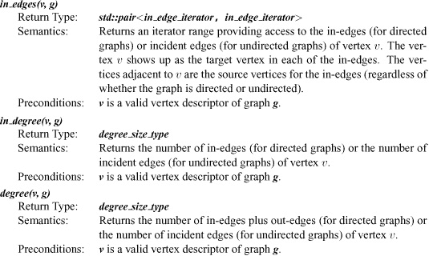

### 复杂度保证

`in_edges()` 函数要求为常数时间。`in_degree()` 函数要求与入边的数量成线性关系。

## 12.1.5 AdjacencyGraph

`AdjacencyGraph` 概念定义了访问邻接顶点的接口。邻接顶点也可以作为出边的目标顶点被访问；然而，对于某些算法，不需要出边，直接访问邻接顶点更为方便。

### 细化自

`Graph`

### 关联类型

#### `graph_traits<G>::adjacency_iterator`

针对顶点 `v` 的邻接迭代器提供了对 `v` 的邻接顶点的访问。因此，邻接迭代器的值类型是该图的顶点描述符类型。邻接迭代器必须满足 `MultiPassInputIterator` 的要求。

### 有效表达式

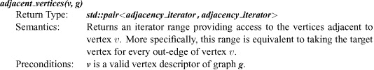

### 复杂度保证

`adjacent_verties()` 函数必须在常数时间内返回。

## 12.1.6 VertexListGraph

`VertexListGraph` 概念定义了高效遍历图中所有顶点的要求。

### 细化自

`Graph`

### 关联类型

#### `graph_traits<G>::vertex_iterator`

顶点迭代器（通过 `vertices(g)` 获取）提供了对图中所有顶点的访问。顶点迭代器类型必须满足 `MultiPassInputIterator` 的要求。顶点迭代器的值类型必须是图的顶点描述符。

#### `graph_traits<G>::vertices_size_type`

用于表示图中顶点数量的无符号整数类型。

### 有效表达式

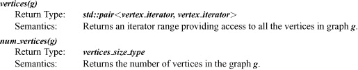

### 复杂度保证

`vertices()` 函数必须在常数时间内返回。`num_vertices()` 函数必须在与顶点数量成比例的时间返回。

## 12.1.7 EdgeListGraph

`EdgeListGraph` 概念细化了 `Graph` 概念，并增加了高效访问图中所有边的要求。

### 细化自

`Graph`

### 关联类型

#### `graph_traits<G>::edge_descriptor`

边描述符对应于图中一条唯一的边。边描述符必须是 `DefaultConstructible`、`Assignable` 且 `EqualityComparable` 的。

#### `graph_traits<G>::edge_iterator`

边迭代器（通过 `edges(g)` 获取）提供了对图中所有边的访问。边迭代器类型必须满足 `InputIterator` 的要求。边迭代器的值类型必须与图的边描述符相同。

#### `graph_traits<G>::edges_size_type`

用于表示图中边数量的无符号整数类型。

### 有效表达式

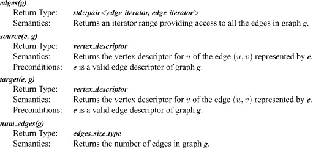

### 复杂度保证

`edges()`、`source()` 和 `target()` 函数必须在常数时间内返回。`num_edges()` 函数必须与图中边的数量成线性时间返回。

## 12.1.8 AdjacencyMatrix

`AdjacencyMatrix` 概念细化了 `Graph` 概念，并增加了在给定源顶点和目标顶点的情况下，高效访问图中任何一条边的要求。

### 细化自

`Graph`

### 有效表达式

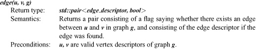

### 复杂度保证

`edge()` 函数必须在常数时间内返回。

## 12.2 图修改概念

本节描述了用于修改图的 BGL 接口——即添加和删除顶点及边，以及更改附加在顶点和边的属性值。与图遍历概念类似，图修改概念被分解为许多较小的概念，以便为算法编写者提供良好的概念选择，用于描述他们的需求。表 12.2 总结了每个概念的有效表达式和关联类型，图 12.3 显示了图修改概念之间的细化关系。图 12.1 中的某些概念在图 12.3 中也发挥了作用，但省略了图 12.1 中的所有细化关系。

表 12.2. 图修改与属性访问总结。

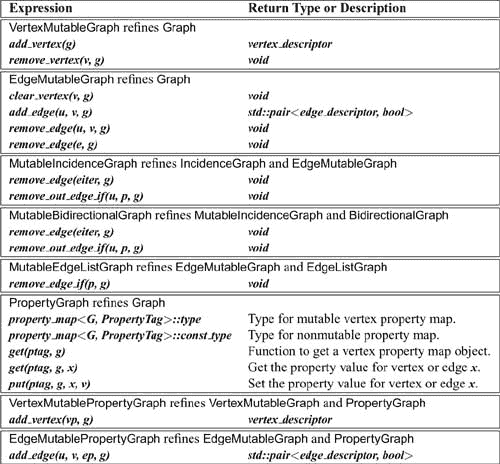

图 12.3. 图变异概念与细化关系。

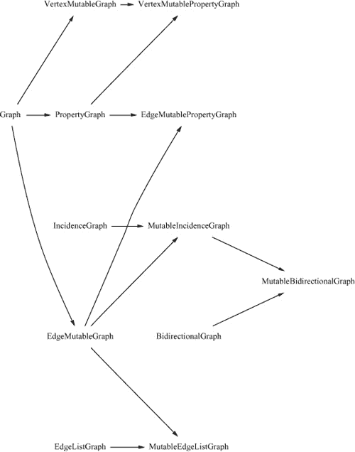

### 12.2.1 VertexGraph

顶点可变图可以通过添加或删除顶点来更改。内存管理由图负责。用户只需调用 `add_vertex()` 和 `remove_vertex()`，剩下的由实现完成。

### 细化自

`Graph`, `DefaultConstructible`

### 有效表达式

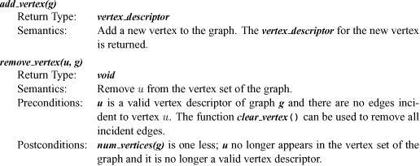

### 复杂度保证

- 顶点插入保证为摊均常数时间。
- 顶点删除最多为 `O(|E| + |V|)`。

### 12.2.2 EdgeGraph

边可变图可以通过添加或删除边来更改。内存管理由图负责。用户只需调用 `add_edge()`、`remove_edge()` 等，剩下的由实现完成。

### 细化自

`Graph`

### 有效表达式

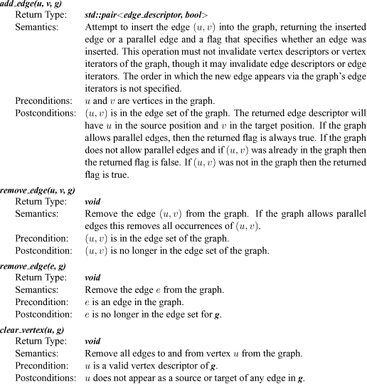

### 复杂度保证

- 边插入必须是摊均常数时间，或者如果在插入时检查防止添加边，则是。
- 边删除保证为 `O(|E|)`。
- 清空顶点最多为 `O(|E| + |V|)`。

### 12.2.3 MutableIncidenceGraph

该概念提供了从顶点出边列表中删除边的能力。

### 细化自

`IncidenceGraph` 和 `EdgeMutableGraph`

### 有效表达式

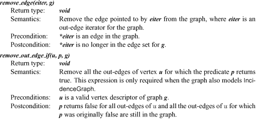

### 复杂度保证

- `remove_edge()` 函数要求在常数时间内返回。
- `remove_out_edge_if()` 要求与顶点出边数量成比例的时间返回。

### 12.2.4 MutableBidirectionalGraph

`MutableBidirectionalGraph` 概念定义了从顶点入边列表中删除边的接口。

### 细化自

`BidirectionalGraph` 和 `MutableIncidenceGraph`

### 有效表达式

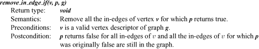

### 复杂度保证

- `remove_in_edge_if()` 函数与顶点入边数量成线性时间。

### 12.2.5 MutableEdgeListGraph

`MutableEdgeListGraph` 概念提供了从图边列表中删除边的能力。

### 细化自

`EdgeMutableGraph`

### 有效表达式

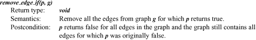

### 复杂度保证

- `remove_edge_if()` 函数要求与图中边的数量成线性时间返回。

### 12.2.6 PropertyGraph

`PropertyGraph` 是一种图，其中图中的每个顶点或边都关联有某些属性。由于给定的图中每个顶点或边可能关联多个属性，因此使用标签（tag）来标识正在访问的是哪个属性。在后续的需求描述中，`PropertyTag` 是标签的类型，而 `tag` 是 `PropertyTag` 类型的对象。该图提供了一个返回属性映射（property map）对象的函数。

### 图的精细化

#### 关联类型

##### `property_map<G, PropertyTag>::type`

由 `PropertyTag` 指定属性的属性映射类型。该类型必须是一个可变的 `LvaluePropertyMap`，其键类型必须与图的顶点或边描述符类型相同。

##### `property_map<G, PropertyTag>::const_type`

由 `PropertyTag` 指定属性的常量属性映射类型。该类型必须是一个不可变的 `LvaluePropertyMap`，其键类型必须与图的顶点或边描述符类型相同。

#### 有效表达式

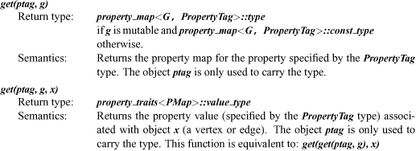

#### 复杂度保证

`get()` 函数要求在常数时间内返回。

### 12.2.7 顶点可属性图

`VertexMutablePropertyGraph` 既是一个 `VertexMutableGraph` 也是一个 `PropertyGraph`，并包含了在向图中添加顶点时指定属性值的函数。

### `VertexMutableGraph` 和 `PropertyGraph` 的精细化

#### 关联类型

##### `vertex_property<G>::type`

附加到每个顶点上的顶点属性对象的类型。

#### 有效表达式

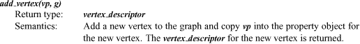

#### 复杂度保证

- `add_vertex()` 保证为分摊常数时间。

### 12.2.8 边可属性图

`EdgeMutablePropertyGraph` 既是一个 `EdgeMutableGraph` 也是一个 `PropertyGraph`，并包含了在向图中添加边时指定属性值的函数。

### `EdgeMutableGraph` 和 `PropertyGraph` 的精细化

#### 关联类型

##### `edge_property<G>::type`

附加到每条边的边属性对象的类型。

#### 有效表达式

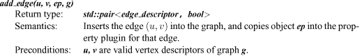

#### 复杂度保证

- 边的插入必须是分摊常数时间，或者如果插入还需要检查以防止添加并行边，则可以是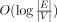。

## 12.3 访问者概念

访问者概念（visitor concepts）在 BGL 中的作用类似于函数对象在 STL 中的作用。函数对象提供了一种扩展算法的机制——用于自定义算法每一步所执行的操作。访问者允许用户在图算法的不同步骤插入自己的操作。与 STL 算法不同，图算法通常有多个事件点，用户可能希望通过函数对象插入回调。因此，访问者没有像函数对象那样单一的 `operator()` 方法，而是有多个对应于事件点的方法。每个算法都有不同的事件点。在本节中，我们为主要的 BGL 算法定义了访问者概念。

与 STL 中的函数对象一样，访问者在 BGL 算法中是通过值传递的。这意味着在访问者对象中存储状态时必须小心。

### 符号

本节使用的符号在此处汇总。

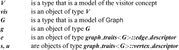

### 12.3.1 BFSVisitor

该概念定义了 `breadth_first_search()` 的访问者接口。用户可以定义带有 `BFSVisitor` 接口的类，并将该类的对象传递给 `breadth_first_search()`，从而增强图搜索期间执行的操作。

### 可拷贝构造的精细化

### 有效表达式

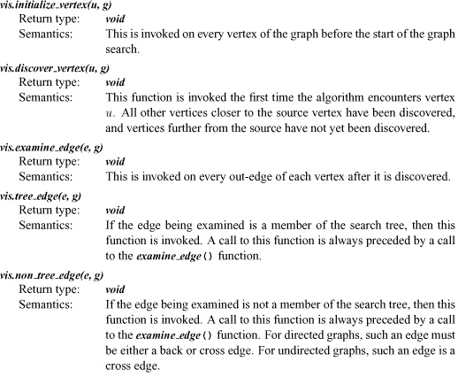

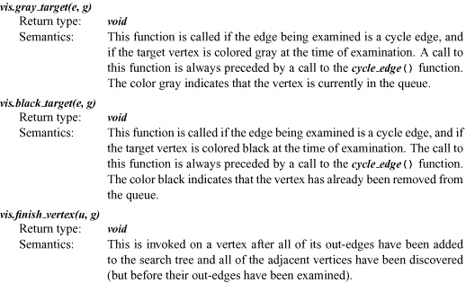

### 12.3.2 DFSVisitor

该概念定义了 `depth_first_search()` 的访问者接口。用户可以定义带有 `DFSVisitor` 接口的类，并将该类的对象传递给 `depth_first_search()`，从而增强图搜索期间执行的操作。

### 可拷贝构造的精细化

### 有效表达式

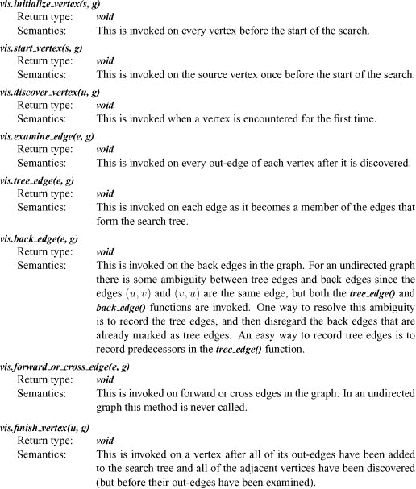

### 12.3.3 DijkstraVisitor

该概念定义了 `dijkstra_shortest_paths()` 及相关算法的访问者接口。用户可以创建一个匹配此接口的类，然后将该类的对象传递给 `dijkstra_shortest_paths()` 以增强搜索期间执行的操作。

### 可拷贝构造的精细化

### 有效表达式

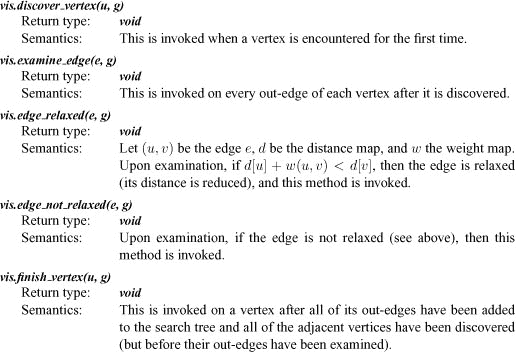

### 12.3.4 BellmanFordVisitor

该概念定义了 `bellman_ford_shortest_paths()` 的访问者接口。用户可以定义带有 `BellmanFordVisitor` 接口的访问者类，并将该访问者类的对象传递给 `bellman_ford_shortest_paths()` 的 `visitor()` 参数，从而增强图搜索期间执行的操作。

### 可拷贝构造的精细化

### 有效表达式

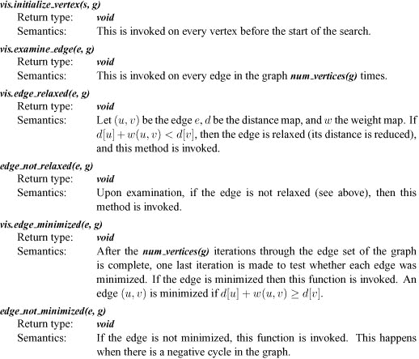

# 第 13 章 BGL 算法

## 13.1 概述

本章提供了关于如何使用 Boost Graph Library 中所有图算法的深度信息。

BGL 泛型算法被分为以下几类：

1. 基础搜索算法
2. 短路路径
3. 最小生成树
4. 连分量
5. 最大流
6. 顶点排序

所有的算法都以函数模板的形式实现，其中图类型是一个模板参数。这使得函数可以使用任何符合所需概念的图类型。算法的文档列出了所需的概念，而每个图类的文档则列出了它实现的概念。通过交叉引用概念可以确定哪些图类型可以使用哪些算法。

此外，算法有时会对属性映射建模，例如最短路径算法的距离映射。参数化的属性映射允许用户控制属性的存储和检索。算法还对访问者类型建模，允许用户指定在特定事件点调用的回调。

### 原型

每个算法的引用部分从函数原型开始。模板参数名称暗示了参数的用途，有时暗示了对参数的概念。然而，每个模板参数的精确要求在参数部分给出。

许多函数的最后一个参数是 `bgl_named_params`。这是为了支持在 §2.7 中讨论的命名参数技术。如果 `params,` 之后出现 `= all defaults`，则所有命名参数都有默认值且可以省略。

### 描述

在函数的描述中，我们定义了函数解决的问题，解释任何必要的图术语或思想。我们根据参数的影响描述函数的语义。

### 定义

在本部分，我们列出了使用该函数必须包含的头文件。

### 参数

在这里我们列出了函数的所有普通参数（命名参数在下一节）。普通参数是*强制的*（即这些参数没有默认值）。

每个参数被归类为一个或多个类别：

**IN** 参数由函数读取；用于获取信息。函数不会以任何方式更改或修改这些参数。

**OUT** 参数由函数写入。函数的结果存储在 OUT 参数中。

`UTIL` 参数是算法完成其任务所必需的，但作为 `UTIL` 参数使用的对象的内容通常对用户并不感兴趣。`UTIL` 参数经常被读取和写入。

### 命名参数

正如 §2.7 中描述，BGL 使用了一种特殊技术，以便更方便地处理具有大量参数且许多参数具有默认值的函数。本节列出了该函数的所有命名参数，并使用了与普通参数相同的分类方法。此外，还为每个命名参数列出了默认值。

### 前置条件

在本节中，我们描述了函数的任何前置条件。这通常包括对属性图（property map）参数状态的要求。

## 复杂度

每个算法的时间复杂度用“大 O”符号给出。除非另有说明，空间复杂度绝不超过 `O(|V|)`。

### 示例

通过展示一个简单的示例来演示如何使用每个算法。

## 13.2 基础算法

### 13.2.1 `breadth_first_search`

```cpp
template <typename Graph, typename P, typename T, typename R>
void breadth_first_search(
    Graph& g,
    typename graph_traits<Graph>::vertex_descriptor s,
    const bgl_named_params<P, T, R>& params
)
```


`breadth_first_search()` 函数执行有向图或无向图的广度优先遍历 [31]。广度优先遍历在访问距离较远的顶点之前先访问距离源较近的顶点。在这里，距离被定义为从源顶点到最短路径的边数。`breadth_first_search()` 函数可以计算从源到所有可达顶点的最短路径以及生成的最短路径距离。有关 BFS 的更多定义和详细示例，请参见 §4.1。

BFS 使用两个数据结构来实现遍历：每个顶点的颜色标记器和一个队列。白色顶点表示未被发现，而灰色顶点表示已发现但邻接白色顶点。黑色顶点表示已发现且仅相邻其他黑色或灰色顶点。算法的执行过程是从队列中移除一个顶点 `u` 并检查每个出边 `(u, v)`。如果相邻顶点 `v` 尚未被发现，则将其涂为灰色并放入队列。在检查完所有出边后，顶点 `u` 被涂为黑色并重复该过程。BFS 算法的伪代码如下。在伪代码中，我们展示了算法计算前驱 `π`、发现时间 `d` 和完成时间 `t`。默认情况下，`breadth_first_search()` 函数不计算这些属性；但是有预定义的访问者（visitors）可以完成这些工作。

```text
BFS(G, s)

  for each vertex u 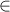 V [G]     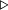 初始化顶点 u

    color[u] ← WHITE

        d[u] ← ∞

        π[u] ← u

    color[s] ← GRAY

    d[s] ← 0

    ENQUEUE(Q, s)               发现顶点 s

    while (Q ≠ 0)

      u ← DEQUEUE(Q)             检查顶点 u

      for each v  Adj[u]      检查边 (u, v)

        if (color[v] = WHITE)       (u, v) 是树边

              color[v] ← GRAY

              d[v] ← d[u] + 1

              π[v] ← u

              ENQUEUE(Q, v)       发现顶点 v

        else                       (u, v) 非树边

          if (color[v] = GRAY)     ...   (u, v) 有目标

          else                    ...   (u, v) 有黑色目标

            color[u] ← BLACK       完成顶点

  return (d, π)
```

`breadth_first_search()` 函数可以通过用户定义的动作进行扩展，这些动作会在事件点处被调用。这些动作必须以访问者的形式提供——即一个类型满足 `BFSVisitor` 的对象。在之前的伪代码中，事件点用三角形标记。默认情况下，`breadth_first_search()` 函数不执行任何动作，即使是距离或前驱。但是，通过定义访问者可以轻松地添加这些功能。

##### 定义位置

`boost/graph/breadth_first_search.hpp`

##### 参数

- IN: `Graph& g`：有向图或无向图。图类型必须是 `VertexList` 和 `IncidenceGraph` 的模型。
- IN: `vertex_descriptor s`：开始搜索的源顶点。

##### 命名参数

- IN: `visitor(BFSVisitor vis)`：在算法内部由 `BFSVisitor` 指定的事件点处调用的访问者对象。默认值：`default_bfs_visitor`。
- UTIL/OUT: `color_map(ColorMap color)`：算法用此跟踪其在图中的遍历进度。

```cpp
int main()
{
  using namespace boost;

  // Select the graph type we wish to use
  typedef adjacency_list<vecS, vecS, undirectedS> graph_t;

  // Set up the vertex IDs and names
  enum { r, s, t, u, v, w, x, y, N};
  const char* name = "rstuvwxy";

  // Specify the edges in the graph
  typedef std::pair<int,int> E;
  E edge_array[ ] = { E(r,s), E(r,v), E(s,w), E(w,r), E(w,t),
      E(w,x), E(x,t), E(t,u), E(x,y), E(u,y) };

  // Create the graph object
  const int n_edges = sizeof (edge_array)/sizeof (E);
  graph_t g(edge_array, edge_array + n_edges, N);

  // Typedefs
  typedef graph_traits<graph_t>::vertex_descriptor Vertex;
  typedef graph_traits<graph_t>::vertices_size_type Size;
  typedef std::vector<Vertex>::iterator Piter;
  typedef std::vector<Size>::iterator Iiter;

  // a vector to hold the discover time property for each vertex
  std::vector<Size > dtime(num_vertices(g));
  Size time = 0;

  bfs_time_visitor<Size*> vis(&dtime[0], time);
  breadth_first_search(g, vertex(s, g), visitor(vis));

  // Use std::sort to order the vertices by their discover time
  std::vector<graph_traits<graph_t>::vertices_size_type> discover_order(N);
  integer_range<int> range(0, N);
  std::copy(range.begin(), range.end(), discover_order.begin());
  std::sort(discover_order.begin(), discover_order.end(),
      indirect_cmp<Iiter, std::less<Size> >(dtime.begin()));

  std::cout << "order of discovery: ";
  for (int i = 0; i < N; ++i)
      std::cout << name [discover_order[i] ] << " ";
  std::cout << std::endl;

  return EXIT_SUCCESS;
}
```

输出结果：

`order of discovery: s r w v t x u y`

### 13.2.2 `breadth_first_visit`

```cpp
template <typename IncidenceGraph, typename P, typename T, typename R>
void breadth_first_visit(IncidenceGraph& g,
      typename graph_traits<IncidenceGraph>::vertex_descriptor s,
      const bgl_named_params<P, T, R>& params);
```

该函数与 `breadth_first_search()` 相同，不同之处在于算法内部不会初始化颜色标记。用户负责在调用算法之前确保每个顶点的颜色都为白色。由于这一差异，图类型只需要是 `IncidenceGraph` 模型，而不需要是 `VertexListGraph`。此外，这种差异为颜色属性映射（color property map）提供了更大的灵活性。例如，可以使用一个只对顶点实现部分函数的映射，当搜索只触到图的一小部分时，这种方式更具空间效率。

#### 参数

- IN: `IncidenceGraph& g`  
  一个有向或无向图。图的类型必须是 `IncidenceGraph` 的模型。
- IN: `vertex_descriptor s`  
  搜索的源顶点。

#### 命名参数

- IN: `visitor(BFSVisitor vis)`  
  访问者对象，在算法内部由 `BFSVisitor` 概念指定的事件点处被调用。

  **默认：** `bfs_visitor<null_visitor>`

- IN/UTIL/OUT: `color_map(ColorMap color)`  
  该参数用于算法跟踪在图中的遍历进度。在调用 `breadth_first_visit()` 之前，应将每个顶点的颜色初始化为白色。`ColorMap` 类型必须是 `ReadWritePropertyMap` 模型，其键类型必须是图的顶点描述符类型，且颜色映射的值类型必须符合 `ColorValue` 模型。

  **默认：** `get(vertex, g)`

- UTIL: `buffer(Buffer& Q)`  
  用于确定顶点发现顺序的队列。如果使用 FIFO 队列，则遍历将按照标准的 BFS 进行。可以使用其他类型的队列，但遍历方式会有所不同。例如，Dijkstra 算法可以使用优先级队列来实现。`Buffer` 类型必须是 `Buffer` 模型。

  **默认：** `boost::queue`

### 13.2.3 `depth_first_search`

```cpp
template <typename Graph, typename P, typename T, typename R>
void depth_first_search(Graph& g, const bgl_named_params<P, T, R>& params);
```

`depth_first_search()` 函数对有向或无向图执行深度优先遍历。在可能的情况下，深度优先遍历会选择下一个顶点进行访问。如果所有相邻顶点已被发现，算法将回溯到上一个顶点。一旦所有可达顶点都访问完毕，算法将选择任何未发现的顶点并继续。深度搜索用于边进行分类和对顶点进行排序。与 BFS 类似，使用颜色标记来跟踪哪些顶点已被发现。白色标记表示尚未发现的顶点，灰色标记表示已发现但仍有相邻顶点的顶点，黑色标记表示没有相邻顶点的顶点。

`depth_first_search()` 函数在特定点调用用户定义的操作。这为将通用 DFS 适配到许多情况提供了一种机制。在以下伪代码中，事件点通过标签指示：

```text
for each vertex u in V:

  color[u] = WHITE

  if color[u] == WHITE:

    DFS-VISIT(G, u)

DFS-VISIT(G, u):

  color[u] = GRAY

  d[u] = time

  for each edge v in Adj[u]:

    if color[v] == WHITE:

      π[v] = u

      DFS-VISIT(G, v)

    else if color[v] == GRAY:

      // 处理回边

    else if color[v] == BLACK:

      // 处理交叉边或前向边

  color[u] = BLACK

  f[u] = time
```

默认：从一个大小为 `num_vertices(g)` 的 `default_color_type` `std::vector` 创建的 `iterator_property_map`，并使用 `i_map` 作为索引图（index map）。

输入：`vertex_index_map(VertexIndexMap i_map)`

这会将每个顶点映射到 0, |V|) 范围内的一个整数。此参数仅在使用默认颜色属性图时是必要的。`VertexIndexMap` 类型必须是 `ReadablePropertyMap` 的模型。图的值类型（value type）必须是整数类型。图的顶点描述符类型可以用 map 的键类型。

**默认：** `get(vertex_index, g)`

# 复杂度

时间复杂度为 `O`(|E| + |V|)，空间复杂度为 `O`(|V|)。

### 示例

此示例展示了如何应用于[图 13.2 图的 DFS（深度优先搜索）。该示例的源代码位于 `example/dfs-example.cpp`。

**图 13.2. 图的深度优先搜索。DFS 森林边是实黑线。**

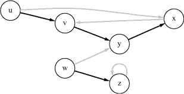

DFS 发现/结束时间 173 ≡

```cpp
template <typename TimeMap>
class dfs_time_visitor : public default_dfs_visitor {
  typedef typename property_traits<TimeMap>::value_type T;

public:
  dfs_time_visitor(TimeMap dmap, TimeMap fmap, T& t)
      : m_dtimemap(dmap), m_ftimemap(fmap), m_time(t) { }

  template <typename Vertex, typename Graph>
  void discover_vertex(Vertex u, const Graph& g) const {
    put(m_dtimemap, u, m_time++);
  }

  template <typename Vertex, typename Graph>
  void_finish_vertex(Vertex u, const Graph& g) const  {
    put(m_ftimemap, u, m_time++);
  }

  TimeMap m_dtimemap;
  TimeMap m_ftimemap;
  T& m_time;
};
```

`dfs-example.cpp` 174 ≡

```cpp
#include <boost/graph/adjacency_list.hpp>
#include <boost/graph/depth_first_search.hpp>
#include <boost/pending/integer_range.hpp>
#include <boost/pending/indirect_cmp.hpp>

using namespace boost;

// 选择我们使用的图类型
typedef adjacency_list<vecS, vecS, directedS> graph_t;
typedef graph_traits<graph_t>::vertices_size_type size_type;

// 设置顶点名称
enum { u, v, w, x, y, z, N };
char name[ ] = {'u', 'v', 'w', 'x', 'y', 'z'};

// 指定图中的边
typedef std::pair<int,int> E;
E edge_array[ ] = { E(u,v), E(u,x), E(x,v), E(y,x),
    E(v,y), E(w,y), E(w,z), E(z,z) };

graph_t g(edge_array, edge_array + sizeof (edge_array)/sizeof (E), N);

// 类型别定义
typedef boost::graph_traits<graph_t>::vertex_descriptor Vertex;
typedef std::vector<Vertex>::iterator Piter;
typedef std::vector<size_type>::iterator Iiter;

// 发现时间和结束属性
```


```cpp
std::vector<size_type> dtime(num_vertices(g));

std::vector<size_type> ftime(num_vertices(g));

size_type t = 0;

dfs_time_visitor<size_type> vis(&dtime[0], &ftime[0], t);

depth_first_search(g, vis);

// 使用 std::sort 按发现时间对顶点进行排序

std::vector<size_type> discover_order(N);

integer_range<size_type> r(0, N);

std::copy(r.begin(), r.end(), discover_order.begin());

std::sort(discover_order.begin(), discover_order.end(),
    indirect_cmp<Iiter, less<size_type>>(dtime.begin()));

std::cout << "order of discovery: ";

for (int i = 0; i < N; i++)
  std::cout << name[discover_order[i]] << " ";

std::vector<size_type> finish_order(N);

std::copy(r.begin(), r.end(), finish_order.begin());

std::sort(finish_order.begin(), finish_order.end(),
    indirect_cmp<Iiter, less<size_type>>(ftime.begin()));

std::cout << std::endl << "finish order: ";

for (int i = 0; i < N; i++)
  std::cout << name[finish_order[i]] << " ";

std::cout << std::endl;

return 0;
}
```

**默认：** 一个 `iterator_property_map`，由一个 `default_color_type` 的 `std::vector` 创建，其大小为 `num_vertices(g)`，并使用 `i_map` 作为索引映射。

**输入：** `vertex_index_map(VertexIndexMap i_map)`

这会将每个顶点映射到 0, |V|) 范围内的一个整数。该参数仅在使用默认颜色属性图时是必需的。`VertexIndexMap` 类型必须是 `ReadablePropertyMap` 的模型。映射的值类型必须是整数类型。图的顶点描述符类型需要能够作为映射的键类型。

**默认：** `get(vertex_index, g)`

**输入：** `visitor(DFSVisitor vis)`

一个访问者对象，会在算法内部由 `DFSVisitor` 概念指定的事件点被调用。

# 复杂度

时间复杂度为 `O`(|V| + |E|)，空间复杂度为 `O`(|V|)。

## 示例

请参阅 [§1.4.1 获取使用 `topological_sort()` 的示例。

# 13.3 最短路径算法

## 13.3.1 `dijkstra_shortest_paths`

```cpp
template <typename Graph, typename P, typename T, typename R>
void dijkstra_shortest_paths(
    const Graph& g,
    typename graph_traits<Graph>::vertex_descriptor s,
    const bgl_named_params<P, T, R>& params)
```

Dijkstra 算法 [10, 11] 用于解决所有边权重非负的情况下，加权、有向或无向图上的单源最短路径问题。当某些边权重为负时，请使用 Bellman–Ford 算法。当所有边权重都等于 1 时，使用广度优先搜索代替 Dijkstra 算法。关于最短路径问题的定义，请参阅 §5.1。

获取 `dijkstra_shortest_paths()` 函数输出的两种主要方式。如果你通过 `distance_map()` 参数提供一个距离属性图，那么从源顶点到图中每个其他顶点的最短距离将记录在距离映射中。此外，你可以在前驱映射中记录最短路径树：对于每个顶点 *u*  V，π[*u*] 将是 *u* 在最短路径树中的前驱（除非 π[*u*] = *u*，在这种情况下 *u* 要么是源顶点，要么是从源顶点不可达的顶点）。除了这两个选项外，用户还可以提供自己自定义的访问者，该访问者可以在算法的任何事件点执行操作。

Dijkstra 算法通过不断扩展已知最短路径的顶点集合 *S*，来找到从源顶点到每个其他顶点的所有最短路径。在算法的每一步中，加入 *S* 的下一个顶点由优先级队列决定。该队列包含 *V – S* 中的顶点，并根据它们的距离标签进行排序，距离标签是到目前为止每个顶点看到的最短路径长度。优先级队列顶部的顶点 *u* 然后被添加到 *S* 中，并对其它的每条出边进行松弛（relax）。如果到 *u* 的距离加上出边 (*u, v*) 的权重小于 *v* 的距离标签，则减小顶点 *v* 的估计距离。算法返回循环处理优先级队列顶部的下一个顶点。当优先级队列为空时，算法结束。

该算法使用颜色标记（白色、灰色和黑色）来跟踪每个顶点属于哪个集合。标记为黑色的顶点在 *S* 中。标记为白色或灰色的顶点在 *V – S* 中。白色顶点尚未发现，灰色顶点在优先级队列中。默认情况下，算法分配一个数组来存储图中每个顶点的颜色标记。你可以通过 `color_map()` 命名参数为颜色提供自己的自定义的存储和访问方式。

以下是 Dijkstra 单源最短路径算法的伪代码。*w* 表示边权重，*d* 表示距离标签，*π* 表示用于编码最短路径树的每个顶点的前驱。*Q* 是一个支持 `DECREASEKEY` 操作的优先级队列。算法的访问者事件点用三角形表示。

```text
DIJKSTRA (G, s, w)

  for each vertex u  V  initialize vertex u

      d[u] ← ∞

      π[u] ← u

      color[u] ← WHITE

  color[s] ← GRAY

  d[s] ← 0

  INSERT(Q, s)  discover vertex s

  while (Q ≠ 0)

    u ← EXTRACT-MIN(Q)  examine vertex u

    S ← S∪{u}

    for each v  Adj[u]  examine edge (u, v)

        if (w(u, v) + d[u] < d[v])

          d[v] ← w(u, v) + d[u]

          π[v] ← u

          if (color[v] == WHITE)

            color[v] ← GRAY

            INSERT(Q, v)

          else if (color[v] == GRAY)

            DECREASE-KEY(Q, v, d[v])

    color[u] ← BLACK

  .  finish u

return (d, π)
```

## 定义位置

`boost/graph/dijkstra_shortest_paths.hpp`

## 参数

**输入：** `const Graph& g`

应用算法的图对象。`Graph` 必须是 `VertexGraph` 和 `IncidenceGraph`。

**输入：** `vertex_descriptor s`

源顶点。所有距离从此顶点计算，最短路径树以此为根。

## 命名参数

**输入：** `weight_map(WeightMap w_map)`

图中每边的权重或“长度”。`WeightMap` 必须是 `ReadablePropertyMap` 的模型。边的描述符需要能够作为权重映射的键类型。权重映射的值类型必须与距离映射类型相同。

**默认：** `get(edge_weight, g)`

**输入：** `vertex_index_map(VertexIndexMap i_map)`

将每个顶点映射到 [0, |V|) 范围内的整数。这在松弛边时高效更新堆结构是必要的。`VertexIndexMap` 必须是 `ReadablePropertyMap` 的模型。映射的值类型必须是整数类型。图的顶点描述符类型需要能够作为映射的键类型。

**默认：** `get(vertex_index, g)`

**输出：** `predecessor_map(PredecessorMap p_map)`

前驱映射记录了最短树中的边。算法完成后，边 (π[*u*], *u*) ∀*u*  *V* 都在最短树中。如果 π[*u*] = *u*，则 *u* 要么是源顶点，要么是从源顶点不可达的顶点。`PredecessorMap` 类型必须是 `ReadWritePropertyMap`，其键和顶点与顶点描述符类型相同。

**默认：** `dummy_property_map`

**工具/输出：** `distance_map(DistanceMap d_map)`

从源顶点 *s* 到图 *g* 中每个顶点的最短路径权重记录在此属性图中。最短路径权重是最短路径上边的权重和。`DistanceMap` 必须是 `ReadWritePropertyMap` 的模型。图的顶点描述符类型需要能够作为距离映射的键类型。距离映射的值类型是由 `combine` 函数对象和单位元的 `zero` 对象形成的单群的元素类型。此外，距离值类型必须具有 `compare` 函数对象提供的 `StrictWeakOrdering`（严格弱序）。

**默认：** 一个 `iterator_property_map`，它是通过一个大小为 `num_vertices(g)` 的 `WeightMap` 值类型的 `std::vector` 创建的，并使用 `i_map` 作为索引映射。

**输入：** `distance_combine(BinaryFunction combine)`

用于距离值类型的半群运算的函数对象。该函数对象结合距离以形成路径的距离。

**默认：** `closed_plus<D>`，其中 `D` 是距离映射的值类型。`closed_plus` 定义在 `boost/graph/relax.hpp` 中。

**输入：** `distance_compare(BinaryPredicate compare)`

在距离值上定义严格弱序（StrictWeakOrdering）的函数对象。该函数对象用于确定两条路径哪一条更短。

**默认：** `std::less<D>`，其中 `D` 是映射的值类型。

**输入：** `distance_inf(D inf)`

`inf` 对象必须是任何 `D` 对象的最大值。也就是说，对于任何 `d != inf`，`compare(d, inf) == true`。类型 `D` 是 `DistanceMap` 的值类型。

**默认：** `std::numeric_limits<D>::max()`

**输入：** `distance_zero(D zero)`

`zero` 值必须是由距离值和 `combine` 函数对象形成的半群的单位元。类型 `D` 是 `DistanceMap` 的值类型。

**默认：** `D`

**工具/输出：** `color_map(ColorMap c_map)`

这在算法执行期间用于标记顶点。顶点初始为白色，当它们被插入队列时变为灰色。当它们从队列中移除时变为黑色。算法结束时，从源顶点可的所有顶点将被标记为黑色。所有其他顶点仍为白色。类型 `ColorMap` 必须是 `ReadWritePropertyMap` 的模型。顶点描述符必须可以用映射的键类型，映射的值类型必须是 `ColorValue` 的模型。

**默认：** 一个 `iterator_property_map`，它是通过一个大小为 `num_vertices(g)` 的 `default_color_type` 的 `std::vector` 创建的，并使用 `i_map` 作为索引映射。

**输出：** `visitor(Vis v)`

使用此项指定你希望在算法内部某些事件点发生的操作。类型 `Vis` 必须是 `DijkstraVisitor` 的模型。

**默认：** `default_dijkstra_visitor`

# 复杂度

时间复杂度为 `O((|V| + |E|) log|V|)`，如果所有顶点均从源顶点可，则仅为 `O(|E| log|V|)`。

## 示例

此示例的源代码位于 `example/dijkstra-example.cpp` 中。此示例使用的图如图图 13.3。

```cpp
Edge(B,B), Edge(B,D), Edge(B,E),
Edge(C,B), Edge(C,D), Edge(D,E), Edge(E,A), Edge(E,B)
};
int weights[] = { 1, 2, 1, 2, 7, 3, 1, 1, 1};
int num_arcs = sizeof(edge_array) / sizeof(Edge);

graph_t g(edge_array, edge_array + num_arcs, weights, num_nodes);

std::vector<vertex_descriptor> p(num_vertices(g));

std::vector<int> d(num_vertices(g));

vertex_descriptor s = vertex(A, g);

dijkstra_shortest_paths(
    g,
    s,
    predecessor_map(&p[0]).distance_map(&d[0]));

std::cout << "distances and parents:" << std::endl;
graph_traits<graph_t>::vertex_iterator vi, vend;

for (tie(vi, vend) = vertices(g); vi != vend; ++vi) {
  std::cout << "distance(" << name[*vi] << ") = " << d[*vi] << ", ";
  std::cout << "parent(" << name[*vi] << ") = "
            << name[p[*vi]] << std::endl;
}
std::cout << std::endl;
```

**图 13.3 此示例使用的图。输出为：**

```text
distances and parents:

distance(A) = 0, parent(A) = A

distance(B) = 6, parent(B) = E

distance(C) = 1, parent(C) = A

distance(D) = 4, parent(D) = C

distance(E) = 5, parent(E) = D
```

## 13.3.2 `bellman_shortest_paths`

```cpp
template <typename EdgeListGraph, typename Size, typename P, typename R>
bool bellman_shortest_paths(
    EdgeListGraph& g,
    Size N,
    P params,
    R params)
```

Bellman-Ford 算法通过遍历图中所有的边并对每条边应用松弛操作。在以下伪代码中，*v* 是 *u* 的相邻顶点，*w* 将边映射到权重，*d* 是记录到为止最短路径长度的距离映射。

```cpp
RELAX(u, v, w, d)
if (w(u, v) + d[u] < d[v])
    d[v] ← w(u, v) + d[u]
```

该算法重复循环 |V| 次，之后保证每个顶点的距离都已减到最小值，除非存在负环。如果有图中某些边没有被正确处理，也就是说，存在边 (u, v) 使得 w(u, v) + d[u] < d[v]。算法最后再次遍历图中的边以检查是否所有边都已最小，如果是则返回 true，否则返回 false。

从 `bellman_shortest_paths()` 函数获取输出有两种主要方式。如果用户通过 `distance_map()` 参数提供了距离映射，则从源顶点到图中其他所有顶点的最短距离将记录在该映射中（前提是返回 true）。用户还可以通过 `predecessor_map()` 参数提供前驱映射来记录最短路径树。除了这两个选项外，用户还可以提供自定义的访问器，可以在算法的任何事件点采取操作（参见 BellmanVisitor）。如果你仅对某些事件点感兴趣，请从 `default_bellman_visitor` 派生你的访问器，为剩余的事件点提供空实现。

### 定义位置

`boost/graph/bellman_ford_shortest_paths.hpp`

### 参数


`IN: EdgeListGraph& g`

有向图，其类型必须是 `EdgeListGraph` 的模型。

`IN: Size N`

图中的顶点数量。类型 `Size` 必须是整数类型。

##### 命名参数

`IN: weight_map(WeightMap w)`

图中每条边的权重（也称为“长度”或“代价”）。`WeightMap` 类型必须是 `ReadablePropertyMap` 的模型。该属性映射的键类型必须是图的边描述符。权重映射的值类型与距离映射的值类型相同。

**默认：** `get(edge_weight, g)`

`输出：predecessor_map(PredecessorMap p_map)`

前驱映射记录了最小生成树中的边。在算法完成后，对于所有的 `u`  `V`，边 `p[u], u` 都在最小生成树中。如果 `p[u] = u`，则 `u` 是源顶点或从源顶点不可达的顶点。`PredecessorMap` 类型必须是一个 `ReadWritePropertyMap`，其键类型和顶点类型与图的顶点描述符类型相同。

**默认：** `dummy_property_map`

`使用/输出：distance_map(DistanceMap d_map)`

此属性映射记录了从源顶点 `s` 到图 `g` 中每个顶点的最短路径权重。最短路径权重是沿最短路径的边权重之和。`DistanceMap` 类型必须是 `ReadWritePropertyMap` 的模型。距离映射的键类型必须是图的顶点描述符类型。距离映射的值类型是用 `combine` 函数对象和作为单位元的 `zero` 对象形成的半群（Monoid）的元素类型。此外，距离值类型必须由 `compare` 函数对象提供 `StrictWeakOrdering`。

**默认：** `get(vertex_distance, g)`

`输入：visitor(BellmanFordVisitor v)`

访问对象，其类型必须是 `BellmanFordVisitor` 的模型。`default_bellman_visitor` 是 `BellmanFordVisitor` 的模型，它在所有事件点都不执行。

**默认：** `default_bellman_visitor`

`输入：distance_combine(BinaryFunction combine)`

该函数对象是距离值的半群运算。该函数对象组合距离形成路径的距离。

**默认：** `closed_plus<D>`，其中 `D` 是距离映射的值类型。`closed_plus` 定义在 `boost/graph/relax.hpp` 中。

`输入：distance_compare(BinaryPredicate compare)`

该函数对象在距离值上定义了一个排序，该排序与摘要函数对应。也就是说，摘要函数始终根据 `compare` 函数返回排序中较靠前的参数。

**默认：** `std::less<D>`，其中 `D` 是距离映射的值类型。

# 复杂度

时间复杂度为 `O(|V||E|)`。

##### 示例

此示例的源代码位于 `example/bellman-example.cpp`。示例中使用的图见图 13.4。

```cpp
enum  { u, v, x, y, z, N };

char name[ ] = { 'u', 'v', 'x', 'y', 'z' };

typedef std::pair<int,int> E;

const int n_edges = 10;

typedef boost::array<E,n_edges> EdgeList;

EdgeList edge_array = {{ E(u,y), E(u,x), E(u,v), E(v,u),

         E(x,y), E(x,v), E(y,v), E(y,z), E(z,u), E(z,x) }};

int weight[n_edges] = { –4, 8, 5, –2, 9, –3, 7, 2, 6, 7 };

typedef adjacency_list<vecS, vecS, directedS,

  no_property, property<edge_weight_t, int> > Graph;

Graph g(edge_array.begin(), edge_array.end(), N);

graph_traits<Graph>::edge_iterator ei, ei_end;

int i = 0;

for (tie(ei, ei_end) = edges(g); ei != ei_end; ++ei, ++i)
    get(edge_weight, g)[*ei] = weight[i];

std::vector<int> distance(N, std::numeric_limits<short>::max());

std::vector<std::size_t> parent(N);

for (i = 0; i < N; ++i)
  parent[i] = i;

distance[z] = 0;

bool r = bellman_ford_shortest_paths(g, int(N),

  weight_map(get(edge_weight, g)).distance_map(&distance[0]).

  predecessor_map(&parent[0]));

if (r)
    for (i = 0; i < N; ++i)
      std::cout << name[i];
```

Johnson 的全对最短路径算法应用于《算法导论》（Introduction to Algorithms）第 568 页的示例图 [10]，该图也显示于图 13.5。生成的距离矩阵 `D[u][v]` 给出了从顶点 `u` 到 `v` 的最短路径。

```cpp
typedef adjacency_list<vecS, vecS, directedS, no_property,
  property<edge_weight_t, int, property<edge_weight2_t, int> > > Graph;
const int V = 6;

typedef std::pair<int,int> Edge;
Edge edge_array[ ] =
  { Edge(0,1), Edge(0,2), Edge(0,3), Edge(0,4), Edge(0,5),
    Edge(1,2), Edge(1,5), Edge(1,3), Edge(2,4), Edge(2,5),
    Edge(3,2), Edge(4,3), Edge(4,1), Edge(5,4) };
const int E = sizeof (edge_array)/sizeof (Edge);
Graph g(edge_array, edge_array + E, V);
property_map<Graph, edge_weight_t>::type
  w = get(edge_weight, g);
int weights[ ] = { 0, 0, 0, 0, 0, 3, –4, 8, 1, 7, 4, –5, 2, 6 };
int* wp = weights;
graph_traits<Graph>::edge_iterator e, e_end;
for (boost::tie(e, e_end) = edges(g); e != e_end; ++e)
    w[*e] = *wp++;
std::vector<int> d(V, std::numeric_limits<int>::max());
int D[V][V];
johnson_all_pairs_shortest_paths(g, D, distance_map(&d[0]));
```

**图 13.5. 用于 Johnson 算法示例的图。**

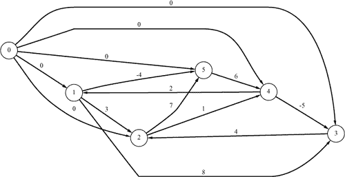

这是生成的距离矩阵：

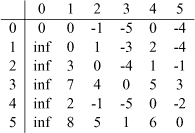

### 13.4 最小生成树算法

#### 13.4.1 `kruskal_minimum_spanning_tree`

```cpp
template <typename Graph, typename OutputIterator,
    typename P, typename T, typename R>
void kruskal_minimum_spanning_tree(Graph& g, OutputIterator spanning_tree_edges,
      const bgl_named_params<P, T, R>& params = all defaults)
```

`kruskal_minimum_spanning_tree()` 函数在带权重的无向图中寻找最小生成树（MST）。MST 是一组连接图中所有顶点的边集合，使得树中所有边的总权重最小化。`kruskal_minimum_spanning_tree()` 函数使用 Kruskal 算法将 MST 的边输出到 `spanning_tree_edges` 输出迭代器中 [10, 18, 23, 44]。

Kruskal 算法从每个顶点自成一树开始，此时最小生成树 `T` 没有边。随后算法按边权重递增的顺序检查图中的每条边。如果某条边连接两个不同树中的顶点，算法会将这两棵树合并为一棵并将并将边添加到 `T` 中。我们使用按秩合并（union by rank）和路径压缩（path compression）启发式方法来提供并集操作（`MAKE-SET`、`FIND-SET` 和 `UNION-SET`）的快速实现。该算法如下：

```text
KRUSKAL-MST(G, w)
  for each vertex u  V
      MAKE-SET(S, u)
  T ← 0
  for each (u, v)  E in order of nondecreasing weight
      if FIND-SET(S, u) ≠ FIND-SET(S, v)
          UNION-SET(S, u, v)
          T ← T ∪{(u, v)}
  return T
```

##### 定义位置

`boost/graph/kruskal_minimum_spanning_tree.hpp`

##### 参数

- **IN:** `const Graph& g`

  一个无向图。图类型必须是 `VertexListGraph` 和 `EdgeListGraph` 的模型。

- **IN:** `OutputIterator spanning_tree_edges`

  最小生成树的边将输出到此 `OutputIterator` 中。

##### 命名参数

- **IN:** `weight_map(WeightMap w_map)`

  图中每条边的权重或“长度”。`WeightMap` 类型必须是 `ReadablePropertyMap` 的模型，其值类型必须是 `LessComparable`。该映射的键类型需要是图的边描述符。

- **Default:** `get(edge_weight, g)`

- **UTIL:** `rank_map(RankMap r_map)`

  `RankMap` 类型必须是 `ReadWriteMap` 的模型。图的顶点描述符……（注：此处原文为 vertex descriptor of the graph，译为：该类型 `RankMap` 必须是 `ReadWriteMap` 的模型）。

- **Default:** `get(edge_weight, g)`

- **UTIL:** `rank_map(RankMap r_map)`

  该类型 `RankMap` 必须是 `ReadWriteMap` 的模型。图的顶点描述符……（注：此处原文为 vertex descriptor of the graph，译为：该类型 `RankMap` 必须是 `ReadWriteMap` 的模型）。

*（注：根据提供的原文逻辑，后续部分参数描述似乎存在重复或错乱，此处已严格按照原文结构进行对应翻译）*

（由于原文文本中参数描述部分存在较多重复和交叉描述，译文保持了原文的对应关系以确保不遗漏）

Prim 算法增长最小生成树的方式是每次增加一个顶点，这与 Dijkstra 算法构建最短路径树的方式非常相似。在每一步中，Prim 算法选择一条边添加到最小生成树中。该边是连接已在树中的任意顶点与不在树中的顶点之间的最短的边。该算法使用优先级队列以高效的方式进行这种选择。如果顶点 `u` 位于优先级队列顶端，则边 (`π[u]`, `u`) 是下一条最短边，并被添加到树中。该算法的伪代码如下：

```text
PRIM-MST(G, r, w)
  for each vertex u ∈ V        initialize vertex u
      d[u] ← ∞
      π[u] ← u
      color[u] ← WHITE
    color[r] ← GRAY
    d[r] ← 0
    INSERT(Q, r)               discover vertex r
  while (Q ≠ 0)
      u ← EXTRACT-MIN(Q)    examine vertex u
      for each v ∈ Adj[u]   examining edge (u, v)
        if (w(u, v) < d[v])
            d[v] ← w(u, v)  edge (u, v) relaxed
            π[v] ← u
            if (color[v] = WHITE)
                color[v] ← GRAY
                INSERT(Q, v)  discover vertex v
            else if (color[v] = GRAY)
                DECREASE-KEY(Q, v)
        else
            ...               edge (u, v) is not relaxed
      color[u] ← BLACK      finish u
  return (π)
```

##### 定义位置

`boost/graph/prim_minimum_spanning_tree.hpp`

##### 参数

`IN: const Graph& g`

应用该算法的图对象。`Graph` 类型必须是 `VertexListGraph` 和 `IncidenceGraph` 的模型。

`OUT: PredecessorMap p_map`

前驱节点映射记录了最小生成树中的边。算法完成后，边 (`π[u]`, `u`) ∀`u` ∈ `V` 都在最小生成树中。如果 `π[u] = u`，则 `u` 要么是树的根，要么是无法从根到达的顶点。`PredecessorMap` 类型必须是一个 `ReadWritePropertyMap`，其键类型和顶点类型与图的顶点描述符类型相同。

##### 命名参数

`IN: root_vertex(vertex_descriptor r)`

将作为最小生成树根的顶点。根顶点的选择是任意的；它不会影响算法寻找最小生成树的能力。

**默认：** `vertices(g).first`

`IN: weight_map(WeightMap w_map)`

图中每条边的权重或“长度”。`WeightMap` 类型必须是 `ReadPropertyMap` 的模型。图的边描述符类型需要可以作为权重映射的键类型。权重映射的值类型必须与距离映射的值类型相同。

**默认：** `get(edge_weight, g)`

`IN: vertex_index_map(VertexIndexMap i_map)`

这会将每个顶点映射到 `[0, |V|)` 范围内的整数。这对于在边被松弛时高效更新堆结构是必要的。`VertexIndexMap` 类型必须是 `ReadPropertyMap` 的模型。映射的值类型必须是整数。图的顶点描述符类型需要可以作为映射的键类型。

**默认：** `get(vertex_index, g)`

`UTIL: distance_map(DistanceMap d_map)`

`DistanceMap` 类型必须是 `ReadWritePropertyMap` 的模型。图的顶点描述符类型需要可以作为映射的键类型。距离映射的值类型是使用加法运算符和默认构造的距离值对象形成的 `Monoid` 的元素类型。距离映射的值类型也必须是 `LessThan`。

**默认：** 从大小为 `num_vertices(g)` 的 `WeightMap` 值类型的 `std::vector` 创建的 `iterator_property_map`，并使用 `i_map` 作为索引映射。

`UTIL/OUT: color_map(ColorMap c_map)`

算法执行期间用于标记顶点。顶点为白色，当它们插入队列时变为灰色。当从队列移除时变为黑色。算法结束时，从源顶点可达的所有顶点被标记为黑色。所有其他顶点仍为白色。`ColorMap` 类型必须是 `ReadWritePropertyMap` 的模型。顶点描述符必须可以用作映射的键类型，映射的值类型必须模拟 `ColorValue`。

**默认：** 从大小为 `num_vertices(g)` 的 `default_color_type` 的 `std::vector` 创建的 `iterator_property_map`，并使用 `i_map` 作为索引映射。

# 复杂度

时间复杂度为 `O(|E| log |V|)`。

##### 示例

此示例的源代码位于 `example/prim-example.cpp`。


```cpp
typedef adjacency_list<vecS, vecS, undirectedS,
  property<vertex_distance_t, int>, property<edge_weight_t, int> > Graph;
typedef std::pair<int,int> E;
const int num_nodes = 5;
E edges[] = { E(0,2), E(1,1), E(1,3), E(1,4), E(2,1), E(2,3),
  E(3,4), E(4,0) };
int weights[] = { 1, 2, 1, 2, 7, 3, 1};
Graph g(num_nodes, edges, edges + sizeof(edges)/sizeof(E), weights);
std::vector<graph_traits<Graph>::vertex_descriptor> p(num_vertices(g));
prim_minimum_spanning_tree(g, &p[0]);
for (std::size_t i = 0; i != p.size(); ++i)
  if (p[i] != i)
    std::cout << "parent[" << i << "] = " << p[i] << std::endl;
  else
      std::cout << "parent[" << i << "] = no parent" << std::endl;
```

输出为：

```
parent[0] = 0
parent[1] = 3
parent[2] = 0
parent[3] = 4
parent[4] = 0
```

### 13.5 静态连通分量

#### 13.5.1 `connected_components`

```cpp
template <typename Graph, typename ComponentMap,
  typename P, typename T, typename R>
typename property_traits<ComponentMap>::value_type
connected_components(const Graph& g, ComponentMap c,
  const bgl_named_params<P, T, R>& params = all defaults)
```

`connected_components()` 函数使用 DFS 方法计算无向图的连通分量。无向图的连通分量是相互可达的所有顶点集合。如果需要在图增长时维护连通分量，`incremental_components()` 函数的并集方法更快。对于静态图，这种 DFS 方法更快。

算法的输出记录在组件映射 `c` 中，该映射包含给每个顶点的组件编号。分量的总数是函数的返回值。

##### 定义位置

`boost/graph/connected_components.hpp`

##### 参数

IN: `const Graph& g`

无向图。图类型必须是 `VertexListGraph` 和 `IncidenceGraph` 的模型。

OUT: `ComponentMap c`

算法计算中有连通分量，并为每个分量分配一个整数标签。算法通过在组件映射中记录组件编号来记录图中每个顶点所属的分量。`ComponentMap` 类型必须是 `WritablePropertyMap` 的模型。值类型必须是图的 `vertices_size_type`。键类型必须是图的顶点描述符类型。

##### 命名参数

UTIL: `color_map(ColorMap color)`

算法用于跟踪遍历图的进度。`ColorMap` 类型必须是 `ReadWritePropertyMap` 的模型，其键类型必须是图的顶点描述符类型，颜色映射的值类型必须模拟 `ColorValue`。

**默认:** 从一个大小为 `num_vertices(g)` 的 `default_color_type` `std::vector` 创建的 `iterator_property_map`，并使用 `i_map` 作为索引映射。

输入：`vertex_index_map(VertexIndexMap i_map)`

这会将每个顶点映射到 0 到 *N*) 范围内的整数，其中 *N* 是图中顶点的数量。该参数仅在使用默认颜色属性映射时是必需的。`VertexIndexMap` 类型必须是 `ReadablePropertyMap` 的模型。映射的值类型必须是整数类型。图的顶点描述符类型需要可以使用映射的键类型。

**默认:** `get(vertex_index, g)`

### 复杂度

强连通分量算法的时间复杂度为 *O*(|V| + |E|)。连通分量算法的时间复杂度同样为 *O*(|V| + |E|)。

##### 示例

计算无向图的连通分量。

```cpp
#include <iostream>
#include <vector>
#include <boost/graph/connected_components.hpp>
#include <boost/graph/adjacency_list.hpp>

int main()
{
  using namespace boost;
  typedef adjacency_list <vecS, vecS, undirectedS> Graph;
  typedef graph_traits<Graph>::vertex_descriptor Vertex;
  const int N = 6;
  Graph G(N);
  add_edge(0, 1, G);
  add_edge(1, 4, G);
  add_edge(4, 0, G);
  add_edge(2, 5, G);
  std::vector<int> c(num_vertices(G));
  int num = connected_components(G,
      make_iterator_property_map(c.begin(), get(vertex_index, G)));
  std::cout << std::endl;
  std::vector<int>::iterator i;
  std::cout << "Total number of components: " << num << std::endl;
  for (i = c.begin(); i != c.end(); ++i)
    std::cout << "Vertex " << i - c.begin()
              << " is in component " << *i << std::endl;
  std::cout << std::endl;
  return EXIT_SUCCESS;
}
```

输出为：

```
Total number of components: 3
Vertex 0 is in component 0
Vertex 1 is in component 0
Vertex 2 is in component 1
Vertex 3 is in component 2
Vertex 4 is in component 0
Vertex 5 is in component 1
```

#### 13.5.2 `strong_components`

```cpp
template <class Graph, class ComponentMap, class P, class T, class R>
typename property_traits<ComponentMap>::value_type
strong_components(Graph& g, ComponentMap comp,
    const bgl_named_params<P, T, R>& params = all defaults)
```

`strong_components()` 函数使用 Tarjan 算法计算有向图的强连通分量 (SCC)，该算法基于深度优先搜索 [43]。

算法的输出记录在分量属性映射 `comp` 中，其中包含分配给每个顶点的分量 ID 数字。这些 ID 数字从零到图中分量总数减一。分量的数量是该函数的返回值。

##### 定义位置

`boost/graph/strong_components.hpp`

##### 定义

有向图 *G* = (*V, E*) 的*强连通分量*是顶点集 *U ⊆ V* 的极大集合，对于 *U* 中的每对顶点 *u* 和 *v*，我们都存在从 *u* 到 *v* 的路径以及从 *v* 到 *u* 的路径。也就是说，*u* 和 *v* 是相互可达的。

以下是计算强连通分量的 Tarjan 算法的非正式描述。它基本上是深度优先搜索的一种变体，在“发现顶点”和“完成顶点”事件点处采取了额外的操作。将“发现顶点”事件点的操作考虑为在 DFS 树的“向下过程中”（从根节点到叶子）发生，将“完成顶点”事件点的操作考虑为在“向上回过程中”发生，可能会有所帮助。

在向下过程中需要发生三件事。对于每个访问的顶点 *u*，我们记录发现时间 *d*[*u*]，将顶点 *u* 推入辅助栈，并设置 *root*[*u*] = *u*。*root* 字段最终将每个顶点映射到其所属的同一个强连通分量中的最顶端顶点。通过设置 *root*[*u*] = *u*，我们是从每个顶点自成一个分量开始的。

现在描述向上过程中发生了什么。假设我们刚刚完成对顶点 *u* 的所有相邻顶点的访问。再次扫描每个相邻顶点，检查它们的根，查看哪一个的发现时间最早，我们称之为 root *a*。然后我们将 *a* 与顶点 *u* 进行比较，并考虑以下情况：

1. 如果 *d*[*a*] < *d*[*u*]，那么我们知道 *a* 是 DFS 树中 *u* 的祖先，因此我们存在环，且 *u* 必须与 *a* 在同一个 SCC 中。

2. 如果 *root*[*a*] = *u*，那么我们知道 *a* 是子树的最顶端顶点。我们从栈中弹出顶点直到到达 *a*。

3. 如果 *d*[*a*] > *d*[*u*]，那么相邻顶点位于不同的分量。

强连通分量算法的时间复杂度为 `O`(|V| + |E|)。

### 另见

- `connected_components()`
- `incremental_components()`

### 示例

计算有向图的强连通分量。

```cpp
#include <vector>
#include <iostream>
#include <boost/graph/strong_components.hpp>
#include <boost/graph/adjacency_list.hpp>
int main()
{
    using namespace boost;
    typedef adjacency_list< vecS, vecS, directedS> Graph;
    const int N = 6;
    Graph G(N);
    add_edge(0, 1, G);
    add_edge(1, 1, G); add_edge(1, 3, G); add_edge(1, 4, G);
    add_edge(3, 4, G); add_edge(3, 0, G);
    add_edge(4, 3, G);
    add_edge(5, 2, G);
    std::vector<int> c(N);
    int num = strong_components(G,
        make_iterator_property_map(c.begin(), get(vertex_index, G)));
    std::cout << "Total number of components: " << num << std::endl;
    std::vector<int>::iterator i;
    for (i = c.begin(); i != c.end(); ++i)
        std::cout << "Vertex " << i - c.begin()
            << " is in component " << *i << std::endl;
    return EXIT_SUCCESS;
}
```

输出结果为：

```
Total number of components: 3
Vertex 0 is in component 0
Vertex 1 is in component 0
Vertex 2 is in component 1
Vertex 3 is in component 0
Vertex 4 is in component 0
Vertex 5 is in component 2
```

### 13.6 增量连通分量

本节描述了一组计算无向图连通分量的函数和类。这里使用的算法基于并查集（disjoint-sets）数据结构，对于图不断增长（添加边）且需要重复更新连通分量信息的情况，这是最佳方法。并查集类在 [16] 中描述。

以下操作是用于计算和维护连通分量的主要函数。这里使用的对象是图 `g`、并查集对象 `ds` 以及顶点 `u` 和 `v`。

- `initialize_incremental_components(g, ds)`：并查集结构的基础初始化。图 `g` 中的每个顶点都属于它自己的集合。
- `incremental_components(g, ds)`：根据图 `g` 中的边计算连通分量，并将信息嵌入 `ds` 中。
- `ds.find_set(v)`：从并查集对象中提取顶点 `v` 的所在分量信息。
- `ds.union_set(u, v)`：当边 `(u, v)` 添加到图时，更新并查集对象。

### 复杂度

整个过程的时间复杂度为 `O`(|V| + |E|)，其中 |E| 是处理结束时图中边的总数，|V| 是顶点的数量。α 是阿克函数的反函数，该函数具有爆炸性的指数增长。因此，在所有实际用途中，α(m, n) ≤ 4，这意味着时间复杂度仅略大于 `O`(|V| + |E|)。

### 示例

使用并查集数据结构在添加边的同时，维护图的连通分量。此示例的完整源代码可以在 `example/incremental-components.cpp` 中找到。

```cpp
// 创建图
typedef adjacency_list <vecS, vecS, undirectedS> Graph;
typedef graph_traits<Graph>::vertex_descriptor Vertex;
const int N = 6;
Graph G(N);
add_edge(0, 1, G);
add_edge(1, 4, G);

// 创建并查集对象，需要秩和父顶点属性
std::vector<Vertex> rank(num_vertices(G));
std::vector<Vertex> parent(num_vertices(G));
typedef std::vector<graph_traits<Graph>::vertices_size_type>::iterator Rank;
typedef std::vector<Vertex>::iterator Parent;
disjoint_sets<Rank, Parent> ds(rank.begin(), parent.begin());

// 确定连通分量，并将结果存储在并查集对象中
initialize_incremental_components(G, ds);
incremental_components(G, ds);

// 添加更多边并更新并查集
graph_traits<Graph>::edge_descriptor e;
bool flag;
tie(e, flag) = add_edge(4, 0, G);
ds.union_set(4, 0);
tie(e, flag) = add_edge(2, 5, G);
ds.union_set(2, 5);

graph_traits<Graph>::vertex_iterator i, end;
for (tie(i, end) = vertices(G); i != end; ++i)
    std::cout << "representative[" << *i << "] = " << ds.find_set(*i) << std::endl;
std::cout << std::endl;

typedef component_index<unsigned int> Components;
Components components(parent.begin(), parent.end());
for (Components::size_type i = 0; i < components.size(); ++i) {
    std::cout << "component " << i << " contains: ";
    for (Components::value_type::iterator j = components[i].begin();
         j != components[i].end(); ++j)
        std::cout << *j << " ";
    std::cout << std::endl;
}
```

*(注：由于原文代码块不完整且存在混乱，翻译时根据逻辑补全了示例代码的结构)*

### 组件的关联类型

`component_index` 的 `value_type` 是一个具有以下关联类型的组件。

`value_type::value_type`

组件对象的值类型是一个顶点 ID。


### 组件的关联类型

`component_index` 的 `value_type` 是一个具有以下关联类型的组件。

`value_type::value_type`

组件对象的值类型是一个顶点 ID。

`value_type::iterator`

`value_type::const_iterator`

此迭代器可以用于遍历组件中的所有顶点。该迭代器解引用后返回一个顶点 ID。

### 组件的成员函数

`component_index` 的 `value_type` 是组件的表示，并具有以下成员函数。

`iterator begin() const`

返回一个指向组件中第一个顶点的迭代器。

`iterator end() const`

返回一个指向组件中最后一个顶点之后的的迭代器。

## 13.7 最大流算法

#### 13.7.1 `edmunds_karp_max_flow`

```cpp
template <typename Graph, typename P, typename T, typename R>
typename detail::edge_capacity_value<Graph, P, T, R>::type
edmunds_karp_max_flow(Graph& g,
   typename graph_traits<Graph>::vertex_descriptor src,
   typename graph_traits<Graph>::vertex_descriptor sink,
   const bgl_named_params<P, T, R>& params = all defaults)
```

`push_relabel_flow()` 函数计算网络的最大流（参见第 8 章）。最大流是函数的返回值。该函数还计算流值 *f*(*u*, *v*) ∀(*u*, *v*)  *E*，这些值以剩余容量 *r*(*u*, *v*) = *c*(*u*, *v*) – *f*(*u*, *v*) 的形式返回。

##### 定义位置

`boost/graph/edmunds_karp_max_flow.hpp`

##### 参数

IN: `Graph& g`

一个有向图。图的类型必须是 `VertexListGraph` 和 `IncidenceGraph` 的模型。对于图中的每条边 (*u, v*)，反向边 (*v, u*) 必须也在图中。

IN: `vertex_descriptor src`

流网络图的源顶点。

IN: `vertex_descriptor sink`

流网络图的汇顶点。

##### 命名参数

IN: `capacity_map(CapacityEdgeMap cap)`

边容量属性图。该类型必须是常量 `LvaluePropertyMap` 的模型。映射的键类型必须是图的边描述符类型。

**默认：** `get(edge_capacity, g)`

OUT: `residual_capacity_map(ResidualCapacityEdgeMap res)`

边剩余容量属性图。该类型必须是可变 `LvaluePropertyMap` 的模型。映射的键类型必须是图的边描述符类型。

**默认：** `get(edge_residual_capacity, g)`

IN: `reverse_edge_map(ReverseEdgeMap rev)`

边属性图，将图中的每条边 (*u, v*) 映射到反向边 (*v, u*)。该映射必须是常量 `LvaluePropertyMap` 的模型。映射的键类型必须是图的边描述符类型。

**默认：** `get(edge_reverse, g)`

UTIL: `predecessor_map(PredecessorMap p_map)`

前驱映射与通常的前驱映射不同，之处在于其值类型是 `edge_descriptor` 类型而非 `vertex_descriptor`。该前驱映射的键类型仍为 `vertex_descriptor`。

**默认：** 从大小为 `num_vertices(g)` 的 `edge_descriptor` `std::vector` 创建的 `iterator_property_map`，并使用 `i_map` 作为索引映射。

UTIL: `color_map(ColorMap c_map)`

此映射用于内部记账。类型 `ColorMap` 必须是 `ReadWritePropertyMap` 的模型。顶点描述符必须可以用作映射的键类型，映射的值类型必须是 `ColorValue` 的模型。

**默认：** 从大小为 `numvertices(g)` 的 `default_color_type` `std::vector` 创建的 `iterator_property_map`，并使用 `i_map` 作为索引映射。

IN: `vertex_index_map(VertexIndexMap index_map)`

只有在使用默认颜色映射或默认前驱映射时才需要此映射。图的每个顶点都被映射到 0, |V|) 范围内的一个整数。该映射必须是常量 `LvaluePropertyMap` 的模型。映射的键类型必须是图的顶点描述符类型。

**默认：** `get(vertex_index, g)`

##### 示例

从 DIMACS 格式的文件读取一个最大流问题示例（一个带有边容量的图）[[1]。

 edmunds-karp-eg.cpp 207  ≡

```cpp
#include <boost/config.hpp>
#include <iostream>
#include <string>
#include <boost/graph/edmunds_karp_max_flow.hpp>
#include <boost/graph/adjacency_list.hpp>
#include <boost/graph/read_dimacs.hpp>
#include <boost/graph/utility.hpp>

int main() {
    using namespace boost;
    typedef adjacency_list<listS, vecS, directed> Traits;
    typedef adjacency_list<listS, vecS, directed,
      property<capacity_t, long>,
      property<capacity_t, long>,
      property<vertex_t, int>> Graph;
    Graph g;
    read_dimacs("example.dimacs", g);
    property_map<Graph, long>::type capacity = get(edge_capacity, g);
    property_map<Graph, Traits>::type rev = get(edge_reverse, g);
    Traits::vertex_descriptor s, t;
    long flow = edmunds_karp_max_flow(g, s, t);
    std::cout << "c The total flow:" << std::endl;
    std::cout << "s " << flow << std::endl;
    std::cout << "c flow values:" << std::endl;
    Traits::vertex_iterator u_iter, u_end;
    Traits::out_edge_iterator ei, e_end;
    for (tie(u_iter, u_end) = vertices(g); u_iter != u_end; ++u_iter)
        for (tie(ei, e_end) = out_edges(u_iter, g); ei != e_end; ++ei)
            if (capacity[*ei] > 0)
                std::cout << "f " << *u_iter << " " << target(*ei, g) << " "
                << (capacity[*ei]) << std::endl;
    return EXIT_SUCCESS;
}
```

输出是

```
c The total flow:
s 13
c flow values:
f 0 6
3 0 0 6 0 2
f 1 1
f 1 0
f 1 f
f 2 4
f 2 4
f 2 0
f 3 0
f 3  
f 3  
f 3  
f 4  
f 4 4
f 5  
f 6  
f 7  
  
 
```

#### 13.7.2 `push_relabel_max_flow`

```cpp
template <typename Graph, typename P, typename T, typename R>
typename detail::edge_capacity_value<Graph, P, T, R>::type
push_relabel_max_flow(Graph& g,
   typename graph_traits<Graph>::vertex_descriptor src,
   typename graph_traits<Graph>::vertex_descriptor sink,
   const bgl_named_params<P, T, R>& params)
```

`push_relabel_flow()` 函数计算网络的最大流（参见第 8 章）。最大流是函数的返回值。该函数还计算流值 *f*(*u*, *v*) ∀(*u*, *v*)  *E*，这些值以剩余容量 *r*(*u*, *v*) = *c*(*u*, *v*) – *f*(*u*, *v*) 的形式返回。


### 组件的关联类型

`component_index` 的 `value_type` 是一个具有以下关联类型的组件。

`value_type::value_type`

组件对象的值类型是一个顶点 ID。

`value_type::iterator`

`value_type::const_iterator`

此迭代器可以用于遍历组件中的所有顶点。该迭代器解引用后返回一个顶点 ID。

### 组件的成员函数

`component_index` 的 `value_type` 是组件的表示，并具有以下成员函数。

`iterator begin() const`

返回一个指向组件中第一个顶点的迭代器。

`iterator end() const`

返回一个指向组件中最后一个顶点之后的的迭代器。

## 13.7 最大流算法

#### 13.7.1 `edmunds_karp_max_flow`

```cpp
template <typename Graph, typename P, typename T, typename R>
typename detail::edge_capacity_value<Graph, P, T, R>::type
edmunds_karp_max_flow(Graph& g,
   typename graph_traits<Graph>::vertex_descriptor src,
   typename graph_traits<Graph>::vertex_descriptor sink,
   const bgl_named_params<P, T, R>& params = all defaults)
```

`push_relabel_flow()` 函数计算网络的最大流（参见第 8 章）。最大流是函数的返回值。该函数还计算流值 *f*(*u*, *v*) ∀(*u*, *v*)  *E*，这些值以剩余容量 *r*(*u*, *v*) = *c*(*u*, *v*) – *f*(*u*, *v*) 的形式返回。

##### 定义位置

`boost/graph/edmunds_karp_max_flow.hpp`

##### 参数

IN: `Graph& g`

一个有向图。图的类型必须是 `VertexListGraph` 和 `IncidenceGraph` 的模型。对于图中的每条边 (*u, v*)，反向边 (*v, u*) 必须也在图中。

IN: `vertex_descriptor src`

流网络图的源顶点。

IN: `vertex_descriptor sink`

流网络图的汇顶点。

##### 命名参数

IN: `capacity_map(CapacityEdgeMap cap)`

边容量属性图。该类型必须是常量 `LvaluePropertyMap` 的模型。映射的键类型必须是图的边描述符类型。

**默认：** `get(edge_capacity, g)`

OUT: `residual_capacity_map(ResidualCapacityEdgeMap res)`

边剩余容量属性图。该类型必须是可变 `LvaluePropertyMap` 的模型。映射的键类型必须是图的边描述符类型。

**默认：** `get(edge_residual_capacity, g)`

IN: `reverse_edge_map(ReverseEdgeMap rev)`

边属性图，将图中的每条边 (*u, v*) 映射到反向边 (*v, u*)。该映射必须是常量 `LvaluePropertyMap` 的模型。映射的键类型必须是图的边描述符类型。

**默认：** `get(edge_reverse, g)`

UTIL: `predecessor_map(PredecessorMap p_map)`

前驱映射与通常的前驱映射不同，之处在于其值类型是 `edge_descriptor` 类型而非 `vertex_descriptor`。该前驱映射的键类型仍为 `vertex_descriptor`。

**默认：** 从大小为 `num_vertices(g)` 的 `edge_descriptor` `std::vector` 创建的 `iterator_property_map`，并使用 `i_map` 作为索引映射。

UTIL: `color_map(ColorMap c_map)`

此映射用于内部记账。类型 `ColorMap` 必须是 `ReadWritePropertyMap` 的模型。顶点描述符必须可以用作映射的键类型，映射的值类型必须是 `ColorValue` 的模型。

**默认：** 从大小为 `numvertices(g)` 的 `default_color_type` `std::vector` 创建的 `iterator_property_map`，并使用 `i_map` 作为索引映射。

IN: `vertex_index_map(VertexIndexMap index_map)`

只有在使用默认颜色映射或默认前驱映射时才需要此映射。图的每个顶点都被映射到 0, |V|) 范围内的一个整数。该映射必须是常量 `LvaluePropertyMap` 的模型。映射的键类型必须是图的顶点描述符类型。

**默认：** `get(vertex_index, g)`

##### 示例

从 DIMACS 格式的文件读取一个最大流问题示例（一个带有边容量的图）[[1]。

 edmunds-karp-eg.cpp 207  ≡

```cpp
#include <boost/config.hpp>
#include <iostream>
#include <string>
#include <boost/graph/edmunds_karp_max_flow.hpp>
#include <boost/graph/adjacency_list.hpp>
#include <boost/graph/read_dimacs.hpp>
#include <boost/graph/utility.hpp>

int main() {
    using namespace boost;
    typedef adjacency_list<listS, vecS, directed> Traits;
    typedef adjacency_list<listS, vecS, directed,
      property<capacity_t, long>,
      property<capacity_t, long>,
      property<vertex_t, int>> Graph;
    Graph g;
    read_dimacs("example.dimacs", g);
    property_map<Graph, long>::type capacity = get(edge_capacity, g);
    property_map<Graph, Traits>::type rev = get(edge_reverse, g);
    Traits::vertex_descriptor s, t;
    long flow = edmunds_karp_max_flow(g, s, t);
    std::cout << "c The total flow:" << std::endl;
    std::cout << "s " << flow << std::endl;
    std::cout << "c flow values:" << std::endl;
    Traits::vertex_iterator u_iter, u_end;
    Traits::out_edge_iterator ei, e_end;
    for (tie(u_iter, u_end) = vertices(g); u_iter != u_end; ++u_iter)
        for (tie(ei, e_end) = out_edges(u_iter, g); ei != e_end; ++ei)
            if (capacity[*ei] > 0)
                std::cout << "f " << *u_iter << " " << target(*ei, g) << " "
                << (capacity[*ei]) << std::endl;
    return EXIT_SUCCESS;
}
```

输出是

```
c The total flow:
s 13
c flow values:
f 0 6
3 0 0 6 0 2
f 1 1
f 1 0
f 1 f
f 2 4
f 2 4
f 2 0
f 3 0
f 3 
f 3 
f 3 
f 4 
f 4 4
f 5 
f 6 
f 7 
 
 
 
```

#### 13.7.2 `push_relabel_max_flow`

```cpp
template <typename Graph, typename P, typename T, typename R>
typename detail::edge_capacity_value<Graph, P, T, R>::type
push_relabel_max_flow(Graph& g,
```

该算法对输入图和属性映射参数有几项特殊要求。首先，表示网络的有向图 `G = (V, E)` 必须经过扩展，以包含 `E` 中每条边的反向边。也就是说，输入图应为 `G[in] = (V, {E ∪ E^(T)})`。`ReverseEdgeMap` 参数 `rev` 必须将原始图中的每条边映射到其反向边，即对于所有的 `(u, v)`  `E`，满足`(u, v) → (v, u)`。`CapacityEdgeMap` 参数 `cap` 必须将 `E` 中的每条边映射到一个正数，并将 `E^(T)` 中的每条边映射到 `0`。换句话说，容量映射应满足这些约束：对于每个 `(u, v)`  `E`，`c(u, v) > 0` 且 `c(v, u) = 0`。

### 定义位置

`boost/graph/push_relabel_max_flow.hpp`

### 参数

**IN:** `Graph& g`

一个有向图。图的类型必须是 `VertexListGraph` 和 `IncidenceGraph` 的模型。对于图中的每条边 `(u, v)`，反向边 `(v, u)` 必须也位于图中。

**IN:** `vertex_descriptor src`

流网络图的源顶点。

**IN:** `vertex_descriptor sink`

流网络图的汇点顶点。

### 命名参数

**IN:** `capacity_map(CapacityEdgeMap cap)`

边容量属性映射。其类型必须是常量 `LvaluePropertyMap` 的模型。映射的键类型必须是图边描述符类型。

**默认值:** `get(edge_capacity, g)`

**OUT:** `residual_capacity_map(ResidualCapacityEdgeMap res)`

边残余容量属性映射。其类型必须是可变 `LvaluePropertyMap` 的模型。映射的键类型必须是图边描述符类型。

**默认值:** `get(edge_residual_capacity, g)`

**IN:** `reverse_edge_map(ReverseEdgeMap rev)`

一种边属性映射，将图中的每条边 `(u, v)` 映射到反向边 `(v, u)`。该映射必须是常量 `LvaluePropertyMap` 的模型。映射的键类型必须是图边描述符类型。

**默认值:** `get(edge_reverse, g)`

**IN:** `vertex_index_map(VertexIndexMap index_map)`

此将每个顶点映射到 `0, N)` 范围内的整数，其中 `N` 是图中顶点的数量。该映射必须是常量 `LvaluePropertyMap` 的模型。映射的键类型必须是图顶点描述符类型。

**默认值:** `get(vertex_index, g)`

### 示例

从 DIMACS 格式的文件读取一个最大流问题示例（带有边容量的图）[[1]。

 push-relabel-eg.cpp 211  ≡


```cpp
#include <iostream>
#include <string>
#include <boost/graph/push_relabel_max_flow.hpp>
#include <boost/graph/adjacency_list.hpp>
#include <boost/graph/read_dimacs.hpp>

int main()
{
    using namespace boost;
    typedef adjacency_list_traits<vecS, vecS, directedS> Traits;
    typedef adjacency_list<vecS, vecS, directedS,
        property<vertex_name_t, std::string>,
        property<edge_capacity_t, long,
            property<edge_residual_capacity_t, long,
                property<edge_reverse_t, Traits::edge_descriptor> > >
    > Graph;
    Graph g;
    property_map<Graph, edge_capacity_t>::type
        capacity = get(edge_capacity, g);
    property_map<Graph, edge_residual_capacity_t>::type
        residual_capacity = get(edge_residual_capacity, g);
    property_map<Graph, edge_reverse_t>::type
        rev = get(edge_reverse, g);
    Traits::vertex_descriptor s, t;
    read_dimacs_max_flow(g, capacity, rev, s, t);
    long flow = push_relabel_max_flow(g, s, t);
    std::cout << "c The total_flow:" << std::endl;
    std::cout << "s " << flow << std::endl;
    std::cout << "c values:" << std::endl;
    graph_traits<Graph>::vertex_iterator i, end;
    graph_traits<Graph>::out_edge_iterator ei, e_end;
    for (tie(i, end) = vertices(g); i != end; ++i) {
        for (tie(ei, e_end) = out_edges(i, g); ei != e_end; ++ei) {
            if (capacity[ei] > 0)
                std::cout << "f " << i << " " << target(ei, g) << " "
                    << (capacity[ei] - residual_capacity[ei]) << std::endl;
        }
    }
}
```

输出：

```
c The total_flow:
s 13
c values:
```

```cpp
index_map = get(vertex_index, g);

for(tie(i, end) = vertices(g); i != end; ++i) {
    std::cout << name[get(index_map, *i)];
    tie(ai, a_end) = adjacent_vertices(*i, g);
    if (ai == a_end)
        std::cout << " has no children";
    else
        std::cout << " is the parent of  ";
    for (; ai != a_end; ++ai)   {
        std::cout << name[get(index_map, *ai)];
        if (boost::next(ai) != a_end)
            std::cout << ",  " ;
    }
    std::cout << std::endl;
}
return EXIT_SUCCESS;
```

输出结果：

```
Jeanie is the parent of Debbie, Rick, John
Debbie is the parent of Amanda
Rick is the parent of Margaret
John is the parent of Benjamin
Amanda has no children
Margaret has no children
Benjamin has no children
```

### 模板参数

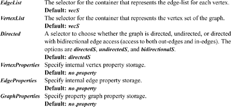

### 模型模型

`DefaultConstructible`, `CopyConstructible`, `Assignable`, `VertexListGraph`, `EdgeListGraph`, `IncidenceGraph`, `AdjacencyGraph`, `VertexMutableGraph`, 以及 `EdgeMutableGraph`。此外，`adjacency_list` 当 `Directed=bidirectionalS` 或 `Directed=undirectedS` 时模型 `BidirectionalGraph`；在添加了相应的内部属性后，它模型 `VertexMutablePropertyGraph` 和 `EdgeMutablePropertyGraph`。

### 定义位置

`boost/graph/adjacency_list.hpp`

### 关联类型

`graph_traits<adjacency_list>::vertex_descriptor`

与 `adjacency_list` 关联的顶点描述符类型。

（`Graph` 要求。）

`graph_traits<adjacency_list>::edge_descriptor`

与 `adjacency_list` 关联的边描述符类型。

（`Graph` 要求。）

`graph_traits<adjacency_list>::vertex_iterator`

`vertices()` 返回的迭代器类型。

（`VertexListGraph` 要求。）

`graph_traits<adjacency_list>::edge_iterator`

`edges()` 返回的迭代器类型。

（`EdgeListGraph` 要求。）

`graph_traits<adjacency_list>::out_edge_iterator`

`out_edges()` 返回的迭代器类型。

（`IncidenceGraph` 要求。）

`graph_traits<adjacency_list>::in_edge_iterator`

此类型适用于无向和双向邻接列表，但不支持有向。

`in_edge_iterator` 是 `in_edges()` 函数返回的迭代器类型。

（`BidirectionalGraph` 要求。）

`graph_traits<adjacency_list>::adjacency_iterator`

`adjacent_vertices()` 返回的迭代器类型。

（`AdjacencyGraph` 要求。）

`graph_traits<adjacency_list>::directed_category`

提供关于图是有向的（`directed_tag`）还是无向的（`undirected_tag`）的信息。

（`Graph` 要求。）

`graph_traits<adjacency_list>::edge_parallel_category`

描述类是否允许插入并行边（源和目标相同的边）。两个标签为 `allow_parallel_edge_tag` 和 `disallow_parallel_edge_tag`。`setS` 和 `hash_setS` 变体不允许并行边，而其他变体允许并行边。

（`Graph` 要求。）

`graph_traits<adjacency_list>::traversal_category`

遍历类别反映了图类支持的类型的迭代器。对于邻接列表，这包括顶点、边、出边和邻接迭代器。入边迭代器也适用于无向和双向邻接列表，但不适用于有向邻接列表。

`graph_traits<adjacency_list>::vertices_size_type`

用于处理图中顶点数的类型。

（`VertexListGraph` 要求。）

`graph_traits<adjacency_list>::edges_size_type`

用于处理图中边数的类型。

（`EdgeListGraph` 要求。）

`graph_traits<adjacency_list>::degree_size_type`

用于处理顶点度数的类型。

（`IncidenceGraph` 要求。）

`graph_traits<adjacency_list>::vertex_type`

顶点的类型。

（`VertexListGraph` 要求。）

`graph_traits<adjacency_list>::edge_type`

边的类型。

（`EdgeListGraph` 要求。）

`graph_traits<adjacency_list>::directed_type`

有向性的类型。

（`Graph` 要求。）

`graph_traits<adjacency_list>::vertex_properties`

顶点属性的类型。

（`VertexListGraph` 要求。）

`graph_traits<adjacency_list>::edge_properties`

边属性的类型。

（`EdgeListGraph` 要求。）

`graph_traits<adjacency_list>::directed_properties`

有向属性的类型。

（`Graph` 要求。）

`graph_traits<adjacency_list>::vertex_map`

顶点属性映射的类型。

（`VertexListGraph` 要求。）

`graph_traits<adjacency_list>::edge_map`

边属性映射的类型。

（`EdgeListGraph` 要求。）

`graph_traits<adjacency_list>::directed_map`

有向属性映射的类型。

（`Graph` 要求。）

`graph_traits<adjacency_list>::vertex_visitor`

顶点属性访问器类型。

（`VertexListGraph` 要求。）

`graph_traits<adjacency_list>::edge_visitor`

边属性访问器类型。

（`EdgeListGraph` 要求。）

`graph_traits<adjacency_list>::directed_visitor`

有向属性访问器类型。

（`Graph` 要求。）

`graph_traits<adjacency_list>::vertex_function`

顶点属性函数类型。

（`VertexListGraph` 要求。）

`graph_traits<adjacency_list>::edge_function`

边属性函数类型。

（`EdgeListGraph` 要求。）

`graph_traits<adjacency_list>::directed_function`

有向属性函数类型。

（`Graph` 要求。）

`graph_traits<adjacency_list>::vertex_traits`

顶点属性特性。

（`VertexListGraph` 要求。）

`graph_traits<adjacency_list>::edge_traits`

边属性特性。

（`EdgeListGraph` 要求。）

`graph_traits<adjacency_list>::directed_traits`

有向属性特性。

（`Graph` 要求。）

`graph_traits<adjacency_list>::vertex_iterator`

顶点迭代器类型。

（`VertexListGraph` 要求。）

`graph_traits<adjacency_list>::edge_iterator`

边迭代器类型。

（`EdgeListGraph` 要求。）

`graph_traits<adjacency_list>::out_edge_iterator`

出边迭代器类型。

（`IncidenceGraph` 要求。）

`graph_traits<adjacency_list>::in_edge_iterator`

入边迭代器类型。

（`BidirectionalGraph` 要求。）

`graph_traits<adjacency_list>::adjacency_iterator`

邻接迭代器类型。

（`AdjacencyGraph` 要求。）

`graph_traits<adjacency_list>::vertex_range`

顶点范围类型。

（`VertexListGraph` 要求。）

`graph_traits<adjacency_list>::edge_range`

边范围类型。

（`EdgeListGraph` 要求。）

`graph_traits<adjacency_list>::vertex_descriptor`

顶点描述符类型。

（`VertexListGraph` 要求。）

`graph_traits<adjacency_list>::edge_descriptor`

边描述符类型。

（`EdgeListGraph` 要求。）

`graph_traits<adjacency_list>::vertex_iterator`

顶点迭代器类型。

（`VertexListGraph` 要求。）

`graph_traits<adjacency_list>::edge_iterator`

边迭代器类型。

（`EdgeListGraph` 要求。）

`graph_traits<adjacency_list>::out_edge_iterator`

出边迭代器类型。

（`IncidenceGraph` 要求。）

`graph_traits<adjacency_list>::in_edge_iterator`

入边迭代器类型。

（`BidirectionalGraph` 要求。）

`graph_traits<adjacency_list>::adjacency_iterator`

邻接迭代器类型。

（`AdjacencyGraph` 要求。）

`graph_traits<adjacency_list>::directed_category`

提供关于图是有向的（`directed_tag`）还是无向的（`undirected_tag`）的信息。

（`Graph` 要求。）

`graph_traits<adjacency_list>::edge_parallel_category`

描述类是否允许插入并行边（源和目标相同的边）。两个标签为 `allow_parallel_edge_tag` 和 `disallow_parallel_edge_tag`。`setS` 和 `hash_setS` 变体不允许并行边，而其他变体允许并行边。

（`Graph` 要求。）

`graph_traits<adjacency_list>::traversal_category`

遍历类别反映了图类支持的类型的迭代器。对于邻接列表，这包括顶点、边、出边和邻接迭代器。入边迭代器也适用于无向和双向邻接列表，但不适用于有向邻接列表。

`graph_traits<adjacency_list>::vertices_size_type`

用于处理图中顶点数的类型。

（`VertexListGraph` 要求。）

`graph_traits<adjacency_list>::edges_size_type`

用于处理图中边数的类型。

（`EdgeListGraph` 要求。）

`graph_traits<adjacency_list>::degree_size_type`

用于处理顶点度数的类型。

（`IncidenceGraph` 要求。）

`graph_traits<adjacency_list>::vertex_type`

顶点的类型。

（`VertexListGraph` 要求。）

`graph_traits<adjacency_list>::edge_type`

边的类型。

（`EdgeListGraph` 要求。）

`graph_traits<adjacency_list>::directed_type`

有向性的类型。

（`Graph` 要求。）

`graph_traits<adjacency_list>::vertex_properties`

顶点属性的类型。

（`VertexListGraph` 要求。）

`graph_traits<adjacency_list>::edge_properties`

边属性的类型。

（`EdgeListGraph` 要求。）

`graph_traits<adjacency_list>::directed_properties`

有向属性的类型。

（`Graph` 要求。）

`graph_traits<adjacency_list>::vertex_map`

顶点属性映射的类型。

（`VertexListGraph` 要求。）

`graph_traits<adjacency_list>::edge_map`

边属性映射的类型。


## 类型定义

以下类型定义均来自 `graph_traits<adjacency_list>`，并标注了对应的图概念要求。

- `graph_traits<adjacency_list>::directed_map` — 有向属性映射的类型。（Graph 要求。）
- `graph_traits<adjacency_list>::vertex_visitor` — 顶点属性访问器类型。（VertexListGraph 要求。）
- `graph_traits<adjacency_list>::edge_visitor` — 边属性访问器类型。（EdgeListGraph 要求。）
- `graph_traits<adjacency_list>::directed_visitor` — 有向属性访问器类型。（Graph 要求。）
- `graph_traits<adjacency_list>::vertex_function` — 顶点属性函数类型。（VertexListGraph 要求。）
- `graph_traits<adjacency_list>::edge_function` — 边属性函数类型。（EdgeListGraph 要求。）
- `graph_traits<adjacency_list>::directed_function` — 有向属性函数类型。（Graph 要求。）
- `graph_traits<adjacency_list>::vertex_traits` — 顶点属性特性。（VertexListGraph 要求。）
- `graph_traits<adjacency_list>::edge_traits` — 边属性特性。（EdgeListGraph 要求。）
- `graph_traits<adjacency_list>::directed_traits` — 有向属性特性。（Graph 要求。）
- `graph_traits<adjacency_list>::vertex_iterator` — 顶点迭代器类型。（VertexListGraph 要求。）
- `graph_traits<adjacency_list>::edge_iterator` — 边迭代器类型。（EdgeListGraph 要求。）
- `graph_traits<adjacency_list>::out_edge_iterator` — 出边迭代器类型。（IncidenceGraph 要求。）
- `graph_traits<adjacency_list>::in_edge_iterator` — 入边迭代器类型。（BidirectionalGraph 要求。）
- `graph_traits<adjacency_list>::adjacency_iterator` — 邻接迭代器类型。（AdjacencyGraph 要求。）
- `graph_traits<adjacency_list>::vertex_range` — 顶点范围类型。（VertexListGraph 要求。）
- `graph_traits<adjacency_list>::edge_range` — 边范围类型。（EdgeListGraph 要求。）
- `graph_traits<adjacency_list>::vertex_descriptor` — 顶点描述符类型。（VertexListGraph 要求。）
- `graph_traits<adjacency_list>::edge_descriptor` — 边描述符类型。（EdgeListGraph 要求。）

## 成员函数

- `adjacency_list(const GraphProperties& p)` — 默认构造函数。创建一个零顶点、零边的空图。（DefaultConstructible 要求。）
- `adjacency_list(vertices_size_type n, const GraphProperties& p)` — 创建一个具有 `n` 个顶点的图。
- `adjacency_list(const adjacency_list& other)` — 拷贝构造函数。（CopyConstructible 要求。）
- `adjacency_list& operator=(const adjacency_list& other)` — 赋值运算符。将一个图的内容拷贝到另一个图。（Assignable 要求。）
- `adjacency_list(VertexIterator begin, VertexIterator end, const GraphProperties& p)` — 从一组顶点构造图。
- `adjacency_list(EdgeIterator begin, EdgeIterator end, const GraphProperties& p)` — 从一组边构造图。
- `adjacency_list(VertexIterator v_begin, VertexIterator v_end, EdgeIterator e_begin, EdgeIterator e_end, const GraphProperties& p)` — 从一组顶点和边构造图。
- `vertex_iterator vertices()` — 返回指向第一个顶点的迭代器。（VertexListGraph 要求。）
- `edge_iterator edges()` — 返回指向第一边的迭代器。（EdgeListGraph 要求。）
- `out_edge_iterator out_edges(VertexDescriptor v)` — 返回指向顶点 `v` 的第一个出边的迭代器。（IncidenceGraph 要求。）
- `in_edge_iterator in_edges(VertexDescriptor v)` — 返回指向顶点 `v` 的第一个入边的迭代器。（BidirectionalGraph 要求。）
- `adjacency_iterator adjacent_vertices(VertexDescriptor v)` — 返回指向与顶点 `v` 相接的第一个顶点的迭代器。（AdjacencyGraph 要求。）
- `vertices_size_type vertices_size()` — 返回图中顶点数。（VertexListGraph 要求。）
- `edges_size_type edges_size()` — 返回图中边数。（EdgeListGraph 要求。）
- `degree_size_type degree(VertexDescriptor v)` — 返回顶点 `v` 的度。（IncidenceGraph 要求。）
- `vertex_type add_vertex(const VertexProperties& p = {})` — 向图中添加一个顶点并返回其描述符。
- `edge_type add_edge(VertexDescriptor u, VertexDescriptor v, const EdgeProperties& p = {})` — 在 `u` 和 `v` 之间添加一条边并返回其描述符。
- `remove_vertex(VertexDescriptor v)` — 删除顶点 `v` 及其所有的关联边。
- `remove_edge(EdgeDescriptor e)` — 删除边 `e`。
- `clear()` — 移除图中所有的顶点和边。
- `has_vertex(VertexDescriptor v)` — 检查顶点 `v` 是否存在。
- `has_edge(EdgeDescriptor e)` — 检查边 `e` 是否存在。
- `has_edge(VertexDescriptor u, VertexDescriptor v)` — 检查 `u` 和 `v` 之间是否存在边。
- `clear_out_edges(VertexDescriptor v)` — 移除顶点 `v` 的所有出边。
- `clear_in_edges(VertexDescriptor v)` — 移除顶点 `v` 的所有入边。
- `clear_edges(VertexDescriptor v)` — 移除与顶点 `v` 相关的所有边。
- `vertex_properties(VertexDescriptor v)` — 返回顶点 `v` 的属性。
- `edge_properties(EdgeDescriptor e)` — 返回边 `e` 的属性。
- `set_vertex_properties(VertexDescriptor v, const VertexProperties& p)` — 更新顶点 `v` 的属性。
- `set_edge_properties(EdgeDescriptor e, const EdgeProperties& p)` — 更新边 `e` 的属性。

## 非成员函数

- `vertices(const adjacency_list& g)` — 返回图 `g` 中所有顶点的迭代范围。
- `edges(const adjacency_list& g)` — 返回图 `g` 中所有边的迭代范围。
- `adjacent_vertices(VertexDescriptor v, const adjacency_list& g)` — 返回图 `g` 中与 `v` 相接的顶点的迭代范围。
- `out_edges(VertexDescriptor v, const adjacency_list& g)` — 返回图 `g` 中顶点 `v` 的出边的迭代范围。
- `in_edges(VertexDescriptor v, const adjacency_list& g)` — 返回图 `g` 中顶点 `v` 的入边的迭代范围。
- `next(VertexIterator it)`、`next(EdgeIterator it)`、`next(OutEdgeIterator it)`、`next(InEdgeIterator it)`、`next(AdjacencyIterator it)` — 返回序列中的下一个迭代器。

进入顶点 `u` 的边数。只有在为 `Directed` 模板参数指定了 `bidirectionalS` 时，此操作可用。（由 BidirectionalGraph 需要。）

```cpp
vertices_size_type num_vertices(const adjacency_list& g)
```

返回图 `g` 中的顶点数量。（由 VertexListGraph 需要。）

```cpp
edges_size_type num_edges(const adjacency_list& g)
```

返回图 `g` 中的边数量。（由 EdgeListGraph 需要。）

```cpp
vertex_descriptor vertex(vertices_size_type n, const adjacency_list& g)
```

返回图顶点列表中的第 `n` 个顶点。

```cpp
std::pair<edge_descriptor, bool>
edge(vertex_descriptor u, vertex_descriptor v, const adjacency_list& g)
```

返回图 `g` 中连接顶点 `u` 和顶点 `v` 的边。（由 AdjacencyMatrix 需要。）

```cpp
std::pair<out_edge_iterator, out_edge_iterator>
edge_range(vertex_descriptor u, vertex_descriptor v, const adjacency_list& g)
```

返回一对出边迭代器，提供从 `u` 到 `v` 的所有并行边的范围。此函数仅当 `adjacency_list` 的 `EdgeList` 是一个根据目标顶点排序出边并允许并行边的容器时才有效。`multisetS` 选择器会选择这样的容器。

```cpp
std::pair<edge_descriptor, bool>
add_edge(vertex_descriptor u, vertex_descriptor v, adjacency_list& g)
```

向图中添加边 `(u, v)` 并返回新边的边描述符。对于不允许并行边的图，如果该边已于图中，则不会添加重复边，且 `bool` 标记位将为 `false`。此外，如果 `u` 和 `v` 是同一个顶点的描述符（创建了自环）且该图是无向的，则不会添加该边且标记位为 `false`。当标记位为 `false` 时，该边描述符是无效的，对其进行任何使用都是未定义的。新边在出边列表中的位置通常未指定，尽管可以通过选择 `EdgeList` 来完成出边的排序。如果 `VertexList` 选择器是 `vecS`，且顶点描述符 `u` 或 `v`（均为整数）的值大于图中当前的顶点数，则图会被扩展，使顶点数变为 `std::max(u,v) + 1`。如果 `EdgeList` 选择器是 `vecS`，则此操作会使顶点 `u` 的任何 `out_edge_iterator` 失效。如果 `EdgeList` 是一个在调用 `push(container, x)` 时失效迭代器的用户定义容器，也适用。如果图也是双向的，则 `v` 的任何 `in_edge_iterator` 也会失效。如果图是无向的，则 `v` 的任何 `out_edge_iterator` 也会失效。如果图是有向的，`add_edge()` 还会使任何 `edge_iterator` 失效。（由 EdgeMutableGraph 需要。）

```cpp
std::pair<edge_descriptor, bool>
add_edge(vertex_descriptor u, vertex_descriptor v, const EdgeProperties& p, adjacency_list& g)
```

向图中添加边 `(u, v)` 并将 `p` 附加为边内部属性存储的值。更多细节请参见上一个 `add_edge()` 成员函数。（由 EdgeMutablePropertyGraph 需要。）

```cpp
void remove_edge(vertex_descriptor u, vertex_descriptor v, adjacency_list& g)
```

从图中移除边 `(u, v)`。此操作会导致任何指向边 `(u, v)` 的现有边描述符或迭代器失效。此外，如果 `EdgeList` 选择器是 `vecS`，则此操作会使指向顶点 `u` 边列表的迭代器失效，无向和双向情况下的顶点 `v` 也是如此。此外，对于有向图，这将使任何 `edge_iterator` 失效。（由 EdgeMutableGraph 需要。）

```cpp
void remove_edge(edge_descriptor e, adjacency_list& g)
```

从图中移除边 `e`。在多图情况下，这与 `remove_edge(u, v, g)` 函数不同。此 `remove_edge(e, g)` 函数移除单条边，而 `remove_edge(u, v, g)` 函数移除所有边 `(u, v)`。此操作会使由描述符 `e` 指向同一边的任何现有边描述符和迭代器失效。此外，此操作会使任何指向 `target(e, g)` 边列表的迭代器失效。此外，对于有向图，这将使图的任何 `edge_iterator` 失效。（由 EdgeMutableGraph 需要。）

```cpp
void remove_edge(out_edge_iterator iter, adjacency_list& g)
```

这与 `remove_edge(iter, g)` 效果相同。区别在于该函数在向图中具有常数时间复杂度，而 `remove_edge(e, g)` 的时间复杂度为 `O(|E|/|V|)`。（由 MutableIncidenceGraph 需要。）

```cpp
template <typename Predicate>
void remove_out_edge_if(vertex_descriptor u, Predicate predicate, adjacency_list& g)
```

移除图中满足谓词的顶点 `u` 的出边。如果谓词应用于边描述符返回 `true`，则该边被移除。对描述符和迭代器的影响与对每个移除的边调用 `remove_edge()` 相同。（由 MutableIncidenceGraph 需要。）

```cpp
template <typename Predicate>
void remove_in_edge_if(vertex_descriptor v, Predicate predicate, adjacency_list& g)
```

移除图中满足谓词的顶点 `v` 的入边。如果谓词应用于边描述符返回 `true`，则该边被移除。对描述符和迭代器的影响与对每个移除的边调用 `remove_edge()` 相同。（由 BidirectionalGraph 需要。）

```cpp
template <typename Predicate>
void remove_edge_if(Predicate predicate, adjacency_list& g)
```


移除图中满足谓词的边。如果谓词应用于边描述符返回 `true`，则边被移除。对描述符和迭代器的影响与对每个移除的边调用 `remove_edge()` 相同。

（由 `MutableEdgeListGraph` 需要。）

```cpp
vertex_descriptor add_vertex(adjacency_list& g)
```

向图中添加顶点并返回新顶点的顶点描述符。

（由 `VertexMutableGraph` 需要。）

```cpp
vertex_descriptor add_vertex(const VertexProperties& p, adjacency_list& g)
```

向图中添加顶点并返回新顶点的顶点描述符。

（由 `VertexMutablePropertyGraph` 需要。）

```cpp
void clear_vertex(vertex_descriptor u, adjacency_list& g)
```

从图中进入和离开顶点 `u` 的所有边。该顶点仍在顶点集中。对描述符和迭代器的影响与对所有源或目标为 `u` 的边调用 `remove_edge()` 相同。

（由 `EdgeMutableGraph` 需要。）

```cpp
void clear_out_edges(vertex_descriptor u, adjacency_list& g)
```

移除顶点 `u` 的所有边。该顶点仍在顶点集中。对描述符和迭代器的影响与对所有源为 `u` 的边调用 `remove_edge()` 相同。此操作不适用于无向图（请用 `clear_vertex()` 代替）。

```cpp
void clear_in_edges(vertex_descriptor u, adjacency_list& g)
```

从图中移除进入和离开顶点 `u` 的所有边。该顶点仍在顶点集中。对描述符和迭代器的影响与对所有源或目标为 `u` 的边调用 `remove_edge()` 相同。此操作仅适用于双向图。

```cpp
void remove_vertex(vertex_descriptor u, adjacency_list& g)
```

从图中移除顶点 `u`。

从图中顶点集中移除顶点 `u`。假设在移除顶点 `u` 时，没有指向或来自该顶点的边。确保这一点的一种方法是预先调用 `clear_vertex()`。如果 `adjacency_list` 的模板参数 `VertexList` 为 `vecS`，则此操作会导致图中所有的顶点描述符、边描述符和迭代器失效。每个顶点的内置 `vertex_index_t` 属性将被重新编号，以便在操作后顶点索引仍然形成一个连续范围 [0, |V|)。如果你使用基于内置顶点索引的外部属性存储，则需要调整外部存储。另一种选项是不使用内置顶点索引，而是使用一个属性来添加你自定义的顶点索引属性。如果你需要频繁使用 `remove_vertex()` 函数，那么 `listS` 选择器是 `VertexList` 模板参数更好的选择。

（由 `VertexMutableGraph` 要求。）

```cpp
template <typename PropertyTag>
property_map<adjacency_list, PropertyTag>::type
get(PropertyTag, adjacency_list& g)
```

返回一个由 `PropertyTag` 指定的顶点属性的可变属性映射对象。`PropertyTag` 必须匹配图中 `VertexProperties` 模板参数中指定的属性之一。

（由 `PropertyGraph` 要求。）

```cpp
template <typename PropertyTag>
property_map<adjacency_list, PropertyTag>::const_type
get(PropertyTag, const adjacency_list& g)
```

返回一个由 `PropertyTag` 指定的顶点属性的常量属性映射对象。`PropertyTag` 必须匹配图中 `VertexProperties` 模板参数中指定的属性之一。

（由 `PropertyGraph` 要求。）

```cpp
template <typename PropertyTag, typename X>
typename property_traits<
  typename property_map<adjacency_list, PropertyTag>::const_type
>::value_type
get(PropertyTag, const adjacency_list& g, X x)
```

这返回 `x` 的属性值，`x` 是顶点描述符或边描述符。

（由 `PropertyGraph` 要求。）

```cpp
template <typename PropertyTag, typename X, typename Value>
void put(PropertyTag, const adjacency_list& g, X x, const Value& value)
```

这将 `x` 的属性值设置为 `value`。`x` 是顶点描述符或边描述符。`Value` 必须转换为 `typename property_traits<property_map<adjacency_list, PropertyTag>::type>::value_type`。

（由 `PropertyGraph` 要求。）

```cpp
template <typename GraphProperties, typename GraphProperties>
typename property_value<GraphProperties, GraphProperties>::type&
get_property(adjacency_list& g, GraphProperties);
```

返回附加到图对象 `g` 的由 `GraphProperties` 指定的属性。`property_value` 特性类定义在 `boost/pending/property.hpp` 中。

```cpp
template <typename GraphProperties, typename GraphProperties>
const typename property_value<GraphProperties, GraphProperties>::type&
get_property(const adjacency_list& g, GraphProperties);
```

返回附加到图对象 `g` 的由 `GraphProperties` 指定的属性。`property_value` 特性类定义在 `boost/pending/property.hpp` 中。

## 选择 `EdgeList` 和 `VertexList`

本节重点介绍了如何在不同情况下决定使用哪个版本的 `adjacency_list` 类。`adjacency_list` 就像瑞士军刀，可以以许多方式进行配置。在本节中关注的参数是 `EdgeList` 和 `VertexList`，它们控制用于表示图的底层数据结构。`EdgeList` 和 `VertexList` 的选择会影响许多图操作的时间复杂度以及图对象的空间复杂度。

BGL 使用 STL 中的容器（如 `std::vector`、`std::list` 和 `std::set`）来表示顶点集和图的邻接结构（出边和入边）。使用了几种选择器类型来指定 `EdgeList` 和 `VertexList` 的容器选择：

- `vecS` 选择 `std::vector`。
- `listS` 选择 `std::list`。
- `slistS` 选择 `std::slist`。
- `setS` 选择 `std::set`。
- `hash_setS` 选择 `std::hash_set`。

### 选择 `VertexList` 类型

`VertexList` 参数决定了使用何种容器来表示顶点集或图的二维结构。该容器必须建模为 Sequence 或随机访问容器 `RandomAccessContainer`。通常，如果你需要快速添加和删除顶点，`listS` 是一个很好的选择。代价是与选择 `vecS` 相比会有额外的空间开销。

### 空间复杂度

`std::list` 的每个顶点空间开销比 `std::vector` 高，每个顶点多存储两个指针。

### 时间复杂度

`VertexList` 的选择影响以下操作的时间复杂度。

`add_vertex()`

该操作对于 `vecS` 和 `listS` 都是摊还常数时间（通过 `push_back()` 实现）。然而，当 `VertexList` 类型为 `vecS` 时，该操作有时很大，因为向量会重新分配内存并复制整个图。

`remove_vertex()`

该操作对于 `listS` 是常数时间，对于 `vecS` 为 $O(|V| + |E|)$。`vecS` 的时间复杂度大是因为顶点描述符（在这种情况下是顶点在列表中的索引）必须在整个出边列表中进行调整。

`vertex()`

该操作对于 `vecS` 是常数时间，对于 `listS` 为 $O(|V|)$。

### 选择 `EdgeList` 类型

`EdgeList` 参数决定了使用何种容器来存储图中每个顶点的出边（以及可能的入边）。用于边的列表容器必须满足 Sequence 或关联容器 `AssociativeContainer` 的要求。

选择 `EdgeList` 时要考虑的因素之一是，是否希望 `adjacency_list` 强制图中不存在并行边（即强制图不会变成多图）。如果你希望执行这种限制，请使用 `setS` 或 `hash_setS` 选择器。如果你想表示多图，或者知道你不会向图中插入并行边，则选择其中一种 Sequence 类型：`vecS`、`listS` 或 `slistS`。此外，你还需要考虑各种图操作的时间和空间复杂度差异。我们用 |V| 表示顶点总数，用 |E| 表示边总数。此处讨论的操作均为常数时间。

`add_edge()`

当 `EdgeList` 是类似 `std::set` 的 `UniqueAssociativeContainer` 时，在添加边时会强制执行不存在并行边。涉及的额外查找时间复杂度为 。建模 `Sequence` 的 `EdgeList` 类型不进行此类检查，因此 `add_edge()` 是摊化常数时间。这意味着，如果你不在乎图中是否存在并行边，或者知道输入到图的数据不包含并行边，那么使用基于序列的 `EdgeList` 更好。基于序列的 `EdgeList` 的 `add_edge()` 是 `push_front()` 或 `push_back()` 实现的。然而，对于 `std::list` 和 `std::slist`，此操作通常比 `std::vector` 快，因为后者偶尔会重新分配并拷贝所有元素。

```cpp
remove_edge()
```

对于基于序列的 `EdgeList` 类型，该操作通过 `std::remove_if()` 实现，这意味着平均时间为 。对于基于集合的 `EdgeList` 类型，该操作通过 `erase()` 成员函数实现，平均时间为 。

```cpp
edge()
```

当 `EdgeList` 类型为 `Sequence` 时，该操作的时间复杂度为 ，当 `EdgeList` 类型为 `AssociativeContainer` 时，为 。

```cpp
clear_vertex()
```

对于使用基于序列的 `EdgeList` 类型的向图，时间复杂度为 $O(|V| + |E|)$，而对于基于关联容器的 `EdgeList` 类型，该操作更快，时间复杂度为 。对于无向图，此操作为 。

```cpp
remove_vertex()
```

无论 `EdgeList` 类型如何，该操作的时间复杂度均为 $O(|V| + |E|)$。

```cpp
out_edge_iterator::operator++()
```

该操作对于所有 `EdgeList` 类型均为常数时间。然而，不同类型之间存在显著的常数因子时间差异，这很重要，因为该操作是大多数图算法的核心工作。该操作速度从快到慢的顺序为 `vecS`、`slistS`、`listS`、`setS`、`hash_setS`。

```cpp
in_edge_iterator::operator++()
```

该操作是常数时间，并且相对于 `EdgeList` 的选择，表现出与 `out_edge_iterator` 相似的速度排序。

```cpp
vertex_iterator::operator++()
```

该操作是常数时间且快速（与增加指针相同）。`OneD` 的选择不影响此操作的速度。

```cpp
edge_iterator::operator++()
```

该操作是常数时间，并且相对于 `EdgeList` 的选择，表现出与 `out_edge_iterator` 相似的速度排序。遍历整个边集的时间为 $O(|V| + |E|)$。

```cpp
adjacency_iterator::operator++()
```

该操作是常数时间，并且相对于 `EdgeList` 的选择，表现出与 `out_edge_iterator` 相似的速度排序。

#### 迭代器和描述符的稳定性/失效

在更改图的结构（通过添加或删除边）时，必须小心。取决于 `adjacency_list` 的类型和操作，指向图的某些迭代器或描述符对象可能会失效。例如，以下代码会导致未定义（坏的）行为：

```cpp
// VertexList=vecS
typedef adjacency_list<listS, vecS> Graph;
Graph G(N);
// 填充图...

// 尝试移除所有顶点。错误！
graph_traits<Graph>::vertex_iterator vi, vi_end;
for (tie(vi, vi_end) = vertices(G); vi != vi_end; ++vi)
    remove_vertex(*vi, G);

// 另一个尝试移除所有顶点。这仍然是错误的！
graph_traits<Graph>::vertex_iterator vi, vi_end, next;
tie(vi, vi_end) = vertices(G);
for (next = vi; vi != vi_end; vi = next) {
    ++next;
    remove_vertex(*vi, G);
}
```

之所以这是一个问题，是因为我们调用了 `remove_vertex()`，当它与 `VertexList=vecS` 的 `adjacency_list` 一起使用时，会使图的所有迭代器和描述符（如 `vi` 和 `vi_end`）失效，从而在循环的后续迭代中引发麻烦。

如果我们使用另一种类型（即 `VertexList=listS`），那么调用 `remove_vertex` 不会导致迭代器失效，除非该迭代器指向被移除的实际顶点。下一页的代码演示了这一点。

```cpp
// VertexList=listS
typedef adjacency_list<listS, vecS> Graph;
Graph G(N);
// 填充图...

// 尝试移除所有顶点。错误！
graph_traits<Graph>::vertex_iterator vi, vi_end;
for (tie(vi, vi_end) = vertices(G); vi != vi_end; ++vi)
    remove_vertex(*vi, G);

// 另一个尝试移除所有顶点。这仍然是错误的！
graph_traits<Graph>::vertex_iterator vi, vi_end, next;
tie(vi, vi_end) = vertices(G);
for (next = vi; vi != vi_end; vi = next) {
    ++next;
    remove_vertex(*vi, G);
}
```

*(注：此处原文示例代码逻辑与描述存在微差异，已按原文逻辑翻译)*

实际上，从 `adjacency_list` 中移除多条边最安全且高效的方法是使用 `remove_if()` 函数。

稳定性问题也会影响描述符。例如，假设你使用顶点描述符向量来跟踪路径树中顶点的父节点（前驱）（参见 `example/dijkstra-example.cpp`）。你通过调用 `dijkstra_shortest_paths()` 创建了父向量，然后从图中删除了顶点。随后你尝试使用父向量，但由于所有顶点描述符已失效，结果是错误的。

```cpp
std::vector<Vertex> parent(num_vertices(G));
std::vector<Vertex> distance(num_vertices(G));
dijkstra_shortest_paths(G, s, distance_map(&distance[0]), predecessor_map(&parent[0]));

// 以下是一个坏主意！它使父向量中的顶点描述符失效
remove_vertex(s, G);

// 以下将产生错误结果
for(tie(vi, vend) = vertices(G); vi != vend; ++vi)
    std::cout << p[*vi] << " 是 " << *vi << " 的父节点" << std::endl;
```


注意，在讨论中，迭代器和描述符失效关注的是*并非直接受操作影响*的迭代器和描述符。例如，无论`adjacency_list`类型如何，`remove_edge(u,v,g)`总是会让`(u, v)`的边描述符或指向`(u, v)`的边迭代器失效。在迭代器和描述符失效的讨论中，我们只关注`remove_edge(u,v,g)`对其他边（非`(u, v)`）描述符和迭代器的影响。

## 有向和无向邻接列表

`adjacency_list`类可以用于表示有向图和无向图，取决于传递给`Directed`模板参数的参数。选择`directedS`或`bidirectionalS`会选择有向图，而`undirectedS`则选择无向图的表示。关于 BGL 中有向图和无向图的区别描述，请参阅 §12.1.1。`bidirectealS`选择器指定图将提供`in_edges()`函数以及`out_edges()`函数。这会导致每条边的空间开销增加一倍，这就是为什么`in_edges()`是可选的性。

## 内部属性

可以通过属性接口将属性附加到`adjacency_list`图的顶点或边上。`adjacency_list`类的模板参数`VertexProperties`和`EdgeProperties`用于由属性类填充，该类的声明如下：

```cpp
template <typename PropertyTag, typename T, typename NextProperty = no_property>
struct property;
```

`PropertyTag`是一种仅用于标识或为属性提供唯一名称的类型。有几个预定义的标签（参见 §15.2.3），并且添加更多标签也很容易。为了方便，BGL 还提供了标签类型的预定义对象（在这种情况下为枚举值），用作期望属性标签对象的函数的参数（例如`adjacency_list`的`get()`属性映射函数）。

`property`的`T`参数指定属性值的类型。`NextProperty`参数允许`property`类型嵌套，以便在同一张图上附加任意数量的属性。

以下代码展示了如何组装顶点和边属性类型并使用它们创建一个图类型。我们在图的顶点上附加了一个类型为`float`的距离属性，和一个类型为`std::string`的名称属性。我们在图的边上附加了一个类型为`float`的权重属性。

```cpp
typedef property<distance_t, float,
      property<name_t, std::string> > VertexProperties;

typedef property<weight_t, float> EdgeProperties;

typedef adjacency_list<mapS, vecS, undirectedS,
      VertexProperties, EdgeProperties> Graph;

Graph g(num_vertices); // 构建一个图对象
```

然后可以使用属性映射从读取和写入属性值。请参阅 § 3.6 关于如何从图中获取属性映射的描述，并阅读整个第 15 章 关于如何使用属性映射。

## 顶点索引属性

如果图的`VertexList`是`vecS`，则图具有内置的顶点索引属性，通过`vertex_index_t`属性访问。索引范围在`[0, |V|)`范围内且是连续的。当删除一个顶点时，索引会进行调整以保留这些属性。在使用这些索引访问外部属性存储时，必须小心，因为用户必须记得更新外部存储以匹配新的顶点索引。

## 自定义边属性

创建自己的属性类型和属性很容易；只需为你的新属性定义一个标签类。在这里我们为容量和流属性定义了一个标签类，将其附加到图的边上。

```cpp
enum edge_capacity_t { edge_capacity };

enum edge_flow_t { edge_flow };

namespace boost {
  BOOST_INSTALL_PROPERTY(edge, flow);
  BOOST_INSTALL_PROPERTY(edge, capacity);
}
```

现在，你可以在属性定义中使用你的新属性标签，就像使用内置标签一样。

```cpp
typedef property<capacity_t, int> Cap;

typedef property<flow_t, int, Cap> EdgeProperties;

typedef adjacency_list<vecS, vecS, no_property, EdgeProperties> Graph;
```

与之前一样，可以通过`get()`函数从图中获取这些属性的属性映射。

```cpp
property_map<Graph, edge_capacity_t>::type
  capacity = get(edge_capacity, G);

property_map<Graph, edge_flow_t>::type
  flow = get(edge_flow, G);
```

`edge_property.cpp`文件显示了此示例的完整源代码。

## 自定义顶点属性

在顶点上附加自己的属性与在边上附加属性一样简单。在这里我们想给图的顶点附加人的名字。

```cpp
enum vertex_first_name_t { vertex_first_name };

namespace boost {
  BOOST_INSTALL_PROPERTY(vertex, first_name);
}
```

现在我们可以在`property`类中以及图类型的组装中使用新标签。以下代码展示了创建图类型，然后创建图对象。我们填充了边并为顶点分配了名称。边代表“谁欠谁钱”。

```cpp
typedef property<vertex_first_name_t, std::string> FirstNameProperty;

typedef adjacency_list<vecS, vecS, undirectedS,
      FirstNameProperty> GraphType;

typedef pair<int,int> Pair;

Pair edge_array[11] = { Pair(0,1), Pair(0,2), Pair(0,3), Pair(0,4), Pair(1,2), Pair(1,3), Pair(1,4), Pair(2,3), Pair(2,4), Pair(3,4), Pair(4,0) };

GraphType G(5);

for (int i = 0; i < 11; ++i)
    add_edge(G, edge_array[i].first, edge_array[i].second);

property_map<GraphType, vertex_first_name_t>::type
  name = get(vertex_first_name, G);

put(name, 0, "Jeremy");
put(name, 1, "Rich");
put(name, 2, "Andrew");
put(name, 3, "Jeff");
name[4] = "Kinis";
```

`who_owes_who()`函数是以泛型方式实现的。输入是模板化的，因此我们不知道具体的图类型。为了找到名称的属性映射类型，我们需要使用`vertex_property_map` traits 类。使用`const_type`是因为图参数是`const`。一旦我们有了属性映射，就可以使用`property_traits`类推导出属性的值类型。在这个示例中，我们知道属性的值类型是`std::string`，但通过这种泛型编写，`who_owes_who()`函数可以处理其他属性值类型。

```cpp
template <typename EdgeIter, typename Graph>
void who_owes_who(EdgeIter first, EdgeIter last, const Graph& G)
{
  // 获取此图的属性访问类型
  typedef typename vertex_property_map<Graph,
      first_name_t>::const_type NamePA;
  NamePA name = get_vertex_property_map(G, first_name_t());
  typedef typename property_traits<NamePA>::value_type NameType;
  NameType src_name, targ_name;
  while (first != last) {
    src_name = get(name, source(*first, G));
    targ_name = get(name, target(*first, G));
    cout << src_name << " owes "
      << targ_name << " some money" << endl;
    ++first;
  }
}
```

输出是

```
Jeremy owes Rich some money
Jeremy owes Andrew some money
Jeremy owes Jeff some money
Jeremy owes Kinis some money
Andrew owes Jeremy some money
Andrew owes Kinis some money
Jeff owes Jeremy some money
Jeff owes Rich some money
Jeff owes Kinis some money
Kinis owes Jeremy some money
Kinis owes Rich some money
```

`adjacency_list`类使用两种类型的容器实现。一种类型的容器持有图中所有的顶点，另一种类型的容器持有每个顶点的出边列表（以及可能存在的入边列表）。BGL 提供了选择器类，允许用户在 STL 的几种容器中进行选择。也可以使用你自己的容器类型。在自定义`VertexList`时，你需要定义一个容器生成器（container generator）。在自定义`EdgeList`时，你需要定义一个容器生成器和并行边特性（parallel edge traits）。`container_gen.cpp`文件提供了如何使用自定义存储类型的示例。

## 容器生成器

`adjacency_list`类使用一个名为`container_gen`的特征类将`EdgeList`和`VertexList`选择器映射到用于图存储的实际容器类型。该特征类的默认版本如下，并包含了该类如何为`listS`选择器进行特化的示例。

```cpp
namespace boost {

  template <typename Selector, typename ValueType>
  struct container_gen { };

  template <typename ValueType>
  struct container_gen<listS, ValueType> {
    typedef std::list<ValueType> type;
  };

}
```

要使用你选择的其他容器，请定义一个选择器类，然后为你的选择器特化`container_gen`。

```cpp
struct custom_containerS { }; // 你的选择器

namespace boost {

  // 针对你的选择器的特化
  template <typename ValueType>
  struct container_gen<custom_containerS, ValueType> {
    typedef custom_container<ValueType> type;
  };

}
```

在某些情况下，你可能想使用具有比`ValueType`更多模板参数的容器。例如，你可能想提供分配器类型。这样做的方法是在`container_gen`的特化中硬编码额外的参数。然而，如果你想要更大的灵活性，可以给选择器类添加一个模板参数。在下面的代码中，我们展示了如何创建一个选择器，允许指定与`std::list`使用的分配器。

```cpp
template <typename Allocator> struct list_with_allocatorS {};

namespace boost {

  template <typename Alloc, typename ValueType>
  struct container_gen<list_with_allocatorS<Alloc>, ValueType>
  {
    typedef typename Alloc::template rebind<ValueType>::other Allocator;
    typedef std::list<ValueType, Allocator> type;
  };

}

// 现在你可以使用 std::list 和特定的分配器定义图

typedef adjacency_list< list_with_allocatorS< std::allocator<int> >,
  vecS, directedS> MyGraph;
```

## 并行边特性

除了特化`container_gen`类外，还必须特化`parallel_edge_traits`类，以指定容器类型是否允许并行边（并且是序列 Sequence），或者容器是否不允许并行边（并且是关联容器 AssociativeContainer）。

```cpp
template <typename StorageSelector>
struct parallel_edge_traits { };

template <> struct parallel_edge_traits<vecS> {
  typedef allow_parallel_edge_tag type;
};

template <> struct parallel_edge_traits<setS> {
  typedef disallow_parallel_edge_tag type;
};
//. . .
```

## 针对边列表容器的 Push 和 Erase

必须告诉`adjacency_list`如何高效地从边列表容器中添加和删除边。这是通过为自定义容器类型重载`push()`和`erase()`函数来实现。`push()`函数必须返回一个指向新插入边的迭代器，以及一个表示边是否插入成功的布尔标志。如果你在`parallel_edge_traits`中指定了`allow_parallel_edge_tag`，则`push()`应该始终插入边并返回`true`。如果你在`parallel_edge_traits`中指定了`disallow_parallel_edge_tag`，则当相同的边已于容器时，`push()`必须返回 false 不插入边，且返回的迭代器应该指向已存在的边。

已经为所有 STL 容器类型提供了默认的`push()`和`erase()`函数。`push_dispatch()`和`erase_dispatch()`函数重载族处理了标准容器进行插入和删除的不同方式。

```cpp
template <typename Container, typename T>
std::pair<typename Container::iterator, bool>
push(Container& c, const T& v)
{
  return push_dispatch(c, v, container_category(c));
}

template <typename Container, typename T>
void erase(Container& c, const T& x)
{
  erase_dispatch(c, x, container_category(c));
}
```

### 14.1.2 `adjacency_matrix`

`adjacency_matrix<Directed, VertexProperty, EdgeProperty, GraphProperty>`

`adjacency_matrix`类使用传统的邻接矩阵存储格式实现 BGL 图接口。对于具有$|V|$个顶点的图，使用一个$|V| \times |V|$的矩阵，其中每个元素$a[ij]$是一个布尔标志，表示从顶点$i$到顶点$j$是否存在边。图 14.4 显示了图的邻接矩阵表示法。

**图 14.4 有向图的邻接矩阵表示法。**


与邻接列表相比，这种格式的优点是插入和删除是常数时间。缺点是：内存占用是$O(|V|²)$而不是$O(|V|+|E|)$；遍历每个顶点的边的操作（如广度搜索）将是$O(|V|²)$而不是$O(|V|+|E|)$。对于稠密图，使用`adjacency_matrix`更好；对于稀疏图，使用`adjacency_list`更好。在无向图的情况下，`adjacency_matrix`类不使用完整的$|V| \times |V|$矩阵，而是使用下三角（对角线），这使得存储减少到$(|V|²)/2$。图 14.5 显示了无向图的邻接矩阵表示法。

**图 14.5 无向图的邻接矩阵表示法。**


## 示例

创建 图 14.4 中的图

```cpp
adjacency_matrix<Directed, VertexProperty, EdgeProperty, GraphProperty>
```

（等待，示例代码继续...)


```cpp
enum { A, B, C, D, E, F, N };
const char* name = "ABCDEF";
typedef boost::adjacency_matrix<boost::directedS> Graph;
Graph g(N);
add_edge(B, C, g);
add_edge(B, F, g);
add_edge(C, A, g);
add_edge(C, C, g);
add_edge(D, E, g);
add_edge(E, D, g);
add_edge(F, A, g);

std::cout << "vertex set: ";
boost::print_vertices(g, name);
std::cout << std::endl;
std::cout << "edge set: ";
boost::print_edges(g, name);
std::cout << std::endl;
std::cout << "out-edges: " << std::endl;
boost::print_graph(g, name);
```

输出结果为：

```text
vertex set: A B C D E F

edge set: (B,C) (B,F) (C,A) (C,C) (D,E) (E,D) (F,A)

out–edges:

A –>

B –> C F

C –> A C

D –> E

E –> D

F –> A
```

创建图 14.5 中的图：

```cpp
enum { A, B, C, D, E, F, N };
const char* name = "ABCDEF";
typedef boost::adjacency_matrix<boost::undirectedS> UGraph;
UGraph ug(N);
add_edge(B, C, ug);
add_edge(B, F, ug);
add_edge(C, A, ug);
add_edge(D, E, ug);
add_edge(F, A, ug);

std::cout << "vertex set: ";
boost::print_vertices(ug, name);
std::cout << std::endl;
std::cout << "edge set: ";

boost::print_edges(ug, name);

std::cout << std::endl;

std::cout << "incident edges: " << std::endl;

boost::print_graph(ug, name);

std::cout << std::endl;
```

输出为：

```text
vertex set: A B C D E F

edge set: (C,A) (C,B) (E,D) (F,A) (F,B)

incident edges:

A <––> C F

B <––> C F

C <––> A B

D <––> E

E <––> D

F <––> A B
```

## 定义位置

`boost/graph/adjacency_matrix.hpp`

## 模板参数


## 模型

`VertexListGraph`、`EdgeListGraph`、`IncidenceGraph`、`AdjacencyGraph`、`AdjacencyMatrix`、`VertexMutablePropertyGraph` 和 `EdgeMutablePropertyGraph`

## 类型要求

属性值类型必须是 `DefaultConstructible`（可构造）和 `CopyConstructible`（可拷贝）。

## 关联类型

- `graph_traits<adjacency_matrix>::vertex_descriptor`

  与 `adjacency_matrix` 关联的顶点描述符类型。（`Graph` 要求。）

- `graph_traits<adjacency_matrix>::edge_descriptor`

  与 `adjacency_matrix` 关联的边描述符类型。（`Graph` 要求。）

- `graph_traits<adjacency_matrix>::vertex_iterator`

  `vertices()` 返回的迭代器类型。（`VertexListGraph` 要求。）

- `graph_traits<adjacency_matrix>::edge_iterator`

  `edges()` 返回的迭代器类型。（`EdgeListGraph` 要求。）

- `graph_traits<adjacency_matrix>::out_edge_iterator`

  `out_edges()` 返回的迭代器类型。（`IncidenceGraph` 要求。）

- `graph_traits<adjacency_matrix>::adjacency_iterator`

  `adjacent_vertices()` 返回的迭代器类型。（`AdjacencyGraph` 要求。）

- `graph_traits<adjacency_matrix>::directed_category`

  提供关于图是有向的（`directed_tag`）还是无向（`undirected_tag`）的信息。（`Graph` 要求。）

- `graph_traits<adjacency_matrix>::edge_parallel_category`

  邻接矩阵不允许插入并行边，因此此类型始终为 `disallow_parallel_edge_tag`。（`Graph` 要求。）

- `graph_traits<adjacency_matrix>::vertices_size_type`

  用于处理图中顶点数量的类型。（`VertexListGraph` 要求。）

- `graph_traits<adjacency_matrix>::edges_size_type`

  用于处理图中边数量的类型。（`EdgeListGraph` 要求。）

- `graph_traits<adjacency_matrix>::degree_size_type`

  用于处理顶点出边数量的类型。（`IncidenceGraph` 要求。）

- `property_map<adjacency_matrix, PropertyTag>::type`
- `property_map<adjacency_matrix, PropertyTag>::const_type`

  图中顶点或边属性的映射类型。该属性由模板参数 `PropertyTag` 指定，并且必须与图的 `VertexProperty` 或 `EdgeProperty` 中指定的某个属性之一匹配。（`PropertyGraph` 要求。）

## 成员函数

- `adjacency_matrix(vertices_size_type n, const GraphProperty& p = GraphProperty())`

  创建一个具有 `n` 个顶点和零条边的图对象。

- `template <typename EdgeIterator> adjacency_matrix(EdgeIterator first, EdgeIterator last, vertices_size_type n, const GraphProperty& p = GraphProperty())`

  创建一个具有 `n` 个顶点的图对象，其边由范围 `[first, last)` 提供的边列表指定。`EdgeIterator` 的值类型必须是 `std::pair`，其中对中的类型是整数类型。这些整数对应于顶点，且它们必须落在 `[0,n)` 范围内。

- `template <typename EdgeIterator, typename EdgePropertyIterator> adjacency_matrix(EdgeIterator first, EdgeIterator last, EdgePropertyIterator ep_iter, vertices_size_type n, const GraphProperty& p = GraphProperty())`

  创建一个具有 `n` 个顶点的图对象，其边由范围 `[first, last)` 提供的边列表指定，且边属性由 `ep_iter` 指定的边属性列表指定。`EdgeIterator` 的值类型必须是 `std::pair`，其中对中的类型是整数类型。这些整数对应于顶点，且它们必须落在 `[0,n)` 范围内。`ep_iter` 的 `value_type` 应该是 `EdgeProperty`。

## 非成员函数

- `std::pair<vertex_iterator, vertex_iterator> vertices(const adjacency_matrix& g)`

  返回一个迭代器范围，用于访问图 `g` 的顶点集。（`VertexListGraph` 要求。）

- `std::pair<edge_iterator, edge_iterator> edges(const adjacency_matrix& g)`

  返回一个迭代器范围，用于访问图 `g` 的边集。（`EdgeListGraph` 要求。）

- `std::pair<adjacency_iterator, adjacency_iterator> adjacent_vertices(vertex_descriptor v, const adjacency_matrix& g)`

  返回一个迭代器范围，用于访问图 `g` 中与 `v` 相邻的顶点。（`AdjacencyGraph` 要求。）

- `std::pair<out_edge_iterator, out_edge_iterator> out_edges(vertex_descriptor v, const adjacency_matrix& g)`

  返回一个迭代器范围，用于访问图 `g` 中顶点 `v` 的出边。如果图是无向图，则提供所有与 `v` 相连的边。（`IncidenceGraph` 要求。）

- `vertex_descriptor source(edge_descriptor e, const adjacency_matrix& g)`

  返回边 `e` 的源顶点。（`IncidenceGraph` 要求。）

- `vertex_descriptor target(edge_descriptor e, const adjacency_matrix& g)`

  返回边 `e` 的目标顶点。（`IncidenceGraph` 要求。）

- `degree_size_type out_degree(vertex_descriptor u, const adjacency_matrix& g)`

  返回离开顶点 `u` 的边数。（`IncidenceGraph` 要求。）

- `vertices_size_type num_vertices(const adjacency_matrix& g)`

  返回图 `g` 中的顶点数量。（`VertexListGraph` 要求。）

- `edges_size_type num_edges(const adjacency_matrix& g)`

  返回图 `g` 中的边数量。（`EdgeListGraph` 要求。）

- `vertex_descriptor vertex(vertices_size_type n, const adjacency_matrix& g)`

  返回图 `g` 中的第 `n` 个顶点。

- `std::pair<edge_descriptor, bool> edge(vertex_descriptor u, vertex_descriptor v, const adjacency_matrix& g)`

  返回图 `g` 中连接顶点 `u` 和顶点 `v` 的边。（`AdjacencyMatrix` 要求。）

- `std::pair<edge_descriptor, bool> add_edge(vertex_descriptor u, vertex_descriptor v, adjacency_matrix& g)`

  向图中添加边 `(u, v)` 并返回新边的描述符。如果该边已经在图中，则不会添加且布尔标记为假。此操作不会使图的任何迭代器或描述符失效。（`EdgeMutableGraph` 要求。）

- `std::pair<edge_descriptor, bool> add_edge(vertex_descriptor u, vertex_descriptor v, const EdgeProperty& p, adjacency_matrix& g)`

  向图中添加边 `(u, v)` 并将 `p` 作为边内部存储的值。更多细节见之前的 `add_edge()` 成员函数。

- `void remove_edge(vertex_descriptor u, vertex_descriptor v, adjacency_matrix& g)`

  从图中移除边 `(u, v)`。（`EdgeMutableGraph` 要求。）

- `void remove_edge(edge_descriptor e, adjacency_matrix& g)`

  从图中移除边 `e`。（`EdgeMutableGraph` 要求。）

- `void clear_vertex(vertex_descriptor u, adjacency_matrix& g)`

  移除离开顶点 `u` 的所有边。该顶点仍然出现在图顶点集中。对描述符和迭代器稳定性的影响等同于调用 `remove_edge()` 移除所有以 `u` 为源或目标的边。（`EdgeMutableGraph` 要求。）

- `template <typename Property> property_map<adjacency_matrix, Property>::type get(Property, adjacency_matrix& g)`
- `template <typename Property> property_map<adjacency_matrix, Property>::const_type get(Property, const adjacency_matrix& g)`

  返回由 `Property` 指定的属性映射对象。`Property` 必须匹配图的 `VertexProperty` 模板参数中指定的属性之一。

  （`PropertyGraph` 强制）

```cpp
template <typename Property, typename X>

typename property_traits<
  typename property_map<adjacency_matrix, Property>::const_type
>::value_type

get(Property, const adjacency_matrix& g, X x)
```

这返回 `x` 的属性值，`x` 可以是顶点或边的描述符。

（`PropertyGraph` 强制）

```cpp
template <typename Property, typename X, typename Value>

void put(Property, const adjacency_matrix& g, X x, const Value& value)
```

这会将 `x` 的属性值设置为 `value`。`x` 是顶点或边的描述符。`Value` 必须能够转换为由 `Property` 标签指定的属性映射的值类型。

（`PropertyGraph` 强制）

```cpp
template <typename GraphProperties, typename GraphProperty>

typename property_value<GraphProperties, GraphProperty>::type&

get_property(adjacency_matrix& g, GraphProperty);
```

返回附加到图对象 `g` 的由 `GraphProperty` 指定的属性。`property_value` 特性类定义在 `boost/pending/property.hpp` 中。

```cpp
template <typename GraphProperties, typename GraphProperty>

const typename property_value<GraphProperties, GraphProperty>::type&

get_property(const adjacency_matrix& g, GraphProperty);
```

返回附加到图对象 `g` 的由 `GraphProperty` 指定的属性。`property_value` 特性类定义在 `boost/pending/property.hpp` 中。

## 14.2 辅助类

### 14.2.1 `graph_traits`

`graph_traits<Graph>`

`graph_traits` 类提供了访问图类型关联类型的机制，这些类型由各种 BGL 图概念定义（参见节 §[12.1]）。当你想要使用图的某个关联类型时，使用图类型实例化 `graph_traits` 模板并访问相应的类型定义。例如，要获取某些图的 `vertex_descriptor` 类型，执行以下操作：

```cpp
template <typename Graph>
void my_graph_algorithm(Graph& g)
{
  // 使用图类型实例化 graph_traits。
  typedef boost::graph_traits<Graph> Traits;

  // 访问关联类型。
  typedef typename Traits::vertex_descriptor Vertex;

  // ...
}
```


`graph_traits` 类模板的未特化化（默认）版本假设图类型为所有关联类型提供了嵌套类型定义。该版本定义在此。

```cpp
namespace boost {

  template <typename G>
  struct graph_traits {
      typedef typename G::vertex_descriptor        vertex_descriptor;
      typedef typename G::edge_descriptor           edge_descriptor;
      typedef typename G::adjacency_iterator       adjacency_iterator;
      typedef typename G::out_edge_iterator        out_edge_iterator;
      typedef typename G::in_edge_iterator         in_edge_iterator;
      typedef typename G::vertex_iterator          vertex_iterator;
      typedef typename G::edge_iterator            edge_iterator;
      typedef typename G::directed_category        directed_category;
      typedef typename G::edge_parallel_category   edge_parallel_category;
      typedef typename G::traversal_category       traversal_category;
      typedef typename G::vertices_size_type       vertices_size_type;
      typedef typename G::edges_size_type           edges_size_type;
      typedef typename G::property_type             property_type;
  };

}
```

`graph_traits` 类模板的未特化化（默认）版本假设图类型为所有关联类型提供了嵌套类型定义。该版本定义在此。（注：为了简洁起见，省略了完整的实现细节，但遵循所提供的结构）。

此类提供了访问 `adjacency_list` 类中某些关联类型的替代方法。该类的主要原因是，有时用户可能想要创建取值为顶点或边部描述符的图属性。如果你尝试使用 `graph_traits` 来实现此功能，将会遇到相互递归类型的问题。为了解决这个问题，提供了 `adjacency_list_traits` 类，它允许用户访问顶点和边部描述符类型，而不需要用户为图提供属性（property）类型。

```cpp
template <typename EdgeList, typename VertexList, typename Directed>
struct adjacency_list_traits {
    typedef ... vertex_descriptor;
    typedef ... edge_descriptor;
    typedef ... directed_category;
    typedef ... edge_parallel_category;
};
```

### 定义位置

`boost/graph/adjacency_list.hpp`

### 模板参数


### 遵循模型

默认可构造（DefaultConstructible）和可赋值（Assignable）

### 成员

`adjacency_list_traits::vertex_descriptor`

用于标识图中顶点的对象类型。

`adjacency_list_traits::edge_descriptor`

用于标识图中边的对象类型。

`adjacency_list_traits::directed_category`

说明图是无向的（`undirected_tag`）还是有向的（`directed_tag`）。

`adjacency_list_traits::edge_parallel_category`

说明图允许插入并行边（`allow_parallel_edge_tag`）还是自动移除并行边（`disallow_parallel_edge_tag`）。

### 另

`adjacency_list`

## 14.2.3 `adjacency_matrix_traits`

`adjacency_matrix_traits<Directed>`

此类提供了访问 `adjacency_matrix` 类中某些关联类型的替代方法。该类的主要原因是，有时用户可能想要创建取值为顶点或边部描述符的图属性。如果你尝试使用 `graph_traits` 来实现此功能，将会遇到相互递归类型的问题。为了解决这个问题，提供了 `adjacency_matrix_traits` 类，它允许用户访问顶点和边部描述符类型，而不需要用户为图提供属性类型。

```cpp
template <typename Directed>
struct adjacency_matrix_traits {
    typedef ... vertex_descriptor;
    typedef ... edge_descriptor;
    typedef ... directed_category;
    typedef ... edge_parallel_category;
};
```

### 定义位置

`boost/graph/adjacency_matrix.hpp`

### 模板参数


### 遵循模型

默认可构造（DefaultConstructible）和可赋值（Assignable）

### 成员

`adjacency_matrix_traits::vertex_descriptor`

用于标识图中顶点的对象类型。

`adjacency_matrix_traits::edge_descriptor`

用于标识图中边的对象类型。

`adjacency_matrix_traits::directed_category`

说明图是无向的（`undirected_tag`）还是有向的（`directed_tag`）。

`adjacency_matrix_traits::edge_parallel_category`

邻接矩阵不允许插入并行边，因此该类型为 `disallow_parallel_edge_tag`。

### 另

`adjacency_matrix`

## 14.2.4 `property_map`

`property_map<Graph, PropertyTag>`

用于访问图的内部属性映射（property map）类型的 traits 类。对于建模 PropertyGraph Concept 的类型，需要对此 traits 类进行特化处理。

### 示例

以下示例创建了一个带有顶点名称内部属性的图，然后使用 `property_map` traits 类访问顶点名称属性映射类型。使用 `get()` 函数从图中获取属性映射对象。

property-map-traits-eg.cpp 248 ≡

```cpp
#include <string>
#include <boost/graph/adjacency_list.hpp>

int main()
{
  using namespace boost;

  typedef adjacency_list<listS, listS, directedS,
      property<vertex_name_t, std::string> > graph_t;

  graph_t g;

  graph_traits<graph_t>::vertex_descriptor u = add_vertex(g);

  property_map<graph_t, vertex_name_t>::type
    name_map = get(vertex_name, g);

  name_map[u] = "Joe";

  std::cout << name_map[u] << std::endl;

  return EXIT_SUCCESS;
}
```

输出为 Joe。

### 定义位置

`boost/graph/properties`

### 模板参数


### 遵循模型

无。

### 公有类

无。

### 关联类型

`property_map<Graph, PropertyTag>::type`

用于访问内部属性的可变属性映射类型。

`property_map<Graph, PropertyTag>::const_type`

用于访问内部属性的常量属性映射类型。

### 成员函数

无。

### 非成员函数

无。

## 14.2.5 `property`

`property<PropertyTag, T>`

此类可以与 `adjacency_list` 和 `adjacency_matrix` 类结合使用，用于指定附加到顶点以及图本身的属性类型。

### 模板参数


### 定义位置

`boost/property`

### 属性标签（Property Tags）

以下属性标签定义在 `boost/graph/properties.hpp` 中：

```cpp
namespace boost {

  enum edge_name_t { edge_name };
  enum edge_weight_t { edge_weight };
  enum edge_index_t { edge_index };
  enum edge_capacity_t { edge_capacity };
  enum edge_residual_t { edge_residual };
  enum edge_reverse_t { edge_reverse };
  enum vertex_name_t { vertex_name };
  enum vertex_distance_t { vertex_distance };
  enum vertex_index_t { vertex_index };
  enum vertex_color_t { vertex_color };
  enum vertex_degree_t { vertex_degree };
  enum vertex_out_degree_t { vertex_out_degree };
  enum vertex_in_degree_t { vertex_in_degree };
  enum vertex_discover_time_t { vertex_discover_time };
  enum vertex_finish_time_t { vertex_finish_time };
  enum graph_name_t { graph_name };

  BOOST_INSTALL_PROPERTY(vertex, index);
  BOOST_INSTALL_PROPERTY(edge, index);

  // . .
}
```

## 14.3 图适配器

### 14.3.1 `edge_list`

`edge_list<EdgeIterator, ValueType, DiffType>`

`edge_list` 类是一个适配器，它将边迭代器对转换为建模 EdgeListGraph 的类。`edgeiterator` 的 `value_type` 必须是 `std::pair`（至少具有 `first` 和 `second` 成员）。pair 的 `first_type` 和 `second_type` 必须相同，它们被用于图的 `vertex_descriptor`。模板参数 `ValueType` 和 `DiffType` 只有当编译器不支持特化一时才需要，否则它们将默认为正确的类型。

### 示例

参考 5.3 使用 `edge_list` 的示例。

### 模板参数


### 遵循模型

EdgeListGraph

### 定义位置

`boost/graph/edge_list.hpp`

### 关联类型

`graph_traits<edge_list>::vertex_descriptor`

这是与 `edge_list` 关联的顶点描述符类型。它与作为 `edgeiterator` 值类型的 `std::pair` 的 `first_type` 类型相同。

`graph_traits<edge_list>::edge_descriptor`

与 `edge_list` 关联的边描述符类型。

`graph_traits<edge_list>::edge_iterator`

`edges()` 返回的迭代器类型。`edge_iterator` 的迭代器类别与 `EdgeIterator` 相同。

### 成员函数

```cpp
edge_list(EdgeIterator first, EdgeIterator last)
```

创建一个具有 `n` 个顶点，且边由范围 `first, last)` 给定的边列表指定的图对象。

## 非成员函数

```cpp
std::pair<edge_iterator, edge_iterator> edges(const edge_list& g)
```

返回一个用于访问图 `g` 边集的迭代器范围。

```cpp
vertex_descriptor source(edge_descriptor e, const edge_list& g)
```

返回边 `e` 的源顶点。

```cpp
vertex_descriptor target(edge_descriptor e, const edge_list& g)
```

返回边 `e` 的目标顶点。

### 14.3.2 `reverse_graph`

```cpp
reverse_graph<BidirectionalGraph>
```

`reverse_graph` 适配器会反转 `BidirectionalGraph` 的入边和出边，有效地实现了图的转置。`reverse_graph` 的构造是常数时间的，提供了一种获取图转置视图的高效方法。

### 示例

该示例来自 `examples/reverse_graph.cpp`。

```cpp
typedef adjacency_list<vecS, vecS, bidirectionalS> Graph;

Graph G(5);

add_edge(0, 2, G);
add_edge(1, 1, G);
add_edge(1, 3, G);
add_edge(1, 4, G);
add_edge(2, 1, G);
add_edge(2, 3, G);
add_edge(2, 4, G);
add_edge(3, 1, G);
add_edge(3, 4, G);
add_edge(4, 0, G);
add_edge(4, 1, G);

std::cout << "original graph:" << std::endl;

print_graph(G, get(vertex_index, G));

std::cout << std::endl << "reversed graph:" << std::endl;

print_graph(make_reverse_graph(G), get(vertex_index, G));
```

输出为：

```text
original graph:

0 ––> 2

1 ––> 1 3 4

2 ––> 1 3 4

3 ––> 1 4

4 ––> 0 1

reversed graph:

0 ––> 4

1 ––> 1 2 3 4

2 ––> 0

3 ––> 1 2

4 ––> 1 2 3
```


## 参数

![image

## 模型

`BidirectionalGraph` 以及可选的 `VertexListGraph` 和 `PropertyGraph`

## 定义位置

`boost/graph/reverse_graph.hpp`

## 相关类型

- `graph_traits<reverse_graph>::vertex_descriptor`：与 `reverse_graph` 关联的顶点描述符的类型。（Graph 要求。）
- `graph_traits<reverse_graph>::edge_descriptor`：与 `reverse_graph` 关联的边描述符的类型。（Graph 要求。）
- `graph_traits<reverse_graph>::vertex_iterator`：`vertices()` 返回的迭代器类型。（VertexListGraph 要求。）
- `graph_traits<reverse_graph>::edge_iterator`：`edges()` 返回的迭代器类型。（EdgeListGraph 要求。）
- `graph_traits<reverse_graph>::out_edge_iterator`：`out_edges()` 返回的迭代器类型。（IncidenceGraph 要求。）
- `graph_traits<reverse_graph>::adjacency_iterator`：`adjacent_vertices()` 返回的迭代器类型。（BidirectionalGraph 要求。）
- `graph_traits<reverse_graph>::directed_category`：提供关于图是有向图还是无向图的信息。（Graph 要求。）
- `graph_traits<reverse_graph>::edge_parallel_category`：描述图类是否允许插入并行边。两个标签为 `allow_parallel_edge_tag` 和 `disallow_parallel_edge_tag`。`setS` 和 `hash_setS` 变体不允许并行边，而其他变体允许。（Graph 要求。）
- `graph_traits<reverse_graph>::traversal_category`：遍历类别反映了图类支持何种类的迭代器。对于 `reverse_graph`，该类型与底层图的 `traversal_category` 相同。（Graph 要求。）
- `graph_traits<reverse_graph>::vertices_size_type`：用于处理图中顶点数量的类型。（VertexListGraph 要求。）
- `graph_traits<reverse_graph>::edge_size_type`：用于处理图中边数量的类型。（EdgeListGraph 要求。）
- `graph_traits<reverse_graph>::degree_size_type`：用于处理图中与顶点相关的边数量的类型。（IncidenceGraph 要求。）
- `property_map<reverse_graph, Property>::type` / `property_map<reverse_graph, Property>::const_type`：图顶点或边属性的属性映射类型。具体属性由 `Property` 模板参数指定，必须与图的 `VertexProperty` 或 `EdgeProperty` 中指定的属性之一匹配。（PropertyGraph 要求。）

## 成员函数

```cpp
reverse_graph(BidirectionalGraph& g)
```

构造函数。创建图的反转（转置）视图。

## 非成员函数

```cpp
template <class BidirectionalGraph>
reverse_graph<BidirectionalGraph> make_reverse_graph(BidirectionalGraph& g)
```

创建 `reverse_graph` 的辅助函数。

```cpp
std::pair<vertex_iterator, vertex_iterator> vertices(const reverse_graph& g)
```

返回一个访问顶点集的迭代器范围。（VertexListGraph 要求。）

```cpp
std::pair<edge_iterator, edge_iterator> edges(const reverse_graph& g)
```

返回一个访问边集的迭代器范围。（EdgeListGraph 要求。）

```cpp
std::pair<out_edge_iterator, out_edge_iterator> out_edges(
    const reverse_graph& g,
    vertex_descriptor v)
```

返回一个访问顶点 `v` 的出边的迭代器范围。（IncidenceGraph 要求。）

```cpp
std::pair<in_edge_iterator, in_edge_iterator> in_edges(
    const reverse_graph& g,
    vertex_descriptor v)
```

返回一个访问顶点 `v` 的入边的迭代器范围。（IncidenceGraph 要求。）

```cpp
std::pair<adjacency_iterator, adjacency_iterator> adjacent_vertices(
    const reverse_graph& g,
    vertex_descriptor v)
```

返回一个访问顶点 `v` 的相邻顶点的迭代器范围。（BidirectionalGraph 要求。）

```cpp
vertex_descriptor source(edge_descriptor e, const reverse_graph& g)
```

返回边 `e` 的源顶点。（IncidenceGraph 要求。）

```cpp
vertex_descriptor target(edge_descriptor e, const reverse_graph& g)
```

返回边 `e` 的目标顶点。（IncidenceGraph 要求。）

```cpp
degree_size_type out_degree(
    vertex_descriptor u,
    const reverse_graph& g)
```

返回顶点 `u` 的出边数。（IncidenceGraph 要求。）

```cpp
degree_size_type in_degree(
    vertex_descriptor u,
    const reverse_graph& g)
```

返回顶点 `u` 的入边数。此操作在指定了 `directedS` 时可用。（BidirectionalGraph 要求。）

```cpp
vertices_size_type num_vertices(const reverse_graph& g)
```

返回图 `g` 的顶点数量。（VertexListGraph 要求。）

```cpp
vertex_descriptor vertex(
    vertices_size_type n,
    const reverse_graph& g)
```

返回顶点列表中的第 `n` 个顶点。（VertexListGraph 要求。）

```cpp
std::pair<edge_descriptor, bool> edge(
    vertex_descriptor u,
    vertex_descriptor v,
    const reverse_graph& g)
```

返回图 `g` 中连接顶点 `u` 和顶点 `v` 的边。（AdjacencyMatrix 要求。）

```cpp
template <class Property>
property_map<reverse_graph, Property>::type
get(Property, reverse_graph& g)
```

返回由 `Property` 指定的映射对象。

```cpp
template <class Property>
property_map<reverse_graph, Property>::const_type
get(Property, const reverse_graph& g)
```

返回由 `Property` 指定的映射。

```cpp
template <class Property, class X>
typename property_traits<
    property_map<reverse_graph, Property>::const_type
>::value_type
get(Property, const reverse_graph& g, X x)
```

返回 `x` 的属性值，结果是一个顶点或边描述符。

```cpp
template <class Property, class X, class Value>
void put(
    Property,
    const reverse_graph& g,
    X x,
    const Value& value)
```

将 `x` 的属性值设置为 `value`。

```cpp
template <class GraphProperties, class GraphProperty>
typename property_value<
    GraphProperties,
    GraphProperty
>::type&
get_property(reverse_graph& g, GraphProperty);
```

这返回附加到图对象 `g` 的由 `GraphProperty` 指定属性。`property_value` 特性类定义在 `boost/pending/property.hpp` 中。

```cpp
template <class GraphProperties, class GraphProperty>
const typename property_value<
    GraphProperties,
    GraphProperty
>::type&
get_property(const reverse_graph& g, GraphProperty);
```

这返回附加到图对象 `g` 的由 `GraphProperty` 指定属性。`property_value` 特性类定义在 `boost/pending/property.hpp` 中。

## 14.3.3 `filtered_graph`

```cpp
filtered_graph<Graph, EdgePredicate, VertexPredicate>
```

`filtered_graph` 类模板是一个适配器，创建一个图的过滤视图。边和顶点谓词函数对象决定了原始图中的哪些顶点和边会出现在过滤图中。任何顶点谓词返回 `false` 的顶点以及任何边谓词返回 `false` 的边都将看起来从图中移除。`filtered_graph` 类没有创建原始图的副本，而是使用原始图的引用。原始图的生命周期必须持续到任何过滤图的使用之后。`filtered_graph` 不改变原始图的结构，但可以通过过滤图的属性映射更改原始图的顶点和边属性。

### 示例

下面的函数对象是一个谓词示例，用于过滤掉权重非正数的边。

```cpp
template <typename EdgeWeightMap>
struct positive_edge_weight {
    positive_edge_weight() {}

    positive_edge_weight(EdgeWeightMap weight)
        : m_weight(weight) {}

    template <typename Edge>
    bool operator()(const Edge& e) const {
        return 0 < get(m_weight, e);
    }

    EdgeWeightMap m_weight;
};
```

此示例使用带有上述 `positive_edge_weight` 谓词的 `filtered_graph` 来创建小型图的过滤视图。边（`A`，`C`）、（`C`，`E`）和（`E`，`C`）的权重均为零，因此不会出现在过滤图中。

```cpp
typedef adjacency_list<
    vecS,
    vecS,
    directedS,
    no_property,
    property<edge_weight_t, int>
> Graph;

typedef property_map<Graph, edge_weight_t>::type EdgeWeightMap;

enum { A, B, C, D, E, N };

const char* name = "ABCDE";

Graph g(N);

add_edge(A, B, 2, g);
add_edge(A, C, 0, g);
add_edge(C, D, 1, g);
add_edge(C, E, 0, g);
add_edge(D, B, 3, g);
add_edge(E, C, 0, g);

positive_edge_weight<EdgeWeightMap> filter(get(edge_weight, g));

filtered_graph<
    Graph,
    positive_edge_weight<EdgeWeightMap>
> fg(g, filter);

std::cout << "filtered edge set: ";

print_edges(fg, name);

std::cout << "filtered out-edges:" << std::endl;

print_graph(fg, name);
```


```text
输出为：
filtered edge set: (A,B) (C,D) (D,B)
filtered out–edges:
A ––> B
B ––>
C ––> D
D ––> B
E ––>
```

#### 定义位置

`boost/graph/filtered_graph.hpp`

#### 模板参数


#### 实现的模型

`filtered_graph<Graph,EP,VP>` 建模的概念取决于 `Graph` 类型。如果 `Graph` 建模任何一种 `VertexListGraph`、`EdgeListGraph`、`IncidenceGraph`、`BidirectionalGraph`、`AdjacencyGraph` 和 `PropertyGraph`，那么 `filtered_graph<Graph,EP,VP>` 也是。

#### 关联类型

- `graph_traits<filtered_graph>::vertex_descriptor`：与 `filtered_graph` 关联的顶点描述符类型。（Graph 要求。）
- `graph_traits<filtered_graph>::edge_descriptor`：与 `filtered_graph` 关联的边描述符类型。（Graph 要求。）
- `graph_traits<filtered_graph>::vertex_iterator`：由 `vertices()` 返回的迭代器类型。该 `vertex_iterator` 与适配图的 `vertex_iterator` 类型相同。（VertexListGraph 要求。）
- `graph_traits<filtered_graph>::edge_iterator`：由 `edges()` 返回的迭代器类型。该迭代器类型建模 `MultiPassInputIterator` 概念。（EdgeListGraph 要求。）
- `graph_traits<filtered_graph>::out_edge_iterator`：由 `out_edges()` 返回的迭代器类型。该迭代器类型建模 `MultiPassInputIterator` 概念。（IncidenceGraph 要求。）
- `graph_traits<filtered_graph>::in_iterator`：由 `in_edges()` 返回的迭代器类型。（BidirectionalGraph 要求。）
- `graph_traits<filtered_graph>::adjacency_iterator`：由 `in_edges()` 返回的迭代器类型。（AdjacencyGraph 要求。）
- `graph_traits<filtered_graph>::directed_category`：关于图是否为有向的信息（`directed_tag` 或 `undirected_tag`）。（Graph 要求。）
- `graph_traits<filtered_graph>::parallel_category`：描述图是否允许并行边。（Graph 要求。）
- `graph_traits<filtered_graph>::vertices_size_type`：处理顶点数量的类型。（VertexListGraph 要求。）
- `graph_traits<filtered_graph>::edges_size_type`：处理边数量的类型。（EdgeListGraph 要求。）
- `graph_traits<filtered_graph>::degree_size_type`：处理顶点出边数量的类型。（IncidenceGraph 要求。）
- `property_map<filtered_graph, PropertyTag>::type`：顶点或边属性映射类型。（PropertyGraph 要求。）

#### 成员函数

- `filtered_graph(Graph& g, EdgePredicate ep)`：根据谓词 `ep` 创建图 `g` 的边视图。
- `filtered_graph(Graph& g, EdgePredicate ep, VertexPredicate vp)`：根据边谓词 `ep` 和顶点谓词 `vp` 创建图 `g` 的过滤视图。

#### 非成员函数

`filtered_graph` 支持的功能取决于底层 `Graph` 类型。例如，如果 `Graph` 类型不支持 `in_edges()`，那么 `filtered_graph` 也不支持。这里列出了给定 `Graph` 建模 `VertexListGraph`、`EdgeListGraph`、`IncidenceGraph`、`BidirectionalGraph`、`AdjacencyGraph` 和 `PropertyGraph` 时，`filtered_graph` 可能支持的所有功能。

```cpp
std::pair<vertex_iterator, vertex_iterator> vertices(const filtered_graph& g);
```

返回访问 `g` 顶点集的迭代器范围。（VertexListGraph 要求。）

```cpp
std::pair<edge_iterator, edge_iterator> edges(const filtered_graph& g);
```

返回访问 `g` 边集的迭代器范围。（EdgeListGraph 要求。）

```cpp
std::pair<adjacency_iterator, adjacency_iterator> adjacent_vertices(vertex_descriptor v, const filtered_graph& g);
```

返回访问 `g` 中相邻 `v` 的顶点的迭代器范围。（AdjacencyGraph 要求。）

```cpp
std::pair<out_edge_iterator, out_edge_iterator> out_edges(vertex_descriptor v, const filtered_graph& g);
```

返回访问 `g` 中顶点 `v` 出边的迭代器范围。（IncidenceGraph 要求。）

```cpp
vertex_descriptor source(edge_descriptor e, const filtered_graph& g);
```

返回边 `e` 的源顶点。

（`IncidenceGraph` 需要。）

```cpp
vertex_descriptor target(edge_descriptor e, const filtered_graph& g)
```

返回边 `e` 的目标顶点。

（`IncidenceGraph` 需要。）

```cpp
degree_size_type out_degree(vertex_descriptor u, const filtered_graph& g)
```

返回离开顶点 `u` 的边数。

（`IncidenceGraph` 需要。）

```cpp
vertices_size_type num_vertices(const filtered_graph& g)
```

返回底层图 `g` 中的顶点数量。

（`VertexListGraph` 需要。）

```cpp
edges_size_type num_edges(const filtered_graph& g)
```

返回图 `g` 中的边数。

（`EdgeListGraph` 需要。）

```cpp
template <typename Property>
property_map<filtered_graph, Property>::type
get(Property, filtered_graph& g)
```

```cpp
template <typename Property>
property_map<filtered_graph, Property>::const_type
get(Property, const filtered_graph& g)
```

返回由 `Property` 指定的属性映射对象。`Property` 必须与图的 `VertexProperty` 模板参数中指定的属性之一匹配。

（`PropertyGraph` 需要。）

```cpp
template <typename Property, typename X>
typename property_traits<
  typename property_map<filtered_graph, Property>::const_type
>::value_type
get(Property, const filtered_graph& g, X x)
```

这返回 `x` 的属性值，`x` 是顶点或边描述符。

（`PropertyGraph` 需要。）

```cpp
template <typename Property, typename X, typename Value>
void put(Property, const filtered_graph& g, X x, const Value& value)
```

这将 `x` 的属性值设置为 `value`。`x` 是顶点或边描述符。`Value` 必须能够转换为指定属性的数值类型。

（`PropertyGraph` 需要。）

### 14.3.4 SGB `Graph` 指针

`Graph*`

BGL 头文件 `boost/graph/stanford_graph.hpp` 将 Stanford GraphBase（SGB）`Graph` 指针适配为与 BGL 的图。注意，并没有使用图适配器类；通过定义多个函数重载，SGB 的 `Graph*` 本身变成了多个 BGL 图概念的模型（见下文的“Model Of”部分）。

确保对您安装的 SGB 应用 `PROTOTYPES` 更改文件，以便 SGB 头文件符合 ANSI C（因此可以使用 C++ 编译器编译）。

感谢 Andreas Scherer 为此 SGB `Graph*` 适配器的实现和文档工作提供的帮助。

#### 示例

参见 `example/miles_span.cpp`、`example/girth.cpp` 和 `example/roget_components.cpp`。

#### 模板参数

无。

#### Model Of

`VertexListGraph`、`IncidenceGraph`、`AdjacencyGraph` 和 `PropertyGraph`。可用于 SGB 图的属性标签集在本节稍后的“顶点和边属性”中描述。

#### 定义位置

`boost/graph/stanford_graph.hpp`

#### 相关类型

`graph_traits<Graph*>::vertex_descriptor`

与 SGB `Graph*` 关联的顶点描述符类型。我们使用类型 `Vertex` 作为顶点描述符（`Vertex` 是 `gb_graph.h` 中的类型定义）。

（`Graph` 需要。）

`graph_traits<Graph*>::edge_descriptor`

与 SGB `Graph*` 关联的边描述符类型。使用的类型是 `boost::sgb_edge`。除了支持 BGL 边描述符的所有要求操作外，`boost::sgb_edge` 类还有此构造函数：`sgb_edge::sgb_edge(Arc* arc, Vertex* source)`。

（`IncidenceGraph` 需要。）

`graph_traits<Graph*>::vertex_iterator`

`vertices()` 返回的迭代器类型。该迭代器模型为 `RandomAccessIterator`。

（`VertexListGraph` 需要。）

`graph_traits<Graph*>::out_edge_iterator`

`out_edges()` 返回的迭代器类型。如果 `EdgeList=vecS`，则该迭代器模型为 `MultiPassInputIterator`。

（`IncidenceGraph` 需要。）

`graph_traits<Graph*>::adjacency_iterator`

`adjacent_vertices()` 返回的迭代器类型。该迭代器模型与 out-edge 迭代器相同。

（`AdjacencyGraph` 需要。）

`graph_traits<Graph*>::directed_category`

提供关于图是有向还是无向的标识。SGB `Graph*` 是有向的，因此此类型为 `directed_tag`。

（`Graph` 需要。）

`graph_traits<Graph*>::edge_parallel_category`

描述图类是否允许插入并行边（源和目标相同的边）。SGB `Graph*` 不阻止添加并行边，因此此类型为 `allow_parallel_edge_tag`。

（`Graph` 需要。）

`graph_traits<Graph*>::traversal_category`

SGB `Graph*` 提供对顶点集、出边和相邻顶点的遍历。遍历类别定义如下：

```cpp
struct sgb_traversal {
    typedef vertex_list_tag vertex_list_tag;
    typedef edge_list_tag edge_list_tag;
    typedef adjacency_tag adjacency_tag;
    typedef directed_tag directed_tag;
    typedef allow_parallel_edge_tag allow_parallel_edge_tag;
}; sgb_traversal_tag;
```

（`Graph` 需要。）

`graph_traits<Graph*>::vertices_size_type`

处理顶点数量的类型。（`VertexListGraph` 需要。）

`graph_traits<Graph*>::edges_size_type`

处理边数量的类型。（`EdgeListGraph` 需要。）

`graph_traits<Graph*>::degree_size_type`

处理顶点出边的类型。（`IncidenceGraph` 需要。）

`property_map<Graph*, PropertyTag>::type`

图中顶点或边的属性映射类型。由 `PropertyTag` 指定，且必须是“属性”章节中描述的标签之一。

（`PropertyGraph` 需要。）

#### 成员函数

无。

#### 非成员函数

```cpp
std::pair<vertex_iterator, vertex_iterator> vertices(const Graph* g)
```

返回访问顶点集的迭代器范围。（`VertexListGraph` 需要。）

```cpp
std::pair<edge_iterator, edge_iterator> edges(const Graph* g)
```

返回访问边集的迭代器范围。（`EdgeListGraph` 需要。）

```cpp
std::pair<adjacency_iterator, adjacency_iterator> adjacent_vertices(vertex_descriptor v, const Graph* g)
```

返回访问图中顶点 `v` 相邻顶点的迭代器范围。（`AdjacencyGraph` 需要。）

```cpp
std::pair<out_edge_iterator, out_edge_iterator> out_edges(vertex_descriptor v, const Graph* g)
```

返回访问图中顶点 `v` 出边的迭代器范围。如果是无向图，该迭代器范围提供所有关联顶点 `v` 的边。（`IncidenceGraph` 需要。）

```cpp
vertex_descriptor source(edge_descriptor e, const Graph* g)
```

返回边 `e` 的源顶点。（`IncidenceGraph` 需要。）

```cpp
vertex_descriptor target(edge_descriptor e, const Graph* g)
```

返回边 `e` 的目标顶点。（`IncidenceGraph` 需要。）

```cpp
degree_size_type out_degree(vertex_descriptor u, const Graph* g)
```

返回离开顶点 `u` 的边数。（`IncidenceGraph` 需要。）

```cpp
vertices_size_type num_vertices(const Graph* g)
```

返回图 `g` 中的顶点数量。（`VertexListGraph` 需要。）

```cpp
edges_size_type num_edges(const Graph* g)
```

返回图 `g` 中的边数量。（`EdgeListGraph` 需要。）

```cpp
vertex_descriptor vertex(vertices_size_type n, const Graph* g)
```

返回图顶点列表中的第 `n*` 个顶点。

```cpp
typename property_map<Graph*, PropertyTag>::const_type::value_type;

get(PropertyTag, const Graph* g, X x);
```


这返回 `x` 的属性值，`x` 是一个顶点或边描述符。  
（`PropertyGraph` 需要。）

```cpp
template <typename PropertyTag, typename X, typename Value>
void put(PropertyTag, const Graph* g, X x, const Value& value);
```

这会将 `x` 的属性值设置为 `value`。`x` 是一个顶点或边描述符。`Value` 必须能够转换为与 `PropertyTag` 对应的属性值类型。  
（`PropertyGraph` 需要。）

## 顶点与边的属性

SGB 的 `Vertex` 和 `Arc` 结构提供了用于存储额外信息的实用字段。我们提供了 BGL 包装器，通过属性映射（property maps）访问这些字段。此外，还提供了顶点索引映射和边长度映射。可以使用上一节描述的 `get()` 函数从 SGB `Graph*` 获取属性映射对象，并通过 `property_map` 特性类获取属性映射类型。

可以使用以下属性标签（property tags）列表来指定您想要获取映射的实用字段。

### 顶点属性标签

```cpp
template <typename T> u_property;

template <typename T> v_property;

template <typename T> w_property;

template <typename T> x_property;

template <typename T> y_property;

template <typename T> z_property;
```

### 边属性标签

```cpp
template <typename T> a_property;

template <typename T> b_property;
```

这些标签的模板参数 `T` 限于 SGB 头文件 `gb_graph.h` 中声明的 `util` 联合体中的类型，即 `Vertex*`、`Arc*`、`Graph*`、`char*` 和 `long`。实用字段的属性映射是 `LvaluePropertyMap` 的模型。

可以使用 `vertex_index_t` 标签获取顶点索引映射，该属性映射是一个 `ReadablePropertyMap`。可以使用 `edge_length_t` 标签获取边长度映射，该属性映射是一个 `LvaluePropertyMap`，其值类型为 `long`。

## 14.3.5 `LEDA GRAPH<V,E>`

`GRAPH<V,E>`

由于 `boost/graph/leda_graph.hpp` 中定义了一些函数重载，LEDA 的 `GRAPH` 类模板可以直接作为 BGL 图来使用。

LEDA `GRAPH` 类的 BGL 接口实现在 §10.3 中进行了讨论，作为如何为非 BGL 图类编写 BGL 适配器的示例。

### 示例

 `leda-graph-eg.cpp` 267  ≡

```cpp
#include <boost/graph/leda_graph.hpp>
#include <iostream>

#undef string // LEDA macro!

int main()
{
    using namespace boost;

    typedef GRAPH<std::string, int> graph_t;
    graph_t g;

    g.new_node("Philoctetes");
    g.new_node("Heracles");
    g.new_node("Alcmena");
    g.new_node("Eurystheus");
    g.new_node("Amphitryon");

    typedef property_map<graph_t, vertex all_t>::type NodeMap;
    NodeMap node_name_map = get(vertex_all, g);

    graph_traits<graph_t>::vertex_iterator vi, vi_end;

    for (tie(vi, vi_end) = vertices(g); vi != vi_end; ++vi)
        std::cout << node_name_map[*vi] << std::endl;

    return EXIT_SUCCESS;
}
```

输出为：

```text
Philoctetes
Heracles
Alcmena
Eurystheus
Amphitryon
```

### 模板参数


### 模型自

`VertexListGraph`、`BidirectionalGraph` 和 `AdjacencyGraph`。此外对于 LEDA 图中的 `V` 和 `E` 对象还提供了 `VertexMutableGraph` 和 `EdgeMutableGraph`。`vertex_index_t` 和 `edge_length_t` 标签提供了访问 LEDA 分配给每个节点和边的 ID 数字。

### 定义位置

`boost/graph/leda_graph.hpp`

### 相关类型

- `graph_traits<GRAPH>::vertex_descriptor`：与 `GRAPH` 关联的顶点类型。
- `graph_traits<GRAPH>::edge_descriptor`：与 `GRAPH` 关联的边类型。
- `graph_traits<GRAPH>::vertex_iterator`：`vertices()` 返回的迭代器类型。
- `graph_traits<GRAPH>::out_edge_iterator`：`out_edges()` 返回的迭代器类型。
- `graph_traits<GRAPH>::in_edge_iterator`：`in_edges()` 返回的迭代器类型。
- `graph_traits<GRAPH>::adjacency_iterator`：`adjacent_vertices()` 返回的迭代器类型。
- `graph_traits<GRAPH>::directed_category`：有向图的 LEDA 类型。
- `graph_traits<GRAPH>::parallel_category`：允许并行 LEDA 类型。
- `graph_traits<GRAPH>::traversal_category`：该图类型提供了顶点迭代器、出边迭代器和入边迭代器。
- `graph_traits<GRAPH>::vertices_size_type`：表示图中顶点数量的类型，为 `int`。
- `graph_traits<GRAPH>::edges_size_type`：表示图中边数量的类型，为 `int`。
- `graph_traits<GRAPH>::degree_size_type`：表示顶点出边数量的类型，为 `int`。
- `property_map<GRAPH, PropertyTag>::type`：图中顶点或边的属性映射类型。

### 成员函数

没有额外的成员函数（特别是因为需要修改 LEDA 源码）。

### 非成员函数

```cpp
std::pair<vertex_iterator, vertex_iterator> vertices(const GRAPH& g);
```

```cpp
std::pair<adjacency_iterator, adjacency_iterator>
adjacent_vertices(vertex_descriptor v, const GRAPH& g);
```

```cpp
std::pair<out_edge_iterator, out_edge_iterator>
out_edges(vertex_descriptor v, const GRAPH& g);
```

```cpp
std::pair<in_edge_iterator, in_edge_iterator>
in_edges(vertex_descriptor v, const GRAPH& g);
```

返回一个迭代器范围，提供访问图 `g` 中顶点 `v` 的入边的权限。如果 `Directed` 模板参数指定了 `directedS`，则此操作不可用。它对于 `undirectedS` 和 `bidirectionalS` 可用。

（由 `BidirectionalGraph` 需要。）

```cpp
vertex_descriptor source(edge_descriptor e, const GRAPH& g);
```

返回边 `e` 的源顶点。

（由 `IncidenceGraph` 需要。）

```cpp
vertex_descriptor target(edge_descriptor e, const GRAPH& g);
```

返回边 `e` 的目标顶点。

（由 `IncidenceGraph` 需要。）

```cpp
degree_size_type out_degree(vertex_descriptor u, const GRAPH& g);
```

返回离开顶点 `u` 的边数。

（由 `IncidenceGraph` 需要。）

```cpp
degree_size_type in_degree(vertex_descriptor u, const GRAPH& g);
```

返回进入顶点 `u` 的边数。此操作仅在 `Directed` 模板参数指定了 `bidirectionalS` 时才可用。

（由 `BidirectionalGraph` 需要。）

```cpp
vertices_size_type num_vertices(const GRAPH& g);
```

返回图 `g` 中的顶点数。

（由 `VertexListGraph` 需要。）

```cpp
edges_size_type num_edges(const GRAPH& g);
```

返回图 `g` 中的边数。

（由 `EdgeListGraph` 需要。）

```cpp
std::pair<edge descriptor, bool>
add_edge(vertex_descriptor u, vertex_descriptor v, GRAPH& g);
```

向图中添加边 `(u, v)` 并返回新边的边描述符。对于这种图类型，`bool` 标志将始终为 `false`。

（由 `EdgeMutableGraph` 需要。）

```cpp
std::pair<edge descriptor, bool>
add_edge(vertex_descriptor u, vertex_descriptor v, const E& ep, GRAPH& g);
```

向图中添加边 `(u, v)` 并将 `ep` 属性边内部属性存储的值。

（由 `EdgeMutablePropertyGraph` 需要。）

```cpp
void remove_edge(vertex_descriptor u, vertex_descriptor v, GRAPH& g);
```

从图中移除边 `(u, v)`。

（由 `EdgeMutableGraph` 需要。）

```cpp
void remove_edge(edge_descriptor e, GRAPH& g);
```

从图中移除边 `e`。在多图的情况下，这与 `remove_edge(u, v, g)` 函数不同。此 `remove_edge(e, g)` 函数移除单条边，而 `remove_edge(u, v, g)` 函数则移除所有的边 `(u, v)`。

（由 `EdgeMutableGraph` 需要。）

```cpp
vertex_descriptor add_vertex(GRAPH& g);
```

向图中添加一个顶点并返回新顶点的顶点描述符。

（由 `VertexMutableGraph` 需要。）

```cpp
vertex_descriptor add_vertex(const VertexProperties& p, GRAPH& g);
```

向图中添加一个顶点并返回新顶点的顶点描述符。

（由 `VertexMutablePropertyGraph` 需要。）

```cpp
void clear_vertex(vertex descriptor u, GRAPH& g);
```

移除所有指向和离开顶点 `u` 的边。该顶点仍在图的顶点集中。

（由 `EdgeMutableGraph` 需要。）

```cpp
void remove_vertex(vertex_descriptor u, GRAPH& g);
```

从图的顶点集中移除顶点 `u`。

（由 `VertexMutableGraph` 需要。）

```cpp
template <typename PropertyTag>
property_map<GRAPH, PropertyTag>::type
get(PropertyTag, GRAPH& g);
```

返回一个由 `PropertyTag` 指定顶点属性的可变属性映射对象。

（由 `PropertyGraph` 需要。）

```cpp
template <typename PropertyTag>
property_map<GRAPH, PropertyTag>::const_type
get(PropertyTag, GRAPH& g);
```

返回一个由 `PropertyTag` 指定顶点属性的常量属性映射对象。

（由 `PropertyGraph` 需要。）

```cpp
template <typename PropertyTag, typename X>
typename property_traits<
    property_map<GRAPH, PropertyTag>::const_type
>::value_type
get(PropertyTag, const GRAPH& g, X x);
```

返回 `x` 的属性值，其值可以是顶点或边描述符。

（由 `PropertyGraph` 需要。）

```cpp
template <typename PropertyTag, typename X, typename Value>
void put(PropertyTag, const GRAPH& g, X x, const Value& value);
```

将 `x` 的属性值设置为 `value`。`x` 可以是顶点或边描述符。

（由 `PropertyGraph` 需要。）

## 14.3.6 `std::vector<EdgeList>`

```cpp
std::vector<EdgeList>
```

`boost/graph/vector_as_graph.hpp` 中的重载函数使得 `std::vector<std::list<int>>` 等类型可以像图一样。

### 示例

在此示例中，我们使用标准库类构造图，并使用 BGL `print_graph()` 函数（基于 BGL 图接口编写）输出该图。

 `vector-as-graph.cpp` 272  ≡

```cpp
#include <vector>
#include <list>

#include <boost/graph/vector_as_graph.hpp>
#include <boost/graph/utility.hpp>
#include <boost/graph/adjacency_list.hpp>

#include <iostream>

typedef std::list<int> EdgeList;
typedef boost::adjacency_list<
    boost::listS,
    int,
    boost::undirectedS,
    int,
    int
> Graph;

int main()
{
    Graph g;

    boost::add_edge(0, 1, g);
    boost::add_edge(1, 2, g);
    boost::add_edge(2, 0, g);

    boost::print_graph(g, std::cout);

    return 0;
}
```

```cpp
vertices_size_type num_vertices(const std::vector& g)
```

返回图 `g` 中的顶点数量。

（由 `VertexListGraph` 要求。）

# 第 15 章 属性图库（Property Map Library）

大多数图算法都需要访问与图顶点和边相关的各种属性。例如，算法可能需要问题数据（如边的长度或容量），也可能需要辅助数据标记（如颜色，用于指示顶点是否被访问过）。这些属性在内存中的存储方式有多种，从顶点和边对象的成员，到通过某些索引访问的数组，再到在需要时计算的属性。为了使通用算法与底层属性表示细节隔离开，引入了*属性图*（property map）^(1) 抽象。

有几类属性访问器提供了不同的访问能力：

- **可读（readable）**：关联的属性数据只能读取。数据以值的形式返回。许多定义问题输入（如边权重）的属性图可以定义为可读属性图。
- **可写（writable）**：关联的属性只能写入。用于记录广度优先搜索树中路径的父数组是定义为可写属性图的一个示例。
- **读/写（read/write）**：关联的属性既可以写也可以读。Dijkstra 最短路径算法中使用的距离属性需要同时提供读和写能力。
- **左值（lvalue）**：关联的属性实际上在内存中表示，并且获取它的引用。lvalue 类中的属性图也支持读/写属性图的要求。

对于每一类属性图，都有一个标签结构体（tag struct）。


```cpp
namespace boost {

  struct readable_property_map_tag { };

  struct writable_property_map_tag { };

  struct read_write_property_map_tag
    : public readable_property_map_tag,
      public writable_property_map_tag { };

  struct lvalue_property_map_tag
    : public read_write_property_map_tag { };

}
```

类似于 STL 的 `iterator_traits` 类，这里有一个 `property_traits` 类，它可用于推断与属性图类型相关的类型：键（key）类型、值（value）类型以及属性图类别。`property_traits` 有特化，使得指针可以作为属性图对象。

```cpp
namespace boost {

  template <typename PropertyMap>
  struct property_traits {
    typedef typename PropertyMap::key_type key_type;
    typedef typename PropertyMap::value_type value_type;
    typedef typename PropertyMap::reference reference;
    typedef typename PropertyMap::category category;
  };

  // 用于指针作为属性图的特化
  template <typename T>
  struct property_traits<T*> {
    typedef T value_type;
    typedef T& reference;
    typedef std::ptrdiff_t key_type;
    typedef lvalue_property_map_tag category;
  };

  template <typename T>
  struct property_traits<const T*> {
    typedef T value_type;
    typedef const T& reference;
    typedef std::ptrdiff_t key_type;
    typedef lvalue_property_map_tag category;
  };

}
```

## 15.1 属性图概念（Property Map Concepts）

属性图接口由一组概念组成，这些概念定义了一种通用的机制，将键对象映射到相应的值对象，从而为使用属性图的算法隐藏了映射实现的具体细节。属性图的要求在键对象和值对象的类型上故意设计得很模糊，以允许最大程度的灵活性。由于属性图操作是全局函数，可以重载映射函数，使得可以使用几乎任意的属性图类型和键类型。

属性图的接口由三个函数组成：`get()`、`put()` 和 `operator[]`。下面的具体示例展示了如何使用这三个函数来访问与不同人物相关的地址。

```cpp
template <typename AddressMap>
void foo(AddressMap address)
{
  typedef typename boost::property_traits<AddressMap>::value_type value_type;
  typedef typename boost::property_traits<AddressMap>::key_type key_type;

  value_type old_address, new_address;
  key_type fred = "Fred";

  old_address = get(address, fred);
  new_address = "384 Fitzpatrick Street";
  put(address, fred, new_address);

  key_type joe = "Joe";
  value_type& joes_address = address[joe];
  joes_address = "325 Cushing Avenue";
}
```

对于每个属性图，都有一组定义了映射有效键。在无效键上调用属性图会导致未定义行为。属性图必须指定这组有效键。

### 符号（Notation）

后续章节使用的符号在此处汇总。


### 15.1.1 `ReadablePropertyMap`

`ReadablePropertyMap` 通过 `get()` 函数提供对与键关联的值对象的读访问权限。`get()` 函数返回对象的拷贝。

- **细化自（Refinement Of）**：无。
- **关联类型（Associated Types）**：
  - `property_traits<PMap>::value_type`：属性的类型。
  - `property_traits<PMap>::reference`：值类型的引用类型。
  - `property_traits<PMap>::key_type`：键的类型。属性图可能对键进行模板化，此时该定义为 `void`。
  - `property_traits<PMap>::category`：属性的类别：可转换为 `readable_property_map_tag` 的类型。


### 15.1.2 `WritablePropertyMap`

`WritablePropertyMap` 通过 `put()` 函数设置与给定键关联的值。

- **细化自（Refinement Of）**：可构造（Constructible）。
- **关联类型（Associated Types）**：
  - `property_traits<PA>::value_type`：属性的类型。
  - `property_traits<PA>::key_type`：查找属性的键的类型。属性图可能对键进行模板化，此时该定义为 `void`。
  - `property_traits<PA>::category`：属性的类别：可转换为 `writable_property_map_tag` 的类型。


### 15.1.3 `ReadWritePropertyMap`

`ReadWritePropertyMap` 概念细化了 `ReadablePropertyMap` 和 `WritablePropertyMap` 概念。它还增加了 `property_traits<PA>::category` 必须是可转换为 `read_write_property_map_tag` 的类型的要求。

### 15.1.4 `LvaluePropertyMap`

`LvaluePropertyMap` 提供对属性对象的引用访问（而不是像 `get()` 那样返回拷贝）。`LvaluePropertyMap` 可以是可变的或不可变的。可变的 `LvaluePropertyMap` 返回引用，而不可变的返回常量引用。

- **细化自（Refinement Of）**：不可变的细化 `ReadablePropertyMap`，可变的细化 `ReadWritePropertyMap`。
- **关联类型（Associated Types）**：
  - `property_traits<PMap>::reference`：引用类型，必须是属性图值类型的引用或常量引用。
  - `property_traits<PMap>::category`：属性的类别：可转换为 `lvalue_property_map_tag` 的类型。


## 15.2 属性图类

### 15.2.1 `property_traits`

`property_traits<PropertyMap>`

`property_traits` 类提供了访问属性图关联类型的机制。`property_traits` 未特化（默认）版本假设属性图提供了所有关联类型的类型定义。

```cpp
namespace boost {

  template <typename PA>
  struct property_traits {
    typedef typename PA::key_type key_type;
    typedef typename PA::value_type value_type;
    typedef typename PA::reference reference;
    typedef typename PA::category category;
  };

} // namespace boost
```

`category` 类型定义应该是以下类型之一的定义，或者是继承自以下任一类型的类型。

```cpp
namespace boost {

  struct readable_property_map_tag { };

  struct writable_property_map_tag { };

  struct read_write_property_map_tag
    : readable_property_map_tag,
      writable_property_map_tag { };

  struct lvalue_property_map_tag
    : read_write_property_map_tag { };

} // namespace boost
```

通常情况下，将指针作为属性映射对象非常方便，此时 `key_type` 是相对于指针的整数偏移量。提供了 `property_traits` 的以下特化版本以及 map 函数重载以适应这种用法。

```cpp
namespace boost {

  template <typename T>
  struct property_traits<T*> {
    typedef std::ptrdiff_t key_type;
    typedef T value_type;
    typedef value_type& reference;
    typedef lvalue_property_map_tag category;
  };

  template <typename T>
  void put(T* pa, std::ptrdiff_t k, const T& val) {
    pa[k] = val;
  }

  template <typename T>
  const T& get(const T* pa, std::ptrdiff_t k) {
    return pa[k];
  }

  template <typename T>
  T& at(T* pa, std::ptrdiff_t k) {
    return pa[k];
  }

} // namespace boost
```

### 模板参数


### 定义位置

`boost/property_map.hpp`

### 成员

`property_traits::key_type`

查找属性的键对象的类型。

`property_traits::value_type`

属性的类型。

`property_traits::reference`

对值类型的引用。

`property_traits::category`

属性映射的类别标签。

### 15.2.2 `iterator_property_map`

`iterator_property_map<Iterator, IndexMap, T, R>`

这是一个适配器，它封装了实现 `RandomAccessIterator` 的类型以创建一个 `LvaluePropertyMap`。该适配器通常用于从数组创建属性映射，其中键是数组的整数偏移量，数组包含值对象。

当键类型为整数时，只需为 `IndexMap` 模板参数使用 `identity_property_map` 即可。否则，你需要提供一个可以将键类型转换为整数的属性映射。例如，图可能有一个内部属性 `vertex_index_t`，该属性可以通过 `property_map` 属性轨迹类来获取。

#### 示例

下面的示例演示了如何从数组创建属性映射。

iterator-property-map-eg.cpp 283 ≡

```cpp
#include <iostream>
#include <boost/property_map.hpp>

int main()
{
  using namespace boost;

  double x[] = { 0.2, 4.5, 3.2 };
  iterator_property_map<double*, identity_property_map> pmap(x);

  std::cout << "x[1] = " << get(pmap, 1) << std::endl;

  put(pmap, 0, 1.7);
  std::cout << "x[0] = " << pmap[0] << std::endl;

  return 0;
}
```

输出为：

`x[1] = 4.5`

`x[0] = 1.7`

### 定义位置

`boost/graph/property_map.hpp`

### 模板参数


### 符合的

`LvaluePropertyMap`

### 关联类型

`LvaluePropertyMap` 需要的所有类型。

### 成员函数

`iterator_property_map(Iterator iter = Iterator(), IndexMap index_map = IndexMap())` 构造函数。

`template <typename Key> reference operator[](Key k) const;` 返回 `*(iter + get(index_map, k))`。

### 非成员函数

`template <typename Iterator, typename IndexMap> iterator_property_map<Iterator, IndexMap, std::iterator_traits<Iterator>::value_type, std::iterator_traits<Iterator>::reference> make_iterator_property_map(Iterator iter, IndexMap index_map)` 创建迭代器属性映射。

### 15.2.3 属性标签

```cpp
namespace boost {

  enum vertex_index_t { 1 };
  enum edge_index_t { 2 };
  enum edge_name_t { 3 };
  enum edge_weight_t { 4 };
  enum vertex_name_t { 5 };
  enum graph_name_t { 6 };
  enum vertex_distance_t { 7 };
  enum vertex_color_t { 8 };
  enum vertex_degree_t { 9 };
  enum vertex_in_degree_t { 10 };
  enum vertex_out_degree_t { 11 };
  enum vertex_discover_time_t { 12 };
  enum vertex_finish_time_t { 13 };

}

namespace boost {

  BOOST_INSTALL_PROPERTY(vertex, index);
  BOOST_INSTALL_PROPERTY(edge, index);
  BOOST_INSTALL_PROPERTY(edge, name);

}
```

## 15.3 创建你的属性映射

属性映射接口的主要目的是为泛型算法引入灵活性。它允许属性以许多不同的方式存储，同时为算法提供通用的接口。接下来的章节包含一个使用属性映射来适配第三方库 Stanford GraphBase（SGB）的示例。之后，我们将查看如何使用 `std::map` 实现属性映射。

### 15.3.1 用于 Stanford GraphBase 的属性映射

针对 Stanford GraphBase 的 BGL 适配器包含了属性映射，用于访问 SGB 中使用的 `Vertex` 和 `Arc` 结构中的各种字段。在本节中，我们描述了实现的一个部分。

本节描述了如何作为 SGB 适配器的一部分来实现属性映射。SGB 使用以下 `Vertex` 结构体来存储关于顶点的信息。本节描述了如何为 `name` 字段创建属性映射。

```cpp
typedef struct vertex_struct {
  struct arc_struct* arcs;
  char* name;
  util u, v, w, x, y, z;
} Vertex;
```


实现的主要思路是定义属性映射函数 `operator[]`、`get()` 和 `put()` 以访问结构体成员。`put_get_helper` 类使得这项工作变得更容易，它根据 `operator[]` 实现 `put()` 和 `get()`。因此，只需要实现 `operator[]`。此外，必须定义属性映射所需的关联类型。

下面是 `sgb_vertex_name_map` 的实现。我们使用 `put_get_helper` 类（定义在 `boost/property_map.hpp` 中）来简化这种属性映射的创建。我们实现了 `operator[]()`，而 `put_get_helper` 实现了 `put()` 和 `get()`。传递给类模板的第一个类型参数是 `operator[]` 的返回类型，在本例中为 `char*`。第二个参数是属性映射本身。`reference` 类型只有在属性映射是 `LvaluePropertyMap` 时才需要是真正的引用。在这种情况下，我们正在创建一个 `ReadablePropertyMap`。SGB 适配器使用 `Vertex*` 作为图的 `vertex_descriptor`，因此它是属性映射的 `key_type`。

```cpp
class sgb_vertex_name_map
  : public put_get_helper<char*, sgb_vertex_name_map>
{
public:
  typedef boost::readable_property_map_tag category;
  typedef char* value_type;
  typedef char* reference;
  typedef Vertex* key_type;

  reference operator[](Vertex* v) const { return v–>name; }
};
```

#### 15.3.2 使用 `std::map` 实现的属性映射

在之前的示例中，属性映射（property map）对象不需要包含任何状态，因为可以通过键直接获取值对象。情况并非总是如此。通常，键被用于在某些辅助数据结构中查找值对象。此类数据结构的一个显而易见的候选是 `std::map`。使用 `std::map` 作为实现的属性映射需要存储一个指向该关联容器的指针。下面的代码实现了这种属性映射。我们将容器类型设为模板参数，以便该属性映射可以与诸如 `hash_map` 等其他容器。描述这种容器的概念命名为 `UniquePairAssociativeContainer`。

```cpp
template <typename UniquePairAssociativeContainer>
class associative_property_map
  : public put_get_helper<
      typename UniquePairAssociativeContainer::value_type::second_type&,
      associative_property_map<UniquePairAssociativeContainer> >
{
  typedef UniquePairAssociativeContainer C;

public:
  typedef typename C::key_type key_type;
  typedef typename C::value_type::second_type value_type;
  typedef value_type& reference;
  typedef lvalue_property_map_tag category;

  associative_property_map() :m_c(0) { }

  associative_property_map(C& c) :m_c(&c) { }

  reference operator[](const key_type& k) const {
    return (*m_c)[k];
  }

private:
  C* m_c;
};
```

# 第 16 章 辅助概念、类与函数

## 16.1 `Buffer`（缓冲区）

`Buffer` 是一个可以放入和移除元素的容器。`Buffer` 概念的要求非常少。它不要求存储元素的任何特定顺序，也不要求移除时元素的特定顺序。然而，通常会有某种排序策略。

### 符号


### 要求

要使一个类型模型化 `Buffer` 概念，它必须具有以下成员。

`B::value_type`

存储在缓冲区中的对象类型。值类型必须是 `Assignable`（可赋值的）。

`B::size_type`

用于表示缓冲区中对象数量的无符号整数类型。

`b.push(t)`

将 `t` 插入缓冲区。`b.size()` 将增加 1。

`b.pop()`

从缓冲区中移除一个对象，即与 `b.top()` 返回的相同的对象。`b.size()` 将减少 1。

前置条件：`b.empty()` 为假。

`b.top()`

返回缓冲区中某个对象的引用（或常量引用）。

前置条件：`b.empty()` 为假。

`b.size()`

返回缓冲区中对象的数量。

不变性：`b.size()` >= 0。

`b.empty()`

返回类型为 `bool`，结果值等于 `b.size() == 0`。

### 复杂度保证

- `push()`、`pop()` 和 `size()` 的时间复杂度相对于缓冲区的大小最坏为线性时间级。
- `top()` 和 `empty()` 必须是摊还常数时间。

### 模型

`std::stack`、`boost::mutable_queue`、`boost::queue` 和 `boost::priority_queue`。

## 16.2 `ColorValue`（颜色值）

该概念描述了用于颜色值的类型的要求。许多 BGL 算法使用颜色属性映射来标记算法遍历图的进度。颜色值类型必须是 `EqualityComparable`（可相等比较的），并且 `color_traits` 类必须针对 `T` 进行特化，以便定义以下函数。`T` 是 `ColorValue` 模型的类型。


## 16.3 `MultiPassInputIterator`（多遍输入迭代器）

该概念是 `InputIterator` 的完善，增加了以下要求：迭代器可以用于对范围进行多次遍历，并且如果 `it1 == it2` 且 `it1` 可解引用，则 `*++it1 == *++it2`。`MultiPassInputIterator` 与 `ForwardIterator` 类似。唯一的区别是 `ForwardIterator` 要求 `reference` 类型必须是 `value_type&`，而 `MultiPassInputIterator` 类似于 `InputIterator`，其 `reference` 类型只需要能够转换为 `value_type` 即可。

## 16.4 `Monoid`（半群）

`Monoid` 是一个描述简单代数系统的概念。它由元素集合 *S*、一个二元运算和一个单位元组成。`Monoid` 的 C++ 表示由一个实现该二元运算的函数对象、一组表示元素 *S* 的对象，以及一个表示单位元的对象组成。

### 完善

元素类型必须是 `Assignable`（可赋值的）且 `CopyConstructible`（可拷贝构造）。函数类型必须是 `BinaryFunction`（二元函数）。

### 表达式

类型 `X` 是元素。对象 `op` 实现二元运算。


### 不变性

- 封闭性：`op(a, b)` 是 *S* 中的一个元素。
- 结合律：`op(op(a, b), c) == op(a, op(b, c))`
- 单位元定义：`i` 是类型 *S* 的一个元素。

## 16.5 `mutable_queue`（可变队列）

`mutable_queue<IndexedType, Container, ID>`

该适配器提供了一种特殊的优先级队列（基于堆实现），具有 `update` 操作。当 `x` 的顺序发生变化时，必须调用 `Q.update(x)`。为了在队列中高效查找 `x`，必须提供一个映射 `x` 到堆的函数。生成的 ID 必须在 0 到 N 之间，其中 N 是传递给 `mutable_queue` 构造函数的数值。

### 模板参数


### 成员

`value_type`

同 `IndexedType`。

`size_type`

用于表示队列的类型。

`mutable_queue(size_type n, const Compare& c, const ID& id = ID())`

构造函数。为 `n` 个元素预留空间。

`template <class InputIterator> mutable_queue(InputIterator first, InputIterator last, const Compare& c, const ID& id = ID())`

构造函数。默认容器 `std::vector` 从范围 `[first, last)` 填充。

`bool empty() const`

返回队列为空。

`void pop()`

从队列中移除顶元素。

`value_type& top()`

返回队列顶元素的引用。

`value_type& front()`

`top()` 的别名。

`void push(const value_type& x)`

将对象 `x` 的拷贝插入队列。

`void update(const value_type& x)`

元素的“值”发生了变化，应更新堆排序。该方法假设堆中有一个旧元素 `y` 满足 `index(y) == index(x)`，且 `x` 是元素的新值。

## 16.6 `Disjoint Sets`（并集）

### 16.6.1 `disjoint_sets`

`disjoint_sets<RankMap, ParentMap, FindCompress>`

该类提供了并集操作，有时称为并查集（union-find）数据结构。并集数据结构维护一组不相交集合 *S = S*[1],S*[2],...,S[k]*。每个集合由其内部的某个*代表元*来标识。集合由根树表示，这些树编码在 `ParentMap` 属性映射中。使用了两种启发式：*按秩合并*（union by rank）和*路径压缩*（path compression）来加速操作。

#### 模板参数


#### 示例

`disjoint_sets` 的典型用法模式可以在 `kruskal_minimum_spanning_tree()` 算法中看到。在这个示例中，我们调用 `link()` 而不是 `union_set()`，因为 `u` 和 `v` 是通过 `find_set()` 获取的，因此已经是它们所属集合的代表元。

```cpp
// . . .

disjoint_sets<RankMap, ParentMap, FindCompress> dsets(rank, p);

for (ui = vertices(G).first; ui != vertices(G).second; ++ui)
  dsets.make_set(*ui);

// . . .

while ( !Q.empty() ) {
  e = Q.front();
  Q.pop();

  u = dsets.find_set(source(e));
  v = dsets.find_set(target(e));

  if ( u != v ) {
    *out++ = e;
    dsets.link(u, v);
  }
}
```

### 成员

`disjoint_sets(RankMap r, ParentMap p)`

构造函数。

`disjoint_sets(const disjoint_sets& x)`

拷贝构造函数。

```cpp
template <typename Element>
void make_set(Element x)
```

创建一个包含元素 `x` 的单元素集。

```cpp
template <typename Element>
void link(Element x, Element y)
```

合并由元素 `x` 和 `y` 表示的两个集。

```cpp
template <typename Element>
void union_set(Element x, Element y)
```

合并元素 `x` 和 `y` 的两个集。这等同于 `link(find_set(x),find_set(y))`。

```cpp
template <typename Element>
Element find_set(Element x)
```

返回包含元素 `x` 的集的代表元素。

```cpp
template <typename ElementIterator>
std::size_t count_sets(ElementIterator first, ElementIterator last)
```

返回不交集的数量。

```cpp
template <typename ElementIterator>
void compress_sets(ElementIterator first, ElementIterator last)
```

平坦化父树，使得每个元素的父节点都是其代表元素。

## 复杂度

时间复杂度为 `O(mα(m, n))`，其中 `α` 是反阿克曼函数，`m` 是并集集合的操作次数（`make_set()`、`find_set()` 和 `link()`），`n` 是元素的数量。`α` 函数的增长非常缓慢，远比对数函数。

### 16.6.2 `find_with_path_halving`

`find_with_path_halving`

该仿函数找到与元素 `x` 属于同一分量的代表顶点，同时使用路径减半（path-halving）压缩树。

```cpp
template <typename ParentMap, typename Element>
Element operator()(ParentMap p, Element x)
```

### 16.6.3 `find_with_full_path_compression`

`find_with_full_path_compression`

该仿函数找到与元素 `x` 属于同一分量的代表顶点，同时使用全路径压缩（full path compression）压缩树。

```cpp
template <typename ParentMap, typename Element>
Element operator()(ParentMap p, Element x)
```

### 16.7 `tie`

```cpp
template <typename T1, typename T2>
tuple<T1, T2> tie(T1& a, T2& b);
```

这是由 Jaakko Jäarvi 提供的 Boost Tuple 库函数，它使得处理返回对（或通用的元组）的函数更加方便。`tie()` 函数的作用允许将对中的两个值赋值给两个独立的变量。

#### 定义位置

`boost/tuple/tuple.hpp`

#### 示例

一个将 `tie()` 函数与 `vertices()` 函数使用的示例，`vertices()` 返回一个类型为 `std::pair<vertex_iterator, vertex_iterator>` 的对。迭代器对赋值赋值迭代器变量 `i` 和 `end`。

```cpp
graph_traits<graph_t>::vertex_iterator i, end;

for(tie(i,end) = vertices(g); i != end; ++i)
  // . . .
```

这是另一个使用 `tie()` 处理 `std::set` 操作的示例。

```cpp
#include <set>
#include <algorithm>
#include <iostream>
#include <boost/tuple/tuple.hpp>

int main()
{
  typedef std::set<int> SetT;
  SetT::iterator i, end;
  bool inserted;
  int vals[5] = { 5, 2, 4, 9, 1 };
  SetT s(vals, vals + 5);
  int new_vals[2] = { 3, 9 };

  for (int k = 0; k < 2; ++k) {
    // 使用 tie() 处理返回 pair<iterator, bool> 的返回值
    boost::tie(i,inserted) = s.insert(new_vals[k]);

    if (!inserted)
      std::cout << *i << " was already in the set." << std::endl;
    else
      std::cout << *i << " successfully inserted." << std::endl;
  }

  return EXIT_SUCCESS;
}
```


输出为：

```text
3 successfully inserted.
9 was already in the set.
```

### 16.8 `graph_property_iter_range`

`graph_property_iter_range<Graph, PropertyTag>`

该类生成一对起始/结束迭代器，用于访问图中所有顶点的顶点属性，或所有边的边属性。

#### 示例

此示例遍历图中的所有顶点，并将字符串赋值到 `name` 属性中。然后再次循环并将名称打印到标准输出。

```cpp
#include <boost/graph/adjacency_list.hpp>
#include <boost/graph/property_iter_range.hpp>

int main()
{
  using namespace boost;

  typedef adjacency_list<
      listS,
      vecS,
      directedS,
      property<vertex_name_t, std::string>
  > graph_t;

  graph_t g(3);

  const char* vertex_names[] = {"Kubrick", "Clark", "Hal"};

  int i = 0;

  graph_property_iter_range<graph_t, vertex_name_t>::iterator v, v_end;

  for (tie(v, v_end) = get_property_iter_range(g, vertex_name);
       v != v_end;
       ++v, ++i) {
    *v = vertex_names[i];

    tie(v, v_end) = get_property_iter_range(g, vertex_name);

    std::copy(v, v_end, ostream_iterator<std::string>(std::cout));

    std::cout << std::endl;
  }

  return 0;
}
```

输出为：

```text
Kubrick
Clark
Hal
```

#### 定义位置

`boost/graph/property_iter_range.hpp`

#### 模板参数

#### 关联类型

`graph_property_iter_range::iterator`

值类型为指定属性的迭代器。

`graph_property_iter_range::const_iterator`

值类型为指定属性的常量迭代器。

`graph_property_iter_range::type`

类型为 `std::pair<iterator, iterator>`。

`graph_property_iter_range::const_type`

类型为 `std::pair<const_iterator, const_iterator>`。

#### 成员函数

无。

#### 非成员函数

```cpp
template<typename Graph, typename Tag>
typename graph_property_iter_range<Graph, Tag>::type
get_property_iter_range(Graph& graph, const Tag& tag)
```

返回一对用于访问属性的迭代器，遍历所有顶点或边。

```cpp
template<typename Graph, typename Tag>
typename graph_property_iter_range<Graph, Tag>::const_type
get_property_iter_range(const Graph& graph, const Tag& tag)
```


```
返回一对用于访问属性的常量迭代器，遍历所有顶点或边。
```

## 参考文献

[1] Dimacs implementation format. [`dimacs.rutgers.edu/Challenges/`](http://dimacs.rutgers.edu/Challenges/).  
[2] A. Alexandrescu. Better template error messages. *C/++ Users Journal*, March 1999.  
[3] M. H. Austern. *Generic Programming and the STL*. Professional computing series. Addison-Wesley, 1999.  
[4] G. Baumgartner and V. Russo. Signatures: A language extension for improving type abstraction and subtype polymorphism in C++. *Software–Practice and Experience*, 25(8):863–889, August 1995.  
[5] R. Bellman. On a routing problem. *Quarterly of Applied Mathematics*, 16(1):87–90, 1958.  
[6] Boost. *Boost C++ Libraries*. [`www.boost.org/`](http://www.boost.org/).  
[7] A. Broder, R. Kumar, F. Maghoul, P. Raghavan, S. Rajagopalan, R. Stata, A. Tomkins, and J. Wiener. Graph structure in the web. In *9th World Web Conference*, 2000.  
[8] K. B. Bruce, L. Cardelli, G. Castagna, the Hopkins Objects Group, G. T. Leavens, and B. Pierce. On binary methods. *Theory and Practice of Object Systems*, 1:221–242, 1995.  
[9] B. V. Cherkassky and A. V. Goldberg. On implementing push-relabel method for the maximum flow problem. Technical report, Stanford University, 1994.  
[10] T. Cormen, C. Leiserson, and R. Rivest. *Introduction to Algorithms*. McGraw-Hill, 1990.  
[11] E. Dijkstra. 关于与图相关的两个问题的记。*Numerische Mathematik*, 1:269–271, 1959.  
[12] L. R. Ford 和 D. R. Fulkerson. 网络中的最大流。*Canadian Journal of Mathematics*, pages 399–404, 1956.  
[13] L. R. Ford 和 D. R. Fulkerson. *网络流*. 普林顿大学出版社, 1962.  
[14] E. Gamma, R. Helm, R. Johnson 和 J. Vlissides. *设计模式：可重用对象软件的元素*. Professional Computing. Addison-Welsey, 1995.  
[15] M. Garey 和 D. Johnson. *计算机与不可计算性：NP 完备性理论指南*. W.H. Freeman, 纽约, 1979.  
[16] A. V. Goldberg. 一种新的流算法。技术报告 MIT/LCS/TM-291, MIT, 1985.  
[17] A. V. Goldberg 和 R. E. Tarjan. 最大流问题的新方法。*Journal of the ACM*, 1988.  
[18] R. Graham 和 P. Hell. 最小生成树问题的历史。*Annals of the History of Computing*, 7(1):43–57, 1985.  
[19] C. Hedrick. 路由信息协议。互联网请求注释 (RFC) 1058, 1988 年 6 月.  
[20] A. V. Karzanov. 借预流法确定网络中的最大流。*Sov. Math. Dokl.*, 1974.  
[21] S. E. Keene. *Common LISP 中的面向对象编程：CLOS 程序员指南*. Addison-Wesley, 1989.  
[22] D. E. Knuth. *斯坦福图基础：组合计算的平台*. ACM Press, 1994.  
[23] J. B. Kruskal. 关于图的最短生成子树与旅行推销问题。在*美国数学学会论文集*, 卷 7, pages 48–50, 1956.  
[24] D. Kühl. 图算法实现的设计模式。硕士论文，柏林工业大学, 1996 年 7 月.  
[25] J. Lajoie 和 S. B. Lippman. *C++ Primer*. Addison Wesley, 第 3 版, 1998.  
[26] E. L. Lawler. *组合优化：网络与拟阵*. Holt, Rinehart, and Winston, 1976.  
[27] D. Matula. 在 `o`(`mn*`) 复杂度内确定边连通性。在*计算机科学基础座会议*, pages 249–251, 1987.  
[28] J. McQuillan. ARPANET 的新路由算法。*IEEE Transactions on Communications*, 1980 年 5 月.  
[29] K. Mehlhorn 和 S. Näher. *LEDA 组合与几何计算平台*. 剑桥大学出版社, 1999.  
[30] B. Meyer. *面向对象的软件构造*. Prentice Hall 计算机科学系列. Prentice Hall, 1988.  
[31] E. Moore. 迷宫中的最短路径。在*交换理论国际研讨会*, pages 285–292\.. 哈佛大学出版社, 1959.  
[32] R. Morgan. *构建优化编译器*. Butterworth-Heinemann, 1998.  
[33] J. Moy. Rfc 1583: Ospf 版本 2\.. 网络工作组请求注释, 1994 年 3 月.  
[34] D. R. Musser, G. J. Derge 和 A. Saini. *STL 教程与参考指南*. Addison-Wesley, 第 2 版, 2001.  
[35] D. R. Musser 和 A. A. Stepanov. Ada 中的泛型算法库。在*使用 Ada (1987 年国际 Ada 会议)**, pages 216–225, 纽约, NY, 1987 年 12 月\. ACM SIGAda.  
[36] N. C. Myers. 特质：一种新而有效的模板技术。*C++ Report*, 1995 年 6 月.  
[37] R. Perlman. 路由信息的容错广播。*Computer Networks*, 1983 年 12 月.  
[38] R. Prim. 最短连接网络及某些泛化。*Bell System Technical Journal*, 36:1389–1401, 1957.  
[39] J. Siek 和 A. Lumsdaine. 概念检查：C++ 中参数多态的绑定。在*C++ 模板编程第一次研讨会, 德国埃福特*, 2000 年 10 月 10 日.  
[40] A. A. Stepanov 和 M. Lee. 标准模板库。技术报告 X3J16/94-0095, WG21/N0482, ISO C++ 语言项目, 1994 年 5 月.  
[41] B. Stroustrup. *C++的设计与演进*. Addison-Wesley, 1994.  
[42] B. Stroustrup. *C++ 编程语言*. Addison Wesley, 特别版, 2000.  
[43] R. Tarjan. 深度优先搜索与线性图算法。*SIAM Journal on Computing*, 1(2):146–160, 1972.  
[44] R. E. Tarjan. *数据结构与网络算法*. 工业与应用数学学会, 1983.  
[45] B. L. van der Waerden. *代数*. Frederick Ungar Publishing, 1970.  
[46] H. C. Warnsdorff. 骑士巡游最简单且通用的解。*Schmalkalden*, 1823.

## 索引

- `,`（逗号）, 40
- `.`（句号）, 40
- `;`（分号）, 73
- 抽象数据类型（ADTs）, 19
- 累加, 26
- 基础描述, 13
- 实现, 23
- 模式, 19
- 增加边, 9, 17, 43, 84, 121, 152, 226
- 可变图性, 157
- 性能, 128
- 无向图, 141
- 类, 20
- 增加, 9, 43, 120, 152, 157, 128, 225
- 邻接性, 46, 114, 115
- 邻接结构, 24
- 邻接迭代器, 47, 146
- 邻接列表, 11, 13
- 数量, 63, 65
- 基础描述, 43
- 命名空间, 37
- 编译顺序, 37, 46
- 隐式图, 114
- 与其他库交互, 119
- 内部属性, 52–53
- 最大流, 107
- 最小生成树问题, 92
- 性能指南, 127, 128, 130, 132
- 最短路径, 84
- 模板参数, 52
- 使用拓扑排序, 17–18
- `邻接列表.hpp`, 17, 216, 246
- 邻接矩阵类, 11–12, 43
- 关联类型, 238–239
- 基础描述, 235–242
- 成员函数, 239–240
- 非成员函数, 240–242
- 模板参数, 238
- 类型要求, 238
- `邻接矩阵.hpp`, 237
- 邻接顶点函数, 46, 146
- `breadth_first_search` 算法, 11, 39, 61–67, 158–159, 165–169
- `depth_first_search` 算法, 13, 18, 44–46, 57, 67–75, 98, 160–161, 170–175
- `Dijkstra’s` 最短路径算法, 76, 81–88, 161, 179–181, 277
- `Edmunds-Karp` 算法, 105, 109
- `Ford-Fulkerson` 算法, 105
- `Kruskal’s` 算法, 90–93, 95, 189–192
- `Prim’s` 算法, 89, 90, 94–96
- `push-relabel` 算法, 105
- `ANSI C`, 262
- `archetype` 类, 36
- `array_traits` 类, 31–33
- `array traits`, 针对指针类型, 32–33
- `Array` 类型, 30
- `Assignable` 概念, 37, 28–29, 143
- `Associated types`, 关联类型, 28–34, 143, 205
- `adjacency_list` 类, 216–217
- `adjacency_matrix` 类, 238–239
- `edge_list` 类, 251–252
- `filtered_graph` 类, 259–260
- `graph_property_iter_range` 类, 298
- `iterator_property_map` 类, 284
- `LEDA Graph` 类, 268–269
- `property_map` 类, 249
- `reverse_graph` 类, 253–255
- `associative_property_map` 适配器, 103
- Austern, Matthew, 28

### B

- `back_edge` 函数, 50, 67, 160
- `back_edge_recorder` 类, 70
- `back_edges` 向量, 71
- `backward edge`, 反向边, 106
- Bacon, Kevin, 62–67
- `bacon_number` 数组, 66
- `bacon_number_recorder`, 66
- Bacon numbers, 基础描述, 61–67
- graph setup and, 图形设置, 63–65
- input files and, 输入文件, 63–65
- `bar.o`, 54
- `Base` classes, 基类, 20, 21
- parameter, 参数, 37
- basic block, 基础块, 69
- `BCCL`（Boost Checking Library）, 35, 36
- `bellman_ford.cpp`, 185–186
- `bellman_ford_shortest_paths` 算法, 40, 162
- basic description of, 基础描述, 76–82, 182–186
- named parameters, 命名参数, 184
- parameters, 参数, 183
- time complexity and, 时间复杂度, 185
- `BellmanVisitor` 概念, 161–162
- `BFS`（广度搜索）, 11, 39。另参见 `breadth_first_search`
- Bacon numbers and, Bacon 数与, 65–67
- basic description of, 基础描述, 61–67
- visitor concepts and, 访问者概念与, 158–159
- `bfs_name_printer` 类, 11
- `BFSVisitor` 接口, 66, 158–159
- `bgl_named_params` 类, 40
- `BidirectionalGraph` 概念, 69, 72, 124, 145–146
- `bidirectional_graph_tag` 类, 124
- Binary method problem, 二分方法问题, 23–24
- `boost::array`, 78
- Boost Concept Checking Library（`BCCL`）, 35, 36
- `boost::forward_iterator_helper`, 1114
- `BOOST_INSTALL_PROPERTY`, 52
- Boost 命名空间
  - `adjacency_list` 类与, 37–38
  - basic description of, 基础描述, 37–39
  - `boost::` 前缀, 37–38
- Boost Property Map Library, 55–56, 79, 80
- Boost Tokenizer Library, 63
- 广度搜索（BFS）, 11, 39。另参见 `breadth_first_search` 算法
  - Bacon numbers and, Bacon 数与, 65–67
  - basic description of, 基础描述, 61–67
  - visitor concepts and, 访问者概念与, 158–159
- `breadth_first_search` 算法, 11, 39。另参见广度搜索（BFS）
  - Bacon numbers and, Bacon 数与, 65–67
  - basic description of, 基础描述, 61–67, 165–169
  - named parameters, 命名参数, 167
  - parameters, 参数, 166
  - preconditions, 前置条件, 167
  - visitor concepts and, 访问者概念与, 158–159
- Breadth-first tree, 广度优先树, 61

### C

- C++（高级级语言）
  - associated types and, 关联类型与, 28
  - binary method problem, 二分方法问题, 23–24
  - code bloat and, 代码膨胀与, 23
  - concept checking and, 概念检查, 34–37
  - expressions and, 表达式与, 28
  - generic programming in, 通用编程中的, 19–59
  - GNU, 127, 128
  - Koenig lookup and, Koenig 查找, 38–39
  - Monoid concept and, 群概念与, 291
  - named parameters and, 命名参数与, 39–40
  - object-oriented programming and, 面向对象编程与, 22–25
  - Standard, 标准, 22, 28, 55, 125
  - valid expressions and, 有效表达式与, 28
- `capacity_map` parameter, 容量映射参数, 206
- `cap` object, 容量对象, 108
- `cc-internet.dot`, 98
- Chessboard, Knight’s tour for, 棋盘骑士巡游, 113–118
- Classes(es), 类, 20
  - abstract, 抽象, 36
  - auxiliary, 辅助, 242–251, 289–298
  - basic description of, 基础描述, 13–14, 213–275
  - base, 基类, 20, 21
  - comparisons, 比较, 127–132
  - concept-checking, 概念检查, 35–36
  - nesting, 嵌套, 52
  - selecting, 选择, 43–44
  - typedefs nested in, 嵌套的类型定义, 30–31
- Classes (listed by name). 类（按名称列出）。另参见 `adjacency_list`
- `AdditiveAbelianGroup` 类, 20–21
- `adjacency_vertices` 类, 11–12, 43, 234–242

## 类与函数

- `graph_traits` 类, 5–7, 33–34, 47, 57, 125–126, 142–148, 242–245
- `iterator_adaptor` 类, 125
- `iterator_property_map` 类, 79, 283–285
- `iterator_traits` 类, 29, 33, 278
- `johns_int_array` 类, 32
- `knights_tour_graph` 类, 114–117
- `make_iterator_property_map` 类, 79
- `parallel_edge_traits` 类, 234
- `Point` 类, 24
- `property` 类, 52–53, 63, 231
- `property_kind` 类, 52
- `property_map` 类, 53, 156, 248–249
- `property_num` 类, 52
- `property_traits` 类, 33, 56, 231, 278, 282
- `put_get_helper` 类, 286
- `sgb_vertex_id_map` 类, 122
- `sgb_vertex_name_map` 类, 286
- `std::iterator_traits` 类, 29
- `clear_vertex` 函数, 134, 153, 226
- `clock` 函数, 128

## 代码

- `Code`。另见源代码文件

## 概念

- “膨胀（bloat）”, 23
- `size`, 23

## 颜色

- `array`, 55
- 连通分量和, 100, 102–104
- `maps`, 55–56, 69, 100, 167–181, 196, 199, 207
- `markers`, 56
- 三向, 48
- 类型访问, 56
- `ColorMap`, 56, 175, 176–177, 181
- `color_map` 参数, 56, 69, 167, 170, 172, 176, 178, 180–181, 196, 199, 207
- `ColorPoint` 类, 23–24
- `ColorPoint2` 类, 24
- `color_traits` 类, 56, 290
- `ColorValue` 概念, 175, 177, 290
- `Comma`, 40
- `compare` 函数, 183
- 编译。另见编译器
- 虚函数分发, 22
- `order`, 44–48
- `time`, 22, 54–55, 57
- `compile_cost_map`, 53
- 编译器。另见 `Koenig`
- 查找, 38–39
- 部分实例化, 32–33

# 复杂度

- `adjacency_list` 类, 225–227
- 基本描述, 165
- `bellman_ford_shortest_paths` 函数, 185
- `breadth_first_search` 函数, 167
- `connected_components` 函数, 196
- `depth_first_search` 函数, 172
- `depth_first_visit` 函数, 176
- `dijkstra_shortest_paths` 函数, 181
- `disjoint_sets` 类, 295
- 增量分量和, 202, 203, 204
- `johnson_all_pairs_shortest_paths` 函数, 188
- `kruskal_minimum_spanning_tree` 函数, 191
- `prim_minimum_spanning_tree` 函数, 194
- `strong_components` 函数, 200
- `topological_sort` 函数, 177
- 复杂度保证, 28, 145–148, 152–157

## 组件

- `Component` 数组, 103
- `component_index` 函数, 204–206
- 连通分量
  - 基本描述, 97–104
  - 静态, 195–201
  - 强连通, 97, 102–104
  - 增量, 201–205
  - 连通性, 98–101
  - 页面链接, 102–104
- `Component` 向量, 100
- `compute_loop_extent` 函数, 71

## 概念

- 原型, 36–37
- 辅助, 289–298
- 检查, 34–37
- 覆盖, 34–36
- 定义, 36–37
- 通用, 27–29
- 图修改, 50–57
- 图遍历, 37–39
- 符号, 37–38
- 属性, 78–281
- 细化, 37–38

### 拓扑排序和, 44–46

### 命名参数, 172

### 参数, 172

### 时间复杂度和, 172

### 访问者概念和, 160–161

### 深度优先树, 44, 67

### `depth_first_visit` 函数, 57, 67, 70, 72

### 基础描述的, 175–176

### 参数, 175

### 时间复杂度和, 176

### 描述符（Descriptors）, 5–6, 144, 148, 227–229

### DFS（深度优先搜索）。另见深度优先搜索算法

### 基础描述的, 67–74

### 连通分量和, 98

### 循环依赖和, 48–49

### 通用的, 49–52

### 拓扑排序和, 55–57

### 上游, 72

### `DFSVisitor` 接口, 160–161

### `dfs_vl`, 57

### `difference_type`, 29

### `DiffType` 参数, 251

### `dijkstra.cpp`, 227

### Dijkstra 最短路径算法, 76, 161, 277

### 基础描述的, 81–88, 179–181

### 命名参数, 179

### 参数, 179

### 时间复杂度和, 181

### DIMACS 文件格式, 207, 211

### `directed_category` 函数, 34, 124, 244

### 有向参数（Directed）, 12, 214, 238, 246

### `directed_tag` 函数, 124

### 有向版本（Directed version）, 138

### 离散集迭代器（disconnecting_set iterator）, 110

### 发现时间参数（`discover_time`）, 44–45, 199

### `discover_vertex` 函数, 50

### 距离合并参数, 184

### 距离比较参数, 184

### 距离映射参数, 40, 183, 184, 187, 194

### 零距离参数（`distance_zero`）, 187

### `ds.find_set`, 201–205

### `ds.union_set`, 201–205

### 边（Edge）

### 添加（adding）, 128–129

### 反向（backward）, 106

### 连通性（connectivity）, 106–112

### 交叉（cross）, 68

### 描述符（descriptors）, 5–6, 144, 148

### 前向（forward）, 68, 106

### 迭代器（iterators）, 7, 43–44, 148, 251

### 并行的（parallel）, 4

### 松弛（relaxation）, 77–78

### 删除（removing）, 130

### 剩余容量（residual capacity）, 105, 206

### 饱和的（saturated）, 105

### 边描述符（`edge_descriptor`）, 144, 148

### 边函数（edge function）, 149, 226

### 边迭代器（`edge_iterator`）, 148

### `EdgeIterator` 参数, 251

### 边长度标签（`edge_length_t`）, 266

### 边列表类（`edge_list` class）, 78–79

### `EdgeListGraph` 接口, 78, 92, 147–148

### `edge_list.hpp`, 251

### `EdgeList` 参数, 12

### `edge_list` 模板, 78–79

### `EdgeList` 类型, 65, 127, 132

### `EdgeMutableGraph` 概念, 124, 152, 154

### `EdgeMutablePropertyGraph` 概念, 157

### `edge_parallel_category` 函数, 34, 124, 244

### `EdgeProperties` 参数, 12, 52

### `EdgeProperty` 参数, 238

### 边函数（edges function）, 8, 147

### `edges_size_type`, 148–149

### 边类型, 124

### 边权重标签（`edge_weight_t`）, 52, 92

### 边 `xxx_t` 标签, 52

### Edmunds-Karp 算法, 105, 109

### `edmunds_karp_max_flow` 函数, 206–209

### 空函数（empty function）, 290

### 入顶点（entry vertex）, 70

### 枚举（enum）, 78

### 相等函数（equal function）, 23–24

### `EqualityComparable`, 28–29, 143

### 等价类（equivalence class）, 98

### 等价关系（Equivalence relations）, 98

### `erase_dispatch` 函数, 234

### `erase` 函数, 234

### 错误检查（Errors checking）, 34–37

### Erdös, Paul, 62

### Erdös 数字, 62

### 事件点（Event points）, 50

### `examine_edge` 函数, 159

### `f` 函数, 40

### 文件依赖（File dependencies）

### 基础描述的, 41–42

### 编译时间和, 54–55

### `file_dep_graph` 函数, 55

### `file_dep_graph2` 函数, 55

### 过滤图（`filtered_graph`）, 13, 257–262

### `find_loops` 函数, 69

### `find_with_full_path_compression`, 295

### `find_with_path_halving` 函数, 295

### 完成时间（Finish time）, 44–45

### `finish_vertex` 函数, 50

### `First_Adj_Edge`, 126

### 第一个参数（first argument）, 27

### 第一个变量（first variable）, 8

### 流函数（Flow functions）, 105

### 流网络（Flow networks）, 105

### `foo.o`, 54

### Ford, L. R., 105

### Ford-Fulkerson 算法, 105

### `for_each` 函数, 29

### 前向边（Forward edge）, 68, 106

### `ForwardIterator`, 25–26

### `forward_iterator_tag` 函数, 33

### `forward_or_cross_edge` 函数, 50

### Fulkerson, D. R., 105

### 函数（Functions）

### 辅助函数（auxiliary）, 289–298

### 用户定义对象（objects, user-defined）, 49

### 前提条件（preconditions for）, 165

### 原型（prototypes）, 43, 164

### 虚函数模板和比较, 22

### 函数（按名称列出）

### 函数（Functions）

### `add_edge` 函数, 9, 17, 43, 84, 121, 128, 141, 152–153, 157, 226

### `add_vertex` 函数, 9, 43, 120, 152, 157, 128

- `adjacent_vertices` function, 46–47, 146

### Functions，继续

- `advance_dispatch` function, 33
- `advance` function, 33
- `allow_parallel_edge_tag` function, 124
- `back_edge` function, 50, 67, 160
- `bfs_name_printer` function, 11
- `bidirectional_graph_tag` function, 124
- `clear_vertex` function, 134, 153, 226
- `clock` function, 128
- `compare` function, 183
- `component_index` function, 204–206
- `compute_loop_extent` function, 71
- `connected_components` function, 98, 100, 195–197
- `cycle_edge` function, 159
- `degree_size_type` function, 144, 146
- `depth_first_visit` function, 57, 67, 70, 72, 175–176
- `directed_category` function, 34, 124, 244
- `directed_tag` function, 124
- `discover_vertex` function, 50
- `ds.find_set` function, 201–205
- `ds.union_set` function, 201–205
- `edge` function, 149, 226
- `edge_parallel_category` function, 34, 124, 244
- `edges` function, 8, 147
- `edmunds_karp_max_flow` function, 206–209
- `empty` function, 290
- `equal` function, 23–24
- `erase_dispatch` function, 234
- `erase` function, 234
- `examine_edge` function, 159
- `f` function, 40
- `file_dep_graph` function, 55
- `file_dep_graph2` function, 55
- `find_loops` function, 69
- `find_with_full_path_compression` function, 295
- `find_with_path_halving` function, 295
- `finish_vertex` function, 50
- `for_each` function, 29
- `forward_iterator_tag` function, 33
- `forward_or_cross_edge` function, 50
- `function_requires` function, 35
- `gb_new_edge` function, 123
- `generic_dfs_vl` function, 55
- `get` function, 6, 79–80, 156, 248, 266, 279, 286
- `has_cycle` function, 49–52
- `identity_property_map` function, 16
- `in_edges` function, 8
- `incremental_components` function, 195, 199
- `insert` function, 64
- `johnson_all_pairs_shortest_paths` function, 186–188
- `kruskal_minimum_spanning_tree` function, 91–93, 189–192
- `link` function, 294
- `make_back_edge_recorder` function, 71
- `max_element` function, 58
- `num_edges` function, 149
- `num_vertices` function, 38–39, 46, 115, 147, 162
- `operator` function, 50, 158
- `out_degree` function, 144, 145
- `out_edges` function, 8, 72, 125, 126, 138, 140, 143–145
- `prim_minimum_spanning_tree` function, 94–96, 192–195
- `print_equal` function, 24
- `print_equal2` function, 24
- `print_graph` function, 272
- `print_trans_delay` function, 6
- `print_vertex_name` function, 6
- `push_dispatch` function, 234
- `push` function, 234, 290
- `push_relabel_flow` function, 206
- `push_relabel_max_flow` function, 209–212
- `put` function, 279, 280, 286
- `read_graphviz` function, 84, 91
- `remove_edge` function, 152–153, 226, 228
- `remove_edge_if` function, 227
- `remove_in_edge_if` function, 155
- `remove_out_edge_if` function, 154
- `remove_vertex` function, 152, 225, 226
- `safe_sort` function, 35
- `size` function, 290
- `sort` function, 10, 34
- `source` function, 124, 125, 138, 140, 145, 147
- `std::accumulate` function, 54
- `std::advance` function, 33
- `std::back_inserter` function, 92
- `std::for_each` function, 29
- `std_components` function, 102–103, 198–201
- `Succ_Adj_Edge` function, 125
- `sum` function, 20, 21, 30, 31, 32
- `target` function, 124, 125, 138, 140, 145, 149
- `tie` function, 8, 296
- `top` function, 290
- `topological_sort` function, 13, 14–18, 44–46, 57, 119, 120–123, 176–177
- `topo_sort_dfs` function, 46–47
- `topo_sort` function, 47, 49, 51, 55–58
- `traversal_category` function, 34, 124, 244
- `tree_edge` function, 50, 160
- `union_set` function, 294
- `valid_position` function, 114–115
- `vertex` function, 225
- `vertex_index_map` function, 16, 187, 191, 194, 196, 199, 207
- `vertex_list_graph_tag` function, 124
- `vertices` function, 8, 47, 296
- `vertices_size_type` function, 124
- `visitor` function, 11, 66
- `who_owes_who` function, 231

泛义指针，25。另参见迭代器（Iterators）

`generic_dfs_vl` 函数，55

# 通用编程（GP）

- `boost` 命名空间和，37–39
- 概念（concepts），27–29, 34–37
- 在 C++ 中，19–59
- Koenig 查找和，38–39
- 模型（models），27–29
- 命名参数和，39–40
- 面向对象编程与的对比，22–25
- STL 和，25–27
- `get` 函数，6, 79–80, 156, 248, 266, 279, 286
- GNU C++, 127, 128。另参见 C++（高级语言）
- Goldberg, A. V., 105
- GP（通用编程）。另参见通用编程（GP）

# 图（Graphs）

- 适配器（adaptors），13–14, 119, 123–126
- 有向（directed），3–4
- 隐式（implicit），113–118

## 图（Graphs），续

- 内部属性的，52–54, 229–230
- 与库的接口，119–126
- 修改，9–10, 150–157
- 搜索，回溯，116–116
- 设置，42–44, 52–54, 63–65
- 术语，3–4
- 遍历，7–8, 24, 124, 137–150, 244
- 无向（undirected），4, 138–142
- `graph_archetypes.hpp`, 37
- `GRAPH` 类, 120, 123–126
- `Graph` 概念, 142–153
- `graph_concepts.hpp`, 35
- `graph.cpp`, 126
- `Graph` 参数, 55
- `GraphProperty` 参数, 12, 238
- `graph_property_iter_range` 类, 58, 297–298
- `graph_traits` 类, 5–7, 33–34, 47, 57, 125–126, 142–148
  - 基础描述的, 242–245
  - 类别标签（category tags）, 244
  - 模板参数, 244
- `graph_traits.hpp`, 244–245
- `Graph` 类型, 69, 84, 94, 19–20
- `Digraph`, 82, 84, 103
- `Graphviz` 类型, 82, 91, 98, 100
- `graphviz.hpp`, 84, 91
- `Graphviz.org`, 83
- 复杂度（complexity）, 28, 145–148, 152–157
- 基础描述的, 127–134
- graph 类和, 127–132
- 哈密顿路径（Hamiltonian path）, 113–114
- `has_cycle` 函数, 49–52
- `hash_map` 容器, 187
- 路径压缩（path compression）, 190, 293
- 按秩合并（union by rank）, 189–190, 293
- Hop 的术语使用, 76
- `.hpp` 文件
  - `adjacency_list.hpp`, 17, 216, 246
  - `adjacency_matrix.hpp`, 237
  - `connected_components.hpp`, 196
  - `edge_list.hpp`, 251
  - `graph_archetypes.hpp`, 37
  - `graph_concepts.hpp`, 35
  - `graph_traits.hpp`, 244–245
  - `graphviz.hpp`, 84, 91
  - `johnson_all_pairs_shortest_path.hpp`, 186
  - `kruskal_minimum_spanning_tree.hpp`, 190
  - `leda_graph.hpp`, 120–121, 126, 243, 266
  - `prim_minimum_spanning_tree.hpp`, 193
  - `properties.hpp`, 48–49, 248, 250
  - `property.hpp`, 256
  - `property_iter_range.hpp`, 298
  - `property_map.hpp`, 56, 283
  - `push_relabel_max_flow.hpp`, 209
  - `reverse_graph.hpp`, 253
  - `stanford_graph.hpp`, 13, 122, 243
  - `strong_components.hpp`, 198
  - `vector_as_graph.hpp`, 17, 216, 272

# 迭代器（Iterators）

- `identity_property_map` 函数，16
- 隐式（Implicit）图与回溯（backtracking），116
- 基础描述的，117–118
- 入度（in_degree），145
- 双向（Bidirectional）图和，145
- 无向（undirected）图和，138–142
- `in_edges` 函数，8
- 强连分量（strong components），143–154
- 增量（`incremental_components.cpp`）, 192
- 增量分量（`incremental_components`）函数，195, 199
- 增量（`incremental`）, 25–26
- `insert` 函数，64
- 内部（`interior_property_map`）, 5
- 基本描述的, 91–93, 189–192
- 命名参数, 190–191
- 参数, 190
- 时间复杂度和, 191
- `kruskal_minimum_spanning_tree.hpp`, 190
- Kruskal 算法, 90–93, 95, 189–192

### L

- 最后一个参数, 27
- 最后一个变量, 8
- LEDA 图, 119–121, 123–126
  - 基本描述的, 13
  - 图适配器和, 13
  - ...的适配器, 267–272
- `leda_g`, 120
- `leda_graph.hpp`, 120–121, 126, 243, 266
- `LessThanComparable` 接口, 34, 36, 37
- `lexical_cast`, 91
- `libfoobar.a`, 54–55
- `lib_jack`, 38
- `lib_jill`, 39
- `link` 函数, 294
- 链路状态通, 81
- 列表，向量的, 使用拓扑排序
  - 带有, 14–17
- `listS` 参数, 17, 53, 132, 233
- 循环（Loop）
  - 基本描述的, 69
  - 在程序控制流图中查找, 69–73
  - 头部, 69
  - 自我的, 4
  - 终止, 87
- `loop_set`, 73
- `LvaluePropertyMap` 接口, 53, 56, 66, 79

### M

- `make_back_edge_recorder` 函数, 71
- Makefiles, 48, 59
- `make_iterator_property_map` 类, 79
- `make_leda_node_property_map`, 121
- `max_element` 函数, 58
- 最大流最小切定理, 106
- 最大流算法
  - 基本描述的, 105–112, 206–213
  - 边连通性与, 106–112
- `miles_span.cpp`, 262
- 最小不连通集, 106
- 最小生成树问题
  - 基本描述的, 89–96, 189–195
  - Kruskal 算法与, 91–93
  - Prim 算法与, 94–96
- Model, 模型的使用, 21, 28
- `MultiPassIterator`, 146
- Musser, D. R., 25
- `MutableBidirectionalGraph` 概念, 154–155
- `MutableEdgeGraph` 概念, 155
- `MutableIncidenceGraph` 概念, 154
- `my_array`, 30–31
- Myers, Nathan, 30

### N

- 命名参数。另见基本描述的, 39–40, 164
  - `bellman_ford_shortest_paths` 函数, 184
  - `breadth_first_search` 函数, 167
  - `breadth_first_visit` 函数, 170
  - `connected_components` 函数, 196
  - `depth_first_search` 函数, 172
  - `dijkstra_shortest_paths` 函数, 179–181
  - `edmunds_karp_max_flow` 函数, 206–207
  - `johnson_all_pairs_shortest_paths` 函数, 187–188
  - `kruskal_minimum_spanning_tree` 函数, 190–191
  - `prim_minimum_spanning_tree` 函数, 194
  - `push_relabel_max_flow` 函数, 210–211
  - `strong_components` 函数, 199–200
  - `topological_sort` 函数, 176–177
- `name_map`, 53
- 命名空间
  - `boost` 命名空间, 37–39
  - `Koenig` 查找与, 38–39
- 嵌套类, 52
- `NextProperty` 参数, 229
- `node_array`, 121
- `node` 类型, 124
- 符号法, 137
- `num_edges` 函数, 149
- `num_vertices` 函数, 38–39, 46, 115, 147, 162

### O

- OOP（面向对象编程）
  - 通用编程与的比较, 22–25
  - 图概念与, 142
  - 多态性与, 19–21
- `operator` 函数, 50, 158
- OSPF（开放最短路径优先）协议, 82
- `out_degree` 函数, 144, 145
- 出边
  - 适配器, 125
  - 基本描述的, 4–5
  - 迭代器, 7–8, 126, 144
  - 遍历, 132
- `out_edge`, 125
- `out_edge` 迭代器, 126, 144
- `out_edges` 函数, 8, 27, 125, 144
- `out_edge` 概念, 154
- 无向图, 38–39
- 并行时间, 76
- 并行编译, 57
- 参数（按名称列出）。另见参数
  - `adjacency_list` 类, 216
  - `adjacency_list_traits` 类, 247
  - `capacity_map` 参数, 206

### 参数（续）

- `discover_time` 参数, 44–45, 199
- `distance_combine` 参数, 184
- `distance_compare` 参数, 184
- `distance_map` 参数, 40, 183, 184, 187, 194
- `distance_zero` 参数, 188
- `EdgeIterator` 参数, 251
- `EdgeList` 参数, 12
- `EdgeProperties` 参数, 12, 52
- `EdgeProperty` 参数, 238
- `Graph` 参数, 55
- `GraphProperties` 参数, 12
- `GraphProperty` 参数, 238
- `NextProperty` 参数, 229
- `predecessor_map` 参数, 85, 183, 184, 190, 207
- `residual_capacity_map` 参数, 206
- `reverse_edge_map` 参数, 207
- `root_vertex` 参数, 194
- `topo_sort_visitor` 参数, 18
- `ValueType` 参数, 251
- `VertexProperties` 参数, 12, 52
- `VertexProperty` 参数, 238
- `visitor` 参数, 162, 184
- `weight_map` 参数, 79, 184, 187, 194

### 父类（类）

- `array`, 95
- 基础描述, 61, 67
- `maps`, 85
- 最小生成树问题和, 94–95
- 最短路径问题和, 80
- `Parsers`, 82–84

#### 部分特化，提供数组特性

- 针对指针类型, 32–33

#### Path(s)。另见 Shortest-path

- 基础描述, 75, 97
- `Hamlitonian`, 113–114
- 压缩启发式, 190, 293
- `path_cost`, 87

#### 性能指南

- 基础描述, 127–134
- 与 `graph` 比较, 127–132
- `Period.`, 40
- `Point` 类, 24
- `Pointer` 类型, 29, 32–33

#### 多态性

- 基础描述, 19, 20, 21
- `parametric`, 21, 22
- `subtype`, 20, 22
- `pop` 函数, 290
- `POSIX`, 128
- `Pred_Adj_Edge` 函数, 125
- `predecessor_map` 参数, 85, 183, 184, 190, 207
- `Predecessors`, 基础描述, 61
- `Prim, R.,`, 89
- `prim.cpp`, 195
- `prim_minimum_spanning_tree` 函数
  - 基础描述, 94–96, 192–195
  - 命名参数, 194
  - `parameters`, 193
  - 时间复杂度和, 194
- `prim_minimum_spanning_tree.hpp`, 193
- `Prim’s algorithm`, 89, 90, 94–96
- `print_equal` 函数, 24
- `print_equal2` 函数, 24
- `print_graph` 函数, 272
- `print_trans_delay` 函数, 6
- `print_vertex_name` 函数, 6
- `Program-control-flow graphs`, 69–73

#### Properties。另见 Property maps

- 基础描述, 5
- 自定义, 230
- 外部存储, 46
- 内部, 52–54, 229–230
- 使用……标记顶点, 46
- `properties.hpp`, 48–49, 248, 250
- `property` 类, 52–53, 63, 231
- `PropertyGraph` 接口, 53, 155–156
- `property.hpp`, 256
- `property_iter_range.hpp`, 298
- `property_kind` 类, 52
- Property map(s), 53, 103
  - 基础描述, 2–7
  - `classes`, 281–285
  - `concepts`, 278–281
  - 创建你自己的, 283
  - 使用 `std::map` 实现, 287
  - `library`, 277–288
  - `objects`, 63–64
  - 用于 `StanfordBase`, 285, 286
- `property_map` 类, 53, 156, 248–249
- `property_map.hpp`, 56, 283
- `property_num` 类, 52
- Property tags, 52, 155–156, 250, 285
- `property_traits` 类, 33, 56, 231, 278, 282
- Prototypes, 43, 122, 164, 262
- `PROTOTYPES` 修改文件, 122, 262
- `push_dispatch` 函数, 234
- `push` 函数, 234, 290
- `push-relabel` 算法, 105
- `push_relabel_flow` 函数, 206
- `push_relabel_max_flow` 函数, 209–212
- `push_relabel_max_flow.hpp`, 209
- `put` 函数, 279, 280, 286
- `put_get_helper` 类, 286

### R

- `RandomAccessIterator`, 25–26, 27, 36
- `rank_map`, 190
- `reachable_from_head` 向量, 72
- `read_graphviz` 函数, 84, 91
- `ReadWritePropertyMap`, 103
- 真实模型, 21
- 引用类型, 29
- 细化（Refinement）的概念, 28, 138
- `remove_edge` 函数, 152–153, 226, 228
- `remove_edge_if` 函数, 227
- `remove_in_edge_if` 函数, 155
- `remove_out_edge_if` 函数, 154
- `remove_vertex` 函数, 152, 225, 226
- `res_cap` 对象, 108
- 剩余容量的边, 105, 206
- `rev_edge` 对象, 108
- `reverse_edge_map` 参数, 207
- `reverse_graph` 适配器, 13, 72
- `reverse_graph.cpp`, 252–253
- `reverse_graph.hpp`, 253
- `RIP`（路由信息协议）, 76
- `roget_components.cpp`, 262
- `root_map`, 199
- `root_vertex` 参数, 194
- Routers。参见 `Routing`

### 路由

- 基本描述, 76
- 最短路径问题和, 76–77

`Routing`。参见 Routers

#### 路由细节

- 距离矢量, 77–81
- 链路状态, 81–88
- 协议, 76
- 表格, 76, 85–88

- `Routing Information Protocol (RIP)`, 76

### 运行时

- 行为，测试, 126
- 虚拟函数的派发, 22

### S

- `safe_sort` 函数, 35
- Saturated edges, 105
- Scherer, Andreas, 262
- Self-loops, 4
- Semicolon, 73
- `setS` 参数, 65, 127, 132
- `SGB`（Stanford GraphBase）, 119, 120, 122–123, 262–266
- `sgb_vertex_id_map` 类, 122
- `sgb_vertex_name_map` 类, 286
- SGI STL Web site, 28
- Shortest path。参见 `Paths`；`Shortest-path problems`
  - 距离, 61
  - 树, 75
  - 该术语的用法, 61, 63
  - 权重, 75
- Shortest-path problems。参见 `Paths`；`Shortest path`
  - 基本描述, 61, 63, 75–88, 177–189
  - 定义, 75–76
  - 互联网路由和, 76–77
  - 单点对, 75
  - 单源, 75
  - 汇点顶点, 105
  - “凯文·贝肯六度”游戏, 62–67
- `size` 函数, 290
- `sort` 函数, 10, 34

### 源代码文件

- `bellman_ford.cpp`, 185–186
- `container_gen.cpp`, 232, 233
- `dijkstra.cpp`, 227
- `graph.cpp`, 126
- `incremental_components.cpp`, 202
- `interior_property_map.cpp`, 232
- `kruskal.cpp`, 191
- `miles_span.cpp`, 262
- `prim.cpp`, 195
- `reverse_graph.cpp`, 252–253
- `roget_components.cpp`, 262
- `source` 函数, 124, 125
- 复杂度保证, 145
- `EdgeListGraph` 概念和, 147
- 无向图, 138, 140

### 跨树

- Source vertex, 105
- Spanning tree
  - 基本描述, 89
  - 最小问题, 89–96, 189–195
- `spanning_tree_edges` 迭代器, 189
- 部分特化，提供数组属性, 32–33
- Stack, 基本描述, 19
- Stanford GraphBase（SGB）, 119, 120, 122–123, 262–266
- `stanford_graph.hpp`, 13, 122, 243
- `std::accumulate` 函数, 54
- `std::advance` 函数, 33
- `std::back_inserter` 函数, 92
- `std::back_insert_iterator`, 71
- `std::deque`, 16
- `std::for_each` 函数, 29
- `std::insert_iterator`, 109
- `std::istream_iterator`, 43
- `std::iterator_traits` 类, 29
- `std::list`, 17, 23, 27, 127
- `std::map`, 64, 84, 103
- `std::pair`, 7–9, 43
- `AdjacencyGraph` 概念和, 146
- `AdjacencyMatrix` 概念和, 148–149
- `IncidenceGraph` 概念和, 144
- 与其他图库接口, 126
- 最短路径问题和, 78
- `std::set`, 107, 109, 127, 13
- `std::sort`, 36, 37
- `std::vector`, 17, 27, 65, 85, 92, 107, 127
- Stepanov, A.
- `STL (Standard Template Library)` 通用编程, 22–23, 25–27
  - `graph` 类和, 127
  - `Graph` 概念和, 142
  - `graph` 遍历和, 7
  - `iterator_traits` 类, 29, 33, 278
  - `traits class` 和, 33
  - `visitors` 和, 10, 49
  - Web site, 28
- `strong_components` 基本描述, 102–103, 198–201
  - 命名参数, 199–200
  - 参数, 199
  - 时间复杂度, 200
- `strong_components.hpp`, 198
- `Succ_Adj_Edge` 函数, 125
- Successors, 数量, 17–18
- `sum` 函数, 20, 21, 30, 31, 32

### T

- Tags。参见 Tags (listed by name)
  - 基本描述, 155
  - 派发, 33–34
  - 属性, 52, 155–156, 250, 285
- Tags (listed by name)。参见 Tags
- `edge_length_t` 标签, 266
- `edge_weight_t` 标签, 52, 92
- `edge_xxx_t` 标签, 52
- `vertex_index_t` 标签, 223, 230, 266, 283
- `vertex_name_t` 标签, 52
- `target` 函数, 124, 125
- 复杂度保证, 145
- `EdgeListGraph` 概念和, 149
- 无向图和, 138, 140
- `TCP`（传输控制协议）, 76
- 电话线，计算最佳布局, 90–96
- Templates。参见 `STL (Standard Template Library)`；`Template parameters`
  - 概念检查和, 34–37
  - 对于 LEDA 图, 266–272
  - 多态和, 21
  - 大小的, 23
  - 特化, 31
  - 第三方, 32
  - `traits class` 和, 31–32
- 虚拟函数的和，比较的, 22
- 访问者, 50–51

# 类

- `adjacency_list_traits` 类, 246
- `adjacency_matrix` 类, 238
- `adjacency_matrix_traits` 类, 247
- `disjoint_sets` 类, 294
- `edge_list` 类, 251
- `filtered_graph` 类, 259
- `graph_property_iter_range` 类, 298
- `iterator_property_map` 类, 284
- `LEDA Graph` 类, 268
- `mutable_queue` 适配器, 292
- `property` 类, 250
- `property_map` 类, 249
- `property_traits` 类, 283
- `reverse_graph` 类, 253

# 测试

- 与 graph 类比较, 127–132
- 运行时行为, 126
- `tie` 函数, 8, 296
- Time。参见复杂度
- compilation, 22, 54–55, 57–59
- discover, 顶点, 44–45
- finish, 44–45

# 复杂度

- `adjacency_list` 类和, 225–227
- 基本描述, 165
- `bellman_ford_shortest_paths` 函数和, 185
- `breadth_first_search` 函数和, 167
- `connected_components` 函数和, 196
- `depth_first_search` 函数和, 172
- `depth_first_visit` 函数和, 176
- `dijkstra_shortest_paths` 函数和, 181
- `disjoint_sets` 类和, 295
- 增量组件, 202, 203, 204
- `johnson_all_pairs_shortest_paths` 函数和, 188
- `kruskal_minimum_spanning_tree` 函数和, 191
- `prim_minimum_spanning_tree` 函数和, 194
- `strong_components` 函数和, 200
- `topological_sort` 函数和, 177
- 时间戳, 116–117
- 运行计时, 127–128
- 标记, 63
- `top` 函数, 290
- 拓扑排序。参见 `topological_sort` 函数
  - `adjacency_list` 类和, 17
  - 基本描述, 13–18, 176–177
  - 通过深度优先搜索, 18, 44–46
  - 泛型, 55–57
  - 与列表向量一起, 14–17
- `topological_sort` 函数, 13, 14–18, 57。参见拓扑排序
  - 基本描述, 176–177
  - `depth_first_search` 算法和, 18, 44–46
  - 与其他图库接口, 119, 120–123
  - 命名参数, 176–177
  - 参数, 176
  - `topo_order`, 46, 57–58, 121
  - `topo_sort_dfs` 函数, 46
  - `topo_sort` 函数, 47, 49, 51, 55–58
  - `topo_sort_visitor` 参数, 18
  - `topo_visitor`, 56
- Traits 类
  - 关联类型, 30–34
  - 定义, 31–32
  - `Graph` 概念, 142
  - 内部属性, 52
  - 最常用用法, 33
  - 部分特化, 32–33
  - 要求, 28
- `TCP`（传输控制协议）, 76
- 遍历, 7–8, 24, 124, 137–150, 244
- `traversal_category` 函数, 34, 124, 244
- `tree_edge` 函数, 50, 160
- Tree 边, 61, 67
- `TrivialIterator`, 28–29
- Typedef，嵌套在类, 30–31

### U

- 无向图, 4, 138–142
- `undirected` 参数, 63
- 并集启发式, 189–190, 293
- `union_set` 函数, 294
- 用户定义对象, 49

### V

- 有效表达式, 28, 29
- `valid_position` 函数, 114–115
- `value_type`, 28, 29, 31
- `ValueType` 参数, 251
- `vec` 参数, 17, 53, 127
- `vector_as_graph.hpp`, 15, 17, 273
- Vector 模型, 21
- `vertex_descriptor`, 142, 144, 148
- `vertex` 函数, 225
- `VertexGraph` 接口, 107
- `vertex_index_map` 函数, 16, 187, 191, 194, 196, 199, 207
- `vertex_index_t` 标签, 223, 230, 266, 283
- `VertexList`, 2, 27, 132, 134, 224, 230
- `visitor` 参数, 162, 184
- Visual C++（Microsoft）, 41, 127, 128

### W

- Warnsdorff 启发算法, 113, 117–118
- Web 页面
  - 连通分量和, 97, 102–104
  - 链接、连通分量和, 102–104
  - 良好的, 97
- `weight_map` 参数, 79, 184, 187, 194
- `WeightMap` 类型, 190
- `white_color` 常量, 56
- `who_owes_who` 函数, 231

## 脚注

### 前言

^(1) 我想感谢 John Wilkinson, Mark Manasse, Marc Najork 和 Jeremy Siek 提供的许多宝贵建议。

### 序

^(2) LSC 自此以后演变为开放系统实验室（OSL）[`www.osl.iu.edu`](http://www.osl.iu.edu)。尽管名称和地点发生了变化，但研究议程保持不变。

### 第 1 章

^(1) 顶点（vertex）的常用名称是 `node`，边（edge）的另一个名称是 `arc`。

^(2) 出于审美考虑，我们在声明模板参数时倾向于使用 `typename` 而不是等 `class`。

### 第 2 章

^(1) 当 `::` 作用域运算符左侧的类型某种程度上取决于模板参数时，在类型前面使用 `typename` 关键字。

^(2) Koenig 查找是以发明者 Andrew Koenig 命名的。它有时被称为“依赖参数的查找”（argument dependent lookup）。

^(3) 这是 D&E [41] 中描述的惯用的泛化。

### 第 3 章

^(1) 如果有更多的 C++ 编译器符合标准，定义新的属性标签将简单得多。

### 第 4 章

^(1) 我们通泛地使用 `actor` 一词来指代男、女演员。

^(2) 弗吉尼亚大学计算机系使用互联网电影数据库为他们的“培根神谕”项目提供图数据。

### 第 5 章

^(1) 对于具有可用版本 `std::iterator_traits` 的编译器，`edge_list` 的值类型和差异类型模板参数是不必要的，因为已经提供了正确的默认参数。

### 第 10 章

^(1) 某些如 Visual C++ 6.0 等不符合标准的编译器不支持部分特化。在这种情况下，为了访问关联类型，必须针对特定的顶点和边类型对 traits 类进行完全特化。或者，可以使用一个包含 LEDA 图和所需嵌套定义的包装类。

### 第 13 章

^(1) 这里使用的算法通过不一次性将所有 `V`–`S` 顶点放入优先级队列来节省空间，而是只将那些已发现且因此距离小于无穷大的 `V`–`S` 顶点放入其中。

^(2) 事实上，BGL 的 Prim 算法实现仅仅是调用 Dijkstra 算法，并为 `distance_compare()` 和 `distance_combine()` 参数传递了特定的参数。

### 第 14 章

^(1) 前提是你所使用的 STL 实现实现了 `std::slist`。

^(2) 前提是你所使用的 STL 实现实现了 `std::hash_set`。SGI STL 是此类实现的一个示例。

### 第 15 章

^(1) 在之前描述 BGL 的论文中，属性访问器概念（property accessor concept）被命名为装饰器（Decorator）。在 Dietmar Kühl 的硕士论文 [24] 中，属性访问器被称为数据访问器（data accessors）。
