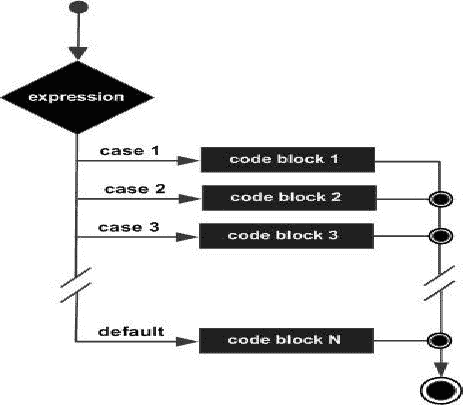
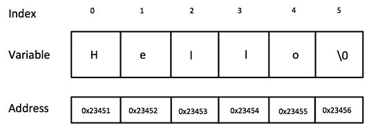

# C 语言编程指南：今天成为程序员

## 前言

如你所知，我们生活在一个计算机世界。仅仅学会如何使用计算机是不够的，因为与计算机的实际交互是通过编程实现的。本书将通过教你`c`语言编程，让你一天成为一名程序员，`c`是最古老、基础且最受欢迎的编程语言之一。

本书专为初学者定制（无编程概念基础）。

请耐心前行，成为一名程序员。

— MURTUZA CHAWALA

## 目录

1. 引言
2. 输入/输出操作
3. 决策与循环
4. 函数
5. 指针
6. 数组
7. 字符串
8. 自定义数据类型
9. C 程序

## 引言

`C`是一种通用编程语言，由`Denis Ritchie`于 1972 年在美国的`At’t bell laboratory`创建。

`C`是最早、最流行、最强大且最容易的编程语言之一。

计算机（数字系统）无法理解普通的英语，它只理解机器语言（二进制代码），即（`1s`和`0s`）。因此，`c`被用来告诉计算机具体要执行什么。

所有的软件、应用程序都是用某种编程语言（`C`、`C++`、`Java`等）编写的。

`Linux`（`Unix`）操作系统完全是用`c`语言编写的。

`C`也用于制作编译器、操作系统的内核。

`C`是一种编程语言，我们在手机、笔记本电脑等上的任何任务实际上都是通过编程（内置的，终端用户感知）完成的。

例如：每当按下按钮时，就会生成相应的代码，生成的代码随后由编译器进行编译。

`Compiler`（将编程代码转换为二进制代码（`1s,0s`））——该二进制代码被发送到`CPU`并在那里进行处理（二进制形式），然后从`CPU`发回显示器，二进制代码再次转换为输出形式（音频、十进制、照片等）。

这就是编程语言的工作原理。

### Q) `c`的优点是什么？

A)

1. `c`是最基础且最简单的编程语言之一，即它是成为程序员的第一步。
2. `c`是机器无关的，即`[(code)]`可以在任何计算机上运行。
3. 作为一种结构化和过程化的语言，它提供了层层递进的知识。
4. 使用`c`可以执行许多操作，而且它非常灵活（解决同一个问题的不同方法）。
5. 它既具有高级语言（`java`）的特征，又具有底层语言的特征。

## 需要学习编程

编写完美的代码是不够的，因为它是英语编写的，计算机无法理解，因此我们需要在应用程序中编写代码，以便于代码到二进制的翻译。

在线可以获取编译器（`turbo c`）。

建议你下载编译器，并在阅读本书的同时执行你的代码。

## C 程序

### Q) 打印 hello world 的 C 程序？

A)

```c
#include<stdio.h>
Void main()
{
    Printf“hello world”);
}
```

## C 概念（解释）

1. `#include`是一个预处理指令（稍后学习）。`<stdio.h>`是一个头文件，允许你执行一些内置函数（`printf`）。
2. `void main()`：每个`c`程序都从`main()`开始。`void`表示`main`函数不返回任何值。
3. `printf`：这是来自头文件`<stdio.h>`的内置函数，用于打印打印语句内部编写的任何内容。
4. `;`：这（分号）用于表示行的结束。`main()`函数中的每条语句（除循环等少数例外外），末尾都有一个`;`。

**注意：**

每个`c`程序都必须包含头文件`#include<stdio.h>`，因为没有它就无法执行`printf`（输出）和`scanf`（输入）函数。

`Main()`可以写为`void main()`或`int main()`，然后在最后`return 0`（空）。

**算法**：不包含语法的程序实际逻辑。

## 在开始编程之前，我们将首先学习 C 语言中的所有基础概念

### 1) 变量

它们是标识符，是赋值给某些值的符号名称。

例如：`int a;`

这里变量是`a`，它是一个整数（数字），可以存储某些值。

### 2) 常量

它也是一种标识符。

常量的值是固定的（与变量不同），在编程过程中不能更改。

例如：`int a=5;`

这里`a`是一个持有值`5`的常量。

### 3) 关键字

这些是编程中保留字，不能用作变量或常量，例如：`int`、`char`（数据类型）、`void`、`for`、`while`等。

### 4) 数据类型

它们是关键字，用于为变量分配类型。

#### 基本数据类型

1. `int`：它指定与其关联的变量持有数字。

   例如：`int a;`

   这意味着`a`将持有某些数字。

   **注意：格式说明符**

   如果我们想打印某些整数值，由于我们不能直接在`printf`语句中写变量名，我们使用`%d`。

   ```c
   main()
   {
       int a=5;
       printf("%d",a)
   }
   ```

   因此`%d`用于打印整数值。

2. `char`：它指定与其关联的变量持有单个字符。

   例如：`char a;`

   这意味着`a`将持有某些字符。

   格式说明符：`%c`。

3. `float`：它指定与其关联的变量持有浮点值（小数）。

   例如：`float a;`

   `a`将持有某些值。

   格式说明符：`%f`。

4. `void`：它告诉不持有任何值。

#### 其他数据类型

- `Long int`（4 字节）`%ld`
- `Unsigned int`（2 字节）`%u`
- `Double`（8 字节）`%lf`
- `Long double`（16 字节）`%Lf`

上述大小：

- 局部变量：在`main()`函数内部定义。
- 全局变量：在`main()`函数外部定义。

## 运算符

运算符是操作值或变量的符号。它们表示一种操作。例如：`+`、`->`、`<`。

### 运算符类型

运算符是告诉编译器执行特定数学或逻辑函数的符号。C 语言拥有丰富的运算符，并提供以下类型：

- 算术运算符
- 关系运算符
- 逻辑运算符
- 位运算符
- 赋值运算符
- 杂项运算符

### 算术运算符

下表显示了 C 支持的所有算术运算符。假设变量`A`持有 10，变量`B`持有 20，则：

[示例](https://www.tutorialspoint.com/cprogramming/c_arithmetic_operators.htm)

| 运算符 | 描述 | 示例 |
| :--- | :--- | :--- |
| `+` | 两个操作数相加 | `A + B = 30` |
| `-` | 第一个操作数减去第二个 | `A - B = -10` |
| `*` | 两个操作数相乘 | `A * B = 200` |
| `/` | 被除数除以除数 | `B / A = 2` |
| `%` | 取模运算符和整数除法的余数 | `B % A = 0` |
| `++` | 递增运算符整数值加一 | `A++ = 11` |
| `--` | 递减运算符值减一 | `A-- = 9` |

### 关系运算符

下表显示了 C 支持的所有关系运算符。假设变量`A`持有 10，变量`B`持有 20，则：

[示例](https://www.tutorialspoint.com/cprogramming/c_relational_operators.htm)

| 运算符 | 描述 | 示例 |
| :--- | :--- | :--- |
| `==` | 检查两个操作数的值是否相等。如果是，则条件为真 | `(A == B)`不为真 |
| `!=` | 检查两个操作数的值是否相等。如果值不相等，则条件为真 | `(A != B)`为真 |
| `>` | 检查左操作数的值是否大于右操作数的值。如果是，则条件为真。 | `(A > B)`为假。 |
| `<` | 检查左操作数的值是否小于右操作数的值。如果是，则条件为真。 | `(A < B)`为真。 |
| `>=` | 检查左操作数的值是否大于或等于右操作数的值。如果是，则条件为真。 | `(A >= B)`为假。 |
| `<=` | 检查左操作数的值是否小于或等于右操作数的值。如果是，则条件为真。 | `(A <= B)`为真。 |

## 逻辑运算符

下表显示了 C 语言支持的所有逻辑运算符。假设变量`A`的值为 1，变量`B`的值为 0，那么：

[显示示例](https://www.tutorialspoint.com/cprogramming/c_logical_operators.htm)

| 运算符 | 描述 | 示例 |
| :--- | :--- | :--- |
| `&&` | 称为逻辑与（AND）。如果两个操作数都非零，则条件为真。 | `(A && B)`为假。 |
| `||` | 称为逻辑或（OR）。如果两个操作数中任何一个非零，则条件为真。 | `(A || B)`为真。 |
| `!` | 称为逻辑非（NOT）。它用于反转其操作数的逻辑状态。如果条件为真，则逻辑非运算符将使其为假。 | `!(A && B)`为真。 |

## 赋值运算符

下表列出了 C 语言支持的赋值运算符：

[显示示例](https://www.tutorialspoint.com/cprogramming/c_assignment_operators.htm)

| 运算符 | 描述 | 示例 |
| :--- | :--- | :--- |
| `=` | 简单赋值运算符。将右侧操作数的值赋给左侧操作数 | `C = A + B`将将`A + B`的值赋给`C` |
| `+=` | 加并赋值运算符。它将右操作数加到左操作数上，并将结果赋给左操作数。 | `C += A`等同于`C = C + A` |
| `-=` | 减并赋值运算符。它从左操作数中减去右操作数，并将结果赋给左操作数。 | `C -= A`等同于`C = C - A` |
| `*=` | 乘并赋值运算符。它将右操作数乘以左操作数，并将结果赋给左操作数。 | `C *= A`等同于`C = C * A` |
| `/=` | 除并赋值运算符。它将左操作数除以右操作数，并将结果赋给左操作数。 | `C /= A`等同于`C = C / A` |
| `%=` | 取模并赋值运算符。它使用两个操作数取模，并将结果赋给左操作数。 | `C %= A`等同于`C = C % A` |
| `<<=` | 左移并赋值运算符。 | `C <<= 2`等于`C = C << 2` |
| `>>=` | 右移并赋值运算符。 | `C >>= 2`等于`C = C >> 2` |
| `&=` | 位与并赋值运算符。 | `C &= 2`等于`C = C & 2` |
| `^=` | 按位异或并赋值运算符。 | `C ^= 2`等于`C = C ^ 2` |
| `|=` | 按位或并赋值运算符。 | `C |= 2`等于`C = C | 2` |

## 其他运算符：`sizeof`和三元运算符

除了上述讨论的运算符外，C 语言还支持其他几个重要的运算符，包括`sizeof`和`? :`。

[显示示例](https://www.tutorialspoint.com/cprogramming/c_sizeof_operator.htm)

| 运算符 | 描述 | 示例 |
| :--- | :--- | :--- |
| `sizeof()` | 返回变量的大小。 | `sizeof(a)`，如果`a`是整数，将返回 4。 |
| `&` | 返回变量的地址。 | `&a`返回变量的实际地址。 |
| `*` | 指向变量的指针。 | `*a` |
| `? :` | 条件表达式。 | 如果条件为真`?`取值`X`，否则取出`Y` |

## C 中的运算符优先级

运算符优先级决定了表达式中项的分组，并决定了表达式如何求值。某些运算符的优先级高于其他运算符；例如，乘法运算符的优先级高于加法运算符。

例如，`x = 7 + 3 * 2;`在这里，`x`被赋值为 13 而不是 20，因为运算符`*`的优先级高于`+`，所以它先乘以`3*2`，然后加到 7。

### 操作数（OPERANDS）

执行操作的变量（或常量）。

例如：`a+b;`

`a`和`b`是操作数，`+`是运算符。

### 表达式（Expression）

表达式是运算符、操作数的组合。

例如：`a*b+c;`

是一个表达式。

### 两个数相加的简单 C 程序

```c
#include<stdio.h>

void main()
{
    int a=10,b=20,c;
    c=a+b;
    printf("%d",c);
}
```

注意：`//`表示注释，意味着该行代码将不会被执行（用于自我理解）。

### 解释

```c
#include<stdio.h>
// [ 包含头文件 stdio.h，这将允许我们使用 printf 语句。]
void main()
//[包含源代码且不返回任何值的函数]
{
// [开始源代码]
    int a=20,b=10,c;
//[ a 和 b 是值为 20, 10 的整数常量
// c 是一个整数变量，其值是未定义的。]
    c=a+b;
//[ 现在操作 c=30]
    printf("%d",c);
}
//[ 打印“%d”，即整数 c]
```

输出：

30.

## 第 2 章：输入/输出操作

每台计算机都有一个主要目标：接收数据作为输入，对其进行处理并向用户提供所需的输出。

同样，如果我们想执行一个 C 程序，我们需要输入一些值，提供一些处理信息（两个数相加），然后写输出语句。

I/O 操作大致分为两类：

1. **控制台 I/O 函数**：

   从键盘接收输入并打印输出函数。（例如：`printf`、`scanf`）

2. **文件 I/O 函数**：

   在软磁盘或磁盘上执行 I/O 操作的。

注意：大部分 C I/O 函数是通过控制台（`printf`）执行的。

### 控制台 I/O

#### 1) `printf()`函数

如前所述，`printf`是`<stdio.h>`头文件中的内置函数。

`printf`函数的作用是在执行期间打印输出。

例如：`printf("hello");`

如果我们想打印变量的值，则使用该变量的格式说明符。

例如：`a=4;`

`printf("%d",a);`

输出：4。

#### 2) `scanf()`函数

要从用户处读取数据，我们需要使用`scanf()`函数。

如果我们想存储变量`x`为 4，则使用`scanf`语句。在`scanf()`中我们使用变量的格式说明符，稍后使用`&`运算符将`x`存储在内存中。

例如：

```c
int a;
printf("enter value for a");
scanf("%d",&a);
```

### Q) 获取两个整数并相加的`c`程序

```c
#include<stdio.h>
void main()
{
    int a,b,c;
    printf("enter number 1");
    scanf("%d",&a);
    printf("enter number 2");
    scanf("%d",&b);
    c=a+b;
    printf("%d",c);
}
```

## 其他 I/O 函数

### `getchar()`和`putchar()`函数

`int getchar(void)`函数从屏幕读取下一个字符并作为整数返回。该函数每次读取单个字符。如果我们想从屏幕上读取多个字符，可以在循环中使用这种方法。

`int putchar(int c)`函数将传递的字符显示在屏幕上并返回相同的字符。该函数每次显示单个字符。如果我们想在屏幕上显示多个字符，可以在循环中使用这种方法。查看以下示例：

```c
#include <stdio.h>
int main() {
    int c;
    printf("Enter a value :");
    c = getchar();
    printf("\nYou entered: ");
    putchar( c );
    return 0;
}
```

当上述代码编译并执行时，它会等待你输入某些文本。当你输入文本并按回车时，程序将继续并读取单个字符，显示如下：

```text
$./a.out
Enter a value : this is test
You entered: t
```

## `gets()`和`puts()`函数

`char *gets(char *s)`函数从`stdin`读取一行到`s`指向的缓冲区，直到遇到终止换行符或 EOF（文件结束）。

`int puts(const char *s)`函数将字符串`s`及其末尾的一个换行符写入`stdout`。

```c
#include <stdio.h>
int main() {
    char str[100];
    printf("Enter a value :");
    gets(str);
    printf("\nYou entered: ");
    puts(str);
    return 0;
}
```

当上述代码编译并执行时，它会等待你输入文本。当你输入文本并按回车键后，程序将继续运行并读取整行直到结束，并显示如下：

`$./a.out Enter a value : this is test You entered: this is test`

# 第 3 章：决策

决策语句是 C 语言中最基础的概念之一。通过决策语句可以执行各种程序（任务）。这些语句可以帮助我们检查多个条件（可能性）并打印出所需的条件。它们也被称为选择语句或条件语句。

## 语句

### 1) `if`语句

它是 C 语言中一种条件语句，用于检查条件或控制语句的执行。它非常容易使用。

**语法**


```c
If(condition)
{
    Statements
}
```

在上述语法中，首先检查条件；如果为真，则程序控制流进入花括号并执行语句块。如果条件为假，则不执行语句。

**注意：**

`IF` 语句末尾不需要加分号。

**用例：**

```c
Int a =5;
If(a==5) // 无加分号
{
    Printf("condition is true");
}
```

**输出：**

Condition is true.

## 2) if-else 语句

该语句也非常有用，与 `if` 语句不同，它可以检查两个条件。

**语法：**

```c
If(condition)
{
    Statement(true);
}
else
{
    Statement(false);
}
```

**用例：**

```c
Int a =4;
If(a==3)
{
    Printf("condition is true");
}
Else
{
    Printf("condition is false");
}
```

**输出：**

Condition is false.

嵌套 `if` 语句

嵌套 `if-else` 语句

## 3) Switch 语句

`Switch` 语句是一种多重决策语句。当使用 `if-else` 条件检查多个条件时，程序的复杂性会增加。因此，为了解决这个问题，C 提供了 `switch` 语句。它用于高效地检查多个条件。



**语法：**

```c
Switch(expression)
{
    Case 1:
        Statements;
        Break;
    Case 2:Statements;
        Break;
    Case 3:Statements;
        Break;
    Case n:Statements;
        Break;
}
```

```c
#include <stdio.h>
int main () {
    /* 局部变量定义 */
    char grade = 'B';
    switch(grade) {
        case 'A':
            printf("Excellent!\n");
            break;
        case 'B':
        case 'C':
            printf("Well done\n");
            break;
        case 'D':
            printf("You passed\n");
            break;
        case 'F':
            printf("Better try again\n");
            break;
        default:
            printf("Invalid grade\n");
    }
    printf("Your grade is %c\n", grade);
    return 0;
}
```

当上述代码编译并执行时，它产生以下结果 −

Well done

Your grade is B

注意：`case` 标签应该是一个整数或字符。`switch` 中的每条语句都必须有一个 `break` 来退出 `case`，否则在执行完正确的 `case` 后，控制流将进入到下一个 `case` 并执行它；还有其他其他的条件语句，如嵌套 `if..else`、嵌套 `switch` 等。

# 第 4 章：循环

循环也是编程中的重要概念之一。循环被用于反复执行一组语句。循环内部的数据会一直执行，直到条件为假。它被用于编写条件。循环的执行可以通过以下方式完成：

1. 使用终止条件启动循环
2. 初始化变量并启动循环
3. 循环内部语句的执行
4. 变量的递增或递减（直到满足条件）

## 循环语句的类型

### 1) 入控制循环

也称为预测试循环。在这里，首先检查条件，然后评估内部的语句。`While` 和 `for` 是入控制循环，并被广泛使用。

#### A) while 循环

是一种入控制循环，用于重复执行语句块直到条件变为真。

**语法：**

```c
While(condition)
{
    Statement;
    Increment/decrement;
}
```

**算法：**

**用例：**

```c
A=3,b=5;
While(a<b)
    Print a;
    A++;
```

输出：3 4

#### B) For 循环

它比 `while` 循环更高效且有用。`for` 循环最重要的操作之一是可以同时采取三个操作，即：

A) 变量初始化

B) 条件检查

C) 变量的递增/递减。

**语法：**

```c
For(initialization;condition;incr/decr)
{
    Statements;
}
```

**用例：**

```c
A=3,i;
For(i=1;i<A;i++)
{
    Print(i)
}
```

输出：1 2

### 2) 出控制循环

#### A) do-while 循环

唯一的出控制循环。在这里首先执行语句，然后检查条件。它保证语句至少执行一次。常用于菜单驱动的程序（`switch case`）。

**语法：**

```c
Do
{
    Statements
}while(condition);
```

## 跳转语句

这些语句用于将控制流转移到另一个点。

### 1) Goto

该语句将控制流从一个点转移到另一个点。

**语法：**

```c
Goto label:
```

**用例：**

```c
N=4;
For(i=0;i<N;i++)
{
    Print(i);
    If(i==2)
        Goto here;
}
Here:
printf(y)
```

输出：01

### 2) Break

它是循环和 `switch` 语句中非常有用的跳转语句。用于跳出循环或 `switch` 语句。

**语法：**

```c
Break;
```

### 3) Continue

当需要根据条件跳过主体的部分内容时使用。如果条件为真并使用了 `continue` 语句，则控制流将直接回到循环开始。

**语法：**

```c
continue;
```

### 4) Exit()

这是一个简单的跳转语句，调用时会完全终止程序。

**语法：**

```c
exit();
```

# 第 5 章：函数

将一组语句组合在一个逻辑单元中称为函数。如前提到的，有两种类型：

### 1) 内置函数

代码不需要编写（包含在某些头文件中），例如：`printf(<stdio.h>)`

### 2) 用户定义函数

这些是用户为了实现某些特定任务而定义的语句集。

**函数的优点：**

1. 简单易用。
2. 函数将大代码块划分为易理解的小部分。
3. 调试（移除错误）变得更容易。
4. 在处理大型问题时有用。

## 如何使用函数

使用函数有三个部分：

1. 函数声明
2. 函数调用
3. 函数定义

### 1) 函数声明

如果要使用任何用户定义函数，必须先进行声明 [在 `main()` 之前更好]。

**语法：**

```c
datatype function_name(parameter)
```

**用例：** `int sum(int a,int b)`

**注意：** 这里的数据类型意味着函数将接收的值。

参数意味着主程序将要发送的变量（值）。

### 2) 函数调用

此语句将控制权从 `main()` 部分转移到 `main()` 外部的实际函数。

{基本上是调用函数}

**语法：**

`Function_name(parameters)`

**示例：**

`sum(a,b)`

（调用函数时参数不使用数据类型是可以的）

### 3) 函数定义

这是函数的主要部分。

它包含了所有要执行的代码。

它可以接受零、一个或多个输入，可能返回也可以不返回输出，但会对数据进行处理。

它包含一个头，其中包含函数名（之前已声明）和由步骤组成的体。

**语法：**

`Return datatype function_name(parameters)`

```c
{
    Statements/……
}
```

**注意：** 这里的 `return datatype` 表示返回给 `main` 程序的值（`int`、`char`）。

如果 `return type` 为 `void` 则不返回任何值。

函数声明和调用用于函数的声明和调用。

函数定义 `defintion` 用于数据处理程序。

```c
#include<stdio.h> 

void main() 
{ 
      int a,b; 
      clrscr(); 
      printf("Enter Two Number : "); 
      scanf("%d%d",&a,&b); 
      sum(a,b); 
      getch(); 
} 

      sum(int x,int y) 
  { 
      int z; 
      z=x+y; 
      printf("Sum of Two Number is : %d",z); 
      return 0; 
} 
```

**输出：**

Enter Two Number : 10 20

Sum of Two Number is : 30

## 函数可以通过两种方式调用

1. 值传递
2. 引用传递

### 值传递和引用传递的区别

| 值传递 | 引用传递 |
| :--- | :--- |
| 在值传递（call by value）中，实际参数的副本被传递给调用函数的形参数，在调用函数中对形参数进行的任何更改都不会影响调用函数中实际参数的值。 | 在引用传递（call by reference）中，实际参数存储的位置（地址）被传递给调用函数的形参数。这意味着通过访问实际参数的地址，我们可以在调用函数内部修改它们。 |
| 在值传递中，实际参数将保持安全，它们不会被意外修改。 | 在引用传递中，可以在调用函数内部对实际参数进行修改；因此代码必须小心处理参数，否则将得到意外的结果。 |

## 函数分类

1. 无返回值且无参数的函数
2. 无返回值有参数的函数
3. 有返回值且无参数的函数
4. 有返回值有参数的函数

## 存储类

指的是变量的作用范围以及存储该变量所分配的内存。

换句话说，它告诉我们变量具有哪些额外功能。

共有 4 种存储类：

1. `AUTO`
2. `REGISTER`
3. `STATIC`
4. `EXTERNAL`

### auto 存储类

`auto` 存储类是所有局部变量的默认存储类。

```c
{
     int mount;
     auto  int month;
}
```

上面的示例在同一个存储类中定义了两个变量。`'auto'` 只能在函数内部使用，即局部变量。

### register 存储类

`register` 存储类用于定义应该存储在寄存器而不是 RAM 中的局部变量。这意味着变量的最大大小等于寄存器的大小（通常为一个字），并且不能对其应用一元运算符 `&`（因为它没有内存位置）。

```c
{
     register  int  miles;
}
```

寄存器应仅用于需要快速访问的变量，例如计数器。还需要注意的是，定义为 `'register'` 并不意味着变量将会被存储在寄存器中。这意味着根据硬件和实现限制，它**可能**被存储在寄存器中。

### static 存储类

`static` 存储类指示编译器在程序的整个生命周期内保持局部变量的存在，而不是在每次进入和离开作用域时创建和销毁它。因此，将局部变量设为静态允许它们在函数调用之间保持其值。

`static` 修饰符也可以应用于全局变量。这样做时，会导致该变量的作用域被限制在声明它的文件中。

在 C 语言编程中，当在类数据成员上使用 `static` 时，它会导致该类的所有对象共享该成员的唯一副本。

### extern 存储类

`extern` 存储类用于声明对所有文件可见的变量。

当使用 `extern` 时，它指向之前定义过的变量。`extern` 修饰符最常声明变量或函数。

`extern` 存储类用于声明对所有文件可见的变量。`extern` 用于声明变量名。`extern` 在其他文件中使用。

## 递归

是一种编程技术，其中函数不断地调用自己。在使用递归时，程序员需要定义一个退出条件，否则将进入无限循环。

递归函数对于解决数学问题非常有用，例如计算数字的阶乘。

### 示例：使用递归计算数字的阶乘

```c
#include  <stdio.h>
long  int multiplyNumbers(int n);

int main () {
    int n;
    printf("Enter a positive integer: ");
    scanf("%d", &n);
    printf("Factorial of %d = %ld", n, multiplyNumbers(n));
    return  0;
}

long  int multiplyNumbers(int n){
    if (n >= 1)
        return n*multiplyNumbers(n-1);
    else
        return 1;
}
```

**输出：**

Enter a positive integer: 6

Factorial of 6 = 720

假设用户输入了 6。最初从 `main()` 函数调用 `multiplyNumbers()`。在每次递归调用中，`n` 的值都会减 1。当 `n` 的值小于 1 时，不再有递归调用。

# 第 6 章：指针

## 引言

指针是存储另一个变量地址的变量。指针增强了数据的动态处理。

指针是一个值为另一个变量的变量（即内存地址）。像任何变量或常量一样，在使用存储变量地址之前必须声明指针。指针变量声明的通用形式为：

`type *var-name;`

在这里，`type` 是指针的基本类型；它必须是有效的 C 数据类型，`var-name` 是指针变量的。声明指针使用的星号 `*` 与用于乘法的星号相同。但在该语句中，星号被用于将变量指定为指针。

## 如何使用指针？

```c
#include  <stdio.h>
int main () {
    int var  =  20; /* 实际变量声明 */
    int *ip; /* 指针变量声明 */
    ip =  &var; /* 将 var 的地址存储在指针变量中*/
    printf("Address of var variable: %x\n",  &var );
    /* 存储在指针变量中的地址 */
    printf("Address stored in ip variable: %x\n", ip );
    /* 使用指针访问值 */
    printf("Value of *ip variable: %d\n",  *ip );
    return  0;
}
```

当上述代码被编译并执行时，它产生以下结果 −

Address of var variable: bffd8b3c

Address stored in ip variable: bffd8b3c

Value of *ip variable: 20

C 语言允许将指针传递给函数。要实现这一点，只需将函数参数声明为指针类型即可。

以下是一个简单的示例，我们向函数传递一个 `unsigned long` 指针并修改函数内部的值，该更改会反映在调用函数中——

```c
#include <stdio.h>
#include <time.h>

void getSeconds(unsigned long *par);

int main ()  {
  unsigned long sec;
  getSeconds(&sec);
  /* 输出实际值 */
  printf("Number of seconds: %ld\n", sec );
  return 0;
}

void getSeconds(unsigned long *par)  {
  /* 获取当前秒数 */
  *par = time( NULL );
  return;
}
```

当上述代码编译并执行时，将产生以下结果 —

`Number of seconds :1294450468`

## 动态内存分配

这是运行时分配内存的过程。

在 C 语言中，在编译时不知道数组的确切大小，即编译器将你的代码编译成计算机可以理解的语言的时间。因此，有时数组的大小不足或多于所需。

动态内存分配允许你的程序在运行时获取更多内存空间，或者在不需要时释放它。

简单来说，动态内存分配允许你为程序处理程序的内存空间。

虽然 C 语言本身没有任何动态分配内存的技术，但在 `"stdlib.h"` 下有 4 个库函数用于动态内存分配。

| 函数 | 函数用途 |
| --- | --- |
| `malloc()` | 分配请求的字节数，并返回分配空间第一个字节的指针 |
| `calloc()` | 为数组元素分配空间，初始化为零，然后返回内存指针 |
| `free()` | 释放之前分配的空间 |
| `realloc()` | 更改之前分配的空间 own |

### malloc()

`malloc` 的名称代表 "memory allocation"（内存分配）。

`malloc()` 函数预留一块指定大小的内存，并返回一个 `void` 类型的指针 `pointer`，该指针可以转换为任何形式的指针。

### malloc() 的语法

```c
ptr = (cast-type*) malloc(byte-size)
```


在这里，`ptr` 是 `cast-type` 类型的指针。`malloc()` 函数返回一个大小为 `byte size` 的内存区域指针。如果空间不足，分配失败并返回 `NULL` 指针。

```c
ptr = (int*) malloc(100 * sizeof(int));
```

该语句将根据 `int` 的大小为 2 或 4 字节，分别分配 200 或 400 字节，指针指向内存第一个字节的地址。

### `calloc()`

`calloc` 的名称代表 "contiguous allocation"（连续分配）。

`malloc()` 和 `calloc()` 唯一的区别是，`malloc()` 分配单块内存，而 `calloc()` 分配多个相同大小的内存块，并将所有字节设置为零。

### `calloc()` 的语法

```c
ptr = (cast-type*)calloc(n, element-size);
```

该语句在内存中为一个包含 `n` 个元素的数组分配连续空间。例如：

```c
ptr = (float*) calloc(25, sizeof(float));
```

该语句在内存中为一个包含 25 个元素的数组分配连续空间，每个元素的大小为 `float`，即 4 字节。

### `free()`

使用 `calloc()` 或 `malloc()` 创建的动态分配内存不会自动释放。你必须显式使用 `free()` 来释放空间。

### `free()` 的语法

```c
free(ptr);
```

该语句释放 `ptr` 所指向内存中所分配的空间。

### C `realloc()`

如果之前分配的内存不足或多于所需，你可以使用 `realloc()` 更改之前内存的大小。

### `realloc()` 的语法

```c
ptr = realloc(ptr, newsize);
```

在这里，`ptr` 被重新分配大小为 `newsize` 的空间。

编写一个 C 程序来计算用户输入的 `n` 个元素的和。为了执行此程序，请使用 `malloc()` 函数动态分配内存。

```c
#include <stdio.h>
#include <stdlib.h>

int main(){
  int num, i, *ptr, sum = 0;
  printf("Enter number of elements: ");
  scanf("%d", &num);
  ptr = (int*) malloc(num * sizeof(int)); // 使用 malloc 分配内存
  if(ptr == NULL)
  {
    printf("Error! memory not allocated.");
    exit(0);
  }
  printf("Enter elements of array: ");
  for(i = 0; i < num; ++i)
  {
    scanf("%d", ptr + i);
    sum += *(ptr + i);
  }
  printf("Sum = %d", sum);
  free(ptr);
  return 0;
}
```

# 第 7 章：数组与字符串

数组是一种在单一名称下包含一组元素的数据结构。

一种可以减少时间并有助于循环语句的非常有用的技术：

与其声明单个变量（如 `number0`、`number1`、……以及 `number99`），你声明一个数组变量（如 `numbers`），并使用 `numbers[0]`、`numbers[1]` 以及…… `numbers[99]` 来表示单个变量。数组中的特定元素通过索引访问。

所有数组由连续的内存位置组成。最低地址对应第一个元素。

# 数组与字符串

数组是一种在单一名称下包含一组元素的数据结构。

一种可以减少时间并有助于循环语句的非常有用的技术：

与其声明单个变量（如 `number0`、`number1`、……以及 `number99`），你声明一个数组变量（如 `numbers`），并使用 `numbers[0]`、`numbers[1]` 以及…… `numbers[99]` 来表示单个变量。数组中的特定元素通过索引访问。

所有数组由连续的内存位置组成。最低地址对应第一个元素。

# 数组与字符串

数组是一种在单一名称下包含一组元素的数据结构。

（此处重复略）

## 字符串

字符串本质上是字符数组。

字符串实际上是一个一维字符数组，以 `null` 字符 `'\0'` 终止。因此，一个空字符终止的字符串包含了组成字符串的字符，随后紧跟一个 `null` 字符。

下面的声明和初始化创建了一个由 "Hello" 单词组成的字符串。为了在数组末尾保留空字符，包含字符串的字符数组的大小比 "Hello" 单词中的字符数多一个。

```c
char greeting[6] = {'H', 'e', 'l', 'l', 'o', '\0'};
```

如果你遵循数组初始化的规则，可以按照如下方式编写上述语句：

```c
char greeting[] = "Hello";
```

以下是上述定义的字符串在 C/C++ 中的内存表示形式：



实际上，你不需要在字符串常量的末尾放置 `null` 字符。C 编译器在初始化数组时会自动在字符串末尾放置 `'\0'`。让我们尝试打印上述的字符串：

```c
#include <stdio.h>

int main () {
 char greeting[6] = {'H', 'e', 'l', 'l', 'o', '\0'};
   printf("Greeting message: %s\n", greeting );
   return 0;
}
```

当上述代码编译并执行时，它会产生以下结果：

```
Greeting message: Hello
```

C 支持多种处理空字符终止字符串的函数：

| S.N. | 函数及用途 |
| :--- | :--- |
| 1 | `strcpy(s1, s2);` 将字符串 `s2` 复制到字符串 `s1`。 |
| 2 | `strcat(s1, s2);` 将字符串 `s2` 接到字符串 `s1` 的末尾。 |
| 3 | `strlen(s1);` 返回字符串 `s1` 的长度。 |
| 4 | `strcmp(s1, s2);` 如果 `s1` 和 `s2` 相同返回 0；如果 `s1<s2` 则返回小于 0 的值；如果 `s1>s2` 则返回大于 0 的值。 |
| 5 | `strchr(s1, ch);` 返回字符 `ch` 在字符串 `s1` 中第一次出现处的指针。 |
| 6 | `strstr(s1, s2);` 返回字符串 `s2` 在字符串 `s1` 中第一次出现处的指针。 |

所有这些函数都可以通过标准头文件 `<string.h>` 访问。

### 示例：不使用 `strlen()` 函数计算字符串长度

```c
#include <stdio.h>
int main(){
 char s[1000], i;
    printf("Enter a string: ");
    scanf("%s", s);
 for(i = 0; s[i] != '\0'; ++i);
    printf("Length of string: %d", i);
 return 0;
}
```

**输出**

```
Enter a string: Programiz

Length of string: 9
```

### 在字符串中搜索字符出现次数的 C 程序

```c
#include<stdio.h>
#include<conio.h>
int main() { 
 char str[20], ch; 
 int count = 0, i; 
 printf("\nEnter a string : "); scanf("%s", &str); 
 printf("\nEnter the character to be searched : "); scanf("%c", &ch); 
 for (i = 0; str[i] != '\0'; i++) { 
      if (str[i] == ch) count++; 
 } 
 if (count == 0) 
      printf("\nCharacter '%c'is not present", ch); 
 else 
      printf("\nOccurence of character '%c' : %d", ch, count); 
 return (0);
}
```

```c
d3->feet = d1.feet + d2.feet;
d3->inch = d1.inch + d2.inch;
if (d3->inch >= 12) { /* 如果 inch 大于或等于 12，则将其转换为 feet。 */
    d3->inch -= 12;
    ++d3->feet;
}
```

## UNION 体

`union` 是 C 语言中一种特殊的数据类型，允许在同一内存位置存储不同的数据类型。你可以定义一个包含许多成员的 `union`，但在任何时刻只有一个成员可以包含值。联合体提供了一种利用同一内存位置进行多用途的有效方法。

### 定义联合体

要定义联合体，你必须以类似于定义结构体（structure）的方式使用 `union` 语句。`union` 语句为程序定义了一个具有多个成员的新数据类型。`union` 语句的格式如下：

```c
Union name
{
    Datatype name;
    Datatype name;
};
```

`union` 和结构体相同，区别在于 `union` 的成员使用相同的内存，而结构体的每个成员都会占用独立的空间。

结构体和联合体的区别在于：

1. 存储结构体变量所需的内存量是所有成员大小之和。相反，在联合体的情况下，所需的内存量始终等于其最大成员所需的内存。
2. 在结构体中，每个成员都有自己的内存空间，但在 `union` 中，一个内存块被联合体的所有成员共享。

### 详细示例

| | |
| :--- | :--- |
| 123456 | `struct stu{ char c; int l; float p;};` |
| 123456 | `union emp{ char c; int l; float p;};` |

在上面的示例中，结构体 `stu` 的大小为 7，联合体 `emp` 的大小为 4。

# 第 9 章：C 程序

## 两个数相乘程序

```c
#include <stdio.h>
int main(){
    double firstNumber, secondNumber, productOfTwoNumbers;
    printf("Enter two numbers: ");
    // 分别将两个浮点数存储在变量 firstNumber 和 secondNumber 中
    scanf("%lf %lf", &firstNumber, &secondNumber); 
    // 执行乘法并将结果存储在变量 productOfTwoNumbers 中
    productOfTwoNumbers = firstNumber * secondNumber; 
    // 使用 %.2lf 显示保留两位小数位的结果
    printf("Product = %.2lf", productofTwoNumbers);
    return 0;
}
```

输出：

```text
Enter two numbers: 2.4
1.12
Product = 2.69
```

## 检查奇奇数的程序

```c
#include <stdio.h>
int main(){
    int number;
    printf("Enter an integer: ");
    scanf("%d", &number);
    // 如果数字能被 2 整除则为真
    if(number % 2 == 0)
        printf("%d is even.", number);
    else
        printf("%d is odd.", number);
    return 0;
}
```

输出：

```text
Enter an integer: -7
-7 is odd.
```

## 打印 ASCII 值程序

```c
#include <stdio.h>
int main(){
    char c;
    printf("Enter a character: ");
    // 从用户处读取字符输入
    scanf("%c", &c); 
    // %d 显示字符的整数值
    // %c 显示实际字符
    printf("ASCII value of %c = %d", c, c);
    return 0;
}
```

输出：

```text
Enter a character: G
ASCII value of G = 71
```

## 质数程序

```c
#include <stdio.h>
int main(){
    int n, i, flag = 0;
    printf("Enter a positive integer: ");
    scanf("%d",&n);
    for(i=2; i<=n/2; ++i)
    {
        // 非质数的条件
        if(n%i==0)
        {
            flag=1;
            break;
        }
    }
    if (flag==0)
        printf("%d is a prime number.",n);
    else
        printf("%d is not a prime number.",n);
    return 0;
}
```

输出：

```text
Enter a positive integer: 29
29 is a prime number.
```

## 示例：闰年程序

```c
#include <stdio.h>
int main(){
    int year;
    printf("Enter a year: ");
    scanf("%d",&year);
    if(year%4 == 0)
    {
        if( year%100 == 0)
        {
            // 年能被 400 整除，因此该年份是闰年
            if ( year%400 == 0)
                printf("%d is a leap year.", year);
            else
                printf("%d is not a leap year.", year);
        }
        else
            printf("%d is a leap year.", year );
    }
    else
        printf("%d is not a leap year.", year);
    return 0;
}
```

输出 1：

```text
Enter a year: 1900
1900 is not a leap year.
```

输出 2：

```text
Enter a year: 2012
2012 is a leap year.
```
