# C 语言，ANSI C

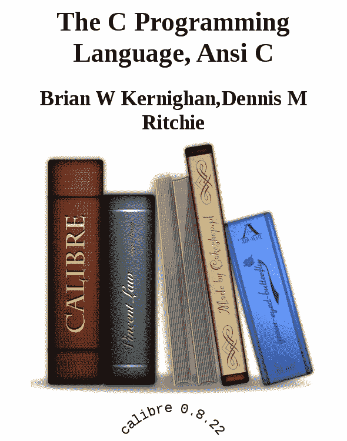

- 前言
- 第一版序言
- 引言

## 第一章：教程简介

- 入门
- 变量与算术表达式
- `for` 语句
- 符号常量
- 字符输入与输出
  - 文件复制
  - 字符计数
  - 行计数
  - 单词计数
- 数组
- 函数
- 参数：按值传递
- 字符数组
- 外部变量与作用域

## 第二章：类型、运算符与表达式

- 变量名
- 数据类型与大小
- 常量
- 声明
- 算术运算符
- 关系运算符与逻辑运算符
- 类型转换
- 自增与自减运算符
- 位运算符
- 赋值运算符与表达式
- 条件表达式
- 优先级与求值顺序

## 第三章：控制流

- 语句与块
- `If-Else`
- `Else-If`
- `Switch`
- 循环：`While` 和 `For`
- 循环：`Do-While`
- `Break` 与 `Continue`
- `Goto` 与标签

## 第四章：函数与程序结构

- 函数基础
- 返回非整数的函数
- 外部变量
- 作用域规则
- 头文件
- 静态变量
- 寄存变量
- 块结构
- 初始化
- 递归
- C 预处理器
  - 文件包含
  - 宏替换
  - 条件包含

## 第五章：指针与数组

- 指针与地址
- 指针与函数参数
- 指针与数组
- 地址算术
- 字符指针与函数
- 指针数组；指针的指针
- 多维数组
- 指针数组的初始化
- 指针对比多维数组
- 命令行参数
- 函数指针
- 复杂的声明

## 第六章：结构体

- 结构体基础
- 结构体与函数
- 结构体数组
- 结构体指针
- 自引用结构体
- 查找
- `Typedef`
- 联合体
- 位域字段

## 第七章：输入与输出

- 标准输入与输出
- 格式化输出：`printf`
- 变长度列表
- 格式化输入：`scanf`
- 文件访问
- 错误处理：`stderr` 和 `Exit`
- 行输入与输出
- 杂项函数
  - 字符串操作
  - 字符测试与转换
  - `getc`
  - 执行
  - 目录
  - 内存管理
  - 随机数生成

## 第八章：UNIX 系统

- 文件描述符
- 低级 I/O：`Read` 和 `Write`
- `Open`、`Creat`、`Unlink`
- 文件定位：`seek`
- 关于 `fopen` 的实现
- 关于目录的操作
- 关于分配

## 附录 A：参考手册

- 引言
- 约定
- 符号
- 标识符的含义
- 对象与值
- 转换
- 表达式
- 声明
- 语句
- 外部声明
- 作用域与链接
- 预处理器
- 文法

## 附录 B：标准库

- 输入与输出：`stdio.h`
  - 文件操作
  - 格式化输出
  - 格式化输入
  - 字符输入与输出
  - 直接输入与输出
  - 文件定位
  - 错误处理
- 字符测试与转换
  - 字符串操作
  - `getc`
  - 执行
  - 目录
  - 内存管理
  - 随机数生成
- 数学函数：`math.h`
- 工具函数：`stdlib.h`
- 诊断：`assert.h`
- 变长度列表：`stdarg.h`
- 非局部跳转
- 信号：`signal.h`
- 日期与时间函数
- 实现限制：`limits.h` 和 `float.h`

## 附录 C：变更摘要

***

索引——第一版序言

***

# 前言

自 1978 年《C 程序语言》出版以来，计算世界经历了一场革命。大型计算机变得巨大，而个人计算机的能力已足以媲美十年前的主机。在此期间，C 语言也发生了变化，尽管变化很小，它的应用早已远超最初作为 UNIX 操作系统语言的起源。

C 语言的日益普及、多年来的变化，以及由设计之外的创建的编译器，共同证明了该语言需要一个更精确、更现代的定义，而非本书第一版所提供的。1983 年，美国国家标准协会（ANSI）成立了一个委员会，其目标是在保留 C 语言精神的同时，“产生一种无歧且与机器无关的语言定义”。其结果就是 ANSI C 标准。

该标准规范了第一版中暗示但未描述的构造，特别是结构体赋值和枚举。它提供了一种新的函数声明形式，允许在定义和使用之间进行交叉检查。它规定了一个标准库，包含了一系列广泛用于执行输入输出、内存管理、字符串处理及类似任务的函数。它精确化了原始定义中未说明的特行为，同时也明确陈述了语言的哪些方面仍然依赖于机器。

本版《C 语言程序》（The C Programming Language）描述了根据 ANSI 标准定义的 C 语言。尽管我们指出了语言发生演变之处，但我们选择完全使用新形式进行书写。在大多数情况下，这并没有产生显著区别；最可见的改变是函数声明和定义的新形式。现代编译器已经支持该标准的大多数特性。

我们努力保留第一版的简洁性。C 并不是一门大语言，厚书并不适合它。我们改进了对 C 编程至关重要的关键特性（例如 `pointers` 指针）的阐述。我们完善了原始示例，并在几个章节中添加了新示例。例如，对于复杂声明的处理，通过将声明转换为单词以及反之然的程序得到了增强。与以前一样，所有示例都已直接从文中经过测试，文中内容是机器可读的格式。

附录 A 是参考手册，它并不是标准，而是我们尝试在更小的空间内传递标准的精髓。它是为了让程序员易理解，而不是作为编译器编写者的定义——这一角色应当属于标准本身。附录 B 是标准库功能的总结。它同样是为了供程序员参考，而不是实现者。附录 C 是相对于原始版本更改的简洁总结。

正如我们在第一版序言中所说的，“C 随着使用经验的增长而愈发耐用”。在增加了十年的经验后，我们依然认为如此。我们希望这本书帮助你学习 C 并用好它。

我们深谢那些帮助我们制作第二版的朋友们。Jon Bently、Doug Gwyn、Doug McIlroy、Peter Nelson 和 Rob Pike 对草稿手的几乎每一页都给出了敏锐的意见。我们感谢 Al Aho、Dennis Allison、Joe Campbell、G.R. Emlin、Karen Fortgang、Allen Holub、Andrew Hume、Dave Kristol、John Linderman、Dave Prosser、Gene Spafford 和 Chris van Wyk 的仔细阅读。我们还收到了 Bill Cheswick、Mark Kernighan、Andy Koenig、Robin Lake、Tom London、Jim Reeds、Clovis Tondo 和 Peter Weinberger 的有用建议。Dave Prosser 回答了许多关于 ANSI 标准的细节。我们广泛使用了 Bjarne Stroustrup 的 `C++` 翻译器对程序进行本地测试，Dave Kristol 为我们提供了一个 ANSI C 编译器进行最终测试。Rich Drechsler 在排版方面提供了极大帮助。

诚挚感谢所有人。

Brian W. Kernighan

Dennis M. Ritchie

***

索引——第一版序言

***

由 `tmdcjsl(skidrow8123@hotmail.com)` 编译

***

***

返回序言——索引——引言

***

# 第一版序言

C 是一种通用编程语言，具有表达式简洁、现代化的流控制和数据结构以及丰富的运算符集等特性。C 并不是一门“极高级”语言，也不是一门“大”语言，并且不专门任何特定的应用领域。但它缺乏限制且具有通用性，使其在处理许多任务时比那些所谓的更强大的语言更方便、更有效。

C 最初是由 Dennis Ritchie 为 `DEC PDP-11` 上的 `UNIX` 操作系统设计并实现的。该操作系统、C 编译器以及本质上所有的 UNIX 应用程序（包括准备此书使用的所有软件）都是用 C 语言编写的。其他几台机器也存在生产级编译器，包括 `IBM System/370`、`Honeywell 6000` 和 `Interdata 8/32`。然而，C 并不绑定到任何特定的硬件或系统，编写可以在任何支持 C 的机器上无需更改即可运行的程序很容易。

这本书旨在帮助读者学习如何用 C 语言编程。它包含一个让新用户尽可能快速入门的教程式介绍、每个主要特性的独立章节，以及一份参考手册。大部分内容基于对示例的阅读、编写和修改，而非仅仅是规则的陈述。在大多数情况下，示例是完整的程序而非孤立的片段。所有示例都已直接从文中经过测试，文中内容是机器可读的格式。除了展示如何有效利用这门语言外，我们还尽可能说明有用的算法以及良好的风格和稳健的设计原则。

这本书并不是一本入门编程手册；它假设读者对基础编程概念如 `variables` 变量、`assignment statements` 赋值语句、`loops` 循环和 `functions` 函数熟悉。尽管如此，新手程序员应该能够阅读并学会这门语言，尽管更有见识的同事指导会有帮助。

根据我们的经验，C 证明对于各种程序来说都是一种令人愉快、富有表现力且多功能的语言。它很容易学习，并且随着使用经验的增长而愈发耐用。我们希望这本书帮助你用好它。

许多朋友和同事的深思批评和建议极大丰富了这本书，也增加了我们写作的乐趣。特别是 Mike Bianchi、Jim Blue、Stu Feldman、Doug McIlroy Bill Roome、Bob Rosin 和 Larry Rosler 都仔细阅读了多个卷。我们感谢 Al Aho、Steve Bourne、Dan Dvorak、Chuck Haley、Debbie Haley、Marion Harris、Rick Holt、Steve Johnson、John Mashey、Bob Mitze、Ralph Muha、Peter Nelson、Elliot Pinson、Bill Plauger、Jerry Spivack、Ken Thompson 和 Peter Weinberger 在不同阶段提供的有用意见，感谢 Mile Lesk 和 Joe Ossanna 在排版方面提供的无价帮助。

Brian W. Kernighan

Dennis M. Ritchie

***

返回序言——索引——引言

***

由 `tmdcjsl(skidrow8123@hotmail.com)` 编译

***

***

返回第一版序言——索引——第一章

***

# 引言

C 是一种通用编程语言。它与与其开发的 `UNIX` 操作系统密切相关，因为该系统以及运行其上的大多数程序都是用 C 语言编写的。然而，该语言并不绑定任何特定的操作系统或机器；尽管它因编写编译器和操作系统有用而被称为“系统编程语言”，但它同样适用于编写许多不同领域的主要程序。

C 的许多重要思想源于 Martin Richards 开发的 `BCPL` 语言。BCPL 对 C 的影响通过 Ken Thompson 在 1970 年为 `DEC PDP-7` 上的第一个 `UNIX` 系统编写的 B 语言间接实现。

BCPL 和 B 是“无类型”语言。相比之下，C 提供了多种数据类型。基本类型是字符，以及几种尺寸的整数和浮点数。此外，还有通过 `pointers` 指针、`arrays` 数组、`structures` 结构和 `unions` 联合的派生数据类型层次。表达式由运算符和操作数组成；任何表达式（包括赋值或函数调用）都可以作为语句。指针提供了与机器无关的地址算术。

C 提供了良好结构程序所需的各种流控制结构：语句分组、决策（`if-else`）、从一组可能的值中选择（`switch`）、在顶部进行终止测试的循环（`while, for`）或底部的（`do`），以及提前退出循环（`break`）。

函数可以返回基本类型、结构体、联合体或指针的值。任何函数都可以被递归调用。局部变量通常是“自动的”，即在每次调用时重新创建。函数定义不能嵌套，但变量可以以块结构的方式声明。C 程序的函数可能存在于不同的源文件中，并对它们进行单独编译。变量可以是函数内部的，可以是外部但仅在单个源文件中可见的，也可以对整个程序可见。

预处理步骤会对程序文本进行宏替换、包含其他源文件以及进行条件编译。

C 是一种相对“低级”的语言。这种特征并不是贬义的；它仅仅意味着 C 处理的对象与大多数计算机处理的对象是同一类，即字符、数字和地址。这些对象可以通过实际机器实现的算术和逻辑运算符进行组合和移动。

C 没有提供直接处理复合对象（如字符字符串、集合、列表或数组）的操作。没有可以操作整个数组或字符串的操作，尽管结构体可以作为一个单元进行拷贝。该语言除了静态定义和函数局部变量提供的栈管理机制外，没有定义任何存储分配设施；既没有堆，也没有垃圾回收机制。最后，C 本身不提供输入/输出设施；没有 `READ` 或 `WRITE` 语句，也没有内置的文件访问方法。所有这些高级机制都必须通过显式调用的函数提供。

## 特性与演变

同样，C 仅提供简单的单线程控制流：测试、循环、分组和子程序，但不支持多程序设计、并行操作、同步或协程。

尽管缺少其中一些功能可能看起来是一个严重的缺陷（“你的意思是我必须调用函数来比较两个字符字符串？”），但将语言保持在适中的规模具有真正的益处。由于 C 相对较小，可以在很的空间内描述，并被快速学习。程序员可以合理地预期知道、理解并实际上经常使用整个语言。

多年来，C 的定义一直是《C 语言程序》（The C Programming Language）第一版的参考手册。1983 年，美国国家标准协会（ANSI）建立了一个委员会，为 C 提供一个现代、全面的定义。所得定义即 ANSI 标准或“ANSI C”，于 1988 年底完成。该标准的大部分功能已得到现代编译器的支持。

标准基于原始的参考手册。语言的变化非常小；标准的目标之一是确保大多数现有程序保持有效，或者在失败的情况下，编译器能够对新行为产生警告。

对于大多数程序员来说，最重要的变化是声明和定义函数的新语法。函数声明现在可以包含对函数参数的描述；定义语法也随之发生了变化。这些额外信息使得编译器更容易检测到由参数不匹配引起的错误；根据我们的经验，这是语言中一个非常实用的补充。

还有其他小规模的语言变化。此前广泛使用的结构体赋值和枚举现在正式成为语言的一部分。浮点数计算现在可以以单精度进行。算术的属性（特别是对于无符号类型）得到了澄清。预处理器变得更加详尽。这些变化中的大多数对大多数程序员来说只会产生细微影响。

## ANSI 标准库

该标准的第二个重大贡献是定义了一个随 C 语言的库。它规定了访问操作系统的函数（例如，读取和写入文件）、格式化输入/输出、内存分配、字符串处理等。一组标准头文件提供了对数据类型中函数声明的统一访问。使用此库与宿主系统交互的程序可以确保行为兼容。该库的大部分紧密参考了 UNIX 系统的“标准 I/O 库”。该库在第一版中就描述过，并在其他系统中也被广泛使用。再次，大多数程序员不会看到太大变化。

由于 C 提供的数据类型和控制结构被大多数计算机直接支持，因此实现自包含程序所需的运行时库非常小。标准库函数仅被显式调用，因此如果不需要就可以避免它们。大多数函数可以用 C 语言编写，除了它们所隐藏的操作系统细节外，本身都是可移植的。

## 可移植性与类型安全

尽管 C 匹配许多计算机的能力，但它独立于任何特定的机器架构。只要留心，很容易编写出可移植的程序，即可以在各种硬件上无需更改即可运行的程序。标准将移植性问题明确，并规定了一组描述程序运行机器特征的常量。

C 不是一种强类型语言，但随着它的演变，其类型检查得到了加强。C 的原始定义反对但允许指针和整数之间的交换；这种现象早已被消除，标准现在要求执行良好的编译器已经强制要求的正确声明和显式转换。新的函数声明是这一方向迈出的又一步。编译器将对大多数类型错误发出警告，且不兼容的数据类型之间不会进行自动转换。尽管如此，C 仍然保留了程序员知道自己在做什么的基本哲学；它只需要程序员显式地声明自己的意图。

C 像任何其他语言一样也有其缺陷。某些运算符的优先级是错误的；某些语法部分可以更好。尽管如此，C 已证明是一种对于各种编程应用都极为有效且表达力丰富的语言。

## 书籍结构

本书的结构如下：第 1 章是 C 语言核心部分的教程。其目的是让读者尽可能快开始，因为我们深信学习一种新语言的方法是用该语言来编写程序。该教程假设读者对编程的基本元素具有操作性知识；不会解释计算机、编译，也不会解释如 `n=n+1` 等表达式的含义。

第 2 章到第 6 章将比第 1 章更详细、也更正式地讨论 C 的各个方面，尽管重点仍然是完整程序的示例，而不是孤立的片段。第 2 章处理基本数据类型、运算符和表达式。第 3 章涉及控制流：`if-else`、`switch`、`while`、`for` 等。第 4 章涵盖了函数和程序结构——外部变量、作用域规则、多个源文件等——也触及了预处理器。第 5 章讨论了指针和地址算术。第 6 章涵盖了结构体和联合体。

第 7 章描述了标准库，它提供了访问操作系统的通用接口。该库由 ANSI 标准定义，旨在由所有支持 C 的机器支持，因此使用它进行输入、输出和其他操作系统访问的程序可以在不同系统之间迁移而无需更改。

第 8 章描述了 C 程序与 UNIX 操作系统之间的接口，重点关注输入/输出、文件系统和存储分配。虽然本章的某些内容专门针对 UNIX 系统，但使用其他系统的程序员仍能在此处找到有用的材料，包括对某个版本标准库实现的一些见解，以及关于可移植性的建议。

附录 A 包含语言参考手册。C 语言语法和语义的官方陈述是 ANSI 标准本身。然而，该文档首要目的是为编译器编写者提供的。这里的参考手册更简洁地传达了语言定义，且没有采用同样的法律化风格。附录 B 是标准库的摘要，同样面向用户而非实现者。附录 C 是原始语言更改的简要总结。然而，在有疑问的情况下，标准和你自己的编译器仍然是该语言的最终权威。

返回第一版序言——索引——返回第 1 章

由 `tmdcjsl(skidrow8123@hotmail.com)` 编译

返回引言——索引——返回第 2 章

# 第 1 章：教程介绍


让我们从 C 语言的快速介绍开始。我们的目标是在真实程序中展示语言的要素元素，但不会陷入细节、规则和异常中。在此时，我们并不试图做到完整，甚至不是精确（只需确保示例是正确的即可）。我们希望尽可能地让你达到可以编写有用程序的程度，为了做到这一点，我们必须专注于基础知识：变量和常量、算术、控制流、函数以及输入/输出的基本要素。我们刻意在这一章中省略了编写大型程序时重要的 C 特性。这些包括指针、结构体、C 丰富的运算符集、几个控制流语句以及标准库。

这种方法及其缺点。最值得注意的是，这里没有找到任何特定特性的完整介绍，而且教程由于其简短，可能具有误导性。由于示例没有使用 C 的全部功能，因此可能没有像预期的那样简洁优雅。我们已尝试减少这些影响，但请注意。另一个缺点是，随后的章节将不可避免地重复本章的一些内容。我们希望这种重复对你的帮助多于困扰。

无论如何，经验丰富的程序员应该能够从本章的材料中推导出自己的编程需求。初学者应该通过编写自己的小型类似程序来作为补充。这两组人都可以将其作为一个框架，用来挂载第 2 章开始的更详细描述。

## 1.1 入门

学习新编程语言的唯一方法是用它编写程序。要写的第一个程序对所有语言都是相同的：

*打印这些词*

`hello, world`

这是一个巨大的障碍；要跨越它，你必须能够在某处创建程序文本、成功编译它、加载它、运行它，并找到你的输出去了哪里。掌握了这些机械细节，其他一切都相对简单。

在 C 中，打印`hello, world`的程序是：

```c
#include <stdio.h>

main()
{
  printf("hello, world\n");
}
```

如何运行这个程序取决于你使用的系统。作为一个具体的例子，在 UNIX 操作系统上，你必须以`.c`结尾的文件创建程序，例如`hello.c`，然后用命令编译它：

```bash
cc hello.c
```

如果你没有弄错任何地方（例如漏掉一个字符或拼写错误），编译将静默进行，并创建一个名为`a.out`的可执行文件。如果你通过输入命令运行`a.out`：

```bash
a.out
```

它将打印：

```text
hello, world
```

在其他系统上，规则会有不同；请咨询当地专家。

现在，对程序本身进行解释。一个 C 程序无论大小如何，都由函数和变量组成。函数包含语句，指定要执行的计算操作，而变量存储计算过程中使用的值。C 函数类似于 Fortran 中的子程序和函数，或者 Pascal 中的过程和函数。我们的示例是一个名为`main`的函数。通常情况下，你可以自由地给函数任何你喜欢的名称，但`main`是特殊的——你的程序从`main`开始开始执行。这意味着每个程序必须在某处有一个`main`。

`main`通常会调用其他函数来帮助完成工作，其中一些是你写的，另一些是提供的库函数。程序的第一行：

```c
#include <stdio.h>
```

告诉编译器包含标准输入/输出库的信息；该行出现在许多 C 源文件的开头。标准库在第 7 章和附录 B 中描述。

函数之间通信数据的方法一种是调用函数向它调用的函数提供一个值列表，称为参数。函数名后的括号包围着参数列表。在这个示例中，`main`被定义为一个不接受参数的函数，这通过空列表`()`表示。

```c
#include <stdio.h>                  包含关于标准库的信息

main()                               // 定义一个名为 main 的函数
                                    // 它不接收参数值
{                                   // main 的语句括在大括号中
    printf("hello, world\n");       // main 调用库函数 printf
                                    // 打印这一序列字符
}                                   // \n 代表换行符
```

### 第一个 C 程序

函数的语句被括在大括号`{}`中。函数`main`只包含一条语句：

```c
printf("hello, world\n");
```

通过命名函数并跟上带括号的参数列表来调用函数，因此这是带参数`"hello, world\n"`的调用`printf`函数。`printf`是一个打印输出的库函数，在这种情况下是引号之间的字符字符串。

双引号中的字符序列，如`"hello, world\n"`，被称为字符字符串或字符串常量。目前，我们对字符字符串的唯一用途是作为`printf`和其他函数的参数。

字符串中的序列`\n`是 C 中换行符的表示法，打印时它会将输出移动到下一行的左边距。如果你漏掉`\n`（这是一个值得尝试的实验），你会发现输出打印后没有换行。你必须使用`\n`在`printf`参数中包含一个换行符；如果你尝试类似这样的：

```c
printf("hello, world
   ");
```

C 编译器将产生错误信息。

`printf`永远不会自动提供换行符，因此可以使用多次调用来逐步构建输出行。我们的第一个程序完全可以这样写：

```c
#include <stdio.h>

main()
{
  printf("hello, ");
  printf("world");
  printf("\n");
}
```

以产生相同的输出。

注意`\n`仅表示单个字符。像`\n`这样的`escape sequence`为表示难以输入或不可见的字符提供了一种通用且可扩展的机制。C 提供的其他字符包括用于制表符`\t`、`\b`用于退格、`\"`用于双引号以及`\\`用于反斜杠本身。在第 2.3 节中有一个完整的列表。

**练习 1-1。** 在你的系统上运行`hello, world`程序。尝试省略程序的某些部分，看看你会得到什么错误信息。

**练习 1-2。** 实验找出当`prints`的参数字符串包含`\c`时会发生什么，其中`c`是上述未未列出的任意字符。

## 1.2 变量与算术表达式

下一个程序使用公式`^oC=(5/9)(^oF-32)`来打印下表华氏温度及其对应的摄氏度（或中心度）：

```text
 1    -17
 20   -6
 40   4
 60   15
 80   26
 100  37
 120  48
 140  60
 160  71
 180  82
 200  93
 220  104
 240  115
 260  126
 280  137
 300  148
```

程序本身仍然由一个名为`main`的单函数组成。它比打印`hello, world`的程序长，但并不复杂。它引入了几个新概念，包括注释、声明、变量、算术表达式、循环和格式化输出。

```c
#include <stdio.h>

/* 打印华氏-摄氏对照表
   for fahr = 0, 20, ..., 300 */

main()
{
  int fahr, celsius;
  int lower, upper, step;

  lower = 0;      /* 温度范围的下限 */
  upper = 300;    /* 上限 */
  step = 20;      /* 步长 */

  fahr = lower;

  while (fahr <= upper) {
    celsius = 5 * (fahr - 32) / 9;
    printf("%d\t%d\n", fahr, celsius);
    fahr = fahr + step;
  }
}
```

这两行：

```c
/* 打印华氏-摄氏对照表
   for fahr = 0, 20, ..., 300 */
```

是一个`comment`（注释），在这种情况下，它简要解释了程序的作用。`/*`和`*/`之间的任何字符都会编译器忽略；它们可以自由用于使程序更容易理解。注释可以出现在任何可以使用空格、制表符或换行符的地方。

在 C 中，所有变量必须在使用之前进行声明，通常在函数的开头、任何可执行语句之前。`declaration`（声明）宣布变量的属性；它由名称和变量列表组成，例如：

```c
int fahr, celsius;
int lower, upper, step;
```

类型`int`列出的变量是整数；相比之下，`float`意味着浮点数，即可能带有小数部分的数字。`int`和`float`的范围取决于你所使用的机器；16 位的`int`（位于 -32768 到 +32767 之间）很常见，32 位的`int`也是如此。`float`数字通常是 32 位，至少有六位有效数字，量级通常在`10^-38`到`10³⁸`之间。C 除了`int`和`float`之外还提供了几种其他类型，包括：

| 类型 | 说明 |
| :--- | :--- |
| `char` | 单字节 |
| `short` | 整数 |
| `long` | 整数 |
| `double` | 双精度浮点数 |

这些对象的大小也取决于机器。还有这些类型的数组、结构体和联合体，指向它们的指针以及返回它们的函数，我们将在适当的时候遇到它们。温度转换程序中的计算从赋值语句开始：

```c
lower = 0;
upper = 300;
step = 20;
```

这些语句将变量设置为初始值。每个语句由分号结束。表格中的每一行都以相同的方式计算，因此我们使用每行重复一次的循环；这就是`while`循环的目的：

```c
while (fahr <= upper) {
  ...
}
```

`while`循环的操作方式如下：测试括号中的条件。如果条件为真（`fahr`小于等于`upper`），则执行循环体（大括号括的语句）。然后重新测试条件，如果为真，则再次执行循环体。当测试为假（`fahr`超过`upper`）时，循环结束，继续执行循环后的语句。此程序中没有后续语句，因此它终止了。`while`的体可以是被大括号括起来的一个或多个语句，如温度转换器所示，也可以是不带大括号的单个语句，如：

```c
while (i < j)
  i = 2 * i;
```

在任何种情况下，我们总是会对由`while`控制的语句缩进一个制位符（我们显示为四个空格），这样你可以一眼看出哪些语句在循环内部。缩进强调了程序的逻辑结构。尽管 C 编译器并不关心程序的样式，但适当的缩进和空格对于使程序易读至关重要。我们建议每行只写一条语句，并在运算符周围留空以明确分组。括号的位置不那么重要，尽管人们对此有热烈的观点。我们选择了几种流行风格之一。选择一种适合你的风格，然后一致地使用。

大部分工作在循环体内完成。摄氏度温度通过语句计算并赋值给变量`celsius`：

```c
celsius = 5 * (fahr - 32) / 9;
```

之所以乘以 5 并除以 9 而不是直接乘以`5/9`，是因为在 C 中（正如许多其他语言一样），整数除法会截断：任何小数部分都会丢弃。由于`5`和`9`是整数，`5/9`将被截断为零，因此所有摄氏度温度将被报告为零。

这个示例还展示了更多关于`printf`如何工作。`printf`是一个通用的输出格式化函数，我们将在第 7 章详细描述。它的第一个参数是要打印的字符字符串，每个`%`表示其他（第二个、第三个……）参数之一替换的位置，以及以什么种形式打印。例如，`%d`指定一个整数参数，因此语句：

```c
printf("%d\t%d\n", fahr, celsius);
```

会导致两个整数`fahr`和`celsius`的值被打印，之间有一个制表符（`\t`）。

`printf`第一个参数中的每个`%`结构都与相应的第二个参数、第三个参数等匹配；它们在数量和类型必须正确匹配，否则你将得到错误的答案。

顺便说，`printf`不是 C 语言的一部分；C 本身没有定义输入或输出。`printf`只是标准库中的一个有用函数，通常 C 程序可以访问它。然而，`printf`的行为是由 ANSI 标准定义的，因此它的属性与任何符合标准的编译器和库都应该是相同的。

为了集中于 C 本身，我们在第 7 章之前不会过多讨论输入和输出。特别是，我们将格式化输入推迟到那时。如果你必须输入数字，请阅读第 7.4 节中对`scanf`函数的讨论。`scanf`就像`printf`，只是它是读取输入而不是输出。

温度转换程序有两个问题。较简单的问题是输出不太漂亮，因为数字没有右对齐。这很容易修复；如果我们为`printf`语句中的每个`%d`增加一个宽度，打印的数字将在其字段中右对齐。例如，我们可能会说：

```c
printf("%3d %6d\n", fahr, celsius);
```

将每行的第一个数字打印在三位宽字段中，第二个数字打印在六位宽字段中，如下：

```text
  0    -17
 20     -6
 40      4
 60     15
 80     26
```

更严重的问题是，由于我们使用了整数算术，导致氏度温度并不准确；例如，0^oF 实际上约为 -17.8^oC，而不是 -17。为了获得更准确的答案，我们应该使用浮点算术而不是整数算术。这需要对程序进行一些更改。这是第二个版本：

```c
#include <stdio.h>

/* print Fahrenheit-Celsius table
   for fahr = 0, 20, ..., 300; floating-point version */

main()
{
  float fahr, celsius;
  float lower, upper, step;

  lower = 0;      /* lower limit of temperatuire scale */
  upper = 300;    /* upper limit */
  step = 20;      /* step size */

  fahr = lower;

  while (fahr <= upper) {
    celsius = (5.0 / 9.0) * (fahr - 32.0);
    printf("%3.0f %6.1f\n", fahr, celsius);
    fahr = fahr + step;
  }
}
```

这与之前非常相似，不同之处`fahr`和`celsius`被声明为`float`，并且转换公式的写法更加自然。在之前的版本中，我们无法使用`5/9`，因为整数除法会将其截断为零。然而，常数中的小数点表示它是浮点数，因此`5.0/9.0`不会被截断，因为它是两个浮点值之间的比例。

如果算术运算符的操作数是整数，则执行整数操作。然而，如果算术运算符的操作数中有一个是浮点数另一个是整数，那么在执行操作之前，该整数将转换为浮点数。如果我们写成`(fahr-32)`，`32`将自动转换为浮点数。尽管如此，即使在浮点常量具有整数值时，通过显式的小数点来编写它们，也可以向人类读者强调其浮点性质。

整数转换为浮点数的详细规则请参见第 2 章。现在，请注意赋值语句：

```c
fahr = lower;
```

以及测试语句：

```c
while (fahr <= upper)
```

也以自然的方式工作——在执行操作之前，`int`被转换为`float`。

`printf`转换规范`%3.0f`表示浮点数（在此处为`fahr`）的打印宽度至少为三个字符，且没有小数点和分数位。`%6.1f`描述另一个数字（`celsius`），其打印宽度至少为六个字符，小数点后保留 1 位数字。输出看起来如下：

```text
  0  -17.8
 20   -6.7
 40    4.4
...
```

宽度和精度可以从规范中省略：`%6f`表示该数字宽度至少为六个字符；`%.2f`指定小数点后两个字符，但对宽度没有限制；`%f`仅表示以浮点形式打印该数字。

| 规范 | 说明 |
| :--- | :--- |
| `%d` | 整数 |
| `%6d` | 整数 |
| `%f` | 浮点数 |
| `%6f` | 浮点数 |
| `%.2f` | 浮点数 |
| `%6.2f` | 浮点数 |

## 1.3 `for`语句

在`while`和`for`之间的选择是任意的，取决于哪种看起来更清晰。`for`通常适用于初始化和增量是单语句且逻辑相关的循环，因为它比`while`更紧凑，并将控制语句保持在一个地方。

`for`语句包含三个部分，用分号分隔。第一部分是初始化，在进入循环之前执行一次。第二部分是控制循环的测试或条件；如果条件为真，则执行循环体。然后执行增量，并重新评估条件。如果条件变为假，则循环终止。

```c
#include <stdio.h>

/* print Fahrenheit-Celsius table */

main()
{
  int fahr;

  for (fahr = 0; fahr <= 300; fahr = fahr + 20)
    printf("%3d %6.1f\n", fahr, (5.0 / 9.0) * (fahr - 32));
}
```


**练习 1-3。** 修改上述程序以包含一个标题。

**练习 1-4。** 编写转换为华氏度的程序。

**练习 1-5。** 修改温度转换程序，以反序打印表格，即从 300 度到 0 度。

`LOWER`、`UPPER` 和 `STEP` 是符号常量，而不是变量，因此它们不会出现在声明中。符号常量名按照惯例使用大写，以便于与小写的变量名区分开来。注意 `#define` 行的末尾没有分号。

## 1.5 字符输入与输出

我们将考虑一组处理字符数据的相关程序。你会发现，许多程序只是我们在这里讨论的原型程序的扩展版本。

标准库支持的输入输出模型非常简单。文本输入或输出，无论源自何处或去往何处，都被视为字符流。*文本流*是一系列分成若干行的字符序列；每行由零或多个字符后跟一个换行符组成。库的负责确保每个输入或输出流符合这一模型；使用该库的 C 程序员不需要担心行在程序外部是如何表示的。

标准库提供了几个每次读取或写入一个字符的函数，其中 `getchar` 和 `putchar` 是最简单的。`getchar` 每次被调用时，它都会从文本流中读取*下一个输入字符*并将其作为值返回。也就是说，在：

```c
c = getchar();
```

之后，变量 `c` 包含了输入的下一个字符。字符通常来自键盘；文件的输入将在第 7 章中讨论。

`putchar` 函数每次被调用时都会打印一个字符：

```c
putchar(c);
```

将整数变量 `c` 的内容作为字符打印，通常打印在屏幕上。对 `putchar` 和 `printf` 的调用可以交替进行；输出将按照调用的顺序出现。

### 1.5.1 文件复制

有了 `getchar` 和 `putchar`，你不需要了解更多关于输入输出的知识，就能写出许多实用的代码。最简单的示例是一个逐字符将其输入复制到输出的程序：

```text
读取一个字符

当字符不是文件结束指示时

    输出刚刚读取的字符

    读取一个字符
```

将其转换为 C 语言得到：

```c
#include <stdio.h>

/* 将输入复制到输出；第 1 版本 */

main()
{
    int c;

    c = getchar();

    while (c != EOF) {
        putchar(c);
        c = getchar();
    }
}
```

关系运算符 `!=` 意味着“不等于”。

在键盘或屏幕上看起来是字符的内容，和其他所有东西一样，在内部存储时仅是一个位模式。`char` 类型专门用于存储此类字符数据，但任何整数类型都可以使用。我们使用 `int` 是出于一个微妙但重要的原因。

问题在于如何区分输入结束和有效数据。解决方案是，当没有更多输入时，`getchar` 会返回一个特殊值，该值不会与任何真实的字符发生混淆。这个值被称为 `EOF`，代表“文件结束”（end of file）。我们必须声明 `c` 的类型足够大，以能容纳 `getchar` 返回的任何值。我们不能使用 `char`，因为 `c` 必须能够容纳除任何可能的 `char` 之外 `EOF`。因此我们使用 `int`。

`EOF` 是在 `<stdio.h>` 中定义的整数，但只要它不等于任何 `char` 值，具体的数值就并不重要。通过使用符号常量，我们可以确保程序中的任何内容都不依赖于特定的数值。

经验丰富的 C 程序员会用更简洁的方式编写复制程序。在 C 语言中，任何赋值（例如：

```c
c = getchar();
```

）都是一个表达式并有一个值，该值为赋值后左侧的值。这意味着赋值可以作为较大表达式的一部分。如果将字符赋值给 `c` 的操作放在 `while` 循环的测试部分，复制程序可以这样写：

```c
#include <stdio.h>

/* 将输入复制到输出；第 2 版本 */

main()
{
    int c;

    while ((c = getchar()) != EOF)
        putchar(c);
}
```

`while` 获取一个字符，将其赋值给 `c`，然后测试该字符是否为文件结束信号。如果不是，则执行 `while` 的体，打印该字符。然后 `while` 重复。当最终到达输入结束时，`while` 终止，`main` 也随之终止。

这个版本将输入集中——现在只有一个对 `getchar` 的引用——并缩短了程序。生成的程序更加紧凑，一旦掌握了这种惯用法，就会更易读。你会经常看到这种风格。（不过，可能会做得过头而创建出晦涩的代码，尽管我们会制制这种倾向。）

在条件中的赋值周围的括号是必要的。`!=` 的*优先级*高于 `=`，这意味着在没有括号的情况下，关系测试 `!=` 会在赋值 `=` 之前执行。因此，语句：

```c
c = getchar() != EOF
```

等同于：

```c
c = (getchar() != EOF)
```

这会产生不想要的效果，根据 `getchar` 的调用是否返回了文件结束，将 `c` 设置为 0 或 1。（关于此点将在第 2 章中有更多介绍。）

**练习 1-6。** 验证 `getchar() != EOF` 是否为 0 或 1。

**练习 1-7。** 写一个打印 `EOF` 值的程序。

### 1.5.2 字符计数

下一个程序计算字符；与复制程序类似。

```c
#include <stdio.h>

/* 输入字符计数；第 1 版本 */

main()
{
    long nc;

    nc = 0;

    while (getchar() != EOF)
        ++nc;

    printf("%ld\n", nc);
}
```

语句：

```c
++nc;
```

引入了一个新运算符 `++`，它意味着*加 1*。你也可以写成 `nc = nc + 1`，但 `++nc` 更简洁且通常更高效。对应的运算符 `--` 用于减 1。`++` 和 `--` 可以是前缀运算符（`++nc`），也可以是后缀运算符（`nc++`）；这两种形式在表达式中的值不同，将在第 2 章中所示，但 `++nc` 和 `nc++` 都会增加 `nc`。目前我们坚持使用前缀形式。

字符计数程序使用 `long` 变量而不是 `int` 来积累计数。`long` 整数至少 32 位。虽然在某些机器上 `int` 和 `long` 大相同，但在其他机器上 `int` 是 16 位，最大值为 32767，相对少的输入就会让 `int` 计数器溢出。转换规范 `%ld` 告诉 `printf` 对应的参数是一个 `long`。

通过使用 `double`（双精度浮点数），可能处理更大的数字。我们还将使用 `for` 语句代替 `while` 语句，以说明另一种编写循环的方式。

```c
#include <stdio.h>

/* 输入字符计数；第 2 版本 */

main()
{
    double nc;

    for (nc = 0; gechar() != EOF; ++nc)
        ;

    printf("%.0f\n", nc);
}
```

`printf` 对 `float` 和 `double` 均使用 `%f`；`%.0f` 则抑制小数点及小数部分的打印（当其为零时）。

这个 `for` 循环的体是空的，因为所有工作都在测试和增量部分完成了。但 C 语言的语法要求 `for` 语句必须有一个体。那个孤立的分号被称为*空语句*（null statement），它的存在是为了满足这一要求。我们将其单独放在一行以使其具有可见性。

在我们离开这个字符计数程序之前，请注意：如果输入不包含任何字符，`while` 或 `for` 测试会在第一次调用 `getchar` 时失败，程序将产生 0，这是正确的答案。这非常重要。`while` 和 `for` 的优点之一是它们在循环顶部进行测试，即在执行循环体之前进行测试。如果没有事情要做，就什么都不做，即使这意味着永远不会进入循环体。程序在面对零长度的输入时应该表现得智能一些。`while` 和 `for` 语句有助于确保程序在边界条件下表现得合理。

### 1.5.3 行计数

下一个程序计算输入的行数。如上所述，标准库确保输入文本流表现为行，每行由换行符结束。因此，计算行数就是计算换行符：

```c
#include <stdio.h>

/* 计算行数 */

main()
{
    int c, nl;

    nl = 0;

    while ((c = getchar()) != EOF)
        if (c == '\n')
            ++nl;

    printf("%d\n", nl);
}
```

`while` 的体现在由一个 `if` 语句组成，它控制 `++nl`。`if` 语句测试括号内的条件，如果条件为真，则执行后续语句（或语句块）。我们再次使用缩进来显示控制关系。

双等号 `==` 是 C 语言表示“等于”的符号（类似于 Pascal 的单个 `=` 或 Fortran 的 `.EQ`）。该符号用于区分相等测试与 C 中用于赋值的单个 `=`。一个警告是：C 初学者偶尔会在想写 `==` 时写成 `=`。正如我们在第 2 章中将看到的，单引号之间的内容表示一个整数值。例如，`'A'` 是一个*字符常量*（character constant）；在 ASCII 集中它的值是 65，字符 `A` 的内部表示。字符串常量中的转义序列在字符常量中也是法的，所以 `'\n'` 代表换行符的值，在 ASCII 集中是 10。你应该仔细注意 `'\n'` 是单个字符，而在表达式中只是一个整数；另一方面，字符串与字符的主题将在第 2 章进一步讨论。

**练习 1-8。** 写一个程序计算空格、制表符和换行符。

**练习 1-9。** 写一个程序将输入复制到输出，将一个或多个空格替换为一个空格。

**练习 1-10。** 写一个程序将输入复制到输出，将每个制表符替换为 `\t`，每个退格替换为 `\b`，每个反斜杠替换为 `\\`。这使得制表符和退格可见。

### 1.5.4 单词计数

系列程序中的第四个程序计算行、单词和字符，其定义是：单词是任何不包含空格、制表符或换行符的字符序列。这是 UNIX 程序 `wc` 的精简版本。

```c
#include <stdio.h>

#define IN   1  /* 单词内 */
#define OUT  0  /* 单词外 */

/* 计算输入的行、单词和字符 */

main()
{
    int c, nl, nw, nc, state;

    state = OUT;
    nl = nw = nc = 0;

    while ((c = getchar()) != EOF) {
        ++nc;

        if (c == '\n')
            ++nl;

        if (c == ' ' || c == '\n' || c == '\t')
            state = OUT;
        else if (state == OUT) {
            state = IN;
            ++nw;
        }
    }

    printf("%d %d %d\n", nl, nw, nc);
}
```

每当程序遇到单词的第一个字符时，它就会增加单词计数。变量 `state` 记录程序当前是否在单词中；初始为“不在单词中”，赋值为 `OUT`。我们倾向于使用符号常量 `IN` 和 `OUT` 而不是字值 1 和 0，因为它们使程序更具可读性。在这样微小的程序中，区别不大，但在较大的程序中，清晰度的提高对于从一开始就这样写的额外努力来说是非常值得的。你还会发现，在魔数字只以符号常量形式出现的程序中进行大量更改更容易。

```c
nl = nw = nc = 0;
```

这一行将三个变量都设置为零。这不是特殊情况，而是因为赋值是一个表达式，其值和赋值是从右到左关联的。这好像我们写了：

```c
nl = (nw = (nc = 0));
```

运算符 `||` 表示或（OR），所以这一行：

```c
if (c == ' ' || c == '\n' || c == '\t')
```

表示“如果 `c` 是空格*或者* `c` 是换行符*或者* `c` 是制表符”（回转义序列 `\t` 是制表符的可视表示）。对应的运算符 `&&` 用于与（AND）；它的优先级略高于 `||`。由 `&&` 或 `||` 连接的表达式从左到右求值，并保证一旦确定真假就会停止求值。如果 `c` 是空格，则不需要测试它是否是换行符或制表符，因此这些测试不会执行。这在这里并不特别重要，但在我们很快看到的复杂情况下很有意义。

示例还展示了 `else`，它指定了 `if` 语句条件部分为假时的可选操作。通用形式为：

```c
if (expression)
    statement1
else
    statement2
```

`if-else` 关联的两个语句执行一个。如果 *expression* 为真，则执行 *statement1*；否则，执行 *statement2*。每个 *statement* 可以是单个语句或带括号的语句块。在单词计数程序中，`else` 之后的是控制两个语句块的 `if`。

**练习 1-11。** 你如何测试单词计数程序？什么样的输入最可能发现 Bug？

**练习 1-12。** 写一个程序每行打印一个单词。

## 1.6 数组

让我们写一个程序来计算每个数字、空白字符（空格、制表符、换行符）以及所有其他字符出现的次数。这是人为的，但它允许我们在一个程序中说明 C 语言的几个方面。

输入十二类别，因此使用数组来存储每个数字出现的次数比使用十个独立的变量更方便。这里是程序的一个版本：

```c
#include <stdio.h>

/* 计算数字、空白、其他 */

main()
{
    int c, i, nwhite, nother;
    int ndigit[10];

    nwhite = nother = 0;

    for (i = 0; i < 10; ++i)
        ndigit[i] = 0;

    while ((c = getchar()) != EOF)
        if (c >= '0' && c <= '9')
            ++ndigit[c-'0'];
        else if (c == ' ' || c == '\n' || c == '\t')
            ++nwhite;
        else
            ++nother;

    printf("digits =");

    for (i = 0; i < 10; ++i)
        printf(" %d", ndigit[i]);

    printf(", white space = %d, other = %d\n", nwhite, nother);
}
```

该程序在自身上运行的输出是：

```text
digits = 9 3 0 0 0 0 0 0 0 1, white space = 123, other = 345
```

声明：

```c
int ndigit[10];
```

将 `ndigit` 声明为包含 10 个整数的数组。在 C 语言中，下标始终从零开始，因此元素为 `ndigit[0]`、`ndigit[1]`、……、`ndigit[9]`。这反映在初始化和打印数组的 `for` 循环中。

下标可以是任何整数表达式，包括像 `i` 这样的整数变量和整数常量。

这个特定的程序依赖于数字字符表示的属性。例如，通过测试：

```c
if (c >= '0' && c <= '9')
```

确定 `c` 中的字符是否为数字。如果是，该数字的数值则为：

```c
c - '0'
```

这只有在 `'0'`、`'1'`、……、`'9'` 具有连续增加的值时才有效。幸运的是，这对于所有字符集都是如此。

根据定义，`char` 只是小整数，因此 `char` 变量和常量在算术表达式中与 `int` 是等价的。这是自然且方便的；例如 `c-'0'` 是一个值于 0 到 9 之间的整数表达式，对应于存储在 `c` 中的字符从 `'0'` 到 `'9'`，因此是数组 `ndigit` 的有效下标。

判断一个字符是数字、空白字符还是其他内容，是通过以下序列做出的：

```c
if (c >= '0' && c <= '9')
    ++ndigit[c-'0'];
else if (c == ' ' || c == '\n' || c == '\t')
    ++nwhite;
else
    ++nother;
```

这种模式：

```c
if (condition1)
    statement1
else if (condition2)
    statement2
    ...
    ...
else
    statementn
```


在程序中经常出现，作为一种多路决策的方法。`conditions` 从上到下顺序求值，直到某个 `condition` 被满足；此时，执行相应的 `statement` 部分，整个结构即告完成。（任何 `statement` 都可以是几条包含在花括号中的多条语句。）如果没有任何条件被满足，则执行最后一个 `else` 之后的 `statement`（如果它存在）。如果省略了最后的 `else` 和 `statement`（如在词数计数程序中所示），则不采取任何操作。在初始的 `if` 和最后的 `else` 之间可以有任意数量的 `else if`（`condition`）`statement` 组。

从风格上来说，建议按照我们所示对这种结构进行格式化；如果每个 `if` 都比上一个 `else` 缩进，长长的决策序列将移出页面右侧。

`switch` 语句将在第 4 章中讨论，提供了另一种编写多路分支的方法，特别适用于条件是某个整数或字符表达式是否匹配一组常量中的一个的情况。作为对比，我们将在第 3.4 节中给出此程序的 `switch` 版本。

**练习 1-13。** 写一个程序，打印输入中单词长度的直方图。绘制水平条柱的直方图很容易；垂直方向则更具挑战性。

**练习 1-14。** 写一个程序，打印输入中不同字符频率的直方图。

## 1.7 函数

在 C 语言中，函数等于 Fortran 中的子程序或函数，或者 Pascal 中的过程或函数。函数提供了一种封装某些计算的方便方法，然后可以在不担心其实现的情况下使用它。通过设计良好的函数，可以忽略工作如何执行的；只需知道执行了什么就足够了。C 语言让函数的使用变得简单、方便且高效；你经常会看到一个短函数被定义并只调用了一次，仅仅因为它解释了某些代码。

到目前为止，我们只使用了我们提供的 `printf`、`getchar` 和 `putchar` 等函数；现在是时候写一些我们自己的函数了。由于 C 语言没有像 Fortran 的 `**` 那样的幂运算符，让我们通过编写一个函数 `power(m,n)` 来将整数 `m` 提升到正整数幂 `n` 来说明函数定义的机制。也就是说，`power(2,5)` 的值为 32。这个函数并不是一个实用的幂运算程序，因为它只处理小整数的正次幂，但它足够用于说明了。（标准库包含一个计算 $x^y$ 的函数 `pow(x,y)`。）

这里是 `power` 函数和一个用于练习它的主程序，你可以一次性看到整个结构。

```c
#include <stdio.h>

int power(int m, int n);

/* 测试 power 函数 */
main()
{
    int i;

    for (i = 0; i < 10; ++i)
        printf("%d %d %d\n", i, power(2, i), power(-3, i));

    return 0;
}

/* power 函数：计算 base 的 n 次方 */
int power(int base, int n)
{
    int i, p;

    p = 1;

    for (i = 1; i < n; ++i)
        p = p * base;

    return p;
}
```

`power` 函数的第一行：

```c
int power(int base, int n)
```

声明了参数类型和名称，以及函数返回的结果类型。`power` 用于参数的名称对 `power` 是局部的，对任何其他函数不可见：其他程序可以使用相同的名称而不产生冲突。变量 `i` 和 `p` 也是如此：`power` 中的 `i` 与 `main` 无关。

我们通常将括号列表中定义的变量称为参数（parameter）。形式参数（formal argument）和实际参数（actual argument）有时会被用于同样的区分。

`power` 计算的值通过 `return` 语句返回给 `main`。任何表达式都可以跟在 `return` 之后：

```c
return expression;
```

函数不需要返回值；一个没有表达式的 `return` 语句会导致控制返回调用者，但没有有用的值，到达结束的右括号“掉出”函数也是如此。而且调用函数可以忽略函数返回的值。

你可能已经注意到 `main` 结尾有一个 `return` 语句。由于 `main` 是像其他任何函数一样的函数，它可以向其调用者返回一个值，而调用者实际上是执行程序的环境。通常，返回值为 0 表示正常终止；非零值表示异常或错误终止条件。为了简单起见，到目前为止我们在 `main` 函数中省略了 `return` 语句，但从以后我们将包含它们，以提醒程序应该向环境返回状态。

`power` 函数被 `main` 调用了两次，在这一行：

```c
printf("%d %d %d\n", i, power(2,i), power(-3,i));
```

每次调用都向 `power` 传递两个参数，它每次返回一个整数供格式化和打印。在表达式中，`power(2,i)` 是一个整数，就像 `2` 和 `i` 一样。（并不是所有函数都产生整数；我们将在第 4 章讨论这个问题。）

在 `main` 函数之前，声明了 `power` 是一个接受两个 `int` 参数并返回一个 `int` 的函数。这个声明被称为“函数原型”（function prototype），它必须与 `power` 的定义和使用一致。如果函数的定义或任何使用处与其原型不符，则是一个错误。

参数名称不需要一致。事实上，在函数原型中，参数名是可选的，因此对于原型，我们可以写成：

```c
int power(int, int);
```

然而，良好的命名是很好的文档，因此我们经常会使用它们。

一则历史小说明：ANSI C 与早期版本之间最大的变化是函数的声明和定义方式。在 C 的原始定义中，`power` 函数的写法将如下：

```c
/* power: 计算 base 的 n 次方；n >= 0 */

/* （旧式版本） */
power(base, n)
int base, n;
{
    int i, p;

    p = 1;

    for (i = 1; i <= n; ++i)
        p = p * base;

    return p;
}
```

参数在括号之间命名，它们的类型在打开左大括号之前声明；未声明的参数被视为 `int`。（函数体与之前相同。）

在程序开始处 `power` 的声明看起来会是这样：

```c
int power();
```

当时不允许没有参数列表，因此编译器无法轻易检查 `power` 的调用是否正确。事实上，由于默认情况下 `power` 会被假设返回一个 `int`，整个声明完全可以被省略。

函数原型的新语法使得编译器更容易检测到参数数量或类型上的错误。旧的声明和定义样式在 ANSI C 中仍然有效（至少在过渡期内如此），但如果你使用的编译器支持它，我们强烈建议你使用新形式。

**练习 1-15。** 重写第 1.2 节中的温度转换程序，使用函数进行转换。

## 1.8 参数 - 值传递

C 函数的一个方面可能让习惯于其他某些语言（特别是 Fortran）的程序员感到陌生。在 C 语言中，所有函数参数都是通过值传递的。这意味着被调用的函数获得的是参数在临时变量中的值，而不是原始值。这导致了它与像 Fortran 那种“按引用传递”语言或 Pascal 中的 `var` 参数具有不同的属性，在那些语言中，被调用的例程可以访问原始参数，而不是本地副本。

然而，值传递是一项优势而非负担。它通常会导致程序更紧凑，多余变量更少，因为参数可以在被调用的例程中被视为方便的已初始化的局部变量。例如，这里有一个利用了这一属性的 `power` 版本。

```c
/* power: 计算 base 的 n 次方；n >= 0；版本 2 */
int power(int base, int n)
{
    int p;

    for (p = 1; n > 0; --n)
        p = p * base;

    return p;
}
```

参数 `n` 被用作临时变量，并不断递减（一个反向运行的 `for` 循环），直到它变为零；不再需要变量 `i`。在 `power` 内部对 `n` 进行的任何操作对调用 `power` 时的原始参数都没有影响。

当需要时，可以安排函数修改调用例程中的一个变量。调用者必须提供要设置的变量地址（技术上是指向该变量的指针），被调用的函数必须将参数声明为指针，并通过它间接地访问该变量。我们将在第 5 章中介绍指针。

数组的情况有所不同。当数组名用作参数时，传递给函数的值是数组起始的位置或地址——没有复制数组元素。通过对该值进行下标操作，函数可以访问并修改数组的任何元素。这是下一节的主题。

## 1.9 字符数组

C 中最常见的数组类型是字符数组。为了说明字符数组以及使用函数处理它们的用法，让我们写一个程序读取一组文本行并打印最长的一行。大纲非常简单：

```text
while (还有另一行)
    if (它比之前的最长行长)
        (保存它)
        (保存它的长度)

打印最长行
```

这个大纲清楚地表明程序自然地被分为几个部分。一部分获取新行，另一部分保存它，其余部分控制整个过程。

既然划分得如此自然，那么把它们也那样写更好。因此，让我们先写一个独立的函数 `getline` 来获取下一行输入。我们将尝试让该函数在其他语言中也有用。至少，`getline` 必须返回一个关于可能文件结束的信号；更有用的设计是返回行的长度，或者在遇到文件结束时返回零。零是一个可以接受的文件结束返回值，因为零永远不会有效的行长度。每一行文本至少包含一个字符；即使是只包含换行符的行长度也是 1。

当我们找到一个比之前的最长行更长的行时，必须将其保存在某处。这暗示了第二个函数 `copy`，用于将新行复制到那里。

最后，我们需要一个主程序来控制 `getline` 和 `copy`。结果如下：

```c
#include <stdio.h>

#define MAXLINE 1000 /* 最大输入行长度 */

int getline(char line[], int maxline);
void copy(char to[], char from[]);

/* 打印最长行 */
main()
{
    int len;                 /* 当前行长度 */
    int max;                 /* 迄今为止的最大值 */
    char line[MAXLINE];      /* 当前输入行 */
    char longest[MAXLINE];   /* 保存在这里的最长行 */

    max = 0;

    while ((len = getline(line, MAXLINE)) > 0)
        if (len > max) {
            max = len;
            copy(longest, line);
        }

    if (max > 0)             /* 存在行 */
        printf("%s", longest);

    return 0;
}

/* getline: 读取一行到 s，返回长度 */
int getline(char s[], int lim)
{
    int c, i;

    for (i = 0; i < lim - 1 && (c = getchar()) != EOF && c != '\n'; ++i)
        s[i] = c;

    if (c == '\n') {
        s[i] = c;
        ++i;
    }

    s[i] = '\0';

    return i;
}

/* copy: 将 'from' 复制到 'to'；假设 to 足够大 */
void copy(char to[], char from[])
{
    int i;

    i = 0;

    while ((to[i] = from[i]) != '\0')
        ++i;
}
```

函数 `getline` 和 `copy` 在程序开始处声明，我们假设它们包含在一个文件中。

`main` 和 `getline` 通过一对参数和一个返回值进行通信。在 `getline` 中，其参数通过以下行声明：

```c
int getline(char s[], int lim);
```

这指定第一个参数 `s` 是一个数组，第二个参数 `lim` 是一个整数。在声明中提供数组的大小是为了预留存储空间。在 `getline` 中不需要指定数组 `s` 的长度，因为它的大小在 `main` 中已经设置了。`getline` 使用 `return` 将值返回给调用者，就像 `power` 函数做的那样。这一行还声明了 `getline` 返回 `int`；由于 `int` 是默认返回类型，它可以省略。

某些函数会返回一个有用的值；另一些函数（如 `copy`）仅用于其效果且不返回任何值。`copy` 的返回类型是 `void`，这明确表示没有返回任何值。

`getline` 将字符 `'\0'`（空字符，其值为零）放在它创建的数组的末尾，以标记字符字符串的结束。C 语言也使用这种转换：当像如下的字符串常量

```c
"hello\n"
```

出现在 C 程序时，它被存储为一个包含字符串中字符的字符数组，并以 `'\0'` 结尾以标记结束。

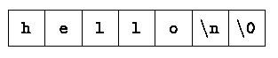

`printf` 中的 `%s` 格式规范期望相应的参数是以这种形式表示的字符串。`copy` 也依赖于其输入参数以 `'\0'` 结尾这一事实，并将该字符复制到输出中。

值得提一下的是，即使是像这样的小程序也面临一些棘手的设计问题。例如，如果 `main` 遇到超过其限制的行，它应该做什么？`getline` 的工作是安全的，因为它在数组满时会停止收集，即使没有看到换行符。通过测试返回的长度和最后一个字符，`main` 可以判断行是否过长，然后按照自己的意愿处理。为了简洁起见，我们忽略了这个问题。

`getline` 的用户无法提前知道输入行可能有多长，因此 `getline` 会检查溢出。另一方面，`copy` 的用户已经知道（或可以发现）字符串有多大，因此我们选择不向它添加错误检查。

**练习 1-16。** 修改最长行程序的主程序，使其能够正确打印任意长度输入行的长度，并尽可能多打印文本。

**练习 1-17。** 编写一个程序，打印所有长度超过 80 个字符的行。

**练习 1-18。** 编写一个程序，删除每行末尾的空格和制表符，并删除完全空行。

**练习 1-19。** 编写一个函数 `reverse(s)` 来反转字符字符串 `s`。使用它编写一个程序，一次一行反转其输入。

## 1.10 外部变量与作用域

`main` 中的变量（如 `line`、`longest` 等）是 `main` 私有的或局部的。因为它们在 `main` 内部声明，所以其他函数无法直接访问它们。其他函数中的变量也是如此；例如，`getline` 中的变量 `i` 与 `copy` 中的 `i` 无关。函数中的每个局部变量只在函数被调用时产生，并在函数退出时消失。这就是为什么这些变量通常根据其他语言的术语称为自动变量。从以后我们将使用“自动”一词来指代这些局部变量（第 4 章讨论了 `static` 存储类，其中局部变量在调用之间仍保留它们的值）。

由于自动变量随函数调用而产生和消失，它们不会在相邻调用之间保留值，必须在每次进入时显式设置。如果未被设置，它们将包含垃圾值。

作为自动变量的替代方案，可以定义对于所有函数都是外部的变量，即任何函数都可以名称访问的变量。（这种机制非常类似于 Fortran 的 COMMON 或在最外层块中声明的 Pascal 变量。）由于外部变量是全局可访问的，它们可以代替参数列表在函数之间进行数据通信。此外，由于外部变量永久存在，而不是随着函数的调用和退出而出现或消失，即使在设置它们的函数返回后，它们仍然保留自己的值。

外部变量必须在任何函数之外定义一次且仅一次；这为其预留了存储空间。该变量必须在每个访问它的函数中声明；这说明了变量的类型。声明可以是显式的 `extern` 语句，也可以是根据上下文隐式的。为了使讨论具体，让我们使用 `line`、`longest` 和 `max` 作为外部变量重写最长行程序。这需要修改三个函数的调用、声明和函数体。


```c
#include <stdio.h>

#define MAXLINE 1000 /* 最大输入行大小 */

int max;               /* 目前为止看到的最大长度 */
char line[MAXLINE];    /* 当前输入行 */
char longest[MAXLINE]; /* 存储在这里的最长行 */

int getline(void);
void copy(void);

/* 打印最长输入行；特殊版本 */
main()
{
    int len;
    extern int max;
    extern char longest[];

    max = 0;

    while ((len = getline()) > 0)
        if (len > max) {
            max = len;
            copy();
        }

    if (max > 0) /* 有行 */
        printf("%s", longest);

    return 0;
}

/* getline：特殊版本 */
int getline(void)
{
    int c, i;
    extern char line[];

    for (i = 0; i < MAXLINE - 1 && (c = getchar()) != EOF && c != '\n'; ++i)
        line[i] = c;

    if (c == '\n') {
        line[i] = c;
        ++i;
    }

    line[i] = '\0';

    return i;
}

/* copy：特殊版本 */
void copy(void)
{
    int i;
    extern char line[], longest[];

    i = 0;

    while ((longest[i] = line[i]) != '\0')
        ++i;
}
```

`main`、`getline` 和 `copy` 中的外部变量是由上述示例的前几行定义的，这些行指定了它们的类型并为它们分配了存储。在语法上，外部定义与局部变量的定义相同，但由于它们发生在函数之外，因此这些变量是外部的。在函数使用外部变量之前，必须让函数知道该变量的名称；声明与之前相同，只是增加了 `extern` 关键字。

在某些情况下，可以省略 `extern` 声明。如果外部变量的定义出现在源文件中其在特定函数被使用之前，那么在该函数中就不需要 `extern` 声明了。因此，`main`、`getline` 和 `copy` 中的 `extern` 声明是冗余的。事实上，通常的做法是将所有外部变量的定义放在源文件的开头，然后省略所有的 `extern` 声明。

如果程序包含多个源文件，且一个变量在 `file1` 中定义并在 `file2` 和 `file3` 中使用，则 `file2` 和 `file3` 中需要 `extern` 声明来连接该变量的出现处。通常的做法是将变量和函数的 `extern` 声明收集到一个单独的文件中，传统上被称为头文件（header），通过 `#include` 在每个源文件的开头包含它。头文件名的后缀 `.h` 是惯例。例如，标准库的函数在 `<stdio.h>` 等头文件中声明。这个主题在第 4 章中进行了详细讨论，库本身则在第 7 章和附录 B 中介绍。

由于 `getline` 和 `copy` 的特殊版本没有参数，逻辑上认为在文件开头的原型应该是 `getline()` 和 `copy()`。但为了兼容旧的 C 程序，标准将空列表视为旧式声明，并关闭所有参数列表检查；对于显式的空列表必须使用 `void` 单词。我们将在第 4 章中进一步讨论这一点。

你应该注意，在本节中引用外部变量时，我们谨慎地使用了定义（definition）和声明（declaration）这两个词。“定义”指的是创建变量或分配存储的地方；“声明”指的是说明变量性质但未分配存储的地方。

顺便提一下，人们倾向于将看到的所有东西都变成 `extern` 变量，因为这似乎简化了通信——参数列表很短，且当你需要变量时它们始终在那里。但即使你不想要它们时，外部变量也始终在那里。过度依赖外部变量是非常危险的，因为会导致程序的数据连接并非都显而易见——变量可能会以意之外甚至无意的方式被改变，而且程序难以修改。长行程序的第二个版本劣于第一个版本，部分是因为这些原因，部分是因为它通过向两个有用函数写入它们所操作的变量名称，破坏了这几个函数的通用性。

到此为止，我们已经涵盖了可以称为 C 语言的核心。有了这几个构建模块，就可以编写出相当巨大的有用程序，如果你能花足够的时间这样做，那可能是个好主意。这些练习建议的程序比之前的稍微复杂一些。

**练习 20**：编写一个计算文件行数并打印结果的程序。

**练习 21**：编写一个程序，将一个字符串的所有出现处替换另一个字符串。

**练习 22**：编写一个计算整数各位数字之和的程序。

**练习 23**：编写一个检查给定数字是否为质数的程序。

**练习 24**：编写一个对数字列表排序的程序。

| `float` | 单精度浮点数 |
|---|---|
| `double` | 双精度浮点数 |

此外，还有许多修饰符可以应用于这些基础类型。`short` 和 `long` 应用于整数：

```c
short int sh;
long int counter;
```

在此类声明中，可以省略 `int` 单词，而且通常都是省略的。

其意图是在可行的情况下，`short` 和 `long` 应该提供不同长度的整数；`int` 通常是特定机器的自然尺寸。`short` 通常长度为 16 位，而 `int` 可能是 16 位或 32 位。每个编译器都可以自由地为其自己的硬件选择合适的尺寸，唯一的限制是 `short` 和 `int` 至少为 16 位，`long` 至少为 32 位，且 `short` 不长于 `int`，`int` 不长于 `long`。

修饰符 `signed`（有符号）或 `unsigned`（无符号）可以应用于 `char` 或任何整数。`unsigned` 数字总是正数或零，并遵循模 `2^n` 的算术法则，其中 `n` 是该类型的位数。例如，如果 `char` 是 8 位，则 `unsigned char` 变量的值在 0 到 255 之间，而 `signed char` 的值在 -128 到 127 之间（在补码机器中）。普通的 `char` 是有符号还是无符号取决于机器，但可打印字符总是正数。

类型 `long double` 指定了扩展精度浮点数。与整数一样，浮点对象的尺寸是由实现定义的；`float`、`double` 和 `long double` 可能表示一种、两种或不同的尺寸。

标准头文件 `<limits.h>` 和 `<float.h>` 包含了所有这些尺寸的符号常量，以及机器和编译器的其他属性。这些在附录 B 中讨论。

**练习 2-1。** 编写一个程序，通过打印标准头文件中适当的值和直接计算，确定 `char`、`short`、`int` 和 `long` 变量（包括有符号和无符号）的范围。如果通过计算来确定会更难：确定各种浮点类型的范围。

## 2.3 常量

像 `1234` 这样的整数常量是一个 `int`。`long` 常量以 `l`（小写）或 `L` 结尾，如 `123456789L`；大到无法放入 `int` 的整数常量也将视为 `long`。无符号常量以 `u` 或 `U` 结尾，后缀 `ul` 或 `UL` 表示 `unsigned long`。

浮点数常量包含小数点（`123.4`）或指数（`1e-2`）或两者都有；除非有后缀，否则它们的类型是 `double`。后缀 `f` 或 `F` 表示 `float` 常量；`l` 或 `L` 表示 `long double`。

整数的值可以用八进制或十六进制代替十进制。整数常量开头的 `0`（零）表示八进制；开头的 `0x` 或 `0X` 表示十六进制。例如，十进制的 31 可以在八进制中写为 `037`，在十六进制中写为 `0x1f` 或 `0x1F`。八进制和十六进制常量后也可以跟 `L` 使其变为 `long`，跟 `U` 使其变为 `unsigned`：`0XFUL` 是一个值为十进制 15 的 `unsigned long` 常量。

`字符常量`是一个整数，写为单引号内的单个字符，例如 `'x'`。字符常量的值是该字符在机器字符集中的数值值。例如，在 ASCII 字符集中，字符常量 `'0'` 的值为 48，这与数值 0 无关。如果我们写 `'0'` 而不是依赖于字符集的数值（如 48），则程序就不依赖于特定的值且更易于读。字符常量像任何其他整数一样参与数值运算，尽管它们最常被用于与其他字符的比较。

某些字符可以通过转义序列（如 `\n` 换行）在字符和字符串常量中表示；这些序列看起来像两个字符，但只代表一个。此外，任意字节大小的位模式可以通过以下方式进行指定：

```c
'\ooo'
```

其中 `ooo` 是一到三个八进制数字（`0...7`），或者通过：

```c
'\xhh'
```

其中 `hh` 是一个或多个十六进制数字（`0...9, a...f, A...F`）。因此我们可能会写：

```c
#define VTAB '\013' /* ASCII 垂直制表符 */
#define BELL '\007' /* ASCII 铃声字符 */
```

或者，使用十六进制：

```c
#define VTAB '\xb' /* ASCII 垂直制表符 */
#define BELL '\x7' /* ASCII 铃声字符 */
```

完整的转义序列集是：

| 转义序列 | 含义 | 转义序列 | 含义 |
|---|---|---|---|
| `\a` | 警（铃声）字符 | `\\` | 反斜杠 |
| `\b` | 退格 | `\?` | 问号 |
| `\f` | 换符 | `\'` | 单引号 |
| `\n` | 换行 | `\"` | 双引号 |
| `\r` | 回车 | `\n` | 换行 |
| `\t` | 水平制表符 | `ooo` | 八进制数 |
| `\v` | 垂直制表符 | `xhh` | 十进制数 |

*常量表达式*是仅涉及常量的表达式，可以在编译时求值。*字符串常量*或*字符串字面量*是用双引号围的零或多个字符，如：

```c
"hello"
```

或者：

```c
""
```

这对于跨行分割字符串很有用。技术上，字符串是字符数组。字符串的内部表示有一个空字符 `\0`，因此所需的物理存储比字符数多一个。标准库函数 `strlen(s)` 返回字符字符串的长度，不包括 `\0`。这是我们的版本：

```c
/* strlen: 返回 s 的长度 */
int strlen(char s[])
{
    int i;

    while (s[i] != '\0')
        ++i;
    return i;
}
```

`strlen` 和其他字符串函数在标准头文件 `<string.h>` 中声明。

区分字符常量和包含单个字符的字符串：`'x'` 不等于 `"x"`。前者是一个整数，用于产生机器字符集中字母 `x` 的数值。后者是包含一个字符（字母 `x`）和一个 `\0` 的字符数组。

还有一类常量，*枚举常量*。枚举是常量整数值的列表，如：

```c
enum boolean { NO, YES };
```

`enum` 中的第一个名称值为 0，下一个是 1，依此类推，除非指定了显式值。如果没有指定所有值，未指定的值将从上一个指定值继续递增，如这些示例中的第二个：

```c
enum escapes {
    BELL = '\a',
    BACKSPACE = '\b',
    TAB = '\t',
    NEWLINE = '\n',
    VTAB = '\v',
    RETURN = '\r'
};

enum months {
    JAN = 1,
    FEB,
    MAR,
    APR,
    MAY,
    JUN,
    JUL,
    AUG,
    SEP,
    OCT,
    NOV,
    DEC
};
/* FEB = 2, MAR = 3, 等. */
```

不同枚举中的名称必须唯一。同一枚举中的值不需要唯一。

枚举（Enumerations）提供了一种将常量与名称关联的便捷方法，它是 `#define` 的替代方案，其优点是值可以为你自动生成。虽然可以声明 `enum` 类型的变量，但编译器并不检查你存储在此类变量中的值是否为枚举的有效值。尽管如此，枚举变量提供了检查的机会，因此通常比 `#define` 更好。此外，调试器可能能够以符号形式打印枚举变量的值。

## 2.4 声明（Declarations）

所有变量在使用之前必须声明，尽管某些声明可以根据内容隐式完成。声明指定了一个类型，并包含一个或多个该类型的变量列表，如下所示：

```c
int lower, upper, step;
char c, line[1000];
```

变量可以以任何方式分布在声明中；上面的列表完全可以写成：

```c
int lower;
int upper;
int step;
char c;
char line[1000];
```

后者的形式占的空间更多，但便于为每个声明添加注释以便后续的修改。

变量也可以在声明时进行初始化。如果名称后跟着一个等号和一个表达式，则该表达式作为初始化值，如下：

```c
char esc = '\\';
int i = 0;
int limit = MAXLINE + 1;
float eps = 1.0e-5;
```

如果所对应的变量不是自动变量，则初始化只执行一次，从概念上是在程序开始执行之前，且初始化值必须是一个常量表达式。显式初始化的自动变量在每次进入其所在的函数或块时都会初始化；初始化值可以是任何表达式。外部变量和静态变量默认初始化为零。没有显式初始化器的自动变量具有未定义的值（即：垃圾值）。

修饰符 `const` 可以应用于任何变量的声明，以指定其值不会被改变。对于数组，`const` 修饰符表示元素的内容不会被修改。

```c
const double e = 2.71828182845905;
const char msg[] = "warning: ";
```

`const` 声明也可以用于数组参数，表示该函数不会改变该数组：

```c
int strlen(const char[]);
```

如果尝试修改 `const`，则结果由实现定义。

## 2.5 算术运算符（Arithmetic Operators）

二元算术运算符有 `+`、`-`、`*`、`/` 以及取模运算符 `%`。整数除法会截断任何小数部分。表达式：

```c
x % y
```

产生 `x` 除以 `y` 的余数，因此当 `y` 正好整除 `x` 时结果为零。例如，如果一个年份能被 4 整除但不能被 100 整除，则它是闰年，但被 400 整除的年份也是闰年。因此：

```c
if ((year % 4 == 0 && year % 100 != 0) || year % 400 == 0)
    printf("%d is a leap year\n", year);
else
    printf("%d is not a leap year\n", year);
```

`%` 运算符不能应用于 `float` 或 `double`。对于负操作数，`/` 的截断方向和 `%` 结果的符号取决于机器，溢出或下溢时的处理操作也是如此。

二元 `+` 和 `-` 运算符具有相同的优先级，低于 `*`、`/` 和 `%` 的优先级，而后者又低于一元 `+` 和 `-`。算术运算符从左到右结合。

本章末的表 2.1 总结了所有运算符的优先级和结合性。

## 2.6 关系和逻辑运算符（Relational and Logical Operators）

关系运算符是：

```c
>   >=   <   <=
```

它们的优先级相同。紧随其后的优先级是相等运算符：

```c
==   !=
```

关系运算符的优先级低于算术运算符，因此像 `i < lim - 1` 的表达式会被处理为 `i < (lim - 1)`，正如预期的那样。

更有趣的是逻辑运算符 `&&` 和 `||`。由 `&&` 或 `||` 连接的表达式从左到右求值，一旦结果的真假确定，求值就会停止。大多数 C 程序依赖于这些属性。例如，这里我们在第 1 章中编写的输入函数 `getline` 中的循环：

```c
for (i = 0; i < lim - 1 && (c = getchar()) != '\n' && c != EOF; ++i)
    s[i] = c;
```

在读取新字符之前，必须检查数组 `s` 中是否有空间存储它，因此必须先进行测试 `i < lim - 1`。此外，如果此测试失败，我们不能继续读取另一个字符。

同样，如果在调用 `getchar` 之前对 `c` 进行 `EOF` 测试将是遗憾的；因此，调用和赋值必须在测试 `c` 中的字符之前发生。

`&&` 的优先级高于 `||`，且两者都低于关系运算符和相等运算符，因此像下面的表达式：

```c
i < lim - 1 && (c = getchar()) != '\n' && c != EOF
```

不需要额外的括号。但由于 `!=` 的优先级高于赋值，在以下表达式中需要括号：

```c
(c = getchar()) != '\n'
```

如果尝试修改 `const`，结果由实现定义。

## 2.7 类型转换（Type Conversions）


当运算符的操作数类型不同时，它们将根据少数规则转换为公共类型。通常，自动转换是将那些不会丢失信息的窄类型转换为宽类型，例如在表达式`f + i`中将整数转换为浮点。无意义表达式（如使用`float`作为下标）是不允许的。可能会丢失信息的表达式（如将长整数赋值给短整数，或将浮点类型转换为整数）可能会引起警告，但并非非法。

`char`只是一个小整数，因此可以在算术表达式中自由使用。这在某些字符转换中允许相当的灵活性。`atoi`函数的这种简单实现说明了这一点，它将数字字符串转换为数值。

```c
/* atoi: 将字符串转换为整数 */
int atoi(char s[])
{
    int i, n;

    n = 0;
    for (i = 0; s[i] >= '0' && s[i] <= '9'; ++i)
        n = 10 * n + (s[i] - '0');
    return n;
}
```

正如我们在第 1 章中讨论过的，表达式

```c
s[i] - '0'
```

给出存储在`s[i]`中的字符的数值，因为`'0'`、`'1'`等形成连续递增序列。

`char`到`int`转换的另一个例子是`lower`函数，它将 ASCII 字符集的单个字符映射为小写。如果字符不是大写字母，`lower`将将其返回。

```c
/* lower: 将 c 转小写；仅限 ASCII */
int lower(int c)
{
    if (c >= 'A' && c <= 'Z')
        return c + 'a' - 'A';
    else
        return c;
}
```

这在 ASCII 中有效是因为对应的大写和小写字母在数值上相距固定，且每个字母表都是连续的——在`A`和`Z`之间没有任何东西。然而，后一个观察在 EBCDIC 字符集中并不成立，因此这段代码在 EBCDIC 中转换的不只是字母。

**练习 2-2.** 在不使用`&&`或`||`的情况下编写一个与上述等效的循环。

标准头文件`<ctype.h>`在附录 B 中描述，定义了一系列提供与字符集无关的测试和转换的函数。例如，`tolower`函数是上述`lower`函数的可移植替代方案。同样，测试

```c
c >= '0' && c <= '9'
```

可以替换为

```c
isdigit(c)
```

从现在起我们将使用`<ctype.h>`中的函数。

关于字符转换为整数，有一个微妙点。语言没有规定`char`类型的变量是有符号（`signed`）还是无符号（`unsigned`）的。当`char`转换为`int`时，它是否可能产生负整数？答案取决于具体的机器类型，这反映了架构的差异。在某些机器上，左侧位为 1 的`char`将转换为负整数（符号扩展 `sign extension`）。在其他机器上，`char`通过在左侧添加 0 提升为`int`，因此始终是正数。

C 语言的定义保证了机器标准打印字符集中的任何字符都不会是负数，因此这些字符在表达式中始终是正值。但存储在字符变量中的任意位模式在某些机器上可能为负数，而在另一些机器上为正数。为了可移植性，如果要在`char`变量中存储非字符数据，请指定`signed`或`unsigned`。

关系表达式如`i > j`以及通过`&&`和`||`连接的逻辑表达式定义为真为 1，假为 0。因此，赋值语句

```c
d = c >= '0' && c <= '9'
```

如果`c`是数字，则将`d`设置为 1，否则设为 0。然而，`isdigit`等函数可能会返回任何非零值作为真。在`if`、`while`、`for`等测试部分，`true`仅意味着“非零”，因此没有区别。

隐式算术转换完全符合预期。通常，如果像`+`或`*`这样接受两个操作数的运算符（二进制运算符）的操作数类型不同，则在操作之前，较低类型会被提升（`promoted`）到较高类型。结果是整数类型。附录 A 第 6 节准确规定了转换规则。然而，如果没有`unsigned`操作数，以下非正式规则就足够了：

- 如果任一操作是`long double`，将另一个转换为`long double`。
- 否则，如果任一操作是`double`，将另一个转换为`double`。
- 否则，如果任一操作是`float`，将另一个转换为`float`。
- 否则，将`char`和`short`转换为`int`。
- 然后，如果任一操作是`long`，将另一个转换为`long`。

注意，表达式中的`float`不会自动转换为`double`；这是对原始定义的改变。通常，像`<math.h>`中的数学函数将使用双精度。使用`float`的主要原因是在大型数组中节省存储，或者较少的情况下在双精度算术昂贵的机器上节省时间。

当涉及`unsigned`操作数时，转换规则会更加复杂。问题在于有符号和无符号值之间的比较取决于机器，因为它们取决于各种整数类型的大小。例如，假设`int`是 16 位而`long`是 32 位。那么`-1L < 1U`，因为`1U`（一个`unsigned int`）被提升为`signed long`。但`-1L > 1UL`，因为`-1L`被提升为`unsigned long`，因此看起来是一个很大的正数。

转换发生在赋值过程中；右侧的值被转换为左侧的类型，而左侧类型即结果的类型。

字符转换为整数通过如所述的符号扩展或不扩展。

较长的整数通过丢弃多余的高阶位转换为较短的整数或`char`。因此，在

```c
int i;
char c;

i = c;
c = i;
```

`c`的值保持不变。无论是否涉及符号扩展都是如此。然而，反转赋值顺序可能会丢失信息。

如果`x`是`float`且`i`是`int`，那么`x = i`和`i = x`都会导致转换；`float`到`int`会导致任何小数部分的截断。当`double`转换为`float`时，值是舍入还是截断取决于实现。

由于函数调用的参数是一个表达式，因此当参数传递给函数时也会发生类型转换。在没有函数原型的情况下，`char`和`short`变为`int`，`float`变为`double`。这就是为什么即使在用`char`和`float`调用函数时，我们将函数参数声明为`int`和`double`。

最后，显式类型转换可以在任何表达式中强制执行（`coerced`），使用一个称为强制转换（`cast`）的一元运算符。在构造

```c
(type name) expression
```

`expression`通过上述转换规则转换为指定的类型。强制转换的精确含义就如`expression`被赋值给指定类型的变量，然后用该变量替换整个构造。例如，库函数`sqrt`期望一个`double`参数，如果不小心处理了它将产生无意义的结果。

## 2.8 递增和递减运算符

C 提供了两个用于递增和递减的特殊运算符。递增运算符`++`将操作数加 1，而递减运算符`--`减 1。我们经常使用`++`来递增变量，如：

```c
if (c == '\n')
    ++nl;
```

特殊之处在于`++`和`--`可以作为前缀运算符（在变量之前，如`++n`），也可以作为后置运算符（在变量之后，如`n++`）。在两种情况下，效果都是递增`n`。但表达式`++n`在使用值**之前**递增`n`，而`n++`在使用完值**之后**递增`n`。这意味着在需要值而非仅效果的上下文中，`++n`和`n++`是不同的。如果`n`是 5，那么：

```c
x = n++;
```

将`x`设置为 5，但：

```c
x = ++n;
```

将`x`设置为 6。在两种情况下，`n`都变为 6。递增和递减运算符只能应用于变量；类似`(i + j)++`的表达式是非法的。

在不需要值、只需要递增效果的上下文中，如：

```c
if (c == '\n')
    nl++;
```

前缀和后缀是相同的。但在某些情况下，会专门要求使用其中一种。例如，考虑函数`squeeze(s, c)`，它会从字符串`s`中删除所有字符`c`。

```c
/* squeeze: 从 s 中删除所有 c */
void squeeze(char s[], int c)
{
    int i, j;

    for (i = j = 0; s[i] != '\0'; i++)
        if (s[i] != c)
            s[j++] = s[i];
    s[j] = '\0';
}
```

每当出现非`c`字符时，它会被复制到当前的`j`位置，只有之后`j`才会递增以准备下一个字符。这完全等同于：

```c
if (s[i] != c) {
    s[j] = s[i];
    j++;
}
```

另一个类似的构造例子来自我们在第 1 章中编写的`getline`函数，我们可以将：

```c
if (c == '\n') {
    s[i] = c;
    ++i;
}
```

替换为更紧凑的：

```c
if (c == '\n')
    s[i++] = c;
```

第三个例子考虑标准函数`strcat(s, t)`，它将字符串`t`拼接到字符串`s`的末尾。`strcat`假设`s`有足够的空间来容纳组合。按照我们编写的方式，`strcat`没有返回值；标准库版本返回一个指向结果字符串的指针。

```c
/* strcat: 将 t 拼接到 s 的末尾；s 必须足够 */
void strcat(char s[], char t[])
{
    int i, j;

    i = j = 0;
    while (s[i] != '\0') /* 找到 s 的末尾 */
        i++;
    while ((s[i++] = t[j++]) != '\0') /* 复制 t */
        ;
}
```

当每个成员从`t`复制到`s`时，后置运算符`++`应用于`i`和`j`，以确保它们在循环的下次迭代中处于正确位置。

**练习 2-4.** 编写一个`squeeze(s1, s2)`的替代版本，删除`s1`中每个与字符串`s2`中任意字符匹配的字符。

**练习 2-5.** 编写函数`any(s1, s2)`，该函数返回字符串`s1`中出现字符串`s2`任意字符的第一个位置，如果`s1`不包含任何来自`s2`的字符，则返回`-1`。（标准库函数`strpbrk`执行相同的工作，但返回指向该位置的指针。）

## 2.9 位运算符

C 提供了 6 种位操作的运算符；这些运算符只能应用于整型操作数，即`char`、`short`、`int`和`long`，无论是有符号还是无符号。

| 运算符 | 含义 |
|---|---|
| `&` | 位按与 |
| `\|` | 位按或（包含或） |
| `^` | 位按异或 |
| `<<` | 左移 |
| `>>` | 右移 |
| `~` | 取反（一元运算符） |

位按与运算符`&`通常用于掩码某些位，例如：

```c
n = n & 0177;
```

将`n`的低 7 位以外的所有位置 0。

位按或运算符`\|`用于将位置 1：

```c
x = x | SET_ON;
```

将`x`中在`SET_ON`中设置为 1 的位也设置为 1。

位按异或运算符`^`在操作数位不同的位置上设置为 1，在相同的地方设置为 0。

必须将位运算符`&`和`\|`与逻辑运算符`&&`和`||`区分开，后者意味着真值的从左到右计算。例如，如果`x`是 1 且`y`是 2，那么`x & y`为 0，而`x && y`为 1。

移位运算符`<<`和`>>`将左操作数根据右操作数给出的位数进行左移或右移，右操作数必须是非负数。因此`x << 2`将`x`的值移动两位，并用 0 填充空位；这等同于乘以 4。右移一个`unsigned`量总是用 0 填充空位。右移有符号量在某些机器上用符号位填充（算术移），在另一些机器上用 0 位填充（逻辑移）。

一元运算符`~`产生整数的反码；即它将每个 1 位转换为 0 位，反之亦然。例如：

```c
x = x & ~077
```

将`x`的最后 6 位置 0。注意，`x & ~077`与字长无关，因此优于例如`x & 0177000`，后者假设`x`是一个 16 位的量。可移植的形式不涉及额外代价，因为`~077`是一个可以求值的常量表达式。

作为某些运算符的说明，考虑函数`getbits(s, p)`，它返回`s`左移`p`位后的值。

```c
/* getbits: 返回 s 的 p 位 */
int getbits(int s, int p)
{
    int i;

    for (i = 0; i < p; i++)
        if (s & (1 << i))
            i |= (1 << (p - 1 - i));
    return i;
}
```

位按与运算符`&`通常用于掩码某些位，例如：

```c
n = n & 0177;
```

将`n`的低 7 位以外的所有位置 0。

位按或运算符`\|`用于将位置 1：

```c
x = x | SET_ON;
```

将`x`中在`SET_ON`中设置为 1 的位也设置为 1。

位按异或运算符`^`在操作数位不同的位置上设置为 1，在相同的地方设置为 0。

必须将位运算符`&`和`\|`与逻辑运算符`&&`和`||`区分开，后者意味着真值的从左到右计算。例如，如果`x`是 1 且`y`是 2，那么`x & y`为 0，而`x && y`为 1。

移位运算符`<<`和`>>`将左操作数根据右操作数给出的位数进行左移或右移，右操作数必须是非负数。因此`x << 2`将`x`的值移动两位，并用 0 填充空位；这等同于乘以 4。右移一个`unsigned`量总是用 0 填充空位。右移有符号量在某些机器上用符号位填充（算术移），在另一些机器上用 0 位填充（逻辑移）。

一元运算符`~`产生整数的反码；即它将每个 1 位转换为 0 位，反之亦然。例如：

```c
x = x & ~077
```

将`x`的最后 6 位置 0。注意，`x & ~077`与字长无关，因此优于例如`x & 017700`，后者假设`x`是一个 16 位的量。可移植的形式不涉及额外代价，因为`~077`是一个可以求值的常量表达式。

作为某些运算符的说明，考虑函数`getbits(s, p)`，它返回`s`左移`p`位后的值。

```c
/* getbits: 返回 s 的 p 位 */
int getbits(int s, int p)
{
    int i;

    for (i = 0; i < p; i++)
        if (s & (1 << i))
            i |= (1 << (p - 1 - i));
    return i;
}
```

## 2.10 赋值运算符和表达式

我们已经看到赋值语句是有值的并且可以出现在表达式中；最常见的例子是：

```c
while ((c = getchar()) != EOF)
    ...
```

其他赋值运算符（`+=`、`-=`等）也可以出现在表达式中，尽管频率较低。

在此类表达式中，赋值表达式的类型是其左操作数的类型，而值是赋值后的值。

**练习 2-9.** 在补码数制中，`x &= (x - 1)`会删除`x`中最右侧的 1 位。请解释原因。利用这一观察编写一个更快的`bitcount`版本。

## 2.11 条件表达式

以下语句：

```c
if (a > b)
    z = a;
else
    z = b;
```


在`z`中计算`a`和`b`的最大值。条件表达式使用三元运算符`?:`编写，提供了编写这种及类似构造的替代方法。在表达式

```
expr1 ? expr2 : expr3
```

中，首先求值表达式`expr1`。如果是非零（真），则求值表达式`expr2`，其结果为条件表达式的值。否则求值`expr3`，其结果为该值。`expr[2]`和`expr[3]`只有一个会被求值。因此，将`z`设置为`a`和`b`的最大值：

```
z = (a > b) ? a : b;    /* z = max(a, b) */
```

需要注意的是，条件表达式确实是一个表达式，它可以用于任何可以使用其他表达式的地方。如果`expr[2]`和`expr[3]`的类型不同，则结果的类型由本章前面讨论的转换规则决定。例如，如果`f`是`float`且`n`是`int`，那么表达式

```
(n > 0) ? f : n
```

无论`n`是否为正，其类型都是`float`。

条件表达式的第一个表达式周围不需要加括号，因为`?:`的优先级非常低，仅高于赋值运算符。尽管如此，仍建议加上括号，因为这使得条件部分更于可见。

条件表达式通常会导致简洁的代码。例如，此循环打印数组的`n`个元素，每行 10 个，每列之间用一个空格分隔，每行（包括最后一行）都以换行符结束。

```
for (i = 0; i < n; i++)
    printf("%6d%c", a[i], (i%10==9 || i==n-1) ? '\n' : ' ');
```

每十个元素之后以及`n`个元素之后都会打印一个换行符。所有其他元素后面跟着一个空格。这看起来可能复杂，但比等价的`if-else`更紧。另一个很好的例子是：

```
printf("You have %d items%s.\n", n, n==1 ? "" : "s");
```

**练习 2-10。** 使用条件表达式代替`if-else`重写函数`lower`，将大写字母转换为小写。

## 2.12 优先级与求值顺序

表 2.1 总结了所有运算符的优先级和结合性规则，包括我们尚未讨论的运算符。同一行的运算符具有相同的优先级；行按优先级递减顺序排列，例如，`*`、`/`和`%`具有相同的优先级，高于二进制的`+`和`-`。运算符`()`指代函数调用。运算符`->`和`.`用于访问结构体的成员；它们将在第 6 章中同`sizeof`（对象的大小）一起介绍。第 5 章讨论了`*`（通过指针间接访问）和`&`（对象的地址），第 3 章讨论了逗号运算符。

| 运算符 | 结合性 |
| :--- | :--- |
| `() [] -> .` | 从左到右 |
| `! ~ ++ -- + - *` (*type*) `sizeof` | 从右到左 |
| `* / %` | 从左到右 |
| `+ -` | 从左到右 |
| `<< >>` | 从左到右 |
| `< <= > >=` | 从左到右 |
| `== !=` | 从左到右 |
| `&` | 从左到右 |
| `^` | 从左到右 |
| `|` | 从左到右 |
| `&&` | 从左到右 |
| `||` | 从左到右 |
| `?:` | 从右到左 |
| `= += -= *= /= %= &= ^= |= <<= >>=` | 从右到左 |
| `,` | 从左到右 |

一元运算符`+`、`-`和`*`的优先级高于其二进制形式。

***表 2.1：运算符的优先级与结合性***

注意，位运算运算符`&`、`^`和`|`的优先级低于`==`和`!=`。这意味着像下面的位测试表达式：

```
if ((x & MASK) == 0) ...
```

必须完全加括号才能得到正确的结果。

C语言大多数语言一样，没有规定运算符操作数的求值顺序（例外是`&&`、`||`、`?:`和`,`）。例如，在语句中：

```
x = f() + g();
```

`f`可能在`g`之前求值。

教训是编写依赖于求值顺序是非常糟糕的做法，因为变量的副作用通常是不指定的。

# 第 3 章：控制流

语言的控制流规定了计算执行的顺序。我们在之前的示例中遇到过最常见的控制流构造；在这里我们将完成整个集合，并对之前讨论的内容进行更精确的说明。

## 3.1 语句与块

诸如`x = 0`或`i++`或`printf(...)`的表达式在后面跟着分号时就变成语句，如：

```
x = 0;
i++;
printf(...);
```

在C语言中，分号是语句终止符，而不是像 Pascal 等语言中的分隔符。

大括号`{`和`}`用于将声明和语句组合成复合语句或块，以便它们在语法上等同于单一语句。围绕函数语句的大括号是一个显而易见的例子；`if`、`else`、`while`或`for`之后多个语句的大括号是另一个例子。结束块的右括号后面没有分号。

## 3.2 If-Else

`if-else`语句用于表达决策。形式上的语法为：

```
if (expression)
    statement1
else
    statement2
```

`else`部分是可选的。对`expression`进行求值；如果为真（即`expression`的值为非零值），则执行`statement[1]`。如果为假（`expression`为 0）且存在`else`部分，则执行`statement[2]`。

由于`if`测试的是表达式的数值值，因此可以使用某些编码快捷方法。最常见的是写成：

```
if (expression)
```

而不是：

```
if (expression != 0)
```

有时这种写法是自然且清晰的；但在其他情况下可能会很晦涩。

由于`if-else`的`else`部分是可选的，当在嵌套的`if`序列中省略`else`时就会产生歧义。这通过将`else`与最近的、没有`else`的`if`关联来解决。例如，在：

```
if (n > 0)
    if (a > b)
        z = a;
    else
        z = b;
```

正如我们通过缩进所示的，`else`属于内部的`if`。

如果这不是你想要的，则必须使用大括号来强制正确的关联：

```
if (n > 0) {
    if (a > b)
        z = a;
}
else
    z = b;
```

这种歧义在以下情况下特别阴险：

```
if (n > 0)
    for (i = 0; i < n; i++)
        if (s[i] > 0) {
            printf("...");
            return i;
        }
else        /* 错误 */
    printf("error -- n is negative\n");
```

缩进明确地显示了你的意，但编译器并没有接收到这个信息，并将`else`与内部的`if`关联了。这种 bug 很难找到；在存在嵌套`if`的时候，使用大括号是一个好主意。

顺便一下，注意在`z = a`后面有一个分号：

```
if (a > b)
    z = a;
else
    z = b;
```

这是因为在语法上，`statement`紧跟在`if`后面，而像`z = a;`这样的表达式语句总是以分号结束。

## 3.3 Else-If

以下结构：

```
if (expression)
    statement
else if (expression)
    statement
else if (expression)
    statement
else if (expression)
    statement
else
    statement
```

出现得非常频繁，值得进行简短的单独讨论。这系列`if`语句序列是编写多路决策的最通用方法。`expressions`按顺序进行求值；如果某个`expression`为真，则执行与其关联的`statement`，并终止整个链条。像往常一样，每个`statement`的代码要么是一个单独的语句，要么是一组在大括号中的语句。

最后的`else`部分处理“以上都不是”或默认情况，即没有满足其他任何条件。有时对于默认情况没有显式操作；在这种情况下，末尾的：

```
else
    statement
```

可以省略，或者它可能用于错误检查以捕获“不可能”的情况。

为了说明三路决策，这里有一个二分查找函数，它用于判断特定值`x`是否出现在排序数组`v`中。`v`的元素必须是递增的。如果`x`出现在`v`中，函数返回其位置（0 到`n-1`之间的数字），否则返回 -1。

二分查找首先将输入值`x`与数组`v`的中间元素比较。如果`x`小于中间值，搜索集中在表的下半部分，否则集中在上部分。无论哪种情况，下一步都是将`x`与所选部分的中间元素比较。这种将范围一分为二的过程持续直到找到该值或范围为空。

```
/* binsearch: 在 v[0] <= v[1] <= ... <= v[n-1] 中查找 x */
int binsearch(int x, int v[], int n)
{
    int low, high, mid;

    low = 0;
    high = n - 1;
    while (low <= high) {
        mid = (low+high)/2;
        if (x < v[mid])
            high = mid + 1;
        else if (x > v[mid])
            low = mid + 1;
        else    /* 找到匹配 */
            return mid;
    }
    return -1;   /* 无匹配 */
}
```

基础性的决策是每一步中`x`是小于、大于还是等于中间元素`v[mid]`；这对于`else-if`来说是自然的。

**练习 3-1。** 我们的二分查找在循环内部进行了两次测试，而实际上一次测试足够了（代价是在循环外进行更多测试）。写一个循环内只有一次测试的版本，并测量运行时间的差异。

## 3.4 Switch

`switch`语句是一种多路决策，用于测试表达式是否匹配若干常量整数值之一，并相应地分支。

```
switch (expression) {
    case const-expr: statements
    case const-expr: statements
    default: statements
}
```

`break`语句会导致立即退出`switch`。由于`case`只是作为标签，在完成一个`case`的代码后，会执行到下一个，除非你显式地采取行动来退出。`break`和`return`是离开`switch`的最常见方式。`break`语句也可以用于强制退出`while`、`for`和`do`循环，这将在本章后面讨论。

穿透（Falling through）是一把双刃剑。有利的一面是它允许将多个`case`连接到同一个操作，正如示例中的数字那样。但它意味着通常每个`case`必须以`break`结束以防止穿透到下一个。从一个 case 穿透到另一个是不健壮的，程序修改时容易出错。出于良好，在最后一个 case（这里的`default`）之后放一个`break`，尽管在逻辑上没有必要。某天添加另一个 case 时，这种防御性编程将拯救你。

在第一章中我们写了一个程序来统计每个数字、空白和其他字符的次数，使用的是`if ... else`序列。下面是使用`switch`的相同程序：

```
#include <stdio.h>

main()  /* 统计数字、空白和其他 */
{
    int c, i, nwhite, nother, ndigit[10];

    nwhite = nother = 0;
    for (i = 0; i < 10; i++)
        ndigit[i] = 0;
    while ((c = getchar()) != EOF) {
        switch (c) {
        case '0': case '1': case '2': case '3': case '4':
        case '5': case '6': case '7': case '8': case '9':
            ndigit[c-'0']++;
            break;
        case ' ':
        case '\n':
        case '\t':
            nwhite++;
            break;
        default:
            nother++;
            break;
        }
    }
    printf("digits =");
    for (i = 0; i < 10; i++)
        printf(" %d", ndigit[i]);
    printf(", white space = %d, other = %d\n",
        nwhite, nother);
    return 0;
}
```

**练习 3-2。** 写一个函数`escape(s,t)`，在将字符串`t`拷贝到`s`的同时，将换行和制表符等字符转换为可见的转义序列如`\n`和`\t`。使用`switch`。也写一个反函数，将转义序列转换为真实的字符。

## 3.5 循环：While 和 For

我们已经遇到过`while`和`for`循环。在：

```
while (expression)
    statement
```

`expression`被求值。如果它非零，则执行`statement`并重新求值`expression`。此循环持续直到`expression`变为零，此时执行将在`statement`之后恢复。

### `for`语句

```
for (expr1; expr2; expr3)
    statement
```

等价于：

```
expr1;
while (expr2) {
    statement
    expr3;
}
```

但`continue`的行为除外，该行为见第 3.7 节。

从语法上，`for`循环的三个组件都是表达式。最常见的是`expr[1]`和`expr[3]`是赋值或函数调用，而`expr[2]`是关系表达式。这三个部分都可以省略，但分号必须保留。如果省略了`expr[1]`或`expr[3]`，它们将直接从展开中丢弃。如果测试条件`expr[2]`不存在，则被视为永久真，因此：

```
for (;;) {
    ...
}
```

是一个“无限”循环，推测通过其他手段（如`break`或`return`）打破。

使用`while`还是`for`在很大程度上取决于个人喜好。例如，在：

```
while ((c = getchar()) == ' ' || c == '\n' || c = '\t')
    ;   /* 跳过空白字符 */
```

这里没有初始化或重新初始化，因此`while`是最自然的。

当存在简单的初始化和递增时，`for`更优，因为它让循环控制语句保持在一起，并在循环顶部可见。这在以下代码中最为明显：

```
for (i = 0; i < n; i++)
    ...
```

这是处理数组前`n`个元素的C语言惯用法，类似于 Fortran 的 DO 循环或 Pascal 的`for`。然而，这种类比并不完美，因为索引变量`i`在循环因任何原因终止时仍保留其值。由于`for`的组件可以是任意表达式，因此`for`循环并不限于等差数列。尽管如此，将无关的计算强制塞入`for`的初始化和递增中是不良风格，这些部分最好留给循环控制操作。

作为一个较大的示例，这里是`atoi`的另一个版本，用于将字符串转换为数值。这个版本比第 2 章中的稍微通用一点；它可以处理可选的前导空白以及可选的`+`或`-`号。（第 4 章显示了`atof`，它对浮点数执行相同的转换。）

程序的结构反映了输入的形式：

- 跳过空白（如果有）
- 获取符号（如果有）
- 获取整数部分并转换

每一步都完成其职责，并为下一步留下整洁的状态。整个过程在第一个不能作为数字的字符处终止。


```c
#include <ctype.h>

/* atoi: 将 s 转换为整数；版本 2 */
int atoi(char s[])
{
    int i, n, sign;

    for (i = 0, isspace(s[i]); i++)  /* 跳过空白 */
        ;
    sign = (s[i] == '-') ? -1 : 1;
    if (s[i] == '+' || s[i] == '-')  /* 跳过符号 */
        i++;
    for (n = 0, isdigit(s[i]); i++)
        n = 10 * n + (s[i] - '0');
    return sign * n;
}
```

标准库提供了一个更复杂的函数`strtol`用于将字符串转换为长整数；见附录 B 的第 5 节。

当存在多个嵌套循环时，保持循环控制集中的优势更加明显。以下函数是一个用于整数数组排序的 Shell 排序。这种排序算法由 D. L. Shell 于 1959 年发明，其基本思想是在早期阶段比较相距较远的元素，而不是像交换排序那样比较相邻元素。这倾向于快速消除大量的无序，因此后期阶段的工作会更少。比较元素之间的间隔逐渐减小到 1，此时排序实际上变成了一种相邻交换方法。

```c
/* shellsort: 将 v[0]...v[n-1] 排序为升序 */
void shellsort(int v[], int n)
{
    int gap, i, j, temp;

    for (gap = n / 2; gap > 0; gap /= 2)
        for (i = gap; i < n; i++)
            for (j = i - gap; j >= 0 && v[j] > v[j + gap]; j -= gap) {
                temp = v[j];
                v[j] = v[j + gap];
                v[j + gap] = temp;
            }
}
```

有三个嵌套循环。最外层控制比较元素之间的间隔，每次通过将`n / 2`缩小一半，直到变为 0。中间循环沿元素移动。最内层循环比较每对间隔为`gap`的元素，并反转任何顺序不对的元素。由于`gap`最终减小到 1，排序实际上变成了一种相邻交换方法。

```c
do {  /* 按逆序生成数字 */
    s[i++] = n % 10 + '0';  /* 获取下一个数字 */
} while ((n /= 10) > 0);  /* 删除它 */

if (sign < 0)
    s[i++] = '-';

s[i] = '\0';

reverse(s);
```

`do-while`是有必要的，或者至少是方便的，因为即使`n`为零，也必须在数组`s`中安装一个字符。我们还对构成`do-while`主体的单个语句使用了大括号，尽管它们并不是必要的，但可以防止匆忙的读者将`while`部分误认为`while`循环的`开始`部分。

**练习 3-4。** 在补码数表示中，我们版本的`itoa`并没有处理最大的负数，即`n`等于`-(2^(wordsize - 1))`的值。解释为什么不行。修改它使其无论在何种机器上运行，都能正确打印该值。

**练习 3-5。** 编写函数`itob(n, s, b)`，将整数`n`转换为字符串`s`中的基`b`字符表示。特别是，`itob(n, s, 16)`将`s`格式化为十六进制整数。

**练习 3-6。** 编写一个接受三个参数而不是两个的`itoa`版本。第三个参数是最小字段宽度；如果必要，转换后的数字必须左侧填充空格以达到足够的宽度。

## 3.7 `break`和`continue`

有时，能够通过顶部或底部测试之外退出循环是方便的。`break`语句提供了从`for`、`while`和`do`提前出的机制，就像从`switch`中一样。`break`会立即退出最内层的嵌套循环或`switch`。

以下函数`trim`使用`break`从字符串末尾删除的空格、制表符和换行符，当找到最右侧的非空格、非制表符、非换行符字符时退出循环。

```c
/* trim: 删除末尾空格、制表符、换行符 */
int trim(char s[])
{
    int n;

    for (n = strlen(s) - 1; n >= 0; n--)
        if (s[n] != ' ' && s[n] != '\t' && s[n] != '\n')
            break;
    s[n + 1] = '\0';
    return n;
}
```

`strlen`返回字符串的长度。`for`循环从结束开始向后扫描，寻找第一个不是空格、制表符或换行符的字符。当找到此类字符或`n`变为负数时（即扫描了整个字符串），循环被打破。你应该验证即使在字符串为空或仅包含空白字符时，这种行为也是正确的。

`continue`语句与`break`相关，但使用频率较少；它导致外层的`for`、`while`或`do`循环开始下一次迭代。在`while`和`do`中，这意味着测试部分会被立即执行；在`for`中，控制权传递到递增步骤。`continue`语句仅适用于循环，不适用于`switch`。循环内部`switch`内部的`continue`会导致下一次循环迭代。

作为一个示例，这段片段只处理数组`a`中的非负元素；负值会被跳过。

```c
for (i = 0; i < n; i++)
    if (a[i] < 0)  /* 跳过负元素 */
        continue;
    ...  /* 处理正元素 */
```

当循环后续部分很复杂时，经常使用`continue`语句，因为反转测试并增加另一层嵌套会导致程序嵌套得过深。

## 3.8 `goto`和标签

C 提供了可以无限滥用的`goto`语句以及用于跳转的标签。从形式上说，`goto`语句永远不是必要的，在实践中，几乎总是编写不使用它的代码。我们在书中没有用过`goto`。

尽管如此，在某些情况下`goto`可能会大显身场。最常见的是放弃深度嵌套结构中的处理，例如一次性跳出两个或多个循环。`break`语句不能直接使用，因为它只能退出最内层的循环。因此：

```c
for ( ... )
    for ( ... ) {
        ...
        if (disaster)
            goto error;
    }
...
error:
    /* 清理现场 */
```

如果错误处理代码并非易事，且错误可能发生在多个地方，这种组织方式就非常方便。

标签的格式与变量名相同，后面跟着一个冒号。它可以附加到与`goto`在同一函数的任何语句上。标签范围是整个函数。

另一个示例，考虑判断两个数组`a`和`b`是否有共同元素的问题。一种可能性是：

```c
for (i = 0; i < n; i++)
    for (j = 0; j < m; j++)
        if (a[i] == b[j])
            goto found;
/* 没有找到任何共同元素 */
...

found:
    /* 找到了：a[i] == b[j] */
    ...
```

在没有此处提到的异常的情况下，依赖`goto`的代码通常比没有`goto`的代码更难理解和维护。虽然我们对这个问题并不教条主义，但看起来`goto`语句确实应该极少使用，或者干脆不使用。

```
Ah Love! could you and I with Fate conspire
To grasp this sorry Scheme of Things entire,
Would not we shatter it to bits -- and then
Re-mould it nearer to the Heart's Desire!
```

将产生输出：

```
Ah Love! could you and I with Fate conspire
Would not we shatter it to bits -- and then
Re-mould it nearer to the Heart's Desire!
```

这项工作可以很好地分为三个部分：

```c
while (there's another line)
    if (the line contains the pattern)
        print it
```

虽然将所有这些代码放在`main`中是完全可能的，但更好的方法是利用结构优势，将每个部分变成一个独立的函数。处理三个小部分比处理一个大部分更好，因为无关紧的细节可以隐藏在函数内部，并将意外交互的几率降到最低。而且，这些部分可能在其他程序中也有用。

“当还有另一行时”对应的是`getline`，这是我们在第 1 章中编写的一个函数，而“打印它”是`printf`，已经有人为我们提供了它。这意味着我们只需要编写一个例程来判断该行是否包含模式出现。

我们可以通过编写一个函数`strindex(s, t)`来解决这个问题，该函数返回字符串`s`中字符串`t`开始的位置或索引，如果`s`不包含`t`，则返回`-1`。由于 C 数组从位置零开始，所以索引将是零或正数，因此像`-1`这样的负值非常便于指示操作失败。当我们以后需要更复杂的模式匹配时，只需要替换`strindex`；其余代码可以保持不变。（标准库提供了一个与`strindex`相似的函数`strstr`，不同之处在于返回的是指针而不是索引。）

有了这些设计，填充程序的细节就是非常直接的。这里是完整代码，你可以看到这些部分是如何组合在一起的。目前，要搜索的模式是一个字面量字符串，这并不是最通用的机制。我们稍后会讨论如何初始化字符数组，并在第 5 章中展示如何将模式设为在程序运行时设置的参数。`getline`还有一个略有不同的版本；你可能会发现将其与第 1 章中的版本进行对比很有启发。

```c
#include <stdio.h>
#define MAXLINE 1000  /* 最大输入行长度 */

int getline(char line[], int max);
int strindex(char source[], char searchfor[]);

char pattern[] = "ould";  /* 要搜索的模式 */

/* 所有匹配模式的行 */
main()
{
    char line[MAXLINE];
    int found = 0;

    while (getline(line, MAXLINE) > 0)
        if (strindex(line, pattern) >= 0) {
            printf("%s", line);
            found++;
        }
    return found;
}

/* getline: 将行读入 s，返回长度 */
int getline(char s[], int lim)
{
    int c, i;

    i = 0;
    while (--lim > 0 && (c = getchar()) != EOF && c != '\n')
        s[i++] = c;
    if (c == '\n')
        s[i++] = c;
    s[i] = '\0';
    return i;
}

/* strindex: 返回 t 在 s 中的索引，若无则返回 -1 */
int strindex(char s[], char t[])
{
    int i, j, k;

    for (i = 0; s[i] != '\0'; i++) {
        for (j = i, k = 0; t[k] != '\0' && s[j] == t[k]; j++, k++)
            ;
        if (k > 0 && t[k] == '\0')
            return i;
    }
    return -1;
}
```

每个函数定义的形式如下：

```c
return-type function-name(argument declarations)
{
    declarations and statements
}
```

某些部分可能缺失；一个最小的函数是：

```c
dummy() {}
```

它什么都不做，也不返回任何内容。这样的无所事函数在程序开发期间有时作为占位符有用。如果省略了返回类型，则假设为`int`。

程序仅仅是一组变量和函数的定义。函数之间的通信通过参数、函数返回的值以及外部变量来实现。函数可以在源文件中以任何顺序出现，源程序可以分成多个文件，只要函数不被拆分即可。

`return`语句是将值从被调用函数返回给其调用者的机制。`return`后面可以跟任何表达式：

```c
return expression;
```

在必要时，`expression`将转换为函数的返回类型。通常会在`expression`周围使用括号，但括号是可选的。

调用函数可以自由地忽略返回的值。此外，`return`后面不需要表达式；在这种情况下，没有值返回给调用者。当执行通过闭合右大括号“掉出”函数末尾时，控制也会在不带值的情况下返回调用者。如果一个函数返回了值，虽然不是违法的，但可能是问题的信号。

## 4.2 返回非整数的函数

到为止，我们的函数示例要么不返回值（`void`），要么返回`int`。如果函数必须返回其他类型怎么办？许多数值函数如`sqrt`、`sin`和`cos`返回`double`；其他特殊函数返回其他类型。为了说明如何处理这种情况，让我们编写并使用函数`atof(s)`，它将字符串`s`转换为双精度浮点数。`atof`是`atoi`的扩展，我们在第 2 章和第 3 章中展示过版本。它处理可选的符号和小数点，以及这两个部分的出现与否。我们的版本并不是高质量的输入例程；那需要更多的空间。标准库包含了`atof`；头文件`<stdlib.h>`声明了它。

首先，`atof`本身必须声明它返回值的类型，因为它不是`int`。类型名位于函数名之前：

```c
#include <ctype.h>

/* atof: 将字符串 s 转换为 double */
double atof(char s[])
{
    double val, power;
    int i, sign;

    for (i = 0; isspace(s[i]); i++)  /* 跳过空格 */
        ;
    sign = (s[i] == '-') ? -1 : 1;
    if (s[i] == '+' || s[i] == '-')
        i++;
    for (val = 0.0; isdigit(s[i]); i++)
        val = 10.0 * val + (s[i] - '0');
    if (s[i] == '.')
        i++;
    for (power = 1.0; isdigit(s[i]); i++) {
        val = 10.0 * val + (s[i] - '0');
        power *= 10;
    }

    return sign * val / power;
}
```

**练习 4-1。** 编写`strindex(s, t)`，返回`t`在`s`中*最右侧*出现的位置，若无则返回`-1`。

其次，同样重要的是，调用程序必须知道`atof`返回的是一个非整数值。确保此点的方法是在调用程序中显式地声明`atof`。该声明在这个原始计算器中显示（该计算器仅够用于对账），它每行读取一个数字，数字前可以带有一个符号，并将它们相加，在每次输入后打印累加和：

```c
#include <stdio.h>

#define MAXLINE 100

/* 简单的计算器 */
main()
{
    double sum, atof(char []);
    char line[MAXLINE];
    int getline(char line[], int max);

    sum = 0;
    while (getline(line, MAXLINE) > 0)
        printf("\t%g\n", sum += atof(line));
    return 0;
}
```

该声明

```c
double sum, atof(char []);
```

表示`sum`是一个`double`类型变量，而`atof`是接受一个`char[]`参数并返回`double`的函数。


函数`atof`必须在声明和定义上保持一致。如果`atof`本身和`main`中对其调用在同一个源文件中类型不一致，编译器将检测到错误。但如果（更有可能的情况）`atof`是单独编译的，这种不匹配将无法被检测，`atof`返回一个`double`，而`main`会将其视为`int`，导致无意义的答案。

考虑到我们之前关于声明必须与定义匹配的内容，这可能令人惊讶。发生不匹配的原因是，如果没有函数原型，函数将在其首次出现在表达式中时被隐式声明，例如：

```c
sum += atof(line)
```

如果一个之前未声明过的名称出现在表达式中，并且后面跟着一个左括号，则根据上下文将其声明为函数名，假设该函数返回`int`，且对它的参数不做任何假设。此外，如果函数声明不包含参数，如下所示：

```c
double atof();
```

这也被意味着对`atof`的参数不做任何假设；所有的参数检查都被关闭了。空参数列表的这种特殊含义允许旧的 C 程序在新的编译器上进行编译。但在新的 C 程序中使用它是一个坏主意。如果函数接受参数，请声明它们；如果不接受参数，请使用`void`。

给定已正确声明的`atof`，我们可以用它编写`atoi`（将字符串转换为`int`）：

```c
/* atoi: 使用 atof 将字符串 s 转换为整数 */
int atoi(char s[])
{
    double atof(char s[]);
    return (int) atof(s);
}
```

注意声明和返回语句的结构。在

```c
return expression;
```

中的表达式的值在返回之前会被转换为函数的类型。因此，当`atof`的值（一个`double`）出现在这个`return`中时，会被自动转换为`int`，因为函数`atoi`返回的是`int`。然而，此操作可能会丢失信息，因此某些编译器会对此发出警告。强制转换显式地表示该操作是有意为，并抑制任何警告。

### 练习 4-2

扩展`atof`以处理如下形式的科学计数法：

```text
123.45e-6
```

其中浮点数后面可以跟着`e`或`E`以及一个可选的有符号指数。

## 4.3 外部变量

一个 C 程序由一组外部对象组成，这些对象可以是变量或函数。“外部（external）”一词与“内部（internal）”相对，后者描述在函数内部定义的参数和变量。外部变量定义在任何函数之外，因此可能对许多函数可用。函数本身始终是外部的，因为 C 不允许在函数内部定义函数。默认情况下，外部变量和函数具有这样一个属性：通过相同名称对它们的所有引用（即使来自单独编译的函数）都是对同一个东西的引用。（标准将这种属性称为外部链接。）从这个意义上说，外部变量类似于 Fortran 的 COMMON 块或 Pascal 中最外层块中的变量。我们稍后将看到如何仅在单个源文件中可见的外部变量和函数。由于外部变量是全局可的，它们为函数间的数据通信提供了参数和返回值的替代方案。只要名称以某种方式被声明，任何函数都可以通过引用名称访问外部变量。

如果必须在函数之间共享大量变量，外部变量比长参数列表更方便、更高效。然而，如第 1 章所示，这种推理应谨慎使用，因为它对程序结构产生不利影响，并导致函数之间存在过多的数据连接。

外部变量由于其更大的作用域和生命周期也有用。自动变量是函数内部的；它们在进入函数时产生，在离开函数时消失。相反，外部变量是持久的，因此它们可以保留从一次函数调用到下一次调用的值。因此，如果两个函数必须共享某些数据，但它们互不调用对方，那么将共享数据保存在外部变量中通常比通过参数传递进出更方便。

让我们通过一个更大的例子来看这个问题。该问题是编写一个提供`+`、`-`、`*`和`/`运算符的计算器程序。因为更容易实现，计算器将使用逆波兰表达式（reverse Polish notation）而不是中缀表达式。（逆波兰表达式用于某些口袋计算器，以及 Forth 和 Postscript 等语言。）

在逆波兰表达式中，每个运算符都跟在操作数后面；一个中缀表达式

```text
(1 - 2) * (4 + 5)
```

输入为

```text
1 2 - 4 5 + *
```

不需要括号；只要我们知道每个运算符期望的操作数数量，这种表示法就是无歧义的。

实现非常简单。每个操作数都被推入栈中；当运算符到达时，弹出相应数量的操作数（二元运算符为两个），对它们执行操作，并将结果推回栈中。例如在上面的例子中，1 和 2 被推入，然后被它们的差 -1 替换。接下来，4 和 5 被推入，然后被它们的和 9 替换。1 和 9 的乘积 -9 替换了栈中的它们。当遇到输入行结束符时，栈顶的值会被弹出并打印。

因此，程序的结构是一个循环，对出现的每个运算符和操作数执行相应的操作：

```c
while (下一个运算符或操作数不是文件结束指示)
    if (number)
        push it
    else if (operator)
        pop operands
        do operation
        push result
    else if (newline)
        pop and print top of stack
    else
        error
```

栈的推入和弹出操作非常简单，但加上错误检测和恢复机制后，它们的代码量变得足够长，因此将每个操作放在独立的函数中比在整个程序中重复这些代码要好。此外，应该有一个独立的函数来获取下一个输入运算符或操作数。

尚未讨论的主要设计决策是栈所在的位置，即哪些例程直接访问它。一种可能性是将其保留在`main`中，并将栈和当前栈位置传递给执行推栈和弹出的例程。但`main`不需要知道控制栈的变量；它只需要执行推栈和弹出操作。因此，我们决定将栈及其相关信息存储在外部变量中，这些变量可以被`push`和`pop`函数访问，但`main`不能。

将这个大纲翻译成代码很容易。如果目前我们认为程序存在于源文件中，它看起来是这样：

```c
#include
#define

main 的函数声明

main() { ... }

push 和 pop 的外部变量
```

```c
void push(double f) { ... }

double pop(void) { ... }

int getop(char s[]) { ... }
```

被`getop`调用的例程。

稍后我们将讨论如何将其拆分为两个或多个源文件。

`main`函数是一个循环，其中包含一个针对运算符或操作数类型的巨大`switch`语句；这比第 3.4 节中显示的`switch`用法典型。

```c
#include <stdio.h>

#include <stdlib.h>  /* 用于 atof() */

#define MAXOP   100  /* 操作数或运算符的最大 own */

#define NUMBER  '0'  /* 发现数字的信号 */

int getop(char []);

void push(double);

double pop(void);

/* 后缀表达式计算器 */
main()
{
    int type;
    double op2;
    char s[MAXOP];
    while ((type = getop(s)) != EOF) {
        switch (type) {
           case NUMBER:
               push(atof(s));
               break;
           case '+':
               push(pop() + pop());
               break;
           case '*':
               push(pop() * pop());
               break;
           case '-':
               op2 = pop();
               push(pop() - op2);
               break;
           case '/':
               op2 = pop();
               if (op2 != 0.0)
                   push(pop() / op2);
               else
                   printf("error: zero divisor\n");
               break;
           case '\n':
               printf("\t%.8g\n", pop());
               break;
           default:
               printf("error: unknown command %s\n", s);
               break;
        }
    }
    return 0;
}
```

由于`+`和`*`是交换律运算符，弹出的操作数组合的顺序无关，但对于`-`和`/`，必须区分左、右操作数。在：

```c
push(pop() - pop());   /* 错误 */
```

两个`pop`调用求值的顺序是未定义的。为了保证正确的顺序，有必要将第一个值弹到一个临时变量中，就像我们在`main`中做的那样。

```c
#define MAXVAL  100  /* val 栈的最大深度 */
int sp = 0;          /* 下一个空栈位置 */
double val[MAXVAL];  /* 值栈 */
/* push: 将 f 推入值栈 */
void push(double f)
{
    if (sp < MAXVAL)
        val[sp++] = f;
    else
        printf("error: stack full, can't push %g\n", f);
}
/* pop: 从栈中弹出并返回顶端值 */
double pop(void)
{
    if (sp > 0)
        return val[--sp];
    else {
        printf("error: stack empty\n");
        return 0.0;
    }
}
```

如果一个变量定义在任何函数外部，它就是外部变量。因此，`push`和`pop`必须共享的栈和栈索引在这些函数外部。但`main`本身并不引用栈或栈位置——表示可以隐藏。

现在让我们转向`getop`的实现，获取运算符或操作数。任务很简单。跳过空格和制表符。如果下一个字符不是数字或十六进制点，则返回它。否则，收集一个数字字符串（可能包含小数点），并返回`NUMBER`，即已收集到数字的信号。

```c
#include <ctype.h>
int getch(void);
void ungetch(int);
/* getop: 获取下一个字符或数值操作数 */
int getop(char s[])
{
    int i, c;
    while ((s[0] = c = getch()) == ' ' || c == '\t')
        ;
    s[1] = '\0';
    if (!isdigit(c) && c != '.')
        return c;      /* 不是数字 */
    i = 0;
    if (isdigit(c))    /* 收集整数部分 */
        while (isdigit(s[++i] = c = getch()))
              ;
    if (c == '.')      /* 收集小数部分 */
        while (isdigit(s[++i] = c = getch()))
              ;
    s[i] = '\0';
    if (c != EOF)
        ungetch(c);
    return NUMBER;
}
```

`getch`和`ungetch`是什么？通常程序无法确定已经读取了足够的内容，直到读多了。一个例子是收集数字：直到看到非数字字符，数字才是完整的。但此时程序多读了一个字符，一个它尚未准备好的字符。

如果可以撤回字符，问题就解决了。那么每当程序读过多时，就可以将其推回输入，以便其余代码就像从没读过一样。幸运的是，通过编写一对协作的函数可以模拟撤回：`getch`提供下一个要考虑的输入字符；`ungetch`在读取新输入之前返回它们。

它们的工作方式非常简单。`ungetch`将推回的字符放入共享缓冲区——一个字符数组。`getch`在缓冲区中有任何内容时从中读取，如果为空则调用`getchar`。还需要一个索引变量来记录当前字符在缓冲区中的位置。

由于缓冲区和索引被`getch`和`ungetch`共享并且在调用之间保留其值，它们必须是这两个例程的外部变量。因此我们可以这样编写`getch`、`ungetch`及其共享变量：

```c
#define BUFSIZE 100
char buf[BUFSIZE];    /* 用于 ungetch 的缓冲区 */
int bufp = 0;         /* buf 中的下一个空位置 */
int getch(void)  /* 获取（可能是推回的）字符 */
{
    return (bufp > 0) ? buf[--bufp] : getchar();
}
void ungetch(int c)   /* 将字符推回输入 */
{
    if (bufp >= BUFSIZE)
        printf("ungetch: too many characters\n");
    else
        buf[bufp++] = c;
}
```

标准库包含一个名为`ungetch`的函数，它可以提供一个字符的回退功能；我们将在第 7 章中讨论它。我们使用数组来实现回退，而不是单个字符，是为了说明一种更通用的方法。

### 练习 4-3

给定基础框架，扩展计算器是轻而易见的。添加模运算符（`%`）和处理负数的规定。

### 练习 4-4

添加用于在不弹出栈的情况下打印栈顶元素、复制栈以及交换栈顶两个元素的命令。添加一个清空栈的命令。

### 练习 4-5

添加对如`sin`、`exp`和`pow`等库函数的访问。请参见附录 B 第 4 节中的`<math.h>`。

### 练习 4-6

添加处理变量的命令。（提供二十六个单字母命名的变量很容易）。为最近打印的值添加一个变量。

### 练习 4-7

编写一个例程`ungets(s)`，它可以将整个字符串推回输入流。`ungets`应该感知`buf`和`bufp`，还是应该直接使用`ungetch`？

### 练习 4-8

假设回退字符永远不会超过一个。相应修改`getch`和`ungetch`。

### 练习 4-9

我们的`getch`和`ungetch`无法正确处理推回的`EOF`。决定如果推回了`EOF`，它们的属性应该是什么，然后实现你的设计。

### 练习 4-10

另一种组织方式使用`getline`来读取整行输入；这使得`getch`和`ungetch`变得不再必要。修改计算器以使用这种方法。

## 4.4 范围规则

构成 C 程序的函数和外部变量不需要同时编译；程序的源码可以保存在多个文件中，而预先编译的例程可以从库中加载。我们感兴趣的问题包括：

- 如何编写声明，以便变量在编译期间被正确声明？
- 如何安排声明，以便在程序加载时所有部分都能正确连接？
- 如何组织声明以确保只有一个副本？
- 外部变量是如何初始化的？

让我们通过将计算器程序重新组成几个文件来讨论这些主题。从实际角度来看，计算器太小，不值得拆分，但它是大型程序中出现问题的良好说明。

名称的*范围*（scope）是程序中可以使用该名称的部分。对于在函数开头声明的自动变量，其范围是声明该名称的函数。不同函数中同名的局部变量是无关的。函数的参数也是如此，它们实际上是局部变量。

外部变量或函数的范围从其声明处一直持续到正在编译的文件结束。例如，如果`main`、`sp`、`val`、`push`和`pop`定义在一个文件中，顺序如所示：

```c
main() { ... }

int sp = 0;

double val[MAXVAL];

void push(double f) { ... }
double pop(void) { ... }
```

那么变量`sp`和`val`只需要通过命名就可以在`push`和`pop`中使用；不需要进一步的声明。但这些名称在`main`中是不可见的，`push`和`pop`本身也是如此。

另一方面，如果在定义外部变量之前引用它，或者它被定义在与其使用的不同源文件中，则必须使用`extern`声明。

区分外部变量的*声明*（declaration）和*定义*（definition）至关重要。声明宣告了变量的属性（主要是其类型）；定义则会分配存储空间。如果以下几行：

```c
int sp;

double val[MAXVAL];
```

出现在任何函数之外，它们就*定义*了外部变量`sp`和`val`，分配了存储空间，并作为该源文件其余部分的声明。另一方面，这些行：

```c
extern int sp;

extern double val[];
```

它们为源文件的其余部分*声明*了`sp`是一个`int`，`val`是一个`double`数组（其大小在别处确定），但它们并没有创建变量或为它们预留存储空间。


在构成源程序的所有文件中，外部变量只能有一个定义；其他文件可以包含`extern`声明以访问它。（在包含定义的文件中也可能存在`extern`声明。）数组的大小必须在定义时指定，但在`extern`声明中这些是可选的。

外部变量的初始化仅随定义。

虽然对于这个程序来说不太可能的组织方式，但函数`push`和`pop`可以定义在一个文件中，而变量`val`和`sp`在另一个文件中定义并初始化。那么这些定义和声明对于将它们连接在一起是必要的：

`file1`文件：

```c
extern int sp;

extern double val[];

void push(double f) { ... }
double pop(void) { ... }
```

`file2`文件：

```c
int sp = 0;

double val[MAXVAL];
```

因为`file1`中的`extern`声明位于函数定义之前且之外，它们适用于所有函数；如果`sp`和`val`的定义在`file1`之后，那么一组`extern`声明就足够了。

## 4.5 头文件

现在考虑将计算器程序分成几个源文件，假设组件变得大大的话。`main`函数放在一个文件中，我们称之为`main.c`；`push`、`pop`及其变量放在第二个文件`stack.c`；`getop`放在第三个文件`getop.c`。最后，`getch`和`ungetch`放在第四个文件`getch.c`；因为它们将来自单独编译的库。

还有一件事需要担心——文件共享的定义和声明。尽可能，我们希望将这些集中，这样随着程序的演进只有一个副本。因此，我们将这些公共材料放在一个头文件`calc.h`中，并在需要时包含。（`#include`行在第4.11节中描述）。生成的程序如下：

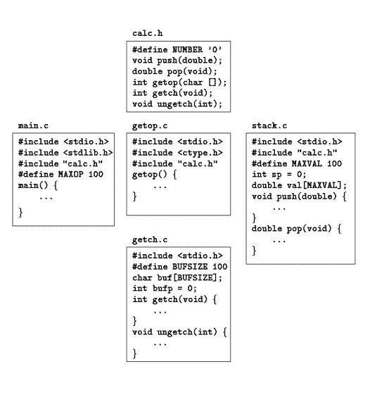

每个文件仅访问工作所需信息的愿望与维护更多头文件的现实之间存在权衡。在适等规模的范围内，最好有一个包含程序任何两个部分共享的所有内容的头文件；这就是我们在这里所做的决定。对于更大的程序，需要更多的组织和头文件。

## 4.6 静态变量

`stack.c`中的`sp`和`val`，以及`getch.c`中的`buf`和`bufp`是供各自源文件的函数私有使用的，而不供其他任何访问。应用于外部变量或函数的`static`声明将该对象的范围限制到正在编译的源文件的其余部分。因此，外部`static`为`getch-ungetch`组合隐藏`buf`和`bufp`等名称提供了一种方法，它们必须是外部的以便共享，但不应对`getch`和`ungetch`的用户可见。

静态存储通过在普通声明前加上`static`单词来指定。如果这两个例程和两个变量在一个文件中编译，例如：

```c
static char buf[BUFSIZE];  /* 用于 ungetch 的缓冲区 */
static int bufp = 0;       /* buf 中的下一个空位置 */

int getch(void) { ... }
void ungetch(int c) { ... }
```

那么没有其他例程能够访问`buf`和`bufp`，且这些名称不会与同一程序其他文件中相同的名称发生冲突。同样，`push`和`pop`用于栈操作的变量也可以通过将`sp`和`val`声明为`static`来隐藏。

外部`static`声明通常用于变量，但也可以应用于函数。通常情况下，函数名是全局的，对整个程序的任何部分可见。然而，如果一个函数被声明为`static`，那么它的名称在定义它的文件之外是不可见的。

`static`声明也可以应用于内部变量。内部`static`变量与自动变量一样是特定局部局部，但与自动变量不同，它们会一直存在，而不是在每次函数被激活时产生和消失。这意味着内部`static`变量在单个函数内部提供了私有的、持久的存储。

**练习4-11。**修改`getop`使其不需要使用`ungetch`。提示：使用一个内部`static`变量。

## 4.7 寄存器变量

`register`声明建议编译器该变量将被频繁使用。其思想是将`register`变量放在机器寄存器中，这可能会导致更小、更快的程序。但编译器可以自由忽略这一建议。

`register`声明如下：

```c
register int x;
register char c;
```

等等。`register`声明只能应用于自动变量和函数的形式参数。在后的情况下，它如下：

```c
f(register unsigned m, register long n)
{
    register int i;
    ...
}
```

在实践中，寄存器变量受到限制，这反映了硬件的现实。只有少数变量可以放在寄存器中，且只允许某些类型。然而，多余的`register`声明是无害的，因为`register`词会被忽略，并且无法寄存器变量的地址（这将在第5章讨论）。寄存器变量的数量和类型的具体限制取决于机器。

## 4.8 块结构

C不是像Pascal或类似语言那样的块结构语言，因为函数不能在函数内部定义。相反，变量可以在函数内部以块结构的方式定义。变量的声明（包括初始化）可以跟在复合语句的左括号之后，而不仅仅是函数的左括号。例如，在：

```c
if (n > 0) {
    int i;  /* 一个新的 i */
    for (i = 0; i < n; i++)
        ...
}
```

变量`i`的作用域是`if`的“真”分支；这个`i`与块外的`i`无关。每次进入块时，声明并初始化的自动变量（包括形式参数）都会隐藏同名的外部变量。给定声明：

```c
int x;
int y;
f(double x)
{
    double y;
}
```

那么在函数`f`内部，`x`的出现指的是参数；外部指的是`int`。从风格上讲，最好避免使用隐藏外部作用域变量名，因为混乱和错误的可能性太大。

## 4.9 初始化

到为止已经多次提到初始化，但总是作为其他话题的。在讨论了各种存储类之后，本节总结了部分规则。在没有显式初始化的情况下，外部和静态变量保证初始化为零；自动和寄存器变量具有未定义的（即垃圾）初始值。

标量变量可以在定义时进行初始化，在名称后加上等号和表达式：

```c
int x = 1;
char quote = '\';
long day = 1000L * 60L * 24L; /* 毫秒/天 */
```

对于外部和静态变量，初始化器必须是一个常量表达式；初始化在程序开始执行前完成一次。对于自动和寄存器变量，初始化器不限于常量：它可以是任何涉及之前定义的表达式，甚至是函数调用。例如，3.3节中二分查找程序的初始化可以写为：

```c
int binsearch(int x, int v[], int n)
{
    int low = 0;
    int high = n - 1;
    int mid;
    ...
}
```

而不是：

```c
int low, high, mid;
low = 0;
high = n - 1;
```

实际上，自动变量的初始化只是赋值语句的简写。倾向哪种形式很大取决于口味。我们通常使用显式赋值，因为声明中的初始化器更难看到，且离使用点更远。

数组可以通过在其声明后跟随大括号包含并用逗号分隔的初始化器列表来初始化。例如，初始化一个数组`days`为每月的天数：

```c
int days[] = { 31, 28, 31, 30, 31, 30, 31, 31, 30, 31, 30, 31 }
```

当省略数组大小时，编译器将通过计算初始化器的数量来计算长度，在这种情况下有12个。

如果数组初始化器少于指定的尺寸，对于外部、静态和自动变量，其余的为零。初始化器过多是一个错误。没有办法指定初始化器的重复，也不会在提供所有之前值的情况下初始化数组中间的元素。

字符数组是初始化的一种特殊情况；可以使用字符串代替大括号逗号符号：

```c
char pattern[] = "ould";
```

这是更长但等效的：

```c
char pattern[] = { 'o', 'u', 'l', 'd', '\0' };
```

在这种情况下，数组大小为五个（四个字符加上终止符`'\0'`）。

## 4.10 递归

C函数可以递归地使用；也就是说，一个函数可以直接或间接地调用它自己。考虑将一个数字打印为字符字符串。正如我们之前提到的，数字生成的顺序是错误的：低位数字在高位数字之前可用，但必须以相反的顺序打印。

这个问题有两个解决方案。一种是在生成数字时存储在数组中，然后反向打印它们，正如我们在3.6节中使用`itoa`时的那样。另一种是递归解决方案，其中`printd`先调用自己来处理任何领先数字，然后打印尾数字。再次，这个版本在最大的负数上可能会失败。

```c
#include <stdio.h>

/* printd: 十进制打印 n */
void printd(int n)
{
    if (n < 0) {
        putchar('-');
        n = -n;
    }
    if (n / 10)
        printd(n / 10);
    putchar(n % 10 + '0');
}
```

当函数递归地调用自身时，每次调用都会获得一组全新的自动变量，且与之前的集合相互独立。在`printd(123)`中，第一个`printd`接收到的参数`n = 123`。它将`12`传递给第二个`printd`，后者又将`1`传递给第三个`printd`。第三层的`printd`打印`1`，然后返回到第二层。该`printd`打印`2`，然后返回到第一层。那个打印`3`并终止。

递归的另一个良好例子是快速排序，这是由C.A.R. Hoare在1962年开发的一种排序算法。给定一个数组，选择一个元素，并将其他元素分为两个子集——小于划分元素的元素和大于或等于该划分元素的元素。然后对这两个子集递归地应用相同的过程。当一个子集的元素少于两个时，就不需要任何排序了；这停止了递归。

我们版本的快速排序不是最快的，但是最简单的版本之一。我们使用每个子数组的中间元素进行划分。

```c
/* qsort: sort v[left]...v[right] into increasing order */

void qsort(int v[], int left, int right)
{
    int i, last;
    void swap(int v[], int i, int j);

    if (left >= right) /* 如果数组包含 */
        return;        /* 少于两个元素 */
    swap(v, left, (left + right) / 2); /* 移动划分元素 */
    last = left;                       /* 到 v[0] */
    for (i = left + 1; i <= right; i++) /* 划分 */
        if (v[i] < v[left])
            swap(v, ++last, i);
    swap(v, left, last); /* 恢复划分元素 */
    qsort(v, left, last - 1);
    qsort(v, last + 1, right);
}
```

我们将交换操作移动到了一个单独函数`swap`中，因为它在`qsort`中出现了三次。

```c
/* swap: interchange v[i] and v[j] */

void swap(int v[], int i, int j)
{
    int temp;
    temp = v[i];
    v[i] = v[j];
    v[j] = temp;
}
```

标准库包含一个可以对任何类型对象进行排序的`qsort`版本。

递归可能无法节省存储空间，因为在某处必须维护一个处理中的值的栈。它也不会更快。但递归代码更紧凑，而且通常比非递归的等效代码更容易编写和理解。递归对于递归定义的数据结构（如树）特别方便，我们将在第6.6节中看到一个很好的例子。

**练习4-12。**将`printd`的思想改为`itoa`的递归版本；即通过调用递归例程将整数转换为字符串。

**练习4-13。**写一个函数`reverse(s)`的递归版本，用于原地反转字符串`s`。

## 4.11 C预处理器

C通过预处理器提供了某些语言设施，预处理器在概念上是编译过程中一个独立的起始步。最常用的两个特性是`#include`，用于在编译期间包含文件的内容，以及`#define`，用于用任意字符序列替换标记符。本节描述的其他特性还包括条件编译和带参数的宏。

### 4.11.1 文件包含

文件包含使得处理`#define`集合和声明等变得容易。任何形式的源代码行：

```c
#include "filename"
```

或：

```c
#include <filename>
```

都会被文件`filename`的内容替换。如果`filename`被引用，查找文件通常从源程序所在的位置开始；如果在那里没有找到，或者名称被`<`和`>`包围，则遵循实现定义的规则来查找文件。被包含的文件本身也可以包含`#include`行。

源文件的开头通常有几行`#include`行，用于包含常见的`#define`语句和`extern`声明，或者访问来自如`<stdio.h>`等头文件的库函数原型声明。（严格来说，这些不需要是文件；访问头文件的细节取决于具体实现。）

`#include`是将大型程序中的声明连接在一起的首选方法。它保证了所有源文件都将获得相同的定义和变量声明，从而消除了一种特别棘手的错误。自然地，当被包含的文件更改时，所有依赖于它的文件都必须重新编译。

### 4.11.2 宏替换

定义的形式如下：

```c
#define name replacement text
```

它要求进行最简单的宏替换——标记`name`的后续出现将被替换为`replacement text`。`#define`中的名称与变量名具有相同的形式；替换文本是任意的。通常，替换文本是该行的剩余部分，但很长的定义可以通过在每个需要继续的行末尾放置一个`\`来延续到几行。用`#define`定义的名称的作用范围是从其定义点到正在编译的源文件末尾。定义可以使用之前的定义。替换仅对标记符进行，且不会在引号字符串内发生。

也可以定义带参数的宏，因此替换文本可以根据不同的调用而不同。例如，定义宏`max`：

```c
#define max(A, B) ((A) > (B) ? (A) : (B))
```

当它被调用时，例如：

```c
x = max(p + q, r + s);
```

将被替换为：

```c
x = ((p + q) > (r + s) ? (p + q) : (r + s));
```

只要参数处理一致，此宏就适用于任何数据类型；不需要像函数那样为不同数据类型提供不同类型的`max`。

如果你检查`max`的展开，你会发现一些陷阱。表达式被计算两次；如果它们涉及副作用（如增位运算符或输入输出），这很糟糕。例如：

```c
max(i++, j++)  /* 错误 */
```

将使较大的值增加两次。还需要注意括号，以确保求值顺序被保留；考虑当宏：

```c
#define square(x) x * x  /* 错误 */
```

作为`square(z + 1)`调用会发生什么。

尽管如此，宏是有价值的。一个实际示例来自`<stdio.h>`，其中`getchar`和`putchar`通常被定义为宏，以避免处理每个字符时函数调用的运行时开销。`<ctype.h>`中的函数通常也作为宏实现。名称可以使用`#undef`取消，通常是为了确保例程是真正的函数而不是宏：

```c
#undef getchar
int getchar(void) { ... }
```

形式参数在引号字符串内不会被替换。然而，如果替换文本中的参数名称前面有一个`#`，该组合将展开为用实际参数替换了参数的引号字符串。这可以与字符串拼接相结合，例如创建一个调试打印宏：

```c
#define dprint(expr) printf(#expr " = %g\n", expr)
```

当它被调用时，例如：

```c
dprint(x / y)
```

宏展开为：

```c
printf("x / y" " = %g\n", x / y);
```

字符串被连接，因此效果是：

```c
printf("x / y = %g\n", x / y);
```

在实际参数中，每个`"`都被替换为`\"`，每个`\`被替换为`\\`，因此结果是一个合法的字符串常量。

预处理器运算符`##`提供了一种在宏展开期间连接实际参数的方法。如果替换文本中的某个参数与`##`相邻，则该参数被替换为实际参数，`##`和周围的空白会被删除，并对结果进行重新扫描。例如，宏`paste`拼接了它的两个参数：

```c
#define paste(front, back) front ## back
```

因此`paste(name, 1)`创建了标记`name1`。

嵌套使用`##`的规则非常晦；更多细节可以参见附录A。


**练习 4-14。** 定义一个宏 `swap(t,x,y)`，交换两个类型为 `t` 的参数。（使用块结构将有所帮助。）

### 4.11.3 条件包含

可以使用在预处理期间进行求值的条件语句来控制预处理本身。这提供了一种根据编译期间评估的条件值来选择性包含代码的方法。

`#if` 行求值一个常量整数表达式（可能不包括 `sizeof`、强制转换或 `enum` 常量）。如果表达式非零，则包含直到 `#endif` 或 `#elif` 或 `#else` 之前的后续行。（预处理器语句 `#elif` 类似于 `else-if`）。`#if` 中的表达式 `defined(name)` 如果 `name` 已定义则为 1，否则为 0。

例如，为了确保头文件文件 `hdr.h` 的内容只被包含一次，将文件内容封装在如下条件中：

```
#if !defined(HDR)

#define HDR

/* hdr.h 的内容在此处 */

#endif
```

第一次包含 `hdr.h` 定义了名称 `HDR`；随后的包含将发现该名称已定义，并直接跳到 `#endif`。可以使用类似的风格来避免多次包含文件。如果一致地使用这种风格，那么每个头文件就可以包含其所依赖的任何其他头文件，而头文件的用户就不需要处理这些相互依赖关系。

此序列通过测试名称 `SYSTEM` 来决定包含哪个版本的头文件：

```
#if SYSTEM == SYSV

#define HDR "sysv.h"

#elif SYSTEM == BSD

#define HDR "bsd.h"

#elif SYSTEM == MSDOS

#define HDR "msdos.h"

#else

#define HDR "default.h"

#endif

#include HDR
```

`#ifdef` 和 `#ifndef` 行是测试名称是否已定义的特殊形式。上面 `#if` 的第一个示例可以写成：

```
#ifndef HDR

#define HDR

/* hdr.h 的内容在此处 */

#endif
```

***

返回第 3 章 -- 索引 -- 第 5 章

***

由 tmdcjsl(skidrow8123@hotmail.com) 编译

***

***

返回第 4 章 -- 索引 -- 第 6 章

***

# 第 5 章 - 指针与数组

指针是一个包含变量地址的变量。指针在 C 中被广泛使用，部分是因为它们有时是表达计算的唯一方法，部分是因为它们通常比通过其他方式获得的代码更紧凑、高效。指针和数组密切相关；本章也探索了这种关系并展示了如何利用它。

指针被与 `goto` 语句归为一类，认为是创建难以理解程序的奇妙方法。当它们被粗率使用时，这确实如此，而且很容易创建指向意外位置的指针。然而，只要有规范，指针也可以用于实现清晰和简单。这正是我们尝试说明的方面。

ANSI C 的主要变化是使如何操作指针的规则明确化，实际上强制了良好的程序员已经在实践且良好的编译器已经在执行的行为。此外，类型 `void *`（指向 void 的指针）取代了 `char *` 成为通用指针的适当类型。

## 5.1 指针与地址

让我们从内存组织的简化图示开始。典型的机器具有一组连续编号或地址的内存单元数组，这些单元可以单独操作，也可以以连续组的形式操作。一种常见的情况是任何字节都可以是一个 `char`，一对单字节单元可以被视为 `short` 整数，四个相邻字节形成一个 `long`。指针是一组可以持有地址的单元（通常是两个或四个）。所以如果 `c` 是一个 `char` 且 `p` 是指向它的指针，我们可以这样表示这种情况：

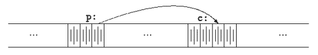

一元运算符 `&` 给出对象的地址，因此语句

```
p = &c;
```

将 `c` 的地址赋值给变量 `p`，`p` 被称为“指向” `c`。`&` 运算符只适用于内存中的对象：变量和数组元素。它不能应用于表达式、常量或 `register` 变量。

一元运算符 `*` 是间接引用或解引用；当作用于指针时，它访问它所指向的对象。假设 `c` 是一个 `char` 且 `p` 是指向它的指针，我们可以这样表示这种情况：


一元运算符 `&` 给出对象的地址，因此语句

```
p = &c;
```

将 `c` 的地址赋值给变量 `p`，`p` 被称为“指向” `c`。`&` 运算符只适用于内存中的对象：变量和数组元素。它不能应用于表达式、常量或 `register` 变量。

一元运算符 `*` 是间接引用或解引用；当作用于指针时，它访问它指向的对象。假设 `c` 是一个 `char` 且 `p` 是指向它的指针，我们可以这样表示这种情况：


一元运算符 `&` 给出对象的地址，因此语句

```
p = &c;
```

将 `c` 的地址赋值给变量 `p`，`p` 被称为“指向” `c`。`&` 运算符只适用于内存中的对象：变量和数组元素。它不能应用于表达式、常量或 `register` 变量。

一元运算符 `*` 是间接引用或解引用；当作用于指针时，它访问它指向的对象。假设 `c` 是一个 `char` 且 `p` 是指向它的指针，我们可以这样表示这种情况：


一元运算符 `&` 给出对象的地址，因此语句

```
p = &c;
```

将 `c` 的地址赋值给变量 `p`，`p` 被称为“指向” `c`。`&` 运算符只适用于内存中的对象：变量和数组元素。它不能应用于表达式、常量或 `register` 变量。

在实际参数中，每个 `"` 都被替换为 `\"`，每个 `\` 被替换为 `\\`，因此结果是一个合法的字符串常量。

预处理器运算符 `##` 提供了一种在宏展开期间连接实际参数的方法。如果替换文本中的某个参数与 `##` 相邻，则该参数被替换为实际参数，`##` 和周围的空白会被删除，并对结果进行重新扫描。例如，宏 `paste` 拼接了它的两个参数：

```
#define paste(front, back)  front ## back
```

因此 `paste(name, 1)` 创建了标记 `name1`。

嵌套使用 `##` 的规则非常晦涩；更多细节可以参见附录 A。

**练习 4-14。** 定义一个宏 `swap(t,x,y)`，交换两个类型为 `t` 的参数。（使用块结构将有所帮助。）

### 4.11.3 条件包含

可以使用在预处理期间进行求值的条件语句来控制预处理本身。这提供了一种根据编译期间评估的条件值来选择性包含代码的方法。

`#if` 行求值一个常量整数表达式（可能不包括 `sizeof`、强制转换或 `enum` 常量）。如果表达式非零，则包含直到 `#endif` 或 `#elif` 或 `#else` 之前的后续行。（预处理器语句 `#elif` 类似于 `else-if`）。`#if` 中的表达式 `defined(name)` 如果 `name` 已定义则为 1，否则为 0。

例如，为了确保头文件文件 `hdr.h` 的内容只被包含一次，将文件内容封装在如下条件中：

```
#if !defined(HDR)

#define HDR

/* hdr.h 的内容在此处 */

#endif
```

第一次包含 `hdr.h` 定义了名称 `HDR`；随后的包含将发现该名称已定义，并直接跳到 `#endif`。可以使用类似的风格来避免多次包含文件。如果一致地使用这种风格，那么每个头文件就可以包含其所依赖的任何其他头文件，而头文件的用户就不需要处理这些相互依赖关系。

此序列通过测试名称 `SYSTEM` 来决定包含哪个版本的头文件：

```
#if SYSTEM == SYSV

#define HDR "sysv.h"

#elif SYSTEM == BSD

#define HDR "bsd.h"

#elif SYSTEM == MSDOS

#define HDR "msdos.h"

#else

#define HDR "default.h"

#endif

#include HDR
```

`#ifdef` 和 `#ifndef` 行是测试名称是否已定义的特殊形式。上面 `#if` 的第一个示例可以写成：

```
#ifndef HDR

#define HDR

/* hdr.h 的内容在此处 */

#endif
```

***

返回第 3 章 -- 索引 -- 第 5 章

***

由 tmdcjsl(skidrow8123@hotmail.com) 编译

***

***

返回第 4 章 -- 索引 -- 第 6 章

***

# 第 5 章 - 指针与数组

指针是一个包含变量地址的变量。指针在 C 中被广泛使用，部分是因为它们有时是表达计算的唯一方法，部分是因为它们通常比通过其他方式获得的代码更紧凑、高效。指针和数组密切相关；本章也探索了这种关系并展示了如何利用它。

指针被与 `goto` 语句归为一类，认为是创建难以理解程序的奇妙方法。当它们被粗率使用时，这确实如此，而且很容易创建指向意外位置的指针。然而，只要有规范，指针也可以用于实现清晰和简单。这正是我们尝试说明的方面。

ANSI C 的主要变化是使如何操作指针的规则明确化，实际上强制了良好的程序员已经在实践且良好的编译器已经在执行的行为。此外，类型 `void *`（指向 void 的指针）取代了 `char *` 成为通用指针的适当类型。

## 5.1 指针与地址

让我们从内存组织的简化图示开始。典型的机器具有一组连续编号或地址的内存单元数组，这些单元可以单独操作，也可以以连续组的形式操作。一种常见的情况是任何字节都可以是一个 `char`，一对单字节单元可以被视为 `short` 整数，四个相邻字节形成一个 `long`。指针是一组可以持有地址的单元（通常是两个或四个）。所以如果 `c` 是一个 `char` 且 `p` 是指向它的指针，我们可以这样表示这种情况：


一元运算符 `&` 给出对象的地址，因此语句

```
p = &c;
```

将 `c` 的地址赋值给变量 `p`，`p` 被称为“指向” `c`。`&` 运算符只适用于内存中的对象：变量和数组元素。它不能应用于表达式、常量或 `register` 变量。

一元运算符 `*` 是间接引用或解引用；当作用于指针时，它访问它指向的对象。假设 `c` 是一个 `char` 且 `p` 是指向它的指针，我们可以这样表示这种情况：


（注：由于之前的文本中存在重复部分）

一元运算符 `*` 是间接引用或解引用；当作用于指针时，它访问它指向的对象。假设 `c` 是一个 `char` 且 `p` 是指向它的指针。

## 5.2 指针与函数参数

由于 C 通过值传递参数，被调用函数没有直接方法修改调用函数中的变量。例如，一个排序程序可能会通过名为 `swap` 的函数交换两个无序的参数。仅仅写下

```
swap(a, b);
```

是不够的，其中 `swap` 函数定义为：

```
void swap(int x, int y)  /* WRONG */
{
    int temp;
    temp = x;
    x = y;
    y = temp;
}
```

由于按值传递（call by value），`swap` 无法影响调用它的程序中的参数 `a` 和 `b`。上面的函数交换的是 `a` 和 `b` 的*副本*。

实现所需效果的方法是让调用程序传递要修改的值的*指针*：

```
swap(&a, &b);
```

由于运算符 `&` 产生变量的地址，因此 `&a` 是指向 `a` 的指针。在 `swap` 内部，参数被声明为指针，并通过这些指针间接访问操作数。

```
void swap(int *px, int *py)  /* interchange *px and *py */
{
    int temp;
    temp = *px;
    *px = *py;
    *py = temp;
}
```

### 图解说明：

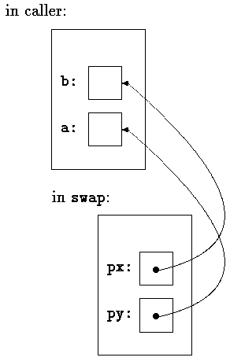

指针参数允许函数访问并修改调用它的函数中的对象。例如，考虑一个函数 `getint`，它通过将字符流分解为整数值（每次调用一个整数）来实现自由格式的输入转换。`getint` 必须返回它找到的值，并在没有更多输入时指示文件结束（EOF）。这些值必须通过单独路径返回，因为无论使用什么值作为 `EOF`，该值都可能是一个输入整数的值。

一种解决方案是让 `getint` 将文件结束状态作为其函数返回值返回，同时使用指针参数将转换后的整数存回调用函数中。`scanf` 也采用的这种方案；参见第 7.4 节。

以下循环通过调用 `getint` 向数组中填充整数：

```
int n, array[SIZE], getint(int *);
for (n = 0; n < SIZE && getint(&array[n]) != EOF; n++)
    ;
```

每次调用都会将 `array[n]` 设置为输入中找到的下一个整数并递增 `n`。注意，将 `array[n]` 的地址传递给 `getint` 是至关重要的。否则，`getint` 无法将转换后的整数传给调用者。

我们版本的 `getint` 在文件结束时返回 `EOF`，如果下一个输入不是数字则返回 0，如果输入包含有效数字则返回正值。

```
#include <ctype.h>
int getch(void);
void ungetch(int);
/* getint:  get next integer from input into *pn */
int getint(int *pn)
{
    int c, sign;
    while (isspace(c = getch()))   /* skip white space */
        ;
    if (!isdigit(c) && c != EOF && c != '+' && c != '-') {
        ungetch(c);  /* it is not a number */
        return 0;
    }
    sign = (c == '-') ? -1 : 1;
    if (c == '+' || c == '-')
        c = getch();
    for (*pn = 0, isdigit(c), c = getch())
        *pn = 10 * *pn + (c - '0');
    *pn *= sign;
    if (c != EOF)
        ungetch(c);
    return c;
}
```

在整个 `getint` 中，`*pn` 被用作一个普通的 `int` 变量。我们还使用了 `getch` 和 `ungetch`（在第 4.3 节 中描述），这样必须读取的额外字符就可以推回输入流。

**练习 5-1。** 按照写法，`getint` 将未跟随数字的 `+` 或 `-` 视为零的有效表示。修复它，将此类字符推回输入。

**练习 5-2。** 编写 `getfloat`，即 `getint` 的浮点数对应。`getfloat` 的返回值返回什么类型？

## 5.3 指针与数组

在 C 语言中，指针和数组之间存在紧密的关系，这种关系紧密到应该同时讨论指针和数组。任何可以通过数组下标实现的操作都可以通过指针完成。指针版本通常更快，但至少对于初学者来说，理解起来要困难一些。

声明

```
int a[10];
```

定义了一个大小为 10 的数组，即一个命名为 `a[0]`, `a[1]`, ..., `a[9]` 的 10 个连续对象的块。

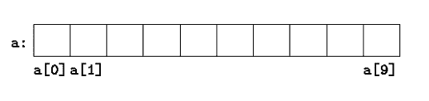

符号 `a[i]` 指向数组的第 `i` 个元素。如果 `pa` 是一个整数的指针，声明为：

```
int *pa;
```

那么赋值

```
pa = &a[0];
```

将 `pa` 指向 `a` 的元素零；即 `pa` 包含 `a[0]` 的地址。

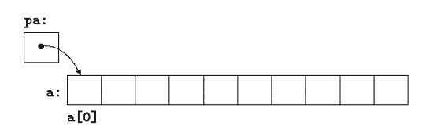

现在赋值

```
x = *pa;
```

将 `a[0]` 的内容复制到 `x` 中。

如果 `pa` 指向数组的某个元素，根据定义，`pa+1` 指向下一个元素，`pa+i` 指向 `pa` 之后的 `i` 个元素，而 `pa-i` 指向 `pa` 之前的 `i` 个元素。


对于`f`而言，参数指向较大数组的一部分这一事实是无关的。

如果确定元素存在，也可以对数组进行反向索引；`p[-1]`、`p[-2]`等在语法上是合法的，并且指向紧跟在`p[0]`之前的元素。当然，引用数组边界之外的对象是非法的。

## 5.4 地址算术 (Address Arithmetic)

如果`p`是指向数组中某个元素的指针，那么`p++`就会增加`p`，使其指向下一个元素，而`p+=i`则增加`p`，使其指向比当前位置之后的第`i`个元素。这些和类似的结构是指针或地址算术的最形式。

C语言在地址算术方法上保持一致且规律；指针、数组和地址算术的结合是该语言的优势之一。让我们通过编写一个原始的存储分配器来说说明。有两个例程。第一个是`alloc(n)`，返回指向`n`个连续字符位置的指针，`alloc`的调用者可以使用它来存储字符。第二个是`afree(p)`，释放这样获取的存储以便稍后重用。这两个例程是"原始的"，因为对`afree`的调用必须与`alloc`的调用顺序相反。也就是说，由`alloc`和`afree`管理的存储是一个栈，即后进先出。标准库提供了类似的函数`malloc`和`free`，它们没有这样的限制；在第8.7节我们将展示如何实现它们。

简单的实现是让`alloc`分配大型字符数组的一部分，我们称为`allocbuf`。该数组是`alloc`和`afree`私有的。由于它们处理的是指针而不是数组索引，因此其他例程不需要知道数组的名称，数组可以在包含`alloc`和`afree`的源文件中声明为`static`，从而在外部不可见。在实际实现中，该数组可能根本没有名称；而是可以通过调用`malloc`或向操作系统请求指向某些未命名存储块的指针来获取。

需要的其他信息是`allocbuf`使用了多少。我们使用一个名为`allocp`的指针指向下一个空闲元素。当`alloc`被请求`n`个字符时，它会检查`allocbuf`中是否还有足够的空间。如果是，`alloc`返回`allocp`的当前值（即空闲块的起始），然后将其增加`n`以指向下一个空闲区域。如果没有空间，`alloc`返回0。如果`p`在`allocbuf`内部，`afree(p)`仅将`allocp`设置为`p`。

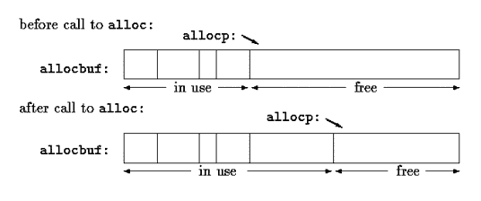

```c
#define ALLOCSIZE 10000 /* 可用空间的大小 */

   static char allocbuf[ALLOCSIZE]; /* alloc 的存储 */

   static char *allocp = allocbuf;  /* 下一个空闲位置 */

   char *alloc(int n)    /* 返回 n 个字符的指针 */

   {

       if (allocbuf + ALLOCSIZE - allocp >= n) {  /* 空间足够 */

           allocp += n;

           return allocp - n; /* 旧的 p */

       } else      /* 空间不足 */

           return 0;

   }

   void afree(char *p)  /* 释放 p 指向的存储 */

   {

       if (p >= allocbuf && p < allocbuf + ALLOCSIZE)

           allocp = p;

   }
```

通常情况下，指针可以像任何其他变量一样初始化，尽管通常唯一有意义的值是零或涉及预先定义的适当类型数据的地址的表达式。声明：

```c
static char *allocp = allocbuf;
```

定义`allocp`为字符指针，并将其初始化为指向`allocbuf`的开头，这正是程序启动时的下一个空闲位置。这也可以写成：

```c
static char *allocp = &allocbuf[0];
```

因为数组名就是第0个元素的地址。

测试

```c
 if (allocbuf + ALLOCSIZE - allocp >= n) {  /* 空间足够 */
```

检查是否有足够的空间满足对`n`个字符的请求。如果有，`allocp`的新值最多位于`allocbuf`结束之后的位置。如果请求可以满足，`alloc`返回一个指向字符块起始位置的指针（注意函数本身的声明）。如果不能，`alloc`必须返回某种信号表示没有剩余空间。C语言保证零永远不会是数据的有效地址，因此返回零可以用于指示异常事件，在这种情况下为无空间。

指针和整数是不可交换的。零是唯一的例外：常量零可以赋值给指针，指针也可以与常量零进行比较。通常用符号常量`NULL`代替零，作为助记符更清楚地指示这是一个指针的特殊值。`NULL`定义在`<stdio.h>`中。我们以后将使用`NULL`。

像这样的

```c
 if (allocbuf + ALLOCSIZE - allocp >= n) {  /* 空间足够 */
```

以及

```c
 if (p >= allocbuf && p < allocbuf + ALLOCSIZE)
```

展示了指针算术的几个重要方面。首先，指针可以在某些情况下进行比较。如果`p`和`q`指向同一数组，那么`==`、`!=`、`>=`等关系可以正常工作。例如，

```c
p < q
```

如果`p`指向数组中比`q`更早的元素，则为真。任何指针都可以与零进行相等比较。但对于不指向同一数组成员的指针，进行算术运算或比较行为是未定义的。（有一个例外：数组末尾之后的第一个元素的地址可以用于指针算术。）

其次，我们已经观察到指针和整数可以相加或相减。构造

```
p + n
```

意味着`p`当前指向的对象之后的第`n`个对象的地址。无论`p`指向什么类型的对象这都是如此；`n`会根据`p`指向的对象的大小进行缩放，这由`p`的声明决定。例如，如果`int`是四字节，则`int`将缩放四倍。

指针减法也是有效的：如果`p`和`q`指向同一数组元素且`p<q`，则`q-p+1`是从`p`到`q`的元素个数。这一事实可以用于编写另一个版本的`strlen`：

```c
 /* strlen: 返回字符串 s 的长度 */
   int strlen(char *s)
   {
       char *p = s;
       while (*p != '\0')
           p++;
       return p - s;
   }
```

在它的声明中，`p`被初始化为`s`，即指向字符串的第一个字符。在`while`循环中，依次检查每个字符，直到看到末尾的`'\0'`。因为`p`指向字符，`p++`每次会让`p`移动到下一个字符，而`p-s`则给出了移动过的字符数，即字符串长度。（字符串中的字符数可能太大，无法存储在`int`中。头文件`<stddef.h>`定义了一个类型`ptrdiff_t`，它足够大可以容纳两个指针值之间的有符号差。然而，如果我们为了稳妥起见，我们会为`strlen`的返回值使用`size_t`，以匹配标准库的版本。`size_t`是`sizeof`运算符返回的无符号整数类型。）

### 指针算术

指针算术具有一致性：如果我们处理的是`float`类型（其占用的空间比`char`大），并且`p`是一个指向`float`的指针，那么`p++`将移动到下一个`float`。因此，我们只需通过将`alloc`和`afree`中的`char`更改为`float`，就可以编写另一个维护`float`而非`char`的`alloc`版本。所有的指针操作都会自动考虑到所指向对象的大小。

有效的指针操作包括：相同类型指针的赋值、指针与整数的加减、指向同一数组元素的两个指针的相减或比较，以及与零的赋值或比较。所有其他指针算术都是非法的。两个指针相加，或对它们进行乘法、除法、移位或掩码操作，或者给它们加上`float`或`double`，甚至除了`void *`外，在不进行类型转换的情况下将一种类型的指针赋值给另一种类型的指针。

## 5.5 字符指针与函数

*字符串常量*的写形式如下：

```
"I am a string"
```

是一个字符数组。在内部表示中，该数组以空字符`'\0'`终止，以便程序能够找到结尾。因此，存储中的长度比双引号之间的字符数多一。

字符串常量最常见的形式是作为函数的参数，例如：

```c
printf("hello, world\n");
```

当这样的字符字符串出现在程序中时，对其访问是通过字符指针进行的；`printf`接收一个指向字符数组开头的指针。也就是说，字符串常量是通过指向其第一个元素的指针来访问的。

字符串常量不需要是函数参数。如果`pmessage`定义为：

```c
char *pmessage;
```

那么语句

```c
pmessage = "now is the time";
```

会将指向字符数组的指针赋值给`pmessage`。这*不是*字符串拷贝；它只涉及指针。C语言没有提供任何将整个字符字符串作为一个单元进行处理的运算符。

这些定义之间存在重要的区别：

```c
char amessage[] = "now is the time"; /* 数组 */
char *pmessage = "now is the time"; /* 指针 */
```

`amessage`是一个数组，大小恰好能容初始化它的字符序列和`'\0'`。数组中的单个字符可以被修改，但`amessage`始终引用同一个存储区域。另一方面，`pmessage`是一个指针，初始化指向一个字符串常量；该指针随后可以被修改指向其他地方，但如果你尝试修改字符串内容，结果是未定义的。

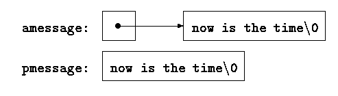

我们将通过学习两个自标准库的有用函数的变来说更多指针和数组的方面。第一个函数是`strcpy(s,t)`，它将字符串`t`拷贝到字符串`s`。如果能直接说`s=t`就好了，但这拷贝的是指针而不是字符。为了拷贝字符，我们需要一个循环。首先是数组版本：

```c
 /* strcpy:  将 t 拷贝到 s; 数组下标版本 */
void strcpy(char *s, char *t)
{
    int i;
    i = 0;
    while ((s[i] = t[i]) != '\0')
        i++;
}
```

作为对比，这是一个指针版本的`strcpy`：

```c
 /* strcpy:  将 t 拷贝到 s; 指针版本 */
void strcpy(char *s, char *t)
{
    int i;
    i = 0;
    while ((*s = *t) != '\0') {
        s++;
        t++;
    }
}
```

由于参数是按值传递的，`strcpy`可以以它意愿的任何方式使用参数`s`和`t`。在这里它们是方便的已初始指针，逐个字符地在数组中移动，直到终止`t`的`'\0'`被拷贝到`s`中。

在实践中，`strcpy`不像我们上面展示的那样。丰富的C程序员倾向于：

```c
 /* strcpy:  将 t 拷贝到 s; 指针版本 2 */
void strcpy(char *s, char *t)
{
    while (*s++ = *t++) != '\0')
        ;
}
```

这将`s`和`t`的自增移动到了循环的测试部分。`*t++`的值是`t`在自增之前指向的字符；后置`++`在获取到该字符之后才会改变`t`。同样地，字符在存储到`s`位置之前，`s`会自增。最终效果是将字符从`t`拷贝到`s`，包括`'\0'`。作为最后的简写，注意到与`'\0'`是多余的，因为只需判断表达式是否为零。因此函数可能会写成：

```c
 /* strcpy:  将 t 拷贝到 s; 指针版本 3 */
void strcpy(char *s, char *t)
{
    while (*s++ = *t++)
        ;
}
```

虽然这初看起来很难懂，但符号上的便利是巨大的，应该掌握这种用法，因为你会在C程序中经常看到它。标准库（`<string.h>`）中的`strcpy`返回目标字符串作为返回值。

我们将检查的第二个程序是`strcmp(s,t)`，它比较字符串`s`和`t`，并根据`s`小于、等于或大于`t`返回负、零或正。值是通过相减`s`和`t`在第一个不同位置字符得到的。

```c
 /* strcmp:  若 s<t 返回负, s==t 返回 0, s>t 返回正 */
int strcmp(char *s, char *t)
{
    int i;
    for (i = 0; s[i] == t[i]; i++)
        if (s[i] == '\0')
            return 0;
    return s[i] - t[i];
}
```

指针版本的`strcmp`：

```c
 /* strcmp:  若 s<t 返回负, s==t 返回 0, s>t 返回正 */
int strcmp(char *s, char *t)
{
    for ( ; *s == *t; s++, t++)
        if (*s == '\0')
            return 0;
    return *s - *t;
}
```

由于`++`和`--`都是前置或后置运算符，`*`与`++`和`--`的其他组合也会出现，尽管频率较低。例如：

```
*--p
```

在获取`p`指向的字符之前先递减`p`。事实上，这一对表达式：

```
 *p++ = val;  /* 将 val 推入栈 */
   val = *--p;  /* 将栈顶元素赋值给 val */
```

是栈栈和出栈的标准惯用语；参见第4.3节。

头文件`<string.h>`包含了本节提到的函数的声明，以及标准库中其他各种字符串处理函数。

**练习 5-3。** 编写我们在第2章中过的函数`strcat`的指针版本：`strcat(s,t)`将字符串`t`复制到`s`的末尾。

**练习 5-4。** 编写函数`strend(s,t)`，如果字符串`t`出现在字符串`s`的末尾，则返回1，否则返回零。

**练习 5-5。** 编写库函数`strncpy`、`strncat`和`strncmp`的版本，这些函数的操作针对参数字符串最多前`n`个字符。例如，`strncpy(s,t,n)`将`t`的至多`n`个字符复制到`s`。详细描述请参见附录B。

**练习 5-6。** 使用指针代替数组索引重写前面章节和练习中的适当程序。好的选择包括`getline`（第1章和第4章）、`atoi`、`itoa`及其变体（第2章、第3章和第4章）、`reverse`（第3章）以及`strindex`和`getop`（第4章）。

## 5.6 指针数组；指针的指针

由于指针本身就是变量，它们可以像其他变量一样存储在数组中。让我们通过编写一个程序来将一组文本行按字母顺序排序，这是UNIX程序`sort`的一个精简版本。

在第3章中，我们介绍了一个可以排序整数数组的Shell排序函数，在第4章中，我们用快速排序对其进行了改进。相同的算法仍然有效，只是我们现在必须处理长度不同的文本行，而且与整数不同，它们无法通过单个操作完成比较或移动。我们需要一种能够高效方便地处理变长文本行的表示方法。

这就是指针数组派上用场的地方。如果排序的行首尾相接地存储在一个长字符数组中，可以通过指向每行第一个字符的指针来访问每一行。指针本身可以存储在数组中。可以通过将它们的指针传递给`strcmp`来比较两行。当需要交换两行顺序不对的行时，交换的是指针数组中的指针，而不是文本行本身。

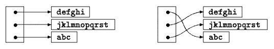

这消除了复杂的存储管理以及移动行本身带来的高开销双重问题。

排序过程分为三个步骤：

* 读取所有输入行
* 对它们进行排序
* 按顺序打印它们

如往常，最好将程序划分为符合这种自然划分的函数，由主程序控制其他函数。让我们暂时推迟排序步骤，专注于数据结构以及输入和输出。

输入程序必须收集并保存每行的字符，并构建一个指向这些行的指针数组。它还需要计算输入行的数量，因为排序和打印需要这些信息。由于输入函数只能处理有限数量的输入行，如果输入过多，它可以返回某些类似`-1`的非法计数。

输出程序只需要按照行在指针数组中出现的顺序打印即可。

```c
#include <stdio.h>
#include <string.h>
#define MAXLINES 5000     /* 需要排序的最大行数 */
char *lineptr[MAXLINES];  /* 指向文本行的指针 */
int readlines(char *lineptr[], int nlines);
void writelines(char *lineptr[], int nlines);
void qsort(char *lineptr[], int left, int right);
/* 排序输入行 */
main()
{
    int nlines;     /* 读取的输入行数 */
    if ((nlines = readlines(lineptr, MAXLINES)) >= 0) {
```


```c
qsort(lineptr, 0, nlines-1);

writelines(lineptr, nlines);

return 0;

} else {

printf("error: input too big to sort\n");

return 1;

}

}

#define MAXLEN 1000  /* 任何输入行的最大长度 */

int getline(char *, int);

char *alloc(int);

/* readlines: 读取输入行 */

int readlines(char *lineptr[], int maxlines)

{

    int len, nlines;

    char *p, line[MAXLEN];

    nlines = 0;

    while ((len = getline(line, MAXLEN)) > 0)

        if (nlines >= maxlines || p = alloc(len) == NULL)

            return -1;

        else {

            line[len-1] = '\0';  /* 删除换行符 */

            strcpy(p, line);

            lineptr[nlines++] = p;

        }

    return nlines;

}

/* writelines: 输出输出行 */

void writelines(char *lineptr[], int nlines)

{

    int i;

    for (i = 0; i < nlines; i++)

        printf("%s\n", lineptr[i]);

}

```

函数 `getline` 来自第 1.9 节。

主要的新点是 `lineptr` 的声明：

```c
char *lineptr[MAXLINES]
```

表示 `lineptr` 是一个包含 `MAXLINES` 个元素的数组，每个元素都是一个指向 `char` 的指针。也就是说，`lineptr[i]` 是一个字符指针，而 `*lineptr[i]` 是它指向的字符，即第 `i` 行保存的文本行的第一个字符。

由于 `lineptr` 本身是数组名，它可以像在我们之前的示例中那样被处理为指针，而 `writelines` 可以写成：

```c
/* writelines: 输出输出行 */

void writelines(char *lineptr[], int nlines)

{

    while (nlines-- > 0)

        printf("%s\n", *lineptr++);

}

```

最初，`*lineptr` 指向第一行；随着 `nlines` 递减，每个元素都会移动到一行。

在控制了输入输出后，我们可以进行排序。来自第 4 章的 `quicksort` 需要微调：声明必须修改，并且比较操作必须通过调用 `strcmp` 完成。算法保持不变，这让我们有一定的信心认为它仍然有效。

```c
/* qsort: 将 v[left]...v[right] 升序排序 */

void qsort(char *v[], int left, int right)

{

    int i, last;

    void swap(char *v[], int i, int j);

    if (left >= right)  /* 如果数组少于两个元素则不操作 */

        return;

    swap(v, left, (left + right)/2);

    last = left;

    for (i = left+1; i <= right; i++)

        if (strcmp(v[i], v[left]) < 0)

            swap(v, ++last, i);

    swap(v, left, last);

    qsort(v, left, last-1);

    qsort(v, last+1, right);

}

```

同样，`swap` 程序只需要微小的变化：

```c
/* swap: 交换 v[i] 和 v[j] */

void swap(char *v[], int i, int j)

{

    char *temp;

    temp = v[i];

    v[i] = v[j];

    v[j] = temp;

}

```

由于 `v`（别名为 `lineptr`）的任何单独元素都是字符指针，因此 `temp` 也必须是，这样它们就可以相互拷贝。

**练习 5-7。** 重写 `readlines`，将行存储在 `main` 提供的数组中，而不是调用 `alloc` 来维护存储。程序运行快了多少？

## 5.7 多维数组

C 提供了矩形多维数组，尽管在实践中它们的使用频率远低于指针数组。在本节中，我们将展示它们的一些属性。

考虑日期转换问题，从月份中的某一天转换为一年中的一天，反之亦然。例如，3 月 1 日是非年的第 60 天，也是闰年的第 61 天。让我们定义两个函数来完成这种转换：`day_of_year` 将月份和日期转换为一年中的一天，而 `month_day` 将一年中的一天转换为月份和日期。由于后者需要计算两个值，因此月份和日的参数将是指针：

```c
month_day(1988, 60, &m, &d);
```

将 `m` 设置为 2，`d` 设置为 29（2 月 29 日）。

这两个函数都需要相同的信息，即每个每月天数的表格（“九月有三十天……”）。由于闰年和平年的每个月的天数不同，因此将它们分离到二维数组的两行中，比在计算过程中跟踪二月发生的情况要容易得多。该数组以及执行转换的函数如下：

```c
static char daytab[2][13] = {

   {0, 31, 28, 31, 30, 31, 30, 31, 31, 30, 31, 30, 31},

   {0, 31, 29, 31, 30, 31, 30, 31, 31, 30, 31, 30, 31}

};

/* day_of_year: 根据月份和日期设置一年中的一天 */

int day_of_year(int year, int month, int day)

{

   int i, leap;

   leap = year%4 == 0 && year%100 != 0 || year%400 == 0;

   for (i = 1; i < month; i++)

       day += daytab[leap][i];

   return day;

}

/* month_day: 根据一年中的一天设置月份和日期 */

void month_day(int year, int yearday, int *pmonth, int *pday)

{

   int i, leap;

   leap = year%4 == 0 && year%100 != 0 || year%400 == 0;

   for (i = 1; yearday > daytab[leap][i]; i++)

       yearday -= daytab[leap][i];

   *pmonth = i;

   *pday = yearday;

}

```

记住，逻辑表达式的算术值（例如 `leap` 的表达式）要么为零（假）或一（真），因此它可以作为数组 `daytab` 的下标。

数组 `daytab` 必须独立于 `day_of_year` 和 `month_day`，这样它们都可以使用它。我们将其类型设为 `char` 是为了说明使用 `char` 存储较小的非字符整数的合法用法。

`daytab` 是我们处理过的第一个二维数组。在 C 中，二维数组实际上是一个一维数组，其每个元素都是一个数组。因此，下标写为：

```c
daytab[i][j]    /* [行][列] */
```

而不是：

```c
daytab[i,j]    /* 错误 */
```

除了这种表示法上的区别，二维数组的处理方式与其他语言非常相似。元素是按行存储的，因此当按照存储顺序访问元素时，最右侧的下标（即列）变化最快。

数组通过大括号中的初始值列表进行初始化；二维数组的每一行都由一个相应的子列表进行初始化。我们在初始化 `daytab` 数组时设置了一列零，这样月份数字就可以从自然的 1 到 12 开始，而不是从 0 到 11。由于这里空间并不稀缺，这种方法比调整索引更清晰。

如果要将二维数组传递给函数，函数中的参数声明必须包含列数；行数是无关的，因为传递的内容和以前一样是一个指向行数组的指针，每一行都是一个包含 13 个 `int` 的数组。在这种特殊情况下，它是一个指向 13 个 `int` 数组对象的指针。因此，如果将数组 `daytab` 传递给函数 `f`，`f` 的声明将：

```c
f(int daytab[2][13]) { ... }
```

也可以是：

```c
f(int daytab[][13]) { ... }
```

因为行数是无关的，或者可以是：

```c
f(int (*daytab)[13]) { ... }
```

这表示括号是必要的，因为方括号 `[]` 的优先级高于 `*`。如果没有括号，声明：

```c
int *daytab[13]
```

是一个包含 13 个指针的数组。更通用地说，如果未指定第一维，编译器会计算初始值并填充正确的数量。

## 5.8 指针数组的初始化

尽管我们是用整数来讨论这个问题的，但指针数组最常用的用法是存储不同长度的字符字符串，例如在 `month_name` 函数中。考虑日期转换问题，从月份中的某一天转换为一年中的一天，反之亦然。例如，3 月 1 日是非年的第 60 天，也是闰年的第 61 天。让我们定义两个函数来完成这种转换：`day_of_year` 将月份和日期转换为一年中的一天，而 `month_day` 将一年中的一天转换为月份和日期。由于后者需要计算两个值，月份和日的参数将是指针：

```c
month_day(1988, 60, &m, &d);
```

将 `m` 设置为 2，`d` 设置为 29（2 月 29 日）。这两个函数都需要相同的信息，即每个每月天数的表格（“九月有三十天……”）。由于闰年和平年的每个月的天数不同，因此将它们分离到二维数组的两行中，比在计算过程中跟踪二月发生的情况要容易得多。该数组以及执行转换的函数如下：

```c
static char daytab[2][13] = {

   {0, 31, 28, 31, 30, 31, 30, 31, 31, 30, 31, 30, 31},

   {0, 31, 29, 31, 30, 31, 30, 31, 31, 30, 31, 30, 31}

};

/* day_of_year: 根据月份和日期设置一年中的一天 */

int day_of_year(int year, int month, int day)

{

   int i, leap;

   leap = year%4 == 0 && year%100 != 0 || year%400 == 0;

   for (i = 1; i < month; i++)

       day += daytab[leap][i];

   return day;

}

/* month_day: 根据一年中的一天设置月份和日期 */

void month_day(int year, int yearday, int *pmonth, int *pday)

{

   int i, leap;

   leap = year%4 == 0 && year%100 != 0 || year%400 == 0;

   for (i = 1; yearday > daytab[leap][i]; i++)

       yearday -= daytab[leap][i];

   *pmonth = i;

   *pday = yearday;

}

```

记住，逻辑表达式的算术值（例如 `leap` 的表达式）要么为零（假）或一（真），因此它可以作为数组 `daytab` 的下标。

数组 `daytab` 必须独立于 `day_of_year` 和 `month_day`，这样它们都可以使用它。我们将其类型设为 `char` 是为了说明使用 `char` 存储较小的非字符整数的合法用法。

`daytab` 是我们处理过的第一个二维数组。在 C 中，二维数组实际上是一个一维数组，其每个元素都是一个数组。因此，下标写为：

```c
daytab[i][j]    /* [行][列] */
```

而不是：

```c
daytab[i,j]    /* 错误 */
```

除了这种表示法上的区别，二维数组的处理方式与其他语言非常相似。元素是按行存储的，因此当按照存储顺序访问元素时，最右侧的下标（即列）变化最快。

数组通过大括号中的初始值列表进行初始化；二维数组的每一行都由一个相应的子列表进行初始化。我们在初始化 `daytab` 数组时设置了一列零，这样月份数字就可以从自然的 1 到 12 开始，而不是从 0 到 11。由于这里空间并不稀缺，这种方法比调整索引更清晰。

如果要将二维数组传递给函数，函数中的参数声明必须包含列数；行数是无关的，因为传递的内容和以前一样是一个指向行数组的指针，每一行都是一个包含 13 个 `int` 的数组。在这种特殊情况下，它是一个指向 13 个 `int` 数组对象的指针。因此，如果将数组 `daytab` 传递给函数 `f`，`f` 的声明将：

```c
f(int daytab[2][13]) { ... }
```

也可以是：

```c
f(int daytab[][13]) { ... }
```

因为行数是无关的，或者可以是：

```c
f(int (*daytab)[13]) { ... }
```

这表示括号是必要的，因为方括号 `[]` 的优先级高于 `*`。如果没有括号，声明：

```c
int *daytab[13]
```

是一个包含 13 个指针的数组。更通用地说，如果未指定第一维，编译器会计算初始值并填充正确的数量。

**练习 5-7。** 重写 `readlines`，将行存储在 `main` 提供的数组中，而不是调用 `alloc` 来维护存储。程序运行快了多少？

## 5.9 指针与多维数组

C 初学者有时会混淆二维数组和指针数组，例如上面示例中的 `name`。给定定义：

```c
int a[10][20];

int *b[];

```

那么 `a[3][4]` 和 `b[3][4]` 都是语法合法的单个 `int` 引用。但 `a` 是真正的二维数组：它预留了 200 个 `int` 大小的位置，并使用了传统的下标计算 `20 * *row* + *col*` 来查找元素 `a[row,col]`。对于 `b`，定义只分配了 10 个指针且没有初始化它们；初始化必须显式进行，无论是静态地还是通过代码。假设 `b` 的每个元素都指向一个包含 20 个元素的数组，那么将预留 200 个 `int`，外加 10 个用于指针的单元。指针数组的重要优势是数组的行可以是不同长度。也就是说，`b` 的每个元素并不一定指向一个 20 个元素的向量；有的指向两个元素，有的指向五十个，有的完全不指向。

对比指针数组的声明和图：

```c
char *name[] = { "Illegal month", "Jan", "Feb", "Mar" };
```

(pic59.gif)

与二维数组的声明和图对比：

```c
char aname[][15] = { "Illegal month", "Jan", "Feb", "Mar" };
```

```markdown
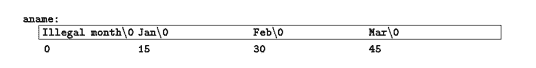
```

**练习 5-9。** 使用指针代替索引来重写 `day_of_year` 和 `month_day` 程。

## 5.10 命令行参数

在支持 C 语言的环境中，有一种方法可以在程序执行时向其传递命令行参数或参数。当 `main` 被调用时，它是带有两个参数被调用的。第一个（通常称为 `argc`，代表 argument count 参数计数）是调用程序时的命令行参数个数；第二个（`argv`，代表 argument vector 参数向量）是一个指向字符字符串数组的指针，该数组包含了参数，每个字符串包含一个参数。我们通常使用多层级指针来操作这些字符字符串。

最简单的例子是 `echo` 程序，它在单行内回显它的命令行参数，并用空格分隔。也就是说，命令：

```text
echo hello, world
```

会输出：

```text
hello, world
```

按照惯例，`argv[0]` 是调用程序时使用的名称，因此 `argc` 至少为 1。如果 `argc` 为 1，则程序名后没有命令行参数。在上面的示例中，`argc` 为 3，且 `argv[0]`、`argv[1]` 和 `argv[2]` 分别为 `"echo"`、`"hello,"` 和 `"world"`。第一个可选参数是 `argv[1]`，最后一个是 `argv[argc-1]`；此外，标准要求 `argv[argc]` 必须空指针。

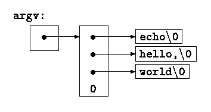

`echo` 的第一个版本将 `argv` 视为字符指针数组：

```c
#include <stdio.h>

/* echo 命令行参数; 第 1 版本 */

main(int argc, char *argv[])

{

    int i;

    for (i = 1; i < argc; i++)
```


```c
printf("%s%s", argv[i], (i < argc-1) ? " " : "");

printf("\n");

return 0;

}
```

由于`argv`是一个指向指针数组的指针，我们可以操作指针而不是索引数组。下一个变体基于递增`argv`（它是一个指向`char`指针的指针），同时对`argc`进行递减：

```c
#include <stdio.h>

/* echo 命令行参数; 第 2 版本 */

main(int argc, char *argv[])

{

    while (--argc > 0)

        printf("%s%s", *++argv, (argc > 1) ? " " : "");

    printf("\n");

    return 0;

}
```

由于`argv`是指向参数字符串数组开头的指针，将其递增 1（`++argv`）会使其指向原始的`argv[1]`而不是`argv[0]`。每次连续递增都会将其移动到下一个参数；此时`*argv`就是指向该参数的指针。同时，`argc`会递减；当它变为零时，就没有剩余参数需要打印了。

或者，我们可以将`printf`语句写成：

```c
printf((argc > 1) ? "%s " : "%s", *++argv);
```

这说明`printf`的格式参数也可以是一个表达式。

作为第二个例子，让我们对第 4.1 节中的模式查找程序进行一些增强。如果你还记得，我们将搜索模式深层编码进了程序中，这显然是一个令人不满意的安排。参考 UNIX 程序`grep`，让我们增强程序，使得匹配模式通过命令行上的第一个参数来指定。

```c
#include <stdio.h>

#include <string.h>

#define MAXLINE 1000

int getline(char *line, int max);

/* find: 输出从第一个参数开始匹配模式的行 */

main(int argc, char *argv[])

{

    char line[MAXLINE];

    int found = 0;

    if (argc != 2)

        printf("Usage: find pattern\n");

    else

        while (getline(line, MAXLINE) > 0)

            if (strstr(line, argv[1]) != NULL) {

                printf("%s", line);

                found++;

            }

    return found;

}
```

标准库函数`strstr(s,t)`返回字符串`s`中字符串`t`第一次出现处的指针，如果没有，则返回`NULL`。它在`<string.h>`中声明。

现在可以扩展该模型以进一步说明指针的构造。假设我们允许两个可选参数。其中一个表示“打印所有*除*匹配模式的行；”另一个表示“在每行打印的行前加上行号”。

UNIX 系统上 C 程序的常用惯例是，以减号开头的参数引入可选标志或参数。如果我们选择`-x`（代表 "except"）来指示反转，并选择`-n`（"number"）请求行号，那么命令

```text
find -x -npattern
```

将打印每一行不匹配模式的行，并在前面加上行号。

可选参数应该允许任意顺序，且程序的其余部分应该独立于我们提供的参数数量。此外，如果选项参数可以组合，对用户来说非常方便，例如：

```text
find -x -npattern
```

这里是该程序：

```c
#include <stdio.h>

#include <string.h>

#define MAXLINE 1000

int getline(char *line, int max);

/* find: 输出从第一个参数开始匹配模式的行 */

main(int argc, char *argv[])

{

    char line[MAXLINE];

    long lineno = 0;

    int c, except = 0, number = 0, found = 0;

    while (--argc > 0 && (*argv)[0] == '-')

        while (c = *argv[0])

            switch (c) {

                case 'x':

                    except = 1;

                    break;

                case 'n':

                    number = 1;

                    break;

                default:

                    printf("find: illegal option %c\n", c);

                    argc = 0;

                    found = -1;

                    break;

            }

    if (argc != 1)

        printf("Usage: find -xn pattern\n");

    else

        while (getline(line, MAXLINE) > 0) {

            lineno++;

            if ((strstr(line, *argv) != NULL) != except) {

                if (number)

                    printf("%ld:", lineno);

                printf("%s", line);

                found++;

            }

        }

    return found;

}
```

`argc`递减，`argv`在每个可选参数之前递增。在循环结束后，如果没有错误，`argc`告诉我们剩余多少参数，`argv`指向这些参数中的第一个。因此`argc`应为 1，`*argv`指向模式。注意`*++argv`是指向字符串字符串，所以`(*++argv)[0]`是它的字符。（另一种有效形式是`**argv`。）由于`[]`的结合优先级高于`*`和`++`，括号是必要的；如果没有，表达式将被解析为`*(++argv[0])`。事实上，这正是我们在内部循环中所使用的，任务是遍历特定参数。在内部循环中，表达式`*++argv[0]`将`argv[0]`！

很少使用比这些更复杂的指针表达式；在这种情况下，将其拆分为两个或三个步骤会更直观。

**练习 5-10。** 编写`expr`程序，从命令行计算逆波兰表达式，其中每个操作符或操作数都是独立的参数。例如：

```text
expr 2 3 4 + *
```

计算 2 * (3+4)。

**练习 5-11。** 修改`entab`和`detab`程序（作为第 1 章中的练习编写的），接受一组制表位作为参数。如果没有参数，则使用默认制表位设置。

**练习 5-12。** 扩展`entab`和`detab`以接受快捷形式：

```text
entab -m +n
```

意味着每*n*列设置一个制表位，从第*m*列开始。选择对用户方便的默认行为。

**练习 5-13。** 编写`tail`程序，打印输入的最后*n*行。默认，*n*设置为 10，例如，但可以通过可选参数进行更改，使得：

```text
tail -n
```

打印最后*n*行。无论输入多么不合理或*n*的值如何，程序都应该表现得合理。编写该程序以最大限度地利用可用存储；行的存储方式应与第 5.6 节中的排序程序相同，而不是在固定大小的二维数组中。

## 5.11 函数指针

在 C 语言中，函数本身不是变量，但可以定义指向函数的指针，这种指针可以被赋值、放在数组中、传递给函数、由函数返回等。我们将通过修改本章之前写的排序过程来解释这一点：如果给定了可选参数`-n`，它将按照数值对输入行进行排序，而不是按照字典序。

排序通常由三部分组成：一个确定任意对象对顺序的比较，一个反转它们顺序的交换，以及一个不断进行比较和交换直到对象就绪的排序算法。排序算法独立于比较和交换操作，因此，通过向它传递不同的比较和交换函数，我们就可以按照不同的标准进行排序。我们新编写的排序程序采用的就是这种方法。

两行的字典序比较仍然像以前一样通过`strcmp`完成；我们还需要一个`numcmp`例程，它根据数值比较两行，并返回与`strcmp`相同的条件指示。这些函数在`main`之前声明，并将适当的函数指针传递给`qsort`。我们简化了参数的错误处理，以便集中在主要问题上。

```c
#include <stdio.h>
#include <string.h>

#define MAXLINES 5000     /* 排序的最大行数 */
char *lineptr[MAXLINES];  /* 指向文本行的指针 */
int readlines(char *lineptr[], int nlines);
void writelines(char *lineptr[], int nlines);
void qsort(void *lineptr[], int left, int right,
           int (*comp)(void *, void *));
int numcmp(char *, char *);

/* 排序输入行 */
main(int argc, char *argv[])
{
    int nlines;        /* 读取的行数 */
    int numeric = 0;   /* 1 表示数值排序 */
    if (argc > 1 && strcmp(argv[1], "-n") == 0)
        numeric = 1;
    if ((nlines = readlines(lineptr, MAXLINES)) >= 0) {
        qsort((void**) lineptr, 0, nlines-1,
              (int (*)(void*,void*))(numeric ? numcmp : strcmp));
        writelines(lineptr, nlines);
        return 0;
    } else {
        printf("input too big to sort\n");
        return 1;
    }
}
```

在调用`qsort`时，`strcmp`和`numcmp`是函数的地址。由于已知它们是函数，因此不需要`&`，这与数组名前面也不需要是一样的。

我们编写`qsort`是为了让它能够处理任何数据类型，而不仅仅是字符字符串。正如函数原型所示，`qsort`期望一个指针数组、两个整数和一个带有两个指针参数的函数。通用指针类型`void *`被用于指针参数。任何指针都可以转换为`void *`并转换回来，而不会丢失信息，因此我们可以通过将参数转换为`void *`来调用`qsort`。函数参数的复杂类型转换转换了比较函数的参数。这些通常对实际表示没有影响，但能向编译器确保一切正常。

```c
/* qsort: 将 v[left]...v[right] 排序为递增顺序 */
void qsort(void *v[], int left, int right,
           int (*comp)(void *, void *))
{
    int i, last;
    void swap(void *v[], int, int);
    if (left >= right)    /* 如果数组包含少于两个元素 */
        return;           /* 什么都不做 */
    swap(v, left, (left + right)/2);
    last = left;
    for (i = left+1; i <= right;  i++)
        if ((*comp)(v[i], v[left]) < 0)
            swap(v, ++last, i);
    swap(v, left, last);
    qsort(v, left, last-1, comp);
    qsort(v, last+1, right, comp);
}
```

应该仔细研究这些声明。`qsort`的第四个参数是：

```c
int (*comp)(void *, void *)
```

这表示`comp`是一个指向函数的指针，该函数有两个`void *`参数并返回一个`int`。

在这一行中使用`comp`：

```c
if (*comp)(v[i], v[left]) < 0)
```

与声明一致：`comp`是指向函数的指针，`*comp`是该函数，而：

```c
(*comp)(v[i], v[left])
```

是对它的调用。需要括号是为了确保组件正确关联；如果没有括号：

```c
int *comp(void *, void *)    /* 错误 */
```

将表示`comp`是一个返回`int`指针的函数，这完全不同。

我们已经展示了`strcmp`，它比较两个字符串。这里是`numcmp`，它根据数值比较两行：

```c
#include <stdlib.h>
/* numcmp: 数值比较 s1 和 s2 */
int numcmp(char *s1, char *s2)
{
    double v1, v2;
    v1 = atof(s1);
    v2 = atof(s2);
    if (v1 < v2)
        return -1;
    else if (v1 > v2)
        return 1;
    else
        return 0;
}
```

`swap`函数交换指针，与之前相同，只是声明变为了`void *`：

```c
void swap(void *v[], int i, int j)
{
    void *temp;
    temp = v[i];
    v[i] = v[j];
    v[j] = temp;
}
```

可以添加各种其他选项，有些具有挑战性。

**练习 5-14。** 修改排序程序以处理`-r`标志，表示反向（降序）排序。确保`-r`与`-n`使用。

**练习 5-15。** 添加`-f`选项以忽略大小写，使得`a`和`A`相同。

**练习 5-16。** 添加`-d`（目录）选项，仅对字母和数字进行比较。确保它与`-f`配合使用。

**练习 5-17。** 添加字段搜索功能，以便对行内的字段进行排序，每个字段都有一套独立的选项。

## 复杂的声明

C 语言的声明语法经常受到批评，特别是涉及函数指针的情况。这种语法试图让声明和使用保持一致；对于复杂情况，一种合成声明的良好方法是分步使用`typedef`，这在第 6.7 节中会有讨论。作为替代方案，在本节中我们将展示一组程序，可以从有效的 C 转换为单词描述并反之。单词描述从左到右读取。

第一个程序`dcl`更复杂。它将 C 声明转换为单词描述，如下例：

```c
char **argv
    argv:  指向 char 的指针
int (*daytab)[13]
    daytab:  指向包含 13 个 int 的数组的指针
int *daytab[13]
    daytab:  包含 13 个 int 指针的数组
void *comp()
    comp: 返回指向 void 的指针
```

```c
void (*comp)()
```

`comp`：返回`void`的函数指针

```c
char (*(*x())[])()
```

`x`：返回指向`char`函数指针的数组`[]`的函数

```c
char (*(*x[3])())[5]
```

`x`：长度为`3`的数组，其元素是指向`[5]`数组的函数指针

`dcl`基于指定声明符的语法，该语法在附录 A 第 8.5 节中详细列出；这是一个简化的形式：

```text
dcl:       optional *'s direct-dcl

direct-dcl name
                 (dcl)
                 direct-dcl()
                 direct-dcl[optional size]
```

用语言描述，`dcl`是一个`direct-dcl`，前面可能带有`*s`。`direct-dcl`是一个名称、或者带括号的`dcl`、或者后面跟着括号的`direct-dcl`、或者后面带有可选尺寸的括号的`direct-dcl`。

此语法可用于解析函数。例如，考虑这个声明符：

```text
(*pfa[])()
```

`pfa`将被识别为`name`，因此是一个`direct-dcl`。然后`pfa[]`也是一个`direct-dcl`。接着`*pfa[]`被识别为`dcl`，所以`(*pfa[])`是一个`direct-dcl`。然后`(*pfa[])()`是`direct-dcl`，因此是`dcl`。我们可以通过下面的树来说明这一点（其中`direct-dcl`已缩写为`dir-dcl`）：


`dcl` 程序的核心是一对函数：`dcl` 和 `irdcl`，它们根据此语法解析声明。由于语法是递归定义的，它们相互调用以识别声明语句；该程序是一个递归下降器。

```c
/* dcl: 解析声明符 */
void dcl(void)
{
    int ns;
    for (ns = 0; gettoken() == '*'; /* count *s */
        ns++)
        irdcl();
    while (ns-- > 0) /* 计数 */
        strcat(out, " pointer to");
}

/* dirdcl: 解析直接声明符 */
void dirdcl(void)
{
    int type;
    if (tokentype == '(') { /* (dcl ) */
        dcl();
        if (tokentype != ')')
            printf("error: missing )\n");
    } else if (tokentype == NAME) /* 变量名 */
        strcpy(name, token);
    else
        printf("error: expected name or (dcl)\n");
    while ((type = gettoken()) == PARENS || type == BRACKETS)
        if (type == PARENS)
            strcat(out, " function returning");
        else {
            strcat(out, " array");
        }
}
```

由于这些程序是说明性的，并不健壮，`dcl` 只能处理简单的 `char` 或 `int` 类型。它不处理函数中的参数类型，如 `const` 等修饰符。多余的空格会误导它。它没有进行错误恢复，因此无效的声明也会误导它。这些改进留作练习。

这里是全局变量和主程序：

```c
#include <stdio.h>
include <string.h>
include <ctype.h>
define MAXTOKEN 100

enum { NAME, PARENS, BRACKETS };

void dcl(void);
void dirdcl(void);
int gettoken(void);

int tokentype;           /* token 的类型 */
char token[MAXTOKEN];    /* token 字符串 */
char name[MAXTOKEN];     /* 标识符 */
char datatype[MAXTOKEN]; /* 类型 */
char out[1000];

main() /* 转换声明 */
{
    while (gettoken() != EOF) { /* 行的第一个 token */
        strcpy(datatype, token); /* 类型 */
        out[0] = '\0';
        dcl(); /* 解析剩余行 */
        if (tokentype != '\n')
            printf("syntax error\n");
        printf("%s: %s %s\n", name, out, datatype);
    }
    return 0;
}
```

`gettoken` 函数跳过空格和制表符，在输入中找到下一个 token；`token` 是名称、一对括号、一对括号（可能包括数字）或任何其他单字符。

```c
int gettoken(void) /* 返回下一个 token */
{
    int c, getch(void);
    void ungetch(int);
    char *p = token;

    while ((c = getch()) == ' ' || c == '\t')
        ;

    if (c == '(') {
        if ((c = getch()) == ')') {
        } else {
        }
        }
    } else if (c == '[') {
        }
    } else if (isalpha(c)) {
        }
    } else
        }
}
```

让我们创建几个适用于图形处理的结构。基本对象是一个点，我们假设它有一个 `x` 坐标和一个 `y` 坐标，两者都是整数。

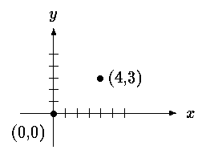

这两个组件可以放置在如下所示声明的结构中：

```c
struct point {
    int x;
    int y;
};
```

`struct` 关键字引入一个结构声明，它是一个包含在花括号中的声明列表。`struct` 后面可以紧跟一个可选的名称，称为结构标签（structure tag）（如此处的 `point`）。该标签为这种类型的结构命名，并在此后可以被用作括号内声明部分的简写。

在结构中命名的变量被称为成员（members）。结构成员（标签）与普通变量（即非成员变量）可以具有相同的名称而不会产生冲突，因为它们始终可以通过上下文来区分。此外，相同的成员名称可能会出现在不同的结构中，尽管从代码风格的习惯上来说，人们通常只对密切相关的对象使用相同的名称。

`struct` 声明定义了一个类型。终止成员列表的右括号后面可以跟一个变量列表，就像对于任何基本类型一样。也就是说：

```c
struct { ... } x, y, z;
```

在语法上等同于：

```c
int x, y, z;
```

这意味着每条语句都声明 `x`、`y` 和 `z` 为该命名类型的变量，并为它们留出空间。

不后跟变量列表的结构声明不保留任何存储；它仅仅描述了结构的模板或形状。然而，如果声明带有标签，则该标签可以在之后定义结构的实例时使用。例如，给定上述 `point` 的声明：

```c
struct point pt;
```

定义了一个变量 `pt`，它是一个类型为 `struct point` 的结构。可以通过在定义后紧跟一个初始化器列表（每个成员都是常量表达式）来初始化结构：

```c
struct maxpt = { 320, 200 };
```

自动结构也可以通过赋值或调用返回正确类型结构的函数来初始化。

特定结构中的成员在表达式中通过如下形式的构造来引用：

`结构名.成员名`

结构成员运算符 `.` 连接了结构名和成员名。例如，为了打印点 `pt` 的坐标：

```c
printf("%d,%d", pt.x, pt.y);
```

或者计算从原点 (0,0) 到 `pt` 的距离：

```c
double dist, sqrt(double);

dist = sqrt((double)pt.x * pt.x + (double)pt.y * pt.y);
```

结构是可以嵌套的。矩形的一种表示方法是一对表示对角线相反角的点：

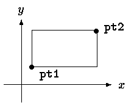

```c
struct rect {
    struct point pt1;
    struct point pt2;
};
```

`rect` 结构包含两个 `point` 结构。如果我们声明 `screen` 为：

```c
struct rect screen;
```

那么：

```c
screen.pt1.x
```

指的是 `screen` 中 `pt1` 成员的 `x` 坐标。

## 6.2 结构与函数

对结构唯一的合法操作是复制它或作为一个单元对其赋值、使用 `&` 获取其地址，以及访问其成员。复制和赋值包括向函数传递参数以及从函数返回结果。结构不能进行比较。一个结构可以通过常量值列表进行初始化；自动结构也可以通过赋值进行初始化。

让我们通过编写一些处理点和矩形的函数来研究结构。至少有三种方法：分别传递组件、传递整个结构或传递它的指针。每种方法都有其优缺点。第一个函数 `makepoint` 将接受两个整数并返回一个 `point` 结构：

```c
/* makepoint: 根据 x 和 y 分量创建一个点 */
struct point makepoint(int x, int y)
{
    struct point temp;

    temp.x = x;
    temp.y = y;
    return temp;
}
```

注意，参数名与同名的成员之间没有冲突；事实上，这种同名命名的使用强调了它们之间的关系。`makepoint` 现在可以用于动态初始化任何结构，或为函数提供结构参数：

```c
struct rect screen;
struct point middle;
struct point makepoint(int, int);

screen.pt1 = makepoint(0, 0);
screen.pt2 = makepoint(XMAX, YMAX);
middle = makepoint(
    (screen.pt1.x + screen.pt2.x) / 2,
    (screen.pt1.y + screen.pt2.y) / 2
);
```

下一步是一组对点进行算术运算的函数。例如：

```c
/* addpoints: 相加两个点 */
struct addpoint(struct point p1, struct point p2)
{
    p1.x += p2.x;
    p1.y += p2.y;
    return p1;
}
```

在这里，参数和返回值都是结构。我们增加 `p1` 中的分量而不是使用显式变量，以强调结构像其他类型一样按值传递的。另一个例子是函数 `ptrect` 测试一个点是否在矩形内部，其中：

```c
/* ptrect: 测试点是否在矩形内 */
int ptrect(struct point p, struct rect r)
{
    /* 逻辑实现略 */
}
```

（注：原文中此处 `ptrect` 的代码似乎不完整或有跳转，此处根据上下文翻译。）

回到前面的逻辑，`ptrect` 测试一个点是否在矩形内部：

```c
/* ptrect: 测试点是否在矩形内 */
int ptrect(struct point p, struct rect r)
{
    return p.x >= r.pt1.x && p.x <= r.pt2.x &&
           p.y >= r.pt1.y && p.y <= r.pt2.y;
}
```

（注：由于原文文本在 `ptrect` 之后出现了截断或逻辑跳转，以下将基于提供的文本片段进行翻译。）

重新对齐提供的文本内容翻译：

另一个例子是函数 `ptrect` 测试一个点是否在矩形内部，其中：

```c
/* ptrect: 测试点是否在矩形内 */
int ptrect(struct point p, struct rect r)
{
    return p.x >= r.pt1.x && p.x <= r.pt2.x &&
           p.y >= r.pt1.y && p.y <= r.pt2.y;
}
```

（更正：原文文本中 `ptrect` 之后的内容似乎混乱，我将严格按照你提供的原文行进行翻译。）

原文片段：

```c
As another example, the function `ptrect` tests whether a point is inside a rectangle, where
```

翻译：

另一个例子是函数 `ptrect` 测试一个点是否在矩形内部，其中：

（由于你提供的原文文本在 `ptrect` 之后直接跳到了 `Structures can be nested`，我将按此顺序继续翻译。）

结构是可以嵌套的。矩形的一种表示方法是一对点，它们表示对角线相反的角：


```c
struct rect {
    struct point pt1;
    struct point pt2;
};
```

`rect` 结构包含两个 `point` 结构。如果我们声明 `screen` 为：

```c
struct rect screen;
```


`struct rect screen;`

那么：

```c
screen.pt1.x
```

指的是 `screen` 中 `pt1` 成员的 `x` 坐标。

让我们创建几个适用于图形处理的结构。基本对象是一个点，我们假设它有一个 `x` 坐标和一个 `y` 坐标，两者都是整数。


这两个组件可以放置在如下所示声明的结构中：

```c
struct point {
    int x;
    int y;
};
```

`struct` 关键字引入一个结构声明，它是一个包含在花括号中的声明列表。`struct` 后面可以紧跟一个可选的名称，称为结构标签（structure tag）（如此处的 `point`）。该标签为这种类型的结构命名，并在此后可以被用作括号内声明部分的简写。

在结构中命名的变量被称为成员（members）。结构成员或标签与普通变量（即非成员变量）可以具有相同的名称而不会产生冲突，因为它们始终可以通过上下文来区分。此外，相同的成员名称可能会出现在不同的结构中，尽管从代码风格的习惯上来说，人们通常只对密切相关的对象使用相同的名称。

`struct` 声明定义了一个类型。终止成员列表的右括号后面可以跟一个变量列表，就像对于任何基本类型一样。也就是说：

```c
struct { ... } x, y, z;
```

在语法上等同于：

```c
int x, y, z;
```

这意味着每条语句都声明 `x`、`y` 和 `z` 为该命名类型的变量，并为它们留出空间。

不后跟变量列表的结构声明不保留任何存储；它仅仅描述了结构的模板或形状。然而，如果声明带有标签，则该标签可以在之后定义结构的实例时使用。例如，给定上述 `point` 的声明：

```c
struct point pt;
```

定义了一个变量 `pt`，它是一个类型为 `struct point` 的结构。可以通过在定义后紧跟一个初始化器列表（每个成员都是常量表达式）来初始化结构：

```c
struct point maxpt = { 320, 200 };
```

自动结构也可以通过赋值或调用返回正确类型结构的函数来初始化。

特定结构中的成员在表达式中通过如下形式的构造来引用：

```c
structure-name.member
```

结构成员运算符 `.` 连接了结构名和成员名。例如，为了打印点 `pt` 的坐标：

```c
printf("%d,%d", pt.x, pt.y);
```

或者计算从原点 `(0, 0)` 到 `pt` 的距离：

```c
double dist, sqrt(double);

dist = sqrt((double)pt.x * pt.x + (double)pt.y * pt.y);
```

结构是可以嵌套的。矩形的一种表示方法是一对点，它们表示对角线相反的角：


```c
struct rect {
    struct point pt1;
    struct point pt2;
};
```

`rect` 结构包含两个 `point` 结构。如果我们声明 `screen` 为：

```c
struct rect screen;
```

那么：

```c
screen.pt1.x
```

指的是 `screen` 中 `pt1` 成员的 `x` 坐标。

## 6.2 结构与函数

对结构唯一的合法操作是复制它或作为一个单元对其赋值、使用 `&` 获取其地址，以及访问其成员。复制和赋值包括向函数传递参数以及从函数返回结果。结构不能进行比较。一个结构可以通过常量值列表进行初始化；自动结构也可以通过赋值进行初始化。

让我们通过编写一些处理点和矩形的函数来研究结构。至少有三种方法：分别传递组件、传递整个结构或传递它的指针。每种方法都有其优缺点。第一个函数 `makepoint` 将接受两个整数并返回一个 `point` 结构：

```c
/* makepoint: 根据 x 和 y 分量创建一个点 */
struct point makepoint(int x, int y)
{
    struct point temp;

    temp.x = x;
    temp.y = y;

    return temp;
}
```

注意参数名与同名的成员之间没有冲突；事实上，这种同名命名的使用强调了它们之间的关系。`makepoint` 现在可以用于动态初始化任何结构，或为函数提供结构参数：

```c
struct rect screen;
struct point middle;
struct point makepoint(int, int);

screen.pt1 = makepoint(0, 0);
screen.pt2 = makepoint(XMAX, YMAX);
middle = makepoint(
    (screen.pt1.x + screen.pt2.x) / 2,
    (screen.pt1.y + screen.pt2.y) / 2
);
```

下一步是一组对点进行算术运算的函数。例如：

```c
/* addpoint: 相加两个点 */
struct point addpoint(struct point p1, struct point p2)
{
    p1.x += p2.x;
    p1.y += p2.y;

    return p1;
}
```

在这里，参数和返回值都是结构。我们增加 `p1` 中的分量而不是使用显式变量，以强调结构像其他类型一样按值传递的。

同样地，`*p->str` 获取 `str` 所指向的任何内容；`*p->str++` 在访问其所指向的内容后增加 `str` 的值（正如 `*s++`）；`(*p->str)++` 增加 `str` 指向的任何内容；而 `*p++->str` 在访问 `str` 指向的任何内容后增加 `p` 的值。

## 6.3 结构体数组

编写一个程序来统计每个 C 关键字出现的次数。我们需要一个字符字符串数组来存储名称，以及一个整数数组来存储计数。一种可能性是使用两个并行数组 `keyword` 和 `keycount`，如下：

```c
char *keyword[NKEYS];
int keycount[NKEYS];
```

但数组是并行的这一事实本身暗示了不同的组织方式，即结构体数组。每个关键字都是一个对：

```c
char *word;
int count;
```

并且有一个对的数组。结构体声明：

```c
struct key {
    char *word;
    int count;
} keytab[NKEYS];
```

声明了一个结构体类型 `key`，定义了一个该类型的结构体数组 `keytab`，并为它们留出了存储空间。数组的每个元素都是一个结构体。也可以写成：

```c
struct key {
    char *word;
    int count;
};

struct key keytab[NKEYS];
```

由于结构体 `keytab` 包含一组常量名称，最简单的方法将其设为外部变量，并在定义时一次性初始化。结构体的初始化与之前的类似——定义之后紧跟用大括号括起的初始化器列表：

```c
struct key {
    char *word;
    int count;
} keytab[] = {
    "auto", 0,
    "break", 0,
    "case", 0,
    "char", 0,
    "const", 0,
    "continue", 0,
    "default", 0,
    /* ... */
    "unsigned", 0,
    "void", 0,
    "volatile", 0,
    "while", 0
};
```

初始化器成对列出，对应于结构体的成员。更精确的做法是将每“行”或每个结构体的初始化器用大括号括起来，如下：

```c
{ "auto", 0 },
{ "break", 0 },
{ "case", 0 },
...
```

但当初始化器是简单的变量或字符字符串，且全部都存在时，内部的大括号是不必要的。按照惯例，如果存在初始化器且 `[]` 为空，数组 `keytab` 中的条目数量将会被计算。

关键字计数程序始于 `keytab` 的定义。主程序通过反复调用函数 `getword` 来读取输入，该函数一次获取一个单词。每个单词都通过我们在第 3 章中编写的二分查找函数的变体在 `keytab` 中进行查找。关键字列表在表中必须按升序排列。

```c
#include <stdio.h>
#include <ctype.h>
#include <string.h>

#define MAXWORD 100

int getword(char *, int);
int binsearch(char *, struct key *, int);

/* count C keywords */
main()
{
    int n;
    char word[MAXWORD];

    while (getword(word, MAXWORD) != EOF)
        if (isalpha(word[0]))
            if ((n = binsearch(word, keytab, NKEYS)) >= 0)
                keytab[n].count++;

    for (n = 0; n < NKEYS; n++)
        if (keytab[n].count > 0)
            printf("%4d %s\n",
                keytab[n].count, keytab[n].word);

    return 0;
}

/* binsearch: find word in tab[0]...tab[n-1] */
int binsearch(char *word, struct key tab[], int n)
{
    int cond;
    int low, high, mid;

    low = 0;
    high = n - 1;

    while (low <= high) {
        mid = (low + high) / 2;

        if ((cond = strcmp(word, tab[mid].word)) < 0)
            high = mid - 1;
        else if (cond > 0)
            low = mid + 1;
        else
            return mid;
    }

    return -1;
}
```

稍后我们将展示 `getword` 函数；目前只需说明每次调用 `getword` 都会找到一个单词，并将其复制到以其第一个参数命名的数组中。

变量 `NKEYS` 是 `keytab` 中关键字的数量。尽管我们可以手动计数，但由机器来完成要容易得多也更安全，特别是当列表发生变化时。一种可能性是用空指针作为初始化器列表的结束，然后遍历 `keytab` 直到找到结尾。

但这超出了所需的范围，因为数组的大小在编译时就已经完全确定了。数组的大小是单个条目的大小乘以条目的数量，因此条目数就是：

```text
size of keytab / size of each entry
```


```c
int getword(char *, int);

int binsearch(char *, struct key *, int);

/* count C keywords */

main()
{
    int n;
    char word[MAXWORD];

    while (getword(word, MAXWORD) != EOF)
        if (isalpha(word[0]))
            if ((n = binsearch(word, keytab, NKEYS)) >= 0)
                keytab[n].count++;

    for (n = 0; n < NKEYS; n++)
        if (keytab[n].count > 0)
            printf("%4d %s\n",
                   keytab[n].count, keytab[n].word);

    return 0;
}

/* binsearch: find word in tab[0]...tab[n-1] */

int binsearch(char *word, struct key tab[], int n)
{
    int cond;
    int low, high, mid;

    low = 0;
    high = n - 1;

    while (low <= high) {
        mid = (low + high) / 2;

        if ((cond = strcmp(word, tab[mid].word)) < 0)
            high = mid - 1;
        else if (cond > 0)
            low = mid + 1;
        else
            return mid;
    }

    return -1;
}
```

稍后我们将展示`getword`函数；目前只需说明每次调用`getword`都会找到一个单词，并将其复制到以其第一个参数命名的数组中。

变量`NKEYS`是`keytab`中关键字的数量。尽管我们可以手动计数，但由机器来完成要容易得多也更安全，特别是当列表发生变化时。一种可能性是用空指针作为初始化器列表的结束，然后遍历`keytab`直到找到结尾。

但这超出了所需的范围，因为数组的大小在编译时就已经完全确定了。数组的大小是单个条目的大小乘以条目的数量，因此条目数就是：

`size of keytab` / `size of`每一个条目。

同样地，`*p->str`获取`str`所指向的任何内容；`*p->str++`在访问其所指向的内容后增加`str`的值（正如同`*s++`）；`(*p->str)++`增加`str`指向的任何内容；而`*p++->str`在访问`str`指向的任何内容后增加`p`的值。

## 6.3 结构体数组

编写一个程序来统计每个 C 关键字出现的次数。我们需要一个字符字符串数组来存储名称，以及一个整数数组来存储计数。一种可能性是使用两个并行数组`keyword`和`keycount`，如下：

```c
char *keyword[NKEYS];
int keycount[NKEYS];
```

但数组是并行的这一事实本身暗示了不同的组织方式，即结构体数组。每个关键字都是一个对：

```c
char *word;
int count;
```

并且有一个对的数组。结构体声明：

```c
struct key {
    char *word;
    int count;
} keytab[NKEYS];
```

声明了一个结构体类型`key`，定义了一个该类型的结构体数组`keytab`，并为它们留出了存储空间。数组的每个元素都是一个结构体。这也可以写成：

```c
struct key {
    char *word;
    int count;
};

struct key keytab[NKEYS];
```

由于结构体`keytab`包含一组常量名称，最简单的方法将其设为外部变量，并在定义时一次性初始化。结构体的初始化与之前的类似——定义之后紧跟用大括号括起的初始化器列表：

```c
struct key {
    char *word;
    int count;
} keytab[] = {
    "auto", 0,
    "break", 0,
    "case", 0,
    "char", 0,
    "const", 0,
    "continue", 0,
    "default", 0,
    /* ... */
    "unsigned", 0,
    "void", 0,
    "volatile", 0,
    "while", 0
};
```

初始化器成对列出，对应于结构体的成员。更精确的做法是将每“行”或每个结构体的初始化器用大括号括起来，如下：

```c
{ "auto", 0 },
{ "break", 0 },
{ "case", 0 },
...
```

但当初始化器是简单的变量或字符字符串，且全部都存在时，内部的大括号是不必要的。按照惯例，如果存在初始化器且`[]`为空，数组`keytab`中的条目数量将会被计算。

关键字计数程序始于`keytab`的定义。主程序通过反复调用函数`getword`来读取输入，该函数一次获取一个单词。每个单词都通过我们在第 3 章中编写的二分查找函数的变体在`keytab`中进行查找。关键字列表在表中必须按升序排列。

```c
#include <stdio.h>
#include <ctype.h>
#include <string.h>

#define MAXWORD 100

int getword(char *, int);
int binsearch(char *, struct key *, int);

/* count C keywords */

main()
{
    int n;
    char word[MAXWORD];

    while (getword(word, MAXWORD) != EOF)
        if (isalpha(word[0]))
            if ((n = binsearch(word, keytab, NKEYS)) >= 0)
                keytab[n].count++;

    for (n = 0; n < NKEYS; n++)
        if (keytab[n].count > 0)
            printf("%4d %s\n",
                   keytab[n].count, keytab[n].word);

    return 0;
}

/* binsearch: find word in tab[0]...tab[n-1] */

int binsearch(char *word, struct key tab[], int n)
{
    int cond;
    int low, high, mid;

    low = 0;
    high = n - 1;

    while (low <= high) {
        mid = (low + high) / 2;

        if ((cond = strcmp(word, tab[mid].word)) < 0)
            high = mid - 1;
        else if (cond > 0)
            low = mid + 1;
        else
            return mid;
    }

    return -1;
}
```

这里有几点需要注意。首先，`binsearch`的声明必须指示它返回一个指向`struct key`的指针而不是整数；这在函数原型和`binsearch`中都进行了声明。如果`binsearch`找到了该单词，它返回指向该单词的指针；如果失败，则返回`NULL`。

其次，`keytab`的元素现在通过指针访问。这要求对`binsearch`进行重大修改。

`low`和`high`的初始化器现在是指向表格开头和末尾之后位置的指针。

中间元素的计算不能简单地使用：

```c
mid = (low + high) / 2    /* 错误 */
```

因为指针相加是非法的。然而，减法是合法的，所以`high - low`是元素的个数，因此：

```c
mid = low + (high - low) / 2
```

将`mid`设置为`low`和`high`之间中间的元素。

最重要的改变是调整算法以确保它不会生成非法的指针或尝试访问数组之外的元素。问题是`&tab[-1]`和`&tab[n]`都在数组`tab`的范围之外。前者是严格非法的，对后者进行解引用也是非法的。然而，语言定义保证了涉及数组末尾之后第一个元素（即`&tab[n]`）的指针算术可以正常工作。

在`main`中我们写了：

```c
for (p = keytab; p < keytab + NKEYS; p++)
```

如果`p`是一个指向结构体的指针，对`p`的算术运算会考虑结构体的大小，因此`p++`将`p`增加正确的量以获取结构体数组的下一个元素，并且测试会在正确的时间停止循环。

然而，不要假设结构体的大小是其成员大小之和。由于不同对象的对齐要求，结构体中可能存在未命名的“洞”。例如，如果一个`char`是一个字节而一个`int`是四个字节，那么结构体：

```c
struct {
    char c;
    int i;
};
```

可能需要八个字节，而不是五个。`sizeof`运算符返回正确的值。

最后，关于程序格式的一个题外话：当函数返回一个复杂的类型（如结构体指针）时，例如：

```c
struct key *binsearch(char *word, struct key *tab, int n)
```

函数名可能很难看，难以在文本编辑器中查找。因此有时会使用另一种风格：

```c
struct key *
binsearch(char *word, struct key *tab, int n)
```

这是一个个人喜好问题；选择你喜欢的格式并坚持下去。

## 6.5 自引用结构

假设我们想要处理一个更通用的问题：统计某些输入中*所有*单词出现的次数。由于单词列表无法预知，我们无法方便地对其进行排序并使用二分查找。然而我们不能在每个单词到达时都进行线性查找以检查它是否已经见过；程序运行时间将太长。（更准确地说，它的运行时间可能会随输入单词数量呈平方级增长。）我们该如何组织数据，以便通过任意单词列表高效复制？

一种解决方案是始终保持已见单词集的排序，通过将每个单词按照到达的顺序放在其适当的位置。这不应该通过在线性数组中移动单词来实现——那样也太慢了。相反，我们将使用一种名为*二叉树*的数据结构。

树中每个不同的单词包含一个“节点”；每个节点包含：

- 指向单词文本的指针；
- 出现次数计数；
- 指向左子节点的指针；
- 指向右子节点的指针。

没有节点可以超过两个孩子；它可能有零或一个。回到对节点的描述，它最方便地表示为一个结构体：

```c
struct tnode {     /* 树节点： */
    char *word;     /* 指文本 */
    int count;      /* 出现次数 */
    struct tnode *left;   /* 左子节点 */
    struct tnode *right;  /* 右子节点 */
};
```

这种节点的递归声明看起来可能很险，但它是正确的。结构体包含其自身的实例是非法的，但：

```c
struct tnode *left;
```

将`left`声明为指向`tnode`的指针，而不是一个`tnode`本身。

偶尔，我们需要自引用结构的一种变体：两个相互引用的结构体。处理这种情况的方法是：

```c
struct t {
    ...
    struct s *p;   /* p 指向一个 s */
};

struct s {
    ...
    struct t *q;   /* q 指向一个 t */
};
```

`addtree`函数是递归的。`main`函数将单词传递到树的顶层（根节点）。在每个阶段，该单词将与节点中已存储的单词进行比较，并通过递归调用`addtree`将其传递到左子树或右子树。最终，该单词要么与树中已有的内容匹配（在这种情况下计数器加 1），要么遇到空指针，表示必须创建一个节点并将其添加到树中。如果创建了新节点，`addtree`返回指向该节点的指针，该指针会被安装在父节点中。

```c
struct tnode *talloc(void);
char *strdup(char *);

/* addtree: 在 p 处或下方添加带有 w 的节点 */
```


```c
struct treenode *addtree(struct tnode *p, char *w)
{
    int cond;

    if (p == NULL) {     /* 到到了一个新单词 */
        p = talloc();    /* 创建一个新节点 */
        p->word = strdup(w);
        p->count = 1;
        p->left = p->right = NULL;
    } else if ((cond = strcmp(w, p->word)) == 0)
        p->count++;      /* 重复单词 */
    else if (cond < 0)   /* 小于则进入左子树 */
        p->left = addtree(p->left, w);
    else                 /* 大于则进入右子树 */
        p->right = addtree(p->right, w);

    return p;
}
```

新节点的存储空间通过例程`talloc`获取，该例程返回一个适用于存放树节点的空空间指针，而新单词通过`strdup`复制到隐藏空间中。（我们稍后会讨论这些例程。）计数器被初始化，两个子节点置为空。这部分代码只在树的叶子节点执行，即在添加新节点时。我们（不智地）省略了对`strdup`和`talloc`返回值的错误检查。

`treeprint`按排序顺序打印树；在每个节点处，它先打印左子树（所有小于该单词的单词），然后是单词本身，最后是右子树（所有大于该单词的单词）。如果你对递归的工作原理感到有些虚，可以模拟`treeprint`在上述树上操作的运行。

```c
/* treeprint: 中序打印树 p */
void treeprint(struct tnode *p)
{
    if (p != NULL) {
        treeprint(p->left);
        printf("%4d %s\n", p->count, p->word);
        treeprint(p->right);
    }
}
```

一个实际的注意事项：如果由于单词不是按随机顺序到达而导致树变得“不平衡”，程序的运行时间可能会增长得太多。在最坏的情况下，如果单词已经是有序的，这个程序将变成一个昂贵的线性搜索模拟。二叉树有某些推广形式不会受到这种最坏情况的影响，但我们在这里不会描述它们。

在离开这个示例之前，简要提一下一个与存储分配器相关的问题也是值得的。显然，在程序中只存在一个存储分配器是理想的，尽管它分配了不同类型的对象。但如果由一个分配器处理诸如指向`char`指针和指向`struct tnode`指针的请求，就会出现两个问题。首先，它如何满足大多数真实机器的要求，即某些类型的对象必须满足对齐限制（例如，整数通常必须位于偶数地址）？其次，什么样的声明可以处理分配器必须返回不同类型指针的这一事实？

对齐要求通常可以很容易满足，代价是浪费一些空间，只需确保分配器始终返回符合所有对齐限制的指针即可。第5章中的`alloc`不保证任何特定的对齐，因此我们将使用标准库函数`malloc`。在第8章中我们将展示实现`malloc`的一种方法。

像`malloc`这样的函数的类型声明问题对于任何认真对待类型检查的语言来说都是令人头疼的。在C中，正确的方法是声明`malloc`返回`void`指针，然后通过强制转换显式将指针转换为所需的类型。`malloc`和相关例程在标准头文件`<stdlib.h>`中声明。因此`talloc`可以写成：

```c
#include <stdlib.h>

/* talloc: 创建一个 tnode */
struct tnode *talloc(void)
{
    return (struct tnode *)malloc(sizeof(struct tnode));
}
```

`strdup`仅仅是将其参数提供的字符串复制到通过调用`malloc`获取的安全位置中：

```c
char *strdup(char *s)   /* 创建 s 的副本 */
{
    char *p;

    p = (char *)malloc(strlen(s) + 1); /* 为 '\0' 留 1 字节 */
    if (p != NULL)
        strcpy(p, s);
    return p;
}
```

如果没有可用空间，`malloc`返回`NULL`；`strdup`将传递该值，将错误处理留给调用者。

通过调用`malloc`获取的存储可以通过调用`free`释放以重用；参见第8章和第7章。

通过调用`malloc`获取的存储可以通过调用`free`释放以重用；参见第8章和第7章。

通过调用`malloc`获取的存储可以通过调用`free`释放以重用；参见第8章和第7章。

通过调用`malloc`获取的存储可以通过调用`free`释放以重用；参见第8章和第7章。

通过调用`malloc`获取的存储可以通过调用`free`释放以重用；参见第8章和第7章。

通过调用`malloc`获取的存储可以通过调用`free`释放以重用；参见第8章和第7章。

通过调用`malloc`获取的存储可以通过调用`free`释放以重用；参见第8章和第7章。

通过调用`malloc`获取的存储可以通过调用`free`释放以重用；参见第8章和第7章。

通过调用`malloc`获取的存储可以通过调用`free`释放以重用；参见第8章和第7章。

通过调用`malloc`获取的存储可以通过调用`free`释放以重用；参见第8章和第7章。

通过调用`malloc`获取的存储可以通过调用`free`释放以重用；参见第8章和第7章。

通过调用`malloc`获取的存储可以通过调用`free`释放以重用；参见第8章和第7章。

哈希过程会在`hashtab`数组中产生一个起始索引；如果要在任何地方找到该字符串，它将位于从该索引开始的块列表中。搜索通过`lookup`执行。如果`lookup`找到已存在的项，它会返回指向该项的指针；否则，它返回`NULL`。

```c
/* lookup: 在 hashtab 中查找 s */
struct nlist *lookup(char *s)
{
    struct nlist *np;

    for (np = hashtab[hash(s)]; np != NULL; np = np->next)
        if (strcmp(s, np->name) == 0)
            return np;     /* 找到 */

    return NULL;           /* 未找到 */
}
```

`lookup`中的`for`循环是遍历链表的标准写法：

```c
for (ptr = head; ptr != NULL; ptr = ptr->next)
    ...
```

`install`使用`lookup`来确定要安装的名称是否已经存在；如果是，新定义将取代旧定义。否则，将创建一个新条目。如果由于任何原因没有空间存放新条目，`install`返回`NULL`。

```c
struct nlist *lookup(char *);
char *strdup(char *);

/* install: 将 (name, defn) 放入 hashtab */
struct nlist *install(char *name, char *defn)
{
    struct nlist *np;
    unsigned hashval;

    if ((np = lookup(name)) == NULL) { /* 未找到 */
        np = (struct nlist *)malloc(sizeof(*np));
        if (np == NULL || (np->name = strdup(name)) == NULL)
            return NULL;

        hashval = hash(name);
        np->next = hashtab[hashval];
        hashtab[hashval] = np;
    } else {       /* 已存在 */
        free((void *)np->defn);   /* 释放之前的定义 */
    }

    if ((np->defn = strdup(defn)) == NULL)
        return NULL;

    return np;
}
```

**练习 6-5。** 编写一个函数`undef`，从`lookup`和`install`维护的表中删除名称和定义。

**练习 6-6。** 基于本节的例程，实现一个简单的`#define`处理器版本（即无参数版本），适用于C程序。你可能也会发现`getch`和`ungetch`很有帮助。

## 6.7 Typedef

C提供了一种名为`typedef`的机制来创建新的数据类型名称。例如，如下声明：

```c
typedef int Length;
```

使得名称`Length`成为`int`的别名。类型`Length`可以在声明、强制类型转换等处使用，其方式与`int`类型完全相同：

```c
Length len, maxlen;
Length *lengths[];
```

同样，如下声明：

```c
typedef char *String;
```

使得`String`成为`char *`或字符指针的别名，然后可以在声明和强制类型转换中使用它：

```c
String p, lineptr[MAXLINES], alloc(int);
int strcmp(String, String);
p = (String)malloc(100);
```

注意，在`typedef`中声明的类型出现在变量名的位置，而不是紧跟在`typedef`单词之后。在语法上，`typedef`类似于`extern`、`static`等存储类。我们使用了大写字母来命名`typedef`，以便它们脱颖而出。

作为一个更复杂的例子，我们可以为在本章较早所示的树节点创建`typedef`：

```c
typedef struct tnode *Treeptr;

typedef struct tnode { /* 树节点： */
    char *word;         /* 指向文本 */
    int count;          /* 出现次数 */
    struct tnode *left; /* 左孩子 */
    struct tnode *right;/* 右孩子 */
} Treenode;
```

这创建了两个名为`Treenode`（一个结构体）和`Treeptr`（指向结构体的指针）的新类型关键字。然后例程`talloc`可以变成：

```c
Treeptr talloc(void)
{
    return (Treeptr)malloc(sizeof(Treenode));
}
```

必须强调的是，`typedef`声明在任何意义上都没有创建新类型；它仅仅是为某些现有类型添加了一个名称。也没有任何新的语义：以这种方式声明的变量与显式写出的变量具有完全相同的属性。实际上，`typedef`类似于`#define`，但由于它是由编译器解释的，因此它可以处理超出预处理器能力的文本替换。例如：

```c
typedef int (*PFI)(char *, char *);
```

这创建了类型`PFI`，即“指向带有两个`char *`参数并返回`int`的函数指针”，它可以用于如下语句中：

```c
PFI strcmp, numcmp;
```

位于第5章的排序程序中。

除了纯的美学问题外，使用`typedef`主要有两个原因。第一个是针对移植性问题对程序进行参数化。对可能依赖机器的数据类型使用`typedef`，那么当程序迁移时，只需要更改`typedef`。一种常见的情况是使用`typedef`名称表示各种整数数值，然后进行迁移。

`typedef`的第二个用途是为了程序提供更好的文档说明——像`size_t`和`ptrdiff_t`这样的标准库类型就是例子。

## 6.8 联合体（Unions）

`union`是一个在不同时间持有不同类型和大小对象的变量；它们提供了一种在单一区域内操作不同类型数据的方法，而无需在程序嵌入任何机器信息。它们类似于Pascal中的变体记录。

这种示例可能会出现在符号表中，假设一个常量可以是`int`、`float`或字符指针。常量的值必须存储在相应类型的变量中，这对于表管理非常方便。语法基于结构：

```c
union u_tag {
    int ival;
    float fval;
    char *sval;
} u;
```

变量`u`将容纳这些类型中最大的；具体大小取决于实现。可以将这些任何类型赋值给`u`并在表达式中使用，只要用法是一致的：提取的类型必须是存储的类型。程序员有责任跟踪联合体当前存储的是什么类型；如果以一种类型存储并在另一种类型提取，结果取决于实现。

在语法上，联合体的成员访问方式与结构体相同：

`union-name.member`

或：

`union-pointer->member`

如果使用变量`utype`来跟踪存储在`u`中的当前类型，那么可能会看到如下代码：

```c
if (utype == INT)
    printf("%d\n", u.ival);

if (utype == FLOAT)
    printf("%f\n", u.fval);

if (utype == STRING)
    printf("%s\n", u.sval);
else
    printf("bad type %d in utype\n", utype);
```

联合体可以出现在结构和数组内部，反之亦然。访问结构中联合体成员（或反之）的符号与嵌套结构体相同。例如，对于定义的结构数组：

```c
struct {
    char *name;
    int flags;
    int utype;

    union {
        int ival;
        float fval;
        char *sval;
    } u;
} symtab[NSYM];
```

成员`ival`被引用为：

```c
symtab[i].u.ival
```

字符串`sval`的第一个字符通过以下两种方式之一引用：

```c
*symtab[i].u.sval
symtab[i].u.sval[0]
```

实际上，联合体（`union`）是一种结构，其中所有成员相对于基的偏移均为零，该结构足够大以容纳“最宽”的成员，并且对齐方式适用于联合体中的所有类型。联合体上允许的操作与结构体（`struct`）相同：作为一个单元进行赋值或拷贝、取地址以及访问成员。

联合体只能用其第一个成员类型的值进行初始化；因此，上述的联合体`u`只能用整数值进行初始化。

第8章中的存储分配器展示了如何使用联合体来强制变量在特定类型的存储边界上对齐。

## 6.9 位域（Bit-fields）

当存储空间非常紧张时，可能需要将多个对象打包到一个机器字（machine word）中；一种常见的用途是编译器符号表等应用程序中的一组单比特标志位。外部强制的数据格式（例如硬件设备的接口）通常也需要访问字中的某些部分的能力。

想象一个处理符号表的编译器片段。程序中的每个标识符都与其关联有某些信息，例如它是否为关键字、是否是外部的/或静态的等。编码此类信息最紧凑的方法是在单个`char`或`int`中设置一组单比特标志位。

通常的做法是定义一组与相关位位置对应的“掩码”（masks），如下：

```c
#define KEYWORD  01
#define EXTRENAL 02
#define STATIC   04
```

或者：

```c
enum { KEYWORD = 01, EXTERNAL = 02, STATIC = 04 };
```

这些数字必须是2的幂。那么访问位就变成了通过第2章中描述的移位、掩码和取反运算符进行“位操作”的问题。

某些惯用法经常出现：

```c
flags |= EXTERNAL | STATIC;
```

开启`flags`中的`EXTERNAL`和`STATIC`位，而：

```c
flags &= ~(EXTERNAL | STATIC);
```

将它们关闭，并且


`if ((flags & (EXTERNAL | STATIC)) == 0) ...`

当两个位都关闭时，该表达式为真。

尽管这些惯用法很容易掌握，但作为替代方案，C 语言提供了直接定义和访问字内字段的能力，而不是通过位逻辑运算符。位域（bit-field，或简称 field）是单个实现定义的存储单元内的一组相邻位，我们将其称为一个“字”（word）。例如，上述符号表的 `#define`s 可以被三个字段的定义所取代：

```c
struct {
    unsigned int is_keyword : 1;
    unsigned int is_extern  : 1;
    unsigned int is_static  : 1;
} flags;
```

这定义了一个名为 `flags` 的变量表，包含三个 1 比特字段。冒号后面的数字表示字段的比特宽度。这些字段被声明为 `unsigned int` 以确保它们是无符号数值。

单个字段的引用方式与其他结构体成员相同：`flags.is_keyword`、`flags.is_extern` 等。字段的行为像小整数，并且可以像其他整数一样参与算术表达式。因此，之前的示例可以更自然地写为：

```c
flags.is_extern = flags.is_static = 1;
```

来开启这些位；

```c
flags.is_extern = flags.is_static = 0;
```

将它们关闭；以及

```c
if (flags.is_extern == 0 && flags.is_static == 0)
    ...
```

来测试它们。

关于字段的几乎一切都取决于实现。字段是否可以跨越字边界是由实现定义的。字段不需要有名称；未命名的字段（仅有冒号和宽度）用于填充。特殊宽度 0 可用于强制对齐到下一个字边界。

字段在某些机器上是从左到右赋值的，在另一些机器上是从右到左赋值。这意味着，虽然字段对于维护内部定义的数据结构很有用，但在拆解外部定义的数据时，必须仔细考虑哪一端在前。依赖于此类内容的程序是不可移植的。字段只能声明为 `int`；为了可移植性，请显式指定 `signed` 或 `unsigned`。它们不是数组，也没有地址，因此不能对它们使用 `&` 运算符。

***

返回第 5 章 -- 索引 -- 第 7 章

***

由 tmdcjsl(skidrow8123@hotmail.com) 编译

***

***

返回第 6 章 -- 索引 -- 第 8 章

***

# 第 7 章 - 输入与输出

输入输出并不是 C 语言本身的一部分，因此我们在此之前的介绍中并没有强调它们。尽管如此，程序与环境交互的方式比我们之前展示的要复杂得多。在本章中，我们将描述标准库，这是一组提供输入输出、字符串处理、存储管理、数学例程以及为 C 程序提供的各种服务的函数。我们将集中在输入和输出上。

ANSI 标准精确地定义了这些库函数，以便它们可以在任何存在 C 语言的系统中以兼容的形式存在。将系统交互限制在标准库提供的功能的程序可以不经更改地从一个系统移动到另一个系统。库函数的属性在十多个头文件中进行了指定；我们已经看过了其中几个，包括 `<stdio.h>`、`<string.h>` 和 `<ctype.h>`。我们不会介绍整个库，因为我们感兴趣的是编写使用它的 C 程序。该库在附录 B 中详细描述。

## 7.1 标准输入与输出

正如我们在第 1 章中提到的，库实现了一个简单的文本输入输出模型。文本流由一系列行组成；每行以换行符结束。如果系统不是这种方式运行的，库会采取任何必要操作使其看起来是那样。

最简单的输入机制是使用 `getchar` 从标准输入（通常是键盘）每次读取一个字符：

```c
int getchar(void)
```

`getchar` 每次调用时返回下一个输入字符，在遇到文件末尾时返回 `EOF`。符号常量 `EOF` 定义在 `<stdio.h>` 中。其值通常为 -1，但测试应该根据 `EOF` 编写，以便独立于具体的值。

在许多环境中，可以使用 `<` 约定进行输入重定向来替代键盘：如果程序 `prog` 使用 `getchar`，那么命令行

```sh
prog <infile
```

会导致 `prog` 从 `infile` 读取字符而不是键盘。输入的切换是以这种方式完成的，`prog` 本身对这种变化无感知；特别是字符串 `<infile` 不会包含在命令行参数 `argv` 中。如果输入通过管道机制从另一个程序获取，输入切换也是不可见的：在某些系统上，命令行

```sh
otherprog | prog
```

运行两个程序 `otherprog` 和 `prog`，并将 `otherprog` 的标准输出管道到 `prog` 的标准输入。

函数

```c
int putchar(int)
```

用于输出：`putchar(c)` 将字符 `c` 放在标准输出（默认认为屏幕）。`putchar` 返回写入的字符，或者在发生错误时返回 `EOF`。再次，输出通常可以使用 `>`*filename* 重定向到文件：如果 `prog` 使用 `putchar`，

```sh
prog >outfile
```

将把标准输出写入 `outfile` 而不是屏幕。如果支持管道，

```sh
prog | anotherprog
```

将 `prog` 的标准输出重定向到 `anotherprog` 的标准输入。

`printf` 产生的输出也会到达标准输出。对 `putchar` 和 `printf` 的调用可能是交错的——输出将按照调用的顺序发生。

每个引用输入/输出库函数的源文件必须在第一次引用之前包含以下行代码：

```c
#include <stdio.h>
```

当名称被 `<` 和 `>` 包围时，程序将在一组标准位置中搜索该头文件（例如，在 UNIX 系统上，通常在 `/usr/include` 目录下）。

许多程序只读一个输入流并只写一个输出流；对于此类程序，使用 `getchar`、`putchar` 和 `printf` 进行输入输出可能完全足够，而且对于入门来说这也绝对足够了。当使用重定向将一个程序的输出连接到下一个程序的输入时，这一点尤为为真。例如，考虑 `lower` 程序，它将输入转换为小写：

```c
#include <stdio.h>
#include <ctype.h>

main() /* lower: 将输入转换为小写*/
{
    int c
    while ((c = getchar()) != EOF)
        putchar(tolower(c));
    return 0;
}
```

函数 `tolower` 定义在 `<ctype.h>` 中；它将大写字母转换为小写，并原样返回其他字符。正如我们之前提到的，`<stdio.h>` 中的 `getchar` 和 `putchar` 以及 `<ctype.h>` 中的 `tolower` 等函数通常是宏，从而避免了每个字符函数调用的开销。我们将在第 8.5 节中展示如何实现。无论 `<ctype.h>` 函数在特定机器上如何实现，使用它们的程序都不会受到字符集的影响。

**练习 7-1。** 编写一个程序，根据调用它的名称（在 `argv[0]` 中找到），将大写转换为小写或将小写转换为大写。

## 7.2 格式化输出 - `printf`

输出函数 `printf` 将内部值转换为字符。我们在之前的章节中非正式地使用了 `printf`。这里的描述涵盖了大多数典型用法，但并不完整；要了解完整内容，请参阅附录 B。

```c
int printf(char *format, arg1, arg2, ...);
```

`printf` 在 `format` 的控制下，在标准输出上转换、格式化并打印其参数。它返回打印的字符数。

格式字符串包含两种类型的对象：复制到输出流的普通字符，以及转换规范，每种规范都会导致转换并打印 `printf` 的下一个连续的参数。每个转换规范都以 `%` 开始，并以转换字符结束。在 `%` 和转换字符之间，可能会按顺序出现：

- 一个减号 `-`，指定转换后的参数左对齐。
- 一个数字，指定最小字段宽度。转换后的参数将打印在至少此宽的字段中。如有必要，它将在左侧（如果调用了左对齐，则在右侧）进行填充以达到字段宽度。
- 一个点 `.`，将字段宽度与精度隔开。
- 一个数字，精度，指定从字符串中打印的最大字符数，或者浮点数小数点后的数字位数，或者整数的最小位数。
- 如果整数要打印为 `short`，则使用 `h`；如果作为 `long`，则使用 `l`（字母 l）。

转换字符如表 7.1 所示。如果 `%` 之后的字符不是转换规范，则行为是未定义的。

### 表 7.1 基础 `printf` 转换

| 字符 | 参数类型；打印形式 |
| :--- | :--- |
| `d,i` | `int`；十进制数 |
| `o` | `int`；无符号八进制数（不带前导零） |
| `x,X` | `int`；无符号十六进制数（不带前导 `0x` 或 `0X`），使用 `abcdef` 或 `ABCDEF` 表示 10, ...,15。 |
| `u` | `int`；无符号十进制数 |
| `c` | `int`；单字符 |
| `s` | `char *`；打印字符串中的字符直到遇到 `'\0'` 或精度指定的字符数。 |
| `f` | `double`；`[-]`m.dddddd，其中 `d` 的数量由精度指定（默认 6）。 |
| `e,E` | `double`；`[-]`m.dddddd`e+/-``xx` 或 `[-]`m.dddddd`E+/-``xx，其中 `d` 的数量由精度指定（默认 6）。 |
| `g,G` | `double`；如果指数小于 -4 或大于或等于精度，则使用 `%e` 或 `%E`；否则使用 `%f`。末尾的零和末尾的小数点不打印。 |
| `p` | `void *`；指针（取决于实现的表示）。 |
| `%` | 不转换任何参数；打印一个 `%` |

宽度或精度可以指定为 `*`，在这种情况下，该值通过转换下一个参数（必须是 `int`）来计算。例如，要从字符串 `s` 中最多打印 `max` 个字符：

```c
printf("%.*s", max, s);
```

大多数格式转换在之前的章节中已经说明了。一个例外是与字符串相关的精度。下表显示了各种规范的效果。我们在每个字段周围都加了冒号，以便你查看。

```text
:%s:          hello, world
:%10s:        hello, world
:-10s:        hello, world
%.5s:         hello
%..5s:        hell
:%10.5s:      hello
:-10.5s:      hell
```

警告：`printf` 使用它的第一个参数来决定后面跟着多少个参数以及它们的类型是什么。如果参数不足或类型错误，它会产生困惑，你也会得到错误的答案。你应该注意这两个调用之间的区别：

```c
printf(s);         /* 如果 s 包含 % 则会失败 */
printf("%s", s);   /* 安全 */
```

`sprintf` 函数执行与 `printf` 相同的转换，但将输出存储在字符串中：

```c
int sprintf(char *string, char *format, arg1, arg2, ...);
```

`sprintf` 按照 `format` 格式化 `arg1`、`arg2` 等参数，但将结果置于 `string` 而不是标准输出；`string` 必须容纳结果。

**练习 7-2。** 编写一个程序，以合理的方式打印任意输入。至少，它应该根据本地习惯以八进制或十六进制打印非图形字符，并折行长文本行。

## 7.3 可变长度参数列表

本节包含 `printf` 的一个最小实现，以展示如何以可移植的方式处理可变长度参数列表。由于我们主要对参数的处理，`minprintf` 将处理格式字符串和参数，但调用真正的 `printf` 来执行格式转换。

`printf` 的正确声明为：

```c
int printf(char *fmt, ...)
```

其中声明 `...` 意味着这些参数的数量和类型可以变化。声明 `...` 只能出现在参数列表的末尾。我们的 `minprintf` 声明为：

```c
void minprintf(char *fmt, ...)
```

由于我们不会像 `printf` 那样返回字符计数。

棘手之处在于，当参数列表甚至没有名称时，`minprintf` 是如何遍历参数列表的。标准头文件 `<stdarg.h>` 包含一组宏定义，定义了如何步进参数列表。该头文件的实现会随机器而异，但它提供的接口是统一的。

`va_list` 类型用于声明一个变量，该变量将依次引用每个参数；在 `minprintf` 中，这个变量被称为 `ap`，代表“参数指针”（argument pointer）。`va_start` 宏初始化 `ap` 指向第一个无名参数。在使用 `ap` 之前必须调用它一次。必须至少有一个命名参数；最后一个命名参数被 `va_start` 用来获取起始位置。

每次调用 `va_arg` 都会返回一个参数并将 `ap` 移动到下一个；`va_arg` 使用类型名来确定返回什么类型以及步进多长。最后，`va_end` 执行必要的清理工作。它必须在程序返回之前被调用。

这些属性构成了我们简化版 `printf` 的基础：

```c
#include <stdarg.h>

/* minprintf: 使用可变参数列表的最小 printf */

void minprintf(char *fmt, ...)
{
    va_list ap; /* 指向每个无名参数 */
    char *p, *sval;
    int ival;
    double dval;

    va_start(ap, fmt); /* 使 ap 指向第一个无名参数 */

    for (p = fmt; *p; p++) {
        if (*p != '%') {
            putchar(*p);
            continue;
        }

        switch (*++p) {
        case 'd':
            ival = va_arg(ap, int);
            printf("%d", ival);
            break;

        case 'f':
            dval = va_arg(ap, double);
            printf("%f", dval);
            break;

        case 's':
            for (sval = va_arg(ap, char *); *sval; sval++)
                putchar(sval);
            break;

        default:
            putchar(*p);
            break;
        }
    }

    va_end(ap); /* 完成后清理 */
}
```

**练习 7-3。** 修改 `minprintf` 以处理更多 `printf` 的其他功能。

## 7.4 格式化输入 - `scanf`

`scanf` 函数是 `printf` 的输入对应物，提供了相反方向的许多相同转换功能。

```c
int scanf(char *format, ...)
```

`scanf` 从标准输入读取字符，根据 `format` 中的规范对其进行解释，并通过剩余的参数存储结果。`format` 参数见下文；其他参数（每个都必须是指针）指示转换后的相应输入应该存储在何处。与 `printf` 类似，此部分是最有用功能的总结，而不是详尽列表。

`scanf` 在耗尽其格式字符串或某些输入无法匹配控制规范时停止。它返回的值是成功匹配并赋值的输入项数。这可以用来判断找到了多少个项。在文件末尾时，返回 `EOF`；注意这与 0 不同，`0` 意味着下一个输入字符不匹配格式字符串中的第一个规范。下一次调用 `scanf` 将立即从已转换的最后一个字符之后继续搜索。

还有一个函数 `sscanf`，它从字符串而不是标准输入读取：

```c
int sscanf(char *string, char *format, arg1, arg2, ...)
```


它根据`format`中的格式扫描`string`，并通过`arg1`、`arg2`等存储结果值。这些参数必须是指针。

格式字符串通常包含转换规范，用于控制输入的转换。格式字符串可能包含：

- 空白符或制表符，这些不会被忽略。
- 普通字符（非`%`），预期将与输入流中的下一个非空白字符匹配。
- 转换规范，由字符`%`、一个可选的赋值抑制字符`*`、一个指定最大字段宽度的可选数字、一个指示目标宽度的可选`h`、`l`或`L`，以及一个转换字符组成。

转换规范指导下一个输入字段的转换。通常，结果被放置在相应参数指向的变量中。然而，如果通过`*`字符指示赋值抑制，则会跳过输入字段；不进行赋值。输入字段被定义为一个非空白字符字符串；它要么延伸到下一个空白字符，要么直到字段宽度指定并耗尽。这意味着`scanf`将跨越边界寻找其输入，因为换行符是空白。（空白字符包括空格、制表符、换行符、回车、垂直制表符和分页符。）

转换字符指示输入字段的解释。根据 C 语言的值传递语义，相应的参数必须是指针。转换字符见表 7.2。

**表 7.2：基础 Scanf 转换**

| 字符 | 输入数据；参数类型 |
| :--- | :--- |
| `d` | 十进制整数；`int *` |
| `i` | 整数；`int *`。整数可以是八进制（前导`0`）或十六进制（前导`0x`或`0X`）。 |
| `o` | 八进制整数；`int *` |
| `u` | 无符号进制整数；`unsigned int *` |
| `x` | 十六进制整数（前导`0x`或`0X`）。 |
| `c` | 字符；`char *` |
| `s` | 字符串；`char *` |
| `e` | 浮点数，带可选符号、小数点和可选指数；`float *` |
| `f` | 浮点数；`double *` |
| `g` | 浮点数；`double *` |
| `h` | 指示类型为`short` |
| `l` | 指示类型为`long` |
| `L` | 指示类型为`long double` |
| `*` | 赋值抑制 |

作为第一个示例，4 章中的简单计算器可以用`scanf`编写：

```c
#include <stdio.h>

main()  /* 简单计算器 */
{
    double sum, v;
    sum = 0;
    while (scanf("%lf", &v) == 1)
        printf("\t%.2f\n", sum += v);
    return 0;
}
```

假设我们要读取格式如下的行：

```
25 Dec 1988
```

`scanf`语句为：

```c
int day, year;
char monthname[20];
scanf("%d %s %d", &day, monthname, &year);
```

`monthname`不需要使用`&`，因为数组名是一个指针。

字面字符可以出现在`scanf`格式字符串中；它们必须匹配输入中的相同字符。因此，我们可以用`scanf`语句读取格式为`mm/dd/yy`的日期：

```c
int day, month, year;
scanf("%d/%d/%d", &month, &day, &year);
```

`scanf`忽略其格式字符串中的空白和制表符。此外，它在寻找输入值时会跳过空白（空格、制表符、换行等）。对于格式不固定的输入，最好的方法是每次读取一行，然后用`scanf`进行拆解。例如，假设我们要读取可能包含上述形式形式的行。那么我们可以写：

```c
while (getline(line, sizeof(line)) > 0) {
    if (sscanf(line, "%d %s %d", &day, monthname, &year) == 3)
        printf("valid: %s\n", line); /* 25 Dec 1988 形式 */
    else if (sscanf(line, "%d/%d/%d", &month, &day, &year) == 3)
        printf("valid: %s\n", line); /* mm/dd/yy 形式 */
    else
        printf("invalid: %s\n", line); /* invalid form */
}
```

对`scanf`的调用可以与其他输入函数的调用混合使用。下一次对任何输入函数的调用将从读取未被`scanf`读取的第一个字符开始。

最后的警告：`scanf`和`sscanf`的参数*必须*是指针。到目前最常见的错误是写成：

```c
scanf("%d", n);
```

而不是：

```c
scanf("%d", &n);
```

这种错误通常在编译时无法检测到。

**练习 7-4。** 编写一个`scanf`的私有版本，类似于上一节中的`minprintf`。

**练习 5-5。** 重写第 4 章中的后置法计算器，使用`scanf`和/或`sscanf`来完成输入和数字转换。

## 7.5 文件访问

到目前为止的示例都是读取标准输入并写入标准输出，这些是由本地操作系统自动为程序定义的。

下一步是编写一个访问*已经没有*连接到程序的文件的程序。一个说明此类操作必要性的程序是`cat`，它将一组命名文件连接到标准输出中。`cat`用于在屏幕上打印文件，并作为没有通过文件名访问文件的程序的通用输入收集器。例如，命令：

```bash
cat x.c y.c
```

会将文件`x.c`和`y.c`的内容（以及其他任何内容）打印到标准输出上。

问题在于如何安排读取这些命名文件——即，如何将用户设想的外部名称与读取数据的语句连接起来。

规则非常简单。在文件被读取或写入之前，必须由库函数`fopen`将其*打开*。`fopen`接收一个如`x.c`或`y.c`这样的外部名称，进行一些管理工作并与操作系统进行协商（细节不需要我们关心），然后返回一个指针，用于后续对该文件的读取或写入。

这个指针被称为*文件指针*（file pointer），它指向一个包含文件信息的结构体，例如缓冲区的位置、缓冲区中的当前字符位置、文件是在被读取还是写入，以及是否发生了错误或文件结束。用户不需要知道细节，因为从`<stdio.h>`获取的定义包含一个名为`FILE`的结构体声明。文件指针所需的声明示例所示：

```c
FILE *fp;
FILE *fopen(char *name, char *mode);
```

这表示`fp`是指向`FILE`的指针，而`fopen`返回一个指向`FILE`的指针。注意`FILE`是一个类型名，类似于`int`，而不是结构体标签；它是通过`typedef`定义的。（关于在 UNIX 系统上如何实现`fopen`的细节见第 8.5 节。）

程序中对`fopen`的调用为：

```c
fp = fopen(name, mode);
```

`fopen`的第一个参数是包含文件名的字符字符串。第二个参数是*模式*（mode），也是一个字符字符串，指示打算如何使用该文件。允许的模式包括读取（`"r"`）、写入（`"w"`）和追加（`"a"`）。某些系统区分文本文件二进制文件；对于后者，必须在模式字符串后附加`"b"`。

如果打开一个不存在的文件进行写入或追加，如果可能，将创建它。以写入模式打开现有文件会导致旧内容被丢弃，而以追加模式打开则保留它们。尝试读取不存在的文件是一个错误，可能还有其他错误原因，例如在您没有权限时尝试读取文件。如果发生任何错误，`fopen`将返回`NULL`。（错误可以更精确地识别；请参见附录 B 第 1 节。）

`getc`返回由`fp`指向的流中的下一个字符；对于文件结束或错误，返回`EOF`。

`putc`是一个输出函数：

```c
int putc(int c, FILE *fp)
```

`putc`将字符`c`写入文件`fp`并返回写入的字符，或者在发生错误时返回`EOF`。与`getchar`和`putchar`来说，`getc`和`putc`可能是宏而不是函数。

当一个 C 程序启动时，操作系统环境负责打开三个文件并为它们提供指针。这些文件是标准输入、标准输出和标准错误；对应的指针称为`stdin`、`stdout`和`stderr`，并在`<stdio.h>`中声明。通常`stdin`连接到键盘，而`stdout`和`stderr`连接到屏幕，但`stdin`和`stdout`可以像第 7.1 节所示重定向到文件或管道。

`getchar`和`putchar`可以根据`getc`、`putc`、`stdin`和`stdout`定义如下：

```c
#define getchar()    getc(stdin)
#define putchar(c)   putc((c), stdout)
```

对于文件的格式化输入或输出，可以使用`fscanf`和`fprintf`。它们与`scanf`和`printf`相同，只是第一个参数是指定读取或写入的文件指针。

```c
int fscanf(FILE *fp, char *format, ...)
int fprintf(FILE *fp, char *format, ...)
```

完成这些准备工作后，我们现在可以编写`cat`程序来连接文件。这种设计被发现对许多程序非常方便。如果有命令行参数，它们被解释为文件名并按顺序处理。如果没有参数，则处理标准输入。

```c
#include <stdio.h>
/* cat:  连接文件，版本 1 */
main(int argc, char *argv[])
{
    FILE *fp;
    void filecopy(FILE *, FILE *);
    if (argc == 1) /* 无参数；拷贝标准输入 */
        filecopy(stdin, stdout);
    else
        while(--argc > 0)
            if ((fp = fopen(*++argv, "r")) == NULL) {
                printf("cat: can't open %s\n", *argv);
                return 1;
            } else {
                filecopy(fp, stdout);
                fclose(fp);
            }
    return 0;
}
/* filecopy:  将文件 ifp 拷贝到文件 ofp */
void filecopy(FILE *ifp, FILE *ofp)
{
    int c;
    while ((c = getc(ifp)) != EOF)
        putc(c, ofp);
}
```

文件指针`stdin`和`stdout`是类型为`FILE *`的对象。然而，它们是常量*不是*变量，因此无法对它们赋值。

```c
int fclose(FILE *fp)
```

`fclose`是`fopen`的逆操作，它断开`fopen`建立的文件指针与外部名称之间的连接，释放文件指针以供另一个文件使用。由于大多数操作系统对程序同时打开的文件数量有限制，因此在文件指针不再需要时释放它们是一个好主意，正如我们在`cat`中中所做的那样。对输出文件使用`fclose`还有另一个原因——它会刷新`putc`收集输出的缓冲区。当程序正常终止时，系统会自动为每个打开的文件调用`fclose`。（如果不需要，你可以关闭`stdin`和`stdout`。它们也可以通过库函数`freopen`重新分配。）

## 7.6 错误处理 - Stderr 和 Exit

`cat`中错误对错误的处理方式并不理想。问题在于，如果由于某种原因无法访问其中一个文件，诊断信息将在合并输出的末尾打印。如果输出目标是屏幕，这可能是可以的，但如果输出是到文件或通过管道传递到另一个程序，就不行了。

为了更好地处理这种情况，程序会分配一个名为`stderr`的第二个输出流，分配方式与`stdin`和`stdout`相同。即使标准输出被重定向，写入`stderr`的输出通常也会显示在屏幕上。

让我们重写`cat`，将它的错误信息写入标准错误流。

```c
#include <stdio.h>

/* cat:  连接多个文件，版本 2 */
main(int argc, char *argv[])
{
    FILE *fp;
    void filecopy(FILE *, FILE *);
    char *prog = argv[0];  /* 用于错误的程序名 */
    if (argc == 1 ) /* 无参数；复制标准输入 */
        filecopy(stdin, stdout);
    else
        while (--argc > 0)
            if ((fp = fopen(*++argv, "r")) == NULL) {
                fprintf(stderr, "%s: can't open %s\n",
                        prog, *argv);
                exit(1);
            } else {
                filecopy(fp, stdout);
                fclose(fp);
            }
    if (ferror(stdout)) {
        fprintf(stderr, "%s: error writing stdout\n", prog);
        exit(2);
    }
    exit(0);
}
```

该程序通过两种方式信号错误。首先，由`fprintf`产生的诊断输出发送到`stderr`，因此它会到达屏幕，而不是消失在管道中或输出文件中。我们在消息中包含了来自`argv[0]`的程序名，这样如果此程序与其他程序一起使用，就能识别出错误的源头。

其次，程序使用了标准库函数`exit`，该函数在被调用时会终止程序的执行。`exit`的参数对于调用此程序的任何进程来说都是可用的，因此可以使用另一个将此程序作为子进程的程序来测试程序的成功或失败。按照惯例，返回值为 0 表示一切正常；非零值通常表示异常情况。`exit`会为每个打开的输出文件调用`fclose`，以刷新任何缓冲区输出。

在`main`内部，`return expr`等同于`exit(expr)`。`exit`的优势是可以从其他函数中调用，并且可以通过模式搜索程序（如第 5 章中的程序所示）找到它的调用处。

如果流`fp`上发生错误，函数`ferror`返回非零值。

```c
int ferror(FILE *fp)
```

虽然输出错误很少见，但它们确实会发生（例如，磁盘已满），因此生产环境程序也应该检查这一点。

函数`feof(FILE *)`与`ferror`类似；如果指定文件已到达文件末尾，它返回非零值。

```c
int feof(FILE *fp)
```

在我们的的小型示例程序中，我们通常没有担心退出状态，但任何正式程序都应该注意返回合理的、有用的状态值。

## 7.7 行输入和输出

标准库提供了一个输入输出例`fgets`，它与我们在前面的章节中使用的`getline`函数相似：

```c
char *fgets(char *line, int maxline, FILE *fp)
```

`fgets`从文件`fp`读取下一行输入（包括换行符）到字符数组`line`中；最多读取`maxline-1`个字符。生成的行以`'\0'`终止。通常情况下，`fgets`返回`line`；在文件末尾或发生错误时返回`NULL`。（我们的`getline`返回行长度，这是一个更有用的值；零表示文件末尾。）

对于输出，函数`fputs`将字符串写入文件（该字符串不需要包含换行符）：

```c
int fputs(char *line, FILE *fp)
```

如果发生错误，它返回`EOF`，否则返回非负值。

库函数`gets`和`puts`与`fgets`和`fputs`类似，但作用于`stdin`和`stdout`。令人混淆的是，`gets`会删除终止符`'\n'`，而`puts`会添加它。

为了证明像`fgets`和`fputs`函数并没有特殊之处，这里是从我们系统的标准库复制的代码：


```c
/* fgets:  从 iop 获取最多 n 个字符 */
char *fgets(char *s, int n, FILE *iop)
{
    register int c;
    register char *cs;
    cs = s;
    while (--n > 0 && (c = getc(iop)) != EOF)
        if ((*cs++ = c) == '\n')
            break;
    *cs = '\0';
    return (c == EOF && cs == s) ? NULL : s;
}

/* fputs:  将字符串 s 输出到文件 iop */
int fputs(char *s, FILE *iop)
{
    int c;
    while (c = *s++)
        putc(c, iop);
    return ferror(iop) ? EOF : 0;
}
```

出于不明原因，标准规定了 `ferror` 和 `fputs` 不同的返回值。

很容易用 `fgets` 实现我们的 `getline`：

```c
/* getline:  读取一行，返回长度 */
int getline(char *line, int max)
{
    if (fgets(line, max, stdin) == NULL)
        return 0;
    else
        return strlen(line);
}
```

**练习 7-6.** 编写一个程序来比较两个文件，打印它们不同的第一行。

**练习 7-7.** 修改第 5 章中的模式查找程序，使其从一组命名的文件获取输入，或者在没有指定参数文件的情况下，从标准输入获取输入。当找到匹配行时，是否应该打印文件名？

**练习 7-8.** 编写一个程序打印一组文件，每个新文件从新的一页开始打印，并为每个文件提供标题和连续的页码。

## 7.8 杂项函数

标准库提供了大量的函数。本节是对其中常用函数的简要介绍。更多细节和其他许多函数可以在附录 B 找到。

### 7.8.1 字符串操作

我们已经提到过 `<string.h>` 中的字符串函数 `strlen`、`strcpy`、`strcat` 和 `strcmp`。在接下来，`s` 和 `t` 是 `char *` 类型，`c` 和 `n` 是 `int` 类型。

| `strcat(s,t)` | 将 `t` 拼接在 `s` 的末尾 |
| `strncat(s,t,n)` | 将 `t` 的前 `n` 个字符拼接在 `s` 的末尾 |
| `strcmp(s,t)` | 根据 `s < t`、`s == t`、`s > t` 返回负、零或正 |
| `strncmp(s,t,n)` | 与 `strcmp` 相同，但仅限前 `n` 个字符 |
| `strcpy(s,t)` | 将 `t` 拷贝到 `s` |
| `strncpy(s,t,n)` | 将 `t` 的至多 `n` 个字符拷贝到 `s` |
| `strlen(s)` | 返回 `s` 的长度 |
| `strchr(s,c)` | 返回 `s` 中第一个 `c` 的指针，如果不存在则返回 `NULL` |
| `strrchr(s,c)` | 返回 `s` 中最后一个 `c` 的指针，如果不存在则返回 `NULL` |

### 7.8.2 字符类测试与转换

`<ctype.h>` 中的几个函数执行字符测试和转换。在接下来，`c` 是一个可以表示为 `unsigned char` 或 `EOF` 的 `int`。函数返回 `int`。

| `isalpha(c)` | 若 `c` 为字母则返回非零，否则返回 0 |
| `isupper(c)` | 若 `c` 为大写则返回非零，否则返回 0 |
| `islower(c)` | 若 `c` 为小写则返回非零，否则返回 0 |
| `isdigit(c)` | 若 `c` 为数字则返回非零，否则返回 0 |
| `isalnum(c)` | 若 `isalpha(c)` 或 `isdigit(c)` 为真则返回非零，否则返回 0 |
| `isspace(c)` | 若 `c` 为空格、制表符、换行、回车、分页符、垂直制表符则返回非零 |
| `toupper(c)` | 返回转换为大写的 `c` |
| `tolower(c)` | 返回转换为小写的 `c` |

### 7.8.3 Ungetc

标准库提供了我们在第 4 章中写的函数 `ungetch` 的相当限制的版本；它被称为 `ungetc`。

```c
int ungetc(int c, FILE *fp)
```

将字符 `c` 推回文件 `fp`，并返回 `c` 或表示错误的 `EOF`。每个文件仅保证可以推回一个字符。`ungetc` 可以与任何输入函数如 `scanf`、`getc` 或 `getchar` 使用。

### 7.8.4 命令执行

函数 `system(char *s)` 执行字符字符串 `s` 中包含的命令，然后恢复当前程序的执行。`s` 的内容高度依赖于本地操作系统。一个简单的例子是，在 UNIX 系统上，语句

```c
system("date");
```

会导致运行 `date` 程序；它在标准输出上打印当前的日期和时间。`system` 返回一个取决于系统的所执行命令的整数状态。在 UNIX 系统中，状态返回是 `exit` 返回的值。

### 7.8.5 存储管理

函数 `malloc` 和 `calloc` 动态获取内存块。

```c
void *malloc(size_t n)
```

返回指向 `n` 字节未初始化存储区域的指针，如果无法满足请求则返回 `NULL`。

```c
void *calloc(size_t n, size_t size)
```

返回指向足够空空间的指针，用于存放 `n` 个指定大小对象的数组，如果无法满足请求则返回 `NULL`。存储区域被初始化为零。

`malloc` 或 `calloc` 返回的指针对于目标对象具有适当的对齐，但必须强制转换为适当的类型，例如：

```c
int *ip;
ip = (int *) calloc(n, sizeof(int));
```

`free(p)` 释放 `p` 指向的空间，其中 `p` 原本通过调用 `malloc` 或 `calloc` 获取。释放空间的顺序没有限制，但释放不是通过调用 `malloc` 或 `calloc` 获取的内容是非常严重的错误。

在内存被释放后继续使用也是一个错误。一个典型但错误的代码片段是这个循环，用于释放列表中的项：

```c
for (p = head; p != NULL; p = p->next) /* 错误 */
    free(p);
```

正确的方法是在释放前保存需要的内容：

```c
for (p = head; p != NULL; p = q) {
    q = p->next;
    free(p);
}
```

第 8.7 节 显示了 `malloc` 存储分配器的实现，其中分配的块可以任意释放。

### 7.8.6 数学函数

`<math.h>` 中声明了二十多个数学函数；这里是一些常用的。每个函数接受一个或两个 `double` 参数并返回一个 `double`。

| `sin(x)` | `x` 的正弦，单位为弧度 |
| `cos(x)` | `x` 的余弦，单位为弧度 |
| `atan2(y,x)` | `y/x` 的反正角，单位弧度 |
| `exp(x)` | 指数函数 `e^x` |
| `log(x)` | `x` 的自然对数（底为 `e`）（x>0） |
| `log10(x)` | `x` 的常用对数（底为 10）（x>0） |
| `pow(x,y)` | `x^y` |
| `sqrt(x)` | `x` 的平方根（x>0） |
| `fabs(x)` | `x` 的绝对值 |

### 7.8.7 随机数生成

函数 `rand()` 计算从零到 `RAND_MAX` 范围内的伪随机整数序列，`RAND_MAX` 定义在 `<stdlib.h>` 中。产生大于等于 0 但小于 1 的随机浮点数的一种方法是

```c
#define frand() ((double) rand() / (RAND_MAX+1.0))
```

（如果你的库已经提供了用于浮点数随机数的函数，那么它的统计特性可能比这一个更好。）

函数 `srand(unsigned)` 为 `rand` 设置种子。标准建议的 `rand` 和 `srand` 的可移植实现出现在第 2.7 节。

**练习 7-9。** 像 `isupper` 这样的函数可以通过实现来节省空间或节省时间。探索这两种可能性。

返回第 6 章 -- 索引 -- 第 8 章

由 tmdcjsl(skidrow8123@hotmail.com) 编译

返回第 7 章 -- 索引 -- 附录 A

# 第 8 章 - UNIX 系统接口

UNIX 操作系统通过一组系统调用提供服务，这些系统调用实际上是操作系统内部的函数，可以被用户程序调用。本章描述了如何在 C 程序中使用一些最重要的系统调用。如果你使用 UNIX，这应该会有直接的帮助，因为为了最大效率，有时必须使用系统调用，或者访问库中没有的某些功能。然而，即使你在不同的操作系统上使用 C 语言，你应该通过学习这些示例来获得 C 编程的见解；尽管细节有所不同，但在任何系统上都能找到相似的代码。由于 ANSI C 库在许多情况下是基于 UNIX 功能建模的，这些代码可能有助于你理解该库。

本章分为三个主要部分：输入/输出、文件系统和存储分配。前两个部分假设读者对 UNIX 系统的外部特征有基本的了解。

第 7 章关注的是跨操作系统的统一输入/输出接口。在任何特定系统中，标准库的程序必须根据主机系统提供的功能编写。在接下来的几节中，我们将描述用于输入和输出的 UNIX 系统调用，并展示如何使用它们来实现标准库的部分。

## 8.1 文件描述符

在 UNIX 操作系统中，所有的输入输出都是通过读取或写入文件完成的，因为所有外围设备（甚至是键盘和屏幕）都是文件系统中的文件。这意味着单一统一接口处理程序与外围设备之间的所有通信。

在最一般的情况下，在你读写文件之前，你必须通知系统你的意图，这个过程被称为*打开*文件。如果你要对一个文件进行写入，可能还需要创建它或丢弃其之前的内容。系统会检查你是否有此权限（文件是否存在？你有权限访问它吗？），如果一切正常，则向程序返回一个小的非负整数，称为*文件描述符*。每当对文件进行输入或输出时，都使用文件描述符而不是名称来标识文件。（文件描述符类似于标准库使用的文件指针，或者类似于 MS-DOS 的文件句柄。）关于打开文件的所有信息都由系统维护；用户程序仅通过文件描述符引用文件。

由于涉及键盘和屏幕的输入输出非常常见，因此存在特殊的安排来使其更加方便。当命令解释器（`shell`）运行程序时，会有三个打开的文件，其文件描述符分别为 0、1 和 2，分别称为标准输入、标准输出和标准错误。如果一个程序读取 0 并写入 1 和 2，它就可以在不用担心打开文件的情况下进行输入输出。

程序用户可以使用 `<` 和 `>` 将 I/O 重定向到文件或从文件重：

```c
prog <infile >outfile
```

在这种情况下，shell 将文件描述符 0 和 1 的默认分配更改为指定的文件。通常，文件描述符 2 仍然连接到屏幕，因此错误信息可以发送到那里。与管道相关的输入或输出也具有类似的观察。在所有情况下，文件分配都是由 shell 修改的，而不是程序。只要程序使用文件 0 作为输入，使用 1 和 2 作为输出，它就不知道输入从哪里来，也不知道它的输出去向哪里。

## 8.2 低级 I/O - Read 和 Write

输入输出使用 `read` 和 `write` 系统调用，C 程序通过两个名为 `read` 和 `write` 的函数访问它们。对于这两个函数，第一个参数都是文件描述符。第二个参数是程序中的一个字符数组，数据将流向或来自这里。第三个参数是需要传输的字节数。

```c
int n_read = read(int fd, char *buf, int n);
int n_written = write(int fd, char *buf, int n);
```

每次调用都会返回传输字节数的计数。在读取时，返回的字节数可能少于请求的数。返回零字节表示文件结束（EOF），而 `-1` 表示某种错误。对于写入，返回值是写入的字节数；如果该值不等于请求的数，则发生了错误。

一次调用可以读取或写入任意数的字节。最常见的值是 1，意味着一次处理一个字符（“无缓冲”），以及像 1024 或 4096 这样的数字，它们对应于外围设备的物理块大小。更大的尺寸会更有效，因为系统更减少。

将这些事实结合起来，我们可以写一个简单的程序将其输入复制到输出，这相当于为第 1 章  /* 将输入复制到输出 */

```c
{
    char buf[BUFSIZ];
    int n;
    while ((n = read(0, buf, BUFSIZ)) > 0)
        write(1, buf, n);
    return 0;
}
```

我们将系统调用的函数原型收集在一个名为 `syscalls.h` 的文件中，以便在本章的程序中包含它。然而，这个名称并不是标准的。

参数 `BUFSIZ` 也定义在 `syscalls.h` 中；它的值对于本地系统是一个很好的大小。如果文件大小不是 `BUFSIZ` 的倍数，某些 `read` 将返回较少的字节供 `write` 写入；之后的下次 `read` 调用将返回零。

查看如何使用 `read` 和 `write` 来构建如 `getchar`、`putchar` 等高层例程是有启发性的。例如，这里有一个 `getchar` 版本，它通过每次读取一次标准输入来实现无缓冲输入。

```c
#include "syscalls.h"

/* getchar:  无缓冲单字符输入 */
int getchar(void)
{
    char c;
    return (read(0, &c, 1) == 1) ? (unsigned char) c : EOF;
}
```

`c` 必须是 `char`，因为 `read` 需要一个字符指针。在返回语句中将 `c` 转换为 `unsigned char` 可以消除任何符号扩展的问题。

`getchar` 的第二个版本大块进行输入，并一次分发一个字符。

```c
#include "syscalls.h"

/* getchar:  简单的缓冲版本 */
int getchar(void)
{
    static char buf[BUFSIZ];
    static char *bufp = buf;
    static int n = 0;
    if (n == 0) { /* 缓冲区为空 */
        n = read(0, buf, sizeof buf);
        bufp = buf;
    }
    return (--n >= 0) ? (unsigned char) *bufp++ : EOF;
}
```

如果这些版本的 `getchar` 在包含 `<stdio.h>` 的情况下进行编译，则有必要 `#undef` 名字 `getchar` 以防它被实现为宏。

## 8.3 打开、创建、关闭、取消链接

除了默认的标准输入、输出和错误外，你必须显式地打开文件才能读写它们。有两个系统调用可以实现：`open` 和 `creat` [sic]。

`open` 类似于在 第 7 章 中讨论的 `fopen`，区别在于它返回的不是文件指针，而是返回一个文件描述符，这仅仅是一个 `int`。如果发生任何错误，`open` 返回 `-1`。

```c
#include <fcntl.h>
int fd;
int open(char *name, int flags, int perms);
fd = open(name, flags, perms);
```

与 `fopen` 一样，参数 `name` 是包含文件名的字符字符串。第二个参数 `flags` 是一个 `int`，用于指定打开文件的方式；其主要值如下：

| `O_RDONLY` | 仅读打开 |
| `O_WRONLY` | 仅写打开 |
| `O_RDWR` | 同时读写写打开 |

这些常量在 System V UNIX 系统上定义在 `<fcntl.h>` 中，在 Berkeley (BSD) 版本中定义在 `<sys/file.h>` 中。

为了读取打开一个已存在文件：

```c
fd = open(name, O_RDONLY,0);
```

在我们将讨论的 `open` 用法中，`perms` 参数始终为零。

尝试打开一个不存在的文件是一个错误。提供系统调用 `creat` 用于创建新文件，或重写旧文件。

```c
int creat(char *name, int perms);
fd = creat(name, perms);
```

如果能够创建文件，它将返回一个文件描述符，否则返回 `-1`。如果文件已存在，`creat` 将将其截断为零长度，从而丢弃其之前的内容；`creat` 一个已经存在的文件并不是错误。

如果文件不存在，`creat` 将根据 `perms` 参数指定的权限创建它。在 UNIX 文件系统中，与文件关联有 9 位权限信息，用于控制文件所有者、文件所有组以及其他人的读、写和执行访问。因此，使用三位八进制数指定权限非常方便。例如，`0775` 为所有者指定读、写、执行权限，并为组和其他所有人指定读和执行权限。

为了说明这一点，这里是 UNIX 程序 `cp` 的简化版本，它将一个文件复制到另一个文件。我们的版本只复制一个文件，不允许第二个参数为目录，并且发明了权限而不是复制它们。

```c
#include <stdio.h>
#include <fcntl.h>
#include "syscalls.h"
```


`#define PERMS 0666`     /* 所有者、组、其他用户读写 */

`void error(char *,  ...);`

/* cp:  将 f1 拷贝到 f2 */

`main(int argc, char *argv[])`

{

    int f1, f2, n;

    char buf[BUFSIZ];

    if (argc != 3)

        error("Usage: cp from to");

    if ((f1 = open(argv[1], O_RDONLY, 0)) == -1)

        error("cp: can't open %s", argv[1]);

    if ((f2 = creat(argv[2], PERMS)) == -1)

        error("cp: can't create %s, mode %03o", argv[2], PERMS);

    while ((n = read(f1, buf, BUFSIZ)) > 0)

        if (write(f2, buf, n) != n)

            error("cp: write error on file %s", argv[2]);

    return 0;

}

该程序以固定权限 `0666` 创建输出文件。通过第 8.6 节中描述的 `stat` 系统调用，我们可以确定已存在文件的模式，从而给复制的文件赋予相同的模式。

注意函数 `error` 调用时使用了变参数列表，这非常像 `printf`。`error` 的实现演示了如何使用 `printf` 族的另一个成员。标准库函数 `vprintf` 类似于 `printf`，区别在于变参数列表被替换为了通过调用 `va_start` 宏初始化的单一参数。同样，`vfprintf` 和 `vsprintf` 分别匹配 `fprintf` 和 `sprintf`。

```c
#include <stdio.h>
#include <stdarg.h>

/* error:  打印错误信息并退出 */
void error(char *fmt, ...)
{
    va_list args;
    va_start(args, fmt);
    fprintf(stderr, "error: ");
    vprintf(stderr, fmt, args);
    fprintf(stderr, "\n");
    va_end(args);
    exit(1);
}
```

程序可以同时打开的文件数量有一个限制（通常约为 20 个）。因此，任何打算处理许多程序的都必须准备好重用文件描述符。函数 `close(int fd)` 断开文件描述符与打开的文件之间的连接。通过 `exit` 终止程序会关闭所有打开的文件。函数 `unlink(char *name)` 从系统中移除 `name`。它对应库函数 `remove`。

**练习 8-1.** 使用 `read`、`write`、`open` 和 `close` 代替标准库函数，重写第 7 章中的 `cat` 程序。通过实验确定两个版本的速度。

## 8.4 随机访问 - Lseek

输入和输出通常是顺序的：每次 `read` 或 `write` 都发生在上一次的位置之后。然而，需要时可以任意顺序对文件进行读写。系统调用 `lseek` 提供了一种在不读写数据的情况下移动位置的方法：

```c
long lseek(int fd, long offset, int origin);
```

将描述符 `fd` 文件的当前位置设置为 `offset`，该偏移相对于 `origin`。随后的读取或写入将该位置开始。`origin` 可以是 0、1 或 2，分别指定 `offset` 相对于文件开头、当前位置或末尾。例如，为了向文件追加（UNIX Shell 中的重定向 >>，或 `fopen` 的 `"a"` 模式），在写入之前跳转到末尾：

```c
lseek(fd, 0L, 2);
```

回到开头（重置），

```c
lseek(fd, 0L, 0);
```

注意 `0L` 参数；它也可以写成 `(long) 0` 或者在 `lseek` 声明正确的情况下直接写为 `0`。

通过 `lseek`，可以将文件像数组一样处理，代价是访问速度变慢。例如，下面的函数从文件的任意位置读取任意数量的字节。它返回读取的数量，出错时返回 `-1`。

```c
#include "syscalls.h"

/*get:  从位置 pos 读取 n 字节 */
int get(int fd, long pos, char *buf, int n)
{
    if (lseek(fd, pos, 0) >= 0) /* 到达 pos */
        return read(fd, buf, n);
    else
        return -1;
}
```

`lseek` 的返回值是一个 `long` 类型，表示文件中的新位置；如果发生错误则返回 `-1`。标准库函数 `fseek` 与 `lseek` 类似，不同之处第一个参数是 `FILE *`，且在发生错误时返回非零值。

## 8.5 示例 - Fopen 和 Getc 的实现

让我们通过展示标准库例程 `fopen` 和 `getc` 的实现，来说明这些组件是如何结合在一起的。

回想一下，标准库中的文件是由文件指针（file pointers）而不是文件描述符（file descriptors）描述的。文件指针是一个指向结构体的指针，该结构包含了关于文件的若干信息：一个指向缓冲区的指针，以便大分块读取文件；缓冲区中剩余字符的计数；一个指向缓冲区中下一个字符位置的指针；文件描述符；以及描述读/写模式、错误状态等的标志位。

描述文件的数据结构包含在 `<stdio.h>` 中，任何使用标准输入输出库例程的源文件都必须通过 `#include` 包含该头文件。该库中的函数也会包含它。在下面典型的 `<stdio.h>` 摘文中，仅供库函数使用的名称以下划线开头，这样它们就不容易与用户程序中的名称冲突。所有的标准库例程都使用了这种惯例。

```c
#define NULL      0
#define EOF       (-1)
#define BUFSIZ    1024
#define OPEN_MAX  20    /* 同时打开的最大文件数 */

typedef struct _iobuf {
    int  cnt;       /* 剩余字符 */
    char *ptr;      /* 下一个字符位置 */
    char *base;     /* 缓冲区位置 */
    int  flag;      /* 文件访问模式 */
    int  fd;        /* 文件描述符 */
} FILE;

extern FILE _iob[OPEN_MAX];

#define stdin   (&_iob[0])
#define stdout  (&_iob[1])
#define stderr  (&_iob[2])

enum _flags {
    _READ   = 01,   /* 以读打开文件 */
    _WRITE  = 02,   /* 以写打开文件 */
    _UNBUF  = 04,   /* 文件未缓冲 */
    _EOF    = 010,  /* 此文件已发生 EOF */
    _ERR    = 020   /* 此文件发生错误 */
};

int _fillbuf(FILE *);
int _flushbuf(int, FILE *);

#define feof(p)     ((p)->flag & _EOF) != 0)
#define ferror(p)   ((p)->flag & _ERR) != 0)
#define fileno(p)   ((p)->fd)

#define getc(p)   (--(p)->cnt >= 0 \
               ? (unsigned char) *(p)->ptr++ : _fillbuf(p))
#define putc(x,p) (--(p)->cnt >= 0 \
               ? *(p)->ptr++ = (x) : _flushbuf((x),p))
#define getchar()   getc(stdin)
#define putcher(x)  putc((x), stdout)
```

`getc` 宏通常会减少计数、移动指针并返回字符。（回想一下，长的 `#define` 使用反斜杠续行。）然而，如果计数变为负数，`getc` 会调用函数 `_fillbuf` 来补充缓冲区，重新初始化结构的内容并返回一个字符。返回的字符是 `unsigned` 类型，这确保了所有字符都是正数。

尽管我们不会讨论任何细节，但我们包含了 `putc` 的定义，以说明它的操作方式与 `getc` 非常相似，在缓冲区满时会调用函数 `_flushbuf`。我们还包含了用于访问错误状态、文件结束状态以及文件描述符的宏。

现在可以编写 `fopen` 函数了。`fopen` 的大部分工作是关于打开文件并将其置于正确的位置，以及设置标志标志位以指示正确的状态。`fopen` 不分配任何缓冲区空间；这是在第一次读取文件时由 `_fillbuf` 完成的。

```c
#include <fcntl.h>
#include "syscalls.h"

#define PERMS 0666    /* 所有者、组和其他人的读写权限 */

FILE *fopen(char *name, char *mode)
{
    int fd;
    FILE *fp;

    if (*mode != 'r' && *mode != 'w' && *mode != 'a')
        return NULL;
    for (fp = _iob; fp < _iob + OPEN_MAX; fp++)
        if ((fp->flag & (_READ | _WRITE)) == 0)
            break;        /* 找到空闲位 */
    if (fp >= _iob + OPEN_MAX)   /* 无空闲 */
        return NULL;

    if (*mode == 'w')
        fd = creat(name, PERMS);
    else if (*mode == 'a') {
        if ((fd = open(name, O_WRONLY, 0)) == -1)
            fd = creat(name, PERMS);
        lseek(fd, 0L, 2);
    } else
        fd = open(name, O_RDONLY);

    if (fd == -1)
        return NULL;
    fp->fd = fd;
    fp->cnt = 0;
    fp->base = NULL;
    fp->flag = (*mode == 'r') ? _READ : _WRITE;
    return fp;
}
```

`getc` 宏通常递减计数、推进指针并返回字符。（回想一下，长的 `#define` 使用反斜杠续行。）然而，如果计数变为负数，`getc` 会调用函数 `_fillbuf` 来补充缓冲区，重新初始化结构的内容并返回一个字符。返回的字符是 `unsigned` 类型，这确保了所有字符都是正数。

```c
#include <fcntl.h>
#include <stdlib.h>

/* _fillbuf: 分配并填充缓冲区 */
int _fillbuf(FILE *fp)
{
    int bufsize;

    if (!(fp->flag & _READ))
        return EOF;
    bufsize = (fp->flag & _UNBUF) ? 1 : BUFSIZ;
    if (fp->base == NULL)     /* 还没有缓冲区 */
        if ((fp->base = (char *) malloc(bufsize)) == NULL)
            return EOF;       /* 无法获取缓冲区 */
    fp->ptr = fp->base;
    fp->cnt = read(fp->fd, fp->ptr, bufsize);
    if (--fp->cnt < 0) {
        if (fp->cnt == -1)
            fp->flag |= _EOF;
        else
            fp->flag |= _ERR;
        fp->cnt = 0;
        return EOF;
    }
    return (unsigned char) *fp->ptr++;
}
```

最后悬而未决的问题是如何启动一切。`_iob` 数组必须定义并初始化 `stdin`、`stdout` 和 `stderr`：

```c
FILE _iob[OPEN_MAX] = { /* stdin, stdout, stderr */
    { 0, (char *) 0, (char *) 0, _READ, 0 },
    { 0, (char *) 0, (char *) 0, _WRITE, 1 },
    { 0, (char *) 0, (char *) 0, _WRITE | _UNBUF, 2 }
};
```

结构体 `flag` 部分的初始化显示 `stdin` 用于读取，`stdout` 用于写入，而 `stderr` 是缓冲的。

**练习 8-2。** 使用字段而不是显式的位操作重写 `fopen` 和 `_fillbuf`。比较代码大小和执行速度。

**练习 8-3。** 设计并编写 `_flushbuf`、`fflush` 和 `fclose`。

**练习 8-4。** 标准库函数

```c
int fseek(FILE *fp, long offset, int origin)
```

与 `lseek` 相同，但 `fp` 是文件指针而不是文件描述符，返回值是 `int` 状态而不是位置。编写 `fseek`。确保你的 `fseek` 与库中其他函数的缓冲操作协调一致。

## 8.6 示例 - 列出目录

另一种类型的文件系统交互有时会被调用——确定*关于*文件的信息，而不是它包含的内容。目录列表程序（例如 UNIX 命令 `ls`）就是一个例子——它打印目录中的文件名，以及可选的其他信息，如大小、权限等。MS-DOS 的 `dir` 命令是与之类似的。

由于 `UNIX` 目录本质文件，因此 `ls` 只需要读取它即可获取文件名。但要访问文件的其他信息（例如文件大小），则有必要使用系统调用。在其他系统中，即使是访问文件名可能也需要系统调用；例如在 `MS-DOS` 上就是如此。我们希望提供一种相对与系统无关的方式来访问这些信息，尽管具体实现可能高度依赖于系统。

我们将通过编写一个名为 `fsize` 的程序来阐明这一点。`fsize` 是 `ls` 的特殊形式，它会打印命令行参数列表中指定的所有文件的大小。如果其中一个文件是目录，`fsize` 将对该目录进行递归处理。如果没有任何参数，它将处理当前目录。

让我们从简要回顾 `UNIX` 文件系统的结构开始。`directory`（目录）是一个文件，包含一个文件名列表以及关于它们位置的指示。`location`（位置）是另一个名为 `inode list`（inode 列表）的表的索引。文件的 `inode` 存储了除名称外的所有文件信息。目录条目通常只包含两项：文件名和 inode 编号。

遗憾的是，所有版本的系统的目录格式和精确内容并不相同。因此，我们将任务分为两个部分，以尝试隔离不可移植的部分。外层定义了一个名为 `Dirent` 的结构，以及三个例程 `opendir`、`readdir` 和 `closedir`，以提供对目录条目中名称和 inode 编号的系统无关的访问。我们将使用此接口编写 `fsize`。然后，我们将展示如何在使用与 `Version 7` 和 `System V UNIX` 相同目录结构的系统上实现这些；变体将留作练习题。

`Dirent` 结构包含 inode 编号和名称。文件名组件的最大长度为 `NAME_MAX`，这是一个依赖于系统的值。`opendir` 返回一个指向 `DIR` 结构的指针，类似于 `FILE`，它被 `readdir` 和 `closedir` 使用。这些信息被收集在一个名为 `dirent.h` 的文件中。

```c
#define NAME_MAX   14  /* 最长文件名组件; */
                                  /* 依赖系统 */
typedef struct {       /* 可移植目录条目 */
    long ino;                  /* inode 编号 */
    char name[NAME_MAX+1];     /* 名称 + '\0' 终止符 */
} Dirent;

typedef struct {       /* 最小 DIR: 无缓冲，等 */
    int fd;               /* 目录的文件描述符 */
    Dirent d;             /* 目录条目 */
} DIR;

DIR *opendir(char *dirname);
Dirent *readdir(DIR *dfd);
```


```c
void closedir(DIR *dfd);
```

系统调用 `stat` 接收文件名并返回该文件 inode 中的所有信息，如果出错则返回 `-1`。即：

```c
char *name;

struct stat stbuf;

int stat(char *, struct stat *);

stat(name, &stbuf);
```

填充 `stbuf` 结构以包含该文件名的 inode 信息。描述 `stat` 返回值的结构在 `<sys/stat.h>` 中，通常如下所示：

```c
struct stat   /* stat 返回的 inode 信息 */
{
    dev_t  st_dev;    /* inode 设备 */
    ino_t  st_ino;    /* inode 编号 */
    short  st_mode;   /* 模式位 */
    short  st_nlink;  /* 文件的链接数 */
    short  st_uid;    /* 所有者用户 ID */
    short  st_gid;    /* 所有者组 ID */
    dev_t  st_rdev;   /* 用于特殊文件 */
    off_t  st_size;   /* 以字符计的文件大小 */
    time_t st_atime;  /* 最后访问时间 */
    time_t st_mtime;  /* 最后修改时间 */
    time_t st_ctime;  /* 最初创建时间 */
};
```

这些值大部分通过注释字段进行了解释。`dev_t` 和 `ino_t` 等类型在 `<sys/types.h>` 中定义，必须包含该文件。

`st_mode` 条目包含一组描述文件的标志。标志定义也包含在 `<sys/types.h>` 中；我们只需要处理文件类型的部分：

```c
#define S_IFMT   0160000  /* 文件类型: */
#define S_IFDIR  0040000  /* 目录 */
#define S_IFCHR  0020000  /* 字符设备 */
#define S_IFBLK  0060000  /* 块设备 */
#define S_IFREG  0010000  /* 普通 */
/* ... */
```

现在我们准备好编写 `fsize` 程序了。如果从 `stat` 获取的模式指示文件不是目录，那么大小就可用并可以直接打印。然而，如果名称是目录，我们必须一个一个地处理该目录；它可能包含子目录，因此该过程是递归的。

主例程处理命令行参数；它将每个参数传递给函数 `fsize`。

```c
#include <stdio.h>
#include <string.h>
#include <stdlib.h>
#include <fcntl.h>
#include <sys/types.h>
#include <sys/stat.h>
#include <sys/dir.h>
#include <dirent.h>
#include <unistd.h>

/* 函数原型 */
void fsize(char *name);
void dirwalk(char *dir, void (*fcn)(char *));

int main(int argc, char **argv)
{
    if (argc == 1)
        fsize(".");
    else
        while (--argc)
            fsize(*argv);
    return 0;
}

void fsize(char *name)
{
    struct stat stbuf;

    if (stat(name, &stbuf) == -1) {
        fprintf(stderr, "fsize: can't access %s\n", name);
        return;
    }

    if ((stbuf.st_mode & S_IFMT) == S_IFDIR)
        dirwalk(name, fsize);

    printf("%ld %s\n", stbuf.st_size, name);
}

void dirwalk(char *dir, void (*fcn)(char *))
{
    char name[MAX_PATH];
    Dirent *dp;
    DIR *dfd;

    if ((dfd = opendir(dir)) == NULL) {
        fprintf(stderr, "dirwalk: can't open %s\n", dir);
        return;
    }

    while ((dp = readdir(dfd)) != NULL) {
        if (strcmp(dp->name, ".") == 0
            || strcmp(dp->name, "..") == 0)
            continue;    /* 跳过自身和父目录 */

        if (strlen(dir) + strlen(dp->name) + 2 > sizeof(name))
            fprintf(stderr, "dirwalk: name %s %s too long\n",
                dir, dp->name);
        else {
            sprintf(name, "%s/%s", dir, dp->name);
            (*fcn)(name);
        }
    }

    closedir(dfd);
}
```

```c
#ifndef DIRSIZ
#define DIRSIZ 14
#endif

struct direct {   /* directory entry */
    ino_t d_ino;           /* inode number */
    char  d_name[DIRSIZ];  /* long name does not have '\0' */
};
```

某些系统允许更长的名称，并具有更复杂的目录结构。

`ino_t` 类型是一个 `typedef`，描述指向 inode 列表的索引。在我们经常使用的系统中它恰好是 `unsigned short`，但这不是应该嵌入程序中的信息；在不同的系统上它可能会有所不同，因此使用 `typedef` 更好。完整的“系统”类型可以在 `<sys/types.h>` 中找到。

`opendir` 打开目录，验证该文件是否为目录（这次通过系统调用 `fstat`，它与 `stat` 的区别在于它应用于文件描述符），分配目录结构并记录相关信息：

```c
int fstat(int fd, struct stat *);

/* opendir: open a directory for readdir calls */
DIR *opendir(char *dirname)
{
    int fd;
    struct stat stbuf;
    DIR *dp;

    if ((fd = open(dirname, O_RDONLY, 0)) == -1
        || fstat(fd, &stbuf;) == -1
        || (stbuf.st_mode & S_IFMT) != S_IFDIR
        || (dp = (DIR *) malloc(sizeof(DIR))) == NULL)
        return NULL;

    dp->fd = fd;
    return dp;
}
```

`closedir` 关闭目录文件并释放空间：

```c
/* closedir: close directory opened by opendir */
void closedir(DIR *dp)
{
    if (dp) {
        close(dp->fd);
        free(dp);
    }
}
```

最后，`readdir` 使用 `read` 读取每个目录条目。如果目录槽位当前未被使用（因为文件已被删除），则 inode 号为 0，并跳过该位置。否则，inode 号和名称将被放置在一个 `static` 结构中，并将指向该结构的指针返回给用户。每次调用都会覆盖上一次的信息。

```c
#include <sys/dir.h>   /* local directory structure */

/* readdir: read directory entries in sequence */
Dirent *readdir(DIR *dp)
{
    struct direct dirbuf;  /* local directory structure */
    static Dirent d;       /* return: portable structure */

    while (read(dp->fd, (char *) &dirbuf, sizeof(dirbuf))
           == sizeof(dirbuf)) {
        if (dirbuf.d_ino == 0) /* slot not in use */
            continue;

        d.ino = dirbuf.d_ino;
        strncpy(d.name, dirbuf.d_name, DIRSIZ);
        d.name[DIRSIZ] = '\0';  /* ensure termination */
        return &d;
    }

    return NULL;
}
```

尽管 `fsize` 程序相当特殊，但它确实了两个重要的思想。首先，许多程序并不是“系统程序”，它们仅仅使用由操作系统维护的信息。对于这些程序，让信息的表示只出现在标准头文件中，并且程序应该包含这些头文件，而不是在自身嵌入声明，是至关重要的。第二个观察是，通过留心，可以创建一个针对系统相关对象的接口，该接口本身又是相对系统无关的。标准库函数就是很好的例子。

**练习 8-5.** 修改 `fsize` 程序以打印 inode 条目中包含的其他信息。

## 8.7 示例 - 存储分配器

在第 5 章中，我们介绍了一个非常有限的基于栈的存储分配器。我们现在将编写的版本是无限制的。`malloc` 和 `free` 的调用可以以任何顺序发生；`malloc` 根据需要调用操作系统获取更多内存。这些例程说明了在以相对机器无关的方式编写机器相关代码时所涉及的一些因素，同时也展示了结构体、联合和 `typedef` 的实际应用。

`malloc` 不再从编译内置的固定大小数组中分配空间，而是根据需要向操作系统请求空间。由于程序中的其他活动也可能在不调用此分配器的情况下请求空间，`malloc` 管理的空间可能不是连续的。因此，它的空闲存储被以空闲块列表的形式保存。每个块包含一个大小、一个指向下一个块的指针以及空间本身。块按存储地址增加的顺序排列，最后一个块（最高地址）指向第一个块。

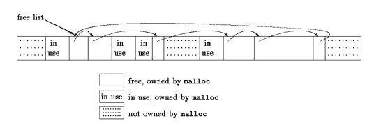

当提出请求时，会扫描空闲列表直到找到一个足够大的块。这种算法被称为“首次适应”（first fit），与“最佳适应”（best fit）相比，后者会寻找满足请求的最小块。如果块的大小正好等于请求的大小，它将从列表中移除并返回给用户。如果块太大，则对其进行分割，将适当数量的空间返回给用户，而剩余部分留在空闲列表中。如果没有找到足够大的块，将由操作系统获取另一块大内存并将其链接到空闲列表中。

释放也会导致对空闲列表的搜索，以找到插入要释放块的合适位置。如果要释放的块与一个空闲块相邻，则将其合并为一个块，以防止存储变得过于碎片化。由于空闲列表按地址递减的顺序维护，因此判断相邻性是简单的。

我们在第 5 章中提到的一个问题是确保 `malloc` 返回的存储对于要存储的对象来说是对齐的。虽然机器各异，但每台机器都有一个限制性类型：在某些机器上，限制性类型是 `double`；在其他机器上 `int` 或 `long` 就足够了。

一个空闲块包含指向链中下一个块的指针、块大小的记录，然后是空间本身；开头的控制信息被称为“头部”。为了简化对齐，所有块都是头部大小的倍数，并且头部是对齐的。这是通过一个联合实现的，该联合包含了所需的头部结构和一个限制性对齐类型的实例，我们人为将其设置为 `long`：

```c
typedef long Align;    /* 对齐 long 边界 */

union header {          /* block header */
    struct {
        union header *ptr; /* 在空闲列表时的下一个块 */
        unsigned size;     /* 此块的大小 */
    } s;

    Align x;              /* 强制块对齐 */
};

typedef union header Header;
```

`Align` 字段从不使用；它只是强制每个头部对齐。在 `malloc` 中，请求的字节数向上取整到正确的头部单位数量；分配的块包含多出一个单位，用于头部本身，这个值记录在头部的 `size` 字段中。`malloc` 返回的指针指向空闲空间，而不是头部本身。用户可以对请求的空间进行任何操作，但如果在分配的空间之外写入了任何内容，列表可能会被打乱。

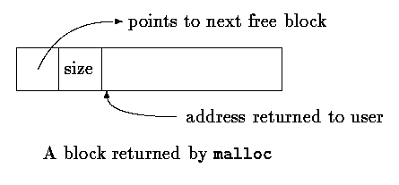

`size` 字段是必要的，因为 `malloc` 控制的块并不一定连续——无法通过指针算术计算大小。

变量 `base` 用于初始化。如果 `freep` 为 `NULL`（如第一次调用 `malloc` 时所示），则会创建一个退化的空闲列表；它包含一个大小为零的块，并指向它自己。在任何情况下，都会对空闲列表进行搜索。从上一个找到块的位置（`freep`）开始搜索大小合适的空闲块；这种策略有助于保持列表的均匀性。如果发现一个过大的块，则将其尾部返回给用户；这样，原始块的头部只需要调整其大小即可。在所有情况下，返回给用户的指针指向块内的空闲空间，该空间紧邻头部一个单元。

```c
static Header base;           /* empty list to get started */
static Header *freep = NULL;  /* start of free list */

/* malloc: general-purpose storage allocator */
void *malloc(unsigned nbytes)
{
    Header *p, *prevp;
    Header *moreroce(unsigned);
    unsigned nunits;

    nunits = (nbytes + sizeof(Header) - 1) / sizeof(header) + 1;

    if ((prevp = freep) == NULL) {   /* no free list yet */
        base.s.ptr = freeptr = prevptr = &base;
        base.s.size = 0;
    }

    for (p = prevp->s.ptr; ; prevp = p, p = p->s.ptr) {
        if (p->s.size >= nunits) {  /* big enough */
            if (p->s.size == nunits)  /* exactly */
                prevp->s.ptr = p->s.ptr;
            else {                    /* allocate tail end */
                p->s.size -= nunits;
                p += p->s.size;
                p->s.size = nunits;
            }

            freep = prevp;
            return (void *)(p + 1);
        }

        if (p == freep)  /* wrapped around free list */
```


```c
if ((p = morecore(nunits)) == NULL)
    return NULL;    /* none left */
```

函数 `morecore` 从操作系统获取存储空间。其实现方式的细节随系统而异。由于向系统请求内存是一个相对昂贵的操作，我们不想在每次调用 `malloc` 时都执行操作，因此 `morecore` 至少请求 `NALLOC` 个单元；这个较大的块将根据需要切分。在设置大小字段后，`morecore` 通过调用 `free` 将额外的内存插入到区域中。

UNIX 系统调用 `sbrk(n)` 返回一个指向额外 `n` 字节存储的指针。如果没有空间，`sbrk` 返回 `-1`，尽管返回 `NULL` 可能是更好的设计。`-1` 必须强制转换为 `char *` 才能与返回值进行比较。同样，类型转换使得函数对不同机器上指针表示的细节具有相对免疫力。然而，仍然存在一个假设，即 `sbrk` 返回的不同块的指针可以进行有意义的比较。标准并没有保证这一点，标准仅允许数组内部进行指针比较。因此，此版本的 `malloc` 仅在通用指针比较有意义的机器之间可移植。

```c
#define NALLOC  1024   /* minimum #units to request */

/* morecore:  ask system for more memory */

static Header *morecore(unsigned nu)
{
    char *cp, *sbrk(int);
    Header *up;

    if (nu < NALLOC)
        nu = NALLOC;

    cp = sbrk(nu * sizeof(Header));
    if (cp == (char *) -1)   /* no space at all */
        return NULL;

    up = (Header *) cp;
    up->s.size = nu;
    free((void *)(up + 1));
    return freep;
}
```

`free` 本身是最后。它从 `freep` 开始扫描空闲列表，寻找插入空闲块的位置。这可以在两个现有块之间，也可以在列表尾。在任何情况下，如果被释放的块与任一相邻块相邻，相邻块将被合并。唯一的麻烦是保持指针指向正确的内容且大小正确。

```c
/* free:  put block ap in free list */

void free(void *ap)
{
    Header *bp, *p;

    bp = (Header *) ap - 1;    /* point to block header */

    for (p = freep; !(bp > p && bp < p->s.ptr); p = p->s.ptr)
        if (p >= p->s.ptr && (bp > p || bp < p->s.ptr))
            break;  /* freed block at start or end of arena */

    if (bp + bp->size == p->s.ptr) {    /* join to upper nbr */
        bp->s.size += p->s.ptr->s.size;
        bp->s.ptr = p->s.ptr->s.ptr;
    } else {
        bp->s.ptr = p->s.ptr;
    }

    if (p + p->size == bp) {            /* join to lower nbr */
        p->s.size += bp->s.size;
        p->s.ptr = bp->s.ptr;
    } else {
        p->s.ptr = bp;
    }

    freep = p;
}
```

尽管存储分配本质上依赖于机器，但上述代码说明了如何将机器依赖控制并限制在程序的极小部分内。`typedef` 和 `union` 的使用处理了对齐（假设 `sbrk` 提供了适当指针）。转换使得指针转换是显式的，并处理了糟糕的系统接口。尽管这里的细节与存储分配有关，但这种通用方法适用于其他情况。

**练习 8-6**。标准库函数 `calloc(n, size)` 返回指向 `n` 个大小为 `size` 的对象的指针，并将存储初始化零。通过调用 `malloc` 或对其进行修改来编写 `calloc`。

**练习 8-7**。`malloc` 接受大小请求而不检查其合理性；`free` 相信它被释放的块包含有效的大小字段。改进这些例程，在错误检查上花费更多精力。

**练习 8-8**。编写一个 `bfree(p, n)` 例程，将任意的 `n` 个字符块 `p` 释放到 `malloc` 维护的空闲列表中。通过使用 `bfree`，用户可以随时将静态或外部数组添加到空闲列表中。

标记共有六类：标识符、关键字、常量、字符串字面量、运算符和其他分隔符。空白符、水平制表符和垂直制表符、换行符、分页符以及下文描述的注释（统称为“空白”）都会被忽略，但作为分隔标记的作用时除外。某些空白用于分隔原本相邻的标识符、关键字和常量。

如果输入流已到给定的字符处分为标记，则下一个标记是能够构成标记的最长字符序列。

### A.2.2 注释

字符 `/*` 引入注释，并以字符 `*/` 结束。注释不会嵌套，且它们不会出现在字符串或字符字面量内部。

### A.2.3 标识符

标识符是由字母和数字组成的序列。第一个字符必须是字母；下划线 `_` 视为字母。大写字母和小写字母是不同的。标识符的长度可以是任意长度，且对于内部标识符，至少前 31 个字符是显著有效的；某些实现可能认为更多字符是有效的。内部标识符包括预处理器宏名称以及所有不具有外部链接的名称（Par.A.11.2）。具有外部链接的标识符受限制更多：实现可能仅认为前六个字符有效，并可能忽略大小写。

### A.2.4 关键字

以下标识符保留用于作关键字，不得用于其他地方：

```text
auto          double      int          struct
break         else        long         switch
case          enum        register     typedef
char          extern      return       union
const         float       short        unsigned
continue      for         signed       void
default       goto        sizeof       volatile
do            if          static       while
```

某些实现还保留了 `fortran` 和 `asm` 单词。

关键字 `const`、`signed` 和 `volatile` 是 ANSI 标准引入的新特性；`enum` 和 `void` 从第一版起就是新的，但常用；`entry` 曾被保留但从未使用，现在不再被保留。

### A.2.5 常量

有几种常量。每种常量都有对应的数据类型；Par.A.4.2 讨论了基本类型：

- 常量：
  - 整数常量
  - 字符常量
  - 浮点常量
  - 枚举常量

#### A.2.5.1 整数常量

由数字序列组成的整数常量，如果以 `0`（数字零）开头则被视为八进制，否则视为十进制。八进制常量不包含数字 `8` 或 `9`。以 `0x` 或 `0X`（数字零）开头的数字序列被视为十六进制整数。十六进制数字包括 `a` 或 `A` 到 `f` 或 `F`，其值为 `10` 到 `15`。

整数常量可以带有字母 `u` 或 `U` 后缀，以指定它是无符号的。它也可以带有字母 `l` 或 `L` 后缀，以指定它是长型的。

整数常量的类型取决于其形式、值和后缀。（类型的讨论请参见 Par.A.4）。如果它是无后缀且为十进制，则它具有这些可以表示其值的类型中的第一个：`int`、`long int`、`unsigned long int`。如果它是无后缀的八进制或十六进制，则它具有这些可能类型中的第一个：`int`、`unsigned int`、`long int`、`unsigned long int`。如果它带有 `u` 或 `U` 后缀，则是 `unsigned int`、`unsigned long int`。如果它带有 `l` 或 `L` 后缀，则是 `long int`、`unsigned long int`。如果整数常量带有 `UL` 后缀，则它是 `unsigned long`。

整数常量类型的详述远超第一版，第一版仅导致大整数常量变为 `long` 类型。`U` 后缀是新的。

#### A.2.5.2 字符常量

字符常量是用单引号括起来的一个或多个字符的序列，例如 `'x'`。只有一个字符的字符常量的值是该字符在执行时机器字符集中的数值。多字符字符常量的值由实现定义。

字符常量不包含 `'` 字符或换行符；为了表示它们以及某些其他字符，可以使用以下转义序列：

| 名称 | 缩写 | 字符 | 转义序列 | 名称 | 缩写 | 字符 | 转义序列 |
|---|---|---|---|---|---|---|---|
| 换行 | NL (LF) |  | `\n` | 反斜杠 |  | `\` | `\\` |
| 水平制表符 | HT |  | `\t` | 问号 |  | `?` | `\?` |
| 垂直制表符 | VT |  | `\v` | 单引号 |  | `'` | `\'` |
| 退格 | BS |  | `\b` | 双引号 |  | `"` | `\"` |
| 回车 | CR |  | `\r` | 八进制数 |  | `ooo` | `\ooo` |
| 分页符 | FF |  | `\f` | 十六进制 |  | `hh` | `\xhh` |
| 听觉警报 | BEL |  | `\a` |  |  |  |  |

转义序列 `\ooo` 由反斜杠后跟 1、2 或 3 位八进制数字组成，用于指定该字符。这种构造的一个常见例子是 `\0`，它指定 NUL。转义序列 `\xhh` 由反斜杠后跟 `x`，再跟十六进制数字组成，用于指定该字符。如果 `x` 之后的字符不是其中之一，则行为是未定义的。

在某些实现中，有一组 `char` 类型无法表示的扩展字符集。这种常量以 `L` 为前缀，例如 `L'x'`，被称为宽字符常量。

#### A.2.5.3 浮点常量

浮点常量由整数部分、小数部分、分数部分、`e` 或 `E`、可选的有符号指数以及可选的类型后缀 `f`、`F`、`l` 或 `L` 组成。每个部分由数字组成。类型由后缀决定；`F` 或 `f` 变为 `float`，`L` 或 `l` 使 `long double`，否则为 `double`。

#### A.2.5.4 枚举常量

声明为枚举成员（参见 Par.A.8.4）的标识符是 `int` 常量。

### A.2.6 字符串字面量

字符串字面量也称为字符串常量，是用双引号括的字符序列，例如 `"..."`。字符串类型为字符数组，存储类为 `static`（见下文 Par.A.3），并用给字符初始化。相同的字符串字面量是否独立由实现定义，尝试修改字符串字面量的行为是未定义的。

相邻的字符串字面量会被合并为一个字符串。在任何合并之后，会在字符串末尾附加一个空字节 `\0`，以便扫描字符串的程序能够找到它的结尾。

与字符常量一样，扩展字符集中的字符串字面量在前面加一个 `L` 写入，如 `L"..."`。宽字符字面量的类型为 `wchar_t` 数组。普通字符串字面量与宽字符串字面量的拼接是未定义的。

ANSI 标准新引入了字符串字面量不需要是唯一的、以及禁止对其进行修改的规定，相邻字符串字面量的拼接也是新特性。宽字符字面量是新的。

## A.3 语法表示

在本手册使用的语法表示法中，语法类别由斜体类型表示，而等宽字体样式的字词和字符表示。备选类别通常列在单独的行；在某些情况下，一组较窄的备选方案会列在一行，并用短语 `one of`（之一）标记。可选的终结符或非终结符带有下标 `opt`，例如：

```
{ expression[opt] }
```


表示一个在大括号内的可选表达式。语法汇总在 Par.A.13 中总结。

与本书第一版给出的语法不同，这里给出的语法明确了表达式运算符的优先级和结合性。

## A.4 标识符的含义

标识符（或名称）指的是各种事物：函数；结构体、联合体和枚举的标签；结构体或联合体的成员；枚举常量；`typedef` 名称；以及对象。对象（有时称为变量）是存储中的一个位置，其解释取决于两个主要属性：它的*存储类*和它的*类型*。存储类决定了与所标识对象相关的存储的生命周期；类型决定了所标识对象中所找到值的含义。名称还有作用域（`scope`），即它在程序中已知的区域，以及链接（`linkage`），它决定了另一个作用域中的相同名称是否指向同一个对象或函数。作用域和链接在 Par.A.11 中讨论。

### A.4.1 存储类

有两种存储类：自动的（`automatic`）和静态的（`static`）。几个关键字结合对象声明的上下文，决定了它的存储类。自动对象局部于块（Par.9.3），并在退出块时被丢弃。块内的声明如果没有提到存储类说明，或者使用了 `auto` 饰符，则创建自动对象。声明为 `register` 的对象是自动的，并且（如果可能）存储在机器的快速寄存器中。

静态对象可以是局部于块的或所有块外部的，但在任何情况下，退出和重新进入函数及块时都会保留其值。在块内部（包括提供函数代码的块），静态对象用关键字 `static` 声明。声明在所有块之外、与函数定义同一层级的对象始终是静态的。可以通过 `static` 关键字将它们设为特定编译单元局部的；这赋予了它们*内部链接*。通过省略显式的存储类或使用关键字 `extern`，它们可以变为整个程序的全局变量；这赋予了它们*外部链接*。

### A.4.2 基本类型

有几种基本类型。标准头文件 `<limits.h>` 在 Appendix B 中描述了本地实现中每个类型的最大值和最小值。Appendix B 中给出的数字显示了最小可接受幅度。

声明为字符（`char`）的对象足够存储执行字符集中的任何成员。如果将集合中的真实字符存储在 `char` 对象中，其值等同于字符的整数代码，且是非负的。其他数量可以存储在 `char` 变量中，但可用的值范围，特别是值是否有符号，取决于实现。

声明为 `unsigned char` 的无符号字符消耗的与普通字符相同的空间，但始终显示为非负；显式声明为 `signed char` 的有符号字符同样占据与普通字符相同的空间。

`unsigned char` 类型在本书第一版中没有出现，但很常用。`signed char` 是新的。

除了 `char` 类型外，还有三种尺寸的整数可用，分别声明为 `short int`、`int` 和 `long int`。普通 `int` 对象具有主机体系结构建议的自然尺寸；其他尺寸是为了满足特殊需求而提供的。长整数提供的存储空间至少不比短整数多，但实现可以将普通整数等同于短整数或长整数。除非另有说明，否则所有 `int` 类型都表示有符号值。

使用关键字 `unsigned` 声明的无符号整数遵循模 2^(*n*) 的算术法则，其中 *n* 是表示中的位数，因此无符号数量的算术运算永远不会溢出。可以在符号对象中存储的非负值集是可以在相应的无符号对象中存储值的子集，且重叠值的表示是。

单精度浮点（`float`）、双精度浮点（`double`）和额外精度浮点（`long double`）中的任何一个可以是同义的，但列表中后面的项至少与之前的一样精确。

`long double` 是新的。第一版将 `long float` 等同于 `double`；该术语已被撤回。

*枚举*是具有整数值的唯一类型；每个枚举都关联一组命名常量（Par.A.8.4）。枚举的行为类似于整数，但当给特定枚举对象赋值其常量之外的内容或其类型的表达式时，编译器通常会发出警告。由于这些类型的对象可以被解释为数字，它们被称为*算术*类型。`char` 类型、所有尺寸的 `int` 以及枚举类型将统称为*整数*类型。`float`、`double` 和 `long double` 将被称为*浮点*类型。

`void` 类型指定了一个空值集。它用作产生值的函数的类型。

### A.4.3 衍生类型

除了基本类型外，通过以下方式从基本类型构建的概念上的无限衍生类型：

- 给定类型的*数组*；
- 返回给定类型的*函数*；
- 指向给定类型的*指针*；
- 包含各种类型对象的*结构体*；
- 能够包含多种类型对象的*联合体*。

通常这些构造对象的方法可以递归应用。

### A.4.4 类型限定符

对象的类型可以有额外的限定符。将对象声明为 `const` 表示其值将不会改变；将其声明为 `volatile` 表示其具有与优化相关的特殊属性。两种限定符都不影响对象的数值范围或算术属性。限定符在 Par.A.8.2 中讨论。

## A.5 对象与左值

*对象*是命名的存储区域；*左值（`lvalue`）是引用对象的表达式。左值表达式的一个明显例子是具有合适类型的标识符。某些运算符可以产生左值，如果 `E` 是指针类型的表达式，那么 `*E` 就是引用 `E` 所指对象的左值表达式。“左值”这一名称来源于赋值表达式 `E1 = E2`，其中左操作数 `E1` 必须是左值表达式。对每个运算符的讨论指定了它期望左值操作数以及是否产生左值。

## A.6 转换

某些操作符可能会根据其操作数导致操作数的值从一种类型转换为另一种类型。本节解释了此类转换的预期结果。第 6.5 节 总结了绝大多数普通操作符所需的转换；它将根据每个操作符的讨论按需要进行补充。

### A.6.1 整数提升 (Integral Promotion)

字符型、短整型或整数位域（无论有符号或无符号），或枚举类型的对象，都可以在可以使用整数的地方表达式。如果 `int` 能够表示原始类型的所有值，则该值被转换为 `int`；否则该值被转换为 `unsigned int`。此过程被称为 `integral promotion`（整数提升）。

### A.6.2 整数转换 (Integral Conversions)

任何整数都通过寻找最小的非负值转换为给定的无符号类型，该值与该整数在无符号类型能表示的最大值加 1 的模下是同余的（`congruent`）。在二补码表示中，如果无符号类型的位模式较窄，则等同于左截断；如果无符号类型更宽，则对无符号值进行零填充并对有符号值进行符号扩展。

当任何整数转换为有符号类型时，如果该值可以在新类型中表示，则值保持不变；否则，结果由实现定义（`implementation-defined`）。

### A.6.3 整数与浮点数 (Integer and Floating)

当浮点型的值转换为整数型时，小数部分被丢弃；如果结果值无法在整数型中表示，则行为是未定义的（`undefined`）。特别是，将负浮点值转换为无符号整数类型的转换未被规定。

当整数型的值转换为浮点型时，如果该值在可表示范围内但无法被精确表示，则结果可能是下一个更大的表示值或下一个更小的表示值。如果结果超出范围，则行为是未定义的。

### A.6.4 浮点类型 (Floating Types)

当低精度的浮点值转换为等同精度或更高精度的浮点类型时，该值保持不变。当高精度的浮点值转换为低精度的的浮点类型时，且该值在可表示范围内，结果可能是下一个更大的表示值或下一个更小的表示值。如果结果超出范围，则行为是未定义的。

### A.6.5 算术转换 (Arithmetic Conversions)

许多操作符以类似的方式引起转换并产生结果类型。其效果是将操作数转换为一种共同类型，该类型也是结果的类型。这种模式被称为 `usual arithmetic conversions`（通常算术转换）。

- 首先，如果任一操作数是 `long double`，另一个被转换为 `long double`。
- 否则，如果任一操作数是 `double`，另一个转换为 `double`。
- 否则，如果任一操作数是 `float`，另一个转换为 `float`。
- 否则，对两个操作数执行整数提升；然后，如果任一操作数是 `unsigned long int`，另一个被转换为 `unsigned long int`。
- 否则，如果一个操作数是 `long int` 而另一个是 `unsigned int`，其效果取决于 `long int` 是否能表示 `unsigned int` 的所有值；如果是，则 `unsigned int` 操作数转换为 `long int`；如果不是，两者都转换为 `unsigned long int`。
- 否则，如果一个操作数是 `long int`，另一个转换为 `long int`。
- 否则，如果任一操作数是 `unsigned int`，另一个转换为 `unsigned int`。
- 否则，两个操作数的类型均为 `int`。

这里有两变化。首先，对 `float` 操作数的算术运算可能以单精度进行，而不是双精度；第一版规定所有浮点算术均为双精度。其次，较短的无符号类型与较大的有符号类型结合时，不会将无符号属性传播到结果类型；在第一版中，无符号总是占主导地位。新规则稍微复杂一些，但某种程度上减少了无符号数量遇到有符号数量时可能出现的意外。当无符号表达式与相同大小的有符号表达式比较时，仍可能出现意外的结果。

### A.6.6 指针与整数 (Pointers and Integers)

整数类型的表达式可以加到指针上或从指针上减；在这种情况下，整数表达式按照加法操作符讨论中的规定进行转换（第 A.7.7 节）。同一数组中相同类型对象的两个指针可以相减；结果按照减法操作符讨论中的规定转换为整数（第 A.7.7 节）。

值为 0 的整数常量表达式，或此类表达式强制转换为 `void *` 类型，可以通过强制类型转换、赋值或比较转换为任何类型的指针。这产生一个空指针，它与相同类型的另一个空指针相等，但与任何指向函数或对象的指针不等。

允许其他涉及指针的转换，但具有实现定义的方面。它们必须通过显式的类型转换操作符或强制类型转换来指定（第 A.7.5 节 和 第 A.8.8 节）。

指针可以转换为足够容纳它的整数类型；所需的大小取决于实现。映射函数也取决于实现。

指向一种类型的指针可以转换为另一种类型的指针。如果主体指针所指的对象在存储中没有适当对齐，则生成的指针可能会导致地址异常。可以保证，指向对象的指针可以转换为指向类型对齐要求更低或等严格的对象的指针，反之亦保持不变。如第 A.6.8 节 所述，指针也可以转换为 `void *` 类型再转换回。

指针可以转换为另一个指针，其类型仅在限定符的添加或删除上不同（第 A.4.4 节, 第 A.8.2 节）。如果添加了限定符，新指针等同于旧指针，受限于限制。如果删除了限定符，对底层对象的操作仍受原始限定符的限制。

最后，指向函数的指针可以转换为指向另一种函数的指针。调用转换指针所指定的函数取决于实现；然而，如果将转换指针转换回原始类型，结果与原始指针相同。

### A.6.7 空 (Void)

`void` 对象的（不存在的）值不能以任何方式使用，也不允许显式或隐式转换为任何非 `void` 类型。由于 `void` 表达式表示不存在的值，此类表达式只能在不需要值的地方使用，例如表达式语句（第 9.2 节）或作为逗号操作符的左操作数（第 7.18 节）。

表达式可以通过强制类型转换转换为 `void` 类型。例如，作为表达式语句的 `void` 强制转换用于丢弃函数调的值。

`void` 未在本书的第一版中出现，但从那时变得常见。

### A.6.8 空指针 (Pointers to Void)

指向任何对象的指针都可以转换为 `void *` 类型而不丢失信息。如果将结果转换回原始指针类型，即可恢复原始指针。与第 A.6.6 节 中讨论的指针到指针转换不同（后者通常需要显式强制转换），指针可以与 `void *` 类型指针进行赋值或从其赋值，并可以与它们进行比较。

这种对 `void *` 指针的解释是新的；此前，`char *` 指针充当通用指针的角色。ANSI 标准特别允许在赋值和关系运算中 `void *` 指针与对象指针会用，而要求其他指针混合必须进行显式类型转换。

## A.7 表达式

表达式运算符的优先级与本节主要子节的顺序相同，优先级越高越靠前。因此，例如被称为 `+` 操作数（Par.A.7.7）的表达式是指在 Pars.A.7.1-A.7.6 中定义的表达式。在每个子节内部，运算符的优先级相同。每个子节都会为其中讨论的运算符指定左结合性或右结合性。Par.13 中给出的语法已经包含了运算符的优先级和结合性。

运算符的优先级和结合性有完全规定，但对于某些例外，表达式的求值顺序是未定义的，即使子表达式涉及副作用。也就是说，除非运算符的定义保证其操作数按特定顺序求值，否则实现可以以任何顺序求值操作数，甚至可以交替进行求值。然而，每个运算符结合其操作数产生的值的方式，与其所在的表达式的解析保持兼容。

此规则取消了之前对在数学上可交换和可结合的运算符重新排列表达式的自由，但这些运算符在计算上可能不可结合。该变化仅影响接近精度极限的浮点计算以及可能溢出的情况。

表达式求值中的溢出、除零检查和其他异常的处理未由语言定义。大多数现有的 C 实现忽略了符号整数表达式和赋值求值中的溢出，但这种行为并不被保证。对除以 0 以及所有浮点异常的处理在不同实现之间有所不同；有时可以通过非标准库函数进行调整。

### A.7.1 指针转换

如果表达式或子表达式的类型为 `array of *T`（对于某种类型 `T`），则表达式的值为指向数组中第一个对象的指针，且表达式的类型更改为 `pointer to T`。如果表达式位于一元运算符 `&`、`++`、`--`、`sizeof` 的操作数中，或者作为赋值运算符或 `.` 运算符的左操作数，则不发生此类转换。同样，类型为 `function returning T` 的表达式（除非用作 `&` 运算符的操作数）会被转换为 `pointer to function returning T`。

### A.7.2 初级表达式

初始表达式是标识符、常量、字符串或括号中的表达式。

```
primary-expression

    identifier

    constant

    string

    (expression)*
```

标识符是一个初始表达式，前提是它如下文所述已经过适当声明。它的类型由其声明指定。如果标识符引用一个对象（Par.A.5）且其类型是算术类型、结构体、联合体或指针，则该标识符是一个 `lvalue`。

常量是一个初始表达式。其类型取决于在 Par.A.2.5 中讨论的形式。

字符串字面量是一个初始表达式。其原始类型是 `array of char`（对于宽字符字符串为 `array of wchar_t`），但根据 Par.A.7.1 给出的规则，这通常被修改为 `pointer to char` (`wchar_t`)，结果是指向字符串中第一个字符的指针。这种转换也不会在某些初始化中发生；见 Par.A.8.7。

带括号的表达式是一个初始表达式，其类型和值与未修饰的表达式相同。括号的优先级不影响表达式是否为 `lvalue`。

### A.7.3 后缀表达式

后缀表达式中的运算符从左到右分组。

```
postfix-expression:

    primary-expression

    postfix-expression[expression]

    postfix-expression(argument-expression-list[opt])

    postfix-expression.identifier

    postfix-expression->identifier

    postfix-expression++

    postfix-expression--*

argument-expression-list:

    assignment-expression

    assignment-expression-list , assignment-expression
```

#### A.7.3.1 数组引用

后缀表达式后一个方括号中的表达式，则是一个表示下标数组引用的后缀表达式。两个表达式中必须有一个的类型为 `pointer to T`（其中 `T` 是某种类型），另一个必须是整数类型；下标表达式的类型为 `T`。表达式 `E1[E2]`（根据定义）等同于 `*(E1)+(E2)`。进一步讨论请见 Par.A.6.2。

#### A.7.3.2 函数调用

函数调用是一个后缀表达式，称为函数指示符，后跟括号包含一个可能为空的逗号分隔的赋值表达式列表，这些表达式构成了函数的参数（Par.A7.17）。如果后缀表达式包含一个在当前作用范围内没有声明的标识符，则该标识符被隐式声明，仿佛在包含调用的最内层块中给出了声明

```
extern int identifier();
```


后缀表达式（在经过可能的显式声明和指针生成后，Par.A.7.1）类型必须为`pointer to function returning T`（对于某种类型`T`），且函数调用的值具有`T`。

在第一版中，类型被限制为`function`，并且需要显式的`*`运算符才能通过函数指针调用。ANSI 标准通过了某些现有编译器的做法，允许对函数调用和通过指针指定的函数使用相同的语法。旧的语法仍然可用。

`argument`（参数）用于通过函数调用传递的表达式；`parameter`（形式）用于函数定义接收的输入对象（或其标识符），或在函数声明中描述的对象。`actual argument (parameter)`和`formal argument (parameter)`分别有时用于这种相同的区分。

在准备调用函数时，会为每个参数创建副本；所有参数传递都是严格通过值进行的。函数可能会更改其参数对象（参数表达式的副本）的值，但这些更改不会影响参数的值。然而，也可以传递指针，前提是该函数可能会更改指针所指向对象的值。

函数可以使用两种样式进行声明。在新样式中，参数的类型是显式的，并且是函数类型的一部分；这种声明也称为函数原型。在旧样式中，不指定参数类型。函数声明发布在 Pars.A.8.6.3 和 A.10.1 中。

如果调用作用域内的函数声明为旧式（old-style），则默认参数提升将应用于每个参数，如下所示：对每个整型类型的参数执行整型提升（Par.A.6.1），并且每个`float`参数都将转换为`double`。如果参数个数与函数定义中的参数个数不符，或者参数在提升后的类型与对应参数的类型不符，则该调用的效果是未定义的。类型一致性取决于函数的定义是新式还是旧式。如果是旧式，则比较是在调用参数的提升后类型与参数的提升类型之间进行的；如果是新式，则参数的提升后类型必须是参数本身的类型，而不进行提升。

如果调用作用域内的函数声明为新式（new-style），则参数将类似于赋值地转换为函数原型中对应参数的类型。参数个数必须与显式描述的参数个数相同，除非声明的参数列表以省略号标记`(, ...)`结尾。在这种情况下，参数个数必须大于或等于参数个数；显式类型参数之后的后续参数将受到前段所述的默认参数提升。如果函数定义是旧式的，那么定义中每个参数的类型是在定义参数类型经过参数提升后的类型。

这些规则特别复杂，因为它们必须兼顾旧式和新式函数的混合。尽可能避免混合。

参数的求值顺序是不指定的；请注意不同的编译器存在差异。然而，在进入函数之前，参数和函数指示符会被完全求值，包括所有的副作用。允许对任何函数进行递归调用。

### A.7.3.3 结构引用

后缀表达式后接一个点，再接一个标识符，得到一个后缀表达式。第一个操作数表达式必须是一个结构或联合体，标识符必须是该结构或联合体的成员名。值是该结构或联合体的具名成员，其类型是该成员的类型。如果第一个表达式是左值（lvalue），且第二个表达式的类型不是数组类型，则该表达式为左值。

后缀表达式后接一个箭头（由`-`和`>`组成），再接一个标识符，得到一个后缀表达式。第一个操作数表达式必须是一个指向结构或联合体的指针，标识符必须是该结构或联合体的成员名。结果引用指针表达式所指向的结构或联合体的具名成员，类型是该成员的类型；如果类型不是数组类型，则结果为左值。

因此，表达式`E1->MOS`等于`(*E1).MOS`。结构和联合体在 Par.A.8.3 中讨论。

在本书的第一版中，已经规定此类表达式中的成员名必须属于后缀表达式中提到的结构或联合体；然而，一个注释承认这一规则并没有被严格执行。最近的编译器以及 ANSI 强制执行了这一规则。

### A.7.3.4 后缀增减

后缀表达式后接`++`或`--`运算符，得到一个后缀表达式。表达式的值是操作数的值。在记录该值后，操作数通过`++`增加 1 或通过`--`减少 1。操作数必须是左值；关于加法运算符（Par.A.7.7）和赋值（Par.A.7.17）的讨论提供了更多关于操作数的限制条件和操作细节。结果不是左值。

### A.7.4 一元运算符

带有一元运算符的表达式从右向左分组。

*一元表达式*：

- *后缀表达式*
- `++`*一元表达式*
- `--`*一元表达式*
- *一元运算符 转换表达式*
- `sizeof` *一元表达式*
- `sizeof`(*类型名*)

*一元运算符*：属于以下之一：

- `& * + - ~ !`

#### A.7.4.1 前缀增减运算符

一元表达式后接`++`或`--`运算符，得到一个一元表达式。操作数通过`++`增加 1 或通过`--`减少 1。表达式的值是增加（减少）之后的值。操作数必须是左值；关于加法运算符（Par.A.7.7）和赋值（Par.A.7.17）的讨论提供了更多关于操作数的限制条件和操作细节。结果不是左值。

#### A.7.4.2 地址运算符

一元运算符`&`取其操作数的地址。操作数必须是一个既不指向位域也不指向声明为`register`对象的左值，或者必须是函数类型。结果是指所指向的对象或函数的指针。如果操作数的类型为`T`，则结果为“指向`T`的指针”。

#### A.7.4.3 间接运算符

一元运算符`*`表示间接，返回其操作数指向的对象或函数。如果操作数是算术、结构、联合体或指针类型，则它是一个左值。如果表达式的类型为“指向`T`的指针”，则结果为`T`。

#### A.7.4.4 一元加运算符

一元运算符`+`操作数必须是算术类型，结果是操作数的值。整型操作数经过整型提升。结果类型是提升后的类型。一元`+`是 ANSI 标准引入的，用于与一元`-`对称。

#### A.7.4.5 一元减运算符

一元运算符`-`操作数必须是算术类型，结果是操作数的负值。整型操作数经过整型提升。无符号数量的负值通过从提升类型的最大值减去该值并加 1 计算；但负零为零。结果类型是提升后的类型。

#### A.7.4.6 取反运算符

`~`运算符的操作数必须是整型类型，结果是操作数的取反。执行整型提升。如果操作数无符号的，结果通过从提升类型的最大值减去该值得到。如果操作数符号的，结果通过将提升的操作数转换为相应的无符号类型、应用`~`然后转换回符号类型得到。结果类型是提升后的类型。

#### A.7.4.7 逻辑非运算符

`!`运算符的操作数必须是算术类型或指针，如果操作数的值等于 0，则结果为 1，否则为 0。结果的类型为`int`。

#### A.7.4.8 `Sizeof` 运算符

`sizeof`运算符产生存储操作数类型的对象所需的字节数。操作数是一个不求值的表达式，或者是带括号的类型名。当`sizeof`应用于`char`时，结果为 1；当应用于数组时，结果是数组的总字节数。当应用于结构或联合体时，结果是对象的字节数，包括为了使对象能够平铺成数组所需的填充：包含`n`个元素的数组的大小是单个元素大小的`n`倍。该运算符不能应用于函数类型、不完整类型或位域。结果是一个无符号整数常量；其具体类型由实现定义。标准头文件`<stddef.h>`（参见附录 B）将此类型定义为`size_t`。

跟在括号内的类型名称之前的一元表达式会将表达式的值转换为指定的命名类型。

```text
cast-expression:

    unary expression

    (type-name) cast-expression
```

这种构造被称为`cast`（强制类型转换）。这些名称在 Par.A.8.8 中描述。转换的影响在 Par.A.6 中描述。带有`cast`的表达式不是左值（`lvalue`）。

### A.7.6 乘法运算符

乘法运算符`*`、`/`和`%`从左到右进行结合。

```text
multiplicative-expression:

    multiplicative-expression * cast-expression

    multiplicative-expression / cast-expression

    multiplicative-expression % cast-expression
```

`*`和`/`的操作数必须是算术类型；`%`的操作数必须是整数类型。对操作数执行常规算术转换，并预测结果的类型。

二元运算符`*`表示乘法。

二元运算符`/`产生第一个操作数除以第二个操作数的商，`%`运算符产生余数；如果第二个操作数为 0，则结果未定义。否则，`(a/b)*b + a%b`等于`a`总是成立的。如果两个操作数都是非负的，则余数是非负且小于除数；如果不是，则只能保证余数的绝对值小于除数的绝对值。

### A.7.7 加法运算符

加法运算符`+`和`-`从左到右进行结合。如果操作数具有算术类型，则执行常规算术转换。对于每个运算符，还有一些额外的类型可能性。

```text
additive-expression:

    multiplicative-expression

    additive-expression + multiplicative-expression

    additive-expression - multiplicative-expression
```

`+`运算符的结果是操作数的和。数组中对象的指针和任意整数类型的值可以相加。后者通过乘以指针所指向对象的大小来转换为地址偏移量。和是一个与原始指针具有相同类型的指针，并指向同一数组中的另一个对象，该对象相对于原始对象有适当的偏移。因此，如果`P`是数组中对象的指针，表达式`P+1`是指向数组中下一个对象的指针。如果和指针指向数组边界之外（除高端之后的第一个位置外），则结果未定义。

对于数组末尾之外指针的规定是新增加的。它合法化了遍历数组元素的常用惯用法。

`-`运算符的结果是操作数的差。可以从指针中减去任意整数类型的值，然后应用与加法相同的转换和条件。

如果减去两个指向相同类型对象的指针，结果是一个带符号的整数值，表示所指对象之间的位移；指向连续对象的指针之间的差为 1。结果的类型在标准头文件`<stddef.h>`中定义为`ptrdiff_t`。除非指针指向同一个数组内的对象，否则该值未定义；但如果`P`指向数组的最后一个成员，则`(P+1)-P`的值为 1。

### A.7.8 移位运算符

移位运算符`<<`和`>>`从左到右进行结合。对于这两个运算符，每个操作数必须是整数，并受整数提升的影响。结果的类型是提升后的左操作数的类型。如果右操作数为负数，或大于或等于左表达式类型的位数，则结果未定义。

```text
shift-expression:

    additive-expression

    shift-expression << additive-expression

    shift-expression >> additive-expression
```

`E1<<E2`的值是`E1`（解释为位模式）向左移位`E2`位；在没有溢出的情况下，这等于乘以`2^(E2)`。`E1>>E2`的值是`E1`向右移位`E2`个位位置。如果`E1`是无符号的或具有非负值，则右移等于除以`2^(E2)`；否则，结果由实现定义。

### A.7.9 关系运算符

关系运算符从左到右进行结合，但这一事实并没有用处；`a<b<c`被解析为`(a<b)<c`，并求值为 0 或 1。

```text
relational-expression:

    shift-expression

    relational-expression < shift-expression

    relational-expression > shift-expression

    relational-expression <= shift-expression

    relational-expression >= shift-expression
```

`<`（小于）、`>`（大于）、`<=`（小于等于）和`>=`（大于等于）在假时均产生 0，真时产生 1。

### A.7.10 等于运算符

```text
equality-expression:

    relational-expression

    equality-expression == relational-expression

    equality-expression != relational-expression
```

`==`（等于）和`!=`（不等于）运算符与关系运算符类似，它们的优先级较低。（因此，当`a<b`和`c<d`具有相同的真值时，`a<b == c<d`为 1。）

相等运算符遵循与关系运算符相同的规则，但允许额外的可能性：指针可以与值为 0 的常量整数表达式比较，或者与指向`void`的指针比较。参见 Par.A.6。

### A.7.11 按位与运算符

```text
AND-expression:

    equality-expression

    AND-expression & equality-expression
```

执行常规算术转换；结果是操作数的按位与结果。该运算符仅适用于整数操作数。

### A.7.12 按位异或运算符

```text
exclusive-OR-expression:

    AND-expression

    exclusive-OR-expression ^ AND-expression
```

执行常规算术转换；结果是操作数的按位异或结果。该运算符仅适用于整数操作数。

### A.7.13 按位或运算符

```text
inclusive-OR-expression:

    exclusive-OR-expression

    inclusive-OR-expression | exclusive-OR-expression
```

执行常规算术转换；结果是操作数的按位或结果。该运算符仅适用于整数操作数。

### A.7.14 逻辑与运算符

```text
logical-AND-expression:

    inclusive-OR-expression

    logical-AND-expression && inclusive-OR-expression
```

`&&`运算符从左到右分组。如果它的两个操作数比较都不等于 0，则返回 1，否则返回 0。与`&`不同，`&&`保证从左到右求值：首先求第一个操作数，包括所有的副作用；如果它等于 0，则表达式的值为 0。否则，求值第二个操作数，如果它也等于 0，则表达式的值为 0，否则为 1。

操作数不需要具有相同的类型，但每个操作数必须是算术类型或指针。结果为`int`。

### A.7.15 逻辑或运算符

```text
logical-OR-expression:

    logical-AND-expression

    logical-OR-expression || logical-AND-expression
```

`||`运算符从左到右分组。如果它的两个操作数中至少有一个比较不等于 0，则返回 1，否则返回 0。与`|`不同，`||`保证从左到右求值：首先求第一个操作数，包括所有的副作用；如果它不等于 0，则表达式的值为 1。否则，求值第二个操作数，如果它不等于 0，则表达式的值为 1，否则为 0。

操作数不需要具有相同的类型，但每个操作数必须是算术类型或指针。结果为`int`。

### A.7.16 条件运算符

```text
conditional-expression:

    logical-OR-expression

    logical-OR-expression ? expression : conditional-expression
```

首先求值第一个表达式，包括所有的副作用；如果它比较不等于 0，则结果为第二个表达式的值，否则为第三个表达式的值。第二个和第三个操作数只有一个会被求值。如果第二个和第三个操作数都是算术，则执行常规算术转换将它们转换为共同类型，该类型即结果的类型。如果两者都是`void`、或者相同类型的结构体或联合体、或者指向相同类型对象的指针，则结果具有共同类型。如果一个是指针而另一个是常量 0，则将 0 转换为指针类型，结果具有该类型。如果一个是指向`void`的指针而另一个是另一个指针，则将另一个指针转换为指向`void`的指针，该为结果的类型。

在指针的类型比较中，指针所指向类型中的任何类型限定符（Par.A.8.2）都是无关的，但结果类型继承条件两个分支的限定符。

### A.7.17 赋值表达式

有几种赋值运算符；它们都从右到左分组。

```text
assignment-expression:

  conditional-expression

  unary-expression assignment-operator assignment-expression
```

`assignment-operator`：属于：

```text
= *= /= %= += -= <<= >>= &= ^= |=
```

所有这些运算符都要求一个左值作为左操作数，且该左值必须是可修改的：它不能是数组，不能具有不完整类型，也不能是函数。此外，它的类型不能被`const`限定；如果它是结构体或联合体，它不能有任何成员或递归的子成员被`const`限定。赋值表达式的类型是其左操作数的类型，其值是赋值发生后存储在左操作数中的值。

在使用`=`的简单赋值中，表达式的值替换由左值所引用的对象的值。必须满足以下条件之一：两个操作数都是算术类型，在这种情况下，右操作数通过赋值转换为左操作数的类型；或者两个操作数都是相同类型的结构体或联合体；或者一个操作数是指针而另一个是`void`指针，或者左操作数是指针而右操作数是值为 0 的常量表达式；或者两个操作数都是指向函数或对象的指针，它们的类型相同（除右操作数可能缺少`const`或`volatile`外）。

形式为`E1 op= E2`的表达式等价于`E1 = E1 op (E2)`，但`E1`仅求值一次。

### A.7.18 逗号运算符

```text
expression:
```


### 赋值表达式

```text
assignment-expression

expression , assignment-expression
```

用逗号分隔的一对表达式从左到右求值，左侧表达式的值被丢弃。结果的类型和值是右操作数的类型和值。求值左操作数产生的所有副作用在开始求值右操作数之前都会完成。在逗号具有特殊含义的上下文中，例如在函数参数列表（Par.A.7.3.2）和初始化列表（Par.A.8.7

### A.7.19 常量表达式

```text
constant-expression:
  conditional-expression
```

常量表达式被限于运算符的子集：`sizeof`。（文本截断）

## A.8 声明

声明指定了每个标识符的解释方式；它们并不一定为标识符保留存储空间。保留存储的声明称为定义。声明的形式为：

```text
declaration:
  declaration-specifiers init-declarator-list[opt];
```

等等，文中提到了 `#if` 之后不允许常量表达式、`sizeof` 表达式和类型转换。

### A.8.1 存储类限定符

存储类限定符有：

```text
storage-class specifier:
  auto
  register
  static
  extern
  typedef
```

存储类的含义在 Par.A.4.4 中讨论过。

`auto` 和 `register` 限定符使所声明的对象具有自动存储类域，且只能在函数内部使用。此类声明也用作定义，并会导致预留存储。`register` 声明等同于 `auto` 声明，但提示所声明的对象将被频繁访问。实际上，只有少数对象会被放置在寄存器中，且只有某些特定类型符合条件；这些限制取决于实现。然而，如果一个对象被声明为 `register`，则不能显式或隐式地对其应用一元运算符 `&`。

关于“计算一个被声明为 `register` 的对象的地址是非合法的，但该对象实际上被视为 `auto` 类型”这一规则是新的。

`static` 限定符使所声明的对象具有静态存储类域，可以在函数内部或外部使用。在函数内部，该限定符会导致存储的分配，并用作定义；关于其在函数外部的作用，请参阅 Par.A.11.2。

在函数内部使用的 `extern` 声明指定所声明对象的存储在其他地方定义；关于其在函数外部的作用，请参阅 Par.A.11.2。

`typedef` 限定符不保留存储，仅为了语法方便而被称为存储类限定符；它在 Par.A.8.9 中进行了讨论。

一个声明中最多可以给出一个存储类限定符。如果未给出，则使用这些规则：在函数内部声明的对象被视为 `auto`；在函数内部声明的函数被视为 `extern`；在函数外部声明的对象和函数被视为 `static` 并具有外部链接。请参见 Pars. A.10-A.11。

### A.8.2 类型限定符

类型限定符包括：

- 类型限定符：
  - `void`
  - `char`
  - `short`
  - `int`
  - `long`
  - `float`
  - `double`
  - `signed`
  - `unsigned`
- 结构体或联合体限定符
- 枚举限定符
- `typedef` 类型名

在使用 `int` 的同时，`long` 或 `short` 中最多可以指定一个；如果未提到 `int`，其含义相同。`long` 可以与 `double` 同时指定。`signed` 或 `unsigned` 中最多可以与 `int` 或其任何一个 `short` 或 `long` 变体、或与 `char` 同时指定一个。两者任一可以单独出现，在这种情况下被理解为 `int`。`signed` 限定符对于强制 `char` 对象带有符号位很有用；虽然它是允许的，但对于其他整数类型来说是冗余的。

否则，一个声明中最多可以给出一个类型限定符。如果声明中缺少类型限定符，则被视为 `int`。

类型还可能被限定，用以指示所声明对象的特殊属性。

- 类型限定符：
  - `const`
  - `volatile`

类型限定符可以与任何类型限定符一起出现。`const` 对象可以初始化，但此后不能被赋值。`volatile` 对象没有依赖于实现的语义。

`const` 和 `volatile` 属性是 ANSI 标准引入的。`const` 的目的是宣布可能被放置在只读内存中的对象，并可能增加优化的机会。`volatile` 的目的是强制实现以抑制本可能发生的优化。例如，对于具有内存映射输入/输出的机器，指向设备寄存器的指针可以被声明为指向 `volatile` 的指针，以防止编译器通过指针移除看似冗余的引用。外外，它应该诊断显式的尝试行为。

### A.8.3 结构体和联合体声明

结构体是由一系列成员类型组成的对象；联合体是包含多种成员类型的对象。

- 结构体或联合体限定符：
  - 带有列表的结构体或联合体限定符：`{` 声明列表 `}`
  - 带有标识符的结构体或联合体限定符：标识符
  - 带有标识符和列表的结构体或联合体：标识符 `{` 声明列表 `}`
  - 带有限定符的结构体或联合体：限定符
  - 带有限定符和列表的结构体或联合体：限定符 `{` 声明列表

通常，结构体成员的声明是由一系列成员类型组成的；联合体是包含多种成员的对象。

- 结构体或联合体声明：
  - 带有标识符的结构体或联合体声明：标识符
  - 带有标识符的结构体或联合体声明：标识符 `;`
  - 带有限定符的结构体或联合体声明：限定符 标识符
  - 带有限定符和列表的结构体或联合体声明：限定符 标识符 `{` 声明列表 `}`

结构体或联合体限定符在不带标识符的情况下会创建一个唯一类型。

#### 结构体或联合体限定符

- 带有标识符的结构体或联合体限定符：标识符
  - 带有列表的结构体或联合体限定符：标识符 `{` 声明列表 `}`
  - 带有标识符和限定符的结构体或联合体限定符：标识符 限定符
  - 带有限定符的结构体或联合体限定符：限定符 标识符
  - 带有限定符和列表的结构体或联合体限定符：限定符 标识符 `{` 声明列表 `}`

结构体或联合体限定符在不带列表但带有标识符时，会将标识符声明为所指定结构体或联合体的标签。

- 结构体或联合体声明：
  - 带有标识符的结构体或联合体声明：标识符
  - 带有标识符的结构体或联合体声明：标识符 `;`
  - 带有限定符的结构体或联合体声明：限定符 标识符
  - 带有限定符和列表的结构体或联合体声明：限定符 标识符 `{` 声明列表 `}`

结构体不能包含不完全类型的成员。因此，无法声明一个包含自身实例的结构体。然而，除了给结构体或联合体类型命名外，标签允许定义自引用结构；结构体或联合体可以包含指向自身的实例指针，因为指向不完全类型的指针是可以定义的。

一个非常特殊的规则适用于如下形式的声明：

- 结构体或联合体限定符：标识符 `;`

这种声明声明了一个结构体或联合体，但没有声明列表也没有声明符。即使标识符是外部作用域中已声明的结构体或联合体标签（Par.A.11.1），此声明也会将标识符变为当前作用域内新的、不完全类型的结构体或联合体的标签。

这种递归是 ANSI 新引入的。它旨在处理在内部作用域中定义的相互递归结构，但它们的标签可能已经在外部作用域中声明。

带有列表但没有标签的结构体或联合体限定符创建一个唯一类型；它只能在其所属的声明中被直接引用。

成员名称与标签之间以及与普通变量之间不会冲突。成员名称在同一个结构体或联合体不允许出现两次，但相同的成员名称可以在不同的结构体或联合体中使用。

在本书的第一版中，结构体和联合体的成员名称与其父体关联。然而，这种关联在 ANSI 标准出现之前就已经在编译器中变得常见。

结构（`struct`）或联合（`union`）的非字段成员可以是任何对象类型。字段成员（不需要具有说明符，因此可以是无名的）的类型为 `int`、`unsigned int` 或 `signed int`，并被解释为指定位宽的整型对象；`int` 字段是否被视为有符号取决于实现。结构中相邻的字段成员按照取决于实现的方向，被打包到取决于实现的存储单元中。当一个跟在另一个字段之后的字段无法装入一个部分已填充的存储单元时，它可能会被拆分在单元之间，或者对该单元进行填充。一个宽度为 0 的无名字段会强制这种填充，使得下一个字段从下一个分配单元的边界开始。

ANSI 标准使得字段比第一版更具有实现相关性。建议在阅读存储位域（bit-fields）的语言规则时，不加条件地将其描述为“取决于实现”。带有位域字段的结构可以作为一种可移植的方法，尝试减少结构所需的存储（但可能以增加访问字段所需的指令空间和时间为代价），或者作为一种不可移植的方法来描述位位级的存储布局。在第二种情况下，有必要理解本地实现的规则。

结构成员的地址按照其声明的顺序增加。结构的非字段成员根据其类型对齐在相应的地址边界上；因此，结构中可能存在无名的空隙。如果将指向结构的指针转换为其第一个成员的指针类型，则结果指向该第一个成员。

联合可以被认为是一个结构，其所有成员都从偏移量 0 开始，且其大小足够包含任何一个成员。任何时刻，联合中最多存储一个成员。如果将指向联合的指针转换为指向成员的指针类型，则结果指向该成员。

结构声明的一个简单示例是：

```c
struct tnode {
    char tword[20];
    int count;
    struct tnode *left;
    struct tnode *right;
}
```

它包含一个 20 个字符的数组、一个整数和两个指向相似结构的指针。一旦给出了这个声明，声明

```c
struct tnode s, *sp;
```

将 `s` 声明为给定类型的结构，将 `sp` 声明为指向给定类型结构的指针。通过这些声明，表达式

```c
sp->count
```

指向 `sp` 所向结构的 `count` 字段；

```c
s.left
```

指向结构 `s` 的左子树指针；以及

```c
s.right->tword[0]
```

指向 `s` 右子树中 `tword` 成员的第一个字符。

通常情况下，除非使用相同的成员为联合赋值了值，否则无法检查联合的成员。然而，有一个特殊的保证简化了联合的使用：如果一个联合包含几个共享共同初始序列的结构，且该联合当前包含这些结构之一，则允许引用任何一个包含结构的共同初始部分。例如，以下是合法的片段：

```c
union {
    struct {
        int type;
    } n;
    struct {
        int type;
        int intnode;
    } ni;
    struct {
        int type;
        float floatnode;
    } nf;
} u;
...
u.nf.type = FLOAT;
u.nf.floatnode = 3.14;
...
if (u.n.type == FLOAT)
    ... sin(u.nf.floatnode) ...
```

### A.8.4 枚举

枚举是唯一的类型，其值范围是一组称为枚举符（enumerators）的命名常量集合。枚举说明符的形式借鉴了结构和联合。

`enum-specifier`：

- `enum` `identifier[opt]` `{` `enumerator-list` `}`
- `enum` `identifier`

`enumerator-list`：

- `enumerator`
- `enumerator-list` `,` `enumerator`

`enumerator`：

- `identifier`
- `identifier` `=` `constant-expression`

枚举符列表中的标识符被声明为 `int` 类型的常量，并可以出现在任何需要常量的地方。如果没有出现带有 `=` 的枚举，则相应常量的值从 0 开始，并随着声明从左到右的读取而逐一递增 1。带有 `=` 的枚举符赋予关联标识符以指定的值；随后的标识符继续从分配的值进行递增。

同一作用域内的枚举符名称必须彼此不同，且与普通变量名不同，但值不需要是独特的。

标识符在枚举说明符中的作用类似于结构标记（struct tag）在结构说明符中的作用；它命名了一个特定的枚举。带有或不带标记及列表的枚举说明符规则与结构或联合说明符相同，但不存在完整的枚举类型；不带枚举符列表的枚举说明符的标记必须引用作用域内带有列表的说明符。

枚举是自本书第一版以来引入的新内容，但它们已作为语言的一部分多年。

### A.8.5 声明符

声明符的语法为：

`declarator`：

- `pointer[opt] direct-declarator`

`direct-declarator`：

- `identifier`
- `(` `declarator` `)`
- `direct-declarator` `[` `constant-expression[opt]` `]`
- `direct-declarator` `(` `parameter-type-list` `)`
- `direct-declarator` `(` `identifier-list[opt]` `)`

`pointer`：

- `*` `type-qualifier-list`

### A.8.6 声明符的含义

声明列表出现在存储类说明符之后。每个声明符声明一个唯一的标识符，即作为 `direct-declarator` 的那一个。存储类说明符直接应用于该标识符，但其类型取决于其声明符的形式。声明符被读为：当其标识符出现在与声明符形式相同的表达式中时，产生一个指定类型的对象。

仅考虑说明符的类型部分和一个声明符，声明的形式为 `T D`，其中 `T` 是类型，`D` 是声明符。各种声明符形式所属的标识符类型通过归纳法描述。

在声明 `T D` 中，如果 `D` 是无名标识符，则标识符的类型为 `T`。

在声明 `T D` 中，如果 `D` 的形式为 `(D1)`，则 `D1` 中标识符的类型与 `D` 相同。括号不改变类型，但可能会改变复杂声明符的绑定。

#### A.8.6.1 指针声明符

在声明 `T D` 中，`D` 的形式为 `* type-qualifier-list[opt] D1`，且声明 `T D1` 中标识符的类型为 `type-modifier T`，则 `D` 中标识符的类型为 `type-modifier type-qualifier-list pointer to T`。`*` 之后的修饰符应用于指针本身，而不是指针指向的对象。

例如，考虑声明：

```c
int *ap[];
```

在这里，`ap[]` 扮演 `D1` 的角色；声明 `int ap[]` 将赋予 `ap` 类型 `array of int`，类型限定符为空，类型修饰符为 `array of`。因此，实际声明赋予 `ap` 类型 `array to pointers to int`。

其他示例，这些声明：

```c
int i, *pi, *const cpi = &i;
const int ci = 3, *pci;
```

声明一个整数 `i` 和一个指向整数的指针 `pi`。常量指针 `cpi` 的值不能更改；它始终指向同一个位置，尽管它所引的值可以被修改。整数 `ci` 是常量，不能更改（尽管可以像此处所示对其进行初始化）。`pci` 的类型是指向常量 `int` 的指针，`pci` 本身可以被更改以指向另一个地方，但不能通过 `pci` 赋值来更改它所指向的值。

#### A.8.6.2 数组声明符

在声明 `T D` 中，如果 `D` 的形式为：

```text
D1 [constant-expression[opt]]
```

且声明 `T D1` 中标识符的类型为 `type-modifier T`，则 `D` 的标识符的类型为 `type-modifier T array`。如果存在常量表达式，它必须是整型类型且值大于 0。如果缺少指定边界的常量表达式，则该数组具有不完全类型。

数组可以由算术类型、指针、结构体或联合体或另一个数组（以生成多维数组）构造。用于构造数组的任何类型必须是完全类型；它不能是不完全类型结构体的数组。这意味着对于多维数组，只有第一维度可以缺失。不完全数组类型对象的类型通过另一个完整的声明来完成（见 Par.A.10.2），或通过对其进行初始化完成（见 Par.A.8.7）。例如：

```c
float fa[17], *afp[17];
```

声明了一个 `float` 数组和一个指向 `float` 的指针数组。此外：

```c
static int x3d[3][5][7];
```

声明了一个静态三维整数数组，其秩为 3 `X` 5 `X` 7。详细而言，`x3d` 是一个包含三个元素的数组：每个元素都是一个包含五个数组的数组；后者的每个数组都是一个包含七个整数的数组。表达式 `x3d`、`x3d[i]`、`x3d[i][j]`、`x3d[i][j][k]` 中的任何一个都可以合理地出现在表达式中。前三个类型为 `array`，最后一个类型为 `int`。更具体地说，`x3d[i][j]` 是一个包含 7 个整数的数组，而 `x3d[i]` 是一个包含 5 个“7 个整数数组”的数组。


数组下标操作定义为`E1[E2]`等同于`*(E1+E2)`。因此，尽管其外观是非对称的，但下标运算是一个交换律操作。由于适用于`+`和数组的转换规则（见 Pars.[A6.6, A.7.1, A.7.7]），如果`E1`是数组且`E2`是整数，则`E1[E2]`指向`E1`的第`E2`个成员。在示例中，`x3d[i][j][k]`等于`*(x3d[i][j] + k)`。第一个子表达式`x3d[i][j]`通过 Par.A.7.1 转换为`指向整数数组的指针`，通过 Par.A.7.7，加法涉及与整数大小相乘。根据规则可以推导出，数组按行存储（最后一个下标下标变化），且声明中的第一个下标有助于确定数组消耗的存储空间，但在计算中不起任何其他作用。

## A.8.6.3 函数声明符

在新样式函数声明`T D`中，如果`D`的形式为

```
D1 (*parameter-type-list)
```

且声明`T D1`中标识符的类型为`类型修饰符 T`，则`D`的标识符的类型为`返回 T 且带有参数列表 parameter-type-list 的类型修饰符函数`。参数的语法为

```
parameter-type-list:
    parameter-list
    parameter-list, ...
parameter-list:
    parameter-declaration
    parameter-list, parameter-declaration
parameter-declaration:
    declaration-specifiers declarator
    abstract-declarator[opt]
```

在新样式声明中，参数列表指定了参数的类型。作为一个特殊情况，无参数的新样式函数的声明符具有仅由关键字`void`组成的参数列表。如果参数列表以省略号`...`结尾，则该函数接受的参数可以于显式描述的参数数量，见 Par.A.7.3.2。

作为数组或函数的参数类型将根据参数转换规则转换为指针；见 Par.A.10.1]。在参数声明中允许的唯一存储类说明符是`register`，除非函数声明符引导一个函数定义，否则该说明符将被忽略。同样，如果参数声明中的声明符包含标识符，且函数声明符没有引导函数定义，则这些标识符立即失效。抽象声明符讨论见 Par.A.8.8。

在旧样式函数声明`T D`中，如果`D`的形式为

```
D1(*identifier-list[opt])
```

且声明`T D1`中标识符的类型为`类型修饰符 T`，则`D`的标识符的类型为`返回 T 且未知参数的类型修饰符函数`。参数（如果存在）的形式为

```
identifier-list:
    identifier
    identifier-list, identifier
```

在旧样式声明符中，除非声明符引导函数定义，否则标识列表必须为空（见 Par.A.10.1]）。声明中没有提供参数类型信息。例如，声明

```
int f(), *fpi(), (*pfi)();
```

声明了返回整数的函数`f`、返回整数指针的函数`fpi`，以及指向返回整数函数的指针`pfi`。在这些中都没有指定参数类型；它们是旧式的。

在新样式声明中

```
int strcpy(char *dest, const char *source), rand(void);
```

`strcpy`是一个返回`int`的函数，有两个参数，第一个是字符指针，第二个是常量字符指针。参数名实际上是注释。第二个函数`rand`不接受参数并返回`int`。

带有参数原型的函数声明符是 ANSI 标准引入的最重要的语言变化。相比第一版的“旧样式”声明符，它们通过提供跨函数调用的错误检测和强制转换提供了优势，但付出了代价：引入期间的混乱和困惑，以及兼容两种形式的需求。为了兼容性需要一些语法上的丑陋，即使用`void`作为无参数函数的显式标记。

变参函数的省略号符号`...`也是新的，并且结合标准头文件`<stdarg.h>`中的宏，正式化了第一版中正式禁止但私下允许的机制。

这些符号改编自 C++ 语言。

## A.8.7 初始化

当声明对象时，其初始化声明符可以为所声明的标识符指定一个初始值。初始化由`=`引导，它是一个表达式，或者是嵌套在大括号中的初始化列表。列表可以以逗号结尾，这是为了整齐格式的便利。

```
initializer:
    assignment-expression
    {initializer-list}
    {initializer-list, }
```

```
initializer-list:
    initializer
    initializer-list, initializer
```

静态对象或数组初始化器中的所有表达式必须是常量表达式，如 Par.A.7.19 中描述的。对于`auto`或`register`对象或数组，初始化器中的表达式如果初始化器是一个花括号包含的列表，则同样必须是常量表达式。然而，如果自动对象的初始化器是单个表达式，则它不需要是常量表达式，但必须具有赋值给该对象时的适当类型。

第一版不允许自动结构体、联合体或数组的初始化。ANSI 标准允许这种初始化，但仅通过常量构造实现，除非初始化器可以用一个简单的表达式表示。

未显式初始化的静态对象其初始化方式同于该对象（或其成员）被赋值为常量`0` `\`。未显式初始化的自动对象的初始值是未定义的。

指针或算术类型对象的初始化器是一个单个表达式，可能在花括号中。该表达式被赋值给该对象。

结构体的初始化器可以是相同类型的表达式，或者是其成员按顺序排列的初始化器的花括号包含列表。无名位域成员被忽略且不初始化。如果列表中的初始化器少于结构体的成员，则末尾成员被初始化为`0` `\`。初始化器不能多于结构体的成员。无名位域成员被忽略且不初始化。

数组的初始化器是其成员初始化器的花括号包含列表。如果数组的大小未知，则初始化器的数量决定了数组的大小，其类型变为完全类型。如果数组具有固定大小，初始化器的数量不能超过数组成员的数量；如果较少，则末尾成员被初始化为`0` `\`。

作为一个特殊情况，字符数组可以用字符串字面量初始化；字符串的连续字符将初始化数组的连续成员。同样，宽字符字面量 Par.A.2.6) 可以初始化`wchar_t`类型的数组。如果数组的大小未知，字符串中的字符数（包括终止空字符）决定了它的大小；如果大小固定，字符串中的字符数（不计入终止空字符）不能超过数组的大小。

联合体的初始化器可以是相同类型的单个表达式，或者是联合体第一个成员的花括号包含初始化器。

第一版不允许联合体的初始化。“第一个成员”规则虽然很笨拙，但在不引入新语法的情况下很难泛化。除了允许联合体至少以原始方式进行显式初始化外，ANSI 标准还确定了未显式初始化的静态联合体的语义。

*聚合体*（aggregate）是指结构体或数组。如果聚合体包含聚合体类型的成员，则递归应用初始化规则。初始化中的花括号可以如下省略：如果一个聚合体成员（其本身也是一个聚合体）的初始化器以左括号开头，则后续用逗号分隔的初始化器列表将初始化子聚合体的成员；初始化器多于成员是错误的。然而，如果子聚合体的初始化器不以左括号开头，则只从列表中选取足够的元素作为子聚合体的成员；任何剩余的成员将留给初始化该子聚合体所属的聚合体的下一个成员。

例如，

```
int x[] = { 1, 3, 5 };
```

声明并初始化了`x`为一个具有三个成员的一维数组，因为没有指定大小且有三个初始化器。

```
float y[4][3] = {
       { 1, 3, 5 },
       { 2, 4, 6 },
       { 3, 5, 7 },
   };
```

这是一个完全带括号的初始化：1, 3 和 5 初始化了数组`y[0]`的第一行，即`y[0][0]`、`y[0][1]`和`y[0][2]`。同样，接下来的两行初始化了`y[1]`和`y[2]`。初始化器提前结束，因此`y[3]`的元素被初始化为`0` `\`。通过以下方式可以相同的效果：

```
float y[4][3] = {
       1, 3, 5, 2, 4, 6, 3, 5, 7
   };
```

`y`的初始化器以左括号开头，但`y[0]`的初始化器不是；因此使用了列表中的三个元素。同样，接下来的三个连续用于`y[1]`和`y[2]`。此外，

```
float y[4][3] = {
       { 1 }, { 2 }, { 3 }, { 4 }
   };
```

初始化了`y`（被视为二维数组）的第一列，并将其余部分置 0。

最后，

```
char msg[] = "Syntax error on line %s\n";
```

显示了一个成员用字符串初始化的字符数组；其大小包括终止空字符。

## A.8.8 类型名

在几种情况下（通过强制类型转换显式指定类型转换、在函数声明符中声明参数类型、以及作为`sizeof`的参数），必须提供数据类型的名称。这是通过使用*类型名*（type name）实现的，它在语法上是该类型对象的声明，省略了对象的名称。

如果两个类型的抽象声明符（Par.A.8.8）在展开任何`typedef`类型并删除任何函数参数说明符后，在类型类型说明符列表等价的情况下，则它们是相同的。数组大小和函数参数类型是有意义的。

## A.9 语句

除另外，语句按顺序执行。语句的执行是为了产生效果，并且没有值。它们分为几类。

- `statement`:
    - `labeled-statement`
    - `expression-statement`
    - `compound-statement`
    - `selection-statement`
    - `iteration-statement`
    - `jump-statement`

### A.9.1 标签语句

语句可以带有标签前缀。

- `labeled-statement`:
    - `identifier` `:` `statement`
    - `case` `constant-expression` `:` `statement`
    - `default :` `statement`

由标识符组成的标签声明该标识符。标识符标签唯一的用途是作为`goto`的目标。标识符的作用域是当前函数。因为标签有自己的命名空间，它们不会与其他标识符冲突，且不能重复声明。参见 Par.A.11.1。

Case 标签和默认标签用于`switch`语句（Par.A.9.4）。`case`的常量表达式必须具有整数类型。

标签本身不改变控制流。

### A.9.2 表达式语句

大多数语句都是表达式语句，其形式如下：

- `expression-statement`:
    - `expression[opt]``;`

大多数表达式语句是赋值或函数调用。表达式中的所有副作用在执行下一个语句之前完成。如果缺少表达式，则该结构被称为空语句；它通常用于为迭代语句提供一个空体，以便放置标签。

### A.9.3 复合语句

为了可以在期望一个语句的地方多个语句，提供了复合语句（也称为`block`）。函数定义的体是一个复合语句。

- `compound-statement`:
    - `{` `declaration-list[opt]` `statement-list[opt]}`
- `declaration-list`:
    - `declaration`
    - `declaration-list declaration`
- `statement-list`:
    - `statement`
    - `statement-list statement`

如果`declaration-list`中的标识符在块外部的作用域内，则外部声明在块内挂起（参见 Par.A.11.1），之后它恢复效力。一个标识符在同一个块中只能声明一次。这些规则适用于相同命名空间中的标识符（Par.A.11）；不同命名空间中的标识符被视为不同的。

自动对象的初始化在每次进入块顶部时执行，并按照声明符的顺序进行。如果执行了跳转到块的操作，则不执行这些初始化。`static`对象的初始化在程序开始执行前执行一次。

### A.9.4 选择语句

选择语句从几种控制流中选择一种。

- `selection-statement`:
    - `if` (`expression`) `statement`
    - `if` (`expression`) `statement` `else` `statement`
    - `switch` (`expression`) `statement`

在`if`语句的两种形式中，表达式（必须具有算术或指针类型）会被求值，包括所有的副作用，如果不等于 0，则执行第一个子语句。在第二种形式中，如果表达式为 0，则执行第二个子语句。`else`的歧义通过将`else`与同一块嵌套层级上最后遇到的没有`else`的`if`连接来解决。

`switch`语句根据表达式的值将控制转移到多个语句之一，该表达式必须具有整数类型。由`switch`控制的子语句通常是复合的。子语句中的任何语句都可以用一个或多个`case`标签标记（Par.A.9.1）。控制表达式经过整数提升（Par.A.6.1），case 常数转换为提升后的类型。与同一个`switch`相关的两个 case 常数在转换后的值不能相同。

### A.9.5 迭代语句

迭代语句指定循环。

- `iteration-statement`:
    - `while` (`expression`) `statement`
    - `do` `statement` `while` (`expression`)`;
    - `for` (`expression[opt]``;` `expression[opt]``;` `expression[opt]*) `statement`

在`while`和`do`语句中，只要表达式的值不等于 0，子语句就会重复执行；表达式必须具有算术或指针类型。对于`while`，测试（包括所有副作用）发生在语句的每次执行之前；对于`do`，测试在每次迭代之后。

在`for`语句中，第一个表达式被求值一次，因此指定了循环的初始化。对其类型没有限制。第二个表达式必须具有算术或指针类型；它在每次迭代之前求值，如果变为 0，则终止`for`。第三个表达式在每次迭代后求值，因此指定了循环的重新初始化。对其类型没有限制。每个表达式的副作用在求值后立即完成。

### A.9.6 跳转语句

跳转语句无条件地转移控制。

- `jump-statement`:
    - `goto` `identifier`;`
    - `continue;`
    - `break;`
    - `return` `expression[opt]``;`

在`goto`语句中，标识符必须是当前函数中的标签（Par.A.9.1）。控制转移到带标签的语句。

`continue`语句只能出现在迭代语句内部。它导致控制传递到最小的此类语句的循环继续部分。更准确地说，在每个语句内部

```
 while (...) {       do {                 for (...) {
     ...                 ...                  ...
   contin: ;           contin: ;            contin: ;
   }                   } while (...);       }
```


不包含在更小迭代语句中的`continue`等同于`goto contin`。

`break`语句只能出现在迭代语句或`switch`语句中，并终止最小的此类语句的执行；控制传递到被终止语句之后的语句。

函数通过`return`语句返回给其调用者。当`return`后面跟着一个表达式时，该值将返回给函数的调用者。该表达式将像赋值一样，转换为它所在的函数所返回的类型。

从函数末尾流出等同于没有表达式的返回。在任何情况下，返回的值都是未定义的。

## A.10 外部声明

提供给 C 编译器的输入单元称为翻译单元（translation unit）；它由一系列外部声明组成，这些声明要么是声明，要么是函数定义。

A function returns to its caller by the `return` statement. When `return` is followed by an expression, the value is returned to the caller of the function. The expression is converted, as by assignment, to the type returned by the function in which it appears.

Flowing off the end of a function is equivalent to a return with no expression. In either case, the returned value is undefined.

## A.10 Definitions

The `translation-unit` consists of a sequence of `external-declaration`. An `external-declaration` is either a `declaration` or a `function-definition`.


其中现在`int max(a, b, c)`是声明符，而`int a, b, c;`是参数的声明列表。

## A.10.2 外部声明

外部声明指定了对象、函数和其他标识符的特征。“外部”（external）一词指的是它们位于函数外部的位置，并且与`extern`关键字没有直接联系；外部声明对象的存储类可以留为空，也可以指定为`extern`或`static`。

在同一个编译单元内，可以存在针对同一个标识符的多个外部声明，前提是它们在类型和链接上保持一致，且该标识符最多有一个定义。

根据`Par.A.8.10`中讨论的规则，两个针对对象或函数的声明被认为在类型是一致的。此外，如果声明之间的差异是因为一种类型是不完全的结构、联合体或枚举类型（`Par.A.8.3`），而另一种是具有相同标签的相应完整类型，则这些类型被视为一致的。此外，如果一种类型是不完全的数组类型（`Par.A.8.6.2`），而另一种是完整的数组类型，只要这些类型在其他方面相同，也被视为一致的。最后，如果一种类型指定的是旧式函数，而另一种是具有参数声明的相同的新式函数，则这些类型被视为一致的。

如果函数或对象的第一个外部声明符包含`static`标识符，则该标识符具有内部链接；否则它具有外部链接。链接在`Par.11.2`中讨论。

对象的外部声明如果具有初始化器，则它是一个定义。没有初始化器且不包含`extern`限定符的外部对象声明是一个尝试定义（tentative definition）。如果编译单元中出现了某个对象的定义，则任何尝试定义都仅被视为冗余声明。如果编译单元中没有出现该对象的定义，则其所有的尝试定义将合并为一个初始化为 0 的定义。

每个对象必须恰好有一个定义。对于具有内部链接的对象，此规则分别适用于每个编译单元，因为内部链接的对象是该编译单元特有的。对于具有外部链接的对象，此规则适用于整个程序。

尽管“单一定义规则”在本书的第一版中表述略有不同，但与此处所述的规则实际上相同。某些实现通过泛化尝试定义的概念来放宽这一规则。在另一种表述中（这在 UNIX 系统很常见，并被标准认可为一种常见的扩展），程序所有编译单元中针对外部链接对象的所有尝试定义被放在一起考虑，而不是在每个编译单元中单独考虑。如果程序某处出现了定义，则这些尝试定义将仅仅是声明；但如果没有出现定义，则其所有的尝试定义将成为一个初始化为 0 的定义。

## A.11 作用域与链接

程序不需要一次性全部编译：源代码可以保留在包含编译单元的多个文件中，预编译的例程可以从库中加载。程序函数之间的通信可以通过调用也可以通过操作外部数据来实现。

因此，有两种类作用域需要考虑：第一是标识符的词法作用域（lexical scope），它是程序文中理解该标识符特征的区域；第二是与外部链接的对象和函数相关的作用域，它决定了单独编译的编译单元之间标识符的连接。

### A.11.1 词法作用域

标识符属于几个互不干涉的命名空间；即使在同一个作用域内，如果用途在不同的命名空间中，同一个标识符也可以用于不同的用途。这些类包括：对象、函数、`typedef`类型名和`enum`常量；标签（labels）；结构或联合体以及枚举的标签；以及每个结构或联合体的成员。

这些规则与本手册第一版中描述的规则有几处不同。标签以前没有它们自己的命名空间；结构和联合体的标签各自有一个独立的空间，在某些实现中，枚举标签也是如此；将不同类型的标签放在同一个空间内是一项新限制。与第一版最重要的不同点是，每个结构或联合体都为其成员创建一个单独的命名空间，因此相同的名称可以出现在多个不同的结构中。这一规则已成为多年的惯做法。

外部声明中对象或函数标识符的词法作用域从其声明符的结束开始，持续到其所属编译单元的结束。函数定义中参数的作用域从定义函数的块开始，并贯穿整个函数；函数声明中参数的作用域在声明符结束结束。在块头部定义的标识符的作用域从其声明符结束开始，持续到块的结束。标签的作用域是其所在的整个函数。结构、联合体或枚举标签，或枚举常数的作用域，从它们在类型说明符中出现开始，持续到编译单元的结束（对于外部级别的声明）或块的结束（对于函数内部的声明）。

如果标识符在块头部（包括构成函数的块）显式声明，则块外部对该标识符的任何声明将被挂起，直到块结束。

### A.11.2 链接

在一个编译单元内，所有具有内部链接的相同对象或函数标识符的声明指向同一个实体，且该对象或函数是该编译单元特有的。所有具有外部链接的相同对象或函数的声明指向同一个实体，该对象或函数由程序共享。

正如`Par.11.2`所述，对象的外部声明如果使用了`static`限定符，则具有内部链接；否则具有外部链接。块内部的声明如果不包含`extern`，则没有链接；如果包含，则是外部链接。

## A.12 预处理

预处理器执行宏替换、条件编译和命名文件的包含。以`#`开头的行（其前面可能有空白字符）与预处理器通信。这些行的语法与语言其余部分；它们可以出现在任何地方，其影响持续到编译单元结束。行边界是重要的；每行都单独进行分析。对于预处理器来说，标记是任何语言标记，或者是`#include`指令中的文件名字符序列（`Par.A.12.4`）；此外，任何未定义的字符都被视为标记。然而，预处理行中空白字符的作用是定义的。

预处理本身分几个逻辑连续的阶段进行，在特定的实现中可能会合并。

1. 首先，将`Par.A.12.1`中描述的三字符序列替换为相应的单字符。如果操作系统环境需要，会在源代码行之间引入换行符。

2. 删除每个反斜杠字符`\`后的换行符（`Par.A.12.2`）。

3. 程序被空白字符分割成标记；注释被替换为单个空格。然后遵循预处理指令，并展开宏（见`A.12.3`至`A.12.10`）。

4. 字符常量和字符串字面量中的转义序列（见`A.2.5.2`、`A.2.6`）被替换为相应的等价；然后连接相邻的字符串字面量。

5. 结果被翻译，然后与其他程序和库链接，通过收集必要的程序和数据，并将外部函数和对象引用到它们的定义。

### A.12.1 三字符序列

C 源程序的字符集包含在七位 ASCII 中，但它是 ISO 646-1983 不变字符集的超集。为了使程序能够在简化的字符集中表示，所有以下三字符序列的出现都被替换为相应的单字符。这种替换在任何其他处理之前发生。

```
??=  #            ??(  [            ??<  {
??/  \            ??)  ]            ??>  }
??'  ^            ??!  |            ??-  ~
```

没有发生其他此类替换。

三字符组合序列（Trigraph sequences）是 ANSI 标准新增的内容。

### A.12.2 行合并

以反斜杠字符`\`结尾的行通过删除反斜杠及其随后的换行符进行折叠。这发生在划分标记之前。

### A.12.3 宏的定义与展开

如下形式的控制行

`# define` *identifier* *token-sequence*

会导致预处理器将后续出现的标识符实例替换为给定的标记序列；标记序列两端的空白字符会被舍弃。对于同一标识符的第二个`#define`是错误的，除非第二个标记序列与第一个相同（此时所有空白分隔符均被视为等价的）。

如下形式的行

`# define` *identifier* (*identifier-list*) *token-sequence*

其中第一个标识符与`(`之间没有空格，则这是一个带有参数的宏定义，参数由标识符列表给出。与第一形式相同，标记序列两端的空白字符会被舍弃，且只有当参数的数量、拼写以及标记序列完全相同时，才能重新定义该宏。

如下形式的控制行

`# undef` *identifier*

会导致该标识符的预处理器定义被遗忘。对未知标识符应用`#undef`是错误的。

当宏以第二种形式定义后，后续的宏标识符的文本实例，后跟着可选的空白字符，然后是`(`、一组由逗号分隔的标记序列以及`)`，即构成对宏的调用。调用的参数是这些逗号分隔的标记序列；被引号引用或受嵌套括号保护的逗号不会分隔参数。在收集过程中，参数不会进行宏展开。调用中的参数数量必须与定义中的参数数量匹配。在分离参数后，会移除其两端的空白字符。然后，将每个参数产生的标记序列替换到宏的替换标记序列中对应参数标识符的每个未引号出现处。除非替换序列中的参数在前面有`#`，或者在前面或后面有`##`，否则在插入之前，会对参数标记进行宏调用检查，并根据需要进行展开。

有两个特殊运算符会影响替换过程。首先，如果替换标记序列中的参数实例前面紧跟一个`#`，则会在相应的参数周围加上字符串引号（`"`），然后将`#`和参数标识符均替换为带引号的参数。在参数中周围或内部字符串字面量或字符常量的每个`"`或`\`字符之前，都会插入一个`\`字符。

其次，如果任一宏的定义标记序列包含`##`运算符，则在替换参数后，每个`##`都会被删除连同其两侧的任何空白字符，以便连接相邻标记并形成新标记。如果产生了无效标记，或者结果取决于`##`运算符的处理顺序，则其效果是未定义的。此外，`##`不允许替换标记序列的开头或结尾。

在两类宏中，替换标记序列都会被重复扫描以查找更多定义的标识符。然而，一旦某个标识符在给定的展开中被替换，即使在重新扫描期间再次出现，它也不会被再次替换；而是保持不变。

即使宏展开的最终值以`#`开头，也不会被视为预处理指令。

ANSI 标准对宏展开过程的细节描述比第一版更精确。最重要的变化是增加了`#`和`##`运算符，这使得引用和连接变得可行。某些新规则，特别是涉及连接的规则，是非常奇异的。（参见下例示例。）

例如，这种功能可以用于“清单常量”（manifest-constants），如下：

```
#define TABSIZE 100
int table[TABSIZE];
```

定义

```
#define ABSDIFF(a, b)  ((a)>(b) ? (a)-(b) : (b)-(a))
```

定义了一个返回其参数差的绝对值的宏。与实现相同作用的函数不同，参数和返回值可以是任何算术类型，甚至是指针。此外，可能产生副作用的参数会被评估两次：一次用于测试，一次用于产生值。

给定定义

```
#define tempfile(dir)    #dir "%s"
```

宏调用`tempfile(/usr/tmp)`产生：

```
"/usr/tmp" "%s"
```

这随后会被连接成单个字符串。在定义

```
#define cat(x, y)       x ## y
```

之后，调用`cat(var, 123)`产生`var123`。然而，调用`cat(cat(1,2),3)`是未定义的：`##`的存在阻止了外部调用参数的展开。因此，它产生了标记字符串

```
cat  (  1  ,  2  )3
```

且`)3`（第一个参数的最后一个标记与第二个参数的第一个标记的连接）不是合法的标记。如果引入了第二层宏定义，

```
#define xcat(x, y)      cat(x,y)
```

这些操作运行得更顺畅；`xcat(xcat(1, 2), 3)`确实会产生`123`，因为`xcat`本身的展开并不涉及`##`运算符。

同样，`ABSDIFF(ABSDIFF(a,b),c)`会产生预期的、完全展开的结果。

## A.12.4 文件包含

形式如下的控制行：

`# include <filename>`

会导致该行被替换为文件`filename`的全部内容。名称`filename`中的字符不能包含`>`或换行符，如果它包含`"`、`'`、`\`或`/*`中的任何一个，则其效果未定义。将在一组由实现决定的位置中搜索该命名的文件。

同样，形式如下的控制行：

`# include "filename"`

首先与原始源文件关联并进行搜索（这是一个特意的、依赖于实现的短语），如果该搜索失败，则与第一种形式相同。在文件名中使用`'`、`\`或`/*`的效果仍然未定义，但允许使用`>`。

最后，形式如下的指令：

`# include` *token-sequence*

如果不匹配上述任一形式，则通过像处理普通文本一样展开标记序列来解释；必须产生`<...>`或`"..."`两种形式之一，然后按照之前描述的方式进行处理。

`#include`文件可以是嵌套的。

## A.12.5 条件编译

程序的部分可以根据下面的示意图语法进行条件编译。

```
*preprocessor-conditional*:

    *if-line text elif-parts else-part[opt]* `#endif`

  *if-line*:

    `# if` *constant-expression*

    `# ifdef` *identifier*

    `# ifndef` *identifier*

  *elif-parts*:

    *elif-line text*

    *elif-parts[opt]*

  *elif-line*:

    `# elif` *constant-expression*

  *else-part*:

    *else-line text*

  *else-line*:

    `#else`
```

每个每一条指令（`if-line`、`elif-line`、`else-line`和`#endif`）都单独占一行。`#if`和后续`#elif`行中的常量表达式按顺序求值，直到找到一个非零表达式为止；值为零的行之后的文本将被丢弃。成功执行指令行之后的文本被视为正常处理。这里的“文本”指的是任何不属于条件结构的材料，包括预处理器行；它可以是空的。一旦找到一个成功执行的`#if`或`#elif`行并处理了其文本，其随后的`#elif`和`#else`行及其文本将被丢弃。如果所有表达式均为零，且存在`#else`，则`#else`之后的文本被视为正常处理。由非活动分支控制的文本会被忽略，但检查条件的嵌套情况除外。

`#if`和`#elif`中的常量表达式受普通宏替换的影响。此外，任何形式为形式的表达式：

`defined` *identifier*

或

`defined (*identifier*)`

在扫描宏之前，如果标识符在预处理器中已定义，则这些表达式被替换为`1L`，否则替换为`0L`。宏展开后剩余的任何标识符都被替换为`0L`。最后，每个整数常量都被认为带有后缀`L`，因此所有算术运算都被视为长整型或无符号长整型。

得到的常量表达式（`Par.A.7.19`）受到限制：它必须是整数的，并且不能包含`sizeof`、类型转换或枚举常量。

控制行

`#ifdef` *identifier*
`#ifndef` *identifier*

分别相当于

`# if defined` *identifier*
`# if ! defined` *identifier*

`#elif`自第一版以来是新的，尽管它在某些预处理器中已经可用。`defined`预处理器运算符也是新的。

## A.12.6 行控制

为了方便生成 C 程序的其他预处理器，处于如下形式之一的行：

`# line` *constant* "filename"
`# line` *constant*

会导致编译器出于错误诊断目的，认为下一行源文件的行号由十进制整数常量给出，且当前输入文件由标识符命名。如果缺少带引号的文件名，记录的名称不会改变。行中的宏在被解释之前会被展开。

## A.12.7 错误生成

形式如下的预处理器行：

`# error` *token-sequence[opt]*

会导致预处理器写入一条包含标记序列的诊断消息。

## A.12.8 Pragmas

形式如下的控制行：

`# pragma` *token-sequence[opt]*

会导致预处理器执行一个依赖于实现的动作。无法识别的 pragma 被忽略。

## A.12.9 空指令

形式如下的控制行：

`#`

没有效果。

## A.12.10 预定义

有几个标识符是预定义的，并在展开后会产生特殊信息。它们以及预处理器展开运算符`defined`不可以被取消定义或重新定义。

| `__LINE__` | 包含当前源行号的十进制常量。 |
| `__FILE__` | 包含正在编译的文件名的字符串字面量。 |
| `__DATE__` | 包含编译日期的字符串字面量，格式为`"Mmmm dd yyyy"` |
| `__TIME__` | 包含编译时间的字符串字面量，格式为`"hh:mm:ss"` |
| `__STDC__` | 常量`1`。该标识符旨在在符合标准的情况下定义为`1`。 |

`#error`和`#pragma`是 ANSI 标准中新的；预定义的宏是新的，但某些在某些实现中已经可用。

## A.13 语法

下面是附录早期部分给出的语法重述。它的内容完全相同，但顺序不同。

语法具有未定义的符号`integer-constant`、`character-constant`、`floating-constant`、`string`以及`enumeration-constant`；这些字面量和符号是直接给出的。该语法可以转换为自动生成器的输入。除了用于标记产生式的语法标记外，它需要展开 "one of" 结构，通过进一步的变化（删除`typedef-name`：使`typedef-name`终端符号），该语法对于 YACC 生成器是可以接受的。它存在`if-else`冲突。

```
*translation-unit*:

    *external-declaration*

    *translation-unit external-declaration*

  *external-declaration*:

    *function-definition*

    *declaration*

  *function-definition*:
```


```text
declaration-specifiers[opt] declarator-list[opt]
statement
```

### declaration

```text
declaration:
    declaration-specifiers declarator-list[opt];
```

### declaration-list

```text
declaration-list:
    declaration
    declaration-list
```

### declaration-specifiers

```text
declaration-specifiers:
    storage-class specifier declaration-specifiers[opt]
    type-specifier declaration-specifiers[opt]
    type-qualifier declaration-specifiers[opt]
```

### storage-class specifier

以下选项之一：

```text
auto register
```

### type specifier

以下选项之一：

```text
void char int double signed
unsigned struct-or-union-specifier
```

### type-qualifier

以下选项之一：

```text
const volatile
```

### struct-or-union-specifier

```text
struct-or-union identifier[opt] {struct-declaration-list}
struct-or-union identifier
```

### struct-or-union

以下选项之一：

```text
struct union
```

### struct-declaration-list

```text
struct-declaration-list:
    struct declaration
    struct-declaration-list struct declaration
```

### init-declarator-list

```text
init-declarator-list:
    init-declarator
    init-declarator-list, init-declarator
```

### init-declarator

```text
init-declarator:
    declarator
    declarator = initializer
```

### struct-declaration

```text
struct-declaration:
    specifier-qualifier-list struct-declarator-list;
```

### specifier-qualifier-list

```text
specifier-qualifier-list:
    type-specifier specifier-qualifier-list[opt]
    type-qualifier specifier-qualifier-list[opt]
```

### struct-declarator-list

```text
struct-declarator-list:
    struct-declarator
    struct-declarator-list, struct-declarator
```

### struct-declarator

```text
struct-declarator:
    declarator
    declarator[opt] : constant-expression
```

### enum-specifier

```text
enum identifier[opt] {enumerator-list}
enum identifier
```

### enumerator-list

```text
enumerator-list:
    enumerator
    enumerator-list, enumerator
```

### enumerator

```text
enumerator:
    identifier
    identifier = constant-expression
```

### declarator

```text
declarator:
    pointer[opt] direct-declarator
```

### direct-declarator

```text
direct-declarator:
    abstract-declarator
    identifier
    (declarator)
    declarator[constant-expression[opt]]
    declarator(parameter-list)
    declarator(identifier-list[opt])
```

### pointer

```text
pointer:
    type-qualifier-list[opt]
    type-qualifier-list[opt] pointer
```

### type-qualifier-list

```text
type-qualifier-list:
    type-qualifier
    type-qualifier-list type-qualifier
```

### parameter-type-list

```text
parameter-type-list:
    parameter-list
    parameter-type-list, ...
```

### parameter-list

```text
parameter-list:
    parameter-declaration
    parameter-list, parameter-declaration
```

### parameter-declaration

```text
parameter-declaration:
    declaration-specifiers declarator
    declaration-specifiers abstract-declarator[opt]
```

### identifier-list

```text
identifier-list:
    identifier
    identifier-list, identifier
```

### initializer

```text
initializer:
    assignment-expression
    { initializer-list}
    { initializer-list, }
```

### initializer-list

```text
initializer-list:
    initializer
    initializer-list, initializer
```

### type-name

```text
type-name:
    specifier-qualifier-list abstract-declarator[opt]
```

### abstract-declarator

```text
abstract-declarator:
    pointer
    pointer[opt] direct-declarator
```

### direct-declarator

```text
direct-declarator:
    abstract-declarator
    abstract-declarator[constant-expression[opt]]
    abstract-declarator(parameter-list)
```

```text
<assert.h> <float.h> <math.h> <stdarg.h> <stdlib.h>
<ctype.h> <limits.h> <setjmp.h> <stddef.h> <string.h>
<errno.h> <locale.h> <signal.h> <stdio.h> <time.h>
```

可以通过以下方式访问头文件：

```c
#include <header*>
```

头文件可以以任何顺序和任意次数被包含。头文件必须在任何外部声明或定义之外包含，并在使用其所声明的任何内容之前包含。头文件不需要是一个源文件。

以下划线开头的外部标识符被保留供库使用，所有其他以下划线加大写字母或另一个下划线开头的标识符也是如此。

## B.1 输入与输出：`<stdio.h>`

`<stdio.h>` 中定义的输入输出函数、类型和宏几乎占了库的三分之一。

`stream`（流）是数据的源或终，可能与磁盘或其他外围设备关联。库支持文本流和二进制流，尽管在某些系统上（特别是 UNIX），它们是等同。文本流是行的序列；每行有零个或多个字符，并以 `'\n'` 终止。环境可能需要将文本流转换为另一种表示或从另一种表示转换（例如将 `'\n'` 映射为回车和换行）。二进制流是未处理字节的序列，记录内部数据，其属性是：如果它被写入并在同一系统上被读回，它将保持相等。

流通过 `opening`（打开）连接到文件或设备；通过 `closing`（关闭）断开连接。打开文件返回一个指向 `FILE` 类型对象的指针，该对象记录了控制流所需的任何信息。在没有歧义的情况下，我们将交叉使用 `file pointer`（文件指针）和 `stream`（流）。

当程序开始执行时，三个流 `stdin`、`stdout` 和 `stderr` 已经是打开状态。

### B.1.1 文件操作

以下函数处理文件的操作。`size_t` 类型是由 `sizeof` 运算符产生的无符号整数类型。

```c
FILE *fopen(const char *filename, const char *mode)
```

`fopen` 打开命名的文件并返回一个流，如果尝试失败则返回 `NULL`。`mode` 的合法值包括：

| 模式 |
| --- |
| `"r"` |

更新模式允许读取和写入同一个文件；在读和写之间（或反之）必须调用 `fflush` 或文件定位函数。如果模式在初始字母后包含 `b`（如 `"rb"` 或 `"w+b"`），则表示这是一个二进制文件。文件名限制为 `FILENAME_MAX` 个字符。同时最多可以打开 `FOPEN_MAX` 个文件。

```c
FILE *freopen(const char *filename, const char *mode, FILE *stream)
```

`freopen` 以指定的模式打开文件并将流与其关联。它返回 `stream`，如果发生错误则返回 `NULL`。`freopen` 通常用于更改与 `stdin`、`stdout` 或 `stderr` 关联的文件。

```c
int fflush(FILE *stream)
```

在输出流上，`fflush` 会导致任何已缓冲但未写入的数据被写入；在输入流上，其效果未定义。对于写入错误返回 `EOF`，否则返回零。`fflush(NULL)` 刷新所有输出流。

```c
int fclose(FILE *stream)
```

`fclose` 刷新 `stream` 的任何未写入的数据，丢弃任何未读的缓冲输入，释放任何自动分配的缓冲区，然后关闭流。如果发生任何错误返回 `EOF`，否则返回零。

```c
int remove(const char *filename)
```

`remove` 删除命名的文件，因此后续的打开尝试将失败。如果尝试失败，返回非零值。

```c
int rename(const char *oldname, const char *newname)
```

`rename` 修改文件名；如果尝试失败，返回非零值。

```c
FILE *tmpfile(void)
```

`tmpfile` 创建一个模式为 `"wb+"` 的临时文件，该文件在关闭或程序正常终止时会被自动删除。`tmpfile` 返回一个流，如果无法创建文件则返回 `NULL`。

```c
char *tmpnam(char s[L_tmpnam])
```

`tmpnam(NULL)` 创建一个不是现有文件名的字符串，并返回指向内部静态数组的指针。`tmpnam(s)` 将字符串存储在 `s` 中并同时作为函数值返回；`s` 必须有容纳至少 `L_tmpnam` 个字符的空间。`tmpnam` 每次调用时都会生成不同的名称；在程序执行期间，最多保证 `TMP_MAX` 个不同的名称。注意 `tmpnam` 创建的是名称而不是文件。

```c
int setvbuf(FILE *stream, char *buf, int mode, size_t size)
```

`setvbuf` 控制流的缓冲；必须在读取、写入或任何其他操作之前调用。`mode` 为 `_IOFBF` 导致全缓冲，`_IOLBF` 导致文本文件的行缓冲，`_IONBF` 不缓冲。如果 `buf` 不为 `NULL`，则将其用作缓冲区，否则将分配缓冲区。`size` 决定缓冲区的大小。`setvbuf` 对于任何错误返回非零值。

```c
void setbuf(FILE *stream, char *buf)
```

如果 `buf` 为 `NULL`，则关闭缓冲（`_IONBF`）。否则 `setbuf(stream, buf)` 等同于 `(void) setvbuf(stream, buf, _IOFBF, 0)`。

### B.1.2 格式化输出

`printf` 函数提供格式化输出。

```c
int fprintf(FILE *stream, const char *format, ...)
```

`fprintf` 转换并写入 `stream`。返回值为写入的字符数，如果发生错误则为负。格式字符串包含两种类型：复制输出的普通字符和转换规范，每个转换规范以 `%` 开始并以转换字符结束。在 `%` 和转换字符之间可以有以下内容：

- 标志（顺序任意），修改规范：
  - `-`：指定转换参数左对齐。
  - `+`：指定始终打印符号。
  - ` `：如果第一个字符不是符号，则前加空格。
  - `0`：对于数值转换，指定用零填充宽度。
  - `#`：指定另一种输出形式。对于 `o`，首位将变为零。对于 `x` 或 `X`，将在非零结果前加上 `0x` 或 `0X`。对于 `e`、`E`、`f`、`g` 和 `G`，输出始终有一个小数点；对于 `g` 和 `G`，末尾零不会被删除。
- 数字，指定最小字段宽度。转换参数将位于至少该宽度的字段中，必要时更宽。如果参数字符少于字段宽度，将在左侧填充（如果请求了左对齐）以达到宽度。填充字符通常是空格，但如果存在零填充标志则为 `0`。
- `.`，分隔字段宽度和精度。
- 数字，精度，指定从 a 中开始打印的最大字符数，或对于 `e`、`E` 或 `f` 转换指定小数点后打印的位数，或对于 `g` 或 `G` 转换指定有效数字数，或指定整数打印的位数（将添加 `0` 以达到所需的宽度）。
- 长度修饰符 `h`、`l`（字母 ell）或 `L`。`h` 表示相应的参数作为 `short` 或 `unsigned short` 打印；`l` 表示参数为 `long` 或 `unsigned long`，`L` 表示参数为 `long double`。

宽度或精度或两者均可指定为 `*`，在这种情况下值通过转换下一个参数来计算，这些参数必须是 `int`。转换字符及其含义见表 B.1。如果 `%` 之后的字符不是转换字符，则行为未定义。

**表 B.1 `printf` 转换**

| 字符 | 参数类型；打印为 |
| --- | --- |
| `d,i` | `int`；有符号十进制表示。 |
| `o` | `int`；无符号八进制表示（不带前导零）。 |
| `x,X` | `unsigned int`；无符号十六进制表示（不带前导 `0x` 或 `0X`），使用 `abcdef` 表示 `0x` 或使用 `ABCDEF` 表示 `0X`。 |
| `u` | `int`；无符号十进制表示。 |
| `c` | `int`；单字符，在转换为 `unsigned char` 后。 |
| `s` | `char *`；打印字符串中的字符，直到遇到 `'\0'` 或达到精度指定的字符数为止。 |
| `f` | `double`；形式为 `[-]`*mmm.ddd* 的十进制表示法，其中 `d` 的数量由精度决定。默认精度为 6；精度为 0 则抑制小数点打印。 |
| `e,E` | `double`；形式为 `[-]`*m.dddddd*`e+/-`*xx* 或 `[-]`*m.dddddd*`E+/-`*xx* 的十进制表示法，其中 `d` 的数量由精度指定。默认精度为 6；精度为 0 则抑制小数点打印。 |
| `g,G` | `double`；如果指数小于 -4 或大于或等于精度，则使用 `%e` 或 `%E`；否则使用 `%f`。末尾零和末尾小数点不会打印。 |
| `p` | `void *`；作为指针打印（取决于实现的表示形式）。 |
| `n` | `int *`；此 `printf` 调用到目前为止写入的字符数会被写入参数中。不对任何参数进行转换。 |
| `%` | 不对参数进行转换；打印一个 `%`。 |

```c
int printf(const char *format, ...)
```

`printf(...)` 等价于 `fprintf(stdout, ...)`。

```c
int sprintf(char *s, const char *format, ...)
```

`sprintf` 与 `printf` 相同，但输出被写入字符串 `s` 中，并以 `'\0'` 终止。`s` 必须足够大以容纳结果。返回值不包含 `'\0'`。

```c
int vprintf(const char *format, va_list arg)

int vfprintf(FILE *stream, const char *format, va_list arg)

int vsprintf(char *s, const char *format, va_list arg)
```

函数 `vprintf`、`vfprintf` 和 `vsprintf` 等价于相应的 `printf` 函数，区别是将变参数列表替换为 `arg`，该 `arg` 由 `va_start` 宏和可能的 `va_arg` 调用初始化。参见 Section B.7。

### B.1.3 格式化输入

`scanf` 函数处理格式化输入转换。

```c
int fscanf(FILE *stream, const char *format, ...)
```


`fscanf` 在 `format` 的控制下从 `stream` 读取，并通过后续参数赋值转换后的值，每个参数都必须是一个指针。当 `format` 耗尽时返回。如果在发生任何转换之前遇到文件末尾或错误，`fscanf` 返回 `EOF`；否则返回转换并赋值的输入项目数。格式字符串通常包含转换规范，用于指导输入的解释。格式字符串可能包含：

- 空格或制表符，这些字符不会被忽略。
- 普通字符（非 `%`），预期与输入流中的下一个非空白字符匹配。
- 转换规范，由一个 `%`、一个可选的赋值抑制字符 `*`、一个指定最大字段宽度的可选数字、一个指示目标宽度的可选 `h`、`l` 或 `L`，以及一个转换字符组成。

转换规范决定下一个输入字段的转换。通常，结果被放置在对应参数所指向的变量中。然而，如果通过 `*` 指明赋值抑制（例如 `%*s`），则直接跳过该输入字段，不进行赋值。

输入字段被定义为一个非空白字符的字符串；它延伸到下一个空白字符，或者直到指定的字段宽度耗尽（如果已指定）。这意味着 `scanf` 将跨越行边界查找其输入，因为换行符是空白字符。（空白字符包括空格、制表符、换行符、回车、垂直制表符和分页符。）

转换字符指示输入字段的解释。相应的参数必须是一个指针。合法的转换字符如表 B.2 所示。

如果参数是指向 `short` 而非 `int` 的指针，转换字符 `d`、`i`、`n`、`o`、`u` 和 `x` 前可以加 `h`；如果参数是指向 `long` 的指针，可以加 `l`（字母 ell）。如果参数是指向 `double` 的指针，转换字符 `e`、`f` 和 `g` 前可以加 `l`；如果是指向 `long double` 的指针，则可以加 `L`。

#### 表 B.2 Scanf 转换

| 转换 | 输入数据 | 参数类型 |
| :--- | :--- | :--- |
| `d,i` | 十进制 | `int*` |
| `o` | 八进制 | `int*` |
| `u` | 无符号十进制 | `unsigned int*` |
| `x,X` | 十六进制 | `unsigned int*` |
| `c` | 字符 | `char*` |
| `s` | 字符串 | `char*` |
| `f` | 小数点 | `double*` |
| `e,E` | 计数法 | `double*` |
| `g,G` | 通用符号 | `double*` |
| `p` | 指针 | `void*` |
| `n` | 字符计数 | `int*` |
| `%` | 字面量 `%` | 无 |

### B.1.4 字符输入与输出函数

```c
int fgetc(FILE *stream)
```

`fgetc` 返回 `stream` 的下一个字符作为 `unsigned char`（转换为 `int`），如果遇到文件末尾或错误则返回 `EOF`。

```c
char *fgets(char *s, int n, FILE *stream)
```

`fgets` 向数组 `s` 读取最多 `n-1` 个字符，遇到换行符时停止；换行符包含在内，并以 `'\0'` 终止。`fgets` 返回 `s`，如果遇到文件末尾或错误则返回 `NULL`。

```c
int fputc(int c, FILE *stream)
```

`fputc` 将字符 `c`（转换为 `unsigned char`）写入 `stream`。它返回写入的字符，或出错时返回 `EOF`。

```c
int fputs(const char *s, FILE *stream)
```

`fputs` 将字符串 `s`（不一定包含 `\n`）写入 `stream`；它返回非负值，或出错时返回 `EOF`。

```c
int getc(FILE *stream)
```

`getc` 等价于 `fgetc`，区别在于如果它是一个宏，则可能会多次计算 `stream`。

```c
int getchar(void)
```

`getchar` 等价于 `getc(stdin)`。

```c
char *gets(char *s)
```

`gets` 将下一行输入读入数组 `s` 中；它将终止换行符替换为 `'\0'`。它返回 `s`，如果发生文件结束或错误，则返回 `NULL`。

```c
int putc(int c, FILE *stream)
```

`putc` 等同于 `fputc`，区别在于如果它是一个宏，它可能会多次计算 `stream`。

```c
int putchar(int c)
```

`putchar(c)` 等同于 `putc(c, stdout)`。

```c
int puts(const char *s)
```

`puts` 将字符串 `s` 和一个换行符写入 `stdout`。如果发生错误则返回 `EOF`，否则返回非负值。

```c
int ungetc(int c, FILE *stream)
```

`ungetc` 将 `c`（转换为 `unsigned char`）推回 `stream`，它将在下次读取时被返回。每个流仅保证推回一个字符。`EOF` 可能无法被推回。`ungetc` 返回推回的字符，或出错时返回 `EOF`。

### B.1.5 直接输入输出函数

```c
size_t fread(void *ptr, size_t size, size_t nobj, FILE *stream)
```

`fread` 从 `stream` 读取到数组 `ptr`，最多读取 `nobj` 个大小为 `size` 的对象。`fread` 返回读取的对象数量；这可能少于请求的数量。必须使用 `feof` 和 `ferror` 来确定状态。

```c
size_t fwrite(const void *ptr, size_t size, size_t nobj, FILE *stream)
```

`fwrite` 从数组 `ptr` 向 `stream` 写入 `nobj` 个大小为 `size` 的对象。它返回写入的对象数量，错误时数量少于 `nobj`。

### B.1.6 文件定位函数

```c
int fseek(FILE *stream, long offset, int origin)
```

`fseek` 设置 `stream` 的文件位置；随后的读取或写入将访问从新位置开始的数据。

对于二进制文件，位置设置为相对于 `origin` 偏移 `offset` 个字符，`origin` 可以是 `SEEK_SET`（开头）、`SEEK_CUR`（当前位置）或 `SEEK_END`（结尾）。

对于文本流，`offset` 必须为零，或者 `ftell` 返回的值（在这种情况下 `origin` 必须是 `SEEK_SET`）。`fseek` 出错时返回非零。

```c
long ftell(FILE *stream)
```

`ftell` 返回 `stream` 的当前文件位置，出错时返回 `-1`。

```c
void rewind(FILE *stream)
```

`rewind(fp)` 等同于 `fseek(fp, 0L, SEEK_SET); clearerr(fp)`。

```c
int fgetpos(FILE *stream, fpos_t *ptr)
```

`fgetpos` 在 `ptr` 中记录 `stream` 的当前位置供后续使用。`fpos_t` 类型适用于记录此类值。`fgetpos` 出错时返回非零。

```c
int fsetpos(FILE *stream, const fpos_t *ptr)
```

`fsetpos` 将 `stream` 定位到 `*ptr` 记录的位置。`fsetpos` 出错时返回非零。

### B.1.7 错误函数

库中的许多函数在发生错误或文件结束时设置状态标志。这些标志可以被显式测试。此外，整数表达式 `errno`（在 `<errno.h>` 中声明）可能包含最近错误的信息。

```c
void clearerr(FILE *stream)
```

`clearerr` 清除 `stream` 的文件结束和错误标志。

```c
int feof(FILE *stream)
```

`feof` 如果 `stream` 的文件结束标志被设置则返回非零。

```c
int ferror(FILE *stream)
```

`ferror` 如果 `stream` 的错误标志被设置则返回非零。

```c
void perror(const char *s)
```

`perror(s)` 打印 `s` 以及与 `errno` 中的整数对应的错误消息，如下：

```c
fprintf(stderr, "%s: %s\n", s, "error message");
```


参见 B.3。

## B.2 字符分类：`<ctype.h>`

`<ctype.h>` 声明了用于测试字符的函数。对于每个函数，参数列表是一个 `int`，其值必须是 `EOF` 或可转换为 `unsigned char`，返回值为 `int`。如果参数 `c` 满足条件返回非零（真），否则返回零。

| 函数 | 描述 |
| :--- | :--- |
| `isalnum(c)` | `isalpha(c)` 或 `isdigit(c)` 为真 |
| `isalpha(c)` | `isupper(c)` 或 `islower(c)` 为真 |
| `iscntrl(c)` | 控制字符 |
| `isdigit(c)` | 十进制数字 |
| `isgraph(c)` | 空格以外的打印字符 |
| `islower(c)` | 小写字母 |
| `isprint(c)` | 包括空格的打印字符 |
| `ispunct(c)` | 除空格、字母或数字外的打印字符 |
| `isspace(c)` | 空格、分页符、换行符、制表符、垂直制表符 |
| `isupper(c)` | 大写字母 |
| `isxdigit(c)` | 十六数字 |

在七位 ASCII 字符集中，打印字符为 `0x20 (' ')` 到 `0x7E ('-')`；控制字符为 `0 NUL` 到 `0x1F` (US) 以及 `0x7F` (DEL)。此外，还有两个转换字母大小的函数：

| 函数 | 描述 |
| :--- | :--- |
| `int tolower(c)` | 将 `c` 转换为小写 |
| `int toupper(c)` | 将 `c` 转换为大写 |

如果 `c` 是大写字母，`tolower(c)` 返回对应的小写字母，`toupper(c)` 返回对应的大写字母。

## B.3 字符串函数：`<string.h>`

`<string.h>` 定义了两组字符串函数。第一组名称包含 `str`；第二组包含 `mem`。除了 `memmove`，如果在重叠对象之间进行拷贝，行为是未定义的。在下表中，`s` 和 `t` 是 `char *`；`cs` 和 `ct` 是 `const char *`；`n` 是 `size_t`；`c` 是 `int`。

| 函数 | 描述 |
| :--- | :--- |
| `char *strcpy(s,ct)` | 将 `ct` 拷贝到 `s`，包括 `'\0'`；返回 `s` |
| `char *strncpy(s,ct,n)` | 将 `ct` 最多 `n` 个字符拷贝到 `s`；返回 `s`。如果 `ct` 字节于 `n` 个字符，则用 `'\0'` 填充 |
| `char *strcat(s,ct)` | 将 `ct` 拼接到 `s` 的末尾；返回 `s` |
| `char *strncat(s,ct,n)` | 将 `ct` 最多 `n` 个字符拼接到 `s`；返回 `s`。用 `'\0'` 终止 `s` |
| `int strcmp(cs,ct)` | 比较 `cs` 和 `ct`；如果 `cs<ct` 返回 <0，如果 `cs==ct` 返回 0，如果 `cs>ct` 返回 >0 |
| `int strncmp(cs,ct,n)` | 比较 `cs` 的最多 `n` 个字符和 `ct`；如果 `cs<ct` 返回 <0，如果 `cs==ct` 返回 0，如果 `cs>ct` 返回 >0 |
| `char *strchr(cs,c)` | 返回 `cs` 中 `c` 的首次出现指针，若不存在返回 `NULL` |
| `char *strrchr(cs,c)` | 返回 `cs` 中 `c` 的最后出现指针，若不存在返回 `NULL` |
| `size_t strspn(cs,ct)` | 返回 `cs` 中由 `ct` 中的字符组成的前缀长度 |
| `size_t strcspn(cs,ct)` | 返回 `cs` 中由不在 `ct` 中的字符组成的前缀长度 |
| `char *strpbrk(cs,ct)` | 返回字符串 `cs` 中任何属于 `ct` 字符的首次出现指针，若不存在返回 `NULL` |
| `char *strstr(cs,ct)` | 返回 `cs` 中字符串 `ct` 的首次出现指针，若不存在返回 `NULL` |
| `size_t strlen(cs)` | 返回 `cs` 的长度 |
| `char *strerror(n)` | 返回与错误 `n` 对应的实现定义的字符串指针 |
| `char *strtok(s,ct)` | `strtok` 搜索 `s` 中由 `ct` 中的字符分隔的标记；见下文 |

一系列 `strtok(s,ct)` 调用将 `s` 分割为若干个标记（tokens），每个标记由 `ct` 中的一个字符分隔。序列中的第一次调用 `s` 不为 `NULL`，它找到 `s` 中第一个由不在 `ct` 中的字符组成的标记；它通过将 `s` 的下一个字符覆盖为 `'\0'` 来终止该标记，并返回指向该标记的指针。随后的每次调用（通过 `s` 值为 `NULL` 来指示）将从上一个标记的结束处之后搜索下一个这样的标记。当没有找到更多标记时，`strtok` 返回 `NULL`。字符串 `ct` 在每次调用时可能不同。

`mem...` 函数用于将对象作为字符数组操作；其意图是提供指向高效例程的接口。在下表中，`s` 和 `t` 的类型为 `void *`；`cs` 和 `ct` 的类型为 `const void *`；`n` 的类型为 `size_t`；`c` 是转换为 `unsigned char` 的 `int`。

| 函数 | 描述 |
| :--- | :--- |
| `void *memcpy(s,ct,n)` | 从 `ct` 拷贝 `n` 个字符到 `s`，并返回 `s`。 |
| `void *memmove(s,ct,n)` | 与 `memcpy` 相同，对象重叠也能工作。 |
| `int memcmp(cs,ct,n)` | 将 `cs` 的前 `n` 个字符与 `ct` 比较；返回值与 `strcmp` 相同。 |
| `void *memchr(cs,c,n)` | 返回 `cs` 中字符 `c` 首次出现的指针，在前 `n` 个字符中不存在则返回 `NULL`。 |
| `void *memset(s,c,n)` | 将字符 `c` 放入 `s` 的前 `n` 个字符中，返回 `s`。 |

## B.4 数学函数：`<math.h>`

`<math.h>` 头声明了数学函数和宏。宏 `EDOM` 和 `ERANGE`（在 `<errno.h>` 中找到）是非零整数常量，用于信号函数的定义域和范围错误；`HUGE_VAL` 是一个正 `double` 值。如果参数超出函数定义的定义域，则发生*定义域错误*。在发生定义域错误时，`errno` 被设置为 `EDOM`；返回值由实现。如果函数的结果无法表示为 `double`，则发生*范围错误*。如果结果溢出，函数返回带有正确符号的 `HUGE_VAL`，并将 `errno` 设置为 `ERANGE`。如果结果下溢，函数返回零；`errno` 是否设置为 `ERANGE` 取决实现。在下表中，`x` 和 `y` 的类型为 `double`，`n` 是 `int`，且所有函数均返回 `double`。三角函数的角度以弧度表示。

| 函数 | 描述 |
| :--- | :--- |
| `sin(x)` | `x` 的正弦 |
| `cos(x)` | `x` 的余弦 |
| `tan(x)` | `x` 的正切 |
| `asin(x)` | 范围 [-pi/2,pi/2] 内的 `sin^(-1)(x)`，`x` 在 [-1,1] 之间。 |
| `acos(x)` | 范围 [0,pi] 内的 `cos^(-1)(x)`，`x` 在 [-1,1] 之间。 |
| `atan(x)` | 范围 [-pi/2,pi/2] 内的 `tan^(-1)(x)`。 |
| `atan2(y,x)` | 范围 [-pi,pi] 内的 `tan^(-1)(y/x)`。 |
| `sinh(x)` | `x` 的双曲正弦 |
| `cosh(x)` | `x` 的双曲余弦 |
| `tanh(x)` | `x` 的双曲正切 |
| `exp(x)` | 指数函数 `e^x` |
| `log(x)` | 自然对数 ln(x)，`x>0`。 |
| `log10(x)` | 底 10 对数 log10，`x>0`。 |
| `pow(x,y)` | `x^y`。如果 `x=0` 且 `y<=0`，或 `x<0` 且 `y` 不是整数，则发生定义域错误。 |
| `sqrt(x)` | `x` 的平方根，`x>=0`。 |
| `ceil(x)` | 不小于 `x` 的最小整数，结果为 `double` 类型。 |
| `floor(x)` | 不大于 `x` 的最大整数，结果为 `double` 类型。 |
| `fabs(x)` | `x` 的绝对值 |
| `ldexp(x,n)` | `x*2^n` |
| `frexp(x, int *ip)` | 将 `x` 分分为一个在区间 [1/2,1) 内的归一化分数（返回）和一个存储在 `exp` 中的 2 的幂。如果 `x` 为零，结果的两个部分均为零。 |
| `modf(x, double *ip)` | 将 `x` 分为整数部分和小数部分，每个符号与 `x` 相同。它将整数部分存储在 `ip` 中，并返回小数部分。 |
| `fmod(x,y)` | `x/y` 的浮点余数，符号与 `x` 相同。如果 `y` 为零，结果取决于实现。 |

## B.5 工具函数：`<stdlib.h>`

`<stdlib.h>` 头文件声明了用于数字转换、内存分配及类似的函数。

`mem...` 函数用于将对象作为字符数组操作；其意图是提供指向高效例程的接口。

`double atof(const char *s)` 将 `s` 转换为 `double`。

`int atoi(const char *s)` 将 `s` 转换为 `int`。

`long atol(const char *s)` 将 `s` 转换为 `long`。

`long strtol(const char *s, char **endp, int base)` 将 `s` 转换为 `long`。如果结果溢出，返回 `LONG_MAX`，取决于符号。

`unsigned long stroul(const char *s, char **endp, int base)` 将 `s` 转换为 `unsigned long`。如果结果溢出，返回 `ULONG_MAX`。

`double strtod(const char *s, char **endp)` 将 `s` 转换为 `double`。如果结果溢出，返回 `HUGE_VAL`。

`long strtoll(const char *s, char **endp, int base)` 将 `s` 转换为 `long`。如果结果溢出，返回 `LONG_MAX`。

`unsigned long strtoull(const char *s, char **endp, int base)` 将 `s` 转换为 `unsigned long`。如果结果溢出，返回 `ULONG_MAX`。

`double strtodbl(const char *s, char **endp)` 将 `s` 转换为 `double`。如果结果溢出，返回 `HUGE_VAL`。

`double strtoldq(const char *s, char **endp)` 将 `s` 转换为 `double`。如果结果溢出，返回 `HUGE_VAL`。

`double strtoldl(const char *s, char **endp)` 将 `s` 转换为 `double`。

`system` 将字符串 `s` 传递给环境执行。如果 `s` 为 `NULL`，则在存在命令处理器的情况下，`system` 返回非零值。如果 `s` 不为 `NULL`，则返回值取决于实现。

`char *getenv(const char *name)` 返回与 `name` 关联的环境字符串，如果不存在该字符串则返回 `NULL`。细节取决于实现。

```
void *bsearch(const void *key, const void *base,
              size_t n, size_t size,
              int (*cmp)(const void *keyval, const void *datum))
```

`bsearch` 在 `base[0]...base[n-1]` 中搜索与 `*key` 匹配的项。函数 `cmp` 如果其第一个参数（搜索键）小于第二个参数（表项），则必须返回负值；如果相等则返回零；如果大于则返回正值。数组 `base` 中的项必须按升序排列。`bsearch` 返回指向匹配项的指针，如果不存在则返回 `NULL`。

```
void qsort(void *base, size_t n, size_t size,
           int (*cmp)(const void *, const void *))
```

`qsort` 将大小为 `size` 的对象数组 `base[0]...base[n-1]` 按升序排序。比较函数 `cmp` 与 `bsearch` 相同。

`int abs(int n)` 返回其 `int` 参数的绝对值。

`long labs(long n)` 返回其 `long` 参数的绝对值。

`div_t div(int num, int denom)` 计算 `num/denom` 的商和余数。结果存储在类型为 `div_t` 的结构的 `int` 成员 `quot` 和 `rem` 中。

`ldiv_t ldiv(long num, long denom)` 计算 `num/denom` 的商和余数。结果存储在类型为 `ldiv_t` 的结构的 `long` 成员 `quot` 和 `rem` 中。

## B.6 Diagnostics：`<assert.h>`

`assert` 宏用于向程序添加诊断信息：`void assert(int expression)`。当执行 `assert(expression)` 时 `expression` 为零，则 `assert` 宏将在 `stderr` 上打印消息，例如 `Assertion failed:` `expression`、`file` `filename`、`line` `nnn`。随后它调用 `abort` 终止执行。源文件名和行号来自预处理器宏 `__FILE__` 和 `__LINE__`。如果在包含 `<assert.h>` 时定义了 `NDEBUG`，则 `assert` 宏会被忽略。

## B.7 变长参数列表：`<stdarg.h>`

头文件 `<stdarg.h>` 提供了遍历数量和类型未知的函数参数列表的功能。假设 `lastarg` 是具有变长参数的函数 `f` 的最后一个命名参数。那么在 `f` 内部声明一个类型为 `va_list` 的变量，该变量将依次指向每个参数：

```
va_list ap;
```

在访问任何未命名参数之前，必须使用宏 `va_start` 对 `ap` 进行一次初始化：`va_start(va_list ap, lastarg);`。此后，每次执行宏 `va_arg` 都会产生一个具有下一个未命名参数的类型和的值，并修改 `ap`，以便下一次使用 `va_arg` 返回下一个参数：`type va_arg(va_list ap, type);`。宏

```
void va_end(va_list ap);
```

必须在处理完参数后但在 `f` 退出前调用一次。

## B.8 非局部跳转：`<setjmp.h>`

`<setjmp.h>` 中的声明提供了一种避开正常函数调用和返回序列的方法，通常允许从深层嵌套的函数调用立即返回。

`int setjmp(jmp_buf env)`

宏 `setjmp` 会在 `env` 中保存状态信息以供 `longjmp` 使用。直接调用 `setjmp` 返回零，而随后的 `longjmp` 调用返回非零。对 `setjmp` 的调用只能发生在特定的上下文中，基本上是 `if`、`switch` 和循环的测试中，且仅在简单的关系表达式中进行。

```
if (setjmp(env) == 0)
    /* 直接调用时到达此处 */
else
    /* 通过调用 longjmp 到达此处 */
```

`void longjmp(jmp_buf env, int val)`

`longjmp` 使用保存在 `env` 中的信息恢复最近一次调用 `setjmp` 时保存的状态，执行将就像 `setjmp` 函数刚刚执行并返回非零值 `val` 一样。包含 `setjmp` 的函数不能已终止。可访问的对象具有调用 `longjmp` 时的值，但调用 `setjmp` 的函数中的非 `volatile` 自动变量如果它们在调用 `setjmp` 之后被修改过，则其值将变为未定义。

## B.9 信号：`<signal.h>`

头文件 `<signal.h>` 提供了处理执行过程中出现的异常状况的功能，例如来自外部源的中断信号或执行中的错误。

```
void (*signal(int sig, void (*handler))(int))
```


`signal` 决定将如何处理信号。如果 `handler` 是 `SIG_DFL`，则使用取决于实现的行为；如果它是 `SIG_IGN`，则忽略信号；否则，调用由 `handler` 指向的函数。`signal` 返回 `handler` 的旧值，如果发生错误则返回 `SIG_ERR`。有效信号包括 `SIGRT`、`SIGFPE`、`SIGILL`、`SIGINT`、`SIGSEGV`、`SIGTERM`。`raise` 将信号发送给程序；失败时返回非零。

```
int raise(int sig)
```

## B.10 日期和时间函数：`<time.h>`

`<time.h>` 声明了操作日期和时间的类型。某些函数处理本地时间，由于时区原因可能与日历不同。`clock_t` 和 `time_t` 是表示时间的算术类型，而 `struct tm` 保存时间的组件：

- `tm_sec`: 秒
- `tm_min`: 分
- `tm_hour`: 午夜起的小时
- `tm_mday`: 月日
- `tm_mon`: 自 1 月起的月份
- `tm_year`: 自 1900 年起的年份
- `tm_wday`: 自星期日起的几天
- `tm_yday`: 自 1 月 1 日起的几天
- `tm_isdst`: 夏令时标志

`tm_isdst` 如果夏令时生效则为正，否则为零，如果信息不可用则为负。

`clock_t clock(void)`

`clock` 返回自程序开始执行的处理器时间，不可用则返回 -1。`clock()/CLK_PER_SEC` 为秒单位的时间。

`time_t time(time_t *tp)`

`time` 返回当前日历时间，不可用则返回 -1。如果 `tp` 不为 `NULL`，返回值也会赋值给 `*tp`。

`double difftime(time_t time2, time_t time1)`

`difftime` 返回以秒表示的 `time2-time1`。

`time_t mktime(struct tm *tp)`

`mktime` 将结构 `*tp` 中的本地时间转换为 `time` 使用的相同表示日的历时间。组件将具有所示范围的值。`mktime` 返回日历时间，无法表示则返回 -1。

接四个函数返回静态对象的指针，这些对象可能会被其他调用覆盖。

`char *asctime(const struct tm *tp)`

`asctime` 将 `*tp` 转换为如下格式的字符串：

```
Sun Jan  3 15:14:13 1988\n\0
```

`char *ctime(const time_t *tp)`

`ctime` 将日历时间 `*tp` 转换为本地时间；它等同于

```
asctime(localtime(tp))
```

`struct tm *gmtime(const time_t *tp)`

`gmtime` 将日历时间 `*tp` 转换为协调世界时 (UTC)。如果 UTC 不可用，则返回 `NULL`。`gmtime` 这个名称具有历史意义。

`struct tm *localtime(const time_t *tp)`

`localtime` 将日历时间 `*tp` 转换为本地时间。

`size_t strftime(char *s, size_t smax, const char *fmt, const struct tm *tp)`

`strftime` 根据 `fmt` 将 `*tp` 中的日期和时间信息格式化到 `s` 中，这类似于 `printf` 格式化。普通字符（包括终止符 `'\0'`）被复制到 `s` 中。每个 `%c` 按照下文进行替换，使用适用于本地环境的值。放入 `s` 中的字符数不超过 `smax`。`strftime` 返回字符数（不包括 `'\0'`），如果生成的字符数超过 `smax`，则返回零。

| `%a` | 缩写的星期几名称。 |
| :--- | :--- |
| `%A` | 完整的星期名称。 |
| `%b` | 缩写的月份名称。 |
| `%B` | 完整的月份名称。 |
| `%c` | 本地日期和时间表示。 |
| `%d` | 几中的几 (`01-31`)。 |
| `%H` | 小时 (24 小时制) `(00-23)`。 |
| `%I` | 小时 (12 小时制) `(01-12)`。 |
| `%j` | 年中的第 `(001-366)` 天。 |
| `%m` | 月 `(01-12)`。 |
| `%M` | 分 `(00-59)`。 |
| `%p` | AM 或 PM 的本地等效值。 |
| `%S` | 秒 `(00-61)`。 |
| `%U` | 年中的周数（星期日为每周的第一天） `(00-53)`。 |
| `%w` | 星期几 (`0-6`，星期日为 0)。 |
| `%W` | 年中的周数（星期一为每周的第一天） `(00-53)`。 |
| `%x` | 本地日期表示。 |
| `%X` | 本地时间表示。 |
| `%y` | 不带世纪的年份 `(00-99)`。 |
| `%Y` | 带世纪的年份。 |
| `%Z` | 时区名称，如果有。 |
| `%%` | % |

## B.11 实现定义的限制：`<limits.h>` 和 `<float.h>`

头文件 `<limits.h>` 定义了整数类型大小的常量。以下值是接受的最小幅度；可以使用更大的值。

| 常量 | 值 | 描述 |
| :--- | :--- | :--- |
| `CHAR_BIT` | 8 | `char` 中的位数数 |
| `CHAR_MAX` | `UCHAR_MAX` 或 `SCHAR_MAX` | `char` 的最大值 |
| `CHAR_MIN` | `0` 或 `SCHAR_MIN` | `char` 的最大值 |
| `INT_MAX` | `32767` | `int` 的最大值 |
| `INT_MIN` | `-32767` | `int` 的最小值 |
| `LONG_MAX` | `2147483647` | `long` 的最大值 |
| `LONG_MIN` | `-2147483647` | `long` 的最小值 |
| `SCHAR_MAX` | `+127` | `signed char` 的最大值 |
| `SCHAR_MIN` | `-127` | `signed char` 的最小值 |
| `SHRT_MAX` | `+32767` | `short` 的最大值 |
| `SHRT_MIN` | `-32767` | `short` 的最小值 |
| `UCHAR_MAX` | `255` | `unsigned char` 的最大值 |
| `UINT_MAX` | `65535` | `unsigned int` 的最大值 |
| `ULONG_MAX` | `4294967295` | `unsigned long` 的最大值 |
| `USHRT_MAX` | `65535` | `unsigned short` 的最大值 |

以下名称是 `<float.h>` 的子集，是与浮点算术相关的常量。当给出一个值时，它代表对应量的最小幅度。每个实现定义了适当的值。

| 常量 | 值 | 描述 |
| :--- | :--- | :--- |
| `FLT_RADIX` | `2` | 指数的基数，例如 2, 16 |
| `FLT_ROUNDS` | | 加法的浮点数舍入模式 |
| `FLT_DIG` | `6` | 十进制精度的位数字 |
| `FLT_EPSILON` | `1E-5` | 使得 `1.0+x != 1.0` 的最小数字 `x` |
| `FLT_MANT_DIG` | | 尾数中基 `FLT_RADIX` 的数量 |
| `FLT_MAX` | `1E+38` | 最大浮点数 |
| `FLT_MAX_EXP` | | `FLT_RADIX^(n-1)` 的最大指数 |
| `FLT_MIN` | `1E-38` | 最小浮点数 |
| `FLT_MIN_EXP` | | `10^(n)` 的最小值 |
| `DBL_DIG` | `15` | 十进制精度的位数字 |
| `DBL_EPSILON` | `1E-9` | 使得 `1.0+x != 1.0` 的最小数字 `x` |
| `DBL_MANT_DIG` | | 尾数中基 `FLT_RADIX` 的数量 |
| `DBL_MAX` | `1E+99` | 最大浮点数 |
| `DBL_MAX_EXP` | | `FLT_RADIX^(n-1)` 的最大指数 |
| `DBL_MIN` | `1E-99` | 最小浮点数 |
| `DBL_MIN_EXP` | | `10^(n)` 的最小值 |

*(注：由于原文文本表格部分存在缺失或错位，此处根据通用常识补全了逻辑上的对齐翻译)*

- 定义了用于字符常量和字符串字面量的新转义序列。如果 `\` 后面跟着一个不是认可的转义序列的字符，其效果是未定义的。参见 Par.A.2.5.2。
- 每个人最喜欢的微小变化：`8` 和 `9` 不是八进制数字。
- 标准引入了更丰富的后缀以使常量类型显式化：整数使用 `U` 或 `L`，浮点数使用 `F` 或 `L`。它还完善了未带后缀常量的类型规则（Par.A.2.5）。
- 相邻的字符串字面量会被合并。
- 宽字符字符串字面量和字符常量有一种表示法；参见 Par.A.2.6。
- 字符以及其他类型，可以使用 `signed` 或 `unsigned` 关键字显式声明带有或不带有符号。`long float` 作为 `double` 同义词的用法被撤销，但可以使用 `long double` 声明额外精度的浮点数。
- 一段时间以来，类型 `unsigned char` 一直可用。标准引入了 `signed` 关键字，使 `char` 和其他整数对象的符号属性显式化。
- `void` 类型在大多数实现中已可用多年。标准引入了使用 `void *` 类型作为通用指针类型；此前由 `char *` 承担此角色。同时，制定了明确规则，禁止在不使用强制转换的情况下混合指针和整数，以及不同类型的指针。
- 标准对算术类型的范围规定了显式的最小值，并强制要求头文件（`<limits.h>` 和 `<float.h>`）给出每个特定实现的特征。
- 枚举是自本书第一版以来引入的新特性。
- 标准从 C++ 中采纳了类型限定符的概念，例如 `const`（Par.A.8.2）。
- 字符串不再是可修改的，因此可以被放在只读内存中。
- “常规算术转换”发生了变化，本质上从“对于整数，`unsigned` 总是胜出；对于浮点数，始终使用 `double`”变为“提升为足够容量的最小类型”。参见 Par.A.6.5。
- 旧的赋值运算符如 `=+` 彻底消失了。此外，赋值运算符现在是标记；在第一版中，它们是成对的，并且可以被空格分隔。
- 编译器将数学结合律运算符视为计算结合律运算符的许可被撤销。
- 引入了一元 `+` 运算符，以与一元 `-` 保持对称。
- 指向函数的指针可以在不显式使用 `*` 运算符的情况下作为函数指示符。参见 Par.A.7.3.2。
- 结构可以被赋值、传递给函数并由函数返回。
- 允许对数组应用地址操作符，其结果是指向数组的指针。
- `sizeof` 运算符在第一版中产生类型 `int`；随后，许多实现将其改为 `unsigned`。标准明确其类型显式地取决于实现，但要求该类型 `size_t` 在标准头文件（`<stddef.h>`）中定义。指针差的类型（`ptrdiff_t`）也发生了类似的变化。参见 Par.A.7.4.8 和 Par.A.7.7。
- 地址操作符 `&` 不允许应用于为 `register` 的对象，即使实现选择不将对象保留在寄存器中。
- 移动表达式的类型是左操作数的类型；右操作数不能提升结果。参见 Par.A.7.8。
- 标准允许创建数组末尾之外的指针，并允许对其进行算术和关系运算；参见 Par.A.7.7。
- 标准引入了（借自 C++ 的）函数原型声明，该声明包含了参数类型，并包含了对可变函数的显式识别以及一种处理这些函数的认可方法。参见章节 A.7.3.2, A.8.6.3, B.7。旧样式仍然被接受，但受到限制。
- 标准禁止没有声明符且没有至少声明一个结构、联合体或枚举的空声明。另一方面，仅带有结构或联合体标记的声明会重新声明该标记，即使它在外部作用域中已声明过。
- 禁止没有任何任何说明符或限定符的外部数据声明（仅有裸露的声明符）。
- 某些实现在内部块中遇到 `extern` 声明时，会将该声明导出到文件的其余部分。标准明确规定，此类声明的作用域仅限于该块。
- 参数的作用域注入到函数的复合语句中，因此在顶层声明变量是常见的。

### 6. 循环 - Do-While
### 7. Break 和 Continue
### 8. Goto 与标签

# 4. 第 4 章：函数与程序结构

## 1. 函数基础
## 2. 返回非整数的函数
## 3. 外部变量
## 4. 作用域规则
## 5. 头文件
## 6. 静态变量
## 7. 寄存变量
## 8. 块结构
## 9. 初始化
## 10. 递归
## 11. C 预处理器
### 1. 文件包含
### 2. 宏替换
### 3. 条件包含

# 5. 第 5 章：指针与数组

## 1. 指针与地址
## 2. 指针与函数参数
## 3. 指针与数组
## 4. 地址算术
## 5. 字符指针与函数
## 6. 指针数组；二级指针
## 7. 多维数组
## 8. 指针数组的初始化
## 9. 指针对比多维数组
## 10. 命令行参数
## 11. 函数指针
## 12. 复杂的声明

# 6. 第 6 章：结构体

## 1. 结构体基础
## 2. 结构体与函数
## 3. 结构体数组
## 4. 结构体指针
## 5. 自引用结构体
## 6. 查表
## 7. Typedef
## 8. 联合体
## 9. 位域

# 7. 第 7 章：输入与输出

## 1. 标准输入输出
## 2. 格式化输出 - printf
## 3. 可变参数列表
## 4. 格式化输入 - scanf
## 5. 文件访问
## 6. 错误处理 - Stderr 和 Exit
## 7. 行输入输出
## 8. 其他函数
### 1. 字符串操作
### 2. 字符类测试与转换
### 3. Ungetc
### 4. 命令执行
### 5. 存储管理
### 6. 数学函数
### 7. 随机数生成

# 8. 第 8 章：UNIX 系统接口

## 1. 文件描述符
## 2. 低层 I/O - Read 和 Write
## 3. Open, Close, Unlink
## 4. 随机访问 - Seek
## 5. Fopen 的实现
## 6. 列出目录
## 7. 存储分配器

# 附录 A：参考手册

## 1. 引言
## 2. 词法规范
## 3. 语法符号
## 4. 标识符的含义
## 5. 对象与左值
## 6. 转换
## 7. 表达式
## 8. 声明
## 9. 语句
## 10. 外部声明
## 11. 作用域与链接
## 12. 预处理器
## 13. 语法

# 附录 B：标准库

## 1. 输入输出：`<stdio.h>`
### 1. 文件操作
### 2. 格式化输出
### 3. 格式化输入
### 4. 字符输入输出函数
### 5. 直接输入输出函数
### 6. 文件定位函数
### 7. 错误函数
## 2. 字符类测试：`<ctype.h>`
## 3. 字符串函数：`<string.h>`
## 4. 数学函数：`<math.h>`
## 5. 实用函数：`<stdlib.h>`
## 6. 诊断：`<assert.h>`
## 7. 可变参数列表：`<stdarg.h>`
## 8. 非局部跳转：`<setjmp.h>`
## 9. 信号：`<signal.h>`
## 10. 日期与时间函数：`<time.h>`
## 11. 实现定义的限制：`<limits.h>` 和 `<float.h>`

# 附录 C：变更摘要
