# C# 编程黄书：从原理开始学习 C# 编程


Rob Miles


那个奶酪很好吃。

# 引言

## 欢迎

欢迎来到 Rob Miles 的奇妙世界。这是一个充满冷笑话、双关语和编程的世界。在本书中，我将为你介绍 C# 编程语言的基础。如果你以前有过编程经验，如果你仍然愿意阅读这些文字，我将不胜感激。为了这些笑话也是值得的，而且你可能真的学到一些东西。

如果你以前没有过过，不要担心。编程并不是什么火箭科学；它其实……嗯。学习编程的坏消息是，当你开始时，会同时接触到大量的想法和概念，这可能会让你感到困惑。学习编程的关键点在于：

- 实践 – 多写程序，并强迫自己从解决问题的角度去思考问题。
- 学习 – 查看别人编写的程序。通过研究他人创建的代码，你可以学到很多东西。弄清楚别人是如何完成任务的是你解决方案的绝佳起点。请记住，在很多情况下并没有所谓的“最佳解决方案”，只有在特定语境下更好、或者更易用等方案。
- 坚持 – 编写程序是很困难的。你必须为此努力。大多数人失败的根本原因是程序员们放弃了。或者是因为他们累了。不要让自己感到沮丧。如果你在 30 分钟内没有解决问题，就应该大声呼救寻求帮助。或者至少离开这个问题一会儿再回来处理。通宵试图试图解决一个问题不是一个好主意。它会让你第二天早上变得烦躁不悦。我们将介绍当一切在 5 秒内都搞砸时该怎么办。

# 阅读笔记

这些笔记的设计初衷是让你连续读完，然后在之后查阅。它们包含了许多“编程要点”（Programming Points）。这些点基于真实经验，应该认真对待。书中还有一些用代码编写的内容。这些非常重要，应该烂记于心并进行正确的配置。

如果你对如何改进这些笔记有任何建议（尽管可能性很小），请随时与我联系。

# 获取笔记和代码

这些笔记的打印版免费向赫尔大学（University of Hull）计算机科学专业的学生提供。本书的网站为 http://www..com，你可以在那里找到 C# 代码示例的 PowerPoint 幻灯片和实验练习。

如果你想为了个人使用而制作文本的打印版，我没意见，但如果你需要大量副本，我将感谢你从亚马逊购买一本电子书。

# 计算机与程序

在本章中，你将发现计算机是什么，并理解程序是如何指示计算机执行操作的。你将发现开始编写程序时应该做什么，以确保你获得一个圆满的结局。最后，你将通览编程本身，特别是 C# 语言。

## 1.1 计算机简介

当我们考虑编程时，我们是在考虑计算机。这是一件重要的事情，因为这为所有编程设定了背景。

### 计算机是如何工作的？

**因为根本不知道为什么要工作！**

描述计算机的一种方式是一个会嗡嗡响的电箱。虽然这在技术上是正确的，但可能会让尝试编程的人产生巨大的困惑。更好的描述方式是：

> *一个根据给定的指令处理信息的设备。*

这个定义并不是详尽的。但就我们的目的来说，它足够了。你给计算机的指令通常被称为程序。使用计算机的行为通常被称为编程。大多数人并不编写程序；他们使用别人编写的程序。因此，我们必须区分用户和程序员。用户在机器内有一项任务；而程序员拥有一个设计。规则之一是，如果已经有了现成的程序，你就永远不要编写自己的程序。然而，因为你经常想用计算机做一些事情，我们将学习如何编程。

## 1.2 硬件与软件

计算机不仅仅是一个箱子。为了有用，它还必须具备理解命令的内置智能。在此时，我们必须区分软件和硬件。硬件是系统的物理层面，是那堆你可以踢几脚的灯和开关。软件是让机器运转的动力。软件利用硬件的物理能力（可以运行程序）来做有用的事情。它被称为软件，因为它没有物理实体，而且相对容易改变。软件是《星球大战》中说“计算机正在运行”的声音。

Windows 是操作系统的例子。它为计算机提供了一个可以执行程序的平台。所有计算机在销售时都带有某些软件。如果没有它，你只有一个孤独且极其昂贵的系统。计算机自带的软件被称为操作系统。它让机器变得可用。它负责计算机上所有的信息，并提供许多命令允许你管理事务。它还会运行你编写的程序。你必须学会如何与操作系统交流，这样你才能创建 C# 程序并让它们运行。

## 1.1.3 数据与信息

人们交叉使用“数据”（data）和“信息”（information）这两个词。他们认为其中意味着另一个。我将数据和信息视为两个不同的东西：

数据是计算机存储和处理的 0 和 1 的集合。

信息是人类对数据的解释并赋予意义。严格来说，计算机处理数据，人类处理信息。例如，计算机某处可能持有以下位模式：

```
11111111 11111111 11111111 00000000
```

你可以将其读取为：

> “你在银行透支了 256 英镑”
> “你位于地面以下 256 英尺处”
> “8 个灯开关关闭了”

从数据到信息的转换通常发生在人类读取输出时。那么，我为什么要这么严谨？（pedantic 的意思是对某事非常挑剔）。记住这一点至关重要：计算机并不“知道”它正在处理的数据。对于计算机而言，数据只是位模式，是用户赋予了这些模式意义。当你提供一份银行单显示你的账户有 38,688 英镑时。

# 数据处理

计算机是数据处理器。信息被输入它们；它们对信息进行处理，然后产生进一步的信息。计算机程序告诉计算机如何处理输入的信息。计算机处理数据的方式与香肠机处理肉的方式一样：投入一些，进行一些处理，然后从另一端出来：


这使得计算机是非常好的“错误放大器”，也是一个很好用来赖的对象。

程序不知道它正在处理的数据，就像香肠机不知道肉是什么一样。把一块饼干放进香肠机，它会试图把它做成香肠。它会做一些无用的事情。只有我们真正赋予了数据意义（见上文）。对于计算机而言，数据只是需要以某种方式处理的东西。

计算机程序只是一个告诉计算机如何处理输入数据的指令序列。


# 计算机与程序

## 程序与编程

请注意，计算机的数据处理部分你可能认为它完全是读取和写入数字，但它的功能远不止于此，典型数据处理应用的示例包括：

- **数字手表**：你手表中的微型计算机从晶体接收脉冲从按钮接收请求，处理这些数据并产生显示时间的界面。

- **汽车**：发动机中的微型计算机从传感器获取信息（告知它发动机转速、路况、空气含氧量、油门设置等），并产生电压来控制化油器的设置、火花塞设置等，以优化引擎性能。

- **CD 播放器**：计算机从盘片读取数据并将其转换为你想听到的声音。同时，它会保持磁头的精确定位，并监控所有按钮，以防你选择盘片的其他部分。

- **游戏机**：计算机从控制器接收指令，并使用这些指令管理它为玩游戏创建的虚拟世界。

请注意，这些数据处理应用中的仅仅是将技术应用于现有设备以改进其工作方式。然而，如果没有内置的数据处理能力，CD 播放器和游戏机是无法制造的。

大多数复杂的设备都包含数据处理组件，它们之所以存在是因为我们可以拥有智能。在我们所处的世界中，正如软件编写者正在移动一样。这一点是，要把数据处理业务看作远不止公司工资单、读取数字和打印结果。这些是计算机的传统用途。

> 注意，这“增加了风险”，意味着软件失败的后果可能是极其破坏性的。

作为软件工程师，预计将花费大量精力将数据处理组件集成到其他设备中以驱动它们。你不会通过按开关来完成某些工作，而是让计算机去完成工作。嵌入式系统将让每个人都成为计算机用户，我们必须确保即使在有计算机的情况下它们也不会出错！

你还应该记住，看似无害的程序可能具有威胁生命的可能性。例如，医生可能会使用电子表格计算患者的药物剂量。在这种情况下，缺陷可能导致疾病甚至死亡（我不认为医生实际上会这样做——但你懂的）。

## 程序员观点：底层始终是硬件

你的程序实际上由具有物理限制的硬件执行，这一点至关重要。你必须确保你编写的代码能够适应目标市场并以合理的速度运行。现代计算机的性能和容量使得这个问题在过去不再是问题，但你仍然应该意识到这些方面，我会在适当的时候提到它们。

## 1.2 程序与编程

我告诉你，我是一个“软件工程师”。

编程是一门黑艺术。它是那种你不愿承认自己在深夜拉上百叶窗、在无人注视的情况下在做的事情。告诉别人，你的程序和计算机将得到以下结果之一：


大多数人对编程的定义是赚取没人能理解的金钱。

我对比编程的定义是：以计算机系统可以理解并执行的形式，对给定问题推导出并表达解决方案。

这个定义中可以延伸出一两点：

- 在编写程序解决问题之前，你必须能够自己解决这个问题。
- 必须让计算机理解你正试图要告诉它的内容。


并记住程序员是如何赚钱的……

我喜欢把程序员想得有点像水工！水工到达现场时会提着一大袋工具，产出各种工具，将它们全部组合在一起并解决你的问题。编程就像这样。你被赋予一个要解决的问题。你根据手头有的工具（一大袋技巧锦囊，在这种情况下是编程语言）来拟合这个问题。在开始解决它之前，你会观察这个问题一两周。语言的优妙之处在于解决你所面对的问题。编程的艺术在于知道需要从你的技巧锦囊中取出哪些部分来解决问题的中的每一个部分。

## 从问题到程序

编程不关乎数学，它关乎组织和结构。

将一个问题并将其分解为给计算机的一系列指令的艺术是编程中最有趣的部分。遗憾的是，这也是编程中最困难的部分。如果你认为学习编程仅仅是学习一种语言的问题，那么你可能错了。如果你认为编程仅仅是想出一个解决问题的程序，那么你真的很享受。

在编写程序时，你必须考虑许多事情：并不是所有的事情都与当前的问题直接相关。我将基于为客户编写程序开始考虑。他或她对计算机的了解甚至比我们多！

起初，我们不会谈论编程语言、计算机类型或任何类似物；我们将确保知道客户想要什么。

## 解决错误的问题

在现实世界中，为一个存在错误的问题提供完美解决方案的情况发生得意奇地频繁。许多软件项目的失败完全是因为它们解决的问题是错误的。系统的开发者没有发现需求是什么，而是构建了他们认为是需求的东西。客户争论说，由于开发者停止了提问，东西正在被构建，而只有在最终结果出来后，可怕的真相才显露。因此，让程序员在确切知道需要什么之前推迟制作某物是至关重要的。

对客户能说的最糟糕的话就是“我可以做到”。相反，你应该想“这是客户想要的吗？”。

这是一种自律。程序员以他们提出解决方案的能力为荣，所以当他们被给一个问题时，他们会立即开始不费力地尝试解决它。你应该想：“我真的理解问题是什么吗？”在解决问题之前，你要确保你对问题有一个严密的定义，这个定义是你和客户都达成共识的。

在现实世界中，这种定义有时被称为功能设计规范或 FDS。它能准确地告诉你客户想要什么。你和客户都必须签字，底线是你提供一个行为符合规范的系统。

## 程序员观点：规范必须是

我为了钱写过很多程序。我绝不会在没有先获得可靠规范的情况下编写程序。即使是为朋友工作，这一点也是如此，或许恰恰如此。

现代开发技术将客户置于开发的核心，并让他们参与设计。这些技术基于这样的观点：在项目开始时获得确定性的规范是非常困难（且实际上没用的）。作为开发者，你并不了解客户的业务，而他们并不了解局限性和可能性。考虑到这一点，最好的想法是制作一系列解决方案，并在进入下一个之前与客户讨论。这被称为原型。


考虑这样一个场景：你正坐在酒吧最喜欢的椅子上构思宇宙，被你一个做双层玻璃窗的朋友打断了幻想。他开始制作自己的窗户单元，正在寻找一个可以为他计算成本的程序。他想输入窗户的尺寸，然后得到一份制造窗户的成本打印，即木材和玻璃的数量。

“这看起来是个不错的收入，”你想道，一旦约定了价格你就开始工作。你需要做的第一件事是确切找到客户让你做什么。

## 定义问题

在考虑编写系统的规范时，有三个重要的点：

- 信息如何流入系统。
- 信息如何流出系统。
- 系统如何处理这些信息。

有很多方法可以用图表的形式表示这些信息，目前我们将坚持使用文本来规范每个阶段：

### 输入信息

在我们双层玻璃的问题中，我们可以将信息描述为：

- 窗户的宽度。
- 窗户的高度。

### 输出信息

客户想要的信息：

- 所需玻璃的面积
- 框架所需的木材长度。


你可以通过查看图表看到我们需要什么：

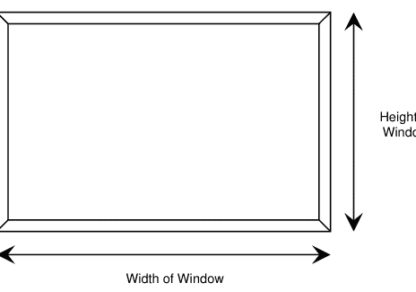

玻璃的面积是宽度乘以高度。为了制作框架，我们需要两块与窗户等宽的木板和两块与窗户高的木板。

## 程序员观点：元数据至关重要

关于信息的信息被称为元数据（metadata）。在这种情况下，“meta”一词意味着从程序中“退后一步”，以便在更广泛的语境下来考虑它。在我们的窗户程序中，元数据将告诉我们更多关于正在使用和产生的值的信息，特别是信息表达的单位以及信息可能具有的有效范围。对于你在编写的程序中所表示的任何数量，必须至少具有这一级别的元数据。

## 程序实际上在执行什么

程序可以根据以下方程定义两个值：

```
glass area = width of window * height of window
length = (width of window + height of window) * 2
```

## 详细说明

我们对程序将为我们做什么已经有了相当充分的了解。出于理性和公平的考虑，我们并没有止步于此，现在我们必须担心程序将如何判断输入的信息实际上是有效的。

这必须与客户结合进行，他或她必须理解，如果提供的信息符合指定的范围，你的程序将认为数据是有效的并据此操作。

在这种情况下，我们可以扩展输入数据的定义：

- 窗户的宽度，单位为米，值在 0.5 米到 3.5 米之间（包含边界）。
- 窗户的高度，单位为米，值在 0.5 到 2.5 米之间（包含边界）。

注意我们还在描述中添加了单位，这非常重要——也许我们的客户是从按英尺销售的供应商那里购买，在这种情况下我们的输出描述应该是：

- 窗户所需的玻璃面积，单位为平方米。记住我们卖的是双层玻璃，所以需要两块。
- 框架所需的木板长度，单位为英尺，使用每米 3.25 英尺的转换因子。

你和你客户都必须理解这份文档！

将所有内容整理成你们都能理解的格式后，我们必须签署完成的规范并开始工作。

## 证明它是有效的

在现实世界中，你现在会创建一个测试，让你能够证明程序可以工作，例如你可以说：

> “如果我给上述程序输入高度 2 米、宽度 1 米的数据，程序应该告诉我需要 4 平方米的玻璃和 19.5 英尺的木板。”

为正式项目设计的测试程序应该测试程序中所有可能的状态。在一个大型系统中，编写程序的人可能需要创建一个安装在程序周围的测试框架（test harness），以便对其进行测试。客户和供应商都应该对执行测试的方法和类型达成一致，并签署一份描述这些内容的文档。

测试是程序开发中非常重要的一部分。有一种开发技术是让你在编写执行任务的实际程序之前编写测试。这实际上是一个好主意，我们稍后会探讨。在代码生产方面，你可以预计为你的解决方案编写测试代码会比解决方案本身还要多。在计算某项工作涉及的工作量时，请记住这一点。

## 报酬

在这一点上，客户知道如果创建一个通过了所有测试的系统，客户将别无选择支付费用！注意，设计和测试程序已经冻结，没有歧义，不会导致客户要求修改工作，尽管这种情况仍然可能发生！

对开发人员来说的好消息是，如果要求更改，这些应被视为额外工作，他们可以获得相应的报酬。

## 客户参与

注意，在一个“正规”系统中，客户会期望就程序如何与系统交互征求他们的意见，有时甚至细到显示器上字母的颜色！记住，程序员能想的最危险的事情之一就是“这就是我们要！与我们的精确交互——程序在遇到错误时的处理方式、信息的呈现方式等——是客户保证有权发表意见的。”所有这些信息都应该放入屏幕布局中，并在每个阶段指定按键的细节。每个原型都将用于了解程序应该的外观和感觉。

如果你觉得这对你编写程序非常有帮助，那么你完全正确！你的客户可能期望你拿着问题描述进入后室——稍后完成问题的解决方案。这是行不通的，发生的情况是你得出一个 60% 正确的东西。客户仍然会看这个说“还可以”，以及需要修改什么。你回到房间，低声嘟咕，还有另一个系统等待审批。罗布法则（Rob's law）说 60% 的工作现在是剩下的 40%，所以你接受了最后部分的修改并再次交回键盘。

客户认为这很棒，联想起一个高档裁缝，在经过多次尝试后提供了完美的合身效果。客户看着某个东西，提出修改，然后等待下一次发现错误。当交付截止日期没有完工的产品时，他们会有点难过，但他们可以通过感谢你来让自己开心。

实际上，我们在这里又绕了一圈，因为我确实……

# 计算机与程序

## 编程语言

我们知道程序应该做什么（规范），以及我们如何判断它是否运行正常（测试），现在我们需要用计算机可以使用的格式来表达我们的程序

你可能会问：“我们为什么不使用编程语言，为什么我们不能用像英语之类的语言？”对于这个问题有两个答案：

- 1. 计算机太笨了，无法理解英语。
- 2. 英语是一种很糟糕的编程语言。


9


## 计算机程序

## C#

编程语言规避了这两个问题。它们足够简单，可以让计算机理解程序，并且减少了歧义。

## 程序员观点：语言并没有那么重要

世界上有许多编程语言；在你的职业生涯中，你将不得不学习不止一种语言。C# 是一个入门编程的绝佳语言，但不要认为它是你唯一学过的语言。

## 1.4 C#

世界上真的有数以百的编程语言：C（读作 C Sharp）。如果你犯了错误将这种语言称为 C，你将暴露出你的无知！C# 是一种非常灵活且强大的编程语言，拥有有趣的历史。它由微软公司开发，出于多种原因：技术、政治以及其他营销考虑。

C# 与 C++ 和 Java 编程语言非常相似，借用了（或改进了）这些语言提供的特性。Java 和 C++ 的起源可以追溯到一种名为 C 的语言，这是一种发明于 20 世纪 70 年代初的非常危险且具有吸引力的语言。C 语言因 Unix 操作系统的编写语言而闻名，而且它正是为此设计的。

### 1.4.1 危险的 C

我将 C 称为一种危险的语言。如果我说错了呢？考虑一下锯子。如果我，Rob Miles，想用链锯，因为我不是一个经验丰富的锯子使用者，我希望它有许多内置的安全功能，如防护罩和防锁装置，这可能会限制工具的使用，也就是说，因为所有这些安全措施，我可能无法砍倒某些种树。如果我是一个真正的木工，我会出去买一把专业的链锯，它完全没有安全功能，可以用来砍倒几乎任何东西。如果我在使用专业工具时出错，我可能会轻易丢掉腿；而业余机器则不会发生这种情况。

在编程术语中，这意味着 C 缺乏其他编程语言提供的某些特性。这使得这种语言灵活得多。

然而，如果我做了某些事情，C 不会阻止我；与更安全的语言相比，我使用 C 程序导致计算机崩溃的概率大得多。

## 程序员观点：计算机总是愚蠢的

我认为，你应该始终在这样的基础上工作：任何计算机都不会容忍你的任何错误，你所做的任何蠢事都会导致灾难！这让事情变得非常奇妙。

### 1.4.2 安全的 C#

C# 语言试图在这方面兼得两者的完美。一个 C 程序可以包含托管（managed）或非托管（unmanaged）部分。托管代码由运行系统处理。这确保了运行托管代码很难（但可能不可能）导致计算机崩溃。然而，这一切融合都是有代价的，会导致你的程序运行得较慢。

为了获得最大的性能，并允许直接访问底层计算机系统的部分，你可以将你的程序标记为非托管。非托管程序运行得更快，但如果它崩溃，它可能会把计算机一起带走。切换到非托管模式比比移除你新底盘上的防护罩，因为它们挡路。

C# 是一个开始学习的绝佳语言，因为托管部分会让你更容易理解当你的程序出错时发生了什么。

### 1.4.3 C# 与对象

C# 是面向对象的。对象是一种组织组织机制，可以将你的程序分解成合理的逻辑块，每个逻辑块负责整个系统的部分功能。面向对象的设计让大型项目的设计、测试和扩展变得容易得多。它还让你能够创建具有高度可靠性和稳定性的程序。

我在对象编程方面非常有经验，但我现在还不会告诉你。这并不是因为我不知道它（诚实地说），而是我认为在我们的程序中使用对象之前，需要解决一些基础的编程问题。

对象的使用既是设计也是编程，一旦我们知道了如何处理你的程序，我们就可以设计更复杂的系统。

### 1.4.4 让 C# 运行

你实际上是使用某种形式的编辑器编写程序——这个编辑器可能是编译和运行系统的一部分。

C# 是一种编译型编程语言。计算机无法直接理解这种语言，因此一个名为编译器的程序会将 C# 文本转换为许多简单的低级指令。低级指令被转换为运行你程序的硬件的实际命令。

我们将更详细地查看 C# 程序工作的这一方面。（注：此处检测到 OCR 重复并已清理）。

### 1.4.5 创建 C# 程序

你实际上是使用某种形式的编辑器编写程序——这个编辑器可能是编译和运行系统的一部分。


# 计算机与程序

## 描述解决方案

描述你对问题的解决方案的实际指令也必须程序的一部分。在 C# 程序中，执行某项操作的单一简单指令被称为*语句*（statement）。语句是执行某个特定操作的指令，例如将两个数字相加并存储结果。

编程中真正棘手的地方在于那些在下一次执行时会发生变化的语句，这样你的程序就可以观察情况并决定执行什么。在 C# 中，你可以将语句组合在一起形成一个程序逻辑块，这被称为*方法*（method）。

方法可以很小，也可以很大。它可以返回一个你可能感兴趣也可能不感兴趣的值。你可以用你喜欢的名称为它命名，你的程序可以包含你需要的任何数量的方法。方法可以引用其他方法。C# 语言提供了大量可供使用的库。这些库可以让你避免每次编写程序时都“重复造轮子”。我们将在后文中详细介绍方法。

经验丰富的程序员会将复杂任务拆解为许多较小的部分，并为每个部分创建一个方法。

## 标识符与关键字

你为你创建的每个项命名一个名称，并尝试让函数名称反映它的功能，例如*ShowSaveToFile*。C# 语言实际上通过寻找具有特殊名称 *Main* 的方法来运行你的程序。这在程序开始运行时被调用，当 *Main* 完成时，你的程序结束。你用于标识的这些名称是值；当我们想要存储所用单词的长度时，`wordLength` 可能是一个很好的选择。稍后我们将介绍在创建标识符时必须遵守的规则和约定。

C# 语言本身的单词被称为关键字。在食谱中，关键字就像“混合”（mix）或“烘烤”（bake）。你会说像“加热糖直到融化”或“搅拌直到光滑”这样的话。事实上，你会发现程序看起来非常像食谱：在本文的一些代码列表中，关键字将显示为蓝色。

## 对象

我们创建的某些内容是我们使用的框架的一部分的对象。继续我们的烹饪类比，这些就像搅拌碗和烤箱，而对象的名称在本文的一些代码列表中将显示为深浅不同的蓝色。

## 计算机程序中的文本

你的程序中有两种文本。一种是你希望计算机执行的指令，另一种是你希望程序在用户面前显示的消息。你妈妈可能会在她的蛋糕食谱中添加以下指令：

> 现在用糖霜在蛋糕顶部写上“快乐圣诞”字样。

她使用双引号来标记要画在蛋糕上的文本，而“快乐圣诞”并不是指令的一部分；C# 的工作方式完全相同。这是需要被写出的内容。这类消息在本文中被标记为红色。

## 颜色与约定

我在本文使用的颜色旨在与使用专业程序编辑器（如 Visual Studio 附带的）编辑程序时看到的颜色保持一致。颜色仅仅是为了让程序更易理解，并没有任何特殊含义。它们是在你编写程序时由编辑器自动完成的。


13

## 2 简单数据处理

在本章中，我们将创建一个真正实用的程序（特别是如果你从事双层窗窗行业）。我们将从创建一个非常简单的解决方案开始，并研究执行基本数据处理的 C# 语句。然后我们将使用 C# 语言的额外功能来提高我们所产解决方案的质量。

## 2 第一个 C# 程序

我们将看到的第一个程序将读取窗口的宽度和高度，然后打印出制作该尺寸孔洞窗口所需的木材和玻璃数量。这就是我们在 2.2 节中所描述的要解决的问题。

### 2.1.1 程序示例

也许学习 C# 的最佳方法是直接进入我们的第一个 C# 程序。如下：

```csharp
using System;
class GlazerCalc
{
    static void Main()
    {
        double width
```

（注：由于原始文本包含大量 OCR 识别产生的重复内容，已根据提供的唯一内容进行了去重处理。）


## 简单数据处理

## 第一个 C# 程序

;

分号标记了变量名列表的结束，也是声明语句的结束。C# 程序中的所有语句都用 `;` 字符分隔，这有助于编译器保持在正确的轨道上。

`;` 实际上非常重要。它告诉编译器给定语句在何结束。如果编译器在预期看到它的地方没有找到这些之一，就会产生错误。你可以将这些字符比作胶片中的胶片孔，它们让一切都保持同步。

### string widthString, heightString;

我们有一些可以存储数字的变量。其中一些包含字符串。这是因为当我们从用户那里读取数字时，首先是将其作为文本字符串读取的。然后我们将文本转换为数字。变量 `widthString` 和 `heightString`（注意这些是很合理的命名）将包含数字的文本版本。

### widthString =

这是一个赋值语句。在这个 C# 语句中，我们将更改变量的值。我们的程序将从用户处读取一行文本，并将结果放在我们称为 `widthString` 的变量中。记住，变量仅仅是一个具有特定尺寸的命名盒子，它可以存储单个数据项（在本例中为文本）。

你的程序中很大一部分将是在计算各种结果时为变量分配新值的指令。C 使用 `=` 字符来执行赋值。该语句的第一部分是之前定义的变量名。后面跟着 `=` 字符，我称其为 "gottina"（应该进入）。我之所以这么叫是因为右侧的值应该 "gottina"（进入）左侧的变量。抱歉。

### Console.

在右侧我们有这个，它将被赋值给 `widthString`。在这种情况下，结果将是方法 `ReadLine` 返回的字符串。该方法是名为 `Console` 的对象的一部分，该对象负责用户输入和输出。点（`.`）将对象标识符与方法标识符分隔开。

### ReadLine

这表示要调用 `ReadLine` 方法。这要求读取程序快速返回它拥有的任何语句。方法是你将程序拆分成若干块的方法，每个块都有特定的特定的任务。它们还意味着你只需要编写一段特定的代码，将其放入一个方法中，然后每当你需要完成该特定任务时调用它即可。C# 系统使用许多内置方法为我们的程序执行任务。`ReadLine` 就是其中之一。

当此程序运行时，`ReadLine` 方法被调用（或执行）。它将等待用户输入一行文本并按 Enter 键。在其中输入的任何内容都将作为字符串由 `ReadLine` 方法返回。方法调的结果放在 `widthString` 变量中。

## 简单数据处理

## 第一个 C 程序

### ()

方法调用，后跟方法的方法的参数。参数是传递到方法中供其进行处理的东西。将其想象为某种原材料即可。在 `ReadLine` 的情况下，它没有原材料；它将从输入内容的用户那里获取信息。然而，即使列表是空的，我们仍然必须提供参数列表。

### ;

我们之前见过这个分号。它标记了我们程序中一条语句的结束。

### width =

这是另一个赋值（Phelps 先生/Hawke）。变量 `width` 正在被赋予一个值。你程序中的许多语句将仅仅是对其进行移动和执行操作。

### double.

剩下的部分看起来有点复杂。实际上，它并不复杂。我们正在要求 `double` 先生（负责持有双精度浮点数的实体）为我们执行一项任务。在这种情况下，任务是“将 `widthString` 持有的字符串转换为双精度浮点数”。`double` 通过暴露一个名为 `Parse` 的方法提供了这种能力。

对于 C 暴露其方法的某些事情并没有错。这是我们为自己完成任务的方式。当你设计大型程序时，你会发现此此最佳的方法是创建暴露的方法来完成工作。整个 C 库是以系列方法的形式提供的，你必须掌握的内容之一就是这些方法以及如何使用它们。正如生活中的许多事情一样，技巧在于知道谁……

### Parse

`Parse` 方法的任务是将它接收到的字符串转换为双精度浮点数。为了做到这一点，它必须扫描字符串，逐个提取出每个数字并计算实际值，例如 "12" 意味着十和二。这种查看内容的过程通常被称为“解析”（parsing）。这就是我们正在使用的方法名称的由来。该方法接收要被解析的字符串，并返回它找到的数字。

注意，这留下了巨大的“作恶”潜力，如果用户没有输入值或输入了诸如 "Twenty Five”（二十五），`Parse` 方法将无法解析它并导致失败。它是如何失败的，以及你如何解决这种失败，将留给后续章节讨论，以便为本文增加更多趣味性。

### (widthString);

我们已经看到方法的调用必须后跟方法的原材料（参数）。在 `ReadLine` 的情况下，没有参数，但我们需要提供一个空列表来包含这一点。在 `Parse` 的情况下，方法需要提供它要处理的字符串。通过将包含文本的字符串变量名（`widthString`）放入上面的括号中。`widthString` 中的信息值（即用户输入的文本）被传递给 `Parse` 方法，供其进行处理并从中提取数字。

> 晦涩的电影/电视

## 简单数据处理

## 第一个 C# 程序

```csharp
heightString = Console.ReadLine();
height = double.Parse(heightString);
```

### woodLength = 2*(width + height)*3.25;

### glassArea = 2 * ( width * height ) ;

### Console.WriteLine

( "木木的长度是 " + woodLength );


## 简单数据处理

# 我的第一个 C# 程序

你必须习惯程序中的“上下文”（context）这一概念。我们在命名空间中见过这一点。现在在操作符上也是如此。C# 系统使用操作的上下文来决定执行什么。在之前的 `+` 示例中，在两个双精度浮点数之间，它意味着“相加”。而在这里，左侧是一个字符串。这意味着它将执行字符串拼接，而不是数学相加。

# wordLength

这是上下文作用的另一个例子。之前，我们把 `wordLength` 用作数值的数值表示，在程序程序中，它是我们要求的单词长度。然而，在它所被使用的上下文中（添加到字符串的末尾），它不能以那种方式工作。

因此，C# 编译器必须要求 `wordLength` 数据项将自己转换为字符串，以便它在该位置能被正确使用。幸运的是，它可以做到，所以程序的运行结果正如你预期的那样。

准确地理解这里正在发生什么非常重要。考虑一下：

```c
Console.WriteLine(2.0 + 3.0);
```

这将执行一个计算 (2.0 + 3.0) 并产生一个双精度浮点值。然后，该结果会被要求提供它的字符串版本以便打印，输出为：

5

但此行代码：

```csharp
Console.WriteLine("2.0" + 3.0);
```

会将 `+` 视为正在拼接两个字符串。它会要求值 3 将自己转换为字符串（听起来很奇怪——但事实确实如此）。它将产生：

2.03

字符串 "2.0" 在末尾添加了值 3.0 的文本。这种行为上的差异完全是因为所执行操作的上下文不同。

> ""

这里又是另一个拼接。我们正在单词 `feet` 的末尾添加单词的末尾。每当我打印一个值时，我总是把单位放在末尾。这使得更容易确保

)

括号标记了为 `WriteLine` 方法调用正在构建的参数的结束。当该方法被调用时，程序首先从所有组件组装成一个完整的字符串，添加（或拼接）以产生单个结果。然后，它将生成的字符串值传递给方法，该方法将其打印在屏幕上。

## 简单数据处理

# 我的第一个 C 程序

;

分号标记此语句的结束。

}

现在是真正重要的内容了。程序基本上已经完成了。我们添加了所有需要的行为。然而，编译器仍然需要被告知我们已经到达程序的末尾。第一个大括号标记了代码块的结束，该代码块是 `Main` 方法的体。一个代码块以 `{` 开始并以 `}` 结束。当编译器看到这个时，它会说“那是 `Main` 方法的结束”。

}

第二个大括号承担着同样重要的任务。它标记了 `GlazerCalc` 类的结束。在 C# 中，一切都存在于类之中。类是许多事物的容器，包括方法。如果我们想（而且我们稍后会这样做），我们可以把许多方法放入一个类中。而现在，我们只想在类中有一个方法。因此，我们使用第二个大括号来标记类本身的结束。

# 标点符号

这标记了我们程序的结束。你可能已经注意到的点之一是其中有大量的标点符号。这至关重要，并且必须按照 C# 的要求精确提供，否则你将得到编译错误。这表明编译器太笨了，无法理解你提供给它的内容！

你会很快习惯寻找并纠拼写错误。你会发现的问题之一是，编译器并不总会在错误发生的地方检测错误；考虑缺少一个 `"` 字符的影响。然而请注意，如果编译器认为你的程序没问题，并不能保证结果就是你想要的。

另一个需要记住的点是，程序的布局并不遵循编译器的逻辑，它的逻辑如下：

```csharp
using System;
class GlazerCalc{
    static void Main(){
        double height,Length,glassArea;
        string widthString,heightString;
        widthString = Console.ReadLine();
        double width=double.Parse(widthString);
        heightString = Console.ReadLine();
        height=double.Parse(heightString);
        widthLength=2 * ( width + height );
        glassArea=width * height);
        Console.WriteLine("The length of the wall is " + width + " meters");
        Console.WriteLine("The area of the glass is " + glassArea + " square meters ");
    }
}
```

- 如果有人写出像这样布局的程序，我会敲他的手盖的！

# 程序员观点：程序布局非常重要

你可能已经注意到了编写程序时我使用的吸引布局。项目经过了缩进，因此它们的所属关系非常清晰。我这样做不仅是因为我觉得这样的列表在艺术上很美，而且如果我只是无法阅读程序并理解它的功能，我也会这样做。就像找到一段没有恰当间距的文本一样，如果程序没有经过布局，是很难阅读的。


21

## 简单数据处理

# 处理数据

## 2.2 处理数据

在这一节中，我们将观察程序如何处理数据，值如何被存储、检索和通常的修改。这为我们提供了执行程序数据处理的能力。

## 2.2.1 变量与数据

在处理数据时，我们决定要持有宽度和高度。在我们继续深入之前，需要考虑这些数据的含义，以及我们在编程中可以存储的数据类型。

变量是你可以存储东西的命名位置。你通过声明来告诉关于你想创建一个变量。我们在上面的程序中使用了 `wordLength` 这样的名称（变量）。

## 2.2.2 存储数字

在考虑数值时，有两种类型的数据：

- 漂亮的整块数值，例如农地里的羊、齿轮上的技术、篮子里的苹果。这些被称为整数。
- 糟糕的现实世界类型，例如当前的温度、一段字符串的长度、汽车的速度。这些被称为实数。

在第一种情况下，我们可以精确地持有值；你总是有一个项目的数量，它们是积分的。

在第二种情况下，我们无法精确地持有值；我们是在观察精确性。即使你使用带有 100 位小数的字符串进行测量，它仍然无法给你长度——你只是得到了更精确的值。这些是实数。计算机运行在位表达式上，位可以被视为数字。我们知道它在二进制位上工作，它在持有实数时存在问题。为了处理实数，计算机实际上将它们存储为有限的数量，我们希望这足够了（通常也是足够的）。


# 存储整数值

整数是计算机存储最容易的数值类型。每个值都会映射到一个特定的位模式。唯一的问题是范围。你需要表示的数字越大，所需要的位数就越多。

C# 提供了多种整数类型，取决于你想要存储的数值范围：

| 类型 | 位数 | 范围 |
| --- | --- | --- |
| sbyte | 8 位 | -128 到 127 |
| byte | 8 位 | 0 到 255 |
| short | 16 位 | -32,768 到 32,767 |
| ushort | 16 位 | 0 到 65,535 |
| int | 32 位 | -2,147,483,648 到 2,147,483,647 |
| uint | 32 位 | 0 到 4,294,967,295 |
| long | 64 位 | -9,223,372,036,854,775,808 到 9,223,372,036,854,775,807 |
| ulong | 64 位 | 0 到 18,446,744,073,709,551,615 |

标准整数类型 `int` 可以容纳惊人的数字：-2,147,483,648 到 2,147,483,647。如果你想存储比这更大的整数（尽管你可能不知道为什么要这么做），还有一个 `long` 版本。

整数变量的一个示例可能是你跟踪的某块地上羊的数量：

```
int numberOfSheep = 0;
```

这创建了一个变量，并将值设为 0。使用 `int`（它可以包含负值）可以让你操作“负数只羊”，这可能没有必要（除非你放牧时弄丢了某只羊并让别人借）。请记住，语言本身并不知道这些考量。如果你想确保我们有超过 1000 只羊，且羊的数量永远不会为负数，你必须自己调整。

当你使用 Visual Studio（或支持语法高亮的其他代码编辑器）编辑程序源码时，你会发现 C# 语言内置的类型名称（如 `int` 和 `float`）会显示为蓝色，如上所示。

# 程序员观点：检查你的数学债

你应该记住的另外一点是，程序并不总是能检测到你何时超过了变量的范围。如果我将值 255 放入 `byte` 类型的变量中，这是可以的，因为 255 是该类型容纳的最大值。然而，如果我在该变量的值上加 1，系统可能不会将其视为错误。事实上，这可能会导致值“回绕”到 0。这会导致你的程序出现 Bug。

# 整数字面量值

整数字面量表示为没有小数点的数字序列：

23

这是整数值 23。我可以在程序中如下所示使用它：

```
numberOfSheep = 23;
```

如果我使用其中一种“较短”的类型，字面量值会被编译器视为该类型：

```
sbyte tinyVal = 127;
```

## 简单数据处理

## 操作数据

在这一语句中，127 被视为 `sbyte` 字面量，而不是整数。这意味着我做了一件蠢事：

```
sbyte tinyVal = 128;
```

（`sbyte` 能容纳的最大值是 127）编译器将检测到我犯了错误，程序将无法编译。

# 存储实数

实数（Real）是非整数数字的通用术语。它们有小数点和小数部分。根据数值的大小，小数点在数字周围浮动，因此名为 `float`。

C 提供了一种可以容纳实数的类型。标准的 `float` 值的范围是 1.5E-45 到 3.4E48，精度为 7 位（它不像大多数计算器那么好）。

如果你需要更高的精度（尽管当然，你的程序将占用更多内存且运行得更慢），你可以使用 `double` 代替 `float` 来获得双精度。这占据了计算机内存，但它的范围是 5.0E-324 到 1.7E308，精度为 15 位。

`float` 的示例可能是帮助计算冰淇淋以英寸为单位的平均价格：

```
float averageIceCreamPence;
```

`double` 的示例可以显示宇宙以英寸为单位的宽度：

```
double uniWidthInches;
```

最后，如果你想要极致精度但范围稍小，你可以使用 `decimal` 精度。

# 实数字面量值

实数字面量表示为带有小数点的数字序列：

23.5

这是实数值 23.5。我可以在程序中如下使用它：

```
double price = 23.5;
```

如果我使用科学计数法，字面量值会被编译器视为该类型：

```
float distance = 1.23E4;
```


## 2.2.4 使用 bool 存储状态

`bool`（boolean 的缩写）变量是一种类型的盒子，可以存储某物是否为真。有时候这正是你需要的全部。如果你在存储是否已经支付了订阅，就没有必要使用一种可以存储大量可能值的类型来浪费空间。相反，你需要持有 true（真）或 false（假）状态。这是 `bool` 允许的两个值。

`bool` 变量的一个例子可以是存储网络连接状态的：

```c
bool networkOK;
```

### bool 字面量

这些可以很容易地表示为 `true` 或 `false`：

```
networkOK = true;
```

### 程序员观点：思考变量的类型

为变量选择正确的类型是一门技能。我倾向于只将浮点数存储作为最后的手段。因为那时你会遇到我不喜欢的精度的缺失问题。只要花一点巧思，我就可以很舒服地处理整数。例如，我不会将物品的价格存储为 1.5 英镑（`float` 的重量！），而是将价格存储为 150。

此外，在考虑如何存储数据时，记住数据的来源很重要。在上面的例子中，我使用了 `double` 类型来存储窗口的高度和宽度。这真的很愚蠢。它没有考虑到所需的准确性或如何测量窗口。我怀疑玻璃销售员能够测量出大于 1 mm 的精度，因此将数据存储到该精度才有意义。

这说明了另一个元数据方面的考虑量，当你面临存储浮点信息的可能时：在你决定存储它之前，先弄清楚它是产生的。例如，你可能认为被要求处理汽车速度时你必须存储一个浮点值。然而，当你发现速度传感器提供的答案精度仅为每小时 1 英里时，这让工作变得简单得是。

## 2.2.5 标识符

在 C 中，标识符是程序员为程序中的某个东西选择的名字。变量的名字更准确地被称为标识符。我们将在其他地方看到创建标识符。C 有一些关于什么构成有效标识符的规则：

- 所有标识符名称必须以字母开头。
- 在字母之后你可以有字母、数字或下划线字符。

大写和小写字母是不同的，即 `Fred` 和 `fred` 是不同的标识符。这里有几个示例声明，其中一个是非有效的（如果你能猜到是哪个）：

```c
int fred;
float jim;
char 29ysitsme;
```

编程的一般规则之一——“始终使用键盘最顶部的按键”是：

始终给你的变量起有意义的名字。

根据我读过的米尔斯和波恩浪漫小说，最好的关系是有意义的关系。

## 简单数据处理

## 操作数据

在 C# 中，我们目前正在创建的这种变量的习惯是混合使用大小写字母，使得标识符中的每个单词都大大字母开头：

```csharp
float averageIceCreamPriceInPence;
```

这有时被称为驼峰命名法（camel case），可能是因为标识符中大写字母引起的“驼峰”。

### 程序员观点：思考变量的名字

选择变量是你也应该努力的另一个技能。它们应该足够长以表达含义，但又不至于让你的程序行变得杂乱。也许 `IceCreamPriceInPence` 这个名字在在这方面有点过头。但我可以接受它。记住，你总是可以通过布局来感知事物，让程序看起来还可以：

```csharp
averageIceCreamPriceInPence =
computedTotalPriceInPence = numberOfIceCreams;
```

## 2.2.6 给变量赋值

一旦我们有了变量，我们需要知道如何向其放入内容并将其值取出。C 通过赋值语句来实现这一点。赋值包含两个部分：你想要赋值的东西和你想把它放在的地方，例如以下：

```csharp
class Assignment
{
    static void Main ()
    {
        int first, second, third;
        first = 1;
        second = 2;
        third = second + first;
    }
}
```

> 代码示例 02 赋值示例

程序的第一个部分现在应该已经熟悉了。在 `Main` 函数内部，我们声明了三个变量：`first`、`second` 和 `third`。它们都是整数类型。
最后三个语句是实际执行工作的语句。每个赋值都给指定的变量一个值，该变量必须是合理的类型（注意你必须在这方面保持理智，因为正如你所知，编译器并不知道你在做什么）。被赋值的值是一个表达式。中间的等号主要是为了困惑我们，它在数值意义上并不等于；要把它想象成上面的 `gozinta`。`gozinta` 获取赋值右侧的结果并将其丢入左侧的盒子中，这意味着：

```c
2 = second + 1;
```

- 是一段编程错误，这会导致所有糟糕的错误出现。

## 表达式

表达式是一个可以求值并产生结果的东西。我们可以像在程序中使用那样的结果。表达式可以简单到单个值，也可以复杂到大型计算。它们由两部分组成：操作符和操作数。

### 操作数

操作数是操作符作用的对象。它们通常是字面量或变量的标识符。在上面的程序中，`first`、`second`、`third` 是标识符，而 `2` 是字面量。

### 操作符

操作符是工作的东西：它们指定了对操作数执行的操作。大多数操作符作用于两个操作数。在程序上方 `+` 是唯一的操作符。

这里是几个例子：

```c
2 + 3 * 4
-1 + 3
(2 + 3) * 4
```

这些表达式是由 C# 从左到右求值的，正如你预期的的一样。再次，在传统数学中，所有的乘法和除法首先执行，然后是加法减法。

C# 通过赋予每个操作符优先级来实现这一点。当 C# 求值表达式时，它寻找所有优先级最高的操作符并执行它们。它寻找下一个直到获得最终结果。注意，这意味着上面的表达式返回 14 而不是 20。

如果你想控制执行执行的顺序，可以对执行的东西加上括号，如最后的示例所示。如果你需要可以加括号，只要确保左括号和右括号数量相等。为了简单，我倾向于给一切都加上括号以让事情非常清晰。

关于这种评估（也许人们这样称它）可能值得深入了解；通常事情倾向于按你预期的方式处理。

为了完整起见，这里有一个所有操作符列表、它们的作用以及优先级。我正在列出优先级最高的操作符。

+ 一元减法，C# 在负数中找到减号，例如 `-1`。仅作用于一个项目。
* 乘法，使用 `*` 而不是数学上正确但混淆的 `x`。
/ 除法，因为在屏幕上将一个数字除以另一个数字很困难，我们使用这个字符代替。加法。 * 减法。我们使用的字符与一元减法完全相同。

这不是所有可用操作符的完整列表，但目前足够了。因为这些操作符作用于数字，它们通常被称为数值操作符。当然，你应该记住其中一些（例如 `+`）也可以用于其他类型的数据。也可以通过使用操作的方式导致值从一种类型移动到另一种类型。这可能会导致问题，正如我们现在看到的。

## 2.2.7 更改数据类型

每当我将值从一种类型移动到另一种类型时，C# 编译器就会对我正在做什么感兴趣。它担心我正在的操作


## 简单数据处理

## 数据操作

`perform` 将导致程序中的数据丢失。它从值的“拓宽和收窄”的角度来考虑每种操作。

## 拓宽与收窄

C# 使用的通用原则是，如果你对一个值进行“收窄”，它会要求你显式地告诉它你想做什么。如果你在进行拓宽，则没有问题。

然而，如果我将其改为更大的类型，则没有问题。更大的类型将包含较小类型中的所有内容，并留有更多空间。

在 C# 术语中，类型的“大小”指的是范围（最大值最小值）以及精度（小数位数）。这意味着如果我写下：

```c
int i = 1;
float x = i;
```

这是行得通的，因为浮点类型可以存储整数类型支持的所有值。但是：

```c
float x = 1;
int i = x;
```

- 会导致编译器报错（尽管此时变量 `x` 保存的是一个整数）。编译器担心你可能通过这种赋值丢弃信息，并将其视为错误。

请注意，这也适用于浮点值之间，例如：

```c
double d = 1.5;
float f = d;
```

- 也会导致错误，因为编译器知道 `double` 比 `float` 宽。

## 强制转换

我们可以通过使用强制转换（Casting）强制 C# 将一个值视为特定类型。强制转换的形式是给编译器的一条额外指令，使其以特定的方式看待一个值。你通过在值之前的括号中放入你想看到的类型来转换一个值。例如：

```c
double d = 1.5;
float f = (float) d;
```

在上面的代码中，给编译器的信息是：“我不在乎这个赋值可能会导致信息丢失。我，程序的编写者，将承担确保程序运行正确的责任。”你可以将强制转换视为编译器推卸责任的方式。如果程序因为数据丢失而失败，那不是因为编译器做了什么愚蠢的事。

正如我们在上面看到的，每种类型的变量都有可能的取值范围，而浮点数的范围远大于整数。这意味着如果你执行了这样的操作：

```c
int i = 1;
i = (int) 123456781234567890.9999;
```

- 强制转换并没有导致值失败。存放在 `i` 中的值将是无效的。在 C# 中没有对这类错误的检查。这取决于你如何编写程序以确保你永远不会超过所使用数据类型的范围——程序不会察觉，但用户会！

我不认为这是 C# 的失败。它赋予了你极大的灵活性，代价是必须清楚自己在做什么....

C# 编程 © Rob Miles 2016

30

## 简单数据处理

## 数据操作

转换（强制）还可能通过其他方式丢失信息：

```c
int i;
i = (int) 1.999;
```

上面的代码获取了 `1.999`（会被编译为 `double` 类型的值）并将其强制转换为 `int`。这个过程丢弃了小数部分，这意味着该值最终将变为 `1`，尽管原始数字更接近 `2`。你应该记住，每当你将带有小数部分的值（`float`, `double`, `decimal`）转换为不带小数部分的值时，就会发生截断。

## 强制转换与字面量值

我们已经看到你可以在程序中使用“字面量”（literal）值。这些只是你想在计算中使用的值。例如，在我们双层玻璃程序中，我们必须将以米为单位的长度乘以 3.25，将值从米转换为英尺（3.2 英尺等于 1 米）。

C# 对它正在合并的内容非常小心，这包括它允许如何使用字面量。这是通过语句实现的：

```c
int i;
i = 3.4 / "stupid";
```

- 将受到它们应得的轻蔑（对待）。C# 编译器知道它不应该将值 `3.4` 除以字符串 `"stupid"`。然而，考虑这个：

```c
float x;
x = (float) 3.4;
```

这段代码看起来完全合法。但实际上并不是。因为字面量 `3.4` 在表示为常量时是一个双精度值，而变量 `x` 被声明为浮点型。如果你想将一个浮点字面量值放入浮点变量 `x` 中，可以使用：

```c
float x;
x = (float) 3.4;
```

这把双精度字面量转换为浮点型，使得赋值生效。

为了方便，C# 的创建者添加了另一种在程序中表示浮点字面量值的方法。如果你在值后面加上一个 `f`，它被视为浮点值。这意味着：

```c
float x;
x = 3.4f;
```

- 可以正确编译。

## 2.2.8 表达式中的数据类型

当 C# 使用运算符时，它会对产生的结果的类型做出决定。本质上，如果操作数是整数，它就说结果应该是整数。如果两个都是浮点数，它就说结果应该是浮点。这可能会导致问题，考虑以下：

```
1/2
1/2.0
```

你可能认为这会得到相同的结果。但 C# 编译器认为第一个只涉及整数的表达式应该给出一个整数结果。它会计算为 `0`（小数部分总是被截断）。第二个表达式因为涉及浮点值，将进行评估并给出一个双精度浮点结果，即更准确的答案 `0.5`。

## 简单数据处理

## 数据操作

运算符的方式取决于它的用途。稍后我们将看到，`+` 通常执行数值计算，但可以用于字符串之间将它们连接在一起。如果你想对特定类型的运算符进行完全控制，你的程序必须包含显式的强制转换，为运算符设置正确的上下文。

```csharp
using System;
class CastDemo {
    static void Main() {
        int i = 3, j = 2;
        float fraction;
        fraction = (float)i / (float)j;
        Console.WriteLine("fraction : " + fraction);
    }
}
```

## 强制转换演示

上面的 `(float)` 转换告诉编译器将整数变量中的值视为浮点数，这样我们就能打印出 `1.5`。

## 程序员的观点：强制转换可以增加清晰度

我倾向于即使在不需要时也加上转换，这可以使程序更清晰。它可能不会影响计算结果，但会告诉读者我正试图做什么。

## 2.2.9 程序与模式

此时，我们可以重新审视我们的程序并查看它的工作方式。实际执行工作的代码归结为数据中的几行，我们将其存储在适当的位置，然后使用存储的值来计算用户所需的结果：

```c
string widthString = Console.ReadLine();
double width = double.Parse(widthString);

string heightString = Console.ReadLine();
double height = double.Parse(heightString);

double woodLength = 2 * (width + height) * 3.25;
double glassArea = 2 * (width * height);

Console.WriteLine("The length of the wood is " + woodLength + " feet");
```

此事的有趣之处在于，这是一种可以反复使用的行为模式。例如，考虑你的另一个朋友，他开了一家店。他想要一个能输出结果的程序。在上面的代码中给编译器的信息是：“我不在乎这个赋值可能会导致信息丢失。我，程序的编写者，将承担确保程序运行正确的责任。”你可以将强制转换视为编译器推卸责任的方式。如果程序因为数据丢失而失败，那不是因为编译器做了什么愚蠢的事。

正如我们在上面看到的，每种类型的变量都有可能的取值范围，而浮点数的范围远大于整数。这意味着如果你执行了这样的操作：取决于你如何编写程序以确保你永远不会超过所使用数据类型的范围——程序不会察觉，但用户会！

我不认为这是 C# 的失败。它赋予了你极大的灵活性，代价是必须清楚自己在做什么....

## 简单数据处理

## 数据操作

转换还可能通过其他方式丢失信息：

```c
int i;
i = (int) 1.999;
```

上面的代码获取了 `1.999`（会被编译为 `double` 类型的值）并将其强制转换为 `int`。这个过程丢弃了小数部分，这意味着该值最终将变为 `1`，尽管原始数字更接近 `2`。你应该记住，每当你将一个带有小数部分的值（`float`, `double`, `decimal`）转换为不带小数部分的值时，就会发生截断。

## 强制转换与字面量值

我们已经看到你可以在程序中使用“字面量”值。这些只是你想在计算中使用的值。例如，在我们双层玻璃程序中，我们必须将以米为单位的长度乘以 3.25，将值从米转换为英尺（3.2 英尺等于 1 米）。

C# 对它正在合并的内容非常小心，这包括它允许如何使用字面量。这是通过语句实现的：

```c
int i;
i = 3.4 / "stupid";
```

- 将受到它们应得的轻蔑。C# 编译器知道它不应该将值 `3.4` 除以字符串 `"stupid"`。然而，考虑这个：

```c
float x;
x = (float) 3.4;
```

这段代码看起来完全合法。但实际上并不是。因为字面量 `3.4` 在表示为常量时是一个双精度值，而变量 `x` 被声明为浮点型。如果你想将一个浮点字面量值放入浮点变量 `x` 中，可以使用：

```c
float x;
x = (float) 3.4;
```

这把双精度字面量转换为浮点型，使得赋值生效。

为了方便，C# 的创建者添加了另一种在程序中表示浮点字面量值的方法。如果你在值后面加上一个 `f`，它被视为浮点值。这意味着：

```c
float x;
x = 3.4f;
```

- 可以正确编译。

## 2.2.8 表达式中的数据类型

当 C# 使用运算符时，它会对产生的结果的类型做出决定。本质上，如果操作数是整数，它就说结果应该是整数。如果两个都是浮点数，它就说结果应该是浮点。这可能会导致问题，考虑以下：

```
1/2
1/2.0
```

你可能认为这会得到相同的结果。但 C# 编译器认为第一个只涉及整数的表达式应该给出一个整数结果。它会计算为 `0`（小数部分总是被截断）。第二个表达式因为涉及浮点值，将进行评估并给出一个双精度浮点结果，即更准确的答案 `0.5`。

## 简单数据处理

## 数据操作

运算符的方式取决于它的用途。稍后我们将看到，`+` 通常执行数值计算，但可以用于字符串之间将它们连接在一起。如果你想对特定类型的运算符进行完全控制，你的程序必须包含显式的强制转换，为运算符设置正确的上下文。

```csharp
using System;
class CastDemo {
    static void Main() {
        int i = 3, j = 2;
        float fraction;
        fraction = (float)i / (float)j;
        Console.WriteLine("fraction : " + fraction);
    }
}
```

## 强制转换演示

上面的 `(float)` 转换告诉编译器将整数变量中的值视为浮点数，这样我们就能打印出 `1.5`。

## 程序员的观点：强制转换可以增加清晰度

我倾向于即使在不需要时也加上转换，这可以使程序更清晰。它可能不会影响计算结果，但会告诉读者我正试图做什么。

## 2.2.9 程序与模式

此时，我们可以重新审视我们的程序并查看它的工作方式。实际执行工作的代码归结为数据中的几行，我们将其存储在适当的位置，然后使用存储的值来计算用户所需的结果：

```c
string widthString = Console.ReadLine();
double width = double.Parse(widthString);

string heightString = Console.ReadLine();
double height = double.Parse(heightString);

double woodLength = 2 * (width + height) * 3.25;
double glassArea = 2 * (width * height);

Console.WriteLine("The length of the wood is " + woodLength + " feet");
```

此事的有趣之处在于，这是一种可以反复使用的行为模式。例如，考虑你的另一个朋友，他开了一家店。他想要一个能输出结果的程序。在上面的代码中给编译器的信息是：“我不在乎这个赋值可能会导致信息丢失。我，程序的编写者，将承担确保程序运行正确的责任。”你可以将强制转换视为编译器推卸责任的方式。如果程序因为数据丢失而失败，那不是因为编译器做了什么愚蠢的事。

## 简单数据处理

## 编写程序

一种解决此问题的方法是在执行除法之前对数据增加 99，这使得大于 0 的数据有效。程序的活跃部分如下：

```c
int bottleCount = (tableCount + 99) / divisor;
total = bottleCount * pricePerBottle;
```

我们可以这样写出剩余的代码：

```csharp
priceBottleString = Console.ReadLine();
int pricePerBottle = int.Parse(priceBottleString);

string tableCount = Console.ReadLine();
int tableCount = int.Parse(tableCount);
```

记住，每当你对整数进行除法时，结果总是向下取整。

```csharp
int bottleCount = (tableCount + 99) / divisor;
total = bottleCount * pricePerBottle;
```

这种有趣的点在于，这是一种可以反复使用的行为模式。例如，考虑你的另一个朋友，他开了一家店。他想要一个能输出结果的程序。在上面的代码中给编译器的信息是：“我不在乎这个赋值可能会导致信息丢失。我，程序的编写者，将承担确保程序运行正确的责任。”你可以将强制转换视为编译器推卸责任的方式。如果程序因为数据丢失而失败，那不是因为编译器做了什么愚蠢的事。

## 2.3.1 软件作为故事

有人说写程序有点像写故事一样。我深信这是正确的。我发现一些计算机手册是小说，但程序是其他东西。我认为虽然它不是故事本身，但良好的程序文本具有优秀文学的一些特征：

- 它应该应该是易于阅读的。在任何一点读者都不应该感到被迫回溯或查阅作者假设为 true的知识。文本中的所有名称都应该是暗示且相互区分的。

- 它应该有良好的标点符号和语法。各个组件应该以清晰且一致的方式组织。

- 它在页面上看起来应该很好。良好的程序布局良好。不同的块应该缩进，语句在页面上以良好的方式铺开。


## 简单数据处理

## 编写程序

- 应该清楚是谁写的程序，以及在什么时候修改的。如果你写了一些很好的东西，应该签上你的名字。如果你修改了你写的内容，应该添加关于你所做更改的信息以及原因。

一个编写良好的程序，很大一部分是程序员添加的注释。一个没有注释的程序就像一架有自动驾驶但没有飞行员的飞机。它有可能带你去正确的地方，但从内部来看，很难判断它正要去往哪里。

## 块注释

当 C# 编译器看到 `/*` 序列时，这意味着注释的开始，并且你对它说：

> “这里有一段信息供比我更聪明的头脑思考。我会忽略直到我看到 /*（用于关闭注释）为止的所有内容。”

例如：

```c
/* 这个程序处理双层玻璃窗销售员所需的玻璃和木材。 */
```

在写注释时要慷慨一些。它们有助于让你的程序变得更容易理解。你会惊讶地发现自己忘记程序是如何工作的速度有多快。你还可以使用注释让人们了解程序的特定版本、最后修改的时间和原因，以及编写程序的程序员姓名——即使那是你自己。

如果你使用的是支持语法高亮的编辑器，你会发现所有注释都显示为灰色。

## 行注释

另一种形式的注释是使用 `//` 序列。这标记了注释的开始，并延伸到该行代码的结束。它对于在语句末尾添加快速备注非常有用：

```csharp
position = position + 1; // 移动到下一个客户
```

我标注了该语句，以向读者提供关于其实际作用的额外信息。

## 程序员观点：不要添加过多细节

编写注释是一件非常明智的事。但不要疯狂。记住，阅读你程序的人应该知道 C# 语言，不需要他们解释得太详细：

```csharp
goatCount = goatCount + 1; // 为 goatCount 增加一行
```

这对于读者来说是显白的解释。如果你使用了合理的标识符，你会发现程序代码本身就能直接表达它的大部分功能。

## 2.3.2 控制程序流

我们的第一个双玻璃程序非常简单，它从第一语句一直运行到最后一条，然后停止。通常你会遇到这样的情况：你的程序必须根据给定的数据改变其执行的操作。基本上，程序流有三种类型：

1. 直线
2. 根据给定的条件选择
3. 根据给定的条件重复

## 简单数据处理

## 编写程序

每一个编写过的程序都是由上述三个元素组成的，几乎没有其他内容！在设计程序如何运行的整体视图时，你可以很好地利用这一点。目前，我们只考虑了按直线运行的程序，而程序遵循的路径有时被称为“执行线程”。当你调用一个方法时，执行将转移到该方法，直到它完成。

## 条件执行 - if

上述用于计算我们玻璃窗的世界和光泽的程序运行良好；事实上，我们的客户可能会对它非常满意。然而，它并不完美。问题不在于程序，而在于用户。

如果你给程序一个宽度为 -1，它会继续运行并给出一个愚蠢的结果。我们的程序没有对无效的宽度和高度进行检查。如果程序未能识别出用户给了一个愚蠢的值，用户可能会抱怨；事实上，目前美国有许多案件正在斗争，这些案件中程序未能识别无效数据，产生了垃圾数据并造成了巨大的损害。

我们想要注意到那些真正愚蠢的回复，并告诉用户他们做了一些可疑的事情。在我们的程序规范中，我们已经告诉了客户（这是我们的元数据）：

程序将拒绝超出范围的窗户尺寸：

- 宽度小于 0.5 米
- 宽度大于 5.0 米
- 高度小于 0.75 米
- 高度大于 3.0 米

这意味着我们已经做了所能做的；如果程序得到的宽度不是 10，那是用户的问题；从我们的角度来看，重要的是上述限制防止了我们被误用！

为了做到这一点，程序必须注意到坏值并拒绝它们。为了做到这一点，我们使用以下结构：

```csharp
if (condition)
    如果条件为真时执行的语句或块
else
    如果条件为假时执行的语句或块
```

条件决定了程序中发生什么。那么我们如何看待它呢？C# 有一种方法可以在程序中显式地说明真和假。我们已经看到 `bool` 类型用于存储这种逻辑状态。

我们创建了返回逻辑结果的条件。这些被称为“逻辑条件”。这很符合逻辑。最简单的条件就是简单的真值或假值，即：

```csharp
if (true)
    Console.WriteLine("hello mum");
```

这是有效的，除非条件始终为真，否则它是没用的，这样 "hello mum" 总是会被打印（注意我们省略了部分——省略这部分是没问题的，因为它是可选的）。

## 条件和关系运算符

为了让条件生效，我们需要一组额外的关系运算符，我们可以在逻辑表达式中使用它们。关系运算符作用于操作数，就像数值运算符一样。然而，任何涉及它们的表达式只能产生两个值之一：真（true）或假（false）。关系运算符可用：

## 简单数据处理

## 编写程序

## ==

**等于。** 如果左侧和右侧相等，表达式的值为 `true`。如果它们不相等，值为 `false`。`4 == 5` 将求结果为 `false`。注意，比较浮点变量以查看它们是否持有相同的值并没有特别的意义。由于它们的存储精度有限，你可能会发现条件在不该失败时失败了，例如以下：

```csharp
x = 3.0 * (1.0 / 3.0);
```

- 可能结果为 0.999999，这意味着：

```csharp
x = 1.0
```

- 为 `false` - 尽管在数学上测试应该求结果为 `true`。

## !=

**不等于。** 等等的反向。如果操作数不相等，表达式的值为 `true`；如果它们相等，值为 `false`。同样，这不建议与浮点数一起。

## <

**小于。** 如果左侧的操作数小于右侧，表达式为 `true`。如果左侧的操作数小于或等于右侧，则为 `false`。以这种方式比较浮点数是非常明智的。

## >

**大于。** 如果左侧的操作数大于右侧，结果为 `true`。如果左侧的操作数小于或等于右侧，结果为 `false`。

## <=

**小于等于。** 如果左侧的操作数小于或等于右侧，你得到 `true`，否则你得到 `false`。

## >=

**大于等于。** 如果左侧的操作数大于或等于右侧，你得到 `true`，否则它是 `false`。

## !

**非。** 这用于反转特定的值或表达式，例如你可以说 `!true`，结果为 `false`，或者你可以说：`!(x==y)`。你不想反转表达式的意思。

## 组合逻辑运算符

有时我们想要组合逻辑表达式，或更复杂的选择，例如为了测试窗户宽度是否有效，我们需要测试它是否大于最小值且小于最大值。C# 为逻辑变量提供了额外的运算符：

## &&

**逻辑与。** 如果 `&&` 两两侧的操作数均为真，则 `&&` 的结果为真。如果其中一个为假，结果为假，例如


## 简单数据处理

## 编写程序

```
(width >= 0.5) && (width <= 5.0)
```

- 如果宽度根据我们的描述是有效的，那么结果将为真。在这个示例中，我在每个条件周围都加上了括号，以便更容易看出发生了什么。然而，编译器会判断 `&&` 需要作用于两个逻辑表达式的结果之间，因此它们实际上并不是必须的。

- 或者。如果 `||` 两侧的任意操作数为真，表达式就为真。只有当两个操作数都假时，表达式才为假，例如：

```
width < 0.5 || width > 5.0
```

- 如果宽度是无效的，那么结果将为真。我们说如果宽度小于最小值或大于最大值，它就是无效的。要反转条件的含义（即：当值无效时为真），我们不需要将每个表达式中的 `<` 改为 `>`，只需要将 `&&` 改为 `||`。

将这些运算符与 `if` 结构结合使用，我们可以做出决策并决定程序做什么，以得到我们想要的结果

## 德·摩根定律（De Morgan's theorem）是此的基础。

## 程序员要点：拆解你的条件

如果你正在编写巨大且复杂的条件来让语句听你的话，你可能会发现通过使用多个语句并以适当的方式缩进代码可以让事情变得更清晰。这将使代码更容易调试，因为你可以观察程序一个接一个执行你的条件，而不是根据一个巨大的条件进入某个特定方向然后你必须去解析那个条件。

## 使用块进行组合

我们决定，如果用户给出的值在我们允许范围之外，将生成一个错误，并将值设置为最大值或最小值。为了做到这一点，我们需要根据特定条件执行两个语句，所以我们要做一个打印消息，另一个执行赋值。你可以通过使用 `{ }` 字符来实现。聚集在 `{` 和 `}` 字符之间的多个语句被识别为单个语句，因此我们执行以下操作：

```csharp
if (width > 5.0)
{
    Console.WriteLine("width too big, using maximum!");
    width = 5.0;
}
```

这两个语句现在是一个块，只有当 `width` 大于 5.0 时才会执行。你可以在此将数百个语句组合在一起，编译器并不在意。你也可以将代码块放在其他块内部，这被称为嵌套。

你的程序中 `{ }` 字符的数量必须一致，否则当编译器在块中间遇到文件末尾或在文件中间处到达程序末尾时，你会得到奇怪且不可理解的错误！

## 程序员要点：利用布局引导读者

我通过对特定块进行若干空格的缩进来让事情更容易理解，即每当我用 `{` 字符打开一个块时，我都会稍微移动我的左边距。这样我一眼就能看出自己随时处于哪个层级。这是专业程序员所做的事。

## 元数据、魔数和 const

“魔数”（magic number）是一个具有特殊含义的值。它在程序内部永远不会被改变；相反它是内部使用的常量。当我编写我的双层玻璃程序时

C# 编程 - Rob Miles 2016
37

## 简单数据处理

## 编写程序

我将包含一些魔数，它们提供了高度和宽度的最大值和最小值。这些值来自我在编写程序规范时仔细收集的元数据。

现在我可以使用值 `0.5`、`5.0`、`0.75` 和 `3.0` - 但这些并不包含意义，并且让程序难以更改。如果由于某种原因，我的魔数尺寸变为 `6.5` 米，我必须翻遍程序并只收集适当的值。我不喜欢程序中出现“魔数”的想法，我想做的是让每个数字都更具意义。

我们可以通过创建一个常数变量来实现这一点，即：它永远不会被改变。

```csharp
const double PI=3.141592654;
double circ = rad * 2 * PI ;
```

这意味着你可以进行这样的操作：

这既更科学（我们使用的是 `PI` 而不是某个匿名值），又让程序写得更快。在任何你使用魔数的地方，都应该使用这种格式的常量，例如：

```csharp
const double MAX_WIDTH = 5.0 ;
```

这使得你的程序更易读，也更容易更改。

有一个约定，你总是给常量变量使用大写字母命名。这样当你阅读程序时，就能辨别出哪些是已经定义过的。

因此，我们可以如下所示修改我们的双层玻璃程序：

```csharp
using System;
class GlazerCalc{
    static void Main() {
        double width, height, woodLength, glassArea;
        const double MAX_WIDTH = 5.0;
        const double MIN_WIDTH = 0.5;
        const double MAX_HEIGHT = 3.0;
        const double MIN_HEIGHT = 0.75;

        string heightString;
        Console.Write("Give the width of the window : ");
        string widthString = Console.ReadLine();
        width = double.Parse(widthString);
        if (width < MIN_WIDTH) {
            Console.WriteLine("Width is too small.\n");
            Console.WriteLine("Using minimum ");
            width = MIN_WIDTH;
        }
        if (width > MAX_WIDTH) {
            Console.WriteLine("Width is too big, using maximum!");
            width = MAX_WIDTH;
        }

        Console.Write("Give the height of the window : ");
        heightString = Console.ReadLine();
        height = double.Parse(heightString);
        // ...
    }
}
```

C# 编程 - Rob Miles 2016
38

## 简单数据处理

## 编写程序

```csharp
if (height < MIN_HEIGHT) {
    Console.WriteLine("Height is too small.\n");
    Console.WriteLine("Using minimum ");
    height = MIN_HEIGHT;
}
if (height > MAX_HEIGHT) {
    Console.WriteLine("Height is too big, using maximum!");
    height = MAX_HEIGHT;
}

woodLength = width + height;
glassArea = width * height;

Console.WriteLine("The length of wood is " + woodLength + " feet");
Console.WriteLine("The area of glass is " + glassArea + " square metres");
```

C# 编程 - Rob Miles 2016
39

## 简单数据处理

## 编写程序

```csharp
// ... (来自之前的页面逻辑)
```

## 2.3 循环

条件语句允许你在条件为真时执行某些操作。通常你希望重复执行某些操作。C# 有三种方法可以实现，取决于你的需求。

## do while 循环

在我们程序的情况下，我们使用 `do while` 结构，它的形式如下：

```csharp
do
    while (condition);
```

这允许我们重复一段代码，直到结果变为假。注意，测试是在语句之后执行的，即即使测试注定失败，语句也会执行一次。

## 无限循环

这是一个完全合法的 C# 程序。它将运行多久是一个有趣的问题，答案包含了人类心理学、能源未来和宇宙学的元素，即：它会运行直到：

- 你对它感到厌了。
- 你的电耗完了。
- 宇宙坍塌。

这是一个电锯的情况，而不是强大的电锯的情况。就像你真的非常努力可以用任何旧电锯锯掉自己的腿一样，可以使用任何编程语言编写一个永远不会停止的程序。这让我想起了我最喜欢的洗发水说明：

- 1. 弄湿头发
- 2. 加入洗发水并用力揉搓。
- 3. 用温水冲洗。
- 4. 重复。

## while 循环

有时你想在执行循环之前决定是否重复。如果你思考循环是如何工作的，测试是在重复代码执行一次后进行的。对于我们的程序，这正是我们需要的，在决定是否执行之前需要一个值。为了尽可能灵活，C# 给了我们另一种循环结构的形式，它允许我们先进行测试：

```csharp
while (condition)
    语句或块
```

注意 C# 尝试通过减少你运行程序时需要按按键数量而省略了 `do`，编译器在块中间遇到文件末尾时会非常有乐趣地给你一个错误信息——但你可能已经猜到了（当然了！）


# for 循环

你通常希望按照指定的次数重复某些操作。我们提供的循环结构可以轻松地实现这一点：

```csharp
using System;
```

```csharp
class WhileLoopInsteadOfFor
{
    public static void Main ()
    {
        int i ;
        i = 1;
        while (i < 11 )
        {
            Console.WriteLine ( "Hello mum" );
            i = i + 1;
        }
    }
}
```

代码示例 06 使用 while 循环代替 for

这个无用的程序会打印 10 次 hello。它是通过使用一个变量来控制循环的。该变量有一个初始值（1），然后在每次循环时都对其进行测试。控制变量在每次执行完语句后都会增加。最终，它将达到 11，此时循环终止，程序也继续执行。

C# 提供了一种控制结构，允许你在所有行中设置这种形式的循环：

```csharp
for ( setup ; finish test ; update )
{
    我们想要执行指定次数的
    事情
}
```

我们可以用它来重写上面的程序：

```csharp
using System;
class ForLoop
{
    public static void Main ()
    {
        int i;
        for ( i = 1 ; i < 11 ; i = i + 1 )
        {
            Console.WriteLine ( "Hello mum" );
        }
    }
}
```

代码示例 07 for 循环

setup（初始化）将一个值赋给控制变量，循环从这里开始。test（测试）是一个条件，必须为真才能继续执行 for。update（更新）是在每次循环结束时执行的用于更新控制变量的语句。注意这三个元素是用分号分隔的。精确的事件顺序如下：

- 1. 将值赋给控制变量。
- 2. 测试是否已经完成循环，如果是，则跳转到循环后的语句。
- 3. 执行要重复的语句。
- 4. 执行更新。
- 5. 从第 2 步重复。

控制事情的变量通常被称为控制变量，通常被命名为 i。

## 简单数据处理

## 编写程序

这种方式编写循环比使用某种形式的 while 更快、更简单，因为它将循环的所有元素都保持在一个地方，而不是让它们散落在程序中。这意味着你不太可能忘记执行某些操作，比如控制变量的初始值或更新它。

如果你愚蠢到担心循环中控制变量的值，那么你可以预料你的程序会做愚蠢的事情，例如如果你在循环内部将 i 重置为 0，它将永远循环。

# 程序员观点：不要耍小聪明/愚蠢

有些人喜欢通过对 setup、条件和 update 语句进行操作来展示他们有多聪明，做一些除了简单赋值、增加和测试以外的事情。有些程序员认为，如果他们能在顶部的“内部”完成工作并在后面留一个空语句，他们就是非常聪明的。

我把这些人称为“愚蠢的人”。很少需要如此复杂的代码。当你编写代码时，你应该担心的两件事是：“我如何让这个工作运行”以及“如何使其更容易理解？”复杂的代码对你解决这些问题没有帮助。

# 跳出循环

有时，你可能想在循环执行过程中途跳出来，即你的程序可能决定没有必要或没有意义继续，并希望跳出循环继续执行后面的语句。

你可以使用 `break` 语句来实现这一点。这是一个立即离开循环的命令。你的程序通常会使用某种形式的判断以此退出。我觉得这很有用，因此我在某些事情中间提供了一个“离开这里”的选项，例如在下面的代码段中，变量 `aborted`（`runningOK` 正常为 `true`）在需要正常结束时变为 `false`：

```csharp
while (runningOK)
{
    complex stuff
    if (aborted)
    {
        break ;
    }
    more complex stuff
    ...
}
// 但我们运行到了 aborted 变为 true true
```

注意我们使用了两个变量作为开关，它们本身并不持有值；它们实际上被用于表示程序运行时的状态。这是一个标准的编程技巧，你会发现它非常有用。

你可以跳出三种循环中的任何一种。在每种情况下，程序都会在循环最后一条语句之后的语句继续运行。

## 简单数据处理

## 编写程序

# 程序员观点：小心使用 break

`break` 听起来像令程序员们害怕的 `goto` 语句。`goto` 是一种特殊的语句，允许执行从程序的某部分跳转到另一个部分。因此，`goto` 被谴责为一种潜在危险且令人混乱的设备。`break` 语句允许你从循环的任何点跳转到循环之外。这意味着，如果你的程序处于紧随循环之后的语句处，有许多方法可以到达那里：即上面循环中的每一个 `break`。这种结构 使得代码比 `goto` 更难理解，但仍然可能导致问题。在这方面，我们建议你在使用它时要谨慎。

# 回到循环顶部

有时你想要回到循环顶部并重新执行一遍。这发生在你已经执行完所需的后续语句时。C# 提供了 `continue` 关键字，它的含义类似于：

请回到循环顶部重新执行一遍。这发生在你已经执行完所需的后续语句时。C# 提供了 `continue` 关键字，它的含义类似于：

请回到循环顶部重新执行一遍。这发生在你已经执行完所需的后续语句时。C# 提供了 `continue` 关键字，它的含义类似于：

请回到循环顶部重新执行一遍。这发生在你已经执行完所需的后续语句时。C# 提供了 `continue` 关键字，它的含义类似于：

请回到循环顶部重新执行一遍。这发生在你已经执行完所需的后续语句时。C# 提供了 `continue` 关键字，它的含义类似于：

```csharp
for ( setup ; finish test ; update )
```

这发生在你已经执行完所需的后续语句时。C# 提供了 `continue` 关键字，它的含义类似于：

请回到循环顶部重新执行一遍。这发生在你已经执行完所需的后续语句时。C# 提供了 `continue` 关键字，它的含义类似于：

请回到循环顶部重新执行一遍。这发生在你已经执行完所需的后续语句时。C# 提供了 `continue` 关键字，它的含义类似于：

请回到循环顶部重新执行一遍。这发生在你已经执行完所需的后续语句时。C# 提供了 `continue` 关键字，它的含义类似于：

请回到循环顶部重新执行一遍。这发生在你已经执行完所需的后续语句时。C# 提供了 `continue` 关键字，它的含义类似于：

请回到循环顶部重新执行一遍。这发生在你已经执行完所需的后续语句时。C# 提供了 `continue` 关键字，它的含义类似于：

请回到循环顶部重新执行一遍。这发生在你已经执行完所需的后续语句时。C# 提供了 `continue` 关键字，它的含义类似于：

请回到循环顶部重新执行一遍。这发生在你已经执行完所需的后续语句时。C# 提供了 `continue` 关键字，它的含义类似于：

请回到循环顶部重新执行一遍。这发生在你已经执行完所需的后续语句时。C# 提供了 `continue` 关键字，它的含义类似于：

请回到循环顶部重新执行一遍。这发生在你已经执行完所需的后续语句时。C# 提供了 `continue` 关键字，它的含义类似于：

请回到循环顶部重新执行一遍。这发生在你已经执行完所需的后续语句时。C# 提供了 `continue` 关键字，它的含义类似于：

请回到循环顶部重新执行一遍。这发生在你已经执行完所需的后续语句时。C# 提供了 `continue` 关键字，它的含义类似于：

请回到循环顶部重新执行一遍。这发生在你已经执行完所需的后续语句时。C# 提供了 `continue` 关键字，它的含义类似于：

请回到循环顶部重新执行一遍。这发生在你已经执行完所需的后续语句时。C# 提供了 `continue` 关键字，它的含义类似于：

请回到循环顶部重新执行一遍。这发生在你已经执行完所需的后续语句时。C# 提供了 `continue` 关键字，它的含义类似于：

请回到循环顶部重新执行一遍。这发生在你已经执行完所需的后续语句时。C# 提供了 `continue` 关键字，它的含义类似于：

请回到循环顶部重新执行一遍。这发生在你已经执行完所需的后续语句时。C# 提供了 `continue` 关键字，它的含义类似于：

请回到循环顶部重新执行一遍。这发生在你已经执行完所需的后续语句时。C# 提供了 `continue` 关键字，它的含义类似于：

请回到循环顶部重新执行一遍。这发生在你已经执行完所需的后续语句时。C# 提供了 `continue` 关键字，它的含义类似于：

请回到循环顶部重新执行一遍。这发生在你已经执行完所需的后续语句时。C# 提供了 `continue` 关键字，它的含义类似于：

请回到循环顶部重新执行一遍。这发生在你已经执行完所需的后续语句时。C# 提供了 `continue` 关键字，它的含义类似于：

请回到循环顶部重新执行一遍。这发生在你已经执行完所需的后续语句时。C# 提供了 `continue` 关键字，它的含义类似于：

请回到循环顶部重新执行一遍。这发生在你已经执行完所需的后续语句时。C# 提供了 `continue` 关键字，它的含义类似于：

请回到循环顶部重新执行一遍。这发生在你已经执行完所需的后续语句时。C# 提供了 `continue` 关键字，它的含义类似于：

请回到循环顶部重新执行一遍。这发生在你已经执行完所需的后续语句时。C# 提供了 `continue` 关键字，它的含义类似于：

请回到循环顶部重新执行一遍。这发生在你已经执行完所需的后续语句时。C# 提供了 `continue` 关键字，它的含义类似于：

请回到循环顶部重新执行一遍。这发生在你已经执行完所需的后续语句时。C# 提供了 `continue` 关键字，它的含义类似于：

请回到循环顶部重新执行一遍。这发生在你已经执行完所需的后续语句时。C# 提供了 `continue` 关键字，它的含义类似于：

# 更复杂的决策

# ...

## 简单数据处理

## 编写程序

```csharp
using System;
class GlazerCalc
{

# 请回到循环顶部重新执行一遍。这发生在你已经执行完所需的后续语句时。C# 提供了 `continue` 关键字，它的含义类似于：

# 更复杂的决策

# ...

## 简单数据处理

## 编写程序

```csharp
using System;
class GlazerCalc
{
    static void Main()
    {
        double width, height, windowLength, glassArea;
        const double MAX_WIDTH = 5.0;
        const double MIN_WIDTH = 0.5;
        const double MAX_HEIGHT = 3.0;
        const double MIN_HEIGHT = 0.75;
        string widthString,heightString;

        do {
            Console.Write("输入窗户宽度，在 " +
                MIN_WIDTH + " 和 " + MAX_WIDTH + 之间： ");
            widthString = Console.ReadLine();
            width = double.Parse(widthString);
        }} ( width > MAX_WIDTH )

        do {
            Console.("("("窗窗，，在 + +
                MIN_HEIGHT + " own + +__HEIGHT + 之间 ");
            heightheight =...();
            height = double.((heightString);
        } while ( height < MIN_HEIGHT || height > MAX_HEIGHT);

        windowLength = 2 * ( width + height ) * 3.25;
        glassArea = 2 * ( width * height );

        Console.WriteLine("木头的长度为 " +
            windowLength + " 英尺 ");
        Console.WriteLine("玻璃的面积为 " +
            glassArea + " 平方米 ");
    }
}
```

代码示例 08 带循环的 GlazerCalc

## 2.4 运算符简写

到为止我们查看了在表达式中出现并作用两个操作数的运算符，例如 window_count = window_count + 1
这种情况下运算符 += 作用于变量 window_count 和值 1。上述语句的目的是将 window_count 增加 1。然而，从我们输入的内容和计算机在运行程序时实际执行的操作来看，这种表达这种意思的方式相当冗长。C# 允许我们在乐意时写得更简洁，window_count++

-   ++ 被称为一元运算符，因为它只作用于一个操作数。它导致该变量的值增加 1。有一个对应的 -- 运算符可以用于减少（递减）变量。


## 简单数据处理

## 编写程序

你可以在上面示例循环定义中看到这种构造的示例。

当我们向变量添加特定值时，我们使用的另一种简写形式。我们可以写：

```
house_cost = house_cost + window_cost;
```

这是完全没问题的，但同样显得很冗长。C# 还有一些额外的运算符，允许我们将其此缩短为：

```
house_cost += window_cost;
```

`+=` 运算符将加法和赋值结合，使得 `house_cost` 中的值增加了 `window_cost`。其他一些简写运算符还有：

| a += b | a 的值被 a + b 替换 |
| a -= b | a 的值被 a - b 替换 |
| a /= b | a 的值被 a / b 替换 |
| a *= b | a 的值被 a * b 替换 |

还有其他的组合运算符；我留给你们自己去发现它们吧！

## 语句和值

C# 的特点之一是，所有语句都会返回一个值，如果你愿意，可以在另一个语句中使用它。在大多数情况下，当我们涉及到决定事项时（见后文），它将非常有用。为了展示如何这样做，请考虑以下内容：

```
i = j;
```

这是完全合法的（甚至是智能的！）。C# 的效果是将 `i` 和 `j` 都设置为 0。赋值总是返回被赋值的值（即等号右侧的位）。该值随后可以用作值或操作数。如果你被建议在用作值的语句周围加上括号，这会让你和编译器都觉得变得清晰得多：

当你考虑像 `++` 这样的运算符时，存在可能的歧义，你不知道是使用自增之前还是之后的值。C# 提供了一种获取任一值的方法，取决于你想要的效果。你通过 `++` 的位置来决定查看求和之前的值还是之后的值。

```
i++ 意味着“给我自增之前的值”
++i 意味着“给我自增之后的值”
```

例如：

```
int i = 2, j;
j = ++i;
```

- 会让 `j` 等于 3。其他特殊运算符（如 `+=` 等）都会返回运算符执行后的值。

## 程序员的观点：始终追求简单

不要沉溺于此。你可以写出这样的代码：

```
height = width = speed = count = size = 0;
```

- 并不意味着你想象的那样。现在在编写程序时，我的首要考虑是程序是否易于理解。我不认为上面的语句非常易读——所以无论它有多高效，我不会这样做。

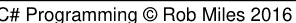

## 简单数据处理

## 编写程序

### 2.3.5 更整洁的打印

注意，数字的打印方式不会影响程序存储它的，它只是告诉打印方法它应该是什么样的。

如果你运行任何一个程序，你会发现数字的打印方式不尽如人意。整数似乎直接输出，而浮点数似乎有自己的主意。为了解决这个问题，C# 提供了一种略有不同的数字打印方式。这提供了灵活性，如果你要打印大量值，这种方法也稍微更容易使用。

## 在打印字符串中使用占位符

占位符标记了要打印值的位置。考虑：

```
int i = 150;
double f = 1234.56789;
Console.WriteLine("i: {0} f:{1}", i, f);
Console.WriteLine("i: {1} f:{0}", i, f);
i: 150 f: 1234.56789;
```

这将会输出：

```
i: 150 f: 1234.56789;
```

字符串的 `(n)` 部分表示“从 0 开始的参数 n”。在第二个写入语句中，我交换了数字的顺序，但因为我交换了参数顺序，输出是相同的。

如果我做了一些事情，例如使用 `(99)` 来获取第 99 个参数，`WriteLine` 方法将报错失败。然而，这个错误**不会**被编译器捕获，程序将在运行时会失败。

## 调整实数精度

占位符被添加了格式化信息：

```
int i = 150;
double f = 1234.56789;
Console.WriteLine("i: {0:f} f:{1:0.0}", i, f);
```

这将会输出：

```
i:150 f: 1234.6
```

`0` 代表一个或多个数字。当它们放在小数点之后时，它们可以用来控制表示值的小数位数。注意，如果数字是整数，它会被打印为 **12.00**。

## 指定打印的位数

我可以通过输入给定数量的零来指定位数：

```
int i = 150;
double f = 1234.56789;
Console.WriteLine("i: {0:f} f:{1:0.0}", i, f);
```


## 创建程序

# 方法

```sharp
using System;
class MethodDemo
{
    static void doit()
    {
        Console.WriteLine("Hello");
    }
    public static void Main()
    {
        doit();
        doit();
    }
}
```

代码示例 09 简单方法
在主方法中，我调用了两次 `doit`。每调用一次，代码块中的代码（即方法体）就会执行一次。在这种情况下，它包含一条语句，用于在控制台上打印 "Hello"。运行上述程序的结果将是：
Hello
Hello

所以，我们可以使用方法来避免重复编写相同的代码。我们只需要将代码放在方法内部，然后在需要时调用它。

## 3.1.2 参数

在此阶段，方法是非常有用的，因为它们在程序的许多地方使用了相同的语句块。然而，如果允许允许它们拥有参数，它们会变得更有用。

参数是向方法调用传递值的方法。方法被赋予了处理的数据。例如，考虑下面的代码：

```csharp
using System;
class MethodDemo
{
    static void silly (int i)
    {
        Console.WriteLine("i is : " + i);
    }
    public static void Main()
    {
        silly (101);
        silly (500);
    }
}
```

代码示例 10 带参数的方法
`silly` 方法有一个单一的整数参数。在方法方法的代码块（方法体）中，我们可以将 `i` 作为整数变量使用。方法开始时，为参数提供的值会被复制到其中。这意味着当程序运行时，我们得到如下输出：
i is : 101
i is : 500

## 3.1.3 返回值

方法还可以向调用者返回一个值。你已经用过这个功能，`ReadLine` 和 `Parse` 方法都返回了我们在程序中使用过的结果：

```csharp
using System;
class ReturnDemo{
    static int sillyReturnPlus (int i)
    {
        i = i + 1;
        Console.WriteLine("res is : " + i);
        return i;
    }
    public static void Main()
    {
        int res;
        res = sillyReturnPlus(5);
        Console.WriteLine("res is : " + res);
    }
}
```

代码示例 11 带加法的返回方法
`sillyReturnPlus` 获取参数的值并返回它一次。

方法返回的值可以用于程序中任何可以使用类型变量的地方，换句话说，`sillyReturnPlus` 的调用可以替代整数。看看你是否能推出这段代码会显示什么：

```csharp
res = sillyReturnPlus(5) + sillyReturnPlus(7) + 1;
Console.WriteLine("res is : " + res);
```

忽略方法返回的值实际上是可以的，但这实际上是一件毫无意义的事：
sillyReturnPlus(5); // 可以编译但没用

## 3.1.4 实参与参数

当你阅读 C# 时，你会发现 `parameter`（参数）和 `argument`（实参）这两个词经常被互换使用。这其实并不完全准确。理解它们的区别会让 C# 文档和错误信息看起来简单得多，并让你产生一种优于那些不知道真相的程序员的优越感。

参数是在方法头中定义的特殊变量，在方法内部表示传递给方法调用的值。

```csharp
static int sillyReturnPlus (int i)
{
    i = i + 1;
    Console.WriteLine("res is : " + i);
    return i;
}
```

上面的 `sillyReturnPlus` 方法有一个单一参数，类型为整数，标识符为 `i`。

实参是在调用方法时提供的值。
sillyReturnPlus(99);

在上面的语句中，实参是值 99。所以，如果我做了一些蠢事：
sillyReturnPlus("banjo");

- 当我尝试编译代码时，得到以下错误信息：

## 3.1.5 一个实用的方法

Error 2 Argument 1: cannot convert from 'string' to 'int'

这在告诉我实参（放在括号之间的内容，即方法调用）与参数的定义（已定义为整数）不匹配。

现在我们可以编写真正的方法了：

```csharp
static double readValue (
    string prompt, // 提示用户
    double low, // 允许的最小值
    double high // 允许的最大值
) {
    double result = 0;
    do {
        Console.WriteLine(prompt +
            " between " + low +
            " and " + high + ");
        string resultString = Console.ReadLine();
        result = double.Parse(resultString);
    } while ((result < low) || (result > high));
    return result;
}
```

`readValue` 方法被告知提示用户并使用允许的最值范围。它可以用于读取值并确保它们在范围内。我们可以使用这个方法读取任何内容，并确保提供的任何值都在特定范围内。

```csharp
double windowWidth = readValue ("Enter width of window: ", MIN_WIDTH, MAX_WIDTH); 
double age = readValue ("Enter your age: ", MIN_WIDTH, MAX_WIDTH);
```

创建程序

# 方法

```sharp
using System;
class ReturnDemo
{
    static int sillyReturnPlus (int i)
    {
        i = i + 1;
        Console.WriteLine("res is : " + i);
        return i;
    }
    public static void Main()
    {
        int res;
        res = sillyReturnPlus(5);
        Console.WriteLine("res is : " + res);
    }
}
```

代码示例 11 带加法的返回
`sillyReturnPlus` 获取参数的值并返回它一次。方法返回的值可以用于程序中任何可以使用类型变量的地方，换句话说，`sillyReturnPlus` 的调用可以替代整数。看看你是否能推出这段代码会显示什么：

```csharp
res = sillyReturnPlus(5) + sillyReturnPlus(7) + 1;
Console.WriteLine("res is : " + res);
```

忽略方法返回的值实际上是可以的，但这实际上是一件毫无意义的事：
sillyReturnPlus(5); // 可以编译但没用

## 3.1.4 实参与参数

当你阅读 C# 时，你会发现 `parameter` 和 `argument` 这两个词经常被互换使用。这其实并不准确。理解它们的区别会让 C# 文档和错误信息看起来简单得多，并让你产生一种优于那些不知道真相的程序员的优越感。

参数是在方法头中定义的特殊变量，在方法内部表示传递给方法调用的值。

```csharp
static int sillyReturnPlus (int i)
{
    i = i + 1;
    Console.WriteLine("res is : " + i);
    return i;
}
```

上面的 `sillyReturnPlus` 方法有一个单一参数，类型为整数，标识符为 `i`。

实参是在调用方法时提供的值。
sillyReturnPlus(99);

在上面的语句中，实参是值 99。所以，如果我做了一些蠢事：
sillyReturnPlus("banjo");

- 当我尝试编译代码时，得到以下错误信息：

## 3.1.5 一个实用的方法

Error 2 Argument 1: cannot convert from 'string' to 'int'

这在告诉我实参（放在括号之间的内容，即方法调用）与参数的定义（已定义为整数）不匹配。

```sharp
static double readValue (
    string prompt, // 提示用户
    double low, // 允许的最小值
    double high // 允许的最大值
) {
    double result = 0;
    do {
        Console.WriteLine(prompt +
            " between " + low +
            " and " + high + ");
        string resultString = Console.ReadLine();
        result = double.Parse(resultString);
    } while ((result < low) || (result > high));
    return result;
}
```

`readValue` 方法被告知提示用户并使用允许的最值范围。它可以用于读取值并确保它们在范围内。我们可以使用这个方法读取任何内容，并确保提供的任何值都在特定范围内。

## 3.1.6 命名参数与可选实参


## 创建程序

# 方法

```
static double readValue(
    double low,    // 允许的最小值
    double high,   // 允许的最大值
    string prompt = "", // 用户的可选提示信息
    string error = "" // 可选的错误信息
)
{
```

该方法有两个可选参数：一个提示（prompt）和一个错误信息（error）。这种设计的思路是，如果用户提供的年龄无效，方法的用户可以提供自定义的错误信息。你现在可以这样调用该方法：

x = readValue(25, 100, "Enter your age", "Age out of range");

如果我不需要提示或自定义错误信息，可以跳过它们。但如果我只提供一个参数，它将映射到可选参数序列中的第一个。换句话说，在不提供自定义提示的情况下，我无法提供自定义的错误信息。

绕过这个问题的方法（我确定你已经发现了）是通过通过名称识别你想要使用的可选参数。

x = readValue(25, 100, error:"Age out of range");

这次 `readValue` 调用将使用默认提示，但会有一个自定义的错误信息。

# 程序员观点：我对参数的默认值并不认同

到为止，我认为编程和任何其他事情一样是一门手艺。这意味着我们可以观察行为，并在编写代码的技艺背景下来考虑它们，就像想制作奶酪的人会担心可能会使用电锯来完成工作一样。

默认参数值可能会向方法的用户隐藏信息。它们可以提供某些“秘密开关”，使程序以特定方式运行，而用户在正确制作东西时可能需要了解这些信息。如果你使用它们，请在方法内部以及使用该方法的代码中利用注释，这样阅读代码的人也能理解默认行为的作用以及如何如何修改它们。

## 3.1.7 参数按值传递

方法非常适合完成工作，但由于其工作方式，可能会受到局限。例如，如果我想写一个方法来读取我某个人的名字和年龄。从我们所看到的，我只能返回一个值——人的名字，或者写一个返回年龄的方法。但我不能写一个同时返回这两个值的方法，因为一个方法只能返回一个值。当你尝试时会发现，更改参数的值不会改变传入对象的值。这是因为，除非另有指定，否则参数的值是传递给方法调用的。

那么，我所说的“按值传递参数”是什么意思？考虑：

```c
static void addUser (int i)
{
    i = i + 1;
    Console.WriteLine("is is : " + i);
}
```

`addUser` 方法将参数加 1；打印结果并返回：

```c
int test = 20;
addOne(test);
Console.WriteLine("test is : " + test);
```

上面的 C# 代码段使用 `test` 变量作为参数调用了方法。当它运行时，输出以下内容：

- i is : 21
- test is : 20

理解这里发生了什么非常重要。`test` 的值被用于 `addOne` 的调用。程序计算出作为参数传递方法调用的表达式结果。它将此值传入调用。这意味着你可以编写这样的代码：

```csharp
test = 20;
addOne(test + 99);
```

这将打印出：

- i is : 120

按值传递是非常安全的，方法执行的任何操作都不会影响它调用的代码中的变量。然而，当我们想要创建一个返回多个值的方法时，这是一个局限性。

## 3.1.8 参数按引用传递

理解引用是如何工作的非常重要。如果你不理解这些，你就不可能称自己为合格的程序员！

幸运的是，C# 提供了一种方法，不是将变量的值传递给方法，而是提供该变量的引用。在方法内部，不是使用值，而是使用引用来获取变量本身。传入方法的是内存的位置或地址，而不是变量的内容。

因此，而不是在方法中传入“20”，编译器将生成一个位置。传入方法的是内存的位置或地址，而不是变量的内容。


## 创建程序

# 变量与作用域

```cs
using System;
class MethodLibraries {
    static string readString(string prompt) {
        do {
            string result;
            Console.Write(prompt);
            result = Console.ReadLine();
        } while (result == "");
        return result;
    }
    static int readInt(string prompt, int low, int high) {
        int result;
        do {
            string intString = readString(prompt);
            result = int.Parse(intString);
        } while ((result < low || result > high));
        return result;
    }
    public static void Main() {
        string name;
        name = readString("Enter your name : ");
        Console.WriteLine("Name: " + name);

        int age;
        age = readInt("Enter your age : ", 0, 100);
        Console.WriteLine("Age: " + age);
    }
}
```

代码示例 13 使用方法库

# 程序员提示：始终考虑失败的情况

每当你编写方法时，都应该思考它可能失败的方式。如果该方法涉及与用户交互，用户可能想要放弃该方法，或者该方法所使用的工具可能会导致其失败。你需要考虑该方法应该自己处理问题本身，还是将错误传递给你尝试使用的用户。

如果由方法检测到错误，可能会导致问题，因为用户可能没有方法取消该方法。在过去，你必须通过某种方法将错误代码传递给调用者，我通常通过让方法返回一个值来解决这个问题。如果返回值为 0，则意味着返回的值有效；如果返回值是非零，则意味着方法没有运行，且返回的值是标识何种错误的错误代码。这为程序设计增加了另一个维度，因为你还必须考虑你所编写的代码，同时确保它确实执行了任务！我们将在稍后讨论错误管理。

# 3.2 变量与作用域

我们已经看到，当我们想要在程序中存储一个值时，可以创建一个变量来保存这些信息。C# 编译器会确保使用正确的内存块来存储该值，它还确保我们始终正确地使用该值。C# 编译器还负责变量存在的程序部分。这被称为变量的作用域。

# 3.2.1 作用域与块

我们已经看到，块是一组被包含在大括号中的的语句。任何块都可以包含任意数量的局部变量，即局部于该块的变量。

局部变量的作用域是定义它的块。对于 C# 语言而言，你可以在块的任何点声明变量，但你必须在使用它之前声明它。当程序执行到块外部时，块中声明的任何局部变量都会被自动丢弃。我们创建的方法通常包含局部变量；`read` 方法中的变量 `result` 是该方法块的局部变量。

# 3.2.2 嵌套块

我们已经看到，在 C# 中，程序员可以在块内部创建块。这些嵌套块中的每一个都有自己的局部变量作用域：

```csharp
int i;
{
    int j;
}
```

变量 `j` 的作用域是内部块。这意味着只有内部块中的语句可以使用此变量。换句话说，代码：

```csharp
int i;
{
    int j;
    j = 99;
}
```

-   将会导致错误，因为变量 `j` 在程序的此时并不存在。

为了防止你通过创建两个同名的变量版本而产生困惑，C# 对内部块中的变量有一条额外规则：

```csharp
int i;
{
    int i;
}
```

这不是一个有效的程序，因为 C# 不允许内部块中的变量与外部块中的变量具有相同名称。这是因为在内部块内部，可能在你本打算使用外部 `i` 的时候使用了“内部””的 `i`。为了消除这种可能性，编译器拒绝允许这样做。请注意，这与其他语言的情况相反，例如 C++，这种行为是被允许的。

然而，在连续的块中重用变量名是完全可以接受的，因为在这种情况下，一个变量无法与另一个混淆。

```csharp
{
  int i;
}
{
  int i;
  int j;
}
```

`i` 的第一个实例在第二个实例之前已经被销毁了，所以这段代码是好的。

# for 循环局部变量

当你创建一个 `for` 循环结构时，可以使用一种特殊的变量。这允许你声明一个控制变量，该变量在循环整个持续期间存在。

```csharp
for (int i = 0 ; i < 10 ; i = i + 1) {
  Console.WriteLine("Hello");
}
```

变量 `i` 在 `for` 循环开始时声明并初始化，并且仅在块本身的持续期间存在。

# 3.2.3 类中的数据成员

局部变量很好，但当程序执行离开它们定义的块时，它们就会消失。我们通常需要存在于类方法外的变量。

## 方法的变量

我们通常需要存在于类方法外的变量。我们通常需要存在于类方法外的变量。我们通常需要存在于类方法外的变量。我们通常需要存在于类方法外的变量。我们通常需要存在于类方法外的变量。

## 类的变量

我们通常需要存在于类方法外的变量。我们通常需要存在于类方法外的变量。我们通常需要存在于类方法外的变量。我们通常需要存在于类方法外的变量。我们通常需要存在于类方法外的变量。

## 属于方法的变量

我们通常需要存在于类方法外的变量。我们通常需要存在于类方法外的变量。我们通常需要存在于类方法外的变量。我们通常需要存在于类方法外的变量。

## 类的变量

我们通常需要存在于类方法外的变量。我们通常需要存在于类方法外的变量。我们通常需要存在于类方法外的变量。我们通常需要存在于类方法外的变量。我们通常需要存在于类方法外的变量。

## 成员变量

类变量非常有用，如果你想让多个方法共享一组数据。例如，如果你正在创建一个玩国际棋的程序，将存储棋盘的变量设置为类的成员是明智的。

```cs
class MemberExample {
    static int member = 0;
    static void OtherMethod() {
        member = 99;
    }
    static void Main() {
        Console.WriteLine("member is : " + member);
        OtherMethod();
        Console.WriteLine("member is now : " + member);
    }
}
```

程序将输出：
member is : 0
member is now : 99

使用成员变量

变量现在是类的一部分，并且 `Main` 方法可以使用它。

```cs
class LocalExample {
    static int local = 0;
    static void OtherMethod() {
        local = 99;
    }
    static void Main() {
        Console.WriteLine("local is : " + local);
        OtherMethod();
        Console.WriteLine("local is now : " + local);
    }
}
```

程序将输出：
local is : 0
local is now : 99

无法编译的局部变量

变量在 `Main` 中声明并使用，但 `OtherMethod` 无法使用它。

```cs
class LocalExample {
    static void OtherMethod() {
        int local = 99; // 这不会编译
    }
    static void Main() {
        int local = 0;
        Console.WriteLine("local is " + local);
    }
}
```

# 程序员提示：规划你的变量使用

你应该规划你程序中变量的使用。决定哪些变量只需要局部块并应该是类的成员。请记住，如果你将变量设为类的成员，它可以被任何方法使用（这增加了它变坏的概率）。我只需要将类中成员变量的数量保持在最低，并在仅只需要一小部分代码时使用局部变量。

# 3.3 数组

我们现在知道如何创建可以读取值、计算结果并打印它们的程序。我们的程序还可以根据用户提供的值做出决策，并根据给定的次数重复。

事实上，你已经掌握了实现曾经编写过的每一个程序所需的所有功能。只缺少了一项，即创建存储大量数据的程序的能力。数组是一个需要关注的对象，我们将我们将了解它们。


## 创建程序

# 数组

## 3.3.1 为什么我们需要数组

你作为程序员的身份现在开始变得非常广泛了。下一个来找你的是店里的老板，希望你帮他分析当地的板球球队。他希望写一个程序来帮助分析球员的表现。在板板球比赛中，球队的每位成员都会得到特定数量的得分。客户的要求非常简单：给定一组玩家，程序想要一份按升序排列的这些得分的列表。

接下来是确定规范并添加元数据。你应该设定一个合理的范围（任何球员在单场比赛中的得分都不会低于 0 分或超过 1000 分）。画出你将创建的程序的粗草图，以及它将包含哪些信息。你如何获得报酬以及何时获得。最后，为了让这个项目完美，你们就软件必须何时完成以及你将如何设计它达成一致。你可以把这些都写下来并签字。一切安排好后，你现在要做的就是编写实际程序。“这很简单，”第一要工作是定义数据的格式：

```
int score1, score2, score3, score4, score5, score6, score7,
score8, score9, score10, score11
```

现在你开始将数据放入变量中。使用你新的数字读取方法：

```
score1 = readInt ( "Player 1 score : ", 0,1000);
score2 = readInt ( "Player 2 score : ", 0,1000);
score3 = readInt ( "Player 3 score : ", 0,1000);
score4 = readInt ( "Player 4 score : ", 0,1000);
score5 = readInt ( "Player 5 score : ", 0,1000);
score6 = readInt ( "Player 6 score : ", 0,1000);
score7 = readInt ( "Player 7 score : ", 0,1000);
score8 = readInt ( "Player 8 score : ", 0,1000);
score9 = readInt ( "Player 9 score : ", 0,1000);
score10 = readInt ( "Player 10 score : ", 0,1000);
score11 = readInt ( "Player 11 score : ", 0,1000);
```

接下来我们要做的是对它们排序，嗯……这太糟糕了！似乎没有办法可以判断哪个得分是最大的。显然必须有更好的方法来这样做，毕竟我们知道计算机非常擅长这类事情。

C# 为我们提供了这种被称为“数组”的东西。数组允许我们声明一行特定类型的盒子。然后我们可以使用这些所谓的“下标”来指示我们想要使用行中的哪一个盒子。考虑以下：

```csharp
using System;
class ArrayDemo{
    public static void Main ()
    {
        int [] scores = new int [11];
        for (int i=0; i<11; i++)
        {
            scores[i] = readInt("Score : ", 0,1000);
        }
    }
}
```

`int [] scores` 告诉编译器我们要创建一个数组变量。你可以将其想象成一个可以指向数组的标签。

创建数组本身的部分是 `new int [11]`。当 C# 看到这个时，它会说：“啊！这里我们需要一个数组。”它拿了一些木板，做了一个有 11 个隔间的长盒子，每个间隔都足够容纳一个整数。它把盒子漆成红色——因为能存放整数的盒子都是红色的。它把标签系在这个盒子上。如果你顺着 `scores` 标签的绳子就能得到数组盒子。实际上，它可能没有使用木头或绳子，但你应该理解这里正在发生的情况。

## 3.3.2 数组元素

盒子中的每个间隔被称为“元素”。在程序中，你通过在名称后加上方括号 `[ ]` 中的数字来标识元素。这部分被称为下标。注意，让数组如此神奇的地方在于，你可以通过变量来指定任何元素。事实上，你可以使用任何返回整数的表达式作为下标，即

```
scores [i]
```

- 是完全可以（只要你不会超出数组的末尾）。当数组被创建时，数组中的所有元素都被设置为 0。

### 数组元素的编号

C# 从 0 开始盒子编号。这意味着你通过给出下标 0 来指定数组开头的元素。因此，不存在 `scores [-1]` 这样的元素。如果你查看程序中将值存入数组的部分，你会发现我们只从 0 计数到 10。这非常重要。尝试访问 `scores` 范围之外会导致程序在运行时失败。如果你觉得这很困惑：“第一个元素是 0”，那么理解下标的最佳方法是到达你需要的元素所经过的数组距离。

造成这种困惑的一个原因是，其他语言的编号方案是不一样的。Visual Basic 从 1 开始数组元素编号。我很抱歉说这一点；这正说明编程中没有任何东西是一致一致的。

## 3.3.3 大型数组

数组的真正威力来自于能够使用变量来指定大小。例如，如果我想改变大小，可以写：

```csharp
using System;
class ArrayDemo
{
    public static void Main ()
    {
        const int SCORE_SIZE = 10;
        int [] scores = new int[SCORE_SIZE];
        for (int i=0; i < SCORE_SIZE; i++)
        {
            scores[i] = readInt("Score : ",0,1000);
        }
    }
}
```

变量 `SCORE_SIZE` 是一个被标记为 `const` 的整数。这意味着它不能被更改。这种类型的常量通常使用大写字母。

在我所有使用固定值表示数组大小的地方，现在我使用了常量，这意味着如果团队的大小发生，我只需要更改常量即可。

### 管理数组大小

在处理数组时，一个技巧是使用常量。这有两个好处：

- 它让程序更容易理解
- 它让程序更容易修改

由于变量 `i` 现在从 0 运行到 `SCORE_SIZE`，读者可以明显看出它正在遍历数组。

## 3.3.4 创建二维数组

然而，我们想要的不仅仅是一行。我们需要一个网格。我们可以通过创建二维数组来实现这一点。如果你喜欢，你可以将其想象为“数组的数组”（但只要这不会让你头疼的话）。例如，为了存放井跳棋（交叉棋）游戏的棋盘，我们可以使用：

```csharp
int[,] board = new int [3,3];
board[1,1] = 1;
```

它的工作方式与一维数组类似，但有一些区别。`[,]` 现在有一个逗号。逗号的存在意味着它的两边都有内容。这意味着数组现在有两个维度。当我们给出棋盘的大小时，必须提供两个维度而不仅仅是一个。那么，当我们想要指定一个元素时，有两个下标值。在上面的代码中，我将中间（最好的那个）的值设置为 1。

你可以将二维数组想象成一个网格：

在示例中，数组是正方形的（即横两个维度相同）。我们可以通过这样改变它：

```csharp
int[,] board = new int [3,10];
```

- 但会让在上面玩一场合理的游戏变得相当困难。


## 3.3.5 数组与查找表

数组是极佳的查找表。它们提供了一种从数字转换为其他内容的整洁方法。例如，你可能根据月份值打印出月份名称。你可以通过使用测试来实现：

```c
int monthNo = 1;
string monthName;

if (monthNo == 1)
    monthName = "January";

if (monthNo == 2)
    monthName = "February";
```

这样写会非常繁琐。更简洁的方法是使用一个名为 `monthNames` 的数组。然后我们可以这样操作：

```c
monthName = monthNames[monthNo];
```

为了让此起作用，我们需要确保 `monthNames` 数组中的每个元素都能存储月份名称。

```c
string monthNames[] = new string[13];
```

因此，在我们 ways查找表之前，我们需要进行一些设置：

```c
monthNames[1] = "January";
monthNames[2] = "February";
```

### 程序员观点：有时“浪费”数组元素是可以接受的

如果你到目前仔细阅读了文字，你会发现这里有些奇怪。我的数组索引是从 0 开始的，句话说，`monthNames` 数组开头的元素下标将为 0，这实际上会将 "January" 放入 `monthNames[0]` 中。如果我想最有效地利用存储空间，这是正确的，但当我使用数组解码月份值（范围从 1 到 12）时，可能会让我的程序更难理解，因为我必须从值中减去 1。在这种情况下，我认为创建一个比需要大一个的数组（因此下标从 0 到 12）是合理的，然后我们通过索引值 0 解码开头的元素。

程序员可能会指出，如果程序员尝试使用 `names` 数组基础的元素（下标为 0 的元素），将有显示无效月份值的风险。我们可以通过将该元素设为空引用来防止这种情况。

```c
monthNames[0] = null;
```

这意味着如果代码尝试使用数组中的此元素，它将抛出异常并停止。如果他们继续抱怨在我们让他们考虑程序员在决定月份值时漏掉“月份减一”的影响，这会导致程序运行异常。在这种情况下，我们将打印错误的月份且程序可能会继续运行。我宁愿程序在火花和火焰中爆炸，也不要静静地做错。

当然，这看起来我们用另一个繁琐（进行大量测试以获取月份字符串）替换了另一个繁琐（数组初始化）。然而，C# 有一种非常整洁的方法可以设置数组中的元素。

```csharp
string monthNames = new string[]
{
    null, null // 为非月份 0 的元素
    "January", "February", "March", "April",
    "May", "June", "July", "August",
    "September", "October", "November", "December"
};
```

程序可以包含一个初始化值列表，我们使用它创建一个包含所需内容的数组。注意，我们随后使用的初始化根据需要自动创建数组的长度。你也可以通过以下方式初始化二维数组：

```c
int [] squareWeights = new int [3,3]
{
    {1,0,1},
    {0,2,0},
    {1,0,1}
};
```

上面的代码创建了一个二维数组，用于一个我可能会编写的聪明井井棋（tic tac toe）游戏的权重值计数。它代表了我的信念，即中心和角角的格子最有价值。当我的程序做出第一步时，它会寻找数值最大的格子并尝试在那里运行。

## 3.3.6 超过两个维度

偶尔你可能需要使用两个维度以上的数组。如果你使用三维，你可以将其想象成一堆网格，第三维度（你可以这样命名）提供了特定的网格。如果我们想在一个立方体棋盘上玩三维井棋，我们可以这样声明数组：

```csharp
int [,,] board = new int [3,3,3];
board[1,1,1] = 1;
```

这段代码创建了一个三维数组，然后获取游戏立方体中心最有价值的位置。如果你愿意，可以使用更多维度，C# 对此没有问题。但你可能会遇到大问题，因为这很难理解和可视化。

你可能认为在真的想使用数组时需要添加第二个维度。例如，回到我们的板球得分，如果队队长想存储玩家的名字，你不会通过在 `scores` 数组上添加另一个维度来实现，而是声明第二个字符串数组来持有每个玩家的名字：

```csharp
int [] scores = new int [11];
string [] names = new string [11];
```

你的程序必须确保每个玩家的名字和得分信息存在，换句话说，`names` 数组中下标为 0 的元素将包含在 `scores` 数组中得值为 0 的玩家。

# 异常与错误

### 3.4.1 异常与 Parse 方法

Parse 是我们用于将字符串转换为数值值的方法。

```csharp
int age = int.Parse(ageString);
```

上面的语句使用 Parse 将 ageString 转换为整数。

但这没有限制。Parse 的问题在于给它一个包含无效文本的字符串，它不知道该怎么办。如果我的工作遇到问题，我会把它交给老板。毕竟，老板来接收，我来解决。

### 3.4.2 捕获异常

我们可以通过添加捕获抛出的异常并尝试修复代码来制作处理无效输入的程序。在编程术语中，这被称为“动态错误处理”，因为我们的程序在错误发生时做出响应。为了做到，我们需要使用一种新的 C# 结构，try-catch 子句。

```csharp
int age;
try
{
    int age = int.Parse(ageString);
    Console.WriteLine("Thank you");
}
catch
{
    Console.WriteLine("Invalid age value");
}
```

代码示例 17 简单异常捕获

上面的代码使用 Parse 解析年龄字符串。然而，parse 操作发生在 try 块内部。如果 Parse 的调用抛出异常，catch 块将运行并向用户显示消息。注意，异常已被抛出，没有需要返回 try 块中的代码，即如果 parse 失败，程序不会显示“Thank you”。

### 3.4.3 异常对象

当问题出现在我的老板那里时，我会有一条描述它的说明。异常的工作方式是相同的。异常是包含详细信息的类型对象


一个发生的问题。当 `Parse` 执行时，它会创建一个异常对象，描述刚刚发生的错误（在此输入中为输入字符串格式不正确）。上面的程序忽略了异常对象，仅注册了异常事件，但我们可以通过捕获异常来改进程序的诊断功能：

```csharp
int age;
try {
    age = int.Parse(ageString);
    Console.WriteLine("Thank you");
}
catch (Exception e)
{
    // 从异常中获取错误消息
    Console.WriteLine(e.Message);
}
```

代码示例 18 使用异常消息。现在 `catch` 看起来像是一个方法调用，`Exception` 是方法的参数。它的工作原理如下：通过 `catch`，`e` 的值被设置为 `Parse` 抛出的异常。`Exception` 类型有一个 `Message` 属性，其中包含一个描述错误的字符串。如果用户输入了无效字符串，上面的程序将写入异常中的文本，其中包含消息：

输入字符串的不是正确的格式。

此消息是从抛出的异常中获取的。如果 `try` 块中的代码可能抛出几种不同类型的异常，这种方法非常有用，因为这意味着消息反映了实际发生的情况。`Exception` 对象还包含一些非常有用的属性。

## 3.4.4 异常嵌套

当异常被抛出时，在计算机内部管理程序执行的运行时将寻找捕获子句。如果你的程序没有包含针对该异常的 `catch`，它将被运行时系统部分的 `catch` 捕获。该 `catch` 子句中的代码将显示异常详情并停止程序。程序可以有多个级别的 `try - catch`，程序将使用与 `try` 块中代码级别匹配的 `catch`。

## 创建程序

# 异常与错误

```csharp
try {
    // 此层级的异常将被“外层”catch 
    // 子句捕获
    try {
        // 此层级的异常将被“内层”catch 
        // 子句捕获
    } catch (Exception inner) {
        // 这是“内层”catch 子句
    }
    // 此层级的异常将被“外层”catch 
    // 子句捕获
} catch (Exception outer) {
    // 这是“外层”catch 子句
}
```

上面的代码展示了其工作原理。如果最内层块中的代码抛出异常，运行时将找到 `catch`。然而，一旦执行离开内层块，在发生抛出异常时，将是对应的那个 `catch`。

# 程序员观点：不要捕获一切

Ben 将此称为宝可梦梦综合症：“全都要！”(Gotta catch all!)。不要觉得必须捕获你的代码可能抛出的每一个异常。如果有人要求你用 `Load` 方法获取一个不存在的文件，你能做的最好的事情是抛出一个“文件未找到”异常，而不是尝试通过返回空引用或空项来处理问题。返回一个占位符只会在稍后尝试使用返回的空项时产生更大的问题。失败越早发生，就越容易识别原因。

## 3.4 添加 Finally 子句

有时，有些事情无论是否抛出异常，你的程序必须执行。这些是诸如关闭文件、释放资源和一般的清理工作。然而，我们知道当异常被抛出时，`catch` 子句中的语句会被调用，然后程序返回到原来的程序类型。`catch` 子句中的代码可能会从其正在运行的方法返回，甚至返回一个异常本身。在这些情况下，你的 `catch` 结构之后的任何代码将没有执行的机会。

幸运的是，C# 为此问题提供了解决方案，允许你向 `try-catch` 结构添加一个 `finally` 子句。`finally` 子句内部语句无论 `try` 块中的程序是否抛出异常都会执行。

```csharp
try {
    // 可能会抛出异常的代码
} catch (Exception outer) {
    // 此代码捕获异常
} finally {
    // 无论是否抛出异常， 
    // 都会执行的代码
}
```

C# 编程 © Rob Miles 2016 

69

在上面的代码中，**finally** 部分的语句保证执行，要么是在 **try** 部分的语句完成时，要么是在执行离开程序的 **catch** 部分之前。

## 3.4.6 抛出异常

现在我们已经知道如何捕获异常，下一个需要考虑的问题是如何抛出它们。事实证明这非常简单：

```csharp
throw new Exception("Boom");
```

上面的语句会创建一个异常并将其抛出。当你创建一个新异常时，可以给它提供一个包含异常将交付内容的字符串。在这种情况下，我使用了一个没什么用处的消息 "Boom"。如果代码没有在 **try** 结构中运行，抛出异常可能会导致程序结束。

## 3.4.7 异常礼仪

异常最好保留给程序现实无法继续的情况。

# 程序员观点：规划你的异常

在设计程序时，你应该考虑哪些事件是“致命性”的以及你将如何处理它们。

# 3.5 Switch 结构

由于你必须经常做这种操作，C# 包含一种特殊的结构，允许你根据特定值从多个选项中选择一个。这就是 `switch` 结构。如果你使用程序编写上述内容，它看起来像这样：

## 创建程序

## Switch 结构

```csharp
static void handleCasement ()
{
    Console.WriteLine("Handle Casement");
}
static void handleStandard ()
{
    Console.WriteLine("Handle Standard");
}
static void handlePatio ()
{
    Console.WriteLine("Handle patio");
}
```

这些方法最终将处理每种窗户类型。目前它们只是被调用。你将继续编写代码（这是一种构建程序的良好方法）。一旦你准备好了方法，下一个需要做的是编写代码来调用用户选择的那个。

我们已经有一个方法可以从用户那里获取数字（它是 `readInt`，并接收一个提示字符串和限制）。我们的程序将使用该方法选择值，然后选择需要执行的方法。

### 3.5.1 多重决策

假设你正在完善程序，以从预定义的窗户范围内选择窗户。内容类似于所示：

输入窗户类型：

- 1 = 平开 (casement)
- 2 = 标准 (standard)
- 3 = 扇 (patio)

你的程序可以通过选择类型并提供尺寸来计算相应窗户的成本。

### 3.5.2 使用 if 结构进行选择

当你执行实际选择时，你得到的代码看起来有点这样：

```csharp
int selection;
selection = readInt ("Window Type : ", 1, 3 );
if (selection == 1)
{
    handleCasement();
}
else
{
    if (selection == 2)
    {
        handleStandard();
    }
    else
    {
        if (selection == 3)
        {
            handlePatio();
        }
        else
        {
            Console.WriteLine("无效数字");
        }
    }
}
```

这种方法可以运行，但相当笨拙。你必须编写大量的 `if` 结构来激活每个选项。

### 3.5.3 switch 结构


## 创建程序

## Switch 结构

```
switch (selection)
{
    case 1:
        handleCasement();
        break;
    case 2:
        handleStandard();
        break;
    case 3:
        handlePatio();
        break;
    default:
        Console.WriteLine("Invalid number");
        break;
}
```

**代码示例 19 使用 switch** switch 结构接收一个值，并用于决定执行哪种选项。它执行与 switch 变量值匹配的 case。这意味着你必须匹配 selection 值的 case 类型是固定的，尽管在 C# 中，如果你犯了错误，编译器会给你出一个错误。在调用相关方法后使用 `break` 语句是为了停止程序运行并执行后续代码。就像你跳出循环的方式一样，当 `break` 达到 switch 时，switch 就结束了，程序将继续在 switch 之后的语句运行。

另一个有用的功能是 `default` 选项。当 switch 值不匹配任何可用的 case 时，这为 switch 了一个了一个去处；在我们的案例中（抱歉！）我们输出了一个不恰当的消息。

如果你愿意，可以对数字以外类型使用 switch 结构：

```
switch (command)
{
    case "casement":
        handleCasement();
        break;
    case "standard":
        handleStandard();
        break;
    case "patio":
        handlePatio();
        break;
    default:
        Console.WriteLine("Invalid command");
        break;
}
```

这个 switch 使用字符串来控制 case 的选择。然而，你的用户不会因为这样做而感谢你，因为这意味着他们必须输入选项的完整名称，或者说，他们必须输入错误的字符，导致命令无法被识别。

## 多个 case

你可以使用多个 case，这样当命令匹配多个选项中的某一个时，你的程序就可以执行特定的 switch 元素：

```
switch (command)
{
    case "casement" :
    case "c":
        handleCasement();
        break;
    case "standard" :
    case "s":
        handleStandard();
        break;
    case "patio" :
    case "p":
        handlePatio();
        break;
    default:
        Console.WriteLine("Invalid command");
        break;
}
```

如果用户填写了名称的完整部分或首字母，上面的 switch 将选择一个特定的选项。如果你想根据字符串进行选择，我希望你查看一下 `string` 类型提供的 `ToUpper` 和 `ToLower` 方法。这些类型可以用于获取字符串的大写或小写版本的字符串，这可以让命令的测试变得简单得多：

```
switch (command.ToUpper())
{
    case "CASEMENT":
    case "C":
    ...
```

### 程序员观点：switch 是个好主意

switch 让程序更容易理解，而且写起来也更快。然而，我建议不要在 switch 中放入大量的程序代码，因为这只是放入另一个 case 的问题。相反，你应该像我上面那样放入一个方法调用。

## 3.6 使用文件

如果你想让你的程序变得有用，你就必须给它提供一种在不运行时存储数据的方法。我们知道可以以这种方式存储数据；这就是我们目前为止创建的所有程序存储数据的方式——存储在文件中。

文件由计算机的操作系统管理。我们想做的是使用 C# 告诉操作系统要访问哪些文件。好消息是，尽管不同的操作系统使用不同的方式管理它们的文件，但在 C# 中操作文件的方法对于任何计算机都是相同的。我们可以编写一个 C# 程序，在 Windows PC 上创建一个文件，然后使用同一个程序在 UNIX 系统上创建一个文件，而没有任何问题。

### 3.6.1 流与文件

C# 使用一种名为“流（stream）”的东西来允许程序处理文件。流是你的程序和数据资源之间的链接。数据可以在你的流中向上或向下流动，因此流可以用于读取和写入文件。流是连接你的程序与你正在使用的计算机操作系统的东西。操作系统负责工作，而你使用的 C# 库会将你使用流的请求转换为你当前使用的操作系统的指令：

## 使用文件

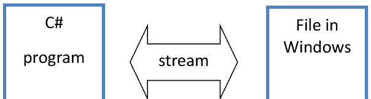

C# 程序可以包含一个代表特定流的对象，该流已创建并连接到文件。程序通过调用流对象上的方法来告诉它做什么，从而对文件执行操作。

C# 有有一系列不同的流类型，根据你想做什么来使用它们。所有流的方式完全相同。事实上，你已经熟悉了流是如何使用的，请参见 `Console` 类，它将 C# 程序连接到用户，并实现为流。`ReadLine` 和 `StreamWriter` 方法是发送任何流的命令，要求它读取和写入数据。

我们将考虑两种允许程序使用文件的流；这些是 `StreamWriter` 和 `StreamReader` 类型。

### 3.6.2 创建输出流

你像创建任何对象一样，通过 `new` 来创建一个流对象。当流被创建时，可以传递它：

```csharp
StreamWriter writer = new StreamWriter("test.txt");
```

然后使用该 writer 向文件写入输出。当文件关闭时，重要的是正确关闭它以确保资源释放。

```csharp
writer.Close();
```

### 3.6.3 向流写入

当你想向文件写入内容时，使用 `WriteLine` 方法：

```csharp
writer.WriteLine("This is some text.");
```

`WriteLine` 方法会在文本后添加换行。如果你想在不换行的情况下写入文本，使用 `Write` 方法。

### 3.6.4 关闭流

正如前面提到的，在完成操作后关闭它是非常重要的。

```csharp
writer.Close();
```

### 3.6.5 流与命名空间

在使用 `StreamWriter` 类型之前，还有其他你需要了解的。。像大多数处理输入输出的对象一样，该对象定义在 `System.IO` 命名空间中。我们在程序开始时被要求使用 `System` 时，已经接触过命名空间。现在我们将进一步了解它们。

命名空间与查找资源有关。C# 语言提供了大量随安装提供的额外资源。虽然 Console 对象允许我们读写文本，但 C# 安装实际上包含了成千上万的资源，每个资源都必须唯一标识。如果你正在组织大量的物品，你会发现对它们分组非常有帮助。命名空间一直在这样做。你把罗马人放在一个房间，把希腊人放在另一个房间。C# 语言的设计者创建了一个命名空间，程序员可以对他们的资源进行类似的操作。

命名空间字面上意思是“名称具有意义的空间”。你一直用于写入文本的 Console 的全名是 `System.Console`。即 `System` 命名空间中的 `Console` 类。在你的程序中使用这种形式是完全可以的：

```csharp
System.Console.WriteLine("Hello World");
```

上面的代码使用了控制的全限定名称并调用了 `WriteLine` 资源。然而，我们没有一直使用这种形式，因为在程序开始时，我们告诉编译器使用 `System` 命名空间来查找它未见的任何名称。使用关键字允许我们告诉编译器去哪里查找资源。

```csharp
using System;
```

这条语句告诉编译器在 `System` 命名空间中查找。一旦在程序文件中指定了命名空间，我们就不需要使用该命名空间的全限定名称。每当编译器发现


## 创建程序

## 使用文件

当遇到以前未见过的项目时，它会自动在已指定的命名空间中查找。换句话说，当编译器看到以下语句时：

```csharp
Console.WriteLine("Hello World");
```

它知道要在 `System` 命名空间中查找该对象，以便在其上使用 `WriteLine` 方法。如果程序员写错了类名：

```csharp
Console.WriteLine("Hello World");
```

编译器将在 `System` 命名空间中查找，由于在没有告诉编译器查找 `System.IO` 命名空间的情况下无法使用 `StreamWriter`。换句话说，要使用文件处理器，你需要在程序的顶部添加以下语句：

```csharp
using System.IO;
```

将一个命名空间放在另一个命名空间内部是可能的（就像管理员会将花瓶柜放在罗马房间，并将其称为 `Roman.Vases`），而 `IO` 命名空间实际上包含在 `System` 命名空间之中。然而，因为你使用了命名空间，这并不意味着你使用了其中定义的所有命名空间，你必须包含上述行才能使文件处理器可用。

命名空间是确保你的项目名称不会与其他程序员冲突的极佳方法。我们稍后将看到如何创建自己的命名空间。

```csharp
using System;
using System.IO;
```

```csharp
class FileWriteDemo
{
    public static void Main()
    {
        StreamWriter writer;
        writer = new StreamWriter("test.txt");
        writer.WriteLine("hello world");
        writer.Close();
    }
}
```

代码示例 20：完整文件写入

### 3.6.6 从文件读取

从文件中读取与写入非常相似，程序会创建一个指向实际工作区域的流。在这种情况下，使用的流是 `StreamReader`。

```csharp
StreamReader reader = new StreamReader("Test.txt");
string line = reader.ReadLine();
Console.WriteLine(line);
reader.Close();
```

上面的程序将流连接到 `Test.txt` 文件，读取文件的第一行，将其显示在屏幕上然后关闭文件。如果文件不存在，则打开尝试将失败，程序将抛出异常。

 检测输入文件的末尾

重复调用 `ReadLine` 将返回文件的连续行。然而，如果你的程序到达文件末尾，`Read` 方法在每次被调用时都会返回一个空字符串。幸运的是，`StreamReader` 对象提供了一个名为 `EndOfStream` 的属性，这是一个你可以用来判断何时到达文件末尾的程序。当该属性变为 `true` 时，表示已到达文件末尾。

```csharp
StreamReader reader = new StreamReader("Test.txt");
while (reader.EndOfStream == false)
{
    string line = reader.ReadLine();
    Console.WriteLine(line);
}
reader.Close();
```

上面的代码将打开 `test.txt` 文件并在控制台上显示文件的每一行。`while` 循环将停止程序，直到到达文件末尾。

```csharp
using System;
using System.IO;

class FilewriteandDemo
{
    public static void Main()
    {
        StreamWriter writer = new StreamWriter("test.txt");
        writer.WriteLine("hello world");
        writer.Close();

        StreamReader reader = new StreamReader("Test.txt");
        while (reader.EndOfStream == false)
        {
            string line = reader.ReadLine();
            Console.WriteLine(line);
        }
        reader.Close();
    }
}
```

代码示例 21：文件写入与读取

上面的代码首先将一行文本放入文件，然后打开文件并将其打印回屏幕上。

### 3.6.7 C# 中的文件路径

如果你使用电脑了一段时间，你就会熟悉文件夹（有时称为目录）的概念。这些用于组织计算机上的信息。你创建的每个文件都放在特定的文件夹中。如果你使用 Windows，你会发现自动为你创建了几个文件夹。其中一个是“文档”（Documents）。

文件的位置通常被称为文件的路径。文件的路径可以分为两部分：文件夹的位置和文件本身的名字。如果你在打开时没有提供文件夹位置……

换句话说，要使用文件处理器，你需要在程序的顶部添加以下语句：

```csharp
using System.IO;
```

*(注：由于提供的原文后续存在大量重复的段落，此处已按要求完成翻译并保持了逻辑结构)*


## 4.2.1 枚举与状态

“枚举”（Enumerated）这个词听起来很高大。但如果你把“枚举”仅仅理解为“编号的”东西，它就会变得容易理解。为了理解我们在这里要做什么，我们需要考虑这些类型旨在解决的问题。

我们知道，如果我们想存储一个整数值，可以使用 `int` 类型。如果我们想存储一个真或假的值，可以使用 `bool`。然而，有时我们想要存储一组特定的值或状态。

### 示例状态

枚举类型在存储状态信息时非常有用。状态与其它项目（如客户名称或其账户余额）是不同的。
例如，如果我正在编写一个玩“战舰对战”的游戏程序（由不同类型可受攻击的“海洋”方格组成），我可能会决定给定的海域方格可以包含以下内容：

- 空海
- 被攻击
- 战舰
- 巡洋舰
- 潜艇
- 划船

仔细想想，我某种程度上在这里组装更多的元数据，其中我决定了需要跟踪状态，并精确确定了里面可以放什么。如果我愿意，也可以用数字来处理：

- 空海 = 1
- 被攻击 = 2
- 战舰 = 3
- 巡洋舰 = 4
- 潜艇 = 5
- 划船 = 6

然而，这意味着我必须自己跟踪这些值，并记住如果我们在海域位置获取到值 7，这显然是错误的。
C# 有一种方法，让我们能够创建一个只包含一组特定可能取值的类型。这些类型被称为“枚举类型”。

```cs
enum SeaState {
    EmptySea,
    Attacked,
    Battleship,
    Cruiser,
    Submarine,
    RowingBoat
}
```

我创建了一个名为 `SeaState` 的类型，它可以用于存储海域特定部分的状态。它只能具有上述给定的值，并且必须通过这些命名枚举类型进行管理。例如，我必须写：
SeaState openSea;
openSea = SeaState.EmptySea;

我的变量 `openSea` 仅用于代表海洋内容状态的值。当然，C# 实际上会将这些状态表示为特定的数值，但如何管理这些值对我来说不是问题。
请注意，我创建的类型（如 `SeaState`）在编辑器中会以蓝色显示，这与关键字并不完全。

这表明这些项目是我创建的额外类型，可以用于创建变量，但它们实际上并不属于 C# 语言的一部分（不像关键字）。理解这里发生了什么非常重要。之前我们使用了 C# 部分的类型，例如 `int` 和 `double`。现在我们达到了一个点，即我们实际上在创建自己的数据类型，用于存储应用程序所需的数据值。

## 4.2.2 创建枚举类型

新的枚举类型可以在任何类之外创建，并创建一个新类型以供我的任何程序使用：

```cs
using System;
{
    enum TrafficLight
    {
        Red,
        RedAmber,
        Green,
        Amber
    }

    class EnumDemonstration
    {
        public static void Main()
        {
            TrafficLight light;
            light = TrafficLight.Red;
        }
    }
}
```
代码示例 22 枚举交通灯

每当你需要持有一个具有有限可能取值或状态的东西（例如：待售、待定、实心、已下架）时，你就应该考虑使用枚举类型来持有这些值。

### 程序员要点：使用枚举类型

枚举类型是另一种如果你使用它们，所有人都能获益的情况。程序变得更易编写、更容易理解且更安全。因此，你应该大量使用它们。

对于银行来说，你想持有账户的状态，以及关于客户的所有信息或其他信息。例如，我们可以为银行账户设置“冻结”、“活跃”、“新开”、“已关闭”和“审计中”等状态。如果是这样，创建一个可以包含这些值而不包含其他值的枚举类型是明智的。

```cs
enum AccountState
{
    New,
    Active,
    UnderAudit,
    Frozen,
    Closed
}
```

我们现在有一个变量，可以存储银行中账户的状态信息。每个账户将包含一个 `AccountState` 类型的变量，代表该账户的状态。

## 4.3 结构体

结构体允许我们将一组离散的值组织成一个凝聚的整体，并将其映射到我们处理的问题中的某个项目上。这在许多应用程序中都很重要。

### 4.3.1 什么是结构体？

当你处理信息时，通常会想要持有某个特定项目的不同信息的集合。友好银行委托了一个账户存储系统，你可以使用结构体来让这变得简单。像上过我课程的任何程序员一样，你会从执行以下操作开始：

- 建立精确的规范，即书面形式获取他们期望你的系统做什么。
- 协商一个昂贵的费用。
- 考虑你将如何存储数据。

### 示例结构体

根据你的规范，你知道程序必须持有以下内容：

- 客户名称 - string
- 客户地址 - string
- 账户号码 - 整数值
- 账户余额 - 整数值
- 透支额度 - 整数值

| 字段 | 类型 |
| :--- | :--- |
| 客户名称 | string |
| 客户地址 | string |
| 账户号码 | integer value |
| 账户余额 | integer value |
| 透支额度 | integer value |

## 4.3.2 创建结构体

C 允许你创建结构体。结构体是一组你希望视为单个实体的 C# 变量集合。为了帮助我们的银行，我们可以创建一个：

```cs
struct Account {
    public AccountState State;
    public string Name;
    public string Address;
    public int AccountNumber;
    public int Balance;
    public int Overdraft;
}
```

这定义了一个名为 `Account` 的结构体，包含了所有的客户信息。完成后，我们现在可以定义一些变量：

Account RobAccount;

该语句创建了一个名为 `RobAccount` 的单个 `Account` 变量。程序可以将值放入此账户的成员元素。我们通过在正在使用的结构体变量后加上它们的名称并使用分隔符来引用结构体的方法，例如：

RobAccount.Name="Rob";
- 引用结构体变量 `RobAccount` 中的字符串字段 "Name"（即 `RobAccount` 中的 Name 值）

```cs
using System;

enum AccountState {
    New,
    Active,
    UnderAudit,
    Frozen,
    Closed
}

struct Account {
    public AccountState State;
    public string Name;
    public string Address;
    public int AccountNumber;
    public int Balance;
    public int Overdraft;
}

class BankProgram {
    public static void Main() {
        Account RobAccount;
        RobAccount.State = AccountState.Active;
        RobAccount.Balance = 1000000;
    }
}
```
代码示例 23 通用代码创建了一个名为 `RobAccount` 的账户变量，将账户状态设置为活跃并给了它了一百万英镑（尽管它没有对这些钱做任何事情）。

注意结构体和枚举是在 `BankProgram` 类之外声明的。一旦我创建了结构体，我就可以像使用 `int` 和 `float` 一样的方式使用它。


## 创建解决方案

# 结构体

当我们创建结构体数组时，结构体变得非常有用。正如我们在搜索程序中看到的，管理单个项目是困难的，但如果我们使用数组，就会变得简单得多。

```csharp
const int MAX_COST = 100;
Account[] Bank = new Account [MAX_COST];
```

此声明设置了一个名为 `Bank` 的客户数组，它可以存储所有客户。注意，我设置了一个名为 `MAX_CUST` 的变量，并精确设置为 100。这定义了我们银行可以容纳的最大客户数量。

我们可以将一个变量赋值另一个变量，就像处理其他变量类型一样。执行赋值时，源中的所有值都会复制到目标中：

```csharp
Bank[0] = RobsAccount;
```

这会将 `RobsAccount` 结构体的信息复制到 `Bank` 数组起始元素中。你可以对结构体数组的元素进行操作，例如：

- Bank[25].Name 将是包含下标为 25 的元素的客户名称的字符串。

## 4.3.3 使用结构体

一旦有了结构体，我们就可以用它来存储银行客户详情：

```csharp
class AccountStructureArray
{
    public static void Main()
    {
        const int MAX_COST = 100;
        Account[] Bank = new Account[MAX_COST];
        Bank[0].Name = "Rob";
        Bank[0].State = AccountState.Active;
        Bank[0].Balance = 1000000;
        Bank[1].Name = "Jim";
        Bank[1].State = AccountState.Frozen;
        Bank[1].Balance = 0;
    }
}
```
代码示例 24 将账户信息放入数组
你可以在代码示例中看到它是如何工作的，该示例创建了一个包含 100 条客户记录的数组，然后设置了数组中的前两个元素。哪个账户持有者的钱最多？

这个程序不需要所有 100 个银行客户的数据，但它展示了如何访问结构体值数组中的各种字段。

## 结构体中的初始值

当结构体作为局部变量（即在块中）被创建时，其值是未定义的。这意味着如果你尝试在程序中使用它们，将得到编译错误。这与你在程序中赋值之前使用变量的情况完全一样。换句话说：

```csharp
Account RobsAccount ;
Console.WriteLine("Name is : " + RobsAccount.Name );
```

- 这会导致编译错误。作为程序员，你的职责是确保在尝试从变量获取内容之前，始终为变量赋值。

## 创建解决方案

# 结构体

# 在方法调用中使用结构体类型

方法可以拥有结构体类型的参数：

```csharp
public void PrintAccount ( Account a ) {
    Console.WriteLine("Name: " + a.Name);
    Console.WriteLine("Address: " + a.Address);
    Console.WriteLine("Balance: " + a.Balance);
}
```

此方法提供了一种输出账户变量内容的方法：
`PrintAccount ( RobsAccount);`

结构体 `RobsAccount` 的值被传递到方法中处理，就像我们之前传递到方法中的值一样。也可以将数组元素传递到方法调用（作为 `Account` 值的元素在定义上是一个 `Account` 实例）。

```csharp
class BankProgram {
    public static void PrintAccount(Account a) {
        Console.WriteLine("Name: " + a.Name);
        Console.WriteLine("Address: " + a.Address);
        Console.WriteLine("Balance: " + a.Balance);
    }
    public static void Main() {
        const int MAX_CUST = 100;
        Account[] Bank = new Account[MAX_CUST];
        Bank[0].Name = "Rob";
        Bank[0].Address = "Rob House";
        Bank[0].State = AccountState.Active;
        Bank[0].Balance = 1000000;
        PrintAccount(Bank[0]);
        Bank[1].Name = "Jim";
        Bank[1].Address = "Jim's House";
        Bank[1].State = AccountState.Frozen;
        Bank[1].Balance = 0;
        PrintAccount(Bank[1]);
    }
}
```
代码示例 25 从数组中打印账户值

也可以创建返回结构体类型的方法，或者我们创建一个创建一个 `ReadAccount` 方法来读取账户并返回它。

## 程序员观点：结构体至关重要

在商业系统中，花费大量时间设计构成数据存储的程序结构是常见的的。其他一切都很容易。你可以将结构体的设计及其对内容的限制视为关于你所创建的系统的另一部分元数据。

## 使用类型进行设计

你可以看到我们添加了一个 `State` 值来跟踪账户的特定状态。我们为程序所做的是创建一个可以包含多个值的类型（我们的 `AccountState` 枚举类型），并将其放入我们设计的另一个类型中，该类型用于存储

## 创建解决方案

# 对象、结构体和引用

关于银行账户持有者的信息。这种方法是我们处理复杂问题的方法。我们可以从与客户讨论获得的元数据中获取类型应该包含的所有细节。

例如，如果我们想创建一个非常令人印象深刻的双层玻璃管理程序，我们可以编写这样的代码：

```csharp
enum WindowState
{
    Quoted,
    Ordered,
    Manufactured,
    Shipped,
    Installed
}

struct window
{
    public WindowState state;
    public double Width;
    public double Height;
    public string Description;
}
```

这将包含房屋中特定窗户的信息，包括窗户的尺寸、窗户的状态以及对窗户本身的描述。对于一个包含多个窗户的房子，我们可以创建一个 `Window` 结构体数组。

## 程序员观点：你应该给你的对象赋予状态

上面的 `Account` 类是一个很好的示例，它将根据其所处的状态以不同的方式使用。例如，无法从处于 `Frozen`（冻结）状态的账户提取资金。系统中的每个对象都可以通过添加状态改进。订单可以是空、待处理、已发货和已接收。外星人可以是睡眠、攻击或已销毁。每当你想要一个新对象时，应该立即初始化它的状态。

# 对象、结构体和引用

你已经看到，如果我们想存储块信息，可以使用结构体。但对象允许我们以更优雅的方式工作。因此，无论你是否乐意，我们都会掌握它们的……


## 创建解决方案

## 对象、结构与引用

```csharp
class Account {
    public string Name;
}
class StructsAndObjectsDemo {
    public static void Main () {
        Account RobsAccount;
        RobsAccount.Name = "Rob";
        Console.WriteLine(RobsAccount.Name);
    }
}
```

### 代码示例 27 不可编译的 Account 类

账户信息现在存储在类中，而不是结构体中。账户类非常简单地被称为 Account。问题是，当我们编译程序时，得到了以下信息：

```
ObjectDemo.cs(12,3): error CS0165: Use of unused local variable 'RobAccount'
```

那么，发生了什么呢？要理解发生了什么，你需要了解这一行代码的操作：

```csharp
Account RobAccount;
```

这看起来像是声明了一个名为 RobsAccount 的变量。但在对象的情况下，情况并非表面上如此。

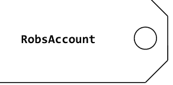

当程序遵循该行代码时，实际上得到的是创建一个名为 RobsAccount 的引用。这种引用允许指向 Account 的实例。你可以把它们想象成类似于行李标签，因为它们可以用根绳子系在某个东西上。如果你有这个标签，就可以顺着绳子找到它所绑定的对象。

但当我们创建一个引用时，我们并没有得到它所指向的所有内容。编译器知道这一点，所以它给了我一个错误，因为这一行代码：

```csharp
RobsAccount.Name = "Rob";
```

- 意在尝试寻找系到此标签上的实体，并将 name 属性设置为 "Rob"。由于该标签目前没有系到任何东西上，我们的程序会在这一点失败。编译器实际上在说：“你正尝试追踪一个没有指向任何内容的引用，我将给你返回一个变量未定义的错误”。

我们通过创建类的实例并将标签连接到它上来解决这个问题。这通过在我们的程序中添加一行代码来实现：

## 创建解决方案

## 对象、结构与引用

```csharp
class Account {
    public string Name;
}
class StructsAndObjectsDemo {
    public static void Main() {
        Account RobsAccount;
        RobsAccount = new Account();
        RobsAccount.Name = "Rob";
        Console.WriteLine(RobsAccount.Name);
    }
}
```

### 代码示例 28 编译 Account 类

我添加的这一行创建了一个新的 Account 对象，并将引用 RobsAccount 指向它。


我们在创建数组之前之前就见过这个 `new` 关键字了。这是因为数组实际上是作为对象实现的，所以我们使用 `new` 来创建它。`new` 创建的是一个对象。对象是类的实例。我简而言之重申一遍：

> “对象是类的实例”

我重复这一点是因为你理解它非常重要。类为 C# 提供了指令，说明了它应该是什么样，以及它可以做什么。`new` 关键字使用类信息来创建一个实例。注意，在上面的示例中，我将对象称为 Account，而不是 RobsAccount。这是因为该对象并没有 RobsAccount 这个标识符，它仅仅是目前 RobsAccount 所连接的那个对象。

## 4.4.2 引用

我们必须习惯这样一个观点：如果我们想使用对象，就必须使用引用。两者是紧密相连且不可分割的。结构虽然有用，但为了实现真正的面向对象，我们必须拥有对象，这意味着我们必须通过对特定对象的引用来管理对它的访问。实际上，这在现实中并不痛苦，因为你可以一直把引用当成对象来看，但你必须记住，当你持有一个引用时，你持有的不是实例，而是一个系在……上的标签。

### 对实例的多个引用

此时，另一个关于引用的示例可能会帮助。考虑以下代码：

```csharp
Account RobsAccount;
RobsAccount = new Account();
RobsAccount.Name = "Rob";
Console.WriteLine(RobsAccount.Name);
Account Temp;
Temp = RobsAccount;
Temp.Name = "Jim";
Console.WriteLine(RobsAccount.Name);
```

## 代码示例 29 多个引用

问题是：第二次调用 WriteLine 会打印出什么？如果我们画一张图，答案就会变得清晰：

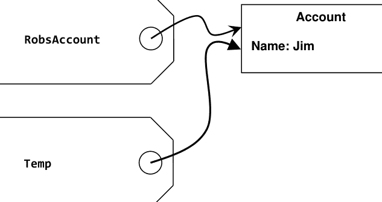

两个标签都指向同一个 Account 实例。这意味着对 Temp 所指向的对象所做的更改将反映在 RobsAccount 所指向的对象上，因为它们是同一个对象。这意味着程序将打印出 Jim，因为那是 RobsAccount 所指向的对象中的名称。

这表明了对象和引用之间存在某种微妙之处。挂载在单个实例上的引用数量没有限制，所以你需要记住，改变引用所指向的对象就会改变该实例。

## 创建解决方案

## 对象、结构与引用

```csharp
Account RobsAccount;
RobsAccount = new Account();
RobsAccount.Name = "Rob";
Console.WriteLine(RobsAccount.Name);
Account Temp;
Temp = RobsAccount;
Temp.Name = "Jim";
Console.WriteLine(RobsAccount.Name);
```

## 代码示例 29 多个引用

问题是：第二次调用 WriteLine 会打印出什么？如果我们画一张图，答案就会变得清晰：


两个标签都指向同一个 Account 实例。这意味着对 Temp 所指向的对象所做的更改将反映在 RobsAccount 所指向的对象上，因为它们是同一个对象。这意味着程序将打印出 Jim，因为那是 RobsAccount 所指向的对象中的名称。

这表明了对象和引用之间存在某种微妙之处。挂载在单个实例上的引用数量没有限制，所以你需要记住，改变引用所指向的对象就会改变该实例。

## 创建解决方案

## 对象、结构与引用

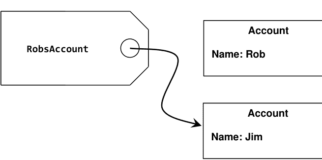

每个节点树有两个引用；一个可以指向“较轻”的节点，另一个可以指向“较重”的节点。如果我想得到一个排序后的项目列表，我只需要尽可能向“较轻”的一侧走，就会到达最轻的一个。


## 创建解决方案

## 使用对象进行设计

我移动到上方的一个（它必须是下一个较轻的）。然后我进入黑暗面（卢克的一侧）并重复该过程。这种方法的精妙之处在于，添加新项也非常容易；我只需要在树上找到需要挂载的位置并附上引用即可。

搜索也非常快，因为我可以查看每个节点并决定下一步往哪个方向走，直到我找到我要找的内容，或者在所需的方向上没有引用，在这种情况下该项不在结构中。

## 程序员观点：数据结构至关重要

这不是一份关于结构的文档，而是一份关于编程的文档。如果你还没有完全理解关于树的所有内容，不要担心。记住，引用是构建数据结构的重要机制，先记到此为止。但在未来的某个时刻，你将不得不理解如何使用这些东西来构建结构。

## 引用的重要性

这种工作方式的关键在于，对象可以包含指向其他对象的引用，以及数据载荷。我们稍后会考虑对象的这个方面；现在我们只需要记住引用和对象是区别且分离的。

## 银行笔记：引用与账户

对于一家拥有数千名客户的银行来说，使用引用对于管理他们持有的数据至关重要。账户将位于计算机内存中，由于每个账户的大小以及存储的账户数量，如果我们想对它们进行排序，是不可能移动它们的。

这意味着操纵它的唯一方法是让它们留在原处，并拥有指向它们的引用列表。引用是非常极小的“标签”，可以用于定位内存中的实际项。对引用列表排序非常简单，也可以拥有多个列表。这意味着我们可以为银行经理提供按客户姓名排序的列表，以及按余额顺序排序的视图。如果经理过来并需要一个新结构，我们也可以以引用的形式创建它。

## 4.5 使用对象进行设计

我们现在要开始从对象的角度来思考了。我们之所以这样做，是因为这是一种让我们的系统尽可能简单的方法。这都归结于程序员闻名的“创造性懒惰”。我们正尝试做的事情最好的表达方式是：

> “尽可能久地推迟所有的艰苦工作，如果可能的话就让别人来做”

对象让我们能够做到这一点。如果我们回到我们的银行账户，我们可以看到有很多我们能够对它做的事情：

- 向账户存入钱
- 从账户中取钱
- 查找余额
- 打印账单
- 更改账户持有人的地址
- 打印账户持有人的地址
- 更改账户状态
- 查找账户状态
- 更改透支额度
- 查找透支额度

与其说“我们需要对银行账户执行这些操作”，基于对象的设计让我们转过头来，有点就像肯尼迪总统多年前做的那样：

“因此，我的美国同胞们：问问你们国家能为大家做些什么——问问你们能为国家做些什么”（巨大的掌声）

我们不是对银行账户做事情。相反，我们要求它为我们做事情。我们银行应用程序的设计可以被识别我们将用于表示信息的对象，然后指定它们应该能够做的事情。聪明的地方在于，我们决定了银行账户应该做什么，然后我们可能可以让别人为我们制作它。

如果我们的规范是正确的并且我们正确地实现了它，我们就不需要担心它们具体是如何工作的——我们只需要坐在一旁，为出色的工作赢得荣誉即可。

这让我们回到了文档中几个反复出现题：元数据和测试。银行账户对象应该能够处理该对象的部分元数据。我们已经决定了账户必须执行的操作，下一步我们需要做的是设计一种方法，使每个操作都能被测试。

在这一节中，我们将实现一个具有正规账户某些行为的对象。

## 程序员观点：一切应该是可能的

注意，还有一些我们不应该能够对我们的银行账户对象执行的操作。账户数量是该账户特有的，并且永远不应该改变。我们可以通过简单地提供更改它的方法来获得这种行为。在设计时，识别出哪些是不可能的，以及哪些是应该做的，是非常重要的。我们甚至识别了一些正在被审计的内容，即对象将跟踪对它所做的操作。这样我们就可以很容易地发现是否正在发生坏事。

## 4.5.1 对象中的数据

所以，我们根据想对银行账户做的事情来考虑我们的账户。第一件事是识别我们想要存储在其中的所有数据项。为了简单起见，我将只考虑如何跟踪账户余额。这可以让我描述所有所需的技巧，而不会陷入太深的细节。

```cs
class Account {
    public decimal Balance;
}
```

上面的账户持有我们需要存储的关于银行账户余额的成员。类的成员持有一个描述类所持有某些数据的值，通常称为属性。我为账户余额使用了 `decimal` 类型，因为这是专门为持有财务数值而设计的。

我们已经看到类中的每个数据项都是它的成员。每当我创建一个类的实例时，我都会获得成员。我们已经看到创建一个类的实例并设置成员的值是非常容易的

```cs
Account RobsAccount;
RobsAccount = new Account();
RobsAccount.Balance = 99;
```

这之所以有效是因为对象的成员都是公共的，这意味着任何人都可以访问它们。这意味着编写应用程序的程序员可以这样做：

```cs
RobsAccount.Balance = 0;
```

如果我们提供阻止这种情况发生，我们需要保护对象内部的数据。

## 4.5.2 对象内部的成员保护

如果对象有用，我们必须有一种保护它们内部数据的方法。理想情况下，我想在有人尝试更改其中的值时进行控制，如果不喜欢就停止。这个高级词汇是封装。我想将所有重要数据放在对象内部，这样我对它的操作就有完全控制。这项技术是我防御方法的关键，旨在确保无论发生什么程序都不会出错。

例如，在我们的银行程序中，我们想要确保余额不会以我们无法控制的方式改变。我们需要做的第一件事是阻止外部世界玩弄我们的余额值：

```cs
class Account
    private decimal balance;
}
```

该属性不再标记为公共。相反，它现在是私有的。这意味着外部世界不再能够直接访问它。如果我写代码：
RobbsAccount.balance = 0;

- 我尝试编译程序时会得到一个错误：
PrivateDemo.cs(13,33): error CS0122: 'PrivateDemo.Members.balance' 因其保护级别无法访问

余额现在位于对象内部，对外部世界不可见。

## 修改私有成员

我能猜你们现在在想什么。你们在想“把它变成私有的有什么意义，现在你完全无法更改它了”。好了，感谢大家的信任。事实证明我可以更改该值，但只能使用在类中实际运行的代码。考虑以下程序：

```cs
class Account
    private decimal balance = 0;
    public bool WithdrawFunds(decimal amount)
    {
        if (balance < amount)
        {
            return false;
        }
        balance = balance - amount;
        return true;
    }
```


## 创建解决方案

## 设计对象

```csharp
class Bank
{
    public static void Main ()
    {
        Account RobsAccount;
        RobsAccount = new Account();
        if (RobsAccount.WithdrawFunds (5))
        {
            Console.WriteLine("Cash Withdrawn");
        }
        else
        {
            Console.WriteLine("Insufficient Funds");
        }
    }
}
```

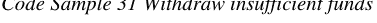

这创建了一个账户并尝试从中提取五份资金。这段代码将会失败，因为我的账户初始余额为零，但这展示了我如何为账户成员提供访问权限。`WithdrawFunds` 方法是 `Account` 类的成员，因此它可以访问类的私有成员。

## 程序员观点：元数据决定了成员和方法

我至少有五分钟没有提到元数据了。所以现在可能是个好时机。我针对银行系统收集的数据将决定我如何访问类的成员。在上面的代码中，我保护余额值的做法反映了客户如何确保该值被妥善管理。

## 公有方法

你已经注意到我将 `WithdrawFunds` 方法设为公有（public）。这意味着运行在类外部的代码可以调用该方法。这是必要的，因为我们希望人们通过调用对象中的方法来与对象进行交互。通用规则如下：

- 如果它是类的数据成员（即它持有数据），请将其设为私有（private）
- 如果它是一个方法（即它执行某些操作），请将其设为公有（public）

当然，在特殊情况下代码是可以打破规则的。如果你不在乎成员是否被破坏，并且希望程序运行得越快越好，你可以将数据成员设为公共。如果你编写了一个只在类内部使用并执行某些特殊秘密任务的方法，你可以将其设为私有。

## 程序员观点：使用编码规范来显示哪些内容是私有的

如果你查看我写的代码（我建议你这样做，这些内容很有用），你会发现当我使用公共变量名时，我使用大写字母开头（例如从我们的银行账户中取款的情例）。但我会将私有成员的首字母小写（例如我们银行账户的余额数据成员）。这让每个阅读我代码的人都能轻松理解，因为他们可以从类成员的名称看出它是公有的还是私有的。这种规范也扩展到了块局部变量。这些变量（例如无处不在的 `i`）始终以小字母开头。

有些人人会做得更彻底，比如在类成员变量前面加上 `m_` 字符。他们会将余额命名为 `m_balance`，以便类成员更易被识别。我通常不会做到这一步，因为我认为成员名称通常已经足够了，但人们对此意见不一。在这种情况下，最重要的是整个编程团队都采用此类事项的规范。事实上，大多数开发公司都有规定它们所使用的编码规范的文档，并要求开发者遵守这些规范。

## 4.5.3 一个完整的账户类

我们现在创建一个银行账户类，它负责控制对余额值的访问：

```csharp
public class Account {
    private decimal balance = 0;

    public bool WithdrawFunds (decimal amount) {
        if (balance < amount) {
            return false;
        }
        balance = balance - amount;
        return true;
    }

    public void PayInFunds (decimal amount) {
        balance = balance + amount;
    }

    public decimal GetBalance() {
        return balance;
    }
}
```

我上面创建的银行账户类表现良好。我创建了三个方法，可以用它们与账户对象交互。例如，我可以存款、查询剩余金额以及提取现金：

```csharp
Account test = new Account();
test.PayInFunds(50);
```

在这一系列语句结束后，`test` 账户应该有 50 英镑。如果没有，说明我的程序运行失败了。`GetBalance` 方法被称为访问器（accessor），因为它允许访问我业务对象中的数据。我会写一点代码来测试这些方法：

```csharp
Account test = new Account();
test.PayInFunds(50);
if (test.GetBalance() != 50) {
    Console.WriteLine("Pay test failed");
} else {
    Console.WriteLine("Pay test succeeded");
}
```

## 代码示例 32 测试账户类

我的程序现在会进行自我测试，即它执行某些操作并确保该操作的效果是正确的。当然，我仍然必须阅读所有测试的输出，这很枯燥。稍后我们将考虑单元测试的使用，它会让这一切变得简单得多。

## 创建解决方案

## 使用对象设计

## 程序员观点：测试失败时发出警报声

上面的测试虽然不错，但并不完美。它只在测试失败时产生一条小消息。你必须阅读那条消息，如果你没注意到它，可能会认为你的代码没问题。我的测试会统计发现的错误数量。如果错误计数大于零，它们会打印一条闪烁红字的消息，指示发生了糟糕的事情。一些开发人员实际上为他们的测试系统连接警报器和闪烁的红灯，让失败的测试无法忽略。然后他们会找到导致失败的程序员，并让他或她为下次买单。

## 4.5.4 测试驱动开发

我热爱测试开发。如果我要编写任何新内容，都可以通过使用驱动方法（driven approach）来完成。这解决了三个问题：

- 你不会在项目结束时才测试。那通常是测试的时间，因为你可能正在使用很久以前编写的代码。
- 你可以在项目早期写出以后可能需要的代码。许多项目的失败是因为人们在充分理解问题之前就开始了编程。先写测试实际上是完善理解的一种良好方式。它给了你很好的机会让这些测试在某个时刻是有用的。
- 当你的项目出现 bug 时，你需要说服自己修复没有破坏某些部分（引入新故障最常见的方法就是修复一个 bug）。如果你拥有一套自动测试，你就有办法阻止这种情况发生。

## 程序员观点：有些事情很难测试

测试开发是一种很好的旅行方式，但它并不能解决你所有的问题。某些类型的程序很难通过这种方式测试。任何涉及用户使用命令和响应的前端内容都很难测试，尽管向程序发送内容很容易，但要观察程序如何做出响应要困难得多。在我看来，让用户界面部分成为对象之上的一个非常薄的层，由对象来完成工作。在上面的银行账户中，客户输入取款金额的用户界面代码将非常简单，并直接连接到对象的方法。由于我的对象测试很容易，我可以确信测试界面也会没问题。

另一种很难通过这种方式测试的程序是任何类型的游戏。这主要是因为游戏性的质量是你无法为其设计测试的。当有人回来说“游戏太难了，你没办法在死之前杀死关卡 Boss”时，你真的能做些什么吗？在这种情况下唯一的解决方案是明确你的测试试图证明什么（这样人类测试人员就知道找什么），并使能够非常容易地更改影响游戏性的数值。例如，应该很容易调整外星人击中对你的宇宙飞器造成的伤害量，以及所有游戏对象的速度。

所以，请使用测试进行开发。你会感谢我的。

C# 编程 Rob Miles 2016

98


## 4.6 静态项

目前，我们在类中创建的所有成员都是类实例的一部分。这意味着每当我们创建一个 `Account` 类的实例时，我们都会得到一个 `balance`（余额）成员。然而，我们也可以创建由类所持有的成员，也就是说它们存在于任何特定实例之外。

### 4.6.1 静态类成员

`static` 关键字允许我们创建不存储在实例中、而是存储在类本身的成员。

学习在 C# 程序语境下 `static` 的含义非常重要。在我们编写的每个程序中都使用了大量的它：

```csharp
class AccountTest {
    public static void Main () {
        Account test = new Account();
        test.PayInFunds("Balance:");
        Console.WriteLine("Balance:" + test.getBalance());
    }
}
```

`AccountTest` 类有一个名为 `Main` 的静态成员。我们知道这是运行程序时调的方法。它是 `AccountTest` 类的一部分。如果我创建了五十个 `Account` 实例，它们将共享同一个 `Main` 方法。在 C# 角度中，`static` 关键字将成员标记为类的一部分，而不是类实例的一部分。我将用一种华丽的字体再写一遍，因为这很重要：

> 静态成员是类的成员，而不是类实例的成员

我不需要创建 `AccountTest` 类的实例就可以使用 `Main` 方法。这就是我的程序实际工作的方式，当它启动时，它还没有对任何内容进行任何更改，因此此方法必须在那里，否则它无法运行。

`static` 并不意味着“不能更改”。我认为这句话适合用华丽的字体写：

> Static 并不意味着“不能更改”。

被设置为静态的类成员可以像类的任何其他成员一样使用。数据成员或方法都可以是静态的。

### 4.6.2 使用类的静态数据成员

在这里，也许一个静态数据的示例会有所帮助。考虑我们银行账户的利率。客户告诉我们，`account` 类的一个成员之一将是账户的利率。在程序中，我们可以通过向类添加另一个持有当前利率的成员来实现这一点：

```csharp
public class Account {
    public decimal Balance;
    public decimal InterestRateCharged;
}
```

## 静态项

现在我可以创建账户并设置余额和利率了。（如果我做得体，我会把这些内容设为私有并提供方法等，否则我现在先保持简单）。

```csharp
RobbsAccount = new Account();
RobbsAccount.Balance = 100;
RobbsAccount.InterestRateCharged = 10;
```

问题在于；我被告知利率是所有账户共有的。如果利率必须为所有账户更改，这意味着为了实现这一更改，我必须遍历所有账户并更新速率。这将非常乏味，而且如果我漏掉了一个账户，可能会非常昂贵。

我通过将利率设置为静态来解决这个问题：

```csharp
public class Account {
    public decimal Balance;
    public static decimal InterestRateCharged ;
}
```

现在利率是类的一部分，而不是任何实例的一部分。这意味着当我获取它时，必须更改速率：

```csharp
RobbsAccount = new Account();
RobbsAccount.Balance = 100;
RobbsAccount.InterestRateCharged = 10;
```

由于它是类的成员，我现在必须使用类名来获取它，而不是实例名引用。

## 程序员观点：静态数据成员既有用又危险

当你收集有关项目的元数据时，你应该寻找那些可以是静态的项。这使得限制（你允许一个人拥有的最大年龄）可以是静态的。可能会在某个时刻年龄发生变化，而你不需要更新项目中的所有对象。

但当然，正如蜘蛛侠曾经说过的样：“能力越大，责任越大。”你应该小心提供对静态数据项的访问。单个静态值的更改将影响你的整个系统。因此，它们应该是私有的，并通过方法调用进行更新。

### 4.6.3 在类中使用静态方法

我们也可以将方法设为静态。长期以来我们一直在 `Main` 方法上这样做。在设计系统时，你也可以使用它们。例如，我们可能有一个方法决定某人是否允许拥有银行账户。它将考虑年龄和收入，取决于这些是否可以接受：

```csharp
public bool AccountAllowed( decimal income, int age ) {
    if ( income >= 10000 ) && ( age > 18 ) {
        return true;
    } else {
        return false;
    }
}
```

上面的方法检查了预期账户的年龄和收入值；你必须超过 17 岁且至少有 10000 英镑才能允许拥有账户。问题在于，目前在我们拥有 `Account` 实例之前，无法调用该方法。我们可以通过将该方法设为静态来解决这个问题：

```csharp
public static bool AccountAllowed (decimal income, int age )
{
    if ( income >= 10000 ) && ( age >= 18 )
    {
        return true;
    }
    else
    {
        return false;
    }
}
```

利率现在是类的一部分，而不是任何实例的一部分。这意味着当我获取它时，必须更改速率：

```csharp
RobbsAccount = new Account();
RobbsAccount.Balance = 100;
RobbsAccount.InterestRateCharged = 10;
```

由于它是类的成员，我现在必须使用类名来获取它，而不是实例名引用。


## 创建解决方案

## 对象的构建

“但等一下，”你会说，“我们已经创建了一段时间的对象了，我从未需要提供过构造方法。”这是因为 C# 编译器在这里难得地表现得很友好。它没有因为你没有提供构造方法而对你大吼，而是为你创建了一个默认构造方法供你使用。

你可能觉得这很奇怪，通常情况下，如果你没做某事，编译器会毫不犹豫地责备你，但在这种情况下，它只是在不通知你的情况下直接解决了问题。看待这个问题有这两种方式：

- **友好的编译器**：编译器正试图让你的生活变得简单。
- **邪恶的编译器**：编译器知道，如果它现在自动处理，以后当你尝试理解为什么不需要添加它时，你会遭受更多痛苦。

你如何看待构造函数的行为取决于你自己。

## 4.7.1 默认构造函数

构造函数的名称与类名相同，但它不返回任何内容。它在我们执行 `new` 时被调用。如果你不提供构造函数（到目前为止我们提供），编译器就会为我们创建一个。

```csharp
public class Account
{
    public Account ()
    {
    }
}
```

这就是默认构造函数的样子。它是公的（public），以便可能想要创建类实例的外部类可以访问。它不接受任何参数。如果我创建了自己的构造函数，编译器就会假设我清楚自己在做什么并停止提供默认构造函数。这可能会导致问题，我们稍后会讨论。

## 4.7.2 我们自己的构造函数

为了好玩，我们可以写一个打印出它被调用的构造函数：

```csharp
public class Account
{
    public Account ()
    {
        Console.WriteLine ("We just made an account");
    }
}
```

这个构造函数并没有什么创意（呵），但它能让我们知道它何时被调用。这意味着当我的程序执行这一行代码时：

```csharp
robsAccount = new Account();
```

- 程序将打印出信息：

we just made an account

注意，这并不有用，因为会导致大量的打印，程序用户可能并不买账，但它展示了该过程是如何工作的。

## 为构造函数传递信息

在创建 Account 时能够获得控制权是有用的，但如果能在创建它时向 Account 馈入信息会更完美。例如，我想在创建账户时看到账户持有者的姓名、地址和初始余额。换句话说，我想要执行如下操作：

```csharp
robsAccount = new Account ("Rob Miles", "Hull", 0 );
```

这可以创建一个新账户，并将 name 属性设置为 Miles，地址设置为 Hull，初始余额设置为零。事实证明我可以非常轻松地做到这一点，我做的只需让构造方法接受这些参数，并使用它们来设置类的成员变量。

```csharp
class Account {
    // 私有成员数据
    private string name;
    private string address;
    private decimal balance;

    // 构造函数
    public Account (string inName, string inAddress, decimal inBalance) {
        name = inName;
        address = inAddress;
        balance = inBalance;
    }
}
```

构造函数获取参数中提供的值，并使用它们来设置正在创建的 Account 的成员。在这方面，它的行为与任何其他方法调用完全一致。

```csharp
class Bank {
    public static void Main() {
        Account robsAccount;
        roboAccount = new Account("Rob", "Rob House", 100000);
    }
}
```

### 代码示例 34：使用自定义构造函数

上面的代码会为 Rob 创建一个拥有 100000 英镑的账户。我希望如是。

注意，添加这样一个构造函数有一个非常强大的影响：你必须使用新的构造函数来创建类的实例，也就是说，我现在创建 Account 对象的唯一方法是提供姓名、地址和初始余额。如果我尝试这样做：

```csharp
robsAccount = new Account();
AccountTest.cs(9,27): error CS1501: No overload for method 'Account' takes '0' arguments
```

编译器的意思是类中没有不带参数的默认构造函数。换句话说，如果程序员没有提供构造函数，编译器就会提供一个默认构造函数。

如果我们已经在程序使用了默认构造函数，然后又添加了自己的构造函数，这就会导致困惑。编译器不再提供默认构造函数，我们的程序将无法编译。在这种情况下，你必须找到所有调用默认构造函数的地方并更新它们，或者为这些调用创建一个供它们使用的默认构造函数。当然，你不必这样做，因为你的程序设计得太完美了，永远不会遇到这个问题。就像我一样，咳咳。

## 4.7.3 重载构造函数

重载（Overload）是一个有趣的词。在《星际迷战》科幻剧的背景下，这是他们每一集对曲速引擎做的事。在 C# 程序中，它的意思是：

“一个方法与另一个方法同名，但有一组不同的参数”。编译器非常乐意你重载方法，因为它可以从调用方法时给出的参数判断应该使用哪一个。在类的上下文中，你可以重载任何方法，包括构造函数。

如果你有多种创建对象的方式，这非常有用。例如，你可能想要只通过姓名创建账户，或者通过姓名和地址创建账户，或者通过姓名、地址和余额创建账户。

```csharp
public Account (string inName, string inAddress, decimal inBalance) {
    name = inName;
    address = inAddress;
    balance = inBalance;
}

public Account (string inName, string inAddress) : this(inName, inAddress, 0)
{
}

public Account (string inName) : this(inName, "Not Supplied", 0)
{
}
```

`this` 关键字意味着“该类中的另一个构造函数”。你可以看到上面的代码，其他构造函数都调用了第一个构造函数。它们只是将提供的参数以及我们创建的默认值传递给“正确的”构造函数来完成工作。

这些调用的语法非常有趣，实际上构造函数的执行发生在构造方法体之前。事实上，它完全在代码块之外。这是合理的，因为它反映了实际发生的情况。“this”构造函数在进入另一个构造的方法体之前运行。

## 4.7.4 构造函数管理

如果 Account 类将有很多构造函数，这可能会变得很混乱。为了避免这种情况，最好的方法是有一个主构造函数完成所有的工作，并让所有其他构造函数都调用它。这就是我们在上面的示例中所做的。


## 创建解决方案

# 对象的构造

上述，由于此调用已经完成了所有工作，因此构造函数体可以是空的。

```cs
class Bank {
    public static void Main() {
        const Int MAX_CUST = 100;
        Account[] Accounts = new Account[MAX_CUST];
        Accounts[0] = new Account("Rob", "Robs House", 1000000);
        Accounts[1] = new Account("Jim", "Jim House");
        Accounts[2] = new Account("Fred");
    }
}
```

代码示例 35 载载构造函数

上面的示例代码展示了如何正确使用构造函数重载。代码创建了一个账户引用数组（称为 Accounts），然后将前几个元素指向 Account。第一个元素指向 Rob 的 Account，其拥有完整的地址和 100,000 英镑。第二个元素（元素 1）引用 Jim 的账户，其有地址和默认的 0 余额。第三个元素（元素 0）引用 Fred 的账户，它具有默认的（“未提供”）地址和默认的 0 余额。

# 程序员观点：对象构造应该经过规划

在编写程序时，对象的构造方式是你应该仔细规划的。你应该创建一个“主”构造函数，处理构造对象最全面的方法。然后，你应该让所有其他构造函数方法都使用这个方法来获取该方法。

## 4.7.5 构造函数无法失败

如果你看詹姆斯·邦德电影，通常会有这样一个时刻，007 特工告诉世界命运掌握在他手中。失败不是选项。构造函数有点像这样。构造函数不能失败。这是一个问题：

过去我们有一个方法时，我们可以确保它们的行为经过错误检查，这样方法就不会破坏我们对象的状态。例如，尝试从银行账户中提取负数金额的操作应该被拒绝。

我们允许操作对象的整个基础是为了确保它们不会被使用它们的人破坏。如果你尝试通过方法调用执行愚蠢的事情，它应该拒绝执行操作并返回一个指示其无法完成工作的值。

因此，我们知道当我们创建一个更改对象中数据的方法时，我们必须确保这种更改总是有效的。例如，我们不会让以下操作成功：

```cs
RobAccount.PayFunds(1234567890);
```

你可以支付的现金金额会有上限，因此 PayFunds 方法将拒绝支付该金额。但什么能阻止以下操作呢：

```cs
Account = new Account("Rob", "Hull", 1234567890);
```

就像詹姆斯·邦德一样，构造函数是不允许失败的。无论构造函数调用期间发生什么，它都会完成并创建一个新实例。

这带来了一个问题。看起来我们除了最重要的那个点之外（即对象创建时），在任何一点上都可以否决值。

# 程序员观点：管理失败是一项艰巨的工作

这带我们进入成为伟大程序员道路上的一个反复出现的主题。编写代码完成一项任务通常非常简单。编写能够以有用方式处理所有可能的失败条件的代码要困难得多。编程生活中的一个事实是，你花费在担心事物如何失败上的时间，比你担心它们如何正确运行的时间得多。

# 构造函数与异常

解决此问题的唯一方法是让构造函数在不满时不抛出异常。这意味着构造函数的用户必须确保在创建对象时捕获异常，这并不是坏事。实现此点的明智方法是让构造函数调用它所提供的每个属性的设置方法，如果其中任何一个返回错误，构造函数就应该在此处抛出异常：

```cs
public Account (string inName, string inAddress)
{
    if (SetName (inName) == false) {
        throw new Exception ("Bad name " + inName);
    }
    if (SetAddress (inAddress) == false) {
        throw new Exception ("Bad address " + inAddress);
    }
}
```

如果我们尝试创建一个带有错误名称的账户，它将抛出异常，这正是我们想要的。这里唯一的问题是，如果地址也是错的，方法用户在修复名称并再次调用构造函数之前，将不知道这一点。

我讨厌在在使用程序时发生这种情况。这通常是在我在网页上填写表单时。我输错了我的名字，它就对那里抱怨。然后我写对了名字，它又抱怨我的地址。我想要的是一种能够一次性获得该项目所有无效部分的报告的方法。可以做到，代价是增加一点复杂性。

# 从对象到组件

```cs
public Account(string inName, string inAddress,
    decimal inBalance)
{
    string errorMessage = "";
    if (SetBalance(inBalance)==false)
        errorMessage = errorMessage + " Bad Balance: " + 
        inBalance;
    if (SetName(inName) == false)
        errorMessage = errorMessage + " Bad name: " + inName;
    if (SetAddress(inAddress) == false)
    {
        errorMessage = errorMessage + " Bad addr: " + 
        inAddress;
    }
    if (errorMessage != "")
    {
        throw new Exception("Account failed " +
        errorMessage);
    }
}
```

代码示例 36 构造函数失败

上面的示例代码展示了如何正确使用构造函数重载。代码创建了一个账户引用数组（称为 Accounts），然后将前几个元素指向 Account。第一个元素指向 Rob 的 Account，其拥有完整的地址和 100,000 英镑。第二个元素（元素 1）引用 Jim 的账户，其有地址和默认的 0 余额。第三个元素（元素 0）引用 Fred 的账户，它具有默认的（“未提供”）地址和默认的 0 余额。

## 程序员观点：对象构造

在编写程序时，对象的构造方式是你应该仔细规划的。你应该创建一个“主”构造函数，处理构造对象最全面的方法。然后，你应该让所有其他构造函数方法都使用这个方法来获取该方法。

## 程序员观点：对象构造

在编写程序时，对象的构造方式是你应该仔细规划的。你应该创建一个“主”构造函数，处理构造对象最全面的方法。然后，你应该让所有其他构造函数方法都使用这个方法来获取该方法。

## 程序员观点：对象构造

在编写程序时，对象的构造方式是你应该仔细规划的。你应该创建一个“主”构造函数，处理构造对象最全面的方法。然后，你应该让所有其他构造函数方法都使用这个方法来获取该方法。

## 程序员观点：对象构造

（编写，时，，构造


仔细规划的。，你创建一个“主

，函数，，构造

最


。，，，，，，，，，，，，，方法，，，，

该该该方法。

该。。，

函数，。


最该方法。，，你应该让所有其他构造函数方法都使用这个方法来获取该方法。

# 程序员函数：构造函数


，你应该让所有其他构造函数方法都使用这个方法来获取该方法。


## 创建解决方案
## 从对象到组件

关于 C# 接口机制，以及关于窗口和按钮如何工作的详细描述。这会让你得 0 分。

## 接口与设计

因此，我们不应该从定义类开始，而应该考虑描述它们的接口，即它们**做什么**。在 C# 中，我们通过一种称为接口（interface）的东西来表达这种信息。接口是组合在一起的方法定义。

我们对银行账户接口的首次尝试如下：

```csharp
public interface IAccount {
    void PayFunds(decimal amount);
    bool WithdrawFunds(decimal amount);
    decimal GetBalance();
}
```

这表示 `IAccount` 方法由三个方法组成：一个用于付款；另一个用于取款；第三个返回账户余额。从余额管理的角度来看，这就是我们所需要的。注意，在接口层面，我没有说它应该如何实现，我只是说它应该做什么。在接口层面，我不说应该如何做，我只是说它应该做什么。接口放置在源文件中，以类的方式进行编译。它定义了与特定任务或角色相关的方法。

## 程序员观点：接口名称以 I 开头

我们已经看到有一些命名约定，用于设置变量的标准。另一个约定是接口的名称应该以 I 开头。如果你这样做，程序将可以正常编译，因为编译器对变量名称没有意见。你也可以这样做。

### 4.8.3 在 C# 中实现接口

当我们让一个类实现接口时，接口变得有趣了。实现接口就像是在资源提供者和消费者之间建立一种合同。如果一个类实现了接口，意味着它拥有接口中描述的每一个方法。

在银行账户的情况下，我要创建一个实现接口的类，以便它可以被认为是一个账户，无论它具体是什么：

```csharp
public class CustomerAccount : IAccount {
    private decimal balance = 0;

    public bool WithdrawFunds (decimal amount) {
        if (balance < amount) {
            return false;
        }
        balance = balance - amount;
        return true;
    }

    public void PayInFunds (decimal amount) {
        balance = balance + amount;
    }

    public decimal GetBalance() {
        return balance;
    }
}
```

上面的代码与之前的类不同。唯一的区别在于顶行：

```csharp
public class CustomerAccount : IAccount
```

上面行的高亮部分告诉编译器该类实现了 `IAccount` 接口。如果类没有包含接口中的方法，将会得到编译错误：

> error CS0035: 'AccountManagement.CustomerAccount' does not implement member 'AccountManagement.IAccount.PayInFunds(decimal)'

在这种情况下缺少了 `PayInFunds` 方法。

## 4.8.4 接口展示

一旦我们完成了 `CustomerAccount` 类，我们现在有了两种方式来看待它：

- 作为 `CustomerAccount`（因为它是什么）
- 作为 `IAccount`（因为它可以做什么）

人们总是这样做。你可以以多种方式考虑它，例如所示：

- 某个人（因为它是谁）
- 一个讲师（因为它可以做什么）

如果你把它看作是一个包含 `GetLecture` 方法的讲师，你可以与任何实现该接口的其他师使用相同的方法。从大学的角度来看，为了管理大量的学生，将其看作讲师比看作某个人更有用。

因此，通过接口，我们不再考虑类**是什么**，而是开始考虑它们**能做什么**。在银行的情况下，这意味着我们想要处理 `IAccount`（接口能力集）而不是 `CustomerAccount`（特定的类）。

在 C# 中，这意味着我们需要能够引用实现接口的变量，这非常简单：

```csharp
IAccount account = new CustomerAccount();
account.PayInFunds(50);
Console.WriteLine("Balance: " + account.getBalance());
```

### 代码示例：简单接口

`account` 变量允许引用 `IAccount` 接口的对象。编译器将检查 `CustomerAccount` 是否实现了这一点，如果实现了，编译就会成功。

注意，没有 `IAccount` 接口的实例。它只是引用具有该能力（包含所需方法）的东西的方式。在现实生活中也是如此。没有物理上的“讲师”实体，只有拥有该特定能力或角色的人。

## 4.8.5 使用接口

现在我们有了用接口设计的系统，扩展它变得容易得多。我们可以创建一个实现 `IAccount` 接口的 `BabyAccount`。它实现了所有方法，但它们的行为略有不同：

```csharp
public class BabyAccount : IAccount {
    private decimal balance = 0;

    public bool WithdrawFunds (decimal amount) {
        if (balance < amount) {
            return false;
        }
        balance = balance - amount;
        return true;
    }

    public void PayInFunds (decimal amount) {
        balance = balance + amount;
    }

    public decimal GetBalance() {
        return balance;
    }
}
```

现在我们有了用接口设计的系统，扩展它变得容易得多。我们可以创建一个实现 `IAccount` 接口的 `BabyAccount`。它实现了所有方法，但它们的行为略有不同：

```csharp
class Bank {
    const int MAX_CUST = 100;

    public static void Main() {
        IAccount[] accounts = new IAccount[MAX_CUST];
        accounts[0] = new CustomerAccount();
        accounts[0].PayInFunds(50);
        Console.WriteLine("Balance: " + accounts[0].getBalance());

        accounts[1] = new BabyAccount();
        accounts[1].PayInFunds(20);
        Console.WriteLine("Balance: " + accounts[1].getBalance());

        if (accounts[0].WithdrawFunds(20)) {
            Console.WriteLine("Withdraw OK");
        }
        if (accounts[1].WithdrawFunds(20)) {
            Console.WriteLine("Withdraw OK");
        }
    }
}
```

## 4.8.6 实现多个接口

一个组件可以实现所需的任意接口。`IAccount` 接口让我从它作为银行账户的能力方面部分考虑它。然而，我可能想以多种方式看待一个组件。例如，银行会希望账户能够在纸上打印出来。

你可能认为我只需要向 `IAccount` 接口添加一个 `print` 方法。如果我只想打印银行账户，这样做是合理的。然而，会有很多东西需要打印，例如警告信、特别优惠等。这些每个项目都将由提供特定接口的组件来实现（例如 `IWarning`、`ISpecialOffer`）。我不想在这些每一个项目中都提供 `print` 方法，我想要的是一种能够从打印能力角度来引用对象的方式。

这其实非常简单。我创建一个接口：


## 创建解决方案

## 从对象到组件

```c
public interface IPrintToPaper
{
    void DoPrint();
}
```

现在，任何实现了 `IPrintToPaper` 接口的内容都将包含 `DoPrint` 方法，并且可以根据其打印能力来考虑。

一个类可以实现它需要的任意接口。每个接口都是它被引用和访问的一种新方式。

```c
public class BabyAccount : IAccount, IPrintToPaper
{
```

这意味着 `BabyAccount` 实例的行为得像一个账户，并且包含一个可以用于打印的 `DoPrint` 方法。

# 4.8. 使用接口进行设计

如果你应用了“抽象”技术，你最终将得到一个如下所示的过程：

- 尽可能地收集关于问题的元数据；什么对客户很重要，哪些值需要被表示和操纵，以及取值范围
- 识别问题中你必须创建组件的类
- 识别组件必须提供的动作（方法）和值（属性）
- 将这些内容放入每个组件的接口
- 决定如何测试这些值和动作
- 在实现组件的同时对其进行测试

你可以在编写任何代码之前，在纸上完成大部分工作。你还可以使用图形化工具来绘制正式图表以表示信息。软件工程领域完全是基于过程的。

你还应该认为接口是很好的挂载点。如果你有一组所有银行账户必须遵循的基础原则（例如，存款必须始终让账户余额增加），你就可以编写绑定到 `IAccount` 接口的测试，并将其用于测试创建的任何组件。

# 程序员的接口：接口只是承诺

接口与其说是绑定合约，不如说是一个承诺。一个类有一个名为 `PayFunds` 的方法，并不意味着它会向账户存钱；它意味着该类中存在同名的方法。C# 中没有任何东西可以允许你对方法强制特定的行为：这取决于你对所创建类的程序的信任程度，以及你的测试做得如何。事实上，我们在构建程序时有时会利用这一点，创建实现接口但本身并不具备该行为的“虚假”组件。

在创建组件和将它们组合时，接口为我们提供了巨大的灵活性。这意味着一旦我们确定了银行账户类需要持有什么，我们就可以继续考虑将账户添加到到哪些地方。这是规范中的真实细节。一旦我们为组件设定了接口，我们就可以从组件*必须做什么*来思考，而不是具体的*如何做*。

例如，经理告诉我们，每个银行账户必须有一个账户号码。这是一个非常重要的值，因为它在账户整个寿命范围内都是固定的，永远不会更改。

C# 编程 | Rob Miles 2016
115

## 创建解决方案

## 继承

从接口设计的角度来看，这意味着账户号码将在创建时设置，账户类将提供一个方法让我们获取该值（但不会有设置账户号的方法）。

我们不在乎 `GetAccountNumber` 实际上做了什么，只要它始终返回特定账户的值即可。因此，这一要求在账户实现的接口中结束了表述。

```c
interface IAccount {
  int GetAccountNumber();
}
```

该方法返回作为此实例账户号的整数。通过将其放在接口中，我们可以说账户必须交付其值，但我们没有描述应该如何实现这一点。系统中的接口设计正是如此。它们说明了我们拥有哪些行为，但并不一定说明它们是如何实现的。我必须添加注释来获取关于该方法作用的更多细节。

对像账户这类在世界中确实需要唯一性的东西的需求，导致了 C# 库中创建了一系列方法来创建全局唯一标识符或 GUID。这些是根据日期、时间以及关于主机计算机的某些信息创建的数据项。每个 GUID 在世界上都是唯一的。我们可以在 `Account` 构造函数中使用这些内容创建一个 GUID，从而允许每个账户都拥有唯一的号码。

# 4.9 继承

继承是我们可以实现创造性的另一种方式。它是我们从类中获取行为并仅修改我们想要的部分以创建新类的方法。在这方面，我们可以将其视为一种所谓的代码复用机制。如果你有一组想要创建的相关对象，它也可以在程序的设计阶段使用。

继承允许一个类从其父类的类中获取行为。你可以将接口视为一个类的一种声明，表示它拥有一组通过实现接口的行为。如果一个类继承自特定的父类，意味着它拥有一组从父类那里继承来的行为。简单来说：

> 接口：“我可以做你告诉过我可以做的这些事”
> 继承：“我可以做这些事，是因为我父类可以”

## 4.9.1 扩展父类

我们可以在银行账户项目中看到继承的使用示例。我们已经注意到，`BabyAccount` 的行为必须像 `CustomerAccount` 一样，但在现金取除除外。`CustomerAccount` 可以提取任意数量的资金。`BabyAccount` 每次只允许提取 10 英镑。

我们从设计的角度通过接口解决了这个问题。通过将执行任务的东西与任务描述（即接口）分离开，我们可以基于 `CustomerAccount` 创建新类，然后更改行为不同的方法。我们真正想做的是获取 `CustomerAccount` 的所有好处并仅更改该方法。事实证明我们可以在 C# 中使用继承来实现这一点。当我创建 `BabyAccount` 类时，我可以告诉编译器它是基于 `CustomerAccount` 的：

```c
public class BabyAccount : CustomerAccount, IAccount
{
```

这里的关键是类后面的高亮部分。这意味着 `CustomerAccount` 能做的一切，`BabyAccount` 都能做。我可以写这样的代码：

```c
BabyAccount b = new BabyAccount();
b.PayFunds(50);
```

这是行得通的，尽管 `BabyAccount` 没有 `PayFunds` 方法，但父类有。这意味着在此时使用的是 `CustomerAccount` 类的 `PayFunds` 方法。

因此，`BabyAccount` 的实例拥有从其父类那里获取的能力。事实上，目前 `BabyAccount` 并没有自己的行为；它的一切都从父类那里获得。

# 程序员的观点：块拷贝是邪恶的

我在写程序时仍然会犯错。你可能认为在工作了多年之后，我每次都能做对。错了。我犯的很多错误是由不当使用块拷贝（block copy）引起的。如果在更多地方需要它，请把它写成方法。尽量这样做。优秀的程序员每个代码段只写一次，且只写一次。这不是问题。

C# 编程 Rob Miles 2016
116

## 4.9.2 重写方法

我们现在知道可以基于现有类创建一个新类。我们接下来需要的是更改感兴趣的方法的行为。我们想用一个新方法替换 `WithdrawFunds` 方法。现在，在 `BabyAccount` 类中，我可以这样做：

```c
public class BabyAccount : CustomerAccount, IAccount
{
    override bool WithdrawFunds (decimal amount)
    {
        if (amount > 10)
        {
            return false;
        }
        if (balance < amount)
        {
            return false;
        }
        balance = balance - amount;
        return true;
    }
}
```

关键字 `override` 意味着“优先于‘父类’中的方法使用这个版本的方法”。这意味着如下代码：

```csharp
BabyAccount b = new BabyAccount();
b.PayFunds(50);
b.WithdrawFunds(55);
```

C# 编程 Rob Miles 2016
117


## 创建解决方案

## 继承

PayFunds 的调用将使用父类中的方法（未被重写的方法），而 WithdrawFunds 的调用将使用 BabyAccount 中的方法。

# 虚方法

实际上，为了让重写生效，我们还需要做另一件事。C# 编译器需要知道一个方法是否会被重写。这是因为编译器调用被重写方法的方式与调用“正常”方法的方式略有不同。换句话说，上面的代码将无法正常编译，因为编译器没有告诉它 `WithdrawFunds` 可能会在父类的子类中被重写。

为了让重写生效，我必须更改在 CustomerAccount 类中对方法的声明。

```csharp
public class CustomerAccount : IAccount
{
    private decimal balance = 0;

    public virtual bool WithdrawFunds (decimal amount)
    {
        if (balance < amount)
        {
            return false;
        }
        balance = balance - amount;
        return true;
    }
}
```

`virtual` 关键字意味着“我想在子类中创建此方法的另一个版本”。你不必非重写它，但如果没有这个词，你绝对无法重写。

这使得 `override` 和 `virtual` 变成了一对匹配组合。你使用 `virtual` 来标记一个方法可以被重写，而使用 `override` 来实际提供该方法的替代方案。

# 类层次结构中的数据保护

事实证明上面的代码不起作用。这是因为 `CustomerAccount` 类中的值是 `private` 的。我们仔细地将其设置为私有，以便其他类中的方法无法获取并更改它。

然而，这种限制过于严格，因为它阻止了 `BabyAccount` 类更改该值。为了解决这个问题，C# 提供了一个稍微受限的访问级别称为 `protected`。这使得方法对扩展父类的类可见。换句话说，`BabyAccount` 类中的方法可以看到并使用 `protected` 成员，因为它们与包含成员的类处于同一个层次结构中。

层次结构有点像家族树。每个类都有父类，并且可以执行父类执行的所有事情。它还可以访问上方类中所有的 `protected` 成员。

```csharp
public class CustomerAccount : IAccount
{
    protected decimal balance = 0;
}
```

我对这样做并不太满意，`balance` 对我非常重要，我更希望没有人注意到 `CustomerAccount` 类可以看到它。然而，目前进行这一更改将使工作进展。稍后我们将看到管理这种情况的更好方法。

```csharp
IAAccount[] accounts = new IAccount[MAX_CUST];
accounts[0] = new CustomerAccount();
accounts[0].PayInFunds(50);
Console.WriteLine("Balance: " + accounts[0].GetBytes());

accounts[1] = new BabyAccount();
accounts[1].PayInFunds(20);
Console.WriteLine("Balance: " + accounts[1].GetBytes());
```

```csharp
if (accounts[0].WithdrawFunds(20)) {
    Console.WriteLine("Withdraw OK");
}
if (accounts[1].WithdrawFunds(20)) {
    Console.WriteLine("Withdraw OK");
}
```

代码示例 39 使用继承
上面的代码展示了我们如何创建和使用不同类型的账户，其中 `BabyAccount` 基于父类 `CustomerAccount` 类型。如果你在这里感到似曾相，是因为这与我们在上一个示例中看到的代码完全相同，只是这些对象本身将以相同的方式工作，因为方式总是略有不同，这使得程序更小（我们并不特别关心这一点），并且更容易调试（因为共享方法中的一个错误只需要修复一次）。

# 银行备注：针对资金和利润的重写

重写方法的能力是非常强大的。这意味着我们可以创建更通用的类（例如 `CustomerAccount`），并通过自定义让它们变得更具体（例如 `BabyAccount`）。本课程的内容应该在设计阶段进行计划和管理。这需要从客户那里收集更多的元数据，并决定在项目生命周期内更改哪些行为部分。我们将 `WithdrawFunds` 方法设为 `virtual`，是因为经理会说“我们希望自定义账户取款的方式”，我们已经在规格书中写明了这一点。

# 4.9.3 使用 base 方法

记住，程序员本质上是懒人，他们试图对一个特定问题只写一次代码。看起来我们在这里在这里打破了规则，因为 `BabyAccount` 中的 `WithdrawFunds` 方法包含了父类中该方法的所有代码。

我们已经注意到我们不喜欢这样做，因为这意味着 `balance` 值必须比我们可能喜欢的更暴露暴露。幸运的是，C# 的设计者考虑到了这一点，并提供了一种方法，让你可以在重写它的方法调用 `base` 方法。

在此语境下，`base` 意味着“指向被重写对象的引用”。我可以使用它来让我的 `BabyAccount` 中的 `WithdrawFunds` 方法简单得多：

```csharp
public class BabyAccount : CustomerAccount, IAccount {
    public override bool WithdrawFunds(decimal amount) {
        if (amount > 10) {
            return false;
        }
        return base.WithdrawFunds(amount);
    }
}
```

代码示例 40 重写 base 方法
上面的代码展示了我们如何创建和使用不同类型的账户，其中 `BabyAccount` 基于父类 `CustomerAccount` 类型。如果你在这里感到似曾相，是因为这与我们在之前的示例中看到的代码完全相同，只是这些对象本身将以相同的方式工作，因为方式总是略有不同，这使得程序更小（我们并不特别关心这一点），并且更容易调试（因为共享方法中的一个错误只需要修复一次）。

*(注：原文后续部分存在大量重复段落，已按要求去处重复内容)*


## 4.9.6 构造函数与层级结构

构造函数是在创建过程中获取控制权的方法。程序员使用它来为对象设置初始值：

在这种情况下，我们想要为一个名叫 Rob Miles 的婴儿创建一个新的 `BabyAccount`，其初始值为 100 分。

只有当 `BabyAccount` 类有一个接受字符串作为第一个参数、接受十进制数值作为第二个参数的构造函数时，上面的代码才能运行。

你可能认为可以通过编写这样的构造函数来解决这个问题：

```csharp
public BabyAccount (string inName, decimal inBalance)
{
    name = inName;
    balance = inBalance;
}
```

但 `BabyAccount` 类是 `CustomerAccount` 类的扩展。换句话说，为了创建一个 `BabyAccount`，程序必须创建一个 `CustomerAccount`。

我们需要做的第一件事是在 `CustomerAccount` 类中添加一个构造函数方法，用于设置客户的名字和余额：

```csharp
public CustomerAccount (string inName, decimal inBalance) : base (inName, inBalance)
{
    // 设置名字和余额
}
```

`base` 关键字的使用方式相同，因为它用于调用同一类中的另一个构造函数。上面的构造函数显示，`Account` 类 `CustomerAccount` 是一个接受两个参数（字符串和第二个十进制值）的构造函数的子类。

## 构造函数层级

在考虑构造函数和层级结构时，你必须记住，当创建一个子类的实例时，必须先创建父类的实例。这意味着父类中的构造函数必须在子类的构造函数之前运行。换句话说，要创建一个 `BabyAccount`，你必须先创建一个 `CustomerAccount`。结果是，程序员必须利用构造函数链。他们必须确保在创建过程的每一层都调用了构造函数，以便最后设置该类。

这说明了你在类层级结构中面临的一个问题。它们可以被认为是“脆弱”的，因为它们很容易被破坏。类层级结构中某部分的更改会导致你必须对其他部分进行更改。如果我们有一个改进 `BabyAccount` 实例创建过程的想法，它最终也需要影响到 `CustomerAccount` 类。

# 程序员观点：设计你的类构建过程

创建类实例的方法是你应该在正在构建的系统内部进行设计的。它是你所构建的系统整体架构的一部分。我把这些事情比作支撑大型建筑楼层和屋顶的钢梁。它们告诉将要实现解决方案的组件的程序员如何创建这些组件。当然，将这些设计写下来并让开发团队随时可用是极其重要的。

## 4.9.7 抽象方法和类

目前，我们正在使用重写（overriding）来修改现有的父类方法的行为。然而，也可以在稍有不同的语境下使用重写。我可以使用它来强制类层级结构中的项执行一组行为。如果某些操作是账户必须执行的，我们可以将其设为抽象的（abstract），然后让子类来实际提供实现。

例如，在银行应用程序的背景下，我们可能希望提供一个方法，给客户写一封信告知他们的账户透支。我们必须为每种类型的账户定义它（我们不希望对银行账户系统和旧的系统使用相同的语言）。然后当我们创建银行账户系统时，我们知道这个方法，但并不切切它在每种情况下具体执行什么。

我们可以在 `CustomerAccount` 类中提供一个“标准”，然后依靠程序员用更具体的方法来重写它，但这样我们没有办法确保他们真的提供了该方法。

C# 提供了一种将方法标记为抽象的方法。这意味着该方法的主体未在此类中提供，而将在子类中提供：

```csharp
public abstract class Account
{
    public abstract string RudeLetterString();
}
```

我的新 `Account` 类包含一个抽象方法，这意味着该类本身是抽象的（并且必须标记为抽象）。抽象类是不可能的实例。如果你仔细考虑，这是合理的。如果调用了 `RudeLetterString` 方法，`Account` 的实例将不知道该做什么。

抽象类可以被看作是一种接口。如果你想基于抽象父类创建一个类的实例，你必须提供父类中给出的所有抽象方法的实现。

# 抽象类和接口

你可能会发现抽象类看起来像接口。这是事实的，因为接口也提供了一个类必须提供的方法“购物清单”。然而，抽象类的不同之处在于，它们可以在包含抽象方法的同时，还可以包含完全实现的方法。这非常有用，因为你不需要在实现特定接口的每个组件中重复实现相同的方法。

问题是，你只能继承一个父类，所以你只能获得一个类的行为。如果你想很好地实现接口，可能仍然需要重复方法。

也许在此时，一个完全运行的示例会有帮助。如果我们考虑我们的银行问题，可以识别出两种类型的行为：

- 每一类银行账户必须提供的行为（例如 `PayFunds` 和 `GetBalance`）
- 每种银行账户必须以特定特定账户类型的方式提供的行为（例如 `WithdrawFunds` 和 `RudeLetterString`）

技巧是使用第一类中的所有方法并将它们放在第二类中。第二类中的方法必须是抽象的。这引导我们得出如下的类设计：

## 创建解决方案

## 继承

```csharp
public interface IAccount
{
    void PayFunds(decimal amount);
    decimal GetBalance();
    string RudeLetterString();
}

public abstract class Account : IAccount
{
    protected decimal balance;
    public virtual void PayFunds(decimal amount)
    {
        balance += amount;
    }
    public virtual decimal GetBalance()
    {
        return balance;
    }
    public abstract string RudeLetterString();
}

public class CustomerAccount : Account
{
    public override string RudeLetterString()
    {
        return "Your account is overdrafted";
    }
}

public class BabyAccount : CustomerAccount
{
    public override void WithdrawFunds(decimal amount)
    {
        if (balance >= amount)
        {
            balance -= amount;
        }
    }
    public override string RudeLetterString()
    {
        return "The baby account is overdrafted";
    }
}
```
（注：代码块的 OCR 文本跨越多个页面；我已根据文本片段提供的上下文重建了逻辑代码结构。）


## 4.9.9 不要慌

这些都是深层次的内容。如果你现在还不理解，不要担心。C# 的这些特性与软件设计过程密切相关，这是一项非常复杂的业务。需要记住的一点是，提供这些特性都是为了让你解决一个问题：

> 创建封装在安全、可交换组件中的软件。

接口允许我描述每个组件可以做什么。类层次结构允许我重用这些组件的代码。仅此而已。

## 4.10 对象礼仪

我们已经从“宏观”上考虑了对象，即我们知道如何使用它们来设计和实现大型软件系统。我们需要做的是一些较小但非常重要的问题，涉及到我们如何在程序中使用对象。

### 4.10.1 对象和 ToString

我们默认认为对象具有一种神奇的能力，可以自己打印出来。如果我写下代码：

```csharp
int i = 99;
Console.WriteLine(i);
```

这将打印出：
99

整数某种方式知道如何打印自己。现在是时候找出这是如何实现的，以及我们如何能够赋予自己的对象同样的神奇能力了。

事实证明，这一切都是由 C# 中物的“对象性”（objectness）提供的。我们知道对象可以包含信息并为我们执行操作（如果我们已经看到构建程序的整个基础是决定对象应该做什么，然后实现这些功能）。我们还看到你可以扩展父对象来创建一个子对象，它拥有父对象的所有能力，加上我们添加的新功能。现在我们将看到对象的能力是如何被用于使 C# 实现的部分正常工作的。

### Object 类

当你创建一个新类时，它实际上并不是凭空产生的。事实上，它是 object 类的子类。换句话说，如果我们写：
这等同于写：

```csharp
public class Account : object {
```

object 类是 C# 的一部分，一切都是 object 类的子类。这有两个重要的影响：

- 每个对象都可以做对象能做的事情。
- 对对象类型的引用可以指向任何类。

对于笔记的这部分内容，第一点是最重要的。这意味着所有创建的类都有许多继承自其终极父类 object 的行为。如果你查看让对象运行的代码，你会发现一个名为 `ToString` 的方法。`ToString` 的实现返回一个对象类型的字符串描述。

### ToString 方法

系统知道每个对象都存在 `ToString`，如果它需要一个对象的字符串版本，它就会调用对象上的这个方法来获取文本。

换句话说：

```csharp
object o = new object();
Console.WriteLine(o);
```

- 将打印出：

```
System.Object
```

如果你喜欢，可以显式调用该方法：

```csharp
Console.WriteLine(o.ToString());
```

- 结果将完全相同。

`ToString` 的妙之处在于它被声明为虚方法（virtual）。这意味着我们可以重写它，让它按照我们的方式运行：

```csharp
class Account
{
    private string name;
    private decimal balance;

    public override string ToString()
    {
        return "Name: " + name + " balance: " + balance;
    }

    public Account (string inName, decimal inBalance)
    {
        name = inName;
        balance = inBalance;
    }
}
```

在上面的 Account 中，我重写了 `ToString` 方法，使其打印名称和余额值。这意味着代码：

```csharp
Account a = new Account("Rob", 25);
Console.WriteLine(a);
```

代码示例 42 ToString 方法

- 将打印出：

Name: Rob balance: 25

所以，从良好礼仪的角度来看，当你设计一个类时，你应该提供一个 `ToString` 方法，提供该类内容的文本版本。

### 获取父对象的字符串描述

如果你想获取父对象的字符串描述，可以使用基机制（base mechanism）来实现。如果你向子类添加了数据并想先打印子类的结果，这有时非常有用：

```csharp
public override string ToString()
{
    return base.ToString() + " Parent : " + parentName;
}
```

上面的方法来自 `ChildAccount` 类。该类扩展了 `CustomerAccount` 并持有子类父的名字。上面的代码使用了父对象中的 `ToString` 方法，然后在末尾加上父的名字并返回。这的用处在于，如果父类的行为发生了、添加了新成员或更改了字符串格式，`ChildAccount` 类不需要更改，它只需使用升级后的方法即可。

### 4.10.2 对象和相等性测试

我们已经看到，当比较对象引用时，相等性测试并不等同于值的相等测试。我们知道对象是由命名的标签管理的，这些标签指向内存中某处的未命名项目。当我们执行测试时，系统只是检查它们是否都指向了同一个位置。

```csharp
class Point
{
    public int x;
    public int y;
}
```

为了看到这可能如何给我们带来问题，我们需要考虑如何实现一个图形计算机游戏（暂时离开银行系统一会）。在游戏中，对象将位于屏幕上的特定点。我们可以将其表示为坐标，带有一个 x 值和一个 y 值。然后我们想测试它们是否发生了碰撞。

```csharp
Point spaceshipPosition = new Point();
spaceshipPosition.x = 1;
spaceshipPosition.y = 2;

Point missilePosition = new Point();
missilePosition.x = 1;
missilePosition.y = 2;
```

```csharp
if ( spaceshipPosition == missilePosition )
{
    Console.WriteLine("Bang");
}
```

（注：此处原文中存在大量重复的错误描述，翻译已根据逻辑进行了整合，保持了核心含义）我注意到 `Point` 类的 `x` 和 `y` 成员是公共的（public）。我并不是担心保护它们，而是我想让程序正确运行。上面的代码没有工作。尽管飞船和导弹在屏幕的同一个点，但“Bang”没有打印出来。这是因为两个 `Point` 对象持有相同的数据，但它们并不位于同一个位置。

注意我不需要重写 `Equals` 方法；我可以写一个 `Same` 来完成工作。然而，C# 库有时会使用 `Equals` 方法来检查两个是否包含

```csharp
public override bool Equals(object obj)
{
    Point p = (Point)obj;
    if (p.x == x ) && (p.y == y )
    {
        return true;
    }
    else
    {
        return false;
    }
}
```

`Equals` 方法提供了要比较对象的引用。对象被转换为 `Point`，然后比较 `x` 和 `y` 值。如果它们都相同，方法将向调用者返回 `true`。

```csharp
if ( missPosition.Equals(spaceshipPosition))
{
    Console.WriteLine("Bang");
}
```

代码示例 43 Equals 方法

这个测试将有效，因为 `Equals` 方法实际上比较的是点的内容，而不是它们的引用。

## 程序员观点：相等性行为对于测试至关重要

我们账户管理程序的客户非常希望每个银行账户都是都是唯一的。如果银行包含两个完全相同的，会导致严重问题。系统中的所有内容都要求是唯一的这一事实可能会让你认为没有必要提供一种比较两个实例是否相等的方法。

有一个非常好的理由说明你可能会发现相等性行为非常有用。当你编写存储并取回数据的程序部分时，你会发现一种通过测试返回内容的方法来识别你正在做什么是非常用的。在这种情况下，相等性行为是重要的，你应该始终提供一个。

### 添加你的 Equals 方法

当你开始创建银行账户管理系统时，你应该安排所有参与的程序员开一个会议，并让他们知道你将坚持这种方式开发的良好礼仪。事实上，为了专业的方法，你应该制定一套标准，规定你将提供哪些方法。你希望所有参与项目的程序员都按照这些标准编写代码。


## 4.10.3 对象与 this

到此时，你应该已经习惯了这样一个观点：我们可以使用对象的引用来获取该对象的成员。考虑：

```sharp
public class Counter {
    public int Data=0;
    public void Count () {
        Data = Data + 1;
    }
}
```

该类有一个数据成员和一个方法成员。该数据是一个计数器。每当调用 Count 方法时，计数器就会增大。我如下使用该类：

```sharp
Counter c = new Counter();
c.Count();
Console.WriteLine("Count : " + c.Data);
```

### this 作为当前实例的引用

我讨厌解释这个概念。我想用这个词来指代“这个”，但它在 C# 程序中也有一个特殊的含义。也许解决这个问题的最好方法是记住我们在使用 `this` 时指的是“当前正在执行的类实例的引用”。当类中的方法访问变量时，编译器会自动在类的每个成员前面加上一个 `this.`。在其他情况下，类的“正确”版本是：

```sharp
public class Counter {
    public int Data=0;
    public void Count () {
        this.Data = this.Data + 1;
    }
}
```

如果我们想显式地表示我们正在使用类的成员而不是局部变量，我们可以加上 `this,`。

### 将自身的引用传递给其他类

`this` 的另一个用途是当实例需要向使用它的另一个类提供自身的引用时。一个新的银行账户可以通过将自己的引用传递给它将调用的方法，并将自己存储在银行中：
```sharp
bank.Store(this);
```

当调用 `Store` 方法时，它会提供当前正在执行的账户实例的引用。`Store` 方法接收这个引用，然后通过某种方式处理它。当然，在这种情况下，我们并没有将一个账户传递给银行，而是传递了账户的引用。
如果这让你感到头疼，先不要担心。

## 与 this 的混淆

我认为这是一个好主意。这意味着阅读我代码的人可以判断出我是在使用局部变量还是类的成员。这可能需要一点时间来适应。如果我的类中有一个包含方法的成员，而我想使用其中某一个方法，我最终会写出这样的代码：

```sharp
this.account.SetName("Rob");
```

这意味着“在类类中我有一个名为 account 的成员变量。可以通过该成员的 SetName 方法将名称设置为 'Rob'。” 

## 4.11 字符串和字符的威力

可能值得花一点时间更详细地考虑字符串。这是因为你将获得许多额外的功能，可以为你节省大量工作。这些功能以方法的形式出现，你可以在字符串引用上调用它们。这些方法将返回一个新的字符串，并按照你的要求进行转换。你可以使用这些方法来处理文本的大小写、去除开头的空格并提取子字符串。

### 4.11.1 字符串操作

字符串相当特殊。它们可以被视为一个位（bit）。在很多方面，位可以被视为动物或鸟类。字符串可以被视为一个对象（通过引用指代）或一个值（被称为值）。

提供这种混合行为是因为它让程序员的工作变得更轻松。这并不意味着在学习编程时必须将字符串视为特殊类型，因为它们似乎违反了我们学到的一些规则。

理解当你转换字符串时发生了什么是非常重要的。这是因为，虽然字符串是对象，但它们的行为并不总是表现得像对象。

```sharp
string s1="Rob";
string s2=s1;
s2 = "different";
Console.WriteLine(s1 + " " + s2);
```

如果你了解对象和引用，你应该预期在更改 `s2` 时 `s1` 发生变化。第二个语句让引用 `s2` 指向与 `s1` 相同的对象，因此更改 `s2` 应该改变 `s1` 指向的对象。要了解更多信息，请查看第 4.4.1 节。

这种情况没有发生是因为 C# 以特殊的方式对待字符串的实例。它是**不可变的**（immutable）。这是因为程序员希望字符串在这方面表现得像值。

### 4.11.2 不变字符串

其想法是，如果你尝试更改字符串，C# 系统会创建一个新字符串，并让引用“更改”到那一个。当系统看到：

```sharp
s2 = "different";
```

- 它创建了一个包含文本 "different" 的新字符串，并让 `s2` 指向该字符串。`s1` 指向的内容没有改变。因此，在赋值后，`s1` 和 `s2` 不再指向同一个对象。这种通过每次需要时都创建一个新对象来绝不允许事物被改变的行为，就是系统保持不可变的方式。

你可能会问：“为什么要费这么多麻烦？看起来只需将字符串制为值类型就可以省去这些麻烦。”不，不是。考虑你正在计算机中存储一个大型文档的情况。通过使用引用，我们只需要一个包含单词 "the" 的字符串。文本中所有的出现处都可以引用那一个实例。这节省了内存，也让单词搜索快得多。

### 4.11.3 字符串比较

字符串的特殊性质意味着你可以使用 `equals` 来比较字符串：

```sharp
if (s1 == s2) {
    Console.WriteLine("same");
}
```

### 4.11.4 字符串编辑

如果你想更改字符串中的字符，这是做的。你必须创建一个字符串：

```sharp
string s1 = "Rob";
s1 = s1.Substring(0, 1) + "B" + s1.Substring(2);
```

### 4.11.5 字符串长度

`Length` 属性提供了字符串中的字符数：

```sharp
Console.WriteLine("Length: " + s1.Length);
```

### 4.11.6 字符大小写

`char` 类暴露了一些有用的方法，可以创建字符串的不同版本：

```sharp
string s1 = s1.ToUpper();
```

### 4.11.7 修剪与空字符串

另一个有用的方法是 `Trim`。它可以去除任何开头或结尾的空格：

```sharp
s=s.Trim();
```

如果你的用户可能输入了 " ", 这很有用。使用 `TrimStart` 和 `TrimEnd` 去掉开头结尾空格。

### 4.11.8 字符命令

`char` 类暴露了一些有用的方法来测试字符。这些是静态方法，在 char 类上调用，并可以用多种方式测试字符：

| 方法 | 描述 |
| :--- | :--- |
| char.IsDigit(ch) | 如果字符是数字 (0-9) 返回真 |
| char.IsLetter(ch) | 如果字符是字母 (a-z 或 A-Z) 返回真 |
| char.IsLetterDigit(ch) | 如果字符是字母或数字返回真 |
| char.IsLower(ch) | 如果字符是小写字母返回真 |
| char.IsUpper(ch) | 如果字符是大写字母返回真 |
| char.IsPunctuation(ch) | 如果字符是标点符号返回真 |
| char.IsWhiteSpace(ch) | 如果字符是空格、制表符或换行符返回真 |

### 4.11.9 使用 StringBuilder 弄字符串

如果你真的想弄动字符串的内容，你会发现无法给字符串中的单个字符赋值，这非常痛苦。原因是字符串的设计初衷是为了持有字符串，而不是作为一种可以编辑的方式。对于正确的字符串编辑，C# 提供了一个名为 `StringBuilder` 的类。它位于 `System.Text` 命名空间。

它的工作方式类似于字符串，但你可以用一个字符串替换另一个。在 `StringBuilder` 实例和字符串之间转换也非常容易。如果你需要进行真正的编辑，应该使用它。


## 属性作为类成员

## 4.12.1

属性是类中持有某个值的成员。我们已经看到可以使用成员变量来做这类工作，但我们需要将成员值设为公有（public）。例如，银行可能要求我们跟踪员工的情况。他们想要持有的信息之一就是员工的年龄。我可以像这样做：

```
public class StaffMember{
    public int Age;
}
```

该类包含一个公共成员。我可以按照通常的方式获取它：

```
StaffMember s = new StaffMember();
s.Age = 21;
```

我可以直接访问类的公共成员；只需提供成员的名称即可。问题是，我们已经决定这是一种管理对象的糟糕方法。没有什么可以阻止诸如这样的操作：

```
s.Age = -100210232;
```

这非常不规范，但由于 `Age` 成员是公开的，我们无法阻止它。

## 4.12.2

### Get 和 Set 方法

为了控制并执行实用的操作，我们可以创建公共的 get 和 set 方法。这些方法以受管理的方式访问成员。然后我们将 `Age` 成员设为私有（private），这样没有人可以破坏它：

```
public class StaffMember{
    private int age;
    public int GetAge() {
        return age;
    }
    public void SetAge(int inage) {
        if (inage > 0 && inage < 120) {
            this.age = inage;
        }
    }
}
```

我们对属性有了完全的控制权，但必须编写额外的代码行。现在想要处理年龄值的程序员必须调用方法：

```
StaffMember s = new StaffMember();
s.SetAge(21);
Console.WriteLine(" Age is : " + s.GetAge());
```

## 4.12.3

### 使用属性

属性是一种让此类数据管理变得简单的方法。`StaffMember` 类的年龄属性可以如下所示创建：

## 创建解决方案

## 属性

```c
public class StaffMember {
    private int ageValue;
    public int Age {
        set {
            if (value > 0 && value < 120) {
                this.ageValue = value;
            }
        }
        get {
            return this.ageValue;
        }
    }
}
```

年龄值现在已作为属性创建。注意属性中get get 和 set 部分。这些部分直接等同于我之前编写的 get 和 set 方法体。属性非常棒的一点在于它们的使用方式与类成员完全一样：

```
StaffMember s = new StaffMember();
s.Age = 21;
Console.WriteLine("Age is : " + s.Age);
```

### 代码示例 44：使用属性

当给 `Age` 属性赋一个值时，会执行 `set` 代码。关键字 `value` 意味着“正在被赋值的东西”。当属性被读取时，会执行 `get` 代码。这让我们拥有了方法的所有优势，但它们比方法更容易创建和使用。

我也可以做一些巧妙的事情：

```csharp
public int AgeInMonths {
    get {
        return this.ageValue * 12;
    }
}
```

这是一个新属性，称为 `AgeInMonths`。它是只读的，因为它没有提供 setter（set器）。然而，它根据与另一个属性相同的源值返回月份计算的年龄。这意味着你可以提供不同的方式来获取相同的值。

你也可以通过省略 `set` 行为来提供只读属性。如果你省略 `get`，也可以创建只写属性。

## 4.12.4 属性和接口

接口（Interfaces）是汇总一组行为的方式。它们被封装为方法列表，如果类实现了这些接口，则必须包含这些方法。也可以向接口中添加属性。你通过省略作为 get 和 set 行为主体的语句来实现这一点：

## 创建解决方案

## 属性

```csharp
interface IStaff {
    int Age {
        get;
        set;
    }
}
```

这是一个接口，规定了实现类必须包含一个具有 get 和 set 行为的 `Age` 属性。

## 4.12.5 属性问题

属性非常简洁，并且被广泛应用于 .NET 库的各个类中。但在决定是否使用它们之前，有几点你需要注意：

### 属性赋值失败

我们已经看到，如果值超出范围，行为可能会拒绝这些值。这没问题，但它没有办法告诉属性用户赋值失败了。用我们的 `Age` 属性代码：

```
s.Age = 121;
```

- 它会失败。然而，执行赋值的人并不知道是否成功，因为属性没有办法返回一个指示成功或失败的值。属性方法实现此点的唯一方法是抛出异常（exception），这并不是一种好的做法。

另一方面，`Set` 方法可以返回一个指示操作是否执行的值：

```csharp
public bool SetAge(int inAge) {
    if (inAge > 0 && inAge < 120) {
        this.age = inAge;
        return true;
    }
    return false;
}
```

另一方面，`Set` 方法可以返回一个指示操作是否执行的值：

```
s.Age = 99;
```

这看起来无害，但可能会导致数千行代码。

## 4.12.6 使用委托（Delegates）

事件（Events）和委托（Delegates）是 C# 的重要部分。事件是程序可能需要响应的事件。它们包括用户界面中的点击、时钟跳动以及通过网络接收的消息。在每种情况下，我们都需要告诉系统当事件发生时做什么。当事件发生时（这有时称为触发 firing），引用的方法会被调用。

## 创建解决方案

委托非常有用，因为它们让我们能够操作方法。例如，考虑我们银行的费率计算。银行会有许多不同的方法执行此操作，取决于客户的类型和状态。它可能希望有一种方式让程序选择使用哪种费用方法。

我们已经看到重载（overloading）让我们能够创建针对特定类型的方法，例如我们为 `BabyAccount` 类提供了自定义的 `withdrawfunds`，每次提取有限金额。这些技术非常有用，但它们被硬编码在我们编写的代码中。一旦我们编译，它们就无法更改。

委托是方法的“替身”。如果你调用它，可以将其作为一种方法选择器。委托类型如下所示：

```csharp
public delegate decimal CalculateFee (decimal balance);
```

注意我还没有创建任何委托，只是编译了 `CalculateFee` 委托类型的样式。

字体 类型安全的委托

在此语下，“类型安全”意味着如果方法接受整数参数并返回字符串，那么该委托也将具有相同的结构，且不能以任何其他方式使用。这个词用于区分委托与 C 等原始语言中使用的指针（pointers）。

在 C 中，你创建方法的指针，但环境并不知道（也不在乎）方法真正是什么。这意味着你可以以错误的方式调用它们并导致程序崩溃。不要太担心这个。记住，委托是安全的。

## 使用委托

我把委托称为“一种告诉程序当某事发生时该做什么的方法”。


## 创建解决方案

## 属性

```csharp
public decimal RipoffFee (decimal balance)
{
    if ( balance < 0 )
    {
        return 100;
    } else
{
        return 1;
    }
}
```

这是一个相当恶劣的费用计算器。如果你透支了，费用是 100 英镑。如果你有余额（结余），费用是 1 英镑。如果我想在程序中使用它，可以创建一个 `CalculateFee` 实例并引用它：

```csharp
CalculateFee calc = new CalculateFee (RipoffFee);
```

现在我可以“调用”这个委托，它实际上会运行那个宰客计算方法：`fees = calc(100);`

`calc` 委托目前指向一个使用 `RipoffFee` 方法的委托实例。我可以通过将实例方法设置为另一个委托来更改它：

```csharp
calc = new CalculateFee (FriendlyFee);
```

现在当我“调用” `calc` 时，它将运行 `FriendlyFee` 方法。当然这只有在 `FriendlyFee` 是一个返回 `decimal` 类型值并接受单个 `decimal` 值作为参数的方法时才有效。

```csharp
using System;
public delegate decimal CalculateFee(decimal balance);
public class DelegateDemo {
    public static decimal RipoffFee(decimal balance) {
        Console.WriteLine("Calling the Ripoff Method");
        if (balance < 0) {
            return 100;
        } else {
            return 1;
        }
    }
    public static decimal FriendlyFee(decimal balance) {
        Console.WriteLine("Calling the Friendly Method");
        if (balance < 0) {
            return 10;
        } else {
            return 1;
        }
    }
    public static void Main() {
        CalculateFee calc = new CalculateFee(RipoffFee);
        calc(-1); // 这将调用 Ripoff 方法
        calc = new CalculateFee(FriendlyFee);
        calc(-1); // 这将调用 Friendly 方法
    }
}
```

## 代码 45 使用委托

上面的示例展示了这些内容是如何结合的。需要注意的重要点是，在 `main` 方法中两次调用了 `calc` 委托。每次调用实际上都会导致不同代码的执行。

委托的实例就像任何其他对象一样。这意味着它可以以引用的形式传递，因此我可以构建包含委托的结构，我也可以将委托传入或传出方法。你可以将委托列表视为我能够调用的方法列表。

这为我们提供了另一层抽象，意味着我们现在可以设计出行为随程序运行而改变的程序。然而，目前最好将它们考虑为我们如何使用委托来管理程序对事件的响应。

## 程序员观点：理智使用委托

允许程序改变它们的功能是一件奇怪的事情。我将此作为一个示例，说明委托如何让程序将引用作为对象管理，这也是编写程序的良好方法。委托在事件处理程序中被广泛使用，同时也用于管理线程（正如你在下方看到的）。在我写的程序中，除此之外我不怎么频繁使用它们。

## 4.13 构建银行

我们现在处于一个可以创建可用银行账户的情况下。我们使用接口（interfaces）来定义银行账户组件的行为。这让我们能够在银行发展的同时创建新类型的账户。我们需要一种方法存储大量账户。这个容器类将提供方法，允许我们根据持有者的姓名查找特定账户。我们可以用以下方式来表达银行所需的行为：

```csharp
interface IBank {
    IAccount FindAccount(string name);
    bool StoreAccount(IAccount account);
}
```

实现这些方法的类可以用于账户存储。我可以将一个账户放入其中并将其取回：

```csharp
IBank friendly = new ArrayBank(50);
IAccount account = new CustomerAccount("Rob", 0);
if (friendly.StoreAccount(account)) {
    Console.WriteLine("Account stored OK");
}
```

上面的代码创建了一个银行，然后将一个账户放入其中，如果存储成功则打印一条消息。

### 4.13.1 在数组中存储账户

`ArrayBank` 类是一个使用数组工作的银行账户存储系统。当你创建一个 `ArrayBank` 实例时，你通过构造函数告诉它想要存储多少账户。在上面的代码中，我们正在创建一个有足够空间存储 50 个引用的银行。构造函数在被调用时会创建一个合适大小的数组：

```csharp
private IAccount [] accounts;
public ArrayBank(int bankSize) {
    accounts = new IAccount[bankSize];
}
```

注意，理解这里发生了什么非常重要。我们完全没有创建任何账户。我们创建的是引用数组。数组中的每个引用都可以指向实现 `IAccount` 接口的对象。但此时，这些引用并没有指向任何地方，它们都被设置为 `null`。当我们向银行添加账户时，我们只是让其中一个引用指向该账户的实例。我们从没有将账户“放在”数组中；相反，我们将该账户的引用放入数组。

## 构建银行


accounts

该图显示了在我们添加账户后银行的状态。

| 索引 (Index) | 值 (Value) |
| :--- | :--- |
| 0 | 姓名: "Rob", 余额: 0 |
| 1 | null |
| ... | ... |
| 49 | null |

`StoreAccount` 方法将账户添加到数组中：

```csharp
public bool StoreAccount(Account account) {
    for (int i = 0; i < accounts.length; i++) {
        if (accounts[i] == null) {
            accounts[i] = account;
            return true;
        }
    }
    return false;
}
```

当我们想要查找账户时，我们遍历数组：

```csharp
public Account FindAccount(string name) {
    for (int i = 0; i < accounts.length; i++) {
        if (accounts[i] != null && accounts[i].Name == name) {
            return accounts[i];
        }
    }
    return null;
}
```

这段代码展示了如何使用它：

```csharp
class BankProgram
{
    public static void Main()
    {
        ArrayBank ourBank = new ArrayBank(100);
        Account newAccount = new Account("Rob", 0);
        if (ourBank.StoreAccount(newAccount))
        {
            Console.WriteLine("Added to bank");
        }
        Account fetchedAccount = ourBank.FindAccount("Rob");
        if (fetchedAccount != null)
        {
            Console.WriteLine("Account found");
        }
    }
}
```


## 创建解决方案

## 构建银行

简而言之，哈希函数为我们的搜索提供了一个起点，而不是像在上面基于数组的代码中始终从数组的开始查找。这极大地加快了数据访问速度。

## 4.13.4 使用 C# Hashtable 集合

幸运的是，C# 的设计者创建了一个哈希表供使用。它将根据一个特定的对象（称为键，key）为我们存储项。事实证明，基于此创建一个银行存储机制是非常非常的：

```csharp
class HashBank : IBank {
    Hashtable bankHashtable = new Hashtable();

    public IAccount FindAccount(string name)
    {
        return bankHashtable[name] as IAccount;
    }

    public bool StoreAccount(IAccount account)
    {
        bankHashtable.Add(account.GetName(), account);
        return true;
    }
}
```
代码 47 一个哈希表银行

Hashtable 类可以在 System.Collections 命名空间中找到。它提供了一个 Add 方法，该方法通过哈希码直接提供键的值和要存储项的引用。它还允许你使用键的引用（或通过名称）来定位项：

```csharp
return bankHashtable[name] as IAccount;
```

我们必须使用这段代码中的 "as" 部分，因为集合将返回一个对象（Object）的引用。我们必须返回一个实现了 IAccount 接口的项的引用。as 是一种类型转换的形式（我们强制编译器将某个项读取为特定类型）。它用于此处代码：

```csharp
return bankHashtable[name];
```

`as` 运算符相当于，如果 bankHashtable[name] 返回的不是账户，或者返回了错误的类型，`as` 运算符将生成一个空引用（null reference）。这正是我们的 FindAccount 方法调用者所预期的，可以直接返回。如果不是（即在运行时它返回了错误的内容），我们的程序将抛出异常并失败。

有趣的是，由于我们是以实例实现的银行行为，我们可以非常轻松地更改程序中银行存储部分的工作方式，而无需更改其他任何。

## 银行备注：关键属性至关重要

这里执行的操作与你使用银行卡从银行取钱时完全相同。取款机使用键上的信息找到你的账户记录，以便它可以检查你的余额并在取款后更新它。

在我们的简单银行中，我们有一个键，即账户持有人的姓名。在现实中，键会更复杂，并且可能有多个，这样他们就可以根据拥有的信息通过姓名、地址或账户号码搜索账户持有人。

在收集有关系统的元数据时，你将需要考虑哪些的属性将作为键字段。

C# 编程 © Rob Miles 2016
143

## 5 高级编程

## 5.1 泛型与集合

泛型（Generics）非常有用。这句话可能没有告诉你它们是做什么的，但它确实表明它们非常有用。它们听起来有点吓；告诉人们你学习了“泛型”，可能会在脑海中浮现出穿着白大褂、拿着试管的人，至少对于那些字写得不好的人来说。我偏题了；泛型的根可能是“通用”（general），其核心思想是有一种方法让你指定一个通用的操作，并以适当的方式将其应用到每种不同的语境中。这听起来有点像抽象（abstraction），表明你正处于正确的轨道上。如果不是，那么可能值得重读书中的那些部分，直到它们变得有意义为止。

也许谈论泛型的最好方法是看它们如何帮助我们解决银行的问题。我们已经看到，当我们在数组中计算 Account 引用时，我们是在是在计算它包含多少元素。这导致了“压根稻草压死骆驼”的问题，向银行添加第 10,001 个客户实际上并不是一件值得庆祝的事，因为数组的大小被设置为 0，而我们的程序崩溃了。

解决这个问题的方法之一是使用非常大的数组，但我们并不希望这意味着对于较小的银行来说，我们可能会浪费大量时间。通常，CF 库提供了许多解决方案，从简单的 ArrayList 开始。

## 5.1.1 ArrayList 类

ArrayList 是我们刚刚看到的 HashTable 的表亲，因为它存在于 System.Collections 命名空间中。它允许我们创建一个非常有用的东西：一个可以根据需要增长的数组。我们可以随时向 ArrayList 中添加新元素，库中的一些巧妙代码确保了该点的运行。

## 创建 ArrayList

创建一个 ArrayList 非常简单：

```csharp
ArrayList store = new ArrayList();
```

注意，你不需要设置 ArrayList 的大小，尽管有重载构造函数可以让你提供这些信息并稍微帮助一下库代码：

```csharp
ArrayList storeFifty = new ArrayList(50);
```

名为 storeFifty 的 ArrayList 初始能够存储 50 个引用，但它可以根据需要持有更多或更少。

## 向 ArrayList 添加项

向 ArrayList 添加项也非常简单。该类提供了一个 add 方法：

```csharp
Account robsAccount = new Account ()
store.Add(robsAccount);
```

记住这里正在发生什么很重要。我们并没有把一个 Account 放入我们的数组中；我们只是让数组中的一个元素指向该账户。在这方面，Add 这个词可能有点误导。注意，由于集合返回对象的引用，这 逻辑。

## 高级编程

## 泛型与集合

泛型非常有用。这句话可能没有告诉你它们是做什么的，但它确实表明它们非常有用。它们听起来有点吓；告诉人们你学习了“泛型”，可能会在脑海中浮现出穿着白大褂、拿着试管的人，至少对于对于那些字写得不好的人来说。我偏题了；泛型的根可能是“通用”（general），其核心思想是有一种方法让你指定一个通用的操作，并以适当的方式将其应用到每种不同的语境中。这听起来有点像抽象（abstraction），表明你正处于正确的轨道上。如果不是，那么可能值得重读书中的那些部分，直到它们变得有意义为止。

也许谈论泛型的最好方法是看它们如何帮助我们解决银行的问题。我们已经看到，当我们在数组中计算 Account 引用时，我们是在是在计算它包含多少元素。这导致了“压根稻草压死骆驼”的问题，向银行添加第 10,001 个客户实际上并不是一件值得庆祝的事，因为数组的大小被设置为 0，而我们的程序崩溃了。

解决这个问题的方法之一是使用非常大的数组，但我们并不希望这意味着对于较小的银行来说，我们可能会浪费大量时间。通常，CF 库提供了许多解决方案，从简单的 ArrayList 开始。

## 访问 ArrayList 中的项

ArrayList 中的项可以以相同的方式被访问，但有一个转折。如果我们能从中获取账户就很好了。

```csharp
Account a = store[0];
a.PayFunds(50);
```

不幸的是，如果你写这段代码会得到一个编译错误。原因是 arraylist 持有对象引用。ArrayList 的设计者并没有准确知道程序员想要使用什么种类型的对象，因此这就是唯一的引用工作。

注意，你不需要设置 ArrayList 的大小，尽管有重载构造函数可以让你提供这些信息并稍微帮助一下库代码：

```csharp
ArrayList storeFifty = new ArrayList(50);
```

名为 storeFifty 的 ArrayList 初始能够存储 50 个引用，但它可以根据需要持有更多或更少。

## 从 ArrayList 中移除项

从数组移除项是不可能的，但 arraylist 提供了非常有用的 Remove 行为。给出一个要移除项的引用：

```csharp
store.remove(robsAccount);
```

这从 store arraylist 中移除 robsAccount 的第一次出现。如果 store 包含了多个 robsAccount 引用，那么每一个都可以被逐个移除。注意，如果该引用不在 arraylist 中（即如果我运行上面的代码 store 不包含 robsAccount），这会导致一个错误。如果你移除一个项，arraylist 的大小就会减小。

## 查找 ArrayList 的大小

你可以使用 Count 属性来查找列表中有多少项：

```csharp
if (store.Count == 0)
{
    Console.WriteLine("The bank is empty");
}
```

一个稍大的问题是 arraylist 不是类型安全的。这意味着我们无法确定 arraylist 为我们提供除了账户以外的任何内容：

```csharp
KitchenSink k = new KitchenSink();
store.add(k);
```

这把一个 KitchenSink 实例的引用放入我们的银行存储中。如果我们尝试将其作为 Account 使用，这会导致问题（一个类型安全的异常）。为了获得一个正确类型安全的存储，我们稍后必须看一看泛型。


## 检查 ArrayList 是否包含某个项

我将要提到的最后一个技巧（但 arraylist 还有很多可以为你做的事情）是 `Contains` 方法。这仅仅是快速查找 arraylist 是否包含特定引用的快捷方法。

```csharp
if (a.Contains(obsAccount))
{
    Console.WriteLine("Rob is in the bank");
}
```

`Contains` 方法接收一个对象的引用，如果 arraylist 包含该引用，则返回 `true`。你可能会对这种行为感到不满，但将其将其内置在类中会使操作变得简单得多。

## ArrayList 与数组

ArrayList 和数组看起来非常相似。它们都存储大量的项，并且你可以使用下标（方括号中的值）来获取其中任何一类的元素。如果你访问了不在数组中的元素，它们也会抛出异常。如果你使用 `arraylist` 代替数组，就可以获得存储空间随需要自动增长和收缩的优势，那么你唯一的问题是 `arraylist` 持有的是对象的引用，而不是任何特定的类。不过，当你迁移到 `list` 类时，这个问题就可以解决。

## 5.1.2 List 类

`List` 提供了 `arraylist` 的所有功能，优点是它也是带类型的。它比 `ArrayList` 类更新，基于较新版本的 C 语言所提供的泛型特性。要理解它是如何工作的，你只需要了解一点泛型。

## 泛型与行为

如果你仔细考虑过，数组的基本行为总是是相同的。无论你拥有的是 `int`、`float` 还是 `Account`，数组所做的工作是完全一样的。它在某处存放了一堆东西，并为你提供了许多处理它们的方法。`ArrayList` 数组让你觉得，一个整数型数组与你拥有的 `Account` 数组是完全一样的。因为每个数组都被声明为持有特定类型的值，C# 可以确保任何数组始终持有适当类型的值。按照该系统的工作方式，你根本无法将任何引用放入整数数组中。这全是一件好事，但 `ArrayList` 稍微让事情变得有点复杂。

`ArrayList` 是之后添加的，因为它并不像数组那样完全是语言的一部分，所以它必须使用一种折中方案，在任何项中持有对象的引用。它通过使用泛型来实现此点，但这样就没有办法阻止任何类型的引用被添加到 `arraylist` 中。

如果你给我一个 `Accounts` 数组，我可以确定数组中的所有内容都是 `account`。然而，如果你给我一个 `ArrayList`，我没有办法确定 `accounts` 是否都是正确的。据我所知，它可能包含一堆 `KitchenSink` 引用。只有当我开始将元素作为 `Accounts` 处理并且程序开始变大时，我才能真正发现这个问题。

解决这个问题的一种方法是找到一种让 `ArrayList` 强强类型的方法，使其像数组一样成为 C# 的一部分。然而，这并不是 C# 设计者所做的。相反，他们引入了一种新的语言特性：泛型。

泛型允许我编写处理“特定类型对象”对象的代码。我正在处理的是什么东西并不重要，我们可以在想要处理某些东西时再解决这个问题。

## 高级编程

## 泛型与集合

这听起来有点困惑，来个例子怎么样。

如果你想在你和朋友之间分享弹珠，你可以想出实现它的方法。类似于：“将弹珠总数除以朋友人数，然后随机分配剩余部分”。现在你拥有了一个可以分享弹珠的系统。然而，你也可以用它来分享糖果、蛋糕甚至汽车。系统的运作方式并不特别重要。你可以拿你的通用共享算法并用它来分享任何东西。共享算法在发明时可能不需要担心被分享物品的类型；它可以是一种应用到我们想要分享的物品上的通用共享行为。在这方面，泛型可以被视为抽象的另一种形式。

## 泛型与 List

在泛型的情况下，你需要的是一个列表（list）。在创建列表时，列表本身是什么并不重要，只要你有一种方法可以告诉它要存储什么。`List` 类通过泛型添加了几个新方法，允许你表达这种意图。`List` 类位于 `System.Collections.Generic` 命名空间，如下所示：

```csharp
List<Account> accountList = new List<Account>();
```

上面的语句创建了一个名为 `accountList` 的列表，它可以持有对 `Accounts` 的引用。`<` 和 `>` 之间的类型帮助你告诉列表它可以存储什么东西。你可以以类似的方式创建一个可以持有整数的 `List`：

```csharp
List<int> scores = new List<int>();
```

由于我们让编译器检查列表可以持有的项的类型，它可以执行类型验证，并确保在列表列表时不会发生坏事：

```csharp
KitchenSink k = new KitchenSink();
accountList.Add(k);
```

上面的语句将导致编译错误，`accountList` 变量被声明为持有 `Account` 引用列表，它不会接受 `kitchen sink`。

由于编译器知道 `ArrayList` 持有 `Account` 引用，这意味着你可以编写这样的代码：

```csharp
accountList[0].PayFunds(50);
```

不需要对列表中的项进行类型转换，因为类型已经建立。

你可以对 `List` 执行的所有操作（Add, Count, Remove）都可以对 `ArrayList` 执行（反之亦然），使其成为存储大量特定类型项的完美方式。

## 5.1.3 Dictionary 类

正如 `Array` 有一个更强大的、泛型化的 `List` 一样，`HashTable` 也有一个更强大的、被称为 `Dictionary` 的类。这使得键可以是泛型的。例如，我们可能想使用 `account` 的名称进行查找。我们可以通过如下方式创建一个 `dictionary` 来存储这些键值对：

```csharp
Dictionary<string, Account> accountDictionary = new Dictionary<string, Account>();
```

我们可以向我们的字典中添加项：

```csharp
accountDictionary.Add("Rob", account);
```

使用 `Dictionary` 的优势是我们可以只通过 `string` 添加 `Account` 值。其他情况下这样的语句将被拒绝。

```csharp
KitchenSink k = new KitchenSink();
accountDictionary.Add("Glug", k);
```

这种方式下我们不需要缓存结果：

```csharp
accountDictionary["Rob"].PayFunds(50);
```

这将找到键为 "Rob" 的元素。使用 `dictionary` 的唯一问题是，如果没有键为 "Rob" 的元素，尝试查找它会导致 `KeyNotFoundException`。你可以通过询问字典是否包含特定键来规避这个问题：

如果找到了键，该方法返回 `true`。注意，在添加新元素之前，你需要检查字典该键，因为 `dictionary` 不允许相同的键。

```csharp
class DictionaryBank {
    Dictionary<string, IAccount> accountDictionary = new Dictionary<string, IAccount>();

    public IAccount FindAccount(string name) {
        if (accountDictionary.ContainsKey(name))
            return accountDictionary[name];
        else
            return null;
    }

    public bool StoreAccount(IAccount account) {
        if (accountDictionary.ContainsKey(account.GetName()))
            return false;
        accountDictionary.Add(account.GetName(), account);
        return true;
    }
}
```

代码示例 48 一个字典银行

上面的代码展示了我们如何使用 `dictionary` 创建 `FindAccount` 和 `Store` 方法。这些方法确保 `dictionary` 被正确使用。

`Dictionary` 类对于以类型安全的方式存储值对非常棒，我向你推荐它。

泛型类当然是用 C# 编写的，并利用了语言的泛型特性。如何使用这些特性创建泛型类超出了本文的范围，但建议你多了解泛型如何让编写代码（特别是库例程序）变得简单得多。

你并不真的需要泛型就能发现这些东西的用处。每当你需要持有一堆东西时，就创建一个 `List`。如果你想根据键查找东西，就创建一个 `Dictionary`。不要担心性能。编写这些东西的程序员非常聪明。你应该优先使用它们，而不是 `hashtables` 和 `arraylists`。


## 5.2 存储业务对象

为了让我们的银行正常运行，我们必须有一种存储银行账户并重新读取它们的方法。如果我们希望程序能够处理大量账户，我们知道必须创建一个数组来管理这些。这意味着我们的数据存储需求是：在程序启动时将所有账户加载到内存中，并在程序完成时将它们保存。

首先，我们将考虑如何保存一个账户。然后，我们可以考虑用于保存大量账户的代码。我们要处理的账户只有两个成员变量，但我们正在探索的思路可以扩展到处理包含更大量数据的类。我们可以通过以下接口来表达所需的账户行为：

```csharp
public interface Account {
    void PayFunds (decimal amount);
    bool WithdrawFunds (decimal amount);
    decimal GetBalance();
    string GetName();
}
```

银行中的所有账户将通过实现此接口的对象来管理，以管理余额并读取账户所有者的姓名。

我们可以创建一个名为 `Account` 的类，它实现了该接口并包含所需的方法。它还有一个构造函数，允许在创建账户时设置初始名称和余额值。

```csharp
public class CustomerAccount : IAccount {
    public CustomerAccount(
        string newName,
        decimal initialBalance)
    {
        name = newName;
        balance = initialBalance;
    }

    private decimal balance = 0;
    private string name;

    public virtual bool WithdrawFunds (decimal amount) {
        if (balance < amount) {
            return false;
        }
        balance = balance - amount;
        return true;
    }

    public void PayFunds (decimal amount) {
        balance = balance + amount;
    }

    public decimal GetBalance() {
        return balance;
    }

    public string GetName() {
        return name;
    }
}
```

注意，此版本的类没有对输入值进行任何错误检查，因此它并不是我所说的“生产级”代码，但它在这里是为了说明类中的数据是如何被保存和恢复的。

### 5.2.1 保存账户

实现保存行为的方法方法让账户自己保存自己。事实上，如果你仔细考虑，这是我们保存账户的唯一方法，因为任何保存机制都需要保存账户中的数据，而这些数据是私有的，因此只对类内部的方法可见。

我们可以为 `CustomerAccount` 类添加一个 `Save` 方法：

```csharp
public bool Save ( string filename ) {
  try {
    System.IO.TextWriter textOut =
    new System.IO.StreamWriter(filename);
    textOut.WriteLine(name);
    textOut.WriteLine(balance);
    textOut.Close();
  } catch {
    return false;
  }
  return true;
}
```

这将要求 Rob 所引的账户将其保存到名为 "outputfile.txt" 的文件中。注意，如果文件输出失败，该方法将返回 `false`，以指示保存未成功。

### 5.2.2 加载账户

加载比保存稍微复杂一点。当我们保存账户时，我们有一个想要保存的账户。但当我们没有账户实例可以加载时，解决此问题的方法是编写一个静态方法，它根据文件名创建一个账户：

```csharp
public static CustomerAccount Load(string filename) {
  CustomerAccount result = null;
  System.IO.Reader textIn = null;
  try {
    textIn = new System.IO.StreamReader(filename);
    string nameText = textIn.ReadLine();
    string balanceText = textIn.ReadLine();
    decimal balance = decimal.Parse(balanceText);
    result = new CustomerAccount(nameText,balance);
  } catch {
    return null;
  } finally {
    if (textIn != null) textIn.Close();
  }
  return result;
}
```

此方法打开一个文件，获取余额值，并使用余额值和姓名创建一个新的 `CustomerAccount`。

```csharp
class SaveDemo
{
    public static void Main()
    {
        CustomerAccount test = new CustomerAccount("Rob", 100000);
        test.Save("Test.txt");
        CustomerAccount loaded = CustomerAccount.Load("Test.txt");
        Console.WriteLine(loaded.GetName());
    }
}
```

### 代码示例 49 保存与加载

上面的代码显示了程序如何将账户保存到文件中然后加载回来。
`Load` 方法费力确保在发生任何意外情况时都会执行几项操作：

- 它不会抛出调用者必须捕获的任何异常。
- 如果发生任何意外情况，它返回 `null` 以指示加载失败。
- 它确保它打开的文件始终是关闭的。

这就是我所说的“专业级”水平的质量，也是你在编写准备出售的代码时应该追求的目标。
我们可以这样使用它：

```csharp
test = CustomerAccount.Load("test.txt");
```

这种方法有时被称为“工厂”方法，它为你创建一个类的实例。

## 5.2.3 多个账户

上面的代码允许我们存储和加载单个账户。然而，目前我们只能在一个文件中存储一个账户。我们可以为每个账户创建一个新文件，但当有大量打开的文件时，这将是令人困惑且低效的。

#### 使用流

更好的解决方案是给保存方法一个流来保存，而不是文件名。流是 C# 在我们打开文件时创建的内容：

```csharp
System.IO.TextWriter textOut = new System.IO.StreamWriter("Test.txt");
```

引用 `textOut` 指向连接到 Test.txt 文件的流。我们可以创建一个接受流引用作为参数的保存方法，而不是：

```csharp
public void Save(System.IO.TextWriter textOut)
{
    textOut.WriteLine(name);
    textOut.WriteLine(balance);
}
```

此方法可以从我们原始的文件方法中调用：

```csharp
public bool Save (string filename) {
    System.IO.TextWriter textOut = null;
    try {
        textOut = new System.IO.StreamWriter(filename);
        Save(textOut);
    } catch {
        return false;
    } finally {
        if (textOut != null)
            textOut.Close();
    }
    return true;
}
```

此方法创建一个流并将其传递给同一个方法以保存项。注意，这是重载的一个示例，因为我们有两个共享相同名称的方法。

```csharp
public static CustomerAccount Load(System.IO.TextReader textIn) {
    CustomerAccount result = null;
    try {
        string name = textIn.ReadLine();
        string balanceText = textIn.ReadLine();
        decimal balance = decimal.Parse(balanceText);
        result = new CustomerAccount(name, balance);
    } catch {
        return null;
    }
    return result;
}
```


## 高级编程

## 存储业务对象

此方法提供了一个文本流。它从流中读取名称和余额，并根据这些数据创建一个新的 `CustomerAccount`。

## 程序员观点：流是奇妙的

使用流是一个非常棒的主意。C# 的输入/输出系统允许我们将流连接到各种事物，而不仅仅是磁盘上的文件。例如，你可以创建一个连接到网络端口的流。这意味着，如果你让你的业务对象使用流来保存和加载自身，那么它们无需你进行额外工作就可以通过网络进行传输。

## 保存和加载银行账户

现在我们已经有了将多个账户保存到单个流中的方法，我们可以为银行编写一个保存方法。该方法将打开流并将所有账户保存其中：

```csharp
public void Save(System.IO.TextWriter textOut)
{
    textOut.WriteLine(bankhashtable.Count);
    foreach (Customer account in bankHashtable.Values)
    {
        account.Save(textOut);
    }
}
```

这是适用于基于 `Hashtable` 银行的 `Save` 方法。它从哈希表中取出每个账户并将其保存到指定的流中。注意，我们在这里使用了一种新的 C# 循环结构 `foreach`。这在处理数据集合时非常有用。它遍历集合（在此例中是 `bankHashtable` 的 `Values` 属性）并提供其中的每个项。

注意，它会先写入银行中账户的数量。这可以通过 `Hashtable` 的 `Count` 属性获取。我们这样做是为了当回读银行时，`load` 方法知道需要多少账户。我们本可以直接写入数据并让 `load` 方法到达文件末尾时停止，但这样就无法检查文件是否损坏。

```csharp
public static HashBank load(System.IO.Reader textIn)
{
    HashBank result = new HashBank();
    string countString = textIn.ReadLine();
    int count = int.Parse(countString);
    for (int i = 0; i < count; i++)
    {
        CustomerAccount account = new CustomerAccount(textFile);
        result.bankhashtable.Add(account.GetName(), account);
    }
    return result;
}
```

此方法读取银行的大小，逐个读取每个账户并将其添加到哈希表中。注意，这个 `load` 方法没有处理错误。生产环境版本的程序会在将账户添加到哈希表之前，检查每个账户是否加载正确。

C# Programming © Rob Miles 2016

```csharp
class BankProgram
{
    public static void Main()
    {
        Dictionary ourBank = new DictionaryBank();
        Account newAccount = new Account("Rob", 100000);
        if (ourBank.StoreAccount(newAccount))
        {
            Console.WriteLine("Account added to bank");
        }
        ourBank.Save("Test.txt");
        Dictionary loadBank = Dictionary.Load("Test.txt");
        IAccount storedAccount = loadBank.FindFirst("Rob");
        if (storedAccount != null)
        {
            Console.WriteLine("Account found in bank");
        }
    }
}
```

示例代码 50：保存整个银行

此代码示例展示了它在基于 `Dictionary` 的银行中是如何工作的。该示例仅存储了一个账户，但可以扩展到处理所需的任意账户。

## 银行笔记：大规模数据存储

我们所做的是一种可以在单个文件中存储大量银行账户的方法。我们在这样做时没有牺牲内聚性，因为 `CustomerAccount` 类负责具体内容。我们还非常小心地确保保存和加载数据的方式考虑了该过程可能失败的情况。

## 5.2.4 处理不同类型的账户

如果我们只想要保存和加载特定类型的账户，那么上述代码将能够正常工作，因为所有内容都是基于 `CustomerAccount` 类编写的。然而，我们已经看到客户需要程序能够处理许多不同类型的账户。

### 警告

这很复杂。我不指你在第一次阅读时就能理解这些。在向你介绍了了所有的类层次结构，以及基于现有类来创建新类是多么有用（例如对于 `BabyAccount`）之后，如果我让你自己去猜这些东西如何存储和检索，将是不公平的。提供这些材料是为了让你对如何真正创建一个运行的银行有一个直观的，但它假设你对类层次结构、方法重写/重载以及构造函数链有非常好的理解。

好消息是，当你理解了这些内容后，你就可以称自己为正式的 C# 程序员了。

## 银行与灵活性

我们知道，当我们的系统在银行中使用时，会有系列不同类型的账户，其中一些是基于某些基础的。例如，我们之前讨论过 `BabyAccount`，这是一种专门为年轻人提供的特殊账户，它限制取款金额不能超过 10 英镑。客户还要求 `BabyAccount` 类包含“父母”账户持有者的姓名。我们可以通过创建一个扩展 `CustomerAccount` 类的账户并添加所需的行为和属性来实现这种行为。

C# Programming © Rob Miles 2016

```csharp
public class BabyAccount : CustomerAccount {
    private string parentName;

    public string GetParentName() {
        return parentName;
    }

    public override bool WithdrawFunds(decimal amount) {
        if (amount > 10) {
            return false;
        }
        return base.WithdrawFunds(amount);
    }

    public override void Save(System.IO.TextWriter textOut) {
        base.Save(textOut);
        textOut.WriteLine(parentName);
    }

    public BabyAccount(string newName, decimal initialBalance, string pName) : base(newName, initialBalance) {
        this.parentName = pName;
    }
}
```


## 高级编程
## 存储业务对象

请注意，这些构造函数没有进行任何错误检查，它们只在出现问题时抛出异常。考虑到构造函数唯一的失败方式就是抛出异常，这种行为是合理的。

## 接口与保存操作

当我们开始开发账户功能时，我们定义了一个接口，描述了账户实例应该能够执行的所有操作。在开始时这并没有包含保存行为，但可以进行更新以包含这些行为：

```sharp
public interface IAccount
{
    void PayFunds (decimal amount);
    bool WithdrawFunds (decimal amount);
    decimal GetBalance();
    string GetName();

    bool Save(string filename);
    void Save(System.IO.TextWriter textOut);
}
```

我们现在可以要求任何实现了 `IAccount` 接口的项将其自身保存到文件或流中。这在我们存储账户集合时非常有用，因为账户不需要根据它的类型表现出不同的行为，它只需要调用特定实例的 `save` 方法即可。这是一个好主意。

## 加载与工厂

在加载我们的类时，情况变得有点棘手。在 `IAccount` 中添加加载方法是明智的，这样我们可以要求特定类型的账户实例加载它们自己。然而，这里有一个问题：在我们加载账户时，我们实际上并没有一个实例来调用所有方法。此外，考虑到我们是从数据流中读取的，我们实际上并不知道正在加载的是什么种类型的项。

解决这个问题的办法是在保存类时，识别流中每个项的类型。每个银行的 `save` 方法可能像这样：

```csharp
public void Save(System.IO.TextWriter textOut)
{
    textOut.WriteLine(bankHashtable.Count);
    foreach (CustomerAccount account in bankHashtable.Values)
    {
        textOut.WriteLine(account.GetType().Name);
        account.Save(textOut);
    }
}
```

这看起来和我们原始的方法相似，但额外了一行。这行写出了类名。它使用了 `GetType`，可以在实例上调用以获取该类的类型。有了类型后，我们就可以获取该类型的 `Name` 并将其打印。换句话说，如果账户类型为 `CustomerAccount`，程序将输出：

```
CustomerAccount
Rob
100
```

输出现在包含了每个已写入类的类型名称。这意味着当回读流时，这些信息可以被用于创建正确类型的类。实现此点的最整洁的方法是创建一个工厂，它将产生所需类的实例：

C# 编程 © Rob Miles 2016

## 高级编程
## 存储业务对象

```csharp
class AccountFactory {
    public static IAccount MakeAccount(
        string name, System.IO.TextReader textIn)
    {
        switch (name) {
            case "CustomerAccount":
                return new CustomerAccount(textIn);
            case "BabyAccount":
                return new BabyAccount(textIn);
            default:
                return null;
        }
    }
}
```

该类包含一个单一的方法，它是静态的。该方法接收两个参数：要创建的类名称和一个从其中返回的流。它使用名称来决定创建哪种项，创建一个，并返回给调用者。如果名称无法被识别，则返回 `null`。银行的加载方法可以使用此工厂在加载账户时创建账户实例：

```csharp
public static HashBank Load(System.IO.TextReader textIn) {
    HashBank result = new HashBank();
    string countString = textIn.ReadLine();
    int count = int.Parse(countString);

    for (int i = 0; i < count; i++) {
        string className = textIn.ReadLine();
        IAccount account = AccountFactory.MakeAccount(className, textIn);
        result.bankHashtable.Add(account.GetName(), account);
    }
    return result;
}
```

同样，这看起来非常像我们原始的加载方法，不同在于它在从流中读取类名后使用工厂来创建账户实例。

## 高级编程
## 业务对象与编辑

```csharp
class BankProgram {
    public static void Main() {
        Dictionary ourBank = new DictionaryBank();

        CustomerAccount newAccount = new CustomerAccount("Rob", 1000000);

        if (ourBank.StoreAccount(newAccount)) {
            Console.WriteLine("Customer account added to bank");
        }

        BabyAccount newBankAccount = new BabyAccount("David", 100, "Rob");

        if (ourBank.StoreAccount(newBankAccount)) {
            Console.WriteLine("Baby account added to bank");
        }

        ourBank.Save("Test.txt");

        DictionaryBank loadBank = DictionaryBank.Load("Test.txt");
        IAccount storedAccount = loadBank.FindAccount("Rob");
        if (storedAccount != null) {
            Console.WriteLine("Customer account found in bank");
        }
        storedAccount = loadBank.FindAccount("David");
        if (storedAccount != null) {
            Console.WriteLine("Baby account found in bank");
        }
    }
}
```

代码示例 51 工厂类的实际应用

上面的代码展示了如何使用工厂。它创建了不同类型的实例。

## 工厂依赖

注意工厂与账户类之间存在依赖。这是因为工厂需要了解它创建的每一个类。这意味着如果我们添加新的账户类型，必须更新工厂。

## 注意：混乱的代码

你可能认为这种方法是混乱的。这是因为工厂与所有类耦合。然而，这在软件开发中是一种常见的模式，意识到这一点非常重要。

## 业务对象与编辑

我们已经看到了如何设计业务对象。现在我们将观察如何编辑它们。这意味着提供更改它们所持有数据的方法。

C# 编程 © Rob Miles 2016

## 程序员观点：生产代码

现在开始，所有的示例都在生产代码上下文中。理解真实项目中代码应该是什么样的很重要。

## 5.3.1 业务对象的角色

我们的银行系统中有一行非常严格的代码来保护数据。这是因为 `CustomerAccount` 是业务对象。你的工作不是与用户对话；它们专门负责跟踪账户中的信息。业务对象的工作是确保它持的数据始终是正确的。编辑行为应该利用业务对象暴露的方法。

## 管理账户名称

作为一个示例，考虑账户持有人的姓名。确保姓名始终有效很重要，但你可能需要经常更改它。这意味着业务对象必须提供一种可以更改名称的方法。

然而，这不仅仅是将一个字符串替换另一个。新名称必须是有效的。这意味着账户必须接受它喜欢的名称。如果它要拒绝某些名称，如果能告诉用户为什么给定的名称无效，将非常有用，因此验证过程应该提供关于为何失败的反馈。

优秀的软件工程师会提供这样的代码：

```csharp
private string name;
public string GetName()
{
    return this.name;
}
public static string ValidateName (string name )
{
    if (name == null) {
        return "Name parameter null";
    }
    string trimmedName = name.Trim();
    if (trimmedName.Length == 0) {
        return "No text in the name";
    }
    return "";
}
public bool SetName (string inName)
{
    string reply = ValidateName(inName);
    if (reply.length > 0) {
        return false;
    }
    this.name = inName.Trim();
    return true;
}
```


## 高级编程

## 业务对象与编辑

名称存储在 `Account` 类的一个 `private` 成员中。程序员提供了三个方法，让 `Account` 的用户可以处理名称。其中有一个方法用于 `get` 名称，另一个用于 `set` 名称，还有另一个方法用于 `validate`（验证）名称。`validate` 方法由 `set` 方法调用，以确保我的业务对象确定账户不会有无效的名称。`validate` 方法会拒绝空或仅包含空格的名称字符串。它会修剪名称文本前后所有的空格，然后检查生成的字符串长度是否为空。如果为空，则该字符串被拒绝。

我提供 `validate` 方法是为了让我的类的用户可以检查他们的名称以确保其有效性。这并没有给我带来太多的额外工作，我也使用了在字符串被拒绝时返回错误信息的方法。名称无效可能有多个原因，目前我只给出了两个。名称无效的原因属于项目 `metadata`（元数据）的一部分。我还将此方法标记为 `static`（静态），这样就不需要实际的账户实例就可以对名称进行验证。

## 测试名称处理

当然，一旦我们有了这些方法，自然的做法就是为它们创建测试：

```cs
int errorCount=0;
string reply;
reply = CustomerAccount.ValidateName(null);
if (reply != "Name parameter null") {
    Console.WriteLine("Null name test failed");
    errorCount++;
}
reply = CustomerAccount.ValidateName("");
if (reply != "No text in the name") {
    Console.WriteLine("Empty name test failed");
    errorCount++;
}
reply = CustomerAccount.ValidateName(" ");
if (reply != "No text in the name") {
    Console.WriteLine("Blank string name test failed");
    errorCount++;
}
CustomerAccount a = new CustomerAccount("Rob", 50);
if (!a.SetName("Jim")) {
    Console.WriteLine("Jim Setname failed");
    errorCount++;
}
if (a.GetName() != "Jim") {
    Console.WriteLine("Jim Getname failed");
    errorCount++;
}
if (!a.SetName("Pete")) {
    Console.WriteLine("Pete Setname failed");
    errorCount++;
}
if (a.GetName() != "Pete") {
    Console.WriteLine("Pete Getname failed");
    errorCount++;
}
if (errorCount > 0) {
    SoundSiren();
}
```

代码示例 52 测试命名规范

这些是我能想到的所有测试。首先测试 `ValidateName` 以确保它拒绝两种类型的空字符串。然后我确保我可以在账户上设置名称。最后，我检查名称的空格修剪功能是否正常工作。

## 程序员后记：使用名称而非消息

我的示例程序中有一个尚未解决的问题，这阻碍了它们达到完全完美。那就是错误处理问题。目前，我的验证方法提供的错误是字符串。在真实的生产环境中，错误应该是数字的。这是因为它们在测试中更容易比较，而且意味着我的过程可以非常容易地在外语言工作。我只需要一个查找表将名称转换为当前活动语言的适当字符串。你应该将此类问题视为项目元数据的一部分。系统必须在法国和德国运行，这一点你在开始时就需要意识到。

## 编辑名称

我们有一个业务对象，它提供了让我们能够编辑名称值的方法。现在我可以编写代码来编辑此属性了：

```cs
while (true)
{
    Console.Write ("Enter new name : ");
    newName = Console.ReadLine();
    string reply;
    reply = account.ValidateName(newName);
    if ( reply.length == 0 )
    {
        break;
    }
    Console.WriteLine("Invalid name : " + reply);
}
```

这段代码将对由 `account` 引用的账户实例执行名称编辑。它会读取一个新名称。如果消息有效，循环打破并设置名称。如果名称无效，则打印消息并重复循环。这不是最优雅的解决方案，但它让用户知道程序正在做什么，而且确实有效。现在我们已经有了编辑功能，需要把它放在某个地方。

## 创建编辑器类

此此的方法是创建一个负责编辑工作的类。该类将处理一个需要编辑的特定账户。编辑器类和账户类之间存在依赖关系，如果账户类发生变化，编辑器可能需要更新，但这是我们必须接受的。

当我想编辑账户时，我创建一个编辑器实例并向它传递账户实例的引用：

```cs
public class AccountEditTextUI
{
    private IAccount account;
    public AccountEditTextUI(Account inAccount)
    {
        this.account = inAccount;
    }
    public void EditName ()
    {
        string newName;
        Console.WriteLine("Name Edit ");
        while (true)
        {
            Console.Write("Enter new name : ");
            newName = Console.ReadLine();
            string reply;
            reply = this.account.ValidateName(newName);
            if (reply.length == 0)
            {
                break;
            }
            Console.WriteLine("Invalid name : " + reply);
        }
        this.account.SetName(newName);
    }
}
```

这就是账户编辑器。注意，我扩展了该类以管理余额并添加了编辑方法。你可以这样使用编辑器：

```cs
UserAccount a = new CustomerAccount("Rob", 50);
AccountEditTextUI edit = new AccountEditTextUI(a);
edit.EditName();
```

## 5.3.2 文本编辑系统

现在我们的编辑器中有一个可以使用方法。我们真正想要的是菜单系统，从账户接收命令并执行该功能：

```cs
public void DoEdit (CustomerAccount account)
{
    string command;
    do
    {
        Console.WriteLine ( "Editing account for {0}", account.GetName());
        Console.WriteLine ( "Enter name to edit name ");
        Console.WriteLine ( "Enter pay to pay in funds ");
        Console.WriteLine ( "Enter draw to draw out funds ");
        Console.WriteLine ( "Enter command : ");
        command = Console.ReadLine();
        command = command.Trim().ToLower();
        switch ( command )
        {
            case "name":
                EditName(account);
                break;
            case "pay":
                PayFunds(account);
                break;
            case "draw":
                DrawFunds(account);
                break;
        }
    } while ( command != "exit" );
}
```


# 银行账户：多于接口

银行对编辑账户详情可能有广泛的需求。这些需求可能涵盖呼叫中心的操作员、拨号终端的操作员、手机上的客户以及在自动取款机前的客户。我希望你能理解，管理所有这些与银行账户交互的不同方式的唯一方法，是将业务对象（账户本身）与输入/输出行为分离。

请注意，我们绝不会像用户界面代码那样来决定什么构成有效名称。这个问题并不是前端的责任。唯一能决定名称有效性的是账户对象本身。用户界面必须始终基于使用业务对象来执行此类验证的基础上工作。

## 5.4 线程与多线程

如果你想称自己为合格的程序员，你一定对线程有所了解。它们让创建程序变得简单得多，但也可能成为恶性 Bug 的根源。在未来，计算机处理器的速度将受到光速和原子大小等因素的限制，线程是我们继续提高系统性能的方式。

### 5.4.1 什么是线程？

目前我们运行程序时只使用单个线程。线程通常从 Main 方法开始，并在该方法结束时完成。你可以将线程想象成一列沿轨道运行的火车。轨道是线程正在执行的语句。同样的，你可以在单条轨道上放置多一列火车，计算机也可以在单个代码块中运行多个线程。

计算机可以通过两种方式支持多线程。首先是在活动线程之间快速切换，给每个线程在有限的时间内运行机会，然后移动到另一个。当线程没有运行时，它被保持在“冻结”状态，等待轮到。对于线程来说，它是持续运行的，但实际上，一个线程可能每隔一段时间才处于几分之一秒的活跃。

支持多线程的第二种方法是实际上拥有多个处理器。早期的计算机只有一个处理器，被迫使用“时间切片”来支持线程。现在的现代机器拥有“双核”或“四核”处理器，它们实际上可以同时运行线程。

### 5.4.2 为什么我们需要线程？

线程让你的计算机在某个程序被阻塞时能够执行有用操作。当你的程序等待你按下下一个按键时，它可以同时播放音乐和下载文件。现代计算机每秒执行数百万条指令；将这种能力分配给多个任务是非常有意义的。

你一直编写和运行的程序在你的计算机中都是作为线程执行的。这就是为什么你的程序可以与你可能同时使用的其他程序同时活跃的原因。你可能没有意识到操作系统（通常是 Windows）在共享处理能力方面做得非常好。

线程提供了另一层层面的“抽象”，如果我们想要同时做更多事情，那么发送一个线程来执行任务是有用的，而不是将第二个任务与第一个任务交替进行。如果我们写一个文字处理器，我们可能会发现创建线程来执行打印或拼写检查等耗时任务是有用的。这些任务可以在用户继续处理文档时在“后台”执行。

## 高级编程

## 线程与多线程

线程也是 Windows 响应事件的方式。你已经看到过来自按钮（Button）组件的“点击”事件可以运行一个事件处理程序。Windows 系统实际上创建一个新的执行线程来运行该事件处理程序。

## 程序员观点：线程可能是危险的

与让两个线程共享同一条铁路轨道会导致问题一样，使用线程的程序也可能以极其惊人且困惑的方式失败。系统可能只有当特定顺序的事件导致两个之前表现良好的线程对共享数据项发生“争抢”时才会发生故障。由线程引起的 Bug 是最难追踪和修复的之一，因为你必须在修复之前让问题发生，而且导致故障的情况可能只发生一次。我将给你提供一些关于如何确保你的程序不会掉入线程相关 Bug 的建议，我建议你仔细遵循这些建议。

### 5.4.3 线程与处理器

考虑以下方法：

```csharp
static private void busyLoop()
{
    long count;
    for (count = 0; count < 1000000000L; count = count+1) {
    }
}
```

# 代码示例 54 单线程忙碌循环

此方法什么都没做，但它确实执行了数百万次。如果我运行一个调用此方法的程序，首先发生的情况是程序似乎停止了。然后，我笔记本电脑处理器上的风扇开始发热，因为它正在努力工作。如果我启动 Windows 任务管理器，我会看到下面的图片：

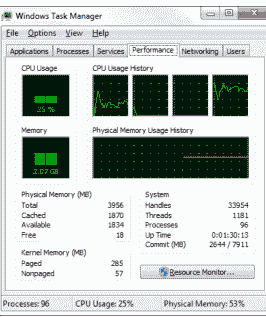

我的笔记本电脑有四个处理器核心，这意味着它可以同时运行四个线程。你可以看到显示中 CPU（中央处理单元）使用率历史记录下的图表，显示每个处理器有多忙。从上面的循环来看，最左侧的处理器和最右侧的处理器相当忙，但中间两个处理器什么都没做。如果我停止程序运行，我会得到像下面这样的显示。

# 高级编程

## 线程与多线程

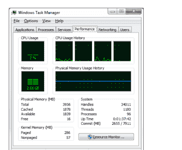

现在所有进程都在空闲。当我们启动多一个线程时，我们将看到更多的图表攀升，因为我们的程序在多个处理器上运行。

## 程序员观点：多线程可以提高性能

如果你能将程序分散到几个线程中，这将对它的运行速度产生巨大影响。上面的方法只能使用系统最大 25%，因为它只运行在四个可用处理器之一上。

### 5.4.4 运行线程

注意，这些对线程行为的描述是针对 Microsoft .NET 环境的，并不严格属于 C# 语言本身。如果你为 Windows 8 操作系统编写程序，你可能正在创建基于 Windows RT 的软件。在这种情况下，你会发现线程的使用方式略有不同。

单个线程由你的程序作为 `Thread` 类的实例管理。该类位于 `System` 命名空间。我们在使用资源之前已经了命名空间来定位资源。确保我们可以使用所有线程资源的最简单方法是在程序开头添加一个 `using` 指令。

```csharp
using System.Threading;
```

# 启动线程

`Thread` 类提供了许多你的程序可以使用的方法来控制它的行为。要启动线程运行，可以使用 `Start` 方法：

```csharp
t1.Start();
```

这就是线程开始运行的点。

```csharp
class ThreadDemo {
    static private void busyLoopMethod() {
        long count;
        for (count = 0; count < 1000000000000L; count = count+1) {}
    }
    static void Main() {
        ThreadStart busyLoop = new Thread(busyLoopMethod);
        Thread t1 = new Thread(busyLoop);
        t1.Start();
        busyLoopMethod();
    }
}
```

上面的代码创建了一个名为 t1 的线程并开始运行 busyLoop 方法。它还在 Main 方法中直接调用了 busyLoopMethod。这意味着有两个进程处于活跃状态。显示的是任务管理器界面：

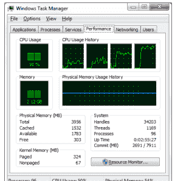

现在更多的使用图表显示出活动，CPU 使用率从 25% 上升到 50%，因为我们的程序现在使用了更多的处理器。

# 创建大量线程

从上面的显示中你可以看到，如果我们创建一个额外的线程，我们可以使用更多计算机给我们的力量。事实上，我们可以创建比这多多的线程：


# 高级编程

## 线程与多线程

```csharp
for (int i = 0; i < 100; i = i + 1)
{
    Thread t1 = new Thread(busyLoopMethod);
    t1.Start();
}
```

### 代码示例：56 线程忙循环

此循环将创建 100 个线程，它们都运行 `busyLoop` 方法。我们的计算机目前处于忙碌状态：

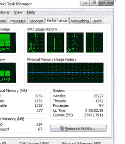

### 程序员观点：线程过多会减慢一切

请注意，什么都不做也会阻止你的程序启动许多运行线程。如果你同时运行许多线程，将减慢所有速度。这实际上是针对你计算机的一种攻击基础，被称为拒绝服务攻击（Denial of Service attack）。这种攻击通过启动大量占用处理器的线程使你的计算机无法使用。幸运的是，Windows 会提高处理用户输入的线程优先级，因此你通常可以控制并停止这种行为。

## 5.4.5 线程与同步

我们可以使用线程来改进和精细化程序的性能。如果你的计算机包含多个处理器，那么在这些处理器上编程将是一个好主意。例如，假设我们有一个包含一千万个银行账户的巨大数组，我们要统计其中有多少个是透支的。我们可以写一个简单的方法来统计数组中范围内账户的透支数量：

```csharp
static int overdraftCount=0;

static private void countOverdraftRange(int start, int end)
{
    int i;
    for (i = start; i < end; i = i+1)
    {
        if(bankAccounts[i].GetBalance() < 0)
        {
            overdraftCount = overdraftCount + 1;
        }
    }
}
```

该方法指定了从数组何处开始（`start` 的值）以及何时停止（`end` 的值）。然后它遍历 `bankAccounts` 数组，对数组中的每个元素调用 `GetBalance` 来检查余额。当方法发现一个透支账户时（即 `GetBalance` 返回的结果小于 0），变量 `overdraftCount` 就会加 1。

C# 编程 - Rob Miles 2016

`overDraftCount` 变量被声明为 `static`，因此程序中只有它的副本。这个唯一的副本可以通过在在多个线程上运行的 `countOverDraftRange` 调用来更新。

我们的程序可以启动两个线程，每个线程将处理账户数组的不同半部分。

```csharp
static private void firstHalf()
{
    countOverDraftRange(0,5000000);
}
static private void secondHalf()
{
    countOverDraftRange(5000000,9999999);
}
static void Main()
{
    ThreadStart ts1 = new ThreadStart(firstHalf);
    Thread t1 = new Thread(ts1);
    t1.Start();
    ThreadStart ts2 = new ThreadStart(secondHalf);
    Thread t2 = new Thread(ts2);
    t2.Start();
    Console.WriteLine("Number of overdrafts:" + overDraftCount);
}
```

这是启动多个线程的一种冗长方法。如果你决定在 C# 中这样做，你会发现更简单的方法。然而，你将看到程序启动了两个运行的线程。一个计算数组前半部分的透支数，另一个计算数组后半部分的透支数。两个线程在发现透支时都会更新 `overDraftCount` 变量。

在具有多个处理器的机器上，计数完成得会快得多，因为每个线程都可以运行在不同的处理器上。但那是好消息。不幸的是，坏消息是，它还会以随机数量少报透支数量。这对于我们的银行来说可能是灾难性的。

原因是两个线程将会“争夺”单一的 `overDraftCount` 变量。考虑以下操作序列：

1. 线程发现一个透支账户并获取 `overDraftCount` 变量的值，以便对其加 1。
2. 在执行加法操作之前，线程 1 启动并允许线程 2 运行。
3. 线程 2 也发现了一个透支，获取 `overDraftCount` 的值，加 1 后将其存储在内存中。
4. 稍后线程 1 再次获得控制权，对其在被中断前获取的值加 1，并将结果存回内存。

由于线程 1 在计算过程中被中断的方式，它覆盖了线程 2 所做的更改。一次计数增加丢失了。

记住，程序对其内部线程何时获得控制权没有控制。操作系统管理这些线程以及保持计算机运行的其他数百个线程。

我们需要一种停止线程相互中断的方法。`overDraftCount = overDraftCount + 1;` 语句必须允许在不被中断的情况下完成。你可以通过*互斥*（mutual exclusion）或*互斥锁*（mutex）功能来实现这一点。我们可以回到这里的火车比喻。

### 使用互斥管理数据共享

允许两个线程共享同一个变量就像两列火车共享同一段轨道。两者都是危险的。单一问题通过使用由引擎持有的单一令牌得到了解决。当它们进入轨道时，它们给出令牌。当第一列离开单轨时，司机拿回了令牌。任何想要进入轨道的人都必须轮候。

互斥通过使用对象实例来扮演令牌的角色。

```csharp
static Object sync = new object();
```

这个对象并没有持有数据。它只是由活动进程持有的令牌。

```csharp
Monitor.Enter(sync);
overDraftCount = overDraftCount + 1;
Monitor.Exit(sync);
```

`Monitor.Enter` 和 `Monitor.Exit` 调用之间的代码只能由一个线程执行。没有机会中断语句并切换到另一个进程。增加操作将在 `Monitor` 调用之间完成。一旦执行离开 `Monitor` 调用，线程可以被挂起。

线程没有“停”在等待队列中。这是按顺序的，所以进入入口的线程将第一个获取令牌的，其他线程排队。

### 程序员观点：线程过多会减慢一切

请注意，什么都不做也会阻止程序启动许多运行线程。如果你同时运行许多线程，将减慢所有速度。这实际上是针对你计算机的一种攻击基础，被称为拒绝服务攻击。这种攻击通过启动大量占用处理器的线程使你的计算机无法使用。幸运的是，Windows 会提高处理用户输入的线程优先级，因此你通常可以控制并停止这种行为。

### 程序员观点：线程过多会减慢一切

请注意，什么都不做也会阻止程序启动许多运行线程。如果你同时运行许多线程，将减慢所有速度。这实际上是针对你计算机的一种攻击基础，被称为拒绝服务攻击。这种攻击通过启动大量占用处理器的线程使你的计算机无法使用。幸运的是，Windows 会提高处理用户输入的线程优先级，因此你通常可以控制并停止这种行为。

### 程序员观点：线程过多会减慢一切

请注意，什么都不做也会阻止程序启动许多运行线程。如果你同时运行许多线程，将减慢所有速度。这实际上是针对你计算机的一种攻击基础，被称为拒绝服务攻击。这种攻击通过启动大量占用处理器的线程使你的计算机无法使用。幸运的是，Windows 会提高处理用户输入的线程优先级，因此你通常可以控制并停止这种行为。

### 程序员观点：线程过多会减慢一切

请注意，什么都不做也会阻止程序启动许多运行线程。如果你同时运行许多线程，将减慢所有速度。这实际上是针对你计算机的一种攻击基础，被称为拒绝服务攻击。这种攻击通过启动大量占用处理器的线程使你的计算机无法使用。幸运的是，Windows 会提高处理用户输入的线程优先级，因此你通常可以控制并停止这种行为。

### 程序员观点：线程过多会减慢一切

请注意，什么都不做也会阻止程序启动许多运行线程。如果你同时运行许多线程，将减慢所有速度。这实际上是针对你计算机的一种攻击基础，被称为拒绝服务攻击。这种攻击通过启动大量占用处理器的线程使你的计算机无法使用。幸运的是，Windows 会提高处理用户输入的线程优先级，因此你通常可以控制并停止这种行为。

### 程序员观点：线程过多会减慢一切

请注意，什么都不做也会阻止程序启动许多运行线程。如果你同时运行许多线程，将减慢所有速度。这实际上是针对你计算机的一种攻击基础，被称为拒绝服务攻击。这种攻击通过启动大量占用处理器的线程使你的计算机无法使用。幸运的是，Windows 会提高处理用户输入的线程优先级，因此你通常可以控制并停止这种行为。

### 程序员观点：线程过多会减慢一切

请注意，什么都不做也会阻止程序启动许多运行线程。如果你同时运行许多线程，将减慢所有速度。这实际上是针对你计算机的一种攻击基础，被称为拒绝服务攻击。这种攻击通过启动大量占用处理器的线程使你的计算机无法使用。幸运的是，Windows 会提高处理用户输入的线程优先级，因此你通常可以控制并停止这种行为。

### 程序员观点：线程过多会减慢一切

请注意，什么都不做也会阻止程序启动许多运行线程。如果你同时运行许多线程，将减慢所有速度。这实际上是针对你计算机的一种攻击基础，被称为拒绝服务攻击。这种攻击通过启动大量占用处理器的线程使你的计算机无法使用。幸运的是，Windows 会提高处理用户输入的线程优先级，因此你通常可以控制并停止这种行为。

### 程序员观点：线程过多会减慢一切

请注意，什么都不做也会阻止程序启动许多运行线程。如果你同时运行许多线程，将减慢所有速度。这实际上是针对你计算机的一种攻击基础，被称为拒绝服务攻击。这种攻击通过启动大量占用处理器的线程使你的计算机无法使用。幸运的是，Windows 会提高处理用户输入的线程优先级，因此你通常可以控制并停止这种行为。

### 程序员观点：线程过多会减慢一切

请注意，什么都不做也会阻止程序启动许多运行线程。如果你同时运行许多线程，将减慢所有速度。这实际上是针对你计算机的一种攻击基础，被称为拒绝服务攻击。这种攻击通过启动大量占用处理器的线程使你的计算机无法使用。幸运的是，Windows 会提高处理用户输入的线程优先级，因此你通常可以控制并停止这种行为。

### 程序员观点：线程过多会减慢一切

请注意，什么都不做也会阻止程序启动许多运行线程。如果你同时运行许多线程，将减慢所有速度。这实际上是针对你计算机的一种攻击基础，被称为拒绝服务攻击。这种攻击通过启动大量占用处理器的线程使你的计算机无法使用。幸运的是，Windows 会提高处理用户输入的线程优先级，因此你通常可以控制并停止这种行为。

### 程序员观点：线程过多会减慢一切

请注意，什么都不做也会阻止程序启动许多运行线程。如果你同时运行许多线程，将减慢所有速度。这实际上是针对你计算机的一种攻击基础，被称为拒绝服务攻击。这种攻击通过启动大量占用处理器的线程使你的计算机无法使用。幸运的是，Windows 会提高处理用户输入的线程优先级，因此你通常可以控制并停止这种行为。

### 程序员观点：线程过多会减慢一切

我们的程序可以启动两个线程，每个线程将处理账户数组的不同半部分。 (注：原文此处有重复错误)

```csharp
static private void firstHalf()
{
    countOverDraftRange(0,5000000);
}
static private void secondHalf()
{
    countOverDraftRange(5000000,9999999);
}
static void Main()
{
    ThreadStart ts1 = new ThreadStart(firstHalf);
    Thread t1 = new Thread(ts1);
    t1.Start();
    ThreadStart ts2 = new ThreadStart(secondHalf);
    Thread t2 = new Thread(ts2);
    t2.Start();
    Console.WriteLine("Number of overdrafts:" + overDraftCount);
}
```

这是启动多个线程的一种冗长方法。如果你决定在 C# 中这样做，你会发现更简单的方法。然而，你将看到程序启动了两个运行的线程。一个计算数组前半部分的透支数，另一个计算数组后半部分的透支数。两个线程在发现透支时都会更新 `overDraftCount` 变量。

### 5.4.7 保持线程清醒

线程是非常用的。它们让你的程序处理触发执行线程。然而，当你向解决方案中引入多线程时，这不再成立。一个在 99.999% 的情况下运行正常的程序可能会灾难性失败，或者只是


# 高级编程

## 线程与多线程

完全启动，当特定的时序事件发生时。像上面提到的“死锁”（Deadly Embrace）同步问题可能只在两个用户同时请求特定功能时才会发生。

当你遇到多线程系统的问题时，最大的困难在于让故障发生以便你修复它。调查该问题的唯一方法是添加大量的写入语句（write statements），让程序在失败后生成一个供你检查的日志。当然，编写日志输出花费的时间会影响程序中事件的时机，并且往往会导致故障发生位，或者如果你足够幸运，它甚至会完全消失。

你应该通过上述描述的 Monitor（监视器）类来保护线程间共享的任何变量。这将防止无意的数据损坏。如果变量变得“步调不”（out of step），这说明你的线程正在争夺数据项。

你应该尝试通过让线程成为数据的生产者或消费者来避免任何“死锁”。如果消费者总是等待生产者（而永远不等待你），那么你就可以确定避免了一个线程等待另一个正在等待该线程的情况出现。

最后，你应该在设计中包含日志和调试行为（你可以以后使用条件判断来关闭日志），这样如果出现问题，就能轻松获取你在程序出错时所需要的某些诊断信息。

## 程序员观点：将线程引入你的设计

我认为我真正想说的是，任何对线程的使用都应该设计在你的程序中，而不是事后补上的。如果你想使用线程，那么如何管理它们以及它们应该如何通信，应该在程序开始时就决定，并且你的整个系统应该考虑到这些此来构建。

## 5.4.8 线程与进程

你可以将不同的线程看作是共同生活在计算机中的，就像数字序列可以共享特定的铁路一样。下一步是拥有多条铁路。在编程术语中，这是从线程到进程的转变。进程与线程不同，每个进程都有自己的内存空间，且该空间与其他进程是隔离的。

当你同时在计算机上使用文字处理器和网络浏览器时，它们每一个都作为不同的进程运行在你的计算机上。你的进程可能会启动几个运行在其内部的线程（这允许一个执行检查，但文字处理程序中的任何内容都无法访问另一个中的变量）。

在 C# 中，你可以以类似于启动线程的方式创建并启动进程。你也可以使用 `Process` 类来为你启动程序。它位于 `System.Diagnostics` 命名空间，所以你可以添加 `Using` 语句来更容易获取该类：

```csharp
using System.Diagnostics;
```

要在你的系统上启动程序，你可以使用 `Process` 类的 `Start` 方法：

```csharp
Process.Start("Notepad.exe");
```

`Start` 方法提供了你想启动的程序名称。上面的 C# 代码将启动记事本程序。

你也可以创建类似于线程的、可以在你的程序内部控制的 Process 实例。

C# 编程 © Rob Miles 2016

## 5.5 结构化错误处理

到这里，我希望你开始仔细思考程序是如何失败的。在构建系统时，你也应该考虑你将如何管理它失败的方式。这实际上是设计过程中非常重要的一部分。当坏事发生时，程序必须以受管理的方式处理它。实现这一点的关键是为你的系统创建自己的异常。

我们最近一直处于异常的接收端。我们看到当在读取文件时发生坏事，或者给 `Parse` 方法传递无效字符串时，系统会抛出异常来表示它“不高兴”。这意味着像这样表现糟糕的代码需要被捕获，以便我们的程序能够负责任地响应。我们现在将更仔细地查看异常，并学习创建自己的异常类型。

## 5.5.1 Exception 类

`System` 命名空间持有大量的不同的异常，但它们都基于 `Exception` 类。强烈建议你创建自己的扩展系统的自定义异常类型。当出现问题时，你可以创建 `System.Exception`，但这意味着你的代码产生的异常将与系统的其他部分混杂。如果你想让你的代码能够处理你的错误，最好的方法是创建一个或多个你自己的异常。

这意味着，对于系统中的其他所有内容，你都需要设计你的程序如何处理和生成错误。这所有（当然）都回到了你收集的元数据，规范将为你提供有关事物如何失败以及错误产生方式的信息。

## 5.5.2 创建你的异常类型

创建你的异常类型非常简单。只需扩展 `System.Exception` 类即可完成：

```csharp
public class BankException : System.Exception
{}
```

这之所以有效，是因为 `System.Exception` 类有一个不带参数的默认构造函数。`BankException` 中的默认构造函数（由编译器自动添加）可以直接使用它来创建一个 `Exception` 实例。

然而，`Exception` 构造函数有一个版本允许我们向异常添加消息。这可以被捕获并用于发现哪里出了问题。要创建一个带带消息的标准异常，我向构造函数传递一个字符串。如果我想在使用带有换行符的消息时使用它，我会处理我的异常类的构造函数链并编写如下代码：

```csharp
public class BankException : System.Exception
{
    public BankException (string message) :
        base (message)
    {
    }
}
```

这利用了 `base` 关键字调用父类的构造函数并传递消息。

## 5.5.3 抛出异常

`throw` 关键字在代码的此处抛出一个异常。抛出的内容必须基于 `System.Exception` 类。例如，如果账户持有者的姓名为空字符串，我想抛出一个异常。我可以通过代码实现这一点：

```csharp
if ( inName.Length == 0 ) {
    throw new Exception("Invalid Name");
}
```

`throw` 代码后面跟着要抛出的异常的引用。然后，异常在该点转移到“最近”的 catch 结构。这可能是我的 catch，也可能是由系统提供的。如果异常被系统捕获，意味着程序将终止。然而，我可以这样捕获异常：

```csharp
try {
    a = new Account(newName, newAddress);
} catch (BankException exception) {
    Console.WriteLine("Error : " + exception.Message);
}
```

代码尝试创建新账户。如果这导致抛出异常，异常处理程序中的代码将被观察。引用异常被设置为已抛出的异常。异常的 `Message` 成员是给定的文本异常。这意味着如果我尝试用空姓名创建账户，异常将被抛出，catch 被调用，并打印消息。

## 程序员观点：自己设计你的错误异常

异常是一个描述事物如何出错的对象。它可以包含一个你可以显示给用户的文本消息。然而，你应该认真考虑扩展异常类，以便让你自己的异常包含更多信息。错误应该编号，即你的异常应该标记上错误代码。这在处理不同语言时非常有帮助。客户在报告问题时说“错误代码 25”，会让支持人员更容易做出明智的响应。注意，对于几乎所有内容，你都需要设计好对错误的处理。

## 5.5.4 多种异常类型

值得花时间思考如何管理系统中的异常和错误。我们可以根据意愿拥有多个 catch 结构，并且 catch 将与抛出的异常类型进行匹配：


## 高级编程
## 程序组织结构

```csharp
public class BankExceptionBadName : System.Exception {
    public BankExceptionBadName(string message) {
        base (message)
    }
}
public class BankExceptionBadAddress : System.Exception {
    public BankExceptionBadAddress(string message) {
        base (message)
    }
}
```

现在我使用不同的结构，取决于代码如何失败：

```csharp
Account a;
try {
    a = new Account("Rob", "");
} catch (BankExceptionBadName nameException) {
    Console.WriteLine("Invalid name : " + nameException.Message);
}
 catch (BankExceptionBadAddress addrException) {
    Console.WriteLine("Invalid address : " + addrException.Message);
}
catch (System.Exception exception) {
    Console.WriteLine("System exception : " + exception.Message);
}
```

每个 catch 匹配一种异常类型。在处理器列表的最后端，我有一个捕获系统异常的处理器。如果异常不是名称或地址异常，就会调用它。

## 程序员观点：程序经常在错误处理器中失败

如果你仔细考虑，错误处理器是很难测试的。它们只在发生故障时才会运行，大多数情况下，你使用的测试数据都假设一切都是正常的。这意味着错误很容易进入错误处理器中，因为这些代码的执行频率没有系统的其他部分那么高。这种代码是导致大灾难的“配子”，如果错误处理器本应该修复问题但却失败了，它通常会让糟糕的局面变得更糟。

作为一名专业程序员，你必须确保你的处理代码经过的测试至少相当于系统的其他部分。这可能意味着你必须创建系统的特殊版本，以强制代码产生错误。相信我，这是值得的！

错误处理应该是你设计进去的。当你创建系统时，要决定你要管理多少个以及什么类型的错误。

## 5.6 程序组织结构

目前，我们将创建的整个程序源码放在一个单独的文件，并对其进行编译和运行。对于微型项目来说是可以的，但现在我们开始编写大得多的程序，我们需要一种更好的组织方式。

当你考虑到一个项目可能有许多人工作时，这一点尤为重要。为了做到这一点，我们必须解决两个问题：

- 如何物理上将我们编写的代码分散到多个文件中
- 我们如何在逻辑上识别程序中的条目

这两个问题是不同且独立的，C# 为这两种情况都提供了机制。在本节中，我们将看到一个大型程序如何被拆分成许多不同的块。

### 5.6.1 使用单独源文件

在大型系统中，程序员希望将程序分散到几个不同的源文件中。当你设计解决方案时，你需要决定所有文件放在哪里。
在我们的银行管理程序中，我们发现一个类来跟踪特定的账户。这个类将是 Account。考虑一个非常简单的 Account 类：

```csharp
public class Account
{
    private decimal balance = 0;
    public void PayInFunds (decimal amount)
    {
        balance = balance + amount;
    }
    public decimal GetBalance()
    {
        return balance;
    }
    public bool WithDrawFunds (decimal amount)
    {
        if (amount < 0)
        {
            return false;
        }
        if (balance >= amount)
        {
            balance = balance - amount;
            return true;
        }
        else
        {
            return false;
        }
    }
}
```

这是一个非常规矩的类，它不会让我们提取比账户中更多的钱。如果我们愿意，可以将其放入名为 "Account.cs" 的文件中。然而，我们可能想创建处理银行账户的其他类的列表。因此，我决定将此类放入名为 "AccountManagement.cs" 的文件中。如果我添加更多账户管理元素，可以将它们放在这个文件中。问题是，当我尝试编译该文件时，编译器会报错：

```
error CS5001: AccountManagement.exe does not have an entrypoint defined
```

编译器期望生成一个可执行程序。这种程序有一个以 Main 方法形式存在的入口点。我们的银行账户类没有 Main 方法，程序永远不会通过实际运行账户来启动。相反，其他程序将运行并在需要时创建账户。编译器无法生成可执行文件，因为它不知道程序应该从哪里开始。

注意，我将 Account 类设为公有（public）。这样其他文件中的类就可以使用它。你可以以与类成员相同的方式对级别应用保护限制。通常情况下，如果你想让你的类在库中使用，那么它们应该是公的。

## 创建库

我通过要求编译器生成一个库来解决这个问题。我使用了编译命令的 target 目标选项。选项是修改命令行为的方式。编译器会告诉你它被给了选项，选项总是以斜杠字符开头：

```
csc /target:library AccountManagement.cs
```

编译器将不再寻找 Main 方法，因为它被告知生成一个库而不是程序。你会发现编译器没有制作可执行文件，而是制作了一个库文件：

```
AccountManagement.dll
```

dll 扩展名代表动态链接库（dynamic library）。这意味着它是动态加载的。

## 使用库

现在我有一个库，我需要使用它。我首先创建另一个名为 AccountTest.cs 的源文件。它包含：

```csharp
using System;

class AccountTest
{
    public static void Main ()
    {
        Account test = new Account();
        Console.WriteLine("Balance: " + test.GetBalance());
        test.PayInFunds(100);
        Console.WriteLine("Balance: " + test.GetBalance());
    }
}
```

为了让这工作，我需要告诉编译器引用 AccountManagement。这是通过：

```
csc AccountTest.cs /reference:AccountManagement.dll
```

这意味着当程序运行时，两个文件都存在。

## 删除组件

这意味着如果删除 AccountManagement 并运行，会导致所有糟糕的事情：

```
Unhandled Exception: System.FileNotFoundException: File or assembly name AccountManagement, or one of its dependencies, was not found.
File name: "AccountManagement" at AccountTest.Main()
```

## 更新组件

创建一个多个组件系统的优势是我们可以更新它的部分而不影响其他部分。如果我修改 AccountManagement 并重新编译它，新版本会自动推送到 AccountTest。当然，只要我不更改 AccountTest 使用的类或方法，这就是有效的。

好消息是我可能可以在不发送新版本的情况下修复程序的部分。坏消息是这几乎永远无效。有一个特殊的术语，“DLL 地狱”（dll hell），专门用来描述这种情况。Windows 就是这样运行的。

## 程序员观点：版本控制与管理

当你考虑为了赚钱出售程序时，你必须确保你有一套管理的方法来发送和升级。好消息是，有方法可以确保某些版本的程序只与特定的程序文件工作。坏消息是你必须计划如何使用这种技术，并确保你确实使用了。如果你觉得这听起来很无聊且迂板，那么我很抱歉，如果你不这样做，你就会破产或者两者兼之。

### 5.6.2 命名空间

我们可以使用库将我们的解决方案拆分成多个文件。这使得解决方案的管理稍微容易了一些。但我们还有另一个问题。我们不想把事情拆分成物理块。我们也想使用逻辑块。


## 高级编程

## 程序组织

如果你不确定我的什么意思，可以考虑一下我们银行的情况。我们决定 `Account`（账户）是存储客户账户所有详细信息的类的合理名称。

但如果你考虑你执行的整个银行业务，“account”这个词会随处出现。银行会从供应商那里购买回形针、尺子、笔记本、带链子的小笔（当然，预先提供的笔芯没墨水）之类的物品。

你可以说银行与这样的供应商有一个 `account`（往来账户）。银行可能非常希望使用计算机系统来跟踪这些账户。也许程序员们会认为给这种东西起一个合理的名称应该是 `Account`！我们现在正面临问题。如果这两个系统发生相遇，我们可以预见到会发生关于“Account”到底意味着什么的一场数字“生死决斗”。而事实也确实如此。

你可以通过将我们的类重命名为 `CustomerBankAccount` 来解决这个问题。但这会非常混乱，正因如此，在设计时我们必须确保所有的类都以独特的方式存在。

更好的方法是说，我们有一个 `CustomerBanking` 命名空间（namespace），其中 `Account` 一词具有特定的含义。我们也可以拥有一个 `EquipmentSupplier` 命名空间。这防止了两个名称之间的冲突，因为它们不在同一个命名空间中。

## 将类放入命名空间

到目前为止，我们使用的每个名称都位于所谓的“全局命名空间”中。这是因为我们没有在源文件中显式地设置命名空间。然而，设置非常简单：

```csharp
namespace CustomerBanking
{
    public class Account
{
        private decimal balance = 0;
        public void PayFunds(decimal amount)
        {
            balance = balance + amount;
        }
        public decimal GetBalance()
        {
            return balance;
        }
        public bool WithdrawFunds(decimal amount)
        {
            if (amount < 0)
            {
                return false;
            }
            if (balance >= amount)
            {
                balance = balance - amount;
                return true;
            }
            else
            {
                return false;
            }
        }
    }
}
```

我使用了 `namespace` 关键字来标识命名空间。后面是一个类块。在此块中声明的每个类都被视为给定命名空间的一部分，在本例中是 `CustomerBanking`。

一个源文件可以包含任意数量的命名空间定义，每个定义也可以包含任意数量的类。

### 使用命名空间中的类

全局类（在任何命名空间之外创建的类）可以通过其名称引用。如果你想使用命名空间中的类，你必须给该命名空间一个名称。

```csharp
CustomerBanking.Account test;
```

这创建了一个变量，可以引用 `Account` 类的实例。我们使用的 `Account` 类是 `CustomerBanking` 命名空间中的那个。

这种带有命名空间名字的名称被称为完全限定名（fully qualified name）。如果我们想创建该类的实例，再次使用完全限定名：

```csharp
test = new CustomerBanking.Account();
```

如果我想使用来自 `CustomerBanking` 命名空间的 `Account` 类，我必须相应地修改我的测试代码。

### 使用命名空间

如果你使用了特定命名空间中的大量内容，C# 提供了一种方法，让你告诉编译器在在解析特定项的名称时在该命名空间中查找。我们通过 `using` 关键字来实现：

```csharp
using CustomerBanking;
```

当编译器看到这一行时：

```csharp
Account Robs;
```

- 它会自动在 `CustomerBanking` 命名空间中查找是否存在 `Account` 类。如果有，我们已经用过很多这种技术了。`System` 命名空间是许多库组件所在的地方。我们可以通过完全限定名来使用它们：

```csharp
System.Console.WriteLine ("Hello World");
```

然而，大多数程序的最顶部通常有一行：

```csharp
using System;
```

- 这样程序员就可以写：

```csharp
Console.WriteLine ("Hello World");
```

编译器会想：“我会在我用过的所有命名空间寻找类似 `Console` 的东西。”如果它找到了一个（只有一个 `Console`），那就好了，它会使用它。如果它找到了两个 `Console`（假设我是傻瓜可以在我的 `CustomerBanking` 命名空间里放一个 `Console` 类），它会抱怨不知道使用哪一个。

### 嵌套命名空间

你可以将一个命名空间放在另一个命名空间内部。这允许你将事物分成更小的部分。`System` 命名空间就是如此，有一个命名空间是 `System` 命名空间的一部分，专门负责输入/输出。你可以通过适当的包含使用 `System.IO` 命名空间中的项：

```csharp
using System.IO;
```

在声明命名空间方面，你可以如下操作：

## 图形用户界面

```csharp
namespace CustomerBanking {
namespace Accounts {
    // account 类放在在这里
}
namespace Statements {
    // statement 类放在在这里
}
namespace RudeLetters {
    // rude letter 类放在在这里
}
}
```

现在我可以根据需要使用这些类了：
`using CustomerBanking.RudeLetters ;`

你应当使用的名称应该经过仔细的设计。不过，你可能已经想到了这一点。

### 5.6.3 独立文件中的命名空间

没有规则规定你必须将来自特定命名空间的所有类放在特定的文件中。

### 5.7.1 XAML 标记语言

我们将使用可扩展应用程序标记语言（XAML），它是由微软设计的，旨在易于创建外观良好的应用程序。

### 可扩展标记语言

在此处，你可能在想什么是可扩展标记语言。嗯，它是一种用于应用程序的可扩展标记语言。我们的意思是，你可以使用语言的规则来创建描述任何事物的构造。


# 高级编程

# 图形用户界面

```xml
<xml version="1.0" encoding="us-ascii" ?>
<HighScores count="2">
  <HighScore game="Breakout">
    <playerName>Rob Miles</playerName>
    <score>1500</score>
  </HighScore>
  <HighScore game="Space Invaders">
    <playerName>Rob Miles</playerName>
    <score>4500</score>
  </HighScore>
</HighScores>
```

这是一个描述视频游戏系统高分记录的小文件。`HighScores` 元素包含两个 `HighScore` 元素，一个用于“炸块”（Breakout），另一个用于“太空际入侵者”（Space Invaders）。`HighScores` 项目中的两个。每个元素都有一个属性，给出游戏名称和获得的得分。这很容易理解。从上面的文本并不难推出《太空际入侵者》游戏的代码。

文件最顶部的行告诉我们要读取文件所基于 XML 标准以及文件中字符的结束标记。XML 采用了可扩展标记语言的规则，并利用它们来创建一个描述页面组件（页面显示）的布局。

```xml
<TextBox height="72" HorizontalAlignment="Left" Text="0" VerticalAlignment="Top" Width="460" Alignment="Center" />
```

如果我们现在看上面对 `TextBox` 的描述，我们可以看到 XAML 的设计者创建了符合他们要求的字段名。我们稍后会看到更多 XAML。

# XML 架构 (Schema)

标准还包含了关于如何创建一个描述特定文档格式的架构的描述。例如，在上面的高分信息中，必须包含一个 `PlayerName` 和一个 `Score` 属性。它可能还会说 `HighScore` 可以包含一个 `Date` 值（得分的日期），但并不是每个 `HighScore` 值都必须的。

这种格式和架构的系统意味着开发者非常容易为特定目的创建数据。由于有很多设计工具可以帮助创建文档和架构，这一点得到了加强。.NET 框架提供了一种方法，使程序可以保存为格式化的 XML 文档。在 Visual Studio 中，解决方案实际上是以 XML 文档的形式存储的。

就我们而言，值得记住 XML 对这类事情很有用，但我现在想关注在 XAML 本身上。

# XAML 和显示页面设计

一个 XAML 文件可以描述整个页面。当你创建一个新的 WPF 时，你会得到一个包含几个元素的页面。随着你向页面添加更多内容，页面随着每个描述的添加而增长。某些元素作为容器。这意味着它们可以包含其他组件。当你想要布局事物时，它们非常有用，例如，有一个 `Grid`，它可以以网格布局包含一组其他元素。XAML 还可以包含动画和过渡的描述，这些描述可以应用于页面，以制作更令人印象深刻的用户界面。我们不会在 XAML 的布局方面上花费太多时间；只需说，你可以使用这个工具为你的程序创建极其令人惊叹的前端。还有一个名为“Expression Blend”的特殊工具用于制作显示。

# 高级编程

# 图形用户界面

遗憾的是，事实证明大多数程序员（包括我在内）并不擅长设计吸引人的用户界面（尽管我相信你擅长）。在现实生活中，公司会聘佣平面设计师来创建具有艺术感的前端。程序员的角色就变成了编写构建这些显示的代码来完成任务。

微软设计 XAML 是为了承认这一问题。它强制了屏幕设计与控制它的代码之间的强力分离。这使得程序员能够轻松创建一个初始界面，随后由设计师将其更改为更有吸引力的界面。程序员也可以获取一个完整的用户界面设计，然后拟合每个显示组件。

# 描述 XAML 元素

我们可以通过观察你如何使用 XAML 构建程序来开始发现 XAML 如何让你设计应用程序。考虑以下屏幕。


这是一个简单的 Windows 程序，我称它为“加法器”。你可以用它执行非常简单的加法。你只需要在顶部的文本框输入两个数字，然后按等号按钮。它会给你这两个数字之和。目前它正向我们显示 0 加 0 等 0。屏幕上的每个单独项目被称为 `UElement` 或用户界面元素。从现在起我将这些这些元素。上面的屏幕上有六个。

- 1. 标题“Adding Machine”。这是一个字体大小为 18 的文本块，因此脱颖而出。
- 2. 顶部的框，我可以在这里输入一个数字。
- 3. 持有字符 `+` 的文本项。
- 4. 底部的文本框，我可以在这里输入另一个数字。
- 5. 一个按钮，我们按下它来执行加法。
- 6. 一个结果文本框，当按钮按下时，它会变为显示结果。目前它是空的，因为我还没有做过任何操作。

这些每个项目在屏幕上都有特定的位置、特定的文本大小以及许多其他属性。我们可以通过更新描述页面的 XAML 来更改文本框中的文本颜色，无论它是对齐到周围框的左侧、右侧还是中心，以及许多其他事情。描述显示的实际 XAML 如下：

```xml
<StackPanel>
  <TextBlock Text="Adding Machine" FontSize="18" HorizontalAlignment="Center" />
  <TextBox Name="firstTextBox" Width="100" />
  <TextBlock Text="+" HorizontalAlignment="Center" />
  <TextBox Name="secondTextBox" Width="100" />
  <Button Content="Equals" Click="buttonClick" />
  <TextBox Name="resultTextBox" />
</StackPanel>
```

如果你仔细地将列表中的每个元素映射到 XAML。唯一让你感到困惑的是 `StackPanel>` 元素。它非常简单且有用。与其在屏幕上绝对定位它们，`<StackPanel>` 只是让你可以堆叠。这些元素的嵌套在 XAML 文件中。

# 程序员的观点：当你这样做时，使用自动布局

我总是当我们在屏幕上绝对定位它们。当你对屏幕尺寸或文本尺寸做出假设时。现代计算机支持巨大范围的不同屏幕尺寸，用户也可以更改屏幕上的文本大小。固定元素的位置意味着它在一个特定设备上效果良好，但在另一个设备上看起来非常糟糕。这使得你的程序不太可能显示。

# XAML 元素与对象

从编程的角度来看，屏幕上的每个 XAML 元素都是一个软件对象。对象是表示我们要处理的事物的很好的方法。事实证明对象非常适合表示其他事物，例如显示器项目。如果你考虑一下，屏幕上的框文本——一个 `TextBox` 将具有诸如屏幕位置、文本颜色、文本本身等属性。

你熟悉（或应该熟悉）编译过程，即 C# 程序的源代码（即我们输入的内容）被转换为计算机执行的低级指令。当编译使用 XAML 用户界面的程序时，系统也会“编译” XAML 描述以创建一组 C# 对象，每个对象代表一个用户界面元素。

这意味着加法器中有三种类型的元素：

- `TextBox`——允许用户向程序输入文本。
- `TextBlock`——传达信息的文本块。
- `Button`——我们可以按下以引起程序中发生事件的东西。

如果你考虑一下，你可以将这些元素的属性拆分为两类：所有元素都需要的（例如屏幕位置），以及那些特定于该类型元素的属性。例如，只有 `TextBox` 会记录输入文本时的光标位置。从软件设计的角度来看，这是对类层次结构的一个非常好的用例。


## 高级编程

## 图形用户界面

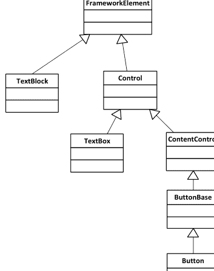

上方你可以看到 XAML 设计师构建的部分层次结构。顶层类是 `FrameworkElement`。它包含了屏幕上所有控件共有的信息。其他每个类都是该类的子类。子类继承父类的所有行为和属性，并添加一些自己的属性。这种设计比显示的复杂一点，`FrameworkElement` 类是一个名为 `UIElement` 的类的子类，但它展示了控件之前的通用原理。

构建这样的层次结构有很多优点。我们需要一个自定义的文本框，可以扩展 `TextBox` 类并添加我们需要的属性和行为。对于实现 XAML 系统的软件来说，这意味着用相同的方式对待所有控件，然后要求每个控件以适合组件的方式进行自绘。

我们的程序将像操作 C# 对象一样操作这些元素，尽管它们实际上是定义在 XAML 源文件中。这之所以能行，是因为使用 XAML 系统构建的程序会创建与源文件中元素匹配的对象。

## 管理命名元素

当我们想在程序中使用界面元素时，我们需要一种引用它们的方法。如果看一眼我们实现机器的 XAML，我们可以看到某些组件被赋予了 `Name` 属性：

```
<TextBox Name="firstTextBox" Width="100" Margin="0,18" TextAlignment="Center" />
```

我将这个文本框的名称设置为 `firstTextBox`。你永远猜不到这个文本框叫什么名字。请注意，在这种语境下，属性的名称实际上是在设置程序内部声明的变量名称。换句话说，由于我所的操作，现在我的程序某处会有这样一条语句：

```
TextBox firstTextBox;
```

这些声明是在程序编译时自动创建的，因此我们不需要担心上述语句在哪里。我们只需要记住程序是如何运作的。请注意，我的用户界面中并不是所有元素都有名称，为持有 `""` 字符的 `TextBox` 命名是没有意义的，因为在程序运行时我永远不需要与它交互。

C# 编程 Rob Miles 2016

189

## 元素中的属性

一旦我们为 `TextBox` 变量赋予了正确的名称，就可以继续为它提供此应用程序所需属性。我们还可以更改文本框的许多属性，包括文本框的宽度、外边距（设置位置）等等。

当我们谈论页面上 Silverlight 元素的“属性”时（我们在 `TextBox` 中显示的内容），我们实际上是在谈论实现 `TextBox` 的类中的属性值。换句话说，当程序包含如下条语句时：

```
resultTextBlock.Text = "";
```

这将导致 `resultTextBlock` 内部运行一个 `Set` 方法，将 `TextBox` 上的文本设置为相应的值

如果你在问“我们为什么在 XAML 元素中使用属性？”——在银行账户中使用它们是有意义的，那里我们希望数据在对象内部是被保护的；而在 XAML 页面中，似乎没有必要对输入值进行验证。事实上，运行这段代码会减慢设置过程。因此，将值设为公共字符串可以使程序更小、运行更快，这应该是一件好事。

嗯，某种意义上如此。如果我们更改了 `TextBox` 上的值，我们希望用户面前 XAML 页面上的文本也随之改变。这就是机器显示结果的方式。如果程序更改了数据成员的值，XAML 系统将无法知道屏幕上的信息需要更新。

然而，如果 `Text` 是一个属性，当程序更新它时，`TextBox` 中的行为就会运行。`set` 处理器中的代码可以更新字段的存储值，并触发显示更新以使新值可见。属性提供了一种手段，当对象的值被更改时，对象可以获取控制权，这极其重要。简单的例子是：

```
resultTextBlock.Text = "";
```

-   可能会导致数百条 C# 语句运行，因为新值被存储在 `TextBox` 中，并触发了显示更新以使屏幕变化。

## 使用 XAML 设计页面

XAML 证明变得非常有用。一旦你掌握了描述组件的信息，就会发现仅仅通过编辑 XAML 文件中的文本来绘制内容和移动它们，要比拖拽或在值之间切换要快得多。我发现当我在屏幕上需要大量相似元素时，这特别有用。Visual Studio 识别用于描述每种类型元素的语法，并提供 IntelliSense 支持来帮助你操作。

如果你阅读 XAML 规范，你会发现元素的图形属性可以使它们变得透明，为背景添加图像，甚至让它们在屏幕上动起来。在这一点上，我们已经超越了编程范畴，祝你好运。

## 5.7. 创建完整的 XAML 应用程序

现在我们知道屏幕上的项目是软件对象的图形实现，下一步我们需要知道的是如何控制这些对象，并让它们成为应用程序中对我们有用的工具。为了做到，我们需要添加一些 C# 程序代码来执行加法器所需的计算。

每当 Visual Studio 创建描述显示页面的 XAML 文件时，它也会随带创建一个 C# 程序。这就是我们可以在其中放置让应用程序运行代码的地方。如果你实际上查看上面的 `MainPage.xaml.cs`，你会发现它并没有多少代码：

```
using System;
using System.Collections.Generic;
using System.Linq;
using System.Text;
using System.Windows;
using System.Windows.Controls;
using System.Windows.Data;
using System.Windows.Documents;
using System.Windows.Input;
using System.Windows.Media;
using System.Windows.Media.Imaging;
using System.Windows.Navigation;
using System.Windows.Shapes;
```

namespace sample
{

```
<summary>
// MainWindow.xaml 的交互逻辑
public partial class MainWindow : Window
{
    public MainWindow()
    {
        InitializeComponent();
    }
}
</summary>
```

文件的大部分是 `using` 语句，这允许我们的程序直接使用类，而无需每个类的完整全名。例如，与其使用 `System.Windows.Controls.Button`，我们可以说 `Button`，因为文件包含了 `using System.Windows.Controls` 这一行。

程序中唯一的方法是 `MainWindow` 类的构造函数。正如我们所知，构造函数在类实例创建时被调用。如果你查看此方法内部，你会发现它是创建显示元素实例的代码。这些代码是 Visual Studio 根据描述页面的 XAML 自动创建的。重要的是要保持原样，不要更改方法的内容，因为这可能会破坏程序。

请注意，在这一点上我们正深处 XAML 的“机房”。我告诉你这些是为了让你理解这里没有魔法。如果到目前为止看到的 C# 程序都是从调用 `MainWindow` 方法开始的，那么你必须理解 XAML 程序并没有特别之处。XAML 应用程序底部有一个 `Main` 方法；它启动了构建组件并将其放在屏幕上供用户交互的过程。

## 构建应用程序

我们现在可以展示如何为我们的数字加法器程序创建用户界面。如果我们添加所有组件并启动应用程序，看起来就像我们为它做了一些事情。我们可以输入想要相加的数字，甚至按下


## 高级编程

## 图形用户界面

如果我们喜欢的话，这就是等号按钮。我们似乎花很少的精力就获得了很多功能，这很棒。然而，现在我们需要添加一些自己的逻辑，让程序计算出答案并显示出来。

### 计算结果

目前，我们的程序看起来不错，但实际上并没有执行任何操作。我们需要创建一些代码来执行所需的计算并显示结果。类似于这样的代码：

```csharp
private void calculateResult()
{
    float v1 = float.Parse(firstTextBox.Text);
    float v2 = float.Parse(secondTextBox.Text);

    float result = v1 + v2;

    resultTextBox.Text = result.ToString();
}
```

`TextBox` 对象暴露了一个名为 `Text` 的属性。该属性可以被读取或写入。为 `Text` 属性设置值将更改文本框中的文本。`Text` 属性允许我们的程序读取输入到文本框中的内容。

文本是以字符串形式提供的，如果我们的程序要进行任何加法运算，就必须将其转换为数值。你之前见过 `Parse` 方法，它接收一个字符串并返回该字符串描述的数字。每个数值类型（`int`, `float`, `double`）都有一个 `Parse` 行为，可以接收字符串并返回一个数字。我们正在使用浮点数创建加法，因此该方法解析每个文本框中的文本，然后通过将它们相加来计算。

最后，该方法将计算出的数字转换为字符串，然后将 `resultTextBox` 设置为该字符串。`ToString` 是 `Parse` 的反操作，如果你愿意的话，可以被称为“反解析”。它提供了对象的内容。对于 `float` 类型，这就是描述数值的文本。

现在我们已经有了可以计算答案的代码，只需要找到一种方法，在用户按下按钮时运行它。

### 事件与程序

如果你做过任何基于的编程，你就会对事件非常熟悉。如果你没有，不用担心，我们有一个需要事件的很好的示例，而且它们本身并不可怕。在过去，在图形用户界面和鼠标的时代，程序会在开始时运行，然后结束。

但现在我们有了复杂且丰富的用户界面，有许多按钮和元素供用户交互。我目前正在使用的文字处理器在屏幕和菜单项上都有数百个不同的功能。在这种情况下，编写一个检查用户使用的每个元素的程序将非常困难。相反，系统等待显示元素在它们需要关注时抛出事件。老师们就是这样做。他们不会到处问班级同学是否知道某个事件，相反他们要求孩子们举手。“举手”就是一个老师会响应的事件。

使用这样的事件，这种软件设计会变得简单得多。我们的程序不需要检查每个项目以查看用户是否对其进行了任何操作，相反，它绑定到它感兴趣的事件上。

为了让事件工作，编程语言需要一种表达对对象中方法引用的方式。C# 提供了 `delegate`（委托）类型，它恰好可以做到这一点。你可以创建一个可以引用特定类型方法的 `delegate`，然后创建引用对象中方法的 `delegate` 实例。`delegate` 非常强大，但理解起来可能有点复杂。幸运的是，目前我们不需要担心 `delegate` 是如何工作的；我们可以使用 Silverlight 和 Visual Studio 为你完成所有艰苦的工作。

### XAML 中的事件

在 C# 中，事件通过调用该对象中的方法传递给该对象。在这方面，你可以将事件和消息视为同一物。从加法器的角度来看，我们希望在用户点击等号按钮时调用一个特定的方法。这是我们感兴趣的唯一事件。当事件触发时，我们将调用 `calculateResult` 方法；如果我们查看按钮的 XAML，就可以看到它是如何实现的。

```xml
<Button Content="Equals" Alignment="Center" Margin="0,10" Name="equalsButton" Click="equalsButton_Click" />
```

`Button` 元素有一个名称 `equalsButton` 和一个属性 `Click`。这是为了设置 `equalsButton_Click`。这是 XAML（描述页面的声明式语言）与 C#（将实际执行操作的编程语言）之间的链接。

对于这项工作，包含等号按钮显示的代码必须包含一个名为 `equalsButton_Click` 的方法，否则程序将无法正常工作。该方法为事件提供了行为：

```csharp
private void equalsButton_Click(object sender, RoutedEventArgs e)
{
    calculateResult();
}
```

事件处理器必须具有正确的签名，以便它能够接收描述事件的参数。

如果你在想这一切是如何运作的，它使用 `delegate` 来管理从 Windows 显示器传递到运行在其中的程序中的事件。作为类的实例。如果说，`delegate` 是一个表示方法的对象。这正是我们需要的。我们需要一种方法告诉 Windows 窗口系统，当点击等号按钮时，我们想要调用此方法（被调用的委托）。按钮显示元素包含一个 `Click` 属性。程序可以将 `delegate` 对象添加到此属性，这样窗口就能检测到按钮已被按下并调用它。换句话说，为上述 XAML 生成的代码语句是：

```csharp
equalsButton.Click += new EventHandler(equalsButton_Click);
```

`+=` 运算符有点困惑，但它的真实含义是“向对象列表添加一个委托”。该 `delegate` 的类型是 `EventHandler`。如果程序需要从事件中断开处理器，可以使用 `-=` 运算符。

### 事件驱动应用程序

注意，这与程序在“过去时代”运行的方式形成了对比。以前，程序在 `Main` 方法被调用时运行，然后到达方法的结束。现在我们处于一种根据动作调用方法的情况。实际发生的是按钮上的事件处理器创建了一个线程来调用该方法。

如果我们有一个使用许多按钮来确保程序能够处理按钮点击的应用程序。

### 处理错误

我们提出的解决方案是有效的，并且提供了一个可以工作的加法器。然而，它并不是一个非常友好的程序。

![d509bebe3b33c7dfe37bae5120a38c3_19]

例如，用户可能会像上面那样输入数字。我们知道这会导致 `Parse` 方法出现问题，它会迅速抛出异常并停止程序。我们也知道可以捕获异常并处理它们。对于程序来说，处理此类错误的最佳方法是显示一个消息框：

```csharp
private void calculateResult() {
    try {
        float v1 = float.Parse(firstNumberTextBox.Text);
        float v2 = float.Parse(secondNumberTextBox.Text);
        float result = v1 + v2;
        resultTextBlock.Text = result.ToString();
    } catch {
        MessageBox.Show("无效数字", "加法器");
    }
}
```

示例 57 WPF 加法器

此版本的 `calculateResult` 捕获了 `Parse` 抛出的异常，然后使用 `MessageBox` 类显示错误消息。

![d50be9be3b33c7dfe37bae5120a38c3_198]

`MessageBox` 类是一个静态类，属于 XAML 库。有多个版本的 `Show` 方法，可以让你显示不同版本的消息框。我刚刚使用的版本接受两个字符串。一个是对话框的标题，另一个是要显示的消息。用户可以通过点击 OK 按钮来取消消息。

注意，这个方法并不是很好，因为它没有说明两个数字中的哪一个出现了错误。


[content]
# 高级编程

# 调试

## 程序员观点：客户非常关心用户界面

如果说系统中有一个部分是客户保证会有强烈意见的，那就是用户界面。这部分的设计应该从产品诞生之初就开始，并随着开发不断不断完善。千万、永远不要假设你认为用户界面应该以某种方式工作。我在用户界面代码上花费的时间比系统的其他任何部分都要多。好消息是，通过 Visual Studio，可以非常容易地为系统的前端创建看起来真实的原型。然后可以将这些原型展示给客户（获得他们的签字认可），以确保你正在做正确的事情。

## 5.8 调试

有些人天生就擅长调试。并不是每个人都擅长调试，某些人总是会比其他人更出色。尽管如此，你仍然可以使用一些技巧来缓解这一过程，我们将探索其中的一些技巧。好消息是，如果你在开发中使用“测试驱动”的方法，用户发现的故障数量应该尽可能少，但仍然会有一些需要修复的问题。

顺便提一下，故障问题被称为“bug（虫子）”是因为是因为原来的故障是由一只真实的昆虫卡在计算机内部导致其故障引起的。然而，这并不是大多数故障产生的原因。由于硬件故障导致程序失败的情况非常罕见。我编程了多年，只在少数情况下见过这种情况。可悲的是，大多数 bug 都是程序员留下的。换句话说，调试就是努力工作以找出你起初到底有多愚蠢。

### 5.8.1 故障报告

我们已经看到，故障是用户由于你程序中的错误而看到的现象。

故障是通过测试过程或用户发现的。如果程序在测试过程中失败，导致故障呈现的步骤将被详细记录。然而，如果由用户报告了故障，其提供的证据可能是口述的，你不会得到一组导致故障出现的具体步骤，你只会被告诉“打印功能里有个 bug”。

如果你没有被给予一组可以遵循的步骤来让故障发生，那么忽略该故障报告是有充分理由的。这种方法与你的用户相处可能并不好。向用户强调，任何故障报告只有在记录在案的情况下才会被认真对待的。

## 程序员观点：设计你的故障报告

就像我提到的其他任何事情一样，管理故障报告的方式应该在项目开始时就考虑。换句话说，你建立了一个处理已报告故障的流程。在大规模开发中，故障报告会被管理、分配给程序员并被仔细跟踪。报告的故障数量以及处理它们的时间是关于你所制作之质量的宝贵信息。此外，如果你形式化（甚至自动化）故障报告流程，就可以确保获得有关该问题的最大信息。

## 两种类型的故障

故障分为两类：总是发生的和偶尔发生的。

总是发生的故障很容易处理，你可以执行总是导致 bug 呈现的序列，并使用适当的技巧（稍后）找到它。

C# 编程 © Rob Miles 2016

195

偶尔发生的故障令人头疼。这意味着你没有一组导致系统失败的确定事件序列。这并不意味着没有序列（除非你正遭受着某种硬件引发的瞬态故障——这相当罕见），只是你还没有找到那个序列。

一个例子是某个功能在某些时间运行正常，但在其他正常。你可能将其追溯到打印的页数、页码，或者请求打印时正在编辑的文档大小。

故障的呈现可能发生在错误本身发生之后；例如，当从数据库中删除项目时程序可能会失败，但错误可能在存储该项目的程序的例程中，或者在覆盖数据库记录的代码中。

当程序发生更改时，故障可能会改变或消失；如果代码布局发生变化，错误可能会覆盖程序完全不同的部分。这可能导致最令人讨厌的故障：你添加了额外的语句来获取更多关于问题的信息，结果问题直接就消失了！

如果你怀疑存在这样一种错误，你的第一个测试是以某种方式更改代码和布局并重新运行程序。如果故障的性质发生了变化，这表明程序逻辑存在问题或数据损坏。

### 5.8.2 Bug 类型

你可以将故障分为其他类别：程序崩溃（完全停止）或程序执行了错误的操作。惊讶的是，崩溃通常更容易发现。它们通常指向：

- 未被处理的状态（确保所有选择都有一个能执行某些操作的默认处理程序，并且在模块之间传递值时使用防御性编程技术）
- 陷入死循环的程序，`do-while` 结构永远不会失败，`for` 循环包含更改控制变量的代码，错误地调用自己并不断递归调用导致堆栈溢出的方法
- 异常没有被正确捕获

如果你的程序执行了错误的操作，这可能更难发现。寻找：

- 使用了类未初始化的成员
- 拼写错误（寻找拼写错误的变量名、不正确的比较运算符、未正确终止的注释）
- 逻辑错误（寻找指令序列中的故障、无效的循环终止、构造错误的条件）

正如我所说，有些人就是擅长找 bug。这里是一些建议：
- 不要做任何假设。如果你假设“到达这里的唯一方式是……”这将是错误的。与其做假设，不如添加额外的代码来证明你所想。

## 与鸭子交流

把问题解释给别人听——即使只是猫或一只橡皮鸭！解释问题的过程通常能引导你找到解决方案。正如我说的，有些人就是擅长找 bug。这里是一些建议：
- 不要做任何假设。如果你假设“到达这里的唯一方式是……”这将是错误的。与其做假设，不如添加额外的代码来证明你所想。

201# 高级编程

# 调试

## 程序员观点：修复会导致 bug

产生 bug 的主要原因可能是修复过程。这是因为当你修改程序以让它工作时，你所做的更改往往会破坏其他功能。我发现统计数据，“，“出一个”往往是预料之中的，每个 bug 都会引入新的 bug。解决这个问题的唯一方法是确保你的流程（你创建的一系列单元测试）在你完成修复后可以自动运行。这至少确保了修复没有破坏任何重要的东西。

### 5.8.3 制作完美软件

不存在完美软件。我遵循的规则之一是“任何有用的程序都有 bug”。我可以写出保证没有 bug 的程序。然而，这样的程序会非常小，因此没什么用处。一旦我创建一个有用的程序，具有其输出和行为，我就开始调试。

这并不意味着我写的每个程序都是没用的，除非它不完美。在考虑故障时，你还必须考虑它们的影响。项目经理的工作部分是判断程序何时足够好出售，无论代码中的故障是否是“阻塞性的（stopper）”。

阻塞性会导致程序无法销售的故障。如果程序每运行第三次就会崩溃，或者有人需要存储数据，这可能就是阻塞性行为。但如果它只是在使用中文字体和某种激光打印机打印时总是重复打印第一页，这可能被认为是大多数人可以接受的问题。

## 推倒重来

在项目中，重新开始所花费的精力可能像找出一个破碎的解决方案哪里出了问题一样。如果你有时间离开调试，向朋友解释代码并检查你所有的假设，那么也许这就是最好的出路。


这意味着你需要评估你所报告的故障的影响，对它们进行优先级排序，并管理它们的处理方式。你还需要意识到开发的背景情况。例如，视频游戏中的故障远没有空中交通管制系统中的故障问题严重得多。

让软件尽可能完美的关键在于确保你对要解决的问题有良好的理解，在开始编写代码之前已经知道如何解决它，并且仔细地管理你的代码生产过程。请阅读本文末尾的剩余文本以获取更多关于编程这方面的内容。

## 5.9 结束了吗？

这并不是成为一名程序员所需要的全部知识。这甚至不是成为一名 C 程序员所需要的全部知识。然而，这是一个非常好的开头，但本文还缺失了相当的内容，因为我们没有义务教所有的内容。如果你想成为一名优秀的 C# 程序员，你应该关注以下内容：

- 序列化 (serialisation)
- 特性 (attributes)
- 反射 (reflection)
- 网络编程 (networking)

### 5.9.1 持续开发

良好的程序员会有刻意的策略，不断审视自己的专业知识并接触新事物。如果你认真对待这份事业，你应该在任何时候至少读一本关于该主题的书。我编程的时间从我记忆起就有多久了，但我从未停止过学习这门学科。我也从未停止过编程、阅读关于编程的书以及查看别人的代码。

### 5.9.2 扩展阅读

《代码完备性》第二版：Steve McConnell
微软出版：ISBN 0-7356-1967-0

这实际上并不是一本关于 C# 的书。它更像是一本关于万物的书。它从“软件构造”的角度涵盖了一系列软件工程和编程技术。如果你认想要成为一名合格的程序员，你应该/阅读/并拥有/这本书。

## 6 术语表

### 抽象 (Abstract)

像“抽象”（abstract）这样的东西本身并没有所谓的“正统”存在形式。在编写程序时，我们使用这个词来表示“对某事物的理想化描述”。在组件设计中，抽象类包含了对需要存在的事物的描述，但它没有说明如何实现它们。在 C# 中，如果一个类是抽象的，那么它被标记为抽象，或者它包含一个或多个被标记为抽象的方法。

你可以创建一个抽象类，但你可以将其作为具体类的基础或模板。例如，我们决定在交易处理系统中需要许多不同类型的收据：现金收据、支票收据、批发商收据等。我们不知道每份特定收据内部将如何运作，但我们知道它必须具备哪些行为才能成为一份收据。

因此，我们可以创建一个抽象类，作为所有具体类的基础。每个“真实”的收据都是通过扩展父抽象类来创建的。这意味着它是收据家族的一员（即它可以被视为一个收据 Receipt），但它以自己的自己的方式工作。

### 访问器 (Accessor)

访问器是一个方法，用于提供对类内部管理值的访问。从实际上讲，该类是只读的，因为数据存储在类中，但其他类可能需要访问值本身。访问器被实现为一个公共方法，它将向调用者返回一个值。请注意，如果提供访问的对象是由引用管理的，程序员必须确保将对象的引用传递出去是可以的。如果对象不被更改，则可能需要创建对象的副本并返回给调用者。

### 基类 (Base)

`base` 是一个 C# 关键字，根据它所处的上下文具有不同的含义。它被用于子类的构造函数中，以调用父类的构造函数。它也被用于重写的方法中，以调用它们所重写的方法。

### 调用 (Call)

当你想要使用一个方法时，你就调用它。当一个方法被调用时，执行序列会切换到该方法，从其方法体内的第一条语句开始。当到达方法的末尾或返回语句时，执行序列将返回到紧随该方法之后的语句。

### 类 (Class)

类是行为（方法）和数据（属性）的集合。它可以被用来表示程序中的现实世界项目（例如银行账户）。每当你需要将许多事物汇到一个单元单元时，你都应该从创建类的角度来考虑。

### 代码复用 (Code Reuse)

开发者采取步骤确保给定的程序片段只编写一次。这通常通过将代码放入方法中然后调用它们来实现，而不是在程序的不同部分重复语句。使用类层次结构也是一种复用代码的方法。你只需要重写你想要更新的方法即可。

### 内聚性 (Cohesion)

如果一个类不依赖/耦合于其他类，那么它具有高内聚性。

### 集合 (Collection)

C# 库将“集合”（collection）概念认为是你想要存储的一组东西，例如足球队中的所有球员或银行中的所有客户。集合的一种形式是数组。另一种是哈希表（hashtable），它允许你根据其中的键值对易地找到特定项目。支持枚举的集合意味着它可以被要求为 C# 的 `foreach` 结构提供连续的值。

每当你想要将许多事物储放在一起时，你都应该考虑使用集合类来为你完成。集合类可以在……中找到。

### 编译器 (Compiler)

编译器接收源代码并将其翻译成机器码。这个过程涉及几个阶段：预处理、词法分析、语法分析、语义分析和代码生成。编译器确保代码符合语言的规则。

### 组件 (Component)

组件是系统中的模块化部分，可以被替换或复用。在 C# 中，组件通常被实现为类，通过良好的接口与其他组件进行交互。

### 构造函数 (Constructor)

构造函数是一个特殊方法，在创建类的实例时被调用。它用于初始化对象的数据。

### 耦合 (Coupling)

耦合指的是模块之间的依赖程度。低耦合通常是更好的，因为它使代码更容易维护、测试和演进。

### 创造性懒惰 (Creative Laziness)

创造性懒惰是指使用现有工具和库来解决问题，而不是从头开始编写。这包括使用设计模式和框架来避免过早提交特定的实现。

### 声明式语言 (Declarative language)

声明式语言描述程序*应该做什么*而不是*如何做*。示例包括 SQL 和 XAML。重点是最终结果而不是执行流。

### 委托 (Delegate)

委托是对方法的类型引用。委托是方法签名创建的（例如，此方法接受两个整数并返回一个浮点数）。然后它可以指向匹配该签名的类中的方法。请注意，委托实例持有两个项目：包含该方法的实例/类的引用，以及方法本身的引用。


# 依赖 (Dependency)

通常情况下，设计中过多的依赖是一坏事。当两个类之间存在依赖时，其中一个类的更改意味着你可能需要更改另一个类。这通常意味着你没有在系统中的对象之间进行适当分配，并且两个对象在维护相同的数据。例如，对 `CustomerAccount` 子类中 `Load` 方法的讨论。

依赖是可选的。例如，一个业务对象类可能会被用户界面类依赖（如果你向业务对象添加了新属性，你将需要更新用户界面）。然而，用户界面的工作方式通常不太意味着业务对象需要加载。

# 事件 (Event)

事件是你的程序可能需要响应的某种发生情况。事件包括鼠标移动、击键、窗口调整大小、按钮按下、定时器滴答等。许多现代程序是基于事件工作的，而事件与方法相连。当事件发生时，会调用该方法来发送通知。Windows 使用委托（委托是指向方法的类型安全引用）允许事件生成器获知在事件发生时要调的方法。

# 异常 (Exception)

异常是一个描述刚刚发生的某事的对象。异常是 C# 程序处理错误的方式之一。当运行中的程序到达无法继续的位置时（无法打开文件或输入值可能无效），它可以建立并“抛出”（throw）一个异常：

```csharp
throw new Exception("Oh Dear");
```

`Exception` 对象包含一个 `Message` 属性，它是一个字符串，用于描述发生了什么错误。在上面的示例中，消息将设置为“Oh Dear”。

如果异常没有被“捕获”，程序将在该点结束。你可以通过将可能抛出异常的代码封装在 `try-catch` 结构中，来让程序对异常做出响应。当异常被抛出时，程序会将执行转移到 `catch` 代码块中：

```csharp
try {
    // 可能会抛出异常的代码
} catch (Exception e) {
    // 如果抛出异常，则执行此代码
    // e 是所抛出的异常的引用
} finally {
    // 这里的代码始终会被执行，无论是否
    // 抛出了异常
}
```

`try-catch` 结构还可以包含一个 `finally` 子句，其中包含的代码无论是否抛出异常都会被执行。

# 功能设计规格书 (Functional Design Specification)

大型软件开发遵循特定的路径，从初始会议到产品交付。精确的路径取决于工作的性质以及开发者所使用的技术；然而，所有开发都始于对系统要做什么的描述。这是整个项目中最关键的条目，通常被称为功能设计规格书，或 FDS。

# 全局唯一标识符 (GUID)

这是为了在世界上具有唯一性而创建的标识。它提供了一个用于引用某物的标识符。GUID 的创建涉及随机值的使用以及事物的日期和时间。GUID 用于账户引用和必须唯一的标签等。大多数操作系统和程序员程序库都提供了创建 GUID 的方法。

# 层级结构 (Hierarchy)

当子类扩展父类时，就会创建一个层级结构，产生一个新的类，该类具有父类的所有能力，并根据类的要求修改行为。扩展子类会产生更深层次的层级。层级顶部的类应该更通用且可能可能是抽象的（例如 `BankAccount`），而底部的类将更具体（例如 `ChildBankAccount`）。

# 不可变 (Immutable)

不可变对象不能被更改。如果尝试更改不可变对象的内容，将创建一个带有该内容的新对象，而“旧”对象仍留在内存中。`string` 类是不可变的。这使得字符串具有类似于值类型的行为，使得它们在程序中使用更加方便。

# 继承 (Inheritance)

继承是类扩展父类的方式，允许它使用父所有的行为和属性，但为了略有不同的需求对这些进行添加/自定义。更多细节请参阅层级结构的描述。

# 接口 (Interface)

接口定义了一组动作。动作通过一系列方法定义来定义。实现接口的类必须包含每个方法的代码。实现接口的类可以完全根据该接口进行引用。接口使得创建组件成为可能。我们并不关心组件具体是什么，只要它实现了接口，就可以完全从该能力角度考虑它。

# 库 (Library)

库是一组被其他程序使用的类。库和程序之间的区别在于，库文件的扩展名为 `.dll`（动态链接库），且不包含 `main` 方法。

# 机器码 (Machine code)

机器码是计算机处理器实际理解的语言。它包含许多非常简单的操作，将项目从处理器移动到内存，或给处理器中的某项加 1。每个特定的计算机处理器范围都有其特定的机器码，这意味着为一种机器编写的机器码无法轻易地用于另一种机器。

# 成员 (Member)

类的成员声明在类类内部。它可以执行某些操作（方法），也可以持有某些数据（变量）。方法有时被称为行为。数据成员有时被称为属性。

# 元数据 (Metadata)

元数据是关于数据的。它在各种层级运行。值以整数存储这一事实是元数据。它不能为负数是更多元数据。程序员必须在创建系统时通过咨询客户来收集元数据。

# 方法 (Method)

方法是一个由方法签名开头的代码块。方法有特定的名称并可能返回一个值。它还可以接受参数。方法用于将程序拆分为较小的单元。方法是类为其他类提供服务的方式。方法是类为其他类提供服务的方式（此处原文重复）。

# 修改器 (Mutator)

修改器是更改对象值的方法。它是这种方式实现的。

# 命名空间 (Namespace)

命名空间是一个具有特定含义的区域。命名空间允许你重用名称。完全限定命名带有命名空间的前缀。C# 提供了 `using` 关键字来导入命名空间。C# 提供了导入命名空间的。

# 重载 (Overload)

当存在具有不同参数的相同名称的方法时，方法被重载。当有多种方式提供信息时使用重载。

# 重写 (Override)

有时你想对现有类创建一个更专门的版本。可以通过创建一个扩展父类的类并重写方法来实现。当类的实例调用方法时，调用的是新方法而不是父类中的。你可以使用 `base` 关键字来访问该方法。

# 可移植 (Portable)

对于计算机软件，某个东西越可移植就越容易移动到不同类型的计算机。计算机包含专门为它们编写程序的各种操作系统。可移植应用程序可以相对容易地转移到新的处理器或操作系统。高级语言通常是可移植的，机器码很难。

# 私有 (Private)

类的私有成员对类内部的代码可见。通常将类的数据成员设为私有，以免类外部代码更改它们。程序员随后可以提供方法或属性来管理这些值。

# 属性 (Property)

属性是对象中持的数据项。`BankAccount` 类的示例是账户余额。C# 语言有一种特殊的结构来方便程序员管理属性。

# 保护 (Protected)

类的受保护成员对类中的方法以及扩展此类的类中的方法可见。它是私有和公共之间的一种中间状态。它允许你将父类成员标记为对子类可见。

# 公有 (Public)

类的公共成员对类外部的方法可见。通常将类的方法成员设为公有，以便其他类的代码可以使用它们。

# 引用 (Reference)

引用类似于附加在类实例上的标签。引用有特定的名称。C# 使用引用来找到。

# 术语表 (Glossary of Terms)

# 结束 (The End)


# 术语表

# 结束了吗？

类并使用它的方法和数据。任何引用都可以赋值给其中任何一个。如果你这样做，结果是现在有两个标记引用了内存中的同一个对象。

# 签名 (Signature)

C# 方法有一个特定的签名，使其能够在程序中被唯一标识。签名是方法的名称，以及该方法的参数的类型和顺序：

```csharp
void Silly(int a, int b) - 具有名为 Silly 和两个 int 参数的签名。
```

```csharp
void Silly(float a, int b) - 具有名为 Silly 和一个 float 后紧跟一个整数参数的签名。这意味着代码：
```

```
Silly(1, 2);
```

- 将调用第一个方法，而：

```
Silly(1.0f, 2);
```

- 将调用第二个方法。

请注意，方法的类型对签名没有影响。

# 源文件 (Source file)

你使用某种文本编辑器准备源文件。这是你想要通过编译器生成用于执行的程序文件的文本。

# 静态 (Static)

在 C# 关键字的语境下，`static` 使得类的成员成为类的一部分，而不是类实例的一部分。这意味着你不需要创建类的实例即可使用静态成员。它意味着静态成员通过类的名称访问，而不是通过实例的引用。静态成员对于创建要在所有实例共享的类成员非常有用，例如你银行中所有账户的利率。

# 流 (Stream)

流是一个代表到某个将移动数据的对象的连接的对象。这种移动可能是到磁盘文件、网络端口，甚至是系统控制台。流消除了根据输出发送到哪里或从何处接收而修改程序的需要。

# 结构 (Structure)

结构是数据项的集合。它不通过引用管理，结构在赋值时会被复制。结构在传递方法时也是按值传递的。结构用于在单元中持有相关数据块。它们没有由引用管理的对象那么灵活，但在访问结构项时使用它们的效率更高，因为不需要像访问对象那样跟踪引用。

# 下标 (Subscript)

这是一个用于标识数组中元素的值。它必须是一个整数值。C# 中的下标始终从 0 开始（这很困惑的是，它定位了（数组的）第一个元素），并延伸到数组大小减 1。如果你创建一个四元素的数组，你将通过下标值 0, 1, 2 或 3 获得数组中的元素。考虑下标的最佳方式是你想要移动的元素在数组中移动的距离。这意味着数组中的第一个元素的下标值必须为 0。

# 语法高亮 (Syntax Highlighting)

一些程序编辑器（例如 Visual Studio）以不同的颜色显示不同的程序元素，以便程序员更容易理解代码。关键字显示为蓝色，字符串为红色和绿色。请注意，颜色是由编辑器添加的，实际的 C# 源文件中没有任何内容可以决定文本的颜色。

# 测试台架 (Test harness)

测试台架将包含正在测试的系统将使用的输入和输出部分的模拟。你将程序放入测试台架中，然后程序就会认为自己处于完整的系统中。测试台架在调试时非常有用，因为它消除了对完整系统的需求（例如，一个告别？）。

# this

`this` 是一个 C# 关键字，根据其所处的语境有不同的含义。它在类的构造函数中用于调用另一个构造函数。它也被用作当前实例的引用，用于运行在该实例内部的非静态方法。

# 类型安全 (Typesafe)

我们已经看到 C# 对于合并不应该合并的事物非常挑剔。尝试将一个 `float` 值放入 `int` 变量中，编译器会在这一点报错。其由于由于语言的设计者注意到了一些常见的编程错误，并设计让编译器在程序运行或崩溃之前检测到这些错误。这种挑剔被称为安全性，并且在书中是非常重要的。其他语言在合并事物方面要宽松得多，它们假设程序员最清楚。C# 非常看重这一点（正如我一样）。重要的是让开发者停止以可能导致类型安全的方式编写代码。当然，如果你真的想强加你的意志，你可以通过类型转换（casting）来实现。

# 单元测试 (Unit test)

单元测试是正确执行特定功能的小测试。单元测试应该在开发过程中编写，以便应用到代码中（或者在开发之后）。

# 值类型 (Value type)

值类型持有一个简单的值。值类型在赋值时按值传递；例如 `x = y` 会将 `y` 的值复制到 `x`。`x` 的值不会影响 `y` 的值。注意这与引用类型不同。

# 虚方法 (Virtual Method)

方法是类的一个成员。有时我想扩展一个类以产生一个子类。在这种情况下，父类中的方法必须标记为虚方法（virtual）。只有虚方法可以被重写（override）。

# 索引 (Index)

| 术语 | 页码 |
| :--- | :--- |
| abstract | 107 |
| accessor | 97 |
| ArrayList | 144 |
| arrays | 62 |
| assignment | 45 |
| base method | 119 |
| block | 37 |
| boolean | 27 |
| break | 42 |
| Button | 188 |
| camel case | 28 |
| casing | 30 |
| char | 131 |
| condition | 35 |
| constants | 37 |
| constructor | 102 |
| continue | 43 |
| context | 20 |
| compiler | 11 |
| components | 3 |
| comments | 34 |
| computer | 2 |
| data | 3 |
| data processing | 3 |
| data types | 31 |
| default constructor | 103 |
| default | 72 |
| delegate | 19 |
| delegates | 136 |
| Dictionary | 147 |
| double | 16 |
| embedded system | 4 |
| enumerated types | 79 |
| escape sequence | 25 |
| exception | 176 |
| events | 136 |
| expressions | 28 |
| files | 2 |
| foreach | 154 |
| fully qualified name | 275 |
| Generics | 144, 146 |
| global namespace | 182 |
| global | 17 |
| GUID | 116 |
| hash table | 142 |
| Hashtable | 143 |
| HTML | 185 |
| identifier | 13, 27 |
| if | 35 |
| immutable | 131 |
| information | 3 |
| inheritance | 116 |
| interface | 109 |
| design | 115 |
| implementing | 111 |
| implementing multiple | 114 |
| reference | 112 |
| keyword | 13 |
| Length | 132 |
| library | 180 |
| List class | 146 |
| literal values | 22, 31 |
| loops | 39 |
| for | 41 |
| while | 40 |
| parameters | 18, 49 |
| object class | 126 |
| object oriented | 11 |
| objects | 86, 93, 122 |
| container | 140 |
| equals method | 128 |
| factory method | 152 |
| key | 143 |
| properties | 134 |
| this | 130 |
| operating system | 3 |
| combining logical | 36 |
| priority | 29 |
| relational | 35 |
| unary | 44 |
| out parameters | 56 |
| overflow | 23 |
| overloading constructors | 105 |
| overriding | 117 |
| namespace | 15, 181 |
| nesting | 183 |
| separate files | 184 |
| namespaces | 75 |
| narrowing | 30 |
| nested blocks | 59 |
| new | 89, 102 |
| parenthesis | 19 |
| Parse | 18 |
| pause | 173 |
| plumber | 5 |
| pointers | 137 |
| print formatting | 46 |
| placeholders | 46 |
| private | 95, 96 |
| replace | 120 |
| sealed | 121 |
| stopping overriding | 121 |
| virtual | 118 |
| mutator | 95, 134 |
| streams | 153 |
| subscripts | 62 |
| two dimensional | 64 |


# 术语表

- 始终提供等号行为 129
- 避免过多维度 66, 69, 70
- 块拷贝是糟糕的 117
- 拆解你的条件 37
- 修复会导致 Bug 197
- 增加类型清晰度 32
- 检查你的数学计算 23
- 仔细选择变量类型 27
- 聪明永远不会聪明 42
- 构造应该经过规划 107, 108
- 数据结构非常重要 93
- 委托是强大的 168, 169
- 使用方法进行设计 52
- 设计你的类构造过程 122
- 自己设计你的错误 177
- 设计你的故障套件 166
- 文档：不要仅仅因为它是 148 而使用未使用的内容
- 不要替换方法 121
- 枚举是好的 79, 81
- 每条消息都关重要 166
- 翻转条件 43
- 全限定名是好的 184
- 给你的变量起合理的名称 28
- 良好的沟通者 9
- 伟大的程序员 12
- 硬件的重要性 4
- 规范的重要性 6
- 接口仅仅是承诺 115
- 将你的代码国际化 109, 111
- 了解你的数据源 16
- 语言 Go 56
- 学习使用 Visual Studio 185
- 确保你使用了正确的等号 128
- 元数据 7
- 元数据成员 成员与方法 96
- 并非一切都应该是可能的 94
- 控制你注释的节奏 34
- 为失败做好打算 58
- 规划你的变量 61, 65
- 私有数据和公共方法 96
- 生产代码 161
- 程序布局 21
- 编程语言 10
- 程序经常在错误处理器中失败 178
- 静态数据成员有用且危险 100
- 静态方法成员可以用于构建库 102
- 流是极佳的 154
- 追求简单 45
- 结构至关重要 85, 86
- 愚笨的计算机 10
- Switch 是好的 73
- 你能做的事是有限的 125
- 尝试避免垃圾回收 91
- 谨慎使用 break 49
- 使用名称而非消息 163
- 使用简单类型 25
- 用户对界面有强烈的观点 195
- 版本控制和变更管理 181, 195, 197
- 编程语言 9
- 属性 94, 133
- 在接口中 135
- 公有 296

# R

- ReadLine 17
-  12
- 引用 88, 89, 91
- 参数 55
- 抽象类 125
- 替换方法 120
- 返回 50

# S

- 模式 186
- 作用域 79, 91
- 密封 121
- 搜索 142
- 分号 17
- 来源 178
- StackPanel 188
- 星号技巧 3
- 语句 13
- 返回值 45
- 静态 : 95
- 数据 99
- 方法 100
- 故事故事 33
- 流 73
- 流 153
- StreamWriter 74
- 字符串 251
- 比较 132
- 编辑 132
- 不可变 131
- 长度 132
- 字面量 19
- StringBuilder 133
- 结构 82
- 访问 83
- 定义 82
- 下标 62
- switch 70, 71
- case 72
- System 命名空间 15

# T

- 基于文本的编辑 165
- TextBox 188
- this 130
- 线程 169
- 监视器 173
- 互斥 173
- 睡眠 173
- 开始 170
- 线程 167
- ThreadStart 169
- ToString 126
- ToUpper 132
- 修剪 133

# U

- unicode 26
- 用户 2
- using 15

# V

- 值参数 54
- 变量作用域 58
- 变量 12, 22
- 数组 62
- 赋值 28
- bool 27
- char 25
- 声明 22
- double 16
- float 24
- list 16
- 字符串 26
- 结构 82
- 文本 25
- 类型 22
- 逐字 26
- 虚方法 118
- Visual Studio 185
- void 15

# W

- 宽转换 30
- 奥术仙师 184
- WriteLine 19

# X

- XAML 185
- XML 185

