# C++ 标准库

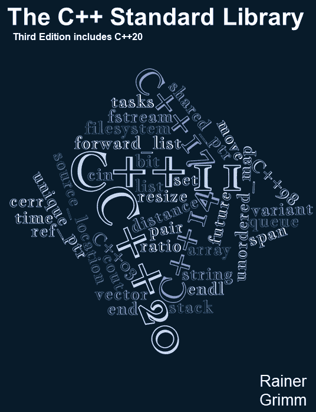


---

## 英文版

**Rick Audet**

道尔比实验室（Dolby Laboratories）高级工程师

> “无疑是快速上手 C++ 标准库最重要部分最快、最简单的方法。推荐任何现代 C++ 程序员阅读。”

## 德语版

**Odin Holmes**

Auto-Intern GmbH 首席执行官/首席技术官

> “正如其一样，这本书包含了对 STL 的非常详细的描述。可以清楚地看出，作者本人也进行高水平的编程。书中经常会有一些提示或正确方向的暗示，这在专业作者编写的书中往往是缺失的。例如，说 `std::vector` 在 95% 的情况下都是最佳选择，或者说 `std::async` 通常应该是首选，这些陈述巧妙地将读者引向了正确的方向。
>
> 此外，对 STL 组件的选择也非常准确（没有人能在本简短的小书里描述整个 STL）。我经常看到，特别是在德语文献中，选择往往倾向于容易描述的组件，而不是有用的组件。例如，对 `std::regex` 进行一个良好且简短的描述绝非易事，但在这种情况下，作者完成得非常好。”

**Ramon Wartala**

Performance Media GmbH 技术总监

> “作者 Rainer Grimm 编写的《C++ 短小精要》215 页内容加上索引，是对该主题大量丰富文本的成功提炼。例如，关于标准库经典算法的章节占据了整 131 页。即使是标准库重要组成部分的简短示例，也紧密地印刷在这本狭窄书中。尽管今天像 Dash 或相应配置的 IDE 等工具越来越多地占据了此类桌面参考资料的位置，但关于 C++ 标准库的“短小精要”仍然每位 C++ 开发者轻便且便携的伴侣。作为 Kindle 版本更加方便携带。”

## 引言

### 关于我


Rainer Grimm

自 1999 年以来，我一直担任软件架构师、团队负责人和讲师。2002 年，我在公司创建了一个进修培训班。我从 2002 年开始举办研讨会。我的第一批研讨会是关于专有管理软件的，但随后紧是 Python 和 C++ 的研讨会。在空闲时间，我喜欢写关于 C++、Python 和 Haskell 的文章。我也喜欢在会议上演讲。我每周在我的英语 Modern Cpp 和由 Heise Developer 托管的德语博客上发布。

自 2016 年以来，我是一名独立讲师，举办关于现代 C++ 和 Python 的研讨会。我用多种语言出版了多本关于现代 C++ 尤其是并发的书。由于我的职业，我一直在寻找教学现代 C++ 的最佳方法。

### 本书的目的

C++ 标准库是对当前 C++ 标准 C++20 [ISO/IEC 14882:2020](https://www.iso.org/standard/79358.html) 标准库的快速参考。C++20 超过 1800 页，是 C++17 之后的下一个大型 C++ 标准。C++17 既不是大标准也不是小标准。C++14 是 C++11 的一个小补充。C++11 超过 1300 页，并于 2011 年发布。那是第一个且唯一的 C++ 标准 C++98 之后的 13 年。当然，还有发布于 2003 年的 C++03。但 C++03 被认为是一个修复版本。

这个快速参考的目标是为 C++ 标准库提供一个简洁的参考。本书假设你熟悉 C++。如果是，你将从书中获得最大的收益。如果 C++ 对你来说是新的，你应该从一本关于核心 C++ 的教科书开始。一旦你掌握了核心语言教科书，就可以进行下一步。

### 索引

这本书的核心思想可以很容易概括为：“每一位专业 C++ 程序员都应该了解的 C++ 标准库知识”。由于这一意图，我留下了许多未回答的问题；因此，我在每个新主题的开头都为你提供了详细细节的链接。该链接将指向优秀的在线资源 [www.cppreference.com](http://en.cppreference.com/w/)。

## C++ 对比 C++11

谁比 C++ 的创造者 Bjarne Stroustrup 更能描述 C++11 呢：

> 惊讶的是，C++11 感觉像是一门新语言：各个部分的结合比以前更加紧密，我发现高层次的编程风格比以前更加自然，而且效率如既往。（Bjarne Stroustrup, [`www.stroustrup.com/C++11FAQ.html`](http://www.stroustrup.com/C++11FAQ.html)）

Bjarne Stroustrup 是的。C++11 感觉像是一门新语言，因为它在经典 C++ 之外，它还提供了很多内容。这对于核心语言是如此，对于改进和扩展的标准库更是如此。用于文本处理的正则表达式库、用于获取、比较或操作类型的类型特性（type-traits）库、新的随机数库或 chrono 库都是 C++11 新引入的产物。但这远未此。还有用于自动内存管理的智能指针，以及新的容器 `std::array` 和 `std::tuple`，它们在 C++14 中得到了进一步改进。C++11 首次意识到了多线程并提供了一个多线程库。

# 1. 标准库

C++ 标准库由许多组件组成。本章有两个目的：它应该让你对这些组件有一个快速的概述，并对如何使用它们有一个初步的想法。

## 历史

C++ 及其标准库有着悠久的历史。C++ 起于上世纪的 80 年代，一直持续到 2020 年。任何了解软件开发的人都知道我们的领域进化有多快。因此，30 年是一个非常漫长的时期。你可能不会对 C++ 的第一个组件（如 I/O 流）的设计理念与现代标准模板库（STL）不同而感到惊讶。过去 30 年软件开发领域的这种演进（你可以在 C++ 标准库中观察到）也是解决软件问题方式的演进。C++ 开始是一种面向对象的语言，然后通过 STL 引入了泛型编程，现在又采用了许多函数式编程的思想。

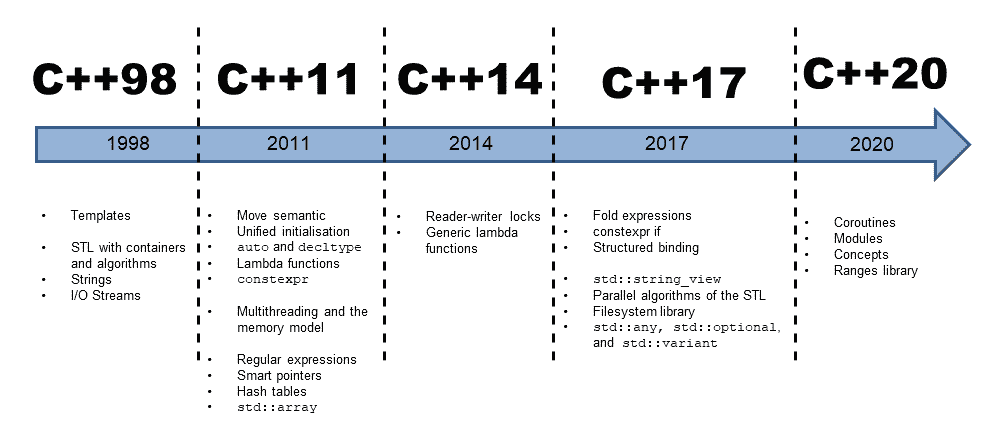

C++ 时间线

1998 年第一个 C++ 标准库包含三个组件。它们是之前提到的 I/O 流（主要用于文件处理）、字符串库和标准模板库。标准模板库促进了算法在容器上的透明应用。

历史在 2005 年随着《技术报告 1》（TR1）继续。C++ 库的扩展 ISO/IEC TR 19768 并不是正式标准，但几乎所有的组件都成为了 C++11 的一部分。例如，基于 boost 库（http://www.boost.org/）的正则表达式、智能指针、哈希表、随机数时间库。

除了 TR1 的标准化外，C++11 还获得了一个新组件：多线程库。

C++14 仅仅是对 C++11 标准的一次小幅更新。因此，只对已有的智能指针、tuple、类型特性和多线程库添加了一些改进。

C++17 包含了文件系统库以及两个新数据类型 `std::any` 和 `std::optional`。

C++20 拥有四个突出的特性：概念（concepts）、范围（ranges）、协程（coroutines）和模块（modules）。

### 概述

由于 C++11 有许多库，因此为每个用例找到最合适的库通常并不那么容易。

### 工具类

工具类是关注通用性的库，因此可以应用于许多语境。

工具类的示例包括用于计算数值的最小值或最大值的函数、计算两个值的中点的函数，或者交换或移动值的函数。

得益于保存整数的比较，整数提升不会发生。

其他工具类包括 `std::function`、`std::bind` 或 `std:bind_front`。通过 `std::bind` 或 `std::bind_front`，你可以轻松地从现有函数创建新函数。若要将它们绑定到变量并在以后调用它们，你需要 `std::function`。

通过 `std::pair` 及其泛化形式 `std::tuple`，你可以创建任意长度的异构对和元组。

引用包装器 `std::ref` 和 `std::cref`（#chap03.xhtml_chapterXXXReferenceSSSWrappers）非常好用。人们可以使用它们为变量创建引用包装器，对于 `std::cref` 来说是常量的。

工具类的亮点是智能指针。它们允许在 C++ 中进行显式内存管理。你可以用 `std::unique_ptr` 建模显式所有权，用 `std::shared_ptr` 建模共享所有权。第三者 `std::weak_ptr` 有助于打破它们之间的循环依赖。

类型特性库用于在编译时检查、比较和操作类型信息。

时间库是 C++ 新多线程能力的导入新增。但它对于性能测量也非常方便，并包含了对日历和时区。

通过 `std::any`、`std::optional` 和 `std::variant`，我们在 C++17 中获得了三种特殊数据类型，它们可以可以是任何值、可选值或值的变体。

### 标准模板库

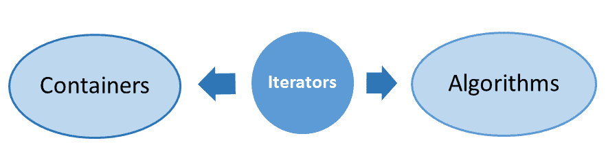

STL 的三个组件

标准模板库（STL）从视角来看由三个组件组成。它们是容器、运行在容器上的算法以及连接两者的迭代器。这种泛型编程的抽象使你能够以独特的方式组合算法和容器。容器对元素只有最小的要求。

C++ 标准库拥有丰富的容器集合。从视角来看我们有序列容器和关联容器。关联容器可以分类为有序关联容器或无序关联容器。

序列容器中的每一个都有独特的领域，但在 95% 的用例中，`std::vector` 都是正确的选择。`std::vector` 可以动态调整大小，自动管理内存并为你提供卓越的性能。相比之下，`std::array` 是唯一无法在运行时调整大小的序列容器。它针对最小的内存和性能开销进行了优化。虽然 `std::vector` 擅长在末尾添加新元素，但如果你要在开头也添加元素，应该使用 `std::deque`。由于 `std::list` 是双链表，而 `std::forward_list` 是单链表，我们还拥有两个对容器内任意位置操作优化的额外容器。

`Associative containers` 是键值对的容器。它们通过各自的键提供相应的值。关联容器的一个典型用例是电话簿，你使用键 `family name` 来检索值 `phone number`。C。C++ 有八种不同的关联容器。一边是具有有序键的关联容器：`std::set`、`std::map`、`std::multiset` 和 `std::multimap`。另一边是无序关联容器：`std::unordered_set`、`std::unordered_map`、`std::unordered_multiset` 和 `std::unordered_multimap`。

让我们先看看有序关联容器。`std::set` 和 `std::map` 之间的区别在于，前者没有关联的值。`std::map` 和 `std::multimap` 之间的区别在于，后者可以有多个相同的键。这种命名规范也适用于无序关联容器，它们与有序容器有许多共同点。关键区别在于性能。有序关联容器的访问时间取决于元素数量的对数增长，而无序关联容器允许常数级访问时间。因此，无序关联容器的访问时间与其大小无关。同样的规则适用于 `std::map`，也适用于 `std::vector`。在 95% 的用例中，`std::map` 应该是你关联容器的首选，因为其键是有排序的。

`Container adapters` 为序列容器提供了简化的接口。C++ 拥有 `std::stack`、`std::queue` 和 `std::priority_queue`。

`std::span` 是连续元素序列的视图。C 数组、`std::array`、`std::vector` 或 `std::string` 都支持视图。视图永远不是所有者。

`Iterators` 是容器和算法之间的胶水。它们由容器创建。作为泛化指针，你可以使用它们在容器中正向或反向遍历，或者跳转到任意位置。你获得的迭代器类型取决于容器。如果你使用迭代器适配器，可以直接访问流。

STL 提供了超过 100 种算法。通过指定执行策略，你可以以顺序、并行或并行且向量化的方式运行大多数算法。算法在元素或元素范围上进行操作。两个迭代器定义了一个范围。第一个定义起始位置，第二个（称为结束迭代器）定义范围的终点。需要重要的是，结束迭代器指向范围末尾之后的元素。

算法可以用于广泛的场景。你可以查找元素或统计数量、查找范围、比较或转换它们。还有算法可以用于从容器中生成、替换或删除元素。当然，你可以对容器进行排序、排列或分区，或者确定其最小或最大元素。许多算法可以通过 `callables`（如函数、函数对象或 lambda 函数）进行进一步自定义。`callables` 为搜索或元素转换提供了特殊标准。它们极大地增强了算法的威力。

ranges 库的算法是惰性的，可以直接在容器上工作，并且可以轻松地组合。它们用函数式思想扩展了 C++。

### 数值（Numeric）

C++ 中有两个数值数值库：随机数库和数学函数，后者是 C++ 继承自 C。

随机数库由两部分组成。一边是随机数生成器，另一边是生成的随机数的分布。随机数生成器生成位于最小值和最大值之间的数字流，随机数分布将这些映射到具体的分布上。

由于 C 的存在，C++ 拥有许多数学标准函数。例如对数函数、指数函数和三角函数。

C++ 支持基础和高级的数学常量，如 、 或 。

### 文本处理（Text Processing）

通过字符串和正则表达式，C++ 拥有两个强大的库来处理文本。

`std::string` 拥有丰富的方法集来分析和修改其文本。因为它与字符的 `std::vector` 有许多共同点，STL 的算法可以用于 `std::string`。`std::string` 是 C 字符串的继承者，但使用起来更容易更安全。C++ 字符串管理自己的内存。

与 `std::string` 不同，`std::string_view` 的拷贝非常廉价。`std::string_view` 是 `std::string` 的非所有权引用。

`Regular expression` 是一种描述文本模式的语言。你可以使用正则表达式来确定文本模式是否在文本中出现一次或多次。但这还不全部。正则表达式还可以用于用文本替换匹配的内容。

### 输入与输出（Input and Output）

I/O streams library 是一个从 C++ 之初就存在的库，允许与外部世界进行通信。在这种具体情况下，通信意味着提取运算符 `>>` 使其能够从输入流读取格式化或未格式化的数据，而插入运算符 `<<` 使其能够将数据写入输出流。

流类具有复杂的层次结构。有两个流类至关重要：首先，字符串流（string streams）允许你与字符串和流交互；其次，文件流（file streams）允许你读写文件。流的状态存储在标志中，你可以读取并操作这些标志。

通过重载输入运算符和输出运算符，你的类可以像基本数据类型一样与外部世界交互。

formatting library 为 `printf` 系列提供了一个安全且可扩展的替代，并扩展了 I/O 流库。

### 文件系统（Filesystem）

filesystem library 在 C++17 中被添加到 C++ 标准。该库基于文件、文件名和路径三个概念。文件可以是目录、硬链接、符号链接或普通文件。路径可以是绝对或相对的。

文件系统库提供了一个强大的接口用于读取和操作文件系统。

### 多线程（Multithreading）

C++ 在 2011 年发布的 C++ 标准中获得了一个多线程库。该库具有原子变量、线程、锁和条件变量等基础构建块。这是未来 C++ 标准在此基础上构建更高级别抽象的基础。但 C++11 已经引入了任务（tasks），它们提供了比上述基础构建块更高级的抽象。

在底层，C++11 首次提供了内存模型和原子变量。这两个组件都是多线程编程中定义良好的行为的基础。

C++ 中的新 `thread` 会立即开始其工作。它可以在前台或后台运行，并通过拷贝或引用获取其数据。得益于 `stop token`，你可以中断改进后的线程 `std::jthread`。

线程之间共享变量的访问必须经过协调。这种协调可以通过互斥量（mutexes）或锁（locks）等不同方式完成。但通常保护数据的初始化就足够了，因为它在整个生命周期内是不可变的。

将变量声明为 `thread-local` 可以确保线程获得自己的副本，因此不会产生冲突。

`Condition variables`（条件变量）是实现发送者-接收者工作流的经典解决方案。核心思想是发送者在完成工作后通知接收者，以便接收者开始。

`Semaphores`（信号量）是一种用于控制对共享资源并发访问的同步机制。信号量有一个大于零的计数器。获取信号量减少计数器，释放信号量增加计数器。只有当计数器大于零时，线程才能获取资源。

与信号量类似，`std::latch` 和 `std::barrier` 是 `coordination types`（协调类型），允许某些线程阻塞直到计数器变为零。与 `std::barrier` 不同，你可以重用 `std::latch` 用于新的迭代，并为该新迭代调整计数器。

`Tasks`（任务）与线程有许多共同点。但程序员显式地创建线程，而任务由 C++ 运行时隐式创建。任务就像数据通道。`promise` 将数据放入数据通道，`future` 提取该值。数据可以是一个值、异常，或仅仅是一个通知。


`Coroutines`（协程）是可以在保持状态的同时挂起和恢复执行的函数。协程是编写`event-driven applications`（事件驱动应用）的常用方法。事件驱动应用可以是模拟、游戏、服务器、用户界面，甚至是算法。协程通常用于`cooperative multitasking`（协作多任务）。协作多任务的关键在于每个任务都根据需要花费时间。

## 库的应用

在文件中使用库需要执行三个步骤。首先，你必须使用`#include`语句包含头文件，以便编译器知道库名称。由于 C++ 标准库名称位于`std`命名空间中，你可以在第二步中使用完全限定名，或者必须将它们导入到全局命名空间。

第三步也是最后一步是为链接器指定库以获取可执行文件。第三步通常不是必要的。下面解释了这三个步骤。

### 包含头文件

预处理器遵循`#include`语句包含文件。这大多数情况下是一个头文件。头文件包含在角括号中：

```cpp
#include <iostream>
#include <vector>
```

### 命名空间的使用

如果你使用限定名，必须完全按照定义的方式使用它们。对于每个命名空间，你都必须放置作用域解析运算符`::`。C++ 标准库的更多库使用了嵌套命名空间。

```cpp
#include <iostream>
#include <chrono>
...
std::cout << "Hello world:" << std::endl;
auto timeNow= std::chrono::system_clock::now();
```

#### 名称的非限定使用

你可以通过`using`声明和`using`指令在 C++ 中使用名称。

#### Using 声明

`using`声明将一个名称添加到你应用`using`声明的可见性范围内：

```cpp
#include <iostream>
#include <chrono>
...
using std::cout;
using std::endl;
using std::chrono::system_clock;
...
cout << "Hello world:" << endl; // 非限定名
auto timeNow= now();            // 非限定名
```

应用`using`声明具有以下后果：

- 如果在同一可见性范围内声明了相同的名称，会发生歧义查找并导致编译器错误。
- 如果在周围的可见性范围内声明了相同的名称，它将被`using`声明所隐藏。

#### Using 指令

`using`指令允许在不加限定符的情况下使用命名空间的所有名称。

```cpp
#include <iostream>
#include <chrono>
...
using namespace std;
...
cout << "Hello world:" << endl;            // 非限定名
auto timeNow= chrono::system_clock::now(); // 部分限定名
```

`using`指令不会向当前可见性范围添加新名称，它只是让名称变得可用。这意味着：

- 如果在同一可见性范围内声明了相同的名称，会发生歧义查找并导致编译器错误。
- 局部命名空间中的名称会隐藏在周围命名空间中声明的名称。
- 如果相同的名称从不同的命名空间变得可见，或者命名空间中的名称隐藏了全局范围中的名称，就会发生歧义查找并导致编译器错误。

#### 命名空间别名

命名空间别名定义了命名空间的别名。对于长命名空间使用别名非常方便：

```cpp
#include <chrono>
namespace sysClock = std::chrono;
auto nowFirst= sysClock::now();
auto nowSecond= std::chrono::system_clock::now();
```

由于命名空间别名，你可以完全限定地调用`now`函数。命名空间别名不能隐藏名称。

### 构建可执行文件

链接库的情况并不罕见。这句话取决于平台。例如，使用当前的`g++`或`clang++`编译器，你必须链接`pthread`库来获取多线程功能。

```bash
g++ -std=c++14 thread.cpp -o thread -pthread
```

## 工具

工具是在许多语境下都可以使用的有用工具。它们不限于特定的领域。这句话适用于本章的函数和库。我向你解释可以应用于任意值的函数，或者可以用于创建新函数并将其绑定到变量的函数。你可以在对（pairs）和元组（tuples）中存储任意类型的任意值，也可以构建任意值的引用。智能指针是在 C++ 中实现自动内存管理的工具。要获取有关类型的信息，请使用 type-traits 库。

### 有用函数

`min`、`max`和`minmax`函数的多种变体适用于值和初始化列表。这些函数需要头文件`<algorithm>`。`std::move`、`std::forward`和`std::swap`函数也如此。这三个函数定义在头文件`<utility>`中。

### `std::min`、`std::max`和`std::minmax`

函数[`std::min`](http://en.cppreference.com/w/cpp/algorithm/min)、[`std::max`](http://en.cppreference.com/w/cpp/algorithm/max)和[`std::minmax`](http://en.cppreference.com/w/cpp/algorithm/minmax)定义在`<algorithm>`中，作用于值和初始化列表并将请求的值作为结果返回。对于`std::minmax`，你得到一个`std::pair`。对的第一个元素是最小值，第二个元素是值的最大值。默认情况下，使用小于运算符（`<`），但你可以指定自己的比较运算符。该函数需要两个参数并返回一个布尔值。返回真或假的函数被称为谓词（predicates）。

```cpp
// minMax.cpp
...
#include <algorithm>
...
using std::cout;
...
cout << std::min(2011, 2014);                           // 2011
cout << std::min({3, 1, 2011, 2014, -5});               // -5
cout << std::min(-10, -5, [](int a, int b)
                { return std::abs(a) < std::abs(b); }); // -5

auto pairInt= std::minmax(2011, 2014);
auto pairSeq= std::minmax({3, 1, 2011, 2014, -5});
auto pairAbs= std::minmax({3, 1, 2011, 2014, -5}, [](int a, int b)
                      { return std::abs(a) < std::abs(b); });

cout << pairInt.first << "," << pairInt.second;  // 2011,2014
cout << pairSeq.first << "," << pairSeq.second;  // -5,2014
cout << pairAbs.first << "," << pairAbs.second;  // 1,2014
```

### 函数 `std::min`、`std::max`和`std::minmax`

该表提供了函数`std::min`、`std::max`和`std::minmax`的概述。

#### `std::min`、`std::max`和`std::minmax`的变体

| 函数 | 说明 |
| --- | --- |
| `min(a, b)` | 返回`a`和`b`之间的最小值。 |
| `min(a, b, comp)` | 根据谓词`comp`返回`a`和`b`的最小值。 |
| `min(initialiser list)` | 返回初始化列表中的最小值。 |
| `min(initialiser list, comp)` | 根据谓词`comp`返回初始化列表中的最小值。 |
| `max(a, b)` | 返回`a`和`b`之间的最大值。 |
| `max(a, b, comp)` | 根据谓词`comp`返回`a`和`b`的最大值。 |
| `max(initialiser list)` | 返回初始化列表中的最大值。 |
| `max(initialiser list, comp)` | 根据谓词`comp`返回初始化列表中的最大值。 |
| `minmax(a, b)` | 返回`a`和`b`的最小值和最大值。 |
| `minmax(a, b, comp)` | 根据谓词`comp`返回`a`和`b`的最小值和最大值。 |
| `minmax(initialiser list)` | 返回初始化列表的最小值和最大值。 |
| `minmax(initialiser list, comp)` | 根据谓词`comp`返回初始化列表的最小值和最大值。 |

#### `std::midpoint`和`std::lerp`

函数`std::midpoint(a, b)`计算`a`和`b`之间的中间值。`a`和`b`可以是整数、浮点数或指针。如果`a`和`b`是指针，它们必须指向同一个数组对象。函数`std::midpoint`需要头文件`<numeric>`。

函数`std::lerp(a, b, t)`计算两个数字的线性插值。它需要头文件`<cmath>`。返回值为`a + t(b - a)`。

```cpp
// midpointLerp.cpp

#include <cmath>
#include <numeric>

...

std::cout << "std::midpoint(10, 20): " << std::midpoint(10, 20) << std::endl;

for (auto v: {0.0, 0.1, 0.2, 0.3, 0.4, 0.5, 0.6, 0.7, 0.8, 0.9, 1.0}) {
    std::cout << "std::lerp(10, 20, " << v << "): " << std::lerp(10, 20, v) << "\n";
}
```

#### `std::midpoint`和`std::lerp`

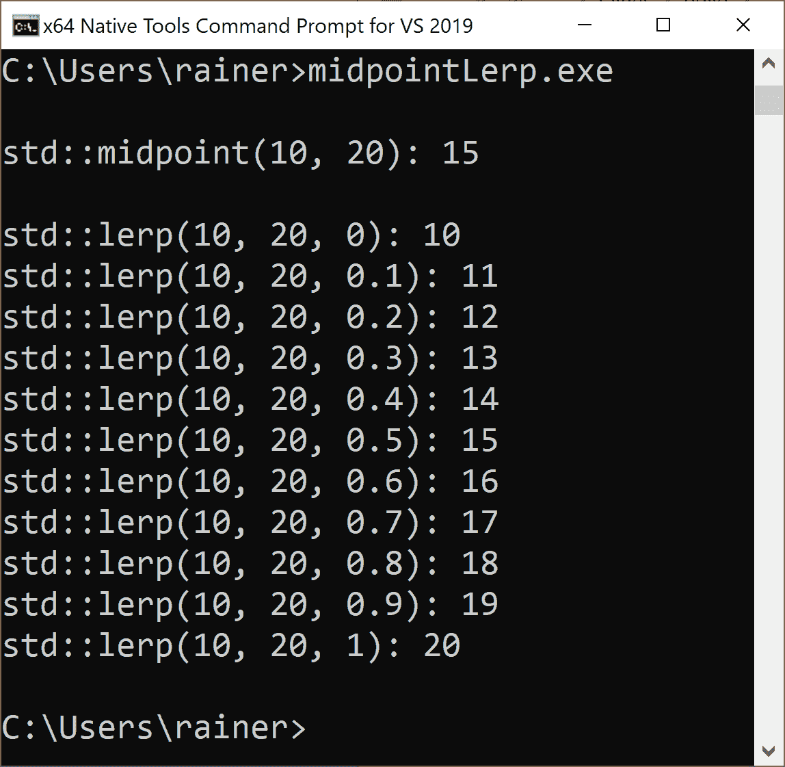

#### `std::move`

定义在头文件`<utility>`中的函数[`std::move`](http://en.cppreference.com/w/cpp/utility/move)使编译器能够移动其资源。在所谓的移动语义中，值从源对象被移动到新对象。之后，源对象处于一个良定义但未指定的状态。大多数情况下，这是默认状态。

```cpp
// ... move semantic logic ...
```

#### `std::forward`

定义在头文件`<utility>`中的函数[`std::forward`](http://en.cppreference.com/w/cpp/utility/forward)用于传递转发引用。

```cpp
// ... forward reference logic ...
```

#### `std::swap`

使用定义在头文件`<utility>`中的函数[`std::swap`](http://en.cppreference.com/w/cpp/utility/swap)，你可以交换两个对象。

```cpp
// swap.cpp
...
#include <utility>
...
template <typename T>
inline void swap(T& a, T& b) {
    T tmp(std::move(a));
    a = std::move(b);
    b = std::move(tmp);
}
```

[`std::bind_front`](https://en.cppreference.com/w/cpp/utility/functional/bind_front)从一个可调用对象创建一个可调用包装器。调用`std::bind_front(func, arg ...)`将所有参数`arg`绑定到`func`的前面，并返回一个可调用包装器。

## `std::function`

[`std::function`](http://en.cppreference.com/w/cpp/utility/functional/function)可以在变量中存储任意的可调用对象。它是一种多态函数包装器。可调用对象可以是 Lambda 函数、函数对象或函数。如果你必须显式地指定可调用对象的类型，则`std::function`总是必须的，且无法被`auto`替换。

```cpp
// dispatchTable.cpp 
...
#include <functional>
...
using std::make_pair;
using std::map;

map<const char, std::function<double(double, double)>> tab;
tab.insert(make_pair('+', [](double a, double b){ return a + b; }));
tab.insert(make_pair('-', [](double a, double b){ return a - b; }));
tab.insert(make_pair('*', [](double a, double b){ return a * b; }));
tab.insert(make_pair('/', [](double a, double b){ return a / b; }));

std::cout << tab'+';  // 8
std::cout << tab'-';  // -1
std::cout << tab'*';  // 15.75
std::cout << tab'/';  // 0.777778
```

### 使用 `std::function`的分发表

`std::function`的类型参数定义了`std::function`将接受的可调用对象的类型。

#### 返回类型和参数类型

| 函数类型 | 返回类型 | 参数类型 |
| --- | --- | --- |
| `double(double, double)` | `double` | `double` |
| `int()` | `int` | |
| `double(int, double)` | `double` | `int, double` |
| `void()` | | |

## Pairs（对）

通过[`std::pair`](http://en.cppreference.com/w/cpp/utility/pair)，你可以构建任意类型的对。类模板`std::pair`需要头文件`<utility>`。`std::pair`拥有默认构造函数、拷贝构造函数和移动构造函数。对对象可以交换：`std::swap(pair1, pair2)`。

对经常被用于 C++ 标准库。例如，函数`std::minmax`将其结果作为一个对返回，关联容器](#chap06.xhtml_chapterXXXAssociativeSSSContainers)`std::map`、`std::unordered_map`、`std::multimap`和`std::unordered_multimap`以对的形式管理它们的键/值关联。

要获取对`p`的元素，你可以直接访问它，也可以通过索引访问。因此，通过`p.first`或`std::get<0>(p)`获取第一个元素，通过`p.second`或`std::get<1>(p)`获取对的第二个元素。

对支持比较运算符`==`、`!=`、`<`、`>`、`<=`和`>=`。如果你比较两个对，首先将比较成员`pair1.first`和`pair2.first`，然后比较`pair1.second`和`pair2.second`。其他比较运算符也采用相同的策略。

### `std::make_pair`

C++ 有实用的辅助函数[`std::make_pair`](http://en.cppreference.com/w/cpp/utility/pair/make_pair)来生成对，而无需指定它们的类型。`std::make_pair`会自动推导出它们的类型。


## `std::bind_front`

[`std::bind_front`](https://en.cppreference.com/w/cpp/utility/functional/bind_front) 从一个可调用对象创建一个可调用包装器。调用 `std::bind_front(func, arg ...)` 将所有参数 `arg` 绑定到 `func` 的前面，并返回一个可调用包装器。

## `std::function`

[`std::function`](http://en.cppreference.com/w/cpp/utility/functional/function) 可以在变量中存储任意的可调用对象。它是一种多态函数包装器。可调用对象可以是 Lambda 函数、函数对象或函数。如果你必须显式地指定可调用对象的类型，则 `std::function` 总是必须的，且无法被 `auto` 替换。

```cpp
// dispatchTable.cpp 
...
#include <functional>
...
using std::make_pair;
using std::map;

map<const char, std::function<double(double, double)>> tab;
tab.insert(make_pair('+', [](double a, double b){ return a + b; }));
tab.insert(make_pair('-', [](double a, double b){ return a - b; }));
tab.insert(make_pair('*', [](double a, double b){ return a * b; }));
tab.insert(make_pair('/', [](double a, double b){ return a / b; }));

std::cout << tab'+';  // 8
std::cout << tab'-';  // -1
std::cout << tab'*';  // 15.75
std::cout << tab'/';  // 0.777778
```

使用 `std::function` 的分发表。

`std::function` 的类型参数定义了 `std::function` 将接受的可调用对象的类型。

### 返回类型和参数类型

| 函数类型 | 返回类型 | 参数类型 |
| --- | --- | --- |
| `double(double, double)` | `double` | `double, double` |
| `int()` | `int` | 无 |
| `double(int, double)` | `double` | `int, double` |
| `void()` | `void` | 无 |

## Pairs（对）

通过 [`std::pair`](http://en.cppreference.com/w/cpp/utility/pair)，你可以构建任意类型的对。类模板 `std::pair` 需要头文件 `<utility>`。`std::pair` 拥有默认构造函数、拷贝构造函数和移动构造函数。对对象可以交换：`std::swap(pair1, pair2)`。

对经常被用于 C++ 标准库。例如，函数 `std::minmax` 将其结果作为一个对返回，关联容器 `std::map`、`std::unordered_map`、`std::multimap` 和 `std::unordered_multimap` 以对的形式管理它们的键/值关联。

要获取对 `p` 的元素，你可以直接访问它，也可以通过索引访问。因此，通过 `p.first` 或 `std::get<0>(p)` 获取第一个元素，通过 `p.second` 或 `std::get<1>(p)` 获取对的第二个元素。

对支持比较运算符 `==`、`!=`、`<`、`>`、`<=` 和 `>=`。如果你比较两个对，首先将比较成员 `pair1.first` 和 `pair2.first`，然后比较 `pair1.second` 和 `pair2.second`。其他比较运算符也采用相同的策略。

### `std::make_pair`

C++ 有实用的辅助函数 [`std::make_pair`](http://en.cppreference.com/w/cpp/utility/pair/make_pair) 来生成对，而无需指定它们的类型。`std::make_pair` 会自动推导出它们的类型。

```cpp
// pair.cpp
...
#include <utility>
...
using namespace std;
...
pair<const char*, double> charDoub("str", 3.14);
pair<const char*, double> charDoub2= make_pair("str", 3.14);
auto charDoub3= make_pair("str", 3.14);

cout << charDoub.first << ", " << charDoub.second;    // str, 3.14
charDoub.first="Str";
get<1>(charDoub)= 4.14;
cout << charDoub.first << ", " << charDoub.second;    // str, 4.14
```

辅助函数 `std::make_pair`。

## Tuples（元组）

你可以使用 [`std::tuple`](http://en.cppreference.com/w/cpp/utility/tuple) 创建任意长度和类型的元组。类模板需要头文件 `<tuple>`。`std::tuple` 是 `std::pair` 的泛化。你可以在两个元素的元组和对之间转换。元组像它的小兄弟 `std::pair` 一样，拥有默认构造函数、拷贝构造函数和移动构造函数。你可以使用函数 `std::swap` 交换元组。

元组 `t` 的第 `i` 个元素可以通过函数 `std::get` 访问：`std::get<i-1>(t)`。`std::get<type>(t)` 可以直接引用 `type` 元素。

元组支持比较运算符 `==`、`!=`、`<`、`<=` 和 `>=`。如果你比较两个元组，元组的元素将按字典顺序比较。比较从索引 0 开始。

### `std::make_tuple`

辅助函数 [`std::make_tuple`](http://en.cppreference.com/w/cpp/utility/tuple/make_tuple) 对于创建元组非常方便。你不需要提供类型，编译器会自动推导出它们。

```cpp
// tuple.cpp
...
#include <tuple>
...
using std::get;

std::tuple<std::string, int, float> tup1("first", 3, 4.17f);
auto tup2= std::make_tuple("second", 4, 1.1);

cout << get<0>(tup1) << ", " << get<1>(tup1) << ", " << get<2>(tup1) << endl;  // first, 3, 4.17
cout << get<0>(tup2) << ", " << get<1>(tup2) << ", " << get<2>(tup2) << endl;
```


```cpp
// dispatchTable.cpp
...
#include <functional>
...
using std::make_pair;
using std::map;

map<const char, std::function<double(double, double)>> tab;
tab.insert(make_pair('+', [](double a, double b){ return a + b; }));
tab.insert(make_pair('-', [](double a, double b){ return a - b; }));
tab.insert(make_pair('*', [](double a, double b){ return a * b; }));
tab.insert(make_pair('/', [](double a, double b){ return a / b; }));

std::cout << tab'+';  // 8
std::cout << tab'-';  // -1
std::cout << tab'*';  // 15.75
std::cout << tab'/';  // 0.777778
```

## 使用 `std::function` 的分发表

`std::function` 的类型参数定义了 `std::function` 将接受的可调用对象的类型。

### 返回类型和参数类型

| 函数类型 | 返回类型 | 参数类型 |
| --- | --- | --- |
| `double(double, double)` | `double` | `double` |
| `int()` | `int` |  |
| `double(int, double)` | `double` | `int, double` |
| `void()` |  |  |

## Pairs（对）

通过 [`std::pair`](http://en.cppreference.com/w/cpp/utility/pair)，你可以构建任意类型的对。类模板 `std::pair` 需要头文件 `<utility>`。`std::pair` 拥有默认构造函数、拷贝构造函数和移动构造函数。对对象可以交换：`std::swap(pair1, pair2)`。

对经常被用于 C++ 标准库。例如，函数 `std::minmax` 将其结果作为一个对返回，关联容器 `std::map`、`std::unordered_map`、`std::multimap`` 和 `std::unordered_multimap` 以对的形式管理它们的键/值关联。

要获取对 `p` 的元素，你可以直接访问它，也可以通过索引访问。因此，通过 `p.first` 或 `std::get<0>(p)` 获取第一个元素，通过 `p.second` 或 `std::get<1>(p)` 获取对的第二个元素。

对支持比较运算符 `==`、`!=`、`<`、`>`、`<=` 和 `>=`。如果你比较两个对，首先将比较成员 `pair1.first` 和 `pair2.first`，然后比较 `pair1.second` 和 `pair2.second`。其他比较运算符也采用相同的策略。

### `std::make_pair`

C++ 有实用的辅助函数 [`std::make_pair`](http://en.cppreference.com/w/cpp/utility/pair/make_pair) 来生成对，而无需指定它们的类型。`std::make_pair` 会自动推导出它们的类型。

```cpp
// pair.cpp
...
#include <utility>
...
using namespace std;
...
pair<const char*, double> charDoub("str", 3.14);
pair<const char*, double> charDoub2= make_pair("str", 3.14);
auto charDoub3= make_pair("str", 3.14);

cout << charDoub.first << ", " << charDoub.second;    // str, 3.14
charDoub.first="Str";
get<1>(charDoub)= 4.14;
cout << charDoub.first << ", " << charDoub.second;    // str, 4.14
```

辅助函数 `std::make_pair`

## Tuples（元组）

你可以使用 [`std::tuple`](http://en.cppreference.com/w/cpp/utility/tuple) 创建任意长度和类型的元组。类模板需要头文件 `<tuple>`。`std::tuple` 是 `std::pair` 的泛化。你可以在两个元素的元组和对之间转换。元组像它的小兄弟 `std::pair` 一样，拥有默认构造函数、拷贝构造函数和移动构造函数。你可以使用函数 `std::swap` 交换元组。

元组 `t` 的第 `i` 个元素可以通过函数 `std::get` 获取：`std::get<i-1>(t)`。`std::get<type>(t)` 可以直接引用 `type` 元素。

元组支持比较运算符 `==`、`!=`、`<`、`<=` 和 `>=`。如果你比较两个元组，元组的元素将按字典顺序比较。比较从索引 0 开始。

### `std::make_tuple`

辅助函数 [`std::make_tuple`](http://en.cppreference.com/w/cpp/utility/tuple/make_tuple) 对于创建元组非常方便。你不需要提供类型，编译器会自动推导出它们。

```cpp
// tuple.cpp
...
#include <tuple>
...
using std::get;

std::tuple<std::string, int, float> tup1("first", 3, 4.17f);
auto tup2= std::make_tuple("second", 4, 1.1);

cout << get<0>(tup1) << ", " << get<1>(tup1) << ", " << get<2>(tup1) << endl;  // first, 3, 4.17
cout << get<0>(tup2) << ", " << get<1>(tup2) << ", " << get<2>(tup2) << endl;
```

```cpp
// referenceWrapperCallable.cpp
...
#include <functional>
...
void foo(){
  std::cout << "Invoked" << std::endl;
}

typedef void callableUnit();
std::reference_wrapper<callableUnit> refWrap(foo);

refWrap();                           // Invoked
```

# 引用包装（Reference wrappers）

## `std::ref` 和 `std::cref`

通过辅助函数 [`std::ref`](http://en.cppreference.com/w/cpp/utility/functional/ref) 和 [`std::cref`](http://en.cppreference.com/w/cpp/utility/functional/ref)，你可以轻松创建变量的引用包装。`std::ref` 会创建一个非常量引用包装，而 `std::cref` 则创建一个常量引用包装：

```cpp
// referenceWrapperRefCref.cpp
...
#include <functional>
...
void invokeMe(const std::string& s){
  std::cout << s << ": const " << std::endl;
}

template <typename T>
  void doubleMe(T t){
  t*= 2;
}

std::string s{"string"};

invokeMe(std::cref(s));        // string

int i= 1;
std::cout << i << std::endl;   // 1

doubleMe(i);
std::cout << i << std::endl;   // 1S

doubleMe(std::ref(i));
std::cout << i << std::endl;   // 2
```

### 辅助函数 `std::ref` 和 `std::cref`

因此，调用函数 `invokeMe`（它获取一个 `std::string` 的常量引用）可以使用一个非常量的 `std::string s`，该变量被包装在 `std::cref(s)` 中。如果用辅助函数 `std::ref` 包装变量 `i`，函数模板 `doubleMe` 将以引用的方式调用。因此，变量 `i` 的值会被倍增。

# 智能指针（Smart Pointers）

智能指针是 C++ 最扩展之一，因为它们让你能够在 C++ 中实现显式的内存管理。除了已弃用的 `std::auto_ptr`，C++ 还提供了三种不同的智能指针。它们定义在头文件 `<memory>` 中。首先是 `std::unique_ptr`，它模拟了独占所有权的概念。其次是 `std::shared_ptr`，它模拟了共享所有权的概念。最后是 `std::weak_ptr`。`std::weak_ptr` 并不那么智能，因为它只有一个薄的接口。它的工作是打破 `std::shared_ptr` 的循环。它模拟了临时所有权的概念。

智能指针根据 RAII 模式管理其资源。因此，如果智能指针超出作用范围，资源将自动释放。

## 智能指针概述

| 名称 | 标准 | 描述 |
| --- | --- | --- |
| `std::auto_ptr` | C++98 | 独占资源。<br>（已弃用*）<br>在复制时移动资源。 |
| `std::unique_ptr` | C++11 | 独占资源。<br>无法拷贝。 |
| `std::shared_ptr` | C++11 | 为共享变量拥有引用计数器。<br>自动管理引用计数器。<br>如果引用计数为 0，则删除资源。 |
| `std::weak_ptr` | C++11 | 帮助打破 `std::shared_ptr` 的循环。<br>不修改引用计数器。 |

## `std::unique_ptr`

[`std::unique_ptr`](http://en.cppreference.com/w/cpp/memory/unique_ptr) 专门负责其资源。如果它超出作用范围，它会自动释放资源。如果不需要拷贝语义，它可以在标准模板库（STL）的容器和算法中使用。如果不使用特殊的删除器，`std::unique_ptr` 的开销和速度与原始指针一样。

以下是 `std::unique_ptr` 的方法。

### `std::unique_ptr` 的方法

| 名称 | 描述 |
| --- | --- |
| `get` | 返回指向资源的指针。 |
| `get_deleter` | 返回删除函数。 |
| `release` | 返回资源的指针并释放它。 |
| `reset` | 重置资源。 |
| `swap` | 交换资源。 |

在接下来的代码示例中你可以看到这些方法的应用：

```cpp
// uniquePtr.cpp
...
#include <utility>
...
using namepace std;

struct MyInt{
  MyInt(int i):i_(i){}
  ~MyInt(){
    cout << "Good bye from " << i_ << endl;
  }
  int i_;
};

unique_ptr<MyInt> uniquePtr1{new MyInt(1998)};
cout << uniquePtr1.get() << endl;               // 0x15b50

unique_ptr<MyInt> uniquePtr2{move(uniquePtr1)};
cout << uniquePtr2.get() << endl;               // 0x15b50

uniquePtr2.reset(new MyInt(2011));
cout << uniquePtr2.get() << endl;               // 0x15b60

MyInt* myInt= uniquePtr2.release();
delete myInt;                                   // Good bye from 2011

unique_ptr<MyInt> uniquePtr3{new MyInt(2017)};
cout << uniquePtr3.get() << endl;               // 0x15b70

unique_ptr<MyInt> uniquePtr4{new MyInt(2022)};
cout << uniquePtr4.get() << endl;               // 0x15b80

swap(uniquePtr3, uniquePtr4);
cout << uniquePtr3.get() << endl;               // 0x15b80
cout << uniquePtr4.get() << endl;               // 0x15b70
```

## `std::unique_ptr` 数组

`std::unique_ptr` 提供了数组的特化：

```cpp
// uniquePtrArray.cpp
...
#include <memory>
...
using namespace std;

class MyStruct{
public:
  MyStruct():val(count){
    cout << (void*)this << " Hello: " << val << endl;
    MyStruct::count++;
  }
  ~MyStruct(){
    cout << (void*)this << " Good Bye: " << val << endl;
    MyStruct::count--;
  }
private:
  int val;
  static int count;
};

int MyStruct::count= 0;
...
{
  // 生成一个包含 3 个 MyStruct 的 myUniqueArray
  unique_ptr<MyStruct[]> myUniqueArray{new MyStruct[3]};
}
```

### 特殊删除器

`std::unique_ptr` 可以用特殊的删除器参数化：`std::unique_ptr<int, MyDeleter> up(new int(2011), MyDeleter())`。`std::unique_ptr` 默认使用资源的删除器。

### `std::make_unique`

辅助函数 [`std::make_unique`](http://en.cppreference.com/w/cpp/memory/unique_ptr/make_unique) 与其兄弟函数 `std::make_shared` 不同，后者在 C++11 标准中被遗忘了。因此 `std::make_unique` 是在 C++14 标准中添加的。`std::make_unique` 允许一步到位创建 `std::unique_ptr`：`std::unique_ptr<int> up= std::make_unique<int>(2014)`。

辅助函数 [`std::make_shared`](http://en.cppreference.com/w/cpp/memory/shared_ptr/make_shared) 会创建资源并将其封装在 `std::shared_ptr` 中返回。你应该使用 `std::make_shared` 而不是直接创建 `std::shared_ptr`，因为 `std::make_shared` 的速度快得多。

以下代码示例展示了 `std::shared_ptr` 的典型用例。


```
// sharedPtr.cpp 
...
#include <memory>
...
class MyInt{
public:
  MyInt(int v):val(v){
    std::cout << "Hello: " << val << std::endl;
  }
  ~MyInt(){
    std::cout << "Good Bye: " << val << std::endl;
  }
private:
  int val;
};

auto sharPtr= std::make_shared<MyInt>(1998);        // Hello: 1998
std::cout << sharPtr.use_count() << std::endl;      // 1

{
  std::shared_ptr<MyInt> locSharPtr(sharPtr);
  std::cout << locSharPtr.use_count() << std::endl; // 2
}
std::cout << sharPtr.use_count() << std::endl;      // 1

std::shared_ptr<MyInt> globSharPtr= sharPtr;
std::cout << sharPtr.use_count() << std::endl;      // 2

globSharPtr.reset();
std::cout << sharPtr.use_count() << std::endl;     // 1
sharPtr= std::shared_ptr<MyInt>(new MyInt(2011));  // Hello:2011
                                                   // Good Bye: 1998
...
// Good Bye: 2011
```

### `std::shared_ptr`

此示例中的可调用对象是一个函数对象。因此，你可以轻松地统计创建了多少类实例。结果存储在静态变量 `count` 中。

#### 从此创建 `std::shared_ptr`

你可以使用类 [`std::enable_shared_from_this`](http://en.cppreference.com/w/cpp/memory/enable_shared_from_this) 创建一个返回指向自身的 `std::shared_ptr` 的对象。为此，你必须让类公继承自 `std::enable_shared_from_this`。这样该类就支持 `shared_from_this` 方法来返回指向该对象的 `std::shared_ptr`：

```
// enableShared.cpp
...
#include <memory>
...
class ShareMe: public std::enable_shared_from_this<ShareMe>{
  std::shared_ptr<ShareMe> getShared(){
    return shared_from_this();
  }
};

std::shared_ptr<ShareMe> shareMe(new ShareMe);
std::shared_ptr<ShareMe> shareMe1= shareMe->getShared();

std::cout << (void*)shareMe.get() << std::endl;   // 0x152d010
std::cout << (void*)shareMe1.get() << std::endl;  // 0x152d010
std::cout << shareMe.use_count() << std::endl;    // 2
```

从此创建 `std::shared_ptr`

你可以从代码示例中看到 `get` 方法引用了同一个对象。

#### `std::weak_ptr`

坦率地说，[`std::weak_ptr`](http://en.cppreference.com/w/cpp/memory/weak_ptr) 并不是智能指针。`std::weak_ptr` 不支持对资源的透明访问，因为它只是从 `std::shared_ptr` 借用资源。`std::weak_ptr` 不改变引用计数：

```
// weakPtr.cpp
...
#include <memory>
...
auto sharedPtr= std::make_shared<int>(2011);
std::weak_ptr<int> weakPtr(sharedPtr);

std::cout << weakPtr.use_count() << std::endl;       // 1
std::cout << sharedPtr.use_count() << std::endl;     // 1

std::cout << weakPtr.expired() << std::endl;         // false
if( std::shared_ptr<int> sharedPtr1= weakPtr.lock() ) {
  std::cout << *sharedPtr << std::endl; // 2011
}
else{
  std::cout << "Don't get it!" << std::endl;
}

weakPtr.reset();

if( std::shared_ptr<int> sharedPtr1= weakPtr.lock() ) {
  std::cout << *sharedPtr << std::endl;
}
else{
  std::cout << "Don't get it!" << std::endl;         // Don't get it!
}
```

`std::weak_ptr`

表格提供了 `std::weak_ptr` 方法的概述。

`std::weak_ptr` 的方法

| 名称 | 描述 |
| --- | --- |
| `expired` | 检查资源是否被删除。 |
| `lock` | 为资源创建一个 `std::shared_ptr`。 |
| `reset` | 重置资源。 |
| `swap` | 交换资源。 |
| `use_count` | 返回计数。 |

```cpp
// typeCategories.cpp 
...
#include <type_traits>
using std::cout;

cout << std::is_void<void>::value;             // true
cout << std::is_integral<short>::value;        // true
cout << std::is_floating_point<double>::value; // true
cout << std::is_array<int [] >::value;         // true
cout << std::is_pointer<int*>::value;          // true
cout << std::is_reference<int&>::value;        // true

struct A{
  int a;
  int f(int){ return 2011; }
};
cout << std::is_member_object_pointer<int A::*>::value;          // true
cout << std::is_member_function_pointer<int (A::*)(int)>::value; // true

enum E{
  e= 1,
};
cout << std::is_enum<E>::value;                  // true

union U{
  int u;
};
cout << std::is_union<U>::value;                 // true

cout << std::is_class<std::string>::value;       // true
cout << std::is_function<int * (double)>::value; // true
cout << std::is_lvalue_reference<int&>::value;   // true
cout << std::is_rvalue_reference<int&&>::value;  // true
```

# 所有基础类型类别

### 复合类型类别

基于 14 种基础类型类别，共有 7 种复合类型类别。

### 复合类型类别

| 复合类型类别 | 基础类型类别 |
| --- | --- |
| `is_arithmetic` | `is_floating_point` 或 `is_integral` |
| `is_fundamental` | `is_arithmetic` 或 `is_void` |
| `is_object` | `is_arithmetic` 或 `is_enum` 或 `is_pointer` 或 `is_member_pointer` |
| `is_reference` | `is_lvalue_reference` 或 `is_rvalue_reference` |
| `is_compound` | `is_fundamental` 的补反 |
| `is_member_pointer` | `is_member_object_pointer` 或 `is_member_function_pointer` |
| `is_scalar` | `is_arithmetic` 或 `is_enum` 或 `is_pointer` 或 `is_is_member_pointer` 或 `is_null_pointer` |

## 类型属性

除了基础和复合类型类别外，还有许多类型属性。

```cpp
template <class T> struct is_const;
template <class T> struct is_volatile;
template <class T> struct is_trivial;
template <class T> struct is_trivially_copyable;
template <class T> struct is_standard_layout;
template <class T> struct is_pod
template <class T> struct has_unique_object_represenation;
template <class T> struct is_empty;
template <class T> struct is_polymorphic;
template <class T> struct is_abstract;
template <class T> struct is_final;
template <class T> struct is_aggregate;

template <class T> struct is_signed;
template <class T> struct is_unsigned;

template <class T, class... Args> struct is_constructible;
template <class T> struct is_default_constructible;
template <class T> struct is_copy_constructible;
template <class T> struct is_move_constructible;

template <class T, class U> struct is_assignable;
template <class T> struct is_copy_assignable;
template <class T> struct is_move_assignable;
template <class T> struct is_destructible;
template <class T, class... Args> struct is_trivially_constructible;
template <class T> struct is_trivially_default_constructible;
template <class T> struct is_trivially_copy_constructible;
template <class T> struct is_trivially_move_constructible;
template <class T, class U> struct is_trivially_assignable;
template <class T> struct is_trivially_copy_assignable;
template <class T> struct is_trivially_move_assignable;

template <class T> struct is_trivially_destructible;

template <class T, class... Args> struct is_nothrow_constructible;
template <class T> struct is_nothrow_default_constructible;
template <class T> struct is_nothrow_copy_constructible;
template <class T> struct is_nothrow_move_constructible;

template <class T, class U> struct is_nothrow_assignable;
template <class T> struct is_nothrow_copy_assignable;
template <class T> struct is_nothrow_move_assignable;

template <class T> struct is_nothrow_destructible;
template <class T> struct has_virtual_destructor;

template <class T> struct is_swappable_with;
template <class T> struct is_swappable;
template <class T> struct is_nothrow_swappable_with;
template <class T> struct is_nothrow_swappable;
```

### 类型比较

库支持三种类型的类型比较。

### 类型比较

| 函数 | 描述 |
| --- | --- |
| `template <class Base, class Derived>` | 检查 `Derived` 是否派生自 `Base` |
| `struct is_base_of` | |
| `template <class From, class To>` | 检查 `From` 是否可以转换为 `To` |
| `struct is_convertible` | |
| `template <class T, class U>` | 检查类型 `T` 和 `U` 是否相同 |
| `struct is_same` | |

[时间库](http://en.cppreference.com/w/cpp/header/chrono) 由三个主要组件组成：时间点、时间时长和时钟。此外，该库还提供了时刻功能、日历支持、时区支持以及输入/输出支持。

## 时间点 (Time point)

时间点由一个起始点（称为 `epoch`）以及一个额外的 `time duration` 定义。

## 时间时长 (Time duration)

时间时长是两个时间点之间的差。它通过滴答（ticks）的数量给出。

## 时钟 (Clock)

时钟由一个起始点（`epoch`）和一个滴答组成，以便可以计算出当前的时间点。

## 时刻 (Time of day)

自午夜以来的时长，分为小时:分:秒。

## 日历 (Calendar)

日历代表各种日历天，如年份、月份、星期或一周中的第 n 天。

## 时区 (Time zone)

代表特定地理区域的时间。

## 时间点 (Time Point)

时长由一段时间跨组成，定义为某些时间单位的若干滴答。时间点由一个时钟和一个时间时长组成。该时间时长可以是正的也可以负的。

```cpp
template <class Clock, class Duration= typename Clock::duration>
class time_point;
```

`std::chrono::steady_clock`、`std::chrono::high_resolution_clock` 和 `std::chrono::system` 时钟没有定义 `epoch`。但在流行的平台上，`std::chrono::system` 的 `epoch` 通常定义为 1970 年 1 月 1 日。你可以以纳秒、秒和分钟的精度计算自 1970 年 1 月 1 日以来的时间。


```cpp
// epoch.cpp 
...
#include <chrono>
...
auto timeNow= std::chrono::system_clock::now();
auto duration= timeNow.time_since_epoch();
std::cout << duration.count() << "ns"      // 1413019260846652ns

typedef std::chrono::duration<double> MySecondTick;
MySecondTick mySecond(duration);
std::cout << mySecond.count() << "s";      // 1413019260.846652s

const int minute= 60;
typedef std::chrono::duration<double, <minute>> MyMinuteTick;
MyMinuteTick myMinute(duration);
std::cout << myMinute.count() << "m";      // 23550324.920572m
```

#### 自 Epoch 以来的时间（Time since epoch）

得益于`std::chrono::clock_cast`函数，你可以在不同的时钟之间转换时间点。

## 时间时长（Time Duration）

时间时长是两个时间点之间的差。时间时长通过滴答的数量测量。

```cpp
template <class Rep, class Period = ratio<1>> class duration;
```

如果`Rep`是浮点数，则时间时长支持滴答的小数。最重要的时间时长在`chrono`库中已经预定义：

```cpp
typedef duration<signed int, nano> nanoseconds;
typedef duration<signed int, micro> microseconds;
typedef duration<signed int, milli> milliseconds;
typedef duration<signed int> seconds;
typedef duration<signed int, ratio< 60>> minutes;
typedef duration<signed int, ratio<3600>> hours;
```

时间时长可以有多长？C++ 标准保证预定义的时间时长可以存储 +/- 292 年。你可以轻松地像德国课时一样定义自己的时间时长：`typedef std::chrono::duration<double, std::ratio<2700>> MyLessonTick`。整数形式的时间时长必须显式转换为浮点数形式的时间时长。值将被截断：

```cpp
// duration.cpp 
...
#include <chrono>
#include <ratio>

using std::chrono;

typedef duration<long long, std::ratio<1>> MySecondTick;
MySecondTick aSecond(1);

milliseconds milli(aSecond);
std::cout << milli.count() << " milli";        // 1000 milli

seconds seconds(aSecond);
std::cout << seconds.count() << " sec";         // 1 sec

minutes minutes(duration_cast<minutes>(aSecond));
std::cout << minutes.count() << " min";         // 0 min

typedef duration<double, std::ratio<2700>> MyLessonTick;
MyLessonTick myLesson(aSecond);
std::cout << myLesson.count() << " less";       // 0.00037037 less
```

### 时长（Durations）

C++14 为最常用的时间时长内置了字面量。

#### 时间时长的内置字面量

| 类型 | 后缀 | 示例 |
| --- | --- | --- |
| `std::chrono::hours` | `h` | `5h` |
| `std::chrono::minutes` | `min` | `5min` |
| `std::chrono::seconds` | `s` | `5s` |
| `std::chrono::milliseconds` | `ms` | `5ms` |
| `std::chrono::microseconds` | `us` | `5us` |
| `std::chrono::nanoseconds` | `ns` | `5ns` |

## 时钟（Clock）

时钟由一个起始点（`epoch`）和一个滴答组成，以便可以计算出当前的时间点。

`std::chrono::system_clock`带有系统钟的系统钟。

`std::chrono::steady_clock`不可调整的系统时间。

`std::chrono::high_resolution_clock`精度最高的系统时间。

## 时刻（Time of day）

自午夜以来的时长，分为小时:分:秒。

`std::chrono::time_day`对象支持各种函数。

| 成员 | 描述 |
| --- | --- |
| `hours()` | 返回午夜的小时组件。 |
| `minutes()` | 返回午夜的分钟组件。 |
| `seconds()` | 返回午夜的秒组件。 |
| `subseconds()` | 返回午夜的小秒组件。 |
| `duration()` | 返回午夜以来的时长。 |

## 日历（Calendar）

日历代表各种日历天，如年份、月份、星期或一周中的第 n 天。

```cpp
// currentTime.cpp 
...
#include <chrono>
using std::chrono;
...
auto now = system_clock::now();
std::cout << "当前时间为 " << now << " UTC\n";      

auto currentYear = year_month_day(floor<days>(now)).year();
std::cout << "当前年份为 " << currentYear << '\n';    

auto h = floor<hours>(now) - sys_days(January/1/currentYear);
std::cout << "自新年以来已经过了 " << h << "\n"; 

std::cout << std::endl;

auto birthOfChrist = year_month_weekday(sys_days(January/01/0000));
std::cout << "星期: " << birthOfChrist.weekday() << '\n'; 
```

### 当前时间（current time）

程序的输出显示了关于当前时间的信息。


下表提供了日历类型的概述。

#### 各种日历类型

| 类 | 描述 |
| --- | --- |
| `last_spec` | 表示月份的最后一天或星期 |
| `day` | 代表月份中的天。 |
| `month` | 代表年份中的月份。 |
| `year` | 代表格列哥日历中的年份。 |
| `weekday` | 代表格列哥日历中的星期。 |
| `weekday_indexed` | 代表月份中的第 n 个星期。 |
| `weekday_last` | 代表月份中的最后一个星期。 |
| `month_day` | 代表特定月份中的特定天。 |
| `month_day_last` | 代表特定月份的最后一天。 |
| `month_weekday` | 代表特定月份中的第 n 个星期。 |
| `month_weekday_last` | 代表特定月份中的最后一个星期。 |
| `year_month` | 代表特定年份中的特定月份。 |
| `year_month_day` | 代表特定的年、月、日。 |
| `year_month_day_last` | 代表特定年份月份的最后一天。 |
| `year_month_weekday` | 代表特定年份月份的特定周几。 |
| `year_month_weekday_last` | 代表特定年份月份的最后一个工作日。 |

### 时区（Time Zone）

时区代表特定地理区域的时间。以下代码片段显示了不同时区的本地时间。

```cpp
// timezone.cpp
...
#include <chrono>
using std::chrono;
..
auto time = floor<milliseconds>(system_clock::now());
auto localTime = zoned_time<milliseconds>(current_zone(), time);
auto berlinTime = zoned_time<milliseconds>("Europe/Berlin", time);
auto newYorkTime = std::chorno::zoned_time<milliseconds>("America/New_York", time);
auto tokyoTime = zoned_time<milliseconds>("Asia/Tokyo", time);

std::cout << time << std::endl; 
std::cout << localTime << std::endl; 
std::cout << berlinTime << std::endl; 
std::cout << newYorkTime << std::endl; 
std::cout << tokyoTime << std::endl; 
```

不同时区显示的本地时间。

时区功能支持访问 [IANA 时区数据库](https://www.iana.org/time-zones)，允许对各种时区进行操作，并提供了关于闰秒的信息。

下表提供了时区功能的概览。更多详细信息，请参阅 [cpprefere.com](https://en.cppreference.com/w/cpp/chrono)。

#### 时区信息

| 类型 | 描述 |
| --- | --- |
| `tzdb` | 描述 IANA 时区数据库。 |
| `locate_zone` | 根据名称定位 `time_zone`。 |
| `current_zone` | 返回当前的 `time_zone`。 |
| `time_zone` | 代表一个时区。 |
| `sys_info` | 返回特定时间点的时区信息。 |
| `local_info` | 代表本地时间到 UTC 时间公约的信息。 |
| `zoned_time` | 代表一个时区和一个时间点。 |
| `leap_second` | 包含关于闰秒插入的信息。 |

### Chrono 输入/输出（Chrono I/O）

`std::chrono::parse`函数从流中解析一个`chrono`对象。

```cpp
std::istringstream inputStream{"1999-10-31 01:30:00 -08:00 US/Pacific"};

std::chrono::local_seconds timePoint;
std::string timeZone;
inputStream >> std::chrono::parse("%F %T %Ez %Z", timePoint, timeZone);
```

解析时间点和时区。

解析功能提供了各种格式说明符，用于处理一天的时间和日历日期（如年、月、周、日）。[cppreference.com](https://en.cppreference.com/w/cpp/chrono/parse）提供了关于格式说明符的详细信息。

## `std::any`、`std::optional`和`std::variant`

新的 C++17 数据类型`std::any`、`std::optional`和`std::variant`都基于 [Boost 库](http://www.boost.org/)。

### `std::any`

[`std::any`](http://en.cppreference.com/w/cpp/utility/any)是一个类型安全的容器，用于存储任何可构造的单类型值。创建`std::any`容器`any`有几种方法。你可以使用各种构造函数或工厂函数`std::make_any`。通过使用`any.emplace`，你可以直接在`any`中构造一个值。`any.reset`让你销毁包含的对象。如果你想知道容器`any`是否有值，请使用方法`any.has_value`。你甚至可以通过`any.type`获取容器对象的 typeid。得益于通用函数`std::any_cast`，你可以访问包含的对象。如果你指定了错误的类型，将得到`std::bad_any_cast`异常。

以下是一个显示`std::any`基本用法的代码片段。

```cpp
// any.cpp
...
#include <any>

struct MyClass{};

...

std::vector<std::any> anyVec{true, 2017, std::string("test"), 3.14,  MyClass()};
std::cout << std::any_cast<bool>(anyVec[0]);                          // true
int myInt= std::any_cast<int>(anyVec[1]);                                        
std::cout << myInt << std::endl;                                      // 2017

std::cout << anyVec[0].type().name();                                 // b 
std::cout << anyVec[1].type().name();                                 // b
```

### `std::optional`

[`std::optional`](https://en.cppreference.com/w/cpp/utility/optional)是一个容器封装，可能包含也可能不包含值。`std::optional`用于表示可能的值，避免了对空指针的需求。初始化`std::optional`有几种方法：可以使用默认构造函数、在构造时提供值或使用`std::make_optional`。检查是否存在可以使用`has_value()`方法或布尔转换运算符。访问值可以使用`value()`方法或`*`运算符。如果你对空的 optional 调用`value()`，它将抛出`std::bad_optional_access`异常。

以下是一个显示`std::optional`基本用法的代码片段。

```cpp
// optional.cpp
...
#include <optional>
#include <iostream>

int main() {
    std::optional<int> opt;
    if (!opt) {
        std::cout << "No value yet" << std::endl;
    }
    opt = 42;
    if (opt) {
        std::cout << "Value: " << *opt << std::endl; // 42
    }
    int val = opt.value_or(0);
    std::cout << "Value: " << val << std::endl; // 42
    return 0;
}
```

### `std::variant`

[`std::variant`](http://en.cppreference.com/w/cpp/utility/variant)是一种类型安全的 union，可以存储多个指定类型之一。与 C 风格的 union 不同，它知道自己当前持有哪种类型。你可以使用`std::get`访问值，如果类型不正确将抛出`std::bad_variant_access`异常；或者使用`std::get_if`，它会返回指针或`nullptr`。你还可以`std::visit`通用地处理可能的类型。

以下是一个显示`std::variant`基本用法的代码片段。


```cpp
// variant.cpp
...
#include <variant>
#include <iostream>
#include <string>

int main() {
    std::variant<int, std::string> v = 10;
    std::cout << std::get<int>(v) << std::endl; // 10
    v = "hello";
    std::cout << std::get<std::string>(v) << std::endl; // hello
    if (auto p = std::get_if<std::string>(v)) {
        std::cout << *p << std::endl;
    }
    return 0;
}
```

```cpp
// variant.cpp
...
#include <variant>

...

std::variant<int, float> v, w;
v = 12;                             // v  int
int i = std::get<int>(v);
w = std::get<int>(v);
w = std::get<0>(v);                 // 效果与上一行相同
w = v;                              // 效果与上一行相同

//  std::get<double>(v);            // ：[int, float] 中没有 double
//  std::get<3>(v);                 // ：有效的索引值为 0 和 1

try{
  std::get<float>(w);               // w 包含 int 而不是 float：将抛出异常
}
catch (std::bad_variant_access&) {}

std::variant<std::string> v("abc"); // 转换构造函数必须无歧义
v = "def";                          // 转换赋值必须无歧义
```

## `std::variant`

`v` 和 `w` 是两个 `variant`。它们都可以包含一个 `int` 和一个 `float` 值。它们的默认值为 0。`v` 变为 12，随后的调用 `std::get<int>(v)` 返回该值。接下来三行显示了将 `variant` `v` 赋值给 `w` 的三种可能性，但你必须记住一些规则。你可以通过类型 `std::get<double>(v)` 或索引 `std::get<3>(v)` 请求 `variant` 的值。类型必须唯一且索引必须有效。`variant` `w` 持有一个 `int` 值；因此，当我请求 `float` 类型时，会抛出 `std::bad_variant_access` 异常。如果构造函数调用或赋值调用是没有歧义的，就可以进行转换。这就是为什么可以从 C 字符串构造 `std::variant<std::string>` 或将新的 C 字符串赋值给该 `variant`。

`std::variant` 有一个有趣的非成员函数 `std::visit`，它允许你在一个 `variant` 列表上执行一个 `callable`。`callable` 是你可以调用的东西。通常这可以是函数、函数对象或 `lambda` 表达式。为了简单起见，我在这个示例中使用了 `lambda` 函数。

```cpp
// visit.cpp
...
#include <variant>

...

std::vector<std::variant<char, long, float, int, double, long long>>
           vecVariant = {5, '2', 5.4, 100ll, 2011l, 3.5f, 2017};

for (auto& v: vecVariant){
  std::visit([](auto&& arg){std::cout << arg << " ";}, v);
                                   // 5 2 5.4 100 2011 3.5 2017
}

// 显示每个类型
for (auto& v: vecVariant){
  std::visit([](auto&& arg){std::cout << typeid(arg).name() << " ";}, v);
                                  // int char double __int64 long float int
}

// 获取和
std::common_type<char, long, float, int, double, long long>::type res{};

std::cout << typeid(res).name() << std::endl;        // double

for (auto& v: vecVariant){
  std::visit(&res{res+= arg;}, v);
}
std::cout << "res: " << res << std::endl;            // 4191.9

// 每个值翻倍
for (auto& v: vecVariant){
  std::visit(&res{arg *= 2;}, v);
  std::visit([](auto&& arg){std::cout << arg << " ";}, v);
                                 // 10 d 10.8 200 4022 7 4034
}
```

## `std::visit`

此示例中的每个 `variant` 都可以包含 `char`、`long`、`float`、`int`、`double` 或 `long long`。第一个访问者 `[](auto&& arg){std::cout << arg << " ";}` 会输出不同的 `variant`。第二个访问者 `std::cout << typeid(arg).name() << " ";}` 将显示它们的类型。

现在我想对这些元素求和。首先需要在编译时获得正确的类型。类型 traits 库中的 `std::common_type` 将提供它。`std::common_type` 给出了所有类型 `char`、`long`、`float`、`int`、`double` 和 `long long` 可以隐式转换到的类型。`res{}` 中最后的 `{}` 使其初始化为 0.0。`res` 的类型是 `double`。访问者 `&res{arg *= 2;}` 计算和，后面的行显示结果。

# 3 所有容器的接口

尽管标准模板库中的序列容器和关联容器是两类完全不同的容器，但它们有许多共同点。例如，创建或删除容器、确定其大小、访问元素、赋值或交换的操作都独立于容器元素的类型。容器通常可以用任意大小定义，这是很常见的，并且每个容器都有一个 `allocator`。这就是容器的大小可以在运行时调整的原因。`allocator` 大多数时候在后台运行。这在 `std::vector` 中可以看到。`std::vector<int>` 的调用会导致调用 `std::vector<int, std::allocator<int>>`。由于 `std::allocator` 的存在，除了 `std::array` 之外，你可以动态调整所有容器的大小。然而，它们还有更多共同点。你可以通过 `iterator` 非常轻松地访问容器的元素。

尽管有这么多共同点，容器在细节上有所不同。序列容器和关联容器的章节提供了这些细节。

对于序列容器 `std::array`、`std::vector`、`std::deque`、`std::list` 和 `std::forward_list`，`std::array` 是在编译时生成的，是一个特殊的容器。`std::array` 没有移动构造函数，且不能通过范围或初始化列表创建。然而，你可以使用聚合初始化初始化 `std::array`。此外，`std::array` 没有移除元素的方法。`std::array` 代表其余部分。

## 创建与删除

| 类型 | 示例 |
| --- | --- |
| 默认 | `std::vector<int> v;` |
| 范围 | `std::vector<int> v(v1.begin(), v1.end());` |
| 拷贝 | `std::vector<int> v(v1);` |
| 移动 | `std::vector<int> v(move(v1));` |
| 序列（初始化列表） | `std::vector<int> v{1, 2, 3, 4, 5};` |

对于容器 `cont`，你可以使用 `cont.empty()` 检查容器是否为空。`cont.size()` 返回当前元素的数量，而 `cont.max_size()` 返回 `cont` 能够容纳的最大元素数量。最大元素数量由实现定义。

```cpp
// containerSize.cpp
...
#include <map>
#include <set>
#include <vector>
...
using namespace std;

vector<int> intVec{1, 2, 3, 4, 5, 6, 7, 8, 9};
map<string, int> str2Int = {{"bart", 12345},
                            {"jenne", 34929}, {"huber", 840284}};
set<double> douSet{3.14, 2.5};

cout << intVec.empty() << endl;  // false
cout << str2Int.empty() << endl; // false
cout << douSet.empty() << endl;  // false

cout << intVec.size() << endl;  // 9
cout << str2Int.size() << endl; // 3
cout << douSet.size() << endl;  // 2

cout << intVec.max_size() << endl;  // 4611686018427387903
cout << str2Int.max_size() << endl; // 384307168202282325
cout << douSet.max_size() << endl;  // 4611686018427387903
```

## 容器的大小

### 访问

要访问容器的元素，你可以使用迭代器。如果你使用起始和结束迭代器，你就会获得一个范围，并对其进行进一步处理。对于容器 `cont`，你通过 `cont.begin()` 获取起始迭代器，通过 `cont.end()` 获取结束迭代器，它们定义了一个半开区间。之所以是半开的，是因为起始迭代器属于该范围，而结束迭代器指向该范围之后的位置。通过迭代器对 `cont.begin()` 和 `cont.end()`，你可以修改元素。

### 容器的创建与删除

| 迭代器 |  |
| --- | --- |
| `cont.begin()` 和 `cont.end()` | 用于正向遍历的迭代器对。 |
| `cont.cbegin()` 和 `cont.cend()` | 用于常量正向遍历的迭代器对。 |
| `cont.rbegin()` 和 `cont.rend()` | 用于反向遍历的迭代器对。 |
| `cont.crbegin()` 和 `cont.crend()` | 用于常量反向遍历的迭代器对。 |

现在我可以修改容器了。

```cpp
// containerAccess.cpp
...
#include <vector>
...
struct MyInt{
  MyInt(int i): myInt(i){};
  int myInt;
};

std::vector<MyInt> myIntVec;
myIntVec.push_back(MyInt(5));
myIntVec.emplace_back(1);
std::cout << myIntVec.size() << std::endl;         // 2

std::vector<int> intVec;
intVec.assign({1, 2, 3});
for (auto v: intVec) std::cout << v << " ";        // 1 2 3

intVec.insert(intVec.begin(), 0);
for (auto v: intVec) std::cout << v << " ";        // 0 1 2 3

intVec.insert(intVec.begin()+4, 4);
for (auto v: intVec) std::cout << v << " ";        // 0 1 2 3 4

intVec.insert(intVec.end(), {5, 6, 7, 8, 9, 10, 11});

for (auto v: intVec) std::cout << v << " ";        // 0 1 2 3 4 5 6 7 8 9 10 11

for (auto revIt= intVec.rbegin(); revIt != intVec.rend(); ++revIt)
     std::cout << *revIt << " ";                   // 11 10 9 8 7 6 5 4 3 2 1 0

intVec.pop_back();
for (auto v: intVec ) std::cout << v << " ";       // 0 1 2 3 4 5 6 7 8 9 10
```

## 访问容器的元素

### 赋值与交换

你可以将新元素赋值给现有容器，或者交换两个容器。对于将容器 `cont2` 赋值给容器 `cont`，存在拷贝赋值 `cont= cont2` 和移动赋值 `cont= std::move(cont2)`。赋值的一种特殊形式是带有初始化列表的赋值：`cont= {1, 2, 3, 4, 5}`。这对于 `std::array` 是不可可能的，但你也可以改用聚合初始化。`swap` 函数有两种形式：你可以将其作为方法 `cont.swap(cont2)` 使用，也可以作为函数 `std::swap(cont, cont2)` 使用。

```cpp
// containerAssignmentSwap.cpp
...
#include <set>
...
std::set<int> set1{0, 1, 2, 3, 4, 5};
std::set<int> set2{6, 7, 8, 9};

for (auto s: set1) std::cout << s << " "; // 0 1 2 3 4 5
for (auto s: set2) std::cout << s << " "; // 6 7 8 9

set1 = set2;
for (auto s: set1) std::cout << s << " "; // 6 7 8 9
for (auto s: set2) std::cout << s << " "; // 6 7 8 9

set1 = std::move(set2);
for (auto s: set1) std::cout << s << " "; // 6 7 8 9
for (auto s: set2) std::cout << s << " "; //

set2 = {60, 70, 80, 90};
for (auto s: set1) std::cout << s << " "; // 6 7 8 9

set1.swap(set2);
for (auto s: set1) std::cout << s << " "; // 6 7 8 9
for (auto s: set2) std::cout << s << " "; // 0 1 2 3 4 5

std::swap(set1, set2);
for (auto s: set1) std::cout << s << " "; // 0 1 2 3 4 5
for (auto s: set2) std::cout << s << " "; // 6 7 8 9
```

你可以将新元素赋值给现有容器，或者交换两个容器。对于将容器 `cont2` 赋值给容器 `cont`，存在拷贝赋值 `cont= cont2` 和移动赋值 `cont= std::move(cont2)`。赋值的一种特殊形式是带有初始化列表的赋值：`cont= {1, 2, 3, 4, 5}`。这对于 `std::array` 是不可可能的，但你也可以改用聚合初始化。`swap` 函数有两种形式：你可以将其作为方法 `cont.swap(cont2)` 使用，也可以作为函数 `std::swap(cont, cont2)` 使用。


```cpp
// containerAssignmentSwap.cpp
...
#include <set>
...
std::set<int> set1{0, 1, 2, 3, 4, 5};
std::set<int> set2{6, 7, 8, 9};

for (auto s: set1) std::cout << s << " "; // 0 1 2 3 4 5
for (auto s: set2) std::cout << s << " "; // 6 7 8 9

set1 = set2;
for (auto s: set1) std::cout << s << " "; // 6 7 8 9
for (auto s: set2) std::cout << s << " "; // 6 7 8 9

set1 = std::move(set2);
for (auto s: set1) std::cout << s << " "; // 6 7 8 9
for (auto s: set2) std::cout << s << " "; //

set2 = {60, 70, 80, 90};
for (auto s: set1) std::cout << s << " "; // 6 7 8 9

set1.swap(set2);
for (auto s: set1) std::cout << s << " "; // 6 7 8 9
for (auto s: set2) std::cout << s << " "; // 0 1 2 3 4 5

std::swap(set1, set2);
for (auto s: set1) std::cout << s << " "; // 0 1 2 3 4 5
for (auto s: set2) std::cout << s << " "; // 6 7 8 9
```

## 赋值与交换

### 比较

关联容器支持 `==`、`!=`、`<`。比较发生在容器元素上。

```cpp
// containerComparison.cpp
...
#include <array>
#include <set>
#include <unordered_map>
#include <vector>
using namespace std;

vector<int> vec{1, 2, 3, 4};
vector<int> vec2{1, 2, 3, 5};
cout << (vec == vec2) << endl; // false

array<int, 4> arr1{1, 2, 3, 4};
array<int, 4> arr2{1, 2, 3, 4};
cout << (arr1 == arr2) << endl; // true

set<int> set1{1, 2, 3, 4};
set<int> set2{1, 2, 3, 5};
cout << (set1 < set2) << endl; // true

unordered_map<int, int> um1{{1, 2}, {3, 4}};
unordered_map<int, int> um2{{1, 2}, {3, 4}};
cout << (um1 == um2) << endl; // false
```

## 容器比较

### 删除

自由函数 `std::erase(cont, val)` 和 `std::erase_if(cont, pred)` 删除容器 `cont` 中等于 `val` 或满足谓词 `pred` 的元素。这两个函数返回删除元素的数量。

```cpp
// erase.cpp
...
#include <vector>
#include <list>
#include <set>
#include <algorithm>
using namespace std;

vector<int> vec{1, 2, 3, 2, 4};
int num1 = erase(vec, 2); // returns 2
for (auto v: vec) cout << v << " "; // 1 3 4

list<int> lst{1, 2, 3, 4, 5};
int num2 = erase_if(lst, [](int i) { return i > 2; }); // returns 3
for (auto v: lst) cout << v << " "; // 1 2

set<int> set{1, 2, 3, 4};
int num3 = erase(set, 3); // returns 1
for (auto v: set) cout << v << " "; // 1 2 4
```

## 容器比较

| 内存保留 | | 是 | 否 | 否 | 否 |
| :--- | :--- | :--- | :--- | :--- | :--- |
| 释放内存 | | `shrink_to_fit` | `shrink_to_fit` | 总是 | 总是 |
| 优点 | 无内存分配；内存需求最小 | 95% 的解决方案 | 在头尾插入删除 | 在任意位置插入删除 | 快速插入删除；内存需求最小 |
| 缺点 | 无动态内存分配 | 任意位置插入和删除: O(n) | 任意位置插入和删除: O(n) | 不支持随机访问 | 不支持随机访问 |

表格的额外说明。

`O(i)` 表示操作的复杂度（运行时间）。因此 `O(1)` 意味着容器上操作的运行时间是常数，与容器的大小无关。相反，`O(n)` 意味着运行时间与容器元素的数量成线性相关。这对于 `std::vector` 意味着什么？访问元素的时间与 `std::vector` 的大小无关，但插入或删除一个元素增加 k 倍元素的任意元素，速度会慢 k 倍。

尽管 `std::vector` 元素的随机访问复杂度与 `std::deque` 元素的随机访问复杂度相同 `O(1)`，但并不意味着这两个操作的速度一样快。

双向列表（`std::list`）或单链表（`std::forward_list`）插入或删除的复杂度保证 `O(1)` 仅在迭代器指向正确的元素时才能保证。

## 数组

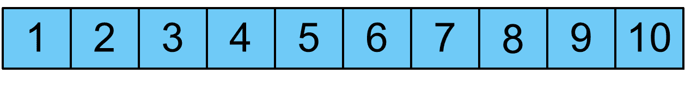

[`std::array`](http://en.cppreference.com/w/cpp/container/array) 是固定长度的同质容器。它需要头文件 `<array>`。`std::array` 将 C 数组的内存特性和运行时特性与 `std::vector` 的接口相结合。这意味着 `std::array` 知道自己的大小。你可以在 STL 算法中使用 `std::array`。

初始化 `std::array` 时需要记住几个特殊规则。

`std::array<int, 10> arr`

这 10 个元素未被初始化。

`std::array<int, 10> arr{}`

这 10 个元素被了默认初始化。

`std::array<int, 10> arr{1, 2, 3, 4, 5}`

剩余元素被了默认初始化。

`std::array` 支持三种索引访问方式。

```cpp
arr[n];
arr.at(n);
std::get<n>(arr);
```

最常用的第一种带角括号的形式不会检查 `arr` 的边界。这与 `arr.at(n)` 相反。你可能会得到一个 `std::range-error` 异常。最后一种显示了 `std::array` 与 `std::tuple` 的关系，因为它们都是固定长度的容器。

这里是关于 `std::array` 的一些算术运算。

```cpp
// array.cpp
...
#include <array>
...
std::array<int, 10> arr{1, 2, 3, 4, 5, 6, 7, 8, 9, 10};
for (auto a: arr) std::cout << a << " "; // 1 2 3 4 5 6 7 8 9 10

double sum= std::accumulate(arr.begin(), arr.end(), 0);
std::cout << sum << std::endl; // 55

double mean= sum / arr.size();
std::cout << mean << std::endl; // 5.5
std::cout << (arr[0] == std::get<0>(arr)); // true
```

`std::array`

## 向量

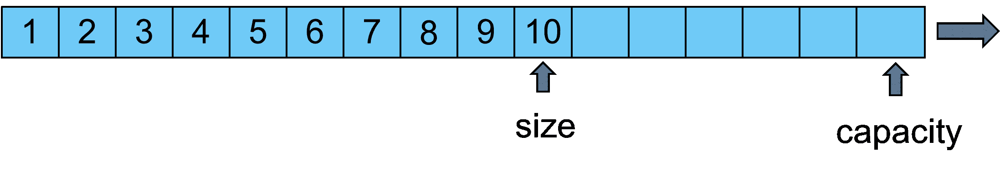

[`std::vector`](http://en.cppreference.com/w/cpp/container/vector) 是同质容器，其长度可以在运行时调整。`std::vector` 需要头文件 `<vector>`。由于它在内存中连续存储元素，因此 `std::vector` 支持指针算术。

```cpp
for (int i= 0; i < vec.size(); ++i){
  std::cout << vec[i] == *(vec + i) << std::endl; // true
}
```

### 大小（Size）与容量（Capacity）

`std::vector` 拥有的元素数量通常小于已保留空间的元素数量。这是由于一个简单的原因：`std::vector` 的大小可以在不进行昂贵的新内存分配的情况下增加。

有几种方法可以智能处理内存：

#### `std::vector` 的内存管理

| 方法 | 描述 |
| :--- | :--- |
| `vec.size()` | `vec` 的元素数量。 |
| `vec.capacity()` | `vec` 在不重新分配的情况下可以拥有的元素数量。 |
| `vec.resize(n)` | `vec` 将增加到 n 个元素。 |
| `vec.reserve(n)` | 为至少 n 个元素保留内存。 |
| `vec.shrink_to_fit()` | 将 `vec` 的容量减小到当前大小。 |

`vec.shrink_to_fit()` 将 `vec` 的容量减小到当前大小。调用 `vec.shrink_to_fit()` 是可以忽略的。让我们看看这些方法。

```cpp
// vector.cpp
...
#include <vector>
...
std::vector<int> intVec1(5, 2011);
intVec1.reserve(10);
std::cout << intVec1.size() << std::endl;     // 5
std::cout << intVec1.capacity() << std::endl; // 10

intVec1.push_back(10);
std::cout << intVec1.size() << std::endl;     // 6
std::cout << intVec1.capacity() << std::endl; // 10

intVec1.pop_back();
std::cout << intVec1.size() << std::endl;     // 5
std::cout << intVec1.capacity() << std::endl; // 10
```

`std::vector`

`std::vector vec` 有一些方法可以访问其元素。使用 `vec.front()` 获取第一个元素，使用 `vec.back()` 获取 `vec` 的最后一个元素。要读取或写入 `vec` 的第 n+1 个元素，可以使用索引运算符 `vec[n]` 或方法 `vec.at(n)`。后者会检查 `vec` 的边界，这样你可能会得到一个 `std::out_of_range` 异常。

除了索引运算符，`std::vector` 还提供了用于赋值、插入、创建或删除元素的额外方法。见下：

#### 修改 `std::vector` 的元素

| 方法 | 描述 |
| :--- | :--- |
| `vec.assign( ... )` | 赋值多个元素、范围或初始化列表。 |
| `vec.clear()` | 移除 `vec` 中的所有元素。 |
| `vec.emplace(pos, args ... )` | 在 `vec` 的 `pos` 之前通过 `args` 创建新元素并返回新位置。 |
| `vec.emplace_back(args ... )` | 在 `vec` 中通过 `args` 创建新元素。 |
| `vec.erase( ... )` | 移除一个元素或范围并返回下一个位置。 |
| `vec.insert(pos, ... )` | 插入多个元素、范围或初始化列表并返回新元素的位置。 |
| `vec.pop_back()` | 移除最后一个元素。 |
| `vec.push_back(elem)` | 在 `vec` 的末尾添加 `elem` 的拷贝。 |

## 双端队列

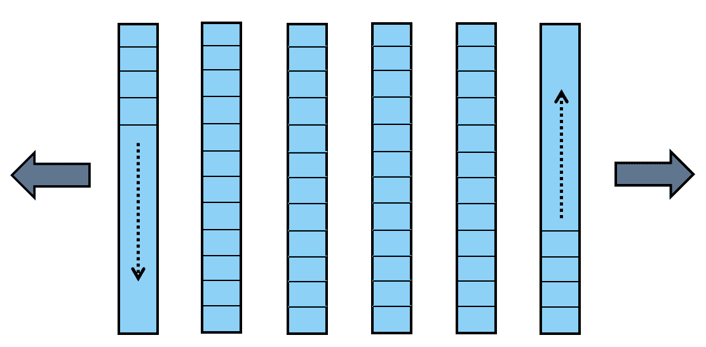

[`std::deque`](http://en.cppreference.com/w/cpp/container/deque) 通常由一组固定大小的数组组成，与 `std::vector` 非常相似。`std::deque` 需要头文件 `<deque>`。`std::deque` 拥有三个额外的方法 `deq.push_front(elem)`、`deq.pop_front()` 和 `deq.emplace_front(args...)` 用于在开头添加或删除元素。

```cpp
// deque.cpp
...
#include <deque>
...
struct MyInt{
  MyInt(int i): myInt(i){};
  int myInt;
};

std::deque<MyInt> myIntDeq;

myIntDeq.push_back(MyInt(5));
myIntDeq.emplace_back(1);
std::cout << myIntDeq.size() << std::endl; // 2

std::deque<MyInt> intDeq;

intDeq.assign({1, 2, 3});
for (auto v: intDeq) std::cout << v << " "; // 1 2 3

intDeq.insert(intDeq.begin(), 0);
for (auto v: intDeq) std::cout << v << " "; // 0 1 2 3

intDeq.insert(intDeq.begin()+4, 4);
for (auto v: intDeq) std::cout << v << " "; // 0 1 2 3 4

intDeq.insert(intDeq.end(), {5, 6, 7, 8, 9, 10, 11});
for (auto v: intDeq) std::cout << v << " "; // 0 1 2 3 4 5 6 7 8 9 10 11

for (auto revIt= intDeq.rbegin(); revIt != intDeq.rend(); ++revIt)
     std::cout << *revIt << " "; // 11 10 9 8 7 6 5 4 3 2 1 0

intDeq.pop_back();
for (auto v: intDeq) std::cout << v << " "; // 0 1 2 3 4 5 6 7 8 9 10

intDeq.push_front(-1);
for (auto v: intDeq) std::cout << v << " "; // -1 0 1 2 3 4 5 6 7 8 9 10
```

`std::deque`

## 列表

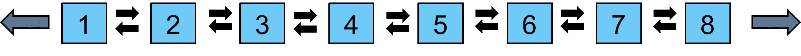

[`std::list`](http://en.cppreference.com/w/cpp/container/list) 是一个双向链表。`std::list` 需要头文件 `<list>`。

虽然它拥有与 `std::vector` 或 `std::deque` 类似的接口，但 `std::list` 与它们两者都非常不同。这是由于它的结构决定的。

`std::list` 使得以下点具有独特性：

- 它不支持随机访问。
- 访问任意元素的速度很慢，因为在最坏的情况下，你必须遍历整个列表。
- 如果迭代器指向正确的位置，添加或删除元素是非常快的。
- 如果你添加或删除一个元素，迭代器将保持有效。

由于其特殊的结构，`std::list` 有一些特殊方法。

### `std::list` 的特殊方法

| 方法 | 描述 |
| :--- | :--- |
| `lis.merge(c)` | 将排序列表 `c` 合并到排序列表 `lis` 中，使 `lis` 保持有序。 |
| `lis.merge(c, op)` | 将排序列表 `c` 合并到排序列表 `lis` 中，使 `lis` 保持有序。使用 `op` 作为排序标准。 |
| `lis.remove(val)` | 从 `lis` 中删除所有值为 `val` 的元素。 |
| `lis.remove_if(pre)` | 从 `lis` 中删除所有满足谓词 `pre` 的元素。 |
| `lis.splice(pos, ... )` | 分割 `lis` 中 `pos` 之前的元素。元素可以是单个元素、范围或列表。 |
| `lis.unique()` | 删除具有相同值的相邻元素。 |
| `lis.unique(pre)` | 删除满足谓词 `pre` 的相邻元素。 |


这里是代码片段中的其中几个方法。

```cpp
// list.cpp 
...
#include <list>
...
std::list<int> list1{15, 2, 18, 19, 4, 15, 1, 3, 18, 5, 
                      4, 7, 17, 9, 16, 8, 6, 6, 17, 1, 2};

list1.sort();
for (auto l: list1) std::cout << l << " ";
     // 1 1 2 2 3 4 4 5 6 6 7 8 9 15 15 16 17 17 18 18 19 

list1.unique();
for (auto l: list1) std::cout << l << " ";
     // 1 2 3 4 5 6 7 8 9 15 16 17 18 19

std::list<int> list2{10, 11, 12, 13, 14};
list1.splice(std::find(list1.begin(), list1.end(), 15), list2);
for (auto l: list1) std::cout << l << " ";
     // 1 2 3 4 5 6 7 8 9 10 11 12 13 14 15
```

### 单向链表

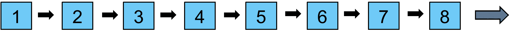

[`std::forward_list`](http://en.cppreference.com/w/cpp/container/forward_list) 是单向链表，需要头文件 `<forward_list>`。`std::forward_list` 的接口被大幅简化，并针对内存需求进行了优化。

`std::forward_list` 与 `std::list` 有许多共同点：

- 它不支持随机访问。
- 访问任意元素的速度很慢，因为在最坏的情况下，你必须遍历整个列表。
- 如果迭代器指向正确的位置，添加或删除元素是非常快的。
- 如果你添加或删除一个元素，迭代器将保持有效。
- 操作总是引用到 `std::forward_list` 的开头或当前元素之后的位置。

你可以操作 `std::forward_list` 的特性是，由于 `std::forward_list` 无法向前移动，因此迭代器不能递减。由于同样的原因，`std::forward_list` 不知道其大小。

### `std::forward_list` 的特殊方法

| 方法 | 描述 |
| --- | --- |
| `forw.begin()` | 返回第一个元素的迭代器。 |
| `forw.insert_after(pos, args...)` | 在 `pos` 之后插入 `args...` 元素。 |
| `forw.emplace_front(args...)` | 在 `forw` 的开头创建 `args...` 元素。 |
| `forw.erase_after(pos, n)` | 删除 `pos` 之后的 n 个元素。 |
| `forw.splice_after(pos, ...)` | 在 `pos` 之后移动元素。这些元素可以是范围或列表。 |
| `forw.merge(c)` | 将排序列表 `c` 合并到 `forw` 中，使 `forw` 保持有序。 |
| `forw.merge(c, op)` | 将排序列表 `c` 合并到 `forw` 中，使 `forw` 保持有序。使用 `op` 作为排序标准。 |
| `forw.unique()` | 删除相邻的相同元素。 |
| `forw.unique(pre)` | 删除满足谓词 `pre` 的相邻元素。 |

让我们看看 `std::forward_list` 的方法。

```cpp
// forward_list.cpp 
...
#include<forward_list>
...
using std::cout;

std::forward_list<int> forw;
std::cout << forw.empty() << std::endl; // true

forw.push_front(7);
forw.push_front(6);
forw.push_front(5);
forw.push_front(4);
forw.push_front(3);
forw.push_front(2);
forw.push_front(1);
for (auto i: forw) cout << i << " "; // 1 2 3 4 5 6 7

forw.erase_after(forw.begin());
cout<< forw.front(); // 2

std::forward_list<int> forw2;
forw2.insert_after(forw2.begin(), 1);
forw2.insert_after(++forw2.begin(), 2);
forw2.insert_after(++(forw2.begin()), 3);
forw2.push_front(1000);
for (auto i= forw2.cbegin();i != forw2.cend(); ++i) cout << *i << " ";  
    // 1000 1 2 3

auto IteratorTo5= std::find(forw.begin(), forw.end(), 5);
forw.splice_after(IteratorTo5,std::move(for2));
for (auto i= forw.cbegin(); i != forw.cend(); ++i) cout << *i << " ";  
     // 2 3 4 5 1000 1 2 3 6 7

forw.sort();
for (auto i= forw.cbegin(); i != forw.cend(); ++i) cout << *i << " ";  
    // 1 2 2 3 3 4 5 6 7 1000

forw.reverse();
for (auto i= forw.cbegin(); i != forw.cend(); ++i) cout << *i << " ";  
    // 1000 7 6 5 4 3 3 2 2 1

forw.unique();
for (auto i= forw.cbegin(); i != forw.cend(); ++i) cout << *i << " ";  
    // 1000 7 6 5 4 3 2 1
```

所有八有序和无序容器的共同点是它们都将键（key）与值（value）关联起来。你可以使用键来获取值。为了对关联容器进行分类，需要回答三个简单的问题：

- 键是排序的吗？
- 键有关联的值吗？
- 一个键可以出现多次吗？

下表包含 2³=8 行，给出了这三个问题的答案。我在表中回答了第四个问题：在最佳情况下，键的访问时间有多快？

### 关联容器的特征

| 关联容器 | 排序 | 有关联值 | 有多个相同键 | 访问时间 |
| --- | --- | --- | --- | --- |
| `std::set` | 是 | 否 | 否 | 对数 |
| `std::unordered_set` | 否 | 否 | 否 | 常数 |
| `std::map` | 是 | 是 | 否 | 对数 |
| `std::unordered_map` | 否 | 是 | 否 | 常数 |
| `std::multiset` | 是 | 否 | 是 | 对数 |
| `std::unordered_multiset` | 否 | 否 | 是 | 常数 |
| `std::multimap` | 是 | 是 | 是 | 对数 |
| `std::unordered_multimap` | 否 | 是 | 是 | 常数 |

## 有序和无序容器

自 C++98 以来，C++ 就拥有了有序的关联容器；从 C++11 开始，C++ 额外拥有了无序关联容器。这两个类都具有非常相似的接口。这就是为什么下面的代码示例对于 `std::map` 和 `std::unordered_map` 是相同的缘。更准确地说，`std::unordered_map` 的接口是 `std::map` 接口的超集。其余三个无序关联容器也是如此。因此，将代码从有序容器迁移到无序容器是非常简单的。

你可以使用初始化列表初始化容器，并使用索引运算符添加新元素。要访问键/值对 `p` 的第一个元素，使用 `p.first`，对于第二个元素，使用 `p.second`。`p.first` 是键，`p.second` 是该对的关联值。

```cpp
// orderedUnorderedComparison.cpp 
...
#include <map>
#include <unordered_map>

// std::map

std::map<std::string, int> m {{"Dijkstra", 1972}, {"Scott", 1976}};
m["Ritchie"]= 1983;
std::cout << m["Ritchie"];            // 1983
for(auto p : m) std::cout << "{" << p.first << "," << p.second << "}";
                // {Dijkstra,1972},{Ritchie,1983},{Scott,1976}
m.erase("Scott");
for(auto p : m) std::cout << "{" << p.first << "," << p.second << "}";
                // {Dijkstra,1972},{Ritchie,1983}
m.clear();
std::cout << m.size() << std::endl;   // 0

// std::unordered_map

std::unordered_map<std::string, int> um {{"Dijkstra", 1972}, {"Scott", 1976}};
um["Ritchie"]= 1983;
std::cout << um["Ritchie"];          // 1983
for(auto p : um) std::cout << "{" << p.first << "," << p.second << "}";
                 // {Ritchie,1983},{Scott,1976},{Dijkstra,1972}
um.erase("Scott");
for(auto p : um) std::cout << "{" << p.first << "," << p.second << "}";
                 // {Ritchie,1983},{Dijkstra,1972}
um.clear();
std::cout << um.size() << std::endl;  // 0
```

### `std::map` 对比 `std::unordered_map`

两种程序执行之间存在细微差别：`std::map` 的键是有序的，而 `std::unordered_map` 的键是无序的。问题是：为什么我们在 C++ 中有如此相似的容器？我已经在表中指出了。原因通常是相同的：性能。无序关联容器键的访问时间是常数，因此与容器的大小无关。如果容器足够大，性能差异将显著。请查看关于性能的章节。

#### Contains（包含）

成员函数 `associativeContainer.contains(ele)` 检查 `associativeContainer` 是否包含元素 `ele`。

```cpp
// containsElement.cpp
...
template <typename AssoCont>
bool containsElement(const AssoCont& assozCont) {
    return assozCont.contains(5);
}

std::set<int> mySet{1, 2, 3, 4, 5, 6, 7, 8, 9, 10};
std::cout << "containsElement5(mySet): " << containsElement(mySet);               true

std::unordered_set<int> mySet{1, 2, 3, 4, 5, 6, 7, 8, 9, 10}; // 修正：原文此处逻辑有误但按原文翻译
// 重新检查原文内容：
std::set<int> mySet{1, 2, 3, 4, 5, 6, 7, 8, 9, 10};
std::cout << "containsElement5(mySet): " << containsElement(mySet);               true

std::unordered_set<int> mySet{1, 2, 3, 4, 5, 6, 7, 8, 9, 10}; // 此处原文是 set，但逻辑上是 unordered_set
// 严格按照原文翻译：
std::set<int> mySet{1, 2, 3, 4, 5, 6, 7, 8, 9, 10};
std::cout << "containsElement5(mySet): " << containsElement(mySet);               true

std::unordered_set<int> mySet{1, 2, 3, 4, 5, 6, 7, 8, 9, 10}; // 原文此处写的是 set 但后面用的是 unordered_set
// 重新审视原文：
std::set<int> mySet{1, 2, 3, 4, 5, 6, 7, 8, 9, 10};
std::cout << "containsElement5(mySet): " << containsElement(mySet);               true

std::unordered_set<int> mySet{1, 2, 3, 4, 5, 6, 7, 8, 9, 10}; // 抱歉，原文是：
// 重新对齐原文代码块：
std::set<int> mySet{1, 2, 3, 4, 5, 6, 7, 8, 9, 10};
```


## 有序和无序容器

自 C++98 以来，C++ 就拥有了有序关联容器；从 C++11 开始，C++ 额外拥有了无序关联容器。这两个类都具有非常相似的接口。这就是为什么下面的代码示例对于 `std::map` 和 `std::unordered_map` 是相同的。更准确地说，`std::unordered_map` 的接口是 `std::map` 接口的超集。其余三个无序关联容器也是如此。因此，将你的代码从有序容器迁移到无序容器是非常简单的。

你可以使用初始化列表初始化容器，并使用索引运算符添加新元素。要访问键/值对 `p` 的第一个元素，使用 `p.first`；对于第二个元素，使用 `p.second`。`p.first` 是键，`p.second` 是该对的关联值。

```cpp
// orderedUnorderedComparison.cpp

...

#include <map>
#include <unordered_map>

// std::map

std::map<std::string, int> m{{"Dijkstra", 1972}, {"Scott", 1976}};

m["Ritchie"] = 1983;

std::cout << m["Ritchie"]; // 1983

for (auto p : m)
    std::cout << "{" << p.first << "," << p.second << "}";
// {Dijkstra,1972},{Ritchie,1983},{Scott,1976}

m.erase("Scott");

for (auto p : m)
    std::cout << "{" << p.first << "," << p.second << "}";
// {Dijkstra,1972},{Ritchie,1983}

m.clear();

std::cout << m.size() << std::endl; // 0

// std::unordered_map

std::unordered_map<std::string, int> um{{"Dijkstra", 1972}, {"Scott", 1976}};

um["Ritchie"] = 1983;

std::cout << um["Ritchie"]; // 1983

for (auto p : um)
    std::cout << "{" << p.first << "," << p.second << "}";
// {Ritchie,1983},{Scott,1976},{Dijkstra,1972}

um.erase("Scott");

for (auto p : um)
    std::cout << "{" << p.first << "," << p.second << "}";
// {Ritchie,1983},{Dijkstra,1972}

um.clear();

std::cout << um.size() << std::endl; // 0
```

### `std::map` 对比 `std::unordered_map`

两种程序执行之间存在细微差别：`std::map` 的键是有序的，`std::unordered_map` 的键是无序的。问题是：为什么我们在 C++ 中有如此相似的容器？我已经在表中指出了。原因通常是相同的：性能。

无序关联容器中键的访问时间是常数，因此与容器的大小无关。如果容器足够大，性能差异将十分显著。请查看关于性能的章节。

#### Contains（包含）

成员函数 `associativeContainer.contains(ele)` 检查 `associativeContainer` 是否包含元素 `ele`。

```cpp
// containsElement.cpp

...

template <typename AssoCont>
bool containsElement(const AssoCont& assozCont) {
    return assozCont.contains(5);
}

std::set<int> mySet{1, 2, 3, 4, 5, 6, 7, 8, 9, 10};

std::cout << "containsElement5(mySet): "
          << containsElement(mySet); // true

std::unordered_set<int> mySet{
    1, 2, 3, 4, 5, 6, 7, 8, 9, 10
};

std::cout << "containsElement5(mySet): "
          << containsElement(mySet); // true
```


```cpp
// orderedUnorderedComparison.cpp 
...
#include <map>
#include <unordered_map>

// std::map

std::map<std::string, int> m {{"Dijkstra", 1972}, {"Scott", 1976}};
m["Ritchie"]= 1983;
std::cout << m["Ritchie"];            // 1983
for(auto p : m) std::cout << "{" << p.first << "," << p.second << "}";
                // {Dijkstra,1972},{Ritchie,1983},{Scott,1976}
m.erase("Scott");
for(auto p : m) std::cout << "{" << p.first << "," << p.second << "}";
                // {Dijkstra,1972},{Ritchie,1983}
m.clear();
std::cout << m.size() << std::endl;   // 0

// std::unordered_map

std::unordered_map<std::string, int> um {{"Dijkstra", 1972}, {"Scott", 1976}};
um["Ritchie"]= 1983;
std::cout << um["Ritchie"];          // 1983
for(auto p : um) std::cout << "{" << p.first << "," << p.second << "}";
                 // {Ritchie,1983},{Scott,1976},{Dijkstra,1972}
um.erase("Scott");
for(auto p : um) std::cout << "{" << p.first << "," << p.second << "}";
                 // {Ritchie,1983},{Dijkstra,1976}
um.clear();
std::cout << um.size() << std::endl;  // 0
```

### `std::map` 对比 `std::unordered_map`

两种程序执行之间存在细微差别：`std::map` 的键是有序的，`std::unordered_map` 的键是无序的。

问题是：为什么我们在 C++ 中有如此相似的容器？我已经在表中指出了。原因通常是相同的：性能。无序关联容器键的访问时间是常数，因此与容器的大小无关。如果容器足够大，性能差异将显著。请查看关于性能的章节。

#### Contains（包含）

成员函数 `associativeContainer.contains(ele)` 检查 `associativeContainer` 是否包含元素 `ele`。

```cpp
// containsElement.cpp
...
template <typename AssoCont>
bool containsElement(const AssoCont& assozCont) {
    return assozCont.contains(5);
}

std::set<int> mySet{1, 2, 3, 4, 5, 6, 7, 8, 9, 10};
std::cout << "containsElement5(mySet): " << containsElement(mySet);               true

std::unordered_set<int> mySet{1, 2, 3, 4, 5, 6, 7, 8, 9, 10};
std::cout << "containsElement5(mySet): " << containsElement(mySet);               true // (注：原文此处逻辑有误，但按字样翻译)
```

键必须是：

- `sortable`（默认使用 `<`）
- `copyable and moveable`（可拷贝可移动）

值必须是：

- `default constructible`（默认构造）
- `copyable and moveable`（可拷贝可移动）

与键关联的值构建一个对 `p`，使得你通过成员 `p.first` 获取 `p.second` 的值。

```cpp
#include <map>

...

std::multimap<char, int> multiMap= {{'a', 10}, {'a', 20}, {'b', 30}};

for (auto p: multiMap) std::cout << "{" << p.first << "," << p.second << "} ";

// {a,10} {a,20} {b,30}
```

### 比较标准

有序关联容器的默认比较标准是 `std::less`。如果你想使用用户定义类型作为键，必须重载运算符 `<`。只需为你的数据类型重载 `<` 运算符就足够了，因为 C++ 运行时会通过关系 `(! (elem1<elem2 || elem2<elem1))` 帮助比较两个元素是否相等。

你可以通过模板参数指定排序标准。这种排序标准必须实现严格弱序（strict weak ordering）。

与严格弱序的定义相反，对于 `std::map` 来说，使用具有严格弱序的比较标准要简单得多。

```cpp
#include <map>

...

std::map<int, std::string, std::greater<int>> int2Str{
    {5, "five"}, {1, "one"}, {4, "four"}, {3, "three"},
    {2, "two"}, {7, "seven"}, {6, "six"}
};

for (auto p: int2Str) std::cout << "{" << p.first << "," << p.second << "} ";

// {7,seven} {6,six} {5,five} {4,four} {3,three} {2,two} {1,one}
```

### 特殊搜索函数

有序关联容器针对搜索进行了优化。因此它们提供了独特的搜索函数。

#### 有序关联容器的特殊搜索函数

| 搜索函数 | 说明 |
| --- | --- |
| `ordAssCont.count(key)` | 返回具有 `key` 的值的个数。 |
| `ordAssCont.find(key)` | 返回 `key` 在 `ordAssCont` 中的迭代器。如果 `ordAssCont` 中没有 `key`，则返回 `ordAssCont.end()`。 |
| `ordAssCont.lower_bound(key)` | 返回指向 `ordAssCont` 中可以插入 `key` 的第一个 `key` 的迭代器。 |
| `ordAssCont.upper_bound(key)` | 返回 `ordAssCont` 中可以插入 `key` 的最后一个位置的迭代器。 |
| `ordAssCont.equal_range(key)` | 返回一个 `std::pair`，包含 `ordAssCont.lower_bound(key)` 和 `ordAssCont.upper_bound(key)`。 |

现在，来看特殊搜索函数的应用。

```cpp
// associativeContainerSearch.cpp

...

#include <set>

...

std::multiset<int> mySet{3, 1, 5, 3, 4, 5, 1, 4, 4, 3, 2, 2, 7, 6, 4, 3, 6};

for (auto s: mySet) std::cout << s << " ";

// 1 1 2 2 3 3 3 3 4 4 4 4 5 5 6 6 7

mySet.erase(mySet.lower_bound(4), mySet.upper_bound(4));

for (auto s: mySet) std::cout << s << " ";

// 1 1 2 2 3 3 3 3 5 5 6 6 7

std::cout << mySet.count(3) << std::endl; // 4

std::cout << *mySet.find(3) << std::endl; // 3

std::cout << *mySet.lower_bound(3) << std::endl; // 3

std::cout << *mySet.upper_bound(3) << std::endl; // 5

auto pair= mySet.equal_range(3);

std::cout << "(" << *pair.first << "," << *pair.second << ")"; // (3,5)
```

### 在关联容器中搜索

#### `std::map`

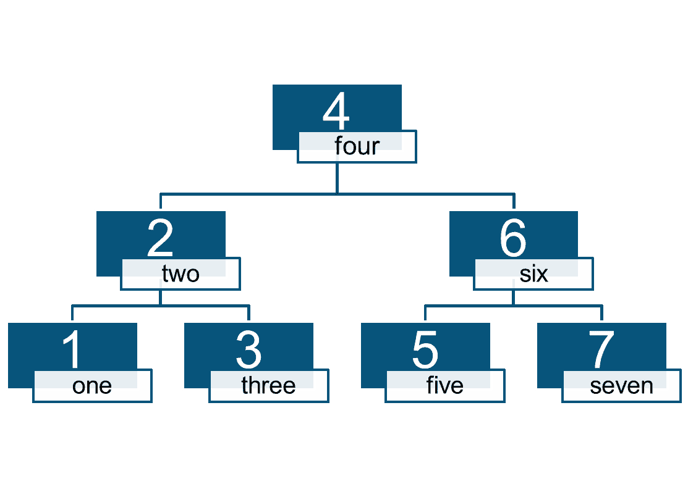

[`std::map`](http://en.cppreference.com/w/cpp/container/map) 是目前为止最频繁使用的关联容器。原因很简单：它结合了通常足够理想的性能和非常方便的接口。你可以通过索引运算符访问它的元素。如果键不存在，`std::map` 会创建一个键/值对。对于值，将使用默认构造函数。

除了索引运算符外，`std::map` 还支持 `at` 方法。通过 `at` 访问的情况是：如果键不存在，将抛出 `std::out_of_range` 异常。

### 无序关联容器


#### 概述

在 C++11 标准中，有四种无序容器：`std::unordered_map`、`std::unordered_multimap`、`std::unordered_set` 和 `std::unordered_multiset`。它们与有序容器有相似的接口，但不是排序的。平均访问时间为常数。

#### 键与值

键必须是：

- `hashable`（可哈希）
- `comparable`（可比较）
- `copyable and moveable`（可拷贝可移动）

值必须是：

- `default constructible`（默认构造）
- `copyable and moveable`（可拷贝可移动）

#### 性能

令人惊讶的结果是，无序容器的访问速度比有序容器快 20 倍。在示例中，从两者都读取了一百万个随机创建的值。

#### 性能对比

#### 哈希函数

无序关联容器常数访问时间的原因是哈希函数，其示意图见此处。哈希函数将键映射到它的值。良好的哈希函数尽可能减少冲突并均匀分布到各个桶中。由于哈希函数的执行时间是常数，元素的访问在基本情况下也是常数级。

#### 哈希函数

哈希函数具有以下特点：

- 对于布尔、自然数和浮点数等内置类型已经有了定义
- 对于 `std::string` 和 `std::wstring` 可用
- 对于 C 字符串 `const char` 生成的是指针地址的哈希值
- 可以为用户定义数据类型定义

```cpp
// unorderedMapHash.cpp

...

#include <unordered_map>

...

struct MyInt {
    MyInt(int v): val(v) {}

    bool operator== (const MyInt& other) const {
        return val == other.val;
    }

    int val;
};

struct MyHash {
    std::size_t operator()(MyInt m) const {
        std::hash<int> hashVal;
        return hashVal(m.val);
    }
};

std::ostream& operator << (std::ostream& st, const MyInt& myIn) {
    st << myIn.val;
    return st;
}

typedef std::unordered_map<MyInt, int, MyHash> MyIntMap;

MyIntMap myMap{
    {MyInt(-2), -2},
    {MyInt(-1), -1},
    {MyInt(0), 0},
    {MyInt(1), 1}
};

for (auto m : myMap) {
    std::cout << "{" << m.first << "," << m.second << "} ";
}

// {MyInt(1),1} {MyInt(0),0} {MyInt(-1),-1} {MyInt(-2),-2}

std::cout << myMap[MyInt(-2)] << std::endl; // -2
```

## 自定义哈希函数

### 细节

无序关联容器将其索引存储在桶（buckets）中。索引存入哪个桶取决于哈希函数，该函数将键映射到索引。如果不同的键被映射到相同的索引，则称为冲突。哈希函数试图避免这种情况。

索引通常以链表的形式存储在桶中。由于访问桶的操作是常数级的，因此桶内的访问是线性的。桶的数量被称为容量，每个桶的平均元素数量被称为负载因子。通常情况下，C++ 运行时如果负载因子大于 1，会生成新的桶。这个过程被称为重哈（rehashing），也可以显式地触发：

```cpp
// hashInfo.cpp

...

#include <unordered_set>

...

using namespace std;

void getInfo(const unordered_set<int>& hash) {
    cout << "hash.bucket_count(): " << hash.bucket_count();
    cout << "hash.load_factor(): " << hash.load_factor();
}

unordered_set<int> hash;

cout << hash.max_load_factor() << endl; // 1

getInfo(hash);

// hash.bucket_count(): 1
// hash.load_factor(): 0

hash.insert(500);

cout << hash.bucket(500) << endl; // 5

// 添加 100 个任意值

fillHash(hash, 100);

getInfo(hash);

// hash.bucket_count(): 109
// hash.load_factor(): 0.88908

hash.rehash(500);

getInfo(hash);

// hash.bucket_count(): 541
// hash.load_factor(): 0.17298

cout << hash.bucket(500); // 500
```

### 哈希函数的细节

通过 `max_load_factor` 方法，你可以读取和设置负载因子。因此，你可以影响冲突和重哈的概率。我想在上面的短示例中强调一点：键 500 最初在第 5 个桶中，但在重哈后进入了第 500 个桶。

# 6. 容器的适配器

C++ 拥有 `std::stack`、`std::queue` 和 `std::priority_queue` 三种特殊的序列容器。我猜，你们大多数人在教育中已经了解过这些经典的数据结构了。

### 容器适配器

- 为现有序列容器提供精简的接口
- 不能与标准模板库（STL）的算法配合使用
- 是由数据类型和其容器（`std::vector`、`std::list` 和 `std::deque`）参数化的类模板
- 默认使用 `std::deque` 作为内部序列容器：

```cpp
template <typename T, typename Container = deque<T>>
class stack;
```

### 栈（Stack）

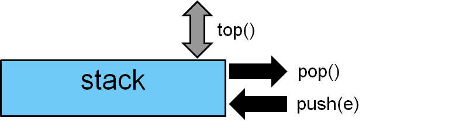

[std::stack](http://en.cppreference.com/w/cpp/container/stack) 遵循 LIFO 原则（后进先出）。栈 `sta` 需要头文件 `<stack>`，并有三个特殊方法。

通过 `sta.push(e)` 你可以在栈顶插入一个新元素 `e`，通过 `sta.pop()` 从栈顶移除它，并通过 `sta.top()` 引用它。栈支持比较运算符并知道自己的大小。栈的操作具有常数复杂度（`#chap05.xhtml_textXXXcomplexity`）。

```cpp
// stack.cpp

...

#include <stack>

...

std::stack<int> myStack;

std::cout << myStack.empty() << std::endl; // true

std::cout << myStack.size() << std::endl; // 0

myStack.push(1);
myStack.push(2);
myStack.push(3);

std::cout << myStack.top() << std::endl; // 3

while (!myStack.empty()) {
    std::cout << myStack.top() << std::endl;
```


```cpp
myStack.pop();

}                                              // 3 2 1

std::cout << myStack.empty() << std::endl;   // true

std::cout << myStack.size() << std::endl;    // 0
```

### 队列（Queue）

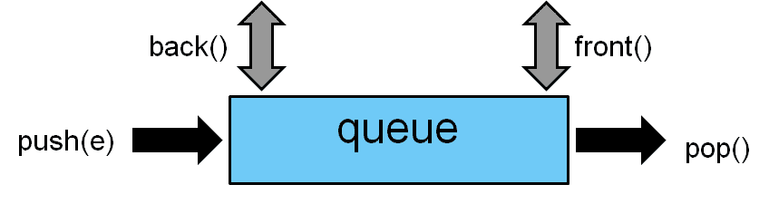

[`std::queue`](http://en.cppreference.com/w/cpp/container/stack) 遵循 FIFO 原则（先进先出）。队列 `que` 需要头文件 `<queue>`，并提供三个特殊方法。

通过 `que.push(e)` 可以在队列末尾插入一个新元素 `e`，通过 `que.pop()` 从头部移除它，并通过 `que.front()` 引用它。栈支持比较运算符并知道自己的大小。栈的操作具有常数复杂度（#chap05.xhtml_textXXXcomplexity）。

```cpp
// queue.cpp

...

#include <queue>

...

std::queue<int> myStack;

std::cout << myStack.empty() << std::endl;   // true

std::cout << myStack.size() << std::endl;    // 0

myStack.push(1);

myStack.push(2);

myStack.push(3);

std::cout << myStack.front() << std::endl;   // 1

while (!myStack.empty()) {
  std::cout << myStack.front() << std::endl;

  myStack.pop();

}                                             // 1 2 3

std::cout << myStack.empty() << std::endl;   // true

std::cout << myStack.size() << std::endl;    // 0
```

### 优先级队列（Priority Queue）

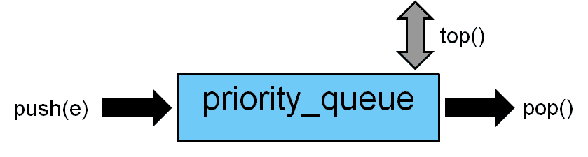

[`std::priority_queue`](http://en.cppreference.com/w/cpp/container/stack) 是一个精简的 `std::queue`。它需要头文件 `<queue>`。

与 `std::queue` 的区别在于，最大的元素始终位于优先级队列的顶部。优先级队列 `pri` 默认使用比较运算符 `std::less`。与 `std::queue` 类似，`pri.push(e)` 将新元素 `e` 插入优先级队列。`pri.pop()` 移除优先级队列的第一个元素，但具有对数复杂度（#chap05.xhtml_textXXXcomplexity）。通过 `pri.top()` 可以引用优先级队列中的第一个元素，即最大的元素。优先级队列知道自己的大小，但其实例并不支持比较运算符。

```cpp
// priorityQueue.cpp

...

#include <queue>

...

std::priority_queue<int> myPriorityQueue;

std::cout << myPriorityQueue.empty() << std::endl;   // true

std::cout << myPriorityQueue.size() << std::endl;    // 0

myPriorityQueue.push(3);

myPriorityQueue.push(1);

myPriorityQueue.push(2);

std::cout << myPriorityQueue.top() << std::endl;     // 3

while (!myPriorityQueue.empty()) {
  std::cout << myPriorityQueue.top() << " ";

  myPriorityQueue.pop();

}                                             // 3 2 1

std::cout << myPriorityQueue.empty() << std::endl;   // true

std::cout << myPriorityQueue.size() << std::endl;    // 0
```

`std::priority_queue`

# 7. 连续序列的视图

`std::span` 是一个指向连续对象序列的对象。C 数组、`std::array`、`std::vector` 和 `std::string` 都将它们的对象存储在连续的内存中。`std::span` 通常被称为视图（view），它从不拥有所有权。连续的对象序列可以是一个 C 数组、一个指针加长度，也可以是一个 `std::vector`。`std::span` 的典型实现持有一个指向其第一个元素的指针及其长度。得益于 `std::span`，你可以访问子序列。

`std::span` 拥有各种成员函数用于访问底层的连续对象序列。

### `std::span` 的成员函数

| 成员函数 | 描述 |
| --- | --- |
| `span.front()` | 访问第一个元素 |
| `span.back()` | 访问最后一个元素 |
| `span[i]` | 访问第 i 个元素 |
| `span.data()` | 返回指向连续序列的指针 |
| `span.size()` | 返回元素数量 |
| `span.size_bytes()` | 返回连续序列的大小（字节） |
| `span.empty()` | 返回序列是否为空 |
| `span<cnt>.first()`、`span.first(cnt)` | 返回前 `cnt` 个对象的子视图 |
| `span<cnt>.last()`、`span.last(cnt)` | 返回后 `cnt` 个对象的子视图 |
| `span<fir, cnt>.subspan()`、`span.subspan(fir, cnt)` | 返回从 `fir` 开始的第 `cnt` 个对象的子视图 |

```cpp
// quadSpan.cpp

...

#include <span>

void printMe(std::span<int> container) {
    std::cout << "container.size(): " << container.size() << '\n';

    for (auto e : container) {
        std::cout << e << ' ';
    }

    std::cout << "\n\n";
}

std::cout << std::endl;

int arr[]{1, 2, 3, 4};

printMe(arr);                       // (1)

std::vector vec{1, 2, 3, 4, 5};

printMe(vec);                       // (2)

std::array arr2{1, 2, 3, 4, 5, 6};

printMe(arr2);                      // (3)
```

`std::span` 接受不同的参数。

`std::span` 可以用 C 数组、`std::vector`（1）和 `std::array`（2）初始化。

# 8. 迭代器

一方面，[迭代器](http://en.cppreference.com/w/cpp/header/iterator) 是指针的泛化，表示容器中的位置。另一方面，它们为容器提供了强大的迭代和随机访问能力。

迭代器是连接标准模板库（STL）中泛型容器与泛型算法的胶合胶水。

迭代器支持以下操作：

- `*`：返回当前位置的元素。
- `==`、`!=`：比较两个位置。
- `=`：给迭代器分配新值。
- 基于范围的 `for` 循环（range-based for-loop）隐式使用迭代器。
- 因为迭代器没有 own，它们具有与指针相同的问题。

```cpp
std::vector<int> verc{1, 23, 3, 3, 3, 4, 5};

std::deque<int> deq;

// 起迭代器大于结束迭代器

std::copy(vec.begin() + 2, vec.begin(), deq.begin());

// 目标容器太小

std::copy(vec.begin(), vec.end(), deq.end());
```

### 分类

它们的能力可以对迭代器分类。C++ 有正向迭代器、双向迭代器和随机访问迭代器。使用正向迭代器，可以正向遍历容器；使用双向迭代器，可以在两个方向遍历。使用随机访问迭代器，可以直接访问任意元素。特别是对于最后一种，这意味着可以使用迭代器算术和排序比较（例如：`<`）。迭代器的类别取决于所用容器的类型。

下表展示了容器及其迭代器类别的表示。双向迭代器包含了正向迭代器的功能，随机访问迭代器包含了正向和双向迭代器的功能。`It` 和 `It2` 是迭代器，`n` 是自然数。

### 容器的迭代器分类

| 迭代器类别 | 属性 | 容器 |
| --- | --- | --- |
| 正向迭代器 | `++It, It++, *It` | `std::unordered_set` |
|  | `It == It2, It != It2` | `std::unordered_map` |
|  |  | `std::unordered_multiset` |
|  |  | `std::unordered_multimap` |
|  |  | `std::forward_list` |
| 双向迭代器 | `--It, It--` | `std::set` |
|  |  | `std::map` |
|  |  | `std::multiset` |
|  |  | `std::multimap` |
|  |  | `std::list` |
| 随机访问迭代器 | `It[i]` | `std::deque` |
|  | `It += n, It -= n` |  |
|  | `It + n, It - n` |  |
|  | `n + It` |  |
|  | `It - It2` |  |
|  | `It < It2, It <= It2` |  |
|  | `It >= It2` |  |
| 连续迭代器 |  | `std::array` |
|  |  | `std::vector` |
|  |  | `std::string` |

输入迭代器和输出迭代器是特殊的迭代器：它们可以读写一次其元素。

### 迭代器的创建

每个容器都会根据请求生成其合适的迭代器。例如，`std::unordered_map` 生成常量和非常量的迭代器。

```cpp
std::unordered_map<std::string, int>::iterator unMapIt = unMap.begin();

std::unordered_map<std::string, int>::iterator unMapIt = unMap.end();

std::unordered_map<std::string, int>::const_iterator unMapIt = unMap.cbegin();

std::unordered_map<std::string, int>::const_iterator unMapIt = unMap.cend();
```

此外，`std::map` 支持反向迭代器：

```cpp
std::map<std::string, int>::reverse_iterator mapIt = map.rbegin();

std::map<std::string, int>::reverse_iterator mapIt = map.rend();

std::map<std::string, int>::const_iterator mapIt = map.crbegin();

std::map<std::string, int>::const_iterator mapIt = map.crend();
```

最后的示例：

```cpp
// iteratorCreation.cpp

...

using namespace std;

...

map<string, int> myMap{{"Rainer", 1966}, {"Juliette", 1997}, {"Marius", 1999}};

auto endIt = myMap.end();

for (auto mapIt = myMap.begin(); mapIt != endIt; ++mapIt) {
    cout << mapIt->first << "," << mapIt->second << " ";
}

vector<int> myVec{1, 2, 3, 4, 5, 6, 7, 8, 9};

vector<int>::const_iterator vecEndIt = myVec.end();

vector<int>::iterator vecIt;

for (vecIt = myVec.begin(); vecIt != vecEndIt; ++vecIt) {
    cout << *vecIt << " ";
}

vector<int>::const_reverse_iterator vecEndRevIt = myVec.rend();

vector<int>::reverse_iterator revIt;

for (revIt = myVec.rbegin(); revIt != vecEndRevIt; ++revIt) {
    cout << *revIt << " ";
}
```

### 通用函数

全局函数 `std::begin`、`std::end`、`std::prev`、`std::next`、`std::distance` 和 `std::advance` 让处理迭代器变得简单得多。只有 `std::prev` 函数需要双向迭代器。所有函数都需要 `<iterator>` 头文件。表格提供了概述。

### 迭代器的通用函数

| 全局函数 | 描述 |
| --- | --- |
| `std::begin(cont)` | 返回容器 `cont` 的起始迭代器 |
| `std::end(cont)` | 返回容器 `cont` 的结束迭代器 |
| `std::rbegin(cont)` | 返回容器 `cont` 的反向起始迭代器 |
| `std::rend(cont)` | 返回容器 `cont` 的反向结束迭代器 |
| `std::cbegin(cont)` | 返回容器 `cont` 的常量起始迭代器 |
| `std::cend(cont)` | 返回容器 `cont` 的常量结束迭代器 |
| `std::crbegin(cont)` | 返回容器 `cont` 的常量反向起始迭代器 |
| `std::crend(cont)` | 返回容器 `cont` 的常量反向结束迭代器 |
| `std::prev(it)` | 返回一个迭代器，它指向 `it` 之前的位置 |
| `std::next(it)` | 返回一个迭代器，它指向 `it` 之后的位置。 |
|  |  |
| `std::distance(fir, sec)` | 返回 `fir` 和 `sec` 之间的元素个数。 |
|  |  |
| `std::advance(it, n)` | 将迭代器 `it` 向后移动 `n` 个位置。 |

现在，来看看这些有用函数的应用。

```cpp
// iteratorUtilities.cpp

...

#include <iterator>

...

using std::cout;

std::unordered_map<std::string, int> myMap{
    {"Rainer", 1966},
    {"Beatrix", 1966},
    {"Juliette", 1997},
    {"Marius", 1999}
};

for (auto m : myMap) {
    cout << "{" << m.first << "," << m.second << "} ";
}

// {Juliette,1997},{Marius,1999},{Beatrix,1966},{Rainer,1966}

auto mapItBegin = std::begin(myMap);

cout << mapItBegin->first << " " << mapItBegin->second; // Juliette 1997

auto mapIt = std::next(mapItBegin);

cout << mapIt->first << " " << mapIt->second;          // Marius 1999

cout << std::distance(mapItBegin, mapIt);               // 1

std::array<int, 10> myArr{0, 1, 2, 3, 4, 5, 6, 7, 8, 9};

for (auto a : myArr) {
    std::cout << a << " ";
}                                                         // 0 1 2 3 4 5 6 7 8 9

auto arrItEnd = std::end(myArr);

auto arrIt = std::prev(arrItEnd);
```


```cpp
cout << *arrIt << std::endl; // 9

std::advance(arrIt, -5);

cout << *arrIt; // 4
```

# 迭代器辅助函数

## 适配器（Adaptors）

迭代器适配器允许在插入模式或配合流使用迭代器。它们需要`<iterator>`头文件。

### 插入迭代器（Insert iterators）

使用三个插入迭代器`std::front_inserter`、`std::back_inserter`和`std::inserter`，你可以将元素插入到容器的开头、结尾或任意位置。内存会自动提供。它们映射到容器`cont`的方法。

下表提供了两个信息：容器内部使用了哪些方法，以及可以使用哪些迭代器取决于容器的类型。

#### 插入迭代器

| 名称 | 内部使用的方法 | 容器 |
| --- | --- | --- |
| `std::front_inserter(val)` | `cont.push_front(val)` | `std::deque` |
|  |  | `std::list` |
| `std::back_inserter(val)` | `cont.push_back(val)` | `std::vector` |
|  |  | `std::deque` |
|  |  | `std::list` |
|  |  | `std::string` |
| `std::inserter(val, pos)` | `cont.insert(pos, val)` | `std::vector` |
|  |  | `std::deque` |
|  |  | `std::list` |
|  |  | `std::string` |
|  |  | `std::map` |
|  |  | `std::set` |

你可以将 STL 算法与三个插入迭代器结合。

```cpp
#include <iterator>

...

std::deque<int> deq{5, 6, 7, 10, 11, 12};

std::vector<int> vec{1, 2, 3, 4, 5, 6, 7, 8, 9, 10, 11, 12, 13, 14, 15};

std::copy(std::find(vec.begin(), vec.end(), 13),
          vec.end(), std::back_inserter(deq));

for (auto d: deq) std::cout << d << " ";

// 5 6 7 10 11 12 13 14 15

std::copy(std::find(vec.begin(), vec.end(), 8),
          std::find(vec.begin(), vec.end(), 10),
          std::inserter(deq,
          std::find(deq.begin(), deq.end(), 10)));

for (auto d: deq) std::cout << d << " ";

// 5 6 7 8 9 10 11 12 13 14 15

std::copy(vec.rbegin() + 11, vec.rend(),
          std::front_inserter(deq));

for (auto d: deq) std::cout << d << " ";

// 1 2 3 4 5 6 7 8 9 10 11 12 13 14 15
```

### 流迭代器（Stream Iterators）

流迭代器适配器可以使用流作为数据源或数据汇。C++ 提供了两个函数来创建`istream_iterator`，两个来创建`ostream_iterator`。创建的`istream_iterator`行为像输入迭代器（`input_iterators`），`ostream_iterator`行为像输出迭代器。

#### 流迭代器

| 函数 | 描述 |
| --- | --- |
| `istream_iterator<T>` | 创建输入迭代器。 |
| `istream_iterator<T>(stream)` | 创建指向特定流的输入迭代器。 |
| `ostream_iterator<T>` | 创建输出迭代器。 |
| `ostream_iterator<T>(stream, str)` | 创建带有分隔符的输出迭代器。 |
| `ostream_iterator<T>(stream, str, char)` | 创建带有字符分隔符的输出迭代器。 |

# 9. 可调用单元（Callable Units）

许多 STL 算法和容器可以使用可调用单元。

## 函数（Functions）

函数是最简单的形式。它们没有状态。

```cpp
void square(int& i){ i*i; }

std::vector<int> myVec{1, 2, 3, 4, 5, 6, 7, 8, 9};

std::for_each(myVec.begin(), myVec.end(), square);

for (auto v: myVec) std::cout << v << " "; // 1 4 9 16 25 36 ...
```

## 函数对象（Function Objects）

不要把它们称为算子。它们是通过运算符来实现函数的对象。

```cpp
struct Square{
  void operator()(int& i){i=i;}
};

std::vector<int> myVec{1, 2, 3, 4, 5, 6, 7, 8, 9};

std::for_each(myVec.begin(), myVec.end(), Square());

for (auto v: myVec) std::cout << v << " "; // 1 4 9 16 25 36 ...
```

### 预定义函数对象（Predefined Function Objects）

C++ 提供了一系列预定义的函数对象。它们需要`<functional>`。这些预定义的函数对象对于更改容器的默认行为非常有用。例如，有序容器的键默认使用预定义的函数对象`std::less`进行排序。但你可能想用`std::greater`：

```cpp
std::map<int, std::string> myDefaultMap;                     // std::less<int>

std::map<int, std::string, std::greater<int>> mySpecialMap;  // std::greater<int>
```

标准模板库中存在用于算术、逻辑和位运算的函数对象，还有用于取反和比较的函数对象。

#### 预定义函数对象

| 函数对象用于 | 代表 |
| --- | --- |
| 取反 | `std::negate<T>()` |
| 算术 | `std::plus<T>()`、`std::minus<T>()` |
|  | `std::multiplies<T>()`、`std::divides<T>()` |
|  | `std::modulus<T>()` |
| 比较 | `std::equal_to<T>()`、`std::not_equal_to<T>()` |
|  | `std::less<T>()`、`std::greater<T>()` |
|  | `std::less_equal<T>()`、`std::greater_equal<T>()` |
| 逻辑 | `std::logical_not<T>()` |
|  | `std::logical_and<T>()`、`std::logical_or<T>()` |
| 位运算 | `std::bit_and<T>()`、`std::bit_or<T>()` |
|  | `std::bit_xor<T>()` |

## Lambda 函数

[Lambda 函数](http://en.cppreference.com/w/cpp/language/lambda)提供了即时功能。编译器可以获得大量的见解，因此具有巨大的优化潜力。Lambda 函数可以按值或按引用接收参数。它们可以通过按值、按引用捕获环境，并在 C++14 中通过移动来捕获。

```cpp
std::vector<int> myVec{1, 2, 3, 4, 5, 6, 7, 8, 9, 10};

std::for_each(myVec.begin(), myVec.end(), [](int& i){ i= i*i; });

// 1 4 9 16 25 36 49 64 81 100
```

# 10. 算法

标准模板库拥有大量的[算法](http://en.cppreference.com/w/cpp/algorithm)来处理容器及其元素。由于算法是函数模板，它们独立于容器元素的类型。容器与算法之间的胶水是迭代器。如果你的容器支持 STL 容器的接口，你就可以在你的容器上应用这些算法。

```cpp
// algorithm.cpp

...

#include <algorithm>

...

template <typename Cont, typename T>
void doTheSame(Cont cont, T t){
  for (const auto c: cont) std::cout << c << " ";

  std::cout << cont.size() << std::endl;

  std::reverse(cont.begin(), cont.end());

  for (const auto c: cont) std::cout << c << " ";

  std::reverse(cont.begin(), cont.end());

  for (const auto c: cont) std::cout << c << " ";

  auto It= std::find(cont.begin(), cont.end(), t);

  std::reverse(It, cont.end());

  for (const auto c: cont) std::cout << c << " ";
}

std::vector<int> myVec{1, 2, 3, 4, 5, 6, 7, 8, 9, 10};

std::deque<std::string> myDeq({"A", "B", "C", "D", "E", "F", "G", "H", "I"});

std::list<char> myList({'a', 'b', 'c', 'd', 'e', 'f', 'g', 'h'});

doTheSame(myVec, 5);

// 1 2 3 4 5 6 7 8 9 10

// 10

// 10 9 8 7 6 5 4 3 2 1

// 1 2 3 4 5 6 7 8 9 10

// 1 2 3 4 10 9 8 7 6 5

doTheSame(myDeq, "D");

// A B C D E F G H I

// 9

// I H G F E D C B A

// A B C D E F G H I

// A B C I H G F E D

doTheSame(myList, 'd');

// a b c d e f g h

// 8

// h g f e d c b a

// a b c d e f g h

// a b c h g f e d
```


# 使用算法进行泛型编程

## 约定

要使用这些算法，你需要在脑中记住几条规则。

算法定义在不同的头文件中。

`<algorithm>`

包含通用算法。

`<numeric>`

包含数值算法。

许多算法具有后缀 `_if` 和 `_copy`。

### `_if`

该算法可以通过谓词进行参数化。

### `_copy`

该算法将其元素拷贝到另一个范围。

诸如 `auto num = std::count(InpIt first, InpIt last, const T& val)` 的算法返回等于 `val` 的元素个数。`num` 的类型为 `iterator_traits<InpIt>::difference_type`。你完全可以确定 `num` 足够存储结果。由于 `auto` 的自动返回类型推导，编译器将为你提供正确的类型。

## 迭代器是胶水

迭代器定义了算法运行的工作容器范围。它们描述了一个半开区间。在半开区间中，起始指向第一个元素，而结束指向最后一个元素之后的元素。

## 执行策略

在 C++17 中，许多算法被重载以接受一个执行策略作为第一个参数。这允许实现以并行或向量的方式运行算法。

可用的执行策略有：

- `std::execution::seq`：顺序执行。
- `std::execution::par`：并行执行。
- `std::execution::par_unseq`：并行且向量执行。
- `std::execution::seq_unseq`：向量执行。

示例用法：

```cpp
#include <execution>
#include <algorithm>
#include <vector>
#include <numeric>

int main() {
    std::vector<int> v = {1, 2, 3, 4, 5};

    std::sort(std::execution::par, v.begin(), v.end());

    return 0;
}
```

`std::for_each` 在不使用显式执行策略时，是一个特殊的算法，因为它会返回它的可调用参数。如果你使用函数对象调用 `std::for_each`，你可以直接将函数调用的结果存储在函数对象中。

```cpp
InpIt std::for_each_n(InpIt first, Size n, UnFunc func)

FwdIt std::for_each_n(ExePol pol, FwdIt first, Size n, UnFunc func)
```

`std::for_each_n` 是 C++17 新引入的，它将一个一元可调用对象应用于范围内的前 `n` 个元素。该范围由一个输入迭代器和一个大小给出。

```cpp
// forEach.cpp

...

#include <algorithm>

...

template <typename T>
class ContInfo {
public:
  void operator()(T t) {
    num++;
    sum += t;
  }

  int getSum() const { return sum; }

  int getSize() const { return num; }

  double getMean() const {
    return static_cast<double>(sum) / static_cast<double>(num);
  }

private:
  T sum{0};
  int num{0};
};

std::vector<double> myVec{1.1, 2.2, 3.3, 4.4, 5.5, 6.6, 7.7, 8.8, 9.9};

auto vecInfo = std::for_each(myVec.begin(), myVec.end(), ContInfo<double>());

std::cout << vecInfo.getSum() << std::endl;    // 49
std::cout << vecInfo.getSize() << std::endl;   // 9
std::cout << vecInfo.getMean() << std::endl;   // 5.5

std::array<int, 100> myArr{1, 2, 3, 4, 5, 6, 7, 8, 9, 10};

auto arrInfo = std::for_each(myArr.begin(), myArr.end(), ContInfo<int>());

std::cout << arrInfo.getSum() << std::endl;    // 55
std::cout << arrInfo.getSize() << std::endl;   // 100
std::cout << arrInfo.getMean() << std::endl;   // 0.55
```

## `std::for_each`

## 非修改性算法

非修改算法是用于搜索和计数元素的算法。然而，你也可以检查范围的属性、比较范围，或者在范围内搜索范围。

### 搜索元素

你可以通过三种不同的方式搜索元素。

返回范围内的一个元素：

```cpp
InpIt find(InpIt first, InpI last, const T& val)

InpIt find(ExePol pol, FwdIt first, FwdIt last, const T& val)

InpIt find_if(InpIt first, InpIt last, UnPred pred)

InpIt find_if(ExePol pol, FwdIt first, FwdIt last, UnPred pred)

InpIt find_if_not(InpIt first, InpIt last, UnPred pre)

InpIt find_if_not(ExePol pol, FwdIt first, FwdIt last, UnPred pre)
```

返回范围中范围中的第一个元素：

```cpp
FwdIt1 find_first_of(
    InpIt1 first1,
    InpIt1 last1,
    FwdIt2 first2,
    FwdIt2 last2
)

FwdIt1 find_first_of(
    ExePol pol,
    FwdIt1 first1,
    FwdIt1 last1,
    FwdIt2 first2,
    FwdIt2 last2
)

FwdIt1 find_first_of(
    InpIt1 first1,
    InpIt1 last1,
    FwdIt2 first2,
    FwdIt2 last2,
    BiPre pre
)

FwdIt1 find_first_of(
    ExePol pol,
    FwdIt1 first1,
    FwdIt1 last1,
    FwdIt2 first2,
    FwdIt2 last2,
    BiPre pre
)
```

返回范围内的相同相邻元素：

```cpp
FwdIt adjacent_find(FwdIt first, FwdIt last)

FwdIt adjacent_find(ExePol pol, FwdIt first, FwdIt last)

FwdIt adjacent_find(FwdIt first, FwdI last, BiPre pre)

FwdIt adjacent_find(ExePol pol, FwdIt first, FwdI last, BiPre pre)
```

这些算法需要输入或前向迭代器作为参数，并在成功找到时返回该元素的迭代器。如果搜索失败，它们将返回结束迭代器。

```cpp
// find.cpp

...

#include <algorithm>

...

using namespace std;

bool isVowel(char c) {
  string myVowels{"aeiouäöü"};
  set<char> vowels(myVowels.begin(), myVowels.end());

  return (vowels.find(c) != vowels.end());
}

list<char> myCha{'a', 'b', 'c', 'd', 'e', 'f', 'g', 'h', 'i', 'j'};

int cha[] = {'A', 'B', 'C'};

cout << *find(myCha.begin(), myCha.end(), 'g');             // g

cout << *find_if(myCha.begin(), myCha.end(), isVowel);      // a

cout << *find_if_not(myCha.begin(), myCha.end(), isVowel);  // b

auto iter = find_first_of(myCha.begin(), myCha.end(), cha, cha + 3);

if (iter == myCha.end()) {
  cout << "None of A, B or C.";
}                                                          // None of A, B or C.

auto iter2 = find_first_of(
    myCha.begin(),
    myCha.end(),
    cha,
    cha + 3,
    [](char a, char b) {
      return toupper(a) == toupper(b);
    }
);

if (iter2 != myCha.end()) {
  cout << *iter2;
}                                                          // a

auto iter3 = adjacent_find(myCha.begin(), myCha.end());

if (iter3 == myCha.end()) {
  cout << "No same adjacent chars.";
}                                                          // No same adjacent chars.

auto iter4 = adjacent_find(myCha.begin(), myCha.end());

if (iter4 != myCha.end()) {
  cout << *iter4;
}                                                          // a
```

### 计数元素

计数算法需要输入或前向迭代器作为参数，并返回匹配元素的数量。

```cpp
count(InpIt first, InpIt last, const T val)

count(ExePol pol, FwdIt first, FwdIt last, const T val)
```

返回匹配条件的元素数量：

```cpp
// count.cpp

...

#include <algorithm>

...

using namespace std;

// ... (省略示例代码)
```

```cpp
count(InpIt first, InpIt last, const T val)

count(ExePol pol, FwdIt first, FwdIt last, const T val)

count_if(InpIt first, InpIt last, UnPred pred)

count_if(ExePol pol, FwdIt first, FwdIt last, UnPred pred)
```

### 范围条件

`std::all_of`、`std::any_of` 和 `std::none_of` 回答范围内是否所有、至少一个或没有元素满足条件。这些函数需要迭代器和一个一元谓词并返回布尔值。

检查范围内所有元素是否满足条件：

```cpp
all_of(InpIt first, InpIt last, UnPred pred)

all_of(ExePol pol, FwdIt first, FwdIt last, UnPred pred)
```

检查范围内是否至少有一个元素满足条件：

```cpp
any_of(InpIt first, InpIt last, UnPred pred)

any_of(ExePol pol, FwdIt first, FwdIt last, UnPred pred)
```

检查范围内是否没有元素满足条件：

```cpp
none_of(InpIt first, InpIt last, UnPred pred)

none_of(ExePol pol, FwdIt first, FwdIt last, UnPred pred)
```

正如承诺的，示例如下：

```cpp
// all.cpp
...
#include <algorithm>
...

auto even = [](int i) {
  return i % 2;
};

std::vector<int> myVec{1, 2, 3, 4, 5, 6, 7, 8, 9};

std::cout << std::any_of(myVec.begin(), myVec.end(), even);  // true
std::cout << std::all_of(myVec.begin(), myVec.end(), even);  // false
std::cout << std::none_of(myVec.begin(), myVec.end(), even); // false
```

### 范围比较

通过 `std::equal` 你可以根据相等性比较范围。通过 `std::lexicographical_compare` 和 `std::mismatch` 你可以发现哪个范围更小。

检查两个范围是否相等：

```cpp
equal(InpIt first1, InpIt last1, InpIt first2)

equal(ExePol pol, FwdIt first1, FwdIt last1, FwdIt first2)

equal(InpIt first1, InpIt last1, InpIt first2, BiPre pred)

equal(ExePol pol, FwdIt first1, FwdIt last1, FwdIt first2, BiPre pred)
```

检查第一个范围是否小于第二个范围：

```cpp
lexicographical_compare(
    InpIt first1,
    InpIt last1,
    InpIt first2,
    InpIt last2
)

lexicographical_compare(
    ExePol pol,
    FwdIt first1,
    FwdIt last1,
    FwdIt first2,
    FwdIt last2
)

lexicographical_compare(
    InpIt first1,
    InpIt last1,
    InpIt first2,
    InpIt last2,
    BiPre pred
)

lexicographical_compare(
    ExePol pol,
    FwdIt first1,
    FwdIt last1,
    FwdIt first2,
    FwdIt last2,
    BiPre pred
)
```

```cpp
bool lexicographical_compare(
    InpIt first1,
    InpIt last1,
    InpIt first2,
    InpIt last2
)

bool lexicographical_compare(
    ExePol pol,
    FwdIt first1,
    FwdIt last1,
    FwdIt first2,
    FwdIt last2
)

bool lexicographical_compare(
    InpIt first1,
    InpIt last1,
    InpIt first2,
    InpIt last2,
    BiPre pred
)

bool lexicographical_compare(
    ExePol pol,
    FwdIt first1,
    FwdIt last1,
    FwdIt first2,
    FwdIt last2,
    BiPre pred
)
```

查找两个范围内不等的第一个位置：


```cpp
pair<InpIt, InpIt> mismatch(InpIt first1, InpIt last1, 
                            InpIt first2)
pair<InpIt, InpIt> mismatch(ExePol pol, FwdIt first1, FwdIt last1, 
                            FwdIt first2)

pair<InpIt, InpIt> mismatch(InpIt first1, InpIt last1, 
                            InpIt first2, BiPre pred)
pair<InpIt, InpIt> mismatch(ExePol pol, FwdIt first1, FwdIt last2, 
                            FwdIt first2, BiPre pred)

pair<InpIt, InpIt> mismatch(InpIt first1, InpIt last1, 
                            InpIt first2, InpIt last2)
pair<InpIt, InpIt> mismatch(ExePol pol, FwdIt first1, FwdIt last1, 
                            FwdIt first2, FwdIt last2)

pair<InpIt, InpIt> mismatch(InpIt first1, InpIt last1, 
                            InpIt first2, InpIt last2, BiPre pred)
pair<InpIt, InpIt> mismatch(ExePol pol, FwdIt first1, FwdIt last1, 
                            FwdIt first2, FwdIt last2, BiPre pred)
```

这些算法接收输入迭代器，并最终接收一个二元谓词。`std::mismatch` 返回的结果是一个输入迭代器对 `pa`。`pa.first` 持有第一个不相等元素的输入迭代器。`pa.second` 持有第二个范围对应的输入迭代器。如果两个范围完全相同，你将得到两个结束迭代器。

```cpp
// equalLexicographicalMismatch.cpp
...
#include <algorithm>
...
using namespace std;

string str1{"Only For Testing Purpose."};
string str2{"only for testing purpose."};
cout << equal(str1.begin(), str1.end(), str2.begin());  // false
cout << equal(str1.begin(), str1.end(), str2.begin(),
              [](char c1, char c2){ return toupper(c1) == toupper(c2);} ); 
                                                              // true

str1= {"Only for testing Purpose."};
str2= {"Only for testing purpose."};
auto pair= mismatch(str1.begin(), str1.end(), str2.begin());
if (pair.first != str1.end()){
  cout << distance(str1.begin(), pair.first)
       << "at (" << *pair.first << "," << *pair.second << ")";  // 17 at (P,p)
}
auto pair2= mismatch(str1.begin(), str1.end(), str2.begin(),
                     [](char c1, char c2){ return toupper(c1) == toupper(c2); });
if (pair2.first == str1.end()){
  cout << "str1 and str2 are equal";  // str1 and str2 are equal
}
```

`std::equal`、`std::lexicographical_compare` 和 `std::mismatch`

### 在范围内搜索范围

`std::search` 从头开始在另一个范围内搜索一个范围，`std::find_end` 从尾部开始。`std::search_n` 在范围内搜索 `n` 个连续元素。

所有算法都接收一个前向迭代器，可以由二元谓词进行参数化，如果搜索失败，则返回第一个范围的结束迭代器。

#### 从头开始搜索

在第一个范围中搜索第二个范围并返回其位置。从头开始：

```cpp
FwdIt1 search(FwdIt1 first1, FwdIt1 last1, FwdIt2 first2, FwdIt2 last2)
FwdIt1 search(ExePol pol, FwdIt first1, FwdIt last1, 
              FwdIt2 first2, FwdIt2 last2)

FwdIt1 search(FwdIt1 first1, FwdIt1 last1, 
              FwdIt2 first2, FwdIt2 last2, BiPre pre)
FwdIt1 search(ExePol pol, FwdIt first1, FwdIt last1, 
              FwdIt2 first2, FwdIt2 last2, BiPre pre)              

FwdIt1 search(FwdIt1 first, FwdIt last1, Search search) 
```

#### 从尾部开始搜索

在第一个范围中搜索第二个范围并返回其位置。从尾部开始：

```cpp
FwdIt1 find_end(FwdIt1 first1, FwdIt1 last1, FwdIt2 first2, FwdIt2 last2)
FwdIt1 find_end(ExePol pol, FwdIt first1, FwdIt last1, 
                FwdIt2 first2, FwdIt2 last2)

FwdIt1 find_end(FwdIt1 first1, FwdIt1 last1, FwdIt2 first2, FwdIt2 last2, 
                BiPre pre)
FwdIt1 find_end(ExePol pol, FwdIt first1, FwdIt last1, 
                FwdIt2 first2, FwdIt2 last2, BiPre pre) 
```

#### 搜索连续值

在第一个范围中搜索 `count` 个连续值：

```cpp
FwdIt search_n(FwdIt first, FwdIt last, Size count, const T& value)
FwdIt search_n(ExePol pol, FwdIt first, FwdIt last, Size count, const T& value)

FwdIt search_n(FwdIt first, FwdIt last, Size count, const T& value, BiPre pre)
FwdIt search_n(ExePol pol, FwdIt first, FwdIt last, Size count, const T& value)
```

```cpp
// search.cpp
...
#include <algorithm>
...

using std::search;

std::array<int, 10> arr1{0, 1, 2, 3, 4, 5, 6, 7, 8, 9};
std::array<int, 5> arr2{3, 4, 5, 6, 7};

auto fwdIt = search(arr1.begin(), arr1.end(), arr2.begin(), arr2.end());
if (fwdIt != arr1.end()) {
    std::cout << "found at position " << std::distance(arr1.begin(), fwdIt);
}

auto fwdIt2 = search_n(arr1.begin(), arr1.end(), 3, 7);
if (fwdIt2 != arr1.end()) {
    std::cout << "found 3 sevens at position " << std::distance(arr1.begin(), fwdIt2);
}
```

`std::find`、`std::find_end` 和 `std::search_n`

### 修改算法

C++ 有许多修改元素和范围的算法。

#### 复制元素和范围

你可以通过 `std::copy` 正向复制范围，通过 `std::copy_backward` 反向复制，通过 `std::copy_if` 根据条件复制。如果你想复制 `n` 个元素，可以使用 `std::copy_n`。

##### 复制范围

```cpp
OutIt copy(InpIt first, InpIt last, OutIt result)
FwdIt2 copy(ExePol pol, FwdIt first, FwdIt last, FwdIt result)
```

##### 复制 `n` 个元素

```cpp
OutIt copy_n(InpIt first, Size n, OutIt result)
FwdIt2 copy_n(ExePol pol, Size n, OutIt result)
```

##### 根据谓词 `pre` 复制元素

```cpp
OutIt copy_if(InpIt first, InpIt last, OutIt result, UnPre pre)
FwdIt2 copy_if(ExePol pol, FwdIt first, FwdIt last, FwdIt result, UnPre pre)
```

##### 反向复制范围

```cpp
BiIt copy_backward(BiIt first, BiIt last, BiIt result)
```

这些算法接收输入迭代器并将元素复制到 `result`。它们返回目标范围的结束迭代器。

```cpp
// copy.cpp 
...
#include <algorithm>
...

std::vector<int> myVec{0, 1, 2, 3, 4, 5, 6, 7, 8, 9};
std::vector<int> myVec2(10);

std::copy_if(myVec.begin(), myVec.end(), myVec2.begin()+3,
             [](int a){ return a%2; });

for (auto v:myVec2) std::cout << v << " ";    // 0 0 0 1 3 5 7 9 00

std::string str{"abcdefghijklmnop"};
std::string str2{"---------------------"};

std::cout << str2;                             // ---------------------
std::copy_backward(str.begin(), str.end(), str2.end());
std::cout << str2;                             // -----abcdefghijklmnop
std::copy_backward(str.begin(), str.begin() + 5, str.end());
std::cout << str;                              // abcdefghijkabcde
```

`std::copy`、`std::copy_backward` 和 `std::copy_if`

#### 替换元素和范围

你使用 `std::replace`、`std::replace_if`、`std::replace_copy` 和 `std::replace_copy_if` 四种变体来替换范围中的元素。这些算法在两个方面不同：首先，算法是否需要谓词？其次，算法是否复制元素到目标范围？

如果范围中的旧元素值为 `old`，则将其替换为 `newValue`：

```cpp
void replace(FwdIt first, FwdIt last, const T& old, const T& newValue)
void replace(ExePol pol, FwdIt first, FwdIt last, const T& old, 
             const T& newValue)
```

如果旧元素满足谓词 `pred`，则将其替换为 `newValue`：

```cpp
void replace_if(FwdIt first, FwdIt last, const T& newValue, BiPre pred)
FwdIt2 replace_if(ExePol pol, FwdIt first, FwdIt last, const T& newValue, BiPre pred)
```

将元素替换并复制到目标范围：

```cpp
OutIt replace_copy(InpIt first, InpIt last, OutIt result, const T& old, const T& newValue)
FwdIt2 replace_copy(ExePol pol, FwdIt first, FwdIt last, FwdIt result, const T& old, const T& newValue)
```

根据谓词 `pre` 替换元素并复制到目标范围：

```cpp
OutIt replace_copy_if(InpIt first, InpIt last, OutIt result, BiPre pre)
FwdIt2 replace_copy_if(ExePol pol, FwdIt first, FwdIt last, FwdIt result, BiPre pre)
```

```cpp
void replace_if(FwdIt first, FwdIt last, UnPred pred, const T& newValue)
void replace_if(ExePol pol, FwdIt first, FwdIt last, UnPred pred, 
                const T& newValue)
```

如果旧元素的值为 `old`，则将范围内的旧元素替换为 `newValue`。将结果拷贝到 `result`：

```cpp
OutIt replace_copy(InpIt first, InpIt last, OutIt result, const T& old, 
                   const T& newValue)
FwdIt2 replace_copy(ExePol pol, FwdIt first, FwdIt last, 
                    FwdIt2 result, const T& old, const T& newValue)
```

如果旧元素满足谓词 `pred`，则将范围内的旧元素替换为 `newValue`。将结果拷贝到 `result`：

```cpp
OutIt replace_copy_if(InpIt first, InpIt last, OutIt result, UnPre pred, 
                      const T& newValue)
FwdIt2 replace_copy_if(ExePol pol, FwdIt first, FwdIt last, 
                       FwdIt2 result, UnPre pred, const T& newValue)               
```

算法实际应用。


```cpp
// replace.cpp 
...
#include <algorithm>
...

std::string str{"Only for testing purpose."};
std::replace(str.begin(), str.end(), ' ', '1');
std::cout << str; // Only1for1testing1purpose.

std::replace_if(str.begin(), str.end(), [](char c){ return c == '1'; }, '2'); 
std::cout << str; // Only2for2testing2purpose.

std::string str2;
std::replace_copy(str.begin(), str.end(), std::back_inserter(str2), '2', '3');
std::cout << str2; // Only3for3testing3purpose.

std::string str3;
std::replace_copy_if(str2.begin(), str2.end(),
std::back_inserter(str3), [](char c){ return c == '3'; }, '4');
std::cout << str3; // Only4for4testing4purpose.
```

# 替换元素和范围

## 删除元素和范围

`std::remove`、`std::remove_if`、`std::remove_copy` 和 `std::remove_copy_if` 四种变体支持两种操作。一方面，从范围内移除满足或不满足谓词的元素；另一方面，将修改结果拷贝到新范围中。

从范围内移除值为 `val` 的元素：

```cpp
FwdIt remove(FwdIt first, FwdIt last, const T& val)
FwdIt remove(ExePol pol, FwdIt first, FwdIt last, const T& val)
```

从范围内移除满足谓词 `pred` 的元素：

```cpp
FwdIt remove_if(FwdIt first, FwdIt last, UnPred pred)
FwdIt remove_if(ExePol pol, FwdIt first, FwdIt last, UnPred pred)
```

从范围内移除值为 `val` 的元素。将结果拷贝到 `result`：

```cpp
OutIt remove_copy(InpIt first, InpIt last, OutIt result, const T& val)
FwdIt2 remove_copy(ExePol pol, FwdIt first, FwdIt last, 
                   FwdIt2 result, const T& val)
```

从范围内移除满足谓词 `pred` 的元素。将结果拷贝到 `result`：

```cpp
OutIt remove_copy_if(InpIt first, InpIt last, OutIt result, UnPre pred)
FwdIt2 remove_copy_if(ExePol pol, FwdIt first, FwdIt last, 
                      FwdIt2 result, UnPre pred)
```

这些算法需要源范围的输入迭代器和目标范围的输出迭代器。它们返回目标范围的结束迭代器。

## 填充和创建范围

你可以使用 `std::fill` 和 `std::fill_n` 填充范围，使用 `std::generate` 和 `std::generate_n` 生成新元素。

用元素填充范围：

```cpp
void fill(FwdIt first, FwdIt last, const T& val)
void fill(ExePol pol, FwdIt first, FwdIt last, const T& val)
```

用 `n` 个新元素填充范围：

```cpp
OutIt fill_n(OutIt first, Size n, const T& val)
FwdIt fill_n(ExePol pol, FwdIt first, Size n, const T& val)
```

使用生成器 `gen` 生成范围：

```cpp
void generate(FwdIt first, FwdIt last, Generator gen)
void generate(ExePol pol, FwdIt first, FwdIt last, Generator gen)
```

使用生成器 `gen` 生成范围的 `n` 个元素：

```cpp
OutIt generate_n(OutIt first, Size n, Generator gen)
FwdIt generate_n(ExePol pol, FwdIt first, Size n, Generator gen)
```

算法期望接收值 `val` 或生成器 `gen`。`gen` 必须是一个不接受参数并返回新值的函数。`std::fill` 和 `std::generate` 返回的输出迭代器，指向最后一个元素之后。

```cpp
// fillAndCreate.cpp
...
#include <algorithm>
...

int getNext(){
  static int next{0};
  return ++next;
}

std::vector<int> vec(10);
std::fill(vec.begin(), vec.end(), 20);
for (auto v: vec) std::cout << v;

std::generate_n(vec.begin(), 5, getNext);
for (auto v: vec) std::cout << v;
```

## 移动

`std::move` 正向移动范围；`std::move_backward` 反向移动。

正向移动：

```cpp
OutIt move(InpIt first, InpIt last, OutIt result)
FwdIt2 move(ExePol pol, FwdIt first, FwdIt last, FwdIt2 result)
```

反向移动：

```cpp
BiIt move_backward(BiIt first, BiIt last, BiIt result)
```

这两个算法都需要一个目标迭代器 `result`，对于 `std::move` 是输出迭代器，而对于 `std::move_backward` 是双向迭代器。

```cpp
// move.cpp
...
#include <algorithm>
...

std::vector<int> myVec{0, 1, 2, 3, 4, 5, 6, 7, 8};
std::vector<int> myVec2(myVec.size());
std::move(myVec.begin(), myVec.end(), myVec2.begin());
for (auto v: myVec2) std::cout << v; // 0 1 2 3 4 5 6 7 8

std::move_backward(myVec.rbegin(), myVec.rend(), myVec2.rend());
for (auto v: myVec2) std::cout << v; // 8 7 6 5 4 3 2 1 0
```

## 交换

`std::swap` 和 `std::swap_ranges` 可以交换对象和范围。

交换对象：

```cpp
void swap(T& a, T& b)
```

交换范围：

```cpp
FwdIt swap_ranges(FwdIt first1, FwdIt last1, FwdIt first2)
FwdIt swap_ranges(ExePol pol, FwdIt first1, FwdIt last1, FwdIt first2)
```

返回的迭代器指向目标范围中的最后一个交换元素。

```cpp
// swap.cpp
...
#include <algorithm>
...

std::vector<int> myVec{0, 1, 2, 3, 4, 5, 6, 7, 8};
std::vector<int> myVec2(9);
std::swap(myVec, myVec2);
for (auto v: myVec) std::cout << v; // 8 7 6 5 4 3 2 1 0
for (auto v: myVec2) std::cout << v; // 0 1 2 3 4 5 6 7 8

std::string str{"abcdefghijklmnop"};
std::string str2{"---------------------"};
std::swap_ranges(str.begin(), str.begin()+5, str2.begin()+5);
std::cout << str << std::endl; // -----fmnop
std::cout << str2 << std::endl; // -----abcde
```

## 转换范围

`std::transform` 算法将一元或二元调用对象应用于范围，并将修改后的元素拷贝到目标范围。

将一元调用对象 `fun` 应用于输入范围的元素，并将结果拷贝到 `result`：

```cpp
OutIt transform(InpIt first1, InpIt last1, OutIt result, UnFun fun)
FwdIt2 transform(ExePol pol, FwdIt first1, FwdIt last1, FwdIt2 result, UnFun fun)
```

将二元调用对象 `fun` 应用于两个输入范围并将结果拷贝到 `result`：

```cpp
OutIt transform(InpIt1 first1, InpIt1 last1, InpIt2 first2, OutIt result, BiFun fun)
FwdIt3 transform(ExePol pol, FwdIt1 first1, FwdIt1 last1, FwdIt2 first2, FwdIt3 result, BiFun fun)
```

这两个版本的区别在于：第一个版本将调用对象应用于范围的每个元素；第二个版本并行对两个范围的元素对应用调用对象。返回的迭代器指向最后一个转换元素之后的一个位置。

```cpp
// transform.cpp 
...
#include <algorithm>
...

std::string str{"abcdefghijklmnopqrstuvwxyz"};
std::transform(str.begin(), str.end(), str.begin(),
               [](char c){ return std::toupper(c); });
std::cout << str;         // ABCDEFGHIJKLMNOPQRSTUVWXYZ

std::vector<std::string> vecStr{"Only", "for", "testing", "purpose", "."};
std::vector<std::string> vecStr2(5, "-");
std::vector<std::string> vecRes;
std::transform(vecStr.begin(), vecStr.end(), 
               vecStr2.begin(), std::back_inserter(vecRes),
               [](std::string a, std::string b){ return std::string(b)+a+b; });
for (auto str: vecRes) std::cout << str << " ";  
                           // -Only- -for- -testing- -purpose- -.-
```

## 变换算法

## 反转范围（Reverse Ranges）

`std::reverse` 和 `std::reverse_copy` 反转范围内元素的顺序。

反转范围内元素的顺序：

```cpp
void reverse(BiIt first, BiIt last)
void reverse(ExePol pol, BiIt first, BiIt last)
```

反转范围内元素的顺序并将结果拷贝到 `result`：

```cpp
OutIt reverse_copy(BiIt first, BiIt last, OutIt result)
FwdIt reverse_copy(ExePol pol, BiIt first, BiIt last, FwdIt result)
```

这两种算法都需要双向迭代器。返回的迭代器指向元素拷贝之前输出范围 `result` 的起始位置。

```cpp
// algorithmen.cpp 
...
#include <algorithm>
...

std::string str{"123456789"};
std::reverse(str.begin(), str.begin()+5);
std::cout << str;           // 543216789
```

反转范围算法

## 旋转范围（Rotate Ranges）

`std::rotate` 和 `std::rotate_copy` 旋转其元素。

旋转元素使得 `middle` 成为新的第一个元素：

```cpp
FwdIt rotate(FwdIt first, FwdIt middle, FwdIt last)
FwdIt rotate(ExePol pol, FwdIt first, FwdIt middle, FwdIt last)
```

旋转元素使得 `middle` 成为新的第一个元素并将结果拷贝到 `result`：

```cpp
OutIt rotate_copy(FwdIt first, FwdIt middle, FwdIt last, OutIt result)
FwdIt2 rotate_copy(ExePol pol, FwdIt first, FwdIt middle, FwdIt last, 
                   FwdIt2 result)
```

这两种算法都需要前进迭代器。返回的迭代器是拷贝范围的结束迭代器。

```cpp
// rotate.cpp 
...
#include <algorithm>
...

std::string str{"12345"};
for (auto i= 0; i < str.size(); ++i){
  std::string tmp{str};
  std::rotate(tmp.begin(), tmp.begin()+i , tmp.end());
  std::cout << tmp << " ";
}                          // 12345 23451 34512 45123 51234
```

旋转算法

## 随机打乱范围（Randomly Shuffle Ranges）

你可以使用 `std::random_shuffle` 和 `std::shuffle` 随机打乱范围。

随机打乱范围内元素：

```cpp
void random_shuffle(RanIt first, RanIt last)
```

使用随机数生成器 `gen` 随机打乱范围内元素：

```cpp
void random_shuffle(RanIt first, RanIt last, RanNumGen&& gen)
```

使用均匀随机数生成器 `gen` 随机打乱范围内元素：

```cpp
void shuffle(RanIt first, RanIt last, URNG&& gen)
```

这些算法需要随机访问迭代器。`RanNumGen&& gen` 必须是可调，接受参数并在参数范围内返回值。`URNG&& gen` 必须是一个均匀随机数生成器。

```cpp
// shuffle.cpp
...
#include <algorithm>
...

using std::chrono::system_clock;
using std::default_random_engine;
std::vector<int> vec1{0, 1, 2, 3, 4, 5, 6, 7, 8, 9};
std::vector<int> vec2(vec1);

std::random_shuffle(vec1.begin(), vec1.end());
for (auto v: vec1) std::cout << v << " ";     // 4 3 7 8 0 5 2 1 6 9

unsigned seed= system_clock::now().time_since_epoch().count();
std::shuffle(vec2.begin(), vec2.end(), default_random_engine(seed));
for (auto v: vec2) std::cout << v << " ";     // 4 0 2 3 9 6 5 1 8 7
```

随机打乱算法

`seed` 初始化随机数生成器。

## 去重（Remove Duplicates）

通过 `std::unique` 和 `std::unique_copy` 算法，你有更多机会进行去重。`std::unique` 和 `std::unique_copy` 去相邻的重复元素。这可以在带谓词或不带谓词的情况下完成：

去除重复元素：


```cpp
std::unique(FwdIt first, FwdIt last)
std::unique(ExePol pol, FwdIt first, FwdIt last)
```

满足二元谓词：

```cpp
std::unique(InpIt first, InpIt last, BinaryPred)
std::unique(ExePol pol, FwdIt first, FwdIt last, BinaryPred)
```

拷贝结果：

```cpp
std::unique_copy(InpIt first, InpIt last, OutIt result)
std::unique_copy(ExePol pol, InpIt first, InpIt last, OutIt result)
```

```cpp
// removeDuplicates.cpp
...
#include <algorithm>
...

std::vector<int> vec1{0, 1, 2, 3, 4, 5, 6, 7, 8, 9};
std::vector<int> vec2(vec1);

std::unique(vec1.begin(), vec1.end());
for(auto v: vec1) std::cout << v << " ";     // 0 1 2 3 4 5 6 7 8 9

std::vector<int> vec3{0, 1, 2, 2, 3, 3, 4, 4, 5, 5};
std::vector<int> vec4(vec3);

std::unique(vec4.begin(), vec4.end());
for(auto v: vec4) std::cout << v << " ";     // 0 1 2 3 4 5

std::vector<int> vec5{0, 1, 2, 2, 3, 3, 4, 4, 5, 5};
std::vector<int> vec6(vec5);

std::unique(vec6.begin(), vec6.end(), [](int a, int b){ return a == b; });
for(auto v: vec6) std::cout << v << " ";     // 0 1 2 3 4 5

std::vector<int> vec7{0, 1, 2, 2, 3, 3, 4, 4, 5, 5};
std::vector<int> vec8(vec7);

std::unique(vec8.begin(), vec8.end(), [](int a, int b){ return b <= 1; });
for(auto v: vec8) std::cout << v << " ";     // 0 1 2 3 4 5

std::vector<int> vec9{0, 1, 2, 2, 3, 3, 4, 4, 5, 5};
std::vector<int> vec10(vec9);

std::unique(vec10.begin(), vec10.end(), [](int a, int b){ return b <= 2; });
for(auto v: vec10) std::cout << v << " ";     // 0 1 2 3 4 5

std::vector<int> vec11{0, 1, 2, 2, 3, 3, 4, 4, 5, 5};
std::vector<int> vec12;
std::unique_copy(vec11.begin(), vec11.end(), std::back_inserter(vec12));
for(auto v: vec12) std::cout << v << " ";     // 0 1 2 2 3 3 4 4 5 5

std::vector<int> vec13{0, 1, 2, 2, 3, 3, 4, 4, 5, 5};
std::vector<int> vec14;
std::unique_copy(vec13.begin(), vec13.end(), std::back_inserter(vec14));
for(auto v: vec14) std::cout << v << " ";     // 0 1 2 2 3 3 4 4 5 5

std::vector<int> vec15{0, 1, 2, 2, 3, 3, 4, 4, 5, 5};
std::vector<int> vec16;
std::unique_copy(vec15.begin(), vec15.end(), std::back_inserter(vec16), [](int a, int b){ return b <= a + 1; });
for(auto v: vec16) std::cout << v << " ";     // 0 1 2 3 4 5 6 7
```

# 分区（Partition）

C++ 提供了几个处理分区的函数。`std::partition` 和 `std::stable_partition` 划分范围并返回分区点。通过 `std::partition_point` 你可以获取分区的分区点。之后，你可以使用 `std::is_partitioned` 检查分区，或使用 `std::partition_copy` 拷贝它。

## 检查范围是否已分区

```cpp
bool is_partitioned(InpIt first, InpIt last, UnPre pre)
bool is_partitioned(ExePol pol, FwdIt first, FwdIt last, UnPre pre)
```

## 划分范围

```cpp
FwdIt partition(FwdIt first, FwdIt last, UnPre pre)
FwdIt partition(ExePol pol, FwdIt first, FwdIt last, UnPre pre)
```

## 划分范围（稳定的）

```cpp
BiIt stable_partition(FwdIt first, FwdIt last, UnPre pre)
BiIt stable_partition(ExePol pol, FwdIt first, FwdIt last, UnPre pre)
```

## 在两个范围中拷贝分区

```cpp
pair<OutIt1, OutIt2> partition_copy(InIt first, InIt last,
                     OutIt1 result_true, OutIt2 result_false, UnPre pre)
pair<FwdIt1, FwdIt2> partition_copy(ExePol pol, FwdIt1 first, FwdIt1 last,
                     FwdIt2 result_true, FwdIt3 result_false, UnPre pre)
```

## 返回分区点

```cpp
FwdIt partition_point(FwdIt first, FwdIt last, UnPre pre)
```

```cpp
// partition.cpp
...
#include <algorithm>
...
using namespace std;

bool isOdd(int i){ return (i%2) == 1; }
vector<int> vec{1, 4, 3, 4, 5, 6, 7, 3, 4, 5, 6, 0, 4,
                8, 4, 6, 6, 5, 8, 8, 3, 9, 3, 7, 6, 4, 8};

auto parPoint= partition(vec.begin(), vec.end(), isOdd);
for (auto v: vec) cout << v << " ";
// 1 7 3 3 5 9 7 3 3 5 5 0 4 8 4 6 6 6 8 8 4 6 4 4 6 4 8

for (auto v= vec.begin(); v != parPoint; ++v) cout << *v << " ";
// 1 7 3 3 5 9 7 3 3 5 5

for (auto v= parPoint; v != vec.end(); ++v) cout << *v << " ";
// 4 8 4 6 6 6 8 8 4 6 4 4 6 4 8

cout << is_partitioned(vec.begin(), vec.end(), isOdd);     // true
list<int> le;
list<int> ri;
partition_copy(vec.begin(), vec.end(), back_inserter(le), back_inserter(ri),
               [](int i) { return i < 5; });
for (auto v: le) cout << v << " ";    // 1 3 3 3 3 0 4 4 4 4 4 4
for (auto v: ri) cout << v << " ";    // 7 5 9 7 5 5 8 6 6 6 8 8 6 6 8
```

## 分区算法

### 排序

你可以使用 `std::sort` 或 `std::stable_sort` 对范围进行排序，或者使用 `std::partial_sort` 排序到某个位置。此外，`std::partial_sort_copy` 会拷贝部分排序的范围。通过 `std::nth_element`，你可以将某个元素分配到范围内的排序位置。你可以用 `std::is_sorted` 检查范围是否已排序。如果你想知道范围排序到了哪个位置，请使用 `std::is_sorted_until`。

默认情况下，使用预定义的函数对象 `std::less` 作为排序标准。然而，你可以使用自己的排序标准。这必须遵守严格弱序。

#### 排序范围内的元素

```cpp
void sort(RaIt first, RaIt last)
void sort(ExePol pol, RaIt first, RaIt last)

void sort(RaIt first, RaIt last, BiPre pre)
void sort(ExePol pol, RaIt first, RaIt last, BiPre pre)
```

#### 排序范围内的元素（保持稳定 stable）

```cpp
void stable_sort(RaIt first, RaIt last)
void stable_sort(ExePol pol, RaIt first, RaIt last)

void stable_sort(RaIt first, RaIt last, BiPre pre)
void stable_sort(ExePol pol, RaIt first, RaIt last, BiPre pre)
```

#### 部分排序范围内的元素直到 `middle`

```cpp
void partial_sort(RaIt first, RaIt middle, RaIt last)
void partial_sort(ExePol pol, RaIt first, RaIt middle, RaIt last)

void partial_sort(RaIt first, RaIt middle, RaIt last, BiPre pre)
void partial_sort(ExePol pol, RaIt first, RaIt middle, RaIt last, BiPre pre)
```

#### 部分排序范围内的元素并将它们拷贝到目标范围 `result_first` 和 `result_last` 中

```cpp
RaIt partial_sort_copy(InIt first, InIt last,
                       RaIt result_first, RaIt result_last)
RaIt partial_sort_copy(ExePol pol, FwdIt first, FwdIt last,
                       RaIt result_first, RaIt result_last)

RaIt partial_sort_copy(InIt first, InIt last,
                       RaIt result_first, RaIt result_last, BiPre pre)
RaIt partial_sort_copy(ExePol pol, FwdIt first, FwdIt last,
                       RaIt result_first, RaIt result_last, BiPre pre)
```

#### 检查范围是否已排序

```cpp
bool is_sorted(FwdIt first, FwdIt last)
bool is_sorted(ExePol pol, FwdIt first, FwdIt last)

bool is_sorted(FwdIt first, FwdIt last, BiPre pre)
bool is_sorted(ExePol pol, FwdIt first, FwdIt last, BiPre pre)
```

#### 返回第一个不满足排序标准的元素位置

```cpp
FwdIt is_sorted_until(FwdIt first, FwdIt last)
FwdIt is_sorted_until(ExePol pol, FwdIt first, FwdIt last)

FwdIt is_sorted_until(FwdIt first, FwdIt last, BiPre pre)
FwdIt is_sorted_until(ExePol pol, FwdIt first, FwdIt last, BiPre pre)
```

#### 重新排列范围，使得第 `n` 个元素处于正确的（排序）位置

```cpp
void nth_element(RaIt first, RaIt nth, RaIt last)
void nth_element(ExePol pol, RaIt first, RaIt last)

void nth_element(RaIt first, RaIt nth, RaIt last, BiPre pre)
void nth_element(ExePol pol, RaIt first, RaIt nth, RaIt last, BiPre pre)
```

这里有一个代码片段：

```cpp
// sort.cpp
...
#include <algorithm>
...

std::string str{"edabc"};
std::cout << is_sorted(str.begin(), str.end());        // false

std::partial_sort(str.begin(), str.begin()+3, str.end());
std::cout << str;           // abcde

auto sortUntil = is_sorted_until(str.begin(), str.end());
std::cout << *sortUntil;                                // d
for (auto charIt= str.begin(); charIt != sortUntil; ++charIt)
    std::cout << *charIt;           // abc

std::vector<int> vec{1, 0, 4, 3, 5};
auto vecIt= vec.begin();
while(vecIt != vec.end()){
  std::nth_element(vec.begin(), vecIt++, vec.end());
  std::cout << distance(vec.begin(), vecIt) << "-th ";
  for (auto v: vec) std::cout << v << "/";
}
// 1-th/2-th/3-th/4-th/5-th
```

# 算法

二分查找算法利用范围已排序的特性。查找元素使用 `std::binary_search`。使用 `std::lower_bound` 获取第一个不小于给定值的迭代器。使用 `std::upper_bound` 获取第一个大于给定值的迭代器。`equal_range` 结合了这两种算法。

如果容器有 `n` 个元素，搜索平均需要 `log2(n)` 次比较。二分查找要求使用与排序容器时相同的比较标准。默认比较标准为 `std::less`，但你可以调整它。你的排序标准必须遵守严格弱序。

如果你有一个无序关联容器，无序关联容器](#chap06.chapterUnorderedAssociative)的方法通常更快。

## 在范围内查找元素 `val`

```cpp
bool binary_search(FwdIt first, FwdIt last, const T& val)

bool binary_search(ExePol pol, FwdIt first, FwdIt last, const T& val, BiPre pre)
```

## 返回范围内第一个不小于 `val` 的元素位置

```cpp
FwdIt lower_bound(FwdIt first, FwdIt last, const T& val)

FwdIt lower_bound(ExePol pol, FwdIt first, FwdIt last, const T& val, BiPre pre)
```


返回范围内第一个大于 `val` 的元素位置：

```cpp
FwdIt upper_bound(FwdIt first, FwdIt last, const T& val)

FwdIt upper_bound(ExePol pol, FwdIt first, FwdIt last, const T& val, BiPre pre)
```

返回元素 `val` 的 `std::lower_bound` 和 `std::upper_bound` 对：

```cpp
pair<FwdIt, FwdIt> equal_range(FwdIt first, FwdIt last, const T& val)

pair<FwdIt, FwdIt> equal_range(ExePol pol, FwdIt first, FwdIt last, const T& val, BiPre pre)
```

最后是代码片段：

```cpp
// binarySearch.cpp

...

#include <algorithm>

...

using namespace std;

bool isLessAbs(int a, int b) {
  return abs(a) < abs(b);
}

vector<int> vec{-3, 0, -3, 2, -3, 5, -3, 7, -0, 6, -3, 5,
                -6, 8, 9, 0, 8, 7, -7, 8, 9, -6, 3, -3, 2};

sort(vec.begin(), vec.end(), isLessAbs);

for (auto v: vec) cout << v << " ";

// 0 0 0 2 2 -3 -3 -3 -3 -3 3 -3 5 5 -6 -6 6 7 -7 7 8 8 8 9 9

cout << binary_search(vec.begin(), vec.end(), -5, isLessAbs); // true

cout << binary_search(vec.begin(), vec.end(), 5, isLessAbs);  // true

auto pair = equal_range(vec.begin(), vec.end(), 3, isLessAbs);

cout << distance(vec.begin(), pair.first);                    // 5

cout << distance(vec.begin(), pair.second) - 1;               // 11

for (auto threeIt = pair.first; threeIt != pair.second; ++threeIt)
  cout << *threeIt << " ";                                    // -3 -3 -3 -3 -3 3 -3
```

### 合并操作

合并操作允许你将多个排序的范围合并为一个新的排序范围。该算法要求范围和算法必须使用相同的排序准则。否则，程序的行为是未定义的。默认情况下，使用预定义的排序准则 `std::less`。如果你使用自定义的排序准则，它必须遵守严格弱序。否则，程序的行为是未定义的。

你可以使用 `std::inplace_merge` 和 `std::merge` 合并两个排序的范围。你可以通过 `std::includes` 检查一个排序范围是否在另一个排序范围内。你可以通过 `std::set_difference`、`std::set_intersection`、`std::set_symmetric_difference` 和 `std::set_union` 将两个排序范围合并到一个新的排序范围中。

### 原地合并两个排序的子范围 `[first, mid)` 和 `[mid, last)`

```cpp
void inplace_merge(BiIt first, BiIt mid, BiIt last)

void inplace_merge(ExePol pol, BiIt first, BiIt mid, BiIt last)

void inplace_merge(BiIt first, BiIt mid, BiIt last, BiPre pre)

void inplace_merge(ExePol pol, BiIt first, BiIt mid, BiIt last, BiPre pre)
```

### 合并两个排序的范围并将结果拷贝到 `result`

```cpp
OutIt merge(InpIt first1, InpIt last1, InpIt first2, InpIt last2, OutIt result)

FwdIt3 merge(ExePol pol, FwdIt1 first1, FwdIt1 last1,
             FwdIt2 first2, FwdIt2 last2, FwdIt3 result)

OutIt merge(InpIt first1, InpIt last1, InpIt first2, InpIt last2, OutIt result,
            BiPre pre)

FwdIt3 merge(ExePol pol, FwdIt1 first1, FwdIt1 last1,
             FwdpIt2 first2, FwdIt2 last2, FwdIt3 result, BiPre pre)
```

### 检查第二个范围的所有元素是否都在第一个范围内

```cpp
bool includes(InpIt first1, InpIt last1, InpIt1 first2, InpIt1 last2)

bool includes(ExePol pol, FwdIt first1, FwdIt last1, FwdIt1 first2, FwdIt1 last2)

bool includes(InpIt first1, InpIt last1, InpIt first2, InpIt last2, BinPre pre)

bool includes(ExePol pol, FwdIt first1, FwdIt last1,
              FwdIt1 first2, FwdIt1 last2, BinPre pre)
```

### 将第一个范围中不在第二个范围的元素拷贝到 `result`

```cpp
OutIt set_difference(InpIt first1, InpIt last1, InpIt1 first2, InpIt2 last2,
                     OutIt result)

FwdIt2 set_difference(ExePol pol, FwdIt first1, FwdIt last1,
                      FWdIt1 first2, FwdIt1 last2, FwdIt2 result)

OutIt set_difference(InpIt first1, InpIt last1, InpIt1 first2, InpIt2 last2,
                     OutIt result, BiPre pre)

FwdIt2 set_difference(ExePol pol, FwdIt first1, FwdIt last1,
                      FwdIt1 first2, FwdIt1 last2, FwdIt2 result, BiPre pre)
```

### 确定第一个范围与第二个范围的交集并将结果拷贝到 `result`

```cpp
OutIt set_intersection(InpIt first1, InpIt last1, InpIt1 first2, InpIt2 last2,
                       OutIt result)

FwdIt2 set_intersection(ExePol pol, FwdIt first1, FwdIt last1,
                        FWdIt1 first2, FwdIt1 last2, FwdIt2 result)

OutIt set_intersection(InpIt first1, InpIt last1, InpIt1 first2, InpIt2 last2,
                       OutIt result, BiPre pre)

FwdIt2 set_intersection(ExePol pol, FwdIt first1, FwdIt last1,
                        FwdIt1 first2, FwdIt1 last2, FwdIt2 result, BiPre pre)
```

### 确定第一个范围与第二个范围的对称交差并将结果拷贝到 `result`

```cpp
OutIt set_symmetric_difference(InpIt first1, InpIt last1,
                               InpIt1 first2, InpIt2 last2, OutIt result)

FwdIt2 set_symmetric_difference(ExePol pol, FwdIt first1, FwdIt last1,
                                FWdIt1 first2, FwdIt1 last2, FwdIt2 result)

OutIt set_symmetric_difference(InpIt first1, InpIt last1,
                               InpIt1 first2, InpIt2 last2, OutIt result,
                               BiPre pre)

FwdIt2 set_symmetric_difference(ExePol pol, FwdIt first1, FwdIt last1,
                                FwdIt1 first2, FwdIt1 last2, FwdIt2 result, BiPre pre)
```

### 确定第一个范围与第二个范围的并集并将结果拷贝到 `result`

```cpp
OutIt set_union(InpIt first1, InpIt last1, InpIt1 first2, InpIt2 last2, OutIt result)

FwdIt2 set_union(ExePol pol, FwdIt first1, FwdIt last1,
                 FdIt1 first2, FwdIt1 last2, FwdIt2 result)

ItIt_union(InpIt first1, InpIt last1, InpIt1 first2, InpIt2 last2, ItIt, It pre)

FwdIt2 set_union(ExePol pol, FwdIt first1, FwdIt last1,
                 FwdIt1 first2, FwdIt1 last2, ItIt result, BiPre pre)
```

返回的迭代器是目标范围的结束迭代器。`set_difference` 的目标范围包含第一个范围中的所有元素，但不包含第二个范围。相反，`symmetric_difference` 的目标范围只包含一个范围的元素。`set_union` 则确定两个范围的并集。

```cpp
// merge.cpp

include <algorithm>

std::vector<int> vec1{1, 1, 4, 3, 5, 8, 7, 9};

std::vector<int> vec2{1, 2, 3};

std::sort(vec1.begin(), vec1.end());

std::vector<int> vec(vec1);

vec1.reserve(vec1.size() + vec2.size());

vec1.insert(vec1.end(), vec2.begin(), vec2.end());

for (auto v : vec1) std::cout << v << " ";

inplace_merge(vec1.begin(), vec1.end() - vec2.size(), vec1.end());

for (auto v : vec1) std::cout << v << " "; // 1 1 2 3 4 5 8 9

vec2.push_back(10);

for (auto v : vec2) std::cout << v << " "; // 1 2 3 10

std::vector<int> res;

set_symmetric_difference(vec1.begin(), vec1.end(), vec2.begin(), vec2.end(),
                         back_inserter(res));

for (auto v : res) std::cout << v << " "; // 4 5 7 8 9

res = {};

set_union(vec1.begin(), vec1.end(), vec2.begin(), vec2.end(),
          back_inserter(res));

for (auto v : res) std::cout << v << " "; // 1 1 2 3 4 5 7 8 9 10
```

# 合并算法

## 堆

使用 `std::make_heap` 创建堆。你可以使用 `std::push_heap` 向堆中添加新元素。相反，你可以使用 `std::pop_heap` 从堆弹出最大元素。这两个操作都遵循堆的特性。`std::push_heap` 将范围的最后一个元素移动到堆；`std::pop_heap` 将堆最大的元素移动到范围的最后一个位置。你可以通过 `std::is_heap` 检查一个范围是否为堆。你可以通过 `std::is_heap_until` 确定范围在哪个位置之前是堆。`std::sort_heap` 对堆进行排序。

堆算法要求范围和算法使用相同的排序准则。否则，程序的行为是未定义的。默认情况下，使用预定义的排序准则 `std::less`。如果你使用自定义的排序准则，它必须遵守严格弱序。否则，程序的行为是未定义的。

### 从范围创建堆

```cpp
void make_heap(RaIt first, RaIt last)

void make_heap(RaIt first, RaIt last, BiPre pre)
```

### 检查范围是否为堆

```cpp
bool is_heap(RaIt first, RaIt last)

bool is_heap(ExePol pol, RaIt first, RaIt last)

bool is_heap(RaIt first, RaIt last, BiPre pre)

bool is_heap(ExePol pol, RaIt first, RaIt last, BiPre pre)
```

### 确定范围在哪个位置之前是堆

```cpp
RaIt is_heap_until(RaIt first, RaIt last)

RaIt is_heap_until(ExePol pol, RaIt first, RaIt last)

RaIt is_heap_until(RaIt first, RaIt last, BiPre pre)

RaIt is_heap_until(ExePol pol, RaIt first, RaIt last, BiPre pre)
```

### 对堆进行排序

```cpp
void sort_heap(RaIt first, RaIt last)

void sort_heap(RaIt first, RaIt last, BiPre pre)
```

### 将范围的最后一个元素推入堆。`[first, last-1)` 必须是一个堆。

```cpp
void push_heap(RaIt first, RaIt last)

void push_heap(RaIt first, RaIt last, BiPre pre)
```

将堆中最大的元素移除并放到范围的末尾：

```cpp
void pop_heap(RaIt first, RaIt last)

void pop_heap(RaIt first, RaIt last, BiPre pre)
```

通过 `std::pop_heap`，你可以从堆中移除最大的元素。之后，最大的元素变为该范围的最后一个元素。要从堆 `h` 中移除它，请使用 `h.pop_back`。

```cpp
// heap.cpp

...

#include <algorithm>

...

std::vector<int> vec{4, 3, 2, 1, 5, 6, 7, 9, 10};

std::make_heap(vec.begin(), vec.end());

for (auto v: vec) std::cout << v << " ";                   // 10 9 7 4 5 6 2 3 1

std::cout << std::is_heap(vec.begin(), vec.end());         // true

vec.push_back(100);

std::cout << std::is_heap(vec.begin(), vec.end());         // false
```


```cpp
std::cout << *std::is_heap_until(vec.begin(), vec.end());  // 100

for (auto v : vec) std::cout << v << " ";                 // 10 9 7 4 5 6 2 3 1 100

std::push_heap(vec.begin(), vec.end());

std::cout << std::is_heap(vec.begin(), vec.end());         // true

for (auto v : vec) std::cout << v << " ";                 // 100 10 7 4 9 6 2 3 1 5

std::pop_heap(vec.begin(), vec.end());

for (auto v : vec) std::cout << v << " ";                 // 10 9 7 4 5 6 2 3 1 100

std::cout << *std::is_heap_until(vec.begin(), vec.end()); // 100

vec.resize(vec.size() - 1);

std::cout << std::is_heap(vec.begin(), vec.end());         // true

std::cout << vec.front() << std::endl;                     // 10
```

# 堆算法

## 最小与最大

你可以使用 `std::min_element`、`std::max_element` 和 `std::minmax_element` 算法确定范围内的最小值、最大值以及极值对。每个算法都可以通过二元谓词进行配置。

返回范围内的最小值：

```cpp
constexpr FwdIt min_element(FwdIt first, FwdIt last)

FwdIt min_element(ExePol pol, FwdIt first, FwdIt last)

constexpr FwdIt min_element(FwdIt first, FwdIt last, BinPre pre)

FwdIt min_element(ExePol pol, FwdIt first, FwdIt last, BinPre pre)
```

返回范围内的最大值：

```cpp
constexpr FwdIt max_element(FwdIt first, FwdIt last)

FwdIt max_element(ExePol pol, FwdIt first, FwdIt last)

constexpr FwdIt max_element(FwdIt first, FwdIt last, BinPre pre)

FwdIt max_element(ExePol pol, FwdIt first, FwdIt last, BinPre pre)
```

返回范围内的 `std::min_element` 和 `std::max_element` 对：

```cpp
constexpr pair<FwdIt, FwdIt> minmax_element(FwdIt first, FwdIt last)

pair<FwdIt, FwdIt> minmax_element(ExePol pol, FwdIt first, FwdIt last)

constexpr pair<FwdIt, FwdIt> minmax_element(FwdIt first, FwdIt last, BinPre pre)

pair<FwdIt, FwdIt> minmax_element(ExePol pol, FwdIt first, FwdIt last,
                                  BinPre pre)
```

如果范围内有多个最小值或最大值，则返回找到的一个。

```cpp
// minMax.cpp

...

#include <algorithm>

...

int toInt(const std::string& s) {
  std::stringstream buff;

  buff.str("");

  buff << s;

  int value;

  buff >> value;

  return value;
}

std::vector<std::string> myStrings{"94", "5", "39", "-4", "-49", "1001", "-77",
                                   "23", "0", "84", "59", "96", "6", "-94"};

auto str = std::minmax_element(myStrings.begin(), myStrings.end());

std::cout << *str.first << ":" << *str.second;              // -4:96

auto asInt = std::minmax_element(
    myStrings.begin(), myStrings.end(),
    [](std::string a, std::string b) { return toInt(a) < toInt(b); });

std::cout << *asInt.first << ":" << *asInt.second;          // -94:1001
```

### 最小与最大排列

`std::prev_permutation` 和 `std::next_permutation` 返回范围的上一个或下一个排列。如果不存在这样的排列，范围将分别转换为字典序最小或最大的排列，且函数返回 `false`。

### 函数签名

```cpp
bool prev_permutation(BidirectionalIt first, BidirectionalIt last)

bool prev_permutation(BidirectionalIt first, BidirectionalIt last,
                      const Compare& comp)

bool next_permutation(BidirectionalIt first, BidirectionalIt last)

bool next_permutation(BidirectionalIt first, BidirectionalIt last,
                      const Compare& comp)
```

```cpp
// numeric.cpp

...

#include <numeric>

...

std::array<int, 9> arr{1, 2, 3, 4, 5, 6, 7, 8, 9};

std::cout << std::accumulate(arr.begin(), arr.end(), 0);               // 45

std::cout << std::accumulate(
    arr.begin(), arr.end(), 1,
    [](int a, int b) { return a * b; });                               // 362880

std::vector<int> vec{1, 2, 3, 4, 5, 6, 7, 8, 9};

std::vector<int> myVec;

std::adjacent_difference(
    vec.begin(), vec.end(), std::back_inserter(myVec),
    [](int a, int b) { return a * b; });

for (auto v : myVec) std::cout << v << " ";                           // 1 2 6 12 20 30 42 56 72

std::cout << std::inner_product(vec.begin(), vec.end(), arr.begin(), 0); // 285

myVec = {};

std::partial_sum(vec.begin(), vec.end(), std::back_inserter(myVec));

for (auto v : myVec) std::cout << v << " ";                           // 1 3 6 10 15 21 28 36 45

std::vector<int> myLongVec(10);

std::iota(myLongVec.begin(), myLongVec.end(), 2000);

for (auto v : myLongVec) std::cout << v << " ";

// 2000 2001 2002 2003 2004 2005 2006 2007 2008 2009
```

# 数值算法

## C++17 中的新算法

通常用于并行执行的六种新算法也被称为[前缀和](https://en.wikipedia.org/wiki/Prefix_sum)。如果给定的二进制可调用对象不满足结合律和交换律，则算法的行为是未定义的。

### `reduce`

还原范围内的元素。`init` 是起始值。

- 行为与 `std::accumulate` 相同，但范围可能会被重排。

```cpp
ValType reduce(InpIt first, InpIt last)

ValType reduce(ExePol pol, InpIt first, InpIt last)

T reduce(InpIt first, InpIt last, T init)

T reduce(ExePol pol, InpIt first, InpIt last, T init)

T reduce(InpIt first, InpIt last, T init, BiFun fun)

T reduce(ExePol pol, InpIt first, InpIt last, T init, BiFun fun)
```

### `transform_reduce`

变换并归约一个或两个范围的元素。`init` 是起始值。

- 行为类似于 `std::inner_product`，但范围可能会被重排。
- 如果应用于两个范围：
  - 如果未提供，则使用乘法将两个范围变换为一个范围，并使用加法将中间范围还原为结果。
  - 如果提供，则使用 `fun1` 用于变换步骤，使用 `fun2` 用于还原步骤。
- 如果应用于单个范围：
  - `fun2` 用于变换给定的范围。

```cpp
T transform_reduce(InpIt first, InpIt last, InpIt first2, T init)

T transform_reduce(InpIt first, InpIt last,
                   InpIt first2, T init, BiFun fun1, BiFun fun2)

T transform_reduce(FwdIt first, FwdIt last, FwdIt first2, T init)

T transform_reduce(ExePol pol, FwdIt first, FwdIt last,
                   FwdIt first2, T init, BiFun fun1, BiFun fun2)

T transform_reduce(InpIt first, InpIt last, T init, BiFun fun1, UnFun fun2)

T transform_reduce(ExePol pol, FwdIt first, FwdIt last,
                   T init, BiFun fun1, UnFun fun2)
```

### `exclusive_scan`

使用二进制操作计算排斥前缀和。

- 行为类似于 `std::reduce`，但提供了所有前缀和的范围。
- 在每次迭代中排除最后一个元素。

```cpp
OutIt exclusive_scan(InpIt first, InpIt last, OutIt first, T init)

FwdIt2 exclusive_scan(ExePol pol, FwdIt first, FWdIt last,
                      FwdIt2 first2, T init)

OutIt exclusive_scan(InpIt first, InpIt last, OutIt first, T init, BiFun fun)

FwdIt2 exclusive_scan(ExePol pol, FwdIt first, FwdIt last,
                      FwdIt2 first2, T init, BiFun fun)
```

### `inclusive_scan`

使用二进制操作计算包含前缀和。

- 行为类似于 `std::reduce`，但提供了所有前缀和的范围。
- 在每次迭代中包含最后一个元素。

```cpp
OutIt inclusive_scan(InpIt first, InpIt last, OutIt first)

FwdIt2 inclusive_scan(ExePol pol, FwdIt first, FwdIt last, FwdIt first2)

OutIt inclusive_scan(InItIt first, InItIt last, OutIt first,))))

FItIt2 inclusive_scan(Exe pol,, FwdIt,, FwdIt,,
                     wd2 first2, BiFun fun)

OutIt inclusive_scan(InpIt first, InpIt last, OutIt first, T init) // 原文此处有拼写错误 'firs2'

FwdIt2 inclusive_scan(ExePol pol, FwdIt first, FwdIt last,
                      BiFun fun, T init)
```

### `transform_exclusive_scan`

首先变换元素，然后计算排斥前缀和。

```cpp
OutIt transform_exclusive_scan(InpIt first, InpIt last, OutIt first2, T init,
                               BiFun fun, UnFun fun2)

FwdIt2 transform_exclusive_scan(ExePol pol, FwdIt first, FwdIt last,
                                FwdIt2 first2, T init,
                                BiFun fun, UnFun fun2)
```

### `transform_inclusive_scan`

首先变换输入范围内的元素，然后计算包含前缀和。

```cpp
OutIt transform_inclusive_scan(InpIt first, InpIt last, OutIt first2,
                               BiFun fun, UnFun fun2)

FwdIt2 transform_inclusive_scan(ExePol pol, FwdIt first, FwdIt last,
                                FwdIt2 first2,
                                BiFun fun, UnFun fun2)

OutIt transform_inclusive_scan(InpIt first, InpIt last, OutIt first2,
                               BiFun fun, UnFun fun2,
                               T init)
```

下示例展示了如何使用并行执行策略使用这六种算法。

```cpp
// newAlgorithms.cpp

...

#include <numeric>

...

std::vector<int> resVec{1, 2, 3, 4, 5, 6, 7, 8};

std::exclusive_scan(std::execution::par,
                    resVec.begin(), resVec.end(), resVec.begin(), 1,
                    [](int fir, int sec) { return fir * sec; });

for (auto v : resVec) std::cout << v << " "; // 1 1 2 6 24 120 720 5040

std::vector<int> resVec2{1, 2, 3, 4, 5, 6, 7, 8};

std::inclusive_scan(std::execution::par,
                    resVec2.begin(), resVec2.end(), resVec2.begin(),
```


```cpp
[](int fir, int sec){ return fir * sec; }, 1);

for (auto v: resVec2) std::cout << v << " "; // 1 2 6 24 120 720 5040 40320 

std::vector<int> resVec3{1, 2, 3, 4, 5, 6, 7, 8};

std::vector<int> resVec4(resVec3.size());             

std::transform_exclusive_scan(std::execution::par,         

                              resVec3.begin(), resVec3.end(), 

                              resVec4.begin(), 0,

                              [](int fir, int sec){ return fir + sec; },

                              [](int arg){ return arg *= arg; });

for (auto v: resVec4) std::cout << v << " "; // 0 1 5 14 30 55 91 140 

std::vector<std::string> strVec{"Only", "for", "testing", "purpose"};            

std::vector<int> resVec5(strVec.size());

std::transform_inclusive_scan(std::execution::par,         

                              strVec.begin(), strVec.end(), 

                              resVec5.begin(), 

                              [](auto fir, auto sec){ return fir + sec; },

                              [](auto s){ return s.length(); }, 0);

for (auto v: resVec5) std::cout << v << " "; // 4 7 14 21

std::vector<std::string> strVec2{"Only", "for", "testing", "purpose"};

std::string res = std::reduce(std::execution::par,         

                       strVec2.begin() + 1, strVec2.end(), strVec2[0], 

                       [](auto fir, auto sec){ return fir + ":" + sec; });

std::cout << res;      // Only:for:testing:purpose

std::size_t res7 = std::transform_reduce(std::execution::par,        

                        strVec2.begin(), strVec2.end(), 0,

                        [](std::size_t a, std::size_t b){ return a + b; },

                        [](std::string s){ return s.length(); }); 

std::cout << res7;    // 21
```

# 新算法

## 11. Ranges

ranges 库的算法是惰性的，直接在容器上操作，并且可以进行组合。

```cpp
// rangesFilterTransform.cpp

...

#include <ranges>

std::vector<int> numbers = {1, 2, 3, 4, 5, 6};

auto results = numbers | std::views::filter([](int n){ return n % 2 == 0; })
                       | std::views::transform([](int n){ return n * 2; });

for (auto v: results) std::cout << v << " ";     // 4 8 12
```

### 范围的组合

你必须从左到右读取该表达式。管道符号 `|` 代表函数组合：首先，所有偶数都可以通过（`std::views::filter([](int n){ return n % 2 == 0; })`）。之后，每个剩余的数字都被映射到它的两倍（`std::views::transform([](int n){ return n * 2; })`）。

### Range

Ranges 和 views 是[概念](https://en.cppreference.com/w/cpp/language/constraints)。C++20 支持各种类型的 ranges。

`std::range`

Range 是一个可以进行迭代的项组。它提供了一个起始迭代器和一个结束哨兵（sentinel）。`std::range` 还有进一步的完善。

#### `std::range` 的完善

| Range（省略 `std` 命名空间） | 描述 |
| --- | --- |
| `ranges::input_range` | 指定一个迭代器类型满足 `input_iterator` 的范围 |
| `ranges::output_range` | 指定一个迭代器类型满足 `output_iterator` 的范围 |
| `ranges::forward_range` | 指定一个迭代器类型满足 `forward_iterator` 的范围 |
| `ranges::bidirectional_range` | 指定一个迭代器类型满足 `bidirectional_iterator#chap09.xhtml_chapterXXXIteratorsSSScategories` 的范围 |
| `ranges::random_access_range` | 指定一个迭代器类型满足 `random_access_iterator#chap09.xhtml_chapterXXXIteratorsSSScategories` 的范围 |
| `ranges::contiguous_range` | 指定一个迭代器类型满足 `contiguous_iterator` 的范围 |

### View

View 是作用于范围并执行某些操作的东西。View 不拥有数据，它可以拷贝、移动或赋值。

```cpp
std::vector<int> numbers = {1, 2, 3, 4, 5, 6};

auto results = numbers | std::views::filter([]{ return n % 2 == 0; })
                       | std::views::transform([](int n){ return n * 2; });
```

在此代码中，`numbers` 是一个 range，`std::views::filter` 和 `std::views::transform` 是 views。ranges 拥有丰富的 views。

#### C20 中的 Views

| View | 描述 |
| --- | --- |
| `std::views::all_t` | 获取所有元素。 |
| `std::ranges::ref_view` | 获取另一个范围。 |
| `std::ranges::filter_view` | 获取满足谓条件的元素。 |
| `std::ranges::transform_view` | 转换每个元素。 |
| `std::ranges::take_view` | 获取另一个视图的前 `n` 个元素。 |
| `std::ranges::take_while_view` | 只要谓词返回 true 就获取另一个视图的元素。 |
| `std::ranges::drop_view` | 跳过另一个视图的前 `n` 个元素。 |
| `std::ranges::drop_while_view` | 跳过另一个视图的初始元素，直到谓词返回 false。 |
| `std::ranges::join_view` | 连接范围视图。 |
| `std::ranges::split_view` | 按分隔符拆分视图。 |
| `std::ranges::common_view` | 将视图转换为 `std::ranges::common_range`。 |
| `std::ranges::reverse_view` | 反向迭代。 |
| `std::ranges::istream_view` | 对视图应用 `operator>>`。 |
| `std::ranges::elements_view` | 创建元组中第 `n` 个元素的视图。 |
| `std::ranges::keys_view` | 创建对类值中第一个元素的视图。 |
| `std::ranges::values_view` | 创建对类值中第二个元素的视图。 |

通常情况下，你可以使用如 `std::views::transform` 的视图，其别名为 `std::ranges::transform_view`。受益于 ranges 库，算法可以直接应用于容器，可以进行组合，并且是惰性的。

### 直接作用于容器

标准模板库的算法需要一个起始和一个结束迭代器。

```cpp
std::vector<int> myVec{1, 2, 3, 4, 5, 6, 7, 8, 9};

auto res = std::accumulate(std::begin(myVec), std::end(myVec), 0); 

std::cout << res << std::endl;      //  45 
```

`ranges` 库允许直接在 `std::unordered_map` 的键（1）或值（3）上创建一个视图（view）。

```cpp
// rangesEntireContainer.cpp

...

#include <ranges>

std::unordered_map<std::string, int> freqWord{ {"witch", 25}, {"wizard", 33}, 
                                               {"tale", 45}, {"dog", 4}, 
                                               {"cat", 34}, {"fish", 23} };    

std::cout << "Keys" << std::endl;

auto names = std::views::keys(freqWord);                                      // (1)

for (const auto& name : names){ std::cout << name << " "; };

for (const auto& na : std::views::keys(freqWord)){ std::cout << na << " "; }; // (2)

std::cout << "Values: " << std::endl;

auto values = std::views::values(freqWord);                                   // (3)

for (const auto& value : values){ std::cout << value << " "; };

for (const auto& value : std::views::values(freqWord)){                       // (4)
    std::cout << value << " "; 
}
```

### Ranges 直接作用于容器

当然，键和值是可以直接显示的（如标记 (2) 和 (4)）。输出结果是相同的。

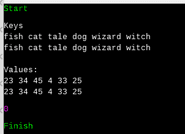

### 函数组合

`ranges` 库支持使用 `|` 符号进行函数组合。

```cpp
// rangesComposition.cpp

...

#include <ranges>

std::map<std::string, int> freqWord{ {"witch", 25}, {"wizard", 33}, {"tale", 45},
                                     {"dog", 4}, {"cat", 34}, {"fish", 23} };

std::cout << "All words: ";                            // (1)

for (const auto& name : std::views::keys(freqWord)) { std::cout << name << " "; }

std::cout << "All words reverse: ";                    // (2)

for (const auto& name : std::views::keys(freqWord) | std::views::reverse) { 
    std::cout << name << " ";
}

std::cout << "The first 4 words: ";                    // (3)

for (const auto& name : std::views::keys(freqWord) | std::views::take(4)) { 
    std::cout << name << " "; 
}

std::cout << "All words starting with w: ";            // (4)

auto firstw = [](const std::string& name){ return name[0] == 'w'; };

for (const auto& name : std::views::keys(freqWord) | std::views::filter(firstw)) { 
    std::cout << name << " "; 
}
```

### Ranges 直接作用于容器

在这种情况下，我只对键感兴趣。我显示了所有的键（1）、反转后的键（2）、前四个键（3）以及以字母 'w' 开头的键（4）。

管道符号 `|` 是函数组合的语法糖。与其写 `C(R)`，你可以编写 `R | C`。因此，接下来的三行是等价的。

```cpp
auto rev1 = std::views::reverse(std::views::keys(freqWord));

auto rev2 = std::views::keys(freqWord) | std::views::reverse; 

auto rev3 = freqWord | std::views::keys | std::views::reverse; 
```

最后，这里是程序的输出：

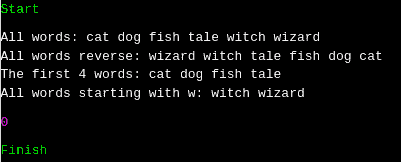

### 惰性求值

[`std::views::iota`](https://en.cppreference.com/w/cpp/ranges/iota_view) 是一个通过连续增加初始值来创建元素序列的范围工厂。该序列可以是有限的或无限的。得益于这个函数，我可以找到从 1000000 开始的前 20 个质数。

```cpp
// rangesLazy.cpp

...

#include <ranges>

bool isPrime(int i) {
    for (int j=2; j*j <= i; ++j){
        if (i % j == 0) return false;
    }
    return true;
}

// (1)

std::cout << "Numbers from 1000000 to 1001000 (dispayed each 100th): " << "\n";

for (int i: std::views::iota(1000000, 1001000)) {
    if (i % 100 == 0) std::cout << i << " ";  
}

// (2)

auto odd = [](int i){ return i % 2 == 1; };

std::cout << "Odd numbers from 1000000 to 1001000 (displayed each 100th): " << "\n";
```


`ranges` 库允许直接在 `std::unordered_map` 的键（1）或值（3）上创建视图（view）。

```cpp
// rangesEntireContainer.cpp

...

#include <ranges>

std::unordered_map<std::string, int> freqWord{
    {"witch", 25},
    {"wizard", 33},
    {"tale", 45},
    {"dog", 4},
    {"cat", 34},
    {"fish", 23}
};

std::cout << "Keys" << std::endl;

auto names = std::views::keys(freqWord); // (1)

for (const auto& name : names) {
    std::cout << name << " ";
}

for (const auto& na : std::views::keys(freqWord)) {
    std::cout << na << " ";
} // (2)

std::cout << "Values: " << std::endl;

auto values = std::views::values(freqWord); // (3)

for (const auto& value : values) {
    std::cout << value << " ";
}

for (const auto& value : std::views::values(freqWord)) { // (4)
    std::cout << value << " ";
}
```

### Ranges 直接作用于容器

当然，键和值可以直接显示，如标记（2）和（4）所示。输出结果相同。


### 函数组合

`ranges` 库支持使用 `|` 符号进行函数组合。

```cpp
// rangesComposition.cpp

...

#include <ranges>

std::map<std::string, int> freqWord{
    {"witch", 25},
    {"wizard", 33},
    {"tale", 45},
    {"dog", 4},
    {"cat", 34},
    {"fish", 23}
};

std::cout << "All words: "; // (1)

for (const auto& name : std::views::keys(freqWord)) {
    std::cout << name << " ";
}

std::cout << "All words reverse: "; // (2)

for (const auto& name :
     std::views::keys(freqWord) | std::views::reverse) {
    std::cout << name << " ";
}

std::cout << "The first 4 words: "; // (3)

for (const auto& name :
     std::views::keys(freqWord) | std::views::take(4)) {
    std::cout << name << " ";
}

std::cout << "All words starting with w: "; // (4)

auto firstw = [](const std::string& name) {
    return name[0] == 'w';
};

for (const auto& name :
     std::views::keys(freqWord) | std::views::filter(firstw)) {
    std::cout << name << " ";
}
```

### Ranges 直接作用于容器

在这种情况下，我只对键感兴趣。我显示了所有的键（1）、反转后的键（2）、前四个键（3）以及以字母 `w` 开头的键（4）。

管道符号 `|` 是函数组合的语法糖。与其写 `C(R)`，你可以编写 `R | C`。因此，接下来的三行是等价的。

```cpp
auto rev1 = std::views::reverse(std::views::keys(freqWord));

auto rev2 = std::views::keys(freqWord) | std::views::reverse;

auto rev3 = freqWord | std::views::keys | std::views::reverse;
```

最后，这里是程序的输出：


### 惰性求值

`std::views::iota` 是一个通过连续增加初始值来创建元素序列的范围工厂。该序列可以是有限的或无限的。得益于这个函数，我可以找到从 `1000000` 开始的前 20 个质数。

```cpp
// rangesLazy.cpp

...

#include <ranges>

bool isPrime(int i) {
    for (int j = 2; j * j <= i; ++j) {
        if (i % j == 0) {
            return false;
        }
    }

    return true;
}

// (1)

std::cout << "Numbers from 1000000 to 1001000 (dispayed each 100th): "
          << "\n";

for (int i : std::views::iota(1000000, 1001000)) {
    if (i % 100 == 0) {
        std::cout << i << " ";
    }
}

// (2)

auto odd = [](int i) {
    return i % 2 == 1;
};

std::cout
    << "Odd numbers from 1000000 to 1001000 (displayed each 100th): "
    << "\n";

for (int i :
     std::views::iota(1000000, 1001000) | std::views::filter(odd)) {
    if (i % 100 == 1) {
        std::cout << i << " ";
    }
}

// (3)

std::cout << "Prime numbers from 1000000 to 1001000: " << "\n";

for (int i :
     std::views::iota(1000000, 1001000) | std::views::filter(isPrime)) {
    if (i % 100 == 0) {
        std::cout << i << " ";
    }
}

// (4)
```

# 模块开发指南

## 1. 变量与表达式

在 C++ 中，我们经常使用变量来存储数据。例如，在表达式 `cvar = avar + bvar` 中，加法运算符 `+` 将 `avar` 与 `bvar` 相加，得到它们的和 `cvar`。

如果你需要处理文件路径，可以使用 `/path/to/xxx` 目录并找到 `xxx.json`。

## 2. 类与方法

标准库提供了丰富的接口。在 `List.of(arg0, arg1, arg2)` 中，`List` 接口的工厂方法 `of()` 接受一系列元素，返回包含它们的只读列表。

我们可以通过以下方式执行逻辑：

```cpp
if (condVar > someVal) {
    console.log("xxx");
}
```


## 3. 命令使用

之后我们这样调用 `cmd` 命令：`cmd arg0 arg1 arg2`。

| 默认 | `std::string str` |
| --- | --- |
| 从 C++-string 拷贝 | `std::string str(oth)` |
| 从 C++-string 移动 | `std::string str(std::move(oth))` |
| 从 C++-string 的范围 | `std::string(oth.begin(), oth.end())` |
| 从 C++-string 的子串 | `std::string(oth, otherIndex)` |
| 从 C++-string 的子串 | `std::string(oth, otherIndex, strlen)` |
| 从 C 字符串 | `std::string str("c-string")` |
| 从 C 数组 | `std::string str("c-array", len)` |
| 从字符 | `std::string str(num, 'c')` |
| 从初始化列表 | `std::string str({'a', 'b', 'c', 'd'})` |
| 从子串 | `str= other.substring(3, 10)` |
| 析构函数 | `str.~string()` |

```cpp
// stringConstructor.cpp

...

#include <string>

...

std::string defaultString;

std::string other{"123456789"};

std::string str1(other);                      // 123456789

std::string tmp(other);                       // 123456789

std::string str2(std::move(tmp));             // 123456789

std::string str3(other.begin(), other.end()); // 123456789

std::string str4(other, 2);                   // 3456789

std::string str5(other, 2, 5);                // 34567

std::string str6("123456789", 5);             // 12345

std::string str7(5, '1');                     // 11111

std::string str8({'1', '2', '3', '4', '5'});  // 12345

std::cout << str6.substr();                   // 12345

std::cout << str6.substr(1);                  // 2345

std::cout << str6.substr(1, 2);               // 23
```

# 字符串的创建

## C++ 与 C 字符串之间的转换

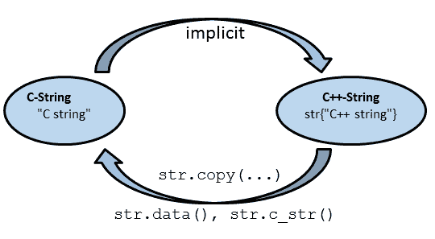

虽然 C 字符串到 C++-string 的转换是隐式完成的，但你必须显式请求将 C++-string 转换为 C 字符串。`str.copy()` 拷贝 C++-string 的内容，但不包含终止符 `\0` 字符。`str.data()` 和 `str.c_str()` 则包含终止的空字符。

# 大小与容量

字符串拥有的元素数量（`str.size()`）通常小于为元素预留空间的数量：`str.capacity()`。因此，如果你向字符串中添加元素，不会自动分配新内存。`std:max_size()` 返回字符串最多可以有多少个元素。对于这三个方法，存在以下关系：`str.size() <= str.capacity() <= str.max_size()`。

下表显示了处理字符串内存管理的方法。

### 创建和删除字符串的方法

| 方法 | 说明 |
| --- | --- |
| `str.empty()` | 检查 `str` 是否拥有元素。 |
| `str.size(), str.length()` | `str` 的元素数量。 |
| `str.capacity()` | `str` 在不重新分配的情况下可以拥有的元素数量。 |
| `str.max_size()` | `str` 最多可以拥有的元素数量。 |
| `str.resize(n)` | 将 `str` 增加 n 个元素。 |
| `str.reserve(n)` | 为至少 `n` 个元素预留内存。 |
| `str.shrink_to_fit()` | 将字符串的容量调整为其大小。 |

`str.shrink_to_fit()` 的请求正如 `std::vector`（#chap05.xhtml_chapterXXXVectors）一样是非绑定的。

```cpp
// stringSizeCapacity.cpp

...

#include <string>

...

void showStringInfo(const std::string& s){

  std::cout << s << ": ";

  std::cout << s.size() << " ";

  std::cout << s.capacity() << " ";

  std::cout << s.max_size() << " ";

}

std::string str;

showStringInfo(str);  // "": 0 0 4611686018427387897

str +="12345";

showStringInfo(str);  // "12345": 5 5 4611686018427387897

str.resize(30);

showStringInfo(str);  // "12345": 30 30 4611686018427387897

str.reserve(1000);

showStringInfo(str);  // "12345": 30 1000 4611686018427387897

str.shrink_to_fit();

showStringInfo(str);  // "12345": 30 30 4611686018427387897
```

# 大小与容量

## 比较

字符串支持广为人知的比较运算符 `==, !=, <, >, >=`。两个字符串的比较发生在它们的元素上。

```cpp
// stringComparisonAndConcatenation.cpp

...

#include <string>

...

std::string first{"aaa"};

std::string second{"aaaa"};

std::cout << (first < second) << std::endl; // true

std::cout << (first == second) << std::endl; // false
```

## 字符串拼接

`+` 运算符对字符串进行了重载，因此你可以拼接它们。

## 元素访问

特别有趣的是在示例中的 `str[10]`。越界访问是未定义行为。相反，编译器处理 `str.at(10)`。

下表提供了字符串的概述：

| 方法 | string |
| --- | --- |
| `str[i]` | 访问索引 `i` 的元素。 |
| `str.at(i)` | 访问索引 `i` 的元素，如果越界则抛出 `out_range`。 |
| `front()` | 返回第一个字符。 |
| `back()` | 返回最后一个字符。 |

```cpp
// stringAccess.cpp

...

#include <string>

...

std::string str="0123456789";

std::cout << str[0] << std::endl;      // 0

std::cout << str[5] << std::endl;      // 5

std::cout << str.front() << std::endl; // 0

std::cout << str.back() << std::endl;  // 9

try {

  str.at(10);

} catch (const std::out_range& e) {

  std::cerr << "Exception: " << e.what() << std::endl;

}
```

# 输入与输出

字符串可以通过 `>>` 从输入流读取，通过 `<<` 输出到输出流。

全局函数 `getline` 允许你逐行读取输入直到遇到文件结束字符。

有四种 `getline` 函数变体可用。前两个参数是输入流 `is` 和存储读取行的字符串 `line`。你可以额外指定特殊的行分隔符。该函数返回输入流的引用。

```cpp
istream& getline (istream& is, string& line, char delim);

istream& getline (istream&& is, string& line, char delim);

istream& getline (istream& is, string& line);

istream& getline (istream&& is, string& line);
```

`getline` 会读取整行，包括空格。只有行分隔符被忽略。该函数需要头文件 `<string>`。

```cpp
// stringInputOutput.cpp

...

#include <string>

#include <fstream>

#include <vector>

#include <iostream>

std::vector<std::string> readFromFile(const char* fileName){

  std::ifstream file(fileName);

  if (!file){

    std::cerr << "Could not open the file " << fileName << ".";

    exit(EXIT_FAILURE);

  }

  std::vector<std::string> lines;

  std::string line;

  while (getline(file , line)) lines.push_back(line);

  return lines;

}

std::string fileName;

std::cout << "Your filename: ";

std::cin >> fileName;

std::vector<std::string> lines= readFromFile(fileName.c_str());

int num{0};

for (auto line: lines) std::cout << ++num << ": " << line << std::endl;
```

该程序显示任意文件的行，包括它们的行号。表达式 `std::cin >> fileName` 读取文件名。函数 `readFromFile` 使用 `getline` 读取文件中所有行并将它们推入 `vector` 中。

### 搜索

C++ 提供了多种变体用于在字符串中。每种变体都以各种重载的形式存在。

`find` 算法支持：

- 搜索字符、`C String` 或 `C++-string`；
- 从 `C` 字符串或 `C++-string` 中搜索字符；
- 正向和反向搜索；
- 对 `C` 字符串或 `C++-string` 中的字符进行正向（包含）或负向（不包含）搜索；
- 从字符串中的任意位置开始搜索。

所有六种 `find` 函数变体的参数都遵循相似的模式。第一个参数是你要搜索的文本。第二个参数是搜索的起始位置，第三个参数是从第二个参数开始计算的字符数。

以下是这六种变体。

### 字符串的 Find 变体

| 方法 | 说明 |
| --- | --- |
| `str.find(...)` | 返回 `str` 中字符、`C` 字符串或 `C++-string` 的第一个位置。 |
| `str.rfind(...)` | 返回 `str` 中字符、`C` 字符串或 `C++-string` 的最后一个位置。 |
| `str.find_first_of(...)` | 返回 `str` 中来自 `C` 字符串或 `C++-string` 的字符的第一个位置。 |
| `str.find_last_of(...)` | 返回 `str` 中来自 `C` 字符串或 `C++-string` 的字符的最后一个位置。 |
| `str.find_first_not_of(...)` | 返回 `str` 中不来自 `C` 字符串或 `C++-string` 的字符的第一个位置。 |
| `str.find_last_not_of(...)` | 返回 `str` 中不来自 `C` 字符串或 `C++-string` 的字符的最后一个位置。 |

```cpp
// stringFind.cpp

...

#include <string>

...

std::string str;

auto idx= str.find("no");

if (idx == std::string::npos) std::cout << "not found";  // not 找到

str= {"dkeu84kf8k48kdj39kdj74945du942"};

std::string str2{"84"};

std::cout << str.find('8');                              // 4

std::cout << str.rfind('8');                             // 11

std::cout << str.find('8', 10);                          // 11

std::cout << str.find(str2);                             // 4

std::cout << str.rfind(str2);                            // 4

std::cout << str.find(str2, 10);                         // 18446744073709551615

str2="0123456789";

std::cout << str.find_first_of("678");                    // 4

std::cout << str.find_last_of("678");                     // 20

std::cout << str.find_first_of("678", 10);                // 11

std::cout << str.find_first_of(str2);                     // 4

std::cout << str.find_last_of(str2);                      // 29

std::cout << str.find_first_of(str2, 10);                 // 10

std::cout << str.find_first_not_of("678");                // 0

std::cout << str.find_last_not_of("678");                 // 29

std::cout << str.find_first_not_of("678", 10);            // 10

std::cout << str.find_first_not_of(str2);                 // 0

std::cout << str.find_last_not_of(str2);                  // 26

std::cout << str.find_first_not_of(str2, 10);             // 12
```

### 字符串中的 Find(search)

调用 `std::find(str2, 10)` 返回 `std::string::npos`。如果我显示该值，在我的平台上得到的是 `18446744073709551615`。

### 检查前缀或后缀

成员函数 `str.starts_with(prefix)` 和 `str.end_with(suffix)` 检查给定字符串 `str` 是否以 `prefix` 开头或以 `suffix` 结尾。

```cpp
// startWithEndsWith.cpp

...

#include <string>

...

std::string helloWorld = "hello world";

std::cout << helloWorld.starts_with("hello") << std::endl; // true

std::cout << helloWorld.starts_with("llo") << std::endl;   // false
```


```cpp
std::cout << helloWorld.ends_with("world") << std::endl;   // true

std::cout << helloWorld.ends_with("wo") << std::endl;      // false
```

### 修改操作

字符串有许多操作来修改它们。`str.assign` 将新字符串赋值给 `str`。通过 `str.assign` 可以替换 `str` 的内容。通过 `+=` 可以在末尾追加字符串。通过 `insert` 可以在指定位置插入字符串。通过 `erase` 可以删除字符串的一部分。通过 `pop_back` 可以删除最后一个字符。通过 `clear` 可以清空字符串。通过 `swap` 可以交换两个字符串。通过 `replace` 可以替换字符串的特定部分。

该函数接收一个字符串并确定其对于基 `base` 的 `long` 表示。`stol` 会忽略开头的空格，并可选地在 `idx` 中返回第一个无效字符的索引。默认情况下，基数为 10。基数的有效值为 0 和 36 之间的数字。如果你使用基数 0，编译器将根据字符串的格式自动确定类型。如果基数大于 10，编译器将它们编码为字符 `a` 到 `z`。这种表示方法类似于十六进制数的表示方法。

下表给出了所有函数的概述。

## 字符串的数值转换

| 方法 | 描述 |
| --- | --- |
| `std::to_string(val)` | 将 `val` 转换为 `std::string`。 |
| `std::to_wstring(val)` | 将 `val` 转换为 `std::wstring`。 |
| `std::stoi(str)` | 返回一个 `int` 值。 |
| `std::stol(str)` | 返回一个 `long` 值。 |
| `std::stoll(str)` | 返回一个 `long long` 值。 |
| `std::stoul(str)` | 返回一个 `unsigned long` 值。 |
| `std::stoull(str)` | 返回一个 `unsigned long long` 值。 |
| `std::stof(str)` | 返回一个 `float` 值。 |
| `std::stod(str)` | 返回一个 `double` 值。 |
| `std::stold(str)` | 返回一个 `long double` 值。 |

如果无法转换，这些函数会抛出 `std::invalid_argument` 异常。如果确定的值对于目标类型来说太大，你会得到 `std::out_of_range` 异常。

```cpp
// stringNumericConversion.cpp

...

#include <string>

...

std::string maxLongLongString =
    std::to_string(std::numeric_limits<long long>::max());

std::wstring maxLongLongWstring =
    std::to_wstring(std::numeric_limits<long long>::max());

std::cout << std::numeric_limits<long long>::max();  // 9223372036854775807

std::cout << maxLongLongString;                      // 9223372036854775807

std::wcout << maxLongLongWstring;                    // 9223372036854775807

std::string str("10010101");

std::cout << std::stoi(str);                         // 10010101

std::cout << std::stoi(str, nullptr, 16);            // 268501249

std::cout << std::stoi(str, nullptr, 8);             // 2101313

std::cout << std::stoi(str, nullptr, 2);             // 149

std::size_t idx;

std::cout << std::stod(" 3.5 km", &idx);              // 3.5

std::cout << idx;                                     // 6

try {
    std::cout << std::stoi(" 3.5 km") << std::endl;   // 3

    std::cout << std::stoi(" 3.5 km", nullptr, 2) << std::endl;
} catch (const std::exception& e) {
    std::cerr << e.what() << std::endl;
}

// stoi
```

### 数值转换

## 字符串视图（String Views）

[string view](http://en.cppreference.com/w/cpp/string/string_view) 是字符串的非所有权引用。它表示对字符序列的视图。该字符序列可以是 C++ 字符串或 C 风格字符串。string view 需要 `<string_view>` 头文件。string view 是以字符类型和特征（trait）为参数的类模板。字符特征有一个默认值。与 `string` 不同，string view 是非所有者的，因此不需要分配器。

```cpp
template<
    class CharT,
    class Traits = std::char_traits<CharT>
> class basic_string_view;
```

根据字符串的定义，string view 为字符类型 `char`、`wchar_t`、`char16_t` 和 `char32_t` 提供了同义名。

```cpp
typedef std::string_view basic_string_view<char>;

typedef std::wstring_view basic_string_view<wchar_t>;

typedef std::u16string_view basic_string_view<char16_t>;

typedef std::u32string_view basic_string_view<char32_t>;
```

### 创建与初始化

你可以创建一个空字符串视图。你也可以从现有的字符串、现有的字符数组或现有的 string view 创建 string view。下表提供了创建 string view 的各种方法的概述。

| 方法 | 示例 |
| --- | --- |
| 空字符串视图 | `std::string_view str_view` |
| 从 C 字符串创建 | `std::string_view str_view("C-string")` |
| 从 string view 创建 | `std::string_view str_view(str_view)` |
| 从 C 数组创建 | `std::string_view str_view(arr, sizeof arr)` |
| 从 string_view 创建 | `str_4 = str_view` |
| 从 string_view 创建 | `std::string_view str_5 = str_4` |

### 非修改操作

关于字符串，这里提到 string view 的非修改操作。要了解更多详细信息，请查看相关章节。

- 元素访问：`operator[]`、`at`、`front`、`back`、`data`（查看 string：元素访问）
- 容量：`size`、`length`、`max_size`、`empty`（查看 string：与容量）
- 查找：`find`、`rfind`、`find_first_of`、`find_last_of`、`find_first_not_of`、`find_last_not_of`（查看 string：查找）
- 拷贝：`copy`（查看 string：拷贝）

### 修改操作

调用 `stringView.swap(stringView2)` 会交换两个字符串视图的内容。`remove_prefix` 和 `remove_suffix` 是 string view 特有的方法，因为 string 不支持。`remove_prefix` 从前往后收缩；`remove_suffix` 从后往前收缩。

```cpp
// string_view.cpp

...

#include <string_view>

...

using namespace std;

string str = "   A lot of space";

string_view strView = str;

strView.remove_prefix(min(strView.find_first_not_of(" "), strView.size()));

cout << str << endl;      // "   A lot of space"
     << strView << endl;  // "A lot of space"

char arr[] = {
    'A', ' ', 'l', 'o', 't', ' ', 'o', 'f', ' ',
    's', 'p', 'a', 'c', 'e', '\0', '\0', '\0'
};

string_view strView2(arr, sizeof arr);

auto trimPos = strView2.find('\0');

if (trimPos != strView2.npos) {
    strView2.remove_suffix(strView2.size() - trimPos);
}

cout << arr << ": " << sizeof arr << endl             // A lot of space: 17
     << strView2 << ": " << strView2.size() << endl;  // A lot of space: 14
```

# 15. 正则表达式

[Regular expression](http://en.cppreference.com/w/cpp/regex) 是一种描述文本模式的语言。它们需要 `<regex>` 头文件。

正则表达式是处理以下任务的工具：

- 检查文本是否匹配文本模式：`std::regex_match`
- 在文本中搜索文本模式：`std::regex_search`
- 用文本替换文本模式：`std::regex_replace`
- 遍历文本中所有的文本模式：`std::regex_iterator` 和 `std::regex_token_iterator`

C++ 支持六种不同的正则表达式语法。默认情况下使用 ECMAScript 语法。这是六种语法中最强大的的一种，并且与 Perl 5 中使用的语法非常相似。其他五种语法是基本、扩展、awk、grep 和 egrep 语法。

处理正则表达式通常分为三个步骤：

I. 定义正则表达式：

```cpp
std::string text = "C++ or c++.";

std::string regExpr(R"(C\+\+)");

std::regex rgx(regExpr);
```

II. 存储搜索结果：

```cpp
std::smatch result;

std::regex_search(text, result, rgx);
```

III. 处理结果：

```cpp
std::cout << result[0] << std::endl;
```

### 字符类型

文本的类型决定了正则表达式的字符类型，以及决定搜索结果的类型。

下表展示了四种不同的组合。

文本类型、正则表达式类型、搜索结果类型和操作的组合：

| 文本类型 | 正则表达式类型 | 结果类型 |
| --- | --- | --- |
| `const char*` | `std::regex` | `std::cmatch` |
| `std::string` | `std::regex` | `std::smatch` |
| `const wchar_t*` | `std::wregex` | `std::wcmatch` |
| `std::wstring` | `std::wregex` | `std::wsmatch` |

本章搜索部分详细介绍了这四种组合。

### 正则表达式对象

正则表达式类型对象的对象是类模板 `template <class charT, class traits = regex_traits <charT>> class basic_regex` 的实例，由其字符类型和 traits 类进行参数化。traits 类定义了对正则表达式文法属性的解释。C++ 中有两个类型别名：

```cpp
typedef basic_regex<char> regex;

typedef basic_regex<wchar_t> wregex;
```

你可以进一步自定义正则表达式类型的对象。因此，你可以指定所使用的语法或适配语法。如前所述，C++ 支持基本的、扩展的、awk、grep 和 egrep 语法。带有 `std::regex_constants::icase` 标志修饰的正则表达式是不区分大小写的。如果你想采用某种语法，必须显式地指定语法。

```cpp
// regexGrammar.cpp

...

#include <regex>

...

using std::regex_constants::ECMAScript;

using std::regex_constants::icase;

std::string theQuestion = "C++ or c++, that's the question.";

std::string regExprStr(R"(c\+\+)");

std::regex rgx(regExprStr);

std::smatch smatch;

if (std::regex_search(theQuestion, smatch, rgx)) {
    std::cout << "case sensitive: " << smatch[0];  // c++
}

std::regex rgxIn(regExprStr, ECMAScript | icase);

if (std::regex_search(theQuestion, smatch, rgxIn)) {
    std::cout << "case insensitive: " << smatch[0];  // C++
}
```

#### 指定语法

如果你使用区分大小写的正则表达式 `rgx`，则在文本 `theQuestion` 中的搜索结果为 `c++`。但如果应用不区分大小写的正则表达式 `rgxIn`，情况就不如此了。现在你得到了匹配字符串 `C++`。

### 搜索结果 match_results

`std::match_results` 类型的对象是 `std::regex_match` 或 `std::regex_search` 的结果。`std::match_results` 是一个序列容器，至少包含一个 `std::sub_match` 对象的捕获组。`std::sub_match` 对象是字符序列。

C++ 有四种 `std::match_results` 类型的类型别名：

```cpp
typedef match_results<const char*> cmatch;

typedef match_results<const wchar_t*> wcmatch;

typedef match_results<string::const_iterator> smatch;

typedef match_results<wstring::const_iterator> wsmatch;
```


搜索结果`std::smatch smatch`拥有强大的接口。

## `std::smatch`接口

| 方法 | 说明 |
| --- | --- |
| `smatch.size()` | 返回捕获组的数量。 |
| `smatch.empty()` | 返回搜索结果是否包含捕获组。 |
| `smatch[i]` | 返回第`i`个捕获组。 |
| `smatch.length(i)` | 返回第`i`个捕获组的长度。 |
| `smatch.position(i)` | 返回第`i`个捕获组的位置。 |
| `smatch.str(i)` | 以字符串形式返回第`i`个捕获组。 |
| `smatch.prefix()`和`smatch.suffix()` | 返回捕获组之前和之后的字符串。 |
| `smatch.begin()`和`smatch.end()` | 返回用于捕获组的起始和结束迭代器。 |
| `smatch.format(...)` | 为输出对`std::smatch`对象进行格式化。 |

以下程序展示了不同正则表达式的前四个捕获组的输出。

```cpp
// captureGroups.cpp 

...

#include<regex>

...

using namespace std;

void showCaptureGroups(const string& regEx, const string& text){

  regex rgx(regEx);

  smatch smatch;

  if (regex_search(text, smatch, rgx)){

    for (int i=0; i<smatch.size(); ++i){

      cout << "capture group " << i << ": " << smatch[i] << endl;

    }

  }

}

int main(){

  showCaptureGroups(R"(C\+\+)", "C++ or c++.");

  showCaptureGroups(R((c\+\+))", "C++ or c++.");

  showCaptureGroups(R"((C\+\+) or (c\+\+))", "C++ or c++.");

  showCaptureGroups(R"((C\+\+) or (ww+))", "C++ or c++.");

  return 0;

}
```

## 捕获组

### `std::match_results`

捕获组的类型是`std::match_results`。C++定义了以下四种类型别名：

```cpp
typedef match_results<const char*> cmatch;

typedef match_results<const wchar_t*> wcmatch;

typedef match_results<string::const_iterator> smatch;

typedef match_results<wstring::const_iterator> wsmatch;
```

你可以进一步分析`std::sub_match`。

### `std::sub_match`对象

| 方法 | 说明 |
| --- | --- |
| `cap.matched()` | 指明匹配是否成功。 |
| `cap.first()`和`cap.end()` | 返回捕获组的起始和结束迭代器。 |
| `cap.length()` | 返回捕获组的长度。 |
| `cap.str()` | 以字符串形式返回捕获组。 |
| `cap.compare(other)` | 将当前捕获组与另一个进行比较。 |

这里有一个代码片段展示了搜索结果`std::match_results`与其捕获组`std::sub_match`之间的交互。

```cpp
// subMatch.cpp 

...

#include <regex>

#include <iostream>

#include <string>

#include <algorithm>

using namespace std;

int main(){

  string privateAddress="192.168.178.21";

  string regEx(R"((\d{1,3})\.(\d{1,3})\.(\d{1,3})\.(\d{1,3}))");

  regex rgx(regEx);

  smatch smatch;

  if (regex_match(privateAddress, smatch, rgx)){

    for (auto cap:smatch){

      cout << "capture group: " << cap << endl;

      if (cap.matched){

        for_each(cap.first, cap.second, [](int v){

          cout << hex << v << " ";});

        cout << endl;

      }

    }

  }

  return 0;

}

...

capture group: 192.168.178.21

c0 a8 b2 15 

capture group: 192

c0 

capture group: 168

a8 

capture group: 178

b2 

capture group: 21

15 
```

## 匹配

`std::regex_match`确定文本是否匹配文本模式。你可以进一步分析类型为`std::match_results`的搜索结果。

下面的代码片段展示了`std::regex_match`的三种简单应用：C字符串、C++字符串和仅返回布尔值的范围。这三种变体分别适用于`std::match_results`对象。

```cpp
// match.cpp 

...

#include <regex>

...

std::string numberRegEx(R"([-+]?([0-9]*\.[0-9]+|[0-9]+))");

std::regex rgx(numberRegEx);

const char* numChar{"2011"};

if (std::regex_match(numChar, rgx)){

  std::cout << numChar << " is a number." << std::endl;

}                                            // 2011 is a number.

const std::string numStr{"3.14159265359"};

if (std::regex_match(numStr, rgx)){

  std::cout << numStr << " is a number." << std::endl;

}                                           // 3.14159265359 is a number.

const std::vector<char> numVec{{'-', '2', '.', '7', '1', '8', '2',

                                '8', '1', '8', '2', '8'}};

if (std::regex_match(numVec.begin(), numVec.end(), rgx)){

    for (auto c: numVec){ std::cout << c ;};

    std::cout << " is a number." << std::endl;

}                                           // -2.718281828 is a number.
```

# `std::match`

## 搜索

`std::regex_search`检查文本是否包含文本模式。你可以带或不带`std::match_results`对象使用该函数，并将其应用于C字符串、C++字符串或范围。

下面的示例展示了如何对`const char*`、`std::string`、`const wchar_t*`和`std::wstring`类型的文本使用`std::regex_search`。

```cpp
// search.cpp 

...

#include <regex>

...

// 用于时间的正则表达式容器

std::regex crgx("([01]?[0-9]|2[0-3]):[0-5][0-9]");

// const char*

std::cmatch cmatch;

const char* ctime{"Now it is 23:10."};

if (std::regex_search(ctime, cmatch, crgx)){

  std::cout << ctime << std::endl;                   // Now it is 23:10\.   

  std::cout << "Time: " << cmatch[0] << std::endl;   // Time: 23:10

}

// std::string

std::smatch smatch;

std::string stime{"Now it is 23:25."};

if (std::regex_search(stime, smatch, crgx)){

  std::cout << stime << std::endl;                   // Now it is 23:25.

  std::cout << "Time: " << smatch[0] << std::endl;   // Time: 23:25

}

// 用于时间的正则表达式容器

std::wregex wrgx(L"([01]?[0-9]|2[0-3]):[0-5][0-9]");

// const wchar_t*

std::wcmatch wcmatch;

const wchar_t* wctime{L"Now it is 23:47."};

if (std::regex_search(wctime, wcmatch, wrgx)){

  std::wcout << wctime << std::endl;                 // Now it is 23:47.

  std::wcout << "Time: " << wcmatch[0] << std::endl; // Time: 23:47

}

// std::wstring

std::wsmatch wsmatch;

std::wstring wstime{L"Now it is 00:03."};

if (std::regex_search(wstime, wsmatch, wrgx)){

  std::wcout << wstime << std::endl;                  // Now it is 00:03.

  std::wcout << "Time: " << wsmatch[0] << std::endl;  // Time: 00:03

}
```

## `std::search`

## 替换

`std::regex_replace`替换文本中匹配文本模式的序列。它以简单形式`std::regex_replace(text, regex, replString)`返回其结果字符串。

```cpp
// replace.cpp

...

#include <regex>

...

using namespace std;

string future{"Future"};

string unofficialName{"The unofficial name of the C++ standard is C++x."};

regex rgxCpp{R"(C\+\+x)"};

string newCpp{"C++1"};

string newName=regex_replace(unofficialName, rgxCpp, newCpp);

regex rgxOff{"unofficial"};

string makeOfficial{"official"};

string officialName=regex_replace(newName, rgxOff, makeOfficial);

cout << officialName;

                          // The official name of the C++ standard is C++11.
```

`std::replace`

除了简单版本外，C++还有一个工作于范围的`std::regex_replace`版本。它允许你将修改后的字符串直接推入另一个字符串中：

```cpp
typedef basic_regex<char> regex;

std::string str2;

std::regex_replace(std::back_inserter(str2),

                   text.begin(), text.end());
```


```cpp
std::cout << "Time: " << smatch[0] << std::endl;   // Time: 23:25

}
```

// 用于时间的正则表达式容器

```cpp
std::wregex wrgx(L"([01]?[0-9]|2[0-3]):[0-5][0-9]");

// const wchar_t*

std::wcmatch wcmatch;

const wchar_t* wctime{L"Now it is 23:47."};

if (std::regex_search(wctime, wcmatch, wrgx)){

  std::wcout << wctime << std::endl;                 // Now it is 23:47.

  std::wcout << "Time: " << wcmatch[0] << std::endl; // Time: 23:47

}

// std::wstring

std::wsmatch wsmatch;

std::wstring wstime{L"Now it is 00:03."};

if (std::regex_search(wstime, wsmatch, wrgx)){

  std::wcout << wstime << std::endl;                  // Now it is 00:03.

  std::wcout << "Time: " << wsmatch[0] << std::endl;  // Time: 00:03

}
```

### `std::search`

### 替换

`std::regex_replace` 替换文本中匹配文本模式的序列。它以简单形式 `std::regex_replace(text, regex, replString)` 返回其结果字符串。

```cpp
// replace.cpp

...

#include <regex>

...

using namespace std;

string future{"Future"};

string unofficialName{"The unofficial name of the C++ standard is C++x."};

regex rgxCpp{R"(C\+\+x)"};

string newCpp{"C++1"};

string newName=regex_replace(unofficialName, rgxCpp, newCpp);

regex rgxOff{"unofficial"};

string makeOfficial{"official"};

string officialName=regex_replace(newName, rgxOff, makeOfficial);

cout << officialName;

// The official name of the C++ standard is C++11.
```

`std::replace`

除了简单版本外，C++ 还有一个工作于范围的 `std::regex_replace` 版本。它允许你将修改后的字符串直接推入另一个字符串中：

```cpp
typedef basic_regex<char> regex;

std::string str2;

std::regex_replace(std::back_inserter(str2),

                   text.begin(), text.end());
```

### 格式

`std::regex_replace` 格式化时，`match_results` 格式化。`std::regex_replace` 格式化时，`match_results` 格式化。`std::regex_replace` 格式化时，`match_results` 格式化。

一个单词由至少一个字符 `(\w+)` 组成。该正则表达式用于定义起始迭代器 `wordItBegin` 和结束迭代器 `wordItEnd`。匹配项的迭代在 for 循环中进行。每个单词都会增加计数器：`++allWords[wordItBegin]->str()]`。如果单词不在 `allWords` 中，则会创建一个计数器等于 1 的单词。

### `std::regex_token_iterator`

C++ 为 `std::regex_token_iterator` 定义了以下四种类型别名。

```cpp
typedef cregex_iterator     regex_iterator<const char*>

typedef wcregex_iterator    regex_iterator<const wchar_t*>

typedef sregex_iterator     regex_iterator<std::string::const_iterator>

typedef wsregex_iterator    regex_iterator<std::wstring::const_iterator>
```

`std::regex_token_iterator` 允许你通过索引来显式指定你感兴趣的捕获组。如果你不指定索引，将获得所有的捕获组，但你也可以使用相应的索引请求特定的捕获组。索引 -1 是特殊的：你可以使用 -1 来访问匹配项之间的文本：

```cpp
// tokenIterator.cpp

...

using namespace std;

string text = "Pete Becker,The C++ Standard Library Extensions,2006:"
            + "Nicolai Josuttis,The C++ Standard Library,1999";

regex regBook(R"((\w+)\s(\w+),([\w\s\+]*),(\d{4}))");

sregex_token_iterator bookItBegin(text.begin(), text.end(), regBook);

const sregex_token_iterator bookItEnd;

while (bookItBegin != bookItEnd){

  cout << *bookItBegin++ << endl;

} // Pete Becker,The C++ Standard Library Extensions,2006
  // Nicolai Josuttis,The C++ Standard Library,1999

sregex_token_iterator bookItNameIssueBegin(text.begin(), text.end(),
                                           regBook, {{2,4}});

const sregex_token_iterator bookItNameIssueEnd;

while (bookItNameIssueBegin != bookItNameIssueEnd){

  cout << *bookItNameIssueBegin++ << ", ";

  cout << *bookItNameIssueBegin++ << endl;

} // Becker, 1999
  // Josuttis, 2001

regex regBookNeg(":");

sregex_token_iterator bookItNegBegin(text.begin(), text.end(), regBookNeg, -1);

const sregex_token_iterator bookItNegEnd;

while (bookItNegBegin != bookItNegEnd){

  cout << *bookItNegBegin++ << endl;

} // Pete Becker,The C++ Standard Library Extensions,2006
  // Nicolai Josuttis,The C++ Standard Library,1999
```

### `std::regex_token_iterator`

不使用索引的 `bookItBegin` 和使用负索引的 `bookItNegbegin` 返回所有捕获组，但 `bookNameIssueBegin` 仅返回第二个和第四个捕获组 `{{2,4}}`。

# 16. 输入输出流

[输入输出流](http://en.cppreference.com/w/cpp/header/iostream) 允许你与外部世界通信。流是一个无限的字符流，你可以在上面推入或拉取数据。推称为写入，拉取称为读取。

输入输出流：

- 在 1998 年第一个 C++ 标准（C++98）发布很久以前就已经使用了；
- 是一个为扩展性设计的框架；
- 是根据面向对象和泛型范式实现的。

## 层次结构

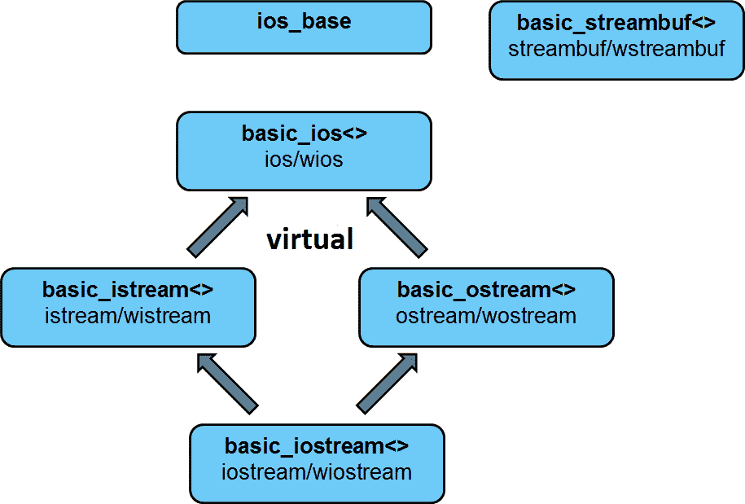

### `basic_streambuf<>`

读取和写入数据。

### `ios_base`

与字符类型无关的所有流类的属性。

### `basic_ios<>`

依赖于字符类型的所有流类的属性。

### `basic_istream<>`

读取数据的流类的基类。

### `basic_ostream<>`

写入数据的流类的基类。

### `basic_iostream<>`

读写数据的流类的基类。

该类层次结构具有字符类型 `char` 和 `wchar_t` 的类型别名。不以 `w` 开头的名称是 `char` 的类型别名，以 `w` 开头的名称是 `wchar_t` 的类型别名。

类 `std::basic_iostream<>` 的基类虚派自 `std::basic_ios<>`，因此 `std::basic_iostream<>` 只有一个 `std::basic_ios` 实例。

## 输入输出函数

类 `std::istream` 和 `std::ostream` 通常用于数据的读写。使用 `std::istream` 类需要 `<istream>` 头文件；使用 `std::ostream` 类需要 `<ostream>` 头文件。你可以在 `<iostream>` 头文件中同时拥有两者。`std::istream` 是类 `basic_istream` 和字符类型 `char` 的类型定义，`std::ostream` 分别是类 `basic_ostream` 的定义：

```cpp
typedef basic_istream<char> istream;

typedef basic_ostream<char> ostream;
```

C++ 有四个预定义的流对象，用于方便地处理键盘和显示器。

### 四个预定义的流对象

| 流对象 | 设备 | 缓冲 |
| --- | --- | --- |
| `std::cin` | stdin | 是 |
| `std::cout` | stdout | 是 |
| `std::cerr` | stderr | 否 |
| `std::clog` |  |  |

流对象足以编写一个从行读取的程序。

```cpp
// IOStreams.cpp

...

#include <iostream>

int main(){

  std::cout << "Type in numbers(Quit with character): ";

  int sum{0};

  int val;

  while (std::cin >> val) sum += val;

  std::cout << "Sum: " << sum;

}
```

上面的流对象使用了运算符 `<<` 和 `>>` 以及流操作符 `std::endl`。

`std::endl` 插入换行符并刷新流。这里是常用的操作符。

### 常用的操作符

| 操作符 | 流类型 | 描述 |
| --- | --- | --- |
| `std::endl` | 输出 | 插入换行符并刷新流。 |
| `std::flush` | 输出 | 刷新流。 |
| `std::ws` | 输入 | 丢弃空白字符。 |

## 输入

你可以在 C++ 中通过两种方式从输入流读取：格式化的提取器 `>>` 和显式方法。

### 格式化输入

提取运算符 `>>`：

- 对所有内置类型和字符串都是预定义的；
- 可以为自定义类型实现；
- 可以通过格式说明符进行配置。

### 非格式化输入

从输入流 `is` 进行非格式化输入有很多方法。

| 方法 | 描述 |
| --- | --- |
| `is.get(ch)` | 读取一个字符到 `ch`。 |
| `is.get(buf, num)` | 读取缓冲区 `buf`，最多读取 `num` 个字符。 |
| `is.getline(buf, num[, delim])` | 读取缓冲区 `buf`，最多读取 `num` 个字符。可选使用行分隔符 `delim`（默认为 `\n`）。 |
| `is.gcount()` | 返回上次通过非格式化操作从 `is` 提取的字符数。 |
| `is.ignore(streamsize sz= 1, int delim= end-of-file)` | 忽略 `sz` 个字符直到 `delim`。 |
| `is.peek()` | 从 `is` 获取一个字符但不消耗它。 |
| `is.unget()` | 将读取的字符推回 `is`。 |
| `is.putback(ch)` | 将字符 `ch` 推入流 `is`。 |

```cpp
// inputUnformatted.cpp

...

#include <iostream>

...

std::string line;

std::cout << "Write a line: " << std::endl;

std::getline(std::cin, line);            // <仅用于测试目的.>

std::cout << line << std::endl;          // 仅用于测试。

std::cout << "Write numbers, separated by;" << std::endl;

while (std::getline(std::cin, line, ';') ) {

  std::cout << line << " ";

} // <2000;11;a>
  // 2000 11
```


#### 输出

你可以使用插入运算符 `<<` 将字符推入输出流。

插入运算符 `<<`：

- 针对所有内置类型和字符串进行了预定义；
- 可以为用户定义数据类型实现；
- 可以通过格式说明符进行调整。

## 格式说明符

格式说明符允许你显式地调整输入输出数据。

下表列出了重要的格式说明符。格式说明符具有持久性，但字段宽度除外，每次应用后都会重置。

不带参数的操符需要头文件 `<iostream>`，而带参数的操符需要头文件 `<iomanip>`。

### 显示布尔值

| 操符 | 流类型 | 描述 |
| --- | --- | --- |
| `std::boolalpha` | 输入和输出 | 以单词显示布尔值。 |
| `std::noboolalpha` | 输入和输出 | 以数字显示布尔值（默认）。 |

### 设置字段宽度和填充字符

| 操符 | 流类型 | 描述 |
| --- | --- | --- |
| `std::setw(val)` | 输入和输出 | 设置字段宽度为 `val`。 |
| `std::setfill(c)` | 输出流 | 设置填充字符为 `c`（默认：空格）。 |

### 文字对齐

| 操符 | 流类型 | 描述 |
| --- | --- | --- |
| `std::left` | 输出 | 输出左对齐。 |
| `std::right` | 输出 | 输出右对齐。 |
| `std::internal` | 输出 | 数字的符号左对齐，数值右对齐。 |

### 正号与大小写转换

| 操符 | 流类型 | 描述 |
| --- | --- | --- |
| `std::showpos` | 输出 | 显示正号。 |
| `std::noshowpos` | 输出 | 不显示正号（默认）。 |
| `std::uppercase` | 输出 | 数值使用大写字母（默认）。 |
| `std::lowercase` | 输出 | 数值使用小写字母。 |

### 数值基数显示

| 操符 | 流类型 | 描述 |
| --- | --- | --- |
| `std::oct` | 输入和输出 | 使用八进制格式的自然数。 |
| `std::dec` | 输入和输出 | 使用十进制格式的自然数（默认）。 |
| `std::hex` | 输入和输出 | 使用十六进制格式的自然数。 |
| `std::showbase` | 输出 | 显示数值基数。 |
| `std::noshowbase` | 输出 | 不显示数值基数（默认）。 |

对于浮点数有特殊规则：

- 有效数字个数（小数点后的数字）默为 6 位。
- 如果有效数字个数不足，数字将以科学计数法法显示。
- 不显示前导零和尾随零。
- 如果可能，则不显示小数点。

### 浮点数

| 操作符 | 流类型 | 描述 |
| --- | --- | --- |
| `std::setprecision(val)` | 输出 | 调整输出的精度为 `val`。 |
| `std::showpoint` | 输出 | 显示小数点。 |
| `std::noshowpoint` | 输出 | 不显示小数点（默认）。 |
| `std::fixed` | 输出 | 以十进制格式显示浮点数。 |
| `std::scientific` | 输出 | 以科学计数法格式显示浮点数。 |
| `std::hexfloat` | 输出 | 以十六进制格式显示浮点数。 |
| `std::defaultfloat` | 输出 | 以默认点表示显示浮点数。 |

```cpp
// formatSpecifierOutput.cpp

...

#include <iomanip>

#include <iostream>

...

std::cout.fill('#');

std::cout << -12345;

std::cout << std::setw(10) << -12345;                 // ####12345

std::cout << std::setw(10) << std::left << -12345;    // -12345####

std::cout << std::setw(10) << std::right << -12345;   // ####12345

std::cout << std::setw(10) << std::internal << -12345; //####2345

std::cout << std::oct << 2011;  // 3733

std::cout << std::hex << 2011;  // 7db

std::cout << std::showbase;

std::cout << std::dec << 2011; // 2011

std::cout << std::oct << 2011; // 03733

std::cout << std::hex << 2011; // 0x7db

std::cout << 123.456789;                          // 123.457

std::cout << std::fixed;

std::cout << std::setprecision(3) << 123.456789;  // 123.000

std::cout << std::setprecision(6) << 123.456789;  // 123.457

std::cout << std::setprecision(9) << 123.456789;  // 123.456789

std::cout << std::scientific;

std::cout << std::setprecision(3) << 123.456789;  // 1.235e+02

std::cout << std::setprecision(6) << 123.456789;  // 1.234568e+02

std::cout << std::setprecision(9) << 123.456789;  // 1.234567890e+02

std::cout << std::hexfloat;

std::cout << std::setprecision(3) << 123.456789;  // 0x1.edd3c07eb+6

std::cout << std::setprecision(6) << 123.456789;  // 0x1.edd3c07eb+6

std::cout << std::setprecision(9) << 123.456789;  // 0x1.edd3c07eb88e+6

std::cout << std::defaultfloat;

std::cout << std::setprecision(3) << 123.456789;  // 123

std::cout << std::setprecision(6) << 123.456789;  // 123.457

std::cout << std::setprecision(9) << 123.456789;  // 123.456789
```

## 流

流是一个无限的数据流，你可以在上面推入或拉取数据。字符串流和文件流允许字符串和文件直接与流交互。

### 字符串流

字符串流需要头文件 `<sstream>`。它们不连接到输入或输出流，并将数据存储在字符串中。

无论你是将字符串流用于输入、输出还是使用 `char` 或 `wchar_t` 类型，都有多种字符串流类：

- `std::istringstream` 和 `std::wistringstream`：用于 `char` 和 `wchar_t` 类型数据输入的字符串流。
- `std::ostringstream` 和 `std::wostringstream`：用于 `char` 和 `wchar_t` 类型数据输出的字符串流。
- `std::stringstream` 和 `std::wstringstream`：用于 `char` 和 `wchar_t` 类型数据输入输出的字符串流。

字符串流的典型操作有：

- 在字符串流中写入数据：

```cpp
std::stringstream os;

os << "New String";

os.str("Another new String");
```

- 从字符串流中读取数据：

```cpp
std::string os;

std::string str;

os >> str;

str = os.str();
```

- 清空字符串流：

```cpp
std::stringstream os;

os.str("");
```

字符串流常用于字符串与数值之间的类型安全转换：

```cpp
// stringStreams.cpp

...

#include <sstream>

...

template <typename T>
T StringTo(const std::string& source) {
  std::istringstream iss(source);

  T ret;

  iss >> ret;

  return ret;
}

template <typename T>
std::string ToString(const T& n) {
  std::ostringstream tmp;

  tmp << n;

  return tmp.str();
}

std::cout << "5= " << StringTo<int>("5");                         // 5

std::cout << "5 + 6= " << StringTo<int>("5") + 6;                 // 11

std::cout << ToString(StringTo<int>("5") + 6);                    // "11"
```

### 文件流

文件流（File streams）允许你对文件进行操作。它们需要头文件 `<fstream>`。文件流会自动管理文件的生命周期。

无论你是使用文件流进行输入、输出，还是配合字符类型 `char` 或 `wchar_t`，都有各种文件流类：

- `std::ifstream` 和 `std::wifstream`：用于输入 `char` 和 `wchar_t` 类型数据的输入文件流。
- `std::ofstream` 和 `std::wofstream`：用于输出 `char` 和 `wchar_t` 类型数据的输出文件流。
- `std::fstream` 和 `std::wfstream`：用于 `char` 和 `wchar_t` 类型数据的输入和输出文件流。
- `std::filebuf` 和 `std::wfilebuf`：类型为 `char` 和 `wchar_t` 的数据缓冲区。

标志（Flags）允许你设置文件流的打开模式。

### 文件流打开的标志

| 标志 | 说明 |
| --- | --- |
| `std::ios::in` | 以读取模式打开文件流（`std::ifstream` 和 `std::wifstream` 的默认值）。 |
| `std::ios::out` | 以写入模式打开文件流（`std::ofstream` 和 `std::wofstream` 的默认值）。 |
| `std::ios::app` | 将字符追加到文件流的末尾。 |
| `std::ios::ate` | 将文件指针初始位置设置为文件流的末尾。 |
| `std::ios::trunc` | 删除原始文件。 |
| `std::ios::binary` | 抑制对文件流中转义序列的解释。 |

使用文件缓冲区 `in.rdbuf()` 可以很容易地将名为 `in` 的文件复制到名为 `out` 的文件中。这个短示例中缺少了错误处理。

```cpp
#include <fstream>

...

std::ifstream in("inFile.txt");

std::ofstream out("outFile.txt");

out << in.rdbuf();
```

如果你结合 C++ 标志，可以比较 C++ 和 C 模式打开文件的方式。

### 使用 C++ 和 C 打开文件

| C++ 模式 | 说明 | C 模式 |
| --- | --- | --- |
| `std::ios::in` | 读取文件。 | `"r"` |
| `std::ios::out` | 写入文件。 | `"w"` |
| `std::ios::out \| std::ios::app` | 追加到文件。 | `"a"` |
| `std::ios::in \| std::ios::out` | 读写文件。 | `"r+"` |
| `std::ios::in \| std::ios::out \| std::ios::trunc` | 写入并读取文件。 | `"w+"` |

在模式 `"r"` 和 `"r+"` 下，文件必须存在。相反，使用 `"a"` 和 `"w+"` 时会创建文件。使用 `"w"` 时，文件会被覆盖。

你可以显式地管理文件流的生命周期。

### 管理文件流的生命周期

| 方法 | 说明 |
| --- | --- |
| `infile.open(name)` | 以读取模式打开文件 `name`。 |
| `infile.open(name, flags)` | 使用标志 `flags` 以读取模式打开文件 `name`。 |
| `infile.close()` | 关闭文件 `name`。 |
| `infile.is_open()` | 检查文件是否打开。 |

#### 随机访问

随机访问允许你任意设置文件指针的位置。

当构造文件流时，文件指针指向文件的开头。你可以通过文件流 `file` 的方法来调整位置。

##### 在文件流中导航

| 方法 | 说明 |
| --- | --- |
| `file.tellg()` | 返回 `file` 的读取位置。 |
| `file.tellp()` | 返回 `file` 的写入位置。 |
| `file.seekg(pos)` | 将 `file` 的读取位置设置为 `pos`。 |
| `file.seekp(pos)` | 将 `file` 的写入位置设置为 `pos`。 |
| `file.seekg(off, rpos)` | 将 `file` 的读取位置设置为相对于 `rpos` 的偏移量 `off`。 |
| `file.seekp(off, rpos)` | 将 `file` 的写入位置设置为相对于 `rpos` 的偏移量 `off`。 |

`off` 必须是一个数字。`rpos` 有三个值：

- `std::ios::beg`：文件开头位置。
- `std::ios::cur`：当前位置位置。
- `std::ios::end`：文件末尾位置。

```cpp
// randomAccess.cpp

...

#include <fstream>

...

void writeFile(const std::string name) {
  std::ofstream outFile(name);

  if (!outFile) {
    std::cerr << "Not open file " << name << std::endl;

    exit(1);
  }

  for (unsigned int i = 0; i < 10; i) {
    outFile << i << "0123456789";
  }
}

std::string random{"random.txt"};

writeFile(random);

std::ifstream inFile(random);

if (!inFile) {
  std::cerr << "Not open file " << random << std::endl;

  exit(1);
}
```

```cpp
// overloadingInOutput.cpp

class Fraction {
public:
  Fraction(int num = 0, int denom = 0)
      : numerator(num), denominator(denom) {}

  friend std::istream& operator>>(std::istream& in, Fraction& frac);

  friend std::ostream& operator<<(std::ostream& out, const Fraction& frac);

private:
  int numerator;

  int denominator;
};

std::istream& operator>>(std::istream& in, Fraction& frac) {
  in >> frac.numerator;

  in >> frac.denominator;

  return in;
}

std::ostream& operator<<(std::ostream& out, const Fraction& frac) {
  out << frac.numerator << "/" << frac.denominator;

  return out;
}

Fraction frac(3, 4);

std::cout << frac;                   // 3/4

std::cout << "Enter two numbers: ";

Fraction fracDef;

std::cin >> fracDef;                 // <1 2>

std::cout << fracDef;                // 1/2
```


# 重载输入和输出运算符

# 17. 格式化库

[格式化库](https://en.cppreference.com/w/cpp/utility/format) 提供了一种比 `printf` 系列安全且可扩展的替代方案，并扩展了输入输出流。该库需要 `<format>` 头文件，且格式字符串语法遵循 Python 语法。

感谢格式化库，你可以为以下内容指定格式规范：

- 文本的填充字符和对齐方式。
- 数字的符号、宽度和精度。
- 数据类型。

## 格式化函数

格式化库有三个格式化函数：

- `std::format`：返回格式化字符串。
- `std::format_to`：通过输出迭代器写入格式化字符串。
- `std::format_to_n`：通过输出迭代器写入格式化字符串，但不超过 `n` 个字符。

```cpp
std::format("{1} {0}!", "world", "Hello");  // Hello world!

std::string buffer;

std::format_to(std::back_inserter(buffer),
               "Hello, C++{}!\n", "20");     // Hello, C++20!
```

### 语法

`std::format` 具有以下语法：

`std::format(FormatString, Args)`

格式字符串 `FormatString` 包含：

- 普通字符（除 `{` 和 `}` 之外）。
- 转义序列 `{{` 和 `}}`，它们会被替换为 `{` 和 `}`。
- 替换字段。

替换字段的格式为：

- 起始字符 `{`：
  - 参数 ID（可选）。
  - 冒号 `:` 后跟一个格式规范（可选）。
- 结束字符 `}`。

参数 ID 允许你指定参数在 `Args` 中的索引。该 ID 从 0 开始。当你不提供参数 ID 时，将按原样使用参数。要么所有替换字段都必须使用参数 ID，要么都不使用。

`std::formatter` 及其特化版本定义了参数的格式规范：

- 基本类型和字符串类型：基于 [Python 格式规范](https://docs.python.org/3/library/string.html#formatspec) 的[标准格式规范](https://en.cppreference.com/w/cpp/utility/format/formatter#Standard_format_specification)。
- chrono 类型：[chrono 格式规范](https://en.cppreference.com/w/cpp/chrono/system_clock/formatter#Format_specification)。
- 其他类型：用户定义的格式化规范。

### 格式规范

你可以指定文本的填充字符和对齐方式、数字的符号、宽度和精度，以及数据类型。

#### 文本的填充字符和对齐

- 填充字符：默认为空格。
- 对齐：
  - `<`：左对齐。
  - `>`：右对齐。
  - `^`：居中。

```cpp
char c = 120;

std::format("{:7}", 42);     // "     42"

std::format("{:7}", 'x');    // "x      "

std::format("{:*<7}", 'x');  // "x******"

std::format("{:*>7}", 'x');  // "******x"

std::format("{:*⁷}", 'x');   // "***x***"

std::format("{:7d}", c);     // "    120"

std::format("{:7}", true);   // "true   "
```

#### 数字的符号、宽度和精度

- 符号：
  - `+`：数字获得符号标记。
  - `-`：负数获得符号（默认）。
  - 空格：正数获得一个空格。

```cpp
double inf = std::numeric_limits<double>::infinity();

double nan = std::numeric_limits<double>::quiet_NaN();

std::format("{0:},{0:+},{0:-},{0: }", 1);   // "1,+1,1, 1"

std::format("{0:},{0:+},{0:-},{0: }", -1);  // "-1,-1,-1,-1"

std::format("{0:},{0:+},{0:-},{0: }", inf); // "inf,+inf,inf, inf"

std::format("{0:},{0:+},{0:-},{0: }", nan); // "nan,+nan,nan, nan"
```

- `#`：
  - 使用备选格式。
  - 整数：
    - 二进制：`b`
    - 八进制：`o`
    - 十进制：`x`
  - `0`：填充前导零。

```cpp
std::format("{:+06d}", 120);     // "+00120"

std::format("{:#0f}", 120));     // "120.000000"

std::format("{:#015f}", 120));   // "00000120.000000"（注：此处示例逻辑）
```

- 宽度：指定最小宽度。
- 精度：可以应用于浮点数和字符串。
  - 浮点数：小数点后的位数。
  - 字符串：最大字符数。

```cpp
double d = 20.11;

std::format("{}", d));                // 20.11

std::format("{:10}", d));             // 20.11

std::format("{:10.3}", d));           // 20.110

std::format("{:.3}", "Only a test."); // Onl
```

#### 数据类型

如果没有指定，值将直接输出。你可以显式指定值的表示形式：

- 字符串表示：`s`。
- 整数表示：
  - 二进制：`b`。
  - 十进制：`d`。
  - 八进制：`o`。
  - 十六进制：`x`、`X`。
- 字符表示：
  - `b`、`B`、`d`、`o`、`x`、`X`：整数。
- 布尔值：
  - `s`：`true` 或 `false`。
  - `b`、`B`、`d`、`o`、`x`、`X`：整数。
- 浮点数：
  - 科学计数法：`e`、`E`。
  - 十进制：`f`、`F`。

### 自定义格式化器

为了格式化自定义类型，我必须为我的自定义类型特化 [`std::formatter`](https://en.cppreference.com/w/cpp/utility/format/formatter)。这意味着我需要实现 `parse` 和 `format` 成员函数。

- `parse`：
  - 接收解析上下文。
  - 解析解析上下文。
  - 返回指向格式规范末尾的迭代器。
  - 在发生错误时抛出 `std::format_error`。
- `format`：
  - 获取要格式化的值 `t` 和格式上下文 `fc`。
  - 根据格式上下文格式化 `t`。
  - 将输出写入 `fc.out()`。
  - 返回一个表示输出结束的迭代器。

让我将理论付诸实践并格式化一个 `std::vector`。

#### 格式化 `std::vector`

`std::formatter` 类的特化尽可能简单。我指定了一个格式规范，该规范将用于容器中的每个元素。

```cpp
// formatVector.cpp

#include <format>

...

template <typename T>
struct std::formatter<std::vector<T>> {
  std::string formatString;

  auto constexpr parse(format_parse_context& ctx) {             // (3)
    formatString = "{:";

    std::string parseContext(std::begin(ctx), std::end(ctx));

    formatString += parseContext;

    return std::end(ctx) - 1;
  }

  template <typename FormatContext>
  auto format(const std::vector<T>& v, FormatContext& ctx) {
    auto out = ctx.out();

    std::format_to(out, "[");

    if (v.size() > 0) {
      std::format_to(out, formatString, v[0]);
    }

    for (int i = 1; i < v.size(); ++i) {
      std::format_to(out, ", " + formatString, v[i]);             // (1)
    }

    std::format_to(out, "]");                                     // (2)

    return std::format_to(out, "\n");
  }
};

...

std::vector<int> myInts{1, 2, 3, 4, 5};

std::cout << std::format("{:}", myInts);     // [1, 2 ,3 ,4, 5]        // (4)

std::cout << std::format("{:+}", myInts);    // [+1, +2, +3, +4, +5]

std::cout << std::format("{:03d}", myInts);  // [001, 002, 003, 004, 005]

std::cout << std::format("{:b}", myInts);    // [1, 10, 11, 100, 101]  // (5)

std::vector<std::string> myStrings{"Only", "for", "testing"};

std::cout << std::format("{:}", myStrings);    // [Only, for, testing]

std::cout << std::format("{:.3}", myStrings);  // [Onl, for, tes]
```

`std::vector` 的特化版本拥有成员函数 `parse` 和 `format`。`parse` 本质上创建了 `formatString`，它会被应用于 `std::vector` 的每个元素（1 和 2）。解析上下文 `ctx`（3）包含了冒号（`:`）和闭合括号（`}`）之间的字符。结束时，函数返回一个指向闭合括号（`}`）的迭代器。成员函数 `format` 更有趣。格式上下文返回输出迭代器。得益于输出迭代器和函数 [`std::format_to`](https://en.cppreference.com/w/cpp/utility/format/format_to)，`std::vector` 的元素被漂亮地显示出来。

`std::vector` 的元素以几种方式格式化。第一行（4）显示数字。后续在每个数字之前写入符号，将它们对齐到 3 个字符，并使用 `0` 作为填充字符。第（5）行以二进制格式显示它们。剩余的两行输出 `std::vector` 中的每个字符串。最后一行将每个字符串截断为三个字符。

# 18. 文件系统

新的 [filesystem](http://en.cppreference.com/w/cpp/filesystem) 基于 [boost::filesystem](http://www.boost.org/doc/libs/1_65_1/libs/filesystem/doc/index.htm)。它的某些组件是可选的。这意味着 `std::filesystem` 的所有功能并不在每个文件系统库的实现上都可用。例如，FAT-32 不支持符号链接。

该库基于三个概念：文件、文件名和路径。

- `file`（文件）是一个持有数据的对象，你可以对其写入或读取。文件有一个名称和一个类型。文件类型可以是目录、硬链接、符号链接或普通文件。
  - `directory`（目录）是存放其他文件的容器。当前目录由点 `"."` 表示；父目录由两个点 `".."` 表示。
  - `hard link`（硬链接）将一个名称与已存在的文件关联。
  - `symbolic link`（符号链接）将一个名称与可能存在的路径关联。
  - `regular file`（普通文件）是一个既不是目录、硬链接也不是符号链接的目录项。
- `file name`（文件名）是一个表示文件的字符串。允许哪些字符、名称可以多长或是否区分大小写取决于实现定义。
- `path`（路径）是一系列标识文件位置的条目序列（entries）。它有一个可选的根名称，例如 Windows 上的 “C:”，随后跟一个根目录，例如 Unix 上的 “/”。额外的部分可以是目录、硬链接、符号链接或普通文件。路径可以是绝对的（absolute）、规范的（canonical）或相对的（relative）。
  - `absolute path`（绝对路径）是标识文件的路径。
  - `canonical path`（规范路径）是一个不包含符号链接也不包含相对路径 `"."`（当前目录）或 `".."`（父目录）的路径。
  - `relative path`（相对路径）指定相对于文件系统中某个位置的路径。

这是一个关于文件系统的入门示例。

```cpp
// filesystem.cpp

...

#include <filesystem>

...

namespace fs = std::filesystem;

std::cout << "Current path: " << fs::current_path() << std::endl; // (1)

std::string dir = "sandbox/b";

fs::create_directories(dir); // (2)

fs::path symPath = fs::current_path();

symPath /= "sandbox"; // (3)

fs::create_symlink("a", symPath); // (4)

std::cout << "is directory: " << fs::is_directory(dir) << std::endl;

std::cout << "exists: " << fs::exists(symPath) << std::endl;

std::cout << "is symlink: " << fs::is_symlink(symPath) << std::endl;

for (auto& p : fs::recursive_directory_iterator("sandbox")) { // (5)
  std::cout << p << std::endl;
}

fs::remove_all("sandbox");
```


## 库概述

`fs::current_path()` (1) 返回当前路径。可以使用 `fs::create_directories` 创建目录。`/=` 运算符对路径进行了重载 (3)。因此，可以直接创建符号链接 (4) 或检查文件属性。`recursive_directory_iterator` (5) 允许你遍历目录。

## 类

有许多封装了文件系统特定方面的类。

| 类名 | 描述 |
| :--- | :--- |
| `path` | 表示路径。 |
| `filesystem_error` | 定义异常对象。 |
| `directory_entry` | 表示一个目录项。 |
| `directory_iterator` | 定义目录迭代器。 |
| `recursive_directory_iterator` | 定义递归目录迭代器。 |
| `file_status` | 存储关于文件的信息。 |
| `space_info` | 表示文件系统信息。 |
| `file_type` | 表示文件的类型。 |
| `perms` | 表示文件访问权限。 |
| `copy_options` | 代表函数 `copy`（`absolute`、`canonical`、`weakly_canonical`、`relative`、`copy`、`proximate`、`copy_file`、`copy_symlink`、`create_directory`、`create_directories`、`create_hard_link`、`create_symlink`、`current_path`、`exists`、`equivalent`、`file_size`、`hard_link_count`、`last_write_time`、`permissions`、`read_symlink`、`remove`、`remove_all`、`rename`、`resize_file`、`space`、`status`、`symlink_status`、`temp_directory_path`）和 `copy_file`（`absolute`、`canonical`、`weakly_canonical`、`relative`、`copy`、`proximate`、`copy_file`、`copy_symlink`、`create_directory`、`create_directories`、`create_hard_link`、`create_symlink`、`current_path`、`exists`、`equivalent`、`file_size`、`hard_link_count`、`last_write_time`、`permissions`、`read_symlink`、`remove`、`remove_all`、`rename`、`resize_file`、`space`、`status`、`symlink_status`、`temp_directory_path`）的选项。 |
| `directory_options` | 代表函数 `directory_iterator`（`absolute`、`canonical`、`weakly_canonical`、`relative`、`copy`、`proximate`、`copy_file`、`copy_symlink`、`create_directory`、`create_directories`、`create_hard_link`、`create_symlink`、`current_path`、`exists`、`equivalent`、`file_size`、`hard_link_count`、`last_write_time`、`permissions`、`read_symlink`、`remove`、`remove_all`、`rename`、`resize_file`、`space`、`status`、`symlink_status`、`temp_directory_path`）和 `recursive_directory_iterator`（`absolute`、`canonical`、`weakly_canonical`、`relative`、`copy`、`proximate`、`copy_file`、`copy_symlink`、`create_directory`、`create_directories`、`create_hard_link`、`create_symlink`、`current_path`、`exists`、`equivalent`、`file_size`、`hard_link_count`、`last_write_time`、`permissions`、`read_symlink`、`remove`、`remove_all`、`rename`、`resize_file`、`space`、`status`、`symlink_status`、`temp_directory_path`）的选项。 |
| `file_time_type` | 代表文件时间。 |

## 操作文件的权限

文件的权限由类 `std::filesystem::perms` 表示。它是一个 `BitmaskType`（位掩码类型），因此可以通过位运算进行操作。访问权限基于 `POSIX`。

来自 `en.cppreference.com` 的程序展示了你如何读取和操作文件的所有者、组和其他其他（世界）位。

```cpp
// perms.cpp

...

#include <filesystem>

...

namespace fs = std::filesystem;

void printPerms(fs::perms perm) {
    std::cout << ((perm & fs::perms::owner_read) != fs::perms::none ? "r" : "-")
              << ((perm & fs::perms::owner_write) != fs::perms::none ? "w" : "-")
              << ((perm & fs::perms::owner_exec) != fs::perms::none ? "x" : "-")
              << ((perm & fs::perms::group_read) != fs::perms::none ? "r" : "-")
              << ((perm & fs::perms::group_write) != fs::perms::none ? "w" : "-")
              << ((perm & fs::perms::group_exec) != fs::perms::none ? "x" : "-")
              << ((perm & fs::perms::others_read) != fs::perms::none ? "r" : "-")
              << ((perm & fs::perms::others_write) != fs::perms::none ? "w" : "-")
              << ((perm & fs::perms::others_exec) != fs::perms::none ? "x" : "-")
              << std::endl;
}

...

std::ofstream("rainer.txt");

std::cout << "Initial file permissions for a file: ";

printPerms(fs::status("rainer.txt").permissions()); // (1)

fs::permissions(
    "rainer.txt",
    fs::perms::add_perms | // (2)
    fs::perms::owner_all | fs::perms::group_all
);

std::cout << "Adding bits to owner and group: ";

printPerms(fs::status("rainer.txt").permissions());

fs::permissions(
    "rainer.txt",
    fs::perms::remove_perms | // (3)
    fs::perms::owner_write |
    fs::perms::group_write |
    fs::perms::others_write
);

std::cout << "Removing the write bits for all: ";

printPerms(fs::status("rainer.txt").permissions());
```

### 文件的权限

多亏调用 `fs::status("rainer.txt").permissions()`，我获取了文件 `rainer.txt` 的权限并可以在函数 `printPerms` 中显示它们 (1)。通过设置类型 `std::filesystem::add_perms`，我可以为文件的所有者和组添加权限 (2)。或者，我也可以设置常量 `std::filesystem::remove_perms` 来移除权限 (3)。

## 成员函数

有很多用于操作文件系统的成员函数。

| 成员函数 | 说明 |
| :--- | :--- |
| `absolute` | 组合绝对路径。 |
| `canonical` 和 `weakly_canonical` | 组合规范路径。 |
| `relative` 和 `proximate` | 组合相对路径。 |
| `copy` | 复制文件或目录。 |
| `copy_file` | 复制文件。 |
| `copy_symlink` | 复制链接。 |
| `create_directory` 和 `create_directories` | 创建目录。 |
| `create_hard_link` | 创建硬链接。 |
| `create_symlink` 和 `create_symlink` | 创建符号链接。 |
| `current_path` | 返回当前目录。 |
| `exists` | 检查路径是否存在。 |
| `equivalent` | 检查两个路径是否指向同一个文件。 |
| `file_size` | 返回文件的大小。 |
| `hard_link_count` | 返回文件的硬链接数。 |
| `last_write_time` | 获取并设置文件的修改时间。 |
| `permissions` | 修改文件的访问权限。 |
| `read_symlink` | 获取符号链接的目标。 |
| `remove` | 删除文件或空目录。 |
| `remove_all` | 递归删除目录及其所有内容。 |
| `rename` | 移动或重命名文件或目录。 |
| `resize_file` | 通过截断更改文件大小。 |
| `space` | 返回文件系统的可用空间。 |
| `status` | 确定属性。 |
| `symlink_status` | 文件属性并检查链接目标。 |
| `temp_directory_path` | 返回临时文件目录。 |

### 读取和设置文件的修改时间

多亏全局函数 `std::filesystem::last_write_time`，你可以读取和设置文件的修改时间。这里有一个基于 `en.cppreference.com` 中 `last_write_time` 示例的例子。

```cpp
// fileTime.cpp

...

#include <filesystem>

...

namespace fs = std::filesystem;

using namespace std::chrono_literals;

...

fs::path path = fs::current_path() / "rainer.txt";

std::ofstream(path.c_str());

auto ftime = fs::last_write_time(path); // (1)

std::time_t cftime = std::chrono::system_clock::to_time_t(ftime); // (2)

std::cout << "Write time on server " // (3)
          << std::asctime(std::localtime(&cftime));

std::cout << "Write time on server " // (4)
          << std::asctime(std::gmtime(&cftime)) << std::endl;

fs::last_write_time(path, ftime + 2h); // (5)

ftime = fs::last_write_time(path); // (6)

cftime = std::chrono::system_clock::to_time_t(ftime);

std::cout << "Local time on client "
          << std::asctime(std::localtime(&cftime)) << std::endl;
```

第 (1) 行给出新创建文件的写入时间。你可以使用 (2) 中的 `ftime` 来初始化 `std::chrono::system_clock`。`ftime` 的类型为 `std::filesystem::file_time_type`，在这种情况下它是 `std::chrono::system_clock` 的别名；因此，你可以在 (3) 中初始化 `std::localtime` 并以文本形式表示日历时间。如果你使用 `std::gmtime` (4) 代替 `std::localtime`，将不会有变化。这困扰了我，因为协调世界时 (UTC) 与德国的本地时间相差 2 小时。这是由于 `en.cppreference.com` 上线编译器的服务器导致的。该服务器上的 UTC 和本地时间被设置为相同的时间。

这里是程序的输出。我将文件的写入时间向后移动了 2 小时 (5)，并从文件系统中读取回来 (6)。这调整了时间使其与德国的本地时间对应。

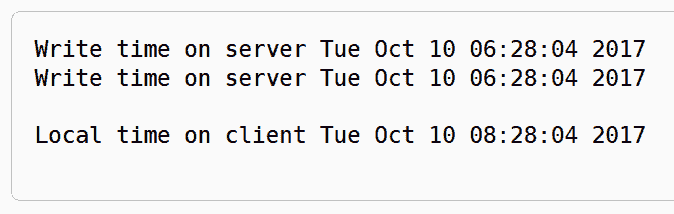

## 文件系统上的空间信息

全局函数 `std::filesystem::space` 返回一个 `std::filesystem::space_info` 对象，该对象具有三个成员：`capacity`、`free` 和 `available`。

- `capacity`：文件系统的总大小
- `free`：文件系统上的空闲空间
- `available`：非特权进程的可用空间（等于或小于 `free`）

所有大小单位均为字节。

以下程序的输出来自 `cppreference.com`。我尝试的所有路径都在同一个文件系统上；因此，我总是得到相同的答案。

```cpp
// space.cpp

...

#include <filesystem>

...

namespace fs = std::filesystem;

...

fs::space_info root = fs::space("/");

fs::space_info usr = fs::space("/usr");

std::cout << ".        Capacity       Free      Available\n"
          << "/    " << root.capacity << "   "
          << root.free << "   " << root.available << "\n"
          << "usr  " << usr.capacity << "   "
          << usr.free << "   " << usr.available;
```


空间信息

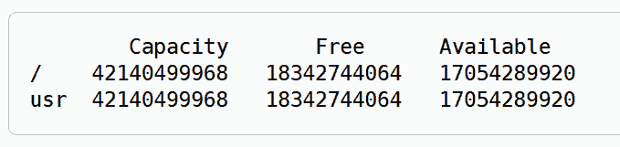

## 文件类型

通过使用以下谓词，你可以轻松查询文件类型。

文件系统的文件类型

| 文件类型 | 说明 |
| --- | --- |
| `is_block_file` | 检查路径是否指向块设备。 |
| `is_character_file` | 检查路径是否指向字符设备。 |
| `is_directory` | 检查路径是否指向目录。 |
| `is_empty` | 检查路径是否指向空文件或目录。 |
| `is_fifo` | 检查路径是否指向[命名管道](https://en.wikipedia.org/wiki/Named_pipe)。 |
| `is_other` | 检查路径是否指向另一个文件。 |
| `is_regular_file` | 检查路径是否指向普通文件。 |
| `is_socket` | 检查路径是否指向 IPC 套接字。 |
| `is_symlink` | 检查路径是否指向符号链接。 |
| `status_known` | 检查文件状态是否已知。 |

## 获取文件类型

谓词提供了文件类型的信息。对于一个文件，可能多个谓词是正确的。在下一个示例中，引用普通文件的符号链接既是普通文件也是符号链接。

```cpp
// fileType.cpp 

...

#include <filesystem>

...

namespace fs = std::filesystem;

void printStatus(const fs::path& path_){

  std::cout << path_;

  if(!fs::exists(path_)) std::cout << " does not exist";

  else{

    if(fs::is_block_file(path_)) std::cout << " is a block file\n";

    if(fs::is_character_file(path_)) std::cout << " is a character device\n"; 

    if(fs::is_directory(path_)) std::cout << " is a directory\n"; 

    if(fs::is_fifo(path_)) std::cout << " is a named pipe\n";

    if(fs::is_regular_file(path_)) std::cout << " is a regular file\n";

    if(fs::is_socket(path_)) std::cout << " is a socket\n";

    if(fs::is_symlink(path_)) std::cout << "          is a symlink\n";

  }

}

...

fs::create_directory("rainer");

printStatus("rainer");

std::ofstream("rainer/regularFile.txt");

printStatus("rainer/regularFile.txt");

fs::create_directory("rainer/directory");

printStatus("rainer/directory");

mkfifo("rainer/namedPipe", 0644);

printStatus("rainer/namedPipe");

struct sockaddr_un addr;

printStatus("rainer/namedPipe"); // 注意：原文此处有拼写错误，保持逻辑
```

```cpp
// threadCreate.cpp 

...

#include <thread>

...

using namespace std;

void helloFunction(){

  cout << "function" << endl;

}

class HelloFunctionObject {

public:

  void operator()() const {

    cout << "function object" << endl;

  }

};

thread t1(helloFunction);                      // 函数

HelloFunctionObject helloFunctionObject;

thread t2(helloFunctionObject);                // 函数对象

thread t3([]{ cout << "lambda function"; });   // lambda 函数
```

# 线程创建

## 生命周期

线程的创建者必须 care 其创建线程的生命周期。被创建线程的可执行单元在可调用对象结束时结束。创建者要么等待被创建的线程 `t` 完成（`t.join()`），要么从被创建的线程分离：`t.detach()`。如果没有对线程 `t` 执行过 `t.join()` 或 `t.detach()` 操作，则线程 `t` 是可连接的（`joinable`）。一个可连接的线程会在析构函数中抛出异常 `std::terminate`，程序随之终止。

```cpp
// threadLifetime.cpp 

...

#include <thread>

...

thread t1(helloFunction);                    // 函数

HelloFunctionObject helloFunctionObject;

thread t2(helloFunctionObject);              // 函数对象

thread t3([]{ cout << "lambda function"; }); // lambda 函数

t1.join();

t2.join();

t3.join();
```

线程的生命周期

与其创建者分离的线程通常被称为守护线程，因为它在后台运行。

### 参数

`std::thread` 是一个变变模板。这特别意味着它能够通过拷贝或引用获取任意数量的参数。可以是可调用对象或线程获取这些参数。线程将它们委托给可调用对象：`tPerCopy2` 和 `tPerReference2`。

```cpp
#include <thread>

...

using namespace std;

void printStringCopy(string s){ cout << s; }

void printStringRef(const string& s){ cout << s; }

string s{"C++"};

thread tPerCopy([=]{ cout << s; });           // C++

thread tPerCopy2(printStringCopy, s);         // C++

tPerCopy.join();

tPerCopy2.join();

thread tPerReference([&]{ cout << s; });       // C++

thread tPerReference2(printStringRef, s);      // C++

tPerReference.join();

tPerReference2.join();
```

前两个线程通过拷贝获取其参数 `s`，后两个通过引用获取。

### 操作

你可以对线程 `t` 执行许多操作。

### 对 `std::thread` 的操作

| 方法 | 说明 |
| --- | --- |
| `t.join()` | 等待线程 `t` 完成其可执行单元。 |
| `t.detach()` | 独立于创建者执行被创建的线程 `t`。 |
| `t.joinable()` | 检查线程 `t` 是否支持 `join` 或 `detach` 调用。 |
| `t.get_id()` 和 `std::this_thread::get_id()` | 返回线程的标识。 |
| `std::thread::hardware_concurrency()` | 表示可以并行运行的线程数。 |
| `std::this_thread::sleep_until(absTime)` | 使线程 `t` 休眠直到时间 `absTime`。 |
| `std::this_thread::sleep_for(relTime)` | 使线程 `t` 休眠 `relTime` 持续时间。 |
| `std::this_thread::yield()` | 允许系统运行另一个线程。 |
| `t.swap(t2)` 和 `std::swap(t1, t2)` | 交换线程。 |

你只能对线程 `t` 调用一次 `t.join()` 或 `t.detach()`。如果你尝试多次调用这些方法，将得到异常 `std::system_error`。`std::thread::hardware_concurrency` 返回核心数，如果运行时无法确定数量则返回 0。`sleep_until` 和 `sleep_for` 操作需要一个 `time point`（时间点）或 `time duration`（时间段）作为参数。

线程不能拷贝，但可以移动。交换操作在可能时执行移动。

```cpp
// threadMethods.cpp 

...

#include <thread>

...

using std::this_thread::get_id;

std::thread::hardware_concurrency();      // 4

std::thread t1([]{ get_id(); });            // 139783038650112

std::thread t2([]{ get_id(); });            // 139783030257408

t1.get_id();                                // 139783038650112

t2.get_id();                                // 139783030257408
```

### 线程上的操作

你可以对线程 `t` 执行许多操作。

### 线程的生命

线程的创建者必须 care 其创建线程的生命周期。被创建线程的可执行单元在可调用对象结束时结束。创建者要么等待被创建的线程 `t` 完成（`t.join()`），要么从被创建的线程分离：`t.detach()`。如果没有对线程 `t` 执行过 `t.join()` 或 `t.detach()` 操作，则线程 `t` 是可连接的（`joinable`）。一个可连接的线程会在析构函数中抛出异常 `std::terminate`，程序随之终止。

与其创建者分离的线程通常被称为守护线程，因为它在后台运行。

### 参数

`std::thread` 是一个变变模板。这特别意味着它能够通过拷贝或引用获取任意数量的参数。可以是可调用对象或线程获取这些参数。线程将它们委托给可调用对象：`tPerCopy2` 和 `tPerReference2`。

### 操作

你可以对线程 `t` 执行许多操作。

### 对 `std::thread` 的操作

| 方法 | 说明 |
| --- | --- |
| `t.join()` | 等待线程 `t` 完成其可执行单元。 |
| `t.detach()` | 独立于创建者执行被创建的线程 `t`。 |
| `t.joinable()` | 检查线程 `t` 是否支持 `join` 或 `detach` 调用。 |
| `t.get_id()` 和 `std::this_thread::get_id()` | 返回线程的标识。 |
| `std::thread::hardware_concurrency()` | 表示可以并行运行的线程数。 |
| `std::this_thread::sleep_until(absTime)` | 使线程 `t` 休眠直到时间 `absTime`。 |
| `std::this_thread::sleep_for(relTime)` | 使线程 `t` 休眠 `relTime` 持续时间。 |
| `std::this_thread::yield()` | 允许系统运行另一个线程。 |
| `t.swap(t2)` 和 `std::swap(t1, t2)` | 交换线程。 |

你只能对线程 `t` 调用一次 `t.join()` 或 `t.detach()`。如果你尝试多次调用这些方法，将得到异常 `std::system_error`。`std::thread::hardware_concurrency` 返回核心数，如果运行时无法确定数量则返回 0。`sleep_until` 和 `sleep_for` 操作需要一个 `time point` 或 `time duration` 作为参数。线程不能拷贝，但可以移动。交换操作在可能时执行移动。

### 终止可连接的 `std::thread`

线程的创建者必须 care 其创建线程的生命周期。被创建线程的可执行单元在可调用对象结束时结束。创建者要么等待被创建的线程 `t` 完成（`t.join()`），要么从被创建的线程分离：`t.detach()`。如果没有对线程 `t` 执行过 `t.join()` 或 `t.detach()` 操作，则线程 `t` 是可连接的。一个可连接的线程会在析构函数中抛出异常 `std::terminate`，程序随之终止。

与其创建者分离的线程通常被称为守护线程，因为它在后台运行。

### 参数

`std::thread` 是一个变变模板。这特别意味着它能够通过拷贝或引用获取任意数量的参数。可以是可调用对象或线程获取这些参数。线程将它们委托给可调用对象：`tPerCopy2` 和 `tPerReference2`。

### 操作

你可以对线程 `t` 执行许多操作。

### 对 `std::thread` 的操作

| 方法 | 说明 |
| --- | --- |
| `t.join()` | 等待线程 `t` 完成其可执行单元。 |
| `t.detach()` | 独立于创建者执行被创建的线程 `t`。 |
| `t.joinable()` | 检查线程 `t` 是否支持 `join` 或 `detach` 调用。 |
| `t.get_id()` 和 `std::this_thread::get_id()` | 返回线程的标识。 |
| `std::thread::hardware_concurrency()` | 表示可以并行运行的线程数。 |
| `std::this_thread::sleep_until(absTime)` | 使线程 `t` 休眠直到时间 `absTime`。 |
| `std::this_thread::sleep_for(relTime)` | 使线程 `t` 休眠 `relTime` 持续时间。 |
| `std::this_thread::yield()` | 允许系统运行另一个线程。 |
| `t.swap(t2)` 和 `std::swap(t1, t2)` | 交换线程。 |

你只能对线程 `t` 调用一次 `t.join()` 或 `t.detach()`。如果你尝试多次调用这些方法，将得到异常 `std::system_error`。`std::thread::hardware_concurrency` 返回核心数，如果运行时无法确定数量则返回 0。`sleep_until` 和 `sleep_for` 操作需要一个 `time point` 或 `time duration` 作为参数。线程不能拷贝，但可以移动。交换操作在可能时执行移动。

### 令牌 (Stop Token)

`std::thread` 的额外功能基于 `stop_token`、`stop_callback` 和 `stop_source`。以下程序可以给你提供思路。

```cpp
// interruptJthread.cpp

...

#include <thread>

#include <stop_token

using namespace std::literals;

...

std::jthread nonInterruptable([]{ // (1)

    int counter{0};

    while (counter < 10){

        std::this_thread::sleep_for(0.2s);

        std::cerr << "nonInterruptable: " << counter << std::endl; 

        ++counter;

    }

});

std::jthread interruptable([](std::stop_token stoken){ // (2)

    int counter{0};

    while (counter < 10){

        std::this_thread::sleep_for(0.2s);

        if (stoken.stop_requested()) return;            // (3)

        std::cerr << "interruptable: " << counter << std::endl; 

        ++counter;

    }

});

std::this_thread::sleep_for(1s);

std::cerr << "Main thread interrupts both jthreads" << std:: endl;

nonInterruptable.request_stop();                        // (4)

interruptable.request_stop();
```


### 中断不可中断和可中断的 `std::jthread`

主程序中启动了线程 `nonInterruptable` 和 `interruptable`（(1) 和 (2)）。与线程 `nonInterruptable` 不同，`interruptable` 获取了一个 `std::stop_token` 并在 (3) 使用它检查是否被中断：`stoken.stop_requested()`。在中断情况下，lambda 函数返回，因此线程结束。调用 `interruptable.request_stop()`（4）触发了线程的结束。这对于之前的调用 `nonInterruptable.request_stop()` 并不成立。

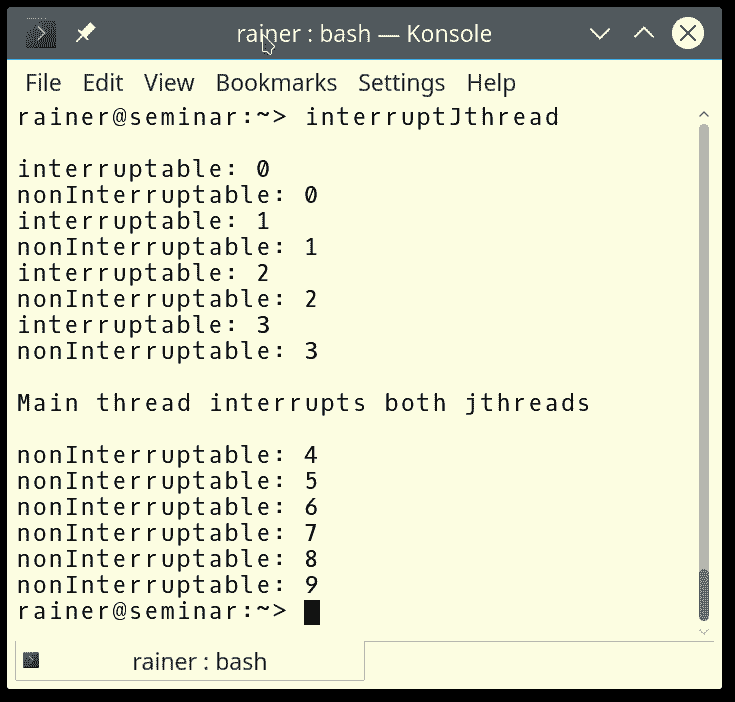

### `std::stop_token`、`std::stop_source` 和 `std::stop_callback`

`stop_token`、`stop_callback` 或 `stop_source` 允许异步请求执行停止或询问执行是否获取停止信号。停止请求由 `std::stop_source` 发送。该信号影响所有关联的 `std::stop_token`。这三个类 `std::stop_source`、`std::stop_token` 和 `std::stop_callback` 共享关联的停止状态。`request_stop()`、`stop_requested()` 和 `stop_possible()` 调用是原子操作。

`std::stop_source` 和 `std::stop_token` 组件为停止处理提供了以下属性。

```cpp
stop_source();

explicit stop_source(std::nostopstate_t) noexcept;
```

### `std::stop_source` 的构造函数

默认构造函数 `std::stop_source` 会获取一个停止源（stop-source）。接受 `std::nostopstate_t` 的构造函数会创建一个没有关联停止状态的空 `std::stop_source`。

### `std::stop_source src` 的成员函数

| 成员函数 | 描述 |
| --- | --- |
| `src.get_token()` | 如果 `stop_possible()`，则返回关联 stop-state 的 `stop_token`。否则，返回一个默认构造的（空的）`stop_token`。 |
| `src.stop_possible()` | 如果 `src` 可以停止，则返回 `true`。 |
| `src.stop_requested()` | 如果 `stop_possible()` 且其中一个所有者调用了 `request_stop()`，则返回 `true`。 |
| `src.request_stop()` | 如果 `stop_possible()` 且 `!stop_requested()`，则调用停止请求。否则，该调用没有效果。 |

`src.stop_possible()` 意味着 `src` 有关联的 stop-state。`src.stop_requested()` 在 `src` 有关联的 stop-state 且之前被请求停止时返回 `true`。如果 `src` 有关联的 stop-state 且之前未被请求停止，则 `src.request_stop()` 执行成功并返回 `true`。

调用 `src.get_token()` 返回停止令牌 `stoken`。得益于 `stoken`，你可以检查其关联的停止源 `src` 是否已或可以发出停止请求。停止令牌 `stoken` 观察停止源 `src`。

### `std::stop_token stoken` 的成员函数

| 成员函数 | 描述 |
| --- | --- |
| `stoken.stop_possible()` | 如果 `stoken` 有关联的 stop-state，则返回 `true`。 |
| `stoken.stop_requested()` | 如果在关联的 `std::stop_source src` 上调用了 `request_stop()`，则返回 `true`，否则返回 `false`。 |

默认构造的停止令牌没有关联的 stop-state。`stoken.stop_possible` 在停止请求已经发出时也会返回 `true`。`stoken.stop_requested()` 在停止令牌有关联的 stop-state 且已经收到停止请求时返回 `true`。

如果应该临时禁用 `std::stop_token`，你可以用一个默认构造的令牌来替换它。默认构造的令牌没有关联的 stop-state。下面的代码段显示了如何禁用和启用线程接受停止请求的能力。

```cpp
std::jthread jthr([](std::stop_token stoken) {

    ...

    std::stop_token interruptDisabled;

    std::swap(stoken, interruptDisabled);  // (1)

    ...                                    // (2)

    std::swap(stoken, interruptDisabled);

    ...

}
```

### 临时禁用停止令牌

`std::stop_token interruptDisabled` 没有关联的 stop-state。这意味着线程 `jthr` 在行 (1) 和 (2) 以外的所有行中都可以接受停止请求。

## 共享变量

如果多个线程共享一个变量，你必须协调访问。这是 C++ 中互斥锁（mutex）和锁（lock）的工作。

### 数据竞态

数据竞态（data race）是指至少两个线程同时访问共享数据，且至少一个线程是写入者的状态。因此，程序具有未定义行为。

如果几个线程写入 `std::cout`，你可以非常清楚地观察到线程的交替执行。在这种情况下，输出流 `std::cout` 就是共享变量。

```cpp
// withoutMutex.cpp

...

#include <thread>

...

using namespace std;

struct Worker{

  Worker(string n):name(n){};

  void operator() (){

    for (int i= 1; i <= 3; ++i){

      this_thread::sleep_for(chrono::milliseconds(200));

      cout << name << ": " << "Work " << i << endl;

    }

  }

private:

  string name;

};

thread herb= thread(Worker("Herb"));

thread andrei= thread(Worker(" Andrei"));

thread scott= thread(Worker ("    Scott"));

thread bjarne= thread(Worker("      Bjarne"));
```

对 `std::cout` 的非同步写入。

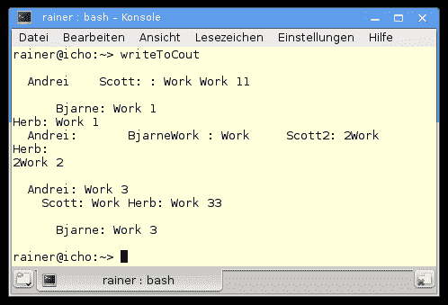

`std::cout` 上的输出没有经过协调。示例中的 `std::cout` 是共享变量，它应该拥有流的独占访问权。

### 互斥锁

互斥锁（mutex）`m` 保证一次只有一个线程可以访问临界区域。它们需要头文件 `<mutex>`。互斥锁 `m` 通过调用 `m.lock()` 锁定临界区，通过调用 `m.unlock()` 解锁它。

```cpp
// mutex.cpp

...

#include <mutex>

#include <thread>

...

using namespace std;

std::mutex m;

struct Worker{

  Worker(string n):name(n){};

  void operator() (){

    for (int i= 1; i <= 3; ++i){

      this_thread::sleep_for(chrono::milliseconds(200));

      m.lock();

      cout << name << ": " << "Work " << i << endl;

      m.unlock();

    }

  }

private:

  string name;

};

thread herb= thread(Worker("Herb"));

thread andrei= thread(Worker(" Andrei"));

thread scott= thread(Worker ("    Scott"));

thread bjarne= thread(Worker("      Bjarne"));
```

### 互斥锁变体

| 方法 | `mutex` | `recursive_mutex` | `timed_mutex` | `recursive_time_mutex` | `shared_time_mutex` |
| --- | --- | --- | --- | --- | --- |
| `lock` | yes | yes | yes | yes | yes |
| `unlock` | yes | yes | yes | yes | yes |
| `try_lock` | yes | yes | yes | yes | yes |
| `try_lock_for` | yes | yes | yes | yes | yes |
| `try_lock_until` | yes | yes | yes | yes | yes |

`std::shared_time_mutex` 允许它实现读写锁。需要相对 `time duration` 的 `m.try_lock_for(relTime)` 以及绝对 `time point` 的 `m.try_lock_until(absTime)`。

### 死锁

死锁是指两个或多个线程被阻塞的状态，因为每个线程都在等待资源的释放。如果你忘记调用 `m.unlock()`，你很快就会遇到死锁。例如在 `getVar()` 函数中。

```cpp
m.lock();

sharedVar= getVar();

m.unlock()
```

错误的顺序锁定两个互斥锁是导致死锁的另一个典型原因。

```cpp
// deadlock.cpp

...

#include <mutex>

#include <thread>

#include <iostream>

struct CriticalData{

  std::mutex mut;

};

void deadLock(CriticalData& a, CriticalData& b){

  a.mut.lock();

  std::cout << "get the first mutex\n";

  std::this_thread::sleep_for(std::chrono::milliseconds(1));

  b.mut.lock();

  std::cout << "get the second mutex\n";

  a.mut.unlock(), b.mut.unlock();

}

CriticalData c1;

CriticalData c2;

std::thread t1([&]{ deadLock(c1, c2); });

std::thread t2([&]{ deadLock(c2, c1); });
```

一毫秒的短窗口（`std::this_thread::sleep_for(std::chrono::milliseconds(1))`）足以以高概率产生死锁，因为每个线程都在永久等待另一个互斥锁。结果是停滞。

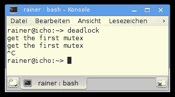

### 锁

你应该将互斥锁封装在锁中以自动释放互斥锁。锁是 RAII 范式的实现，因为锁将互斥锁的生命周期与其绑定在一起。C++11 分别拥有用于简单场景的 `std::lock_guard` 和用于高级用例的 `std::unique_lock`。两者都需要 `<mutex>`。从 C++14 C++ 有了 `std::shared_lock`，它与互斥锁 `std::shared_time_mutex` 结合使用，是读写锁的基础。

`std::lock_guard` 仅支持简单的用例。因此，它只能在构造函数中绑定互斥量并在析构函数中释放它。所以，工作示例的同步被简化为对构造函数的调用。

```cpp
// lockGuard.cpp

...

std::mutex coutMutex;

struct Worker{

  Worker(std::string n):name(n){};

  void operator() (){

    for (int i= 1; i <= 3; ++i){

      std::this_thread::sleep_for(std::chrono::milliseconds(200));

      std::lock_guard<std::mutex> myLock(coutMutex);

      std::cout << name << ": " << "Work " << i << std::endl;

    }

  }

private:

  std::string name;

};
```

### 使用 `std::lock_guard` 进行同步

### `std::unique_lock`

`std::unique_lock` 的开销比 `std::lock_guard` 更高。相反，`std::unique_lock` 可以在没有互斥量的情况下创建，可以显式地锁定或释放其互斥量，也可以延迟对其互斥量的锁定。

下表显示了 `std::unique_lock lk` 的方法。

`std::unique_lock` 的接口：

| 方法 | 描述 |
| --- | --- |
| `lk.lock()` | 锁定关联的互斥量。 |
| `std::lock(lk1, lk2, ...)` | 原子地锁定任意数量的关联互斥量。 |
| `lk.try_lock()` | 尝试锁定关联的互斥量。 |
| `lk.try_lock_for(relTime)` |  |
| `lk.try_lock_until(absTime)` |  |
| `lk.release()` | 释放互斥量。互斥量仍保持锁定状态。 |
| `lk.swap(lk2)` | 交换锁。 |
| `std::swap(lk, lk2)` |  |
| `lk.mutex()` | 返回关联的互斥量的指针。 |
| `lk.owns_lock()` | 检查锁是否拥有互斥量。 |

由以不同顺序获取锁引起的死锁可以通过 `std::atomic` 轻松解决。

```cpp
// deadLockResolved. cpp

...

#include <mutex>

...

using namespace std;

struct CriticalData{

  mutex mut;

};

void deadLockResolved(CriticalData& a, CriticalData& b){

  unique_lock<mutex>guard1(a.mut, defer_lock);

  cout << this_thread::get_id() << ": get the first lock" << endl;

  this_thread::sleep_for(chrono::milliseconds(1));

  unique_lock<mutex>guard2(b.mut, defer_lock);

  cout << this_thread::get_id() << ": get the second lock" << endl;

  cout << this_thread::get_id() << ": atomic locking";

  lock(guard1, guard2);

}

CriticalData c1;

CriticalData c2;

thread t1([&]{ deadLockResolved(c1, c2); });

thread t2([&]{ deadLockResolved(c2, c1); });
```


### `std::unique_lock`

由于 `std::unique_lock` 的参数 `std::defer_lock`，`a.mut` 和 `b.mut` 的锁定被延迟了。锁定在调用 `std::lock(guard1, guard2)` 时原子地发生。

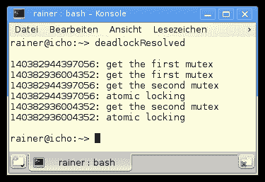

### `std::shared_lock`

`std::shared_lock` 与 `std::unique_lock` 相同的接口。此外，`std::shared_lock` 支持多个线程共享同一个已锁互斥量的情况。对于这种特殊用例，你必须结合使用 `std::shared_timed_mutex` 使用 `std::shared_lock`。然而，如果多个线程在 `std::unique_lock` 中使用同一个 `std::shared_time_mutex`，则只有一个线程可以拥有它。

```cpp
#include <mutex>

...

std::shared_timed_mutex sharedMutex;

std::unique_lock<std::shared_timed_mutex> writerLock(sharedMutex);

std::shared_lock<std::shared_time_mutex> readerLock(sharedMutex);

std::shared_lock<std::shared_time_mutex> readerLock2(sharedMutex);
```

示例展示了典型的读-写锁场景。类型为 `std::unique_lock<std::shared_timed_mutex>` 的 `writerLock` 只能独占 `sharedMutex`。两个类型为 `std::shared_lock<std::shared_time_mutex>` 的读锁 `readerLock` 和 `readerLock2` 可以共享同一个互斥量 `sharedMutex`。

#### 线程安全的初始化

如果你不修改数据，那么以线程安全的方式初始化它们就足够了。C++ 提供了多种实现此的方法：使用常量表达式、使用具有块作用的静态变量。

#### 常量表达式

如果你不修改数据，那么以线程安全的方式初始化它们就足够了。C++ 提供了多种实现此的方法：使用常量表达式、使用具有块作用的静态变量。

### 线程安全的初始化

如果你不修改数据，那么以线程安全的方式初始化它们就足够了。C++ 提供了多种实现此的方法：使用常量表达式、使用具有块作用的静态变量。

#### 常量表达式

如果你不修改数据，那么以线程安全的方式初始化它们就足够了。C++ 提供了多种实现此的方法：使用常量表达式、使用具有块作用的静态变量。

发送者和接收者都需要一个锁。对于发送者来说，`std::lock_guard` 就足够了，因为它只调用一次锁和解锁。对于接收者来说，`std::unique_lock` 是必要的，因为它通常会频繁对其互斥量进行锁定和解锁。

```cpp
// conditionVariable.cpp

...

#include <condition_variable>

...

std::mutex mutex_;

std::condition_variable condVar;

bool dataReady = false;

void doTheWork() {
  std::cout << "Processing shared data." << std::endl;
}

void waitingForWork() {
  std::cout << "Worker: Waiting for work." << std::endl;

  std::unique_lock<std::mutex> lck(mutex_);

  condVar.wait(lck, [] { return dataReady; });

  doTheWork();

  std::cout << "Work done." << std::endl;
}

void setDataReady() {
  std::lock_guard<std::mutex> lck(mutex_);

  dataReady = true;

  std::cout << "Sender: Data is ready." << std::endl;

  condVar.notify_one();
}

std::thread t1(waitingForWork);

std::thread t2(setDataReady);
```

# 条件变量

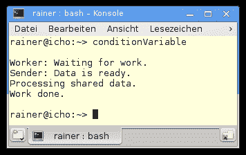

使用条件变量听起来可能很简单，但存在两个关键问题。

### 信号量

信号量是一种用于控制对共享资源并发访问的同步机制。计数信号量是一种特殊的信号量，它有一个大于零的计数器。计数器在构造函数中初始化。获取信号量会减少计数器，释放信号量会增加计数器。如果线程在计数器为零时尝试获取信号量，该线程将阻塞，直到另一个线程通过释放信号量来增加计数器。

C++20 支持 `std::binary_semaphore`，它是 `std::counting_semaphore<1>` 的别名。在这种情况下，最小最大值为 1。

```cpp
using binary_semaphore = std::counting_semaphore<1>;
```

与 `std::mutex` 不同，`std::counting_semaphore` 不绑定到特定线程。这意味着 `acquire` 和 `release` 调用可以在不同的线程上发生。下表展示了 `std::counting_semaphore` 的接口。

#### 信号量 `sem` 的方法

| 方法 | 说明 |
| --- | --- |
| `counting_semaphore::max()` | 返回 `counter` 的最大值。 |
| `sem.release(upd = 1)` | 原子性地增加 `counter` 次 `upd`。 |
| `sem.acquire()` | 执行 `sem.try_acquire` 并阻塞直到 `counter` 大于零。 |
| `sem.try_acquire()` | 原子性地减少 `counter`。 |
| `sem.try_acquire_for(relTime)` | 在持续时间范围内执行 `sem.try_acquire`。 |
| `sem.try_acquire_until(absTime)` | 直到指定的时间点执行 `sem.try_acquire`。 |

方法 `sem.try_lock_for(relTime)` 需要一个相对[时间间隔]；方法 `sem.try_lock_until(absTime)` 需要一个绝对[时间点]。

信号量通常是[条件变量]更安全、更快的替代方案：

```cpp
// threadSynchronisationSemaphore.cpp

#include <semaphore>

...

std::counting_semaphore<1> prepareSignal(0); // (1)

void prepareWork() {
  myVec.insert(myVec.end(), {0, 1, 0, 3});

  std::cout << "Sender: Data prepared." << '\n';

  prepareSignal.release(); // (2)
}

void completeWork() {
  std::cout << "Waiter: Waiting for data." << '\n';

  prepareSignal.acquire(); // (3)

  myVec[2] = 2;

  std::cout << "Waiter: Complete the work." << '\n';

  for (auto i : myVec) {
    std::cout << i << " ";
  }

  std::cout << '\n';
}

...

std::thread t1(prepareWork);

std::thread t2(completeWork);

t1.join();

t2.join();
```

### `std::counting_semaphore`

`std::counting_semaphore prepareSignal`（第 1 行）可以取值为 0 和 1。在具体的示例中，它被初始化为 0。这意味着调用 `prepareSignal.release()` 将值设置为 1（第 2 行），并解除调用 `prepareSignal.acquire()`（第 3 行）。

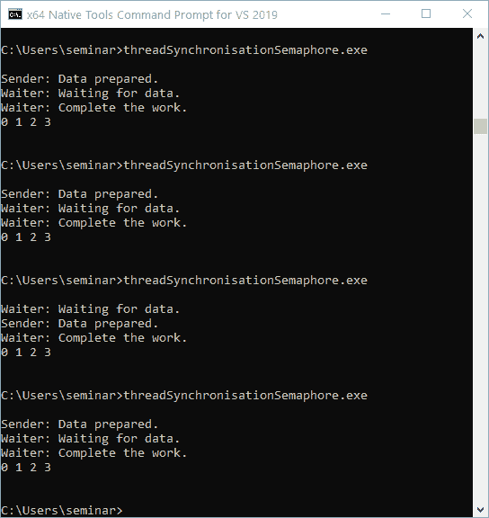

### 协调类型

倒计时（Latches）和屏障（Barrier）是允许某些线程阻塞直到计数器变为零的协调类型。在 C++20 中，我们有两个版本的倒计时和屏障：`std::latch` 和 `std::barrier`。

#### `std::latch`

现在，我仔细查看 `std::latch` 的接口。

`std::latch` 的成员函数。

| 成员函数 | 说明 |
| --- | --- |
| `count_wait()` | 减少计数器并阻塞直到计数器达到零。 |
| `wait()` | 阻塞直到计数器达到零。 |
| `arrive()` | 原子性地将计数器减一。 |
| `arrive_and_wait()` | 原子性地减少计数器并阻塞直到计数器达到零。 |
| `count_down(n)` | 原子性地减少计数器 `n` 次。 |
| `count_down_and_wait(n)` | 原子性地减少计数器 `n` 次并阻塞直到计数器达到零。 |

```cpp
// bossWorkers.cpp

#include <latch>
#include <iostream>
#include <thread>
#include <vector>

class Worker {
 public:
  Worker(std::string n) : name(n) {}

  void operator() {
    std::cout << name << ": working..." << std::endl;

    lat.arrive_and_wait(); // 3

    std::cout << name << ": done." << std::endl;
  }

 private:
  std::string name;

  static std::latch& lat();
};

std::latch& Worker::lat() {
  static std::latch l(2); // 5

  return l;
}

int main() {
  std::cout << "BOSS: starting" << std::endl;

  std::thread t1(Worker("Herb")); // 1
  std::thread t2(Worker("Scott")); // 2

  // ... lat.wait() // 4

  std::cout << "BOSS: GO HOME!" << std::endl;

  t1.join();
  t2.join();

  return 0;
}
```

| `std::barrier::max` | 实现支持的最大值。 |

`bar.arrive_and_drop()` 调用本质上意味着计数器在下一个阶段将减一。

### 任务（Tasks）

除了线程之外，C++ 还有任务用于异步执行工作。任务需要 `<future>` 头文件。任务通过一个工作包进行参数化，并由两个关联组件组成：一个 `promise` 和一个 `future`。两者通过一个数据通道连接。`promise` 执行工作包并将结果放入数据通道；关联的 `future` 则获取结果。两个通信端点都可以在独立的线程中运行。特殊之处在于，`future` 可以在稍后获取结果。因此，`promise` 对结果的计算与关联的 `future` 对结果的查询是独立的。

#### 线程与任务

线程与任务非常不同。

在创建线程和被创建线程之间的通信中，必须使用共享变量。任务通过其数据通道进行通信，该通道是隐式保护的。因此，任务不能使用像 `mutex` 这样的保护机制。

创建线程通过 `join` 调用等待其子线程。`future fut` 使用 `fut.get()` 调用，如果没有结果，该调用将阻塞阻塞。

如果在被创建线程中发生异常，被创建线程将终止，从而导致创建线程和整个进程的终止。相反，`promise` 可以将异常发送给 `future`，由 `future` 必须处理该异常。

`promise` 可以为一个或多个 `future` 服务。它可以发送值、异常或仅发送通知。你可以将任务作为条件变量的安全替代品。

```cpp
#include <future>
#include <thread>

...

int res;

std::thread t([&] { res = 2000 + 11; });

t.join();

std::cout << res << std::endl; // 2011

auto fut = std::async([] { return 2000 + 11; });

std::cout << fut.get() << std::endl; // 2011
```

子线程 `t` 和异步函数调用 `std::async` 计算 `2000` 和 `11` 之和。创建线程通过共享变量 `res` 从其子线程 `t` 获取结果。`std::async` 调用在发送者（promise）和接收者（future）之间创建数据通道。`future` 通过 `fut.get()` 向数据通道查询计算结果。`fut.get` 调用是阻塞的。

#### `std::async`

`std::async` 类似于异步函数调用。该函数调用接收一个 callable 及其参数。`std::async` 是一个变变模板，因此可以接受任意数量的参数。`std::async` 的调用返回一个 future 对象 `fut`。这是你通过 `fut.get()` 获取结果的句柄。你可以为 `std::async` 指定启动策略。你可以通过启动策略显式确定异步调用是在相同线程中执行（`std::launch::deferred`）还是在另一个线程中执行（`std::launch::async`）。

调用 `auto fut = std::async(std::launch::deferred, ...)` 的特殊之处在于 `promise` 不立即执行。`fut.get()` 调用延迟启动 `promise`。

```cpp
// asyncLazyEager.cpp

...

#include <future>

...

using std::chrono::duration;
using std::chrono::system_clock;
using std::launch;

auto begin = system_clock::now();

auto asyncLazy =
    std::async(launch::deferred, [] { return system_clock::now(); });

auto asyncEager =
    std::async(launch::async, [] { return system_clock::now(); });

std::this_thread::sleep_for(std::chrono::seconds(1));
```


```cpp
auto lazyStart = asyncLazy.get() - begin;

auto eagerStart = asyncEager.get() - begin;

auto lazyDuration = duration<double>(lazyStart).count();

auto eagerDuration = duration<double>(eagerStart).count();

std::cout << lazyDuration << " sec";  // 1.00018 sec.

std::cout << eagerDuration << " sec";  // 0.00015489 sec.
```

## 使用 `std::async` 的延迟与急切

程序的输出显示，与 `future` `asyncLazy` 关联的 `promise` 的执行比与 `future` `asyncEager` 关联的 `promise` 晚了一秒。这一秒正是创建者在 `future` `asyncLazy` 请求其结果之前睡眠的时间。

### `std::packaged_task`

`std::packaged_task` 允许你为可调用对象构建一个简单的封装器，之后可以在单独线程上执行。

因此，需要四个步骤：

1. 封装你的工作：

   ```cpp
   std::packaged_task<int(int, int)> sumTask(
       [](int a, int b) { return a + b; }
   );
   ```

2. 创建一个 `future`：

   ```cpp
   std::future<int> sumResult = sumTask.get_future();
   ```

3. 执行计算：

   ```cpp
   sumTask(2000, 11);
   ```

4. 查询结果：

   ```cpp
   sumResult.get();
   ```

你可以在单独线程中移动 `std::packaged_task` 或 `std::future`。

```cpp
// packaged_task.cpp

#include <future>
#include <thread>
#include <deque>
#include <iostream>

using namespace std;

struct SumUp {
    int operator()(int beg, int end) {
        sum += end;
        return sum;
    }

private:
    int beg;
    int sum{0};
};

int main() {
    packaged_task<int(int, int)> sumTask(
        [](int a, int b) { return a + b; }
    );

    future<int> sumResult = sumTask.get_future();

    thread t(std::move(sumTask), 2000, 11);
    t.join();

    cout << sumResult.get() << endl;

    return 0;
}
```

```cpp
// promiseFuture.cpp

...

#include <future>

...

void product(std::promise<int>&& intPromise, int a, int b) {
    intPromise.set_value(a * b);
}

int a = 20;
int b = 10;

std::promise<int> prodPromise;
std::future<int> prodResult = prodPromise.get_future();

std::thread prodThread(product, std::move(prodPromise), a, b);

std::cout << "20*10= " << prodResult.get();  // 20*10= 200
```

### Promise 和 future

`promise` `prodPromise` 被移动到另一个线程中并执行计算。`future` 通过 `prodResult.get()` 获取结果。

## 20. 协程（Coroutines）

我们并没有在 C++20 中得到具体的协程（concrete coroutines），我们得到的是一个用于实现协程的框架。要使用具体的协程，你必须等待 C++23 或者使用 Lewis Baker 提供的 [cppcoro](https://github.com/lewissbaker/cppcoro) 库。因此，本章仅给你关于协程的大致概念。

协程是在保持其状态的同时可以挂起和恢复执行的函数。为了实现这一点，协程由三部分组成：`promise` 对象、协程句柄（coroutine handle）和协程帧（coroutine frame）。

- `promise` 对象在协程内部进行操作，并通过 `promise` 对象传递其结果。
- 协程句柄是一个非所有权的句柄，用于从外部恢复或销毁协程帧。
- 协程帧是一个内部的、通常分配在堆上的状态。它包含了前面提到的 `promise` 对象、协程的拷贝参数、挂起点的表示、生命周期在当前挂起点之前结束的局部变量，以及生命周期超过当前挂起点的局部变量。

为了优化协程的分配，需要满足两个条件：

使用 `co_return` 代替 `return`，以及使用 `co_yield` 或 `co_await` 关键字的函数将隐式成为协程。

这些新关键字通过两个新概念扩展了 C++ 函数的执行。

### `co_yield expression`

允许编写一个生成器函数（generator function）。生成器函数每次返回一个新值。生成器函数是一种可以从中选取值的数据流。该数据流可以是无限的。

```cpp
Generator<int> getNext(int start = 0, int step = 1) noexcept {
    auto value = start;

    for (int i = 0;; ++i) {
        co_yield value;
        value += step;
    }
}
```

### `co_await expression`

挂起并恢复表达式的执行。如果你在函数 `func` 中使用 `co_await expression`，如果函数的结果不可用，则调用 `auto getResult = func()` 不会阻塞。相对于消耗资源的阻塞，你获得了一种资源友好的等待。

该表达式必须是一个可等待表达式（awaitable expression），并支持以下三个函数：`await_ready`、`await_suspend` 和 `await_resume`。

```cpp
Acceptor acceptor{443};

while (true) {
    Socket socket = co_await acceptor.accept();

    auto request = co_await socket.read();

    auto response = handleRequest(request);

    co_await socket.write(response);
}
```

### 协程

在 `co_await expr` 中的可等待表达式 `expr` 必须实现 `await_ready`、`await_suspend` 和 `await_resume` 函数。

### 可等待对象（Awaitables）

C++20 标准已经定义了两个基础构建的可等待对象：`std::suspend_always` 和 `std::suspend_never`。

```cpp
struct suspend_always {
    constexpr bool await_ready() const noexcept {
        return false;
    }

    constexpr void await_suspend(coroutine_handle<>) const noexcept {}

    constexpr void await_resume() const noexcept {}
};

struct suspend_never {
    constexpr bool await_ready() const noexcept {
        return true;
    }

    constexpr void await_suspend(coroutine_handle<>) const noexcept {}

    constexpr void await_resume() const noexcept {}
};
```

### 预定义的等待对象

### 使用 `co_yield` 的无限数据流

以下程序产生了一个无限数据流。协程 `getNext` 使用 `co_yield` 创建了一个从 `start` 开始，并在请求时提供按 `step` 增加的下一个值的数据流。

```cpp
// infiniteDataStream.cpp

...

#include <coroutine>

template<typename T>
struct Generator {
    struct promise_type;

    using handle_type = std::coroutine_handle<promise_type>;

    Generator(handle_type h) : coro(h) {}  // (3)

    handle_type coro;

    ~Generator() {
        if (coro) {
            coro.destroy();
        }
    }

    Generator(const Generator&) = delete;

    Generator& operator=(const Generator&) = delete;

    Generator(Generator&& oth) noexcept : coro(oth.coro) {
        oth.coro = nullptr;
    }

    Generator& operator=(Generator&& oth) noexcept {
        coro = oth.coro;
        oth.coro = nullptr;
        return *this;
    }

    T getValue() {
        return coro.promise().current_value;
    }

    bool next() {  // (5)
        coro.resume();
        return not coro.done();
    }

    struct promise_type {
        promise_type() = default;

        auto initial_suspend() {  // (4)
            return suspend_always{};
        }

        auto final_suspend() {
            return suspend_always{};
        }

        auto get_return_object() {  // (2)
            return Generator{handle_type::from_promise(*this)};
        }

        void return_void() {
            return suspend_never{};
        }

        auto yield_value(T value) {  // (6)
            current_value = value;
            return suspend_always{};
        }

        void unhandled_exception() {
            std::exit(1);
        }

        T current_value;
    };
};

Generator<int> getNext(int start = 0, int step = 1) {
    auto value = start;

    for (int i = 0;; ++i) {
        co_yield value;
        value += step;
    }
}

int main() {
    std::cout << std::endl;
    std::cout << "getNext():";

    auto gen = getNext();

    for (int i = 0; i <= 10; ++i) {
        gen.next();
        std::cout << " " << gen.getValue();  // (7)
    }

    std::cout << std::endl;
}
```


### 无限数据流

`main` 程序创建了协程。协程 `gen`（7）返回从 0 到 10 的值。


### 无限数据流

`infiniteDataStream.cpp` 中的数字代表工作流的步骤。

1. 创建 promise
2. 调用 `get_return_object()` 并将结果保存在局部变量中
3. 创建生成器
4. 调用 `initial_suspend()`。生成器是懒性的，因此会总是挂起。
5. 请求下一个值，如果生成器被消耗了则返回
6. 由 `co_yield` 调用触发。之后下一个值变为可用。
7. 获取下一个值

在后续迭代中，只执行步骤 5 和 6。

## 索引（Index）

大写字母代表节和子节。

| **A** | `assign (vector)`, `clear`, `emplace`, `emplace_back`, `erase`, `insert`, `pop_back`, `push_back` |
| :--- | :--- |
| `abs` | Assign and swap |
| absolute path | Associative Containers |
| `absolute` | `async` |
| `absolute`, `canonical`, `weakly_canonical`, `relative`, `copy`, `proximate`, `copy_file`, `copy_symlink`, `create_directory`, `create_directories`, `create_hard_link`, `create_symlink`, `current_path`, `exists`, `equivalent`, `file_size`, `hard_link_count`, `last_write_time`, `permissions`, `read_symlink`, `remove`, `remove_all`, `rename`, `resize_file`, `space`, `status`, `symlink_status`, `temp_directory_path` | |
| `accumulate`, `adjacent_difference`, `partial_sum`, `inner_product`, `iota` | `at (string)` (`front`, `back`, `at`) |
| `aconsh` (`pow`, `sin`, `tanh`, `asinh`, `fabs`, `exp`, `cos`, `asin`, `aconsh`, `fmod`, `sqrt`, `tan`, `acos`, `atanh`, `frexp`, `log`, `sinh`, `atan`, `ceil`, `ldexp`, `log10`, `cosh`, `atan2`, `floor`, `modf`) | `atan2` (`pow`, `sin`, `tanh`, `asinh`, `fabs`, `exp`, `cos`, `asin`, `aconsh`, `fmod`, `sqrt`, `tan`, `acos`, `atanh`, `frexp`, `log`, `sinh`, `atan`, `ceil`, `ldexp`, `log10`, `cosh`, `atan2`, `floor`, `modf`) |
| `acos` (`pow`, `sin`, `tanh`, `asinh`, `fabs`, `exp`, `cos`, `asin`, `aconsh`, `fmod`, `sqrt`, `tan`, `acos`, `atanh`, `frexp`, `log`, `sinh`, `atan`, `ceil`, `ldexp`, `log10`, `cosh`, `atan2`, `floor`, `modf`) | `atan` (`pow`, `sin`, `tanh`, `asinh`, `fabs`, `exp`, `cos`, `asin`, `aconsh`, `fmod`, `sqrt`, `tan`, `acos`, `atanh`, `frexp`, `log`, `sinh`, `atan`, `ceil`, `ldexp`, `log10`, `cosh`, `atan2`, `floor`, `modf`) |
| `acquire` (`counting_semaphores`, `binary_semaphore`, `max_counting_semaphore`, `release_counting_semaphore`, `acquire`, `try_acquire`, `try_acquire_for`, `try_acquire_until`) | `atanh` (`pow`, `sin`, `tanh`, `asinh`, `fabs`, `exp`, `cos`, `asin`, `aconsh`, `fmod`, `sqrt`, `tan`, `acos`, `atanh`, `frexp`, `log`, `sinh`, `atan`, `ceil`, `ldexp`, `log10`, `cosh`, `atan2`, `floor`, `modf`) |
| `add_const` (`remove_const`, `remove_volatile`, `remove_cv`, `add_const`, `add_volatile`, `add_cv`, `make_signed`, `make_unsigned`, `remove_reference`, `add_lvalue_reference`, `add_rvalue_reference`, `remove_pointer`, `add_pointer`, `enable_if`, `conditional`, `common_type`) | `ate (ios)` (`in`, `out`, `app`, `ate`, `trunc`, `binary`) |
| `add_cv` (`remove_const`, `remove_volatile`, `remove_cv`, `add_const`, `add_volatile`, `add_cv`, `make_signed`, `make_unsigned`, `remove_reference`, `add_lvalue_reference`, `add_rvalue_reference`, `remove_pointer`, `add_pointer`, `enable_if`, `conditional`, `common_type`) | 原子数据类型 |
| `add_lvalue_reference` (`remove_const`, `remove_volatile`, `remove_cv`, `add_const`, `add_volatile`, `add_cv`, `make_signed`, `make_unsigned`, `remove_reference`, `add_lvalue_reference`, `add_rvalue_reference`, `remove_pointer`, `add_pointer`, `enable_if`, `conditional`, `common_type`) | `auto_ptr` |
| `add_pointer` (`remove_const`, `remove_volatile`, `remove_cv`, `add_const`, `add_volatile`, `add_cv`, `make_signed`, `make_unsigned`, `remove_reference`, `add_lvalue_reference`, `add_rvalue_reference`, `remove_pointer`, `add_pointer`, `enable_if`, `conditional`, `common_type`) | `await_ready` |
| `add_rvalue_reference` (`remove_const`, `remove_volatile`, `remove_cv`, `add_const`, `add_volatile`, `add_cv`, `make_signed`, `make_unsigned`, `remove_reference`, `add_lvalue_reference`, `add_rvalue_reference`, `remove_pointer`, `add_pointer`, `enable_if`, `conditional`, `common_type`) | `await_ready` (`co_yield`, `await_suspend`, `await_resume`) |
| `add_volatile` (`remove_const`, `remove_volatile`, `remove_cv`, `add_const`, `add_volatile`, `add_cv`, `make_signed`, `make_unsigned`, `remove_reference`, `add_lvalue_reference`, `add_rvalue_reference`, `remove_pointer`, `add_pointer`, `enable_if`, `conditional`, `common_type`) | `await_suspend` (`co_yield`, `await_ready`, `await_resume`) |
| `adjacent_difference` (`accumulate`, `partial_sum`, `inner_product`, `iota`) | 可等待对象 |
| `adjacent_find` (`find_if`, `find_if_not`, `first_of`) | **B** |
| 算法（标准库） | `back (queue)` (`push`, `pop`, `back`, `front`) |
| `all_of`, `any_of`, `none_of` | `back (span)` (`front`, `back`, `data`, `size`, `size_bytes`, `empty`, `first`, `last`, `subspan`) |
| `all_views` (`ref_views`, `filter_views`, `transform_views`, `take_views`, `take_while_views`, `drop_views`, `drop_while_views`, `join_views`, `split_views`, `common_views`, `reverse_views`, `basic_istream_view`, `istream_view`, `elements_views`, `keys_views`, `values_view`) | `back (string)` (`front`, `back`, `at`) |
| 带有 `co_yield` 的无限数据流 | `back_inserter (insert iterator)` (`front_inserter`, `back_inserter`, `inserter`) |
| `any` | `bad`（流状态、`goodbit`, `ofbit`, `failbit`, `badbit`, `good`, `fail`, `bad`） |
| `any_cast` (`emplace`, `reset`, `has_value`, `type`, `any_cast`, `make_any`, `bad_any_cast`) | `bad_any_cast` (`emplace`, `reset`, `has_value`, `type`, `any_cast`, `make_any`, `bad_any_cast`) |
| `bad_optional_access` (`has_value`, `value`, `value_or`, `reset`, `emplace`, `make_optional`) | `bad_variante_access (variant)` (`index`, `value_by_exception`, `emplace`, `holds_alternative`, `bad_variante_access`, `get`, `get_if`) |
| `app (ios)` (`in`, `out`, `app`, `ate`, `trunc`, `binary`) | |
| `append (string)` | `badbit (ios)` |
| `Arguments (thread)` | `barrier` |
| `Arrays` | `basic_ios<>` |
| `arrive` | `basic_iostream<>` |
| `arrive_and_drop` | `basic_istream<>` |
| `arrive_and_wait (barrier)` | `basic_istream_view` |
| `arrive_and_wait (latch)` | `basic_ostream<>` |
| `asin` | `basic_streambuf` |
| `asinh` | `before_begin (forward_list)` |
| `assign (string)` | `beg (ios)` |
| `begin (container)` | `begin (container)` |
| `begin (unordered)` | `cmp_not_equal` |
| `bit_and` | `co_await` |
| `binary (ios)` | `co_yield` |
| `binary_search` | `conditional` |
| `binary_semaphore` | `Compare (container)` |
| `bind` | `complexity` |
| `bind_front` | Condition Variables |
| `bit_or` | Constant Expressions |
| `bit_xor` | `contains (关联型容器)` |
| `boolalpha` | C++ 与 C 字符串之间的转换 |
| `C` | 协调类型 |
| `c_str (string)` | `copy (algorithms)` |
| `calendar` | `copy (filesystem)` |
| `call_once` | `copy (string)` |
| `callable unit` | 拷贝构造函数（container） |
| `Callable Units` | `copy_backward` |
| `callable` | `copy_file` |
| `canonical path` | `copy_if` |
| `canonical` | `copy_n` |
| `capacity (vector)` | `copy_options` |
| `cbegin (container)` | `copy_symlink` |
| `cbegin (unordered associative container)` | 协程（Coroutines） |
| `ceil` | `cos` |
| `cend (container)` | `cosh` |
| `cend (unordered associative container)` | `count (algorithms)` |
| `cerr` | `count (排序关联型容器)` |
| `cerr` | `count_down` |

### 文件系统类

- `filesystem_error`
- `directory_entry`
- `directory_iterator`
- `recursive_directory_iterator`
- `file_status`
- `space_info`
- `file_type`
- `perms`
- `perm_options`
- `copy_options`
- `directory_options`
- `file_time_type`

### 算法

- `count_if`

### 字符串操作

- `assign`
- `swap`
- `pop_back`
- `erase`
- `clear`
- `append`
- `push_back`
- `insert`
- `replace`

### 计数信号量

- `binary_semaphore`
- `counting_semaphore`
- `release`
- `acquire`
- `try_acquire`
- `try_acquire_for`
- `try_acquire_until`

### 向量操作

- `assign`
- `clear`
- `emplace`
- `emplace_back`
- `erase`
- `insert`
- `pop_back`
- `push_back`

### 标准输入输出

- `cin`
- `cout`
- `cerr`
- `clog`
- `stdin`
- `stdout`
- `stderr`
- `wcin`
- `wcout`
- `wcerr`
- `wclog`

### 流状态

- `clear`
- `rdstate`
- `setstate`

### 容器迭代器

- `begin`
- `end`
- `cbegin`
- `cend`
- `rbegin`
- `rend`
- `crbegin`
- `crend`

### 时钟

- `clock`

### 有序关联容器迭代器

- `rbegin`
- `rend`
- `crbegin`
- `crend`

### 时钟转换

- `clock_cast`

### 字符串创建与删除

- `Create`
- `Delete`

### 通用创建与删除

- `Create`
- `Delete`

### 流操作

- `open`
- `close`
- `is_open`

### 字符串视图初始化

- `Create`
- `Initialise`

### 比较函数

- `cmp_equal`
- `cmp_not_equal`
- `cmp_less`
- `cmp_greater`
- `cmp_less_equal`
- `cmp_greater_equal`

### 文件系统函数

- `absolute`
- `canonical`
- `weakly_canonical`
- `relative`
- `copy`
- `proximate`
- `copy_file`
- `copy_symlink`
- `create_directory`
- `create_directories`
- `create_hard_link`
- `create_symlink`
- `current_path`
- `exists`
- `equivalent`
- `file_size`
- `hard_link_count`
- `last_write_time`
- `permissions`
- `read_symlink`
- `remove`
- `remove_all`
- `rename`
- `resize_file`
- `space`
- `status`
- `symlink_status`
- `temp_directory_path`

### 引用

- `cref`

| `current_path` | `end (无序关联容器)` |
| :--- | :--- |
| `current_zone` | `endl` |
| Cyclic References | `ends_with (string)` |
| **D** | `eof` |
| `data (span)` | `eofbit (ios)` |
| `data (string)` | `equal` |
| Data Race | `equal_range (algorithms)` |
| `day (calendar)` | `equal_range (sorted associative container)` |
| `deadlock` | `equal_to` |
| `dec` | `equivalent` |
| default constructor (container) | `erase (associative container)` |
| `default_random_engine` | `erase (std)` |
| `defaultfloat` | `erase (string)` |
| `Dequ` | `erase (vector)` |
| `detach` | erase-remove idiom |
| Direct on the Containers (ranges) | `erase_after (forward_list)` |
| `directory` | `erase_if (std)` |
| `directory_entry` | `exclusive_scan` |
| `directory_iterator` | `exists` |
| `directory_options` | `exp` |
| `div` | `expired (weak_ptr)` |
| `divides` | **F** |
| `drop_views` | `fabs` |
| `drop_while_views` | `fail` |
| `E` | `failbit (ios)` |
| `e_v` | FIFO |
| `egamma_v` | 文件流（File Streams） |
| `elements_views` | 文件类型（File Types） |
| `emplace (any)` | `file` |
| `emplace (associative container)` | `file_size` |
| `emplace (optional)` | `file_status` |
| `emplace (variant)` | `file_time_type` |
| `emplace (vector)` | `file_type` |

| `forward_list` | `filebuf` |
| :--- | :--- |
| `emplace_after`, `emplace_front`, `erase_after`, `insert_after`, `merge`, `splice_after`, `unique` | `ifstream`, `ofstream`, `wfstream`, `fstream`, `filebuf` |
| `vector` | `filesystem_error` |
| `emplace_back`, `assign`, `clear`, `emplace`, `emplace_back`, `erase`, `insert`, `pop_back`, `push_back` | `path`, `directory_entry`, `directory_iterator`, `recursive_directory_iterator`, `file_status`, `space_info`, `file_type`, `perms`, `perm_options`, `copy_options`, `directory_options`, `file_time_type` |
| `before_begin`, `emplace_after`, `emplace_front`, `erase_after`, `insert_after`, `merge`, `splice_after`, `unique` | `fill`, `fill_n`, `generate`, `generate_n` |
| `empty` | `fill_n` |
| `container` | `generate` |
| `all_views`, `ref_views`, `filter_views`, `transform_views`, `take_views`, `take_while_views`, `drop_views`, `drop_while_views`, `join_views`, `split_views`, `common_views`, `reverse_views`, `basic_istream_view`, `istream_view`, `elements_views`, `keys_views`, `values_view` | `generate` |
| `algorithms`: `find`, `find_if`, `find_if_not`, `find_first_of`, `adjacent_find` | `generate_n` |
| `sorted associative container`: `count`, `find`, `lower_bound`, `upper_bound`, `equal_range` | `unformatted input and output streams`: `get`, `getline`, `gcount`, `ignore`, `peek`, `unget`, `putback` |
| `string`: `find`, `rfind`, `find_first_of`, `find_last_of`, `find_first_not_of`, `find_last_not_of` | `shared_ptr`: `get`, `get_deleter`, `reset`, `release`, `swap`, `unique`, `use_count` |
| `string`: `find_first_not_of`, `find_first_of`, `find_last_not_of` | `std`: `valid`, `wait_for`, `wait_until` |
| `algorithm`: `find_first_of`, `find_if_` | `unique_ptr`: `get`, `get_deleter`, `release`, `swap` |
| `string`: `find_first_of`, `find_last_of`, `find_last_not_of` | `variant`: `index`, `value_by_exception`, `emplace`, `holds_alternative`, `bad_variante_access`, `get`, `get_if` |
| `algorithms`: `find_if`, `find_if_not`, `find_first_of`, `adjacent_find` | `shared_ptr`: `get`, `get_deleter`, `reset`, `release`, `swap`, `unique`, `use_count` |
| `algorithms`: `find_if`, `find_if_not`, `find_first_of`, `adjacent_find` | `unique_ptr`: `get`, `get_deleter`, `release`, `swap` |
| `string`: `find`, `find_first_of`, `find_last_of`, `find_first_not_of`, `find_last_not_of` | `future`: `get_future`, `set_value`, `set_exception`, `set_value_at_thread_exit`, `set_exception_at_thread_exit` |
| `string`: `find`, `find_first_of`, `find_last_of`, `find_first_not_of`, `find_last_not_of` | `this_thread`: `join`, `detach`, `joinable`, `get_id`, `hardware_concurrency`, `sleep_until`, `sleep_for`, `yield` |
| `algorithm`: `search`, `findend`, `search_n` | `thread`: `join`, `detach`, `joinable`, `get_id`, `hardware_concurrency`, `sleep_until`, `sleep_for`, `yield` |
| `span`: `front`, `back`, `data`, `size`, `size_bytes`, `empty`, `first`, `last`, `subspan` | |

| `floor` | `get_token (stop_source)` |
| :--- | :--- |
| `flush` | `getline (input and output streams)` |
| `fmod` | `getline (string)` |
| `for_each` | `good` |
| `format (formatting library)` | `goodbit (ios)` |
| `format (regex)` | `greater` |
| Format Specifier | `greater_equal` |
| `format_to (formatting library)` | **H** |
| `format_to_n (formatting library)` | hard link |
| Formatted Input (streams) | `hard_link_count` |
| `formatter` | `hardware_concurrency (thread)` |
| Formatting Library | `has_unique_object_representation` |
| `forward iterator` | `has_value (any)` |
| Forward lists | `has_value (optional)` |
| `forward` | `has_virtual_destructor` |
| forwarding reference | `hex` |
| `frexp` | `hexfloat` |
| `front (queue)` | Hierachy (input and output streams) |

# 索引列表

| 索引项 | 索引项 |
| :--- | :--- |
| `front (span)`, `back`, `data`, `size`, `size_bytes`, `empty`, `first`, `last`, `subspan` | `high_resolution_clock` |
| `front (string)`, `back`, `at` | `holds_alternative (variant)`, `index`, `value_by_exception`, `emplace`, `holds_alternative`, `bad_variant_access`, `get`, `get_if` |
| `front_inserter (insert iterator)`, `back`, `inserter` | `hours (of_day)`, `minutes`, `seconds`, `sub`, `to_duration`, `make1`, `make2` |
| `fstream` | **I** |
| Function composition (ranges) | `ifstream` |
| `function` | `ignore (input stream)`, `getline`, `gcount`, `peek`, `putback` |
| Functions object | `ignore (std)` |
| Functions | `in (ios)`, `out`, `app`, `ate`, `trunc`, `binary` |
| `future` | `includes` |
| **G** | `inclusive_scan`, `transform_exclusive_scan`, `transform_inclusive_scan`, `reduce` |
| `gcount`, `getline`, `gcount`, `peek`, `putback` | `index (variant)`, `value_by_exception`, `emplace`, `holds_alternative`, `bad_variant_access`, `get`, `get_if` |
| `inner_product`, `accumulate`, `adjacent_difference`, `partial_sum`, `iota` | `is_fifo`, `is_block_file`, `is_character_file`, `is_directory`, `is_empty`, `is_other`, `is_regular_file`, `is_socket`, `is_symlink`, `status_known` |
| `inplace_merge`, `merge`, `includes`, `set_difference`, `set_intersection`, `set_symmetric_difference`, `set_union` | `is_final`, `is_const`, `is_volatile`, `is_trivial`, `is_trivially_copyable`, `is_standard_layout`, `is_pod`, `has_unique_object_representation`, `is_traits`, `is_polymorphic`, `is_abstract`, `is_aggregate`, `is_signed`, `is_unsigned`, `is_constructible`, `is_copy_constructible`, `is_move_constructible`, `is_assignable`, `is_copy_assignable`, `is_move_assignable`, `is_destructible`, `is_trivially_constructible`, `is_trivially_default_constructible`, `is_trivially_copy_constructible`, `is_trivially_move_constructible`, `is_trivially_copy_assignable`, `is_trivially_move_assignable`, `is_trivially_destructible`, `is_nothrow_constructible`, `is_nothrow_default_constructible`, `is_nothrow_copy_constructible`, `is_nothrow_move_constructible`, `is_nothrow_copy_assignable`, `is_nothrow_move_assignable`, `is_nothrow_destructible`, `has_virtual_destructor`, `is_swappable_with`, `is_nothrow_swappable_with` |
| Input (streams) | `is_floating_point`, `is_array`, `is_null_pointer`, `is_member_object_pointer`, `is_member_function_pointer`, `is_enum`, `is_class`, `is_function`, `is_lvalue_reference`, `is_rvalue_reference`, `is_arithmetic`, `is_fundamental`, `is_object`, `is_reference`, `is_compound`, `is_member_pointer` |
| Input and Output (string) | `assign`, `swap`, `pop_back`, `erase`, `clear`, `append`, `push_back`, `insert`, `replace` |
| Input and Output (string) | `is_function`, `is_integral`, `is_floating_point`, `is_array`, `is_null_pointer`, `is_member_object_pointer`, `is_member_function_pointer`, `is_enum`, `is_class`, `is_function`, `is_lvalue_reference`, `is_rvalue_reference`, `is_arithmetic`, `is_fundamental`, `is_object`, `is_reference`, `is_compound`, `is_member_pointer` |
| Input and Output Functions (streams) | `is_fundamental`, `is_integral`, `is_floating_point`, `is_array`, `is_null_pointer`, `is_member_object_pointer`, `is_member_function_pointer`, `is_enum`, `is_class`, `is_function`, `is_lvalue_reference`, `is_rvalue_reference`, `is_arithmetic`, `is_fundamental`, `is_object`, `is_reference`, `is_compound`, `is_member_pointer` |
| Input and Output Streams | `is_heap`, `make_heap`, `pop_heap`, `is_heap_until`, `sort_heap` |
| `input iterator`, `output iterator` | `is_heap_until`, `make_heap`, `pop_heap`, `is_heap_until`, `sort_heap` |
| `insert (associative container)`, `emplace`, `erase` | `is_integral`, `is_floating_point`, `is_array`, `is_pointer`, `is_null_pointer`, `is_member_object_pointer`, `is_member_function_pointer`, `is_enum`, `is_union`, `is_class`, `is_function`, `is_lvalue_reference`, `is_rvalue_reference`, `is_arithmetic`, `is_fundamental`, `is_object`, `is_reference`, `is_compound`, `is_member_pointer` |
| `insert (string)`, `assign`, `swap`, `pop_back`, `erase`, `clear`, `append`, `push_back`, `insert`, `replace` | `is_lvalue_reference` |
| `insert (vector)` | `is_member_function_pointer` |
| Insert Iterators | `is_member_object_pointer` |
| `insert_after (forward_list)` | `is_member_pointer` |
| `inserter (insert iterator)` | `is_move_assignable` |
| Interface Of All Containers | `is_move_constructible` |
| `internal` | `is_nothrow_assignable` |
| `inv_pi_v` | `is_nothrow_constructible` |
| `inv_sqrt3` | `is_nothrow_copy_assignable` |
| `ios_base` | `is_nothrow_copy_constructible` |
| `iota` | `is_nothrow_default_constructible` |
| `is_abstract` | `is_nothrow_destructible` |
| `is_aggregate` | `is_nothrow_move_assignable` |
| `is_am (chrono)` | `is_nothrow_move_constructible` |
| `is_arithmetic` | `is_nothrow_swappable` |
| `is_array` | `is_nothrow_swappable_with` |
| `is_assignable` | `is_null_pointer` |
| `is_base_of` | `is_object` |
| `is_block_file` | `is_open` |
| `is_character_file` | `is_other` |
| `is_class` | `is_partitioned` |
| `is_const` | `is_pod` |
| `is_constant_evaluated` | `is_pointer` |
| `is_constructible` | `is_polymorphic` |
| `is_convertible` | `is_reference` |
| `is_copy_assignable` | `is_regular_file` |
| `is_copy_constructible` | `is_rvalue_reference` |
| `is_default_constructible` | `is_same` |
| `is_destructible` | `is_scalar` |
| `is_directory` | `is_signed` |
| `is_empty (filesystem)` | `is_socket` |
| `is_empty (type)` | `is_sorted` |
| `is_enum` | `is_sorted_until` |
| `is_standard_layout` | 惰性求值（ranges） |
| `is_swappable` | `ldexp` |
| `is_swappable_with` | `ldiv` |
| `is_symlink` | `leap_second` |
| `is_trivial` | `left` |
| `is_trivially_assignable` | `lerp` |
| `is_trivially_constructible` | `less` |
| `is_trivially_copy_assignable` | `less_equal` |
| `is_trivially_copy_constructible` | `lexicographical_compare` |
| `is_trivially_copyable` | Lifetime（线程） |
| `is_trivially_default_constructible` | LIFO（后进先出） |
| `is_trivially_destructible` | 列表 |
| `is_trivially_move_assignable` | `llabs` |
| `is_trivially_move_constructible` | `lldiv` |
| `is_union` | `ln10_v` |
| `is_unsigned` (`is_const`, `is_volatile`, `is_trivial`, `is_trivially_copyable`, `is_standard_layout`, `is_pod`, `has_unique_object_represenation`, `is_empty`, `type`, `Straits`, `is_polymorphic`, `is_abstract`, `is_final`, `is_aggregate`, `is_signed`, `is_unsigned`, `is_constructible`, `is_default_constructible`, `is_copy_constructible`, `is_move_constructible`, `is_assignable`, `is_copy_assignable`, `is_move_assignable`, `is_destructible`, `is_trivially_constructible`, `is_trivially_default_constructible`, `is_trivially_copy_constructible`, `is_trivially_move_constructible`, `is_trivially_assignable`, `is_trivially_copy_assignable`, `is_trivially_move_assignable`, `is_trivially_destructible`, `is_nothrow_constructible`, `is_nothrow_default_constructible`, `is_nothrow_copy_constructible`, `is_nothrow_move_constructible`, `is_nothrow_assignable`, `is_nothrow_copy_assignable`, `is_nothrow_move_assignable`, `is_nothrow_destructible`, `has_virtual_destructor`, `is_swappable_with`, `is_swappable`, `is_nothrow_swappable_with`, `is_nothrow_swappable`) | `ln2_v` (`e_v`, `log2e_v`, `log10e_v`, `pi_v`, `inv_pi_v`, `ln2_v`, `ln10_v`, `sqrt2_v`, `sqrt3_v`, `inv_sqrt3_v`, `egamma_v`, `phi_v`) |
| `is_void` (`is_integral`, `is_floating_point`, `is_array`, `is_pointer`, `is_null_pointer`, `is_member_object_pointer`, `is_member_function_pointer`, `is_enum`, `is_union`, `is_class`, `is_function`, `is_lvalue_reference`, `is_rvalue_reference`, `is_arithmetic`, `is_fundamental`, `is_object`, `is_reference`, `is_compound`, `is_scalar`) | `local_info (time zone)` (`tzdb`, `locate_zone`, `current_zone`, `time_zone`, `sys_info`, `time`, `zone`, `local_info`, `time`, `zone`, `zoned_time`, `leap_second`) |
| `is_volatile` (`is_const`, `is_volatile`, `is_trivial`, `is_trivially_copyable`, `is_standard_layout`, `is_pod`, `has_unique_object_represenation`, `is_empty`, `type`, `Straits`, `is_polymorphic`, `is_abstract`, `is_final`, `is_aggregate`, `is_signed`, `is_unsigned`, `is_constructible`, `is_default_constructible`, `is_copy_constructible`, `is_move_constructible`, `is_assignable`, `is_copy_assignable`, `is_move_assignable`, `is_destructible`, `is_trivially_constructible`, `is_trivially_default_constructible`, `is_trivially_copy_constructible`, `is_trivially_move_constructible`, `is_trivially_assignable`, `is_trivially_copy_assignable`, `is_trivially_move_assignable`, `is_trivially_destructible`, `is_nothrow_constructible`, `is_nothrow_default_constructible`, `is_nothrow_copy_constructible`, `is_nothrow_move_constructible`, `is_nothrow_assignable`, `is_nothrow_copy_assignable`, `is_nothrow_move_constructible`, `is_nothrow_destructible`, `has_virtual_destructor`, `is_swappable_with`, `is_swappable`, `is_nothrow_swappable_with`, `is_nothrow_swappable`) | `locate_zone` (`tzdb`, `locate_zone`, `current_zone`, `time_zone`, `sys_info`, `time`, `zone`, `local_info`, `time`, `zone`, `zoned_time`, `leap_second`) |
| `istream` (`Input`, `Output`, `Functions`, `streams`, `istream`, `ostream`) | `lock (unique_lock)` (`lock`, `unique_lock`, `try_lock`, `unique_lock`, `try_lock_for`, `unique_lock`, `try_lock_until`, `unique_lock`, `release`, `unique_lock`, `owns_lock`, `unique_lock`) |
| `istream_view` (`all_views`, `views`, `all`, `ref_views`, `filter_views`, `views`, `filter`, `transform_views`, `views`, `transform`, `take_views`, `views`, `take`, `take_while_views`, `views`, `take_while`, `drop_views`, `views`, `drop`, `drop_while_views`, `views`, `drop`, `join_views`, `views`, `join`, `common_views`, `views`, `common`, `reverse_views`, `views`, `reverse`, `basic_istream_view`, `istream_view`, `elements_views`, `views`, `elements`, `keys_views`, `views`, `keys`, `values_view`, `views`, `values`) | `lock (weak_ptr)` (`lock`, `weak_ptr`) |
| `istream` (`Input`, `Output`, `Functions`, `streams`, `istream`, `ostream`) | `lock_guard` (`lock_guard`) |
| `istream` (`Input`, `Output`, `Functions`, `streams`, `istream`, `ostream`) | `unique_lock` (`unique_lock`) |
| `istream` (`Input`, `Output`, `Functions`, `streams`, `istream`, `ostream`) | `shared_lock` (`shared_lock`) |
| `istream_view` (`all_views`, `views`, `all`, `ref_views`, `filter_views`, `views`, `filter`, `transform_views`, `views`, `transform`, `take_views`, `views`, `take`, `take_while_views`, `views`, `take_while`, `drop_views`, `views`, `drop`, `drop_while_views`, `views`, `drop`, `join_views`, `views`, `join`, `common_views`, `views`, `common`, `reverse_views`, `views`, `reverse`, `basic_istream_view`, `istream_view`, `elements_views`, `views`, `elements`, `keys_views`, `views`, `keys`, `values_view`, `views`, `values`) | `lock_ptr` (`lock_ptr`) |
| `istream` (`Input`, `Output`, `Functions`, `streams`, `istream`, `ostream`) | `scoped_lock` (`scoped_lock`) |
| `istream` (`Input`, `Output`, `Functions`, `streams`, `istream`, `ostream`) | `shared_lock` (`shared_lock`) |
| `istream` (`Input`, `Output`, `Functions`, `streams`, `istream`, `ostream`) | `unique_lock` (`unique_lock`) |
| `istream` (`Input`, `Output`, `Functions`, `streams`, `istream`, `ostream`) | `mutex_lock` (`mutex_lock`) |
| `istream` (`Input`, `Output`, `Functions`, `streams`, `istream`, `ostream`) | `shared_mutex` (`shared_mutex`) |
| `istream` (`Input`, `Output`, `Functions`, `streams`, `istream`, `ostream`) | `recursive_mutex` (`recursive_mutex`) |
| `istream` (`Input`, `Output`, `Functions`, `streams`, `istream`, `ostream`) | `shared_mutex` (`shared_mutex`) |
| `istream` (`Input`, `Output`, `Functions`, `streams`, `istream`, `ostream`) | `recursive_mutex` (`recursive_mutex`) |
| `istream` (`Input`, `Output`, `Functions`, `streams`, `istream`, `ostream`) | `mutex_ptr` (`mutex_ptr`) |
| `istream` (`Input`, `Output`, `Functions`, `streams`, `istream`, `ostream`) | `shared_mutex` (`shared_mutex`) |
| `istream` (`Input`, `Output`, `Functions`, `streams`, `istream`, `ostream`) | `recursive_mutex` (`recursive_mutex`) |
| `istream` (`Input`, `Output`, `Functions`, `streams`, `istream`, `ostream`) | `condition_variable` (`condition_variable`) |
| `istream` (`Input`, `Output`, `Functions`, `streams`, `istream`, `ostream`) | `condition_any` (`condition_any`) |
| `istream` (`Input`, `Output`, `Functions`, `streams`, `istream`, `ostream`) | `condition_future` (`condition_future`) |
| `istream` (`Input`, `Output`, `Functions`, `streams`, `istream`, `ostream`) | `promise_future` (`promise_future`) |
| `istream` (`Input`, `Output`, `Functions`, `streams`, `istream`, `ostream`) | `shared_future` (`shared_future`) |
| `istream` (`Input`, `Output`, `Functions`, `streams`, `istream`, `ostream`) | `future` (`future`) |
| `istream` (`Input`, `Output`, `Functions`, `streams`, `istream`, `ostream`) | `atomic` (`atomic`) |
| `istream` (`Input`, `Output`, `Functions`, `streams`, `istream`, `ostream`) | `thread` (`thread`) |
| `istream` (`Input`, `Output`, `Functions`, `streams`, `istream`, `ostream`) | `mutex` (`mutex`) |
| `istream` (`Input`, `Output`, `Functions`, `streams`, `istream`, `ostream`) | `semaphore` (`semaphore`) |
| `istream` (`Input`, `Output`, `Functions`, `streams`, `istream`, `ostream`) | `l` (`l`) |
| `istream` (`Input`, `Output`, `Functions`, `streams`, `istream`, `ostream`) | `barrier` (`barrier`) |
| `istream` (`Input`, `Output`, `Functions`, `streams`, `istream`, `ostream`) | `l` (`l`) |
| `istream` (`Input`, `Output`, `Functions`, `streams`, `istream`, `ostream`) | `l` (`l`) |
| `istream` (`Input`, `Output`, `Functions`, `streams`, `istream`, `ostream`) | `l` (`l`) |
| `istream` (`Input`, `Output`, `Functions`, `streams`, `istream`, `ostream`) | `l` (`l`) |
| `istream` (`Input`, `Output`, `Functions`, `streams`, `istream`, `ostream`) | `l` (`l`) |
| `istream` (`Input`, `Output`, `Functions`, `streams`, `istream`, `ostream`) | `l` (`l`) |
| `istream` (`Input`, `Output`, `Functions`, `streams`, `istream`, `ostream`) | `l` (`l`) |
| `istream` (`Input`, `Output`, `Functions`, `streams`, `istream`, `ostream`) | `l` (`l`) |
| `istream` (`Input`, `Output`, `Functions`, `streams`, `istream`, `ostream`) | `l` (`l`) |
| `istream` (`Input`, `Output`, `Functions`, `streams`, `istream`, `ostream`) | `l` (`l`) |
| `istream` (`Input`, `Output`, `Functions`, `streams`, `istream`, `ostream`) | `l` (`l`) |
| `istream` (`Input`, `Output`, `Functions`, `streams`, `istream`, `ostream`) | `l` (`l`) |
| `istream` (`Input`, `Output`, `Functions`, `streams`, `istream`, `ostream`) | `l` (`l`) |
| `istream` (`Input`, `Output`, `Functions`, `streams`, `istream`, `ostream`) | `l` (`l`) |
| `istream` (`Input`, `Output`, `Functions`, `streams`, `istream`, `ostream`) | `l` (`l`) |
| `istream` (`Input`, `Output`, `Functions`, `streams`, `istream`, `ostream`) | `l` (`l`) |
| `istream` (`Input`, `Output`, `Functions`, `streams`, `istream`, `ostream`) | `l` (`l`) |
| `istream` (`Input`, `Output`, `Functions`, `streams`, `istream`, `ostream`) | `l` (`l`) |
| `istream` (`Input`, `Output`, `Functions`, `streams`, `istream`, `ostream`) | `l` (`l`) |
| `istream` (`Input`, `Output`, `Functions`, `streams`, `istream`, `ostream`) | `l` (`l`) |
| `istream` (`Input`, `Output`, `Functions`, `streams`, `istream`, `ostream`) | `l` (`l`) |
| `istream` (`Input`, `Output`, `Functions`, `streams`, `istream`, `ostream`) | `l` (`l`) |
| `istream` (`Input`, `Output`, `Functions`, `streams`, `istream`, `ostream`) | `l` (`l`) |
| `istream` (`Input`, `Output`, `Functions`, `streams`, `istream`, `ostream`) | `l` (`l`) |
| `istream` (`Input`, `Output`, `Functions`, `streams`, `istream`, `ostream`) | `l` (`l`) |
| `istream` (`Input`, `Output`, `Functions`, `streams`, `istream`, `ostream`) | `l` (`l`) |
| `istream` (`Input`, `Output`, `Functions`, `streams`, `istream`, `ostream`) | `l` (`l`) |
| `istream` (`Input`, `Output`, `Functions`, `streams`, `istream`, `ostream`) | `l` (`l`) |
| `istream` (`Input`, `Output`, `Functions`, `streams`, `istream`, `ostream`) | `l` (`l`) |
| `istream` (`Input`, `Output`, `Functions`, `streams`, `istream`, `ostream`) | `l` (`l`) |
| `istream` (`Input`, `Output`, `Functions`, `streams`, `istream`, `ostream`) | `l` (`l`) |
| `istream` (`Input`, `Output`, `Functions`, `streams`, `istream`, `ostream`) | `l` (`l`) |
| `istream` (`Input`, `Output`, `Functions`, `streams`, `istream`, `ostream`) | `l` (`l`) |
| `istream` (`Input`, `Output`, `Functions`, `streams`, `istream`, `ostream`) | `l` (`l`) |
| `istream` (`Input`, `Output`, `Functions`, `streams`, `istream`, `ostream`) | `l` (`l`) |
| `istream` (`Input`, `Output`, `Functions`, `streams`, `istream`, `ostream`) | `l` (`l`) |
| `istream` (`Input`, `Output`, `Functions`, `streams`, `istream`, `ostream`) | `l` (`l`) |
| `istream` (`Input`, `Output`, `Functions`, `streams`, `istream`, `ostream`) | `l` (`l`) |
| `istream` (`Input`, `Output`, `Functions`, `streams`, `istream`, `ostream`) | `l` (`l`) |
| `istream` (`Input`, `Output`, `Functions`, `streams`, `istream`, `ostream`) | `l` (`l`) |
| `istream` (`Input`, `Output`, `Functions`, `streams`, `istream`, `ostream`) | `l` (`l`) |
| `istream` (`Input`, `Output`, `Functions`, `streams`, `istream`, `ostream`) | `l` (`l`) |
| `istream` (`Input`, `Output`, `Functions`, `streams`, `istream`, `ostream`) | `l` (`l`) |
| `istream` (`Input`, `Output`, `Functions`, `streams`, `istream`, `ostream`) | `l` (`l`) |
| `istream` (`Input`, `Output`, `Functions`, `streams`, `istream`, `ostream`) | `l` (`l`) |
| `istream` (`Input`, `Output`, `Functions`, `streams`, `istream`, `ostream`) | `l` (`l`) |
| `istream` (`Input`, `Output`, `Functions`, `streams`, `istream`, `ostream`) | `l` (`l`) |
| `istream` (`Input`, `Output`, `Functions`, `streams`, `istream`, `ostream`) | `l` (`l`) |
| `istream` (`Input`, `Output`, `Functions`, `streams`, `istream`, `ostream`) | `l` (`l`) |
| `istream` (`Input`, `Output`, `Functions`, `streams`, `istream`, `ostream`) | `l` (`l`) |
| `istream` (`Input`, `Output`, `Functions`, `streams`, `istream`, `ostream`) | `l` (`l`) |
| `key (无序关联容器)` | `lowercase` |
| 键与值 | **M** |
| `keys_views` | `make12 (time_of_day)` |
| **L** | `make24 (time_of_day)` |
| `labs` | `make_any` |
| Lambda Functions | `make_heap` |
| `last (span)` | `make_optional` |
| `last_spec (calendar)` | `make_pair` |
| `last_write_time` | `make_shared` |
| `latch` | `make_signed` |
| `launch::async` | `make_tuple` |
| `launch::deferred` | `make_unique` |
| `make_unsigned` | `none_of` |
| `match (regex)` | `show` |
| `match_results (regex)` | `show` |
| 数学常量 | `not_equal_to` |
| `max (counting_semaphore)` | `notify_all` |
| `max (std)` | `notify_one` |
| `max_element` | `nth_element` |
| memory model | Numeric Conversion |
| `merge (forward_list)` | Numeric functions from C |
| `merge (list)` | Numeric |
| `merge` | **O** |
| 梅森扭动发生器 | `oct` |
| `midpoint` | `ofstream` |
| `min (std)` | `once_flag` |
| `min_element` | `open` |
| `minmax (algorithm)` | operations (thread) |
| `minmax (std)` | `optional` |
| `minus` | 有序关联容器 |
| `minutes (time_of_day)` | `ostream` |
| `mismatch` | `ostringstream` |
| `modf` | `osyncstream` |
| 修改操作 | `out (ios)` |
| `modulus` | 输出（流） |
| `month (calendar)` | 输出迭代器 |
| `month_day (calendar)` | `output_iterator (输出迭代器)` |
| `owns_lock (unique_lock` | |
| `month_day_last (calendar)` | **P**（此处为原文中的占位符） |
| `month_weekday (calendar)` | `packaged_task` |
| `month_weekday_last (calendar)` | `pair` |
| `move constructor (container)` | `par (execution)` |
| `move` | `par_unseq (execution)` |
| `multiplies` | `partial_sort` |
| `multiset` | `partial_sort_copy` |
| Multithreading | `partial_sum` |
| `mutex` | `partition` |
| Mutexes | `partition_copy` |
| **N** | `partition_point` |
| `negate` | `path (classes)` |
| `next_permutation` | `path (filesystem)` |
| `noboolalpha` | path name |
| Non-member Functions (filesystem) | `peek` |
| Non-modifying operations (string_view) | Performance associative container |
| `perm_options` | `read_symblink` |
| `permissions` | `recursive_directory_iterator` |
| `perms` | `recursive_mutex` |
| `phi_v` | `recursive_timed_mutex` |
| `pi_v` | `reduce` |
| `plus` | `ref` |
| `pop (priority_queue)` | `ref_views` |
| `Reference Wrappers` | `regex_iterator` |
| `pop_back (string)` | `regex_token_iterator` |
| `pop_back (vector)` | 正则表达式对象 |
| `pop_heap` | 相对路径 |
| `pow` | 相对 |
| `predicate (callable units)` | `release (counting_semaphore)` |
| `predicate (utilities)` | `release (shared_ptr)` |
| `prev_permutation` | `release (unique_lock)` |
| `promise` | `release (unique_ptr)` |
| `proximate` | `remove (algorithm)` |
| `push (priority_queue)` | `remove (filesystem)` |
| `push (queue)` | `push (queue)` |
| `push (stack)` | `remove (list)` |
| `push (stack)` | `remove_all` |
| `push_back (string)` | `remove_const` |
| `push_back (vector)` | `remove_copy` |
| `push_heap` | `remove_copy_if` |
| `putback` | `remove_cv` |
| **R** | `remove_if` |
| **RAII** | `remove_if (list)` |
| `rand` | `remove_pointer`, `remove_const`, `remove_volatile`, `remove_cv`, `add_const`, `add_volatile`, `add_cv`, `make_signed`, `make_unsigned`, `remove_reference`, `add_lvalue_reference`, `add_rvalue_reference`, `remove_pointer`, `add_pointer`, `enable_if`, `conditional`, `common_type` |
| 随机访问（文件流） | `remove_prefix (string_view)`, `remove_suffix (string_view)`, `swap (string_view)` |
| 随机访问迭代器 | `remove_reference`, `remove_const`, `remove_volatile`, `remove_cv`, `add_const`, `add_volatile`, `add_cv`, `make_signed`, `make_unsigned`, `remove_reference`, `add_lvalue_reference`, `add_rvalue_reference`, `remove_pointer`, `add_pointer`, `enable_if`, `conditional`, `common_type` |
| 随机数分布 | `remove_prefix (string_view)`, `remove_suffix (string_view)`, `swap (string_view)` |
| 随机数生成器 | `remove_const`, `remove_volatile`, `remove_cv`, `add_const`, `add_volatile`, `add_cv`, `make_signed`, `make_unsigned`, `remove_reference`, `add_lvalue_reference`, `add_rvalue_reference`, `remove_pointer`, `add_pointer`, `enable_if`, `conditional`, `common_type` |
| 随机数 | `rename`, `absolute`, `canonical`, `weakly_canonical`, `relative`, `copy`, `proximate`, `copy_file`, `copy_symlink`, `create_directory`, `create_directories`, `create_hard_link`, `create_symlink`, `current_path`, `exists`, `equivalent`, `file_size`, `hard_link_count`, `last_write_time`, `permissions`, `read_symlink`, `remove`, `remove_all`, `rename`, `resize_file`, `space`, `status`, `symlink_status`, `temp_directory_path` |
| `random_device` | `rend (container)`, `begin`, `end`, `cbegin`, `cend`, `rbegin`, `rend`, `crbegin`, `crend` |
| `random_shuffle` | `rend (ordered associative container)`, `rbegin`, `rend`, `crbegin`, `crend` |
| 范围（ranges） | 重复搜索（正则） |
| 范围构造函数（容器） | `default_constructor`, `range_constructor`, `copy_constructor`, `move_constructor`, `sequence_constructor` |
| Ranges | `replace (algorithm)`, `replace_copy`, `replace_if`, `replace_copy_if` |
| `ratio` | `replace (regex)` |
| `rbegin (container)` | `replace (string)`, `assign`, `swap`, `pop_back`, `erase`, `clear`, `append`, `push_back`, `insert`, `replace` |
| `rbegin (有序关联容器)` | `replace (string)` |
| `rend (container)` | `replace (algorithm)` |
| `rend (有序关联容器)` | `replace_copy` |
| | `replace_if` |
| `resize_file` | `showbase` |
| `reverse` | `showpos` |
| `reverse_copy` | `shrink_to_fit (vector)` |
| `reverse_views` | `shuffle` |
| `rfind (string)` | `sin` |
| `right` | `sinh` |
| `root-directory` | Size (container) |
| `root-name` | `size (span)` |
| `rotate` | `size (vector)` |
| `rotate_copy` | Size Capacity |
| **S** | `size_bytes (span)` |
| `search (algorithm)` | `sleep_for (this_thread)` |
| `search (regex)` | `sleep_until (this_thread)` |
| Search | Smart Pointers |
| `search_n` | `sort` |
| `seconds (time_of_day)` | `sort_heap` |
| `seed` | 文件系统上的空间信息 |
| `seekg` | `space` |
| `seekp` | `space_info` |
| Semaphores | `span` |
| `seq (execution)` | `splice (list)` |
| 序列构造函数（容器） | `splice_after (前向列表)` |
| `range 构造函数` | `emplace_after` |
| `拷贝构造函数` | `emplace_front` |
| `移动构造函数` | `erase_after` |
| `序列构造函数` | `insert_after` |
| | `merge` |
| | `splice_after` |
| | `unique` |
| 序列容器 | `split_views` |
| | `all_views` |
| | `ref_views` |
| | `filter_views` |
| | `transform_views` |
| | `take_views` |
| | `take_while_views` |
| | `drop_views` |
| | `drop_while_views` |
| | `join_views` |
| | `split_views` |
| | `common_views` |
| | `reverse_views` |
| | `basic_istream_view` |
| | `istream_view` |
| | `elements_views` |
| | `keys_views` |
| | `values_view` |
| 顺序一致性 | `sqrt2_v` |
| | `e_v` |
| | `log2e_v` |
| | `log10e_v` |
| | `pi_v` |
| | `inv_pi_v` |
| | `ln2_v` |
| | `ln10_v` |
| | `sqrt2_v` |
| | `sqrt3_v` |
| | `inv_sqrt3_v` |
| | `egamma_v` |
| | `phi_v` |
| `set` | `sqrt3_v` |
| `unordered_set` | `e_v` |
| `unordered_map` | `log2e_v` |
| `multiset` | `log10e_v` |
| `unordered_multiset` | `pi_v` |
| `multimap` | `inv_pi_v` |
| `unordered_multimap` | `ln2_v` |
| `set_difference` | `sqrt` |
| `inplace_merge` | `pow` |
| `includes` | `sin` |
| `set_difference` | `tanh` |
| `set_intersection` | `asinh` |
| `set_symmetric_difference` | `fabs` |
| `set_union` | `exp` |
| | `cos` |
| | `asin` |
| | `aconsh` |
| | `fmod` |
| | `sqrt` |
| | `tan` |
| | `acos` |
| | `atanh` |
| | `frexp` |
| | `log` |
| | `sinh` |
| | `atan` |
| | `ceil` |
| | `ldexp` |
| | `log10` |
| | `cosh` |
| | `atan2` |
| | `floor` |
| | `modf` |
| `set_exception` | `srand` |
| `get_future` | `abs` |
| `set_value` | `llabs` |
| `set_exception` | `ldiv` |
| `set_value_at_thread_exit` | `rand` |
| `set_exception_at_thread_exit` | `labs` |
| | `div` |
| | `lldiv` |
| | `rand` |
| `set_exception_at_thread_exit` | `sregex_iterator` |
| `get_future` | `regex_iterator` |
| `set_value` | `cregex_iterator` |
| `set_exception` | `wcregex_iterator` |
| `set_value_at_thread_exit` | `regex_iterator` |
| `set_exception_at_thread_exit` | `wsregex_iterator` |
| `set_intersection` | `sregex_token_iterator` |
| `inplace_merge` | `regex_token_iterator` |
| `includes` | `cregex_token_iterator` |
| `set_difference` | `wcregex_token_iterator` |
| `set_intersection` | `regex_token_iterator` |
| `set_symmetric_difference` | `wsregex_token_iterator` |
| `set_union` | |
| `set_symmetric_difference` | `stable` |
| `inplace_merge` | `stable_partition` |
| `includes` | `partition` |
| `set_difference` | `stable_partition` |
| `set_intersection` | `partition_point` |
| `set_symmetric_difference` | `is_partitioned` |
| `set_union` | `partition_copy` |
| `set_value` | `stable_sort` |
| `get_future` | `sort` |
| `set_value` | `stable_sort` |
| `set_exception` | `partial_sort` |
| `set_value_at_thread_exit` | `partial_sort_copy` |
| `set_exception_at_thread_exit` | `nth_element` |
| | `is_sorted` |
| | `is_sorted_until` |
| `set_value_at_thread_exit` | Stack |
| `get_future` | |
| `set_value` | |
| `set_exception` | |
| `set_value_at_thread_exit` | |
| `set_exception_at_thread_exit` | |
| `setfill` | `boolalpha` |
| `noboolalpha` | `setw` |
| `setfill` | `left` |
| `right` | `internal` |
| `showpos` | `noshowpos` |
| `uppercase` | `lowercase` |
| `oct` | `dec` |
| `hex` | `showbase` |
| `noshowbase` | `hex` |
| `showbase` | |
| `setfill` | `starts_with` |
| `get_future` | |
| `set_value` | |
| `set_exception` | |
| `set_value_at_thread_exit` | |
| `set_exception_at_thread_exit` | |
| `set_exception` | `stable_partition` |
| `get_future` | |
| `set_value` | |
| `set_exception` | |
| `set_value_at_thread_exit` | |
| `set_exception_at_thread_exit` | |
| `set_intersection` | `stable_sort` |
| `inplace_merge` | |
| `includes` | |
| `set_difference` | |
| `set_intersection` | |
| `set_symmetric_difference` | |
| `set_union` | |
| `set_symmetric_difference` | Stack |
| `inplace_merge` | |
| `includes` | |
| `set_difference` | |
| `set_intersection` | |
| `set_symmetric_difference` | |
| `set_union` | |

# 核心类型与视图概览

## 索引表

| 类型（Type Traits） | 视图操作（Views） |
| :--- | :--- |
| `type (any)`: `emplace`, `SBOBO`, `reset`, `has_value`, `type`, `any_cast`, `make_any`, `bad_any_cast` | `views::all`, `views::ref_views`, `views::filter_views`, `views::transform_views`, `views::transform`, `views::take_views`, `views::take`, `views::take_while_views`, `views::take_while`, `views::drop_views`, `views::drop`, `views::drop_while_views`, `views::drop_while`, `views::join_views`, `views::join`, `views::split_views`, `views::split`, `views::common_views`, `views::common`, `views::reverse_views`, `views::reverse`, `basic_istream_view`, `istream_view`, `elements_views`, `views::elements`, `keys_views`, `views::keys`, `values_view`, `views::values` |
| Type Traits | `views::common`（同上） |
| `tzdb`: `locate_zone`, `current_zone`, `time_zone`, `sys_info`, `time`, `zone`, `local_info`, `zoned_time`, `leap_second` | `views::drop`（同上） |
| **U** | `views::drop_while`（同上） |
| `u16string`: `string`, `u16string`, `u32string` | `views::elements`（同上） |
| `u16string_view`: `string_view`, `u16string_view`, `u32string_view` | `views::filter`（同上） |
| `u32string` | `views::iota` |
| `u32string_view` | `views::join`（同上） |

## 容器与特定操作

### Forward List 相关操作

- `unique (forward_list)`: `before_begin`, `emplace_after`, `emplace_front`, `erase_after`, `insert_after`, `merge`, `splice_after`, `unique`

### 流与格式化

- `formatted (streams)`: `get`, `getline`, `count`, `ignore`, `peek`, `put_back`
- `unget`, `count`, `ignore`, `peek`, `put_back`
- `views::keys`（同上）
- `views::reverse`（同上）
- `views::split`（同上）

## 视图方法详解（Views Namespace）

以下为 `views` 命名空间支持的常用操作方法：

- `views::all`
- `views::ref_views`
- `views::filter_views`
- `views::transform_views`
- `views::transform`
- `views::take_views`
- `views::take`
- `views::take_while_views`
- `views::take_while`
- `views::drop_views`
- `views::drop`
- `views::drop_while_views`
- `views::drop_while`
- `views::join_views`
- `views::join`
- `views::split_views`
- `views::split`
- `views::common_views`
- `views::common`
- `views::reverse_views`
- `views::reverse`
- `basic_istream_view`
- `istream_view`
- `elements_views`
- `views::elements`
- `keys_views`
- `views::keys`
- `values_view`
- `views::values`

| `unique (list)` | `views::take` |
| :--- | :--- |
| `unique (shared_ptr)` | `views::take_while` |
| `unique (std)` | `views::transform` |
| `unique_copy` | `views::values` |
| `unique_lock` | `visit` |
| `unique_ptr` | **W** |
| universal reference | `wait (barrier)` |
| Unordered Associative Containers | `wait (condition_variable)` |
| `unordered_map` | `wait (future)` |
| `unordered_multimap` | `wait (latch)` |
| `unordered_multiset` | `wait_for (condition_variable)` |
| `unordered_set` | `wait_for (future)` |
| `unordered_set` | `valid` |
| `upper_bound (sorted container)` | `wait_until (condition_variable)` |
| `upper_bound` | `wait_until (future)` |
| `uppercase` | `wcerr` |
| `use_count (shared_ptr)` | `wcin` |
| `use_count (weak_ptr)` | `wclog` |
| User-defined Data Types | `wcout` |
| Utilities | `wcregex_iterator` |
| **V** | `wcregex_token_iterator` |
| `valid` | `weak_ptr` |

| 类别/实体 | 关联函数/方法 |
| :--- | :--- |
| `value`（可选） | `value`, `value_or_reset`, `reset`, `emplace`, `make_optional`, `bad_optional_access` |
| `weakly_canonical` | `absolute`, `canonical`, `weakly_canonical`, `relative`, `copy`, `proximate`, `copy_file`, `copy_symlink`, `create_directory`, `create_directories`, `create_hard_link`, `create_symlink`, `current_path`, `exists`, `equivalent`, `file_size`, `hard_link_count`, `last_write_time`, `permissions`, `read_symlink`, `remove`, `remove_all`, `rename`, `resize_file`, `space`, `status`, `symlink_status`, `temp_directory_path` |
| `value`（有序关联容器） | `key`, `ordered_associative_container` |
| `weekday`（日历） | `day`, `month`, `year`, `weekday`, `weekday_indexed`, `weekday_last`, `month_day`, `month_day_last`, `month_weekday`, `month_weekday_last`, `year_month`, `year_month_day`, `year_month_day_last`, `year_month_day_weekday`, `year_month_weekday_last` |
| `weekday_indexed`（日历） | `day`, `month`, `year`, `weekday`, `weekday_indexed`, `weekday_last`, `month_day`, `month_day_last`, `month_weekday`, `month_weekday_last`, `year_month`, `year_month_day`, `year_month_day_last`, `year_month_day_weekday`, `year_month_weekday_last` |
| `weekday_last`（日历） | `day`, `month`, `year`, `weekday`, `weekday_indexed`, `weekday_last`, `month_day`, `month_day_last`, `month_weekday`, `month_weekday_last`, `year_month`, `year_month_day`, `year_month_day_last`, `year_month_day_weekday`, `year_month_weekday_last` |
| `wfilebuf` | `ifstream`, `ofstream`, `wofstream`, `fstream`, `filebuf` |
| `wfstream` | `ifstream`, `ofstream`, `wofstream`, `fstream`, `filebuf` |
| `wifstream` | `ifstream`, `ofstream`, `wofstream`, `fstream`, `filebuf` |
| `wistringstream` | `istringstream`, `ostringstream`, `stringstream` |
| `wofstream` | `ifstream`, `ofstream`, `fstream`, `filebuf` |
| `wostringstream` | `istringstream`, `ostringstream`, `stringstream` |
| `wosyncstream` | `osyncstream` |
| `ws` | `flush` |
| `wsregex_iterator` | `regex_iterator` |
| `wsregex_token_iterator` | `token_iterator` |
| `wstring` | `string` |
| `wstring_view` | `string_view` |
| `wstringstream` | `istringstream`, `ostringstream`, `stringstream` |
| `year`（日历） | `day`, `month`, `year`, `weekday`, `weekday_indexed`, `weekday_last`, `month_day`, `month_day_last`, `month_weekday`, `month_weekday_last`, `year_month`, `year_month_day`, `year_month_day_last`, `year_month_day_weekday`, `year_month_weekday_last` |
| `year_month`（日历） | `day`, `month`, `year`, `weekday`, `weekday_indexed`, `weekday_last`, `month_day`, `month_day_last`, `month_weekday`, `month_weekday_last`, `year_month`, `year_month_day`, `year_month_day_last`, `year_month_day_weekday`, `year_month_weekday_last` |
| `year_month_day`（日历） | `day`, `month`, `year`, `weekday`, `weekday_indexed`, `weekday_last`, `month_day`, `month_day_last`, `month_weekday`, `month_weekday_last`, `year_month`, `year_month_day`, `year_month_day_last`, `year_month_day_weekday`, `year_month_weekday_last` |
| `year_month_day_last`（日历） | `day`, `month`, `year`, `weekday`, `weekday_indexed`, `weekday_last`, `month_day`, `month_day_last`, `month_weekday`, `month_weekday_last`, `year_month`, `year_month_day`, `year_month_day_last`, `year_month_day_weekday`, `year_month_weekday_last` |
| `year_month_day_weekday (calendar)` | |
| `year_month_weekday_last (calendar)` | |
| `yield (this_thread)` | |
| **Z** | |
| `zoned_time` | |
