# C# 类型系统


献给我妻子 Fran：最好的朋友、最严厉的批评者和最坚定的支持者

# 关于作者

Steve Love 是一名专业开发者，拥有超过 20 年使用 C# 的经验，涉足物流、公共服务和金融等多个行业。他是 *C Vu* 的编辑——ACCU 会员期刊（https://accu.org）——也是会议的常客演讲者。

# 关于技术审校

Jon Skeet 是 Google 的员工软件工程师，负责 Google Cloud Platform 的 .NET 客户端库。他是 Stack Overflow 的常客贡献者、.NET 日期/时间库 Noda Time 的创建者，以及《C# in Depth》的作者，现已出版第四版。Jon 热爱深入研究 C# 的各个方面，有时会将其扭曲得面目全非。

## 致谢

本书的完成离不开许多人的支持、鼓励和批评。我非常感谢 Jon Skeet，他对全部内容提供了诚实而详细的反馈。Jon 的专业眼光很早就发现了我的许多错误和不正确的假设，让我有机会做得更好！书中遗留的任何错误和不一致之处，都完全是我个人的责任。

同样感谢 No Starch Press 的编辑和制作团队，特别是 Rachel Monaghan、Sharon Wilkey、Jill Franklin 和 Sydney Cromwell，感谢他们的耐心、勤勉和幽默。

以某种方式为本书内容做出贡献的人非常多，因为这本书凝聚了我在过去二十多年里通过阅读书籍和文章、聆听会议演讲以及与其他程序员交流而积累的大量知识。对于所有习惯性慷慨分享时间和智慧的人，你们是鼓舞人心的，我非常感激。

更直接地，感谢以下这些忙碌的人们，他们善意地审阅了章节草稿并分享了想法：Andy Balaam、Tim Barrass、Jack Berry、Fran Buontempo、Liz Chadwick、Pete Goodliffe、Richard Harris、Kevlin Henney、Jez Higgins、Jon Jagger、Burkhard Kloss、Will Mainwaring、Chris Oldwood、Daniel Pludowski、Richard Poulton、Jackie Ungerer、Emyr Williams 和 Matthew Wilson。

## 引言


根据 C# 语言规范，“C# 旨在成为一种简单、现代、通用、面向对象的编程语言。” C# 表面上可能看起来简单，但即使在最基础的功能中也隐藏着深度。类型系统是 C# 的核心元素，也是所有 C# 程序构建的基础。从最早的 C# 版本起，事实便是如此，并且随着语言的发展，这一点仍将具有重要意义。C# 类型系统并不是最新语言特性的展示橱窗，我们也不会深入探讨最新版的每个细节，因为 C# 在不断进步；相反，我们将专注于语言对创建自定义类型的丰富支持，并研究如何最好地利用类型系统来改进设计，编写更清晰、更简单、更高效的程序。

许多语言允许用户定义自己的类型，但 C# 的不同之处在于它明确区分了作为引用类型的类和值类型。类是在 C# 中实现设计的默认选择，也是自定义类型的通用机制，因为它们支持 C# 提供的所有面向对象特性。相比之下，值类型则更加专门化，这也导致它们常常被误解，被视为与大多数应用无关的高级特性。诚然，值类型并不适合应用中的许多自定义类型，也不是每种设计都需要它们，但它们有几个经常被低估的优势。

通过典型的真实示例，本书将指导你如何有效且高效地定义和实现值类型，使它们与应用中的所有其他类型成功协作。具体来说，我们将探讨以下内容：

- 为什么 C# 要区分值类型和引用类型，这在实际中意味着什么
- 是什么让值类型在其他类型的句法和语义上有所不同
- 将值类型融入代码如何改进代码并帮助你更清晰地表达设计
- 除语言定义之外的哪些值类型特征对其在应用中的角色最为重要
- 在何处可以使用值类型来提升应用的性能

### 读者对象

如果你已经学习了 C# 的基础知识，并希望扩展对语言的理解以成为更好的程序员，那么这本书适合你。后续章节中没有任何特别高级的内容，但其内容旨在帮助你理解 C# 编程的一些底层特性、原理和概念。我希望这本书能让你超越仅使用正确 C# 语法编写可运行程序的水平，进而编写符合惯用法且高效、让同事易于理解的 C# 程序。

要理解书中的示例，你需要有创建自定义类的经验；熟悉构造函数、方法和属性；并基本了解虚方法如何被派生类重写。在使用异常和处理异常以管理错误方面有一些实践经验也会很有帮助。理解泛型类型和方法的机制虽然不是必需的，但也会很有用；特别是，使用标准库提供的泛型集合类的一些经验将让你深入理解 C# 中泛型的工作方式。*C# 类型系统*不是入门指南，也不讨论如何编译和运行代码，但你并不需要了解语言的隐秘角落。话虽如此，我希望本书的某些部分能令更有经验的用户感到有趣，甚至可能让他们感到惊讶。

当某些特性基础到一定地步时，我们有时会对它们习以为常。有鉴于此，本书中有许多章节覆盖了经验丰富的 C# 程序员可能认为是入门性的内容。这些主题旨在为一些依赖于它们的较少被理解的概念奠定基础。

如果你不仅仅是略懂 C# 代码，或者有使用 Java 或 C++ 等其他基于对象的语言的经验，我希望本书中的示例和评论能帮助你更好地理解 C# 的语法和语义，并更好地领悟 C# 为何成为现在的样子。

本书并不涵盖 C# 编程的所有方面；而是有意聚焦于值类型和引用类型之间的交互。在讨论中，我们会涉足 C# 泛型、集合、语言集成查询 `LINQ` 和线程，但仅停留在表面。我们*不会*讨论*不安全*代码或 C# 指针。（实际上，有一次提到了*托管*指针。除此之外，我们绝不涉及。）

我们不会涉及如何创建 Web 服务、与数据库交互，或编写打算部署为云或微服务应用的分布式程序，但所介绍的 C# 技术和基本原理将有助于改进你在这些领域及其他领域创建的应用。

如果你曾被问过或曾问过在 C# 程序中使用值类型何时比引用类型更好，却发现自己无法给出满意的回答，你会发现这本书很有用。

### 结构安排与要求

本书共分八章，每章展示值类型在不同方面的应用：

**第 1 章：充分利用类型系统** 考察用户定义值类型的重要性，以及即使是在应用中引入简单类型也能使代码更易阅读和理解。本章涵盖准确命名的重要性、封装应用特定行为的好处，以及让自定义类型直观易懂、易于使用的方法。

**第 2 章：值类型和引用类型** 探讨为什么 C# 同时拥有引用类型和值类型，并详细比较它们。我们考虑不同类型的对象如何使用内存，这对它们的生命周期意味着什么，以及类型间的差异如何影响构造、相等性和复制。我们还会回顾可空值类型，并将其与较新的可空引用类型特性进行比较。

**第 3 章：引用参数和值参数** 考察四种方法参数类型及如何向它们传递参数，以及值类型和引用类型在传递行为上的差异。我们区分传递引用类型变量和按引用传递参数，并探讨这与可变性和副作用的关系。我们还会考虑如何通过不可变引用来传递值类型实例以优化性能。

**第 4 章：隐式复制和显式复制** 讨论值在程序中如何被复制，以及值类型和引用类型之间的复制行为差异如何在我们的代码中引发意外后果。特别是，我们区分变量和值，并探讨使值类型不可变如何有助于防止一些常见的复制相关错误。我们还会讨论如何缓解复制可能引入的潜在效率低下问题。

**第 5 章：相等性的类型** 涵盖比较值是否相等的各种方式，以及这些比较在内部发生了什么。实现基于值的相等性比较是常见错误来源，因此我们将逐步介绍如何安全、正确地进行实现，以及如何利用编译器为此提供的设施。

**第 6 章：值的本质** 概述应用中不同类型的特点和角色，以及值类型的角色不仅仅是一种便捷的数据存储方式。我们考察值语义意味着什么，以及什么使对象成为值类型的良好候选者。我们还会考虑对象排序的重要性，并区分相等性和等价性。

**第 7 章：值类型与多态性** 探索为什么继承对于值类型不是一种合适的多态形式，并用一个示例演示可能产生的问题。我们详细考察子类化与子类型化之间的区别，并讨论其他类型的多态为何更适合处理值。

**第 8 章：性能与效率** 思考不同类型如何影响应用的性能，以及如何精确测量性能以做出基于证据的决策。本章涵盖接受默认行为如何对我们的代码性能产生不利影响，同时讨论有关编译器生成代码和效率的常见误解。

许多代码片段使用简单测试来演示某种行为或语言特性。示例使用 NUnit 流畅风格的断言，这种断言提供了一种普遍理解且紧凑的方式来表示所讨论的概念。C# 还有其他几种单元测试框架可用，你应该能够轻松地将 NUnit 测试片段转换为其他风格。

你很快就会注意到，这些代码示例单独来看通常无法以它们呈现的形式编译。因为为简洁起见，某些细节（如导入命名空间或定义 Main）会被省略。代码示例旨在让你的注意力集中到某个概念上，而不是展示一个合法的完整程序。

## 现代特性

近年来，语言设计者在增强 C# 对创建高效、高性能应用程序的支持方面投入了大量精力。虽然语言的核心思想没有改变，但新增了一些功能，尤其是与简单值类型相关的功能，并纳入了一些新特性，使 C# 程序员能够利用值类型来最大化应用程序性能。本书探讨了其中一些特性，但讨论的背景是经典 C# 编程，而不仅仅是高性能计算。其中一些特性可以让程序对人类读者更清晰，同时在运行时也更高效。

本书中的大多数代码示例演示了在多个 C# 版本中被广泛使用的概念，其中一些使用了自 C# 1.0 起就存在的特性。对于较新引入的特性，会注明所需的最低编译器版本。

要在应用程序中有效使用值类型，你需要多费一些心思，不仅关乎这些类型的设计方式，也关乎它们的使用方式。《C# 类型系统》详细描述了值类型在各种场景下的行为方式，让你能够以现代、地道且高效的方式编写 C# 代码。更深入地理解值类型如何融入 C# 类型系统，将帮助你丰富自己的设计，并编写出更好的程序。

## 为什么使用值类型？

类是面向对象编程与设计的典范，而不起眼的值类型却常常被忽视。然而，明智地使用值类型可以带来许多好处，包括更好的性能。

值类型实例不会被单独分配到堆上，也不会被垃圾回收。在堆上分配对象会带来一点性能代价，因为垃圾回收器必须检查内存中的每个对象（无论是否正在使用），以确定它是否符合回收条件。

减少程序的堆内存占用，很可能意味着垃圾回收器的运行频率降低，而且在运行时需要做的工作也会减少。降低堆内存压力很可能会提高你编写的代码的运行速度。尽管垃圾回收算法已经过精心调优，以尽量减小对运行中程序的影响，但完全避免垃圾回收会更高效。

把所有对象都变成值类型，几乎肯定不能神奇地提升程序性能，但值类型的故事远不止性能这么简单，就像源代码的意义不止于程序，编程的意义也不止于输入代码。理解值语义可以帮助你确定在设计中的哪些地方可以使用值类型，以及如何实现它们以最好地达成目标。同样重要的是，理解值语义将帮助你在哪些情况下*不*适合使用值类型。

在本书的阅读过程中，你将了解值语义对 C# 程序意味着什么，以及如何成功而高效地使用值类型。在此过程中，我们将详细考察值类型的行为方式及其原因。不过，首先我们要探索如何使用简单值类型让代码更易于人类理解。让我们开始吧。

# 1

## 充分利用类型系统


清晰可读的源代码对人类而言比对计算机重要得多。无论我们是在调试现有代码，还是在学习使用新特性，都总免不了要通读源代码。确保代码尽可能易读非常重要，这样其他读者才能清楚理解其含义。难以理解或容易被误解的代码是错误滋生的温床。

提高代码清晰度的一种方法是利用类型系统，创建我们自己的类型，并为它们起能清楚描述用途的名字。在系统中，好的命名对所有类型都很重要，但代表应用程序最细粒度信息的简单值类型却很容易被忽视。

在本章中，我们将研究一段简短但含义不清的代码，并通过一系列技巧对其多次迭代改进，帮助你学会如何有效使用类型系统。到本章结束时，你将更好地理解自定义值类型如何让代码易于理解，以及如何将丰富的类型集融入你的设计中。

我们将探讨以下内容：

- 自定义类型如何帮助表达含义并使代码更具自文档性
- 如何封装特定领域行为以减少错误
- 在哪里使用 C# v9.0 和 v10.0 中的某些语法特性，以编写简洁且可读的代码
- 如何让自定义类型在日常代码中易于且自然地使用

首先，让我们来看一个值类型实际应用的简单示例，以及它们为什么是我们设计中的一个重要特性。

## 好命名的价值

为标识符选择好的名称可能并不容易，但这对于代码清晰度有重大影响。请看代码清单 1-1 中的 `Displacement` 方法。

```
public static (double, double)
Displacement(double t, double v, double s)
{
    var x = v * s * Math.Cos(t);
    var y = v * s * Math.Sin(t) - 0.5 * 9.81 * Math.Pow(s, 2);
    return (x, y);
}
```

代码清单 1-1：变量命名不当的示例

该方法有三个参数——`t`、`v` 和 `s`——命名很差，它们的作用不是一眼就能看出来的。本章我们将一直使用这段代码，探索多种改进方法，以更好地表达其意图。

`Displacement` 方法的目的是在给定初始角度、初始速度以及发射后经过的时间时，计算抛体在其弹道弧线上的位置。如果你熟悉抛体运动方程，或许能认出这个算法，但这些变量名对其用途没有任何提示。调用时，`Displacement` 方法会计算抛体相对于其发射点的坐标值，如图 1-1 所示。

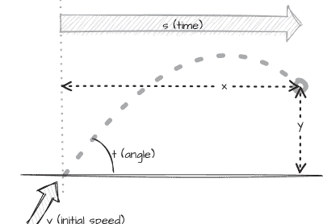

## 图 1-1：抛体位移

图 1-1 中的 angle（角度）、initial speed（初始速度）和 time（时间）标签分别对应 `Displacement` 的参数 `t`、`v` 和 `s`。`x` 和 `y` 值对应于该方法返回的元组的各个分量。抛体以某一初始速率、以特定角度发射，并沿着一条明确的弹道弧线运动。`Displacement` 方法计算经过给定时间后抛体在该弧线上的位置。

我们不会深入讨论这里所用的算法，因为我们的重点只是让这个方法的目的更一目了然。理解 `Displacement` 方法的第一个障碍是其参数和返回值的含义。

我故意用单字母名称来夸大这个问题，但我在现实世界中见过类似的例子，也会想：这些参数到底是什么？即使我们仔细检查参数的使用方式，要确定它们的含义也需要熟悉这些方程。这纯粹是糟糕的代码功底。我们并不是所有人都还记得当初学过的弹道学知识。

我们希望让读者尽可能容易地判断出这个方法的目的，无论他们是否熟悉相关主题。实现这一目标的最快方法是确保参数名能更好地反映它们所代表的内容。尤其是，代码应避免依赖专业术语。这里的 `t` 代表 `theta`，在物理学中通常用来表示角度大小；但即使我们把 `t` 替换为完整的 `theta`，不熟悉这一数学惯例的读者也不太可能产生这种联想。

与其使用可能晦涩难懂的单字母名称，不如为参数起一些能恰当表达其含义的名字：

```
public static (double, double)
Displacement(double angle, double speed, double elapsedTime)
{
--snip--
```

通过将 `t` 重命名为 `angle`，`v` 重命名为 `speed`，`s` 重命名为 `elapsedTime`，我们让它们的用途更加清晰了。将 `velocity` 改为 `speed` 似乎只是一个小小的改动。

change, but the names we use *matter*. While the use of `v` for *velocity* is common, `speed` is a more accurate description of this value’s purpose. *Velocity* is a technical term with a specific meaning in physics; it represents *both* magnitude (speed) and direction. If we name code elements as accurately and properly as we can, we reduce the risk of those names being misunderstood.

Selecting good names is a first step toward making code clearer and easier to read. However, we can do much more to improve our code’s clarity and remove ambiguity about what those identifiers represent. We might reasonably ask, for example, in what units the `angle`, `speed`, and `elapsedTime` parameters are measured. We’ll address that later in the chapter, but first we need a more sophisticated mechanism than the `double` type allows.

## Adding Clarity Through Types

All the `Displacement` method’s parameters are of the same type: `double`. This makes it easy for anyone, including ourselves, to accidentally mix up argument values when calling the method—without any warning from the compiler.


The `double` type itself is not the specific culprit here; we’d have the same problem if the parameters were all `string` or all `bool` types. Even if each parameter were of a different built-in numeric type, plenty of potential for problems would still remain because of the presence of the implicit promotion rules between them. Moreover, clarifying the parameter names doesn’t necessarily help the calling code, especially if the method is called with plain constant values like so:

```
var result = Displacement(.523, 65, 4);
```

Hard-coded values such as those used in this example are called *magic numbers* because there’s no explanation of their meaning or purpose. We could replace the magic numbers with better-named variables to make their purpose clearer, but the caller of the method might still supply the arguments in the wrong order.

One common way for the calling code to address such out-of-order errors is to specify the parameter name for each argument. Let’s see that in practice before looking at how to use different types to distinguish between the argument values.

## Named Arguments

Embedding the parameter name for each argument being passed to a method makes the purpose of those arguments much more visible in the calling code, as shown here:

```
var result = Displacement(angle: .523, speed: 65, elapsedTime: 4);
```

This call to the `Displacement` method specifies which parameter receives each value being supplied. The caller must match the parameter names of the method but can order them in any way they like:

```
var result = Displacement(elapsedTime: 4, speed: 65, angle: .523);
```

Naming the arguments makes the order in which they’re passed irrelevant. The compiler will ensure that each argument value gets passed to the right parameter according to its name, not its position.

This technique puts the responsibility of clarity onto the caller of the method. If the caller forgets or doesn’t bother to name the arguments, the compiler won’t warn them. The compiler will also give no warning if the caller mixes up the value for `angle` with `speed`. The code will compile, and the program will run, but it will almost certainly give incorrect results. Worse, the code might give a result that is almost correct for one specific set of arguments and then fail at the worst possible moment when different values are passed. The causes of errors like this can be difficult to track down.

## Custom Types

The problems we’re seeing with the `Displacement` method stem from using the `double` type to represent several distinct concepts. This is a variation of the Primitive Obsession code smell, which describes any code that has an overreliance on primitive types—that is, those types that are built into the language, such as `int`, `double`, and `string`.

Measurements and quantities such as speed commonly have numerical representations, but the `double` type is too general; it can be used to represent a wide variety of values, including angle and speed in our example, making it possible for the caller of the code to provide the wrong values. The angle and speed quantities are measured in different ways to mean different things. Using a raw `double` does not express the distinctions between them clearly enough. An angle of 45 degrees is a very different value from a speed of 45 meters per second.

The well-known solution to primitive obsession is to provide our own types with distinct purposes and to ensure that no implicit conversions exist between them. This enables the compiler to identify any arguments that are used inappropriately. Instead of using `double` to store quantities of angle and speed, Listing 1-2 defines two types that more positively convey their differences.

```
public struct Angle
{
    public double Size { get; set; }
}

public struct Speed
{
    public double Amount { get; set; }
}
```

Listing 1-2: Defining our own types

Our user-defined structs `Angle` and `Speed` are still quite primitive; they’re merely wrappers around a public property (`Size` and `Amount`, respectively) that allows us to read or write the value being represented in each case. We’ll improve this design, but for now it meets the immediate need: to distinguish values of angle from values of speed by their type rather than just by the parameter names.

Listing 1-3 demonstrates how we use these new types for the parameters to the `Displacement` method.

```
public static (double, double)
Displacement(Angle angle, Speed speed, TimeSpan elapsedTime)
{
--snip--
```

Listing 1-3: Using custom types as parameters

The C# Standard Library does not provide any abstractions for angles or speeds, but it does have the `TimeSpan` type, which is ideal for the `elapsedTime` parameter. Now the type of each parameter describes its value, so the parameter names have less responsibility. Any attempt to provide the arguments in the incorrect order, like substituting `speed` for `angle`, will cause the compiler to complain with a fairly obvious error message about not being able to convert `Speed` to `Angle`.

## Encapsulation

Using distinct types for the values in a design emphasizes each value’s role rather than its representation, making the code more self-documenting for human readers and allowing better error checking by the compiler. We’ve achieved our stated goal of preventing arguments to `Displacement` from being positioned incorrectly, but right now `Speed` and `Angle` are simple types that just have a value, rather than being a particular kind of value.

These types do not encapsulate their values in any way because their values are exposed as the publicly mutable `Size` and `Amount` properties. Those properties are currently the only way to create instances of those types, as we do in Listing 1-4, where we use object initialization to set the property values.

```
var result = Displacement(angle: new Angle { Size = .523 },
                        speed: new Speed { Amount = 65 },
                        elapsedTime: seconds);
```

Listing 1-4: Using object initialization to create inline argument instances

Using the public properties to set the values here is unnecessarily verbose. Listing 1-5 simplifies the syntax by adding constructors so we can create new instances directly with a value instead of having to set a public property.

```csharp

public struct Speed

{

    public Speed(double amount)

        => Amount = amount;

    public double Amount { get; set; }

}

public struct Angle

{

    public Angle(double size)

        => Size = size;

    public double Size { get; set; }

}

❶ var result = Displacement(new Angle(.523), new Speed(65), seconds);

```

*Listing 1-5: Adding constructors for Speed and Angle*

Here, when we call `Displacement`, we construct the `Angle` and `Speed` instances with their values instead of setting their properties ❶. Now that the type names are more descriptive, the order of the arguments is not ambiguous, so naming the arguments is no longer so important.

These constructors use the *expression body syntax*, introduced for methods in C# v6.0 and available since C# v7.0 for constructors. With this syntax, instead of a block enclosed by braces `{...}`, the expression is a single assignment separated from the constructor’s signature by the `=>` symbol. Since `Speed` and `Angle` each have only a single property to initialize, the expression-bodied constructors are concise and convenient.

Compare the final line with Listing 1-4. The changes to `Angle` and `Speed` in Listing 1-5 allow us to construct the values we want instead of using the object initializer in each case. This reduces the amount of typing the caller has to do but, more importantly, expresses more directly that a `Speed` or `Angle` *is a value* instead of just *having a value*.

## Immutability


目前，我们的值都是可变的，但一旦我们在 `Angle` 或 `Speed` 的构造函数中为其赋了值，就不需要允许该值再改变。如果我们需要一个具有不同值的 `Angle`，我们可以创建一个具有该值的新实例。

我们通过移除 `Angle` 的 `Size` 属性的 `set` 访问器使其成为只读属性来实现这种不可变性。然后唯一提供值的方式是通过构造函数，并且该值是永久且不可变的。我们也会对 `Speed` 的 `Amount` 属性做同样的处理，如 Listing 1-6 所示。

```csharp
public readonly struct Speed
{
    public Speed(double amount)
        => Amount = amount;

    public double Amount { get; }
}
```

*Listing 1-6: Making Speed immutable*

为了确保 `Speed` 实例不可更改，我们也将其设为 `readonly`。编译器随后会确保 `Speed` 的任何成员都不能修改状态，并且会拒绝任何尝试更改实例的编译。

将我们的类型设计为不可变，使得在代码检查期间更容易推理代码，因为我们不需要考虑类型实例可能以各种方式更改的情况。这在多线程程序中尤其重要，但在某些情况下，使值类型变为只读也可以通过允许编译器使用某些优化来提高性能。

## Value Validation

在为我们的类型引入了构造函数后，我们可以使用这些构造函数来检查无效参数，并在用户传递非法值时引发异常。例如，速度的合理值必须为非负数。在 Listing 1-7 中，我们检查传递给构造函数的数值是否小于 `0`，如果是则抛出异常。

```csharp
public Speed(double amount)
{
    if(amount < 0)
        throw new ArgumentOutOfRangeException(
            paramName: nameof(amount),
            message: "Speed must be positive");
    Amount = amount;
}
```

*Listing 1-7: Prohibiting out-of-range values*

`Speed` 的构造函数验证了提供的值，并且由于构造函数是为 `Speed` 提供值的唯一方式，我们确保只能创建合法的 `Speed` 值。我们应该使用构造函数来禁止其他非法参数值，例如 `double.NaN`，甚至可能添加光速作为上限。如果我们尝试使用非法值创建 `Speed`，将会得到运行时异常。

`ArgumentOutOfRangeException` 类型在标准库中定义，是一个描述性命名的类型的良好示例。请注意，在 Listing 1-7 中，我们为 `ArgumentOutOfRangeException` 构造函数命名了参数，该构造函数接受两个普通字符串参数（`paramName:` 和 `message:`）。否则，这些参数的顺序很容易混淆，尤其是名称相似的 `ArgumentException` 接受的参数顺序是相反的！

在 `Speed` 的构造函数中验证参数值是封装的一个例子：我们将验证逻辑放在一个地方，而不是分散在任何使用它的 方法中。现在，任何使用 `Speed` 实例的方法都会自动受益于 `Speed` 构造函数执行的范围检查。

> 创建我们自己的类型的主要好处之一是，我们封装了它们的职责，从而减少了使用它们的方法的职责。最小化重复代码是使我们的代码更清晰、更易于使用并且维护难度大大降低的又一种方式。

`Speed` 的构造函数建立了一个类不变式——对于类型的任何实例在其生命周期内必须保持的条件——规定 `Speed` 值永远不会小于 `0`。由于我们使 `Speed` 不可变，不变式永远不会被破坏。一旦创建了有效的 `Speed` 实例，其值永远不会改变，并且不可能创建具有无效值的 `Speed` 实例。

## Testing

通过将验证封装在 `Speed` 类型中，我们也可以独立于依赖它的任何算法来测试类不变式。在 Listing 1-8 中，我们尝试使用负值创建 `Speed` 实例，以测试构造函数是否抛出异常。

```csharp
[Test]
public void Speed_cannot_be_negative()
{
    Assert.That(
        () => new Speed(-1),
        Throws.TypeOf<ArgumentOutOfRangeException>());
}
```

*Listing 1-8: Testing constraints on Speed*

由于验证代码封装在 `Speed` 类型中，我们只需要这一个测试即可。我们不需要分别测试 `Displacement` 或任何其他使用 `Speed` 的方法是否拒绝无效速度值。所有针对 `Displacement` 的测试都可以专注于确保算法正确，而无需担心参数验证。

因此，使用类型表示领域概念有几个优点。使用我们的类型的代码由于类型的自描述特性而更清晰。我们分离了关注点，使程序更容易理解，测试更集中、更具体。这使得测试更简单，并且在被测试的代码需要更改时更容易维护。

## Refactoring

现在我们已经解决了 `Displacement` 方法参数的问题，让我们查看其方法体，看看是否可以通过重构实现来进一步改进。Listing 1-9 显示了我们当前的 `Displacement` 代码。

```csharp
public static (double, double)
Displacement(Angle angle, Speed speed, TimeSpan elapsedTime)
{
    var x = speed.Amount * elapsedTime.TotalSeconds * Math.Cos(angle.Size);
    var y = speed.Amount * elapsedTime.TotalSeconds * Math.Sin(angle.Size)
          - 0.5 * 9.81 * Math.Pow(elapsedTime.TotalSeconds, 2);

    return (x, y);
}
```

*Listing 1-9: The current Displacement implementation*

此代码工作正确，但我们有一些需要处理的问题。通过使用 `Speed`、`Angle` 和 `TimeSpan` 类型作为参数，我们使代码变得更冗长，需要访问这些参数的属性来获取其值。请注意，我们在这里使用 `TotalSeconds` 属性；一个常见错误是使用 `TimeSpan` 对象的 `Seconds` 属性，而本意是获取所表示的总秒数，但 `Seconds` 只返回 `TimeSpan` 的秒分量。给定一个精确表示 `1` 分钟的 `TimeSpan`，`Seconds` 属性将返回 `0`，而 `TotalSeconds` 的值将为 `60`。

如果 `Displacement` 方法可以直接在算法中使用变量，将会更清晰，如下所示：

```csharp
var x = speed * elapsedTime * Math.Cos(angle);
var y = speed * elapsedTime * Math.Sin(angle)
      - 0.5 * 9.81 * Math.Pow(elapsedTime, 2);
```

算法还依赖于三个硬编码值。这样的魔术数字通常表明我们需要提供名称来阐明其目的。常见的是在多个地方使用相同的魔术数字，因此如果出于任何原因该值发生变化，我们就需要查找每个用法并确保全部更新。

虽然我们可以看到乘以 `0.5` 与除以 `2` 相同，但 `9.81` 的含义要不那么明显。`0.5` 和 `Math.Pow` 调用中使用的 `2` 只是算术值；为它们命名可能会掩盖其目的而不是澄清。另一方面，`9.81` 显得具有更重要的目的。再次，为了理解这个数字的含义，我们需要先验知识，即 `9.81` 是地球重力对物体影响的近似值。我们将首先通过简单地为该值命名来解决此问题。

### Replacing Magic Numbers with Named Constants

用描述性名称替换代码中的魔术数字可以使其对不熟悉算法细节的读者更清晰。一种方法是创建新的值类型，类似于 `Speed`，来表示该测量值。然而，当我们只需要少数几个众所周知的数值时，使用命名常量来表示它们通常更简单。目前，我们只需要一个值（地球重力）。Listing 1-10 显示了我们可以通过赋予其有意义的名称来指示该值目的的一种方法。

```csharp
public static class Gravity
{
    public const double Earth = 9.81;
}
```

*Listing 1-10: Simple encoding of magic numbers*

虽然重力的命名常量是魔术数字的最简单替代方案，但我们错失了利用 `Acceleration` 或类似的更通用类型的机会。做到这一点将给予我们最大的灵活性，但也会增加复杂性和维护成本。保持代码简单也有其自身的好处。

我们应该记住，像这样的 `const` 值会被编译器烘焙到我们的代码中，因此如果我们更改 `Gravity.Earth` 的值但编译时使用的是使用相同常量的预构建程序集，整个程序可能会对同一常量使用两个不同的值。出于简洁和简单性的考虑，我们将保留 `const` 值并用 `Gravity.Earth` 常量替换 `Displacement` 中的硬编码数字，以便人类读者立即知道其含义：

```csharp
--snip-- - 0.5 * Gravity.Earth * Math.Pow(elapsedTime.TotalSeconds, 2);
```

现在如果我们想要使用更精确的重力近似值，我们只需要更改常量的值，而不是搜索魔术数字 `9.81` 的所有用法，前提是我们必须记住重新编译使用该常量的任何其他模块。

### Simplifying Properties and Values

我们的 `Displacement` 方法现在对它使用的变量的含义更加明确。Listing 1-11 显示了其当前实现。

```csharp
public static (double, double)
Displacement(Angle angle, Speed speed, TimeSpan elapsedTime)
{
    ① var x = speed.Amount * elapsedTime.TotalSeconds
        ② * Math.Cos(angle.Size);
    ③ var y = speed.Amount * elapsedTime.TotalSeconds * Math.Sin(angle.Size)
        - 0.5 * Gravity.Earth * Math.Pow(elapsedTime.TotalSeconds, 2);

    return (x, y);
}
```

*Listing 1-11: Displacement using explicit property access*

如前所述，访问 `angle`、`speed` 和 `elapsedTime` 的属性使得实现相当冗长。如果 `Displacement` 方法可以直接访问这些属性，将会更整洁、更易读

在这些操作中使用时。`speed` 变量的 `Amount` 属性被乘以 `elapsedTime.TotalSeconds` ❶，而 `angle.Size` 用于调用 `Math.Cos` ❷ 和 `Math.Sin` ❸。每次使用我们的类型时，我们都需要显式获取相应的属性值，以便将两个值相乘，并将它们作为参数传递给 `Sin` 和 `Cos` 方法。

我们无法更改 `TimeSpan` 变量的行为以允许它与 `Speed` 相乘，但 `TimeSpan` 可以与 `double` 值相乘。如果我们能将 `Speed` 实例当作 `double` 值使用，我们就可以避免在 `Displacement` 中显式使用其属性，从而使方法更简洁；也就是说，我们可以在不使用 `speed.Amount` 属性的情况下将 `speed` 和 `elapsedTime` 相乘。同样，对于 `Angle` 类型，如果我们能将 `Angle` 实例视为 `double` 值，我们就可以直接使用 `angle` 变量调用 `Math.Cos` 和 `Math.Sin` 方法，而这两个方法都期望一个 `double` 参数。

整个表达式的结果将是一个 `TimeSpan`，这是将 `TimeSpan` 与数字相乘的结果类型，因此我们需要在某个时刻访问 `TotalSeconds` 属性。尽管如此，移除对 `Speed` 和 `Angle` 的 `Amount` 和 `Size` 属性的访问需求将简化并缩短方法的实现。

实现这一目标的一种方法是定义我们自己的隐式转换运算符。这种方法在表面上很有吸引力，因为它实现简单，但它也有几个缺点。让我们来检查一下这些潜在问题。

### 隐式转换

我们通过实现一个隐式转换运算符方法并指定所需的目标类型来为我们自己的类型定义隐式转换，如对 `Speed` 在列表 1-12 中所示。

```csharp
public readonly struct Speed
{
    --snip--
    public static implicit operator double(Speed speed)
        => speed.Amount;
}
```

*Listing 1-12: Defining an implicit conversion for Speed*

这里的目标类型是 `double`，我们只需返回 `Amount` 属性的值。我们还为 `Angle` 添加了一个类似的转换运算符（此处未显示），它返回其 `Size` 属性。现在我们不再需要在调用 `Math.Cos` 和 `Math.Sin` 时显式使用 `angle.Size`，并且我们可以将 `speed` 与 `elapsedTime.TotalSeconds` 值相乘，而无需获取 `speed.Amount` 属性。将列表 1-13 与之前的列表 1-11 进行比较。

```csharp
var x = speed * elapsedTime.TotalSeconds * Math.Cos(angle);
var y = speed * elapsedTime.TotalSeconds * Math.Sin(angle)
      - 0.5 * Gravity.Earth * Math.Pow(elapsedTime.TotalSeconds, 2);
```

*Listing 1-13: Using implicit conversions*

我们对 `Displacement` 的实现现在更加紧凑——但我们引入了一些隐藏问题。

### 意外的交互

隐式转换削弱了 `Speed` 和 `Angle` 的接口，因为它们可以在任何使用 `double` 的地方参与，这意味着它们可以在不合适的表达式中使用。例如，将 `speed` 除以 `angle` 就是一个合法的表达式，如列表 1-14 所示。

```text
var angle = new Angle(.523);

var speed = new Speed(65);

var unknown = speed / angle;
```

Listing 1-14: Unplanned behavior resulting from an implicit conversion

该表达式之所以有效，是由于 `Speed` 和 `Angle` 到 `double` 的隐式转换，但结果毫无意义，而且编译器不会发出任何警告。此外，隐式转换在我们的代码中通常是不可见的。如果我们将 `Speed` 值传递给 `Math.Cos` 而不是 `Angle`，结果计算错误可能很难找到。

### 丢弃的不变量

我们通过引入 `Speed` 的自定义类型实现的一个好处是，我们可以在 `Speed` 的构造函数中封装验证逻辑。

允许从 `Speed` 到 `double` 的隐式转换意味着使用 `double` 结果的代码可以违反 `Speed` 允许范围的约束。在列表 1-15 中，我们用一个较小的值减去一个 `Speed`，得到的结果小于 `0`。

```text
var verySlow = new Speed(10);

var reduceBy = new Speed(30);

var outOfRange = verySlow - reduceBy;
```

Listing 1-15: Unchecked constraints resulting from an implicit conversion

该减法表达式由于 `Speed` 到 `double` 的隐式转换而在两个 `double` 值之间进行，将顺利运行。结果为负值，因此超出 `Speed` 的范围，但它是一个完全合法的 `double` 值。

为了解决这个超出范围的值，我们需要限制对 `Speed` 和 `Angle` 的允许操作，使其对这些测量有意义。这正是我们引入 `Speed` 的类不变量的全部目的，以确保其实例始终具有有效值。此外，我们希望禁止那些没有意义的操作，最好是以允许编译器在出错时通知我们的方式。

我们引入 `Speed` 和 `Angle` 作为特定类型，以便区分它们，并且因为使用普通的 `double` 来表示这些测量值过于通用。然而，隐式转换使 `Speed` 和 `Angle` 与 `double` 无法区分。

我们仍然可以实现使我们的类型易于在算术表达式中使用的目标，但我们需要控制这些类型可以执行哪些操作。我们将在不牺牲其自然使用或损害类型的封装的情况下允许对 `Speed` 和 `Angle` 执行特定操作。

## 重载算术运算符


我们最初引入 Speed 的隐式转换的动机是为了支持 Speed 与 TimeSpan 值的 TotalSeconds 属性之间的乘法运算。目前，我们必须使用 Speed 的 Amount 属性来进行该计算，如下所示：

```
var x = speed.Amount * elapsedTime.TotalSeconds *

--snip--
```

诸如 `*` 用于乘法的算术运算是为内置数值类型如 `double` 预定义的。我们可以通过提供算术运算符重载来为我们自己的类型定义这些符号的含义。列表 1-16 显示了 Speed 的乘法运算符重载。

```
public readonly struct Speed
{
    public static Speed operator*(Speed left, double right)
        => new (left.Amount * right);

    --snip--
}
```

*Listing 1-16: Supporting multiplication in Speed*

我们使用在 C# v9.0 中引入的目标类型化 new 表达式来创建 `operator*` 要返回的值。编译器知道期望的类型是 `Speed`，因为它正在被直接返回，所以我们不需要显式指定类型为 `new Speed(...)`。编译器将根据表达式左侧期望的值推断类型。

能够将 `speed` 值乘以一个数字在直觉上是有意义的；例如，一样东西可能以另一样东西的两倍速度行驶。我们通过从 `Amount` 属性和传递给运算符参数的值的乘积创建一个新的 `Speed` 来实现该运算符。`Speed` 的构造函数将检查结果是否在 `Speed` 的允许范围内，如果结果超出范围则抛出异常。我们可以通过一个简单的测试来证明这一点，例如列表 1-17，我们尝试将 Speed 乘以一个负数。

根本不是速度：速度乘以时间产生的是距离，我们可以通过引入新的 `Distance` 类型在代码中直接表示它，如列表 1-18 所示。

```
public readonly struct Distance
{
    public Distance(double amount)
        => Amount = amount;

    public double Amount { get; }
}
```

Listing 1-18: The Distance type

我们现在可以为 `Speed` 创建 `operator*` 的新重载，使其直接与 `TimeSpan` 相乘并产生 `Distance`。更好的是，我们可以在已定义的接受普通 `double` 并返回新 `Speed` 的乘法运算符之外定义此重载。列表 1-19 显示了这两个运算符重载。

```
public readonly struct Speed
{
    public static Speed operator*(Speed left, double right)
        => new (left.Amount * right);

    public static Distance operator*(Speed left, TimeSpan right)
        => new (left.Amount * right.TotalSeconds);

    --snip--
}
```

Listing 1-19: Overloading operator*

重载是多功能的。我们可以用不同类型的参数重载一个方法，并且每个重载可以返回不同的类型。重载的规则只考虑方法签名——即参数的数量和类型。因此，我们可以从接受 `double` 的重载返回 `Speed`，从接受 `TimeSpan` 实例的方法返回 `Distance`。

## 完善新类型

接下来，我们需要为新的 `Distance` 类型添加行为，以便它能在我们的 `Displacement` 实现中正确工作。将 `Speed` 与 `TimeSpan` 相乘会得到一个 `Distance` 值，我们在自己的算术表达式中进一步使用它，如列表 1-20 所示。

```
var distance = speed * elapsedTime;    // a Distance

var x = distance * Math.Cos(angle.Size);
var y = distance * Math.Sin(angle.Size)
    - 0.5 * Gravity.Earth * Math.Pow(elapsedTime.TotalSeconds, 2);
```

Listing 1-20: The Distance type in use

`x` 和 `y` 的表达式现在都是将 `Distance` 值与 `Math.Cos` 和 `Math.Sin` 返回的 `double` 值相乘。这段代码将无法编译，因为 `Distance` 需要自己的 `operator*` 重载。

与 `Speed` 值一样，将 `Distance` 与一个简单数字相乘会产生新的 `Distance`。`Math.Cos` 和 `Math.Sin` 的结果除了不受我们控制外，都是标量值，因此当我们将它们与 `Distance` 相乘时，结果将是另一个 `Distance`。

`Distance` 还需要一个 `operator-` 重载，以便在计算 `y` 值时使用的减法运算能够编译。与乘法一样，减法右侧的表达式给出的是一个标量值，因此我们在清单 1-21 中为 `Distance` 添加了乘法和减法运算符。

```
public static Distance operator*(Distance left, double right)
    => new (left.Amount * right);

public static Distance operator-(Distance left, double right)
    => new (left.Amount - right);
```

*清单 1-21：Distance 值的算术运算*

有了这些重载，我们就可以自然地一起使用 `Speed` 和 `TimeSpan` 值来生成 `Distance` 值。这些值反过来又能与其他所需表达式无缝协作。

## 处理设计缺陷

我们的位移方法返回一个由两个 `double` 值组成的元组。然而，经过我们的修改，返回的 `x` 和 `y` 值已成为 `Distance` 的实例，而不是普通的 `double` 值。这又在返回值方面引入了一个术语问题：在物理学中，距离（distance）就像速度（speed）一样，总是 0 或正值。将距离与像 `Cos` 这样的三角函数的结果组合起来，得到的是一个坐标位置（coordinate position），而不是距离，并且可能是负值。

我们从速度乘以时间的结果中识别出 `Distance` 类型，但无法直接区分 `Math.Cos` 或 `Math.Sin` 的结果与像 `0.5` 这样的普通数字，这使我们失去了在 `Distance` 中增加乘法运算符重载以返回新类型（例如 `Position`）而不是另一个 `Distance` 的机会。我们已经达到了利用所选类型来建模现实世界概念的极限。

这样的障碍可能是更深层设计坏味道（design smell）的症状，表明这个问题或许可以通过改变设计视角来解决。在这种情况下，我们或许可以通过用功能完备的 `Velocity` 类型而不是相对基础的 `Speed` 和 `Angle` 类型来重写 `Displacement` 的算法，从而获得更完整的解决方案。然而，探索该方案相当复杂，最好留给专门讨论物理问题建模的文本去处理，留给我们的是一个需要做出的务实决定。

隐含的。如果我们使用以千米每小时为单位的速度值，必定会得到意想不到的结果。

同样，我们目前也没有指定 `Angle` 类型的单位。处理三角学的代码通常使用弧度作为度量单位，并且 `Math` 类中的所有三角函数（如 `Sin`）都期望角度值以弧度为单位。然而，大多数人习惯以度来思考角度，混淆这两者是常见的错误来源。

这暴露了可用性问题：我们的代码应该使用对实现更方便的单位，还是对用户更直观的单位？让我们考虑这个问题，并研究是否有可能同时实现这两个目标。

C# 有多个可用于编码单位的特性，一种常见的方法是使用枚举来表示不同的单位。乍一看，这似乎是最明显的解决方案，但它可能会引起问题。我们将探讨这个选项，然后研究一种替代方案，即使用静态方法以所需单位创建我们的类型。

## 使用枚举列出单位

枚举类型（enum）是一组相关的强类型常量。使用枚举可以让我们指定类型支持的所有单位。清单 1-23 修改了我们的 `Speed` 类型，使其使用枚举来处理单位。

```
public readonly struct Speed
{
    public enum Units
    {
        MetersPerSecond,
        KmPerSecond,
        KmPerHour
    }

    public Speed(double amount, Units unit)
    {
        if(amount < 0)
            throw new ArgumentOutOfRangeException(
                paramName: nameof(amount),
                message: "Speed must be positive");

        Amount = amount;
        In = unit;
    }

    public double Amount { get; }
    public Units In { get; }
}
```

清单 1-23：使用枚举为 Speed 指定单位

在这段代码中，`Units` 枚举是嵌套在 `Speed` 中的公共类型，告诉我们速度可以用米每秒、千米每秒或千米每小时来表示。

注意：虽然将所有名称缩写很诱人，但将 `MetersPerSecond` 缩短为 `Ms` 可能会与毫秒（milliseconds）混淆，因此在这种情况下最好将单位拼写完整。

`Speed` 的构造函数接受一个表示量值的数字，并且用户必须提供其中一个枚举值来指定所需单位。之后，用户可以使用 `In` 属性来了解创建特定 `Speed` 实例时使用了哪些单位。通过支持多种度量单位，我们使 `Speed` 在其他应用程序中更有通用性。

使用枚举表示支持的单位在表面上很有吸引力，因为它看起来实现起来很简单。然而，这种方法存在一些缺点，当我们决定如何处理两个具有不同单位的值时，这些缺点就会显现出来。

## 值比较与单位转换

我们需要在 `Speed` 实现的多个地方考虑单位之间的转换。例如，以下两个 `Speed` 值使用不同的单位，但表示的是相同的速度：

```
var limit = new Speed(3.6, Speed.Units.KmPerHour);
var unit  = new Speed(1,   Speed.Units.MetersPerSecond);
```

默认情况下，这两个 `Speed` 变量不会比较相等，因为它们的 `Amount` 和 `In` 属性具有不同的值。我们可以通过自定义 `Speed` 的相等比较行为来解决该问题，例如将两个值都转换为米每秒，然后比较这些值是否相等。然而，我们还有其他更微妙的问题需要解决。

之前，我们为 `Speed` 添加了运算符重载，以支持将其与标量值或时间相乘。添加对其他算术运算的支持（包括将两个 `Speed` 相加）也是合理的。为了将它们相加，我们必须将两个值转换为一个共同单位，但结果应该使用哪个单位呢？

一种选择是始终将每个 `Speed` 值缩放为米每秒——就像我们在清单 1-24 中通过 `Speed` 的构造函数根据所需单位转换参数值那样——但这种方法会带来不同的问题。

```
public Speed(double amount, Units unit)
{
    if(amount < 0)
        throw new ArgumentOutOfRangeException(
            paramName: nameof(amount),
            message: "Speed must be positive");

    Amount = unit switch
    {
        Units.KmPerHour      => amount * 1000 / 3600,
        Units.KmPerSecond    => amount * 1000,
        Units.MetersPerSecond => amount,
```

在构造函数中始终将 `Speed` 值转换为米每秒会带来另一个问题：当我们使用 `MetersPerSecond` 以外的单位时，用于创建 `Speed` 的量值会被改变。为了说明这个问题，请考虑清单 1-26，我们使用 `Amount` 属性以及创建原始值时使用的相同单位来复制一个 `Speed` 值。

```
var original = new Speed(3.6, Speed.Units.KmPerHour);

var copy = new Speed(original.Amount, Speed.Units.KmPerHour);

Assert.That(original.Equals(copy), Is.True);
```

清单 1-26：测试复制值的相等性

大多数人会期望这个测试通过，但它失败了，因为 `original.Amount` 已被 `Speed` 的构造函数转换为米每秒。解决方案是使用 `In` 方法来创建副本，如下所示：

```
copy = original.In(Speed.Units.KmPerHour);
```

将所有 `Speed` 值转换为共同的单位米每秒简化了 `Speed` 的实现，但对于希望使用以不同单位度量的 `Speed` 值的用户来说不太方便。

同样，虽然在使用三角函数方法时以弧度表示 `Angle` 值很方便，但对用户来说却远非方便。如前所述，大多数人自然地以度而非弧度来思考角度，虽然转换相对简单，但它并不属于标准库。

因此，我们仍然需要弥合用户直观感受与代码内部使用之间的差距。接下来，我们看看枚举之外的一种替代方法：使用静态方法，使我们的类型既方便人类使用，又能与 `Math.Sin` 等标准方法无缝协作。

## 静态创建方法

我们可以采用类工厂方法模式（Class Factory Method pattern），而不是使用带枚举参数的构造函数来表示单位。该模式用静态方法取代公共构造函数，以简化实例的创建。这些方法的名称反映了它们所表示的单位，而不需要单独的枚举值来标识这些单位。

在我们的 `Speed` 类型中，我们使用清单 1-27 中的类工厂方法将输入值转换为 `Speed` 内部使用的单位，并返回一个包含该转换后的值的新 `Speed` 实例。

```
public static Speed FromMetersPerSecond(double amount)
    => new (amount);

public static Speed FromKmPerSecond(double amount)
    => new (amount * 1000);
```

```csharp
public static Speed FromKmPerHour(double amount)
    => new (amount * 1000 / 3600);
```

Listing 1-27: 使用类工厂方法编码单位

这里，我们有三种单独的方式来创建一个新的 `Speed`，每个方法都返回一个从方法名所指示的单位转换而来的 `Speed` 值。当我们需要一个新的 `Speed` 实例时，我们使用代表所需单位的方法，如 Listing 1-28 所演示。

```csharp
var limit = Speed.FromKmh(88);
var sound = Speed.FromMetersPerSecond(343);
var escape = Speed.FromKmPerSecond(11.2);
```

Listing 1-28: 使用我们新的类工厂方法创建 Speed 值

现在 `Speed` 的构造函数无需再是 public。如果我们允许用户直接使用 `new` 创建 `Speed` 实例，他们将绕过类工厂方法并失去转换带来的好处。为避免这种情况，在 Listing 1-29 中我们将构造函数设为 private。

```csharp
private Speed(double amount)
{
    if(amount < 0)
    {
        throw new ArgumentOutOfRangeException(
            paramName: nameof(amount),
            message: "Speed must be positive");
    }
    Amount = amount;
}
```

Listing 1-29: 将我们的 Speed 构造函数设为私有

构造函数仍然包含验证逻辑，但现在它只能由我们的类工厂方法调用，且参数已适当地缩放为米每秒。我们无法阻止 `Speed` 实例被默认初始化，但这会使值为 0，而该值与单位无关。请注意这并非总是成立，因此我们需要警惕不成立的情况。例如，0 摄氏度并不等于 0 华氏度。

## 设计中的对称性

虽然我们的类工厂方法允许我们从不同单位测量的值创建 `Speed` 值，但 `Speed` 值的内部表示为米每秒。为了提高可用性，我们需要在另一个方向提供相应的转换，以便 `Speed` 的使用者在获取值时可以选择所需的单位。在 Listing 1-30 中，我们添加了属性以将 `Speed` 从其内部值转换为属性名所编码的单位。

```csharp
public readonly struct Speed
{
    --snip--
    public double InMetersPerSecond => amount;
    public double InKmPerSecond     => amount / 1000.0;
    public double InKmPerHour       => amount / 1000 * 3600;

    private readonly double amount;
}
```

Listing 1-30: 以不同单位查看 Speed


我们引入了一个私有数据成员，可供这些属性中的每个属性使用。这样做避免了属性转发，但也允许我们为所有三个属性使用表达式体。这在很大程度上是一个美观上的选择；采用属性转发的另一种最明显的选择如下所示：

```csharp
public double InMetersPerSecond { get; }
public double InKmPerSecond     => InMetersPerSecond / 1000.0;
public double InKmPerHour       => InMetersPerSecond / 1000 * 3600;
```

无论我们选择哪种方法，我们实际上都是将模糊的 `Amount` 属性重命名为 `InMetersPerSecond`，其目的是返回 `Speed` 的内部值。新的名称更好地表达了属性的含义，与其他属性使用的命名约定相匹配，并与类工厂方法 `FromMetersPerSecond` 相呼应。

通过为 From... 方法和 In... 属性使用相似的命名约定，我们提高了 `Speed` 接口的清晰度。当我们看到像 `FromKmPerHour` 这样的方法时，我们自然会期望存在一个对应的方法和属性来提供反向转换。

类工厂方法和对应的属性提供了一种紧凑的方式来在两个方向上表达单位，并且迫使我们在使用 `Speed` 时有意识地明确自己的含义。

## 使单位显式化

`Displacement` 方法并不直接使用 `Speed` 的单位，因为它们被封装在我们为 `Speed` 和 `TimeSpan` 创建的乘法运算符中。`Displacement` 确实使用了角度的单位，尽管这些单位目前在 `Angle.Size` 属性中是隐含的，如 Listing 1-31 所示。

```csharp
var x = speed * elapsedTime * Math.Cos(angle.Size);
--snip--
```

Listing 1-31: Displacement 中的角度

`Math.Cos` 和 `Math.Sin` 都需要以弧度为单位的角度测量值，弧度是测量角度的 SI 单位。在 Listing 1-32 中，我们将 `Size` 属性重命名为 `InRadians` 以使单位显式化，并同时添加了到度和从度的转换。

```csharp
public readonly struct Angle
{
    private Angle(double size)
        => radians = size;

    public static Angle FromRadians(double size)
        => new (size);

    public static Angle FromDegrees(double size)
        => new (size * Math.PI / 180);

    public double InRadians => radians;
    public double InDegrees => radians * 180 / Math.PI;

    private readonly double radians;
}
```

Listing 1-32: 为 Angle 添加单位转换

正如我们对 `Speed` 所做的那样，我们添加了类工厂方法以使用度或弧度创建 `Angle`，并提供了对应的属性来获取任一单位的值。现在我们可以使用 `Angle` 轻松地与需要弧度值的方法一起使用，并且对于习惯以度思考的用户来说，使用 `Angle` 也更加方便。

## 选择最自然的使用方式

`Math.Cos` 和 `Math.Sin` 方法接受一个 `double` 参数，因此我们需要显式访问 `Angle.InRadians` 属性来调用这些方法。我们无法更改这些方法的参数类型，因为它们是标准库的一部分，但我们可以向 `Angle` 的接口添加同名方法，从而封装显式表达单位的需求。我们可以采用三种主要方法，每种方法都有其优点和缺点，并且每种方法都将 `Angle` 值以弧度形式转发给 `Math` 静态类中的对应静态 `Sin` 和 `Cos` 方法。

最直接的方法是为 `Angle` 引入 `Sin` 和 `Cos` 实例方法，将 `size` 字段值传递给对应的 `Math` 方法，如下所示：

```csharp
public readonly struct Angle
{
    --snip--

    public double Sin() => Math.Sin(size);
    public double Cos() => Math.Cos(size);

    private readonly double size;
}
```

这种方法之所以可行，是因为我们选择了弧度作为 `Angle` 的底层单位，并且提供了到度和从度的转换方法。

Listing 1-33 显示了我们在 `Displacement` 方法中如何使用这些实例方法。与 Listing 1-31 中直接调用 `Math.Cos` 的情况进行比较。

```csharp
var x = speed * elapsedTime * angle.Cos();
var y = speed * elapsedTime * angle.Sin()
    - 0.5 * Gravity.Earth * Math.Pow(elapsedTime.TotalSeconds, 2);
```

Listing 1-33: 调用我们新的实例三角方法

我们的第二个选项是提供一个镜像 `Math` 类的静态类，其中包含静态 `Sin` 和 `Cos` 方法，它们接受 `Angle` 而不是普通的 `double` 作为参数。每个方法都需要访问 `InRadians` 属性，因为它无法访问私有的 `size` 字段。虽然这种方法遵循了静态 `Math` 类建立的常见约定，但我们失去了调用成员方法的更紧凑用法。

第三种替代方案是定义扩展方法，它们在使用上如同实例方法，但定义在单独的静态类中。Listing 1-34 定义了 `Sin` 和 `Cos` 扩展方法以扩展 `Angle` 的接口。

```csharp
public static class AngleExtensions
{
    public static double Cos(this Angle angle)
        => Math.Cos(angle.InRadians);

    public static double Sin(this Angle angle)
        => Math.Sin(angle.InRadians);
}
```

Listing 1-34: 为 Angle 定义扩展方法

静态 `AngleExtensions` 类中的 `Cos` 和 `Sin` 方法使用特殊语法 `this Angle` 作为其参数，这告诉编译器该方法是 `Angle` 的扩展。每个方法只是将角度的 `InRadians` 属性转发给 `Math` 命名空间中的对应方法。我们以与 Listing 1-33 中调用实例方法版本完全相同的方式使用扩展方法。

有时被忽视的一个好处是，静态和扩展方法实现都不依赖于 `Angle` 的内部表示。实例成员方法也可以以 `InRadians` 属性为基础实现，但如果方法不依赖于 `Angle` 的私有实现，将方法提取到单独的类型中，可以使 `Angle` 的定义更小、更易于理解。第 6 章更详细地探讨了这一主题。

无论我们选择哪种方法，我们都将封装显式访问 `angle.InRadians` 属性以调用 `Math` 三角函数方法的需要，从而使任何人都可以轻松使用我们的 `Angle` 类型。

## 由单位隐含的返回类型

类工厂方法，例如我们为 `Speed` 和 `Angle` 引入的那些，是一种简化值类型创建的常见方法。标准库在 `TimeSpan` 类型中使用了这种技术，该类型具有诸如 `FromSeconds` 与 `TotalSeconds` 属性配对的方法。这些方法在其名称中编码了单位，因此创建值实例非常直接：

```
var speed = Speed.FromKmPerHour(234.0);
var angle = Angle.FromDegrees(30.0);
var seconds = TimeSpan.FromSeconds(4.0);
```

当我们初始化这些变量时，我们明确指出了期望的类型以及单位，但 234.0kmh 的值必须是速度。我们不能直接表达这一点，但我们可以通过使用扩展方法来接近。

值 `234.0` 是一个 `double`，虽然我们不能改变其内置定义，但我们可以为 `double` 类型创建扩展方法，如清单 1-35 所示。

```
public static class DoubleExtensions
{
    public static Speed Kmh(this double amount)
        => Speed.FromKmPerHour(amount);
    public static Angle Degrees(this double amount)
        => Angle.FromDegrees(amount);
    public static TimeSpan Seconds(this double amount)
        => TimeSpan.FromSeconds(amount);
    --snip--
}
```

清单 1-35：扩展 double 的接口

每个扩展方法都返回一个由方法名称中单位隐含的类型的新实例，因此 `Kmh` 方法返回一个使用 `Speed.FromKmPerHour` 类工厂方法创建的 `Speed`。我们像这样使用新的 `double` 扩展方法：

```
var speed = 234.0.Kmh();
var angle = 30.0.Degrees();
var seconds = 4.0.Seconds();
```

为了避免对整数必须显式添加小数点，我们也可以添加扩展 `int` 的重载。虽然这种技术对于允许文字值的紧凑语法可能很有用，但对于像这样的变量效果较差：

```
double value = 234.0;

--snip--

var speed = value.Kmh();
```

无论我们如何选择表示测量单位，它们都是这些类型的基本且固有的部分。没有单位，一个数字只是一个数字，即使类型的名称具有描述性。如果我们使值类型的单位易于定义，并且同样重要的是，使在常见单位之间转换变得容易，我们的自定义值类型将更易于使用和理解。

## 一个完全形成的封装值

冗长的参数列表是不明确代码的标志。它们通常表明一个方法没有一个清晰的职责，因此需要重构。一些或全部参数可能以某种方式相关，表明缺少抽象。在任何一种情况下，减少方法参数列表都是提高代码清晰度的另一种方法。

本章中使用的 `Displacement` 方法确实有一个单一、清晰的职责，并且只有三个参数。然而，其中两个参数是相关的：速度是速度和方向的组合。我们已经定义了丰富的类型来表示速度和角度，现在可以将其组合以用自己的类型表示速度。清单 1-36 显示了我们新的 `Velocity` 结构体。

```
public readonly struct Velocity
{
    public Velocity(Speed speed, Angle angle)
        => (Speed, Direction) = (speed, angle);

    public Speed Speed { get; }
    public Angle Direction { get; }
}
```

清单 1-36：定义封装的 Velocity 类型

`Displacement` 方法不再需要单独的速度和角度值，因为它们现在由 `Velocity` 类型处理：

```
public static (Distance, Distance)
Displacement(Velocity v0, TimeSpan elapsedTime)
{
    --snip--
```

将 `Speed` 和 `Angle` 包装到 `Velocity` 中有两个相关的好处。首先，像 `Displacement` 这样需要两个参数来表示速度的方法现在只需要一个。其次，`Velocity` 是一个新的抽象，表示一个不同的概念。我们可以为 `Velocity` 提供自己特定的行为和语义集，并独立于其他任何事物测试这些语义。

## 决定是否抽象类型

引入像 `Velocity` 这样新类型并不总是合适的方法。例如，考虑 `Displacement` 方法的返回值：

```
public static (Distance, Distance) Displacement(
--snip--
```

随着我们关于使用类型表示概念的讨论，将 `Distance` 值的元组抽象为新类型似乎很有吸引力。但我们应该考虑几个因素，包括值将如何使用，是否希望将任何领域特定行为与独立类型关联，以及添加新类型是否会增加清晰度或使其模糊。

如果一个值只在少数地方使用，创建自定义类型来表示它可能不值得，除非这样做也会减少代码重复。如果有我们想要封装的行为，我们将受益于将该行为定位在一个地方并能够在一个地方测试它。

是否能为新类型赋予有用的名称是另一个重要考虑。例如，两 `Distance` 值的元组类似于坐标点，其中 `x` 和 `y` 值表示从原点在两个维度上移动的距离。然而，名称 `Coordinate` 会具有误导性，因为坐标的元素是位置或点而不是距离。然而，现在我们已经创建了 `Velocity` 类型，我们可能会考虑重新审视 `Displacement` 的实现，以尝试解决我们在引入 `Distance` 类型时指出的设计问题。我们的示例不值得涉及的额外复杂性，因此，我们将采用更简单的方法。

在 `Displacement` 返回的值中，元组组件的名称比为新类型命名更重要。与其定义一个完全新的类型作为 `Displacement` 的返回类型，不如我们利用 C# v7.0 及更高版本中丰富的元组支持，直接将返回值“解包”到命名变量中，如清单 1-37 所示。

```
var (range, elevation) = Displacement(velocity, TimeSpan.FromSeconds(0.9));
Assert.That(range.InMeters, Is.EqualTo(19.09).Within(.01));
Assert.That(elevation.InMeters, Is.EqualTo(18.78).Within(.01));
```

清单 1-37：解包元组值

在此示例中，我们使用元组解构，为返回元组值的每个成员赋予自己的名称。编译器从元组中的值推断 `range` 和 `elevation` 变量的类型，因此在此示例中它们都是 `Distance` 类型的实例。这具有既紧凑又足够描述性的优点，适用于许多目的。

## 总结

> 我们将抽象定义为选择性无知——专注于与手头任务相关的思想，忽略其他一切。[...] 如果抽象设计良好且选择得当，我们相信即使我们不理解它们的工作细节，我们也可以使用它们。我们不需要成为汽车工程师就能驾驶汽车。

> —Andrew Koenig 和 Barbara Moo，《Accelerated C++》

C# 提供了一些原始类型，特别是数值类型，使用它们本身可能很诱人。然而，只接受长列表 `double` 参数的方法可能难以解读。这个问题不仅限于 `double`；参数列表很长的 `string` 或 `bool` 方法也存在同样的陷阱，但治疗方法大致相同。

内置类型旨在适用于广泛的问题，并用作更复杂类型的构建块。毕竟，C# 是一种面向对象的语言，它允许我们使用领域特定类型来建模问题。

用我们自己的类型替换原始值有几个实际好处。它可以通过确保方法参数明确来减少代码中偶然的误用和缺陷。这使我们能够利用编译器的类型检查。如果我们错误地调换参数，我们的代码将无法编译。这种早期失败可以防止这些错误在运行时导致问题，或者更糟糕的是，进入实时生产系统并让我们感到尴尬。

创建即使是简单的类型也允许我们提供描述性名称，使代码更具自描述性。反过来，这使我们免于必须生成大量单独的解释性文档，而这些文档往往会过时。

通过将类型的行为与使用它的算法分离，并将该行为封装在类型本身中，我们可以独立于这些算法对其进行测试。该类型更具内聚性，算法更清晰且通常更简单。这些算法本身也更容易供我们测试，而无需同时测试领域类型抽象所捕获的假设和实现。

## 值类型和引用类型


我们可以在 C# 中通过多种方式创建新类型，并且需要考虑每种方法的个体特征，以确定哪种方法最适合我们的目标。特别是，了解值类型与引用类型的区别有助于我们选择正确的前进方向，因为这些差异在我们定义自己的类型时具有重大且有时未被考虑的影响。某些权衡会影响我们如何设计类型以及可以用它做什么。在本章中，我们将研究这些差异以及它们对程序的意义。

我们将探讨以下内容：

- 创建自己的类型时我们有哪些选择

- 为什么 C# 同时具有引用类型和值类型

- 选择其中之一如何影响构造、空值检查和其他类型行为

- 为什么值类型不等于值语义

- 不同类型在内存中的存储位置以及这如何影响对象的生命周期

## 用户定义的类型

大多数现代编程语言允许你创建自定义类型。C# 中用户定义类型的基本原则对许多其他语言的程序员来说都很熟悉，但某些细节是不同的。因此，在本节中我们将研究四种用户定义的类型：结构体、类，以及较新的记录和记录结构体（分别在 C# v9.0 和 v10.0 中引入）。

重要的是要认识到这些类型的行为在很大程度上依赖于它们是引用类型还是值类型。让我们带着这些差异简要地查看每种用户定义的类型。

### 结构体和类

清单 2-1 定义了一个简单的结构体来表示颜色。

```
public readonly struct Color
{
    public Color(int r, int g, int b)
        => (Red, Green, Blue) = (r, g, b);

    public int Red { get; }
    public int Green { get; }
    public int Blue { get; }
}
```

清单 2-1：定义一个简单的结构体


`Color` 结构体被标记为 `readonly`，以表示 `Color` 的实例是不可变的——也就是说，它们永远不会改变其值。相应地，三个属性（`Red`、`Green` 和 `Blue`）都没有 `set` 访问器，因此在构造函数中使用初始值赋予它们之后，其值就无法更改。

此示例中的构造函数使用表达式体语法（`=>`），你已在第 1 章中看到它，而不是用大括号 `{...}` 括起来的主体。我们通过使用元组赋值使表达式体成为单行语句，该赋值将三个参数值 `r`、`g` 和 `b` 的元组分配给三个属性的元组。编译器将此语法转换为从参数值直接高效地分配到 `Red`、`Green` 和 `Blue` 属性各自的 backing 字段。

结构体定义中的 `readonly` 关键字不是强制性的，但强化了 `Color` 的实例是不可变的。不可变的值类型

使我们的代码更容易理解，并且可能允许编译器进行一些优化。

相比之下，如果我们改为定义 `Color` 类而不是结构体，我们就不能在它的定义中使用 `readonly` 关键字，尽管我们可以通过不为属性提供 `set` 访问器使其不可变。定义 `Color` 为类与结构体唯一的另一个区别是定义中使用 `class` 关键字：

```
public class Color
--snip--
```

`Color` 的定义在其他方面与清单 2-1 中的完全相同。

这两种类型的主要区别在于类是引用类型，而结构体是值类型。在分析这种差异的影响之前，让我们先看看记录和记录结构体类型。

### 记录和记录结构体

从 C# v9.0 开始，我们可以使用 `record` 关键字定义记录类型。记录引入了一种新的语法，用于紧凑地定义类型。清单 2-2 创建了一个名为 `Color` 的记录类型。

```
public record Color(int Red, int Green, int Blue);
```

清单 2-2：定义一个记录

此示例显示了一个位置记录；`Color` 类型没有主体，但类型定义具有自己的位置参数，编译器使用这些参数生成完整的类型。在幕后，编译器将记录转换为类定义，这意味着记录是引用类型。编译器还将参数名称 `Red`、`Green` 和 `Blue` 转换为同名的公共属性，以及一个具有匹配参数的公共构造函数来初始化属性值。位置参数还被编译器用于生成其他方法，包括 `Equals`、`GetHashCode` 和 `ToString`，它们是 `object` 基类中对应方法的重写。

清单 2-3 创建 `Color` 记录的新实例并像使用类或结构体一样使用其属性。

```
var tomato = new Color(Red: 255, Green: 99, Blue: 71);

Assert.That(tomato.Red, Is.EqualTo(255));
Assert.That(tomato.Green, Is.EqualTo(99));
Assert.That(tomato.Blue, Is.EqualTo(71));
```

清单 2-3：创建 `Color` 的实例

在这里，我们在构造 `tomato` 变量时使用命名参数，以强调编译器赋予构造函数参数的名称。请注意，断言中使用的属性名称与构造函数中使用的名称

相同，并且两者都与记录定义中使用的名称匹配。

> **NOTE**  
> *记录与结构体或类之间一个重要的区别与处理两个实例之间的相等性比较有关，我们将在第 47 页的“Identity Equality vs. Value Equality”中更详细地检查该主题。*

与记录非常密切相关的是在 C# v10.0 中引入的记录结构体。与作为类编译的记录不同，记录结构体由编译器转换为结构体定义，使其成为值类型。否则，它们与记录相同。记录结构体由 `record struct` 关键字表示，如下所示：

```csharp

public readonly record struct Color(int Red, int Green, int Blue);

```

这个记录结构体与清单 2-1 中的结构体类似，被标记为 `readonly`。如果我们省略 `readonly` 关键字，编译器生成的属性将是读写属性，具有 `get` 和 `set` 访问器。使用 `readonly` 关键字使 `Color` 成为不可变的记录结构体。

### 继承

表示类与类之间以及记录与记录之间关系的常见方式是使用 *继承*，或从另一个类型派生一个类型。然而，我们不能将继承应用于结构体或记录结构体；它仅适用于引用类型。

继承的另一个限制是记录可以从另一个记录继承，但不能显式地从类继承。同样，类不能从记录继承。在继承方面，记录在其他所有方面都遵循与类相同的规则并具有相同的特征。类和记录可以定义虚拟方法和属性，允许更派生的类型通过重写方法或属性来提供自己的行为，并且我们可以选择忽略、重写或隐藏派生类型中的任何虚拟方法。

相比之下，结构体和记录结构体是隐式 *密封* 的，这意味着禁止从它们继承。如果我们尝试从结构体或记录结构体派生，将会得到编译时错误。结构体和记录结构体也不能从另一个用户定义的类型继承。

类或记录的另一个限制是它只能从一个基类型继承。任何尝试进行多重继承都会导致编译器错误。如果没有显式指定基类型，`object` 成为隐含的基类。正如你在第 45 页的“The Common Type System”中将看到的那样，每个类型最终都从 `object` 继承，无论是直接还是间接。例如，清单 2-4 中的 `Command` 类隐式派生自 `object`，而 `DummyCommand` 类显式派生自 `Command`，通过 `Command` 基类隐式继承自 `object`。

## 抽象基类型

抽象类型是指只能用作继承的基类型；它不能直接使用 `new` 实例化。其含义之一是，虽然类和记录可以是抽象的，但结构体和记录结构体不能。 这没有意义：我们无法从值类型继承，因此它永远无法被实例化。

在抽象类型中，我们可以将方法和属性指定为抽象，这意味着它们没有实现。 它们的用途仅仅是定义具体类型必须支持的操作。 抽象方法和属性隐式地是虚拟的，但为其提供实现会引发编译器错误。 抽象类型不必定义任何抽象成员，但只有抽象类或记录可以拥有抽象方法和属性。 任何抽象方法和属性在派生类中未显式重写的情况下仍保持抽象。 为派生类型中的抽象方法提供实现会使该方法变为具体。

我们可以从另一个抽象类型继承，并选择为基类型的抽象方法提供实现或将其保留为抽象。 我们只能直接创建完全具体的类或记录的实例；也就是说，所有抽象方法都已被重写。

如果我们继承自抽象类，则不能再继承自其他类，因为那将是一种多重继承形式，而多重继承是被禁止的。

很容易将 C# 接口及其成员视为抽象的（尤其是对熟悉 C++ 的用户而言，在 C++ 中接口通常以所有纯虚方法的类实现），但事实并非如此。 接口仅包含方法和属性的签名；它们既不是抽象的也不是虚拟的。

继承是面向对象代码的核心特性，但它仅适用于引用类型。 继承——以及支持它的特性，例如虚拟方法——对于值类型是不合适的，部分原因是值类型实例使用内存的方式。

## 类型实例生命周期

值类型和引用类型在使用内存的方式上存在差异，更具体地说，它们的实例生命周期不同。 值类型实例的生命周期很短，其生命周期与表示它们的变量的生命周期绑定。 对于值类型，变量即实例；当我们创建值类型的新实例时，目标变量有效地包含实例数据——即该类型的每个字段的值。

在许多情况下，变量的生命周期由一个块定义，例如方法体或 `foreach` 循环。 块内的任何局部变量在块结束时就不再存在。 或者，变量可能包含在另一个对象中，在这种情况下，变量的生命周期由包含对象的生命周期定义。 每当我们通过将其分配给另一个变量或将其作为参数传递给方法来复制值类型变量时，副本就是不同变量中的全新类型实例。

另一方面，引用类型实例通常生命周期较长，可以由多个变量引用。 当我们创建引用类型的新实例时，我们会获得对该实例在内存中的引用。 每当我们复制该引用时，我们并没有同时复制实例。 原始引用和副本都引用同一个实例。 引用存储在引用变量中。

所有引用类型实例都分配在堆上。 它们的生命周期由自动垃圾回收管理，当程序不再需要它们时释放其内存。 当垃圾回收器确定没有其他活动引用指向该实例时，对象就被视为未使用。 虽然引用类型实例不受其作用域限制，但引用变量受作用域限制，因此当引用变量超出作用域时，它就不再是对实例的活动引用。 因此，引用类型实例的生命周期由指向该实例的所有引用的生命周期决定。

在堆上分配会带来成本，因为垃圾回收过程在程序运行时会花费时间。 确保未使用的堆内存得到正确清理是一项复杂的操作，并且可能会在短时间内中断程序的正常执行，因此引用类型会带来开销。

值类型不需要与垃圾回收相关的开销。 值类型实例使用的内存可以在其变量的生命周期结束时释放。 为了更好地理解生命周期，让我们更仔细地看看在不同上下文中我们所说的变量是什么意思。

## 变量

变量只是一个命名的内存区域。 我们使用此名称——或标识符——在变量的生命周期内操作内存位置。 C# 主要有五种变量：

### 局部变量

这些是块作用域变量，其中块可能是具有语句体的方法、循环体，或由匹配的大括号 `{}` 限定的任何代码段。 当控制流离开块到达闭合大括号时，任何局部于该块的变量都会超出作用域。 当块中抛出异常时，控制流也会离开该作用域以及包含的作用域，直到异常被捕获或程序退出。

### 实例字段

这些是结构和非静态类的正常数据成员，称为字段。 每个类型的实例都有其实例字段的自己的副本。 实例字段的生命周期由其所属对象的生命周期定义。

### 静态字段

这些字段与类型相关联，而不是与类型的各个实例相关联。 静态字段的生命周期通常与应用程序绑定，因此与静态字段关联的实例通常在应用程序退出时释放。

### 数组元素

数组中的各个元素都是变量。 我们可以通过其索引访问特定元素，如果它是可变的，则可以更改元素实例。

### 方法参数

方法定义中的参数在技术上称为形式参数，但通常也简称为参数。 参数的作用域是方法体，就好像参数在方法体内声明为局部变量一样。 在调用方法的代码中，我们传递实际参数，更为人所知的参数，对应于方法参数。

无论其种类如何，变量始终都有一个关联的类型。 这可能是显式声明的类型，例如声明 `int size`，或对于局部变量，类型可能使用 `var` 关键字隐含。 如果变量的类型是引用类型，则变量的值是一个引用。 非空引用是对堆上某个实例的句柄。 如果变量的类型是值类型，则变量的值是该类型的实例。

## 变量与值

直觉上很难判断什么算作变量，什么算作值，但这种区别很重要：

- 变量可以被赋值，尽管 `readonly` 字段变量只能在它所属类型的构造函数内赋值，或使用字段初始化（我们将在第 58 页的“字段初始化器”中讨论）。

- 值是表达式的结果——例如调用 `new` 的结果、方法返回的值，或常量表达式，例如字面数字或字符串字面量。 值不能被赋值，但我们使用它们通过赋值或作为参数传递给方法参数来初始化变量。

一个值只是一串位模式。类型是对该位模式进行解释以赋予其在程序中含义的正式规范。如果类型不同，具有相同位模式的两个值可能会被不同地解释。一串全为 0 的位模式，如果类型是 `long`，就意味着一件事；但如果类型是 `DateTime`，则完全是另一回事。

值类型变量直接包含其数据，而引用类型变量包含对其数据的引用。更精确地说，引用变量的值是对堆上某个对象的一个引用。简单来说，引用指向一个引用类型的实例；引用类型变量的值是一个引用。

变量与值之间的关系是所有变量都有一个值，尽管在变量被明确赋值之前无法访问该值。

## 明确赋值

我们不能读取变量的值，除非编译器确信该变量已被明确赋予初始值。更正式地说，只有在为变量明确赋值之后才能读取该变量。C# 语言规范精确地定义了什么是明确赋值，但其本质是，在读取变量的值之前，该变量必须至少被赋值或初始化一次。

如果我们尝试获取任何尚未明确赋值的变量的值，编译器会报错，告诉我们这是不允许的。例如，当我们在方法内声明一个局部变量时，除非我们为其赋值，否则它就是未初始化的。此类变量最初被视为未赋值。概念上，至少，未赋值的变量没有值。

当我们向变量赋值时，我们为该变量赋予一个新值。当我们从变量读取时，我们获取其值。变量和值都是表达式，这意味着只要它们已被明确赋值，我们就可以对其求值以产生一个值。

重申一下，尝试从尚未明确赋值的变量读取值是一个错误。当我们对局部变量使用 `var` 声明时，我们必须在声明变量时提供初始值，因为变量的类型是从赋给它的值的类型推断出来的。

## 实例与存储

现在我们已经明确定义了变量和值，我们可以探讨它们与类型实例的关系。实例是值类型还是引用类型会影响其在内存中的分配和管理方式；因此，值类型变量有一些不适用于引用的特殊之处。

值类型并不总是存在于栈上，尽管存在常见的误解。局部变量的值通常与方法的块作用域相关联，因此可能与方法的栈帧相关联，但值也可以作为成员或数组中的元素包含在另一个对象中。让我们通过查看变量嵌入对象的一些示例来更仔细地研究这个问题。

### 嵌入的值

如果一个变量是嵌入在另一个类型的实例中的字段，则其值在包含对象的内存中分配。这对于直接包含其类型实例的值类型变量尤其重要。请考虑清单 2-5 中的 `Color` 结构体。

```
public readonly struct Color
{
    public Color(int r, int g, int b)
        => (Red, Green, Blue) = (r, g, b);

    public int Red { get; }
    public int Green { get; }
    public int Blue { get; }
}
```

清单 2-5：定义一个具有多个字段的 `Color` 结构体

`Color` 结构体有三个属性，表示 RGB 颜色的各个分量。当 `Color` 值用作类中的字段或属性时，该类的实例将在堆上完全包含一个 `Color` 值。例如，清单 2-6 中的 `Brush` 类有几个字段，其中一个是 `Color` 类型。

```
public class Brush
{
--snip--
    public enum BrushStyle { Solid, Gradient, Texture }

    private readonly int width;
    private readonly Color color;
    private readonly BrushStyle style;
}
```

清单 2-6：`Color` 值嵌入在 `Brush` 类中

`Brush` 类型是一个类，因此是引用类型。当我们创建任何引用类型的实例时，它都会在堆上分配。`Brush` 类有三个字段，其中一个是 `Color` 实例，而 `Color` 本身有三个字段（`Red`、`Green` 和 `Blue`）。一个 `Brush` 实例在内存中可能大致如下图 2-1 所示。

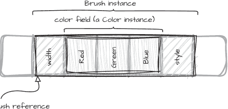

*图 2-1：嵌入在堆上 `Brush` 实例中的 `Color` 值*

当我们创建一个新的 `Brush` 时，实例在堆上创建，我们会得到对其的引用。`color` 字段占据 `Brush` 实例内存空间内的内存。如果我们将 `Color` 实现为 `record struct` 而不是 `struct`，结果也是一样的。`Record struct` 与 `struct` 完全一样是值类型，并且在任何包含对象的内存空间内直接分配。

值类型实例不会单独进行垃圾回收，但如果值类型实例嵌入在已在堆上分配的另一个对象中，则值类型实例使用的 *内存* 将在包含对象的垃圾回收期间被回收。

`color` 字段所表示的 `Color` 实例的生命周期与 `Brush` 实例的生命周期绑定。当垃圾回收器确定 `Brush` 实例不再使用时，它将释放该实例的内存，包括嵌入的 `Color` 值。

### 数组元素

当值类型实例是数组中的元素时，它严格来说不是数组对象的字段，但该值仍嵌入在数组的内存中。数组始终在堆上分配，无论其元素的类型如何。当我们创建数组时，我们会得到对其的引用。为了说明这一点，请考虑这个 `Color` 值的数组，其中 `Color` 是一个结构体：

```
var colors = new Color[3];
```

这里的 `colors` 变量是对堆上三个 `Color` 实例的数组的引用。`colors` 数组的内存布局可能如下图 2-2 所示。

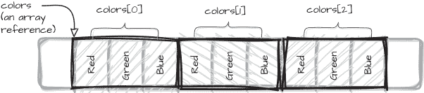

*图 2-2：内存中的 `Color` 结构体数组*

在 `colors` 数组中，每个元素都足够大，可以存储三个 `int` 后备字段。如果元素类型有更多字段，每个元素在堆上就需要更多的空间。如果 `Color` 类型是 `record struct` 而不是 `struct`，布局将是相同的；请记住，编译器会将 `record struct` 翻译成 `struct`。

相比之下，引用变量的大小都相同，无论类型定义中声明了多少个字段。引用数组所需的内存仅由元素数量决定，而不是每个实例的大小。

无论数组的元素是引用还是值类型实例，数组始终在堆上，并且数组变量引用其元素。如果垃圾回收器确定数组不再使用——即没有指向它的活动引用变量——那么其所有元素的内存将一次性释放。

### 嵌入的引用

引用字段也嵌入在其包含的类型中，但其实例并非如此。如果我们在清单 2-5 中将 `Color` 实现为引用类型而不是值类型，`Brush` 实例的布局会有所不同。`Brush` 类的 `color` 字段将是一个引用，如图 2-3 所示。

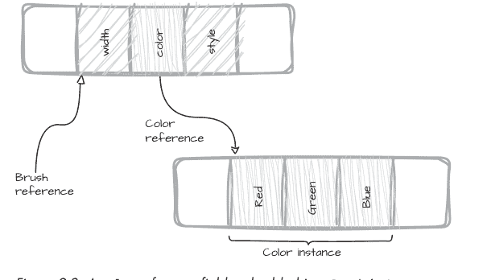

图 2-3：嵌入在 `Brush` 实例中的 `color` 引用字段

`Brush` 类型不会在其自己的内存中包含整个 `Color` 实例，而是 `color` 字段引用堆上其他位置的单独 `Color` 实例。引用类型实例始终在堆上分配，并且彼此独立。这适用于任何引用类型，因此如果我们将 `Color` 实现为类或 `record` 也是如此。

这里的 `Color` 实例的生命周期独立于 `Brush` 实例。当 `Brush` 实例不再使用且其内存被释放时，

`Color` instance will remain in memory until the garbage collector determines that it's no longer needed.

## Field and Property Layout


All user-defined types can contain instance fields and properties. However, structs and record structs have one restriction that does not apply to classes or records: a value type definition can't embed a field of its own type.

You've already seen how value type instances directly contain their fields. If a type has a field that is itself a value type, that field also directly contains its data. If the type of that field is the same as its containing type, the compiler is unable to determine how to create it. Consider the simple struct in Listing 2-7 that embeds an instance of itself as a field.

```
struct Node
{
    Node p;
}
```

*Listing 2-7: A struct containing an instance of itself*

This example will not compile. The compiler can't know how to lay out the contained field named `p`, because `p`'s type isn't fully defined at the point where it is declared. The same is true of properties, because even automatic properties require a backing field, though that field is hidden from us.

The same reasoning applies to an indirect dependency, illustrated in Listing 2-8.

```
struct Tree
{
    Node root;
}
struct Node
{
    Tree leftChild, rightChild;
}
```

*Listing 2-8: A struct with a cyclic dependency*

Neither the `Tree` type nor the `Node` type can be created here because the layout of each depends on the other. This might sound draconian, but in practice it's rarely a problem, and we have an easy workaround: if we change the definition of either `Tree` or `Node` to make it a reference type, the compiler will accept this code. The rule applies only to value types because, as mentioned previously, references are always the same size regardless of the type to which they refer. This means the compiler doesn't need to know the layout of a class or record to establish a reference to it.

## Boxed Values

References can refer only to objects on the heap and can’t refer to individual value type instances, even those enclosed within a reference type object. The only way for a reference variable to individually refer to a value type instance is to make a copy of the value, put that copy on the heap, and refer to the copy with a new reference. The process of creating a copy and storing it on the heap, known as boxing, is automatic when the type of the variable is a reference type. A boxed value can always be converted back to its original value type, a process called unboxing, where the value contained in the box is copied into the target variable.

Boxing happens automatically when we refer to a value using a reference variable such as `object`, or when we pass a value as an argument to a method that takes a reference type parameter. Unboxing is always explicit: we need to cast the boxed variable back to its correct value type, as shown in Listing 2-9.

```
public readonly struct Color
{
    public Color(int r, int g, int b)
        => (Red, Green, Blue) = (r, g, b);

    public int Red { get; }
    public int Green { get; }
    public int Blue { get; }
}

var red = new Color(0xFF, 0, 0);
var green = new Color(0, 0xFF, 0);

❶ object copy = green;
Assert.That(object.Equals(❷ red, copy), Is.False);

var copyGreen = ❸ (Color)copy;
```

*Listing 2-9: Boxing and unboxing*

The type of the `copy` variable is `object`, and is therefore a reference, so the value of `green` gets boxed into `copy` ❶. Similarly, calling the `object.Equals()` method boxes the value of `red`, because the method takes two `object` parameters ❷. We don’t need to explicitly cast the value to the `object` type; it’s boxed implicitly. We do require an explicit cast to unbox the value stored in `copy` into a new variable ❸.

As you’ll see shortly when we cover the Common Type System, `object` is the base class of every type, meaning we can always use `object` to refer to any other variable, including value type instances. A `struct` can also implement one or more interfaces. Interfaces are reference types, so if we use either `object` or an interface type to refer to a value, that value is automatically boxed onto the heap.

A boxed value can be unboxed only to its original type. We can’t, for instance, unbox an `int` value into a `double`, even though an implicit built-in conversion exists from `int` to `double`. If we attempt to unbox a value to anything other than its original type, we’ll get an `InvalidCastException` at run time.

Boxed values are copied to the heap, which means the box is no longer subject to the scope of its variable and may exist beyond the lifespan of its original value. It’s up to the garbage collector to clean up boxed values. Chapter 4 discusses boxing in more detail.

## Semantics and Type

Value types have semantic implications that go beyond being an instance of a `struct` or `record struct`. Choosing a value type instead of a reference type when we define our own types requires much more than a consideration of possible optimizations. Records, in particular, differ from classes, because even though records are compiled into classes and are therefore reference types, they share some important behavioral characteristics with value types.

Before delving into the behavior of `record` and `record struct` types, we need to better understand how structs differ from classes.

## The Common Type System

C# has a hierarchical type system, known as the *Common Type System*, in which all types derive from `object`, a keyword alias for the `System.Object` type. This is why we can always use `object` to refer to any other variable—although, as you just saw, in the case of value types, the instances are boxed so they can be referred to by `object` references.

Even the built-in types, such as `int` and `float`, inherit from `object`. In fact, all built-in types are aliases for types in the `System` namespace. The `System` types that underlie the numeric types are all structs and therefore value types. For example, `int` is an alias for the `System` type `public readonly struct Int32`.

Enumeration types created with the `enum` keyword are not aliases to `System` types, although they all *derive* from the `System.Enum` class. The individual values of an `enum` declaration have an underlying numeric type, which by default is `int`. We could specify a different numeric type—for example, if we wanted to allow the enum elements to have values larger or smaller than is permitted for an `int`.

The non-numeric built-ins `string` and `object` are aliases to classes in the `System` namespace, so they’re both reference types.

When we use the `class` or `record` keyword to define our own reference type, our new type derives directly from the `object` base class unless it explicitly inherits from another type. The `object` base class is neither an interface nor abstract. It has a mix of virtual, nonvirtual, and static members, which provide the default implementations common to all objects.

All struct types (including record structs) and the `System.Enum` type implicitly derive from `System.ValueType` (for which there’s no keyword alias), which in turn derives from the `object` base class, so all struct types derive indirectly from `object`. Value types, unlike reference types, have an intermediate base class defined by the language.

> NOTE
>
> `ValueType` itself is not a `struct`, which is sometimes overlooked. All structs implicitly inherit from `ValueType`, so `ValueType` itself must be a class. Moreover, `ValueType` is an abstract class, meaning we can create an instance of `object` but not of `ValueType`.

The `ValueType` class overrides all the virtual methods defined in the `object` base class—`Equals()`, `GetHashCode()`, and `ToString()`—and customizes their implementations to provide behavior tailored for value types. The `ValueType` implementations for `Equals()` and `GetHashCode()` are extremely important because they provide the value-based definition of equality that distinguishes value types from reference types. The difference between these implementations has to do with the way values are copied.

## Copy Semantics


The difference between where reference types and value types store their instance data has important implications when we copy variables, because copying a reference does not copy the instance. Listing 2-10 shows a simple example to illustrate the difference.

```
var thing = new Thing { Host = "Palmer" };
var copy = thing;
copy.Host = "Bennings";
Assert.That(thing.Host, Is.EqualTo("Palmer"));
```

Listing 2-10: Copying a variable

Here we’re copying the value of the `thing` variable into a new variable called `copy` ①. Then we assign a new value to the `Host` property of `copy` ②. The test checks that the properties of the original variable haven’t changed. The success of the test assertion depends on whether `Thing` is a value type or a reference type.

As noted earlier, all variables have a value that we may copy to a new variable. If `Thing` is a value type, any copy we make is a new instance of the type, so if we modify any fields of that copy, those changes have no effect on the fields of the original value. Therefore, if `Thing` is a `struct` or a `record struct`, the test will pass.

If `Thing` is a reference type, on the other hand, the `thing` variable’s value is a reference. When we copy a reference, only the value of the reference is copied, and it refers to the same instance as the original variable’s value. This means if we modify the instance using one reference, that change is reflected in all the references to it. Thus, if `Thing` is a `class` or a `record`, the test will fail.

## Locks and Reference Semantics

Some situations require the behavior of reference type variables, and using a value type instance would be incorrect or even disallowed. For example,

我们不能使用值类型在 `lock` 语句中来防止一段代码被多个线程并发执行。编译器禁止这样做，因为用作锁的变量需要是对堆上对象的引用。对对象加锁的目的是允许在任何给定时间只有一个线程执行它所保护的代码。对象实例标识了锁，并且可以从不同的线程对它有多个引用。

`lock` 语句的底层机制是 `System.Threading.Monitor` 类。`lock` 语句被翻译为 `Monitor` 的 `Enter` 方法，该方法以 `object` 作为其参数。任何传递给 `Monitor.Enter` 作为参数的值类型实例都将被自动装箱。每个调用 `Monitor.Enter` 的线程都会单独装箱该值，并且锁的获取永远不会失败，从而使其毫无意义。

当我们完成锁的使用后，需要调用 `Monitor.Exit` 并传递与 `Monitor.Enter` 获取锁时使用的相同引用。编译器会在 `lock` 块的闭合大括号处插入调用 `Monitor.Exit` 的代码。如果我们使用值类型，对 `Exit` 的调用将在堆上产生一个新的装箱值，因此与对 `Enter` 的调用中使用的引用不同。其结果是释放锁将失败，并出现 `SynchronizationLockException` 错误。

这是一种积极需要引用语义的情况，因为将引用传递给 `Enter` 方法不会复制实例。监视器和使用锁的代码都引用同一个实例。

## 标识相等 vs 值相等

当我们说我们在比较变量是否相等时，我们真正的意思是我们在比较变量的值。如果两个变量具有相同的值，则认为它们相等。每种值的类型都起着重要作用：被比较的值必须为相同类型，尽管一个或两个值可能是通过隐式转换得到的。

如果我们比较两个相同引用类型的变量的值，它们的各自值是引用，如果它们都引用内存中的同一个对象，则默认情况下比较相等。这被称为标识比较。我们可以在自己的引用类型中覆盖默认的标识比较行为（我们将在第 5 章详细讨论这一主题），但对于具有相同字段值的两个不同实例的引用，根据默认的标识比较，它们比较不相等，因为它们引用的是不同的对象。

相比之下，两个值类型实例比较相等——再次强调，默认情况下，我们可以修改此行为——如果一个实例的所有字段与其另一个实例的对应字段比较相等。值类型实例与引用类型实例之间相等比较行为的差异与它们的各自复制语义直接相关。由于值类型实例的副本是具有相同状态的新独立实例，因此标识比较毫无意义。这两个复制和相等概念因此密切相关。

能够比较两个值是否相等的能力经常被低估。即使我们在自己的代码中很少需要比较变量，常用的类如 `List<T>`、`Dictionary<T>`，以及在集合上工作的 LINQ 方法也可能在我们看不见的地方进行这些比较。`Equals` 是由 `object` 基类定义的一个虚方法，这表明它有多么基础，因为这意味着我们可以对任何值调用 `Equals` 方法将其与另一个值进行比较。

然而，`object.Equals` 实现始终执行标识比较，这对于值类型来说再次毫无意义。出于这个原因，所有结构体都隐式继承 `ValueType` 类。`ValueType` 覆盖 `Equals` 方法以执行基于值的比较。

相等对于引用类型和值类型意味着什么的差异会影响代码在运行时的行为。考虑清单 2-11，其中 `Thing` 类型尚未分配为引用类型或值类型，并且没有显式覆盖 `Equals` 方法。在这里，我们创建了两个 `Thing` 实例，它们的 `Host` 属性具有相同的值。当我们调用 `Equals` 时会发生什么完全取决于 `Thing` 是类、记录、结构体还是记录结构体。

```
public ??? Thing
{
    public string Host { get; set; }
}

var thing = new Thing { Host = "Palmer" };
var clone = new Thing { Host = "Palmer" };

Assert.That(clone.Equals(thing), Is.True);
```

*清单 2-11：比较两个独立变量的相等性*

如果 `Thing` 是类，此断言将失败，因为 `object.Equals` 方法只有在 `clone` 和 `thing` 是对同一实例的引用时才会返回 `true`，而它们不是。如果 `Thing` 是结构体，此断言将通过，因为 `ValueType` 的 `Equals` 实现如果 `clone` 和 `thing` 具有相同的值；即它们的所有字段比较相等，则返回 `true`。

`clone` 和 `thing` 变量如果 `Thing` 是记录或记录结构体，也会比较相等，因为它们也对相等使用基于值的比较。

## 记录、结构体和值语义

记录是引用类型，但在比较两个记录变量是否相等时具有值般的行为。当记录类型被编译时，编译器会生成一个类定义，并覆盖 `Equals` 方法的实现，除非我们自己定义一个。记录生成的 `Equals` 方法比较两个实例以确定它们是否具有相同的状态，而不是仅仅比较两个引用以确定它们是否引用同一实例。

在结构体中，另一方面，如果我们不覆盖 `Equals`，相等比较依赖于 `ValueType` 基类提供的 `Equals` 实现。记录作为引用类型，不继承自 `ValueType`。记录结构体确实继承自 `ValueType`，但与记录一样，`Equals` 由编译器生成的实现覆盖，因为 `ValueType.Equals` 可能不是最优实现。

`ValueType` 实现必然是通用的；它必须适用于任何结构体类型，无论结构体字段的类型如何。如果类型的某个字段具有自定义的 `Equals` 实现，包含类型的实例必须在比较时使用该字段的实现；对实例进行简单的结构或按位比较可能并不总是正确。`ValueType` 提供的 `Equals` 实现在运行时依赖于反射来确定如何比较字段，并且如果字段的类型有一个，则会使用该字段的 `Equals` 覆盖实现来比较该字段。

如果我们想避免结构体中反射的开销，我们必须用自己的实现覆盖 `Equals`，以比较每个字段和属性与其正在比较的实例中的对应字段或属性。如果每个字段和属性值比较相等，在需要时使用其 `Equals` 方法，那么这两个实例相等。这本质上是编译器为记录和记录结构体提供的实现。

重申一下，结构体、记录和记录结构体都采用基于值的状态比较来实现 `Equals` 方法，但对于记录和记录结构体，实现是由编译器自动生成的，使我们免于提供自己的自定义实现的责任。

我们对记录使用的变量——但不包括记录结构体——是引用，并且当我们将一个记录引用分配给另一个变量时，我们仍然得到对同一记录实例的两个引用，就像该类型是类时一样。因此，记录对于复制具有引用语义，对于相等比较具有值语义。

值类型和引用类型的不同比较和复制语义对这些类型实例在运行时的行为方式具有重要影响。然而，在实例最初创建的方式上也存在重要的差异。在下一节中，我们将研究构造和初始化如何根据实例的类型是值类型还是引用类型而有所不同。

## 构造和初始化

创建新对象在表面上是一个简单的操作，但在幕后编译器花费了很大努力使该过程尽可能高效。原则上，创建对象涉及为类型实例分配内存，然后调用一个构造函数，其工作是初始化实例的字段。语法对于值类型和引用类型是相同的，但 `new` 对它们的处理方式不同，并隐藏了不同类型在内存中如何以及在哪里分配的复杂性。

换句话说，新的表达式是一种抽象，它屏蔽了内存分配和使用的实现细节。

具体来说，引用类型实例的内存是动态分配的。当创建一个类或记录类型的新的实例时，内存会在运行时在堆上分配。`struct` 和 `record struct` 类型的实例分配方式不同，这取决于生成的实例如何使用。考虑以下代码，它使用名为 `Thing` 的类型的新实例初始化一个变量：

```
var thing = new Thing();
```

创建对象并将其分配给变量的基本语法是相同的，无论 `Thing` 是类、`struct`、`record` 还是 `record struct`。正如你在接下来的章节中会看到的，这段代码依赖于 `Thing` 具有一个可访问的构造函数，该构造函数可以用零个参数调用，这对于引用类型来说并不总是成立。暂时，让我们假设 `Thing` 实例可以通过这种方式创建。如果 `Thing` 是类或 `record`，`new` 会在运行时在堆上分配内存并返回对新对象的引用，该引用被分配给 `thing` 变量。

如果 `Thing` 是 `struct` 或 `record struct`，则新实例被分配给 `thing` 变量。然而，这段代码可能分配也可能不分配 `Thing` 的新实例的内存，也可能调用也可能不调用构造函数。原因在于构造和初始化是两个独立的过程。部分差异与 `Thing` 是值类型还是引用类型有关。

## 默认初始化

默认初始化意味着类型的每个字段，包括属性的 backing 字段，都被赋予一个默认值，该默认值在语言中定义为以下之一：

- 引用被设置为 `null`。
- 内置数值值类型变量被设置为 `0`。
- 所有其他值类型都被默认初始化。

默认初始化的引用类型字段是错误的常见原因。例如，列表 2-12 中的简单 `MusicTrack` `struct` 依赖于我们手动初始化实例并设置其属性。如果我们没有为 `MusicTrack` 实例的属性设置合适的值，在使用该实例时可能会得到异常。

```
public struct MusicTrack
{
    public string Artist { get; set; }
    public string Name { get; set; }

    public override string ToString()
        => $"{Artist.ToUpper()}: {Name.ToUpper()}";
}

var defaultTrack = new MusicTrack();

var print = defaultTrack.ToString();
```

列表 2-12：初始化引用类型字段

对 `ToString` 的调用导致空引用异常，因为 `defaultTrack` 值已被默认初始化。`ToString` 方法在其 `Artist` 和 `Name` 属性上调用 `ToUpper`，而这些属性的默认初始化值为 `null`。我们需要警惕默认初始化引用的任何使用，以避免访问空引用导致的问题。最小化默认初始化值影响的一种方法是提供我们自己的实例构造函数。

## 实例构造函数

实例构造函数与方法类似，可以有零个或多个参数。与方法一样，构造函数也可以重载，因此我们可以为一个类型定义多个构造函数，每个构造函数的参数数量不同，或参数类型不同。类、`struct`、`record` 和 `record struct` 的构造函数定义有很多相似之处，但也存在几个重要差异。

在列表 2-13 中，我们为 `MusicTrack` `struct` 添加了一个构造函数，并使用参数值初始化实例的属性值。我们使用空合并运算符 `??` 为每个属性分配空字符串，如果其对应的参数为 `null`。

```
public readonly struct MusicTrack
{
    public MusicTrack(string artist, string name)
    => (Artist, Name) = (artist ?? string.Empty, name ?? string.Empty);

    public string Artist { get; }
    public string Name { get; }

    public override string ToString()
        => $"{Artist.ToUpper()}: {Name.ToUpper()}";
}
```

列表 2-13：添加带参数的实例构造函数

通过添加构造函数，我们不再需要依赖 `MusicTrack` 用户显式设置属性，因为这些属性的初始值在构造函数中设置。我们已将这些属性设为 get-only——即只能在构造函数中赋予值——并将 `MusicTrack` 设为 `readonly struct`。然而，我们仍必须谨慎使用 `ToString` 方法中的属性值，因为任何值类型的实例始终可以被默认初始化，无论是否存在用户定义的构造函数定义。为 `MusicTrack` 添加我们自己的构造函数以给属性赋予有意义的值并不足以防止因使用空引用调用方法而发生的异常，因为 `MusicTrack` 是 `struct` 类型。

如果启用了可空引用类型功能（参见第 64 页的“可空引用类型”），构造函数的参数将是非可空变量，这意味着为任一参数传递 `null` 会导致编译器警告。使用非可空参数并不意味着不能将 `null` 作为参数传递，但我们可能会决定警告已足够保护，可能允许我们在构造函数中省略空合并赋值。可空引用类型功能并不意味着我们可以在 `ToString` 方法中使用属性值之前避免验证属性值是否不为 `null`。幸运的是，空条件运算符使检查变得简单且安全：

```
public override string ToString()
    => $"{Artist?.ToUpper()}: {Name?.ToUpper()}";
```

这里空条件运算符的存在，即每个属性名后附加的 `?`，意味着在每种情况下 `ToUpper` 方法仅在属性为非空值时才会被调用。如果任一属性为 `null`，则大括号内表达式的结果为 `null`，而字符串插值将其视为空字符串。

如果 `MusicTrack` 是类或 `record`，我们自己构造函数的存在意味着我们将无法再像这样在不传递参数的情况下创建实例：

```
var track = new MusicTrack();
```

如果我们尝试创建默认构造的实例，我们会得到以下编译器错误：

```
[CS7036] There is no argument given that corresponds to the required formal parameter 'artist' of 'MusicTrack.MusicTrack(string, string)'
```

如果我们没有为类或 `record` 提供任何构造函数，编译器会为我们插入一个默认构造函数。然而，如果我们在定义自己的引用类型时定义了构造函数，编译器将不会生成默认构造函数。编译器不会为值类型创建默认构造函数，但 `struct` 或 `record struct` 的实例无论是否定义了我们自己的构造函数都可以被默认初始化。

## 默认和生成的构造函数

引用类型和值类型的行为部分不同，因为引用类型在堆上分配，但值类型可能不会。编译器为引用类型生成默认构造函数，因为此类类型的实例是动态分配的，并且在运行时初始化。当引用类型实例在堆上分配时，其内存被设为零，有效地默认初始化了该实例。


值类型的处理方式不同，因为其内存不一定在运行时分配：对于局部值类型变量，编译器可能会为实例数据预留内存，并且程序直接访问该内存。底层通用中间语言（CIL）有一个高效的指令用于默认初始化值类型实例，该指令有效地将实例使用的内存清零，无论其内存实际位于何处。

我们可以将 `struct` 或 `record struct` 的默认初始化视为由编译器提供的默认构造函数执行，因为结果在任何情况下都是相同的。默认初始化值类型提供了轻微的性能优势，因为它不需要对构造函数进行方法调用，尽管它几乎从不是最重要的优化。

在位置记录或位置 `record struct` 中，编译器会根据我们在类型定义中使用的参数生成一个公共构造函数，如下所示：

```
public sealed record Color(int Red, int Green, int Blue);
```

此示例中 `Color` 的参数告诉编译器使用这些名称和类型创建公共属性。编译器还创建一个与记录参数列表签名相同的构造函数，其中属性被赋予其值。编译器生成的构造函数等同于以下内容：

```
public Color(int Red, int Green, int Blue)
=> (this.Red, this.Green, this.Blue) = (Red, Green, Blue);
```

尽管构造函数是由编译器生成的，但它仍被视为用户定义的构造函数，因此仍然会抑制 `Color` 记录的默认构造函数。

无论其类型如何，实例在首次创建时始终会被默认初始化，无论其内存是在堆上分配还是在其他位置。

当我们为类定义自己的构造函数时，我们可以依赖所有字段在构造函数体执行前已被默认初始化；类的字段在构造函数内被视为已初始赋值。在 `struct` 的构造函数中，字段初始为未赋值，因此我们必须为 `struct` 或 `record struct` 的每个字段明确分配一个值，即使只是用其默认初始化值替换它。

## 重载构造函数

我们可以为任何类型提供带参数的构造函数，并且可以通过定义多个具有不同数量或类型参数的构造函数来重载构造函数。当我们希望支持构造类型的不同方式时，这很有用。例如，列表 2-14 显示了一个 `struct`，它有两个具有不同签名的构造函数。

```csharp
public readonly struct Color
{
    public Color(int red, int green, int blue)
        => (Red, Green, Blue) = (red, green, blue);

    public Color(uint rgb)
        => (Red, Green, Blue) = Unpack(rgb);

    public int Red { get; }
    public int Green { get; }
    public int Blue { get; }
}
```

Listing 2-14: Overloading constructors

第一个构造函数从三个独立参数（`red`、`green`、`blue`）初始化三个属性。第二个构造函数接收 RGB 值的数值表示，并通过调用 `Unpack` 方法（此处未显示）将数字解包为其组成部分来初始化 `Red`、`Green` 和 `Blue` 属性。我们通过传递不同的参数来选择使用构造函数的不同重载，如 Listing 2-15 所示。

```csharp
var orange = new Color(0xFFA500);
var yellow = new Color(0xFF, 0xFF, 0);
```

Listing 2-15: Selecting the correct overload

这里，`orange` 变量使用带单个 `uint` 参数的构造函数创建（Listing 2-14 中的第二个构造函数），而 `yellow` 变量使用带三个 `int` 参数的构造函数（Listing 2-14 中的第一个构造函数）。

## Parameterless Constructors

如前所述，为类类型定义自己的构造函数会抑制编译器生成的默认构造函数，这意味着我们只能通过向自己的构造函数参数传递参数来创建该类型的新实例。如果我们需要在不带参数的情况下创建此类引用类型的实例，我们可以定义自己的无参数构造函数，我们可能会用它来将引用类型字段和属性初始化为非空值。当类包含需要初始化但可以为空的集合时，这很常见，如 Listing 2-16 所示。

```csharp
public sealed class Playlist
{
    public Playlist(IEnumerable<MusicTrack> items)
        => queue = new(items);

    public Playlist()
        => queue = new();
}
```

```csharp
public void Append(MusicTrack item)
    => queue.Add(item);
//--snip--

    private Queue<MusicTrack> queue;
}
```

Listing 2-16: Defining a parameterless constructor

这里定义的两个构造函数允许我们通过传递要填充队列的项目序列①或不传递参数②来创建 `Playlist`。如果不传递参数，`queue` 字段将被初始化为空队列，确保它不为 `null`。

两个构造函数都通过使用类型推断来初始化 `queue` 字段，这是一种称为目标类型 `new` 的功能，于 C# v9.0 中引入。编译器从要初始化的目标变量的类型推断 `new` 所需的类型——在此示例中为 `Queue<MusicTrack>`。`queue` 字段对于任何 `Playlist` 实例都保证为非空，因此我们不需要在 `Playlist.Append` 方法中检查 `null`。

在位置记录中，编译器会基于记录的位置参数创建构造函数，因此默认情况下，位置记录的实例不能在不带参数的情况下创建。如果我们需要这种行为，可以为位置记录定义自己的无参数构造函数。

另一方面，结构体或位置记录结构体始终可以在不带参数的情况下创建，无论我们是否定义了自己的构造函数。

## Structs and Default Values

从 C# v10.0 开始，我们可以为值类型定义自己的无参数构造函数，以帮助确保任何引用字段都不为 `null`。然而，我们仍然需要在值类型的实现中检查 `null`，因为结构体或记录结构体的实例始终可以被默认初始化，从而有效地绕过我们定义的任何构造函数。这在 Listing 2-17 中有所说明，我们为 `MusicTrack` 结构体添加了一个无参数构造函数，该构造函数显式初始化两个字符串属性。

```csharp
public readonly struct MusicTrack
{
    public MusicTrack()
        => (Artist, Name) = (string.Empty, string.Empty);

    public MusicTrack(string artist, string name)
        => (Artist, Name) = (artist, name);

    public string Artist { get; }
    public string Name { get; }

    public override string ToString()
        => $"{Artist?.ToUpper()}: {Name?.ToUpper()}";
}
```

Listing 2-17: Adding a parameterless constructor for a struct

无参数构造函数将两个引用类型属性设置为非空值，因此当我们使用 `new MusicTrack` 创建 `MusicTrack` 实例时，对任一属性调用 `ToUpper` 是安全的。但是，这并不意味着我们可以在 `ToString` 中省略空条件检查。`Artist` 或 `Name` 仍可能为 `null`，如果实例是默认初始化的 `MusicTrack`——例如，当它是数组中的一个元素时：

```csharp
var favorites = new MusicTrack[3];

var print = favorites[0].ToString();
```

如果 `ToString` 中没有对 `null` 的检查，此代码将导致 `ToString` 抛出 `NullReferenceException`，因为创建 `favorites` 数组不会在其元素上调用我们的无参数构造函数。每个元素都被默认初始化，使 `Name` 和 `Artist` 属性保持其默认值 `null`，因此尝试对 `null` 引用调用 `ToUpper` 方法会导致异常。

数组元素在不调用我们提供的任何无参数构造函数的情况下被默认初始化。无参数构造函数保留用于当我们使用 `new` 关键字创建新实例时。

## Value Type Initialization

值类型实例在内存中分配方式的一个相当微妙的后果是，如果值类型的字段都是 `public`，我们可以肯定地在构造函数外部为每个字段分配值（只要它们不是只读的），这会导致整个实例被完全分配。

例如，Listing 2-18 为未初始化的结构体变量的每个字段分配值。

```csharp
public struct Color
{
    public int red;
    public int green;
    public int blue;
}

Color background;  // initially unassigned variable

background.red = 0xFF;
background.green = 0xA5;
background.blue = 0;

Assert.That(background.red, Is.EqualTo(0xFF));
```

Listing 2-18: Definitely assigning a struct

此代码可以编译，并且测试通过。我们可以读取 `red` 字段的值，即使我们从未使用 `new` 分配 `background` 变量或为其调用构造函数。如果 `Color` 是记录结构体，也会如此。

## Field Initializers

在类或记录定义中，以及在 C# v10.0 之后的结构体或记录结构体中，我们可以通过使用 *field initializers* 内联为字段分配初始值。我们也可以通过使用 *property initializers* 对自动属性执行相同的操作，后者初始化与属性关联的隐藏支持字段。Listing 2-20 使用字段初始化器为 Listing 2-16 中的 `Playlist` 类的 `queue` 字段分配初始值，并为 `Playlist` 添加一个 `Name` 属性，我们也通过使用属性初始化器为其分配初始值。

```csharp
public sealed class Playlist
{
//--snip--

    public string Name { get; set; } = "_playlist";

    private Queue<MusicTrack> queue = new();
}
```

*Listing 2-20: Assigning initial values for fields and properties*

字段和属性初始化器是对象构造的一部分，但在值类型实例被默认初始化时不会应用。从概念上讲，初始化器在构造函数体执行之前应用。如前所述，如果没有用户定义或位置构造函数，编译器会为类和记录类型创建默认构造函数；然而，编译器不会为任何值类型合成无参数构造函数。因此，如果我们想为结构体或记录结构体类型使用字段或属性初始化器，我们还必须至少定义一个自己的构造函数。这可以是无参数构造函数，也可以是带一个或多个参数的构造函数。

字段初始化器不能引用任何实例成员。然而，由于静态字段保证在任何实例字段之前被肯定分配，因此字段初始化器可以引用静态值。静态字段也可以有初始化器，并且可以引用其他静态字段。然而，当从另一个静态字段引用一个静态字段时，我们需要小心，因为它们是按照在类中出现的顺序初始化的。

## Object Initializers

使用 *object initializers*，我们在创建新实例时为变量的公共可变属性设置值，如下所示：

```csharp
var fineBrush = new Brush { Width = 2 };
```

类、记录、结构体和记录结构体都接受此语法，并且它们的行为方式相同。初始化过程对每个都相同：以通常的方式调用构造函数来创建实例，然后将值分配给实例的属性。在此示例中，`Brush` 使用无参数构造函数（或带 all-optional parameters），但我们可以在大括号内的初始化表达式之前调用任何构造函数。在不需要参数的构造函数的特殊情况下，我们可以省略构造函数的括号。

类和记录需要一个可访问的无参数构造函数才能使用此语法。如果类或记录的无参数构造函数被隐藏或非公开，我们必须在对象初始化的大括号内调用一个有效的构造函数。对于结构体或记录结构体类型，我们不必担心这个问题，因为如果该类型没有无参数构造函数，它们始终可以进行默认初始化。

## 仅初始化属性

从 C# v9.0 开始，任何属性都可以是仅初始化的，这意味着它只能在创建新实例期间写入。在 C# v9.0 之前，对象初始化要求属性具有公共 `set` 访问器，这意味着对象初始化不能与不可变属性一起使用。对象初始化要求在构造函数完成后设置属性的值，而对于没有公共 `set` 访问器的属性来说这是不允许的。`init` 访问器允许在对象初始化期间设置属性，然后在初始化完成后使属性不可变。

列表 2-21 中的 `Color` 结构体演示了对象初始化期间如何使用仅初始化属性。

```
public readonly struct Color
{
    public int Red { get; init; }
    public int Green { get; init; }
    public int Blue { get; init; }
}
var orange = new Color { Red = 0xFF, Green = 0xA5 };

Assert.That(orange.Red, Is.EqualTo(0xFF));
Assert.That(orange.Green, Is.EqualTo(0xA5));
Assert.That(orange.Blue, Is.EqualTo(0));
```

列表 2-21：设置属性为仅初始化

当我们创建 `orange` 变量时，首先使用默认构造函数创建一个新的 `Color`，为每个属性赋予其默认值 `0`。大括号之间的对象初始化器为 `Red` 和 `Green` 属性赋予新值，而 `Blue` 属性保留其默认值。请注意，`Color` 是一个 `readonly` 结构体，这要求结构体没有可变属性。

我们可以在实例构造函数中为仅初始化属性分配值，也可以通过使用对象初始化来分配，但实例创建后我们不能再分配新值。仅初始化属性是不可变的。`init` 访问器语法可用于任何类型的属性和索引器，尽管它是在 C# v9.0 中引入以支持记录支持的特殊初始化语法，即非破坏性突变。

## 非破坏性突变

记录和记录结构体支持非破坏性突变语法，并且从 C# v10.0 开始，结构体和匿名类型也支持。语法上，非破坏性突变与对象初始化类似，只是它通过复制现有实例并为该副本中的选定属性提供新值来初始化新实例。列表 2-22 演示了此语法，使用 `with` 关键字将 `orange` 记录变量复制到名为 `yellow` 的新变量中，然后为副本的一个属性分配新值。

```
public sealed record Color(int Red, int Green, int Blue);
var orange = new Color(0xFF, 0xA5, 0);

var yellow = orange with { Green = 0xFF };

Assert.That(yellow.Red, Is.EqualTo(0xFF));
Assert.That(yellow.Green, Is.EqualTo(0xFF));

Assert.That(orange.Green, Is.EqualTo(0xA5)); // unchanged in orange
Assert.That(orange.Blue, Is.EqualTo(0));
```

列表 2-22：使用非破坏性突变初始化记录的副本

我们在使用 `with` 关键字创建 `yellow` 变量时创建的 `with` 表达式会创建一个 `Color` 记录的新实例，其属性值与原始 `orange` 实例相同。然后在大括号中 `with` 之后指定的那些属性会使用与对象初始化相同的语法分配值。这种方法称为非破坏性突变，因为原始记录不会被更改。

构造函数和初始化器是我们创建具有已知值的新实例的两种方式。然而，有时我们无法为变量提供初始值，但将其未初始化又太过严格：由于确定性赋值规则，我们甚至无法测试它是否具有值。在下一节中，我们将研究当我们需要一个没有值的变量时可用的选项，以及值类型和引用类型在此方面有何不同。

## null 值和默认值

普通值类型变量永远不能为 `null`。值类型实例直接包含其所有字段，并且不一定有“无值”的表示。值类型的默认初始化实例并不是同一回事——它是一个完整的类型实例，只是其每个字段都具有默认初始化值。

我们可以使用可空值类型，它可以被赋值为 `null` 并与 `null` 进行比较，如你稍后将看到的那样，但普通值类型实例与 `null` 不兼容。`null` 常量表达式是一个引用，因此只能分配给引用变量。无法将 `null` 分配给值类型变量的一个含义是，我们不能将 `null` 作为参数传递给值类型方法参数。

同样，尝试将值与 `null` 进行比较是没有意义的。如果我们这样做，如列表 2-23 所示，编译器会拒绝该代码。

```
public readonly struct Speed
{
--snip--
}

var c = new Speed();

Assert.That(c == null, Is.False);
```

列表 2-23：将值类型变量与 `null` 进行比较

编译器发出的错误如下所示：


```
[CS0019] Operator '==' cannot be applied to operands of type 'Speed' and '<null>'
```

然而，我们可以比较任何引用类型与 null，并且从 C# v8.0 开始，我们可以使用常量模式使此比较更直接，使用 is 关键字：

```
Assert.That(someObject is null, Is.True);
```

无论我们选择哪种方法，将任何值类型与 null 进行比较都没有意义，因为 null 是一个引用，其表示方式与值类型不同。也就是说，禁止将值类型与 null 进行比较有一个例外：泛型类型。

## 泛型和 null

在泛型类或方法中，无约束的类型参数变量可以与 null 进行比较。无约束的泛型类型可以是值类型或引用类型。为了说明这一点，列表 2-24 中的简单示例比较了泛型参数类型的实例与 null。

```
public static int Compare<T>(T left, T right)
{
    if(left is null) return right is null ? 0 : -1;
--snip--
}
```

列表 2-24：比较泛型类型参数实例与 null

`Compare` 泛型方法有一个名为 `T` 的类型参数，它可能表示值类型或引用类型，因为它没有类型约束。在此实例中，`T` 不被确定为值类型，因此编译器允许该语法。如果 `T` 的类型在运行时被确定为值类型，整个表达式 simply 评估为 false。

编译器仍然阻止我们将 null 分配给类型为 `T` 的变量，因为如果 `T` 是值类型，该赋值将在运行时失败。同样，我们不能通过无约束的类型参数返回 null，如列表 2-25 所示。

```
public static T Consume<T>(IProducerConsumerCollection<T> collection)
=> collection.TryTake(out var item) ? item : null;
```

列表 2-25：尝试将 null 作为泛型参数类型返回

这会产生以下错误：

```
[CS0403] Cannot convert null to type parameter 'T' because it could be a non-nullable value type. Consider using 'default(T)' instead.
```

在此示例中，困难源于 `T` 是无约束的。它可能表示结构体或记录结构体类型，对于这些类型 null 不是有效值。错误消息给出了一个提示，提示我们可以使用 `T` 的默认值而不是返回 null。默认值也有其他更重要的用例，但也有一些限制。

## 泛型和默认值

默认值的概念与 null 值密切相关，尤其是在泛型类型和方法的上下文中。有时，我们和编译器必须确保泛型参数类型 `T` 的实例被明确赋值，即使 `T` 的类型在编译时未知。我们不能只使用 new 来创建类型 `T` 的新实例，因为编译器无法确定 `T` 可用的构造函数。

如果 `T` 是值类型，我们始终可以使用默认初始化或调用无参数构造函数来创建默认实例，但如果 `T` 是引用类型，它可能没有可访问的默认或无参数构造函数。我们可以在 `T` 上使用 new 约束，这意味着我们的泛型类型或方法仅适用于具有可访问无参数构造函数的类型，但这可能过于严格。

在泛型类型中，我们可以使用泛型参数来表示泛型参数类型的字段或属性。泛型值类型必须确保其所有字段在构造函数退出控制之前都被明确赋值。为了使这成为可能，我们使用 `default` 关键字来初始化 `T` 的默认实例，如列表 2-26 所示的泛型结构体。

```
public readonly struct Node<T>
{
    public Node(int index)
    {
        idx = index;
        contained = default;
    }
}
```

private readonly int idx;

private readonly T contained;

}

*清单 2-26：初始化类型参数的默认实例*

在 `Node` 构造函数中，通过使用目标类型化的 `default` 字面量（自 C# 7.1 起可用）将 `contained` 字段赋为其类型的默认值，这等价于表达式 `default(T)`。当 `T` 是类或记录时，其默认值为 null；当 `T` 是结构或记录结构时，默认值是默认初始化的实例。请注意，使用 `default` 初始化值不会调用无参数构造函数（如果我们定义了这样的构造函数）。这段代码是有效的，因为我们总能创建 `T` 类型变量的默认值：如果 `T` 是值类型，该值就是 `T` 的默认实例；如果 `T` 是引用类型，则 `T` 的默认值为 null。`default` 关键字在泛型类型和方法之外有许多用途，但在泛型代码中它是不可或缺的。

默认值很有用，但不足以将某个特定的值类型实例标识为无效。换句话说，当我们的真实含义是*不存在值*时，我们不能使用默认值。结构或记录结构的默认值是默认初始化的实例，因此可能是*有效*值。请看清单 2-27。

```
int x = default;
int y = 0;

Assert.That(x.Equals(y), Is.True);
```

*清单 2-27：默认值也可能是有效值。*

`int` 类型的默认值是 0，在某些情况下我们可以用它来表示无效数字，但并非所有情况都如此。这一点是否重要（尤其是对我们自己的值类型而言）取决于类型实例的使用上下文，但将有效整数限制为仅非零值会非常受限。幸运的是，我们有替代方案。

## 可空值类型

*可空值类型*允许我们拥有一种值类型的表示，其含义是*不存在值*。可空值类型是值类型的包装器，可空值类型变量可能有值，也可能没有值。可空值类型变量还可以被赋值为 null，清单 2-28 中的简单测试演示了这一点。

```
int? x = null;
int y = 0;

Assert.That(x.Equals(y), Is.False);
```

*清单 2-28：使用可空值*

`x` 变量的 `int` 类型后面的 `?` 是表示 `x` 为 `Nullable<int>` 的简写。现在我们可以为 `x` 表示一个不同于 `int` 任何有效值的无效值。我们可以对任何值类型使用可空变量，而不仅仅是内置类型。可空值的默认值为 null，如下所示：

```csharp
int? x = default;
int? y = null;

Assert.That(x.Equals(y), Is.True);
```

这个测试会通过，因为 `x` 和 `y` 都为 null。第一行中的 `x` 声明初始化的不是默认的 `int`，而是默认的 `Nullable<int>`。可空值之间的相等比较会在有值的情况下比较基础值。如果两个可空值都没有值，或者它们所包含的值本身相等，则这两个可空值相等。`Nullable<T>` 是一个结构，并重写了 `Equals` 方法以提供此行为。

由于不能将 null 赋给普通的值类型变量，因此我们不能在 `as` 表达式的右侧使用普通值类型，如下所示：

```csharp
object speed = new Speed();
var actual = speed as Speed;
```

如果 `Speed` 是结构或记录结构，这段代码将无法编译，因为如果转换失败，`as` 运算符会返回 null。我们知道，null 不能被赋给值。解决方案是使用可空值类型作为转换的目标类型，如下所示：

```csharp
var actual = speed as Speed?;
```

在此示例中，`actual` 变量的类型是可空 `Speed`，如果转换失败（也就是说，如果 `speed` 变量实际上不是 `Speed` 类型），它的值将为 null。

## 可空引用类型

C# 8.0 引入了*可空引用类型*，该功能允许编译器在引用为 null 或可能为 null 而我们预期其具有真实值时向我们发出警告。虽然引用变量一直都可以具有 null 值，但可空引用类型功能允许我们表达是否*打算*让它们为 null。换句话说，当我们使用可空引用类型变量时，我们是在明确表示 null 是变量的*预期*潜在值。

引用变量默认是不可为 null 的。在清单 2-29 的声明中，`brush` 变量是一个*不可为 null*的引用。

```csharp
object brush = null;
```

*清单 2-29：声明不可为 null 的引用变量*

编译器会执行静态分析，如果无法保证不可为 null 的引用一定不为 null，它就能发出警告。换个更少否定表述的说法，如果某个可能为 null 的值被赋给不可为 null 的引用，编译器就会发出警告。特别是，像我们刚才所做的那样将 null 赋给不可为 null 的引用，会触发此警告：

> [CS8600] 将 null 字面量或可能的 null 值转换为不可为 null 的类型

如果我们尝试将可能为 null 的值作为参数传递给不可为 null 的方法参数，编译器会给出警告。请看清单 2-30 中的方法，它将字符串中每个单词的首字母大写。

```
public static string ToTitleCase(string original)
{
    var txtInfo = Thread.CurrentThread.CurrentCulture.TextInfo;
    return txtInfo.ToTitleCase(original.Trim());
}
```

*清单 2-30：定义带有不可为 null 的引用参数的 ToTitleCase 方法*

在 `ToTitleCase` 方法内部，我们应该能够依赖 `original` 参数具有真实的、非 null 的值，因为它是一个不可为 null 的字符串。这意味着我们可以避免显式编写代码来检查它是否为 null。当我们调用 `ToTitleCase` 时，如果编译器无法保证传入的参数不为 null，它就会给我们一个警告。

然而，我们可能有正当理由需要 null 引用，在这种情况下，我们会将变量的类型标记为可空，以抑制关于可能赋 null 值的编译器警告。其语法与可空值类型相同：在类型后面附加 `?`。清单 2-31 显示了一个由 `string?` 类型名指定的可空字符串元素集合。

```
var names = new List<string?>();
// Load names from somewhere, may contain null elements
--snip--
var properNames = names.Select(name => ToTitleCase(name));
```

*清单 2-31：为不可为 null 的参数传递可能为 null 的参数*

如果我们将清单 2-30 中的 `ToTitleCase` 方法应用于此集合，就会得到与清单 2-29 中类似的编译器警告，当时我们将 null 显式赋值给不可为 null 的引用类型变量：

> [CS8604] 参数“original”可能为 null 引用：“string ToTitleCase(string original)”。

我们会收到此警告，因为编译器无法保证集合中不包含 null 元素。编译器假定任何元素都可能为 null，因为集合的元素类型是可空引用。

如果在调用 `ToTitleCase` 之前显式检查每个元素，编译器就可以确定我们没有将 null 引用用作方法的参数。为此，我们可以将 `Select` 表达式展开为循环，例如清单 2-32 中的 `foreach` 循环。

```csharp
foreach (var name in names)
{
    if(name is not null)
        properNames.Add(ToTitleCase(name));
}
```

*清单 2-32：显式使用不可为 null 的引用*

这段代码不会提示关于 `ToTitleCase` 调用中参数的警告，因为编译器可以对方法调用之前的代码执行充分的分析，以保证 `name` 参数不为 null。然而，有时编译器需要我们的帮助来确定将变量赋给不可为 null 的引用或用不可为 null 的参数调用方法是否安全。清单 2-33 显示了清单 2-31 稍作修改后调用 `ToTitleCase` 的版本，在调用方法之前过滤掉了任何 null 元素。

```csharp
var properNames = names
    .Where(name => name is not null)
    .Select(name => ToTitleCase(name));
```

*清单 2-33：在方法调用前移除 null 元素*

然而，这段代码会给出与清单 2-31 相同的警告，因为编译器无法确定 `ToTitleCase` 不会以 null 参数调用。虽然看起来对 null 的检查是内联进行的，但实际上我们是在调用一个 lambda 函数来进行比较，而编译器不会尝试分析所有可能的代码路径来确保安全。幸运的是，我们有变通方案。

## null 包容运算符

我们可以使用 *null 包容运算符*来告知编译器，我们完全确定自己在做什么，并且没有将 null 引用用作不可为 null 的参数。null 包容运算符是附加在变量后面的 `!`，因此它也被称为*该死运算符*，就像在说“它绝对不是 null，该死！”当我们已经从集合中过滤掉所有 null 元素后，我们对 `ToTitleCase` 的参数应用该死运算符，如清单 2-34 所示。

```csharp
var properNames = names
    .Where(name => name is not null)
    .Select(name => ToTitleCase(name!));
```

*清单 2-34：使用 null 包容运算符*

使用 null 宽容运算符作为 `ToTitleCase` 的参数会让编译器确信调用具有非空引用类型参数的方法是安全的。如果我们不小心传递了一个空引用，我们就会（理所当然地）得到可怕的 `Object reference not set to an instance of an object` 异常。我们在使用 null 宽容运算符时必须小心，确保我们确实知道该变量不可能为 null。

可空引用类型虽然与可空值类型的语法相同，但只是一种指示编译器我们对变量做出某些假设的装置。与可空值类型不同，可空值类型由编译器注入行为的独立类型支撑，可空引用类型纯粹是编译时机制，用于静态分析，并且不会以任何方式改变我们代码的行为。在运行时，可空和不可空引用只是引用。然而，在代码中区分它们对于表达我们对可空性的假设是有用的。

意外的空引用异常是许多程序的祸害，程序员们不惜一切代价试图避免此类错误。现代 C# 的可空引用类型特性将其中一部分责任从程序员转移到了编译器上。

## Summary

> 我的目标是确保对引用的所有使用都绝对安全，并且由编译器自动进行检查。但我抵不住诱惑加入了空引用，只是因为它实现起来如此容易。这导致了无数的错误、漏洞和系统崩溃，在过去四十年中可能造成了十亿美元的痛苦和损失。

> —Tony (C.A.R.) Hoare

C# 中的类型系统与许多其他编程语言大致相似，包括对用户定义类型的支持。C# 在引用类型和值类型之间有所区别。虽然关于何时选择定义值类型而不是引用类型存在各种建议，包括来自 Microsoft 的文档，但这些指南通常只考虑了故事的一部分。

区分值类型和引用类型的技术目的是允许编译器和通用语言运行时对值做出假设，从而可能带来某些优化机会。我们讨论过的一些差异源于引用类型和值类型实例在内存中存储和管理的不同方式。值类型变量本身不受垃圾回收的影响，这本身就可以是一大优势。然而，我们不能仅仅把类改成结构体或记录结构体，就期望程序突然使用更少的内存或运行更快。值语义远不止声明为值类型那么简单。

同样，值类型的按值复制行为不仅仅是值使用内存方式的副作用。按值复制导致了对值类型施加的许多约束，而引用类型则不需要这些约束。在适当的地方使用值类型可以在微妙的方式上使我们的代码更清晰、更简单，例如在使用值时不必每次都检查 null 值。复制值的特性也会影响 `Equals` 方法的行为；尽管比较变量是否相等听起来微不足道，但它是使用变量的一个基本方面。

因此，值类型和引用类型之间的区别不仅仅是一份 *限制* 清单。真正的语义差异会影响程序的行为并带来切实的好处。值类型的一个优点是它们永远不会为 null。不断检查引用是否有效可能令人厌烦且容易出错。使用不可空引用类型特性是减少因取消引用空引用而导致意外错误发生的一种方法。

C# 作为一种编译型和类型安全的语言的伟大优势之一是，编译器可以在程序运行之前识别出许多种错误。

# 3

## REFERENCE AND VALUE PARAMETERS


在本章中，我们将研究方法参数和参数如何与引用类型和值类型相关。我们将重新审视所有变量都有值这一思想，无论其类型如何，并了解如何将不同类型的值作为参数 *按值* 或 *按引用* 传递给方法。

我们将探讨以下内容：

- *引用* 和 *按引用* 在含义上的区别

- 为什么别名和可变性如此紧密相关

- 如何避免副作用使我们的代码更清晰

- 何时将值按引用传递作为优化

传递方法参数按值或按引用与这些参数是值类型或引用类型不同。换句话说，参数的类型（值或引用）与方法如何使用该参数（按值或按引用）不同。*传递* 在此上下文中指的是

为方法参数提供值并接收方法返回结果的机制。

在详细讨论这些区别之前，让我们先看看方法参数和参数是如何工作的。

## Method Parameters and Arguments

如第 2 章所述，方法参数是一种特定类型的变量。参数变量在方法的定义中用名称和显式类型声明，并在方法结束时超出作用域。如果方法在泛型类型中定义或方法本身是泛型的，则参数类型可以是泛型的。当我们调用方法时，我们向每个参数传递参数。

C# 有四种方法参数：

### Value parameters

最常见的一种参数，值参数的行为就像方法中的局部变量。值参数使用传递给它的参数的值进行初始化。

### Reference parameters

这些参数使用 `ref` 修饰符，表示它们按引用传递。传递的参数也使用 `ref` 修饰符，以强化参数和参数都引用同一内存位置。


### Output parameters

这些是使用 `out` 修饰符的参数，表示它们由方法赋予新值。输出参数也按引用传递。与 `ref` 修饰符用于引用参数一样，我们对传递的参数和参数都使用 `out` 修饰符。

### Input parameters

这种特殊的引用参数使用 `in` 修饰符表示其值在方法内不会改变。与 `ref` 或 `out` 参数不同，传递给输入参数的参数不需要 `in` 修饰符，因为 `in` 设计为对调用代码透明。

引用、输出和输入参数是特殊的变量，因为它们表示对实际变量的间接层。它们统称为按引用参数。

当我们调用方法时，我们传递的参数会填充我们为该方法声明的参数。当参数是值参数时，我们为其传递的参数按值传递。当参数是任何按引用参数时，我们的参数按引用传递。

## Reference Types vs. By-Reference Parameters

按引用参数有时会与引用类型变量混淆，部分原因是短语 pass by reference 通常与它的伴随短语 pass by value 一起使用来描述引用类型与值类型的区别。考虑 Microsoft 的框架设计指南（http://msdn.microsoft.com/en-us/library/ms229017.aspx），其中包含以下陈述：

> Reference types are passed by reference, whereas value types are passed by value.

这对按引用传递机制的描述并不完全准确。说引用类型按引用传递是混淆了类型和传递的概念。无论参数的类型如何，按引用参数的参数都按引用传递。换句话说，引用或值类型的参数都可能按引用或按值传递，这取决于方法参数是否存在 `ref`、`out` 或 `in` 修饰符。按引用参数本身不是引用，但它引用的变量可能是。术语很有趣，不是吗？

在第 2 章中，我们探讨了引用类型和值类型具有不同的复制语义，而传递参数和复制变量值是相关的概念。特别是，当我们按值传递参数时，我们会复制其值。前面引用的 Microsoft 文档文章继续说道：

> Changes to an instance of a reference type affect all references pointing to the instance. [...] When an instance of a value type is changed, it of course does not affect any of its copies.

这里的关键词是 instance。我们可以对引用类型的单个实例有多个引用。复制一个引用不会复制实例本身，只会复制引用的值。相比之下，值类型变量的副本是一个与原始值独立的新实例。值就是实例。

## Value Types and Parameters

值类型变量直接包含该类型成员字段表示的数据。这对于变量是局部实例、存储在另一个对象中的字段或方法的参数都是如此。考虑在列表 3-1 中表示二维坐标的简单值类型。

```
public readonly struct Coordinate
{
    public int X { get; init; }
    public int Y { get; init; }
}

var position = new Coordinate { X = 10, Y = 20 };
```

列表 3-1：一个简单的 `Coordinate` 值类型

`Coordinate` 类型有两个 `int` 字段，每个字段占用内存中的一个位置。此类型的变量，例如列表 3-1 中的 `position` 变量，将直接包含整个实例。`position` 变量使用的内存看起来大致如图 3-1 所示。

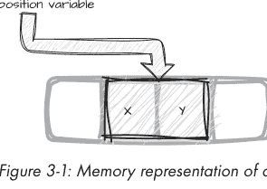

图 3-1：简单值的内存表示

`position` 变量并不引用内存中的数据，而是直接将 `Coordinate` 的每个字段的内容存储在原地。如果一个类型有多个字段，这些字段会存储在连续的位置。如果我们将 `position` 复制到另一个变量中，新变量中每个字段的值都是原始 `position` 变量对应字段值的独立副本。

如果我们将 `Coordinate` 值作为参数传递给方法的 value 参数，整个值会被复制到参数中。在列表 3-2 中，我们有一个方法 `Difference`，它有两个 `Coordinate` 值参数 `start` 和 `end`，并且我们将 `position` 变量作为参数传递给这两个参数。

```
public Coordinate Difference(Coordinate start, Coordinate end)
{
    --snip--
}
```

```
var position = new Coordinate { X = 10, Y = 20 };
```

```
var distance = Difference(position, position);
```

列表 3-2：一个具有两个值参数的方法

由于 `Difference` 方法的参数都是按值获取的，每个参数都会收到一个与原始值独立的副本。结果在内存中看起来像图 3-2。


图 3-2：复制值的内存表示

`start` 和 `end` 参数都用传递给它们的位置参数的值进行初始化，并且在方法内部各自拥有自己的副本。

当我们将一个值赋给另一个值或按值将值类型实例作为参数传递时，我们会复制该值。两个值类型变量始终是独立的实例。这就是按值复制语义的本质。

引用类型变量的行为不同，因为它们的值是一个引用。引用的值用于标识堆上类型的实例或为 `null`。

## 引用的值

当我们创建一个引用类型的实例时，内存会在堆上分配，并且一个标识该内存位置的引用会存储在变量中。语法上，看起来引用变量的类型是其所引用实例的类型，如下所示使用字符串变量：

```
string name = "Alfred";
```

我们通常会将 `name` 变量称为一个字符串。然而，这并不完全准确。更精确的说法是 `name` 是一个类型为 `string` 的变量，其值是对 `string` 类型实例的引用。引用变量的类型不必与实例的类型完全匹配。例如，我们可以使用基类引用变量，如 `object`，来引用更具体的引用类型实例，如 `string`。

引用的值是由公共语言运行时 CLR 用于标识对象的不可见句柄。我们并不真正关心引用的值是什么；引用只是我们访问和操作引用类型实例的机制，如图 3-3 所示。

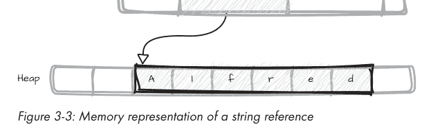

在图 3-3 中，`name` 是一个其值为引用的变量。引用本身没有独立的类型，至少不是我们可以命名的类型，但它确实有一个值。非空引用的值是对堆上分配的内存区域的句柄，该区域包含引用类型的实例。

这种精确性很重要，因为当我们谈论传递或复制变量时，我们真正指的是传递或复制*值*。对于值类型，这种区别不存在：结构体变量的值*就是*该实例。然而，引用变量与它们所引用的实例是不同的——当我们复制一个引用变量的值时，我们复制的是引用，而不是实例。

某些语言使用指向内存中对象的指针，但引用并不完全等同于指针。引用不能用于内存中的任何东西。它们专门用于访问堆上的引用类型对象，并在垃圾回收和内存压缩导致对象移动时跟踪这些对象。这些过程的细节对我们是隐藏的，并且作为引用类型的内存管理的一部分自动处理。

我们可以将引用的值视为一种地址。在这方面，引用值与值类型实例的行为非常相似。像值类型变量一样，引用类型变量直接包含其值，即一个地址，并且存在于其父作用域内，这可能是方法的局部变量的栈帧。

考虑到这一点，请注意：*所有*变量，无论表示引用类型还是值类型，都有可能被复制的值。更进一步，默认情况下，所有变量值都是被复制的——并且按*值*传递。

## 引用变量与别名

*别名*是指通过多个变量访问单个内存位置。正如你所见，当我们复制一个引用到另一个引用时，例如当我们将引用作为参数传递给方法时，我们创建了两个别名引用——参数变量和参数变量——指向内存中的同一个对象。

相比之下，当我们按值传递值类型实例作为参数时，参数变量和参数变量是彼此相同但独立的副本。在这方面，引用类型和值之间的区别在实例可变时最为显著，即其状态可以被更改。

别名可能是有意的且有用的，例如当我们希望对对象的更改能够被对其的所有引用所观察到，无论它们在哪里。例如，参见列表 3-3 中的 `Command` 和 `DataStore` 类；我们通过 `DataStore` 的 `CreateCommand` 方法创建一个 `Command` 类型的实例，并且 `Command` 对象存储对用于创建 `Command` 实例的 `DataStore` 实例的引用。

```
public class Command
{
    public Command(DataStore store)
        => Connection = store;

    public DataStore Connection { get; }
}
```

## 可变按引用参数

默认情况下，方法参数是值参数，这意味着传递给它们的参数无论参数类型如何都是按值传递的。在本节中，我们将研究可变的按引用参数 `ref` 和 `out`，它们会导致参数改为按引用传递。

值类型实例和引用都可以通过使用 `ref` 或 `out` 修饰符按引用传递，因此重要的是要理解按引用参数与引用类型值参数是不同的。当我们将引用作为参数传递给引用类型值参数时，参数变量和参数变量都引用同一个对象实例，并且对实例的任何更改都可以通过任一变量看到。相比之下，按引用参数是参数变量值的别名，无论该值是引用还是值类型实例。

参数上存在 `ref` 或 `out` 修饰符意味着当我们调用该方法时，传递的是参数值的地址而不是值的副本。这种额外的间接级别意味着无论参数的类型如何，调用方和方法都直接访问相同的值。如果参数的值是一个引用，我们可以将其更改为引用新的实例或将其赋值为 `null`，并且该更改可通过参数变量和参数变量看到。

为了说明引用变量和按引用参数之间的区别，请考虑列表 3-5，其中我们按值传递一个引用给 `AutoAppend` 方法，该方法试图更改其 `name` 参数。

```
public void AutoAppend(string name, string extension)
{
    if(!name.EndsWith(extension))
        name += extension;
}

var saveName = "Alfred";
AutoAppend(saveName, ".docx");

Assert.That(saveName, Is.EqualTo("Alfred.docx"));
```

列表 3-5：创建新实例与更改实例

此测试失败，即使 `string` 是一个引用类型。尽管 `+=` 运算符看起来像是在变异字符串，但它实际上创建了一个具有更新内容的新字符串并返回对其的新引用。新引用和实例在 `AutoAppend` 方法内部可见，但在外部不可见。原始字符串保持不变。

`AutoAppend` 方法并没有更改共享的字符串实例，而是更改了其 `name` 参数的值。在此处调用 `+=` 会更改引用以引用新的、不同的实例。作为 `AutoAppend` 的参数使用的 `saveName` 变量仍然引用原始的、未更改的实例。

这清楚地表明，当我们将引用作为参数传递时，默认情况下它是按值传递的。对于列表 3-5 中的 `AutoAppend` 方法要按预期工作，我们需要按引用传递 `saveName` 引用，以便

当方法修改引用变量的值时，调用代码可以看到该更改。

## 按引用传递引用

让清单3-5中的测试通过的最直接方式，是使用 `ref` 修饰符将 `name` 变成按引用参数。清单3-6展示了与清单3-5相同的 `AutoAppend` 方法，但在这个版本中，我们通过对 `name` 参数使用 `ref` 修饰符来按引用传递该参数。

```csharp
public void AutoAppend(ref string name, string extension)
{
    if(!name.EndsWith(extension))
        name += extension;
}

var saveName = "Alfred";
AutoAppend(ref saveName, ".docx");

Assert.That(saveName, Is.EqualTo("Alfred.docx"));
```

清单3-6：使用 `ref` 修饰符按引用传递 `name`

我们在方法的参数和传入的实参上都使用了 `ref` 修饰符，因为我们要传递的是对变量的引用。现在测试之所以通过，是因为 `AutoAppend` 方法对引用变量值所做的更改，在调用代码中可以通过 `saveName` 变量看到。

实际上，`name` 参数是 `saveName` 变量的一个别名，如图3-4所示。

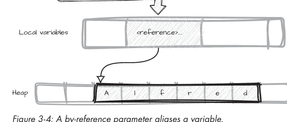

图3-4：按引用参数是变量的别名。

使用按引用参数的结果是，实参和形参变量不仅引用同一个实例，它们实际上就是同一个引用。我们仍然可以使用 `name` 参数访问字符串实例（例如访问属性或调用方法），编译器会隐藏由参数上的 `ref` 修饰符提供的额外间接层。

## 按引用传递值

我们也可以按引用传递值类型变量。请记住，按引用传递实参并不表示该形参是引用变量。

当我们把值类型实例作为实参传递给方法时，由于值类型具有按值复制语义，方法通常获得该实例的一个副本。正如你之前看到的，方法内部对实例字段所做的任何更改对调用代码都是不可见的。

如果我们需要这些更改在方法外部可见，就必须按引用传递该值。在清单3-7中，我们引入了一个 `Increment` 方法，它按引用接收一个可变的 `Speed` 值类型参数并更改其值。类似 `Speed` 这样的值类型几乎始终应该是不可变的，你将在第89页的“变更与创建”中看到如何以不同方式表达这一点。此示例仅仅是为了演示按引用传递值类型的机制与按引用传递引用类型的机制相同。

```csharp
public struct Speed
{
    public double InMetersPerSecond { get; set; }
}

public void Increment(ref Speed initial, double amount)
    => initial.InMetersPerSecond += amount;
```

清单3-7：值类型按引用参数

当我们调用 `Increment` 方法时，我们使用 `ref` 修饰符按引用传递 `initial` 参数对应的实参，就像在清单3-6中对 `name` 参数所做的那样。因此，在 `Increment` 方法内部对 `initial` 的 `InMetersPerSecond` 属性所做的更改，对调用代码是可见的，如清单3-8所示。

```csharp
var speed = new Speed { InMetersPerSecond = 50.0 };
Increment(ref speed, 20);

Assert.That(speed.InMetersPerSecond, Is.EqualTo(70.0));
```

清单3-8：使用 `ref` 修饰符按引用传递 `speed`

由于 `speed` 变量是按引用传递给 `Increment` 的，`speed` 在 `Increment` 方法中成为了别名。调用代码和 `Increment` 实际上是在使用同一个变量，因此对 `initial` 参数值所做的任何更改，在 `Increment` 方法内部和调用它的代码中都是可见的。测试表明我们期望该值被更改。

注意：重申一下，按引用参数不同于引用类型变量。引用类型变量引用的是引用类型的实例，而按引用参数引用的是一个变量，该变量既可以是引用类型，也可以是值类型。

引用只能指向堆上的对象。如果我们将一个值类型实例赋值给一个引用类型变量，该值会被装箱到堆上，变量将引用装箱后的副本。按引用参数会为变量的值增加一个额外的间接层。当我们按引用传递值类型实例时，该值既不会被装箱，也不会被复制。

## 使用输出参数

输出参数由 `out` 修饰符指定，是可变的按引用参数，通常用于需要方法为该参数变量创建新的对象实例的情况。它们与引用参数类似，也会为用作实参的变量起别名。我们传递给方法的实参通常未初始化，方法会通过赋值来填充输出参数变量，从而将其初始化。

更正式地说，引用参数与输出参数的区别在于：引用实参在传递前必须已明确赋值；而输出实参在传递时可能已初始化，也可能未初始化，但无论哪种情况，都必须在方法内为该参数赋值。

输出参数通常用于获取新对象实例的操作可能失败，且失败不是致命甚至严重问题的场景。示例包括：解析具有特定格式的字符串；连接到不可靠的服务；从共享资源（如可能为空的队列）读取值。在这种情况下，我们通常希望有一种方式来尝试该过程，并且能够忽略失败或重试操作。如果操作成功，我们会获得一个有效的对象作为结果。

针对这种用例，常见的方法是定义一个至少包含一个输出参数并返回 `bool` 的方法，该 `bool` 值表示成功或失败。如果方法成功，`out` 参数会被初始化为新对象，方法返回 `true`，表示传入的实参已成功初始化。如果操作不成功，方法返回 `false`，向调用者表示应忽略输出实参的值。这是 C# 中一种常见的技术，称为 `TryXXX`。

## 使用 TryXXX 惯用法

标准库中有多个使用 `TryXXX` 解析字符串以获取特定类型值（如 `DateTime` 对象）的示例。`DateTime.TryParse` 方法接收一个 `string` 参数和一个用于 `DateTime` 值的输出参数。如果解析失败，方法返回 `false`。如果解析成功，`DateTime` 值将包含从字符串解析出的日期。清单3-9演示了我们可能如何使用这一惯用法。

```csharp
string logTime = --snip--
if(DateTime.TryParse(logTime, out DateTime timeStamp))
{
    var elapsed = DateTime.Now - timeStamp;
    --snip--
```

清单3-9：`TryXXX` 惯用法


作为实参传递给 `TryParse` 的 `logTime` 变量可能来自不可靠的来源，如用户输入或文件。格式不正确的日期是一种错误，但不应被视为异常情况。对 `TryParse` 的成功调用意味着 `timeStamp` 变量是有效的 `DateTime` 实例。如果 `TryParse` 返回 `false`，则 `timeStamp` 变量会被默认初始化。

注意：`DateTime` 的文档规定，失败情况会将变量初始化为 `MinValue` 属性的值，但这等效于默认的 `DateTime`。

`TryXXX` 方法通常有一个伴随版本，会在操作失败时抛出异常。例如，`DateTime.TryParse` 的异常版本是 `DateTime.Parse`，它成功时返回 `DateTime` 值，失败时抛出 `FormatException` 异常。处理异常可能会很侵入，而无法将字符串解析为有效的 `DateTime` 是我们可能希望在错误发生时立即处理的类型。

如果我们使用普通的 `Parse` 方法，就可能会将调用包装在 `try…catch` 块中，但如果要解析多个字符串，这就会变得很繁琐：要捕获任何一个值上的失败，我们必须将每个调用都包装在各自的 `try` 块中。改用 `TryParse` 则更直接，也更简洁。

## 明确赋值

`ref` 和 `out` 参数在 CIL 中的底层机制是相同的，CIL 原生支持按引用参数和实参。它们的区别在于编译器施加的语义：`ref` 参数在方法内被视为最初已赋值，这意味着 `ref` 实参在传递前必须明确赋值；而 `out` 参数在方法内被视为最初未赋值，无论它在调用前是否已被赋值。因此，我们必须在方法返回前对所有 `out` 参数进行明确赋值。不这样做会导致编译时错误，如下面的方法所示，该方法试图在 `connection` 参数被赋值之前返回：

```csharp
public bool TryRemote(string address, out DataStore connection)
{
    if(string.IsNullOrEmpty(address))
        return false;
    --ship--
}
```

我们会收到这个错误：

```
[CS0177] The out parameter 'connection' must be assigned to before control leaves the current method
```

在这个示例中，避免该错误最直接的方法是在返回 `false` 之前预先将 `null` 赋给 `connection` 参数。按照约定，只有在方法返回 `true` 时，调用代码中传给 `TryXXX` 方法的参数才应被认为具有有效值。

调用代码中的目标 `out` 变量只有在方法*正常*返回后才被视为已明确赋值。控制流有可能在给所有 `out` 参数赋值之前通过抛出异常而*异常地*离开方法。如果方法以异常退出，则在方法调用之前未被明确赋值的那些用作 `out` 参数的变量将继续处于未明确赋值状态。在调用之前已经明确赋值的任何参数仍然保持明确赋值，尽管它们在方法内、抛出异常之前可能仍被赋予了新值。

然而，我们通常使用 `TryXXX` 惯用法来*避免*异常，因为大多数用户都期望这类方法不会抛出任何异常。

## 选择操作

使用带有 `out` 参数的 `TryXXX` 惯用法（如代码清单 3-9 所示）很吸引人，因为该方法可以内联在简单的 `if` 语句中，在同一个位置测试返回值并捕获所需的输出参数值。在代码清单 3-10 中，我们使用 `TryRemote` 方法来确定如何获取结果列表，使用的是三元条件运算符 `?:` 而不是 `if…else` 块。`connection` 输出变量在方法的参数列表中内联声明。

```csharp
List<Record> results = TryRemote(remoteName, out DataStore connection)
    ? connection.LoadData()
    : LoadFromCache();
```

*代码清单 3-10：使用简单的 out 参数*

如果 `TryRemote` 返回 `true`，则执行 `?` 后面的分支，我们可以在 `TryRemote` 调用中使用 `connection` 输出变量。如果方法返回 `false`，表示与远程资源的连接失败，我们的代码将执行 `:` 后面的分支，改为从缓存加载结果。

注意，我们也可以使用 `var` 声明内联 `connection` 参数的类型，此时编译器将根据方法定义中参数的类型来确定其类型。`TryRemote` 方法让我们能够处理连接失败，而无需承担处理异常的额外成本和复杂性，并可以尝试另一种方法来获取结果列表。

我们可以将 `TryXXX` 方法视为返回多个值：一个 `bool` 值，表示尝试获取资源的成功或失败；以及当资源获取成功时返回的资源本身。

## 按引用参数的限制

虽然具有按引用参数的方法非常适合某些情况（例如 `TryXXX` 技术），但按引用参数并不适用于所有情况，而且关于明确赋值的规则有时会要求采用不同的方法。其他限制也会影响我们使用这些参数的位置。本节将讨论这些限制。

### 属性值

获取属性或索引器值的结果不能直接用作 `ref` 或 `out` 参数。在代码清单 3-11 中，我们尝试将 `Velocity` 实例的 `Speed` 属性作为参数传递给 `ref` 参数。

```
public readonly struct Velocity
{
    public Speed Speed { get; }
    public Angle Direction { get; }
}

public void Increment(ref Speed initial, double amount)
    => initial.InMetersPerSecond += amount;

var start = new Velocity( --snip-- );
Increment(ref start.Speed, 25);
```

*代码清单 3-11：将属性传递给 ref 参数*

编译器拒绝此代码，并显示以下错误：

```
[CS0206] A property or indexer may not be passed as an out or ref parameter
```

编译器不允许此代码，因为属性结果是值而不是变量。在第 2 章中，你了解了变量可以被赋值，而值不能。访问属性与读取方法调用的返回值完全相同——我们将在第 4 章详细讨论——而方法返回的是值，不是变量。我们通常在使用 `ref` 参数时期望被调用的方法修改其参数，但由于属性不是变量，它不能被修改。

`Speed` 是引用类型还是值类型并无区别。传递 `ref` 或 `out` 参数本质上是在传递参数的地址，而我们无法传递非变量的地址。

### 按引用参数的重载

按引用参数修饰符是方法签名的一部分。引用或输出参数实际上与其对应的值参数是不同类型。如果我们有一个接受 `ref` 参数的方法，我们可以用按值接受该参数的方法来重载它。

方法重载可以有不同的返回类型，因此我们可以编写一个按值接受参数并返回新对象的方法，并用接受 `ref` 参数、原地修改对象的版本来重载它，如代码清单 3-12 所示。

```
public Speed Increment(Speed initial, double amount)
    => new Speed { InMetersPerSecond = initial.InMetersPerSecond + amount };

public void Increment(ref Speed initial, double amount)
    => initial.InMetersPerSecond += amount;
```

代码清单 3-12：按引用修饰符的重载

当我们调用 `Increment` 方法时，编译器会根据我们是用 `ref` 关键字修饰 `Speed` 参数以按引用传递，还是省略修饰符以调用带值参数的版本，来选择正确的重载。

然而，当唯一的区别是参数的按引用修饰符种类时，我们无法重载方法，正如我们在代码清单 3-13 中尝试做的那样。

```
public void Increment(ref Speed initial, double amount)
    => initial.InMetersPerSecond += amount;

public void Increment(out Speed initial, double amount)
    => initial = new Speed { InMetersPerSecond = amount };
```

代码清单 3-13：不同修饰符的重载

这看起来可能是一个任意的限制。毕竟，调用代码必须区分传递 `ref` 参数和传递 `out` 参数。然而，编译器拒绝此重载，因为公共语言基础结构（CLI）无法在方法签名中区分 `ref` 和 `out`。两者只是按引用参数，因此就 CLI 而言，这两个重载具有相同的签名，从而导致歧义。

同样的限制也适用于 `in` 参数，我们将在第 92 页的“只读引用和按引用返回”中介绍。与 `ref` 和 `out` 参数一样，就 CLI 而言，`in` 参数只是另一种按引用参数。

无论何种情况，仅根据一个或多个参数是按引用还是按值传递来重载方法，可能最好都应避免。任何调用此类方法的人都需要透彻了解重载规则中这个有点冷门的角落，因此这样的代码很容易让人困惑。

### 使用字段

将字段设为按引用变量是不可能的。这同样看起来可能有些任意，但否则按引用字段可能会变成悬空引用——也就是说，它可能引用一个不再存在的对象。

> 注意：从 C# v11.0 开始，按引用字段在 `ref struct` 类型内是允许的，`ref struct` 类型是专为高性能应用设计的特殊值类型。`ref struct` 类型的诸多限制使其不太适合大多数通用代码，因此本书不讨论它们。

考虑代码清单 3-14 中像 `Reminder` 这样的类，它试图将 `ref` 参数存储在 `ref` 字段中。

```
public class Reminder
{
    public Reminder(ref DateTime start)
        => time = start;

    private readonly ref DateTime time;
}
```

代码清单 3-14：一个假设的 Reminder 类，按引用存储字段

虽然这种方法原则上可能看起来很有吸引力——比如说，如果我们希望 `Reminder` 类故意别名化其构造函数的参数，或者我们希望避免复制 `DateTime` 实例——但这段代码无法编译。编译器仅以无效语法为由拒绝它，因为 `Reminder` 实例可能在所引用的 `DateTime` 变量已超出作用域之后被使用，这意味着该字段将变成对不再存在的内存的引用，或者更糟，变成对已分配给其他内容的内存的引用。`time` 字段将成为悬空引用，而 C# 的规则会尽力防止这种情况。

尽管引用类型具有不同的生命周期并享有自动内存管理，但仅允许引用类型使用 `ref` 字段确实会是任意的，并且可能引发混淆和错误。这种能力也几乎没有用处，因为引用变量已经表现出别名行为，而且就复制而言，按引用变量与引用的大小相同，因此编译器禁止这样做。

### 闭包

禁止 `ref` 和 `out` 字段也是我们无法在闭包内使用按引用参数的原因。闭包是一种封装了...的方法

behavior along with its *context*—that is, the state of any variables declared outside the method’s own scope but used within its implementation. Those external variables are said to have been *closed over* by the method, hence the term *closure*. Listing 3-15 shows a method trying to use a `ref` parameter inside a lambda expression.

```
```csharp

public static Reminder

NextAppointment(ref DateTime time, IEnumerable<Reminder> items)

{

    var results = items.Where(item => item.Date == time.Date);

    return results.FirstOrDefault();

}

```
```

*Listing 3-15: Anonymous closure capturing a ref parameter*

The compiler rejects the NextAppointment method, giving us the following error:

```
```text

[CS1628] Cannot use ref, out, or in parameter 'time' inside an anonymous method, lambda expression, query expression, or local function

```
```

The closure in the NextAppointment method is the lambda expression used by the Where method. The lambda is an anonymous method that uses the captured `time` parameter, which belongs to the scope of NextAppointment. Closure functions are implemented by the compiler as a small, unnameable class with fields for each of the closed-over variables. In this example, the variable being captured is a ref parameter, which, as you saw in Listing 3-14, isn’t a valid field.

As the error message indicates, the same problem applies equally to nested local functions and anonymous methods, which can also capture the outer method’s variables, including its parameters. Anonymous methods, lambda expressions, and local functions are all implemented the same way: using a hidden class synthesized by the compiler. Any captured variables become fields of that class.

## Iterator Blocks

An *iterator block* is a compiler-generated class that implements the standard `IEnumerable<T>` interface to iterate over the elements of a sequence, such as an array or a `List<T>`, using deferred execution. Also known as *lazy enumeration*, *deferred execution* means that the next element is obtained from the sequence only when the user requests it; the sequence is produced on demand and theoretically may even be infinite.

An iterator block is created whenever we use the `yield` statement, as shown in Listing 3-16. However, the compiler rejects the AppointmentsForDay method because it has a ref parameter.

```
```csharp

public static IEnumerable<Reminder>

AppointmentsForDay(ref DateTime time, IEnumerable<Reminder> items)

{

    foreach (var item in items)

```
```

```
{
    if(item.Time.Date == time.Date)
        yield return item;
}
```

Listing 3-16: A ref parameter in an iterator

Here the AppointmentsForDay method is attempting to filter the items sequence passed as a parameter for elements that match the time parameter. However, like closures, methods that use iterator blocks can’t have by-reference parameters, so the method in Listing 3-16 fails to compile, with this error:

```
[CS1623] Iterators cannot have ref, in or out parameters
```


Each time the method yields a value, control returns to the calling code. When the next item is requested, the method must continue at the statement following the `yield` and must do so with the same state. The compiler transforms the `yield` statement to return an instance of the iterator block class that captures the state between requests for each element, similar to the way closures work.

The compiler-generated class needs to capture all the method parameters and any local variables as fields to preserve the method’s state between each request for a value, which is why iterator methods can’t have by-reference parameters.

## Asynchronous Methods

Lastly, and for exactly the same reason as closures and iterator blocks, we can’t declare by-reference parameters for async methods like the `TryGetResponse` method in Listing 3-17.

```
public static async Task<bool> TryGetResponse(out string response)
{
    response = await Task.Run(() => GetUserInput());
    return !string.IsNullOrEmpty(response);
}
```

Listing 3-17: An out parameter in an asynchronous method

This method fails to compile with the following error:

```
[CS1988] Async methods cannot have ref, in or out parameters
```

In this instance, the compiler synthesizes a hidden class to manage the asynchronous invocation of the `Task.Run` method. Asynchronous methods return control to their caller when the `await` statement is reached, and so, like iterator blocks, they must preserve the state of all their variables. The compiler-generated class captures all local variables and parameters as fields, so by-reference parameters aren’t allowed for any method that has the `async` modifier.

## Extension Methods

We can use by-reference parameters in any method that doesn’t use a closure, an iterator block, or asynchronous operations using the `await` keyword. However, caveats exist for extension methods, static methods that extend the interface of another type. The first parameter of an extension method is of the type being extended and uses the special `this` modifier. Extension methods have some restrictions on using by-reference parameters for the `this` parameter. First, the `this` parameter of an extension method can’t be an `out` parameter, as demonstrated by Listing 3-18.

```
public static void
FormatConnection(out this string connString, string host, string source)
{
    connString = $"Server={host};Database={source};Trusted_Connection=True;";
}
```

Listing 3-18: Extension method using an out parameter

This code produces the following error message:

```
[CS8328] The parameter modifier 'this' cannot be used with 'out'
```

If this syntax were permitted, code using the `FormatConnection` method could appear to call a method using an uninitialized variable, like this:

```
string connection; // uninitialized variable
connection.FormatConnection(host, source);
```

Most users would probably find this code confusing because using an uninitialized variable to invoke a method isn’t allowed in any other circumstances. In any case, we have much better alternatives to achieve the same result, and the syntax for this parameters is also an error. We can use an `out` modifier with any of the other parameters, just as we can with any regular method, but we can’t make `this` an output parameter.

Using `ref` for the `this` parameter is permitted if the parameter is a value type, but not if it’s a reference type. This restriction might also seem unreasonable at first glance, but it’s intended to explicitly prohibit code like the following:

```
public static void Nullify(ref this string val)
=> val = null;
```

The compiler rejects the `Nullify` method with the following error:

```
[CS8337] The first parameter of a 'ref' extension method 'Nullify' must be a value type or a generic type constrained to struct.
```

If this code were permitted, the variable used to call the method could refer to a different variable, or—as in this example—be set to `null` after the method returned. Most users would likely be surprised by such behavior, so, once again, the compiler forbids it.

We can use `ref` for the `this` parameter when the parameter is a value type, which avoids copying the `this` argument’s value. While there’s no benefit to avoiding the copy of a reference, copying a large value might be relatively expensive. A value type variable can’t be assigned the value `null`, but the method can assign a new value to the `ref this` parameter, thus changing the argument’s value. Again, doing so would likely surprise most users of the method, so even though the syntax is legal, we should avoid using `ref this` parameters. If we really want to avoid copying the argument for a `this` parameter, then instead of using `ref`, we can use the `in` modifier to make `this` a read-only reference parameter, as discussed in more detail in “Read-Only References and Returning by Reference” on page 92.

In spite of their limitations, by-reference parameters are a core part of C#, and understanding their semantics is important. None of these restrictions is particularly onerous, not least because the use cases for these parameters are limited. The use of `ref this` value type parameters in extension methods would be considered unusual by most programmers and is a niche-enough feature that it’s probably best avoided in any case.

Fields must be real variables, and C# provides no way to store a by-reference variable as a field of a general-purpose type. Every other example in this section can be expressed differently to achieve the same result.

## Side Effects and Direct Effects

Methods with by-reference parameters intentionally alias variables in the calling code, and therefore changes made to those parameters within the method are visible outside the method’s scope. Altering the state of an aliased object is an example of a side effect, which is more generally defined as any change of state that’s visible to code outside the scope where the change occurs.

Side effects aren’t intrinsically bad, but programs that depend on them heavily can be more difficult to follow than those that rely only on direct effects. The direct effect of a method is whatever it returns, normally referred to as the method’s output, with the inputs being the method’s formal parameters. By-reference parameters, especially `out` parameters, blur the distinction between the inputs and outputs of a method, since side effects may alter state that is unrelated to the method’s direct effect.

Consider how `TryXXX` methods are commonly used to initialize variables, as shown in Listing 3-19.

```
if(TryRemote(remoteName, out var connection))
{
    // Perform activities using connection
}
```

*Listing 3-19* Using `TryRemote` with an output parameter to initialize the connection variable

`TryRemote` 方法的直接效果是表示其输出参数初始化成功或失败的 `bool` 返回值。我们使用返回值来确定 `connection` 变量是否已初始化；换句话说，直接效果告诉我们副作用是否成功。在这种情况下，`TryRemote` 的副作用和直接效果之间存在联系，但与其它 `TryXXX` 方法一样，直接效果似乎是次要的，相对于副作用而言！

使用按引用参数的方法，以及更一般地，严重依赖于通过副作用操作的方法，通常会导致非常程序化的代码，由一组逻辑步骤或指令组成以完成任务。程序化解决方案被描述为命令式代码，因为它们是实现结果所需处理的显式指令序列。对比的方法是声明式代码，它强调结果而非具体的实现。更声明式的方法将焦点从事物如何完成转移开来，让我们能够专注于结果。

声明式风格的一个方面是，我们更重视方法的直接效果，并对方法的输入和输出做出明确的分离。

我们可以通过移除 `out` 参数并直接返回所需的 `DataStore` 引用，使《图 3-19》中的 `TryRemote` 方法更具声明性；由于 `DataStore` 是引用类型，如果 `TryRemote` 方法失败，我们可以返回 `null`。然而，当这些参数是引用类型时，与按引用参数相关的副作用并不是真正的问题。引用类型通常是可变的——出于设计原因，并且有充分的理由——并且多个变量可以引用单个实例这一事实通常是期望的行为，就像你在第 74 页的“引用变量和别名”中所看到的那样。声明式代码的好处在使用值类型时更为重要，而值类型应该是不可变的。

## Mutation vs. Creation

使用 `ref` 和 `out` 参数的方法强烈表明这些参数将在方法内部发生变化。由于此类参数是作为参数传递给它们的变量的别名，我们需要关注哪些变量可能会被更改。对变量的意外修改可能会导致难以识别的错误，尤其是在使用多线程的代码中。如果我们遵循使自己的值类型不可变的常见建议，我们就可以降低此类问题发生的可能性，这意味着我们也应避免值类型的可变按引用参数。然后，值类型变量发生变化的唯一方式就是通过赋值。

如果我们有一个值的实例并且需要具有不同属性的实例，我们只需创建一个具有我们想要的状态的新实例，保留原实例不变。将《图 3-20》中的 `Incremented` 方法与《图 3-7》中的类似 `Increment` 方法进行比较。

```
var velocity = new Velocity
{
    Speed = Speed.FromMetersPerSecond(10),
    Direction = Angle.FromRadians(.88)
};
```

```
var copy = velocity with { Direction = Angle.FromRadians(.99) };
```

Listing 3-21: Copying an instance as a template


`Velocity` 类型的每个属性上的 `init` 访问器使我们能够复制一个实例并使用 `with` 关键字为新实例更改选定的属性。非破坏性突变是在 C# v9.0 中为记录类型引入的，自 C# v10.0 起，我们也可以在结构体和记录结构体，甚至匿名类型上使用它。

`init` 访问器还允许我们通过使用对象初始化（如《图 3-21》中 `velocity` 变量所示）或通过构造函数为属性赋予值，但一旦其值通过 `init` 设置，属性就是不可变的。如果我们改用 `private set` 访问器而不是 `init` 为属性，则对象初始化和非破坏性突变语法就不可能实现。非破坏性突变和对象初始化都需要公共 `init` 或公共 `set` 访问器。

复制不可变值的选定属性是声明式问题解决方法的另一个方面，在某些情况下，使用现有变量作为模板创建新值会变得更简单、更直接。

## Declarative Code and Performance

使用声明式风格可以带来更清晰、更直接的代码，但通常会导致创建更多变量的副本，增加存储开销。这对于值类型尤其相关，因为复制大型实例的成本可能会影响程序的性能。到目前为止，我们只考虑了相当小的实例，这不太可能显著影响性能。虽然引用变量始终大小相同，但值可以是任意大小。在复制值时，大小在一定程度上很重要。仅包装单个 `int` 字段的值类型复制起来比具有大量字段的值类型便宜，这就是为什么我们经常被建议保持值类型较小的原因。

“小”的定义各不相同，但通常在 16 到 24 字节之间。请注意，在 64 位架构上，引用每个为 8 字节，因此很容易想象一个有用的值类型会超过建议的大小限制。我们将在第 8 章探讨大型值类型的一些性能特征。

尽管如此，值类型的大小不应成为选择类或记录而不是结构体或记录结构体的主要动机。如果我们希望类型的实例具有值语义，我们应该使其成为值类型，无论它可能有多大。当我们将值类型变量作为 `ref` 或 `out` 参数的参数传递时，不会复制实例，因为这些参数按引用传递。更喜欢返回值而不是使用 `ref` 或 `out` 参数是否会影响我们代码的效率？

对于具有多个字段的值，避免复制可能确实代表了净性能提升，但我们也应考虑我们选择对人类阅读者的影响。使用按引用参数来避免复制大型值似乎很有吸引力，除了使用 `ref` 或 `out` 参数强烈暗示传递的参数很可能发生变化。如果我们希望代码尽可能自文档化，将 `ref` 参数用作优化可能会令人惊讶。

与其使用可变的 `out` 或 `ref` 参数，我们可以使用 `in` 参数，即不可变的按引用参数。`in` 参数的参数以与 `ref` 和 `out` 参数完全相同的方式按引用传递，但 `in` 参数变量在方法内部是只读的。在下一节中，我们将探讨如何通过使用只读引用参数来避免复制值类型方法参数，以及如何通过引用返回。

## Read-Only References and Returning by Reference

只读引用和通过引用返回是相关的概念，两者都可以帮助我们减少代码中值类型实例的副本数量。首先我们来看只读引用参数，我们在方法参数上使用 `in` 关键字表示。`in` 修饰符与 `ref` 和 `out` 修饰符一样使按引用参数，但与 `ref` 或 `out` 参数不同，它阻止底层变量的值被更改。换句话说，`in` 参数变量是不可变的。使用 `in` 参数在我们将大型值类型实例作为参数传递时可能是有益的，因为我们避免了复制实例。

从技术上讲，我们也可以传递对 `in` 参数的引用，但没有理由这样做。仅在我们需要更改引用以引用新实例时，按引用传递引用才有用。为此，我们需要 `ref` 或 `out` 参数。与值类型可能的情况一样，按引用传递引用没有性能优势。

Listing 3-22 显示了一个简单的表达式体方法 `DistanceInKm`，它根据其 `speed` 和 `time` 参数值计算距离，两者都是值类型。

```csharp
public double DistanceInKm(in Speed speed, in TimeSpan time)
=> speed.InKmh * time.TotalHours;
```

Listing 3-22: Read-only reference parameters

`speed` 和 `time` 变量都使用 `in` 修饰符，使它们在 `DistanceInKm` 方法中成为只读引用参数。由于参数变量是只读的，编译器将拒绝任何尝试设置可变属性、更改公共字段或为它们分配新值的尝试。

当我们调用一个具有 `ref` 或 `out` 参数的方法时，还必须使用 `ref` 或 `out` 关键字修饰我们正在传递的实参。相比之下，传递给 `in` 参数的实参不需要 `in` 修饰符，如下所示：

```csharp
var time = TimeSpan.FromHours(2.5);

var speed = Speed.FromKmh(20);

var distance = DistanceInKm(speed, time);

Assert.That(distance, Is.EqualTo(50.0));
```

与引用参数和输出参数一样，我们可以用带有值参数的重载版本来重载 `DistanceInKm`。如果我们没有为实参指定 `in` 修饰符，则不带修饰符的重载在重载解析中优先。我们可以显式地为传递给 `in` 参数的实参使用 `in`，以选择通过引用接收参数的那个重载版本。正如本章前面提到的，仅根据参数是通过引用传递还是按值传递来重载方法，很可能是造成混乱的根源。

只读引用参数被设计为在调用代码中保持透明；也就是说，向 `in` 参数传递实参看起来与按值传递实参相同。一个结果是，某个方法可以改为通过只读引用而不是按值来接收其参数，而无需更改调用代码。之前按值传递的实参将改为通过引用传递。这只有在实参变量可能发生变化时（也许是在另一个线程中）才重要。请记住，只有方法内部的参数变量是只读的；实参变量通常不是。由于传递给 `in` 参数的实参是通过引用传递的，因此对实参值的任何更改都会反映到方法内部参数变量的值中。清单 3-23 演示了即使没有多线程，也可以修改传递给 `in` 参数的实参的值。

```csharp
void ModifyByCallback(in int value, Action callback)
{
    ① var temp = value;
    ② callback();
       Assert.That(value, Is.Not.EqualTo(temp));
}

int input = 100;
③ ModifyByCallback(value: input, callback: () => input = 200);
```

*清单 3-23：通过回调委托修改只读参数的值*

`ModifyByCallback` 方法通过只读引用接收一个 `int` 值和一个 `Action` 委托。*委托*是一个引用方法的变量；这里，我们使用标准的 `Action` 类型作为该委托，它表示一个无参数且返回 `void` 的方法。在 `ModifyByCallback` 方法内部，我们将 `value` 参数的*值*复制到一个临时变量 ① 中。然后调用 *callback* 委托，并测试 `value` 参数的值现在是否与调用委托前复制到 `temp` 的值不同 ②。当我们调用 `ModifyByCallback` 时，我们将 `input` 值以及一个 lambda 作为 `callback` 参数传入。该 lambda 闭包捕获了 `input` 变量，lambda 会改变该变量的值 ③。

`ModifyByCallback` 方法内的测试能够通过，是因为 `value` 参数是调用代码中 `input` 变量的别名。当 `input` 变量的值在 lambda 内部改变时，`value` 参数的值也会改变。因此，我们应该谨慎对待那些同时具有 `in` 参数和委托参数的方法。更一般地说，我们应该警惕那些会改变作为实参传递给方法的任何变量值的代码，尤其是当方法和调用代码可能运行在不同的执行线程上时。改变一个看似只读的变量可能导致错误，而这些错误可能难以追踪。

## 通过引用返回值

尽管值类型的实例通常不会按引用复制，但我们可以通过引用返回值类型实例，并通过使用引用变量来接收返回的引用。如果我们对复制大型实例的成本特别敏感，这会很有用，不过该技术相当复杂，我们也许不应该常规使用。清单 3-24 展示了一个结构体，它的实例将大于一个引用变量。

```csharp
public readonly struct Address
{
    public Address(string street, string city, string state, string zip)
        => (Street, City, State, Zip) = (street, city, state, zip);

    public string Street { get; }
    public string City  { get; }
    public string State { get; }
    public string Zip   { get; }
}
```

*清单 3-24：具有多个字段的 Address 结构*

这个 `Address` 结构有四个字符串后备字段，因此该结构的一个实例比单个引用要大一些，复制成本也更高。如果有大量实例被到处复制，我们可能想要解决其中一些复制操作的成本问题。然而，通过引用返回并不保证比按值返回（即使是返回大值）更便宜，甚至可能带来性能成本。即便如此，如果仔细的性能分析发现实例复制是一个问题，那么通过引用返回值可能是有益的。

当我们访问属性时，我们会不经意间复制该属性的值。通过引用返回值可以避免这种复制，这种做法称为引用返回值，或简称为 `ref` 返回。我们通过添加 `ref` 关键字将值标记为 `ref` 返回，就像在处理按引用传递的方法参数时添加该关键字一样。清单 3-25 中的 `Mail` 类有一个 `Destination` 属性，它通过引用返回 `destination` 字段的值。

```csharp
public sealed class Mail
{
    public Mail(string name, Address address)
        => (Addressee, destination) = (name, address);

    public string Addressee { get; }

    public ref Address Destination => ref destination;

    private Address destination;
}
```

清单 3-25：通过引用返回 `destination` 字段值的 `Destination` 属性

请注意，我们需要在属性和通过引用返回的变量上都加上 `ref` 关键字。

当我们访问一个通过引用返回其值的属性时，我们也可以完全不做复制地通过引用接收该值。引用变量（by-reference variable），也就是 `ref` 局部变量（`ref` local），是一种局部变量，它引用与 `ref` 返回相同的那个变量。用一个简单的例子最能说明这一点。在清单 3-26 中，我们使用局部引用变量从 `Mail.Destination` 接收 `ref` 返回值。

```csharp
var address = new Address ("62 West Wallaby Street",
    "Wigan", "Lancashire", "WG7 7FU");

var letter = new Mail("G Lad Esq.", address);

ref var local = ref letter.Destination;
```

清单 3-26：使用通过引用返回的值

这个局部变量是 `letter` 实例中 `destination` 字段的别名，而不是其值的副本。再次提醒，我们必须在目标变量和属性访问上都使用 `ref` 修饰符；如果我们忘记其中任何一个，编译器都会报错。如果两者都省略，我们只是将该属性的值按值复制到一个普通变量中。

## 防止修改数据

与引用参数一样，`ref` 返回值和 `ref` 局部变量引入了对某个值的别名。如果我们通过这样的别名修改值，就需要确保自己知道这些修改将在哪些地方可见。

我们也可以使用 `ref` 局部引用来修改 `letter` 中的字段，不过在这个例子中，由于 `Address` 是只读结构，我们只能给它赋一个全新的值。清单 3-27 演示了修改 `ref` 局部变量也会改变 `letter` 变量的字段。

```csharp
var letter = new Mail("G Lad Esq.",
    new ("62 West Wallaby Street", "Wigan", "Lancashire", "WG7 7FU"));

ref var address = ref letter.Destination;

Assert.That(address.Street, Is.EqualTo("62 West Wallaby Street"));

address = new Address("1619 Pine Street", "Boulder", "CO", "80302");

Assert.That(letter.Destination.Street,
    Is.EqualTo("1619 Pine Street"));
```

清单 3-27：使用 `ref` 局部变量修改字段

能够以这种方式修改实例的私有字段可能并不理想。首先，它违反了 `Mail` 类中字段的封装性；其次，与任何别名一样，直接修改对象很可能会在多线程代码中引发问题。只要对象的状态可能同时被多个线程修改，或者一个线程可能在另一个线程尚未完成修改之前就读取该对象，就会发生竞态条件。`Address` 类型的大小意味着给它赋一个新值不会是一个原子操作，这意味着另一个线程可能会读取到一个部分初始化的实例。

解决竞态条件的一种常见方法是使用锁来保护对变量的访问，防止多个线程同时访问。在这种情况下，仅在该属性本身内部对数据的访问加锁是不够的，因为底层数据可以在属性定义之外被修改；我们需要锁定该属性的每一次使用，这很可能会损害代码的性能。幸运的是，我们有一个侵入性较小的解决方案：我们可以简单地将属性设为不可变。共享不可变状态不会有任何与从多个线程更改数据相关的缺点。

为了保护 `Mail` 中的 `destination` 字段不被修改，我们可以将 `Destination` 属性改为返回对 `destination` 字段的只读引用。如果我们返回这样的 `ref readonly` 变量，调用代码也需要在目标变量上使用 `readonly` 关键字，如清单 3-28 所示。

```csharp
public sealed class Mail
{
    --snip--

    public ref readonly Address Destination => ref destination;

    private readonly Address destination;
}

var address = new Address ("62 West Wallaby Street", "Wigan", "Lancashire", "WG7 7FU");
var letter = new Mail("G Lad Esq.", address);

ref readonly var local = ref letter.Destination;
```

清单 3-28：防止修改 `ref` 返回值

编译器不允许通过只读局部引用变量进行任何修改。我们还已将 `Mail` 类中的 `destination` 字段设为只读。这意味着，如果我们要返回对 `destination` 字段的引用，就**必须**使用只读引用。如果我们尝试在没有 `readonly ref` 修饰符的情况下按引用返回只读字段，编译器会报如下错误：

> [CS8160] 只读字段不能通过可写引用返回

我们可以使用与将 `ref` 局部变量赋给属性结果相同的语法，将一个 `ref` 变量赋给另一个。注意，`ref readonly` 变量可以从非只读引用赋值而来。从普通的——或 *可写* 的——`ref` 返回或 `ref` 局部变量到 `ref readonly` 变量之间会发生自动隐式转换，但反过来则不行。只读引用不能被赋给可写的 `ref` 局部变量。这样做会破坏只读引用的不可变性保证。

## 让按引用变量保持在作用域内

方法也可以按引用返回值，其语法与属性相同。但是，按引用返回的变量的生存期必须保证至少与引用的生存期一样长。更正式地说，被引用变量的作用域必须*包含*返回对该变量引用的方法或属性。

这条规则的一个含义是，我们不能返回对局部变量的引用，因为一旦方法或属性实现返回，该变量就会离开作用域。这在对值类型来说最为明显。值的生存期在作用域结束时结束，因此其生存期*短于*引用的生存期。清单 3-29 中的方法无法编译，因为它试图返回对局部变量的引用。

```csharp
public ref Address Get()
{
    var val = new Address();
    return ref val;
}
```

*清单 3-29：尝试返回对局部变量的引用*

如果我们能返回对 `val` 变量的引用，那么调用此方法的代码将获得一个对已不再存在的值的引用。编译器通过拒绝编译代码来防止这种情况，并给出以下错误：

> [CS8168] 不能按引用返回局部变量“val”，因为它不是 `ref` 局部变量

无论局部变量的值是引用还是结构体的实例，这条规则都适用。即使*实例*存在于堆上，*变量*仍然会离开作用域。按引用变量和按引用返回是对变量的引用，而不是对实例的引用，这一点与按引用参数完全相同。

## 值类型的实例字段

如果编译器无法保证变量在至少与对它的任何引用同样长的时间内有效，它将阻止我们按引用返回该变量。这条规则的一个不太明显的后果是，值类型的方法或属性不能返回对该类型实例字段的引用。例如，清单 3-30 中的代码将无法编译。

```csharp
public readonly struct Color
{
    --snip--
    public ref readonly uint Rgb => ref rgbValue;

    private readonly uint rgbValue;
}
```

*清单 3-30：按引用返回结构体字段*

编译器给我们如下错误消息：

> [CS8170] 结构成员不能按引用返回“this”或其他实例成员


此操作被禁止，因为编译器无法轻易确定 `Color` 实例会活得比其内部任何字段的引用更久。清单 3-31 展示了一个病态示例，以说明为什么这可能是一个问题。

```
public ref readonly uint DefaultRgb()
{
    var source = new Color();

    ref readonly var rgb = ref source.Rgb;
    return ref rgb;
}
```

*清单 3-31：返回对结构体字段引用的无效代码*

如果清单 3-30 中的 `Color` 结构体可以合法地按引用返回其字段之一，那么清单 3-31 中的 `DefaultRgb` 方法将返回对已离开作用域对象的字段的引用。这与返回对局部变量的引用类似，但这一次问题直接与 `Color` 是结构体有关。当 `Color` 变量离开作用域时，它的每个字段也会离开作用域。编译器禁止按引用返回值类型的任何实例字段，以避免这种情况发生的可能性。

值类型的成员方法和属性也被禁止按引用返回 `this`。原因与实例字段完全相同：如果允许这样做，我们将返回对局部值——该类型的一个实例——的引用，而这个局部值会离开作用域。

## 引用的引用

当引用变量离开作用域时，它所代表的实例仍存在于堆上，直到被垃圾回收。因此，我们可以安全地从类或记录（record）的属性或方法返回对实例字段的引用。事实上，持有这样的按引用变量会阻止该实例被垃圾回收。在清单 3-32 中，我们获取对局部引用类型对象的实例字段的引用并返回它。

```
public ref readonly Address GetAddress()
{
    var local = new Mail("G Lad Esq.",
        new ("62 West Wallaby Street", "Wigan", "Lancashire", "WG7 7FU"));

    ref readonly var address = ref local.Destination;
    return ref address;
}
```

清单 3-32：返回对局部对象字段的引用

编译器接受这段代码，使用此方法是安全的，尽管我们当然应该谨慎，因为这种技术依赖垃圾回收器一个相当深奥的特性。当 `GetAddress` 返回时，局部变量离开作用域，不再有直接指向 `GetAddress` 方法内部创建的 `Mail` 实例的活动引用变量。通常情况下，该实例将随后有资格被垃圾回收，从而使按引用返回值成为悬垂引用。然而，返回的按引用变量足以阻止垃圾回收器销毁 `Mail` 实例，因此持有指向其字段之一的按引用变量仍然有效。

在幕后，指向类或记录实例中字段的按引用变量或参数表示托管指针（managed pointer）。托管指针是 CLR 的实现细节，但这里的要点是，垃圾回收器会跟踪它们，并将它们视为对象根（object root）——简单来说，就是垃圾回收器运行时已知存活对象的引用或托管指针。这些对象反过来可能包含对堆上其他对象的引用，因此引用链形成了垃圾回收器运行时当前正在使用的对象图。

垃圾回收器使用对象根来确定对象实例是否可以被回收：任何无法通过对象图从对象根到达的实例都有资格被回收，而任何可达的对象都会存活。存储一个 `ref` 局部变量就足以防止其所属对象被垃圾回收。

我们总是可以安全地按引用返回按引用参数变量，因为参数所别名的变量在调用代码中必须在作用域内。严格来说，变量的作用域包括按引用接受该参数的方法，如清单 3-33 所示。

```
public ref Color RemoveRed(ref Color color)
{
    color = new Color(0, color.Green, color.Blue);
    return ref color;
}

var hasRed = new Color(0x77, 0xFF, 0x11);

ref var noRed = ref RemoveRed(ref hasRed);

Assert.That(noRed.Red, Is.EqualTo(0));
Assert.That(hasRed.Red, Is.EqualTo(0));
```

清单 3-33：按引用返回 `ref` 参数

`RemoveRed` 方法的 `color` 参数可以按引用返回，因为引用不可能比其底层变量活得更久，因为调用代码中 `hasRed` 变量的作用域包含 `RemoveRed`。清单 3-34 显示 `out` 参数也是如此，即使它们看起来像是在返回对局部变量的引用。

```
public ref Color CreateColor(out Color result)
{
    result = new Color();
    return ref result;
}

ref var created = ref CreateColor(out Color color);

Assert.That(created.Red, Is.EqualTo(0));
Assert.That(color.Red, Is.EqualTo(0));
```

清单 3-34：按引用返回 `out` 参数

`CreateColor` 方法中的 `result` 参数是对调用代码中变量的引用，该变量的作用域也包含 `CreateColor` 方法本身。

注意：从 C# v11.0 起，按引用返回 `out` 参数已被禁止，不过按引用返回 `ref` 参数仍然是允许的。

我们也可以按引用返回 `in` 参数，但必须作为 `ref readonly` 返回，因为 `in` 参数是不可变的。如果我们忘记将返回的引用设为只读，编译器会给出一个可预料的错误：

```
[CS8333] Cannot return variable 'in Color' by writable reference because it is a readonly variable
```

鉴于用于填充 `in` 参数的变量必须已经是调用代码的一部分，而且我们无法以任何方式修改它，返回一个

按引用传入 `in` 参数通常没什么用。我们可以将变量传给 `in` 参数以避免复制，但方法同样可以返回 `void`，因为调用代码必须已经知道该变量，而方法无法修改它。

## 可变的不可变属性

返回引用的属性不能具有 `set` 访问器，因此表面上不可变。然而，`ref` 返回有一个特性：如果我们按*可写*引用返回（如清单 3-35 中的 `Color` 属性所示），就可以使用该引用修改底层值，就像使用属性的 setter 一样。

```
public class Brush
{
    public Brush(Color c) => color = c;

    public ref Color Color => ref color;

    private Color color;
}

var brush = new Brush(new Color(0x77, 0x33, 0xFF));

brush.Color = new Color();

Assert.That(brush.Color.Red, Is.EqualTo(0));
```

*清单 3-35：为可写引用属性设置新值*

看起来我们像是将 `brush` 变量的 `Color` 属性设置为一个新的 `Color` 实例，但实际上我们是按引用直接为 `Brush` 类中的*字段*赋予新值。这种语义差异有些微妙。属性的目的之一是*封装*对值的访问，但在这里我们通过返回对字段的引用，故意绕过了这种封装。

如果 `Color` 属性返回的是 `ref readonly`，这段代码将无法编译，因为我们试图修改一个只读变量。为 `Color` 属性添加 `set` 访问器可以让我们更改其值，但允许为只读内容设置 `set` 访问器似乎有违常理。

## 考虑性能与简洁性

当我们需要复制大型值类型实例时，将 `ref` 返回与 `ref` 局部变量结合使用可能会很有用，尤其是在会产生*大量*副本的情况下。`ref` 局部变量和 `ref` 返回是一个相对复杂的优化特性，需要谨慎引入。当值较小时，创建对它们的引用没有任何好处，甚至可能因访问值所需的额外间接层而增加成本。我们也可以对引用变量使用 `ref` 返回和 `ref` 局部变量，但这样做同样没有优势；C# 允许这样做只是为了对称。

我们需要意识到所有按引用变量的成本，无论它们是参数、返回值还是局部变量。任何按引用变量都会引入额外的间接层，以获取实际底层值。

## 对可变引用参数的最终说明

如前所述，使用可变的按引用参数类型 `ref` 和 `out` 通常表明代码是过程式的。一般来说，如果我们更喜欢声明式风格，我们的代码会更具自描述性，也常常更简洁。然而，输出参数在现代 C# 中有一种用途，恰好支持这种声明式方式。这个术语是对象解构，尽管 `out` 参数在此处的相关性可能不是一目了然。

我们从值元组开始，它在 C# v7.0 中引入，用于简化轻量级聚合类型的创建，例如清单 3-36 中的 `point` 变量。

```
var point = (X: 30, Y: 50);

Assert.That(point.X, Is.EqualTo(30));
Assert.That(point.Y, Is.EqualTo(50));
```

清单 3-36：表示点的值元组

这个 `point` 变量是一个命名元组，我们为每个组件指定名称。测试展示了如何像属性一样使用这些名称来获取各自的值。值元组支持解构：我们可以将 `point` 变量分解为单独的变量，这些变量的名称与组件原有的名称无关。清单 3-37 使用解构语法，从清单 3-36 的 `point` 元组字段中赋值两个独立的变量。

```
var (horizontal, vertical) = point;

Assert.That(horizontal, Is.EqualTo(30));
Assert.That(vertical, Is.EqualTo(50));
```

清单 3-37：元组解构

在这段代码中，`horizontal` 和 `vertical` 变量的类型是根据 `point` 值元组的组件推断出来的，我们可以单独使用它们，完全不需要引用 `point`。要让我们自己的类型支持同样的语法，可以编写一个公共 `Deconstruct` 方法，该方法使用 `out` 参数按引用接收其所有参数。清单 3-38 展示了一个带有此类方法的 `Coordinate` 结构体类型。

```
public readonly struct Coordinate
{
    public Coordinate(int x, int y) => (X, Y) = (x, y);

    int X { get; init; }
    int Y { get; init; }

    public void Deconstruct(out int x, out int y)
    {
        x = X;
        y = Y;
    }
}
```

清单 3-38：用户定义类型的解构

我们可以使用与清单 3-37 相同的语法，将 `Coordinate` 值解构为单独的变量：

```
var point = new Coordinate(30, 50);

var (horizontal, vertical) = point;
```

编译器会将这段代码转换为调用 `Coordinate` 结构体的 `Deconstruct` 方法，因此调用代码中既看不到 `out` 参数，甚至也看不到方法调用。编译器对对象解构的支持，使得使用 `Coordinate` 的代码能够以简洁清晰的方式将其属性作为单独的变量访问。

`Deconstruct` 方法的相同语法也支持类。编译器会为记录（record）和记录结构体（record struct）生成 `Deconstruct` 方法，从而免去我们自己定义实现的麻烦。

像 `Coordinate` 和 `point` 值元组这样的简单值类型在函数式程序中很常见，因为它们以最少的语法开销封装了简单的抽象。它们也几乎没有性能开销，让我们能更简单地编写富有表现力且高效的程序。

## 总结

> 我们如何让人们相信，在编程中，简洁与清晰[. .]不是可有可无的奢侈品，而是决定成功与失败的关键问题？

> ——艾兹格·W·迪科斯特拉，《计算学文选：个人视角》

按引用传递的概念，以及它与按值传递的区别，并不像乍看之下那样直白。常见的解释——值类型按值传递，引用类型按引用传递——具有误导性。我们传递的不是类型，而是值。更重要的是，默认情况下所有值都是按值传递的。

理解变量的值究竟是什么，有助于我们更精确地定义按引用传递的真正含义。按值传递只是默认情况；我们必须主动选择按引用传递值。引用类型和值类型的语义差异在于，引用变量的值与其所表示类型的实例并不相同。然而，对于值类型变量，值和实例是同一回事。

此外，我们可以通过多种方式按引用传递变量，每种方式都有不同的行为和限制。我们研究了使用按引用方法参数以不同方式修改变量，也研究了通过避免副作用和使值不可变来让程序更直接、更易理解的替代方案。不可变性是避免与意外别名相关问题的重要方面，即使在使用按引用变量时也是如此。如果我们明智地使用只读属性和只读结构体，就能利用按引用传递的一些性能优势，而不会陷入管理共享可变数据访问的复杂性之中。

当一个不可变值被多个引用共享时，别名永远不会成为问题。这是 `in` 参数和只读局部引用背后的基本原则，但当我们希望类型具有值语义却又想获得引用语义的性能优势时，这也是一个需要考虑的因素。

然而，按引用传递并非没有代价。每次访问按引用参数都会涉及一层额外的间接引用。这种代价可能可以忽略不计，但如果方法出现在代码的“热路径”中，可能会对性能产生不利影响。与任何性能优化一样，我们必须衡量结果，以确定优化是否值得。

你从前面的章节知道，复制引用始终是一种廉价的操作，因为它不会同时复制实例。然而，当我们复制一个值类型实例时，每个字段的值也会被复制，这会花费时间和内存空间，尤其是当实例由多个字段组成时。因此，了解何时可能发生复制，可以帮助我们找出避免部分复制的机会，从而改善程序的内存使用和速度。

在复制引用和复制实例之间的相对成本差异，是“让值类型保持小巧”这一常见建议背后的原因之一。然而，复制的成本只是故事的一部分。围绕复制值类型实例通常是廉价的，尽管某些病态情况可能令人担忧，但使用副本也可能产生语义影响。特别是，如果我们没有注意到自己制作了副本，我们可能会惊讶于对值的更改在我们期望的方式中不可见。相应地，通过复制的引用发生的实例的意外更改可能是微妙问题的根源。

## 通过简单赋值进行复制

值类型和引用类型的复制行为差异可能产生微妙的后果，这些后果可能隐藏在看似简单的、进行复制的表达式中。复制的最简单示例是赋值的结果：

```
var copy = existing;
```

像这样将一个变量的值赋给另一个变量称为简单赋值，赋值左侧——赋值的目标——必须是变量，或者具有可访问 `set` 访问器的属性或索引器。右侧是一个表达式，它描述了任何可以被求值以产生值的内容。表达式可能是一个简单的值，如字面量或枚举成员，另一个变量，或更复杂的表达式，例如对方法的调用。

变量和值都与类型相关联。由于在前面的示例中我们使用 `var` 声明进行复制的类型推断，编译器会从 `existing` 的值的类型推断出 `copy` 变量的类型。目标变量的类型不一定需要与被赋值的类型完全相同。如果我们为目标变量指定不同的类型，则右侧值的类型必须能够隐式转换为左侧变量的类型。

我们可以通过使用显式转换来尝试显式地将值强制转换为目标类型，你在第 2 章中见过它。例如，`double` 可以显式转换为 `int`，尽管转换可能会丢失信息，因为值被截断。如果编译器检测到显式转换永远不可能成功，例如从 `string` 到 `int`，代码将无法编译。否则，转换在运行时发生，如果转换失败，可能会抛出 `InvalidCastException`。

## 值复制行为

我们知道非空引用的副本引用与原始引用相同的内存中的实例。这意味着我们对引用类型的实例所做的任何更改都可以通过对该实例的所有引用可见。相比之下，当我们复制一个值类型的实例时，副本是类型的新的、独立的实例，具有原始值字段的副本。

然而，并非总是情况是，对一个值类型实例的更改不能被其他实例观察到。如果从原始值类型实例复制的任何字段都是引用，则复制的实例将具有这些引用的副本。因此，值类型实例的副本仍然可以通过其字段别名堆上的对象。为了说明这一点，请考虑清单 4-1 中不推荐的示例，其中 `Purchase` 结构体的 `Item` 属性是对可变的 `Product` 类的引用。

```
public sealed class Product
{
    public int      Id { get; set; }
    public decimal  Price { get; set; }
}

public readonly struct Purchase
{
    public Product  Item { get; init; }
    public DateTime Ordered { get; init; }
    public int      Quantity { get; init; }
}
```

清单 4-1：可变的引用字段

这里，`Product` 是一个简单的载体类，类似于通常用于从数据库或消息队列读取数据的类型。像 `Product` 这样的简单数据载体的一个常见特征是具有可变的属性来读写其值。与此同时，`Purchase` 类型是一个结构体，是一个表现良好的值类型；它被标记为 `readonly`，并且它的所有属性都是 `init-only`，意味着它们只能在初始化新的 `Purchase` 实例时赋予值。

即使 `Purchase` 是一个 `readonly` 结构体，它也不是不可变的，因为它的 `Item` 属性是一个可变类型。而且，该属性是一个引用，因为 `Product` 是一个引用类型。因此，两个 `Purchase` 实例可以引用堆上同一个可变的 `Product` 实例。为了说明这一点，让我们看看这些类型的实例如何在内存中布局。

我们从清单 4-1 创建 `Purchase` 类型及其属性的实例，如下所示：


```
var existing = new Purchase
{
    Item = new Product { Id = 10990, Price = 12.99m },
    Ordered = DateTime.Parse("2024-02-02"),
    Quantity = 12
};
```

`existing` 变量使用的内存可能看起来像图 4-1。

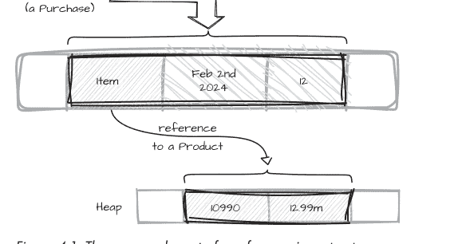

图 4-1：结构体中引用的内存布局

由于 `Purchase` 是一个值类型，`Purchase` 类型的变量在变量声明的位置就包含一个完整的实例。在图 4-1 中，`existing` 标识符是一个表示内存位置的名称，该位置包含 `Purchase` 类型的三个字段的值。其中一个字段是 `Item` 属性的后备字段，其类型是 `Product` 类。作为引用类型，`Product` 实例分配在堆上，并且 `Item` 属性存储对其的引用。其他属性值的內容，因为它们是值类型实例，直接存储在 `existing` 变量内。现在考虑在清单 4-2 中复制 `existing` 变量时会发生什么。

```
var existing = new Purchase
{
    Item = new Product { Id = 10990, Price = 12.99m },
    Ordered = DateTime.Parse("2024-02-02"),
    Quantity = 12
};
--snip--
var copy = existing;
```

清单 4-2：复制 `existing` 变量的值

因为 `Item` 属性的类型是一个类，只有引用被复制到新的 `copy` 变量的实例中，使得 `existing` 和 `copy` 变量都引用堆上同一个 `Product` 实例，如图 4-2 所示。

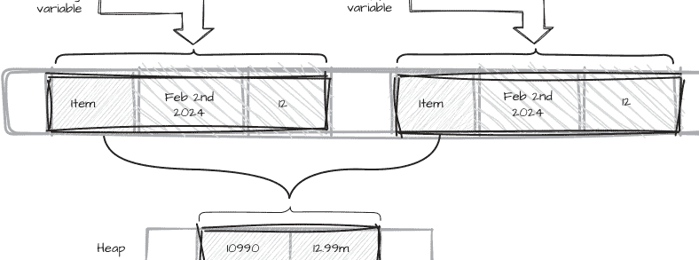

图 4-2：复制结构体实例后的内存布局

复制了 `existing` 到 `copy` 后，我们现在在内存中有两个 `Purchase` 实例，但 `Item` 的实例数据并未被复制。每个 `Purchase` 实例都引用堆上的同一个 `Product`。

## 只读属性与不可变类型

使清单 4-1 中的 `Purchase` 结构体只读并不能保护它免受与别名引用相关的意外副作用，也不会因为其 `Item` 属性没有 set 访问器而有所不同。我们仍然可能无意中修改 `Item` 属性引用的对象，因为即使 `Purchase.Item` 没有 set 访问器，它引用的 `Product` 类型具有可变属性。如果我们通过 `copy` 变量更改 `Product` 实例的属性，该更改在 `existing` 变量中可见，如清单 4-3 所示。

```
var existing = new Purchase
{
    Item = new Product { Id = 10990, Price = 12.99m },
    Ordered = DateTime.Parse("2024-02-02"),
    Quantity = 12
};

var copy = existing;

copy.Item.Price = 14.99;
Assert.That(existing.Item.Price, Is.EqualTo(14.99));
```

清单 4-3：通过共享引用更改 `Product` 的状态

由于 `Product` 类型的属性是可写的，我们可以使用对其的任何引用来更改实例。如果我们使 `Product` 类型 immutable，我们不能通过对 Product 实例的任何引用来更改其数据，因此它在多个引用变量之间共享也没关系。对于值类型来说，包含引用作为字段或属性并不特别不寻常，但我们必须谨慎对待存储在值类型中的引用类型。如果我们想避免 Purchase 实例意外更改相关的问题，我们必须确保 Purchase.Item 所引用的对象不能通过任何引用被更改；仅仅确保该引用对象不能通过 Purchase 本身被更改是不够的。实现这一点的最简单方法是将 Product 设为不可变。更一般地说，包含引用类型字段的值类型应仅引用不可变类型。

知道我们拥有的是引用的副本还是完整实例的副本是有价值的信息。将一个变量赋给另一个变量是程序中值被复制的最明显示例。在接下来的几节中，我们将研究值被复制的一些不太明显的示例，并了解我们的程序可能比我们想象的要进行更多复制。

## 创建新对象

大多数时候，我们不需要担心对象实例如何使用内存；这是 CLR 的责任。我们使用 `new` 表达式创建对象实例，它抽象了对象内存分配的细节以及分配位置。新的对象总是通过调用构造函数创建的，尽管正如你在第 2 章中看到的那样，当我们使用对象初始化语法时，编译器可能会隐式插入构造函数调用。

任一方法都可能需要一个新值类型实例的额外副本，因此为了更密切地监控程序使用的内存，我们需要特别注意我们如何构造新对象。

例如，列表 4-4 显示了一个 Purchase 值类型实例通过对象初始化创建。虽然代码中不可见，但执行初始化时使用了 Purchase 实例的额外副本。

```
public readonly struct Purchase
{
    public Product  Item { get; init; }
    public DateTime Ordered { get; init; }
    public int      Quantity { get; init; }
}

var order = new Purchase
{
    Item = new Product { Id = 10990, Price = 12.99m },
    Ordered = DateTime.Parse("2024-02-02"),
    Quantity = 12
};
```

列表 4-4：通过对象初始化创建 Purchase 值类型的新实例

> NOTE 只有当我们实际访问其属性时，才需要 Purchase 的额外副本，但设置从未读取的属性值可能并不常见。

the Item property had been obtained. The initialization of the order variable would be similar to the following:

```csharp
order = new Purchase();

order.Item = order.Item;

order.Ordered = DateTime.Parse("2024-02-03");

order.Quantity = 5;
```

请注意，被赋值的 order 变量在设置其属性之前会被默认初始化。Item 属性实际上是在重新初始化自身。在没有隐藏的 __temp 变量的情况下，Item 在 order 变量初始化期间将被初始化为 null，然后重新赋值为同一个 null 值。因此，order 变量的 Item 属性最终将得到 null 值，这显然不是我们想要的。列表 4-5 中所示的方法通过不在临时副本完全初始化之前覆盖 order 实例来正确处理这种行为。

当 Purchase 是值类型时，如这些示例中所示，额外的 __temp 副本可能很重要，因为它是对整个实例值的副本。当类型是类或记录时，副本只是对同一实例的新引用，因此额外副本的成本可以忽略不计。

在 C# v9.0 之前，对象初始化只能用于具有公共 set 访问器的属性。随着 init-only 属性的引入，这一限制被移除了，但通常构造函数是初始化实例的更直接方法，至少部分原因是它避免了隐藏变量的需求——好吧，大多数时候。正如你接下来会看到的那样，这对于值类型来说并非普遍成立。

## 构造值类型

当我们通过用户定义的构造函数创建 struct 或 record struct 类型的局部变量实例时，编译器可以引入我们在对象初始化中看到的两阶段初始化的变体。编译器仍然插入一个隐藏变量，但它不是设置属性，而是添加代码以在将值复制到目标变量之前直接在隐藏实例上调用所需的构造函数。

列表 4-7 显示了一个 Color struct，其属性既没有 set 也没有 init 访问器，因此我们必须使用构造函数来初始化属性。

```csharp
public readonly struct Color
{
    public Color(int red, int green, int blue)
        => (Red, Green, Blue) = (red, green, blue);
    public int Red { get; }
    public int Green { get; }
    public int Blue { get; }
}

var background = new Color(red: 0xFF, green: 0xA5, blue: 0x0);
```

*列表 4-7：调用构造函数初始化 Color struct 的属性*

构造函数在编译代码中的特殊名称为 .ctor，因此使用参数创建 Color 实例大致等同于：

```
Color __temp;
__temp..ctor(red: 0xFF, green: 0xA5, blue: 0x0);
Color background = __temp;
```

构造函数在第二行就地在 __temp 值上被调用。__temp 变量的声明导致编译器为 Color 的默认实例保留足够的空间，并且在运行时，构造函数会在该实例上被调用，就像它是一个普通方法一样。

由于 Color 是值类型，隐藏变量表示一个完整的实例，并且该实例会被完整地复制到目标变量。此行为仅适用于 struct 和 record struct 类型的用户定义构造函数；值类型的默认构造函数只是默认初始化每个字段，因此不需要隐藏副本。

正如我们在对象初始化中看到的那样，隐藏的 __temp 变量可防止部分构造的实例变得可观察。实际上，编译器通常可以完全优化掉隐藏实例，但在某些情况下，例如构造实例可能会因异常而失败，隐藏副本是不可避免的。考虑列表 4-8 中的 Brush 类，其 background 字段使用字段初始值设定项初始化。在 Assign 方法中，我们为 background 分配一个新值。

```
public class Brush
{
    public void Assign(int r, int g, int b)
    {
        background = new Color(red: r, green: g, blue: b);
    }

    private Color background = new Color(red: 0xFF, green: 0xA5, blue: 0);
}
```

列表 4-8：调用可能抛出异常的 struct 构造函数

在 Brush 的 Assign 方法中重新分配 background 字段时，Color 的隐藏临时副本至关重要，因为它确保 background 总是有有效且可预测的值。如果 Color 构造函数直接在 background 实例上调用并因异常而失败，它可能会使 background 处于不确定状态。在 Assign 方法中，编译器必须确保即使 Color 构造函数抛出异常，background 字段的现有值也可以使用。

通过将 Color 实例的构造与对 background 字段的赋值分开，编译器确保变量的唯一可观察状态要么是如果没有异常发生则为完全构造的值，要么是如果构造函数抛出异常则为其先前的值。请注意，复制值类型实例永远不会抛出异常；将值从一个内存位置复制到另一个内存位置总是安全的，并且不需要在运行时分配新内存。

复制值类型实例不保证是原子的。例如，如果类型具有多个字段或浮点值，不同线程可能会在复制操作进行到一半时观察到目标值，这种风险称为内存撕裂。这仅在多个线程共享可写的内存时才是问题。然而，重要的是要记住可变性不仅仅是设置属性；不可变值也可以被复制。防止内存撕裂的最简单保护措施是确保可供多个线程访问的内存真正是只读的。

## 像值类型一样复制记录

第 2 章展示了如何使用非破坏性突变来复制现有记录实例并使用 with 关键字更改该副本的选定属性。列表 4-9 显示了如何以这种方式克隆 Color 记录。

```
public sealed record Color(int Red, int Green, int Blue);

var pink = new Color(Red: 0xFF, Green: 0xA5, Blue: 0xFF);

var orange = pink with { Blue = 0 };
```

列表 4-9：使用 with 克隆记录实例

使用非破坏性突变克隆实例意味着原始实例得以保留，而复制的实例被更改。在列表 4-9 中，克隆变量 orange 采用 pink 的所有属性，除了 Blue 属性，该属性被显式赋值为 0。

相同的语法可用于复制 struct 和 record struct，并提供了一种方便的方式在目标变量上设置 init-only 属性。记录类型具有额外好处，因为它们是引用类型，因此不具有真正值类型的按值语义。如果我们只是将一个记录变量赋给另一个变量，我们仍然得到对同一实例的两个引用，如下所示：

```
var black = pink;
Assert.That(ReferenceEquals(black, pink), Is.True);
```

如果 pink 变量是值类型，black 将是实例的副本。with 关键字始终复制实例，无论它是值类型还是引用类型。

正如对象初始化一样，编译器创建一个隐藏的临时实例并在将其复制到目标变量之前设置其属性。非破坏性突变与对象初始化的不同之处在于，对于记录，新实例是使用虚拟编译器生成的 Clone 方法创建的。此方法至关重要，因为默认情况下，像本示例中的 Color 记录这样的位置记录没有可访问的无参数构造函数。

Record structs 和 structs 总是可以不带参数构造，并且总是按值复制，这意味着它们没有也不需要一个

Clone 方法。with 语法不被类类型支持，因为在其他挑战中，大多数类并不打算建模值语义。

引用类型实例的初始化过程与值类型的初始化过程不同，主要是因为不同类型的分配和在内存中存储的方式不同。这对我们用来访问这些实例的变量也有影响，尤其是在我们需要使用引用变量来引用值类型实例时，导致值被装箱。

## 识别不必要的装箱

值类型实例除作为另一个对象的一部分外不存在于堆上，因此我们不能使用引用直接引用它们。装箱，正如你在第 2 章中所知，通过将值复制到堆上已知的位置并允许我们引用该副本来解决此问题。

然而，由于装箱总是复制到堆上，装箱对象会受到垃圾回收和其他堆管理任务的影响。如果我们不加区别地装箱值，那么程序的性能和内存使用将会受损。花时间识别并删除不必要的装箱将提高代码的效率。

只要我们使用引用类型变量来引用值类型实例，就会发生装箱。它通常是隐式的（尽管我们可以显式装箱一个值，但很少有必要）。回想一下第 2 章中所有类型最终都派生自 object，因此我们可以始终将任何类型的隐式转换为 object。当该值本身不是引用时，结果就是对已装箱实例的引用。

让我们看一个例子。清单 4-10 中的 Clone 方法创建了 Coordinate 值类型的新局部实例并返回对其的 object 引用。返回的值是对已装箱的 Coordinate 的引用。

```
public readonly struct Coordinate
{
    public int X { get; init; }
    public int Y { get; init; }

    public object Clone()
    {
        var item = new Coordinate { X = this.X, Y = this.Y };
        return item;
    }
    --snip--
}
```

清单 4-10：返回对已装箱值类型变量的引用

当我们调用 Clone 方法时，我们会得到对已装箱 Coordinate 实例的 object 引用。装箱发生在方法退出之前；为 item 值的副本在堆上分配空间，并从方法返回对该装箱对象的引用。

拆箱，装箱的逆过程，将堆上装箱对象中的值复制到其原始值类型的实例中。拆箱必须始终显式完成，语法上与从已装箱值到目标类型的显式转换相同，如清单 4-11 所示。

```
var original = new Coordinate( --snip-- );
object box = original.Clone();

Coordinate clone = (Coordinate)box;
```

清单 4-11：拆箱到原始类型

当值类型实现一个或多个接口时，实例也可以通过这些接口类型中的任何一个的变量来引用，这也需要将实例装箱。

### 到接口

值只能在可以隐式转换为目标引用类型时才会被装箱。由于所有值类型都是密封的——意味着禁止继承——该有效转换可以是到 object 变量引用、System.ValueType（它本身不是值类型），或由值类型实现的接口。如果该值是枚举成员，它也可以转换为 System.Enum 类或 System.Enum 实现的任何接口。

我们只需要对值有直接的 object 引用在极少数情况下，而且除了也许纯粹的教学示例外，没有理由装箱到 System.ValueType。值类型变量可以隐式转换为类型实现的任何接口，例如清单 4-12 中 Color 结构体实现的 IComparable 接口。


```
public readonly struct Color : IComparable<Color>
{
    public Color(uint val) => rgb = val;

    int IComparable<Color>.CompareTo(Color other)
        => rgb.CompareTo(other.rgb);

    private readonly uint rgb;
}
```

清单 4-12：`Color` 结构体实现的 `IComparable` 接口

`IComparable<T>` 接口指定了一个名为 `CompareTo` 的单个方法，我们在其中定义比较操作以允许 `T` 的集合排序。这里对 `Color` 的实现只是委派给其 `uint` 字段，该字段实现了 `IComparable<uint>` 接口。

请注意，`IComparable<Color>.CompareTo` 的实现是显式实现，这意味着我们只能通过使用接口类型的引用来调用 `CompareTo`。对 `Color` 变量直接调用 `CompareTo` 的任何尝试都会导致编译错误。如果我们将 `Color` 变量

转换为 `IComparable<Color>` 接口，该值将被装箱为 `IComparable<Color>` 引用，如清单 4-13 所示。

```
var red = new Color(0xFF0000);
var green = new Color(0x00FF00);

IComparable<Color> compare = red;
var less = compare.CompareTo(green);
```

清单 4-13：显式装箱到接口类型

当我们初始化此 `compare` 变量时，`red` 的值会被装箱，因为任何接口类型的变量都是引用。我们可以通过使 `CompareTo` 非显式来避免装箱，从而允许我们直接使用 `red` 变量调用它而不将其转换为接口。这并不意味着我们应该偏好非显式实现；显式接口方法是将类型的公共接口分离的好方法。

我们可以通过使用被约束为接口类型的泛型类型参数来调用显式接口实现。在这种情况下，不需要转换，也不会发生装箱。为了演示，清单 4-14 中的泛型 `LessThan` 方法不会装箱其参数，即使我们将 `Color` 值作为其参数传递，因为泛型参数 `T` 被约束为 `IComparable<T>` 接口。

```
public static bool LessThan<T>(T left, T right)
    where T : IComparable<T>
{
    return left.CompareTo(right) < 0;
}

var red = new Color(0xFF0000);
var green = new Color(0x00FF00);

Assert.That(LessThan(green, red), Is.True);
```

清单 4-14：将泛型类型参数 `T` 约束为 `IComparable<T>` 接口类型

当泛型类型参数以这种方式被约束时，泛型类型的变量被视为约束所用类型的变量。在此示例中，`left` 就像 `IComparable<T>` 变量一样使用。我们可以直接在 `T` 代表的任何值上调用该方法，即使实现的方法是显式实现。

### 在方法调用中

通过将其分配给引用变量来装箱值类型实例在我们的代码中通常很明显，但装箱也会在我们将值类型实例作为参数传递给引用类型方法参数时发生。与分配给引用变量一样，如果存在到参数类型的隐式转换，则值会被隐式装箱。由于装箱通常是隐式的，因此很难发现。例如，清单 4-15 装箱 `now` 变量，因为 `DateTime` 是值类型，而 `Console.WriteLine` 在格式字符串参数后接受 `object?` 参数。

```
DateTime now = DateTime.Now;
--snip--
Console.WriteLine("Time now: {0}", now);
```

清单 4-15：为 `Console.WriteLine` 装箱 `now` 参数

如果我们意识到在将值类型作为参数传递给引用类型参数时，可以最大限度地减少装箱参数的需要或更改代码以避免装箱。然而，重要的是权衡装箱的成本与代码其余部分的上下文。

例如，与其像清单 4-15 中那样将 `now` 变量作为参数传递给 `Console.WriteLine`，我们可以传递 `now.ToString`，它不需要装箱，因为 `DateTime` 结构体重写了 `ToString` 方法，并且 `WriteLine` 方法无论如何都会调用它。可以说，显式调用 `ToString` 降低了代码的直接性，而装箱 `now` 变量的成本与写入控制台的成本相比微不足道。

当我们在未专门重写该方法的 value 类型实例上调用基类虚方法时，该实例会被装箱以调用基类实现。如果该方法被类型重写，如 `DateTime` 中的 `ToString`，则不会发生装箱。我们通过重写从 `object` 继承的所有虚方法来避免在这种情况下对我们自己的值类型进行装箱的需要：`ToString`、`Equals` 和 `GetHashCode`。

然而，对值调用 `GetType` 方法总是会导致该值被装箱。`GetType` 方法用于获取变量的运行时类型，并在 `object` 上实现。然而，`GetType` 不是虚的，因此无法被重写。

这里的教训是，我们应该避免为值类型调用 `GetType`。如果我们需要有关值的类型信息，我们可以使用 `typeof` 代替。由于值类型是密封的并且不能继承任何其他类型，`typeof` 返回的编译时类型将始终与 `GetType` 给出的运行时类型匹配。

### 方法参数和参数

大多数值的复制并不容易避免，而将参数传递给方法可能是其中大部分复制发生的地方。试图避免此类复制并不总是会带来好处，但了解方法调用的机制是必不可少的。本节检查属性、索引器、运算符和转换中隐藏的复制位置，通常是幕后方法调用的结果。

方法可以按值或按引用获取参数。正如你在第 3 章中看到的那样，引用参数的独特之处在于我们需要使用 `ref`、`out` 或 `in` 关键字声明它们，以及对于 `ref` 和 `out` 参数，传递给它们的实参上。不是引用参数的参数称为值参数。传递一个

`argument` to a value parameter is so common that it’s easy to forget it results in a copy. Capturing the result of a method call also generally makes a copy of the returned value.

Additionally, the semantic and behavioral differences between value types and reference types have important consequences when we’re using the value returned from a method. It’s not even always obvious that we are calling a method or using a value returned from one. However, before we investigate those circumstances, let’s revisit the essential mechanics of value parameters and return values.

## Passing and Returning by Value

Listing 4-16 shows a simple value type, `Speed`, that has a static `Incremented` method that takes a value parameter, `original`, and returns a new value. Both the parameter and the return statement in the `Incremented` method represent copies of `Speed` instances.

```csharp
public readonly struct Speed
{
    private Speed(double ms) => InMetersPerSecond = ms;

    public double InMetersPerSecond { get; }
    public static Speed FromMetersPerSecond(double val) => new Speed(val);

    public static Speed Incremented(Speed original)
    {
        var result =
            Speed.FromMetersPerSecond(original.InMetersPerSecond + 10);
        return result;
    }
}

var start = Speed.FromMetersPerSecond(40);
var end = Speed.Incremented(start);

Assert.That(end.InMetersPerSecond, Is.EqualTo(50));
```

Listing 4-16: Passing and returning `Speed` instances by value

The `Incremented` method receives its `original` parameter by value, meaning `original` is a local variable within the method. The return is also by value, so a whole new instance of `Speed` is returned as a new value when we call the method. As an optimization, the compiler may be able to avoid that copy by using the result local variable to assign the target variable directly, as long as the observable effect is identical to making a copy. We can either assign the value to a new variable, as we do here, or use the new value to overwrite the value of the `start` variable passed as the argument in the first place.

Instead of a plain static method, we could use an extension method, which we call as if it were an instance method. The first parameter of an extension method is special because it represents the `this` identifier that would be implicitly available within an ordinary instance member. An extension method is a good candidate for providing different, perhaps less common, units of measurement. Listing 4-17 uses an extension method called `InMph` to obtain the value of a `Speed` in miles per hour.

```csharp
public static class SpeedExtensions
{
    public static double InMph(this Speed speed)
        => speed.InMetersPerSecond * 2.236936;
}

var mph = initial.InMph();
```

Listing 4-17: Defining the `InMph` extension method for `Speed`

Despite the special `this` syntax in the `InMph` extension method’s declaration, the first parameter is still just a value parameter, taking its argument by value. The `initial` variable’s value will therefore be copied into the `speed` parameter in order to call the method. The `Speed` type is a struct, so every copy we make represents a whole instance of `Speed`.

> **NOTE** We have many online converters to choose from for this type of conversion. The one used for Listing 4-17 is from the Inch Calculator website, `https://www.inchcalculator.com/convert/meter-per-second-to-mile-per-hour/`.

## Accessing Properties

Whenever we access a property, we’re really making a call to a method, either to obtain its value or to set a new one. Both `get` and `set` accessors are implemented as hidden methods on a type. By default, `set` has a value parameter, and `get` returns by value. In either case, therefore, when we access the property, we make a copy of the value. This process is easy to overlook because the syntax for using a property looks like it’s directly getting or setting a field.

Consider the `Speed` property of the `Velocity` value type shown in Listing 4-18.

```csharp
public readonly struct Velocity
{
    public Velocity(Speed speed, Angle angle)
        => (Speed, Direction) = (speed, angle);

    public Speed Speed { get; }
    public Angle Direction { get; }
}
```

Listing 4-18: Defining properties of the `Velocity` struct

Looking at the compiled CIL for the `Speed` property of the `Velocity` struct, we see that the property accessor is emitted as a call to the hidden `get_Speed` method:

```cil
.property instance valuetype Speed Speed()
{
    .get instance valuetype Speed Velocity::get_Speed()
} // end of property Velocity::Speed
```

Apart from the CIL-specific markers `.property`, `instance`, and `valuetype`, the call to `get_Speed` is a regular method call. The compiler has synthesized the `get_Speed` method too, and its signature looks like this in the CIL:

```cil
.method public hidebysig specialname instance valuetype Speed
    get_Speed() cil managed
{
    --snip--
}
```

If `Speed` had a corresponding `set` accessor, it would be emitted as a method named `set_Speed` that takes a `Speed` parameter and returns void. The CIL markers `hidebysig` and `specialname` aren’t used during execution, but they’re used by tools that work with CIL.


编译器将`get_Speed`访问器实现为一个不带参数、按值返回`Speed`值的方法。这几乎就像我们自己编写了一个返回`Speed`的方法：

```csharp
public Speed get_Speed()
{
    // return a Speed value
}
```

`Speed`属性的`get`访问器按值返回`Speed`实例的副本，这与任何按值返回`Speed`的方法完全相同。

人们很容易误以为使用属性或索引器就是直接访问字段，因为编译器注入的方法调用被方便地隐藏了。然而，重要的是要认识到访问属性或索引器会调用方法，并且通常会复制值。

> **注意**：索引器是特殊的实例方法，允许对象像数组或类似的序列对象一样被访问。它们与属性一样，也是通过方法实现的。

## 使用运算符的表达式

包含运算符（如`+`或`==`）的表达式通常也代表方法调用，需要复制参数和返回值，并且可能还在内部进行其他复制。例如，在清单 4-19 中，我们将两个`Speed`值相加：

```csharp
var start = Speed.FromMetersPerSecond(55);
var increase = Speed.FromMetersPerSecond(15);

var final = start + increase;
```

*清单 4-19：将两个`Speed`值相加*

这个加法背后的方法调用可能并不那么明显，但仔细观察会发现，仅仅将实例相加就可能代表多次复制。清单 4-20 展示了为两个`Speed`值定义`operator+`的规范形式：

```csharp
public static Speed operator+(Speed left, Speed right)
    => new Speed(left.InMetersPerSecond + right.InMetersPerSecond);
```

清单 4-20：为`Speed`定义加法运算符

`operator+`的`left`和`right`参数各代表一份副本。从概念上讲，返回值也会生成一份副本，尽管编译器可以自由优化掉该副本，并直接将新的`Speed`实例构造到目标变量中。

我们还可能重载`==`相等运算符、`operator<`等比较运算符、二元组合运算符`|`和`&`，甚至真值运算符`true`和`false`，从而允许在布尔测试表达式中使用变量，如`if(speed) {...}`。希望我们不会试图为`Speed`这样的类型重载真值运算符。

所有这些运算符重载都实现为类型的静态方法，并且至少接受一个属于该类型的参数。该参数通常按值传递，因此代表一份副本。

用户定义的转换运算符也是方法，当其参数或返回类型是值类型时，也会按值复制。识别隐式转换何时被调用可能特别困难，因为该过程在代码中留下的语法线索很少。为说明这一点，考虑清单 4-21 中的`Velocity`类型，它定义了从`Velocity`到`Speed`的隐式转换：

```csharp
public readonly struct Velocity
{
    public Velocity(Speed speed, Angle angle)
        => (Speed, Direction) = (speed, angle);

    public Speed Speed { get; }
    public Angle Direction { get; }

    public static implicit operator Speed(Velocity velocity)
        => velocity.Speed;
}
```

清单 4-21：用户定义的隐式转换

此转换运算符使用一份`Velocity`副本作为参数，以及两份`Speed`副本——一份用于访问`velocity`参数的属性，另一份用于返回值。与其他方法一样，编译器可能能够避免显式复制返回值。在清单 4-22 中，`DistanceInKm`方法接受一个`Speed`参数，并以一个`Velocity`实例而不是`velocity.Speed`属性来调用：

```csharp
public double DistanceInKm(Speed speed, TimeSpan elapsed)
    => speed.InMetersPerSecond / 1000 * elapsed.TotalSeconds;

var velocity = new Velocity(initial, direction);

var distance = DistanceInKm(velocity, TimeSpan.FromHours(2));
```

清单 4-22：使用隐式转换传递实参

虽然这看起来是对`DistanceInKm`方法的常规调用，但`velocity`实参首先需要转换为`Speed`。我们的类型转换运算符使之成为可能，并且由于我们使转换成为隐式转换，编译器在调用`DistanceInKm`时只需插入对该运算符的调用，并在过程中复制`Velocity`实参和`Speed`返回值。

类型转换需要谨慎使用。它们可能隐藏各种复杂性，而不仅仅是通常代表的副本。隐式转换按设计会不可见地发生，在使用它们的代码中只留下微妙的线索，例如清单 4-22 中像`DistanceInKm`这样的方法调用。显式用户定义的转换在使用它们的代码中在语法上更加明显，但仍然容易忽略它们也代表对方法的调用。

当方法按引用返回变量（我们最初在第 3 章中讨论过）时，只要两者都不是只读的，我们就可以使用该引用变量直接修改底层变量。但请记住，`ref`返回是一种优化特性，不应不加选择地引入。

所有其他非`void`方法生成的是值，而不是变量，这意味着我们不能直接对结果赋值。如果我们忘记这一点并误用返回值，可能会导致令人惊讶的行为。

## 修改返回类型实例

你已在第 2 章中看到，变量可以被赋值，但值不能。值是表达式（包括方法调用）的结果，并且是不可变的。我们不能直接修改任何方法返回的值。

一个常见的困惑源于值类型实例和引用类型实例在这方面表现不同：如果方法返回对可变类型的引用，我们可以使用返回的引用直接修改内存中的实例，但除非我们先将返回值复制到变量中，否则无法修改可变值类型的实例。理解值类型与引用类型在此方面的差异，将有助于我们避免一些常见的陷阱，并更好地理解“使所有值类型都不可变”这一最佳实践。

当返回值是值类型实例时，我们不能用它来设置属性值或更改该值的任何公共字段。我们必须先将该值赋给一个变量，然后才能修改它。为演示这一点，清单 4-23 展示了一个结构体，其中有一个故意设为可变的`InMetersPerSecond`属性，以及一个名为`FromKmh`的静态类工厂方法：

```csharp
public struct Speed
{
    public double InMetersPerSecond { get; set; }

    public static Speed FromKmh(double val)
        => new Speed(val * 1000 / 3600);

    private Speed(double ms) => InMetersPerSecond = ms;
}
```

```csharp
Speed.FromKmh(70).InMetersPerSecond = 15.2;
```

清单 4-23：尝试修改`FromKmh`的返回值

在最后一行，我们尝试为静态方法返回的值设置`InMetersPerSecond`属性，这会产生编译错误：

```text
[CS1612] Cannot modify the return value of 'Speed.FromKmh(double)' because it is not a variable
```

此示例无法编译，因为`FromKmh`方法返回一个`Speed`值。编译器拒绝对该值的任何修改，即使`InMetersPerSecond`属性具有公共的`set`访问器。

注意：C++ 程序员会将该返回值称为右值。

如果允许修改返回值，则修改将发生在编译器引入的临时实例上，该临时实例用于捕获方法返回的值。在清单 4-23 中，`FromKmh`方法中创建的`Speed`实例的生命周期在方法返回时结束，因此返回值需要存储在某处——即存储在实例的隐藏副本中。


In any case, we would normally assign the `Speed` value returned by `FromKmh` to another variable. We are permitted to modify the `InMetersPerSecond` property of the target variable because `Speed` has a public `set` accessor, as shown here:

```
var start = Speed.FromKmh(70);
start.InMetersPerSecond = 15.2;
```

The prohibition against modifying a returned value is not specific to properties; it also applies if we try to modify a public field on the return value. The compiler prevents such modifications because the return value from a method isn't a variable. However, as you've already seen, several parts of code don't look like methods but are represented in the compiled code as methods. This restriction on modifying return values applies equally to them because they also produce temporary copies.

`record struct`, an instance can still be modified by its instance methods, even when it’s a hidden copy.

## Instance Methods and Mutability

Although we can’t set the value of a property on a returned value type instance, we can call methods on that instance. If the type has non-read-only fields, or properties with a `set` accessor, the method we call can mutate the instance. In this next example, we have a mutable `Speed` struct with a `Reset` method that changes the value of the `InMetersPerSecond` property:

```
public struct Speed
{
    public double InMetersPerSecond { get; set; }

    public void Reset() => InMetersPerSecond = 0;

    --snip--
}
```

The `Reset` method can be called on any `Speed` value, including one returned from a method or property. In Listing 4-25, we use the value of the `Speed` property of a `Velocity` object to call `Reset`.

```
var velocity = new Velocity(Speed.FromKmh(55), Angle.FromDegrees(45));

velocity.Speed.Reset();

Assert.That(velocity.Speed.InMetersPerSecond, Is.EqualTo(0));
```

Listing 4-25: Calling the `Reset` method on the value returned by `Velocity`’s `Speed` property

When we call `Reset` on `velocity.Speed`, we might be tempted to think we’ve changed the value stored in the `velocity` variable, but `velocity` doesn’t change here, and the test fails, because the `Reset` method mutates only the instance used to call it. The instance returned from the `Speed` property is a temporary value. Recall from Listing 4-23 that we can’t use the value to directly set the `InMetersPerSecond` property, but we can change that property via an instance method of `Speed`.

We can mutate a value obtained from an indexer in a similar way, and we can just as easily overlook that only the hidden copy gets altered. Consider Listing 4-26, which calls a method on the value returned from the `Journey` type’s indexer.

```
public class Journey
{
    --snip--

    public Velocity this[int idx]
    {
        get => legs[idx];
        set => legs[idx] = value;
    }

    private List<Velocity> legs = new List<Velocity>();
}
```

```
journey[0].Speed.Reset();
```

Listing 4-26: Calling a method on the value returned by `Journey`'s indexer

An indexer is implemented as a method, in the same way as a property, and has precisely the same behavior. Again, it's easy to forget that properties are not variables, especially when they're value type instances. The compiler can't prevent us from calling a method on a returned value, because it's a perfectly reasonable thing to want to do. The only way to prevent this erroneous behavior is to make `Speed` an immutable type, thereby disallowing any mutating methods entirely. This is another good reason to make all value types immutable.

## Properties as Arguments for Read-Only Parameters

Another consequence of method returns being values rather than variables is that they can't be directly passed as arguments for `ref` or `out` parameters. As you saw in Chapter 3, by-reference parameters receive the address of their arguments, but only variables have addresses. If we first assign a method return or property result to a variable, we can pass the variable by reference.

Chapter 3 also explained that an `in` parameter is an immutable by-reference variable. Although `in` parameters take the address of their argument in exactly the same way that `ref` and `out` parameters do, they're designed to behave as if they're value parameters. The compiler therefore allows us to pass a nonvariable as an argument for an `in` parameter but copies the value to a hidden variable, and it's that variable's address that's passed.

Listing 4-27 defines a `BallisticRange` method with two `in` parameters, and calls it using the `Speed` and `Direction` properties of a `Velocity` type.

```
public static double BallisticRange(in Speed initialSpeed, in Angle initialDirection)
{
    const double Gravity = 9.81;

    return initialSpeed.InMetersPerSecond * initialSpeed.InMetersPerSecond *
        Math.Sin(initialDirection.InRadians * 2) / Gravity;
}
```

```
public readonly struct Velocity
{
    public Velocity(Speed speed, Angle angle)
        => (Speed, Direction) = (speed, angle);
```

```
public Speed Speed { get; }
public Angle Direction { get; }
}

var velocity = new Velocity(Speed.FromMetersPerSecond(55),
    Angle.FromRadians(0.78));

var distance = BallisticRange(velocity.Speed, velocity.Direction);
```

清单4-27：将属性作为 `in` 参数传递

请记住，与 `ref` 和 `out` 参数不同，我们不需要用 `in` 关键字来修饰传递给 `in` 参数的实参。

在这里，编译器会从 `velocity.Speed` 和 `velocity.Direction` 获取值的副本，并将这些副本的引用传递给 `BallisticRange` 方法的 `in` 参数。就好像我们写了以下代码一样：

```
var __temp_Speed = velocity.Speed;
var __temp_Angle = velocity.Direction;
var distance = BallisticRange(in __temp_Speed, in __temp_Angle);
```

之所以创建 `__temp_Speed` 和 `__temp_Angle` 副本，是因为访问属性的 `get` 访问器产生的是值，而不是变量。按引用传递实参实际上要求编译器获取其内存地址，但只有变量才有地址。`get` 访问器返回的是一个临时值，必须将其赋给变量以便获取地址，或者传递给值参数（值参数会创建该值的副本）。尽管 `in` 参数有助于减少应用程序创建的副本数量，但只有在将变量作为实参传递时，我们才能看到它们的好处。

对于其他不是变量的表达式，如常量和值类型方法的返回值，也会创建隐藏副本。这些副本仅为只读的 `in` 参数创建。如果我们尝试将属性值或其他非变量传递给 `ref` 或 `out` 参数，编译器会直接拒绝我们的代码。这类可变的引用变量本意是让被调用的方法修改，而对常量或 `get` 访问器返回的临时值进行修改是非法的。

## 防御性副本

每当编译器需要只读变量但无法保证其值永远不会改变时，编译器就会制作一个防御性副本。因此，任何更改（即使是无意的）都发生在隐藏副本上，而不是可见变量上，因此更改不会被观察到。

你曾在清单4-8中看到编译器为值类型实例制作防御性副本的一个示例：使用参数构造值类型时，会生成一个隐藏的临时实例，然后构造函数完成后，编译器会将其复制到目标变量。此过程可以保护现有值免受构造函数体内可能发生的任何异常的影响。如果发生异常，原始值将保持不变。

编译器也可能会为值类型实例制作防御性副本，以保护只读变量不被修改。

引用类型不需要防御性副本，因为编译器总能检测到引用值的更改。如果引用变量是只读的，任何为其分配新引用的尝试都无法编译。被引用的实例是否不可变在这里没有区别；如果我们要求实例为只读，那么我们需要自己确保它不会改变。值类型变量的值就是实例本身，而可变的值可能会被其实例方法更改，因此如果变量本应是只读的，那么当我们调用这些方法时，编译器可能会引入一个防御性副本。

## 可变值类型与 `in` 参数

在第3章中，你看到了如何为方法参数使用 `in` 修饰符，在方法实现不会修改相应参数变量值的情况下避免复制实参。然而，除非编译器能够保证参数的值甚至连无意的更改都不可能发生，否则它会对这些值制作防御性副本。

清单4-27展示了 `BallisticRange` 方法，该方法有两个只读引用参数 `initialSpeed` 和 `initialDirection`。方法实现使用这些参数变量的属性（分别是 `InMetersPerSecond` 和 `InRadians`）来计算其返回值。如果这些属性所属的类型没有显式不可变，编译器将对其值制作防御性副本，以确保 `in` 参数的只读特性。`BallisticRange` 使用的 `Speed` 和 `Angle` 结构体类型如清单4-28所示。这两种类型的属性都不可变，但请注意，这些类型本身并未标记为 `readonly`。

```
public struct Speed
{
    --snip--
    public double InMetersPerSecond => amount;

    private readonly double amount;
}
public struct Angle
{
    public double InRadians { get; }
    --snip--
}

public static double BallisticRange(in Speed initialSpeed, in Angle initialDirection)
{
    const double Gravity = 9.81;

    return initialSpeed.InMetersPerSecond * initialSpeed.InMetersPerSecond *
        Math.Sin(initialDirection.InRadians * 2) / Gravity;
}
```

清单4-28：在 `BallisticRange` 方法中使用 `in` 参数属性

在 `BallisticRange` 内部，编译器每次使用 `initialSpeed.InMetersPerSecond` 属性时都会复制 `initialSpeed` 参数（因此总共两个副本），即使 `BallisticRange` 中没有尝试修改 `initialSpeed` 参数变量。另一方面，当访问其 `InRadians` 属性时，`initialDirection` 参数不会被复制，尽管与 `Speed` 一样，`Angle` 结构体也不是只读类型。

要确定为什么 `Speed` 参数被复制而 `Angle` 参数没有，我们需要理解编译器提供了什么以及它做出了哪些假设。

## 自动属性与非自动属性

尽管清单4-28中 `Speed` 和 `Angle` 类型的属性都是只读的，但它们的实现方式不同。`Angle` 的 `InRadians` 属性是一个自动属性，这意味着编译器会为它引入一个隐藏的后备字段，并生成相应的 `get` 访问器实现来获取该字段的值。如果我们还为 `InRadians` 指定了 `set` 访问器，编译器就会生成相应的实现来设置后备字段的值。

相比之下，`Speed` 的 `InMetersPerSecond` 属性是一个表达式体属性，意味着它返回一个显式声明的私有字段的值。表达式体属性相当于一个没有 `set` 访问器的非自动属性，如下所示：

```
public double InMetersPerSecond
{
    get { return amount; }
}
```


我们通常将其理解为只读属性，因为通常无法更改没有 `set` 访问器的属性的值。然而，`C#` 并没有规定 `get` 访问器不能修改类型的字段；这仅仅是一种约定。在 `BallisticRange` 内部，`InMetersPerSecond` 属性是通过一个不可变引用访问的；如果 `get` 访问器确实修改了参数的值，由于实参是按引用传递的，这种更改将可以在 `BallisticRange` 方法之外看到。

如果参数变量本应不可变（如 `in` 参数），编译器必须确认以任何方式使用该变量都不会改变其值。如果缺乏这种保证，编译器就会在参数用于访问属性或调用方法的每个位置制作值的防御性副本。如果方法或属性确实更改了值，只会影响隐藏副本。这种更改永远不会通过传递给方法参数的实参在 `BallisticRange` 方法之外被观察到。

清单4-28中 `Angle` 的 `InRadians` 属性同样是只读的，但由于它是一个自动属性，编译器会给 `get` 访问器方法添加一个特殊特性，以指示其实现是只读的。清单4-29展示了 `get_InRadians` 方法生成的 CIL。

```text
.method public hidebysig specialname instance float64
       get_InRadians() cil managed
{
    .custom instance void [System.Runtime]
        System.Runtime.CompilerServices.IsReadOnlyAttribute::.ctor()
        = (01 00 00 00 )
} // --snip--
```

*清单4-29：只读自动属性*

编译器在编译代码中为自动属性添加了 `IsReadOnlyAttribute` 指示符，并且可以在参数类型声明于不同编译程序集时廉价地检查该特性是否存在。在位置记录结构体中，编译器会为类型给定的参数生成属性。这些生成属性的 `get` 访问器也应用了 `IsReadOnlyAttribute`。

当我们使用 `in` 参数变量调用方法或访问属性值时，编译器会检查这些方法和属性。如果存在此特性，编译器就知道可以避免制作防御性副本。

## 只读引用变量

当我们使用只读局部引用变量时，也需要防御性副本，除非编译器确认访问该变量不会改变其值。我们在第3章中探讨了局部引用变量如何与引用返回值协作使用。

类或记录 `record`——而不是结构体或记录结构体——的方法或属性可以按引用返回实例。如果我们按引用返回值，就不会制作该值的副本。将其设为只读可确保无法通过该引用修改值。例如，清单4-30中的 `Projectile` 类具有按引用返回实例字段的属性。

```csharp
public sealed class Projectile
{
    public Projectile(Speed speed, Angle angle)
        => (initial, direction) = (speed, angle);

    public ref readonly Speed Speed => ref initialSpeed;
    public ref readonly Angle Angle => ref initialDirection;

    private readonly Speed initialSpeed;
    private readonly Angle initialDirection;
}
```

*清单4-30：为 Projectile 类定义 ref 返回值*

这些 `Angle` 和 `Speed` 属性返回的引用永远不会比 `Projectile` 实例活得更久，因为 `Projectile` 是一个类，它的实例在堆上分配，其生命周期由垃圾回收器管理。值类型不允许按引用返回其字段，因为实例的生命周期可能先于对其内部成员的任何引用而结束。

使用 `ref readonly` 属性时，我们通常也会将返回的引用捕获到一个本地只读引用变量中，也称为 *ref readonly local*。在下面的代码中，我们使用 `ref readonly` locals 来接收来自清单 4-30 中 `Projectile` 的属性返回的引用：

```
var dart = new Projectile(initial, direction);

ref readonly var speed = ref dart.Speed;
ref readonly var angle = ref dart.Angle;

var kmh = speed.InMetersPerSecond;
var degrees = angle.InRadians;
```

由于 `Projectile` 的属性返回只读引用，我们必须将它们赋给只读引用变量，或者完全省略目标变量上的 `ref` 关键字来显式复制其值。

只读引用变量必须像 `in` 参数一样得到保证是不可变的。因此，当我们稍后使用其 `InMetersPerSecond` 属性时，编译器会为 `speed` 变量制作一个防御性副本，以防该属性会改变值。

`Angle` 的 `InRadians` 属性是一个自动属性，具有 `IsReadOnlyAttribute` 指示符，因此编译器不需要复制 `angle` 变量。如果我们手动复制 `ref` return 的值，就不会有通过该变量改变 `Projectile` 只读字段的危险，因此在这种情况下编译器也不会引入额外的副本。

## 只读字段

对只读字段的属性的每次访问都会产生一个防御性副本，除非编译器确信该属性不会更改其实例。对只读字段的实例方法的调用也是如此。

在清单 4-31 中，我们将清单 4-28 中的 `BallisticRange` 方法设为 `Projectile` 类的实例成员，并修改其实现以使用类的实例字段而不是接收参数。

```
public sealed class Projectile
{
    public double BallisticRange()
    {
        const double Gravity = 9.81;

        return initialSpeed.InMetersPerSecond * initialSpeed.InMetersPerSecond *
               Math.Sin(initialDirection.InRadians * 2) / Gravity;
    }

    private readonly Speed initialSpeed;
    private readonly Angle initialDirection;
}
```

清单 4-31：访问 `Projectile` 类的只读字段的属性

`Speed` 和 `Angle` 类型与清单 4-28 中的相同，但它们是只读字段而不是参数。由于只读字段必须不可变，编译器会对每次访问字段的 `InMetersPerSecond` 属性时制作 `initialSpeed` 字段值的防御性副本。使用 `Angle.InRadians` 属性不会导致防御性副本，因为它是一个自动属性。

有趣的是，如果我们使 `Projectile` 的字段变为非只读，编译器将省略防御性副本。原因现在应该很清楚了：防御性副本是为了防止对只读变量的不想要的修改变得可见。如果变量不是只读的，允许它们被更改不会造成问题，也不需要编译器进行防御性干预。

然而，使概念上不可变的字段和属性变为可变并不是真正的解决方案。我们真正想要的是更强的不可变性保证，而不是为了减少防御性副本而牺牲不可变性。我们可以采取措施，使用 `in` 参数、`ref` 本地变量和只读字段，而不会产生编译器额外防御性副本的成本。

## 防御性副本的原因

围绕只读引用和只读字段存在许多注意事项，因此如果我们要避免编译器引入的潜在副本，就有很多需要考虑。编译器可能在多种情况下引入防御性复制，但规则可以非常简单地概括：

对于某个表达式 `x.Y`，其中 `Y` 可能是属性或方法，如果以下所有条件都为真，编译器会制作 `x` 值的一个防御性副本：

- `x` 是一个只读字段、一个 `in` 参数或一个 `ref readonly` local。
- `x` 的类型是一个非只读值类型。
- `Y` 未标记为 `readonly`。

如果 `Y` 是一个字段，则在任何情况下都不需要防御性副本，因为仅仅读取字段不可能改变它。对 `Y` 的任何写入尝试都将被编译器捕获，因为 `x` 是只读的。然而，避免防御性副本并不是在结构体或记录结构体上公开公共字段的良好理由，因为这样做我们会失去封装数据的所有好处。在类型上使用 `readonly` 修饰符，或至少在属性和方法上使用，可以更有效地编码不可变性的意图。

## 防御变异

我们可以以几种方式修改代码以避免需要防御性复制。在每种方法中，我们都保证方法或属性永远不会改变实例的值，这意味着编译器不需要制作副本来保护只读变量。

回顾一下，以下类型的变量是只读的：

- `in` 参数
- `ref readonly` 本地变量
- 只读字段

当我们使用只读值类型变量访问属性或调用方法时，编译器可能需要对值进行防御性复制。如果变量的类型是引用类型，则不需要防御性副本，尽管我们必须记住，即使引用变量是只读的，实例仍然可以被更改。只有当编译器无法保证值是不可变时，才需要对值类型实例进行防御性复制。

避免许多防御性副本的一个简单方法是使用自动属性而不是手动实现的属性。正如我们所讨论的，编译器会向自动属性的 `get` 访问器添加 `IsReadOnlyAttribute` 标记，以确认它不会以任何方式改变值。当访问属性时，该属性的存在证明编译器不需要防御性副本。

然而，使用自动属性并不总是可能或理想的，例如当我们想要多个属性使用的公共 backing 字段，或执行计算的属性时。使属性自动也不会阻止编译器在通过只读变量调用方法时进行防御性复制。幸运的是，我们可以采用几种替代自动属性的方法来帮助避免防御性复制。我们选择的方法将取决于应用程序的具体需求，但在每种情况下，我们都在明确保证调用方法或访问属性不会改变实例的状态。

## 只读访问器和方法

避免在访问非自动属性时进行防御性复制的一个选项是向属性添加 `readonly` 修饰符，如清单 4-32 中为 `InMetersPerSecond` 属性所示。对于也需要 `set` 访问器的属性，如此处所示的 `InKmh` 属性，我们可以仅对 `get` 访问器使用 `readonly`。

```
public struct Speed
{
    --snip--

    public readonly double InMetersPerSecond => amount;

    public double InKmh
    {
        readonly get => amount / 1000 * 3600;
    }
```

```
private set { amount = value / 3.6; }
}

private double amount;
}
```

清单 4-32：声明只读 `get` 访问器

请注意，如果我们尝试使用只读变量（例如 `in` 参数）为可变的 `InKmh` 属性设置值，编译器会给出错误消息，指出该变量是只读的。同样，只读属性不能修改类型的实例字段；尝试这样做会导致编译器错误。

结构体的和记录结构体的单个实例方法也可以标记为 `readonly`，如此处所示的 `Angle` 类型的 `Sin` 方法：

```
public struct Angle
{
    public readonly double InRadians { get; }

    public readonly double Sin()
        => Math.Sin(InRadians);
}
```

为属性访问器和方法添加 `readonly` 修饰符会导致编译器用 `IsReadOnlyAttribute` 注释编译后的方法，编译器在只读变量中使用该属性或方法时可以轻松检查。

## 只读类型

当结构体或记录结构体不需要修改其字段或属性时，我们可以使整个类型只读。清单 4-33 通过向类型声明添加 `readonly` 关键字使 `Speed` 结构体完全不可变。

```
public readonly struct Speed
{
    public Speed(double amount) => this.amount = amount;

    public double InMetersPerSecond => amount;
    public double InKmh => amount / 1000 * 3600;

    private readonly double amount;
}
```

清单 4-33：声明只读结构体

这是不可变性的终极举措：只读结构体的所有字段必须是只读的，其属性不能有 `set` 访问器。我们不需要向单个属性或任何方法添加 `readonly` 修饰符速度。编译器会将 `IsReadOnlyAttribute` 特性添加到只读类型的每一个方法和属性上。

通过将值类型设为只读，我们几乎可以避免所有防御性复制，因为这向编译器提供了最强的保证：其实例方法和属性不会修改该值。

但将值类型设为只读并不足以避免编译器进行的全部不可见复制。如果值类型属性用作 `in` 参数的实参，那么该属性的值总是会被复制。无论类型是否不可变，属性都不是变量，因此编译器必须复制其值，以便将该值的引用传递给 `in` 参数。

当编译器判定需要防御性复制来保护值免受潜在修改时，这种复制是不可见的。引用参数（尤其是局部引用变量）的目的就是避免不必要的复制，从而提高代码效率。防御性复制会抵消按引用传递值类型实例的所有优势。在所有 `struct` 和 `record struct` 上使用 `readonly` 关键字是减少这些不可见复制需求的最有效方法。

## 小结

> 真正的问题是，程序员花了太多时间在错误的地方和错误的时间担心效率。
> ——唐纳德·E. 克努斯，《计算机编程作为一门艺术》，《ACM 通讯》1974

值在大多数程序中被大量复制——可能比许多程序员想象的还要多。例如，我们很容易忽略这样一个事实：访问属性时，我们实际上是在复制该值，而值类型实例的按值传递特性可能使其成为隐藏成本。几乎每次访问值类型实例都涉及一次复制。有些复制是显而易见的，阅读代码时立刻就能发现；另一些复制则更隐蔽；还有一些复制则完全不可见，甚至可能令人惊讶。无论我们复制的是引用还是实例，这些复制都会频繁发生，通常隐式进行，有时出人意料。

人们普遍建议将值类型设计得足够小，以最小化复制它们的成本。然而在实践中，人们过于强调其大小。复制值（即使是具有多个字段的实例）通常代价不高，但仍可能比复制引用更昂贵。

我们可以将值建模为类，或使用具有类似值行为的记录 `record` 来尝试减轻复制成本。了解复制何时发生、发生频率如何，有助于我们在将某个值实现为值类型还是引用类型之间做出选择。这些知识在识别现有程序中的算法瓶颈方面也能发挥重要作用。然而，尽量减少复制当然是一种微优化，复制成本是否显著，只有通过测量才能判断。我们需要将复制值类型实例的成本与其他代价进行权衡，例如引入引用类型所带来的垃圾回收开销。

即使是隐藏的复制，也可能对性能影响甚微。在很多情况下，即使编译器引入了防御性复制，实时 `JIT` 编译器也可能优化掉这些复制。尽管如此，我们还是可以借助一些有用的技术来帮助编译器和 `JIT` 编译器最大限度地提升性能。我们不应该对复制过于掉以轻心，因为内存是有限的资源。

使值类型不可变可以提高程序效率，但这还有其他重要好处。可变值可能导致意外行为，进而导致错误。如果我们默认使值类型不可变，就不会遇到许多与意外别名相关的问题。我们还能充分利用编译器对真正只读值所做假设的最大优势。这不是过早优化，而是刻意选择不降低程序效率。

复制值通常并不昂贵，除非实例特别大。除了复制值类型实例对性能的影响之外，我们还面临许多其他考量。如果我们想要的类型行为最适合用值类型来建模，就应该选择将其实现为 `struct` 或 `record struct`。

# 5

## 相等性的类型


程序经常比较变量以判断它们的值是否相等，尽管这种操作常常被忽略，因为它是隐式完成的。每个类型都从 `object` 基类继承了 `Equals` 方法，因此对于任意两个值 `x` 和 `y`，表达式 `x.Equals(y)` 总是有效的。

`C#` 还提供了 `==`（即 equals-equals 运算符）来显式检查两个值是否相等。使用 `==` 进行比较与使用 `Equals` 方法在多个方面有所不同。在本章中，我们将探讨为什么 `C#` 支持两种相等性比较技术，以及类型之间的差异如何影响每一种技术。

我们将探讨以下内容：

- 使用 `Equals` 方法与使用 `==` 进行比较的差异如何影响我们的程序
- 编译器为比较提供了哪些支持，以及哪些必须由我们自己提供
- 为什么相等性比较和哈希码如此密切相关
- 何时需要为自定义类型定制相等性比较
- 变量的类型如何影响相等性行为

我们将采用一种近乎法证式的方法来查看编译器如何针对不同类型处理相等性，并探讨为什么相等性的主题不仅仅是 `Equals` 和 `==`。有多种比较值的方式，这恰恰凸显了这种最基本比较的重要性。首先，让我们看看相等性在内置类型中是如何工作的。

## 内置相等性

在本节中，我们将了解 `C#` 内置类型之间相等性比较的基础知识——包括整数和浮点数、引用变量以及数组——以及一些内置类型如何重写相等性的默认行为。

> 注意：equals-equals（有时也称为双等号）这一约定被多种语言用来将相等性比较与赋值运算符 `=`（即单等号）区分开来。`JavaScript` 有第三种变体，equals-equals-equals，用于检查两个变量是否具有相同的类型和值。

由于 `C#` 中的每个类型都从 `object` 继承了 `Equals` 方法，我们可以使用该方法比较任意两个变量。但是，使用 `==` 比较内置类型的变量更高效，甚至可能产生与使用 `Equals` 不同的行为，这一点你很快就会看到。

使用 `==` 进行的相等性比较在 `CLR` 中已内建支持所有内部类型 `intrinsic types`——即除 `decimal` 之外的所有数值类型（`decimal` 有编译器内建支持，但并非 `CLR` 原生类型）、`char` 和 `bool` 类型以及引用。`CLR` 有一条内建指令用于比较两个内部值，因此我们始终可以使用 `==` 比较这些值，而且它尽可能高效。

## 整数


内置的整型类型——`int`、`short`、`long` 和 `byte`——表示整数，`char` 类型表示 UTF-16 字符。在相等性比较方面，它们都具有相同的行为。`bool` 类型的值虽然严格来说不是数值，但它们的比较方式也相同。清单 5-1 使用 `==` 运算符比较了两个整数值。

``` 
int x = 10;
int y = x;

Assert.That(x == y, Is.True);
```

清单 5-1：内置数值比较

在这里，我们复制 `x` 的值并赋给 `y`，因此两个变量具有相同的值。结果是它们比较相等。如果我们查看编译器生成的 CIL，就会看到这些内置类型在运行时如何获得特殊支持：

``` 
1 L_0001: ldc.i4.s 10
L_0003: stloc.0  // x

2 L_0004: ldloc.0  // x
L_0006: stloc.1  // y

3 L_0007: ldloc.0  // x
L_0008: ldloc.1  // y

4 L_0009: ceq
```

CIL 指令都遵循类似的低级格式。每一行都有一个 `L_0XXX` 格式的标签，后面跟着指令本身及其所需的任何参数。第一条指令 `ldc.i4.s` 将其参数（值 10）压入计算栈①。下一条指令 `stloc.0` 没有参数，但会将计算栈顶部的值弹出到位置 0 处的变量中，正如反编译器在注释中善意地告诉我们的那样，该变量是 `x`。前两行的结果是变量 `x` 被赋值为 10。

接下来，之前存储的 `x` 值被加载，然后存储到 `y` 中②。然后，`x` 和 `y` 的值都被推回到计算栈上，以便下一条指令解释它们③。最后，内建指令 `ceq` 比较计算栈顶部的两个值是否相等④。`ceq` 指令直接对应于两个内置值之间的 `==` 比较。

使用 `ceq` 进行比较的方式由 JIT 编译器决定，它在运行时将 CIL 转换为机器代码，但我们可以将其视为两个数值之间的按位比较。如果它们比较相等，则将整数 1（解释为布尔值 `true`）推入计算栈；否则推入 0，解释为 `false`。

布尔结果作为第一个参数传递给 `Assert.That` 方法（在 CIL 清单中未显示）。测试通过，因为 `x` 和 `y` 具有相同的数值。

## 浮点值

当我们使用 `==` 运算符比较 `float` 和 `double` 值时，使用的是相同的 `ceq` 指令。然而，对于浮点数，这种比较方法不一定符合我们的预期。在 C# 中，`float` 和 `double` 值以由电气和电子工程师协会（IEEE）发布的浮点运算标准所定义的二进制格式表示。IEEE-754 标准为这些类型规定了固定精度，因此许多数字无法被精确表示。

当一个数字没有精确表示时，它会四舍五入到最接近的可精确表示的数字。下一个最接近的可表示数 number 可能相对大于或小于原始值。两个相邻精确表示之间的差异与这些数字的量级成正比，因此非常大的数字的舍入差异通常会远大于非常小的数字。对多个已被舍入的数字进行计算会累积由此产生的舍入误差，这一问题并不局限于非常大或非常小的数字。Listing 5-2 比较了我们可能直观地期望相等的两个 `double` 值。

``` 
double x = 0.3;
double y = 0.1 + 0.2;

Assert.That(x == y, Is.True);
```

Listing 5-2: 一个简单的浮点计算

该测试失败，因为这些常量值都无法在 `double` 的格式中精确表示。赋给 `x` 和 `y` 的值将被舍入到最接近的可表示值。除此之外，加法的结果表示也不精确，因此会再次舍入，从而产生与赋给 `x` 的值不同的值。`x` 和 `y` 的相等性测试失败，因为它们的值在最低有效位上不同。

从另一个浮点数中减去一个浮点数也可能产生意外的结果：如果这两个数字几乎相等，结果将仅具有最低有效位上的值，而这正是舍入会显现的地方。其后果是结果中的一些或全部有效数字可能会丢失，这一问题有时被称为抵消。

舍入和抵消问题是 IEEE-754 浮点值表示的固有问题，并非 C# 特有。然而，取决于我们想要实现的目标，可以缓解由此产生的一部分问题。

## 缓解舍入和抵消的局限性

舍入的量级是可预测的，因为它与二进制表示的精度直接相关。这里的精度是指可以在该类型中存储的二进制位数。重要的是，这意味着在给定类型中没有精确表示的任何数字，对于同一类型而言始终以相同的方式舍入。

重复计算造成的累积误差更难预测，而计算中运算的顺序会显著影响结果。即使执行相同的运算序列两次，也可能产生不同的结果，这取决于诸如优化和结果存储位置等因素。对比较浮点数的不同方法的完整分析是一个过于庞大的主题，无法在此涵盖，但本质上，与其将浮点数进行精确相等比较，我们可以提供一个实现来确定两个数字是否近似相等。

一种方法是比较两个数字是否在一定小数位上相等，如 Listing 5-3 所示。

``` 
public static bool ApproximatelyEqual(double x, double y)
=> Math.Round(Math.Abs(x - y), 7) == 0;
```

Listing 5-3: 浮点数的简单近似比较

我们使用 `Math.Round` 方法来确定两个值是否在绝对小数位数内相等——在此示例中为七位数字。我们也可能考虑将所需小数位数作为参数传递，而不是依赖硬编码常量。无论哪种方式，这都是比较浮点值的一种快速简单的方法。缺点是它对我们指定的小数位数以下差异不敏感，并且在比较非常大的数字时不准确。

第二种方法是找出两个数字之间的差异是否小于某个容差，如下所示：

``` 
public static bool ApproximatelyEqual(double x, double y)
=> Math.Abs(x - y) < Tolerance;
```

此 `ApproximatelyEqual` 方法如果两个浮点数之间的绝对差小于预定义的容差则返回 `true`，但我们需要为 `Tolerance` 定义一个合理的值。这并不简单，因为两个浮点值之间的差异会根据其量级而变化。Listing 5-4 使用一个根据所比较的两个数字中较小者的量级加权的容差值。

``` 
private const double Tolerance = 1E-15;

public static bool ApproximatelyEqual(double x, double y)
=> Math.Abs(x - y) <
    Math.Max(Tolerance, Math.Min(x, y)) * Tolerance;
```

Listing 5-4: 使用加权容差的近似比较

我们添加了一个 `Tolerance` 常量来表示我们希望比较的敏感程度，尽管我们在比较中并未使用其无限定值。非常大值的舍入误差的量级远大于非常小数字的误差，我们的容差需要对此敏感。相反，我们根据所比较的数字来缩放容差。我们使用两个值中较小的值进行缩放，因为这可能是我们对舍入误差最敏感的地方。作为避免乘以 0 的折中，如果最小值小于 `Tolerance`，我们就用 `Tolerance` 自身来缩放 `Tolerance`，这可能会在比较极小值时损失一些精度。

此处选择的 `Tolerance` 值足够敏感，能够在值接近 0 时区分约 25 位小数内的差异。当值接近 1.0 时，由于缩放，可以在 15 或 16 位小数内检测到差异，并且随着值的增大，灵敏度会下降。这种确定浮点数相等的方法并非普遍适用，具体应用可能需要更精细的实现。

## 使用替代数字表示

我们必须始终牢记，浮点数在数学意义上并不是实数，因为许多实数无法表示为浮点值。实数具有无限精度，但计算机内存是有限的，因此 `double` 和 `float` 值的固定且有限的精度是一种折中。

浮点值的非精确性是否重要将取决于我们的目标。一种替代方案是使用不同的表示，例如 `decimal` 类型，它以十进制而非二进制表示，并且精度高于 `double`。实际上，`decimal` 可以更精确地表示更多实数，因为它具有更多有效数字来表示它们。这意味着 `decimal` 值不易受舍入影响。然而，每种类型都有其自身的权衡，`decimal` 并不是通用类型：它用于最自然地以十进制表示的计算，例如财务计算。`decimal` 的表示范围小于 `float` 或 `double`，因此最大正值和负值都小于 `float` 或 `double` 可以表示的值。另一个考虑因素是 `decimal` 值需要的内存比 `double` 更多。

作为在 `double` 和 `decimal` 之间选择实际影响的示例，考虑 `Math` 类中的三角函数方法，例如 `Sin` 和 `Cos`，它们以 `double` 作为参数，并且不提供接受 `decimal` 值的重载。如果我们的代码使用这些方法，我们就不能用 `decimal` 替代 `double`，因为 `decimal` 类型专门设计用于货币值，因此无法表示三角运算的结果。

## 处理无效数字

使用 `double` 和 `float` 值带来的另一个后果是，一些运算会产生 `NaN`（不是数字）结果，该结果没有数值表示。当我们使用 `double` 或 `float` 值时，我们需要确保正确识别计算结果是否为 `NaN`，因为 `NaN` 是传染性的：涉及 `NaN` 的任何计算都会产生 `NaN` 作为其结果。例如，如果我们尝试用 0.0 除以 0.0，就会得到 `NaN`。

我们可能期望可以通过直接比较使用 `==` 来识别 `NaN`，如 Listing 5-5 所示。

``` 
var x = 0.0 / 0.0;

Assert.That(x == double.NaN, Is.True);
```

Listing 5-5: 比较 `NaN`

0.0 除以 0.0 必然产生 `NaN`，因此许多程序员会期望这个与 `NaN` 的相等性测试通过，但事实并非如此。IEEE-754 标准规定两个 `NaN` 值比较不相等，因此该测试失败是正确行为。相反，C# 提供了 `IsNaN` 静态方法，我们可以这样使用：

``` 
Assert.That(double.IsNaN(x), Is.True);
```

从 C# v8.0 开始，我们可以使用常量模式使比较更自然：

``` 
Assert.That(x is double.NaN, Is.True);
```

编译器将模式表达式转换为 `double.IsNaN(x)`，因此不会使用 `==` 或 `Equals` 进行比较。`IsNaN` 方法总能给出正确结果。它还突显了使用 `==` 比较浮点值与使用 `double.Equals` 方法之间的一个重要区别：`Equals` 方法使用 `ceq` 比较浮点值，但与 `==` 运算符不同，`Equals` 在值不相等时还会调用 `IsNaN`。考虑以下测试，我们使用 `Equals` 方法比较两个 `NaN` 值：

``` 
var x = 0.0 / 0.0;

Assert.That(x.Equals(double.NaN), Is.True);
```

该测试通过，因为根据 `Equals` 方法，当 `double` 和 `float` 值完全相等或均为 `NaN` 时，它们比较相等。因此，浮点数的 `Equals` 结果可能与使用 `==` 的结果不同，后者不会比较 `IsNaN` 的结果。`Equals` 和 `==` 最终都使用 `ceq` 对 `float` 和 `double` 值进行严格比较，所以我们不应依赖任何一种方式来比较浮点数，因为结果可能不是我们所期望的。

**注意** 某些计算可能会产生正无穷或负无穷，分别用 `double.PositiveInfinity` 和 `double.NegativeInfinity` 表示。虽然这两个值都可能是错误结果，但无穷值通常不像 `NaN` 那样被视为无效。我们可以使用 `is` 关键字在常量模式中将值与 `double.PositiveInfinity` 或 `double.NegativeInfinity` 进行比较，但也可以使用 `==` 与任何一种无穷值直接比较。

## 引用相等性

如第 2 章所述，引用要么是 `null`，要么是堆上对象的不透明句柄。一个对象可以有多个引用，而对同一对象的两个引用比较相等。每个对象实例都有唯一的标识，非空引用的值就是它所引用的对象的标识。因此，要判断两个引用是指向同一对象还是不同实例，我们使用标识比较。

我们可能还会关心引用是否为 `null`，所以让我们来看看将一个引用与另一个引用或 `null` 引用进行比较的机制。

### 比较两个引用

如果 `x` 和 `y` 都是对同一对象的引用，它们具有相同的标识，因此通过 `==` 或 `Equals` 比较相等。如果它们引用不同的对象，即使这些对象具有相同的状态，`x` 和 `y` 也不会比较相等。在清单 5-6 中，我们使用 `==` 比较两个引用变量。

``` 
public sealed class MusicTrack
{
}

var x = new MusicTrack();
var y = new MusicTrack();

Assert.That(x == y, Is.False);
```

清单 5-6：比较引用

这些 `x` 和 `y` 引用变量不相等，因为它们引用不同的对象，即使两个对象具有相同的状态。与清单 5-1 中将常量值赋给两个变量不同，我们在堆上创建新对象，而变量是对这些对象的引用。当我们检查生成的 CIL 时，在最后一行可以看到，两个引用使用与清单 5-1 中相同的 `ceq` 指令进行相等性比较：

``` 
IL_0001: newobj instance void MusicTrack::.ctor()
IL_0006: stloc.0 // x
IL_0007: newobj instance void MusicTrack::.ctor()
IL_000c: stloc.1 // y
IL_000d: ldloc.0
IL_000e: ldloc.1
IL_000f: ceq
```

`newobj` 指令创建类型的新实例，并将对它的引用存储在计算栈上。由于 `MusicTrack` 是一个类，我们在堆上创建两个 `MusicTrack` 实例，并将对它们的引用分别存储在 `x` 和 `y` 变量中。由于 `x` 和 `y` 引用不同的实例，变量具有不同的值，因此使用 `ceq` 比较时不相等。

就 `ceq` 指令而言，在运行时引用只是一串位序列，就像数字表示为位序列一样。`ceq` 指令仅仅比较两个位模式以确定它们是否匹配。对堆上不同对象实例的两个引用具有不同的位模式，因此它们不比较相等。

### 与 null 引用比较

引用变量的值要么是对堆上对象的引用，要么是 `null`。我们可以使用 `==` 将任何引用与 `null` 进行比较，以确定它是否引用对象。如果引用指向对象，如清单 5-7 所示，则该引用不等于 `null`。

``` 
var x = new MusicTrack();

Assert.That(x == null, Is.False);
```

清单 5-7：将引用与 `null` 进行比较

此比较也使用内置的 `ceq` 指令：

``` 
IL_0016: newobj    instance void MusicTrack::.ctor()
IL_001c: ldloc.1    // x
IL_001d: ldnull
IL_001e: ceq
```

`null` 引用是由 `ldnull` 指令推送到计算栈上的常量值；`null` 没有自己的类型，但可以隐式转换为任何引用类型。当我们把 `null` 赋值给引用变量或将其作为参数传给方法时，它会自动转换为目标变量的类型。在这里，我们可以将 `x` 与 `null` 比较，因为 `null` 引用与 `MusicTrack` 引用类型兼容。

### 比较数组变量

C# 数组始终是引用类型，因此比较数组变量与比较引用的方式相同。C# 数组是用于声明和使用始终在堆上分配的元素序列的内置语法。数组变量是对数组元素的引用。在清单 5-8 中，我们创建两个具有相同元素的数组，并使用 `==` 进行比较。

``` 
int[] x = { 10, 20 };
int[] y = { 10, 20 };

Assert.That(x == y, Is.False);
```

清单 5-8：隐式初始化并比较两个数组

编译器根据我们用于初始化数组的值来推断每个数组的大小。这两个数组具有相同元素，但比较不相等，因为使用 `==` 比较两个数组会执行使用内置 `ceq` 指令的引用比较。清单 5-8 中的 `x` 和 `y` 变量是对不同数组的引用，因此不比较相等，测试通过。

当我们比较两个数组变量时，比较并不考虑数组元素；它只使用两个数组变量的标识，因此两个数组引用只有在引用同一数组实例时才比较相等。要检查两个数组是否具有相同元素，我们必须手动比较每个元素，或使用诸如 `System.Linq.Enumerable.SequenceEqual` 之类的库工具。

### 字符串与值相等性

尽管字符串变量是引用，但在比较它们时，我们通常更关心内容是否相同，而不是它们是否引用同一个字符串实例。

`string` 类重载了 `==` 和 `Equals` 的默认行为，赋予字符串类似值的语义。使用 `==` 或 `Equals` 比较字符串会执行基于值的比较，而不是基于引用的比较。堆上同一个字符串实例可以有多个引用，这些引用仍然比较相等。然而，也可能有两个独立字符串实例具有相同内容，这些实例也比较相等。

例如，在清单 5-9 中，`x` 和 `y` 变量不引用同一个字符串实例，但在运行时确实具有相同的值。

``` 
var monarch = "Henry";
var number = "IV";

var x = $"{monarch} the {number}";
var y = $"{monarch} the {number}";

Assert.That(x == y, Is.True);
Assert.That(x.Equals(y), Is.True);

Assert.That(ReferenceEquals(x, y), Is.False);
```

清单 5-9：比较字符串值

`string` 类自定义了 `==` 和 `Equals` 方法的行为，因此 `x` 和 `y` 变量比较相等，因为它们具有相同内容，尽管它们是对不同实例的引用。由于 `string` 重写了 `==` 的行为，我们在这里使用 `ReferenceEquals` 方法执行引用比较。`ReferenceEquals` 是定义在 `object` 上的静态方法，它在任意两个引用类型变量之间执行标识比较。在此示例中，`ReferenceEquals` 返回 `false`，因为它的参数是对堆上不同对象的引用。


清单 5-9 中的 `x` 和 `y` 变量都使用字符串插值在字符串中插入命名变量的值，确保 `x` 和 `y` 确实是不同实例——至少在调试模式下如此。如果我们像清单 5-10 那样使用两个简单的字符串字面量，`ReferenceEquals` 会给出不同的结果。

```
var x = "Henry the IV";
var y = "Henry the IV";

Assert.That(ReferenceEquals(x, y), Is.True);
```

### 清单 5-10：比较字符串字面量值

这个测试表明，尽管 `x` 和 `y` 被独立赋值给两个看似不同的字符串，但它们在内存中实际上是同一个实例。产生这种不同行为的原因在于，编译器通过使用字符串驻留（string interning）来节省内存，它维护了一个驻留池（intern pool），其中包含程序中使用的每个唯一字符串字面量的单一实例。这样，即使同一个字符串字面量在代码中出现多次，内存中也只有一个实例。字符串是不可变的，因此多个引用指向同一个实例永远不会导致别名问题。

我们也可以在运行时自行使用驻留池，尽管还需要考虑其他内存因素。我们或许可以在单个字符串值上节省内存，但驻留池本身并不会被常规垃圾回收，而且很可能会一直留在内存中，直到程序终止。

我们可以使用 `ReferenceEquals` 或其他方法来判定两个字符串变量是否引用不同的实例，但这通常无关紧要。无论两个字符串变量是对同一个字符串实例的引用，还是内容相同的两个独立实例，它们比较起来仍然相等。

## 为类自定义相等性

如果我们希望自己的类类型采用基于值的相等性，而不是基于引用的相等性，就需要重写 `Equals` 方法，并为该类定义 `operator==`，以自定义相等性比较的行为。在一个类中完整实现相等性比较涉及多个方面，因此我们将分阶段逐步构建，并依次实现每个部分，以便你更好地理解所有这些组件是如何组合在一起的。

我们的第一个任务是为该类定制虚拟的 `Equals` 方法。Listing 5-11 中的 `MusicTrack` 类有两个字符串属性，我们定义 `Equals`，使得当两个字段的值分别相等时，两个 `MusicTrack` 实例比较为相等。

```
public sealed class MusicTrack
{
    public MusicTrack(string artist, string name)
        => (Artist, Name) = (artist, name);

    public string Artist { get; }
    public string Name { get; }

    public override bool Equals(object? obj)
        => obj is MusicTrack other &&
           this.Artist == other.Artist &&
           this.Name == other.Name;
}
```

### Listing 5-11：重写 Equals 方法

因为我们正在定制对继承的虚拟方法的实现，所以使用 `override` 关键字，并且方法的签名必须与被重写的基类方法的签名一致。注意，编译此代码会产生一个警告，提示我们尚未重写 `GetHashCode`。我们稍后会解决这个问题。

虚拟 `Equals` 方法接受一个可为空的对象引用，我们需要将其强制转换为我们的实现类型，以便与当前实例进行比较。这里，如果 `obj` 参数非空，并且存在从 `obj` 的类型到 `MusicTrack` 的标识转换或隐式引用转换，我们使用声明模式来声明 `other` 变量。标识转换也就是类型可以转换为自身。隐式引用转换可以有多种形式，但简单来说，在这里它表示 `MusicTrack` 是 `obj` 运行时类型的基类型。在本例中，由于 `MusicTrack` 是密封类，类型要么完全匹配（标识转换），要么根本不匹配。

如果 `obj` 变量的类型与模式匹配，`obj` 就会被强制转换为指定类型并赋给 `other` 变量。因此，`other` 变量是一个 `MusicTrack` 引用，我们用它来将其属性与当前实例的属性进行比较，以判断它们是否相等。

## 定义相等性运算符

`Equals` 方法很少被直接使用，因为大多数程序员认为使用 `==` 比调用 `Equals` 更自然。通常我们希望 `==` 和 `Equals` 具有相同的行为，而实现这一点最简单的方式就是为 `MusicTrack` 类实现 `operator==`，让它调用我们已经定义的 `Equals` 方法。

像 `operator==` 这样的运算符定义是静态方法。`operator==` 的定义接受两个参数，其中至少一个必须为实现该运算符的类型。返回类型通常是 `bool`，但这并不是硬性要求。通常的实现让两个参数均为相同类型，从而使我们能够使用 `==` 比较两个实例，如 Listing 5-12 所示。

```
public static bool operator==(MusicTrack? left, MusicTrack? right)
{
    if(left is null)
    {
        return right is null;
    }
    else
    {
        return left.Equals(right);
    }
}

public static bool operator!=(MusicTrack? left, MusicTrack? right)
    => !(left == right);
```

### Listing 5-12：为 MusicTrack 类定义 operator==

如果提供了 `operator==`，我们还必须实现配套的 `operator!=`，只需将调用 `==` 运算符方法的结果取反即可。

由于 `MusicTrack` 是一个类，运算符的两个参数都可能为 `null`，也可能其中一个为 `null`，因此我们使用参数的可空引用语法来明确表达这一预期。如果两个参数均为 `null`，则它们比较相等。如果 `left` 非空，我们就调用 `Equals` 方法，将 `right` 作为参数传入，即使 `right` 是 `null` 引用也是如此。我们对 `Equals` 的实现已经能够处理传入 `null` 参数的情况。

## 处理与 null 的比较

在 Listing 5-12 中，我们使用常量模式和 `is` 关键字来比较 `left` 和 `right` 参数与 `null`。如果我们改用 `==` 来比较，`operator==` 就会递归调用自身，因为在这些比较中，`null` 会被隐式转换为 `MusicTrack`。这里应用常量模式可以避免这个陷阱，因为 `is null` 表达式永远不会调用用户定义的 `operator==` 实现。编译器会将所有此类比较转换为使用内置的 `ceq` 指令。

由于 `if` 和 `else` 块的内容是简单表达式，我们在 Listing 5-13 中使用三元运算符让 `operator==` 的实现更加紧凑。三元运算符的形式为 `expression ? 结果为真时 : 结果为假时`。

```
public static bool operator==(MusicTrack? left, MusicTrack? right)
{
    return left is null ? right is null : left.Equals(right);
}
```

### Listing 5-13：更紧凑的 operator== 实现

我们可以进一步使用 null 条件运算符 `?.` 简化 `operator==` 的代码，该运算符只会在用于调用的变量非空时调用实例方法。在表达式 `x?.y` 中，如果 `x` 为 `null`，整个表达式的结果为 `null`；否则结果为 `x.y`。使用 null 条件运算符来实现 `operator==` 会让实现更加紧凑，尤其是我们还将运算符写成表达式体方法时，代码如下：

```
public static bool operator==(MusicTrack? left, MusicTrack? right)
    => left?.Equals(right) ?? right is null;
```

这里，由于我们在 `left` 变量上使用了 null 条件运算符，`Equals` 方法只有在 `left` 参数不为 `null` 时才会被调用。我们将 null 条件运算符与 null 合并运算符 `??` 结合使用，后者只在左侧整个表达式为 `null` 时才计算其右侧表达式。如果 `left` 为 `null`，那么当 `right` 也为 `null` 时，`left` 和 `right` 相等。

`null` 常量模式、null 条件运算符和 null 合并运算符都是测试引用是否等于 `null` 的不同方式，它们不会调用 `Equals` 方法，也不会调用用户定义的 `operator==` 实现。虽然我们可以自定义 `Equals` 和 `operator==`，但我们无法改变使用 `is` 关键字或 null 条件运算符和 null 合并运算符进行比较时的行为。

## 进行类型安全比较

当我们比较值的相等性时，最常见的是比较两个相同类型的值，这就是为什么 `operator==` 通常的实现有两个匹配的参数。然而，我们的 `Equals` 方法接受一个 `object` 参数，必须将其强制转换回 `MusicTrack`，我们才能比较其各个属性值。我们可以通过编写一个接受 `MusicTrack` 参数的 `Equals` 重载来避免这种转换，如 Listing 5-14 所示。

```
public bool Equals(MusicTrack? other)
    => other is not null &&
       this.Artist == other.Artist &&
       this.Name == other.Name;
```

### Listing 5-14：类型安全的 Equals 方法

我们仍然需要将参数与 `null` 进行比较，并且像对 `operator==` 所做的那样，使用常量模式使该比较尽可能高效。为了避免重复编写比较属性值的代码，我们修改 `Equals(object?)` 方法，让它调用类型安全的重载，如下所示：

```
public override bool Equals(object? obj)
    => Equals(obj as MusicTrack);
```

尽管我们使用 `as` 关键字进行了运行时转换，但 Listing 5-14 中接受 `MusicTrack?` 参数的 `Equals` 重载比这个接受 `object?` 参数的重写方法更有可能被调用。尤其是，我们的 `operator==` 实现总会调用类型特定的重载，因为运算符的两个参数都是 `MusicTrack` 变量。

由于我们已经为 `MusicTrack` 类重写了 `Equals`，编译器会警告我们也应该重写 `GetHashCode`。

## 使用哈希码

`Equals` 和 `GetHashCode` 方法密切相关。与 `Equals` 一样，`GetHashCode` 也定义在 `object` 上，并且是虚拟的。`GetHashCode` 方法被 `Dictionary` 和 `HashSet` 等集合类型用于高效地存储和查找键。本质上，像哈希表这样的数据结构使用对象的哈希码来标识其在数据结构中的位置。当我们添加新键或尝试定位现有键时，查找算法会通过哈希码快速识别表中正确的位置。

然而，表中的特定哈希码可能标识多个不同的键，因为尽管哈希表中的项通常是唯一的，但哈希码并不一定唯一。当我们向哈希表添加新项时，

如果项目的哈希码已存在于表中——这种情况被称为冲突——则会使用 `Equals` 方法对每个具有匹配哈希码的键进行比较，以验证表是否已包含新项目。这就是为什么 `Equals` 和 `GetHashCode` 紧密相关的原因。

一个键可以是任何对象，只要遵循以下两条规则：

- 根据 `Equals` 相等的对象具有相同的哈希码。
- 作为键使用的对象的哈希码不会改变。

理想情况下，每个唯一的哈希码会标识单个键——意味着我们避免了通过 `Equals` 比较多个对象的需求——因此搜索键会快得多。当我们在表中搜索键时，如果哈希码仅由单个键匹配，只要遵循了两条规则，它就必须是所需的键。确保哈希码分布广泛是推荐的做法，以增加每个哈希码唯一标识一个键的可能性。

对于类类型，`GetHashCode` 的默认实现使用对象的标识而不是其值来创建哈希码，就像 `Equals` 的默认实现比较对象标识而不是其状态一样。如果两个引用相等，它们也必须具有相同的哈希值，因为它们引用的是同一个实例。实例的默认哈希码也永远不会改变。然而，如果我们接受类 `GetHashCode` 的默认行为，在使用类类型作为键时必须格外小心。

我们可以使用任何未重写 `GetHashCode` 方法的类类型作为键，但当我们在 `Dictionary` 或 `HashSet` 等哈希集合中搜索对象时，必须确保使用与最初插入时完全相同的对象实例。如果我们尝试使用不同的实例查找项目，该项目将找不到。为了演示，请考虑第 5-15 节列表，其中我们使用新的对象实例在 `HashSet` 中查找键。

```
public sealed class Character
{
    public Character(string name)
        => Name = name;

    public string Name { get; }
}

var cast = new HashSet<Character>
{
    new Character("MacReady")
};

var key = new Character("MacReady");

Assert.That(cast.Contains(key), Is.True);
```

### 列表 5-15：使用 Character 类标识作为键

此示例中的测试失败，因为我们搜索的是添加到 `HashSet` 中的 `Character` 类的不同实例。由于 `Character` 未重写 `GetHashCode` 方法，被查找的实例的哈希码与 `HashSet` 中包含的项目不同，即使两个实例具有相同的状态。

## 创建合适的键

在集合中找不到键会产生重要后果。`HashSet` 中的元素和 `Dictionary` 中的键应该是唯一的。当我们尝试插入新键时，只有在它尚未存在于集合中时才应添加它。然而，如果键存在但无法找到，我们将得到重复的键。新对象将被错误地添加到表中，从而有效地破坏集合。

需要在哈希集合中依赖使用单个对象实例来插入和搜索任何特定键通常过于严格。如果例如集合是从文件或用户输入填充的，在我们来搜索特定项目时，原实例通常并不在手边。对于用作键的对象来说，根据其状态而不是其标识生成哈希码要方便得多。这样，我们就可以使用具有相同状态的任何键来标识表中的对象。

目前，我们在列表 5-11 中定义的 `MusicTrack` 类不适合用作 `HashSet` 或 `Dictionary` 的键，因为它违反了两条基本规则中的第一条——相等对象产生相同的哈希码——因为我们已自定义相等以比较对象的状态。为了使 `MusicTrack` 表现正确，我们还必须重写 `GetHashCode`，并确保根据我们自定义的 `Equals` 方法比较相等 `MusicTrack` 的两个实例产生相同的哈希码。为此，我们将使用确定两个实例是否相等的相同属性生成哈希码。列表 5-16 显示了为 `MusicTrack` 类实现 `GetHashCode` 的一种方法。

```
public override int GetHashCode()
    => HashCode.Combine(Artist, Name);
```

### 列表 5-16：重写 GetHashCode

我们使用标准库中的 `HashCode` 静态类，它将多个参数组合以创建分布合理良好的哈希码。我们的 `GetHashCode` 实现使用了 `MusicTrack` 的与列表 5-14 中的 `Equals` 方法相同的属性，因此比较相等的两个对象将始终生成相同的哈希码。

## 使用浮点数作为键

使用浮点数作为哈希表中的键可能会导致键丢失，与依赖类类型的默认对象 `GetHashCode` 实现的方式类似。正如你之前看到的，比较浮点数是否严格相等不可靠。在列表 5-17 中，我们尝试确定集合是否具有特定的 `double` 值。

```
var history = new HashSet<double>();

var rate = 0.1+0.2;
history.Add(rate);

Assert.That(history.Contains(0.3));
```

### 列表 5-17：使用浮点数作为键

此测试失败，因为值 `0.3` 与 `0.1 + 0.2` 的表示不完全匹配。由于使用 `double` 值进行计算不精确，它们通常是哈希集合中键的糟糕选择。由此延伸，同样的推理也适用于具有浮点字段值的用户定义类型；比较此类类型的对象是否相等必然意味着比较任何浮点字段，存在同样的错误风险。

在具有浮点字段的类型中，我们可能会被诱惑通过使用类似于列表 5-3 和 5-4 中的 `ApproximatelyEqual` 实现的方法来重写其 `Equals` 方法，但这样做会引入两个问题。首先，相等是值之间的传递关系：对于三个值 `x`、`y` 和 `z`，如果 `x` 等于 `y`，且 `y` 等于 `z`，则 `x` 必须等于 `z`。将 `Equals` 实现为近似相等意味着传递关系不一定成立，因为 `x` 和 `z` 之间的差异可能大于我们定义的任何容差，即使 `x.Equals(y)` 和 `y.Equals(z)` 都为真。

第二个问题与哈希码直接相关。回想一下，比较相等的对象应具有相同的哈希码。使用 `ApproximatelyEqual` 实现 `Equals` 很容易破坏该规则，因为两个几乎相等的值仍会产生不同的哈希码。我们可以实现 `GetHashCode` 以忽略任何浮点字段，但这样做会损害对象哈希码分布的良好程度。它还引发了关于仅具有单个浮点值字段的类型（例如我们在第 1 章中开发的 `Speed` 和 `Angle` 类型）该怎么办的问题。

因此，浮点数和包含浮点值的类型不适合作为哈希表、字典和其他依赖于 `GetHashCode` 实现的数据结构的键。不幸的是，C# 不允许我们阻止特定类型用作哈希表或类似数据结构中的键，因为 `GetHashCode` 定义在 `object` 上且无法隐藏。确保我们使用的键适合该用途是我们自己的责任。


字符串是哈希表的优秀键，因为 `string` 类重写了 `Equals` 和 `GetHashCode` 以比较字符串内容。这与编译器为我们添加的 `record` 和 `record struct` 类型的行为相同。`Equals` 方法和 `GetHashCode` 都是由编译器合成的，因此 `record` 和 `record struct` 实例使用其值进行相等比较并生成其哈希码。虽然记录是引用类型，但与字符串一样，它们作为键工作得非常好，须遵守我们刚刚讨论的关于浮点字段的警告。

编译器还会为记录和记录结构体生成 `operator==` 及其对应的 `operator!=`。它们遵循我们对 `MusicTrack` 使用的相同通用模式，其中 `operator==` 使用 `Equals` 方法，而 `operator!=` 返回 `operator==` 结果的逆值。编译器不会为普通结构体生成这些方法，这些结构体反而依赖于所有结构体类型共有的 `ValueType` 基类。

## Structs and Equality

由于值类型实例按值复制，每个值类型变量都是该类型的不同实例，因此根据其标识，两个实例永远不可能相等。我们需要比较它们的值，意味着我们比较其状态。这通常涉及将一个实例的每个字段与另一个实例的对应字段进行比较。

结构体隐式继承自 `System.ValueType` 类，该类为值类型提供了所需的值相等性。默认情况下，对结构体调用 `Equals` 将使用 `ValueType` 实现，因为 `Equals` 是一个虚方法。如第 2 章所述，其实现中，`ValueType.Equals` 方法依赖于反射，这为任何可能的结构体类型提供了正确的行为，但以性能为代价。

虽然可能不是最高效的比较方式，但 `ValueType.Equals` 方法使用每个字段的 `Equals` 方法来比较字段与其对应项，因此具有我们所需的行为。类似地，`ValueType` 还重写了 `GetHashCode`，以基于结构体的字段创建哈希码，确保根据 `Equals` 相等的任意两个结构体实例也会生成相同的哈希码。

## Overriding Equals for Structs

为了应对 `ValueType` 对这些方法的实现可能不是最优的情况，为结构体类型重写默认的 `Equals` 和 `GetHashCode` 方法是很常见的。为结构体实现高效相等性遵循与类相似的模式，如清单 5-18 所示，我们创建了一个结构体来表示颜色值。

```
public readonly struct Color
{
    public Color(int r, int g, int b)
        => (Red, Green, Blue) = (r, g, b);

    public int Red { get; }
    public int Green { get; }
    public int Blue { get; }

    public bool Equals(Color other)
        => Red == other.Red &&
           Green == other.Green &&
           Blue == other.Blue;

    public override bool Equals(object? obj)
        => obj is Color color && Equals(color);

    public override int GetHashCode()
        => HashCode.Combine(Red, Green, Blue);
}
```

*Listing 5-18: Overriding equality for a Color struct*

正如我们在上一节对 `MusicTrack` 所做的那样，我们重写了基类 `Equals` 方法并添加了一个接受 `Color` 参数的类型特定重载。存在一些细微差异，与空值相关，不同于 `MusicTrack` 对这些方法的实现。作为结构体类型，`Color` 实例不能为 `null`，因此类型安全的 `Equals` 方法按值接收其 `Color` 参数而不是可空引用，并且我们在 `Equals(Color)` 的实现中不检查 `null`。

在 `Equals(object?)` 重写中，我们使用声明模式将 `obj` 变量强制转换为正确类型。我们在清单 5-11 中对 `MusicTrack` 使用了声明模式，但后来改用更简单的 `as` 运行时强制转换。我们不能在结构体实现中使用 `as`，因为如果强制转换失败，结果为 `null`，而 `null` 不能分配给结构体变量。如第 2 章所述，我们可以使用 `as` 强制转换为可空的 `Color`，但在这种情况下参数将匹配具有 `object?` 参数的 `Equals` 方法，而不是我们的类型安全重载，从而使方法递归。在此处应用声明模式可避免该问题。

`GetHashCode` 实现在原则上与清单 5-16 中的 `MusicTrack` 实现相同。

结构体类型默认不允许使用 `==` 进行比较。如果我们想支持此类比较，必须为该类型定义自己的 `operator==`。相等运算符在 `Equals` 方法方面实现起来很直接，如下所示：

```
public static bool operator==(Color left, Color right)
    => left.Equals(right);

public static bool operator!=(Color left, Color right)
    => !left.Equals(right);
```

虽然 `Equals` 是一个虚实例方法并且被 `ValueType` 重写，但 `operator==` 是一个静态方法，因此不能是虚的。静态方法永远不会被继承，因此这些运算符不能由 `ValueType` 类有用地实现。

由于 `Color` 变量不能为 `null`，我们可以简单地使用 `left` 变量调用 `Equals`，将 `right` 作为参数传递以调用接受按值 `Color` 参数的类型安全实现。因此相等运算符比类等价物更简单，更重要的是，调用 `Equals` 时 `left` 和 `right` 变量不会被装箱。请注意，我们不是反转 `==` 的结果，而是反转调用 `Equals` 的结果。两种情况下效果相同，但这种版本的 `!=` 避免了额外调用 `operator==` 的间接以及其涉及的额外参数拷贝。

`ValueType` 提供的结构体默认实现无用的另一个原因是，如前所述，运算符重载要求其参数中至少一个的类型与实现类型匹配。例如，我们不能定义自己的 `operator==` 来比较两个 `object` 变量，因为这会劫持 `object` 变量的 `==` 默认行为。使用 `==` 比较两个 `object` 变量始终比较标识，因为这些变量是引用。这在 `object` 变量引用像 `Color` 这样已被装箱的值类型实例时具有重要影响。

## Boxing Values and Comparing by Identity

每当我们使用引用类型变量引用值类型实例时，值就会隐式装箱。由于值类型具有基于值的相等性，而引用类型变量具有基于引用的相等性，装箱对对象标识和相等性有影响。我们花费了一些精力确保在比较 `Color` 实例时 `Equals` 和 `==` 具有相同的行为，但在比较已被装箱的 `Color` 值时，`Equals` 和 `==` 的行为不同。

为了说明装箱如何影响相等性，清单 5-19 创建了 `Color` 结构体的两个实例，但我们不是让编译器推断变量类型为 `Color`，而是显式将它们声明为 `object`，导致值被装箱。使用 `==` 比较这些变量时它们不相等。

```
object x = new Color(0xFF, 0xA0, 0);
object y = new Color(0xFF, 0xA0, 0);

Assert.That(x == y, Is.False);
```

*Listing 5-19: Explicitly boxing values*

此测试通过，因为引用变量按其标识进行比较。这些 `x` 和 `y` 变量是堆上不同装箱 `Color` 值的引用，大致如 Figure 5-1 所示。

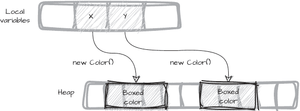

*Figure 5-1: Boxed values in memory*

图 5-1 中两个 `Color` 实例的装箱位置可能在堆上的任何位置；内存分配方式由 CLR 决定。当我们使用 `==` 比较 `x` 和 `y` 变量时，实例值不会被考虑。即使 `Color` 有 `operator==` 的重载以允许使用 `==` 在两个 `Color` 值之间进行比较，当我们比较两个 `object` 引用时也不会调用该自定义相等实现。这是因为 `operator==` 是一个静态方法，需要两个 `Color` 参数，而不是两个 `object` 参数。因此，使用 `==` 的比较正确返回 `false`，因为两个 `object` 变量引用独立的实例。

如果我们改用 `Equals` 方法进行比较，变量会相等，因为 `Equals` 方法是虚的：

```
Assert.That(x.Equals(y), Is.True);
```

用于调用 `Equals` 的 `x` 变量是一个 `object` 引用，但仍然引用 `Color` 的实例，因此这里调用的是我们对 `Equals` 的重写。如果 `Color` 没有重写 `Equals`，则会调用 `ValueType` 实现。在任何情况下，`Equals` 都返回 `true`，因为两个 `Color` 实例具有完全相同的状态。

我们可以将装箱值视为堆上简单引用类型的实例，其包含一个与原始值类型相同的字段的副本。由于装箱在堆上，因此可以由多个引用变量引用，如清单 5-20 所示。

```
var color = new Color(0xFF, 0xA0, 0);

object x = color;
object y = x;

Assert.That(x == y, Is.True);
Assert.That(x.Equals(y), Is.True);
```

*Listing 5-20: Two references to one boxed value*

在此示例中，`x` 是对装箱值的引用，`y` 是对同一装箱的另一个引用，如 Figure 5-2 所示。

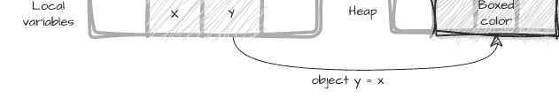

*Figure 5-2: Adding a reference to an existing box*

`x` 和 `y` 变量使用 `==` 比较相等，因为 `x` 和 `y` 都是对同一个实例的引用。 与 `Equals` 的虚调用进行比较也返回 `true`，因为一个实例总是与自身相等。

## 装箱的方法参数

当我们将值传递给接受对象或其他引用类型参数的方法时，该值会被自动装箱。 效果与直接赋给对象变量相同，就像我们在第 5-19 节中所做的那样，但这种装箱在我们的代码中不太明显。

考虑第 5-21 节，我们将同一个值两次传递给对象 `.ReferenceEquals` 方法，该方法接受两个对象参数并比较它们的标识相等性。

```
Color x = new Color();

Assert.That(object.ReferenceEquals(x, x), Is.False);
```

第 5-21 节：作为装箱参数传递值

此测试断言 `ReferenceEquals` 的两个参数不相等。 测试应该通过吗？

是的，应该通过。 `ReferenceEquals` 的参数是不同的对象变量。 将值类型作为参数传递给对象参数会装箱该值。 尽管将相同的值传递给两个参数，但每个参数都会单独装箱，从而产生两个独立的装箱。 结果与显式地将相同的值装箱到单独的对象变量中相同，如下所示：

```
object a = x;
object b = x;

Assert.That(object.ReferenceEquals(a, b), Is.False);
```

`x` 的值被显式装箱到两个单独的对象引用中。 对 `ReferenceEquals` 的调用等同于 `a == b`，而它们不相等，因为它们是不同的对象。

将第 5-21 节与以下内容进行比较，其中我们在调用 `ReferenceEquals` 之前先将值显式装箱到对象变量中：

```
object x = new Color();

Assert.That(object.ReferenceEquals(x, x), Is.True);
```

我们为 `ReferenceEquals` 的两个参数传递了相同的引用，因此它们相等。 此实例中对 `ReferenceEquals` 的调用与表达式 `x == x` 相同，并且 `x` 变量是对装箱后的 `Color` 的引用，如图 5-3 所示。

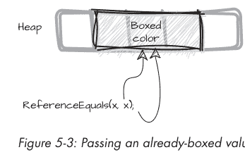

图 5-3：将已装箱的值传递给方法

`ReferenceEquals` 方法接收两个参数，但它们引用堆上同一个装箱值的引用。

除了测试变量的相等性之外，我们还需要确保了解值在何处被装箱，以及我们自己的代码是否在使用装箱值。 装箱会影响值标识的含义——虽然这在比较两个值时最为明显，但它也具有更广泛的影响，例如我们是否需要担心别名或副作用。

## 接口装箱

我们可以通过类型实现的任何接口来引用对象。 为了演示，在第 5-22 节中，`Angle` 值类型实现了 `IFormattable`，这是标准库提供的常见系统接口之一。 在此代码片段中，我们使用接口名称引用 `Angle` 的两个实例。

```
public readonly struct Angle : IFormattable
{
    --snip--
}

IFormattable x = new Angle();
IFormattable y = new Angle();

Assert.That(x == y, Is.False);
```

第 5-22 节：通过接口名称引用值

接口类型是一种引用类型，它定义了实现它的类型保证可用的公共操作。 接口类型的变量始终是引用，无论实现的类型如何。 因此，通过接口变量引用值类型实例必须装箱该值，其结果是第 5-22 节中的比较与第 5-19 节中值被装箱到对象变量时的情况基本相同。

因此，此示例中的 `x == y` 表达式执行相等性的引用检查，将比较对象标识。 `new Angle` 表达式返回的每个值都将被装箱，以便引用 `x` 和 `y` 可以引用它们，并且每个引用都指向不同的装箱。 `x` 和 `y` 变量如果使用 `x.Equals(y)` 将会相等，这是由于 `Equals` 方法的虚特性。

## 比较泛型变量

我们使用泛型类型或方法来实现适用于多种其他类型的功能，通常对引用类型和值类型都是透明的。 在泛型类型或泛型方法的上下文中，给定变量在程序执行期间的不同时间可能表示值或引用。

这给泛型变量的相等性比较带来了问题； 特别是，使用 `==` 比较使用泛型参数类型化的变量永远不会调用用户定义的 `operator==` 实现。 如果泛型参数不受约束，我们甚至不能使用 `==` 来比较同一泛型类型的两个变量。

> 注意 C# v11.0 引入了一个名为静态抽象接口成员的预览功能，它使您能够在泛型代码中使用用户定义的运算符，包括 `operator==`。 有关此功能的更多信息，请参阅 https://learn.microsoft.com/en-us/dotnet/csharp/whats-new/tutorials/static-virtual-interface-members。

考虑第 5-23 节中的简单泛型类，它使用 `==` 来比较使用泛型类型参数 `T` 声明的两个变量。 按原样，此类无法编译。

```
public class Playlist<T>
{
    public void PlayNow(T item)
    {
        if(item == current)
        {
            --snip--
        }
    }
    private T current;
}
```

第 5-23 节：泛型类型参数比较

`Playlist` 是一个泛型类，其类型参数按惯例命名为 `T`。 我们通常将此类称为 `T` 的 `Playlist`。

我们不能使用 `==` 来比较 `item` 参数与字段 `current`，因为当 `T` 是像这样不受约束的类型参数时，`==` 和 `!=` 运算符只能用于检查 `T` 的实例是否等于或不等于 `null`。

如果我们添加一个通用类约束，或为 `T` 添加特定的基类或接口类型约束，比较 `item == current` 将编译，但它始终表示引用比较。 C# 没有我们可以为 `T` 添加的泛型约束，以允许表达式 `x == y` 调用重载的 `operator==`，其中 `x` 或 `y` 由泛型参数类型化。

我们可以调用 `Equals` 方法，它将在运行时 `T` 所代表的任何类型上调用重写实现。 `Equals` 方法在 `object` 基类上定义，因此可用于任何变量，无论其实际类型如何。 然而，当 `T` 的类型是值类型时，通过调用接受 `object?` 作为其参数的 `Equals` 方法，参数可能会被装箱。

## 泛型代码和 Equals 方法

在第 5-11 节中，我们为 `MusicTrack` 类型实现了相等性，以便它们的实例按值比较而不是按标识比较。 在第 5-18 节中，我们对 `Color` 结构做了同样的处理，以重写 `ValueType.Equals` 方法。 为了使比较更高效，我们通过将参数作为 `MusicTrack` 和 `Color` 分别接受，而不是 `object`，从而为两种类型添加了类型安全的 `Equals` 重载，从而防止参数被装箱。

然而，在 `MusicTrack` 和 `Color` 的当前实现中，如果使用泛型类型参数变量调用，它们的类型安全 `Equals` 重载将不会被使用。 当使用泛型变量调用 `Equals` 时，默认情况下会调用带有 `object?` 参数的虚方法。 对于 `MusicTrack` 类，这只会导致一次额外的运行时转换，但对于 `Color` 结构，参数将被装箱到 `object`，然后再取消装箱以比较 `Color` 的属性。

为了演示，第 5-24 节使用 `Color` 作为泛型 `HashSet` 集合类型的类型参数。 `HashSet<T>.Contains` 方法使用 `GetHashCode` 和 `Equals` 的组合来确定集合中是否有任何项目与 `orange` 参数匹配。


```csharp
var colors = new HashSet<Color>();
var orange = new Color(0xFF, 0xA0, 0);

colors.Add(orange);

Assert.That(colors.Contains(orange), Is.True);
```

# 第 5-24 节：搜索 Color 值集合

测试通过了，但会使用 `Equals(object?)` 方法，因为 `HashSet.Contains` 实现无法知道 `Color` 实现了一个类型安全的 `Equals` 重载，该重载直接接受 `Color` 参数。 这对 `Color` 很重要，因为它是一个结构，因此每次比较都会将参数装箱到对象引用。 如果 `HashSet` 包含大量元素，这种装箱可能代表 `Color` 的许多不必要的复制。

对于包含 `MusicTrack` 元素的 `HashSet` 也会如此，虽然影响稍微小一些，但仍然是不必要的低效。

为了让泛型代码优先选用我们的类型安全 `Equals`，而不是从 `object` 继承的更通用实现，我们的类型必须实现 `IEquatable<T>` 接口。

## IEquatable<T> 接口

当我们在任何类或结构体上实现 `IEquatable<T>` 接口时，就是在向泛型代码发出信号：该类型具有公开的类型安全 `Equals` 实现。`IEquatable<T>` 接口规定，`T` 表示的类型包含一个以 `T` 作为参数的 `Equals` 实现。诸如 `HashSet<T>` 这样的泛型代码可以检测到泛型类型实现了 `IEquatable<T>`，如果存在类型特定的 `Equals` 重载，就会使用它。清单 5-25 展示了我们的 `Color` 结构体如何实现 `IEquatable<T>` 接口。

```csharp
public readonly struct Color : IEquatable<Color>
{
    --snip--
    public bool Equals(Color other)
        => other.Red == Red &&
           other.Green == Green &&
           other.Blue == Blue;
    --snip--
}
```

清单 5-25：`IEquatable<T>` 接口

这个 `Equals` 方法与清单 5-18 中最初的类型安全方法在功能上完全相同；区别在于，`Color` 通过显式实现 `IEquatable<Color>` 来表明该重载的存在。现在，当我们把 `Color` 用作 `HashSet` 或其他泛型集合的元素类型时，任何使用 `Equals` 的比较都会采用我们的类型安全实现，从而避免对参数进行装箱。

这是可行的，因为像 `HashSet` 这样的泛型集合不会直接调用 `Equals`；相反，它们将比较委托给一个名为 `EqualityComparer<T>` 的辅助类，该类在 `T` 实现 `IEquatable<T>` 接口时会在内部选择类型特定的 `Equals` 方法。如果 `T` 未实现该接口，则会改用虚方法 `Equals(object?)`。

我们可以在自己的泛型代码中使用 `EqualityComparer` 类，为泛型参数类型变量自动选择最佳可用的 `Equals` 方法实现。清单 5-26 展示了通过 `EqualityComparer` 对象检查相等性的常见模式。

```csharp
public void PlayNow(T item)
{
    var comparer = EqualityComparer<T>.Default;
    if(!comparer.Equals(Current, item))
        Current = item;
}
```

清单 5-26：使用 `EqualityComparer<T>` 类进行相等性比较

`EqualityComparer<T>.Default` 静态属性返回标准 `IEqualityComparer<T>` 接口的一个实现，该实现针对 `T` 类型参数具有适当的行为。当 `T` 实现 `IEquatable<T>` 时，`Default` 属性返回的 `IEqualityComparer<T>` 实现会使用类型特定的 `Equals` 方法重载。

除了 `HashSet`，`Dictionary` 集合和一些 `LINQ` 算法也使用 `IEqualityComparer<T>` 来定义元素之间的相等性。它们都可以被赋予特定的 `IEqualityComparer<T>` 实现，因此我们可以提供自己的实现来自定义该行为。在第 8 章中，我们将使用这一技术来修改 `SequenceEqual` 方法的行为。

`EqualityComparer<T>` 类是为泛型代码设计的，但在需要以尽可能通用且高效的方式进行相等性比较时也会很有用。一种典型情况就是编译器生成的代码。

## 编译器生成的相等性

编译器本身能够为某些类型合成出一个正确而完整的相等性实现。编译器生成的代码使用我们一直在探讨的同样技术。在本节中，我们将通过示例来更好地理解编译器愿意为我们生成什么，即使是针对变量相等性比较这样基础的事情。

### 记录和记录结构体

记录和记录结构体为我们提供了一种创建内置值语义类型的简洁方式。记录在语法上与类和结构体都不同，但在 CIL 中，它们只是带有一些编译器生成功能的类，其中包括对 `Equals` 和 `GetHashCode` 方法的重写。类似地，记录结构体在编译后的代码中就是结构体，并且具有与记录相同的大部分编译器提供的功能。

一个值得注意的例外是，编译器为记录实现了 `Clone` 方法，但不为记录结构体实现。`Clone` 通过值模拟记录实例的复制，以支持非破坏性变更，这一点我们在第 4 章中讨论过。由于记录结构体本身就是按值复制的，它们不需要 `Clone` 方法。

记录和记录结构体都实现 `IEquatable<T>`，编译器生成的类型特定 `Equals` 方法重载会比较类型的每个字段，就像我们之前在 `MusicTrack` 和 `Color` 中所做的那样。`GetHashCode` 方法的实现使用所有字段来提供分布良好的哈希码。所有这些都与普通结构体形成对比：普通结构体的默认基于值的相等性行为由公共基类 `ValueType` 提供。

这个简单的 `Color` 类型被实现为一个位置记录，出色地展示了记录定义可以多么简洁：

```csharp
public sealed record Color(int Red, int Green, int Blue);
```

记录的这种位置语法会促使编译器为 `Color` 创建三个属性，每个属性的名称和类型与为该类型定义的相应位置参数一致。编译器还提供了一个带有这三个参数的公共构造函数，用于初始化这三个属性值。这种位置语法可用于记录和记录结构体。

### 记录相等性的内部机制

所有记录都是类，但凭借编译器自动提供的 `IEquatable<T>` 接口实现，它们具有基于值的相等性语义。清单 5-27 中显示的 `Equals` 方法与编译器为 `Color` 记录生成的方法几乎完全相同，但并不完全一致。

```csharp
public bool Equals(Color? other)
    => (object?)other != null &&
       GetType() == other.GetType() &&
       EqualityComparer<int>.Default.Equals(Red, other.Red) &&
       EqualityComparer<int>.Default.Equals(Green, other.Green) &&
       EqualityComparer<int>.Default.Equals(Blue, other.Blue);

public override bool Equals(object? obj)
    => Equals(obj as Color);
```

清单 5-27：为记录生成的相等性实现

编译器生成的类型安全 `Equals` 方法可以直接访问 `Red`、`Green` 和 `Blue` 属性的支持字段，因此避免了这里为读取属性值而显示的那些额外方法调用。请注意，`Equals` 方法是如何使用 `EqualityComparer<T>` 类来比较每个值的：如果任何属性的类型实现了 `IEquatable<T>`，就会使用类型安全的 `Equals` 实现。

默认情况下，记录可以继承其他记录，因此相等性并不像比较每个对象的字段那么简单。在这种情况下，`Equals` 的 `other` 参数可能引用一个派生程度更高的记录实例。对可能具有不同运行时类型的对象进行相等性检查需要格外小心。在大多数情况下，不同类型的对象不相等，这就是我们在清单 5-27 的 `Equals(Color?)` 方法第二行使用 `GetType` 的原因。

我们的 `Color` 记录是密封的，并且不继承自另一个记录。因此，类型检查是多余的，因为 `other` 参数只能引用 `Color` 的实例，不可能引用其他东西。

由于 `Color` 记录是密封的且没有基类型，我们应该考虑将其改为记录结构体。记录结构体会编译为结构体定义，结构体不能被继承，也不能有 `null` 值，因而其内部更简单。记录结构体类型的类型安全 `Equals` 方法不检查 `null`，也不检查类型是否匹配，但除此之外与记录的实现相同。

除了 `Equals` 和 `GetHashCode` 方法的实现之外，编译器还会为记录和记录结构体生成 `operator==` 及相应的 `operator!=`。`operator==` 的实现会调用 `Equals` 方法，因此记录变量使用 `==` 进行比较时表现出基于值的相等性，而不是类默认的基于标识的比较。我们在清单 5-28 中确认了 `Color` 记录的这一行为。

```csharp
var red1 = new Color(0xFF, 0, 0);
var red2 = new Color(0xFF, 0, 0);

Assert.That(red1 == red2, Is.True);

Assert.That(ReferenceEquals(red1, red2), Is.False);
```

清单 5-28：使用 `==` 比较记录

这里我们看到，两个 `Color` 变量比较结果是相等的，因为即使它们显然不是对单个实例的两个引用，但实例的状态是相同的。

### 记录相等性的自定义实现

编译器通常至少会为记录或记录结构体生成两个版本的 `Equals`：一个接受 `object` 参数（在可空上下文内为 `object?`），另一个实现 `IEquatable<T>` 接口，后者执行对每个实例字段的比较。接受 `object` 参数的版本会将参数强制转换为所需类型，如果转换成功，则调用类型特定的重载，就像我们在清单 5-27 中为 `Color` 记录所做的那样。我们可以为记录或记录结构体类型提供自己的类型安全 `Equals` 方法实现，在这种情况下，编译器会使用我们的实现，而不再生成一个。如果我们这样做，就应该实现自己的 `GetHashCode` 与之匹配，这也会替换编译器生成的实现。

但是，我们不能为比较两个记录或记录结构体实例提供自己的 `operator==` 或 `operator!=` 实现。如果我们尝试这样做，编译器会给出一个错误：

    [CS0111] Type 'Color' already defines a member called 'op_Equality' with the same parameter types

`op_Equality` 是编译器将 `operator==` 翻译成的静态方法的名称。`operator!=` 的名称是 `op_Inequality`，并且编译器始终会提供这两个方法，从而阻止我们定义自己的方法。

对于记录和记录结构体，我们几乎总是应该接受默认的相等性实现，因为编译器生成的代码既正确又高效。然而，如果我们需要自定义记录或记录结构体的相等性行为，只需要重写类型安全的 `Equals` 方法。其他每个相等性方法，包括接受 `object` 参数的重写 `Equals` 方法，最终都会调用类型特定的重载来执行实际的比较。编译器的实现

`==` 运算符的默认行为与这里为 `Color` 所示的行为相同，因此如果我们更改 `Equals` 方法的行为，该行为也会反映在编译器提供的 `operator==` 和 `operator!=` 的实现中：

```
public static bool operator==(Color left, Color right)
{
    if((object)left == (object)right) return true;
    return (object)left != null && left.Equals(right);
}

public static bool operator!=(Color left, Color right)
    => !(left == right);
```

当我们定义一个位置记录或位置记录结构时，编译器会合成一个完整的类型，以及支持相等比较的方法。编译器也会生成代码来支持可空值类型的相等性，尽管方式非常不同。

## 可空值的相等性

我们通过在值类型变量上使用特殊的 `?` 表示法来表示可空值类型。编译器将可空值类型转换为系统类型 `Nullable<T>` 的实例，其中 `T` 是变量的声明类型。`Nullable<T>` 是一个结构，其实例可能具有类型 `T` 的值，也可能没有值（表示为 `null`）。

比较可空值类型变量与比较可能为 `null` 的引用不同，因为对于两个可空值类型变量，如果存在值，我们必须始终比较每个基础值。为了说明这一点，请考虑清单 5-29，其中我们比较了两个可空值类型变量，一个具有值，另一个为 `null`。

```
public readonly struct Color
{
    --snip--

    public static bool operator==(Color left, Color right)
        => left.Equals(right);

    public static bool operator!=(Color left, Color right)
        => !left.Equals(right);
}

Color? fg = new Color(0xFF, 0xA0, 0);
Color? bg = null;

Assert.That(fg == bg, Is.False);
```

清单 5-29：比较可空值

此示例中的 `fg` 和 `bg` 都是可空的，但 `fg` 具有 `Color` 值，而 `bg` 为 `null`。测试通过，因为这两个值不相等。两个可空值类型变量在以下情况下相等：两者都没有值，或者两者都有值且这些值本身相等。关于此示例的有趣之处在于，虽然 `Color` 有一个自定义的 `operator==` 来比较两个 `Color` 值，但它接受的是两个非可空的 `Color` 参数。由于 `Color` 是一个结构，`null` 对它来说不是有效值，尽管 `null` 对于可空的 `Color` 是有效值。

`Nullable<T>` 结构本身没有重载的 `operator==`。当编译器遇到比较两个可空值类型，或一个可空值类型与一个普通值类型实例的代码时，它会通过插入相应运算符定义中针对基础（非可空）值类型的实现来重写该比较。此过程称为提升运算符。由于其中一个或两个参数可能没有值，提升操作会先额外检查值是否存在，然后才使用原始的非可空比较来最终比较这些值。

因此，如果 `T` 没有定义 `operator==`，则两个 `T?` 变量的比较将无法编译，因为编译器没有可提升的运算符实现。清单 5-30 中的 `lifted_op_Equality` 方法是虚构的，但演示了提升相等比较运算的基本算法。

```
bool lifted_op_Equality(Color? fg, Color? bg)
{
    if(fg.HasValue && bg.HasValue)
        return fg.Value == bg.Value; // uses Color.operator==
    else
        return !fg.HasValue && !bg.HasValue;
}
```

清单 5-30：提升的相等运算符

编译器不会为此算法生成新方法，而只是将逻辑内联插入到我们的代码中，将清单 5-29 中使用 `==` 的原始比较替换为以下内容的等效形式：

```
Assert.That(
    fg.HasValue == bg.HasValue &&
    (!fg.HasValue || fg.GetValueOrDefault() == bg.GetValueOrDefault()),
    Is.False);
```

此代码的逻辑与清单 5-30 中的逻辑基本相同，但它是一个单一表达式，因此编译器更容易内联。使用 `GetValueOrDefault` 而不是 `Value` 属性的原因是后者需要检查有效值是否存在，如果不存在则会抛出异常。因此，`GetValueOrDefault` 稍微更高效。

尽管可空值类型是特殊系统类型 `Nullable<T>` 的实例，但同样的功能无法通过 `Nullable<T>` 简单地拥有自己的 `operator==` 来执行比较来实现。提升基础类型的 `operator==` 的目的是确保当两个变量都有值时，它们的比较方式与非可空类型完全一样——即原始值类型的直接实例。`Nullable<T>` 的 `operator==` 实现需要使用 `==` 来比较泛型类型 `T` 的两个实例，而我们知道这是不允许的。

通过提升基础类型的 `operator==`，编译器确保了正确行为的维持，并且无论是否为可空类型，值的比较方式都相同。

编译器还会生成内联代码来支持值元组变量的比较，该功能在 C# v7.0 中引入，尽管值元组的过程略有不同。

## 值元组和相等性

元组是许多现代编程语言中常见的特性，用于将多个相关值聚集到一个轻量级数据结构中。C# 中的元组类似于一个所有字段都是公共且没有成员方法的结构，尽管声明和使用元组的语法与此类结构不同。

编译器对元组类型的支持取代了 .NET v4.0 中引入的 `System.Tuple` 类。自 C# v7.0 起可用的更现代的特性称为值元组。值元组由名为 `ValueTuple` 的系统类型提供支持，但该类型不打算直接使用。相反，当我们想将多个字段关联在一起而不添加完整的用户定义类或结构的开销时，我们使用值元组语法。

值元组在变量的声明方式和使用方式上都享有编译器的强大支持。清单 5-31 展示了比较值元组变量是否相等的示例。


```
var x = (10, "October");
var y = (ShortMonth: 10, LongMonth: "October");

Assert.That(x == y, Is.True);
```

### 清单 5-31：比较值元组变量的相等性

我们用括号包围多个值来声明两个元组变量 `x` 和 `y`；这种语法在几种支持元组的语言中都很常见，可能许多程序员都很熟悉。然而，虽然 `x` 和 `y` 变量具有相同的值，但它们的声明看起来明显不同。特别是，`y` 为其组成部分提供了名称，而 `x` 没有。测试判定 `x` 和 `y` 相等，并通过。

注意 使用 `==` 比较值元组的支持是在 C# v7.3 中引入的，时间在值元组引入后不久。

当我们使用 `==` 比较值元组变量时，编译器会生成代码来比较值元组的每个元素与另一个值元组中的相应元素。值元组的元素是公共字段而非属性，这意味着读取或写入值会直接访问字段。与可空值一样，编译器通过插入代码直接比较 `x` 和 `y` 的字段来重写我们的比较表达式。

清单 5-32 中的 CIL 摘录显示了清单 5-31 中元组第一个组件的比较。

```
IL_0021: ldloc.2    // V_2
IL_0022: ldfld    !0/*int32*/ valuetype System.ValueTuple`2<int32, string>::Item1
IL_0027: ldloc.3    // V_3
IL_0028: ldfld    !0/*int32*/ valuetype System.ValueTuple`2<int32, string>::Item1
IL_002d: bne.un.s  IL_0042
```

### 清单 5-32：新式值元组比较 CIL

编译器使用 `ldfld` 指令直接加载字段，然后使用 `bne` 指令比较这些值，`bne` 代表“不相等则跳转”。`bne` 指令是我们在清单 5-1 中遇到的 `ceq` 指令的伴随指令。`ceq` 会将结果推送到评估栈上，而 `bne` 在比较的值不相等时跳转到指定标签（此示例中为 `IL_0042`）；否则，处理将从 `bne` 之后的下一条指令继续。

我们试图将一个简单元组与一个具有命名元素的元组进行比较这一事实无关紧要。生成的代码不会尝试使用我们为字段提供的名称。它只比较它们的值，因此 `x == y` 的结果为 `true`。我们可以将 `x` 与使用不同名称的元组进行比较，结果相同；只有字段的类型和值才重要。

我们为元组组件提供的名称纯粹是编译时构造，是为了我们的方便。事实上，我们为 `y` 变量的组件提供的名称甚至都不会进入编译后的代码。

与为比较 `Nullable<T>` 值生成的代码一样，编译器会在需要时注入代码来调用用户定义的 `operator==`。你可以在清单 5-33 中看到这一点，其中显示了元组第二个组件（字符串字段）比较的 CIL。

```
IL_002f: ldloc.2    // V_2
IL_0030: ldfld    !1/*string*/ valuetype System.ValueTuple`2<int32, string>::Item2
IL_0035: ldloc.3    // V_3
IL_0036: ldfld    !1/*string*/ valuetype System.ValueTuple`2<int32, string>::Item2
IL_003b: call      bool [System.Runtime] System.String::op_Equality(string, string)
```

### 清单 5-33：编译器插入的用户定义的相等运算符调用

与用于 `int` 字段的 `bne` 指令不同，编译器合成了一次对 `op_Equality` 的调用，就像我们手写了代码一样。值元组的字段按出现顺序进行比较，因此一个元组的第一个字段与对应变量的第一个字段进行比较，依此类推。

这种方法与记录不同，记录使用 `EqualityComparer` 协议而不是 `==` 来比较其字段。对于记录，编译器

生成在底层类或结构体类型上实现相等性的正确方法。当我们使用 `==` 比较两个记录时，我们是在调用为记录类型生成的 `op_Equality` 方法。该方法通过使用其 `Equals` 方法依次比较记录的每个字段。

对于值元组，与可空值类型一样，编译器会内联生成比较代码，有效地将两个元组的比较替换为对每个元组类型的组件字段的直接比较。如果元组的组件字段为其定义了 `operator==`，则会使用该实现，但与 `Nullable<T>` 类似，用于实现值元组的 `ValueTuple` 类型本身没有 `operator==`。

如果字段既不能使用 `ceq` 也不能使用 `operator==` 进行比较，我们使用 `==` 比较值元组的代码将无法编译。`ValueTuple` 类型确实重写了 `Equals` 方法，并且还实现了 `IEquatable<T>` 接口。因此，如果某个字段没有 `operator==`，我们仍然可以使用 `Equals` 比较值元组变量，而 `Equals` 又会调用每个字段的 `Equals` 方法，可以放心地知道无论使用何种类型，`Equals` 总是存在的。

## Summary

> 所有动物都是平等的，但有些动物比其他动物更平等。

> —乔治·奥威尔，《动物农场》

对于这样一个简单的表达式，比较两个变量是否相等可以代表各种各样的行为，从在编译代码中使用简单的内置相等性检查 `ceq` 一直到编译器自动生成正确的代码来执行比较。我们研究了如何比较引用，如何重写 `Equals` 方法和 `==` 运算符会影响行为，以及编译器如何生成代码以确保“正确的事情”发生。

对于许多程序员来说，使用 `==` 比较变量比调用 `Equals` 方法更自然。对于内置的数值类型，使用 `==` 总是更高效，尽管对于二进制浮点类型 `float` 和 `double`，我们在使用任一方法时都必须谨慎。尽管如此，调用方法成本非常低，但它永远无法像固有的 `ceq` 指令那样快。

以如此精细的细节检查这些影响的目的是为了证明我们不能理所当然地认为这样一个简单表达式在程序运行时会做什么。任何表达式的运行时复杂度可能被隐藏起来，也许被编译器选择意外的重载方法或重写方法而不是两个变量之间的直接比较所掩盖。当然，在此类示例中性能成本很小，但在程序的“热点”路径中，它们可能很显著。

装箱值类型实例会对性能产生显著影响，不仅因为装箱会生成值的副本，而且因为这些副本被放到堆上并给垃圾回收器带来压力。标准的 `IEquatable<T>` 和 `EqualityComparer<T>` 类型帮助我们避免许多原本需要装箱的情况，尤其是在泛型代码中。

我们应该始终意识到编译器代表我们生成代码的情况，但在相等性比较的情况下，编译器会费很大劲来确保代码尽可能高效。

# 6

## THE NATURE OF VALUES


C# 对术语 *value type* 赋予了特殊含义，但值的概念绝非 C# 独有。在本章中，我们将更广泛地重新审视值，并确定一些关键特征，以判断我们是否应将其实现为值类型。我们将研究值和值类型在程序中独特而重要的作用，以及实现一个行为良好的值类型需要的不仅仅是使用 `struct` 或 `record struct`。

我们将探讨以下内容：

- 如何通过使用值类型对象封装行为来改进我们的设计

- 如何重写某些类型的原生引用语义会对其行为产生不利影响

方便且高效地使用内存。`Struct` 和 `record struct` 变量通过值复制，因为它们无法以其他方式复制。然而，复制行为只是值语义和引用语义之间差异的一部分。

## Copying and Equality Comparison Behavior

相等性比较行为与变量的复制方式密切相关。当我们复制一个变量时，副本应与原始变量相等。这似乎显而易见，但这就是所有结构体继承自 `ValueType` 的 `Equals` 的原因，也是结构体 `Equals` 的默认实现如此重要的原因。如果没有 `ValueType`，结构体变量的副本将无法与原始值相等，因为结构体变量是通过值复制的。副本是其自身的一个独立实例，而 `object.Equals` 提供的默认引用比较永远不会将副本和原始值比较为相等。`ValueType` 继承的 `Equals` 方法执行基于值的比较，以确保当我们复制一个值类型实例时，副本和原始变量将相等。

当我们比较引用时，我们是在检查它们是否代表同一个特定实例，而不是检查这些实例是否看起来相似。类类型从 `object` 继承的 `Equals` 方法的行为与引用的复制行为相匹配，因为复制引用变量并不会复制实例。

仅靠按值复制并不能赋予值类型以值语义；它只是语言中为复制结构体类型的变量而定义的一种机制。事实上，按值复制甚至不是值语义的必要成分。例如，`string` 类重写了 `Equals` 和 `operator==` 的默认行为以执行基于值的比较。如第 5 章所述，`string` 是一个类，`string` 变量是引用，但当我们比较两个 `string` 变量时，我们最感兴趣的是它们是否具有相同的内容——即它们的字符序列是否相同。

就相等性比较而言，至少，`string` 的值是字符序列，而不是引用的实际值。两个变量是否引用内存中的同一个字符串几乎总是无关紧要的。由于 `string` 变量是引用，`string` 实例不会常规地按值复制，但它们会按值比较。

当我们试图定义或理解值语义时，相等性行为比变量的复制方式更重要。从更广泛的意义上讲，值类型是任何基于其状态进行相等性比较的类型；也就是说，如果两个值类型对象具有相同的值，则它们相等。由此延伸，值语义不仅仅是类型被实现为 `struct` 或 `record struct`；具有值语义才是使一个类型成为值类型的原因，如果我们接受对值类型一词比 C# 语言规范中定义的更宽泛的解释。

我们可以为我们自己的任何类类型重写该行为，但这样做并不总是合适的。

## Reference-Based Comparisons

大多数对象都有一些状态，无论是私有实例字段还是公共属性值。我们可能会被诱惑为所有类重写默认的引用相等行为，并始终使用该状态作为对象的比较值。然而，虽然我们可以通过使用类来建模值，就像 C# 对 `string` 所做的那样，但拥有一个值和成为一个值是非常不同的。大多数类型并非旨在成为值，对于我们创建的大多数类，默认的引用比较更为合适。

作为引用比较对对象很重要的示例，考虑用于跟踪已登录用户的 Listing 6-1 中的 `Login` 类。由于 `Login` 是一个类，引用比较的语义对它是有意义的，因为我们需要能够区分各个实例。

```
public sealed class Login
{
    public string UserName { get; }
    public DateTime Established { get; }
    public bool Active { get; private set; }
    --snip--

    public void Disconnect()
    {
        Active = false;
    }
}
```

Listing 6-1: Reference-based equality matters for class types.

即使公共属性直接公开 `Login` 实例的状态，使用这些属性来实现相等性也是一个错误。具有相同属性值的两个 `Login` 实例可能很容易代表不同的连接。即使我们假设 `UserName` 属性在所有用户中都是唯一的，我们仍可能需要在允许同一用户多次连接的系统中识别单个登录。同一用户甚至可能在完全相同的时刻登录两次，因此仅凭 `Established` 属性来区分不同的连接是不够的。

如果我们重写 `Login` 的 `Equals` 方法来比较其属性值，我们就无法使用 `Equals` 来区分具有相同属性的不同实例。如果我们需要通过调用其 `Disconnect` 方法强制断开特定连接，我们希望确定我们正在断开正确的连接！因此，我们需要能够识别登录的特定实例，而不管其公共属性的值如何。

我们可以使用除 `Equals` 之外的其他机制来区分具有相同状态的不同实例，但我们将增加额外的复杂性来支持正常引用比较已提供的功能。

## Reference Semantics and Side Effects

值语义和引用语义之间的差异也部分由通过别名引用产生副作用的可能性所定义，这

反过来与可变性密切相关。如果我们通过一个变量更改对象，并期望该更改通过另一个变量可见，则需要引用语义。

第 6-1 节中的 `Login` 类有一个 `Disconnect` 方法，它会改变实例的内部状态。如果我们使用一个引用变量调用 `Disconnect` 方法，我们期望对该实例的所有引用都变为非活动状态。正如第 6-2 节所示，我们也期望不会影响其他实例。

```
var mac = new Login("macreadyrj");
var norris = new Login("norrisv");

Assert.That(mac.Active, Is.True);
Assert.That(norris.Active, Is.True);

var thing = norris;
thing.Disconnect();

Assert.That(norris.Active, Is.False);
Assert.That(mac.Active, Is.True);
```

Listing 6-2: Intentionally changing an instance via a shared reference

这里，我们复制了 `norris` 引用变量并在副本上调用 `Disconnect` 方法，将其 `Active` 属性设置为 `false`。尽管我们从未使用 `norris` 变量来调用 `Disconnect`，但在调用 `Disconnect` 后，`norris` 所引用的实例的状态发生了变化，因为该实例已通过不同的引用被修改。`mac` 变量引用的是 `Login` 的另一个独立实例，因此不会受到对 `thing` 的更改影响。

我们希望 `Login` 类具有引用语义，因为这意味着我们可以对特定的 `Login` 实例拥有多个引用。我们可以将引用作为参数传递给方法，并安排这些方法有意修改该实例。我们不必担心搜索对修改后实例的所有其他引用以确保它们已使用我们的更改进行更新，因为引用具有内置的这种行为。

引用语义的稍微更微妙的结果是，如果我们通过一个引用更改引用类型实例的状态，该变量仍将与对同一实例的任何其他引用相等。第 6-3 节检查两个引用在实例被其中一个变量修改后是否仍然相等。

```
var norris = new Login("norrisv");
var thing = norris;

Assert.That(norris.Equals(thing), Is.True);

thing.Disconnect();

Assert.That(norris.Equals(thing), Is.True);
```

Listing 6-3: Checking for reference equality

此示例演示了当我们更改引用类型的实例时，该更改会通过所有与用于进行更改的引用相等的其他引用可见。其结果是，如果两个引用变量在基于引用的比较中一次相等，并且没有变量被分配给不同的实例，它们将始终相等，因为引用在具有相同身份时相等。

## Object Identity

对象的身份是将其与同一类型的其他对象区分开来的特征。两个引用类型实例具有不同的身份——它们是独立的对象——无论它们是否包含相同的值字段。我们可以将对象的地址视为其身份，尽管这只是一个类比：由于堆碎片整理或其他内存管理任务，对象的地址可能会发生变化，但对象保留其身份。

在第 2 章中，你看到了 `lock` 语句如何依赖于引用语义；这是对象身份比其包含的状态更重要的一个例子，即使底层的 `Monitor` 类在任何方式上都不尝试修改用作锁的对象。`Monitor` 的实现依赖于知道特定对象实例的身份，并且该身份在多个执行线程中有效。

引用语义是我们工具箱中的一个重要元素，以便我们可以识别特定的对象实例，而不仅仅是具有与另一个对象相同状态的对象。对具有完全相同状态的不同类实例的两个引用变量通常不应该相等。

唯一的例外是当我们使用类来建模值类型时。在这种情况下，身份并不重要，因为我们故意赋予类值语义。`string` 类型是经典的例子。此类型不是 `struct`，出于主要是与效率相关的有效原因：作为类，字符串的内容不会被频繁复制，并且其值永远不会被装箱。尽管如此，字符串变量是通过值进行比较的，并且由于相等的值语义，使用它们是直观和简单的。然而，大多数类并不是为了建模值而设计的。

对于旨在具有值语义的类型，实例身份几乎没有或没有意义。值应该是引用透明的：我们可以在不影响程序逻辑或行为的情况下用不同的实例替换值的一个实例，只要两个实例具有相同的状态即可。

当我们可以更改对象的状态时，对象的身份很重要，因为身份是区分一个对象实例与另一个对象的唯一特征。引用类型的原生引用相等告诉我们哪些变量会反映我们对特定实例所做的更改。

## Value-Based Comparisons

如果第 6-1 节中的 `Login` 类型是 `struct` 或 `record struct` 而不是类，第 6-2 节和第 6-3 节中的最后断言将失败，因为 `Disconnect` 方法将更改与断言中使用的变量不同的实例。值类型在我们不需要引用语义的别名行为或对单个实例具有多个引用的能力时很有用。将第 6-1 节中的 `Login` 类型与第 6-4 节中的 `Color` 类型进行对比。

```
public readonly struct Color
{
    public int Red { get; init; }
    public int Green { get; init; }
    public int Blue { get; init; }
}
var crayon = new Color { Red = 0xFF };
var pencil = new Color { Red = 0xFF };
```

Listing 6-4: Comparing the state of two Color values


此 `Color` 类型是一个 `struct`，使其成为值类型。两个变量 `crayon` 和 `pencil` 显然是不同的实例，但它们具有相同的颜色值，因此应该相等。就测试两个实例是否相等而言，`Color` 类型的唯一有趣方面是其状态。只有当——并且仅当——它们的外部可见属性值匹配时，两个 `Color` 实例才应相等。

从一个角度来看，`Color` 的值是其身份，因为身份是区分一个对象与另一个对象的特征。值是短暂的，因为我们可以在任何时候根据给定的状态创建它们。如果我们在不同时间或不同方法中创建具有相同状态的值类型的多个实例，那么就所有实际目的而言，它们是相同的值，因为它们无法区分，尽管语言的机制意味着它们必然是独立的实例。

可以合法地说，相等的价值可以相互替代。例如，C# 中典型的 value type：`int`。具有相同值的两个整数基本上可以是同一个整数。这可能听起来很明显，但重要的是，我们——以及我们的程序——并不关心它们是在内存中是同一个 `int` 还是两个独立的变量。唯一重要的是它们是否具有相同的值。

从某种意义上说，值的生命周期超出了范围或内存管理所施加的技术边界。如果两个值类型实例具有完全相同的内容，并且这就是唯一重要的事情，它们彼此无法区分。因此，正如你接下来会看到的那样，值通常是不可变的。

## Mutability

值有时被描述为永恒的：它们的生命周期不受程序中变量作用域或程序本身生命周期的限制。我们可以说，在需要时从空中“取出”值来使用它们。当我们需要数字 `100` 时，我们只需将其“物化”为常量值。

这种特征不仅限于内置值类型。其他值也是如此，例如货币金额 `$9.99`，字符串 `"To be, or not to be"`，以及 `2024` 年 `1` 月 `1` 日的日期。它们在需要时就存在。

实际上，真正的变量当然确实具有可测量的生命周期，每个实例都需要存储，因此我们不能简单地忽视我们环境的 技术需求。尽管如此，永恒、不可变值的理论观点是建模我们自己的值类型应如何表现的有用方式。

当我们将两个数字相加时，我们不会改变它们中的任何一个；相反，我们得到一个代表它们和的新数字。同样，将一天添加到 `DateTime` 或将货币金额四舍五入到最接近的整数美元不会改变原始值——它会产生一个新值。

我们不能改变数字 `100` 的值，¹ 但我们可以通过使用 `100` 与另一个数字一起在表达式中使用来产生一个新数字。如果我们将 `1` 加到 `100`，`100` 的值不会消失，即使表达式的结果是一个新数字。日期、速度、长度、温度和其他自然值也是如此。值本质上是不可变的。

当我们创建表示值的类型时，不可变性似乎是一种不必要的限制。毕竟，如果我们增加一个速度值，我们可能并不关心以前的值。难道就地更改值而不是创建具有更改值的新实例通常不是更有效率吗？嗯，也许——我们必须测量一下。然而，不可变性有其他更微妙的后果和好处。

两个不可变值——请记住从第 `4` 章中只读并不总是与不可变相同——如果比较相等，将始终相等。这对于 `Dictionary` 集合等哈希容器中的键具有重要意义。哈希容器依赖于其键的不变性。如果我们在将其添加到容器后更改特定键的值，我们随后就无法使用该值来查找项目，因为从某种意义上说，我们通过更改其值而改变了该键的身份。

状态与实例身份之间的差异在很大程度上与相等有关。具体来说，当我们检查一个值是否等于另一个值时，我们感兴趣的是它们是否具有相同的状态还是它们是同一个对象？如果是后者，我们需要一个类。如果是前者——我们对内容感兴趣，而不关心变量是否是同一个实例——我们需要一个值类型。

## Mechanics vs. Semantics

Microsoft 文档有一个名为 Framework Design Guidelines 的部分，其中包含有关在类和结构之间进行选择的建议，但对何时值语义是对类型的积极选择没有太多指导。在其他建议中，指南提供了以下内容（https://docs.microsoft.com/en-us/dotnet/standard/design-guidelines/choosing-between-class-and-struct）：

¹ FORTRAN 程序员，请对此保持沉默（https://softwareengineering.stackexchange.com/questions/254799/ever-change-the-value-of-4-how-did-this-come-into-hayes-thomas-quiz）。

考虑在实例类型较小且通常生命周期短暂或通常嵌入在其他对象中的情况下定义结构体而不是类。

如果我们按字面理解，这似乎并不 unreasonable。特别是，值类型之所以较小的原因与内存使用和按值复制行为直接相关：字段较多的结构体占用更多内存空间，从一个位置复制值到另一个位置的成本也相应更高。

然而，这种建议纯粹关注内存使用和性能影响，而对我们何时应使用记录或记录结构体却只字未提。值类型与其他类型之间还存在其他语义差异，我们应该将这些差异考虑在内。虽然像这样的建议可以指导我们，但它们只讲述了故事的一小部分。每个应用程序都有其自身的需求、约束和行为。我们没有一条单一的规则可以普遍适用。

坚持或至少建议值类型具有少量数据成员且生命周期短的策略，关注的是内存表示和使用方面的技术机制，而非类型应表现出何种行为这一更概念性的前提。值通常可能很小，但这并不意味着所有小型类型都应为结构体。引用类型可能只有一个字段，但这并不自动表明它应为结构体或其他值类型。

相应地，仅因为我们需要一个具有多个字段的类型，并不意味着它不能是值类型。如果值语义对我们的类型有意义，我们应使其成为值类型，无论它携带多少数据。对象所需的字段数量不应成为我们决策的主要因素。如果我们担心复制大型值的成本，我们可以赋予引用类型以类似值的行为来解决这些问题，这将在第 `8` 章中再次讨论。

我们可以通过将它们的特点与其他程序中的类型进行比较来确定可能使用值类型的位置。虽然我们无法考虑任何潜在应用程序的每一种可能的 object 类型，但许多程序共享一些常见的 object 角色类别，我们将在下面讨论。

## 对象关系

面向对象的应用程序由具有不同角色、职责和交互的各种对象组成。这些角色以对象之间的关系为特征，以及这些对象如何协作形成连贯的应用程序。

在设计应用程序时，很容易忽视值和值类型所发挥的核心作用。如果我们认识到其重要性，就常常可以简化设计，使程序更清晰、更易于推理。

我们可能会认为值只是变量的有效载荷，无论是 `int` 的表示还是堆上对象的属性。诱人地将我们使用的值视为与应用程序目的无关。如此做会导致我们过度依赖内置类型，并过度简化自定义值类型的实现，从而导致 Martin Fowler 所描述的 *贫血领域模型*。

贫血设计中使用的类型是对设计中常见概念的敷衍表示，尤其是值类型。此类类型通常仅由公共属性组成，所有属性都有公共的 getter 和 setter。它们没有其他关联行为，而是依赖于周围的代码来执行常见任务，例如数据验证、计算，甚至管理比较。反过来，这会导致代码重复、错误处理分散以及职责碎片化。

贫血设计的解药是 *丰富的领域模型*，其中不同种类的类型具有各自的角色和明确定义的职责。每个类型都包含特定于自身的行为，而不是将行为分散到代码的其他部分。为了成功识别应用程序所需的类型，我们必须认识到对象并不都相同；然而，即使是最复杂的系统中的对象也落入几个类别。

## 对象种类

如果我们不注意划分应用程序的角色，设计可能会变得不连贯，使其难以管理和维护。一旦我们认识到不同对象可能扮演的主要角色，我们就可以按这些角色对创建的类型进行分类，使设计更具结构化，更易于理解和处理。对象大致可分为四类：

### 值

值负责确保应用程序的数据有效且一致，并控制对该数据的访问。它们通常不会在系统中与其他对象进行外部协作，除了包含其他值之外。值的属性通常不会随时间改变，但具有不同属性的新值经常出现。

### 服务

服务是表示对应用程序外部系统接口的边界对象。服务通常是无状态的；它们可以根据需要使用和访问。它们可能是永久性的，即静态类型或具有全局实例，或是短暂的，按需实例化。服务可能被许多对象使用，但通常自身协作较少。

### 实体

实体是应用程序中的高阶设计元素。而值是信息的货币，实体则代表使用或作用于该信息的交易。它们通常是持久的，即保留在内存中而不是经常创建和销毁。它们可能会根据系统的需要随时间改变其属性——也许经常改变——并且经常与其他实体协作。实体的属性通常是其他实体或值。

### 控制器

控制器是系统中的任务对象：它们执行操作。实体和控制器通常合作执行活动。控制器也通常是持久的，可能具有一些状态，这通常与其与其他对象的协作相关。控制器经常被用来调解实体和服务之间的交互。

这些是定义特定设计和解决方案域行为的应用程序角色。这四种在大多数系统中都很常见，尽管并非所有应用程序都会使用或需要它们。其他类别的对象——如集合、生命周期管理器和异常——在应用程序中扮演支持角色，而不是系统中的设计元素。

C# 中的值通常由结构体、记录或记录结构体表示，尽管它们也可以使用类建模，就像你所见的 `string` 一样。其他每个角色几乎总是由类实现。迄今为止，术语 object 保留用于引用类型实例。如果我们将值视为另一种对象，我们就有了一个通用且统一的基础来比较应用程序中所有对象的特征。

那么，特定对象的特征就暗示了它所履行的角色。换句话说，我们可以通过查看该对象实现的特征来识别对象的角色。

## 对象特征

三种非值角色——服务、实体和控制器——在行为上都很强，即我们使用它们来执行操作或任务。相比之下，值在系统中往往扮演被动角色，通常由其他对象使用。

行为是 Grady Booch 及其合著者在《面向对象分析与设计应用》（Addison-Wesley, 2007）中描述的所有系统对象共有的三个主要特征之一。其他两个主要特征是状态和标识（见图 6-1），并且每个相对于其他特征的重要性因每个应用程序角色而异。

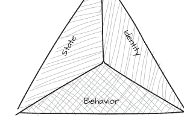

图 6-1：对象的特征

Booch 及其合著者将这三个特征描述如下：

### Behavior

对象的行为描述了它能做什么或其可见属性。这两个方面经常相互关联：当对象执行一个动作时，结果可能会改变其可见属性。可见属性可能构成对象状态的一部分或全部。类型的公共接口定义了该类型实例的行为；也就是说，接口告诉我们对象能做什么而不是它是如何实现的。

### State

对象的状态由其成员数据定义，这些数据可能是持久的且不可变的，也可能随时间变化。正如刚才所指出的，状态可能在接口中公开可见，也可能是私有的且隐藏的，仅用于类型的内部实现。

### Identity

每个类型的实例都有一个独特的身份，正如你所见，这使我们能够区分一个对象与另一个对象。当我们需要知道一个变量是否代表一个共享实例还是一个局部值时，身份很重要。

每个对象角色都优先考虑不同的对象特征，在某些情况下，对于给定的角色，多个特征都很重要。我们可以通过查看对象在这三个特征方面的特征来确定对象所承担的角色。

## Values

在所有应用角色中，值最重视其状态；这 literally 是它们的区分特征。值总是与它们所代表的概念相关联地具有某种行为，但这种行为不会改变状态。在大多数情况下，行为由属性表示，以访问状态的组成部分。值也可能具有返回其状态不同表示形式的方法，或用于创建新值的工厂方法。在任何情况下，值对象的行为都与其状态直接相关。

值以其相等语义为特征，其中一个值等于任何具有相同状态的其他值。它们是不可变的，通常不会与其他对象类型协作。值经常使用其他值类型作为字段，正如 Listing 6-5 中的 `Product` 和 `Purchase` 类型所示。

```
public readonly struct Product : IEquatable<Product>
{
    public Product(string desc, decimal amount)
        => (Description, Price) = (desc, amount);

    public string Description { get; }
    public decimal Price { get; }
}
```

```
--snip--
}
public readonly struct Purchase : IEquatable<Purchase>
{
    public Purchase(DateTime time, Product product, int qty)
        => (Time, Product, Quantity) = (time, product, qty);

    public DateTime Time { get; }
    public Product Product{ get; }
    public int Quantity { get; }

    --snip--
}
```

Listing 6-5: Defining value objects

`Product` 和 `Purchase` 结构体都实现了 `IEquatable<T>` 接口，类似于我们在第 `5` 章中检查的值类型。除了它们的属性之外，`Product` 和 `Purchase` 都强调相等行为，由 `IEquatable<T>` 协议表示，尽管该行为是次要的并且完全依赖于其状态（参见 Figure 6-2）。

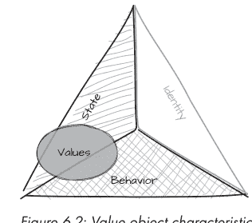

Figure 6-2: Value object characteristics

在这里，你可以看到值对象的状态是其主要特征；我们通过状态而不是身份来区分不同的值，并且具有相同状态的值可以互换使用。值行为特征不如状态突出，尽管相等语义确实使其很重要。然而，值的身份无关紧要，因此它没有被着色。

## Services

服务对象通常只封装行为而没有状态。它们通常为代表应用程序外部系统的接口提供某种外观或适配逻辑。

服务对象的身份通常不重要。服务可能是全局的并且在整个应用程序中都有一个众所周知的实例，或者它们可以根据需要创建，但每个实例都无法与其他实例区分，因为它们没有任何状态。服务有时

实现为纯静态接口（作为仅包含静态方法的静态类），就像 Listing 6-6 中的 `InternetTime` 类一样。

```
public static class InternetTime
{
    public static async Task<DateTime> CurrentTime(Uri provider)
    {
        using var client = new HttpClient();
        var body = await client.GetStringAsync(provider);

        return Deserialize.DateAndTime(body);
    }
}
```

Listing 6-6: Implementing a static service

这个 `InternetTime` 类只是一个服务，它仅仅公开了一个静态方法；它没有身份，因为没有对象。

Figure 6-3 说明了服务对象的行为不仅是其最重要的特征——它经常是其唯一的特征。

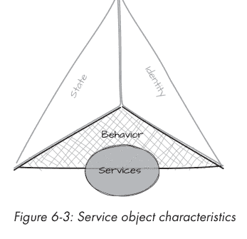

Figure 6-3: Service object characteristics

对于服务，就像值一样，对象身份是无关紧要的，但原因略有不同。当服务对象具有身份时，例如当它实现为全局可访问对象时，我们可以用另一个对象替换该实例，只要其公共接口相同即可。正如我们所知，如果值具有相同状态，则它们可以互换。与值不同，服务很少有任何状态，因此状态和身份在 Figure 6-3 中都未着色。

## Entities

实体通常确实具有某种状态，这意味着我们需要能够区分一个实例与另一个实例。实体的状态通常只能通过其行为观察到，这可能涉及读取或修改状态。实体通常不直接公开其状态

而是提供方法来操作或访问其不同形式的表示。

考虑 Listing 6-7 中的 `Account` 类，它有一个方法可以将购买添加到账户，从而影响账户余额。余额本身并未直接表示为 `Account` 类中的状态，而是从未结费用中计算得出。

```
public class Account
{
    public virtual decimal ChargeToAccount(Purchase item)
    {
        activity.Add(item);
        return CalculateBalance();
    }

    public virtual decimal CalculateBalance()
        => activity.Sum(item => item.Product.Price * item.Quantity);

    public virtual IEnumerable<Purchase> Statement
        => activity.OrderBy(item => item.Time);

    private readonly List<Purchase> activity = new();
}
```

Listing 6-7: Creating an entity object

实体也可能具有与状态不直接相关的行为，但也许会更新或修改另一个实体对象参数。抽象和虚拟方法是实体类型的常见特征（正如这里的 `Account` 实体），允许它们被继承，并由派生类型自定义基类行为。

我们通常有兴趣使用实体类型的一个特定实例，因此对象身份至关重要，无论我们是否具有多个具有相同状态的实例。

如 Figure 6-4 所示，实体对这三个对象特征都给予相当高的重视。

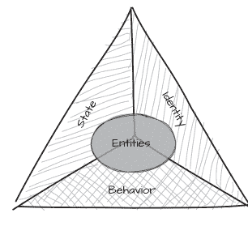

Figure 6-4: Entity object characteristics

## Controllers


控制器也通常具有一些状态，但它们与实体不同，因为状态会影响控制器执行任务的方式。一个例子是数据库 `Command` 对象，其状态包括与数据源的连接和 SQL 指令的表示。控制器完全可能公开其状态，甚至允许直接更改它，从而影响控制器的行为。例如，考虑 Listing 6-8 中 `Command` 类的 `Execute` 方法如何使用 `Query` 属性。

```
public class Command
{
    public Command(DatabaseConnection connection)
        => (this.connection, Query) = (connection, string.Empty);

    public string Query { get; set; }

    public QueryResult Execute()
    {
        connection.Open();
        var result = connection.ExecuteQuery(Query);
        connection.Close();

        return result;
    }

    private readonly DatabaseConnection connection;
}
```

Listing 6-8: Defining a controller

`Command` 对象允许我们通过可变的 `Query` 属性更改其 SQL 指令。我们可以反复调用一个 `Command` 实例上的 `Execute` 方法以获得不同的结果，而不是为每个查询创建一个新的 `Command` 对象。

控制器，如 Figure 6-5 所示，主要以身份和行为为特征。它们在某种程度上依赖于其状态，但倾向于比实体更少地依赖它，因为该数据用于支持或修改控制器的行为，而不是作为隐藏的实现细节。

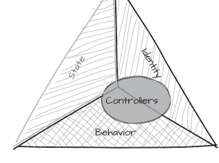

Figure 6-5: Controller object characteristics

控制器对象的各个实现可能根据其特定需求，对状态或行为的重视程度有所不同。然而，与实体一样，控制器对象的身份几乎总是很重要的，因为我们需要能够区分不同的实例。对于实体和控制器来说，引用语义通常都很重要，这样对实例的任何更改都会反映在对其的所有引用中。

## 设计细化以建模对象角色

身份、状态和行为这三个特征为我们提供了一个相对简单的度量标准，可以用来判断一个对象最接近值、实体、控制器还是服务。我们可以利用这些信息来细化设计或重构代码。查看对象的特征可能会告诉我们它承担了过多的责任或代表了应用角色的混合，我们应该相应地调整代码。

一个高度依赖其状态，并且具有相同状态的不同实例被视为相等 的对象，是成为值的强有力候选者。然而，如果特定实例的身份很重要，它很可能不应该是一个值，那么我们就需要查看其他特征来确定它最能代表哪种非值角色。如果我们无法根据对象的特征明确识别出特定的角色，我们应该抓住机会分解该类型，以便使用单独的抽象更好地建模各个角色。

在设计系统时，程序员通常会寻找主要角色——即服务、实体和控制器角色。识别值类型候选者并不总是那么直接，这可能是它们经常由内置类型（如 `int`、`double` 或 `string`）表示的原因之一。

一个对象应该只有一个职责并履行单一的应用角色。通过关注身份、状态和行为的相对优点，我们可以更紧密、更清晰地建模对象的角色。由于值非常重视其状态，因此值的一切都围绕该状态展开，无论是获取、报告还是操作它。识别应用程序中的值类型有助于我们通过划分职责和封装行为来简化设计。

## 抽象和词汇

一些对象作为值的良好候选者脱颖而出——例如，简单的测量和数量，如速度、温度、距离、长度和货币。此类对象通常是对 `int` 和 `double` 等原始类型的简单包装。每个在逻辑上都代表一个概念作为抽象。我们无法轻易地将其分解，除非退回到使用原始类型。

我们使用这些类型的名称来构成程序词汇的一部分。我们以 `Speed` 和 `Length` 等特定概念为术语编写程序，而不是使用 `double` 等更通用的类型。更重要的是，

当我们与同一项目中的其他人交谈时，我们使用的名称与代码中的名称相匹配。

使用特定命名类型而不是内置原始类型还可以防止简单的错误，例如错误地使用温度值而本意是使用长度。如果例如我们将 `Temperature` 类型的实例传递给期望 `Length` 的方法，程序将无法编译。当我们使用 `double` 等内置类型来表示长度和温度的值时，此类错误很容易被忽略。

其他值候选者由于由多个组件组成，因此不太容易用原始类型表示。用于表示汇率、颜色空间、笛卡尔坐标和电话号码等概念的类型各有几个相关部分。尽管如此，它们都代表了我们可以赋予 `FxRate`、`Color`、`Coordinate` 和 `PhoneNumber` 等有意义名称的独特抽象。

我们赋予类型的名称应提供有关其目的的重要信息。我们可以将 RGB 颜色空间的红、绿、蓝组件收集到一个简单的元组类型中，但很难将此类值与包含三维坐标值 `x`、`y`、`z` 组件的元组区分开来。为 `Color` 和 `Coordinate` 创建单独的用户定义类型可以使我们的代码更容易被其他程序员理解。

当我们使用抽象的名称时，我们隐式地指代与该抽象相关联的行为。该名称成为概念的简写，当表示该抽象的类型是一个单一、凝聚的想法并且其行为得到良好封装时，最容易被理解。值类型是探索这些想法的丰富来源，尽管同样的原则适用于所有类型。

## 封装和内聚

当我们设计自己的类型时，除了赋予一个传达其目的的名称之外，收集适合我们所建模抽象的行为也是有益的。这就是通常所说的封装的含义：将对象的数据与其支持的方法组合在一起。然而，封装远不止于添加成员方法；我们还需要牢记类型的内聚性，这是一个更不具体的概念。

如果为其定义的操作共同工作以提供使用该类型实例的定义明确且合理的接口，则该类型是内聚的。换句话说，内聚意味着该类型的概念作为一个整体是有意义的。在这种情况下，我们谈论的是其他程序员是否发现一个类型易于理解。编译器只关心语法是否正确，但我们可能会惊讶地发现一个主要关注金钱的类型上有一个将字符串转换为大写的方法。

一个类型不仅仅是定义方法的地方；这些方法应有助于我们试图表示的抽象。相反，如前所述，一个没有任何行为的类型，例如清单 6-9 中的 `Speed` 类型，通常是简化的。

```
public struct Speed
{
    public double InMetersPerSecond { get; set; }
}
```

清单 6-9：贫血类型设计

这个 `Speed` 结构体没有封装任何东西，其 `InMetersPerSecond` 属性同样可以是一个公共字段。尽管类型的名称为我们提供了其预期目的的线索，并且至少允许编译器捕获许多不适当的使用，但 `Speed` 是贫血类型的示例。我们添加的任何行为都应支持并有助于 `Speed` 名称所暗示的抽象。

这一建议同样适用于系统中的所有类型，而不仅仅是值类型。不管我们创建的类型有什么目的，我们都需要将单独的抽象捕获在我们的设计中。良好的抽象封装良好；它们不会泄露其实现细节。一个内聚的类型比仅仅是一组方法的集合更容易理解。封装和内聚都促进了抽象的质量。

我们创建的许多对象都具有某种状态，但这并不意味着它们代表值。对于值类型，我们所表示的抽象就是该值。如果我们定义一个类型来表示速度，则为该类型定义的操作应提供与公认的 `Speed` 概念一致的接口。值是我们想要实现的封装和内聚的核心。

注意 术语封装有时仅用于表示数据隐藏。虽然直接公开字段通常是个坏主意，正如我们稍后将讨论的那样，但封装不仅仅是使数据私有。封装与内聚密切相关，并且共同在设计易于正确使用且难以错误使用的类型方面发挥着重要作用。²

## 消除重复

将行为封装到命名类型中使我们能够在一个地方捕获通用代码。正如你在第 1 章中所看到的，速度的合理值落在特定范围内，因此尝试使用超出该范围的值的速度应为错误。如果我们使用过于简单的类型来表示速度，我们必须在每次使用速度值的地方重复那些验证检查，这可能在多个地方。考虑清单 6-10 中使用清单 6-9 的 `Speed` 结构的方法。我们必须对 `Speed` 的每次使用都进行值验证。

² 感谢并向 Scott Meyers 道歉。

```csharp
private const double C = 299792458;

public static double Distance(Speed speed, double time)
{
    if(speed.InMetersPerSecond > C ||
       speed.InMetersPerSecond < 0 ||
       speed.InMetersPerSecond is double.NaN)
    {
        throw new ArgumentOutOfRangeException(...);
    }
    //--snip--
}
public static double Time(Speed speed, double distance)
{
    if(speed.InMetersPerSecond > C ||
       speed.InMetersPerSecond < 0 ||
       speed.InMetersPerSecond is double.NaN)
    {
        throw new ArgumentOutOfRangeException(...);
    }
    //--snip--
}
```

*清单 6-10：重复的验证代码*

为了保护这些方法不被传入无效的速度值作为参数，我们必须验证参数，确保它不超过最大允许值、不是负数、并且是一个实数。我们对每个使用 `Speed` 的方法所采用的测试都是相同的，而且我们还应该验证时间和距离参数的值。当我们编写一个新函数来使用速度、时间或距离时，很容易忘记其中某项检查，或者意外地使用了错误的最大允许速度值。

验证代码的重复也是一个维护问题。如果我们需要修改速度的可接受取值范围，就必须确保在所有出现该范围的地方进行更改。我们还需要在每个应用了验证逻辑的方法中测试该逻辑，因此这些测试也会被重复。

如果我们改为将验证逻辑封装在 `Speed` 的构造函数中，就可以只在一个地方、并与其他所需测试隔离开来测试其特征。我们不需要担心使用 `Speed` 值的方法可能会遇到超出范围的值。任何使用 `Speed` 的方法都可以依赖它所封装的有效性验证。这样我们就能删除重复的验证代码以及任何重复的测试。

## 建立类不变量

对于类型的值，构造函数能执行所有必要的验证，这就是建立*类不变量*的一个例子（这里的*类*与类型理论相关，而不是 `class` 关键字）。这种方法确保所有实例都具有对该类型来说有意义的值。

清单 6-11 展示了如何将 switch 表达式与模式匹配相结合，在构造函数中高效地执行数值验证。

```csharp
public readonly struct Speed
{
    private const double C = 299792458;

    public Speed(double val)
        => amount = val switch
        {
            ① double.NaN => throw new ArgumentException(
                message: "Must be a number",
                paramName: nameof(val)),

            ② < 0 or > C => throw new ArgumentOutOfRangeException(
                paramName: nameof(val),
                message: $"Must be between 0 and {C}"),

            ③ _ => val
        };
        --snip--

    private readonly double amount;
}
```

*清单 6-11：定义带验证的简单值类型*

`Speed` 的构造函数确保我们永远不会拥有一个不是数字、为负数或大于光速的值。

switch 表达式中的模式从上到下进行匹配，当被测试的值（这里即 `val` 参数）与某个模式匹配时，将计算关联的表达式以产生结果。这里的前两个模式是错误条件，它们抛出异常而不是产生值。

第一个模式是与 `NaN` 匹配的常量模式，如你在第 5 章①中所见。如果 `val` 小于 0 或大于常量 `C`②，第二个模式会抛出 `ArgumentOutOfRangeException`。这个模式结合了自 C# 9.0 以来可用的多种设施：关系模式与析取模式。

关系模式适用于任何内置数值类型，它使用关系运算符 `<`、`>`、`<=` 或 `>=` 来确定数字是否在给定范围内。析取模式通过使用 `or` 关键字组合其他模式，如果任意表达式匹配，则该模式匹配。类似的合取模式（此处未使用）使用 `and` 关键字，并且仅当其所有组成表达式都匹配时才匹配。

如果 `val` 值与前两个模式都不匹配，则它会匹配最后的丢弃模式，该模式的表达式就是 `val`③ 的值。这将成为整个 switch 表达式的结果，并赋给 `amount` 字段。由于丢弃模式总是匹配，因此它必须是 switch 表达式中的最后一个模式。

除了将验证逻辑封装在 `Speed` 类型之外，我们还将 `Speed` 设为不可变，以确保实例一旦成功验证就永远不会变为无效。如果状态无法更改，则类不变量只需检查一次——在构造函数中。

## 用对称性阐明接口

对称性在接口中的作用常常被低估，但它对于使类型易于使用和理解可能很重要。例如，你在第 1 章看到了类工厂方法如何帮助我们表示像 `Speed` 这样的类型的单位。我们使用这些方法而不是直接访问公共构造函数，每个方法封装了它所表示的单位名称。清单 6-12 展示了如何将类工厂方法与其对应的属性配对，从而以不同单位获取值。

```csharp
public static Speed FromMetersPerSecond(double value) => new Speed(value);
public        double InMetersPerSecond => amount;

public static Speed FromKmh(double value) => new Speed(value * 1000 / 3600);
public        double InKmh => amount * 3600 / 1000;
```

*清单 6-12：通过将类工厂方法与其各自属性配对来应用对称性*

我们可能会期望，如果能使用以千米每小时为单位的值创建 `Speed`，那么之后也能以相同单位获取该值。我们通过将特定单位的每一对声明在一起，来强调每个类工厂方法与其对应属性之间的对称性。

清单 6-12 中的方法和属性并不能防止我们使用错误的单位。我们仍然可以将以 `kmh` 为单位的值传给 `FromMetersPerSecond` 工厂方法。然而，通过将所使用的单位编码到类工厂方法和属性的名称中，我们使它们比使用普通构造函数更加明确、更具表现力。

明确性有助于使 `Speed` 的接口保持一致，并且使其更易于正确使用而非错误使用。我们的 `Speed` 类型已经远不止是围绕原始值的简单包装。

使用像 `FromKmh` 和 `InKmh` 这样明确的名称来表示 `Speed` 实例可用的转换，有助于保持内部表示的封装。接受 `double` 参数的构造函数，加上一个命名含糊、仅返回该值的属性，会暴露出 `Speed` 具有特定底层表示这一细节。这里展示的类工厂方法和属性隐藏了这些实现细节，并以一些常见转换的形式为用户增加了价值。

我们很容易想象使用类似的类工厂方法和属性在其他类型之间进行单位转换，例如温度在摄氏度和华氏度之间，或者长度在米和英尺之间。

## 封装与公共接口

虽然封装涉及的不只是将数据设为私有，但它有一个前提：类型的内部数据不能被除类型方法之外的代码直接访问——尤其不能被更改。对私有数据的访问由类型的公共接口控制。

封装良好的类型有助于我们推理代码，因为我们总能确保私有字段具有一致的值，并且这些值不会在我们不知情的情况下发生变化。不仅如此，它还意味着，作为设计者，我们可以在不改变接口的情况下更改底层表示。如果我们从不直接暴露类型的数据，那么除该类型的成员实例方法之外的任何代码都不会依赖其表示。

通过将 `Speed` 的 `double amount` 字段封装为私有，并仅在成员方法和属性所提供的受控条件下暴露或操作它，我们就把更改表示的作用域和影响限制在了这些成员之内。

相应地，如果我们限制直接访问字段的成员数量，就能进一步缩小更改的范围。如果我们编写只依赖 `Speed` 公共接口的方法，那么即使更改了底层数据类型，它们也能继续工作。

## 扩展接口

如果我们向任何类型添加过多实例方法，就有使接口变得杂乱的风险。当类型拥有一些只是偶尔有用的方法时，其核心接口会更难以发现。相比之下，将类型的方法保持在一个合理的最小范围内会让代码更易于理解。

实例成员方法的一种替代方案是使用扩展方法，它们定义在被扩展的类型之外。清单 6-13 展示了一个用于 `Speed` 的扩展方法示例，其中 `WithPercentAdded` 方法使用 `Speed` 中定义的公共方法和属性来创建一个具有不同值的新 `Speed`。


### 扩展 Speed 的接口

```csharp
public static class SpeedExtensions
{
    public static Speed WithPercentAdded(this Speed speed, double percent)
        => Speed.FromMetersPerSecond(speed.InMetersPerSecond +
            percent / 100 * speed.InMetersPerSecond);
}

var start = Speed.FromMetersPerSecond(100);
var end = start.WithPercentAdded(25);

Assert.That(end.InMetersPerSecond, Is.EqualTo(125));
```

*清单 6-13：扩展 Speed 的接口*

`WithPercentAdded` 方法不会修改传递给它的 `Speed` 实例——它也不能，因为 `Speed` 是一个只读结构体。相反，我们返回一个具有所需值的新 `Speed` 实例。扩展方法必须定义在静态类中，因此它始终是一个静态方法。通常会将扩展特定类型的方法组合在一个静态类定义中，因此 `SpeedExtensions` 类可能会包含若干方法来扩展 `Speed` 的接口。

扩展方法对于在不给其主要内部接口带来负担的情况下为类型添加实用方法很有用。

### 减少内部接口

类型的接口定义了该类型的对象可以在系统中与其他对象进行的协作。类型内部定义的公共方法、构造函数和属性构成内部或固有接口，并定义了其他对象可以对该类型实例执行的操作。该类型还具有外部或偶然接口，由接受该类型参数但在该类型外部定义的方法组成。外部接口定义了哪些其他对象依赖于该类型。这些外部方法无法访问类型的内部，因此不受底层表示任何更改的影响。

具有许多公共成员的类型的基本特征可能难以辨别，因为类的物理定义变得很大。如果我们将内部接口成员限制为需要访问类型的私有实现细节的成员，则类型定义会变得更短，从而更容易理解。完全可以用内部公共接口实现的可以提取到单独的类中。是否将其作为扩展方法或普通静态方法取决于哪种用法更自然。

逻辑上的结论是，在可能的情况下，我们应积极尝试在不破坏类型的封装或降低其内聚性的前提下尽可能减少内部接口。这种方法有两个相互竞争的观点。一方面，通过提取像 `WithPercentAdded` 这样以 `Speed` 的其他公共方法实现的，我们使 `Speed` 更小、更容易理解。我们还减少了可能对 `Speed` 内部表示所做的任何更改的潜在影响。另一方面，`WithPercentAdded` 仍然是 `Speed` 总体可访问接口的一部分，通过单独提取该方法，我们使其更难发现。

我们必须在 `Speed` 的内部和外部接口之间找到平衡。虽然 `WithPercentAdded` 方法可能是 `Speed` 值的有用实用工具，但它并不是 `Speed` 概念的固有部分。将其作为扩展方法提取出来不会降低 `Speed` 的内聚性，也不会破坏其封装，因为不需要我们引入否则不需要的新属性或将私有成员改为公共。收集像 `WithPercentAdded` 这样的扩展方法到一个地方是使外部接口更易于发现的一种方法。

另一方面，`FromKmh` 类工厂方法更适合作为 `Speed` 的成员。我们可以将其作为不同类型的静态方法实现，并以 `FromMetersPerSecond` 为基础。然而，这样做会降低 `Speed` 的内聚性，因为 `FromKmh` 和 `FromMetersPerSecond` 自然属于一起。如果我们将这两个方法都提取到单独的类型，我们需要使 `Speed` 的构造函数公开，从而降低其封装。`FromKmh` 方法是 `Speed` 接口的固有部分，因为它代表了以特定单位创建 `Speed` 的方式，并且与其他固有方法有自然的亲和力。

某些方法必须成为其类型的成员，即使它们原则上可以用其他公共属性和方法实现。`Equals(object?)` 方法重写了基类的实现，必须是实例方法。重载的运算符也必须全部是静态成员方法。运算符重载至少有一个参数是其成员的类型，因此我们无法在单独的类型中实现它。

### 组合抽象

值不仅仅是围绕 `double` 等原始类型的简单包装器。结构体可以包含其他用户定义类型作为字段，因此我们可以通过组合现有类型来创建新的抽象。例如，我们可以创建自己的类型来表示 `Velocity`，它结合了 `Speed` 类型和 `Angle` 类型。尽管清单 6-14 中的 `Velocity` 类型本身没有行为，但它可以利用 `Angle` 和 `Speed` 所代表的更丰富的抽象。

```csharp
public readonly struct Velocity
{
    public Velocity(Speed speed, Angle angle)
        => (Speed, Angle) = (speed, angle);

    public Speed Speed { get; }
    public Angle Angle { get; }
}

var velocity = new Velocity(100.Kmh(), 45.Degrees());
```

清单 6-14：组合 Velocity 的新抽象

`Velocity` 类型受益于 `Speed` 和 `Angle` 可能值的验证约束，并且可以使用它们的任何公共操作和属性，包括任何扩展方法。在这些包含类型的基础上，我们可以向 `Velocity` 添加任何特定于它的行为，例如算术运算或在不同表示之间进行转换。

`Velocity` 代表一个特定的单一概念，即使它是一种容纳其他类型值的容器。`Velocity` 的 `Speed` 和 `Angle` 属性不是任意的；它们定义了速度测量的含义。`Velocity` 抽象构成了程序词汇的一部分，与 `Speed` 和 `Angle` 共同存在。

`Velocity` 是作为记录或记录结构体实现的良好候选者，特别是使用这些类型可用的紧凑位置语法。然而，位置语法对于 `Speed` 和 `Angle` 类型来说不太合适。为了解释原因，在下一节中我们将研究定义类型的不同方式之间的权衡和妥协。

### 在值语义和引用语义之间选择

在大多数程序中，用户定义类型的大多数将是类，它们支持 C# 提供的最广泛的功能。类是 C# 中创建我们自己的类型的最通用方式，因为它们支持语言的所有面向对象设施，例如继承和虚方法。类实例还受益于分配在堆上的对象的自动内存管理。通常，只有当我们需要与值语义相关的行为时，才应以不同方式定义类型。

我们有几个指标表明值语义对于我们正在定义的类型是合适的。值不应支持对其状态的更改，这就是为什么建议值类型仅包含其他值的原因。当所有值类型都是不可变的，无论它们是使用类、记录、结构体还是记录结构体实现，我们都不必担心对象的状态意外更改，因为代码的行为更可预测。需要对其状态进行无限制写访问的类型通常不适合作为值。

相关的指标是需要类型支持其状态的完整深度复制。我们需要 *深度复制*，也称为 *克隆*，以在想要避免引用别名相关副作用时复制可变状态。最常见的是，状态需要在克隆后立即写入，以便新对象可以具有与原始对象不同的属性。我们在第 2 章和第 4 章中研究的非破坏性变异设施就是为类值类型提供有限可变性的一个很好的例子。

每当我们为类自定义相等行为，以便可以根据其状态比较两个实例时，这就是类型应作为完整值实现的另一个强有力指标。克隆通常伴随着重写的 `Equals` 方法。

基于状态的相等行为和支持深度复制以避免别名问题是需要值语义的两个最强信号。虽然可以使用类来实现值（如我们所见的 `string`），但其他类型的定义通常更可取。

记录、结构体和记录结构体都是用于创建表示值的类型的设施——即定义具有 *值语义* 的类型。它们之间的选择并不一定明显，因为每个都有不同的优点和缺点。

### 避免默认变量的陷阱

对于结构体和记录结构体类型，我们需要记住实例始终可以默认初始化，因此默认值的有效性必须同时由类型的实现和使用该类型的代码考虑。对于 `Speed` 或 `Length` 等简单数值类型，这不是问题。此类类型的默认值是 `0`，无论单位如何，这都是完全可以接受的状态：`0` 米与 `0` 英里或 `0` 英寸完全相同。

这对于所有值来说并非普遍成立。例如，在温度测量中，存储值的单位很重要：`0°C` 是 `32°F`，而 `0°F` 大约是 `−17.78°C`。我们可能会建立默认单位为摄氏度的 `Temperature` 的约定，但如果没有为每个单位单独设置类型，很难使这一点明确，这似乎是不必要的。

如果我们使用类或 `record`，而不是结构体或 `record struct`，就可以防止默认值，并强制用户在创建实例时指定正确的单位。不过，类和 `record` 都是引用类型，这意味着变量可能具有 `null` 值。在 C# v8.0 及更高版本中，我们可以尽可能充分地利用不可为 null 的引用来缓解这一问题，但这可能无法阻止所有可能的误用。

尽管如此，当我们在类和 `record` 之间进行选择，以便为具有类似值特征的类型建模时，`record` 几乎总是更可取的。`Record` 专门用于定义具有值语义的类型，并且编译器会根据所比较实例的状态，为 `record` 提供默认的相等行为。

### 实现自定义行为与生成行为

如果我们希望类具有基于值的相等性，就必须自行定义。至少，我们应该重写 `Equals(object?)` 和 `GetHashCode` 方法；不过，正如第 5 章所述，更完整的定义还包括实现 `IEquatable<T>` 接口，并重载 `operator==` 及其配套的 `operator!=`，从而使相等比较自然且易于使用。

对于大多数类似值的类型，只要注意避免常见错误，实现这些方法并不困难。然而，如果我们使用 `record` 而不是 `class`，编译器会为所有这些方法生成实现。这会使 `record` 类型定义更加简短、易于理解，也使我们不必记住所有潜在的陷阱。

对于设想中的 `Temperature` 类型，我们可以考虑使用位置 `record`，从而省去编写完整定义的麻烦。`Temperature` 作为位置 `record` 的临时实现可能如清单 6-15 所示，但位置 `record` 存在一些需要考虑的限制。

```csharp
public sealed record Temperature(double InCelsius)
{
    public static Temperature FromCelsius(double val)
        => new Temperature(val);

    public double InFahrenheit => InCelsius * 1.8 + 32;
    public static Temperature FromFahrenheit(double val)
        => new Temperature((val - 32) / 1.8);
};
```

清单 6-15：位置 Temperature record

编译器会使用 `Temperature` 定义中的参数，自动生成一个名为 `InCelsius` 的属性，但我们必须自行编写 `InFahrenheit` 属性，以便添加执行转换的代码。用户可以调用类工厂方法，使用不同单位创建 `Temperature` 实例，但编译器为 `Temperature` 生成的构造函数是公共的。生成的构造函数也不会验证参数，而我们可能希望确保 `Temperature` 不能低于绝对零度。

如果我们希望用户明确指定单位，就需要强制他们使用这些类工厂方法，因此位置 `record` 无法满足我们的需求。出于相同原因，位置语法也不适用于清单 6-14 中 `Velocity` 使用的 `Speed` 和 `Angle` 类型。

### 重写生成的方法

当位置 `record` 语法无法满足我们的需求时，我们可以使用完整的 `record` 定义，它不包含位置类型参数。然后，我们可以提供自己的私有构造函数，并使用它验证初始值。

由于必须自行编写 `InCelsius` 属性，我们会牺牲使用位置 `record` 的部分便利性，因为编译器只会为位置 `record` 生成属性。清单 6-16 中的 `record` 定义展示了如何为 `record` 类型定制行为，同时继续享受编译器提供的其他代码所带来的好处。

```csharp
public sealed record Temperature
{
    private const double ZeroKelvin = -273.15;

    private Temperature(double celsius)
        => value = celsius switch
        {
            Double.PositiveInfinity or < ZeroKelvin
                => throw new ArgumentOutOfRangeException( --snip-- ),

            double.NaN => throw new ArgumentException( --snip-- ),

            _ => celsius
        };

    public double InCelsius => value;
    public static Temperature FromCelsius(double val)
        => new Temperature(val);

    public double InFahrenheit => value * 1.8 + 32;
    public static Temperature FromFahrenheit(double val)
        => new Temperature((val - 32) / 1.8);

    public static Temperature AbsoluteZero
        => new Temperature(ZeroKelvin);

    private readonly double value;
}
```

清单 6-16：Temperature 的完整 record 定义

对于非位置 `record`，编译器仍会生成实现基于值相等性的方法，因此我们可以专注于正确实现 `Temperature` 这类 `record` 类型特有的其他行为。

当我们可以接受位置语法的所有默认行为时，`record` 和 `record struct` 分别相较于类和结构体能提供最大的好处。清单 6-4 中的 `Color` 类型就是一个很好的例子；将其定义为位置 `record struct` 后如下所示：

```csharp
public readonly record struct Color(int Red, int Green, int Blue);
```

对于 `Color`，默认初始化的实例是一个有效的 `Color`，并且会与所有属性均为 `0` 的实例比较为相等，如以下示例所示：

```csharp
var background = new Color();
var black = new Color(0, 0, 0);

Assert.That(background == black, Is.True);
```

我们不必添加任何自定义方法或属性，因此位置语法非常简洁，并且恰好实现了我们所需的功能。

`Record` 和 `record struct` 对于定义 `Color` 这类简单值类型非常方便，不过编译器可能无法提供类型所需的全部功能。尤其是，如果我们需要比较两个值，以判断其中一个是否小于另一个，就必须始终自行提供这种比较的实现。

### 用于排序的比较

基于值的相等性原则是定义“值”含义的唯一要素。当我们讨论某个东西是否为值类型时，实际上是在简略地询问：两个实例是根据其状态相等，还是根据其身份相等。以状态作为相等性的依据，是所有值固有的特征。不过，有些值可能是等价的，却不一定相等。

通常，如果两个值具有完全相同的状态，它们就相等。清单 6-17 中的 `LogEntry` `record struct` 的两个实例，如果所有属性也都相等，则它们相等；而单个 `LogEntry` 实例的身份并不重要。

```csharp
public enum Severity { Debug, Info, Warning, Error }

public readonly record struct LogEntry(DateTime stamp,
    Severity Level,
    string Message);
```

清单 6-17：值类型相等性

有些值具有自然顺序，但并非所有值都如此；自然顺序使我们能够对值的集合进行排序。排序算法有很多种，但它们通常都会将集合中的每个项目依次与其他项目进行比较，以确定一个项目是否小于另一个项目。如果左侧的值小于右侧的值，就认为这些项目处于正确顺序。

我们可以根据自己的需求自定义*小于*以及因此而来的*处于顺序中*的含义。在 C# 中，定义*小于*的协议是 `IComparable<T>` 接口，该接口要求我们为类型实现一个名为 `CompareTo` 的方法。如果左侧参数小于右侧参数，`CompareTo` 将返回负整数；如果右侧参数小于左侧参数，结果为正数。否则，结果为 `0`。

当我们比较两个 `LogEntry` 值以判断它们是否相等时，会使用所有属性。然而，对于排序，我们可能只关心 `TimeStamp` 属性，因为我们只是想按照日志记录的先后顺序排列条目。按照消息对 `LogEntry` 值排序没有太大意义，而按照严重性排序也不符合我们的使用场景。

`LogEntry` 的 `TimeStamp` 属性是一个 `DateTime` 实例，而 `DateTime` 本身实现了 `IComparable` 接口，因此清单 6-18 只需比较 `TimeStamp` 属性，即可为 `LogEntry` 实现 `CompareTo`。

```csharp
public readonly record struct LogEntry(DateTime TimeStamp,
    Severity Level,
    string Message)
: IComparable<LogEntry>
{
    public int CompareTo(LogEntry other)
        => TimeStamp.CompareTo(other.TimeStamp);
}
```

*清单 6-18：为 LogEntry 值定义基于 TimeStamp 的排序*


通常，我们不会直接在 `LogEntry` 实例上调用 `CompareTo`；在对 `LogEntry` 值集合进行排序时，通常会间接调用它。除非我们明确指定用于排序的其他比较方式，否则系统将使用 `CompareTo` 方法来确定如何排列 `LogEntry` 元素，因此 `LogEntry` 值的默认排序完全基于 `TimeStamp` 属性。

值具有*外延性*：如果两个实例具有相同的可观察属性，那么它们就相等。这不一定等同于具有相同的结构定义，后者称为*内涵性*。虽然相对少见，但有时可能需要额外数据，而这些数据并没有以有意义的方式构成该值，因此不会用于相等性测试。这类数据通常也是实现的私有细节。

当我们不仅希望比较值是否相等，还希望对它们进行排序时，内涵性与外延性之间的区别会变得更加重要。对值进行排序需要一种不同但密切相关的比较，这种比较可能导致两个不相等的值在排序意义上被视为等价。

## 等价与相等

对于大多数值类型，如果 `CompareTo` 返回 0，那么两个值确实相等，调用 `Equals` 也会返回 `true`。底层的 `TimeStamp` 属性为 `DateTime` 值时就是这种情况。然而，尽管这通常是我们所期望的结果，但这并不是严格要求。`CompareTo` 方法

## 稳定

只要两个值都不改变，`x < y` 的结果就保持不变。

## 安全

比较相同类型的值不会抛出异常。

我们可以以类似的方式为引用类型定义 `CompareTo` 和 `operator<`，不过我们还需要考虑 `null` 引用，它应始终被比较为小于任何非 `null` 值。

## 其他类型的排序

按 `DateTime` 或数字排序是按大小排序的一个例子，但其他排序方式也是可能的。字符串通常使用字典序（lexicographical ordering），大致意思是：如果一个字符串在词典（也就是常说的字典）中出现在另一个字符串之前，那么它就小于另一个字符串。

其他值在本质上是序数性的，例如一年中的月份。序数比较有时需要格外小心。以英语中的星期为例：星期日应该排在星期一之前吗？这个问题的答案取决于我们如何定义一周的第一天。

有些值本质上并不存在“小于另一个值”的关系。`Color` 类型就是一个例子：当我们按彩虹顺序枚举颜色时，红色排在蓝色之前——这是它们相对波长的属性——但在英语词典中蓝色肯定排在红色之前。在不同情况下，我们可能会对 `Color` 对象应用多种排序之一，但这些排序定义是外在于颜色概念的。

我们可以通过创建自己的比较器，甚至多个比较器来应对不同场景，从而针对具体情况自定义序列中元素的排序。`IComparer<T>` 接口是对第 5 章中 `IEqualityComparer<T>` 接口的补充。正如 `IEqualityComparer<T>` 建立了一种独立于被比较类型的相等性比较，`IComparer<T>` 的实现是一种外部定义的排序比较。清单 6-20 展示了一个自定义比较器类型，它按 `LogEntry` 对象的 `Message` 属性而非时间对它们进行排序。

```csharp
public sealed class LogEntryComparer : IComparer<LogEntry>
{
    public int Compare(LogEntry x, LogEntry y)
        => string.Compare(x.Message, y.Message, StringComparison.Ordinal);
}
```

清单 6-20：为 `LogEntry` 对象定义外部比较器

`Compare` 方法的语义与 `IComparable.CompareTo` 的语义一致：当 `x` 小于 `y` 时返回负整数，当 `y` 小于 `x` 时返回正整数，否则返回 0。标准库中的若干排序算法都重载了接受显式比较器对象作为参数的版本，包括此处展示的 `Order` 方法：

```csharp
var log = new List<LogEntry>();

--snip--

var comparer = new LogEntryComparer();
var alphabeticalLog = log.Order(comparer).ToList();
```

这个 `alphabeticalLog` 是一个新列表，其中 `LogEntry` 元素通过使用 `LogEntryComparer.Compare` 比较按字母顺序排序。`List<T>.Sort`、`List<T>.BinarySearch` 和 `SortedList` 的构造函数也提供了类似的重载。

排序是值的常见特征，但它不像基于值的相等性那样是本质特征。当一个值具有自然排序时，实现 `CompareTo` 方法是有意义的。另一方面，引用类型通常不会重写 `CompareTo`，除非它们也重写 `Equals`。将基于标识的相等性与基于值的排序混在一起，或者反过来，很可能会导致混乱，并可能产生难以追踪的错误。特别是，引用没有自然排序；说一个引用的值小于另一个引用毫无意义。

## 统一性与一致性的隐患

有时编码规范会建议我们对每个类型都重写 `Equals` 并实现 `CompareTo`。这类规则背后的想法通常是试图消除对对象使用的限制。没有实现 `IComparable` 的类型不能用作 `SortedList` 中的键。没有重写 `Equals` 和 `GetHashCode` 的类型不能可靠地用作 `Dictionary` 中的键。虽然我们可以使用 `IComparer<T>` 的实现来解决前者，使用自定义 `IEqualityComparer<T>` 来解决后者，但必须记住显式使用这些实现。

这类规范旨在提高一致性并消除常见需求中的障碍。其目标通常是使任何对象都能用作哈希容器中的键，或使这些对象的集合能根据其状态排序，而无需显式定义外部比较器。

建议这种统一性的规范忽视了这样一个事实：值与非值在语义和概念上是不同的，而且这种差异远远超出了引用类型和值类型的技术特征。引用语义有其自身的可取之处，尤其是当我们确实需要多个别名引用指向同一个可变实例时。这些特征并不适合用作集合中的键，也常常与排序产生冲突。一个可变对象的有序集合很可能因为改变其元素的状态而变得无序，这为我们要求所有值类型都不可变提供了又一个理由。一个已经排序的值集合应该保持有序。

正如我们所讨论的，有些类型没有自然排序。让我们重新审视 `Color` 的例子。坚持让 `Color` 类型实现 `IComparable` 接口会给我们留下一个问题：两个 `Color` 值的 `CompareTo` 应该如何表现？我们可以选择一种看似合理的实现，但这可能无法满足所有用例，从而在我们代码的其他方面造成困难。这就是为什么 `record` 和 `record struct` 虽然提供了 `IEquatable<T>` 接口的默认实现，却没有同时实现 `IComparable<T>`。即使各个字段可以用 `CompareTo` 比较，也并不意味着整个类型都能以这种方式比较。毕竟，`Color` 的所有字段都是实现了 `IComparable<int>` 的 `int` 值，但“小于”对 `Color` 值来说并不是有意义的比较。

对于值类型来说，重写 `Equals` 方法的主要目的并不是让它们能用作键。值不需要引用相等性，因为一个值与另一个具有相同属性的值是完全等价的。基于值的相等性是比较那些作为值的变量的唯一自然方式。

相比之下，引用类型通常依赖于基于标识的相等性。任何并非专门打算具有值语义的类型可能都不应该用作 `Dictionary` 中的键。

## 算术类型与非算术类型

正如并非所有值都有自然排序一样，有些值在本质上是算术的，有些则不是。例如，我们可以定义操作，让清单 6-11 中 `Speed` 类型的实例能够相加。像加法这样的操作可以用算术运算符自然地表示，例如在 `startingSpeed + Speed.FromKmh(10)` 这样的表达式中。

引入对算术操作（或任何操作）的支持，需要我们作为设计者进行一定的判断。我们需要留意所创建类型的常见用例，以及更广泛的期望，例如能够使用 `+` 运算符将两个实例加在一起。

与 `Speed` 不同，清单 6-17 中的 `LogEntry` 类型在本质上不是算术的，因此我们应该避免为其重载算术运算符。将两个 `LogEntry` 实例相加没有意义。

`LogEntry` 重载 `operator==` 和对应的 `operator!=` 进行相等性比较则是有意义的。`LogEntry` 是一个 `record struct`，因此编译器会自动提供相等运算符定义。既然我们已经为 `LogEntry` 实现了 `IComparable<LogEntry>`，还应该考虑重载 `operator<` 和 `operator>`，编译器不会提供这两个运算符。清单 6-21 展示了基于 `CompareTo` 方法实现这些运算符是直接了当的。

```csharp
public static bool operator<(LogEntry left, LogEntry right)
    => left.CompareTo(right) < 0;

public static bool operator>(LogEntry left, LogEntry right)
    => left.CompareTo(right) > 0;
```

清单 6-21：等价比较运算符定义

这些运算符定义使得处理 `LogEntry` 实例的相等性和比较变得更加自然。

## 非标准运算符行为

有时，算术运算符在真正的算术运算之外也很有用。例如，字符串实例可以被“相加”，大多数程序员都理解将两个字符串相加会将它们连接起来，因此 `"key" + "board"` 变成 `"keyboard"`。在算术中，加法是可交换的，因此 `a + b` 的结果与 `b + a` 相同。很明显，当用于字符串实例时这并不成立，但使用 `+` 连接两个字符串是一种被广泛使用且被接受的约定。

当我们以这种方式打破规则时，特别重要的是我们要意识到约定、自然用法和期望。例如，在算术中，将数字相加的能力与减法的便利性是相辅相成的。考虑从另一个字符串中减去一个字符串可能意味着什么。它会从左手字符串中删除右手参数的所有实例吗？只有当它出现在字符串末尾时才如此？字符串减法并没有像字符串加法/连接那样自然和符合常规的吸引力。

我们通常期望 `+` 和 `-` 之间存在对称性，而对称性通常是理想的品质。当我们重载 `==` 时，编译器坚持我们也实现 `!=` 运算符。将加法与字符串值的减法耦合是其中一个对称性不理想的例子，因为它引入了冲突的期望。

对称性在其他情况下也不合适。例如，使每个属性 `get` 访问器都与相应的 `set` 配对在表面上很有吸引力，但这与值类型不可变的建议相矛盾。这又是我们需要自行判断对称性是否是一个积极特征的另一个例子。

## 总结

> 做出决定并不难，当你知道自己的价值观时。

> —Roy Disney，美国电影编剧和制片人

尽管 C# 有自己对 `ValueType` 的定义，但更广泛的值概念并非特定于 C#。这种更一般的值类型概念与 C# 定义有共同之处，但也存在显著差异。

语言对值类型的定义主要关注与结构体相关的内存需求和行为。然而，为了决定何时以及如何将值引入我们的程序，我们需要考虑其他因素。在本章中，我们通过对比值与引用类型——特别是通过检查值如何在程序中履行特定且重要的角色——探索了一些这些考虑因素。

面向对象系统由多种对象组成，它们对身份、状态和行为的特征有不同的侧重。

当对象的角色对实例身份高度重视时，这是一个强有力的指标，表明该类型不应该是值类型。当优先级是对象的状态而身份不重要时，该类型几乎肯定最好建模为值。

一个类型是否有一个字段还是多个字段，不一定是选择是否将其设为值的最佳度量。有时我们想要值语义，有时引用语义更重要。短语 *value semantics* 和 *copy by value* 有时可以互换使用，甚至以彼此定义。但值语义更多与基于值的相等性有关，而与复制无关。

区分值类型与其他类型的类型是划分应用程序中职责的重要第一步。识别候选值类型有助于我们通过引入封装行为和职责的专用类型来澄清设计。反过来，我们受益于更模块化的系统，无论是在其实现还是所需的测试方面。决定一个类型应建模为值后，我们有更多实现它的选项。C# 对所有用户定义类型都有丰富的支持，但其对值类型的设施有时未被充分欣赏。

# 7

## 值类型与多态


作为一种面向对象编程（OOP）语言，C# 对允许我们捕捉复杂思想并直观表达它们的特性有良好的支持，例如类、虚方法和继承。然而，语言对继承的支持并不扩展到值类型。结构体和记录结构体隐式派生自 `ValueType` 类，而 `ValueType` 直接派生自 `object`，但它们不能继承任何其他类型，也不能被继承；也就是说，结构体和记录结构体是隐式密封的。继承是 OOP 的核心特性，它使我们能够将对派生类的引用视为对基类的引用，根据需要覆盖基类的属性和方法以具有新行为。这些特性不适用于值类型，但这并不意味着值类型是劣等的。

将多态性与继承互换使用是很常见的，但多态性是一个更一般的概念；它与编写可统一适用于多种类型以减少重复的代码有关。正如本章所讨论的，继承只是多态性的一种，而值类型不能使用继承关系是有充分的技术和语义原因的，但它们可以利用其他种类的多态性。

我们将探讨以下内容：

- 为什么值类型是密封的，以及为什么一般的值类类型不应使用继承

- 子类型化与子类化有何不同以及为什么重要

- 什么是 *类型可替代性* 以及它与继承的关系

- 在何处使用其他种类的多态性，而不是继承，来建模对象之间的关系

## 为什么值类型是密封的

禁止结构体（以及由此记录结构体）继承的主要技术原因是它们与引用类型具有不同的生命周期和存储特性。该限制不仅仅是一个任意规则：它直接源于值类型变量在内存中的行为方式，以及该行为与引用类型的不同。

类之间的继承允许我们使用对基类类型的引用来引用派生类的实例，因此引用变量的静态、编译时类型不一定与动态、运行时实例类型相同。这一特性允许方法调用的 *虚分派*——根据对象在运行时的实际类型调用适当的方法实现机制——并依赖于引用提供的额外间接层；因此，继承只适用于引用类型。

值类型变量直接包含其数据，因此我们不能声明一个变量为一种类型来表示另一种类型的实例，除非通过装箱。因此，从结构体继承毫无意义，编译器禁止它。

请记住，我们可以使用类来建模值类行为。正如你在第 6 章中看到的，`string` 表现得像一个值，但实现为引用类型。`string` 类型使用基于值（而非基于身份）的相等性比较，是不可变的，并且具有其他可识别其为值的特性。作为一个类，`string` 可以支持虚方法分派，但我们不能从 `string` 类派生，因为它被显式密封。这意味着我们不能创建自己的 `string` 增强子类，就像我们不能继承 `DateTime`、`Guid` 或任何其他值类型一样。

像 `string` 类一样，记录是引用类型但具有值类相等性行为。记录可以从其他记录派生，也可以具有虚方法，因此它们似乎统一了值和继承的思想。然而，使用记录并非那么简单。我们需要注意到使用任何继承时的细微差别并避免陷阱，无论是在类之间还是在记录之间。

当我们允许我们的类型参与继承关系时，我们需要意识到从这些类型派生可能意味着什么。实现继承和接口继承之间存在差异。继承实现会带来与从值类型派生相同的一些困难。为了探讨这样做为何不明智，让我们看一个具有值类特征的类，并使用实现继承来演示可能出现的问题。

## 实现继承

只要我们从具体类——即不是完全抽象的类——继承，按定义，我们就是在继承其实现。列表 7-1 显示了一个简单的继承关系：`TranslucentColor` 类派生自 `Color` 基类并添加了自己的新功能。

```csharp
public class Color
{
    public Color(int red, int green, int blue)
        => (Red, Green, Blue) = (red, green, blue);

    public int Red  { get; }
    public int Green { get; }
    public int Blue  { get; }
}

public class TranslucentColor : Color
{
    public TranslucentColor(int red, int green, int blue, int alpha)
        : base(red, green, blue) => Alpha = alpha;

    public int Alpha { get; }
}
```

列表 7-1：创建派生类 `TranslucentColor`，它继承 `Color` 的实现

`TranslucentColor` 类子类化 `Color` 类并继承了 `Color` 的所有结构表示，以及它的方法和属性。两个类都有自动属性，每个属性都获得与属性相同类型的支持字段——本例中为 `int`——并且 `Color` 的每个字段都由 `TranslucentColor` 继承。

即使我们在 `Color` 中使用了私有字段并通过属性返回它们的值，这些字段也会被 `TranslucentColor` 类继承，尽管它们仍然只能通过继承的公共属性访问。

`TranslucentColor` 从 `Color` 继承的实现依赖于这些私有字段。`TranslucentColor` 的一个实例需要它自己的

复制其基类声明的所有字段，以便从 `Color` 继承的属性正常工作。我们可以通过 `TranslucentColor` 变量使用 `Color` 的属性，就像它们是 `TranslucentColor` 的成员一样，如下所示：

```csharp
var foreground = new TranslucentColor(red: 0xFF, green: 0, blue: 0, alpha: 0x77);

Assert.That(foreground.Red, Is.EqualTo(0xFF));
Assert.That(foreground.Alpha, Is.EqualTo(0x77));
```

在这个简单测试中，我们使用了 `TranslucentColor` 变量的 `Red` 属性，该属性是从 `Color` 继承而来的。我们还可以使用 `Alpha` 属性，它被声明为 `TranslucentColor` 的成员。


像这样使用继承——在 `TranslucentColor` 中复用 `Color` 的实现——很有吸引力，因为这意味着 `TranslucentColor` 类型定义不会重复 `Color` 的属性。通过从 `Color` 派生，`TranslucentColor` 类免费获得了这些属性。

`Color` 和 `TranslucentColor` 看起来都是成为值类型的好候选，因为相等性比较应该比较每个实例的状态。然而，在继承层次结构中让基于值的相等性正确运行隐藏了复杂性，很容易导致不希望出现的行为。为了演示这一点，让我们遵循第5章的建议，为 `Color` 和 `TranslucentColor` 赋予值语义，重写这两个类的 `Equals` 及其相关方法。

## 类的基于值的相等性

我们从基类 `Color` 开始。使用清单7-2中的实现，我们可以比较两个 `Color` 实例，看它们的属性是否相等。

```
public class Color : IEquatable<Color>
{
    public int Red { get; }
    public int Green { get; }
    public int Blue { get; }

    public bool Equals(Color? other)
        => (object?)this == (object?)other ||
           other is not null &&
           GetType() == other.GetType() &&
           Red == other.Red && Green == other.Green && Blue == other.Blue;

    public override bool Equals(object? obj)
        => Equals(obj as Color);

    public override int GetHashCode()
        => HashCode.Combine(Red, Green, Blue);

    public static bool operator==(Color? left, Color? right)
        => left?.Equals(right) ?? right is null;

    public static bool operator!=(Color? left, Color? right)
        => !left?.Equals(right) ?? right is not null;
}
```

清单7-2：在基类 `Color` 中定义值相等性

这种相等性实现遵循了为类实现基于值的相等性的常见实践，包括 Microsoft 文档中给出的指南。`Color` 类实现了 `IEquatable<Color>` 接口，该接口要求专门为 `Color` 重载 `Equals` 方法。我们使用这个重载来提供完整的实现，可以从任何其他方法调用它，包括从 `object` 基类重写的 `Equals` 方法。由于我们重写了 `Equals(object?)`，我们也重写 `GetHashCode`，以确保两个 `Color` 实例在比较相等时产生相同的哈希码。最后，我们为 `==` 和 `!=` 相等运算符提供实现。

让我们详细检查每一步。

## `Equals` 的规范形式

首先，我们必须重写从 `object` 继承的虚 `Equals` 方法，如清单7-3所示。由于 `Color` 是一个类，默认情况下 `Equals` 比较对象标识，所以我们需要重写该行为，为 `Color` 提供基于值的实现。

```
public override bool Equals(object? obj)
    => Equals(obj as Color);
```

清单7-3：重写 `Equals`

`Equals` 的重写必须与基类签名匹配。在此示例中，我们在可空上下文中声明类型，因此使用 `object?` 作为 `Equals` 的参数类型，表示我们知道参数可能为 `null`，并且可以安全地处理这种情况。这里我们使用 `as` 运算符将 `obj` 转换为 `Color`，以便调用类型安全的 `Equals` 方法。如果 `obj` 不是 `Color` 或为 `null`，则传入的参数将为 `null`，清单7-4中的类型安全重载会显式处理这种情况。

```
public bool Equals(Color? other)
    => (object?)this == (object?)other ||
       other is not null &&
       GetType() == other.GetType() &&
       Red == other.Red && Green == other.Green && Blue == other.Blue;
```

清单7-4：实现 `IEquatable<Color>`

`IEquatable<Color>` 接口的类型安全 `Equals` 实现接受一个可为空的 `Color` 参数。当我们比较两个静态类型为 `Color` 的变量时（包括从 `operator==` 或 `operator!=` 方法调用它时），此重载将始终优先于采用 `object?` 参数的方法。

`Color` 是引用类型的一个含义是，`other` 参数可能引用与 `this` 相同的实例。为了处理这种情况，清单7-4将 `this` 和 `other` 都转换为 `object`，以明确我们打算进行引用比较。虽然我们在清单7-3中使用的从 `object` 到更派生类型的转换是相对昂贵的运行时转换，但从 `Color` 到其 `object` 基类的转换非常高效，并且可以使用第5章介绍的内在 `ceq` 指令进行比较。另一种替代方案是使用 `ReferenceEquals(this, other)`，使基于引用的比较显式化。

比较两个变量以查看它们是否引用同一对象是一个简单但非强制性的优化。逻辑 `||` 运算符在其左侧表达式为 `true` 时会短路，因此仅当 `this` 和 `other` 是不同实例的引用时，才会尝试其余比较。请注意，此代码中的比较顺序依赖于运算符优先级；逻辑 AND 运算符（`&&`）的优先级高于逻辑 OR（`||`），因此 `||` 右侧的比较都绑定在一起，就像它们被显式地用一对括号分组一样。虽然多余，但额外的括号不会以任何方式影响行为，一些程序员更喜欢添加它们，以避免记住运算符优先级规则。

由于 `Color` 是引用类型，传入的参数可能为 `null`，因此我们使用 `is not` 常量模式将 `other` 与 `null` 进行比较，避免递归调用我们自己的 `Equals` 方法这个常见陷阱。

`Color` 类有意不密封，因此我们还使用 `object` 基类上定义的 `GetType` 方法检查 `other` 值是否与此实例的类型完全相同。此方法返回实例的运行时类型，如果 `other` 是更派生类型（如 `TranslucentColor`）的引用，则类型不匹配。不同类型的对象通常不比较相等，即使它们的类型通过继承相关。

最后，如果类型匹配，我们依次比较每个属性的值。如果它们都匹配，我们的 `Equals` 方法返回 `true`。这里我们使用 `==` 而不是 `Equals`，因为 `Color` 的所有属性都是简单的 `int` 值。像这样的内置值可以在内部比较，并且比为每个属性调用 `Equals` 方法更简洁。

为了使 `Color` 实例的比较更自然，我们还实现了 `operator==` 和 `operator!=`，它们都委托给类型安全的 `Equals` 方法，如下所示：

```
public static bool operator==(Color? left, Color? right)
    => left?.Equals(right) ?? right is null;

public static bool operator!=(Color? left, Color? right)
    => !left?.Equals(right) ?? right is not null;
```

如果左参数不为 `null`，`==` 运算符将返回 `Equals` 的结果；否则，如果两个参数都为 `null`，则返回 `true`。`!=` 运算符通过反转比较返回与 `==` 相反的结果。

## 相等性的契约

以自洽的方式实现相等性至关重要。如果我们有两个指向同一 `Color` 实例的引用却不相等，那将是一种奇怪的状态；如果 `Equals` 在将值与自身比较时返回 `false`，那就更奇怪了。相等性有一个与你第6章中看到的小于比较类似的契约。即，相等性具有以下特征：

### 自反性

`x == x` 始终为 `true`。

### 对称性

如果 `x == y`，那么 `y == x`。

### 传递性

如果 `x == y` 且 `y == z`，那么 `x == z`。

### 安全性

非 `null` 值永远不等于 `null`。

### 稳定性

只要 `x` 和 `y` 不变，`x == y` 的结果就不会改变。

在清单7-5中，我们编写一些测试来证明我们满足了相等性契约的要求。

> 注意

> 这些测试以这种方式呈现是为了强调，而不是为了演示良好的断言编写风格。

第一个测试还确保我们按值比较变量，而不仅仅是比较引用。

```
var pencil = new Color(0xFF, 0, 0);
var crayon = new Color(0xFF, 0, 0);
var brush =  new Color(0xFF, 0, 0);

// Reflexive, value-based equality
Assert.That(pencil == pencil, Is.True);
Assert.That(pencil == new Color(0xFF, 0, 0), Is.True);

// Symmetric
Assert.That(pencil == crayon, Is.True);
Assert.That(crayon == pencil, Is.True);

// Transitive
Assert.That(pencil == crayon, Is.True);
Assert.That(crayon == brush, Is.True);
Assert.That(pencil == brush, Is.True);

// Safe with null
Assert.That(pencil != null, Is.True);
Assert.That(null != pencil, Is.True);
```

Listing 7-5: Testing the contract for equality for `Color`

编写比较稳定性的测试更困难，因此在 Listing 7-6 中我们测试的是相反的情况：当其中一个值发生变化时，实例不再相等。

```
var pencil = new Color(0xFF, 0, 0);
var crayon = new Color(0xFF, 0, 0);

Assert.That(pencil == crayon, Is.True);

pencil = new Color(0, 0xFF, 0);

Assert.That(pencil != crayon, Is.True);
```

Listing 7-6: Testing that equality is stable

由于 `Color` 的属性是不可变的，我们只能通过将其赋值为新实例来改变 `pencil` 的值。然而效果与我们修改了一个或多个属性的情况相同，因为我们已安排 `Color` 实例按值进行比较。

对于 `Equals` 方法及其运算符对应项，我们还有一个要求：它们绝不能抛出异常。我们的实现没有这种危险，因为我们已经测试过它在 `null` 时是安全的。

## Equality Behavior in Derived Classes

下一步是为派生类 `TranslucentColor` 实现相等性，其继承了 `Color` 的所有方法和属性。正如我们所知，`TranslucentColor` 是一个类值类型，它应该为自身实现 `IEquatable<T>` 接口，将 `T` 替换为 `TranslucentColor`。如 Listing 7-7 所示，实现 `IEquatable<TranslucentColor>` 比 `Color` 基类要简单一些，后者已经完成了大部分工作。

```
public class TranslucentColor : Color, IEquatable<TranslucentColor>
{
    public int Alpha { get; }

    public bool Equals(TranslucentColor? other) ①
        => base.Equals(other) && Alpha == other.Alpha;

    public override bool Equals(object? obj)
        => Equals(obj as TranslucentColor);

    public override int GetHashCode()
        => HashCode.Combine(Alpha, base.GetHashCode());

    public static bool operator==(TranslucentColor? left, TranslucentColor? right) ①
        => left?.Equals(right) ?? right is null;

    public static bool operator!=(TranslucentColor? left, TranslucentColor? right)
        => !left?.Equals(right) ?? right is not null;
}
```

Listing 7-7. Behavior inheritance in the derived class, `TranslucentColor`

与 `Color` 实现一样，`TranslucentColor` 重写了 `Equals(object?)` 方法，将 `object` 参数转换为 `TranslucentColor` 以调用 `Equals(TranslucentColor?)` 方法 ①。该方法还检查我们是否在比较对同一实例的两个引用，并确保另一个参数不为 `null`。

由于 `Color` 已经执行了对相同引用的检查、`null` 的比较、类型检查，以及 `Red`、`Green` 和 `Blue` 属性的比较，我们无需重复这些比较，只需在最后比较 `TranslucentColor` 特有的 `Alpha` 属性之前调用基类的 `Equals` 方法即可。将 `other` 传递给 `base.Equals` 是可以的，因为 `TranslucentColor` 引用会隐式转换为其 `Color` 基类类型。

我们还为 `TranslucentColor` 提供了自己的 `operator==` 和 `operator!=` 实现，它们也遵循与 `Color` 中相同的模式，只是它们接受两个 `TranslucentColor` 参数 ②。

相等性的契约不仅适用于 `Color`，也适用于 `TranslucentColor`。我们可以使用与 Listing 7-5 类似的测试来确保 `TranslucentColor` 满足契约的要求。Listing 7-8 显示了对 `Color` 的稳定性检查的变体，即我们测试 `TranslucentColor` 类的 `Alpha` 属性值不同时会使 `TranslucentColor` 实例比较不相等。

```
var pencil = new TranslucentColor(0xFF, 0, 0xFF, 0x77);
var crayon = new TranslucentColor(0xFF, 0, 0xFF, 0x77);

Assert.That(pencil == crayon, Is.True);

pencil = new TranslucentColor(0xFF, 0, 0xFF, 0);

Assert.That(pencil != crayon, Is.True);
```

Listing 7-8. Testing the equality contract for `TranslucentColor`

在此示例中，两个 `TranslucentColor` 实例仅在 `Alpha` 属性上不同，并且正确地比较为不相等。我们可能会由此得出一切正常——但我们错了。

## Equality Comparisons and Type Substitution

我们使用了一套测试来确保当我们使用动态（运行时）实例类型与其静态（编译时）变量类型相同时，`Color` 和 `TranslucentColor` 的相等性契约保持完整。然而，类型可能并不总是匹配。编译器允许我们将 `TranslucentColor` 的引用传递到任何需要 `Color` 引用的地方，因为 `Color` 是 `TranslucentColor` 的直接基类。换句话说，`Color` 类型可以被 `TranslucentColor` 替代。在运行时，任何 `Color` 引用实际上都可能引用一个 `TranslucentColor` 实例。

为了说明使用基类引用派生类实例时对相等性的影响，Listing 7-9 明确使用 `Color` 基类引用声明了两个不相等的 `TranslucentColor` 值，因为它们的 `Alpha` 属性不同。

```
Color pencil = new TranslucentColor(0xFF, 0, 0xFF, 0x77);
Color crayon = new TranslucentColor(0xFF, 0, 0xFF, 0);

Assert.That(pencil == crayon, Is.False);
```

Listing 7-9: Testing equality from the base class

此测试失败：`pencil` 和 `crayon` 变量比较相等，即使实例的值不同。无论我们使用 `==` 比较变量还是调用 `Equals` 方法，结果都相同。


正在比较的静态类型是 `Color` 变量，因此这里调用的是基类实现的 `operator==`，它又调用 `Equals` 方法。`Color` 中的 `Equals` 方法对 `TranslucentColor` 的 `Alpha` 属性一无所知，因此 `Equals` 仅使用 `Red`、`Green` 和 `Blue` 属性来确定相等性。这些属性全部相同，因此根据 `Color.Equals`，这两个对象相等。

这些机制解释了为什么我们的 `pencil` 和 `crayon` 变量错误地比较相等，但类型替换并不总是那么容易发现，其后果是深远的。

## The Effects of Type Substitution

我们很少显式地为 `TranslucentColor` 对象使用 `Color` 引用，但我们可以使用 `TranslucentColor` 引用作为具有 `Color` 参数的方法的参数。我们可以在期望 `Color` 时替换 `TranslucentColor`。

`Listing 7-10` 显示，如果我们将两个仅在 `Alpha` 值上不同的 `TranslucentColor` 对象引用传递给具有 `Color` 参数的方法，这些参数变量在方法内部会比较相等。如果我们将相同的两个引用传递给接受 `TranslucentColor` 参数的方法，值将不会比较相等，即使它们没有改变。

```
bool EqualViaBase(Color left, Color right)
    => left.Equals(right);

bool EqualViaDerived(TranslucentColor left, TranslucentColor right)
    => left.Equals(right);
```

```
var pencil = new TranslucentColor(0xFF, 0, 0xFF, 0x77);
var crayon = new TranslucentColor(0xFF, 0, 0xFF, 0);
```

```
Assert.That(EqualViaBase(pencil, crayon), Is.True);
```

```
Assert.That(EqualViaDerived(pencil, crayon), Is.False);
```

`Listing 7-10`: Testing the stability promise

在第一个断言中，`pencil` 和 `crayon` 引用在我们调用 `EqualViaBase` 方法时自动转换为 `Color` 引用，因为对派生类的引用可以隐式转换为对其任何基类的引用。`EqualViaBase` 内部对 `Equals` 的调用会调用 `Color` 的实现，该实现错误地确定参数变量相等。`EqualViaDerived` 方法直接调用 `TranslucentColor.Equals`，该方法正确报告参数变量不相等。

`TranslucentColor` 的相等性实现不稳定：对于相同的两个实例，根据用于引用这些实例的变量的静态类型，结果可能会不同，即使其底层状态保持不变。

## Breach of Contract

`Listing 7-10` 中的测试行为表明 `TranslucentColor` 破坏了相等性契约所建立的稳定性承诺——即如果被比较的值没有改变，`Equals` 的结果也不会改变。当我们比较两个具有不同值的变量时，它们应比较为不相等，并且只要没有对任一变量的状态进行更改，比较结果就不应改变。

我们 `Equals` 实现的一个问题是，`Color` 类中类型特定的 `Equals` 重载不是 `virtual`，因此不能在 `TranslucentColor` 中被重写。接受 `object` 参数的 `virtual` 版本的 `Equals` 在重载解析中不被考虑，因为接受 `Color` 参数的重载是更好的匹配，即使运行时类型派生自 `Color`。

为了使 `Listing 7-9` 中的测试通过，我们可以在 `Color` 中将类型特定的 `Equals` 方法设为 `virtual`，并在 `TranslucentColor` 中为其添加 `override`。另一种可能性是删除 `Color` 的 `IEquatable<T>` 接口实现，使唯一的 `Equals` 方法为 `virtual`。我们将失去类型特定比较的功能，性能会略有下降，但此选项可以解决稳定性问题。然而，任何一种方法都在解决错误的问题。

真正根本的问题是我们不当使用了继承，而不是我们的相等性实现不正确。为了充分理解原因，我们需要明确子类和子类型之间的区别。

## 包含多态与子类型

我们编写的类、结构、记录和记录结构被视为用户定义类型。因此，我们自然倾向于认为类的定义就是其类型。这种看法部分正确，但类型与类之间存在更正式的区别。

通过继承实现的多态称为包含多态。如果我们将系统中所有对象按类型分组，任何特定类型的组都包含从它继承的所有类型，即子类型。在我们的示例中，`Color` 类型的组既包含 `Color` 类型，也包含 `TranslucentColor` 类型。

对象的类型是其接口的契约，描述了对象上允许的操作。因此，类型定义的操作对其组中的任何子类型均有效。实际上，如果我们从某个类型派生，那么对基类型对象有效的所有操作，也必须在派生类型对象上有效且行为正确。

在我们的示例中，一个 `TranslucentColor` 对象既是 `TranslucentColor`，也是 `Color` 类型的实例。这种关系意味着我们可以在 `TranslucentColor` 上调用任何 `Color` 操作，也意味着我们可以将 `TranslucentColor` 实例传递给接受 `Color` 参数的方法。就编译器而言，`TranslucentColor` 必须能够支持其基类型的所有操作，因此它允许这种替换。

对象的类型确立了子类型必须支持哪些操作，但不指定任何结构细节或具体实现。我们可以使用各种类以不同方式实现同一接口。然而，虽然类型的契约不强制要求特定实现，但它确实定义了其任何操作的预期行为。当我们从具体类继承时，我们继承了其实现，这为行为设定了预期。当我们将类型实现为类或记录时，必须注意子类型和子类之间的区别，因为我们可以从引用类型继承，除非它们被显式密封。对于 C# 中的值类型，这不是问题，因为它们被隐式密封，因此不能有派生类型。

正如本章前面所述，实现继承和接口继承是不同的。换言之，仅仅继承类并不等同于真正尊重其行为特征。以更通用类型（定义了接口）编写的代码很可能依赖于代表特定实现的类的具体特征。如果派生类不尊重类型契约的行为层面，那么当我们在为基类型编写的代码中使用派生类的实例时，该代码很可能会产生意外行为。

当我们继承一个类时，我们继承了它的行为、特征和预期。因此，继承自另一个具体类的类是子类，只有当使用基类类型的代码能够透明地使用派生类且可观察行为不变时，它才是真正的子类型。当我们只继承类型时，则无需考虑实现行为。

从机制上讲，在需要 `Color` 的地方我们可以替换为对 `TranslucentColor` 的引用，因为我们可以将派生类型的引用作为参数传递给期望基类型的方法。然而，正如你在 `Equals` 的行为中所见，互换使用 `Color` 和 `TranslucentColor` 实例实际上是不可能的。

`Color` 与 `TranslucentColor` 之间缺乏可替换性，原因在于 `TranslucentColor` 是 `Color` 的子类，但不是真正的子类型。

## 处理虚方法的输入和输出类型

子类型和子类之间的差异所产生的影响远不止于继承的 `Equals` 方法如何实现。我们可以用适合派生类的实现来重写任何虚方法。如果调用更派生方法所产生的可观察效果（包括任何副作用）与基类效果相同，那么派生类型是其基类型的良好替身——也就是说，派生类型是真正的子类型。副作用可能包括写入文件或屏幕，或更新方法外部可见的变量值。如果派生类在基类不做这些事的情况下做了其中任何一件事，它就不是真正的子类型。

方法的行为包括方法认为有效的输入和输出——即方法接受什么参数以及可能返回什么——这两者都直接影响方法调用者。为了说明这一点，假设我们向 `Color` 类添加一个虚方法，如清单 7-11 所示，用于将一个 `Color` 值与另一个相减。

```
public virtual Color Subtract(Color? other)
{
    --snip--
}
```

*清单 7-11：为 `Color` 添加一个虚 `Subtract` 方法*

由于 `Subtract` 方法是虚方法，我们可以在 `TranslucentColor` 中专门化其实现，以恰当地处理 `TranslucentColor` 实例的减法。无论实现 `Subtract` 的实际算法是什么，只要它没有副作用，其返回值就是方法的可观察行为。

如果 `Color` 中的 `Subtract` 实现永远不返回 `null` 引用，但 `TranslucentColor` 中的重写版本可能返回，那么 `TranslucentColor` 方法的行为契约就比基类方法更弱。允许 `TranslucentColor` 实现返回 `null` 值，需要调用代码额外检查以避免 `null` 引用异常。调用代码只知道 `Color` 类型，可能合理地预期只会得到非 `null` 值。返回类型上的更弱要求意味着 `TranslucentColor` 不能替代 `Color`。

当我们在重写方法中加强参数要求时，会出现类似情况。如果我们坚持派生类型中的值非空，但基类接受 `null` 引用，我们就破坏了基类方法建立的契约。同样，基于基类编写的代码不了解派生类中的这些要求，很容易违反它们。

清单 7-11 中的 `Subtract` 方法通过使用自 C# v8.0 起可用的可为空引用类型功能，缓解了这两个潜在问题。基类 `Subtract` 方法的返回类型是不可为空的，如果我们用具有可为空引用类型的方法重写它，或者该方法试图返回 `null` 引用，编译器会发出警告。同样，`Color.Subtract` 方法的参数是可空引用，表明 `null` 是可接受的参数。如果我们用不可空引用类型重写该方法，编译器会警告我们方法签名与基类声明不匹配。

请注意，如果基方法返回可空引用，而我们重写为返回不可空引用，编译器不会给出警告。这是因为在这种情况下，我们在派生方法中加强了行为契约，更派生的方法禁止 `null` 是完全合理的，即使基方法允许。从基类型引用调用该方法的任何代码的要求不受影响。

同样，如果基方法具有不可空参数，而我们重写为允许将 `null` 引用传递给派生方法，编译器也会保持沉默，因为削弱更派生类型中的参数契约是安全且合理的。这一变化仅对直接使用更派生类型而不是通过基类型引用的代码可见。

## 维护类型的契约

我们在清单 7-9 中使用基类引用进行相等性测试失败，因为派生类没有正确履行 `Color.Equals` 的契约。`TranslucentColor` 没有满足 `Color` 设定的预期，它对 `Equals` 施加了新要求，因为 `TranslucentColor` 实例之间的相等性还必须比较 `Alpha` 属性。我们的测试失败直接源于我们使用了实现继承并期望类型可替换性，而实际上 `TranslucentColor` 并不能替代 `Color`。实现继承的影响适用于所有继承关系，而不仅仅是在我们对值语义进行建模时。

维护类型的契约在实际中非常重要。继承方法的行为是契约的一部分，未能维护它可能导致极难诊断的错误。如果我们未能满足基类的接口契约——例如，在重写方法中使用了不同的签名——编译器会以错误的形式告知我们。然而，编译器无法检查我们是否也履行了基类的行为承诺。在这里，我们必须自己做出判断，而这并不一定像看起来那么简单直接。

一条经验法则是，每当我们使用继承时，都要避免实现继承。要确保这一点，最简单的方法是永远不要从具有任何具体行为的类派生——包括带有任何非抽象方法的抽象类。用 `interface` 关键字定义的类型不能有任何实现，而任何实现接口的类都是真正的子类型。

另一条规则是，以类形式实现的值类型不应继承任何东西，并应密封。事实上，这第二条规则

源于第一点：对于值类型来说完全抽象意义不大，因为值类型和类值类型的定义特征之一就是我们根据它们所代表的值来比较它们。由此可知，值类型是具体类型。内置的类值类型 `string` 就引领了这一建议，这也是 `string` 被有意设计为密封类的原因。

与字符串类似，记录是引用类型，但为了使用 `Equals` 进行比较，它们具有值语义。与字符串不同，记录可以从其他记录继承，但正如我们从具体类派生时一样，派生的记录会继承基记录的所有行为。因此，我们仍必须小心在派生记录中维护基记录的承诺；然而，与类一样，做到这一点并不总是看起来那么简单。即使记录允许继承，它们也专门用于建模值类型，所以密封值类型的建议同样适用于它们。

## 继承记录类型

编译后，记录类型是一个带有一些编译器生成方法的类，其中包括值相等所需的一切。此外，使用位置语法定义的记录默认是不可变的。

因此，使用记录而不是类来创建类值类型，可以让我们免于编写大量样板代码。

记录与结构体不同，可以从其他记录继承，尽管它们不能与类构成继承关系。因此，我们可以将我们的 `Color` 和 `TranslucentColor` 类型重写为记录，如清单 7-12 所示。

```
public record Color(int Red, int Green, int Blue);

public record TranslucentColor(int Red, int Green, int Blue, int Alpha)
    : Color(Red, Green, Blue);
```

清单 7-12：继承记录类型

这里我们将 `Color` 和 `TranslucentColor` 定义为位置记录，具有表示只读属性的位置参数，以及接受相同类型参数的构造函数。记录的继承语法与类的略有不同，因为我们需要在基记录中初始化位置参数。`TranslucentColor` 记录派生自 `Color`，并将其 `Red`、`Green` 和 `Blue` 参数值传递给 `Color` 的相应位置参数。

正如我们在第 5 章中探讨的，编译器会为我们生成构造函数和属性的实现，以及对 `Equals` 的各种重写和一些方法（如基于值的 `GetHashCode`、`ToString` 等）的实现。记录变量之间的相等比较会比较每个属性的值，因此如果所有属性都相等，则两个记录变量相等。

如果我们愿意，可以编写自己的类型安全 `Equals` 方法实现。但是，编译器提供的 `Equals` 实现是专门为考虑继承而定制的。

## 记录与相等契约

相等契约适用于记录，就像适用于任何其他类型一样，编译器提供的代码确保契约的每个方面都得到尊重，包括通过基类引用进行比较的稳定性。清单 7-13 中的测试与清单 7-10 中的测试不同，因为 `Color` 和 `TranslucentColor` 类型是记录而不是类。在这里，我们比较两个具有不同 `Alpha` 属性的 `TranslucentColor` 记录值，并断言无论我们直接使用其具体类型比较还是通过基类引用间接比较，它们都比较不相等。

```
bool EqualViaBase(Color left, Color right)
    => left.Equals(right);

bool EqualViaDerived(TranslucentColor left, TranslucentColor right)
    => left.Equals(right);

var pencil = new TranslucentColor(0xFF, 0, 0xFF, 0x77);
var crayon = new TranslucentColor(0xFF, 0, 0xFF, 0);

Assert.That(EqualViaBase(pencil, crayon), Is.False);

Assert.That(EqualViaDerived(pencil, crayon), Is.False);
```

清单 7-13：记录类型之间的相等性

该测试通过，并且 `pencil` 和 `crayon` 变量无论调用 `EqualViaDerived` 还是 `EqualViaBase` 都比较不相等。

由于编译器生成的相等性实现特别注意相等契约，变量无论使用基 `Color` 记录引用还是派生的 `TranslucentColor` 引用进行比较，都比较不相等。特别是，`Color.Equals(Color)` 的类型安全实现在记录实现中是虚拟的，并在派生的 `TranslucentColor` 记录中被重写。如前所述，对我们的类实现执行此操作将使测试表现正确。对于记录，编译器会为我们注入这些实现。

我们可以自己重写 `Equals` 方法，在这种情况下，编译器不会合成与我们自定义实现签名匹配的方法。但是，如果我们这样做，我们必须像编译器在其生成的版本中那样，同样注意相等契约。

在非密封记录中，编译器会创建一个名为 `EqualityContract` 的虚拟属性，该属性使用 `typeof` 报告其包含记录的静态（编译时）类型。清单 7-14 中显示的 `Color` 记录的 `Equals` 实现等同于编译器生成的实现，尽管正如你在第 5 章中看到的那样，一些实现细节有所不同。

```
public class Color : IEquatable<Color>
{
    --snip--
    protected virtual Type EqualityContract
        => typeof(Color);
```

```
public virtual bool Equals(Color? other)
    => (object?)this == (object?)other ||
       other is not null &&
       EqualityContract == other.EqualityContract &&
       Red == other.Red && Green == other.Green && Blue == other.Blue;
}
```

*清单 7-14：在非密封记录中使用相等契约*

当一个记录派生自另一个记录时，如 `TranslucentColor` 派生自 `Color`，编译器会在派生记录中添加 `EqualityContract` 的重写以报告其静态类型。基类中编译器生成的 `Equals` 实现会检查两个对象的 `EqualityContract` 属性是否匹配。如果不匹配，`Equals` 返回 `false`。


尽管有 `EqualityContract` 属性，`Equals` 的实现仍遵循清单 7-4 中显示的规范形式。由于 `TranslucentColor` 派生自 `Color`，`other` 参数可能引用 `TranslucentColor` 的实例。如果我们尝试比较一个 `Color` 记录与一个 `TranslucentColor`，`EqualityContract` 属性将不匹配，并且对象将（正确地）比较不相等。检查 `EqualityContract` 属性类似于我们原始的 `Color` 类在清单 7-4 中检查 `GetType` 对两个对象返回相同类型。使用静态类型作为 `EqualityContract` 与使用 `GetType` 相比有一个轻微的好处，因为 `typeof` 在编译时求值，而 `GetType` 在运行时求值。

`EqualityContract` 属性受保护，以便可以被派生类型重写，但不能公开调用。如清单 7-15 所示，虚拟 `EqualityContract` 属性在 `TranslucentColor` 记录中被重写以返回 `TranslucentColor` 的类型。

```
public class TranslucentColor : Color, IEquatable<TranslucentColor>
{
    --snip--
    protected override Type EqualityContract
        => typeof(TranslucentColor);

    public override bool Equals(Color? obj)
        => Equals(obj as TranslucentColor);

    public virtual bool Equals(TranslucentColor? other)
        => base.Equals(other) && Alpha == other.Alpha;
}
```

*清单 7-15：在 `TranslucentColor` 记录中重写相等契约*

`TranslucentColor` 中 `Equals` 的实现在比较每个对象的本地属性之前调用基类实现，确保契约属性始终被比较。至关重要的是，虚拟 `Equals(Color?)` 方法在 `TranslucentColor` 中被重写，并将其参数强制转换为 `TranslucentColor`。如果该强制转换失败，传递的参数将为 null。当我们使用 `Color` 引用变量时，如我们在清单 7-13 中调用 `EqualViaBase` 方法时，执行的是通过虚分派进行的 `Equals` 的此重写。

如果我们编写自己的 `Equals` 方法，它也必须比较 `EqualityContract` 属性，因为不同类型的实例比较相等的情况很少有意义。

仅 `EqualityContract` 属性本身并不能解决使用 `Color` 引用比较两个 `TranslucentColor` 实例的问题。我们的清单 7-13 中的测试之所以通过，是因为编译器为 `Color` 生成了一个虚的类型安全 `Equals` 方法，并在派生记录中重写了它。当我们在 `Color` 变量上调用 `Equals` 时，如果运行时实例是 `TranslucentColor`，我们就会调用更派生的实现。请注意 `Equals(TranslucentColor?)` 方法也是虚的，因为 `TranslucentColor` 本身也可以被继承。

派生自 `TranslucentColor` 的记录将同时具有 `Equals(TranslucentColor?)` 和 `Equals(Color?)` 的编译器生成的重写，以及它自己的类型安全 `Equals` 方法。

然而，等价并不是我们能从类或记录继承的唯一实现。我们可以为记录定义自己的虚方法和非虚方法，就像为类所做的那样。

## 除等价之外的契约

基类或记录建立的行为契约适用于其所有方法，而不仅仅是 `Equals`。编译器会生成正确的实现来比较两个记录实例的相等性，但我们必须自行提供任何其他实现。值类型实现的一个常见接口是 `IComparable<T>`，正如你在第 6 章中所见，它允许我们对值类型的集合进行排序。清单 7-16 中的 `Area` 和 `Volume` 记录通过继承相关联，并且每个都通过定义 `CompareTo` 方法实现了 `IComparable<T>` 接口。

```
public record Area(double Width, double Height)
    : IComparable<Area>
{
    public int CompareTo(Area? other)
    {
        if(other is null) return 1;
        return (int)(Width * Height - other.Width * other.Height);
    }

    public static bool operator<(Area left, Area right)
        => left.CompareTo(right) < 0;

    public static bool operator>(Area left, Area right)
        => left.CompareTo(right) > 0;
}

public record Volume(double Width, double Height, double Depth)
    : Area(Width, Height), IComparable<Volume>
{
    public int CompareTo(Volume? other)
    {
```

```
if(other is null) return 1;
return (int)(Width * Height * Depth -
    other.Width * other.Height * other.Depth);
}

public static bool operator<(Volume left, Volume right)
    => left.CompareTo(right) < 0;

public static bool operator>(Volume left, Volume right)
    => left.CompareTo(right) > 0;
}
```

清单 7-16：使用 `IComparable<T>` 对 `Area` 和 `Volume` 记录进行排序

编译器将为 `Area` 和 `Volume` 生成实现 `IEquatable<T>` 的代码，尽管我们应该记住，在每种情况下 `Equals` 都是在比较 `double` 值，这会导致可能出现问题，正如我们在第 5 章中发现的那样。然而，编译器不提供 `IComparable<T>` 的实现，因此我们必须自己编写。在这里，我们定义 `Area` 的排序方式，即一个对象的总面积更小则小于另一个对象。类似地，对于 `Volume`，一个对象的总体积更小则小于另一个对象。我们还为 `Area` 和 `Volume` 添加了 `operator<` 和 `operator>`，它们以 `CompareTo` 方法实现。

正如我们在第 6 章中探索的那样，排序比较也有其自身的契约，并且清单 7-16 中 `IComparable<T>` 的实现在本质上与我们在 `Color` 和 `TranslucentColor` 类中对 `IEquatable<T>` 接口的原始实现所遭受的相同问题一样。

尽管我们在声明中使用了 `record` 而不是 `class`，但我们仍然在使用实现继承。对于记录来说，子类化与对于类一样是一个问题。我们可以用一个与检查两个 `TranslucentColor` 实例在 `Alpha` 属性不同时是否比较不相等类似的新测试来证明这一点。在清单 7-17 中，两个 `Volume` 实例仅在 `Depth` 属性上不同，但我们通过使用对基记录类型的引用来比较它们是否小于。

```
Area door = new Volume(Width: 100, Height: 200, Depth: 25);
Area window = new Volume(Width: 100, Height: 200, Depth: 5);

Assert.That(window < door, Is.True);
```

清单 7-17：测试两个 `Volume` 实例中 `CompareTo` 的契约

此测试失败，因为 `door` 和 `window` 变量的静态编译时类型与其动态运行时类型不同。当我们使用基类静态类型比较它们时，派生记录的 `Depth` 属性被忽略，从而给出错误的结果。

与编译器对 `IEquatable<T>` 的实现一样，我们可以使 `Area` 记录中的 `CompareTo` 实现为虚，并在 `Volume` 类型中重写它。虽然这样做可以解决此失败测试的直接问题，但并不能解决我们实现中的所有问题。例如，当我们比较一个 `Area` 与一个 `Volume` 时，`CompareTo` 应该返回什么？不同类型实例之间的相等比较只是简单地返回 `false`，但对于 `CompareTo` 来说就没那么简单了。我们可能会选择将任何 `Area` 都视为小于任何 `Volume`，但这也可能导致混淆。

一个 `Area` 是否小于一个 `Volume` 的问题是没有意义的，但禁止对 `Area` 和 `Volume` 类型单独进行排序比较将是极其限制性的；查看一个 `Area` 是否小于另一个 `Area` 完全有意义，同样适用于 `Volume`。我们可以安排 `CompareTo` 在比较的对象具有不同运行时类型时抛出异常，但这会增加调用代码的复杂性，并可能让一些用户感到惊讶。

这首先证明记录并不是“万能药”，其次——更重要的是——我们可能仍然在试图解决错误的问题。

## 避免实现继承

我们继承 `Equals` 和 `CompareTo` 时遇到的问题表明，无论我们使用 `class` 还是 `record` 来定义值类型，值类型都不是好的基类型。

更一般地说，继承任何已实现的行为都会使确保为基类型编写的代码在替换为继承类型时仍能正确工作变得具有挑战性。即使我们不重写基类型的方法，我们也无法轻易保证这些方法对任何派生类型都能正确工作。虽然继承是重用基类型实现的流行机制，但在一个派生类型中履行基类型行为契约往往比看起来困难得多。

确保一种类型可以被另一种类型替代的一种方法是完全避免实现继承。记住，当我们实现一个接口时，实现类确实是接口类型的子类型；没有需要考虑的行为契约，因为接口没有实现。接口类型定义实现类型必须能够做什么，但不规定任何特定实现。接口在本质上只定义类型，而不是类。

接口类型可以被任何实现类型替代，因此我们可以在不同情况下使用不同的实现。

仅依赖接口类型的代码——无论是作为方法中的参数还是类型中的字段——都完全与接口的实现方式解耦。这意味着接口是缝合点——我们代码中的定制点，在那里我们可以交换一个实现与另一个实现。

以接口类型而非具体实现编写的代码更灵活，因为它不依赖于特定实现。它也更容易测试，因为我们可以将接口的具体实现换成我们自己的测试替身，有时也称为存根、假对象或模拟对象。

常见的做法是让接口类型表示第 6 章中描述的控制器和服务，有时有多个实现。特定具体实现可以在运行时选择，也许根据配置参数或运行时环境而定。然而，使用控制器或服务的代码——通常在实体类型中——不需要更改，因为其行为仅取决于接口，而非特定的具体类型。控制器和服务也是我们在测试期间最有可能想要使用假实现的地方，以便测试不需要访问外部或昂贵的资源，例如真实的数据库。

当值类型实现一个或多个接口时，其目的是定义特定的协议，例如 `IEquatable<T>` 和 `IComparable<T>`，而不是允许客户端代码使用不同的实现。值类型，无论我们使用何种机制实现它们，都应独立存在，并且在很大程度上，如果不是完全独立的话，则独立于应用程序中的其他类型。

避免实现继承的建议导致了记录应始终密封的建议，因为它们专门用于建模值类型。类也应默认密封，无论我们是否使用它们来建模值，只有在我们对其有特定的设计理由时才启用继承。

尽管这一建议似乎限制了我们设计的灵活性，但我们可以通过在代码中定义关系而无需从现有类型派生新类型来使用其他方法。继承并不是扩展现有类型功能以重用其实现的唯一选择。

## 包含类型而非继承类型

我们可以使用一种具体类型的行为来实现另一种类型的一种方法是简单地包含（或组合）该类型的实例作为字段或属性。当我们需要一个值类型，例如 `TranslucentColor`，它可以很容易地用更简单的类型，例如 `Color` 来实现，但又不暗示它们之间存在类型可替代性时，这尤其正确。虽然值类型通常应独立存在，但将另一个值作为字段包含是一个经常有益的例外。

我们将 `Color` 实现为类然后作为记录，以便利用继承。用类建模值是合理的——正如我们所知，记录正是为此目的而提供的。但如果我们将 `Color` 包含在 `TranslucentColor` 中而不是从 `Color` 派生，使用 `struct` 实现这两种类型要简单得多。使用 `record struct` 甚至更简单，如我们在列表 7-18 中所示，其中 `TranslucentColor` 包含一个 `Color` 实例。

```
public readonly record struct Color(int Red, int Green, int Blue);

public readonly record struct TranslucentColor(Color Color, int Alpha)
{
    public TranslucentColor(int red, int green, int blue, int alpha)
        : this(new Color(red, green, blue), alpha)
    {
    }

```
public int Red => Color.Red;
public int Green => Color.Green;
public int Blue => Color.Blue;
}
```

*Listing 7-18: Containing Color rather than inheriting from it*

这里，编译器为每种类型提供了 `IEquatable<T>` 的实现，剩下的就是为它们定义属性和行为。`TranslucentColor` 类型包含一个只读的 `Color` 实例，我们添加了一个新的构造函数作为用户便利，用户可以创建新的 `Color` 值传递给 `TranslucentColor` 的生成构造函数，也可以调用我们新的构造函数分别传递每个组件部分。我们还镜像了 `Color` 的属性到 `TranslucentColor` 并将它们转发到包含的 `Color` 值。我们没有免费获得这些属性，但它们为 `TranslucentColor` 的用户提供了更自然的接口，如下所示：

```
var bg = new TranslucentColor(0xFF, 0xA0, 0, 0x77);

Assert.That(bg.Red,  Is.EqualTo(0xFF));
Assert.That(bg.Green, Is.EqualTo(0xA0));
Assert.That(bg.Blue,  Is.EqualTo(0));
Assert.That(bg.Alpha, Is.EqualTo(0x77));
--snip--
```

替代方案将迫使用户显式获取 `Color` 属性以访问其属性，如下所示：

```
Assert.That(bg.Color.Red,  Is.EqualTo(0xFF));
Assert.That(bg.Color.Green, Is.EqualTo(0xA0));
Assert.That(bg.Color.Blue,  Is.EqualTo(0));

Assert.That(bg.Alpha,      Is.EqualTo(0x77));
--snip--
```

无论我们使用 `struct` 还是用密封记录或类、`record struct` 定义值类型，测试新类型现在都更容易推理，因为我们不需要考虑 `TranslucentColor` 实例被 `Color` 引用引用的情况。这本身就是一个很大的考虑，因为这些测试不仅更容易编写，而且对接下来访问代码的程序员来说也更容易阅读。

组合类型并不是采用继承的版本的完美匹配，因为我们不能将 `TranslucentColor` 实例用作期望 `Color` 的方法的参数。正如你所见，有时这种可替代性是不合适的。

继承不是唯一的多态形式，也不是唯一表现出类型可替代性的机制，但其他方法允许编译器在我们错误地将一种类型替换为另一种类型时通知我们。让我们看一下其中的一些。

## 使用泛型的参数化多态

C# 泛型提供了参数化多态，这是一种多态形式，允许我们编写一次代码即可适用于多种类型，通过使用泛型类型参数而不是实际类型。这种方法为可以替换这些参数的所有类型提供了一种共同的形式和目的。

这在标准库中的泛型集合类中最为明显，例如 `List<T>`，其中 `T` 是泛型参数类型，可以被任何运行时类型替换，包括我们自己定义的类型。例如，在列表 7-19 中，我们声明了两个参数化为不同、不相关类型的 `List<T>` 变量。

```
var colors = new List<Color>();
var names = new List<string>();
```

Listing 7-19: Using a generic type

尽管 `List` 实现的行为不会改变，但 `List<Color>` 是与 `List<string>` 不同的类型，两者之间没有关系。泛型 `List<T>` 代码是用 `T` 泛型参数编写的，并且由于 `List<T>` 不需要知道 `T` 的结构或行为特征，它可以用任何类型使用。

换句话说，在 `List<T>` 的上下文中，任何类型都可以替换为 `T` 参数，而不暗示任何子类型关系。我们没有需要考虑的行为契约，因为 `List<T>` 对 `T` 没有任何假设。

如果我们需要在自己的泛型代码中对泛型参数类型适合的类型进行更严格的选择，或者如果我们要求泛型代码使用 `object` 以外的对象提供的方法和属性，我们可以约束参数以仅允许具有特定行为的类型。

## 泛型约束和协议接口


由于 `object` 是每个类型的基类，泛型可以通过类型 `T` 的变量使用其方法，但要访问其他任何内容，编译器需要更多关于 `T` 可以是什么的信息。我们通过泛型类型约束提供该信息。一个例子是接口约束，它将 `T` 限制为实现指定接口的类型，确保所有接口操作对于该泛型类型的变量都是合法的。例如，考虑列表 7-20 中显示的接口。

```
public interface IParser<T>
{
    public T Parse(string input);
}
```

Listing 7-20: A contract interface

泛型 `IParser<T>` 接口定义了单个 `Parse` 方法，用于将字符串值转换为类型 `T` 的对象实例。`IParser<T>` 中的 `T` 参数是无约束的，因此任何类型都可以实现此接口。在列表 7-21 中，我们使用 `IParser<T>` 接口来约束 `DataAdapter` 泛型类的 `TParser` 参数。

```
public sealed class DataAdapter<TParser, TResult>
    where TParser : IParser<TResult>
{
    public DataAdapter(TParser parser, IEnumerable<string> source)
        => (this.parser, items) = (parser, source);

    public IEnumerable<TResult> Read()
    {
        foreach (var item in items)
        {
            yield return parser.Parse(item);
        }
    }

    private readonly TParser parser;
    private readonly IEnumerable<string> items;
}
```

Listing 7-21: Constraining a type for its API

`DataAdapter` 类有两个泛型参数。`TParser` 参数在类型定义后的 `where` 子句中被约束为 `IParser<T>` 接口。`TParser` 使用第二个泛型参数 `TResult` 进行约束，该参数也对应于 `Read` 方法的返回类型，这意味着 `TParser` 可以被 `IParser<TResult>` 的实现替换。`DataAdapter` 的构造函数接受一个 `TParser` 参数，因此传递的参数必须是 `IParser<T>` 的实现，其中 `T` 被替换为与 `DataAdapter` 的 `TResult` 参数相同的类型。

为简单起见，`DataAdapter` 构造函数接受字符串值的序列来表示输入值，但在实际应用程序中，`DataAdapter` 可能会从数据库或更复杂的源获取数据。

对 `TParser` 泛型类型参数的接口类型约束使我们能够在 `Read` 方法中调用 `parser.Parse`，该方法返回 `TResult` 元素的序列。如果没有 `TParser` 的 `where` 约束，`Read` 方法将无法编译，因为 `object` 没有 `Parse` 方法。

列表 7-20 中的 `IParser<T>` 接口并非 intended 用于作为变量的类型；相反，它是一个契约接口，其目的是描述将字符串解析为对象的协议。我们甚至在 `DataAdapter` 类中使用 `TParser` 作为字段的类型，而不是将字段声明为 `IParser<T>`。

`DataAdapter` 的 `TParser` 泛型参数上存在约束意味着我们只能通过提供 `IParser<T>` 协议的实现来创建 `DataAdapter`。约束保证了无论运行时为 `TParser` 替换什么类型，它都将具有一个与 `IParser<T>` 接口中定义的操作签名相匹配的 `Parse` 方法。

## 实现 `IParser<T>` 协议

`IParser<T>` 接口本身是泛型的，允许实现类型指定 `Parse` 方法的返回类型。清单 7-22 中的 `ColorParser` 类实现了 `IParser<Color>`，用于将字符串转换为 `Color` 对象。在此示例中，输入字符串将每个颜色分量表示为两位十六进制值，因此整个值的格式为“RRGGBB”。

```
public interface IParser<T>
{
    public T Parse(string input);
}

public sealed class ColorParser : IParser<Color>
{
    public static int FromHex(string part)
        => int.Parse(part, NumberStyles.HexNumber);

    public Color Parse(string input)
        => new(Red: FromHex(input[0..2]),
            Green: FromHex(input[2..4]),
            Blue: FromHex(input[4..6]));
}
```

清单 7-22：实现合约接口

`ColorParser` 类的 `Parse` 方法对输入参数使用了范围运算符语法（C# v8.0 中引入），将字符串拆分为三个部分，每部分两个字符。类似 `[begin..end]` 的范围（也称为切片）指定了从 `begin` 索引开始到 `end` 索引结束（但不包括 `end` 索引）的子字符串。范围也可以与数组一起使用，以指定数组的子范围。

> 注意：范围是一个半开区间索引，更准确地写成 `[begin..end)`，但 C# 语法不允许不匹配的括号或圆括号。注意不要将此语法与 `Enumerable.Range` 方法混淆，后者将起始索引和要包含的项目数作为参数。

## 参数化 `DataAdapter` 类

由于 `ColorParser` 实现了 `IParser<T>` 接口，我们可以将 `ColorParser` 与 `DataAdapter` 类一起使用，如清单 7-23 所示。

```
string messages = "FFA000 A0FF00 00F0F0"; ...

var provider = new DataAdapter<ColorParser, Color>
    (new ColorParser(), messages.Split(' '));

foreach(Color color in provider.Read()
{
    --snip--  // 对颜色进行一些操作
}
```

清单 7-23：使用泛型类型

虽然 `DataAdapter` 类本身是以多态方式编写的（因为它适用于任何实现所需 `IParser<T>` 协议的类型），但使用它需要我们明确指定替换 `TParser` 参数的具体类型，以及 `Read` 方法要返回的 `TResult` 参数类型。

这样可以防止我们意外地将 `TranslucentColor` 用于 `DataAdapter` 的 `TResult` 参数，并与类似下面的 `ColorParser` 类一起使用：

```
var other = new DataAdapter<ColorParser, TranslucentColor>
    (new ColorParser(), messages.Split(' '));
```

`ColorParser` 类是特定于 `Color` 类型的，因为它实现了 `IParser<Color>` 接口。编译器会捕获此类违规行为并报告错误：

```
[CS0311] 类型“ColorParser”不能用作泛型类型或方法“DataAdapter<TParser, T>”中的类型参数“TParser”。从“ColorParser”到“IParser<TranslucentColor>”不存在隐式引用转换。
```

但是，`DataAdapter` 的 `TResult` 泛型参数已经由我们提供的 `IParser<T>` 实现的具体类型隐含决定了，因为它必须与 `IParser<T>.Parse` 返回的类型相同。我们在清单 7-21 中为 `DataAdapter` 的 `TParser` 泛型参数使用的类型约束使这种关系变得明确：

```
public sealed class DataAdapter<TParser, TResult>
    where TParser : IParser<TResult>
--snip--
```

既然我们已经费心确保 `DataAdapter` 类可以与任何 `IParser<T>` 实现一起工作，那么再指定要使用哪个实现似乎多余。相反，我们可以让编译器根据我们实际使用的类型推断 `TParser` 参数的正确类型。

## 泛型方法参数和类型推断

虽然编译器不会推断泛型类的任何参数的实际类型，但如果泛型参数类型用于方法的形参中，编译器可以为泛型方法推断该类型。由于 `TParser` 类型参数仅由 `DataAdapter.Read` 方法使用，我们可以将其从 `DataAdapter` 类中移出，并添加到 `Read` 方法中，使 `Read` 成为泛型方法，如清单 7-24 所示。

```
public sealed class DataAdapter<TResult>
{
    public DataAdapter(IEnumerable<string> source)
        => items = source;

    public IEnumerable<TResult> Read<TParser>(TParser parser)
        where TParser : IParser<TResult>
    {
        foreach (var item in items)
        {
            yield return parser.Parse(item);
        }
    }

    private readonly IEnumerable<string> items;
}
```

清单 7-24：将 `DataAdapter.Read` 定义为泛型方法

`DataAdapter` 不再需要字段来存储 `TParser` 对象，因为它已传递给 `Read` 方法。泛型方法仍然需要接口约束，以便我们可以通过 `parser` 变量调用 `Parse` 方法，但在传递解析器参数时我们无需指定其类型；编译器会根据我们传递给 `Read` 的参数推断 `TParser` 的类型，如清单 7-25 所示。

```
var provider = new DataAdapter<Color>(messages);

foreach (Color color in provider.Read(new ColorParser()))
{
    --snip--
}
```

清单 7-25：参数类型推断

我们仅在创建 `ColorParser` 实例并将其传递给 `Read` 方法时提到过一次 `ColorParser` 类型。将此与清单 7-23 进行比较，在清单 7-23 中，我们不仅需要 `ColorParser` 实例，还需要为 `DataAdapter` 的 `TParser` 参数指定其类型。通过利用泛型方法提供的类型推断，我们避免了冗余代码。

## 参数化类型

在清单 7-25 中，我们仍然需要为 `DataAdapter` 的 `TResult` 参数指定 `Color`，尽管 `TResult` 仅由 `Read` 方法使用。编译器只能根据我们传递给方法的参数推断泛型参数的真实类型，而 `TResult` 未用作 `Read` 中任何参数的类型。如果方法具有泛型参数，则必须全部显式指定或根据参数推断；编译器不会仅根据可用参数部分推断类型。

然而，这是 `DataAdapter` 类的一个优势，因为它确保 `IParser<T>` 的 `T` 参数与 `DataAdapter` 的 `TResult` 参数匹配。

如果我们希望使用不同的类型来替代 `TResult`，则需要不同的解析器实现。在清单 7-26 中，我们在 `TranslucentColor` 类型中实现了 `IParser<T>` 接口，并为新类型创建了一个 `DataAdapter`。

```
public sealed class TranslucentColorParser : IParser<TranslucentColor>
{
    public TranslucentColor Parse(string input)
        => new(Color: color.Parse(input[0..6]),
               Alpha: ColorParser.FromHex(input[6..8]));

    private readonly ColorParser color = new();
}

--snip--
var provider = new DataAdapter<TranslucentColor>(messages);
var colors = provider.Read(new TranslucentColorParser()).ToList();
```

清单 7-26：使用不同类型参数化 `DataAdapter`

我们在 `TranslucentColorParser` 类中指定 `TranslucentColor` 而不是 `Color` 来实现 `IParser<T>`，并将 `TranslucentColor` 指定为 `DataAdapter` 的 `TResult` 参数类型。`TranslucentColorParser` 实现使用 `ColorParser` 对象来解析 `TranslucentColor` 的 `Color` 部分，这作为一种便利，但除此之外它是一个全新的类型。类似地，`DataAdapter<TranslucentColor>` 类型与 `DataAdapter<Color>` 无关。

`DataAdapter` 类根据我们为其 `TResult` 参数提供的类型而具有多态性，因为该类型会影响 `Read` 方法的返回结果。`Read` 方法本身也是多态的，因为它有自己的泛型参数。我们只需编写一次 `Read` 方法，它适用于任何实现 `IParser<T>` 的类型，其中 `T` 与 `DataAdapter` 的 `TResult` 类型匹配。

我们可以将泛型方法视为表示多个方法重载，每个重载具有不同的参数类型，但所有重载具有相同的实现。即使没有泛型，重载方法也代表它们自己的一种多态，称为特设多态。

## 使用重载实现特设多态

特设多态，即方法重载，是我们定义一系列具有相同名称但参数类型或数量不同的操作的方式。编译器根据方法名称和我们调用它时使用的参数选择正确的方法重载。每个方法可以有不同的实现，因此方法名称相对于其参数是多态的。

你已经在本书和其他章节中看到过一些重载实例方法的示例，我们重写了虚 `Equals` 方法，然后用类型安全的实现重载了它。编译器将选择 type-safe overload of `Equals` if the static type of the argument matches the implementing type rather than being an `object` or another type. In a record struct, the compiler provides implementations for both methods, although we can provide our own type-safe `Equals` if we wish. Listing 7-27 shows how using different arguments changes which method is called when the variables being compared are value types.

```
public readonly record struct Color(int Red, int Green, int Blue);

var plum = new Color(0xDD, 0xA0, 0xDD);
var other = new Color(0xDD, 0xA0, 0xDD);

Assert.That(plum.Equals(null), Is.False);
Assert.That(plum.Equals(other), Is.True);
```

Listing 7-27: Selecting method overloads

The first assertion, which compares the `plum` variable with `null`, will call the `Equals` method override with an `object?` parameter because `object` is a reference type, and `null` will automatically convert to a reference parameter. In the second assertion, the method taking a `Color` as its parameter is a better match for the `other` argument because the types match exactly, so the type-specific overload is called. If `Color` were a record instead of a record struct, both assertions would directly invoke the `Equals(Color)` overload, since in that case `Color` would be a reference type but a more specific one than `object`, making it a better conversion target for overload resolution when the argument is `null`.


When we call an overloaded instance method, the compiler identifies the candidate methods by using the static type of the variable used to invoke the method. The candidate methods may include extension methods with the same name if they’re in scope where the method is called. It’s always the invoking variable that determines how the list of possible overloads is selected, and the arguments passed determine the specific overload from that candidate list. In Listing 7-28, we change the static type of the `plum` variable to be `object` instead of `Color` before calling its `Equals` method.

```
object plum = new Color(0xDD, 0xA0, 0xDD);
Color other = new Color(0xDD, 0xA0, 0xDD);

Assert.That(plum.Equals(other), Is.True);
```

Listing 7-28: Argument type versus invoking type

The candidates for `Equals` are selected from the methods defined on `object` because that’s the compile-time type of the `plum` variable. We have only one such method, which takes a parameter of `object?`, so that’s automatically a match, even though the other argument is a `Color`, and `plum` is still a reference to a `Color` that has an overloaded `Equals` method taking a `Color` parameter. The same would be true if `Color` were a reference type: the type-specific overload isn’t even considered during overload resolution because it’s not a member of the type of the variable used to call the method.

Static methods can be overloaded too, although the candidate overloads are identified from the type name used by the caller. In either case, from this list of candidates, called a method group, the compiler chooses the best match according to the arguments being passed.

If no match is found—that is, the arguments aren’t implicitly convertible to any of the parameter types—or there are multiple equally good candidates with no single best match, our program fails to compile.

## Symbolic Polymorphism with Overloaded Operators

Overloading can be especially powerful in conjunction with custom operators. It’s common for value types to overload `operator==` to correspond with the `Equals` method. Not only is this more compact, but it also looks more natural to compare values with `==` than to compare them by calling a method.

We have to write our own operator implementations for structs, but the compiler provides `operator==` and `operator!=` for records and record structs, making it convenient to compare two variables of the same type like this:

```
var plum = new Color(0xDD, 0xA0, 0xDD);
var pink = new Color(0xFF, 0xCC, 0xCC);

Assert.That(plum != pink, Is.True);
```

We’re not permitted to alter the implementations of `operator==` or `operator!=` synthesized by the compiler for records and record structs, but we can add overloads of them to accept different types, just as we can with other methods. For instance, in Listing 7-29, we overload `operator==` for `Color` to permit comparisons between a `Color` and an `int`.

```
public static bool operator==(Color left, int right)
    => left.Equals(new (right));

public static bool operator==(int left, Color right)
    => right.Equals(new (left));
```

Listing 7-29: Overloading operators

We need to add a corresponding `operator!=` for each overload (not shown here). These overloads are a convenience for users, who don’t need to explicitly construct `Color` instances in order to compare them with their raw RGB value and who can compare values like this:

```
var plum = new Color(Red: 0xDD, Green: 0xA0, Blue: 0xDD);

Assert.That(plum == 0xDDA0DD, Is.True);
Assert.That(0xDDA0DD == plum, Is.True);
```

Overloading operators isn’t essentially different from overloading other methods, but rather than using named methods, we’re overloading symbols to behave in a polymorphic way with our types. A good example of symbolic polymorphism is embodied in the `string` class, which defines the `+` symbol to mean concatenation rather than addition. This is a widely accepted convention familiar to most programmers.

We should be cautious of introducing our own operations that don’t follow the usual rules. Overloading methods, and especially operators, requires careful thought and a hefty dose of what we might call “good taste.” Families of methods overloaded for different types give the impression of type substitutability by giving one common name to an operation that may be implemented differently for each type.

The `string` class doesn’t, for example, allow us to add a number with a `string`, for the simple reason that the type of the result may be misinterpreted: should `"5" + 0.5` be the same as `0.5 + "5"`? The designers of the `string` class decided to disallow either use to avoid any potential confusion.

## Generic Delegates for Polymorphism

A delegate is a type that represents a method with a specific signature—the type and number of parameters—and a delegate object can be constructed from different methods as long as the signature matches the delegate type. Delegates are a central feature of the LINQ libraries; for example, the `Select` method takes a delegate parameter to represent the method for transforming one element of a sequence into a different type. We most commonly see lambdas being used as the arguments for methods with delegate type parameters, as shown in Listing 7-30.

```
var colors = new List<Color>
{
    --snip--
};

var formatted = colors.Select(
    color => $"{color.Red:X2}{color.Green:X2}{color.Blue:X2}");
```

Listing 7-30: Passing a lambda for a delegate parameter

`Select` is an extension method for `IEnumerable<T>`, and here we call it via the `colors` variable, passing a lambda to represent a method taking a `Color` parameter, since that’s the element type of the `colors` sequence. The lambda is invoked for each element in the sequence and returns a hexadecimal representation of the value as a string formatted to `"RRGGBB"`—the reverse operation of the `Parse` method defined in Listing 7-22.

Inline lambdas like the one in Listing 7-30 are convenient but generally lack the flexibility offered by method overloads. For example, if we change the element type of `colors` to be `TranslucentColor` instead of `Color`, our code still compiles, and the lambda implementation will continue to work with the `TranslucentColor` type defined in Listing 7-18, but the result won’t have the extra 2 bytes for the `Alpha` property. We have to write a new lambda for `TranslucentColor`, and if we need to support both `Color` and `TranslucentColor` elements, we have to handle them separately.

Overloaded methods are a perfect way to capture the common purpose we need while simultaneously enabling us to encapsulate the different implementations required. Consider the two static methods in Listing 7-31.

```
public static class Formatter
{
    public static string Format(Color color)
        => $"{color.Red:X2}{color.Green:X2}{color.Blue:X2}";

    public static string Format(TranslucentColor color)
        => $"{Format(color.Color)}{color.Alpha:X2}";
}
```

Listing 7-31: Overloaded methods for different types

Notice that the `Format(TranslucentColor)` method's implementation calls the `Format(Color)` overload—something we couldn't do with separate anonymous lambda expressions.

Rather than passing a lambda as the argument for `Select`, we can pass the `Format` method group, as shown in Listing 7-32.

```
var colors = new List<TranslucentColor>
{
    --snip--
};

var formatted = colors.Select(Formatter.Format);
```

Listing 7-32: A method group as an argument

Here, `Formatter.Format` is the common name for two method overloads and represents a method group. The compiler selects the correct overload in the group based on the element type of the sequence used to call `Select`.

The delegate parameter for `Select` is a generic delegate—that is, one that has its own generic type parameters. Like generic methods, the compiler will infer the actual types based on the arguments passed to the delegate.


The `Formatter.Format` method group is polymorphic according to the arguments that are passed by the `Select` method internally. Here, the `Format(TranslucentColor)` method from Listing 7-31 is called because the element type of the `colors` sequence is `TranslucentColor`. If we changed the `colors` variable to be a `List<Color>` instead, the `Select` method would call `Format(Color)`, but without us needing to change the `Select` expression in any way.

## Coercion Polymorphism Using Conversions

As you've seen, inheritance allows us to use a reference to an instance of one type when a different type is expected, as long as the first type inherits

第二种类型则不然。派生类在语法上可替代其基类，因为存在从特定类型到其任意父类型的自然隐式转换。

我们可以实现自己的类型转换，以模拟两个原本无关类型之间的可替换性。无论是通过隐式还是显式转换，将变量强制转换为不同类型可能很方便，但这样做可能会掩盖表面之下的一些问题。然而，如果谨慎使用，无关类型之间的转换可以成为表达设计的有效且简洁的方式。

为了演示我们尚未探索的隐式转换的一些问题，清单 7-33 在 `TranslucentColor` 中实现了一个隐式转换运算符，用于将实例转换为 `Color` 类型。

```
public readonly record struct TranslucentColor(Color Color, int Alpha)
{
    --snip--
    public static implicit operator Color(TranslucentColor color)
        => color.Color;
}
```

清单 7-33：隐式转换运算符

`TranslucentColor` 中的转换运算符是一种向外转换：我们正在将实现类型的实例转换为其他类型。它允许我们在手头有 `TranslucentColor` 时调用一个期望 `Color` 值的方法，就像我们在清单 7-34 中调用 `EqualViaColor` 方法时那样。

```
public bool EqualViaColor(Color left, Color right)
    => left.Equals(right);

var red = new TranslucentColor(0xFF, 0, 0, 0);
var blue = new TranslucentColor(0, 0, 0xFF, 0);

Assert.That(EqualViaColor(red, blue), Is.False);
```

清单 7-34：隐式转换的实际应用

由于隐式转换运算符，当我们把 `red` 和 `blue` 变量作为参数传递给 `EqualViaColor` 方法时，它们会被转换为 `Color` 实例。这种转换是无形中发生的，因为转换运算符被定义为 `implicit`。

我们可以通过在 `Color` 类型上定义一个接受 `TranslucentColor` 参数的向内转换运算符来达到同样的效果。区别仅在于我们选择在哪里定义运算符。由于 `TranslucentColor` 已经依赖于 `Color` 类型，而 `Color` 本身并不知道 `TranslucentColor`，因此在 `TranslucentColor` 中定义向外转换在这里更合理。

然而，我们必须小心所有转换，尤其是隐式转换。如你在第 1 章中所见，隐式转换可能隐藏复杂性，甚至可能导致非预期行为。用户定义的强制转换并不完全等同于从派生类型到其基类型的隐式引用转换。

## 加宽转换与收窄转换

当 `TranslucentColor` 继承自 `Color` 时，我们可以将 `TranslucentColor` 引用传递给期望 `Color` 的方法，但它仍然是同一 `TranslucentColor` 实例的引用，只会复制引用本身。在清单 7-33 中，`TranslucentColor` 和 `Color` 是记录结构体，因此是值类型。当我们调用 `TranslucentColor` 的转换运算符时，实际上是在创建一个新的 `Color` 实例，因此副本丢失了 `TranslucentColor` 特有的一些信息——即 `Alpha` 属性。

从派生类引用到基类引用的转换是一种加宽转换。我们可以使用更通用（基类）的类型来引用特定实例，但不会丢失任何信息。我们仍然能够将基类引用显式强制转换回原始派生实例，尽管那是一种相对昂贵的运行时操作。我们通过自定义运算符方法从 `TranslucentColor` 结构体到 `Color` 的隐式转换则是收窄的：两种类型并没有哪一个更具体或更通用，它们是独立的值，但转换行为会丢失信息。

虽然我们复制了从派生类转换为基类的行为，但这并没有给我们同样的灵活性。转换后的值实际上只是一个 `Color`，如果我们需要恢复 `TranslucentColor` 的额外属性，就需要其他手段来捕获它们。

转换不适合试图复制继承的特征，但它们在其他场景下可能很有用。

## 用于表示

当两个类型具有相同的含义但不同的表示时，无关类型之间的转换更有意义。例如，我们可能需要使用一个外部 API，该 API 使用常见的 `int` 表示颜色的十六进制 RGB 值。改变值的表示通常最好实现为显式转换，而不是隐式转换，如清单 7-35 所示。然而，任何转换——无论是显式还是隐式——都需要仔细考虑替代方案。

```
public readonly struct Color
{
    --snip--
    public static explicit operator int(Color color)
        => color.Red << 16 | color.Green << 8 | color.Blue;
}
```

清单 7-35：转换为不同的类型表示

在清单 7-36 中，我们通过将 `plum` 值强制转换为 `int` 来测试显式转换运算符的实现，以便将其作为参数传递给接受 `int` 参数的方法。

```
int Converted(int color)
{
    return color;
}

var plum = new Color(0xDD, 0xA0, 0xDD);

Assert.That(Converted((int)plum), Is.EqualTo(0xDDA0DD));
```

清单 7-36：测试显式转换

这个局部 `Converted` 函数接受一个 `int` 参数，并且为了测试目的，直接返回其参数值。由于转换运算符是显式的，我们在调用 `Converted` 方法时必须强制转换 `Color` 值；如果我们尝试直接将 `Color` 值作为 `Converted` 的参数，编译器会报错。编译器也会捕获任何无意中不合适这样的表达式：

```
var blue = new Color(0, 0, 0xFF);
var green = new Color(0, 0xFF, 0);

Assert.That(blue < green, Is.True);
```

如果我们将转换运算符设为 `Color` 中的隐式转换，这段代码可以编译，但会比较两个 `int` 值，结果很可能是意外的。

清单 7-36 中的强制转换为 `int`，虽然在代码中显式且明显，但并没有说明转换背后的意图，这在某种程度上是通过使用来暗示的。我们可能会考虑用方法或属性来替换这样的显式向外转换，以更明确地描述转换的意图，或许可以将其命名为 `ToWebColor`。

为转换命名可以让我们更好地表达我们的含义和原因，使代码更具自文档性，而不会比显式强制转换更突兀或语法复杂。使用命名属性而非强制转换的一个经常被忽视的好处是，如果我们需要查找所有使用该属性的地方，属性名更容易搜索。

## 用于目的

转换运算符，即使是隐式转换，并非完全是糟糕的选择。转换通常用于允许值由支持不同操作的无关类型表示，尽管该值本身具有共同的表示。例如，`Color` 是一个不可变值类型，但我们可能希望增量地构建其值。`Color` 有多个属性，有时单独设置它们可能比在构造函数中一次性设置所有属性更方便。

与其通过为 `Color` 的属性添加 `set` 访问器来损害其不可变性，我们引入一个新的伴生类型，它看起来非常像 `Color`，只是允许其属性被修改。当值处于最终状态时，我们可以将可变类型的实例具体化为不可变的 `Color`。关键在于我们可以轻松地从伴生类型转换为目标值类型。清单 7-37 展示了这样一个 `Color` 的可变伴生类型，它允许隐式转换为不可变的目标值。

```
public class ColorBuilder
{
    public int Red { get; set; }
    public int Green { get; set; }
    public int Blue { get; set; }

    public static implicit operator Color(ColorBuilder color)
        => new Color(color.Red, color.Green, color.Blue);
}
```

清单 7-37：`Color` 的可变伴生类型

`ColorBuilder` 类型本身并非值类型；其唯一目的是为 `Color` 值提供一种工厂。

可变伴生模式的应用相当常见，我们在标准库中可以看到 `string` 和 `StringBuilder`。`string` 类型是不可变的，当我们需要从多个部分构建一个字符串变量时，使用其可变伴生类型 `StringBuilder` 是高效的。当我们完成字符串的“构建”后，再将其转换为不可变状态。

与 `ColorBuilder` 不同，我们必须调用 `StringBuilder` 的 `ToString` 方法将其转换为字符串，但在这里使用隐式转换也能产生良好效果。由于 `ColorBuilder` 可以隐式转换为 `Color`，我们可以使用 `ColorBuilder` 值调用接受 `Color` 参数的方法，正如我们在清单 7-38 中看到的，我们用 `ColorBuilder` 和 `Color` 值调用 `RelativeLuminance` 方法。

```
public static double RelativeLuminance(Color color)
    => 0.2126 * color.Red + 0.7152 * color.Green + 0.0722 * color.Blue;

var background = new Color(0, 0, 0);

var builder = new ColorBuilder();
builder.Red = 0xFF;
builder.Green = 0xFF;
builder.Blue = 0;

if(RelativeLuminance(builder) < RelativeLuminance(background))
    background = builder;
```

清单 7-38：转换伴生类型

我们在清单 7-37 中为 `ColorBuilder` 定义的隐式转换运算符允许我们将可变的 `builder` 变量作为参数传递

适用于任何期望 `Color` 的方法。任何为 `Color` 实例编写的代码都不会期望能够使用伴生类的可变属性，因此这种转换是安全且方便的。

`ColorBuilder` 可以凭借隐式转换替代 `Color`。不会丢失信息，因为这两种类型共享相同的表示；然而，接口发生了收窄，因为 `Color` 目标类型对其属性没有 `set` 访问器。

转换代表了一种多态形式，因为我们明确允许一种类型变量被强制转换为另一种不同且无关的类型变量。与使用泛型的参数化多态以及使用重载的特设多态一样，强制多态是编译时活动，与使用继承的包含多态的动态、运行时特性形成对比。包含多态是一种强大的工具，但由于类型关系在运行时解析，编译器无法识别可能发生的许多错误。当我们错误地使用泛型、重载或强制转换时，我们可以依赖编译器告诉我们代码中的大多数错误。

## Summary

> *Trying to outsmart a compiler defeats much of the purpose of using one.*  

> —Brian Kernighan and P.J. Plauger, *The Elements of Programming Style*

询问如何使值类型在使用多态时表现正确是错误的问题：多态本身就有多种形式！组合值类型和继承会引发难以诊断的错误，但继承只是多态的一种形式。包含多态与虚拟分派的动态特性带来了一种类型可替代性的期望，并且与基于值的相等性并不契合。

使一个类型继承自另一个类型会给派生类型带来尊重基类所建立契约的责任。未能维护该契约可能导致不良行为。只有当它们共享相同的行为契约时，一种类型才真正可替代另一种类型，而这是编译器无法强制执行的。是否使用继承是否合适，由我们程序员来判断。就结构体而言，甚至不允许这样做，使我们免于这一特定责任。

对于记录，我们需要对基类契约给予与类同等的关注。虽然编译器精心设计了相等性的实现以确保记录的 `Equals` 行为正确，但它不会对这些类型中我们自己的任何虚拟方法和重写方法做同样的处理。

记录并不一定适用于所有情况，正如前面所述，使用继承使 `Equals` “正常工作” 对于值来说是对错误问题的解决方案不完整。特别是，记录是引用类型，因此受垃圾回收影响。`Equals` 的实现都是虚拟的，`EqualityContract` 属性也是如此，它们都带有相关成本。记录是声明不可变值类型的一种非常紧凑的方式，但编程不仅仅是要求我们输入量的多少。

值类型与表示多态行为的其他方式结合得更好：强制转换、重载和泛型。这三种多态形式本质上是静态的；也就是说，它们由编译器解析。虽然泛型类和方法中的类型参数在运行时解析，但我们仍必须提供编译时保证，说明这些参数支持哪些操作。

为了重用基类的代码而使用继承会很诱人。这是个坏主意，因为继承一个类意味着基类可以被继承类替代，但很难确保基类的行为特征得到正确满足。我们仍然可以通过包含一个类型的实例并使用该包含的实例私下实现我们的新类型来重用另一个类型的实现。

继承自具体类型——即非抽象类——通常会带来尊重这些基类所建立契约的挑战。当我们重写抽象方法或实现接口时，我们不会遇到这些问题，因为没有需要尊重的基类实现。在这些情况下，我们只继承接口契约，这要容易得多。

这个故事的寓意是，如果我们始终实现真正的接口或继承自完全抽象的类，本章中我们遇到的那些问题永远不会给我们带来困难。相应地，我们应该密封任何模拟值类型的类或记录，并确保它没有用户定义的基类型。我们仍然可以编写使用和创建的值类型的多态行为代码，但我们应该以不同的方式表达它，通过使用泛型、重载方法和允许类型转换。

# 8

## PERFORMANCE AND EFFICIENCY


很少有程序员刻意编写低效的代码，但我们并不总是能花时间微调算法以提取最大可能的性能。尽管如此，了解某些编码实践如何损害性能以及我们如何采用替代方法使代码更高效是很重要的。在本章中，我们将对一些常见技术和实践进行显微镜式的检查，以评估其性能并将其特性与潜在替代方案进行比较。

我们将探讨以下内容：

- 默认代码行为可能并非最优高效的地方
- 为什么一些常见的性能问题是误解
- 如何评估代码性能并定位其瓶颈
- 何时进行小优化可能值得付出努力

### Measuring and Optimizing Performance

术语优化通常用于表示更改代码以使程序运行更快，但我们可能希望针对许多其他结果进行优化：更低的内存使用、更高的数值计算精度、增加的数据吞吐量以及部署的便捷性，仅举几例。有时我们会以代码可读性甚至便利性为代价来换取原始性能。我们可能会决定让代码易于测试比让程序以最大速度运行更重要。然而，针对一个领域的优化往往会不利地影响应用程序的一个或多个其他领域，因此我们必须确保潜在收益值得付出成本，并且我们的努力不会导致劣化：编写或使用使程序无法高效运行的代码。

优化程序性能最简单、最直接的方法是启用构建配置中的优化。发布构建配置默认启用优化。在构建调试配置时，编译器会生成与源代码结构和逻辑紧密匹配的代码，这允许设置诊断功能，如断点、逐步调试和检查变量。发布构建中启用的优化可能会以微妙的方式改变代码的逻辑结构，使调试变得困难得多，但可能提高代码的效率或减小程序的大小。

C# 编译器本身对代码的优化做得很少，将大部分工作留给了 JIT 编译器。

### The JIT Compiler

C# 编译器将我们的 C# 代码翻译成 CIL 格式，而 CIL 又由 JIT 编译器在运行时翻译为本地机器代码，或由 CrossGen 等工具提前翻译。正常操作下，JIT 编译器会分块翻译程序；而不是像 AOT 工具那样在运行前一次性生成整个程序的机器代码，JIT 编译器会即时将 CIL 的部分翻译为本地格式。部分通常是一个方法，但原则上它可以是方法的一部分，例如循环或 `if` 块。

由于 JIT 编译器优化发生在程序执行期间，它们会在平台和运行时环境之间有所不同。虽然 AOT 编译可能会改善程序的启动时间，但 JIT 编译器可以利用特定于特定 CPU、寄存器集、操作系统和程序状态的优化，在飞行中生成高效代码。

一种常见的优化是内联方法内的代码，避免方法调用的开销。JIT 编译器还可能用本地固有 CPU 指令替换一些方法调用，进一步


# 提高性能

一旦某个代码块被 JIT 编译器翻译，其原生代码会保留在内存中，所以如果程序多次运行它，通常不需要重新编译。

在调试版本中，JIT 编译器在应用优化时远没有那么激进，以便支持正常的调试操作。当我们试图评估代码性能时，通常最有意义的是基于发布版进行评估，因为这样会考虑到 JIT 编译器执行的所有优化。

## 性能基准

当我们的代码运行速度比预期慢时，仅仅观察运行的应用程序可能会给我们一些启示，但精确测量性能将使我们能够更有效地定位优化工作。

记录代码运行所需的时间——无论是完整的端到端运行还是程序的一部分——被称为基准测试（benchmarking）。更一般地说，基准是用于衡量某物的标准。通过对我们的代码计时，我们建立一个基准，以便与新版本进行比较，确定我们的更改是让代码更快、更慢，还是没有明显效果。

许多单元测试框架会报告测试运行所需的时间，甚至各个测试所花费的时间。关注这些数字当然值得，因为突然增加可能表明某处引入了效率问题。这种方法在自动化持续集成（CI）服务中尤其有价值，在该服务中，来自多个贡献者的更改会自动集成到一个程序中；如果单元测试的计时开始发生变化，我们可以设置 CI 服务来提醒我们。如果某个通常运行几百毫秒的特定测试开始花费明显更长的时间，我们可以专注于被测代码片段，看看是否值得进一步调查。

一种更细粒度、更精确的测量代码段运行速度的方法是对代码本身进行插桩。基本技术原理很简单：在运行被测代码之前，我们创建一个计时器来记录已经过的时间，当代码运行完后，我们记录计时器的测量值。清单 8-1 展示了一个使用 `System.Diagnostics` 命名空间中的 `Stopwatch` 类的简单但朴素的基准测试。

```
// Start the clock
var clock = Stopwatch.StartNew();

// Run the code to be measured
var result = SomeTask();

// Stop the clock, and record elapsed time
clock.Stop();
var millisecs = clock.ElapsedTicks * 1000.0 / Stopwatch.Frequency;
```

**清单 8-1：一种简单的基准测试方法**

`Stopwatch` 类是一个轻量级的高分辨率计时器，可以非常精确地记录经过的时间。`Stopwatch.Frequency` 值是每秒的滴答数，因此通过将经过的滴答数乘以 1000.0 再除以频率，我们可以用毫秒粒度报告所花费的时间。这种技术只是测量时钟启动以来经过的时间，因此，例如，它无法确定被测量的代码是否在整个时间内实际运行。即使代码被中断（例如，切换到不同线程），时钟也会继续计时。

用计时器对代码进行插桩并将其记录在日志或其他审计跟踪中，可以是测量实时系统中运行的代码的有用方法。然而，测量和报告性能本身也需要时间，所以我们必须确保在相对较高的层级进行测量。例如，测量和报告代码响应 HTTP 请求或调用远程过程所需的时间可能不会显著影响应用程序的性能。另一方面，在紧密循环中使用这种技术很可能引入比循环本身更大的开销。

基准测试也是在测试环境中探索性能的有用方式，也许可以比较解决特定问题的替代方案。清单 8-1 中的技术是朴素的，因为它只测量一次代码。更准确的性能测量方法是多次运行代码并报告平均时间。我们可以基于清单 8-1 编写自己的框架，尽管一些免费的 C# 库可以为我们完成繁重的工作，生成记录的性能报告以及误差范围等其他有用的统计数据。

## 分析器

基准测试会告诉我们一段代码整体运行的速度，但要确定代码具体做了什么，我们需要一个分析器。将基准测试工具与性能分析相结合，将为我们提供最准确的测量。在可用的几种分析器中，最常见的两种是性能分析器和内存分析器。

内存分析器将向我们展示程序在何处分配内存、使用了多少内存，以及何时被垃圾回收。如果需要找出代码的哪些部分使用了最多的 CPU 时间，或者哪些方法被调用最频繁，性能分析器将为我们提供精确的测量，使我们能够定位代码中的特定热点，并在必要时优化它们。虽然优化内存使用很重要，但本章我们将重点介绍如何使用性能分析器发现代码中的瓶颈。

性能分析器通常对程序的发布版本进行操作，因此会考虑编译器和 JIT 编译器应用的任何优化。测量调试版本的性能通常意义不大，不过有时它可能有用：例如，比较相同代码的调试版本和发布版本的分析结果，可以深入了解 JIT 编译器执行的一些优化。

虽然性能测量可以让我们了解瓶颈可能在哪里拖慢代码，但必须牢记，程序的性能受代码之外的许多因素影响，包括我们使用的 CLR 版本或软件开发工具包（SDK）的版本。即使在同一台机器上两次运行同一个程序也可能产生不同的结果，具体取决于缓存内存的分配方式或 CPU 调度器如何对指令进行流水线处理。JIT 编译器也可能在每次运行时应用不同的优化，可能进一步影响结果。因此，我们必须谨慎，不要过于看重分析器报告中的绝对时间，而应寻找趋势或明显的异常，例如结果相差一个数量级或更多。

我们将使用性能分析器有选择地测量代码的特定方面，并分析分析器的结果。请记住，本章显示的具体结果特定于执行测试的机器，但我们将尝试多种方法，测量每次尝试，以便我们能够识别结果中一些常见的、可重复的模式。

为了演示这是如何工作的，接下来我们将研究仅更改字段类型如何显著影响依赖使用 `Equals` 的代码的性能。

## 使用 `Equals` 测量基本性能

`Equals` 方法在 C# 代码优化中是一个经常被忽视的方面。这个方法之所以是性能测量的好候选者，是因为它总是可用的（因为每种类型都从 `object` 基类继承它），而且可自定义（作为 `object` 的虚成员）。在本节中，我们测量 `Equals` 对简单值类型的默认行为，以便将分析器的结果与我们自己的 `Equals` 覆盖实现的结果进行比较。

结构类型从 `ValueType` 类继承基于值的相等性比较，覆盖了 `object` 通用基类定义的默认实现。这确保了当我们复制一个结构体实例时，副本通过比较每个实例的字段而与原始实例相等。我们可能倾向于依赖这种行为，而不是实现我们自己对 `Equals` 方法的覆盖，因为它能使我们的类型定义更短更简单，就像清单 8-2 中的 `Color` 结构一样。

```
public readonly struct Color
{
    public Color(int r, int g, int b)
        => (Red, Green, Blue) = (r, g, b);

    public int Red { get; }
    public int Green { get; }
    public int Blue { get; }
}
```

**清单 8-2：定义一个简单的结构类型**

两个具有相同属性值的 `Color` 实例比较时相等。此外，像所有结构体一样，`Color` 从 `ValueType` 继承了基于值的 `GetHashCode` 实现，确保两个相等的 `Color` 值始终产生相同的哈希码。此外，`Color` 是一个不可变类型，使其适合用作依赖哈希码以提高效率的数据结构中的键。在清单 8-3 中，我们创建了许多随机的 `Color` 实例，然后将它们添加到 `HashSet` 中，进行一个简单的测试，用来衡量 `Color` 结构体的性能。

```
var rng = new Random(1);
var items = Enumerable.Range(0, 25000)
    .Select(_ => rng.Next())
    .Select(r => new Color(r >> 16 & 0xFF, r >> 8 & 0xFF, r & 0xFF))
    .ToHashSet();
```

**清单 8-3：生成一个哈希集合**

这个 `Random` 类是标准库的伪随机数生成器，即使用确定性过程产生看似随机的数字序列算法的名称。值得注意的是，如果 `Random` 类使用相同的种子初始化，它将产生相同的序列——即用于计算序列第一个数字的值。

.NET 或 .NET Core 的不同版本可能对给定的种子产生不同的序列。

在清单 8-3 中，我们使用 1 作为种子，并使用通过在随机数生成器上调用 `Next` 生成的数字创建新的 `Color` 实例。由于我们每次都使用相同的种子，因此代码每次运行时都会得到相同的 `Color` 实例序列。伪随机数的这一特性通常被认为是一个缺点，但它非常适合我们的目的，因为我们可以多次运行此代码，并且每次运行都会生成相同的 `Color` 实例值。进而，不同运行的性能比较是公平的，因为每次运行都比较的是相同的 `Color` 值序列。我们使用随机生成的序列来确保最终的 `HashSet` 包含一个相当逼真的 `Color` 值总体。

在清单 8-3 中，我们通过屏蔽每个随机数的 `Red`、`Green` 和 `Blue` 值来创建每个 `Color` 实例。表 8-1 中的分析器输出显示了哈希表的构造函数性能。对于此测试，我们仅测量每个方法的经过时间，也称为 CPU 采样。

**表 8-1：创建 `HashSet` 的分析报告**

| Method | Time (ms) | Signature |
|---|---|---|
| 87.9% ``HashSet`1..ctor`` | 50 | ``System.Collections.Generic.HashSet`1..ctor (IEnumerable, IEqualityComparer)`` |
| 87.9% ``UnionWith`` | 50 | ``System.Collections.Generic.HashSet`1.UnionWith (IEnumerable)`` |
| 87.9% ``AddIfNotPresent`` | 50 | ``System.Collections.Generic.HashSet`1.AddIfNotPresent(T, out Int32)`` |
| 36.5% ``Equals`` | 21 | ``System.ValueType.Equals(Object)`` |
| 14.0% [Garbage collection] | 7.9 | |

我们关注 `HashSet` 的创建，而忽略其他所有内容，包括随机数生成和单个 `Color` 对象的创建。不同的分析器以不同的方式表示其报告，但所提供的信息通常是相似的。

此报告第一列中的缩进显示了正在测量的调用堆栈。第一行的 `HashSet` 构造函数调用名为 `UnionWith` 的方法，而后者又调用 `AddIfNotPresent`。此最后方法最终调用 `Equals` 方法。输出中最左侧的值显示该方法所花费的时间占测试总时间的百分比。在我们的测试中，创建初始 `Color` 值序列占用了剩余时间，但与测试 `Equals` 并不真正相关。下一个字段是方法的简单名称，其后是该方法花费的绝对时间（以毫秒为单位）。

最后，方法的完全限定名称指示正在报告的具体方法。由于我们的简单 `Color` 结构体没有提供自己的 `Equals` 实现，因此输出显示 `ValueType.Equals` 用于将唯一键添加到哈希表。

如前所述，这里报告的实际毫秒时间可能会根据许多因素的组合而变化，因此不应字面理解。然而，它们为我们提供了一个基准，可以用来比较其他测试的结果。

## 简单性的隐藏成本

我们的 `Color` 类型使用三个值表示 RGB 分量。虽然它们以 `int` 属性存储，每个属性宽 4 字节，但我们通过屏蔽 `Color` 构造函数每个参数的最低 8 位，仅使用每个值 1 字节。我们可能会推断，通过将属性存储为 `byte` 字段而不是 `int`，可以节省存储空间。清单 8-4 显示了更改后的 `Color` 结构体。

```
public readonly struct Color
{
    public Color(int r, int g, int b)
        => (Red, Green, Blue) = ((byte)r, (byte)g, (byte)b);

    public byte Red { get; }
    public byte Green { get; }
    public byte Blue { get; }
}
```

**清单 8-4：为颜色分量存储 `byte` 字段**

我们仍然允许 `Color` 构造函数使用 `int` 参数，这样我们的用户在创建 `Color` 值时就不必显式将参数强制转换为 `byte`。将 `int` 值显式强制转换为 `byte` 与我们在清单 8-3 中使用的屏蔽操作具有相同的效果：值被截断为仅最低 8 位。如果我们在测试中使用此版本的 `Color` 来从清单 8-3 生成 `HashSet`，结果会大不相同。表 8-2 仅显示 `AddIfNotPresent` 的调用树。

**表 8-2：将带 `byte` 字段的对象添加到 `HashSet` 的分析报告**

| Method | Time (ms) | Signature |
|---|---|---|
| 99.9% ``AddIfNotPresent`` | 7,494 | ``System.Collections.Generic.HashSet`1.AddIfNotPresent(T, out Int32)`` |
| 39.6% ``Equals`` | 2,967 | ``System.ValueType.Equals(Object)`` |
| 8.66% [Garbage collection] | 650 | |
| 0.16% [Thread suspended] | 12 | |

我们看到代码的执行配置文件发生了巨大变化，`AddIfNotPresent` 方法完成所需时间超过七秒。与表 8-1 相比，我们可以清楚地看到额外时间的主要原因是 `Color` 从 `ValueType` 基类继承的 `Equals` 方法。

在某些情况下，`ValueType.Equals` 可以执行非常快速的按位比较，但有几个警告：此比较不能用于任何字段是引用、浮点数或本身重写 `Equals` 的类型的结构体。两个不同的引用值可能引用具有自己的 `Equals` 方法的类型对象，按位比较会将它们比较为不相等，即使 `Equals` 会返回 true。出于同样的原因，任何具有自己的 `Equals` 方法的值类型都可以使用该方法将具有不同位模式的一些值比较为相等。具有匹配位模式的两个浮点数不一定相等；特别是，如果两个值都是 NaN，它们不应比较相等。

快速比较可用的另一个条件是结构体必须紧密打包，这意味着其字段在内存中正确对齐时不需要任何填充。原始 `Color` 实现中的三个 `int` 字段会自动在内存中对齐。然而，使用 `byte` 意味着字段不是紧密打包的，因此我们必须使用另一种、速度慢得多的比较，从而产生表 8-2 中显示的巨大性能损失。

## `ValueType.Equals` 方法

当快速按位比较不适用时，`ValueType` 中 `Equals` 的实现必然非常通用，因为它必须适用于任何结构体类型，而不管结构体有多少字段或其类型如何。除了具有内置原始类型的字段外，结构体还可以包含对类实例和其它用户定义值的引用，其中任何一个都可能具有自己的自定义 `Equals` 实现。

`ValueType.Equals` 首先必须确定需要比较哪些字段。它通过使用反射——以编程方式检查（或更改）程序的运行时结构——来发现所有实例字段，这立即带来相当大的运行时成本。反射通常与高性能算法无关，这当然解释了将结构体 `int` 字段改为使用 `byte` 而导致的性能下降。

在确定字段数组后，`ValueType.Equals` 获取每个字段的值。如果字段值不是空引用，则会调用其 `Equals` 方法，并传入正在比较的结构体中对应字段的值。因此，两个结构体中的每个值类型字段都将被装箱以便进行比较，因为使用反射获取值意味着每个值都是通过对象引用访问的，这增加了进一步的成本。

我们性能问题的根本原因是从使用 `int` 属性改为 `byte` 值意味着 `Color` 的底层支持字段不再紧密打包。因此，`ValueType.Equals` 不能使用快速按位比较，而是采用反射来发现要比较的值。为了解决这个问题，在清单 8-5 中我们重写 `Equals` 方法并提供自己的实现来比较属性值。

```
public readonly struct Color
{
    public Color(int r, int g, int b)
        => (Red, Green, Blue) = ((byte)r, (byte)g, (byte)b);

    public byte Red { get; }
    public byte Green { get; }
    public byte Blue { get; }

    public override bool Equals(object? obj)
        => obj is Color other &&
           Red == other.Red && Green == other.Green && Blue == other.Blue;
}
```

**清单 8-5：重写 `Equals` 方法**

The report in Table 8-3 from rerunning the test shows that while we’ve substantially improved its speed, we still have work to do.

**Table 8-3: How the Overridden `Equals` Method Performs**

| Method | Time (ms) | Signature |
|---|---|---|
| 100% ``AddIfNotPresent`` | 2,889 | ``System.Collections.Generic.HashSet`1.AddIfNotPresent(T, out Int32)`` |
| 20.4% ``Equals`` | 588 | ``Color.Equals(Object)`` |
| 8.15% [Garbage collection] | 236 | |

Notice that our override of `Equals` is consuming a much smaller percentage of the overall time in `AddIfNotPresent`, although this approach is still much slower than the test using our original version of `Color` that had `int` properties.


This report tells us that the majority of the time was spent in the code of `AddIfNotPresent` as opposed to any methods called by it. To discover why, we’ll use a different kind of profiling, sometimes known as instrumentation profiling, or tracing, which records the number of times each method is called in a program. Because this requires the profiler to intrusively measure a running program, the time measurements are often much higher; however, knowing which methods are being called most often is valuable information. Table 8-4 shows the tracing report for `AddIfNotPresent` and the methods called within it, including the number of times each method was called.

### Table 8-4: Tracing Report for `Equals`

| Method | Time (ms) | Number of calls | Signature |
|---|---|---|---|
| 99.9% `AddIfNotPresent` | 16,681 | 25,000 | [...] |
| 40.3% `Equals` | 6,724 | 312,222,485 | `Color.Equals(Object)` |
| 1.76% [Garbage collection] | 293 | 1,593 | |

This report has an extra column that shows the number of times each method was called during the program’s execution. The tracing report took significantly longer to run, but more importantly, it shows the `Equals` method being invoked a huge number of times. In fact, the number of invocations of `Equals` is suspiciously close to the triangular number of 25,000— the number of elements in the original sequence. The triangular number of some number `n` is the sum of the whole numbers from 1 to `n`. When `n` is 25,000, the triangular number is 312,512,500.

While we’ve customized `Equals` for the `Color` struct, the `HashSet` class also uses `GetHashCode` when adding or searching for a key, and our `Color` type relies on the default `GetHashCode` implementation inherited from `ValueType`. Let’s look at how this relates to the number of times `Equals` is called in our test.

## The `ValueType.GetHashCode` Method

As Chapter 5 explained, the elements in a `HashSet` are unique; every key in the table exists only once. A new object is added to a `HashSet` only if it doesn't already exist in the table; otherwise, it's ignored.

When we add an item to the `HashSet` in this example, the implementation uses `GetHashCode` to identify existing keys with the same hash code. The fact that the hash codes are the same doesn't necessarily mean any of the existing keys have the same value as the new item. If no existing key has the same hash code as the new item, the new object is added to the table. If one or more existing keys have hash codes that match the new item's hash code, the `Equals` method is used to determine whether the item should be added. Each key with the same hash code is compared with the new item in turn, and if no match is found, the new item is added to the table as a new key.

Having `Equals` being called so often in our test indicates that `GetHashCode` for our `Color` type is producing hash codes that aren't well distributed. When the first element is added to the hash table, `Equals` isn't called at all, because there's nothing to compare with. If the second element has an identical hash code to the first, `Equals` is called to determine if they're identical keys. This process will repeat for each subsequent element that has the same hash code as an existing key.

If all of the `Color` objects in the initial sequence of 25,000 elements produce identical hash codes but have different values, adding the final new element will require a call to `Equals` for all of the existing 24,999 keys.

In fact, the default implementation of `ValueType.GetHashCode` inherited by the `Color` struct will likely produce many identical hash codes, regardless of whether the `Color` instances have different values. The reason is related to the poor performance of the implementation of `Equals` provided by `ValueType`, and it explains why the number of calls to `Equals` is so close to the triangular number of the sequence length.

If instances of a struct can be compared using the fast bitwise comparison for `Equals`, the `ValueType.GetHashCode` method produces hash codes based on the bit pattern of the instance in memory. If, on the other hand, the struct isn't eligible for the fast bitwise comparison, the default `GetHashCode` implementation considers only the first non-null instance field of the struct—the `Red` property in our `Color` type—with the result that we can get a maximum of only 256 unique hash codes. We solve that problem by implementing our own `GetHashCode` method to produce more unique hash codes, preferably so that each distinct `Color` value produces a unique hash code.

## The `HashCode.Combine` Method

In Listing 8-6, we add our own override of `GetHashCode` for the `Color` struct to complement our overridden `Equals` method, and implement the new `GetHashCode` by using the `HashCode.Combine` method from the Standard Library.

```
public override bool Equals(object? obj)
    => obj is Color other &&
       Red == other.Red && Green == other.Green && Blue == other.Blue;

public override int GetHashCode()
    => HashCode.Combine(Red, Green, Blue);
```

Listing 8-6: Overriding a `GetHashCode` method

The `Combine` method produces well-distributed hash codes based on its inputs, and while we might be able to write our own carefully optimized replacement, doing so is far from trivial. Now when we run the test, we see that the combined effect of overriding both `Equals` and `GetHashCode` reduces the number of calls to the `Equals` method by a considerable amount, as shown in Table 8-5.

### Table 8-5: Tracing Report for the Overridden `GetHashCode`

| Method | Time (ms) | Number of calls | Signature |
|---|---|---|---|
| 48.8% `AddIfNotPresent` | 16 | 25,000 | [...] |
| 38.1% `Combine` | 12 | 25,000 | `System.HashCode.Combine(T1, T2, T3)` |
| 1.42% `Resize` | 0.5 | 12 | ``System.Collections.Generic.HashSet`1.Resize(Int32, Boolean)`` |
| 0.27% `Equals` | 0.09 | 18 | `Color.Equals(Object)` |

Even accounting for the overhead of counting the method calls, this report shows a vast improvement in speed compared with our previous results and demonstrates the close relationship between `Equals` and `GetHashCode`. We pay a high cost in efficiency if we accept the default behavior of `Equals` and `GetHashCode` provided by `ValueType` rather than implementing those methods ourselves in our custom struct types.

If we revisit the profile of our original struct that had `int` fields but no method overrides, we can see that even though that struct could be packed efficiently, the `Equals` method is still invoked much more frequently than in our latest version (see Table 8-6).

### Table 8-6: Tracing Report for a Packed Struct with No Overrides

| Method | Time (ms) | Number of calls | Signature |
|---|---|---|---|
| 85.6% `AddIfNotPresent` | 101 | 25,000 | [...] |
| 30.1% `Equals` | 36 | 1,219,104 | `System.ValueType.Equals(Object)` |
| 7.54% [Garbage collection] | 8.9 | 17 | |
| 0.42% `Resize` | 0.5 | 12 | ``System.Collections.Generic.HashSet`1.Resize(Int32, Boolean)`` |

We’d certainly notice a performance problem if we were to scale up the number of elements being added to the `HashSet`.

Besides `HashSet`, several other collection types rely on hash codes for efficiency, including `Dictionary` and `Lookup` types. Therefore, it’s essential that we override both `Equals` and `GetHashCode` methods for any type that could be used as a key for hashing collections.

## Optimizing Equality

While overriding both `Equals` and `GetHashCode` produces the most impressive performance improvements, we can do more to fine-tune equality comparisons. After all, the `Equals` method is used in circumstances other than when we’re creating data structures that rely on hash codes.


Our `Color` struct is a relatively simple data type, and its `Equals` method is already quite efficient. To probe the characteristics of `Equals`, we’ll make a much more complex `Purchase` value type, shown in Listing 8-7. The `Purchase` struct overrides both `Equals` and `GetHashCode` with custom implementations but doesn’t yet implement the `IEquatable<Purchase>` interface. We’ll implement that interface for `Purchase` later to see how that affects the performance of `Equals`.

```
public readonly struct Purchase
{
    public Purchase(Product item, DateTime ordered, int quantity)
        => (Item, Ordered, Quantity) = (item, ordered, quantity);

    public Product  Item { get; }
    public DateTime Ordered { get; }
    public int      Quantity { get; }

    public override bool Equals(object? obj)
        => obj is Purchase other &&
           Item.Equals(other.Item) &&
           Ordered == other.Ordered && Quantity == other.Quantity;

    public override int GetHashCode()
        => HashCode.Combine(Item, Ordered, Quantity);
}
```

Listing 8-7: Defining a more complex data type, `Purchase`

The `Purchase` type has three fields, one of which is another nontrivial type named `Product`, shown here:

```
public readonly struct Product
{
    public Product(int id, decimal price, string name)
        => (Id, Price, Name) = (id, price, name);

    public int      Id { get; }
    public decimal  Price { get; }
    public string   Name { get; }
}
```

```
public override bool Equals(object? obj)
    => obj is Product other &&
        Id == other.Id && Price == other.Price && Name == other.Name;

public override int GetHashCode()
        => HashCode.Combine(Id, Price, Name);
}
```

The `Equals` method of `Purchase` needs to do a little more work than the `Equals` method for the `Color` type back in Listing 8-5. When we compare two `Purchase` instances for equality, the `Equals` method must also ensure that the `Item` properties match, which involves a method call to `Product.Equals`.

**NOTE**

> The `Purchase` type is quite large—40 bytes plus padding, assuming a 64-bit architecture—so we should expect copying instances around to be less efficient than for the smaller `Color` type. That won’t affect our profiling, though, as we’ll still be comparing reports for the same types. We’ll return to the cost of copying large struct instances in “Copying Large Instances” on page 272.

Instead of a `HashSet`, we’ll use the `SequenceEqual` method to compare two very large lists of `Purchase` objects, as shown in Listing 8-8. This process will exercise the `Equals` method, allowing us to measure its efficiency. To magnify the performance of `Equals` compared to the cost of the surrounding code, we increase the number of elements to 10 million.

```
var items = Enumerable.Range(0, 10_000_000)
    .Select(id => new Purchase(new Product(id, id, "Some Description"),
                DateTime.MinValue, id))
    .ToList();

Assert.That(items.SequenceEqual(items), Is.True);
```

Listing 8-8: Testing to exercise equality

In the `Enumerable.Range` method, we use digit separators, available since C# v7.0, to make the large literal number easy for human readers to parse. Digit separators make no difference to the compiler: the number we use for the length of the initial sequence is still a plain `int` value.

The `SequenceEqual` method compares two sequences and returns true if they have the same elements in the same order. The algorithm obtains an element from each sequence and compares those elements by using the `Equals` method. `SequenceEqual` doesn’t try to optimize its result by checking if the two sequences are in fact the same sequence, so here we create only one sequence of 10 million elements and compare it with itself. Table 8-7 shows the profiler report for the call to `SequenceEqual`.

**Table 8-7: Exercising the Equals Method**

| Method | Time (ms) | Signature |
|---|---|---|
| 77.5% `SequenceEqual` | 1,227 | `System.Linq.Enumerable.SequenceEqual(IEnumerable, IEnumerable)` |
| 49.3% `Equals` | 781 | `Purchase.Equals(Object)` |
| 24.3% [Garbage collection] | 384 |  |
| 10.6% `Equals` | 168 | `Product.Equals(Object)` |
| 0.75% `get_Item` | 12 | `Purchase.get_Item()` |
| 0.38% `Unbox` | 6.0 | `System.Runtime.CompilerServices.CastHelpers.Unbox(Void*, Object)` |

We can see that garbage collection contributes a significant portion of the time required by `Equals`. Each call to `Equals` with a `Purchase` instance results in the argument being boxed, as `Purchase` is a struct and the parameter type of the `Equals` override is `object`, a reference type. Furthermore, the `Purchase.Equals` method calls `Product.Equals`, which also requires its argument to be boxed. The consequence is that we’re allocating many boxed objects on the heap, placing the garbage collector under fairly significant pressure to keep memory usage under control.

In each `Equals` method, the parameter needs to be unboxed back to its original type so that its properties can be compared; the cost of unboxing the object parameter for each of the `Equals` methods is tiny but has a measurable impact. We can avoid the costs of boxing, and much of the associated cost of garbage collection, by implementing `IEquatable<T>` for both `Purchase` and `Product` types.

## The Effect of `IEquatable<T>`

The `SequenceEqual` method automatically selects the best (the most efficient) implementation of `Equals` available to perform the comparisons. Internally, `SequenceEqual` uses the `EqualityComparer` helper class from Chapter 5 to determine how to compare elements. If the element type `T` implements `IEquatable<T>`, it’s guaranteed to implement a type-safe overload of `Equals`, and that overload will be called by `SequenceEqual`.

If we implement the `IEquatable<Purchase>` interface and provide our own type-safe overload of `Equals`, the `SequenceEqual` method will use the `IEquatable<Purchase>` interface method by default, avoiding the need for boxing and then unboxing the argument to `Equals`. In turn, this reduces memory pressure because the arguments aren’t copied to the heap, resulting in fewer objects for the garbage collector to inspect. In our example, those reductions are considerable, so implementing the `IEquatable<Purchase>` interface should produce a measurable benefit. Listing 8-9 shows the changes required in `Purchase`.

```
public readonly struct Purchase : IEquatable<Purchase>
{
    --snip--

    public bool Equals(Purchase other)
        => Item.Equals(other.Item) &&
           Ordered == other.Ordered && Quantity == other.Quantity;

    public override bool Equals(object? obj)
        => obj is Purchase other && Equals(other);
}
```

Listing 8-9: The `IEquatable<Purchase>` implementation

We’ve added an `Equals(Purchase other)` overload to perform the comparisons between each of the property values. The original `Equals` override still needs to unbox its object parameter in order to call the type-safe `Equals` overload, but the `SequenceEqual` method won’t call `Equals(object?)` because we’ve also changed the `Purchase` declaration to implement the `IEquatable<Purchase>` interface. In Listing 8-10, we make similar changes in `Product` so that calling `Product.Equals` from the `Purchase.Equals` method won’t require boxing the `Product` instance.

```
public readonly struct Product : IEquatable<Product>
{
    --snip--

    public bool Equals(Product other)
        => Id == other.Id && Price == other.Price && Name == other.Name;

    public override bool Equals(object? obj)
        => obj is Product other && Equals(other);
}
```

Listing 8-10: Implementing `IEquatable<Product>`

The results of the test from Listing 8-8, incorporating the changes from Listings 8-9 and 8-10, still with 10 million `Purchase` elements, are shown in Table 8-8.

**Table 8-8: Measuring the Type-Safe Equals Method**

| Method | Time (ms) | Signature |
|---|---|---|
| 62.6% `SequenceEqual` | 546 | `System.Linq.Enumerable.SequenceEqual(IEnumerable, IEnumerable)` |
| 13.0% `Equals` | 114 | `Purchase.Equals(Purchase)` |
| 5.48% `Equals` | 48 | `Product.Equals(Product)` |


| 2.05% `op_Equality` | 18 | `System.DateTime.op_Equality(DateTime, DateTime)` |

| 1.37% `get_Ordered` | 12 | `Purchase.get_Ordered()` |

| 1.37% `get_Item` | 12 | `Purchase.get_Item()` |

Comparing this report with Table 8-7, we can see that the total time for `SequenceEqual` has been greatly reduced, but also that our new `Equals` method is significantly faster than the original `Purchase` type’s version without the type-safe implementation of `IEquatable<Purchase>`. Much of the difference is thanks to the lack of garbage collection, but we’re also benefiting from removing the need to box and unbox the `Purchase` and `Product` values.

## Property Accesses

Our `Equals(Purchase)` method spends a measurable portion of its time accessing properties to compare them. All of the properties of both `Purchase` and `Product` are automatic properties, and every access to those properties is a method call—for example, the calls to `get_Item` and `get_Ordered` shown in Table 8-8. While the JIT compiler may often be able to optimize such calls away by inlining the underlying method, there’s no guarantee that it will. In Listing 8-11, we change `Purchase` to introduce our own private fields and alter `Equals` to compare the fields directly rather than accessing the property values for comparison.

```
public readonly struct Purchase : IEquatable<Purchase>
{
    public Purchase(Product item, DateTime ordered, int quantity)
        => (this.item, this.ordered, this.quantity) = (item, ordered, quantity);

    public Product  Item => item;
    public DateTime Ordered => ordered;
    public int      Quantity => quantity;

    public bool Equals(Purchase other)
        => item.Equals(other.item) &&
           ordered == other.ordered && quantity == other.quantity;

    public override bool Equals(object? obj)
        => obj is Purchase other && Equals(other);

    public override int GetHashCode()
        => HashCode.Combine(item, ordered, quantity);

    private readonly Product item;
    private readonly DateTime ordered;
    private readonly int quantity;
}
```

Listing 8-11: Comparing fields rather than properties

Although not shown here, we also change `Product` to replace its automatic properties with private fields. Table 8-9 shows the results of comparing 10 million elements the same way we have previously.

**表 8-9：比较字段与属性的性能**

| % | 方法 | 时间 (ms) | 签名 |
|---|---|---|---|
| 51.2% | `SequenceEqual` | 442 | `System.Linq.Enumerable.SequenceEqual(IEnumerable, IEnumerable)` |
| 9.73% | `Equals` | 84 | `Purchase.Equals(Purchase)` |
| 3.47% | `Equals` | 30 | `Product.Equals(Product)` |
| 1.41% | `op_Equality` | 12 | `System.DateTime.op_Equality(DateTime, DateTime)` |

尽管用字段替换自动属性显示出微小的改进，但这是一个微优化的例子。与未实现 `IEquatable<Purchase>` 的版本相比，我们将 `SequenceEqual` 所需的时间削减了一半以上，但我们谈论的仍然只是绝对时间上几百毫秒。我们不得不大幅增加序列的大小以放大结果使其可观察，而大多数应用程序通常不需要比较包含 1000 万个元素的列表。

实现 `IEquatable<T>` 接口是一个更重要的步骤。不仅我们受益于速度的提升，而且我们的类型在内存使用上也更加高效，因为无需将 `Equals` 的参数装箱。对于值类型，实现 `IEquatable<T>` 不仅仅是性能优化；它确立了我们的类型遵循该协议，使某些库功能能够更高效地运行，同时也向人类阅读者传达了效率。

## 相等运算符

为类型实现完整的一组相等比较的最后一步是编写我们自己的 `operator==` 及其配套的 `operator!=`。清单 8-12 显示了为 `Purchase` 实现的这些运算符。

```
public readonly struct Purchase : IEquatable<Purchase>
{
    --snip--

    public bool Equals(Purchase other)
        => item == other.item &&
           ordered == other.ordered && quantity == other.quantity;

    public static bool operator==(Purchase left, Purchase right)
        => left.Equals(right);

    public static bool operator!=(Purchase left, Purchase right)
        => !left.Equals(right);
}
```

清单 8-12：为 `Purchase` 实现相等运算符

同样，我们也为 `Product` 类型添加了相等运算符（未显示），允许我们通过使用 `==` 而不是调用其 `Equals` 方法来比较 `Purchase` 中的 `item` 字段。每个运算符实现都简单地转发到我们类型安全的 `Equals` 方法，在那里执行比较。

虽然我们可以编写测试来调用 `operator==` 以衡量其性能特征，但我们也可以安排 `SequenceEqual` 方法通过提供我们自己的相等比较器来调用运算符而不是 `Equals`。

## 通用 `IEqualityComparer<T>` 接口

`SequenceEqual` 方法不会直接在序列元素上调用 `Equals` 来比较它们。相反，它依赖于 `IEqualityComparer<T>` 的实现，该实现是标准库的一部分，并在 `System.Collections.Generic` 命名空间中声明。

`IEqualityComparer<T>` 的实现需要一个接受两个类型为 `T` 的参数的 `Equals` 方法，以及一个具有单个 `T` 参数的 `GetHashCode` 方法。标准库提供了 `IEqualityComparer<T>` 的一些默认实现，包括针对实现 `IEquatable<T>` 接口的 `T` 实例的实现，这正是我们迄今为止对 `SequenceEqual` 的使用所依赖的。

`SequenceEqual` 方法有一个重载，接受第二个参数，其类型为 `IEqualityComparer<T>`，因此我们可以提供自己的实现以替代默认比较器。在清单 8-13 中，我们创建了 `IEqualityComparer<T>` 接口的自己的实现，将 `Purchase` 作为泛型参数，并将我们自定义比较器的实例传递给 `SequenceEqual`。

```
public sealed class EqualsOperatorComparer : IEqualityComparer<Purchase>
{
    public bool Equals(Purchase x, Purchase y)
        => x == y;

    public int GetHashCode(Purchase obj)
        => obj.GetHashCode();
}

var items = Enumerable.Range(0, 10_000_000)
    .Select(MakePurchase)
    .ToList();

Assert.That(items.SequenceEqual(items, new EqualsOperatorComparer()));
```

清单 8-13：创建自定义 `IEqualityComparer<T>` 实现

我们对 `IEqualityComparer<Purchase>` 的实现将 `Equals` 方法定义为使用 `==` 而不是参数类型的 `Equals` 方法来比较其两个参数值。我们不需要为 `Product` 提供单独的实现，因为 `Purchase` 中的 `Equals` 成员方法在比较 `Product` 值时直接使用 `==`。现在，当我们使用 `SequenceEqual` 比较两个 `Purchase` 项序列时，算法将使用 `operator==` 进行比较。表 8-10 显示了比较 1000 万个 `Purchase` 项的分析器报告。

**表 8-10：`operator==` 的性能如何**

| % | 方法 | 时间 (ms) | 签名 |
|---|---|---|---|
| 48.8% | `SequenceEqual` | 475 | `System.Linq.Enumerable.SequenceEqual [...]` |
| 22.2% | `Equals` | 216 | `EqualsOperatorComparer.Equals(Purchase, Purchase)` |
| 9.28% | `op_Equality` | 90 | `Purchase.op_Equality(Purchase, Purchase)` |
| 9.28% | `Equals` | 90 | `Purchase.Equals(Purchase)` |
| 5.53% | `op_Equality` | 54 | `Product.op_Equality(Product, Product)` |
| 3.69% | `Equals` | 36 | `Product.Equals(Product)` |

当我们为任何类型定义 `operator==` 时，编译器会将其翻译为名为 `op_Equality` 的静态方法，如此分析器报告所示。该方法按值获取其两个参数，因此我们在复制 `Purchase` 和 `Product` 实例方面做了很多工作。我们可以通过更改 `operator==` 方法使其按引用而不是按值获取参数来减少所需的复制次数。

## 只读 `in` 参数

为了获得将 `operator==` 方法的参数从按值改为按引用带来的好处，我们可以使用只读 `in` 参数。它们专门用于避免大型值类型实例的复制，并且在我们不需要修改参数变量时是合适的。

然而，我们不应该期望有巨大的改进，因为在比较序列中的 `Purchase` 元素时，我们无法避免所有复制的发生。特别是，`EqualsOperatorComparer.Equals` 方法必须按值获取其参数以匹配 `IEqualityComparer<T>` 接口中定义的类型签名。

同样，如清单 8-14 所示，`Purchase` 本身中定义的类型安全 `Equals` 方法根据 `IEquatable<T>` 接口按值获取其参数，但我们可以添加一个使用 `in` 参数的 `Equals` 重载，并使用相同的机制更改相等运算符以按引用获取所有参数。

```
public readonly struct Purchase : IEquatable<Purchase>
{
    --snip--

    public bool Equals(in Purchase other)
        => item == other.item &&
           ordered == other.ordered && quantity == other.quantity;

    public bool Equals(Purchase other)
        => Equals(in other);

    public static bool operator==(in Purchase left, in Purchase right)
        => left.Equals(in right);

    public static bool operator!=(in Purchase left, in Purchase right)
        => !left.Equals(in right);
}
```

清单 8-14：使用 `in` 参数重载

我们使带有 `in` 参数的 `Equals` 方法成为主要实现，并从相等运算符和 `IEquatable<Purchase>` 的实现转发到它。尽管 `in` 参数对调用代码是透明的，重载规则会优先选择没有参数修饰符的方法，除非我们在调用方法时对参数添加 `in` 修饰符。因此，我们通过在每次调用 `Equals` 时显式添加 `in` 关键字来参数上，明确选择带有 `in` 参数的重载。

> 注意
>
> *用 `in` 参数替换值参数是一个破坏版本的变化，如果二进制兼容性是考虑因素，则需要格外小心。*

我们不需要更改 `EqualsOperatorComparer` 的实现以按引用传递参数，因为我们的 `operator==` 方法没有按值获取参数的重载。我们可以重用清单 8-13 中的 `EqualsOperatorComparer` 来运行测试，结果如表 8-11 所示。

**表 8-11：将参数按引用传递给 `operator==` 的结果**

| % | 方法 | 时间 (ms) | 签名 |
|---|---|---|---|
| 45.1% | `SequenceEqual` | 437 | `System.Linq.Enumerable.SequenceEqual [...]` |
| 20.9% | `Equals` | 203 | `EqualsOperatorComparer.Equals(Purchase, Purchase)` |
| 10.5% | `op_Equality` | 102 | `Purchase.op_Equality(in Purchase, in Purchase)` |
| 9.23% | `Equals` | 90 | `Purchase.Equals(in Purchase)` |
| 7.38% | `op_Equality` | 72 | `Product.op_Equality(in Product, in Product)` |
| 7.38% | `Equals` | 72 | `Product.Equals(in Product)` |

将这些结果与表 8-10 进行比较，我们可以看到改进相当适中。虽然我们确实从避免复制 `Purchase` 对象中获得了某些好处，但这种好处仅限于 `operator==` 实际被调用的情况。表 8-12 显示了方法调用次数的跟踪报告

calls, showing that the JIT compiler is inlining all but a very few calls to `operator==`.

### Table 8-12: Tracing Report for Comparing in Parameter Values

| Method | Time (ms) | Number of calls | Signature |
|---|---|---|---|
| 1.88% `SequenceEqual` | 2,013 | 1 call | `System.Linq.Enumerable.SequenceEqual [...]` |
| 0.69% `Equals` | 735 | 10,000,000 calls | `EqualsOperatorComparer.Equals(Purchase, Purchase)` |
| [...] |  |  |  |


```
| 0.08% op_Equality | 82 | 126,402 calls | Purchase.op_Equality(in Purchase, in Purchase) |
```

While using `in` parameters in our definition of `operator==` is free in that it requires no changes to calling code, we shouldn’t expect too much from it. We also shouldn’t simply apply `in` parameters routinely, even when using them wouldn’t detract from a method’s readability. Passing small value types by reference may incur a penalty due to the extra level of indirection required to access the value itself via a by-reference variable. As with any optimization feature in the code, we should introduce `in` parameters only where our measurements show that they’re warranted.

## How Type Affects Performance

Our choice of types in an application can affect its overall performance in various ways. The types we use to represent values in an application are the most important part of that choice because the other types will usually be classes in any case. Values, on the other hand, can be represented as structs, classes, records, or record structs. In this section, we’ll examine some of the factors that can help us decide between using struct types and class types to implement those value types, and how much those factors affect performance.

We often hear that structs, and therefore record structs, should be small because it’s expensive to copy large instances around in memory. With that in mind, we’ll start by attempting to isolate the cost of copying instances from the other factors affecting performance.

### Measuring the Cost of Copying

As with our previous performance measurements, we need to establish a simple baseline against which we can compare further performance reports. Since we want to measure the cost of copying a large value type, first we have to measure the cost of copying a small, simple type, like the `IntField` struct we create in Listing 8-15.

```
public readonly struct IntField : IEquatable<IntField>
{
    public IntField(int value)
        => this.value = value;

    public bool Equals(IntField other)
        => value == other.value;

    private readonly int value;
}
```

*Listing 8-15: Creating a simple struct with a single int field*

To exercise copying, we’ll again use the `SequenceEqual` method, which copies elements from the sequences to compare them and will copy them again to call the `IEqualityComparer<T>.Equals` method. Here, we return to using the default equality comparer, which will call our type-safe `Equals` method, passing its argument by value. Listing 8-16 shows the code we’ll use to produce our benchmark performance profile.

```
var items = Enumerable.Range(0, 10_000_000)
    .Select(i => new IntField(i))
    .ToList();

Assert.That(items.SequenceEqual(items));
```

*Listing 8-16: Testing simple copies*

For this test, we’ll profile a debug build of this code to try to minimize the effects of the method inlining performed by the JIT compiler. Method arguments are copied only if the method is invoked normally, and inlining would make measuring the cost of those copies unreliable; two different runs of the code could easily make a different number of copies. Table 8-13 shows the CPU sampling report for comparing two sequences of 10 million `IntField` items in a debug build, which inhibits the JIT compiler from inlining method calls.

*Table 8-13: Measuring the Cost of Copying a Simple Struct*

| Method | Time (ms) | Signature |
|---|---|---|
| 57.0% `SequenceEqual` | 90 | `System.Linq.Enumerable.SequenceEqual(IEnumerable, IEnumerable)` |
| 7.60% `Equals` | 12 | `IntField.Equals(IntField)` |

The `SequenceEqual` algorithm does little other than obtain an element from each sequence and compare one to the other with `Equals`. The difference between the time taken by `Equals` and the total time spent in `SequenceEqual` here is all overhead, representing the time taken to obtain each pair of elements from the sequences and copy the arguments for `Equals`.

### Copying Large Instances

Copying a simple struct type such as the `IntField` struct in Listing 8-15 is no more expensive than copying a plain `int` value; a simple test (not shown here) that compares two sequences of `int` values will confirm it. The `IntPlus3x16` struct in Listing 8-17, which adds three entirely redundant `Guid` fields, is significantly larger than the `IntField` struct. Each `Guid` is 16 bytes, making this struct somewhat larger than even the most generous recommended limit for the size of a value type.

```
public readonly struct IntPlus3x16 : IEquatable<IntPlus3x16>
{
    public IntPlus3x16(int value)
        => this.value = value;

    public bool Equals(IntPlus3x16 other)
        => value == other.value;

    private readonly int value;

    private readonly Guid _padding1 = Guid.Empty;
    private readonly Guid _padding2 = Guid.Empty;
    private readonly Guid _padding3 = Guid.Empty;
}
```

*Listing 8-17: Creating an extremely large struct*

Note one subtlety in the `IntPlus3x16` struct: the `Equals` method doesn’t consider any of the `Guid` fields of the type, because they’re always all identical in any case. The reason is that we’re trying to measure just the cost of copying, so this `Equals` method performs precisely the same operations as the `IntField` type in Listing 8-15. While the padding fields play no part in the `Equals` method or any other operation, the `IntPlus3x16` type is a `struct` and therefore copied by value, so every field will be copied. We run the same test from Listing 8-16, with the results shown in Table 8-14.

*Table 8-14: Measuring the Cost of Copying an Extra-Large Struct*

| Method | Time (ms) | Signature |
|---|---|---|
| 52.5% `SequenceEqual` | 228 | `System.Linq.Enumerable.SequenceEqual(IEnumerable, IEnumerable)` |
| 2.71% `Equals` | 12 | `IntPlus3x16.Equals(IntPlus3x16)` |

Compare Table 8-14 with Table 8-13: the time spent in the `Equals` method is identical in both reports, although the `SequenceEqual` method has taken over twice as long to complete because of the extra overhead of copying the instances of the larger `IntPlus3x16` type. The `Equals` method in both tests is performing the same operation, so the increase in time must be entirely due to the cost of copying instances.

### Weighing Object Construction Costs

The cost of copying a large `struct` is not the only aspect to consider when using a type with several fields. For one thing, equality comparisons will usually take every field or property into account, making those comparisons more costly than for a type with only one or two fields. Initializing an instance of a type with several fields also comes with a cost.

The `Purchase` and `Product` types in Listing 8-18 are the positional `record struct` equivalents of the `Purchase` and `Product` structs we defined earlier in Listing 8-7. Because they’re `record struct` types, the compiler generates all the equality comparisons, making them much simpler to define than their `struct` counterparts.

```
public readonly record struct Product
    (int Id, decimal Price, string Name);

public readonly record struct Purchase
    (Product Item, DateTime Ordered, int Quantity);
```

*Listing 8-18: Defining `Product` and `Purchase` as `record structs`*

We’ll use the `CompareSequences` method shown in Listing 8-19 to create a sequence of `Purchase` instances and record the performance. We return here to profiling a release build so that the results account for any optimizations afforded by the JIT (or AOT) compiler.

```
private static Purchase MakePurchase(int id)
    => new Purchase(new Product(id, id, "Some Description"),
        DateTime.MinValue, id);

public static void CompareSequences(int count)
{
    var items = Enumerable.Range(0, count)
        .Select(MakePurchase)
        .ToList();

    Assert.That(items.SequenceEqual(items));
}
```

*Listing 8-19: Creating a sequence of randomly generated objects*


The `CompareSequences` method follows a pattern similar to that we’ve used previously to create a sequence and then call `SequenceEqual` to compare the elements. For the purposes of making the performance report clear, we use `MakePurchase` as a method group argument for the `Select` expression. That way, we can measure its performance directly, without introducing any overhead by using a lambda expression—something we’ll return to in “How Common Idioms and Practices Affect Performance” on page 279. Table 8-15 shows the profiler report for creating 10 million `Purchase` objects using the `MakePurchase` method.

## 表 8-15：创建购买序列的性能报告

| 方法 | 时间 (ms) | 签名 |
|---|---|---:|---|

| 29.4% `MakePurchase` | 294 | `MakePurchase(Int32)` |
| 2.45% `op_Implicit` | 25 | `System.Decimal.op_Implicit(Int32)` |
| 2.03% `Purchase..ctor` | 20 | `Purchase..ctor(Product, DateTime, Int32)` |
| 1.41% `Product..ctor` | 14 | `Product..ctor(Int32, Decimal, String)` |

虽然 `Product` 类型的嵌套构造函数增加了创建 `Purchase` 对象所需的时间，但大部分时间都花费在 `MakePurchase` 的实现中，这表明初始化实例并在周围复制它们是更昂贵的因素。特别是，创建一个新的 `Product` 然后将其复制到 `Purchase` 构造函数中是我们可以通过将 `Product` 设为引用类型来避免的一次复制。

## 引用类型性能

当我们复制一个引用变量时，对象实例根本不会被复制，使得复制变得廉价。在这里，我们将 `Product` 设为密封记录而不是只读记录结构体：

```
public sealed record Product
    (int Id, decimal Price, string Name);
```

使用这种位置语法定义的记录默认情况下是不可变的引用类型。对于 `Product` 类型，编译器为 `Id`、`Price` 和 `Name` 属性插入了仅初始化的属性，这意味着一个实例可以被多个包含对象安全高效地引用。由于没有任何属性具有 `set` 访问器，因此通过别名引用不会发生意外的更改风险。更重要的是对我们的测试而言，一旦 `Product` 实例被创建，只需要将其引用传递给 `Purchase` 构造函数。

对于本次测试，我们将 `Purchase` 类型保留为记录结构体，因为我们试图避免复制其嵌套的 `Product`。然而，使用引用类型作为 `Product` 会带来其他开销，正如我们在创建 1000 万个 `Purchase` 对象时在表 8-16 的分析器报告中所看到的那样。

## 表 8-16：创建引用类型值的性能报告

| 方法 | 时间 (ms) | 签名 |
|---|---|---:|---|

| 77.8% `MakePurchase` | 1,409 | `MakePurchase(Int32)` |
| 34.9% [垃圾回收] | 632 |  |
| 0.33% `Product..ctor` | 6.0 | `Product..ctor(Int32, Decimal, String)` |
| 0.33% `Purchase..ctor` | 6.0 | `Purchase..ctor(Product, DateTime, Int32)` |

`MakePurchase` 方法比表 8-15 中显著更慢，主要罪魁祸首是垃圾回收。将 `Product` 从记录结构体改为记录给垃圾收集器带来了相当大的压力，即使它无法收集任何对象，也会花费时间。

这里的教训是，关于对短生命周期的对象使用值类型的常见建议至少部分与内存压力和垃圾回收成本有关。值类型实例由于不在堆上分配，因此不会产生这些成本。复制即使是巨大的对象实例也不总是最大的开销，因此为了避免复制而将大型值类型改为引用类型，如本例所示，可能对程序的整体性能产生不利影响。

我们还有其他因素需要考虑。如果例如，我们期望应用程序中的许多 `Purchase` 对象具有相同的 `Product` 值，我们可能会通过让所有这些 `Purchase` 实例共享同一个 `Product` 实例而获得相当大的好处，使得引用类型实现变得更有吸引力。

## 引用相等的好处

我们一直在用来创建 `Purchase` 实例的来自列表 8-19 的 `MakePurchase` 方法为每个 `Purchase` 对象创建一个新的 `Product` 对象。在列表 8-20 中，我们更改 `MakePurchase`，使其不再每次都创建新的 `Product`，而是将少量共享的 `Product` 实例中的一个分配给每个新的 `Purchase`。由于 `Product` 是一个记录，因此是一个引用类型，每个 `Product` 将被许多 `Purchase` 对象共享。

```
private static readonly List<Product> SharedProducts = new()
{
    new Product(0, 0, "Some Description"),
    new Product(1, 1, "Some Description"),
    new Product(2, 2, "Some Description"),
    new Product(3, 3, "Some Description"),
    new Product(4, 4, "Some Description"),
};

private static Purchase MakePurchase(int id)
{
    var component = SharedProducts[id % SharedProducts.Count];
    return new Purchase(component, DateTime.MinValue, id);
}
```

列表 8-20：对象之间共享引用

我们在创建任何 `Purchase` 对象之前初始化一个短的 `Product` 实例列表。根据用于创建 `Purchase` 的 `id` 值，从该列表中选择一个 `Product` 引用。现在 `MakePurchase` 方法不再创建任何新的 `Product` 实例，我们预计它会运行得快得多，表 8-17 的报告证实了这一点。

## 表 8-17：分配预分配的 Product 对象

| 方法 | 时间 (ms) | 签名 |
|---|---|---|

| 17.1% `MakePurchase` | 86 | `MakePurchase(Int32)` |
| 2.38% `Purchase..ctor` | 12 | `Purchase..ctor(Product, DateTime, Int32)` |
| 1.18% `get_Item` | 5.9 | `System.Collections.Generic.List`1.get_Item(Int32)` |

更重要的是，比较 `Purchase` 实例的相等性现在会快得多，因为其中许多共享一个 `Product` 实例。记录类型的 `Equals` 实现包括从两个引用的身份比较开始的简单优化。当正在比较的两个 `Product` 变量都引用内存中的同一个实例时，就没有必要继续检查各个字段，因为它们必须相同。表 8-18 显示了比较 1000 万个 `Purchase` 对象的序列元素的报告。

## 表 8-18：使用共享引用比较序列

| 方法 | 时间 (ms) | 签名 |
|---|---|---|

| 68.3% `SequenceEqual` | 350 | `System.Linq.Enumerable.SequenceEqual(IEnumerable, IEnumerable)` |
| 27.1% `Equals` | 139 | `Purchase.Equals(Purchase)` |
| 11.7% `get_Default` | 60 | `System.Collections.Generic.EqualityComparer`1.get_Default()` |
| 9.36% `Equals` | 48 | `System.Collections.Generic.GenericEqualityComparer`1.Equals(T, T)` |
| 3.52% `Equals` | 18 | `Product.Equals(Product)` |

如果我们使用 `Product` 的记录结构体运行相同的测试——即为每个 `Purchase` 分配几个预创建的 `Product` 实例之一——我们可以比较共享引用与复制每个 `Product` 的性能。表 8-19 显示了当 `Product` 为记录结构体时，1000 万个 `Purchase` 对象的 `SequenceEqual` 报告。

## 表 8-19：使用复制的实例比较序列

| 方法 | 时间 (ms) | 签名 |
|---|---|---|

| 59.5% `SequenceEqual` | 591 | `System.Linq.Enumerable.SequenceEqual(IEnumerable, IEnumerable)` |
| 13.3% `Equals` | 132 | `Purchase.Equals(Purchase)` |
| 12.7% `Equals` | 126 | `System.Collections.Generic.GenericEqualityComparer`1.Equals(T, T)` |
| 9.01% `Equals` | 89 | `Product.Equals(Product)` |
| 1.22% `Equals` | 12 | `System.DateTime.Equals(DateTime)` |
| 0.60% `get_Default` | 6.0 | `System.Collections.Generic.EqualityComparer`1.get_Default()` |

尽管在每种情况下 `Purchase.Equals` 方法的标题时间几乎相同，但表 8-19 中使用记录结构体的 `SequenceEqual` 方法比表 8-18 中记录的明显慢。记录结构体无法利用记录可用的简单引用身份优化，尽管许多对 `Product.Equals` 的调用已被 JIT 编译器内联。结果是，我们看到在 `SequenceEqual` 中必须复制记录结构体值并比较其字段的额外成本，而不是 `Purchase.Equals`。

## 测量编译器生成的 Equals 方法

列表 8-18 中用于 `Purchase` 和 `Product` 类型的定位记录结构体语法使它们的定义变得紧凑，但这带来了轻微但可衡量的效率妥协。为记录和记录结构体实现 `IEquatable<T>` 接口的类型安全 `Equals` 方法由编译器生成，无论它们是否使用定位语法。虽然方便，但这不一定是最有效的实现。当我们处理大量对象时，为记录和记录结构体类型编写自己的 `Equals` 方法是值得的，在这种情况下，编译器不会为我们生成一个。

你在第 5 章中看到，编译器插入代码以获取每个字段的默认 `EqualityComparer` 对象。例如，列表 8-21 显示了编译器为列表 8-18 中的 `Purchase` 记录结构体创建的大致 `Equals` 方法。

```
public bool Equals(Purchase other)
=> EqualityComparer<Product>.Default.Equals(_Item_field, other._Item_field) &&
EqualityComparer<DateTime>.Default.Equals(_Ordered_field, other._Ordered_field) &&
EqualityComparer<int>.Default.Equals(_Quantity_field, other._Quantity_field);
```

编译器分配的备份字段的真实名称在常规 C# 中无效，因此它们不可能与我们自己的任何标识符冲突；这里使用的名称仅说明了这个想法。尽管在执行比较时直接使用备份字段而不是访问属性，但在每次调用 `Equals` 时为每个字段获取默认 `EqualityComparer` 实现可能会损害效率。表 8-20 显示了使用 `SequenceEqual` 方法比较两个包含 1000 万个 `Purchase` 记录结构体对象的列表时的分析器输出。

## 表 8-20：使用记录结构体实例比较序列

| 方法 | 时间（毫秒） | 签名 |
|---|---|---|

| 55.7% `SequenceEqual` | 558 | `System.Linq.Enumerable.SequenceEqual(IEnumerable, IEnumerable)` |
| 13.7% `Equals` | 138 | `Purchase.Equals(Purchase)` |
| 10.2% `Equals` | 102 | `System.Collections.Generic.GenericEqualityComparer`1.Equals(T, T)` |
| 3.58% `Equals` | 36 | `Product.Equals(Product)` |
| 1.80% `Equals` | 18 | `System.Decimal.Equals(Decimal)` |
| 0.60% `Equals` | 6.0 | `System.Int32.Equals(Int32)` |
| 0.60% `get_Default` | 6.0 | `System.Collections.Generic.EqualityComparer`1.get_Default()` |

虽然 JIT 编译器可能会内联 `EqualityComparer<T>.Default` 属性的部分或全部使用，以及对其 `Equals` 方法的调用，但无法保证它一定能做到。正如我们之前用字段替换属性访问一样，我们可以定义自己的 `Equals` 方法，直接比较值，而无需使用 `EqualityComparer<T>`。但是，我们无法访问编译器为位置记录结构体生成的属性所生成的支撑字段。因此，在清单 8-22 中，我们为 `Purchase` 使用了一个简单的记录结构体，在其中定义了自己的私有字段和一个构造函数来初始化它们。

```
public readonly record struct Purchase
{
    public Purchase(Product item, DateTime ordered, int quantity)
        => (this.item, this.ordered, this.quantity) =
            (item, ordered, quantity);

    --snip--

    public bool Equals(Purchase other)
        => item.Equals(other.item) &&
            ordered.Equals(other.ordered) && quantity == other.quantity;

    private readonly Product item;
    private readonly DateTime ordered;
    private readonly int quantity;
}
```

## 清单 8-22：为 Purchase 结构体构造私有字段

我们还添加了自己实现的 `Equals`，直接比较我们定义的字段。这个自定义的 `Equals` 替换了如果我们没有定义自己的实现时编译器会引入的实现。我们还需要添加属性来暴露字段值，尽管这里没有展示属性，也没有展示以类似方式更改的 `Product` 类型。重新运行代码来比较两个各含 1000 万个 `Purchase` 项的序列，会产生如表 8-21 所示的报告。

对该语言及其惯用用法有一定了解即可。清单 8-23 展示了使用流畅语法创建 `Purchase` 对象列表的示例。

```
private static Purchase MakePurchase(int id)
    => new Purchase(new Product(id, id, "Some Description"),
        DateTime.MinValue, id);

var items = Enumerable.Range(0, count)
    .Select(i => MakePurchase(i))
    .ToList();
```

### 清单 8-23：LINQ 流畅语法

LINQ 还有一种替代查询语法，一些 C# 程序员觉得它更易于使用。清单 8-24 展示了创建清单 8-23 中 `items` 序列的等效查询语法。

```
var query = from i in Enumerable.Range(0, count)
    select MakePurchase(i);

var items = query.ToList();
```

### 清单 8-24：LINQ 查询语法


编译器会为清单 8-23 和 8-24 生成相同的 CIL 代码，因此选择哪种写法主要取决于我们觉得哪种阅读起来更清晰。有一种优化是可能的，但只能应用于流畅版本：避免将 lambda 作为 `Select` 方法的参数。该 lambda 需要捕获 `i` 变量，因此编译器会生成一个闭包对象，这会导致调用 `MakePurchase` 方法时多一层间接寻址。为了避免闭包，我们可以改为将 `MakePurchase` 作为方法组参数传递，如清单 8-25 所示。

```
var items = Enumerable.Range(0, count)
    .Select(MakePurchase)
    .ToList();
```

### 清单 8-25：通过使用方法组优化 LINQ

为了比较每种方法的效率，我们首先对清单 8-23 中使用 lambda 的版本进行性能分析。表 8-22 显示了创建一个包含 1000 万个项的列表的报告。

### 表 8-22：使用带有 Lambda 的 LINQ 创建序列的性能

| 方法 | 时间（毫秒） | 签名 |
|---|---|---|
| 98.1% `ToList` | 415 | `System.Linq.Enumerable .ToList(IEnumerable)` |
| 36.0% `MakePurchase` | 152 | `MakePurchase(Int32)` |
| 31.3% `<Closure> b__3_0` | 132 | `<>c.<Closure> b__3_0(Int32)` |
| 31.3% `MakePurchase` | 132 | `MakePurchase(Int32)` |

标识符名称 `` `<c` `` 是编译器为捕获 `i` 变量而生成的闭包对象，这也是编译器引入在我们的代码中属于非法名称的一个例子。该闭包有一个实例方法 `<Closure> b__3_0`，它依次调用我们的 `MakePurchase` 方法。`MakePurchase` 方法在此报告中出现了两次——既在闭包方法内部，也在其外部——这是因为 JIT 编译器内联了对 `<Closure> b__3_0` 方法的一些调用，并直接调用了 `MakePurchase`。

表 8-23 中的报告显示了使用方法组方法创建 1000 万个项时的性能。

### 表 8-23：使用带有方法组的 LINQ 创建序列的性能

| 方法 | 时间（毫秒） | 签名 |
|---|---|---|
| 100% `ToList` | 430 | `System.Linq.Enumerable.ToList(IEnumerable)` |
| 71.9% `MakePurchase` | 309 | `MakePurchase(Int32)` |

有点反直觉的是，带有闭包对象的版本比使用方法组的版本还要稍微快一点。我们不应对此过度解读，因为这种差异完全在多次运行比较的误差范围内。然而，这确实告诉我们，无论绝对差异如何，使用 lambda 并不会带来显著的性能损失。

表示 lambda 的闭包对象只为整个表达式创建一次，而不是为 `Select` 方法生成的每个元素都创建一次。尽管闭包对象表示每次调用 `MakePurchase` 时多了一层间接寻址，但 JIT 编译器内联了对闭包 `<Closure> b__3_0` 方法的许多调用，并要么直接调用 `MakePurchase`，要么也内联其内容。

我们还可以用其他几种方式创建类似的序列。让我们研究两种常见的方法，看看它们的性能与使用 LINQ 相比如何。

## 迭代器方法

迭代器是 C# 的基础组成部分，也是包括 LINQ 在内的其他更高级功能的基础。事实上，LINQ 在现代 C# 中已经如此无处不在，以至于很容易忘记它基于两个系统接口：`IEnumerable<T>` 接口，它是类型为 `T` 的元素序列的抽象视图；以及 `IEnumerator<T>` 接口，它表示一个可以一次获取 `IEnumerable<T>` 中每个元素的迭代器。基本机制是 `IEnumerable<T>` 接口有一个名为 `GetEnumerator` 的方法，该方法返回一个 `IEnumerator<T>` 的实现。

这两个接口在现代代码中基本上被隐藏了，尽管 `IEnumerable<T>` 仍然很重要，它既是表示序列的类型的协议，也是构成 LINQ 系统大部分内容的扩展方法（如 `Select` 和 `Where`）的宿主。

`IEnumerator<T>` 接口也是 `foreach` 循环的基础，`foreach` 循环是枚举实现 `IEnumerable<T>` 的序列元素的一种方式。在清单 8-26 中，我们编写了自己的简单 `ToList` 方法，以便记录其性能并与 LINQ 等效方法进行比较。我们的 `ToList` 使用 `foreach` 填充 `Purchase` 对象的列表，因此依赖于 `Enumerable.Range` 方法提供的迭代器。

```
public static List<Purchase> ToList(int count)
{
    var items = new List<Purchase>();
    foreach(var i in Enumerable.Range(0, count))
    {
        items.Add(MakePurchase(i));
    }
    return items;
}
```

### 清单 8-26：使用 foreach 填充列表

将我们的 `ToList` 方法与清单 8-23 中的 LINQ 版本进行比较，首先要注意的是，我们需要在循环之前声明目标 `Purchase` 对象列表。`foreach` 循环从 `Enumerable.Range` 获取一个 `IEnumerator<int>`，并且 `foreach` 块的主体为迭代器中的每个元素运行。当我们查看表 8-24 中 `ToList` 方法的分析器报告时，我们可以看到基本机制。

### 表 8-24：对迭代器方法进行性能分析

| 方法 | 时间（毫秒） | 签名 |
|---|---|---|
| 100% `ToList` | 638 | `ToList(Int32)` |
| 41.2% `AddWithResize` | 263 | ``System.Collections.Generic.List`1.AddWithResize(T)`` |
| 38.1% `MakePurchase` | 243 | `MakePurchase(Int32)` |
| 0.95% `MoveNext` | 6.1 | `System.Linq.Enumerable+ RangeIterator.MoveNext()` |
| 0.95% `get_Current` | 6.0 | ``System.Linq.Enumerable+ Iterator`1.get_Current()`` |

这份分析报告展示了 `foreach` 结构的工作方式；`get_Current` 和 `MoveNext` 方法属于 `IEnumerator<T>` 接口，正如其名称所示，它们允许我们获取当前元素并将迭代器移动到序列中的下一项。

这份报告还显示，我们手工编写的 `ToList` 比表 8-22 中报告的 LINQ 版本慢得多，但我们没有对 `List<Purchase>` 的功能进行最佳利用。由于我们事先知道所需项的数量，我们可以避免 `AddWithResize` 方法的大部分开销，并在构造函数调用中指定列表的容量，如下所示：

```
var items = new List<Purchase>(count);
```

通过显式请求容量，我们在添加新元素之前为 `count` 个项目分配足够的内存，这样列表在用完空间时就不需要调整大小了。如果我们重新运行性能测试，如表 8-25 所示，结果与之前的测试更为一致。

### 表 8-25：预分配列表的容量

| 方法 | 时间 (ms) | 签名 |
|---|---|---|
| 100% `ToList` | 426 | `ToList(Int32)` |
| 63.0% `MakePurchase` | 268 | `MakePurchase(Int32)` |
| 4.28% `MoveNext` | 18 | `System.Linq.Enumerable+ RangeIterator .MoveNext()` |
| 1.41% `get_Current` | 6.0 | ``System.Linq.Enumerable+ Iterator`1 .get_Current()`` |

我们的测试表明，使用 LINQ，至少对于生成元素序列这种相对简单的任务而言，其效率不低于使用 foreach 循环。我们还可以尝试另一种方法：for 循环。

## 循环方法

我们创建 `Purchase` 对象列表的方法基于创建一系列 `int` 值，并使用 `Select` 方法将其转换为新的 `Purchase` 对象序列。清单 8-27 展示了如何使用基本的 for 循环实现相同的结果，该循环不依赖迭代器，只是按照循环条件指定的次数运行循环体。

```
public static List<Purchase> ToList(int count)
{
    var items = new List<Purchase>(count);
    for(int i = 0; i != count; ++i)
    {
        items.Add(MakePurchase(i));
    }
    return items;
}
```

### 清单 8-27：使用简单的 for 循环

正如我们对 foreach 循环所做的那样，我们必须在进入循环之前创建目标 `List<Purchase>`，并使用构造函数设置其容量。在循环体中，我们使用 `MakePurchase` 方法添加新的 `Purchase`，如前所述。表 8-26 显示了使用 for 循环创建 1000 万个 `Purchase` 对象的分析器报告。

### 表 8-26：直接 for 循环性能

| 方法 | 时间 (ms) | 签名 |
|---|---|---|
| 100% `ToList` | 417 | `ToList(Int32)` |
| 67.3% `MakePurchase` | 281 | `MakePurchase(Int32)` |
| 5.70% `op_Implicit` | 24 | `System.Decimal.op_Implicit(Int32)` |

再次，for 循环方法与我们尝试过的其他方法之间没有显著的性能差异。使用 LINQ 与使用 foreach 或 for 循环之间的主要区别在于风格：LINQ 代码更直接，允许我们以声明方式表达意图，而 for 和 foreach 循环更具过程性。LINQ 表达式使我们能够专注于所需的结果，而两种循环方法则专注于要遵循的步骤或指令。

## 模式匹配与选择

声明式风格而非过程式风格的一个常见好处是，我们可以用更少的代码实现相同的结果。虽然这节省了我们输入的量，但这只是副作用。真正的益处在于减少了人类阅读者需要理解的语法。用 LINQ 风格的函数式表达式替换显式循环就是一个例子。许多 LINQ 表达式在内部基于循环，但循环结构本身对用户代码是隐藏的。使用循环和显式条件手动迭代序列容易出错，而且复杂的循环结构通常比调用 `Select` 或 `ToList` 等方法更难让人类阅读者理解。

声明式技术的另一个常见应用是在选择代码中：用模式匹配表达式替换 if 和 switch 语句。考虑清单 8-28 中的构造函数，它通过将参数值与某些模式指定的规则进行匹配来验证参数值。

```
private const double ZeroKelvin = -273.15;

private Temperature(double celsius)
    => amount = celsius switch
    {
        double.NaN
            => throw new ArgumentException(--snip--),

        < ZeroKelvin or double.PositiveInfinity
            => throw new ArgumentOutOfRangeException(--snip--),

        _ => celsius
    };
```

### 清单 8-28：用于验证的模式匹配

`Temperature` 构造函数如果给定的参数是 `double.NaN` 则抛出异常，并且还禁止小于 `ZeroKelvin` 或等于 `PositiveInfinity` 的值。不匹配这两个规则的 `celsius` 参数值会通过丢弃模式分配给 `amount` 字段，该模式是 `switch` 表达式中的最后一个模式。

将清单 8-28 与清单 8-29 进行比较，后者实现了完全相同的结果，但使用 if…else 语句测试传入的参数值。

```
private Temperature(double celsius)
{
    if(celsius is double.NaN)
    {
        throw new ArgumentException(--snip--);
    }
    else if(celsius < ZeroKelvin || celsius is double.PositiveInfinity)
    {
        throw new ArgumentOutOfRangeException(--snip--);
    }
    else
    {
        this.amount = celsius;
    }
}
```

### 清单 8-29：使用 if 和 else 链进行验证

我们可以通过删除冗余的 else 语句并允许 if 块在值不满足 if 条件时继续执行，从而使此代码的语法负担更小。虽然这样做会使代码更短，但如果添加新条件，则更容易出错。

另一种选择是使用 switch 语句，如清单 8-30 所示。

```
switch (celsius)
{
    case double.NaN:
        throw new ArgumentException(--snip--);

    case < ZeroKelvin:
    case double.PositiveInfinity:
        throw new ArgumentOutOfRangeException(--snip--);

    default:
        this.amount = celsius;
        break;
}
```

### 清单 8-30：使用 switch 语句进行验证

此版本更接近清单 8-28 中的 `switch` 表达式，并且两种形式的 `switch` 很容易混淆。主要区别在于，这里我们在 `default` 分支中分配 `amount` 字段，而在 `switch` 表达式中，`amount` 字段被赋值为整个表达式的值。

与本章其余部分不同，我们不需要运行性能分析来比较清单 8-28 至 8-30，因为编译器为每种情况生成的代码几乎相同——大致与清单 8-29 所示的代码相同。编译器可能会改变 CIL 中条件的顺序，但这不会以任何方式改变逻辑。

## 总结

> 我们不认为仅仅因为资源便宜就挥霍使用资源是一种良好的工程实践。

> —Niklaus Wirth，《Project Oberon: The Design of an Operating System, a Compiler, and a Computer》

手工优化的代码通常更难让人类阅读者理解，通常是因为它经常涉及用更低级的结构替换简单的惯用法，例如循环和模式匹配。当程序运行速度比我们认为的慢时，很容易直接深入并更改我们怀疑是瓶颈的代码部分。然而，程序员的优化直觉 notoriously 不可靠。我们可能会使代码更难阅读，同时在任何有意义的程度上都无法改善性能。

手工优化代码几乎总是以清晰度和简洁性换取性能。我们只能通过在更改前后测量性能来判断这是否是一笔合理的交易。即使我们在代码的某个部分提高了性能，我们仍必须决定是否使代码变得不那么清晰，如果是这样，改变是否合理。我们还必须确保我们的优化没有以任何方式改变程序的行为。缓慢但正确的代码总是优于性能再好也不正确的代码。这并不意味着足够好就不能正确——经常需要在性能与准确性或精度之间做出妥协——但我们需要知道不准确在何时真正意味着不正确。

使用众所周知的惯用语和模式有助于人类阅读者轻松理解代码。相应地，当我们偏离这些常见设计时，我们使代码更难遵循。因此，我们必须有选择地将优化应用于能带来最大收益的代码区域。

重写 `Equals` 的行为对于绝大多数类型来说并不困难，但它增加了任何需要理解我们代码的人的额外认知负担的实现细节。

使用记录来表示值类型可以消除其中大部分额外复杂性，因为编译器会为我们生成正确的实现。然而，即使接受默认行为也不一定能产生最有效的代码。

由分析器证据支持的谨慎代码优化可以在速度和内存使用方面带来更好的性能。现代计算机速度很快，通常拥有足够的内存，但这并不意味着我们应该浪费任何资源。

## 后记

> 构建软件设计有两种方法：一种是使其如此简单，以至于显然没有缺陷，另一种是使其如此复杂，以至于没有明显的缺陷。前一种方法远更困难。

> —托尼（C.A.R.）霍尔，1980 年图灵奖演讲


计算机编程是一门微妙的艺术。成功的程序员需要的不只是对编程语言语法的了解。要充分发挥任何编程语言的潜力，都需要对其机制（语法元素如何组合在一起）和语义（这些元素如何定义和控制 resulting 程序的行为）有深入的理解。

语义可以是低级的，例如按值复制行为对对象之间相等比较的影响，也可以是更概念性的，例如不同种类的多态性的应用。语义也在应用程序设计中发挥作用：精心设计的 `object` 可以在系统中表达不同的概念，为代码赋予结构和意义。

理解 C# 的机制和语义使我们能够编写更好地利用语言构造的代码。这带来了一些潜在的好处：更有效地使用内存和处理器资源；更简单、更易于理解的代码（对其他程序员以及我们自己而言）；以及增强添加新功能和诊断错误的能力。


在设计系统时，无论其规模和目的如何，很容易专注于构成应用程序整体形状的大型架构组件。即使设计是涌现的——也就是说，它在我们开始创建功能时有机地成形——细粒度的值也很容易被遗忘或被视为被更令人感兴趣的系统接口之间传递的小型、被动的数据位所忽视。在本书中，我们探讨了这些值与其他应用程序元素之间的关系，因为认识到值类型作为系统中信息的货币，可以让我们不仅更好地表达整体设计，还能澄清使用它们的代码的目的。丰富的自定义值类型帮助我们在应用程序中建立通用语言，该语言在传达设计及其整体目的方面发挥着重要作用。它们还使编译器能够在运行时之前捕获更多错误。

在像 `C#` 这样复杂的语言中，在像本书这样的书中解决每一个特性是不切实际的，部分原因是 `C#` 是一种不断发展的语言。它的特性不断扩展，以满足各领域程序员的需求。这是一件好事™，因为软件开发格局也在不断演变，但 `C#` 编程从业者有责任跟上这一进展。在本书中，我提出了许多技术和特性来帮助你更好地理解今天的 `C#`，我希望我也激发了你探索 `C#` 语言设计者在未来添加的特性的特征、性能和语义。

理解 `C#` 语义中值和值类类型的复杂性可能具有挑战性，但你的努力将得到回报，带来更丰富、更清晰的设计，更易于维护和扩展。我希望本书能让你对 `C#` 提供的用于创建这些类型的多样化设施有更深入的欣赏和了解，最重要的是，我希望它能让你成为更好的程序员。

## 附录

### 进一步阅读

#### 第 1 章

- 用于示例中的抛体运动简化方程在维基百科上有解释，网址为 https://en.wikipedia.org/wiki/Projectile_motion。

- Frances Buontempo 的 *Genetic Algorithms and Machine Learning for Programmers*（Pragmatic Bookshelf, 2019）有一整节关于弹道学的内容。本章的初始示例取自该书，然后出于教学目的被滥用了。

- 你可以在以下位置了解有关原始类型痴迷问题及其解毒剂的更多信息：

  - “Primitive Obsession” wiki 页面，https://wiki.c2.com/?PrimitiveObsession

  - Refactoring Guru 网站，https://refactoring.guru/smells/primitive-obsession

  - Fit wiki 页面，http://fit.c2.com/wiki.cgi?WholeValue

  - “The CHECKS Pattern Language of Information Integrity,” by Ward Cunningham, http://c2.com/ppr/checks.html

- Quantity 模式在 Martin Fowler 的 *Analysis Patterns: Reusable Object Models*（Addison-Wesley Professional, 1996）中描述。原始类型痴迷代码异味在其著作 *Refactoring: Improving the Design of Existing Code*（Addison-Wesley Professional, 2018）中被确定。

- 在计算中混淆值的单位可能产生严重后果；请参阅 Ajay Harish 的“当 NASA 因公制数学错误而丢失航天器时”：https://www.simscale.com/blog/2017/12/nasa-mars-climate-orbiter-metric/。

- Kevlin Henney 的著作 *97 Things Every Programmer Should Know*（O’Reilly, 2010）对这一总体主题和其他许多主题提供了大量良好建议。Dan North 在第 11 章中，以及 Einar Landre 在第 65 章中，都很好地捕捉到了在代码中表示领域概念的精髓。

- Henney 还在“Patterns in Java”中探讨了用于值的 Value Object、Whole Value、Class Factory Method 等模式，该模式同样适用于 `C#`：https://www.slideshare.net/Kevlin/value-added-43542768。另请参阅他来自 2003 年 VikingPLoP（Pattern Languages of Programs）会议的论文“Factory and Disposal Methods: A Complementary and Symmetric Pair of Patterns”，网址为 https://www.researchgate.net/publication/238075361。

- 很早就认识到保持对象简单有助于创建可理解的程序。单一职责原则——`SOLID` 中的 `S`——也许是对此最著名的指导：https://en.wikipedia.org/wiki/SOLID。

- 然而，分离职责的好处在 1970 年代，如果不是更早的话就被认识到了，当时 Edsger Dijkstra 写了关于关注点分离的内容：

  - “The Effective Arrangement of Logical Systems”，https://www.cs.utexas.edu/users/EWD/transcriptions/EWD05xx/EWD562.html

  - “On the Role of Scientific Thought”，https://www.cs.utexas.edu/users/EWD/transcriptions/EWD04xx/EWD447.html

#### 第 2 章

- 通用类型系统在以下 Microsoft 文档中进行了总结：

  - https://docs.microsoft.com/en-us/dotnet/csharp/programming-guide/types/#the-common-type-system

  - https://docs.microsoft.com/en-us/dotnet/standard/base-types/common-type-system

- Microsoft 关于 `struct` 类型语言规则的文档位于 https://docs.microsoft.com/en-us/dotnet/csharp/language-reference/language-specification/structs。

- 有关 `System.Threading.Monitor` 相对于锁对象的行为的更多信息，可在 https://docs.microsoft.com/en-us/dotnet/api/system.threading.monitor?view=net-6.0#Lock 处找到。

- 关于可选参数的重载解析规则的具体说明，请参阅 https://docs.microsoft.com/en-us/dotnet/csharp/programming-guide/classes-and-structs/named-and-optional-arguments#overload-resolution。

- Eric Lippert 解释了 *为什么* 只读字段的初始化器和构造函数按其顺序运行的原因，见 https://docs.microsoft.com/en-gb/archive/blogs/ericlippert/why-do-initializers-run-in-the-opposite-order-as-constructors-part-one。

- Lippert 已广泛撰写关于 `C#` 中值类型的主题，包括以下内容：

  - “The Truth About Value Types”，https://docs.microsoft.com/en-gb/archive/blogs/ericlippert/the-truth-about-value-types

  - “The Stack Is an Implementation Detail, Part One”，https://docs.microsoft.com/en-gb/archive/blogs/ericlippert/the-stack-is-an-implementation-detail-part-one

  - “The Stack Is an Implementation Detail, Part Two”，https://docs.microsoft.com/en-gb/archive/blogs/ericlippert/the-stack-is-an-implementation-detail-part-two

- 可空引用类型由 Microsoft 在 https://docs.microsoft.com/en-us/dotnet/csharp/nullable-references 处记录。

- 此外，Jon Skeet 在其博客中谈到了他对可空引用类型的早期经验，网址为 https://codeblog.jonskeet.uk/2018/04/21/first-steps-with-nullable-reference-types/。

- Tony Hoare 在 2009 年 QCon 大会上就空引用做出了著名的道歉。摘要可在 https://qconlondon.com/london-2009/presentation/Null%2bReferences_%2bThe%2bBillion%2bDollar%2bMistake.html 获取。

#### 第 3 章

- `C#` 语言规范描述了变量类别，网址为 https://docs.microsoft.com/en-us/dotnet/csharp/language-reference/language-specification/variables。

- 关于确定性赋值的规则也在 `C#` 语言参考中描述，网址为 https://docs.microsoft.com/en-us/dotnet/csharp/language-reference/language-specification/variables#94-definite-assignment。

- Jon Skeet 在其博客中探讨了按引用传递参数和按值传递参数，网址为 https://jonskeet.uk/csharp/parameters.html。

- Jon Skeet 的 *C# in Depth* 第三版（Manning, 2014）第 5 章和第 16 章对闭包进行了详细分析。

- 闭包并非 `C#` 的新特性，但其行为在某些方面发生了变化；捕获循环变量就是一个例子。Eric Lippert 的博客有一篇关于旧的（`C# v5` 之前）捕获循环变量到函数对象行为的合理性的良好文章：https://ericlippert.com/2009/11/12/closing-over-the-loop-variable-considered-harmful-part-one/。

- 关于高效代码的多个 `C#` 特性的概述，包括只读结构体和 `in` 参数，见 https://docs.microsoft.com/en-us/dotnet/csharp/write-safe-efficient-code。

- `C#` 编程指南在 https://docs.microsoft.com/en-us/dotnet/csharp/programming-guide/classes-and-structs/ref-returns 中描述了 `ref` 返回和 `ref` 局部变量。

- 尽管 `ref` 返回和 `ref` 局部变量直到 `C# v7.0` 才引入，但这一概念早已存在，正如 Eric Lippert 在 https://ericlippert.com/2011/06/23/ref-returns-and-ref-locals/ 中所解释的那样。

- Vladimir Sadov 在 http://mustoverride.com/safe-to-return/ 中探讨了有关 `ref` 局部变量是否可以安全返回的规则。

- 垃圾回收器的运作是一个复杂的主题，但一个好的起点是微软文档：https://docs.microsoft.com/en-us/dotnet/standard/garbage-collection/fundamentals。

- Andrew Hunter 也在他的博客中描述了垃圾回收：https://www.red-gate.com/simple-talk/development/dotnet-development/understanding-garbage-collection-in-net/。

- 微软关于 `C# v7.0` 起值元组支持的文档位于 https://docs.microsoft.com/en-us/dotnet/csharp/language-reference/builtin-types/value-tuples。

## 第 4 章

- Eric Lippert 撰写了大量关于值类型的文章，并在 https://ericlippert.com/2008/05/14/mutating-readonly-structs/ 中涉及修改返回值的问题。

- Lippert 在这篇文章中探讨了值类型的构造以及中间临时实例的使用：https://ericlippert.com/2010/10/11/debunking-another-myth-about-value-types/。

- `C#` 语言规范中关于对象创建的章节可以在线阅读：https://docs.microsoft.com/en-us/dotnet/csharp/language-reference/language-specification/expressions#117152-object-creation-expressions。对象初始化器涵盖在 https://docs.microsoft.com/en-us/dotnet/csharp/language-reference/language-specification/expressions#117153-object-initializers。

- 微软关于强制转换的文档（包括用户定义转换方法的链接）位于 https://docs.microsoft.com/en-us/dotnet/csharp/programming-guide/types/casting-and-type-conversions#implicit-conversions。

- Jon Skeet 在他的博客中研究了只读字段：https://codeblog.jonskeet.uk/2014/07/16/micro-optimization-the-surprising-inefficiency-of-readonly-fields/。

- 微软关于 `in` 参数（https://docs.microsoft.com/en-us/dotnet/csharp/language-reference/keywords/in-parameter-modifier）和 `ref readonly` 返回值及局部变量（https://docs.microsoft.com/en-us/dotnet/csharp/language-reference/keywords/ref#reference-return-values）的文档提供了正确使用它们时需要注意的事项和规则的详细信息。

- Sergey Tepliakov 的博客也有一些关于 `in` 和 `ref readonly` 性能的启发性文章，分别位于 https://devblogs.microsoft.com/premier-developer/the-in-modifier-and-the-readonly-structs-in-c/ 和 https://devblogs.microsoft.com/premier-developer/performance-traps-of-ref-locals-and-ref-returns-in-c/。

## 第 5 章

- Donald Knuth 的引文摘自他在 1974 年的 ACM 图灵奖演讲。他随后更著名地说过：“过早优化是万恶之源。”全文可在 https://dl.acm.org/doi/10.1145/1283920.1283929 获取。

- Eric Lippert 关于 `null` 主题的博客文章颇具启发性：https://ericlippert.com/2013/07/25/what-is-the-type-of-the-null-literal/。

- 字符串驻留由微软在 https://docs.microsoft.com/en-us/dotnet/api/system.string.intern?view=net-5.0 中记录。

- 多篇文章讨论了浮点表示及其可能出现的陷阱。Frances Buontempo 在她的 Overload 文章“Floating Point Fun and Frolics”中给出了概述，并附有示例和进一步阅读的参考资料，见 https://accu.org/journals/overload/17/91/buontempo_1558。

- Richard Harris 撰写了大量关于浮点比较和运算的文章。这一系列 Overload 文章探讨了 IEEE-754 浮点数的常见替代方案：

    - “You’re Going To Have To Think!”，https://accu.org/journals/overload/18/99/harris_1702

    - “Why Fixed Point Won’t Cure Your Floating Point Blues”，https://accu.org/journals/overload/18/100/harris_1717

    - “Why Rationals Won’t Cure Your Floating Point Blues”，https://accu.org/journals/overload/19/101/harris_1986


- “Why Computer Algebra Won’t Cure Your Floating Point Blues”，https://accu.org/journals/overload/19/102/harris_1979

- “Why Interval Arithmetic Won’t Cure Your Floating Point Blues”，https://accu.org/journals/overload/19/103/harris_1974

- C# 浮点类型的比较可以在微软文档中找到：https://docs.microsoft.com/en-us/dotnet/csharp/language-reference/language-specification/types#floating-point-types。

- 微软文档给出了常量模式的概述：https://docs.microsoft.com/en-us/dotnet/csharp/language-reference/operators/patterns#constant-pattern。

- 声明模式在微软文档中有描述：https://docs.microsoft.com/en-us/dotnet/csharp/language-reference/operators/patterns#declaration-and-type-patterns。

- 可空值类型运算符重载在 C# 语言规范中有描述，其中包含关于 `operator==` 的简短说明，见 https://docs.microsoft.com/en-us/dotnet/csharp/language-reference/builtin-types/nullable-value-types#lifted-operators。

- C# 语言规范中还有一个关于可空引用类型的章节，见 https://docs.microsoft.com/en-us/dotnet/csharp/language-reference/builtin-types/nullable-reference-types。

- Lippert 有一系列关于可空值类型的优秀博客，从这里开始：https://ericlippert.com/2012/12/20/nullable-micro-optimizations-part-one/。

- Lippert 在 https://docs.microsoft.com/en-us/archive/blogs/ericlippert/what-exactly-does-lifted-mean 中探讨了提升运算符的概念。

- MSDN Magazine 探讨了为什么值元组不可变：https://docs.microsoft.com/en-us/archive/msdn-magazine/2018/june/csharp-tuple-trouble-why-csharp-tuples-get-to-break-the-guidelines。

## 第 6 章

- 关于值类型在复杂系统建模中的深入探讨，请参阅 Dirk Bäumer 等人的“Values in Object Systems”，Ubilab 技术报告，https://riehle.org/computer-science/research/1998/ubilab-tr-1998-10-1.pdf。

- Kevlin Henney 在 https://www.slideshare.net/Kevlin/objects-of-value 中涵盖了对象类型的分类学，并就 C++ 和 C# 中的对象比较提供了其他有价值的见解。

- Martin Fowler 在 https://www.martinfowler.com/bliki/AnemicDomainModel.html 中描述了贫血领域模型。

- Fowler 在 https://www.martinfowler.com/bliki/AliasingBug.html 中描述了由对象别名引起的 Bug。

- 别名问题也并非新概念，正如 Eric S. Raymond 的《黑客行话词典》所示：http://www.catb.org/jargon/html/A/aliasing-bug.html。

- Scott Stanchfield 关于使用没有按值传递概念的语言的危险性的文章虽然相当古老，且聚焦于当时的 Java，但仍然具有启发性：http://www.javaduude.com/articles/passbyvalue.htm。

- `IComparable` 实现的约定在微软文档中有描述：https://docs.microsoft.com/en-us/dotnet/api/system.icomparable-1.compareto?view=net-5.0#notes-to-implementers。

- Henney 在这篇会议论文中探讨了值类型的一些模式，包括对称性：https://www.researchgate.net/publication/244405850_The_Good_the_Bad_and_the_Koyaanisqatsi_Consideration_of_Some_Patterns_for_Value_Objects。

- Scott Meyers 撰写了具有开创性的著作，世界各地的 C++ 程序员都会立刻认出这些书，但他有很多内容与任何语言的程序员都相关。特别是《Effective C++》第三版（Addison-Wesley，2005）和《More Effective C++》（Addison-Wesley，1996）探讨了如何使接口易于正确使用、难以错误使用，以及将函数移出类的好处。

- 非传递骰子是一种探索和挑战“小于”及内在排序概念的有趣方式；参见 Rosetta Code 网站：https://rosettacode.org/wiki/Non-transitive_dice。

## 第 7 章

- 有关 Microsoft Developer Network (MSDN) 对值类型重写 `Equals` 方法的建议，请参阅 https://docs.microsoft.com/en-us/dotnet/csharp/programming-guide/statements-expressions-operators/how-to-define-value-equality-for-a-type。

- 这篇 2005 年的 MSDN Magazine 文章介绍了 CLR 管理对象实例的内部机制，虽然现在明显已过时，但仍然发人深省：https://docs.microsoft.com/en-us/archive/msdn-magazine/2005/may/net-framework-internals-how-the-clr-creates-runtime-objects。Adam Sitnik 的更近期分析请参阅 https://adamsitnik.com/Value-Types-vs-Reference-Types/。

- 有关多态种类详细分析，请参阅 Luca Cardelli 和 Peter Wegner 在 Computing Surveys 中发表的“On Understanding Types, Data Abstraction, and Polymorphism”，http://lucacardelli.name/Papers/OnUnderstanding.A4.pdf。

- 有关子类型形式化定义，请参阅 Barbara H. Liskov 和 Jeannette M. Wing 的“A Behavioral Notion of Subtyping”，ACM Transactions on Programming Languages and Systems，https://dl.acm.org/doi/10.1145/197320.197383。

- Eric Lippert 在一系列文章中更广泛地讨论了 Liskov 替换原则，从这里开始：https://ericlippert.com/2015/04/27/wizards-and-warriors-part-one/。

- Lippert 在 https://www.informit.com/articles/article.aspx?p=2425867 论证所有相等性都可以仅从符合规范的 `CompareTo` 实现中推导出来。

- Kevlin Henney 关于字符串和值类型的这篇文章基于 C++ `string`，但许多观察对 C# 仍然相关：https://www.slideshare.net/Kevlin/highly-strung。

- 术语 seam 通常归因于 Michael Feathers 来自他的书 Working Effectively with Legacy Code (Pearson, 2004)。相关章节可在网上获取 https://www.informit.com/articles/article.aspx?p=359417&seqNum=2。

- 模拟对象很早就成为面向对象单元测试的一个特性，Wikipedia 有一个很好的概述 https://en.wikipedia.org/wiki/Mock_object。

- Gerard Meszaros 在他的书 xUnit Test Patterns (Addison-Wesley, 2007) 中描述了测试替身的更一般概念，并在网上 http://xunitpatterns.com/Test%20Double.html。

- Henney 对术语 reuse 的反对意见见 https://kevlinhenney.medium.com/simplicity-before-generality-use-before-reuse-722a8f967eb9。

- 有关 C# v8.0 范围的总结，包括通用索引运算符的相关规范，请参阅 Microsoft 文档 https://docs.microsoft.com/en-us/dotnet/csharp/language-reference/proposals/csharp-8.0/ranges。

- 相对亮度的计算大致取自国际电信联盟无线电通信部门 (ITU-R) 在 Wikipedia 上的建议 https://en.wikipedia.org/wiki/Luma_(video)，但在本章中仅用于演示隐式转换。

- C# 有几种表示类型间转换的方法。Lippert 对 `is` 和 `as` 的描述见 https://docs.microsoft.com/en-us/archive/blogs/ericlippert/is-is-as-is-as-is 和 https://ericlippert.com/2013/05/30/what-the-meaning-of-is-is/。

- 这些 Henney 的文章针对 C++ 程序员，但原则在任何面向对象语言中都广泛适用，包括 C#：https://www.slideshare.net/Kevin/promoting-polymorphism 和 https://www.slideshare.net/Kevin/substitutability。

- 重载解析的规则可在 C# 语言规范中找到 https://docs.microsoft.com/en-us/dotnet/csharp/language-reference/language-specification/expressions#1164-overload-resolution。

- Jon Skeet 已就重载发表博客 https://csharpindepth.com/articles/Overloading。

- Lippert 探讨了与重载解析相关的一些有趣的陷阱 https://ericlippert.com/2006/04/05/odious-ambiguous-overloads-part-one/ 和 https://ericlippert.com/2006/04/06/odious-ambiguous-overloads-part-two/。

- 有关 C# v9.0 中记录类型的概述，请参阅 Microsoft 文档：https://docs.microsoft.com/en-us/dotnet/csharp/whats-new/csharp-9#record-types。

- 类型构建器是工厂模式的一种变体。参见 Erich Gamma 等，*Design Patterns: Elements of Reusable Object-Oriented Software* (Addison-Wesley, 1995)。

- Henney 在他的论文“The Good, the Bad, and the Koyaanisqatsi: Consideration of Some Patterns for Value Objects”中描述了可变伴侣和其他值对象模式，该论文来自 2003 年 VikingPLoP (Pattern Languages of Programs) 会议，网址为 https://www.researchgate.net/publication/244405850。

## 第 8 章

- 一个故意缓慢的算法示例是 bogosort，有时用作故意占用 CPU 的简单方法；Wikipedia 有详细介绍 https://en.wikipedia.org/wiki/Bogosort。

- 一个流行的用于性能测量的代码基准测试库是 BenchmarkDotNet，描述见 https://benchmarkdotnet.org。

- Joe Duffy 关于性能和优化的博客已有十多年历史，但仍然发人深省，其原则仍然相关：http://joeduffyblog.com/2010/09/06/the-premature-optimization-is-evil-myth/。

- Microsoft 文档中 `ValueType` 重写 `Equals` 的内容为 https://docs.microsoft.com/en-us/dotnet/api/system.valuetype.equals?view=net-6.0。

- Sergey Tepliakov 的博客有大量关于重写 `Equals` 为何如此重要以及 `ValueType.GetHashCode` 的良好建议和有趣背景的信息：https://devblogs.microsoft.com/premier-developer/performance-implications-of-default-struct-equality-in-c/。

- 有关 .NET 6 默认 `GetHashCode` 方法的实现，请参阅 https://github.com/dotnet/runtime/blob/release/6.0/src/coreclr/vm/comutilnative.cpp#L1878。

- 结构体的默认相等性在 `ValueType` 中定义 https://github.com/dotnet/runtime/blob/release/6.0/src/coreclr/System.Private.CoreLib/src/System/ValueType.cs#L21。

- Niklaus Wirth 的 Project Oberon 文档可在 https://people.inf.ethz.ch/wirth/ProjectOberon/PO.System.pdf 找到。

## 索引

### 符号

- `!` (null-forgiving; dammit) 运算符，66–67
- `!=` 运算符，150, 167–168, 215–217
  - 算术和非算术类型，208
  - 比较泛型变量，162
  - 派生类中的相等行为，219
  - 实现自定义与生成行为，201
  - 方法重载，240
  - 非标准运算符行为，209
  - 优化相等性，266–267
  - 类的基于值的相等性，215–217
- `&` (二进制组合) 运算符，122
- `&&` (逻辑 AND) 运算符，216
- `*` 运算符，14–17
- `??` (空合并) 运算符，51, 151–152
- `|` (二进制组合) 运算符，122
- `||` (逻辑 OR) 运算符，216
- `-` 运算符，17
- `+` (连接) 运算符，241
- `+` 运算符，122
- `+=` 运算符，76
- `<` 运算符，122, 206, 208, 229
- `==` (等于等于) 运算符，122, 139–140, 150
  - 装箱值和身份比较，158–161
  - 类相等性，151–152, 156
  - 编译器生成的相等性，167–172
  - 自定义与生成行为，201
  - 派生类中的相等行为，219–220
  - 浮点值，141–142, 145
  - 泛型变量比较，162–163
  - 接口装箱，161
  - 方法重载，240
  - 非标准行为，209
  - 优化相等性，266–270
  - 引用相等性，146–148
  - 结构相等性，157–158
  - 基于值的类相等性，215–217
  - 值语义与引用语义，177
  - 整数，140
- `=>` (表达式体) 语法，7, 24, 32, 92, 151
- `>` 运算符，208, 229

### A

- 抽象
  - 抽象类型，29, 36
  - 组合，199
  - 封装与内聚，192–193
  - 缺失的抽象，15, 28
  - `new` 表达式，50
  - 性能，279
  - 词汇与，191–192
- 访问器，只读，134–135
- `Action` 类型，93–94
- 实际参数，38。参见 参数
- 地址
  - 对象的，74–75
  - 变量的，128
- 特设多态 (方法重载)，238–242
  - 用于多态的泛型委托，241–242
  - 特设多态 (续)
    - 使用重载运算符的符号多态，240–241
- 贫血领域模型，184, 192–193
- `AngleExtensions` 类，26
- `angle` 参数，3–5, 11
- `Angle` 类型
  - 自动与非自动属性，129–133, 135
  - 装箱，161
  - 组合，199
  - 封装，5–7, 10
  - 浮点字段，155
  - 单位转换，24–28
- 匿名方法，85, 242
- 匿名类型，60, 91
- `ApproximatelyEqual` 方法，143, 155


`Area` 类型，实现继承与，228–230

参数，69–103。参见 方法；实际参数

    按引用参数，76–82, 102–103

    检查无效参数，8

    复制，118–123

    自定义类型，5–6

    double 类型与，4–5

    方法参数，70–75, 118–123

    方法调用，38

    命名，4–5, 7–8, 33

    null-forgiving 运算符，66–67

    对象初始化，6

    排序，5

        `ArgumentException` 和 `ArgumentOutOfRange Exception` 类型，8

    重载构造函数，54

    无参数构造函数，54–55

    将 null 作为参数传递，52, 61, 65–66

    将变量作为参数传递，37–38, 44, 47

    私有构造函数，57

    属性作为参数，用于只读参数，127–128

    只读引用，92–102

算术运算符，14–15, 208–209

数组元素

    可访问性，38

    默认初始化，56

标识符，38

实例存储，41–42

变量，38, 42, 147–148

异步方法，86–87

`AutoAppend` 方法，按引用参数与，76–77

自动属性，43, 58, 130–134, 213, 265–266

`await` 关键字和语句，86–87

## B

`BallisticRange` 方法

    变量地址，127–130

    防御性复制，132–133

基准测试，251–252, 271

二进制组合 (| 和 &) 运算符，122

按位比较，49, 141, 256–257, 259

`bne` 指令，171

装箱值，44–45

    泛型代码和 `Equals` 方法，163

    识别不必要的装箱，115–118

身份比较，158–162

`lock` 语句，47

优化相等性，263–265

按引用传递值，79

性能与，172–173

按引用字段，84–87

    异步方法，86–87

    闭包，84–85

    迭代器块，85–86

按引用参数，76–92, 99, 102–103

    定义，70

    类型，70

    限制，82–88

    输出参数，79–82

    按引用传递参数，70–71

    按引用传递引用，77–78

传递值时按引用传递，78–79

引用类型与之对比，70–71

引用类型变量与之对比，76–77

副作用和直接效应，88–92

按引用返回，97，99

按引用变量（ref locals），84，94，97–102，104，123，133，270

定义，95

保持在作用域内，97–101

性能与简洁性，101–102

## C

回调委托，针对只读参数的变异参数和，93–94

取消

定义，142

缓解其局限性，142–144

`ceq` 指令，141，145–147，151

与 `bne` 指令对比，171–172

效率，216

`Character` 类，默认对象哈希码和，153–154

CI（持续集成）服务，251

类，xx，xxiii

抽象，36

与记录对比，33，200–201

默认构造函数，52

定义，33

嵌入引用，42

嵌入值，40

派生类中的相等行为，218–219

相等比较，149–156

字段赋值，53

字段初始化器，58

泛型与空值，61，63

不可变性，33，35

继承，34–35

迭代器块，85–86

内存分配，50

对象初始化器，58–59

无参构造函数，54，57，59

受保护成员，35

密封，35

值相等，48，214–218

类工厂方法，22–25，57

自定义与生成行为，201–202

返回由单位隐含的类型，27

对称性，23–24，196

类不变量

定义，9

被丢弃，13–14

建立，194–195

测试，9

`class` 关键字，33，45

`Clone` 方法

装箱，115

记录类型的，114，165

克隆（深拷贝），200

`Close` 方法，引用语义和，75

闭包

与按引用参数，84–85

定义，84–85

循环与迭代，280–281

代码工艺，3

强制转换多态，242–247

用于目的的转换，245–247

用于表示的转换，244–245

扩展与缩小转换，244

内聚，192–196，198

用对称性澄清，196

消除重复，193–194

建立类不变量，194–195

哈希表元素的冲突，153

`ColorBuilder` 类型，作为可变伴随类型，246–247

`ColorParser` 类型，泛型类型约束和，235–238

`Color` 类型

特设多态，239–242

数组元素，41–42

装箱值，44

类，33

强制转换多态，243–247

编译器生成的相等，165–169

构造值类型，112–113

构造函数可访问性，57

转换为接口，116–117

像值类型一样复制记录，114

默认和生成的构造函数，53

嵌入值，40–42

泛型代码和 `Equals` 方法，163

`IEquatable` 接口，164

包含多态和子类型，222–229，231–232

仅初始化属性，59

值类型的实例字段，98

用 `Equals` 测量性能，253–259

非破坏性变异，60

排序，206

重载构造函数，54

为结构体重写 `Equals`，157–159

重写生成的方法，203

泛型中的参数化多态，233，235–238

记录，33

记录结构体，34

引用到引用，100

密封值类型，213–221

结构体，32–33

一致性和统一性，207

基于值的比较，181

值类型初始化，56–57

`Combine` 方法，`HashCode` 的，259–261

`Command` 类型

控制器对象角色，190

继承，34–35

引用语义，74–75

通用类型系统，45–46

`CompareTo` 方法

装箱，116–117

继承，228–230

排序，204–208

比较运算符，122，205，208

组合，199

连接 (+) 运算符，241

具体类型，36

合取模式，195

常量模式，61，145，151–152，195，216

常量

枚举，19

隐藏的拷贝，128

用命名常量替换魔术数字，10–11

构造函数，49–57

可访问性，57

默认和生成的，52–53

表达式体语法，7，32

字段和属性初始化器，58

新对象创建，110–111

对象初始化器，58–59

重载，53–54

无参，54–55，62–63

私有，57

用静态方法替换公共构造函数，22–23

结构体和默认值，55–56

值类型构造和初始化，56–57，112–113

值验证，8–9

持续集成（CI）服务，251

比较的契约，205–206

反对称，205

不可自反，205

安全，206

稳定，206

传递，205

相等的契约，217–218

违反，221

自反，217

安全，217

稳定，217

对称，217

传递，217

维护，224–225

控制器

避免实现继承，230–231

特征，190–191

定义，185

转换运算符，7，12，122–123，243–246

## Coordinate 类型

装箱，115–116

值类型内存布局，71–72

值元组，102–103

复制，46–48，105–137

按值语义复制，73–74

防御性拷贝，128–133

识别不必要的装箱，115–118

大型实例，272

锁和引用语义，46–47

测量复制成本，270–271

方法参数和参数，118–123

修改返回类型实例，123–128

新对象创建，110–115

引用与实例，105–106

简单赋值，106–110

值相等，47–48

值语义与引用语义，177–181

CPU 采样，254，271

`CreateColor` 方法，按引用返回和，100

`CrossGen` 实用工具，250

## D

`dammit (!; null-forgiving)` 运算符，66–67

悬空引用，84，99

`DataAdapter` 类型，泛型类型约束和，234–238

`DataStore` 类型，引用语义和，74–75

`DateTime` 类型

装箱，118

`IComparable` 接口，206

`TryXXX` 惯用法，79–80

`decimal` 类型，143

声明模式，150，157

声明式代码

定义，89

不可变性，89

性能和，91–92

与过程式代码对比，89，284

`Deconstruct` 方法，102–103

深拷贝（克隆），200

默认构造函数，52–54，58

`default` 关键字，62–63

默认值

避免默认变量的陷阱，200–201

默认初始化，50，56

泛型和，62–63

空值，64

对象初始化器，59

有效，63

防御性拷贝，128–133

自动与非自动属性，130–131

避免，133–136

原因，133

防御变异，133–134，136

可变值类型和 in 参数，129–130

只读字段，132–133

只读引用变量，131–132

确定性赋值，39

泛型，62

`ref` 和 `out` 参数，79

静态字段，58

结构体变量，56–57

延迟执行（惰性枚举），85

委托

回调委托，93–94

定义，93，241

用于多态的泛型，241–242

派生类型，34

`Difference` 方法，方法参数的内存布局和，72

数字分隔符，262

`Direction` 属性，非破坏性变异和，90–91，127–128

丢弃模式，20–21，195，284–285

`Disconnect` 方法，引用语义和，178–179，181

`Displacement` 方法，2–29

自定义类型，5–6

编码单位，18–28

好名称的重要性和价值，2–3

命名参数，4–5

重构实现，9–18

值验证，8–9

`DistanceInKm` 方法

只读引用参数，92–93

用户定义转换，122–123

`Distance` 类型，重构和，16–18

领域特定类型，9

`double` 参数，12，25

`double` 值

与自定义类型对比，4–5

相等比较，141–142，145，155，229

## E

嵌入值，40–43

数组元素，41–42

嵌入引用，42–43

字段和属性布局，43

封装，6–7，25–26，28，192–196

抽象类型，29

用对称性澄清，196

内聚和，192

消除重复，193–194

建立类不变量，194–195

公共接口和，196–199

测试，9

实体

特征，188–189

定义，184–185

`Enumerable` 类，262，282

`enum`（枚举类型）

通用类型系统，45

定义，19

用枚举列出单位，19–22

`EqualityComparer` 类，263

`IEquatable` 接口和，164–166

性能，277–278

相等比较，139–172

装箱，158–161，163

内置，140–149

类，149–156

编译器生成的，165–172

契约，217

派生类中的相等行为，218–219

等价与相等，203–205

浮点数，141–142，144–145

泛型，162–165

记录，165–168

基于引用的，47–48，146–152，177–178

字符串，148–149

结构体，156–162

传递性，155

类型安全，152

类型替换，220–221

类的基于值的相等，214–218

值语义与引用语义，177–181

`EqualityContract` 属性，226–228，247

`equals-equals` 运算符。参见 `==` 运算符

`Equals` 方法，33，44，46，64，139–140，150–151

装箱值和恒等比较，158–159，161

相等的规范形式，215–217

类相等，151–152，155–156

编译器生成的相等，165–166，172，277–279

复制大型实例，272

自定义与生成行为，201

派生类中的相等行为，219，221

浮点值，145

泛型变量比较，163–164

`GetHashCode` 方法和，152–156，259–261

`IEquatable` 接口，164–165

继承类，218–221

继承记录类型，225–228

虚方法的输入和输出类型，223，225

用 `Equals` 测量基本性能，253–261

测量复制成本，271

方法重载，238–239

`object` 基类，47–48, 158–161, 163–164

优化相等性，261–265, 268–269

重载，152, 164–165

重写基类实现，199

为结构体重写，156–158

记录和结构体，48–49

引用相等性，146, 148, 276–277

结构体相等性，156–158

类的基于值的相等性，215–217

值相等性，48

值语义与引用语义，177

`ValueType` 基类，156, 256–258

`EqualsOperatorComparer` 类，268

`EqualViaBase` 方法，221, 226, 228

`EqualViaDerived` 方法，221, 226

等价性与相等性，203–205

显式转换，106, 243, 245

显式接口转换，116–117

与运算符一起使用的表达式，121–123

表达式主体属性（非自动属性），130

表达式主体（=>）语法，7, 24, 32, 92, 151

扩展方法

- 特设多态，239

- 对内置类型，26

- 按引用参数与，87–88

- 组合抽象，199

- 扩展接口，197–198

- 迭代器，281

- 按值传递和返回，119–120

- 按单位隐含的返回类型，27

- 外部接口，198

- 可扩展性，204

## F

`fakes`（测试替身），230

字段初始化器，58, 113

字段

数组元素，41–42

按引用字段，84–87

复制语义，46

默认初始化，50, 53

嵌入式字段，40–41

嵌入式引用，42

嵌入式值，43

字段和属性布局，43

泛型，62

标识相等性与值相等性，47–48

初始化器，58

实例，37, 98

无参数构造函数，54–55

属性 vs.，265–266

受保护，35

只读，132–134

按引用返回，131–132

静态，38, 58

值语义，49

值类型初始化，56–57

浮点数值的相等性比较，141–145

舍入和抵消误差，141–144

用作哈希码的键，154–156

LINQ（语言集成查询）的流畅语法形式，279–280

`foreach` 循环，36, 66, 281–284

`for` 循环，283–284

形参 参见 parameters（参数）

`FormatConnection` 方法，扩展方法的输出参数与，87

`Format` 方法，方法组重载与，242

FORTRAN，182

## G

垃圾回收，xxiii, 37, 41, 74

装箱，115

托管指针，99

性能，263, 275

只读引用，131

泛型，xx–xxii

算术，162

泛型（续）

基类约束，162–163

推断的类型参数，236–238

默认值，62–63

相等性比较，162–165

用于多态的泛型委托，241–242

接口约束，116–117

null 值，61–62

参数多态，233–238

泛型参数的部分推断，237

`get` 访问器，32–34, 128

自动与非自动，130–131

方法，120–121

只读，134–135

与 `set` 访问器的对称性，209

`GetAddress` 方法，99

按引用返回，99

`get_Current` 方法，282

`GetEnumerator` 方法，281

`GetHashCode` 方法

冲突，152–153

定义，154, 157

性能，259–261

`ValueType` 定义，156, 259

使用位置，152

`get_Speed` 方法，120–121

`GetType` 方法，118, 166, 216, 227

`GetValueOrDefault` 方法，169

`Gravity.Earth` 常量，用其替换魔法数字，11

## H

`HashCode` 类，154, 259–261

哈希码，152–156

冲突，152–153

创建合适的键，154

分布，152–153, 259

`Equals` 和 `ValueType.GetHashCode` 方法，259

使用浮点数作为键，154–156

堆，xxiii–xxiv, 37, 40, 50, 73–74, 107–108

装箱，158–161

标识，180

隐藏副本，130, 137

装箱对象，118

参数传递，128

返回值，124–126

值类型构造，118

## I

`IComparable` 接口，116–117, 204–208, 228–229, 231

`IComparer` 接口，206–207

IEEE-754, 141

变量的标识符，37

标识比较，145, 148, 276

装箱值，158–162

标识相等性与值相等性，47–48, 158–159

标识转换，150

`IEnumerable` 接口，85, 241, 281–282

`IEnumerator` 接口，281–282

`IEqualityComparer` 接口，165, 206–207, 267–268, 271

`IEquatable` 接口

避免装箱，164

约定，217

与 `IComparable` 接口对比，203–205

实现，164, 215–216

性能影响，263–265

`if…else` 语句，81, 285

`IFormattable` 接口，161

`if` 语句，284–285


不可变性。参见 `mutation and immutability`（变更与不可变性）

命令式代码，89

实现继承，213–214

避免，230–232

包含类型而非继承类型，231–232

与接口继承对比，213

维护类型约定，224

隐式转换，47, 97, 117, 150

装箱，117–118

按引用变量，95–97

强制多态，242–247

定义，12–13

丢失的不变量，13–14

隐式引用转换，150, 220–221

基本类型偏执，5

与 null 之间，147

意外交互，13

用户定义，122–123

`Inch Calculator`（在线单位转换），120

包含多态，222–232

避免实现继承，230–232

继承记录类型，225–230

虚方法的输入和输出类型，223–224

维护约定，224–225

`Incremented` 方法

命名约定，89–90

按值传递，119

`Increment` 方法

重载按引用参数，83

按引用传递，78

索引器，82, 106, 118, 125

定义，121

从索引器更改值，126–127

无穷大，145

继承，34–36。另请参阅 `inclusion polymorphism`（包含多态）

`init` 访问器，59, 91, 112

`init-only` 属性，59, 112, 114, 274

`In` 方法，用于单位转换，21–22

`in` 修饰符和参数定义，70–71

作为优化，268–270

属性值作为（`in` 参数的）实参，127–133

使用，92–93

`InMph` 扩展方法，120

输入参数，70, 93

`InRadians` 属性

自动与非自动属性，129–130

防御性复制，132–133

单位转换，24–26

检测分析（跟踪），258

意图性，204

接口约束，233–235

`interface` 关键字，224

接口

抽象性，36

装箱值，44, 116–117, 161–162

扩展方法，27

泛型约束与协议，233–236

实现与继承，35

接口继承，213, 222

参数多态，233–236

类型定义，161

内部接口，198–199

`InternetTime` 类，作为服务对象，188

字符串驻留池，149

`InvalidCastException` 错误，45, 107

`IParser` 接口，泛型类型约束与，234–238

`IsNaN` 静态方法，145

`IsReadOnlyAttribute` 指示器，131–132, 134–136

使用迭代器方法创建序列，281–283

迭代器块，85–86

迭代器，281–282

## J

`JIT`（即时）编译器，137, 141, 250–253, 265, 270–271, 273, 277–279, 281

`Journey` 类型索引器值，126–127

## K

键，152–156

创建合适的，154

使用浮点数作为，154–156

## L

`lambda` 表达式，66, 85, 94, 241–242, 273, 280–281

延迟枚举（延迟执行），85

`ldnull` 指令，147

间接级别，70, 75, 79, 212

字典序排序，206

提升运算符，169

局部函数，85

局部变量

关联类型，38

构造值类型，112

定义，37

明确赋值，39

实例存储，43

保持按引用变量在作用域内，97–100

生存期，36

局部只读引用变量（`ref readonly` 局部变量），132–134

按值传递和返回，119

`lock` 语句，47, 180

`LogEntry` 类型，相等性与等价性与，203–209

逻辑与（`&&`）运算符，216

逻辑或（`||`）运算符，216

`Login` 类型，引用语义与，178–181

使用循环方法创建序列，283–284

## M

魔法数字，4, 10–11

大小排序，206

`Mail` 类型，按引用返回与，95–97, 99

托管指针，99

`Math` 类，10, 12–13, 17–19, 24–26, 143–144

内存探查器，252

内存撕裂，114

方法组，240, 242, 273, 280–281

方法重载（特设多态），238–242

方法。另请参阅 `arguments`（实参）；`actual parameters`（实参）

抽象，36

形容词作为名称，90

匿名，85, 242

异步，86–87

类工厂，22–25, 27, 57, 196, 201–202

封装，9

编码单位，22–27

扩展，26, 197–199

特设多态，239

对内置类型，27

按引用参数与，87–88

按值传递和返回，119–120

泛型，61–63

识别方法调用中不必要的装箱，117–118

从接口实现，35

继承，34–36

命名标识符，2–5

重载，16, 83–84

重写生成的，202–203

受保护，35

只读，134–135

返回类型实例修改与可变性，126–127

静态创建，22–23

值相等性，48

模拟对象（测试替身），230

`ModifyByCallback` 方法，修改只读引用参数实参与，93–94

`Monitor` 类，47, 180

`MoveNext` 方法，282

多重继承，34, 36

`MusicTrack` 类型

自定义相等性，154, 156–157

引用类型字段初始化，50–52, 55–56

可变伴侣模式，246

变更与不可变性，7–8

类，33, 35

声明式代码，89

使用防御性副本抵御变更，133–134, 136

不可变类型与只读属性，109–110

`init-only` 属性，59

实例方法与可变性，126–127

可变与不可变属性，101

可变值类型与 `in` 参数，129–130

从索引器更改值，126–127

变更与创建，89–91

非破坏性变更，60

`in` 参数，92

只读属性 vs. 不可变类型，109–110

记录结构体，34

返回类型实例修改与可变性，126–127

结构体，32–33

值语义 vs. 引用语义，181–182

## N

`NaN`（非数字），8，144–145，195，256，285

收窄转换，244

`NegativeInfinity` 方法，145

`new` 关键字和表达式，14，50–51，56–57，110

`newobj` 指令，146

`NextAppointment` 方法，捕获按引用参数，85

非自动属性（表达式体属性），130

非破坏性突变，60

非数字（`NaN`），8，144–145，195，256，285

非常量模式，216

可空引用类型，52，64–67，151，224

`Nullable` 类型，64，168–172

可空值类型，60，63–64，168–170

空合并（`??`）运算符，51，151–152

空条件（`?`）运算符，52，151

空值传播（`!; dammit`）运算符，66–67

`Nullify` 方法，按引用参数用于扩展方法和，87

`NullReferenceException` 错误，56

空引用，51–52，56，65–67，146–147，151，206，233–234

比较引用类型与 null，61

比较值类型与 null，61

与类的相等比较，151–152

泛型与，61–62

可空引用类型，52，64–67，151，224

可空值类型，60，63–64，168–170

空值传播运算符，66–67

无参构造函数，54

## O

对象地址，180

对象基类

通用类型系统，33，44–46

默认相等，48，139，163，215–216，253

泛型类型参数，233

对象构造和初始化，49–60

构造函数，51–57

复制值类型实例，110–115

默认初始化，50–51

字段和属性初始值设定项，58

测量成本，273–277

内存分配，49–50

对象初始值设定项，7，58–60

仅 init 属性，59

非破坏性突变，60

对象解构，102–103

对象标识，180，185–191

与装箱，158，161

哈希码，153

面向对象编程（OOP），183–184，211

对象关系，183–191

特征，185–191

设计细化以建模对象角色，191

对象种类，184–185

对象根，99

OOP。参见面向对象编程

`op_Equality` 方法，167，171–172，268

运算符

算术，14–15，121–122，208–209

提升，168–170

非标准行为，209

运算符（续）

使用重载运算符的符号多态，240–241

使用表达式，121–123

优化，101，142，250

装箱，118

可变按引用参数，91–92

排序，比较，203–207

比较的契约，205–206

等价 vs. 相等，204–205

字典序排序，206

序数比较，206

输出参数，79–82，93，102

解构，102–103

定义，70

确定性赋值，80–81

对象解构，102

引用参数 vs.，79

按引用返回，100

选择操作，81–82

`TryXXX` 惯用法，79–82

重载，16，152，238–241

按引用参数，83–84

构造函数，53–55

运算符，14–15，208–209

与重写 vs.，221

`override` 关键字，149

## P

参数化类型，237–238

无参构造函数，54–59，62–63

参数，69–103

别名，74–75

参数，38，118–120

装箱，160–161

按引用，70–71，76–92，99，102–103

自定义类型作为参数，6

定义接口，223–224

形式 vs. 实际，38

泛型，61–62，162–163，233–238

输入，70，92–93，127–128，268–270

种类，70

修饰符，70

命名，2–5

非可空，52，66–67

输出，70，79–82，93，102

重载构造函数，53

重载方法，16

传递，定义，69–70

只读，92–102，127–128，268–270

引用，70–71，73–74

`ref` 返回，92–102

值，70–73

参数化多态，233–238

泛型约束和协议接口，233–236

泛型方法参数和类型推断，236–237

参数化类型，237–238

`Parse` 方法，与 `TryParse` vs.，80

传递参数

定义，69–70

按引用，70–71，77–79

按值，70–71，119–120

模式匹配和选择

合取模式，195

析取模式，195

是常量模式，61，145，194–195

性能，284-286

关系模式，195

`switch` 表达式，20–21，284–286

性能，249–286

常见惯用法和实践对性能的影响，279–286

类型对性能的影响，270–279

测量和优化，250–253

使用 `Equals` 测量，253–261

优化相等，261–270

分析器，252–253

性能退化，250

`Playlist` 类

字段初始值设定项，58

泛型类型参数比较，162

无参构造函数，54–55

指针

托管，99

引用类型 vs.，74

多态，211–247

特设，使用重载，238–242

强制，使用转换，242–247

包含和子类型，222–232

继承 vs.，211–212

参数化，使用泛型，233–238

密封值类型，212–221

位置记录和记录结构体，33，53，55，131，201–203，273

复制，114

相等，165–168，277–279

继承，225–227

`PositiveInfinity` 方法，145，285

精度，142–144

原始类型执念代码坏味道，5

私有构造函数，23，57

过程式代码

声明式代码 vs.，89，284

定义，89

`Product` 类型

复制大型值类型，273–279

优化相等比较，261–268

只读 vs. 不可变，107–110

值对象角色，186–187

分析器，252–253

`Projectile` 类型，按引用返回，131–133

属性

抽象，36

访问，120–121，265–266

作为只读参数的参数，127–128

自动

初始值设定项，58

内存布局，43

与非自动 vs.，130–134

字段 vs. 属性的性能，265–266

按引用参数和属性值，82–83

循环依赖，43

表达式体，130–131

仅 init，59，112，114，274

可变不可变，101

属性转发，24

属性初始值设定项，58

只读。参见只读属性

返回的引用类型实例修改，125–126

简化，11–14

值，82

协议接口，231，233–238

伪随机数生成器，254

公共接口，封装和，196–199

组合抽象，199

扩展接口，197–198

减少内部接口，198–199

`Purchase` 类型

复制大型值类型，273–280，282–283

优化相等比较，261–269

只读 vs. 不可变，107–112

值对象角色，186–187

## Q

`LINQ`（语言集成查询）的查询语法形式，280–281

## R

竞态条件，96

`Random` 类，254

范围（切片），235

可达对象，99

`readonly` 关键字，32–34

`ref` 局部变量，96

结构体，135–136

只读属性，7

作为只读参数的参数，130

避免防御性复制，135

与不可变性 vs.，109–110

与 `ref` 返回，104

只读引用参数，88，92–95，129，131–132

可变不可变属性，101

性能 vs. 简单性，101–102

防止数据修改，95–97

只读类型，135–136

实数，144

`record` 关键字，33，45

记录

抽象，36

像值类型一样复制，114–115

定义，33–34

相等比较，165–168

继承，34

继承记录类型，225–230

受保护，35

密封，35

值语义，48

`record struct` 关键字，34

记录结构体

定义，34

相等比较，165–168

不可变性，34

继承，34

值语义，49

重构，9–10，191

引用相等，145–148，178–180，275–277

`ReferenceEquals` 方法，148–149，160–161，216

引用参数，65，70–71，73–74，79，239

引用返回值。参见 `ref` 返回

引用语义，45–48，176–183，199–203

避免默认变量的陷阱，200–201

通用类型系统，45–46

复制和相等比较行为，177–181

复制变量，46–48

实现自定义 vs. 生成的行为，201–202

机制 vs. 语义，182–183

可变性，181–182

重写生成的方法，202–203

引用类型

数组元素，42

按引用参数 vs.，70–71

类，33

默认初始化，52–53

标识比较，47

继承，34，36

实例生命周期，37

实例存储，40

锁和语义，46–47，180

可空，64–66

性能，274–275

指针 vs.，74

记录，33

返回类型实例修改，123，125–126

值，73–74

值类性能，274–277

值类型 vs.，xx，31，70–71，123–126，176–181，212–213，273–277

引用变量

别名和，74–75，88，96，107–110，125，178–180

装箱和拆箱，44

按引用参数 vs.，76–77

防御性复制，131–132

相等比较，145–148，177

值类型的字段，107–110

实例存储，42

非可空引用变量，64–65

按引用传递，77–78

引用存储，37

作用域，37

值，39

引用透明性，180

反射，49，156，257–258

`ref` 局部变量，95–96，132–134。参见按引用变量

`ref` 参数修饰符，76–78，80，82–88

定义，70–71

按引用传递，77

属性值参数，127–128

按引用返回，94–97

`ref` 只读局部变量（局部只读引用变量），96，132–134

`ref` 返回（引用返回值），92

保持按引用变量在作用域内，97–101

性能 vs. 简单性，101–102

防止数据修改，95–97

按引用返回值，94–95

关系运算符，195

关系模式，195

`RelativeLuminance` 方法，用户定义转换，246

`Reminder` 类，按引用字段，84

`RemoveRed` 方法，按引用返回引用参数，100

`Reset` 方法，变量与值，126

返回类型实例修改，123–128

实例方法与可变性，126–127

属性作为只读参数的实参，127–128

引用类型属性，125–126

富领域模型，184

舍入，缓解局限性，142–144

运行时类型，166，220–221

右值，124

### S

密封，34，212–213，224–225，231

接缝，230–231

`Select` 方法，241–242，273，280–281，283–284

自文档化代码，6

语义

复制，46–47，75，177

相等性，166–167，177

引用，46–47，176–177

关注点分离，9，117

`SequenceEqual` 方法

比较数组元素，148

`IEquatable` 接口的效果，262–267

服务

特征，187–188

定义，184

`set` 访问器，7，32–34

可变值类型，78，89，107–110

对象初始化，58–59，91，100–112

值类型属性，123–124

副作用与直接作用，88–92

声明式代码与性能，91–92

修改 vs. 创建，89–91


- 引用语义，178–180
- 简单赋值，106–110
  - 值复制行为，107–109
- 单一职责，28–29
- 切片（范围），235
- 值集合排序，203–204
- `SpeedExtensions` 类型，内部接口与外部接口，197
- `Speed` 类型
  - 贫血类型，192
  - 自动属性与非自动属性，133
  - 封装，192–199
  - 按值传递和返回，119–120
  - 替换内置类型，5–10，12–24，27–28
  - 变量与值，129–130
- 栈，值类型，39
- 静态抽象接口成员，162
- 静态创建方法，22–23
- `Stopwatch` 类，251–252
- `StringBuilder` 类型，125，246
  - `Capacity` 属性，修改属性值，125
- `string` 类
  - 连接，209，241
  - 相等性，148–149，177
  - 内插，52，148
  - 与 `StringBuilder` 对比，246
  - 值，177
- 字符串驻留，149
- 结构
  - 循环依赖，43
  - 定义，32–33
  - 相等性比较，156–162
  - 不可变性，32–33
  - 继承，34
  - 紧密排列，256
  - 值语义，49
- 桩（测试替身），230
- `Subtract` 方法，223–224
  - 派生方法行为，223–224

### T

- 子类型化，222–232
  - 避免实现继承，230–232
  - 定义，222
  - 继承记录类型，225–230
  - 虚方法的输入与输出类型，223–224
  - 可替换性，222–223
  - 维护契约，224–225
- `switch` 表达式，21，194–195，284–285
  - 与 `switch` 语句对比，285
- 符号多态性，240–241
- 对称性
  - 类工厂方法，23–24，196
  - 相等性契约，217
  - 封装与内聚，196
- `SynchronizationLockException` 错误，47
- `System.Diagnostics` 命名空间，251
- `System` 类型，45
- `target-typed default` 功能，63
- `target-typed new` 功能，14，55
- `Temperature` 类型
  - 模式匹配，285
  - 位置记录，200–202
- 三元条件（`?:`）运算符，81，151
- 测试替身（桩；伪造对象；模拟对象），230
- 测试，9，15，22，218–221，229，245，262
- `theta`，3
- `this` 参数，87–88，120
- `TimeSpan` 类型
  - 算术运算，14–18
  - 替换内置类型，6，10，12
  - 单位转换，24，27
- `Tolerance` 常量，设置浮点比较，143
- `ToString` 方法
  - 装箱，118
  - 默认引用字段值，56
  - 与隐式转换对比，246
- `TimeSpan` 类型的 `TotalSeconds` 属性
  - 算术运算，14–15
  - 与 `Seconds` 属性对比，10
  - 单位转换，27
- `ToTitleCase` 方法，可空引用类型，65–66
- `TParser` 参数，泛型类型约束，234–237
- 跟踪（插桩分析），258
- 传递性
  - 相等性比较，155，217
  - 排序比较，206
- `TranslucentColorParser` 类，重载方法组，238
- `TranslucentColor` 类型
  - 组合，231–232
  - 泛型类型约束，236，238
  - 实现继承，213–214，216，218–229
  - 用户定义转换，241–244
- 三角数，258–259
- 真值运算符，122
- `try…catch` 块，80
- `TryXXX` 惯用法，79–82
  - 选择操作，81–82
  - 副作用与直接作用，88–89
- 元组
  - 相等性比较，170–172
  - 命名的，102
  - 元组赋值，32
  - 元组解构，29，102–103
- 两阶段初始化，110–113
- `typeof` 方法
  - `EqualityContract` 属性，226–227
  - 与 `GetType` 对比，118
- 类型，1–30。另见引用类型；值类型
  - 抽象，29，36
  - 通过类型增加清晰度，4–9
  - 理解类型的好处，xix，xxiii
  - 清晰度，通过类型增加，4–9
  - 与类对比，222–223
  - 泛型类型参数推导，236–237
  - `var` 声明推导，106
  - 确定新类型需求，15–18
  - 对性能的影响，270–279
  - 单位编码，18–28
  - 泛型约束，117，162–163，233–234
  - 返回单位隐含的类型，27–28
  - 类型推断，106
  - 实例与存储，39–45
  - 命名，2–4
  - C# 中的新功能，xxiii
  - `null` 值与默认值，60–67
  - 对象构造与初始化，49–60
  - 本书的目的与重点，xx–xxi
  - 重构实现，9–18
  - 语义，45–49
  - 用户定义，32–37
- 类型替换，220–221
  - 破坏契约，221
  - 影响，220–221

### U

- 通用语言，191–192，288
- 取消装箱，44–45，116，163，263
- 无约束泛型类型，61–62，162–163
- 未初始化变量，39
- 单位，18–28
  - 选择最自然的使用方式，25–26
  - 使用枚举类型逐项列出，19–22
  - 明确化，24–25
  - 返回单位隐含的类型，27–28
  - 静态创建方法，22–23
  - 设计中的对称性，23–24
- `Units` 枚举类型，19–21
- 单元测试，251。另见测试
- 用户定义类型。另见类；记录；记录结构；结构

### V

- 验证，8–9，184，193–194
- 基于值的比较，48，177，180–181，215–216
  - 记录，166–168
  - 与引用相等性对比，156，158，162–163
  - 字符串，148–149，177
- 类值行为与特征
  - 类与记录，35
  - 记录，48
- 值对象角色，184，186–187
- 值参数，71–73
  - 与按引用参数对比，76
  - 定义，70，118
  - 按值传递和返回，119–120
  - 传递实参，70
  - 使用 `in` 参数替换，269
- 值，175–210
  - 抽象与词汇，191–192
  - 装箱的，44–45，47，79，115–118，158–163
  - 与按引用对比，79
  - 优化相等性，263–265
  - 特征，186–187
  - 顺序比较，203–207
  - 默认值，50，56，59，62–64，200–201
  - 定义，184
  - 明确赋值，39
  - 嵌入的，40–43
  - 封装与内聚，192–196
  - 封装与公共接口，196–199
  - 相等性，47–48
  - 外延性与内涵性，204
  - 标识比较，47–48
  - 对象关系，183–191
  - 按值传递和返回，119–120
  - 一致性与统一性的风险，207–209
  - 简化，11–14
  - 单位转换与值比较，20–21
  - 验证，8–9
  - 变量与值对比，38–39
- 值语义
  - 理解的好处，xxiv
  - 与引用语义对比，176–183，199–203
- 值元组
  - 相等性比较，170–172
  - 元组解构，102–103
- `ValueTuple` 类型，170，172
- `ValueType` 类
  - 公共类型系统，45–46，211
  - 复制与标识，48–49，177–178
  - 默认相等性，156–159，163，165，253–260
- 值类型
  - 优点，xxiii–xxiv
  - 算术，14–15
  - 避免防卫性复制，135–136
  - 构造，52–53，112–113
  - 复制，110–115
  - 防卫性复制，129–130
  - 嵌入字段，43
  - 标识比较，47
  - 继承，36
  - 初始化，56–57
  - 实例字段，98
  - 实例生存期，36–37
  - 实例存储，39
  - 可空，63–64
  - 参数与值类型，71–73
  - 按引用传递变量，78–79
  - 多态性，211–247
  - 记录结构，34
  - 与引用类型对比，xx，31，70–71，123–126，176–181，212–213，273–277
  - 返回类型实例修改，123–124
  - 密封，35，212–221
  - 语义，45–48
  - 实例大小，91–92，136，270–274
  - 结构，33
- 变量，37–39。另见数组变量；按引用变量；局部变量；参数；引用变量
  - 关联类型，38
  - 避免默认变量的陷阱，200–201
  - 捕获，84–85
  - 按值复制语义，73–74
  - 复制，46–48
  - 定义，37
  - 明确赋值，39
  - 嵌入的，40–43
  - 标识符，37
  - 种类，37–38
  - 生存期，36–37，131–132
  - 只读，134–136
  - 与值对比，38–39，82，123–127
- `Velocity` 类型
  - 抽象，17，28–29，199
  - 按引用参数的限制，82
  - 非破坏性修改，90–91
  - 可变值类型的风险，126–127
  - 属性方法，120–123
- 虚分发，212，228
- 虚方法，34，36，118
- 词汇，191–192，199
- `Volume` 类型，实现继承，228–230

### W

- `Where` 方法，85，281
- 整数，140–141
- 扩大转换，244
- `with` 关键字，60，90–91，114–115
- `WithPercentAdded` 方法，197–198
- `WriteLine` 方法，118

### Y

- `yield` 语句，85–86

### Z

- `ZeroKelvin` 常量，用于验证，285

《C# 类型系统》采用 New Baskerville、Futura、Dogma、TheSansMono Condensed 和 Architect’s Daughter 字体排版。

## 资源

请访问 `https://nostarch.com/c-type-system` 查看勘误和更多信息。

## 来自 NO STARCH PRESS 的更多实用书籍


### 算法思维

基于问题的导论

作者：DANIEL ZINGARO  

408 页，$49.95  

ISBN 978-1-7185-0080-8


### 程序的隐秘生活

理解计算机——编写更好的代码

作者：JONATHAN E. STEINHART  

504 页，$44.95  

ISBN 978-1-59327-970-7

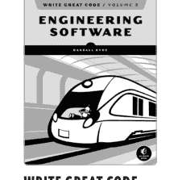

### 编写优秀代码（第3卷）

软件工程

作者：RANDALL HYDE  

376 页，$49.95  

ISBN 978-1-59327-979-0


### 高效 C

专业 C 语言编程导论

作者：ROBERT C. SEACORD  

272 页，$49.99  

ISBN 978-1-7185-0104-1


### Rust 进阶

面向经验开发者的惯用语编程

作者：JON GJENGSET  

280 页，$39.99  

ISBN 978-1-7185-0185-0

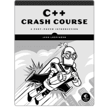

### C++ 速成课

快节奏入门

作者：JOSH LOSPINOSO  

792 页，$59.95  

ISBN 978-1-59327-888-5

电话：  

800.420.7240 或  

415.863.9900

邮箱：  

SALES@NOSTARCH.COM

网址：WWW.NOSTARCH.COM


世界从未像现在这样如此依赖互联网来保持联系和获取信息。这使得电子前沿基金会（Electronic Frontier Foundation）的使命——确保技术为所有人支持自由、正义和创新——比以往任何时候都更加紧迫。

30 多年来，EFF 通过倡导行动、法庭诉讼以及开发软件来克服你在隐私、安全和自由表达方面面临的障碍，始终为技术用户而战。这份奉献在黑暗中赋予我们所有人力量。有了你的帮助，我们就能驶向更光明的数字未来。


在 [EFF.ORG/NO-STARCH-PRESS](https://eff.org/no-starch-press) 了解更多信息并加入 EFF

## 探索值类型的价值


类型系统是所有 C# 程序构建的基础。《C# 类型系统》将向你展示如何有效地定义和实现值类型，并编写性能更高、更健壮的代码。贯穿全书的真实代码示例和测试用例将提升你的 C# 编程水平，并展示如何最好地应用你正在学习的原则。

关于类型系统的核心方面，你将学到：

- 用户定义的值类型，甚至简单类型，如何增强代码的可读性
- 在 C# 中，引用类型和值类型有何不同
- 方法参数和实参如何与引用类型和值类型相关联
- 值类型和引用类型在复制语义上的差异如何影响程序行为
- 值相等性比较所采用的各种不同方法在幕后是如何工作的
- 应用程序中各种类型的独特特征和作用，尤其是值类型如何超越单纯的数据存储
- 为什么继承不是值类型的最佳选择
- 如何度量并评估应用程序使用不同数据类型时的性能

无论你是新手还是经验丰富的程序员，你都会发现 *《C# 类型系统》* 在将好代码变成优秀代码的努力中不可或缺。

## 关于作者

Steve Love 是一位专业开发者，拥有超过 20 年使用 C# 的经验，覆盖物流、公共服务和金融等多个行业。他是 ACCU（`https://accu.org/`）成员期刊 C Vu 的编辑，也经常在会上发表演讲。

涵盖：C# 10（.NET 6）及更高版本


