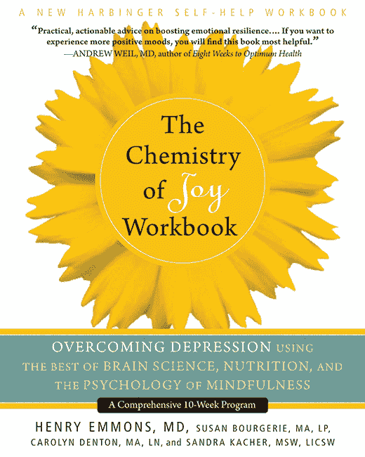
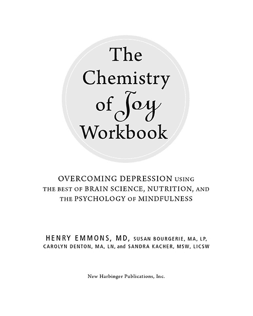

# 快乐化学练习册：利用脑科学、营养学和正念心理学精髓克服抑郁（Harbinger 自助练习册系列）

—凯特琳·德斯·梅森森（Kathleen DesMaisons），博士，《土豆不要西普普林》的作者
—皮亚·梅洛迪（Pia Mellody，《面对依赖》和《亲密因素》的作者
—道娜·马尔科瓦（Dawna Markova），博士，《我不会虚度此生死去》、《开阔的世界》以及《随机善行》的合编者
—巴里·希尔（Barry Sears），博士，《区域》的作者
—帕克·J·帕尔默（Parker J. Palmer，《治愈民主的心脏》、《让你的生命开口》和《教学的勇气》的作者
—斯科特·香农（Scott Shannon），医学博士，精神科医生，科罗拉多大学精神科助理临床教授
—詹姆斯·杜菲（James Duffy），医学博士，FANPA，精神科医生，塞拉图斯斯森整合医学主任

## 引言

### 你的归属圈

衡量归属质量的另一种方法是填写你目前的归属圈。中心代表你，向外扩的圆圈代表你的社交连接网络。首先是内圈的人，你感到和他们在一起很安全、自在。这些人是你会就你重要的事情交谈的人：问题、梦想、愿望等等。在下一圈，你可以放置那些你对他产生好感和友好感，但还没有让他们进入内圈的人。最后一圈应该包含你经常会见到的人，例如在街上能认出他们，但与他们互动极少的人。某些家庭成员可能属于这个圈。

现在你已经填好了你的圈，是否有某些圆圈是你希望增加更多人的？

___________

___________

是否有你想要移动到更近圆圈的人？___________
___________

你今天可以做些哪件小事来丰富你的圈？___________
___________

## 孤独的代价

“孤独”是你当你与人际关系隔绝时所感受到的痛苦的名称——当关系太少，或者当关系的质量让你失望时，是如此。当抑郁症存在时，孤独往往会加剧，部分是因为缺乏接触他人的动力。如果你对自己有排斥感，可能很难相信别人想待在你身边：*我甚至不想和自己待在一起；我怎么能相信别人想和我待在一起呢？*

专家同意社会孤立对健康有害。对四八项研究社会关系与死亡率的研究分析表明，社会孤立对死亡风险的增加与吸烟或肥胖相当。研究中一个有趣的点是，应该像影响死亡率的其他风险因素一样重视社会关系（Holt-Lunstad, Smith, and Layton 2010）。

我们都知道孤独是痛苦的。你是否曾经感到被人拒绝，并感到真实的身体疼痛？最近的一项研究证实了你的经历。这项研究观察了被拒绝后的大脑活动，并有了一个惊人的发现：被拒绝激活的大脑区域与烧伤激活的区域完全相同，烧伤是人能经历的最痛苦的身体损伤之一（Kross et al. 2011）。

如果你是一个归属感低，或者感到孤立和隔绝的人，你可能不需要阅读那些证实你所经历的研究：孤独伤害身体也伤害灵魂。你可能还没有意识到连接的治愈力量。

已知有四个促进健康神经元的因素：饮食、运动、精神刺激和社交连接。在这些因素中，社交连接具有最强大的益处（Strasser et al. 2006）。如果健康的归属感可以鼓励新脑细胞的产生，并帮助它们与其他脑细胞连接，那么它就能帮助你从抑郁中康复。它是维持康复并走向喜悦体验的有力手段。

## 创建归属愿景

你可能在想：*噢，太棒了，又有一件事我没做好，又有一种让我糟糕的方式。*如果你有这样的想法，请邀请你的内在批判者离开房间。事实上，如果你能记得第二章我们讨论过的内在愿景者，现在是邀请你的那个部分加入对话的好时机。

在下面的引导想象中，你将与你的内在愿景者同步，开始为自己创造新的愿景，就像在为建立一座归属之屋绘制蓝图一样。

### 归属愿景

*   进入你舒适、警觉且直立的姿势，将身体调整到一个有助于引导注意力并将意识带呼吸的位置。
*   在几分钟的正念呼吸后，将意识导向身体。感受脚部与地面的连接……身体部位与椅子或垫子的接触……注意到任何紧张或紧绷的区域，并邀请它们放松。
*   现在将注意力带到心脏中心，即胸骨周围的胸部……检查你的心脏中心……邀请心脏开启……柔软……感受温暖。

*   与你内在的愿景者合作，让自己感受对归属的渴望，感受安全和被欢迎、被认可和被需要的感觉。如果你已经很长时间没有过这样的体验了，可能会对这种缺失感到某些悲伤。如果是这样，也没关系；只需让悲伤流淌出来，并知道这源于人类对连接的深层渴望。
*   继续与你内在的愿景者合作，回想起你生活中一个让你感到尴尬、害羞、不确定自己是否受欢迎的场景。这可能是与一群陌生人在一起……或者是一些你已经感到不安全的朋友……又也许是与你已经产生隔感的伴侣或配偶。
*   现在，邀请你的心向场景中的他人开放。看看是否可能体验到更大的从容感……在这一刻，仅仅是这一刻，放下归属感的障碍……那些痛苦的记忆、对被拒绝的恐惧、对被接纳的担忧……让它们全部消失，并在这一刻，感受一颗颗向他人开放的心的喜悦，这种心知道自己既可以被欢迎，也可以给予欢迎。
*   允许让自己在这一刻中休息……感受压力的消失和`ease`（从容）的呈现。
*   几分钟后，感谢你内在的愿景者向你展示了你内心渴望什么，并向你展示了什么是可能的。

## 通过投入身体、心灵心灵建立连接

孤独的痛苦就像所有的痛苦一样，可以通过识别并处理那些加剧它的“第二支箭”来减轻。正如你可能在第 6 章记得的，“第二支箭”指的是我们由于对现实的抗拒，以及通过无益的思维、反应和行动，使痛苦加倍的方式。正如当肌肉在受伤部位收缩时疼痛感会加剧一样，当心围绕着分离的痛苦收缩时，孤独的情绪痛苦也会加剧。

本章的其余部分将为你提供加强连接的方法，从而减轻孤独的痛苦。

### 通过身体连接

正如你可能在阅读本工作簿开头关于压力反应的内容时记得，身体对危险的反应非常敏感，并会对它评估为威胁的任何事情立即且彻底地做出反应。压力反应已经有了大量的研究，毫无疑问你已经对它对健康的负面影响有了许多了解。但你可能没有听过另一种大脑反应，那种反应的影响要积极得得多。这被称为`催产素反应`（oxytocin response）或“抚摸与友谊”反应。

在某些条件下，大脑会释放催产素这种激素。它被称为“拥抱激素”，像一种连接的灵丹药。当它被释放时，人们会感到亲近和连接感。催产素参与了所有帮助我们在他人存在场时放松并感到愉悦的过程。它能增加信任、减少恐惧并加深共情。当身体与他人结合最紧密时，这种激素会被触发——例如在分娩、哺乳和性亲密期间。然而，不需要这样的宏大经历也能从催产素反应中获益。

当你阅读以下活动列表时，识别出哪些是你可以做的，哪些是你可以加入生活的。每项活动都可以触发催产素反应。

*   用拥抱问候某人。
*   分享一个甜蜜的吻。
*   摸摸宠物的毛。
*   记得你收到过令你愉悦物的时刻。
*   记得你曾给过某人让他们开心的东西。
*   为你的团队助威，特别是和一群粉丝在一起时。
*   通过加入乐队、合唱团或管乐团来集体创作音乐。
*   写下你最大的价值观和原则。

另一个选择是开始像一个已经与他人建立连接的人那样行动。虽然我们通常把归属感视为一种感觉，但也可以练习归属行为——表现得好像你已经属于那里了。例如，你可以尝试：

*   在学校走廊或办公室走道与路过的人保持眼神交流
*   给某人那样的赞美，让他们知道你`seen`（看见）了他们
*   让你的面部和眼神变得和
*   在嘴角露出一抹温柔的微笑
*   主动打招呼

你到目前为止可能一直扮演着等待的角色：等待被邀请，等待被挑选。提供邀请甚至看起来对你来说是不真实的。*毕竟*，你可能在想：*如果我做某事时感到不舒服，难道不意味着我不真实吗？* 对那个问题的答案是坚定的否定。在学习任何新技能时，都需要时间来建立信心和舒适感。在学习过程中感到有些尴尬没关系。毕竟，当你第一次尝试走路时，你也是直接摔倒了。即使你一直克制到现在，这也是你现在就可以开始改变的事情。

### 通过心灵连接

当你的大脑执行它最重要的工作之一——扫描危险时，它会将人分为两组：他们和我们。你的想法和信念对于你如何决定一个新人的属于哪一组，以及你是否决定与那个人建立更多接触起着主要作用。源于分离感的想法和信念会让人们将他人视为潜在威胁，而不是可能的朋友或盟友。培养鼓励你将更多人视为部落潜在成员的思维，可以帮助你对他人更加开放。你对他人越开放，你的归属圈就越丰富。

挑战你对他人的自动判断和思维方式是有帮助的。以下示例是一个邀请你以新方式开始新天的比。

*想象一下早晨起床时，知道这是专为为你精心安排的一天。你今天遇到的每一个人都是经过特意挑选的为了送给你一份礼物——一个教训、一个见解、一个挑战或一个困难——每一份礼物都有共同的目的：提醒你并不孤单，并唤醒你的本性，那个一直以来且始终完全安全的自我。*

如果你知道这是事实，你的一天会如何展开？

___________

___________
___________
___________

尝试将这种心态带入你与他人的第一次接触中。

## 开启你的圈子

你对相遇带有什么样的要求？你是否带着开放的好奇心面对新人？还是在与他们互动之前就对某些人下了定论？很多情况下，潜在的连接在开始之前就被否决了。如果我们降低进入我们圈子的门槛，我们的连接也可以更加多样化和丰富。例如，考虑艾伦在明尼苏达州北部小镇的经历。

*艾伦的故事*

“我一直是一个非常喜欢‘深度’讨论的人。初中的时候，我就在问生命的意义了。我对那些沉迷于支持足球队或为舞会做装饰的人嗤之以鼻。我觉得他们很轻浮。在明尼苏达州，每个人都在谈论天气。我拒绝加入他们。同样，我觉得他们很浅薄。我只想谈论感受和意义。我想我成为一名心理学家并不意外。在职业生涯早期，我不得不从大城市搬到一个人口只有八千人的小镇。因为我在一家心理健康中心与其他治疗师一起工作，我能够进行我喜欢的深度交谈。但那里发生了一件趣事。那个小镇位于北方森林中，几乎每个人都用木柴炉取暖。我觉得这是一个浪漫的想法，所以，经历了一些小事故后，我学会了如何操作自己的炉子。这为我开启了一个新世界——木材的世界。我把那里的经历称为‘学聊木头’。我学会了谈论整担木柴、壁炉木、混合硬木以及木材干燥的合适时长。事实证明这几乎是一种通用的语言，并为我开启了许多话题。当然，这通常引发了关于其他主题的更多个人化对话。我仍然喜欢聊木头，当我在壁炉里燃烧一根处理得当的枫木时，它的香气会立刻带我回到那个社区以及我在那里建立的纽带。”

## 反思问题

在与人交谈之前，你可能会他们施加哪些要求？___________

你希望他们看起来像什么样或穿什么衣服？___________

他们的宗教和政治信仰必须与你一致吗？___________

你对他人的教育水平和职业类型有多大的开放程度？___________

根据第一印象，你最容易否定哪一类人？___________

写下你意识到自己对某人的最初判断是错误的经历。___________

如果你愿意，你可能会从哪里开始放松你的要求？___________

## 一分钟社区

亲密、终身相的友谊和家庭关系为我们的生活增添了深度和丰富，但它们并不是获得愉悦且有意义连接的唯一机会。追溯到小学的友谊处于连接谱系的一端，而‘一分钟社区’则处于另一端。你可以在一分钟内体验到一个一分钟社区……它们发生在某些时刻，比如当你站在杂商店排队时，或者在书店向另一个正在浏览的人评论某本书时。它们不需要是那种会有某种发展的关系。它们已经存在了。虽然短暂，但它们可以创造出持续几小时的连接之光。它们可以开启你的心灵。

### 通过心灵连接

佛教导师佩玛·秋卓伦（Pema Chödrön）提供了一种思考人类心灵的美妙方式。她将人心比作海葵。海葵的顶部有一个洞，它是开放的，以接收其海洋家园提供的食物。然而，当海葵因某种方式受到震惊或惊吓时，它会自动关闭开口。这保护了外壳内脆弱的生物，但也意味着尽管它沉浸其中，却无法获得任何养分。

同样，人类的心可以开放来接受爱和连接形式的滋养。它也可以在面对威胁或惊吓时本能地关闭。当我们受到来自他人的伤害时，心灵对关闭变得尤为脆弱。虽然趋向于自我保护是本能，但习惯性关闭的人类心灵可能会忘记再次开启。以下练习鼓励你记得开启。

### 开启心灵冥想

*   无论你的心感到完全敞敞的还是长期关闭的，都可以邀请开放进入其中。
*   从静静坐在一个支持警觉且允许舒适的姿势开始……专注于呼吸的节奏吸气和呼气。
*   片刻后，邀请你的心灵平静，让你的呼吸变深、变慢……轻轻地充满和排空。
*   现在，将一只手的掌心放在你的心脏中心——胸口胸骨正上方……将你的注意力集中在你身体的部位……它是感觉像石头一样紧绷坚硬……还是像充满阳光的窗户一样温暖开放……还是像鸟一样颤动……或者其他方式？无论你发现它是怎样的，都邀请你的心灵稍微开启一点，变得温暖、变软，在呼吸的温暖中放松。
*   保持这种练习几分钟，只需将呼吸引向心脏中心，引导温暖的感觉深层进入心脏……也许在心中念着这些词：*欢迎，你在这里很受欢迎*。
*   在舒适的一段时间后，感谢自己愿意尝试这种体验。
*   即使感觉没有发生，将注意力引向心脏中心的行为也是在邀请它温暖、变软，重新获得欢迎生命的能力。

## 慷慨：孤立的伟大解药

你是否经历过给予或接收恰好事物的快乐？你是否感到你的心被礼物触动时变得温暖并扩张？作为给予者也曾是接收者，你是否注意到两者的感觉是相似的？根据佛的说法，慷慨的行为会消融小我。给予者没有报答的想法，接收者没有产生负债，慷慨的行为将世界从一个孤立的世界变成一个连接的世界。当然，这是一个暂时的世界，但在孤独的时刻可以被回味和品味。在慷慨的世界里，你的收获是我的快乐，你的幸福带给我快乐。在慷慨的世界里，你的成功不会威胁或削弱我的成功。这是一个可以通过任何给予行为被召唤产生的世界。

### 培养慷慨的心灵

*   静静地坐在一个舒适的姿势，专注于你的呼吸。让你的心灵沉淀。
*   将你的注意力放在心脏中心，留意此时的任何感受，并接纳它。
*   回想一个最近收到好消息的人。当你脑中形成这个人的清晰形象时，尽情慷慨。
*   默默地向此人提供这样的词句：
    *   愿你的快乐增长并常伴左右。
    *   愿你的成功持续。
    *   你的快乐带给我快乐。
*   注意这种感觉如何。如果你对此有抵触，只需敞开它，并记住你培养慷慨心灵的意图。
*   如果这很困难，对自己慷慨一点，也许将同样的词句引向自己的心灵：
    *   愿我的快乐增长并常与我同。
    *   愿我的成功持续。
    *   愿我分享所有人的快乐。
*   当你感觉这个过程结束时，将注意力带回呼吸一两分钟。
*   在这一天中记住这些词句和意图，默默地向你遇到的每个人提供它。

## 用宽敞的心灵倾听

连接的关键要素之一是能够深度倾听他人。真诚倾听的礼物是你可以给予他人的最慷慨的礼物之一。

有一个关于小镇举办的一场小镇英雄比赛的故事。当比赛冠军由一个被老邻居提名的五岁男孩获得时，镇民们感到非常惊讶。当他接受当地报纸的采访并问及他做了什么时，他的回答简洁而有力：“嗯，拉森先生在拉森太太去世时很难过，所以我就坐在他的大腿上，让他哭吧。”

你是否曾有过这样的经历：对方如此全身心地投入、如此完全地接纳你，以至于你那害羞的内心感到足够安全，可以出来并被倾听？这种体验也能提供给他人吗？如果是，说明你经历过深层的倾听，体验过被用毫无障碍的心灵所倾听。

## 深层倾听练习

现在花一点时间回想你曾被这样倾听的时刻。闭上眼睛，让大脑平静下来，回到过去，直到你的记忆落在某个某深层倾听了你的场景。如果你想不起任何这样的时刻，就想象一下吧，知道对我们大多数人来说，这些经历是罕见的。

当时你的生活状况是怎样的？

___________

___________

___________

当时是谁在听你说话？他们身上的什么特质让你能够向他们敞开心扉？

___________

___________

___________

向他人如此完全地展现自己的内心是什么感觉？

___________
___________
___________

你认为他们在你身上看到了什么你自己却看不见的特质？

在你生命中（无论现在还是过去），哪些是真正在听你说话的人？

___________

___________

___________

被如此深层地倾听是一份巨大的礼物。这并不经常发生，因为这对倾听者要求某些似乎稀缺的特质：一个冷静且专注的大脑、一个开放且不加判断的接纳的心、一个带有慈悲意识的深度连接的存在。

良好的倾听对某些人来说是天生的，但也可以通过练习。以下是在倾听他人时可以练习的技能，或者是你希望在生活中遇到的熟练倾听者身上寻找的技能。

## 深层倾听的技巧

将所有的注意力集中在说话者身上。将对方看作完整且无辜的人，她在任何时刻都在尽力而为；她不需要被“修复”。你不需要为她解决问题。让对方走向自己的真理，相信她内心已经拥有所需的一切。

让对方自由表达。只需倾听，让她的的话进入你的内心。你不需要回应。如果你确实说话，请发自内心地说只说对`你`来说真实的话。只问几个开放、诚实的问题——那些鼓励对方说得深入的问题——那些你认为自己并不已经知道答案的问题。

允许情绪自然产生，而不需要安慰或试图停止这种情绪。与沉默保持自在，并允许出现无语的阶段。用开放、慈悲和接纳的态度陪伴对方。

这些正是你通过本练习册一直在培养特质，也是你可以在一生中不断成长的特质。因此，即使你想不起任何一次被深层倾听的经历，或者找不到一个真正听你说话的人，你也可以为他人这样做。通过这样做，你也在为在`你的`生命中拥有更多具有这些特质的人创造条件。

## 第 10 章总结

*   连接是人类的与生权利。
*   孤独是对向连接的召唤。
*   健康的连接可以缓解并预防抑郁症。
*   无论你从哪里开始，增强归属感都是可能的。

## 第 11 章

# 深化：从内在重塑自我

*对于人类而言，内在自我与外自我之间日益扩大的差距——我们生活方式与理想生活方式之间的不平衡——让灵魂渴望重生。*

摘自 Sabra Field 和 J. Lingelbach 的著作《在生活匆忙之前》（Before Life Hurries By）

Kristin 刚刚描述了近二十年的抑郁是如何渗透到她生活的每一个角落——事业、爱好、友谊、爱情——特别是她与自己内心的关系中。她停下来思考了片刻。然后，泪水顺着脸颊流下，她用一句令人心碎的话总结道：“我不止于此……我的生活不止于此！”

诚然，她的话中带着忧伤和丧失感；然而，她的声音中也带着一丝反抗。在她的痛苦的表象下，仍然存在着一个力量的核心、一个勇气的泉以及一种未丢失的尊严本质。

Kristin 本人似乎忘记了她体内拥有这些特质。她已经与自己更深层的部分失去了联系。然而，显而易见，尽管 Kristin 遭受了伤害，但并没有被抑郁症击败。当她说“我不止于此”时，她陈述的是真实事实。

Kristin 逐渐从长达数十年的抑郁中走了出来。她通过遵循你在本练习册中走到这一步所走的路径做到了。尽管如此，她仍然留有强烈的渴望，成为更好的自己，去发现她的生活可能变成的“更多”。她该如何找回那些她害怕已经丢失的自我元素？她如何能带着更清晰的认知和活力走过抑郁的另一侧，与她内在的力量、智慧和爱的储水池紧密连接？

你内心也有这样的储水池，等待着被开发。由于它们位于表面之下，发现并与它们对齐的唯一方法就是向内探索。当然，这是一生的追求，每种精神传统都提供了深度练习的方法来鼓励这种内在的成长。在本章中，我们将为你提供指导，帮助你如何在从抑郁症中走出来的同时，开启这段极具个人色彩内在之旅。

## 与更深层的自我做朋友

我们每个人体内的更深层自我有各种名称，如真我、高我、本真、内在声音或简称为灵魂。与你这部分重要部分的断节可能是抑郁症最深层的影响之一。这似乎是你失去了与自己本质的联系。然而，这种联系永远不会丢失——至少不会永久丢失。

正如我们所理解的，这种深度自我不断寻求连接。它促使我们完全投入生活，认知并接纳自己最高和最低的一面，与他人建立真实的关系，融入社区，拥有有意义的工作，了解真正重要的事情，对我们爱的事物保持临在，向我们渴望的事物移动，体验神圣。

学习如何倾听这种内在声音是明智的。以下练习提供了如何与你的更深层自我对话的指导。你可以这样做一次，也可以在任何需要的时候作为与自己深层需求和欲望保持一致的常规方式。

如果这让你感到陌生或恐惧，或者你想`我在那里会发现什么？`，请记住贯穿本练习册的基本原则：`你身上好的地方多于不好的。`你不需要害怕在内在景观中发现什么。

### 倾听内在的声音

*   留出足够的时间进行个人反思（至少二十分到四十分分钟）。选择一个你自然向内探索且精力、专注都良好的时段

- 从片刻的静默开始，在此期间设定你对这段时间的意图。你可以请求引导，并保持开放接受这些引导的心态。
- 在你的日记中写下一个问题；如果你还没有问题，就安静地坐着，邀请一个问题的浮现。或者你也可以写一个通用的问题，比如“今天对我来说，听到什么很重要？”
- 一旦形成了一个问题，闭上眼睛，在脑海中轻柔地抓住这个问题。你不需要过度思考它，因为你并不是试图去弄懂它。让思考性的思维退到背景，看看是否能让这个问题进一步渗透到你的存在中。
- 继续坐着，直到你感到某些东西对你的问题产生了回应。这可能是一个图像、一种感觉、情绪、颜色或移动的感觉。也可能是特定的词汇。再次，你不需要去理解它。只要你注意到某些东西浮现，就睁开眼睛，拿起日记和笔。
- 在你的问题下方，开始写下或画出脑中出现的任何东西。尽管写，不要加审查，让它不断从你身上流出，通过笔尖流淌，仿佛它有自己的生命。一直写下去，直到你觉得对那个特定问题已经结束。
- 接下来，你可能想看看你写的内容并进行反思，让你的思考性思维回到前方。当你阅读和反思时，看看是否出现了一个新的、清晰的问题，并将其写下来。或者你可能想对刚刚读的内容写一个回应。
- 如果产生了额外的问题，就对着那个问题坐片刻，直到你感到另一个回应的产生，然后重复相同的过程。继续写作和反思，直到你觉得这段时间已经结束。
- 审视你写的内容，并尝试捕捉它的精髓：哪些是智慧的内核、新的见解或你想要采取的特定行动？
- 尽可能地回到这种内在对话，以与你的存在根基保持联系。

在这个过程中有时会产生一些问题，例如：“我如何知道我从中得到的东西是真实的？”“如果这只是我自己编造的呢？”“我如何知道这种内在引导是否值得遵循？” 辨别力是内心世界关系中一个极具挑战性的部分。虽然没有万之有效的方法来验证这个过程，但有一些迹象（列在框中）可以帮助你确认自己处于正确的道路上。

***

## 如何判断你的内在声音是真实的

- 在倾听过程中，你的思考性思维让位于创造性思维。
- 在写作时，感受到一种开放和流动的感觉。
- 词汇清晰且无歧义——也许甚至是具有权威性的。
- 你对它有一种共鸣——它就是`感觉`是真实的。
- 语气是支持性的、肯定的、令人的，即使它在说一些你需要听的艰难话。
- 如果给予了引导，其中有一种积极的、向前的移动感。
- 内在声音始终是善良且仁爱的，绝不严厉或批评。
- 在对话期间和之后，你感到平静、连接和广阔。
- 你可以看着它说：“无论这是否真实，`这`都是我希望生活的方式。”

## 抑郁症作为觉醒的契机

虽然与抑郁症的战斗可能会让你感到渺小，但也可能从这次遭遇中脱出来，并在某种程度上被它充实。抑郁可以鼓励你倾听自己的内在声音。所以当你走出抑郁症时，我们敦促你既不要推开这种经历，也不要紧抓住它。有一种中道，或许能帮助你觉醒为更强大的自我。

### 向内在生活开放

诗人阿妮塔·巴罗斯（Anita Barrows）将抑郁症称为一种“渗透性的黑暗”（Barrows 2006）——不是要逃避的东西，而是一个倾听、深耕、通过你的经历被“成熟”的机会。虽然我们不认为抑郁是深度个人成长的`必要`条件，但我们确实相信你可以带着新的生命和更大的深度走向另一岸。

以下练习将邀请你审视自己从抑郁的黑暗中走出的经历。请记住对自己温柔，并且只有当你觉得自己与抑郁的强度之间有足够的距离，准备好审视这段经历而不会再次陷入痛苦时，再进行此操作。

练习结束后，有一个克里斯汀（Kristin）自己的对话过程的示例。你可能想先读她的回应，让你对这个过程可能的样子有个直感受；或者如果你认为这有助于自己的声音显现，也可以先写下你的回应。选择权在你手中。

### 引导想象：从抑郁中走出

选择一个安静的时间和地点，为这项练习留出至少三十四十五分钟。在身边准备好彩色笔或水彩画纸（如果你更喜欢写，就准备纸笔）。

- 静静地坐着，闭上眼睛，享受片刻对呼吸的觉察。让你的大脑平静下来。然后将注意力放在你的心脏中心。
- 让一个关于早春花园的图像——你的花园——浮现。这是一个崭新的季节，希望的季节。花园可能位于你熟悉的地方，比如你现在院子里的地块，或者你小时候的院子。它可能是一个你想象的地方，一个你创造的地方。现在看清它的细节。花园有多大？它被树木……丘陵……水环绕吗？想象一下气味、声音和春空气的感觉。
- 现在想象你正走过花园检查它。冬天刚刚退去。注意当你站在碎片中间时的感受。
- 依然跪着，你更近地观察碎片。然后你看到了——嫩绿芽，正从黑暗的土壤中萌发。
- 接下来，看到自己蹲下清理冬天的落叶和废物。当你这样做时，你注意到这些将成为宝贵的堆肥，为即将出现的东西提供养分和保护。
- 描述泥泞下的新生长。什么想要浮现？在这个阶段，它们对你要求什么？
- 当你准备好时，拿起你的绘画或写作材料。保持冥想状态，开始画出（或描述）你在引导想象中看到的内容。花需要的时间表达任何涌出的东西，而不对其进行评估或分析。
- 当你完成绘画或写作后，将材料放在一边，把作品放在面前。仔细观察，不要试图弄懂它，只是看看你是否被某些图像吸引，感受它们带带给你什么。从下面的问题或你自己的问题开始，安静地坐着直到回应产生。然后写直到你觉得结束，再对另一个问题重复同样的操作。
- 描述你生命此刻站在花园里的感受，审视长冬的影响。
- 什么是需要清理的？哪些是死的且没用的？哪些可以留下来作为肥料或堆肥？
- 描述泥泞下的新生长。什么想要浮现？在这个阶段它对你要求什么？
- 你的花园有多满？是否太多了，需要稀疏一些以便那些真正想要茁壮成的东西？或者你需要增加一些，带来新的事物？如果是这样，那是什么？
- 当你觉得结束时，再次闭上眼睛。将注意力带回你的心脏中心，留意你对这段经历的任何感激。
- 如果需要，用一个结束仪式结束。

*克里斯汀的意象*

“乍看之下，我的花园看起来相当荒芜。我感到精疲力竭，仿佛被经历过的这个冬天打得节节败。我能生存下来简直是个奇迹。这让我意识了自己的自己的力量。我一定比我想象中更有韧性！

想要捡起生活的碎片是很困难的。我失去了太多。尽管如此，我现在的感觉好多了，也比以往任何时候都更有希望。我也可以观察我的花园，看到生命的迹象。

我花园里很多枯死的事物似乎是属于别人的生活；它们感觉完全不像我。我养成的某些习惯——周末无所事事地躺着、总是独来独往、吃我知道对身体没好的东西——那不是我！我以前很活跃；朋友对我来说曾是那么重要。现在，我拥有一些对我来说并不健康的关系。我想开始更多地关注与某些人相处时的感受。

我确实犯了一些错误，这是肯定的，但也许我不必对自己那么严苛。我希望能够从自己的‘失败’中成长，并记住在那个时刻我我已经尽了所能。例如，我认为我与工作之间存在某种断层。目前工作对我来说不是一个健康的地方——压力太大，而且人们太消极了。我准备好迎接新事物。

我一直很忙；那可能是我陷入抑郁的原因之一，因为压力太大了。现在，我的花园看起来有些稀疏。我想增加一些东西，但不要过头。我认为现在最需要增加的两件事真的是高质量的朋友——以及更多地玩耍。我想学习如何做一个好朋友，并再次获得快乐！

我也对更好地了解自己感到兴奋，去花更多时间反思或只是保持安静。我以前没认为这真的很重要，但现在我以不同的眼看待自己。我是一个值得被了解的人。”

# 成为真实的自我

一个朋友正和家人共度时光，一首歌勾起了他青少年时期成为摇滚星的梦想。具体来说，他曾想成为 `Bob Dylan`。听到这里，他四岁的侄女挑分性地说道：“拉里叔叔，你只能做你真实的自己！”

想要过得快乐，成为真实的自己至关重要。这听起来如此简单——除了你自己，你还能成为谁呢？然而，许多人真的在努力成为别人，这种选择无论对方看起来多么优秀，都可能带来不快乐，因为对你来说那是不真实的。

Dawna Markova 写道：“治愈要求你重新审视一切——你所有的习惯、想法、信念、价值观、激情、抑制、假设——直到你找到核心最真实的事物，抛弃其他一切。它要求你培养你的问题，直到你发现如何创造一种环境，使你每天都能与自己以及世界保持一致”（`Markova 1994, 12`）。

如果这听起来是一件苦差，那确实如此。但这也是生活的首要目的之一，并成为巨大快乐的源泉。在寻找自我的过程中，最大的助手之一就是向你深深渴望的事物移动。

想象一只天鹅向着它的渴望走去：炎热夏日里一个宁静的池塘。那是名诗《天鹅》中的画面（`Rilke 1982, 29`）。诗人里尔克描述了一只天鹅在陆地上笨拙地移动，仿佛它的腿部被绳子绊住了。我们难道没有经历过那种费力而笨拙地穿过日常生活的，被成功或幸福挡在之外，仿佛我们也也被绳子束缚着吗？

但天鹅一直向水面移动，仿佛被某种不可抗拒的力量吸引那里。然后，当它到达水边时，所有的笨拙都消失了，它被轻而易举地托起并优雅地移动，看起来像一位完全掌控自己命运的国王。它找到了自己的天地。

专注于挣扎、关注那些似乎阻碍你的事物是很容易的。但在里尔克的诗中，天鹅并没有太在意这些。它没有试图理解或解决自己的问题，不需要逐一剥离它们，不需要为它们命名或除掉它们。它没有向外寻找“哪里出了问题”的原因。相反，它只是步履蹒跚，不在意自己的笨拙，直到到达岸边并发生蜕变。

突然间，不再有绳子，不再有未完成的事业，不再有笨拙。当你找到你的水域——你真正的家——并进入其中时，诗人说那一刻有点像死亡。为了离开你一直立足的熟悉土地，你必须放弃一直紧紧抓着的生活。你必须放弃旧的，放弃已知的坚固，为新的事物留出空间。

一旦来到水面上，这只笨拙的鸟就变成了美丽而庄严的事物，毫不费力地向前滑向一个未知的未来。尽管所处的环境充满不确定性，天鹅却完全平静，如归家一般。

对你来说也可以这样。当你最终进入自己的天地，当你放弃了挣扎，当你停止试图表现良好或获取某些充实你的东西时，你也可以毫不费力地漂浮在自己的生活之上。你可以让生命之引导你，既不逆流而上，也不抓着岸。当然，你仍然会面对痛苦，但你可以让自己顺流。

# 寻找你的天地

问自己这些问题，给自己一些时间反思。留意你浮现的一切：意象、记忆、想法、感受。

- 你的水域在哪里？你的天地在哪里？在什么地方，你感到最像在家里？
- 你是什么样的人时最充满活力？
- 你和谁在一起，哪些活动带给你最大的快乐？

# 灵魂生来快乐

本工作手册始于一句话：“快乐是生活的本质。”尽管有时很难相信这种观点，但我们看到了梭罗这句话的真理。快乐无处不在，无论我们是否意识到，它始终提供着内在的支持。

许多人渴望戏剧性的精神觉醒——某种出体体验或山顶体验——希望这能改变生活，并最终彻底向快乐敞开心扉。但觉醒的方法有很多，其他更微妙的路径也可以引导我们通往更持久的快乐体验。

先锋禅师夏洛·乔克·贝曾说过：“快乐正是发生的一切，减去我们对它的看法”（`Beck 1994, 233`）。换句话说，获得快乐比我们想象的要简单——不是容易，但简单——因为它存在于任何事物之中。

以下是这些路径的旅行者描述的近期快乐经历：

我有糟糕的一天，正与情绪作斗争。我工作了一整天，晚上还要工作，但我休息了一小会儿，在繁忙的自行车道上散步。前几分钟，我沉浸在思绪中，关注所有出错的地方。但接着我注意到心情低落，于是决定测试一下我学到的。我将注意力放在心上，邀请它尽可能开启。然后，每当有人步行或骑车经过时，我都在心中诚挚地向他们送出一份祝福。

如果他们看起来心事重重或低落，我会对自己说：“愿你平静。我祝你顺利。”如果他们看起来很快乐或微笑，我会说：“我很高兴你快乐。你的快乐就是我的快乐。”

# *我就这样走着，但几分钟后，情况发生了变化。人们开始注意到我并向我望来。很快，越来越多的路人开始微笑——对我微笑！随着我的继续前行，我的心敞开了许多，我觉得自己也变得轻松了。*

在那之后的大约一个小时里，感觉一切都是应有的样子，一切都会好起来。我觉得我属于这里，我觉得我可以走向任何一个人并被接纳，就像现在的我一样。我知道一个小时看起来并不多，但它充满了我的希望。它提醒了我生活本可以的样子。而真正棒的事情是，我正处于其中。我真的在那里，所以我能享受它。我甚至会说我感到很快。所以现在，这段经历刻在了我的脑海中。它告诉我，快乐真的是可能的——甚至对我也是如此！

在通往快乐的所有路径中，我们一直在鼓励你自己去发现哪些障碍可能会阻碍你获得自己的快乐体验。你已经查看了所有必须处理的身体通路，但这些通路本身通常不足以开启快乐。你已经在心智通路上做过努力，寻求更充分地觉醒于当下的生活。但你想要觉醒的是什么？什么样的世界，什么样的生活，值得为了它觉醒？我们相信，这些问题只有通过内心才能回答。

你永远可以做的一件事就是完全临场。完全投入到你原本的生活中，你会发现快乐，至少偶尔如此。你可能仍然选择回到本练习书中九条通路中的任何一条，以进一步开启对快乐的获取——当你这样做时，请放心它就在那里。无论你在何时何何地发现快乐，请务必注意到它，沉浸其中并庆祝它。

### 第 11 章总结

* 你的内在存在一个更大的自我，给予它关注是明智的。
* 走出抑郁可能是一个觉醒时期，是一个更充分地生活的时刻。
* 倾听内心，你可以由你最向往的事、由带来真实快乐的事所引导。

# References

Akhondzadeh S., H. R. Naghavi, M. Vazirian, A. Shayeganpour, H. Rashidi, and M. Khani. 2001\. Passionflower in the treatment of generalized anxiety: A pilot double-blind randomized controlled trial with oxazepam. *Journal of Clinical Pharmacy and Therapeutics* 26: 363–67.

Albarracin C., B. Fuqua, J. L. Evans, and I. D. Goldfine. 2008. Chromium picolinate and biotin combination improves glucose metabolism in treated, uncontrolled overweight to obese patients with type 2 diabetes. *Diabetes Metabolism Research and Reviews* 24: 41–51.

Alpert J. E., G. Papakostas, D. Mischoulon, J. J. Worthington III, T. Petersen, and Y. Mahal. 2004\. S-Adenosyl-L-methionine (SAMe) as an adjunct for resistant major depressive disorder: An open trial following partial or nonresponse to selective serotonin reuptake inhibitors or venlafaxine. *Journal of Clinical Psychopharmacology* 24: 661–64.

Barrows, A. 2006\. “The Soul in Depression.” Speaking of Faith. American Public Media. MPR. November 16, 2006.

Beck, C. 1994\. *Nothing Special: Living Zen*. New York: Harper One.

Berk, M., D. L. Copolov, O. Dean, K. Lu, S. Jeavons, I. Schapkaitz, M. Anderson-Hunt, and A. I. Bush. 2008\. N-acetyl cysteine for depressive symptoms in bipolar disorder: A double-blind randomized placebo-controlled trial. *Biological Psychiatry* 64 (6): 468–75.

Bray, G. A., S. J. Nielson, and B. M. Popkin. 2004\. Consumption of high-fructose corn syrup in beverages may play a role in the epidemic of obesity. *American Journal of Clinical Nutrition* 79 (4): 537–43.

Calaprice, A. 2005\. *The New Quotable Einstein*. Princeton, NJ: Princeton University Press.

Chadwick, D. 2007\. *Zen is Right Here: Teaching Stories and Anecdes of Shunryu Suzuki*. Boston, MA: Shambhala Publications.

Davidson, J. R., K. Abraham, K. M. Connor, and M. N. McLeod. 2003. Effectiveness of chromium in atypical depression: A placebo-controlled trial. *Biological Psychiatry* 53 (3): 261–26.

Davidson J. R., and the Hypericum Depression Trial Study Group. 2002. Effect of Hypericum perforatum (St. John’s wort) in major depressive disorder: A randomized controlled trial. *Journal of the American Medical Association* 287: 1807–14.

Dusek, J. A., C. Denton, H. Emmons, L. Knutson, S. Masemer, and G. Plotnikoff. 2009\. Evaluation of an 8-week resilience training program in moderate to severely depressed patients. *Explore: The Journal of Science and Healing* 5 (3): 160–1.

Nettleton, J. A., P. L. Lutsey, Y. Wang, J. A. Lima, E. D. Michos, and D. R. Jacobs. 2009. 多族裔动脉硬化研究 (MESA) 中饮食汽水的摄入与代谢综合征及 2 型糖尿病的发病风险。《糖尿病护理杂志》 32 (4): 688–94.

Nouwen, H. 1994. 《此时与此刻》。纽约，NY: Crossroad Publishing.

O’Keefe, J. H., M. N. Geewala, and J. O. O’Keefe. 2008. 改善餐后血糖脂质、炎症和心血管疾病的饮食策略。《美国心脏病学会杂志》 51 (3): 249–55.

Oyle, I. 1979. 《新美国医学展示》。圣克鲁鲁兹，CA. Unity Press.

Qin, B., K. S. Panickar, and R. A. Anderson. 2010. 肉桂：在预防胰岛素抵抗、代谢综合征和 2 型糖尿病中的潜在作用。《糖尿病科学与技术杂志》 4 (3): 685–93.

Rilke, R. 1982. 《莱纳·马丽亚·里尔克精选诗》（Stephen Michell 译）。纽约：Random House.

Ruhé, H. G., N. S. Mason, and A. H. Schene. 2007. 人类情绪与血清素、去甲上腺素和多巴胺水平的间接关系：单胺耗竭研究的元分析。《分子精神医学》 12 (4): 331–59.

Shute, N. 2011. 抗抑郁药使用增加，主要由全科医生开处方。《发射，国家公共广播电台》，[www.npr.org/blogs/health/2011/08/06/138987152/antidepressant-use-climbs-as-primary-care-doctors-do-the-prescribing](http://www.npr.org/blogs/health/2011/08/06/138987152/antidepressant-use-climbs-as-primary-care-doctors-do-the-prescribing)。

Silber, B., and J. Schmitt. 2010. 色色氨酸负荷对人类认知、情绪和睡眠的影响。《神经科学与生物行为评论》 34 (3): 387–407.

Smith, K. W. 2011. 抑郁：一种对压力诱导神经微损伤的修复反应，是否会演变为慢性神经炎症状态？《神经科学与行为评论》 35 (30): 742–64.

Strasser, A., M. Skalicky, M. Hansalik, and A. Viidik. 2006. 环境与中度身体运动及饮食限制对老年期 Sprague-Dawley 大鼠大脑顶颞叶皮层 BDNF 的影响。《老年学》 52 (6): 377–81.

美国人口普查局。2005. 按人口统计特征分类的人口估计。表 2：美国选定年龄组和性别年度估计：2000 年 4 月 1 日至 2004 年 7 月 1 日（NC-EST2004-02）。[www.census.gov/popest/national/asrh/](http://www.census.gov/popest/national/asrh/)。

Whitman, W. 2004. “旷野之路之歌。《草叶集》。纽约，NY: Random House Bantam Dell 分部。

Williams, A. L., C. Girard, D. Jui, A. Sabina, and D. L. Katz. 2005. S-腺苷甲硫醚-S-蛋氨酸 (SAMe) 作为抑郁症的治疗：系统性评价。《临床与调查医学》 28: 132–9.

世界卫生组织。2008. 《全球疾病负担：2004 年更新》。表 A2：WHO 按原因、性别和收入组划分的残疾调整年 (DALYs) 疾病负担，2004 年估计值。日内瓦，瑞士：世界卫生组织。[`www.who.int/healthinfo/global_burden_disease/GBD_report_2004update_AnnexA.pdf`](http://www.who.int/healthinfo/global_burden_disease/GBD_report_2004update_AnnexA.pdf)。

**Henry Emmons, MD** 是一位精神科医生，将身心疗法、自然疗法、正念和慈悲洞察整合到他的临床工作中。他开发并运营了明尼阿波利斯（明州）Penny George 健康与治愈研究所提供的韧性训练计划。他是《快乐的化学》和《冷静的化学》的作者。[www.partnersinresilience.com](http://www.partnersinresilience.com)

**Susan Bourgerie, MA, LP** 是一位丰富的心理治疗师，明尼阿波利斯（明州）Loring 心理治疗与正念中心的联合创始人。她是明尼阿波利斯 Penny George 健康与治愈研究所提供的韧性训练计划的团队成员。

**Carolyn Denton, MA, LN** 是一位整合营养学家，不仅关注普通健康和疾病预防，还关注营养作为慢性和退行性疾病的辅助疗法。她是 Penny George 健康与治愈研究所整合医学团队的成员。

**Sandra Kacher, MSW, LICSW** 拥有超过二十五年的临床经验，是 Loring 心理治疗与正念中心的联合创始人。她是 Penny George 健康与治愈研究所韧性训练计划的创始团队成员。

