# Mac OS X El Capitan 初学者指南：（适用于 Macbook, Macbook Air, Macbook Pro, iMac, Mac Pro 和 Mac Mini）

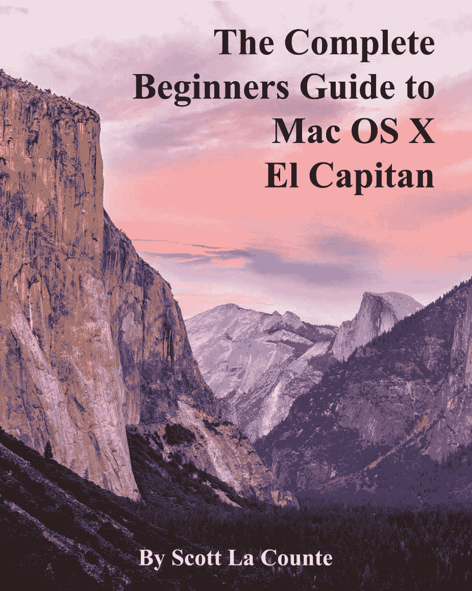

[/content]

译文：

[content]

# Mac OS X El Capitan 完全入门指南

（适用于 MacBook, MacBook Air, MacBook Pro, iMac, Mac Pro 和 Mac Mini）

作者：Scott La Counte
© 2015. 版权所有。

## 引言

请注意，每一个 Mac 看起来正常。

## El Capitan 有什么新？

如果你从 OS Yosemite 升级到 OS Elitan，你会很快发现一点：它看起来一模一样。这并不是说完全没有变化，但大部分改进都在底层。系统运行得更快，但视觉感受上没变。

不过，对调度中心、Spotlight、邮件、照片、Safari、地图和字体进行了后期更新。

最大的增强是一个叫做 `分割屏模式` 的功能。这将在书中有详细介绍，但简单来说，`分割屏模式` 允许你运行两个兼容的应用程序——我说兼容是因为并不是所有应用都。

## Mac？值得买吗？

在深入研究软件之前，我们来解决明显的问题：为什么选择 Mac？

我一直在 Windows 阵营了很久；看到 Mac 时，觉得它只是文青准备的电脑。当然，它们看起来很好——看起来不像塑料那样廉价——但它们也很贵。

但当我真正用过一次之后，我被惊艳了。

### 更少的病毒

你可能听过有人说用 Mac 是因为它们没有病毒。这不是真的。任何电脑都可能感染病毒。但 Mac 通常更不容易感染，而且更安全。

你之所以很少听到 Mac 病毒的消息有两个原因：

1. 虽然很难精确确定全球到底有多少电脑，但大多数估计 Mac 占全球不到 10%。大多数电脑仍然是 Windows。所以，如果你是一个想要在网络空间大破坏的黑客，你的目标显然是受众最多的那个。
2. 第二个原因是 Mac OS 是 Apple 为 Apple 设计的。Windows 构建其操作系统是为了适应几乎任何电脑，这为漏洞留下了空间。

我认识很多 Mac 用户，很少听到他们说有病毒。不过，如果你担心的话，一种流行的免费病毒防护软件叫做 `Bitdefender Virus Scanner`。

保持简单

在设计方面，Apple 喜欢制作美观而简单的东西。这种哲学在他们的手表、iPhone 和 iPad 上都有体现——涵盖了所有的产品。

由于 Apple 花费了大量时间保持简单，你也见证了电脑崩溃和蓝屏之日的终结。

Apple 花了大量时间不仅考虑电脑应该做什么，还考虑人们将如何操作。如果你一直都在使用 `Windows`，那么所有不同的菜单和按钮起初可能会让你望人生畏——但别有压力！这本书将向你展示这实际上有多简单。

如果你有任何其他 Apple 产品，那么许多常见的 `Mac` 任务对你来说可能看起来非常相似。而且，如果你有一个 `iPhone`、`iPad` 甚至 `Apple TV`，它们都可以相互工作和交互。

## 无臃肿

我记得我的上一台 `Windows` 电脑。我等不及想打开它了……接着我又等不及想关掉它了！第一个小时本该花在探索它的乐趣，但我第一个小时却花在了卸载程序上！

`Windows` 电脑之所以便宜，原因是制造商与软件公司合作，安装了各种不必要的程序——其中大多数只是免费试用版。

使用 `Mac`，你第一次打开电脑，如果你还没有 `ID` 就创建一个，输入你的 `Wi-Fi`，并登录 `iTunes` / `iCloud`。就这样。一旦你把它从箱子里拿出来，只需要不到十分钟就能让你的电脑运行起来。

## 安装

首先要说的是：安装。如果你有一台新电脑，那么这就不适用于你；你的电脑已经安装了最新的 `OS`（操作系统）。然而，由于 Apple 不断更新他们的软件，你可能想查看是否有可用的更新。

要做到这一点，只需前往 `Launchpad`（它是屏幕底部任务栏上的火箭图标），并点击一次。

这将显示出你当前已安装的所有应用程序。你可以输入“App”来搜索 `App Store`，也可以直接寻找该图标。如果有可用更新，你会在上面看到一个数字，代表有多少个可用更新。

要查看更新，点击该图标（注意我没说右键点击或左键点击吗？因为 `Mac` 上只有一种点击方式，不像 `Windows`）。

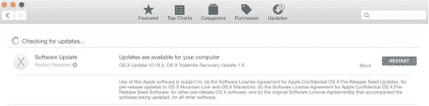

接下来，从顶部菜单栏点击“更新”（Updates），然后点击需要更新的软件旁边的“更新”（Update）。如果你没有看到“更新”按钮，说明你已经准备好了——不需要更新。如果你确实进行了更新，取决于更新的大小和你的互联网速度，通常需要十分到四十分钟完成更新——并且需要重启电脑才能完全安装。在更新期间，你可以继续使用电脑——它会在重启前通知你，以便你保存工作。`OS` 会为你完成一切工作——在更新期间，你唯一需要做的就是等待它完成。

Apple 通常每年发布一个新的 `OS`（传统上在发布新款 iPhone 的同一时间）。

### OS X 10.9 Mavericks

如果你正在使用旧旧电脑并需要安装最新的 `OS`（`El Capitan`），这非常简单。只需前往上述的应用商店，搜索 `El Capitan`，然后下载它。关于这次更新的好消息是：它是免费的！Apple 已经取消了软件更新收费。

该文件大小略大于 `5 GB`，请确保你的电脑有空间——如果没有，你可以跳过几章节查看如何清理你的 `Mac`。一旦下载完成，按照屏幕提示操作即可。你的 `Mac` 会重启几次，所以不要担心它的表现异常——这是正常的。

当更新完成后，你会知道的，因为一切看起来都不同了，会有新的壁纸，并且会出现一个欢迎对话框。

### OS X 10.8 Mountain Lion 或以下版本

如果你是少数尚未升级到 `OS X Mavericks` 的 `Mac` 用户，并且在使用 `OS X Snow Leopard`、`Lion` 或 `Mountain Lion`，那么你必须硬着头皮点击 `El Capitan` 的下载链接。

这里的坏消息是：如果你的电脑 `OS` 低于 `Mavericks`，那么很有可能不支持 `El Capitan`。

通用要求如下：

*   至少 `2 GB RAM` 或更高内存
*   至少 `8 GB` 可用硬盘空间
*   `iMac` 2007 年及以后
*   `MacBook` 2009 年及以后
*   `MacBook Pro` 2007 年及以后
*   `MacBook Air` 2008 年及以后
*   `Mac Mini` 2009 年及以后

你可以通过前往左上角点击“关于本机 Mac”（About This Mac）来查看你的信息。

| 任务管理器 | 活动监视器 |
| Windows 手机操作中心（Windows 10 特性） | 通知中心 |
| 媒体中心 | iTunes |

## 传输文档

在更新任何电脑时，很多人担心的问题就是如何将所有信息从旧电脑转移到新电脑。对于 Mac 来说，这是一项非常简单的任务——你甚至可以去当地的 Apple Store 寻求免费帮助（需要提前预约，所以不要直接过去）。

如果你不想等预约，或者你只是喜欢自己动手，你的电脑上已经有一个工具可以帮助你了：它被称为 `Migration Assistant`（迁移助理）。请注意，你需要连接网络。

开始之前，前往你的 Windows 电脑，在任何搜索引擎中搜索“Windows Migration Assistant”，或直接访问 [`support.apple.com/kb/DL1557?locale=en_US`](https://support.apple.com/kb/DL1557?locale=en_US)。访问后，在你的 Windows 电脑上下载并安装该程序。

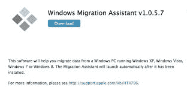

在你的 Mac 上，点击 Launchpad 图标（即任务栏上的火箭）。

接下来点击“其他”（Other），然后点击 `Migration Assistant`。

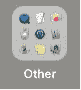 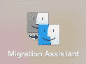

使用 `Migration Assistant` 时，Mac 上打开的所有程序都将被关闭，因此请确保已保存好你的工作，并在准备好之前不要开始。

在设置界面中，点击“继续”（Continue），然后选择“来自另一个 Mac、PC、Time Machine 备份或其他磁盘”，接着选择“继续”，然后选择“来自另一台 Mac 或 PC”。下一个窗口应该显示你想要传输文件的 Windows 电脑。点击“继续”，在 Windows 电脑上确认验证码匹配并再次点击“继续”。最后，助理会要求你选择想要传输的文件类型。

如果你没有立即运行助理，也可以以后再使用。使用它没有时间限制，所以如果你在车库里翻出一台旧的 Windows 电脑并想从那里传输所有内容，该选项一直都在。

## 兼容性

现在你已经复制了所有内容，让我们来简要讨论一下兼容性。虽然很多文件可以在 Mac 上打开，但软件却不行。这意味着如果你在 Windows 上有 Word，你不能直接把它移动过来；大多数流行软件（如 Word）在 Mac 上都有提供，但你必须自行购买。

不要压力太大；你刚刚传输的大部分文件即使不购买软件来打开它们，实际上仍然可以打开。例如，Word 文件（`.Doc`, `.Docx`）可以在 `Pages` 中打开（Pages 在新款 Mac 上是免费的，在旧款 Mac 上价格为 19.99 美元）。

如果你的文件无法打开，你可能可以在网上找到可以打开它的免费软件。

## 设置助理

如果你是第一次启动 Mac（并且你是第一位所有者），那么发生的第一件事将是一个自动设置助理，它将引导你创建账户并完成所有设置。

你做的第一件事是选择你所在的国家；如果没看到你的国家，请点击“显示所有”（See All）。在完成每个部分后点击“继续”。接下来你将选择键盘布局；如果你是英语母使用者，那么“美国”（United States）可能是你的首选，但如果你打算主要用另一种语言（如中文）打字，那么你可能想选择该国家——这以后可以更改。

点击“继续”后你看到的下一件事是选择无线网络——你现在不需要设置无线网络，但如果你设置了，它也会触发 `Migration Assistant`（这将帮助你传输文件）；这些都是自可选的，所以你可以跳过（你也可以以后回来设置）。

下一个屏幕是最重要的之一：输入你的 Apple ID。如果你有任何其他 Apple 设备（iPad、iPod、iPhone 等）或者你有一个在 Windows 上使用的 ID，那么你将想要使用它，因为你购买过的所有 App、音乐和其他媒体都与你的账户绑定。如果你没有，你可以选择获取一个——它是免费的，并包含了 `iCloud`（也是免费的），稍后会详细介绍。

设置的下一部分是“Find My Mac”（查找我的 Mac，这需要 `iCloud`）；这是一个很棒的功能，让你能从浏览器浏览器查看 Mac 的位置；如果它被盗了，它还能让你擦除所有内容。

在同意条款后，你将被带到时区选择。之后，系统会询问你是否启用 `iCloud Keychain`（iCloud 钥匙）。什么是 `iCloud Keychain` ？它会将密码存储在云端，让你可以在任何设备上使用。

接下来决定是否向 Apple 发送诊断数据。最后，你准备好了！

# 第一部分：Mac OS 入门课程

## 键盘

除了前面提到的右键点击，Windows 和 Mac 的键盘工作方式大同小异。有些键盘（包括 MacBook 自带的）是专门为 Mac 设计的。

### Apple 键

在 Windows 键盘上，有一个看起来像 Windows 标志的按钮叫做 Windows 键。Mac 上没有 Windows 键，所以在通常 Windows 键的位置，有一个 Apple 键——它看起来像这样（⌘）；它通常被称为 `Command Button`，尽管有些人称它为 Command 键。

### Delete 键（退格）

在 Windows 键盘上，退格键是“向后删除”，而删除键是“向前删除”（删除光标后的后的字符）。在 Mac 键盘上，退格键标记为 `Delete`，且位置与 Windows 的退格键相同。大多数 Mac 键盘不再配备向前删除键，但较较大的键盘有——它被称为 `Del`。如果你没看到它，仍然可以通过按下 `FN` 键（键盘左下角的按钮）和 `Delete` 键来实现向前删除。

*   在全屏应用之间切换 - 用四指向左或向右滑动
*   调出通知中心 - 用两指从鼠标右边缘向左滑动。
*   打开调度中心 (Mission Control) - 用三指向上滑动。
*   应用程序 (App Expose) - 用三指向下滑动。
*   打开启动台 (Launchpad) - 用大拇指和三指捏合。
*   显示桌面 - 用大拇指三指张开。

OS X 有一个微小但非常有用的功能，让你易于找到鼠标；当你快速移动鼠标时，它会变大以帮助你找到它在屏幕上的位置。

## 压力感触控 (Force Touch)

如果你拥有最新的 MacBook（2015 年 3 月之后的所有机型——但不 MacBook Air），那么你将拥有一项名为 `Force Touch` 的全新功能；`Force Touch` 是你很快会在所有的 iPhone、iPad 以及几乎每一个新的 Apple 设备上看到的东西——它实际上已经在 Apple Watch 上了。那么它是什么呢？它测量你对触控板施加的压力——如果你在图标或图像上轻点触控板，然后完全按下，它将为你显示其预览。

在 iPhone 上，此功能被称为“3D Touch”；它略有不同，但基本上是一样的。

你可以通过进入`系统偏好设置 (System Preference)` 和`鼠标 / 触控板 (Mouse / Trackpad)` 来更改你的 `Force Touch` 设置。

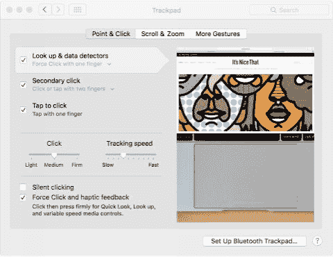

你会注意到当你按下触控板时，感觉就像点击了两次；当你的电脑关闭时，感觉就不那样，因为你需要开启电脑触力反馈才能起作用。

以下是你使用 `Force Touch` 可以做的一些事情简要概述；随着你使用 Mac，你会发现更多更多功能——尤其是当开发者开始在软件中实现它时。

*   查询：在网页中`Force click`（用力点击）文本，会弹出一个窗口，显示该文本的“查询 (Look up)”结果。这可能是字典、维基百科页面或其他内容。
*   地址：`Force click` 一个地址以查看该位置的`地图 (Maps)` 预览。
*   事件：`Force click` 日期和事件将其添加到`日历 (Calendar)`。
*   链接预览：在`Safari` 或 `Mail` 中`Force click` 链接以查看网页的内联预览。
*   文件图标：`Force click` 文件图标以查看文件内容的`快速查看 (Quick Look)` 预览。
*   文件名：在`Finder` 或桌面上`Force click` 文件名以编辑文件名。
*   Dock 栏：在 `Dock` 栏中`Force click` 应用图标以访问`程序调度 (App Exposé)`。这将显示该应用程序的所有打开的窗口。
*   QuickTime 和 iMovie：你可以改变用于在快进和回退按钮上使用的压力大小。
*   地图缩放：在缩放按钮上用更大的力气可以加速地图的放大和缩放速度。

## 桌面

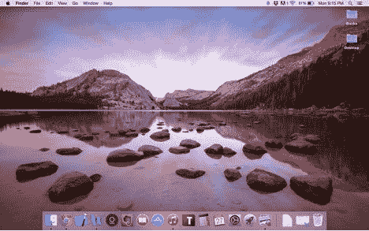

希望到那时你的文件已经传输完成，你完成了初始启动，并且你的桌面上有一张漂亮的图片。最后，你准备好使用电脑了！

桌面是你花费大部分时间的地方，所以让我们花点时间来了解它。

你应该注意到的第一点是，它与 Windows 相比真的没有太大——它是一个巨大的空间，你可以让它保持空白，也可以用图标或文档填充它。

### 菜单栏

Windows 和 Mac 桌面上最明显的区别之一是顶部的菜单栏。我将在整本书中反复提到这个菜单栏，但现在你需要知道的是，此工具栏会随着你打开的每个程序而改变，但某些功能保持不变。例如，那个小苹果图标从不改变——点击它始终会调出重启、关机或注销电脑的选项。最右侧的小放大镜也一直在那里。你任何时候点击它，都可以搜索电脑上的文件、邮件、联系人等内容。

### 菜单小项 (Menulets)

在右上角，你会看到几个“菜单小项”，包括`蓝牙 (Bluetooth)`、无线连接、音量、电池、时间与日期、当前登录的帐户名称、`聚焦灯搜索 (Spotlight)` 和`通知 (Notifications)`，以及其他各种杂的第三方图标（如果已安装）。

随着本书的继续进行，我们将再次提到菜单的这部分。

## Dock 栏

Windows 在屏幕底部有一个任务栏，而 Mac 有一个 dock；dock 是你所有常用应用程序所在的地方。

如果你在图标下方看到一个小圆点，说明该程序正在运行。如果你想关闭它，请用两指点击图标以调出选项，然后点击`退出 (Quit)`。

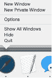

从 dock 栏移除程序非常简单——只需将图标拖到垃圾桶并松手。这不会移除程序——它只会移除快捷方式。`Finder`、`垃圾桶 (Trash)` 和`启动台 (Launchpad)` 是唯一无法移除的程序。

如果你想将程序添加到 dock 栏，只需拖动图标，右点击并选择`留在 Dock 中`。

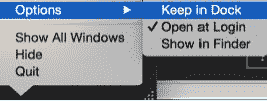

### 垃圾桶

 

在 Dock 栏的右端是`垃圾桶 (Trash)`。要删除文件夹、文件或应用程序，将项目拖入垃圾桶，或右点击项目并选择`移到垃圾桶`。要推出磁盘或驱动器（如 iPod 或闪存盘），将卷器拖入垃圾桶。自己管理垃圾桶，但我非常推荐名为“Clean My Mac”的应用（[`macpaw.com/cleanmymac`](https://macpaw.com/cleanmymac)）；它有点贵，但当我使用它时，通常通过删除安装文件和扩展释放 1GB 空间。

### 按钮

图片上面的小灯没有名字。有些人称它们为交通灯。你会经常看到它们，因为几乎所有程序都使用。在 Windows 上，你看到的是屏幕右上角的 X 和减号。在 Mac 上，它们出现在运行程序的左上角。红灯表示关闭，黄色灯表示最小化，绿色灯表示全屏。

全屏意味着程序占据整个屏幕，甚至 dock 都会消失。你可以用四指向右滑动触控板来快速查看 dock 栏和其他程序。要返回应用程序，用四指向左滑动。

## Finder

dock 上的第一个图标——三个无法删除或移动的图标之一——`Finder` 图标。

`Finder` 是 Mac 上对应 Windows 资源器的程序；正如其名，它能寻找东西。`Finder` 功能丰富且强大，所以这部分会比其他部分长一些，因为你可以用它做很多事情。

让我们从点击 `Finder` 图标开始。

### Finder 中的视图

在 Mac 上有四种查看文件夹的方式——图标、列表、列和封面显示 (Cover Flow)。不同的视图适用于不同的文件类型，你可以使用视图选项图标（上所示）更改视图。

#### 封面显示视图

封面流视图（Cover Flow）可以让你快速浏览照片的缩略图/预览（类似于 Windows 中的“胶片显示”）；你还可以通过点击表头对任何一列进行排序——例如，如果你在寻找较大的文件，可以点击`大小`列；如果你在寻找最近的文件，可以选择`修改日期`列。

## 图标视图

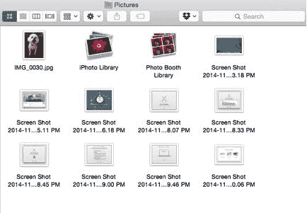

如果你需要对多个图像文件或应用程序进行排序，图标视图会很有帮助。它可以为你提供每张照片的缩略图，或者每个文件或应用的图标。

## 列表视图

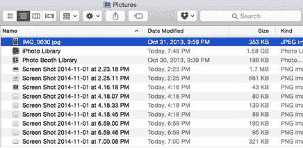

相反，列表视图提供了更多关于文件的信息，包括最后修改日期。这是排序的完美视图。

## 列视图

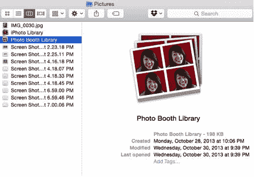

最后是列视图，它是列表视图和封面流视图的一种混合体。它显示了文件所在的文件夹层级结构。注意，Finder 并不包含 Windows 的“向上一级”按钮——列视图是获得相同结果并在你的文件结构中轻松导航的好方法。

## 在 Finder 中排序

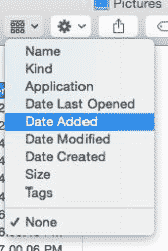

Finder 提供了多种对文件和文件夹排序的方法。你可以按照名称、类型、打开文件所需的应用程序（例如 Microsoft Word）、文件创建、修改或打开的日期、文件大小以及你可能应用的任何标签进行排序。

## 文件管理

OS X 中的大多数文件管理任务与 Windows 类似。文件可以被拖放、复制、剪切和粘贴。如果你需要创建一个新文件夹，请使用 Finder 中的齿轮图标，它将为你提供所需的选项。

优金石狮版（El Capitan）还允许你批量重命名文件（即一次性重命名多个文件，而不是一个一个），取决于你的文件系统，这可能会为你节省数小时的时间。要利用这一点，请选择你想要重命名的文件（提示：使用 `COMMAND + click` 选择多个文件，或使用 `COMMAND + A` 选择全选）。然后右键点击选中的文件并选择“重命名 X 个项目”。

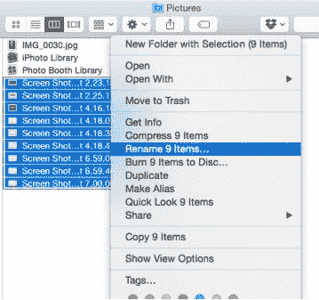

然后你将拥有替换文本或向文件名中添加文本的选项。

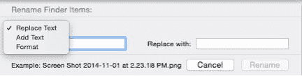

## 收藏

如果你查看 Finder 窗口的左侧，你会看到一个“收藏”侧边栏。此部分包含高频文件夹，如“文档”、“图片”、“下载”等。

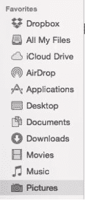

要将应用程序或文件添加到你的收藏菜单中，只需将其拖到收藏区域并放开。要从收藏中删除项目，请右键点击它（用两个手指点击）并选择“从侧边栏移除”。

## 标签浏览

Apple 借鉴了网络浏览器的做法，在 Finder 中添加了名为“标签浏览”的功能。基本上，你不再打开多个 Finder 窗口（在旧版操作系统中你必须这样做），而是打开标签页。要打开额外的 Finder 标签页，按 `COMMAND+t` 或点击“文件”并“新建标签页”。

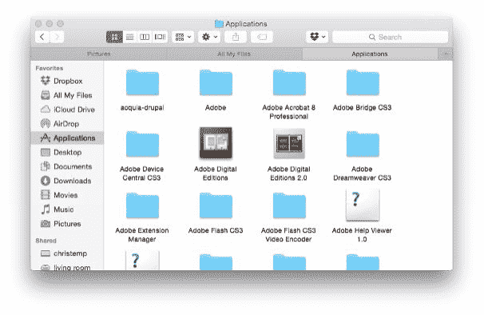

如果你想合并所有的标签窗口，只需点击屏幕顶部文件菜单中的“窗口”，然后点击“合并所有窗口”。

## 标签

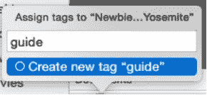

如果你使用像 Flickr 这样的照片应用，那么你可能对打标签非常熟悉；它本质上是给你的文件添加主题，使其更容易找到。假设文件是关于 2015 税年的——你可以给文件添加一个名为“2015 税务”或任何你想要的标签。你还可以对它进行颜色标记。

要给文件分配标签（你也可以给文件夹分配标签），用两个手指点击文件/文件夹，然后点击`标签`；如果这是第一次操作，只需输入并按`回车`；如果你已经标记过文件并想使用相同的名称，只需点击显示的标签名称。

## 启动台

Launchpad 本质上是 Windows 上的开始菜单。它显示了你的程序。

当你点击它时，你会看到行程序；你可以立即开始输入搜索应用，也可以直接查找。如果你有很多应用，那么你可能有多个屏幕。用两个手指向左滑动以查看下一屏。

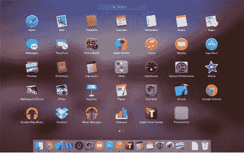

Launchpad 参考了大量 iPhone 和 iPad 的设计。例如，如果你想删除一个程序，操作方法与删除 iPhone 或 iPad 应用相同。只需点击并按住直到上方出现一个 `X`，然后点击 `X` 删除。同样，要重新排列图标，使用重新排列 iPhone / iPad 应用相同的方法——点击并按住图标直到它开始移动，然后将其移动到你想去的地方。你甚至可以像在 iPhone / iPad 上一样将程序分组——点击并按住图标，然后将其拖到你想要分组的程序上方；最后，当文件夹出现时，你就可以松手了。

返回分屏界面的方法与方法 1 相同（点击左角的绿色框或按下键盘上的 `ESC` 键）

## 互联网

Mac 是一台精美的机器，但你对那个桌面的欣赏也是有限的；最终你会想要上网，让我解释一下如何操作。

有两种方法：以太网（即向你的电脑插入局域网线）和无线连接。

### 使用以太网设置

所有新的 Mac 计算机都配置了 Wi-Fi；iMac 也带有以太网端口，可以插入网线。任何 Mac 笔记本电脑上都不提供此选项——尽管如果你绝对需要，可以购买一个适配器。

如果你有一个基础的网调制解调器，那么设置就会非常简单。只需将网线插入你的网络集线器，并将另一端插入你的 Mac 即可。一旦插入，互联网应该就可以使用了。

较新的 Mac 配备了顶级的 Wi-Fi 无线射频，所以不使用以太网端口也没有问题。

### 设置无线网络

设置无线连接也非常简单。只需点击菜单栏上的 Wi-Fi 菜单。它看起来如下所示，位于右上角附近：

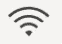

只要范围内有无线网络，当你点击时它就会显示出来（有时需要几秒钟才会出现）。

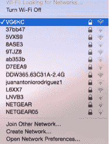

如果 Wi-Fi 名称旁边有一个锁图标，那么你需要知道密码（如果是家庭网络连接，密码通常在你的网调制解调器底部；如果是公司，你将必须索要代码。如果没有锁，则它是一个开放网络。你通常会在星巴克等地方看到这种网络。）

如果是锁定的网络，你一点击它，它就会要求输入代码；一旦输入并点击 `连接`，你就连接成功了（假设你添加得正确）；如果没有锁定，你一点击它，它就会尝试连接。

如果你拥有上述电脑之一，或者更倾向于无线连接到网络，可以通过点击顶部菜单栏上的 Wi-Fi 小菜单来实现。

### Airport Express / Airport Extreme

如果你需要更远的无线连接范围，或者想要建立私有网络，Apple 销售 Mac 配件。其中一个是 Airport Express（99 美元），另一个是 Airport Extreme（199 美元，如果你想要带硬盘的，则是 299 美元到 399 美元）。

Express 是想要添加私有网络的人的选择（例如，你可以为客人和客人打印创建一个网络）；Airport Extreme 提供极佳的范围；我在家里使用了一个，因为手机公司提供的调制解调器勉强够不到隔壁，信号强度很弱；Extreme 不仅到达了隔壁，还到达了好几个房间——现在我距离 Extreme 所在地超过 100 英尺的地方也能收到信号。它的安装非常简单，Apple 为需要额外帮助的人准备了视频。

更贵的型号也是备份电脑的良好选择。299 美元和 399 美元的型号提供高达 3TB 的存储；其工作原理是你的电脑连接到它，并在后台备份你的电脑，这样你的电脑一直处于备份状态。这些型号还允许你共享文件。例如，如果你想为连接到你网络的任何人提供一个私有存储锁，你可以在这里实现。

## Safari

正如 Windows 电脑使用 Internet Explorer 作为默认网页浏览器一样，Mac 也使用 Safari 作为默认网页浏览器；如果你在 iPhone 或 iPad 上用过 Safari，那么你应该已经习惯了使用它。

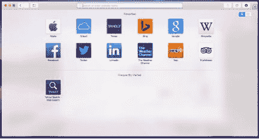

Safari 中明显缺失的是一种被称为“Flash”的东西。你可能以前用它观看某些视频和其他 Web 应用程序；你可以随时下载它，但这会影响笔记本电脑的电池寿命，因为 Flash 往往会快速消耗电量——这也是 Apple 不包含它的原因之一。

你也可以自由下载其他互联网浏览器。一些流行的免费浏览器有 Google Chrome ([www.google.com/chrome/](http://www.google.com/chrome/))、Mozilla Firefox ([www.mozilla.org/firefox](http://www.mozilla.org/firefox)) 和 Opera ([www.opera.com](http://www.opera.com))。

使用 Safari 而不是其他浏览器的最大优势之一是一个名为“接力”（Handoff）的功能。假设你在上班的地铁上用手机读一篇文章；到达公司后想在更大的 Mac 屏幕上继续阅读；只需打开 Safari，然后点击右上角的两个正方框即可。

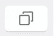

如果你的 iPhone 或 iPad 与电脑同步，你就会看到它的名称以及它当前正在浏览的页面。你也可以同样地将 Mac 页面接力到你的 iPhone 或 iPad。

除了网站外，接力还让你无缝同步诸如地图、消息和文档的内容。

## Mail

Mail 是 Mac 版的 Outlook；和 Safari 一样，它的操作方式非常相似。Apple 会提供以 @icloud.com 结尾的免费邮箱地址，你也可以添加其他邮箱（如 Hotmail、Gmail）。

### 添加账户

要开始使用，你需要添加电子邮件账户。点击 Launchpad 找到 Mail 应用，然后点击 Mail 图标。

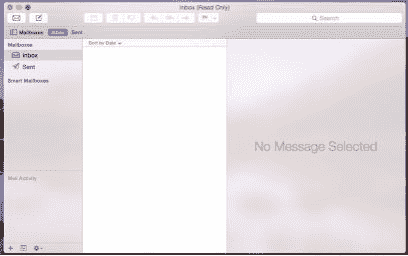

添加账户

打开应用后，点击顶部菜单栏的 `邮件` > `添加账户`。这将加载添加账户对话框。

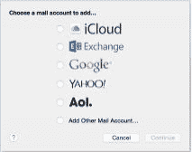

选择你将添加的服务商（注意：你可以返回添加多个账户）并点击“继续”。接下来会询问你的名称、电子邮件地址和密码。

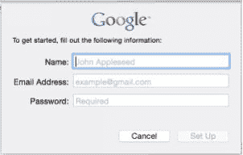

如果你使用的是常用的邮箱供应商，设置非常直观。如果你使用的是公司邮箱，可能需要配合系统管理员来正确添加。

设置完成后，你应该能在电脑上看到邮件。

### 发送邮件

现在你已经添加了账户，就可以发送邮件了；发送邮件可以通过键盘按下 `Command+N`、前往顶部菜单选择 `文件` > `新建邮件`，或者点击 `编写` 图标（看起来像一支穿过方形的笔）。

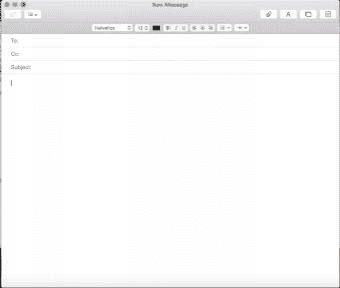

新建邮件对话框将出现。在收件人字段中，输入你想发送信息的电子邮件地址或地址，添加主题和信息，准备好后点击左上角的纸飞机图标。

你还可以点击 `A` 按钮为邮件添加格式。格式非常基础——你可以加粗、斜体、下划线并更改颜色。

### 联系人

除非你是商务人士，否则在电脑上拥有联系人似乎并不必要；但它的优势在于——它会与手机同步。因此，电脑上的联系人会同步到你的其他移动设备。要使用它，前往 Launchpad，然后点击该图标。

如果你已经登录了 iCloud，那么你应该已经看到几十个联系人了。要创建一个新联系人，点击主窗口底部的 `(+)` 按钮。在下一个屏幕上，添加你想要的所有信息——多寡随你意愿。有些联系人可能只需要网站地址，而另一些可能有邮寄地址——添加多少信息完全取决于你。你也可以通过找到他们的姓名然后点击 `Edit` 按钮来编辑联系人。如果你想删除某人，找到他们的姓名并按下键盘上的 `Delete` 键（你也可以用双指点击他们的姓名来删除）。

## 消息 / 电话通话

Apple 产品与其他 Apple 产品配合使用时效果最佳；这在 El Capitan 系统上更是如此，你可以同步 iPhone 账户，以便直接从 Mac 上拨打电话（包括视频通话和普通通话）并发送消息。此外，你甚至可以使用 iPhone 的数据连接在移动时让笔记本电脑访问互联网——这在旅行时特别方便，如果你不想为需要付费的 Wi-Fi 热点付费（但请注意，数据连接有每月限制，而且使用电脑会很快消耗这些限制——换句话说，这可能不是你用来流媒体 Netflix 电影的事）。

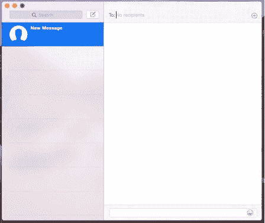

## iMessage

当你使用 Mac 上的 iMessage 发送消息时，请记住这是为 Mac 用户设计的即时通讯工具——这意味着它是专为配合 Mac 产品设计的……不适用于其他设备。

### 设置 iMessage

1. 要设置 iMessage，点击 `Messages` 图标启动它。
2. 如果你已经在 Mac 上登录了 iCloud，你将自动登录 iMessage。
3. 如果你想更改此账户或尚未登录，请选择顶部菜单栏上的 `Messages > Preferences`。
4. 当 `Accounts` 对话框出现时，点击 `Accounts` 标签页。
5. 在左侧窗口中，你将看到 iMessage。选择它。
6. 接下来的屏幕将提示你输入与 iCloud 关联的电子邮件地址和密码。完成这些操作并点击蓝色的 `Sign In` 按钮完成设置过程。

### 设置其他即时通讯客户端

虽然 iMessage 是为 Mac 产品设计的，但你也可以将其用于其他消息服务器，如 Google、Yahoo 和 AOL。要在 Messages 中添加其他即时通讯 (IM)客户端：

1. 如果 `Messages` 尚未运行，请打开它。
2. 在顶部菜单栏上，点击 `Messages > Add Account`。

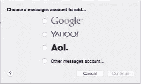

3. 选择你想添加的账户类型，例如 `Gmail` 或 `Yahoo`，并选择 `Continue`。
4. 系统将提示你输入相应的电子邮件地址和密码，并点击 `Set Up` 按钮完成。

现在已经设置好了，如何发送消息呢？

### 开始新对话

1. 在开始之前，先查看整个 `Messages` 屏幕。它应该是完全空的，没有任何对话。在左侧边栏上它会显示 `No Conversations`。在这里，你可以通过点击每一项在不同人的不同对话之间切换。在右侧，你还会看到 `No Conversation Selected`。在这里，你可以输入新消息并阅读当前选定任何对话中的所有内容。如果你有一台 iPhone（或任何手机），它看起来就像你阅读短信的屏幕一样。
2. 要与某人建立新对话，点击位于左侧边栏顶部、搜索栏旁 `Compose new message` 按钮。它看起来像正方形内的一个小铅笔。

当你收到消息时，如果启用了声音，你会听到清脆的提示音。

## FaceTime

FaceTime 允许你使用电脑内置的摄像头与朋友家人联系。我听过有人说担心别人通过网络摄像头监控他们，所以他们用胶带盖住了。当 FaceTime 正在使用时（即摄像头开启且别人可以看到你时），一盏明亮的绿灯会亮起——所以你不用担心别人窥视……如果你没有看到光，说明摄像头是关闭的。

可以通过点击 `Launchpad > FaceTime` 启动应用程序。

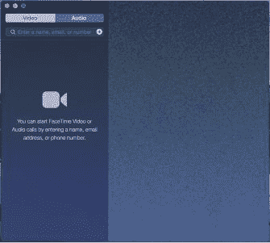

在左侧，如果对方在你的 `Contacts` 中，你可以输入他们的姓名或电话号码。要让 FaceTime 工作，对方也必须拥有 Apple 设备并接受你的通话。

你还可以使用 FaceTime Audio。这让你可以在不使用摄像头的情况下打电话——这本质上是一个 Wi-Fi 电话。

## Photo Booth

我们是自拍文化，所以谈论这个拍摄照片的 App 是合适的。

要开始使用，进入 `Launchpad` 并点击 `Photo Booth` 图标。

一旦程序加载，你应该注意到几点。首先，是你自己！如果你看屏幕顶部，应该有一盏绿灯。那告诉你是摄像头已开启。但现在点击 `Dock` 中的另一个应用程序——看，绿灯熄灭了吧？现在再次点击 `Photo Booth` 图标，绿灯再次亮起。这是什么

如果你想使用一些更酷炫的效果，将你带到某个不在的地方（例如约瑟米蒂或海滩），那么它会要求你离开画面以便它检测背景；几秒钟后你再走回来。对于这种效果，最好使用纯色背景。如果你对显示效果不满意，可以通过顶部的菜单栏，点击“查看”（View），最后点击“重置效果”（Reset effect）。

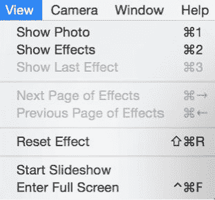

如果你想添加自己的背景，请转到“效果”（Effects）的最后一页，将你选择的照片拖入方框中。一旦看到该照片出现，点击它即可激活该效果。

不要害怕尝试这个程序。你按的任何东西都不会弄乱任何！

## 日历

日历是另一个可以同步到你的 iCloud 账户的特性——只要你使用同一个账户，你在电脑上输入到日历中的所有内容都将出现在你的 iPhone 和 iPad 上。你还可以将日历同步到你可能在线使用的其他日历，如 Google 或 Yahoo。

要开始使用，前往 Dock 中的启动台（Launchpad）并点击日历图标。

在应用程序窗口顶部从左到右，你有标准的红绿灯按钮、日历、新建事件 (+)、包括日和月在内的多种视图，以及搜索栏。

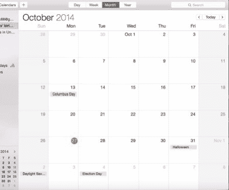

### 同步日历

如果你已经在使用 iCloud、Google、Yahoo 或任何其他提供者的日历，你可以将其同步到 Mac 日历应用程序。

1. 在顶部菜单栏中点击 `日历` (Calendar) > `添加账户` (Add Account)。
2. 就像你处理邮件一样，系统会提示你输入姓名、电子邮件地址和密码。

一旦完成设置过程，来自该日历的事件将自动填充到日历窗口。如果你有多个带有独立日历的账户，可以通过点击工具栏上的 `日历`（Calendars）按钮，并勾选或取消勾选相应日历旁边的框来筛选。

### 更改视图

你可以通过点击工具栏上相应的按钮在日、周、月或年日历视图之间切换。

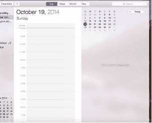

日视图将显示当天的所有事件，按小时划分。

周视图将让你一目了然看到一周，并显示事件块，你可以轻松看到自己什么时候有活动，以及是否有即将到来的空闲时间。

如果你只需要日历提醒你支付账单和截止日期，或者每个月的预约不是太多但分散在整个月里，那么月视图可能是你的默认视图。

## 提醒

正如名称所示，“提醒”（Reminders）应用程序用于提醒你事情——正如你现在可能猜到的那样，它可以使用 iCloud 同步到 iPhone 或 iPad 上的提醒应用。

该应用允许你为杂货清单或脑海中的任何其他事项创建列表；你还可以使用该应用安排完成事项的时间——例如在每月的 15 号之前支付账单；它甚至可以设置为在你每次离开或到达家中时提醒你开启或关闭家庭报警器。

要开始使用，点击启动台图标打开应用，然后从应用列表中选择它。

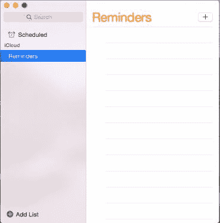

### 创建单个提醒

如果你只需要被提醒某项项目，或几个互不相关的项目，你应该将它们输入提醒列表。

1. 在应用程序打开状态下，点击左侧窗口中的 `提醒` (Reminders)。
2. 在主窗口中，点击列表标题（在此情况下为 `提醒`）旁边的 `(+)` 按钮。
3. 将添加一个新项目，你应该立即对其命名。注意新创建项目旁边出现的单选按钮。
4. 项目命名完成后，双击击它以打开信息窗格。
5. 在这里你可以设置提醒日期和时间、优先级级别，以及你是否希望在到达或离开某地时收到提醒。
6. 快到提醒的那一天；一旦你完成了任务，可以点击项目旁边的单选按钮将其标记为`已完成` (Completed)。
7. 之后你就可以隐藏或显示任何之前已完成的项目。
8. 要删除无论完成或未完成的项目，点击名称将其高亮并按 `删除` (Delete) 键。

### 创建新列表

单个列表对于“周一为园丁师开门”或“周二支付水电费”之类的事情很好，但如果你想为购物清单之类的事情创建提醒，你需要创建一个提醒列表——这些列表可以根据你的需要随时长或短。

1. 单个列表对于“周一为园丁师开门”或“周二支付水电费”之类的事情很好，如果你想为购物清单之类的事情创建提醒，你需要创建一个提醒列表——这些列表可以根据你的需要随时长或短。
2. 单个列表对于“周一为园丁师开门”或“周二支付水电费”之类的事情很好，如果你想为购物清单之类的事情创建提醒，你需要创建一个提醒列表——这些列表可以根据你的需要随时长或短。
3. 单个列表对于“周一为园丁师开门”或“周二支付水电费”之类的事情很好，如果你想为购物清单之类的事情创建提醒，你需要创建一个提醒列表——这些列表可以根据你的需要随时长或短。
4. 单个列表对于“周一为园丁师开门”或“周二支付水电费”之类的事情很好，如果你想为购物清单之类的事情创建提醒，你需要创建一个提醒列表——这些列表可以根据你的需要随时长或短。
5. 单个列表对于“周一为园丁师开门”或“周二支付水电费”之类的事情很好，如果你想为购物清单之类的事情创建提醒，你需要创建一个提醒列表——这些列表可以根据你的需要随时长或短。
6. 单个列表对于“周一为园丁师开门”或“周二支付水电费”之类的事情很好，如果你想为购物清单之类的事情创建提醒，你需要创建一个提醒列表——这些列表可以根据你的需要随时长或短。
1. 在主窗口中，点击列表标题（在此情况下为 `提醒`）旁边的 `(+)` 按钮。
2. 将添加一个新项目，你应该立即对其命名。注意新创建项目旁边出现的单选按钮。

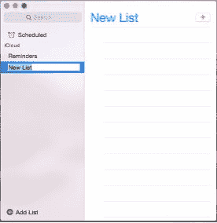
3. 单个列表对于“周一为园丁师开门”或“周二支付水电费”之类的事情很好，如果你想为购物清单之类的事情创建提醒，你需要创建一个提醒列表——这些列表可以根据你的需要随时长或短。
4. 单个列表对于“周一为园丁师开门”或“周二支付水电费”之类的事情很好，如果你想为购物清单之类的事情创建提醒，你需要创建一个提醒列表——这些列表可以根据你的需要随时长或短。
5. 单个列表对于“周一为园丁师开门”或“周二支付水电费”之类的事情很好，如果你想为购物清单之类的事情创建提醒，你需要创建一个提醒列表——这些列表可以根据你的需要随时长或短。
4. 项目命名完成后，双击它以打开信息窗格。
5. 在这里你可以设置提醒日期和时间、优先级级别，以及你是否希望在到达或离开某地时收到提醒。
6. 快到提醒的那一天；一旦你完成了任务，可以点击项目旁边的单选按钮将其标记为`已完成` (Completed)。
7. 之后你就可以隐藏或显示任何之前完成的项目。
8. 要删除无论完成或未完成的项目，点击名称将其高亮并按 `删除` (Delete) 键。

1. 在主窗口中，点击列表标题（在此情况下为 `提醒`）旁边的 `(+)` 按钮。
2. 将添加一个新项目，你应该立即对其命名。注意新创建项目旁边出现的单选按钮。

1. 在主窗口中，点击列表标题（在此情况下为 `提醒`）旁边的 `(+)` 按钮。
2. 将添加一个新项目，你应该立即对其命名。注意新创建项目旁边出现的单选按钮。

1. 在主窗口中，点击列表标题（在此情况下为 `提醒`）旁边的 `(+)` 按钮。
2. 将添加一个新项目，你应该立即对其命名。注意新创建项目旁边出现的单选按钮。

1. 在主窗口中，点击列表标题（在此情况下为 `提醒`）旁边的 `(+)` 按钮。
2. 将添加一个新项目，你应该立即对其命名。注意新创建项目旁边出现的单选按钮。

1. 在主窗口中，点击列表标题（在此情况下为 `提醒`）旁边的 `(+)` 按钮。
2. 将添加一个新项目，你应该立即对其命名。注意新创建项目旁边出现的单选按钮。

### 基于位置的提醒

如果你想创建一个基于位置的提醒，请按照步骤操作。点击信息图标（带有圈的 `i`）。

### 基于位置的提醒

如果你想创建一个基于位置的提醒，请按照步骤操作。点击信息图标（带有圈的 `i`）。

如果你想创建一个基于位置的提醒，请按照步骤操作。点击信息图标（带有圈的 `i`）。

如果你想创建一个基于位置的提醒，请按照步骤操作。点击信息图标（带有圈的 `i`）。

### 基于位置的提醒

如果你想创建一个基于位置的提醒，请按照步骤操作。点击信息图标（带有圈的 `i`）。

如果你想创建一个基于位置的提醒，请按照步骤操作。点击信息图标（带有圈的 `i`）。

### 基于位置的提醒

如果你想创建一个基于位置的提醒，请按照步骤操作。点击信息图标（带有圈的 `i`）。

如果你想创建一个基于位置的提醒，请按照步骤操作。点击信息图标（带有圈的 `i`）。

### 基于位置的提醒

如果你想创建一个基于位置的提醒，请按照步骤操作。点击信息图标（带有圈的 `i`）。

如果你想创建一个基于位置的提醒，请按照步骤操作。点击信息图标（带有圈的 `i`）。

### 基于位置的提醒

如果你想创建一个基于位置的提醒，请按照步骤操作。点击信息图标（带有圈的 `i`）。

如果你想创建一个基于位置的提醒，请按照步骤操作。点击信息图标（带有圈的 `i`）。

### 基于位置的提醒

如果你想创建一个基于位置的提醒，请按照步骤操作。点击信息图标（带有圈的 `i`）。

如果你想创建一个基于位置的提醒，请按照步骤操作。点击信息图标（带有圈的 `i`）。

### 基于位置的提醒

如果你想创建一个基于位置的提醒，请按照步骤操作。点击信息图标（带有圈的 `i`）。

如果你想创建一个基于位置的提醒，请按照步骤操作。点击信息图标（带有圈的 `i`）。

### 基于位置的提醒

如果你想创建一个基于位置的提醒，请按照步骤操作。点击信息图标（带有圈的 `i`）。

如果你想创建一个基于位置的提醒，请按照步骤操作。点击信息图标（带有圈的 `i`）。

### 基于位置的提醒

如果你想创建一个基于位置的提醒，请按照步骤操作。点击信息图标（带有圈的 `i`）。

如果你想创建一个基于位置的提醒，请按照步骤操作。点击信息图标（带有圈的 `i`）。

### 基于位置的提醒

如果你想创建一个基于位置的提醒，请按照步骤操作。点击信息图标（带有圈的 `i`）。

如果你想创建一个基于位置的提醒，请按照步骤操作。点击信息图标（带有圈的 `i`）。

### 基于位置的提醒

如果你想创建一个基于位置的提醒，请按照步骤操作。点击信息图标（带有圈的 `i`）。

如果你想创建一个基于位置的提醒，请按照步骤操作。点击信息图标（带有圈的 `i`）。

### 基于位置的提醒

如果你想创建一个基于位置的提醒，请按照步骤操作。点击信息图标（带有圈的 `i`）。

如果你想创建一个基于位置的提醒，请按照步骤操作。点击信息图标（带有圈的 `i`）。

### 基于位置的提醒

如果你想创建一个基于位置的提醒，请按照步骤操作。点击信息图标（带有圈的 `i`）。

如果你想创建一个基于位置的提醒，请按照步骤操作。点击信息图标（带有圈的 `i`）。

### 基于位置的提醒

如果你想创建一个基于位置的提醒，请按照步骤操作。点击信息图标（带有圈的 `i`）。

如果你想创建一个基于位置的提醒，请按照步骤操作。点击信息图标（带有圈的 `i`）。

### 基于位置的提醒

如果你想创建一个基于位置的提醒，请按照步骤操作。点击信息图标（带有圈的 `i`）。

如果你想创建一个基于位置的提醒，请按照步骤操作。点击信息图标（带有圈的 `i`）。

### 基于位置的提醒

如果你想创建一个基于位置的提醒，请按照步骤操作。点击信息图标（带有圈的 `i`）。

如果你想创建一个基于位置的提醒，请按照步骤操作。点击信息图标（带有圈的 `i`）。

## iTunes

你可能知道 iTunes 是什么；你可能甚至在使用它。在 Mac 上，它与 Windows 电脑并没有太大区别；主要的区别在于，Windows 电脑默认通过 `Windows Media Player` 播放音乐，而在 Mac 上，则在 `iTunes` 中播放。

请记住，你应该在 Mac 上使用与其它设备相同的 `iTunes` 账户，因为你在 `iTunes` 上购买的媒体将显示在你的所有设备上。例外是租赁内容——租赁内容仅在你购买它的那台设备上可用。因此，如果你在 Mac 上租借了某些内容，不要指望可以在 Apple TV 或 iPad 上观看；这是一个工作室许可问题，而不是 Apple 的问题。不过，你仍然可以使用 AirPlay 将租赁内容发送到你的 Apple TV。

## 将音乐添加到资料库

本节用于添加你已经拥有并存储在电脑上的音乐。如果你没有任何音乐，可能应该先跳到 `iTunes Store` 部分。

1. 在顶部菜单栏上，点击`File`（文件） > `Add to Library`（添加到资料库）。
2. 窗口时，使用左侧栏搜索你想要添加的特定歌曲。
3. 如果你已经有一个可能从旧电脑迁移过来的巨大音乐收藏，你可以一次导入整个文件夹。
4. 当你决定要添加哪些内容时，点击一下将其高亮，并选择蓝色的 `Open`（打开）按钮。
5. 根据你导入的歌曲数量，可能需要一些时间，但 `iTunes` 会向你显示进度。
6. 完成后，再次点击 `My Music`（我的音乐）标签页，验证你的音乐已添加到 `iTunes` 集中。

## 播放列表

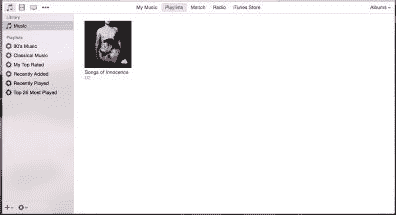

播放列表部分是你查看、编辑和删除可能创建的播放列表的地方。在左侧你会注意到 Apple 为你创建了一些：`90’s Music`（90 年代音乐）、`Classical Music`（古典音乐）、`My Top Rated`（我的高评分）、`Recently Added`（最近添加）、`Recently Played`（最近播放）和 `Top 25 Most Played`（热门 25 首）。这些都是一目易懂的，Apple 使用歌曲的内置元数据来确定哪些歌曲适合这些预设播放列表。

在列表顶部，你还会看到一个名为 `Genius` 的选项。选择 `Genius` 将允许你使用 Apple 特别制作的音乐混音器。它从你的音乐集中提取歌曲，并创建听感良好的自定义播放列表和混音。

## 使用 Genius

如果你是第一次使用 `Genius`，必须先点击显示 `Turn On Genius`（开启 Genius）的按钮。

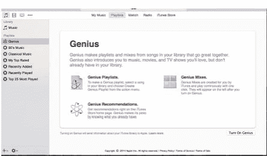

一旦开启，会自动发生三个步骤。根据你的资料库大小，这可能需要一段时间，所以去拿点零食吧。完成后，你的电脑屏幕将显示一条消息，提示 `Genius` 已成功开启。

## Match

如果你有一个大型音乐资料库但手机存储空间不足，`iTunes Match` 非常棒。注册 `Match` 将允许你将整个收藏存储在 `iCloud` 上，包括你从 CD 刻录且未通过 `iTunes` 购买的音乐。这样你就可以从任何连接到 `iCloud` 的 Apple 设备流传输整个资料库，而无需占用存储空间。

歌曲通过 Apple 的在线音乐数据库进行“匹配”，例如，当你在 iPhone 上播放歌曲时，它实际上并不是你上传或购买的同一个文件。相反，它是 Apple 版本的完整 `256 Kbps` 歌曲，即使你最初上传或购买的歌曲音频质量较低。如果 Apple 自己的服务器上没有找到歌曲（也许是你表弟的 Whitesnake 翻唱乐队），它将播放你上传的原始文件，保持原始音频质量。

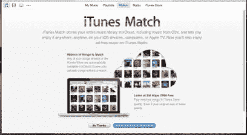

遗憾的是，`iTunes Match` 不是免费的。如果你想注册，预计每年订阅费用为 `$24.99`。不过，注册 `Match` 还有另一个福利——如果你喜欢使用 `iTunes Radio` 但无法忍受广告，购买 `Match` 年度订阅将移除 `Radio` 中的广告。

## Radio

`Radio` 是由 Apple 的音乐爱好者提供的免费音乐流媒体服务。根据几个不同的因素，Apple 创建了你可能喜欢的广播电台。随着你收听不同的内容，电台将变得越来越个性化，播放与你最近收听的内容更符的歌曲，并避开你没有播放过的歌曲。

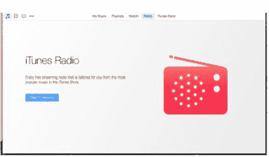

如果你想进一步探索电台，可以浏览带有特定目标创建的艺术家策划播放列表，或直接按流派搜索。你可能还会发现 `First Plays`（先听后买），它允许你在购买之前收听整个专辑。然而，此功能仅适用于选定的专辑，因此不要指望每个专辑都提供 `First Play` 服务。

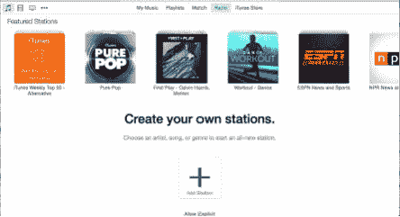

## 创建广播电台

1. 要播放新的广播电台，打开 `iTunes` 并点击 `Radio` 标签页。
2. 如果你是第一次使用 `Radio`，你必须点击显示 `Start Listening`（开始收听）的蓝色按钮。
3. 当 `Radio` 完全加载后，你会注意到窗口上半部分充满了预设的广播电台，如 `Smooth Jazz`（平滑爵士）、`Classic Music`（古典音乐）、`Top 50`（热门 50）、`Dance`（舞蹈）、`Pop`（流行）、`Rock`（摇滚）、`Hip Hop`（嘻哈）、`Electronic`（电子）、`Country`（乡村）和 `Jazz`（爵士）。（注：此处原始文本中存在大量重复和乱码描述，已根据核心逻辑进行清理翻译）。

如果你已经在 iTunes 账户中有了资金，或者留了银行卡信息，购买将进行，歌曲将开始自动下载。如果你的账户中没有钱，或者尚未添加支付方式，在进行购买之前你会被要求输入相关信息。

在你购买的内容完全下载完成后，你可以点击 `My Music` 标签页并选择你最近添加的内容来享受你的新音乐。

## App Store

`App Store` 是你可以下载和安装许多专门为 Mac 电脑开发的应用程序的地方。这些应用可以实现各种功能，从增加功能和让你的生活更轻松，到在工作间隙提供一种消遣时间和玩游戏的趣味方式。请记住，为了让 `App Store` 正常工作，你需要连接网络。

明确的是，在 `App Store` 购买的 App 仅在 Mac 上运行；如果你有两个 Mac，只要使用相同的账户，就可以在两台设备上都下载。但你不能在 `iPhone` 或 `iPad` 上下载它们。所以，如果你疑惑为什么在 `iPhone` 或 `iPad` 上下载的游戏在 Mac 上无法免费获取，原因就在于。Mac 应用是使用完全不同的框架开发的。

通过 `dock` 或 `Launchpad` 选择并打开 `App Store`。`App Store` 的主页将欢迎你，向你展示应用世界中最新、最强大的内容。

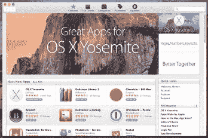

在顶部你会看到不同的部分：`Featured`（精选）、`Top Charts`（排行榜）、`Categories`（分类）、`Purchases`（购买）和 `Updates`（更新）。

`Featured`、`Top Charts` 和 `Categories` 标签显示可以下载的应用，但以不同的方式组织。`Featured` 将为你展示 `Best New Apps`（最佳新应用）、`Best New Games`（最佳新游戏）、`Editor’s Choices`（编辑选择）以及协作良好的不同应用集合。

`Top Charts` 显示了可用应用中的最优，并按 `Top Paid`（付费付费）、`Top Free`（免费）和 `Top Grossing`（畅销）进行分类。在右侧，你还可以按类别浏览 `Top Apps`（热门应用），以防你想缩小搜索范围。

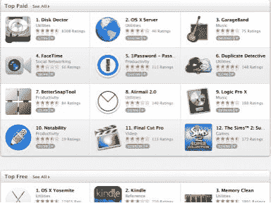

`Categories` 进一步将你的应用寻找分为不同的类别，如 `Business`（商务）、`Education`（教育）、`Reference`（参考）、`Productivity`（生产力）、`Medical`（医疗）、`Entertainment`（娱乐）和 `Games`（游戏）。

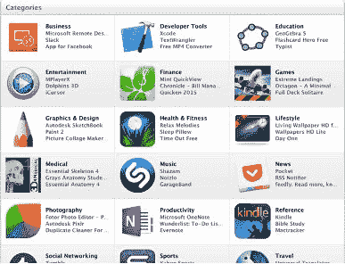

选择一个类别将带来更多选择，右侧将填充更多类别。例如，选择 `Business` 类别将带你进入 `Business` 应用主页，那里列出了最热门的应用。在右侧，可以选择更细的类别，如 `Apps for Writers`（作者类应用）、`App Development`（应用开发）或 `Apps for Designers`（设计师类应用）。无论你目前处于哪种应用类别下，右半部分的列表都保持不变。

`Purchases` 和 `Updates` 是你可以查看过去 `App Store` 下载记录的地方。`Purchases` 标题可能会有点误导性，因为你的免费应用也会出现在这里。在 `Updates` 部分，你可以查看哪些应用需要更新到最新版本。如果你有多个应用需要更新，可以选择 `Update All`（全部更新）按钮，它将处理整个列表。

## 较少使用的应用

Mac 上有很多你可能看到但并不使用的应用。这里是其中一些应用的简介，以及你可能使用它们的时机。

`TextEdit`（文本编辑）是苹果对应微软 `Notepad` 的产品。这是一个简单的纯文本编辑器。它确实不华，但适合记录笔记。

`Stickies`（便签）是一个让人或或恨参半的应用。不过，如果你属于爱的一营，它们依然在那里。`Stickies` 就像是你桌面的便利贴。只需从 `Launchpad` 中打开 `Stickies` 应用并开始张贴吧！

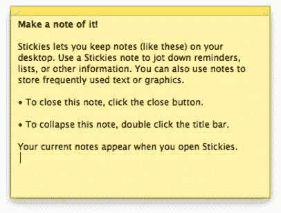

## 家庭共享

在结束这一节之前，我想谈谈最后一个不属于 El Capitan 的功能——它是所有苹果产品的通用功能。它被称为 `Family Sharing`（家庭共享）。通过 `Family Sharing`，你可以为家中的每个人设置一个账户，但每个人都有独立的用户名。这意味着如果有人购买了电影、歌曲、应用等，那么你家庭计划中的每个人都可以访问。但不要认为你可以和朋友分享这些内容……嗯，你可以这样做，但不建议，因为每当他们购买东西时，你的信用卡就会被扣费——这也会违反你所同意的服务条款。

要启用 `Family Sharing`，前往 `System Preferences` > `iCloud`。然后，点击 `Set Up Family Sharing` 开始。为家庭发起 `Family Sharing` 的人被称为组织者。这是一个重要的角色，因为其他家庭成员的每项购买都将使用家庭组织者的信用卡进行！

通过输入他们的 `Apple IDs` 邀请家庭成员加入 `Family Sharing`。作为家长，你可以在获得许可的情况下为孩子创建 `Apple IDs`。当你创建一个新的儿童 `Apple ID` 时，它会自动添加到 `Family Sharing` 中。

`Family Sharing` 中有两种账户：成年和儿童。正如你预期的，儿童账户比成年账户有更多的潜在限制。特别值得关注的是 `Ask to Buy`（请求购买）选项！这防止了较小的家庭成员导致家庭组织者的账单超支。

# 第二部分：让 Mac 你的专属化

现在你已经掌握了基础知识；你应该能够轻松地在桌面操作。但它感觉还不完全属于你。

## 系统设置

所有的主要设置都通过 `System Preferences` 访问，这相当于 Windows 电脑上的“控制面板”。为了开始，让我们通过 `Launchpad` 点击 `System Preferences` 图标进入。

你也可以通过点击左上角的苹果图标并点击 `System Preferences` 进入。

一旦应用打开，你会发现有很多可以配置的项目。

### 通用

让我们从第一个选项 `General` 开始。在 `General` 下，你可以：

*   通过选择 `Blue` 或 `Graphite` 来更改按钮、窗口和菜单的外观。
*   选择突出颜色。
*   将菜单栏和 Dock 设置深色。此选项与深色配合良好。
*   设置滚动条根据鼠标或触控板自动显示、仅在滚动时显示或始终显示。
*   选择默认浏览器。
*   在这里你可以允许 `Handoff` 在你的 Mac 和 iCloud 设备之间工作（某些旧 Mac 不支持此功能）。

在任何时候，你都可以点击带有 12 个小方块的按钮返回 `System Preferences` 主页。你也可以点击 `Back` 按钮，但如果你处于菜单深处，可能需要点击多次。

### 桌面与屏幕保护程序

`Desktop & Screen Saver` 部分将帮助你更改 Mac 上视觉上最显著的内容——桌面壁纸。在左侧边栏你会看到几个不同的下拉选项：`Apple`、`iPhoto` 和 `Folders`。

在底部，你可以定期更改图片，并可以选择新图像刷新的频率。在右侧窗口中显示的图像将在刷新时进行轮播。

若想将桌面壁纸更改为 Apple 提供的精美图片之一，或者只是想浏览可用选项，请点击 Apple 名称。右侧将出现许多色彩丰富、高分辨率的图片，你可以滚动列表找到你喜欢的内容。点击一张图片将把你的壁纸更改为该选择。如果你是一个喜欢极简主义的人，倾向于保持一切非常简单，也可以选择 `Solid Colors`（纯色）来寻找一系列可能让人无聊的纯色壁纸。

选择 `iPhoto` 将让你浏览自己的照片，从而将一段珍贵的回忆设为壁纸。

`Folders`（文件夹）选项允许你可以在添加的文件夹之间进行选择，那里可能有更多的图像文件等待着。如果你在桌面保存了大量图片，你可能想在这里添加 `Desktop`（桌面）文件夹，这样就可以这些图片作为潜在壁纸。

## 添加和删除文件夹

1. 要添加新文件夹和图像集，点击左侧边栏底部的 `+` 按钮。
2. 窗口弹出时，搜索你想要添加的文件夹。
3. 找到所需的文件夹后，点击蓝色的 `Choose`（选取）按钮确认更改。
4. 要删除文件夹，高亮想要删除的文件夹，然后点击 `–` 按钮将其移除。

## 屏幕保护

要设置屏幕保护，请点击 `Desktop & Screen Saver`（桌面与屏幕保护）窗口顶部的 `Screen Saver` 按钮。

显示图片的方式，左侧边栏提供的选项可能比你需要的多。你可能会喜欢的很棒的包括 `Shuffling Tiles`（随机平铺）、`Vintage Prints`（复古打印）和 `Classic`（经典）。

在右侧，你可以看到屏幕保护的预览。在窗口的这个部分你还可以选择来源：`National Geographic`（国家地理）、`Aerial`（动态）、`Cosmos`（宇宙）、`Nature Patterns`（自然图案），如果你有特定的图片文件夹想要使用，可以选择 `Choose Folder`（选择文件夹）。如果你想打乱图片出现的顺序，请勾选 `Shuffle slide order`（随机幻片顺序）旁边的复选框。

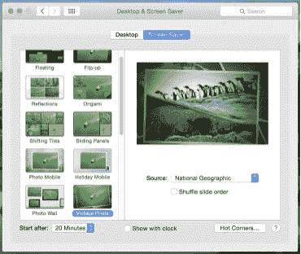

窗口的最底部，你可以选择屏幕保护启动前的时长。你还可以选择是否显示时钟。

## Dock 栏

Dock 栏可以进行的操作不多，大部分设置都是一而易懂的。大部分情况下，这些设置只是让一切变得更有……动感。例如，`Magnification`（放大）会在你鼠标悬停在应用图标上时让图标变大。

然而，我想指出的一个选项是自动隐藏和显示 Dock 栏；所有这些设置都取决于个人喜好；我个人选择隐藏 Dock 有两个原因：第一，它为你留了更多屏幕空间；第二，它让你在全屏应用中使用也能使用 Dock。

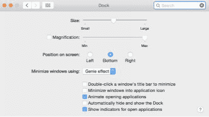

## Mission Control（调度中心）

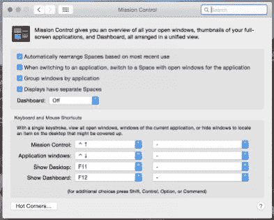

Mission Control 是你可以设置屏幕不同部分执行不同功能的地方。我的什么意思是？例如，你可以设置一个快捷方式，每次当你移动鼠标到右上角时，你的桌面就会显示。你还可以在键盘上设置快捷键。Mission Control 实际上是帮助你快速完成简单任务。

## 社交网络、邮件、联系人和日历

当你使用 `Twitter`、`Facebook` 和其他应用时，你可能习惯了直接访问网站。在 Mac 上，你可以将它们添加到电脑的信息中，这样就不不需要登录；这也能让你在收到新消息、点赞等时收到弹出通知。

### 添加账户

要添加账户，前往 Dock 栏上的 `System Preferences`（系统偏好，齿轮图标）并选择 `Internet Accounts`（互联网账户）。从这里，你可以添加尚未迁移的账户，包括 `iCloud`、`Exchange`、`Google`、`Twitter`、`Facebook`、`LinkedIn`、`Yahoo!`、`AOL`、`Vimeo` 和 `Flickr`。在这里添加账户将填充 El Capitan 原生的 `Mail`（邮件）、`Contacts`（联系人）、`Reminders`（提醒）和 `Calendar`（日历）应用，并为你的 `Share`（共享）按钮添加选项。

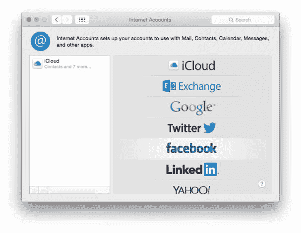

注意：你也可以通过打开 `Mail`、`Contacts`、`Calendars` 和 `Reminders` 应用并点击 `File > Add Account` 在应用内添加账户。

### Twitter, Facebook, LinkedIn, Vimeo 和 Flickr

OS X El Capitan 支持对 `Twitter`、`Facebook`、`LinkedIn`、`Flickr` 和 `Vimeo` 的深度集成。要开始，只需从 `System Preferences > Internet Accounts` 登录你的账户。选择 `Twitter`、`Facebook`、`LinkedIn`、`Flickr` 或 `Vimeo`，然后输入你的用户名密码。以后，你可以在整个 El Capitan 中通过 `Share` 按钮使用该账户，并在 `Notifications Center`（通知中心）中接收通知。

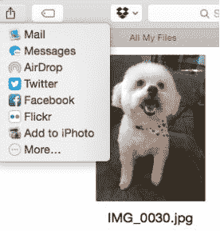

## 声音

正如名称所示，`Sound`（声音）菜单是修改所有音效和声音相关更改的地方。有三个可以切换的标签。

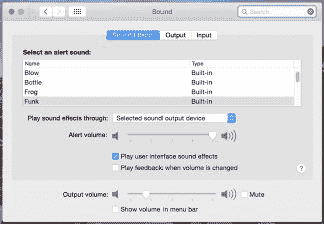

### 音效

`Sound Effects`（音效）标签允许从内置选项中选择警报声。默认情况下，下拉菜单应设置为输出设备。接两个复选框允许你开启或关闭用户界面声音。最后，你还可以调整音量。

### 输入与输出

`Input`（输入）和 `Output`（输出）标签都非常相似。每个都允许你更改输入或输出设备（扬声器或麦克风），以及调整设置。在 `Output` 标签中你可以调整平衡，在 `Input` 中你可以开启降噪。

## 用户与组

如果你的 Mac 是供家庭使用的，几个人可以使用，那么这个设置将非常有用。

在左侧边栏，所有现有的用户和组（如果有的话）都会列在这里。要对现有用户进行更改，你首先需要选择锁头图标并解锁；解锁后你就可以更改用户设置。此时你会被要求输入密码——这些都是安全措施，以确保你不小心离开电脑时，别人不会把你锁在自己的电脑之外。

以下是你对每个用户可以做的一些事情（取决于用户类型是管理员、访客、儿童等）；某些设置可能不可用。

* 选择 `Admin`（管理员）账户允许你更改登录密码、打开 `Contacts` 卡片并启用家长控制。点击 `Login Items`（登录项）允许你更改每次登录时启动的应用程序。必须有一个管理员用户。
* 你创建的任何其他用户都将启用家长控制、更改密码或将该账户转换为具有 Mac 完全控制权的管理员账户的选项。
* 默认你会看到一个 `Guest`（访客）用户。如果选中它，你可以选择禁用 `Guest` 用户作为登录选项。你还可以设置家长控制并允许访客访问你的共享文件夹。

在左侧边栏底部有另一个选项，称为`登录选项`。在这里，你可以找到不同的选项，例如自动登录、显示密码提示，以及显示睡眠、关机和重启按钮。你还可以通过勾选`显示快速用户切换菜单`旁边的复选框并进行选择，在菜单栏的右上角显示你的全名或用户名。

创建新用户

现在你已经知道如何管理主用户，但如何创建其他用户呢？这非常简单。只需按照以下步骤操作（并确保你已经点击了那个锁按钮以解锁该选项）。

1. 点击 `+` 按钮。
2. 从`新建` 下拉菜单中从以下选项中选择：`管理员`、`标准`、`受家长控制管理的`或`仅限共享`。

3. 填写`全名`和`账户名称`字段。这些不需要是真实姓名。如果你愿意，米奇老鼠也可以有一个用户名。
4. 你可以选择让新用户使用现有的 `iCloud` 账户和密码登录，或者创建一个全新的密码。
5. 如果你选择了`使用 iCloud 密码`，系统会提示你输入关联的 `iCloud ID`。
6. 如果你选择使用新密码，系统会要求你输入两次以进行验证。
7. 完成后，点击蓝色的`创建用户`按钮。如果你选择使用 `iCloud ID`，系统会要求你输入密码。如果你创建了新密码，则无需进行任何其他操作。

删除现有用户

仅仅因为添加了用户并不意味着他们会永远在那里。你可以随时删除他们。但请记住，删除用户会删除他们设置的所有设置——所以如果你再次创建，一切都将消失。

1. 要移除当前用户，选择你想要删除的用户。
2. 在选中该用户的情况下，点击 `–` 按钮。
3. 将会弹出一个提示框，询问你是否确定要从计算机中移除该用户。
4. 你还可以从三个单选按钮中选择一个：保存主文件夹、保留主文件夹或删除主文件夹。
5. 一旦你做出了决定，点击蓝色的`删除用户`按钮以确认你的选择并生效更改。

创建组

如果计算机在一个有几十个用户的地方使用（例如教室或图书馆），那么创建一个组对你来说将是一个很好的选择。

1. 在左侧边栏底部，点击 `+` 按钮。
2. 从`新建` 下拉菜单中选择`组`。
3. 在`全名`字段中，为你的组创建并输入一个名称。
4. 点击蓝色的`创建组`按钮进行确认。
5. 新组将被创建，你可以勾选每个现有用户旁边的复选框，指定谁将成为该组的一员。如果你有现有组，也可以选择整个组作为另一个组的成员。

家长控制

如果孩子在使用你的计算机，那么苹果提供了家长控制来帮助你确保孩子们不会遇到麻烦。这是一个非常强大的应用程序，但它确实有一些局限——如果你想要终极保护，还有一些诸如 `NetNanny` ([www.netnanny.com]) 这样的付费应用程序。家长控制对于客人也很有用——如果你不在意别人使用你的计算机，但只想让他们访问互联网而不访问任何其他内容，那么你可以那样设置。

要使用苹果的家长控制，首先确保你已为孩子创建了用户账户。接下来进入`系统偏好设置`并`家长控制`。

如果左下角的锁头是锁定状态，请点击它进行解锁并输入你的密码。

你现在可以为每个孩子用户设置家长控制了。你可以根据需要设置任何程度的限制。第一个标签页让你选择他们可以使用哪些应用程序。例如，你可以阻止除游戏以外的所有应用程序。下一个标签页让你控制网络使用情况。默认情况下，苹果会尝试过滤掉成人内容。如果是小孩子，更好的选择可能是选择他们可以访问的网页——例如，你可以阻止除 Disney 外的所有互联网网站。下一个标签页是`人员`。这允许你选择他们可以给谁发送电子邮件和信息——例如，你可以限制他们只能给父母和祖父母发送邮件。倒数第二个标签页让你选择时间限制。你可以选择他们使用计算机的时间和持续多久。最后，最后一个标签页让你关闭摄像头以便他们进行视频聊天、从字典中隐藏粗俗词汇等。

辅助功能

如果你有任何类型的障碍或残疾，辅助功能可以帮助你调整计算机。它允许你更改某些设置，如增大显示屏、使用描述屏幕内容的语音辅助，并在可用的视频上添加字幕。

要打开辅助功能，点击`系统设置`并`辅助功能`。在弹出的窗口左侧将是所有你可以更改的内容。点击每一项都会创建更多选项。

视觉

在`显示`下，你可以让屏幕变为灰度、反转颜色、降低对比度等。`缩放`允许你在按下快捷键时对屏幕的较小区域创建缩放效果。`语音辅助`会读取屏幕上的任何文本。

媒体

`媒体`部分包含了音频和播放的几个不同设置。点击`描述`以启用视频语音描述。

`字幕`将为视频应用字幕。

听力

`声音`标签页为听力障碍者提供了选项。你可以选择在播放提示声时让屏幕闪烁，还可以决定是否将立体声播放为单声道。

交互

`键盘`包含了`粘滞键`和`慢速键`设置。`粘滞键`允许某些按钮在你不按住的情况下激活。例如，如果你开启了粘滞键并想复制文本，与其同时按住 `Command + C`，你可以先按 `Command` 键，然后按 `C` Key。启用后，你会听到锁定声音，每当你使用修饰键时，屏幕右上角会出现一个大图标，指示粘滞键组合已启动。`慢速键`增加了按下按钮到激活之间的时间，所以如果你按下 `Enter`，处理将需要更长时间。

`鼠标与触控板`具有如`鼠标键`功能（允许你使用键盘上的数字键盘移动鼠标）、双击速度，以及在连接了独立鼠标或触控板时（对于 MacBook）忽略内置触控板的选项。

`切换控制`在进行任何更改之前需要输入管理员密码，因为它是一个强大的功能，允许你使用指定的一个或多个开关来控制计算机。你还可以修改其他设置，例如导航时的操作、指针精度以及更改切换控制光标的大小。

`听写`标签页正如其名——让你仅通过语音下达命令并编写或编辑文本。要启用听写，首先需要点击底部的按钮`打开听写与语音偏好设置`并选择`开启`单选按钮。

隐私与安全

如果你的计算机位于其他人可以接触到的地方，或者你泛泛担心隐私被侵犯，请前往系统偏好设置中的`隐私与安全`。

创建强密码

强密码是防御潜在黑客（或聪明的孩子）的第一道防线；强密码不是像 `password` 这样的；强密码包含字母、数字甚至符号。它可以像这样：`@mY_MACb00k.`

你可以使用密码助手来测试你的密码强度如何。

1. 当 `Keychain`（钥匙串）加载时，你可以查看所有已同步到 `Keychain` 的账户完整列表。如果你想更改现有账户的密码，请找到该账户并双击它。如果没有，请点击底部的 `+` 按钮添加新账户。
2. 当新窗口弹出时，查看底部。那里有一个密码字段，其右侧有一个小钥匙图标。点击钥匙图标即可打开密码助手。
3. 从 `Type`（类型）中，你可以选择 `Manual`（手动，自行创建）、`Memorable`（易记）、`Letters & Numbers`（字母与数字）、`Numbers Only`（仅限数字）、`Random`（随机）以及 `FIPS-181 compliant`。
4. 建议会自动填充，你可以通过下拉菜单浏览多个不同的建议。
5. 调整长度滑块使密码变长或变短。你创建的任何密码将至少符合被视为合格的要求。
6. 当你生成密码时，质量指示器会变化，向你显示给定密码的安全性和复杂程度。

### 防火墙

你可以添加的另一层防线是防火墙，它可以保护你免受与潜在恶意软件程序、网站或文件的意外连接。

要启用 Mac 自带的防火墙，前往 `System Preferences > Security & Privacy`（系统设置 > 安全与隐私）并选择 `Firewall`（防火墙）标签。在进行任何更改之前，点击左下角的锁图标并输入管理员密码继续。

### 查找我的 Mac

就像你的 iPhone 或 iPad 一样，Mac 也带有一个名为“查找我的 Mac”的实用功能，让你在电脑被盗或你不小心弄丢时能够找到它；你还可以远程擦除它的硬盘。

要启用查找我的 Mac，前往 `System Preferences > iCloud`（系统设置 > iCloud）并勾选 `Find My Mac` 旁边的框。你还必须开启位置服务，因此前往 `System Preferences > Security & Privacy > Privacy > Location Services`（系统设置 > 安全与隐私 > 隐私 > 位置服务），并确保勾选了 `Enable Location Services`（启用位置服务）。

要追踪你的电脑，你可以登录任何电脑并访问 `icloud.com`，输入你的 iCloud 登录信息并点击“查找我的 Mac”。只要 Mac 处于唤醒状态并通过 Wi-Fi 或以太网连接互联网，你就可以播放响声、锁定它或完全擦除它以移除你的隐私信息。

### 隐私

Apple 知道人们担心隐私；他们内置了许多功能来帮助你控制可以看到（以及不能看到）的内容。

#### 互联网隐私

如果你想清除搜索和浏览记录，有两种方法：通过点击 `Safari > Clear History and Website Data`（Safari > 清除历史和网站数据）或 `History > Clear History and Website Data`（历史 > 清除历史和网站数据）。这两者可以在顶部菜单栏找到。当窗口弹出时，你可以选择清除的时间范围，一旦做出选择，只需按下 `Clear History`（清除历史）按钮即可完成更改。

Cookies 允许网站存储数据并跟踪某些内容，例如你在网络会期间访问了哪些其他网站，或者你倾向于查看哪种产品。这些信息主要被广告商用于为你提供更精准的广告投放，但如果你想禁用它们，该选项一直都在。打开 Safari，前往 `Safari > Preferences`（偏好设置然后选择 `Privacy`（隐私）标签。Cookie 选项范围从允许所有网站存储 Cookie 到阻止所有网站。你也可以只允许来自最常访问网站的 Cookie。如果你不想被追踪，请勾选底部的 `Ask Websites To Not Track Me`（请求网站不要追踪我）复选框。禁用此功能后，某些网站可能无法按照你的预期方式运行。

#### 应用隐私

隐私的另一部分是通过已安装的应用。前往 `System Preferences > Security & Privacy`（系统设置 > 安全与隐私）并点击 `Privacy`（隐私）标签。你可以通过勾选 `Enable Location Services`（启用位置服务）旁边的框来关闭 `Location Services`。浏览左侧边栏，你可以自定义权限。如果你不想让任何应用访问你的联系人或日历，可以在这里阻止部分或全部程序访问这些信息。

# 第 3 部分：维护

## 保护电池寿命

如果你在使用 iMac，那么这一部分显然不适用，因为 iMac 不使用电池运行，但如果你有一个 MacBook，那么这一部分就适用于你。

大多数 MacBook 可以轻松获得超过 6 小时的电池寿命，但你可以采取一些措施来获得更长的。

- 前往 `System Preferences > Energy Saver`（系统设置 > 节能），并在 `Battery`（电池）标签下，选择尽可能让硬盘进入睡眠，并在电池供电时稍微调暗显示。你不想设置得太低，否则你会发现在阅读或执行不需要移动的任务时它会进入睡眠状态。
- 保持屏幕亮度仅能让你看清屏幕即可。`F1` 键将调低亮度，`F2` 键将再次调亮。如果你在海滩上，自然需要最高亮度；但如果你在黑暗的房间里，你真的需要全亮度吗？可能不需要。
- 键盘也有亮度，可以通过键盘上的 `F5` 和 `F6` 进行调整。键盘背光在低光环境下非常有帮助，但在光光白天，你真的不需要它。

### iCloud

iCloud 让你可以在网上存储照片和视频等内容。它类似于 Google Drive 或 Dropbox。最棒的是它提供 5GB 的免费空间。

- 你可以备份联系人，使其在 Mac、iPhone 和 iPod 之间同步。在联系人卡中进行更改或添加新联系人，更改将反映在所有同步设备上。
- 通过 iTunes Store 购买媒体文件不会计入存储空间。
- 它让文件在所有 Mac 设备可用。

如果你还没有设置 iCloud 账户，可以通过 `System Preferences > iCloud`（系统设置 > iCloud）并按照屏幕指令创建一个。完成后，你可以选择想要通过 iCloud 同步的数据类型：照片、邮件、联系人、日历、Safari、备注、钥匙串等。在底部你会看到一个显示已用存储和剩余可用存储空间的条。

如果你需要更多存储空间，可以付费。以下是本文时的费率：

- 20 GB 每月 0.99 美
- 200 GB 每月 3.99 美
- 500 GB 每月 9.99 美
- 1 TB 每月 19.99 美

如果你决定改变主意且不需要额外的存储计划，Apple 允许你在 15 天内联系他们申请退款。

## Time Machine（时光机）

每个人都会担心丢失数据；Apple 通过他们最强大的后台应用之一 Time Machine 提供了帮助。

Time Machine 会以极少的配置或烦恼备份你所有的文件、应用程序和设置。在发生硬盘故障等灾难性事件时，拥有 Time Machine 备份可以让你快速恢复所有数据、应用程序，甚至包括所有设置（例如桌面壁纸以及图标的具体位置）。

你需要购买一个外部 USB 或 Thunderbolt 硬盘。建议购买一个容量大于电脑当前使用空间的硬盘。例如，如果你的电脑硬盘已使用了 100 吉字节的空间，你应该至少买一个 120 吉字节的硬盘。

你还可以购买额外的 Time Machine 胶囊（Time Machine Airport Capsule），它可以无线完成所有这些操作。

要开始使用，将硬盘插入电脑，Time Machine 将自动启动。它会询问你是否要将硬盘作为 Time Machine 备份磁盘。选择“用作备份磁盘”。

如果 Time Machine 没有自动启动，请前往 `Finder` > `应用程序` > `Time Machine`，并点击“选择备份磁盘”。选择你的新硬盘。

在你指定了用作备份的硬盘后，Time Machine 将自动开始备份你的数据。

## 软件更新

如果你想让电脑运行流畅，请务必定期更新；更新是免费的，且每隔几个月发布一次。它们可以修复微小的错误，有时会添加内容来修复漏洞，这些漏洞可能导致你的容易受到病毒。

`Mac OS X` 默认会在有可用更新时提示你，你只需点击“更新”并输入密码即可运行更新。有时，在进行重大更新时，你可能需要重启电脑来完成更新。如果你想将更新推到更方便的时间，可以点击“稍后”。

# 附录 A：键盘快捷键

## 通用快捷键

- `Command-X` – 切或删除选中的文本或项目并将其复制到剪贴板。
- `Command-C` – 将选中的文本或项目复制到剪贴板。
- `Command-V` – 将剪贴板的内容粘贴到文档、应用程序或访达（Finder）。
- `Command-Z` – 撤销上一个命令。
- `Command- Shift-Z` – 重做上一个撤销。
- `Command-A` – 选择运行程序中的所有文本或项目。
- `Command-F` – 打开查找窗口以查找查找文档或其他项目。
- `Command-G` – 查找之前找到的项目的下一次出现（即再次查找）。
- `Command-H` – 隐藏当前运行的程序或前窗口（注意：如果你有全屏运行的程序，此功能将无效）。
- `Command-Option-H` – 隐藏所有打开的应用程序和窗口。
- `Command-M` – 最小化当前打开的窗口或应用程序（注意：如果你有全屏运行的程序，此功能将无效）。
- `Command-Option-M` – 最小化所有打开的应用程序和窗口。
- `Command-N` – 打开新文档或窗口。
- `Command-O` – 打开一个项目（例如，如果你在 Word 或 Pages 中并想打开以前保存的文档）。
- `Command-P` – 打印当前网站或文档。
- `Command-S` – 保存当前文档。
- `Command-W` – 关闭前窗口或应用程序。
- `Command-Option-W` – 关闭所有打开的应用程序和窗口。
- `Command-Q` – 退出应用程序。
- `Command-Option-Esc` – 强制退出无响应的程序。
- `Command-Space Bar` – 唤出聚焦（Spotlight）以快速查找文档、电子邮件和应用程序。
- `Command-Tab` – 切换到下一个打开的应用程序（注意：如果不松开 Command 并继续按 Tab 键，可以继续切换到下一个应用程序）。
- `Command-Shift-3` – 截全屏。
- `Command-,` – 打开当前应用程序的偏好设置（如果适用）。

## 文档快捷键

以下快捷键适用于支持的文档软件，如 Word、PowerPoint、Pages、Excel、OpenOffice 等。

- `Command-B` – 加粗或取消加粗选中文文本。
- `Command-I` – 使选中文本倾斜或取消倾斜。
- `Command-U` – 给选中文文本添加或删除下划线。

