# Python 与 C++ 完全手册 - 2020年10月

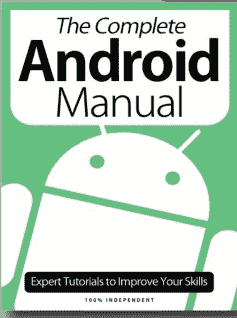

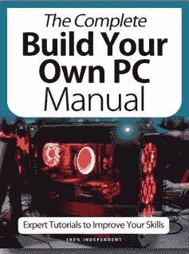

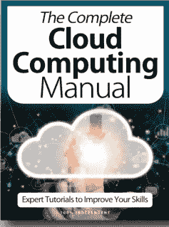


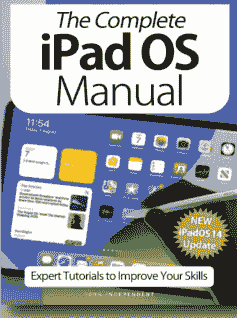
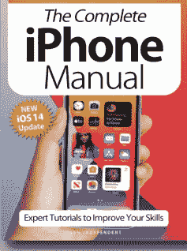

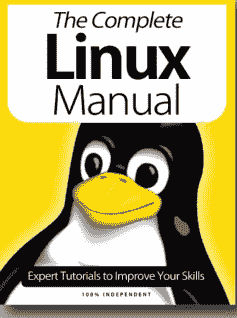

## 释放 Python 和 C++ 的力量

基础编程知识可以为新手的开启许多不同的领域。你可以更深入地理解硬件和软件是如何协同工作的，以及不可思议的环境是如何从 0 和 1 变成你显示器或电视上的内容的。技术无处不在，它们都通过编程连接在一起。你的电视、微波炉以及互联网本身都依赖于良好的编程才能运行。

这些章节中包含了帮助你迈向编程世界第一步的基石。我们选取了两种最强大且多用途的语言，并将它们拆解为易于理解的教程，帮助你学习它们的工作原理以及如何让它们为你服务。学习如何安装它们、在屏幕上打印简单信息、获取用户输入并操纵数据以产生惊的结果。读完这本书后，你将理解 `Python` 和 `C++` 是如何工作的，以及蕴含着怎样的潜力。准备好了吗？开始编程吧！

```cpp
int x;
for (int j = 0; j < column.Count(); j++) {
    header = header.GetTab(j);
    if (cm < 0) {
        cm = header.Tab(j).margin + size;
        break;
    }
}
```

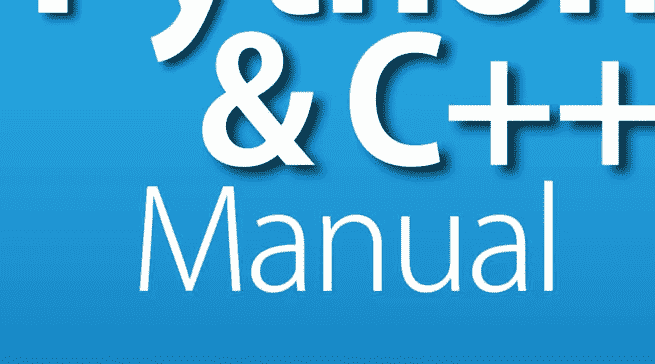


# BDM 代码门户

借助我们强大的代码门户精通 `Python`，其中包含游戏、工具等代码。

艺术总监与制作：James Gray

制作经理：David King

编辑：Richard Baker

副编辑：Paul Berry

# 为什么选择 Python？

现代计算机有许多编程语言可供，有些仍然适用于 8 位和 16 位的计算机。其中一些语言是为科学工作设计的，另一些则用于移动平台等。在所有语言中，你为什么选择 `Python` 呢？

## PYTHON 的力量

从最早的计算机作为自动机器开始，爱好者、用户和专业人士一直辛勤工作，对着过热的电路板汗流如雨，只为为了创造出类似魔法的东西。

这些先驱者开辟了新的领域疆，打造了微小的路径，让字母“A”能够在屏幕上滚动。对于已经习惯了超高清图形和开放世界并成为首席开发人员的一代来说，没有任何地图能让他们感到兴奋。四十七年前，它被完美地构建了。

无论你使用的是 Android 设备、iOS 设备、PC、Mac、Linux、智能电视、游戏主机、MP3 播放器、汽车内置 GPS 设备、机顶盒或其他连接的的“智能”家电器，它们的背后都是编程。

自然地，这些卧室里的程序员帮助为我们所使用的每项数字技术奠定了基础。有些人后来成为了软件公司的首席开发人员，另一些人将可用硬件推向极限，并发现了赋予我们力量的力量。

所有上述数字设备都需要指令来告诉它们做什么，并允许人们与之交互。指令构成了设备的核心，可以使用多种编程语言来构建。

今天使用的语言根据情况、平台、设备用途以及它如何与环境或用户交互而有所异。

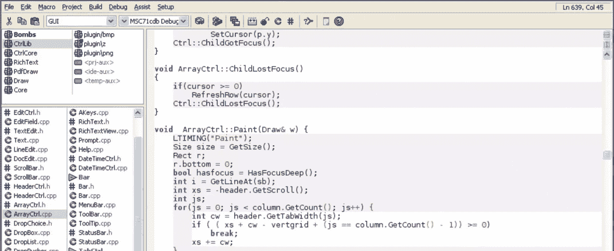

`C++` 通常留给更复杂的程序、操作系统等。

为什么选择 `Python`？

操作系统（如 Windows 和 macOS）通常是 `C++`、`C#`、汇编和某些形式的视觉化语言的结合。通常，网页使用 `C++` 以及许多种可用语言，如 `HTML`、`Java`、`Python` 等。

`Python` 创建于二十六年前，已成为学习如何编写计算机程序的的理想语言。它对于爱好者、学生、教师以及那些仅仅需要与自己或外部硬件以及计算机本身创建自己的交互的人来说，都是完美的。

更通用的编程被用于创建程序、应用程序、软件或他们想称的任何东西。它们被广泛应用于所有平台和几乎每一个想象到的应用程序。某些的运行比其他的快得多，比某些的更容易学习。`Python` 就是这样一种通用语言。

`Python` 免费下载。安装和使用适用于 Linux、Windows、macOS、MS-OS、IBM i 系列机器，并一直被选为世界五大语言之一，并且持续领先于硬件和互联网的发展曲线不断演进。

`Python` 被称为高级语言，它通过各种变量、对象、属性、子程序、循环和无数次交互与硬件和操作系统进行“对话”。它不像低级语言那样精简（低级语言可以直接处理内存地址、调用和寄存器），而且它绝对易于学习。

所以答案是：为什么选择 `Python`？简单来说，它是免费的、易于学习的、异常强大的、全球认可的，并且对于学生学习和教育目标非常有效。

```
// Import Java
import java.reflect.*;

class Java {
    public static void main(String[] args) {
        Class c = Class.forName(args[0]);
        Method m = c.getMethod(args[1], new Class[0]);
        Object result = m.invoke(null, null);
        try {
            System.out.println(result);
        } catch (InvocationTargetException e) {
            e.printStackTrace();
        } catch (ClassNotFoundException e) {
            e.printStackTrace();
        } catch (NoSuchMethodException e) {
            e.printStackTrace();
        } catch (IllegalAccessException e) {
            e.printStackTrace();
        } catch (Exception e) {
            e.printStackTrace();
        }
    }
}
```

```
40 LET PY=15
70 FOR W TO 10
75 GET BY=1, (RND*2)
80 LET DX=0
90 PRINT AT TO, PY, ""
100 LET PY=PY+2
110 PRINT AT TO, PY, "U"
120 LET PY=PY-1
130 IF PY<0 THEN LET PY=10
140 FOR N=1 TO 10: NEXT N
150 IF PY>20 THEN LET PY=20
160 LET BX=BX+2
170 LET BY=BY-1
180 IF BY<0 THEN LET BY=10
190 PRINT AT TO, PY, "S"
210 PRINT AT 10, "score: ",
220 FOR V=1 TO 1000: NEXT V
300 NEXT
```


`Java` 是一种强大的语言，用于网页、机顶盒、电视甚至案例。

`BASIC` 曾经是帮助初学者 8 位计算机用户学习的入门语言。


`Python` 是一门现代语言，它易于学习并使其成为理想的初学者编程语言。

## 你将需要的设备

你可以用极少的硬件或初始资金投入来学习 `Python`。你不需要极其强大的计算机，所需的任何软件都是免费提供的。

## 我们正在使用什么

幸运的是，`Python` 是一种多平台编程语言，适用于 Windows、macOS、Linux、Raspberry Pi 等更多。如果你拥有这些系统之一，你就可以轻松开始使用 `Python`。

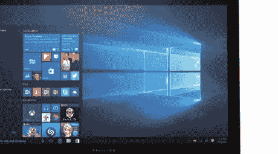

- 计算机：显然，你需要一台计算机来学习 `Python` 编程并测试你的代码。你可以使用在 32 位或 64 位处理器上的 Windows（从 XP 开始）、Apple Mac 或安装了 Linux。
- IDE：`IDE`（集成开发环境）被用于输入和执行 `Python` 代码。它允许你检查你的程序代码和代码中的值，并提供高级功能。有许多不同的 `IDE` 可用，所以要找到适合你的那一个。
- 软件：macOS 和 Linux 预装了许多可用语言，Windows 用户则需要下载。

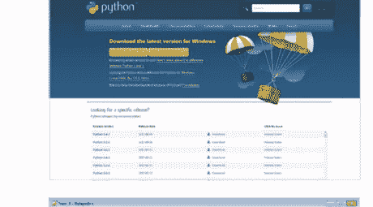

```python
## 这是我的第一个 Python 程序
print('Hello, World!')

## 这是一个问候函数
def greet(name):
    """
    接收一个名字
    """
    return f"Hello, {name}!"

## 调用函数
print(greet('Alice'))
```

- 文本编辑器：`IDE` 是输入代码的理想环境，但并非绝对。你可以使用 Sublime 或 Notepad++ 等文本编辑器。
- 互联网访问：`Python` 是一种不断演进的语言。接入互联网将让你保持更新。

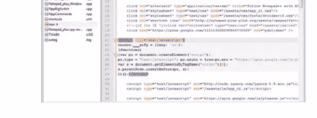

## 为什么使用树莓派？树莓派是一台非常便宜的计算机。它的主操作系统 `Raspian` 预装了许多模块。

## 树莓派

树莓派 3 是最新版本，包含了更强大的 CPU、更大的内存、Wi-Fi 和蓝牙支持。你可以以 32 英元或 50 英元以上的的价格购买，取决于套件。

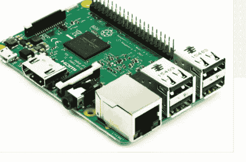

## FUZE 项目

`FUZE` 是一个构建在最新树莓派上的学习环境。你可以购买带有电子套件甚至机械臂的作品供你构建和编程。你可以在 `fuze.co.uk` 找到更多信息。


## 书籍

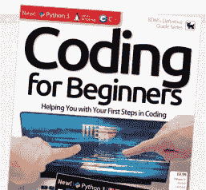

## 初学者编程

我们通过 `bdmpublic.com` 有许多优秀的编程书籍。我们的 Pi 书涵盖了如何购买你的第一台树莓派、设置并使用它；还有一些棒的、分步骤的项目示例和指南可以让你充分利用树莓派。

## RASPBIAN

树莓派的主操作系统是一个 Debian Linux 发行版，包含了你所需的一切，且简单易用。它针对树莓派进行了优化，是硬件和软件项目、`Python` 编程甚至作为桌面式计算机的理想平台。

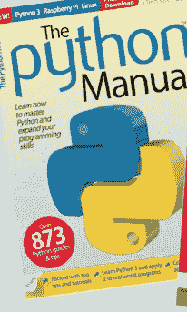
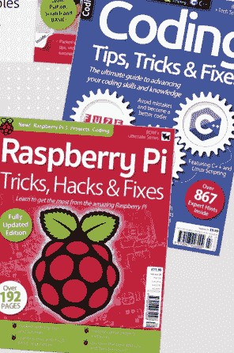
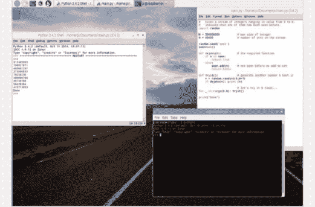

## 了解 Python

`Python` 是有史以来最伟大的计算机编程语言。它让你能够使用一种清晰易于理解的语言，充分利用计算机的力量。

## 什么是编程？

在尝试学习编程语言之前，了解什么是编程语言会有帮助，`Python` 也不例外。一个制作蛋糕的食谱可能如下：

## 编程食谱

程序就像计算机的食谱。

- 在碗中放入 100 克自发面粉。
- 向碗中加入 100 克黄油。
- 倒入 100 毫升牛奶。
- 烘烤一小时。

在碗中放入 100 克自发面粉。
- 向碗中加入 100 克黄油。
- 倒入 100 毫升牛奶。
- 烘烤一小时。

| 碗 | | |
| :--- | :--- | |
| 面粉 | 100 | |
| 黄油 | 50 | |
| 牛奶 | 100 | |
| cake.append([flour,butter,milk]) | | |

## 代码

就像食谱一样，程序由你按照顺序遵循的指令组成。程序可以这样一个描述蛋糕：

```python
class Cake(object):
    def __init__(self, flour, butter, milk):
        self.flour = flour
        self.butter = butter
        self.milk = milk
        self.cake.append([flour,butter,milk])
```

| 碗 | | |
| :--- | :--- | |
| 面粉 | 100 | |
| 黄油 | 50 | |
| 牛奶 | 100 | |
| cake.append([flour,butter,milk]) | | |

## 编程命令

你可能不知道某些 `Python` 命令，比如 `bowl.append` 和 `cake(bowl)`。第一个是一个列表，第二个我们将在书中讨论两者。要了解的最要点是，在 `Python` 中阅读命令非常容易。当你学会了命令，就很容易弄清楚程序是如何工作的。


`Python` 之父 Guido van Rossum。

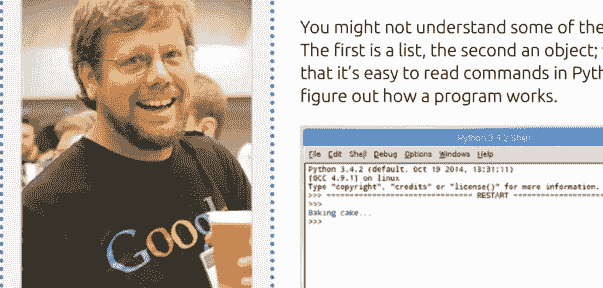

```
cake.py - home:/Documents/cake.py (3.4.2)
>>> cake = Cake()
>>> cake(100, 50, 100)
>>> cake.cake
[[100, 50, 100]]
```

## 高级语言

易于阅读的计算机语言被称为“高级语言”。这是因为它们运行在硬件（也称为“底层”）之上。像“贴近硬件”的语言（如汇编）被称为“低级语言”。低级语言的命令为

## Python 之禅

`Python` 让你能够用人类可以理解的语言访问计算机的所有力量。这一切的背后是一种被称为“`Python` 之禅”的哲学。这是 20 条软件原则的集合，影响了该语言的设计。这些原则包括“美胜于丑”和“简单胜于复杂”。`import this` `python`

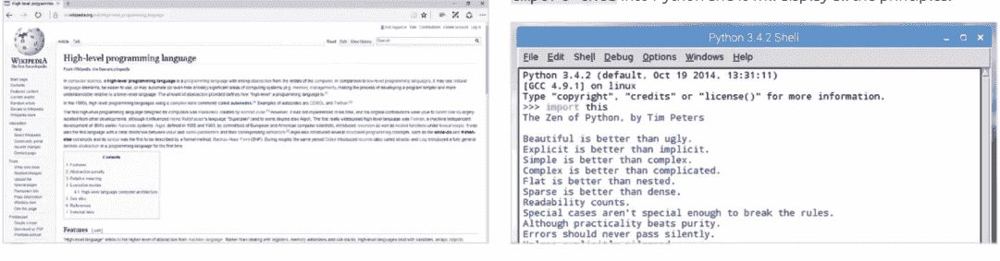

## Python 对比 Python 2

在计算场景下，`Python` 因为两个活跃版本的语言（`Python 2` 和 `Python 3`）的存在而变得有些复杂。

- PYTHON 世界

下方有两个按钮：一个用于 `Python 3.6.2`，另一个用于 `Python 2.7.18`；在工作时（记住 `Python` 经常更新，所以你可能会看到不同的版本号）。

当你访问 `Python` 下载页面时，你会发现：

- PYTHON 3.X

2008 年 `Python 3` 问世，带有几项新功能和增强功能。这些功能提供了一个更稳定、有效且高效的编程环境，但是，并不是所有这些新功能都与旧的脚本、模块和库兼容。虽然 `Python 3` 最初并不流行，但从那时起已成为 `Python` 最令人兴奋的版本。

## 下载 Windows 最新版本

下载 `Python 3.6.2` 下载 `Python 2.7.13`

应该使用哪个版本？这里有关于 `Python 2` 和 `3` 之间的更多信息。

正在寻找不同操作系统的 `Python`？Windows、Linux、Mac OS 或其他 `Python`。

想帮助测试开发版本吗？预发布版

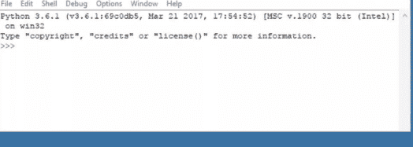

## PYTHON 2.X

为什么要两个？`Python 2` 发布于 2000 年，从那以后采用了大量的模块、脚本、教程等。多年来，`Python 2` 成为初学者选择的首批编程语言之一，这使其成为一个极具价值的资源。

## 3.X 的胜出

`Python 3` 日益增长的普及意味着，现在从新功能开始开发并遵循之前的版本是明智的。许多开发公司，如 SpaceX 和 NASA 使用 `Python 3` 来编写重要的代码片段。

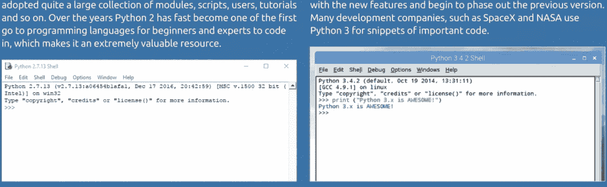


# 如何在 Windows 中设置 Python

Windows 用户可以通过主 Python 下载页面轻松安装最新版本的 Python。虽然大多数资深 Python 开发者可能回避 Windows 作为构建代码的平台，但它是初学者的理想起点。

## 安装 Python 3.X

Microsoft Windows 标准版没有预装 Python，所以你必须手动安装它。坦率地说，这个过程很简单：

- **步骤 1** 首先打开你的网络浏览器访问 `www.python.org/downloads/`。寻找 Python 3.x 的下载按钮链接（在我们案例中是 Python 3.6.2，但你之后可能会看到更高版本的 3）。
- **步骤 2** 点击对应版本的下载按钮。文件下载完成后，将文件保存到。
- **步骤 3** 选择“自定义”`Customise`选项允许你指定某些参数，虽然你可以保持默认设置，但养成这是一个好习惯，因为有时（感谢 Python）安装程序可能会包含不需要的功能。在“下一步”屏幕上，确保所有框框都已勾选并点击“下一步”。
- **步骤 4** 确保所有框都已勾选并点击“下一步”。
- **步骤 5** 但是，在关闭安装窗口之前，最好点击“下一步”。这将允许 Python 绕过 260 个字符的限制。
- **步骤 6** 但是，在关闭安装窗口之前，最好点击“下一步”。这将允许 Python 绕过 260 个字符的限制，让你能够执行程序。
- **步骤 7** Windows 10 用户现在会在“开始”按钮的“最近添加”部分找到 Python 3.x。第一个链接“Python 3.6 (32-bit)”在点击后将启动命令行版本的 Python（稍后会详细说明）。
- **步骤 8** 如果你现在点击 Windows“开始”按钮，这次输入 `CMD`，就会出现命令提示符窗口。点击它进入 Windows 命令行。
- **步骤 9** 在命令行中输入 Python，你需要输入：`python` 并按回车。
- **步骤 10** 命令行版本的 Python 可能会像你在步骤 8 中看到的那样。

# 如何在 Mac 上设置 Python

如果你正在使用 Apple Mac，那么设置 Python 极其简单。事实上，系统已经安装了一个版本的 Python。不过，你应该确保你运行的是最新版本。

## 安装 Python

苹果的操作系统自带 Python，所以你不需要单独安装它。但是，苹果并不经常更新 Python，你可能正在运行一个较旧的版本。因此，先检查并更新是有意义的。

- 点击“前往” > “实用工具”打开新的“终端”，然后双击“终端”图标。现在输入：`python --version`。如果苹果已经更新了操作系统和 Python 安装，你将看到 Python 2.5.1 或更高版本。无论何种，检查最新版本都是妥妥的。
- 点击 Python 3.x 的最新版本，在我们例中，这是 Python 3.6 的下载。这将自动下载最新版本的 Python，并根据你 Mac 的配置，它会自动开始安装。
- 打开 Safari 并访问 `www.python.org/downloads/`。与前几页的 Windows 步骤步骤一样，你可以看到两个下载按钮：一个用于 Python 3.6.2，另一个用于 Python 2.7.13。注意，由于 Python 发布频繁，版本号可能会不同。
- 在 Python 安装窗口中，点击“继续”按钮开始安装。值得花时间阅读一下“重要信息”部分，以防它提到了适用于你 macOS 版本的内容。准备好后，点击“继续”。

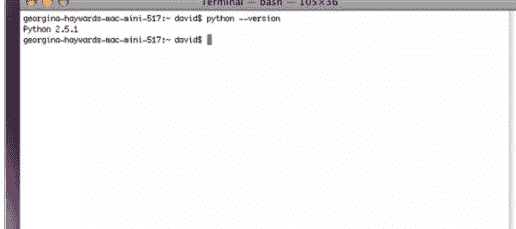

```
Terminal — 80x26
$ python --version
Python 2.5.1 (build, Mar 23 2009, 18:54:04) [Clang 1100.0.10]
$ 
```

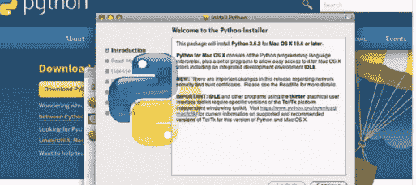

## 下载适用于 Mac OS X 的最新版本

| Python 3.6.2 | Python 2.7.13 |
| :--- | :--- |

想知道用哪个版本吗？这里有关于 Python 2 和 3 之间差异的更多信息。

寻找不同系统的 Python？适用于 Windows、Linux/Mac 或其他。

想帮助测试 Python 的最新进展吗？预发布版

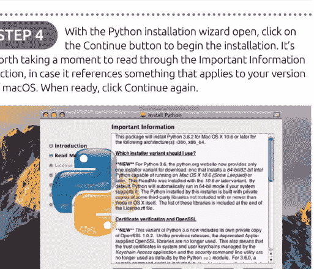

第 5 步：下一节详细介绍了软件许可协议，对大多数人来说可能无趣。当你准备好时，再次点击“继续”。

第 6 步：最后，你将看到 Python 将占用磁盘空间的大小以及一个安装按钮，你需要点击它来开始在你的 Mac 上进行 Python 3.x 的实际安装。你需要输入密码来验证安装。

第 7 步：安装没有花费太长时间；本节中使用的 Mac 比更现代的 Mac 慢一点，显示安装提示大约花费了三十秒。

第 8 步：Python 安装向导中没有多少可以做的，所以如果你回到终端会话并重新输入 `python --version`，你就能看到列出的新版本。要退出：`python`，即 `exit()`。

第 9 步：你需要在“访达”`Finder`中搜索 Python IDLE；当你找到它时，点击启动，它看起来应该和所示的 Windows 版 IDLE 类似。唯一的区别是 Mac 检测到的正在运行硬件平台。

第 10 步：旧版本的 Mac 可能与较新版本的 Python 3.x 有兼容问题，在这种情况下，你需要回到 Python 3.x 提示符；只要你使用书中的代码，它就能为你工作。

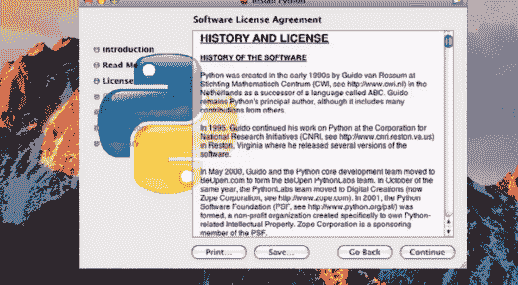

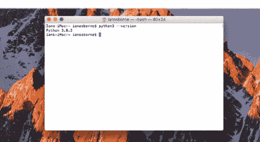

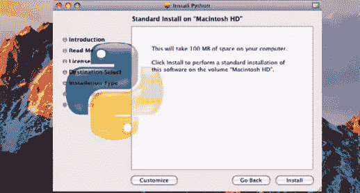

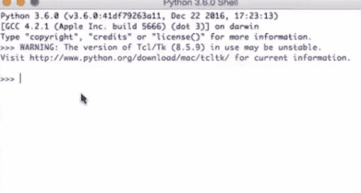

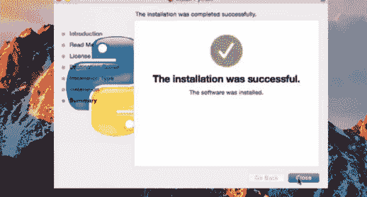

```
Python 3.1.2 (build, Mar 24 2010, 01:33:18)
GCC 4.0.1 (Apple Inc. Build 55439) on Darwin
Type "copyright", "license" for more information.
>>
```


# 在 Linux 上设置 Python

如果你正在 Linux 上运行，设置 Python 非常简单。事实上，系统已经安装了一个版本的 Python。不过，你应该确保你运行的是最新版本。

## 安装 Python

Linux 操作系统自带 Python，所以你不需要单独安装它。但是，Linux 并不经常更新 Python，你可能正在运行一个较旧的版本。因此，先检查并更新是有意义的。

- 通过点击“菜单” > “实用工具”打开新的终端。现在输入：`python --version`。如果 Linux 已经更新了操作系统和 Python 安装，你将看到 Python 2.5.1 或更高版本。无论何种，检查最新版本都是妥妥的。
- 点击 Python 3.x 的最新版本，在我们例中，这是 Python 3.6 的下载。这将自动下载最新版本的 Python，并根据你 Linux 的配置，它会自动开始安装。
- 打开浏览器并访问 `www.python.org/downloads/`。与之前页面的 Windows 步骤一样，你可以看到两个下载按钮：一个用于 Python 3.6.2，另一个用于 Python 2.7.13。注意，由于 Python 发布频繁，版本号可能会不同。
- 在 Python 安装窗口中，点击“继续”按钮开始安装。值得花时间阅读一下“重要信息”部分，以防它提到了适用于你 Linux 版本的内容。


```
Terminal — 80x26
$ python --version
Python 2.5.1 (build, Mar 23 2009, 18:54:04) [Clang 1100.0.10]
$ 
```

## 下载适用于 Linux 的最新版本

| Python 3.6.2 | Python 2.7.13 |
| :--- | :--- |

想知道用哪个版本吗？这里有关于 Python 2 和 3 之间差异的更多信息。

寻找不同系统的 Python？适用于 Windows、Linux/Mac 或其他。

想帮助测试 Python 的最新进展吗？预发布版


第 5 步：下一节详细介绍了软件许可协议，对大多数人来说可能无趣。当你准备好时，再次点击“继续”。

第 6 步：最后，你将看到 Python 将占用磁盘空间的大小以及一个安装按钮，你需要点击它来开始在你的 Linux 上进行 Python 3.x 的实际安装。你需要输入密码来验证安装。

第 7 步：安装没有花费太长时间；本节中使用的 Linux 比更现代的电脑 慢一点，显示安装提示大约花费了三十秒。

第 8 步：Python 安装向导中没有多少可以做的，所以如果你回到终端会话并重新输入 `python --version`，你就能看到列出的新版本。要退出：`python`，即 `exit()`。

第 9 步：你需要在“文件管理器”中搜索 Python IDLE；当你找到它时，点击启动，它看起来应该和所示的 Windows 版 IDLE 类似。唯一的区别是 Linux 检测到的正在运行硬件平台。

第 10 步：旧版本的 Linux 可能与较新版本的 Python 3.x 有兼容问题，在这种情况下，你需要回到 Python 3.x 提示符；只要你使用书中的代码，它就能为你工作。

```
Python 3.1.2 (build, Mar 24 2010, 01:33:18)
GCC 4.0.1 (Apple Inc. Build 55439) on Darwin
Type "copyright", "license" for more information.
>>
```


- 点击 `Python 3.x` 的最新版本，在我们例中，这是 `Python 3.6` 的下载。这将自动下载最新版本的 Python，并根据你 Linux 的配置，它会自动开始安装。


```
Terminal — 80x26
$ python --version
Python 2.5.1 (build, Mar 23 2009, 18:54:04) [Clang 1100.0.10]
$ 
```

- 打开浏览器并访问 `www.python.org/downloads`。与之前页面的 Windows 步骤一样，你可以看到两个下载按钮：一个用于 `Python 3.6.2`，另一个用于 `Python 2.7.13`。注意，由于 Python 发布频繁，版本号可能会不同。

- 在 Python 安装窗口中，点击“继续”按钮开始安装。值得花时间阅读一下“重要信息”部分，以防它提到了适用于你 Linux 版本的内容。准备好后，点击“继续”。


## 下载适用于 Linux 的最新版本

| Python 3.6.2 | Python 2.7.13 |

| :--- | :--- |

想知道用哪个版本吗？这里有关于 Python 2 和 3 之间差异的更多信息。

寻找不同系统的 Python？适用于 Windows、Linux/Mac 或其他。

想帮助测试 Python 的最新进展吗？预发布版


# 在 Linux 上设置 Python

第 5 步：下一节详细介绍了软件许可协议，对大多数人来说可能无趣。当你准备好时，再次点击“继续”。

第 8 步：Python 安装向导中没有多少可以做的，所以如果你回到终端会话并重新输入 `python --version`，你就能看到列出的新版本。要退出：`python`，即 `exit()`。


第 6 步：最后，你将看到 Python 将占用磁盘空间的大小以及一个安装按钮，你需要点击它来开始在你的 Linux 上进行 Python 3.x 的实际安装。你需要输入密码来验证安装。

第 9 步：你需要在“文件管理器”中搜索 Python IDLE；当你找到它时，点击启动，它看起来应该和所示的 Windows 版 IDLE 类似。唯一的区别是 Linux 检测到的正在运行硬件平台。


第 7 步：安装没有花费太长时间；本节中使用的 Linux 比更现代的电脑 慢一点，显示安装提示大约花费了三十秒。


第 10 步：旧版本的 Linux 可能与较新版本的 Python 3.x 有兼容问题，在这种情况下，你需要回到 Python 3.x 提示符；只要你使用书中的代码，它就能为你工作。


## 首次开启 Python

我们将使用树莓派作为我们的 Python 3 硬件平台。最新版本的 Raspian 预装了 Python 3，准确版本为 3.4.2，只要你拥有版本 3 版本的 Shell，我们所有的代码都可以运行。

## 开始使用 Python

我们不会详细介绍如何让树莓派运行起来，关于这个主题已经有大量的资料可用。不过，一旦你准备就绪，启动你的树莓派并准备编码吧。

- 步骤 1：在加载树莓派桌面后，点击菜单按钮，然后选择 `编程 > Python 3 IDLE`。这将打开 Python 3 Shell。Windows 和 Mac 用户可以通过 Windows 开始菜单和 Finder（访达）找到 Python 3 IDLE Shell。

- 步骤 2：Shell 是你可以输入代码并查看你所编写代码的响应和输出的地方。这是一种沙箱，你可以在其中尝试一些代码和进程。

- 步骤 3：例如，在 Shell 中输入：`2+2`。按下 Enter 键后，下一行将显示答案：`4`。基本上，Python 已经获取了“代码”并产生了相应的输出。

- 步骤 4：Shell 的作用非常像计算器，因为代码基本上是与屏幕的一系列数学交互。整数（无限数字序列）可以很容易地进行加、减、乘等操作。

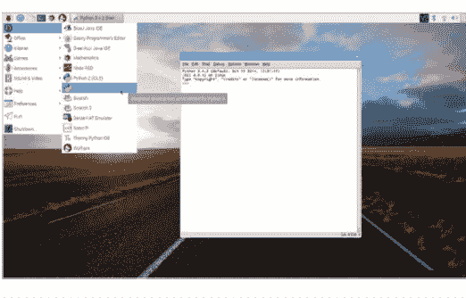

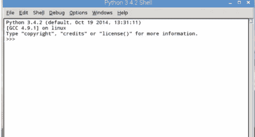

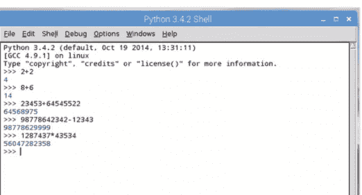

- 步骤 5：虽然很有趣，但并不特别刺激。相反，尝试这个：

```python
print("Hello everyone!")
```

就像你在本书《安装文本编辑器》章节中在 Sublime 中输入的代码一样。

```python
Python 3.4.2
3.4.2 (default, Oct 19, 2014, 13:11:17)
print(type("credits" or "license") for more information.)
# B-8
1234567890
6789054321-12345
9876543210234
18961274534
print("Hello everyone!")
hello everyone:
```

- 步骤 8：Python IDE 是一个可配置的环境。如果你不喜欢颜色的表示方式，可以通过 `选项 > IDE` 并点击 `高亮显示` 标签来更改它们。然而，我们不建议这样做，因为你看到的将和我们的截图不一致。

```python
IDLE 3.4.2 (default, Oct 19, 2014, 13:11:17)
print(type("credits" or "license") for more information.)
```

- 步骤 6：这更像那样了，因为你刚刚产生了你的第一段代码。这个命令非常浅易懂，它将内容打印到屏幕上，在本例中是 'Hello everyone'：

```python
>>> print("Hello everyone!")
```

- 步骤 9：就像大多数程序一样，无论什么操作系统，都有许多快捷键可用。我们这里没有空间介绍它们，但在 Shell 标签页下，你可以看到当前绑定的列表：

```
IDLE Shell
Tabs: General
Action
File - Menu
Edit - Menu
Copy - Ctrl+C
Paste - Ctrl+V
Find - Ctrl+F
Search - Ctrl+S
Undo - Ctrl+Z
Redo - Ctrl+Y
```

- 步骤 7：你已经注意 Python IDE 中的编码。颜色代表代码的不同元素。

| 颜色 | 用途 |

| :--- | :--- |

| 黑色 | 数据和变量 |

| 蓝色 | 函数 |

| 绿色 | 字符串 |

| 橙色 | 注释 |

| 紫色 | 函数 |

| 红色 | 错误消息 |

- 步骤 10：Python IDE 是一个使用 Shell 编写的强大界面，我们建议你花时间查看 `www.python.com/idle.html`，其中包含了：

| 颜色 | 示例 |

| :--- | :--- |

| 黑色 | 234 |

| 蓝色 | World |

| 绿色 | len(1) |

| 橙色 | else |

| 紫色 | get_args() |

| 红色 | SyntaxError: |

```python
# 这是第一行
# 这是第二行
# 这是第三行
# 这是第四行
# 这是第五行
# 这是第六行
# 这是第七行
# 这是第八行
# 这是第九行
# 这是第十行
```

```
25.5 鼠标点击 - (读取/编辑)
25.5.1 鼠标点击 - (读取/编辑)
单击创建新行
双击选择单词
三击选择行
Shift 点击选择块
右击打开菜单
```

本质上，对于大多数语言或人类来说，这都是关于记忆并将正确的词应用于正确的情况。你并不是天生就会这些，所以你需要学习它们。

## 玩 Python

- 步骤 1：如果你关闭了 Python 3 IDLE，请在你喜欢的任何操作系统中重新打开它。在 Shell 中，尝试以下操作：

```python
Python 3.4.2 Shell
Edit File Shell Debug Options Windows
Python 3.4.2 (default, Oct 19, 2014, 13:11:17)
>>> print(type("credits" or "license") for more information.)
>>> print("Hello")
Hello
>>> 2+2
4
>>>
```

- 步骤 2：正如预期的那样，单词 Hello 出现在 Shell 中，表示来自字符串的输出。这非常直接，不需要太多解释。现在尝试：

```python
print("2+2")
```

- 步骤 3：你可以看到而不是数字 4，输出是你要求打印到 Shell 的 2+2。问号定义了输出到 IDLE Shell 的内容。

```python
print("2+2")
```

```python
Python 3.4.2 Shell
Edit File Shell Debug Options Windows
Python 3.4.2 (default, Oct 19, 2014, 13:11:17)
>>> print(type("credits" or "license") for more information.)
>>> print("Hello")
Hello
>>> 2+2
4
>>> print("2+2")
4
>>>
```

- 步骤 4：你可以继续这样，打印 2+2、464+2344 等到 Shell。更简单的方法是使用变量，这是我们将深入介绍的内容。现在输入：

```python
a=2
b=2
```

```python
Python 3.4.2 Shell
Edit File Shell Debug Options Windows
Python 3.4.2 (default, Oct 19, 2014, 13:11:17)
>>> print(type("credits" or "license") for more information.)
>>> print("Hello")
Hello
>>> 2+2
4
>>> print("2+2")
4
>>> a=2
b=2
>>> print(a+b)
>>>
```

- 步骤 5：你在这里做的是给 `a` 和 `b` 赋值值：2 和 2。这些是新变量，只要它们保持在那里，就可以调用 Python 进行输出、减法、除法等。尝试这个：

```python
print(a)
print(b)
```

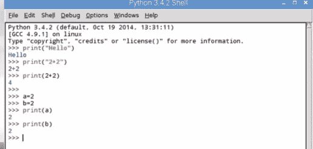

- 步骤 8：让我们加上姓氏：

```python
surname="Hayward"
print(surname)
```

你有两个包含名字和姓氏的变量。

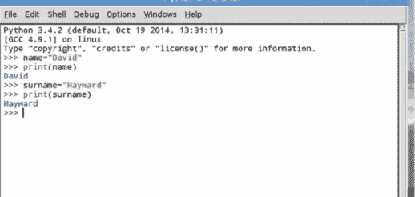

- 步骤 6：上一步的输出独立显示了 `a` 和 `b` 的值。如果你想把它们加起来，使用以下：

```python
print(a+b)
```

这段代码获取 `a` 和 `b` 的值并将它们相加产生结果。

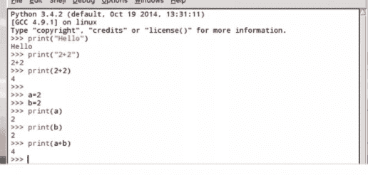

- 步骤 9：如果我们像之前的那样操作，使用 `+` 符号，名字将不会在 Shell 中正确显示。尝试一下：

```python
print(name-surname)
```

你需要在两个之间加一个空格，将它们定义为两个字符串，而不是进行数学运算。

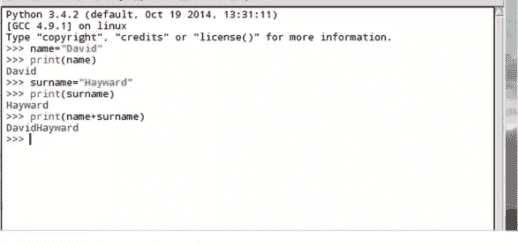

- 步骤 7：你可以尝试不同类型的变量和函数。例如，你可以为某人的名字赋值：

```python
name="David"
print(name)
```

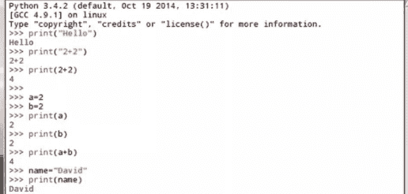

- 步骤 10：在 Python 3 中，你可以用逗号分隔两个变量：

```python
print(name, surname)
```

或者，你可以自己添加空格：

正如你所见，使用 `+` 要简单得多。

恭喜你，你刚刚迈入了 Python 世界的第一步。

## 保存并执行你的代码

虽然在 IDLE Shell 中工作对于小型代码片段完全没问题，但它并不是为运行较长的程序设计的。在本节中，你将接触 IDLE 编辑器，从现在起你将在那里工作。

## 编辑代码

你最终会达到一个点，必须停止在 Shell 中逐行输入单行代码。相反，IDLE 编辑器将允许你保存并执行你的 Python 代码。

- 步骤 1 首先，当 Python IDLE Shell 启动后，点击 `File`（文件）-> `New File`（新建文件）。这会打开一个名为 `Untitled`（无标题）的新窗口。这就是 Python IDLE 编辑器，你可以在这里输入创建未来程序所需的代码。

- 步骤 2 从本质上来说，IDLE 编辑器就是一个带有 Python 特性、编码等功能的简单文本编辑器；与 Sublime 非常相似。你可以在 Shell 中按你想要的方式输入代码，参考上一个教程的示例，输入：

- 步骤 3 你可以发现 IDLE 编辑器中的颜色编码与 Shell 中相同，这让你能更好地理解你的代码正在发生什么。然而，要执行代码，你首先需要保存它。按 `F5`，会打开一个 `Save...`（保存）框。

- 步骤 4 点击 Save 框中的 `OK`（确定）按钮，并选择你保存所有 Python 代码的位置。该位置是一个名为 `Python` 的专用文件夹，或者你也可以把它放在任何你喜欢的地方。不过请记住保持驱动器整洁，以便以后使用。

```python
print("Hello everyone!")
```

- 步骤 5 为你的代码输入一个名称，例如 'print hello'，并点击 `Save`（保存）按钮。一旦 Python 代码被保存或执行，它将在 IDLE Shell 中详细显示。在这种情况下，单词是 'Hello everyone'。

- 步骤 6 你的大部分 Python 代码都将这样进行。将其输入到编辑器中，按 `F5`，保存代码并查看 Shell 中的输出。有时会有所不同，取决于你是否请求了单独窗口，但基本上这就是你使用此工具时使用的流程，除非另有说明。

- 步骤 7 如果你打开保存的 Python 代码文件，这就是默认的 Python 文件名。你创建的任何代码都具有 `.py` 扩展名。无论你创建什么，从网上 Python 资源下载的任何代码都是 `.py`。只需确保代码是为 Python 编写的。

- 步骤 8 让我们扩展代码并输入上一个教程中的几个示例：

```python
a=2
b=2
name="David"
surname="Hayward"
print(name, surname)
print(a+b)
```

- 步骤 9 如果你点击 `OK` 按钮，文件将用新的代码条目覆盖，并在 Shell 中执行并输出。几行代码没有问题，但如果你编辑一个较大的文件，覆盖可能会变成一个问题。从编辑器通过 `Save As`（另存为）来创建。

- 步骤 10 现在创建一个新文件。打开编辑器，新建一个实例（`File > New File` 从 Shell 新建文件）。输入以下内容并保存为 `hello`：

```python
a="Python"
b="16"
c="hello!"
print(a, b, c)
```

你将在下一个教程中使用这段代码。

## 从命令行执行代码

尽管我们在整本书中一直通过 GUI IDLE 进行工作，但看一眼 Python 的命令行处理是值得的。我们已经知道有命令行版本的 Python，但它也被用于执行代码。

## 命令代码

使用上一个教程中的代码（我们命名为 `hello.py`），让我们看看如何在命令行级别运行在 GUI 中创建的代码。

- 步骤 1 在 Linux 中，Python 有两种通过命令行执行代码的方法。一种方法是使用 Python 2，而另一些方法使用 Python 3 库等。首先，进入你操作系统的命令行或 `Terminal`（终端）。

- 步骤 2 像以前一样，Windows 用户需要点击开始按钮并搜索 `CMD`，macOS 用户可以通过点击 `Go`（前往） > `Utilities`（实用工具） > `Terminal`（终端）访问他们的命令行。

- 步骤 3 现在你到了命令行界面了，我们可以启动 Python。对于 Python 3，你需要输入命令 `python` 并按回车键。这将带你进入命令行版本的 Shell，并带有熟悉的箭头 `(>>)`。

- 步骤 4 从这里，你可以输入之前看过的代码，例如：

```python
print(a)
```

你可以看到它的工作原理完全一样。

- 步骤 5 现在输入 `exit()` 退出命令行并返回命令提示符。进入保存上一个教程代码的文件夹，希望你将看到 `hello.py`。

- 步骤 6 在你要运行的代码所在的同一个文件夹内，输入以下命令：`python3 hello.py`

- 步骤 7 自然地，如果你正在使用 Python 3，使用 Python 3 特有的语法和布局，它只有在你通过输入 `hello.py` 使用 python 2 命令时才能工作。

- 步骤 8 从这里运行 Python 2 代码的结果非常明显。虽然它没有以任何方式报错，但由于 Python 3 处理方式与 Python 2 之间的差异，结果并不符合预期。暂时使用 Sublime，打开 `hello.py`。

- 步骤 9 既然树莓派不支持 Sublime（此处上下文可能指特定环境），由于……（此处原文逻辑略有跳跃，意指环境限制）。

## 1]


在 Python 3 中编写的数字，

。

化，，

：

```python
10/3
3.3333333333333335
```

```。

## 数字与表达式

- 步骤 5 你也可以使用一种运算来查看除法留下的余数。例如：
- 步骤 8 这将显示为 '0'，将 10 除以 3 的余数。如果你想对其进行格式化，那么：

- 步骤 6 接下来我们有幂运算符，如果你想让它变成十。要计算出来使用星号：

```python

2**3

```
```。

### 布尔表达式

- 步骤 9 一个布尔表达式是一个逻辑语句，其结果为真或为假。我们可以比较这些数据以查看它是否等于、小于或大于。在一个新文件中尝试：

```python
a = 6
b = 7
print(a == b)
print(a < b)
print(a == 6 and b == 7)
print(a == 4 or b == 7)
print(not a == 7 and b == 7)
print(not (a == 7 and b == 6))
```

- 步骤 7 表达式和数字到此为止。Python 拥有许多内置函数来计算数字、绝对值、复数以及大量的数学表达式。要将一个数字转换为二进制，使用：

- 步骤 10 执行步骤 9 中的代码，你可以看到一系列的两个值：True 或 False 语句，取决于你看了什么。

```python
bin(3)
```

# 使用注释

当你编写代码时，代码的流程、每个变量的作用、整个程序的运行方式等都存在于你的脑海中。另一个程序员可以逐行跟进这些代码，但随着时间的推移，它可能会变得难以阅读。

## 注释！

程序员通过对某些部分进行注释来使用保持代码可读性的方法。例如，如果使用了一个变量，程序员会注释说明它的预期功能。这只是一种良好的习惯。

- **步骤 1** 首先，创建一个 IDLE 编辑器新实例（文件 -> 新文件 / File -> New File），并创建一个简单的变量和打印命令：

```python
a=10
print("The value of A is", a)
```

保存文件并执行它。

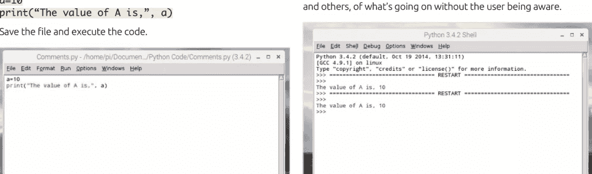

- **步骤 2** 运行代码将在 IDLE Shell 窗口中返回这一行：`The value of A is 10`，这正是我们预期的。现在，添加一些你在代码中常见的注释：

```python
## Set the start value of A to 10
a=10
## Print the current value of A
print("The value of A is", a)
```

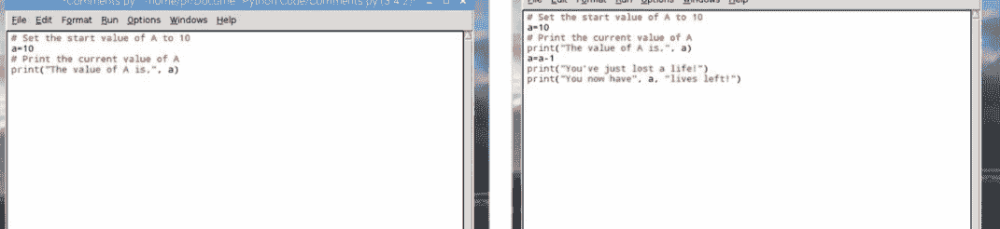

- **步骤 4** 假设我们创建的变量 A 是游戏中的生命值。每当玩家死亡，值就会减少 1。程序员可以在以下代码之间插入一行例程：

```python
a-=1
print("You've just lost a life!")
print("You now have.", a, "lives left!")
```

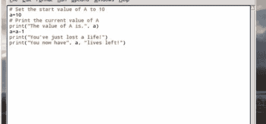

# 使用注释

步骤 5 虽然我们知道变量 A 是生命，且玩家已经失去了一个，但对于偶然的读者或不理解代码的人来说可能如此。想象一下代码有两万行而不是而不是七行。你可以看到注释是多么方便。

步骤 8 行内注释是跟在代码行后面的注释。我们不需要将代码插入到单独的一行，而是可以使用：

```python
a=10 # Set the start value of A to 10
print("The value of A is", a) # Print the current value of a
a=9 # Player lost a life!
print("You've just lost a life!")
print("You now have", a) # Inform player, and display current value of A while
```

```python
Python 3.12
Edit File Shape Debugging windows help --
def main():
    # [SEC 4.1]
    a=10
    print("Credits" or "license") # for information.

    # RESTART
a=10
    RESTART
a=9
    print("You've just lost a life!")
```

步骤 6 本质上，带有注释的新代码看起来如下：

```python
## Set the start value of A to 10
a=10 # Print the current value of A
print("The value of A is", a)
a=9 # Player lost a life!
print("You've just lost a life!")
print("You now have", a, "lives left!")
```

步骤 9 注释井号符号（# 符号）也可以用于注释掉程序中的部分代码。如果你想移除第一条语句，你需要：

```python
## Set the start value of A to 10
a=10 # Print the current value of A
print("The value of A is", a)
a=9 # Player lost a life!
print("You've just lost a life!")
print("You now have", a, "lives left!")
```

步骤 7 你可以在生活中使用注释。块注释是一大段文本，详细说明正在发生什么，并告诉读者为什么。这是最好的游戏，是由一组 Python 专家团队工作了数周后开发的。尽管很困了，但代码运行得良好。

步骤 10 你可以使用三个引号来注释掉一段多行注释。在你想注释的区域前后放置它们即可：

```python
"""
This is the best game, has been developed by a squad of Python experts who worked weeks. Despite being sleepy, the code works well.
## Set the start value of A to 10
a=10 # Print the current value of A
print("The value of A is", a)
a=9 # Player lost a life!
# Inform player, and display current value of A
print("You've just lost a life!")
print("You now have", a, "lives left!")
"""
```

www.bdpublic.com 33

## 变量操作

我们已经在 Python 代码中看到了一些变量的示例，但始终需要回顾它们是如何操作的，以及 Python 如何创建并将某些值分配给变量。在本教程中，你将使用 Python IDLE Shell。如果你还没有打开，请打开 Python IDLE Shell 以清理任何代码。

- **步骤 1** 在编程语言中，你被使用美元符号来表示字符串，字符串由多个字符组成，例如。在 Python 中这并不是需要的。例如：`"name"`

- **步骤 3** 已经已经在 Python 代码中看到了一些变量的示例了，但总是需要回顾它们是如何操作的，以及 Python 如何创建并将某些值分配给变量。在本教程中，你将使用 Python IDLE Shell。如果你还没有打开，请打开 Python IDLE Shell 以清理任何代码。

# 第 5 步

你不需要在输入命令中包含引号内的文本。例如，你可以询问用户的名字，并在下方的行中进行输入：

```python
print("Hello. What's your name?")
name=input()
```

```
userinput.py / /home/pi/Documents/Python/Codeus
Edit File Format Bun Options Windows Help
print("Hello. What's your name?")
name=input()
```

# 第 8 步

你在这里创建了一个条件，它很快就会出现。简而言之，我们正在使用用户的输入并将其与条件进行比较。因此，如果用户输入的名字是 David，卫兵将允许他们无恙通过。否则，如果他们输入 David 以外的任何名字，卫兵将挑战他们进行战斗。

```python
name=input()
if name=="David":
    print("Welcome, good sir. You may pass.")
else:
    print("I know you not. Prepare for battle!")
```

# 第 6 步

上一步的代码通常被认为比在输入命令中包含大量文本要精简，但这并不是一成不变的规则，所以在这些情况下你可以随心所欲。扩展代码，如下：

```python
print("Hail who goes there?")
name=input()
```

```
userinput.py / /home/pi/Documents/Python/Codeus userinput.py (3.4.2)
Edit File Format Bun Options Windows Help
print("Hail who goes there?")
name=input()
```

# 第 9 步

正如你之前学到的那样，用户的任何输入都是字符串，因此你需要应用类型转换（Typecast）将其转换为其他类型。这为输入命令添加了有趣的特性。例如：

## 计算速率和距离

```python
print("Input rate and a distance")
rate=float(input("Rate: "))
```

```
userinput.py / /home/pi/Documents/Python/Codeus userinput.py (3.4.2)
Edit File Format Bun Options Windows Help
## To calculate rate and distance
print("Input rate and a distance")
rate=float(input("Rate: "))
```

# 第 7 步

从一个冒险游戏开始是一个不错的开始对吗？现在你可以扩展它，并使用原始输入来丰富游戏内容：

```python
if name=="":
    print("Welcome, good sir. You may pass.")
else:
    print("I know you not. Prepare for battle!")
```

```
userinput.py / /home/pi/Documents/Python/Codeus.py (3.4.2)
Edit File Format Bun Options Windows Help
print("Hail who goes there?")
if name=="David":
    print("Welcome, good sir. You may pass.")
else:
    print("I know you not. Prepare for battle!")
```

# 第 10 步

为了完成速率和距离，我们可以添加：

保存代码并输入更多数字。使用 `float` 元素，我们将能够进行任何大于字符串的操作。

```python
name=input()
if name=="David":
    print("Welcome, good sir. You may pass.")
else:
    print("I know you not. Prepare for battle!")
```

## 创建函数

现在你已经掌握了变量和用户输入的用法，下一步是处理函数。你已经使用了一些函数，例如 `print` 命令，但 Python 允许你定义自己的函数。

## 酷炫函数

函数是你输入到 Python 中执行某些操作的命令。它是一段自包含的小代码，对其进行处理并返回结果。

- **第 1 步** 不仅仅是可以运行的函数。它们可以在 Python 中做所有实用的事情，例如排序数据、将项目从一种格式转换为另一种格式，以及检查项目的长度或类型。例如，函数是一个后面跟着括号的短单词。`len()`、`list()` 或 `type()`。


# 第 3 步
你可以通过函数传递变量，就像一个人的姓氏中的字母数量一样，你可以使用以下代码（在此示例中进入文本编辑器）：

```python
name=input("Enter your surname: ")
Count=len(name)
print("Your surname has", count, "letters in it")
```

```
Python 3.4.2 Sheet
Edit Shell Debug Options Windows Help
Python 3.4.2 (default, Oct 19 2014, 13:31:11)
(C) Python Software Foundation, Inc. on linux
Type "copyright", "credits" 或 "license" 获取更多信息。
print("antisestablishmentarianism")
>>>
```

按下 `F5` 并保存代码以执行。

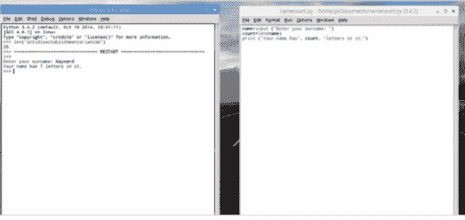

# 第 2 步
函数接收数据，使用变量，根据函数的编程方式对其进行处理并返回值。处理的数据位于括号内，所以如果你想知道单词 `antidisestablishmentarianism` 有多少字母，你只需要输入 `len("antidisestablishmentarianism")` 和数字 28。

# 第 4 步
Python 内置了数十个函数，多到在这里有限的空间内无法介绍。然而，可以通过 `docs.python.org/3/library/functions.html` 查看预定义函数，但用户还创建了更多。

```
Python 3.4.2 Sheet
Edit Shell Debug Options Windows Help
Python 3.4.2 (default, Oct 19 2014, 13:31:11)
(C) Python Software Foundation, Inc. on linux
Type "copyright", "credits" 或 "license" 获取更多信息。
print("antisestablishmentarianism")
>>>
```


## 创建函数

## 酷炫函数
函数是你输入到 Python 中执行某些操作的命令。它是一段自包含的小代码，对其进行处理并返回结果。

### 第 1 步
不仅仅是可以运行的函数。它们可以在 Python 中做所有实用的事情，例如排序数据、将项目从一种格式转换为另一种格式，以及检查项目的长度或类型。例如，函数是一个后面跟着括号的短单词。`len()`、`list()` 或 `type()`。

### 第 3 步
你可以通过函数传递变量，就像一个人的姓氏中的字母数量一样，你可以使用以下代码（在此示例中进入文本编辑器）：

```python
name=input("Enter your surname: ")
Count=len(name)
print("Your surname has", count, "letters in it")
```

### 第 2 步
函数接收数据，使用变量，根据函数的编程方式对其进行处理并返回值。处理的数据位于括号内，所以如果你想知道单词 `antidisestablishmentarianism` 有多少字母，你只需要输入 `len("antidisestablishmentarianism")` 和数字 28。

### 第 4 步
Python 内置了数十个函数，多到在这里有限的空间内无法介绍。然而，可以通过 `docs.python.org/3/library/functions.html` 查看预定义函数，但用户还创建了更多。

## 条件与循环
条件和循环是程序变得有趣的关键。它们可以简单，也可以复杂。

## TRUE 条件
保持条件简单会让学习编程更加愉快。让我们从检查某物是否为 TRUE 开始，然后处理它不是的情况。

### 第 1 步
我们创建一个新程序，要求用户输入一个单词，然后检查它是否是四字母单词。从 `File = New` 开始，并输入输入：

```python
word=input("Please enter a four-letter word: ")
```

### 第 2 步
我们现在创建一个新变量，然后使用函数并将单词传递进去以获取用户输入的总字母数：

```python
word=input("Please enter a four-letter word: ")
word_length=len(word)
```

### 第 4 步
`if` 结尾的冒号告诉 Python 冒号之后的内容是成立的。接下来，将光标回到编辑器的开头：

```python
word=input("Please enter a four-letter word: ")
word_length=len(word)
if word_length == 4:
    print("is a four-letter word. Well done.")
else:
    print("is not a four-letter word.")
```

# 第 5
按下 `F5` 并保存代码以执行。首先在 Shell 中输入一个四个字母的单词，你应该会收到消息显示该单词是四个字母。现在再次按下 `F5` 运行程序，这次输入一个五个字母的单词。Shell 将显示它不是四个字母单词。

# 第 6
现在扩展代码包含其他条件。最终，它可能会变得相当。我们添加了一个针对三个字母单词的条件：

```python
word=input("Please enter a four-letter word: ")
if len(word) == 4:
    print("is a four-letter word. Well done.")
elif len(word) == 3:
    print("is a three-letter word. Try again.")
else:
    print("is not a four-letter word.")
```

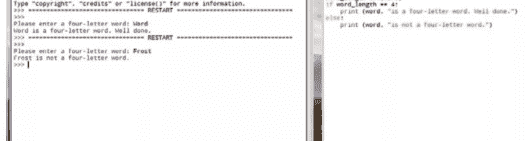

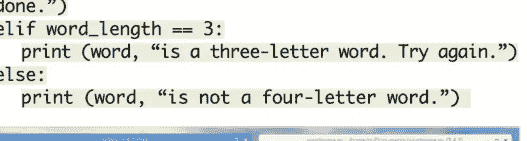

## 循环
循环看起来类似于条件，但它们在操作方式上有所不同。循环会在条件的支持下多次运行同一个代码块。

# 第 1
让我们从一个简单的 While 语句开始。像 `IF` 一样，它将检查某些内容是否为真（TRUE），然后缩进代码：

```python
x = 0
while x < 10:
    print(x)
    x = x + 1
```

# 第 3
`For` 循环是另一个例子。`For` 用于遍历数据范围，该范围通常列在方括号内的变量中。例如：

```python
words = ["Cat", "Dog", "Unicorn"]
for word in words:
    print(word)
```

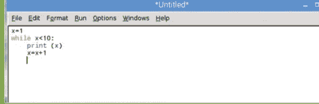

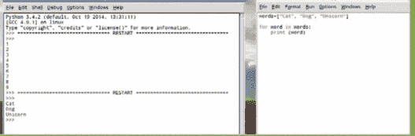

# 第 2
`if` 和缩进代码之间的区别在于，它回到结尾并检查语句是否仍然为真。示例中 `x` 小于 10。使用循环会打印 `x` 的当前值，然后给值加 1。当 `x` 等于 10 时，它停止。

# 第 4
`For` 循环也可以使用 `range` 函数用于倒计时示例：

```python
for x in range(1, 10):
    print(x)
```

这里没有 `x++1`，因为 `range` 函数会在第一个和最后一个使用的数字之间创建一个列表。

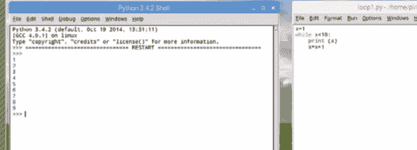

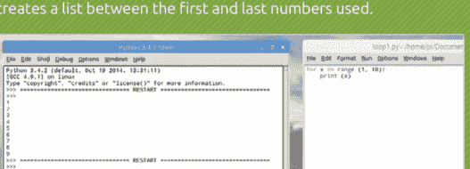

## Python 模块
我们之前提到过模块（`Math` 模块），因为模块是充分利用 Python 的的重要组成部分，然而，值得花更多时间在它们上。在此情况下，我们使用的是 Windows 版本的 Python 3。

## 掌握模块
将模块视为导入到你的 Python 代码中的扩展，以增强和扩展其功能。正如我们看到的，有无数模块可用，你甚至可以创建自己的模块。

### 步骤 1
尽管很好，但 Python 内置函数是有限的。然而，模块的使用允许我们编写更复杂的程序。正如你所知，，导入脚本。

### 步骤 3
在 IDLE Shell 中的结果是错误，未识别或未安装。要安装模块，我们可以使用 `pip`（关闭 IDLE Shell 并进入命令行）。在管理员提示符中，输入：

```bash
pip install pygame
```

### 步骤 2
某些模块在 Raspberry Pi 上默认包含，`math` 模块。因此，其他并不总是可用。非 Pi 平台的很好的例子是 `pygame` 模块，它包含许多帮助创建游戏的函数。尝试：`import pygame`

### 步骤 4
`PIP` 安装需要管理员权限安装在不同的位置。Windows 用户可以通过开始按钮搜索并右键点击“以管理员身份运行”。Linux 和 Mac 用户可以使用 `sudo` 安装包。

```cmd
C:\Users\david>pip install pygame
Microsoft Windows [Version 10.0.15063] (C)2017 Microsoft. All rights reserved.
Collecting pygame
Collecting pygame-1.9.3-cp36-win32.whl
Successfully installed pygame-1.9.3
C:\WINDOWS\system32>
```

# 第 5
关闭命令行提示符并重启 IDLE Shell。当你输入 `import pygame`，模块将导入到代码中没有任何问题。你会发现大多数从互联网下载或拷贝的代码通常由于缺少它们而产生错误语句。

```python
Pygame 1.9.2 (SDL) Python 3.7.0 [win64] Jul 14:39
>>> 
```

# 第 8
多个模块可以导入到你的代码中。为了扩展你的示例，使用：

```python
import random
import math

for i in range(5):
    print(random.randint(1,25))
    print(math.pi)
```

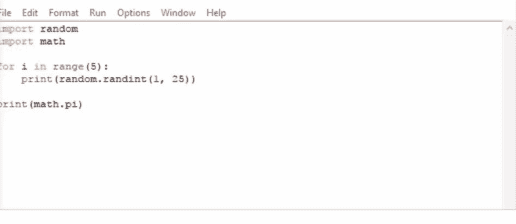

# 第 6
模块包含了在代码中实现某些结果所需的额外代码，正如我们之前解释过的。通过随机生成器，你可以使用它创建类似：

```python
File Edit Run Help
import random
for i in range(10):
    print(random.randint(1,25))
```

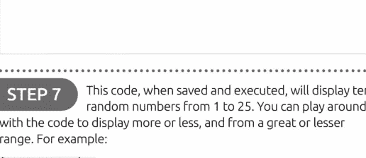

# 第 9
结果是随机数以及从 `math` 模块提取的 Pi 值。你也可以使用 `from import` 命令从模块中提取某些函数，例如：

```python
from random import randint

for i in range(5):
    print(random.randint(1,25))
```

```python
C:/Users/Dev/Documents/Python/RandomNumber.py
File Edit Run Help
from random import randint
for i in range(5):
    print(random.randint(1,25))
```

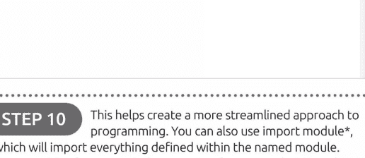

# 第 7
这段代码保存并执行时，将显示从 1 到 25 的随机数。你可以尝试更大或更小的范围，例如：

```python
import random

for i in range(25):
    print(random.randint(1,100))
```

```python
File Edit Run Options Help
import random
for i in range(25):
    print(random.randint(1,100))
```


# 第 10
有助于创建更简洁的方法。你也可以导入模块，这将导入命名模块内的所有内容。然而，它通常被视为一组资源，但为模块保留别名：

```python
import math as m

print(m.pi)
```

当然，添加注释有助于告诉他人正在发生什么。

```python
C:/Users/Dev/Documents/Python/RandomNumber.py
File Edit Run Options Help
import math as m
print(m.pi)
```


## 处理数据


数据就是一切。通过数据，你可以根据每个需求显示、控制、添加、删除、创建和操作 Python。在接下来的页面中，我们将如何创建列表、元组、字典和多维列表；并查看如何使用它们来编写有趣实用的程序。

然后，你可以学习如何使用日期时间函数，向你的系统写入文件，甚至创建图形用户界面将你的编程技能推向新的水平和新的项目想法。

- 46 列表
- 48 元组
- 50 字典
- 52 字符串的分割与合并
- 54 字符串格式化
- 56 日期与时间
- 58 打开文件
- 60 写入文件
- 62 异常
- 64 Python 图形

## 列表
列表是在 Python 中遇到的最常见的数据结构类型之一。列表是项的简单集合（如果你愿意的话，也可以称为数据），可以作为一个整体访问，也可以根据需要单独访问。

## 处理列表
列表在 Python 中非常实用。列表可以是字符串、整数，也可以是变量。你甚至可以在列表中包含函数，并在列表内部包含列表。

列表是一个被称为项的数据值序列。你通过等号创建列表的名称，然后使用方括号用逗号分隔项；注意列表使用引号：

```python
numbers = [1, 4, 7, 21, 98, 156]
mythical_creatures = ["Unicorn", "Balrog", "Vampire", "Dragon", "Minotaur"]
```

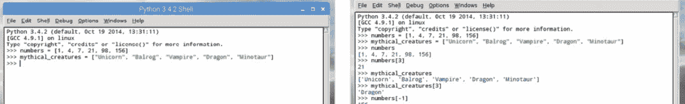

步骤 3 你可以通过使用负号来访问或索引列表中的项，例如 `[-1]`，或倒数第二个项 `[-2]`，依此类推。尝试引用列表中不存在的项，例如 `[10]`，将返回错误：

```python
numbers[-1]
mythical_creatures[-4]
```


步骤 2 一旦你定义了列表，就可以通过引用调用每个项。列表从 0 开始第一个项，然后是 1, 2, 3 等。例如：

`numbers`

要调用列表的所有内容：

`numbers[3]`

要调用列表中的第三个零索引项（在本例中为 21）：


步骤 4 切片类似于索引，但你可以通过冒号分隔项编号来获取列表中的多个项。

`numbers[1:3]`

将输出 4 和 7，即项编号 1 和 2。注意，返回的值不包含第二个索引（位置），所以 `numbers[1:3]` 返回 4 到 7, 21。

# 第 5 步
你可以更新现有列表中的项，移除项甚至同时移除多个列表。例如，你可以：

```
everything = numbers + mythical_creatures
```

然后通过以下命令查看合并后的列表：

```
everything
```


```
>>> Python 3.4.default, Oct 19 2014, 13:11:11
>>> GCC 4.8.2 on linux
>>> print('credits' or 'license') for more information.
>>> numbers = 62
>>> mythical_creatures = ['Unicorn', 'Vampire', 'Dragon', 'Winstaur']
>>> mythical_creatures.append('Nessie')
>>> numbers_plus = numbers + len(mythical_creatures)
>>> mythical_creatures.count('Griffin')
0
>>> print([1, 7, 21, 98, 156, 'Unicorn', 'Vampire', 'Dragon', 'Winstaur'])
>>> mythical_creatures.pop(0)
>>> [1, 7, 21, 98, 156, 'Vampire', 'Dragon', 'Winstaur', 'Nessie']
>>> mythical_creatures.pop(-1)
>>> [1, 7, 21, 98, 156, 'Vampire', 'Dragon', 'Nessie']
```

# 第 6 步

可以通过以下方式向列表添加项：

```
numbers=numbers+[201]
```

或者对于字符串：

```
mythical_creatures=mythical_creatures+['Griffin']
```

或者使用 `append` 方法：

```
mythical_creatures.append('Nessie')
```

```
numbers.append(201)
```

```
>>> Python 3.4.default, Oct 19 2014, 13:11:11
>>> GCC 4.8.2 on linux
>>> numbers.append(201)
>>> print(numbers)
[1, 7, 21, 98, 156, 201]
>>> mythical_creatures = ['Unicorn', 'Vampire', 'Dragon', 'Winstaur']
>>> mythical_creatures.append('Griffin')
>>> print(mythical_creatures)
['Unicorn', 'Vampire', 'Dragon', 'Winstaur', 'Griffin']
>>> mythical_creatures.append('Nessie')
>>> print(mythical_creatures)
['Unicorn', 'Vampire', 'Dragon', 'Winstaur', 'Griffin', 'Nessie']
```

# 第 7 步

移除项有两种方式。第一种是通过项的名称：

```
del numbers[7]
```

或者，通过项名称：

```
mythical_creatures.remove('Nessie')
```

```
>>> Python 3.4.default, Oct 19 2014, 13:11:11
>>> GCC 4.8.2 on linux
>>> numbers.remove(201)
>>> print(numbers)
[1, 7, 21, 98, 156]
>>> mythical_creatures = ['Unicorn', 'Vampire', 'Dragon', 'Winstaur']
>>> mythical_creatures.append('Griffin')
>>> mythical_creatures.append('Nessie')
>>> mythical_creatures.remove('Griffin')
>>> # 等一下等
>>> mythical_creatures.remove('Nessie')
>>> print(mythical_creatures)
['Unicorn', 'Vampire', 'Dragon', 'Winstaur', 'Griffin']
```

# 第 8 步

你可以通过在 Shell 中输入 `dir(list)` 来查看列表可以进行的操作。输出用于在特定位置添加和删除项。要在索引 4 处插入 62：

```
numbers.insert(4, 62)
```

要移除：

```
numbers.pop(4)
```


```
>>> print('credits' or 'license') for more information.
>>> numbers = [62]
>>> dir(numbers)
['add', 'append', 'clear', 'count', 'copy', 'del', 'difference', 'extend', 'count', 'index', 'insert', 'len', 'max', 'min', 'pop', 'remove', 'reverse', 'sort', '__add__', '__iter', '__getitem__', '__setitem__']
>>> numbers.insert(4, 62)
>>> print(numbers)
[62]
>>> numbers.pop(4)
>>> print(numbers)
[]
```

# 第 9 步

你还使用 `list` 函数将字符串拆分为它的组件：

```
list("David")
```

将名字拆分为 'D', 'a', 'V', 'i', 'd'。这可以通过一个新列表来实现：

```
name=list("David Howard")
```

```
age=[44]
```

```
user = name + user
```


```
>>> Python 3.4.default, Oct 19 2014, 13:11:11
>>> GCC 4.8.2 on linux
>>> print('credits' or 'license') for more information.
>>> name=list("David Howard")
>>> print(name)
['D', 'a', 'V', 'i', 'd', ' ', 'H', 'o', 'w', 'a', 'r']
>>> age=[44]
>>> print(age)
[44]
>>> user = "John"
>>> user = name + user
>>> print(user)
['D', 'a', 'V', 'i', 'd', ' ', 'H', 'o', 'w', 'a', 'r']
```

第 10 步

基于此，你可以创建一个程序来存储某些名字和年龄列表：“你叫什么名字？”

```
name=input(name)
```

```
age=int(input("你多大了： "))
```

```
user = name + age
```

合并后的名字和年龄列表可以通过将 `user` 输入 Shell 来调用。实验看看可以做什么。

## 元组 (Tuples)

元组与列表非常相似。然而，列表可以以某种方式更新、删除或更改，而元组保持不变。这被称为**不可变的**，它们非常适合存储固定数据。

## 不变元组

使用元组的原因取决于程序打算做什么：

1. 元组的创建方式与列表相同，但你使用圆括号而不是方括号。例如：

```
months=("January", "February", "March", "April", "May", "June")
```


2. 你可以创建多个数据。例如，这里有一个名为 `NPC`（可玩角色）的元组，包含了角色名字和战斗力：

```
NPC=("Conan", 100), ("Belt", 80), ("Valeria", 95)
```

3. 就像列表一样，命名元组中的项可以通过它们在数据范围中的位置进行索引：

```
months[0]
months[5]
```

然而，任何对元组的删除或添加尝试都会导致 Shell 报错。


4. 这些数据项中的每一个都可以作为一个整体被访问；它们可以通过位置 `NPC[0]` 进行索引。你也可以索引 `NPC` 列表中的个人：

```
NPC[0]
```
将显示 100。


第 5 步 值得注意的是，在列表中引用多个元组时，索引与标准略有不同。使用 Valeria 的 95 评分到 `NPC[4][5]`，但并不完全是：

# 第 8 步 现在将元组解包到两个相应的变量：
`(name, combat_rating)=NPC`

你可以通过输入 `name` 和 `combat_rating` 来检查值。

## NPC[2][1]

```
>>> Python 3.4.2 Shell
Python 3.4.2 (default, Oct 19 2014, 13:31:17)
>>> GCC 4.9 on linux
type=('copyright', 'credits' or 'license') for more information.
NPC=[('Conan', 100), ('Belt', 80), ('Valeria', 95)]
print(NPC[0])
('Conan', 100)
print(NPC[1])
('Belt', 80)
print(NPC[2])
('Valeria', 95)
print(NPC[2][1])
1
```

```
>>> Python 3.4.2 Shell
Python 3.4.2 (default, Oct 19 2014, 13:31:17)
>>> GCC 4.9 on linux
type=('copyright', 'credits' or 'license') for more information.
name, combat_rating=NPC
print(combat_rating)
95
```

# 第 6 步 这意味着索引顺序遵循了我们：

- 0 1, 1
- 0, 0 2
- 0, 1 2, 0
- 1
- 1, 0

# 第 9 步 记住，像列表一样，你也可以使用从列表末尾倒数的数字对元组进行索引。例如，使用多个数据列表，你会这样引用 Valeria：如果你有顶级数据要处理，这可以给你一点信心。

# 第 7 步 元组利用了一种打包特性，数据项存储在元组（名字和战斗力评分）中：

# 第 10 步 你可以使用 `max` 和 `min` 函数找到数字元组的最高和最低值。

## NPC=('Conan', 100),

`numbers=(10.3, 23, 45.2, 109.3, 6.1, 56.7, 99)`

数字可以是整数或浮点数。输出最高和最低值：

```
>>> Python 3.4.2 Shell
Python 3.4.2 (default, Oct 19 2014, 13:31:17)
>>> GCC 4.9 on linux
type=('copyright', 'credits' or 'license') for more information.
NPC=[('Conan', 100)]
```

## 字典

列表非常有用，但 Python 中的字典（dictionaries）是目前处理数据项的更好的方法。起初可能很难掌握，但你很快就能将它们应用到自己的代码中。

## 键值对

字典类似于列表，但每个项都以对的形式出现，这些被称为“键”（Key）和“值”（Value）。键（Key）部分必须是唯一的，可以是数字或字符串，而值（Value）可以是任何数据项，例如：

- 步骤 1 假设你想在 Python 中创建一个字典。你会创建一个字典名称，并在花括号中输入数据，用冒号分隔键和值：`Key:Value`。例如：

```python
phonebook={'Emma": 1234, "Daniel": 3456, "Hannah": 6789}
```

```python
Python 3.4.2 Shell
>>> phonebook['Emma']
1234
>>> phonebook['Daniel']
3456
>>> phonebook['Hannah']
6789
>>> phonebook['David']
Traceback (most recent call):):  File "<stdin>", line 1, in <module>
File "<string.py>", line 105, in __getitem__
KeyError: 'David'
```

- 步骤 3 与列表和元组一样，你可以通过提供字典名称（在本例中为 `phonebook`）来检查字典的内容。这无疑将显示你想要的数据项。


- 步骤 2 就像大多数列表、元组等一样，字符串必须包含在引号（单引号或双引号）中，而整数可以不加。值可以是字符串或整数，你只需要将结果括在引号中：

```python
phonebook={'David": 0987 654 321}
```

```python
Python 3.4.2 Shell
>>> phonebook['Emma']
1234
>>> phonebook['Daniel']
3456
>>> phonebook['Hannah']
6789
>>> phonebook['David']
0987 654 321
```

- 步骤 4 使用字典的处是是你可以输入键来索引值。使用前面步骤中的 `phonebook` 示例，你可以：

```python
phonebook['Emma']
phonebook['Hannah']
```

```python
Python 3.4.2 Shell
>>> phonebook['Emma']
1234
>>> phonebook['Daniel']
3456
>>> phonebook['Hannah']
6789
```

## 步骤 5

向字典添加内容也很简单。你可以通过添加新的键和 `phonebook` 来包含一个新的数据项：

```python
phonebook["David"] = "0987 654 321"
```

```python
Python 3.4.2 Shell
File Edit Shell Debug Options windows help
>>> 3.4.2 (default, Oct 19 2013, 13:51:11)
>>> (c) 2001-2013 Python Foundation, type "copyright" or "license" for more information.
>>> phonebook = {"David": 1234, "Emma": 3456, "Hannah": 6789}
>>> phonebook["Hannah"] = 6789
>>> phonebook["David"] = "0987 654 321"
>>> phonebook
{'David': '0987 654 321', 'Emma': 3456, 'Hannah': 6789}
```

## 步骤 6

你也可以通过键执行 `del` 命令从字典中删除项；该值将被移除，其数据对也会被移除：

```python
del phonebook["David"]
```

```python
Python 3.4.2 Shell
File Edit Shell Debug Options windows help
>>> 3.4.2 (default, Oct 19 2013, 13:51:11)
>>> (c) 2001-2013 Python Foundation, type "copyright" or "license" for more information.
>>> phonebook = {"David": 1234, "Emma": 3456, "Hannah": 6789}
>>> del phonebook["David"]
>>> phonebook
{'Emma': 3456, 'Hannah': 6789}
```

## 步骤 9

注意，尽管值可以是字符串或反之，我们仍将数字保留为整数。你现在需要将用户的输入添加到新的空字典中。使用步骤 5 中的相同过程，你可以：

```python
phonebook[name] = number
```

## 步骤 8

接下来，你需要定义用户输入和变量：一个用于人的名字，另一个用于电话号码——让我们保持简单以避免冗代码：

```python
name=input("Enter name: ")
number=int(input("Enter phone number: "))
```

```python
Python 3.4.2 Shell
File Edit Shell Debug Options windows help
>>> phonebook = {}
>>> name=input("Enter name: ")
>>> number=int(input("Enter phone number: "))
>>> phonebook[name]
```


## 步骤 7

通过添加新的键和 `phonebook` 进一步，这将向用户询问键和值：

```python
Python 3.4.2 Shell

File Edit Shell Debug Options windows help

>>> 3.4.2 (default, Oct 19 2013, 13:51:11)

>>> (c) 2001-2013 Python Foundation, type "copyright" or "license" for more information.

>>> phonebook = {}

>>> name=input("Enter name: ")

>>> number=int(input("Enter phone number: "))

>>> phonebook[name]
```

## 步骤 10

使用字典的处是你可以输入键来索引值。使用前面步骤中的 `phonebook` 示例，你可以：新的空字典：

```python
Python 3.4.2 Shell

File Edit Shell Debug Options windows help

>>> 3.4.2 (default, Oct 19 2013, 13:51:11)

>>> (c) 2001-2013 Python Foundation, type "copyright" or "license" for more information.

>>> phonebook = {}

>>> name=input("Enter name: ")

>>> number=int(input("Enter phone number: "))

>>> phonebook[name]
```

## 字符串的分割与合并

### 字符串的合并

`.split` 的反面是 `join`，你从字符串中分割项并将它们全部合并。

## 字符串方法

## 字符串的分割与合并

你可以在字符串上使用逻辑运算符，检查字符串是否包含（或不包含）字符序列：

## 字符串格式化

当你处理数据、创建列表、字典和对象时，可能经常想要输出结果。将字符串与数据合并是很容易，特别是在 Python 3 中，因为早期的 Python 版本往往会把事情变得复杂。

### 字符串格式化

从 Python 3 开始，字符串格式化变成了一个更加整洁的过程，使用了 `.format()` 函数结合大括号。这比以前的方法更具逻辑，也更好。

#### 步骤 1
Python 中的基础格式化是使用大括号将每个变量引入字符串中：
```python
name="Conan"
print("the barbarian hero of the Hyborian Age is: {}".format(name))
```

#### 步骤 3
你也可以将整数包含其中：
```python
number=100000
print("{} was a killed mercenary, and thief too. He once stole {}{} gold from a merchant.".format(name, number))
```


应用字符串格式化的有很多方法，正如我们在这里展示的，它们非常简单。知道你想要程序实现什么很重要。经常引用字符串格式化的好地方是 Python 文档，可以在 `docs.python.org/3/library/string.html` 。在这里，你会找到大量的：


#### 步骤 5

有趣的是，你可以将列表传递给字符串格式化函数。你需要在列表名称前使用一个星号：

```python
numbers=1, 3, 45, 567546, 3425346345
print("Some numbers: {}, {}, {}, {}, {}").format(*numbers))
```

```python
Python 3.2 Shell

Edit Help Debug Context Window

Python 3.4.2 (default, Oct 19 2014, 23:11:13)

(C) 4.6.1) on Linux

>>> print("copyright", credits or "license" for more information.

>>> print("Some numbers: {}, {}, {}, {}, {}")

>>> numbers.format(*numbers)

1, 3, 45, 567546, 3425346345
```

#### 步骤 8

你也可以同样的方式打印用户输入的内容：

```python
name=input("What's your name ?")
print("Hello {}.".format(name))
```


#### 步骤 6

通过列表索引，同样的方法适用于使用格式化调用列表。你可以通过位置（0 到存在的任何数量）对每个项进行索引：

```python
numbers=[4, 2, 9]
print("More numbers: {}, {}, {}")
print("{0}".format(numbers))
```

```python
Python 3.2 Shell

Edit Help Debug Context Window

Python 3.4.2 (default, Oct 19 2014, 23:11:13)

(C) 4.6.1) on Linux

>>> print("copyright", credits or "license" for more information.

>>> print("More numbers: {}, {}, {}")

>>> print("{0}".format(numbers))

4, 2, 9
```

#### 步骤 9

你可以扩展这段简单的代码来显示人名的第一个字母：

```python
name=input("What's your name ?")
print("Hello {}.".format(name))
name=name[0]
print("The first letter of your name is {0}".format(name))
```


#### 步骤 7

你可能可以将字符串和整数混合在一个列表中通过 `.format` 函数调用。

```python
Python 3.2 Shell

Edit Help Debug Context Window

Python 3.4.2 (default, Oct 19 2014, 23:11:13)

(C) 4.6.1) on Linux

>>> print("copyright", credits or "license" for more information.

>>> print("{0} is 3 years old. Where is {1} years old.".format(characters))

Conan is 3 years old. Where is 2 years old.
```

#### 步骤 10

你也可以在同一个函数内单独调用列表对。回看代码 7，你可以这样修改它：

```python
Python 3.2 Shell
Edit Help Debug Context Window
Python 3.4.2 (default, Oct 19 2014, 23:11:13)
(C) 4.6.1) on Linux
>>> print("copyright", credits or "license" for more information.
>>> print("{0} is {1} years old. Where is {2} years old.".format(names[0], ages[1]))
Conan is 25 years old. Valeria is 21 years old.
```


## 日期和时间

在处理日期时，经常需要时间。例如，你可能想要记录用户登录系统的时间以及持续了多久。获取日期和时间很容易，多归于 `time` 模块。`time` 模块包含了帮助你获取当前时间、从字符串读取日期、格式化日期等。

**步骤 1** 如果你需要导入时间模块，它是 Python 内置的。一旦导入，你可以使用简单的命令调用当前日期和时间：

```python
import time
time.ctime()
```


**步骤 3** 你可以看到时间的呈现结构：

```python
time.local_time()
```

输出显示为 `'time_struct(tm_year=2017, tm_mon=9, tm_day=7, tm_hour=9, tm_min=6, tm_sec=13, tm_wday=3, tm_yday=25, tm_isdst=0)`，取决于你的当前时间，而不是上面的。


**步骤 2** 时间被拆分为元组，被分为索引项，就像任何其他元组一样。

| 索引 | 字段 | 数值 |
| :--- | :--- | :--- |
| 0 | 四位年份 | 2016 |
| 1 | 月份 | 1 到 12 |
| 2 | 日期 | 1 到 31 |
| 3 | 小时 | 0 到 23 |
| 4 | 分钟 | 0 到 59 |
| 5 | 秒 | 0 到 61 (或 60) |
| 6 | 周几 | 0 到 6 (0 是周一) |
| 7 | 年日 | 1 到 366 (儒略) |
| 8 | 夏令时 | -1, 0, 1 (意味着 DST) |

**步骤 4** `time` 模块中内置了许多函数。最常用的之一是 `.strftime()`。通过它你可以呈现广泛的参数，因为它将时间元组转换为字符串。例如，要显示当前的星期几，你可以使用：

```python
time.strftime('%A')
```


步骤 5 这自然意味着你可以将各种函数整合到你自己的代码中，例如你在上一个章节末尾看到的步骤 8，在用户想要的情况下，Python 中可以对时间取许多小数。取上面的代码并稍微修改它，包含：

```python
time.strftime("%Y")
time.strftime("%B")
time.strftime("%m")
time.strftime("%d")
time.strftime("%H:%M:%S")
```

```python
start_time=time.time()
```

然后：

```python
end_time=time.time()-start_time
```


| Ed Edit File Debug Options help | |
| :--- | :--- |
| Python 3.4.2 (Default, Oct. 19, 2014, 13:31:11) | |
| (C) 3.4.2 in time | |
| Type "credits" or "license" for more information. | |
| >>> time.strftime("%Y") | |
| >>> >>> time.strftime("%B") | |
| >>> >>> time.strftime("%m") | |
| >>> >>> time.strftime("%d") | |
| >>> >>> >>> time.strftime("%H:%M:%S") | |
| 2014 October 19 13:31:11 | |

步骤 6 注意这两个项目 `%H` 和 `%H:%M`，正如你看到的，作为最后的项输入 `%H:%M` 在 Shell 中无法正确显示时间。你可以轻松地修复它：

步骤 9 输出将如下面的截图所示。计时器函数需要在输入的两侧，因为当变量名创建时，取决于用户花费了多久。时间的长度然后在最后一行代码中显示为 `endTime` 变量。

```python
time.strftime("%H:%M")
```

步骤 7 这意味着我们将能够显示编辑器当前的日期和时间（注：此处原文似乎有笔误，本意应为 `import time`）：

```python
import time
name=input("Enter name: ")
print("User:", name)
print("User:", name, "logged in at,", time.strftime("%H:%M:%S"))
```

步骤 10 尝试扩展此以包含月份、年份等。

`www.bdm.com`

17

## 打开文件

在 Python 中，你可以在程序中读取和写入二进制文件。你还可以向文件中写入，这是我们想要学习的内容。读取和写入文件允许你从程序中输出和存储数据。

## 打开、读取和写入

在 Python 中，你创建一个文件对象，类似于创建一个变量，只需使用 `open()` 函数传递文件即可。文件通常被归类为文本或二进制文件。

- 第一步：首先在你的系统文本编辑器中输入一些文本。最好使用文本编辑器而不是文字处理程序，因为文字处理器包含格式和其他元素。在我们的示例中，是罗伯特·爱德华·霍的诗《西默利亚》（Poem Cimmerian）。你需要将文件保存为 `poem.txt`。

- 第二步：使用 `open()` 函数将文件作为对象传递给变量。你现在可以告诉 Python 你正在使用的文件名称和位置：

```python
poem=open("/home/pi/Documents/Poem.txt")
```

```python
print(poem.read("/home/pi/Documents/Poem.txt"))
```

这一次，`\n` 条目被移除，取而代之的是换行符和可读的文本。


- 第三步：如果你在 Shell 中输入 `poem`，你将获得有关你刚刚请求打开文本的一些信息。你现在可以使用 `poem` 变量读取文件的内容：

```python
poem.read()
```

注意返回文本中某个条目里的 `\n` 表示换行，你可以使用它。


### 第五步

就像列表、元组、字典等一样，你可以对文本的单个字符进行索引。例如：

```python
poem.read(5)
```

显示前几个字符，而输入：

```python
poem.read(5)
```

将显示下一个五个。输入 `(1)` 将一次显示一个字符。

### 第八步

进一步扩展，你可以使用 `readline()` 获取文本的所有行并将它们存储为多个列表。这些列表可以存储在一个变量中：

```python
poem=open("/home/pi/Documents/poem.txt")
lines=poem.readlines()
lines[0]
lines[1]
```


```python
Python 3.2.2 (default, Oct 19 2014, 13:31:11)
>>> type("credits" or "license") 获取更多信息.
>>> poem=open("/home/pi/Documents/poem.txt")
>>> poem.readline()
>>> poem.readline()
>>> 'number'
>>> 'the dark woods, masking slopes of sombre hills:\n'
>>> 'the grey clouds leading everlasting arch:\n'
```

你也可以通过 `readline()` 函数一次显示一行文本。

```python
poem=open("/home/pi/Documents/poem.txt")
```

将显示文本的第一行，带有：

```python
poem.readline()
```

再次显示下一行文本。

```python
poem.readline()
```

### 第九步

你也可以使用语句来读取文本行：

```python
for lines in poem:
    print(lines)
```

由于这是 Python，还有其他方法产生相同的输出：

```python
poem=open("/home/pi/Documents/poem.txt")
for lines in poem:
    print(lines)
```


```python
Python 3.2.2 (default, Oct 19 2014, 13:31:11)
>>> type("credits" or "license") 获取更多信息.
>>> poem=open("/home/pi/Documents/poem.txt")
>>> poem.readline()
>>> 'number'
>>> 'the dark woods, masking slopes of sombre hills:\n'
```

# 第七步

你可能已经猜到你可以将 `readline()` 函数传递给变量，允许你再次调用它：

```python
poem=open("/home/pi/Documents/poem.txt")
line=poem.readline()
```

```python
print(line)
```


```python
Python 3.2.2 (default, Oct 19 2014, 13:31:11)
>>> type("credits" or "license") 获取更多信息.
>>> poem=open("/home/pi/Documents/poem.txt")
>>> poem.readline()
>>> 'number'
```

# 第十步

这就像你想逐字符打印的文本，就像你使用的旧式点阵打印机一样，使用你所看到的文本模式。尝试一下：

```python
import time
poem=open("/home/pi/Documents/poem.txt")
line=poem.readline()
for lines in poem:
    print(lines)
    time.sleep(0.15)
```

输出是有趣的，可以很容易地整合到你的代码中。


# 写入文件

在 Python 中读取文件很有用，但写入文件更好。使用 `write()` 函数，你可以将程序的输出到一个可以读回 Python 的文件中。

## 写入并关闭

`write()` 函数比 `read()` 稍微复杂。除了文件名，还必须包含一个访问模式来决定文件是读取模式还是写入模式。

- 开始 IDE 并输入：

```python
t=open("/home/pi/Documents/text.txt", "w")
```

将目标 `/home/pi/Documents` 更改为你自己的系统。代码将使用 'w' 模式创建 `text.txt`。如果目录下不存在该文件，它将创建一个。如果已经存在，它将覆盖它，所以请小心。


然而，实际文本仍然是空白（你还没有写入文件）。`write()` 函数的一部分需要将更改提交到文件；你可以通过输入来实现：

```python
t.close()
```

你现在可以使用 `write()` 函数打开文件进行写入操作，而不是读取。尝试一下：

```python
t.write("You awake in a small, square room. A single table to one side, there is locked door in front of you.")
```

注意你输入的字符数。


- 第五步：为了扩展此代码，你可以使用 'a' 重新打开文件进行追加模式。这将任何文本添加到文件末尾，而不是擦除文件并创建一个新示例。

```python
t=open("/home/pi/Documents/text.txt", "a")
t.write("\n")
```

站着观察周围。桌子上有一杯水。

- 第八步：你可以将变量传递到你在 Python 中创建的文件。你希望 PI 的值被写入其中。你可以从模块调用 PI，创建一个新变量并将 PI 的输出传递进去：

```python
import math
print("Value of PI is{}".format(math.pi))
print("writing to a file...")
```


- 第六步：你可以逐行扩展文本，每行以换行符 (\n) 结尾。当你想完成时，调用 `close()` 并在编辑器中查看文件。

```python
t.write("The door is made of solid oak with iron strips. It's bolted from the outside locking you in. You are a prisoner!\n")
t.close()
```

- 第九步：现在创建一个变量 `pi` 并给它赋值 PI 的值：你还需要创建一个新文件：

```python
pi=math.pi
t=open("/home/pi/Documents/pi.txt", "w")
```

记得将文件位置更改为你特定的系统设置。


- 第七步：使用 `open()` 函数有不同的文件访问。每个取决于你的需求，`r+` 以读写模式打开文件并将光标置于文件开头。

- 第十步：完成时，使用字符串格式化调用变量并写入文件，然后提交更改并关闭文件：

```python
t.write("Value of PI is:{}".format(pi))
t.close()
```

从结果可以看出，你可以将任何变量传递到文件中。


## 异常

在编码时，你自然会遇到一些无法控制的问题。假设你要求用户除以两个数字，而他们尝试除以零。此报告将创建一个错误并破坏你的代码。

## 异常对象

与其停止代码的流，Python 包含了异常对象来处理代码中的意外错误。你可以通过创建可能发生异常的情况来对抗错误。

- 第一步：你可以只需尝试将数字除以零创建一个异常。这将返回 `ZeroDivisionError: division by zero` 信息，如截图所示。有许多方法。

- 第三步：你可以使用 `raise` 函数来创建自己的错误处理代码。假设发生了了核心崩溃，你可以创建一个自定义异常。

```python
raise Exception("warp breach")
```

```python
Python 3.2.2 (default, Oct 19 2014, 13:31:11)
>>> type("credits" or "license") 获取更多信息.
Traceback (most recent call last):
  File "<stdin>", line 1, in <module>
ZeroDivisionError: division by zero
```

```python
Python 3.2.2 (default, Oct 19 2014, 13:31:11)
>>> type("credits" or "license") 获取更多信息.
>>> raise Exception("warp breach")
Traceback (most recent call last):
  File "<stdin>", line 1, in <module>
Exception: warp breach
```

- 第二步：大多数异常是 Python 遇到代码中有错误时自动抛出的。你自己的异常设计用于包含潜在错误并对其反应，而不是让代码失败。

- 第四步：为了捕获代码中的任何错误，在 `try` 块中捕获潜在错误：此块由 `try`、`except` 组成，除非代码隐藏在其中；那么有一个异常来执行某些操作。

| BaseException |

| --- |

| SystemExit |

| KeyboardInterrupt |

| GeneratorExit |

| MemoryError |

| BaseError |

| ArithmeticError |

| ZeroDivisionError |

| OverflowError |

| IndexError |

| LookupError |

| NameError |

| AttributeError |

| TypeError |

| ValueError |

| ImportError |

| KeyError |

| RuntimeError |

| NotImplementedError |

| StopIteration |

| SyntaxError |

| IndentationError |

| TabError |

| AssertionError |

| UnicodeError |

| UnicodeDecodeError |

| FileNotFoundError |

| FileError |

| PermissionError |

| IsError |

| FileError |

| TimeoutError |

| ConnectionError |

| SocketError |

| EnvironmentError |

| BlockingError |

| ArithmeticError |

| RuntimeError |

```python
Edit File Format Options windows Help
Insert your operations here -->
try:
  if there is an exception then do this -->
except:
  if there is another exception then do this -->
else:
  if there is no exception, then do this --
```

## 第 5 步

例如，使用除以零错误。你可以创建一个异常，让代码能够处理错误，而不会导致 Python 因为该问题而退出：

```python
try:
    a=int(input("Enter the first number: "))
    b=int(input("Enter the second number: "))
    print(a/b)
except ZeroDivisionError:
    print("You have tried to divide by zero!")
else:
    print("You did not divide by zero. Well done!")
```


## 第 8 步

自然地，你可以通过将“r”只读实例更改为“w”写入模式来快速解决此问题。正如你所知道的，创建文件并写入提交更改的内容。最终结果将是一个情况报告，在这种情况下，是代码成功执行。

```python
with open("file.txt", "w") as f:
    f.write("This is a test. Normal service was overwritten")
```


## 第 6 步

你可以使用异常来处理各种实用的任务。参考我们之前教程中的示例，假设你打开了一个文件并向其写入：

```python
try:
    txt = open("/home/pi/Documents/textfile.txt", "r")
    txt.write("This is a test. Normal service will shortly resume!")
except IOError:
    print("Error: unable to write the file. Check permissions")
else:
    txt.write("Content written to file successfully. Have a nice day.")
    txt.close()
```


## 第 9 步

你也可以使用 `finally:` 块，它的工作方式类似，但你同样可以使用它。使用我们第 8 步的示例：

```python
try:
    txt = open("/home/pi/Documents/textfile.txt", "r")
    txt.write("This is a test. Normal service will shortly resume!")
except IOError:
    print("Error: unable to write the file. Check permissions")
finally:
    print("Content written to file successfully. Have a nice day.")
    txt.close()
```


## 第 7 步

显然，这不起作用，因为文件 `textfile.txt` 是以读读（“r”部分）打开的。因此 Python 会提示你做错了，你使用 `IOError` 代码创建了一个异常，通知用户权限不正确。

## 第 10 步

当发生错误时，你使用了“只读”实例。如果你将其更改为“w”，代码将执行而不会在 IDLE Shell 中显示错误。不用说，第一次获取异常代码可能有点棘手。练习一下这个，你就会掌握了。

```python
try:
    txt = open("/home/pi/Documents/textfile.txt", "w")
    txt.write("This is a test. Normal service will shortly resume!")
except IOError:
    print("Error: unable to write the file. Check permissions")
else:
    txt.write("Content written to file successfully. Have a nice day.")
    txt.close()
```

## Python 图形

## 进入图形化

你可以绘制简单的图形、线条、正方形等，也可以使用提供的许多 Python 模块之一来呈现壮丽的效果。

- **第 1 步** 开始学习 Python 的最佳图形模块之一是 Turtle（乌龟）。正如其名所示，Turtle 模块基于许多学校使用的乌龟，它可以被编程在一张大纸上画画东西。可以通过 `import turtle` 导入 Turtle 模块。

- **第 3 步** 命令 `turtle.circle(50)` 用于在屏幕上画圆，50 是大小。如果你喜欢，可以尝试不同的尺寸，增加到 100、150 更多；你可以通过输入 `turtle.circle(50, 180)` 来绘制圆弧，其中大小为 50，但你告诉 Python 只画圆的 180°。


- **第 2 步** 让我们从画一个简单的圆开始。新建一个文件，然后输入以下代码：

```python
import turtle
turtle.circle(50)
turtle.getscreen().root.mainloop()
```

- **第 4 步** 圆形代码的最后部分告诉 Python 保持绘图窗口打开，以便用户可以关闭它。现在，让我们画一个正方形：

```python
import turtle
print("Drawing a square...")
for i in range(4):
    turtle.forward(100)
    turtle.left(90)
turtle.getscreen().root.mainloop()
```

像往常一样按 F5 保存并执行代码。一个新窗口将打开，“Turtle”将画圆。你可以看到我们插入了一个循环来绘制正方形的边。


- **第 5 步** 你可以在正方形代码中添加新行来添加颜色：

```python
turtle.color("Red")
```

然后通过将形状改为乌龟：

```python
turtle.shape("turtle")
```

你还可以使用 `turtle.begin_fill()` 和 `turtle.end_fill()` 命令为正方形填充颜色：在这种情况下是红色和黄色。


- **第 8 步** 现在通过导入 `pygame` 模块来获取代码：

```python
import pygame
pygame.init()
img = pygame.image.load("RPI.png")
white = (255, 255, 255)
w = 900
h = 450
screen = pygame.display.set_mode((w, h))
screen.blit(img,(0,0))
pygame.display.flip()
```


```python
while True:
    for event in pygame.event.get():
        if event.type == pygame.QUIT:
            pygame.quit()
```

### 第 6 步
当你开始掌握它时，你可以看到 `Turtle` 可以绘制一些形状并变得复杂。输入这段代码：

```python
from turtle import *
color('red', 'yellow')
begin_fill()
forward(200)
while True:
    left(170)
    if abs(pos()[0]) < 1:
        break
end_fill()
done()
```

这是一个不同的方法，但非常有效。


### 第 9 步
在上一步中你导入了 `pygame` 引擎并要求它将 Raspberry Pi 图片保存为 `RPI.png`。接下来你定义窗口的背景颜色以显示图像，并将窗口尺寸设置为实际尺寸。最后你需要循环代码。

```python
w = 900
h = 450
screen = pygame.display.set_mode((w, h))
screen.fill(white)
screen.blit(img,(0,0))
pygame.display.flip()
```

```python
while True:
    for event in pygame.event.get():
        if event.type == pygame.QUIT:
            pygame.quit()
```

使用 `pygame` 显示图形的另一种方法。有很多方法可以在屏幕上输出图形，现在让我们查看定义的图像。先打开浏览器找到一张图片，然后将其保存到保存 Python 代码的文件夹。

### 第 10 步
按 `F5` 保存并执行代码，你的图片将在新窗口中显示。尝试各种颜色、尺寸等，花些时间在 `pygame` 模块中创建许多函数。


## 使用模块


Python 模块只是 Python 创建源文件，包含了类、函数和全局变量的必要代码。你可以绑定和引用模块来扩展功能并创建更精彩的 Python 程序。

想看看如何改进这些模块为你的代码添加一些额外内容吗？继续阅读并学习如何使用它们来编写精彩的代码。

| 68 | Calendar 模块 |

|---|---|

| 70 | OS 模块 |

| 72 | Random 模块 |

| 74 | Tkinter 模块 |

| 76 | Pygame 模块 |

| 80 | 创建自己的模块 |

## Calendar 模块

除了 `time` 模块，`calendar` 模块在代码中执行时可以产生一些有趣的结果。它远比简单显示 `time` 模块格式的日期要得多，你实际上可以调用挂历类型的显示。

### 处理日期

`calendar` 模块内置在 Python 3 中。然而，由于某些原因未安装，你可以作为 Windows 管理员使用 `pip install calendar` 或在 Linux 和 macOS 上使用 `sudo pip install calendar`。

### 第 1 步

在 Python 中输入：

```python
import calendar
```

输入这段代码：

```python
from turtle import *
color('red', 'yellow')
begin_fill()
forward(200)
while True:
    left(170)
    if abs(pos()[0]) < 1:
        break
end_fill()
done()
```

这是一个不同的方法，但非常有效。


### 第 3 步

在编写代码时，`calendar` 中的许多函数可能会感兴趣。例如，你可以显示特定年份之间的闰年数量：

```python
leaps=leapdays(1900, 2018)
```

结果是 29，从 1904 年开始。

### 第 2 步

你可以看到 2017 年 9 月的日期是挂历形式。自然地，你可以将起始行的 2017, 9 部分改为你想要的任何月份，例如生日（1973, 6）。第一行配置 `Text` 将每周开始设置为周日；如果你更喜欢，可以输出周一。

```python
calendar.Text(calendar.SUNDAY)
>>>
calendar.month(2017, 9)
Mo Tu We Th Fr Sa Su
 1  2  3  4  5  6  7
8  9 10 11 12 13 14
15 16 17 18 19 20 21
22 23 24 25 26 27 28
29 30 31
```

## 日历模块

### 第 5 步
你还可以创建一个程序，显示指定年份内所有的天数、周和月份：

```python
import calendar
year=int(input("输入要显示的年份: "))
print(calendar.calendar(year))
```

我们相信你也会认为这是一段非常实用的代码。

### 第 8 步
你还可以打印单独的月份或星期几几天：

```python
import calendar
for name in calendar.month_name:
    print(name)
import calendar
for name in calendar.day_name:
    print(name)
```


### 第 6 步
有趣的是，我们还可以使用简单的循环列出每月的天数：

```python
import calendar
cal=calendar.Text(calendar.SUNDAY)
for i in cal.monthdays(2018, 6):
    print(i)
```

### 第 9 步
日历模块还允许我们编写 HTML 格式函数，这样你就可以把它显示在网站上。让我们先创建一个文件：

```python
import calendar
cal=open("/home/pi/Documents/calendar.html", "w")
cal=calendar.HTML(calendar.SUNDAY)
cal.write(cal.format(2018, 1))
cal.close()
```


### 第 7 步
你可以看到代码在开头产生了一些零，这是由于在这种情况下该周的开始日，以及与上个月重叠的天数导致的。因此，天数计数将从 2018 年 6 月 1 日开始，并正确地输出总数为 30 天。

### 第 10 步
当然，你可以修改代码以在下面的网页中显示指定的日期：

```python
import calendar
year=int(input("输入要作为网页显示的年份: "))
cal=open("/home/pi/Documents/calendar.html", "w")
cal=calendar.HTML(calendar.MONDAY).formatyear(year)
cal.close()
```

这段代码要求用户输入年份，然后创建必要的网页。记得更改你的文件路径。


## OS 模块

`OS` 模块允许你直接与操作系统中的内置命令进行交互。命令取决于你运行的操作系统，某些命令可以在 Windows 上运行，而另一些则适用于 Linux 和 macOS。

### 在系统中

`OS` 模块的主要功能之一是能够列出、移动、创建、删除以及其他方式与存储在系统中的文件交互，使其成为备份的完美模块。

### 第 1 步
你可以使用一些示例函数启动 `OS` 模块，看看它是如何与操作系统环境交互的。如果你正在使用 Linux 或树莓派，请尝试这个：

```python
import os
home=os.getcwd()
print(home)
```

### 第 3 步
Windows 的输出之所以不同，是因为它是 Python 的当前工作目录，正如你所怀疑的那样，`os.getcwd()` 函数要求 Python 获取当前工作目录。Linux 用户将看到与之类似的内容，例如树莓派将显示


### 第 2 步
变量 `home` 返回的结果是系统中当前用户的文件夹。在我们的示例中，`/home/pi` 将取决于你登录的操作系统。Windows 10 将输出：`C:\Program Files (x86)\Python36`。

### 第 4 步
`OS` 模块的另一个有趣元素是它可以启动安装在系统中的程序。例如，如果你想在 Python 程序中启动 Chrome 浏览器，可以使用：

```python
import os
browser=os.system("/usr/bin/chromium-browser")
```


### 第 5 步

`os.system()` 函数允许与外部程序交互；你可以使用这种方法调用之前的 Python 程序。你显然需要完整的路径和程序名称才能使其工作。你可以使用：

```python
import os
os.system('start "https://www.youtube.com/feed"')
```


### 第 8 步
操作目录或文件夹的能力是 `OS` 的最佳功能之一。例如，创建一个新目录，你可以使用：

```python
import os
os.mkdir("NEW")
```

这会在当前工作目录下创建一个新目录。


### 第 6 步
对于第 5 步的示例，我们使用了 Windows 来证明 `OS` 模块在所有平台上大体相同。在这种情况下，打开 YouTube，因此可以打开特定的页面：

```python
import os
os.system('chromium-browser http://bdm.com/')
```

### 第 9 步
你可以通过以下方式重命名你创建的目录：

```python
import os
os.rename("NEW", "OLD")
```

要删除：

```python
import os
os.rmdir("OLD")
```


### 第 7 步
注意上一步示例中单引号和双引号的使用。单引号封装了整个启动 Chrome 命令，而双引号打开了特定页面。你甚至可以使用变量在浏览器中调用多个标签页：

```python
import os
a='chromium-browser http://bdm.com/'
```

```python
b='chromium-browser http://www.google.uk/'
os.system(a + b)
```

### 第 10 步
另一个与 `OS` 配合的模块是 `shutil`。你可以结合使用 `shutil` 模块和 `OS` 创建带有时间戳的目录并将文件复制其中：

```python
import os, shutil, time
root_src_dir = '/home/pi/Documents/' + time.asctime()
root_dst_dir = '/home/pi/backup/'
for root_src, dir_src, files in os.walk(root_src_dir):
    dir_dst = root_src.replace(root_src_dir, root_dst_dir)
    if not os.path.exists(dir_dst):
        os.makedirs(dir_dst)
    for file in files:
        src_file = os.path.join(root_src, file)
        dst_file = os.path.join(dir_dst, file)
        if not os.path.exists(dst_file):
            shutil.copy2(src_file, dst_file)
print(">>>>Backup complete<<<<<<")
```


## Random 模块

`random` 模块你在 Python 编程生命中会遇到很多；正如名称所示，它设计用于创建随机数字或字母。然而，它并不是真正的随机，但足以满足大多数需求。

### 随机数

`random` 模块中有许多函数，应用后可以创建一些有趣且实用的 Python 程序。

### 第 1 步
就像其他模块一样，在使用任何一个函数之前需要导入 `random`。我们将详细查看。让我们从简单打印一个 1 到 5 之间的随机数开始：

```python
import random
print(random.randint(0,5))
```


### 第 2 步
在我们的示例中，返回的 `home` 变量是系统中当前用户的文件夹。`/home/pi` 将取决于你使用的操作系统。Windows 10 将输出：`C:\Program Files (x86)\Python36`。


### 第 3 步
对于更大的数字集，你可以通过以下方式扩展浮点数数字：

```python
import random
print(random.random()*100)
```

这将显示 0 到 100 之间的点。


### 第 6 步
有趣的是，你可以使用 `random` 模块来打乱列表中的项，从而在方程中增加一些随机性：

```python
import random
random.shuffle(list)
```

这种方式可以让你从列表中选择随机项。

### 第 9 步
让我们使用一个抛掷硬币的示例来统计正面或反面：

```python
import random
output={"Heads":0, "Tails":0}
coin=list(output.keys())
for i in range(10000):
    output[random.choice(coin)]+=1
print("Heads:", output["Heads"])
print("Tails:", output["Tails"])
```


### 第 7 步
使用 `shuffle`，你可以创建一个完全随机的数字列表。从给定的范围开始：

```python
import random
list=[i for i in range(20)]
random.shuffle(list)
print(list)
```

继续打乱列表，你可以每次从 0 到 20 中选择不同的项目。

### 第 10 步
使用一个包含 4666 个单词的文本文件，你可以从该文件中生成用户请求数量的单词：https://github.com/dwyl/english-words

```python
import random
with open('words.txt', 'r') as f:
    words = f.read().split()
print(random.choice(words))
```

### 第 8 步
你可以在给定的步长内选择随机数，使用 start、stop、step 循环：

```python
import random
for i in range(10):
    print(random.randrange(0, 200, 7))
```

结果将让你了解它是如何运作的。


## Tkinter 模块

虽然从命令行甚至在 Shell 中运行代码是完全可以，但 Python 的功能远不止于此。`Tkinter` 允许程序员设置图形用户界面（GUI）来与用户交互，而且它的功能异常地强大。

### 获取 GUI


Tkinter 易于使用，但你可以用它做更多事情。让我们先看看它是如何工作的，并将一些代码放入其中。很快，你就会发现这个模块到底有多强大。

### 步骤 1
`Tkinter` 通常内置在 Python 3 中。然而，如果你在从命令行安装 `tkinter` 时发现它不可用，我们可以开始以以前的方式导入模块，以节省输入和导入所有模块的时间：

```python
import tkinter as tk
from tkinter import *
```


### 步骤 3
理想的方法是将 `mainloop()` 加入代码中以便尽快运行。你刚刚创建了一个 Tkinter 事件循环，但你还创建了一个 Tkinter 控件（widget），还有好几个你可以尝试的控件：

```python
btn=Button(root)
btn.pack()
btn["text"]="Hello everyone!"
```


### 步骤 2
不建议使用星号从模块导入内容，因为这通常不会产生任何效果。让我们从创建一个基本的 GUI 窗口开始，输入：

```python
root=Tk()
```

这创建了一个小窗口。此时没有做什么可以做的，只需点击右上角的 X 关闭窗口即可。


### 步骤 4
你可以将上述内容合并到一个新文件中：

```python
import tkinter as tk
btn=Button(root)
btn.pack()
btn["text"]="Hello everyone!"
```

然后添加一些函数：

```python
def click():
    print("you just clicked me!")
btn["command"]=click
```


### 步骤 5
保存并执行步骤 4 代码，会出现一个显示“Hello everyone!”的窗口。如果你点击“Hello everyone!”按钮，Shell 将输出文本“You clicked me!”。这很简单，但展示了通过几行代码可以实现的功能。

```python
Python 3.4.2 (default, Oct 19 2014, 23:31:11) [GCC 4.8.0]
>>> type 'help' or 'license' for more information.
>>> import tkinter
>>> root = tkinter.Tk()
>>> print('You clicked me!')
You clicked me!
```

### 步骤 8
你可以创建单选按钮。尝试一下。

```python
root = Tk()
var = IntVar()
```


### 步骤 6
你还可以用 Tkinter 窗口显示文本和图像。然而，请使用 GIF、PNG 或 PPM 格式。在使用代码之前，找到图像并将其转换。这是一个使用 BMD Publishing 的示例：

```python
root = Tk()
logo = PhotoImage(file="/home/pi/Downloads/BMD.gif")
image=logo.pack(side="right")
```

> "" 从2004年的 humble起步开始，BMD 品牌从两个人的单一制作出版商成长为全球最大的出版商之一。我们致力于并投入大量精力交付优质的产品和每一卷。虽然公司拥有超过 258 种作品组合，但所建立的基础保持不变，这正是为什么我们认为 BMD 并不是小众市场的唯一选择。

### 步骤 9
你还可以创建复选框，并将文本输出到 Shell：

```python
root = Tk()
def var_states():
    print("%s,\nName: %d %s" % (var1.get(), var2.get()))
```

```python
Label(root, root.title("Adventure Game"),
text="<<Your adventure game<<>>")
var1 = IntVar()
var2 = IntVar()
Checkbutton(root, text="Warrior", variable=var1)
row=1, sticky="W"
Checkbutton(root, text="Magic", variable=var2)
row=2, sticky="W"
Button(root, text="Quit", command=root.destroy)
row=3, sticky="W"
Button(root, text="Show", command=var_states)
row=4, sticky="W"
mainloop()
```

```python
w2 = Label(root,
justify=LEFT,
padx=10,
text="").pack(side="left")
```

### 步骤 10
从步骤 9 引入的代码需要几何元素。注意复选框和按钮的不同位置（北、东、南、西）。`geometry` 参数将它们放置在不同的行上。尝试一下看看效果。

### 步骤 7
由于公司网站布局，之前的代码非常基础。你可以轻松更改 `root.title` 和布局以适应你的需求。


## Pygame 模块

我们简单地看了 Pygame 模块，但它还有很多需要探索的内容。Pygame 的目的是帮助程序员创建图形或基于文本的游戏。

## PYGAME

Pygame 不是内置内置模块，但 Raspberry Pi 会安装它。其他人需要从命令行使用 `pip pygame`。

### 步骤 1
在可以使用任何函数之前，你自然需要将 pygame 模块加载到内存中。完成这一步后需要：

```python
import pygame
pygame.init()
```


### 步骤 3
遗憾的是，你无法在不关闭 IDLE Shell 的情况下关闭新建的 Pygame 窗口。由于这个原因，你需要在编辑器中（New -> File）工作并创建一个 True/False 循环：

```python
import pygame
from pygame.locals import *
pygame.init()

display.set_mode((800,600))
display.caption("Adventure Game")
```

```python
running=True
while running:
    for event in pygame.event.get():
        if event.type==QUIT:
            running=False
pygame.quit()
```

### 步骤 2
让我们创建一个简单的游戏窗口并给它一个标题：

```python
display.set_mode((800,600))
display.caption("Adventure Game")
```

你可以看到第一行已经输入，你需要回到 IDLE Shell 继续代码；你也可以将窗口标题改为任何内容。


### 步骤 4
如果 Pygame 窗口仍然关闭，不要担心，这只是 IDLE（带有 Tkinter）和 Pygame 模块之间的差异。如果你通过命令行运行代码，它会完美关闭。


### 步骤 5
你将稍微调整代码，在 `while` 循环中运行 pygame 代码；这使其更容易遵循。我们下载了一个图形可以使用，并为 pygame 设置了一些参数：

```python
import pygame
pygame.init()

running=True
while running:
    display.set_mode((800,600))
    display.caption("Adventure Game")
    black=(0,0,0)
    white=(255,255,255)
```


```python
img=pygame.image.load("home/pi/Downloads/sprite.png")
def sprite(x,y):
    display.blit(img, (x,y))

x=(800*45)
y=(600*8)
display.fill(white)
sprite(x,y)
display.update()

for event in pygame.event.get():
    if event.type==pygame.QUIT:
        running=False
```


### 步骤 6
让我们快速浏览代码。我们定义了黑色和白色两种颜色以及它们对应的 RGB 颜色值。我们加载了名为 sprite1 的图像，并将其分配给变量 `img`，还定义了 `sprite` 函数，`Blit` 函数将轻松地移动图像。

```python
import pygame
from pygame.locals import *
pygame.init()

running=True
while running:
    display.set_mode((800,600))
    display.set_caption("Adventure Game")
    black=(0,0,0)
    white=(255,255,255)
img=pygame.image.load("home/pi/Downloads/sprite.png")

def sprite(x,y):
    display.blit(img, (x,y))

x=(800*45)
y=(600*8)
display.fill(white)
sprite(x,y)
display.update()

for event in pygame.event.get():
    if event.type==QUIT:
        running=False
pygame.quit()
```

### 步骤 7
现在我们可以再次更改代码，这个 `while` 循环并添加变量来移动屏幕：

```python
from pygame.locals import *
pygame.init()

running=True
while running:
    for event in pygame.event.get():
        if event.type==QUIT:
            running=False
    if event.type==pygame.KEYDOWN:
        if event.key==pygame.K_LEFT:
            xchange-=5
        elif event.key==pygame.K_RIGHT:
            xchange+=5
    if event.type==pygame.KEYUP:
        if event.key==pygame.K_LEFT or event.key==pygame.K_RIGHT:
            xchange=0

    x+=xchange
    display.fill(white)
    sprite(x,y)
    display.update()
pygame.quit()
```


### 步骤 8
使用左、右键让玩家在屏幕底部移动。现在，看起来你的游戏已经有了经典的 2D 卷轴机制。

# 第 9 步

你可以实现一些功能并利用之前教程中的代码。新的元素是 `subprocess` 模块，其中一个功能可以允许我们从另一个脚本内部启动第二个 Python 脚本；我们将创建一个名为 `pygame.py` 的新文件。

```python
pygame.display.flip()
clock.tick(60)
continue
break
```

```python
import pygame
import time
import subprocess
pygame.init()
screen = pygame.display.set_mode((800, 250))
clock = pygame.time.Clock()
font = pygame.font.Font("Arial", 25)
pygame.name = pygame.py
pygame.time.set_timer(pygame.USEREVENT, 200)
def text_generator():
    tmp = ''
```

```python
import pygame
import time
import subprocess
pygame.init()
screen = pygame.display.set_mode((800, 250))
clock = pygame.time.Clock()
font = pygame.font.Font("Arial", 25)
pygame.name = pygame.py
pygame.time.set_timer(pygame.USEREVENT, 200)
def text_generator():
    tmp = ''
```

```python
for letter in text:
    tmp += letter
    if letter != ' ':
        yield tmp
```

```python
class DynamicText(object):
    def __init__(self, font, text, pos):
        self.autoreset = False
        self.font = font
        self.text = text
        self.gen = text_generator(self.text)
        self.pos = pos
        self.autoreset = True
```

```python
def update(self):
    if not self.autoreset:
        try:
            self.rendered = self.font.render(next(self.gen), True, (255, 128, 0))
        except StopIteration:
            self.autoreset = True
            time.sleep(10)
            subprocess.Popen(["python3 /home/pi/Documents/pygame.py", "shell"])
```

```python
def reset(self):
    self.gen = text_generator(self.text)
    self.done = False
    self.update()
```


很久以前，一个野蛮人从北方走来。手持剑……

```python
while True:
    for event in pygame.event.get():
        if event.type == pygame.QUIT:
            quit()
        if event.type == pygame.USEREVENT:
            message = event.message
    else:
        screen.fill(pygame.Color("black"))
    message.draw(screen)
```

## 第 10 步

当你运行这段代码时，它将显示一个带有介绍性 pygame 窗口。暂停十秒后，它将启动主 Python 脚本，你可以在那里移动战士。总体效果非常好，但还有很大的改进空间


## 使用模块

## 创建你自己的模块

如果将大型程序拆分成较小的部分，并将所需的部分作为模块导入，管理将变得容易得多。学习构建你自己的模块有助于理解它们是如何运作的。

## 构建模块

模块是 Python 文件，包含保存为 `.py` 扩展名的代码。然后使用 `import` 命令将它们导入到 Python 中。

### 第 1 步
让我们从创建一组数学函数开始。将一个数字乘以二、三，并对数字进行平方（次方）。在 IDE 和编辑器中创建一个新文件：


```python
def timetwo(x):
    return x * 2

def timethree(x):
    return x * 3

def square(x):
    return x * x

def power(x,y):
    return x ** y
```

- 第 3 步 现在你将把函数定义从程序中提取出来并导入到单独的文件中。创建一个新文件，并在新窗口中使用“编辑 > 粘贴”。你现在有两个独立的文件

- 第 2 步 在下方代码下，输入函数来调用代码：

```python
print timetwo(2)
print timethree(3)
print square(4)
print power(3)
```

将程序保存为 `basic_math.py` 并执行它以查看结果

- 第 4 步 如果你现在尝试执行 `basic_math.py` 代码，错误 `'NameError: 'timetwo' is not defined'` 是代码无法访问函数。

Traceback (most recent call last):

  File "home/username/basic_math.py", line 3, in <module>

    print(timetwo(2))NameError: 'timetwo' is not defined

- 第 5 步 返回到包含新函数定义的窗口，点击“文件 > 另存为” `minimax.py` 并将其保存到与原始 `basic_math.py` 相同的位置。现在关闭 `minimax.py` 窗口，留下 `basic_math.py` 窗口

# 创建你自己的模块

- 第 6 步 回到顶部 `basic_math.py` 窗口的代码输入处：

```python
from minimath import *
```

这将函数定义作为模块导入。按 F5 保存并执行程序。

- 第 9 步 最后，你现在可以创建一系列 `if` 语句来决定如何处理数字，并使用新创建的函数定义：

```python
if choose == '1':
    print(timetwo(num))
elif choose == '2':
    print(timethree(num))
elif choose == '3':
    print(square(num))
elif choose == '4':
    print(input("Enter second number: "))
```

## 使用模块

## 创建你自己的模块

如果将大型程序拆分成较小的部分，并将所需的部分作为模块导入，管理将变得容易得多。学习构建你自己的模块有助于理解它们是如何运作的。

## 构建模块

模块是 Python 文件，包含保存为 `.py` 扩展名的代码。然后使用 `import` 命令将它们导入到 Python 中。

- 第 1 步 让我们从创建一组数学函数开始。将一个数字乘以二、三，并对数字进行平方（次方）。在 IDE 和编辑器中创建一个新文件：

```python
def timetwo(x):
    return x * 2

def timethree(x):
    return x * 3

def square(x):
    return x * x

def power(x,y):
    return x ** y
```

- 第 3 步 现在你将把函数定义从程序中提取出来并导入到单独的文件中。创建一个新文件，并在新窗口中使用“编辑 > 粘贴”。你现在有两个独立的文件

- 第 2 步 在下方代码下，输入函数来调用代码：

```python
print timetwo(2)
print timethree(3)
print square(4)
print power(3)
```

将程序保存为 `basic_math.py` 并执行它以查看结果

- 第 4 步 如果你现在尝试执行 `basic_math.py` 代码，错误 `'NameError: 'timetwo' is not defined'` 是代码无法访问函数。

Traceback (most recent call last):

  File "home/username/basic_math.py", line 3, in <module>

    print(timetwo(2))NameError: 'timetwo' is not defined

- 第 5 步 返回到包含新函数定义的窗口，点击“文件 > 另存为” `minimax.py` 并将其保存到与原始 `basic_math.py` 相同的位置。现在关闭 `minimax.py` 窗口，留下 `basic_math.py` 窗口

# 创建你自己的模块

- 第 6 步 回到顶部 `basic_math.py` 窗口的代码输入处：

```python
from minimath import *
```

这将函数定义作为模块导入。按 F5 保存并执行程序。

- 第 9 步 最后，你现在可以创建一系列 `if` 语句来决定如何处理数字，并使用新创建的函数定义：

```python
if choose == '1':
    print(timetwo(num))
elif choose == '2':
    print(timethree(num))
elif choose == '3':
    print(square(num))
elif choose == '4':
    print(input("Enter second number: "))
```


## 为什么选择 C++

安装 - `Visual Studio Community 2017` (15.0.26223.1)，一个异步

| 工作负载 | 单个组件 | 语言包 |
|---|---|---|
| Windows (5) | 通用 平台开发（使用 `C#`、`VB`、`JavaScript` 或可选的 `C++` 为通用 平台创建应用程序） | `.NET` 开发（使用 `.NET Framework` 构建 `WPF`、`Windows Forms` 和控制台应用程序。） |
| 使用 `C++` 的桌面开发（使用 `Visual C++` 的力量构建经典的 Windows 应用程序，以及 `MFC` 等其他功能...） | | |

Web 与云 (4)

- `ASP.NET` 和 Web 开发（使用 `ASP.NET Core`、`HTML`、`JavaScript` 和 `CSS` 构建网站）
- `Azure` 开发（为开发云应用和创建资源创建 `Azure` 账户和项目）
- `Node.js` 开发（使用 `Node.js` 这种异步事件驱动运行时构建可扩展应用程序）
- 数据存储和处理（使用 `SQL Server`、`Azure Data Lake` 或 `Azure MS` 连接、开发和测试数据解决方案）

## 总结

- 使用 `C++` 的桌面开发（已安装）

可选

- `C++` 核心工具
- `VC++ 2017` 工具 (v14.0.26223)
- `C++` 分析分析工具
- `Windows SDK` (10.0.18363.0)
- 移动版 `Visual C++ ATL`
- `Visual C++ MFC SDK`
- `C++ Windows XP` 支持
- `MFC` 及其他功能
- `C++ CLI` 工具
- `CMake` 工具
- 标准库

微软的 `Visual Studio` 是学习 `C++` 的极佳免费环境。

开发中混合的其他语言（在函数层面）以及 `NASA`、`SpaceX` 和 `CERN` 等机构使用 `C++` 用于各种应用程序、程序、控制和其他计算任务。

`C++` 极其高效，性能与基础 `C` 语言相当，且作为 `C` 语言更容易扩展。它相对于其他语言（如 `Python`、`BASIC` 等）性能使其成为现代计算的理想开发环境，因此上述公司广泛地使用它。

虽然 `Python` 是一门容易学习的编程语言，但精通 `C++` 能让开发者进入更广阔的世界。通过精通 `C++`，你可以发现自己在为微软、苹果等公司编写代码。通常，`C++` 开发者拥有更高的薪水并具有某些通用性，`C++` 程序员可以在工作和公司之间转换，而不需要学习任何特定的东西。

然而，`Python` 是一门更容易入门的语言。如果你对它们的编程感到熟悉，我们建议你从 `Python` 开始，花时间熟悉其结构以及通过编程解决问题的多种方法和手段。当你对编程计算机感到满意，并且可以随手就能写出一个 `C++` 程序时，再转向 `C++`。当然，如果你觉得能胜任这项任务，并没有阻止你直接进入 `C++`。

进入 `C++` 像 `Python` 一样简单，你只需要正确的工具 `set` 来用 `C++` 与计算机通信，开启你的旅程。来自 `Visual Studio` 的 `C++ IDE` 可以免费下载和使用。你可以从任何可用系统（无论是 `macOS`、`Linux`、`Windows` 还是移动平台）进入 `C++`。

就像 `Python` 一样，回答“为什么选择 `C++`”的问题：因为它快、高效，并且你将管理的大多数应用程序都是它开发的。它是前沿的，是一门值得精通的优秀语言。


> 事实上，你使用的操作系统是用 `C++` 编写的。


## 向 C++ 问好

### 所需设备

你不需要投入大量的资金来学习 `C++`，也不需要整个计算机实验室。只要你有一台相当现代的电脑，其他一切都是免费提供的。

### C++ 设置

大多数（如果不是全部）操作系统的代码中都有 `C++`，所以理理，无论你目前使用什么操作系统，都可以学习 `C++` 编程。


- 计算机

除非你喜欢在纸上手写 `C++` 代码（这是老派程序员过去做过），否则计算机是绝对必备的组件。`PC` 用户可以使用任何最新的 `Linux` 发行版或 `Windows` 操作系统；`Mac` 用户可以使用最新的 `macOS`。

- IDE

就像 `Python` 一样，使用 `IDE` 来输入和执行你的 `C++` 代码。许多 `IDE` 有扩展和插件可以帮助运行得更好，或添加额外的功能层。`IDE` 通常会根据所使用的核心操作系统提供增强，例如针对 `Windows 10` 进行了增强。

- 编译器

编译器是将 `C++` 语言翻译成二进制文件的程序，以便计算机能够理解。虽然某些 `IDE` 内置了编译器，但另一些没有。`Blocks` 是我们喜欢的 `IDE`，它作为包的一部分自带了 `C++` 编译器。

- 文本编辑器

有些程序员倾向于使用文本编辑器来组装 `C++` 代码。（注：“组装”在语境下可能意味着“编写”或“构建”）。

- 互联网

在互联网上找到资源完全是可能的。


- 时间与耐心

是的，你需要花时间学习。

### 操作系统说明

#### Linux

`Linux` 用户很幸运，他们的操作系统系统中已经内置了编译器。


#### Windows

`Windows` 用户在编程 `C++` 时有丰富的选择。有很多 `IDE` 和编译器可可用，包括 `Visual Studio`。然而，在我们看来，最好的 `C++ IDE` 是 `CodeBlocks`。


#### 树莓派

树莓派操作系统是 `Linux` 的。


#### Mac

`Mac` 用户需要下载并安装 `Xcode` 才能原生地编译他们的 `C++` 代码。其他选项包括 `NetBeans`、`Eclipse` 或 `CodeBlocks`。


## 如何在 Windows 上设置 C++

`Windows` 用户在编程 `C++` 时有丰富的选择。有有很多 `IDE` 和编译器可可用，包括 `Visual Studio`。然而，在我们看来，最好的 `C++ IDE` 是 `CodeBlocks`。

### Code::BLOCKS

`Code::Blocks` 是一个免费的 `C++`、`C` 和 `Fortran IDE`，功能丰富且易于扩展。它易于使用，自带编译器并有活跃的社区。

- 步骤 1：访问 `CodeBlocks` 网站 `www.codeblocks.org`。从那里，点击“Download the binary releases”链接下载最新的 `Windows` 版本。
- 步骤 3：找到文件后，点击行尾的 `Sourceforge.net` 链接将弹出下载窗口；点击保存可执行文件到你的 `PC`。找到下载的 `Code::Blocks` 安装程序并双击启动。按照屏幕上的指示开始安装。
- 步骤 4：一旦你同意许可条款，就有多种安装选项可用。你可以选择小型安装，这将错过一些组件，我们建议默认选择全安装（Full）。


### 步骤 5

为 `Code::Blocks` 选择安装位置。这取决于你的选择，但除非你有特殊要求，否则使用默认即可。当你点击“下一步”(`Next`)时，安装将开始；如果弹出通知询问你现在是否启动 `Code::Blocks`，请点击“是”(`yes`)。

请等待安装完成...


### 步骤 8

在开始使用 `Code::Blocks` 之前，值得解释一下你为什么需要编译器。例如，编译器是一个独立的程序，它读取你的 `C++` 代码并根据最新的可接受编程标准进行检查；这就是为什么你需要最现代的编译器。`C++17`，以及更的 `C++20`。


### 步骤 6

`Code::Blocks` 第一次运行时，会自动检测你系统上可能安装的 `C++` 编译器。如果你安装了任何编译器，点击第一个检测到的 `GCC Compiler`，并点击“默认”(`Default`)将其设置为你的系统 `C++` 编译器。准备好继续后点击“确定”(`OK`)。


### 步骤 9

本质上，计算机只工作和理解二进制（即 0 和 1），或机器语言。编程对于人类来说并不是高效的。例如，要在屏幕上输出“Hello World”，它将以二进制形式出现


### 步骤 7

当程序启动时，会出现另一个消息，通知你 `Code::Blocks` 目前不是 `C++` 的默认程序。你有两个选择：保持原样或允许 `Code::Blocks` 关联 `C++` 文件类型。再次，我们建议你选择最后一个选项，将 `Code::Blocks` 关联到所有支持的文件类型。


### 步骤 10

编译器因此将你输入的 `C++` 代码翻译为机器语言。`C++ IDE` 会“构建”(`build`)代码，检查错误，然后通过编译器检查标准性，并将其转换为计算机执行的 1。当你停下来思考时，这确实是非常聪明的。


## 如何在 Mac 上设置 C++

要在 `Mac` 上开始进行 `C++` 编码，你首先需要安装 Apple 的 `Xcode`。这是一个免费、功能齐全 `IDE`，旨在创建原生 Apple 应用。然而，你也可以方便地使用它创建 `C++` 代码。

### Xcode

Apple 的 `Xcode` 主要为用户使用 `Swift` 和 `Objective-C` 开发 `macOS`、`iOS`、`tvOS` 和 `watchOS` 应用设计，但你也可以用它处理 `C++`。

- **步骤 1** 通过打开 `Mac` 上的 `App Store`：苹果菜单 -> `App Store`。在搜索框中输入“`Xcode`”并按回车。`App Store` 窗口会填充许多建议，但你需要点击的是第一个选项 `Xcode`。
- **步骤 3** 准备好后，点击“获取”(`Get`)按钮，然后将变为“安装应用”(`Install App`)。输入你的 `Apple ID`，`Xcode` 开始下载并安装。这可能取决于你的网络速度。


- **步骤 2** 花一点时间浏览应用信息，以确保你有正确的 `macOS` 版本。`Xcode` 需要 `macOS 10.12.6` 或更高版本才能安装和运行。
- **步骤 4** 安装完成后，点击“打开”(`Open`)按钮启动 `Xcode`。点击“同意”(`Agree`)条款并输入你的密码以更改系统。完成后，`Xcode` 开始安装附加组件。


**步骤 5** 所有内容完成后（包括附加组件），`Xcode` 启动，显示版本号、三个选项以及你最近过的项目，这是全新安装。

## 如何在 Linux 上设置 C++

要在 `Mac` 上开始进行 `C++` 编码，你首先需要安装 Apple 的 `Xcode`。这是一个免费、功能齐全 `IDE`，旨在创建原生 Apple 应用。然而，你也可以方便地使用它创建 `C++` 代码。

### Xcode

Apple 的 `Xcode` 主要为用户使用 `Swift` 和 `Objective-C` 开发 `macOS`、`iOS`、`tvOS` 和 `watchOS` 应用设计，但你也可以用它处理 `C++`。

- **步骤 1** 通过打开 `Mac` 上的 `App Store`：苹果菜单 -> `App Store`。在搜索框中输入“`Xcode`”并按回车。`App Store` 窗口会填充许多建议，但你需要点击的是第一个选项 `Xcode`。
- **步骤 3** 准备好后，点击“获取”(`Get`)按钮，然后将变为“安装应用”(`Install App`)。输入你的 `Apple ID`，`Xcode` 开始下载并安装。这可能取决于你的网络速度。


- **步骤 2** 花一点时间浏览应用信息，以确保你有正确的 `macOS` 版本。`Xcode` 需要 `macOS 10.12.6` 或更高版本才能安装和运行。
- **步骤 4** 安装完成后，点击“打开”(`Open`)按钮启动 `Xcode`。点击“同意”(`Agree`)条款并输入你的密码以更改系统。完成后，`Xcode` 开始安装附加组件。


**步骤 5** 所有内容完成后（包括附加组件），`Xcode` 启动，显示版本号、三个选项以及你最近过的项目，这是全新安装。

**步骤 8** 在开始使用 `Code:Blocks` 之前，值得解释一下你为什么需要编译器。例如，编译器是一个独立的程序，它读取你的 `C++` 代码并根据最新的可接受编程标准进行检查；这就是为什么你需要最现代的编译器。`C++17`，以及更的 `C++20`。

**步骤 6** `Code:Blocks` 第一次运行时，会自动检测你系统上可能安装的 `C++` 编译器。如果你安装了任何，点击第一个检测到的 `GCC Compiler`，并点击“默认”`Default`将其设置为你的系统 `C++` 编译器。准备好继续后点击“确定”`OK`。

**步骤 9** 本质上，计算机只工作和理解二进制（0 和 1），或机器语言。编程对于人类来说并不是高效的。例如，要在屏幕上输出“Hello World”，它将以二进制形式出现

**步骤 7** 当程序启动时，会出现另一个消息，通知你 `Code:Blocks` 目前不是 `C++` 的默认程序。你有两个选择：保持原样或允许 `Code:Blocks` 关联 `C++` 文件类型。再次，我们建议你选择最后一个选项，将 `Code:Blocks` 关联到所有支持的文件类型。

**步骤 10** 编译器因此将你输入的 `C++` 代码翻译为机器语言。`C++` `IDE` 会“构建”代码，检查错误，然后通过编译器检查标准性，并将其转换为计算机执行的 1。当你停下来思考时，这确实是非常聪明的。


第 5 步 当你输入代码后，点击“文件 > 另存为”，选择一个文件夹来保存你的程序。将文件命名为 `helloworldcpp`（只要扩展名是 `.cpp`，可以是任何名称）。点击“保存”继续。

第 8 步 在执行 `C++` 文件之前，你需要对它进行编译。在 Linux 中，通常使用 `g++`，如果你与 `C++` 文件在同一个文件夹中，在终端中输入：`g++ helloworld.cpp` 并按回车键。


第 6 步 首先需要注意的是，`Xed` 自动识别出这是一个 `C++` 文件，文件扩展名已设置为 `.cpp`。代码中出现了颜色区分，如果你打开文件管理器，也可以看到文件上加盖了文件的图标。

第 9 步 由 `g++` 编译代码需要短时间，但只要你创建的代码没有错误或异常，你就会返回到命令提示符。代码提示符已创建了一个新文件。如果你在终端中输入：`ls`，你可以看到对应的 `C++` 文件详细信息已输出。


第 7 步 现在你的代码已保存，再次进入终端。你需要导航到保存的 `C++` 文件所在的位置。我们的示例在“Documents”文件夹中，所以你可以通过输入：`cd Documents` 进入那里。记住，Linux 终端对大小写敏感，因此任何命令必须正确输入。

第 10 步 `a.out` 文件是编译后的 `C++`。要运行代码：输入 `./a.out` 并按回车键。屏幕上出现了“Hello World”。然而，a 并不友好。要命名为其他名称，你可以重新编译：`g++ helloworld.cpp -o helloworld`。这会创建一个可以通过 `./helloworld` 运行的输出文件。

```
david@mint-mate ~ cd Documents
david@mint-mate ~/Documents$
```

```
david@mint-mate ~/Documents $ ./aout
Hello World!
david@mint-mate ~ g++ helloworld.cpp -o helloworld
david@mint-mate ~ ./helloworld
david@mint-mate ~/Documents$
```

# 向 C++ 好

## 其他可选的 C++ IDE

如果你想尝试不同的方法来处理 `C++` 代码，那么有很多选项供你选择。Windows 是 `C++` `IDE` 最流行的平台，但对于 Mac 和 Linux 用户也有很多选择。

## 开发 C++

这里是值得关注的优秀 `C++` `IDE`。你可以根据喜好安装其中一个或全部安装，但要找到最适合你的那一个。

**ECLIPSE** `Eclipse` 是一个非常流行的 `C++` `IDE`，为程序员提供了丰富的功能。它界面整洁、易于使用，并支持 Windows、Linux 和 Mac。前往 [www.eclipse.org/downloads/] 下载最新版本。如果你遇到困难，请点击“帮助”链接获取更多信息。

**CODELITE** `CodeLite` 是一个免费开源的 `IDE`，定期更新，并支持 Windows、Linux 和 macOS。它轻量级、简单且极其强大。你可以在 [www.codelite.org/] 找到更多信息以及如何下载和安装它。


**GNAT** `GNAT Programming Studio` 是一个强大且直观的 `IDE`，支持测试、调试和代码分析。社区版免费，而专业版需要付费；社区版适用于 Windows、Mac、Linux 和树莓派。你可以在 [www.adacore.com/download] 找到它。

**NETBEANS** 另一个流行选择是 `NetBeans`。这是另一个非常的 `IDE`，功能齐全且使用体验良好。`NetBeans IDE` 包含了对 `C++` 的项目支持，让你能够使用动态和静态库构建应用程序。在 [www.netbeans.org/features/cpp-index.html] 了解更多信息。


# 其他可选的 C++ IDE

`VISUAL STUDIO` 微软的 Studio 是一个庞大的 `C++` `IDE`，允许你为 Windows、Android、iOS 和 Web 端创建应用程序。社区版免费下载和安装，但其他版本提供免费试用期。访问 `visualstudio.com` 看看它能为你做什么。

`ANJUTA` `AnjuDevStudio` 是一个仅限 Linux 的 `IDE`，通常出现在付费软件开发工具中。它具有 GUI 设计器、源码编辑器、应用向导、交互式调试器等许多功能。访问 `www.anjuta.org/` 查看。


`QT` `Qt Creator` 是一个跨平台 `IDE`，旨在为桌面和移动设备创建 `C++` 应用程序。它内置了测试和调试工具，并支持所有平台。在 `qt.io/` 了解更多信息。

`MONODEVELOP` 这一优秀的 `IDE` 适用于 Windows、Mac 和 Linux。它具有代码编辑器和集成调试器。在 `monodevelop.com/` 了解更多信息。

`DEV` `Dev-C++` 是一个较旧的 `IDE`，尽管名字带 Dev，但它仅适用于 Windows。它提供了简单的用户界面。在 `dev-cpp.net/` 了解更多信息。

`U` `Ultimate++` 是一个深受开发者喜爱的跨平台 `IDE`。它具有许多功能并提供试用期。在 `ultimatecpp.org/` 了解更多信息。


# C++ 基础

在本节中，你可以理解 `C++` 的结构以及如何编译和执行。这些是 `C++` 的基础，例如注释、变量、字符串和数学运算。

| | |

|---|---|

| 98 | 你的第一个 `C++` 程序 |

| 100 | `C++` 程序的结构 |

| 102 | 编译与执行 |

| 104 | 使用注释 |

| 106 | 变量 |

| 108 | 字符串 |

| 110 | 数学 |


# C++ 基础

## 你的第一个 C++ 程序

你之前可能遵循了 Mac 和 Linux 的示例，但从现在开始你将完全在 Windows 和 `Code::Blocks` 中工作。让我们从编写你的第一个 `C++` 程序开始，迈向编码世界的第一小步。

## 你好，世界！

在编程中，第一个输入的代码习惯上是在屏幕上输出“Hello World!”。有趣的是，这可以追溯到 1968 年使用的一种名为 `BCPL` 的语言。

- 第 1 步 如所述，我们将使用 Windows 10 和最新版本的 `Code::Blocks` 完成书中剩余的 `C++` 代码。启动 `Code::Blocks`。打开后，点击“文件 > 新 > 空文件”或在键盘上按下 `Ctrl+Shift+N`。

- 第 3 步 现在看起来没什么，逻辑也更不通，但我们稍后会解释。现在点击“文件 > 另存为”。创建或找到 `helloworld.cpp`。点击“保存类型”框从“文件名”框中自动选择，选择 `C/C++ Files`。点击“保存”按钮。

- 第 2 步 现在你可以看到一个空白屏幕，标签为“1”的标签页，以及主窗口左角的数字：`Code::Blocks`。首先点击主窗口，光标位于数字旁边，输入：`#include<iostream>`

- 第 4 步 你可以看到 `Code::Blocks` 改变了颜色编码，识别出文件现在是 `C++` 代码。这意味着代码可以从 `Code::Blocks` 库中自动选择。删除 `<iostream>` 行并重新输入。你可以看到自动选择框的出现。

## 你的第一个 C++ 程序

步骤 5 命令的自动选择功能非常方便，可以减少可能的拼写错误。按回车键 `Return` 到第 3 行，然后输入：

步骤 8 再次注意颜色编码的变化。在在上一步的行末尾按回车键，然后输入：

```cpp
int main()
```

```cpp
std::cout << "Hello
```

注意：括号之间没有空格。


步骤 6 在 `main()` 下方的下一行，输入一个大括号：

步骤 9 和之前一样，Code:Blocks 会自动补全你正在输入的代码，包括在你输入第一个引号时自动放置另一个引号。不要忘记这一行末尾的分号；这是 `C++` 程序中最重要的元素之一，我们将在下一节告诉你原因。现在，将光标移动到右大括号并按回车键。

这可以通过在英国键盘布局上按下 Shift 和 P 右侧的键来完成。


步骤 7 注意到 Code:Blocks 在行下方自动创建了对应的大括号并将它们连接，形成缩进。这是由于 `C++` 的结构决定的，也是输入代码主体的地方。现在输入：

步骤 10 这就是你需要做的所有操作。它看起来可能并不神奇，但 `C++` 最适合通过小块来吸收。不要忘记先看 `C++` 程序的结构；然后你就可以构建并运行代码了。现在，点击保存磁盘图标。

```cpp
//我的第一个 C++ 程序
```


## C++ 程序的结构

`C++` 有非常明确结构和处理方式。漏掉任何内容，即使只是一个分号，你的整个程序将无法编译和执行。许多专业程序员都曾在结构疏忽上栽过头。

### #include <iostream>

通过学习编程基础，你开始理解程序的结构。命令在不同语言之间可能不同，但你将开始看到代码是如何运行的。

| C++ | |

| :--- | :--- |

| `C++` 由丹麦人 `Bjarne Stroustrup` 于 1979 年发明，作为他博士学位论文的一部分。最初 `C++` 被称为“带类的 C”，它为流行的 `C` 编程语言增加了功能，通过新的结构使其成为一个更用户友好的环境。 | |

| 从这里开始 | *helloworld.cpp |

| :--- | :--- |

| 1 | #include <iostream> |

| 2 | |

| 3 | |

| 4 | |

| 5 | |

**#include**

`C++` 程序的结构非常精确。每个 `C++` 代码都以指令开头。**#include** 指令预处理器包含标准 `C++` 的某部分。例如：**#include <iostream>** 包含了 i 头文件以支持输入输出操作。

`Bjarne Stroustrup`，`C++` 的发明者。

| 从这里开始 | *helloworld.cpp |

| :--- | :--- |

| 1 | #include <iostream> |

| 2 | |

| 3 | |

| 4 | |

| 5 | |

| 6 | |

**int main()**

`main()` 启动了函数的声明，它是名为 'main' 的的一组代码语句。所有 `C++` 代码都从函数开始，无论它位于代码的哪个位置。

#### 大括号

| #include <iostream> |

| :--- |

| int main() |

| { |

| } |

左大括号（括号）是你以前可能没见过的东西，特别是如果你习惯了 Python。左大括号表示 `main` 函数的开始，并包含了该函数的所有代码。

## C++ 程序的结构

## 注释

带有双斜杠的行是注释。这意味着它们不会在代码中执行，并会被编译器忽略。注释旨在帮助你，或者查看你代码的另一个程序员解释正在发生什么。注释有两种类型：// 覆盖多行（注：原文如此），以双斜杠开头的注释。这意味着它们不会被编译器忽略。

<< 这里使用的尖括号是插入运算符。这意味着尖括号后的任何内容都将被插入到 `std::cout` 语句中。在这种情况下它们是 'Hello, world'。

```cpp
#include <iostream>
int main() {
    std::cout << "Hello, world!";
    return 0;
}
```

## 编译与执行

你已经创建了第一个 `C++` 程序，现在理解了它的结构。让我们让它动起来，编译并执行（或者如果你愿意，运行）程序并看看效果如何。

## 来自 C++ 的问候

在 `CodeBlocks` 中编译和执行 `C++` 极其简单；只需点击图标即可。以下是操作方法。

- 打开 `CodeBlocks`（如果还没有打开），并加载之前保存的 Hello World。确保没有可见的错误，例如 `std::cout` 行末尾缺少分号。

- 开始点击 Build 图标（黄色齿轮）。到此时，你的代码已经通过了 Code:Blocks 编译器并检查了错误。你可以通过底部窗口查看 Build 的结果。任何代码质量的消息都会显示在这里。

- 如果你的代码看起来和我们的截图类似，查看屏幕顶部的菜单栏。在顶部菜单的第一项下，你可以看到一组图标：黄色齿轮、绿色按钮和齿轮/播放按钮。这些是 Build、Run 和 Run 功能。

- 现在点击 Run 图标（绿色按钮）。屏幕上出现了一个对话框：Hello, world!，后面是执行代码的时间，并要求你按键继续。太棒了，你刚刚编译并运行了你的第一个 `C++` 程序。

## 步骤 5 在命令行框中按任意键即可关闭，并返回到 `Code::Blocks`。让我们稍微修改一下代码。在 `#include` 行下方输入：

## 步骤 8 在代码中故意制造一个错误。删除被剪切行末尾的分号，使其变为：

using namespace std;

然后，删除剪切行中的 `std::` 部分，如下：

cout << "Hello, world\n";

```cpp
helloworld.cpp
#include <iostream>
using namespace std;

int main() {

    // My first C++ program
    cout << "Hello, world\n";
}
```


```cpp
helloworld.cpp
#include <iostream>
using namespace std;

int main() {

cout << "Hello, world\n";
}
```

## 步骤 6 为了将新更改应用到代码，需要重新编译、构建并运行它。这次，你只需点击构建/运行图标（黄色小齿轮和绿色按钮的组合图标）。

## 步骤 9 点击构建并运行图标以将更改应用到代码。由于你设置了错误，Code::Blocks 拒绝执行。在屏幕底部的日志面板中，你会收到此类错误提示：Expected '}' token，表示缺少分号。


## 步骤 7 正如我们在之前的页面中提到的，如果你已经在代码开头声明了 `namespace std;`，就不需要使用 `std::cout` 了。虽然我们可以直接点击构建/运行图标，但值得了解一下可用选项。你也可以看到，在构建和运行时，文件已保存。

## 步骤 10 补回分号，并在剪切行下方为你的代码添加新行：

`cout << "And greetings from C++\n";`

`\n` 在输出文本的最后一行添加一个换行。

构建并运行代码，显示你的结果。


# 使用注释

虽然注释在组成游戏、应用程序甚至整个操作系统的数行代码中看起来像是一个微不足道的元素，但理解代码在哪里出了问题或哪里运行得出色，可能是最重要的因素之一。

## 注释的重要性

代码内部的注释是非常符合人类阅读习惯的描述，详细说明了代码在特定一点正在做什么。它们不是特别重要，但无论你是专业人士还是初学者，没有注释的代码都是编程中许多令人令人沮丧的领域之一。

简而言之，对代码的注释方式应该有效地描述某行、某个部分或单个元素的目的。你应该养成尽可能多注释的习惯，这样不了解编程的人也能快速接手你的代码并快速理解它。

在专业环境中，注释对于代码和公司的成功至关重要。在组织中，经理与工程师、其他开发者、硬件分析师等并肩工作。如果你是编写软件团队的一员，你的注释可以帮助当另一个团队成员必须接手并追踪路径以定位问题时，节省出错的时间。

把自己设想成某人的立场，他的工作是检查你的超过 800,000 行代码（分布在多个模块中）程序。你可能会遇到原始程序员提供的帮助，这种帮助的形式就是良好的注释。

> 最好的注释是简洁的并且在逻辑上连接代码，详细说明当程序运行到某行或某部分时会发生什么。你不需要对每一行进行注释，类似 `x = 0` 这样的内容不需要你注释 `x` 等于零然后执行某些操作：这对读者来说是显而易见的。然而，如果等于零对用户的程序发生了剧烈变化，例如他们的行数用完了，那么就需要注释。

即使你在写注释时要像要和其他公开分享一样。这样你回过头来就能准确地理解你为什么要这样做，或者哪里做错了或哪里运行得出色。

良好的实践和经验帮助你理解何时需要添加注释，以及在必要时如何这样做。

```
DEF 240,220,324,305B,0,G,370,700,720,770,780B,720B,320B
DEF 320B,324B,305B,400B,410B,420B,430B,440B,450B,460B,470B,480B
DEF 490B,500B,510B,520B,540B,550B,560B,570B,580B,590B,600B,610B
DEF 620B,630B,640B,650B,660B,670B,680B,690B,700B,710B,720B,730B
```

## C++ 注释

在 C++ 中注释涉及使用双斜杠 `//`，或者斜杠加星号 `/* */`。你已经见过简短的示例，但这就是它们的工作方式。

步骤 1 以 Hello World 代码为例，你可以轻松地使用双斜杠对代码的不同部分进行注释：

```cpp
// My first C++ program
cout << "Hello, world\n";

#include <iostream>
using namespace std;

int main() {
    // My first C++ program
    cout << "Hello, world\n";
}
```

## 步骤 4 注释时要小心，尤其是使用注释块时。很容易忘记添加星号和斜杠来忽略掉落在注释块内的任何代码。

```cpp
HelloWorld.cpp
#include <iostream>
using namespace std;

int main() {
    cout << "Hello, world\n";
    cout << "And greetings from C++";
    // cover several lines
    // the need to add more slashes
    cout << "This line is now ignored by the compiler";
}
```

## 步骤 2 你也可以注释掉行代码，以更好的方式描述：`cout << "Hello, world\n";` `\n` 表示换行。

注意，你不需要在注释末尾放分号。因为它是被忽略的。

```cpp
HelloWorld.cpp
#include <iostream>
using namespace std;

int main() {
    // My first C++ program
    cout << "Hello, world\n"; // This line is ...
}
```

## 步骤 5 如果你想要通过注释掉缺失的括号 `}` 来隐藏代码块，回去纠正将浪费时间。坦率地说，Code::Blocks 的颜色会识别你的注释。

```cpp
helloworld.cpp
#include <iostream>
using namespace std;

int main() {
    // My first C++ program
    cout << "Hello, world\n";
    // This comment
    // cover several lines
    // the need to add more slashes
    cout << "This line is now ignored by the compiler";
}
```

## 步骤 3 你可以使用斜杠和星号注释掉几行：

> /* This comment

cover several lines

without the need to add more slashes /*

只需用相反的星号和斜杠结束注释块即可。

```cpp
int main() {
    // My first C++ program
    cout << "Hello, world\n";
    cout << "And greetings from C++";
    /* This comment
    cover several lines
    without the need to add more slashes */
}
```

## 步骤 6 如果你卡住了，在 C++ 中一个良好的习惯是在注释块的每行添加一个星号。这有助于你在继续编写代码之前关闭注释块：

> /* This comment

cover several lines

without the need to add more slashes /*

```cpp
int main() {
    // My first C++ program
    cout << "Hello, world\n";
    cout << "And greetings from C++";
    /* This comment
    cover several lines
    without the need to add more slashes */
    cout << "This line is now ignored by the compiler";
}
```

# C++ 基础

## 变量

使用 C++ 与 Python 相比略有不同。在 Python 中，你可以简单地声明 'a' 等于 10 并赋值给变量。但在 C++ 中，变量在使用之前必须用其类型进行声明。

## 变量的声明

你通过代码中的语句来声明 C++ 变量。你可以声明几种不同类型的变量。以下是其工作原理。

- **第 1 步** 打开一个新的空白 C++ 文件并输入通常的代码头文件：

- **第 2 步** 从创建两个变量 a 和 b 开始，另一个赋值为 10，你可以使用数据类型来声明这些变量。

- **第 3 步** 你可以构建并运行代码，但除了将值 10 和 5 存储在整数 a 和 b 中之外，你做不了什么。要输出变量的内容，添加：

```cpp
cout << a;
cout << "\n";
cout << b;
```

`cout << "\n";` 部分简单地在 10 和 5 的输出之间放置了一个换行符。

```cpp
#include <iostream>
using namespace std;

int main()
{
    int a;
    int b;

    a = 10;
    b = 5;

    cout << a;
    cout << "\n";
    cout << b;
}
```

```cpp
Variables.cpp
1 2 3 4 5 6 7 8 9 10
#include <iostream>
using namespace std;

int main()
{
    int a;
    int b;

    a = 10;
    b = 5;

    cout << a;
    cout << "\n";
    cout << b;
}
```

- **第 4 步** 自然地你可以声明一个新变量 result，并输出一些简单的算术：

```cpp
int a;
int b;
a = 10;
b = 5;

int result;
result = a + b;
cout << result;
```

将上述代码插入到截图所示。

```cpp
Variables.cpp
1 2 3 4 5 6 7 8 9 10 11 12 13 14
#include <iostream>
using namespace std;

int main()
{
    int a;
    int b;
    int result;
    a = 10;
    b = 5;
    result = a + b;
    cout << result;
}
```

## **第 5 步**

一旦声明变量，就可以立即为其赋值。你输入的代码可能像这样：

```cpp
int a = 10;
int b = 5;
int result = a + b;

cout << result;
```

## **第 8 步**

之前的步骤创建了 StartLives，这是一个全局变量。在游戏中，玩家的生命值取决于表现的好坏。当玩家重启时，StartLives 返回到默认值：3。在这里我们分配了 3 次生命，减去 1 次，剩下 2 次。

```cpp
C:\Users\david\Documents\Variables.cpp
```


```
Process returned (0) execution time: 0:000
Press any key to continue.
```


## **第 9 步**

现代 C++ 编译器比大多数程序所认为的要智能得多。虽然你可以为变量声明许多数据类型，但你可以使用 `auto` 特性：

```cpp
#include <iostream>
using namespace std;
auto pi = 3.141593;

int main() {
```

```cpp
double area, radius = 1.5;
area = pi * radius;
cout << area;
```


## **第 6 步**

专门针对 C++，你也可以使用以下方法在声明时立即为变量赋值：

```cpp
int a (10);
int b (5);
```

从 C++ 2011 标准开始，使用大括号：

```cpp
{a+b};
```


```cpp
#include <iostream>
using namespace std;
auto pi = 3.141593;
int main() {
```

```cpp
double area, radius = 1.5;
area = pi * radius;
cout << area;
```


## **第 7 步**

你可以创建全局变量，它们声明在代码外部，并在任何函数中使用。到目前为止使用的变量是局部的：在函数内部使用。例如：第一个，auto 直到标准。然后新的数据类型 `double` 意味着双精度浮点数，将构建并运行代码：结果是 2.0000

```cpp
#include <iostream>
using namespace std;
int StartLives = 3;

int main() {
    StartLives = StartLives - 1;
    cout << StartLives;
}
```


## 数据类型

正如我们看到的，变量是程序员可以调用和操作的内存位置。在 C++ 中有许多不同的类型可用，例如整数、浮点、布尔、字符等。广泛接受有七种基本类型，但你可以创建自己的数据类型。这七种基本类型非常精确，但那些数字只精确到五位小数。默认输出的这种数字也有问题，你可以通过在括号内添加 `.precision()` 函数来解决，然后受限于 `double` 类型的精度。例如，尝试这段代码：

| 类型 | 命令 |

|---|---|

| 整数 | Integer |

| 浮点数 | float |

| 字符 | char |

| 布尔 | bool |

| 双精度浮点数 | double |

| 宽字符 | char_t |

| 无值 | void |

```cpp
#include <iostream>
using namespace std;
double PI = 3.14159265358979238463;

int main() {
    cout << PI;
}
```


```cpp
#include <iostream>
using namespace std;
double PI = 3.14159265358979238463;

int main() {
    cout << PI;
}
```

```
C:\Users\Documents\C++-Data.exe
Process Returned (0) execution time: 0.054 s
Press any key to continue...
```

这些基本类型也可以使用修饰符扩展：`Long`、`Short` 和 `Unsigned`。基本上修饰符可以扩展每个数据类型的最小最大范围。例如，`int` 类型的范围是 -2147483648 到 2147483647，这是一个公平的值，你会同意的。现在，如果你使用其中一个修饰符，范围会改变：

- Unsigned int = 0 to 4294967295

- Signed int = -2147483648 to 2147483647

- Signed short = -32768 to 32767

- Unsigned short = 0 to 65535

- Signed short = -32768 to 32767

- Signed long = -2147483648 to 2147483647

- Signed long = -2147483648 to 2147483647

- Unsigned long = 0 to 4294967295

自然，你可以不使用修饰符使用基本类型，因为每个数据类型都有大量的范围值。然而，在可能的情况下修饰符被认为是良好的 C++ 编程。

构建并运行代码，你会发现输出只有 3.141，这代表了 `cout` 在其方面的局限性。你还可以控制上述的 `cout.precision` 以获得更高的精度。使用以下代码将精度提高到 22 位小数：

使用修饰符时存在问题。虽然 `double` 代表双精度浮点，但你可以将其用于：

```cpp
#include <iostream>
using namespace std;
double PI = 3.14159265358979238463;

int main() {}
```


## 数据类型


这主要由于编译器中的二进制转换，以及 IEEE 754 双精度占用 64 位数据，其中 52 位用于二进制格式中的有效数字。

## 科学

| | HYP | F-E | |

| MC | MR | M+ | MS | M- |

| x² | xʸ | sin | cos | tan |

| ✓ | 10⁶ | log | Exp | Mod |

| ↑ | CE | C | ÷ |

| π | 7 | 8 | 9 | × |

| n! | 4 | 5 | 6 | + |

| ± | 1 | 2 | 3 | - |

| ( ) | 0 | = |

```cpp
#include <iostream>
using namespace std;
double PI = 3.14159265358979238463;

int main() {
    cout.precision(22);
    cout << PI;
}
```


```cpp
#include <iostream>
using namespace std;
double PI = 3.14159265358979238463;

int main() {
    cout.precision(22);
    cout << PI;
}
```

```
3.14159265358979238463
Process returned (0) execution time: 0.047 s
Press any key to continue.
```

# 字符串

字符串是表示和持有字符序列的实例。例如，你可以在代码中设置一个通用的问候语 'Welcome' 并将其赋值为字符串，以便在程序的任何地方调用。

## 字符串理论

有多种方法可以创建字符字符串，这些方法在历史上都是继承自原始的 C 语言，并且仍然被 C++ 支持。

- 步骤 1 使用 `char` 函数创建字符串。打开一个新的 C++ 文件并从通常的头文件开始：

```cpp
#include <iostream>
using namespace std;

int main() {

}
```


- 步骤 3 构建并运行代码，屏幕上出现了 'Welcome'。虽然这样做完全可行，但它并不是字符串。字符串是一个类，它定义了可以表示为字符流的对象，并且不需要像数组那样终止。因此，代码可以表示为：

```cpp
#include <iostream>
using namespace std;

int main() {

    char greet[] = "Welcome";
    cout << greet << "\n";
}
```


- 步骤 2 很容易将字符串与数组混淆。这里有一个数组，可以用空字符终止：

```cpp
#include <iostream>
using namespace std;

int main() {

    char greet[8] = {'W', 'e', 'l', 'l', 'c', 'o', 'm', '\0'};
    cout << greet << "\n";

}

```


- 步骤 4 在 C++ 中也有字符串类型，其工作方式相同。再次使用问候语代码，你可以输入：

```cpp
#include <iostream>
using namespace std;

int main() {

    string greet = "Welcome";
    cout << greet << "\n";
}

```


## 字符串操作

步骤 5 你可以对 `string` 类型应用许多不同的操作。例如，要获取字符串的长度，你可以使用：

步骤 8 正如你预期的那样，你可以混合整数并存储与字符串相关的内容。在这里，我们创建了 `int length`，它存储了 `string.size()` 的结果并输出到屏幕：

```cpp
#include <iostream>
using namespace std;
int main() {
    string greet = "Welcome";
    cout << "the length of the string is: " << greet.size() << "\n";
}
```

```cpp
#include <iostream>
using namespace std;
int main() {
    int length;
    string greet1 = "Hello";
    string greet2 = " world!";
    string greet3 = greet1 + greet2;
    length = greet3.size();
    cout << "The length of the combined strings is: " << length << "\n";
}
```

步骤 6 你可以看到我们使用 `string::size()` 来输出长度，即字符串内容中字符的数量。自然地，如果你将字符串名称改为 `other greet`，那么你需要更改命令以反映这一点，这总是简单的操作。构建并运行代码查看结果：

步骤 9 使用 `string` 自带的可用操作，你可以操作字符串的内容。要从字符串中删除字符，你可以使用：

```cpp
#include <iostream>
using namespace std;
int main() {
    string str = "Here is a long sentence in a string";
    cout << str << "\n";
    str.erase(10,5);
    cout << str << "\n";
    str.erase(str.begin(0)+8);
    cout << str << "\n";
    str.erase(str.begin(0)+9, str.end()-9);
    cout << str << "\n";
}
```

步骤 7 `#include <iostream>`

using namespace std;

你可以将字符串相加，或者通过组合移除其他字符串来形成它们：

```cpp
#include <iostream>
using namespace std;
int main() {
    string greet1 = "Hello";
    string greet2 = " world!";
    string greet3 = greet1 + greet2;
    cout << greet3 << "\n";
}
```

```
The length of the string is: 7
Process returned 0x0 execution time : 0.44 s
Press any key to continue.
```

步骤 10 花点时间玩玩数字，这些是字符串中的字符位置。你可以判断是否正确，所以练习一下。看一眼截图中的结果：

```cpp
#include <iostream>
using namespace std;
int main() {
    string greet1 = "Hello";
    string greet2 = " world!";
    string greet3 = greet1 + greet2;
    cout << greet3 << "\n";
}
```

```
The length of the string is: 7
Process returned 0x0 execution time : 0.44 s
Press any key to continue.
```

# C++ 数学

编程本质上是数学性的，正如你预期的，C++ 为数学数学提供了许多内容。对于想要实现模型的人来说，C++ 可以非常复杂，也可以相对简单。

## C++ 数学基础

基础数学符号在 C++ 中的应用与大多数编程语言相同。然而，通过使用 C++ 数学库，你还可以计算平方根、幂。数学操作遵循学校里教的模式，即加法、除法和减法。你可以改变这些。现在创建一个新文件并输入：

```cpp
#include <iostream>
using namespace std;
int main() {
    float numbers = 100;
    numbers = numbers * 10; // 将 100 乘以 10
    cout << numbers << "\n";
    numbers = numbers - 10; // 从总数减去 10
    cout << numbers << "\n";
}
```

- 步骤 3 乘法和除法可以这样应用：

```cpp
#include <iostream>
using namespace std;
int main() {
    float numbers = 100;
    numbers = numbers * 10; // 将 100 乘以 10
    cout << numbers << "\n";
    numbers = numbers / 10; // 将 100 除以 10
    cout << numbers << "\n";
}
```

| | |

|---|---|

| Start | Maths.cpp |

| 1 | #include <iostream> |

| 2 | using namespace std; |

| 3 | int main() { |

| 4 | |

| 5 | float numbers = 100; |

| 6 | numbers = numbers * 10; // 将 100 乘以 10 |

| 7 | cout << numbers << "\n"; |

| 8 | numbers = numbers / 10; // 将 100 除以 10 |

| 9 | cout << numbers << "\n"; |

| 10 | |

| 11 | |

| 12 | |

| 13 | |

| 14 | |

| 15 | |

简单的，它可以正确地更新数学变量。注意我们使用了 `float` 来处理变量。如果你想使用整数，则需要更改 `float` 或 `double`，取决于精度。运行代码查看结果。

```
C:\Users\david\C++\Maths.exe
100
Process returned 0x execution time : 0.43 s
Press any key to continue.
```

- 步骤 4 再次，简单的代码并查看结果。并不是特别有趣，它进入了 C++ 数学。在这里使用了 `float`，所以你可以玩转代码并进行乘除、加减法。

```
C:\Users\david\C++\Maths.exe
100
Process returned 0x0 execution time : 0.50 s
Press any key to continue.
```

## C++ 数学库

步骤 5 当你调用 C++ 数学库时，会出现有趣的数学内容。这个头文件中包含了许多数学函数以及操作。从余弦到正切，你可以调用头文件获取 Pi 的值：

步骤 8 计算数字的幂可以这样做：

```cpp
#include <iostream>
#include <cmath>
using namespace std;

int main() {

}
```

```cpp
#include <iostream>
#include <cmath>
using namespace std;

int main() {
    float number = 12;
    cout << number << " to the power of 2 is " << pow(number, 2) << "\n";
    cout << number << " to the power of 3 is " << pow(number, 3) << "\n";
    cout << number << " to the power of 8 is " << pow(number, 8) << "\n";
}
```

```
x "Maths.cpp"
Files
1 #include <iostream>
2 #include <cmath>
3 using namespace std;
4
5 int main() {
6
7
8
9
10
```


步骤 6 从生成一个数字的平方根开始：

```cpp
#include <iostream>
#include <cmath>
using namespace std;
```

步骤 9 我们创建了一个 `float` 变量（power），值为 12，现在使用变量计算幂和平方根。例如，第一行的相同值：

```cpp
int main() {
    float number = 134;
    cout << "The square root of " << number << " is: " << sqrt(number) << "\n";
}
```


```cpp
x "Maths.cpp"
Files
1 #include <iostream>
2 #include <cmath>
3 using namespace std;
4
5 int main() {
6 float number = 134;
7 cout << "The square root of " << number << " is: " << sqrt(number) << "\n";
8 }
9
10
```

步骤 10 PI 的值存储在 `cmath` 库中。可以使用 `M_PI` 函数调用。输入 `cout << M_PI;` 你就会得到 3.14159；或者你可以使用：

步骤 7 这里我们创建了一个 `float` 数字，并使用 `sqrt(number)` 函数显示 134 的平方根。构建并运行你的代码，答案是 11.5758。

```cpp
#include <iostream>
#include <cmath>
using namespace std;

int main() {
    double area, radius = 1.5;
    area = M_PI * radius * radius;
    cout << area << "\n";
}
```

# C++ 输入/输出


当你编写的代码要求用户输入内容，然后使用这些输入来产生用户可见的结果时，会有一种成就感。即使只是简单地询问某人的名字，并显示一条个性化的欢迎消息，这也是一个巨大的飞跃。

接下来的页面将涵盖用户交互、字符字面量、定义常量以及文件输入/输出。所有这些都将帮助你更好地理解 C++ 程序是如何运行的。

| 页码 | 主题 |

| :--- | :--- |

| 116 | 用户交互 |

| 118 | 字符字面量 |

| 120 | 定义常量 |

| 122 | 文件输入/输出 |


# 用户交互

没有什么没有什么比创建一个能对你做出响应的程序更令人满足的。基础的用户交互是任何语言中最常被教授的方面，通过它，你可以做比简单打招呼多多的事情。

## 你好，DAVE

在之前的代码中你已经使用了 `cout`（标准输出流）。现在，你将使用 `cin`（标准输入流）来提示用户响应。

- 步骤 1：任何你想让用户输入到系统内存中的内容，都可以可以被检索和使用。因此，任何输入必须首先声明为一个变量，以便准备好供用户使用。从创建一个带有头文件的 C++ 文件开始。

- 步骤 2：变量的数据类型也与你想要从用户处获得的输入类型匹配。例如，为了询问用户的年龄，你会像这样使用整数：

```cpp
#include <iostream>
using namespace std;

int main() {
    int age;
    cout << "What is your age: ";
    cin >> age;
    cout << "You are " << age << " years old.";
}
```

- 步骤 3：`cin` 命令的工作方式与 `cout` 命令相反。第一行 `cout` 使用尖括号所示将"What is your age?"输出到屏幕。`cin` 使用指向相反的尖括号，表示输入。输入被放入整数 `age` 中，并在第二个 `cout` 命令中调用。构建并运行代码。

```cpp
#include <iostream>
using namespace std;

int main() {
    int age;
    cout << "What is your age: ";
    cin >> age;
    cout << "You are " << age << " years old.";
}
```

- 步骤 4：如果你在提问，你需要将输入存储为字符串；为了询问用户名字，你会执行：


```cpp
#include <iostream>
using namespace std;

int main() {
    string name;
    cout << "What is your name: ";
    cin >> name;
    cout << "Hello, " << name << " I hope you have well today!\n";
}
```

- 步骤 5：主要原理与之前相同。用户的输入 `name` 存储在字符串中，因为它包含多个字符，并在 `cout` 行中被检索。只要变量 `name` 不改变，你就可以随心所欲调用它。

```cpp
#include <iostream>
using namespace std;
int main() {
    // ...
}
```

你可以向用户发送输入请求，但只需确保你有一个有效的变量来存储。让我们假设用户输入两个数字：

```cpp
string mystr;
cout << "Enter a sentence: \n";
getline(cin, mystr);
cout << "Your sentence is: " << mystr.size() << " characters\n";
```

- 步骤 6：

```cpp
#include <iostream>
using namespace std;

int main() {
    int num1, num2;
    cout << "Enter two whole numbers: \n";
    cin >> num1 >> num2;
    cout << "you entered " << num1 << " and " << num2 << "\n";
}
```

- 步骤 7：同样，一旦你将数据存储在字符串中，就可以对它进行处理。例如，询问并对：进行一些数学运算：

- 步骤 10：`getline` 通常是新 C++ 程序员忘记包含的命令。结束符空白符不起作用。如果你无法找出原因，最好在变量中使用 `getline(cin, name)`：

```cpp
#include <iostream>
using namespace std;
int main () {
    float num1, num2;
    cout << "Enter two numbers: \n";
    cin >> num1 >> num2;
    cout << num1 << " " << num2;
}
```

```cpp
#include <iostream>
using namespace std;
int main () {
    string name;
    cout << "Enter your name: \n";
    cin >> name;
    cout << "Hello, " << name << " I hope you have well today!\n";
}
```

# 第 5

你可以将其他元素定义为常量。例如，与其在 `cout` 语句中使用 `\n` 换行，不如你可以在代码开头定义它：

```cpp
#include <iostream>
using namespace std;
#define LENGTH 50
#define WIDTH 40
#define HEIGHT 60
#define NEWLINE "\n"
int main() {
    cout << "Length is: " << LENGTH << NEWLINE;
    cout << "Width is: " << WIDTH << NEWLINE;
    cout << "Height is: " << HEIGHT << NEWLINE;
}
```

另一种定义常量的方法是使用 `const` 关键字。将 `const` 与数据类型结合使用：`const 类型 变量 = 值`。以 Pi 为例：

```cpp
#include <iostream>
using namespace std;
int main() {
    const double PI = 3.14159;
    cout << "The value of Pi is: " << PI << endl;
}
```

# 第 6

代码在编译和执行时，行为与之前完全相同，只是使用了新的 `NEWLINE` 语句在 `cout` 语句中插入换行符。进阶来说，除非你是在创建一个 `\n` 甚至是结束命令，否则不断创建新的换行语句并不是好主意：

```cpp
#include <iostream>
using namespace std;
#define LENGTH 50
#define WIDTH 40
#define HEIGHT 60
#define NEWLINE "\n"
int main() {
    for(int i=0; i<LENGTH; i++) {
        cout << "-";
    }
    cout << NEWLINE;
}
```

# 第 9

由于你是在 `main` 代码块中使用它，你需要插入带有分号的行。你可以使用任一种方法，只要名称和值不冲突，但定义不占用内存，所以如果你在使用一组对内存敏感的代码，那么定义它是最好的。

```cpp
const double PI = 3.14159;
cout << "The value of Pi is: " << PI << endl;
```

# 第 7

定义常量是在代码开头初始化值的一种极方法。你可以在无需调用 C++ 库的情况下定义它：

```cpp
#include <iostream>
using namespace std;
#define PI 3.14159
int main() {
    cout << "The value of Pi is: " << PI << endl;
}
```

# 第 10

`const` 的工作原理与 `#define` 相同。

你可以创建静态整数和换行符：

```cpp
const int LENGTH = 50;
const int WIDTH = 40;
const char NEWLINE = "\n";
int area = LENGTH * WIDTH;
cout << "Area is: " << area << endl;
```

# 文件输入/输出

标准的 `iostream` 库为 C++ 开发者提供了 `cin` 和 `cout` 输入输出功能。然而，为了读写文件，你需要利用另一个 C++ 库，称为 `fstream`。

# FSTREAMS

`fstream` 库中有两种主要数据类型用于打开文件、读取文件和写入文件：`ofstream` 和 `fstream`。以下是它们的工作原理。

- STEP 1：第一个任务是创建一个新的 C++ 文件，并连通常的头文件一起包含新的

```cpp
#include <iostream>
#include <fstream>
using namespace std;

int main() {

}
```

- STEP 3：我们在步骤 2 的截图中包含了注释以帮助你理解该过程。你创建了一个名为 `name` 的字符串来存储用户输入的名称。你还创建了一个名为 `name.txt` 的文件（使用 `fstream newfile` 和 `newfile.open`），询问用户的名称并存储，然后将数据写入文件。


- STEP 2：从询问用户名称和信息并写入文件开始。你需要使用字符串来存储名称，并接受用户的输入。

```cpp
#include <iostream>
#include <fstream>
using namespace std;

int main() {

}
```

- STEP 4：要读取文件内容并输出到屏幕，你需要不同的处理方法。首先，你需要创建一个字符串变量来存储文件的行（逐行），然后打开文件，使用 `getline` 方法读取文件并将行输出到屏幕。最后，关闭文件。

```cpp
string line;
fstream newfile("name.txt");
cout << "Contents of the file: " << endl;
getline(newfile, line);
cout << line << endl;
newfile.close();
```


```cpp
string name;
ofstream newfile;
newfile.open("name.txt");
cout << "Enter your name: " << endl;
getline(cin, name);
cout << name << endl;
newfile.close();
```

# 文件输入/输出

STEP 5：上面的代码对于打开只有一两行的文件很棒，但如果打开一个由 Robert Howard 写的诗的多行文本文件。

STEP 8：正如你预期的，你可以几乎像通过记事本或通过 C++ 代码写入文件：

```cpp
string line;
ifstream infile("C:\\users\\david\\Cimmeria.txt");

cout << "Cimmeria, by Robert E: " << endl;
while(getline(line, line))
    cout << line << endl;
newfile.close();
```

```cpp
string name;
int age;
ofstream outfile;
outfile.open("name.txt");
cout << "Enter your name: " << endl;
getline(cin, name);
outfile << name << endl;
cout << "how old you?" << endl;
cin >> age;
outfile.close();
```


```cpp
#include <iostream>
#include <fstream>
using namespace std;

int main() {
    string line;
    ifstream infile("C:\\users\\david\\Cimmeria.txt");

    cout << "Cimmeria, by Robert E Howard: \n" << endl;

    while(getline(line, line))
        cout << line << endl;

    return 0;
}
```


STEP 6：你无疑包含了一个 `while` 循环，它涵盖了若干页内容。当从文件中读取行时，一旦所有行都被读取，输出就会显示在屏幕上。

STEP 9：与步骤 8 的代码不同，但只是为了添加年龄。注意我们使用了 `cin >> age` 而不是 `getline(cin, age)`，原因是 `getline` 函数处理字符串，而我们使用的是其他数据类型，标准。


STEP 7：你也可以看到文本文件与 C++ 程序不在同一个文件夹中。我们创建了第一个文件，它被写入同一个文件夹；这是默认的。要指定另一个文件夹，你需要使用反斜杠。

> C:/Users/David/Documents/Cimmeria.txt

Enter your name:

John Doe

How old are you?

25

Process exited 0

这是一个向文本文件写入若干个元素的示例。我们使用了用户的名称、年龄或数字示例。Pi 以及各种数学元素。这是良好的做法。

```cpp
string line;
ifstream infile("C:\\users\\david\\Documents\\Cimmeria.txt");
cout << "Cimmeria, by Robert E: \n" << endl;
```

```text
File: name.txt
First line: stop
Name: David
Age: 21
PI = 3.14159
The square root of 133: 11.5325
What else can we use with...
```

# 索引

## 循环与判断


## 循环与判断

循环和重复是编程语言最重要的因素之一。良好地使用循环创建一个完全按照你的要求运行且在没有问题或错误的情况下交付预期程序的。

如果没有代码中的循环和判断事件，你的程序将无法为用户提供任何选择。正是这种对选择的理解提升了你作为程序员的技能，并带来了更好的代码。

| | |

| :--- | :--- |

| 126 | While 循环 |

| 128 | For 循环 |

| 130 | Do... While 循环 |

| 132 | If 语句 |

| 134 | If... Else 语句 |

## While 循环

循环的功能是重复某个语句或一组语句，只要某个条件保持为真。当循环开始时，它通过测试循环条件和内部语句来初始化自己，然后再执行循环的其余部分。

# 真还是假？

`while` 是 C++ 代码循环最流行的形式之一。它们在条件为真时反复运行循环包含的代码。一旦证明为假，代码将恢复正常运行。

- 1. 清除你目前所做的并创建一个新的 C++ 文件。按照惯，不需要额外的头文件。

- 首先，你需要创建一个条件，使用一个名为 `num` 的变量并赋予它值 1。现在创建循环，声明只要 `num` 小于 30，循环为真。在循环内部显示值并加 1，直到它超过 30。

```cpp
#include <iostream>
using namespace std;
int main () {
}
```

```cpp
#include <iostream>
using namespace std;
int main () {
    int num = 1;
    while (num < 30) {
        cout << "Number: " << num << endl;
        num = num + 1;
    }
}
```

- 2. 创建一个简单的循环。输入以下代码并运行它（带有屏幕上添加的注释）：

我们正在引入一些新元素。这里是循环的起始和结束括号。因为我们的循环是一个复合语句，意味着一组语句；由于语句后没有分号。你现在有了 `return 0`，这是一种干净且准备良好的结束代码的方式。

```cpp
int num = 1;
while (num < 30) // 当 num 小于 30 时条件为真
    cout << "Number: " << num << endl; // 输出 num 的当前值
    num++; // num 加 1

return 0; // 目前关闭循环并结束程序
```

## while 循环

**步骤 6** 注意，不要在 while 语句的末尾添加分号。嗯，没错，分号确实代表了一行 C++ 代码的结束。如果你在 while 语句的末尾放置一个分号，你的循环将永久卡死，直到你关闭程序为止。

```cpp
#include <iostream>
#include <fstream>
#include <windows.h>
using namespace std;
```

```cpp
int main() {
    int num = 1;
    while (num <= 20) {
        cout << "Cymeria: " << num << endl;
        num++;
    }
    return 0;
}
```

```cpp
string word;
if (myfile("C:\users\david\Documents\Cymeria.txt")) {
    cout << "Cymeria, by Robert E Howard: " << "\n" << endl;
    while (cin >> word) {
        cout << word << endl;
        Sleep(1000);
    }
}
return 0;
```

**步骤 7** 在示例中，如果我们执行这段代码，num 的值将是 while 语句设置的 1。当代码遇到 while 语句时，1 小于 30 的条件为真，分号结束语句导致循环重复，但它永远不会给 num 加 1，因为它没有继续执行复合语句。


```cpp
#include <iostream>
#include <fstream>
#include <windows.h>
using namespace std;
int main() {
    string word;
    if (myfile("C:\users\david\Documents\Cymeria.txt")) {
        cout << "Cymeria, by Robert E Howard: " << "\n" << endl;
        while (cin >> word) {
            cout << word << endl;
            Sleep(1000);
        }
    }
    return 0;
}
```

## 步骤 8
你可以管理 `while` 语句使用循环显示不同的结果。例如，为了逐词读取诗歌《Cymeria》，你需要输入：

## 步骤 10
`Sleep()` 以毫秒为单位运行，所以 `Sleep(1000)` 是十秒，以此此类推。将该函数（连同它需要的头文件）与 `while` 循环结合，你可以创建一个有趣的倒计时效果。

```cpp
#include <iostream>
#include <fstream>
#include <windows.h>
using namespace std;
int main() {
```

```cpp
string word;
if (myfile("C:\users\david\Documents\Cymeria.txt")) {
    cout << "Cymeria, by Robert E Howard: " << "\n" << endl;
    while (cin >> word) {
        cout << word << endl;
        Sleep(1000);
    }
}
return 0;
```

```cpp
int a = 10;
while (a != 0) {
    cout << a << endl;
    a = a - 1;
    Sleep(1000);
}
```

```cpp
cout << "\nBlast Off!" << endl;
return 0;
```

## for 循环

在某些方面，`for` 循环的工作方式与 `while` 循环非常相似，尽管它的结构不同。`for` 循环分为三个阶段：初始化器、条件和增量步骤。一旦设置好，循环就会重复执行，直到条件变为假。

### 循环 (LOOP LOOPS)

`for` 循环的初始阶段只执行一次，并设置循环的引用点。循环会评估条件以判断其真 假，然后进行递增。循环重复第二、第三阶段。

1. 创建一个新的 C++ 文件，并包含标准头文件：

```cpp
#include <iostream>
using namespace std;

int main() {

}
```

2. 在循环之后，你在大括号（花括号）中创建了一个复合语句，显示整数的当前值。每当 `for` 循环重复执行（第二和第三阶段）时，它会加上条件 `<30` 为假。循环结束，代码继续执行，几乎以 `return 0` 结束。

```cpp
// For循环开始
for (int num = 1; num < 30; num = num + 1) {
    cout << "Number: " << num << endl;
}
return 0;
}
```

3. 从简单开始，创建一个从 1 计数到 30 的 `for` 循环，并在屏幕上显示值：

```cpp
// For循环开始
for(int num = 1; num < 30; num = num + 1) {
    cout << "Number: " << num << endl;
}
return 0;
}
```

通过处理 `for` 循环的过程，创建一个整数 `num` 并给它赋值为 1。接下来，设置条件，在此情况下为 `num` 小于 30。最后一个阶段是创建增量的地方；这里数字的值被赋值为：

```cpp
// For循环开始
for(int num = 1; num < 30; num = num + 1)
```

`for` 循环是 C++ 中一个非常整洁的封装，包含在括号内，而循环的其他元素则会被显示。如果你想创建一个 10 秒的倒计时，可以使用：

```cpp
#include <iostream>
#include <windows.h>
using namespace std;

int main() {
    // For循环开始
    for (int a = 10; a != 0; a = a - 1) {
        cout << a << endl;
        Sleep(1000);
    }
    cout << "\nBlast Off!" << endl;
    return 0;
```

## 步骤 6

对于倒计时代码，不要忘记包含 `windows.h` 库，这样你就可以使用 `Sleep` 命令。构建并运行代码；在控制台中你可以看到每秒一次的倒计时，直到达到零并 Blast Off!

```
C:\Users\id\ForLoop.exe
```


## 步骤 9

`for` 循环显示用户输入乘法表的示例。对学生非常有用：

```cpp
int n;
cout << "Enter a number to view your table:";
cin >> n;
for (int i = 1; i <= n; i++) {
    cout << i << " x " << n << " = " << i * n << "\n";
}
return 0;
```

## 步骤 7

当然，你可以使用用户输入向我们的循环添加更多内容：

```cpp
int i, fact = 1;
cout << "Enter a whole number: ";
cin >> n;
for (int i = 1; i <= n; i++) {
    fact *= i;
}
cout << "\nFactorial of " << n << " = " << fact << "\n";
return 0;
```


## 步骤 10

整数 `i` 的值可以从 1 扩展到任何你需要的数字，在过程中显示乘法表）。当然，`for` 循环的数据类型不需要是整数，只要它能运行即可。

```cpp
for (float i = 0; i < 10; i += 1) {
    cout << i << " << endl;
}
return 0;
```

## 步骤 8

步骤 7 的代码在构建和运行时，通过循环使用该数字。用户的数字存储在整数 `n` 中，随后使用阶乘检查条件真假，每次增加并与用户的数字 `n` 进行比较。

```
C:\Users\id\ForLoop.exe
```


## do...while 循环

`do...while` 循环与 `for` 循环甚至 `while` 循环略有不同。`for` 和 `while` 都在循环开始时设置并检查条件的状态，或者如果你喜欢放在循环顶部。然而，`do...while` 循环与 `while` 循环相似，但在循环底部检查条件。

### DO 循环 (DO LOOPS)

`do...while` 循环的好处是它保证至少运行一次。它的结构是：`do`，后面跟着语句，条件。这就是它的工作方式。

## 步骤 1

从一个空白的 C++ 文件开始，输入标准头文件：

```cpp
#include <iostream>
using namespace std;

int main () {
```

## 步骤 3

现在，看一下 `do...while` 循环的结构。首先，你创建一个名为 `num` 的整数，值为 1；现在 `do...while` 开始。循环体内的代码至少执行一次，然后检查条件的真假。

```cpp
// 值为 1 的整数
int num = 1;
do {
  // while循环开始
  cout << "Number: " << num << endl; // 显示 num 的当前值
  num = num + 1; // 给 num 加 1
}
while (num < 30); // 测试条件（真或假）
```

## 步骤 2

从简单的数字计数开始：

```cpp
{
  int num = 1;
do {
    cout << "Number: " << num << endl;
    num = num + 1;
  }
while (num < 30);
}
```

## 步骤 4

如果条件为真，则执行循环。这会持续到条件为假。当条件被表达式为假时，循环终止，代码继续。你可以创建一个循环，直到用户输入某个字符条件才会持续。

```cpp
// 声明变量
int count = 0;
char key;
do {
  cout << "Count: " << count << endl; // 显示 count 的当前值
  count = count + 1; // 给 count 加1
  cin >> key; // 从用户输入获取条件
} while (key != 'q'); // 按任意键继续
```

# 第 5

如果你希望代码能够累加用户输入的数字，直到用户输入零：

```
{
  float number = 0.0;
  cout << "Program to execute a Do..." << endl;
  while (continuously) {
    cout << "Enter zero to stop and display the sum of all the numbers entered" << endl;
    cin >> number;
  }
  do {
    cout << "Please enter a number: ";
    cin >> number;
    sum += number;
  } while (number != 0.0);
  cout << "Total sum of all numbers: " << endl;
  return 0;
}
```

# 第 8

最后，`while` 语句检查变量 `number` 的条件。如果用户输入零，循环终止；否则它将无限持续。当用户最终输入零时，会显示 `sum` 的值。然后，程序：


# 第 9

使用之前的计数器和 "Blast!" 代码，一个 `do... while` 循环看起来如下：

```
int a = 10;
do {
  cout << a << endl;
  a -= 1;
} while (a != 0);
cout << "Blast Off!" << endl;
return 0;
```


## STEP 6 第 5 步中的代码工作原理如下：分配了两个 `float` 变量 `number` 和 `sum`，但赋值为 0.0。有一组简短的用户指令，然后是一个 `do... while` 循环。

```
float number = 0.0;
while (number != 0) {
  cout << "Enter zero to stop and display the sum of all the numbers entered" << endl;
  cin >> number;
  sum += number;
}
do {
  cout << "Please enter a number: ";
  cin >> number;
  sum += number;
} while (number != 0)
```

## STEP 7

在此情况下，`do... while` 循环允许输入一个变量，该变量被赋值给 `float` 变量 `sum`。计算步骤使用浮点数 `sum` 在用户每次输入新值时都加上 `number` 的值。

## STEP 10 `do... while` 循环的主要优势在于它是进入-退出循环；然而，如果你的代码需要一个至少执行一次的循环（例如游戏中的生命值），那么 `do... while` 循环就是完美的。

```
do {
  cout << "Please enter a number: ";
  cin >> number;
  sum += number;
```

## If 语句

决策语句 `if` 可能是任何编程语言中最常用的语句之一，无论是 C++、Python、BASIC 还是其他语言。它代表了代码中的一个汇点，即：如果某个条件为真，则执行该操作；或者如果为假，则执行另一项操作。

`IF` 在其语句中使用布尔表达式。如果布尔表达式为真，则执行语句中的代码。如果不是，则执行语句后的代码。

- STEP 1 首先，创建一个新的 C++ 文件并像往常一样引入标准头文件：

```cpp
#include <iostream>
using namespace std;
int main() 
{
    int num = 1;
    if (num < 30) {
        cout << "The number is less than 30." << endl;
    }
    cout << "Value of number is: " << num << endl;
    return 0;
}
```

- STEP 2 当使用基于数字的条件时，`if` 最容易解释：

```cpp
int num = 1;
if (num < 30) {
    cout << "The number is less than 30." << endl;
}
cout << "Value of number is: " << num << endl;
return 0;
```

- STEP 3 这里发生了什么？开始

```cpp
#include <iostream>
using namespace std;
int main() {
    int num = 31; // 修改 num 的值
    if (num < 30) // 如果 num 的值小于
{
}
```

- STEP 4 第二个 `cout` 语句显示 `num` 的值，程序安全终止。如果你将初始输入从 `num 1` 修改，很容易看出该语句是如何工作的。


## STEP 5 当你将值改为 30 以上的任何数字并编译运行代码时，你可以看到输出到屏幕上的唯一行是第二个 `count` 语句，显示 `num` 的当前值。因为初始语句为假，它忽略了大括号内的代码。

## STEP 7 第 6 步中的代码简单但有效。首先我们创建了一个浮点型整数 `temp`，然后是一个 `do... while` 循环要求用户输入当前温度。

Value of number is: 31

Process returned 0

Value of number is: 31

Process returned 0

```cpp
float temp;
do {
  cout << "Enter the current temperature: ";
  cin >> temp;
} while (temp != 0);
```

## STEP 6 第 6 步中的代码简单但有效。首先我们创建了一个浮点型整数 `temp`，然后是一个 `do... while` 循环要求用户输入当前温度。

Value of number is: 31

Process returned 0

```cpp
float temp;
do {
  cout << "Enter the current temperature: ";
  cin >> temp;
} while (temp != 0);
```

## STEP 8 第 6 步中的代码简单但有效。首先我们创建了一个浮点型整数 `temp`，然后是一个 `do... while` 循环要求用户输入当前温度。

Value of number is: 31

Process returned 0

```cpp
float temp;
do {
  cout << "Enter the current temperature: ";
  cin >> temp;
} while (temp != 0);
```

## STEP 9 第 6 步中的代码简单但有效。首先我们创建了一个浮点型整数 `temp`，然后是一个 `do... while` 循环要求用户输入当前温度。

Value of number is: 31

Process returned 0

```cpp
float temp;
do {
  cout << "Enter the current temperature: ";
  cin >> temp;
} while (temp != 0);
```

## Else 语句

第 6 步代码的工作方式正如你所预期，但如果你想在用户输入数字 30 时显示某些内容呢？尝试：


```cpp
{
  int num;
  cout << "Enter a number: ";
  cin >> num;
  if (num < 30) {
    cout << "The number is less than 30!" << endl;
  } else if (num > 30) {
    cout << "The number is greater than 30!" << endl;
  } else if (num == 30) {
    cout << "The number is exactly 30!" << endl;
  }
  return 0;
}
```

## 第 8 步
你可以在此创建一个双人猜数字游戏。通过创建变量：

```cpp
int num, guess, tries = 0;
cout << "**** Two-player number guessing game ****" << endl;
cout << " <<\nPlayer Two, enter a number for Player Two to guess: " << endl;
cin >> num;
cout << string(50, '\n');
```

## 第 9 步
如果你使用 `string(50, '\n')` 行可以清空屏幕，这样玩家二看不到输入的数字。现在你可以创建一个 `do... while` 循环配合 `else`：

```cpp
do {
  cout << "\nPlayer Two, enter your guess: ";
  cin >> guess;
  tries++;
  if (guess > num) {
    cout << "\nToo High!" << endl;
  } else if (guess < num) {
    cout << "\nToo Low!" << endl;
  } else {
    cout << "\nWell done! You got it in " << tries << " tries!" << endl;
  }
} while (guess != num);
return 0;
```

```cpp
#include <iostream>
#include <string>
using namespace std;
int main() {
  int num;
  cout << "Enter a number: ";
  cin >> num;
  if (num < 30) {
    cout << "The number is less than 30!" << endl;
  } else if (num > 30) {
    cout << "The number is greater than 30!" << endl;
  } else {
    cout << "The number is exactly 30!" << endl;
  }
  return 0;
}
// else main.cpp
```

## 第 7 步
代码中新添加的内容是所谓的**嵌套 if... else 语句**。在这种情况下，如果用户输入的数字大于 30，或者恰等于 30，则向他们展示不同的输出。

Enter a number: 30

The number is exactly 30

Processed on (0x0) execution time : 4.037 s

Press any key to continue.


## 第 10 步
找来第二个玩家，然后运行代码。玩家一输入要猜的数字，然后玩家二可以根据需要进行多次猜测。想让游戏变难吗？我们可能会使用小数。


## 代码操作


到此时，你应该已经掌握 Python 和 C++ 编程的基础构建模块。你可以创建代码、存储数据、向用户提问、提供选择并重复直到条件成立且提供正确的输出。下一步是什么？

这一最后章节介绍了 Python 和 C++ 初学者常犯的一些常见编程错误，以及如何继续你的编程之旅。

- 138 常见编程错误
- 140 Python 初学者错误
- 142 C++ 初学者错误
- 144 下一步


## 常见编程错误

当你新事物时，不可避免地会出错，这完全取决于经验，而这些错误本身就是最好的老师。然而，即使是专家也会偶尔出错。关键是要尽可能从中学习。

### 错误、打印

有很多程序员需要注意的陷阱，这里列不完。当你进入高级领域时，能够识别并修复错误像《黑客帝国》电影中的 Neo 那样工作就太棒了。只需询问，你的操作就会将其加载到内存中，让你立即了解一切。遗憾的是，主要的陷阱是试图学得太多。所以要分段编写代码并花时间。

## 注释

使用注释。这是一个简单的概念，但当你需要回顾旧代码时可以节省很多问题。注释帮助你快速筛选出导致问题的代码。

```cpp
int orig = j;
int target = j;
if (n == 0) return;
```

### 循环展开

在这里是危险的。在 `while` 循环中，如果不退出：

```cpp
n += 4;
if (orig % end == 0) break;
```

### 变量

变量命名有意义的名字可以消除常见错误。使用字母表没关系，但当代码带有变量时，命名 `lives`、`money` 等就很困难了。

```cpp
var points = 123;
var lives = 45;
var totalTime = write("Points: " + points + "");write("Lives: " + lives + "");
```

### 计划区域

当你早上醒来编写经典文本时，代码片段可以不需要太多思考，但更长、更深入的内容需要良好的计划来帮助排除 Bug。


## 用户错误

用户输入往往是代码中的致命错误。例如，当用户应该输入年龄数字却输入了字母。用户输入的输入过多导致溢出，从而导致代码崩溃。观察这些输入并明确说明他们需要什么。

Enter an integer

You have entered wrong input

You have entered wrong input

The number is 12

Process returned (0x0) execution time : 2.49 s

Press any key to continue

## 备份

始终对你的工作进行备份，并对你做的任何更改进行二次备份。如果出现问题，有了良好的备份就可以纠正错误。从中断的地方开始比从头开始容易得多。


## 重造轮子

你很容易花费几天时间理解某部分代码以实现结果，这既令人沮丧又耗时。虽然解决问题是有成就感的，但互联网上通常有相同的代码。不要尝试重造轮子，看看是否别人已经做过了。

## 安全数据

如果你正在编写处理用户名、密码或其他敏感数据的代码，请确保数据不是明文。在输入到可以传输或存储以便查看的程序之前，学习创建一个加密敏感数据的函数。


## 帮助！

寻求帮助是我们大多数人过去挣扎过的问题。我们请求的人会理会我们吗？我在浪费大家的时间吗？沉默中受苦是一个常见的错误。只要你的方式正确，遵守任何论坛规则或保持礼貌，你的问题并不愚蠢。

## 数学

如果你的代码进行了多次计算，你需要确保其背后的数学是正确的。有数千个案例程序根据糟糕的数学编码提供了错误的数据，这会对代码要执行的操作产生毁灭性的影响。简而言之，双倍你的代码方程。

```python
set list
map = 5
max = 3
complex (x, y) = (x, y) * (x, y);
set string a, b, c, d, e, f, g, h, i, j, k, l, m, n, o, p, q, r, s, t, u, v, w, x, y, z = 1, 2, 3, 4, 5, 6, 7, 8, 9, 10, 11, 12, 13, 14, 15, 16, 17, 18, 19, 20, 21, 22, 23, 24, 25, 26, 27, 28, 29, 30
```

## 代码操作

## 初学者 Python 错误

Python 是一门相对容易入门的语言，初学者有充足的空间来找到自己。然而，与其他编程语言一样，很容易犯一些常见的错误，这些错误会导致你的程序无法运行。

## 初学者(错误数量=10)

这里是大多数初学者会犯的十个常见 Python 错误。识别这些错误将帮助你未来避免很多麻烦。

### 版本

为了增加大多数初学者在接触编程时面临的困惑，Python 有两个活跃版本的语言可以下载和使用。有 Python 2.7 和 3.6.x。3.6.x 是最新版本，也是我们推荐开始的版本。但是，版本 2.7 的代码无法与 3.6 代码兼容，反之亦然。


### 缩进、制表符和空格

Python 在显示代码时使用精确的缩进。缩进意味着该部分的代码是上一个语句的一部分。使用四个空格创建缩进，而不是使用 Tab 键。


### 互联网

每个程序员都会在互联网上找到某些点并复制一些代码插入到自己的程序中。但在不运行他人的代码之前，你需要了解这些代码是如何工作的以及它的作用是什么。

## 注释

再次提到注释。它是编程中一个极其重要的因素，如果你是唯一维护这段代码的人，你需要对正在发生的情况添加注释。写下注释是为了在你“丢命”时，或者帮助他人理解发生了什么。

```python
# 在 python 程序中创建/删除文件

# 我有一个程序从列表获取成绩。如你所见，取决于 result
# 的值，我将创建一个文件或删除它。

import os
import pygame

score = 11
alive = False
player = pygame.Rect(100, 100, 50, 50)
pygame.display.move(player)

# 向上移动
player.y -= 5
# 向下移动
player.y += 5
# 向左移动
player.x -= 5
# 向右移动
player.x += 5
```

```python
# 设置 pygame
pygame.init()
clock = pygame.time.Clock()

# 设置窗口
width = 800
height = 600
pygame.display.set_mode((width, height), 0, 32)
pygame.display.set_caption('caption')
```

```python
# 设置移动变量
moveup = False
movedown = False
moveleft = False
moveright = False

# 设置方向变量
dnLEFT = 1
RIGHT = 3
```

### 计数循环

记住在 Python 中循环不包含 range 中的最后一个数字。如果你让循环从 1 计数到 10，你需要使用：

```python
n = list(range(1, 11))
```

这将返回 1 到 10。

### 冒号

初学者经常忘记在结构语句末尾添加冒号，例如：

```python
class Hangman:
def guess(self, letter):
```

以此此类推。冒号分隔了代码以及代码所属的索引。

```python
def guess(self, word):
    if letter in word and letter not in self.missed_letters:
        self.missed_letters.append(letter)
        return True
    else:
        if letter not in self.missed_letters:
            self.missed_letters.append(letter)
        return False

def hangman_won(self):
    if not self.hide_word():
        return True
    return False

def hangman_lost(self):
    if len(self.missed_letters) >= 6:
        return True
    return False
```

### 大小写敏感

Python 是一种区分大小写的编程语言，因此你需要检查任何变量。例如，Lives10 和 lives10 是不同的变量，在代码中调用错误的变量会导致意想不到的结果。

```python
Python 3.6.2 (main3.6.2:ff5335, Jul 8 2017, 14:04:13) on win32
>>> Type "copyright", "credits" or "license" for more.
>>> Lives10 = 10
>>> print (Lives, lives)
(10, 9)
>>>
```

### 运算符

使用错误的运算符是一个常见的错误。当你比较两个值时，例如，你需要使用相等运算符 (==) 和赋值运算符 (=)。单等号 (=) 赋值运算符用于将值赋给变量（例如，lives=10）。

```python
b = 5
c = 10
b == c # False 5 不等于 10
d == c # True 10 等于 
```

### 括号

每个人都忘记了每个括号都应该在末尾添加。Python 依赖于相等数量的闭括号，因此代码中的任何错误可能是因为忘记。

## 操作系统

编写操作系统的代码是困难的，尤其是当你想要开始操作系统的执行时。如果你为屏幕调用代码，那么 Windows 你将使用 cls。而 Linux 你需要使用 clear。为了避免这种错误并使用替代命令。

```python
def print_status(self):
    print(board(len(self.missed_letters)))
    print ('Word: ' + self.hide_word())
    print ('Letters: ' + str(self.guessed_letters))
    for letter in self.guessed_letters:
        print (letter,)

    print ()
    print ('Guessed: ' + ':')
    for letter in self.guessed_letters:
        print (letter,)

    print ()
```

```python
# 使用 OS 检测错误
while(run==1):
    try:
        os.system('clear')
    except OSError:
        os.system('cls')
```

## C++ 初学者错误

C++ 开发者会遇到很多陷阱，因为这是一个更复杂且通常不容错的语言。初学者需要一步掌握 C++。

### 未定义的标识符
大多数编程语言的共同错误是输出一个不存在的变量。在屏幕上显示 x 的值是免费的，但如果没有告诉编译器 x 的值。

### 命名空间

在代码中引用标准库对初学者是常见的，但如果你缺少 std:: 部分，代码在编译时会报错。你可以通过添加来解决：

```cpp
#include <iostream>
using namespace std;

int main() {
    int a, b, c, d;
    a=10;
    b=20;
    c=30;
    d=40;

    cout << a, b, d;
```

### 分号

记住 C++ 程序的每一行都必须以分号结尾。如果没有，编译器会将带有分号的行视为下一个。这在编译时会产生各种问题。

```cpp
#include <iostream>
using namespace std;

int main() {
    int a, b, c, d;
    a=10;
    b=20;
    c=30;
    d=40;

    cout << a, b, d;
}
```

### GCC 或 G++

简单来说，gcc 是 GNU 编译器，而 g++ 是编译器的 C++ 版本。如果你使用 Linux，你需要使用 g++，正确的编译器会为你决定。如果你使用 Windows 将不会遇到 gcc。

### 注释（再次）

从不写注释的错误再次出现。正如我们之前提到的，代码缺乏可读的标识符使得你和他人回溯都非常困难。使用更多的注释。

```cpp
#include <iostream>
#include <vector>

int main() {
    vector<string> names;
    names.push_back("Alice"); // 添加元素
    if (!names.empty()) { // 检查为空
        std::cout << names[0]; // 打印第一个元素
    }
    return 0;
}
```

### 大括号过多


大括号是大括号是代码块的开始和结束标记。因此，当你在文本编辑器中编写时，很容易漏掉一个括号，IDE 会为你处理它们。

```cpp
#include <iostream>
using namespace std;

int main() {
    int x;
    string myself = "This is a string!\n";
    cout << "What's the value of x? ";
    cin >> x;
    cout << x << "\n";
    cout << myself;
}
```

### 引号

缺少引号是每个级别用户的共同错误。记住代码需要包含字符串，例如任何要输出到屏幕或文件中。大多数编译器报错是因为代码中缺少引号。


### 初始化变量

在 C++ 中，变量默认不初始化为零。这意味着如果你创建一个变量 `x`，那么它会被赋予一个从 0 到 18,446,744,073,709,516 的数字，这很难包含在方程中。创建变量时，给它一个值。


### 多余的分号

虽然在每行 C++ 代码末尾有分号是必要的，但规则有一些例外。分号需要位于每个完整语句的末尾，但某些代码行是不完全的语句。例如：

```cpp
#include <iostream>
using namespace std;

int main() {
    int x = 0; // 初始化整数
    if (x > 0) {
        cout << "you entered a positive integer:" << endl;
    } else {
        cout << "you entered a negative integer or zero:" << endl;
    }
    return 0;
}
```

### A.OUT

在 Linux 中编译时的一个常见错误是忘记命名你的 C++ 代码文件。当你编译时，终端生成 `a.out`。如果听起来很困惑，编译器会告诉你哪里出错了。

```cpp
#include
if lines
switch lines
```

```bash
g++ code.cpp -o ofprogram
```

这编译文件 `code.cpp` 并创建一个可以使用 `./a.out` 执行的 `a.out` 文件。然而，如果你已经有一个 `code.out`，它将覆盖它。

# 编写代码

## 下一步去哪里？

编程和大多数学科一样，是一个持续的学习过程。你可能不会将自己归类为新手，但你仍然需要测试你的代码，学习新的技巧和黑科技来提高效率，甚至可以扩展领域去学习另一种编程语言。

## 包含：持续学习

你可以做什么来进一步提升技能、学习新的编码实践、展示你的代码，甚至开始利用你迄为止的经验帮助他人呢？

## 推特 (Twitter)

`Twitter` 并不全是黑和反对者，还有数百万更愿意分享编程知识的人。我们建议寻找几个能让你产生共鸣的人并关注他们。他们经常发布针对常见编程问题的绝佳技巧、黑科技和解决方案。


## 开源项目

寻找你感兴趣的开源项目并主动贡献代码以保持其活力和更新。有数百万个项目供你选择，所以从开始看看它们哪里需要帮助。这可能是一个微小的代码更新，但对于程序员来说，这是一个高尚的事业。


## 坚持编程

如果你已经很好地掌握了 `Python`，那么就把注意力转向 `C++` 或 `C#`。在保持 `Python` 编程技能的同时学习新语言，可以很好地打开大脑的大门，并让你进入另一个社区，看看他们是如何进行不同的操作。

## 分享技能

在 `StackExchange` 等编程和开发知识网站上活跃起来。如果你有能力开始并并帮助他人，那么通过与其他导师的互动，你不会觉得独自摸索是那么孤单。

```cpp

#pragma once

#define EXP_ME_FILE_ = __LINE__

const double pi = 3.14159;

int left_decay(double x) = 0;

template<typename T>

struct foo {

    static_assert(std::is_floating_point<T>::value, "T must be a floating point");

    T func() {};

};

struct A {

    ~A() {}

    virtual void func() {}

};

template<typename T>

concept EqualityComparable = requires(T a, T b) {

    a == b;

};

```


## 移动开发

移动市场是测试编程技能以及展示你创建的任何游戏或应用的绝佳场所。如果你的应用很好，它可能是应用商店中出现的下一个大作。尽管如此，这是一个非常棒的学习体验，也是值得考虑的。

## 作品集 (Portfolios)

如果你学习编程是为了未来的开发者工作，那么就值得开始建立一个在线代码作品集。查看招聘公告，看看他们需要哪些技能，然后学习并使用这些技能编写代码，将其加入到你的作品集中。在申请时，附上你的作品集链接。

## 我的作品

想看更多示例吗？给我发邮件。


## Chronicles.org

`Chronicles.org` 是一个开发者可以编写自己编程历程故事的平台。它是分享经验、获取反馈和展示项目的绝佳之地。与他人联系并设计新的风格。


## 在线学习

在线课程是让编程技能迈向下一阶段的良好例子，即使你从初级开始。如果在线课程遵循严格的编码规范，如果你是自学，那么看看其他开发者是如何布局代码的，以及哪些是可以接受的，可能非常值得。

> 免费互动式地学习编程。


## 教代码

你会教吗？如果你的编程技能过硬，可以考虑联系学院或大学，看看他们是否有对编程老师的需求（可能是兼职或在线的）。如果不去教学，考虑创建一个自己的 YouTube 编程教程频道。


## 源代码

去分享吧，即使你认为你的代码并不好。收到的批评、建议和评论有助于解决代码中的问题，并将其加入你的清单。或者，你的代码可能完全惊人，但你不分享就将一无所知。

## 硬件项目

贡献硬件项目是向他人提供代码以及向他人学习的极佳资源。许多开发板都有程序员申请硬件项目的公告，使用独特的代码来充分利用所设计的硬件性能。


## Black Dog Media：从入门到精通

访问 `www.bdm.com` 了解更多技术
- Apple iPhone, iPad & Mac
- PC & Windows
- Samsung & Android
- 摄影 & Lightroom
- Python, Raspberry Pi & Linux

## 独家指南

- 印刷版与数字版
- 包含最新更新
- BDM 编写的分步教程

立即查看我们最新的作品！


## ultimate photoshop

`bdmpublications.com/ultimate-photoshop`
购买你的 Photoshop 指南并免费下载教程图片！只需注册即可开启创意。

## 特别优惠和奖励内容

订阅我们的月通讯通讯，获取来自 BDM 的最新更新、优惠和新闻。我们在这里帮助你精通技术！

## 今天发现更多我们的指南...


