# 算法宪法：真值校验、编程与公式化（深度技术）


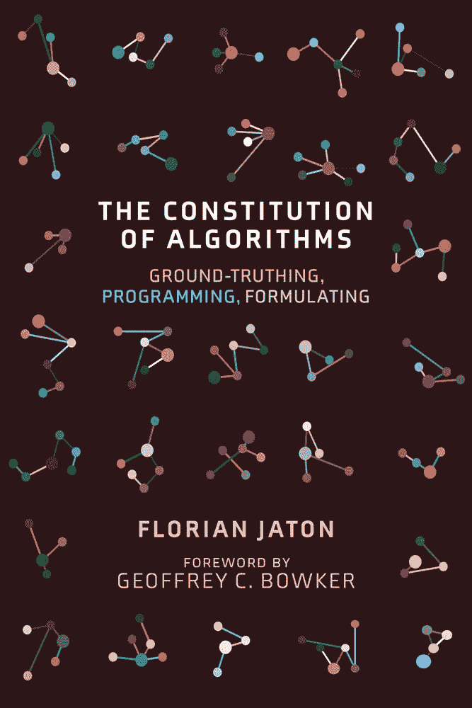


该系列书籍的列表见书末。


d_r0

致 Fanny

## 序言

## Geoffrey C. Bowker

算法渗透在我们的生活中。它们是政治、文化和社会事实，在过去的五十年里，已成为我们存在的所有部分的核心。当然，我们之前也拥有它们的前身：无止尽的清单、安全协议和行为准则——每一项都是为了让我们跳出自我，并将我们的身体、自我与官僚或技术机器对齐（用福柯更准确的术语，一套“技术装置”，dispositifs techniques）。官僚主义让我们表现得像机器一样，而算法试图让我们变成机器。

由此得出的结论是，如果我们想从事基础社会科学并构想政治生活的新形式，我们需要去行动发生的地方。我们需要从内部了解算法。它们并不是从另一个星球跳伞降临入侵我们的（尽管感觉很像如此）：它们是人类的、会犯错的产物。这里的困难在于，社会科学家和政治参与者往往并不真正理解技术层面的风险，同样，计算机科学家也并不真正理解社会层面的风险。

这正是这本书如此重要的原因。它是探索算法作为一种新型社会行动者的基石文本。算法是如何被构建成有效的行动者的；人类又是如何被构建从而创造出超越人类理解的算法的？Jaton 在此处的追求是无畏的：直面问题所在，并在它们所属的主场定位技术、社会和政治问题。当我阅读这本书时，我不断感到惊喜，就像读一本优秀的小说，不知道接下来会发生什么（冯·诺依曼架构、对初级计算机工程师的测试），但一旦步骤迈出，立刻感到一种必然性。

我一直在构想这样一个愿景：人类对我们政治经济的运行正变得越来越无关紧要：我们尽所能，但日益处于间隙状态。毫无疑问，我们正在创造比我们更智能的机器，以及比我们自己更了解我们的算法。这完全没问题。但如果我们能在算法中注入我们数千年来创造的深层价值观，我们所创造的世界将是多么丰富和多么美丽。

这本书不仅仅是给计算机科学家或科学社会研究学者看的：它论及了这一时代人类存在的某些基本问题。它为我们提供了工具和概念来共同工程我们的世界（我们的行星系统、我们的物种、我们的计算机）。

干得！Florian。祝大家阅读愉快。

## 致谢

不仅出于礼貌，热忱感谢那些帮助我成为这本书作者的人，更关乎学术的诚信。首先，我想对计算机科学实验室的成员表示最深切的谢意，他们让我跟随他们的日常生活。在身边有一个一年多年的民族志学者一定是一段奇特的经历。然而，我无法奢求对我的研究课题有更多的理解，对我的笨拙有更多的耐心。不言而喻，如果没有这些才华横溢的计算机科学家的支持（他们很快成为了我的同事和朋友），这项研究无法完成。

我很享受在那个计算机科学实验室度过的时光，那也归功于它的主任。瑞士洛桑联邦理工学院（EPFL）的 Sabine Süsstrunk 通过为我提供办公室、提供富有见解的反馈，并要求我积极参与实验室的日常生活，极大地促进了我的融入。我做梦也无法想象有更好的合作了。

我的导师 Dominique Vinck 在整个研究过程中给了我许多建议、见解和反馈，以至于我希望能在这篇文档的封面上盖上这样一个印章：`Dominique Vinck`。能成为这样教授的学生是我的荣幸。

这本书也受益于我在洛桑大学社会科学学院同事的见解。Marc Audétat、Lola Auroy、Nicolas Baya Laffite、Boris Beaude、Luca Chiapperino、Laetitia Della Bianca、Olivier Glassey、Sara Guzmán、Anna Jobin、Nicky Lefeuvre、Pierre Oberhauser、Francesco Panese、Andréas Perret、Jessica Pidoux、Margarita Rodriguez、Yohana Ruffiner、Marie Sautier、Romina Seminario、Tatiana Smirnova、Léa Stifel：他们对我的学术教育都有很大贡献。我想特别感谢 Alexandre Camus，他不仅给了我很多建议，还忍受我的恐惧、抱怨和突如其来的喜悦（绝望）。

为了将当时那冗长的论文转化为一本可以接受的书，我受益于在巴黎理工学院（Mines Paristech）创新社会中心的博士后停留。如果没有 Félix Boilève、Jérôme Denis、Quentin Dufour、Liliana Doganova、Evan Fisher、Clément Gasull、Cornelius Heimstädt、Antoine Hennion、Brice Laurent、Fabian Muniesa、Emilie Perault、David Pontille、Mathieu Rajaoba 和 Loïc Riom 的精准建议和评论，这本书的缺陷将会多得多。我还热忱感谢 Nassima Abdelghafour、Madeine Akrich、Marie Alauzen、Mathieu Baudrin、Victoria Brun、Batrice Cointe、Jean Daniel、Catherine Lucas、Alexandre Mallard、Morgan Meyer、Florence Paterson、Mathilde Pellizzari、Vololona Rabeharisoa、Roman Solé-Pomies、Sophie Tabouret、Félix Talvard、Carole-Anne Tisserand、Didier Torny、Frédéric Vergnaud 和 Alexandre Violle，感谢他们欢迎来到他们优秀的研究中心。

很容易被行政事务困扰，我很幸运在博士和博士后基金期间受益于许多奇人的帮助。在很大程度上，正亏了 Françoise Behn、Marianna Schismenou、Alba Brizzi 和 Joëlle de Magalhaes，我才能最终完成这份文档。


资助是研究不可或缺的一部分。因此，我感谢瑞士国家科学基金会在整个完成这项工作期间提供的资金支持。资助这样一个处于哲学与计算机科学交叉领域的基础性研究项目无疑是一项风险投资。当然，我无法判断这项工作是否履行了我为了获得博士学位基金（`POLAP1` `148948`）以及博士后资助（`P2LAP1` `184113`）所做的众多承诺。我只能断言，在过去的几年里，我大量的精力都投入到了这个项目的完成中。我还想感谢沃州学术学会（Société Académique Vaudoise）在 2018 年 10 月至 12 月期间提供的慷慨支持。

2016 年至 2017 年，作为博士计划的一部分，我在加州大学欧文分校（`UCI`）的 EVOKE 实验室与工作室进行了一年的海外学习。对于这段成长性的经历，我必须感谢 Myles、Kyle、Dave 和 Laura Jeffrey，他们从未停止将我视为加州家庭的一员。我也非常感谢当时我在 `UCI` 的同事们——Anja Bechmann、Roderic Crooks、Simon Penny、John Seberger 和 Aubrey Slaughter——他们为本书第二、第三和第四章的完成提供了极大帮助。对于加州大学图书馆那些惊人的收藏，我还能说什么呢？如果没有加州大学图书馆员每天付出的无形工作，我无法获得提出（我希望的）创新性命题所需的关键参考文献。然而，如果没有 Geoffrey C. Bowker 从一开始就深信这一项目的无条件支持，这段加州之旅将是不可能实现的。

显然，这份文档受益于麻省理工学院出版社（MIT Press）“内部技术”系列的支持。在这方面，我想感谢该系列的编辑团队在整个出版过程中的耐心与无一不辞的支持。我也感谢匿名评审员和文字编辑，他们的贡献让这项工作比最初变得完善。当然，这涉及到所有帮助我制作这本书的人；书中所有的错误和疏忽都是我的责任。

在我尚未真正开始学术生涯期间，我的朋友们给了我这么多帮助、支持和启发，以至于不提到他们将是不公平的。因此，我从内心深感谢 Julien Bugnon、Gabriel Buser、Frédéric Clerc、Loïs de Goumoëns、Christophe Durant、Simon Duvoisin、Antoine Favre、Vincent Klaus、Nicolas 和 Vanessa Krieg、Naïke 和 Stéphane Lévy、Mathieu 和 Nancy Morier、Marco Picci、Coralie Pittet、Estelle 和 Vincent Rossire、Mathias Schild、Lucas Turrian、Nicolas Vautier 以及 Élise Vinckenbosch。成为你们的朋友是我的真正荣幸。

由于这项工作是他们无条件的爱的产物，我最后向我的母亲 Katia、我的父亲 Jean-Pierre、我的姐姐 Laure、我的弟弟 Damien 以及我的女儿 Lina 表达最深切谢意。感谢 Fanny，她在知识生活的起伏中充满爱地支持我：感谢你带来了无限的光。

## 引言

> 对于批评者和倡导者来说，如果我们想了解算法，我们可能需要与它们共处。

> —Seaver (2013, 11)

让我们从“事态中间”（*in medias res*）开始引言，进入事情的中心：

## 重构 1

唐纳德·特朗普在 2016 年 11 月的当选令人相当惊讶：这样一个争议人物是如何进入白宫的？原因当然不胜数。但如果其中之一是 Facebook (Lapowsky 2016) 呢？毕竟，特朗普的支持者从未停止使用该平台传播争议内容。如果选民被 Facebook 助长扩散的“虚假新闻”洗脑了呢？如果这种广泛的相互链接参与了特朗普的广告和募捐呢？尽管这一指控可能严厉，但它严重损害了这一 Web 应用的形象，因为它更倾向于“连接人们”而非筑围墙 (Isaac 2016)。看来，监控需要加强，尽管这可能违背了马克·扎克伯格提升为准则的某些假设 (Zuckerberg 2016)。主要目标是“新闻动态”（News Feed），这是该应用程序的骨干，显示由 Facebook 用户发布的动态。如果稍稍修改新闻动态自动选择新故事的方式，以让它忽略“低质量帖子”会怎样？这可能有助于恢复 Facebook 的公众形象，至少在短小范围内，至少是一段时间。在经过几个月的内部研究和测试后，一种新的 `algorithm` 投入了运行——它根据帖子频率和链接 URL 识别垃圾邮件用户，并自动降低他们所分享链接的优先级 (Isaac and Ember 2016)。根据 Facebook 的一位副总裁的话，这种新的计算方法应该显著减少“如点击诱饵、煽情和虚假信息等低质量内容”的扩散 (Mosseri 2017)。

## 重构 2

火星是一个遥远的地方。但数亿公里的距离并没有让美国国家航空及航天局（`NASA`）放弃派遣“好奇号”火星车去探测它的表面。2012 年 5 月 6 日，这辆昂贵的车辆安全降落在盖尔撞击坑。真是一个了不起！NASA 网站上很快出现了惊人的高分辨率照片，向世界展示了这颗寒冷干燥行星的崎岖表面。当然，“好奇号”远不止是一辆遥控汽车。它是一个带轮子的真正实验室，配备了许多高科技仪器：两个用于真彩色和光谱成像的摄像头、两对用于导航的单相机、一个带有超高清摄像头的机械臂、一个激光光谱仪、太阳能电池板、两块锂离子电池等 (Jet Propulsion Laboratory 2015)。然而，这个惊人的遥控实验室也有明显的代价：它需要移动其 350 公斤的躯体（低重力）。火星崎岖多岩石的表面并没有减轻“好奇号”轮子的负担，它们正在不可恢复地磨损。2014 年 1 月，情况变得令人担忧 (Webster 2015)：有没有办法延长“好奇号”轮子的寿命？经过大量研究，一种新的驱动 `algorithm` 于 2017 年 6 月上线，它利用导航摄像头的实时数据在遇到碎石时调整“好奇号”的速度 (Good 2017)。通过将“好奇号”前轮和中间轮的负载减轻 20%，这种新的导航计算方法被认为是任务的重大助力 (Sharkey 2017)。

## 重构 3

西岸的以色列情报部门通过预防性行动和恐吓来瓦解他们定义为恐怖组织的组织。但那些随心发起攻击的人呢？就像美国的几个警察部门一样 (Berg 2014)，以色列情报部门现在受到安全软件的支持，该软件 `algorithm` 根据社交媒体上的汇总数据生成潜在攻击者的画像。然而，当美国几级民法院正在认真考虑这些新计算方法的有害偏见时 (Angwin et al. 2016; Liptak 2017)，适用于嫌疑巴勒斯坦“攻击者”的以色列军事司法阻止了他们获得任何形式的法律保护。由于西岸军事指挥官可以签署行政拘留令，这些“危险画像”可以被处以为期六个月的可更新监禁，且没有任何上诉机会。许多被这种国家机技术针对的巴勒斯坦人“被关了多年却从未见过法官” (Gurvitz 2017)。


## 重组 4

如何让人们吃更多的能字体（Nutella）巧克力？对于这个意大利巧克力酱品牌来说，近年来并非易事。当棕榈油生产威胁到远处的红猩猩时，只有极少数公民热衷于批判在其能字体配方中使用这种成分。但在 2016 年 5 月，一旦棕榈油被怀疑加速了能字体消费者中癌症的传播，销量开始出现令人担忧的下降（Landini and Navach 2017）。对于能字体来说，需要采取行动来重新与其客户的胃部建立联系。开展一场全新的营销活动又如何？通过与广告公司 Ogilvy & Mather Italia 的合作，七百万个设计独特的能字体罐很快以创纪录的速度被生产并销售（Nudd 2017）。这一成功营销策略的核心是一个`algorithm`，它通过计算一组精心挑选的颜色和图形，来生成独特的流行图案（Leadem 2017）。

事态在变化。2016 年 11 月，Facebook 用户的消息动态（News Feeds）充满了垃圾邮件发送者传播的假信息和“假新闻”，这些信息被认为在唐纳德·特朗普的选举中发挥了作用。一个月后，这些消息动态暂时变成为了值得阅读的故事列表。同样，“好奇号”（Curiosity）探测器的重量加上锋利的火星石子首次严重影响了机器人的轮子，从而损害了任务最初的持续时间。然而几年后，运动系统的几次变化减缓了这种意外之外的磨损。在另一个案例中，以色列情报机构最初对并非在可拆解细胞组织内准备的攻击无能为力。但这些机构很快就能够识别嫌疑人并在没有任何法律程序的情况下将他们入狱。最后，能字体最初是一种老式的巧克力酱，其配方中含有危害红猩猩和与癌症相关的棕榈油。然后，它临时地变成了一种时尚的流行产品。无论好坏，集体配置都在被重组，从而形成新的事态；人与非人之间的关系被重新构建，从而临时地建立了新的网络。根据这种通常被称为“过程思想”（process thought）的本体论立场，集体世界正以这种方式不断被重塑。

尽管如此，我们可能希望理解这些混乱的`rearrangements`（RTs）的一些动态。毕竟，由于我们都必须生活在同一个星球上，更清楚地看到发生了什么并无害处；记录塑造我们所处世界的无数关系中的极小一部分，可能会为我们提供某种导航工具。在一起，我们要去向哪里？我们在做什么？发生了什么？这些都是重要且合法的问题。

## 社会方法

为了回答这些问题，通常使用两种方法。广义上，第一种方法假定了能够诱发事态的聚合体的存在。根据学术传统，这些聚合体有不同的名称：它们有时被称为“社会力量”、“场域与惯习”（fields and habitus）、“经济理性”或“社会结构”，以及许多其他变体。这些名称不同但先验假定的聚合体，都是“社会”（或社会性）定义的竞争者——这是一种有影响力但转瞬即逝的物质，据围绕着个人并引导着他们的行动。对这一问题以及它产生的事态进行科学研究，就是我所说的社会科学，或更简洁地说，社会科学。

第二种方法——本书所采用的方法——是将社会视为一种围绕个人的、转瞬即逝的物质，而是两个实体接触并临时相互`associate`时产生的微小差异（Latour 2005）。这种方法假设，两个`actants`——人类（总统鲍、马克·扎克伯格）或非人实体（轮子、病毒、文档）之间的每一个新连接都会产生一种有时可以解释的微小差异。如果我们接受将两个 actant 在时间上相互关联产生的微小差异称为“社会”，我们就可以将“社会学”（socio-logy）称为产生关于这些关联（`socius`）专门文本（`logos`）的活动。我们最初的四个 RT 是这种活动的小型例子：Facebook、“好奇号”、以色列情报机构和能字体临时地与新的 `actants` 关联，而这些新连接的融合有助于形成在文本中总结的新配置。如果我多添加了几次重组，并更彻底地说明了它们的构成性关联，我将创作一部真正的社会学著作。相反，如果我诉诸某种隐藏的力量来解释这些重构；如果我将每个事态的修改归因于某些先验假定的聚合体（例如经济理性、社会、文化），我将创作一部小小的社会科学著作。社会学与社会科学之间的这种区别将贯穿本书。因此，记住本卷是一部——或者至少是打算是一部——社会学著作是非常重要的。

## 社会学 RT 的分析

在记住这些澄清的情况下，让我们仔细观察一下这四个小型的社会学 RT。我们看到了什么？我们很快注意到每个 RT 都受到一个“算法”的影响，目前该算法被松地定义为一种`computerized method of calculation`。这四个算法可以被视为实体——或`actants`——因为它们都在特定的配置中产生了差异。从这个意义上说，这些算法从根本上与它们在某些时候关联的其他 actants 并不相似。在 RT1 中，`there is` Facebook、唐纳德·特朗普、垃圾邮件、支持者、消息动态、一个新算法、一个 Facebook 副总裁以及许多其他 actants，它们共同重组了某些事态。在 RT2 中，`there is` 火星、美国航空航天局（NASA）、锋利的石子、导航算法、锂离子电池以及许多其他 actants，它们共同重组了某些事态。RT3 和 RT4 也是如此：算法是许多其他 actants 之一。


然而，仔细观察仍然表明，我们 RT（相关技术）的算法具有某些特征，使得它们并不完全同于例如尖利的火星石或锂离子电池。与这些“坚硬”的行动者相反，我们 RT 的算法似乎更具流动性；它们似乎能够非常快速移动，并与最初彼此遥远的其他行动者建立联系。

在 `RT1` 中，`Facebook’s new algorithm`最终能够（尽管是暂时的）将自己与全球数百万用户的 `News Feeds` 关联。在 `RT2` 中，`NASA’s algorithm`可以到达火星，让 `Curiosity’s wheels` 应对可能的所有尖利火星石。在 `RT3` 中，以色列情报机构使用的算法可以对分布在两千平方里领内的数十万人发送的数千条社交媒体文本进行分类。在 `RT4` 中，`Ogilvy & Mather Italia’s algorithm`可以创建数百万个独特的图案，指导意大利和法国的 `Nutella’s packaging factories`。

看来，这些算法可以在极短时间内循环并连接最初稀疏的行动者。这是一个非凡的特征。为了强调这些算法的流动性（它们在循环）、快速性（它们很快）和分布性（它们同时是分散且统一的），让我们暂时将它们归类为 `devices`，这是一种特殊的行动者类别，根据哲学家吉尔·德勒兹的，它们是“纠缠的、多线性的集合，它们追踪了始终处于非平衡状态的过程，有时相互靠近，有时彼此远离”（Deleuze 1989, 185）。

如果我们继续考虑这四个 RT，也会很快注意到，这些被称为算法的流体、快速且分布的设备都对修改关系网络做出了贡献。在每一个 `RT` 中，一种算法——在许多其他实体（研究人员、数据、测试、计算机等）的支持下——参与了让 `Facebook` 减少受到虚假信息传播的影响（`RT1`）、让 `Curiosity’s wheels` 更耐用（`RT2`）、让巴勒斯坦人显然更容易“入狱”（`RT3`），以及让 `Nutella` 暂时更畅销（`RT4`）。与它们关联的所有实体一起，这些计算方法似乎还参与了权力动态的变化：`Facebook`、`Curiosity’s wheels`、`Israeli security services` 和 `Nutella` 分别变得暂时比发垃圾邮件的支持者、尖利的火星石、西岸潜在的“恐怖分子”和棕榈油丑闻更`强`。

`Science and Technology Studies` (STS) 学者——社会学和社会科学的一个分支，旨在记录科学、技术与集体世界的共同构建^(5)——如今倾向于分析算法修改权力动态的倾向，例如劳动力市场（Kushner 2013; Steiner 2012）、监控策略（Introna 2016; Introna and Wood 2002; Kraemer, van Overveld, and Peterson 2010）、公司金融（Lenglet 2011; MacKenzie 2014; Muniesa 2011a）、文化习惯（Anderson 2011; Hallinan and Striphas 2014）或人际关系（Beer 2009; Bucher 2012）。这些学者的工作极其重要，因为他们对计算机化计算方法的作用引起并保持了警觉。然而，我从一开始就必须警告读者：算法所做的的并不是本书的主题。

然而，只要人们认真考虑到物体和设备会磨损和变化的这一平凡的事实，即“它们会损坏、故障，并且必须不断进行修理、改造和重新用途”（Domínguez Rubio 2016, 60），那么对算法作用的彻底社会学研究就应该与为了保持其持续运行而所需的维护和修理工作相结合。虽然维护和修理工作目前受到越来越多的研究关注（例如，de la Bellacasa 2011; Domínguez Rubio 2014, 2016; Denis and Pontille 2015; Lea and Pholeros 2010; Strebel, Bovet, and Sormani 2018），但极少研究专门探讨了保持算法发挥其功能所需的工作（但参见 Crooks 2019）。这很遗憾，因为算法产生的差异至少在原则上应该与让它们在不断演变的情况下持续产生此类差异所需的工作成正比。

如果我们继续利用最初的四个 RT，我们可以想象，为了继续保护用户免受垃圾邮件发送者的侵害，`Facebook’s new monitoring algorithm` 可能需要被激活以检测意外的网络攻击行为形式（`RT1`）。同样，如果 `Curiosity’s balance of weight` 发生发生变化——例如它丢失了一件设备——它的 `driving algorithm` 参数将必须被修改（`RT2`）。类似地，由于以色列情报机构计算机设备微小差异的逐渐累积，允许新安全算法有效计算社交媒体数据并生成配置的软件包将稍作更新（`RT3`）。最后，为了让算法继续支持有效的营销 `coups`，`Ogilvy & Mather Italia` 需要继续说服其客户消费者对单一产品具有感情（`RT4`）。

简而言之，我们可以做出合理的假设，如果不不断努力让算法适应不断变化的情况（反之亦然），这些设备将无法产生长期的差异。尽管保持算法 `agency` (Introna 2016) 所需的工作在当代经济中显然变得越来越常见，但仍然缺乏文献记载。遗憾的是，我不会为填补这一空白做出贡献。


当然。正如 Star 和 Strauss (1999) 所建议的，某些活动需要保持暂时的不可见性——即不被计入——否则这些活动的结果可能会失去它们的某些能力。马团就是一个例子：公开展示设计和精通例如 `Cirque du Soleil`（太阳马戏团）秋钢丝表演所需的基础设施和训练实践，可能会对表演本身产生负面影响。好奇、惊讶或迷醉可能会被那些使表演成为可能的务实且不确定的操作所抵消。在这里，一种社会学叙述将面临破坏表演的风险；它可能会降低表演的`行动能力`（`capacity to act`）。^(6)遵循 Star 和 Strauss (1999, 23) 所做的区分，杂技表演的相对不可见性在那种意义上是`积极的`：它有助于这些马团实践的产物——用一个更好的词来说——变得“合格的”。缺乏任何公开的描述以及秘密性的存在有助于表演成为一种表演，正如它们帮助公众成为表演的观众一样。在这样非常特定的情况下，人们可能会假设双方都渴望相信精通这种技艺。

但一旦对某些实践的产物产生争议，它们合格性的标准就会受到质疑；当某些行动能力受到质疑时，对其形成过程的分歧就必须面对。让我们例如，想象同一场 `Cirque du Soleil` 秋钢丝表演导致了事故。如果对这次事故产生争议，将有要求使导致其产生的实践变得可见。从“积极的不可见”，这些进行这一秋钢丝表演所需的实践转变为“消极的不可见”：为了让争议中的不同方能够`谈判`（`negotiate`），关于这种表演是如何产生的实证描述将变得必要。`Cirque du Soleil` 需要什么来执行这一有争议的表演？哪些元素可以改变以重新调整这个脆弱的组合？简而言之，为了提出`妥协`（`compromises`），为了更好地`构建`（`compose`），争议双方将从对杂技实践的实证描述中获益；^(7)记录表演者和娱乐者珍视、恐惧什么，以及他们依恋什么，可能会允许关于他们所产出之主体性的建设性分歧展开。

尽管存在显而易见的局限性，这个小虚拟例子表明，对可见性的要求与争议的兴起具有某种相关性。当实践产物出现争议时，这些产物就不再被认为是合格的：因此，积极的不可见可能会转变为消极的不可见，而后者本身要求实证描述——这些描述可以以社会学调查的形式出现——在此基础上可能会产生争议`并`（`and`展开谈判。当然，这些描述是非常危险的，因为它们本质上是在代表个人的名义（`Latour` 2005, 121–140）。为了使实践社区需要、珍视以及依恋的内容变得可见，这种可能为进一步争议性谈判建立共同基础的社会学叙述需要克服许多考验：该叙述是否让对从业者工作至关重要的行动者变得可见？是否揭示了令人惊讶但有实证支持的联系？叙述是否为集体构建提出了新的抓手点？对这些问题中的任何一个给出简单的“不”，都会让社会学叙述未能履行其最初的承诺。

算法呢？

不久以前，这些设备很少受到关注。它们确实参与了权力关系的改变，但这些过程并不是、或只是在有限范围内是公共问题。情况发生在 20 世纪 90 年代，社会学家开始质疑网络技术推动者提出的关于赋权和信息可用性的论述。^(8) 例如，`Hoffman` 和 `Novak` (1998) 显示，美国网络技术的可用性和使用很大程度上取决于种族差异。`Lawrence` 和 `Giles` (1999) 强调，与几乎无限访问的宣传修辞相反，20 世纪 90 年代后期的搜索引擎只能索引互联网的一小部分且针对特定的比例。同样，`Introna` 和 `Nissenbaum` (2000) 强调了这些 90 年代后期的搜索引擎在对 `URLs` 进行分类时所使用的启发式算法具有地下的——且潜在有害的影响。9/11 事件后的时期关注于对程序和`算法`（`algorithms`）偏见的批判——该词在当时出现在批判性文献中^(9)——用于监控和预防性检测。在对数据挖掘技术社会影响的研究中，`Gandy` (2002) 警告说，它们是通理性歧视的门径，可能会加强社会地位与群体身份之间的关联习惯。从政治经济角度来看，`Zureik` 和 `Hindle` (2004) 讨论了生物识别算法倾向于将社会画像、分类和对国家群体的排除平庸化。另一个例子是 `Introna` 和 `Wood` (2004) 的工作：他们对脸识别算法的分析强调了这些设备的潜在偏见，而这些设备在当时通常被呈现为中立。这一社会学研究路线在 2010 年代初导致了大量关于算法引起的歧视（例如，`Kraemer`、`van Overveld` 和 `Peterson` 2010；`Gillepsie` 2014；`Steiner` 2012）和不可见化（`Bucher` 2012；`Bozdag` 2013）的研究。

这一研究方向在近年来持续，日益全面的著作揭示了算法对当代社会产生的对比且往往是可疑的影响（例如，`Crawford` 和 `Calo` 2016；`Noble` 2018；`O’Neil` 2016；`Pasquale` 2015）。这些提高意识的努力也被媒体报道，进一步使算法成为公众关注的事题（例如，`Mazzotti` 2017；`Risen` 和 `Poitras` 2017；`Smith` 2018）。这种动态——在引言中太复杂无法充分处理^(10)——导致了目前全球稳定地受到算法争议的影响。在写作期间，只需一眼新闻足以提醒我们这一点。英国警察将使用一种新算法来识别社交媒体上的仇恨犯罪（`Roberts` 2017）？这很快引发了非营利组织“大大哥”的反响，他们准备“反对任何限制在线言论的尝试”（`Parker` 2018）？学术期刊发表了一种新算法，可以从脸部照片推断出人的性取向（`Levin` 2017）？同性恋与女反诽谤联盟（GLAD）很快谴责这种“危险且有缺陷的研究，可能会对全球 LGBTQ 群体造成伤害”（`Anderson` 2017）。^(11)。Facebook 的算法在一位母亲流产后，继续向她推送育儿广告进行干扰（`Brockell` 2018）？数千条推文谴责科技公司的性别偏见（`Mahdawi` 2018）。每周都会出现关于新算法后果（实际或潜在）的新争议。


本书的预设相关性应当考虑到当前关于算法代理性（agency of algorithms）的争议。遵循 Bechman 和 Bowker (2019)、Barocas 和 Selbst (2016) 以及 Grosman 和 Reigeluth (2019) 等作者的脚步——我将在书后回到他们——我在这里的目标是提出一些智工具，为妥协的制定做准备。算法开发背后实践的不可见性确实不能再被视为积极的：由于它们是反复争议的对象，现在记录使这些实践产生的实际过程无疑变得非常重要，或者至少是有趣的。粗而言之，如果说社会学已经以某种成功的方式观察了算法的影响，那么现在是时候去调查这些影响的原因了，无论这些原因是多么分散和多元。我们需要填补空白；通过对计算机科学家和工程师如何培养算法的实证描述，可以为建设性的争论提供一些风险但令人新颖领域（(12)）。算法设计者的需求、依恋和价值观——正如我有限的社会学描述记录的那样——可能与其他需求、依恋和价值观相矛盾。但至少在这些充满争议的日子里，争议的双方可以缓慢开始谈判，正如沃尔特·利普曼所说，“在他们自己的色彩下”（1982, 91）。然而，在考虑我打算如何有效地开展这项关于算法实际形成的的调查之前，我需要迅速进一步说明它的政治维度。为此，我现在将通过讨论我在这里用来界定我尝试的非传统术语“宪法”（constitution）来快速绕个路。

## 为什么是“宪法”（而非仅仅是“构建”）？

在引言的开头，我断言集体世界不断地重组：异质实体从未停止相互关联，这些关联的融合暂时地建立了新的事态。从这种（有争议的）本体论立场，可以推导出世界并非“在外面”等待着从某个外部视角被抓取。相反，根据这种过程本体论，世界始终处于生成之中的；它是人类与非人类行动者（actants）之间关联的活动产物。

然而，人们可能会理地认为，并非一切总是被重新发明。虽然某些关联带来了转瞬即逝的行动者（例如快乐的欢呼、悲伤的泪水、对某个笑话的笑声），但另一些关联带来了更持久的行动者。填充/产生集体世界的许多实体都是此类：马克·扎克伯格、火星、约旦岸监狱、纽能力巧克力酱罐——仅提到我们在我们小的初始 RTs 中遇到的某些实体——都是相当持久的实体。这些行动者得益于它们在其实例化的当下之外生存的能力，反过来可能会与其他行动者相互关联，从而对集体世界的持续生成做出贡献。这些相对稳定的行动者具有某种持久性，使它们能够产生并引导正在生成物。

如果我们继续考虑行动者之间的差异，会很快注意到某些持久的行动者可以相对容易地从一个地方移动到另一个地方。让我们继续使用熟悉的实体来说明这一点。如果我们考虑火星和约旦岸监狱，这些实体显得相当静态。它们很难与能够让它们偏离初始轨迹的行动者关联：在没有重要的动员努力的情况下，火星和约旦岸监狱将停留在原地。马克·扎克伯格的情况就大不同了，他一旦与“鞋子”、“汽车”或“道路”等行动者关联，就能显著地改变他的初始轨迹，反过来与最初距离他很远的其他行动者关联。然而，很大程度上由于他的身体外，马克·扎克伯格的相对移动性是非常昂贵的：为了让他以某种方式继续做马克·扎克伯格，为了在他移动时保持大部分的持久性，他需要与许多其他行动者（例如氧气、食物、腿部空间、咖啡休息）关联，以保护他不被过度改变。在纽能力巧克力酱罐的情况下，情况有点不同。它们也需要与其他行动者关联以偏离它们的初始轨迹（例如供应链经理、铁路线路、销售合同、送货员）。但与马克·扎克伯格相反，可以合理地假设纽能力巧克力酱罐的改变更慢：由于它们适当的物质性，由于它们自身的介质，它们例如可以被储存、堆放和处理，而不发生显著的转化。在我们这些范性的持久实体中，纽能力巧克力酱罐似乎是最持久且最具移动性的：与火星、约旦岸监狱甚至马克·扎克伯格相比——并且在提供足够关联的情况下——这些罐子可以从一个地方移动到另一个地方而不被过度改变。

累积起来，持久性和移动性是非凡的特征：结合了这两种能力的实体更有可能与其他实体关联，从而积极为集体世界的生成做出贡献。但有一类非常特殊的实体累积了另一种能力，使其无疑成为所有实体中最能生成世界的。这些实体有不同的名称：杰克·古迪称它们为“图形对象”（1977）；布鲁·拉图尔和史夫·伍尔加称它们为“铭”（1986, 43–91）；桃西·史密斯称它们为“说明”或“文档”（1974）。但无论如何标记这些，社会学家一直强调这些行动者具有持久和移动的迷人能力，并带有其他行动者——或其他行动者之间关联的某些特征。这本质上就是文本、表格、图表或图画所做的：得益于特定习惯、规则和技术的存在和持续维护——即杰罗姆·丹尼斯（2018）所说的脚本基础设施——这些通常持久且移动的铭可以承载行动者的某些方面，并在其他地方再次呈现（re-present）它们。这种对行动者（部分）的脚本式传输——这本身需要许多其他行动者的展开——反过来可能在已发生的事情与将要发生的事情之间建立一种联系。这听起来像是一个奇怪的陈述，但这种现象实际上非常常见：每当我阅读《纽约时报》的文章时，过去发生的事情（某些事件）与现在发生的事情（我，考虑这个事件并最终对其做出反应）之间就会建立一种联系。当然，这种联系，这种链接已经格式化，以便在我考虑的特定物质性（在这里是报纸文章）中。因此，这种链接始终是所发生事情的一个部分但可能是忠实的、信息化的（in-formed）版本。当我读《纽约时报》时，我没有看到移民在极其糟糕的条件下挣到达欧洲；我看到一个带有文字的平面，这些文字向我呈现了那些移民；这种呈现触发了我内心的无力感、羞愧和绝望，这些转瞬即逝的行动者反过来会对集体世界的持续生成做出贡献（尽管非常微小）。为了界定铭携带行动者-关联的某些属性并在时间和地点之间建立格式化但具有生成性的联系的能力，我将使用“可呈现性”（re-presentability）一词。铭不仅是持久和移动的行动者，因此也是可呈现的：它们可以——与适当的基础设施一起——携带、传输和展示并非属于它们自身的属性。


持久性、移动性、可呈现性：这些能力是不容低估的。铭文尽管外表通常朴素（数字列表、图画、文章、表格、图表），但极大地参与了我们世界的塑造。一种新分子的出现改变了我们对人类下丘脑的理解？正如 Latour 和 Woolgar (1986) 所记录，这种易于关联的行动者在很大程度上源于实验室内部及之间汇、积累、编译和比较的铭文。一种新的管理技术开始将企业活动对齐到单一任意标准？正如 Thévenot (1984) 和 Yates (1989) 所提出的，这种泰勒式的标准化及其后果很大程度上依赖于衡量、编码和公平方法，而这些方法的文本化流通使得对工人的控制得以集中化。一个新算法的发布可能点燃数字图像处理领域的原始研究路径？正如我将在全书中尝试展示的那样，这种行动者的形成很大程度上归于许多不同类型铭文的生产、流通、转换和编译。我们将在适当的时候更深入地考察铭文的生成世界的能力（特别是第 4、5 和 6 章）。目前，只需说，这些持久的、移动的且可呈现的行动者对不断发生的事情做出了巨大贡献。

但无论它们的生成力量如何，“铭文”本身并不存在：它们在开始流通之前显然需要被生产。从这个意义上说，每一条铭文都需要被“铭刻”。提取关联的某些方面（或“事件”；在此时，这两个术语是等价的）并将它们在平坦、持久的介质上重新呈现出来并非显而易见的：事件的哪部分应该被保留并记录下来？应该使用何种语言？遵循何种协议以便日后将此铭文与其他铭文进行比较，并反产生新的编译铭文？考虑到铭文的生成世界潜力，这些都是重大问题，大多数时候由组织和专业实践支持，这些实践拥有其自身的目标、规则和原则，每天影响着数亿计的人和工具。这种造于生产铭文并最终利用其生成世界潜力的导向工作，正是 Dorothy Smith (1974) 所说的“文献性现实的织物”。^(13) 而这种织物具有高度的政治性。

为了说明她的观点，Smith 采取了出生证这一先验的平庸例子。在报告上铭刻出生实际上并非显而易见或中立的。它是某种组织和专业实践的产物，这种实践以非常独特的方式塑造了出生及其记录，与母亲和父亲可能想要记忆的方式完全不同。正如她所说：

> “Jessie Franck 出于 1963 年 7 月 9 日”在这一方面表现得是无容置疑的。但当我们考察它是如何被伪造时，就会发现其作为仅仅记录的性质是其构思的一部分。母亲和父亲可能希望被记住关于 Jessie Franck 出生对他们而言意义的一切，都存储在其他地方，并在记录机构的实践中被特地视为无关而被丢弃。后者只关注的是在特定个人的出生（一个真实事件）与定位该个人至关重要的姓名及某些社会坐标（其父母姓名、出生地等）之间建立一种认证且永久的联系。（Smith 1974, 264）

出生证具有很强的选择性——它们只保留了出生事件极极小部分——而这种选择倾向于此类简洁铭文的潜力——它们的特征反过来可以被用于身份识别或政府统计。此外，作为可以在其他空间重新移动的铭文，出生证及其预期目的制造了一个特定版本的出生，这个版本在许多情况下将强加于其他并行的版本。尽管其起源非常局部且带有偏派性，这些流通的铭文将成为其他铭文的支点，逐步建立起正式的、事实的和所谓的“中立”的出生版本。

这种旨在使事件产生局部偏性版本的铭文实践的政治方面，不仅涉及行政。Smith 论点的力量在于，它也适用于任何铭文，因为在物质上，完全铭刻一个事件的所有细微差别是不可能的：关于保留什么（以及如何格式化）以及忽略什么，必须做出选择。铭文作为“世界生成者”所获得的同时，也作为“世界背叛者”而丧失，后者甚至是是前者的先决条件。^(14)

考虑到这些元素，让我们现在回到这本书。我难道没有说过它打算是一部社会学著作吗？我难道没有说过它打算解释逐渐形成我们称为算法的设备的关联吗？在这里，这些论断可以进一步明确。社会学作为一种生产关于关联（*socius*）专业文本（*logos*）的专业活动，并没有逃脱我现在所谓的“Dorothy Smith 法”：无论它有多具描述性，社会学都会通过铭文产生局部现实，并以损害其他现实为代价。对于管理者（Desrosières 2010）、经济学家（MacKenzie, Muniesa, and Siu 2007）或科学家（Latour 1987） true 的事实，对于社会学家也是如此：他们在通过文本描述现实的同时，也在施行了这些现实。

正如 Law 和 Urry (2004, 396) 总结的那样，不存在无辜性：^(15)一个文本无论多么忠实——某些文本确实比其他更忠实——它也是一种愿望达成的成就。我必须承认，我在这书中想要做的不仅是描述发生在特定的、算法相关的情况：由于这本书本身作为文本铭文的存在，它也是一种以损害其他世界为代价来施行一个世界的尝试。因此，我的姿态既是分析性的，也是政治性的：它旨在产生一个关于算法如何产生的描述性说明——我们可以保留这一点——但也在同一运动中，对它们的现实提出一个新版本。

回到本节的标题，我假设“构建”的经典概念并没有很好地表达这种尝试。对于社会学来说，构建无疑是一个有术语，因为它装备了许多对自然化事项的宝贵批判：关于性别构建（Lorber and Farrell 1991）、父权制（Lerner 1986）或母性（Badinter 1981）的研究，仅列举一些经典，都是极地令人解放的。但考虑到 STS 以及整个社会学的最新发展，“构建”似乎面临着两面性的问题：虽然它能很好地表达其描述性愿望——展示结果是如何产生的——它也倾向于隐藏其政治主张——即以损害其他现实为代价生成现实。^(16) 由于它倾向于在分析雄心的掩盖下隐藏“Dorothy Smith 法”，我认为放弃使用“构建”一词来定义我的整体姿态是更明智的。


我并非第一个否定“构建”（construction）的社会学家。事实上，这是一种非常普遍的做法，其动机与上述提出的论点大同异。Law 和 Urry (2004) 倾向于使用“施行”（enactment），因为它能更好地表达描述性尝试的表演性。Latour (2013) 受 Souriau ([1943] 2015) 的启发，诉诸“创设”（instauration），因为它强调了实践性的、后续组装的实体的脆弱性。Ingold (2014) 在追随 Rorty (1980) 的之后，优先考虑“教化”（edification），因为它强调了即将发生之事的持续性且永不完全实现的特征。所有这些概念无疑都是“构建”的有趣替代方案。但考虑到可能会助长已经足够充实的社会学术语体系，我在这里选择使用“宪法/构成”（constitution）这一概念，因为它具有显著的优势：它本质上就包含双重含义——即某事物发生的*过程*，也指一份主张权利和特权的*文件*。这里存在着一种有趣的张力，可能会让人想起我这一手势所假设的矛盾性：描描述与抗争。此外，由于宪法绝不是一劳永逸的（它可以被修订、完成、废除），这一概念迫使我们承认我的尝试具有必要的不完全性，我在这里试图实现的三项活动——地面真值化、编程和制定（显然后文将详述）——必须被视为局部且暂时的。只要有实证材料的支持，更多的动名词性文章都可以潜在地添加到当前算法的构成行为中。

出于所有这些原因，本书标题《算法的宪法/构成》（*The Constitution of Algorithms*）应当被理解为将算法*应当成为*的状态文本化并使其存在——这种存在同时是实证的和行动主义的。在调查的最后，根据已说明的要素，我将在一个借鉴安东尼奥·内格里（Antonio Negri, 1999）关于“构成权力”工作的章节中，回到这种分析/起义手势的影响上。现在，让我们通过使用“constitution”一词来记录并接受这种矛盾性，作为对这项研究两极性的恒的提醒。

## 实验室研究

此时，我别无选择，只能要求读者随我一起——至少暂时地——假设：在如今关于算法代理性争议不断的当下，设计、塑造和传播这些算法所需工作的高度不可见性是负面的，因为它阻止了争论双方拥有谈判的共同基础。让我们也假设，提出此类基础并从而建议建设性争端和组合尝试的一种方法，可以是进行社会学调查，以使使算法产生所必需的工作实践变得可见。让我们最后假设，本卷是对此类调查的尝试，它作为一种世界生成的铭文，不可不成为对算法的一种局部的、具有派系倾向的且开放的（同时也是忠实且实证的）“宪法/构成”。如果我们接受了这些有争议的假设，下一个问题可能是：我该如何有效地开展这样一种局部的、实证的、行动主义的研究？我可以在哪些材料的基础上建立它？

使用易于获取的来源，例如描述算法内部机制的许多学术论文和手册，是很有吸引力的。这实际上是几位科学技术研究（STS）学者在一些非常有趣的著作中所做的（[#introduction.xhtml_fm8-17]）。然而，我有理由相信，仅使用这些来源会秘密地导致算法组件负面不可见性的持续。对于发表在学术期刊上的计算机科学论文，当然，说这些文献是错误的是不正确的：相反，它们证明了某些未来可能在科学上成为真理的事物（[#introduction.xhtml_fm8-18]）。但正如许多重要的科学研究所示，这些科学出版物倾向于报告过程的结果，而非导致这些结果的实践活动。在这种情况下，仅利用学术出版物使算法的形成变得可见是有问题的，因为这些文件本身是由未说明的要素所支撑和框架构建的。Michael Lynch (1985) 很好地总结了分析科学出版物中固有的这一问题：

> [科学研究论文的方法部分]为已经胜任的从业者提供了一步步演进的行为准则，让他们在常识与未成文的、但特定的科学调查实践的无限混合中同化这些准则。当科学研究依赖实验室调查的文学残余作为科学工作可见且可分析的存在时，这些未成文的实践必然从研究领域中被省略了。（Lynch 1985, 3）

此外，由于我们在贯书中将涵盖的纠缠原因，学术论文的作者也倾向于针对竞争算法*捍卫*自己的算法。发表在科学期刊上的主张确实是针对其他主张的，并旨在获得读者的支持。因此，捕获技术变得非常重要，其目标是“布局文本，使得读者在何处，那里只有一条路”（Latour 1987, 57）。这些说服习惯以及它们提供的额外必要性——建立客观构建的本质元素——倾向于*净化*算法的科学叙述，剔除那些贡献了其文本存在的许多不同元素。因此，在依赖这些文件来分析计算机计算方法时，往往是那些犹豫、怀疑以及“非寻常”的设备和文字逃避了分析师的视线。（[#introduction.xhtml_fm8-19]）

但那些教我们如何设计算法的众多手册又是呢？[#introduction.xhtml_fm8-20]）它们难道没有提供如何组装计算机计算方法的描述吗？从这个意义上说，它们不是算法与它们有助于塑造的集体世界之间的*连接器*吗？这些教学资源对于向学生和新学者灌输计算机计算方法的基本组件至关重要，这对于他们的社会学分析是必不可少的。然而，正如 Lucy Suchman (1995) 提醒我们的那样，这些资源根据定义是关于工作应该如何做的规范性叙述，而不是工作是如何被有效完成的。这是一个但经常被忽视的精确性：“这些规范性叙述代表了理想化和类型化。因此，它们的写作依赖于对偶然性和差异的删除”（Suchman 1995, 61）。手册并不是解释在平淡情况下正在做什么，而是解释了*应该*做什么。它们是（重要的）命令性配方，而非基于实证的实践叙述。（[#introduction.xhtml_fm8-21]）。我相信，这是主要依赖于教科书和算法设计课程的当代研究的主要局限性：它们告知了当代教育者希望算法如何被构建，而不是这些算法在日常生活中是如何被构建的。这些研究并没有通过说明计算机科学家的工作来接近他们，尽管它们本身非常有趣，反而倾向于让他们离得更远。（[#introduction.xhtml_fm8-22))


因此，学术论文和手册是应当谨慎对待的来源。但如何让这些仍然保持有用且重要的来源，其贡献的内容隐藏在视线之外呢？如何对组装算法所需的工作获得一个更清晰、尽管本质上仍有局限性的画面？幸运的是，正为了这一特定目的，我可以依靠一种经过证明的 STS（科学与技术研究）分析范式，它通常被称为“实验室研究”。最早此类研究出现于 20 世纪 70 年代，大部分在美国。在某种意义上，当时的集体（西方）世界与我们今天所经历的世界并无二：关于机构类型的争议不断涌起。但这些争议大多并非针对算法，而是涉及通常在生命科学、物理学和神经科学中开发的`科学事实`。由于许多在引言中不便讨论的复杂原因，几位学者认为有必要通过社会学角度解释自然科学家试图`制造`经过认证知识的平实实践，来消解科学事实的幻象色彩（Collins 1975; Knorr-Cetina 1981; Lynch 1985; Latour and Woolgar 1986）。这些学者的方法相当激进：为了回应认识论的权威准则，这些作者借鉴了民族学的`原位`（in situ）分析视角，来记录“科学的软肋”（Edge 1976）。正如 Latour 和 Woolgar 所说：

> 我们设想了一种研究程序，类似于一位在象牙海岸的无畏探险家，他通过与部落人生活，研究“野蛮大脑”的信仰体系或物质生产，分享他们的苦难并几乎成为他们中的一员，最终带着一系列观察结果回来，并将其作为初步研究报告……我们特别重视收集和描述在*特定环境*中获得的科学活动观察结果。（1986, 28；强调为原文所有）

实验室民族志学者并不是从科学理论、思想或“理性法则”开始，这些实验室民族志学者（他们积极参与了`科学与技术研究`的启动）而是决定从平实的行动和工作实践开始，以记录并揭示科学事实是如何逐步组装的。其他几本阐述物理学家（Traweek 1992; Sormani 2014）和设计工程师（Vinck 2003）实践的专著也追随了开创性的 20 世纪 80 年代实验室研究，每次都提供了见见的新结果。我们将在适当的时候涵盖其中一些结果。目前，只需说，目前的社会学调查几乎完全基于这些著作。但这具体意味着什么？

它首先意味着找到个人每天工作组装算法的地点。对于我来说，这项定位练习并不困难，因为我在机构上非常接近一家欧洲技术学院，那里有大约 20 个计算机科学实验室，每天都在工作以提议新算法，并使其在更广泛的学术和工业网络中流传。更艰巨的任务是说服其中一个实验室的主管，让我像一位“无畏探险家”一样描述算法的实际塑造过程。幸运的是，与建立新数字人文学院相关的机构活动，使我能够与一位对跨学科持开放态度的计算机科学教授分享我的研究抱负。经过几次尝试后，我在她的数字图像处理实验室工作了两年半，从 2013 年 11 月到 2016 年 3 月。这些绝不是被动的时刻：根据实验室研究分析范式的要求，也根据我作为正式成员所属的实验室规则，我必须参与实验室的生活，并因此在某种程度上变得胜任。尽管我逐渐获得的技能无疑没有让我成为一名计算机科学家，但它们对于充分阐述对我新同事重要的问题至关重要。但仅仅参与和讨论是不够的：我还必须写下、收集并汇总我所做、所见和讨论的内容。非常具体地说，这意味着要记`很多`笔记。讨论、会议、演示、行动：我经历的一切，在理想情况下，都必须写下来，记录在笔记本和计算机文件中，以便日后进行检索、比较、抽样和分析。这项全职的数据汇编工作意味着最后一步：在计算机科学实验室逗留之后——在此期间，我参与了项目，与同事进行了讨论，观察了他们的所做的，尽可能地记录下来，并对我的初步结果进行了演示（这些过程深刻地改变了我和我现在从事的社会学）——我必须回到自己的研究社区，更彻底地处理所收集的材料，并撰写一份调查报告，这份报告逐渐变成了现在的这本书。

但所有这些过于基础的元素——将在第 1 章中更详尽地阐述——避开了一个重要问题：当计算机科学家试图在他们的实验室内塑造新算法时，如何有效地解释，并因此写下和分析他们的行为？如何体验、捕捉并分析他们的`actions`？

## 行动方案

一旦人们确信并能够开展一项实验室研究，以一种部分但忠实的方式记录算法的构成，很快就会进入一片未知领域。虽然有生命科学、物理学、医学或脑科学的实验室研究，但关于计算机工作的发表却少寥无几。准入门成本和进行此类调查所需的时间确实导致了这种局面。但也可能是某种奇特的思维习惯导致了这种冷淡。事实上，由于某些我将在第 3 章和第 5 章尝试解决的复杂原因，关于`计算机代码`和`数学`积极贡献于计算化计算方法的塑造的公平假设，往往被另一个不公平的假设所倍化，即`代码`和`数学`没有或很少有经验厚度。这种对算法成分的转瞬即逝的假设，反过来导致了它们看起来深不可测。这种常见的习惯——Ziewitz (2016) 将其与“算法戏剧”联系起来——可能了社会学家进入算法塑造、传播和维护的场所：既然一切都发生在那里工作的人的脑子里，为什么要大费精力去调查这些地方呢？


但像任何参与科学实验室日常工作的民族志学者一样——试图参与、充分交流并汇编实证材料——我很快意识到，极少有事情可以归功于我同事们的大脑，无论他们有多聪明。当然，他们从未停止过某些活动——在草稿纸上写作、比较图表、在键盘上打字、检查数据库、移动鼠标指针、喝咖啡休息——这些活动起初看起来毫无关联。但当我固执地在日志簿中记录这些事情时，我很快发现，这些微小的基础动作“区块”的接连有时会形成更大的成就：一个数据库、一个脚本、一个完整的程序，或一个 `algorithm`。通过持续与我实验室里的新同事待在一起，尽职地记录观察结果，甚至记录了一些工作序列（在获得他们许可的情况下），我很快被迫承认，我们所谓的“实践”实际上是`一个没有对立概念的术语` (Latour 1996)。在我实验室研究的人为环境中，通过尽可能地记录各种关联，我很快意识到，备受广泛讨论的“理论”与“实践”之间的区别是一个人工产物。在实验室里，只有实践，它们的`接连`有时会形成“数据库”、“计算机程序”、“数学模型”或`algorithms`。对这些轨迹进行一次装备简陋的回顾很容易忽视它们的重要性。但一旦我设设法减慢这些轨迹的速度并耐心地记录它们——有时还得助于那些实现这些轨迹的人的帮助——我意识到我几乎可以不需要任何内部的“抽象”认知机制。

遵循 Jacques Theureau (2003) 的开创性工作，我将使用`行动序列`这一术语来描述这些可追溯的、手势、眼神、言语、动作以及人类与非人类之间互动的时间序列，这些互动最终可能会产生`某些东西`（一块钢板、一块木板、一份法院判决、一个 `algorithm` 等）。^(27) 坚持这种通用定义至关重要，因为它能帮助我们抵抗计算机科学工作所谓的抽象性：最终被称为“数学模型”、“代码”甚至 `algorithm` 的东西，必须以某种方式成为在特定情境下展开并由可分配的行动者执行的可追溯行动序列的产物。此外，我将在“活动”这一通用术语下，包含在不同时间和地点展开但通向相关成就的行动序列。在本书中，活动将被理解为`一组具有共同最终目标的相互交织的行动序列`。本书的三部分都是对参与算法形成的活动进行的冒险尝试；因此，它们各自的标题都以 `ing` 结尾：`ground-truthing`（地面真实）、`programming`（编程）、`formulating`（建模）。

这导致了行动序列的一个潜在局限性，因为实验室研究允许这些序列被追溯。我之前提到，通常必须减慢轨迹的速度，以识别那些可能导致某些东西形成的行动序列。这种减速是有益的，因为它让许多关键的塑造动作得以展开。但它也有一个缺陷：它迫使人进展得`非常`缓慢。结果，任何微小的、平凡的行动序列都可能在几十页中展开，从而限制了案例的数量.^(28)

## 三个动名词部分（但可能更多）

我希望读者已经理解我为什么决定进行这项调查，我是如何尝试进行它的，以及它最终可能导向何方。但在深入这项探索性研究之前，我将简要介绍书中的三个部分，根据我的行动导向方法论，这三部分都是动名词：`ground-truthing`、`programming`、`formulating`。

第一部分主要处理定义能够被计算的问题所需的工作。在第 1 章中，我介绍了调查的整体设置，并引入了数字图像处理和标准算法研究的基本概念。在第 2 章中，我直接进入问题核心，跟随一组试图发表其中一个 `algorithms` 的年轻计算机科学家。在这一正在进行中的图像处理首个案例研究中，我们将遇到计算机科学家所谓的“地面真实”（ground truths）：作为 `algorithms` 物质基础的引用库。地面真实的中心性以及构建它们所需工作的重要性，使我断言，在某种程度上，`我们的算法来自于我们的地面真实`。

第二部分尝试了一种很少被尝试过的：将计算机编程视为一种实践性的、情境化的活动。在第 3 章中，我提出了编程抵制——且仍在抵制民族志审查的历史和概念原因。在章节末尾，我关注了心灵的计算隐喻，这是防止对编程实践进行密切分析的主要概念绊脚石。在第 4 章中，在前几章引入的概念和概念的基础上，我仔细描述了我在实验室研究期间参加的计算机编程行动序列。除了开辟新的研究途径外，第二个案例研究还导致了以下命题：`程序员可能永远无法解决任何问题`。

在第三部分中，我考虑了数学在算法形成中的作用。在第 5 章中，我首先基于 STS（科学技术研究）启发的数学数学调查，将数学实践呈现为科学活动的利益相关者。然后，我利用这种对数学的非传统观点将`formulating`（建模）定义为翻译实体，直到它们获得与先定义的数学对象相同的形状。在第 6 章中，我基于这些理论论据，解释了成功建模某个地面真实数据库数据之间某些关系的行动序列。第三个也是最后一个案例研究将让我们领会到 `ground-truthing`、`programming` 和 `formulating` 活动之间许多联系中的一些，这些纠缠的过程有时会导致 `algorithms` 的形成。这些元素最终将允许我触及机器学习和人工智能的主题，这些在本文被视为自动化建模实践的虽大胆但代价高昂的尝试。在结论中，我推导了这项调查所揭示的实证和理论元素的一些推论。

尽管 `ground-truthing`、`programming` 和 `formulating` 活动在书中是连续的，但它们在“真实”的生活中并不一定如此。在我们将熟悉的计算机科学实验室等地方，这些活动形成了一个旋风般的过程，其元素在`代理权的舞蹈`中相互影响 (Pickering 1995)。此外，尽管本书的叙述线索是顺序的——后续章节有时引用之前的章节——但人们可以用不同的方式浏览它。对民族志描述感兴趣的读者可能会从一个案例研究跳到另一个，最后再回到第 3 章和第 5 章等更具理论性的部分。青睐概念冒险的读者可能想反过来读，从智力问题开始，然后再回到对实践的接地描述。当然，没有特定预期的好奇奇读者也可以遵循书的线索，从第 1 章开始，到结论结束。


如前所述，重要的是记住——几乎像一种咒语一样——这构成算法实证性和党派性版本的三个活动并非固定的，也不是相互排斥的。尽管我认为这些活动构成了一个关于算法如何产生的耳目一新且忠实的概念，但算法的精确生态系统显然可以从进一步的研究中获益。无疑还有许多更多活动贡献了算法的形成，未来的民族志和案例研究有望能揭示这些活动。从这个意义上说，尽管本书旨在带来一种替代性的、以行动为导的算法构成，但我的论点也应被视为初步提议，请求进一步的考虑。

无论如何，铭文只有在被阅读时才会产生世界：此时，我主要关注的是读者——那些对算法构成性关系感兴趣的社会学家；对他们工作的替代行动导向描述感到好奇的计算机科学家；或者事实上，任何关注算法的力量与美感的人——是否有足够的兴趣随我一起探索计算机科学实验室里正在发生的一些事情。

## 注释

## 地面真相 (Ground truths)

> 技术中介进步的方式，使得社会中产生的数学问题最终与社会所锻造的技术存在某种关系。这反过来意味着数学家像社会一样，只能提出那些存在潜在回应的问题。 — Ritter (1995, 72)

引言介绍了这项调查的合理性。现在，显然，艰苦的工作开始了：我们将从两个直接的章节平稳开始。第一章阐明了调查的整体设定：一个受尊敬的、专门从事数字的计算机科学实验室；我将其称为“实验室”（the Lab）。我首先介绍了它的环境、其组织的某些方面，以及它在计算机科学异质生态系统中虽谦虚但切实的地位。我还将考虑方法论问题，并讨论专业文献中通常呈现的算法概念。第二章从实验室食堂的一场工作会议中间开始，当时年轻的计算机科学家们正试图协调一种新算法的开发。我们将密切关注这个名为“地面真相”（ground truths）的项目，并学会欣赏其在算法构成中的重要性。第二章的最后一部分将是简短总结。

## 研究计算机科学家

这项调查发生在 2013 年 11 月至 2016 年 2 月期间的欧洲技术学院（ETI）。这所公立学校是全球学术版图中不可或缺的一部分，在五个学院：基础科学、生命科学、建筑学和计算机科学培养了五千多名本科生和两千多名研究生。在这项调查中，我将主要关注计算机学院（CSF），它是 `ETI` 内部因吸引外国学生和教授、筹集重要研究资金以及与行业进行大量合作而最闻名的学院之一。

在调查期间，`CSF` 聘用了近 40 名教授，指导 780 多名本科生和 550 名研究生的培养。`CSF` 教授的教学活动得到了约 250 名博士生的支持，这些学生通常在四年内致力于完成博士论文。`CSF` 成员的研究极其多样，从理论计算机科学、硬件架构到机器学习和信号处理不等。投入了大量的人力和物力来支撑整个计算机科学领域，并积极参与其发展。

`CSF` 的教学、研究和行政活动主要位于六栋建筑内，这些建筑通过路径、人天桥和地下通道系统连接在一起。在这个复合体内，最新的一栋建筑（2004 年落成）作为神经中心，容纳了大部分实验室、设备最完备的会议室以及学院食堂，后者因其周围令人惊叹的景观而备受推崇（图 1.1）。在 `CSF` 主楼对面，在小路另一侧，是另一个建筑群，容纳了约一百家初创公司和衍生公司，以及几家大型公司和服务提供商的办公室。这一创新区域创建于 90 年代，根据 Liliana Doganova (2012) 所分析的科学价值动态，其明确目的是让基础研究产出更贴近行业。这一创新区域的成员在正式和非正式活动中经常与 `CSF` 成员互动，其中许多活动发生在 `CSF` 的主楼内。


图 1.1 `CSF` 主楼。中央中庭的左右两侧是成排的办公室和研讨室。图像中心，在带有玻璃窗的空调房里，三个服务器农场存储着本地程序、实验和数据库。在顶层，灯光通明，可以辨出学院食堂的入口。

然而，绝大多数 `CSF` 学生在完成培训计划后并没有创立公司。相反，他们更倾向于被大型国内和国际科技公司聘用。对于博士生来说尤为如此，他们的研究资金经常通过项目招标获得 `Google`、`IBM`、`NEC` 或 `Facebook` 等大公司的支持，从而建立了多且定期的职业联系。访问和实习也作为硕士和博士计划的一部分在科技公司内定期组织。这是 `CSF` 的另一个显著特征：在 `ETI` 内部，`CSF` 学生具有最高的就业率。

但尽管如此，公共资金仍然是持续进行的研究项目的主要财务来源。在这里，`CSF` 似乎在 `ETI` 内部也拥有战略优势，大量利用并参与了关于大数据、机器学习和人工智能引发的新工业革命到来的公共演讲。此外，得益于 `CSF` 作为新一代数字企业家潜在培训者的声誉（由于有几个标志性的先例参与了这一声誉），其融资申请可以打出“行业更新牌”，这是国家研究资助机构明确提出的目标。


尽管 CSF（法国科学中心）拥有尖端的计算机设备，但其场所在大部分时间内都是开放的。从早晨 7 点到晚上 7 点，除了在服务器机房等敏感区域放置了不显眼的监控摄像头外，并没有特殊的安保程序。与例如，Vincent-Antonin Lépinay (2011) 对通用银行（General Bank）交易室的分析不同，我的民族志调查很大程度上是在一个开放环境中进行的，没有显性的监控机制。例如，经常会遇到来来参观和拍摄 CSF 场所高科技建筑的游客。从晚上 7 点到第二天早晨 7 点，安全系统由两名夜间守卫以及对没有访问卡的人员锁闭的入口门（配有警报器）进行补充。

尽管如此，虽然 CSF 场所在大部分时间内都是开放的，但我显然需要机构的支持才能与计算机科学家合作并记录他们的行动过程。例如，如果没有邮箱地址和管理系统中的账户，就无法连接到 CSF 服务器或使用高级软件，而这两者都是大多数正在进行的项目的基础设施。此外，考虑到大多数 CSF 实验室的规模刻意很小（在教授指导下约有二十名合作者），我无法融入人群并进行隐蔽调查。

作为一名没有任何计算机科学正式训练的科学技术研究（STS）社会学家，我最初很难引起 CSF 教授们的兴趣，因为我的研究问题显得太抽象，影响也太不确定。幸运的是，在某个时刻，我有机会顺应一场更广泛的机构运动，该运动试图将 CSF 与我当时所属的邻近大学的人文学院（FHS）拉得更近。2013 年初，本着渗透文化领域的明确意愿，ETI 的管理层开始投资建立一个数字人文中心。由于这一运动涉及招聘新的教学和研究人员，它迅速在 FHS 的人文学学者（其中一些深受 STS 启发）与 ETI 的计算机科学家之间建立了联系，正是在这种学科趋同的背景下，我结识了专门从事数字图像处理的实验室主任。在几次秘密但具有决定性的交流后，我获得了她的支持，并申请了一项促进跨学科研究的国家奖学金。经过几轮选拔后，我的申请最终在 2013 年 9 月被录用，这使我致力于开展一项为期四年的 FHS-CSF 博士项目，其明确目标是对算法的形成进行民族志调查。^(1) 这种双重机构身份使我能够正式成为 CSF 图像处理实验室的全职成员，为期两年半。从 2013 年 11 月到 2016 年 3 月，我不仅拥有与任何实验室成员相同的权利（特别是在研究基础设施方面），还拥有相同的特权（特别是在结果展示方面）。尽管这些调查条件最初相当艰苦——毕竟，我最初没有计算机科学经验——但它们给了我一个独特的机会，留在这里、观察并为我从现在起所谓的“实验室”工作。

## 实验室（The Lab）

实验室位于 CSF 主楼的三楼。作为 CSF 组织的典型特征，它以一位正教授（即实验室主任）的导师型人物为中心。主任由一名秘书协助，处理行政事务，由于来自海外的合作者比例很高（特别是来自波斯、印度和中国），这些事务往往非常复杂。^(2) 在这些合作者中，有一名博士后学生在实验室呆了一年半。还有一位受邀学者拥有办公位，并积极参与教学研究活动。初创公司的成员（有时与上述提到的创新领域有关）在他们的融资期间也留在实验室里，时间从一年到两年不等。这些初创公司的合作者在实验室研讨会上进行报告（后文将详细介绍）这并不罕见，但在这些情况下，其他合作者需要遵守一项非正式的“保密协议”。在两份研究合同之间的某些合作者有时会被聘用为“科学家”，这是一个临时职位，允许他们在体面的条件下继续他们正在的工作。然而，实验室的大多数成员是年龄在 23 至 30 岁之间的博士生，通常持有为期四年的雇合同，合同到期后他们被要求提交博士论文，以成为计算机科学博士。在我的实验室期间，博士生的人数从六到十名不等，取决于提交论文的数量和获授的研究合同数量。在进行研究活动的同时，这些学生还必须担任本科和硕士课程的助教，包括由实验室主任授的课程。总而言之，在为期两年半的合作中，实验室容纳了十到十六人，包括我在内。

和许多 CSF 教授一样，主任不断尝试在她的实验室内部建立社区动态。这涉及例如，在每周实验室会议结束时带来蛋糕和饼干，以鼓励非正式的聊天，在会议期间，一或两名合作者会展示他们正在进行的工作。每年还会在附近的餐厅组织两次实验室晚宴；一次在圣诞节期间，另一次在 6 月底。为了呼应公司活动，夏季还组织了一次为期两天的远足。实验室的博士生也对这种动态做出了贡献，他们经常自发组织学校酒吧的下班后活动。所有这些促进努力有效地建立并维持了合作者之间的关系，其中许多人最初到达实验室时并不认识该领域的任何人。

在某种意义上，实验室的建筑组织也参与了这些社区动态，因为七间办公室（通常由两名面对面的研究人员占据）都沿着同一条走廊排列（参见图 1.2 和 1.3）。实验室还有一个私人休息室，提供桌子、椅子、冰箱和咖啡机。正如我们之后将看到的，这个休息室经常被用作聚会点，尽管实验室有自己的研讨室。


<samp class="SANS_ITC_Stone_Sans_Std_Semibold_B_11">图 1.2</samp>

实验室的走廊。左侧关着门的后面是实验室的休息室和研讨室。右侧是七间通常由两名研究人员占据的办公室。


<samp class="SANS_ITC_Stone_Sans_Std_Semibold_B_11">图 1.3</samp>

一个办公室内部。两名研究人员通常面对面，尽管他们在一到三个大型显示器后面。


如果这些在实验室主任极力鼓励下的社区动态确实有助于营造丰富的工作环境，那么它们也包含了管理方面的内容。例如，参加实验室会议并做出贡献是强制性的，每位合作者被要求每学期至少进行一次演示。此外，类似于企业环境，合作者在生病或丧失行动能力时需要通知秘书，这表明除非另有说明，否则他们每个工作日都应该实验室。此外，科学合作者被要求至少两周与主任面谈一次，向其汇报研究进展。这使得主任能够对进行中的项目获得实际视角，同时也要求合作者向她分享结果、问题、困难或困虑。

### 产出的驱动力

这引出了渗透到实验室许多方面的核心要素：研究人员被要求产生产出。这种产生实质性结果的激励源于一种更广泛的动态，这种动态现在对于渴望实现并维持世界大学学术排名高峰的研究机构来说非常普遍（Espeland and Sauder 2016）。尽管大多数 CSF 实验室主任拥有稳定的学术职位，但他们仍然必须对其研究团队的绩效负责，因为对这些评估影响最大的产出类别是发表在同行评审期刊和会议上的文章。我参加并参与的大多数研究工作都是指向这一非常特定的目标：发表同行评审文章。尽管实验室与科技行业有密切的关系，并有效地支持了分拆公司的成立，但从某种意义上说，实验室主要是以学术论文为导向的。

### 技术：CCD 和 CMOS

实验室成员寻求在学术期刊和会议论文集中发表的同行评审文章内容是什么？实验室在做什么？实验室的研究领域与一种名为电荷耦合器件（`CCD`）的设备的出现存在生存上的联系。`CCD` 的发展历史从 20 世纪 60 年代在贝尔实验室获得专利概念，到 20 世纪 90 代支持其工业化的许多规范和标准，是一个漫长而曲折的故事.^(3) 此外，精确理解其现在已稳定的内部运行机制需要固态物理的基础.^(4) 对于我们在这里感兴趣的——即从表面上理解实验室学术论文的主题——我们只需要关注 `CCDs` 及其不同变体（如互补金属氧化物半导体 `CMOSs`）^(5) 允许实验室做什么（即这些设备所预示的潜力）。

简而言之，通过将电磁光子转换为电子电荷并进行放大和数字化，`CCDs` 和 `CMOSs`——作为受许多标准支持的工业化设备——能够产生由离散方形元素（像素 `pixels`）组成的数字图像.^(6) 这些离散的 `pixels` 根据允许识别其在网格内位置的坐标系进行组织（在彩色图像的情况下，分配了 8 位红、绿、蓝值（见图 1.4））具有被计算机程序处理的能力，而这些程序本身在大多数时候受经过认证的数学定理的启发。前句中的许多术语将在接下来的章节中详细讨论。现在，只需要理解在实验室的七间办公室中的每一处以及许多其他科学和工业场所，建筑、阴影、山脉、微笑或大象的照片——由标准化的 `CCDs` 和 `CMOSs` 产生——也被视为可以通过计算机化计算方法处理的`二维信号`.^(7) 这些方法的设计和成型、它们在学术论文中的呈现，以及作为能够自动计算数字照片构成元素（通常称为“自然图像”）的计算机程序的表达，是实验室的主要研究焦点.^(8) 这一特定的实践领域过去现在通被称为“二维数字信号处理”，或者简单地称为“图像处理”或“图像识别”（当处理识别任务时）。

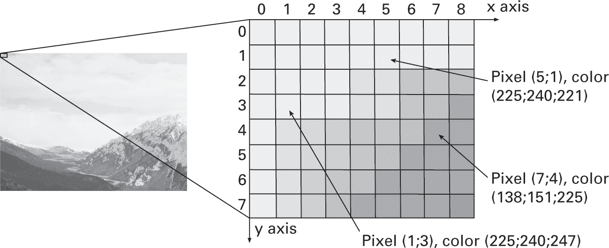

<samp class="SANS_ITC_Stone_Sans_Std_Semibold_B_11">图 1.4</samp>

由工业化生产和标准化的 `CCDs` 和 `CMOSs` 实现的数字照片像素组织示意。右侧的示意是左侧数字照片的虚拟放大。每个 `pixel` 都通过其在坐标系（`x/y`）中的位置被识别。此外，假设左侧图像是彩色图像，每个 `pixel` 都由三个互补的值描述，通常称为红、绿、蓝（`RGB`）色彩方案。由于大多数标准计算机现在将 `RGB` 值表示为 8 位内存地址（例如，一个字节），这些三元组可以从 0 到 255 不等，或者在十六进制写法中从 `00` 到 `FF`。

### 经济影响

尽管花费精力组装能够以有意义的方式处理 `CCD` 和 `CMOS` 产生 `pixels` 的计算机化计算方法听起来可能很深奥，但此类活动在当代经济中发挥着重要作用.^(9) 这与数字照片前所未有的生产、流通和可获取性有关：^(10) 得益于图像处理算法，这些大量的二维信号已成为可能指示习惯、属性、偏好和欲望的`轨迹`。随着图像处理和识别的出现，每天产生和分享的许多数字照片不再是杂乱的数据，而是变成了`价值资产`（Birch and Muniesa 2020）。这是一个必须掌握的现象。大型科技服务公司如 `Facebook`、`Google`、`Amazon`、`Apple`、`IBM` 或 `Microsoft` 都有实验室，其成员每天工作制造新算法，以商业化利用用户、客户和合作伙伴可能投入的数字照片的无限潜力.^(11) 国家也不容忽视；强大的公共机构也大量投资图像处理，以利用数字照片用于安全、控制和纪律目的的能力.^(12) 近年来，正如 Hine (2008) 在生物分类学案例中所描述的那样，图像处理被视为一种控制和规划的资源，并为此日益成为战略性政策关注和支持的对象。


这一切听起来可能很阴暗。然而，图像处理不可无疑是一个引人入胜的研究领域，拥有许多专业的学术期刊和会议。其研究课题确实很有吸引力：如何让像盒子一样的计算机器*看到*，并可能利用它们的形式主义生态系统，让它们检测、识别并揭示我们这些双足哺乳类动物无法通过有机感官去理解的事物？巨大的学术努力每天投入到开发能够操纵 CCD 和 CMOS 像素的算法中，使计算机变成真正的视觉设备。然而，重要的是，这些群体之间很难划分清晰的界限：学术研究不仅受到公共机构的资助，也受到私人公司的资助，而这些公司又参与了工业产品的开发。无论好坏，这些异质的行动者（actants）相互关联，并共同参与图像处理算法的开发和在全球范围内的扩散。在实验室层面，也参与了这一高度集体的努力。

然而，人们可能会反对地认为，像实验室这样的小型图像处理实验室并不像 `Google` 这样的巨型科技服务公司，或像`国家安全局`这样的强大政府机构。我凭什么将一个对“黑箱社会”的制造感兴趣的、受尊敬的小型学术机构与它们放在同一水平（Pasquale 2015）？诚然，作为学术提议的算法与作为商业产品或实际设备（特别是在优化和软件实现方面）的算法之间存在重要差异。尽管如此，必须指出实验室的学术贡献影响了大型工业和国家行动者的工作。这些连接通常在学术会议中变得可见，工业界工作的校友被邀请讨论他们的进行项目。在实验室停留期间，我参加了许多此类会议，起初惊讶地发现，`Google Brain` 或 `IBM Watson` 这样令人印象深刻的机构背后，有着与我交流相同的计算机科学家，他们在规模类似的团队中工作，参加相同的活动，共享相同的参考文献（尽管薪水显著不同）。例如，2015 年 11 月，实验室主任邀请了一位 `Instagram` 员工（实验室的校友）讲述他们的新系统，该系统主要组件源于《2014 IEEE 计算机视觉与模式识别会议》的一篇论文。2014 年 6 月，在 `NEC` 工作的前实验室成员也展示了她的算法项目，该项目源于她参加的 2013 欧洲视觉会议的一系列论文。其他人——大多来自 `IBM` 和 `Google`——也参加了由实验室和邻近图像处理实验室组织的这些“邀请会议”，大多数时间提到并使用前沿出版物。官方属于行业的行动者与学术社区紧密联系，在规模类似的团队中工作，参加相同的活动。此外，实验室与巨型科技行业之间的持续互动是双向的：`Google`、`Facebook` 和 `Microsoft` 等公司也组织学术活动、赞助国际会议并在顶级期刊上发表论文（见图 1.5）。

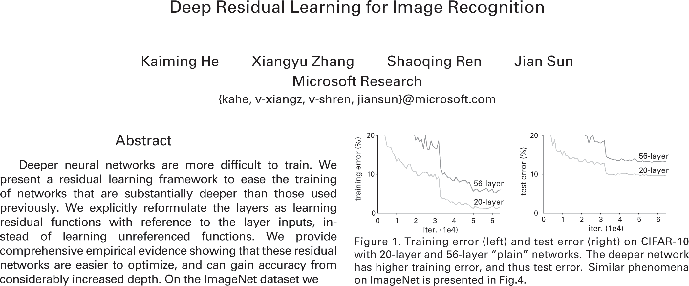

<samp class="SANS_ITC_Stone_Sans_Semibold_B_11">图 1.5</samp>

工业团队发表的学术论文示例。这篇关于图像识别深度神经网络的论文获得了 2016 IEEE 计算机视觉与模式识别会议的最佳论文奖。尽管版权归电气电子学会（IEEE，会议论文集的官方编辑者），但其内容可以在 `arXiv.org` 仓库中免费获得。*来源：* He 等人，2016。经 IEEE 许可转载。

尽管如此，学术出版并非商业产品；如果大学和工业实验室都发表介绍新图像处理算法的论文，那么这些方法本身很少是实用的。为了成为能够在集体世界产生重要影响的商品，它们必须参与更广泛的*钝化*（passivation）和*价值*（valuation）过程，这些过程会显著改变它们的初始属性（Callon 2017; Muniesa 2011b）。取决于在不同网络中的流通，工业或学术图像处理实验室最初设计的某些计算方法可能保持非常专业（例如超像素分割算法），而另一些方法则可以广泛应用于更广泛的组合，如数码相机（例如红眼消除算法）、昂贵的软件和大型信息系统（例如文本识别算法、压缩方案或特征聚类）。然而，在它们在更广泛的网络中流通并成为更大系统的一部分之前，图像处理算法首先需要在实验室发挥积极作用的异质研究社区中设计、讨论和共享。无论是广泛还是专业的，图像处理算法（在计算机科学社区中也有时被称为“模型”）首先需要在实验室这样的地方进行培养、训练、评估和比较。

因此，开发图像处理算法并在同行评审的学术期刊和会议上发表，是实验室的一项核心活动，这也是我打算说明的活动。然而，我仍然需要找到一种方法记录在那里发生的行动过程。

## 材料收集

得益于我的跨学科研究合同，我在实验室待了两年半。和任何其他合作者一样，我有一个办公桌、一个电子邮件地址和一个管理系统中的账户。然而，尽管这些是民族志调查的理想条件，但说头几天很困难也只是轻描淡写：周围发生的一切最初似乎都遥不可及。幸运的是，我必须遵守的实验室规则很快让我体验了被分配的情况。我将这些情况逐步分为七种不同但相互关联的*类型*，对这些类型的系统性描述和引用最终成了我的田野数据语料。


我经历的第一类情况是我之前提到的 `Lab`（实验室）会议。在这些周会上，即使是 `Lab` 的成员也会聚在一间小会议室里，参加并对进行中的工作汇报做出反应。每位博士生（包括我在内）、博士后、衍生公司成员或受邀学者都被要求每学期至少做一次报告。事实证明，这些会议对我的研究探究至关重要，原因至少有三点：

1. 首先，它们帮助我识别了新同事的研究课题。随后，我可以利用这些信息在更非正式的场合与他们开启讨论。
2. 第二，`Lab` 会议让我能够向整个 `Lab` 展示我的研究项目以及其中的一些初步构想。这些强制性的练习使我不得不对自己的探索性直觉接受测试，并且经常对它们进行重构。
3. 第三，这些情况为我提供了分享疑虑和需求的机会，例如 2015 年 9 月，我利用这个平台公开寻求帮助，以改进我尝试更好地记录计算机编程实践的努力（关于这一点的更多内容详见第 4 章）。

然而，尽管这些 `Lab` 会议对我研究探究的进展至关重要，我在后续章节中使用的大部分数据并非在这些情况期间收集的。事实上，由于这些会议主要处理 `Lab` 内部正在进行的研究项目的结果，导致这些结果的实证过程和行动方案通常不是讨论的中心。

第二类情况是由 `Lab` 和邻近的信号处理实验室组织的会议。正如之前提到的，这些会议中是一些受邀讲座，在工业界工作的校友来此讨论正在进行的项目。另一些会议则更接近传统的主旨演讲，为主要来自学术机构的知名研究人员提供发言平台。尽管如此，我仍然没有在实证章节中直接使用从这些会议中收集的数据，但这些活动仍然是值得经历和记录的关键情况，因为它们让我能够识别计算机科学中的当前争论点，并更好地理解研究与行业之间的某些关系。

我经历的第三类情况是在我 2013 年 11 月到 2014 年 6 月期间参加的所谓 `Group`（小组）会议。这些 `Group` 会议是 `Lab` 主任分配给我的图像处理项目的一部分，对于我的民族志探究来说非常宝贵，因为它们让我遇到了计算机科学家所说的 `ground truths`（地面真值）——这些是不显眼但对于算法形成核心的实体。这些实体将在第 2 章介绍，并贯穿我们全书的剩余部分。

第四类情况发生在 `Lab` 的办公桌位前。找到合适的方法来记录这些“桌面情况”是这项探究的一个重要言合条件，因为正是在这些精确的时刻和地点，对算法实际构建至关重要的行动往往会发生。在 2013 年 11 月到 2014 年 6 月期间我负责的图像处理项目的一小部分（关于这一点的更多内容详见第 6 章），以及在 2015 年 9 月到 2016 年 2 月之间的几次计算机编程片段期间，我有机会跟踪并记录此类桌面情况（关于这一点的更多内容详见第 4 章）。

第五类情况是我在 `Lab` 期间期间参加的众多课程和辅导。从基础信号处理课程到高级 `Python` 编程辅导，我投入大量的时间和精力来学习计算机科学的语言。即使我在随后的案例研究中没有直接使用在课堂或辅导期间看到的元素，这些情况仍然极地帮助了我与我的计算机科学家同事交流。尽管这非常耗时——再次，我最初并没有相关经验。

第六类情况是我在 `Lab` 期间进行的各种半结构化访谈。虽然我没有在随后的案例研究中直接使用在访谈中看到的元素，但这些访谈最初具有探索性质，旨在让我更有效地整理我的数据。

最后，第七类情况是我与 `Lab` 成员进行的各种非正式讨论。通过这些非正式讨论、咖啡时间、午餐、公司活动或下班时间，我使用 `Word` 文档来整理我看到的内容。


2016 年 4 月，在一次小型告别会之后，我离开了实验室，带着大约一千页手写笔记；两千个 `.txt` 文件；十几个模块化的 Python 脚本；以及数百份音频、图像和视频录像，还有许多未完成的分析命题。带着这些实证材料实实在在地落在我的臂下，我（暂时地）离开了我的田野现场，对自己这一切的意义产生了一系列严肃的问题。

## 一段痛苦的插曲

民族志是一场变革性的经历。遭遇世界并对它们进行写作——尝试这种奇特的练习的意义何在？计算机科学现在给了我慰藉。至于我以前的社会学同僚，他们会如何看待这个新的我？我无法再言说。这是一段艰难的旅程，一次巨大的蜕变：“我理解了，由于我无法用异教语言表达自己，我宁愿保持沉默，”很久以前有人这样说。然而，文字将被书写，承诺将被履行，某些东西不会被遗忘：我新的“新”同事们（以前那些）都经历过类似的旅程。毕竟，我们正坐在同一艘摇摇欲坠的小船上，试图从零散的实证数据中编写忠实的社会学文献。但我如何才能公正对待我有限却实证的材料，以及那些我提议成为代言人（在没有任何授权的情况下）的人们扭曲的声音呢？我缺乏一切：历史、媒介、语言。我该从何开始？也许从事情的中间开始，一如既常。回到基础，回到实践，回到 `courses of action`。读再一遍经典；一次又沉浸我的材料中，并与那些逐渐重新结对的同事分享它们（我怎么能忘记这一点？）。半相关的事情开始浮现——几乎是分析性的命题。什么数据能让它们在书面文档中绽放？甚至分之一，一个微不足道的量：一个启明世界的微小快照。负责的活动开始在文本页面上成型。但它们还有可读性吗？铭只有在阅读时才会产生世界。概念的匮乏：计算机科学和社会学可能都没有手段来应对算法的制造。极小的编程序列很快暗示了对计算机历史的改写；任何小公式都要求一种替代性的数学哲学（多么杂乱的话题！）。我们闭着眼睛行走。然而渐渐，模式显现了：`courses of action` 变成了追踪真实的、负责的活动的向量；一个印象派的草稿中出现了对立的线条：它们可能强大但并非不可捉。。我们如何开始 `with` 算法进行创作？希望如此渺微，手段如此有限。“荒野中有一个声音在呼喊，”以此类推。哀叹足够了：整件事是由比我微小的个人麻烦更重要的问题驱动的。我想我现在必须验证我的回程票，以某种方式对算法提出一个部分但实证的宪法。

## 算法，你是这么说的？

通过前面这段不寻常章节，我希望读者能理解，写一份关于算法塑造的民族志文档在某种程度上可能是痛苦的——当人们意识到在计算机科学中算法的概念很少是有问题的时，情况更是如此！作为一个对算法制造感兴趣的社会学家和民族志学者，我确实进入了一个学术领域，该领域最显赫的人物致力于（并仍致力于）将一生投入算法的研究。对于许多计算机科学专业人士来说，关于“什么是算法”的争论被夸大了；正如一位同事在我在实验室的第一周建议我的那样，参加当地的本科课程“算法研究”可能会让我以创纪录的速度完成研究……为了明确我的分析手势，因此审视这种成熟的、以计算机科学为导向的算法观点，并将本文工作视为它的原始补充，是至关重要的。

在浏览众多但并非无限的关于算法研究的计算机手册时，人们注意到算法的定义方式是非常同的。作者通常从该术语的简短历史^(17) 开始，然后迅速转向其通用的现代接受定义，即一个`由不同步骤组成的系统方法`。^(18) 作者随后指出，算法步骤的规则应该足够明确，以便在计算设备中实现，从而将算法与其他先验的系统方法（如烹饪食谱或安装指南）区分开来。与此同时，还规定了这些分步的、计算机实现的方法总是指向它们被设计用来解决的问题.^(19) 这第二个定义元素赋予了算法一种 `function`（功能），允许计算机针对手头的特定问题提供正确的答案。

紧接这些开场陈述之后，计算机科学手册倾向于将这些功能性的、分步的、计算机实现的解决方法围绕“输入”和“输出”组织起来。因此，算法的功能活动被进一步明确：算法为定义的问题提供正确答案的方式是通过`transforming`（转换）输入为输出。这第三定义动作导致了标准且被接受的算法概念，即“一个接受任何可能的输入实例并将其转换为所需输出的程序” (Skiena 2008, 3)。^(20)

这些先验的、过于基础的元素实际上并不琐碎，因为它们推进了一种评估立场，并以一种非常有针对性的方式构建了算法。事实上，通过赋予自己问题-输入和解决方案-输出，这种算法观点可以强调这两个极之间的 `adequacy relation`（恰当关系）。算法的研究因此变成了对它们 `effectiveness`（有效性）的研究。这种被忽视的位置是基础性的并渗透了整个算法研究领域，其科学议程被 Knuth 很好地总结：“我们经常面对同一个问题的几种算法，我们必须决定哪一个是最好的` (1997a, 7; 补充斜体)^(21) 从这一点开始，算法分析可以聚焦于元方法的制定，这些方法允许算法的正式评估的系统化。

借鉴广泛的数学分支（例如集合论、复杂性理论），算法学生提出的算法分析方法可以非常优雅且强大。此外，鉴于实现、数据结构化、优化和理论理解方面的重大进展，这种将算法视为输入和输出之间或或少的功能接口（后者本身由特定问题定义）的标准概念，无疑值得其高度的尊重。然而，我认为这种标准概念具有某些局限性，在这些算法争议的时代，这些局限性足以提出尚待提交的补充替代方案。


首先，算法的标准观念忽略了算法旨在解决的问题的定义。根据这种观点，问题及其潜在解决方案已经是预设的，算法研究的作用是评估导致从输入到输出转换的步骤的有效性。然而，公平地假设，问题以及定义它们的术语本身并不独立存在。正如本书第 2 章所示，例如，问题是`问题化过程`（problematization processes）精心灌溉的产物，这些过程涉及了习惯、欲望、技能和价值观。这些集体过程极大地参与了作为问题解决设备的算法未来的进一步设计。

第二个局限性与第一个一个局限性相关：如果将问题化视为算法设计的一部分，算法之间竞争的性质就会改变。最好的算法不仅是那些形式化特征证明了其优越性的算法，也是那些能够成功将其问题定义与评估结果的程序相关起来的算法。通过关注形式化标准——而不考虑这些形式主义如何参与手头问题的初始塑造——算法的标准观念倾向于掩盖算法的评估基础设施和政治性。正如第 2 章所示，评估程序并不一定遵循算法的设计；它们有时也先于并影响设计。

第三，没有考虑迭代方法的实际计算机化。尽管算法的标准观念正确地坚持计算机代码对于算法最优执行的中心性，但这种坚持表现为编程方法论，而这些方法并没有考虑在计算机终端上经历的编程体验。根据算法的标准观念，编写能够以所需方式触发电脉冲的编号指令列表主要被视为终的手段。但正如本书第 4 章和第 6 章所示，编程实践——凭借其展开时所需的集体过程——有时也会影响算法的产生方式。

第四，对于数学陈述如何最终纳入从输入到输出的转换，以及这种纳入如何影响所考虑的算法，很少有人提及。对于算法的标准观念来说，数学陈述似乎凭空出现，准备好通过其他能够评估其有效性的数学陈述来审视。然而正如本书第 6 章所示，为了操作从输入到输出的转换而纳入数学陈述本身就是一个问题化过程，这再次影响了算法的性质。数据集的初始概念及其渐进的问题化、重组和简化，涉及了预期和预判，这些预期完全参与了野外算法的生态系统。

因此，本工作旨在开放算法，并将其扩展到它们所依托的、但由于标准观念阻止了我们对这些过程的理解。如果这项尝试当然不是旨在挑战算法研究的结果，它意在通过基于事实的社会学考量来丰富它。

## 注释

## 案例研究

让我们开始这项关于算法构建的民族志调查，首先深入了解实验室（Lab）的生活。更准确地说，让我们从 2013 年 11 月 7 日在实验室食堂开始吧。那时，我刚到实验室几天。在我的第一次实验室会议上，我介绍自己说我是一个民族志学者，有四年的时间提交一篇关于算法实际塑造的博士论文。大家的反应是礼貌的，尽管带着一丝冷淡。当主任告诉受邀的博士后博士 `CL`、三年级博士生 `GY` 和一年级博士生 `BJ` 我将参加他们正在进行的项目时，他们的注意力提高了。我们将在第一个案例研究中关注的这个项目，它中心于几次小组会议、集体工作会议，在这些会议上，`CL`、`GY` 和 `BJ`（和我）试图协调提交一篇关于新算法的论文。

## 进入实验室食堂

2013 年 11 月 7 日下午 3 左右，我（`FJ`）进入实验室食堂参加第一次小组会议。那时，小组和项目主题已经定义好了：实验室成员之前的讨论一致认为，关于`显著性检测`（saliency detection）的一项新集体出版物对于技术水平以及 `CL`、`GY` 和 `BJ` 的专业知识是很有意义的。自然地，作为一个新落到调查地地的民族志学者，我非常焦虑：我能跟上预期吗？他们会帮助我理解他们在做什么吗？我参与项目显然是一个自上而下的决定，因为实验室主任将我分配到项目中以帮助我妥善开始调查。小组会欢迎我吗？我尝试读读 `CL` 之前发给的一些关于显著性检测的论文，但我被它们心照的假设所困扰。怎么可能检测到这种被称为“显著性”的奇怪东西呢，因为数字图像中重要的东西显然因人而异？论文中的算法似乎依赖的这种关于“地面真”（ground truth）的奇特概念是什么？“地面”和“真”：对于一个 STS（科学技术社会）学者来说，这种结合听起来非常有问题。但当我进入实验室食堂时，小组成员们向我展示了项目的雄心以及他们打算如何运行它：

小组会议，实验室食堂，2013 年 11 月 7 日

CL: “所以你听过显著性，对吧？”

FJ: “嗯，我读了一些东西。”

CL: “一个巨大的话题，但基本上，当你看一张图像时，通常不是所有东西都是重要的，你只关注某些元素。……我们基本上尝试做的，就像一个模型，用来检测图像中应该吸引注意的元素。……`GY` 研究过一个使用对比来分割对象的模型，`BJ` 有一个检测脸部的模型。我们将它们作为基础。……目前，大多数显著性模型只检测物体，不关注脸部。对于这个没有所谓的‘地面真’。但我们认为，脸部也是重要的，而且通常会直接吸引注意力。……这就是关键点：我们基本上想把脸部纳入显著性中。”

GY: “还有分割脸部。因为脸部检测器只输出矩形。……[该模型]可以有很多应用，例如在显示或压缩中。”


许多问题随之浮生。如何以及为什么关注“应该引起注意的元素”很重要？为什么没有一个用于检测“多个物体和脸部”的“真值”（ground truth）是有问题的？到底什么是真值呢？它为什么与“显著性”（saliency）及其潜在的工业应用有关？在这一探究的早期阶段，民族学的蜿蜒流动在某种程度上剥夺了我们的路标。为了跟随该小组并能够充分探索这些材料，显然需要更多的设备。因此，我将在时间上“暂停”对该小组项目的描述，并思考一段时间构成该小组项目框架的显著性检测的社会历史背景。一旦获取了这些介绍性元素，我将回到第一次小组会议。

##幕后元素：显著性检测与数字图像处理

对于图像处理领域的计算机科学家来说，“显著性”是一个模糊的术语，其历史难以追溯。“显著性”这一术语通过跨越不同但又密切相关的研究领域被逐渐创造出来。一个出发点可以追溯到 20 世纪 70 年代，当时认知心理学和神经生物学发展的解释性模型开始模式化人类大脑如何快速处理远大于其估计处理能力的视觉数据（Eason, Harter, and White 1969; Lappin and Uttal 1976; Shiffrin and Gardner 1972）。在许多争议和冲突后，关于人类“选择性视觉注意力方法”整体过程逐渐形成了一种粗略共识，区分了选择和门控视觉信息的两个神经元过程（Itti and Koch 2001; Heinke and Humphreys 2004）。一方面，存在与任务无关且快速的“自下而上视觉注意力过程”，它选择诸如颜色对比、特征方向或空间频率等显著刺激。另一方面，存在较慢的“自上而下视觉注意力过程”，它根据要完成的任务有选择性地运行。“显著性图”一词由 Koch 和 Ullman（1985）提出，用于定义大脑自下而上视觉注意力过程的最终结果。

在 20 世纪 80 年代，认知心理学家和神经生物学家对大脑处理光信号的两种“路径”（一个快速且通用，另一个较慢且针对特定任务）的理论启发了科学家，他们的机器在计算机视觉中面临类似的问题：来自 CCD 的采样数字信号流太大，无法一次性处理。从这一点起，两类不同的图像处理检测算法逐渐形成。第一类算法受假设的自下而上视觉注意力模式化过程启发，试图检测刻在给定图像像素中的“低级特征”，如强度、颜色、方向和纹理。通过 Laurent Itti 和 Christof Koch 在 2000 年代的学术努力（Itti, Koch, and Niebur 1998; Itti, Koch, and Braun 2000; Itti and Koch 2001; Elazary and Itti 2008; Zhao and Koch 2011），“显著性”一词逐渐被吸收到第一类算法中，并标记为 `saliency-detection algorithms`。第二类图像处理检测算法受假设的自上而下视觉注意力模式化过程启发，基于机器必须根据特定指标（例如人脸或汽车检测）学习的“高级特征”。这通常涉及自动学习程序和日益庞大的数据库管理（Grimson and Lozano-Perez 1983; Lowe 1999）。

尽管在底层方面存在差异，高级和低级检测算法都是并一直受限于相同的构建工作流，该工作流由五个相互关联且复杂的步骤组成：

1. 获取有限的数据集。
2. 在该数据集的数据上，对清晰的 `targets`（目标）进行人工标记，这里定义为目标算法将被检测的元素（脸部、汽车、显著区域）。
3. 构建一个收集未标记数据及其人工标记对应项的数据库。该数据库通常被研究社区称为“真值”（ground truth）。
4. 基于真值数据库的代表性部分设计算法的计算属性和参数。
5. 基于真值数据库的其余部分对算法性能进行评估。

为了说明这种模式化的工作流，让我们假设存在 `ϕ`，它是图像处理中的一种标准检测算法。`ϕ` 的存在本身取决于一组有限的数字图像，人类工作人员此前对这些图像标记了目标（例如脸部、汽车、显著区域）。然后将未标记的图像及其人工标记的对应项收集到一个数据库中，形成 `ϕ` 的 `ground truth`。为了设计和编写 `ϕ`，真值被随机分为两部分：“训练集”和“评估集”。`ϕ` 的设计者将使用训练集提取有关目标的正式信息，通常在数学表达式的帮助下进行。一旦公式并翻译成机器可读的代码，就会评估集上对算法 `ϕ` 进行测试，查看它检测未用于设计其属性的目标的效果如何。得益于之前的人工标记工作，`ϕ` 通过与评估集的对比产生精确的输出数量，这些输出可以被定性为“真阳性”、“假阴性”或“假阳性”。通过这种人工设计的目标与自动产生的输出之间的比较，可以获得精确率（检测出的项目中此前定义为目标的比例）和召回率（检测出的项目中目标占的比例）等统计指标，以比较和排名竞争性算法（见图 2.1）。

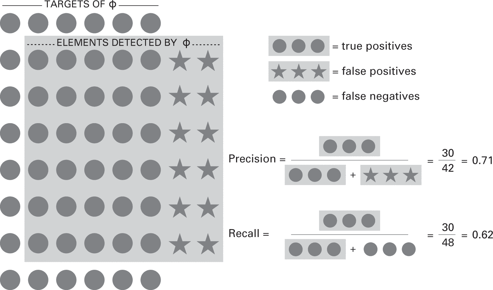

图 2.1：`ϕ` 的精确率和召回率测量示意图。在这个假设的示例中，`ϕ`（灰色背景）检测了三十个目标（真阳性），但漏掉了其中的 18 个（假阴性）。这种性能意味着 `ϕ` 的召回得分为 0.62。算法 `ϕ` 还检测了十二个不是目标的元素（假阳性），这使得它的精确率得分为 0.71。从这里开始，其他旨在检测相同目标的算法可以在相同的真值上进行测试，它们的精确率和召回率得分可能比 `ϕ`更高或更低。


高级检测算法的一个缺点是它们是针对特定任务的，无法无法检测不同类型的目标：人脸检测算法检测脸部，汽车检测算法检测汽车，飞机检测算法检测飞机，以此此类推。然而，此类高级检测算法的优点之一是，其目标的定义（脸部、汽车、飞机）对于设计者来说往往不涉及微小的歧义：汽车、脸部或飞机具有相当明确的特征，便于达成共识。随后，计算机科学家可以人工界定目标和真值（ground truths），以训练高级检测算法。此外，这些真值还可以作为竞争性高级检测算法之间的裁判员，因为它们提供了精确率和召回率指标。人脸检测子领域由于其大量的真值和算法命题，自至少 2000 年以来，就成为了图像处理中一个高度发达且竞争激烈的话题的范例（见[图 2.2]）。

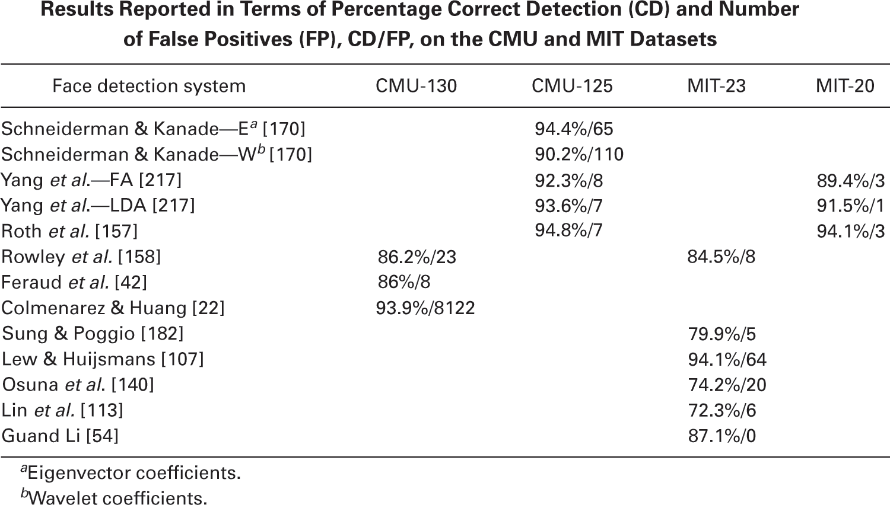

[图 2.2]

高级人脸检测算法的示例对比表。该对比表使用了来自卡内基·梅隆大学（CMU）和马萨诸塞理工学院（MIT）的两个真值。左侧是根据其提出的论文命名的算法列表。在表中，“正确检测的百分比”（`CD`）表示召回率值，“假阳性数量”（`FP`）暗示了精确率值。*来源：* Hjelmås and Low (2001, 262)。经 Elsevier 许可转载。

在 2000 年代，与高级检测的研究不同，低级显著性检测没有能够允许设计和评估计算模型的“自然”真值。在那个时代，尽管显著性检测与任务无关且自适应的特性对于自动图像裁剪（Santella et al. 2006）、小型设备上的上的自适应显示（Chen et al. 2003）、广告设计和图像压缩（Itti 2000）在理论上很有趣，但缺乏任何允许训练和评估计算模型的真值，导致显著性检测未能成为数字图像处理中的一个活跃话题。正如 Itti、Koch 和 Niebur (1998) 在自然图像上测试首个显著性检测算法时承认的那样：

> 面对许多此类[自然]图像，很难客观地评估该模型，因为没有客观的参考可以比较，而且观察者可能对哪些位置是最显著的产生分歧。（Itti, Koch, and Niebur 1998, 1258；斜体为添加）

自然图像中的显著性检测是一个模棱两可的话题，难以用真值表达。虽然为训练和评估高级人脸检测或汽车检测算法定义单一目标通常是直观的（尽管很耗时），但要为显著性检测算法做到这一点则要复杂得多，因为在自然图像中被认为是显著的内容往往会因人而异。虽然在 2000 年代，显著性检测算法可能在许多工业应用中是有前景的，但图像处理领域还没有人找到过为自然图像设计真值的方法。

2007 年，Liu 等人针对这个问题提出了一种创新的解决方案，并创建了首个自然图像显著性检测真值。他们的转变是明明的、付出了成本的，并且对于在图像处理文献中构建和建立显著性检测子领域出了巨大贡献。Liu 等人的第一步是通过引入高级检测的概念，提出了一个可能的显著性检测范围。根据他们，与其尝试突出数字图像中的显著区域，显著性的计算模型应该检测给定数字图像中最显著的物体。因此，他们将显著性问题界定为二元的且与单体物体相关的。根据他们，，为了突破显著性检测的僵局，显著性检测算法应该将一个显著物体与图像的其他部分区分开：

> 我们将显著物体这一高级概念引入到每幅图像的视觉注意力过程中。我们将其称为显著物体，或我们所熟悉的前景物体……我们将显著物体检测表述为一个二值标记问题，将显著物体与背景隔离开。与人脸检测一样，我们检测一个熟悉的物体；与人脸检测不同，我们在图像中检测的是一个熟悉但未知的物体。（Liu et al. 2007, 1–2）

多亏了对显著性概念的完善（从“吸引注意的东西”变为“图像中吸引注意的物体”），Liu 等人能够组织实验以构建供计算模型检索的目标。他们首先从论坛和搜索引擎中随机收集了 130,099 张自然图像。然后人工筛选出 20,840 张符合他们定义的图像：即只包含一个目标的图像。这一初步筛选操作至关重要，因为它排除了具有多个潜在目标的图像。结果是一个不具有复杂特征的初始数据集（见[图 2.3]）。


[图 2.3]

Liu 数据集的样本。图片包含一个中心对比元素。*来源：* 微软亚洲研究院（MSRA）公开数据集，Liu et al. (2007)。

随后他们分两步进行。首先，他们要求三个人类工作者在每幅图像上手动画出他们认为的最显著物体的矩形。然后，对于每个图像，Liu 等人通过共享像素百分比获得这三个矩形的致性。如果比例大于选定的阈值（此处为 80%），则该图像被认为包含一个“高一致性显著物体”（2007, 2）。在第一次筛选步骤后，他们的数据集 `α` 包含约一万张图像。

在第二步中，Liu 等人从 `α` 中随机选择了五千张高一致性显著物体图像，创建了第二个数据集 `β`。他们随后要求九位其他人类工作者对 `β` 中每幅图像的显著物体进行标记。这一次，Liu 等人为每幅图像获得了九个不同但高度一致的矩形，它们的平均表面被认为是“显著性概率图”。由于这种构建的社会共识，这五千张显著性概率图——在计算机科学视角下，是由特定数值构成的实体`矩阵`——随后可以被视为他们所界定的显著性问题的最佳解决方案。整个真值——收集自然图像及其相应显著性概率图的数据库——成为了开发所需算法的基础。


这种转变绝非易事。事实上，通过组织这项调查、邀请人们进入他们的实验室、欢迎他们、向他们解释主题、编写相应的计算机程序让他们对图像进行标记，并将结果收集到适当的数据库中以便进行统计处理，Liu 等人将他们最初对显著性检测的简化概念转化为了具有特定数值的、可操作且无歧的目标。在这个艰辛过程的最后，Liu 等人从集合 `α` 中随机选取了二千张图像，并从集合 `β` 中随机选取了一千张图像来构建一个训练集（Liu et al. 2007, 5–6），用以分析他们构建的、基于共识而可靠的目标的共同特征。一旦从训练集目标中提取出充分的数值特征并用机器可读语言实现，他们就使用了集合 `β` 中剩余的四千张图像从统计学上衡量了他们算法的性能。此外，他们还第一次可以将自己算法的检测性能与其他实验室已经提出的两种竞争算法进行比较，而由于缺乏与显著性相关的“自然”目标，这些算法此前无法在自然图像上进行评估。除了实际完成他们的显著性检测算法外，Liu 等人的伟大创新在于重新定义了显著性问题，使其能够进行性能评估（参见图 2.4）。

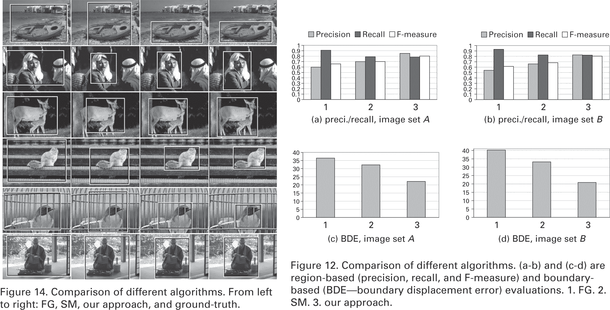

<samp class="SANS_ITC_Stone_Sans_Std_Semibold_B_11">图 2.4</samp>

基于 Liu 等真值（ground truth）的性能评估。左侧是根据真值的三个不同显著性检测算法的视觉比较。右侧是总结三种算法统计性能的直方图。在这些直方图中，真值对应于 `y` 轴，即允许评估的最优显著性检测性能。*来源：* Liu et al. (2007, 7)。经 IEEE 许可转载。

通过发表论文并在网上公开提供他们的真值，说 Liu 等人在图像处理领域建立了一个全新的可评估研究方向并不为夸张。一套昂贵的基础设施已经搭建起来，准备好复用，以支持其他竞争算法的提案，根据 Liu 等人的真值及其所包含的显著性定义，这些算法可能具有更好的性能。他们的发表不仅仅是一篇论文：它是一篇让其他论文得以发表的论文，因为它们提供了其他研究人员可以使用真值，只要他们恰当地引用这篇开基性论文并接受真值对显著性的受限但可操作的定义。(9)

另一篇关于显著性检测的重要论文——因此也对我们即将继续关注的小组项目同样重要——由 Wang 和 Li 于 2008 年发表。对他们来说，尽管 Liu 等人 (2007) 将显著性问题设定为二分类问题是正确的，但他们的边界框（bounding-box）真值仍然令人不满意，因为它完全可以评估不准确的结果（参见图 2.5）。为了细化 Liu 等人首个显著性检测真值的衡量标准，Wang 和 Li 从 `β` 数据集中随机选取了三百张图像，并使用分割工具手动标记了这三百个显著对象的轮廓。他们当时提出并评估的是一种显著性检测算法，该算法“不仅捕捉显著对象的粗略位置和区域，还大致保持了轮廓正确”（Wang and Li 2008, 965）。

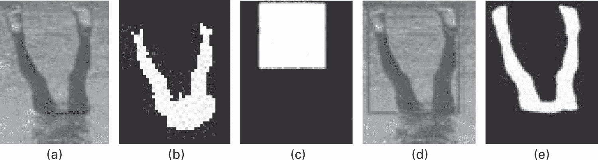

<samp class="SANS_ITC_Stone_Sans_Std_Semibold_B_11">图 2.5</samp>

图像 (a) 是 Liu 等人真值的未标记图像；图像 (b) 是 Wang & Li 显著性检测算法的结果；图像 (c) 是其他显著性检测算法在 (a) 上的假设结果；图像 (d) 是 Liu 等人真值提供的边界框目标。尽管 (b) 比 (c) 更准确，但如果与 (d) 比较，它将获得较低的统计评估分值。这就是为什么 Wang & Li 提出了 (e)，一个与已定义的显著对象轮廓相匹配的二分类目标*binary target*）。*来源：* Wang and Li (2008, 968)。经 IEEE 许可转载。

从这一点起，图像处理中的显著性检测几乎已经定型：尽管后来提出了许多利用不同底层像素信息的算法（Achanta et al. 2009; Chang et al. 2011; Cheng et al. 2011; Goferman, Zelnik-Manor, and Tal 2012; Shen and Wu 2012; Wang et al. 2010），但它们都受限于 Liu 等人在 2007 年定义的显著性问题。尽管后来在发表的论文中提出了其他真值（Judd, Durand, and Torralba 2012; Movahedi and Elder 2010）来扩大显著性检测的范围（特别是通过提出包含两个偏移对象的图像），但 Liu 等人将显著性检测定义为二对象相关问题的开基性框架仍然没有受到挑战。当小组在 2013 年 11 月启动他们的项目时，Liu 等人对显著性问题的设定继续支持着通过速度和准确性区分自身的算法竞争（参见图 2.6）。

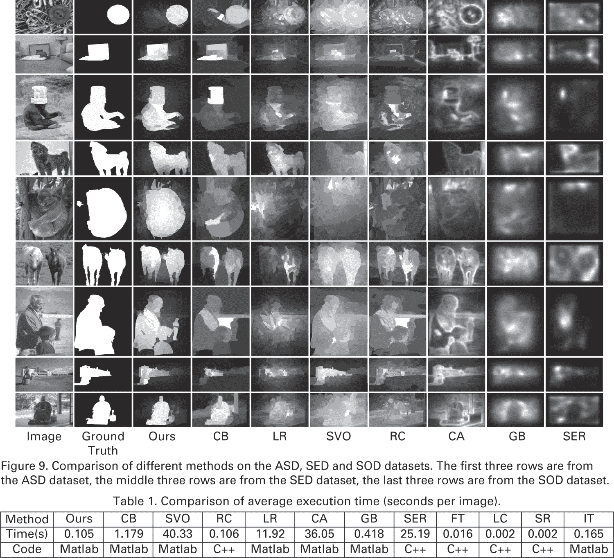

<samp class="SANS_ITC_Stone_Sans_Std_Semibold_B_11">图 2.6</samp>

2013 年不同显著性检测算法的对比表。自 2007 年以来，竞争算法的数量增加了。这里使用了三种真值进行性能评估：ASD (Achanta et al. 2009)、SED (Alpert et al. 2007) 和 SOD (Movahedi and Elder 2010)。下方表格比较了每个实现算法的执行时间。*来源：* Jiang et al. (2013, 1672)。

通过这段图像处理显著性的简要历史，我们能够更好地跟随小组尝试构建自己的创新显著性检测算法。社会调查、定义竞争算法目标的显著对象、受限于二分类显著性定义的真值、广阔的应用：我们即将探索的阶段受到所有这些元素的支持，约束了小组对项目的塑造，同时也为他们提供了进一步重构的机会。

## <samp class="SANS_ITC_Stone_Sans_Std_Semibold_B_11">重新定义显著性</samp>

如果在本章开始，小组的解释看起来相当晦涩，那么之前的介绍性回顾现在应该让我们能够批判性地理解它们。因此，让我们再次看看这段片段：

<samp class="SANS_ITC_Stone_Sans_Std_Semibold_B_11">小组会议，实验室食堂，2013 年 11 月 7 日</samp>

<samp class="SANS_ITC_Stone_Sans_Std_Semibold_B_11">CL:  </samp>“所以，你听说过显著性吧？”

<samp class="SANS_ITC_Stone_Sans_Std_Semibold_B_11">FJ:  </samp>“嗯，我读了一些东西。”


CL：“这是一个宏大的话题，但基本上，当你观察一张图像时，通常并不是所有内容都是重要的，你只会关注某些元素。……我们基本上尝试做的，就像是一个模型，能够检测出图像中应该引起注意的元素。……GY 开发了一个利用对比度分割物体的模型，而 BJ 有一个检测人脸的模型。我们将它们作为基础。……目前，大多数显著性模型只检测物体，而不关注脸部。这方面目前没有地面真值（ground truth）。但我们认为，脸部也是重要的，而且通常会直接吸引注意力。……这里的关键在于：我们基本上想将脸部包含在显著性中。”

GY：“以及分割脸部。因为人脸检测器只输出矩形。……[模型]可以有很多应用，例如在显示或压缩方面。”

根据该小组的观点，显著性检测模型也应该考虑人脸，因为人脸在人类注意力机制中是重要的。此外，在显著性检测中投入这一空白，将合并该小组近期关于低级分割和高层人脸检测研究的一个绝佳机会。将高层人脸检测与低级显著性检测相结合的想法，源于之前的图像处理论文（Borji 2012; Karthikeyan, Jagadeesh, and Manjunath 2013），其灵感受到视线预测（Cerf, Frady, and Koch 2009）、认知心理学（Little, Jones, and DeBruine 2011）以及神经生物学（Dekowska, Kuniecki, and Jaśkowski 2008）研究的影响。但该小组在此处的雄心是在 Wang 和 Li（2008）提出的框架的基础上，在 Liu 等人（2007）之后，进一步向显著性方向探索，提出一种能够检测和分割脸部`contours` 的算法。为了实现这种微妙的结果，GY 之前在分割方面的工作以及 BJ 在人脸检测方面的工作将成为宝贵的资源。

该小组还想构建一个能够有效处理更广泛自然图像的显著性检测模型：

**2013 年 11 月 7 日，实验室食堂，小组会议**

GY：“但你知道的[对 FJ 来说]，我们希望算法能够检测多个物体和脸部。因为在显著性检测中，模型在简单图像上只能检测出一两个两个物体。它们无法在复杂图像中检测出多个显著物体。……但问题是，这方面没有地面真值。只有包含一两个物体的地面真值，而不是那么多脸部。”

在许多情况下，自然图像捕捉到的不仅仅是与清晰背景区分来的一两个物体；根据该小组的说法，数码相机用户拍摄的照片通常比 Liu 等人（2007）之后用于训练和评估显著性检测算法的图像要杂得多。事实上，至少在 2013 年 11 月，显著性检测正成为一个研究领域，其算法`only`在那些——罕见的——具有清晰且不纠缠特征的自然图像上变得越来越高效。但该小组也知道，这个问题与当时可显著性检测地面真值密切相关，而这些真值都受限于 Liu 等人对显著性的初始定义，该定义仅适用于简单图像。从这里开始，由于小组想要提出一种能够检测不同且更微妙显著性的模型，他们必须构建这种显著性的目标；由于他们想提出一种能够在更复杂的真实图像中计算并检测多个显著特征（物体和脸部）的模型，他们必须构建一个新的收集复杂图像及其对应的多个显著特征的地面真值。

该小组重新定义显著性问题术语的愿望并非空穴。当 Liu 等人在 2007 年对显著性进行研究时，计算机科学家很难对复杂图像组织大规模的社会调查。但在 2013 年 11 月，众包服务的日益普及开启了新的可能性：

**2013 年 11 月 7 日，实验室食堂，小组会议**

GY：“但我们想利用众包来创建一个新的地面真值，并要求人们标记他们认为显著的特征。……然后我们就可以将其用于我们的模型并比较结果，你明白的吧？”

广义上说，众包（crowdsourcing——是“crowd”和“outsourcing”的缩写词，最初由记者 Howe（2006）创造）——指的是“一种参与式的在线活动，其中个人、机构、非营利组织或公司通过灵活的公开征集，向一组知识水平、异质性和数量各不相同的个体提议自愿承担某项任务”（Estellés-Arolas and González-Ladrón-de-Guevara 2012, 195）。在 2013 年 11 月，这项服务由几家公司提供，如 Amazon（`via` `Amazon Mechanical Turk`）、ClickWorker 或 Employment Crossing（`via` `ShortTask`），它们的应用程序接口（`APIs`)(10)主要向位于美国和印度的注册在线临时工推荐调查。一旦工人提交了完成的任务——这些任务在时间和复杂性上可能差异巨大——设计调查的组织（例如研究机构、公司、个人）就可以决定其有效性。如果任务被认为是有效的，工人将从众包公司处获得公开征集中最初指定的金额。如果任务被认为无效，工人将一无所获，且在大多数情况下没有申诉的机会。由于众包的道德经济最近一直是批判性社会学研究的对象，有必要对其进行一个简短的侧边栏介绍。


临时工作长期以来一直支持着工业发展。正如 Pennington 和 Westover (1989) 所记录的那样，19 世纪 50 年代在英国发展的纺织业严重依赖于场外制造运营，这通常被称为“家庭作业”。居住在农村的妇女和儿童作为“原始按需劳工”投入工作，被要求完成当时的机器无法胜的精细后期处理工作。几乎同时，类似的现象也发生在美国，特别是在宾夕法尼亚州的匹兹堡地区：尽管这通常被视为一种注定消失的前工业时代遗迹，但以佣金为基础并与农村家庭合作组织的“计件工资制”是扩大大规模制造业规模的必要杠杆（Albrecht 1982）。

尽管工会后来通过艰苦的斗争成功在某种程度上改善了员工的劳动条件（例如 1938 年的美国《公平劳动标准法》，1936 年的法国《马蒂尼协议》`Accords de Matignon`），但这些改进主要涉及在指定生产场所进行的全职工作，而这些工作大多保留给白人男性。因此，20 世纪上半叶对薪资工人做出的让步主要涉及那些从可见性和接近性中受益的人；而临时工作是分散的、不透明的、价值低且被视为无技能的，它继续在监管之外运行。在此基础上（以及许多其他超出本侧边栏范围^(11) 的内容之外），后来还增加了一种或或少显性的企业策略，即规避工会化和劳动规定（这些规定已预留给特定行业），这种策略主要基于信息和通信技术的日益普及。这种“工作场所碎裂化”的策略（Weil 2014）与西方经济的金融化高度契合，^(12)，有助于进一步推动外包：与其依赖从法律逻辑中受益的员工，现在依赖全球范围内的临时员工网络变得更具优势且更有价值。而众包作为一种分布式的、计算机支持的按需低价值劳动，可以被视为临时工作对工业资本主义的支持和修正的延续。正如 Gray 和 Suri (2019, 58) 指出的：“今天的按需工作是消耗性幽灵劳动的最新迭代。它们一方面在当下是必要的，但它们也太容易被贬值了，因为它们所执行的任务通常被认为是平庸或机械的，而雇佣执行这些任务的人通常没有任何文化影响力。”^(13)

让我们回到实验室。2013 年 11 月，和大多数人一样，该小组（Group）并没有意识到由当代众包过程支持的、泛化外包和临时劳动力贬值背后的动态。这种无知的迹象可以从小组经常使用的“用户”（users）一词中发现，他们用它指代参与这种新形式不稳定产阶级的匿名`工人`（workers）。^(14)。对于小组来说，在当时，众包的预期收益是巨大的：一旦所需的 Web 应用程序完成编码并设置指令（例如“请突出显示直接吸引你注意的功能”），小组就可以向一家众包公司付费，该公司的 `API` 将负责将调查连接到小组 Web 应用程序的数十名低薪“用户”上。反过来，这些“用户”——从现在起我将他们称为“工人”——会向小组的服务器提供标注坐标，这些可以在 `Matlab` 等软件软件包上进行处理。^(15)。对于我们的故事来说，众包作为一种相当容易获得的付费服务，创造了差异：收集许多手动标注的显著特征对于小组来说，比 Liu 等人在 2007 年所做的更易管理，而且将显著性概念扩展到多个特征变得——至少在 2013 年 11 月——是可行的。

众包引起的另一个差异是将显著性问题可能地重新定义为*连续性*的：

```
<samp class="SANS_ITC_Stone_Sans_Std_Semibold_B_11">小组会议，实验室食堂，2013 年 11 月 7 日</samp>

<samp class="SANS_ITC_Stone_Sans_Std_Semibold_B_11">FJ:  </samp>“所以，基本上你想要很多标签吗？”

<samp class="SANS_ITC_Stone_Sans_Std_Semibold_B_11">GY:  </samp>“是的，因为你知道，最先进的人脸检测或显著性模型只以二分法检测东西，比如脸/无脸，显著/不显著。我们也尝试做的是一个模型，评估脸和物体的重要性并对它们进行分割。比如‘这张脸比另一个脸重要，而另一个脸又比那个物体重要’以此此类推。……总之，为了做到这一点[基于众包任务结果的真值]，我们首先需要一个包含许多不同内容的图像数据集。”

<samp class="SANS_ITC_Stone_Sans_Std_Semibold_B_11">CL:  </samp>“是的，我们考虑过至少要有 1000 张图像来训练和评估。但必须是具有不同物体和不同大小脸部的图像。”

<samp class="SANS_ITC_Stone_Sans_Std_Semibold_B_11">GY:  </samp>“而且我们必须选择图像；用于运行调查的好图像。……我们会尝试在[春季]提交论文，所以我认为在 1 月份完成众包最好。”
```

如果用于构建真值的图像只包含一个或两个物体，并且仅由几个人标注，那么就无法计算标注特征之间的关系值。从这一点起，按照 Liu 等人 (2007) 的方法将显著性定义为二分问题将是完全合理的。然而，当小组能够负担得起启动在包含许多特征的复杂图像数据集上要求许多标签的社会调查时，在方法论上为标注特征分配*相对重要性值*就变得可能。这是一个算术值的问题：如果一个特征被手动标注为显著，小组只能获得一个二值结果（前景和背景）。但如果多个特征被许多工人标注为不同程度的显著，小组就可以获得一组连续的结果。简而言之，对于小组来说，众包再次创造了差异，因为它让具有相对连续值的新类型目标成为可能。在此时，很难预测小组的算法是否能够有效地接近这些微妙的结果。然而，小组想要构建的真值将通过提供模型应该尝试以最佳方式检索的目标，从而实现这种算法的发展。


尽管该小组已经在显著性检测及其他相关领域之前的工作的基础上，重新定义了显著性问题，但他们仍然缺乏能够从数值上确定这一新问题的“地面真值”（ground truth）：即目标算法应该处理的输入以及它应该尝试检索的输出（即“目标”）仍然需要构建。从这个意义上说，该小组仅处于问题化过程初期，这一过程可能会导致一种新的计算模型：他们对显著性问题的新定义仍然需要配备具体的元素（Vinck 2011）（一组新的复杂图像、一项众包任务、连续值、分割后的脸部），以形成一个参考数据库，而该数据库反过来又成了新的计算机计算方法的基础。借鉴米歇尔·卡隆（Michel Callon, 1986）的观点，我们可以说，对于该小组成员来说，新的地面真值出现为一个“必经之路”（obligatory passage point），可能使他们成为显著性检测研究社区不可或缺的一部分。如果没有新的地面真值，显著性检测模型将在不现实的图像上运行；它们仍然是针对单一对象的；它们仍然会忽略对脸部的检测和分割；因此，它们对于现实世界的应用仍然是无关的。在新的地面真值的帮助下，该小组归因于显著性检测的缺陷可能会被克服。类似地——这次借鉴了乔安·藤村（Joan Fujimura, 1987）观点——我们可以说，此时该小组的显著性问题仅在他们的实验室层面是可行的。该小组确实获得了开展项目所需的时间和资金，并对如何运行该项目有见解。但如果没有任何地面真值，该小组没有具体的手段将这种“实验室水平”与图像处理研究社区*以及*有效定义计算工作模型所需的特定任务联系起来。只有通过构建一个收集“输入数据”和“输出目标”的数据库，该小组才能提议并最终发布一种能够解决该小组重新定义的显著性问题的算法。

## 构建新的地面真值

我们现在对计算机科学家在尝试构建新算法时有时会遇到的某些陷阱有了更好的理解。当我们跟踪该小组启动显著性检测项目时，我们意识到，一个能够建立新研究方向的图像处理算法的构建，与新地面真值的塑造是同步的，而这种地面真值应该精确地支持并配备算法的构建。然而到目前，我们只考虑了该小组需要设计新地面真值的理由。但他们实际上是如何实现的呢？

除了致力于众包 Web 应用程序的代码之外，该小组还将 2013 年 11 月和 12 月用于筛选图像，以对应算法的三种预期性能：（1) 检测并分割显著特征（包括脸部）的轮廓；(2) 在复杂图像中检测并分割这些显著特征；(3) 评估已检测和分割的显著特征的相对重要性。这些规范导致了专门组织的几次小组会议，讨论所选图像的内容和分布：

**小组会议，实验室食堂，2013 年 11 月 21 日**

**BJ:** “嗯，我们可能避免这种篮球照片，因为这些球员可能像名人一样。他们之所以好是因为球和脸部有对比，但至少我认识其中一些球员。如果我认识，我们就包含诸如‘我认识这张脸’之类的特征，这样我就给它上标签。”

**CL:** “我想，也许如果你有一个名人，脸部重要性就会增加，而我们只想避免在我们的方法中对这种情况进行建模。”

……

**CL:** “好的。那么分布看起来好点了吗？”

**FJ:** “绝对好了。BJ 刚刚向我展示了如何改进。”

**CL:** “好的。那么我们还要考虑哪些变量？”

**GY:** “比如正脸之类的。但把它们均衡化是非常痛苦的。”

**CL:** “但我们可以涵盖其中一些；可能不需要均衡化。所以应该有像正脸那样的，即只有脸部正面的图像，然后是侧脸，中间是两者的混合。”

筛选过程花费了大量时间，因为必须收集各种图像内容（例如：运动、肖像、侧脸），以涵盖比地面真值更自然的情况。此外，内容不应包含任何影响注意力的著名特征（例如：建筑、运动员）。正如我们所看到的，与 Liu 等人（2007）的研究类似，但是以该小组预想的方式进行的，数据集的组装是由算法未来的任务驱动的（[16]）。到 2013 年 12 月，收集了 800 张高分辨率图像——大部分来自 Flickr——并存储在实验室的服务器中。由于该小组认为在显著性检测中包含脸部是最重大的贡献，所选图像中有 632 张包含了人脸。

在这一以问题为导向的图像筛选的同时，必须对所选图像定义组织工作，以免被不断增加的文件和在整个众包过程中收集的海量标记结果所过载。这种组织程序非常接近数据管理，并意味着实现一个完整的数据库，以便可以轻松检索信息。此外，众包调查的塑造也需要协调和调整：会问什么问题？如何收集和处理答案？这些都是关键问题，因为通过众包获得的“原始”答案只能是矩形，而不是精确的轮廓：

**小组会议，实验室食堂，2013 年 12 月 12 日**

**CL:** “但对于数据库，我们是否重命名图像以保持一致性？”

**BJ:** “嗯。……我不认为有必要，因为我们现在可以通过 ID 将文件追溯到网站。在 `Matlab` 中，你可以把 `.jpg` 文件存储在一个文件夹里，并检索所有它们”

……

**CL:** “GY，你怎么看？我们可以让人们选择图像的一个区域，或者直接在图像上进行类似分割的操作吗？”

**GY:** “我不认为能通过众包获得像素级的答案。我们需要[在实验室里]做像素级的处理，因为如果我们要求他们做，结果会非常草率。或者反正太慢也太贵了。”

**CL:** “那你想要什么？你有分割特征的 `Matlab` 代码，对吧？”


GY：“是的，但那是低级的工作，是像素级精度的[分割]。我想那将留到以后，等我们收集完坐标后再做。反正我仍然需要完成那些[收集坐标的]脚本。真让人头疼。……但我最初的想法仅仅是让人们在显著物体上画矩形，然后收集带有其 ID 的坐标，再利用这些信息来推断每张图像中哪个特征比另一个更显著。显著特征的位置是一个非常模糊的决策，但切割边缘并不那么依赖主观判断。……你知道树在哪里结束，这正是我们想要的。没有人会跑来说‘不！树就结束于这里！’我想在大多数情况下，人与人之间的差异并不大。”

CL：“好的，那我们就写写矩形的代码吧。如果这对用户来说很容易，那我们就这么做吧。”

所选图像的 ID 让小组能够非常容易地将图像放入 `Matlab` 数据库中。但在图像内部，由众包工人标注的显著特征处理起来更为困难，因为 GY 获取图像内容精确边界的交互式工具是基于低级信息的。结果，分割低对比度特征（如脸部）的边界可能需要几分钟，而负担得起的众包通常是小而快速的任务。小组无法承担收集“粗糙”任务的风险，也无法花费无法承受的资金来这样做。因此，标注的特征必须在实验室内部进行后处理，以获得精确的轮廓。

此外，项目的另一个潜在失败点在于众包 Web 应用程序的开发。事实上，要求人们在特征周围画矩形、将这些矩形转换为坐标并将其存储在文件中以进行统计处理，需要非凡的编程技能。到 2014 年 1 月，当众包 Web 应用完全运行时，它包含了由 `html`、`PHP` 和 `JavaScript` 编写的七个不同的脚本（约七百行代码），这些脚本根据工人的输入相互响应（见图 2.7）。然而，尽管实验室的计算机科学家可能熟悉数值计算和 `Matlab`、`C` 或 `C++` 等编程语言，但网页设计和社交池化（social pooling）并不是他们一定受过的训练。

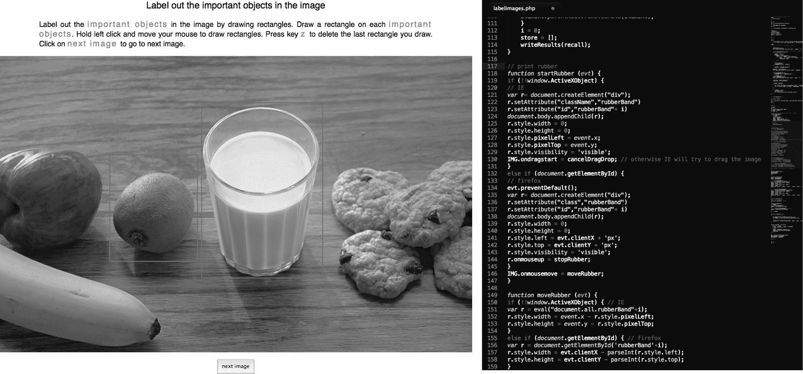

**图 2.7**

小组为其众包任务设计的 Web 应用程序截图。左侧是应用程序在 Web 浏览器运行时运行时。一旦工人创建了用户名，他们就可以开始实验并画矩形。当工人点击“下一图像”按钮时，矩形的坐标会被存储在实验室服务器的 `.txt` 文件中。右侧是实现此类交互标注和数据存储所需的七个脚本中的一个片段。

一旦完成代码编写和调试——这本身就是一个精细的过程（见第 4 章）——不同的脚本被存储在实验室服务器的一个区域，该地址在 2014 年 1 月提供给了已倒闭的 ShortTask 公司，该公司的 `API` 提供了评分最高的临时工。到 2014 年 2 月，30 名工人的任务（即数万个矩形的坐标）已以 `.txt` 文件的格式存储在的数据库中，得益于之前的准备工作，已准备好处理。此时，之前收集的数据集中的每张图像都与工人绘制的许多不同矩形相关联。通过在 `Matlab` 上叠加所有不同矩形的坐标，小组为每张图像创建了一幅强度不一的“权重图”，用以指示显著区域的相对共识（见图 2.8）。然后，小组对每张图像应用了来自 Otsu (1979) 的常用阈值——这是 `Matlab` 内部库的一部分——以仅保留工人认为是显著的权重区域。在耗时整个两个周的第三步中，小组——实际上是 BJ 和我——手动分割了显著区域内显著元素的轮廓，以获得“显著特征”。最后，小组将显著区域的平均值分配给相应的显著特征，以获得能够定义和评估新类型显著性检测算法的最终目标。这个艰辛的过程发生在 2014 年 2 月至 3 月之间；近一个月的时间专门处理工人产生并由 `html-JavaScript-PHP` 脚本和数据库收集的坐标。

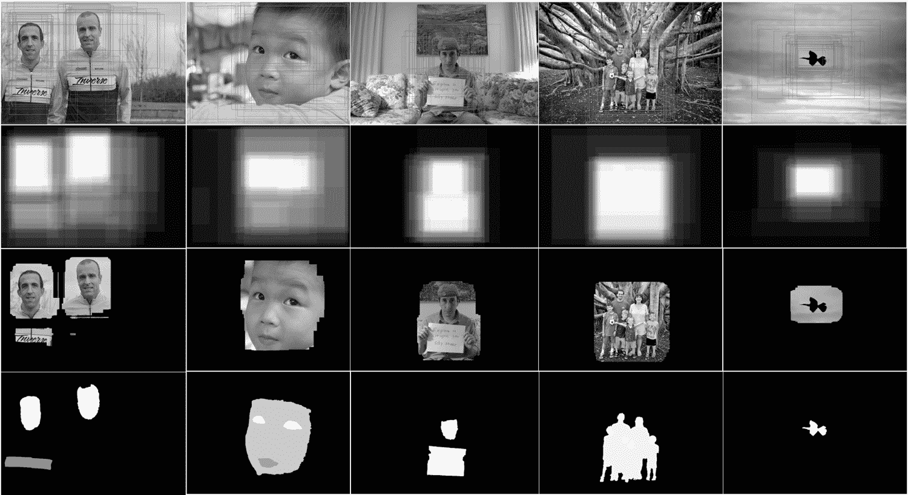

**图 2.8**

`Matlab` 表汇总了处理完成众包任务的工人所产生的坐标所需的不同步骤。第一行显示了从众包任务中收集的图像示例和矩形标注。第二行显示了通过叠加标注获得的权重图。第三行显示了使用 Otsu (1979) 阈值产生的显著区域。最后一行展示了具有相对显著性值的最终目标。前三个步骤可以自动化，但最后的分割步骤必须手动完成。在此过程结束时，图像（第一行，不带标注）及其对应的目标（最后一行）被收集在单一数据库中，构成了地面真值（ground truth）。到 2014 年 3 月，小组成功创建了具有相对显著性值的目标。所选图像及其对应的目标随后可以组织成一个单一数据库，最终构成了地面真值。从这一点起，可以认为小组有效地成功重新定义了显著性问题的术语：目标算法应该执行的转换——最终——在数值上被定义了。

当然，通过新的地面真值来建立问题的术语是不够的：为了提出实际算法，小组还设计并编写了能够有效地将输入数据转换为输出目标的指令列表。为了设计和编写这些指令列表，小组从地面真值中随机选择了两百张图像组成训练集。在对该训练集的输入与目标之间的关系进行正式分析后，小组提取了几个数值特征，这些特征充分表达了（尽管不完全）这些输入-目标关系。从训练集中提取并验证数值特征和参数，并将其顺序转换为 `Matlab` 编程语言的整个过程花费了近一个月。但在此过程结束时，小组拥有了一个 `Matlab` 指令列表，能够将训练集的输入值转换为接近目标值的值。

到 2014 年 3 月底，小组使用其剩余的地面真值数据库来评估算法，并与已有的显著性检测算法在精确率和召回率指标上对其进行比较（见图 2.9）。由于对比结果令人满意，小组算法的特征和性能最终汇总在一篇论文草中，并提交给了一个重要的欧洲图像处理会议。


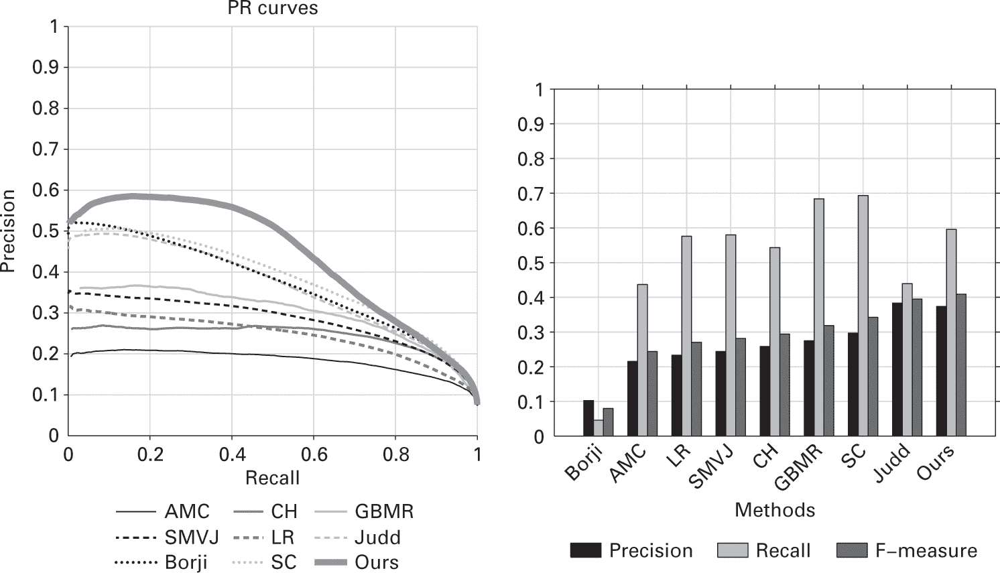

图 2.9

两张由 Matlab 生成的图表，比较了小组算法（“我们”）与已发表算法（“AMC”、“CH”等）的性能。新的真值（ground truth）使得这两张图表成为可能。在左图中，曲线代表了每个算法处理时，真值中所有图像的精确率（`y` 轴）和召回率（`x` 轴）得分的变化。在右图中，直方图测量了相同的数据，同时包含了 F Measure 值（即精确率和召回率值的加权平均值）。两张图表都表明，根据新的真值，小组的算法显著优于所有先进的算法。

正如这些小组会议和文档所示，只有当新定义的显著性（saliency）问题被人类解决并在真值数据库中表达后，小组算法才能运行。从这个意义上说，能够解决新定义的显著性问题的 `Matlab lists of instructions` 的完成，遵循了小组所参与的问题化过程。对显著性的理论重构、在 Flickr 上对特定图像的选择、Web 应用程序编码、`Matlab database` 的创建、工人坐标的处理：所有这些实践都是设计真值所需的，而真值最终允许提取算法相关的数值特征并对其进行评估。当然，构建真值所需的平庸工作不足以完成那些最终有效处理图像像素的复杂 `Matlab instructions` 列表：还需要对关键的经过认证的数学声明进行阐述并转换为机器可读的格式。然而，通过提供提取算法数值特征的训练集，以及提供衡量算法性能的评估集，真值在很大程度上参与了算法的完成。

上述元素并非微不足道，在继续之前，需要进行更深层次的反思。在 2013 年 11 月，小组拥有的元素非常少。它有愿望（例如，质疑之前的论文）、技能（例如数学和编程能力）、手段（例如访问学术期刊、强大的计算机）以及希望（例如，在图像处理领域产生影响）。但仅凭这些元素不足以有效塑造其新的预想算法。 2013 年 11 月，小组还需要一个可以作为基础底层的实证基础；它需要建立一种物质一致性，以确立未来模型的真实性（veridiction）。这就是新真值的全部意义——它更应该被称为“有根的真值”（grounded truth）——因为现在可以建立并产生一组现象（在这里是显著性差异），它们作为一种分析参考标准在运行。一旦这种文本上的固定在 2014 年 3 月实现，小组所处的世界就不再一样了：它被一组在数据库中物质化的关系所丰富和引导。而最终从这个数据库中产生的算法，组织了、复制了并在某种意义上神化了其中嵌入的关系。从一个静态且特定的真值中，产生了一个操作性算法，它有能力在不同的配置中复制和促进真值的组织规则。通过植根尚未构建的算法，由小组小组的真值引导了其算法向一个特定方向的设计。从这个意义上说，新的真值是小组算法中偶然但必然的偏置。(19)

计算模型倾向于被手动收集和处理的数据所束缚并对其产生根本性的偏倚，这种倾向并不局限于数字图像处理领域。例如，正如 Edwards (2013) 在气象学案例所示，对天气数据进行枯集的收集、标准化和编译以产生准确地球气候真值，对于全球环流模型（GCMs）的参数化和评估至关重要。(20) 当然，正如在图像处理领域一样，气候学家对真值的构建并不能保证定义出准确有效的 GCM：还需要流体动力学、统计学和（并行）计算机编程方面的关键见解。然而，如果没有真值提供参数和评估，任何高效且可靠的 GCM 都无法存在。对于手写识别或垃圾邮件过滤的机器学习算法，Burrell (2016, 5–6) 注意到“测试数据”在设置这些算法的学习参数以及评估其性能方面的重要性。在这里，真值似乎也是核心，定义了算法在统计上学习到的内容，并允许对其学习性能进行评估。(21) 对于许多高频交易算法似乎也是如此：正如 MacKenzie (2014, 17–31) 所建议的，对之前的金融交易进行详细分析以及将金融经济学的权威文献作为塑造和评估“执行”算法和“自营交易”算法的实证基础。

然而，尽管实证证据日益增加，但算法在存在意义上与真值数据库关联的倾向（而这些数据库显然无法被还原为简单的数据集），在关于算法的大量计算机科学文献中仍然很少被讨论。这个问题通常被忽略了：数学分析和编程技术（有时非常复杂）是在真值已经构建、接受、分发并开放之后，或者假装已经这样做之后被讨论的。对我在第一章中所谓的“算法标准概念”的理论探索，倾向于认为稳定且共享的参考库是存在的。这种遗漏可能正是这种算法愿景成为可能的原因：将算法视为确保从问题到解决方案计算机化的工具，可能意味着假设了已经定义的问题和已经可以评估的解决方案。


然而，一些社会学家——他们大多深受科学技术研究（STS）的影响——确实正正面应对这一课题。在对预测性算法系统的批判中，Barocas 和 Selbst (2016) 警告了问题定义和训练集收集可能带来的有害后果。类似地，Lehr 和 Ohm (2017) 强调了在统计学习算法设计中，“与数据玩耍”时的人工干预方面。最近，Bechmann 和 Bowker (2019) 在这些论点的基础上提出了“设计即问责制”（`value-accountability-by-design`）的概念：呼吁通过系统性的努力，使算法相关数据收集、准备和分类中涉及的任意选择更加透明。在 Ananny 和 Crawford (2018) 之后，他们认为，为了更好地理解算法行为，事前的关注“真值化过程”（ground-truthing processes）可能比事后审计或源代码审查更具结论性（例如 Bostrom [2017] 和 Sandvig 等人 [2016] 所提的那样）。同样，Grosman 和 Reigeluth (2019) 调查了用于检测威胁行为的算法安全系统设计。他们表明，算法必须解决的问题定义——因此它必须检测的“真阳性”结果——源于集体的问题化过程，这些过程包括赞助者之间的讨论与妥协、对法律文件的竞争性解释，以及项目工程师对威胁性和无害行为的现场模拟。他们得出结论：算法系统固有的规范性也必须考虑到导致这种规范性得以显性化的张力关系。总而言之，上述所有作者都揭示了与本小组（Group）刚刚经历的过程相似的过程。他们的研究还表明，所谓的“算法”往往源于集体过程，并以物质形式体现在偶然的但必要的参考性存储库中。

在当前此项调查的早期阶段，要定义一个适用于所有算法的通用属性是不明智的。然而，基于本章的初步见解以及涉及类似问题的日益增加的研究成果，可以提出合理的假设：在许多我们乐于称为“算法”的实体背后，存在着真值数据库，这些数据库使得设计者能够提取相关的数值特征，并评估从输入数据到输出目标的自动转换的准确性。因此，一旦此类算法进入“野外”（离开其生产地）并自动处理新数据，它们各自的初始真值——以及参与塑造算法的习惯、欲望和价值观——也会被调用并在某种程度上被强化。正如我将在本章最后进一步阐述的，考虑到构成这些算法试图检索的输出目标的集体过程，研究此类算法的表演性效应，与算法对我们生活日益增长的影响相比，似乎是一个令人启发但尚未被充分探索的研究课题。

## 几乎被接受（但被拒绝）

2014 年 6 月 19 日：审稿人拒绝了小组的论文。看到几个月来的严谨工作没有通过发表一篇本可以开启新研究方向并产生大量引用的论文来获得回报，小组感到非常失望。但鉴于三位审稿人提供的理由，他们也感到困惑和惊讶。

除了在显著性检测中加入脸部信息的用性表示怀疑外，审稿人对小组论文的一个看似关键的缺陷达成了共识：计算模型的性能比较仅针对小组的新真值进行：

> **指定审稿人 1**

> 论文没有证明所提方法在公共基准真值上的表现也优于其他先进方法。……本文的实验评估仅在自收集的人脸图像上进行。更多的评估数据集将更具说服力。……需要更多实验来证明所提方法。

> **指定审稿人 2**

> 实验仅在作者创建的真值上进行了测试。……如果能在其他真值上进行实验，并分别报告人脸和非人脸图像的结果，将更具见地。这样就可以更彻底地评估脸部重要性图的用途。

> **指定审稿人 3**

> 讨论仍然太主观，不足以支持其科学见解。从这个意义上来说，在现有数据集上评估是重要的。

审稿人认为论文的技术方面是可靠的。但他们质疑，新的最佳显著性检测模型——正如小组在论文中所述的那样——是否只能与创建它的真值进行面对？诚实地说，为什么不用已有的显著性检测真值来测试这个新模型呢？如果该模型真的比已发表的模型“更高效”，那么在用于塑造和评估之前发表的显著性检测模型的真值上，它也应该更高效。换句话说，既然小组将其模型描述为与以前模型具有`可比性`（commensurable），根据审稿人的意见，小组应该更彻底地比较它们的性能。但为什么小组在评估工作中途停止，并仅相对于新真值与其模型进行比较呢？

**2014 年 6 月 19 日，在 CSF 食堂的露台上与 BJ 的讨论**

**FJ**: 委员会不喜欢我们创建了自己的真值吗？（[22]）

**BJ**: 不。我的意思是，只是我们在这个真值上测试了，但没有在测试其他的。

**FJ**: 他们是希望你已经在已有的真值上进行测试吗？

**BJ**: 是的。

**FJ**: 但你为什么没做呢？

**BJ**: 额，问题就在于：我们为什么不测试其他的？我们有理由。我们的模型关于人脸分割和多特征的。但在其他数据集中，大多数没有超过十张人脸图像。……在显著性领域，大多数人并不做人脸检测和多特征研究。他们处理的是中心有汽车或鸟的图像。你总能看到只鸟或类似的东西。所以，在这些数据集上测试我们的模型完全没有意义。它们无法涵盖我们模型的功能。……情况就是这样：如果你进行经典的改进，你就能确保自己在大型会议上展示东西。但如果你提出新事物，人们不知为何会误解这个概念。


对于该小组而言，将其模型与之前的地面标准（ground truths）进行对比在技术上并不困难；这些地面标准在网上是可以免费获取的，而且此类性能评估所需的 `Matlab` 脚本与生成图 2.9 中所示的结果所需的脚本大致相同。该小组没有进行此类比较的主要原因是，基于之前的地面标准的模型无疑会获得更好的性能结果。由于该小组的模型并非为了解决由之前的地面标准所定义的显著性问题，因此它无疑会被这些地面标准的“原生”模型所超越。

由于缺乏实证元素，我将不会尝试解释为什么该小组觉得有必要将其论文的论点围绕可量化的性能问题展开。（(([23)）。然而，与本章的观点一致，我假设这次被拒绝事件再次说明了图像处理算法是如何受限于其地面标准的。一个源自由目标为居中的、对比性对象的图像组成的地面标准的算法，将以某种方式检索到这些目标。但当在由目标为多个非中心物体和脸部的图像组成的地面标准上进行测试时，相同的算法可能会产生统计学上很差的结果。同样，另一个源自由目标为多个非中心物体和脸部的图像组成的地面标准的算法将以某种方式检索到这些目标。但当在由目标为居中的对比性对象的图像组成的地面标准上进行测试时，它可能会产生统计学上很差的结果。这两种算法运行在不同的类别中；它们的局限在于定义其行为范围的地面标准。正如 BJ 以一种戏剧化的方式所言，在某种程度上，我们得到了我们地面标准的算法。当算法源于同一种（或非常相似的）地面标准时，它们可以被认为比其他算法在统计上更高效。一旦两个算法源于具有不同目标的地面标准，它们就只能被呈现为不同的。可以从方法论、数据选择、统计严谨性或工业潜力等方面对不同的地面标准进行定性评估，但这两个计算模型本身是不可还原的差异，且不可比拟的。从本案例研究的角度来看（这可能与评审者的观点不同），该小组的致命错误可能是将性能的量化改进与地面标准的定性完善混淆了。

有趣的是，在这次被拒绝的一年后，该小组提交了另一篇论文，这次是向一个图像处理领域较小的会议。这篇论文的对象与之前被拒绝的那篇论文的对象完全相同：相同的地面标准和相同的计算模型。然而，该小组并没有强调其模型的统计性能，而是强调了其地面标准，以及它允许在显著性检测中包含脸部分割的事实。在这一篇获得会议“最佳短论文奖”的第二篇论文中，计算模型被作为新地面标准应用潜力的一个示例。

## 以问题为导向的和/或公理化的

第一个案例研究仅占了由实验室一组年轻计算机科学家运行的为期四月的显著性检测项目的一小部分。我们可以借鉴这一探索性案例研究的观察结果吗？我们可以使用已描述的元素来提出更广泛的命题，并为本书以及未来对算法构成的其他潜在探究勾勒分析方向吗？不仅仅关于一组年轻的计算机科学家和一个小型显著性检测原型，我确实认为这个案例研究充实了值得被更深入探索的重要见解。因此，在本章的剩余部分中，我将根据这个实证案例，对算法的社会学研究初步提出两个互补的研究方向。

我假设这个案例研究隐含地暗示了一种看待算法的新方式，这种方式在接受其标准定义的同时对其进行了极大的扩展。事实上，我们现在仍然可以将算法看作在某一点是一组旨在通过计算解决给定问题的指令。尽管正如正如第 1 章末尾解释的那样，我刻意没有将这种算法的标准定义作为起点；在小组项目结束时，一旦从训练集中提取了数值特征并将其翻译成机器可读的语言，几个包含成千上行指令的 `Matlab` 文件就构成了这样一个指令集。从这个角度来看，在理论层面对这些指令集进行研究——例如如 Knuth (1997a, 1997b, 1998, 2011); Sedgewick and Wayne (2011); Dasgupta, Papadimitriou, and Vazirani (2006) 以及许多人所提出的——与当前的问题完全相关。如何使用数学和机器可读语言以最有效的方式为给定问题提供解决方案，确实是一个迷人的问题和研究领域。

然而，我们同时也看到算法设计要解决的问题并不是预先存在的：它必须在所谓的“问题化过程”（problematization process）中产生——这是一系列旨在从经验上定义要解决的问题术语的集体实践。在我们的案例研究中，小组首先利用了认知生物学权威期刊发表的最新主，将显著性问题重新框架为与脸相关且连续的问题。正如我们看到的，小组问题化过程的第一步意味着了平凡且成问题的实践，例如对之前研究结果的批判（我们的竞争对手漏掉了什么？）以及包含实验室最近的一些项目（我们如何追求我们最近的进展？）。小组问题化过程的第二步意味着构建一个可以使重新框架后的显著性问题的地面标准。这第二步也意味着平凡且成问题的实践，例如在 Flickr 上收集数据集（我们选择哪些图像？）、组织数据库（我们如何组织数据？）、设计众包任务（我们向这些工作者提问什么问题？）以及对结果的处理（我们如何从矩形中获得特征轮廓？）。只有在这一过程的最最后——一旦辛苦构建的目标与辛苦构建的数据集关联以形成最终的地面标准数据库后——该小组才能够制定、编写和评估能够通过数值计算技术将输入转换为输出的 `Matlab` 指令集。简而言之，为了设计能够解决新显著性问题的计算机计算方法，该小组首先必须定义这个新问题的边界。


从这些经验性元素中，似乎出现了对该小组算法的两种互补视角。

第一种视角可能将小组的算法视为一组指令，旨在以最好的方式通过计算解决新问题。这种对小组算法的传统观点，转而强调该小组所使用的数学选择、公式化实践和编程程序，这些程序用于将新“地面真相”（ground truth）的输入数据转换为相应的输出目标。该小组是如何操纵其训练集以提取此类任务的相关的数值特征的？该小组是如何将数学运算转换为代码行的？这是否导致了最高效的结果？简而言之，这种对算法的看法将从其计算属性的角度对其分析。

然而，对称地，对小组算法的第二种观点可能将其视为一组指令，旨在以最好的方式通过计算检索在特定问题化过程（problematization process）中设计的输出目标。这种对小组算法的第二种观点转而强调导致算法旨在解决的问题术定义的特定情况和实践。问题是如何定义的？数据集是如何收集的？众包任务是如何进行的？简而言之，这种第二种视角——也是本文所支持的观点——将相对于该算法最初推出的地面真相构建过程（并由此产生偏见）来对算法进行分析。

如果我们初步扩展上述命题，就会得到两种考虑算法的方法，它们都以这些被称为“地面真相”的物质对象为核心。我们可以称为算法的**公理化视角**会将算法视为一组指令，旨在以最好的方式通过计算解决由给定地面真相定义的问题。第二种且互补的**问题导向视角**则会将算法视为一组指令，旨在通过计算检索在特定问题化过程中被定义为输出目标的内容。

### 公理化视角与问题导向视角

虽然我认为算法的公理化视角和问题导向视角是互补的，因此应该紧密结合——特定的地面真相暗示了特定的数值特征（反之亦然）但我认为认为它们会导致不同的分析工作。通过将手头问题的术语视为既定的，公理化的算法考虑方式有助于研究实际的数学和编程程序，这些程序有效地将输入值集以最好的方式转换为输出值集。这听起来像是一个显而易见的结论，但定义一种计算方法需要对方法的初始术语和预期结果达成最小的共识（Ritter 1995）。正是通过假设输入数据到输出目标的转换是理想的、相关的且可证明的，才能提出一个描述这种转换的逐步方案。

在计算机科学领域，可以探索、适应并引入具有许多不同认证规则和定理的各个数学领域，以最优化在最大程度上实现从选定输入数据到指定输出目标的自动转换：
- 图像处理案例中的线性代数（Klein 2013）
- 数据压缩案例中的概率论（Pu 2005）
- 数据结构中的图论（Tarjan 1983）
- 密码学中的数论（Koblitz 2012）
- 统计学（以及概率论）在广受欢迎且据称适用于所有活动领域的机器学习程序中（Alpaydin 2016）。

正如我们在第 5 章和第 6 章中看到的，因此对这些不同的经过认证的数学知识的探索和教学必须尊重其本质：即作为强大的运算符，允许将地面真相的输入数据可靠地通过计算转换为相应的输出目标。

### 地面真相的构建

如果说对算法的问题导向视角可能并不关注算法的形成和计算有效性，那么它可能有助于更好地记录配置这些算法试图解决的问题术语的过程。将算法视为检索实体可能会强调定义了算法试图检索和复制的内容的引用数据库；以及它们为了表达其真实性而建立的偏见。哪种地面真相定义了该算法试图解决的问题术语？这个地面真相数据库是如何构成的？何时构成的？由谁构成的？

通过指向地面真相数据库中正在或已经构成待检索输出的时刻和位置，这种对算法的分析视角——Bechmann 和 Bowker (2019) 以及 Grosman 和 Reigeluth (2019) 共同激发了这一观点——可能会提供与算法及其设计者交互的新方法。这项尚处于起步阶段的研究方向还可以将其结果与我在引言中提到的更具明确批判性的立场联系起来。

如果 Noble (2018) 对 Google 搜索引擎推广的种族主义刻板印象的研究，或 O’Neil (2016) 对专有评分算法使用的代理如何倾向于惩罚最穷的人的研究有效地发挥了警示作用，那么改变现状的实用方法仍需阐述。这就是“构成”（composition）这一概念——本项调查的核心——再次发挥作用的地方：在合法的）愤慨之时，必须随之进行建设性的对抗，而这本身意味着能够现实地展现自己。只要支撑算法构成的实际工作仍然保持抽象和不确定，修改这项工作的生态系统将变得极其困难。从这个意义上说，通过使算法真实性的基础工作实践更加可见，可能实现改变根于算法的偏见，使其促进不同的价值观。如果有更多研究能够调查算法所衍生的地面真相化实践，那么真正的构成潜力可能会逐渐提出来。

***

### 第一部分总结

第一部分现在要结束了。让我快速回顾一下目前介绍的元素。在第 1 章中，我介绍了了这项调查的主要背景：一个我决定称为“实验室”的学术实验室，其成员花费大量的精力组装并发布新的图像处理算法，从而以自己的水平参与了计算机科学行业的异质网络。我还考虑了方法论问题，并批判性地讨论了专业文献中通常呈现算法的概念。


在第二章中，我们深入了实验室的日常工作，并追踪了一组年轻的计算机科学家，他们正试图为一个图像处理领域的重要会议设计一种新算法。我们在实验室食堂与该小组的最初遭遇最初令人困惑，但在对显著性检测的图像处理文献进行了快速研究后，我们理解了为什么该小组的项目意味着要构建一个新的参考数据库，这个数据库可以定义其目标算法后续尝试解决的问题术语。当我们考虑到这些平凡但至关重要的`真值确定实践（ground-truthing practices）`时，我们意识到一个对于计算机科学从业者来说非常普通、但对许多其他人来说却惊讶的事实：事实上，在某种程度上，`我们获得了我们真值的算法`。由于图像处理算法的构建意味着形成了为了制定输入图像与输出目标之间关系的`训练集`，以及形成了为了衡量和比较这些拟定的关系性能的`评估集`，图像处理算法——以及可能的许多其他算法——必须以某种方式，依赖于人工构建的真值，以精确地提供这两组集合。这一半发现进一步暗示了一个研究议程，即两个互补的算法分析视角可以灌溉这一议程。首先，在第二章之后，一种“问题导向的视角”可以探索导致真值形成和流的集体过程。这种对算法的非传统观察可能有助于为数据正义和算法公平性等更广泛的话题提供。然而，为了避免将算法还原为它们衍生的真值，此类算法研究应当与算法的“公理视角”紧密结合，该视角可以进一步探索从已构成的真值对计算模型的制定和评估。

## Notes

# II 编程

> 有时，说出非常简单的事情是很的。

> —Hutchins (1995, 356)

如果说第一部分带来了有趣的见解，尽管如此，它仍然是偏向平庸的。尽管我一直强调真值确定的平凡方面——批评之前的论文、选择数据、定义目标等——但对于那些非计算机科学家通常期望在计算机科学实验室看到的较不常见的实践，我仍然感到非常模糊。例如，数学在哪里？如果该小组成功定义了输入数据与输出目标之间的关系，他们一定是在数学知识和公式的帮助下制定了这些关系。那些晦涩的计算机代码行又在哪里？如果该小组成功首先设计了一个 Web 应用程序，随后在评估集上测试了其计算模型，他们一定成功编写了机器可读的指令列表。如果我真的想提出一个部分但现实的算法构成，难道不需要也考虑到这些先验的奇特活动吗？导致计算数学模型定义的实践将是第三部分的主题。现在，我需要考虑`计算机编程`，这项从未停止成为计算机科学家日常工作一部分的关键活动。

让我们通过一些基本断言来热身。说计算机编程是一项核心活动，难道不是一种陈词滥调吗？参与我们行动历程的每一个数字设备确实需要“程序员”或“开发者”的专家之手，他们将愿望、计划和直觉翻译成机器可读的指令列表。银行、科学实验室、高科技公司、博物馆、备件制造商、小说家、民族学家：所有人都间接依赖于能够与计算机交互的人，来组装那些内容可以由处理器以电子速度执行的文件。如果通过某种神秘的黑魔法之手，所有让计算机按预期方式计算的程序员都从集体世界中消失，剩下的人很快就会在无力的遗迹周围转转圈，正如马尔罗梭说的那样，像`吴哥寺庙里的猴群`一样。对于大多数活动领域而言，快速且可靠的自动化处理目前的，使得计算机编程成为一个不可低估的必经之路。

然而，如果计算机编程的行动历程极关重要——没有它们，就没有数字工具——但对它们的研究并不总是显得相关。集体世界中的大多数人理然有其他事情要做，而不是花时间研究是什么赋予他们所交互的数字设备以生命。此外，那些研究这些个体的人——例如社会学家和社会科学家——也可以将编程实践视为理所当然，因为政治、社会或经济过程往往在无数次编程活动成功开展`之后`才出现。因此，对于许多有趣的活动和研究课题来说，`不`去观察计算机程序是如何从经验上被组装的，这是完全合理的。

但在其他情况下，计算机编程的活动更难以被忽视。例如，计算机科学家和工程师不能将这项活动视为理所当然，因为这将意味着忽视了他们工作中一个重要且往往存在问题的方面。遗憾的是，正如我们稍后将看到的，他们用来更好地理解自己实践的方法倾向于评估计算机编程任务的结果，而不是参与产生这些结果的实践。因此，程序员通过分析编程任务获得的洞察仍然与编程行为保持疏远，而他们对这些行为通常不负责。

但对于在人工智能部门工作的`认知科学家`来说，由于实践实践也难以被忽视：因为根据他们许多人的观点，人类认知是一个计算问题，因此理解计算机如何通过设计程序变得能够计算，似乎确实是一个富有成效的话题。但与计算机科学家和工程师一样，认知科学家在正确接触和调查计算机编程行动方面也存在困难。由于我将在下一章涵盖的纠结原因，当认知科学家调查是什么让程序存在时，他们无法超越“程序”这种形式，而这种形式恰恰需要被解释。在一个与所谓的心理计算比喻相关的惊人恶性循环中，认知科学家最终提出了许多（心理）程序来解释（计算机）程序的发展。

因此，编程实践看起来非常棘手：极关重要，但同时非常难以有效研究。是什么让这些行动如此难以捉摸？考虑到它们可能吗？如果可能，它们的关联属性是什么？这些属性又暗示了什么？第二部分的的目标是解决其中的一些问题。旅程将是漫长的、不直观的，而且有时并不充分。但请读者原谅我：正如你可能会意识到的，对计算机编程进行完整的历史和社会学理解本身就是一个终身项目。


第二部分的结构如下：在第 3 章中，我将开始追溯编程活动是如何逐渐变得不可见的，并提出有助于恢复其实用性的概念手段。我首先关注约翰·冯·诺依曼（John von Neumann）于 1945 年写的一份重要文件，该文件将计算机描述为不需要人类帮助即可运行的输入输出设备。这种将编程实践从电子计算系统中最初搁置的做法，进一步将它们描绘成了自给自足的“电子脑”。在这一章的第二部分，我介绍了学术界试图解释“电子脑”为何无法进行有意义操作的尝试。正如我们将会看到的，由于与心灵计算隐喻相关的复杂原因，我假设进行这些研究的研究人员未能正确地处理计算机编程实践，从而进一步加剧了它们的不可见性。在这一章的最后一节中，我逐渐尝试脱离关于计算机编程实践几乎所有的言论，借鉴了感知哲学领域的当代工作，将认知定义为`enacted`（行动生成的）。这种具身参与的认知观将进一步帮助我们充分考虑`actions`（行动）而非`minds`（心灵）。在第 4 章中，我基于这种非传统的认知观以及从`科学技术研究`（Science and Technology Studies）中借鉴的其他几个概念，密切分析了在实验室收集的一个编程案例。对这些实证材料的研究使我将编程案例初步分为三组紧密相关的实践：涉及符号对齐的`scientific`（科学性）、涉及困境通融方案的`technical`（技术性）以及涉及情境塑造的`affective`（情感性）。在这三种实践模式之间不断切换的需求，可能是计算机编程成为一种困难而又迷人的体验的原因。第 4 章的最后一节将是简要总结。

## Note

## 3 冯·诺依曼的草案、电子脑与认知

关于计算机编程已有许多著作——我相信，这些著作往往是以一种问题的方式编写的。为了避免在丰富的文献中迷失，在本章开始时对计算机编程给出一个操作性定义是重要的，我可以据此开展工作并在以后对其进行完善。随后，我将计算机编程在时间上定义为一种情境化的活动，即编写编号指令列表，这些指令可以由计算机处理器执行，以组织比特的移动并以期望的方式修改给定的数据。这种计算机编程的操作性定义搁掉了人们有时可能描述为“编程”的其他实践，例如“策划婚礼”或`为微波炉时钟编程`。

如果我在操作性定义中强调计算机编程的实践和情境化方面，是因为重要的历史事件逐渐将其搁置了。在这一节引用了早期电子计算项目的历史性著作中，我们将看到，一旦计算机系统开始呈现为由中央单元控制的输入输出工具——在所谓的“冯·诺依曼架构”成功传播之后——使这些对象以有意义的方式运行所需的错综社会技术关系就开始被置于背景之后。如果电子计算系统在实践中是复杂且具有高度问题的社会技术过程，那么冯·诺依曼的模型化使它们看起来像是将输入转换为输出的功能设备。在对电子计算机的描述中未包含实践——因此导致`invisibilization`（不可见化）——进一步导致了严重问题，暗示了 20 世纪 50 年代对计算机编程的首次学术研究。

## 报告及其后果

后来被称为“冯·诺依曼架构”的基石之一，是约翰·冯·诺依曼于 1945 年匆忙写的《EDVAC 报告草案》（First Draft of a Report on the EDVAC），该报告总结了二战期间在宾夕法尼亚大学摩尔学院（Moore School of Electrical Engineering）启动的一项大胆电子计算系统的进展。由于我相信这份报告对计算机系统具体实现的搁置产生了重要影响，我们首先需要查看这份文件的历史和传播情况，以及它所参与构建的世界。

### 第二世界大战：对求解微分方程日益增长的需求

一个任意的出发点可以是富兰克林·D·罗斯福（Franklin D. Roosevelt）1940 年 12 月 29 日的无线广播，该广播公开将美国介绍为盟国战争努力的主要军事供应者，因此暗示了美国军事生产支出的显著增加。在陆军军械部（AOD）的管辖下，远程武器的设计和工业生产是这一面向战争的任务的显然课题。然而，对于每种新开发的远程武器，都必须计算、打印并分发完整且可靠的`firing 表`，列出到达任何远距离目标所需的仰角和方位角。事实上，为了有机会以最少的弹药有效到达目标，每种远程武器都必须配备一本手册，其中包含数千种弯曲轨迹的数据。更多的战斗、更多的武器、更远的射击：随着武器的量产和能够处理武器的士兵入伍，美国在 1942 年加入另一场世界大战进一步暗示了对求解微分方程日益增长的需求。

这些实际数学运算——其形式可以是仅需加、减、乘、除的长迭代方程——主要在位于马里兰州阿伯丁的弹道研究实验室（BRL）以及费城的摩尔电气工程学院内进行。数百名`人类计算机`（主要是女性）配合机械台式计算器和两台昂贵的范内瓦尔·布什（Vannevar Bush）`微分分析仪`精制版本——一种可以计算数学方程的模拟机器——密集工作，打印弹道射击表。汇总从枪口射出的弹丸轨迹产生影响的所有分配因素（重力；枪管的仰角；弹药的重量、直径和形状；空气的密度和温度；风速等）并对齐对齐以定义和解决复杂的微分方程，这是一个枯燥的过程，涉及高强度训练和军事指挥链。但即使是这种史无未有的弹道计算努力也无法满足二战时期的计算需求。生产一张完整的表格需要太长时间，而且随着战争加剧，积压的工作迅速增加。正如 Campbell-Kelly 等人（2013, 68）所说：

> 因此，有效计算技术的缺乏是大量新开发武器有效部署的主要瓶颈。


1942 年，凭借微分分析器以及约翰·文森特·阿塔纳索（John Vincent Atanasoff）和克里福德·贝尔（Clifford Berry）在电子计算领域的开拓工作（Akera 2008, 82–102; Burks and Burks 1989），以及他对延迟线存储系统的研究，摩尔学院助理教授约翰·莫奇（John Mauchly）向 AOD 提交了一份备忘录，提出构建电子计算机作为快速计算弹道方程的潜在资源（Mauchly [1942] 1982）。这份备忘录最初没有引起注意。但一年后，得益于球研究实验室（BRL）的影响力、数学家赫尔曼·戈斯汀（Herman Goldstine）的游说，BRL 的主长组织了一场关于为一台拥有一万八千个电子管的电子计算机资金的会议。尽管国防委员会（NDRC）中有影响力的成员持有怀疑态度，但在 1943 年 4 月 9 日签署了一份 40 万美元的研究合同。此时，建造一个能够以电子速度求解迭代方程、从而加速远距离武器表格打印的计算系统可以开始了。该项目最初被称为“PX 项目”，后来命名为 `ENIAC`，即“电子数值积分器和计算机”。

为了快速证明技术可行性，迫使莫奇和项目首席工程师约翰·普斯珀·埃克特（John Presper Eckert）做出了很快看起来是有问题的决策（Campbell-Kelly et al. 2013, 65–87）。最大的缺陷与系统的计算能力有关：如果延迟线存储可以让系统以电子速度进行加、减、乘、除运算，那么系统无法通过穿孔卡或纸带进行指令引导。这种存储和描述逻辑算术操作的方法非常适用于机设备，例如每秒执行三次操作的 `Mark I`。但像 `ENIAC` 这样本应每秒执行五千次操作的电子机器绝不可能处理这种材料。埃克特和莫奇当时提出的解决方案是通过电线和拨盘来设置数据和指令。这一选择导致了两个僵局：首先，设备的存储确实需要更大的机器、错综复杂的电线和不可靠的真空管；其次，设置所有电路、控制器和迭代方程的工作极其乏味；一旦数据和指令被艰苦地定义并检查，整个操作团队都需要接受简报以设置那些混乱的电路。此外，高级工程师提供的图纸到低级员工实际设置系统之间绝非一个顺畅的过程——图纸的制作枯燥、难以阅读且容易出错，而且开关、电线和电阻的数量非常令人困惑。

两个重要事件让替代方案的出现。第一个是埃克特在汞延迟线存储方面的工作，这是基于他之前在雷达技术方面的工作。到 1944 年，他相信这些项目可以改造以提供更紧凑、更快速、更廉的计算（Haigh, Priestley, and Rope 2016, 130–132）。第二个事件是计算史上最著名的轶闻之一：约翰·冯·诺曼（John von Neumann）于 1944 夏天访问 BRL。从 20 世纪 30 年代以来，他就处于数学逻辑的前沿，这门学科关注形式系统及其评估陈述能力的数学分支。他非常了解阿隆佐·丘奇（Alonzo Church）和艾兰·图灵（Alan Turing）关于可计算性的著作，他与他们在普林斯顿曾有过合作。因此，他是少数对计算有正式理解的数学家之一。此外，到 1944 年，他已经建立了量子力学和博弈论的基础。与他相比，尽管他们对电子计算有惊人的见解，埃克特和莫奇仍然只是地方性的工程师。冯·诺曼属于另一个范畴：他是物理、逻辑和数学领域的科学巨星，并担任过许多科学项目的顾问，其中最著名的无疑是曼哈顿计划。

冯·诺曼的访问是访问 BRL 常规咨询行程的一部分，并不与 `ENIAC` 项目有特定关系。事实上，由于 NDRC 的许多成员对 `ENIAC` 表出抵触，冯·诺曼甚至不知道它的存在。但当戈斯汀提到 `ENIAC` 项目时，冯·诺曼很快表现出了兴趣：

```
那是 1944 年的夏天。赫尔曼·戈斯汀站在阿伯丁丁火车站的站台上，认出了约翰·冯·诺曼。戈斯汀走向这位伟人，并很快提到了在费城正在进行的计算机项目。此时，冯·诺曼正深陷于曼哈顿计划，并清楚地意识到许多战时项目对快速计算的迫切需求，他从礼貌聊天迅速转变为浓厚的兴趣。戈斯汀很快带着他的新朋友来看了这个项目。（Haigh, Priestley, and Rope 2016, 132）
```

到 1944 年夏天，曼哈顿计划的科学管理者已经接受，两个钚半球的均匀收缩可以使材料达到临界质量，从而产生核爆炸。然而，如果冯·诺曼和他的同事知道这种内爆的数学将涉及巨大的偏微分方程组，他们仍在努力寻找定义它们的方法。几个月来，冯·诺曼一直在考虑为这一特定前景使用电子计算（Aspray 1990, 28–34; Goldstine [1972] 1980, 170–182）。

在第一次访问 `ENIAC` 之后，冯·诺曼很快意识到，尽管 `ENIAC` 是他迄为止看到的最前景的计算系统，但其有限的存储容量完全无法帮助定义和解决与曼哈顿计划相关的复杂的偏微分方程。冯·诺曼相信，一台新机器可以克服这一僵局——特别是利用埃克特关于汞延迟线存储的见解——他帮助设计了构建后`ENIAC`系统的新提案。此外，他还参加了一场评估新项目的关键 BRL 董事会议。他的出席无疑有助于该项目在 1944 年 8 月前获得最终批准并获得 10.5 万美元的新资金支持。


1944 年 9 月至 1945 年 6 月期间这段时期对我这段关于放弃计算机编程实践的冒险故事至关重要。正是在这段短暂的时间内，`von Neumann` 提出将计算机程序视为指令输入列表，从而在无意中隐形化了构建这些列表所需的实践。由于这种对电子计算机系统的正式概念并未在 `ENIAC` 和 `EDVAC` 项目的参与者中达成共识，此时理解这两个这两个紧密重叠的项目中不同层次的参与至关重要。人们可以示意性地将其分为三个层：工程人员、操作团队以及 `von Neumann` 本人。

### 工程人员
第一层参与者包括工程人员——由莫奇利（Mauchly）、埃克特（Eckert）、戈尔斯汀（Goldstine）和阿瑟·W·伯克斯领导——他们负责 `ENIAC` 和 `EDVAC` 的逻辑、电子和机电架构及实现。`ENIAC` 分为不同的单元、其累加器的运行（这是使系统计算电脉冲的关键部分）以及为未来的 `EDVAC` 开发和测试汞延迟线存储器，都是工程人员的职责范围。现在已经很难看出这种沉浸在所未有的现象中的尝试是模糊的。但除了系统计算或复杂微分方程的能力外，工程人员必须构思并实现的另一个关键要素是某种描述让这些系统 `do` 某些操作的可读文档的方法：这是一个真正的挑战：最终，如何将一个方程放入一个极其复杂的电子系统中？在 `ENIAC` 的情况下，工程人员——实际上主要是伯克斯（Haigh, Priestley, and Rope 2016, 35–83）——逐步设计了一种可以总结为如下的工作流：假设弹道数据和分配因子已充分收集并翻译成微分方程（这本身就是一项充满困难的任务），`ENIAC` 的工程人员首先必须将此方程转换为逻辑图；然后转换为考虑到不同单元作为模块的电子原理图；最后转换为另一个更大的、考虑了每个模块内部组件的图表。这个枯燥过程的最终结果——画在大张纸上的最终“面板图”（panel diagram）(Haigh, Priestley, and Rope 2016, 42）——是一场不可思信但又必要的混乱。

### 操作团队
这引导我们进入另一层参与者，即所谓的操作员——主要是女性计算员——她们试图理解、纠正并最终将这些图表转化为可操作的开关、电线和拨盘安排。与顶尖工程师最初的想法相反，将大型面板图转换为可操作的开关和电线配置绝非易事。图表和开关配置中的错误频繁发生——更不用说电阻的脆弱性了——这种经验主义的“编程”过程意味着办公室高层设计与机库低层实现之间的不断交换（Light 1999, 472; Haigh, Priestley, and Rope 2016, 74–83）。工程师和操作员都致力于一项艰巨的工作，让 `ENIAC` 以及在较小程度上的 `EDVAC` 产生意义的结果，这些计算系统被视为异质过程，将有问题的技术组件、人际关系、数学建模和转型实践无差别地混合在一起。

### von Neumann
在上述两层参与之侧是 `von Neumann`，他无疑构成了一个独立的层次。首先，与莫奇利、埃克特、伯克斯甚至戈尔斯汀不同，他非常了解数学逻辑领域的最新工作，从这个意义上说，他倾向于计算模型的形式化。其次，`von Neumann` 对数学神经学非常感兴趣，并深知 McCulloch 和 Pitts 在 1943 年提出的逻辑演算与大脑之间的类比（后文将详述）。这进一步使他将计算机视为`电子大脑`，可以以某种程度的智能性将输入转换为输出（Haigh, Priestley, and Rope 2016, 141–142; von Neumann 2012）。第三，如果他确实参与了 `EDVAC` 的早期设计，他的观点是一个顾问的，不断地在不同实验室之间穿梭。他参加会议——著名的“与 von Neumann 的会议”（Stern 1981, 74），并阅读来自 `ENIAC` 和 `EDVAC` 高层管理者的报告和信件，但不参与摩尔学院（Moore School）那些平凡枯燥的实践（Stern 1981, 70–80; Haigh, Priestley, and Rope 2016, 132–140）。因此，他与摩尔学院机库的日常实践并行，但并非完全是其一部分。最后，由于被认为是那个时代最大的科学人物之一——他确实是——他的访问是一场需要准备和清理工作的真实考验。如果他访问了几次摩尔学院的机库，他看到的主要是杂乱设置过程的`results`，而不是过程本身。当时确实事关重大：那时，摩尔学院的电子计算项目在麻理工、哈佛或贝尔实验室的许多重要应用数学家眼中并不被视为严肃的事——特别是范内瓦·布什（Vannevar Bush）、霍华德·艾肯（Howard Aiken）和乔治·斯蒂比特茨（George Stibitz）（Stern 1981）。维护 `von Neumann` 的支持至关重要，因为他为 `EDVAC` 项目甚至整个学校提供了合法性。

所有这些元素无疑塑造了 `von Neumann` 对 `EDVAC` 的独特观点。在 1945 年春天，当工程和操作层必须将这个 `ENIAC` 之后的计算系统视为一组充满问题的关系，涵盖方程的定义、脆弱机电单元的充分设计以及机库与办公室之间的往返移动时，`von Neumann` 则可以将其视为一个某种程度上具有功能的对象，其内部关系是可以被建模的。

尽管对于后后被错误地称为“存储程序概念”(14) 的父权存在许多争端，但技术历史学家现在清楚，`EDVAC` 项目中这三层参与者之间的复杂关系共同导致了设计决策：将数据和指令都以脉冲的形式存储在汞延迟线上（Campbell-Kelly et al. 2013, 72–87; Haigh, Priestley, and Rope 2016, 129–152）。1944 年 9 月至 1945 年 3 月之间的几次会议后，顶尖工程师和 `von Neumann` 同意，如果正确的话，汞延迟线的新存储能力不仅可以临时保存数值数据，还可以用于保存随后计算这些数据的内置运算和逻辑操作描述。未来 `EDVAC` 的这一初始特征在不同程度上进一步暗示了纸质或磁带`documents`的可能性，其内容可以由设备以电子速度加载、读取和处理，而无需人工干预。


对于深度参与 ENIAC-EDVAC 项目的工程师和操作员来说，那种能够自动指示系统的“指令列表”概念，与他们日常经历的难以读懂的面板图表、电子电路以及复杂的开关和电线设置过程是相当脱节的。对他们来说，计算系统与其指令之间的区别几乎没有意义：在实践中，一个电子计算系统是一个更广泛的社会技术过程的一部分，涵盖了方程的定义、图纸的编写、脆弱电机单元的恰当设计、在机库与办公室之间的往返等。援用米歇尔·卡隆（Michel Callon, 1999）谈论法国航空时的话，对于这两个层面的参与而言，最终能够计算方程的并不是一台电子计算器，而是由工程师、操作员和器物处于持续关系中的整个安排。

冯·诺曼对 ENIAC 和 EDVAC 项目的愿景大不相同：由于他经常在奔波，参加会议并阅读报告，他对这些系统拥有一种近乎“脱肉化”的视角。这种经常影响高层管理者的脱肉化过程，被凯瑟琳·海尔斯（Katherine Hayles, 1999）生动地描述过，她对比了著名神经学家沃伦·麦库柯克（Warren McCulloch）与他的秘书弗里德小姐（Miss Freed）对“信息”概念的不同观点：

> 想到她[弗里德小姐]，我想起了多萝丝·史密斯（Dorothy Smith）的建议，特定阶层的人倾向于去语境化和物化，因为他们处于指挥他人劳动的地位。“拿封信，弗里德小姐，”男人说道。弗里德小姐进来。她露出了迷人的微笑。男人说话，她在速记本上（或者在速记打字机上）记录。男人离开了。他有飞机要赶，有会议要参加。当他回来时，信就在办公桌上，等待他的签名。从他的角度来看，发生了什么？他说话，下达命令或口述文字，事情发生了。一个女人进来，标记被刻在纸上，信件出现了，会议安排好了，书籍出版了。离了语境，他的话自动飞入了书籍。让这些事情发生的劳动的全部负担，对他来说仅仅是一个抽象，一种从其他可能用途中转移的资源，因为他不是执行劳动的人。（Hayles 1999, 82–83）

海尔斯的有力论点可以延伸到我们在此感兴趣的案例：与埃克特（Eckert）、莫奇利（Mauchly）、伯克斯（Burks）以及操作团队相反，冯·诺曼并不是执行劳动的人。当工程和操作团队纠结于让 ENIAC 和 EDVAC 产生实际意义的头疼问题时，冯·诺曼则陷入了另一种头疼，即为遍布美国的军事项目提供相关的见解——特别是在形式化方面。在某种程度上，这种地位，连同他对当代神经学的兴趣以及卓越的逻辑和数学洞察力，无疑帮助冯·诺曼写出了一份关于在汞延迟线以脉冲形式存储数据和指令的影响的文档。作为 1944 年夏天至 1945 年春天之间 EDVAC 团队讨论的总结，他撰写了《EDVAC 报告草稿》（[1945] 1993），该报告首次对一种假设机器的逻辑架构进行了建模，这种机器可以同时存储计算这些结果所需的数据和指令。冯·诺曼并未意识到也不关心它在摩尔学院（Moore School）内部艰辛的实例化，他将 EDVAC 呈现为一个相互作用的“器官”系统，其关系本身就能将输入转换为输出。尽管埃克特和莫奇利对于在他们的项目中使用浮动的术语（如“神经元”、“内存”、“输入”和“输出”）表示怀疑——并最终因看到自己的名字从未在文档中被提到而产生强烈的愤恨^(15)——但在 1945 年 6 月，该报告的 31 份被打印并分发到了美国与计算相关的战争项目中。

### 概念证明与输入-输出模型的传播

围绕《草稿》的许多诉讼和专利相关问题对我的故事并不重要。此时重要的是在计算社区内部发生并持续留存其中的那种悄无声息的转变：虽然在实践中，计算系统是社会技术*过程*，最终——可能——可以产生有意义的结果，但《草稿》的形式化悄无声息地将它们呈现为类大脑的*对象*，可以自动将输入转换为输出。如果说这些高层见解对于总结战争期间在摩尔学院开展的秘密工作并与其他实验室共享确实至关重要，那么它们也促成了将计算系统与使其运行所需的实践隔离开来。《草稿》呈现了一个功能完备的计算机架构，从而搁置了让这台机器运行所需的动作。从方程到逻辑图图的翻译操作、电气电路和逻辑门的特定配置、根据不准确的电子脉冲循环对图纸进行修正；所有这些社会技术操作在《草稿》中都被视为理所当然，以便在逻辑层面将 EDVAC 形式化。参与的层次是相对的沉默层（Star and Strauss 1999）；通过表达这种在复杂努力成果基础上进行构建的顾问观点，“指令列表”（程序）和“设备”（计算机）开始被视为两个不同的实体，而不是一个纠缠的过程。

但在《草稿》所呈现的计算系统中，指令真的不复中缺了吗？既是这样，也不是。这个故事比这更复杂。事实上，《草稿》首次定义了一套相当完整的指令，根据系统的形式化定义，这些指令可以让假设机器计算其形式化中表达的每一个问题（von Neumann [1943] 1993, 39–43）。但与图灵关于可计算数的开创性论文（Turing 1937）类似，冯·诺曼的指令集是他形式化系统中不可分割的一部分：系统构成了它可能计算的所有指令集的集合。这种形式化的益处是巨大的，因为它允许所有无限指令组合的存在。然而，这种悄无声息的缺点是将这些组合视为潜力的无问题化实现，而不是集体异质过程昂贵的实际化。虽然让一台通用机器做特定的事情与形式化这样一台通用机器在过去和现在都是非常不同的，但这两种实践逐渐被认为是等同的。^(16)


在`First Draft`中提出的冯·诺依曼架构的普及并非立即。战争结束时，几个计算系统并存于一个互不了解的环境中——大多数项目在战争期间处于保密状态——并且存在着持续的猜疑——纳粹的威胁很快被共产主义（或资本主义）威胁所取代。在 1946 年夏天举行的`Moore School Series`会议和研讨会期间，例如，`EDVAC`的逻辑设计很少被讨论，因为它仍然处于机密状态。尽管如此，`First Draft`的若干副本开始逐渐在美国防务部门和实验室之外流传，特别是在英国，那里一个较小的战后研究社区可以基于大规模但极其保密的破译计算项目进行建设（Abbate 2012, 34–35; Campbell-Kelly et al. 2013, 83–84）。

与以冷战为导向的美国研究项目不同，战后的英国项目没有重要的资金，因为英国政府的大部分资金被用于重建被破坏的基础设施。这迫使英国科学管理者设计规模较小的原型，以便能够快速展示出具前景的结果。1948 年 6 月，受`First Draft`中提出的冯·诺依曼架构的启发，曼彻大学的马克斯·纽曼（Max Newman）和弗雷德里克·威廉姆斯（Frederic Williams）提供了首次的概念证明，证明射线管存储系统确实可以以电子速度以所需且精密的方式存储计算所需的指令和数据。一年后，剑桥大学的莫里斯斯·威尔克斯（Maurice Wilkes）——他也获得了一份`First Draft`并参加了 1946 年的`Moore School Series`——成功领导了带有汞延迟线存储器的电子数字计算机的建造，并将其命名为`EDSAC`（电子延迟存储自动计算器）。很大程度上归功于威尔克斯博士生大卫·惠勒（David Wheeler）的编程努力（Richards 2005），`EDSAC`能够加载在在纸带上打孔的数据和指令，并打印前一百个正整数的平方。这两次成功的经验使得在新兴的计算机科学研究领域中，电磁继电器和差分分析器过时。但对本故事更重要的是，这两个成功的实验也参与了冯·诺依曼对电子计算系统功能性定义的传播，即将其视为由中央机构控制的输入输出设备。由于该模型运行良好，及其封装的隐喻被认为是准确的。

20 世纪 50 年代初，当 IBM 开始将计算机重新定义为企业和行政的数据处理系统时，冯·诺依曼对计算系统的定义进一步扩大。正如 Haigh、Priestley 和 Rope（2016, 240）引用的，Walker Thomas 写的一篇 IBM 论文指出例如，“所有存储程序的数字计算机都有四个基本元件：内存或存储元件、算术元件、控制元件以及终端设备或输入输出元件”（Thomas 1953, 1245）。更广泛地说，将计算系统更广泛地纳入`商业安排`中（Callon 2011）参与了其功能性定义的传播。似乎确实，为了创造新市场，复杂且极其昂贵的计算系统最好被呈现为自动将输入转换为输出的设备，而不是需要整个基础设施才能正常运行的人造物品。使计算机能够进行计算所需的社会技术交互和实践未被包含内，这似乎也参与了它们在商业、科学和军事领域的扩张（Campbell-Kelly et al. 2013, 97–117）。但从计算机定义中搁置编程实践，进一步导致了许多与使它们运行所需的所需的临时劳动力相关的问题。

## 编程心理学（及其局限性）

实践中的问题在于，必须做某些事情：本质即存在，存在即行动（Deleuze 1995）。一旦电子计算系统开始被呈现为由中央机构控制的输入输出功能设备，让它们以所需方式运行的努力就很快显现出来：让这些设备做有意义的事情是极其乏味的。这些智能的电子大脑在实践中像洗碗水一样平淡。但并没有对`First Draft`的输入输出框架产生怀疑，并认为其在形式上是天才但在经验上是不准确的，责任很快归咎于负责计算机输入设计的个人。简而言之，如果一个人不能让电子大脑运行，那是因为他没有成功给予它们应有的输入。很快被称为“编程心理学”的东西试图、并一直试图理解为什么个人与电子计算机的互动是如此费力。

这种对个体的强调首先导致了 20 世纪 50 年代的`能力测试`，旨在劳动力短缺的时期为编程工作选择合适的候选人。到 20 世纪 70 年代后期，使西方软件行业从科学手工艺转向带有性别色彩的工程的错综动态，支持了`行为研究`的启动，这些研究通常由编程测试组成，其相对结果被归因于控制参数。十年后，这些行为测试的争议性结果以及心理学学科内部的理论辩论导致了对编程的`认知研究`。认知科学家搁置了行为主义者提出的参数概念，转而关注程序员为了构建高效程序应该建立的心理模型。正如我们所看到的，这些研究努力以某种方式界定了编程，阻止了他们去探程序员在做什么，从而延续了他们日常工作的“不可见性”。

### 人员选拔与能力测试

20 世纪 40 年代末，与冯·诺依曼架构启发的首批电子计算系统的完成同时，实际处理这些系统的问题也随之产生了：这些自动机似乎是高度外律的。这一实际问题在举办第一批电子计算机的大学很快出现。正如莫里斯·威尔克斯在他关于`EDSAC`的回忆录中所写道：

> 到 1949 年 6 月，人们开始意识到，让程序正确运行并不像最初看起来那么容易。我清楚地记得这种意识到第一次猛烈击中我的场景。EDSAC 在楼的顶层，而打孔和编辑设备在楼下，位于环绕安装了差分分析仪的房间的走廊上。我当时正尝试运行我的第一个非平凡程序，那是一个关于艾里微分方程数值积分的程序。就在我往于 EDSAC 房间和打孔设备之间的某一次途中，“在楼梯角处犹豫时”，这种意识到猛地席罩了我：我余生中很大一部分时间将花在寻找我自己的程序的错误上。（Wilkes 1985, 145）

尽管`EDSAC`在理论上包含了所有可能的程序，但在特定情况下实现这些程序才是主要的实际问题。当威尔克斯直接参与尝试让功能性设备运行后，这一点变得显而易见。


在工业领域，电子计算系统的异律性也迅速显现出来。第一个例子是围绕 `UNIVAC` 的争议——它是“通用自动自动”（Universal Automatic Automatic）的缩写——是由埃克特（Eckert）和莫奇利（Mauchly）在 1946 年离开摩尔学院创立自己的公司（该公司后很快被雷明顿兰德公司收购）后开发的一种电子计算系统。当一个由约翰·莫奇利（John Mauchly）领导的整个编程团队让它运行了一项统计程序，并准确预测了 1952 年美国总统选举的结果时，`UNIVAC` 的潜力获得了大众的关注。这种营销手段刻意没有提及成本，进一步扩大了接收输入并产生聪明输出的功能性电子脑的形象。但当通用电气公司在 1954 年购买一台 `UNIVAC` 计算机时，它很快意识到系统的演示与其实际执行之间的巨大差距：要让这个功能完备的系统运转简直是不可能的。直到两年后，聘佣了一支全新的编程团队，一套基础的会计应用程序才开始产生一些有意义的结果（Campbell-Kelly 2003, 25–30）。IBM 在其计算系统 `701` 上也面临着类似的问题。流畅自动化的承诺很快面临实践中骨感的现实：IBM `701` 的第一批用户——特别是波音、通用汽车和国家安全局（Smith 1983）——不得不聘佣专门的团队来让该系统发挥实用作用。

美国国防机构也面临同样的问题。在 1949 年 8 月苏联第一颗原子弹爆炸后，美国显得极度危险且脆弱；现有的空防系统以及及其对雷达数据缓慢的人工收集和处理，根本无法及早探测到核轰炸机，以组织拦截机进行反击行动。这种威胁——许多许多超出本章范围的错综因素——促使了一种能够实时处理雷达数据的原型计算机系统的开发。原型机鼓舞的成果在 1954 年进一步暗示了全国性高速数据处理系统防御系统的实现——被称为“半自动地面环境”（`Semi-Automatic Ground Environment`，`SAGE`）。美国空军联系了许多承包商来工业化地开发这种系统系统，其中 IBM 被授予开发 250 吨 `AN/FSQ-7` 电子计算机的任务。但在这些知名机构中——包括 IBM、通用电气、贝尔实验室和麻省理工学院（MIT）——没有人接受开发让这些强大计算机可用的指令列表。几乎是默认情况下，这笔 200 万美元的合同被授予了兰德公司（`RAND Corporation`），这是一家成立于 1948 年的非营利（但非慈善的）政府机构，作为美国空军的研究部门运作。RAND 已经参与了此前 `SAGE` 项目的开发，但其由 25 名程序员组成的团队对于新的编程任务来说显然太小了。因此，到 1956 年，RAND 在全国范围内了一项重要的招募活动，寻找能够成功承担编程任务的人才。

在冷战早期，当时 RAND 面临的挑战是在短时间内招募大量编程人员。为了应对这一庞大的人员选拔需求，来自 RAND“系统开发部门”（`System Development Division`）的心理学家开始开发测试，其量化结果可以与未来的编程天赋呈正相关。这些能力测试很大程度上受到瑟斯初级智能力测试（Thurstone Primary Mental Abilities Test）的启发——尽管在 RAND 内部受到过批评（Rowan 1956）——但很快成为选拔新程序员的主要依据，因为它们在统计驱动的心理测量学学科基础上，节省了关键时间。能力测试的密集使用帮助 RAND 迅速扩大了其程序员储备，以至于其“系统开发部门”很快被并入一个独立的组织——系统开发公司（`System Development Corporation`，`SDC`）。早在在 1959 年，`SDC` 就已有“超过 700 名程序员为 `SAGE` 工作，超过 1400 人在支持他们……这被认为是美国整个编程兵力的一半”（Campbell-Kelly 2003, 39）。但除了让 RAND/SDC 能够更有信心地参与 `SAGE` 项目外，能力测试对编程工作的概念本身也产生了重要影响。尽管这些测试的主要目标是支持快速且全国性的人员选拔，它们也有助于将编程界定为一组可以使用代理指标进行衡量的抽象智操作。

由 `SDC` 发起的能力测试制度迅速蔓延整个整个行业，特别促使 IBM 在 1959 年开发了自己的调查问卷，以支持其同样重要的招募需求。完全继承了电子计算奠基时期的计算机-脑类比，IBM `编程能力测试`（`Programming Aptitude Test`，`PAT`）通常要求求职者找出形式之间的模拟、延续数字列表并解决算术题（见图 3.1）。尽管候选人的能力测试得分与其未来工作表现之间的相关性仍存在争议，但能力测试很快成为 20 世纪 60 年代购买电子计算机的公司和机构的主流招募工具。正如 Ensmenger（2012, 64）所指：“到 1962 年，估计 80%的企业在雇佣程序员时使用了某种形式的能力测试，其中一半使用了 IBM 的 `PAT`。”这些测试在兴起的计算行业中的大规模分发和使用，进一步限制了将编程实践界定为可衡量的先天智能力的框架。

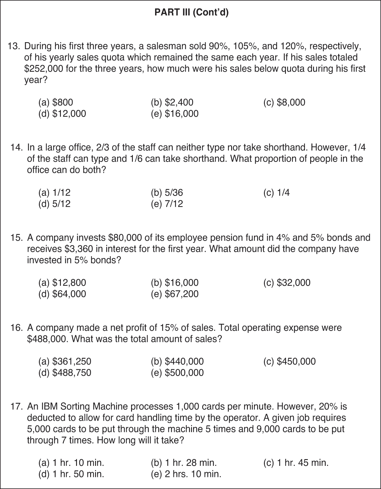

图 3.1：1959 年 IBM 程序员能力测试示例。在测试的这部分，参与者被要求回答算术推理题。*来源：* 作者根据 J. L. Hughes 和 W. J. McNamara 的 1959 年 IBM 程序员能力测试扫描件复制。由 IBM 提供。

### 所谓的危机与行为研究

通过将编程界定为一种需要个人直觉品质的活动，能力测试在某种程度上反对与大学学位不平等相关的性别歧视。正如 Abbate（2012, 52）所指：“一个从未获得过大学学位的女性——或者被引导进入非技术主专业的女性——可以进入面试间，参加测试，并立即获得作为未来程序员的信誉。”从诞生开始，计算机编程与美国大多数熟练的技术职业不同，一直涉及女性工作者，其中一些已经在战争期间参与过计算项目。


然而，与 20 世纪 50 年代末大多数西方职业环境一样，初生的计算机行业也受到普遍刻板印象的影响，这往往阻碍了女性程序员占据高层管理职位，并鼓励她们从事关系性的客户维护工作。这些性别动态不应被忽视，因为它们有助于理解精巧软件设备的快速且往往被低估的发展。由于女性在计算机相关专业领域中的独特地位——既是专家级实践者，往往又是客户的代表——尽管她们在行业内的比例一直很小，但仍积极贡献了旨在让编程对专家和新手都变得更简单的创新。最著名的例子无疑是格蕾丝·默雷·霍珀（Grace Murray Hopper），她是 `UNIVAC` 的编程主管，在 1951 年开发了第一个编译器（一种将其他程序翻译成机器码的程序），随后在 1955 年设计了业务编程语言 `B-0`（后更名为 `FLOW-MATIC`）。但许多其他女性在 50 年代和 60 年代期间也积极参与了软件创新，尽管往往处于更显眼的男性管理者的阴影下。这些重要人物包括：在 50 年代中期开发了广泛使用的数据编辑代码的阿德·米尔雷德·科斯（Adele Mildred Koss）和诺拉·莫塞尔（Nora Moser）；负责 `FORTRAN` 高级编程语言流分析的洛伊斯·哈比特（Lois Haibt）；以及在 50 年代末通用业务型语言（`COBOL`）项目处于前沿的玛丽·霍斯（Mary Hawes）、让·萨梅特（Jean Sammet）和格特鲁德·蒂尔尼（Gertrude Tierney）（Abbate 2012, 79–81）。

从 20 世纪 60 年代中期开始，编译器和高级编程语言的改进（这些改进往往源于女性）被加入了计算能力惊人的十倍增长之中（Mody 2017, 47–77）。这种具有前景的新软件与硬件基础设施的结合，促使大型标志性计算机制造商开始构建日益复杂的程序，例如操作系统和大型业务应用。其中一些显眼项目（如 `IBM` 的 `System 360` 项目）的惨痛失败，很快引起了当时评论者的不确定感，其中一些人使用了具有启发性的“软件危机”这一表达（Naur and Randell 1969, 70–73）。计算机历史学家对这种软件危机的真实性表示怀疑，因为精确的研究表明，除了一些非常显眼且非标准的项目外，60 年代后期的软件生产通常是按时且按预算完成的（Campbell-Kelly 2003, 94）。但这种危机修辞也得益于对软件生产成本的夸大但流行的论述，它对行业产生了实质性的影响，以至于改变了其整体方向和认同。

与相关的微电子学科相比，编程长期以来一直缺乏信誉和地位。尽管在整个 50 年代和 60 年代取得了显著进展，参与软件生产的从业者在西方计算研究和行业中往往被赋予较低的地位。对于女性程序员来说是如此，因为她们在技术环境中工作；但对于男性程序员来说也是如此，因为他们在一个包含女性的领域工作。从这个视角来看，60 年代末盛行的危机修辞——利用那些不能代表行业现状的标志性失败——为根据当时的标准将编程“重塑”为更有价值的东西提供了机会（Ensmenger 2010, 195–222）。这可能是为什么带有积极内涵的“工程”一词开始传播并作为一种视野运行的原因之一，特别是通过 1968 年北大西洋约组织（NATO）题为“软件工程”的会议的努力，以及专业机构和学术期刊的建立，例如电气电子工程师学会（IEEE）的 `IEEE Transactions on Software Engineering`（1975）和计算机学术协会（ACM）的 `ACM Software Engineering Notes`（1976）。尽管这一过程受到一些认为软件生产已经严谨且系统化的杰出人物的质疑，但这种复杂的学科重新标记过程得到了许多程序员（女性和男性）的支持，他们认为“工程师”这一头衔是改善自己工作条件的机会。然而，正如 Abbate (2012, 104) 所指出的：“这一举措的一个意外后果可能是让编程和计算机科学对女性不再那么吸引力，这有助于解释一个历史性谜团：为什么女性在第一波软件改进中起主导作用，但在软件工程时代变得不再那么显眼。”

这种让软件生产走向工程化路径的明确愿望——被认为是所谓危机的解决方案，而这种危机本身建立在对编程工作的性别化贬低之上——已经影响了编程的学术分析。与这种学科重新定位并行，一种声称行为主义传统的实证主义研究在 70 年代初开始关注编程工作。对于这些研究人员来说，分析重点应该转移：与其定义编程所需的固有`skills`和进行设计能力测试，学者不如尝试提取`产生最佳编程性能的参数`并提出改进软件生产的方法。高级编程语言的引入和传播以及计算机科学学术课程的增加，极大促进了这一新研究方向的建立。随着 `FORTRAN` 或 `COBOL` 等不依赖于特定规格和品牌的语言出现，行为心理学家与计算机科学家能够在控制环境中设计编程`tests`。此外，计算机科学学术课程的增加提供了相对多样化的`populations`（例如本科生、研究生、教师），他们可以通过这些编程测试。这两个元素使得实验设计成为可能，根据它们假设产生的结果对不同的参数集（年龄、经验、设计辅助）进行排名。

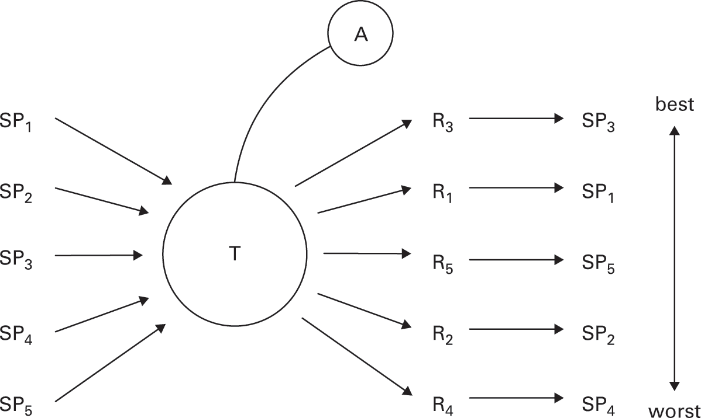

图 3.2 计算机编程行为研究示意图。假设我们有一个编程测试 `T`，测试的最佳答案 `A` 以及五组参数 `SP[1,…5]`。例如，`SP[1]` 可以收集参数“无经验的、男性、带有流程图”；`SP[2]` 可以收集参数“有经验的、女性、无流程图”，依此类推。一旦所有 `SPs` 都通过了测试 `T`，每个 `SP` 的结果 `Rs` 允许对所有 `SPs` 从优到坏进行排名。在这个例子中，`R[3]`（`SP[3]` 的结果）使得 `SP[3]` 被视为最佳参数集。相反，`R[4]`（`SP[4]` 的结果）使得 `SP[4]` 被视为最差的参数集。


该框架引发了大量关于调试性能的测试（例如 Bloom 1980; Denelesky and McKee 1974; Sackman, Erikson, and Grant 1968; Weinberg 1971, 122–189; Wolfe 1971）、设计辅助性能的测试（例如 Blaiwes 1974; Brooke and Duncan, 1980a, 1980b; Kammann 1975; Mayer 1976; Shneiderman et al. 1977; Weinberg 1971, 205–281; Wright and Reid 1973）以及逻辑语句性能的测试（例如 Dunsmore and Gannon 1979; Gannon 1976; Green 1977; Lucas and Kaplan 1976; Sime, Green, and Guest 1973; Sime, Arblaster, and Green 1977; Sime, Green, and Guest 1977; Sheppard et al. 1979; Weissman 1974）。但尽管这些研究具有系统性，其结果却是显而易见的，因为正如 Curtis (1988) 所解释的那样，在没有正式从事行为实验的情况下，软件承包商们已经意识到，例如，经验丰富的程序员产出的结果比缺乏经验的程序员更好，或者流程图或文档等设计辅助工具是编程实践的有用工具。这些通用且冗余的事实并没有帮助程序员更好地设计指令列表。到 20 世纪 80 年代，日益强大的计算系统仍然极其难以操作，无论它们是由在日益带有男性化色彩环境中工作的软件工程师指导的。

## 认知转向

到 20 世纪 70 年代末，行为观点开始受到心理学内部的批评。对于越来越多的认知心理学家（他们有时在在人工智能部门工作）来说，行为研究结果的显而易见似乎是方法论缺陷的结果，因为许多排名排序的参数集收集了结果中重要的个体差异。根据几位认知研究者的观点，行为研究的分析单位是错误的；由于许多结果之间的差异存在同一组参数中，因此对这些集合进行排序完全毫无意义（Brooks 1977, 1980; Curtis 1981; Curtis et al. 1989; Moher and Schneider 1981）。这些认知主义者为了解释他们所谓的“个体差异”而提出的解决方案是进入个体的大脑内部，以更好地理解计算机程序形成背后的认知过程和心理模型。

“程序”与“认知”概念之间的强联系也使得计算机编程研究对认知科学家产生了吸引力。正如 Ormerod (1990, 63–64) 所说：

> 认知与编程领域通过三种主要方式相关。首先，认知心理学基于一种“计算隐喻”，在其中，人类大脑被视为一种与计算机类似的信息处理器。其次，认知心理学提供了检查计算任务性能底层过程的方法。第三，编程是一个定义良好的任务，而且程序员的数量在不断增加，这使其成为在现实领域中研究认知过程的理想任务。

这三个元素——认知与计算机程序之间假设的根本相似性、日益增长的程序员群体以及可以用于研究这一群体的可用方法——极大地促进了认知科学家将计算机编程视为一个富有成效的研究课题。此外，投资于行为主义者未能理解的课题也被视为展示认知主义方法优越性的机会。在某种程度上，其目标也是为了行为是心理过程的功能：

> [行为主义者] 试图建立描述编程行为的各种参数的有效性，而不是试图指定决定这些参数的底层过程。（Brooks 1977, 740）

当时的雄心是描述导致良好编程性能的心理过程，并最终利用这些心理过程来训练或选择更好的程序员。然而，认知研究的方法论在大多数时候与关于编程的行为研究方法论并没有本质区别。特定的编程测试被提出给不同的个人，通常是计算机专业的学生或教职工。个体的回答、评论（口头或书面）以及元数据（笔画数等）随后将根据测试的正确答案，以及基于心灵计算隐喻所启发的的人类理解通用认知模型（特别是 Newell 和 Simon [1972] 的模型，以及随后的 Anderson [1983] 的模型）进行分析。从这些结果、评论和通用认知模型的对质中，推导出特定于计算机编程任务的不同心理模型，并根据其性能进行推断、分类和排名（见图 3.3）。

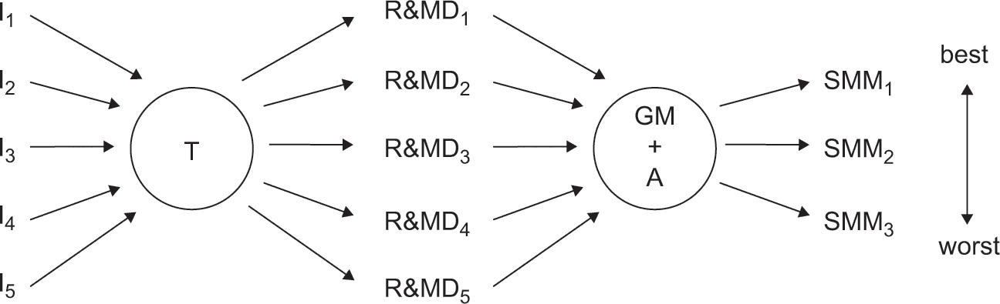

**图 3.3** 计算机编程认知研究示意图。让我们假设有一个编程测试 `T`、测试的最佳答案 `A`、五个个人 `I[1–.,5]` 以及通用认知模型 `GM`。一旦所有 `Is` 都通过了 `T`，相应的的结果 `Rs` 和元数据 `MD`（例如 `I` 对 `T` 的评论）将被收集在一起形成五个 `R&MDs`。然后根据 `A` 和 `GM` 对所有的 `R&MDs` 进行评估和比较。在这种对质结束后，提出了特定的心理模型 (SMMs)，并根据它们产生最佳编程结果假设能力从优到坏进行排名。

这种关于计算机编程的研究模式导致了许多关于解决抽象问题的心理模型的研究（例如 Adelson 1981; Brooks 1977; Carroll, Thomas, and Malhotra 1980; Jeffries et al. 1981; Pennington 1987; Shneiderman and Mayer 1979）以及开发编程能力的研究（例如 Barfield 1986; Coombs, Gibson, and Alty 1982; McKeithen et al. 1981; Soloway 1986; Vessey 1989; Wiedenbeck 1985）。

局限

从 20 世纪 50 年代以来，计算机科学家、工程师和心理学家在编程研究方面付出了巨大的努力。从能力测试到认知研究，这些学者花费了大量的时间精力试图理解某人在编程时发生了什么。他们无疑尽了努力，正如我们所有人所做的那样。然而，我认为仍然可以对他们研究编程活动的方法和概念习惯提出某些批评，或至少保留意见。


在电子计算机早期那个混乱的年代，能力测试无疑构成了实用的招聘工具。从这个意义上说，它们确实帮助平衡了“电子大脑”那些无法实现的承诺——我建议，这些承诺本身源于冯··诺伊曼对电子计算机功能性描述的传播，以及这种描述对编程实践的忽视。此外，能力测试结果的分量也为渴望投身编程职业的女性提供了资源，其中一些女性还设计出了至关重要的软件创新。然而，尽管能力测试对计算机的发展可能至关重要，但它们存在一个缺陷，导致它们无法正确分析参与计算机编程的行动：它们测试候选人关于电子计算机*上应该*做的事情（例如，数字排序、求解方程），而不是让计算机*完成*这些事情所所需的技能。它们混淆了前提和结果：如果计算机编程的结果可以从计算和排序能力方面进行潜在评估，那么实现这些结果的方法可能需要其他的分析单元。

行为研究也存在着类似的缺陷，使它们与计算机编程行为保持而远。通过分析一组组参数与编程表现之间的关系，行为主义研究将编程实践放进了黑箱之中。在这些研究中，程序员的实践并不重要：仅考虑实践的`conditions`（简化为上下文参数）和`consequences`（简化为错误数量）。人们可能会反对说，这种对实践的不予考虑恰恰定义了行为主义作为一种科学范式，其目标是从初始条件预测结果（行为）（Watson 1930），这一目标很好地呼应了 20 世纪 70 年代软件生产的工程化。这种观察问题的方法确实非常强大，特别是对于研究包含许多实体的复杂过程，例如交通流（Daganzo 1995, 2002）、迁移（Jennions and Møller 2003）或细胞行为（Collins et al. 2005）。但写入编号符号列表是一个不需要任何剧烈还原的过程：一个编程情境只涉及一、两个或三个个人，他们的行动可以在没有任何不可逾越困难的情况下得到解释。对于这种涉及少数实体且其行动足够慢以便解释的过程的研究，没有先验的忽略情境中发生的事情。

对于认知研究来说，情况更为复杂。它们批评行为研究将恰恰需要解释的内容放入黑箱，无疑是正确的。然而，认知主义者为了更好地理解计算机编程而提出的解决方案却导致了我们现在需要考虑的僵局。

正如 Ormerod (1990, 63) 所说，“认知心理学基于一种‘计算隐喻’，其中人类大脑被视为一种类比计算机的信息处理器。”从这个理论角度来看，认知指的是大脑用于将情感和感知输入信息转换为以思想或身体动作形式呈现的输出的推理和规划模型。与，类似于计算机——或者说，类似于`一个一个特定且有问题的计算机形象`——人类大脑在输入上“运行”心理模型以产生输出。系统性地研究大脑用于将输入转换为输出的复杂心理模型，正是认知研究的目的。科学的调查方法，例如在`figure 3.3]`中所示的方法，可以用于这一特定前景。

当认知科学处理文学（Zunshine 2015）、宗教（Barrett 2007），甚至黑猩猩对煮熟食物的偏好（Warneken and Rosati 2015）等话题时，其基础通常是稳固的：描述大脑如何通过逻辑和算术语句处理输入信息以产生物理或心理行为的复杂心理模型可以被提出并比较，而不会出现明显的矛盾。但只要认知科学处理计算机编程，一个短路出现了，挑战了整个大厦：对计算机程序构的认知解释是循环论证的，因为“认知”的概念本身就已经要求构成的计算机程序。

为了更好地理解这个棘手的问题，让我们再次考虑大脑的计算隐喻。根据这个隐喻，大脑在输入上“运行”模型——或程序以产生输出。从这个意义上说，大脑看起来就像冯·诺伊曼在《初稿》（First Draft）中描述的计算机：输入数据存储在内存中，逻辑和算术指令列表将其转换为输出。但正如我们在前面的节中看到的，冯·诺伊曼对计算机的阐述是功能性的，因为它没有考虑到使计算机运行所需的元素。在这一反映冯·诺伊曼非常具体的立场和地位的计算机形象中，组装实际的转换指令列表（或程序）以控制电子计算机电路运行所需的元素已经汇集了。

从这里开始，对计算机编程认知研究的一个重要缺陷开始出现：由于这些研究依赖于一个已经包含构成的计算机程序的计算机形象，这些认知研究无法查询构成了计算机程序。事实上，认知研究处于一种主要能提出编程循环解释的境地：如果存在（计算机）程序，是因为存在（心理）程序。程序解释程序：完美的循环论证。

只要认知科学远离对计算机编程的研究，它的基础就是稳固的：心理程序可以作为观察行为的解释工具。但只要认知科学考虑计算机编程，它的局限性就出现了：认知和程序是同一种类型。午夜惊雷！认知受大脑计算隐喻的启示，成为分析计算机编程实践的绊脚石，因为其基本的分析单元是构成的程序。在这样一个受限的`epistemic culture`（Knorr-Cetina 1999）中，对行动过程的现场分析不可不省略，尽管它们积极参与了集体计算机化世界的构成。这是一个令人遗憾的局面，即使是人机交互（HCI）中最大胆的提案也未能进行实质性的修改（例如，Flor and Hutchins 1991; Hollan, Hutchins and Kirsh 2000）。是否存在一种方法可以在概念上解除对计算机编程实证研究的限制？


然而，只要我们的批评者是有道理的，我们目前仍然无法提出任何替代方案。程序员的行为难道不具有某种`cognitive` 属性吗？程序员难道没有使用他们的`minds` 来通过计算来解决复杂的`problems` 吗？认知与计算机程序之间的混淆可能源于对计算机历史的误导性理解——正如我试图暗示的那样——计算机将其自身为一种通用习惯的能力赢得了尊重。我们如何能不将计算机编程实践的实证研究视为愚蠢的还原呢？我们又如何能为解释并使计算机编程的`courses of action` 变得可见提供合理性呢？这些实践是任何计算机化项目必经的通过性节点。

幸运的是，当代哲学工作成功弥补了认知与实践、智力心灵与枯燥动作之间的鸿沟。正归于这些具有启发性的研究，我们能够将编程视为一种实践，而又不完全背弃认知的概念。为了做到这一点，我首先需要快速重新审视“计算机是按照人类大脑和心灵的形象设计的”这一观点。正如我们已经看到的（尽管是部分），这一想法仅在回溯时具有意义：具体发生的情况要复杂得多。然后我将重新考虑将认知封装为计算过程的哲学框架。最后，遵循感知哲学的当代著作，我将考察一种保留了我们理解周围事物之重要方面的认知定义，同时将其与实践和行动重新联系起来。通过设定主体性在认知过程中的中心地位，这种`enactive conception of cognition`将进一步帮助我们实证地考虑在计算机编程期间发生了什么。

## 还原过程 (A Reduction Process)

心灵的计算比喻迫使认知主义者使用程序来解释程序的形成。编程过程的结果——即程序——因此被用来解释编程过程。要找到另一个此类解释性错误并不容易：这就像用水来解释下雨，用公鸡舞来解释鸡类家禽……但事情是如何变成这样的的？程序是如何构成为认知的根本基础，从而参与了计算机编程实践的隐形化的？

证明心灵计算比喻合理性的主要论点是“计算机是按照人类的形象设计的”（Simon and Kaplan 1989, 引自 Hutchins 1995, 356）。根据这种在 20 世纪 60 年代对行为范式做出反响的观点（Fodor 1975, 1987; Putnam [1961] 1980），人类大脑的工作方式启发了计算机的设计，而这反过来又为我们如何思考提供了一个更清晰的视角。图灵通常被认为是这一论点之父，他在 1937 年的论文《可计算数》中构想的`Universal Machine` 能够模拟在其形式化中描述的任何机制。根据这一思路，正是图灵的自我意识内省使他定义了一个能够进行任何计算的设备，因为他当时正在“观察数学家在解决数学问题过程中所做的，并将这一过程提炼为本质”（Pylyshyn 1989, 54）。图灵的演示随后导致了第一批电子计算机，如`ENIAC` 和 `EDVAC`，它们被描绘为巨大的大脑似乎是合理的，因为我们的思考方式最初就启发了这些计算机。

与 Simon Penny (2017) 的近期工作一致，我假设这种关于计算机起源的观点是错误的。只要人们同时考虑图灵的思想实验被还原为大脑图像的过程*以及* `EDVAC` 被还原为由中央器官控制的输入/输出设备的过程，就会意识到计算机与人类大脑之间的关系指向了另一个方向：人类大脑是按照一种非常特定的计算机形象设计的，而这种形象已经包含了所有可能的程序。

让我们从图灵开始，他通常被认为是心灵计算比喻之父。事实上，图灵将“一个正在计算实数的人”与“一台只能处于有限数量状态的机器”对比（Turing 1937, 231）。然而，他对人类计算的描述不仅限于头脑内部发生的事情：它还包含了手、眼睛、纸张、笔记，以及在不同时间和地点由他人定义的规则集。正如 Hutchins 所说：“数学家或逻辑学家[对图灵而言]正在与物质世界进行物质上的交互”（Hutchins 1995, 361）。通过将这种社会物质安排的属性建模到抽象机器中，图灵能够区分可计算数和不可计算数，从而证明了希尔伯的`Entscheidungsproblem`（判定问题）是不可解决的。他的结果对当时的数学产生了巨大影响，因为它们暗示了一类可以通过有限手段计算的数字。但他为了定义这类数字而发明的理论机器绝不是*仅仅*按照人类大脑的形象设计的；它是一个表达了实现实数计算的社会物质过程的理论设备。

参与将图灵理论设备还原为心理过程表达的工作的是 McCulloch 和 Pitts 对神经元的研究。在他们 1943 年题为《神经活动中蕴含思想的逻辑演算》的论文中，McCulloch 和 Pitts 基于 Carnap (1937) 的命题逻辑以及将神经元视为“全有全无”发放实体的简化概念，提出了一个心灵和大脑的正规模型。在他们的论文中，神经元被视为处理来自感官器官或其他神经元的输入信号的单元。反之，这种神经处理的输出供给其他神经元或送回感官器官。McCulloch 和 Pitts 方法的新颖之处在于，得益于他们对神经元的简化概念，神经元处理的输入信号可以被重新呈现为命题，或者正如 Gödel (1931) 之前证明的那样呈现为数字。从该点起，他们的模型可以将神经网络的配置视为逻辑运算符，处理来自感官器官的输入信号并向其输出*不同*的信号。这种将大脑视为能够对二进制信号表示命题演算律的巨大神经网络网络的方法，允许 McCulloch 和 Pitts 假设地将大脑视为一台能够计算数值命题的`Turing machine`（McCulloch and Pitts [1943] 1990, 113）。尽管他们没有在数学上证明自己的主张，并承认他们的模型在计算能力上远不如图灵的模型，但他们仍然注入了心灵作为大脑计算过程结果的这一概念（Piccinini 2004）。


最初，麦考洛和皮茨（McCulloch and Pitts）的论文无人关注（Lettvin 1989, 17）。只有当冯·诺曼（von Neumann）在他 1945 年的《初稿》（First Draft）中使用他们的一些命题时（von Neumann [1945] 1993, 5–11），计算机与人类大脑之间的等性才开始兴起。正如我们之前看到的，冯·诺曼对`EDVAC`有非常特定的看法：作为一个主要看到大量材料处理后产生的整洁结果的著名顾问，他的立场让他能够将`EDVAC`还原为一个输入输出设备。一旦脱离了在摩尔电气工程学院机库中的具体实例化，`EDVAC` 尤其是 `ENIAC`，实际上`看起来像`麦考洛和皮茨构想的大脑。从那起起，还原过程就可以继续下去：冯·诺曼可以利用麦考洛和皮茨对神经元和`Turing machine`的还原来阐述他自己对`EDVAC`的还原观点。然而，重要的是，冯·诺曼的目标绝不是以一种现实的方式呈现`EDVAC`：《初稿》的主要目标是为电子计算系统建立一个形式化模型，以启发其他实验室，同时不暴露过多关于`EDVAC`项目的机密元素。所有这些复杂的原因（冯·诺曼的地位、战争时期、冯·诺曼对数学生物学的兴趣）使得`EDVAC`在《初稿》中呈现为一个由中央器官控制的输入输出设备，该器官的神经元网络配置可以表达命题逻辑法则。

正如我们之前看到的，二战后，《初稿》以及它包含的电子计算机模型开始在学术界流传。与此同时，这种将计算机视为巨型电子大脑的构想与它们更广泛的商业安排契合得很好：这些极其昂贵的系统最好被呈现为自动将输入转换为输出的功能性大脑，而不是需要精心照顾、维护和整套专用基础设施的复杂人工制品。因此，在运营方面出现了问题，因为作为第一批电子计算机的买家——空军、波音、通用汽车（Smith 1983）——必须选择、雇用、培训并最终解雇、重新选择、重新雇佣和重新培训整个运营团队。但尽管最初遭遇了失败，计算机作为电子大脑的构想仍然坚持了下来，公平地说，这得到了图灵（1950）论文《计算机器与智能》1953 年达特茅斯学院人工智能首次会议（Crevier 1993）、阿什比关于行为神经起源的书（Ashby 1952）以及冯·诺曼的死后著作《计算机与大脑》（[1958] 2012）的支持。计算机作为电子大脑的构想并没有崩溃，而是开始具象化，甚至甚至支持了心理学领域对行为主义的激进批判。逐渐地，心灵变成了大脑对神经输入的计算产物。这一论点确实显得不可置疑：由于人类行为是（计算的）认知过程的结果，心理学应该描述这些认知过程的组成——这是一次真正的力作，其后果我们今天仍在经历。

但这个关于心灵计算隐喻的巨物有着致命的板（弱点）。只要人们从社会历史的角度询问大脑和计算机被等同化的过程，就会发现这一论点的基石是不稳固的；一系列还原及其分布，在不知不觉中将计算机呈现为大脑的形象。从历史上看，首先是将`Turing machine`还原为心理过程的表达，然后是将神经元还原为开/关实体，接着是将`EDVAC`还原为由中央器官控制的输入输出设备，最后这种观点通过学术网络和商业安排的传播，`允许`计算机被认为源自大脑。正是所有这些`翻译`（Latour 2005）以及许多其他翻译的合谋，使得计算机看起来像是大脑结构的结果。

重要的作者详尽记录了计算机与大脑的等性如何（无论好坏）促进了整个冷战期间西方主体性的建构（例如，Dupuy 1994; Edwards 1996; Mirowski 2002）。对我在这里感兴趣的是，计算机作为大脑形象的构想的主要问题在于，它与之相关的认知即计算的构想，进一步导致了计算机编程中行动过程的隐形。根据心灵的计算隐喻，大脑`是`所有神经元网络——或逻辑电路^(27)的组合，允许信号计算。大脑可能会为每个信号的计算选择一种特定的神经元组合，但组合本身已经组装好了。因此，研究神经元组合如何组装并整合以计算特定信号（如某人在编程时）是无法发生的，因为这意味着要超越构成大脑的范围。认知研究可能涉及询问大脑使用`哪种`程序对特定输入进行计算，但该程序是如何组装的仍然不可触及：它已经在那里了，准备好应用于手头任务。简而言之，类似于冯·诺曼对`EDVAC`的观点（但工程应用少得多），通过心灵计算隐喻构的大脑`从所有可能的程序的无限库中选择合适的心理程序`。但由于这个库恰恰构成了大脑，因此询问每个程序具体是如何组装的很快就变得毫无意义。

那么，以大脑形象设计的计算机认知主义观点似乎是至少三种还原的产物：（1）神经元作为开/关的实体，（2）`Turing machine`作为心理事件的表达，以及（3）`EDVAC`作为由中央器官控制的输入输出设备。这种观点通过学术、商业和文化网络的进一步传播，进一步使认知即计算的观念合法化。但这种认知计算是整体性的，暗示了所有特定计算的可能性：大脑逐渐表现为所有潜在指令集的集合，从而阻止了对实际指令集构的调查。认知科学在处理计算机编程时面临的循环论困境，似乎源于一个关于计算机的幻想历史。那些继承了非经验电子计算机历史的人可能会将认知视为计算，将编程视为心理过程。然而，那些继承了电子计算系统构成经验历史并关注翻译过程和分配网络的人没有没有选择，只能以不同的方式考虑认知。但如何呢？

### <samp class="SANS_ITC_Stone_Sans_Std_Semibold_B_11">经典三明治及其后果</samp>


我们现在对心灵的计算比喻的形成有了更清晰——尽管仍然模糊——的理解。电子计算机的一种导向性“双击”历史（Latour 2013, 93）忽略了电子计算时代初期发生的细微转化，这使得认知科学家等人们能够追溯性地认为计算机源于大脑的结构。但从历史角度看，发生的情况要复杂得多：丘奇和皮茨关于神经元的研究与冯·诺曼对`EDVAC`的观点相互呼应，逐渐形成了一种将计算机描述为巨大电子脑的强大但充满问题的图绘。这种描述进一步赋予了心灵计算比喻（也被称为`计算主义`）的合法性，但同时也使得对实际计算机程序结构的分析陷入瘫痪，因为所有潜在程序的集合构成了大脑的基本结构。因此，在本章的此时，为了彻底背弃计算主义并提出一种替代性的认知定义，使我们能够将计算机编程任务视为一项实践活动，我们需要更精确地审视这种计算立场的形而上学。

如果认知科学中的计算主义源于非常最近的非经验计算机历史，那么它的形而上学无疑属于一个至少可以溯源到亚里士多德的哲学体系（Dreyfus 1992）。苏珊·赫尔利（2002）巧妙地使用了“经典三明治”一词来总结这一谱系的形而上学——也称为“认知主义”，它将感知、认知和主体性视为不同的能力。对于“经典三明治”的支持者来说，人类感知首先获取来自“真实”世界的输入并将其翻译到心灵（或大脑）。在计算主义的情况下，这种感知输入以神经脉冲的形式存在，可以表示为数值。然后，认知“处理这种感知输入，利用它形成一个关于主体环境中事物状态的表征，并通过根据主体项目和愿望提供充分信息的推理和规划，得出主体对当前环境应该做什么或在环境中做什么的说明”（Ward and Stapleton 2012, 94）。在计算主义的情况下，认知步骤意味着选择和应用一个心理模型（或心理程序），向神经系统输出不同的数值。最后，主体性被认为是感知和认知过程的输出，表现为神经脉冲指示的身体运动。

这种将认知视为“夹在”感知与行动之间、像三明治中的肉的概念具有许多后果。它首先在心灵与世界之间建立了严严的界限。随后创建了两个领域：被认为是物质的“广延物”领域，以及被认为是抽象非物质的“思维物”领域。如果物质通过允许实体和数量在“广延物”领域占据统治地位，那么心灵通过允许思想和知识在“思维物”领域占据统治地位。

尽管两者之间存在本体论的深渊，“思维物”和“广延物”领域需要互动：毕竟，我们作为个体是世界的一部分并需要与之相处。但一张纸无法穿过心灵，一座山大到无法被思考，一句说的话没有物质：必须发生某种转化，才能让心灵能够处理这些事物。那么，我们如何连接“广延”和“思维”领域呢？`表征`（不带连字符）和`符号`的概念被逐步引入以保持模型的可行。为了让心灵与“真实事物”的世界保持联系，它需要处理真实事物的`表征`。由于这些表征发生在脑内并指向广延物，它们通常被称为`事物的心理表征`。

事物的心理表征至少需要两个属性。首先，它们需要一个心灵可以操作的`形式`。这种形式可能根据认知主义中的不同理论而异。对于心灵的计算比喻，这种形式例如是感官获取并随后传输到大脑的电神经脉冲。事物的心理表征所要求的第二个属性是`意义`；即表征在现实世界中所指代的事物的独特痕迹。这两个属性相互依赖：形式具有意义，而意义需要形式。`符号`的概念通常被用来汇合事物的心理表征的半物质方面和语义方面。在这方面，正如“经典三明治”的支持者所认为的那样，认知处理的是感官在与真实世界互动时所提供的事物的符号表征。那么，这种处理的结果就是另一个关于事物的表征——一个`关于`事物的陈述——它进一步指导了身体运动和行为。

对事物的符号表征的处理并不总是会导致对事物的准确陈述。某些功能故障可能发生在感官层面（即糟糕地翻译了真实事物），也可能发生在心灵层面（即未能解释符号）。在这两种情况下，整个过程都会导致对事物的不准确或`错误`陈述。这些错误是不受欢迎欢迎的，因为它们会在认知过程结束时引导不当的行为。因此，认知做出`真实`陈述是极其重要的。如果认知未能在大脑与世界之间建立充分对应，我们的行为将受到不良指导。相反，通过正确获取关于真实世界的`知识`，认知可以让我们表现得当。

我假设源于经典三明治认知的符号表征假设导致了两个相关问题。第一个问题涉及它所创造的轨迹与科学事实不同的实体的本体论权重；第二个问题涉及该论题无法考虑“野外”（in the wild）实践，大多数严格执行符号表征假设的模型都未能通过生态验证的测试。

让我们从第一个问题开始，这无疑是最困难的。我们看到，根据认知主义，`adaequatio rei et intellectus`（物意相等）是有效陈述和行为的衡量。例如，如果我说“太阳正在升起”，我就做了一个无效的陈述，并导致了错误的行为，因为我所说的并没有充分地指向真实事件。在我的认知过程中，出了一些问题：在这种情况下，让我相信太阳在空中移动的感官可能欺骗了我。实际上，得益于比我更好的其他心理过程，我们从事实上知道地球是绕着太阳旋转的；一些“科学头脑”（在这里是指哥白和伽利略等）确实成功地处理了符号表征，提供了一个关于太阳与地球关系的真实陈述，这种关系可以通过理性法则来证明。我的陈述和行为仍然可以被视为一个玩笑或某种粗率的习惯：我所说的/做的不是`真实`的，因此并不`计数`。


这种仅承认科学事实的思维方式的问题在于，它建立在一种非常不符合经验的科学观念之上。事实上，正如科学技术研究（STS）作者近五十年来所证明的，科学事实的构建需要许多物质网络（Knorr-Cetina 1981; Lynch 1985; Latour and Woolgar 1986; Collins 1992）。实验室、实验、设备、同事、资金、技能、学术论文：所有这些元素对于艰辛地构建通遥远实体的“引用链”都是必不可少的（Latour 1999b）。为了认知，我们需要设备和协作。此外，一旦人们开始探究“生成中的科学”而非“现成的科学”，就会发现，认知的心智和被认知的事物只有在科学实践过程的最后阶段才开始存在。当一切就位，当引用链足够强大时，当不再有争议时，我才能够面对壮丽的加州日出，并冥想那种使我违背最严谨事实的习惯的力量：地球正在旋转。得益于 16 和 17 世纪期间建立的众多科学网络，我才能获得这种——贫乏的——冥想。对称地，当一切就位，当引用链足够强大时，太阳也获得了其作为已知事物的地位，因为其存在的一个部分——其相对静止——确实通过科学工作和对引用链的维护被捕捉到了。简而言之，他人所做并使其持久的成果，使我能够直接思考太阳的客观属性。只要我能遵循汇集了观测、仪器、实验、学术论文、会议和教育书籍的固化科学网络，我就变成了一个认知的心智，而太阳变成了一个已知的对象。认知主义从错误的末端开始：科学知识的可能性始于实践，结束于已知的对象和认知的心智。正如 Latour (2013, 80) 所总结的：

> 认知的心智和被认知的事物完全不是通过知识活动通过一条神秘的高天桥连接起来的；它们是引用链延伸的渐进结果。

将科学真理重新定位于允许其产生、扩散和维护的网络之中，其结果之一是，现实不再是科学知识的唯一领地：通过不同路径产生的其他实体也可以认为是真实的。法律裁决（McGee 2015）、技术人工制品（Simondon 2017）、虚构角色（Greimas 1983）、情感（Nathan and Zajde 2012）或宗教偶像（Cobb 2006）：尽管这些实体不需要与科学事实相同类型的网络来显现，但它们也可以被认为是真实的，因为世界不再被还原为单一的事实。只要知识与心智的二元对立被视为引用链的结果之一，只要发生的事情与已知的事物区分开来，许多种类的存在物就留下了空间。通过解构现实与知识，现实世界的宇宙可以被表演性存在的多重宇宙（James 1909）所取代——场本体论的盛宴，一股清风。

除了这种倾向于将事物与心智之间的对应关系作为判断真假的最高法官的问题性倾向外，认知主义的另一个问题（或计算主义，或心灵的计算隐喻；此时，所有这些术语都是等价的）是，它在支持所谓的专家系统方面效果有限（Star 1989; Forsythe 2002）。

第一个例子涉及 Haugeland (1989) 所说的“老派人工智能”（GOFAI），这是人工智能领域一个重要的研究范式，试图从 20 世纪 50 年代中期到 80 年代末设计智能数字系统。尽管 GOFAI 在对心灵的计算构想中蕴含的复杂算法很快证明对于设计能够执行复杂任务（如下国际象棋或跳棋）的计算机程序非常有效，但这些算法在处理诸如寻找离开房间的方法而不撞墙等如此简单的任务时，对称地也显得非常有问题（Malafouris 2004）。专家系统复制非常基础的人类任务的极端困难开始对计算主义产生怀疑，特别是因为控制论——一种强调“负反馈”的智能近亲观点（Bowker 1993; Pickering 2011）——有效地在没有任何符号表示参考的情况下成功地复制了此类任务。正如 Malafouris (2004, 54–55) 所说：

> 当 Grey Walter 构建出第一批此类自主设备（machina speculatrix）时，它们与复杂算法和表征输入无关。它们的亲缘关系是 W. Ross Ashby 的稳态器（Homeostat）和 Norbert Wiener 的控制论反馈……基于非常简单的机电电路，所谓的“乌龟”能够产生任何系统组件都无法确定的涌现属性和行为模式，在实践中实现了心脑边界的控制论跨越。

计算主义在应用于计算机系统时的另一个实际局限是所谓的“框架问题”（Dennet 1984; Pylyshyn 1987）。框架问题是“产生一种行为的问题，这种行为要恰当且选择性地针对其所处环境中最相关的方面，并忽略那些可能适得其反地被转导、处理并纳入行为规划和指导的大量无关信息”（Ward and Stapleton 2012, 95）。大脑——或计算机——如何充分地选择与情境相关的输入，处理它们，然后给出恰当的指令？在这方面，运动是一个具有启发性的例子：在板球球场杂乱的环境中，击球者如何在极短的时间内处理正确的输入并做出恰当的行为（Sutton 2007）？通过什么魔法，网球运动员的大脑能够选择显眼的输入，对其进行处理，并最终给出恰当的指令（Iacoboni 2001）？迄为止，对框架问题的唯一满意的计算答案（至少关于感知搜索任务）是将其考虑为 NP 完全问题，从而承认应该通过启发式方法和近似法来解决（Tsotsos 1988, 1990）。

最后，整个人机交互（HCI）领域可以被视为计算主义局限性的表达，因为正是因为人类心智与计算机认知不等同，才需要想象并设计创界面（Card, Moran, and Newell 1986）。

除了拒绝赋予非科学实体任何本体论权重外，计算主义似乎也限制了旨在与人类交互的智能计算系统的发展。

### 具身认知


尽管认知主义对西方思想拥有令人印象深刻的控制力，但长期以来一直受到严厉批评。为了本第二部分——请记住，这部分的主要目标是记录计算机编程的实践，因为它们在如今已是算法构建的核心——我将只处理最近被标记为“认知生成式构想”的一类批评（Ward and Stapleton 2012）。将人类认知重新构架为与世界进行*交互*的局部尝试，在此时至关重要，因为它将——终于！——使我们能够从情境经验的角度来考虑编程。

广义而言，生成式认知的支持者认为能动性（agency）驱动了认知（Varela, Thompson, and Rosch 1991）。认知主义将行动视为对“真实世界”符号表征内部处理的输出；而生成主义则将行动视为世界的关联性共同构成要素（Thompson 2005）。这种视角的转变是彻底的：就像是一个人在说两种不同的语言。认知主义处理的是通过表征间接访问的理想世界，而表征反过来指示能动性；生成主义处理的是一个由转化行动构成的生成环境（Di Paolo 2005）。认知主义将认知视为计算；而生成主义将认知视为与环境的自适应交互，环境的属性通过认知者的行动被提供并被修改。对于生成主义而言，我们试图耦合的环境特征既不是固定的，也不是独立的：它们根据我们与环境调谐（attune）的能力不断地提供并被界定。

通过生成主义，认知主义中感知、认知和能动性之间的界限变得模糊了。感知不再与认知分离，因为认知恰恰就是关于感知环境提供的可能（takes）：“环境的*功能性供给（affordances）*是它*给予*动物的，是它*提供*或*赋能*的，无论对好对坏”（Gibson 1986, cited in Ward and Stapleton 2012, 93）。此外，认知并不需要卡在感知和能动性之间，通过处理表征的输入来指示性地定义行动：对于生成主义而言，认知者的有效行动既参与了感官情境提供的可能，也是这些可能的函数（Noë 2004; Ward, Roberts, and Clark 2011）。最后，能动性不能被视为一个良好或糟糕的认知过程的最终产品，因为直接感知本身也是能动性的一部分：我们感知物体的方式也取决于我们抓取它们的能力。但环境并不结构化我们的感知能力；行动也会修改环境的属性和功能性供给，从而允许一种新的、且始终令人惊喜的“能动性之舞”（Pickering 1995）。感知暗示了行动，而行动反过来暗示了新的感知。从一种可能到另一种可能，只要是我们能感知到的：这就是生成式认知的全部内涵。

这种将认知“简单地”视为我们把握局部环境功能性供给能力的极简主义观点具有许多后果。首先，生成主义意味着认知（因此在某种程度上也意味着感知）是*具身的（embodied）*的，其意义在于“关于感知和认知的类型与结构的类别，受到我们作为什么样的身体能动者这一事实的限制和塑造的**（Ward and Stapleton 2012, 98）。诸如“上”、“下”、“左”和“右”等概念不再必然是“真实”延伸世界的特征：它们是我们身体特征的偶然结果，暗示了一个空间排列的环境。我们通过支持我们感知设备的身体系统来体验世界（Clark 1998; Gallagher 2005; Haugeland 2000）。因此，认知是多重的：在某种程度上，每个身体都通过以不同的方式与其环境交互以自己的方式进行认知。

其次，生成主义意味着认知是*情感的（affective）*的，其意义在于“认知特有的世界开放性形式本质上取决于对环境针对认知者目标、兴趣和项目所提供的功能性供给和障碍的把握**（Ward and Stapleton 2012, 99）。因此，评价和欲望对于认知过程的发生至关重要：没有情感，就没有智能（Ratcliffe 2009, 2010）。“关心”是我们采取的一种；“显现”出的关乎我们。同样，这并不意味着我们的内在欲望结构化了我们可能感知和抓取的内容；我们的认知努力也暗示了去把握环境所暗示的可能的欲望。

第三，生成主义认为认知有时是可以被扩展的：非生物元素如果得到适当的具身，无疑可以修改情感感知的边界（Clark and Chalmers 1998）。这并不意味着每一个非生物物品都会增加我们把握功能性供给的能力：某些人工制品无疑在限制持续的欲望（因此暗示了新的欲望）。但无论如何，人类与非人类装置的结合、生物与非生物基质的*关联*完全参与了认知过程，因此也应该被考虑在内。

生成主义的第四个后果是框架问题（frame problem）的突然消失。事实上，尽管这个问题构成了认知主义的一个严重缺陷，因为它阻碍了认知主义理解——并因此实现——对当前任务相关投入的初始选择，但生成式认知通过将*框定（framing）*作为认知的一部分来规避它。输入不再被抛掷给认知者；他们具身的、情感的、最终扩展的感知试图把握手头情境所提出的可能。板球击手接受训练、配备装备，并关注他们想要击中的球；网球运动员则栖息于他们即将扣杀的球之中。简而言之，认知主义处理的是程序性的*分类*，而生成主义处理的是身体的和情感的*直觉*（Dreyfus 1998）。

第五个后果是考虑各种存在体的能力。这一后果既微妙又重要。我们看到认知主义的一种有害倾向是将真理（或知识）与现实融合：对于认知主义而言，真实的标准是源于对真实世界的真实陈述的行为。那么，认知被认为是我们认识世界并——希望如此——据此行动的过程。对于生成主义来说，图景大不相同。由于生成式认知是关于与周围环境交互，把握它所提供的可能并因此参与其重构，知识可以被视为认知过程的一种最终的、非常具体的且非常令人愉的副产品。认知无疑帮助科学家根据科学机构的真值模式对齐记录并构建引用链；然而，认知也帮助作家创造虚构角色，帮助律师定义法律手段，或帮助虔诚的追随者通过更新但忠实的信息发生改变。简而言之，通过区分知识和认知——认知者并不是*知道*世界而是与之*交互*，因此参与了世界的重构——生成主义强调了我们与周围环境耦合并重构它的局部尝试，从而有时创造出新的存在实体。


最后，生成论使得符号和表征的概念在认知活动中变得毫无用。事实上，由于世界现在是一个局部环境，其属性随着我们与其耦合的尝试而不断改变，因此没有必要设定一个由符号支持的额外心理表征步骤。对于生成论而言，可能存在符号——即环境提供的某种解读（take）可能与位于其他处或在另一时间共同构建的许多解读建立联系——但主体性始终是第一位的。当我在老挝象象街看到红旗上的锤镰标志时，我确实掌握了一个符号，但这仅仅是由于这种解读与我过去在其他情况下能够掌握的许多其他解读建立了联系：比如关于苏联革命的电视纪录片、学校手册、电影等。从这个意义上说，符号变成了一个由许多固化解读的网络。同样，某些解读可能会重新呈现其他解读，但这些重新呈现本身首先就是解读。例如，我可能掌握了苏黎世瑞士美术馆（`Kunsthaus`）二层对风景的浪漫重新呈现，但这种重新呈现首先是博物馆环境所提供的一种解读。这种解读可能源于另一个解读——18 世纪后期某个国家山丘的田园风光——但至少在认知层面，它是我首先在博物馆中正在掌握的解读。

总而言之，生成式认知始于主体性；情感和具身的`actions`被认为是我们与周围环境互动的方式。这个环境不被视为一个预先存在的领域；它是一系列提供解读的情境，我们可以通过掌握这些解读来配置其他提供解读的情境。从这个最小视角来看，认知渗透到每一个情境中，但并非构成存在物的唯一成分。科学家确实需要认知以便在实验室里进行实验；律师确实需要认知以便在办公室里定义法律手段；程序员确实需要认知以便产生编号指令列表，使计算机能够以所需的方式进行计算；然而，事实、法律裁决或程序不能被还原为认知活动，因为它们最终构成了充实世界的实体。通过生成式认知，重点在于局部情境、身体和能力之间的交互，这些交互反过来参与了`existing`之物的形成，包括计算机程序在内。因此，认知显得至关重要，因为它提供了抓手，但也由于不断被溢出而显得非常有限：总有比认知更多的东西。计算机编程可以被视为这种“更多”的一部分。这可能最终让它以其所有的微妙性呈现出来。

## Notes

## 4 第二个案例研究

这段旅程是复杂的，但我们现在终于可以将计算机编程视为一种实务的、情境化的活动。在第 3 章中，我首先质疑了冯·诺依曼架构；出于根本性但偶然的原因，它将计算机定义为功能性设备，理所当然地接受了使其运行所需的情境化实践。尽管这种对电子系统的非经验性描述在计算机领域的初期通过分享机密工作和提出研究议程确实有用，但它仍然误导了对“是什么让计算机真正进行计算”的理解。随后，我远离了对冯·诺依曼功能定义的电子计算机非功能方面的各种学术解释。用于筛选程序员的选拔测试从错误的端点开始，因为它们试图在不询问此类任务要求的情况下筛选人员。旨在孤立高效编程正确参数的行为研究，意味着关注行动的结果而非行动本身。最后，我试图展示认知主义对行为研究的反应如何产生以及一直存在着问题的局限性：由于主流认知主义依赖于心灵的计算隐喻，而这种隐喻本身需要预装好的程序，许多认知主义者无法超越“程序”这一最终解释自身的形式。一个过程正通过其结果被解释；程序需要程序，这是一个完美的循环论。然而，在第 3 章的最后一节中，我建议认知这一概念一旦从`computationalism`（计算主义）的挣扎中解放，仍然可以是重新发现经验的有用概念。一旦认知被视为掌握局部环境可性的`en`过程，重点就放在了特定的情境、地点、身体、欲望和能力上。

从这里开始，我们准备好把握编程所有的物质性，而不被“表征”（无连字符）、“心理模型”或“计算”的概念所干扰。所有这些东西——更广泛地说，冯·诺依曼对计算机的功能性描述——都是我们想要解释的情境的`results`。在某种程度上，我们回到了 1943 年的摩尔电气工程学院：没有心理模型，没有内部认知，没有冯·诺依曼架构，没有程序；只有行动、欲望和人造物，通过交互试图让具有意义的电子计算发生。尽管下文接下来的案例研究是基于 2015 年至 2016 年间在实验室收集的数据，但我将尝试像这些电子计算的非经验概念从未出现过一样去研究它们。

## 经验材料的呈现

一个用于学术出版的图像处理算法的发展是一个涉及许多不同活动和情境的过程。但在收集相关数据；构建地面真相（ground truths）；制定输入数据与输出目标之间的转换关系；以及帮助所有这一切发生的多次小组会议、非正式讨论、研讨会和茶歇之外，还有或长或短的`computer programming episodes`，在此时必须编写编号指令列表以使电子设备能够充分计算数字数据。正是这些有开头有结尾的行动过程，我将在案例研究中对其进行说明。

我在实验室进行民族志尝试期间，迅速显现的一个问题是如何记录这些行动过程。首先，由于在编程阶段期间编写的代码非常晦涩，起初很难掌握正在发生什么。其次，屏幕上这些晦涩符号的配置在不断变化；新的字符被添加，其他被删除，其他被纠正，等等。第三，这些情境对于参与者来说看起来非常投入，这阻止了我向他们询问正在做什么。在这些看起来特别紧张的时刻，我显然格格不入。


为了缓解这些方法论上的问题，我在实验室成员的帮助下，设计了我自己的图像处理项目。在几次实验室会议后，我们共同决定我应该尝试设计一个预处理模型，对图像进行分类，这些图像的像素配置能够适应实验室内部开发的后续特定分割过程。这个规模不小的项目设计初衷是为了迫使我学习几种计算机编程语言的基础知识，并更熟悉通用的图像处理。重要的是，该项目还包含一个“帮助条款”，允许我在遇到编程僵局时向实验室成员寻求帮助。

这种有些寻常的方法被证明是极具成效的。首先，它让我对几种编程语言变得更加从容；随着时间的推移，所有神秘的符号开始变得易于理解。它还让我在尝试记录和说明的编程片段期间，实验室成员们感到更加自在。由于该项目是集体设计的，并可能用于未来的项目，实验室成员发现它具有一定的相关性。而且由于所谓的“帮助环节”并不直接涉及他们自己的项目，因此我在他们编程时做笔记和提问，他们也感到更加放心。最后——可能更重要的是——这种方法让我能够更好地记录和记录编程片段：除了对坐在旁边编程的人员的动作和手势进行描述外，我还可以录制显示器的视频并录音讨论。对于这个项目所需的八次帮助环节，我最终获得了可以彻底分析的描述、屏幕录制和音频录音。

尽管在许多方面都有见地，但在这些帮助环节期间收集的仍然具有局限性。由于这些环节产生的小程序主要用于我个人的特定用途，它们并没有像典型的公司软件环境那样直接设计用于在程序员社区中传播。从这个意义上说，像 Button 和 Sharrock (1995) 在关于计算机编程实践的论文中所考虑的“为了现场塑造可理解性进行的程序阅读”等重要课题，无法进行专门的研究。尽管如此，正如我们在章节后面将看到的，我的一些分析命题可能与 Button 和 Sharrock 的结论有关。

以下材料取自一次帮助环节，在此期间，DF（实验室的一名博士生）编写了一个程序，我从现在起称为 `PROG`，用于处理我之前通过众包任务收集的数据。众包任务分为十轮。在每一轮中，二十到三十名未知的工人看到五十张关于风景、人脸、鸟类、建筑等的“自然图片”。这些图片的内容极其多样。对于每张图片，每个工人都被要求在最初吸引他们注意的图像部分周围画一个或多个矩形。在切换到下一张图片之前，每个工人还必须从一到七分对他们选择标注图像特定部分的难易程度进行评分。在这十轮众包任务之后，254 名不同的工人各标注了五十张图片，总共五百张图片。通过 Web 收集的工人活动数据（他们处理的图像 ID、绘制的矩形坐标以及他们对每个标注任务给出的评分）被汇总在 `.txt` 文件中，组织方式如[图 4.1]所示。这些 `.txt` 文件的内容以及用于众包任务的自然图片就是 `PROG` 需要处理的数据。


<samp class="SANS_ITC_Stone_Sans_Std_Semibold_B_11">图 4.1</samp

名为 `worker_05Waldave56jm9815.txt` 的 `.txt` 文件节选，由 Web 在众包任务每个环节结束时提供。文件名（`worker_05Waldave56jm9815.txt`）对应于 Web 赋予工人的 ID。这里只展示了文件的两行。每行的第一个元素是以 `.jpg` 结尾的文本字符串；它对应于工人处理的图像 ID。每行的第二个元素对应于工人给标注任务的数字评分。每行的后续元素对应于工人绘制的矩形（s）的坐标。每个矩形由所处理图像坐标空间中的四个值定义。每个矩形的第一个值（`startX: npx`）对应图片的水平坐标。第二个值（`startY: npx`）对应图片的垂直坐标。第三个值（`width: npx`）对应绘制矩形的像素宽度。第四个值（`height: npx`）对应绘制矩形的像素高度。总之，这四个值允许之后重建用户绘制的矩形。此外，正如节选第二行所示，工人可以绘制多个矩形。

如果说这个小项目被明确设计用于更好地记录编程实践，它还有一个图像处理目标。这个次要目标是寻找自然图片内容（数值像素值的排列方面）与工人提供的矩形及评分之间的对应关系。简而言之，假设是：对于高分且矩形非常分散的图像，将其内容划分为更小部分可能没有意义。对称地，对于低分且矩形非常紧凑的图像，将其内容划分为更小部分最终是有意义的（参见[图 4.2]）。能够自动对内容可能或可能被划分为更小图片进行分类，对于基于分割过程的进一步有损压缩方案可能有用。从这个意义上说，我尝试定义的计算方法最终可以作为实验室成员当时开发的进一步、复杂的分割/压缩方法的预处理步骤。但无论如何，为了提出这种预处理方法，必须组合许多包括 `PROG` 在内的中间程序。


<samp class="SANS_ITC_Stone_Sans_Std_Semibold_B_11">图 4.2</samp

众包任务期间收集的数据的两种视图。两种视图都是通过一个 `Matlab` 程序实现的，该程序解析了 `.txt` 文件的数据并将其与相应的 `.jpg` 图片相关。在左侧，工人粗略地标注了图像的相同部分，并对这个标注任务给出了很低的分（平均 1.16）。人们可以假设将此图片的内容划分为更小部分是有意义的（在这种情况下是鸟和其他部分）。在右侧，情况相反：工人几乎随机地标注了图片，并对这个标注任务给了高分（平均 5.25）。人们可能认为将此图片的内容划分为更小部分几乎没有意义。


实现众包任务和数据收集的如图 4.2 所示的 Web 应用程序设计需要完成许多不同的程序。

首先，必须设计一个 `Python` 网络爬虫程序，用于浏览并下载从 Flickr 网站 API 提供的异构、高清且具有知识共享（Creative-Commons）许可的图像。这个虽小但绝非易的程序的设计，首先需要与实验室的成员进行一次“指导会议”。其次，需要设计几个使用 `html`、`JavaScript` 和 `PHP` 计算机编程语言的程序，以便操作人员与特定数量的图像进行交互，并将它们的 ID、标签和评分存储在 `.txt`文件中。该 Web 应用程序的设计与实验室成员共同进行了两次“指导会议”。第三，需要编写第一个 `Matlab` 程序，用于读取所有 `.txt` 文件的文本和数值内容，并在 `Matlab` 软件环境中对它们进行重组。

由于在设计线性代数问题时（所有整数都被视为标量）具有灵活性，`Matlab` 被广泛应用于计算机科学、电气工程和经济学的研究与工业领域。然而，尽管 `Matlab` 编程语言以擅于矩阵和数组计算而闻名，但也因不擅于将 `.txt` 数据重组为矩阵和数组而闻名。这种将数据重组为矩阵和数组的过程被实验室成员称为“解析”（parsing）。再次，需要第四次指导会议来帮助我组装解析程序，从而实现如图 4.2 所示的视图。

我们即将追踪构建的程序——`PROG`——负责处理由之前的解析程序重组的数据分析。`PROG` 的形成需要与 DF 进行第五次“指导会议”。`PROG` 的规范可以总结如下：由于我们将在后续章节中详细介绍的原因，`PROG` 应该能够将图 4.2 所示的每个标记数字图像转换为如图 4.3 所示的另一个复杂度更低的数字图像。每个低复杂度图像的像素值应对应该像素所包含的矩形数量。例如，如果给定的像素不属于任何矩形，`PROG` 应给该像素赋值零。但如果另一个给定的像素属于（例如）六个矩形，`PROG` 应给该像素赋值六。因此，`PROG` 收集不同的值（原始图像的维度、众包任务参与者绘制的每个矩形的维度、每个像素的增量值），以便创建新的图像，或者按照图像处理中的通常术称为新的矩阵。


<samp class="SANS_ITC_Stone_Sans_Std_Semibold_B_11">图 4.3</samp>

`PROG` 结果的两种视图。两个简化的矩阵都是图 4.2 中标记图像的转换。`PROG` 的意图选择解析数据中的一部分，以便将图 4.2 中的标记图像转换为复杂度低得矩阵。这些矩阵允许进一步的分析，特别是在直方图和频率方面。

此时，没有必要完全理解 `PROG` 的目标和规范，因为我们将在后续章节中仔细考虑它们。现在更重要的是理解 `PROG` 是在 `Matlab` 软件环境中设计的。与其他流行的层级编程语言（如 `Python` 或 `C`）一样，`Matlab` 通常与集成开发环境（IDE）结合使用，包含可视化和文件组织功能（参见图 4.4）。但与 `Python`、`C` 以及它们的一些兼容 IDE（例如 `PyCharm`、`Eclipse`）不同，`Matlab`——作为一种编程语言本身以及一个 IDE——由 MathWorks Inc. 所有并维护，并基于许可发行。在本次调查期间，`Matlab` 的专利特性受到越来越多实验室成员的批评，他们倾向于使用 `Python`，后者是开源的，并受到活跃开发者社区的支持。然而，值得注意的是，由于其内部结构是原生专为矩阵处理而设计的，`Matlab` 过去和现在仍然被频繁使用。出于可读性考虑，我对 `PROG` 实际形成的后续追踪将仅关注 `Matlab` IDE 的编辑器（Editor）和命令行窗口（Command Window）。在接下来的章节中，图 4.4 的内容将像图 4.5 所示那样呈现。

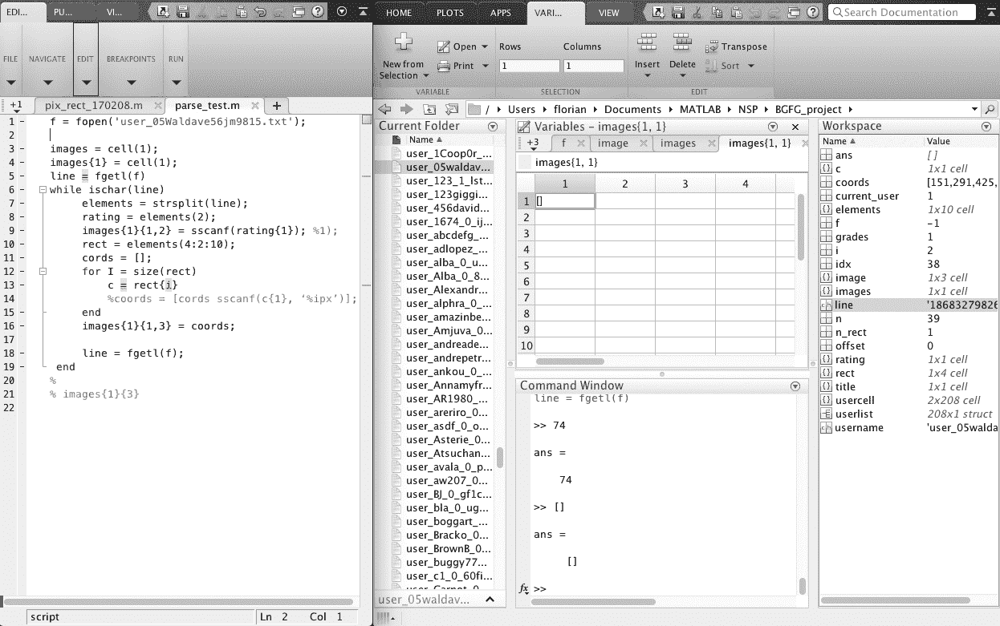

<samp class="SANS_ITC_Stone_Sans_Std_Semibold_B_11">图 4.4</samp>

`Matlab` IDE 的截图。最右侧的窗口称为工作空间（Workspace）。它收集程序员在会话期间创建的所有变量。在工作空间的左侧，变量窗口（Variables Window）允许程序员以电子表格的形式可视化她创建的变量。在这张截图中，变量 `images[1,1]` 正在可视化。在它的下方，工作空间的左侧是命令行窗口（Command Window），显示程序员执行的操作结果。在这张截图中，命令行窗口显示答案 `[]`。截图中间的长窗口是当前文件夹窗口（Current Folder Window），显示当前访问文件夹的内容。左侧，编辑器（Editor）允许程序员编写 `Matlab` 程序——也称为脚本——即编号的指令列表。当程序员点击运行图标（位于编辑器正上方）或使用等效快捷键时，脚本的结果将打印在命令行窗口中。在这张截图中，运行脚本使得命令行窗口中出现了 `[]`。这些窗口的空间布局可以根据程序员的偏好进行修改。


<samp class="SANS_ITC_Stone_Sans_Std_Semibold_B_11">图 4.5</samp>

在剩余分析中将呈现的简版 `Matlab` IDE。为了提高编程序列追踪的可读性，将仅显示编辑器和命令行窗口。这里，该图表达了（部分）图 4.4 的内容。


在 T1 处，当程序员进行修改时的编辑器和命令行窗口。在说明的标题中，“T1”术语表示这是所所遵循的编程序列中的第一次更改。编辑器中被删除或添加的指令用灰色突出。命令行窗口的内容会更新。最后，被删除的指令在底部单元格中以删除线文本表示。被删除指令的行号是 `T*n*-1`（此处为 `T0`）。

在不同的 `Ts` 之间，将转录程序员（DF）和我（FJ）的言行和动作。为了保持可读性，我可能会省略一些细小的动作，例如快速的误打或犹豫时的断断续。在 `T1`（图 4.6）之后，编程序列可能会如下：

DF：“嗯，它不再运行了。”

FJ：“看来是……”

DF：“啧——。”

[在第 14 行，DF 删除了 `{1}`]

[DF 运行脚本]

[图 4.7—T2]

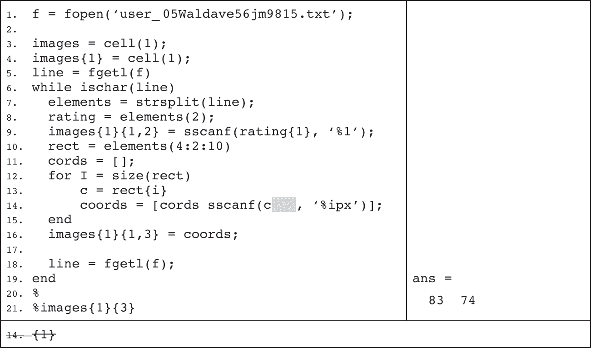

图 4.7

T2 处的编辑器和命令行窗口。

DF：“好的。但为什么只有两个？我不明白。今天真难！”

[大笑]

在这里和那里，我也会干预以澄清情况并分析正在发生的事情。在我们开始第一个序列之前，需要记住，人们不需要理解转录中说的每一句话，也不需要理解每个 `T` 中的所有元素。在对计算机编程实践的这种仔细分析中，重要的是*在每个 `T` 之间*发生了什么。正是通过关注每个 `T` 之间的相对差异，我们才能理解这些非规行动过程中涉及的一些问题。

在深入探讨计算机编程实践之前，我需要提到最后一点。人们很容易反对，认为以下案例研究及其随后的初步提议并不具有一般编程实践的*代表性*。对此，我的回答是，这里并不涉及代表性问题。代表性确实是一个强大且重要的概念，但只有在群体边界被清晰定义时才如此。*城镇的居民*、*组织的细胞*、*书中的词汇*：都可以与一个成本高昂且装备的*集合*——城镇的行政和地理限制、样本的物理限制、书的封面——相关，随后定义了一个领土和一个群体。在这些特定的（但非常罕见且通常引起争议）的情况下，代表性概念可以用来提取具有统计学意义的结果。但当没有领土、没有集合时，代表性的概念本身就失去了它的存在理由。编程是什么？程序员在编程时是谁？我们并不知道，因为对计算机编程实践的研究非常少。这通常是民族学可以发挥用场的地方：对未定义（或定义有问题的）领土的探索，可以为后续待进行统计探索的边界设计提供思路。虽然我认为莱比锡那个编写小型 JavaScript 程序以使其个人网站菜单动画化的年轻街头艺术家、正在为客舱加压模块编写最后的 Ada 更新的波音工程师，或尝试用 Matlab IDE 解析 `.txt` 文件的计算机科学家在许多方面都*不同*——他们有不同的问题、影响、环境、设备——我也认为（几乎）*没有*这些情况尚未从民族学角度得到解释。我们仍然必须从某开始。因此，下面的案例研究是进入我希望的更系统性的编程行动研究的极早期步骤之一；因此它的提议具有探索性。

## 对齐铭文

让我们关注 `PROG`。基于我在上一节中介绍的内容，我将记录一个在实时花费不到五分钟的极短编程序列。我将尽可能贴近格式化但实证的材料，使用我上面介绍的展示方法以及在分析过程中在科学技术研究（STS）中开发的几个概念。我的希望是展示一组对程序员来说极其重要的实践：处理*铭文*的扩散和对齐，以开辟对远程实体的访问，并*识别一个**位置*。希望这个奇怪的提议随着章节的进行而变得清晰。目前，让我们从中间开始（*in medias res*），参考图 4.8 和 4.9：

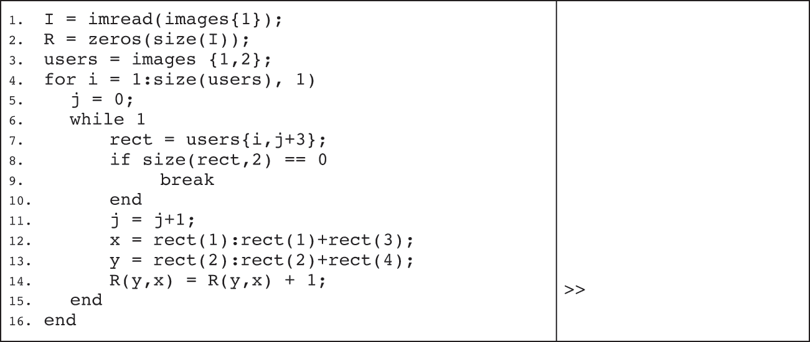

图 4.8

T0 处的编辑器和命令行窗口。

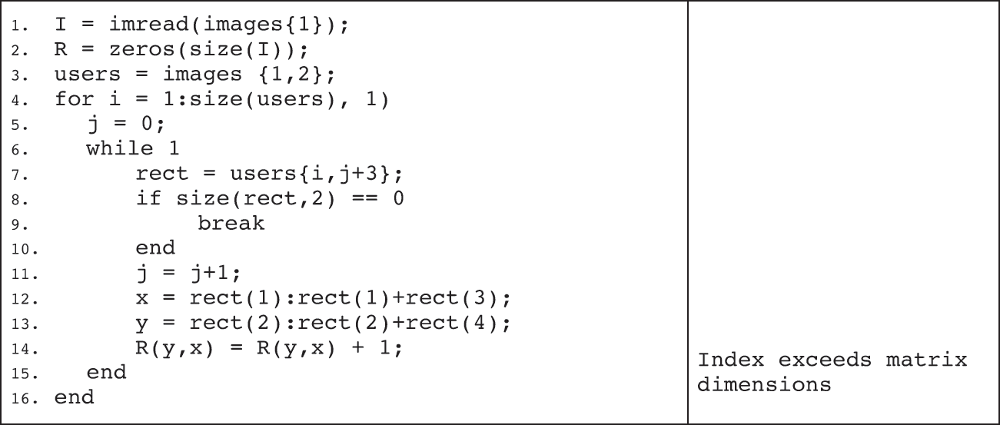

图 4.9

T1 处的编辑器和命令行窗口。

[图 4.8—T0]

[DF 运行脚本]

[图 4.9—T1]

DF：“好的。所以它告诉我它工作了。”

FJ：“看来是。”

T0 和 T1 之间发生了什么？在 DF 运行脚本后，命令行窗口中出现了一个红色的（此处为灰色）铭文，指示 `Index exceeds matrix dimensions`（索引超出矩阵维度）。这段文本从哪里来？是谁写的？为了更好地理解这个加密通知的来源，我必须向序列中引入一个重要的参与者：解释器(`INT`)。


这引导我们关注重要的 `inscription`（铭）概念，我们在引言中已经遇到过这个概念，当时我强调了这些持久、移动且可重新呈现的实体的世界生成能力。当然，有许多不同类型的铭：书籍、WhatsApp 消息、购物列表，甚至纹纹的身体都可以被视为铭，其中某些比其他的更具持久性、移动性和可重新呈现性 (Gitelman 2014)。但无论如何，铭都是或或可归因事件的翻译表现，因此至少在可能上构成了环境在特定情况下提供的 `takes`（采取/呈现）。这些铭并非为心理计算提供“真实事物”的表示（representations，不带连字符）。它们是可理解的事件的格式化再呈现（re-presentations），并反过来配置了其他世界生成的采取。这就是为什么我在第 3 章末尾需要费力地引入体认认知（enactive cognition）：因为我们现在意识到代理性（agency）`precedes`（先于）认知，文档和铭可以被视为不多不少于可能暗示其他行动的采取——在我们所能感知和理解的范围内，从一个采取到另一个采取 (Penny 2017)。

铭-采取（Inscriptions-takes）有时会被认知个体理解；有时则不会。在我们的案例，铭 `Index exceeds matrix dimensions` 确实被 DF 理解了。事实上，当 DF 运行脚本时，他预期命令窗口（Command Window）会出现一个铭。此外，由于 DF 清楚——正如我们现在一样——命令窗口中的任何红色铭都表明 `INT` 无法翻译脚本的所有行，DF 知道铭 `Index exceeds matrix dimensions` 是与 `INT` 相关事件的痕迹。

从这一点开始，我们能够更好地理解第一个铭对 DF 做了什么。在 T1 时，铭 `Index exceeds matrix dimensions` 是 DF 理解的一个采取，它表明某些东西——但是什么呢？）正影响着 `INT` 的轨迹：`它告诉我它不起通`。

让我们继续：

```
DF: “它没通过。我只是检查一下图像的大小。”
```

[DF 在编辑器的第 2 行处创建了一个新行；输入 “size(I)`”]

`INT` 有一个问题：它没有通过脚本。但 `PROG` 的哪部分正在影响 `INT` 呢？在这一点，很难确切知道。事实上，理解 `INT` 发生了什么，从现在起对于 `PROG` 的实现是必要的。

对于 DF 来说，最初的红色铭表明——尽管非常模糊——`INT` 受到某些尺寸的影响。红色铭中的术 `exceeds`（超出）和 `dimensions`（维度）证明了此类尺寸问题。为了更好地掌握什么尺寸相关的问题影响着 `INT` 的轨迹，DF 从检查图像的大小开始。这样做，DF 在脚本的第二行添加了短代码行 `size(I)` 然后运行了它，从而触发了 `INT` (图 4.10—T2)。

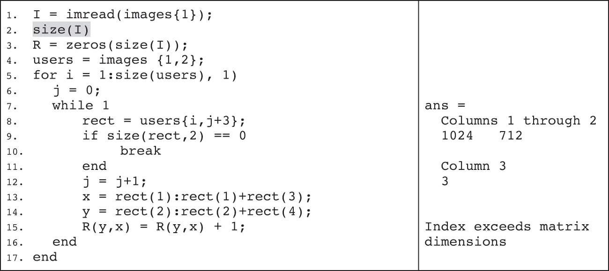

Figure 4.10

T2 时的编辑器和命令窗口。

通过在第 2 行添加代码行 `size(I)` 然后触发 `INT`，DF 在命令窗口中产生了一个新的铭：

```
ans =
Columns I through 2
1024 712
Column 3
3
```

由 `INT` 在命令窗口中打印的这个新铭不是红色的，因此可以被视为代码的实际翻译。这是理所当然的：数十年的工程发展让 DF 确定这个新铭是 `INT` 一个无问题的表达。但尽管如此，这个铭表达的是正确图像的维度吗？如果不是，整个脚本都应该重新考虑。为了验证 `INT` 确实未能处理正确的图像，DF 使用第二个非红色铭创建了第三个铭，这次是由我发出的：

```
DF: “好的，所以尺寸是 1024 712。这听起来对吗？”
FJ: “是的，它是正确的。”
DF: “所以它发生了。”
```


此时，DF 认为他收集的关于 `INT` 轨迹的文档（通过三处铭文的堆叠和对齐——红色铭文、非红色铭文以及听觉陈述（其是对过去考虑的书面铭文的翻译））已足够完成脚本；根据 DF 基于他所产生、收集并对齐的证据，`INT` 不支持 `size(I)` 的第三个值。这一关于 `INT` 的指向第 3 行的信息可能允许修改脚本并平滑 `INT` 的轨迹。DF 还删除了第 2 行的 `size(I)`，该代码主要作为他探测 `INT` 的工具。然后，根据他对影响 `INT` 轨迹的问题现象来源的洞察，他在 `Editor` 中输入了 `,1),size(I,2`，以便根据仅两个值 `1024` 和 `712` 来定义 `R`，针对真值的第一个图像的情况。随后他运行了脚本：

```
[DF runs the script]
```

[figure 4.11—T3]

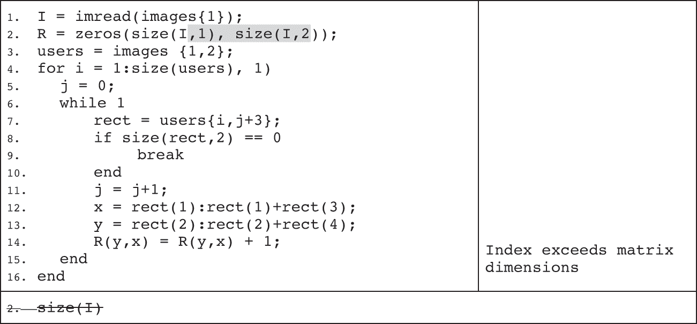

Figure 4.11

T3 时的编辑器和命令行窗口。

`DF:` “啊，不。显然，这里在这里。”

遗憾 DF 的是，这些修改并没有改变 `INT` 的状态。正如我们在 T3 时的 `Command Window` (figure 4.11) 中所示，DF 新触发的 `INT` 并没有导致红色铭文的消失：某些东西仍在影响着 `INT`，而且并不是由三个值而非仅两个值定义的图像尺寸。3 用科学术语来说，我们可以说“`INT 受到 size(I) 第三个值的影响`”是一个*伪影*（artifact）：它并没有参与影响 `INT` 轨迹的现象。相反，问题所在不在第 2 行；而是在*其他地方*。因此，需要更多的实验；必须产生更多的铭文并进行比较和对齐。

尽管如此，伪影“`INT 受到 size(I) 第三个值的影响`”对 DF 来说并非毫无用处。多亏了它，DF 现在确定 `INT` 受到一个发生在第 2 行*之后*的尺寸相关问题的影响。但关于 `INT` 的这种确定性目前还太薄；它无法让 DF 精确识别是什么在影响 `INT`，并相应地修改代码。

让我们继续：

`DF:` “好的。那么，我们就打印矩形吧。然后直接比较一下。”

```
[DF deletes ";" at the end of line 8; he creates a new line at 3 in the Editor; he types "size(R)" at line 3]
```

`PROG` 处理的是自然图像，这些图像在之前的众包任务中已由工作人员预先绘制了矩形。正如我们在上一节介绍本章实证材料时看到的，绘制的矩形从严格来说并不是在*图像*之上*：它们被存储为 `.txt` 文件中的坐标。我们现在正在检查的脚本旨在使用每个自然图像的宽度和高度值及其矩形，创建一个复杂性更低且更容易分析的新图像。这些新的简化的图像——我从现在起将它们称为矩阵——应该只表达工作人员在初始彩色图像上绘制的矩形数量和位置。在这方面，脚本的工作流非常直观：首先，使用初始自然图像的宽度和高度创建一个空矩阵，然后使用与该图像相关的 `.txt` 文件中的工作人员数据创建一个矩形，然后将矩形添加到空矩阵中。随着越来越多的矩形被添加到矩阵中，矩阵获得了更多的值。在图像处理领域，我们称该矩阵是*增量*的。Figure 4.3 提供了 `PROG` 最终输出两个示例；即根据 `.txt` 文件中与其 ID 相关的矩形坐标进行增量后的矩阵。但我们还没有那一步；在编程阶段的这一时刻，`INT`——这个至少难以捉摸的活跃实体——正受到某种阻止其翻译的东西的影响。


在 T4 刻，DF 已经意识到所有这些值指的是什么了；在这次编程阶段之前，我向他解释了我用于结构化 `.txt` 文件数据的约定。但一旦这些值被打印出来并与图像的宽度和高度进行比较，就可以进行一些基础但极其关重要的算术评估了：“197 + 323 < 1024”和“91 + 371 < 712”。这些是至关重要的线索，因为它们并没有证实命令行窗口中的红色标记；矩形并没有超过图像的尺寸。矩形的大小和位置并不是影响 `INT` 的因素。是其他什么在干扰 `INT` 与 `PROG` 之间的关系。但是什么？又在哪里？需要更多的标记来更好地记录影响了 `INT` 的因素，并相应地修改脚本。

我们在 T4 看到的是我在这里试图强调的这一过程的完美示例：通过打印图像尺寸和矩形的坐标，DF 对此更好地掌握了正在处理的过程。他能够表述这两个新标记，并将它们与之前的标记对齐。从这个意义上说，他正在通过行动为通往 `INT` 及其红色标记的路径开辟道路。尽管这些标记的产生和对齐并没有像 DF 预期的那样起——矩形的尺寸并没有超过图像的尺寸——但这给了另一个关于所受关注现象的线索：影响 `INT` 的因素位于*其他地方*。我相信，这种通过理解、产生和对齐标记来识别问题现象起源的实践，是编程的核心。正如我们将看到的，这并不是计算机编程序列期间部署的唯一类型的实践。但在某些特定情况下，当一个重要实体在其轨迹上被阻塞，从而阻止了通过电脉冲进行数据计算时，对标记的处理和对齐仍然至关重要。在这些必须找到问题*位置*的情况下，实验的设计和对其结果的表述似乎是必要的，以开辟一条非常特定的路径，路径本身为某些我们可能称为微小、分散且极其快速的实体（“解释器”、“编译器”，甚至在微代码的情况下称为“处理器”）提供了非常具体的*信息*。我将在这次编程阶段结束时回到这个提议上。但此时已经很重要的是，DF 目前正在进行的平庸的标记相加和对齐，可能是计算机编程这项活动的核心。

考虑到这些初步元素，让我们继续吧：

DF：“我再试试别的。看看矩形是否对应。”

[DF 在编辑器的第 13 行创建了一个新行；在这一行上，他输入了“imshow(I(y,x,:))””]

DF 需要一个新的标记：如果矩形与图像之间的关系对 `INT` 来说没有问题，那么一定是有其他问题。但是什么呢？正如编程阶段经常那样，情况开始变得混乱。为了确保 T4 刻在命令行窗口中表示的矩形是正确的，而不是某种尚未识别的伪迹，DF 需要在将第一个矩形叠加在第一张图像上时看到它。为了做到这一点，他在编辑器中创建了一行新代码，并输入了短小的指令 `imshow(I(y,x,:))`。然后他运行了脚本：

[DF 运行了脚本]

[figure 4.13—T5]

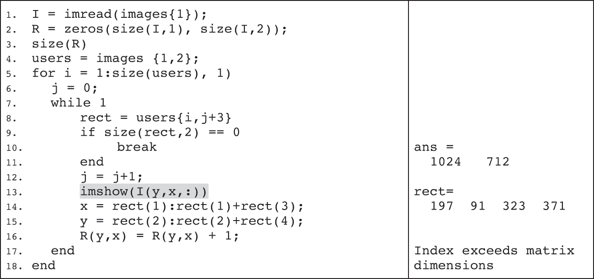

Figure 4.13

T5 刻的编辑器和命令行窗口。

[figure 4.14]


Figure 4.14

T5 刻的 PROG 输出。

DF 检查了 [figure 4.14]

DF：“好的。那么从理论上说，这应该是第一个工人标记的第一个矩形。”

DF 在 T5 刻触发的新标记 (figure 4.14) 这一次稍有不同。它不是文本，而是图像的一部分。更准确地说，它是第一个工人在第一张图像上画出的第一个矩形的表达。正就像在 T2 和 T3 之间一样，这个新标记允许 DF 创建另一个标记，这次是源自我的：

DF：“对应吗？”

FJ：“是的，是的，对应的。”

DF：“好的，很好。所以它肯定在其他地方阻塞了。也许它无法定义第二个矩形。”

在处理了几天真值（ground truth）数据后，我是一个可靠的参考：至少对于第一张图像，我非常清楚不同矩形的位置。再次，两个标记的表述和对齐——在第一张图像上的第一个矩形和我自己的验证（受我之前遇到的标记的启发）——允许 DF 继续对涉及 `INT` 的问题现象进行查询。如果第一个矩形和负责定义它的代码部分不是影响 `INT` 的因素，那么问题应该在其他地方。也许在第二个矩形中，更通俗地说，在负责定义它的代码部分？再次，需要新的标记：

DF：“可能是我们定义空矩阵的时候。”

[DF 删除了第 13 行的 `imshow(I(y,x,:))`；在第 2 行他选择了函数 `zeros`，右键点击它，并选择“针对内容的帮助（help on selection）”]

[figure 4.15]

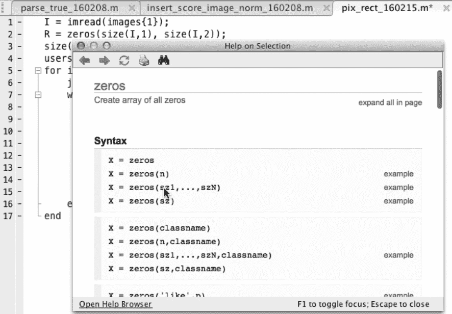

Figure 4.15

DF 在 T5 刻触发的“针对内容的帮助”截图。

新标记 (figure 4.15) 再次与之前的稍有不同。事实证明 Matlab IDE 提供了一个“内容帮助”数据库，如果连接到互联网，它可以显示函数的正确语法。由于弹出窗口与第 2 行的可疑函数对齐，DF 可以使用鼠标光标将帮助菜单的内容与编辑器中的内容进行比较：

DF：“不，不，我们做得对。在其他地方。”

[DF 关闭了“针对内容的帮助”窗口]

帮助菜单与脚本之间的比较让 DF 确定 `INT` 不受该行代码的影响；语法是正确的，所以 `INT` 可以理解。问题在其他地方：

[DF 运行了脚本]

[figure 4.16—T6]

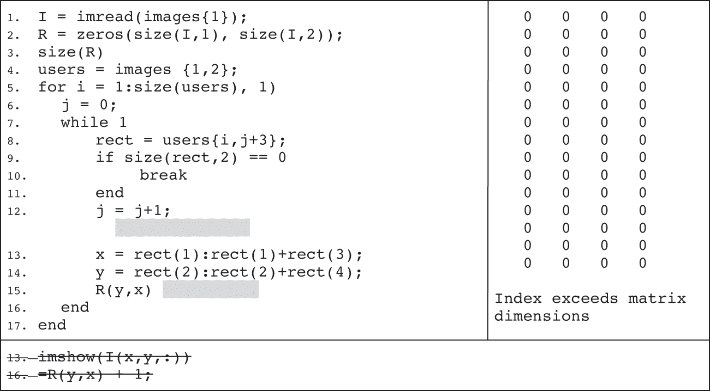

Figure 4.16

T6 刻的编辑器和命令行窗口。

DF：“哈，我不明白……只有空矩阵。”


DF: “太愚蠢了。抱歉，我有点生疏了……我再试另一种方法。”

[在第 15 行行尾，DF 输入 `= R(y,x) + ones(numel(y), numel(x));`]

DF: “基本上[对于 FJ 来说]，我创建了一个包含 1 的 1 × 1 矩阵，然后根据区域的大小对其进行重复。这非常愚蠢，但至少我确定它能行。让我们看看是否改变了什么。”

[DF 运行脚本]

[图 4.17—T7]

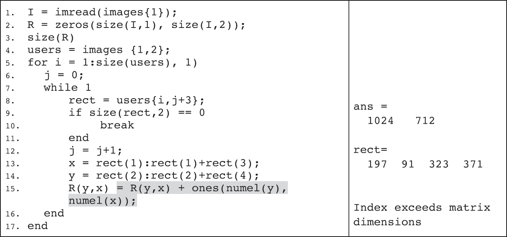

图 4.17
T7 处的编辑器和命令行窗口。

DF: “好吧，至少它什么都没有改变。在这里也没有阻塞。”

DF 的实验是结论性的。在 T6 时(图 4.16)，他并不完全说服第 15 行的指令所做的。在 T7 时(图 4.17)，他尝试用另一种等效的“愚蠢”方法来表达。我们不需要深入研究代码的这种情感方面，因为我们将在本章后面再考虑它。此时，更重要的是 DF 使用了一个他确定 INT 可以翻译的指令。这一事实的可靠性（显然在他之前对 Matlab 编程语言的经验中得到了巩固）允许他进行一项新实验。再次，与之前的写入结合起来，这两条新写入 `ans = 1024 712` 和 `rect = 197 91 323 371` 具有启发性；由于它们与 T4 出现的相似，DF 可以得出结论：导致 INT 问题的现象并非源于脚本的第 15 行。一定在其他地方，再次：

DF: “好的，我会做一些非常非常愚蠢的事情，我只想看看它是不是在这里。”

[DF 在第 7 行创建一个新行；输入 `1`；在第 10 行创建一个新行；输入 `2`]

[DF 运行脚本]

[figure 4.18—T8]

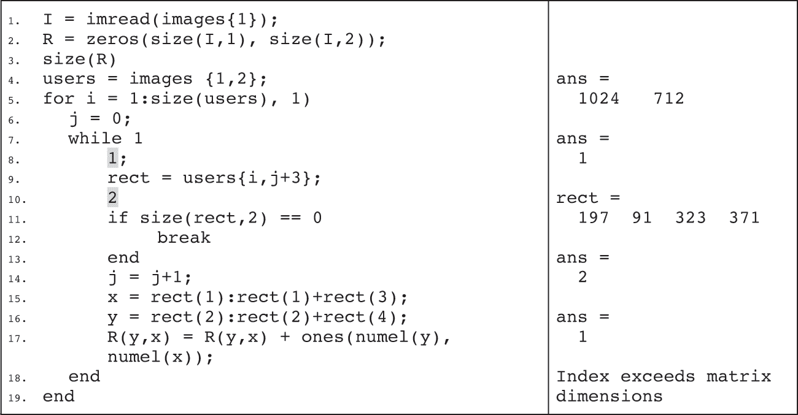

图 4.18
T8 处的编辑器和命令行窗口。

DF 检查 [图 4.18—T8] 的命令行窗口]

DF: “好的。在这里在图 4.18—T8 的第 9 行]。看到了吗？[DF 将光标放在第 9 行]它输出了 `1,`，然后是 `rect,`，然后是 `2,`，然后是 `1,`，然后停止了。是这个 `j+3` 在第一个矩形之后变得太大。它处理第一个矩形，如果第二个矩形更大，它就无法递增。”

在 T8 时(图 4.18)，这个愚蠢办法奏效了：新的写入成功识别了导致 INT 问题的来源。在第 9 行，`j+3` 在第一个矩形之后变得太大，从而干扰了 INT 的翻译工作。但 DF 是如何得出这一推断的？他如何有信地将干扰 INT 的责任归于第 9 行？如果我们仔细观察 T8 的命令行窗口（就像 DF 做的那样），我们看到第一组数字——1024”和“712”——表达了编辑器中脚本第 3 行指示的 `R` 的大小。如果我们继续检查，会看到随后的数字“1”——表达了第 8 行指示的指令 `1`。然后我们看到第三组数字——197”、“91”、“323”和“371”——表达了第 9 行指示的第一个矩形的大小。接着，命令行窗口中的第四个数字“2”——表达了第 10 行指示的指令 `2`。第五个数字“1”——再次表达了第 8 行指示的指令 `1`。这个元素至关重要，因为它表明在这一特定时刻，INT 正准备处理第二个矩形。而正如命令行窗口的最后一个元素所指示的，一旦 INT 尝试第二次翻译第 9 行，它就会阻塞并打印出红色错误。

此时，重要的是记住，最后这个写入——尽管至关重要——但它本身并没有让 INT 的红色写入与第 9 行之间建立联系。是所有之前写入的累加和对齐逐渐导致了最后这个写入的定义。整个对齐过程允许 DF 将影响 INT 的现象来源锁定于一个位置。

正如某些读者可能注意到的，为了解释这段小的编程序列，我使用了 STS 文献中发展的几个概念来描述一个本质完全不同的过程：科学实验室中的实验实践。现在，我需要讨论我偷偷建立的实验室实践与计算机编程实践之间的联系。


在过去的五十年里，许多关于科学工作的研究强调了文本文件（Latour and Woolgar 1986）、图表（Netz 2003）、图谱（Dennis 1989; Gooday 1990）以及笔记（Lynch 1985; Garfinkel 1981）的重要性——我遵循 Latour (2013)，将这些内容整合在“铭文”（inscriptions）这一术语下。其他重要研究还显示了产生、应对和阐述这些铭文所需的仪器和实验的核心性（Hacking 1983; Knorr-Cetina and Mulkay 1983; Collins 1975; Dear 1987; Gooding, Pinch, and Schaffer 1989）。还有研究进一步强调了这些铭文的操纵与流通（Latour 1987; Knorr-Cetina 1999），这些铭文通过比较、对比、对齐——简而言之，即*衔接*（articulation）——有时形成了 Latour (1999a) 所说的“参考链”（chains of reference）：或多或少固化的路径，当一切各就位时，这些路径记录了某些远端实体（例如行星、病毒、粒子）的行为。这些重要研究将认证的知识呈现为同时产生且客观的：得益于科学实践——以及支持这些实践表达的科学*机构*——知识*是*客观的。(5)

正如这段简短的编程序列所示，编程实践有时（并非总是）可能与构建认证知识所需的所需的某些实践相似。事实上，通过实验和仪器产生铭文，以及为了产生*更多*铭文而对它们进行比较和对齐，这与科学实验室中观察到的现象高度吻合。通过对铭文进行操纵、比较和对齐，逐渐地铺出了一条通性路径，可能允许对涉及远端实体的现象进行表征。在计算机编程的情况下，这个远端实体可能不同：例如，它可以是一个 `Matlab interpreter`、一个 `C compiler` 或一个 `Intel microprocessor`。无论如何，这些不同实体的共同特征是其构成关系具有惊人的速度。事实上，人们如何可能掌握一个每秒执行数十亿操作的解释器、编译器或——糟糕的——处理器呢？一旦组装，这些实体就难以捕捉；因此，科学的证真模式（veridiction）对于更好地理解影响它们的因素至关重要。此外，我假设在计算机编程期间对实验室实践的采用，并不是 20 世纪 50 年代平面工艺发展后电子元件小型化的结果（Lécuyer, Brock, and Last 2010）。正如对早期电子计算机的历史研究所示，这些计算机由高两米的累加器和乘法器组成——它们本身由数百个通过电线和焊接连接的电阻器组成——在计算过程中发生的任何短路、载流错误或除法器故障，都必须通过繁琐的错误报告、铭文和实验的形成来识别和定位（Haigh, Priestley, and Rope 2014; 2016, 60–83）。在电子计算的早期，程序员也必须对齐铭文，以铺通通系统受影响组件的路径。

科学实践与计算机编程实践之间的另一个相似之处是，都倾向于忘记那些能够表征受审现象的仪器。在两种情况下，当由于特定的实验室设置识别出现象的源头时，允许参考链形成的实践、仪器和实验通常被搁置一边（Latour and Woolgar 1986, 105–155）。科学的这种特征可能使其历史研究变得难以进行。当既定事实从最初允许其组装和固化的脚架中被提纯出来时，人们可能会产生从既定事实开始并向后推演的巨大倾向（Collins 1975）。因此，要实地把握科学实践，将事实视为特定过程的*结果*而非先验事件的*原因*，是至关重要的（Bloor 1981）。在较小程度上，计算机编程也是如此。当涉及远端实体的现象被表征时；当脚本中的问题位置被确定时，大多数仪器（一小段代码、向 FJ 提的问题、“愚蠢的东西”）都会被搁置一边并很快被遗忘。在编程阶段结束时，当脚本具有*功能性*并按预期运行时，大多数这些*中介对象*（intermediary objects）（Vinck 2011）通常会被留下。因此，如果将完成的脚本或程序作为研究编程的起点，那么错失完成这些脚本或程序所必需的风险就越大。(6)

对于计算机编程的情况，我们可以想象我上述记录的对齐实践的不同表达形式。尽管我推测这些表达仍然包含形成参考链，以便访问远端实体并指向铭文的编号列表中的特定位置，但它们并不一定部署在与 DF 类似的时空地标中。例如，如果我们考虑“程序测试”——一种重要的工业过程，其在于检测和记录错误以修改代码行——这项工作在时间和空间上可以是高度分布的（Parrington and Roper 1989; Myers, Sandler, and Badgett 2011）。(7) 我们在某个软件程序因神秘原因崩溃时经常遇到的“错误报告”是这种对齐铭文必要性的另一种表达形式，因为它们恰恰记录了程序在什么时间、在什么操作之后致命地影响了解释器、编译器或处理器。这些报告充当了第一个铭文，反过来又与另一个铭文衔接，又是另一个，直到最终指示了程序源代码中的现象起源。此外，对齐实践也可以自动化并集成到编程语言本身中。这通常发生在解释器或编译器自行指示其*断点*时，即对负面影响其轨迹的脚本行。但如果这些错误报告对程序员来说是自动的，也不应忘记它们是*异质*过程（heteromatic）的产物，因为参与维护和增强编程语言的编程团队必须处理铭文的对齐，以确定最初应该索引哪些类型的错误。(8) 虽然在范围和劳动投入方面有所不同，但这些程序测试、错误报告和编程语言设计的过程可能也是关于对齐铭文和产生参考链的。


通过对齐符号来识别书写符号编号列表中的位置的实践，可能至少在部分解释了专业程序员对程序可读性的痴迷。这一主题在 Button 和 Sharrock (1995) 在他们对计算机编程实践的一项令人赞叹却孤独的研究中已有详尽记录。正如他们所展示的，使程序对其他程序员易于理解涉及对变量和函数的常规`naming（命名），以便其结构像一份组织良好且有引用的文档一样可读。它还涉及对代码不同函数和参数的`formatting（格式化）和`laying out（布局），以便通过其视觉组织易于浏览。这通常还通过短小的解释性句子对程序进行`commenting（注释），这些句子的起始符号（例如 Matlab 中的`%`）允许解释器或编译器忽略它们。尽管我们刚刚遵循的编程序列没有直接处理格式化、布局和注释，但它仍然指明了这些实践正努力的目标。鉴于上述元素，命名、格式化和注释都指向未来的某个时刻，届时它们可以作为地标直接录入引用链的构筑中。因此，这些标记可能形成一种额外的参考基础设施，当未来解释器或编译器出现负面影响时（这在必须维护和增强复杂程序的企业环境中很可能发生），能够加速对齐工作。

但计算机编程的对齐实践等同于科学实验的实验室实践吗？显然不是，现在是时候介绍它们之间的重要区别了。编程的对齐实践导致脚本内位置的识别，而科学实验室实践通常导致`new objects（新对象）`的定义，其属性和轮廓后会在学术论文呈现并在同行中进行讨论。我们在第 5 章和第 6 章考虑数学时，将回到科学知识形成的这一关键方面。目前，只需说，计算机编程中对齐实践的动力和结果主要涉及试图完成完善脚本的程序员，而科学实验室的对齐实践则转向完成具有说服力的书面声明。科学实验室始终是`counter-laboratories（反实验室）`（Latour 1987, 79–100）：它们也可以被理解为一种发布比竞争对手更有力的声明的手段。科学实验室实践中不断尝试建立什么才算作“自然”的竞争方面，必须与计算机编程实验室实践的自我引用方面区分开来：科学家试图为他们实际上呈现的现象的客观性辩护，而程序员则试图遵循他们所依恋的`scenario（场景）`（稍后将详述）。简而言之，我认为科学家和程序员参与的网络是相当不同的。科学中符号的对齐支持声明的发布，而计算机编程中的对齐实践支持技术产品的完成，而这种产品在企业环境中仍需要是理解的。

因此，科学实践与编程实践之间的类比具有局限性。然而，我也相信两种实践共享一些关键且相当令人惊讶的相似之处，都允许引用链的形成以及对远程实体的访问。就像科学工作一样，计算机编程不能还原为这种特定类型的实践。事实上，一旦到达远程实体，一旦问题位置被定位，仍然需要进行许多操作。在这方面，对齐符号只是编程活动的一小部分。

## 技术绕路

我们在上一节中看到，有时在编程期间期间，当一个微小、快速且难以捉摸的实体（例如解释器、编译器、微处理器）在其轨迹上受到影响，至于无法再次触发数据计算的电脉冲时，程序员需要倍增符号、对它们进行对齐并堆叠，直到这些符号构成了对该实体的某种访问——这种访问反过来指示了脚本中的位置。但接下来会发生什么？

在本节中，我们将关注在编程期间部署的另一组实践。虽然这组实践无疑与符号的对齐并行，但它有不同的含义。编程的科学方面涉及添加和对齐符号（实验、确认、“愚蠢的事物”）以到达远程实体，而我将称之的`technical aspect of programming（编程的技术方面）`则涉及实体的包含和替换以绕僵局。再次，随着章节的进行，这个奇怪的句子可能会变得更加清晰。目前，我们将继续遵循`PROG`，恰好从上一个序列结束的地方开始：

DF 检查 [figure 4.18—T8 的命令窗口]

DF：“是这个‘j+3’在第一个矩形之后变得太大了。它取了第一个矩形，如果第二个矩形更大，它就无法递增。所以我将随便排个顺序。”

[DF 删除了第 3、8 和 10 行；删除了第 9 行末尾的 ";"]

[DF 运行脚本]

[figure 4.19—T9]

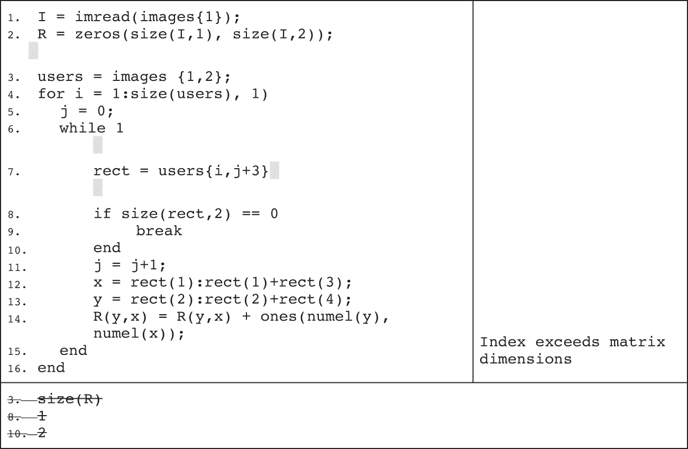

图 4.19

T9 编辑器和命令窗口。

DF：“好的，我们只需要改变几个地方。”

正如我们在上一节看到的，DF 成功定位了严重影响 INT 的脚本行。为了建立这种经过验证的知识，必须产生并对齐几个符号。但这些符号现在是没用的；它们仅作为 DF 对 INT 的准科学调查的一部分具有相关性。现在是 DF 真正对脚本进行`change a few things（改变几件事）`了。为了这样做，他首先输入了`some order（一些顺序）`并删除了曾被当作实验工具使用的指令（图 4.19））。

在本章的此处，为了解释接下来发生的情况，我需要引入一种补充符号，以便我们更好地掌握 DF 即将进行的`technical innovations（技术创新）`。


社会技术项目研究结果之一是，此类项目的轨迹取决于它们招募新 `actants`（行动者——即人类或非人类实体）以克服关键僵局的能力（Akrich 1989; Callon 1986; Latour 1993a）。这种招募的历史案例比比胜常：为了让美国贝尔公司在电话网络开发中胜过西联邮电公司，它在经历多次诉讼后，将其关键的电话专利招入其社会技术网络（Brooks 1976）。通过实现生产高可靠且灵活的开关晶体管，平面工艺使费森尔半导体公司成为了美国空军的商业伙伴（Lécuyer, Brock, and Last 2010）。通过招募 20 世纪 60 年代 MIT 开发的时分技术，John Kemeny 及其团队能够在达特茅斯学院推进 `BASIC` 编程语言的开发（Montfort et al. 2013, 158–194）。对于每一个例子，一个特定的 `actant`——一组电话专利、平面工艺、时分技术——被招募进来，而这反过来使得项目发生了轻微偏移。技术史和技术社会学的一个重要贡献是继继证明了纳入新 `actants` 对技术项目的发展至关重要——无论它们像 19 世纪末美国电气化那样巨大（Hughes 1983; Nye 1992），还是像安装减速带那样的小（Latour 2006）。

然而，这种通过招募新 `actants` 来开发和扩展项目的“横向”维度，如果没有正交的“纵向”维度来表达新招募的 `actants` 所引发的转型，将是不完整的。技术项目历史和社会学的另一个关键结论确实是：新 `actants` 的纳入同时改变了项目中 `actants` 之间的关系，从而产生新的僵局。以上一段的例子为例，贝尔的技术系统通过纳入电话专利而发生了转型：此前微小的网络变成了美国电话通信的潜在垄断，因此需要进一步重新配置，以避免成为美国司法部反垄断诉讼的目标（Gertner 2013）。费森尔半导体通过纳入平面工艺而发生了根本性转变：它迅速成为一个能够工业化生产集成电路的强大实体。这些生产能力反过来参与了洲际弹道导弹的发展，进一步引发了集成电路需求的爆发，以及严重竞争对手的逐步形成（最著名的是德州仪器和摩托罗拉；见 Campbell-Kelly et al. 2013, 210–225）。同样，在达特茅斯的计算机系统中纳入时分技术极大地参与了 `BASIC` 编程语言的设计，因为它大幅增加了其 Beta 测试。但“时分”这一 `actant` 的纳入改变了达特茅斯的计算基础设施，由于允许学生广泛使用，它很快开始用于原始计算机游戏实验（Montfort et al. 2013, 165–194）。技术项目不仅是招募（或失去）`actants`，它们也被它们所修改。正如技术项目的包容性横向轴一样，这个转型性的纵向轴也不仅仅涉及大型高度复杂的技术系统：小型平凡的项目也会受到它的影响（Latour 1992）。

基于技术项目的双重属性以及借用语言学的概念，STG 的支持者提出了一种根据两个维度来绘制技术项目轨迹的方法：`组合`（syntagmatic）维度和 `聚合`（paradigmatic）维度。STG 的第一个维度（`组合`）由特定时间 `T` 下 `actants` 的特定装配定义。时间 `T` 的 `actants` 配置对于每个技术项目都是特定的，因此应该由一个叙述来支持，以揭示所考虑项目的缘由。由于这一维度表达了变量之间的关联，它可以被称为 `AND`（与）维度。`AND` 维度中的 `actants` 配置分为分支：其配置参与项目发展的“盟友”，以及其配置构成项目完成障碍的“反对者”。同样，哪一个 `actant` 被视为项目发展的盟友或反对者，取决于 STG 仅总结的叙述（Latour, Mauguin, and Teil 1992, 39）。区分盟友 `actants` 配置与反对者 `actants` 配置的边界构成了时间 `T` 时技术项目的“前线”（frontline）。

第二个维度（`聚合`；与托马斯·库恩的概念无关）由时间 `T + 1` 时盟友和反对者配置中发生的替换所定义。由于这一维度表达了变量的替换，它可以被称为 `OR`（或）维度。取决于 `T + 1` 时盟友和反对者配置的波动，技术项目的前线也可能发生波动。再次，哪一个 `actant` 被另一个替换（从而可能导致前线波动），取决于技术项目的叙述。

将技术项目的叙述翻译成 STG 还需要两个元素：一个指定的视角和我我所谓的“情景”（scenario）。首先，必须指定被 STG 总结的项目视角的 `actant` 的视角。从这个意义上说，对于任何关于技术项目的给定叙述，如果该叙述采取了许多不同 `actants` 的视角，那么每个视角都可以（可能）由一个特定的 STG 来绘制。其次，被绘制的视角的 `actant` 的愿望也必须指定。这个话题相当棘手，将在本章的下一节进一步讨论。目前，只需说明 `actant` 想要实现的目标、它想要生活的未来、它所所属的 `情景` 应该在每个 STG 中被指定即可。


现在，让我们尝试将这些理论元素应用于我们在这里感兴趣的项目：`DF` 完成 `PROG` 的项目。如果我们考虑 `T8` 以及其之前的整个叙述，我们可能将其翻译成一个总结了 `DF` 盟友与对手的 `STG`。图的第一个元素应该指示它所呈现的观点。与大多数大型技术系统的叙述（这些叙述会考虑并对立多种观点）不同，我们的这个小叙述只涵盖了 `DF` 的观点。图的第二个元素应该是 `DF` 所属的 `scenario`（情景）。正如在前节提到的，我们知道 `DF` 对 `PROG` 的情景可以总结为：“创建一个矩阵，其像素值对应于工作人员在每个像素上绘制的矩形数量。”关于行动者（actants）：脚本的每条指令都可以被视为一个行动者，因为它们都让 `INT` 执行操作。但只要其他行动者影响了其情景框架下的项目，也可以包含在图中。从这个意义上说打印在 `Command` 行中的红色标记以及根据 `DF` 的说法这些标记的内容，以及脚本旨在对 `.txt` 文件数据完成的最终操作也可以包含在 `STG` 中。此外，由于脚本项目的叙述表明几条指令现在已经稳定，我们可以将这些指令的“稳定包”视为一个单一行动者。如果我们综合考虑这些元素并将它们应用于 `T8`，最终得到一个类似于图 4.20 的图。

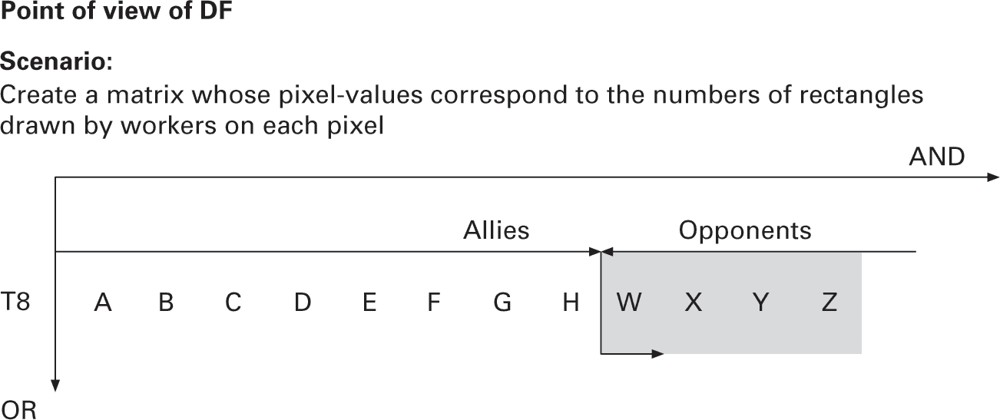

<samp class="SANS_ITC_Stone_Sans_Std_Semibold_B_11">图 4.20</samp>

`T8` 的 STG。`A` 指 `PROG` 的第 1、2、4 行（自 `T0` 起起稳定）；`B` 指第 3 行；`C` 指第 5、6、7 行（自 `T0` 起稳定）；`D` 指第 8 行；`E` 指第 9 行；`F` 指第 10 行；`G` 指第 11、12、13 行（自 `T0` 起稳定）；`H` 指第 14、15、16、17、18、19 行（自 `T6` 起稳定）；`W` 指标记“<samp class="SANS_Consolas_Regular_11-M">索引超出矩阵维度</samp>”；`X` 指 `DF` 的断言“第二个矩形对于 `INT` 来说太大”；`Y` 指 `DF` 的断言“矩形不能增加矩阵的值”；`Z` 指脚本无法遵循所需的情景。

记住，`T8` 的 `STG` 映射是 `T8` 在其 `Matlab` 视图中最初呈现的简化，并由 `DF` 的话进行了丰富。作为任何简化，它省略了许多元素。但正如许多简化一样，它也可以作为识别混乱过程关键特征的工具（Star 1983）。

从这里开始，基于上述呈现的叙述，我们可以将 `T9` 纳入 `STG` 图，从而稍微修改盟友和对手的配置（参见图 4.21）。

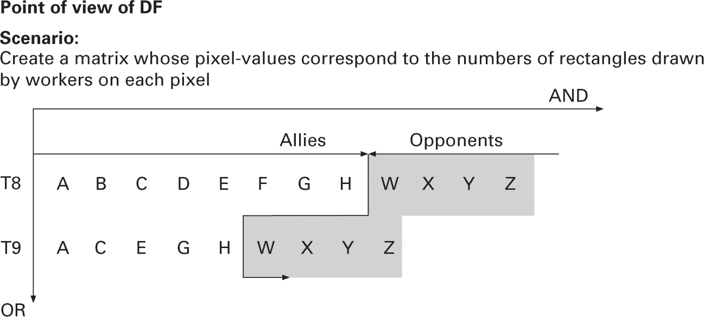

<samp class="SANS_ITC_Stone_Sans_Std_Semibold_B_11">图 4.21</samp>

`T8` 和 `T9` 的 STG。

对于该编程序列的每个剩余 `T`，我将给出其完整叙述（简化的 `Matlab IDE` 和 `DF` 话的转录），进行简要讨论，然后给出其 `STG` 翻译。由于“观点”和“情景”在整个编程过程中不会改变，我从现在起忽略它们。此外，在每个新的 `STG` 中，我将用**粗体**强调新加入的行动者。在编程序列的最后，当 `DF` 完成 `PROG` 时，所有 `STG` 的序列应该让我们检测出另一组程序员部署的实践，这些实践与标记的对齐一致但我相信它们根本上是不同的。

让我们继续跟随 `DF` 尝试他塑造 `PROG`：

<samp class="SANS_ITC_Stone_Sans_Std_Semibold_B_11">DF:  </samp>“我们要这样做。”

[DF 在 7 行创建了一个新行]

<samp class="SANS_ITC_Stone_Sans_Std_Semibold_B_11">DF:  </samp>“如果 '<samp class="SANS_Consolas_Regular_11">j+3</samp>` 更大”

[在第 7 行，输入“<samp class="SANS_Consolas_Regular_11">if j+3</samp> <samp class="SANS_Consolas_Regular_11">></samp>”]

<samp class="SANS_ITC_Stone_Sans_Std_Semibold_B_11">DF:  </samp>“大于单元格的大小”

[在第 7 行，输入“<samp class="SANS_Consolas_Regular_11">if j+3</samp> <samp class="SANS_Consolas_Regular_11">></samp>”]


在 T11 (图 4.24)，DF 修改了条件指令：不再引用 `j`，新矩形的大小现在引用单元格的第二个值 `users`。我们不需要精确地理解这个值和单元格指代什么。T11 的关键在于，引入一个新的执行行动者（actant）——修改后的 `if` 语句——产生了一个重要的区别：INT 不再打印红色标记。这表明 INT 成功翻译了每一行代码，从而触发了对 `.txt` 文件数据的电子计算。此时，*它可能会运行*：矩形可能会增加空矩阵。但现在还没有结束，因为对称地，*它也可能无法运行*。由于命令行窗口（Command Window）没有提供任何关于空矩阵增加的指示，可能还发生了其他事情。

如果我们通过包含 T11 来继续对这一编程序列进行 STG 重表述，就得到了 图 4.25。几处变化影响了 T11 时盟友的配置。“我”消失了：DF 删除了它，因为它只会通过产生新的对手来让旧对手消失。但包含了两个新的执行行动者：对应于新条件语句的“J”，以及对应于命令行窗口内无任何错误标记的“K”（推此，对应于 DF 对“它可能会运行”的断言）。这种新的盟友配置是否成功规避了对手的配置？仅部分成功了，因为“K”所暗示的不确定性有其推论：由于命令行窗口中没有指示，脚本也可能无法运行（“T”），也就是说，它可能无法正确增加空矩阵。结果，“Z”——“脚本未遵循场景”——坚持了下来。此时，DF 还需要包含其他内容；他仍然需要*通过其他手段*继续他的项目，以*绕过*由“T”和“Z”组成的僵局。

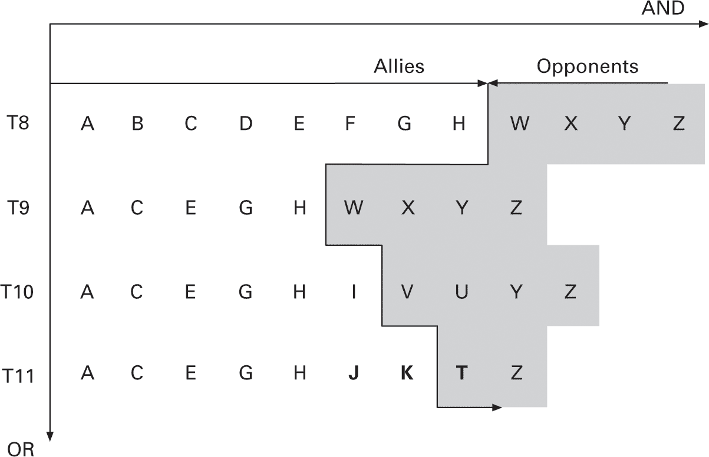

图 4.25

### T8, T9, T10 和 T11 的 STG

在 T11，“J”引用第 7 到 9 行的新 `if` 语句；“K”引用 DF 对“它可能会运行”的断言；“T”引用 DF 隐含的断言，即对称地，“它可能无法运行”。

让我们继续跟随 DF：

`DF:` “但我只需要确定一下。”

[创建了第 20 行；输入 `imshow(R)`”]

[运行脚本]

[图 4.26—T12 和 图 4.27]

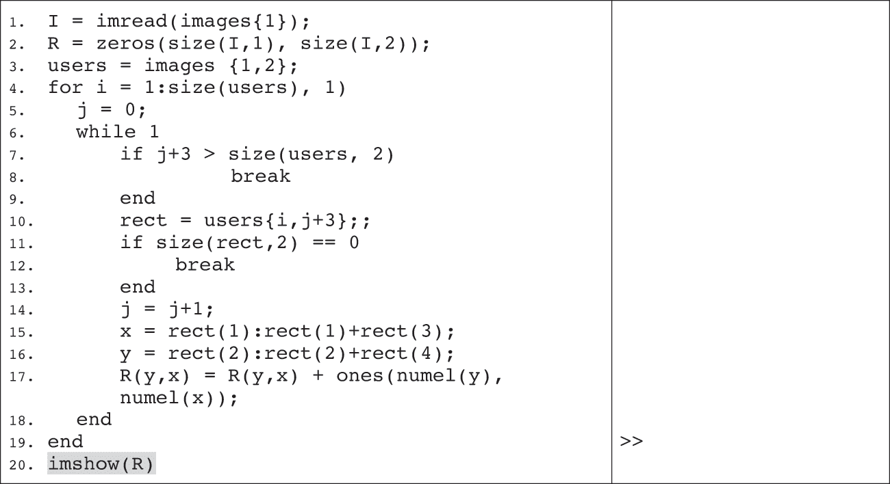

图 4.26

### T12 时的编辑器和命令行窗口


图 4.27

T12 时 PROG 的输出截图。

`FJ:` “很接近了！”

`DF:` “是的。但它在值 1 之后截断了。”

`FJ:` “截断？”

`DF:` “是的，它经常这样做。基本上，它不考虑 1 以上的任何值。我的意思是，矩阵的值可能大于 1，但它在图像上没有显示。”

在 T12 (图 4.26)，DF 增加了一个新指令——`imshow(R)`——要求 INT 打印增加后的矩阵图像 (图 4.27)。结果既令人信服又令人失望。


如果我们观察 STG（图 4.31），我们可以发现包含 `/max(R(:))` 成功规避了之前由“R”、“S”和“Z”形成的僵局。在 T13，“O”的引入及其推论“P”的出现让“R”、“S”和“Z”消失了。指令 `/max(R(:))` 的添加让 `INT` 打印出了矩阵的灰度图像，从而向 DF 显示了其值确实在零和众包工作者绘制的矩形总数之间变化。该项目的所有反对者已被盟友取代；所有的死胡同都已被绕过。情景正在进行。正如 DF 所说：“就是这样。”编程序列结束了。

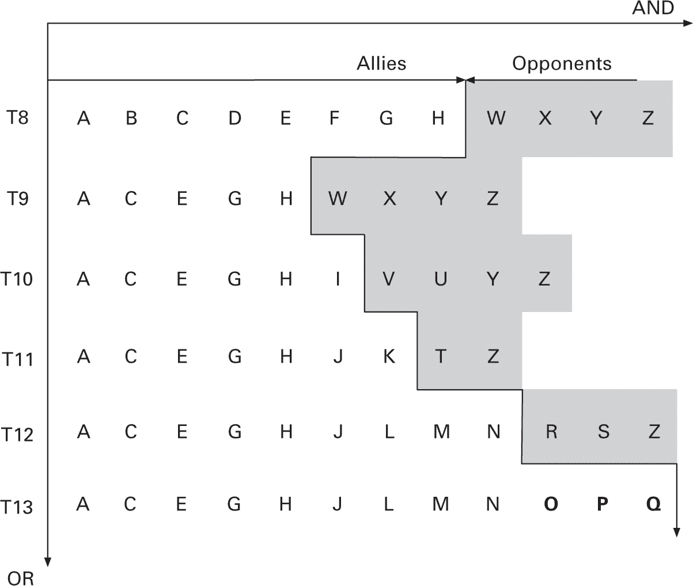

图 4.31

T8, T9, T10, T11, T12 和 T13 的 STG。在 T13，“O”指的是指令 `/max(R(:))`；“P”指的是由 `PROG` 生成的输出图像；“Q”指的是 `PROG` 情景的实现：现在，新矩阵的像素值对应于工作者在每个像素上绘制的矩形数量。

这些 STG 为我们分析这一编程序列增添了什么？这种简化让我们看到了什么？虽然上一节侧重于编程实践的科学时刻，我假设本节侧重于编程实践的技术时刻。科学实践和技术实践是不同的吗？在行动过程中，它们无疑会重叠到看起来相似的地步。但遵循 Latour (2013) 的观点，我认为两者的表达方式完全不同。

我们看到，科学的实验室实践与编程实践之间惊讶的相似之处在于，它们都通过增加和对齐铭文（inscriptions）来构建引用链，从而允许对远端实体的信息组合。尽管两种活动不能被视为等同，但我认为它们之间有着良好的共鸣：两者有时都会产生并对齐铭文，以便访问远程实体。

尽管我们刚刚记录的序列需要形成一个（小小的）引用链才能启动，但我假设该序列也表达了截然不同的东西。在 T9，DF 需要在脚本中*改变事物*。他做了什么？在每个 T，他*引入*了新的行动者，并将行动*委托*给他们，以*规避*阻碍情景遵循的僵局。该序列涉及的实践并不倾向于获取关于这些僵局的知识，而是倾向于找到绕过它们的方法。这正是为什么 STG 最终是具有启发性的工具：通过简化叙述，它们允许人们追踪这些连续的转变，这种持续的“之字型”运动，这种运动表达了新实体的招募、它们所隐含的委托以及它们触发的绕过方案。脚本在 T13 完成后，变成了一个*技术产物*。但只有通过技术实践、巧妙的引入、委托和绕过方案，这样的产物才能存在。伴随着完成的脚本，得益于 STG 提供的简化，我们可以瞥一眼 DF 绘制的这道闪电及其技术行动（图 4.32）。

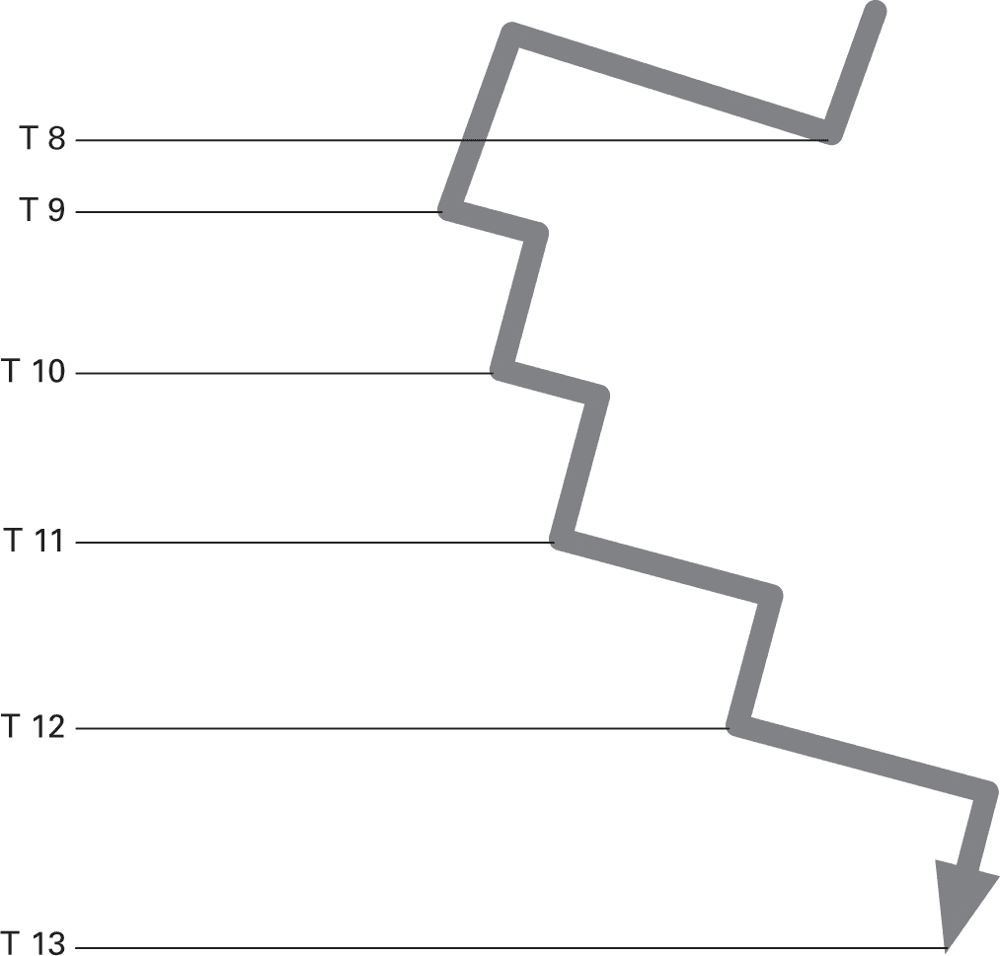

图 4.32

DF 在组装 PROG 时的技术之字型轨迹。

该序列并不是线性的；它被连续性的中断所节奏，这些中断在脚本完成后立即消失了。正如引用链一旦允许构建关于远端实体的信息就会被忽视一样，技术实践中持续的转变、引入、委托和绕过方案，一旦允许了产物的完成，就会变得隐形。我相信，这就是只考虑编程测试结果的编程研究中存在的一个严重局限性（见第 3 章）。通过仅考虑最终的技术对象（完成的脚本），它们无法理解实现该对象的技术性所必需的实践。只有通过从产物回溯到那些不断修改其形式并使其具有独特性“迂路（detours）”，我们才能捕捉到计算机编程的技术方面。任何运行中的脚本之所以存在，都得益于所有现在已不可形的盟友，它们被添加到每个配置中以规避——人们甚至可以说，是为了*黑进*（*hack*, Nissenbaum 2004）——那些现在也同样不可形的反对者。正如铭文的增殖和对齐让 DF 变得*富有知识的*，技术上的迂路让他变得*天才的*：通过捕捉实体——*精灵*（*jinns*）并将它们招募到绕过方案之中*，他能够引入盟友并规避反对者，从而画出了一条令人迷目的之字型轨迹。

有趣的是，当编程是关于绘制之字型轨迹时，这类技术时刻往往是最受推崇的。虽然引用链的构建可能非常令人沮丧——铭文不断堆积却没有形成任何可靠的引用链——但绘制之字型轨迹涉及的实践往往看起来更具趣味性。遗憾的是，我无法通过任何经验材料来支持这一观点；这意味着要在本章目前的进度介绍许多其他已经过多的编程人物。但在 Ellen Ullman 对编程*情感*（*affects*）的文学描述中，她很好地表达了程序员在从事技术迂路时经常经历的感受，一旦产物完成，这些迂路变得非常难以捕捉：

> “该死！NULL 情况！”

> “如果不是，我们就超出了文本字段，他们按了空格——”

> “——是的，就像为了——”

> “——没有参数——”

> “地狱！”

> “如果我们用空格键填充呢？”

> “我不知道……等一下！”

> “是的，我们可以用空格填充——”

> “——并把空格设为数值。”

> “是的！我们会调用 `SendKey(space)` 来——”

> “——数值对象。”

> ……

> “不，不，不，不。如果集合的成员以空格开头怎么办。噢，天哪。”

> 他表现出的比任何非电影人物向我展示过的都更接近赤裸的绝望。在这里，在那个地方，我们没有羞耻。他见过我睡在地板上流口水。我们都见过 Danny 那个肿肿的、白色的腰部——尽管他那么年轻，真可惜了——当他在机房的酷热中脱得只留内裤时。我见过 Joel 的头屑，他衣服上的一层薄薄猫毛，注意到关于他身体的一些我不该注意的事情。我确定他也见过我油腻的头发，注意到我没化妆时看起来多憔悴，捕捉到了其他不宜提及的细节。尽管如此，这些都不再重要了。我们的身体早已被抛弃了，简化为饥饿、失眠以及坐在键盘和鼠标前数小时的折磨。我们的物理自我已被击碎。现在，我们只以一种方式且仅此方式认识彼此：代码。

> “此外，我知道我现在可以带给他一种在任何生活中都是罕见的快乐：我正将他从绝望中救出来。”

> “没问题，”我平静地说道。我把手放在他的肩膀上，意在表示安慰。“参数永远不会以空格开头。”（Ullman 2012, 8–9; 增加斜体）


在这段文学节选中，信息正在逐渐组装——叙述者提供了最后一条指令（“参数绝不会以空格开头”）——而一个位置随之被定义：让实体被注册，让行动被委托，让对手被绕过。随后，欢快的技术闪电便随之展开来。

如果我在本章的这一部分显得有些胡言乱语，请读者原谅我，但在这两个节中记录的技术和科学实践为计算机编程提供了一个如此耳目一新的视角，令我难以保持冷静。我们确实看到了，将计算机编程视为一个“问题解决过程”的标准认知-行为框架（参见第 3 章）是具有误导性的。程序员可能从未`解决`过任何问题；当面对一个拒绝在数据上产生电脉冲的远程实体时，他们或多少程度上共同构成了一个引用链条，如果装备充足，这个链条可能会指示一个问题所在的位置，而该位置反过来可能触发新行动者的注册以及对僵局的技术通融方案。什么都没有被解决；某些东西被定位了，从而最终触发了一条很快就会被遗忘的折线。“解决问题”甚至那个令人喜欢的表达“调试”可能都错离了重点：通过合并两种不同且同等重要的实践，它们可能无法充分捕捉到程序员在定义`适当的`指令列表时所经历的微妙实践节奏。

然而，尽管我充满热情，这个初步模型仍然缺少某些关键要素。事实上，这种“恰当性”从从何而来呢？它难道不是我我在没有定义其属性的情况下，从外部偷偷召唤的某种东西吗？在这一点上，它确实如此。幸运的是，这正是本章下一节的主题。

## 附于情境

到目前为止，我们看到编程可以被视为两组紧密相关实践的表达。第一组实践意味着指令的复制和对齐，以组装引用链，从而提供关于那些轨迹受到非意愿方式影响的远程实体的信息。这些实践在某种程度上与构建科学事实所需的某些实验室实践产生了良好共鸣。第二组实践——要难捕捕捉得多——意味着引入新的行动者以绕过僵局。这些包含、委托和绕过的实践，在某种程度上与运行技术项目所需的实践产生了良好共鸣。从这一点来看，我们可以推断，在一次计算机编程期间，科学和技术实践是紧密衔接的，程序员不断在两种模式之间切换。这种对计算机编程的初步但经验性的观察揭示了许多关键元素——指令、引用链、僵局、迂径——而大多数关于计算机编程的标准观点并没有强调这些元素。

在本章的这一部分，某些对计算机编程至关重要的东西仍然被理所当然了。当我不断谈论“编程片段”时，是什么定义了这些片段的限制和范围？这些建立编程片段边界的“元指令”从何处来？是什么样的风在程序员背后推着他们，使他们去调查远程实体、注册行动者并绕过僵局？在章章的上一节中，读者可能注意到，我偷偷使用了“编程项目”这一术语来描述 `DF` 为构成 `PROG` 所部署的技术技能。但这种`projection`（投影/规划）从何处来呢？在这一点上，这种愿望、这种渴望不再能被忽视了。现在是处理`projection`和`attachment`（附件）的问题了，没有这些，根本就不存在编程实践。

Lucy Suchman 彻底探讨了项目与情境行动之间的关系，或者用她的话说，“预测未来行动的效用*以及*这些预测对它们未穷尽说明的进一步活动视域的依赖”（Suchman 2007, 19；强调见原文）。最初，她与 20 世纪 80 年代中期的人工智能专家作斗，他们倾向于认为`计划`与`行动`之间的关系是决定性的——前者严谨地定义后者——她提出了一种计划的替代观点，将计划视为资源，它们设定了视野，但不指定到达这些视野所需的行动。为了澄清她的主张，她使用了独木舟的例子：

> 在计划划独木舟通过急流时，人很可能会在瀑布上方坐一会儿，规划下行过程。计划可能是这样的：“我尽可能向左移动，尝试绕过后面那堆岩石。”大量的深思、讨论、模拟和重建可能投入到这样一个计划中。但无论计划多么详细，它都未触及让你的独木舟通过瀑布的实际工作。当真正涉及到应对水流和处理独木舟的细节时，你实际上放弃了计划，转而依靠你所有的任何具身技能。在这种情况下，计划的目的不是让你的独木舟通过急流，而是以一种方式为你定位，使你能够获得最佳的位置，去使用那些具身技能，而从最终分析来看，你的成功取决于这些技能。（Suchman 2007, 72）

计划并不决定行动。相反，通过建议未来的取向，计划有助于在可观察的条件下表达技能。此外，基于 Suchman 的例子，我们也可以假设计划创造了某种类似于另一个的世界，另一个`存在层级`：通过讲述`故事`，计划表达了没有它们就无法存在的人物。在划过急流之前，当我在瀑布上方表达我的计划时，我正被`projected`（投射/投影）到另一个空间（“进入急流”、“尽可能向左移动”），另一个时间（“稍后”），并指向其他人类和非人类行动者（“我，活着的，在急流的尽头”，“独木舟，努力绕过后面那堆”，“我——希望——设法通过的那些强大的急流”）。在这方面，通过建立一种三重`shifting out`（移出，Latour 2013, 234–257）进入另一个空间和时间并指向其他行动者，计划也是帮助我们进入理想过程的`叙事`。

然而，将计划定义为建立理想视域但不指定如何到达的叙事，这种定义仍然很松散。从什么意义上说，这些叙事与例如儿童睡前故事或好莱坞大片有什么不同？计划-叙事启动了哪些转化？我们如何处理它们建议的修改？为了更好地理解这些叙事的特殊性——或者我很快就会称它们为`情境`——我们将考虑 `DF` 为完成 `PROG` 构建的叙事。


图 4.33

展示给 DIR 的标记图像样本。

**FJ**: 但这些矩形的大小和对齐情况各不相同。也就是说，有些矩形相对于图像来说对齐良好且很小；有些虽然对齐但尺寸各异；有些虽然对齐但属于不同大小的组；还有的只是散落在各处。

**DIR**: 嗯，确实有一种方法可以测量重叠程度。但无论如何，你应该获得比这些不同的视图。在这里你什么也看不见。

……

有很多方法；例如，你可以遍历每个像素，看看它们出现在矩形中的频率。一旦你得到了这些图，我们就可以帮助你找到一种解释这些变化的衡量标准。

**FJ**: 你的意思是，比如为每个像素获取它们所属矩形数量的相对差异？

**DIR**: 是的。或者说，我想在你的情况下，对于每张图像，属于一个矩形、两个矩形等等的像素的比例。……然后你可以获得灰度图像，或者像直方图之类的图。例如，假设你对没有被任何人标记的像素赋予 0，对每个仅被一个工人标记的像素赋予 1，以此此类推。将这些加起来，你会得到一个最大值，比如 20。然后你可以将其归一化到 0 到 1 之间或其他其他操作。但至少目前，你应该从这些图像获得更好的矩阵。

DIR 的建议很明确：如果我想找到图像像素值与工人绘制的矩形之间的相关性，第一步就是通过设计 `better matrices` 来 `simplify` 收集到的结果。但这些矩阵应该如何设计呢？这个问题是 PROG 存在的意义：为了定义可以用图表表示值的更简单/更好的矩阵，PROG 应该指示我的计算机转换每张图像及其相关矩形的值。简而言之，能够帮助我解释矩形分散/对齐情况的图表所需的矩阵，仍然需要由受指令计算机进行计算设计。进一步支持 PROG 公式化的第一个叙述（或计划）可以总结为：“FJ 将让计算机组装矩阵，其像素值对应于每个像素所属的矩形数量。”

我很快尝试编写这个程序，以帮助我更好地掌握所收集的数据，但很快发现我无力用 `Matlab` 指定问题。第一步应该是什么？第二步又是什么？利用项目中允许我在任何需要时寻求帮助的条款（参见上文），我给 DF 发送了一封邮件：

**2016 年 1 月 15 日，周一。FJ 给 DF 的邮件，主题为“在 Matlab 中挣扎”。**

嗨 DF，

对于我的项目，我需要单独处理每张图像的每个像素，以计算每个像素属于多少个矩形。我有主意了，但在编写 `Matlab` 脚本方面仍然很挣扎。你有时间帮我做吗？那太好了！

祝你有良好心情，

FJ

**2016 年 1 月 15 日，周一。DF 给 FJ 的邮件，主题为“在 Matlab 中挣扎”。**

你好 Florian，

没问题。那今天下午怎么样？应该很简单。我们一起检查。

DF

**2016 年 1 月 15 日，周一。DF 给 FJ 的邮件，主题为“在 Matlab 中挣扎”。**

今天下午很好。我会在办公室。你想什么时候来都可以。

到时候见！

FJ

几小时后，DF 到了我的办公室。在开始编程之前，他告诉了我他打算做什么：

**DIR**: “嗯，我想我知道如何计算这个。应该不难。对于每个矩形，我们都有 `x` 和 `y` 坐标吗？”

**FJ**: “嗯，一个矩形的定义是”

**DIR**: “是的，所以是 `x` 和 `y` 坐标，然后是尺寸，对吧？”

**FJ**: “是的。”

**DIR**: “所以基本上我们有了。”

**FJ**: “然后是尺寸。这一切定义了矩形。”

图 4.34
FJ 日记中 DF 的绘图。

**DIR**: “在这里，你将矩阵的所有像素初始化为 0。然后你遍历所有的矩形。对于图像的第一个矩形，你拥有坐标，并检查矩阵中的哪些像素在矩形内。”

图 4.34 (A)

**DIR**: “你给矩阵中的这些像素加 1。然后对这里可能存在的第二个矩形执行同样的操作。”

图 4.34 (B1)

**DIR**: “你还为所有像素加 1。所以在这里，矩阵中的某些像素值是 0，某些值是 1，另一些值是 2。”

**FJ**: “好的，我明白了。”

**DIR**: “你对所有矩形执行此操作。一旦你有了一个适用于单张图像的脚本，就可以很容易地调整它以遍历所有图像。”

**FJ**: “没问题。”

**DIR**: “而且，当你拥有了这些包含 0, 1, 2 等的矩阵时，你可以制作任何你想要的图表，像这种灰度图像或直方图之类的。”

图 4.34 (C)

**DIR**: “其中 `x` 是矩形的数量，`y` 是像素的数量。”


此时，关于 `PROG` 的叙述变得厚实了。从“FJ 将让计算机创建一个矩阵，其像素值与其所属的矩形数量对应”，变成了“对于每一张图像，DF 将先让计算机利用图像尺寸创建一个空矩阵，然后根据关联 `.txt` 文件中定义的坐标定义该图像的第一个矩形，将该矩形添加到矩阵，接着定义第二个矩形并将其加入矩阵，以此类推，处理图像的每一个矩形。”尽管这一主题与 Suchman (2007, 72) 关于独木舟的例子略不同，但 DF 的叙述同样作为一种 `resource`，它设定了一个地平线，但没有指定到达地平线所需的行动。文中没有提到如何定义空矩阵、如何定义矩形，以及如何通过这些矩形来增量矩阵。然而，总的来说，这些步骤的堆叠建立了一个后续行动应当尝试达的预期未来。此外，与 Suchman 的例子类似，DF 的叙述还创造了另一个存在维度。他的故事将我们投影到另一个时间（“几分钟后”）、另一个空间（“Matlab IDE 面前”），并指向其他的行动者（“增量的矩阵”、“灰度图像”、“直方图”、“得益于新程序能够产生有意义的图表的 FJ”）。

但从本章最后两节来看，DF 的叙述也暗示了建立预期未来的叙述与如儿童睡前故事或好莱坞大片之间存在着重要区别。当叙述表达之后——即在投影到其他时间、其他地点并指向其他行动者之后——我们希望孩子们入睡，观众离开电影院继续自己的工作时，DF 的叙述 `still has a hold on him`（对他依然具有吸引）。DF 的叙述不仅仅是建立了向其他空间、时间和其他行动者的三重偏移，它还 `engages`（介入了）DF；它要求 DF 去做事情。从这个意义上说，只要 DF 表达叙述，他就发现自己同时处于两个位置：他既是随随心欲修改叙述的作者，又是必须遵循他刚刚的叙述的执行者（Latour 2013, 391）。遵循 Austin (1975) 和 STS 领域的近期著作（Barad 2007），我们可以将这些叙述视为 `performative`（表演性的），因为它们介入了阐述它们的人。在我们的案例中，DF 持有叙述，但也被叙述所束缚。

### 编程中的场景

为了强调这些对计算机编程至关重要的特定叙述的文学性和表演维度——因为它们建立了一个需要达的预期地平线，从而支持了铭刻的对齐和技术绕路——我将它们称为 `scenarios`（场景）。^(12) 电影化的内涵是自发的。事实上，一个场景——在电影或计算机编程的情况下——就是一个 `narrative`（叙述）：它讲述了一个故事，因此实例化了一个开头、一个结尾、情节和所有具有本体论重量的角色。其次，在两种情况下，场景都是 `performative`（表演性的）：它既约束着被要求 `transform`（转化）为电影的电影导演，也约束着试图使其 `become`（成为）实际计算机程序的程序员员。第三，如果一个场景大致描述了电影的连续场景或计算机程序的连续步骤，那么它对于如何拍摄这些场景或实现这些步骤几乎一言未言。尽管在两种情况下，场景都勾勒了理想的地平线，但为了到达它们，几乎所有事情仍需完成。第四，如果场景描述了情节、步骤、角色或变量，没有什么能阻止电影导演、程序员、影星或固执的指令去 `modify`（修改）其某些构成元素。在计算机编程和电影制作中，场景都可以被重新审，以更好地考虑到不可预见的偶发状况。

虽然场景不足以组装计算机程序，但它们对计算机编程至关重要。这些灵活且具有表演性的叙述资源建立了一个程序员可以持有的地平线——同时被它们所持有——从而确立了编程片段的边界。场景既触发又与铭刻的对齐及技术绕路融合在一起；它们共同构成了编程行动过程，我们现在可以从其所有的曲折性来考虑这些。

### 依附的作用

但再次回到这里，仍然缺少了某些东西。我们非常接近了，但尚未到位。如果“场景”的概念有助于更好地理解 DF 如何在科学和技术实践模式之间切换，从而构筑了我们之前遵循的编程序列，那么它并不能让我们理解 DF `why`（为什么）想要投入其中。如果场景提供了编程片段的框架和能量，那么这种能量最初源自哪里？

肯定有些东西溢出了场景，让它们进入了不同程度令人愉悦的 `affects`（情感）：我们又如何看待它们？如果场景提供了地平线，它们本身并不能让我们抓住编程片段产生的东西。INT 的固执、行动者的多元包含以及对困境的种种通法——这一切之中充满了不安。当程序完成了片段开始时的预期（或在片段期间被修改的内容）时，正在发生某些无法还原为导致其发生的结果。这就是 `attachments`（依附）社会学相对于品味科学的重要贡献：将喜爱的对象还原为它们欣赏条件的社会或物质层面，这告诉我们关于对象本身 `nothing`（一无所有）（Hennion 2015, 2017）。当一个对象——一幅画、一段音乐、一个计算机程序被构建时，它也独立存在。或者甚至；随着它的构建，它存在得更加强烈。但我们如何捕捉这种对构筑对象的欣赏呢？在我们的案例中，我们如何看待 `PROG` 的兴起？我们或许可以 DF 在编程片段结束时告诉我的话：

```
FJ: 嗯，谢谢。你的耐心总是让我印象深刻。
DF: 不客气。很快的。而且你知道，我喜欢它，所以没问题。
FJ: 你喜欢花时间在这些代码上？
DF: 当然。很有趣。我真正喜欢的是，当脚本运行起来时，意味着你没有断线。
```


这段节录能告诉我们关于计算机编程的影响什么？“场景”（scenario）这一概念本身似乎无法让我们更清晰地理解 PROG 在组装后对 DF 做了什么。但，通过遵循 DF 并将场景作为踏脚石，它有助于显现出某种迷人的东西：能够对已完成的工作与仍待完成的工作进行持续评估。这正是 DF 稳稳需要捕捉的，是他试图永不丢失的线索：这个场景建议了一个路径、一个情节，但对于如何遵循这一路径却未多言。通过追踪自己的路径来遵循一个故事：一种通过触达来建立某事的奇特体验。但这种触达，这种对地平线的接触——人们不应简单将其视为对先前投射之物的满足。认真对待 DF——以及其他参与了其他“帮助环节”的实验室合作者——我们可以将其视为持续评估的渐近线。“这个”必须完成，然后是“那个”，接着是“这个”，现在，在下一个带有情感的场景出现之前，`there is nothing else to do`。计算机编程影响的特殊性可能在于这种暂时的“无事可做”的反复涌现。

这只是关于程序员与其可能建立的脚本之间纽带的一种大胆提假设（Latour 2013, 151–178; Souriau [1943] 2015）。显然需要更系统的研究来丰富上述推测。但让读者再次忘记，本章的目标除了分析雄心之外，另一个目标也是指向计算机编程情境实践的创新研究方向。从这个意义上说，观察场景的形成与其可能暗示（但并非严格产生）的纽带之间的复杂关系，可能是探究是什么驱动了程序员的相关方式，这种驱动有时以至于他们花费大量无偿（或绕道）的小时，投入到不确定的自由开源项目上。根据程序员对场景的依恋，Demazière、Horn 和 Zune (2007, 35) 所说的“自由软件开发的谜团”——从转瞬即逝的参与中产生连贯编程结果的能力——例如可以用一种替代方式来解决。虽然这些自愿集体之间错综复杂的监管模式对于自由开源软件的实际生产确实非常重要，但这些安排可能也可以从它们所引发的激情的视角中获益。当一个场景通过计算机脚本实现时，到底发生了什么？这种情感事件是否只能被还原为使其可能的组织过程（Demazière, Horn, and Zune 2007）、个人激励（Lerner and Tirole 2002）或意识形态（Elliott and Scacchi 2008）？在 DF 的情感火花中，是否还有某些东西可能贡献了程序员社区的形成和维持？整个编程工作的生态系统——无论是自由的、开源的还是公司化的——都值得从程序员在编写编号指令列表时所追求的目标这一角度进行考虑。

***

尽管这部分冗长且曲折，但我在第二部分想要表达的观点非常简单。一旦我们探究计算机编程的行动路径，就会看到它们参与了铭文（inscriptions）的对齐、对困境的绕过（work-around）以及对场景的定义。这三种实践模式密不可分：绕过困境意味着对一个问题性现象的定位，而该现象本身需要一个场景来被视为问题性的。DF，更泛地说，也许程序员们不断在这些模式之间切换，直到在时间上实现他们想要的叙事。

主要的困难在于区分编程过程与其结果之间所需的准备工作。由于我们在第 3 章中涵盖的复杂原因，人类认知与编程计算机之间逐渐建立了一种混乱的混合。这种混淆反过来导致了重要的误解，例如对编程的认知研究最终变成了同义反复，因为它们预设了它们正试图解释的事物已经存在。由于我想分析编程的情境实践，我必须疏离认知主义，并拥抱极简但又强大的行动生成论（enactivism），该理论将认知视为我们理解局部环境可用性（affordances）的过程。

遗憾的是，我只能在计算机编程实践的边缘游走，许多问题悬而未决。关于铭文的对齐，如果能更多地了解参与程序员铭文倍增与衔接的不同模式、组织甚至机构，将是很有洞察力的。关于对困境的绕过，更深入地探索支持新行动者（actants）识别与招募的设备又如何？这甚至可能导致创新的编程设备和工具。关于场景，我很快就会记录某些特定的、易于转换的场景的形成。考虑到计算机编程所施加的魅力及其对当代社会的重要性，我希望有更多研究来记录那些有时让编程之快乐浮现的行动。在这些关于算法的争议时代——这些实体似乎依赖实地验证（ground-truthing）和编程活动——我相信这些是至关重要的研究方向。

## Notes

# III 制定

> 研究实验室实践很容易的，因为它们如此设备齐全、如此明显具有集体性、如此显而物质化、如此清晰地置于特定的时空、如此充满犹豫且成本高昂。但数学实践并非如此：诸如……“计算”、“形式主义”、“抽象”等概念，拒抗从不可置疑的资源角色转变为可检查和可负责的话题……我们似乎不可避免地被[这些概念]所污染了，仿佛抽象也让我们变得抽象了！
> — Latour (2008, 444)

>我们还没有走出困境。我们对 `ground-truthing`（第一部分）和 `programming`（第二部分）的原因和原理可能有了更清楚的想法，但在探究的这一阶段，我们仍然缺少一项活动，它对计算机科学实验室算法的形成至关重要。如果不考虑这些实践，我只能对算法提出一个极其不部的构成。


对我们调查中的“缺失质量”变得敏感的一种方法，可能是观察计算机科学领域近期的一篇学术论文。为什么不选择图像处理这一子领域呢，因为它是这项民族志探险的实证基础？例如，在浏览一篇名为《用于判别性定位的深度特征学习》（Zhou 等，2016）的论文时，我们会遇到许多我们现在熟悉的东西。我们将读到一个特定问题（定位特定类别的图像区域），根据作者的说法，该问题通过一个他们称为 `CAM` 的计算机程序得到了圆满解决，`CAM` 代表“类激活映射”。我们会看到，该问题、`CAM` 以及该程序应该检索的内容都源于一个已经组装好的真值（在这种情况下，是 `ImageNet 大规模视觉识别挑战 [ILSVRC]` 2014），该真值被分为部分：训练集和评估集。在印刷的文字和数字背后，我们还能感受到为了提供和讨论论文结果而必须经历的漫长而细致的计算机编程过程。毕竟，如果作者没有写出能够以有意义的方式触发电冲的指令列表，他们就无法对其算法的性能提供任何统计评估。

然而，当我们浏览这篇展示并试图说服我们新图像处理算法相关性的学术论文时，我们会很快遇到像这样晦涩的段落：

> 通过将 `Fk = ∑x,y fk (*x*, *y*)` 插入类评分 `Sc` 中，我们得到


> 我们将 `Mc` 定义为类 `c` 的类激活映射，其中每个空间元素由


> 因此，`Sc = ∑x[,]y *Mc (*x,y*)`，因此 `Mc (*x,y*)` 直接指示了空间网格 `(*x,y*)` 处的激活导致图像分类为类 `c` 的权重。（Zhou 等，2016，2923）

这种将英语单词与等号分隔的希腊字母和拉丁字母组合在一起的句子，计算机科学家在学术期刊上交流算法时确实被广泛使用。当然，作为成年读者，我们立即理解这样的摘录涉及*数学*，并且 (1) 和 (2) 是适当的*公式*（一旦它们的变量被替换为数值，就是*方程*）。但如果我们只考虑到目前在这项调查中开发的描述系统，我们就对这些数学铭文无从下手。调查的概念性装置使我们能够处理图表和数值，因为它们在某种程度上引用了由真值定义的数据和目标。调查的装置还使我们能够处理代码，因为它们引用了以所需方式触发电冲的编号指令列表。但数学公式呢？它们从哪里来？为什么计算机科学家需要它们？它们又是如何组装的？在这一点，我没有其他选择。在最后也是最重要的第三部分中，我将不得不考虑数学在算法形成中的作用。

我正要采取的道路是危险的；只要有一秒钟的分心，我的行动导向方法就会丢失。由于我将涵盖的复杂原因，诸如“定理”、“证明”或“公式”之类的数学实体确实对实证考虑具有极强的抵抗力；尽管它们无疑是情境化活动的产物，但它们通常被认为是思维的基础要素。这种顽固的习惯往往是螺旋下降的起点，本身导致了诸如之的大大问题：“数学是抽象结构还是个体意识的表达？”有太多的无辜灵魂被这种漂浮的质问所吞噬！为了避免在这座实践的墓中为自己挖坟，我必须极其谨慎，一步一步地处理。但只要有耐心，数学知识的构建以及其在算法形成中的进一步加入就可以得到部分解释。总而言之，这些定义*公式化实践*的努力将允许我将真值实践（建立解决问题的术语所需的）和编程实践（让计算机以所需方式计算所需的）联系起来。在目前的努力中，我们所谓的“算法”可以被描述为（至少）这三个相互关联活动的不确定产物。

与第二部分一样——很大程度上出于相似的原因——在深入研究民族志材料之前，我需要操作化的努力。我必须首先放下大部分关于数学的研究。主题太多、研究太多、方法太多；如果没有初步的清理工作，以行动导向的方式处理数学注定会失败。正如我们在第 5 章看到的，不逃避的方法是从（几乎）重新开始，从非常基本的观察和假设开始。逐步，这些假设——深受几项关于数学科学技术研究（STS）的启发——将让我们意识到诸如“定理”、“证明”或“公式”之类的数学实体与更熟悉的科学事实非常相似。如果数学知识通常被视为某种高级现实的表达，那可能仅仅是因为其极的可组合性。一旦数学的血管化被提出，我们将意识到其不可置疑的力量也源于使非数学主题变得*数学化*的谦卑工具和行动。这一重要点反过来将允许我将*公式化实践*定义为将维持给定活动领域的网络与维持认证的数学知识的网络合并的实证过程。在第 6 章中，我将解释实验室内部发生的一个小但成功的公式化努力。这第三也是最后一个案例研究将强调认证的数学知识对于算法渐进形成的中心性，因为它既迫使了真值的完善，又为进一步的编程阶段展开了场景。它还将允许我以非传统的方式考虑与机器学习和人工智能的相关问题。第 6 章的最后一节将是简要总结。

## 5 数学作为科学

本章旨在将数学知识视为某种高级现实的表达，而是视为一组其塑造需要大量实践工作的巨大科学事实集合。正如我们将看到的，通过将数学知识视为科学活动的一种特定产物（在许多产物之一），我们可能解释它在其他科学领域（神经科学、地理学、赌博、计算机科学等）中产生重大影响的能力。一旦这项操作练习结束，我将回到第三部分的主要目标：理解数学知识何时、如何以及为什么参与算法的构成（第 6 章）。

## 数学在哪里

如果我们想更好地理解数学实体（公式、定理、猜想、方程）是如何被处理并与真值和编程语言相关的，我们首先需要更好地了解它们从哪里来。这些实体显然独立存在；它们需要人们在特定的指定地点进行组装。这些地方在哪里？这些人是谁？他们在做什么？


这类琐碎的问题导致了许多许多不同的答案。这就是为什么处理数学可能是危险的的原因之一：我们应该从哪里开始？从古希腊数学（Heath 1981a, 1981b; Netz 2003）？从中世纪伊斯兰数学（Berggren 1986; Netz 2004）？从关于连续变化的巴洛克数学（Bardi 2007; Boyer 1959）？但如果我们使用“巴洛克”这个形容词，我们已经对 17 世纪下了一个非常有倾向性的定义（Deleuze 1992）。

那么，我们是否应该关注更现代的数学，例如集合论（Ferreirós 2007; Tiles 2004）、维尔斯特拉斯函数（Bottazzini 1986），以及在 20 世纪初动摇数学的后续“基础危机”（Ewald 2007; Ferreirós 2008; Hesseling 2004; Mancosu 1997）？

### 但我们到底说的“数学”是什么？我们指的是数学`texts`（Rotman 1995, 2006; Sha 2005）吗？我们指的是`famous mathematicians`，如莱布尼茨（Antognazza 2011）、高斯（Tent 2006）或康托（Dauben 1990）吗？我们指的是试图定义数学“是什么”`philosophies of mathematics`（Aspray and Kitcher 1988; Corfield 2006; Hacking 2014）吗？我们头晕目胀，感到痛苦。但还没有结束！事实上，我们谈论的是`arithmetic`（Husserl 2012）、`algebra`（Everest 2007）、`geometry`（Netz 2003; Serres 1995, 2002）还是`logic`（Fisher 2007; Rosental 2003）？也许我们谈论的是从数字到逻辑（Kline 1990a）、从逻辑到几何（Kline 1990b; Netz 2003）、从几何到代数（Kline 1990c; Netz 2004）的`evolution`？甚至在算术、几何、代数或逻辑内部，我们谈论的是`theorems`（Villani 2016）、`proofs`（Lakatos 1976; MacKenzie 1999, 2004, 2006）还是`conjectures`（O’Shea 2008）？我们并不知道。我们迷失在这些表述让我们只想去做点别的事情的问题中。但我们不能；我们必须找到处理数学的方法，因为这对算法的构建似乎非常重要。我们该如何做到这一点？

避免这种混乱螺旋的一种方法可能是从非常基本的假设开始。当然，我们必须开发这些假设并使用具体示例来证明它们。为了做到这一点，我们可能需要从令人生畏的海量数学文献中动用一小部分。一步一步，一个假设一个——结合一些 STS 假设——我们可能会得到一个数学知识的操作性定义，该定义足以完成我们的特定任务：解释计算机科学家在尝试组合新算法时，有时能够动用其数学同事之前塑造的经过证实的命题。我们确实不需要彻底改变对这些有时被称为“定理”、“猜想”或“公式”的强大陈述的理解。如果我们能成功勾勒出数学家`做什么`（而不是数学`是什么”）的一个简单版本，我们的最后职责——解释表述实践——将得到极大便利。

## 优势的书面陈述

为了启动我们的操作化并构建我们的第一个假设，让我们从围绕以下三个场景开始：

### 场景 1
1994 年 1 月。查尔斯·埃尔（Charles Elkan）正处于混乱之中：他在十一届国家情报会议上的报告非常成功。随后的论文甚至荣得了“最佳论文奖”（1993）。程序委员会赞扬他的定理非常优雅，且该定理已被录用。但许多逻辑学家——他们没有参加会议但读了部分论文集——感到非常不悦。批评是很严厉的。有人说——并试图证明——Elkan 的基本假设是有缺陷的。另人指责他故意削弱逻辑，因为这对经典逻辑是威胁。正如他的一个朋友建议的那样，Elkan 现在应该“冷静一下”，并发布一个更平滑版本的定理。

### 场景 2
1890 年夏天。阿尔弗雷德·肯佩（Alfred Kempe）感到困惑，因为海伍德（Heawood）最近成功发现了 Kempe 之前在《美国数学杂志》（1879）上发表的四色定理证明中的一个缺陷。尽管他的证明被证明是错误的，Kempe 并不认为弗朗西斯·古特里（Francis Guthrie）1852 年的命题是错误的——即四种颜色就足以为平面上绘制的任何地图染色，使得相邻国家颜色不同。但这种基础的直觉怎么会导致这样的困难呢？“可怜的海伍德，”Kempe 想着，“他现在陷进去了，就像十五年前的我一样。他最好还是放弃它；这套四色理论是过时的东西了。”

### 场景 3
2013 年 11 月 8 日，下午 3 点。我坐在教室的后方。大约三百名本科生正在参加这周五下午的“信息、计算与通信”课程，课程旨在向未来的民用和机械工程师传达计算机的基础概念。我看到我弟弟和他的朋友们——好学生——坐在第二排。他们刚刚开始学术课程；而我已经快毕业了。但我们就在同一个教室里，等待着同样的信息。教授调整了他的麦克风：“好了。大家好。那么，上周我们讨论了尼奎斯特-香农采样定理。今天，我们将从克劳德·香农（Claude Shannon）对数字信号数学理解的另一个贡献开始，即香农-哈利定理（Shannon-Hartley theorem）。这是一个非常强大的定理，可以用这个公式来总结：


当然，我们会一起学习它。”


在这一点，我们不需要对“定理”（场景 1 和 3）、“猜想”（场景 2）、“证明”（场景 1 和 2）以及“公式”（场景 3）进行任何先验区分。我们只需要注意到，这三个场景虽然都涉及数学，但处理的都是`吸引多或少认同的主张`。在场景 1 中，埃尔坎（Elkan）关于模糊逻辑的主张首先吸引了第十一届人工智能国际会议程序委员会的认同。但在 1994 年 1 月，他的主张反斥了许多逻辑学家同事，这些人毫不犹豫地在网络论坛 `comp.ai.fuzzy`上发表了“反主张”。在场景 2 中，肯佩（Kempe）对弗朗西斯·古特（Francis Guthrie）主张真实性（“四色猜想”）的也首先吸引了《美国数学杂志》编辑委员会的认同。但在 1890 年夏天，肯佩与自己的主张解体，转而认同海伍德（Heawood）的主张。然而，古特在 1852 年的“坦率”主张尚未完全失去它的说服力，这使得肯佩对海伍德的命运感到困惑。场景 3 非常直接：香农（Shannon）和哈特利（Hartley）的主张——以及投影在教室白板上的相关公式——即将被教授一群工程专业的本科生。这里几乎没有怀疑的空间：在 2013 年 11 月，香农和哈特利的主张吸引了许多人的认同。事实上，他们的主张如此强大，以至于一种著名的教学手段——考试——很快就会验证所有学生都妥妥地认同了它。

这些基础但公正的观察就是我们开始操作化练习所需的全部内容。数学家确实做了很多事情，但在这些事情中，他们提出了吸引多或少个体的认同的主张。让我们假设，“定理”、“猜想”、“公式”或“证明”这些宏大概念都可以以一种务实的方式被理解；；让我们假设，在某种程度上，它们都是能够说服多或少个体的主张。

这种考虑数学知识的方式——定理、猜想、证明、公式——将其视为某些修辞的产物，听起来可能很奇怪。许多宏大叙事确实在歌颂数学真理的抽象力量，这些真理本身据认为描述了某种优越的现实。^(5)但这正是我们不想走的路，至少现在不想。如果我们不想在数学的认识论解释的尖锐岩石上覆灭，我们需要捂住耳朵，暂时忽视必然性的塞女。幸运的是，我们的第一个操作假设——数学家提出了说服多或少个体的认同的主张——与拉卡托斯（Lakatos，1976）关于数学的重要著作的核心论点产生了共鸣。正如他所出的，数学不应该是自而易见发现的积累，而应该被视为一个创造过程，在这个过程中，并行的主张受到批判和改进。但这些主张是如何被批判或改进的呢？它们是如何获得或失去相对说服力的？场景 3 中香农和哈特利的主张似乎比场景 1 中埃尔坎的主张强得多。同样，在 1890 年，肯佩在 1879 提出的主张在海伍德的主张面前变得无力（场景 2）。这些差异是如何产生的？

为了更好地理解（数学）主张如何获得或失去说服力，我们需要对场景 1、2 和 3 进行另一个基础观察。如果多或少个体可以认同场景中的主张，意味着他们可以`访问`这些主张。是什么媒介允许了这种访问？有些主张是口头的，但我们在这里显然没有处理这类主张。场景 1、2 和 3 中的主张都是`书面`的。这一重要特征允许个体阅读它们，并最终（极罕见地）认同它们。在场景 1 中，是埃尔坎在会议论文集中出现的书面主张让程序委员会认同了它。但在 1994 年 1 月，是网络论坛 `comp.ai.fuzzy`上倍增的书面反主张开始开始折磨埃尔坎。在场景 2 中，肯佩和海伍德都通过阅读数学期刊访问了各自的主张。最后，场景 3 中的工程学生被要求认同投影在教室白板上的香农和哈特利的主张。当然，香农和哈特利并没有在投影文档上写下他们的主张；许多人干预并使他们的主张跨越时空传播，直到到达这个特定的教室。但这个翻译过程并没有改变主张的整体形状；它仍然是写在平面上的东西。在这一点上，因此我们可以稍微刷新我们的第一个假设：数学家确实做了很多事情，但在这些事情中，他们`写下`吸引多或少个体的认同的主张。

同样公正假设，上述场景中的书面主张并非凭空出现。为了在论文集、专业网络论坛、数学期刊或计算机科学教授的幻灯片上发表，它们必须通过一系列测试，它们作为书面主张的存在取决于这些`考验（`trials`）。我同意这个假设带有实存性形而上学的色彩——接近“过程思想”（参见引言）——正如那些有影响力但又充满争议的思想家所提出的那样。那么让我们将其视为操作化练习所需的项假设吧。“凡能经受考验的都是真实的”（Latour 1993a）。上述（数学）书面主张是真实的；因此它们经受了考验。但是什么考验？

## 抵抗考验，成为事实

关于场景 1、2 和 3 中这类（数学）书面主张的说服力，我们可以考虑的第一种考验，是它们在实际发表`之前`必须经历的考验。考察我们常说的主张“来源”确实是评估其严肃性的常用方法。

例如，我们可以公正地假设，在同等条件下，发表在《自然》杂志上的主张通常比在监控很少的社交媒体平台上的主张具有更大的说服力。在不考虑各自内容的情况下，两种主张将具有不同的能力。为什么呢？我们必须立即放下声望或符号权力的问题；这些是我们社会学调查方法禁止操作的捷径。对这个话题更具经验性的把握会迅速指向能够阻止主张发表的人数。很少有人或机器人——可以阻止我在 Facebook 上发表主张。相反，许多人可以阻止我在《自然》上发表主张。考虑到那些为了被主张说服以便使其传播并接触更广泛受众的人是非常关重要的，因为它在某种程度上校准了意见的成本。如果有人不同意我在 Facebook 上发表的主张，他们只需要耸耸肩转向其他。^(6)但如果同一个人不同意我在《自然》上发表的主张，他们将不得不不同意我、我的机构、支持我研究的资助机构、《自然》的编辑委员会、负责提名该委员会的人等等。与我在 Facebook 上发表的主张相比，我在《自然》上发表的主张最初得到了远大的`外部盟友`团队的支持（Latour 1987, 31–33）。


但如果我们考虑这三个场景，会很快意识到，仅仅通过`publication trials`出版测试）——从而引入外部盟友——不足以确保任何（数学）主张具有持久的信服强度。尽管这场讲座从被说服的`gatekeepers`守门人）来看，可能足以在讲堂内迅速解释香农和哈特利主张的信服强度——学生们被其所有的外部盟友所包围（他们的教授、他们的教材、大学负责大学工程课程的所有人员，以及他们很快就要通过的考试）——但它并不能帮助我们理解 Kempe、Heawood 和 Elkan 主张之间的相对强度（场景 1 和场景 2）。

在场景 2 中，Kempe 和 Heawood 的主张都幸存了类似的出版测试；这两个命题最初都得到了大约相同数量的人的支持。^(7)。然而，随着 Heawood 的主张似乎获得了证实，Kempe 的主张却变得不再可靠。在场景 1 中，情况甚至更加困惑：尽管 Elkan 的主张成功抵御了 68 位负责论文集出版和“最佳论文”评审的人员的审查^(8)，他的主张仍然被一个几乎没有监控的网络论坛上的帖子严重动摇了（Rosental 2003, 81–86）。同样，这些反向主张必须幸存于其他类型的测试才能获得这种强度。

另一种可能为书面主张提供强度的测试，是通过引用和参考文献连续引入`internal allies`内部盟友（Latour 1987, 33–45）。为自己的主张配备此前发表的主张确实是一种重要的信服策略，甚至已经成为了一个完整的研究领域。^(9) 除了书面文档之外的盟友外，带有参考文献和引用的主张现在还得到了其内部盟友的支持。事实真的如此吗？

虽然通常如此，但通过参考文献和引用增强主张的信服强度可能是一项冒险的尝试。如果参考文献与主张不匹配，或者更糟糕，如果某些未提到的参考文献与所陈的主张矛盾该怎么办？在某些情况下，这种`citation trial`引用测试被克服了。一个例子是香农最初的论文，该论文介绍了后来被称为“香农-哈特利定理”的基本要素（Shannon 1948）。在这篇论文中，香农引入了 Ralph Hartley 此前“固化”的主张（因此他后来被列入定理名称）以及其他 13 位重要数学家的主张。据我所知，在香农最初发表后，并没有出现过关于这些参考文献使用的严重分歧。

但 Elkan 的出版物并非如此。尽管他动员了 39 个内部盟友来加强他关于模糊逻辑局限性的主张，但他的反对者设法在专门的网络论坛上找到并发表了许多强有力的“反向参考文献”。Elkan 很快表现出一个对高级专家系统中模糊逻辑近期用途一所知的人（Rosental 2003, 157–168）。虽然这些反对意见最初对于说服第十一届全国人工智能会议的程序委员会是有用的，但 Elkan 论文的内部盟友最终成为了他反对者的垫脚石。

然而，无论是否幸存于引用测试，这仍然不足以解释我们所有场景中主张的相对信服强度。事实上，在场景 2 中，Kempe 的 1879 年论文仅对之前的数学命题进行了三次引用，前两个是 Augustus De Morgan 和 Arthur Cayley 向伦敦数学学会提出的松散陈述（Kempe 1879, 193–194），第三个是 Augustin-Louis Cauchy 关于多面体的一个更重要的主张（Kempe 1879, 198）。然而，这种参考文献的匮乏并没有阻止他的主张——即证明 Guthrie 1852 年命题是正确的证明——在十一年里说服他的数学家同僚。对于 Heawood 的主张更是如此，因为他 1890 年的论文除了 Kempe 的 1879 年论文外，没有包含其他引用。同样，这种匮乏并没有阻止他的主张吸引核心人物的关注：Kempe 本人（MacKenzie 1999, 22）。在发表的（数学）主张中一定还有其他因素，使它们有时在说服强度上增强。

某些已发表（数学）主张的潜在反对者不会被被说服的守门人名单或作者引用的参考文献所打动。为了被一个主张说服，这些怀疑的读者想要`see`看到作者要求他们相信的东西。这种将问题所在呈现给读者的策略正是 Heawood 在他反对 Kempe 的论文中所使用的策略。他不仅依赖外部盟友，还展示了一个`figure`图（参见图 5.1），根据 Kempe 1871 年的主张，这个图是不可能画：

```
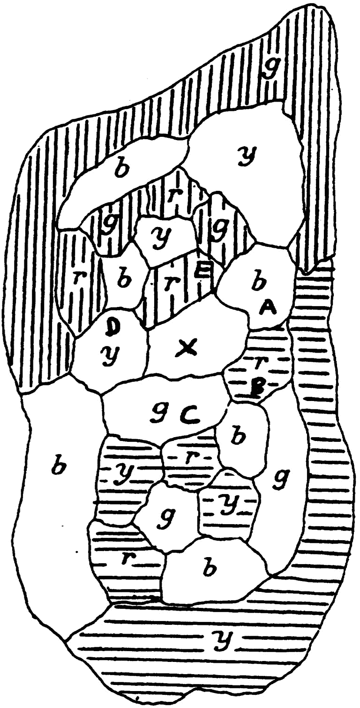
```

<samp class="SANS_ITC_Stone_Sans_Std_Semibold_B_11">图 5.1</samp>

Heawood 图的复现图，表明 Kempe 的证明并不成立。来源：MacKenzie (1999)。经 Sage Publications 许可再印。

> Kempe 先生说——颜色在 E 的红绿色区域和 B 的红黄色区域的传输各移除了一个红色，所需的操作就完成了。如果是这样，它将立即导致四色定理的证明……但是，不幸的是，可以想象尽管变换移除了红色，两者可能都没有移除红色。[下方的图]是一个真实的示例。（Heawood 1890, 337–338）

我们不需要花太多时间研究 Heawood 的图^(10) 的特殊性，也不需要研究图在发表的数学主张中的作用^(11)。在这里，我们需要注意的是信服策略；正如从事许多领域的科学家——生物学（Rheinberger 1997）、化学（Bensaude-Vincent 1995）、气候学（Edwards 2013）——数学家也试图通过添加他们所写内容的指代物来增强力量。因此，此时，“这不再是一个信念的问题：这是一个视觉的问题”（Latour 1987, 48）。

如果说科学文献可以描述为聚集大量外部和内部盟友以隔离读者并迫他们只走一条路径的文本，那么不同的科学领域逐渐塑造了自己特定的修辞习惯。^(12) 在数学情况下，这种整个`captation trial`捕捉测试（Latour 1987, 56–61），即通过微妙控制潜在反对者的动作，已经由 Rotman (1995, 2006) 精细分析过。正如他所示，数学出版物充满了祈使形式的动词，例如“构造”、“定义”、“连接”或“计算”。但这些祈使形式的仔细分析显示，它们实际上被分为两种不同的类型：用于建立前提（通常带有参考文献）的`inclusive imperative`包含性祈使，以及用于展示想象中的读者为了得出主张结果而应执行的操作列表的`exclusive imperative`排他性祈使：


> 包含性命令（Inclusive command）以“考虑”、“定义”、“证明”及其同义词为标记——它要求说话者和听者建立并居住在一个共同世界中，或者他们对该世界中的某个项目共享某种特定的论证信念；而排他性命令（exclusive commands）——本质上是由所有其他动词表示的数学动作——要求执行在已共享的世界中具有意义的特定。（Rotman 2006, 104）

这些元素对于我们的操作化练习至关重要，因为它们指示了数学文本中“捕获试验”（captation trials）的适性条件。如果怀疑的读者（得益于作者动员的所有盟友）别无选择只能接受前提并遵循 `one` 一条特定路径以得出一个必然结论，那么一个数学文本及其随后的主张至少在时间上已经克服了它们的捕获试验。在这方面，Kempe 在 1879 年关于四色定理的论文非常有说明性。请记住，Kempe 想要证明四种颜色足以为平面上绘制的任何地图着色，使得相邻国家颜色不同。他是如何指示读者得出这一结论的？通过一系列包含性命令，Kempe 和他想象中的怀疑读者都从定义一个完美的四色“单连通表面”开始，该表面被划分为许多“地区”（Kempe 1879, 193）。一旦建立了这个基础共同世界，他们接着考虑两组“分离区域”，要么被红色和绿色染色，要么被黄色和蓝色染色（Kempe 1879, 194）。这些前提允许 Kempe 和他的读者进一步定义“汇点”（points of concourse，即边界和区域相交的点）的属性，这些点本身允许定义六类具有不同特征的地区：“岛屿地区”、“岛屿区域”、“半岛地区”、“半岛区域”、“复杂地区”和“简单地区”（Kempe 1879, 195–196）。一旦建立了这个相当复杂的共同世界，Kempe 随后切换到排他性命令，并要求读者执行一系列操作：

> 现在，*取*一张纸并将其*剪裁*成与任何简单岛屿或半岛地区相同的形状，但要大一点，这样在放在区域上时边界恰恰好重叠。*固定这块补丁*（我将以此称称）到表面上，并*产生*所有与补丁相交的边界……使其在补丁内的一点（一个汇点）汇合。如果只有两个边界与补丁相交（如果该地区是半岛就会发生这种情况），在补丁上*将它们连接起来*，不需要汇点。这样地图将少一个地区，边界的数量也会减少。（Kempe 1879, 196–197；斜体为后加）

通过要求读者重复这个补丁过程，整个想象中的地图逐渐被简化为了一个没有边界或汇点的单一地区。Kempe 随后要求读者反转这一过程；即“按倒序剥离补丁，先取下最后放上的那个。当每块补丁被剥离时，它就会揭示一个新的地区，地图就会逐渐展开”（Kempe 1879, 197）。在这一精确点上，Kempe 再次切换到包含性命令，从而基于刚刚修改过的第一个世界建立了一个*第二个共同世界*。作者和读者再次定义了所有地区、边界和汇点的渐进式重构。一点一点，他们很快意识到，他们对地区、边界和汇点的重新组合等同于 Augustin-Louis Cauchy 在 1813 年定义的多面体的面、边和点（Kempe 1879, 198）。一旦建立了这个多面体世界，Kempe 最后一次切换到排他性命令，并让读者得出声称的结果：显而易见——看，我们刚刚一起完成了它！——四种颜色足以为平面上绘制的任何地图着色，使得相邻国家颜色不同。

我们不需要理解 Kempe 论文的每一个微小步骤。我们只需要欣赏 Kempe 是如何控制读者的移动的；从初始前提到结论，读者被实实在在地带穿了 Kempe 的论证逻辑。他的盟友非常多——“单连通表面”、“地区”、“分离区域”、Cauchy 的“多面体”——而且他的过渡足够流畅，让读者穿过必然性的洪流。但正如我们看到的，Kempe 的*捕获*（captatio）只是暂时的，因为十年后，Heawood 成功逃离了 Kempe 的论证逻辑，并提出了一个拆解了整个修辞建筑的图形（参见图 5.1）。

出版、引用和捕获试验——就像任何试图获得信念强度并成为事实的主张一样，数学主张必须经许多危险。然而，这仍然不够。一个发表在重要期刊上、具有良好参考文献和流畅论证逻辑的主张，如果没有被后续主张进一步推进，可能仍然会消失。这是一个必要条件（sine qua non），因为不存在孤立的科学事实：“事实的构建是一个集体过程，个人建立的只有梦想、主张和情感，而不是事实”（Latour 1987, 41）。一个主张的命运，它转化为固化事实的过程，最终取决于它如何被后续主张所使用。我们看到 Kempe 的主张尽管具有捕获强度，最终被 Heawood 反驳了。从数学事实的状态来看，它变成了纯粹的虚构。Heawood 的主张呢？很难将其称为事实，因为它只涉及 Kempe 的虚构，没有提供任何可证实或可反驳的命题。那么 Elkan 的主张呢？尽管 Elkan 努力使其变得强大——特别是通过引入许多合作者、更好的参考文献和更流畅的过渡（Elkan et al. 1994; Rosental 2003, 282–331）——它最终因引起怀疑的反应而闻名；也就是说，正是因为*不是事实*。在我们的任意数学示例中，只有 Shannon 的主张经过了这一后期试验，正如场景 3 所示的那样。事实上，Shannon 的主张生存得非常好，逐渐成为后期主张中不断使用的事实的一部分。随着它越来越多在没有任何怀疑的情况下接受，它变成了一个呈现清晰内容的黑箱。这种*样式化过程*（Latour 1987, 42）是大量进入后期主张的科学事实的典型。尽管 Shannon 在论文中进行了多次证明，但只有这些证明的结果被逐渐保留。这些结果随后与 Hartley 建立的前结果连接在一起，直到达到场景 3 中表达的样式化形式。很快，这个强大的数学事实可能会变成一个“单句陈述”（Latour 1987, 43）：一个被广泛接受到不再需要任何引用的科学事实。如果这种情况发生，Shannon 和 Hartley 的定理将成为内化的、不可争议的必要知识的一部分。这些关于可能成为内化知识的黑箱化完善事实的最后元素，允许我们回应一个重要的反对：

### 怀疑读者的反对

但数学与其他所有科学学科的不同之处，在于它处理的是基本真理吗？当我们读 Kempe 的论文时能感受到：为了克服捕获试验，他遵循了永恒的演绎法则，不是吗？


不久前，要回应这一经典质疑是非常困难的。但多亏雷维尔·内茨（Reviel Netz 2003, 2004）的文献学努力，我们现在知道，所谓的“演绎”和“逻辑关系”本身就是被黑箱化的精炼事实，它们最初在公元前 5 世纪中叶的希腊和意大利南部发表。当时，有几位自学业余人士（他们他们试图与古希腊极具争议性的文化保持距离）惊讶地发现，当他们*仅*关于在蜡板上绘制的字母图的属性时，他们可以循序渐进地表达出不可争议的命题。

更准确地说，通过从图的某些带有字母的部分——例如两个线段——开始，他们可以将它们与同一幅图的另一个字母部分进行比较。这种通过在平面上图形和字母结合而实现的极基础的操作，可以重构为：“这里的段 A 等于那段 B。*而且*那里的段 B 等于那里的段 C。”反过来，得益于字母图，希腊几何学家可以以必要的方式秘密地使用连词：“*因此*，这里的段 A 等于那里的段 C。”这种转变似乎是微不足道的，但实际上至关重要。事实上，这第一个必要结果可以用来比较图的其他部分：“而那里的段 D 是段 C 的两倍。*因此*，段 A 是段 D 的半。”通过不断比较图中越来越多的部分，使用越来越多的连词，并累积诸如“A 是段 D 的半”之类的中间结果，希腊几何学家最终可以得到一个复杂且必要的真命题——这种从他的第一个基础断言到最后一个复杂断言的索引化步骤的书面列表，就是其主张真实性的*证明*。

为了本节仅尝试将数学主张作为更广泛的科学主张家族的一部分呈现，我们不需要进一步挖掘内茨所做的迷人工作。在此只需说明，得益于他的努力，我们现在可以很有信心地断言，即使是演绎也是过去被接受的主张的固化产物。这些构建的但完全逻辑化的必然律在古希腊无疑是令人惊讶的。但在经历了几个世纪的后续命题吸纳后，这种推理风格——显然通过了后世检验——逐渐被黑箱化、精炼和风格化，直到获得不可争议的知识地位。现在在使用肯定前件律（*modus ponens*）推理规则时，谁还会引用亚里士多德？然而，这些数学形式派所青爱的逻辑原则——也经历了类似于香农和哈特利定理的过程，现在信号处理领域很少有数学家会尝试挑战该定理。正如他们帮助塑造的定理一样，演绎律本身在很久以前就由配备特定工具的人塑造了（在这种情况下，是绘制在蜡板上并标有简短希腊语句的字母图）。

## 平面化实验室

在之前的几节中，我们花了一些时间试图强调数学主张与科学主张之间的相似性。两者似乎都需要通过类似的测试才能最终成为不可争议的事实。没有什么是优越的必然性能帮助数学主张变成认证的事实；它们也需要说服读者，以便被纳入后来的命题中，并在极少数情况下变成精炼的黑箱。

然而，到目前为止，我们只考虑了硬币的一面。虽然观察已发表的数学主张有助于我们意识到成功的数学命题可以被视为真正的认证知识，但我们可以合理地假设，数学家并不是所有的工作时间都在准备、编写和阅读论文。他们还必须花费精力和于他们所描述的*事物*。我们在最后几节中考虑的所有主张确实都是关于事物的：Elkan 模糊逻辑系统的局限性、Kempe 的四色猜想、Kempe 对 Heawood 的四色猜想的主张，以及香农（后来的哈特利）关于噪声信道最大信息传输速率。但这些事物是如何组合的？什么样的实践导致了在出版材料中呈现这些数学事物（或对象）？这些实践与其它科学社区的实验室实践不同吗？

当我们准备观察数学对象塑造的场所时，我们立即面临一个困难：对这类地点的实证研究非常少。尽管对数学领域内的争议有大量的研究（Warwick 1992, 1993; MacKenzie 1999, 2000, 2004, 2006; Rosental 2003, 2004）以及从著名数学家的日志中对数学对象塑造过程的历史重构（Lakatos 1976; Pickering and Stephanides 1992），但关于数学的实验室研究却非常少。因此，我将用有限的手段进一步强调一下数学的科学属性：

## 场景 4

位于拉霍亚（加利福尼亚州）的索尔生物研究所，1972 年冬季。保罗·布瑞索（Paul Brazeau）处于紧张状态。他的老板罗杰·吉尔曼（Roger Guillemin）教授正在找他麻烦，怀疑他处理实验室全新的——非常庞大的放射免疫分析能力。确实，那台大型生物电子仪器最近打印的图表令人惊讶；图表显示的不是吉尔曼新纯化的肽触发了生长激素，而是显示它降低了生长激素。这让吉尔曼几乎疯狂。但布瑞索和他的技术人员回溯检查了整个实验程序十多次：没有错误。足够量的纯化肽被注入到仔细组装的大鼠垂体细胞培养中，在放射免疫分析的操作过程中没有发生任何操作失误。“这非常简单，”布瑞索想，“要么我不是一个尽职的专业，要么在过去的三年里，我们对这种肽都全错了。”

## 场景 5


都柏林，1843 年秋。威廉·罗根·哈密顿正处于一种充满挑战的心情中：尽管他在尝试将复数理论扩展到三维空间时遇到了另一个瓶颈，但他显然取得了重要进展。他对自己新的起点感到尤为自豪；从那些令人疲惫的代数模型开始之前的实验是多么错误的错误！现在他开始从几何角度出发，从 `x` + `iy` 移动到 `x` + `iy` + `jz`，他拥有了一个更容易测试的三维线段（尽管从一开始就引入了第二个虚数 `j`）。从这个意义上说，他的第一个实验非常有结论性。得益于德国同事哥特尔德·艾森斯坦（Gotthold Eisenstein）的建议，他放弃了 `i` 和 `j` 之间的交换假设，从而在他三维线段平方的代数定义与几何定义之间达到了等价。随后，他可以根据他新的 `ij` 非交换规则，通过乘以两个任意共面三元组来进一步测试他的模型。尽管起初在定义新乘积的方向时遇到困难，但在几次尝试后，他意识到毕哥拉斯定理可以完美地解决这个问题。这又是一项令人鼓舞的成就。然而，最后一步引导他走向另一个问题：这种共面乘法的代数表示和几何表示之间存在 (`bz`—`cy`)² 的差异。“我必须找到一种消除这个多余项的方法，”他想，“我不想重头再来！”

### 实验室实践与实验

尽管这两个场景具有神秘色彩，但它们告诉了我们关于实验室实践的什么？我们能否在吉尔曼的内分泌实验室（场景 4）中发生的情况与哈密顿数学实验室（场景 5）中发生的情况之间找到相似之处？

我们首先可以注意到，两个场景都涉及`实验`；它们都对某些事物进行测试以评估其反应。场景 4 中的肽在 1973 年仍然未定义。吉尔曼——根据近期对这类氨基酸聚合物的说法——坚信它应该触发大鼠的生长激素。但这种生长激素被触发了多少？在什么情况下会触发？为了更清楚地了解这种肽的能力，他让布拉索（Brazeau）负责执行一项他最近设计的实验。在场景 5 中，一个复杂的三维线段 `x` + `iy` + `jz` 在 1843 年仍然未定义。哈密顿希望这个“三元组”（正如他所称的）能让他扩展复数理论的几何表示。但在此时，还没有什么是确定的。为了更好地理解他的复杂三维线段的能力，他让它经历了两个连续的实验：他首先对其`平方`，然后与另一个任意共面三元组相乘`。

### 器械的作用

在两个场景中，实验都是为了测试未定义的实体进行的。然而，实验不会自动发生；在两个场景中，科学家都使用了`仪器`来帮助他们探测未定义的实体。在场景 4 中，精密组装的大鼠垂体细胞培养物和非常巨大的放射性免疫分析是测试该肽的两种主要工具。值得注意的是，这两种仪器都是非常显眼的且占据了大量空间。场景 5 中的仪器先验来看不那么印象深刻，但同样重要。第一种仪器显然是由中世纪伊斯兰数学家逐步定义的代数装置；如果没有任何以简洁简练的方式表达变量之间关系，哈密顿就无法处理他的三元组。但他还需要一个坐标空间来从几何上表示他的三元组。从这个意义上说，如果没有 17 世纪笛卡尔、费尔马、牛顿和莱布尼茨等数学家的努力，哈密顿将无法考虑他三元组的变换。他还需要从哥特尔德·艾森斯坦最近提出的非交换代数获得见解，以处理复杂的乘积 `ij`。最后，他需要老毕哥拉斯定理将他的初始三元组与另一个任意共面三元组相乘。

### 实验室对比

此时，我们需要进行另一个务实的观察：尽管两个实验室都有对未定义实体进行实验的仪器，但这些仪器的形状各不相同。一方面，有一套生物电子组合，聚集了肽、布拉索、大鼠细胞、实验室技术人员和一个装满电子元件的巨大显目的金属箱；另一方面，有书、纸张、哈密顿和一支笔。这里几乎没有质疑余地：仪器所占据的空间并不相同。哈密顿的仪器看起来更`干燥`、更`纤细`，而吉尔曼的仪器看起来更`湿润`、更`厚`。可以说——这也是我在这节剩余部分将使用的术语——哈密顿的实验室是`扁`的，而吉尔曼的实验室是`巨大`的。两个实验室都在进行同一个过程——测试未定义实体的反应——但它们使用的仪器在占据空间上是不同的。

我们反过来能否说吉尔曼的实验室比哈密顿的实验室更`广阔`？如果我们只考虑他们仪器的相对价格，似乎确实如此：纸比实验室技术人员便宜，大多数书籍（即使在 19 世纪的爱尔兰）比 20 世纪 70 年代的放射性免疫分析便宜，笔比大鼠垂体细胞培养便宜。然而，如果考虑到这两个实验室装置的相对网络，这个问题似乎变得更加棘手。事实上，培养和销售标准化大鼠细胞需要多少努力？无疑是非常。但建立坐标空间需要多少努力？无疑也是很多。代数呢？正如 Netz (1998, 2004) 所示，如果没有对希腊几何著作的几个世纪的注释，如果没有拜占庭图书馆，如果没有巴格达数学家的分类努力，任何代数符号系统都不可能存在。毕哥拉斯定理也是如此；从古代到 19 世纪的爱尔兰，需要许多长期的努力来收集、汇编和保护毕哥拉斯命题。让我们坚持关注两个实验室之间的拓扑差异：哈密顿的实验室更`平坦`。

### 记录与结果

如果我们继续分析这两个场景，我们可以看到，尽管在拓扑上存在差异，巨大和扁平的仪器最终都产生了可比拟的`记录`；即文档上的可读痕迹。事实上，场景 4 中巨大的生物电子实验装置最终产生了曲线，其曲线表明大鼠的激素在下降。布拉索对未定义肽进行的实验结果是吉尔曼焦虑检查的纸张。同样，场景 5 中扁平的实验装置最终产生了一系列耦合的代数和几何方程；起初两个方程看起来等价（这对哈密顿来说是个好消息），但在实验的第二步中，两个方程看起来不同（这对哈密顿来说是个坏消息）。然而，正如布拉索和吉尔曼一样，哈密顿扁平实验的结果也是他用眼睛检查的文档上的可读痕迹。


此时，我们可以初步断定，这两个场景都涉及实验、仪器（不同拓扑结构）以及一系列铭文。但这些工作最终导致了什么结果呢？在这一阶段，它们显然不能导致任何日后可能成为科学事实已主张。在这两个实验室中，科学家对未定义的实体进行测试，但这些实践如何能形成能够在学术论文中描述的`objects`（对象）呢？

### 场景 6

加利福尼亚州拉霍亚的萨尔克生物研究研究所，1973 年 1 月。(30) 这无能为力；即使在经历了另外两次严密的实验后，放射性免疫分析打印出的图表仍然显示，当大鼠接触到吉尔曼（Guillemin）的肽时，其激素水平会下降。大鼠垂体细胞培养是不争事实的，吉尔曼肽的成分、放射性免疫分析以及布拉泽索（Brazeau）的专业素养同样如此（吉尔曼很快承认了这一点）。逃脱这种僵局的唯一方法是对这种肽的作用产生怀疑。内分泌学领军人物——包括吉尔曼在内——认为这类肽会触发生长激素；显然，它的作用恰恰相反。在与大鼠垂体细胞培养接触一段时间，并在经过了具有一致参数的放射性免疫分析后，这种`new thing`（新事物）显著降低了大鼠的生长激素。由于实验过程中确定没有出现错误，现在正在准备一篇论文，以说服怀疑的读者承认这种新科学对象的存在，吉尔曼开始将其命名为`somatostatin`（生长素抑制肽，字面意思是“阻塞身体的事物”）。

### 场景 7

都柏林，1843 年秋季。(31) 这无能为力：在复线段长度的几何表达式中，多余的项`(bz—cy)²` 在不引入一个新的虚数的情况下无法消除。代数规则——包括非交换性——是不争事实的，毕达哥哥定理和哈密顿（Hamilton）的笔算运算同样如此（他重复了整个整个实验）。逃脱这种僵局的唯一方法是对实验的前提提出怀疑：如果复数理论几何表示的扩展需要的不是三个维度而是四个维度呢？事实上，只有引入第三个虚数`k`作为`i`和`j`的积，才能让多余的项`(bz—cy)²`消失。确实，这个新的虚数反而需要第四轴来进行几何表示，但谁会在意呢？在引入`k`作为虚数（在代数表示中）或四维轴（在几何表示中）后，这种`new thing`可以进行平方和乘法，同时产生等方程，从而有效地扩展了复数理论的几何表示。如果哈密顿现在能够定义量`k2`、`ik`、`kj` 和 `i2`——这在这个阶段几乎是形式上的——他就能完全定义他开始称的这种新数学对象的行为，将其称为`quaternion`（四元数，字面意思是“由四个组成的事物”）。

### 比较与分析

再次，除了这些神秘的方面，这两个场景告诉了我们关于科学实验室内部新对象的形成的什么信息？我们能否从`somatostatin`（场景 6）和`quaternions`（场景 7）的渐进式塑造之间找到某些相似之处？

我们首先可以看到，在两个场景中，仪器打印出的铭文都开始表达单一现象。在场景 6 中，放射性免疫分析打印的图表自信地表明，在肽被注入大鼠垂体细胞培养一段时间后，并在经过特定参数的放射性免疫分析后，生长激素显著下降。这就是吉尔曼所读取的图表中所记录的内容；整个实验过程最终导致了大鼠生长激素的下降。可靠的图表变得平坦；*因此*生长激素减少了。

同样，在场景 7 中，哈密顿手写的铭文表明，在向三元组中添加第四个维度以几何表示新的虚数`k`之后——这本身是为了让多余的项`(bz—cy)²`消失——复数理论的代数和几何表示都变得等价。再次，这是哈密顿在纸上读取的铭文所描述的现象；整个实验过程最终表达了复数理论几何表示与代数表示等价性的扩展。一个可靠的几何方程与另一个代数方程等价；*因此*，复数理论的几何表示得到了扩展。

然而，这里的关键在于，得益实验设置，这两个现象的起源——“生长激素的可定量抑制”和“几何与复数理论之间等价性的扩展”可以归因于特定的`things`。在场景 6 中，实验过程初期唯一行为未定义的元素是肽。大鼠垂体细胞培养、放射性免疫分析、布拉泽和技术人员的操作都是可预测的；因此，不可预测的现象——图表变得平坦——必须源于这种“阻塞身体”的肽的作用。同样，在场景 7 中，在这个实验设置的阶段，唯一行为未定义的元素是由四维轴几何表示的第三个虚数`k`。非交换代数、毕达哥定理以及哈密顿的笔纸操作都是可预测的；那种不可预测但预料中的现象——几何和代数方程变得等价——只能归因于这个“将四个数字聚集”的四维事物。在两个场景中，新事物从相同的归因过程中产生；新现象的文字痕迹被归因于此前未定义实体的行为。

在两个场景的最后，这种通过实验设置将行为归因于此前未定义实体的归因过程，最终被一个总结了现在定义的实体所作用的术语所涵盖：“阻塞身体的事物”变成了`somatostatin`，“聚集四个数字的事物”变成了`quaternion`。新对象诞生了，但并没有发生奇迹；在两种情况下，新对象的形状都是随着科学家让它从行为列表“成长”为一个事物的名称而渐进定义的。


然而，正如我们在上一节中看到的，生长抑制素和四元数在那些可以被怀疑的同事阅读的论文中所呈现时，仍然需要经过许多考验，才能成为可以被黑箱化、风格化、润色，并纳入进一步主张和实验设置的认证科学事实。尽管这两个对象产生于它们各自庞大（bulky）且扁平（flat）的实验室，但它们仍然需要吸引更广泛社区的认同。但当怀疑读者的疑虑消除，当这两项主张的真实性得到科学机构的认证时，我们反过来可以自信地说，吉尔曼*发现*了生长抑制素，哈密顿*发现*了四元数。但真的是如此吗？我们确实看到，这两个对象都是实验室实践的结果，这些实践逐渐塑造了它们。科学家可以发现他们此前正在构建的对象吗？尽管生长抑制素和四元数必须在设备完备（尽管拓扑结构不同）实验室中成型，但它们是否已经是“自然”的一部分了？这就是故事开始变得复杂的地方。如果 `STS` 长期以来表明科学对象需要在实验室中制造，那么这些地点的重型设备以及使它们运行所需的实际工作，一旦关于科学对象的书面主成为认证事实事实往往就会消失。一旦对一个新的科学对象不再有争议或分歧，自然倾向于被引用为那个始终包含这个构建的科学对象的领域。在这里，我们遇到了在第 4 章中讨论过的内容，当时我们正在处理计算机编程实践：当事实被认证并纳入进一步研究时，允许其渐进形成的实验、仪器、社区和实践通常会被搁置一边（Latour and Woolgar 1986, 105–155）。这就是为什么科学史和社会学（包括数学史）如此难以进行的原因；当既定事实从支持其形成的人工环境中被纯化时，人们会有很大诱惑从这些既定事实开始并向后推演（Collins 1975）。^(33)

然而，如果一个人对科学史或社会学感兴趣，如果一个人“仅仅”想谈论*客观*事实并最终将其纳入进一步的主张，那么对自然的引用似乎是完全合理的。从这个意义上说，人们当然可以说——作为一种方便的捷径——哈密顿“发现”了四元数，或吉尔曼“发现”了生长抑制素，但仅是因为这些对象最终被接受为认证事实，被放入黑箱、翻译、润色并纳入后来的主张。由于这两个最初制造的对象在书面主张中连续抵御了考验，它们在专用实验室中的生产条件可以被暂时忽略；自然可以接管并支持它们存在的理由（raison d’être）。在这方面，Latour 那个有趣的比喻非常有启发性：

> 自然，在科学家手中是一个立宪君主，就像伊丽莎白二世女王。她从王座上以同样的语气、威严和信念，读着一份根据选举结果由保守党或工党首相撰写的演讲稿。诚然，她为争议*增加*了某些东西，但仅是在争议结束后；只要选举仍在进行，她除了等待之外什么都不做。（Latour 1987, 98）

因此，“自然”的概念在谈论非争议性的科学事实时是方便的——为什么不呢？——但一旦人们谈论科学*争议*或*生成中的*科学对象，人们就需要将自然视为科学实践产生的不确定结果。^(34)这种对自然的谨慎态度既适用于生长抑制素等“常规”的庞大科学对象，也适用于四元数等“非常”的扁平科学对象。同样，没有任何一种优越的现实让数学对象在数学家面前出现。它们也需要在配备有刻印铭文仪器的（扁平）实验室中被塑造。

## 数学

一个很好的问题已经处理了：看起来科学事实的构建过程确实与数学事实的构建过程非常相似。定理（参见第 1 场和第 3 场）、数学系统（参见第 5 场和第 7 场）、猜想（参见第 2 场），甚至公式（参见第 3 场）都可能被认为是真实的科学主张，试图说服同事们相信那些此前在（扁平）实验室中被塑造的对象确实存在。如果这些主张中的绝大多数没有通过使它们成为认证事实的考验，那么其中一些（例如，香农-哈特利定理，哈密顿的四元数理论）可能会变成风格化和润色过的黑箱，在进一步的实验中被用作工具。正是这个巨大且不断变化的认证数学事实库，我们可能称之为“数学知识”。此外，这个认证知识库的几个元素有时可能成为默会的、不可争议的且必要的知识的一部分（例如演绎的逻辑法则）。

然而，尽管各自的构建过程之间存在惊人的相似之处，认证的科学和数学事实以及它们相关的对象似乎仍有显著差异：

### 怀疑读者的反对

好吧，让我们假设这两个事实（以及相关对象）都经历了类似的构建过程，正如你显然相信的那样（尽管只依赖于微小的、不完整的例子）。一个重要的区别仍然存在：数学对象从未停止被用于非数学对象的构成！我们甚至可以在你用来说明你观点的内分泌实验室里看到这一点。放射免疫分析打印的图表（量化了肽使生长激素减少了多少）是固化数学事实（在这种情况下，是基础分析几何）的引入物。放射免疫法的内部机制显然也是如此；必须使用复杂的数学理论来开发这种昂贵的仪器。类似过程在人口统计、气候学、政治学、生物学等领域不断发生。对数、高斯函数或概率等数学对象渗透到所有“硬”科学领域，帮助科学家塑造新的对象和事实。然而，反之则不然：肽或放射免疫法如何帮助数学家塑造新的对象呢？数学家必须独立完成工作，不需要其他科学的帮助。这就是为什么数学是万科学之母：没有数学家在他们“扁平实验室”中的工作——我们可以保留这个说法——就根本不会有精确科学。数学对象是如此强大；它们一定具有某种优越的本质。怎么可能不是呢？


这一经典反对意见存在两个漏洞。首先，说数学实践是自给自足的站不住脚的，因为许多学科都介入了数学对象和事实的构建过程。例如，Netz (1998, 2004) 展示了`archiving`（存档）和`standardization`（标准化）是如何成为克服希腊几何停滞的核心的。得益于排列良好的莎草纸和羊皮纸语料——特别是在拜占庭——晚期古代的评论家如欧托西乌斯（Eutocius）能够对错综复杂的希腊几何著作进行比较、注释和完备。循序渐进，这些系统性的标准化努力使得早期古代的几何命题具有了可比性；与希腊几何学家不同，中世纪数学家——特别是是在巴格达的*智慧宫*（Netz 2004, 131–186）的数学家——能够`see`出希腊几何究竟是什么。在“知识技术”（Goody 1977）的支持下——在这里指的是标准化的希腊几何论文集——像花剌拉子（al-Khwarizmi）和海亚姆（Khayyam）这样的数学家能够系统化并分类希腊人解决的几何问题。根据 Netz 的说法，这些系统性的比较逐渐导致了代数语言的形成：“花剌拉子的代数最终是一个相当不宏大的抱负，它转化为了主要的变换。花剌拉子本人在对过去的结果进行分类之外没有做任何其他事情，但他实际上创造了方程”（Netz 2004, 143）。

既然存档和标准化过去和现在都是数学对象形成的核心，我们是否必须说这两门受尊敬的学科是“科学之王的王”呢？对我来说，一个更合理的立场是接受学科的层级分类是有误导性的。当某物允许另一某物的产生时，这可能不是垂直层级的问题，而是`horizontal arrangement`（水平排列）的问题。

这引出了我们关于数学对象在组装非数学对象可用性的第二个反对。数学事实的组合能力确实令人惊讶。在每一个科学学科中，无论近期还是古代的数学发现都被用于进行实验、组织铭文、表达新现象，并最终定义新对象。我甚至比我们怀疑的读者更进一步，将这种数学对象的极端组合性扩展到日常生活中。例如，我们每天使用多少次算术的基本准则？显然，数学无处不在，从高能物理实验室到收银台。这种渗透到异质活动领域的能力令人印象深刻。但这是否意味着数学对象来自一种不同的`nature`（本质）？它们的塑性是否必然表现为一种超自然的`essence`（本质/精华）？

让我们考虑一下 Guillemin 的内分泌学实验室，因为这是我们怀疑的读者所使用的例子。确实，放射性免疫分析计算机打印出的结果需要应用基础数学理论，以指示生长激素的减少。这其中有什么魔法吗？如果我们更精确地考虑大鼠垂体细胞培养如何被“扁平化”并表示为一个随时间变化的数值的图表，那么就没有魔法。放射性免疫分析内部到底发生了什么？从示意图来看，大鼠垂体细胞培养发出的极小放射性波被捕获，并在经过一系列转换后，由昂贵的设备进行计数。放射性波变成了信号，信号反过来变成了随时间变化的离散值。这种质变过程——或者更简洁地说，`translation process`（翻译过程）——使得细胞培养从复杂的液体状态变为一个随时间分布的可写入（放射性）值列表，这恰恰允许了“比例”这一基础数学概念的摄入，以及对生长激素减少的进一步计算。毕达哥拉斯派建立的比例祖先理论是如何适用于内分泌学世界的？将细胞培养以不同的形式成型（trans-form）为可量化的铭文，从而使其成为几何图表的具体努力，允许了比例与 Guillemin 的肽之间产生`connection`（联系）。正是通过扁平化细胞培养并使其适应比例的扁平生态，这些数学对象才变得适用于细胞培养。并没有发生任何神秘的事情；通过将一个复杂实体逐渐翻译成脚本形式，将其与经过证的数学事实联系起来变得可能。


另一个更好的关于这种让非数学实体变得可数学化的经验过程的例子，是由迈克尔·林奇（Michal Lynch，1985）在其著作《实验室科学中的艺术与人工》（*Art and Artifact in Laboratory Science*）中提供的。20 世纪 70 年代，神经学领域的一个重要课题是脑的可塑性；简而言之，就是大脑通过某些组织的重组来恢复丢失的功能。在林奇进行实验室研究时，这种重组是如何发生的是一个争议性的话题。

当时有两个主要的假设在竞争。第一种假设认为，重组是通过受损脑区域突触密度化实现的——即允许轴突树突之间进行神经元间通信的结构。第二种被标记为“轴芽”的理论认为，重组是由于受损区域相邻轴的延伸。由于许多原因（包括当时近期实验室实验的结果以及广阔的工业应用），林奇所研究的实验室主任认为轴芽是脑重组能力的主要因素（Lynch 1985, 32–33）。

但他如何证明这一点呢？许多陷阱阻碍了他的工作。首先，神经元非常小。观察它们的（重）组织需要强大的放大倍数。幸运的是，电子显微镜的出现——这是实验室最近购买的一种技术——使他能够进行超结构观察。但这导致了另一个问题：当时，这些观察只能在微小的切片上进行，其平坦的拓扑结构与神经元的整体拓扑结构不同。幸运的是，可以通过一系列“实验室大鼠的渲染”（Lynch 1985, 37）来对大脑进行适当切片并使其适应超结构的可视性。

但这种脑切片的提取导致了另一个问题，因为脑重组过程只能发生在活脑中。那么，在死去的切片样本上观察脑塑性怎么可能呢？幸运的是，许多具有几乎相同大脑的标准实验室大鼠的出现，使得组织一条“牺牲链”（Lynch 1985, 38）。虽然无法观察一个活体受损脑的重组，但逐渐观察在不同时间间隔被杀死的“相同”受损脑的重组变得可能了。一系列离散的且经过细致标记的死切片，允许重建一个试图缓解其损伤的活脑的演化过程。

然而，林奇随后的科学家们仍然需要从每一张切片的杂乱中识别出特定事件。他们确实在试图解释向受损区域扩张领的轴纤维。但他们如何定义轴突的区域及其潜在的扩张呢？幸运的是——这对整个项目的设计做出了巨大贡献——“背侧海马体”的一个有趣特征帮助他们建立了适用于所有电子显微可观察切片的共同参考点。事实已经证明并被接受，背侧海马体的结构看起来像一个网格，其细胞体的树突定期与索引到不同脑区域的轴突相交（Ramón y Cajal 1968）。

因此，如果脑研究人员成功地从相似受损的大鼠脑中（在不同时间间隔被杀死）提取出背侧海马体的电子显微可视切片，那么由背侧海马体体细胞树突与索引到不同脑区域的轴突交汇所产生的“自然”网格结构，就可以构成进一步测量的初步经验基石（Lynch 1985, 35–39）。换句话说，既然已经证实背侧海马体的一个特定部分包含树突总是定期与索引到两个不同脑区域的轴突（我在此称为 α 和 β）相交的细胞体，那么就可以损伤所有大鼠的 β 脑区域，然后检查索引到 α 的轴突是否“发芽”并渗透到先前索引到 β 的轴突区域中。

但再次出现了一个新问题：如何从切片上特定的电子显微视图转变为随时间分布的多个切片的全景？在林奇研究时期，操作这种转换最简单的方法首先是对电子显微下的背侧海马体显示进行类比摄影。然后脑科学家必须将这些照片放大成高分辨率，并配备一个根据观察超结构水平缩放的坐标系（取决于照片，在 2,160 到 24,000 倍之间）。林奇的科学家具体是如何配备这些高分辨率照片的？他们将照片固定在纸板板上，从而创建了一个显微显示的时间顺序蒙太奇。正如林奇所说，“这些系列照片提供了研究分析阶段所涉及的脑超结构的可视配置”（Lynch 1985, 38）。

但在这里，仅测量索引到 α 的轴突的延伸是不够的。尽管背侧海马体细胞体的树突定期与索引到 α 和 β 的轴突相交，但仍然需要固定一个适用于所有照片的共同参考物。脑科学家是如何做到的？这里很难不引用林奇的描述：

> 随着每个蒙太奇的构建，它以以下方式进行分析处理：在照片表面覆盖一层透明胶片，在胶片表面画一条沿垂直方向延伸的线性比例尺，其方向与照片柱状蒙太奇的边缘平行……在所画的线上绘制了一个“微米”比例尺（参考照片的放大倍数计算），其中“零”点设置在一条水平线上，该水平线近似于颗粒细胞体层的对齐位置……沿着此比例尺的测量被用于估计颗粒细胞树突沿“垂直”对齐方向从细胞体向“向上”的线性距离，这些树突是从细胞体中长出并“向上”生长的。（Lynch 1985, 38）

平坦的线性距离从先上与神经元及其轴突的潜在发芽相去。然而，一旦将标准大鼠背侧海马体微小切片的放大照片装在纸板上，并配备画在透明胶片上的线性比例尺（其“零”点对应于每个切片的细胞体），这一古老的数学理论及其相关对象就变得非常非常接近（Latour 1987, 244）。实验室的实验设置及其所有产生“可对齐”标记的仪器——标准大鼠；经过清洗（并染色）的大鼠背侧海马体微切片；放大照片的蒙太奇；画在透明胶片上的线性比例尺——最终赋予了大鼠背侧海马体与可以估计线性距离的图表相同的的形式。在测量过程结束，根据病变后天数绘制的完整/死亡末端（轴突与树突之间的连接）比例甚至可以由科学家进行计算，从而在统计学上证明了轴芽现象：“对这种扩张的测量显示，先前被受损轴突层占据的颗粒细胞树突区域下 25% 区域被持续地重新占据”（Lynch 1985, 35）。


再次，正如林奇（Lynch）所证明的，并没有魔法介入；实验室实践使得轴突与树突之间的关系变得`可数学化`。标准化的大鼠变成了海马体，微小的切片变成了放大的照片，而一组纸板组合变成了一个规则的几何空间，其占用率随时间演变。尽管某些精炼的数学事实——对完整末梢逐渐占据的表面进行计算——确实有助于证明某种非数学现象（轴突萌发）的存在，但这一`事件`需要一系列翻译，以便将湿润而庞大的大脑生态系统与干燥而扁平的数学生态系统连接起来。

## 公式化：定义

数学并不适用于世界。需要一系列翻译才能将非数学实体与经过认证的数学事实连接起来。但在我们操作化练习的这一点上，仍然存在一个问题：如果我们刚刚考虑的大脑研究实验室的大鼠海马体，以及吉尔曼（Guillemin）实验室的大鼠垂体细胞培养，最终都为了适应维持固化数学对象的网络而被转化（这些对象本身曾被描述为逐渐成为认证事实的陈述，有时甚至是作为默会且不可置疑的知识的单句陈述），那么它们在途中难道没有`丢失`许多属性吗？毕竟，从大脑丰富而复杂的区域，海马体变成了一个经过修饰的网格照片组合；从丰富而复杂的细胞汤，大鼠垂体细胞培养变成了一个简单的图表。为了让这两个实体都变得数学化，它们必须经历重要的`还原`。但这值得吗？什么正当了这种扁平化和干燥化？

在这些特定情况下，这些还原的收益是重要的，因为数学家在他们扁平的实验室中原先定义的数学对象的属性，逐渐被“借用”给垂体细胞培养和海马体。首先，这两个实体都变得`更容易处理`。在经过了从细胞汤到图表的翻译过程后，吉尔曼不再需要细胞汤了。他确实为了潜在的验证保留了它，但每当他需要查看或展示大鼠垂体细胞培养时，他现在可以使用放射免疫分析打印的图表，该表只表达了细胞汤属性中微小而重要的部分。林奇研究的大脑实验室也是如此：大脑科学家现在不必处理微小的海马体切片，而是可以考虑网格照片。这种人体工程学收益的一个直接结果是，还原后的实体也变得`更具共享性`。尽管通过电子邮件——或者在这些情况下通过传真发送湿润而庞大的海马体是不可能的，但在翻译成一系列照片后，世界另一端信任的大脑科学家同事也能审视它们。将海马体转换为网格纸片使其能够投入延伸——虽然广阔且脆弱——通信网络。因此，这种被还原和扁平化的海马体也变得`更具可比性`；如果世界另一端的大脑科学家也成功地对海马体进行了类似的还原，他们就可以比较这两系列网格照片。吉尔曼的图表也是如此：内分泌学家不必比较细胞汤，而是可以比较图表，这是一项容易得多的尝试。

还原实体并使其适应认证数学知识的扁平网络的另一项收益是，还原后的实体变得更具`可塑性`；新的观点点出现了，这些观点反过来暗示了新的仪器、测试和铭记。例如，当轴突与树突之间的活动连接变为均匀几何空间内的点时，数学家已经为该几何空间定义的仪器就可以被用来进一步探测尚未定义的轴突萌发现象，从而产生能够精确帮助定义它的新铭记。在这个几何空间内，可以进行新的测试，例如`测量`表面、`计数`末梢以及`计算`占用率。这些测试及其相关的仪器反过来会产生可读的铭记——在这里是数字列表——有助于进一步表征受审查的现象。吉尔曼的大鼠垂体细胞培养也是如此：一旦复杂的化学反应变成随时间变化的离散值，通过这种形式获得的所有仪器都可以用来进一步探测细胞汤。图表的`斜率`是多少？生长激素减少的`速度`是多少？再次，一种扁平还原的形式允许了新仪器的使用和新可读铭记的产生，有助于新现象的表征。

这引导我们得到了这些关键还原过程的最后一项收益，也许是所有其他收益的结果：当一个实体与数学事实兼容时，它也能够被`纳入`到试图证明其具化存在的书面陈述中。如果我们想理解这些还原过程可能给未定义实体提供的全部额外力量，这个元素就至关重要。究竟如何将轴突纳入声称其具有萌发能力的文本中？如何将吉尔曼的新肽纳入一篇证明其对生长激素抑制作用的论文中？将它们还原直到达到与认证的“扁平”数学事实相同的`形式`，允许它们成为向各自科学界介绍它们的散文的`指称`。除了让轴突和肽更容易处理、更具共享性、更具可比性和更具塑性之外，将它们还原使其与数学事实的扁平生态系统兼容，允许它们被包含`在`关于它们的文中。具化对象“轴突萌发”不仅是在论文中被描述，还以其扁平干燥的形式存在于论文中，这种形式精确地允许了它的数学化（在这种情况下，根据林奇 [1985, 40–49]，是一系列点“向上”移动的网格照片）。同样，具化对象“生长抑制素（somatostatin）”不仅是在论文中被描述，还以总结其行为的图表形式存在于论文（Brazeau 等人 1973）。留心的读者可能已经注意到，我们现在回到了这个操作化练习的起点，在起点处，我们谈论的是具有相对说服力的书面陈述。实验室、实验、仪器和铭记的最终结果确实是吸引个人认同的陈述的公式化。在这方面，我们现在应该更好地理解数学对象和事实的迷人力量；它们可能经历与其他科学事实相似的构建过程，但它们特殊的扁平干燥生态系统使其对于非数学对象事实的形成具有相关性。它们使得未定义实体变得更容易处理、更具共享性、更具可比性、更具可塑性，并被纳入它们精确帮助`公式化`的陈述中。


并不是数学事实及其相关对象本身，为它们有时会遇到的转换实体提供了某种额外力量。相反，数学知识展开其中的这种“扁坦生态系统”（flat ecology），有时为那些获得相同 `form`（形式）的实体提供了优势。最后一个元素使我能够以更技术性的方式定义 `formulating`（公式化）这一活动；在第三部分的剩余内容中，我将 `formulating`称为对未定义实体进行翻译，直到它获得与已定义的数学对象相同的形式的实证过程。“被扁平化”的实体与数学对象之间的相遇——后者此前必须在实验室中构建，并在一个信服强度使其成为精炼事实的陈述中呈现——将反过来帮助科学家进一步表征实体的行为，并在书面陈述中呈现其具化版本。正如任何科学主张一样（包括数学家公式化的主张），这一书面陈述仍然必须通过出版、引用、获取和后世的考验，最终成为一个经过认证的事实。一个圆已经画好了；我们现在回到了起点。考虑到所有这些元素，现在是时候回到进行中的计算机科学，并与民族志材料接触了。

## Notes

## 6 第三个案例研究

正如我们在第二部分处理计算机编程时一样，这段旅程漫长且充满了曲折。但我们没有其他选择：为了让我们在进一步探索数学在算法形成中的作用时不迷失，我们需要理解经过认证的数学事实从哪里来；它们是如何固化的；以及它们有时（非常罕见地）是如何成为隐性必要知识部分的。得益于科学技术研究（STS）对数学的研究，以及来自 1 世纪原始图理论的异质示例、模糊逻辑中的当代争议、理论信号处理中一个被广泛接受的定理，以及导致四元数形成/发现的实验室实践，我们逐渐意识到，数学对象——以及描述它们的认证事实——需要学术论文、试验、实验室、仪器和铭文才能存在。此外，当非数学学科（如内分泌学或脑科学）需要借用认证数学对象和事实的启发式和人体工程学力量来对庞大且湿润的实体（例如，新的肽、背侧海马体的轴神经）进行定性时，就需要一系列翻译，以便这些实体能够与认证数学事实的扁坦生态系统兼容。因此，我们看到，数学不可置疑的力量应该从允许非数学实体变得“可数学化”（mathematicable）的平凡实践中来理解。这些旨在连接未定义实体与认证数学知识的平凡但经常被忽视的实践，就是我所说的“公式化”（formulating）。

但公式化实践在计算机科学实验室内部是如何体现？它们在算法构建中扮演着什么角色？根据本书之前的几个部分，`formulating` 如何与 `ground-truthing`（真值化）和 `programming`（编程）活动衔接？这就是我们在第三个案例研究中将考虑的。

## 实证材料展示

该案例研究取自我们在第 2 章遇到的显著性检测项目。为了唤醒读者的记忆，这个显著性检测项目包括两个博士生和一名博士后——BJ、GY 和 CL——我将继续把他们称为一个单一实体：“小组”。简而言之，该小组构建项目的框架论点是：如果显著性检测算法能够检测、分割并评估复杂数字照片中显著对象和人脸的不同重要性，那么图像处理中的显著性检测在工业上可能会变得更有趣。这种对显著性问题的新问题化要求构建一个新的地面真值数据库，收集未标记的复杂数字图像及其手动标记的对应物（即“目标”）。新的地面真说是小组算法形成的核心，因为这个数据库在实质上确立了通过计算解决的问题术语。为了有效地构建其算法，小组将其新的地面真值数据库分为两个部分：训练集和评估集。训练集用于研究输入数据与其目标之间的关系。一旦这些关系被定义并表达在计算模型中，小组就把该模型翻译成编号的机器可读指令列表，从而组装成一个真正的计算机程序。然后，可以通过标准的统计量在地面真值的评估集上对该程序的性能进行评估。新的地面真值数据库、计算模型的原理以及相关计算机程序的处理性能后来发表在一篇学术论文中，但该论文被一个重要的图像处理会议的委员会拒绝了。然而，一年后，该文章的修订版本在一个规模较小的会议上赢得了“最佳短论文奖”。

在接下来的章节中，我将主要关注训练集以及导致输入图像与其目标之间关系 `formulation`（公式化）的实践，这些关系随后被翻译成代码行。由于小组新地面真值的目标非常复杂，我将专注于目标的一个组成部分：检测和分割人脸的相对重要性值（参见 图 6.1）。我的目标是解释导致自动计算检测人脸相对重要性值方法的公式化实践，从而检索地面真值目标中的一小部分。解释这些实践将使我能够将第三部分与第一部分（ground-truthing）和第二部分（programming）联系起来。这个案例研究也将作为跳板，触及现在广泛讨论的机器学习和人工智能话题。

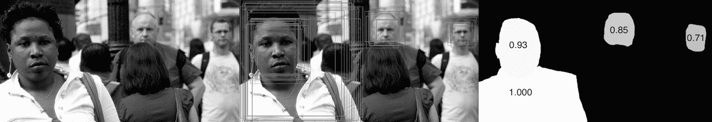

图 6.1


## 引言

该图由小组（Group）的真值（ground truth）数据汇装而成。左侧是该小组新真值数据库的一张“输入图像”。中间是由众包任务的工作人员标注的同一张图像。众包工作者并未对图像的显著特征达成完全一致。如果他们都标注了女性的整个身体，那么另一些人也标注了她的脸部、图像中间的脸以及图像右侧的脸。右侧的灰度图是基于中间的标注图像生成的。它是在众包实验后在实验室内经过后处理的。每个灰度区域对应左侧未标记图像中的一个目标。这些区域就是根据计算模型定义的计算机程序应当以最佳方式检索的内容。目标的相对显著性值（通过不同的灰度值表示）被定义为环围它们的矩形数量与执行该图像标注任务的工作人数之比。

在这个例中，有 14 名工作人员执行了标注任务。14 个矩形环围了整个女性，使得她的身体形状具有最大值 `1`。但也有 13 个矩形专门环围了女性的脸，使其数值为 `0.93`。12 个矩形环围了中间的脸（值为 `0.85`），10 个矩形环围了右侧的脸（值为 `0.71`）。灰度图的背景——所有未标记的部分——值为零。所有这些值和区域都是在工作人员绘制的标签帮助下定义的。此时，该小组项目的目标是找到一种在没有标签帮助的情况下自动将左侧图像转换为右侧图像的方法。在这个案例研究中，我们仅研究小组如何找到自动检索脸部相对显著性值的方法。我们不会处理非脸部元素或任何类型的分割。遵循这一思路，我们必须回答的问题是：如何从像左侧那样的输入图像检索脸部重要性值（例如 `0.93`、`0.85`、`0.71`）

## 训练集分析

为了更好地理解定义脸部重要性计算模型的实践，我们必须仔细检查小组的训练集及其数据的逐步重组。然而，由于 Matlab 训练集非常混乱（参见图 6.2），我将无法基于“真实”截图进行分析。就像在第 4 章说明编程实践时一样，我必须简化小组的训练集，仅保留与当前分析相关的元素。因此，小组训练集的简化版本将如表 6.1 所示所示。由于我们将遵循一系列转换，小组训练集的第一次转换将计为 1，第二次转换计为 2，以此此类推。训练集的初始形式将计为转换 0。

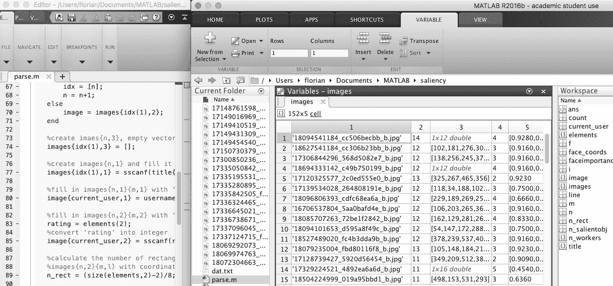

<samp class="SANS_ITC_Stone_Sans_Std_Semibold_B_11">图 6.2</samp>

该小组用于脸部重要性值建模的训练集截图，显示了其在 Matlab 软件环境中的外观。右侧 Matlab IDE 的工作空间（Workspace）显示了用于创建数据库的所有变量。截图中间是一个汇总数据库组织结构的电子表格。表格的第一列收集了训练集输入图像的 ID。第二列指示了对同一行输入图像执行标注任务的众包工作者人数。第三列收集了 `BJ’s algorithm` 在运行时对同一行输入图像提供的人脸检测矩形坐标（下文正文详述）。每组四个坐标指的是：(a) 输入图像 `x` 轴上矩形开始的点；(b) 矩形开始的 `y` 轴点；(c) 矩形结束的 `x` 轴点；以及 (d) 矩形结束的 `y` 轴点。第四列根据众包工作者的意见，指示了输入图像中显著特征的数量。此值可能与第 3 列中四坐标组的数量不同。第五列指的是小组根据众包工作者的标签计算出的脸部重要性值。电子表格左侧的 `Current Folder` 窗口指示 Matlab IDE 当前访问的文件夹。在最左侧，`Editor` 显示了用于解析众包任务数据并将其组织为 Matlab 数据库的 Matlab 脚本的一小部分。完成此 Matlab 脚本所需的计算机编程实践，与我在第 4 章中描述的相似。

<samp class="SANS_ITC_Stone_Sans_Std_Semibold_B_11">表 6.1</samp>

转换 0：分析剩余部分将呈现的简化 Matlab IDE

| 输入图像 ID |  | 标注脸部的坐标 |  | 标注脸部的重要性值 |

| --- | --- | --- | --- |
| <samp class="SANS_Consolas_Regular_11">image1.jpg</samp> |  | <samp class="SANS_Consolas_Regular_11">[52; 131; 211; 295] [479; 99; 565; 166] [763; 114; 826; 168]</samp> |  | <samp class="SANS_Consolas_Regular_11">[0.928] [0.857] [0.714]</samp> |
| <samp class="SANS_Consolas_Regular_11">image2.jpg</samp> |  | <samp class="SANS_Consolas_Regular_11">[102; 181; 276; 306] [501; 224; 581; 304]</samp> |  | <samp class="SANS_Consolas_Regular_11">[0.916] [0.818]</samp> |
| <samp class="SANS_Consolas_Regular_11">image3.jpg</samp> |  | <samp class="SANS_Consolas_Regular_11">[138; 256; 245; 379] [367; 142; 406; 202]</samp> |  | <samp class="SANS_Consolas_Regular_11">[0.916] [0.636]</samp> |
| <samp class="SANS_Consolas_Regular_11">…</samp> |  | <samp class="SANS_Consolas_Regular_11">…</samp> |  | <samp class="SANS_Consolas_Regular_11">…</samp> |
| <samp class="SANS_Consolas_Regular_11">image152.jpg</samp> |  | <samp class="SANS_Consolas_Regular_11">[396; 151; 542; 280]</samp> |  | <samp class="SANS_Consolas_Regular_11">[0.928]</samp> |
| *注：* “转换 0”一术语表示它是训练集的“初始”状态。这个“转换 0”当然是相对于我们将遵循的序列而言的：为了这个数据集形成“初始”形式，许多其他转换都是必要的。 | | | | |


本案例研究的结构如下：我首先将阐述对公式化实践（formulating practices）的预期有时如何影响地面值（ground truths）的设计。事实上，要将未定义的数据-目标关系进行转换以符合经过认证的数学知识，有时需要进行准备工作。在接下来的章节中，我将说明导致计算模型特征化的公式化实践，该模型能够满意地从输入图像中检索脸部重要性值。正如我们将看到的，该小组对数据-目标关系所做的做法，与其他科学家对他们试图表征的未定义实体所做的做法之间可以有很多相似之处。从这个意义上说，除了他们通常依赖地面值数据库之外，计算机科学实验室内发生的公式化实践可能与生物学、人类学或物理实验室内发生的公式化实践没有太大区别。在章的下一节中，我将把公式化实践与第 4 章定义的编程实践联系起来。正如我们所看到的，公式化数据-目标关系可以产生看似完善的数学事实，并作为后续编程环节的`scenarios`（场景）。最后，我将机器学习技术视为一种大胆的尝试，即以更多的地面值化和编程工作为代价来自动化公式化实践。最后一个元素将使我尝试处理现如今（往往不分彼此地）所谓的“人工智能”。

但事事有先后；现在，让我们回到 2013 年 11 月的实验室食堂。

## 地面值化——公式化

2013 年 11 月，在实验室食堂：我第一次见到了这个小组（Group）。由于我对图像处理、地面值和显著性检测几乎一无所知，第一次小组会议对我来说很难跟上。但在项目演示期间，小组很快向我分享了一个重要的假设：

小组会议，实验室食堂，2013 年 11 月 7 日。

`CL`：“实验表明，脸部的显著性会根据其的大小和数量而变化。基本上，一张大脸被认为比许多小脸更重要。”

`GY`：“而且当有很多脸时，可以说，每张脸都‘丢失’了一些显著性。”

`FJ`：“但当有很多脸时，它们的尺寸也更小了，不是吗？”

`GY`：“嗯，不必。你可以在前景有一张大脸，而在背景有很多脸。”

`FJ`：“我明白了。其他的算法不是那样的吗？”

`SL`：“不，它们不关注脸部。至少在显著性方面。而这正是将脸部引入显著性的意义所在。”

正如我几天后发现的，CL 在上述转录开头提到的实验来自关于视线预测（Cerf, Frady, and Koch 2009）、认知心理学（Little, Jones, and DeBruine 2011）和神经生物学（Dekowska, Kuniecki, and Jaśkowski 2008）发表在同行评审期刊上的论文。这些论文声称，给定场景内脸部的相对大小和数量往往影响它们的吸引强度。粗略来说，在给定场景中，一张大脸通常会吸引比一张小脸更多的注意力，而一张小脸吸引的注意力比许多小脸多，但比例如两张大脸的少。脸部重要性在某种程度上与其在给定图像中的大小和数量有关，这是该小组的一个重要假设，因为它进一步有助于定义新地面值图像的筛选标准：

小组会议，实验室食堂，2013 年 11 月 7 日。

`CL`：“如果你觉得可以的话，你可以开始下载图像了。同时，我们会继续编写[实验的]代码。”

`FJ`：“没问题。”

`CL`：“但再次，必须是复杂的图像。而且大部分图像还必须包含脸。”

`BJ`：“以及不同大小和数量的脸。”

`FJ`：“你的意思是，有很多脸的图像？”

`BJ`：“是的，因为这会影响某些结果。否则我们没有连续值。”

如果目前的分布只包含简单的脸，大众怎么可能产生意见呢？

仍然对这些关于地面值的新故事感到困惑，我很快就开始开始下载图像。在 2013 年 11 月 14 日的第二次小组会议上，我向小组展示了样本，以确保我理解了指令。由于反馈是积极的，我继续下载。2013 年 11 月 16 日，实验室服务器上有了 900 张复杂的图像。但第二天，我收到了来自 BJ 的邮件：

2013 年 11 月 17 日，周五。BJ 发送给 FJ 的邮件，主题为“关于脸的分布”

嘿 FJ，

我快速处理了你选择的图像中的脸部，并对 `x` 轴进行了分箱。这里是目前我们的数据库根据脸的数量和脸大小的分布情况。

见图 6.3

我们稍后会对事物进行建模，因此我们需要通过更多包含两个或更多脸的图像来平衡。所以如果你继续收集这样的图像（比如两百张），那就太好了。

> 祝好，

> BJ


图 6.3 BJ 发送的两张图，说明了 2013 年 11 月 17 日的分布。

许多问题立即出现。首先，BJ 如何设数我上传到服务器的每张图像的脸的数量并计算它们各自的大小？事实证明 BJ 之前工作过一种人脸检测算法，正是执行这些：检测、计数和测量图像中脸的大小.¹ 利用 BJ 之前在人脸检测方面的工作甚至是该显著性项目启动的原因之一（见第 2 章）。但为什么目前的分布会影响小组在尚未提交的众包任务后必须构建的模型呢？这正是我问 BJ 的问题：

2013 年 11 月 17 日，周五。FJ 发送给 BJ 的邮件，主题为“关于脸的分布”

当然，没问题。但如果我可以问的话，为什么在项目的这个阶段进行平衡如此重要？

> 祝好，

> 

> FJ

2013 年 11 月 18 日，周六。BJ 发送给 FJ 的邮件，主题为“关于脸的分布”

如果你能做到就太好了。


只是，如果面部重要性确实随着大小和数量而变化，我们肯定需要更广泛的案例来拟合数据。

> 此好，
> BJ

在本章的这个阶段，我们不需要理解“拟合数据”意味着什么（我们将在下一节介绍）。此处只需注意到 BJ 对小组即将进行的输入图像与面部重要性值之间关系的分析所做的`projection`（投影），这是我决定在本案例研究中涵盖的输出目标的一个小方面。在 2013 年 11 月，小组尚未拥有任何真值数据库（ground-truth database）：Web 应用程序尚未完成；众包工作人员尚未标注任何图像；实验室服务器中没有存储任何矩形坐标；没有对多级目标进行后处理。在这个阶段，一无所有。或者真的一无所有吗？我们确实看到小组基于其认为信赖的论文有一个假设：面部的感官重要性在某种程度上与其大小和数量相关。这一假设足以让 BJ 预见到一种方便的方法，将面部数值的输出目标关系与（希望如此）某些经过认证的数学结论联系起来，反过来又有助于对其进行定性。这确实不是 BJ 和小组其他成员首次着手构建新算法。他们以前做过这件事——特别是博士后 CL——并且知道会有什么结果。也许正是这种习惯促使他们采取稳妥的做法。如果均衡面部数据可以促进未来的工作（这些工作将包括尚需构建的从输入图像到输出目标的自动化过程），那么这样做确实是重要的。

在第一章结束时，我建议了关于算法的两个互补的分析视角：一种“以问题为导向的视角”，它应该调查导致真值形成的问题化过程；另一种是“公理化视角”，它应该调查从已经构成的真值中提取的数值程序。这两种视角之间的区别是因为需要更好地理解算法最终所依据的真值的形成——因此是“以问题为导向”的视角——同时又不完全将算法还原为这些真值——因此是“公理化”视角。但我规定（尽管相当松散），这两种视角应该紧密衔接，即 `ground-truthing`（真值化）活动和我现在称的 `formulating`（公式化）活动有时可能会重叠，真值可能会暗示特定的数值特征（反之亦亦然）。我们在这里具体地看到了这两个过程是如何重叠的；由于依赖匿名且分散的众包工作人员来构建真值而产生的不确定性，无疑促进了均衡习惯的发展，这有助于进一步与能够说明新现象的认证数学事实联系起来。

## 达到高斯函数

2014 年 3 月：众包工作人员矩形标签的后处理现在结束了。小组终于拥有了一个新的真值数据库，收集了输入图像及其对应的多级目标（参见第 2 章，图 2.8）。在这个阶段，可以说小组有效地管理并重新定义了显著性问题的术语，至少在“实验室层面”（Fujimura 1987）。尚未完全设计的算法任务现在很清楚了：它必须从真值的输入图像中，以最好的方式检索其对应的目标。因此，真值数据库是物质基础，允许对算法建模以及从精确率和召回率统计指标对其进行评估。

小组的下一步行动是将真值分为两个子集：训练集和评估集。仅使用包含两百张图像和目标的训练集来设计计算模型。其余六百张图像和目标存储在实验室服务器中，将仅用于测试模型程序的准确性，并与其并发实验室已经提出的其他模型程序进行比较（参见图 2.9）。^(2) 在训练集中，152 张图像包含面部。因此，是训练集的这个子集被用于定义一种在没有人员标签帮助的情况下，从输入图像中自动检索面部重要性值的方法。

让我们仔细观察训练集的这个子集。它看起来是什么样的？对于我们在这里感兴趣的案例——输入图像与面部重要性值之间关系的定义——训练集具体看起来像一个 152 行 5 列的表格（简化的表 6.2 中仅表示了前三列）。^(3)

### 表 6.2](#chapter_6.xhtml_tab6_2)

小组训练集的翻译内容

| 输入图像 ID | | 标注面部的坐标 (BJ 的模型) | | 标注面部的重要性值 |
| --- | --- | --- | --- | --- |
| `image1.jpg` | | `[52; 131; 211; 295] [479; 99; 565; 166] [763; 114; 826; 168]` | | `[0.928] [0.857] [0.714]` |
| `image2.jpg` | | `[102; 181; 276; 306] [501; 224; 581; 304]` | | `[0.916] [0.818]` |
| `image3.jpg` | | `[138; 256; 245; 379] [367; 142; 406; 202]` | | `[0.916] [0.636]` |
| `...` | | `...` | | `...` |
| `image152.jpg` | | `[396; 151; 542; 280]` | | `[0.928]` |

`表 6.2](#chapter_6.xhtml_tab6-2)` 的第一列指的是输入图像的 ID，第二列指的是一组坐标——每组提供关于输入图像的一个面部信息（更多请见下文），第三列指的是众包工作人员赋予输入图像每个标注面部的重要性值。这个 Matlab 表格的数据——实际上是一个真实的数据库——至关重要，因为它是尚未定义的模型的物质基础，该模型必须在没有这些标签帮助的情况下，检索众包工作人员标签提供的面部重要性值。但以这种表格形式排列时，这些数据仍然非常困惑。在如此枯燥的分类中，如何看出输入图像面部与其相关的面部重要性值之间的关系？需要做一些工作来更好地理解这种关系的外观。


一种更好地掌握输入图像面部与其重要性值之间关系的方便方法——这正是小组试图精确定义的尚待定义的 `entity`（实体）——就是让它们变得一次性可见。但如何在一个易读的文档中同时看到面部及其重要性值呢？

重要性值是数字，因此可以很容易地表示为可读图表（例如 `graph`）中的点。但面部呢？它们*究竟*是什么？从技术上讲，由于 BJ 的人脸检测算法，训练数据库中输入图像的面部是`与一个图像 ID 关联的坐标组`。但我们如何让这些组与面部重要性值具有可比性呢？一个必要的操作是将这些组`还原`并`转换`成其他东西，希望能与面部重要性数值进行比较。

根据其关于面部大小和数量的记录初始假设（该假设最初就参与了数据的收集，参见上文），该小组决定仅用两个数值来总结每组坐标：“数量值”和“大小值”。数量值由 BJ 的人脸检测算法提供。它指的是每张输入图像中面部的绝对数量。这个值有时优于标记面部的数量，因为众包工作者并不总是将图像中的所有面部标记为显著。“大小值”指的是众包工作者标记为显著的面部的大小。同样，BJ 的人脸检测算法帮助产生了这些值，因为它通过计算人脸检测框面积与图像大小的比例来得出面部大小。在小组在 `Matlab Editor` 中编写了适当的脚本用以借助 BJ 的人脸检测算法计算这些值后，其训练集的电子表格按照表 6.3 所示进行了重组。

表 6.3

小组训练集的翻译 1

| 输入图像 ID | | 数量值 | | 标记面部的大小值 | | 标记面部的重要性值 |
| --- | --- | --- | --- | --- | --- |
| `image1.jpg` | | `3` | | `[0.065] [0.014] [0.008]` | | `[0.928] [0.857] [0.714]` |
| `image2.jpg` | | `2` | | `[0.042] [0.012]` | | `[0.916] [0.818]` |
| `image3.jpg` | | `3` | | `[0.030] [0.0054]` | | `[0.916] [0.636]` |
| `…` | | `…` | | `…` | | `…` |
| `image152.jpg` | | `1` | | `[0.053]` | | `[0.928]` |

如果这种第一次翻译成功将输入图像的每个标记面部还原为两个数值——一个“数量值”（第 2 列）和一个“大小值”（第 3 列），那么要将它们与源自工人标签的重要性值进行比较仍然很困难。事实上，要在同一刻度上表示如此不同的数量级怎么可能？我们看到面部重要性值可以在零到一之间变化。但“数量值”和“大小值”呢？数量值可能会出现问题，因为它们可以从一到九十八不等变化。但真正的问题来自大小值，它可以可以从 0.0003（训练集中最小的标记面部）到 0.7500（训练集中最大的标记面部）变化：最小的大小值与最大的值之间相差四个数量级。


尽管如此，在这个阶段，训练集仍然难以阅读。虽然该小组（Group）主要感兴趣训练集中的脸部，但数据库仍然围绕输入图像的 ID 进行组织。这种数据组织在翻译过程初期非常重要，因为它有助于指明 BJ 的人脸检测算法应该关注哪里。但在这一阶段，这种以图像为中心的组织方式变得非常繁琐。现在是时候小组再次重新组织其表格，以与其脸部相关的数据为中心：`log(number-values)`、`log(size-values)` 以及脸部重要性值。当这些值组合在一起时，这些“三元组”数值为训练集中 266 个标记脸部中的每一个提供了一个独特的“签名”（参见表 6.5）。

### 表 6.5
小组训练集的第 3 次翻译

| | | 面部签名 | | |
| --- | --- | --- | --- | --- |
| 1 | | `[0.477; -1.187; 0.928]` | | |
| 2 | | `[0.477; -1.853; 0.857]` | | |
| 3 | | `[0.477; -2.096; 0.714]` | | |
| 4 | | `[0.301; -1.376; 0.916]` | | |
| 5 | | `[0.301; -1.920; 0.818]` | | |
| 6 | | `[0_301; -1.522; 0.916]` | | |
| 7 | | `[0.301; -2.267; 0.636]` | | |
| … | | | | |
| 266 | | `[0; -1.275; 0.928]` | | |

经过这第三次翻译，训练集变成了一份收集了相对接近数值三元组的签名列表。尽管非常常见且平凡，但小组从第 0 次翻译开始所付出的努力开始产生回报：每个标记脸部现在都由一组唯一的数字组合描述。尽管如此，这种列表形式使得小组仍然难以辨别这些三元组值之间的关系：脸部重要性值是如何与数值和大小值共同相互作用的？尽管这个列表很好地简化了初始表格，但它仍然有一个重要的不便之处：它看起来像任何其他列表一样——从购物清单到债券价格列表。这些列表中的值可能不同，但列表本身的形状大致相同：它们仍然是连续的行（Goody 1977, 78–108）。那么，该如何捕捉该小组试图表征的那个未定义实体的特殊性呢？如何定义它的形状、它独特的行为？

如果数字列表的形式难以区分，这些列表仍然具有一个至关重要的特性：至少从 17 世纪下半叶以来，它们就可以为其包含的值赋予形状。事实上，当与适当的坐标系结合时，列表包含的数字可以转换为绘制可区分形状的点。由于将数值列表转换为图表如今已成为一种默契且必要知识的“一句话陈述”，小组只需要编写 Matlab 指令 `scatter(data(:,1), data(:,2), data(:,3))` 来创建图 6.4 的散图。

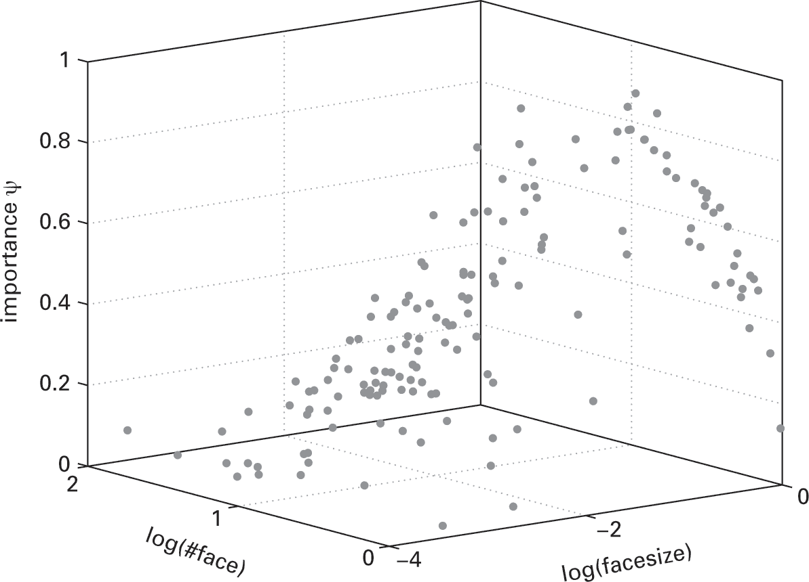

### 图 6.4
小组训练集的第 4 次翻译。

训练集的每个标记脸部都通过这张 `log(number-values)`——x 轴——与 `log(size-values)`——y 轴对比重要性值——z 轴的 Matlab 散图重新呈现。在这一点上，小组试图表征的未定义实体开始获得形状。它的行为开始出现；一个真实的现象开始形成高斯形状。对于习惯于数学对象的小组成员来说这很快让他们想起了高斯函数：

- **FJ**: 2014 年 8 月 14 日周五，与 CSF 的讨论
- **BJ**: 但你怎么知道脸部重要性是高斯分布？（参见 5）
- **FJ**: 嗯，一旦我们得到了图，就能确定它是高斯分布了。
- **BJ**: 我的意思是，它可能是别别的吗？
- **FJ**: 当然，但在这里，数据画出了高斯分布。
- **BJ**: 但你最初对数据做了处理！
- **FJ**: 是的，但为了让某些东西出现。你必须做这些；否则你什么都没有可以建模。

多亏了训练集的这第四次翻译，小组有了强烈的直觉：输入图像脸部与其重要性值之间的关系显然接近某种高斯函数，这是一种现在已经得到充分理解和记录的良好数学对象。但小组如何能确定他们的实验创造的现象真的像高斯函数一样运行呢？毕竟，高斯函数是光滑的，而小组要求 Matlab 绘制的散图是非常不连续的。从远处看，这堆点可能看起来像高斯函数，但近距离观察，它的形状显得粗糙且不均匀。

这就是 Matlab 作为巨大的认证数学知识库再次变得至关重要的地方，因为简单的指令 `fit(x.’, y.’, ‘gauss2’)` 允许小组通过生成其他图表和说明来验证他们的直觉（参见图 6.5）。

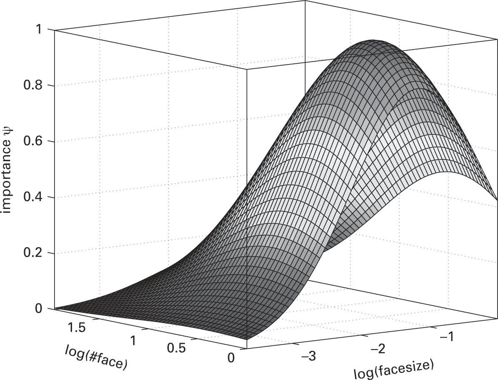

### 图 6.5


该小组训练集的第 5 次翻译：拟合分布的高斯函数并在 0 到 1 之间归一化。函数信息：

```
General model Gauss2: f(x,y) = exp(-((x-μ1)²/2σ1²)-((y-μ2)²/ 2σ2²)).
```

系数：
`μ1 = -1.172 ;`, `μ2 = 0.4308 ;`, `σ1 = 0.9701 ;`, `σ2 = 0.7799 ;`, `R2 = 0.8567` 。

再次，训练集被平移、变换。它的形状现在变得平滑且均匀；它变成了一个实际函数。训练集的这种新平移也产生了一系列新的标记，描述了之前粗糙点堆与其光滑对应物之间的交界处。让我们来看看这些标记：它们指的是什么？

最后一段标记——`R² = 0.8567` 表明在构成小组试图定性的现象的 `z` 数据点中，有超过 85% 的变异可以通过该数学函数描述。标记 `μ1 = -1.172` 和 `μ2 = 0.4308` 指的是函数的峰值。它们断定 `xy` 点 `[-1.72; 0.4308]` 对应函数的最高 `z` 值。最后，标记 `σ1 = 0.9701` 和 `σ2 = 0.7799` 分别表示函数沿 `x` 轴和 `y` 轴的标准差。总而言，`μ1`、`μ2`、`σ1` 和 `σ2` 是高斯函数的参数。


值 `[0.998]`、`[0.779]` 和 `[0.633]` 是该小组通过 `computational model` 计算出的 `input-image1` 中三个脸的面部重要性值。我们可以看到，这些值与从众包工人坐标计算出的“原始”值 `[0.928]`、`[0.857]` 和 `[0.714]` 接近但不相似。这正是整个公式化过程的代价，也是收益，因为小组现在拥有了一个面部重要性模型，可以在不需要众包工人标签的情况下，检索出不同但相近的面部重要性值。

但翻译过程还没有结束。在评估集上对整个算法进行统计评估（见第 2 章）之后，还需要完成最后一步操作：小组仍然必须在其证明其存在的断言中呈现其具化的 `object`。这是公式化实践的另一个优势——它不仅将未定义的实体与经过认证的数学事实连接起来以帮助表征它们，还允许将经过表征的对象包含在向同行展示该对象的文本中。在此时，我必须引用该小组最初被拒绝的手稿中的段落，其中展示了面部重要性的计算模型：

> 我们使用以下函数（在公式 2 中标记为 `G`）作为我们显著性算法中脸重要性变化的模型。


> 这里，`images/Ch06_IEQ_001.png` 是第 `i` 张图中第 `f` 个脸的重要性值。`images/Ch06_IEQ_002.png` 和 `n_i` 分别是第 `i` 张图中第 `f` 个脸的大小和第 `i` 张图中脸的数量。注意，`images/Ch06_IEQ_003.png` 是相对于图像大小的相对大小，因此它在 0 和 1 之间。高斯拟合的参数为 `μ[1] = -1.172`、`μ[2] = 0.4308`、`σ[1] = 0.9701`、`σ[2] = 0.7799`，且对数底等于 10。

我们的努力得到了回报：我们终于成功解释了那些混合了英语单词、希腊字母与拉丁字母组合以及等号的句子，这些符号在计算机科学家在学术期刊中交流其算法时被广泛使用。我们首先必须更好地理解数学事实和对象是如何产生的。然后，我们必须接受，这些事实和对象的力量并非源于优越的现实，而是源于平庸的公式化实践，这些实践不断翻译并还原未定义的非数学实体——多肽、轴突、`Matlab` 数据库值之间的关系——以便最终将它们连接到数学知识的扁平生态系统中。我们还必须更好地欣赏这些连接为未定义实体提供的额外力量：公式化实践——以及随之而来的还原——使得未定义实体更容易处理、更易于共享、比较、具有可塑性，并且能够在声称其存在和行为的文本中被记录。考虑到第 5 章的这些元素，我们进一步必须说明公式化实践是如何在新图像处理算法（以及可能的许多其他算法）的构建中的。我们首先看到，这些实践的预期有时可能会影响真值（ground truths）的形成。然后我们看到这些实践——以及它们所要求的所有翻译——如何逐渐让一个未定义实体变成能够用公式描述的数学对象。这些与数学扁平生态系统的连接——实际上，是向记录完备的数学对象的真实转化——参与了随后出现在学术出版物中的计算模型的装。援用 Latour (1999a, 55) 的话，我们在这一节看到，数学从未跨越思想与事物之间的巨大深渊。然而，它经常跨越了翻译 4 中已经形成的几何图（figure 6.4）与翻译 5 提供的固体公式（figure 6.5）之间的微小差距。一旦跨越了这个微小差距（这需要许多准备性的小间隙），数学就为被研究的对象提供了额外的额外力量。

尽管取得了这一小胜利，仍有些东西保持神秘。事实上，一个像学术论文中总结该小组模型（极小部分）的数学公式无疑是强大的，因为它允许我们在没有众包工人提供的数据的情况下检索面部重要性值。从这个意义上说，这个公式体面地描述了“输入图像的面部与其重要性值之间的关系”这一现象的行为，而这在公式化过程之初还是未定义的实体。但在这种“公式状态”下，这种计算模型无法让计算机计算任何内容。在小组手稿的这种书面形式中，模型可能对人类是理解的，但它无法触发能够让计算机计算的电脉冲。然而，它以某种方式需要这样做；因为小组模型的性能将在真值的评估集上进行评估，该模型还必须呈现实际程序的形式。那么，描述计算模型的数学铭文与通过电脉冲有效计算数据的实际计算机程序之间，是什么关系呢？

## 公式化——编程

我在这一节中想要表达的观点非常简单：如果学术论文中描述计算模型的数学铭文显然无法触发能够让计算机计算实际数据的电脉冲，但它们有时可以作为计算机编程时段的 `transposable scenarios`（可转换场景）发挥作用。

在第 4 章中，我们看到计算机编程实践意味着对铭文进行对齐，以产生关于远程实体（例如编译器、解释器、微处理器）的知识，该实体的轨迹受到了负面影响。我们还看到程序员不断需要招募新的行动者来跨越僵局。对于我们感兴趣的案例更为重要的是，我们还发现对齐和轮廓化都需要特殊的叙事来“触发”，这些叙事涉及到执行的人。基于 Lucy Suchman 和 Bruno Latour 的理论，我决定将这些表演性叙事称为 `scenarios`（场景）。

场景是关重要的，因为它们为编程时段提供了边界，同时允许其展开。但它们令人恼的缺点是，尽管它们构成了设定理想愿景的不可或缺的资源，但对于实现这些愿景所需的行动往往很少触述。当我们跟随 DF 他的小型计算机编程创业时，就经历了这一点。


然而，某些场景可能比其他场景更具转化性。让我们想象这样一个编程场景：“FJ 将让计算机计算 485,692 的平方根。”虽然非常短，但这个想象的例子可以被视为真实的场景，因为它涉及了向其他空间（我的办公桌）和时间（稍后）以及其他行动者（Matlab 编辑器、我完成脚本后等）的三重偏移，同时也涉及了作为陈述者的我。我该如何到达我所投射的地平线？如果我使用 Matlab 或许多其他高级编程语言，程序将是单一指令 `sqrt(485692)`。因此，从场景到完成的过渡看起来非常直接。

让我们想象一个更棘手的场景：“FJ 将让计算机对数据集 `δ` 上的五个聚类进行 `k-means` 计算。”我该如何到达这个地平线？对于 Matlab 和其他几种高级编程语言来说，程序将再次是单一指令 `kmeans(δ,5)`——另一个直接的完成任务。这两个想象的场景似乎都能够快速转换为代码行；它们建立的地平线不需要许多繁琐的符号对齐和对僵局的变通处理即可到达。

### 场景的密度

这两个想象的场景比 DF 在第 4 章中定义的场景更简单吗？很难说，因为大数的平方根和五个聚类的 `k-means` 并不是易易的操作。相反，似乎存在*密度*上的差异：虽然我们想象的场景几乎可以原样翻译成代码，但 DF 的场景需要被完成、修补和刷新。如果“485,692 的平方根”和“五个聚类的 k-means”这两个陈述术之间似乎没有任何障碍，那么“用矩形坐标增加空矩阵”这一陈述中的每个术语之间显然存在许多间隙。

这个问题比看起来要复杂得多。人们确实可能认为编程场景中这些密度差异来自于场景本身。例如，人们可能会认为，如果 DF 的场景转化性不如我们的两个例子，那是因为它不够*精确*。但事实恰恰相反：虽然“485,692 的平方根”和“五个聚类的 k-means”几乎没有告诉我们任何关于如何执行此类任务，但 DF 的场景却费力指定了一系列动作。是的，确实存在密度差异，但不，这些差异并不与场景内部的内容必然相关。

### 操作的扩散

那么这些差异从何而来呢？我相信这些密度差异可能与实现场景所需操作的扩散有关。我的假设（仍需进一步验证）是操作对于编程语言的用户和设计者社区越是*常见*，它就越少需要分解、翻译和完成。

编程场景中这种与扩散相关的密度差异最显著的例子无疑是算术运算。对于编程语言的用户和设计者来说，什么比加、减、除、乘元素更常见呢？电子计算机本身就是逐渐围绕这些广泛分布的操作设计的（Lévy 1995）。“加”、“减”、“乘”或“除”这些术语——当作为场景的一部分时——将立即翻译成它们为人知的数学符号 `+`、`/`、`–` 和 `*`。许多其他广泛的计算操作也是如此。“正弦”、“余弦”、“最大公约数”、“对数甚至有时的“k-means 聚类”都是可以从场景直接转换到程序的操作。

### 计算模型

尽管这些命题相当大胆，但它们将允许我们更好地理解小组（Group）的计算模型如何几乎直接地转换为真实的计算机程序。让我们再次考虑描述小组塑造的模型公式。我们看到，小组观察到的现象是一个特定的高斯函数，可以描述为：


其中 `x_i` 是第 `i` 个面面的尺寸值，`y_i` 是第 `i` 个面的数量值，而 `μ[1]`、`μ[2]`、`σ[1]`、`σ[2]` 是高斯拟合的参数。当该公式的所有参数都被 Matlab 提供的数值替换时，该模型就变成了以下方程：


从那点起，小组只需要在 Matlab 编辑器中几乎原样地转换这个数学场景。这种翻译为我们提供了以下代码行：

```
z = exp(-((log10(x)+1.172)²/1.88218802)-((log10(y)-0.4308)²/1.21648802));
```

我们可以看到，方程中表达的数学操作与该方程程序中所表达的数学操作之间存在几乎一一对应的对应关系：`exp`、`–`、`log` 和 `+` 都保持了相同的形状。只有平方和除法操作需要稍微修改。然而，在这种状态下，小组的程序什么都不会做；它仍然需要变为迭代来处理 `x1,2,...266` 和 `y1,2,...266`。在这里，小组只需要根据它们的尺寸值和数量值来组织面。在 Matlab 环境中，这表现为表 6。

**表 6：模型参数**

| $x_i$ | $y_i$ |
|---|---|
| 1 | 0.065 |
| 2 | 0.143 |
| 3 | 0.008 |
| 4 | 0.042 |
| 5 | 0.012 |
| 6 | 0.030 |
| 7 | 0.0054 |
| ... | ... |
| 266 | 0.053 |


这个重新组织的 Matlab 电子表格将允许程序识别它应该处理哪些数据。在 Matlab 编程语言中，通过在花括号中写入一对值，就可以访问此类电子表格中每个单元格的数据。对于我们的案例来说，指令 `cell{1,1}` 将要求 `INT` 考虑值 `[0.065]`；指令 `cell{1,2}` 将要求 `INT` 考虑值 `[3]`；以此此类推。得益于这种引用系统，可以让 `INT` 遍历电子表格的所有单元格，并迭代地将它们的值插入方程中。此外，该表格具有有限的长度 `[266]`。这个易于获取的信息——即表格的行数——可用于指示 `INT` 从电子表格的第 1 行开始处理到末尾结束。当所有尺寸值和数值都处理完毕后，它们将最终整合到电子表格中，供定义小组算法的剩余部分使用（请记住，我们只考虑了小组整个算法的一个微小部分）。允许小组脸重要性计算模型运行的小型但至关重要的脚本形式如图 6.6 所示。运行时，这个小型脚本会输出接近表 6.7 的内容。

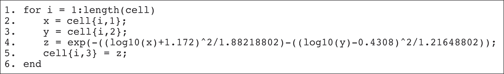

**图 6.6** 用于计算脸重要性值的运行脚本。

**表 6.7** 根据小组数学模型指令的 Matlab 脚本结果简化视图

| | | 1 | | 2 | | 3 |
| --- | --- | --- | --- | --- | --- | --- |
| 1 | | `[0.065]` | | `[3]` | | `[0.998]` |
| 2 | | `[0.0143]` | | `[3]` | | `[0.779]` |
| 3 | | `[0.008]` | | `[3]` | | `[0.633]` |
| 4 | | `[0.042]` | | `[2]` | | `[0.964]` |
| 5 | | `[0.012]` | | `[2]` | | `[0.732]` |
| 6 | | `[0.030]` | | `[3]` | | `[0.935]` |
| 7 | | `[0.0054]` | | `[3]` | | `[0.527]` |
| … | | `…` | | `…` | | `…` |
| 266 | | `[0.053]` | | `[1]` | | `[0.853]` |

此时，我们可以说小组成功构建了一个能够有效计算数据的模型。规则已经改变了：每个数字图像现在都可能潜在地通过小组的脸重要性评估程序进行处理。当然，这只是小组显著性检测项目的一个小方面，而该项目最终被会议的评审人员拒绝了。

## 机器学习的（变化的）现实

在该案例研究中，我们看到真值活动（ground-truthing activities）——作为训练集的生产者和性能的实现者——影响着制定活动（formulating activities），而对未来制定需求的预期也可能影响真值的初始生成。我们随后看到了行动方案的制定是如何现场展开的。随着我们继续跟踪小组的算法项目，我们发现需要许多实际转换才能使训练集获得与数学对象相同的形态。此外，我们看到制定活动的结果（在本例中为一个数学公式）是如何与编程活动相关的，前者为后者提供了可移植的场景。

当我们将这些实证元素与第一部分和第二部分的元素相结合时，我们得到了一种非常不寻常的导向型算法概念（见图 6.7）。事实上，似乎有时我们倾向于称之算法可能是三个相互关联活动的结果，我将称之为真值确定、编程和制定。当然，这些活动可能不是参与算法构建的唯一活动（因此对启动其他民族志调查产生了兴趣）。但至少，在这些充满争议的岁月里，我们现在可以真实地解释算法的一些构成性关联了。

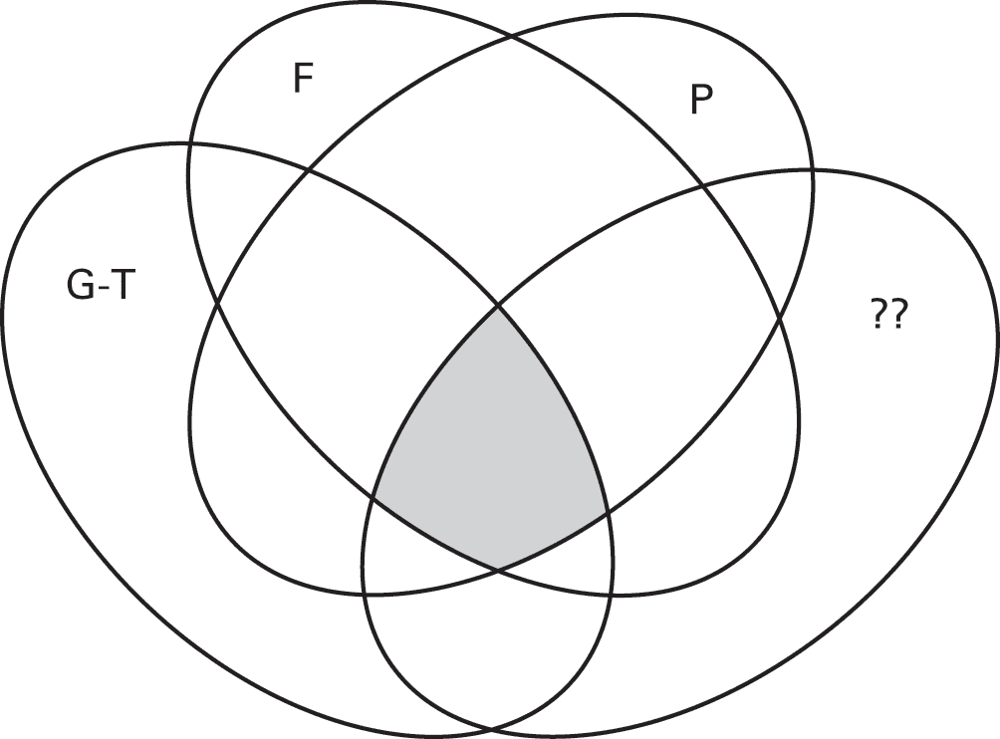

**图 6.7** 真值确定 (G-T)、编程 (P) 和制定 (F) 活动插值的示意图。图中中间的灰色区域是算法有时产生的地方。第四个标记为“??”的椭圆代表我的调查未能成功解释的其他潜在活动。


然而，这种面向行动的算法概念仍然过于狭隘。在如今，是否存在孤立的算法？正如我们在本书的各个章节中所看到的，一个算法的构成包含了许多其他算法的参与。当我们处理真值确定（ground-truthing）的实践时，这一点尤为明显；无论是在 Flickr 网站上选择图像、将它们上传到实验室服务器、管理众包任务，还是后续对多层显著元素的像素级分割，这些时刻都得到了其他许多额外算法的支持。

计算机编程也是如此。尽管这项专门化活动目前对新算法的构成做出了巨大贡献，但它本身也经过了无数算法，其中许多算法运行在计算机硬件附近，以帮助解释器、编译器或处理器以显著的方式计算数字数据。此外，正如我们在本章中刚刚看到的，方案制定实践（formulating practices）也受到算法的灌溉，一个特别明显的例子是 `BJ’s algorithm`，它能可靠地计算图像中的人脸数量并计算它们各自的大小。

在算法的构成过程中，算法无处不在，积极地参与着真值确定、编程和方案制定活动的表达。然而，我们可以合理地假设，以某种方式，这些其他算法也必须在特定的时间和地点被构成，它们本身——如果我的假设是正确的——至少是这三项活动的产物（见图 6.8）。

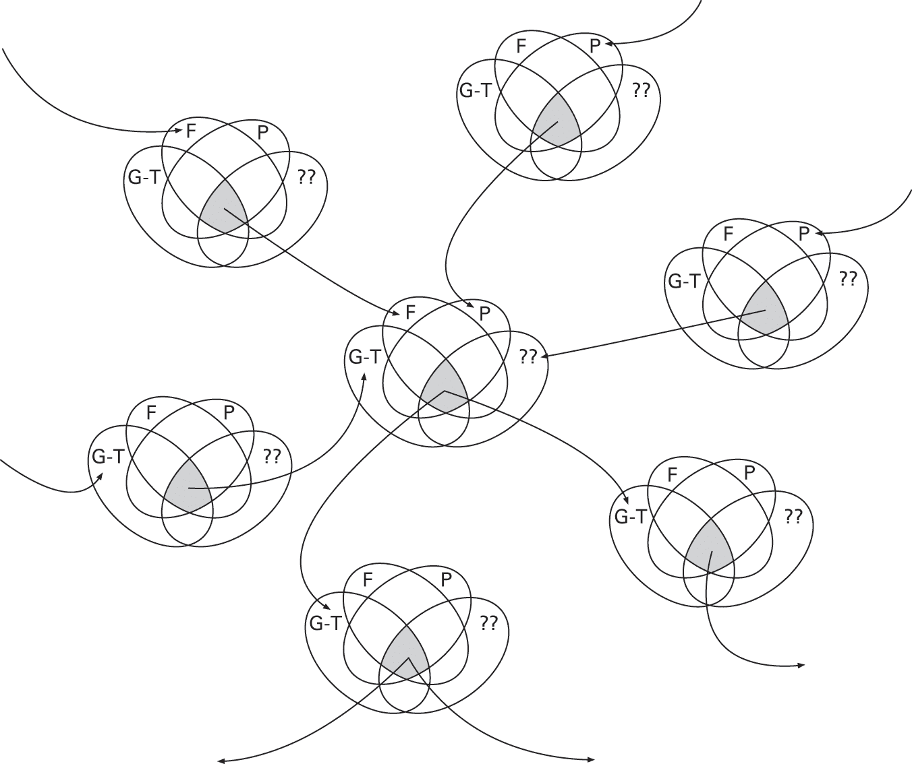

<samp class="SANS_ITC_Stone_Sans_Std_Semibold_B_11">图 6.8</samp>

参与其他算法构成活动的已构成算法的补充示意。

这种将算法视为真值确定、编程和方案制定活动共同产物的观点——这些活动本身通常也由可能经历过类似构成过程的其他算法支持——使得整体画面变得复杂，同时也使其更易于理解。事实上，每当算法的效果产生争议时，争论者现在可以引用这种基础映射并共同考虑诸如下问题：算法的真值是如何产生的？哪些公式执行了从输入数据到输出目标的转换？这一切需要什么样的编程工作？如果需要更深层的思考，争论者可能会挖掘另一层：哪些算法贡献了这些真值确定、编程和方案制定过程？而这些二阶算法最初是如何构成的？这些正是本书旨在提出的赋能性问题，以引发关于算法的建设性争议——这将我将在下一章（也是最后一章）中进一步阐述的政治论点。

### 机器学习的挑战

然而，仍然缺失了某些东西。尽管这种探可能会完善整体画面，但它仍然未能解决一个巨大的问题——这个问题甚至可能是目前媒体和学术界讨论最多的算法相关的话题：`machine learning`。机器学习是一个极其敏感的话题，有时被视为一个整体（Alpaydin 2010），有时又与密切相关但不断演变的术语联系在一起，例如“大数据”（Bhattacharyya et al. 2018）或“人工智能”（Michalski, Carbonell, and Mitchell 2014）；它有时被推述为在工业上已经非常成熟（Finlay 2017），而在另时候则被认为仍处于婴儿阶段（Domingos 2015）；它有时因其性能受到赞誉（Jordan and Mitchell 2015），有时又因其似乎可能给集体世界带来的危险（但*它*到底是什么？）而受到批评（Müller 2015）。

一旦“机器学习”这个术语被表述，就会引发关于熟悉与无知、希望与恐惧、乌托邦与反乌托邦相互冲突的情感；这种奇异的疯狂似乎与我正在这里试图构建的务实愿景格格不入。在这些困难的条件下，我们如何即便只是从表面上，处理作为生活化行动过程的的机器学习迭代呢？

### 高斯函数案例

根据我们的经验和理论手段，触及机器学习表层的一种方法，可能是做出以下观察：在标题为“达到高斯函数”的章节中所描述的方案制定过程中，就在小组编写并运行 Matlab 指令 `<samp class="SANS_Consolas_Regular_11">fit (x’, y’, ‘gauss2’)</samp>` 之后，发生了一些至关重要的事情。在这次快速 Matlab 计算之前（只需几秒钟），数值（`x`）、尺寸值（`y`）和重要性值（`z`）被放在同一个三维坐标空间中。

正如我们看到的，将这些整合在一起需要对训练集进行多次转换，但在某一点，可以将变量 `x`、`y` 和 `z` 安排在同一个向量空间内（图 6.4）。此时，这些值被赋予了不同的欲望（这些欲望在真值确定过程中逐渐被塑造形成）；`x` 和 `y` 值是小组所需的输入，而 `z` 值是其所需的输出。但它们各自的前后顺序——即存在先有输入，然后才变成输出——并没有被操作化；`x`、`y` 和 `z` 值在一个数学世界中同时共存。

但在 INT 通过指令 `<samp class="SANS_Consolas_Regular_11">fit (x’, y’, ‘gauss2’)</samp>` 计算了转换后的训练集并打印出相关的图表、公式和参数后（图 6.5），数值和尺寸值变成了数学输入，而人脸重要性值变成了数学输出。正如小组恰好称之为 `Gaussian fit` 的，它让 `x` 和 `y` 值变成了操作数，正如它让 `z` 值变成了操作的结果一样。从小组的角度来看，时间性发生了转移，现在可以从输入值开始并在输出值结束。一种操作被实现了，允许顺序转换；通过提取“之前”和“之后”，维度被降低了。

这一转折点，时间性的转移，是通过另一个算法的参与和委托实现的。事实上，当小组编写 Matlab 指令 `<samp class="SANS_Consolas_Regular_11">fit</samp>` 时，他们是要求 INT 从一系列坐标点估计一个函数（在本例中是高斯函数）的参数。对于小组的这一时刻来说，这是一个常规的直觉动作，只需在 Matlab 编辑器中输入几个字符。但对于有效地计算这种参数估计的 INT 来说，这并不是一项易事。INT 是如何做到的？


如果我们参考 MathWorks 官方 2017 年文档，`fit(‘gauss2’)` 指令使用非线性二乘计算机计算方法，从坐标点估计高斯函数的优化参数。因此可以推断出，`INT` 的操作与以下过程并不相似：首先，定义与每个点相关的误差；然后定义一个这些误差平方和的函数；最后对函数方程关于四个参数求偏导数，从而建立四个非线性方程，随后可以使用（例如牛顿-高斯法）进行求解。尽管该算法被统计信号处理领域的几位研究者（例如 Hagen 和 Dereniak 2008；Guo 2011）所质疑——这使其使其成为一个真正的研究课题——但非线性二乘算法目前是估计高斯函数参数的标准方法。此外，通过编写这条嵌入 Matlab 的指令，该小组部署了另一种计算机计算方法——一种具有自身成形成历史的方法——从而在构建数据与其训练集目标之间的关系方面迈出了重要一步。

小组使用另一种算法来制定其新算法并不令我们惊讶；真值验证（ground-truthing）、编程和制定活动充满了过去算法为构建新算法做出贡献的时刻（见[图 6.8]）。然而，我们应该关注的是，在制定过程中支撑 Matlab `fit` 指令的非线性二乘算法所引发的决定性时间转变。在高斯拟合参数出现在命令行窗口之前，如果没有众包工人的标签，小组无法有效计算脸部重要性值；然而，它的出现为小组提供了这种操作能力。这种基于算法的、用于小组算法构建的特定预测能力，是否可以作为我们进入机器学习主题的切入点？

人们很容易断言，小组调的帮助其模型构建的算法*发现*了高斯函数。事实上，更恰当的说法是，算法发现了一个预先组织了重组训练集的初始函数的*近似值*。换句话说，给定一个真值函数 `f(x,y)`（假设它构建了翻译后训练集中大小值、数值和脸部重要性值之间的关系），算法找到了一个实用的估计值 `f'(x,y)`，进一步允许产生错误率很低的预测（因此具有了其实用性）。根据 Adrian Mackenzie (2017, 75–102) 的观点，正是这种特定的动作从根本上构成了处理——某些作者甚至说是“折磨”（Domingos 2015, 73）——数据，以生成对最初假设函数的近似，而这是机器学习算法的主要目标，无论它们是简单的线性回归还是复杂的深度卷积神经网络。Mackenzie 基于关于这一现已广泛讨论的话题的权威文献，敏锐地总结道：

> 无论它们被视为人工智能的形式还是统计模型，机器学习学习者都被要求构建“一个对所需输出的良好且实用的近似值”（Alpaydin 2010, 41），或者从统计学角度来说是“使用样本从可接受函数集中找到使错误概率最小化的函数 (Vapnik 1999, 31)”。（(Mackenzie 2017, 82）

那么，机器学习算法——或者按照 Mackenzie 的说法被称为“机器学习者”——可能被视为一种计算机计算方法，旨在寻找函数的近似值，这些函数预先组织了训练和评估集的预期输入和输出，而输出源于真值验证实践（正如我们在本章之前的章节中看到的，这些实践有时仍面向未来的制定实践）。这一通用论点使我们能够更好地理解高斯拟合在小组制定过程中所扮演的角色。得益于 Mackenzie 的假设，小组在制定过程中采用的 Matlab 嵌入算法充当了机器学习者，构建了真值函数及其相关公式的数学近似（其本身作为一个易于迁移的编程场景）。

然而，如果 Matlab 二乘法算法可以被视为机器学习学习者，那么说在小组制定期间*确实存在*机器学习是合理的吗？从 Mackenzie 的观点以及专业文献的角度来看，这似乎是可能的；小组小组运行 `fit` 指令，该项目就变成了一个机器学习项目，因为其模型依赖于一种找到所需输出的实用近似值的统计学习方法。然而，从小组的角度来看，故事比这要复杂得多，正如 GY 和 BJ 在我向他们分享了一些想法后向我提议的那样：

**2014 年 4 月 12 日，周三。CSF 食堂露台。与 GY 讨论**

**FJ:** 我仍然纠结于那个高斯拟合的时刻……为了找到参数，Matlab 内部存在某种机器学习，不是吗？

**GY:** 呵，是的，也许吧。我想是某种回归。

**FJ:** 这是一种机器学习技术，对吧？

**GY:** 从技术上讲也许吧。但我不会那样说。你知道，我们反正看到它是高斯分布了，*所以它不是真正的机器学习*。

**FJ:** 真正的机器学习？

**GY:** 是的。例如，当你做深度学习的事情时，你首先对函数一无所知。你只是有很多数据，然后让机器做它的事情。在那里，机器是*真的在学习*。

**2014 年 4 月 14 日，周五。CSF 食堂露台。与 BJ 讨论**

**FJ:** 所以，机器学习并不是你通过高斯拟合所做的事吗？

**BJ:** 不，不。我的意思是，确实有一个拟合，是的。但它是太显而易见了，而且 Matlab 处理得非常快，对吗？与机器学习相比完全不值。如果你看看现在人们用卷积神经网络做的事，那是非常不同的！或者看 NK 在这里用深度学习[用于手写识别]做的事。那里你需要 `GPUs`、并行化等等。而且你反复处理大量的原始数据。


关于高斯拟合的地位似乎存在某些不确定性。如果它“技术上”可以被归类为机器学习，那么它也与“真正的”机器学习是对立的，例如“深度学习”或“卷积神经网络”，在这些领域机器“真正学习”。看来，对于 GY 和 BJ——以及我后来所了解的 CL 来说——将高斯拟合时刻视为机器学习会误解其构性的某些要素。我们该如何界定这种不确定性？我们该如何试图把握至少对于该小组而言，是什么赋予了机器学习特定的表达方式？

对于该小组来说，一个支撑了真实机器学习与不那么真实机器学习之间区别的元素似乎是让 `fit` 指令运行的视觉组件：“我们看到它反正是一个高斯分布，所以它不是真正的机器学习。”这种视觉组件对于界定该小组试图描述的现象确实起了决定性作用；在对训练集进行多次翻译/简化后，图 6.4 的散点图看起来就像一个高斯分布，这种相似性反过来暗示了小组使用 `fit` 指令。因变量——尺寸值和数量值——在公式化阶段之前就被假设好了（它们甚至贡献了地面真值的构建），而且这些足够简洁，可以在易于理解的图表中可视化。该小组很可能在其他地方、其他时间使用过他人制作的机器学习器；这种委托是极小的，因为涉及函数近似的大部分工作已经完成。这一点从 `fit` 指令内部的 `gauss2` 指令得到了证明，它将 INT 的工作导向了具有四个参数的二维高斯函数。

### 深度学习又是怎样的？

为什么 GY 和 BJ 用它来区分真实和不那么真实的机器学习呢？需要注意的是，在 2014 年春天——也就是我们在 CSF 咖啡厅讨论期间——深度学习正成为专门从事分类和识别任务的图像处理社区中的一种流行趋势。这种流行性与 2012 年欧洲计算机视觉会议研讨期间发生的一个重要事件密切相关，在会议上，Alex Krizhevsky 展示了他与 Ilya Sutskever 和 Geoffrey Hinton（后者是神经网络复兴的奠基人之一——后文将详述）共同开发的一个模型，用于分类自然图像中的物体。该模型参加了 2012 年的 ImageNet 挑战赛（后文将详述）并大幅获胜，其错误率比竞争性算法低了 10% 以上（Krizhevsky, Sutskever, and Hinton 2012）。Krizhevsky, Sutskever 和 Hinton 设计其算法的方法最初被称为“深度卷积神经网络”，随后根据 Bengio (2009) 提出的术语，获得了一个更具通用性的标签“深度学习”（LeCun, Bengio, and Hinton 2015; Schmidhuber 2015）。虽然这种统计学习方法已用于手写数字识别（LeCun et al. 1989）、自然语言处理（Bengio et al. 2003）和交通标志分类（Nagi et al. 2011），但这是它首次被用于“自然”物体的分类和定位。鉴于其令人震惊的结果，随着深度学习开始在学术文献中越来越多地讨论、在高层计算机编程语言中模块化，并适应工业应用，一股新的动力开始在图像处理社区中涌动。

在实验室里，NK 是上述摘录所示，对当时深度学习最新进展最熟悉的成员。他确实正在进行小说作家手写识别中深度学习应用的博士研究，正是通过他的工作以及实验室会议期间的交流，这一主题逐渐渗透了实验室。作为这些公式化技术日益流行的迹象，当我于 2016 年 2 月离开该领域时，有五名博士生正转向深度学习，而我到达时只有一个——NK。遗憾的是，尽管实验室对这些技术的兴趣日益增加，但我没有机会详细探索深度学习公式化阶段。然而，基于 Krizhevsky 的论文（这标志着深度学习在数字图像处理中的兴起），可能进一步挖掘——或者说推测——小组提出的“真实”与“不那么真实”机器学习之间的区别（尽管这种基于“纯化描述”的方法存在风险；关于此主题，见本书的引言）。

### 地面真值（Ground Truth）

让我们从 Krizhevsky, Sutskever 和 Hinton 开发算法使用的地面真值开始。如果在某种程度上`我们得到地面真值的算法`（见第 2 章），那么他们的是什么呢？Krizhevsky, Sutskever 和 Hinton 使用名为 ImageNet 的地面真值来训练和评估他们的深度学习算法。ImageNet 是一个雄心勃勃的项目，最初由李飞飞于 2006 年构，她当时是伊利诺伊大学厄巴纳香槟分区的计算机科学教授。(12）。尽管 ImageNet 的详细历史（这一努力代表了迈向面向问题的算法的研究的重要一步，见第 2 章）尚未开展，但几篇学术论文（Deng et al. 2009, 2014; Russakovsky et al. 2015）、新闻报道（Gershgorn 2017; Markoff 2012）以及 Gray 和 Suri (2019, 6–8) 著作《Ghost Work》中的一个章节仍然允许我们对其谱系做出知情的假设。


看来李飞飞（Fe Li）至少从 2006 年起，就已经完全意识到了我们在第 2 章中认识的一点：更好的地面真（ground truths）可能会带来更好的算法。就像那个“小组”对显著性检测的地面真不满意一样，李飞飞认为将地面真用于自然图像的分类过于简单。通过与 Christine Fellbaum 的交流——她自 20 世纪 90 年代以来一直一直在构建 WordNet，这是一个英语形容词、动词、名词和副词的词汇数据库，根据一组被称为 `synsets` 的同义词集合组织（Fellbaum 1998）——将数字图像与这一巨大数据库中的每个单词关联起来的计算语言学想法逐渐浮现。2007 年，当李飞飞加入普林斯大学学院时，她通过招募教授李恺（Kai Li）和博士生邓佳（Jia Deng）正式启动了 ImageNet 项目。在几次尝试无果后，李飞飞、李恺和邓佳转向了众包平台 Amazon Mechanical Turk（MTurk）提供的新可能性。事实上，虽然可以通过 Google 或当时的雅虎等关键词搜索引擎快速抓取图像，但可靠地标注这些图像中的对象需要耗时的人工工作。而 Amazon MTurk 作为大规模按需微劳动的提供者，以无比拟的价格有效地提供了这种有价值的操作。通过精巧的质量控制机制，李的团队在两年半内构建了一个包含 320 万张标注图像的地面真数据库，这些图像组织为十二个子树（例如：哺乳动物、车辆、爬行动物），包含 5247 个同义词集合（例如：肉肉动物、三桅、蛇）。尽管起步艰难，但 ImageNet 进入计算机视觉研究领域不仅通过李飞飞、邓佳、李恺和 Alexander Berg 的推广努力（Deng et al. 2010, 2011b; Deng, Berg, and Li 2011a），还通过它与一个备受誉的欧洲图像识别竞赛 PASCAL VOC 的关联（该比赛现在已由 ILSVRC 接替）。正是在 2012 年 ILSVRC 竞赛的背景下，Alex Krizhevsky、Ilya Sutskever 和 Geoffrey Hinton 开发了他们的深度学习方法，该方法远超当时的所有竞争者，引发了我们至今仍在经历的热潮。

但是，Krizhevsky、Sutskever 和 Hinton 为开发其深度卷积神经网络算法而实现的机制又是怎样的？他们是如何阐述 ImageNet 地面真的输入数据（这里是原始 RGB 像素值）与输出目标（这里是指代自然图像中出现对象的单词）之间的关系的？让我们从“神经网络”这个术语开始。我们在第 3 章探讨计算机编程实践的渐进式隐形化时已经遇到过它。正如我们所看到的，“神经网络”一词源于 McCulloch 和 Pitts 1943 年的论文，这篇论文本身通过冯·诺曼《关于 EDVAC 报告的草案》（von Neumann 1945）中的工具性作用而变得广为人知。McCulloch 和 Pitts 的主要论点是，一种简化的“全或无”神经元概念可以根据其输入作为逻辑运算符 `OR`、`AND` 和 `NOT`，因此当它们组织成相互关联的网络时，可以与图灵机相拟。这种逻辑门与人类大脑内部构造之间的类比随后被冯·诺曼在他的《草案》中使用，在文中他受促使用不寻常的术语，例如用“器官”代替“模块”，用“记忆”代替“存储”（这些令人惊讶的类比至关重要，必须放在 ENIAC 和 EDVAC 等军事项目仍处于机密的 1945 年背景下来看）。然而，尽管 McCulloch 和 Pitts 的神经网络引人入胜，但它们作为逻辑门是无法学习的；也就是说，它们无法根据可衡量的误差调整其“突触”连接的权重。Frank Rosenblatt 的 *perceptron*（感知器）的功绩在于，它根据实际输出与预期输出之间的算法比较，整合了逻辑门进行重复和修改的可能性（Domingos 2015, 97; Rosenblatt 1958, 1962）。但允许神经网络根据每个错误信号修改突触权重的感知器算法只能学习在向量化数据之间绘制线性边界，这使得它受到许多批评。近二十年后，物理学家 John Hopfield 在其关于自旋玻璃的工作中，提出了一种信息存储算法，允许神经网络能够有效地执行模式识别，这一成就最终让这种所谓的连接主义学习方法浮出了水面（Domingos 2015, 102–104; Hopfield 1982）。不久后，David Ackley、Geoffrey Hinton 和 Terrence Sejnowski 在 Hopfield 的见解基础上，将他的确定性神经元改为概率性神经元，为玻尔兹曼机（Boltzmann’s machines）提出了一种学习算法（Ackley, Hinton, and Sejnowski 1985; Hinton, Sejnowski, and Ackley 1984）。随后出现了神经网络复兴真正的转折点——随机梯度反向传播算法（称为 `backprop`）的设计，它能够计算网络损失函数的导数并将误差反向传播以修正底层的系数，最终允许它学习非线性函数（Rumelhart, Hinton, and Williams 1986）。随后，这个富有创新性且凝聚力强的研究社区经历了一段艰难的时期，他们再次被边缘化。但这并不包括从 2000 年代集体世界日益的计算机化以及网络服务的发展，这两者都导致了神经网络可处理数据的爆炸（但通常是以牺牲隐形化的按需微劳动为代价的）。Krizhevsky、Sutskever 和 Hinton (2012) 的论文是这种对神经网络重新兴趣的众多表现之一，这种兴趣与 ImageNet 等大型地面真的提供相辅相成。然而，除了大型数据库的标注数据外，Krizhevsky、Sutskever 和 Hinton 还可以依靠一系列被广泛讨论的算法（例如 `perceptron`、玻尔兹曼机学习、`backprop`）来构建他们的模型；他们能够将很大一部分公式化工作委托给 2012 年连接主义社区认为标准的神经网络相关算法。


“卷积”（convolutional）一词是如何说的？在特定的语境下，它很大程度上源于反向传播算法的成功应用，该算法通过优化神经网络来解决一个工业问题：手写邮编识别。它由 LeCun 等人（1989）开发，旨在利用以多个数组形式表示的数据潜力——例如，“由三个包含三个颜色通道像素强度的二维颜色数组组成而成的 RGB 数字图像”（LeCun, Bengio, and Hinton 2015）——以最大限度地减少神经网络参数的数量以及学习的时间和成本。

简而言之，该操作包括使用卷积积将矩阵图像还原为低维矩阵——卷积积是泛分析中的一种经典算子，至少可以追溯到拉普拉斯（Laplace）、傅里叶（Fourier）和泊松（Poisson）的工作。这些卷积层之后是池化层，目的是“将语义相似的特征合并为一个”（LeCun, Bengio, and Hinton 2015, 439）——在 Krizhevsky、Sutskever 和 Hinton 研究期间，执行这种操作的典型方法是使用一种名为“最大池化”（max-pooling）的算法（Nagi et al. 2011）。当 Krizhevsky、Sutskever 和 Hinton 使用卷积神经网络时，他们有效地调度了这些卷积和池化方法——这些是标准算法“库”的组成部分——供使用。

### “深度”一词

最后，“深度”（deep）一词又是什么？当卷积层、激活函数和最大池化层重复多次以形成一个网络网络时，这就被称为“深度”。在这种情况下，AlexNet——正如 Krizhevsky、Sutskever 和 Hinton 所提出的算法的名称——是第一个将五个卷积层与三个全连接层相结合的神经网络（Krizhevsky, Sutskever, and Hinton 2012, 2）。

### 算法基础设施

尽管很重要，但 Krizhevsky、Sutskever 和 Hinton 开发的算法的这些特征并不是我想要阐述的主题的核心。更重要的是理解他们为了构建输入数据与输出目标之间的关系而调用的整体算法机制。考虑波尔兹曼机、反向传播、卷积网络和最大池化：尽管这些算法在图像处理和识别领域并非主流——因为它们源自一个经常被边缘化的连接主义传统——但它们仍然构成了一个相对稳定的基础设施，可以被调用来在大型且可靠的训练集中寻找函数的近似值。Krizhevsky、Sutskever 和 Hinton 的工作在许多方面无疑是令人深刻的。尽管如此，他们能够利用一种模块化的算法基础设施，这种基础设施至少理论上可以作为一台表述机器运行（见图 6.9）。

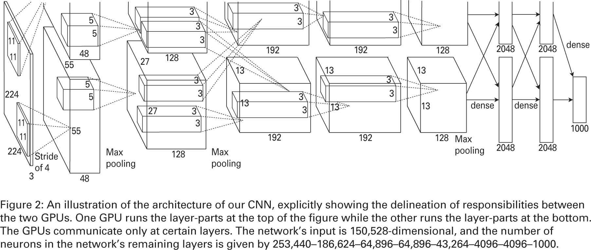

<samp class="SANS_ITC_Stone_Sans_Std_Semibold_B_11">图 6.9</samp>

自动构建 ImageNet 地真值的输入数据与输出目标之间关系的算法机制示意图。*来源：* Krizhevsky, Sutskever, and Hinton (2012, 5)。由 Ilya Sutskever 感谢。

### GPU 的作用

然而，仍然存在一个重要的问题：Krizhevsky、Sutskever 和 Hinton 到底是如何让他们那大胆但标准的算法机制处理输入数据的？他们是如何有效地产生函数近似的？这就是另一个关键要素出现的地方（除了 ImageNet 地真值和多程度上即用的连接主义算法包之外）：图形处理器（GPUs）。

事实上，深度卷积神经网络的机制需要大量的计算能力。然而，由于 Krizhevsky、Sutskever 和 Hinton 处理的是图像——即包含像素强度的数组——他们能够从称为 GPU 的特殊集成电路中获得帮助（在这种情况下，是两块 NVIDIA GTX 580 3GB GPU）。然而，有必要与这些计算系统进行交互，以便它们能够充分表达卷积神经网络（及其整个算法装置）。

这可能是 Krizhevsky、Sutskever 和 Hinton 最令人深刻的成就，不应被低估。他们可能拥有他人制作的大且可靠的地真值，也可能拥有由充满活力且支持性的连接主义社区逐步设计的丰富且具调节性的算法基础设施；所有这些元素尚未与计算机的简陋环境相兼容。而且，如果我们参考 Cardon、Cointet 和 Mazières 对一位备受尊敬的计算机视觉研究者的采访：

> [Alex Krizhevsky] 运行着巨大的机器，这些机器拥有当时并不出色的 GPU，但他让这些 GPU 相互通信以提升性能。这完全是一个疯狂的机器操作。否则，它永远无法运行，这是一种极客的技能，一种令人惊叹的编程技能（Cardon, Cointet, and Mazières 2018；我的翻译）。

除了李飞飞（Fei-Fei Li）团队做的地真值努力以及之前的连接主义研究者实现的算法基础设施外，Krizhevsky、Sutskever 和 Hinton 还必须投入巨大的编程工作来提出他们的深度学习算法：一项“惊人”的壮举。然而，在这些努力之后，可能经过多次重构操作，他们确实成功构建了一个拥有六千万参数的巨型函数（Krizhevsky, Sutskever, and Hinton 2012, 5）。

### 方法比较

当我们把小组的高斯拟合（不完全是机器学习）与 Krizhevsky、Sutskever 和 Hinton 的卷积神经网络的真正的机器学习进行比较时，看到了什么？除了明显的区别（特别是在算法复杂度方面），一个重要的相似性脱颖而出：两者都导致了大致相似的结果；即对假设函数的近似。机器学习器产生的函数可能只有四个参数，但它最终将输入转换为操作数，将输出转换为结果，就像 Krizsky 的六千万参数函数所的那样。两个机器学习器都近似了组织各自地真值的假设函数，因此从属于。

然而，尽管有这种重要的相似性，这两个机器学习器的区别在于它们源于不同的过程；虽然高斯拟合只接管了瞬间，并遵循可以追踪和归源的手工翻译，但 Krizhevsky、Sutskever 和 Hinton 的机制接管了训练集构建的大部分工作。小组必须假设变量，然后根据这些假设逐步访问认证的数学陈述——这里是二维高斯；再次，如果构建活动的一部分实现了自动化，至关重要的是记住，这是以地真值工作和编程工作的对称异外包为代价的。


对这些元素进行推测，我们可能会于将机器学习——尽管其具有巨大的多样性——视为沿着一个连续体展开的过程（图 6.10）。机器学习者对函数进行近似，但也许，它们的调用越依赖于其他算法的堆叠（作为自动化表述活动的基础设施运行），它们就越构成了机器学习。根据这一观点，“机器学习”一词不再仅仅指一类统计技术，现在还包含了一种委托（或许有时是一种习惯）实践，这需要适当的基础设施，而设施本身涉及真值验证（ground-truthing）和编程问题。

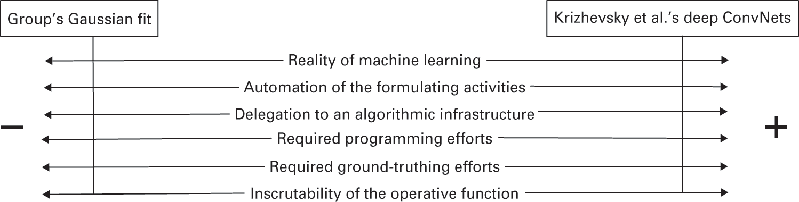

<samp class="SANS_ITC_Stone_Sans_Std_Semibold_B_11">图 6.10</samp>

被视为连续现象的机器学习示意图。

将机器学习初步重新定义为表述活动的一种特定实例，可能允许我们以一种创新的方式审视不可解释性（inscrutability）问题。我们不再将解释导致机器学习真值函数近似形成的过程变得日益增加的困难视为一种局限，这种机器学习概念可能将其视为与真实的机器学习是同质的：机器学习越深，委托就越多，而要检查是什么导致了允许输入转换为输出的数学操作形成，就变得越困难。然而——这也是我推测性命题的真正意义——真实机器学习固有的不可解释性可能需要通过更多的真值验证和编程努力来偿，而这两者都是可审查的活动（正如我们在第一部分和第二部分所看到的）。

我在这里并不打算列举普遍的事实；这些初步的提议主要是为了引发进一步的探讨。考虑到机器学习既被广泛讨论又极少被研究（至少在历史和社会学角度如此），这一点甚至更为真实。然而，正如 Jones (2018) 和 Plasek (2018) 所暗示的，鉴于机器学习在算法形成中日益增长的重要性，调查这种表述活动最新表现形式的历史和当代驱动因素比以往任何时候都更为关键。

***

在第三部分中，我试着根据第一部分和第二部分提出的元素，记录计算模型的渐进式塑造。鉴于我们最终称之为“表述实践”的内容涉及对数学命题的操作，我们首先必须更好地理解 `数学事实` 及其相关的 `对象`。它们从哪里来？它们是如何组装的？为什么计算机科学家需要它们？为了回答这些初步问题，我们不得不暂时远离许多关于数学的叙述：我们在第 3 章和第 4 章中的痛苦确实教会了对“思想”、“思维”或“抽象”等术语保持怀疑。在第 5 章中，受几篇关于数学科学技术研究（STS）的启发，我们优先考虑了一个实实的观点：在存在的某一点，数学命题可以被视为书面主张，试图说服读者。这一初始假设允许我们考虑数学与其他科学之间惊人的相似性；数学家和科学家所做出的书面主张必须经过许多`试验`才能最终被接受为事实。数学知识并不是作为思想的某种基本要素存在的，而是渐进地演变成一个巨大的、荣誉且不断演化的认证命题体系。

我们随后必须考虑这些经过认证的数学命题所处理的对象：它们与科学对象相似吗？通过虚构地比较生物医学实验室的工作与代数几何实验室的工作，我们意识到，是的，科学对象和数学对象可以认为是相当的。在这两种情况下，尽管存在拓扑上的差异（数学实验室通常比生物医学实验室更“平坦”、更“干燥”），实验、仪器和铭文的对齐——简而言之，`实验室实践`——渐进地导致了科学对象的塑造，它们的属性和轮廓反变成了旨在说服怀疑读者的论文主题。

科学对象与数学对象之间惊人的相似性反过来促使我们考虑，为什么数学对象经常参与非数学科学对象的塑造。在数学 STS 作品的持续支持下，我们意识到数学的组合强度很大程度上源于平庸的翻译实践，这些实践渐进地还原实体，以适应数学知识这种扁平且干燥的生态系统。通过这种还原，科学家使他们试图刻画的实体变得`更容易处理`、`更易共享`、`更具可比性`、`更具塑性`以及`更易被纳入`，从而在试图说服同事其具化存在的书面主张中实现这一点。这些元素最终允许我们把 `表述实践` 定义为一种经验过程，即翻译未定义的实体，以赋予它们与已定义的数学对象相同的形式。

我们随后尝试使用这些介绍性元素来分析发生在实验室内部的一场表述事件。我们首先考虑了真值验证实践——特别是数据集的初始收集——有时如何作为后续表述实践的`准备步骤`。这第一个元素让我们意识到，我们在第 2 章发起的“以问题为引导的算法视角”与我们在第 6 章扩展的“基于公理的算法视角”之间需要紧密的联系。

我们随后调查了该小组计算模型之一的形成。我们首先记录了该小组训练集的多次翻译和还原；从一个混乱的 `Matlab` 数据库，训练集渐进演变为一个单值列表，该小组可以将该列表翻译成散点图，其形状表达了一个单一现象。小组对该现象`看起来像`高斯函数的强有力直觉，得益于几个世纪的认证数学命题等因素，支持将散点图进一步翻译成图表，图表反过来可以用参数公式。

我们随后看到，尽管学术论文中描述计算模型的数学铭文显然无法触发能够让计算机计算实际数据的电冲，但这些数学铭文仍然可以为计算机编程活动建立`可迁移的场景`。这一元素至关重要，因为它完成了本调查中三个动名词部分之间的连接。事实上，似乎表述实践依赖并有时影响真值验证实践，而真值验证实践本身由编程实践支持，而编程实践本身有时被表述实践的结果灌溉。整个以行动为导向的算法概念开始展开；我们喜欢的算法有时可能是这三个相互关联活动的结果，我在这里称它们为`真值验证`、`编程`和`表述`。


对此进行推测，我们最终探讨了广受讨论但在社会学领域研究较少的机器学习这一话题。基于关于机器学习现实的多样性的一些（尽管极少的）实证线索，我提出了以下初步假设：机器学习一旦被视为一种*生活经验*，它可能包含了一种能够自动化制定化过程的大胆能力。然而，这种近期习得的习惯可能依赖于日益增加的真值化（ground-truthing）和编程努力，这些努力的源泉将受益于进一步的社会学研究。

## 结论

> 如果你想理解大问题，你需要理解构成这些问题的日常实践。
> —Suchman, Gerst, and Krämer (2019, 32)

> 因此，制宪权力要求将“制宪”视为一个动词而非名词，视为一个开放的而非不可更改的结构，一个永不结束的开放程序。
> —Hardt (1999, xii)

后续工作包括：对一个数字图像处理计算模型真实性的研究（其学术论文曾被初步性拒绝，第 2 章）、描述编写简短 `Matlab` 程序所采取的行动（第 4 章），以及对从小型训练集中抽象出的四参数公式的塑造过程进行分析（第 6 章）。与本书明确针对的这一“巨兽”——*算法*及其对集体世界塑造日益增长的贡献相比，这些实证元素似乎显得非常微弱。

尽管如此，这本书仍然是由某种信心驱动的。如果我不相信它的便利性，我根本就不会写（或至少不会出版）它。什么证明了这种信心？哪种思维方式支持了这种对相关性的预设？在结语中，是时候考虑这项调查对于其结果政治意义的那些半隐藏的假设了，无论这些假设是多么初步。

## 窥见一角，扩充未知

在引言中，我提到了许多关于算法影响的当代社会学著作，并假设这些工作逐渐促使算法成为公众关注的焦点。随后，我建议当前关于算法的争议需要构思性的尝试。由于算法现在已成为计算机化社会的核心，*同时*涉及道德和伦理问题，它们的存在本身就意味着需要建设性的谈判。我接着建议，这些争议性妥协的基础需要从某种程度上得到准备，或者至少要配备装备。目前，算法构成实践的*负面不可见性*（Star and Strauss 1999）阻止了我们全面地把握这些实体；事实上，要对没有物质厚度的过程进行改变是困难的。我随后建议，在其他可能的方法中，提出一种新的理论装备的一种方式，是与计算机科学家和工程师合作进行社会学调查，以记录他们的工作活动。这可能有助于更好地理解他们的需求、依恋、问题和价值观，帮助争论双方像沃尔特·利普曼（Walter Lippmann，1982, 91）所说那样，“在自己的色彩下”开始谈判。

这是一次前所未有的尝试。虽然我可以基于几位处理科学和数学实践的 STS 作者的作品进行扩展，但诚实地说，我大多数时候处于自力更生的状态。然而，这是一次形成性的练习，迫使我在“实验室研究”流派提出的通用框架之外，提出了方法论和概念——特别是在第 1、3 和 5 章中——我相信这些概念非常适用于对计算机科学工作的分析。对行动过程的仔细且细致的展开，使我能够记录实体——真值、程序和公式——的渐进形成，这些实体汇集了选择、习惯、对象和欲望。此外，这些实体与其塑造过程中涉及的实践之间的一致性，至少在某些时候和部分形成了我们通常称为算法的其他实体。

尽管如此，这种分析手势遭受了某种不对称性：一方面是一份博士论文产生的小型民族志报告，另一方面是一个不断增长和创新的整个行业。凭借如此有限的手段，本调查只能窥见算法在其惊人多样性中的灌溉系统。更糟糕的是，通过对算法构成关系中极有限的一部分提供新视角，这项调查暗示了一个大陆，却对其未多言言。那么，将算法从实验室带出来、将其纳入商业安排、整合到软件基础设施、修改其内部组件、维护它们、改进它们，或者对其诅咒或热爱它们所涉及的行动又是怎样的？通过证明将算法带回地面并将其视为平庸可改过程的产物是可能的，这项调查承诺的可能比它实际提供的要多。对于一个提议多于断言的调查，可以赋予什么价值？

## 一份反叛文献

可以从强调这项调查的抗议性潜台词开始。即使它并不希望批判当代关于算法的社会研究——因为这些研究帮助我们关注自己的“算法生活”（Mazzotti 2017）——本调查的方法和结果仍然对这些研究有时倾向于灌输的思维习惯采取了立场。

这种习惯在引言中简要提到，表现为从外部立场和根据其影响来考虑算法。我反复强调过，这种姿态很重要，因为它创造了政治情感。然而，随着其泛化，它也遇到了一个循环剧场形式的局限。最初由 `Ziewitz (2016)` 提出的论点是：虽然在许多方面是有益益的，但近期对算法影响研究的激增潜移默化地倾向于让它们看起来具有自主性。算法越来越多地从远处以及根据它们产生的差异被考虑，慢慢开始变成独立的、影响力的实体。这是*算法剧场*（algorithmic drama）的第一幕，正如 Ziewitz 所言的：算法正逐渐变成，至少在社会科学文献中，是*强大的浮动实体*。


此外，一旦那些允许算法部署并持续运行的网络被忽视，算法也会变得愈发神秘。事实上，根据这种带有风险的观点，这些强大的实体是由什么构成的？由于对算法影响的研究往往倾向于忽视对支持并使其发生的因素的研究，这些实体似乎是由理论的、非物质的和抽象的成分构成的，这些成分被模糊地称为数学、代码或两者的结合。由于无法掌握这些包所包含的内容，复杂性很容易被呼之求救：无论构成算法的数学或代码指代什么，算法由于其是抽象且强大的，必然是高度复杂的实体。事物如何能同时是分布式的、转瞬即逝且具有影响力的？这正是由于算法影响研究的增加而（空洞地）引发的问题——这种增加悄然地引入了算法戏剧的第二幕：`algorithms become inscrutable`。其最终结果是一个剥夺权力的循环，正如 Ziewitz (2016, 8) 所写，“操作的不透明性往往被视为其影响力和权力的新标志。”这种在社会科学版图中悄然展开的算法戏剧正因此是循环的：算法之所以强大，是因为它们不可捉摸；因为它们强大，所以它们不可捉摸……

本研究反对了这一趋势（尽管这一趋势仍然重要且具有价值）。本书并没有从距离和其影响的角度来考虑算法，而是通过三个案例研究——以及在理论和方法论上的补充——表明，事实上，从算法被具体塑造的场所内部来考虑算法是可能的。因此，这是一种基础性的但又脆弱的抵抗与组织行为。它挑战了算法戏剧的设定，同时提出了更新和维持这种挑战的方法。由于本研究旨在根据使其发生的集体过程来描绘算法，因此这项调查也是一种挑战既定设定的构成性动力。再次，`there is no innocence`。

在我看来，这一切都要归于哲学家安东尼奥·内格里（Antonio Negri），他发现了叛乱行动的双重属性。在他的著作《Insurgencies: Constituent Power and the Modern State》中，内格里 (1999) 很好地识别了批判性姿态的一个基本特征：它们实际上始终是清晰愿景的载体。只有从既定设定的角度，并凭借于建立这一体系的宪法化过程，叛乱冲动似乎才是支离、不完整且乌托邦的。从历史和哲学角度来看，事实恰恰相反：在表象之外，既定权力是相当空虚的因为它因为它依赖并恢复了与其对立的构成性力量的持续创新。这一论点使内格里反过来认为，构成性动力并非代表那些必要的边缘且无秩序的力量（这些力量在某些时刻需要像热月政变那样对其予以终结），它们具有时效性和连贯性，并代表了民主政治活动的永久基石。

尽管本书并不赞同内格里关于“构成权力”（constituent power）概念的所有主张，^(1)，但它非常符合内格里的一个有力命题，即政治（政治化过程意义上的）无法避免叛乱行动。通过暗示与实用主义传统之间建立有趣且令人惊讶的桥梁，^(2)，内格里 (1999, 335) 确实肯定了“没有构成权力的政治就像旧旧房产，不仅在凋零，而且对工人及其所有者来说都是毁灭性的。”这就是本书政治论点所在；它为算法的形成提供了一种替代性的叛乱视角，以为论点提供支持并建议创新的组织模式。

但如果本书被视为一种抵抗与组织的行为，旨在通过对算法如何产生的替代性说明来燃料和润滑与算法相关的公共问题，那么为什么不叫它“算法的构成者”（the constituent of algorithms）呢？为什么我刻意选择“宪法”（constitution）一词，它似乎与喂养政治化过程的叛乱行动是对立的？在这里，我们必须考虑这项研究的本质：一种或多传播的铭刻（inscription）。我们在这里发现了一个贯穿全书的概念。得益于它们通常具有持久性、移动性和可呈现性，铭刻对集体世界的持续塑造贡献巨大。并且正如任何铭刻一样，由于我所谓的“多萝西·史密斯法则”（参见引言），这个被铭刻的体积试图以其他现实为代价建立一种现实。再次，正如既往一样，`there is no innocence`：通过文本表达现实，铭刻也执行了这些现实。然而，一个文本无论多忠实——尽管某些文本确实比其他文本更忠实——它本身也是一种愿望的成就。

这项研究的固定方面源于其自身的脚本形式，不应被低估。在我看来，这甚至是内格里关于构成权力工作的一个局限，无论它是多么多么有趣和详尽。尽管叛乱冲动形成了政治历史的驱动力——我们可以坚持这一点——但它们往往是具有基础性特征的脚本行为。^(3)。因此，“宪法”一词显得最合适；如果这项调查参与了对既定设定的质疑，它作为一种铭刻，在确认权力方面仍然是构成性的。

## 一种待追求的动力

然而，没有什么能阻止这份叛乱文献被其他叛乱文献补充和挑战。这甚至是它的主要抱负之一：激发一种能够让算法变得越来越易理解的批判动态。这是本研究的起点，也是它的终点：通过与算法更亲密地相处来学习更多关于算法的知识。当然，还有许多方法可以做到这一点。


本书在理论章节和实证章节中都提出了此类替代性路径。第一章在介绍调查方法论时，也指出了组织其他立足于地点和情境的调查的方法。例如，如果一位民族学家能够整合一个试图设计和销售算法相关产品的初创团队，那将是极其有趣的。至于第二章，对学术和工业“地面真相”（ground truths）的构思、汇编和聚合所需的工作进行系统性研究，无疑有助于将算法与更通用的动态变化联系起来，例如与按需劳动新形式的兴起相关。这种调查工作还可以在支持个人数据商品化的当前网络技术与例如区块链技术之间建立分析桥梁，而区块链恰恰是基于对这种可能性的严厉批判的。在第三章中，当涉及到 20 世纪 50 年代以来编程实践逐渐被搁置时，对早期电子计算项目进行更系统性的社会历史调查，可能会对“人工智能”产生全新的视角——这个术语或许是建立在对其他相似工作实践的隐形化处理之上的。关于第四章和计算机编程的情境化实践，对程序员在日常工作中动用的组织和物质设备进行进一步的社会学调查，有助于更好地理解这一对于我们当代社会至关重要的专业活动。相反，编程从业者可能不再被视为一个拥有自身密码的代码社区，而是（可能最重要的是）被视为不断探索通过数字指令列表与计算机交互的替代方式的差异化群体。在第五章中，尽管它是关于对数学知识特定理解的操作化，但读者无疑注意到我的论题所依据的少数来源。不言而喻，在我们日益计算机化的世界里，对支撑数学陈述形成的理论工作进行更多社会学分析，比以往任何时候都更为重要。最后，正如第六章末尾概述的那样，关于构想实践，从使这些实践存在的实际过程出发分析近期与机器学习相关的动态，可能会从一个全新的视角来审视复活的人工智能承诺：这种智能的成本是什么？它是如何成为“人工”的？它的内在局限性是什么？这些是基层迫切需要考虑的议题，不仅是为了助长争议，也可能（且始终暂时地）结束这些争议。

目前，我们对于这本书希望建议的那种通用算法社会学仍然遥远。我们只是处于一条道路的起点，如果我们想民主地将算法生态系统整合到集体世界中，这条路非常漫长。通过这本书，除了呈现的这些我希望本身具有价值的元素之外，人们也可以将其视为对算法形成和流通背后平庸工作进行调查的邀请——简而言之，这是一个开放且可修正的宪法。

## Notes

## 术语表

actant（行动者）指任何特定的人类或非人类实体。该概念由符号学家 Algirdas Julien Greimas 开发，随后被 Bruno Latour (2005) 采纳，以将代理性（agency）扩展到非人类行动者，并为他的社会学理论（通常被称为“行动者网络理论”）奠定基础。

algorithm（算法）是本书试图以一种行动导向的方式定义的概念。考虑到调查的实证结果，算法可以被视为（但绝不能还原为）地面真相化、编程和构想活动产生的不确定产物。

algorithmic drama（算法戏剧）指的是威胁到算法批判性研究的困局。通过主要从距离和效应的角度来考虑算法，这些研究面临着陷入戏剧性循环的风险：算法之所以强大是因为它们不可捉测，因为它们强大，所以它们不可捉测，以此类推。“算法戏剧”一词最初由 Malte Ziewitz (2016) 提出。

association（关联）指至少两个行动者之间建立的连接或纽带。关联是一个事件，从中产生出一种差异，文本有时可以部分解释这种差异。

BRL 是 `Ballistic Research Laboratory`（弹道研究实验室）的缩写，这是一个已解散的中心，专门负责美国陆军的弹道研究，位于马里兰州的阿伯丁试验场。BRL 在电子计算的历史中扮演了重要角色，因为 ENIAC 项目最初的启动是为了加速在 BRL 范围内进行的弹道轨迹分析——这是与宾夕法尼亚大学电气学院合作的结果。

CCD 和 CMOS 分别是 `charge-coupled device`（电荷耦合器件）和 `complementary metal-oxide semiconductor`（互补金属氧化物半导体）。通过将电磁光子转化为电子电荷并进行放大和数字化，这些设备能够产生由被称为像素的正方形元素组成的数字图像。这些离散像素根据允许识别其在网格位置的坐标系进行组织——对于彩色图像，通常为其分配八位红、绿、蓝值——使得配备专用程序的计算机能够对其进行处理。`CCD` 和 `CMOS` 都是数码摄像头的核心。尽管它们仍然是许多研究工作，但它们现在已实现工业化生产并受到许多规范标准的支撑。

chain of reference（引用链）最初由 Bruno Latour 和 Steve Woolgar (1986) 开发，用于解决科学事实的构建问题。该概念与“铭刻”（inscription）密切相关，引用链允许维持常数，从而有时可以接触遥远的事物。例如，通过描述实验室中的科学仪器使引用链变得可见，可以理解产生关于远程实体的认证信息所需的物质性。

cognition（认知）是一个歧义词，在词源上与知识的概念相关，因为它源自拉丁语动词 `cognōscere`（了解）。为了弱化这个很大程度上因政治原因而变得霸权的概念，这项调查——继 Simon Penny (2017) 的工作之后——倾向于将其归因于更泛的*赋予意义*（making sense）的过程。


`cognitivism` 是一种考虑认知的特定方式。出于偶然的历史原因，产生意义的普遍过程逐渐与获取关于远程实体知识的过程联系起来，而没有考虑到实现这种获取的工具。认知主体与被认知客体之间的形而上学划分，这种不考虑知识生产过程中涉及的物质基础设施的直接结果。这反过来又迫使认知主义将知识与现实融合，从而使得 *adaequatio rei et intellectus*（事与知的符合）成为有效陈述和行为的唯一（尽管是非现实的）标准。

`collective world` 是正在发生之事的内在过程。它接近维特根斯坦对世界的定义，即“凡是存在的一切”（Wittgenstein 1922）。“集体”这一形容词旨在为这一生成过程所涉及的实体的多样性提供基础。

`Command Window` 是 Matlab *集成开发环境* (IDE) 中的一个空间，允许程序员在他们的计算机终端上查看其编程操作的结果。

`composition` 是本项研究的焦点；它是试图在自己的层面上参与其中的物。构图接近于妥协，表达了对共性的渴望，同时没有忽视这种渴望不断要求的创造性重新调整。构图是现代性的替代方案，因为它对普遍性的渴望基于比较人类学，从而避免了（至少可能避免了）民族中心主义的陷阱。

`computationalism` 是一种认知主义形而上学，其中感知输入以神经脉冲的形式存在，由心理模型处理，模型反向神经系统输出不同的数值。根据计算主义，代理性（agency）被认为是感知和认知过程的输出，并以神经脉冲指示的身体运动的形式存在。这种认知观念与*心灵的计算比喻*密切相关，它在人类大脑与（编程的）计算机之间建立了等同关系。

`constitution` 既指一个过程也指一份文件。此处这一概念优于传统的 *construction*（构建）概念，因为它保留了社会学尝试的一个基本张力：描述与反抗。“宪法/构成”一词提醒我们，一个现实的产生是以另一个现实为代价的。

`course of action` 是一系列可负责的姿态、眼神、言语、动作以及人类与非人类行动者之间的互动，它们的衔接有时会产生*某些东西*（一块钢板、一块木板、一项判决、一种算法等）。遵循雅克·特布罗（Jacques Theureau）的开创性工作，行动轨迹是本研究的基石。该概念与*activity*（活动）概念密切相关，在书中，活动被理解为一组共享共同目标的、交织的行动轨迹。本书的三个部分都是尝试展示参与算法形成的活动的冒险尝试；因此它们各自采用了动名词形式的标题：ground-truth*ing*（真值化）、programm*ing*（编程）、formululat*ing*（公式化）。

`CSF` 是 *Computer Science Faculty*（计算机科学学院）的缩写。它是实验室所属的部门。出于匿名考虑，CSF 是我所说的*欧洲技术学院* (ETI) 的一部分。

`digital signal` 在技术理解上，由取决于描述信号的独立变量的 `n` 维空间表示。例如，一个采样的数字音频通常被描述为一维信号，其依赖变量——振幅随时间（`t`）变化；数字图像通常被描述为二维信号，其依赖变量——强度随两个坐标轴（`x`, `y`）变化；而视听内容将被描述为具有独立变量（`x, y, t`）的三维信号。

`Editor` 是 Matlab *集成开发环境* (IDE) 中的一个空间，允许程序员输入字符，在解释器的帮助下这些字符能够触发电脉冲以所需的方式计算数字数据。它是大型*源代码编辑器*大家庭的一部分，这些编辑器可以是独立的应用程序，也可以是构建在更大的软件环境中的。

`EDVAC` 是 *Electronic Discrete Variable Automatic Computer*（电子离散变量自动计算机）的缩写。这个机密项目于 1944 年 8 月启动，是摩尔电气工程学院 ENIAC 项目的直接延续。EDVAC 在电子计算历史上扮演了重要角色，因为它是冯·诺依曼于 1945 年写的一份具有影响力的报告的主题。这份未完成的报告名为《关于 EDVAC 的报告草案》，为后来被称为*冯·诺依曼架构*的东西奠定了基础。

`ENIAC 是 *Electronic Numerical Integrator and Computer*（电子数值积分计算机）的缩写。这个机密项目于 1943 年 4 月在约翰·莫奇利（John Mauchly）和约翰·普雷斯珀·埃克特（John Presper Eckert）的指导下，在摩尔电气工程学院启动。它最初的目标是通过电子速度求解大型迭代方程，以加速远程武器所需射击表的生产。尽管 ENIAC 在许多方面具有创新性，但其局限性促使莫奇利、埃克特以及后的冯·诺依曼启动了另一个电子项目：EDVAC。

`flat laboratory`（平坦实验室）是一个修辞手法，旨在解决数学家工作产生认证陈述的物理位置。与例如分子生物学或高能物理实验室相比，数学实验室的仪器倾向于占用较少的空间。在这里不要将“平坦”与数学中的维度概念混淆，后者通常被用于捕捉和界定平坦感（或厚重感）的体验。根据本书的观点，维度应被视为数学实验室设备相对平坦的产物。

`formula` 是以通用脚本形式表示的数学运算。在数据集中登记公式以建立数据集之间先从、后关系的实际过程在此处被称为 *formulating*（公式化）。

`ground truth`（真值）是一种通常呈数字数据库形式的人造制品。它的主要功能是将输入数据集（图像、文本、音频）与输出目标集（标记的图像、标记文本、标记音频）联系起来。由于真值制定了尚未设计的算法必须解决的问题，它们也确立了自身的真实性。正如本书所示，许多真值并非预先存在的，因此需要被构建。


`image processing` 是计算机科学的一个分支，旨在开发和发布计算机化的计算方法，能够以有意义的方式处理源自 CDD 和 CMOS 的像素。由于数字图像可以描述为二维信号，其因变量——强度——随两个轴（`x`、`y`）而变化，因此图像处理有时也被称为“二维信号处理”。当它侧重于识别任务时，通常被称为“图像识别”。

`inscription` 是一种特殊的行动者（actant），它具有`持久性`（其生命力持续于其实例化的当下）、`移动性`（它可以从一个地方移动到另一个地方而不发生太大改变）以及`可呈现性`（它能够配合适当的基础，携带、传输和展示不仅属于其自身的属性）。由于这些能力，铭刻在塑造集体世界方面发挥了巨大作用。

`INT` 是 `interpreter`（解释器）的缩写，是一种复杂的计算机程序，在与计算机硬件通信之前，将用高级编程语言编写的铭转换为抽象语法树。每当解释器无法完成翻译时，高级程序就无法完全运行。

`Lab` 代表计算机科学学术`laboratory`（实验室），它是本项民族志调查的实地现场。该实验室专注于数字图像处理，其成员——博士生、博士后、访问研究员、教授——花费大量时间构建新算法，并在同行评审的期刊和会议上发表。

`laboratory study`（实验室研究）是一种受 STS（科学技术研究）启发的民族志工作流派，在于对科学家和技术人员日常工作的说明。借鉴人类学的方法，它意味着在学术或工业实验室内停留较长时间，与其成员协作，变得某种熟练，并对发生的事情进行大量记录。在某个时间点，它最终也意味着离开实验室——至少是暂时离开——以便在最终提交关于所观察活动的研究报告之前对数据进行进一步整理和分析。

`machine learning` 不是一类统计方法，而且可能最重要的是，是一种由自动化部分制定活动组成的生存体验。然而，这种为了算法设计的算法委托依赖于日益增加的且往往是不可见的真值验证和编程工作。

`mathematics` 在书中被认为是科学活动不可或缺的一部分。因此，它通常由产生关于在（平坦）实验室内部通过仪器和设备塑造或发现的对象的认证事实组成。

`Matlab` 是一种私有的用于数值计算的数学软件，围绕其自身的解释型高级编程语言构建。由于其在设计线性代数问题方面的灵活性，Matlab 被广泛应用于计算机科学、电气工程和经济学的研究和工业领域。然而，由于 Matlab 主要使用解释型编程语言，其程序在与硬件交互之前必须通过 `interpreter`（`INT`）进行翻译。这种解释步骤使其在处理大型矩阵时的效率低于例如直接用 `C` 或 `C++` 等编译语言编写的程序。

`model`（模型）是一个与算法接近的术语。在书中，算法与模型之间的区别只能是追溯性的：如果所谓的“模型”至少源于真值验证、编程和制定活动，那么它被视为算法。

`problematization`（问题化）在书中是确立问题术语的集体过程。在`Science and Technology Studies`（科学技术研究）的基础上，分析问题化意味着描述问题如何被构架、组织并逐步转化为可以提出解决方案的议题。

`process thought`（过程思维）是一种本体论立场，受到大量且异质的哲学著作的支持，这些著作对关联（有时也称为关系）具有相似的感性。对于过程思想者来说，事物的本质是它们与其他实体关联时变成了什么，而关联本身就是过程的一部分。重点在于“如何”而不是“什么”：过程思想者与其问某物“是什么”，不如问某物是“如何”“变成”的。这种本体论关于的是持续的表演，而不是二进制状态。

`PROG` 在书中特指一种 `Matlab` 计算机程序，旨在创建像素值对应于人类工人绘制矩形数量的矩阵。

`program`（程序）是一种文档，其结构和内容在充分阐述时可以产生计算数据。编写计算机程序的实际过程被称为 `programming`（编程）。

`re-presentation`（再次呈现）是对某物的“再次”展示。铭刻是常见的再次呈现，因为它们展示了其他实体的属性。书中的再次呈现不与 `representations`（不带连字符的表示）混淆，后者是指认知主义作者为了克服扩展实体（`res extensa`）与思维实体（`res cogitans`）之间的区分而找到的解决方案。

`saliency detection`显著性检测是图像处理的一个分支，旨在检测数字图像中吸引人们注意的内容。由于这些检测努力的主题极具模糊性，显著性检测是一个研究领域，显示出在人脸或物体识别等更传统分支中可能被忽视的动态。

`scenario`（方案）指的是一种指向另一个地方、另一个时间和和其他行动者的三重位移的叙事，同时对其陈说者保持控制。作为表演性的叙事资源，方案对编程活动至关重要，因为它们建立了程序员可以持有（同时被其所持有）的边界，并反过来建立了计算机编程阶段的边界。

`Science and Technology Studies (STS)` 是社会科学和社会学的一个分支，旨在记录科学、技术和集体世界的共同构建。松散地联系这一异质研究社区从业者的是一种信念：科学不仅是逻辑经验主义的表达，对世界的知识并非先验，而且科学和技术真理取决于集体安排、仪器化和动态。


`script` 通常指一个小型计算机程序。许多相互关联的脚本和相互调用的程序通常构成 `software`。这一概念不应与马德琳·阿克里希（Madeleine Akrich，1989）的“scripts”混淆，后者在书中更接近于 `scenario`（场景）。

书中，`sociology`（社会学）是通过专门文本（`logos`）来描述关联（`socius`）的活动。它旨在帮助理解集体世界上发生了什么，并更好地与填充/塑造该世界的异质实体进行协作。在书中，社会学区别于 `social science`（社会科学），后者被认为是对先验假设的集合进行的科学研究，通常被称为社会（或 society）。

`technical detour`（技术绕路）是一种隐秘且难以记录的经历，呈现为之字型形式：得于不可预测的绕路，原本遥远的实体变成了项目实现中的缺失拼图。技术绕路——正如布鲁诺·拉图尔（Bruno Latour,2013）所构想的那样——涉及对新加入实体的委托。它们还意味着一旦新的组合建立，就会忘记它们短暂的经过。

`translation`（翻译）是行动者通过修改、移动、减少、转换和衔接其他行动者，使其符合其关注的工作。这是一种特定的关联，产生了差异，在适当的方法下，这些差异可以反映在文中。该概念最初由米歇尔·塞尔塞尔（Michel Serres，1974）开发，随后被马德琳·阿克里希、米歇尔·卡隆和布鲁诺·拉图尔采用，以奠定 `sociologie de la traduction`（翻译社会学）的基础，我在此称之为社会学。

`trial`（试验）是一个测试事件，其结果对行动者的生成产生巨大影响。如果通过了试验，行动者可能成功与其他行动者关联，而这种新关联反过来变得更具抗性。如果未通过试验，行动者将失去一些属性，有时甚至会消失。

`visibility/invisibility`（可见性/不可见性）是工作实践的相对状态。这些变化的状态是可见化或不可见化过程的产物。如果工作实践的完全不可见并非理想，那么完全可见也同样如此。在书中，我选择公共争议作为负面不可见性的指标，反而建议通过例如社会学调查来启动可见化过程。

## References

*   Abbate, Janet. 2012. *Recoding Gender: Women’s Changing Participation in Computing*. Cambridge, MA: MIT Press.
*   Achanta, Radhakrishna, Sheila Hemami, Francisco Estrada, and Sabine Susstrunk. 2009. “Frequency-Tuned Salient Region Detection.” In *IEEE Conference on Computer Vision and Pattern Recognition,* Miami, FL, June, 1597–1604. New York: IEEE.
*   Ackley, David H., Geoffrey E. Hinton, and Terrence J. Sejnowski. 1985. “A Learning Algorithm for Boltzmann Machines.” *Cognitive Science* 9, no. 1: 147–169.
*   Adelson, Beth. 1981. “Problem Solving and the Development of Abstract Categories in Programming Languages.” *Memory & Cognition* 9, no. 4: 422–433.
*   Ahmed, Faheem, Luiz F. Capretz, Salah Bouktif, and Piers Campbell. 2012. “Soft Skills Requirements in Software Development Jobs: A Cross-Cultural Empirical Study.” *Journal of Systems and Information Technology* 14: 58–81.
*   Ahmed, Faheem, Luiz F. Capretz, and Piers Campbell. 2012. “Evaluating the Demand for Soft Skills in Software Development.” *IT Professional* 14, no. 1: 44–49.
*   Ahmed, Nassir U., T. Natarajan, and K.R. Rao. 1974. “Discrete Cosine Transform.” *IEEE Transactions on Computers* 23, no. 1: 90–93.
*   Akera, Atsushi. 2001. “Voluntarism and the Fruits of Collaboration: The IBM User Group, Share.” *Technology and Culture* 42, no. 4: 710–736.
*   Akera, Atsushi. 2008. *Calculating a Natural World: Scientists, Engineers, and Computers during the Rise of U.S. Cold War Research*. Cambridge, MA: MIT Press.
*   Akrich, Madeleine. 1989. “La construction d’un système socio-technique: Esquisse pour une anthropologie des techniques.” *Anthropologie et Sociétés* 13, no.
*   Akrich, Madeleine, Michel Callon, and Bruno Latour. 2006. *Sociologie de la traduction: Textes*. Paris: de’École.
*   Abbate, Janet. 2012. *Recoding Gender: Women’s Changing Participation in Computing*. Cambridge, MA: MIT Press.
*   Achanta, Radhakrishna, Sheila Hemami, Francisco Estrada, and Sabine Susstrunk. 2009. “Frequency-Tuned Salient Region Detection.” In *IEEE Conference on Computer Vision and Pattern Recognition,* Miami, FL, June, 1597–1604. New York: IEEE.
*   Ackley, David H., Geoffrey E. Hinton, and Terrence J. Sejnowski. 1985. “A Learning Algorithm for Boltzmann Machines.” *Cognitive Science* 9, no. 1: 147–169.
*   Adelson, Beth. 1981. “Problem Solving and the Development of Abstract Categories in Programming Languages.” *Memory & Cognition* 9, no. 4: 422–433.
*   Ahmed, Faheem, Luiz F. Capretz, Salah Bouktif, and Piers Campbell. 2012. “Soft Skills Requirements in Software Development Jobs: A Cross-Cultural Empirical Study.” *Journal of Systems and Information Technology* 14: 58–81.
*   Ahmed, Faheem, Luiz F. Capretz, and Piers Campbell. 2012. “Evaluating the Demand for Soft Skills in Software Development.” *IT Professional* 14, no. 1: 44–49.
*   Ahmed, Nassir U., T. Natarajan, and K.R. Rao. 1974. “Discrete Cosine Transform.” *IEEE Transactions on Computers* 23, no. 1: 90–93.
*   Akera, Atsushi. 2001. “Voluntarism and the Fruits of Collaboration: The IBM User Group, Share.” *Technology and Culture* 42, no. 4: 710–736.
*   Akera, Atsushi. 2008. *Calculating a Natural World: Scientists, Engineers, and Computers during the Rise of U.S. Cold War Research*. Cambridge, MA: MIT Press.
*   Akrich, Madeleine. 1989. “La construction d’un système socio-technique: Esquisse pour une anthropologie des techniques.” *Anthropologie et Sociétés* 13, no.
*   Akrich, Madeleine, Michel Callon, and Bruno Latour. 2006. *Sociologie de la traduction: Textes*. Paris: de’École.


- Badinter, Elisabeth. 1981. *母爱：神话与现实*。纽约：Macmillan。
- Balujaja, Shumeet, and Dean A. Pomerleau. 1997. “用于机器人视觉监控与控制的基于期望的选择性注意力。” *机器人与自主系统* 22: 329–344.
- Barad, Karen. 2007. *与宇宙会合：量子物理与物质与意义的纠缠*。北卡罗来纳州 Durham：杜克大学出版社。
- Bardi, Jason S. 2007. *微积分战争：牛顿、莱布尼茨与史上最大的数学冲突*。纽约：Basic Books。
- Barfield, Woodrow. 1986. “软件的专家与新手差异：对问题解决和知识获取的影响。” *行为与信息技术* 5, no. 1: 15–29.
- Barocas, Solon, and Andrew D. Selbst. 2016. “大数据的差异性影响。” *加州法学评论* 104: 671–732.
- Barrett, Justin L. 2007. “宗教认知科学：它是什么？为什么存在？” *宗教指南针* 1, no. 6: 768–786.
- Baya-Laffite, Nicolas, Boris Beaude, and Jérémie Garrigues. 2018. “服务于公共空间性取向预测的深度学习：对一种模糊警报的解构。” *网络* 211, no. 211: 137–172.
- Bechmann, Anja, and Geoffrey C. Bowker. 2019. “无名之名的无监督：社交媒体上人工智能中知识生产的隐藏层。” *大数据与社会* 6, no. 1. [https://doi.org/10.1177/2053951718819569].
- Beer, David. 2009. “通过算法获得权力？参与性网络文化与技术无意识。” *新媒体与社会* 11, no. 6: 985–1002.
- Bengio, Yoshua. 2009. “为 AI 学习深层架构。” *机器学习基础与趋势* 2, no. 1: 1–127.
- Bengio, Yoshua, Réjean Ducharme, Pascal Vincent, and Christian Jauvin. 2003. “一种神经概率语言模型。” *机器学习研究期刊* 3: 1137–1155.
- Bensaude-Vincent, Bernadette. 1995. “门捷里叶夫：发现的故事。”收于*科学思想史：科学史要素*，Michel Serres 编，556–582。牛津：Blackwell。
- Berg, Nate. 2014. “洛杉矶警察局式的犯罪预测。” *《卫报》*,6 月 25 日。[https://www.theguardian.com/cities/2014/jun/25/predicting-crime-lapd-los-angeles-police-data-analysis-algorithm-minority-report]。
- Berggren, John L. 1986. *中世纪伊斯兰数学史*。柏林：Springer。
- Bhattacharyya, Siddhartha, Hrishikesh Bhaumik, Anirban Mukherjee, and Sourav De. 2018. *用于大数据分析的机器学习*。柏林：Walter de Gruyter。
- Biancuzzi, Federico, and Shane Warden. 2009. *编程大师：与主要编程语言创造者的对话*。加州塞巴斯托波尔：O’Reilly。
- Birch, Kean, and Fabian Muniesa, 编. 2020. *资产化：科技科学资本主义中将物品转化为资产*。马萨诸塞州 Cambridge：MIT 出版社。
- Bishop, Chistopher M. 2007. *模式识别与机器学习*。纽约：Springer。
- Blaiwes, Arthur S. 1974. “呈现程序化指令的格式。” *应用心理学杂志* 59, no. 6: 683–686.
- Bloom, Alan M. 1980. “程序员能力测试使用的进展。”收于*计算机程序管理的进展*，Thomas A. Rullo 编，第 1 卷：31–60。费城：Hayden，1980。
- Bloor, David. 1981. “强纲计划的优势。” *社会科学哲学* 11, no. 2: 199–213.
- Bobzien, Susanne. 2002. “古代肯定前件式的发展：从亚里士多德到 2 世纪。” *Phronesis* 47, no. 4: 359–394.
- Boltanski, Luc, and Laurent Thévenot. 2006. *辩护：价值经济学*。新泽西州 Princeton：普林斯斯顿大学。
- Bonaccorsi, Andrea, and Cristina Rossi. 2006. “比较个体程序员参与开源运动的动机：从技术到商业。” *知识、技术与政策* 18: 768–786.
- Borji, Ali. 2012. “用于显著性的自上而下与自下而上特征。”收于*2012 IEEE 视觉与识别会议*，罗德岛州 Providence：IEEE。
- Bostrom, Nick. 2017. “开放性的战略影响。” *全球政策* 8: 135.
- Bottazzini, Umberto. 1986. *从欧拉到魏尔斯特拉斯的实变分析史*。
- Bourdieu, Pierre. 1986. “*幻象*。” *Actes de recherche* 62: 69–72.
- Bowker, Geoffrey C. 1993. “以其他任何方式无监督：社交媒体上人工智能中知识生产的隐藏层。” *社会研究* 2: 231–258。
- Boyer, Carl. 1959. *微积分的一百年史*。纽约：Dover。
- Brookell, Gillian. 2018. “亲爱的科技公司，我孩子出生后不想广告。” *《华盛顿邮报》*.
- Bucher, Taina. 2012. “想登上顶端吗？算法权力与 Facebook 上的不可见性。” *新媒体与社会* 14, no. 7: 1164–1180.
- Buchman, Amy. 2009. “四元数与四元全纯函数理论简史。”论文，11 月。[https://ui.adsabs.harvard.edu/abs/2011arXiv1111.6088]。
- Burks, Alice R., and Arthur W. Burks. 1989. *第一台电子计算机：阿塔纳索夫的故事*。密歇根州 Ann Arbor：密歇根大学出版社。
- Burks, Arthur W., et al. 1946. *电子计算机的逻辑设计的初步讨论*。新泽西州 Princeton：高等研究院。
- Burrell, Jenna. 2016. “机器如何‘思考’：理解机器学习算法的不透明性。” *大数据与社会* 3, no. 1: 1–12.
- Butler, Judith. 2006. *性别麻烦：女性主义与对身份的颠覆*。纽约和伦敦：Routledge.
- Button, Graham, and Wes Sharrock. 1995. “编写和阅读计算机程序的琐碎工作。”收于*情境化秩序：谈话与具身活动社会组织的研究*，Paul T. Have 和 George Psathas 编，231–258。
- Cajori, Florian. 1913. “指数与对数概念的历史。” *美国数学月刊* 20, no. 1: 5–14.

*(注：由于提供的原文中存在部分重复条目或格式错乱（如 Brooke, J. 的多次出现），上述翻译已根据“不要重复输出原文”的原则，对逻辑内容进行了逻辑对齐与合并翻译。)*

**更正：以下为基于您提供文本的准确翻译版本：**

[content]
- Badinter, Elisabeth. 1981. *母爱：神话与现实*。纽约：Macmillan。
- Balujaja, Shumeet, and Dean A. Pomerleau. 1997. “用于机器人视觉监控与控制的基于期望的选择性注意力。” *机器人与自主系统* 22: 329–344.
- Barad, Karen. 2007. *与宇宙会合：量子物理与物质与意义的纠缠*。北卡罗来纳州 Durham：杜克大学出版社。
- Bardi, Jason S. 2007. *微积分战争：牛顿、莱布尼茨与史上最大的数学冲突*。纽约：Basic Books。
- Barfield, Woodrow. 1986. “软件的专家与新手差异：对问题解决和知识获取的影响。” *行为与信息技术* 5, no. 1: 15–29.
- Barocas, Solon, and Andrew D. Selbst. 2016. “大数据的差异性影响。” *加州法学评论* 104: 671–732.
- Barrett, Justin L. 2007. “宗教认知科学：它是什么？为什么存在？” *宗教指南针* 1, no. 6: 768–786.
- Baya-Laffite, Nicolas, Boris Beaude, and Jérémie Garrigues. 2018. “服务于公共空间性取向预测的深度学习：对一种模糊警报的解构。” *网络* 211, no. 211: 137–172.
- Bechmann, Anja, and Geoffrey C. Bowker. 2019. “无名之名的无监督：社交媒体上人工智能中知识生产的隐藏层。” *大数据与社会* 6, no. 1. [https://doi.org/10.1177/2053951718819569].
- Beer, David. 2009. “通过算法获得权力？参与性网络文化与技术无意识。” *新媒体与社会* 11, no. 6: 985–1002.
- Bengio, Yoshua. 2009. “为 AI 学习深层架构。” *机器学习基础与趋势* 2, no. 1: 1–127.
- Bengio, Yoshua, Réjean Ducharme, Pascal Vincent, and Christian Jauvin. 2003. “一种神经概率语言模型。” *机器学习研究期刊* 3: 1137–1155.
- Bensaude-Vincent, Bernadette. 1995. “门捷里叶夫：发现的故事。”收于*科学思想史：科学史要素*，Michel Serres 编，556–582。牛津：Blackwell。
- Berg, Nate. 2014. “洛杉矶警察局式的犯罪预测。” *《卫报》*, 6 月 25 日。[https://www.theguardian.com/cities/2014/jun/25/predicting-crime-lapd-los-angeles-police-data-analysis-algorithm-minority-report]。
- Berggren, John L. 1986. *中世纪伊斯兰数学史*。柏林：Springer。
- Bhattacharyya, Siddhartha, Hrishikesh Bhaumik, Anirban Mukherjee, and Sourav De. 2018. *用于大数据分析的机器学习*。柏林：Walter de Gruyter。
- Biancuzzi, Federico, and Shane Warden. 2009. *编程大师：与主要编程语言创造者的对话*。加州塞巴斯托波尔：O’Reilly。
- Birch, Kean, and Fabian Muniesa, 编. 2020. *资产化：科技科学资本主义中将物品转化为资产*。马萨诸塞州 Cambridge：MIT 出版社。
- Bishop, Chistopher M. 2007. *模式识别与机器学习*。纽约：Springer。
- Blaiwes, Arthur S. 1974. “呈现程序化指令的格式。” *应用心理学杂志* 59, no. 6: 683–686.
- Bloom, Alan M. 1980. “程序员能力测试使用的进展。”收于*计算机程序管理的进展*，Thomas A. Rullo 编，第 1 卷：31–60。费城：Hayden，1980。
- Bloor, David. 1981. “强纲计划的优势。” *社会科学哲学* 11, no. 2: 199–213.
- Bobzien, Susanne. 2002. “古代肯定前件式的发展：从亚里士多德到 2 世纪。” *Phronesis* 47, no. 4: 359–394.
- Boltanski, Luc, and Laurent Thévenot. 2006. *辩护：价值经济学*。新泽西州 Princeton：普林斯顿顿大学。
- Bonaccorsi, Andrea, and Cristina Rossi. 2006. “比较个体程序员参与开源运动的动机：从技术到商业。” *知识、技术与政策* 18: 768–786.
- Borji, Ali. 2012. “用于显著性的自上而下与自下而上特征。”收于*2012 IEEE 视觉与识别会议*，罗德岛州 Providence：IEEE。
- Bostrom, Nick. 2017. “开放性的战略影响。” *全球政策* 8: 135.
- Bottazzini, Umberto. 1986. *从欧拉到魏尔斯特拉斯的实变分析史*。
- Bourdieu, Pierre. 1986. “*幻象*。” *Actes de recherche* 62: 69–72.
- Bowker, Geoffrey C. 1993. “以其他任何方式无监督：社交媒体上人工智能中知识生产的隐藏层。” *社会研究* 2: 231–258.
- Boyer, Carl. 1959. *微积分的一百年史*。纽约：Dover。
- Brookell, Gillian. 2018. “亲爱的科技公司，我孩子出生后不想广告。” *《华盛顿邮报》*.
- Bucher, Taina. 2012. “想登上顶端吗？算法权力与 Facebook 上的不可见性。” *新媒体与社会* 14, no. 7: 1164–1180.
- Buchman, Amy. 2009. “四元数与四元全纯函数理论简史。”论文，11 月。[https://ui.adsabs.harvard.edu/abs/2011arXiv1111.6088]。
- Burks, Alice R., and Arthur W. Burks. 1989. *第一台电子计算机：阿塔纳索夫的故事*。密歇根州 Ann Arbor：密歇根大学出版社。
- Burks, Arthur W., Herman H. Goldstine, and John von Neumann. 1946. *电子计算机的逻辑设计的初步讨论*。新泽西州 Princeton：高等研究院。
- Burrell, Jenna. 2016. “机器如何‘思考’：理解机器学习算法的不透明性。” *大数据与社会* 3, no. 1: 1–12.
- Butler, Judith. 2006. *性别麻烦：女性主义与对身份的颠覆*。纽约和伦敦：Routledge.
- Button, Graham, and Wes Sharrock. 1995. “编写和阅读计算机程序的琐碎工作。”收于*情境化秩序：谈话与具身活动社会组织的研究*，Paul T. Have 和 George Psathas 编，231–258。
- Cajori, Florian. 1913. “指数与对数概念的历史。” *美国数学月刊* 20, no. 1: 5–14.


*   Cakebread, Caroline. 2017. “今年人们将拍摄 1.2 万亿张照片——得益于智能手机。” *Business Insider*,8 月 31 日。[`www.businessinsider.fr/us/12-trillion-photos-to-be-taken-in-2017-thanks-to-smartphones-chart-2017-8/`](https://www.businessinsider.fr/us/12-trillion-photos-to-be-taken-in-2017-thanks-to-smartphones-chart-2017-8/).

*   Callon, Michel. 1986. “翻译社会学的某些元素：圣布里约克湾扇贝和渔民的本土化。”收于 *Power, Action and Belief: A New Sociology of Knowledge?*，John Law 编，196–223。伦敦：Routledge & Kegan Paul。

*   Callon, Michel. 1999. “涌现形式和协调模式的网络。”收于 *Réseau et Coodination*，Michel Callon, Patrick Cohendet, Nicolas Curlen, Jean-Michel Dalle, François Eymard-Duvernay, Dominique Foray and Eric Schenk 编，13–63。巴黎：Economica。

*   Callon, Michel. 2017. *市场的支配：理解其运作机制以改变它们*。巴黎：La Découverte。

*   Campbell-Kelly, Martin. 2003. *从航空公司订位系统到索尼妙妙鼠：软件行业史*。马萨诸塞州 Cambridge：MIT Press。

*   Campbell-Kelly, Martin, William Aspray, Nathan Ensmenger, and Jeffrey R. Yost. 2013. *计算机：信息机器的历史*。第 3 版。科罗拉多州 Boulder：Westview Press。

*   Capretz, Fernando L. 2014. “在软件工程中引入人为因素。” *IEEE Software* 31, no. 2: 104–104。

*   Card, Stuart K., Thomas P. Moran, and Allen Newell. 1986. *人机交互心理学*。新泽西州 Hillsdale：Lawrence Erlbaum。

*   Cardon, Dominique. 2015. *算法在梦见什么：大数据时代我们的生活*。巴黎：Le Seuil。

*   Cardon, Dominique, Jean-Philippe Cointet, and Antoine Mazières. 2018. “神经元的反击：感应机器的发明与人工智能的争议。” *Réseaux* 211, no. 5: 173–220。

*   Carnap, Rudolf. 1937. *语言的逻辑语法*。芝加哥：Open Court Publishing。

*   Carroll, John M., John C. Thomas, and Ashok Malhotra. 1980. “设计问题解决中的呈现与表示。” *British Journal of Psychology* 71, no. 1: 143–153。

*   Casilli, Antonio. 2019. *等待机器人到来：点击工作调查*。巴黎：Le Seuil。

*   Cassin, Barbara. 2014. *诡辩实践：迈向一致的相对主义*。纽约：Fordham University Press。

*   Cerf, Moran, Paxon E. Frady, and Christof Koch. 2009. “面部与文本独立于任务地吸引注意力：实验数据与计算机模型。” *Journal of Vision* 9, no. 12: 101–115。

*   Chang, Kai-Yueh, Tyng-Luh Liu, Hwann-Tzong Chen, and Shang-Hong Lai. 2011. “融合通用物体性与视觉显著性用于显著物体检测。”收于 *2011 IEEE International Conference on Computer Vision*，巴塞罗娜，11 月。纽约：IEEE，pp. 914–921。

*   Chen, Li-Qun, Xing Xie, Xin Fan, Wei-Ying Ma, Hong-Jiang Zhang, and He-Qin Zhou. 2003. “一种用于小型显示图像自适应视觉注意力模型。” *Multimedia Systems* 9, no. 4: 353–364。

*   Cheng, Ming-Ming, Guo-Xin Zhang, N. J. Mitra, Xiaolei Huang, and Shi-Min Hu. 2011. “基于全局对比的显著区域检测。”收于 *CVPR 2011: The 24th IEEE Conference on Computer Vision and Pattern Recognition*，409–416。华盛顿特区：IEEE Computer Society。

*   Clark, Andy. 1998. *身临：将大脑、身体与世界重新结合*。马萨诸塞州 Cambridge：MIT Press。

*   Clark, Andy, and Chalmers David. 1998. “延伸的心理。” *Analysis* 58, no. 1: 7–19。

*   Cobb, John B. 2006. *上帝与世界*。巴黎：Van Dieren。

*   Cohen, Bernard I. 1999. *霍华德·艾肯：计算机先驱的肖像*。马萨诸塞州 Cambridge：MIT Press。

*   Collins, Charlotte A., Irwin Olsen, Peter S. Zammit, Louise Heslop, Aviva Petrie, Terence A. Partridge, and Jennifer E. Morgan. 2005. “成年肌卫星细胞的干细胞功能、自我更新与行为异质性。” *Cell* 122, no. 2: 289–301。

*   Collins, Harry M. 1975. “七种：现象社会学研究，或物理实验的复制。” *Sociology* 9, no. 2: 205–224。

*   Collins, Harry M. 1992. *改变秩序：科学实践中的复制与诱导*。芝加哥：University of Chicago Press。

*   Constine, Josh. 2019. “自动化比亚马逊更大的商店，认知购买 Explorer.Ai。” *TechCrunch* (博客)，1 月 7 日。[`techcrunch.com/2019/01/07/autonomous-checkout/`](https://techcrunch.com/2019/01/07/autonomous-checkout/).

*   Coombs, John B., Irwin Olsen, Peter S. Zammit, Louise Heslop, Aviva Petrie, Terence A. Partridge, and Jennifer E. Morgan. 2005. “成年肌卫星细胞的干细胞功能、自我更新与行为异质性。” *Cell* 122, no. 2: 289–301.

*   de la Bellacasa, Maria P. 2011 “技术科学中的关怀：组装被忽视的事物。” *Social Studies of Science* 41, no. 1: 85–106.


* Deleuze, Gilles. 1989. “什么是装置？”收于*米歇尔·福柯哲学家：1988 年 1 月 9 日、10 日、11 日巴黎国际相会*。巴黎：Seuil 出版社。
* Deleuze, Gilles. 1992. *褶：莱布尼茨与巴洛克》。明尼阿波利：明尼苏达大学出版社。
* Deleuze, Gilles. 1995. *差异与重复》。纽约：哥伦比亚大学出版社。
* Demazière, Didier, François Horn, and Marc Zune. 2007. “自由软件社区的运作：三种调节模式的纠缠”。*科学研究* 20, no. 2: 34–54.
* Denelesky, Garland Y., and Michael G. McKee. 1974. “使用 Aabp 测试对计算机程序员培训和工作表现的预测”。*人员心理学* 27, no. 1: 129–137.
* Deng, Jia, Alexander C. Berg, Kai Li, and Li Fei-Fei. 2010. “分类超过 10,000 类图像类别告诉了我们什么？”收于*计算机视觉—ECCV 2010*，Kostas Daniilidis, Petros Maragos, and Nikos Paragios 编，71–84。柏林：Springer 出版社。
* Deng, Jia, Alexander C. Berg, and Li Fei-Fei. 2011a. “大规模图像检索的层次化语义索引”。收于*CVPR 2011：第 24 届 IEEE 计算机视觉与模式识别会议*，785–792。华盛顿特区：IEEE 计算机学会。
* Deng, Jia, Wei Dong, Richard Socher, Li-Jia Li, Kai Li, and Li Fei Fei. 2009. “ImageNet：一种大规模层次化图像数据库”。收于*2009 年 IEEE 计算机视觉与模式识别会议*，佛罗里达州迈阿密密，6 月，248–255。纽约：IEEE。
* Deng, Jia, Sanjeev Satheesh, Alexander C. Berg, and Li Fei-Fei. 2011b. “快速且平衡：大规模目标识别的高效标签树学习”。收于*神经信息处理系统进展 24*，J. Shawe-Taylor, R. S. Zemel, P. L. Bartlett, F. Pereira, and K. Q. Weinberger 编，567–575。纽约州红钩克：Curran Associates 出版社。
* Deng, Jia, Olga Russakovsky, Jonathan Krause, Michael S. Bernstein, Alex Berg, and Li Fei-Fei. 2014. “可扩展的多标签标注”。收于*SIGCHI 计算系统人机因素会议论文*，3099–3102。纽约：ACM 出版社。
* Denis, Jérôme. 2018. *数据的无形工作：书写基础设施社会学要素*。巴黎：矿业学院出版社。
* Denis, Jérôme, and David Pontille. 2015. “物质性排序与事物的关怀”。*科学、技术与人类价值* 40, no. 3: 338–367.
* Dennett, Daniel C. 1984. “认知轮子：人工智能的框架问题”。收于*心灵、机器与进化*，Christopher Hookway 编，129–150。剑桥：剑桥大学出版社。
* Dennis, Michael A. 1989. “图形理解：罗伯特·胡克《显微术》中的仪器与解释”。*语境中的科学* 3, no. 2: 309–364.
* Desrosières, Alain. 2010. *大数的政治：统计推理的历史*。Camille Naish 译。新版。马萨诸塞州剑桥：哈佛大学出版社。
* Dewey, John. (1927) 2016. *公众及其问题*。俄亥俄州亚典纳斯：俄亥俄大学出版社。
* Diakopoulos, Nicholas. 2014. “算法问责”。*数字新闻* 3, no. 3: 398–415.
* Dijkstra, Edsger W. 1968. “致编辑的信：被认为是有害的 Go 语句”。*ACM 通讯* 11, no. 3: 147–148.
* Dijkstra, Edsger W. 1972. “结构化编程的笔记”。收于*结构化编程*，Ole-Johan Dahl, Edsger W. Dijkstra, and Charles A. R. Hoare 编，1–82。伦敦：Academic Press。
* Di Paolo, Ezequiel A. 2005. “自组织性、适应性、目的性、代理性”。*现象学与认知科学* 4, no. 4: 429–452.
* Doganova, Liliana. 2012 *科学价值：科技初创企业的伙伴关系*。巴黎：矿业学院出版社。
* Doing, Park. 2008. “给我一个实验室，我将建立一个学科：过去、现在与未来。”收于*科学技术手册*，第 3 版，Edward J. Hackett, Olga Amsterams, Michael Lynch, and Judy Wajman 编。
* Deleuze, Gilles. 1989. “什么是装置？”（同上）。
* Deleuze, Gilles. 1992. *褶：莱布尼茨与巴洛克》（同上）。
* Deleuze, Gilles. 1995. *差异与重复》（同上）。
* Demazière, Didier, François Horn, and Marc Zune. 2007. “自由软件社区的运作：三种调节模式的纠缠”（同上）。
* Denelesky, Garland Y., and Michael G. McKee. 1974. “使用 Aabp 测试对计算机程序员培训和工作表现的预测”（同上）。
* Deng, Jia, Alexander C. Berg, Kai Li, and Li Fei-Fei. 2010. “分类超过 10,000 类图像类别告诉了我们什么？”（同上）。
* Deng, Jia, Alexander C. Berg, and Li Fei-Fei. 2011a. “大规模图像检索的层次化语义索引”（同上）。
* Deng, Jia, Wei Dong, Richard Socher, Li-Jia Li, Kai Li, and Li Fei Fei. 2009. “ImageNet：一种大规模层次化图像数据库”（同上）。
* Deng, Jia, Sanjeev Satheesh, Alexander C. Berg, and Li Fei-Fei. 2011b. “快速且平衡：大规模目标识别的高效标签树学习”（同上）。
* Deng, Jia, Olga Russakovsky, Jonathan Krause, Michael S. Bernstein, Alex Berg, and Li Fei-Fei. 2014. “可扩展的多标签标注”（同上）。
* Denis, Jérôme. 2018. *数据的无形工作：书写基础设施社会学要素》（同上）。
* Denis, Jérôme, and David Pontille. 2015. “物质性排序与事物的关怀”（同上）。
* Dennett, Daniel C. 1984. “认知轮子：人工智能的框架问题”（同上）。
* Dennis, Michael A. 1989. “图形理解：罗伯特·胡克《显微术》中的仪器与解释”（同上）。
* Desrosières, Alain. 2010. *大数的政治：统计推理的历史》（同上）。
* Dewey, John. (1927) 2016. *公众及其问题》（同上）。
* Diakopoulos, Nicholas. 2014. “算法问责”（同上）。
* Dijkstra, Edsger W. 1968. “致编辑的信：被认为是有害的 Go 语句”（同上）。
* Dijkstra, Edsger W. 1972. “结构化编程的笔记”（同上）。
* Di Paolo, Ezequiel A. 2005. “自组织性、适应性、目的性、代理性”（同上）。
* Doganova, Liliana. 2012 *科学价值：科技初创企业的伙伴关系》（同上）。
* Doing, Park. 2008. “给我一个实验室，我将建立一个学科：过去、现在与未来。”（同上）。
* Deleuze, Gilles. 1989. “什么是装置？”（同上）。
* Deleuze, Gilles. 1992. *褶：莱布尼茨与巴洛克》（同上）。
* Deleuze, Gilles. 1995. *差异与重复》（同上）。
* Demazière, Didier, François Horn, and Marc Zune. 2007. “自由软件社区的运作：三种调节模式的纠缠”（同上）。
* Denelesky, Garland Y., and Michael G. McKee. 1974. “使用 Aabp 测试对计算机程序员培训和工作表现的预测”（同上）。
* Deng, Jia, Alexander C. Berg, Kai Li, and Li Fei-Fei. 2010. “分类超过 10,000 类图像类别告诉了我们什么？”（同上）。
* Deng, Jia, Alexander C. Berg, and Li Fei-Fei. 2011a. “大规模图像检索的层次化语义索引”（同上）。
* Deng, Jia, Wei Dong, Richard Socher, Li-Jia Li, Kai Li, and Li Fei Fei. 2009. “ImageNet：一种大规模层次化图像数据库”（同上）。
* Deng, Jia, Sanjeev Satheesh, Alexander C. Berg, and Li Fei-Fei. 2011b. “快速且平衡：大规模目标识别的高效标签树学习”（同上）。
* Deng, Jia, Olga Russakovsky, Jonathan Krause, Michael S. Bernstein, Alex Berg, and Li Fei-Fei. 2014. “可扩展的多标签标注”（同上）。
* Denis, Jérôme. 2018. *数据的无形工作：书写基础设施社会学要素》（同上）。
* Denis, Jérôme, and David Pontille. 2015. “物质性排序与事物的关怀”（同上）。
* Dennett, Daniel C. 1984. “认知轮子：人工智能的框架问题”（同上）。
* Dennis, Michael A. 1989. “图形理解：罗伯特·胡克《显微术》中的仪器与解释”（同上）。
* Desrosières, Alain. 2010. *大数的政治：统计推理的历史》（同上）。
* Dewey, John. (1927) 2016. *公众及其问题》（同上）。
* Diakopoulos, Nicholas. 2014. “算法问责”（同上）。
* Dijkstra, Edsger W. 1968. “致编辑的信：被认为是有害的 Go 语句”（同上）。
* Dijkstra, Edsger W. 1972. “结构化编程的笔记”（同上）。
* Di Paolo, Ezequiel A. 2005. “自组织性、适应性、目的性、代理性”（同上）。
* Doganova, Liliana. 2012 *科学价值：科技初创企业的伙伴关系》（同上）。
* Doing, Park. 2008. “给我一个实验室，我将建立一个学科：过去、现在与未来。”（同上）。
* Deleuze, Gilles. 1989. “什么是装置？”（同上）。
* Deleuze, Gilles. 1992. *褶：莱布尼茨与巴洛克》（同上）。
* Deleuze, Gilles. 1995. *差异与重复》（同上）。
* Demazière, Didier, François Horn, and Marc Zune. 2007. “自由软件社区的运作：三种调节模式的纠缠”（同上）。
* Denelesky, Garland Y., and Michael G. McKee. 1974. “使用 Aabp 测试对计算机程序员培训和工作表现的预测”（同上）。
* Deng, Jia, Alexander C. Berg, Kai Li, and Li Fei-Fei. 2010. “分类超过 10,000 类图像类别告诉了我们什么？”（同上）。
* Deng, Jia, Alexander C. Berg, and Li Fei-Fei. 2011a. “大规模图像检索的层次化语义索引”（同上）。
* Deng, Jia, Wei Dong, Richard Socher, Li-Jia Li, Kai Li, and Li Fei Fei. 2009. “ImageNet：一种大规模层次化图像数据库”（同上）。
* Deng, Jia, Sanjeev Satheesh, Alexander C. Berg, and Li Fei-Fei. 2011b. “快速且平衡：大规模目标识别的高效标签树学习”（同上）。
* Deng, Jia, Olga Russakovsky, Jonathan Krause, Michael S. Bernstein, Alex Berg, and Li Fei-Fei. 2014. “可扩展的多标签标注”（同上）。
* Denis, Jérôme. 2018. *数据的无形工作：书写基础设施社会学要素》（同上）。
* Denis, Jérôme, and David Pontille. 2015. “物质性排序与事物的关怀”（同上）。
* Dennett, Daniel C. 1984. “认知轮子：人工智能的框架问题”（同上）。
* Dennis, Michael A. 1989. “图形理解：罗伯特·胡克《显微术》中的仪器与解释”（同上）。
* Desrosières, Alain. 2010. *大数的政治：统计推理的历史》（同上）。
* Dewey, John. (1927) 2016. *公众及其问题》（同上）。
* Diakopoulos, Nicholas. 2014. “算法问责”（同上）。
* Dijkstra, Edsger W. 1968. “致编辑的信：被认为是有害的 Go 语句”（同上）。
* Dijkstra, Edsger W. 1972. “结构化编程的笔记”（同上）。
* Di Paolo, Ezequiel A. 2005. “自组织性、适应性、目的性、代理性”（同上）。
* Doganova, Liliana. 2012 *科学价值：科技初创企业的伙伴关系》（同上）。
* Doing, Park. 2008. “给我一个实验室，我将建立一个学科：过去、现在与未来。”（同上）。
* Everest, Mary B. 2007. *代数的哲学与乐趣》。纽约：Read Books.


* Ewald, William. 2007. *从康特到希尔伯特.* 第 1 卷：*数学基础源典* 重印版。牛津：牛津大学出版社。
* Fellbaum, Christiane, 编辑. 1998. *WordNet：电子词汇数据库*. 马萨诸塞剑桥：Bradford Book。
* Felt, Ulrike, Raymond Fouché, Clark A. Miller, and Laurel Smith-Doerr. 2016. *科技研究手册*. 第 4 版。马萨诸塞剑桥：MIT 出版社。
* Ferreirós, José. 2007. *思维的迷宫——集合论的历史及其角色*. 柏林：Springer。
* Ferreirós, José. 2008. “数学基础的危机。”收于《普林斯顿数学证明指南》，Timothy Gowers 编辑，142–156。新泽西普林斯顿：普林斯顿出版社。
* Finlay, Steven. 2017. *商业的人工智能与机器学习：数据驱动技术的务实指南*. 第 2 版。伦敦：Relativistic。
* Fisher, Jennifer. 2007. *论逻辑哲学*. 加利福尼亚州贝尔蒙：Wadsworth。
* Flor, Nick V., and Edwin L. Hutchins. 1991. “分析软件团队中的分布式认知：软件完善性维护期间团队编程的案例研究。”收于《程序员的实证研究：第四次研讨会》，Jurgen Koenemann-Belliveau, Thomas Moher, and Scott P. Robertson 编辑，36–62。新泽西诺伍德：Ablex 出版社。
* Fodor, Jerry A. 1975. *思维的语言*. 马萨诸塞剑桥：哈佛大学出版社。
* Fodor, Jerry A. 1987. *心理语义学：心灵哲学中的意义问题*. 马萨诸塞剑桥：MIT 出版社。
* Forsythe, Diana E. 2002. *研究那些研究我们的人：人工智能世界的人类学家*. 加利福尼亚州斯坦福：斯坦福大学出版社。
* Frank, Werner L. 1968. “面向终端的系统的软件。”*Datamation* 1968 (6 月): 30–36。
* Frank, Werner L. 1983. “神话历史第一号。”*Datamation*, 1983 年 5 月:252–263。
* Fujimura, Joan H. 1987. “在癌症研究中构建‘可执行’问题：阐述对齐。”*科学社会研究* 17, no. 2:257–293。
* Fuller, Matthew, 编辑. 2008. *软件研究：词汇表*. 马萨诸塞剑桥：MIT 出版社。
* Gallagher, Shaun. 2005. *身体如何塑造心灵*. 牛津：Clarendon Press。
* Gandy, Oscar H. 2002. “9.11 时代后的数据挖掘与监视。”收于《信息时代监控犯罪、恐怖主义与战争的强化》，Kristie Ball and Frank Webster 编辑，113–137。伦敦：Pluto 出版社。
* Gannon, John D. 1976. “一种特征评估实验。”*国际人机研究杂志* 8:61–73。
* Garfinkel, Harold. 1981. “利用光学发现的脉冲星材料发现科学的工作。”*社会科学哲学* 11, no. 2:131。
* Gershgorn, Dave. 2017. “改变 AI 并可能改变世界的数据。”*Quartz*, 7 月 26 日。https://qz.com/103492/data-that-changed-the-direction-of-ai-research-and-the-world/
* Gertner, Jon. 2013. *创意工厂：贝尔实验室与创新的黄金时代*. 纽约：企鹅出版社。
* Gibson, James J. 1986. *视觉感知的生态方法*. 伦敦：Lawrence Erlbaum。
* Gibson, James. 2014. *生态方法*. 经典版。伦敦：Psychology Press。
* Gillepsie. 2014. “算法的关联性。”收于《媒体技术：通信、物质性与社会》，Tarleton Gillepsie, Pablo Boczkowski, and Kirsten Foot 编辑，167–194。剑桥：MIT 出版社。
* Gitelman, Lisa. 2014. *论文知识：迈向文档媒体史*. 北罗来纳州杜伦：杜克大学出版社。
* Gödel, Kurt. 1931. “数学及相关系统的不可判定命题论 I。”*数学与物理月报* 38, no. 1:173–194。
* Goferman, Stas, Lihi Zelnik-Manor, and Ayellet Tal. 2012. “上下文感知显著性。”*IEEE 模式分析与机器智能事务* 34, no. 10:1915–1926。
* Gold, Matthew K., 编辑. 2012. *数字人文的辩论*. 明尼阿波利：明尼苏达大学出版社。
* Goldstine, Herman H. (1972) 1980. *从帕斯卡到冯·诺依曼的计算机*. 新泽西普林斯顿。
* Goldstine, Herman H., 1947. *冯·诺依曼的计划与编码*. 林斯顿：高级研究所。
* Good, Andrew. 2017. “算法保护了火星。”*美国航空航天局*, 6 月。https://www.nasa.gov/feature/algorithm-helps-protect-mars/
* Gooday, Graeme. 1990. “英国物理实验的起源。”*英国科学杂志* 23, no.1。
* Gooding, David, Trevor Pinch, and Simon Schaffer, 编辑. 1989. *实验的使用*. 剑桥：剑桥出版社。
* Goody, Jack. 1977. *被驯化*. 内布拉斯斯加大学出版社。
* Grier, David A. 2005. *计算机曾是人类*. 新泽西普林斯顿：普林斯顿出版社。
* Grimson, W. L. Eric. 1986. “基于稀疏数据的识别与定位组合数学。”*ACM 期刊* 33, no. 4:658–686。
* Grimson, Eric, and Tomas Lozano-Perez. 1983. “基于稀疏距离或触数据的识别与定位。”*国际机器人研究* 3, no. 3:3–35。
* Grosman, Jérémy, and Tyler Reigel. 2019. “算法规范性的视角：工程师、物体与活动。”*大数据与社会* 6, no. 2:205395171985742。
* Guo, Hongwei. 2011. “拟合高斯函数的简单算法。”*IEEE 信号处理杂志* 28, no. 5:134–137。
* Gurvitz, Yossi. 2017. “当卡夫卡遇到奥威尔：被算法逮捕。”*Mondoweiss*, 7 月 3 日。https://mondoweiss.net/2017/07/orwell-arrest-algorithm/
* Hacking, Ian. 1983. *表征与干预：自然科学哲学导论*. 剑桥：剑桥出版社。
* Hacking, Ian. 2014. *为什么会有数学哲学？* 剑桥：剑桥出版社。
* Hagen, Nathan, and Eustace L. Dereniak. 2008. “二维维高斯轮廓估计。”*应用光学* 47, no. 36:6842–6851。
* Haigh, Thomas. 2008. “克里夫·莫勒：数学软件先驱与 Matlab 创建者。”*IEEE 计算史杂志* 30, no. 1:87–91.


*   Haigh, Thomas. 2011. “查尔斯·W·巴奇：数据库软件先驱。” *IEEE 计算史年报* 33, no. 4: 70–80.
*   Haigh, Thomas, Mark Priestley, and Crispin Rope. 2014. “洛斯阿拉莫斯押注于 ENIAC：核能蒙特卡洛模拟，1947–1948。” *IEEE 计算史年报* 36, no. 3: 42–63.
*   Haigh, Thomas, Mark Priestley, and Crispin Rope. 2016. *行动中的 ENIAC：现代计算机的制造与重塑*。马萨诸塞剑剑：MIT 出版社。
*   Hallinan, Blake, and Ted Striphas. 2014. “为你推荐：Netflix 奖赛与算法文化的产生。” *新媒体与社会* 18, no. 1: 117–137.
*   Hamilton, William R. 1844. “论四元数；或代数中一种新的虚数系统。” *伦敦、爱丁堡和都林哲学杂志与科学杂志* 25: 1–13.
*   Hankins, Thomas L. 1980. *威廉·罗万·汉密尔顿爵士*。巴尔摩：约翰霍普金斯大学出版社。
*   Haraway, Donna. 1992. “怪物的承诺：一种针对不适当/他者的再生政治。”收于《文化研究》，由 Lawrence Grossberg、Carry Nelson 和 Paula A. Treichler 编，295–337。纽约：Routledge 出。
*   Haraway, Donna. 1997. *谦卑的见证者@新世纪：女性人© 遇见基因小鼠 TM：女性主义与技术科学*。纽约：Routledge 出。
*   Hardt, Michael. 1999. “前言：理解构成权力的三把钥匙。”收于 Antonio Negri，《起义：构成权力与现代国家》，vii–xiii。明尼阿波利斯：明尼苏达大学出版社。
*   Hars, Alexander, and Shaosong Ou. 2001. “免费工作？参与开源项目的动力。” *国际电子商业期刊* 6, no. 3: 25–39. 
*   Haugeland, John. 1989. *人工智能：核心构想*。重印版。马萨诸塞剑桥：Bradford 书。
*   Haugeland John. 2000. *拥有思考：心灵形而上学论文*。新版。马萨诸塞剑桥：哈佛大学出版社。
*   Hayles, Katherine N. 1999. *我们如何成为后人类：控制论、文学与信息学中的虚拟身体*。芝加哥：芝加哥大学出版社。
*   He, Kaiming, Xiangyu Zhang, Shaoqing Ren, and Jian Sun. 2016. “用于图像识别的深度残差学习。”收于 *2016 IEEE 计算机视觉与模式识别会议*，内华州拉斯维加斯，6–7 月，770–778。纽约：IEEE。
*   Heath, Thomas. 1981a. *希腊数学史，第一卷：从泰勒斯到欧几几里德*。修订版。纽约：Dover 出。
*   Heath, Thomas. 1981b. *希腊数学史，第二卷：从阿里斯士托德到丢奥方图斯*。修订版。纽约：Dover 出。
*   Heawood, Percy J. 1890. “地图着色定理。” *数学季刊* 24: 332–339.
*   Hebb, Donald O. 1949. *行为的组织：一种神经心理学理论*。纽约：Wiley。
*   Heinke, Dietmar, and Glyn W. Humphreys. 2004. “视觉选择性注意的计算模型：综述。”收于《认知心理学中的连接模型》，由 George Houghton 编，273–312。伦敦：Psychology Press。
*   Hennion, Antoine. 2015. *音乐的激情：中介社会学*。法恩纳姆：Ashgate 出。
*   Hennion, Antoine. 2017. “依恋，你是这么说的？一个概念如何在研究小组中集体涌现。” *文化经济杂志* 10, no. 1: 112–121.
*   Henriksen, Anne, and Anja Bechmann. 2020. “在 AI 中构建真理：让医疗保健预测算法可行。” *信息、通信与社会* 23, no. 6: 802–816.
*   Hesseling, Dennis E. 2004. *雾中的矮人：布劳威尔直觉主义在 20 20 年代的接受*。巴塞尔：Birkhäuser。
*   Hine, Christine. 2008. *作为网络科学的系统学：科学中的计算机、变革与延续*。马萨诸塞剑桥：MIT 出。
*   Hinton, Geoffrey E., Terrence J. Sejnowski, and David H. Ackley. 1984. *玻尔兹曼机：学习的约束满足网络*。技术报告第 `CMU-CS-84-119` 号。宾夕法尼亚州：卡内基梅隆大学。
*   Hjelmås, Erik, and Boon K. Low. 2001. “人脸检测：综述。” *计算机视觉与图像理解* 83, no. 3: 236–276.
*   Hollan, James, Edwin Hutchins, and David Kirsh. 2000. “分布式认知：一种新型的人机交互基础。” *人机交互事务* 7, no. 2: 174–196.
*   Hopfield, John J. 1982. “神经网络与涌现能力。” *美国科学院报* 79: 255–258.
*   How, Jeff. 2006. “流量兴起。” *Wired*, https://www.wired.com/2006/
*   Hudson, Graham, Alain Léger, and István Sebesty. 2017. “流量。” *Media* 25, no. 2: 96–103.
*   Hughes, Thomas Parke. 1983. “权力的网络：西方社会的电气化。”巴尔摩：大学 出。
*   Hurley, Susan L. 2002. *行动中的意识*。马萨诸塞剑桥：哈佛出版社。
*   Husserl, Edmund. 2012. *逻辑研究：1887–1901 补充文本*。柏林：Springer。
*   Hutchins, Edwin. 1995. *野外认知*。马萨诸塞剑桥：MIT 出。
*   Iacoboni, Marco. 2001. “与小脑游戏。” *神经科学评论* 4, no. 6: 555–556.
*   Ingold, Tim. 2014. “足够的民族志了！” *HAU: 民族学理论* 4, no. 1: 383–395.
*   Introna, Lucas D. 2016. “算法、治理与治理术：关于治理。” *技术与价值观* 41, no. 1: 17–49.
*   Introna, Lucas D., and Helen Nissenbaum. 2000. “塑造网页：搜索引擎的政治学。” *信息社会* 16, no. 3: 169–185.
*   Introna, Lucas D., and David Wood. 2002. “描绘监控：面部识别的政治。” *监控与社会* 2, no. 2–3: 177–198.
*   Irani, Lilly. 2015. “数字劳动者的差异与依赖：亚马逊众包案例。” *南大西洋季度* 114, no. 1: 225–234.
*   Isaac, Mike. 2016. “处于风口浪尖的 Facebook 正在质疑其影响力。” *纽约时报*，11 月 12 日，https://www.nytimes.com/2016/11/14/technology/facebook-is-said-to-question-its-influence-in-election.html.
*   Isaac, Mike, and Sydney Ember. 2016. “震惊！Facebook 改变算法以避免‘标题党’。” *纽约时报*，8 月 4 日，https://www.nytimes.com/2016/08/05/technology/facebook-moves-to-push-clickbait-lower-in-the-news-feed.html.
*   Itti, Laurent. 2000. “自下而上与自上而下的视觉注意模型。”加州理工学院博士论文。
*   Itti, Laurent, and Christof Koch. 2001. “视觉注意计算建模。” *神经科学评论* 2, no. 3: 194–203.
*   Itti, Laurent, Christof Koch, and Jochen Braun. 2000. “重新审视空间视觉：迈向统一模型。” *美国光学协会杂志 A：光学、成像与视觉* 17, no. 11: 1899–1917.


* Itti, Laurent, Christof Koch, and Ernst Niebur. 1998. “一种基于显著性的快速场景分析视觉注意力模型。” *IEEE 模式分析与机器智能汇报* 20, no. 11: 1254–1259. [`doi.org/10.1109/34.730558`](https://doi.org/10.1109/34.730558).

* Jacobs, John F. 1986. *SAGE 空中防御系统：个人史*. Bedford, MA: MITRE 机构。

* James, William. 1909. *多元论宇宙：在曼彻斯特学院关于哲学现状的希伯特讲座*. 伦敦: Longmans, Green.

* James, William. (1912) 2003. *激进经验主义论文*. Mineola, NY: Dover 出版。

* Jasanoff, Sheila. 2012. “STS（科学、技术与社会）的谱系。” *科学社会研究* 42, no. 3: 435–441.

* Jaton, Florian. 2017. “我们获得了地面真值的算法：数字图像处理中引用性数据库的设计。” *科学社会研究* 47, no. 6: 811–840.

* Jaton, Florian. 2019. “原谅这种平庸：实验室民族志对对算法过程研究的意义。” *Zilsel* 5: 315–339.

* Jaton, Florian, and Dominique Vinck. 2016. “展开数据库项目中的摩擦力。” *知识人类学评论* 10, no. 4: a–m.

* Jaton, Florian, and Dominique Vinck. 即待出版. “通过其他手段使算法政治化：迈向情感异议探究。” *科学展望》。

* Jeffries, Robin, Althea A. Turner, Peter G. Polson, and Michael E. Atwood. 1981. “设计软件所涉及的过程。” 收录于《认知技能及其获取》，John R. Anderson 编，255–283. Hillsdale, NJ: Lawrence Erlbaum。

* Jellinek, Georg. (1914) 2016. *一般国家学与政治：马克斯·恩斯特·迈耶夏季学期课程讲义录》，Andreas Funke 和 Sascha Ziemann 编。Tübingen: Mohr Siebrek Ek。

* Jennions, Michael D., and Anders Pape Møller. 2003. “行为生态学和动物行为研究中统计效力的调查。” *行为生态学* 14, no. 3: 438–445.

* 喷气推进实验室 (JPL). 2015. “NASA 事实：火星探测漫车。” NASA 事实, JPL 400-1537. [`www.jpl.nasa.gov/news/fact_sheets/mars-science-laboratory.pdf`](https://www.jpl.nasa.gov/news/fact_sheets/mars-science-laboratory.pdf) (最后访问于 2017 年 10 月)。

* Jiang, Bowen, Lihe Zhang, Huchuan Lu, Chuan Yang, and Ming-Hsuan Yang. 2013. “通过吸收马尔可夫链进行显著性检测。” 收录于《2013 IEEE 国际视觉会议》，澳大利亚悉，12 月，1665–1672. 纽约: IEEE。

* Jones, Lyle V., and David Thissen. 2006. “心理测量学历史与概述。” 收录于《统计学手册》，C. R. Rao 和 S. Sinharay 编，1–27. 阿姆斯特丹: Elsevier。

* Jones, Matthew L. 2018. “我们如何成为工具主义者（再次）：二战以来的数据经验主义。” *自然科学历史研究* 48, no. 5: 673–684。

* Jordan, Michael I., and Tom M. Mitchell. 2015. “机器学习：趋势、观点与前景。” *科学* 349, no. 6245 (7 月 17 日): 255–260. [`doi.org/10.1126/science.aaa8415`](https://doi.org/10.1126/science.aaa8415)。

* Judd, Tilke, Frédo Durand, and Antonio Torralba. 用于预测人类注点的显著性计算模型基准。报告号 MIT-CSAIL-TR-2012-001. Cambridge, MA: MIT. [`dspace.mit.edu/handle/1721.1/68590`](http://dspace.mit.edu/handle/1721.1/68590) (最后访问于 2017 年 1 月)。

* Kamavisdar, Pooja, Sonam Saluja, and Sonu Agrawal. 2013. “图像分类与技术综述。” *计算机与工程高级研究国际期刊* 2, no. 1: 1005–1009。

* Kammann, Richard. 1975. “打印指令的可理解性。” *人类因素* 17, no. 2: 183–191.

* Kammann, Michael D., and Anders Pape Møller. 2003. “行为生态学与动物行为研究统计效力的调查。” *行为生态学* 14, no. 3: 438–445。

* Jetann,,,,,,,,,,,,,,,        ,  , , ,,,,,,,,,,,,,,,,,,,,,,,,,,,,,,,,,,,,,,,,,,,,,,,,,,,,,,,,,,,,,,,,,,,,,,,,,,,,,,,,,,,,, ,,,,,,,,,,,,  ,,,, ,,,,,,, ,., ,   . , ., .    .. .    . ... ..  ..     ...    .... 

* 喷气推进实验室 (JPL). 2015. “NASA 事实：火星探测漫车。” NASA 事实, JPL 400-1537. [`www.jpl.nasa.gov/news/fact_sheets/mars-science-laboratory.pdf`](https://www.jpl.nasa.gov/news/fact_sheets/mars-science-laboratory.pdf) (最后访问于 2017 年 10 月)。

* Jiang, Bowen, Lihe Zhang, Huchuan Lu, Chuan Yang, and Ming-Hsuan Yang. 2013. “通过吸收马尔可夫链进行显著性检测。” 收录于《2013 IEEE 国际视觉会议》，澳大利亚悉，12 月，1665–1672. 纽约: IEEE。

* Jones, Lyle V., and David Thissen. 2006. “心理测量学历史与概述。” 收录于《统计学手册》，C. R. Rao 和 S. Sinharay 编，1–27. 阿姆斯特丹: Elsevier。

* Jones, Matthew L. 2018. “我们如何成为工具主义者（再次）：二战以来的数据经验主义。” *自然科学历史研究* 48, no. 5: 673–684。

* Jordan, Michael I., and Tom M. Mitchell. 2015. “机器学习：趋势、观点与前景。” *科学* 349, no. 6245 (7 月 17 日): 255–260. [`doi.org/10.1126/science.aaa8415`](https://doi.org/10.1126/science.aaa8415)。

* Judd, Tilke, Frédo Durand, and Antonio Torralba. 用于预测人类注点的显著性计算模型基准。报告号 MIT-CSAIL-TR-2012-001. Cambridge, MA: MIT. [`dspace.mit.edu/handle/1721.1/68590`](http://dspace.mit.edu/handle/1721.1/68590) (最后访问于 2017 年 1 月)。

* Kamavisdar, Pooja, Sonam Saluja, and Sonu Agrawal. 2013. “图像分类与技术综述。” *计算机与工程高级研究国际期刊* 2, no. 1: 1005–1009。

* Kammann, Richard. 1975. “打印指令的可理解性。” *人类因素* 17, no. 2: 183–191.

* Kammann, Michael D., and Anders Pape Møller. 2003. “行为生态学和动物行为研究统计效力的调查。” *行为生态学* 14, no. 3: 438–445.

* Jetann,,,,,,,,,,,,,,,,,,,,,,,,,,,,,,,,,,,,,,,,,,,,,,,,,,,,,,,,,,,,,,,,,,,,,,,,,,,,,,,,,,,,,,,,,,,,,,,,,,,,,,,,,,,,,,,,,,,,,,,,,,,,,,,,,,,,,,,,,,,,,,,,,,,,,,,,,,,,,,,,,,,,,,,,,,,,,,,,,,,,,,,,,,,,,,,,,,,,,,,,,,,,,,,,,,,,,,,,,,,,,,,,,,,,,,,,,,,,,,,,,,,,,,,,,,,,,,,,,,,,,,,,,,,,,,,,,,,,,,,,,,,,,,,,,,,,,,,,,,,,,,,,,,,,,,,, 

, Jiang, Bowen,,he Zhang, Huch, Lu, Chuan,, and,-Hsuan Yang. 2013. “Saliency Detection via Absorbing Markov Chain.” In *2013 IEEE International Conference on Computer Vision*, Sydney, Australia, December, 1665–1672. New York: IEEE.

* Jones, Lyle V., and David Thissen. 2006. “A History and Overview of Psychometrics.” In *Handbook of Statistics*, edited by C. R. Rao and S. Sinharay, 1–27. Amsterdam: Elsevier.

* Jones, Matthew L. 2018. “How We Became Instrumentalists (Again): Data Positivism since World War II.” *Historical Studies in the Natural Sciences* 48, no. 5: 673–684.

* Jordan, Michael I., and Tom M. Mitchell. 2015. “Machine Learning: Trends, Perspectives, and Prospects.” *Science* 349, no. 6245 (July 17): 255–260. [`doi.org/10.1126/science.aaa8415`](https://doi.org/10.1126/science.aaa8415).

* Judd, Tilke, Frédo Durand, and Antonio Torralba. A Benchmark of Computational Models of Saliency to Predict Human Fixations. Report No. MIT-CSAIL-TR-2012-001. Cambridge, MA: MIT. [`dspace.mit.edu/handle/1721.1/68590`](http://dspace.mit.edu/handle/1721.1/68590) (last accessed January 2017).

* Kamavisdar, Pooja, Sonam Saluja, and Sonu Agrawal. 2013. “A Survey on Image Classification and Techniques.” *International Journal of Advanced Research in Computer and Engineering* 2, no. 1: 1005–1009.

* Kammann, Richard. 1975. “The Comprehensibility of Printed Instructions.” *Human Factors* 17, no. 2: 183–191.

* Kammann, Michael D., and Anders Pape Møller. 2003. “A Survey of the Statistical Power of Research in Behavioral Ecology and Animal Behavior.” *Behavioral Ecology* 14, no. 3: 438–445.


-   Landini, Francesca, and Giancarlo Navach. 2017. “能力巧克力酱制造商在癌症风险研究后对棕油做出反击。” *路透社*,1 月 11 日. [`www.reuters.com/article/us-italy-ferrero-nutella-insight-idUSKBN14V0MK`](https://www.reuters.com/article/us-italy-ferrero-nutella-insight-idUSKBN14V0MK).

-   Lapowsky, Issie. 2016. “Facebook 究竟是如何赢得特朗普总统之位的。” *连线杂志*，11 月 15 日. [`www.wired.com/2016/11/facebook-won-trump-election-not-just-fake-news/`](https://www.wired.com/2016/11/facebook-won-trump-election-not-just-fake-news/).

-   Lappin, Joseph S., and William R. Uttal. 1976. “先验知识是否有助于对随机噪声中视觉目标的检测？” *感知与心理物理学* 20, no. 5: 367–374.

-   Latour, Bruno. 1987. *行动中的科学：如何在社会中追踪科学家和工程师*。马萨诸塞剑桥：哈佛大学出版社。

-   Latour, Bruno. 1992. “丢失的质量在哪里？少数平庸器物的社会学。” 收录于 *塑造技术/构建社会：社会技术变革研究*，由 Wiebe E. Bijker 和 John Law 编，225–258。马萨诸塞剑桥：麻省理工学院出版社。

-   Latour, Bruno. 1993a. *法国的巴斯德化*。马萨诸塞剑桥：哈佛大学出版社。

-   Latour, Bruno. 1993b. *我们从未现代过*。马萨诸塞剑桥：哈佛大学出版社。

-   Latour, Bruno. 1996. “论理论者的实践。” 收录于 *理论知识与实践知识*，由 Jean-Marie Barbier 编，131–146。巴黎：PUF 出版社。

-   Latour, Bruno. 1999a. *潘多拉的希望：科学研究现实性论文*。马萨诸塞剑桥：哈佛大学出版社。

-   Latour, Bruno. 1999b. “事实/断裂：从网络概念到依附概念。” *RES: 人类学与美学* 36: 20–31.

-   Latour, Bruno. 2005. *重组社会：行动者网络理论简介*。牛津：牛津大学出版社。

-   Latour, Bruno. 2006. *科学社会学小课*。巴黎：La Découverte 出版社。

-   Latour, Bruno. 2008. “综述文章：希腊推演的网化工作。” *科学社会研究* 38, no. 3: 441–459.

-   Latour, Bruno. 2010a. “尝试一份‘构成分主义宣言’。” *新文学史* 41, no. 3: 471–490.

-   Latour, Bruno. 2010b. *Cogitamus：关于科学人文的六封信*。巴黎：La Découverte 出版社。

-   Latour, Bruno. 2013. *存在模式探论：现代人的人类学*。C. Porter 译。马萨诸塞剑桥：哈佛大学出版社。

-   Latour, Bruno, Philippe Mauguin, and Geneviève Teil. 1992. “关于社会技术图谱的说明。” *科学社会研究* 22, no. 1: 33–57.

-   Latour, Bruno, and Steve Woolgar. 1986. *实验室生活：科学事实的构建*。第 2 版。新泽西州普林斯顿：普林斯顿大学出版社。

-   Law, John, and John Urry. 2004. “施行。” *经济与社会* 33, no. 3: 390–410.

-   Lawrence, Steve, and C. Lee Giles. 1999. “网络信息的易访问性。” *自然杂志* 400, no. 6740: 107.

-   Lea, Tess, and Paul Pholeros. 2010. “这不是根管子：本土住房的背叛。” *公共文化* 22, no. 1: 187–209.

-   Leadem, Rose. 2017. “能力巧克力酱的新罐是由算法算法的。” *创业者*，6 月 5 日. [`www.entrepreneur.com/article/295350`](https://www.entrepreneur.com/article/295350).

-   LeCun, Yann, Yoshua Bengio, and Geoffrey Hinton. 2015. “深度学习。” *自然杂志* 521: 436–444.

-   LeCun, Yves. 1985. “一种非对称阈值网络学习方案。” 收录于 *Cognitiva 85 会议集*，599–604。法国，巴黎。

-   LeCun, Yves, B. Bos, and Jackel. 1989. “反向传播应用于手写识别。” *神经计算* 1, no. 4: 541–551.

-   Lécuyer, Christophe, David C. Brock, and Jay Last. 2010. *芯片制造*。马萨诸塞剑桥：麻省理工学院出版社。

-   Leese, Matthias. 2014. “画像：欧盟的反歧视措施。” *安全对话* 45, no. 5: 494–511.

-   Lefebvre, Muriel. 2001. “书写与空间：中介。”

-   Lefebvre, Muriel. 2013. “科学书写。” *社会*

-   Lehr, David, and Oscar West. 2014. “大数据与新闻学：认识论、专业知识与伦理。” *数字新闻* 3, no. 3: 447–466.

-   Light, Jennifer S. 1999. “当电脑是女性。” *技术与文化* 40, no. 3: 455–483.

-   Lippmann, Walter. (1925) 1993. *幻公众*。重印版。新泽西州新布斯克：Transaction 出版社。

-   Lippmann, Walter. 1982. *李普选：自由民主的政治哲学*。马萨诸塞剑桥：哈佛大学出版社。

-   Liptak, Adam. 2017. “被软件算法逮捕。” *纽约时报*，5 月 1 日. [`www.nytimes.com/2017/05/01/us/politics/sent-to-prison-by-a-software-programs-secret-algorithms.html`](https://www.nytimes.com/2017/05/01/us/politics/sent-to-prison-by-a-software-programs-secret-algorithms.html).

-   Little, Anthony C., Benedict C. Jones, and Lisa M. DeBruine. 2011. “脸感知研究的多侧面。” *英国皇家学会科学学报：生物科学* 366, no. 1571: 1634–1637.

-   Lévy, Pierre. 1995. “计算机的发明。” 收录于 *科学史*，由 Michel Serres 编，636–663。牛津：Blackwell 出版社。

-   Levin, Sam. 2017. 九.

-   Liu, Tie, Jian Sun, Nan-Ning Zheng, Xiaoou Tang, and Heung-Yeung Shum. 2007. “学习检测显著目标。” 收录于 *2007 年 IEEE 计算机视觉与模式识别会议集,* 明尼苏达州明尼阿波斯，6 月，1–8。纽约：IEEE。


*   Lloyd, Geoffrey E. R. 1990. *揭秘心态化*. 剑桥：剑桥大学出版社。
*   Lloyd, Geoffrey E. R. 2005. *不可侵犯的幻觉：古希腊、中国与今天的智慧与道德*. 伦敦：Duckworth。
*   Lorber, Judith, and Susan A. Farrell, 编. 1991. *性别的社会构建*. 加州，纽伯利公园：Sage 出版公司。
*   Lowe, David G. 1987. “从单幅二维图像进行三维物体识别。” *人工智能* 31, no. 3: 355–395.
*   Lowe, David G. 1999. “基于局部尺度不变特征的对象识别。” 见 *国际计算机视觉会议集，希腊科尔基拉，科孚福，1999 年 9 月 20–25 日*, 1150–1157. 华盛顿特特区：IEEE 计算机学会。
*   Lucas, H. C., and R. B. Kaplan. 1976. “一次结构化编程实验。” *计算机杂志* 19, no. 2: 136–138.
*   Lynch, Michael. 1985. *实验室科学中的艺术与人工制品：对实验室车间工作与闲谈的研究*. 伦敦：Routledge Kegan & Paul。
*   Lynch, Michael. 2014. “从规范性到描述性再反之：科学技术研究与实践转向。” 见 *实践转向后科学哲学、历史与社会研究中的科学*, 由 Léna Soler, Sjoerd Zwart, Michael Lynch, 和 Vincent Israel-Jost 编, 93–113. 伦敦：Routledge。
*   Lyon, Richard F. 2006. “‘像素’的简史。” 见 *SPIE 数字摄影 II 集*, 由 Nitin Sampat, Jeffrey M. Dicarlo 和 Russel A. Martin 编, 1–15. 华盛顿州，贝灵厄姆：SPIE 出版社。
*   Lyotard, Jean-François. 1984. *后现代状态：关于知识的报告*. 明尼阿波利斯：明尼苏达大学出版社。
*   Ma, Yu-Fei, and Hong-Jiang Zhang. 2003. “利用模糊增长的对比图像注意力分析。” 见 *第十一届 ACM 多媒体国际会议集*, 加州，伯克利，11 月, 374–381. 纽约：ACM。
*   Mackenzie, Adrian. 2017. *机器学习者：一种数据实践的考古学*. 马萨诸塞州，剑桥：MIT 出版社。
*   Mackenzie, Adrian, and Simon Monk. 2004. “从卡片到代码：极端编程如何将编程重新体现为一种集体实践。” *计算机支持协作工作* 13, no. 1: 91–117.
*   MacKenzie, Donald. 1993. “协商算术，构建证明：数学与信息技术的社会学。” *科学社会研究* 23, no. 1: 37–65.
*   MacKenzie, Donald. 1999. “杀死海妖：一个数学证明的社会史。” *科学社会研究* 29, no. 1: 7–60.
*   MacKenzie, Donald. 2000. “芽芽中的虫子？计算机、系统与安全案例问题。” 见 *系统、专家与计算机：管理与工程中的系统方法，第二次世界大战及以后*, 由 Agatha C. Hughes 和 Thomas P. Hughes 编, 161–190. 马萨诸塞州，剑桥：MIT 出版社。
*   MacKenzie, Donald. 2004. *证明机械化：计算、风险与信任*. 马萨诸塞州，剑桥：MIT 出版社。
*   MacKenzie, Donald. 2006. “计算机与数学证明的社会学。” 见 *关于数学本质的 18 篇不非常规论文*, 由 Reuben Hersh 编, 128–146. 纽约：Springer Science & Business Media。
*   MacKenzie, Donald. 2014. “算法的社会学：高频交易与市场的塑造。” 工作论文，爱丁堡大学 `http://www.sps.ed.ac.uk/__data/assets/pdf_file/0004/156298/Algorithms25.pdf`（最后访问于 2017 年 3 月）。
*   MacKenzie, Donald, Fabian Muniesa, and Lucia Siu, 编. 2007. *经济学家创造市场吗？关于经济学的表演性*. 新泽西州，普林斯顿：普林斯顿出版社。
*   Mackworth, Alan K., and Eugene C. Freuder. 1985. “用于约束满足问题的某些多项式网络一致性算法的复杂度。” *人工智能* 25, no. 1: 65–74.
*   MacRae, Norman. 1999. *约翰·诺依曼：创立现代计算机与博弈论的天才*.
*   Mahd, Arwa. 2018. “每个人眼中都像自己。” *卫报*, 15. `https://www.guardian.com/science/2018/dec/15/to-a-man-everything-looks-like`
*   Malafouris, Johnros. 2004. *认知材料：心灵的物质性*.
*   Markoff, Stephen E. 2012. “受……影响的。” *纽约时报*, 19. `https://www.nytimes.com/2012/11/19/structure-affected-by`
*   Mauchly, John W. 1982. “高速真空管在计算中的应用。” 见 *数字计算机的起源*, 由 Brian Randell 编, 355–358. 柏林。
*   Mayer, Richard E. 1976. “受问题表征影响的理解。” *记忆与认知* 4, no. 3: 249–255.
*   Mazzotti, Massimo. 2017. “算法生活。” *洛杉矶书评*, 1 月 20 日. `https://lareviewofbooks.org/algorithmic-life/`
*   McCulloch, Warren S., and Walter Pitts. 1943. “神经活动中蕴含思想的逻辑演算。” *数学生物学学报* 5, no. 4: 115–133.
*   McGee, Kyle. 2015. *拉图尔与法律的通过*. 爱丁堡：爱丁堡大学出版社。
*   McKeithen, Katherine B., Judith S. Reitman, Henry H. Rueter, and Stephen C. Hirtle. 1981. “程序员的知识组织与技能差异。” *认知心理学* 13, no. 3: 307–325.
*   Merleau-Ponty, Maurice. 2013. *知觉现象*. 阿宾登：Routledge，2013.
*   Mialet, Hélène. 2012. *霍金：史蒂芬·霍金与认知主体的人类学*. 芝加哥：芝加哥大学出版社。
*   Michalski, Ryszard S., Jaime G. Carbonell, and Tom M. Mitchell. 2014. *机器学习：基于人工智能的方法*. 阿姆斯特丹：Elsevier。
*   Minsky, Marvin, and Seymour A. Papert. 1969. *感知器：计算几何导论*. 马萨诸塞州，剑桥：MIT 出版社。
*   Minsky, Marvin, and Seymour A. Papert. 1970. “向 ARPA 提交的关于 MIT 人工智能研究的建议，1970–1971。” 人工智能实验室出版，备忘录第 185, MIT。


- Mirowski, Philip. 2002\. *机器梦：经济学成为赛博科学*。剑桥：剑桥大学出版社。
- Mody, Cyrus C. 2017\. *摩尔定律的长臂：微电子学与美国科学*. 马萨诸塞州剑桥：麻理工学院。
- Moher, Thomas, Michael G. Schneider. 1981\. “改进软件工程中受控实验的方法”。于 *第 5 届国际软件工程会议论文集*，加利福尼亚州圣地戈，3 月，224–233。纽约：IEEE。
- Mol, Annemarie. 2002\. *多重身体：医学实践中的本体论*. 北卡罗来纳州达勒姆：杜克大学出版社。
- Montfort, Nick, Patsy Baudoin, John Bell, Ian Bogost, Jeremy Douglass, Mark C. Marino, Michael Mateas, Casey Reas, Mark Sample, and Noah Vawter. 2013\. *10 PRINT CHR$(205.5*+*RND(1);: GOTO 10*. 华盛顿州贝灵汉：麻理工学院。
- Mosseri, Adam. 2017\. “在新闻馈送中显示更多信息丰富的链接”。*Facebook 新闻室*，6 月 30 日。[`about.fb.com/news/2017/06/news-feed-fyi-showing-more-informative-links-in-news-feed/`](https://about.fb.com/news/2017/06/news-feed-fyi-showing-more-informative-links-in-news-feed/)（最后访问于 2017 年 10 月）。
- Movahedi, Vida, James H. Elder. 2010\. “用于显著目标分割的性能指标的设计与感知验证”。于 *2010 年 IEEE 计算机学会计算机视觉与模式识别研讨会*，加利福尼亚州旧金山，6 月，49–56。纽约：IEEE。
- Mozur, Paul. 2018\. “探秘中国的反乌托邦之梦：人工智能、羞耻与大量的摄像头”。*纽约时报*，7 月 8 日。[`www.nytimes.com/2018/07/08/business/china-surveillance-technology.html`](https://www.nytimes.com/2018/07/08/business/china-surveillance-technology.html)。
- Müller, Vincent C, 编辑. 2015\. *人工智能的风险*。佛罗里达州博卡拉顿顿：Chapman and Hall 出版社。
- Muniesa, Fabian. 2011a. “股票交易所是计算机解决方案吗？显性性、算法与亚利桑那股票交易所”。*行动者网络理论与技术创新国际期刊*International Journal of Actor-Network Theory and Technological Innovation 第 3 卷，第 1 期: 1–15。
- Muniesa, Fabian. 2011b\. “估值理解中的侧翼运动”。*社会学评论*59 卷，第 2 期: 24–38。
- Muniesa, Fabian. 2015\. *被挑衅的经济：经济现实与表演转向*.伦敦：Routledge 出版社。
- Muniesa, Fabian, Yvan Millo, Michel Callon. 2007\. “市场设备简介”。于 *市场设备*，由 Michel Callon, Yuval Millo, Fabian Muniesa 编，1–12。伦敦：Blackwell 出版社。
- Myers, Glenford J., Corey Sandler, Tom Badgett. 2011\. *软件测试艺术*。第 3 版。新泽西州霍霍肯：Wiley 出版社。
- Nagi, J., F. Ducatelle, G. A. Di Caro, D. Cireşan, U. Meier, A. Giusti, F. Nagi, J. Schmidhuber, and L. M. Gambardella. 2011\. “基于视觉的手势识别的最大池卷积神经网络”。于 *2011 年 IEEE 信号与图像处理应用国际会议*，吉隆坡，11 月，342–347。纽约：IEEE。
- Nathan, Tobie, Nathalie Zajde. 2012\. *民主化心理治疗*。巴黎：Odile Jacob 出版社。
- Naur, Peter, Brian Randell. 1969\. *软件工程：NATO 科学委员会赞助的会议报告，德国加尔米施，1968 年 10 月 7 日至 11 日*。布鲁塞尔：NATO 科学事务部。
- Negri, Antonio. 1999\. *起义：构成权力与现代国家*。明尼苏达州明尼市：明尼苏达大学出版社。
- Neisser, Ulric. 1967\. *认知心理学*. 新泽西州上萨德尔河：Prentice Hall 出版社。
- Netz, Reviel. 1998\. “申命记文献：晚期古代与数学史”。*数学历史评论*Revue D’Histoire Des Mathématiques 第 4 卷，第 2 期: 261–288。
- Netz, Reviel. 2003\. *希腊数学中推演的形成：认知史研究*。剑桥：剑桥大学出版社。
- Netz, Reviel. 2004\. *早期世界数学的转型：从问题到方程*。剑桥：剑桥大学出版社。
- Newell, Allen, Herbert A. Simon. 1972\. *人类问题求解*。新泽西州上萨德尔河：Prentice-Hall 出版社。
- Neyland, Daniel. 2016\. “对道德算法系统的说明”。*科学、技术与人类价值*Science Technology and Human Values 第 41 卷，第 1 期: 50–76。
- Nissenbaum, Helen. 2004\. “黑客与网络空间的争议性本体论”。*新媒体与社会*New Media & Society 第 6 卷，第 2 期: 195–217。
- Noble, Safiya Umoja. 2018\. *压迫算法：搜索引擎如何强化种族主义*。纽约：New University Press 出版社。
- Noë, Alva. 2004\. *感知中的行动*. 马萨诸塞州剑桥：麻理工学院出版社。
- Nore, David, Mark Priestley, Gerard Alberts. 2014\. “当技术成为语言：计算机编程语言概念的起源”。*技术与文化*Technology and Culture 第 55 卷，第 1 期: 40–75。
- Nudd, Tim. 2017\. “能多力的独特产品现在有 700 万罐装”。*广告周刊*Adweek，6 月 6 日。[`www.adweek.com/creativity/nutellas-unique-product-now-comes-in-7-million-jars/`](https://www.adweek.com/creativity/nutellas-unique-product-now-comes-in-7-million-jars/)


*   Penrose, Ann M., and Steven B. Katz. 2010. 《科学写作：探索科学话语的规范》。第 3 版。纽约：Longman。
*   Pérec, Georges. 1989. 《不寻常》。巴黎：Seuil。
*   Pestre, Dominique. 2004. “科学研究的三十年：知识、社会与政治。”《历史与技术：国际期刊》20, no. 4: 351–369.
*   Piccinini, Gualtiero. 2004. “首个心灵与大脑计算理论：深入审视 McCulloch 和 Pitts 的《神经活动中内在思想的逻辑演算》。”《综合》（Synthese）141, no. 2: 175–215.
*   Pickering, Andrew. 1995. 《实践的纠缠：时间、代理性与科学》。芝加哥：芝加哥大学出版社。
*   Pickering, Andrew. 2011. 《控制论大脑：另一种未来的草图》。芝加哥：芝加哥大学出版社。
*   Pickering, Andrew, and Adam Stephanides. 1992. “构建四元数：论概念实践的分析。”收录《实践与文化的科学》，由 Andrew Pickering 编，139–167。芝加哥：芝加哥大学出版社。
*   Plasek, Aaron. 2018. “论真正编写机器学习历史的残酷性。”《IEEE 计算历史史》38, no. 4: 6–8.
*   Polachek, Harry. 1997. “在 ENIAC 之前。”《IEEE 计算历史史》19, no. 2: 25–30.
*   Pu, Ida M. 2005. 《基础数据压缩》。牛津：Butterworth-Heinemann。
*   Pugh, Emerson W. 1995. 《构建 IBM：塑造一个行业及其技术》。美国马萨诸塞州剑桥：麻省理工学院。
*   Putnam, Hilary. (1961) 1980. “大脑与行为。”收录《心理学哲学选读》，由 Ned Block 编，24–36。美国马萨诸塞州剑桥：哈佛大学出版社。
*   Pylyshyn, Zenon W., 编. 1987. 《机器人困境：人工智能中的框架问题》。新泽西州诺福伍德：Praeger。
*   Pylyshyn, Zenon W. 1989. “认知科学中的计算。”收录《认知科学基础》，由 Michael N. Posner 编，63–91。美国马萨诸塞州剑桥：麻省理工学院。
*   Ramón y Cajal, Santiago. 1968. 《角角的结构》。伊利诺伊州斯普林菲尔：C. C. Thomas。
*   Ratcliffe, Matthew. 2009. “通过感觉身体属于世界。”《哲学、精神病与心理学》16, no. 2: 205–211.
*   Ratcliffe, Matthew. 2010. “情绪的现象学与生命的意义。”收录《牛津情绪哲学手册》，由 Peter Goldie 编，349–371。牛津：牛津大学出版社。
*   Redmond, Kent C., and Thomas M. Smith. 1980. 《旋风项目：一台先驱计算机的历史》。第 1 版。美国马萨诸塞州贝德福：Digital Press。
*   Redmond, Kent C., and Thomas M. Smith. 2000. 《从旋风到 MITRE：SAGE 空防计算机的研发故事》。美国马萨诸塞州剑桥：麻省理工学院。
*   Rheinberger, Hans-Jörg. 1997. 《迈向认识论的历史：试管中的蛋白质合成》。加利福尼亚州斯坦福：斯坦福大学出版社。
*   Richards, Martin. 2005. “EDSAC 初始指令与平方程序。”剑桥大学计算机实验室。[`www.cl.cam.ac.uk/~mr10/edsacposter.pdf`](http://www.cl.cam.ac.uk/~mr10/edsacposter.pdf)（最后访问于 2016 年 5 月）。
*   Richter, Felix. 2017. “智能手机引发摄影热潮。”《Statista 信息图》，8 月 31 日。[`www.statista.com/chart/10913/number-of-photos-taken-worldwide/`](https://www.statista.com/chart/10913/number-of-photos-taken-worldwide/)（最后访问于 2019 年 1 月）。
*   Ringelhan, Stefanie, Jutta Wollersheim, and Isabell M. Welpe. 2015. “我喜欢，我引用吗？Facebook 能预测科学工作的影响吗？”《PLOS ONE》10, no. 8: e13439.
*   Risen, James, and Laura Poitras. 2014. “美国安全局从图像中收集数百万张脸部。”《纽约时报》，5 月 31 日。[`www.nytimes.com/2014/06/01/us/nsa-collecting-millions-of-faces-from-images`](https://www.nytimes.com/2014/06/01/us/nsa-collecting-millions-of-faces-from-images)。
*   Ritter, James. 1995. “等量还量。”收录《科学的元素：数学》，由 Michel Serres 编，44–72。
*   Roberts, Rachel. 2017. “在线犯罪将由国家部门解决。”《独立报》（Independent）。
*   Rorty, Richard. 1980. 《自然的镜像》。新泽西州：普林斯顿大学出版社。
*   Rosenberg, Scott. 2008. 《梦想代码》。纽约：Three Rivers Press。
*   Rosenblatt, Frank. 1958. “大脑中的概率存储与组织。《心理学评论》65, no. 2: 386–408。
*   Rosenblatt, Frank. 1962. 《神经动力原理》。纽约：Springer。
*   Rhein, Claude. 2003. 《不寻常的证据》。巴黎：PUF。
*   Rhein, Claude. 2004. “模糊数学的社会学。”收录《科学的近期解释》，由 Norton Wise 编，159–178。北卡罗来纳州达纳：杜克大学出版社。
*   Rotman, Brian. 1995. “思维图表。《南大西洋季刊》94, no. 2: 389–415。
*   Rotman, Brian. 2006. “数学的符号学。”收录《关于数学的反传统论文》，由 Reuben Hersh 编，97–127。纽约：Springer Science & Media。
*   Rowan, Thomas C. 1957. “在线与线下编程性能的实验研究。《计算机杂志》4, no. 3: 348–353。
*   Rumelhart, David E., Geoffrey E. Hinton, and Ronald J. Williams. 1986. “通过反向传播学习表示。《自然》323, no. 6088: 533。
*   Russakovsky, Olga, Jia Deng, Hao Su, Jonathan Krause, Sanjeev Sathe, Sean Ma, Zhiheng Huang, Andrej Karpathy, Aditya Khosla, Michel Bernstein, Alexander C. Berg, and Li Fei-Fei. 2015. “ImageNet 大规模视觉识别。《计算机视觉杂志》115, no. 3: 211–252。
*   Sackman, Harold, W. J. Erikson, and E. E. Grant. 1968. “在线与线下编程的探索性实验研究。《计算机通讯》11, no. 1: 3–11。
*   Sandvig, Christian, Hamilton Kevin, Karahalios Karrie, and Cedric Langbort. 2016. “当算法本身种族族时：诊断软件基础组件的伦理伤害。《国际传播期刊》10: 4972–4990。
*   Santella, Anthony, Maneesh Agrawala, Doug DeCarlo, David Salesin, and Michael Cohen. 2006. “基于视线的半自动照片裁剪。《计算机人机交互因素 SIGCHI 会议论文》，魁北克省蒙特利尔，4 月，771–780。纽约：ACM。
*   Scheiber, Noam. 2016. “Uber 司机和其他零工经济从业者站出来。《纽约时报》，2 月 2 日。


- Schmidhuber, Jürgen. 2015. “神经网络中的深度学习：概述。” *Neural Networks* 61: 85–117.
- Seaver, Nick. 2013. “认知算法。” 发表于 Media in Transition 8, MA 马萨诸塞州剑桥。[https://static1.squarespace.com/static/55eb004ee4b0518639d59d9b/t/55ece1bfe4b030b2e8302e1e/1441587647177/seaverMiT8.pdf] (最后访问于 2017 年 4 月)。
- Seaver, Nick. 即将出版. *计算审美：算法音乐推荐的形成*. 芝加哥：芝加大学出版社。
- Sedgewick, Robert, and Kevin Wayne. 2011. *算法*. 第 4 版. NJ 泽西西州上萨德尔河：Addison-Wesley Professional。
- Seibel, Peter. 2009. *工作中的程序员：对编程工艺的反思*. 纽约：Apress。
- Seitz, Frederick, and Norman G. Einspruch. 1998. *电子精灵：硅片的错综历史*. IL 伊利诺伊州城市：伊利诺伊大学出版社。
- Serres, Michel. 1974. *赫尔墨斯 III：翻译*. 巴黎：Editions de Minuit。
- Serres, Michel. 1983. *赫尔墨斯：文学、科学、哲学*. 巴尔的摩：约翰斯·霍普金斯大学出版社。
- Serres, Michel. 1995. “格诺曼：希腊几何学的起源。” 载于 *科学思想史：科学史元素*，Michel Serres 编，77–123 页。牛津：Blackwell。
- Serres, Michel. 2002. *几何学的起源*. 曼彻斯特：Clinamen Press Limited。
- Sha, Xin W. 2005. “微分几何性能与创造。” *Configurations* 12, no. 1: 133–160.
- Shannon, Claude E. 1948. “通信的数学理论。” *Bell System Technical Journal* 27, no. 3: 379–423.
- Shapin, Steven, and Simon Schaffer. 1989. *利维坦与气泵：霍布斯、鲍斐与实验生活*. NJ 泽西西州普林斯顿：普林斯顿大学出版社。
- Sharkey, Jim. 2017. “新驱动算法有助于保护好奇号车的轮子。” *Spaceflight Insider*, 7 月 4 日。[https://www.spaceflightinsider.com/space-centers/jet-propulsion-laboratory/new-driving-algorithm-helps-protect-curiosity-rovers-wheels/] (最后访问于 2017 年 10 月)。
- Shen, Xiaohui, and Ying Wu. 2012. “通过低秩矩阵恢复进行显著目标检测统一方法。” 载于 *2012 年 IEEE 计算机视觉与模式识别会议论文集*，RI 罗德岛州普罗维登斯，6 月，853–860 页。纽约：IEEE。
- Sheppard, Sylvia B., Bill Curtis, Phil Milliman, and Tom Love. 1979. “现代编码实践与程序员性能。” *Computer* 12, no. 12: 41–49.
- Shiffrin, Richard M., and Gerald T. Gardner. 1972. “视觉处理能力与注意力控制。” *Journal of Experimental Psychology* 93, no. 1: 72–82.
- Shneiderman, Ben, and Richard Mayer. 1979. “程序员行为中的句法/语义交互：一个模型与实验结果。” *International Journal of Computer & Information Sciences* 8, no. 3: 219–238.
- Shneiderman, Ben, Richard Mayer, Don McKay, and Peter Heller. 1977. “编程中详细流程图效用的实验调查。” *Communications of the ACM* 20, no. 6: 373–381.
- Sime, Max E., Andrew T. Arblaster, and Thomas G. Green. 1977. “通过规定编写程序减少嵌套条件中的编程错误。” *International Journal of Man-Machine Studies* 9, no. 1: 119–126.
- Sime, Max E., Thomas G. Green, and D. J. Guest. 1973. “计算机中两种条件构造的心理评估。” *International Journal of Man-Machine Studies* 5, no. 1: 105–118.
- Sime, Max E., Thomas G. Green, and D. J. Guest. 1977. “计算机中的作用域标记。” *International Journal of Man-Machine Studies* 9. 1.
- ,, Herbert., and Craig A. Kaplan. 1989. “认知科学的基础。” 载于 *认知科学的基础*，Michael I Posner 编。
- Simondon, Gilbert. 2017. *论存在模式*. MN 明尼苏阿波利斯：Univocal Publishing。
- Skiena, Steven S. 2008. *算法手册*. 第 2 版.Springer。
- Smith, Andrew. 2018. “弗兰肯算法：不可预测代码的致命后果。” *Guardian*, 8 月 30 日。[https://www.theguardian.com/technology/2018/aug/29/coding-algos-danger]
- Smith, Blair R. 1983. “IBM 701——营销与关系。” *IEEE Annals of the History of Computing* 5: 170.
- Smith, Dorothy E. 1974. “现实的社会构建。” *Sociological Inquiry* 44, no. 1: 257–268.
- Soloway, Elliot. 1986. “可见与不可见工作的生态学。” *Computer Supported Cooperative Work* 8, no. 1–2: 9.
- Sourleau, Etienne. (1943) 2015. *不同的模式*. E. Beranek 译，MN 明尼苏达波利斯：Univocal Publishing。
- Srivastava, Biplav, and Francesca Rossi. 2018. “迈向服务的偏差。” 载于 *2018 年 AI/ACM 人工智能、伦理与社会会议*，LA 路易斯安，2 月，284–289 页。纽约。
- Star, Susan L. 1983. “科学工作中的简化：来自神经科学的案例。” *Social Studies of Science* 13, no. 2: 205–228.
- Star, Susan L. 1989. *大脑区域：神经科学与对确定性的追求*. CA 加州斯坦福：斯坦福大学出版社。
- Star, Susan L., and Anselm Strauss. 1999. “沉默的层，声音的领域：交互工作。” *Computer Supported Cooperative Work* 8: 9–30.
- Statista. 2019. “CIPA 公司数码相机出货量 1999–2018。” *Statista.com*。[https://www.statista.com/statistics/264337/cipa-companies-shipments-of-digital-cameras-since-1999/]
- Steiner, Christopher. 2012. *自动化这个：算法如何统治我们的世界*. 纽约：企鹅。
- Stern, Nancy B. 1981. *从 ENIAC 到 UNIVAC：对埃克特-莫利计算机的评估*. MA 马萨诸塞贝德福：Digital Press。
- Strebel, Ignaz, Alain Bovet, and Philippe Sormani, 编. 2018. *维修工作民族志：重新审视故障、重新定位物质性*. Basingstoke：Palgrave Macmillan。
- Suchman, Lucy. 1987. *计划与情境行动：人机交互的问题*. 剑桥：剑桥大学出版社。
- Suchman, Lucy. 1995. “让工作可视化。” *Communications of the ACM* 38, no. 9: 56–64.
- Suchman, Lucy. 2007. *人机重构：计划与情境行动*. 第 2 版. 剑桥：剑桥大学出版社。
- Suchman, Lucy, Dominik Gerst, and Hannes Krämer. 2019. “‘如果你想理解重大问题，你就需要理解构成这些问题的日常实践。’ Lucy Suchman 与 Dominik Gerst 及 Hannes Krämer 的对话。” *Forum Qualitative Sozialforschung/Forum: Qualitative Social Research* 20, no. 2: Art. 1.
- Sutton, John. 2007. “击球、习惯与记忆：具身认知与技能的本质。” *Sport in Society* 10, no. 5: 763–786.


*   Swade, Doron. 2011. “Inventing the User: EDSAC in Context.” *The Computer Journal* 54, no. 1: 143–147.
*   Tarjan, Robert E. 1983. *Data Structures and Network Algorithms*. Philadelphia: SIAM.
*   Tent, M. B. W. 2006. *The Prince of Mathematics: Carl Friedrich Gauss*. Wellesley, MA: A. K. Peters/CRC Press.
*   Theureau, Jacques. 2003. “Course-of-Action Analysis and Course-of-Action Centered Design.” In *Handbook of Cognitive Task Design*, edited by Erik Hollnagel, 55–81. Hillsdale, NJ: Lawrence Erlbaum.
*   Theureau, Jacques, and Geneviève Filippi. 2000. “Analysing Cooperative Work in an Urban Traffic Control Room for the Design of a Coordination Support System.” In *Workplace Studies*, edited by Paul Luff, Jon Hindmarsh, and Christian Heath, 68–81. Cambridge: Cambridge University Press.
*   Theureau, Jacques, Geneviève Filippi, Geneviève Saliou, and Pierre Vermersch. 2001. “Development of a Methodology for Analysing the Dynamic Collective Organisation of the Reactor Operator’s and Supervisor’s Courses of Experience While Controlling a Nuclear Reactor in Accidental Situations in Full Scope Simulated Control Rooms.” In *CSAPC’01: Proceedings of the Eighth Conference on Cognitive Science Approaches to Process Control,* edited by R. Onken. Munich, September.
*   Thévenot, Laurent. 1984. “Rules and Implements: Investments in Forms.” *Social Science Information* 23, no. 1: 1–45.
*   Thomas, Walker H. 1953. “Fundamentals of Digital Computer Programming.” *Proceedings of the IRE* 41, no. 10: 1245–1249.
*   Thompson, Evan. 2005. “Sensorimotor Subjectivity and the Enactive Approach to Experience.” *Phenomenology and the Cognitive Sciences* 4, no. 4: 407–427.
*   Thompson, Evan. 2010. *Mind in Life: Biology, Phenomenology, and the Sciences of Mind*. Cambridge, MA: Belknap Press.
*   Tiles, Mary. 2004. *The Philosophy of Set Theory: An Historical Introduction to Cantor’s Paradise*. Mineola, NY: Dover Publications.
*   Traweek, Sharon. 1992. *Beamtimes and Lifetimes: The World of High Energy Physicists*. Cambridge, MA: Harvard University Press.
*   Tsotsos, John K. 1988. “A ‘Complexity Level’ Analysis of Immediate Vision.” *International Journal of Computer Vision* 1, no. 4: 303–320.
*   Tsotsos, John K. 1989. “The Complexity of Perceptual Search Tasks.” In *Proceedings of the Eleventh International Joint Conference on Artificial Intelligence.* Volume 2: 1571–1577. San Francisco, CA: Morgan Kaufmann.
*   Tsotsos, John K. 1990. “Analyzing Vision at the Complexity Level.” *Behavioral and Brain Sciences* 13, no. 3: 423–445.
*   Tsotsos, John K., Scan M. Culhane, Winky Yan Kei Wai, Yuzhong Lai, Neal Davis, and Fernando Nuflo. 1995. “Modeling Visual Attention via Selective Tuning.” *Artificial Intelligence* 78, no. 1–2: 507–545.
*   Turing, Alan M. 1937. “On Computable Numbers, with an Application to the Entscheidungsproblem.” *Proceedings of the London Mathematical Society* 42, no. 1: 230–265.
*   Turing, Alan M. 1950. “Computing Machinery and Intelligence.” *Mind* 59, no. 236: 433–460.
*   Ullman, Ellen. 2012a. *Close to the Machine: Technophilia and Its Discontents.* Reprint ed. New York: Picador.
*   Ullman, Ellen. 2012b. *The Bug*. New York: Picador.
*   Vandewalle Patrick, Jelena Kovacevic, and Martin Vetterli. 2009. “Reproducible Research in Signal Processing.” *IEEE Signal Processing Magazine* 26, no. 3: 37–47.
*   Vapnik, Vladimir. 1999. *The Nature of Statistical Learning Theory.* 2nd ed. New York: Springer.
*   Varela, Francisco J., Evan T. Thompson, and Eleanor Rosch. 1991. *The Embodied Mind: Cognitive Science and Human Experience.* Revised ed. Cambridge, MA: MIT Press.
*   Vessey, Iris. 1989. “Toward a Theory of Computer Program Bugs: An Empirical Test.” *International Journal of Man-Machine Studies* 30, no. 1: 23–46.
*   Vetterli, Martin, Jelena Kovacevic, and Vivek K. Goyal. 2014. *Foundations of Signal Processing*. Cambridge: Cambridge University Press.
*   Villani, C. 2016. *The Fissured Workplace: Why Work Became So Bad for So Many and What Can Be Done to Improve*. Cambridge, MA: Harvard University Press.
*   Theureau, Jacques. 2003. “Course-of-Action Analysis and Course-of-Action Centered Design.” Ph.D. thesis, École Supérieure des Mines, Paris.


*   Whitehead, Alfred N., and Bertrand Russell. 1911. *数学原理*. 第二卷。剑桥：剑桥大学出版社。
*   Whitehead, Alfred N., and Bertrand Russell. 1913. *数学原理*. 第三卷。剑桥：剑桥大学出版社。
*   Wiedenbeck, Susan. 1985. “编程技能中新手与专者的差异。” *人机研究国际期刊* 23, no. 4: 383–390.
*   Wilkes, Maurice. 1985. *计算机先驱的回忆*. 马萨诸塞州剑桥：麻省理工学院。
*   Wirth, Niklaus. 1976. *算法 + 数据结构 = 程序*. 新泽西州恩格格利伍德利崖：普伦蒂出版社。
*   Wittgenstein, Ludwig. 11922. *逻辑哲学*. 伦敦：Kegan Paul Trench Trubner。
*   Wolfe, Jack M. 1971. “编程能力测试的视角。” 收录于 *1971 年第二十六届年度会议论文集*，268–277。纽约：ACM。
*   Wolfe, Jeremy M., Kyle R. Cave, and Susan L. Franzel. 1989. “引导搜索：视觉搜索特征整合模型的替代方案。” *实验心理学杂志：人类感知与性能* 15, no. 3: 419–433.
*   Wright, Patricia, and Fraser Reid. 1973. “书面信息：表达复杂偶然性结果的散文替代方案。” *应用心理学杂志* 57, no.2: 160–166.
*   Yapo, Adrienne, and Joseph Weiss. 2018. “机器学习中偏见的伦理影响。” 收录于 *第五十一届夏威夷国际系统科学会议论文集*，夏威夷威基洛洛亚村，1 月，5365–5372。佐治亚州亚特兰：信息系统协会。
*   Yates, Joanne. 1989. *通过沟通控制：美国管理中系统的兴起*。巴尔的摩：约翰霍普金斯大学出版社。
*   Zemanek, H. 1981. “算法。” 收录于 *现代数学与计算机科学算法论文集：乌尔根，乌兹别克斯苏联社会主义共和国，1979 年 9 月 16–22 日*，A. P. Ershov 和 D. E. Knuth 编。柏林：Springer。
*   Zhao, Qi, and Christof Koch. 2011. “利用自然场景中的固定位置学习显著性地图。” *视觉杂志* 11, no. 3: 9.
*   Zhou, Bolei, Aditya Khosla, Agata Lapedriza, Aude Oliva, and Antonio Torralba. 2016. “用于判别定位的深度特征学习。” 收录于 *2016 年 IEEE 计算机视觉与模式识别会议论文集*，内华达州拉斯维加斯，6 月–7 月，2921–2929。纽约：IEEE。
*   Ziewitz, Malte. 2016. “治理算法的神话、混乱与方法。” *科学技术与人类价值* 41, no. 1: 3–16.
*   Zuckerberg, Mark. 2016. “我想在 Facebook 上分享一些关于选举的想法。” *Facebook*，11 月 12 日。[https://www.facebook.com/zuck/posts/10103253901916271]（最后访问于 2017 年 10 月）。
*   Zunshine, Lisa, ed. 2015. *牛津认知文学研究手册*。牛津：牛津大学出版社。
*   Zureik, Elia, and Karen Hindle. 2004. “治理、安全与技术：生物识别的案例。” *政治经济学研究* 73, no. 1: 113–137.

## 索引

*   Abbate, Janet, 103, 108–112, 313n24
*   抽象, 23, 200, 279
*   学术排名, 37
*   账户, 94, 169, 182, 207。*另见* 文档; 图形对象; 铭文
*   累加器, 98, 162, 310n11
*   ACM（计算机器协会）, 111
*   行动元, 4–6, 12–14, 23, 39, 167–169, 172–174, 180–185, 191–194。*另见* 角色; 实体
*   盟友/对手的配置, 168–169
*   结束/短暂的, 12
*   人类/非人类, 12, 185, 293
*   行动导向的, 23–25, 201, 262, 281, 291, 314n6
*   动作。*另见* 过程
*   活动, 17–18, 23–25, 44–47, 133–134, 195, 201, 263–265, 278–281。*另见* 过程
*   可见的/不可见的, 8–9, 91
*   角色, 40, 111, 291, 299n1。*另见* 行动元; 实体
*   事物的适应性, 127, 292
*   可能性, 131–132, 135, 194
*   代理性, 7–11, 15–18, 25, 40, 119, 125, 130–133, 148, 291, 293
*   聚合体, 4–5。*另见* 社会; 状态
*   先验假设的, 297 (*另见* 经济理性; 惯习; 社会结构)
*   代数数, 84, 140, 204, 220, 222–223, 295, 307n15, 317n23, 318n26
*   形成, 227, 318n25 (*另见* Netz, Axel)
*   算法的, 40, 55, 59, 77, 86, 273, 285
*   行为, 77
*   设计, 19
*   戏剧, 22, 285–286, 291
*   基础设施, 275
*   机械性, 275–277
*   研究, 24, 48–50 (*另见* Knuth, Donald)
*   算法, 5–11, 16–25, 48–50, 53–63, 77–79, 81–86, 237–238, 246–247, 263–265, 283–291


* 公理化视角，81–86, 246–247
* 生物识别，10
* 美学，25
* 汽车检测，55, 57
* 关于……的类，19
* 作为计算机化的计算方法，5–6
* 构成行为，17
* 构成，12–18, 25, 82–85, 203–204, 263–264, 267–268
* 关于……的争议，10–11, 16, 17, 49, 195, 265, 284, 289
* 生态学，25, 50, 289
* 人脸检测，55–57, 241, 244, 248–250, 255
* 人脸识别，10, 304n12
* 形成，11, 18, 23–25, 34, 44, 199, 201–202, 237, 279, 287, 293
* 处理，39, 42, 69, 80, 85–86, 136, 200, 254, 257, 304n15
* ……的内部组件，285
* 作为不可捉的实体，22, 47, 286
* 维护，7
* ……的手册，18–19, 48
* 制造，40, 47–48
* ……的物质基础，68, 248
* 优执行，50
* 关于……的论文，18–19, 37–42
* 作为强大的浮动实体，285
* 问题导向的视角，81–86, 246–247
* 作为解决问题的设备，48–49
* 专有交易，77
* 作为检索实体，85, 238
* 显著性检测，53, 56–64, 68–69, 73, 75, 79, 238, 262, 306n8
* 评分，85
* 塑造，20, 24, 48, 51
* 信号处理，40, 43, 44
* 标准概念，49–50, 77
* ……的使用，10
* Amalgam，126, 132, 292. 另见 `Computationalism`(#index.xhtml_ind29), `Metaphysics`(#index.xhtml_ind122)
* Amazon，39, 65
* Mechanical Turk (MTurk)，65, 272 见 `Contingent work`(#index.xhtml_ind33)
* American Bell，167
* 美国数学杂志，205, 206, 315n7
* ANT (行动者网络理论)，292. 另见 `Associations`(#index.xhtml_ind10), `Centre de Sociologie l’Innovation`(#index.xhtml_ind17), `Latour, Bruno`(#index.xhtml_ind106), `Sociologie de la traduction`(#index.xhtml_ind177), `Sociology`(#index.xhtml_ind178), `Trials`(#index.xhtml_ind192)
* AOD (陆军军械部)，94–95
* APIs (应用程序接口)，65–66, 73, 139, 3016n10
* Apple，39, 304n11, 304n16
* 资质测试，105–109, 112, 115–116, 118, 136. 另见 `Programming`(#index.xhtml_ind147), `Psychology of programming`(#index.xhtml_ind150), `Thurstone Primary Mental Abilities Test`(#index.xhtml_ind190)
* 人工智能，24, 202, 266, 268, 288, 289, 308n21, 313n27
* 装配 (Assemblages)，17, 42, 68, 80, 221, 257
* 资产，9, 14, 16, 22, 263, 296, 300n1
* 附件，11, 192, 294
* ……的社会学，192, 300n6
* 轴突生长，229, 231–234
* 反向外推，162, 225
* BASIC (编程语言)，167–168, 313n25
* 行为研究，105, 108, 113, 114, 116–118, 120, 135, 313n25
* Bell 实验室，37, 100, 107
* 偏见，10, 85, 307n19


* `gender`, 11, 307n19
* `Big Brother Watch`, 11
* `Big data`, 11, 33, 266
* `Blockchain technology`, 288, 324n5
* `Boeing`, 107, 122, 145
* `Boltzmann machines`, 274–275, 313n27, 323n20
* `Bottom-up visual attention process`, 53
* `Brains`, 22, 91, 99, 105, 116, 120, 122, 123, 124, 229, 230
* `Brazeau, Paul`, 218–220, 223, 234, 318n29, 319n32
* `BRL (Ballistic Research Laboratory)`, 94–98, 291, 309n5, 309n7
* `Bug reports. *See* Error reports`
* `Bulky laboratories`, 220–221, 224, 226, 229
* `Burks, Arthur`, 98, 99, 101, 311n16
* `Byzantium`, 221, 227
* `C (programming language)`, 71, 162, 295, 307n15, 321n6
* `C++ (programming language)`, 62, 71, 295, 307n15, 321n6
* `Callon, Michel`, 42, 68, 101, 104, 167, 297, 300n3
* `CAM (Class Activation Mapping)`, 200
* `Captatio*, 214. *See also* Trials, captation`
* `Cathode-ray tube`, 104, 309n6, 312n22
* `CCD (Charge-Coupled Device)`, 38, 294, 303n8. *See also* CMOS`
* `Centre de sociologie de Innovation`, 299n3. *See also* Sociologie de traduction`
* `Certified facts`, 217, 225–226, 232, 237, 254, 295, 318n26. *See also* External; Internal`
* `Chains of reference`, 127–128, 133, 161, 163–165, 180–184. *See also* Knowledge; Scientific facts; Scientific laboratories`
* `Church, Alonzo`, 96
* `Classical sandwich`, 124–126. *See also* Cognitivism; Computationalism; Metaphysics`
* `Classifications`, 132, 248, 270, 271, 272, 321n13`
* `ClickWorker (company)`, 65
* `Clickworkers. *See* Crowdworkers`
* `Climatology`, 77, 211, 227`
* `CMOS (Complementary Metal-Oxide Semiconductor)`, 38–39, 291, 294, 302n5, 303n8`
* `COBOL (Common Business-Oriented Language)`, 110, 112, 312n22. *See also* Compilers; High-level programming languages`
* `Code`, 89, 146–164, 165–183, 184–194, 258–263, 300n9, 314n6, 321n8. *See also* Programs; Scripts`
* `lines of`, 71, 83, 147, 193, 200, 238, 258, 312n22`
* `machine-readable`, 54, 89, 307n15`
* `Cognition`, 90, 92, 114, 117, 119`
* `affective`, 131, 133, 134`
* `as a computational process`, 24, 91,
* `embodied`, 131, 132`


*   集体世界，4–10, 12–14, 90, 283, 287, 289, 292, 294, 296, 297。*另参见* 关联; 过程思维; 审判

*   商业安排，104, 122, 123, 284

*   `comp.ai.fuzzy`（网络论坛），205, 206, 208

*   编译器，110, 155, 162, 163–165, 208, 264, 312n22。*另参见* 霍珀，格蕾丝

*   复杂度理论，49

*   复数数理论，218–219, 222–224, 317n23, 318n24

*   组合，9, 18, 85, 122, 184, 284, 292。*另参见* 妥协; 谈判

*   妥协，9, 11, 78, 284, 300n7

*   可计算数，103, 120。*另参见* 图灵，艾兰

*   计算主义，124–125, 128–130, 135, 292, 293。*另参见* 认知主义; 事与意一致

*   心灵的计算隐喻，24, 91, 114, 117–118, 119–120, 123, 124, 128, 135, 293。*另参见* 经典三明治; 计算主义; 认知主义

*   计算机，48–49, 117–18, 29, 147, 257–263, 308n1, 309n6, 311n20, 312n22

*   工程师，11, 90, 300n12

*   人类，94, 309n7

*   工业，108, 110, 284

*   科学，18–21, 22–25, 48–50, 162–165, 227–232, 237, 242, 295, 301n14, 306n9

*   科学工业，29, 85

*   科学家，24–25, 40, 44, 64, 71, 89–92, 145, 200, 279, 284

*   作为社会技术过程，98–102

*   作为相互作用的系统，100–105, 115–117, 123

*   终端，50, 104, 292, 318n29

*   视觉，40, 41, 53, 270, 272, 277, 304n11, 304n14, 304n16

*   女性，94, 99

*   计算机编程。*参见* 编程

*   计算系统，91, 93, 98–99, 102–106, 112, 124, 277

*   ENIAC 之后，98, 100（*另参见 ENIAC; EDVAC）

*   条件指令，171, 174, 318n4

*   宪法，12–17, 22–25, 82, 89, 128–130, 199, 263–264, 267, 287

*   构造，76–77, 182–184, 227–232, 237, 242, 246–247, 270, 292, 293

*   临时工作，65–66, 306n11。*另参见* 幽灵工作

*   争议，9–11, 20, 95, 194, 218–219, 225–226, 263, 284, 297, 318n34

*   信念强度，207, 209–210, 215, 235

*   坐标空间，37–38, 138, 220, 252

*   坐标系统。*参见* 坐标空间

*   公司财务。*参见* 财务

*   行动路线，21–23, 42–44, 89, 118–119, 263–264, 266, 284, 293, 302n27。*另参见* 活动; 实践

*   众包工作，64–67, 70–71, 306n11, 306n13, 307n14。*另参见* 幽灵工作

*   负担得起，71, 307n17

*   公司，65–66


*   任务，67, 68, 70, 72, 74, 83, 137–139, 141, 152, 185, 239, 240, 244, 263

*   Web 应用，69, 71

*   众包工，71, 180, 239, 240, 241, 243, 246–249, 254–256, 268, 296, 322n15

*   CSF（计算机科学系），31–34, 37, 40, 293, 302n2

*   文化习惯，6, 19, 49, 78

*   好奇心（机器人漫游者），2–3, 5. *另见* 火星上的石子

*   ……的轮子，2, 6

*   代理性之舞，25, 131. *另见* 旋风过程

*   达特茅学院，167, 122

*   数据，21, 42–45, 53–54, 76–78, 136–140, 152–154, 239–254, 257–262, 264–275

*   弹道的，95–96, 99, 292

*   压缩，42, 52, 56, 63, 84, 139

*   正义，86

*   挖掘，10

*   结构化，49, 84, 150

*   未标记的，54, 61, 238, 239

*   数据库，22, 32, 68, 70, 73, 76, 83, 157, 240, 244, 248, 250, 272

*   地面真相，24, 54, 58–59, 73–75, 83, 85, 238–239, 246, 272, 294, 320n3

*   Matlab，71, 75, 240, 281

*   参考的，68, 86

*   数据集，50–67, 70–73, 83, 153, 241–243, 250, 259, 280, 283

*   数据-目标关系，242

*   深度卷积神经网络，268, 271, 273, 275, 277. *另见* 深度学习, 机器建模, 机器学习

*   深度学习，46, 269–273, 277. *另见* 深度卷积神经网络, 机器建模, 机器学习

*   延迟线存储，95–96, 97–98, 104, 309n6. *另见* 雷达技术

*   欲望，8, 39, 49, 76, 78, 89, 125, 132, 135–136, 266, 284

*   开发者，89, 141, 303n9. *另见* 程序员

*   设备，6, 7–8, 10, 16, 37, 39, 56, 96, 195, 284, 288, 291, 294, 296, 303n5

*   自主的，29

*   功能性的，93, 105, 135

*   输入-输出，91, 104

*   心心的二元论，128. *另见* 聚体, 计算主义, 形而学

*   数字人文，21, 34

*   数字图像处理。*见* 图像处理

*   数字图像，37, 54, 57, 238, 272, 274, 291, 294, 296, 303n9. *另见* 矩阵

*   维度降维，267, 294. *另见* 时间性的偏移

*   DIR（实验室主任），185

*   歧别，10, 108

*   脱具身的，101

*   分布性，6. *另见* 行动体, 关联

*   欲望，8, 39, 49, 76, 78, 89, 125, 132, 135–136, 266, 284

*   持久性，6, 12–14


* Eckert, John P., 95–99, 101–102, 106, 294, 311n15. 另参见 ENIAC; EDVAC; Mauchly, John
* 经济理性, 4–5. 另参见 汇总; 习惯; 社会结构
* 教化, 17
* EDSAC (电子延迟存储存储自动计算器), 104, 106, 312n22
* EDVAC (电子离散变量自动计算机), 94, 98–104, 120–124, 273, 293, 294, 310n14, 311n15. 另参见 ENIAC; Eckert, John P.; Mauchly, John; von Neumann, John
* 机电计算机, 96, 98, 100, 101, 129. 另参见 哈佛 Mark I
* 机电继电器, 104
* 电子大脑, 91, 99, 105, 116, 122, 124. 另参见 心灵计算隐喻; 计算主义
* 计算机作为, 122
* 电子计算系统, 91, 93, 98, 104
* 电子速度, 90, 95–96, 101, 104
* Elkan, Charles, 205, 208, 210, 215, 217
* 赋能, 10, 265
* 体认认知, 92, 19, 130–134. 另参见 认知
* 体现主义。见 体认认知
* 现化, 17, 106
* 内分泌学, 219, 222, 226, 228, 229, 237
* ENIAC (电子积分计算机), 95–102, 120, 122, 273, 291, 293, 294, 310n8, 310n11, 310n13, 311n16. 另参见 Eckert, John P.; EDVAC; Mauchly, John W.
* 工程人员, 98–99
* 运营团队, 96, 98, 101
* 实体, 4–13, 121–128, 162–167, 180–184, 232–234, 256–257, 284–285, 296. 另参见 行动者; 演员
* 认识论, 20, 207
* 方程, 100–102, 116, 200, 203, 221–224, 255, 267, 294, 318n23
* 微分, 94, 97–98, 309n5, 309n7
* 迭代, 94–95
* 错误报告, 162–163
* 民族学, 20–25, 33–34, 43–45, 51–52, 136, 263, 284, 295, 301n22, 318n27
* ETI (欧洲技术学院), 31–34, 293
* 欧洲视觉会议, 40, 270, 304n14, 322n17
* 评估集, 54, 76, 86, 89, 200, 238, 247, 256, 258, 263, 268
* 实验仪器, 166, 219–221, 223–226
* 实验实践, 161
* 实验, 127–128, 161–162, 218–221, 224–225, 228–229, 242–243, 280, 318n29. 另参见 科学仪器
* 专家系统, 128–129, 205, 210
* 扩展物, 125–126, 296, 314n28. 另参见 Adaequatio rei et intellectus; 形而上学; 思维物
* 外部盟友, 209, 211, 315n6. 另参见 内部盟友; 认证事实
* Facebook, 1, 3, 5–6, 32, 39, 40, 209, 304n10, 315n6, 323n18
* 新闻推送, 1, 5
* 平台, 1, 209
* 副总裁, 2, 5


-   假阴性 (False negatives), 54–56。另参见 假阳性; 性能、评估; 精确率; 召回率; 真阳性

-   假阳性 (False positives), 54–56。另参见 假阴性; 性能、评估; 精确率; 召回率; 真阳性

-   FHS (人类科学学院), 33–34

-   金融 (Finance), 6, 301n21

-   金融化 (Financialization), 66

-   点火表 (Firing tables), 95, 294, 308n2, 309n7

-   EDVAC 报告初稿 (First Draft of a Report on the EDVAC), 94, 102–105, 117, 121–122, 273, 293, 310n14, 311n15。另参见 EDVAC; 冯·诺曼，约翰

-   工作场所碎裂化 (Fissuration of the workplace), 66。另参见 众包; 幽灵工作 (Ghost work)

-   平直实验室 (Flat laboratories), 217, 224, 226–227, 232, 249, 254, 295。另参见 大型实验室; 数学的实验室研究

-   Flickr, 70, 75, 83, 139

-   流体动力学 (Fluid dynamics), 77

-   流性 (Fluidity), 6。另参见 设备

-   公式 (Formulas), 200–201, 203–204, 206–207, 226, 265, 284。另参见 方程; 数学

-   配方 (Formulating), 17, 23–24, 201–204, 232–238, 241–242, 254–258, 263–271, 274–281, 289–295, 307n18。另参见 地面真值校验 (Ground-truthing; 配方 (Formulating

-   机器 (machine), 275（另参见 深度卷积神经网络; 深度学习; 机器学习)

-   FORTRAN, 10, 112, 312n22, 313n25。另参见 编译器; 高级语言

-   四色猜想 (Four colors conjecture), 205–206, 213–214, 217。另参见 肯普，阿尔弗雷; 格里，弗朗西斯; 希伍德，珀西; 数学猜想

-   框架问题 (Frame problem), 129, 132。另参见 计算主义

-   模糊逻辑 (Fuzzy logic), 205–206, 210, 217, 237。另参见 埃肯，查尔斯

-   游戏论 (Game theory), 97

-   高斯函数 (Gaussian function), 247, 252, 254–255, 266, 270, 274, 278, 281, 285, 307n18。另参见 非线性; 散点图

-   Gay, 63, 243

-   GCMs (环流模型), 77。另参见 气候学

-   性别 (Gender), 11, 16, 105, 108, 307n9

-   性别 (Gender), 108, 112

-   通用电气 (General Electric), 106, 107

-   通用汽车 (General Motors), 107, 122

-   幽灵工作 (Ghost work), 66, 272。另参见 众包; 工作场所碎裂化](#index.xhtml_ind67)

-   哥德尔 (Gödel), 121, 311n15。另参见 EDVAC; 冯·诺曼，约翰

-   GO, 95, 99, 85, 272, 304n16, 316, 32n12

-   GO, 128。另参见 计算主义](#index.xhtml_ind29)

-   GPU (图形处理器), 269, 275

-   希腊物体 (Greek objects), 13。另参见 大型实验室; 数学的实验室研究](#index.xhtml_ind105)

-   希腊几何学家 (Greek geometers), 216, 227, 315n35。另参见 Netz，雷夫](#index.xhtml_ind132)

-   地面真值的近似 (Ground-truth approximations of), 268, 277

-   地面真值函数 (Ground-truth functions), 278（另参见 深度卷积神经网络](#index.xhtml_ind40); 深度学习](#index.xhtml_ind41); 机器学习](#index.xhtml_ind11))

-   地面真值校验 (Ground-truthing), 23, 78, 85, 195, 199, 201, 237, 263–268, 277–281

-   地面真值 (Ground truths), 24, 55–56, 61–64, 77–86, 202–203, 241–247, 274, 288, 306n9


*   Guillemin, Roger, 218–219, 221–225, 232, 318nn28–29, 319n32. *另参见* Brazeau, Paul; 肽; 生长抑抑制激素

*   Guthrie, Francis, 205–207, 210. *另参见* 四色猜想; Kempe, Alfred; Heawood, Percy; 数学猜想

*   Habits, 6, 10, 13, 19, 39, 49, 78, 116, 127, 247, 284, 307n19

*   修辞的, 213, 316n12 (*另参见* 信念强度)

*   Habitus, 4. *另参见* 聚积; 经济理性; 社会，结构; 社会

*   Hamilton, William R., 218–221, 223–225, 317n23, 318n25, 318n29, 319n32. *另参见* 四元数

*   手写体识别, 77. *另参见* 深度学习

*   硬件, 147, 264, 295, 306n10, 307n15, 312n22, 313n24. *另参见* 微处理器

*   架构, 31

*   基础设施, 110

*   制造商, 303n9

*   哈佛 Mark I 机, 96, 310n10. *另参见* 机电计算机

*   HCI (人机交互), 118, 130

*   Heawood, Percy, 205–208, 211, 214–215, 217. *另参见* 四色猜想; Guthrie, Francis; Kempe, Alfred; 数学猜想

*   助动句（方法论）, 137, 188. *另参见* 编程实践

*   启发式法, 10, 29

*   高频交易, 77. *另参见* 金融

*   高层特征, 53, 55. *另参见* 显著性检测

*   高层编程语言, 110, 112, 141, 150, 259, 294, 295, 307n15. *另参见* COBOL; 编译器; FORTRAN

*   希尔伯特判定问题, 120. *另参见* 图灵, Alan

*   Hinton, Geoffrey, 270–278, 313n27, 322n18, 323n20. *另参见* 深度卷积神经网络; 深度学习; Krizhevsky, Alex; Sutskever, Ilya

*   Hopper, Grace M., 110, 312n22. *另参见* 编译器

*   html, 71, 73, 139

*   人类注意力机制, 63

*   人类大脑. *参见* 大脑

*   IBM, 32, 39–40, 104, 107–110, 304n11, 310n10, 311n17, 311n20, 312n22

*   PAT (编程能力测试), 108

*   系统 360, 312n23

*   Watson, 40, 304n11

*   IDE (集成开发环境), 141–143, 145, 157, 170, 191, 240–241, 267, 292, 293. *另参见* Matlab,软件环境

*   IEEE (电气电子工程师学会), 40–41, 111

*   计算机视觉与模式识别会议, 304n14

*   ILSVRC (ImageNet 大规模), 200, 273. *另参见* 李, Fe

*   ImageNet, 41, 200, 271–276, 321n14, 322n16. *另参见* 李, Fe

*   挑战, 200, 271 (*另参见* ILSVRC)

*   图像处理, 38–40, 42–44, 53–63, 84–86, 136–138, 199–200, 270–271, 303n6, 303n9, 322n18

*   图像识别, 38, 41, 272, 294, 304n11, 304n15, 322n16

*   僵局, 96, 165, 167, 180, 184, 258

*   通宜方法, 92, 183, 192, 194–195, 259 (*另参见* 技术绕路)


- 信息，43, 53–54, 70–71, 79, 117, 129, 150–151, 183–184, 262, 273, 292
- 无障碍性，10
- 超凡性（Infra-ordinary），19, 301n19
- 基础设施，14, 104, 110, 285
- 经文的，13, 294
- 从中间开始叙（In medias res），1, 147
- 输入数据，68, 73, 83–84, 136, 238, 265, 273, 275–276, 278, 294。*另另* 输出目标
- 输入，48–50, 73–74, 99, 102, 104–106, 122, 131–132, 266–268, 277–278, 292
- 输入目标关系，74
- 铭文，13–16, 148–170, 180–184, 200, 221–234, 237, 253–259, 280–281, 287, 301n14, 318nn28–29, 319n33。*另另* 账目; 文档; 图形对象
- ……的对齐，92, 146, 154, 155, 163, 165, 170, 181, 183, 194, 258
- ……的阐述，150, 154, 156, 161
- ……的比较，54, 157, 161
- 数学上的，200, 258, 281
- 不可知性，22, 39, 47, 278–279, 286, 291, 302n26。*另另* 机器学习; 深度学习; 深度卷积神经网络
- Instagram，40, 304n10
- 植入（Instauration），17, 193
- 起义行为，285–287
- `Matlab`，285, 166–171, 174, 176–180, 261–262, 266–267, 294–295, 314n2, 321n8。*另另* `Matlab`; `Editor`
- 中间对象，162
- 内部盟，210–211。*另另* 外部盟
- 个人关系，6, 99
- 直觉，43, 89, 132
- 不可见性，11, 18, 297。*另另* 可见性
- 负/正，8, 18, 284
- 不可见化，10, 288
- 以色列情报机构，2, 3, 5–6
- ……的安全性，7
- 詹姆斯，威廉，128, 147, 299n1, 314n30
- JavaScript，71, 73, 139, 145, 314n1
- JPEG (`Joint Photographic Group)，303n9
- `.jpg` 文件，138–139, 241, 248, 250–251。*另另* 数字图像
- 肯佩，阿尔弗德，205–208, 210–211, 213–215, 217, 316n10。*另另* 四色猜想; Guthrie，弗朗西](#index.xhtml_ind81); Heawood，珀西](#index.xhtml_ind86); 数学的，猜想](#index.xhtml_ind-8)
- `k`-means 聚类，259–260, 321n7
- 知晓的心，127–128。*另另* 认知主义; 已知物](#index.xhtml_ind102); 形而上学](#index.xhtml_ind122)
- 知识，20, 125–128, 132–133, 166, 180–181, 203–204, 233–237, 255–258, 288, 292
- ……的体系，84, 226, 280
- 目标的，161, 301n14
- 关于真实世界的，126, 292 (*另另* 认知主义; 计算主义](#index.xhtml_ind29))
- 缄默的、必要的，215, 217, 226, 232, 237, 252
- 已知物，127–128。*另另* 认知主义; 知晓的心](#index.xhtml_ind100); 形而上学](#index.xhtml_ind122)
- 纳斯，唐纳德，49, 82, 304n17, 305n18, 308n1, 315n9。*另另* 算法的，研究](#index.xhtml_ind-10)
- 克里泽夫斯基，亚历克斯，270–279, 313n27, 322n18。*另另* 深度卷积神经网络; 深度学习](#index.xhtml_ind41); 辛顿，杰夫里](#index.xhtml_ind89); Sutskever，亚历山](#index.xhtml_ind186)


*   实验室会议，35, 43, 136, 271
*   数学实验室，219。参见平坦实验室;大型实验室
*   实验室研究，17, 22–24, 295
*   计算机科学的，19–21, 284
*   数学的，218
*   劳动力市场，6
*   拉图，布鲁诺（Latour, Bruno），4, 13–14, 127–128, 166–168, 185, 199, 208–215, 257–258, 297, 299n1。参见协会;翻译社会学;社会学;审判
*   法律，约翰（Law, John），16–17, 301n15。参见乌里，约翰
*   李飞飞（Li, Fei-Fei），272, 277–278, 321n12, 322n15。参见 ILSVRC;ImageNet
*   利普曼，沃尔特（Lippmann, Walter），11, 284, 323n2
*   订单列表，103。参见程序
*   对数，277, 250, 256, 260, 321n4
*   工作日志，4, 45–47, 189–190, 218, 308n22, 315n11, 315n4, 321n5, 321nn10–11
*   逻辑演算，99, 121
*   逻辑运算符，121, 273
*   逻辑门，103, 273
*   逻各（Logos），5, 16, 297。参见社会性 indexindex.xhtml_ind179);[社会学
*   远程武器，94–95, 294, 309n7。参见射击表
*   低级特征，53, 305nn5–6。参见性检测
*   林奇，迈克尔（Lynch, Michael），18, 20, 127, 161, 229–234, 301n23
*   机器代码，110, 147, 321n8
*   机器学习者，268, 277–278
*   机器学习，1, 24, 77, 84, 202, 239, 242, 263, 268–271, 277
*   沿连续体展开，278–279
*   维护，13, 122, 128, 163, 194, 292, 303n9, 312n22, 313n25。参见修复工作
*   研究，7–8
*   曼哈顿计划，97, 310n13
*   母性，16。参见性别
*   可数学化的，201, 226, 229, 232, 237。参见公式
*   数学的，29, 49, 54, 77, 95, 102, 120, 201, 260, 295
*   生物学上的，122
*   主张，76, 207–213, 246
*   假设，205, 206, 211, 213, 217, 203–204, 206–207, 226, 229
*   事实，215, 226, 229, 232, 237, 247, 250, 257–258, 279
*   公式，200, 217, 263
*   铭，200, 204, 253
*   期刊，208, 214
*   知识，84, 90, 201, 204, 233, 237, 238, 253, 257, 281
*   逻辑，96
*   模型，23, 90, 262
*   神经学，99
*   对象，24, 217, 222, 226, 232, 252, 263, 279–280
*   操作，83, 94, 261, 278, 280, 294
*   实践，24, 50, 199, 237, 284
*   证明，205, 210–212, 216
*   陈述，38, 278, 284
*   理论，227–228, 231
*   真理，207, 315n5


*   数学，22, 96–97, 164, 200, 203–207, 228, 249, 279, 285, 295

*   组合性，201, 280

*   生态学，229, 232, 234, 237, 255, 257

*   作为思想的基础要素，216

*   作为科学科学之母，227

*   血管化，201 (另见 数学的实验室研究)

*   MathWorks 公司，141, 147, 267。另见 Matlab

*   `Matlab`，139–143, 239–241, 249–255, 266–269, 292–293, 295, 307n15, 314n4, 314n8, 320n37。另见 MathWorks 公司

*   命令行窗口，141–144, 147–158, 268, 292

*   编辑器，141–144, 249, 259–260, 293

*   关于选择数据库的帮助，15

*   软件环境，140–141, 240, 261

*   电子表格，248, 261

*   `Matlab fit`，246, 253, 260, 266–270。另见 机器学习

*   矩阵，58, 140–141, 150, 152, 186, 188–189, 191, 295, 296, 307n15。另见 数字图像

*   矩阵增量，259, 315n8

*   Mauchly, John，95–9, 101–102, 106, 294, 31n15。另见 Eckert, John, EDVAC, ENIAC, von Neumann, John

*   最大池化算法，275。另见 卷积神经网络, 深度学习

*   McCulloch, Warren，99, 101, 121–122, 124, 273, 13n27。另见 神经网络, Pitts, Walter

*   机械计算器，94。另见 查表, 人类计算机, 女性计算机

*   记忆，102, 104, 117, 273

*   心理模型，105, 114–115, 117, 136, 292

*   心理程序，91, 118, 123, 125

*   心理表征，126, 133。另见 表征

*   汞延迟线存储，96–98, 104

*   数据和指令作为脉冲，100, 102 (另见 EDVAC; 存储程序概念)

*   形而上学，125, 208, 292。另见 混合, 计算主义

*   处理器，162, 165, 258, 312n22。另见 硬件, 软件

*   微软，39–41, 58, 304n11, 304n16

*   思维，24, 91, 114, 117–128, 135, 279, 293, 305。另见 大脑

*   作为处理器，114, 117 (另见 大脑)

*   MIT，56, 100, 106, 167, 294, 313

*   模型，52, 105, 121–122, 125, 238, 244, 247–248, 254, 260–262, 268–71

*   计算性的，68, 79, 81, 89, 238–239, 242, 247, 254, 260–262, 268–71

*   数学的，22–23, 89, 262

*   模式，92, 192, 194。另见 计算机编程

*   真理模式，133, 162。另见 混合, 形而上学

*   摩尔学院电气学院，94–95, 100, 102–104, 106, 121, 136, 291, 293, 294, 309n6。另见 EDVAC, ENIAC

*   *摩尔学院系列*，103–104。另见 ENIAC, EDVAC, EDSAC

*   乘法器，162, 310n11, 312n22


## 索引

*   多元宇宙，128。*另参见* 威廉·詹姆斯; 形而上学
*   NASA（美国国家航空和航天局），2, 5。*另参见* 火星
*   美国国家安全局，40, 107, 304n12
*   NATO（北大西洋条约组织），111
*   自然图像，38, 56–59, 64, 138, 141, 152, 271–273, 306n8。*另参见* 数字图像
*   自然（概念），166, 225–226, 227–228, 319nn33–34。*另参见* 科学实践
*   *Nature*（杂志），209
*   NDRC（国防研究委员会），95, 97, 310n8
*   NEC，32, 40
*   必要性，19, 207, 214, 217。*另参见* 数学主张; 数学
*   谈判，9, 18, 284, 300n7。*另参见* 构成; 妥协
*   安东尼奥·内格里（Antonio Negri），17, 286, 287, 323nn1–2, 324n3。*另参见* 构成权力; 宪法
*   网络，4, 20, 123–124, 127–128, 164, 201–202, 220, 232–233, 285, 317n15。*另参见* ANT; 关联; 创新社会学中心; 布鲁诺·拉图; 翻译社会学; 社会学; 试验
*   雷维尔·内茨（Reviel Netz），161, 203, 204, 216, 220, 227, 316n14, 317nn16–18, 318n25, 319n35, 320n36。*另参见* 希腊几何学 indexindex.xhtml_ind77); [数学证明
*   神经网络，41, 121, 123, 268–271, 273–275, 277, 313n27, 322n18, 323n20, 323n22。*另参见* 深度学习; 深度卷积网络; 神经元
*   神经生物学，63, 243
*   神经元，102, 121–122, 24, 229, 231, 313n27。*另参见* 沃伦·麦库洛克; 作为全有全无的实体，121, 123–124, 273, 274
*   *纽约时报*，13
*   非交换的，219。*另参见* 威廉·哈密顿; 四元数
*   非线性最小二乘算法，267。*另参见* 高斯函数
*   存储程序概念，100, 104, 310n14。*另参见* EDVAC
*   数论，84, 218–219, 222–224, 249, 318n24
*   数值计算，71, 73, 83, 295, 307n15
*   Nutella（能异酱），3–5
*   罐装，12–13
*   营销活动，3, 6
*   必经段落点，68, 90, 119
*   奥格威与麦麦意大利（Ogilvy & Mather Italia），3, 6–7
*   本体论权重，126, 130, 191, 323n3。*另参见* 形而上学; 多元宇宙
*   本体论，12, 296, 299
*   操作数，267, 277
*   操作系统，10, 312n23。*另参见* 硬件; 软件
*   算符，84, 99。*另参见* 数学证明
*   对数算术，121, 273
*   优化，40, 49
*   输出，49, 54, 68, 73, 83–85, 102, 121–122, 125, 262, 266–268
*   输出目标，68, 73, 78–79, 83–84, 89, 136, 246, 265, 273–278, 294
*   外包，65–66, 306n12。*另参见* 临时性工作; 工业化作业


*   学习, 77. *另参见* 深度学习; 机器学习

*   父权制/男权中心制, 16

*   同行评审文章, 37, 42, 243, 295. *另参见* 科学机构; 科学真理性

*   肽, 218–219, 221–224, 227, 229, 234, 237, 318n28. *另参见* Brazeau, Paul; Guillemin, Roger; 生长抑腺素

*   感知器算法, 273–274, 313n27. *另参见* 神经网络

*   性能, 59, 69, 75–77, 79–81, 108, 112, 114–116, 238, 258, 296

*   评估, 59–60, 62, 80 (*另参见* 真值; 真值数据库)

*   测量, 263

*   指标, 54–55 (*另参见* 精确率; 召回率; 统计学 index)

*   说服强度. *参见* 说服强度

*   博士生, 35, 238, 295, 312n22

*   感知哲学, 91, 119. *另参见* 认知; 具身认知

*   PHP, 71, 73, 139, 314n1

*   计件工作, 65. *另参见* 临时性工作; 外包

*   Pitts, Walter, 99, 121–122, 313n27. *另参见* McCulloch, Warren; 神经元

*   像素, 37–39, 53, 58, 76, 140, 154, 186, 291, 294, 296, 189. *另参见* 数字图像; .jpg 文件; 自然图像

*   平面过程, 162, 167. *另参见* Fairchild 半导体

*   火星, 2, 5–6, 12–13. *另参见* NASA

*   火星探测器, 2–3, 5–6 (*另参见* 好奇号)

*   计划, 89, 184, 185

*   叙事, 185 (*另参见* 场景)

*   资源, 184 (*另参见* Suchman, Lucy)

*   权力, 14, 25, 10, 127, 201, 207, 209, 231, 234, 237, 257, 275, 286

*   成员, 17, 283, 286–287, 324n3 (*另参见* Negri, Antonio)

*   动力, 6

*   关系, 9

*   实践, 8, 18–22, 24–25, 89–92, 102–105, 181–184, 193–194, 237–242, 279–281. *另参见* 活动; 行动方案

*   在野外, 27

*   精确率, 54–56, 60, 75, 247. *另参见* 性能，指标; 召回率; 统计学

*   预测算法系统, 77

*   预处理方法, 136, 139

*   问题化, 49–50, 62–63, 68, 75, 78, 82–84, 238, 246, 295, 307n19

*   问题解决, 48, 49, 119, 183

*   处理器, 90, 94, 155, 162, 163, 264, 321n8

*   处理过程, 4, 208, 296, 299n1. *另参见* 关联; 网络; 试验

*   PROG, 137, 146, 148, 152, 156, 165, 169–171, 176–181, 184–186, 188–189, 192–193, 296, 315n12

*   程序可读性, 163, 315n9

*   程序员, 90, 91, 107–108, 110–112, 135–137, 145–146, 162–165, 192–194, 307n14, 315n9, 315n12. *另参见* 开发者

*   编程, 17, 23–24, 89–92, 117–118, 122–123, 164–165, 199, 263–267, 277–279, 296

*   学术研究的, 93


*   `活动`, 89, 108, 116, 195, 237, 263–264, 278, 295
*   `影响`, 182, 192–193
*   `行为研究`, 105, 183
*   `认知研究`, 105, 114–115, 117–118, 123, 194
*   `行动课程`, 91, 192, 194, 293
*   `情节`, 92, 136–137, 154–155, 161–162, 165, 184–185, 200, 258, 281, 296
*   `僵局`, 124, 137
*   `可见化`, 91, 93, 119, 181, 273
*   `语言`, 71–74, 110–112, 137, 139–142, 163, 167–168, 204, 260–261, 294, 295
*   `方法论`, 50
*   `实践`, 43, 89–92, 116–119, 161–165, 194, 201, 225, 240–242, 273, 288
*   `程序`, 83–84
*   `序列`, 47, 141, 143–144, 146, 154–155, 161–164, 170, 174, 180
*   `搁置`, 91, 94, 98, 116, 288
*   `团队`, 106
*   `技术方面`, 165, 180–182 (见 技术偏离, 技术性)
*   `测试`, 105, 13–14
*   `教程`, 44
*   `程序`, 22, 38, 59, 90–91, 98, 114–124, 258, 303–9, 306–10 (见 代码, 脚本)
*   `心理的`, 91, 123, 125 (见 认知性, 计算性)
*   `程序测试`, 163
*   `项目 PX`, 95 (见 ENIAC)
*   `项目 PY`, 98 (见 EDVAC)
*   `命题演算`, 121, 122 (见 哥德尔, Kurt, 图灵, Alan)
*   `协议`, 14, 306–10, 316–14
*   `编程心理学`, 105–118 (见 天赋测试, 编程行为研究, 编程认知研究)
*   `心理测量学`, 108, 312–21 (见 瑟斯斯坦基本智力测试)
*   `公共`, 9
*   `关注`, 10, 284
*   `问题`, 287 (见 争议)
*   `打孔片`, 96, 308–1 (见 硬件, 软件, 编程)
*   `Python`, 44–45, 47, 139, 141, 307–15, 314–1 (见 高层编程语言)
*   `量子力学`, 97 (见 冯·诺伊曼, John)
*   `四元数`, 223, 237, 319–32
*   `雷达`, 96, 107, 309–6
*   `无线电`, 218–223, 228, 232–233
*   `RAND`, 106
*   `系统`, 107–108, 316–17
*   `现成科学`, 127
*   `记忆`, 54–56, 60, 75
*   `远程实体`, 127, 163, 180, 184


*   修复工作，7。*另参见* 维护

*   可再次呈现性，14。*另参见* 行动者; 关联; 耐久性; 移动性; 再呈现

*   再呈现，133, 148, 296。*另参见* 账目; 文档; 图形对象; 铭 indexindex.xhtml_ind95)

*   表示，[126–127, 130–131, 133, 135, 148, 219, 223, 296, 303n9。*另参见* 心理表示

*   符号的，126, 130

*   代表性，145, 302n28。*另参见* 统计学

*   电阻，96, 99, 162

*   RGB（红绿蓝）色彩方案，38, 150, 273–274。*另参见* 数字图像; .jpg 文件; 自然图像

*   修辞，207。*另参见* 数学的，主张

*   危机，111 (*另参见* 软件，危机; 软件，工程)

*   推广的，10

*   RTs（重排），4–7, 10。*另参见* 过程思维; 事态

*   SAGE（半自动地面环境系统），107–108, 311n19。*另参见* 美国空军

*   显著性，57, 59, 62–64, 67–68, 75, 83

*   ...的二元化问题，61, 63–64, 67

*   连续的，67–68, 82, 243

*   检测，51–53, 56–57, 59–64, 68–70, 73, 79, 81, 82, 238, 242, 272, 296, 314n29 (*另参见* 高级特征; 低级特征)

*   地图，53

*   模型，52, 63, 67

*   概率地图，58–59

*   显著的，57, 67, 249

*   特征，64, 67, 69, 73, 239

*   对象，57–58, 61–62, 64, 238

*   散点图，252, 270, 281。*另参见* 高斯函数

*   场景，92, 185, 191–195, 202, 242, 258–260, 263, 296。*另参见* 计划叙计划; 编程实践

*   科学（期刊），319n32

*   科学中的科学，127, 235。*另参见* 实验室研究

*   科学事实，20, 126–128, 184, 201, 203, 215, 224–226, 234, 292, 301n16, 314n5。*另参见* 认证主张；审判

*   科学机构，133, 161, 224, 316n14。*另参见* 同行评审文章; 科学真实性

*   科学仪器，292。*另参见* 实验

*   科学实验室，89, 161, 164, 222。*另参见* 实验室研究

*   作为反实验室，164

*   科学实践，18, 161, 162, 183, 224, 301n16

*   科学真理，28

*   科学真实性，32

*   科学价值化，53

*   脚本，45, 71, 80, 142, 163–164, 193, 249, 261, 296, 320n3。*另参见* 代码; 程序


*   `ShortTask`（网页应用），65, 73。*另见* 众包
*   信号处理，31, 38, 40, 43–44, 217, 237, 267, 294, 303n7
*   信号，53, 121, 123, 206, 228, 273, 309n6
*   二维的，38–39, 292（*另见* 数字图像, 232, 250, 252。*另见* 后世审判; 科学真理
*   怀疑性读者，211, 213, 216, 222, 224, 226, 228, 280, 316n14
*   史密，多萝丝（Smith, Dorothy），13, 15, 101
*   法律，16, 287
*   社会学的，4–7, 10–11, 15, 58, 62, 64, 67, 192, 297。*另见* 社会性（Socius）
*   力量，4
*   媒体，3, 6–7, 11, 209, 304n10
*   科学，4–6, 192, 285–286, 296, 297
*   结构，4
*   社会，4–5, 29, 166, 297。*另见* 集合体; 经济理性; 惯习（Habitus）; 社会结构
*   黑箱，40
*   翻译社会学（Sociologie de la traduction），297
*   社会学，5–6, 1, 16, 21, 47, 167, 192, 225, 288–289, 296, 297, 300n6, 301n19, 301n21
*   社会技术图。*见* `STG`](index.xhtml_ind184)
*   社会技术过程，93, 101–103, 105, 167
*   `Socius`（社会），5, 16, 297, 299n4。*另见* 关联; `Logos`](index.xhtml_ind09); 社会
*   软件，33, 40–42, 110–16, 137, 140, 193, 293, 296, 300n9, 312n23。*另见* 硬件; 程序
*   企业的，137
*   危机，111
*   工程，111–12
*   工业，105
*   基础设施，285
*   包，7, 67
*   生产成本，111, 313n24
*   研究，314n6
*   固态物理，37。*另见* CCD; CMOS
*   生长抑制泌素，222–226, 234。*另见* Brazeau, Paul; Guillemin, Roger; 多肽; 科学事实
*   垃圾邮件过滤，77
*   分拆出的，32, 34, 37, 43
*   初创企业，32, 304n15
*   状况，3–4, 12。*另见* 集合体; RTs
*   统计学，15, 77, 84。*另见* 性能、评估; 精确率; 召回率; 社会
*   `STG`（科技），167, 179–180
*   范式维度（重复）
*   范式维度，168
*   随机梯度反向传播，274。*另见* 深度神经网络; 深度学习
*   存储，72, 96–98, 100, 104。*另见* 存储器
*   计算，96
*   可写电子，96
*   存储程序计算机，104。*另见* 程序概念


*   目标， 54–64, 81–86, 89, 200, 238–239, 246–247, 265, 267, 273, 294。 *另参见* 输出目标

*   同义反复， 118, 135

*   技术产物， 165, 179–180

*   技术绕路， 165, 182, 191–192, 297。 *另参见* 僵局、变通方法

*   技术创新， 166

*   技术性， 181。 *另参见* 编程的技术层面

*   技术项目， 166–168, 184

*   ……的前线， 168–169, 172 (*另见* STG)

*   ……的横维度， 167

*   ……的纵维度， 167

*   技术之字形。*见* 技术绕路

*   理论计算机科学， 31

*   泰博，雅克 (Theureau, Jacques)， 23, 293, 302n27。 *另参见* 行动方案

*   思维性事物， 125, 296, 314n28。 *另参见* 事与智的等同; 扩展事物; 形而上学

*   斯通一级智力测试， 107, 312n21。 *另参见* 能力测试; 编程; 编程心理学

*   自上而下的视觉注意力过程， 53

*   训练集， 54, 59, 74–86, 200, 238–241, 247–255, 266–270, 275, 278–281, 307n18。 *另参见* 评估集; 真值

*   翻译， 96, 123–124, 140, 228, 232, 263。 *另参见* 参与者; ANT; 关联; 翻译学

*   训练集的……， 241–263, 266, 270, 278, 281 (*另见* 公式化; 数学化)

*   测试， 9, 208, 210, 217, 224–226, 235, 237, 254, 280, 318n26。 *另参见* ANT; 关联; 布朗·图尔

*   捕捉， 213, 215–216 (另见 Captatio)

*   引用， 210

*   后代性， 215, 217, 235

*   出版， 209

*   真阳性， 54–55, 78。 *另参见* 假阴性; 假阳性; 性能，评估; 精确率; 召回率

*   特朗普，唐纳德， 1, 3, 5–6

*   图灵，阿兰， 96, 103, 120, 310n12。 *另参见* 希尔伯特的判定问题

*   图灵机， 121–124, 273

*   推文。*见* Twitter

*   推特， 315n6

*   .txt 文件， 45, 47, 72–73, 138–140, 145, 147, 152, 154, 174, 258

*   乌尔曼，艾伦， 182–183, 308n1, 314n7。 *另参见* 程序测试; 编程，影响

*   UNIVAC (通用自动计算机)， 106, 110。 *另参见* 埃克特，约翰·P.; 莫奇利，约翰

*   尤里，约翰， 16–17, 301n5。 *另参见* 法律

*   美国力量， 70, 167。 *另参见* AGE

*   真空管， 95

*   值， 1, 49, 78, 85, 186, 249, 257, 260, 291

*   脸， 239–240, 247, 254, 256, 262

*   相对显著性， 73–74, 239

*   冯·诺依曼，约翰， 96–103, 121–122, 135–136, 273, 293, 294, 310n12–13, 311n16, 313n27

*   架构， 93–94, 106, 136, 293, 308n1


* `technologies`, 10, 303n9
* `权重地图`, 73–74
* `西岸`, 2, 6
* `监狱`, 12–13
* `该国的军事指挥官`, 3
* `旋风行动（Whirlwind process）`, 25, 311n16. *另另* 代理权的舞蹈
* `Woolgar, Steve`, 13–14, 20, 127, 161–162, 224–225, 292, 316n12
* `第二次世界大战`, 94, 122, 308n2
* `Ziewitz, Malte`, 22, 285–286, 291, 302n26. *另见* 算法戏剧
* `Zuckerberg, Mark`, 1, 4, 12–13

### 技术系列内部

由 Wiebe E. Bijker, W. Bernard Carlson 和 Trevor Pinch 编选

* Florian Jaton, 《算法的宪法：事实核查、编程、公式化》
* Kean Birch 和 Fabian Muniesa, 《资产化：技术科学资本主义中将物品转化为资产》
* David Demortain, 《官僚机构的科学：风险决策与美国环境保护局》
* Nancy Campbell, 《OD：纳洛洛酮与药物过载的政治》
* Lukas Engelmann 和 Christos Lynteris, 《硫酸的乌托邦：海事熏蒸的历史》
* Zara Mirmalek, 《在火星上制造时间》
* Joeri Bruynincx, 《在野外倾听：录音与鸟鸣的科学》
* Edward Jones-Imhotep, 《不可靠的国家：冷战中的敌对自然与技术失败》
* Jennifer L. Lieberman, 《电力线：美国生活与文学中的电力，1882–1952》
* Jess Bier, 《绘制以色列，绘制巴勒斯坦：国际技术科学的被占景观》
* Benoît Godin, 《创新模型：一个想法的历史》
* Stephen Hilgartner, 《重组生命：基因组革命中的知识与控制》
* Brice Laurent, 《民主实验：对欧洲和美国纳米技术与民主的问题化研究》
* Cyrus C. M. Mody, 《摩尔定律的长臂：微电子学与美国科学》
* Tiago Saraiva, 《法西斯猪猪：技术科学有机体与法西斯主义的历史》
* Teun Zuiderent-Jerak, 《情境干预：医疗保健中的社会学实验》
* Basile Zimmermann, 《技术与文化差异：当代中国的电子音乐设备、社交网络网站和计算机编码》
* Andrew J. Nelson, 《创新的声音：斯坦福大学与计算机音乐革命》
* Sonja D. Schmid, 《生产权力：苏联切尔诺比之前的苏联核工业史》
* Casey O’Donnell, 《开发者的困境：视频游戏创造者的秘密世界》
* Christina Dunbar-Hester, 《赋予民众低功率电力：FM 广播活动主义中的海盗、抗议与政治》
* Eden Medina, Ivan da Costa Marques 和 Christina Holmes 编，《超越进口的魔法：拉丁美洲的科学、技术与社会论文》
* Anique Hommels, Jessica Mesman 和 Wiebe E. Bijker 编，《技术文化中的脆弱性：研究与治理的新方向》
* Amit Prasad, 《帝国主义技术科学：美国、英国和印度 MRI 的跨国历史》
* Charis Thompson, 《好的科学：干细胞研究的伦理编排》
* Tarleton Gillespie, Pablo J. Boczkowski 和 Kirsten A. Foot 编，《媒体技术：关于通信、物质性与社会的论文》
* Catelijne Coopmans, Janet Vertesi, Michael Lynch 和 Steve Woolgar 编，《重新审视科学实践中的表征》
* Rebecca Slayton, 《有意义的论点：物理、计算与导弹防御，1949–2012》
* Stathis Arapostathis 和 Graeme Gooday, 《对抗交通：汽车时代的黎明》
* Joshua M. Greenberg, 《从录像带到百视：录像店与电影的发明》
* Mikael Hård 和 Thomas J. Misa 编，《城市机器：欧洲城市内部》
* Christine Hine, 《作为网络科学分类：科学中的变化与延续》
* Wesley Shrum, Joel Genuth 和 Ivan Chompal, 《科学协作结构》
* Shobita Parthasarathy, 《构建基因医学：乳腺癌与医疗保健政治》
* Kristen Haring, 《无线电的技术文化》
* Atsushi Akera, 《计算自然世界：冷战崛起期间科学家、工程师与计算机》
* Donald MacKenzie, 《引擎而非相机：金融模型如何塑造市场》
* Geoffrey C. Bowker, 《科学记忆实践》
* Christophe Lécuyer, 《制造硅谷：高技术的增长，1930–1970》
* Anique Hommels, 《拆解城市：城市社会技术变革中的顽固》
* David Kaiser 编，《教学与科学实践：历史与当代视角》
* Charis Thompson, 《制造父母：生殖技术的本体编排》
* Pablo J. Boczkowski, 《数字化新闻：在线报纸的创新》
* Dominique Vinck 编，《日常工程：设计与创新的民族志》
* Nelly Oudshoorn 和 Trevor Pinch 编，《用户如何重要：用户与技术的共同构建》
* Peter Keating 和 Alberto Cambrosio, 《生物医学平台：二十世纪末医学中重新定义正常与病态》
* Gabrielle Hecht, 《法国的光芒：核能》
* Michel Callon, Pierre Lascoumes 和 Yannick Barthe, **
* Helga Nowotny, 《永不知的好奇：脆弱未来中的创新》
* Karin Bijsterveld, 《机械声音：技术、文化与噪音公共问题》
* Ruth Oldenziel 和 Karin Zachmann, 《冷战：美国化》
* Wiebe E. Bijker, 《厨房技术：创新的历史》


- Paul Rosen, *框架化生产：英国自行车行业的技术、文化与变革*
- Maggie Mort, *构建三叉戟网络：人、知识与机器的注册研究*
- Donald MacKenzie, *机械化证明：计算、风险与信任*
- Geoffrey C. Bowker and Susan Leigh Star, *整理事物：分类及其后果*
- Charles Bazerman, *爱迪生灯光的语言*
- Janet Abbate, *发明互联网*
- Herbert Gottweis, *治理分子：欧洲与美国基因工程的论性政治*
- Kathryn Henderson, *在线与纸上：设计工程中的视觉表征、视觉文化与计算机图形学*
- Susanne K. Schmidt and Raymund Werle, *协调技术：电信国际标准研究*
- Marc Berg, *医疗工作的合理性化：决策支持技术与医疗实践*
- Eda Kranakis, *架桥：19 世纪法国与美国工程文化、设计与研究的探索*
- Paul N. Edwards, *封闭的世界：冷战时期美国的计算机与话语政治*
- Donald MacKenzie, *认知机器：技术变革论文集*
- Wiebe E. Bijker, *关于自行车、角木蛋白与灯泡：迈向社会技术变革理论*
- Louis L. Bucciarelli, *设计工程师*
- Geoffrey C. Bowker, *逃跑的科学：实敦贝公司的信息管理与工业地球物理学，1920–1940*
- Wiebe E. Bijker and John Law, 编, *塑造技术/构建社会：社会技术变革研究*
- Stuart Blume, *洞察与工业：医学技术变革的动态研究*
- Donald MacKenzie, *发明准确性：核导弹制导的历史社会学*
- Pamela E. Mack, *观测地球：陆地卫星系统的社会构建*
- H. M. Collins, *人工专家：社会知识与智能机器*

[`mitpress.mit.edu/books/series/inside-technology`](http://mitpress.mit.edu/books/series/inside-technology)
