# CS 侦探：关于犯罪、阴谋与计算的算法故事

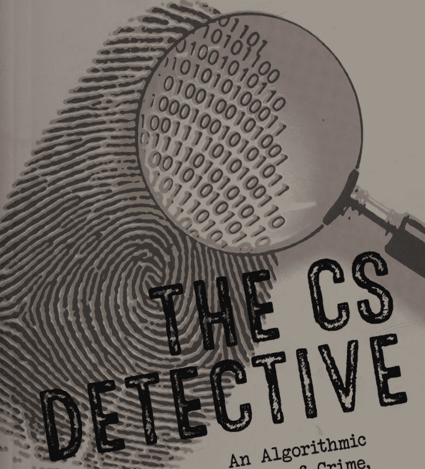


# 关于作者

Jeremy Kubica 是 Google 的首席工程师，从事机器学习和算法。他拥有卡内基梅隆大学的机器人学博士学位和康奈尔大学的计算机科学学士学位。他在研究生期间创建了检测杀手小行星的算法（当然，停止它们被留作“未来工作”）。Kubica 是热门博客“计算童话”（Computational Fairy Tales）的作者。

# 关于技术审核员

Heidi Newton 拥有新坎特伯大学的学士学位和惠灵顿大学的硕士学位，专业均为计算机科学。她在坎特伯大学的计算机科学教育研究小组和 Code Avengers 工作，并兼任相关的导师和咨询工作。她目前的重点是改进计算机科学和编程的教学资源。

- 结语 ................................................................................................237

# 致谢

我非常感谢所有为这本书贡献、工作和支持它的人。

首先，我要感谢 Starch Press 的整个团队。特别要感谢 Liz Chadwick 和 Riley Hoffman 在编辑过程中提供的优秀帮助、指导和建议。Liz 的绝妙建议对于保持故事的聚焦和推进至关重要。我非常感激她在技术部分采用讲义格式上的想法。感谢 Bill Pollock 和 Tyler Ortman 的支持，特别感谢 Bill 建议了书名。还要感谢 Carlos Bueno 向我推荐了 No Starch Press。

# 致读者的话

本书侧重于计算思维和搜索算法。通过故事从高层面上介绍并说明了计算概念，探索了这些概念背后的动机以及它们在非计算机领域的应用。本书并非一本详尽的教材，这些故事也旨在替代计算机科学的严谨技术描述。相反，它们旨在用作插图：补充完整概念并帮助理解。

本书涵盖了多种计算方法，这些方法都属于“搜索算法”这一广义类别。概念首先在故事的背景下呈现，然后在每章末尾以讲义笔记的形式在书中进行更具技术性的解释。读者可以安全地跳过这些技术章节，而不会错过任何故事情节。

本书假设读者具备一些基础计算机科学概念，但不需要掌握任何特定的编程语言。书中的算法适用于多种编程语言和问题领域。

# — 1 —

## 搜索问题

门在没敲门的情况下开了——只有合链的吱呀声宣告了客人的到来。弗兰克正要拿他的十字弩，但又停住了。如果是维内特人（Vinettees）来找他，他们会敲门的——用斧头敲。进门的无论是谁都想谈谈。弗兰克转而拿起杯子，喝光了剩下的已经凉的咖啡。

“多诺万船长，”当男人进来时他说，“什么风让您来到这个华华社区？我以为您已经不再流于十五街以下了。”

“好久不见了，”船长简单地说，“过得怎么样，弗兰克？”

“极了，”弗兰克干涩地回答，眼睛盯着船长在房间里慢悠悠绕圈。

多诺万扫视着弗兰克破旧的办公室。他红色的军官袍在他身后轻轻晃动。“私家探的工作过得如何？”

“够付账单，”弗兰克撒谎道。

船长点了点头。他停顿了一下，然后走向书架浏览起内容。

“那么，这是一次社交性访问吗？”弗兰克说，“我是不是该问问玛琳和孩子的近况了？”


“他们很好，”多诺万头也不回地回答。“玛琳的乌龟美容业务最近很不错。比尔去年加入了警队。维罗妮卡是个会计师，这完全是我们意想不到的——”

“我其实不是在问这个，”弗兰克中断道。

船长耸了耸肩。他从架子上取下一本书，翻看着页码。弗兰克伸长脖子看向封面——警察学院年鉴：第二十一届。

“你想怎样，船长？”弗兰克质问道。

船长终于对上了弗兰克的目光。“你需要你的帮助，弗兰克，”他说。

弗兰克直起身子。在弗兰克离开部队后的五年里，船长恰好来过他两次，两次都是为了警告他远离活跃案件。威胁一直是弗兰克意料之中的，但现在看起来船长似乎遇到了某种特殊的问题——也许那种意味着弗兰克欠租生涯将终结的问题。

“我不在部队里了，”弗兰克漫不经心地说，“你为什么不找一个你信任的探员来做呢？”

“我需要部队之外的人，”船长说，“别装了，弗兰克。如果你不知道我坐在这里意味着什么，你就不是我需要的人。”

弗兰克咯笑道。“内鬼？在你们部队里？”

更糟。昨晚有人闯入了警局的档案记录室，偷走了500多卷卷轴。

“他们想要什么？”弗兰克问。他下意识地在椅子上向前倾身，去拿一卷新卷轴和一支羽毛笔。这个动作对他来说是自动的就像喝咖啡或避楼梯一样。

“不知道，”多诺万说，“没有规律。他们偷走了整排架的文件，从财产纠纷到费用报告无所不包。他们拿走了我们记录的杀手、名人、私家探员、公证人的账本……他们甚至拿走了斯文森农民（Farmer Swinson）的两箱噪音投诉信。但其他书架完全没有被碰过。我们统计至少有512份文件丢失。”

“也许是斯文森农民的邻居之一，”弗兰克开玩笑道，“他们一定听到只要区区百次投诉，实习生就会去你家里给你上严厉的教训。”

多诺万船长没忙回答。他只是怜悯地盯着，直到弗兰克清了清嗓子打破了沉默。“所以，你想找到这些文件？”

船长摇了摇头。“我想让你找到小偷。我们有这些文件的备份。我想知道他们需要什么信息，以及他们打算如何处理这些信息。”

“一个搜索问题，”弗兰克思索道。在他在部队期间，他的两个特长是搜索问题和惹恼船长。

“国王知道吗？”弗兰克问。

“我昨天向他简报了了，”船长说，语气中带着一丝不耐烦，“那个疯子魔法师的问题在于，国王坚持要求对每件事进行每日简报。”两年前，一个名叫“指数（Exponentious）”的权力妄狂魔法师试图摧毁整个王国。从那以后，弗雷德里克国王亲自主持了王国安全性的全面升级，出台了300多项安全规定，其中至少有5条涉及10层以下政府建筑内官方文件的存储。

“不过我不能怪他，”多诺万抱怨道，“那是一次险万的。如果不是因为公主，谁知道王国会变成什么样。”

弗兰克沉默地点头。“国王对这件事产生了个人兴趣，”船长继续不耐烦地说道，“他想要所有的细节：负责此案的人是谁？我们搜查过建筑了吗？我们正在使用什么算法？”

弗兰克忍住笑，琢磨着这个提议。为首都做咨询工作会是一笔好钱。但话说回来，按照自己的方式总是能得到结果。

“我料是如此，”船长最后回答。他从斗篷里取出一个薄文件夹，丢在弗兰克的桌子上。

“我会联系你的，”多诺万说。然后，礼貌地离开了办公室。

三个小时和十二杯咖啡后，弗兰克蜷缩在桌旁，第七次翻看那个薄文件夹。字迹在闪烁的烛光下跳动，但并没有提供任何新的见解。他们并没有太多线索。船长给了他一份丢失文件清单和当晚的值班表，但别无他。

最后，弗兰克夸张地叹了口气，拿起一张羊纸开始做笔记。

弗兰克想要寻找罪犯，他的搜索空间是首都附近的每一个人。

弗兰克向后坐在椅子上，揉了揉眼睛。这是一个巨大的搜索问题，在一个罪犯横云的城市里寻找一个特定的罪犯。但他见过更糟糕的了。

既然他已经定义了问题，就可以开始制定算法了。`线性搜索` 是不可行的；他负担不起询问城市里的每一个人。他也可以排除他在学院学习过的许多其他更花哨的算法。对于这样的问题，他必须回到他的基础搜索算法工具箱中——那是私家侦探最信赖的朋友。

弗兰克在羊皮纸上做了一记笔记。他有要寻找的目标，知道搜索空间，并且有了算法。是时候开始工作了。

# 警察算法 101：搜索问题

德雷克尔教授讲座摘录

在这节课上，我们将讨论用于解决搜索问题的几种不同算法（以及相关数据结构）。搜索问题被定义为任何要求我们在可能值空间（搜索空间）中寻找特定值（或目标）的问题。

你们中毕业后并成为警察的同学，会发现自己每天都会面临这类问题。搜索问题的这个广泛定义涵盖了许多不同的计算问题，从在警察日志中搜索特定条目，到在藏身点寻找房间，再到寻找符合某些标准的逮捕记录。这节课不会是详尽的——那需要多年时间——我将在教学过程中给你们提供一些基础且重要的算法示例。

本节课描述的算法将具有三个共同组件：

- **目标 (Target)**：你正在搜索的数据。目标可以是一个特定值，也可以是一个标志搜索成功完成的标准。
- **搜索空间 (Search space)**：测试目标的所有可能的集合。例如，搜索空间可以是一个值列表或图中的所有节点。搜索空间中的单个可能性被称为*状态（state）*。
- **搜索算法 (Search algorithm)**：执行搜索的特定步骤或指令集。

某些搜索问题将具有额外的要求或复杂性，我们将在讲解不同算法时涉及这些内容。

## 针对线人的穷举搜索

“高效算法的关键在于信息。”这是德雷克尔教授的格言，在每节警察算法课开始时，他对学员们大声吼，是如此凶猛，足以永久地烙印在弗兰克的记忆中。“一个好的算法取决于发现数据中的结构并利用它。它取决于信息。”

弗兰克想起这里，露出了微笑，他转入`三比特街`（Three Bit Lane），那是一条凹凸不平的土路，两旁错落着破旧酒吧和高端咖啡馆。他对一对路过的骑士礼貌地点头示意，骑士穿着盔甲抖动走过时发出哐当声，他在心里记下离开前要来一杯三倍浓缩咖啡。首先他需要信息，一些能引导他搜索的东西。他确切知道从哪里开始。

“玻璃盒子比利利”现在已经在某一家店里，静静地坐着，听着房间里飘过的交谈声。人们并不是故意在比利利面前说话；他们只是没有注意到他在。比利利被赋予了一项显著的天赋：完全的不起眼。无论他尝试做什么，比利利身上的某些特质让人们根本注意不到他。也许是因为他苍白的皮肤或瘦小的体型；也许是因为他那极其平庸的穿衣品。无论如何，比利利很久以前决定利用他的这项天赋来偷听、收集信息，并将其卖给任何愿意购买的人。


弗兰克盯着三比特街上紧挨在一起的八家店面，心想比利会选择哪一家。他在脑海中过过了六种搜索算法，但这是没有意义的。弗兰克没有任何信息可以依据。比利可能在其中任何一个酒吧或咖啡馆里。

他不得不使用穷举搜索——简单地尝试所有可能性，直到找到比利。这让他不太舒服。多年的侦探和私家调查经验告诉他，几乎总是有比穷举搜索更好的算法，而他讨厌诉诸如此低效的方法。

弗兰克嘟囔着开始了他的搜索。他走进了街上的第一家酒吧，“绝对值馆”（The Absolute Value）。

酒保是一个名叫阿比（Abe）的坏脾男人，他在弗兰克进入时瞪着他，并特意把手伸到了柜台下面。信息很明确：“我现在手里拿着武器。我让你猜猜是什么种。但如果你骚扰我，我会让你近距离观察。”

“我不想惹任何麻烦，”弗兰克举起双手说，“我只是来找比利的。”

“噢，比利不在，”酒保说。

弗兰克几乎因松口气而笑了。“那我就走了，”他说。

阿比简短地点了点头，看着弗兰克离开，他的手依然在柜台下。

弗兰克深吸了几气，在凉的空气中摇了摇头。阿比记仇的时间比弗兰克遇到过的任何人都要长。不过话说回来，弗兰克逮捕了他的四个兄弟。

街上的下一家店是“鲁莽布尔值馆”（The Brazen Boolean），一家采用典型布尔风格——黑白配色装饰的现代咖啡馆。布尔城（City of Bool）的居民以对逻辑绝对概念的狂热奉献而闻名，将一切都视为真（True）或假（False）。

弗兰克走进去，环顾四周。比利不在那里。

第三家店是“指数浓缩咖啡馆”（Exponent Espresso）。弗兰克推开门，闻到了浓郁的咖啡香气。他在角落里看到了比利，正盯着一杯未动过的咖啡发呆。

弗兰克走过去，在比利对面坐下。“比利，”他说。

比利抬起头，眼神空洞。“弗兰克，”他平淡地说，“我什么都不知道。”

“你还没听我说什么呢。”

“无论是什么，我都不知道。我不想知道。我知道得越少，活得越久。”

弗兰克叹了口气，从口袋里掏出一枚金币，在桌上转了转。“比利，上周五晚上，有人闯入了警局档案室。偷走了500多卷卷轴。船长雇我找小偷。我需要知道谁在城里租过大型马车，或者谁在搬运大量货物。”

比利盯着金币，没有动。“我不知道，”他说，“我不记得了。”

“比利，你记得一切。”

比利摇了摇头，嘴唇紧闭。“有些事情我努力不去记住。即使我知道一些微小的细节，比如谁可能帮过物流，也不值冒这个风险——以免一醒来发现我的鞋里塞满了牛粪。”

弗兰克盯着他看，但比利已经沉默了。对于一个以分享信息为生计的人来说，比利有一个不爱说话的怪癖。“牛粪？”弗兰克问。

比利点点头，但没有再多说什么。

“你可没法更具体了，对吧？”弗兰克问，“我们谈论的是北牦还是南牦？”

“这重要吗？”比利问道，“重点是，如果我知道是谁安排的交通工具，我根本不会记得它。特别是如果那些人恰好在离城五英里外的一座大农场，他们可以轻易让某人消失。如果那个农场的家族有非法活动史，而且幽默感不健康，那就更是双加严重了。不，在这种情况下，记住任何事情绝对都不利健康。”

“太遗憾了，”弗兰克笑着说，“那也许下次吧。”他指了指硬币，“以后记住事情的动力。”

说完，弗兰克站起身离开了“指数浓缩咖啡馆”。他向左转，继续沿着街道向上走。一旦离开“三比特街”，他就可以绕道前往克拉诺克的农场——那是唯一与比利的描述相似的农场。

当他经过那座破旧的登记处时，他注意到一个影子闪进了附近的小巷子。他低声咒了一句，但继续前行。当然，他已经被跟踪了；上尉在访问时并不算谨慎。

等他离开城市来到通往克拉诺克农场的崎岖土路上时，他发现自己心情不错。比利没给他多少，但即使是一点点信息也可能意味着高效搜索算法与穷举算法之间的区别。

## 警察算法 101：穷举搜索

德雷克教授讲座节选

穷举搜索算法在整个搜索空间内为目标值搜索每一个可能性。最常见的穷举搜索是线性搜索，它只是按顺序检查所有不同的可能性。

考虑一下当你追逐劫匪进入一家废弃酒店二楼走廊时发生的情况。走廊有30扇门，全部关着。如果你遵循了正确的警察程序，你的搭档已经封锁了对面的楼梯，劫匪被困在这一楼的某处。你如何找到他？你是随机选门，来来回去直到运气好吗？不！你沿着走廊搜索，一扇一扇地踢开门。

或者考虑一种扫描数字列表（数组）以寻找目标值的算法。算法沿着列表从一个数字移动到另一个，依次检查每个值以免遗漏任何一个，并在到达目标时停止。如果我们在数组中寻找数字5，那么搜索过程如下：

```
| 1 | 13 | 2 | 34 | 5 | 8 | 1 | 21 | 3 |
|---|---|---|---|---|---|---|---|---|
| 1 | 13 | 2 | 34 | 5 | 8 | 1 | 21 | 3 |
| 1 | 13 | 2 | 34 | 5 | 8 | 1 | 21 | 3 |
| 1 | 13 | 2 | 34 | 5 | 8 | 1 | 21 | 3 |
```

线性搜索算法的优势在于它们在现场易于实现，即使在非结构化数据上也有效。你不需要对劫匪选择了哪间房间做任何假设；你只需要检查一切。缺点是，如果数据具有可以利用的结构，穷举算法通常不是最高效的算法。如果你知道劫匪去哪里了，你可以利用这些信息省去踢很多门的麻烦。

高效算法的关键是信息！

# — 3 —

## 罪犯农场上的数组与索引

弗兰克看到拴在克拉诺克房子外的警马时，大声咒骂了一句。由于上尉竟然亲自来雇佣了弗兰克，他没预料到会遇到任何警察。如果上尉不信任他的下属，要么是他们被收买了——所以他会将他们调到城市另一头的某个案件——要么是他们根本不够优秀。但从看起来，有人正在跟进，而弗兰克已经落后了。

他溜进敞开的前门，在大厅里与警察以及克拉诺克先生会合。克拉诺克先生投了他一个厌恶的眼神，但看到他似乎并不意外。然而，那个女警察显得措手不及。

“你是谁？”她质问道，手里拿着羊皮纸和羽笔转向他。

弗兰克无视了她。“克拉诺克先生，”他说，“再次见到你真好。”

“也是来骚扰我们的吗？”克拉诺克问，“弗兰克，这里不欢迎你。”

“我不是为了欢迎，”弗兰克回答道，“我在找你妻子。我有几个简单的问题要问她。”

警察盯着他。“弗兰克？”她问，“弗兰克·运行时？前侦探转行的私家侦探。你在这儿干什么？有人丢了宠物龙吗？”她嘲笑道。

弗兰克再次无视了她。“你的妻子，克拉诺克先生。我哪里能找到她？”

老人摊开手。“她什么也没做！她改邪了，你知道的。这次是真的。”对于一个业余来说，他的演技算不坏。

弗兰克笑了；他知道他的魅力让人不安。果不其然，克拉诺克……

弗兰克让诺顿警官（Officer Notation）来提问。比利的线索除了一个指向农场的线索外别无收获，但诺顿似乎拥有更丰富的线索。

克拉诺克夫人（Mrs. Crannock）冷哼一声往地上吐了口唾沫。“我什么都没做，”她说，“我已经改邪了，你知道的。”

“我不是来抓你的，”诺顿说，“我需要问问你关于一种特定的驴车——‘数组车’（ArrayCart）。”

弗兰克闪过一丝怀疑。诺顿警官会为了另一个案件来到这里吗？他不信。格斯告诉过他，那是丢失文件之后的事，而他已经学会了相信自己的直觉。

“数组车，”克拉诺克夫人怀疑地说道，尽管带着一丝难以察觉的自豪，“我的发明。基于`数组`（array）。它为我们的牲畜准备了独立的存储隔间。每个隔间恰好存储一个动物。由于它们都有独立的门，你可以走到任何一个隔间把动物放出来或把它们放进去。访问任何存储位置都很方便。节省了几个小时的折腾时间。”


“非常巧妙，”诺顿警官承认道，“你找到了一种将`数组`（arrays）和`索引`（indices）的概念应用于牲畜运输的方法。”

“这只是个开始，”克拉诺克夫人补充道，“我正在和一位巫师合作研发一种全新的数组车——带有魔法指针（magical pointers）的！我打赌它们对警察部队来说是完美的。告诉你的上尉，我可以给他一个公道的价格。”

弗兰克不得不佩服诺顿。让克拉诺克夫人开口最稳妥的方法就是提到数组。

“你们现在有几辆数组车租出去，对吗？”诺顿警官探性地问道。

克拉诺克夫人的眼神瞬间冷了下来。“那是合法生意。我们交税的。”

弗兰克忍住了一个嘲笑的鼻鼻。

“两天前你是否碰巧给别人租了一辆数组车？”诺顿警官追问道，“带六个隔间的小型号。”

“我可能吧，”克拉诺克夫人说。她的冷淡态度正逐渐变得敌对。

“你有谁租过的记录吗？”警官问。

“没有，”克拉诺克夫人说，“车一回来我们就把记录粉碎了。我不记得具体是谁租了那辆车。”

看来比利的线索确实起作用了。如果你是一个需要交通工具的罪犯，没几个地方会租给你车，而事后还会忘记你名字的地方就更少了。克拉诺克夫人可能声称自己改邪了，但显然她至少仍然为她的前同僚提供有价值的服务。

“你确定你对你的客户什么都不记得了吗？”诺顿警官催促，但弗兰克知道这没有意义。他曾为了一个被盗的千斤顶审问过她三个小时。尽管她是被偷的人，她却一个字也没肯吐。克拉诺克夫人不肯说话。


当诺顿警官尝试用同一个问题的几种变体时，弗兰克悄悄溜出谷仓，找到了停车场。正如他所料的那样，停车场被组织成一个数组，有10个带标签的停车位。只有2号、4号和8号位被占用了。2号和4号位的车各有10个隔间，所以太大，不符合诺顿的描述。但8号位停着一辆六隔间的数组车，车轮上还覆盖着新鲜的泥土。

环顾四周后，弗兰克跳进那辆六隔间的数组车的后部。地板上铺着散落的草，但车内是空的。弗兰克逐一打开每个隔间，扫描空的存储空间寻找任何线索。然后，他跪在地上，在草堆中翻找，直到发现了几片羊皮碎片。

他收集了几片羊皮碎片。

# 警察算法 101：字符串

Drecker 教授讲座节选

数组不仅存储数字列表；它们还可以用于存储文本字符字符串。许多编程语言使用数组来实现字符串。数组中的每个区块存储单个字符，该字符可以是字母、数字、符号或空格。与其他数据数组一样，这些字符串中的字符可以通过它们在数组中的索引直接访问。

| | H | E | L | L | O | ! |
|---|---|---|---|---|---|---|
| 索引 | 0 | 1 | 2 | 3 | 4 | 5 |

在你的警察职业生涯中，你将对这种文本表示法*非常*熟悉。所有标准警察表格都要求警官在*每*页页顶部的 32 块数组中记录他们的姓名。在一个典型的月里，你将填写超过 400 个这样的数组。

## 二分查找走私货的船

Usb 港仅仅是一个渔村。十二栋饱经风霜的建筑聚集在一个条长码头的尽头。几处微弱的活动包围着最近的抵达者，但除此之外，小镇安静得令人心安。

弗兰克径直走向“蟹钳酒吧”（Crab's Pinch），那是一家以贝蛤浓汤和周三晚上的海歌比赛而闻名的渔民酒吧。如果运气好的话，他的某个联系人会在今天结束前出现。毕竟，“蟹钳酒吧”是 Usb 唯一去的地方。于是弗兰克在后角的一个桌子旁坐下，点了一份浓汤开始等待。

没过多久，一个名叫梅维斯的自由职业走私者进入了这间潮湿的小酒吧。梅维斯天性谨慎，从技术上上说，她从未被裁定过罪，尽管众所周知她曾放火了自己的船以销毁证据。弗兰克和她相处得不错，至少在他离开警察部队之后是这样，他们甚至偶尔交换信息。

弗兰克喝了整整一小时的浓汤，终于推开碗，向梅维斯比了比手。她在门口犹豫了一片刻，然后挤进了酒吧。

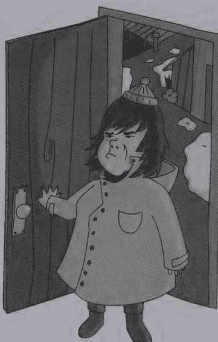

“梅维斯，”弗兰克在她加入他角落时说，“你好吗？”

“我 10 分钟前感觉好多了，”她吐口道。

在弗兰克开口问之前，符号警官穿过门，举起手。“女士们先生们，”她大喊道，“请大家留意。我在寻找一辆两晚前经过这里的推车。”

弗兰克低声咒骂道。他的线索就这样了。

“我是从清晨跑回来的，希望能喝一碗热汤并得到几分钟清静，”梅维斯抱怨道，“结果我得到这个警察在那儿叫嚷什么驴推车。”

弗兰克干笑了一下。“而且在她离开之前，你没法卸掉你的货物。对吧？”

梅维斯瞪了他，但没有反对。Usb 在渔业或航运业从未取得过成功。然而，这个港口吸引了那些想要移动货物而不愿与多管政府官员交道的罪犯。弗兰克愿意赌一个月房租，赌码头头没有一艘船不是在走私东西。

“你对那辆推车知道什么吗？”弗兰克压低声音几乎是耳语。梅维斯耸耸肩。“码头总有推车。这是一个港口，弗兰克。人们移动东西。”

“这是一辆特殊的推车，”弗兰克追问。“一群独立的动物圈，像一个轮子上的巨大数组。”

“听起来很高级，”梅维斯说，“但我没听过什么船运动物的。我可能听过关于一两箱微型龟的传闻，但没有大到需要圈的。你确定它是从这儿过的吗？”

弗兰克点头。那气味就像厕所里的鱼味空气清新剂，有几个地方闻起来也那么糟糕。

“那时候有人离开吗？”他问。如果小偷们把偷来的文件运这么远，他们就不会在那里等。

“只有`Retry Loop`，”梅维斯说，“我告诉你是因为这是公开信息。我不知道它载了什么，我不在乎。”

“你知道它什么时候回来吗？”弗兰克问。

“19 小时前回到港口的，”梅维斯回答道，“我那时也不知道它载了什么。”

弗兰克灿烂地笑了。“看起来我是时候该在城里转转了，”他说。

梅维斯敷衍地对他笑了笑，转去招手示意一名服务生。

弗兰克在码头上走得不到 20 米，符号警官就走到了他身边。

“运行时先生，这是我的调查，”她开始说道，“如果你有线索——”

弗兰克停了下来，让她停下了脚步。“警官，你到底在调查什么？”他问。

情况比弗兰克预想的要好。符号官张了几次嘴，脸红晕蔓到了脖子上。

“船长不知道你在这儿，对吧？”弗兰克问。“这并不完全是一次正式调查。”

下界是第一艘船，我们的上限是最后一艘船。如果 `Retry Loop` 在这里，它显然不在第一艘船之前，也不在最后一艘船之后。

所以我们从中间的那艘船开始，询问它在港口呆了多久。如果它在那里呆了不到19小时，那么它一定在 `Retry Loop` 之前。这将我们的搜索空间一分为二。而且——

“如果它在那里呆了超过19小时，那么它一定在 `Retry Loop` 之后，”Notation 打断道，“我知道二分查找。我的《警察算法》期末考试就在两个半月前。”

说完，两人开始寻找 `Retry Loop`。中间的那艘船是一艘黄色帆船，闻起来有奇怪的香蕉味，它已经在港口停了17小时了。


这意味着他们可以排除前面的的一半船，包括中间的那艘。Frank 将下界调整为可能是 `Retry Loop` 的第一艘船，即黄色帆船之后的一艘。


随着搜索空间的缩小，他们选择了一个新的中间点。花了一段时间，才说服下一艘船的船长他们不是卧底的海关官员。10分钟后，Notation 把证件推到船长鼻子底下，语气立刻变成了愤怒的抱怨，他告诉他们他的船“损坏数据包号”（Corrupt Packet）已经在港口被困了22个痛苦的小时了。他要求他们代表他去见港口主主。

| Low | Mid | High |
|---|---|---|
| ? | ? | ? |
| 17 | ? | 22 |
| ? | ? | |

由于他们的目标是19小时，他们知道 `Retry Loop` 一定得在 `Corrupt Packet` 之前。他们再次更改了边界，使得 `Corrupt Packet` 左侧的船现在成为上限。

| Low | High |
|---|---|
| ? | ? |
| 17 | ? |
| 22 | ? |
| ? | ? |

这使得搜索范围内只剩下两艘船；他们正迅速接近搜索的终点。如果这两艘船都不是 `Retry Loop`，他们就能确信它已经离开港口了，因为一旦搜索空间中没有更多元素，他们就可以排除整个搜索空间。

由于只剩下两艘船，他们可以选择任何一艘作为新的中间点。Frank 凭直觉选择了较早的那一艘，那艘船恰好也是他们的下界。与码头上闲逛的船员简单聊了几句确认了那艘船确实是 `Retry Loop`，它已经在港口呆了19小时。

| Retry Loop |
|------|
| ? | ? |
| ? | 17 |
| 19 | ? |
| 22 | ? | ? |

“现在怎么办？”Notation 官员站在看着那艘船问道。

“我们再次用你那闪闪发证章，”Frank 回道。

# 警察算法 101：二分查找

Drecker 教授讲座节选

二分查找算法用于在排序数组 `A` 中高效地找到目标值 `v`。与线性扫描不同，二分查找利用有关数据结构的信息使搜索更高效。高效算法的关键在于，在这种情况下，我们使用的数组是按升序排序的：

对于任何满足 `i < j` 的索引对 `i` 和 `j`，都有 `A[i] <= A[j]`

这似乎信息不多，但足以让搜索变得高效。二分查找算法通过不断将搜索空间减半并限制在其中一半来工作。通过追踪两个边界来限制搜索空间。上限 (`IndexHigh`) 标记数组最高索引。下界 (`IndexLow`) 标记最低索引。在整个算法过程中，如果目标值在数组中，我们保证：

`A[IndexLow] <= v`

在搜索的每一步，我们检查下界和上限中间的值：

`IndexMid = (IndexHigh + IndexLow) / 2`

然后我们将该位置的值 `A[Mid]` 与目标值 `v` 进行比较。如果中间点小于目标值，`A[Mid] < v`，我们知道目标值在中间索引之后，这允许我们通过设置 `IndexLow = IndexMid + 1` 将搜索空间再次减半。如果中间点大于目标值，`A[Mid] > v`，我们知道目标值在中间索引之前，这允许我们通过设置 `IndexHigh = IndexMid - 1` 将搜索空间减半。

当然，如果我们发现 `A[Mid]` 等于 `v`，我们可以立即结束搜索。我们找到了目标。让我们考虑在以下数组中查找值15。虚线框对应于已检查的值，阴影部分是从搜索中排除的。

| -5 | 0 | 1 | 3 | 7 | 11 | 15 | 30 | 52 | 54 | 55 | 93 |
|---|---|---|---|---|---|---|---|---|---|---|---|
| 0 | 1 | 2 | 3 | 4 | 5 | 6 | 7 | 8 | 9 | 10 | 11 |

| -5 | 0 | 1 | 3 | 7 | 11 | 15 | 30 | 52 | 54 | 55 | 93 |
|---|---|---|---|---|---|---|---|---|---|---|---|
| 0 | 1 | 2 | 3 | 4 | 5 | 6 | 7 | 8 | 9 | 10 | 11 |

中间点检查找到了一个11的值，它小于我们的目标值15。由于我们知道数组是升序的，我们可以排除中间点及其之前的所有值。我们调整下界索引（`IndexLow = IndexMid + 1`）。

| -5 | 0 | 1 | 3 | 7 | 11 | 15 | 30 | 52 | 54 | 55 | 93 |
|---|---|---|---|---|---|---|---|---|---|---|---|
| 0 | 1 | 2 | 3 | 4 | 5 | 6 | 7 | 8 | 9 | 10 | 11 |

同样，如果我们找到了一个52的值，它大于目标值，我们排除中间点及其之后的所有值。我们调整上限（`IndexHigh = IndexMid - 1`）。

| -5 | 0 | 1 | 3 | 7 | 11 | 15 | 30 | 52 | 54 | 55 | 93 |
|---|---|---|---|---|---|---|---|---|---|---|---|
| 0 | 1 | 2 | 3 | 4 | 5 | 6 | 7 | 8 | 9 | 10 | 11 |

## 二分查找线索

“食品检查员，”Frank 和 Notation 一起上跳板时喊道。由于数组是升序的，我们可以排除中间点及其之前的所有值。我们调整下界索引（`IndexLow = IndexMid + 1`）。

| -5 | 0 | 1 | 3 | 7 | 11 | 15 | 30 | 52 | 54 | 55 | 93 |
|---|---|---|---|---|---|---|---|---|---|---|---|
| 0 | 1 | 2 | 3 | 4 | 5 | 6 | 7 | 8 | 9 | 10 | 11 |

注意，如果目标值不在数组中，搜索会在 `IndexHigh < IndexLow` 时结束。在那时，我们可以保证目标值不在数组中。

| -5 | 0 | 1 | 3 | 7 | 11 | 15 | 30 | 52 | 54 | 55 | 93 |
|---|---|---|---|---|---|---|---|---|---|---|---|
| 0 | 1 | 2 | 3 | 4 | 5 | 6 | 7 | 8 | 9 | 10 | 11 |

“食品检查员？”一个船员问道，“我们没有运输任何食物。”

Frank 审量了一下那个男人。他不是官员或雇佣的保安，可能只是一个在官员离开时负责的船员。这并不起见。走私者很少雇佣守卫盯着他们的船。

Frank 转向那名船员，低吼道：“走着瞧吧。我听说这个码头有一批鳗鱼，我打算把它们找到。”

“鳗鱼？”船员显然不知所措。

“腐烂的鳗鱼，”Frank 反驳道，“我们要下去检查仓库。”然后，他没等回答就走向了舱口。

Notation 跟在他后面。

“你在做什么？”Notation 问道。

“在找最后一条记录，”弗兰克说。

“一页一页地看？”Notation 问道，“那里有一千页呢。你为什么不再次使用二分查找呢？我们两分钟前才用过。”

弗兰克停顿了一下。他并不是在寻找某个特定的页码，但他仍然可以使用二分查找来找到最后一条记录。他只需要根据当前页面是否有文字来调整搜索边界。

“好吧。二分查找，”他同意道。

他再次翻到最后一页，确认书恰好有 1000 页，这给了他下限第 1 页和上限第 1000 页。他将这两个数字相加，除以 2，计算出中点 500 页。他翻到那那一页。

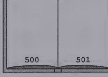

第 500 页和 501 页都是空的，所以弗兰克知道最后的一页在第 499 页或之前——这是他的新上限。经过另一次中点计算，他翻到第 250 页。又是空的。

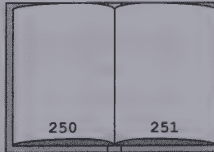

“看起来像是一本新书，”Notation 补充道，“还好你没有从后往前找。”

弗兰克没顾及回答。以 1 为下限，249 为上限，他计算出中点 125 页。这次他发现了文字，于是他相应地将下限调整为 125。

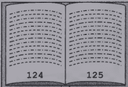

“187，”在弗兰克脑中完成中点计算之前，Notation 就给出了答案。他转到第 187 页，再次发现文字并调整了下限。


“218，”Notation 说道。页面是空的，所以弗兰克将下限和上限分别调整为 187 和 217。

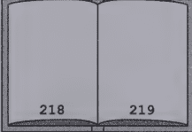

“202，”在弗兰克还没完成上限和下限相加之前，Notation 就说了。

“你怎么做得这么快？”弗兰克问。

“练习，”她回答道，“在学院里，每我们需要休息学习时，就会举办二分查找比赛。我是不胜的。”

弗兰克摇了摇头。“听起来是一段疯狂的时光，”他嘟囔道。

第 202 页和 203 页是满的。“210，”Notation 给出答案。

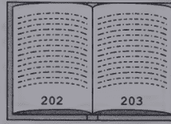

在第 210 页，他们终于找到了最后一条记录，详细描述了“重试循环”（Retry Loop）的最后一次航行。“现在怎么办？”Notation 问道。

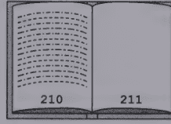

“我们要寻找一个有趣的包裹或港口。在最后一次航行中，他们大约做了 70 条记录。我们必须扫描它们。”

“穷举搜索？”Notation 问道，“我们不能用更高效的方法吗？记录不是按取货和送货时间排序的吗？”

“排序在这里对我们帮助，”弗兰克回答道，“我们不知道时间。只有当数据按有用的维度排序时，排序才有帮助。他们并没按‘可疑性’排序。”

等等，文中说的是“图（figure）”。

“哦。这是‘天气记录’问题，”Notation 说道。

“什么问题？”弗兰克问。

“这是一个说明按错误的值排序数据对搜索没有帮助的例子，”Notation 解释道，“德国教授举了一个寻找过去 10 年最冷一天的例子。如果日志按日期排序，你可以使用二分查找来高效地找到任何某一天。但这不能帮助我们找到最冷的一天，所以我们仍然必须扫描所有数据。不过，我没料到在课堂外看到这么典型的例子。”

“欢迎来到现实世界，”弗兰克说道。在这里你必须检查数据结构什么时候对你有用，什么时候没用。别担心，这是一个常见的新手错误。”

他看到 Notation 听到他的话后有些不悦，并努力不要过分享受她的反应。每个新手离开学院时都以为自己无所不知，但每个人都有很多要学。Notation 只是听了个讲座就算轻松了。他自己关于二分查找的教育经历包含了几个小时铲动一桶桶猪粪，在此期间他一直在怀疑自己的职业选择。

大约三分钟后，他们找到了唯一的线索。“重试循环”最近在两个可疑的停靠点：泥木港（Port of Mudwood）和破碎电缆岛（Frayed Cable Island）。即使对于走私者来说，这些也是奇怪的地方。泥木港除了外围的泥场外几乎没有领土。而破碎电缆岛更加荒凉；那座狭小的岩石岛上仅有一栋建筑——现在已废弃的铁环岛（Iron Ring）。

在货舱内散开来，在弗兰克和Notation周围形成了一个松散的圆圈。

“女士们，先生们，”弗兰克说道，“我们的检查已经结束，看起来你们没有携带任何腐烂的鳗鱼。感谢你们的耐心，我们正努力确保这个王国食物供应的安全。我们现在该离开了。”

作为回礼，两个体型较大的暴徒抓住了弗兰克的手臂。他们合力将他抬离地面，带他回到了甲板。多年的经验让弗兰克对这种反应早有准备，他已经出了一了一种定位技巧来尽量减少不适，但他仍然感觉到在他们强有力的握下，淤青正在形成。


“嘿！”Notation的叫声表明她也被同样带了出去。

当他们出现在阳光下时，弗兰克眨了眨眼睛。男人们将他带到甲板中央，把他丢在木地板上。Notation重重地落在在他身边，暴徒再次在他们周围形成了一个松散的圆圈。

“那么计划是什么？”弗兰克问，“把我们锁起来？扔进海里？交给你们老板的雇主？”

男人耸了耸肩。“别看我，我才在这里工作了十五天。”

“个新手，哈？”弗兰克说。

维尼特家族（Viniettes）对限制信息非常狂热。他们只与船上资历最深的人分享计划。新员工在晋升过程中必须证明自己的忠诚。为了获得任何有用的信息，弗兰克需要找到船上资历最高的人。

一个计划在弗兰克的脑中开始形成。维尼特家族的船员总是按照资历顺序排列。这与导师制无关——最资深的船员担任新人的导师，并以此类推。在群体场合，他们都倾向于站在自己的导师旁边。


暴徒组成的圆圈无非一个被弯曲成环的排序数组。二分查找法在这里几乎可行，但必须对其进行调整以适应数据的结构：一个圆圈，而不是数值值的直线。不幸的是，这意味着弗兰克并不知道数组从哪里开始或结束。他迅速开发了一种新算法，以高效地寻找资历最高的船员。在这种情况下，效率意味着既尽可能减少需要他交谈的暴徒数量，又最大限度地在他们察觉之前获得答案的概率。

他转向暴徒右侧的女人。“你呢？你是这这里的老兵吗？”

“十九天了，”她说。


现在弗兰克认为他们有一个排序——即资历随着他逆时针绕圆圈移动而增加。但他还不能确定。尽管这种可能性很荒谬，但“十五天”和“十九天”可能分别是资历最浅和最深的暴徒。他之前在选择搜索起点时太粗心了，结果通常不妙。他需要另一个数据点。于是，他选择了剩余暴徒范围的中间。

“你呢？”他询问“十五天”对面的一个女人。“三十七了，”暴徒回答道，“关你什么事？”

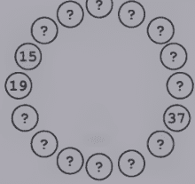

有了这条信息，他对逆时针排序的直觉得到了证实。因此，他排除了“十五天”和“三十七天”之前那个人之间的所有人——如果资历最深的暴徒不是“三十七天”，那么也必须在她的逆时针方向，但在“十五天”之前。

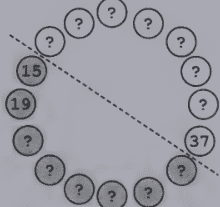

弗兰克克制住升起的恼意。他从未遇到过这么资浅的船员。他实际上感到有些受侮辱。“这太令人尴尬了，”弗兰克对他们的捕禁者说，“我们被一群新手抓住了。你们都是什么，后备小组吗？”

“你在做什么？”Notation低声说。

“改进后的二分查找，”弗兰克低吼道。Notation叹了口气。“我猜到了。看起来你是在寻找资历最高的那个。你的动作并不隐蔽。但为什么？而且你怎么知道他们是按顺序站位的？”

弗兰克忽略了她。他深吸了一气，重新专注于眼下的任务。他不知道在老板出现之前他还有多少时间。“你呢？”“这是我的第三天，”那个男人犹豫地回答。

“得吧！”弗兰克喊道，“真的吗？”

“三天？你不是在接受训练之类的？”Notation问道，听起来是真的好奇。

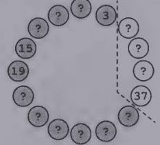

弗兰克再次完善了他的范围，考虑到资历最高的人不可能是“三天”、“十五天”或其之间的任何人。

弗兰克再次将剩余范围一分为二。“你一定是个相对老兵了，对吧？”弗兰克问。

“呃……这是我的第一天，先生，”暴徒结结巴巴地说。当所有人的注意力都转向他时，他开始满头大汗。

弗兰克低声咒骂了一句。

“别叫他先生，”“十九天”喊道，“他是我们的俘虏。”

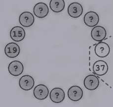

*(注：由于提供的英文文本中存在大量重复段落，译文已根据逻辑进行了去重处理，确保输出流畅且不重复原文。)*

“死亡？”Notation 尖叫道。瑞贝卡对着那圈跟从者点头，他们向前走来，从昂贵的西装里掏出各种武器，就像魔术师在表演复杂的杂技一样。一个人从领带下面掏出一根三英尺长的带刺木槌；另一个人从袖子里滑出一把宽阔剑。接着，让所有人惊讶的是，一个木桶“砰”地一声落在甲板上并崩裂开来，鳗鱼洒满了整个甲板。


## 适配你的：二分查找

Drecker 教授讲座节选

你面对的每一个计算问题都有完美的解决方案。学者们花费了多年研究广泛的问题并编写了解决方案。但在你所在的领域，你会发现新的问题。如果你离开这门课程时只背了一张算法表，你很快就会发现自己的麻烦。为了处理新问题，理解算法的工作原理以及如何将其应用于问题至关重要。二分查找背后的基本思想——利用数据中的结构反复减半搜索空间——比特定应用的细节更重要。你可以将二分查找适配到搜索（但仍已排序的）数组，甚至确定你搜索的最佳温度直到准确为止。

## 袜子（Socks）：插曲与引言

当暴徒们躲避腌菜汁和鳗鱼跳舞时，甲板上爆发了混乱。第二个木桶稍后落下，引发了另一波浪潮。看那些鳗鱼，从头到尾大约四英尺长，威胁要让每个人绊倒并缠绕在一起。三个暴徒在试图逃跑时跌成一堆。弗兰克跳了起来，抓住 Notation 的手臂，用力拉着她。

“发生什么了？”她喊道，此时第三个木桶飞过他们的头顶撞击在栏杆上。

“不知道，”弗兰克说，“但现在是我们的机会。这边！”他拉着 Notation 向船边移动。船旁边漂浮着一艘虽不起眼但又奇地熟悉的的小帆船，上面装满了木桶。一个穿着巫师长袍的少年正将一个新木桶推到一个由木板制成的装置上。


“我们应该跳过去，”Notation 说。

“跳吧，”弗兰克赞同道，眼睛盯着另一艘船。他不认识那个男孩，但认为他一定是暴徒的敌人。除非已经处于战争状态，否则没有哪个正常的人会向他们扔腌鳗鱼。话又回来，在任何情况下，很少有正常的人会选择鳗鱼作为武器。Notation 点点头，爬上栏杆，毫不犹豫地跳了下去。她穿过空气，轻松地过了间隙，落在小帆船的甲板上。

弗兰克爬上栏杆，低声骂了几句，在木梁上保持平衡时再次犹豫了。然后，数了三个数，他跳了下去。弗兰克错过了小帆船两英尺，掉入冰水中。他及时浮起来看到另一个木桶飞过头顶。他短暂停了一下，疑惑那个男孩还在躲鳗鱼，还是已经换了其他东西——也许是软奶酪。Notation 俯身将他拉上船。他站稳脚，一边拧干斗篷，一边评估他们的处境。那个少年继续他的轰炸。水手们在甲板上匆忙移动，用长木杆推开小船。

“梅维斯？”弗兰克大声叫道，“我知道你在某处。”梅维斯几秒后从舱内出现。“他付了货款，”她指着那个少年说，“怎么卸货随他。”

“我以为你不能——”梅维斯挥挥手打断了他。“反正我欠那些暴徒的人，”她解释道，“上个月他们偷了我的一个储藏点——17蒲耳胡萝卜！”弗兰克惊讶地看着她。和暴徒作对是危险的生意。一百蒲耳胡萝卜根本不能比拟。“别那样看着我，弗兰克，”她说，“我这样做不是出于善心。这是一份付费合同。简单如此。袜子（Socks）让这事值了。”

“袜子？”弗兰克问。

“袜子？”Notation 也问。梅维斯指向那个男孩，耸了耸肩。“那是他自称的名字。在我的行当里，你不追真名。”

“你让他上船之前没有要求看官方身份证明吗？”Notation 问。梅维斯给了她一个怀疑的眼神。

此时，梅维斯的船员已经让 `TCP Flyer` 转了过来，他们正驶向大海。脏脏的帆升入空中，遮挡了袜子的扔桶动作。他最后看了看甲板，笑了，然后——

“什么面具？”弗兰克问。

第二天。她认为小偷使用了记忆咒语或睡眠催眠。

“我没有睡着，”诺塔（Notation）语气坚定得连弗兰克（Frank）都不得不后退了。

“我……我不是那个，”袜子克斯（Socks）结结巴巴地说。

弗兰克由他在那里寻找措辞，自己则在思考这个孩子的说法。有些地方不太对。“为什么要跟踪我们？”他终于问道，“你们正在进行一项由国王亲自授权的调查，对吧？你完全可以直接走过去做个自我介绍，”

“是的！……”袜子克斯的声音小了下去。

“但是呢？”弗兰克问。

“我不确定这是否值得，”袜子克斯承认道。

弗兰克盯着他，直到他继续说下去。

“我不确定你们是否能发现什么有趣的东西，”袜子克斯解释道，“一旦我介绍了自己，我就有义务跟着你们并提供帮助了，对吧？我想给自己留有余地。万一我听到了更好的、更有魔法的线索之类的呢？抱歉，”小男孩嘟囔道。

随着船员继续在他们周围忙碌奔波，做着任何让船移动所需的动作，他们陷入了沉思的沉默。在弗兰克看来，这似乎涉及拉动绳子。

“那么……现在怎么办？”袜子克斯问。

“我们根据线索追踪，”弗兰克说。

“我们在重试循环（Retry Loop）的日志中发现了两个可疑港口，”诺塔解释道，“我们的下一步是调查它们，从泥墙港（Port of Mudwall）开始。事实上，我应该通知船长。当然，我们需要借用她的船进行调查，”

弗兰克笑了。“祝你向梅维斯（Mavis）解释得好运吧。”

“不需要，”袜子克斯急忙说，“我已经付钱租了这艘船。你只需要告诉梅维斯往哪里开就行，”

“太极了，”诺塔说。

“这意味着你要跟我们一起，对吧？”弗兰克问道，没有试图掩盖语气中的烦躁。

“当然了，”袜子克斯说，“船是我付的钱。我救了你们。而且我似乎比这里的任何人都更了解这个案。我还是个见习巫师。这可能会派上用场。”随着理由的增加，他的迫切感似乎也随之增加。

“瑞佩伦特先生，我们将感激您的协助，”诺塔向他保证。“我们是吧，弗兰克？”

“是。太棒了，”弗兰克嘟囔道。他又多了一个他不信任的跟班。照这个速度下去，到傍晚他就会拥有一整满船的人了。

## 回溯以继续搜索

泥墙港甚至没有配得上它那平平无奇的名字。它算不上是个港口；那摇摇欲坠的木码头最多只能停下两艘中等体只。泥墙本身——在理论上是一道20英尺高的土城墙——实际上从未真正建造过，只是在这里和那里通过环绕城市三分之一的2英尺高的小土丘来暗示它的存在。

弗兰克跨过泥土丘，走向城里唯一的家商店，诺塔和袜子克斯跟在他身后。

当他们进入商店时，店主的脸随着一个响亮有力的喷嚏声，从惊讶变成了纯粹的喜悦。当他忙着迎接他们时，把柜台上的一叠胡萝卜主题的游客小册撞掉了。

“你好！”他几乎是叫起来的，“欢迎来到泥墙！”

“信息，”弗兰克说。

店主的脸垮了下来。“噢，”他说，“那你们不是为了胡萝卜节来的吧？”

“胡萝卜节？”诺塔问。

店主点头。“本周晚些时候是第50届年度胡萝卜节。”

“这能吸引很多游客吗？”她问。

“最近没有，”店主承认道，“泥墙不再像以前那样有吸引力了。自从格拉夫（G’Raph）开始举办他的泥萝卜节（Mud Radish Festival）之后。人们更愿意去那里感受大城市的氛围。”

诺塔和袜子克斯互相看了。袜子克斯口型道：“泥萝卜是什么？”诺塔耸了耸肩。

“对几天前经过这里的一艘船了解什么？”弗兰克问。

“什么船？”店主问，“我们好几个月没见过船进这里了。有几辆驴车经过过沿海公路。但没有船。”

“你确定吗？”诺塔问，“因为我们正在进行一项官方调查，你告诉我们任何关于最近进过这里的所有船只的信息都非常重要。”

“如果有船，我会知道的，”店主说，“从我的窗户可以看到码头的极佳视野。即使我没看到，我也会听说的。我们没有很多船只的日子。人们本该很兴奋的。我们三个人的胡萝卜行进乐队通常会迎接每一艘船。我肯定会听到他们的声音。”

诺塔看起来正准备进行新一轮的提问，但弗兰克先插了话。“谢谢你，先生，”他说，“感谢您的抽空。”

他领着诺塔和袜子克斯离开建筑，回到泥泞的街道上。

“你觉得他说的是实话吗？”诺塔问。弗兰克点头，扫视着街道。在提到船时，他似乎是发自内心地感到惊讶，”他说，“但再多向周围问问也没什么坏处。”


他们采访了镇上的十几名居民，样本大约占总人口的一半，最后才承认放弃。没有人见过船。也没有人听说有人见过船。而且没有人能理解为什么会有船造访这里。这个港口显然流量并不大。

“也许它们是晚上来的，”诺塔在他们沿着码头走向`TCP Flyer`时沉思道，“它们派了一小拨人上岸，交了文件，然后离开了。有人可能就在这里等着。”她指着码头上随机的一块木板，那块木板和周围的看起来没什么特别的。

“也许吧，”弗兰克说，“但不重要。没有证人，就没有线索。”

“这意味着什么？我们找不到他们？调查结束了吗？”袜子克斯问。

弗兰克冷笑一声。“不，孩子，死胡同是调查工作的一部分。这就是为什么我们使用回溯搜索，”

到此为止，算法是在搜索空间的基础上提出的，在这些空间中，算法可以从任意状态高效地跳转到另一个任意状态。例如，在数组中，你只需要通过索引就可以轻松检查任何位置的值。在酒店走廊里，你可以在房间之间自由奔跑。这种灵活性为算法提供了效率。

然而，许多搜索空间对状态与状态之间的移动是有限制的。如果你在物理世界中搜寻一座城堡，你不能在房间之间任意跳跃——你必须穿过其间的走廊和房间。类似的限制也适用于图或链表等计算领域中的数据结构。

即使在可以在状态之间跳转的情况下，将回溯（backtracking）想象成在探索新状态的过程中回到之前的状态通常也是很有用的。在算法世界中，这种做法的成本比物理上重新走一遍要低得多。然而，这些过程在概念上是相似的：你撤回搜索并沿着另一条路径继续。

在接下来的课程中，我们将看到许多在遇到死胡同时进行回溯的搜索示例。一旦你加入了这支队伍，你遇到的死胡同将比你想象的要多。

## 使用广度优先搜索开锁

Frank、Socks 和警察 Notation 聚集在监狱外墙的后门处。尽管大门上覆盖着令人印象深刻的锈迹，这扇锁大门依然抵御了 Frank 两次踢开它的尝试。他只是让空气中弥漫了红尘土，并让 Notation 学了至少六句新的布尔语咒骂。

“所以……那没用，”Socks 补充道。Frank 忽略了他，仔细观察锁的机制。这是一个标准的刻字键盘，单行有序排列着标有 1、2、3、A、B 和 C 的按钮，下方下方有一个 ENTER 键。

“我们得用这种老办法了，”Frank 说。

“踢开大门不也是老办法吗？”Notation 问道。

Frank 也忽略了她。“Socks，你知道任何开锁咒语吗？”

“不，”Socks 大声抗议道，“那是违法的！”

“那种能削弱锁的办法怎么样？或者铰链？”Frank 问道。


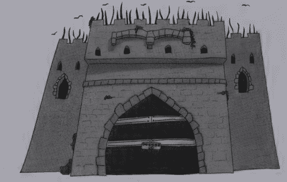

“你想让我帮你破坏公物？”Socks 看起来惊恐不已。

“那比开锁更糟。你知道会有多大麻烦吗——”

“那么是搜索咒语吗？全组合咒还是广度优先搜索咒？”Notation 打断了她。在 Frank 随口询问在金币上使用复制咒语的可行性后，她已经听了足够关于正规和非正规咒语工作的话题——这种魔法用法完全违背了 Socks 以及她自己的伦理底线。

“我用过几次广度优先搜索咒，”Socks 回答，“我的真正专长是二叉搜索树，但我熟悉各种计算技术。一旦我——”

“广度优先搜索在锁上起作用吗？”Frank 打断道。多年来，Frank 曾与几位声誉程度不等的巫师合作办案。他见过至少十来种开锁咒语，但从未见过通过显式的广度优先搜索来打开门。

Notation 露出了微笑。“绝对可以！这有点抽象，但我最近在我的《警察算法》课程上见过一个类似的问题。你想想，密码锁其实就是一个搜索问题；你输入一个字符字符串来打开它。搜索空间是可以用这些字符组成的所有可能的字符串。每个字符串都是一个有效的搜索选项，从像 1 或 A 这样的单个字符到像 ABC123CBA321 这样复杂的序列。搜索目标是那个能打开锁的字符串。

“我们甚至不知道需要多少个字符，”Socks 抗议道，“锁可能有 30 个字符的组合。”

“这就是为什么她建议用广度优先搜索，”Frank 说，一边自言自语，一边在回答 Socks 的顾虑。

“我不明白，”Socks 说。

Notation 迅速接过了解释工作。“你看，广度优先搜索从起点向外扩展，沿着解决方案的前沿进行探索。自然地，它会先尝试较短的解决方案，”

“哈？”Socks 问道，现在困惑得近乎恐慌。

“我以为广度优先搜索使用的是魔法列表（magic lists）。我一直都在用魔法列表。它不就是魔法列表吗？”


“是的，”Notation 同意道，“广度优先搜索维护一个选项列表，如果当前选项不起作用就尝试列表。算法基本上是一个循环，不断从列表头部提取选项并将新选项添加到末尾。在每次迭代中，我们从列表的`前端`选取一个新选项进行尝试。而且，如果那不是我们想要的，我们会检查是否从当前选项可以到达任何新选项，并将那些未被探索的选项添加到列表的`末尾`。

“你从搜索空间中的单点开始，在这个例中是从长度为零的密码开始。然后对于每个密码，你将新的搜索可能性添加到列表末尾。在这种情况下，我们每次尝试一个密码，都会将所有单字符扩展添加到列表中。例如，在这里我们知道密码只能包含字符 1、2、3 以及 A、B 和 C。”

密码 2 无效，列表又增长了。

- 3, A, B, C
- 11, 12, 13, 1A, 1B, 1C
- 21, 22, 23, 2A, 2B, 2C

树结构再次分叉出新的可能性，但搜索仍然沿着当前层级进行，在向更深层级移动之前尝试所有单字符密码。

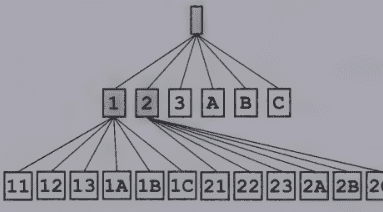

换句话说，搜索在进入更深层级之前，探索了每一层的完整宽度。

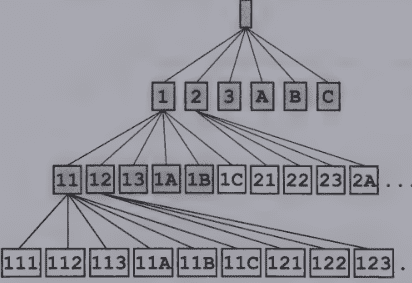

搜索完成了第一层，尝试了密码 3、A、B 和 C，袜子（Socks）打破了沉默。“这可能需要一段时间。”

弗兰克（Frank）点头，眼睛盯着不断增长的数字列表。

“记号（Notation），你为什么不在前面侦察一下？”

“好的，”她同意道，神情中透出极大的宽慰。新手通常不擅长处理伏击。连续几个小时无所事事地坐着并不是学院里能教的，尽管云教授（Professor Cloud）的《执法哲学》讲座讲得很清楚。

记号离开五分钟后，锁发出了响亮的“咔”一声，大门在生锈的合链上吱呀响着开了。随着搜索算法的完成，泥地上的列表消失了。

“1111，”弗兰克说，脸上没有一丝惊讶。让代码足够简单以便手下记住，这通常是值得的。

他用树枝在泥地上写下代码，并画了两个圈。即使是新手也不会错过这个信息。然后他转向袜子。“我们走吧。”

# 警察算法 101：广度优先搜索

德雷克教授（Professor Drecker）讲座节选

广度优先搜索是一种按照遇到搜索状态的顺序探索它们的算法。换句话说，它总是尝试探索最旧的未搜索状态。

你可以将广度优先搜索可视化为维护一个已知但未探索状态的列表（更正式地说，是一个 `queue`）。在每一步中，算法从队列头部选取下一个要探索的状态。当算法发现新选项时，它将其添加到队列尾部，确保在移动到新选项之前已探索所有之前的选项。

通过它如何探索图来描述广度优先搜索是有帮助的。图是由单个节点组成的数据结构，边连接这些节点。如果两个节点通过一条边连接，我们称它们为邻居，这意味着你可以在这些节点之间移动。在你的培训期间，你至少学习过一张图——王国高速地图。这张地图将每个城市表示为节点，将连接它们的公路表示为边。确保你有一份良好的副本。罪犯倾向于逃离城市，你需要知道他们最可能去哪些邻市。

搜索王国高速地图是一个经典的图搜索问题。我们的搜索状态是图的节点——地图上的城市。假设 A 城市发生了一起案件，你的任务是找到逃亡的罪犯。

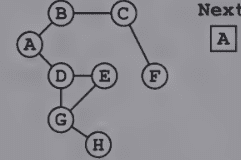

广度优先搜索沿着不断扩张的边界探索，在进入任何 X+1 步的节点之前，检查距离初始节点 X 步的每个节点。当你探索 A 城市后，它的两个邻居 B 和 D 被添加到队列中。队列中没有其他城市，所以 B 是你将访问的下一个城市。

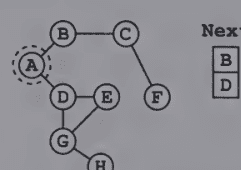

如果每个节点都有许多邻居，维护待探索节点队列可能会消耗大量内存。这种内存需求在大规模搜索问题中可能是非常昂贵的。作为一名警官，你会想要准备一些笔记本。

他们总是向列表末尾添加项目，那么下一个要探索的方格可能远得令人恼。即使在空网格中，没有墙壁挡路，你可能会发现自己正徒步回到搜索空间的另一端。

| | | | | |
|---|---|---|---|---|
| 4 | 1 | 2 | 5 | |
| 8 | 3 | 6 | | |
| | 7 | | | |

这正是弗兰克制定政策要避免的无用移动。

“不，”弗兰克说，“回溯得太多了。我们在这里最好用深度优先搜索。”

“深度优先搜索。深度优先搜索，”袜子自言自语地嘟囔着，仿佛想把这个咒语刻进记忆里。“我——我不觉得我记得了——”

弗兰克挥了挥手打断了他，径直地走在走廊上。

“这个我们不需要咒语。从你穿尿布开始，我就一直在对建筑进行深度优先搜索了。”

“那么深度优先搜索就不需要回溯了吗？”袜子问。

“大多数搜索算法都有回溯。但深度优先搜索中的回溯更适合行走。”

“嗯……我明白了。”

“不，你不明白，”弗兰克直率地说，“如果你不知道算法，就问。假装自己懂算法是导致灾难的根源。我见过太多新手被糟糕的搜索害了跟头。就像像你这样的好孩子。”

“好的。深度优先搜索是什么？”袜子问。

“这是一个简单的算法，”弗兰克解释道，“基本上我们沿着每条路径深入探索。我们沿着一条路走，直到遇到胡同。然后我们回溯到最近一条未走的路径并尝试它。当我们找到目标时停止。”

“在这种情况下，我们将使用顺时针顺序。每当我们有多个选择时，我们会尝试北、东、南、西——当然，会避免已经尝试过的路径。我们在每个路口都会使用相同的顺序，所以如果可以，我们会总是优先向北。但在这种情况下我们只有一个选择，所以我们从向南开始。”

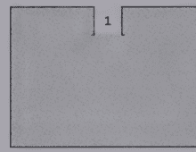

就在弗兰克说话时，他们到达了第一个决策点。弗兰克观察了各个选项。他们是从北边来的，所以他选择了东——这是他顺序中下一个未探索的方向。在离开路口之前，他从口袋里掏出一个粉笔，在墙上画了一个小小的标记。

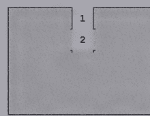

在又过了两个路口后——先向北，后向东——他们到达了第一个胡同。到目前为止，房间要么完全为空，要么只包含一个奇怪的牢室——牢室是房间内的封闭空间。由于完全缺乏其他区分特征，弗兰克在每个房间的墙上写了一个数字，并在脑中将该数字与在那里发现的不同霉菌形成联系起来。

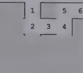

“现在我们回溯到上一个房间，5号房间，那里有像马一样的霉菌，”弗兰克在他们原路返回时解释道。这次他们选择了5号房间唯一的未探索选项，向西走。不幸的是，他们立即撞到了另一个胡同——一个长着复杂的绿色和蓝色绒毛花朵图案的空房间。


他们回溯通过最近一个选项已耗尽的路口，直到在4号房间有了新选择。东边的选项是一个胡同，他们已经探索过北边的选项，所以这次他们向南走。

他们冒险穿过了两个新的空房间（8和9），唯一的区别是出现了一块巨大的橙色霉菌形成的钟乳石，他们尽可能远离它。橙色霉菌并不以结构稳定性而闻名。在撞到另一个胡同后，他们发现自己一直原路回到了2号房间的第一个路口。


废弃监狱中的深度优先搜索 87

“如果我们错过了呢？”袜子用他现在标志性的忧虑语气问道，“或者我们最终陷入了循环呢？我们可能会永远困在那里！”

弗兰克叹了一声。“听着，孩子。这不是我第一次进行深度搜索。我知道我在做什么。”

“但是有循环。”

“你认为我为什么要在墙上做标记？”弗兰克问，“如果我们避开已经探索过的通道，就能避免进入循环。”

弗兰克是在一次警察算法练习中学会这门课的。在全班同学的注视下，弗兰克在树篱迷宫中绕了六圈，直到他听到另一个学生大声开玩笑道：“他又来了。”

他们向迷宫深处探索，顺着蜿蜒的路径，并在胡同处回溯。

| 1 | 7 | 5 | 6 | |
|---|---|---|---|---|
| n | 2 | 3 | 4 | 16 |
| 10 | 9 | 8 | | |
| 11 | 12 | 13 | 14 | |
| 15 | 20 | 19 | 18 | |
| 21 | 22 | 23 | | |


| 1 | 7 | 5 | 6 | |
|---|---|---|---|---|
| n | 2 | 3 | 4 | 16 |
| 10 | 9 | 8 | | |
| 11 | 12 | 13 | 14 | |
| 15 | 20 | 19 | 18 | |
| 21 | 22 | 23 | | |

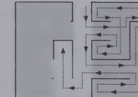

| 1 | 7 | 5 | 6 | |
|---|---|---|---|---|
| n | 2 | 3 | 4 | 16 |
| 10 | 9 | 8 | | |
| 11 | 12 | 13 | 14 | |
| 15 | 20 | 19 | 18 | |
| 21 | 22 | 23 | | |

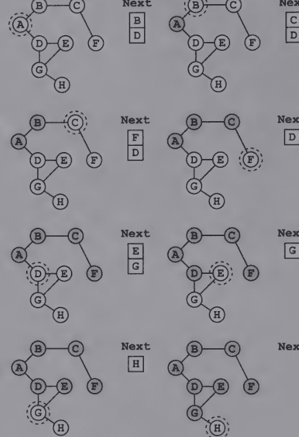

这一次，我们再次发现嫌疑人躲在 H 市——尽管这一次在搜索过程中，我们采取了不同的路径。

与广度优先搜索一样，我们通过跟踪之前访问过的节点来避免重复探索节点。如果你想避免陷入无尽的循环并反复检查相同的节点，这种检查就尤为重要。在上面的示例中，我们完全避免了将之前见过的节点（无论已探索过还是未探索过）添加到我们的列表中。

# — 12 —

## 食堂的栈与队列

弗兰克蹲下身，冲向门口。他推推拉拉，门撞击在锁上发出咣当响响和砰砰声。他抓住锈迹斑斑的铁杆，全身用力推拉，但只是发出了更响亮的金属撞击声。

弗兰克看向袜子（Socks），希望这位年轻的巫师会某种弯曲铁棒的咒语。鉴于这种情况，他有信心袜子甚至会同意使用开锁咒。但当弗兰克的目光落在冒烟的羊皮堆和向天花板升起的缕缕烟时，他愣住了。一个烟雾弥漫的厨房画面在他脑中闪过，勾起了他在学院第一年被遗忘的记忆。他几乎能听到厨师的叫喊。弗兰克用力闭上眼睛，试图将那段记忆赶走。

在学院的前两个月里，弗兰克在课程和食堂的工读工作之间取得了平衡。这份工作并不光鲜；他们不让新来的学生洗碗，更不用说准备食物了。相反，弗兰克每周要花 15 小时，将大量的干净托盘、盘子和餐具从厨房运到食堂的各个位置。

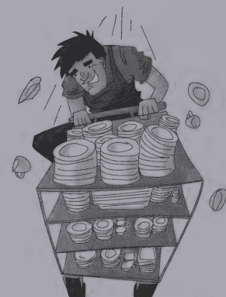

尽管工作性质很枯燥，但弗兰克发现自己很享受其中。“看看我！我正在破坏你们的工作。我是‘反跑跑工’，”对着三个正在清理桌子并往垃圾桶里装脏盘子的服务生大喊。他曾试图打破学校两分钟内运送盘子最多的纪录，但并未成功。他创造了一个全新的食堂游戏，叫作“扔汤勺”。但直到他偶然遇到希彭斯教授（Professor Heappens），他才真正从这份工作中学到了一些东西。

“呃。有些数据结构根本不该出现在食堂，”希彭斯教授一边研究食物选择，一边大声嘀咕道。

下午 2:30，午餐高峰期已经过去，弗兰克正忙着把一叠碗运到汤站。虽然那话不是针对他，但他发现自己在问教授：“什么数据结构？”

“栈（Stacks）”希彭斯教授抬头看着弗兰克，“栈几乎从不属于食堂。”

“当然有，”弗兰克回答道，带着一种只有新生和真正无知者才能表现出的确定性。他低头看了看手里抱着的一叠碗。“碗栈。盘子栈。煎饼栈。”

希彭斯教授做了一个不屑一顾的手势，开始走开。“你对数据结构又懂些什么？”

“还能怎么摆盘子呢？”弗兰克问，“如果你把它们首尾相接排开，会占用太多空间。”

教授停下脚步，用深表忧虑的神情盯着弗兰克。过了近一分钟，他问道：“你知道栈和队列的区别吗？”

弗兰克摇了摇头。他还没上过《礼貌数据结构》。

“栈是一种后进先出（last-in, first-out）的数据结构，”教授解释道，“它有两个操作。你可以把某东西推（push）到栈的顶部。或者你可以从栈顶弹出（pop）某个东西。”

他指了指在队前方等待的一叠盘子。“就像那里的盘子栈一样。你可以把一个盘子推到栈上。”

他把自己的空盘放在了栈的最上方。


“或者你可以从顶部弹出一个盘子。”他抓起了自己的盘子。


“每当你从栈中弹出某物时，你得到的是栈上最新的项。最旧的项会留在栈底，直到你弹掉了它上面的所有东西。”

“那呢？”弗兰克问，“这有什么错？”

弗兰克试图回忆上一次看到栈变空是什么时候，但连那个画面都想不起来。

“五年了！”希彭斯教授大喊道，“我知道，因为我标记过。五年来，底部的那个盘子一直闲置状态，而像你这样的学生把其他干净的盘子堆在上面。它就那样坐在那里，边缘积满了灰尘。”

弗兰克看了一眼盛满土豆泥的大木碗。一个厨师正在把它重新装满。他手里拿着一个大锅，正高兴地将新鲜的土豆泥舀进碗里。弗兰克过了一刻才意识到，旧的食物只是被埋在了下面。他的胃里翻了一海。

“多久了？”他沙着嗓问，其实并不想知道。“别担心。他们至少每周清洗一次盛菜碗，所以旧的土豆泥没满一周。”

弗兰克并没有感到安心。他反而感到不适。他快速扫视了一下食堂，发现到处都是后进先出的模式。当他走到沙拉酱桶时停了下来，胃里充斥着恶心和恐慌。

“我们可以做什么？”他问。

“队列（Queues）”教授回答。“队列简直是为食堂设计的。”

“队列？”弗兰克问。

“先进先出（first-in, first-out）数据结构，”希彭斯教授解释道，“和栈一样，它们也存储物品并有两个操作。你可以将某东西入队（enqueue）到队列末尾。或者你可以从前端出队（dequeue）。这样，你拿出的总是最旧的项。”

弗兰克试图想象总是从栈底部拿盘子。“但怎么做？”

“这就是数据结构的工作方式。看那个三明治队伍；它就是一个队列。现在里面有四个人，排在前面的人等得最久。”

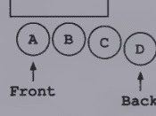

就在希彭斯教授说这句话时，又有一个加入了队伍。“看，他们是从末尾入队的！”他注意到。

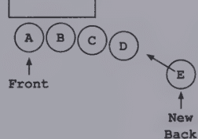

“而且是从前端出队的，”教授愉快地说，“这个食堂需要更多的队列。每个食堂都需要队列。”

# 警察算法 101：栈与队列

Drecker 教授讲座摘要

栈（Stack）和队列（Queue）是两种存储数据的简单结构。从上看，这两种数据结构看起来就像数值列表。然而，这两种数据结构的区别在于数据插入或移除的方式。

栈是一种后进先出（LIFO）的数据结构，其工作方式类似于你在每个警官办公桌上都能看到的一叠纸。新元素被`推入`（push）到栈顶，元素则通过从栈顶`弹出`（pop）来移除。如果按照 1, 2, 3, 4, 5 的顺序向空栈中推入五个元素，它们将以相反的顺序 5, 4, 3, 2, 1 被弹出。当然，一旦你那叠纸处理完了，你的队长又会给你带来一堆文书工作了。

你可以使用数组和一个变量（用于跟踪栈顶对应的索引）来实现栈。当你向栈中推入一个新元素时，你将其添加到数组的下一个空槽中：`index = top + 1`。你还需要相应地增加 `top` 索引。

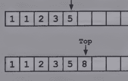

当你从栈中弹出一个元素时，你可以再次使用 `top` 索引来找到正确的元素。你可以将其从数组中移除并相应地减少 `top` 索引。

| 1 | 1 | 2 | 3 | 5 | | | | |
|---|---|---|---|---|---|---|---|---|
| 1 | 1 | 2 | 3 | | | | | |

当然，在向固定大小的数组添加元素时，必须小心避免越界数组末尾。

队列是一种先进先出（FIFO）的数据结构，非常类似于等待处理的嫌疑人队伍。新元素在队列队尾入队（enqueue），元素通过从队头出队（dequeue）来移除。如果按照 1, 2, 3, 4, 5 的顺序向空队列入队五个元素，它们将按照相同的顺序 1, 2, 3, 4, 5 出队。

队列也可以用数组实现。在这种情况下，你需要跟踪两个索引——队列中的第一个元素和最后一个元素。当你入队一个新元素时，你将其添加到当前最后一个元素之后并增加后端索引。

| 1 | 1 | 2 | 3 | 5 | | | | |
|---|---|---|---|---|---|---|---|---|
| 1 | 1 | 2 | 3 | 5 | 8 | | | |

当队列出队一个元素时，你移除队头的元素并相应地增加前端索引。


当你在固定数组中入队和出队元素时，数组前端会堆积出一块空空间。虽然你可以将队列设计成环形，但在入队和出队过程中，你必须小心处理索引增加到数组之外的情况。

# — 13 —

## 用于搜索的栈与队列

弗兰克从脑海中甩掉焦黑面包的画面，回到现实状况——他被困在一个装满了即将燃烧的羊皮纸的小隔间里。火还很小，烧着纸堆边缘的散落的纸张。但一旦大叠纸完全点燃，热量将变得无法忍受。

索克斯爬到门边，靠在门上。“锁着吗？”他问。

弗兰克咽下了半打个讽刺的回答，只是点了点头。“你能打开它吗？”他问，“这是一个旧的双销钉锁，组合应该不会很多。”

索克斯摇了摇头。“没时间了。我知道一种可以削弱金属的咒语。”

他取出法杖立即开始工作，低声吟念着咒语并用手抚过栅栏。锈斑在他的手下绽放，并蔓延到金属上。不到一分钟，索克斯退后了。那扇门看起来完全生锈了，尽管仍然是金属制成的。


“栅栏应该被显著削弱了，”他说。他退后一步，带着期待的看着弗兰克，仿佛在说：“你可以随时撞开这扇门。”

弗兰克向后退了几步，打量着门。“有多弱？我们说的是像牙签那么弱，还是像厚木板那么弱？”

“嗯……比普通金属弱得多，”索克斯回答道，“我加了很多锈。栅栏很厚，但我觉得它们现在应该很弱了。”

弗兰克呻吟了一声。他深吸一口气冲了过去，压低肩膀猛地撞在门上。冲击震动了他的全身，但他撞破了。

弗兰克倒在地板上，一团铁锈颗粒和烟子的浑浊混合物在他上方盘旋。

索克斯急忙跑到他身边。“你还好吗？”他看向门，露出了灿烂的笑容。“成功了！”他说道，脸上洋溢着自豪的光芒，“它们真的很弱吗？感觉怎么样？”

“像一英寸厚的松木一样，”弗兰克说，“非常疼。”

笑容稍稍暗淡。“噢。”

弗兰克撑起身来。他的肩膀在作痛，而且他会受一个严重的……


弗兰克无视了他的胡言，继续向出口回溯。他们行动得很快，优先逃生而非进行进一步的探索。简单的逻辑告诉弗兰克，攻击者早已离开了。没有人试图阻止他们逃跑，而且证据正在焚毁，罪犯们留在这里也没有任何可图。

几分钟后，他找到了最后一扇门，他们冲到了外面。一缕细烟随他们飘了出去。此时，火焰应该已经烧掉了那堆纸张，摧毁了所有的线索。

# 警察算法 101：栈与队列

德雷克教授讲座节录

高效算法的关键在于信息。组织信息的方式以及我们使用的数据结构不仅会影响算法的效率，还会影响算法的实际运行方式。关于数据结构重要性的简单例子，请考虑之前课程中的广度优先搜索和深度优先搜索。虽然这些算法在概念上是类似的，但我们将线索列表维护在栈还是队列中，会显著改变搜索的进展。

在选择数据结构时必须谨慎。数据结构应该能够为算法提供支持。想象一下，如果在图中存储一个有序数字列表会发生什么。即使我们保持了排序属性，我们也无法对数据进行高效二分查找，因为图限制了我们访问数据的方式。与数组不同，图没有可以通过索引访问值的索引。相反，我们被迫进行线性扫描，通过图的边从一个节点移动到下一个。

---

## 让我们分头：并行搜索

“发生了这种事？”站在大门旁的诺言警官问道。弗兰克一边努力呼吸，一边观察她。她是担心吗？还是困惑吗？

“我们被攻击了！”索克斯脱口而出，“我们被困在牢房里，到处都是火！但我用了一个金属弱化咒，我们才逃了出来。”他看起来对自己非常自豪。

“被攻击了？”诺言问道，“谁攻击了你们？你们看到他们了吗？他们长什么样？”

“没有，”索克斯承认道，“他从我身后偷偷上来的。”

“弗兰克？”诺言转向弗兰克问道。

弗兰克摇了摇头。“我只看到索克斯朝我飞过来。”

“我敢打赌他很大，”索克斯提议道，“一个大流氓。而且他很隐行。也许是个受过训练的刺客。”

弗兰克翻了个白眼。“抱歉，孩子。他是个业余。职业刺客不会把人锁在牢房里然后逃掉。”

“但是火，”索克斯说。

“是你的法杖引起火的，”弗兰克提醒他，“你把它掉在纸上了。”

“纸？”诺言问，“你们找到日志了吗？你们知道他们在找什么吗？”

弗兰克和索克斯互相看着。诺言在两人之间看了一眼。最后，弗兰克开口了：“日志没了。我们这儿的初级巫师掉了他的法杖，然后砰——到处都是火。任何线索现在全都没了。”

索克斯脸涨得通红，盯着地面。“全没了，”诺言问道，“全都没了？你确定吗？”

“是的，”弗兰克说。他指了指门口渗出的烟雾。

“那个攻击你们的人呢？”诺言问。“我没看清他的脸，”弗兰克说，“我不认为你看到了什么？”他问道。这个问题的语气比他预想的要尖锐，但在遭到攻击、被困在燃烧的房间并从黑暗的监狱逃生后，他觉得没必要留情了。

“没有，”她冷静地说道，“前面周围什么都没有。任何门附近都没有痕迹吗？”弗兰克问，“有什么能给我们提供关于攻击者线索的吗？”

诺言摇了摇头。“什么都没有，”她说，“看起来对面好几个月没人来过了。”

弗兰克点头，但没有说话。感觉不对劲。要么攻击者巧妙地通过他们用过的那扇门溜过了诺言，要么她对他们隐瞒了什么。她离开大门多久了？为什么一直留在外面？弗兰克决定不追问这个问题。“好吧。我们回船上。”

“现在怎么办？”索克斯在走向水边时问道。

“是时候回溯了，”弗兰克说，“这里没有线索。”

“回溯到哪里？”

“回到开放的线索，”弗兰克回答道，“我们调查剩下的线索。”他停顿了一下，权衡自己的选择。“我觉得是时候并行搜索了。”

“真的吗？”诺言问。

“并行？”索克斯问。

“意思是我们分头探索搜索空间的不同部分。”

“但是，”索克斯反对道，“我既不是警察也不是私家侦探。我不知道该做什么。我不应该跟着你们其中一个吗？”

“不。好的，”诺言同意道，“我们如何分配工作？”

弗兰克知道，高效并行算法的关键在于确保使用多个工作者的收益大于分配工作的成本。并行化工作涉及一定的开销。问题需要被拆分成碎片。每个工作者必须获得任务，准备好执行，然后实际执行。最后，工作必须重新合并。并行化一个简单任务有时比直接解决它成本更高。然而，当问题足够大时，并行化可以大大加速算法。

“简单，”弗兰克说，“索克斯，你需要和你的巫师朋友聊天。问问他们是否知道一个叫‘……联盟’的团体。船上的流氓说在瑞贝卡·维内特特打断他们之前，他们正在为某个联盟工作。根据之前的案件，这个名字会很邪恶，比如‘权欲狂人联盟’或‘黑暗联盟’。邪恶联盟的名字通常不含蓄。尽一切寻找有关这个小组的信息。”

“这没什么可查，”索克斯抱怨道。

“诺言，”弗兰克继续说，“我需要调取过去六个月所有的警察调动记录。”虽然他不不喜欢让线索引向诺言，但她是唯一能方便获取记录的人。如果他尝试自己收集，将会遇到怀疑的目光和层层叠叠的文书。首都警察部门处理文书的手段同样坚定且有效。

“调动？”诺言问道，显然很惊讶，“为什么？”

“权当直觉吧，”弗兰克撒谎道，“我们明天早上在我办公室见面，汇总我们的信息。”

“你呢？”诺言问。她的语气现在带着一丝烦躁。她显然知道弗兰克没有说出全部。

弗兰克给了她一个无辜的微笑。“我要去购物。”

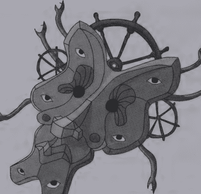

“这幅面具到底有什么用？”弗兰克问道，开始焦虑地踱着步。

索克斯犹豫了片刻。“它是一件极其强大的法器，”他开始说道。看到弗兰克眼中愤怒的神情，他加快了语速。“它的正式名称是‘组合外观面具’。它在数百年前的大蛞蝓战争中失踪了。大家都以为它已经被销毁了，直到安公主在一次任务中找回了它。她找到了——”

“它有什么用？”弗兰克催促道。

“它能让佩戴者看起来像任何其他。。学者们认为它使用了大规模并行搜索。每个特征都会运行自己的搜索以找到最佳匹配。鼻子将幻化成目标鼻子的完美匹配。眼睛将变成——”

“一个完美的伪装，”弗兰克接话道。

“是的，”索克斯说。

弗兰克诅咒了一句。“那城堡呢？格雷特琴为什么认为他们会进攻城堡？”

“她没说，”索克斯承认道。“也许那部分只是个猜测，”他补充道，语气并没有什么底气。

弗兰克也不信。

“我很抱歉我没早点提到它，”索克斯提议道。“因为没有硬性证据……”他的声音小了下去，显得很痛苦。

“你还有什么没告诉我们？”弗兰克盯着索克斯问道。

索克斯对这个问题思考了很久才回答道。“我想就这些了。”

“全部吗？”

“我所知道的全部，”索克斯解释道。

弗兰克深吸了一口气，抬头看向风帆，希望它们能更满一点。风在过去一小时内已经停息了，“TCP 飞艇号”似乎正缓慢地向目的地挪动。

他在脑海中过着未来几天的时间线，心想他们是否有足够的时间。即使有三个人并行搜索，也不能保证他们能覆盖足够的区域。更糟糕的是，在 `TCP 飞艇号` 靠岸之前，他们甚至无法开始并行搜索。在此之前，他们全都被困在了船上。

# 警察算法 101：并行算法

节选自德雷克教授的讲座

并行算法将一个问题分成多个部分，在（大约）相同的时间对这些部分进行计算，并在所有部分完成后合并结果。它将工作分配给不同的执行者，使他们能够比单个执行者更快地完成任务。考虑我们最喜爱的例子：在一个废弃的建筑中寻找嫌疑人。警察越多，你们同时能检查的房间就越多，找到嫌疑人的速度也越快。

继续

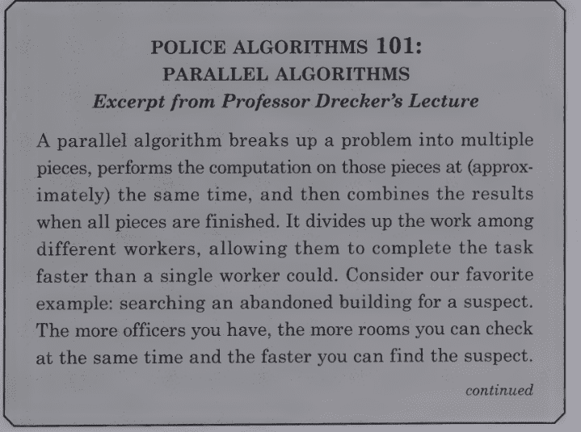

如果你有 `30` 个房间和 `30` 名警察，他们可以同时踢开所有的门。

高效并行算法的关键在于将工作高效划分为独立的单元，然后将其重新组合。有些问题很容易并行化。例如，如果你在一叠大卷轴中寻找特定的线索，你可以通过给每个执行者一子集卷轴来轻松地分配工作。

然而，其他算法并行化要困难得多，甚至无法实现。即使你有 `100` 名警察，你也无法更快地审问任何嫌疑人。这本质上是一个串行问题。你需要根据嫌疑人之前的回答来提出下一个问题。而且，也许重要的是，嫌疑人一次只能回答一个问题。我见过八个警察同时大声提问。审问并不会因此更快。

并行化算法时需要考虑的另一个方面是，这种效率是否值得这些开销。并行算法需要额外的设置时间来划分工作，以及将结果合并回来的时间。单个任务必须分配给不同的执行者，通常需要某种程度的通信。考虑在只有三个值的情况下搜索一个无序数组的任务。等设置完成，一个人可能已经对数组进行了很多次扫描了。

---

## 迭代深度搜索可以救你的命

“我认识那种眼神，”梅维斯说。弗兰克恼怒地抬头看向 `TCP 飞艇号` 的船长。他更倾向于安静地沉思，而这是 `10` 分钟内的第二次打扰。

“什么眼神？”他低吼道。

“就是那个眼神，”她说，朝弗兰克的大致方向挥手。“你在怀疑自己的搜索，想你是否在死胡同上浪费了太多时间。”

“我为什么要那样做？”弗兰克问。

“我听那孩子说了，”梅维斯解释道。“你突然时间很紧迫，而我们回到‘我们’那里至少还有一小时。”

弗兰克点了点头。“如果这块破铁——”

“嘿，别这样。不能仅仅因为你怀疑自己的搜索，就给你理由侮辱我的船。”

“是啊。我想是吧，”弗兰克咕囔着表示道歉。

他一直在脑海中过一遍那些线索，心想是否其中某一个能提供更快的答案。他知道日志记录是很好的线索——在这种情况下他能希望找到的最好线索。但它们会很耗时间。他在 `TCP 飞艇号` 在港口之间穿梭了几乎一整天。

梅维斯格格一笑，蹲下身坐在弗兰克身边。

“迭代深度？”

弗兰克耸了耸肩。这个念头确实出现过。迭代深度搜索是纯深度优先搜索和广度优先搜索的结合。该算法按轮进行搜索，每一轮都是限制在给定路径长度内的深度优先搜索。

“从不是粉丝，”弗兰克承认道。他从没能够在每次迭代中反复重复搜索部分。

梅维斯摇了摇头。“完全没有补给站的迹象。所以我们重新开始，从起点又进行了一次深度优先搜索。这次向外探索了两步，覆盖了更广泛的区域。在此过程中，我们重新探索了相邻的格子。仍然没有补给站的迹象，但我们很快消除了两步范围内的所有格子。”

| | | | | | | |
|---|---|---|---|---|---|---|
| | | | `2` | | | |
| | | | `1` | | | |
| | `2` | `1` | | | `1` | |
| | Supplies | | | `2` | | |
| | | | | | | |
| Supplies | | | | | | |

“为什么不直接用广度优先搜索呢？”弗兰克问，“你实际上一直在这么做。你的搜索在向外探索，离起点越来越远。”

梅维斯点了点头。“广度优先搜索和迭代加深有很多共同点。但你忘记了一个关键点。我们丢失了地图。在没有地图的情况下，在广度优先搜索中很难追踪你未探索的状态。你如何记住你的前沿？迭代加深允许我们向外探索，而不需要显式地记住所有未探索的状态。我们只是遵循了一条深度限制的路径。”

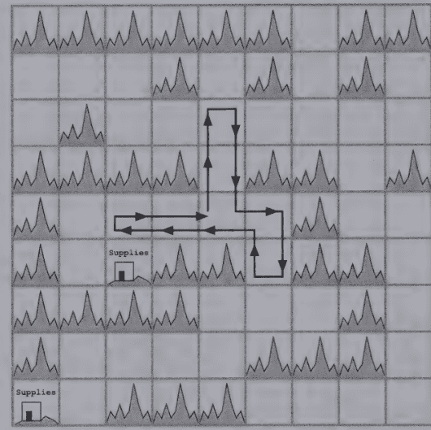

“我想是吧，”弗兰克认同道。

“总之，那时我们的咖啡快喝完了，”梅维斯继续道，“包括船长在内的一组志愿者换成了脱因咖啡。但我们都知道那只能争取一点时间。我们继续努力。我们再次重新开始深度优先搜索，这次我们允许自己探索得更远。”

“你们通过长度为三的搜索找到它的吗？”弗兰克问。

“幸运的是，我们找到了，”梅维斯回答道，“在那次迭代中，我们检查了距离一、二、三步范围内的一切。到那时，完全不需要脱因咖啡的军需官已经不得不第 `10` 次重复使用同样的咖啡渣了，但大副已经在唱《甲板上的海蛞》了。幸运的是，那是他比较欢快的曲子之一。”

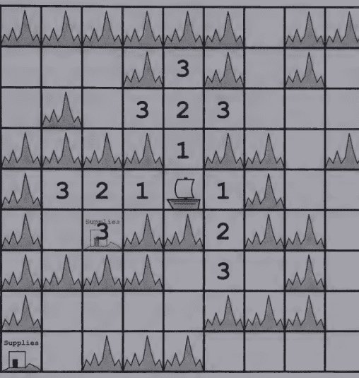

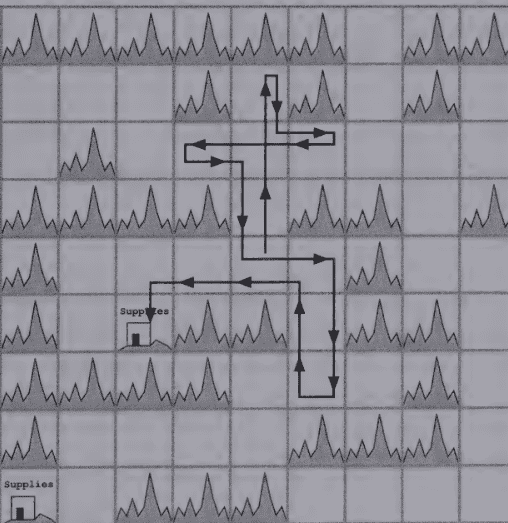

迭代加深可以救你的命 `123`

弗兰克思考了片刻。“如果你当时跳过了重复工作呢？如果你当时只使用深度优先搜索呢？”

“我们会掉进一个长长的死胡同并耗光咖啡，”她回答道，“我开始不是就告诉过你它救了我的命吗？”

“有道理。那是运气问题。最近的补给站可能在长度为五的深度优先搜索之后。”

“哈！你比这更清楚，弗兰克。你总能找到幸运或倒霉的问题。迭代加深可以帮助你应对极端倒霉的情况。它限制了你在任何迭代中可以走多远。”

“其他算法也能做到，”他反驳道。

梅维斯皱起眉。“我没说迭代加深是唯一能救我们的算法。我说它是我们使用的那一个。从以后我一直用它。”

有一次我甚至用它追踪了一群愤怒的乌鱼，就在它们在首府港口喷墨水之前。噢，那将是一场大混乱。有些时候我在想，我是不是该由让他们去做的。国王的反应将是无价的。

弗兰克思考了很久，想着迭代加深是否能在这里救他。通过更早地停止搜索，他可以回溯并追踪那个神秘联盟的线索。但那样他就不会遵循最高优先的线索了。

他摇摇头。“我还是坚持我常用的搜索方式，”他终于说道。

梅维斯严肃地点头，看向海洋。“好吧，弗兰克。但要小心，你没多少时间，长死胡同的代价是高昂的。对于任何算法，你至少应该考虑如何保护自己免遇到最坏的情况。”

# 警察算法 101：迭代加深

节选德雷克教授的讲座

迭代加深是深度优先搜索的一种改进，它重复执行深度限制的深度优先搜索。在迭代加深的第 `k` 次迭代（或轮次）中，算法执行 `max-depth = k` 的深度限制搜索。

再次考虑从 `A` 市开始搜索嫌疑人的例子。

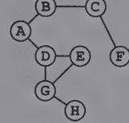

我们从深度优先搜索开始，但在第一个节点 `A` 后停止。这相当于将自己限制在仅搜索犯罪现场。

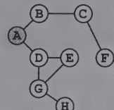

下一次迭代重启深度优先搜索，但允许它探索一个城市范围。我们覆盖了邻近城市，访问了 `A`、`B` 和 `D`。

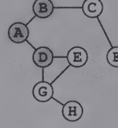

下一次迭代重启深度优先搜索，但允许它探索两个城市范围。我们覆盖了更远的城市。

虽然迭代加深增加了计算成本，但它有优势。它结合了深度优先搜索的内存效率和广度优先搜索的完整性。

## 倒排索引

目录确实提供了书籍主题的索引。但目录对于这种搜索来说组织方式是错误的。它是按照出现的顺序列主题的。如果你想知道接下来是什么，这种排序很不错。

“这有什么用？”弗兰克问道。“她只是在重复目录里的信息。”

是的。她重复了信息，但她使用了不同的顺序。她按照术语的顺序对末尾的索引进行了组织。对于每个术语，她列出了它出现的页码。

弗兰克盯着他，等待着。但店主似乎已经说完了。“呢？”弗兰克催促道。

“你只需要查找你想看的术语，索引就会引导你找到对应的页面！”他惊呼道，“再也不用在目录里盲目摸索了。你的搜索变成了一个查找。”

“但你仍然需要搜索索引来找到正确的术语，对吧？”弗兰克问。

嗯，是的。既然索引是按术语字母顺序排序的，你只需要使用二分查找即可。

“如果某个项目出现在很多页面上呢？”

“你需要检查所有的页面，”克洛克斯沃斯承认道。

“如果你只是在找几个术语呢？”弗兰克问道，“比如三种颜色的线？”


“啊！那才是有意思的地方，”克洛克斯沃斯说。“你只需要检查它们共同拥有的页面。你可以通过对页码集合取交集找到这些页面。这意味着遍历列表并找到在每个列表中都出现的元素。如果你有足够的术语，通常可以将它们所在的页面范围缩小到只有一两个页面。”

前几天，我必须查找一件带有木质纽扣的藏蓝色和皇家蓝色的斗篷。我可以告诉你，世界上这种组合的并不多。事实上，只有一个团体在使用这种组合——业余气象预报协会。直到去年，他们一直使用海军蓝色和深青色，但他们被迫更改了。专业气象预报协会理直气壮地声称这些颜色与其海军蓝色和浅青色太相似了。

| Blue, Navy | 10 | 11 | 72 | 101 |
|---|---|---|---|---|
| Blue, Royal | 11 | 13 | 75 | 119 | 991 |
| Buttons, Wood | 5 | 10 | 11 | 307 | 309 |

弗兰克思考了一会儿，点了点头。“很有主意，”他赞许道。他立刻看出这种索引如何应用到其他信息源。警察记录总是按日期排序的。使用这种新技术，你也可以按犯罪类型或地点对它们建立索引。这些索引可以让研究效率提高几个数量级。

“我想知道这是否会在其他书上流行，”弗兰克思索道。

“不太可能，”店主嘲笑道，“这个世界上很少有主题复杂到需要索引。并不是每个主题都像斗篷制作那样丰富。”

他边说，店主一边搜索，并快速地翻阅那本书。“警察斗篷，”他终于说道。“Bool 部门和 Functionia 部门使用那些颜色。所以是首都警察部队的几个部门。会计、工资、记录和建议告示牌部门，我没记错。当然，设计都不同，考虑到线的状态，我预计这件斗篷是新发行的。警察往往倾向于很快磨损斗篷，特别是在建议告示牌部门。”

店主看着他。“除了它们可能来自四个部门中的某一个新警察斗篷，并且被施了魔法咒之外？”

弗兰克等待着。

“呃……没有，”克洛克斯沃斯最后说道，“就是这些。”

弗兰克点了点头。“谢谢，”他说。他拿起线，转身离开。当他打开门时，他听到了一声轻微的抽气声，知道店主看到了他战壕斗篷底部磨损的边缘。

# 警察算法 101：倒排索引

## 德雷克教授讲座摘要

倒排索引是一种计算数据结构，类似于书籍的索引。它提供了从目标值到数据中这些值出现位置的映射。当给定值在数据中反复出现或可能出现时，倒排索引特别有用。

考虑我们关于二分查找课程中的例子——检查会计账以查找与特定商户的交易。账本按交易单号递增排序，表示交易记录的顺序。

| 101 August 16 | Zed’s Coffee | 8.00 |
|---|---|---|
| 102 August 15 | Bob’s Pizza | 20.00 |
| 103 August 15 | Wands and More | 150.00 |
| 104 August 15 | Spell Shoppe | 100.00 |
| 105 August 16 | Zed’s Coffee | 8.00 |
| 106 August 16 | Spell Shoppe | 50.00 |
| 107 August 17 | Zed’s Coffee | 8.00 |
| 108 August 17 | Hospital | 250.00 |

虽然这种排序允许我们高效地查找给定交易 ID 的信息，但它不能帮助我们追踪特定商户的交易。一种方案是按商户名称重新排序条目。然而，这需要我们复制整个账本，成本可能很高。

相反，我们可以建立一个额外的数据结构：以商户名称为键的倒排索引。对于每个商户，我们存储所有相关交易 ID 的列表。由于我们已经知道如何通过 ID 高效查找任何交易，现在我们可以……

| Bob's Pizza | 102 |
|---|---|
| Hospital | 108 |
| Spell Shoppe | 104, 106 |
| Wands and More | 103 |
| Zed's Coffee | 101, 105, 107 |

倒排索引是时间和内存使用之间权衡的极佳例子。

## 二分查找陷阱

专业间谍经常花费大量时间计划如果被发现后将如何反应。他们为各种场景开发了一套复杂的背景故事，解释从跟踪某人到在皇宫里带着窃听设备和假乌龟被发现的一切情况。然而，现实中的情况很少会进展那么顺利，惊讶的抽气声实际上很常见。在这种情况下，弗兰克甚至曾希望有一刻恐慌以供利用。然而，对方一如既往地保持了专业。没有恐慌。没有出现惊讶的空隙。

快速计算了一下，他认为自己还有时间探索可能五或六条小巷，而不至于落后得太远导致线索中断。遗憾的是，这只是使用深度优先搜索进行追击面临的风险之一。

前两条街道被证明是在浪费时间。他发现的最接近犯罪活动的情况，是一群在墙上涂涂鸦的小孩。他们用带电荷的记号笔写着“递归团队”和“递归万岁”。他继续着自己的搜寻。

又过了几个死胡同后，正当弗兰克打算放弃时，他在泥地中发现了一条通往开放式下水道栅的足迹。他靠在墙上喘了一口气。这定是他的逃生路线。

弗兰克向黑暗的洞里望去，但什么也没看到。他顺着下水道栅降下去，落在一个木制平台上。他蹲下身，尽可能让自己缩得像目标一样小，扫描着这个黑暗的房间。平台固定在粗糙的石墙上，俯瞰着一个至少延伸 50 英尺深的房间。唯一的光线从上方的开口倾射下来，像一个巨大的聚光灯照在远处的地板上。就在他观察时，间谍穿过光圈，向对面的墙跑去。她现在已经甩在他身后了。

弗兰克审视了自己的选择。下方还有其他平台，相隔约 20 英尺，由铁梯连接。当他注意到地板上嵌入的一个小黄质标签时，他大声咒骂道。他正站在一个二叉搜索梯的顶端。


二叉搜索梯最初是由古怪的画廊老板艾琳·布兰奇（Alena Branche）设计的，用来组织绘画。它们实际上是巨大的二叉搜索树——一种旨在实现高效搜索的数据结构。这种结构组织得像一棵巨大的倒立的树，顶部有一个平台，技术上称为`根节点`。每个平台向下分出最多两把梯子，每把梯子通向一个不同的`子节点`——下方一层的另一个平台。整个结构随着下降不断分支，提供了多种路径。

艾琳是一个对微小细节极度狂热的人，她最初利用这种结构根据画中描绘的草的数量来组织绘画。她执行了一种简单的组织方案：当你站在任何平台上时，可以保证左梯子下方（左`子树`中）的所有画中的草数量都少于当前平台的画。而右梯子下方（右`子树`中）的所有画中的草数量更多。通过从顶部开始，你甚至可以选择下降的路径，以找到具有特定数量草叶的画。

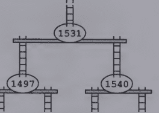

遗憾的是，由于二叉搜索梯体积巨大且需要不断攀爬，这类梯子在艺术界从未真正流行起来，但它们很快被犯罪世界采纳并改进了。二叉搜索梯陷阱（艾琳作品的危险实现）是由初级法师卡蒂·拉德特费尔尔（Katia Laddertfell）在为维内蒂家族（Vinettees）工作期间开发的。卡蒂没有放置画，而是在每个平台上放置了一个数字标签，并创建了一个允许安全通过这棵树的数字密码。在设计树和放置标签时，她保持了二叉搜索树的特性——任何节点左`子树`的值始终小于节点本身，而右`子树`的值始终大于。在这棵新的武器化二叉搜索树中，只有一条路径是安全的，那就是通往最底部节点密码值的路径。如果你知道密码，就可以像执行该值的搜索一样下降树。在每一层，你可以将密码的值与当前平台的值进行比较，并相应地选择左或右梯。因此，维内蒂家族的暴徒只需要记忆一个密码，而不是一系列梯子选择。考虑到该组织的援助质量，这种简单性至关重要。

如果你不知道密码并选择了错误的梯子，就会触发有时致命、有时仅是心理创伤的陷阱。典型的危险包括诅咒的梯子、毒蜘蛛、落石、飞镖枪、旋转刀片，在某些情况下还有魔法侮辱——入侵者会被五层针对其外貌、气味或普遍智力的日益恶毒观察所打击士气。

弗兰克上一次面对维内蒂家族的二叉搜索梯时，一个线人给了他密码——数字 `10`。这个数字让弗兰克能够不被发现地潜入藏身点，并让三个维内蒂人措手不及。只有瑞贝卡逃了。

如果他知道这个陷阱的密码，他可能还有机会抓住间谍。

弗兰克盯着他所站的根节点平台上的标签：`50`。如果他是正确的，维内蒂家族重复了密码，他需要沿着梯子搜索 `10`。由于 `10` 小于 `50`，他需要进入左`子树`。

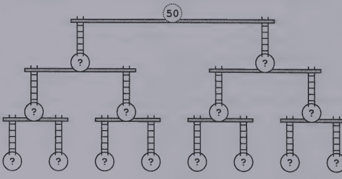

弗兰克嘟囔着一串预防性的咒骂，向左梯移动并开始向下。这段旅程证明是愉快且无意外的。没有蜘蛛。没有旋转刀片。甚至连一个侮辱都没有。

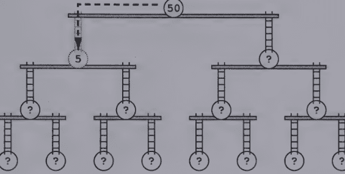

在下一个平台上，弗兰克发现了一个标记为 `5` 的标签。由于 `10` 大于 `5`，他知道路径在右侧。

如果目标值大于当前值，搜索将向右进行：

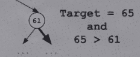

当找到目标值或到达死胡同时，搜索结束。在后一种情况下，我们可以断定目标值不在树中。

如果二叉搜索树中每个节点的左`子树`和右`子树`节点数相同，我们称该二叉搜索树是完美平衡的。在这种情况下，每当树节点数量大约翻倍时，树的深度就会增加。

搜索的计算成本与目标值在树中的深度成正比。树越深，我们需要进行的比较就越多。

# — 18 —

# 构建二叉搜索梯

“你没认为我们会更改密码吧，Runtime 先生？”

弗兰克身后传来一个声音问道。

弗兰克猛地转过头。间谍正从容不迫地朝他走来。弗兰克试图站起来，但他的左脚在恐慌中爆发了抗议。他只好用屁股坐在地上，直到面对她。

> “我没认为维内提家族有能力更改它，”弗兰克承认道，“如今很难找到邪恶巫师了。我听他们最后一位巫师现在在卖椰子。”

“困难，确实。很多优秀的邪恶巫师都逃了或担任了具有商业价值的中立职位。然而，寻找帮助并非不可能。只能说维内提家族做出了恰当的安排。他们找到了一位愿意提供某些魔法援助的巫师，以换取他们在其他领域的服务。”

她朝梯子挥了挥手。“诚然，在二叉搜索树陷阱方面，他没有卡蒂娅那样。她是一个真正的艺术家。但他的工作足够了。”

“信不信由你，你几乎就下去了。你只差了一个梯子。密码是 `26`。我们显然不想让他更改太多的梯子——足以困住任何试图重用旧密码的人。差一点点。”

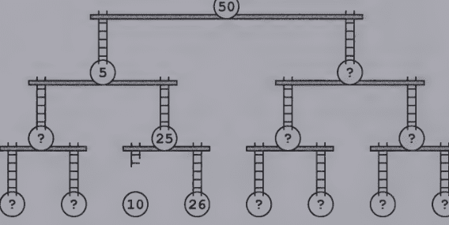

弗兰克保持沉默，当她没有继续说时，他问道：“你是谁？”

“我的名字不重要。我为维内提家族工作。”

“间谍？”

她耸了耸肩。“我收集信息。随你怎么称呼都行。”

“你想对我怎么样？”

“我们显然想让你消失。”

弗兰克考虑了其中的含义。要让他靠边，光靠咬伤的脚是不够的，间谍一定知道这一点。这意味着她计划要么杀死他，要么把他囚起来。虽然这两个选项都不合弗兰克的胃意，但他总是倾向于不涉及被杀的那一个。

间谍似乎是读穿了他的心思，应声回答道：“我本希望二叉搜索梯陷阱能解决问题，但没有。至少还没有。”她走到 `26` 之后的另一个梯子旁，用手掌击中了一个踏板。一声沉闷的


咚声响彻了房间。接着她又连续击了两次。

咚。咚。

“再见，Runtime 先生，”她说。然后，她甚至不回头看一眼就大步走出了房间。

弗兰克很困惑地看着她。这时，余光中的动作吸引了他的注意。在他注视下，三个踏板脱落掉到地上。片刻后，它们开始向他蠕动，发出轻微的嘶嘶声。蛇形板。

弗兰克动作很快。蛇形板很危险但很慢。如果他能到达 `26` 号梯子，他还有机会。他四肢着地爬，不敢信任自己的脚。他利用梯子把自己撑起来，重重地靠在金属上。毫无疑问，这次攀爬会很痛苦。蛇形板现在只有几英尺之遥了。

弗兰克恼火地呻了一声，伸手开始爬梯子。这与其说是爬，不如说是跳；他必须用完好的脚跳起，然后将自己拉到下一个踏板。他的左脚每次移动都隐隐作痛。

弗兰克费力爬到顶端，倒在 `25` 号平台上，躺着喘气，诅咒着二叉搜索梯。一想他曾经还认为这些结构是美的，甚至是优雅的。在警察学院期间，他参加过阿莉娜的几次展览，甚至参加过世界上唯一一例的二叉搜索树表演艺术。

展览名为“举起 P”。阿莉娜请了三位巫师，用魔法实时升起一个二叉搜索梯，根据画中描绘梨的数量对绘画进行分类。以梨为中心的静物在当年是一场狂热，这种现象后来被归咎于苹果产的质量糟糕。虽然不像第二年对吐司雕塑的痴迷那样尴尬，但梨热在艺术史课上仍然经常被讨论，即便在那里也只是低声地，带着厌恶的神情。七位助手每人手里拿着一幅画梨的草图，走进了画廊。他们按 1 到 23 的顺序排列。

## 嫌疑人的二叉搜索树

弗兰克一瘸一拐回到办公室，发现袜子正在等他。年轻的巫师坐在弗兰克的椅子上，无聊地转着。弗兰克盯着他看，直到袜子意识到了自己的错误。他低声道歉了几句，从椅子上跳了起来。

“你发现了什么？”弗兰克问。

袜子耸了耸肩。“没什么用的。”

“什么都没有？”弗兰克催促道。

“巫师们都没有听说过任何新联盟，”袜子快速补充道，“上一个成立的巫师联盟是魔法糖果联盟。他们是去年为了应对劣质薄荷糖涌入而成立的。你还记得那些口感很重的糖片吗？前几分钟吃起来像薄荷味，但接下来的六小时里都会留下一股松针的回味。它们就像是为了恶作剧而设计的。魔法糖果联盟解决了薄荷糖，然后扩展到了巧克力和太妃糖。该联盟有六家糖果店和四个推销车——”

“别的呢？”弗兰克打断了他。

袜子摇了摇头。“我也问了俱乐部和协会，”弗兰克提到，“唯一的这类组织是巴贝维尔巫师保龄协会，但他们只维持了一个月。显然，巴贝维尔并没有那么多喜欢打保龄的巫师。”

弗兰克叹了口气。他并没有对袜子的调查抱有太大期望，但完全一无所获的消息仍然让他感到失望。

“你呢？”袜子问。

“我，”弗兰克回答道，“我有一个新线索。”

“真的吗？是什么？”

还没等弗兰克回答，记录官笔记本砰砰作响地闯进办公室，抱着一大叠厚得离谱的书。她走到弗兰克的桌子前，把书堆了过去。桌子在重量下凹了下去。

“过去一年所有的转调和分配记录，”她喘着气说，“现在你可以告诉我为什么要我把这些拖到这儿了吗？”

“我们需要找到一次转调，”弗兰克说。

“我明白，”记录官说，“但如果你告诉我是哪一次调，我可以直接在那里查。”

“我不知道是哪一次，”弗兰克解释道。这话半真半假。即使他知道，他还是会让记录官带上所有的记录。他在搜索期间必须在场。他需要确保没有遗漏任何人。

“好吧，”记录官说，“我们要找什么？”

“我们先从 50 到 70 天前的任何可疑转调开始，”弗兰克说。“那些是监狱里从账本上撕掉的页面的大致日期。这是一个范围搜索。我们要找到在日期范围内的所有转调。”

记录官呻吟道。“这些请求是按请求官员的原始所在地排序的，然后按官员姓名排序的。它们不是按请求日期索引的。我们必须检查每一条请求。这需要好几个小时。”

“不，”弗兰克向她保证道，“因为我们要用魔法。”

袜子惊讶地抬头。“魔法？”他问道，“我不懂范围搜索法术。”

“你懂二叉搜索树，”弗兰克回答道。

“为什么要用树呢？”记录官问，“如果我们只做一次搜索的话？”

弗兰克耸了耸肩。“我猜我们最终想要进行一次以上的搜索。如果袜子用魔法建立树——”

“但我不知道怎么做范围搜索，”袜子抗议道。

“把树建起来，我给你看。”

“好吧——”

“没什么，”弗兰克说。

“噢，得了吧，”记录官没耐烦道，“自从监狱那以后，你就一直隐瞒着什么。我们为什么要看请求？你为什么以前没提到过它们？你发现了什么？”

“正如我所说——”

“我不信。你对我瞒了什么。”

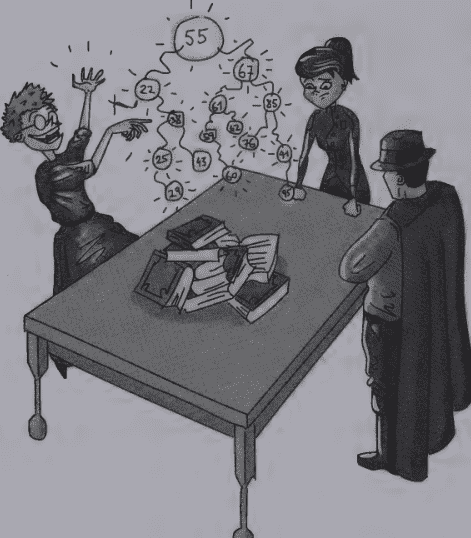

“找到了，”袜子喊道，“至少我是这么认为的。一分钟后就知道。”

袜子转向那堆账本，开始低声念动咒语。他在纸张上方戏剧性地挥动手臂，但完全没有必要。随着一道闪光，空气中出现了一棵巨大的二叉搜索树，树中的每个节点都代表自那次转调以来的天数。节点悬挂在空中，用电线连接着。

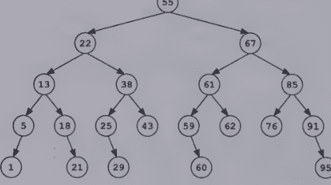

“现在进行范围搜索，”弗兰克说。

“我不知道怎么——”袜子开始说，但弗兰克挥手打断了他。“我们将使用改进的深度优先搜索，”弗兰克解释道，“从顶节点，即`根节点`开始，向下遍历树。在每个节点处，首先检查节点本身是否在范围内。如果是的话，比如这里的 `55` 天，我们就把它保存到列表里。否则，我们就忽略它。”

“等一下，”袜子说，“我会让列表里的节点闪烁不同的颜色。绿色怎么样？”

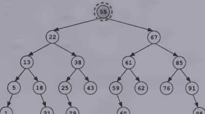

“随你，”弗兰克回答道，“检查完当前节点后，我们检查是否需要探索任一子节点。当且仅当`子树`中有正确范围内的节点时，我们才遍历左右`子树`。”

“递归地？”袜子问。

弗兰克等待记录官跳出来给出一个她的那些正式定义，但她依然固执地沉默。他叹了口气解释道：“递归意味着我们在检查完当前节点后，对子节点应用相同的逻辑。如果当前节点在范围内，比如 `55` 天，我们就把它保存到列表里。否则，我们就忽略它。”


“随你，”弗兰克回答，“检查完当前节点后，我们检查是否需要探索任一子节点。当且仅当子树中有正确范围内的节点时，我们才遍历左右子树。”

“递归地？”袜子问。

弗兰克等待记录官跳出来给出一个她的那些正式定义，但她依然固执地沉默。他叹了口气解释道，“递归意味着我们在检查完当前节点后，检查是否需要探索任一子节点。如果当前节点在范围内，比如 55 天，我们就把它保存到列表里。否则，我们就忽略它。”

（注：由于提供的原文中存在大量重复段落，译文已根据“注意不要重复输出原文”的原则进行了去重处理，确保逻辑连贯。）

## 警察算法 101：二叉搜索树

### Drecker 教授讲座摘要

二叉搜索树上的范围搜索算法与搜索单个值相似。该算法从根节点开始递归地向下遍历树。在每个节点处，它会根据三个问题做出决策：

1. 此节点应该被加入结果中吗？仅当当前值处于范围内时，才将其加入结果中。
2. 是否应该探索左子树？如果存在左孩子且当前节点的值大于范围内的最小值，则算法应该递归探索左子树。在这种情况下，左子树中可能存在落在范围内的节点。
3. 是否应该探索右子树？如果存在右孩子且当前节点的值小于范围内的最大值，则算法应该递归探索右子树。在这种情况下，右子树中可能存在落在范围内的节点。

使用二叉搜索树进行范围搜索的优势在于，可以通过剪枝大量的搜索空间来节省计算。

考虑以下二叉树：

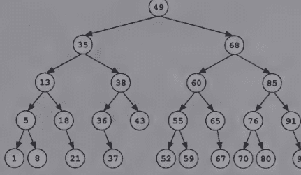

如果你正在搜索范围 `[8, 20]` 内的所有值，你只需要访问并评估 25 个节点中的 7 个（访问过的节点为阴影部分）：

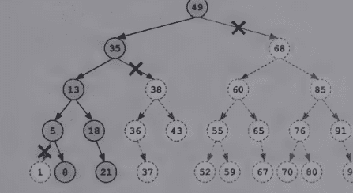

同样，如果你在范围 `[70, 80]` 内进行搜索，你只需要访问并评估 25 个节点中的 6 个：

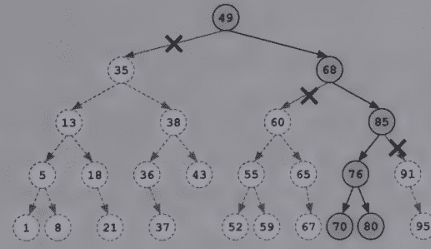

需要注意的是，访问节点并不意味着它一定会出现在结果列表中。这两个示例搜索都必须访问落在范围外的节点，因为这些节点的子树可能包含范围内的值。

与搜索单个值一样，只有在进行多次搜索时，使用二叉搜索树进行范围搜索才是高效的。构建二叉搜索树的成本比对数据进行线性扫描要高。然而，构建树的成本可以分到多次搜索中，从而降低每次搜索的平均成本。

## 将嫌疑人添加到搜索树

Frank 又看了几分钟的转调名单，但没有发现任何可疑之处。最近的转调目的地离首都都远远远，大多数盗窃案都发生在距离 50 英里的伊斯维尔城——而年轻警官的上长列出的“转调原因”是“一种挥之不去的脚味”。

“这就是所有人了？”Frank 转向 Notation 问道。

“是的，”Notation 防护地道，“这是过去一年在不同站点之间转调的所有官员。”

Frank 皱了皱眉。这个定义听起来不对。听起来不完整。“那初始转调呢？”Frank 问。

“来自学院的？”Notation 问。

“是的，”Frank 说，“从学院毕业后的转调呢？”

“嗯，”Notation 说，“那些是试用期初始转调。它们会记录在不同的账本上。”

Frank 缓慢地点头，脑海中飞速运转。

“我可以去——”Notation 刚开口。

“不用，”Frank 打断她，“我答应了上长今天下午前提供更新。我那时可以去拿账本。”

“你要见上长？”Notation 惊讶地问。

“向客户汇报进展是私家探生活的一部分，”Frank 说。

“你也可以把 Gretchen 的理论告诉上长，”Socks 补充道。

“什么理论？”Notation 问道，她的眼睛在 Frank 和 Socks 之间游移。

“Frank 没告诉你吗？”Socks 问。

“没有，”Notation 咬牙切道，“他没说。”她的手在身体两侧握成拳头，但她的脸清楚地表明她非常想用其中一只拳打向 Frank 的鼻子。

“我的导师 Gretchen 认为今晚城堡会被袭击，”Socks 说。

“她是这么说的吗？”Notation 问。然后转向 Frank 补充道，“这似乎是一个很有用的信息。你为什么不告诉我？”

“那只是推测，”Frank 耸了肩回答道，但他避开了她的目光。

Frank 愣了一下。他没预料到这个。人们通常害怕向 Donovan 汇报，除非他们可以用“好消息！”或“你猜不到我们发现了什么”来开启对话。带着一个由死胡同、未探索的线索和生命威胁等组成的进展进入他的办公室，会招来一场响亮且形象丰富的斥责。如果不是自己需要信息，Frank 根本不会考虑这样做。

“我需要你跟进另一件事，”Frank 在短暂停顿后说道，“并行搜索，记得吗？”他伸手进口袋摸了索，但只找到了笔记本、几个食物包装纸和一个旧的空蜗壳。那个壳壳是他上一个案件的纪念品，那是一起涉及打击乐队和大量噪音投诉的恶性事件。他从口袋里掏出它。

“看看你能不能找到关于这个的什么，”他说。一个蜗壳？Notation 问。“这有什么关系？”

Notation 不情愿地接过了蜗壳。当她翻过它时，低声念道：“我不知道。”

“我不是那个意思，”Socks 坚持道，“如果树变得不平衡怎么办？”

“这可能会发生，”Frank 承认道，“当你向二叉搜索树中添加元素时，生成的树可能是不平衡的。不过，我们的搜索算法仍然可以工作。”

“但在不平衡的树上搜索效率可能很低，”Socks 抗议道。

“这确实如此，”Frank 承认道。

向树中添加节点可能会抵消平衡二叉搜索树的主要优势之一：即它让许多算法变得高效。每当你大约将平衡二叉搜索树的节点数量翻倍时，只需要增加一层。这意味着对于简单的搜索（例如查找一个元素），你可以在数据量翻倍的同时，仅为搜索增加一个步骤。然而，Socks 是对的：这种效率只在树是平衡的情况下才适用。在最坏的情况下，树会形成一条长线，你被迫沿着它进行搜索。而且当你添加任意值时，无法保证树会保持平衡。”

“我们得冒这个险，”Frank 终于宣布道。

“但是——”

“如果我们的搜索没有没那么高效，我愿意接受。为了不用带着那些其他书从头构建树，这付出的代价很小。它们看起来很重。”

## 警察算法 101：二叉搜索树

### Drecker 教授讲座节选

向二叉搜索树中添加节点与搜索目标值相似。我们从树的根开始，向下移动，就像寻找要插入的值一样。根据我们要插入的新值是小于还是大于当前节点的值，向左或向右移动。当我们到达死胡同时，下降结束：即在正确方向上没有子节点的节点。此时，我们可以创建一个新节点并使其成为（左或右）子节点。

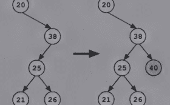

插入单个元素的成本与树的深度成线性比例关系。然而，我们无法保证在插入新节点时树仍能保持平衡。事实上，取决于插入的顺序，树很容易变得不平衡并产生深层的分支。例如，如果我们按排序顺序插入数字，所有的添加都将进入同一个分支。

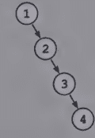

## 二叉搜索树属性

“等等，”Frank 说，“那错了了。”

刚刚插入完一个节点的 Socks 惊讶地看了过来。“怎么了？”

“你刚刚插入的那个节点，”Frank 说，“它的位置不对。”

Socks 紧盯着那棵树。“但是 63 比 60 大，所以它应该放在右子树里。”

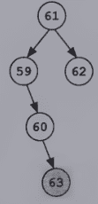

“但它比它的爷爷节点 61 大，所以它应该去那个节点的右子树。你把它放在左子树了。二叉搜索树的关键属性之一是，左子树中的所有节点都小于当前节点，而右子树中的所有节点都大。”

“我清楚，”Socks 小声说。

“那它为什么在左子树里？”Frank 问道。

“我犯错了，”Socks 说。

“你是如何错过 63 比 61 大这点的？”Frank 问道。

“我……我是从 60 开始的，”Socks 承认道。

“什么？”

“这个，我最近插入了节点 60……而且 63 离 60 很近……所以我直接从 60 开始并把它插在下面。”

“你没有从根节点开始？”Frank 严厉地问道。

“我觉得这样会更快，”Socks 说，“我可以跳过树的大部分区域。”

“结果你却把它放错位置了。你还走了多少次捷径？”

“几个，”Socks 承认道。

在他终于冷静下来后，Frank 深吸了几气，观察了那棵树。

“我们必须进行穷尽搜索，”他咬牙说道，“如果树不保持二叉搜索树属性，我们就无法安全地进行任何剪枝。我们必须检查每个节点。”

“嘿，”Socks 突然说，“我们把它放进树的时候就得检查了每个节点。我们为什么不直接做穷尽搜索呢？”

“分摊成本，”Frank 说，“我希望以后用这棵树进行多次搜索。我怀疑范围搜索只会限于 50 天到 70 天。随着我们获得更多证据，我们可能会进行不同的范围搜索。也许我们甚至需要进行几次精确搜索。构建树的成本将分摊到多次搜索中，总工作量会降低——可能低得多。分摊成本考虑的是系列搜索的总成本，从而将构建树的成本分散到多次搜索中。”

“噢，”Socks 说，“就像我的魔法按钮树一样。”

由于规模巨大，文书工作量惊人。文书工作似乎随着任何政府机构的规模呈平方级增长，首都警局的人数比其他两个警局的总和还要多。即使没有被偷的卷轴，房间也挤得满满当当。幸运的是，记录官员将信息整理得井井有序。根据国王的《十人以上机构的文书和其他扁平工作产品存储规定》，每份文件都按主题进行了分类和存储。大量的架子用于逮捕报告、费用报告、调动、守卫轮换和噪音投诉等主题。

房间本身的组织方式像极一个巨大的字典树（trie）。字典树，也称为前缀树，是一种允许对字符串集进行高效搜索的数据结构。在概念上与二叉搜索树相似，字典树从根节点开始，并在向下移动时分支。然而，字典树针对字符串搜索进行了优化，而不是数值值。在每个节点处，字典树根据“字符串中的下一个字母是什么？”这个问题来拆分数据。因此，字典树中的每个节点可以有很多子节点，对应字母表中的每一个字母。这种结构允许你通过沿着字典树的一条路径向下移动，仅根据目标字符串中的下一个字母来选择下一个节点，从而高效地搜索任何字符串。

弗兰克曾在巫师大会上见过魔法字典树的演示。那棵霓橙色的字典树悬在空中，存储着那个供应商携带的数种药剂成分名称。为了简单起见，字典树只显示了非空分支。客户可以使用字典树快速确定哪些成分有货。例如，他们可以通过查看 B、A、T、N、I 和 P 分支来确认供应商备有蝙蝠草（batnip）。他们还可以很快判断出婴儿粉已经缺货了，因为 BA 下的子树没有对应于 B 的分支。

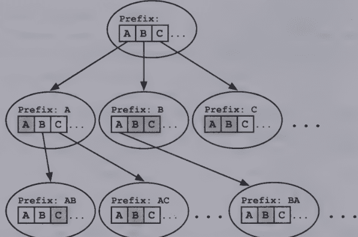

记录室采用了字典树的概念并将其应用到书架上。二十六个巨大的书架沿着墙壁排列，每个书架都存放着以单个字母开头的记录。它们是字典树的第一层节点。首先是 A 架，然后是 B 架，以此此类推。

| A | B | C | D | E |
|---|---|---|---|---|
| | | | | |
| | | | | |
| | | | | |
| | | | | |
| | | | | |
| | | | | |
| | | | | |
| | | | | |
| | | | | |
| | | | | |

接下，每个书架内部包含独立的层架，每个层架对应于主题的第二个字母。这些层架构成了字典树的下一层。

| BA |
| BE |
| BI |
| BL |
| BO |
| BR |
| BU |

由于大多数双字母组合并不对应现有的条目，书架不需要 26 个独立的层架。弗兰克曾听说记录官员通过发明新主题来填补空白以消时间。显然，一位高级官员在建议将限速归类为“缩放策略（Zoom policies）”后，受到了队长的关于警察工作严肃性的严长教训。直到今天，Z 书柜仍然缺少一个 ZO 架。

然后，架子呈水平排列，带有标签的书书代表字典树的第三层。

当弗兰克走着时，扫了一眼 V 架。在警局工作期间，他成功游说让“维内特人（Vinettees）”占据了一个独立的主题。他曾花费许多夜晚研究 V 书柜 I 架、N 段的档案。

弗兰克在 D 书柜前停下，找到 R 架 A 段。他抽出一本关于“巨龙注册（Dragon Registrations）”的书，假装在浏览，同时观察房间的其余部分。

队长对犯罪的描述是准确的。整层的记录被扫荡一空，剥夺了所有与特定双字母前缀对应的卷轴。其他书柜完全未被触及。从目前的立场来看，弗兰克可以看到对应 AS、CE、EX、NO、PR 和 RO 前缀的空架子。他在心中为这些前缀列了一个清单。小偷想要的目标是这些前缀的信息。而弗兰克还有另一个线索。

他放回关于巨龙注册的书，大声宣布：“好消息！首都只有少数注册过的食鸽者（Pigeon Eaters），而且鸽子有很多。至少在我找到它之前，那个可怜的东西不会饿死。”

约翰·凯奇（John Cache）给了他一个同情的眼神，但当弗兰克大步走出记录室时，他什么也没说。

# 警察算法 101：字典树

### 德雷克教授教授座的摘录

字典树是基于树的数据结构，允许用户根据字符串的前缀高效搜索字符串。像二叉搜索树一样，字典树从根节点开始，并在向下推进时分支。在字典树中，每个分支决策都基于字符串的下一个元素。因此，字典树中的节点可以有两个以上的子节点。

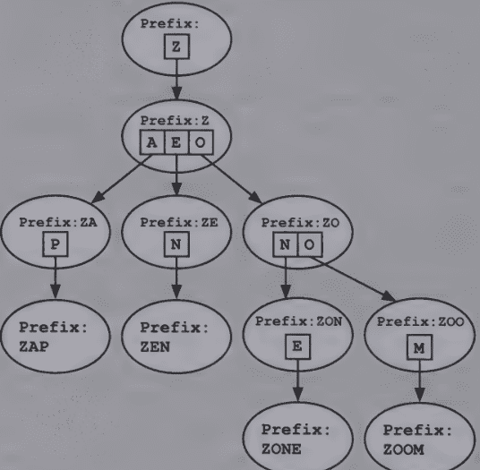

与二叉树一样，我们只需要包含数据的节点。这个示例是由 zap、zen、zone 和 zoom 这几个单词构建的。由于我们没有包含 zonk，因此不需要在 ZON 的 K 分支下设置一个子树。

注意，我们不需要在节点中存储实际的前缀；它们可以通过路径重建。

“那运输队呢？”

“弩全坏了，”队长说道，“还有一辆车轮——我想是后左侧的。这应该记在报告里。”

“剑呢？还有斧头呢？”

你从不不屑于读那些报告。那些小偷们还使用了**加速生锈术**。这并不是什么特别高超的魔法，但确实很有效。

“报告里没说他们偷了什么，”弗兰克指出，“没有提到那个面具。”

队长挑起眉毛。“你知道那个面具？那是高度机密。”

弗兰克耸了耸肩。“你付钱是让我找情报，”他说道，隐瞒了“袜子”只是无意中透露出这个信息的事实。让客户知道你的成功有多大程度上归于他人的愚蠢，从来不是划算的。

“这令人担忧，”弗兰克对队长说，“那是一件强大的神器。再加上我们收到的关于城堡可能遭到袭击的匿名举报，整个部队都处于警备状态。我们不得不从其他岗位抽调人员来加强安保。”

“关于城堡我也听到了一样，”弗兰克承认道。他再次翻阅了文件。“没有关于袭击者的线索。”

“我们听到了一些传闻，但还没有实锤。至少没有确凿到能进报告的内容。”

“你的军官们呢？”弗兰克问，“你那里有嫌疑人吗？”

队长观察了他他后才回答。弗兰克知道，如果不是怀疑有内鬼，队长绝不会来找他。但泛泛的怀疑与一份简短的名单之间存在着巨大的差距。

“没有，”队长说，“我还没有发现任何异常。这些盗窃案之间没有线索。不同的哨站。不同的值班军官。甚至是不同的部门。”

弗兰克沉默地点头，在脑海中反复思索这些盗窃案。他在内部调动上遇到了遇到了同样的死胡同。每次事件至少有一名新调入的人在岗，但从没有同一个官员出现过两次。弗兰克曾短暂考虑过整个新兵班中存在广泛阴谋的可能性，但立刻将其否之。任何能够协调如此大规模盗窃行动的人，至少不会让方圆百英里的每个站所都警觉。

“那么笔记本军官呢？”弗兰克问。

队长看起来很吃惊。“她怎么了？”

“她在你的名单上吗？”弗兰克问。

“她那天晚上在岗，所以她在我的名单上，”他说道，“但排在很后面。笔记本是个好孩子。她虽然没经验，但对部队很忠诚。”

“你知道她一直在自己调查那起盗案吗？”

队长皱起眉。“我想这不应该让我感到惊讶。正如我所说，她很投入。你是在哪里遇到她的？”

“克拉诺克的农场，”弗兰克说，“在那之后她跟了一会儿。”

“她露面了吗？然后呢？”

“我不信任她，”弗兰克说。

“你谁都不信，弗兰克。”

弗兰克叹了口气。“不仅于此，”他说，“如果你发现任何异常，请务告诉我。”

“你呢？”队长催促道，“你发现了什么？”

弗兰克开始向他做一个简要总结。他告诉队长，自己如何根据线索来到克拉诺克的农场，并发现了一系列线索，引导他找到了乌斯、维内特的船，以及丽贝卡·维内特。

听到这个消息，队长大笑着打断了他。“又和维内特一家碰面了，弗兰克？连丽贝卡也是。我很惊讶你居然还能走路。你把他们中的几个人关进了监狱？”

“还不够，”弗兰克说。

“也是，”队长承认道，“你是怎么从那里出来的？”

“一个魔法师出现了，开始扔桶腌渍鳗鱼，”弗兰克说道，仿佛这是再正常不过的事。

队长张口看着他。“什么？”

“一个叫‘袜子’的初级魔法师，”弗兰克解释道，“他是格雷琴这位魔法师的学徒。显然，国王请了几位高级魔法师来协助处理此案。”

“我总是这么做的，”弗兰回答道。他正要站起来，但停顿了一下。

“还有一个问题。你知道 Notation 是怎么知道 ArrayCart 的吗？”

“我不知道，”上官说，此时目光越过弗兰看向别，“我们为什么不去问问她呢？看起来她现在正站在我的办公室外。”

# 警用算法 101：最佳优先搜索

### Drecker 教授讲义节选

如果你从这门课中只记住一个算法，那应该是`最佳优先搜索（best-first search）`。这个算法将成为你在警局最强大的工具。在每一个案件中你都会需要它。而且，它终将是终极手段。

最佳优先搜索是一种根据分数或评分函数来选择下一个探索状态的算法。每个新发现的搜索状态都会被赋予一个分数，分数对应于算法认为该状态的好坏程度。例如，你可以根据包含目标值的概率（如果你能估算出来的话）或调查中线索的质量来对状态进行标记。在每一步中，算法都会选择探索分数最高的状态。你可以将最佳优先搜索的操作想象为维护一个待尝试状态的排序列表。

最佳优先搜索也可以用于最小化与每个状态相关的成本，例如该状态到终点的估计距离。在这种情况下，算法会选择使成本最小的下一个状态。

考虑一个非常简单的迷宫，你已知起点和终点的坐标。你可以为搜索空间中的每个状态标记一个成本，该成本等于该状态到终点的距离。


例如，你可以使用哈曼距离——到目标的总垂直距离加上到目标的总水平距离。这个标签并不一定意味着这个状态能带你到达那里，但它确实为搜索算法提供了一个信号。

# 开始


随着搜索的进行，它将探索不同的状态（用阴影圆表示），找到新的未探索状态，并将这些未探索状态添加到待尝试状态列表中（用虚线圈圈）。在每次迭代中，搜索都会根据分数或成本选择最佳的未探索状态。在这个例子中，这意味着选择成本最小的状态。

# 开始


# 结束

# 继续


一旦我们找到终点状态，就可以终止搜索。在这个例子中，我们只需要探索略多于一半的状态。例如，我们从未选择过探索距离为 4 的第二个状态，因为我们总有更好的选择先尝试。


当你在外执行时，必须决定如何确定线索的优先级。根据案件的不同，你可能想从最出新的线索或最具体的信息开始。无论如何，你都应该始终优先考虑你的搜索。

# — 24 —

# 调查中的优先级队列

“多纳万上官，”Notation 走进办公室时脱口而出。

“我想就我在工作时间之外进行未经授权的调查向你诚恳道歉。但这是我的调查——和弗兰的调查一样，而且如果他正在汇报——”

“Notation 警官，这到底是怎么变成你的调查的？”上官打断道，“我以为我分配给你的是那个假冒悠悠球案。你为什么会在克拉诺克的农场调查被盗窃的文件件呢？”

“我当时在追溯一条线索——”Notation 开始说道。

“你在追溯一条线索？”上官打断道，“在你的任何报告中我都没有看到任何关于 ArrayCart 的事情。”

“那是那天早上让我想到的，”Notation 解释道。

“你决定追溯这条线索，而不是向负责的侦探汇报？”弗兰皱了皱眉。上官痴迷于遵循调查的规程。“那是那天早上让我想到的，”Notation 再次解释道。

“你决定追溯这条线索，而不是向负责的侦探汇报？”弗兰皱了皱眉。上官痴迷于遵循调查的规程。“在上官的个人违规名单上，未报告线索的排名在使用数据结构之上。从 Notation 的表情中，他能看出她在想同样的事情。”

“我当时已经在农场附近了，”她说，“而且——”

“线索是什么？”弗兰问。Notation 惊讶地转向他，也许是震惊于他竟然忘记了她在那儿。“我想起了失案当晚的一些事，”她说，“我正刚写完夜间报告时，看到看到窗外有一辆奇怪的推车。我当时没觉得什么，因为优先级队列总是使用奇怪的推车。我以为那是一个死胡同。”她转向上官，眼中充满恳求。“那看起来机会很小，”她解释道，“在知道更多情况之前，我不想汇报它。”

“然后你加入了了几天的调查，”上官说。

“我们发现了一些很有前景的线索，”Notation 说道。

“Notation 警官，”上官严厉地说，“我不在乎你是否被一个前警察误导了。程序的存在是有理由的。你没有遵守它们。”

Notation 缩了缩，但没有抗议。“我明白了，先生。”

“不，”上官说，“我不确定你是否明白了。但你会有充足的时间考虑这件事的。在接到进一步通知之前，你负责值班。”

上官转向弗兰，结束了会议。当她转身离开时，Notation 的眼睛盯着墙上挂着的腓德里克国王肖像。她似乎陷入了片刻的沉思。“上官，”她突然说道，“你有优先级队列吗？”弗兰花了一点时间才联系起关系，但最终想起来了。他的其中一个教授在课上滔滔不绝地讲过腓德里克国王是如何普及优先级队列的。


在成为国王之前，腓德里克举行接见来听取王国公民的诉求和担忧。由于行程紧凑且公民投诉众多，他被迫开发了一种优先级排序方案。一个国王只能预期处理这么多投诉。首先，腓德里克尝试了投诉栈，处理最近的投诉，但后来错过了最重要的。然后他尝试了投诉队列，处理最旧的投诉，但又错过了。最后，他采用了一种新的数据结构——优先级队列——允许他首先处理最重要的投诉。

“优先级队列？”上官问，显然被这个突然的问题搞懵了。几乎没人敢在上官的讲座中发言。

“数据结构，”Notation 解释道，显然处于自动驾驶状态，“它们像普通的队列一样：你可以入队和出队。但它们要求每个元素都有优先级分数——衡量重要性的标准。当你弹出一个元素时，优先级队列总是给你下一个最重要的元素。”

看到上官和弗兰一脸空白，Notation 继续举例。“如果我插入了四个优先级分别为 1,2,4,3 的元素，我会按照 4,3,2,1 的顺序提取它们。”

“我知道优先级队列，”上官说，“我们用它们来存储投诉列表。噪音越大优先级越高，我们总是处理最严重的情况。我听它们也被用于处理沼泽附近的小投诉。尽管那里的一切似乎都有同高的优先级——难以忍受。但你想表达什么？”

“你有吗？”Notation 问。

上官摇了摇头，困制着他的愤怒。“没有多余的，”他说，“我们已经用了所有的优先级队列——一个用于噪音投诉，三个用于不同类型的犯罪，一个用于通缉名单，一个用于休假申请。为什么？”

“最佳优先搜索，”Notation 说。

“最佳优先搜索？”上官问。弗兰告诉我他已经在使用最佳优先搜索了。

“没错，”弗兰确认道。

“优先级队列会让它更高效，”Notation 解释道，“每当我们发现新线索时，都可以将其放入优先级队列，并附上表示该线索质量的分数。然后，当我们准备探索下一个线索时，从优先级队列中取出。我们总能得到下一个最好的线索。”

弗兰叹了口气摇了摇头。他非常了解上官，知道这将如何发展。上官擅长他自己的教学时刻。他不会大吼或咒骂，而是会冷静地引导一名新警官意识到自己的愚蠢。“你是怎么做的？”上官用耐心的语气问道。这看起来不会有好好结果。

“我把线索记在笔记本里，”Notation 回答道，“每当我们准备探索新线索时，我都会扫描整个线索列表找到最好的那个。”

“你共有几条线索？”队长问道，“按平均水平来说。”

“平均水平？”诺顿（Notation）思索了片刻，“我想在两到五条之间。”

“你想让我用部门里的一个优先队列，来帮你扫描一个只有两到五个元素的列表？”如果队长用了他一贯的咆哮，这个提问听起来可能没那么刻薄。相反，他那冷静的耐心让诺顿清晰地感觉到，他觉得这整场对话是多么愚蠢。

诺顿脸红了。“额，优先队列并不算昂贵……”她开始说道，但声音渐渐小了下去。

“听着，诺顿警官，”队长说，“我同意优先队列非常适合最佳优先搜索。等完这次会议，我可能会为每位侦探订购一套全新的。但你现在不需要。首先，你的线索还不够。更重要的是，你根本没参与这起案子。”

在整个教训过程中，诺顿的脸逐渐变得通红，现在已经红成了像甜菜汤一样的色色。她深吸了一口气，直视着队长的眼睛，低声说道：“我明白了，长官。”

弗兰克（Frank）感到一阵同情。诺顿犯了一个新手的错误，过度优化了解决方案。他不得不佩服她——使用优先队列来追踪线索的想法完全合理。事实上，他从直都在使用一个优先队列。然而，他提问的时机不能再糟糕不过了。

“诺顿，”队长继续道，“你很有潜力。你很聪明，直觉也很好。但你必须学会服从命令。别变得像弗兰克这样。”

诺顿张嘴想抗议。接着她看了弗兰克一眼，皱起脸，一言不发地闭上了嘴。她简短地了点头，行了个礼，大步离开了办公室。

“还有你，弗兰克，你有工作要做。快去吧。”

弗兰克转身跟着诺顿走了出去，甚至连点头都没给。

弗兰克等他们走到楼梯口才开口。

“你知道吗……球区（Orb district）有个巫师，能给你做一个廉价的优先队列。他的名字其实叫希珀斯（Heaperous）。我想他最初就是这样进入数据结构的。叫着希珀斯这样的名字，我想这是必然的。总之，那个优先队列不会好看，但好用。不过他只在上午上班，所以你得等到明天。”

诺顿停下脚步，给了他一个怀疑的眼神。“你为什么要告诉我这些，弗兰克？”

弗兰克努力脸上露出一副最同情的表情。“我曾听过队长的很多次演讲。更重要的是，我知道在调查期间，一个良好的数据结构是多么宝贵。”

“如果数据结构这么宝贵，你为什么不使用优先队列呢？”她反驳道。

弗兰克恼怒地看了她一眼。“我当然在使用优先队列。从我们开始我一直在用。你以为我把所有线索都记在脑子里吗？我太老了，玩不转那套。”

“什么？”诺顿惊呼道，“你一直在用优先队列？你为什么不跟队长说呢？”

弗兰克对此笑了笑。“你对队长还有很多要学的，新手。首先，当他在抱怨任何事情时，你永远不要打断他。我曾见过一个侦探因为带偏了一场关于豆腐的抱怨而被罚了一个月的月台值。那甚至还不是一场讲得特别精彩的抱怨。他当时卡在豆腐的软糯口感和索然无味之间反复切换。”

诺顿盯着弗兰克，显然无言以对。

“重点是，”弗兰克继续道，“有时你需要亲力而为。如果优先队列对你有帮助，就不要等申请流程。直接出去买一个吧。”

诺顿考虑了下建议。最后，她点了点头。“我想，买自己的设备在技术上可能并不违反任何政策。谢谢你，弗兰克。”

诺顿脸上的兴奋神情几乎让弗兰克感到愧疚。镇上任何一家巫师店都能制作优先队列，而且大多数价格都能和希珀斯相当。但希珀斯在球区的店已经是市范围内最远的一家，而弗兰克需要确保诺顿再多躲开一会儿。

## 警察算法 101：优先队列

德雷克教授（Professor Drecker）讲座节选

在你警察生涯中会遇到的所有数据结构中，我保证优先队列是最有。就像栈（stacks）和队列（queues）一样，优先队列允许你按特定顺序插入数据并在之后移除数据。栈和队列执行由元素插入时间决定的顺序，而优先队列按优先级递减对数据进行排序。下一个移除的元素是队列中优先级最高的元素，无论它是何时插入的。

插入到优先队列的每个项目也必须有一个优先级，或分数。这可以是元素本身的值，也可以是由不同函数计算出的值。

考虑这个根据严重对噪音投诉进行优先级排序的例子。如果你按照以下顺序插入投诉：

- “指数级咖啡馆（Exponentiated Espresso）的人群”（得分 = 3）
- “螃蟹之爪海歌大赛”（得分 = 6）
- “斯文森农民（Farmer Swinson）的兔子”（得分 = 1）
- “斯文森农民的公鸡”（得分 = 5）
- “斯文森”（得分 = 7）

你将按顺序从优先队列中检索它们：

- “斯文森”（得分 = 7）
- “螃蟹之爪海歌大赛”（得分 = 6）
- “斯文森农民的公鸡”（得分 = 5）
- “指数级咖啡馆的人群”（得分 = 3）
- “斯文森农民的兔子”（得分 = 1）

注意，并不保证数据会在优先队列内完全排序，只保证按顺序提取。正如你在随后的讲座中看到的，称为堆（heaps）的数据结构是实现优先队列的一种高效方式。

警察局使用多种优先级函数。正如你所预期的，最受激烈讨论的队列是休假队列。该队列完全根据警官未使用的休假天数排序。尽管有之前的请求，不会根据休假地的优坏给予额外优先级。冰川、海滩和沼泽被同等对待。相反，队列根据公平性衡量进行优先级排序，确保下一个休假警官是今年休假最少的人。

## 用于破锁的优先队列

透过窗户望去，那里挂满了童服。提克衫（Tike's Tunics）的架提供了一个理想的观察点。

不到一分钟，暴徒们涌入街道并聚集在一起，显得很困惑。间谍紧随其后，开始大声命令。她将暴徒分分成两组，让他们沿着街道的两个方向散开——每边一组——而她在巷口等待。

弗兰克没有浪费任何时间。他匆忙穿过商店，从一扇通往小巷的后门出去。间谍站在仅10英尺外，背对着弗兰克。弗兰克尽可能安静地退回小巷，朝安全屋走去。如果运气好，暴徒们没有想起来去问店主关于他的事，他就赢得了一些时间。

在安全屋门处，弗兰克笨拙地拨弄组合锁。他将转盘拨到 1，再转到 1，最后又回到 1。诚然，这是一个简单的密码。锁并没有打开。

弗兰克咒了一句。有人一定在他上次来这里之后更改了密码。他考虑过寻找密码，这可能会花费他很长时间，或者找另一个地方躲藏。由于想不出任何不需要再次经过暴徒就能到达的安全地点，他转过头看向锁。

由于时间紧迫，弗兰克需要高效。。锁需要三个数字，范围是 1–20，因此他面临着 8000 种可能的组合。他没有时间进行广度优先搜索或深度优先搜索。相反，他必须依靠有限优先搜索（limited-first search）和一些大胆的猜测；他必须相信自己的直觉。他从口袋里拿出优先级队列（priority queue），将其擦干净，开始记录组合。对于每个组合，他都添加了一个优先级——他觉得那个组合会如何。他从一些常见的警察密码开始：

- 1-2-3
- 1-1-2
- 1-3-5

他给每一个组合都分配了 10 的优先级。

然后他开始处理相同数字的三元组。如果密码曾经是 1-1-1，为什么不用 2-2-2 呢？安全屋很少被使用，保持密码简单是值得的。他列出了 19 组未尝试过的三元组，给它们分配了优先级 5。优先级队列现在有 22 种可能。

接着他快速回想了负责安全屋的警官生日。这又增加了 6 种组合，他为它们分配了优先级 8。他添加了他记得其他所有警察的生日，并将那些的优先级降为 2。

最后，他添加了单词 RUN，并分配了 1 的优先级。他很清楚，如果他到了那个选项，说明该放弃了。他必须找另一个地方躲藏。

优先级队列现在有 32 个选项。结果是一份长长的待试组合列表。最顶端是优先级最高的组合 1-2-3。弗兰克尝试了，但什么也没有发生。

他咒骂道，并从优先级队列中删除了该组合。一个新的最高优先级组合跳到了顶端。

在他尝试下一个组合之前，他一个念头闪过脑海。也许他们使用了旧密码的某种变体。他认识很多警察为储物柜使用一个密码，为行李使用其反向。负责安全屋的警官在这里做过类似的事情吗？弗兰克将 3-2-1 添加到列表底部，优先级为 9。

1-1-2 或 1-3-5 都不起作用，用尽了所有优先级为10的组合。弗兰克划掉了它们，并将它们的反向组合 2-1-1 和 5-3-1 添加到列表底部。他再次使用了优先级 9，认为反向组合很容易被人记住。

他从列表顶端读取了下一个高优先级组合 3-2-1。这是他最近添加的组合之一。这就是优先级队列的魔力：无论你以什么顺序添加项目，总是能获得下一个最佳入口。

锁最终在 5-3-1 咔哒一声打开了，这是他添加的优先级为9 的代码之一。弗兰克松了一口气，环顾四周。仍然没有维内特家族（Vinettees）的迹象。他暂时了。

# 警察算法 101：

## 数据结构与搜索

德雷克教授讲座节选

正如我们在整个学期的课程中讨论的那样，我们使用的数据结构既影响算法的运行，也影响它的效率。在深度优先搜索和广度优先搜索的课程中，我们查看了栈和队列之间的差异如何影响搜索顺序。使用优先级队列进行最佳优先搜索（best-first search）是数据结构影响的另一个绝例子。

从概念上说，最佳优先搜索与广度优先和深度优先搜索都相似。在算法的每一步中，我们都选择一个新状态进行探索。关键在于我们如何对新状态的探索排序。使用优先级队列允许我们高效地选择最有可能的下一个状态。最佳优先搜索和优先级队列是完美的互补，形成了极高效的数据结构-算法组合。


# — 26 —

# 搜索中的启发式方法

弗兰克花了一个晚上交替着回顾线索，观察窗外。提克衫的架提供了一个理想的观察点。

不到一分钟，暴徒们涌入街道并聚集在一起，显得很困惑。间谍紧随其后，开始大声命令。她将暴徒分分成两组，让他们沿着街道的两个方向散开——每边一组——而她在巷口等待。

弗兰克没有浪费任何时间。他匆忙穿过商店，从一扇通往小巷的后门出去。间谍站在仅10英尺外，背对着弗兰克。弗兰克尽可能安静地退回小巷，朝安全屋走去。如果运气好，暴徒们没有想起来去问店主关于他的事，他就赢得了一些时间。

在安全屋门处，弗兰克笨拙地拨弄组合锁。他将转盘拨到 1，再转到 1，最后又回到 1。诚然，这是一个简单的密码。锁并没有打开。

弗兰克咒了一句。有人一定在他上次来这里之后更改了密码。他考虑过寻找密码，这可能会花费他很长时间，或者找另一个地方躲藏。由于想不出任何不需要再次经过暴徒就能到达的安全地点，他转过头看向锁。

由于时间紧迫，弗兰克需要高效。。锁需要三个数字，范围是 1–20，因此他面临着 8000 种可能的组合。他没有时间进行广度优先搜索或深度优先搜索。相反，他必须依靠有限优先搜索（limited-first search）和一些大胆的猜测；他必须相信自己的直觉。他从口袋里拿出优先级队列，将其擦干净，开始记录组合。对于每个组合，他都添加了一个优先级——他觉得那个组合会如何。他从一些常见的警察密码开始：

- 1-2-3
- 1-1-2
- 1-3-5

他给每一个组合都分配了 10 的优先级。

然后他开始处理相同数字的三元组。如果密码曾经是 1-1-1，为什么不用 2-2-2 呢？安全屋很少被使用，保持密码简单是值得的。他列出了 19 组未尝试过的三元组，给它们分配了优先级 5。优先级队列现在有 22 种可能。

接着他快速回想了负责安全屋的警官生日。这又增加了 6 种组合，他为它们分配了优先级 8。他添加了他记得其他所有警察的生日，并将那些的优先级降为 2。

最后，他添加了单词 RUN，并分配了 1 的优先级。他很清楚，如果他到了那个选项，说明该放弃了。他必须找另一个地方躲藏。

优先级队列现在有 32 个选项。结果是一份长长的待试组合列表。最顶端是优先级最高的组合 1-2-3。弗兰克尝试了，但什么也没有发生。

他咒骂道，并从优先级队列中删除了该组合。一个新的最高优先级组合跳到了顶端。

在他尝试下一个组合之前，他一个念头闪过脑海。也许他们使用了旧密码的某种变体。他认识很多警察为储物柜使用一个密码，为行李使用其反向。负责安全屋的警官在这里做过类似的事情吗？弗兰克将 3-2-1 添加到列表底部，优先级为 9。

1-1-2 或 1-3-5 都不起作用，用尽了所有优先级为10的组合。弗兰克划掉了它们，并将它们的反向组合 2-1-1 和 5-3-1 添加到列表底部。他再次使用了优先级 9，认为反向组合很容易被人记住。

他从列表顶端读取了下一个高优先级组合 3-2-1。这是他最近添加的组合之一。这就是优先级队列的魔力：无论你以什么顺序添加项目，总是能获得下一个最佳入口。

锁最终在 5-3-1 咔哒一声打开了，这是他添加的优先级为9 的代码之一。弗兰克松了一口气，环顾四周。仍然没有维内特家族（Vinettees）的迹象。他暂时了。

# 警察算法 101：

## 数据结构与搜索

德雷克教授讲座节选


正如我们在整个学期的课程中讨论的那样，我们使用的数据结构既影响算法的运行，也影响它的效率。在深度优先搜索和广度优先搜索的课程中，我们查看了栈和队列之间的差异如何影响搜索顺序。使用优先级队列进行最佳优先搜索是数据结构影响的另一个绝佳例子。

从概念上说，最佳优先搜索与广度优先和深度优先搜索都相似。在算法的每一步中，我们都选择一个新状态进行探索。关键在于我们如何对新状态的探索排序。使用优先级队列允许我们高效地选择最有可能的下一个状态。最佳优先搜索和优先级队列是完美的互补，形成了极高效的数据结构-算法组合。


# — 26 —

## 搜索中的启发式方法

弗兰克花了一个晚上交替着回顾线索，观察窗外。提克衫的架提供了一个理想的观察点。

不到一分钟，暴徒们涌入街道并聚集在一起，显得很困惑。间谍紧随其后，开始大声命令。她将暴徒分成两组，让他们沿着街道的两个方向散开——每边一组——而她在巷口等待。

弗兰克没有浪费任何时间。他匆忙穿过商店，从一扇通往小巷的后门出去。间谍站在仅 10 英尺外，背对着弗兰克。弗兰克尽可能安静地退回小巷，朝安全屋走去。如果运气好，暴徒们没有想起来去问店主关于他的事，他就赢得了一些时间。

在安全屋门处，弗兰克笨拙地拨弄组合锁。他将转盘拨到 `1`，再转到 `1`，最后又回到 `1`。诚然，这是一个简单的密码。锁并没有打开。

弗兰克咒了一句。有人一定在他上次来这里之后更改了密码。他考虑过寻找密码，这可能会花费他很长时间，或者找另一个地方躲藏。由于想不出任何不需要再次经过暴徒就能到达的安全地点，他转过头看向锁。

由于时间紧迫，弗兰克需要高效。锁需要三个数字，范围是 `1–20`，因此他面临着 `8000` 种可能的组合。他没有时间进行广度优先搜索或深度优先搜索。相反，他必须依靠有限优先搜索和一些大胆的猜测；他必须相信自己的直觉。他从口袋里拿出优先级队列，将其擦干净，开始记录组合。对于每个组合，他都添加了一个优先级——他觉得那个组合会如何。他从一些常见的警察密码开始：

- `1-2-3`
- `1-1-2`
- `1-3-5`

他给每一个组合都分配了 `10` 的优先级。

然后他开始处理相同数字的三元组。如果密码曾经是 `1-1-1`，为什么不用 `2-2-2` 呢？安全屋很少被使用，保持密码简单是值得的。他列出了 `19` 组未尝试过的三元组，给它们分配了优先级 `5`。优先级队列现在有 `22` 种可能。

接着他快速回想了负责安全屋的警官生日。这又增加了 `6` 种组合，他为它们分配了优先级 `8`。他添加了他记得其他所有警察的生日，并将那些的优先级降为 `2`。

最后，他添加了单词 `RUN`，并分配了 `1` 的优先级。他很清楚，如果他到了那个选项，说明该放弃了。他必须找另一个地方躲藏。

优先级队列现在有 `32` 个选项。结果是一份长长的待试组合列表。最顶端是优先级最高的组合 `1-2-3`。弗兰克尝试了，但什么也没有发生。

他咒骂道，并从优先级队列中删除了该组合。一个新的最高优先级组合跳到了顶端。

在他尝试下一个组合之前，一个念头闪过脑海。也许他们使用了旧密码的某种变体。他认识很多警察为储物柜使用一个密码，为行李使用其反向。负责安全屋的警官在这里做过类似的事情吗？弗兰克将 `3-2-1` 添加到列表底部，优先级为 `9`。

`1-1-2` 或 `1-3-5` 都不起作用，用尽了所有优先级为 `10` 的组合。弗兰克划掉了它们，并将它们的反向组合 `2-1-1` 和 `5-3-1` 添加到列表底部。他再次使用了优先级 `9`，认为反向组合很容易被人记住。

他从列表顶端读取了下一个高优先级组合 `3-2-1`。这是他最近添加的组合之一。这就是优先级队列的魔力：无论你以什么顺序添加项目，总是能获得下一个最佳入口。

锁最终在 `5-3-1` 咔哒一声打开了，这是他添加的优先级为 `9` 的代码之一。弗兰克松了一口气，环顾四周。仍然没有维内特家族的迹象。他暂时安全了。

这是弗兰克职业生涯中唯一忽略的一次启发式算法，当时“玻璃盒比利”（Glass Box Billy）针对一起即将发生的抢劫案提供了多条提示。首先，比利告诉了弗兰克逃生推车的确切等待位置、型号以及轮子吱声的音调。其次，比利传达了一个传言，那是飞镖比赛期间在欢呼声间隙听到的：瑞贝卡·维内特亲自参与了其中，而且目标与鱼有关。

弗兰克忽略了所有优秀的警察算法，决定直接追捕瑞贝卡·维内特。他知道她在他们装上推车之前就会消失，可能会使用另一条路线返回藏身处。他必须在她的消失之前抓住她。他驻守了首都的鱼类市场，那里距离逃生车的位置只有两个街区。

正如上尉后来用过分大声的声音解释的那样，鱼类市场恰好在反方向两个街区。另一方面，球体商场距离逃生车只有四分之一个街区。一个与维内特家族完全没有关系的派党偷走了 `64` 个高品质玻璃球和 `2` 个原型立方体球，将它们装上逃生车，开车离去，轮子的吱吱声正如比利所指出的那样令人心烦。弗兰克对比利提示的描述，以及他坚持增加一条“永远怀疑维内特家族”的新启发式规则，并没有说服上尉。

然而，在目前的案件中，弗兰克连模糊的线索都快没有了。他耗尽了大部分具体的线索，进入了推测和怀疑的领域。如果他想再取得任何进展，他就需要更多信息。他转向他第二个最信任的启发式：当陷入死胡同时，收集更多信息。他需要更多关于那个面具的信息，它是如何被使用的，以及什么样的魔法防御可以阻止它。在这种情况下，这意味着要找到一个专家。

## 警察算法 101：启发式

德雷克教授讲座节选

启发式是帮助算法指向正确方向的经验法则。虽然你无疑听到一些警察将启发式蔑低为随机猜测，但你也会看到这些警察诉诸过去对他们有效的技术和经验法则。重要的是要意识到，启发式和所有信息一样，质量参差不齐。

启发式最清晰的例子之一是在物理世界中导航。无论你是在迷宫中徘徊、寻找未知城市，还是仅仅在寻找食堂，你会发现自己正在使用启发式来引导搜索。面对两条路，你会先尝试哪一条？一种常见且通常可靠的启发式是根据简化的距离测量对选项进行优先级排序。我最喜欢使用的是“直线距离”：如果路径上没有任何障碍，目标有多远？在实践中，这种启发式意味着我总是选择看起来在接近目标的路——即至少起始方向是正确的路。这样我可能会遇到几次胡同，但总的来说，我发现这是一个很好的启发式。

当然，也有许多糟糕的启发式。在没有经过适当审查的情况下就使用新启发式的警察可能会发现自己陷入深度困境。几年前，一名年轻警察创建了一个特别糟糕的启发式。在破获走私环获得前所未有的成功后，他脑子里认为所有调查必须从码头开始。问题在于，这个启发式是错误的。它并没有帮助他的调查指向正确的方向。事实上，它经常导致他直接陷入死胡同。在 `18` 次失败的调查后，他的上尉安排他永久巡逻码头。

启发式不应该是随机猜测。它们需要包含某些有用信息，并针对正确的问题进行定制。

## 政治与学术中的“堆”

第二天一早，弗兰克溜出安全屋，穿过城市来到警察学院。一旦进入校园，被警察、学员和退休警察包围着，他感到放松了。当他横穿操场走向学院的教职工办公楼时，他甚至露出了灿烂的微笑。

弗兰克多年没有进这栋大楼了。按照惯例，教授们保持开门政策，允许学生随时来提问。现实中，很少学生会利用这种机会，他们宁愿等到考试前一晚才意识到自己不知道多少。弗兰克往往坚持得更久，直到他坐下考试时才意识到自己的无知。

快速浏览教职工目录显示，卢普博士占据了大楼顶层唯一的办公室。弗兰克并不意外。教职工楼奇特的设计使得办公室分配在最好的时候也是一个充满争议的话题。每一层的办公室数量恰好是下一层的一半，这意味着不仅随着高度升高视野越来越好，每个办公室的面积也增加了一倍。在多年的激烈斗争后，院长实施了严格的基于职级的优先分配制度——任何办公室的占据者其任期必须比正下方办公室的任何人都要长。实际上，他将教职工楼变成了一个大的基于职级的“堆”。

| 70 | |
| :--- | :--- |
| 40 | 61 |
| 11 | 30 | 35 | 52 |
| 10 | 8 | 22 | 18 | 11 | 5 | 12 |

巫术犯罪学教授奥莉娅·卢普博士在警察学院教了 `70` 年。只有浮点运算教授巴布尔顿博士在任期上最接近她，为 `61` 年。

当弗兰克到达顶层时，巴布尔顿博士和 Lambda 博士不得不应对巴布尔顿博士获取最佳办公室的意料之中的尝试。

| 70 | |
| 11 | 61 |
| 40 | 30 | 35 | 52 |
| 10 | 8 | 22 | 18 | 11 | 5 | 12 |

他们对我的旧办公室都有更有力的主张，一个占了 `30` 年，另一个占了 `40` 年。这一次，Lambda 博士没有进行太多反抗。Variable 博士赢了那间办公室。在工作了 `40` 年后，他确实应得如此。

| 70 | |
| 11 | 61 |
| 40 | 30 | 35 | 52 |
| 10 | 8 | 22 | 18 | 11 | 5 | 12 |

事事巧，Lambda 博士最终在楼下的一层找到了机会。那里的两个教授资历都比 Lambda 博士年轻。我想他非常享受宣布胜利、并在他们面前关上门的快感。

| 70 | |
| 40 | 61 |
| 11 | 30 | 35 | 52 |
| 10 | 8 | 22 | 18 | 11 | 5 | 12 |

“从某种程度上说，Lambda 博士很幸运，”Loop 博士解释道，“当他试图抢夺顶层办公室时，结果去了建筑的另一侧，那里有资历更浅的教授。他整整上了一层。规则规定任何办公室的居住者必须比正下方办公室的任何人任期更长。所以，纯属运气，Lambda 博士现在坐在二楼，而他一些更资深的同事还在第一楼。”

Frank 礼貌地等待故事是否还会继续。当故事没有继续时，他尝试问道：“Loop 博士，可以占用您一点时间吗？我有几个问题。”

“当然可以，”Loop 博士说，“我假设这是关于本周的作业？”

Frank 愣住了，思路被打断了。“什么？不是。我不是这里的学生。”

“你不是？那你应该考虑警察部队。那是一项高尚的职业。”

“我 `10` 多年前毕业了。”

“是吗？”Loop 博士再次耸耸肩，“过了一段时间，这些孩子就混在一起了。”

“好的，”Frank 说，拼命想要找回自己的思路，“对。我需要关于防御法咒的信息。”

“噢，我不教魔法，”Loop 博士解释道，“我教的是巫师犯罪学，它是对……的研究”

“我上过你的课，”Frank 打断道，“我不想知道如何施法。我想知道存在哪些防御法咒。特别是在警察局里的。”

Loop 博士的表情突然变得冷厉。“那是非常敏感的信息，”她语气冰冷，“只有少数人知道。”

“这就是我来这里的原因，”Frank 说。

“你到底为什么需要这些信息？”她问。

“我正在调查首都警察局的一起盗窃案，”他反击道。先是啰嗦的故事，现在她又在审问他？他没时间听这个。

“我需要看看你的证件，”Loop 博士提醒道。她做了一个请的手势。

Frank 从他的风衣大口袋里掏出私家探证。他把它扔在桌子上。

“私家探？”Loop 博士笑了起来。接着，她的语气再次变得冷硬。“离开我的办公室。”

“Loop 博士——”Frank 刚开口，但听到弩上弦的声音后停止了。

# 警察算法 101：堆

Drecker 教授讲座节选

*大顶堆* 是一种基于二叉树的数据结构，节点与其子节点之间维持着特殊的顺序关系。具体来说，堆根据*堆属性*存储元素，对于大顶堆，该属性规定树中任何节点的值都大于（或等于）其下方的所有元素。这种结构允许大顶堆高效地支持几个重要操作：(1) 高效找到最大元素，(2) 删除最大元素以及 (3) 插入任意元素。这三个操作使得堆成为实现优先级队列的理想数据结构。


堆通常被可视化为树，尽管它们用数组来实现，数组中的每个元素都对应树中的一个节点，根节点位于索引 `0`，如下所示。子节点的索引是相对于其父节点的索引定义的。具体来说，索引为 `i` 的节点其子节点位于索引 `2i + 1` 和 `2i + 2`。因此，索引 `1` 的节点将在索引 `(2 × 1) + 1 = 3` 和 `(2 × 1) + 2 = 4` 处有一个子节点，如图所示。

| 0 | 1 | 2 | 3 | 4 | 5 |
|---|---|---|---|---|---|
| 55 | 33 | 15 | 5 | 18 | 3 |


弗兰克动作格外缓慢地取回船长的信。他身体前倾，花了整整一分钟才把信放在办公桌上。他没有坐回椅子。动得越少越好。

在研究了一会儿笔记后，卢普博士向他的卫兵示意了一下。弗兰克听到弩箭的保险栓弹开的声音。他松了一口气，靠在椅子上。卢普博士挥了挥手让卫兵出了房间。

“你让多诺万船长给你写了封介绍信？”卢普博士问道。

“正如你所说，这是一个敏感的话题，”弗兰克回答道。

“而且你可能听过我的名声，”卢普博士咯笑道。

“我上过你的课，”弗兰克低声念道，但卢普博士没听到。

“所以你在调查盗窃案。你想知道什么？”

转瞬间，他的神态完全变了。他的眼神快速扫过他的脸，仿佛在分析每一个反应。所有的客气消失得无踪；他的声音变得公事公办。弗兰克在想，那些愉快的寒暄有多少是在演戏。魔法犯罪学是一个危险的领域，而卢普博士生存了这么久。

“警察局有什么魔法保护措施？”弗兰克问道。

“基础警报法术，”卢普博士说，“如果有人在局里使用魔法，它们会提醒你，但不能阻止。”

“为什么没有魔法屏障呢？”

“不现实，”教授解释道，“警察部队使用了太多的巫师顾问。他们需要对证据施放占卜术，对囚犯施放真言咒，对记录施放镜像咒，以及对午餐施放加热咒。”

弗兰克点了点头，想起了关于魔法优先级队列的对话。

“反正那也太贵了，”卢普博士补充道，“只有皇家城堡和监狱拥有比基础警报术更多的东西。城堡有一系列保护咒，但没有削弱咒。马库斯在国王那里做的工作太多了。”

“所以有人可以在城堡里使用魔法？”弗兰克确认道。


“可以，”卢普博士回答道，“但那样并不明智。城堡有十几种保护咒可以拦截攻击性魔法。弗雷德里克国王还雇佣了六名巫师卫兵。他们是初级，但可以解除基础诅咒。还有马库斯。很少有巫师想得罪他。”

“那法器呢？”

“啊。这是一个好问题。取决于法器。城堡当然对武器化法器有防御，但没有任何东西能保护所有的法器。种类实在太多了。由于大多数法器不需要新的魔法（因为之前已经被施过魔法），即使是监狱里的禁魔法术在这里也无能为力。”

“什么？”弗兰克问，“我以为监狱对所有魔法都是免疫的。他们不在那里留巫师吗？事实上，指数不是就在那里吗？他曾试图用魔法摧毁整个王国。他们为什么不直接阻止所有法器运作呢？”

卢普博士干笑了一下。“很抱歉让你失望，但你无法阻止所有的法器。不过别担心，皇家巫师会严守护最强大的那些。而且所有囚犯在到达时都会经过彻底检查。”

“监狱还有什么保护措施？”弗兰克问道，随着碎片开始拼凑完整，恐慌感油然而生。

“困难搜索法术？”弗兰克打断道。

“那不是新奇了。”

“困难搜索法术有什么作用？”弗兰克问道，心中充满了恐惧。

“它让寻找东西变得困难，”弗兰克解释道，“如果你在寻找某个特定的人或物体，法术会扰乱魔法环境。这就像是在草堆中找针，但那堆草堆是在移动的。”

# 警察算法 101：期末考试复习课

Drecker 教授讲座节选

如果你从这门课中只学到一件事，那应该是：高效算法的关键在于信息。在处理新问题时，花时间去理解问题的结构及其数据。问题的结构越丰富化，你利用这些信息的潜力就越大。正如你所看到的，在排序数组中查找一个值比在完全随机的数组中要容易得多。有时，你甚至可以构建辅助数据结构（如堆或倒排索引）来提供你所需的结构。无论如何，你的第一步始终应该是理解问题。

## 搜索终止

凌晨 `12:01`，门咯吱一声开了，一名守兵将头探进阴暗的囚室。他用手电筒缓慢地扫过房间，直到目光落在了睡眠中的囚犯身上。

“主人？”守兵轻声叫道。

囚犯动了动，坐起来，看着守兵。

“主人，我——”守兵刚开口，但因一声急促的喘息而中断了。

弗兰在监狱床上向他挥了挥手。

守兵转身想跑，但 Notation 拿着一把巨大的弩箭走进了门口。

“我……我只是在巡逻，”守兵说道。

弗兰咯出声笑，摇了摇头。“把手电筒。慢点，”他指示道，“我这位朋友刚从警察学院毕业，听说她在弩箭的使用上拿了最高分。”

“实际上，我是第二，”Notation 站在门口说道。

弗兰叹了口气。“真的吗？这是你唯一一次决定谦虚吗？”

“抱歉。我只是想准确一点。”

“这是威胁，Notation。你是被允许对威胁进行修饰的。”

“抱歉，”她重复道。

“无论如何，重点没变。她有一把弩箭，而且除了同学中的另外一个人，她比任何人都更懂使用。请把手电筒交出来。”

守兵的眼睛在房间里环视，寻找逃生之路。发现无路后，他缓慢向前倾，将手电筒递给了弗兰。当弗兰伸手去接时，守兵身体一侧，朝他的头部挥了过去。火光在空气中嘶嘶作响。

弗兰向左侧倾斜避开了火焰的尖端。守兵旋转准备下一次挥击，但弗兰站起身，在 Notation 从背后推守兵时，从他手中夺过了手电筒。守兵踉跄着，狼狈地摔在床上。

弗兰摇了摇头。“显而易见的，小子，”他说，“试图用手电筒打我。执行得太糟糕了。连边都没摸着。不过，我会给你的尝试加分的，”

守兵傻呆地回看着弗兰。

“现在把那张愚蠢的面具摘了。我们知道是你，Socks。”

“袜子？那是谁？我没听过任何叫袜子的人，”守兵说道，语气完全没有说服力。

“袜子，摘下面具，”弗兰重复道。

守兵犹豫了一刻，手伸向脑后解开了一个搭扣。随着一阵奇怪的旋转声充斥着囚室，他的脸融化并重组成了一只精复杂的面具。随后，守兵将面具从脸上取下，露出了 Socks。

“你是怎么知道的？”Socks 问道。

“很多小细节，”弗兰说道，“首先，你跟了我们，但直到 Vinetees 帮把我们包围时才暴露身份。他们名声凶狠，”


但在向囚犯炫耀时，他们并不是最聪明的帮。他们真正的威胁是意外泄露你的计划。但你的故事足够拙劣，足以令人置信。

“不过，你在断裂电缆处的动作没那么可信。是你掉落的法杖摧毁了证据。你看起来被监狱外的大门难住了，但在你自己的生命受到危险时，立刻抓住了一个金属弱化咒。你甚至使用了加速生锈咒，那正是上次在攻击车队时用的一模一样的咒。

“你还拒绝帮忙开监狱外的锁，直到我建议自己爬过去，”Notation 补充道，“我猜你是想在我们发现文件时在场。”

“为什么不直接质问我呢？”Socks 问道。

“我还不确定该问谁，”弗兰承认道。他指向 Notation，她依然站在门口拿着弩箭。“Notation 反应得快一点。她告诉我她在监狱之后就开始怀疑你，但还没有什么实锤。当我建议进行并行搜索时，这让她无法一直监控你。”

“我老实说以为 Frank 建议并行搜索是为了让你消失一会，”Notation 承认道。

弗兰决定永远不提那个目标是把他们两个赶走。在那个时刻，他对 Notation 的怀疑甚至超过了对 Socks。他建议并行搜索是为了让他能独自追踪那些线索。

“我必须承认，”弗兰继续道，“你在整个监狱期间的演技相当不错。我真的以为有人伏击了你。当时，攻击者没有留下来这困扰了我，但我忽略了直觉。我本应该早点发现的。

“但我不理解的一点是，你为什么要关门。为什么不直接‘绊倒’并掉法杖呢？”

Socks 耸了耸肩。“门是个意外。我不是故意把我们锁在里面。我假装摔倒时，我的袖子卡在了上面。”

“门是个意外。我不是故意把我们锁在里面。我假装摔倒时，我的袖子卡在了上面。”

“你演得很好，”弗兰说，“但最重要的是，你知道自己就在城堡里。”

“你演得很好，”弗兰说，“但最重要的是，你知道自己就在城堡里。”

“你演得很好，”弗兰说，“但最重要的是，你知道自己就在城堡里。”

“他们正和魔法师指数（Exponentious）有关：追随者、同犯，或者也许只是仰慕者，”弗兰克解释道。

“指数！”Notation 惊呼道，“那个邪恶的魔法师？他不是因为试图摧毁整个王国而在入狱了吗？”

“没错，就是他——那个非常坏的魔法师。我没提到过他是袜子（Socks）打算救援的人吗？”弗兰克问道。

Notation 瞪着他。

“你误会了，”袜子说道，“王国不会沦为废墟。它会被拯救的。一旦指数执掌权力，我们将见证一个新的黄金时代。他——”

“他疯了，”弗兰克打断道，“他会毁掉王国的。”

Notation 在旁边赞同地点了点头。“关于这一点，我同意弗兰克的观点。”

袜子的眼中闪烁着愤怒。他跳了起来，甩开斗篷。他挥动着法杖，开始吟唱一段长长的咒语，法杖划出一个复杂的复杂的旋转。袜子将法杖直接指向弗兰克并完成了咒语。

弗兰克冷静地看着，什么也没有发生。Notation 翻了个白眼。

“结束了吗？”弗兰克问，“你得知道魔法在这里不起作用的。”

“是 own，我只是——”袜子开始说，挫败地瘫了。他突然停住，冲向门口。在 Notation 来得及发射之前，袜子挥动法杖击向弩。她躲开了攻击范围并重新定位，对这种可怜的逃脱尝试略显失望。与此同时，弗兰克抓住了袜子的袍子并将他拉停。这小孩子在挣扎挣脱时手臂像风扇一样挥动。

弗兰克哼了一声，用力拽袍子，袜子踉跄着跌回牢房，倒地捡起掉落的法杖。它对魔法没用，但仍然能肿起一个大包包。然后他大步走了出去。他一离开，Notation 就砰关上了门。

## 结语

当弗兰克从长官办公室出来时，Notation 正在走廊里等着。“怎么样？”在他关上门的一瞬间就问道。

“还可以，”弗兰克说，“他没叫闹，我又拿到了办公室三个月的租金。”他举起一小袋硬币。

“就这些？”Notation 问道，“你预期什么？”弗兰克问道，“表扬？他们不给私家侦探表扬。但我听你获得了一个表扬，还升职了。做得好，Notation 侦探。这是一个很大的跨越。”

Notation 脸红了。“谢谢，”她说，“但你呢？我以为你……也许……”

“你以为长官会请我回来的，”弗兰克补充道。“事实上，他告诉我是你推荐的。”

Notation 的脸变得通红。“你是个很干练的侦探，”她说。

弗兰克笑了起来。“他没给我提供工作。”看到 Notation 脸上的表情，他补充道，“别介意。他永远不会再给我警队的名额了。长官和我有很长的历史，比一个案件能抹去的要得多。总之，私家侦探的生活更适合我。”

“所以你就直接回去……”

“去寻找某人丢失的龙吗？”

“是的，”Notation 说，“就是那样。”

事实上，我获得了一个新的机会。在她变得太兴奋之前，他举手止住了她，并补充道，“作为一个独立承包商。”

“是什么？”Notation 问道。

“看来外面有一个魔法师联盟，试图释放指数并接管王国。”

Notation 笑了。“我熟悉他们。我似乎记得我最近帮助逮捕了他们其中一个比较活跃的成员。”

“他们其中一个比较活跃的成员，是的，而且是忠诚的成员。但他可能也是那些能力较弱的成员之一。安公主担心袜子的越狱尝试会激励联盟中一些更资深、更有能力的成员。”

“所以你正在调查‘不必要复杂联盟’（League of Unnecessary Complexity）？当然，是以独立承包商的身份。”

弗兰克点了点头。“这是一个棘手的搜索问题——找到一个秘密邪恶组织的所有成员。但恰巧搜索问题正是我的专长。”


## 索引

### A

- 算法 (algorithms), 7
- 适应 (adapting), 55
    - 并行 (parallel), 110–112, 115–116
    - 递归 (recursive), 155
- 摊还代价 (amortized cost), 172
- ArrayCart, 21
- 数组 (arrays), 19–24
    - 与二分查找 (and binary search), 36–38
    - 用于堆 (for heaps), 219–222
    - 索引的 (index of), 19, 24, 28
    - 用于队列 (for queues), 100–101
    - 有排序的 (sorted), 36
    - 与二分查找树 (and binary search tree)
        - 构造 (construction), 147–155
        - 用于堆栈 (for stacks), 99–100
        - 用于字符串 (for strings), 25–28

- 二分查找 (binary search), 33–38, 41–43, 49–52
- 二分查找阶梯 (binary search ladders), 138–142, 145–149
    - 用于艺术品 (for artwork), 138, 147–149
    - 蛇形 (snake runs), 147, 149
- 陷阱 (traps), 139–140
- 二分查找树 (binary search trees), 138–144
    - 平衡的 (balanced), 144, 168
    - 子节点 (child node), 138, 143
    - 构造 (construction), 147–150
    - 插入节点 (inserting nodes), 167–169
    - 属性 (property), 139, 143, 171, 173
    - 范围搜索 (range search), 153–162
    - 根节点 (root node), 138, 143
    - 搜索 (searching), 139–144
    - 树 (tree), 138, 143
    - 非平衡树 (unbalanced tree), 168–169
- 布尔（Boolean), 11, 223
- 广度优先搜索 (breadth-first search), 72–81, 121
    - 在图上 (on graphs), 77–81
    - 在网格上 (on grids), 84–85
    - 用于锁 (for locks), 72–77
    - 与队列 (and queues), 77, 107

### B

- 后向指针 (back pointers), 80
- 回溯 (backtracking), 67–70, 84–88, 106
- 最佳优先搜索 (best-first search), 189–192
    - 用于调查 (for investigations), 189
    - 用于锁 (for locks), 203–205
- 优先级队列 (priority queues), 196, 203

### C

- 字符串字符 (characters, in strings), 25, 28
- 子节点 (child nodes), 139, 143

### D

- 数据结构 (data structures)
    - 数组 (arrays), 15, 19–24
    - 二分查找树 (binary search trees), 138–144
    - 图 (graphs), 77–78, 91, 108, 136–137
    - 网格 (grids), 84
    - 堆 (heaps), 214–217, 219–220
    - 倒索引 (inverted indexes), 129–133, 226
    - 优先级队列 (priority queues), 194–197, 199–200, 203
    - 队列 (queues), 77, 96–97, 100, 101, 107, 195
    - 堆栈 (stacks), 91, 94–96, 99–100
    - 字符串 (strings), 25–28
    - 树 (trees), 73, 138–144
    - 前缀树 (tries), 177–182
- 深度优先搜索 (depth-first search), 85–88, 91–92, 155
    - 图 (graphs), 91–92, 136–137
    - 网格 (grids), 85–88
    - 迭代加深 (iterative deepening), 120–123, 125–126
    - 与堆栈 (and stacks), 91, 105–106

### G

- 图 (graphs), 77–78, 108
- 与广度优先搜索 (and breadth-first search), 77–81
- 边代价 (cost of edge), 80–81
- 与深度优先搜索 (and depth-first search), 91–92, 136–137
- 边 (edge), 78, 91, 136
- 与迭代加深 (and iterative deepening), 125–126
- 与地图 (and maps), 78, 91, 136–137
- 邻居 (neighbor), 78
- 节点 (node), 78, 91, 136
- 与广度优先搜索 (and breadth-first search), 84–85
- 与深度优先搜索 (and depth-first search), 85–88
- 与迭代加深 (and iterative deepening), 120–123

### H

- 堆 (heaps), 214–217
- 与数组 (and arrays), 219–222
- 插入元素 (inserting element), 220–221
- 最大元素 (maximum element), 220
- 优先级队列 (priority queue), 219
- 属性 (property), 219
- 移除最大元素 (removing max element), 221–222
- 根节点 (root node), 220
- 启发式算法 (heuristics), 209–212

### E

- 穷举搜索 (exhaustive search), 10–13, 15–16, 43, 226
- 图的边 (edge, of graph), 78, 91, 136

### F

- 先进先数据结构 (first-in, first-out data structures), 96–97, 100. 参见队列 (queues)

### I

- 索引 (index)
    - 与数组 (and arrays) 19, 24, 28
    - 倒索引 (inverted), 129–133, 226
- 交集 (intersection), 130
- 倒索引 (inverted indexes), 129–133, 226
- 迭代加深 (iterative deepening), 118–126
    - 在图上 (on graphs), 125–126
    - 在网格上 (on grids), 120–123
- 二分查找树的根 (root of binary search tree), 138, 143
- 堆的根 (of heap), 220
- 树 (tree), 73, 138, 143–144

### K

- 王国公路地图 (Kingdom Highway Map), 78, 91
- 并行算法 (parallel algorithms), 110–112, 115–116
- 前缀树 (prefix trees), 177–182
- 优先级队列 (priority queues), 194–197, 199

### L

- 后进先数据结构 (last-in, first-out data structures), 96–97, 100. 参见堆栈 (stacks)
- 与最佳优先搜索 (and best-first search), 194–197, 199–200, 203
- 袜子 (Socks), 95
- 与堆 (and heaps), 219
- 用于调查 (and investigations), 189
- 袜子 (Socks), 203–205
- 队列 (queues), 77, 96–97, 100, 101, 107, 195

### Q

- 队列 (queues), 77, 96–97, 195. 参见堆栈 (stacks)
- 与数组 (and arrays), 77, 96–97, 100, 101, 107, 195
- 广度优先搜索 (breadth-first search), 72–81

### M

- 曼哈顿距离 (Manhattan distance), 91

### R

- 范围搜索 (range search), 133–162
- 递归算法 (recursive algorithms), 155
- 二分查找树的构造 (binary search tree construction), 147–155
- 用于范围搜索 (for range search), 153–162
- 根节点 (root node), 220

### N

- 图的节点 (nodes, graph), 78, 91, 136
- 在二分查找树中插入 (inserting binary search tree), 167–169
- 在堆中插入 (in heap), 220–221

### S

- 搜索算法 (search algorithms)
- 二分查找 (binary search), 33–38, 41–43, 49–52
- 最佳优先搜索 (best-first search), 189–192
- 广度优先搜索 (breadth-first search), 72–81, 121
- 深度优先搜索 (depth-first search), 85–88, 91–92, 155
- 穷举搜索 (exhaustive search), 10–13, 15–16, 43, 226
- 线性搜索 (linear search), 15–16
- 范围搜索 (range search), 133–162
- 搜索空间 (search space), 5–7
- 与二分查找 (and binary search), 36–38
- 在网格上 (and grids), 84–85
- 搜索状态 (search state), 5–7
- 与回溯 (and backtracking), 67–70, 84–88, 106
- 在图上 (on graphs), 77–81
- 在网格上 (on grids), 84–85
- 交集 (set intersection), 130
- 排序数据 (sorted data), 33, 36, 43, 45–46
- 堆栈 (stacks), 91, 94–96, 195
- 与数组 (and arrays), 99–100
- 与深度优先搜索 (and depth-first search), 91, 105–106
- 弹出 (pop), 95, 99–100
- 推入 (push), 95, 99–100
- 状态 (state). 参见搜索状态 (search state)
- 字符串 (strings), 25–28

### T

- 目标 (target), 5, 7
- 树 (trees), 73, 138–144
- 二分查找树 (binary search trees)
- 堆 (heaps)
- 节点 (nodes), 73, 138, 143–144
- 子树 (subtrees), 138, 143
- 前缀树 (tries), 177–182

# 更新

请访问 https://www.nostarch.com/searchchtale/ 获取更新、勘误和其他信息。

来自 No Starch 出版社更多实战型书籍


# 书籍推荐

## 数据库漫画指南
**MANA TAKAHASHI、SHOKO AZUMA 以及 TREND-PRO CO., LTD. 著**  
2009年1月，224页，$19.95  
ISBN 978-1-59327-190-0

## 用 Python 创造你自己的电脑游戏
**AL SWEIGGART 著**  
2016年秋季，368页，$29.95  
ISBN 978-1-59327-795-6

## LAUREN IPSUM：关于计算机科学及其他不可能现象的故事
**CARLOS BUENO 著**  
2014年12月，192页，$16.95  
ISBN 978-1-59327-574-7  
全色

## 软件是如何运作的：加密、CGI、搜索引擎以及其他日常技术背后的魔法
**V. ANTON SPRAUL 著**  
2015年8月，216页，$29.95  
ISBN 978-1-59327-666-9

## 像程序员一样思考：创造性问题解决简介
**V. ANTON SPRAUL 著**  
2012年8月，256页，$34.95  
ISBN 978-1-59327-424-5

## 在我的世界中学习编程：用 Python 的力量改变你的世界
**CRAIG RICHARDSON 著**  
2015年12月，320页，$29.95  
ISBN 978-1-59327-670-6  
全色

---

## 计算机侦探

**结识弗兰克·运行时（Frank Runtime）。**  
名誉扫地的前侦探。  
硬汉私家侦探。  
搜索专家。

当一起抢劫案发生在警察总部时，就要依靠弗兰克·运行时和他那丰富的搜索技能来抓捕罪犯了。在这部侦探故事中，你将学习如何使用算法工具来破案。运行时用二分搜索搜查走私者的船只，用搜索树跟踪间谍，用深度优先搜索逃离监狱，并用优先级队列打开锁具。在无所不知的符号法警官（Officer Notation）和笨拙的跟脚虫索克斯（Socks）的加入下，他通过最佳优先搜索追踪了一系列线索，揭开了一个深层阴谋。每一章都介绍了一个惊心动魄的转折，并对应一个新的算法概念，最后以技术总结结束。

《计算机侦探》非常适合计算机科学学生和业余侦探，它为学习算法增添了趣味色彩。

### 跟随弗兰克的任务并学习：

- 最佳优先搜索、深度优先搜索、迭代加深、并行化、二分搜索等背后的算法
- 基础计算概念，如字符串、数组、栈和队列
- 如何将搜索算法适配到……
- 在……中使用以及应用常识启发式方法的高效算法

**定价：** $17.95 ($21.95 CDN)  
**ISBN:** 978-1-59327-749-9
