# CSS 入门指南 (Peachpit 口袋指南)

```css
span (
  display: block;
  margin-left: -20px;
  padding: 0.25em 0.5em;
  font-size: 2.4em;
  color: #ae5159;
  border: 1px solid #ae5159;
  border-radius: 0.25em;
)
code { /** skewed block of code */
  display: block;
  position: relative;
  top: -80px;
  left: 200px;
  margin-bottom: -80px; /* tighten up after rotation */
  font-size: 1.8em;
  transform: rotate(-5deg) skew(25deg);
}
```

## 关于作者

Chris Casciano 从 1997 年开始构建网站，那时的 Web 开发意味着要处理表格布局、固守“网页安全”色板，并为拨号上网的加载时间担忧。他现在担任自由职业开发人员，在过去的九年里一直身处开发一线，为数字代理机构构建网站。在整个职业生涯中，Chris 探索了实现 HTML5、CSS3 和 JavaScript 等新兴技术的方法——在最前沿的技术与服务多样化受众的责任之间取得平衡。他的个人项目和写作通过 Daily CSS Garden 等项目启发了行业领袖。自 2002 年以来，Chris 作为网页标准项目（Web Standards Project）的成员，一直是网页标准的倡导者。他的个人网站 Place Here (http://placehere.com) 自 1998 年以来一直在线，该网站现在是一个涵盖 Web 开发和他另一个爱好——数字摄影的博客。

## 致谢

我必须感谢 Clifford Colby、Bruce Hyslop 和 Lenny Burdette 给我写这本书的机会，以及他们一路上的鼓励。

我必须感谢我的编辑们。Peachpit Press 的 Kim Weiss 为她的所有努力赢得荣誉，包括与方括号和拼写错误的无尽斗争。我的朋友以及技术编辑 Michael Bester 和 Kimberly Blessing 在帮助制作本书页面方面提供了无价的帮助，并一直让我保持专注且不离主题。

感谢我的家人，包括妈妈、爸爸、Mari 和 Justin、Joanna 和 Jared（还有 Lily），以及 Matt，感谢这一切。

## 目录

- 工具
- 内联与浮动列表项
- 双栏布局
- 带右侧边栏的双栏布局
- 三栏布局
- 固定尺寸、灵活与混合列
- 带有约束的设计
- 额外的字体样式
- table-layout
- empty-cells
- 基础多列表单
- 标签在输入框侧侧
- 颜色渐变
- WAI-ARIA 角色

## 引言

Web 文档的样式化从 Web 早期以来经历了巨大的变化。在早期，字体标签、表格和随处可见的 HTML 属性就是让页面变好看（或者获得那个在整个页面反复播放的火焰动画 GIF）所必须做的事情。

《CSS 口袋指南》将教你如何使用 CSS 进行文档样式化的构建区块，为你提供一套先进的现代开发技术武器库，并帮助你应对不断变化的 Web 浏览器和规范领域，包括 CSS3。

任何设计或构建网页的人都应该了解 CSS。本书提供了一个 CSS 的概述，以及该语言的构建区块以帮助你入门，面向初级和中级开发者。

在阅读本书之前，接触并理解如何阅读和编写 HTML 是关键的，因为书中的 CSS 代码用于样式化。

## 你将学到

本书涵盖了包括 CSS 2.1 和 CSS3 在内的 CSS。

- 书的开头介绍了 CSS 的构建区块以及如何使用这些工具通过 CSS 创建布局。
- 随后，书籍讨论了如何使用 CSS 样式化你刚刚学会构建的布局网格中的元素。
- 书的最后一部分深入探讨了特定主题，例如与不同类型的媒体工作或创建表单布局。

在此过程中，还讨论了 Web 开发的当前最佳实践以及包含 CSS3 及未来的 CSS 变更信息。

## 本书中找不到的内容

在由一个人编写的书中无法涵盖 CSS 的所有应用及其所有出现方式。尽管书中对该语言进行了详细介绍，可以作为学习网页设计开发其他方面的很好的参考，但它并未尝试涵盖以下内容：

- 它没有教你什么是 HTML 或如何编写良好的 HTML。
- 它没有教你任何关于 JavaScript 或动画、Ajax 等脚本知识。但对于你经常使用 JavaScript 操作的 CSS 属性，这将是一个非常有用的参考。
- 它没有教授良好的视觉或交互设计原则。然而，它将为你提供实现这些设计的工具。
- 同时，它没有显式涵盖应用于 HTML 之外文档的 CSS（例如 SVG）。

## 跟读所需的准备

你只需要一个文本编辑器来编写 CSS 代码或查看示例 CSS 和 HTML 代码，最好是带有语法高亮的编辑器，如 Windows 的 Notepad2 或 Mac OS X 的 TextWrangler（均为免费）。你还需要一个浏览器来查看你编写的任何代码的结果。视觉化（WYSIWYG）编辑器如 Dreamweaver 也可以使用，只要它提供“代码”或“源代码”视图即可。

众所周知，作为 Web 开发的核心主题，CSS 在互联网上会有大量的优质资源。

- 访问 W3C CSS 工作组关于 CSS 规范的当前工作索引：http://www.w3.org/Style/CSS/current-work
- 你也可以参考 Peter-Paul Koch 在 QuirksMode.org 上编写的详细浏览器支持图表以及其他 Web 开发文章：http://quirksmode.org/
- WASP 交互项目（Interact Curriculum）提供了一套完整且持续的课程，用于学习和教授 Web 开发及 Web 设计（包括 CSS）：http://interact.webstandards.org/
- Mozilla 开发者中心（Mozilla Developer Center）提供了 CSS 语言的完整参考文档，非常适合快速查询：https://developer.mozilla.org/en/CSS_Reference
- Opera 开发者网络（Opera Developer Network）提供了涵盖 Web 开发所有领域的文章、教程和参考，包括一个你可以按照其进行自学的课程：http://dev.opera.com/

## CSS 基础语法

与 JavaScript 等编程语言不同，CSS 的语法和 CSS 规则的组成并不复杂。接下来的章节将重点介绍你在深入研究简单语法所能实现的复杂功能之前应该了解的内容。

### 大小写敏感性

CSS 是不区分大小写的。例如，属性 `color` 等同于 `COLOR` 属性，`px` 单位与 `PX` 或 `P` 单位相同。按照惯例，属性和值通常使用小写字母，这也是本书遵循的惯例。

不受 CSS 控制的代码部分，如样式表文档的文件路径、图像、元素名称、类和 ID 可能是区分大小写的，并且取决于它们的定义源。例如，某个服务器上的文件路径可能是区分大小写的，但在另一个服务器或你的本地机器上可能不是。对于标记而言，HTML 文档中的元素是不区分大小写的；但基于 XML 的文档中的元素是区分大小写的。

为了避免混淆或代码错误，无论系统是否强制执行，最好在你的代码中保持大小写一致。

### 注释

CSS 中只有一种编写注释的方法——以两个字符 `/*` 开头，并以这两个字符的反转 `*/` 结尾。这两个字符之间的任何文本、代码或空白都会被忽略。

```css
/* 这是一个注释 */
```

### 空白符

在 CSS 中，空白——包括空格字符、制表符和换行符——在作为后代选择器（第 3 章）或作为单条声明中多个值的分隔符之外，是没有意义的。在这两种情况之外，它们被认为是可选的。你可以根据需要使用空白（或不使用）来格式化你的 CSS，以帮助代码的组织和可读性。

### 引号

单引号（`'`）和双引号（`"`）可以交叉用于包裹 CSS 中的字符串值（尽管如果字符串以单引号开头，则必须以相同的引号结尾）。

### 转义字符

反斜杠（`\`）是 CSS 中的转义字符。它可以用于转义字符串中的引号标记（或作为字符串部分的另一个反斜杠）。反斜杠字符还可以通过其字符代码来包含字符。

对于某些类似字符串的引用，例如 `url()` ，允许省略字符串周围的引号。

关键词（如颜色名称）不是字符串，且不能加引号。

## 开发工具

在处理浏览器 Bug 的同时构建网页，不仅仅是文本编辑器和一个浏览器就能完成。以下是几类对你的工具箱来说无价之宝的工具。

### 验证工具

验证工具解析你的 HTML 或 CSS 文档，检查其是否符合指定的规范，检查的领域包括：语法错误、缺失或嵌套不当的 HTML 标签、未知的 CSS 属性、非法值或其他编码问题。W3C 验证服务（http://jigsaw.w3.org/css-validator/）是常用的验证器之一。

作为工具，验证服务可以发现的错误可能帮助识别你在浏览器中看到的视觉 Bug 来源。


```
/* 这是一个注释 */
```

在 CSS 中，空白——包括空格字符、制表符和换行符——在作为后代选择器（第 3 章）或作为单条声明中多个值的分隔符之外，是没有意义的。在这两种情况之外，它们被认为是可选的。你可以根据需要使用空白（或不使用）来格式化你的 CSS，以帮助代码的组织和可读性。

单引号（`'`）和双引号（`"`）可以交叉用于包裹 CSS 中的字符串值（尽管如果字符串以单引号开头，则必须以相同的引号结尾）。

反斜杠（`\`）是 CSS 中的转义字符。它可以用于转义字符串中的引号标记（或作为字符串部分的另一个反斜杠）。反斜杠字符还可以通过其字符代码来包含字符。

对于某些类似字符串的引用，例如 `url()` ，允许省略字符串周围的引号。

关键词（如颜色名称）不是字符串，且不能加引号。

## 工具

在处理浏览器 Bug 的同时构建网页，不仅仅是文本编辑器和一个浏览器就能完成。以下是几类对你的工具箱来说无价之宝的工具。

### 验证工具

验证工具解析你的 HTML 或 CSS 文档，检查其是否符合指定的规范，检查的领域包括：语法错误、缺失或嵌套不当的 HTML 标签、未知的 CSS 属性、非法值或其他编码问题。W3C 验证服务（`http://jigsaw.w3.org/css-validator/`）是常用的验证器之一。

作为工具，验证服务可以发现的错误可能帮助识别你在浏览器中看到的视觉 Bug 来源。例如，某个服务器上的文件路径可能是区分大小写的，但在另一个服务器或你的本地机器上可能不是。对于标记，HTML 文档中的元素是不区分大小写的；但基于 XML 的文档中的元素是。

为了避免混淆或代码错误，无论系统是否强制执行，最好在你的代码中保持大小写一致。

### 注释

CSS 中只有一种编写注释的方法——以两个字符 `/*` 开头，并以这两个字符的反转 `*/` 结尾。这两个字符之间的任何文本、代码或空白都会被忽略。

```
/* 这是一个注释 */
```

### Web 检查器

Web 检查器（或 DOM 检查器）是允许你查看文档树、样式属性以及关于网页外观的其他信息的工具。

- **Internet Explorer**：从版本 8 开始，Internet Explorer 包含了开发者工具，一套可以查看元素并查看样式的工具。要启动这些工具，按下 `F12` 或在菜单中选择工具 > 开发者工具。对于旧版本的 IE（包括 6 和 7），微软提供了名为 Internet Explorer Developer Toolbar 的下载扩展。
- **Firefox**：在其其他功能中，Firefox 扩展 Firebug（`http://www.getfirebug.org/`）允许对文档树进行查看和编辑。安装后，你可以直接打开 Firebug 或右键点击元素。
- **Safari**：OS X 和 Windows 上的 Safari 都带有内置的检查器。这些工具默认是禁用的，但你可以从 Safari 偏好设置中的高级面板启用。启用后，你可以从开发菜单打开它。
- **Chrome**：Chrome 也配备了与上述功能类似的内置开发者工具。要访问这些工具，选择查看 > 开发 > 开发者工具，或者右键点击元素。
- **Opera**：Opera Dragonfly 是另一套用于处理 Web 文档的工具。激活 Dragonfly，在 Opera 菜单中选择工具 > 高级 > Opera Dragonfly，或者右键点击元素。

## CSS 基础

存在三种基于标准的 Web 开发技术，当它们协同工作时，可以将原本仅仅是一堆文本文件变成令人兴奋、充满活力且具有交互性的网站。

HTML 提供了网页的内容和结构，JavaScript 提供了交互和文档操作，而 CSS 则提供了视觉呈现和设计风格。

### 什么是 CSS？

CSS 是 Cascading Style Sheets（级联样式表），它是一种用于描述结构化文档（如 HTML 文档）中内容元素呈现属性的语言。虽然本书将专注于 HTML 内容的样式，但你也可以将 CSS 用于其他结构化文档，例如使用 XML 或 SVG 创建的文档。

### 什么是样式表？

样式表通过为不同类型的内容或内容可能出现的上下文定义外观规则，为结构化文档的样式提供一组指南。你可能已经在典型的办公套件或电子邮件程序中遇到过样式表或主题。在 PowerPoint 或 Keynote 等演示文软件中，选择一个主题开始是常见做法，这样每张幻灯片都会按照相同的字体大小、颜色和布局自动格式，而不是从空白开始单独设计每张幻灯片，并希望完成后它们能保持一致。

当浏览器或其他用户代理加载文档的 HTML 内容时，它也会加载样式表信息。根据这些样式表信息，它会根据每个内容元素的元素类型、状态和在文档中的位置，为每个内容项目构建一套呈现规则。它最终将根据这组累积的规则一致地渲染每个元素。

基于 CSS 的样式表由语句列表组成。语句有两种类型：规则集（称为规则）和 @ 规则（at-rules）。

规则集由一个选择器后跟跟一个声明块组成，声明块包含样式属性的声明及其值，如下列表所示（另请参见图 1.1）。

规则集的各个部分。

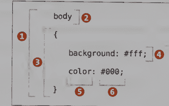

如 `margin`（外边距）、`padding`（内边距）和 `border-width`（边框宽度）等属性用于定义区块四边的值（而 `margin-right` 仅定义右边距）。这些属性以及类似的属性可以接受一个到四个空格分隔的值，并按以下方式应用于各边：

- 如果列出一个值（例如 `10px`），该值将应用于所有四边。
- 如果列出两个值（例如 `10px 5%`），第一个值应用于顶部和底部，第二个值应用于右侧和左侧。
- 如果列出三个值（例如 `10px 5% 20px`），第一个值应用于顶部，第二个值应用于右侧和左侧，最后一个应用于底部。
- 如果列出四个值（例如 `10px 5% 20px auto`），这些值从顶部开始顺时针应用（上、右、下、左）。

```css
/* 包含文件 additional.css */
/* 使用包含的规则针对特定媒体 */
```

```css
  [...]
}
```

## 级联

CSS 中的*级联*（cascading）是确定给定属性的哪个声明应用于文档中给定元素时遵循的过程。正如你很快就会学的，属性（例如颜色）可以被定义和重新定义多次，因此浏览器必须决定应用这些定义中的哪一个。筛选样式表以确定使用哪个属性声明的标准有三个：权重（weight）、优先级（specificity）和出现顺序（order of appearance）。

**权重**（weight）由声明的来源决定。样式规则可以按权重递减顺序从三个源中找到：

- 作者样式表：这些是用户访问页面时随 HTML 文档一起定义的样式表。
- 用户样式表：用户选择的 CSS 文档或其他样式偏好。

声明的*优先级*（specificity）取决于所用选择器的精确程度。最后，如果多个声明具有相同的优先级，则使用*出现顺序*。

优先级将在第 3 章详细介绍。

要计算给定属性的胜出声明，首先考虑权重。如果多个声明具有相同的最高优先级，则使用出现顺序。

图 1.2 显示级联的 Safari 检查器。

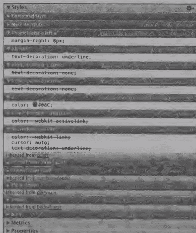

## 继承

某些属性的值（如颜色和字体族）会被设置该属性元素的子元素继承。如果子元素没有显式声明该属性，它将使用继承的值。在颜色的情况下，如果 `<body>` 元素被设置为黑色，那么段落、列表内容、块引用和其他元素也将具有黑色颜色值。由于链接在用户代理样式表中定义了不同的颜色，它们不会显示为黑色，而是默认链接颜色。

继承的值以计算值的形式随子元素传递。例如，字体大小是继承的；因此传递给子元素的值将是计算后的像素值，而不是原始单位（原始单位可能是 `em`、`rem` 或像素）。

```html
<p style="font-size: 10px">
<strong style="2em">
 <span>Text</span>
 <strong>
</p>
```

在之前的代码示例中，`<strong>` 元素的字体大小计算为 `20px`，这是被 `<span>` 元素所继承的值。如果指定的 `2em` 被继承并重新计算大小，则 `<span>` 元素的字体大小值将是 `40px` 而不是。我将在下一节中进一步解释计算值。

其他属性（如宽度、高度和外边距）是不被继承的，也无法继承。这意味着尽管你可能为 `<div>` 或 `<article>` 元素放置 `400px` 的高度值，但该 `<div>` 或 `<article>` 的子元素将继续使用高度默认值（`auto`），除非它们显式设置了高度。

每个属性的 CSS 规范都列出了该属性是否可以继承，以及它默认是否会继承父元素的值。

强大的结构化和语义化标记是使 CSS 设计变得简单、易读且易于维护的关键。虽然文档树中的每个单独节点都可以被显式设置样式，但通过级联、特殊性和继承的行为，CSS 的设计初衷是为了利用元素上下文和标记模式。糟糕的标记无法为样式化提供文本线索或“钩子”，而良好的标记实践（如恰当地使用 `<div>` 或 `<section>` 元素、使用不同层级的标题以及使用段落而非换行符）则提供了这些支持。

## 值的类型

值根据引用的位置和方式分为四种类型。你已经遇到过计算值（computed values）和指定值（specified values）：第三种是实际值（actual values）。

- **指定值**（Specified values）：这些是在 CSS 规则中直接编码的值。
- **计算值**（Computed values）：这些属性在应用级联和继承之后、但在文档处理或渲染之前计算出的值。诸如 `em` 等单位会被计算并转换为固定值（大多数设备上为像素），文件路径会被变为绝对路径，继承的值会被继承。
- **使用值**（Used values）：在所有值计算完成且文档处理后，某些其他属性的值（例如百分比或基于自动的宽度，它们依赖父元素的尺寸）会被计算为固定宽度等效值。当这些计算完成并页面渲染时，产生的值就是使用值。尽管命名不太理想，但当你通过 `getComputedStyle` DOM API 编写脚本 或在 Firebug 中查看计算标签页时，遇到的正是这些使用值。
- **实际值**（Actual values）：在所有计算完成且浏览器处理完文档后，在某些情况下使用值无法渲染，因此浏览器必须估算使用值从而创建实际值。这可能发生在计算产生分数像素单位时（99 像素的 50%），或者当低色彩深单色显示无法渲染计算出的精确颜色时。

## 元素类型

HTML 文档中有三种主要类型的元素（广义而言），其预期内容类型决定了它们在 CSS 和表现中的行为。作为其他内容容器的元素如 `<div>`、`<p>`；区分不同类型文本内容的元素如 `<a>`、`<strong>`；以及引用外部内容的元素如 ``、`<object>`。

在本书中，第一类元素是块级元素（block elements），第二类是内联元素（inline elements），最后一种是内联替换元素（inline replaced elements）。

## 标准与规范

世界维网联盟（W3C）同 WHATWG 和 IETF 等其他标准机构一起为从 CSS 到互联网计算机通信所需的 HTTP 协议的所有内容产出标准和规范文档。你可以在 W3C 网站 `http://www.w3.org` 上找到 CSS 和 HTML 的规范。

CSS2, CSS2.1, CSS3, 草案（Drafts）, 建议（Recommendations）, 确认（Ack!）

我们正处于一个特殊的时刻，CSS “标准”的状态虽然活跃且令人兴奋，但往往也令人困惑。W3C 的 CSS 工作组由浏览器厂商的代表和其他技术专家组成，他们正在积极编写和维护这些规范。初看之下，有很多规范文档，而且它们都处于流程的不同阶段。

规范在最终定稿过程中会经历许多状态，并在期间收集意见和测试实现：

- **工作草案**（Working Draft）：工作草案（WD）是规范的最早定义。文档本身通常会加载注释、问题或不完整的引用。工作草案有助于了解未来趋势，并供浏览器厂商创建测试实现。未来文档以及可能的单个属性定义可能会发生变化，因为目前对文档内容尚未达成共识。
- **最后一次工作草案**（Last Call Working Draft）：当工作草案中的问题、冲突和疑问解决后，将宣布最后一次（LC）征求意见，以征求对草案的反馈。
- **候选建议**（Candidate Recommendation）：在最后一次周期之后，草案可能会进入候选建议（CR）阶段，工作组向厂商征求测试实现，以确保所提方案是行的。
- **拟议建议**（Proposed Recommendation）：要成为拟议建议（PR），规范必须是稳定的，且厂商已经创建了互操作的实现。
- **建议**（Recommendation）：要成为建议（此处原文与 PR 描述重复，应指规范已完全稳定并成为正式标准）。

规范变成建议的过程可能非常缓慢。尽管 CSS3 是大家关注的焦点，但 2.1 刚刚准备进入 PR 状态。以下是该线上各种规范以及你今天就可以开始使用的：

- **CSS2**：CSS2 于 1998 年成为建议。作为规范，它已被 CSS2.1 代代，尽管“CSS2”一词可能指其中任何一个。
- **CSS2.1**：由于本书编写于 2010 年后期，CSS2.1 规范已准备好成为建议。

有关 CSS2.1 和各种 CSS3 模块的更新状态，请参见 `http://www.w3.org/Style/CSS/current_work`。

### HTML 4, XHTML 和 HTML5

选择基于哪种 HTML 规范（或草案规范）编写标记完全取决于你。尽管 HTML5 可能提供一些令人兴奋的新功能，例如额外的结构化元素和 Web 表单组件，但它们都是“标准”，与 CSS 的配合效果同样良好。


然而，重要的是你必须根据 doctype 和标准编码以及规范的语义规则进行编写。虽然某些规范中存在处理标记错误的规则，但无效的标记（例如嵌套不当的元素或未关闭的标签）往往会导致意外的样式结果。同样，糟糕的标记语义可能会混乱你的选择器，并让 CSS 代码变得难以理解。

消耗并渲染网页及 CSS 显示的最常见软件是`浏览器`。

任何消耗 Web 文档的广泛类别统称为`用户代理`。用户代理包括典型的`浏览器`，还包括屏幕阅读器程序、信息馈器、Google 及其他搜索引擎爬虫以及其他程序接口。

`设备`是用户代理运行的硬件，通常决定了该用户代理能够支持的功能。智能手机的屏幕可能比桌面电脑小，打印机具有纸张的特征，而 Wii 可能在标准清晰电视屏幕上显示内容。

在桌面浏览器等设备上，内容在一个大型画布（或`视口`）上显示，被归类连续媒体，而输出到多个固定尺寸部分上的打印机则被视为分页式媒体（`paged media`）。

在本书的大部分内容中，你将学习应用于网页浏览器以及基于屏幕的设备的连续媒体的 CSS，但在第 12 章有一个显著的停顿。

## 使用 CSS

现在你已经了解了关于 CSS 定义和规范制定的所有你想知道的知识，你可能需要知道如何将实际的 CSS 代码引入你的网页中，以及 CSS 实际上像什么样。

## 将样式附加到 HTML

在开始编写 CSS 之前，你必须知道该将代码放在哪里。有几种方法可以为你的内容定义规则，有些是基于外部文件（这些文件可以在网站的多个 HTML 文档之间共享），有些则针对特定页面甚至是单个元素。

### HTML `<link>` 元素

你可以在文档的`<head>`中使用 HTML `<link>` 元素来指定外部 CSS 文档。该文档不包含标记或脚本元素，只有 CSS 代码（规则和注释）。

```
<head>
<link rel="stylesheet" type="text/css" src="global.css">
</head>
```

`type` 属性定义了样式表中使用的语言。它在 HTML4 和 XHTML 中是要求的，但在 HTML5 中是可选的（默认为 `text/css`）。`src` 属性定义了 CSS 文档的位置；如果它是相对路径，则相对于引用它的 HTML 文档的位置。

### HTML `<style>` 元素

你可以在文档的`<head>`中使用 HTML `<style>` 元素来封装应用于文档的 CSS 代码。

```
<head>
  <style type="text/css">
    ...
  </style>
</head>
```

`type` 属性定义了样式表中使用的语言。它在 HTML4 和 XHTML 中是要求的，但在 HTML5 中是可选的（默认为 `text/css`）。

> HTML5 还定义了一个 `scope` 属性，允许 `<style>` 元素用于内容块内部，而不仅仅是 `head` 元素。

### `@import` 规则

你可以在任何 CSS 代码块或 CSS 文档的顶部使用 `@import` 规则来定义要包含在当前文档或代码块中的另一个 CSS 文档。`@import` 规则必须在文档中所有其他规则之前出现（CSS3 建议的 `@charset` 规则除外）。

```
@import "imported.css"
```

### HTML `style` 属性

HTML 内容元素（那些与文档 `<head>` 关联的元素）有一个 `style` 属性，可以用于将分号分隔的 CSS 声明列表分配给该特定元素。

```
<p style="color: pink">一个粉色段落</p>
```

这种属性是为整个文档设置样式的一种笨拙方法，但在某些项目中，当样式信息需要与 HTML 内容匹配时，偶尔可以使用，例如在跨站点共享 HTML 内容或为元素的样式定义一次性的特殊情况时。

### JavaScript 和 DOM

JavaScript 可以通过文档对象模型 (DOM) 访问样式表和样式属性。可以使用 JavaScript 通过元素上的 `style` 对象设置样式，或者通过 `getComputedStyle` 方法读取当前的样式信息（使用过的值）。

你还可以使用 JavaScript 通过 `document.styleSheets` 对象读取样式表的内容，这是一种用于创建桥接库的很有用技术，可以为旧浏览器提供对不支持的 CSS 属性或选择器的支持（在第 13 章中讨论）。

> 注意：通过 JavaScript 访问时，多单词 CSS 属性使用驼峰命名法，而不是连字符。换句话说，`margin-left` 变为 `marginLeft`。

## 编码风格

CSS 不依赖空格或缩进来解析值，一致的空格使用可以使代码更容易遵循——正如文档中规则经过深思的组织以及 CSS 注释的良好使用一样。16 《CSS 口袋指南》。格式化和组织 CSS 代码没有一种正确的方法，但在你学习 CSS 并构建和测试代码时，此部分将提供一些起点。

## 代码位置

- **全局样式**：包含适用于整个站点的规则。
- **章节或页面样式**：包含适用于特定部分的规则。
- **页面样式**：针对特定页面的规则。
- **唯一样式**：针对特定元素的规则。


媒体，而输出到多个固定尺寸部分上的打印机则被视为分页式媒体（paged media）。

在本书的大部分内容中，你将学习应用于网页浏览器以及基于屏幕的设备的连续媒体的 CSS，但在第 12 章有一个显著的停顿。

## 使用 CSS

现在你已经了解了关于 CSS 定义和规范制定的所有你想知道的知识，你可能需要知道如何将实际的 CSS 代码引入你的网页中，以及 CSS 实际上像什么样。

## 将样式附加到 HTML

在开始编写 CSS 之前，你必须知道该将代码放在哪里。有几种方法可以为你的内容定义规则，有些是基于外部文件（这些文件可以在网站的多个 HTML 文档之间共享），有些则针对特定页面甚至是单个元素。

### HTML `<link>` 元素

你可以在文档的 `<head>` 中使用 HTML `<link>` 元素来指定外部 CSS 文档。该文档不包含标记或脚本元素，只有 CSS 代码（规则和注释）。

```html
<head>
<link rel="stylesheet" type="text/css" src="global.css">
</head>
```

`type` 属性定义了样式表中使用的语言。在 HTML4 和 XHTML 中是要求的，但在 HTML5 中是可选的（默认为 `text/css`）。`src` 属性定义了 CSS 文档的位置；如果它是相对路径，则相对于引用它的 HTML 文档的位置。

### HTML `<style>` 元素

你可以在文档的 `<head>` 中使用 HTML `<style>` 元素来封装应用于文档的 CSS 代码。

```html
<head>
  <style type="text/css">
    ...
  </style>
</head>
```

`type` 属性定义了样式表中使用的语言。它在 HTML4 和 XHTML 中是要求的，但在 HTML5 中是可选的（默认为 `text/css`）。

> HTML5 还定义了一个 `scope` 属性，允许 `<style>` 元素用于内容块内部，而不仅仅是 `head` 元素。

## @import 规则

你可以在任何 CSS 代码块或 CSS 文档的顶部使用 `@import` 规则来定义要包含在当前文档或代码块中的另一个 CSS 文档。`@import` 规则必须在文档中所有其他规则之前出现（CSS3 建议的 `@charset` 规则除外）。

```css
@import "imported.css"
```

### HTML `style` 属性

HTML 内容元素（那些与文档 `<head>` 关联的元素）有一个 `style` 属性，可以用于将分号分隔的 CSS 声明列表分配给该特定元素。

```html
<p style="color: pink">一个粉色段落</p>
```

这种属性是为整个文档设置样式的一种笨拙方法，但在某些项目中，当样式信息需要与 HTML 内容匹配时，偶尔可以使用，例如跨站点共享 HTML 内容或为元素的样式定义一次性的特殊情况时。

### JavaScript 和 DOM

JavaScript 可以通过文档对象模型 (DOM) 访问样式表和样式属性。可以使用 JavaScript 通过元素上的 `style` 对象设置样式，或者通过 `getComputedStyle` 方法读取当前的样式信息（使用过的值）。

你还可以使用 JavaScript 通过 `document.styleSheets` 对象读取样式表的内容，这是一种用于创建桥接库的很有用技术，可以为旧浏览器提供对不支持的 CSS 属性或选择器的支持（在第 13 章中讨论）。

> 注意：通过 JavaScript 访问时，多单词 CSS 属性使用驼峰命名法，而不是连字符。换句话说，`margin-left` 变为 `marginLeft`。

## 编码样式

CSS 不依赖空格或缩进来解析值，一致的空格使用可以使代码更容易遵循——正如文档中规则经过深思的组织以及 CSS 注释的良好使用一样。16 《CSS 口袋指南》。格式化和组织 CSS 代码没有一种正确的方法，但在你学习 CSS 并构建和测试代码时，此部分将提供一些起点。

## 代码位置

- 全局样式：包含适用于整个站点的规则。
- 章节或页面样式：包含适用于特定部分的规则。
- 页面样式：针对特定页面的规则。
- 唯一样式：针对特定元素的规则。

(由于原文存在大量重复段落，此处展示核心翻译)

内容元素，因此顺序并不重要。但在这里，最好将属于同一区块或内容类型的代码放在一起（例如，将所有登录表单内容放在一起，所有页脚内容放在一起）。

本章早期关于尽早打开文档的建议提供了一个很好的示例，展示了人们如何组织网站全局 CSS 文档的整体结构。

```css
/*
* 内容：
* 1.  HTML 元素
* 2. 布局网格
* 3. 头部内容样式
* 4. 页面内容样式
* 4a. 首页内容
* 4b. 文章页面内容
* 5. 页脚内容样式
*/
```

# Web 浏览器

Web 浏览器及其对世界提供内容的开放性——我们能够设计出既易于更新和修改又丰富的网站。浏览器是 Web 服务器的阴阳对应。但作为内容创作者，众多的浏览器可能会成为一种负担。

在本章中，你将看到 Web 浏览器影响你的 CSS 代码的一些方式，学习如何适应可能查看你构建页面的不同平台和设备，并了解一些与浏览器相关的常见问题以及通处理方法。

## 样式从何处来？

在任何特定文档的样式应用到你的页面之前，浏览器会根据浏览器默认、应用程序偏好和高级用户自定义的组合应用某些样式。

## 浏览器样式表

每个浏览器都附带了一个默认或基础样式表。从不同的浏览器来看，这些设置是通用的——标题比基础字体大，链接有下划线，列表有项目符号，并且在段落之间会出现间距。

浏览器厂商根据公认的实践以及在他们特定操作系统和设备上效果最佳的方案来选择样式。基础样式表是显示所有网页的基础。

通常，就像列表和项目符号一样，你可能选择不编写自己的 CSS，直接使用默认设置。或者，你可能只想修改这些属性中的一两个，而让其余保持，例如更改列表项的外边距（margin）和内边距（padding），但保持列表项的项目符号样式不变。

如果你是一个好奇的人，可以通过内部 URL `$resource:/gre/res/` 找到组成 Firefox 3 默认样式表的全部八文件。Internet Explorer 的基础样式表无法访问，但 Jon Neil 已尝试对其进行反向工程，并将结果放在了 `$http://www.iecss.com/`。只需看一眼其中任何一个，你就会感到不知从。

你可以简单地忽略这些设置中的许多，但某些如外边距或内边距会让一致呈现变得困难。在第 13 章，我将介绍如何使用“重置（reset）”将其中某些基础样式规则归零，为代码提供一个更统一的起点。

## 用户设置

除了浏览器应用于 HTML 元素的基样式列表外，大多数浏览器还允许用户自定义一些样式属性，以便阅读和与网站交互更加方便（图 2.1）。

图 2.1 OS X 上 Opera 10.5 的偏好对话框。

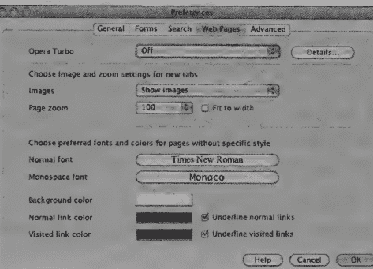

通过浏览器的偏好，用户通常可以设置浏览器是否支持图像、使用的字体大小和字体族以及某些功能作为链接的行为。

## 用户样式表

从一开始就能控制字体大小和颜色而已。许多浏览器还提供了超越偏好对话框的能力，允许在基础浏览器样式表之后、Web 规定的样式之前加载并应用 CSS 文件。这种用户样式表可以包含你设计网页时可能使用的任何和所有相同规则。

诸如 Stylish Firefox 扩展（http://userstyles.org/）之类的工具为不懂 CSS 的用户提供了示例样式表，并为他们访问的所有站点加载这些样式或自定义特定站点提供了方便的方法。

## 渲染模式

构建 Web 浏览器的团队面临着一个艰难的境地：既需要支持浏览器历史上的运行方式，同时又要修复错误并支持 W3C 的新工作。看起来 Web 开发者应该为了进步而放弃旧且充满错误的行为，但现实情况是，成千上万的网站可能是考虑到旧的行为构建、测试并发布的。

作为一种折中，浏览器厂商想出了一种方法可以在向后兼容的同时遵循新兴的 Web 标准。解决方案是支持多种渲染模式，并通过 DOCTYPE 声明在文档级别提供切换这些模式的方法。

## 标准模式

在标准模式（Standards Mode）下，浏览器渲染引擎的行为遵循标准的字面意思。CSS 规范的编写是为了向后兼容的，也就是说，即使是多年后根据今天构建的页面也不应该表现不同。在极端情况下——例如使用盒模型时——创建一个新属性以确保遵循旧标准。

# 第 2 章：Web 浏览器

> 在本书中，我将讨论各种属性以及它们根据 W3C 以及在标准模式下的表现。

## 接近标准模式（Almost Standards Mode）

接近标准模式是在更严格的标准模式与 `` 作为内联元素的影响之间的折中。在标准模式下，图像下方有空间。接近标准模式与标准模式相同，唯一的例外是它图像下方的空间。

## 怪模式（Quirks Mode）

怪模式是某些浏览器中的遗留渲染模式，允许浏览器表现像之前的版本。根据定义，它不完全遵循任何 CSS 规范。它主要用于让旧网站无需维护即可运行。

> 在怪模式下构建新网站是困难的，因为浏览器之间的差异以及它们偏离 CSS2 和 CSS3 的方式。如果你构建新网站，请坚持标准模式，忘记其他。

## 通过 DOCTYPE 选择模式

在浏览器厂商实现渲染模式期间，Web 在很大程度上是 HTML4、针对浏览的代码和“最佳查看……”的混乱。只有少数开发者编写有效代码、阅读规范并使用 XHTML 等类型。这提供了一个利用声明（或缺失声明）来指示代码类型从而在模式之间切换的机会。

缺失或无效的 DOCTYPE 将浏览器置于怪模式，以下情况也是：

```html
<!DOCTYPE HTML PUBLIC "-//W3C/DTD HTML 3.2 Final//EN>
<!DOCTYPE HTML PUBLIC "-//W3C/DTD HTML 4.01
-Transitional//EN">
```

以下会将浏览器置于标准模式或接近标准模式：

```html
<! html>
<!DOCTYPE HTML PUBLIC "-//W3C/DTD HTML 4.01//EN"
"http://www.w3.org/TR/html4/strict.dtd">
<!DOCTYPE html PUBLIC "-//W3C/DTD XHTML 1.0
-Transitional//EN">
```

关于怪的 Wikipedia Wikipedia（http://en.wikipedia.org/wiki/Quirks_mode）包含了更完整的行为表。

## X-UA-Compatible

两个模式是不够的，特别是那些使用 Web 技术构建封闭或内部应用程序的人。微软担心浏览器的更改或修复将以 DOCTYPE 切换无法解决的方式破坏已测试和部署的代码。`X-UA-Compatible` 头部在通过 HTTP 请求头或 `<meta>` 标签设置时被引入，作为锁定 IE8 及之后表现像特定浏览器版本的方法。以下示例告诉浏览器它在标准模式下应该像 IE8：

```html
<meta http-equiv="X-UA-Compatible" content="IE=8" />
```

下一个示例告诉浏览器模拟 IE7 并使用派生的 DOCTYPE 模式：

```html
<meta http-equiv="X-UA-Compatible" content="IE=EmulateIE7" >
```

关于 `X-UA-Compatible` 的更多背景和值的示例，可以参考微软（http://msdn.microsoft.com/en-us/library/cc288325(VS.85).aspx）。

## 特定模式差异

如果你想了解更多信息（并且不满足于忽略怪异模式（Quirks Mode）的存在），Jukka Korpela 提供了一份关于各种浏览器中怪异模式与标准模式差异的详细列表（http://www.cs.tu.fi/~quirks-mode.html）。Peter-Paul Koch 在一个易于阅读的表格中绘制了许多差异（http://www.quirksmode.org/css/quirksmode.html）。

## 针对特定浏览器

在完美的世界里，没有必要向特定浏览器发送或隐藏特定样式，也不需要寻找方法来实现那些 CSS 已经明确定义属性的功能。在现实世界中，你可以几乎完美。在标准模式渲染下，向不同的浏览器发送不同的样式规则并不是常态，但某些项目可能在此进行微调，或者将某个异常的浏览器拉回正。

在这里我展示了处理浏览器定位的三种方法以及它们有效的原因。前两种方法在你需要细微更改时有用，而最后一种在你进行定期更改时有用，特别是当你必须为旧版本的 Internet Explorer 开发时。

## 使用选择器定位

浏览器用于解析 CSS 选择器的规则规定，未知的选择器语法将导致整个规则被忽略。你可以利用这一点，结合旧版本浏览器未实现的最新选择器，为不同的浏览器精心编写规则。这可以是针对不同版本浏览器定位不同功能或为旧浏览器提供回退方案的最简洁的方法之一。你可以编写以下两个 CSS 声明：

```css
html body { background-color: red; }
html>body { background-color: blue; }
```

支持子选择器的浏览器将在页面上显示红色背景，而不支持的将显示蓝色。

## 使用语法技巧（Hacks）

某些浏览器并不完全遵循相同的解析规则，并对被视为错误或无效语法的处理以独特的方式。随着时间的推移，Web 开发人员发现了（或苦苦寻找了）这些差异，并将它们作为某些浏览器定位的“技巧”。

在下面的示例中，大多数浏览器将忽略未知的属性 `_height`，但 IE 将会忽略 `_` 字符并将其视为“height”，从而让你在需要时向 IE 发送不同的值。

```css
div {
  height: 200px;
  _height: 300px;
}
```

## 第2章：网络浏览器 29

如果你想针对 IE6 及更早版本，可能会使用 `* html` 技巧，大多数浏览器不会将其应用于任何元素，因为在根 `<html>` 标签上方没有元素，但 IE 直到第 7 版本都是错误的。

```css
div.column {
  width: 200px;
}
* html div.column {
  width: 198px;
}
```

你可以在 swik.net (http://swik.net/CSS/CSS+Hacks) 上找到 CSS 技巧及其危险性的汇编。

使用任何性质技巧的危险在于，无法控制未来浏览器在相同情况下的行为。未来的 Safari 版本会以相同的方式解析你的技巧，但不再需要你提供的更改后的值吗？（或者更直接地说，由于软件 Bug），因此你取决于开发者随着时间推移所做的修复。

## 微软条件注释

如果你发现需要为 Internet Explorer 提供一些特殊代码，或者你不想混合选择器或语法技巧，可以使用条件注释（http://en.wikipedia.org/wiki/Conditional_comment）。使用标准 HTML 注释（非 IE 浏览器会忽略其中的内容）和一些告诉 IE 注意的额外字符，可以为 IE 的特定版本提供样式表。

```html
<!--[if IE]>
<link rel="stylesheet" src="css/all_ie.css">
<![endif]-->
```

```html
<!--[if lt IE8]>
<link rel="stylesheet" src="css/all_ie.css">
<![endif]-->
```

这种方式添加样式规则的缺点是代码出现在两个三个地方，难以维护。在主 CSS 文件中指定注释是一种有用的方法：

```css
#block { /* 查看 all_ie.css */ }
```

条件注释的优点是你可以对哪些版本的 IE 会看到你的代码有更大的控制权。

## IE 和 hasLayout

在 6 和 7 版本中，Internet Explorer 有一种内部方法来区分元素是否需要某些布局功能（如定位或尺寸）。根据样式的应用，Internet Explorer 将元素放入处理布局或不处理的类别。这个内部标记为 `hasLayout`。`hasLayout` 标记并不是为了暴露给构建网站的我们，但依赖此标记的内部架构也是 CSS Bug 的来源。图 2.2 显示了 IE 开发工具中的 `<div>` 元素。

## 第2章：网络浏览器


**图 2.2** 通过 IE7 开发工具显示 `hasLayout` 的元素。

不幸的是，进入处理布局的元素与不进入的元素之间的区别导致了 Internet Explorer 6 和 7 中常见的问题之一，被称为 Layout Bug（布局 Bug）。

Layout Bug 之所以命名，是因为如果没有触发 `hasLayout` 标记，页面上的内容可能会消失（或闪烁）。你无法直接设置 `hasLayout` 标记，但可以通过为元素设置某些 CSS 属性来“强制”进入正确状态：

```css
div.columnA {
  height: {}; /* 提供尺寸触发 hasLayout */
}
div.columnB {
  zoom: 1; /* 使用非标准属性触发 hasLayout */
}
```

你可以在“On having layout”（http://www.satzans.de/css/onhavinglayout.html）找到关于 `hasLayout` 的精彩讨论，微软对该属性也有自己的文档（http://msdn.microsoft.com/en-us/library/bb25048.v5.aspx）。

> IE 8 仍然具有 `hasLayout` 属性，尽管其对布局的影响已大部分解决。

## 浏览器分级

在之前的章节中，我概述了一些与新旧浏览器协作的方法，以确保它们正确处理你的 CSS，并在它们未处理时进行定位。

但为不同的浏览器创建所有版本的代码、进行彻底测试、记录和维护可能是耗时且令人沮丧的。


通过创建一个分级的浏览器矩阵，你可以节省开发时间，并向你的客户、项目的其他开发者、测试并批准你工作的 QA 团队以及维护网站和处理客户反馈的人清晰地传达技术需求。

哪些浏览器最重要以及哪些浏览器属于其他类别的具体划分必须根据具体情况做出业务决策。Yahoo 的“分级浏览器支持”文档（http://developer.yahoo.com/yi/gbs/index.html）对 YUI 的分级方法和结果提供了合理的解释（图 2.3），这是我在新项目或教育他人分级益处时经常参考的示例。

图 2.3

YUI A 级浏览器矩阵。

| | Win XP | Win 7 | Mac 10.5† | Mac 10.6† |
|---|---|---|---|---|
| Firefox 3.0† | A-级 | | | |
| Firefox 3.6† | A-级 | A-级 | | A-级 |
| Chrome 4.0† | A-级 | | | |
| IE 8.0 | A-级 | A-级 | | |
| IE 7.0 | A-级 | | | |
| IE 6.0 | A-级 | | | |
| Safari 4.0† | | A-级 | A-级 | |

这种特定的分类方法适用于 YUI 开发人员，但可能对你不适用。因此，以下是我发现适用于大型商业项目的标记的大略大纲。

## A 级浏览器

A 级浏览器代表决定如何实现网站以及你可以方便使用哪些 CSS 工具和其他技术时的目标平台。像 Firefox 3、Safari 4 和 IE7 这样的浏览器根据其能力或用户群进入这一分类。

## B 级浏览器

B 级浏览器可能是常见浏览器的旧版本，或是在不常用的操作系统或设备上的当前版本浏览器。这些浏览器可能（但不预期）显示某些 CSS2 或 CSS3 的最新技巧。然而，你仍然应该在这些浏览器中测试构建的页面，以确保它们功能完备、可访问、品牌信息传达，并且看起来没有“崩溃”。

## F 级浏览器

为了开发、测试和持续支持性，明确指出哪些浏览器或配置将不受支持可能是非常有用的。使用旧浏览器（如 Netscape 6、Internet Explorer 5）或旧版移动设备的访问者属于 F 级浏览器，他们只能获得现有的显示效果并必须接受现状。

## X 级浏览器

X 级浏览器被假设属于 A 级类别，但由于它们在你的用户群体中占比较小，或者与已列出的 A 级浏览器相似，它们并未在你的关注范围或测试矩阵中。旧的次要版本、Linux 版本或使用与 A 级浏览器相同渲染引擎的替代 UI 浏览器（如 Camino 或 Flock）都属于这一类。

## A+ 级浏览器

定义一个名为 A+ 级浏览器的额外类别变得越来越有用，它允许在 A 级类别之外提供额外的视觉效果。新的 CSS3 特性（如圆角、动画或过渡效果）可以用于增强部分访问者的体验，而这些特性并不是网站设计的核心。

## 通过 JavaScript 实现 CSS 支持

当你想在网站上使用最新、最强大的编码技术，且你的业务需求或用户群体要求你对某个实际上无法胜任的浏览器提供 A 级或 B 级支持时，通常会使用 JavaScript 库来桥接支持，或实现类似视觉效果的替代方法。这是确保通过 `border-radius`（第 8 章）支持圆角或确保你所有的选择器都能被识别的极佳方法。

我在第 13 章中讨论了此类脚本的特定示例。

## 实用策略

> 影响网页在访问者面前呈现效果的因素非常多——多到至于如果你尝试理解并控制所有这些因素，可能会感到无从下手。重要的是要记住，最终控制浏览体验的是你的访问者而不是你。保持预算内、按时完成并保持理智的唯一方法，是弄清楚哪些因素对于让你的网站脱彩非常重要，然后选择一种或多种方法在尽可能可能的场景下接近你的目标，最后习惯放弃其他部分。

# 第 3 章：选择器

## 选择器

你使用选择器来定义页面上想要应用某些属性的元素。文档中的元素可以根据使用的 HTML 标签、类（`class`）或 `ID` 属性、与其他元素的关系或文档中的当前状态进行匹配。你还可以组合简单选择器来形成条件链，在应用样式规则之前必须满足这些条件。

## E（类型选择器）

类型选择器通过其类型选择元素。

```
h1 {} /* 选择所有 h1 元素 */
form {} /* 选择所有 form 元素 */
```

## *（通用选择器）

通用选择器匹配文档中的任何元素类型。如果存在一系列其他简单选择器，且没有出现特定的类型选择器，则它是隐式的。

- `* {}` /* 选择文档中的所有元素 */
- `*.thumb {}` /* 选择所有具有类 thumb 的元素[参见下文的类选择器] */
- `.thumb {}` /* 与之前相同，`*` 是隐式的 */

## #id（ID 选择器）

ID 选择器匹配任何 ID 属性值为指定值的元素。

```
#header {} /* 选择 ID 为 header 的元素 */
*#header {} /* 与上一个相同 */
div#footer {} /* 选择 ID 为 footer 的 div 元素 */
```

## .class（类选择器）

类选择器匹配具有指定类名的元素。对于类属性包含多个由空格分隔的单词的元素，如果这些单词中的*任何一个*匹配指定的类名，类选择器就会选择该元素。

```
.help {} /* 匹配所有类为 help 的元素 */
img.thumbnail {} /* 匹配类为 thumbnail 的图像元素 */
```

## 属性选择器

除了 `id` 和 `class` 属性，任何属性都可以通过属性选择器进行选择。

### [att]

选择属性 `att` 的元素，无论该属性的值如何。

```
input[required] {} /* 匹配具有 required 属性的 HTML5 input 元素 */
```

### [att=val]

选择属性 `att` 且值等于 `val` 的元素。

```
a[rel=tag] {} /* 匹配 rel 属性等于 tag 的锚点 */
```

### [att~=val]

选择属性 `att` 且其值在由空格分隔的单词列表中包含单词 `val` 的元素。（类比多个类名的情况）。

```
a[rel~=friend] {} /* 匹配 rel 属性中包含 friend 单词的锚点。例如，XFN 的 rel="met friend"。 */
```

### [att|=val]

选择属性 `att` 且其值等于 `val` 或以 `val` 开头后跟分隔符 `-` 的元素。这用于匹配 `hreflang` 属性的语言子代码。

```
*[hreflang=en] {} /* 匹配所有 hreflang 为 en-us、en-au 和 en-gb 的元素 */
```

### [att^=val]

选择属性 `att` 且其值以 `val` 开头的元素。CSS3 添加。

```
a[href^="http"] {} /* 匹配所有以文本 "http" 开头的链接 */
```

### [att$=val]

选择属性 `att` 且值以 `val` 结尾的元素。CSS3 添加。

```
a[href$=.pdf] {} /* 匹配所有指向 PDF 的链接 */
```

### [att*=val]

选择属性 `att` 且值在任何地方包含字符串 `val` 的元素。CSS3 添加。

```
input[id*=phone] {} /* 匹配所有包含 phone 的 input */
```

## 伪类选择器

伪类分为两组：代表元素特定状态的动态伪类，以及代表元素信息的结构伪类。

### :link, :visited（链接伪类）

文档中的链接有两种状态。当根据浏览器及其历史记录未被访问时，可以使用 `:link` 类选择；当已访问时，可以通过 `:visited` 进行选择。

```
a:link { color: blue; }
a:visited { color: purple; }
```

### :hover, :active, :focus（动作伪类）

悬停、活动点击和聚焦这三种交互状态可以使用 `:hover`、`:active` 和 `:focus` 伪类进行独立的样式设置。

> **注意** 非链接（`<a>`）元素的 `:hover` 类在 IE6 及早期版本中不支持，但从 IE4 开始支持链接。

## LoVe/HAte 链接顺序

链接可以同时处于多种状态，且所有伪类的权重都相同，因此定义链接伪类和动作伪类的顺序非常重要。在任何给定时刻，最后定义的规则将具有优先级。

在被点击的瞬间，以前访问过的链接将匹配所有这些伪类。如果 `:visited` 是这中的最后一个选择器，那么它的属性将被应用，而为悬停或激活状态定义的不同属性永远不会显示。

LoVe/HAte 助记法是记住正确选择器顺序的有效方法。

### :target（目标伪类）

`target` 伪类代表被 URI 中命名锚点目标的元素，例如 `http://example.com/index.html#top` 中的 `top`（通过 ID，或者在 HTML4 中通过 `name` 属性）。

### :enabled, :disabled, :checked（UI 伪类）

`:enabled`、`:disabled` 和 `:checked` 伪类用于定位各种状态的表单元素。任何表单元素都可以启用或禁用，通常取决于是否存在 `disabled` 属性。复选框和单选框按钮也可以通过用户交互或 `checked` 属性被 `:checked`。

### :lang() (语言伪类)

语言伪类允许根据文本的语言进行选择。

```
article:lang(en) {} /* 选择英文的 article 元素 */
article:lang(es) {} /* 选择西班牙语的 article 元素 */
```

> **注意**：这与通过属性选择器基于 `lang` 或 `hreflang` 的选择有所不同，因为语言伪类可能会从父元素继承，或者作为文档头部的一部分进行定义。

### :root (根元素伪类)

`:root` 伪类是选择文档根节点的快捷方式。对于 HTML 文档，这始终是 `html` 元素。

### :nth-child(), :nth-last-child() (nth 子元素伪类)

这些伪类选择器匹配在包含该列表项及其所有兄弟元素的元素列表中出现在特定位置的元素。该位置通过模式 `an+b` 定义，其中 `a` 和 `b` 是整数。

`odd` 和 `even` 值是选择每个奇数（或 `2n+1`）或偶数（`2n`）项的快捷方式。

通过 `nth-child` 伪类可以轻松实现项目列表或表格连续行的“斑马纹填充”（下一页的图 3.1），而不需要在文档标记中添加额外的类名或其他钩子。

```
tr { background-color: #FFF; color: #000; }
tr:nth-child(odd) { background-color: #AAA; }
```

## CSS 快速指南

图 3.1

斑马纹填充，或为交替表格行应用背景颜色。

| 1 | 2 |
|---|---|
| 3 | 4 |
| 5 | 6 |
| 7 | 8 |
| 9 | 10 |

### :first-child, :last-child (第一个和最后一个子元素伪类)

`:first-child` 和 `:last-child` 伪类选择器代表某些父元素的第一个和最后一个子元素。它们分别相当于 `:nth-child(1)` 和 `:nth-last-child(1)`。

这些选择器对于一种常见的设计模式非常有用，即使用边框作为一组元素之间的分割符，而不是元素外部（图 3.2）。

```
li { border-top: 1px solid red; } /* 在 li 元素上方放置边框 */
li:first-child { border-top: none; } /* 移除第一个项目顶部的边框 */
```

图 3.2

移除了第一个子元素列表项上的边框。

| Item 1 |
|---|
| Item 2 |
| Item 3 |
| Item 4 |
| Item 5 |
| Item 6 |

也可以通过 `:last-child` 实现：

```
li { border-bottom: 1px solid red; } /* 在所有元素下方放置边框 */
li:last-child { border-bottom: none; } /* 移除最后一个项目底部的边框 */
```

### :nth-of-type(), :nth-last-of-type() (nth 类型伪类)

虽然 `nth-child()` 匹配任何元素，但 `nth-of-type()` 和 `nth-last-of-type()` 选择每个 `an+b` 元素，其中元素集合是基于仅相同类型元素的兄弟元素集合。

`nth-of-type` 选择器的一个应用是为连续的图像设置交替样式。

### :first-of-type, :last-of-type (第一个和最后一个类型伪类)

`:first-of-type` 和 `:last-of-type` 与 `:first-child` 和 `:last-child` 类似，它们分别匹配相同类型中的第一个和最后一个元素。

### :only-child (唯一子元素伪类)

`:only-child` 伪类选择是其父元素的唯一子元素的元素。它匹配 `:first-child` 和 `:last-child`（当元素只有一个元素时）。

### :only-of-type (唯一类型伪类)

`:only-of-type` 伪类在当元素在其兄弟元素中是该类型的唯一元素时匹配。它涵盖了 `:first-of-type` 和 `:last-of-type`。

### :empty (空伪类)

`:empty` 伪类在元素不包含子节点时选择它们。这包括文本节点和空白字符。

```
td:empty { background-color: rgb(80%,80%,80%); } /* 为空的表格单元格着色 */
```

### :not() (否定伪类)

`:not()` 否定伪类允许你选择不匹配提供选择器的元素。

```
p:not(.note) {} /* 不带 note 段落 */
input:not(:required) {} /* 非必填输入框 */
td:not(:nth-child(odd)) {} /* 不是奇数，等同于 :nth-child(even) */
```

## 伪元素选择器

伪元素是不在 HTML 文档中的虚拟元素，而是代表浏览器覆盖在文档结构的一部分，以表示布局属性。例如，由于字体大小、行长度等，伪元素包裹了文本。

## 组合器

在此为止的选择器根据元素类型或元素的属性选择元素。组合器用于以描述结构的方式组合这些简单选择器。

## E F (后代组合器)

由空白表示的后代选择器描述位于另一个元素 (E) 内部元素 (F)。祖先和后代之间的元素数量并不重要。结果，以下选择器将匹配 `body` 内部的所有元素：

```
body * {}
```

## E>F (子元素组合器)

子选择器描述是另一个元素 (E) 的子元素（或直接后代）元素 (F)。

```
ul > li { font-family: sans-serif; }
ol > li { font-family: monospace; }
```

在这里，无序列表的直接子项将使用无衬线字体，而有序列表的直接子项将使用等宽字体。

## E+F (相邻兄弟组合器)

相邻兄弟组合器匹配紧跟在其他元素 (E) 之后且共享相同父元素的元素 (F)。

```
h1 + p { font-size: 1.2em }
```

此示例将选择所有紧跟在 `<h1>` 标签之后的段落，并增大字体大小。

## E~F (通用兄弟组合器)

使用此选择器，如果元素 (F) 出现在其兄弟元素 (E) 之后的某个位置，则会被选中。

## 选择器的组合与链式

通过使用组合器（combinators），你可以将之前讨论的单个选择器链在一起，创建更复杂的选择器。这些选择器不仅可以描述整个文档中的元素，还可以描述文档特定部分或匹配特定标记模式的元素。以下简单选择器链式使用的示例：

```
nav ul li:first-child {}
.vevent h2* {}
ul ul ul ul li {}
#page .hentry a.entry-title:link {}
div#main registration fieldset -> input[type="text"]:invalid {}
```

## 将选择器翻译为普通英语

如果还不够清楚，选择器可以从左到右读取，并描述为向文档树的顶部移动。选择器 `header ul>li` 选择“任何包含在头部（header）元素中的无列表（ul）元素的子列表项（li）”。

如果你不确定某个选择器的作用，在线工具 SelectOracle (http://gallery.theopalroup.com/selectoracle/) 可以为你将 CSS2 和 CSS3 选择器翻译成英语（或西班牙语）。

## 权重 (Specificity)

如果决定哪个属性应用于元素的唯一标准是选择器出现的顺序，那么编写 CSS 将变成一场无休止的复制、粘贴和重新排列代码的战斗。权重规则——选择器对元素描述的特定程度——用于决定哪些属性将生效。

在之前的代码中，所有段落元素（`p`）的侧边都有 20 像素的外边距；然而，由于匹配包含块引用（`blockquote`）元素的段落的选择器更具体，因此这些元素将被设置为绿色，尽管该规则出现在简单选择器之前。

权重的计算是通过将简单选择器归入三个“桶中”，统计每个桶的计数（a-b-c），最后将结果与其他竞争规则进行比较得出的。这来自 CSS3 选择器模块 (http://www.w3.org/TR/css3-selectors/#specificity)：

- 选择器的权重计算方式如下：
- 统计选择器中 ID 选择器的数量 (= a)
- 统计选择器中类选择器、属性选择器和伪类的数量 (= b)
- 统计选择器中类型选择器和伪元素的数量 (= c)
- 忽略通用选择器 (`*`)

## CSS 速查指南


# 否定伪类

否定伪类（`negation pseudo-class`）内部的选择器与其他选择器一样被计数，但否定本身不作为一个伪类。

将三个数字 `a-b-c` 拼接（在一个大基数的数制中）即可得到权重。

你可能在“大基数的数制中”某处感到困惑，我并不会怪你。看几个示例应该弄清楚这一点：

```css
#user { color: rgb(1,1,1); } /* a=1 b=0 c=0 */
#user:first-child { color: rgb(2,2,2); } /* a=1 b=1 c=0 */
div+div div+div div div div>div div:first-child {
  color: rgb(3,3,3);
} /* a=0 b=0 c=13 */
div.foo { color: rgb(4,4,4); } /* a=0 b=1 c=1 */
.foo .foo+.foo .foo+. .foo .foo .foo .foo>.foo .foo
-> .foo:first-child {
  color: rgb(5,5,5)
}
/* a=0 b=12 c=1 */
.foo.bar { color: rgb(6,6,6); } /* a=0 b=2 c=0 */
[id="user"] { color: rgb(7,7,7); } /* a=0 b=1 c=0 */
```

如果所有这些选择器在一个复杂的 HTML 文档中匹配同一个元素，该元素中的文本颜色将是 `rgb(2,2,2)`。尽管其中某些选择器（特别是第三和第四个）比其他的更冗长，但第二个被认为是权重最大的。

关于在非十进制数制中拼接数字的说明是在提醒你：在组合结果时，你需要将它们像“桶”一样进行比较。例如，应该比较 `[1][1][0]` 与 `[0][12][1]`，而不是 110 与 121。

# 第 3 章：选择器

> 注意：这可能违反直觉，但在属性选择器中，ID 选择器 `#user` 比使用属性选择器 `[id=user]` 选择相同的元素更具体。

## !important 声明

在某些情况下，源顺序和权重都无法更改，但你仍然需要一种方法来超越权重计算。在这种情况下，你可以使用 `!important` 声明来锁定单个属性。

```css
blockquote p { color: green; }
...
p { color: black !important; }
```

在这里，权重和源顺序被忽略，文本将是黑色，而不是绿色。

> 大多数项目永远不需要使用 `!important` 声明。如果你发现自己在代码中加入它来让某些功能生效，请重新检查你正在使用的选择器、源顺序，以及在页面上包含某些 CSS 代码是否有必要。此声明的用例通常出现在处理第三方代码、内容管理系统或其他你无法重新设计选择器的情况下。

## 选择器策略

编写选择器的方法有无数种，对于文档中的特定元素，通常有几十种选择方式。没错，对于文档中的特定元素通常有几十种选择方式。

## 浏览器对选择器的支持

浏览器对本章描述的选择器的支持非常好。类型、ID、类选择器在各处都支持。CSS2 和 CSS3 选择器（如 `+` 和 `>` 组合器）在桌面浏览器 (http://www.quirksmode.org/css.html) 和移动浏览器 (http://www.quirksmode.org/m.html) 上都广泛支持。

## 选择器分组

不同的选择器可以用逗号分隔，并分配相同的属性。

```css
p, blockquote, ul, li {
  padding: 0;
  margin: 1em;
}
```

## 选择器速度

选择器的复杂度越高（通过链式多个节点、使用相邻组合器或属性选择器），渲染引擎在解析文档和绘制页面时所需的工作就越大。

## 选择器的可读性

有时选择选择器或选择器组是为了可读性以及便于在样式表中进行扫描和视觉分组。更冗长的选择器可以很容易地读取并匹配 HTML 文档结构中的元素。以下示例走向极端：

```css
html body section article h1 {
html body section article p {
html body section article ul {
html body section article ul.compact li {
html body section article#opener h1 {
html body sidebar form#newsletter fieldset label {
```

虽然清楚这些选择器如何匹配给定的 HTML DOM，但它们可能既慢又过于具体。

## 选择器的重用性

考虑到其他策略的优缺点，在编写复杂的选择器时，考虑到常见的标记模式和未来的重用通常是有用的。

首先为你的简单类型选择器设置良好的默认值，形成一个基准，使元素无论出现在何处都能表现一致。

然后根据它们在 DOM 中的位置或独特性对更具体的选择器进行分组，只需达到描述和分组选择器所需的冗长程度，并足以覆盖默认值。

像 `div.header div form#quickSearch input[type=submit]` 这样的选择器可能比当前网站需要的更具体，并且无法容易转移到下一个项目。将选择器简化为 `#quickSearch submit` 仍然可以提供你所需的权重和可读性，同时足够通用以便重用。

```css
aside #quickSearch label {} /* 为特殊情况调整属性 */
```

# 第 4 章：测量、URL 和颜色单位

在第 1 章讨论 CSS 语法时，你已经看到每个 CSS 声明的第二部分是一个值。在本章中，你将探索一些用于定义尺寸（`<length>` 和 `<percentage>`）、颜色（`<color>`）以及用于定义这些值的 URL（`<url>`）的常用单位。

## 测量

尺寸和其他测量值（例如 `font-size`）不仅仅是原始数字，而是带有某些指定测量单位的数值。CSS 拥有多种测量单位；最常用的列在以下章节中概述。

## 像素 (px)

```css
img.thumbnail { width: 150px; }
div { border-width: 3px; }
```

像素单位（`<length>`）是基于普通像素尺寸的固定测量值。

> 像素单位并不总是一个“像素”或“点”，而是被定义为基于给定显示器的相对长度测量值。打印等高分辨率媒体将把 `1px` 输出为多个物理点，而像 326-dpi 的 iPhone 4 这样高分辨率的设备将以适当的大小渲染 `px` 单位。

## em (em)

```css
h1 { font-size: 1.6em; } /* 让 h1 字体大于基础字体 */
blockquote { width: 20em; } /* 保持块的可读性 */
```

一个单位（`<length>`）是一个相对单位，等同于元素的字体大小。当它应用于元素的 `font-size` 属性时，`em` 单位相对于父元素的字体大小。这种行为使其在保持强调、标题和其他标签的字体大小相对于基础字体大小时非常有用。当它被应用于尺寸时也很有用，可以作为控制可读性和行长度的方法。

## 磅 (pt)

```css
body { font-size: 12pt; }
```

磅是一种基于长度的绝对单位（`<length>`），等同于 1/72 英寸。在设置打印尺寸时，如果可能强调物理测量值，磅会很有用处。在屏幕和移动媒体上，磅是根据显示器的分辨率和系统设置近似的，使用 `px` 或 `em` 单位可以获得更一致的结果。

## 百分比 (%)

```css
.column1 { width: 30%; } /* 包含块的百分比 */
p { line-height: 140%; } /* 字体大小的百分比 */
p { font-size: 90%; } /* 父元素的百分比 */
```

基于百分比的单位（`<percentage>`）相对于另一个测量值。百分比可以大于 100%。它与哪个测量值相关取决于具体情况的定义；之前的代码显示了一些示例。

## 百分比计算和盒模型

由于在计算百分比时涉及的计算存在舍入，可能会有额外的一个或两个像素需要考虑。Internet Explorer 6 以其计算导致不适应空间的列产生额外像素的计算而臭名昭著。你可以在第 5 章中找到更多关于布局和盒模型的知识。

- 50% + 50% = 100%
- 30% + 30% + 40% = 100%

## 其他单位

- 磅被认为是基于长度的绝对单位：它们对应于 1/72 英寸的物理测量值（由浏览器和设备近似）。其他绝对单位包括 `in`（英寸）、`cm`（厘米）和 `pc`（比卡）。
- 像素和 `em` 是基于长度的相对单位：它们相对于某些测量值。像 `em` 一样，CSS 还定义了其他相对长度单位如下：`rem`（相对于根元素的字体大小）和 `vw`/`vh`（分别相对于视口宽度和高度）。这些单位在下一代浏览器的预览中刚刚开始支持，但非常值得期待。

## URLs

URL 函数（`<url>`）用于指定资源的地址，以便用于 `background-image` 或 `list` 等属性。

```css
background-image: url("image.png");
```

## 表达相同含义的多种方式

以下是文档中段落元素设置相同文本颜色的所有方法：

```css
p { color: #fff; }
p { color: #ffffff; }
p { color: rgb(255,255,255); }
p { color: rgb(100%,100%,100%); }
p { color: hsl(0,0%,100%); }
p { color: white; }
```

你选择的表示法取决于许多因素。你对不同颜色系统的熟悉程度（哪种最容易从你喜爱的图形应用程序中转换）、或者网站色板的设计，都会影响这一决策。使用 `hsl()` 可以更容易通过 JavaScript 编写过渡效果，但要注意浏览器的兼容性问题，因为它是定义颜色的最新方法。

## 带有 Alpha 透明度的颜色

CSS3 定义了在原本实色的颜色指定中添加一层透明度的能力。在边框、文本颜色或背景上应用 alpha 透明度，可以让目标元素背后的颜色透出来或与背景颜色混合。图 4.1 显示了如何使用透明背景色来弱化背景图像产生的干扰，从而使文本变得可读。

颜色中的透明度仅适用于该颜色的元素部分，不会影响其可能包含的元素或图像等其他对象的透明度。我将在第 6 章中讨论 `opacity` 属性，它适用于整个元素的可见性。

### 图 4.1

使用透明背景色使实色文本在背景图像上更具可读性。

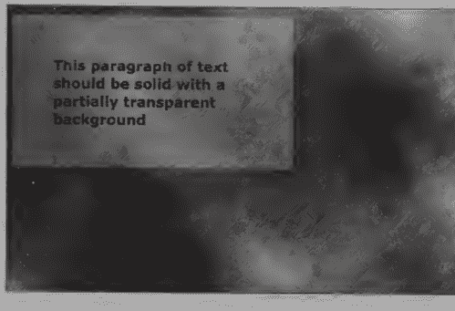

## rgba(r,g,b,a)

`r`、`g` 和 `b` 值的量程与本章之前讨论的 `rgb()` 单位相同。alpha (a) 值是一个 0 到 1 之间的小数，其中 0 表示完全透明，1 表示不透明。

```css
section { background-color: rgba(0,255,0,0.1); } /* 非常透明的绿色 */
```

alpha 值为 1 的颜色单位等同于使用实色单位。可以考虑使用后者，因为它可能被更多的浏览器支持。

## hsla(h,s,l,a)

类似于 `rgba()`，`hsla()` 与 `hsl()` 相同但增加了透明度指定。该单位也是一个 0 到 1 之间的小数。

```css
a { background-color: rgba(0,0,0,0.9); } /* 几乎全黑 */
```

## `transparent` 关键字

`transparent` 关键字表示完全透明的颜色值（因此通道指定并不重要）。你可以将其视为一种简写（在浏览器中被计算为 `rgba(0,0,0,0)`）。

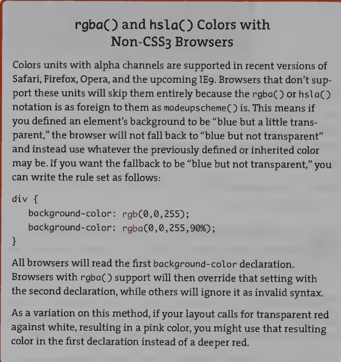

## 创建和维护色板

为网站定义一套色板并坚持使用这组颜色值，可以作为网站上新元素样式的有用工具，为整个网站提供一致的外观，并在进行更改时易于找到颜色值。

### 设计

颜色理论远远超出了本书的范围，是你可以研究几年的领域；然而，这里为选择网站配色方案提供几点建议：

- 像 Photoshop 这样的设计应用程序提供了详细的选取器，可以在 RGB、HSL 和其他颜色系统之间切换，从而轻松转换为 CSS 单位。
- Adobe Color 是一个工具，可以从桌面或从图像文件（http://color.adobe.com/）中创建、浏览和书签色块。

### 维护

在大量的 CSS 代码中维护一致的颜色用法有时是困难的。颜色单位定义在许多不同的声明中，很容易保持相同的色调。以下是一些让任务变得更容易的技巧：

- 选择一种颜色类型并坚持使用它，这样在需要更改颜色时搜索颜色会更容易。不要交替使用 `#ff0000` 和 `rgb(100%,0,0)`。
- 维护一份样式指南，列出网站使用的所有颜色及其首选表示值，并仅使用这些颜色。
- 对于复杂或非常大的网站，考虑使用第 13 章讨论过的那些 CSS 预处理器，它们允许你在代码中一次性定义颜色值的占位符。

# 第 5 章：盒模型

块级元素在布局中所占据的空间由 `height`（高度）、`width`（宽度）、`padding`（内边距）和 `border`（边框）属性的值控制。这些属性如何相互作用以及如何进行计算被称为盒模型。

## CSS 盒模型

在标准盒模型 (`content-box`) 中，元素的内边距、边框和外边距被加上元素的宽度和高度，以确定它在布局中所占据的空间。图 5.1 显示了 CSS2.1 规范（http://www.w3.org/TR/CSS21/box.html）中的盒模型图。这种宽度或高度不包含在内的累加过程导致元素占据的总尺寸对某些人来说可能是反直觉的，但在嵌套元素或处理如图像或视频等你不希望侵占内容区域的内容时，这种方法非常好。

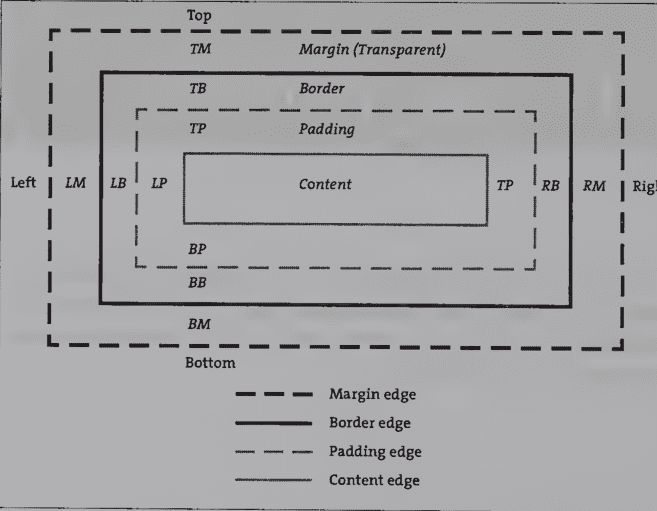

**图 5.1** 标准盒模型。T、R、B、L 缩写代表每个属性的上、右、下、左值。

## 属性

### width

`width` 属性定义元素的宽度。

- `<length>`：宽度将为固定尺寸。
- `<percentage>`：宽度将为容器块宽度的百分比。
- `auto`：宽度将根据可用水平空间计算（默认）。

### height

`height` 属性设置元素的高度。

- `<length>`：高度将为固定尺寸。
- `<percentage>`：高度将为容器指定高度的百分比；如果没有指定容器高度，则等同于 `auto`。
- `auto`：高度将适应可用内容（默认）。

### margin

`margin` 属性设置元素周围的四个边距。每个边可以取以下值之一：

- `<length>`：外边距将为固定尺寸。
- `<percentage>`：外边距将为容器块宽度的百分比（适用于垂直和水平方向的外边距）。
- `auto`：对于左右外边距，`auto` 计算为到达容器元素边缘所需的长度；对于顶部和底部，它计算为 `0`。

```css
margin-top: 1px;
margin-right: 20%;
margin-bottom: 0;
margin-left: 40px;
margin: 2em; /* 简写：所有边 */
margin: 2em 0; /* 简写：上下；左右 */
margin: 2em 0 1em; /* 简写：上，左右，下 */
margin: 2em 0 1em 10px; /* 简写：上；右；下；左 */
```

### padding

`padding` 属性设置元素周围的四个内边距。每个边可以取以下值之一：

- `<length>`：内边距将为固定尺寸。
- `<percentage>`：内边距将为容器块宽度的百分比。
- `auto`：不适用于内边距。

```css
padding: 2em; /* 简写：四周 */
padding: 2em 0; /* 简写：上下；左右 */
padding: 2em 0 1em; /* 简写：上；左右；下 */
padding: 2em 0 1em 10px; /* 简写：上；右；下；左 */
```

### 边框宽度

`border-width` 属性设置元素边框的大小。

- `<length>`: 边框宽度将固定尺寸。
- `thin` | `medium` | `thick`: 边框宽度由代表三种递增厚度边框长度的关键字指定（由于实际尺寸定义不一致，通常不使用）。

`border-width` 属性定义元素边框的宽度。类似于外边距（`margin`）和内边距（`padding`），`border-width` 是独立定义四个边的快捷方式，可以接受一个到四个值。

```css
border-top-width: 2px;
border-right-width: 0;
border-bottom-width: 10px;
border-left-width: 1px;
border-width: 2px 0 10px 1px; /* 简写：上；右；下；左 */
```

在第 8 章中，我详细讨论了边框的一些视觉选项，但只有 `border-width` 会影响元素的尺寸。

## 溢出 overflow

`overflow` 属性定义了当框内的内容大于其定义的空间时如何处理。`overflow` 属性的可能值如下：

- `visible`: 显示框之外的内容（默认）
- `hidden`: 裁剪内容并隐藏超出框尺寸范围的内容
- `scroll`: 裁剪内容并始终绘制滚动条，以便访问额外内容
- `auto`: 裁剪内容并仅在需要时绘制滚动条

框的宽度高度溢出行为可以通过 `overflow-x` 和 `overflow-y` 属性单独设置。

> 默认情况下，Internet Explorer 不允许内容流出框，而是扩展框以适应内容，就像 `width` 或 `height` 是 `min-width` 或 `min-height` 一样。这就是为什么在第 2 章讨论的布局修复中使用短高度的原因。

## 最小最大尺寸 Min and Max Dimensions

在设计灵活布局或考虑多种类型的设备时，对元素的尺寸进行限制是非常有用的。正如你在第 7 章中看到的，这些属性与 `width` 或 `height` 设置为 `auto` 或不同类型的长度单位配合使用时最为有用。


```css
article {
  width: 100%; /* 让元素适应父元素 */
  min-width: 200px; /* 确保内容不会太窄 */
  max-width: 900px; /* 确保内容不会太宽 */
}
```

- `min-width`: 元素的最小宽度
- `max-width`: 元素的最大宽度
- `min-height`: 元素的最小高度
- `max-height`: 元素的最大高度

# 嵌套元素 Nesting Elements

嵌套 HTML 元素时，内部元素的框被绘制在外部元素的内容区域内部。这导致了多种你组合属性以来实现相同视觉效果或空白的方法。当你嵌套元素时，沿着这些框边缘元素的属性堆叠会不断增加。

要从嵌套元素 `<div><div></div></div>` 创建如图 5.2 所示的简单插图，你对于如何将 100 像素的灰色区域划分到外部元素边框区域和内部元素内容区域有许多可能。这 100 像素可以按照你的意愿在相邻内边距-外边距-边框区域之间划分。取决于该选择，可以通过内部边框内边距创建 50 像素的白色区域。

图 5.2

内容区域被 50 像素的白色包围，然后被 100 像素的灰色包围。

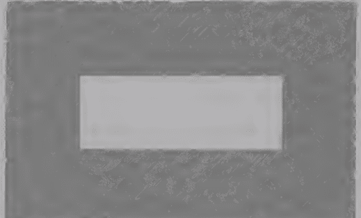

示例 1：

```css
div {
  margin: 0;
  padding: 50px;
  border: 1px solid #999;
  background: #ccc;
}
div div {
  margin: 50px;
  padding: 50px;
  border: none;
  background: #fff;
}
```

示例 2：

```css
div {
  margin: 0;
  padding: 100px;
  border: 1px solid #999;
  background: #ccc;
}
div div {
  margin: 0;
  padding: 0;
  border: 50px solid #fff;
  background: #fff;
}
```

示例 3：

```css
div {
  margin: 0;
  padding: 75px;
  border: 1px solid #999;
  background: #ccc;
}
div div {
  margin: 25px;
  padding: 40px;
  border: 10px solid #fff;
  background: #fff;
}
```

在给定情况下对哪个元素进行样式化通常可以通过评估上下文和内容来确定。通常使用哪个元素是显而易见的，因为你想为其他事情预留其中一个属性，或者知道样式将应用于容器或其他元素。

- `border-box`: 宽度和高度包含了元素的边框（border）、内边距（padding）以及内容，而元素的外边距（margins）在该区域之外。

尽管使用 `box-sizing: border-box` 有时看起来很有吸引力（例如当将百分比宽度与像素边框混合使用时），但这种盒模型模型在与他人编写的代码混合，或与习惯标准 `content-box` 行为的团队协作时，可能会导致困惑和困难。

## 定位与浮动

第 5 章介绍了如何赋予块级元素形状和大小。在全头投入使用这些块创建多列布局之前，你需要学习如何相对于页面上的其他项目对文档中的元素进行定位。

## 文档流

在不应用任何 JavaScript 或 CSS 的情况下，读取 HTML 文档的内容是从自上下、从左到右的。块元素占据文档的整个宽度，并一个接排列，其内联内容在其内部流动。外边距和内填充可能会改变外观或间距，但它们本身不会改变元素的定位。

你有三种方法来改变自上下内容流中元素之间的默认定位和交互：你可以强制元素表现得像不同类型的元素，你可以将元素完全从流中取出，或者你可以将元素拉到容器的侧边并允许其他项目环绕它。

## display

`display` 属性是整个布局城堡的关键。我已经涵盖了块级元素和内联元素，但你需要其他元素类型来定义可能显示在网页上的所有内容，包括：

- `inline`: 创建一个或多个内联盒，即熟悉的内联内容
- `block`: 创建一个块盒
- `inline-block`: 创建一个表现得像内联盒的块盒，类似于图像（替换元素）的行为
- `list-item`: 为内容和列表项目标记创建一个块盒
- `table`, `table-row`, `table-caption`: 创建呈现表格所需的三个类型的元素（见第 10 章）
- `none`: 完全从演示中移除该元素，不绘制任何类型的框

对于大多数设计任务，在 `inline`、`block` 和 `none` 这三者之间交替使用元素就足够了，而且 幸运的是，它们也是支持得最广泛的值。

## Position

元素的定位基于盒偏移参数的长度：`top`、`right`、`bottom` 和 `left`。通常，`top` 和 `left` 将用于定位元素，因为被测量的项目的左上角——即盒的起点——在正常文档流中是容易理解的。

## static

`static` 是默认值，元素在正常流中渲染且不进行唯一定位。定位参数 `top`、`right`、`bottom` 和 `left` 不起作用。

## relative

在相对定位中，元素的位置首先按正常方式计算，然后相对于此正常位置应用偏移定位。`relative` 定不会将元素移出正常流，这会在元素的原始位置留出空间。

一个盒偏移量设为 0（或未定义）的相对定位元素将出现在其正常位置；然而，它将为其任何可能进行绝对定位的子元素创建一个新的原点。

## absolute

`absolute` 定将元素从正常文档流中移出——折叠它原本可能占用的任何空间——并相对于最后一个定位的包含块所创建的源点进行定位。

用于图 6.1 的代码演示了如何使用绝对定位将元素放置在其容器元素的四个角上。

图 6.1 使用绝对定位放置在四个角的元素。

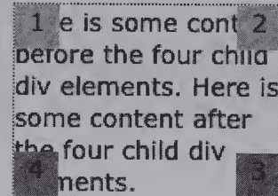

```css
div {
  position: relative;
  width: 150px;
  border: 1px dotted #999;
}
div div {
  position: absolute;
  width: 25px;
  height: 25px;
  background-color: #ccc;
  border: none;
  text-align: center;
}
```

```css
div .corner1 {
  top: 0;
  left: 0;
}
div .corner2 {
  top: 0;
  right: 0;
}
div .corner3 {
  bottom: 0;
  right: 0;
}
div .corner4 {
  bottom: 0;
  left: 0;
}
```

```html
<div class="corner1">1</div>
<div class="corner2">2</div>
<div class="corner3">3</div>
<div class="corner4">4</div>
```

`fixed` 定位元素不随文档滚动。正如其名所示，`fixed` 是基于视口的。`fixed` 定位元素在当前浏览器中被广泛支持，但如果你发现需要支持旧浏览器，你应该使用一些 JavaScript 来绝对定位元素并监控滚动条以更改它。这种解决方案可能会有些抖动，因此最好在支持的地方使用 `position: fixed`。

## 源与包含块

包含块以及管理多个测量原点的行为可能是 CSS 最令人困惑但也强大的方面之一。

文档的根元素是绝对定位的初始包含块。然而，如果任何其他元素被定位（相对、绝对或固定相对于视口），它将成为其后代元素的新原点。这种行为最好通过一个示例来说明（图 6.3）。

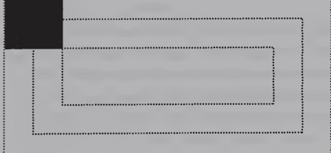

**图 6.3 黑色 `#innerPositionedBox` 的位置是从其包含块衡量的。**

```css
div {
  border: 1px dotted #000;
  padding: 20px;
}
#containingBlock {
  position: relative;
}
#innerPositionedBox {
  position: absolute;
  top: 0;
  left: 0;
  background-color: #000;
}
```

```html
<div id="containingBlock">
  <div>
    <div>
      <div id="innerPositionedBox">
      </div>
    </div>
  </div>
</div>
```

无论元素 `#innerPositionedBox` 嵌套得有多深，`top` 和 `left` 的定位都是相对于最后一个定位的祖先 `#containingBlock` 衡量的。如果你在不更改此示例 CSS 代码的情况下，稍微修改了 HTML 结构，使得中间的某个 `<div>` 元素成为 `#containingBlock`，那么 `#innerPositionedBox` 元素将改为使用该元素作为其原点（图 6.4）。

# 第 6 章：定位与浮动

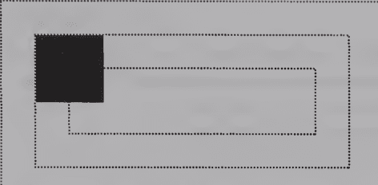

```html
<div>
  <div id="containingBlock">
    <div>
      <div id="innerPositionedBox">
      </div>
    </div>
  </div>
</div>
```

一旦某个元素定义了不同的包含块（containing block），你就无法逃避这种行为并使其相对于根元素（root element）进行定位。因此，不要过度使用定位属性，以避免不必要地创建新的包含块。有时这是无法避免的，在这些情况下，数学可以成为你的朋友（无论是使用纸和笔，还是通过 JavaScript 代码）——你可以计算包含块（及其任何嵌套的包含块）的位置，并向上溯回根元素。

## z-index

`z-index` 属性适用于任何已定位的框，可用于控制框从后到前的层级关系。整数值越高，元素看起来就离观察者越“近”。

将此索引想象成控制剧院舞台布景的元素。背景元素位于初始位置，演员和其他元素可能在 1 到 20 之间切换，而前景布景和窗帘位于 21 到 25 之间（尽管该值没有限制）。如果同一堆栈中的两个元素索引均为 11（或 `auto`？）会发生什么？除非每个元素的定位属性导致它们重叠，否则这并不是问题。在这种情况下，文档流中后指定的元素将显示在最上方。

此索引与定位偏移一样，是相对于包含块的。如果一个元素的 `z-index` 为 4，另一个元素的 `z-index` 为 3，那么第二个元素的任何子元素永远无法出现在第一个元素内容的“上方”。

> 注意：某些插件内容（如 Adobe Flash）有时会穿透定位在它上方并具有更高 `z-index` 的 HTML 内容。特别对于 Flash，有一个名为 `wmode` 的窗口模式参数，当设置为 `opaque`（不透明）或 `transparent`（透明）时，允许内容出现在堆栈上方。

## visibility（可见性）

`visibility` 属性决定元素是否渲染以及是否可见。与将 `display` 属性设置为 `none` 不同，`visibility` 设置为 `hidden`（隐藏）的元素仍然会影响布局并占据空间。与 `opacity`（透明度）属性不同，通过将隐藏元素的单个后代设置为 `visible`（可见），可以显示它们。

- `visible`: 元素被渲染。
- `hidden`: 元素不渲染。

## float（浮动）

`float` 值为左（`left`）或右（`right`）的元素会从文档的标准流中取出，并移动到包含框的一侧。文档中后续的内容将环绕浮动元素的新位置排列。

- `none`: 元素不浮动，表现正常。
- `left`: 元素移出正常流并移动到其原本出现位置的左侧，内容在元素的右侧环绕。
- `right`: 元素移出正常流并移动到其原本出现位置的右侧，内容在元素的左侧环绕。

想象一张移动到右侧并有文字环绕周围的小照片；你现在已经理解了元素（照片）在浮动时的基本原理（见下一页的图 6.5）。

图 6.5

在文本内容内部浮动的两个元素。

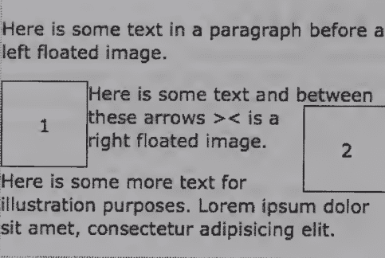

在浮动元素上设置的边距（Margins）和内边距（Padding）的行为与标准框模型中的任何框相同，并用于在该元素周围创建间隙。然而，浮动的效果会中断环绕元素的框，导致它们的内边距、边距或边框在正常的矩形中绘制，而不是为每一行文本单独移动或重绘，如图 6.6 所示。注意此示例中文字接触浮动图像右边缘的方式。

图 6.6

文字环绕浮动元素。

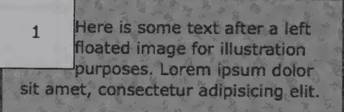

```css
img {
  float: left;
}
p {
  border: 5px solid #666;
}
```

# 第 6 章：定位与浮动 95

```css
padding: 15px;
background: #ccc;
```


<p>为了说明目的，这里是左浮动图像之后的一些文本。Lorem dolor sit amet, consectetur adipisicing elit.</p>

在浮动元素周围添加 20 像素的边距会在浮动元素的对侧与环绕其的内容之间创建一个间隙（图 6.7）。这样做之后，显而易见的是包含边框和背景颜色的段落所绘制的矩形框并没有被“环绕”。只有这些框内部的内容在进行环绕。

图 6.7

在浮动元素上放置边距，以便在其与环绕其的内容之间创建空间。

| 列 | 内容 |
|---|---|
| 1 | 为了说明目的，这里是左浮动图像之后的一些文本。Lorem dolor sit amet, consectetur adipisicing elit. |

```css
img {
  float: left;
  margin: 20px;
}
```

如果多个元素被浮动并本该沿同一方向出现，它们会在包含块的边缘排列，这就是为什么浮动元素的边缘会出现。如果浮动元素的总宽度超过了包含块的区域，那么后来的元素将环绕。这看起来更像是文档流中的元素在排列，这在图 6.8 和 6.9 中所示。

图 6.8

左浮动的各种元素。

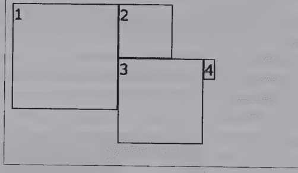

图 6.9

右浮动的各种元素。

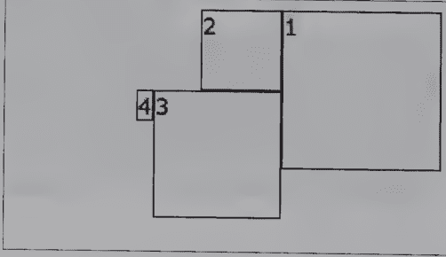

# 第 6 章：定位与浮动

浮动元素无法在垂直方向上出现在文档中位于它们之前的元素之前。在现代布局技术中，浮动元素的应用不仅限于文本环绕的小块内容。它们可以作为将元素放置在行两侧的基础。

如果元素使用了绝对定位，该定位将优先于浮动。

## clear

通常使用浮动代替大边距是因为需要内容环绕的效果，但高浮动元素的环绕往往会延伸到后续内容中。`clear` 属性用于在遇到新区域、列表中的另一个唯一记录或其他停止环绕的原因时插入中断。

- `none`: 元素不清除任何浮动。
- `left`: 元素将向下移动，以清除任何左浮动元素的底部。
- `right`: 元素将向下移动，以清除任何右浮动元素的底部。
- `both`: 元素将向下移动，并在所有浮动元素之后开始。

图 6.10 你可以看到当列表项目中的浮动元素渗透到下一个项目时会发生什么；情况变得非常混乱。

图 6.10

浮动元素超出父元素进入后续内容的影响。

| 列 | 内容 |
|---|---|
| 1 | 与第一个列表项目相关的文本 |
| 2 | 与第二个列表项目相关的文本 |
| 3 | 与第三个列表项目相关的文本 |

```css
li {
  border: 1px solid #000;
}
img {
  float: left;
  margin-right: 0.5em;
}
```

```html
<ul>
  <li>
    <p>与第一个列表项目相关的文本</p>
  </li>
  <li>
    <p>与第二个列表项目相关的文本</p>
  </li>
</ul>
```

<ul>
  <li>
    
    <p>这是与第三个列表项相关的文本</p>
  </li>
</ul>

你可以在 `li` 元素上将 `clear` 属性设置为 `left` 或 `both`，如图 6.11 所示，以确保每个新项目都不会受到上一个项目的任何内容的干扰。

图 6.11

`clear:left` 用于在每个新项目之前停止之前的浮动。

| 1 | 这是与第一个列表项相关的文本 |
| 2 | 这是与第二个列表项相关的文本 |
| 3 | 这是与第三个列表项相关的文本 |

```css
li {
  border: 1px solid #000;
  clear: left;
}
```


> CSS 2.1 规范对浮动元素（`float`）、外边距（`margins`）、内边距（`padding`）和清除（`clear`）之间的相互作用提供了一些非常详细且有时难以理解的文本解释。它还包含许多易于理解且实用的插图（http://www.w3.org/TR/2009/CR-CSS2-20090908/visuren.html#floats）。

## 页面布局

使用 HTML 和 CSS 进行页面布局始于建立一个布局网格或一组列来承载内容流，但一旦你将内容放入列中，对单个内容类型或项目进行何种处理也同样重要。

幸运的是，用于页面布局和内容布局的技巧是相同的。无论你处理的是每列内部的内容元素、页眉或页脚中的内容，还是可重用的组件，内容元素都必须使用与页面布局相同的技术在自己的网格中进行布局。

本章介绍了用于在页面布局 HTML 内容常用技巧和构建块。

# CSS 布局的构建块

在第 5 章中，通过对盒模型和浮动的讨论，你已经接触了一些用于创建 CSS 布局的构建块。它们没有被标记为构建块，因此接下来的内容是对回顾以及对处理 CSS 核心构建块的更完整的列表。

> 内容即王

> 尽管 CSS 功能强大，但它的唯一目的是为了描述底层 HTML 内容的呈现方式。强大且符合语义的标记是让 CSS 施展魔法的基础。

> 源码顺序（`Source order`），即未设置样式时内容的读取顺序，在考虑使用何种技术来样式化内容时也是一个重要的考虑因素。某些技术可能更容易从文档树的中间或某个部分的开始或结束提取内容。

# 创建内容块

第 6 章引入了 `position` 属性和包含块（`containing blocks`）。

在对可重复内容项（如产品列表或可重用的用户资料徽章中的项）设置样式时，将这些项目作为离散的内容块（或组件）进行管理通常非常有用，使用 `position:relative` 创建一个独特的、自引用的空间，在其中处理内容项的各个组件。此组件或标记块可以放置在页面的任何位置并保持其外观。图 7.1 通过创建一个用户徽章展示了这种效果，在该章中用户的照片相对于包含块进行定位。

图 7.1

为单个内容项建立新的包含块并对个人图标定位。

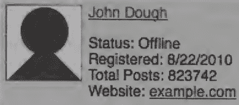

```css
.badge {
  position: relative;
  width: 155px;
  padding: 5px 5px 5px 72px; /* 创建间隙 */
  font-size: 12px;
  background: #eee;
}

.badge .photo {
  position: absolute;
  top: 5px; /* 匹配 .badge 的 padding */
  left: 5px; /* 匹配 .badge 的 padding */
  border: 1px solid rgb(94,94,94);
}

.badge ul {
  padding-left: 0;
  list-style: none;
}
```

```html
[...]
<div class="badge vcard">
  <a href="users/JohnDough" class="fn">John Dough</a>
  
  <ul class="meta">
    <li>状态: 离线</li>
    <li>注册日期: 2010/8/22</li>
    <li>总帖子数: 823742</li>
    <li>网站: <a href="http://example.com/" class="url">example.com/</a></li>
  </ul>
</div>
```

## 浮动到间隙（gutters）

元素外边距和使用 `float` 属性产生的交错是大多数基于 CSS 布局的核心。虽然对列或内容项进行绝对定位（如上一个示例中个人照片所示）似乎是并排放置内容最直接的方法，但从文档中移除内容或创建新的包含块可能会产生意想不到的副作用。

相反，浮动元素可以移动到由列元素或其他内容的宽外边距创建的间隙中。这种布局技术是以下代码的基础，代码创建了图 7.2。

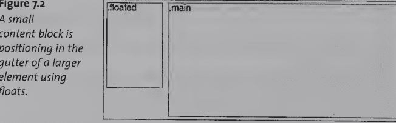

```css
.container {
  padding: 5px;
}

.main {
  float: left;
  height: 200px;
  margin-left: 110px;
  border: 1px solid black;
}

.floated {
  float: left;
  height: 150px;
  width: 98px;
  border: 1px solid black;
}
```

```html
<div class="container">
  <div class="floated">
    <div class="main"></div>
  </div>
</div>
```

CSS3 支持在单个元素上使用多个背景图像，这为图像分层提供了更多选项。

请参见第 14 章。

## 行内与浮动列表项

文档中的所有类型内容都可以通过列表描述。很多时候，就像导航栏、标签页和图像缩略图，这些结构化列表并不是以符号列表的形式呈现，而是采用水平格式。以下代码展示了带有垂直分隔符的文本导航元素的基本示例（图 7.5）。

| 第一页 | 第二页 | 第三页 | 第四页 | 第五页 |
| :--- | :--- | :--- | :--- | :--- |

**图 7.5** 一组浮动为水平格式的导航列表项。

```css
ul.nav {
  height: 16px;
}
ul.nav li {
  float: left;
  height: 16px;
  padding: 0 0.5em;
  font-size: 12px;
  list-style: none;
  border-left: 2px solid black;
}
ul.nav li:first-child {
  border-left: 0; /* 移除外部项的边框 */
}
```

```html
[...]
<ul class="nav">
  <li><a href="#">第一页</a></li>
  <li><a href="#">第二页</a></li>
  [...]
</ul>
```

## 使用定位跳出容器

虽然之前描述的相对定位内容块的目标是创建一个自包含的区域以便工作，但对这些块的局部进行定位以突破容器的四个边界可能是很有用的。第 5 章讨论了负边距，但在这里，定位的负值也很有用，如下例所示（图 7.6）。

图 7.6

突破其容器的负值定位元素。

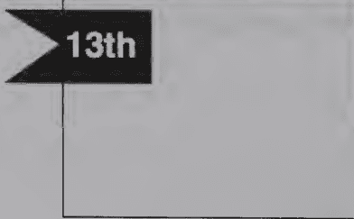

```css
article {
  position: relative;
  [...]
  margin-left: 50px;
  border: 1px solid black;
}
article time {
  position: absolute;
  top: 10px;
  left: -50px;
  [...]
  background: url(images/flag.png) no-repeat right top;
}
```

```html
<article>
  <time>13th</time>
</article>
```

## 覆盖层、提示框和下拉菜单

提示框、下拉菜单和覆盖层可以使用与图 7.6 所示类似的方式进行编码。这类元素的区别在于，它们通常初始为隐藏，然后通过交互改变显示方式。

Lenny Burdette 所著《JavaScript Pocket Guide》（Peachpit, 2010）第 14 章深入讲解了下拉导航，并包含了以下代码，该代码更改了定位子列表的状态。

```css
#menu li ul {
  position: absolute;
  display: none;
  left: 0;
}
[...]
#menu li:hover ul {
  display: block;
}
```

## 隐藏元素：display vs. visibility

隐藏内容的两种方式可以通过两个属性 `display:none` 和 `visibility:hidden` 实现。在 `visibility` 属性的情况下，内容继续占据文档流中正常占据的空间。对于 `display` 属性，由于元素不再是块级、行内或其他类型，它会被从文档流中移除，就像它不存在一样。除非保留该空间以布局其他元素或保持高度和宽度等属性对页面的其他功能很重要（例如在某些 JavaScript 交互中），通常使用 `display`。

## 多列布局

你可以使用本章“构建布局块”部分中描述的所有工具来创建页眉、页脚和内容区域的主网格。

由于内容长度、顺序和标记结构的灵活性，最常用的方法是使用浮动边距的某种变体。

### 双列布局

如果你让本章之前的 `.main` 和 `.floated` 块（图 7.3）足够宽，你就得到了双列布局。这并不够了，因为该示例有两个缺陷：

- 如果侧边栏比主内容区域高，它将超出容器边界并强制包裹页脚。
- 代码要求浮动元素出现在内容区域之前，这可能是不需要的。

这两个问题可以通过微调来解决，如下例所示（图 7.7）。

图 7.7 对之前的双列布局修改的结果。

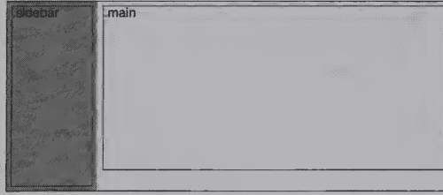

```css
.container {
  width: 534px;
  padding: 5px;
  border: 1px solid black;
  background: url(images/bg_faux_columns.png) repeat-y left;
  overflow: auto;
}
.main {
  float: right;
  height: 200px;
  width: 420px;
  margin-left: 0;
  border: 1px solid black;
}
.sidebar {
  /* 为了清晰再次命名 */
  float: left;
  height: 220px;
  width: 98px;
  border: 1px solid black;
}
```

```html
<div class="container">
  <div class="main">
    .main
  </div>
  <div class="sidebar">
    .sidebar
  </div>
</div>
```

## 使用 overflow:auto, overflow:hidden 或 .clearfix 包裹浮动列

你已经看到当高元素被拉出文档流时，它们的容器元素会塌陷到剩余内容的高度（如果有）。如果容器旨在是一个自包含项，这通常是不需要的。防止这种行为有两种方法：可以在块末尾使用非浮动元素清除容器，或者强制其增长以包含所有内容。

你可以通过在容器结束前添加额外的标记如 `<div style="clear:both"></div>` 来实现前者。应避免充斥展示性标记，因此通常使用生成的内容来模拟这种清除行为。这种名为 `clearfix` 的技术的详细解释在 Position Everything (http://www.positioneverything.net/easyclearing) 中描述。

将元素的 `overflow` 属性设置为 `auto` 或 `hidden` 的副作用是元素应该包含所有内容，无论该内容是否浮动。在容器高度为 `auto` 的情况下，它会回弹并扩展以覆盖浮动内容。这种更优雅的浮动清除解决方案以及其他技术在 Sitepoint 的后续文章（http://www.sitepoint.com/blogs/2005/02/26/simple-clearing-of-floats/）中介绍。

## 带右侧边栏的双列布局

你现在已经看到了第一列或第二列出现在左侧的双列布局示例。在右侧创建侧栏只需将这些部分组合并确定宽度和间距。别忘记切换背景图像！以下代码显示了对图 7.7 示例代码的修改，将 `.sidebar` 元素放在右侧：

```css
.container {
  width: 534px;
  padding: 5px;
  border: 1px solid black;
  background: url(images/bg_faux_columns.png) repeat-y right-top;
  overflow: auto;
}

.main {
  float: left;
  height: 200px;
  width: 420px;
  margin-left: 0;
  border: 1px solid black;
}
.sidebar {
  float: right;
  height: 220px;
  width: 98px;
  border: 1px solid black;
}
```

## 三列布局

你可以轻松扩展之前的双列布局，包含一个足够宽的边距以浮动三列中的两列。然而，主列的大小或顺序可能决定需要不同的排列。这里使用了一些浮动和负边距的技巧，以获得较小的左右列，并允许主内容区域位于文档最前面（图 7.8）。

图 7.8

固定宽三列布局。

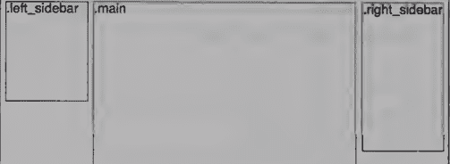

```css
.container {
  width: 534px;
  padding: 5px;
  border: 1px solid black;
  background: none;
  overflow: auto;
}
.main {
  float: left;
  height: 200px;
  width: 318px; /* 为了适应新元素和间隙而变窄 */
  margin-left: 107px; /* 为左列留出空间 */
  border: 1px solid black;
}
.left_sidebar { /* 再次命名 */
  float: left;
  height: 120px;
  width: 98px;
  margin-left: -426px; /* shift _past_ .main */
  border: 1px solid black;
}
.right_sidebar {
  float: right;
  height: 180px;
  width: 98px;
  border: 1px solid black;
}
```

```html
<div class="container">
  <div class="main">
    .main
  </div>
  <div class="left_sidebar">
    .left_sidebar
  </div>
  <div class="right_sidebar">
    .right_sidebar
  </div>
</div>
```

> 这种布局的变体和深入描述可以在 Alan Pearce 在 A List Apart 上发表的文章 [Multi-column Layouts Climb Out of the Box](http://www.alistapart.com/articles/multicolumnayouts/) 中找到。

# 固定尺寸、灵活型与混合列

之前的布局示例是使用固定宽度容器内的固定宽度列来制作的，因此被称为固定宽度布局。

基于百分比的灵活列被称为流式布局（`liquid layouts`），因为它们会随浏览器尺寸的改变而流动。流式双列布局的制作与固定列布局同样容易。变为三列可能会稍微复杂，特别是当源码顺序的考虑决定了使用负边距的“跳跃”列时。这是因为百分比边距是相对于其应用的元素宽度计算的，而不是相对于包含块的宽度，因此除非每个列的尺寸比例非常简单，否则可能很难定义什么是“等于另一个元素宽度的边距”。

基于混合列的布局没有华丽的名字，但它们由固定尺寸的列以及百分比或自动宽度的列组成。有时，这些或其他复杂的排列通过嵌套一组组容器和列来实现。**图 7.9** 以及随后的代码展示了一个固定宽列以及另外两个会增长以匹配容器宽度的额外列。

图 7.9

一个带有灵活内容列和一个固定宽度侧边栏的混合布局。

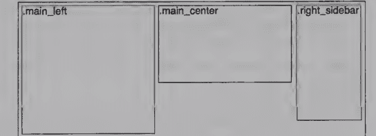

```css
.container {
  width: auto;
  padding: 5px 107px 5px 5px; /* room for right sidebar */
  border: 1px solid black;
  background: none;
  overflow: auto;
}

.main_left {
  float: left;
  height: 200px;
  width: 48%;
  margin-right: 5px;
  border: 1px solid black;
}

.main_center {
  float: left;
  height: 120px;
  width: 48%;
  border: 1px solid black;
}

.right_sidebar {
  float: right;
  height: 180px;
  width: 100px;
  border: 1px solid black;
  margin-right: -102px;
}
```


```html
<div class="container">
  <div class="main_left">
    .main_left
  </div>
  <div class="main_center">
    .main_center
  </div>
</div>
<div class="right_sidebar">
  .right_sidebar
</div>
</div>
```

# 第 7 章：页面布局

你可能在看之前的示例时认为数学逻辑上对不上，你是对的——它确实对不上。当混合百分比测量时，你必须稍微通融一下数字。50% 的宽度加上另一个 50% 的宽度，加上 4 像素的边框以及一个 5 像素的边距，显然大于容器剩余的 100% 宽度。更稳妥的做法是让该空间的 96% 留出 9 像素的剩余，在这种情况下，只要容器的内容宽度至少为 225 像素（9 像素 / (100% – 96%） * 100），这就是成立的。如果内容宽度大于 225 像素，那么那 4% 的宽度将大于 9 像素，但在许多情况下，这几个额外的像素是获得混合布局所付出的公平权衡。

# 带约束的设计

对于每个访问者都有不同屏幕尺寸和浏览器尺寸的 Web，灵活列通常是最佳解决方案，但还没有考虑到内容通常也扮演着角色。太小的内容列可能无法容纳图像或视频内容，而当它们太宽时，内容可能变得难以阅读。次要列也可能有约束或最佳尺寸。混合列可以是最佳解决方案。

你可以使用 `min-width` 和 `max-width` 属性来限制流式列或列容器的大小。在以下代码中，允许容器在 600 像素到 1000 像素之间增长，并在超出最大宽度时居中。

```css
.container {
  width: auto;
  min-width: 600px;
  max-width: 1000px;
  margin: 0 auto;
}
```

# 第 8 章：背景与边框

`background` 属性是灵活的，允许在一内设置颜色、图像、重复、附件和位置。

## 背景

`background-color` 属性设置元素的背景颜色。可以是任何颜色值（名称、十六进制、RGB 等）。

`background-image` 属性设置元素的背景图像。可以使用逗号分隔多个图像。

`background-repeat` 属性决定背景图像如何重复。

- `repeat`：在两个方向上重复（默认）。
- `repeat-x`：水平方向重复。
- `repeat-y`：垂直方向重复。
- `no-repeat`：不重复。

`background-attachment` 属性定义背景图像如何随页面滚动。

- `scroll`：背景随元素滚动（默认）。
- `fixed`：背景相对于视口固定。

`background-position` 属性指定背景图像的初始位置。

- `<length>`：距离左上角的固定长度偏移。
- `<percentage>`：相对于容器内容区域与图像尺寸之间差异的百分比偏移。
- `top`：垂直位置的 0%。
- `right`：水平位置的 100%。
- `bottom`：垂直位置的 100%。
- `left`：水平位置的 0%。
- `center`：任意位置的 50%。

## 边框

`border-width` 属性设置元素周围边框的厚度。

`border-style` 属性设置边框样式。

- `none`：无边框（默认）。
- `solid`：实线。
- `dashed`：虚线。
- `dotted`：点线。
- `double`：双实线。

`border-color` 属性设置边框的颜色。

## 简写属性

`background`、`background-repeat`、`background-attachment`、`background-position` 位于同一个位置。

```
background: rgba(45,45,45,0.5); /* 透明的深灰色 */
background: #fff url(background.jpg) no-repeat; /* 在白色背景上左上对齐且不重复的背景图像 */
background: url(circle.png) repeat-y center center; /* 放置在容器中心，并在垂直方向上平铺图像 */
```

和其他简写属性一样，当从 `background` 简写属性中省略某些单独的属性时，它们会被设置为它们的初始值。因此，上一个代码中第一个示例中的 `background: rgba(45,45,45,0.5)` 会移除任何之前定义的背景图像。请使用 `background-color` 来设置颜色，同时保持其他属性不变。

## 多重背景图像

CSS3 定义了在单个元素上应用多个背景图像的方法。它受 Firefox 3.6+、IE 9 Preview、Safari 和 WebKit 移动版的支持，虽然在许多项目中可能还没准备好使用，但在某些情况下（例如针对 Apple 设备）可能非常有用。多重背景图像通过逗号分隔的值分配给 `background-image` 属性（最早的图像最靠近用户）。在此之后，其他背景相关属性将采用匹配的逗号分隔值或适用于所有图像的单一值。

```
background-image: url(top.png), url(bottom.png);
background-image: url(middle.png);
background-repeat: no-repeat, no-repeat, repeat-y;
background-position: center top, center bottom, center center;
```

之前的代码将设置了不重复的顶部和底部图像，并在下方设置了一个高度与元素等平铺图像。

## 背景图像的策略

背景图像是网页设计师工具箱中最强大的工具，因为它们可以以许多不同的方式使用。虽然没有官方认可的正确用法方法，但通过经验，你会发现一些显现的模式，以及你可以用来挂载背景的常见元素。

### 比元素大的背景

如果你还记得使用 HTML 表格进行页面布局的日子，你一定切过许多图像切成适应特定单元格的碎片，以便稍后重新组装。

在 CSS 中切分图像使用的几乎没有理由。如果它在源 Photoshop 文档中作为一个统一的图形元素出现，那么只要你找到找到合适的元素来挂载它，它极可能仍然保留在 HTML 构建中。典型的 HTML 文档结构有一个 `body`、头部、中间列或页脚的包装器、各种 `section` 或 `article`，最后是文本。在那个层级结构中找到哪个元素最适合挂载背景图像。

在处理列或链接图标时，通过过剩的 `padding` 伸缩元素的大小是常见做法。使用负外边距（第 5 章）让元素重叠是将背景图像挂载到头部元素上并溢入页面内容中的极佳方法。

### 自定义符号和图标化

可以通过 `list-style-image` 属性（第 10 章）为列表项目应用自定义符号，但其定位不如 `background-image` 灵活。通过完全关闭列表符号并通过 `padding-left` 扩展列表项目的内容区域，你可以留出空间挤入一张新图像（图 8.1）：

```css
ul.big {
  margin: 0;
  padding: 0;
}
ul.big li {
  font-size: 28px;
  margin: 0 0 0.25em;
  padding: 0 0 0 30px; /* 图像为 23x23，左移留出空间 */
  background: url(images/big_bullet.png) no-repeat 0 6px;
}
```

```html
<ul class="big">
  <li>大项目一</li>
  <li>看那个大符号</li>
  <li>另一个大项目</li>
  <li>那个大符号</li>
  <li>最后一个项目</li>
</ul>
```

图 8.1

放置在由内边距创建的凹槽（gutter）中的图标。

- ● 大项目一
- ● 另一个大项目
- ● 看那个大符号
- ● 最后一个项目

### 连接背景

元素如节标题或选项卡框可能具有花哨的边框，这些边框像文件夹上的标签一样“打开”到下方的内容。因为文件夹上标签的位置各异，内容区域顶部的开口处需要改变。在这里，你再次可以使用视觉技巧让元素背景重叠。下面的示例（如图 8.2 所示）使用边框、背景颜色和相对定位将头部移入随后的内容，并创建非矩形边框的外观：

```css
h1 {
  position: relative;
  top: 3px; /* 向下移动边框的大小 */
  background: #fff;
  margin: 0 0 0 20%;
  padding-bottom: 3px; /* 留出缺失边框的空间 */
  border: 3px solid #999;
  border-bottom: none;
}

h1+p {
  background: #fff;
  margin: 0;
}
```

<p>Lorem ipsum dolor sit amet, consectetur elit, sed do eiusmod tempor incididunt et dolore magna aliqua. Ut enim ad minim veniam, quis nostrud exercitation ullamco nisi ut aliquip ex ea commodo consequat.</p>


图 8.2 相对定位

### 智能平铺

在使用文档背景时，你面临的额外挑战是不希望不地扩展内容区域并在视口创建滚动条。不要忘记除了 `<body>` 元素外，`<html>` 也可以设置样式，并在需要包装元素或其他钩子之前作为另一层。

### 网页设计的巧妙

网页设计是一项基于巧妙使用定位、外边距、内边距、边框以及最重要的背景的工艺，使用非常简单的词汇来实现文档或整个网站或应用程序的设计。即使是以前的表格布局也是基于对可用工具的巧妙利用。

### 背景图像精灵

作为背景和图标使用许多不同图像文件的多次请求对性能的影响可能很大。如果你具有多种状态的按钮或图标，或者在移动设备上工作（服务器请求会消耗带宽和电量），这种影响会变大。创建一个精灵（包含多个图形元素的单个图像文件），然后使用背景定位来移动图像，使精灵的所需部分可见，是减少过度请求的一种常用方法。

将图 8.4 所示的四个不同的选项卡“状态”放在同一个图形文件中。

通过重新定位文件，图像图形文件的每个部分都可以单独应用于选项卡上，直到图像的所需部分对齐（下一页的图 8.5）。


图 8.4 一个典型的精灵图像。

图 8.5 应用雪精灵图背景图。

```css
.tabs .tab {
  float: left;
  width: 177px;
  height: 26px;
  margin: 0;
  padding: 4px 0 0;
  list-style: none;
  text-align: center;
  background: url(images/tabs.png) 0 -31px no-repeat;
}
```

```css
.tabs .tab.active {
  background-position: 0 -62px;
}
```

```css
.tabs .tab.special {
  background-position: 0 -93px;
}
```

```css
.tabs .tab.disabled {
  color: #ccc;
  background-position: 0 0;
}
```

```html
<ul class="tabs">
  <li class="tab">tab one</li>
  <li class="tab active">tab two</li>
  <li class="tab special">tab three</li>
  <li class="tab disabled">tab four</li>
</ul>
```

将复杂网站上使用的每个图像放在同一个雪精灵图（sprite）中可能会导致管理上的噩梦。尝试创建代表相似类型图像的雪精灵，并在复杂度与请求及性能开销之间取得平衡。

## Border（边框）

在第 5 章中，边框被引入为块元素的边界，绘制在元素的内边距（padding）和外边距（margin）之间。边框绘制在元素之前这会影响带有间隙（虚线）和带有背景定位的边框样式显示。

### border-color

`border-color` 属性接受一到四个 `<color>` 值，表示块四边每个边框的颜色。与 `margin` 和 `padding` 一样，当只提供一个颜色时，它适用于所有边。提供两个颜色时，第一个值适用于顶部和底部，第二个适用于右侧和左侧。提供三个值时，第一个适用于顶部；第二个适用于左右两侧；第三个适用于底部。提供四个值时，它们按从顶部开始顺时针方向应用于每个边。`border-color` 可以扩展为 `border-top-color`、`border-right-color`、`border-bottom-color` 和 `border-left-color`。

### border-style

边框的设计通过分配给 `border-style` 属性的一到四个关键字来设置。

- `none`：不绘制边框
- `dotted`：一系列“圆”点；圆润程度取决于浏览器和边框宽度
- `dashed`：一系列虚线
- `solid`：实线
- `double`：两条实线之间有间隙的实线
- `groove`：看起来像是由边框刻画出的凹槽
- `ridge`：看起来像是一条从画布上凸起的脊线
- `inset`：看起来像是内容被内嵌到页面中
- `outset`：看起来像是内容是从页面上凸起的

对于 `dotted`、`double`、`groove`、`ridge`、`inset` 和 `outset`，较小的 `border-width` 值可能会改变所需的视觉效果——你无法将单个像素点圆润化，也无法在两个像素的空间内找到空间来绘制双线边框的两条线和之间的间隙。

像 `border-color` 一样，`border-style` 可以扩展为四个 `border-*-style` 属性。

### border-width

每边的边框尺寸。参见第 5 章。

### border (简写)

`border` 简写属性接受最多三个值，代表 `border-width`、`border-style` 和 `border-color`。

块的边还有额外的简写属性，如 `border-top`、`border-right`、`border-bottom` 和 `border-left`。

```css
fieldset {
  border: 1px solid rgb(100,100,200); /* 设置所有 4 个边框 */
  border-bottom: 5px double rgb(100,100,200); /* 更改底部边框 */
}
```

### border-radius

`border-radius` 在 CSS3 中引入，用于允许圆角，通过为每个角的圆润度提供半径。最近版本的 Firefox 和 Safari 通过厂商扩展包含了实验性支持，而 Opera 以及即将推出的 IE9 则直接通过 `border-radius` 属性支持。为了让情况变得更加复杂，Firefox 在处理块的各个角的顺序略有不同。

简写的 `border-radius` 可以扩展（见下一页图 8.6），如下所示：

```css
div {
  width: 250px;
  height: 150px;
  border: 2px solid black;
  -webkit-border-top-left-radius: 30px;
  -webkit-border-top-right-radius: 6px;
  -webkit-border-bottom-right-radius: 30px;
  -webkit-border-bottom-left-radius: 6px;
  -moz-border-radius-topleft: 30px;
  -moz-border-radius-topright: 6px;
  -moz-border-radius-bottomright: 30px;
  -moz-border-radius-bottomleft: 6px;
  border-top-left-radius: 30px;
  border-top-right-radius: 6px;
  border-bottom-right-radius: 30px;
  border-bottom-left-radius: 6px;
}
```

图 8.6 扩展 border-radius


> 轮廓属性与边框相似，但不占据空间。它们通常用于突出显示状态的元素。

## Outline

轮廓与边框相似，但不占据空间。它们通常用于突出显示状态的元素。

### outline-color

轮廓的颜色。

### outline-style

轮廓的样式。

### outline-width

轮廓的宽度。

### outline (简写)

`outline` 简写属性接受最多三个值，代表 `outline-width`、`outline-style` 和 `outline-color`。

```css
:focus {
  outline: 3px auto blue;
}
```

## 模拟圆角

`border-radius` 属性一直是创建圆角的标准方法，当你需要支持旧浏览器或创建复杂的效果时，可能需要使用背景图像。

## 使用背景图像


在支持这些强大的 CSS3 属性的情况下，很容易对设计问题过度思考和过度工程。特别是当设计要求使用背景图像时（这样就不会增加额外的带宽或维护负担），那么直接在已使用的图形中创建圆角可能更合理，如图 8.8 所示。

图 8.8 使用单个背景图模拟圆角。


## 固定边

如果一个块有一个边是固定长度的，而另一个边根据布局空间或内容多少进行扩展或收缩，那么该框的四个角的圆角可以通过两个独立的背景图像来模拟，如下一页的图 8.9 所示。

# CSS 口袋指南

图 8.9

用于模拟圆角的两个背景。

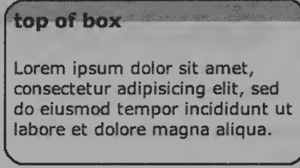

```css
div {
  width: 236px;
  padding: 8px;
  background: #fff url(images/2_part_corner_bottom.png) no-repeat bottom;
}
h3 {
  margin: -8px -8px; /* 推回到容器边缘 */
  padding: 8px;
  min-height: 19px;
  background: url(images/2_part_corner_top.png) no-repeat
}
...
<div>
  <h3>框框顶部</h3>
  <p>Lorem ipsum dolor sit amet, consectetur adipisicing elit, sed do eiusmod tempor incididunt ut labore et dolore magna aliqua.</p>
</div>
```

这种方法非常容易实现和维护，而且具有一个固定尺寸的模式在列、侧边栏和圆角按钮中经常出现。它有两个缺点：首先，如果较长的（底部）图像覆盖了未知数量的内容，它可能需要很大；其次，如果顶部元素的角外部是透明的，第二个底部图像可能会渗透到顶部元素的角外部。

> 注意：为什么不在一个元素上使用多个背景图像来实现此点？那些不支持 `border-radius` 的旧版浏览器也不支持多个背景图像。

# 四个角

在第 6 章中，学习绝对定位时，你看到过一个示例（参考图 6.1），该示例取四个小框并将它们放置在父元素的每个角上。你可以使用这种模式创建挂钩来附载背景图像，代表四个角中的每一个。虽然这种方法比之前的方法开销更大，并且需要一些额外的标记，但结果比其他解决方案更灵活。图 8.10 将四个定位的角与背景图像精灵图相结合。

图 8.10

用于模拟圆角的四个背景。

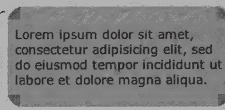

```css
div {
    position: relative;
    width: 20%;
    padding: 8px;
    background: #CCC;
}
```

（继续见下一页）

```css
.corner {
  position: absolute;
  padding: 0;
  width: 14px;
  height: 14px;
  background-image: url(images/4_part_corner_sprite.png);
}

.ctl {
  top: 0;
  left: 0;
  background-position: top left;
}

.ctr {
  top: 0;
  right: 0;
  background-position: top right;
}

.cbr {
  bottom: 0;
  right: 0;
  background-position: bottom right;
}

.cbl {
  bottom: 0;
  left: 0;
  background-position: bottom left;
}

...
```

```html
<div class="corner ctl"></div>
<div class="corner ctr"></div>
<div class="corner cbr"></div>
<div class="corner cbl"></div>
</div>
```

提示：使用 JavaScript 动态地将这四个角元素添加到 HTML DOM 中是一种将表现性元素留在标记之外并保持代码简洁的实用方法，特别是当你对页面上的多个不同块进行圆角时。

## 绘制像素

将空元素的定位推向极端，你可以创建 1x1 的框，并细致地重建绘制包含块角的像素。这可以允许一些视觉技巧，例如抗锯齿和更改圆半径，而无需重新创建背景图像文件，但会导致大量的代码和标记开销。

与之前的角解决方案一样，你可以使用 JavaScript 创建、绘制和定位这些额外元素，并为它们设置正确的背景颜色。这种方法的示例在 Curvy Corners JavaScript 库（http://www.curvycorners.net/）中实现，它在不支持 `border-radius` 的浏览器中加载时，使用 CSS 文档中的 `border-radius` 属性来绘制圆角。

# 边和背景增强

除了多个背景图像和圆角，CSS3 还有其他其他技巧将迅速进入 Web 开发者的工具箱。不使用图像创建背景颜色渐变以及使用图像创建边框都在第 14 章中介绍。

本章探讨了如何选择所使用的字体，并讨论了其他让你控制所构建的页面上文本外观和可读性的属性。

## 字体基础

用于渲染文本的字体及其特定特征（如大小和粗细）是通过 `font` 及其相关属性定义的。

`font-family` 属性接受一个用逗号分隔的字体族列表。列表中在读取页面的设备上安装的第一个值将是用于设置文本的字体。

（注：原文中存在大量重复的 OCR 错误文本，此处已按逻辑处理）

## `font-weight`

`font-weight` 属性控制字体中字符的粗细或厚度。

- `normal` | `bold`: 代表正常权重（默认）和粗体类型的关键字。
- `bolder` | `lighter`: 设置相对于从父元素继承的权重的权重。
- `100` to `900`: 一个九级刻度表，以 100 为单位递增，范围从极细 (100) 到极粗 (900)。

> 笔记：虽然定义了字体权重的九级刻度表，但浏览器通常只显示两个不同的层级：`normal` (400) 和 `bold` (700)。

## `font-variant`

某些字体设计有几组变体字符集，包括一组小型大写字母（small caps）形状。`font-variant` 允许选择另一组字符集。

- `normal`: 选择字体的正常变体（默认）。
- `small-caps`: 选择字体的小型大写字母变体。如果不存在，则模拟小型大写字母。

## `font-style`

使用 `font-style` 属性声明字体的样式。

- `normal`: 正常、直立的字体（默认）。
- `italic`: 斜体字体。
- `oblique`: 倾斜字体。如果字体未提供倾斜样式，则可以使用斜。

## `line-height` 属性

`line-height` 属性定义每行文本（行框）的高度。行距（Leading），即每行之间的垂直间距，通过指定大于内容高度（`font-size`）的 `line-height` 来创建。

- `normal`: 浏览器指定的合理默认值；通常为 1.2。
- `<number>`: 应用于字号的数值倍数，用于计算行高。
- `<length>`: 特定的长度值。
- `<percentage>`: 元素字体号的百分比。

## `font` (简写)

`font` 简写属性允许在同一位置分配各个单独字体属性（`font-style`, `font-variant`, `font-weight`, `font-size`/`line-height`, `font-family`）。请注意，虽然大多数简写属性允许省略单个属性值并假设默认值或继承值，但至少必须声明 `font-size` 和 `font-family`。此外，`line-height` 属性的值必须以 `font-size`/`line-height` 的格式与 `font-size` 值配对，例如 `1.2em`/`1.4`。

```css
/* normal, small-caps, 400, 15px/19px "Trebuchet MS", Verdana, sans-serif */
h3 { font: small-caps 15px "Trebuchet MS", Verdana, sans-serif; }
```

```css
/* oblique, normal, bold, 20px/24px monospace */
h5 { font: bold oblique 1em/1.2em monospace; }
```

## `vertical-align`

`vertical-align` 属性设置文本（或其他内联内容）相对于由 `line-height` 控制的行框的对齐。由于该属性控制内联元素相对于行框的位置而不是块元素，因此它不适用于在布局网格中对齐块元素。默认值 `baseline` 创建了一种对齐方式，行中每个内联元素的字符底部都从相同的位置开始。以下是 `vertical-align` 的常用值（图 9.2）：

- `baseline`: 将框的基线与父元素的基线对齐。
- `sub`: 通过降低框的基线创建下标。
- `super`: 通过提高框的基线创建上标。

```css
p {
  font-size: 20px;
  vertical-align: baseline;
  color: #666;
  background: #eee;
}
sup {
  font-size: 1em;
  vertical-align: super;
}
sub {
  font-size: 1em;
  vertical-align: sub;
}
span {
  font-size: 0.6em;
}
```

<p>Baseline yx <sup>xyx Sup <span>xyx</span></span></span> yx ➡ Baseline <span></span></span></span></sub>xyx Sub <span>xyx</span></sub></p> </sub> Baseline</p>

| Baseline yx xyx Sup xyx Baseline Baseline xyx yx Sub xyx yx Baseline |

图 9.2 行框与原始基线的垂直对齐，原始基线为黑色，下标和上标的基线为灰色。

# 额外的字体样式

排版不仅仅是指定一种字体。CSS 提供了一套丰富的工具来调整和自定义文本的显示。

# `text-decoration`

你可以通过 `text-decoration` 属性设置下划线、删除线或其他装饰（是的，甚至是闪烁）。这些装饰是与边框分开绘制的，仅应用于文本。

- `underline`: 每行文本都有下划线。
- `overline`: 每行文本上方都有一条线。
- `line-through`: 每行文本中间都有一条线。
- `blink`: 文本闪烁。

多年的约定已经建立并强化了带下划线的文本表示文本是链接。链接不必有下划线，因为它们可以以按钮的形式出现或通过颜色或背景颜色的变化突出，但如果文本带有下划线，它就是链接。

# `text-transform`

`text-transform` 属性控制文本的大小写。这对于导航来说是一个非常有用的属性。

- `capitalize`: 强制每个单词的首字母大大写。
- `uppercase`: 所有字符强制转换为大写。
- `lowercase`: 所有字符强制转换为小写。
- `none`: 不进行任何大小写转换（默认）。

# `word-spacing`

你可以使用 `word-spacing` 调整单词之间的默认间距。

- `<length>`: 用于单词间距的固定长度。
- `normal`: 不进行调整（等同于 0）。

# `letter-spacing`

`letter-spacing` 属性控制字符的间距。类似于 `word-spacing`，它定义了对字体的调整。

- `<length>`: 用于字符间距的固定长度。
- `normal`: 不进行调整（等同于 0）。

## `text-align`

块内文本的水平对齐由 `text-align` 属性定义。

- `left`: 文本左对齐（默认）。
- `right`: 文本右对齐。
- `center`: 文本行居中。
- `justify`: 文本行对齐的两两侧，根据需要调整单词之间的间距。

> 使用 `text-align: justify` 时要小心，特别是在窄列中。排版工具（如连字符，有助于保持每行字符数均匀）浏览器并不提供，它们在计算对齐所需的间距时非常糟糕。这通常会导致行只有几个单词但它们之间存在巨大的间隔。

# `white-space`

此属性设置元素中空白和换行符的计算方式。

- `normal`: 文本换行以填充每个行框；空白序列（多个空格、制表符或换行符）会被合并（默认）。
- `pre`: 文本被视为源码中的预格式化，空白包括换行符将保持不变（`<pre>` 元素的默认值）。
- `nowrap`: 空白像 `normal` 一样合并，所有文本强制在同一行。

# `word-wrap`

除了设置空白行为外，通过 `word-wrap` 你可以允许浏览器在单词中间断行，以防止长字符串溢出框。

- `break-word`: 允许浏览器在单词内部断行，以防止无空格字符的长单词溢出框；按字符而非音节断词，且不连字符。
- `normal`: 单单词无法断开（默认）。

# `text-indent`

`text-indent` 属性定义块中第一行的缩进。

- `<length>`: 缩进的固定测量值
- `<percentage>`: 相对于包含块宽度 属性的百分比长度。

## `text-shadow`

- CSS3 引入的 `text-shadow` 属性允许将一个或多个 `<shadow>` 效果应用到元素的文本上。这种阴影绘制在字母本身周围，而不是像 `box-shadow`（第 14 章）那样绘制在框的外边缘。
- `none`: 不应用文本阴影。
- `<shadow>`: 单个阴影的描述为 `<color>` `<offset-x>` `<offset-y>` `<blur-radius>` 或 `<offset-x>` `<offset-y>` `<blur-radius>` `<color>`其中 `<blur-radius>` 是可选的，默认长度为 0。

```css
h2 {
  text-shadow: rgba(0,0,0,0.5) 2px 2px 5px;
/* 透明黑色阴影向右偏移 2px，向下偏移 2px，并带有 5px 的模糊 */
}
```

你可以通过混合明暗的文本阴影效果来创建浮雕文本的外，就像在这个多阴影示例所示：

```css
h2 {
  text-shadow: rgba(0,0,0,0.3) 0 -1px, rgba(255,255,255,0.3) 0 1px;
}
```

同一个元素上的多个阴影会从前（第一个列出的阴影）到后（最后一个列出的阴影）绘制。

## CSS 便签指南

## 审核样式与可读性内容

在构建网站时，为常用元素定义一组基础样式是非常用的，这可以确保你根据所选字体、大小和颜色，从一开始就从良好的可读性和可访问性设计开始。

在项目进度早期，通常没有为不同页面类型编写具有代表性的文案，也没有可用包含常用标签（如列表、低级标题或以异常方式换行的文本）的内容。所有这些元素对于审查行高、文本缩进或其他影响空白、美学和可读性的属性至关重要。那么，如果内容尚未写好，或者设计经常只有未完成的短文本片段，你该如何编写和测试默认基准，并确保从一个可读性良好的站点开始呢？

2006 年，我写了一篇博客文章，概述了使用通用测试文件的方法，该文件包含了各种 HTML 元素，可以被包含在你构建的第一个页面中，或者用于样式指南或清单文档（http://placenamehere.com/article/178/）。我仍然为我处理的大多数网站使用这个测试文档，并将代码放在了 GitHub 上的项目里（http://github.com/placenamehere/PNHTagTest）。

在设计过程更早的阶段，Iain Lamb 编写的 [Typograph](http://lamb.cc/typograph/) 允许你与示例文本段的样式属性进行交互，并对字体大小、行高、空白、列宽和字体比例之间的关系进行实验。

这类工具都允许对网站的样式和排版选择进行早期调整和审查，并帮助创建一个极佳的基准，用此构建网站的其他元素。

## 指定字体

字体的选择和字体字的可用性可能是 Web 设计中最具挑战性的方面之一。你访问的大多数网站显示为 Times New Roman、Verdana 或 Arial 是有原因的，因为没有足够的计算机安装了足够高质量的字体，以至于让 Web 设计师可靠。这种情况随着时间的推移发生了一些变化，在接下来的章节中，我概述了几种为 Web 选择字体的方法。

## 系统字体

Windows、Mac OS X、Linux、iOS 和 Android 等操作系统通常自带了一组预装字体。一些极其常用的应用程序如 Microsoft Office 会安装额外的字体文件。Web 并没有真正无处不在的字体，因为即使是最常见的字体也可以被计算机者禁用或删除，但这些是桌面浏览器上最常用的字体：

- 衬线字体 (Serif): Times New Roman, Times, Georgia, Palatino Linotype (OS X 上的 Palatino)
- 无衬线字体 (Sans-serif): Verdana, Arial, Arial Narrow, Arial Black, Helvetica, Impact, Trebuchet MS, Tahoma
- 等宽字体 (Monospace): Courier New, Courier, Andale Mono, Lucida Console


# CSS 便签指南

为了应对字体不可用，通常会在指定通用字体族之前列出一个或两个相似的字体，如这些示例所示：

```css
font-family: "Palatino Linotype", Palatino, "Times New Roman", serif;
font-family: Tahoma, Arial, Helvetica, sans-serif;
font-family: Verdana, Geneva, sans-serif;
font-family: "Andale Mono", "Courier New", Courier, monospace;
```

你可以在 Richard Rutter 的 24ways 文章 [Increase Your Font Stacks With Font Matrix](http://24ways.org/2007/increase-your-font-stacks-with-font-matrix) 以及 Code and Style 网站（http://www.codestyle.org/css/font-family/index.html）上找到关于已安装字体的详细信息。

## 字体嵌入

为了摆脱常用安装的“安全”字体列表的限制，IE4 通过 `@font-face` 规则在 CSS 中引入了字体嵌入。随着 W3C 的标准化以及其他浏览器厂商的近期采用，字体嵌入正受到关注，但它并非没有早期采用任何新技术带来的问题。

## @font-face

`@font-face` 允许定义自定义字体并将字体族链接到一个或多个资源。这设置了两组值：

- `font-family`：自定义字体的族名；
- `src`：字体源以及可选（但实际上所需的）格式

## 第 9 章：排版与网络字体

一个基本的嵌入字体声明如下：

```css
@font-face {
  font-family: "Chris Script";
  src: url(fonts/ChrisScript.ttf);
}
h1 {
  font-family: "Chris Script", cursive;
}
```

如果浏览器不支持 `@font-face` 规则（或者无法找到特定格式的字体），它将忽略第一个字体名称并使用浏览器定义的 `cursive`（草体）渲染元素。

系统中可能出现的字体可以通过在 `url()` 之前使用 `local()` 按字体名搜索。这避免了下载可能在某些机器上安装的字体副本，但它并不足够普及到不需要嵌入就被认为是安全的。

```css
@font-face {
  font-family: "Vera Mono";
  src: local("Bitstream Vera Mono"); url(fonts/BSVSM.ttf);
}
h2 {
  font-family: "Vera Mono", "Courier New", cursive;
}
```

如果 `@font-face` 规则指定的字体族已通过之前的规则存在或因为系统原因存在，则新定义将取代其位置。

## 字体格式

就像 HTML5 视频大战（http://diveintohtml5.org/video.html）一样，试图实现嵌入字体的人是为了理清各种浏览器之间文件格式支持的混乱。就像视频格式格局一样，浏览器厂商选择支持不同的格式是因为许可和保护问题、平台规范以及遗留行为的混合。可能的格式包括：

- `truetype`：TrueType 字体 (TTF)；支持 Safari 3.1+、Chrome 4+、Firefox 3.5+、Opera 10+
- `opentype`：OpenType 字体 (OTF)；支持 Safari 3.1+、Chrome 4+、Firefox 3.5+、Opera 10+
- `embedded-opentype`：嵌入式 OpenType 字体 (EOT) 字体；支持 IE 4+
- `svg`：基于 SVG 的字体定义；支持 Opera 10+、Mobile Safari
- `woff`：Web 开放字体格式嵌入字体 (WOFF)；支持 Firefox 3.6+、IE 9+

从 IE4 到 IE8，微软仅支持专有的 EOT 格式，因为担心嵌入 TTF 或 OT 字体需要将原始字体文件发布到 Web 服务器上供全球下载，并且这会破坏涵盖大多数字体的许可协议。在 WOFF 被广泛支持之前，要在 IE 和其他浏览器中嵌入自定义字体，你必须以至少两种格式提供字体，并按照如下示例进行定义。

```css
@font-face {
  font-family: "Vera Sans";
  src: url(fonts/BSVSM.eot);
  src: local("Bitstream Vera Sans"),
  url(fonts/BSVSM.ttf) format("truetype");
}
```

关于更多字体选项的讨论，请参见 Paul Irish 的文章“[Bulletproof @font-face syntax](http://paulirish.com/2009/bulletproof-font-face-syntax/)”

## 创建可嵌入字体

那么，如果你有 TrueType 或 OpenType 字体，从哪里获取这些不同的字体格式？

Font Squirrel 生成器 (fontface.com/generator) 接收上传的字体并将其转换为前面提到的格式，同时提供 CSS 嵌入代码。微软发布的 Web Embedding Tool (WEFT) 用于创建 EOT 文件，而且由于 Font Squirrel 同样提供了该格式，因此这些工具并不是必需的。

## 字体授权与字体字库

即使在 EOT 或 WOFF 格式的保护下，通过分发网页字体，你可能在开始新的设计时，选择那些经过授权的字体。寻找高质量的网页字体变得越来越容易（正如我写这段话时，我正在关注 Fonts.com），这些服务提供了字体：

- [Typekit]：一个基于订阅的商业服务，与流行的字体字库合作：http://typekit.com/
- [FontSpring]：提供适用于 `@font-face` 的授权选项：http://www.fontspring.com/
- [Font Squirrel]：不仅仅是一个字体生成器，它还包含了一个可在网页使用的免费字体集：http://www.fontsquirrel.com/fontface
- [Google Font Directory]：配合嵌入式 API 和 `@font-face` 声明，Google 已经收集了一套可免费使用的开源字体：https://code.google.com/apis/webfonts/
- [WebFonts.info Directory]：致力于网页排版的目录，这是一份支持嵌入的字体和字体字库列表：http://www.webfonts.info/

## 通过文本替换自定义字体

设计师可以使用某些技术，除了依赖系统字体或嵌入字体文件来实现自定义字体外观。这些技术有优点也有缺点——平衡了维护性、可选择性和外观。将字体设置在 `` 标签内并放在文档中是一种方法，但如果选择了不同的字体，HTML 内容无法通过样式表更改，而且当出现在 RSS 馈等上下文中，图像保持不变。

上一节中的字体嵌入技术是新的方法，且没有浏览器支持或字体授权等问题；这些较旧且测试过的技术在你的工具箱中是有用的。

与直接设置 `` 标签中的文本一样，这些技术在文章标题或导航元素等少量情况下有用，但动态替换大量文本会带来大量的开销或维护问题。

## 图像替换

与其使用图像标签来显示非 HTML 的文本，通过图像替换，你可以将同一个图像文件作为常规 HTML 元素的 CSS 背景。对背景图像进行调整和定位后，必须通过移动其位置、更改 `display` 值或执行类似的技巧来隐藏前景文本。在下面的示例中（下一页的图 9.3），标题使用 Bitstream Vera Sans 字体带有某些通过 CSS 和 HTML 字体无法实现的凸效果：

```css
h2 {
  display: block;
  height: 25px;
  background-image: url(images/sprite_imagagereplace.png);
  background-repeat: no-repeat;
  text-indent: -9999px; /* 将 HTML 文本移出视图 */
}
#hdrHome {
  width: 80px;
  background-position: 0 0;
}
#hdrBlog {
  width: 63px;
  background-position: -88px 0;
}
#hdrPortfolio {
  width: 107px;
  background-position: -158px 0;
}
#hdrAbout {
  width: 83px;
  background-position: -272px 0;
}
```

```html
<h2 id="hdrHome">首页</h2>
<h2 id="hdrBlog">博客</h2>
<h2 id="hdrPortfolio">作品集</h2>
<h2 id="hdrAbout">关于</h2>
```

图 9.3

（注：图 9.3 标题的图像替换。

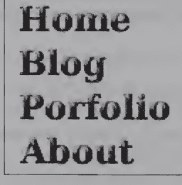

如果少量使用且针对不经常更改的文本，图像替换是一个非常方便的工具。该技术的主要缺点是它相当不灵活，并且需要为每个被替换或编辑的文本生成图像（如前例中的图像精灵图）。

## 第 9 章：排版与网页字体

Flash 编写了关于这里（http://mezzoblue.com/revised-image-replacement/）中各种图像替换方案的良好概述和对比。

## 使用 Flash 替换字体

sIFR 项目 (http://www.mikeindustries.com/blog/sifr) 是作为图像替换的替代方案构建的工具包。它需要将字体转换为新格式（这里是 SVG 字体），然后使用 JavaScript 读取 HTML 页面并替换指定的元素。sIFR 使用基于 CSS 的样式来传递字体信息，并通过 JavaScript 来重绘 HTML 内容。相比于图像替换，其主要优势在于维护性。主要的缺点是它同时需要 JavaScript 和 Adobe Flash Player。

## 使用 JavaScript 替换字体

Cufón (http://wiki.github.com/sorcu/cufon/) 是一个作为 sIFR 替代方案的工具包。它将字体转换为新格式（这里是 SVG 字体），然后使用 JavaScript 工具读取 HTML 页面并替换指定的元素。相比于图像替换，其主要的优势在于维护性。

## 列表与表格

所有内容类型都属于两种显示类型之一——内联和块级。几乎。思考后可能会发现，具有列、行、标题和跨格的表格无法通过排列一系列块元素来建模，但列表还需要工具。

## 列表

HTML 列表元素 (`<ul>` 和 `<ol>`) 是简单的块级元素。单个列表项 (`<li>`) 同样具有相同的框模型，尺寸、内边距、外边距和边框符合预期。然而，每个项目还需要一些额外的部分来确保标记正确定位并指定或递增。

# 第 10 章：列表与表格

> **提示** 在设置 `list-style-type` 属性时，不要忘记考虑嵌套列表的行为。默认情况下，浏览器会设置不同的类型，使得符号或编号类型会根据嵌套情况发生变化，从而提高可读性。为选择器 `ul`、`ul ul` 和 `ul ul ul` 分别设置不同的类型。

## list-style-image

`list-style-image` 属性接受一个 `<uri>` 作为图像，指定后它将替换由 `list-style-type` 属性定义的生成的列表标记。

## list-style-position

`list-style-position` 属性定义了列表标记相对于列表项目框（box）的位置。通常，标记将放置在项目内容区域之外的左侧凹槽中；然而，它也可以放置在列表项目内部，表现就像位于项目开头的内联元素一样。

- `outside`：列表标记作为内联元素放置在由项目内容生成的框之外（默认值）。
- `inside`：列表标记放置在列表项目框内部。

图 10.1 展示了两种可能的 `list-style-position` 值。

图 10.1

三个标记位于外部的列表项目，其中后一个标记位于内部。

| Lorem ipsum sit amet, consectetur adipisicing elit, sed do eiusmod tempor incididunt ut labore et dolore magna aliqua. |
| :--- |
| Lorem ipsum sit amet, consectetur adipisicing elit, sed do eiusmod tempor incididunt ut labore et dolore magna aliqua. |
| Lorem ipsum sit amet, consectetur adipisicing elit, sed do eiusmod tempor incididunt ut labore et dolore magna aliqua. |
| - Lorem ipsum sit amet, consectetur adipisicing elit, sed do eiusmod tempor incididunt ut labore et dolore magna aliqua. |
| - Lorem ipsum sit amet, consectetur adipisicing elit, sed do eiusmod tempor incididunt ut labore et dolore magna aliqua. |
| - Lorem ipsum sit amet, consectetur adipisicing elit, sed do eiusmod tempor incididunt ut labore et dolore magna aliqua. |

## 使用背景作为 list-style-image

在列表项目上使用不重复且位置恰当的背景图像是控制列表标记图像精确位置的常用方法。以下代码通过结合两种模式来实现：使用 `padding` 为背景图像留空间（在第 7 章中出现过几次），以及通过 `list-style-type: none` 关闭默认列表标记。

```css
ul {
  margin-left: 0;
  padding-left: 0;
}
li {
  margin-left: 0;
  padding-left: 20px;
  list-style-type: none;
  background: url(fancydot.png) no-repeat 4px 4px;
}
```

## list-style（简写）

`list-style` 简写属性允许在同一个地方分配各个列表属性（`list-style-type`、`list-style-position`、`list-style-image`）。

```css
li { list-style: none; }
```

之前的代码演示了禁用标记的简单方法，并比直接设置 `list-style-type` 属性节省了几个字符。

## ::marker 伪元素

CSS3 添加了一个实用的伪元素来访问列表标记，它既可以定义标记，又提供了更改标记样式和位置的方法。这种方法通过对列表项目设置偏移或内边距，或者将列表项目的内容包裹在另一个元素中是无法实现的。它允许对颜色和字体大小等属性进行独立控制：

```html
<li><span>list content</span></li>
```

遗憾的是，在写作此时，还没有浏览器支持 `::marker`。结合下一节将讨论的计数器（counters）和生成内容（generated content），这将是为内容生成自定义标记的强大方式。

## 生成内容

与列表标记一样，有时希望显示并非来自 HTML 文档的内容。生成内容通过 `content` 属性定义，然后作为伪元素 `::before` 和 `::after`（以及最终的 `::marker`）的内容添加到文档中。

## content

`content` 属性允许向所选的伪元素中添加多种不同类型的内容，包括以下内容：

- `<string>`：插入元素中的文本内容
- `<url>`：图像的 URI
- `none`：未定义内容

## ::before 和 ::after

伪元素 `::before` 和 `::after` 代表元素现有内容之前之后内容的占位符。

```css
a.help::after {
  content: "(?)";
  color: red;
  background: yellow;
}
```

```css
a.next::after {
  content: url(images/right_arrow.png);
}
```

```html
<p>这里有一些文本，包含一个指向 <a class="help" href="http://example.com/help.html">帮助页面</a>的链接
- 以及一个指向 <a class="next" href="http://example.com/next.html">下一页</a>的链接</p>
```

之前的代码在任何指向“next” 文档的链接之后添加了一个箭头图像，在任何“help” 链接之后添加了一个问号，如图 10.2 所示。这两个提示（或使用 `content` 属性添加的类似内容）说明了通过设计引入的演示性提示（presentational hints）与通常存在于 HTML 源代码中的内容有不同之处。

> 这里有一些文本，包含一个指向帮助页面(?) 和一个指向下一页→的链接。

图 10.2 在具有不同类属性的链接后添加生成内容的示例。


- 生成内容被添加到所选元素的内容中。它们的样式处理就像它们在原始 HTML 标签中的内容一样，对于链接来说，添加的内容是可以点击的，就像原来的一样。

## 计数器

与列表标记一样，有时显示并非来自 HTML 文档的内容是理想的。生成内容通过 `content` 属性定义，然后作为伪元素 `::before` 和 `::after`（以及最终的 `::marker`）的内容添加到文档中。

计数器提供了创建和使用文档中某些元素计数的能力。虽然它对自定义列表标记非常有用，但不仅限于列表，还可以帮助文档大纲样式或其他装饰。

### counter-increment

`counter-increment` 指定当遇到由选择器定义的元素时，计数器应该递增。

- `<identifier>`: 计数器增加 1
- `<integer>`: 计数器增加指定的整数步长

### counter()

在 `content` 属性中，可以使用 `counter()` 函数访问给定计数器的值：

- `counter(<identifier>)`: 返回指定计数器的值
- `counter(<identifier>, <style>)`: 返回返回格式化后的指定计数器值（如 decimal-style）

### counter-reset

- `<identifier>`: 将指定的计数器重置为 0
- `<integer>`: 将指定的计数器重置为某个整数

以下代码用于生成图 10.3，并展示了当前通过 `list-style-type` 无法实现的三个演示选项。

- 列表项目的数字加点演示被自定义为数字加冒号。
- 在不支持 `:marker` 的浏览器中，包含计数器的文本可以独立设置样式。
- 为每个 `h4` 元素添加了标记和计数器。

```css
h4 { /* 为每个 h4 增加计数 */
  counter-increment: heading;
}
h4::before {
  content: counter(heading, lower-roman) ": ";
  color: #aaa;
}
ol li { /* 为列表启动第二个计数器 */
  list-style-type: none;
  counter-increment: item;
}
ol li::before {
  content: counter(item) ": ";
  color: #aaa;
}
ol { /* 为每个新的重置第二个计数器 */
  counter-reset: item;
}
```

[... ]

```html
<h4>Heading</h4>

<h4>Heading</h4>

<ol>
  <li>list item</li>
  <li>list item
    <ol>
      <li>list item</li>
      <li>list item</li>
      <li>list item</li>
    </ol>
  </li>
  <li>list item</li>
</ol>
<h4>Heading</h4>
<ol>
  <li>list item</li>
  <li>list item</li>
</ol>
<h4>Heading</h4>
```

图 10.3 使用计数器用于生成内容的演示。

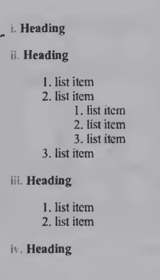

## 表格

使用表格创建布局网格是一种已经过时的 Web 设计做法，这为 HTML 表格元素带来了许多负面评价。尽管这种做法在大多数现代 Web 开发中已成为历史，但用于表格化数据的表格仍然比以往任何时候都重要。表格的布局——具有其单元格网格、无数的边框以及单元格跨行或跨列的能力——需要一些其他元素未使用的特殊格式属性。

`table` 元素的布局模型要求元素外部的边距和边框的行为与其他块元素相同，且宽度的计算也类似，但它包含了一些额外的属性，用于控制单元格及其内边距、间距和边框的间和显示。以下代码生成图 10.4 中的表格：

```css
table {
  background: #ccc;
  border: 5px dotted #000;
  border-spacing: 10px;
}
td {
  width: 20px;
  line-height: 20px;
  padding: 10px;
  background: #fff;
  border: 2px solid #000;
}
td[rowspan="2"] {
  border: 10px solid #666;
}
```

```css
tr {
  border-top: 10px solid #aaa;
}
```

```html
<table>
  <tr>
    <td>&nbsp;</td><td>&nbsp;</td><td>&nbsp;</td>
  </tr>
  <tr>
    <td rowspan="2">&nbsp;</td><td colspan="2">&nbsp;</td>
  </tr>
  <tr>
    <td>&nbsp;</td><td>&nbsp;</td>
  </tr>
  <tr>
    <td>&nbsp;</td><td>&nbsp;</td><td>&nbsp;</td>
  </tr>
</table>
```

图 10.4

`border-collapse` 设置为 `separate`（分离）时的表格布局。

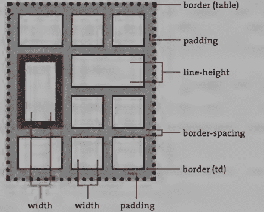

### table-layout

为了保持单元格网格的完整性，传统上每个单元格中包含的内容会对表格的行高和列宽产生影响，浏览器可以自由地对提供的尺寸进行调整。即使提供了单元格宽度，大量的文本或大图像也可能让单元格变得更大。`table-layout` 属性允许更改浏览器调整表格大小和渲染的方法。

- `auto`: 表格和表格单元格的宽度随着表格中每个单元格内容的渲染而建立并调整，其尺寸由 CSS 属性提供，并根据内容的大小或数量进行调整（默认值）。
- `fixed`: 表格和表格单元格的宽度不依赖于内容，仅由表格和列的宽度决定，允许浏览器立即开始渲染表格。

对于较小的数据表格，`table-layout: auto` 可能足够了，允许列宽稍微灵活变化以适应意料之外的大量内容。对于大得多的表格，如果你希望内容立即开始显示，或者对于单元格网格的完整性和统一性非常重要的情况，你应该使用 `fixed`。

### border-collapse

- `separate`: 每个表格单元格的边框作为独立的特征绘制，并由某些边框间距隔开。表格的其他其他部分没有边框（默认值）。
- `collapse`: 表格和表格的所有部分在每一侧共享同一条边框。

在图 10.4 中可以看到分离边框的某些行为，这使得它们的行为类似于传统的 HTML 表格渲染。

- 在左侧列中，具有窄边框的单元格已调整以适应具有较大边框元素的显示。
- 在 `tr` 元素上声明的边框被忽略。
- 表格背景绘制在单元格边框之间的空间内。

图 10.5 是将 `border-collapse` 设置为 `collapse`（合并）的上述表格示例，展示了合并边框模型下发生的以下变化，这些变化使得表格的行为更类似于 Excel、Numbers 或其他软件中的典型电子表格：

- 每个单元格之间绘制一条边框，而不是每个单元格周围一个独立的边框。
- 边框可以应用于表格的任何部分，包括 `thead`、`tbody` 和 `tr` 元素。
- 当具有不同 `border-width`、`border-style` 或 `border-color` 属性元素接触时，它们不会被同时绘制；相反，浏览器会选择其中一种样式。
- `border-spacing` 属性被忽略。

图 10.5

`border-collapse` 设置为 `collapse` 的表格布局。

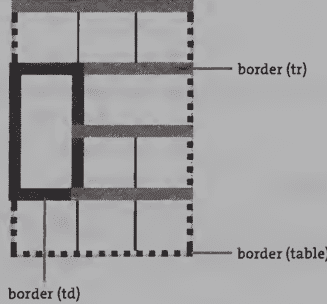

### border-spacing

`border-spacing` 属性提供了表格单元格边框之间的间距，接受两个 `<length>` 值，第一个用于水平间距，第二个用于垂直间距。如果只提供一个 `<length>`，它将应用于双方。

### empty-cells

在分离边框模型中，没有内容的单元格（或设置为 `visibility: hidden` 的单元格）可以渲染或忽略其边框和背景样式。

- `show`: 显示空单元格的边框和背景
- `hide`: 隐藏空单元格的边框和背景

### vertical-align

与块元素不同，单元格的内容可以垂直定位。

- `top`: 单元格内容位于顶部。
- `bottom`: 单元格内容位于底部。
- `middle`: 单元格内容居中（默认）。

### text-align

`text-align` 属性在应用于表格时表现正常（见第 9 章）。

### 表格值

与 `display` 属性一样，还有 `table`、`inline` 和其他的 `display` 值。以下是表格相关的示例：

```css
table { display: table; }
tr { display: row; }
thead { display: header-group; }
tbody { display: row-group; }
tfoot { display: footer-group; }
col { display: column; }
colgroup { display: column-group; }
td, th { display: cell; }
caption { display: caption; }
```

# 表单和用户界面元素

设计和样式化表单并在浏览器之间获得一致的结果可能是 Web 开发中最困难的部分。

这种困难大部分源于表单元素的本质。它们的设计是为了向用户索取输入，而这些输入的获取方式在不同设备之间可能非常不同。

不同的操作系统具有原生的表单控件行为和外观，浏览器厂商一直尝试使界面元素的符合这些标准。因此，用户在同一台设备上使用多个浏览器时通常会看到熟悉的输入，但如果他们更换了设备或操作系统，界面就会改变。即使在同一个浏览器中，Windows、Mac OS X、Linux 和移动设备之间的外观也可能不同。图 11.1 显示了三个不同设备上 `select` 元素的显示差异。

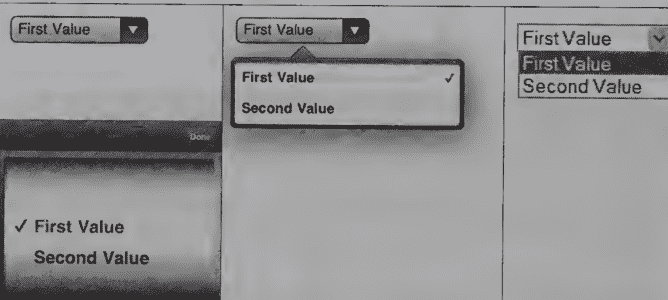

图 11.1 在 Safari/Apple iPhone iOS4、Safari/Apple iPad iOS3 和 IE 8/Windows XP 中交互 select 元素（从左到右）。

你可以在 Christopher Schmitt 收集并索引的截图集中找到不同浏览器和操作系统应用于表单元素的 CSS 其他示例：http://www.WebFormElements.com。

表单布局的独特之处可能在于需要处理表单元素各种定位、放置和状态。大字段、小字段、字段组、标签以及帮助或错误消息都需要被放置，以便让访客清楚他们被要求提供什么。适用于标准长度文本输入及其标签的网格，可能不适用于单选按钮组或电话号码部分、城市和州等输入组合。

## 使用表单控件

尽管不同平台之间的表单元素可能大不相同，但主流桌面浏览器上的表单元素倾向于共享基本属性；尺寸、字体、颜色和背景都可以像设置任何其他 HTML 元素一样进行。由于某些控件比普通的文本块复杂得多，这些属性的应用方式可能会有些特殊。目前没有硬性规定来规定边框绘制在何，或者 select 控件的哪些部分会处理所应用的颜色。

> 即使在定义了某些样式时，Safari 也会绘制原生表单控件（OS X 上那种泡泡外观）。为元素设置边框可以强制其跳出原生模式，进入接受颜色或背景等其他的模式。

### 尺寸

表单元素像图像一样，是内联替换元素（inline replaced elements）。出于样式考虑，即使它们是“圆形”单选按钮或由多个部分组成（如文件输入字段），最好将它们想象为矩形框。在设置表单元素的高度和宽度时，你是在设置外框的尺寸。框内部的字段如何填充空间则由你无法控制。

虽然 textarea 和按钮等元素会填充整个矩形框，但复选框、单选按钮（下一页的图 11.2）和文件输入字段在布局中留出了指定的空间，但以各种方式填充该空间（或并未真正填充，如这些部分示例所示）。

图 11.2 Safari 5.0.1/OS X、Firefox 3.6.8/OS X、Firefox 3.0.1/Windows、IE 8/Windows 以及 Opera 10.6.1/Windows 中的单选按钮（从左到右），宽度 100 像素，高度 100 像素，1 像素红色边框，10 像素内边距。

更复杂的是，textarea、文本输入和类似元素与其他元素并不一样，因为它们遵循内容盒（content-box）盒尺寸模型，而其他元素使用边框盒（border-box）模型。将 `box-model` 属性设置为 `border-box` 有助于恢复文本输入、select 和按钮之间的一些一致性，缺点是会让它们的行为不再像围绕字段的标签或段落。

```css
form input[type="text"],
form input[type="password"],
form input[type="file"],
textarea {
  -ms-box-sizing: border-box;
  -moz-box-sizing: border-box;
  -webkit-box-sizing: border-box;
  box-sizing: border-box;
}
```

### 颜色、背景和边框

与尺寸一样，颜色的应用正如你预期的适用于提交按钮、textarea 和密码字段等元素中的文本。另一方面，单选按钮、复选框和 select 选项的行为会根据浏览器和平台而异，因此可以将颜色视为一种建议而非规则。

其他属性也是如此。你会在什么位置为单选按钮应用背景颜色——是在圆形内部，还是在框的其他部分的圆形外部后面？文本空间与 select 元素的小手柄之间的线条是边框吗？在一个通常被表示为像文本框加按钮的字段输入中，有多少个背景和边框？HTML5 中滑块等所有新输入类型又是如何？

这些问题让浏览器开发者（反过来也是 Web 开发者）头疼。

为了获得最一致的外观，你可能应该避免单选按钮和复选框使用边框和背景颜色，并避免使用背景图像。（图 11.2 展示了浏览器差异的示例。）另一方面，你可以对其他字段类型使用边框、背景颜色和背景图像来实现有趣的事情。在下一个示例中，文本输入上的背景图像被用于创建深度感（图 11.3）。我添加了当元素获得焦点时的背景颜色变化以进行高亮。

```css
input[type="text"] {
  padding: 4px;
  width: 100px;
  border: 1px solid #000;
  background: #fff url(images/inner_shadow.png) no-repeat left top;
}
input[type="text"]:focus {
  background-color: #fff335;
}
```

图 11.3

带有背景图像的文本输入。

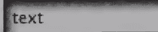

### 伪装，直到浏览器支持

聪明的开发者想出了一系列技巧来规过浏览器中表单样式灵活性不足的问题。他们通过禁用边框和花哨的背景图像，或使用可见性和 z-index 技巧来规避表单字段固有的跨平台异常，并通过创建复杂的基于 JavaScript 的交互来规避样式限制。某些方法保持原始输入字段完整，另一些方法则使用 JavaScript 替换标准的表单输入控件，转而使用一系列点击或其他事件来控制非表单字段的外观，并将结果存储在隐藏字段中。

以下是使用 CSS 和 JavaScript 规避表单样式限制的几个示例：

- 替换文件输入的多变外观（参见 http://www.quirksmode.org/dom/inputfile.html 中的示例）。
- 为高度样式化的单选按钮和复选框使用背景（参见 http://www.quirksmode.org/dom/inputfile.html 中的示例）。
- 实现新的 HTML5 类型，如滑块、日期选择器等（访问 http://diveninja.com/css/inputs）。

### 文字与表单继承

默认情况下，label 和 form 是内联元素。这是一个非常有用的基础，但要创建一个整洁网格表单需要对这些默认行为进行一些更改，有时还需要一些标记。

### 状态：禁用、必须和无效

以下代码显示了如何使用 `:disabled`、`:required`、`:valid` 和 `:invalid` 伪类选择器设置表单元素的状态。

```css
label.required {
  font-weight: bold;
}
input:invalid {
  color: red;
}
input[type="submit"]:disabled {
  background: #aaa;
  color: #fff;
}
```

## 表单元素布局

### 标签堆在字段上方

创建一个标签位于表单字段上方一行的布局，只需将 label 设置为显示块级元素即可（图 11.4）：

```css
label {
  display: block;
  margin-top: 1em;
}
```


# CSS 口袋指南

```html
<fieldset>
  <legend>您的信息</legend>
  <label for="fname">名:</label>
  <input type="text" name="fname" id="fname">
  <label for="lname">姓:</label>
  <input type="text" name="lname" id="lname">
  <label for="phone1">电话号码:</label>
  <input type="text" name="phone1" id="phone1" size="3">
  <input type="text" name="phone2" id="phone2" size="3">
  <input type="text" name="phone3" id="phone3" size="4">
</fieldset>
```

图 11.4

标签位于表单元素上方的形式演示。

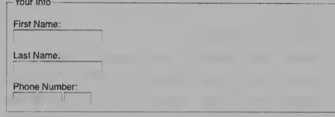

## 多列表单

在之前的示例中，字段是从上往下读取的。要改变元素的顺序使其从左到右排列，你可以对样式和标记进行细微调整，为并浮的元素提供容器（下一页的图 11.5）：

```css
label {
  display: block;
  margin-top: 1em;
}
div.field {
  float: left;
  width: 50%;
}
```

```html
<fieldset>
  <legend>您的信息</legend>
  <div class="field">
    <label for="fname">姓名:</label>
    <input type="text" name="fname" id="fname">
  </div>
  <div class="field">
    <label for="lname">姓:</label>
    <input type="text" name="lname" id="lname">
  </div>
  <div class="field">
    <label for="phone1">电话号码:</label>
    <input type="text" name="phone1" id="phone1" size="3">
    <input type="text" name="phone2" id="phone2" size="3">
    <input type="text" name="phone3" id="phone3" size="4">
  </div>
</fieldset>
```

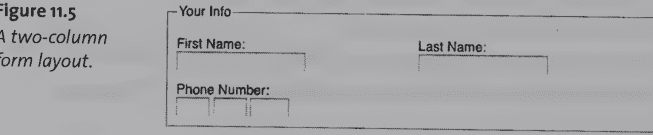

> 虽然在 `label` 标签内包含 `input` 元素是合法的 HTML，并且在这种情况下这样做可能更便于样式化，但由于访问性考虑，这被认为是一种不良的做法。

## 字段旁边的标签

使用与上一个示例相同的标记语言以及以下 CSS，你可以创建一个网格，其中标签位于输入字段的左侧（图 11.6）：

```css
label {
  float: left;
  clear: left;
  width: 150px;
  margin: 0 10px 0 0;
  padding: 0;
  text-align: right;
}
input {
  margin: 0 0 1em 0;
}
```

图 11.6

表单元素左侧的标签。

| | 您的信息 |
|---|---|
| 姓名: | |
| 姓: | |
| 电话号码: | |

## 单选框和复选框的例外

在之前的标签示例中，单选按钮组的表单元素标签如果每行只显示一个小元素，看起来会非常奇怪。

在字段旁边的标签示例中，可能希望所有选项都处于同一行。或者，有时复选框会与长文本（如法律免责声明）关联。

以下代码基于之前的示例，展示了处理这些例外情况的两种可能方法（图 11.7）：

```css
label,
span.label {
  float: left;
  clear: left;
  width: 150px;
  min-height: 1em; /* 保持空 span 开启 */
  margin: 0 10px 0 0;
  padding: 0;
  text-align: right;
}
```

```css
[...]
p label,
input[type="radio"] + label { /* 反转基线标签样式 */
  float: none;
  width: auto;
  margin: 0;
}
```

```html
[...]
<fieldset>
  <legend>问卷</legend>
  <div class="field">
    <span class="label"></span>
    <input type="radio" name="chooseOption" id="chooseOption[1]" value="1">
    <label for="chooseOption[1]">选项一</label>
    <input type="radio" name="chooseOption" id="chooseOption[2]" value="2">
    <label for="chooseOption[2]">选项二</label>
  </div>
```

```html
<div>
  <p>
    <input type="checkbox" name="agree" id="agree">
    <label for="agree">你同意本网站的服务条款吗？</label>
  </p>
</div>
```

图 11.7

按钮和复选框的标签。

| 问卷 | 选项一 | 选项二 |
|---|---|---|
| 你同意本网站的服务条款吗？ | | |

## 输入表格化数据

虽然使用 HTML 表格进行布局已经是过时的、被视为禁忌且在语义上是不正确的，但确实存在某些布局安排。


```css
color: #fff;
background-color: #ccc;
border-color: #ccc;
border-style: solid;
cursor: default;
}
[...]
<input type="submit" value="input">
<a class="button" href="#">链接</a>
<button>按钮</button>
<input type="submit" value="已禁用的输入" disabled="disabled">
<a class="button disabled" href="javascript:void(0)">已禁用="disabled"链接</a>
<button disabled="disabled">按钮</button>
```

图 11.9

样式相似的链接、输入按钮和 button 元素。

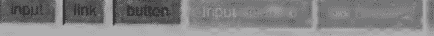

# 第 12 章：媒体：打印和其他设备

## 媒体：打印和其他设备

CSS 不仅仅是一种用于描述在桌面浏览器（在本章中称为屏幕媒体）上查看的页面呈现方式的语言。通过指定与样式块、链接样式表或规则组关联的媒体类型，你可以针对其他媒体，如打印、移动设备和屏幕阅读器。

## 媒体类型

用户代理根据其特征或其运行的设备特征被归分为几种媒体类型中的一种。在某些情况下（例如具有打印功能的桌面浏览器），用户代理可以支持多种媒体类型；但在任何给定时刻，只有一个类型是激活状态的。

## 媒体类型列表

- `all`：适用于所有设备
- `braille`：适用于盲文触觉反馈设备
- `embossed`：适用于页式凸盲文打印机
- `handheld`：适用于小屏幕手持设备
- `print`：适用于页式打印介质（或打印预览）
- `projection`：适用于投影媒体
- `screen`：适用于在桌面和笔记本电脑屏幕上查看
- `speech`：适用于屏幕阅读器
- `tty`：适用于电传打字机、终端或其他具有固定字符网格的设备
- `tv`：适用于基于电视的设备，与屏幕设备相比，其分辨率较低且滚动能力有限
- `Media queries`（媒体查询）：用于通过 CSS3 中引入的描述设备特征的表达式来对特定的媒体进行选择。

在实践中，你典型的 Web 项目将会有针对 `all`、`screen`、`print` 以及通常还有 `handheld` 媒体类型的样式，而其他类型将留给通过 `all` 类型中定义的样式进行管理，或者留给默认外观。

你可能会发现其他类型在小众项目中很有用。例如，如果你正在设计用于演示后在 Web 上分发的幻灯片，那么你可能有一个专门针对投影媒体（`projection`）的演示文（由 Opera 的全屏模式触发）。关于此想法的更多信息，以及 Opera 对 `projection` 媒体类型支持，请阅读 Till Halbach 的文章《使用 HTML & CSS 创建演示文/幻灯片》，地址为 http://dev.opera.com/articles/view/html-css-slideshow/。

## 指定媒体类型

你可以通过三种方式指定与 CSS 规则块关联的媒体类型：通过 HTML `<style>` 或 `<link>` 元素上的 `media` 属性、作为 `@import` 规则的参数，或者作为 `@media` 规则的参数。

## media HTML 属性

HTML `<link>` 元素和 `<style>` 元素都有 `media` 属性，接受用逗号分隔的媒体类型列表。如果访问页面的设备类型不是列出的值之一，则链接的源文件或 `<style>` 块中的代码将被忽略。对于 `<link>` 元素，这意味着链接的文件可能不会被下载，从而节省带宽。

```html
<html>
<head>
<!-- 用于所有媒体的样式表 -->
<link rel="stylesheet" type="text/css" src="global1.css">
<link rel="stylesheet" type="text/css" media="all" src="global2.css">
<style type="text/css" media="all"></style>
<style type="text/css" media="all"></style>

<!-- 仅用于打印的样式表 -->
<link rel="stylesheet" type="text/css" media="print" src="print.css">
<style type="text/css" media="print">...</style>

<!-- 用于移动设备和投影仪的样式表 -->
<link rel="stylesheet" type="text/css" media="handheld, projection" src="compact.css">
<style type="text/css" media="handheld, projection">...</style>
[...]
```

## @import 规则

与 link 元素指定媒体类型一样，通过 `@import` 规则引入的外部 CSS 也可以限制为特定的媒体类型。

```css
<style type="text/css">
/* 用于所有媒体的样式表 */
@import url("global1.css");
@import url("global2.css") all;

/* 仅用于打印的样式表 */
@import url("print.css") print;

/* 用于移动设备和投影仪的样式表 */
@import url("compact.css") handheld, projection;
</style>
```

## @media 规则

`@media` 规则用于指定 CSS 代码块中的部分规则仅适用于提供的媒体类型。与 `<style>` 元素的 `media` 属性一样，在任何发现 `@media` 规则的代码中，当媒体类型不是屏幕时，它最有用。

```css
/* 用于所有媒体的样式表 */
@media all {
  body: #ddd;
  color: #666;
}

/* 仅用于打印的样式表 */
@media print {
  body: #fff;
  color: #000;
}

/* 用于移动设备和投影仪的样式表 */
@media handheld, projection {
  body: #fff;
  color: #000;
}
```

媒体类型不是屏幕。文档的呈现

## 打印媒体

打印页面虽然与屏幕有很多相似之处，但在许多方面不同，最显著的是内容跨页。本节列出的属性有助于

## page-break-before 和 page-break-after

这两个属性定义了在内容之前或之后是否会发生分页，当应用于文章、标题时最有用。

- `auto`：用户代理决定分页的的合适位置（默认值）。
- `always`：告诉用户代理在元素之前或之后始终分页。
- `avoid`：告诉用户代理尝试在元素之前或之后避免分页。

## page-break-inside

`page-break-inside` 属性允许对元素内部分页进行限制。

- `auto`：用户代理决定何时可以在元素内容内部进行分页（默认值）。
- `avoid`：告诉用户代理避免在元素内部分页。

对于所有分页属性，分页可能是不可避免的，例如当单个元素大于一个页面时。这些

## 媒体类型支持

`avoid` 值将导致浏览器尝试不产生分页，然而正如其名称所示，这只是一个尝试而不是绝对规则。

浏览器对分页属性的支持情况不一，某些浏览器对单个值的支持更完整。你可以在 Sitepoint CSS 参考（http://reference.sitepoint.com/css/pagedmedia）或 Mozilla 开发者中心（https://developer.mozilla.org/en/CSS_Reference）找到有关分页属性支持的良好分类和说明。

## @page 规则

`@page` 规则存在用于设置页面的属性，如页边距或方向。在编写期间，CSS2 和 CSS3 的 `@page` 特性支持非常差（Opera 是唯一的亮星），因此没有必要详细介绍这些属性。

## 打印考虑

许多网页的呈现方式、宽度、色彩方案、导航元素和其他设计特征在屏幕上可能是合适的，但打印时并不如此。如果有人打印从你的网站获取的文章、食谱或活动信息，他们最不想看到第一页的一半被导航和广告占据，最后还多出一页只有页脚内容和重复的导航链接。

为了打印做准备，通常会更改某些样式以提供最佳的打印体验。

- 隐藏侧边栏、导航或其他在屏幕上为了与网站交互而呈现的网站“元”元素。品牌元素、Logo 和法律信息仍然非常重要，且通常会延续到打印版本。尽管如此，请在使用时使用 `display:none`。
- 调整字体大小、行高和其他排版属性，以在典型的打印页面尺寸下实现可读性最大化。
- 打印时的对比度与 Web 页面不同，背景可能会导致页面布满墨水而难以阅读。隐藏背景图像，将背景颜色更改为白色，并将文本颜色更改为更深色调甚至黑色，以获得最佳的打印和阅读体验。

> 注意：许多浏览器在打印时会默认（或根据用户选择的设置，无需显式更改）丢弃背景图像或类似的样式。

你喜欢的浏览器提供的“打印预览”选项将显示任何针对打印媒体类型（`print media type`）的样式表，这是在不浪费大量纸张测试你对打印呈现修改的极佳方法。

## 超链接与生成内容

打印的 HTML 文档不会显示某些对用户来说以打印形式存在可能有价值的信息。超链接的目标仅是仅查看文本时会丢失的信息之一。通过生成的内容可以在链接文本旁边显示 `href` 属性的内容。

```css
@media print {
  a:link::after,
  a:visited::after {
    content: " (" attr(href) ")";
    color: #666;
    font-style: italic;
  }
}
```

你可能还会考虑打印以下内容：`title` 属性的内容、选项卡框的内容，以及初始以 `display:none` 渲染并旨在根据用户交互显示的其他内容。

## 移动媒体

手持和移动设备通常具有较小的物理屏幕（尽管它们的分辨率越来越高）。它们还具有稍微不同的交互模型，例如触摸屏或高度依赖键盘或标签的移动。

## 移动端考量

手持设备典型的较小屏幕和较慢连接是移动 Web 开发的关键因素，并可能促使这些设备采用“少即是多”的方法。

- 移动套餐中较慢的连接速度和数据传输成本可能使得，在屏幕环境下比平时更多地依赖默认浏览器样式表是理想的。
- 许多智能手机和平板电脑的触摸界面可能需要链接和按钮显示更大，且项目之间的间距应该清晰，以避免手指误触错误项目。
- 功能手机与智能手机不同，提供有限的 CSS 子集以及有限的布局能力或画布尺寸。这些设备上的显示和导航也可以是非常线性的（从左到右，从上到下），因此可以忽略定位和复杂的元素布局。

尽管某些智能手机拥有优秀的浏览器并能很好地导航传统网站，但仅通过 CSS 更改来针对手持设备并不总是能为人们带来最佳体验，因为移动访问者在你的网站上寻找的内容类型或任务通常与桌面浏览器版本不同。因此，拥有一个独立的移动网站有时比仅向这些访问者提供一组不同样式的相同 HTML 内容是更好的选择。

## 媒体查询 (Media Queries)

CSS3 的新功能，媒体查询增加了一种用于描述查看页面的设备特性和特征的语法，允许对可能导致你提供一组样式而非另一组样式的特征进行更精确的控制或更好的目标定位。以下代码演示了如何针对横向方向（宽大于高）的手持设备：

```css
@handheld and (orientation:landscape) {
  [...]
}
```

以下链接仅在浏览器（视口）宽度为大于 600 像素的彩色设备时（无论媒体类型如何）链接到外部 CSS 文件：

```html
<link type="text/css" media="color and (min-width:600px)" src="default.css">
```

如前面的示例所示，你可以使用 `and` 关键字将媒体特征组合成更复杂的描述。你可以使用 `not` 关键字来否定媒体描述（或媒体类型），例如下面的针对任何非屏幕媒体类型的示例：

```html
<link type="text/css" media="not screen" src="alternate.css">
```

`only` 关键字在逻辑上不影响媒体查询表达式的结果；然而，它为 `media` 属性创建了一个值，使得不支持媒体查询的浏览器无法将其解析为它们支持的通用媒体类型，从而可以用它来隐藏这些浏览器的样式。

## 媒体特征 (Media Features)

以下是可以在媒体查询表达式中指定的媒体特征列表。

由于你声明精确的视口宽度（以像素、或 `ems` 或其他 `<length>` 单位测量）的概率微乎其微，因此你可以将宽度特征指定为 `min-width` 或 `max-width`。这对于指定的指定的特征同样适用。

- `width`：视口或页面框的宽度；接受 `min-` 和 `max-` 前缀。
- `height`：视口或页面框的高度；接受 `min-` 和 `max-` 前缀。
- `device-width`：设备屏幕或打印页面的全宽；接受 `min-` 和 `max-` 前缀。
- `device-height`：设备屏幕或打印页面的全高；接受 `min-` 和 `max-` 前缀。
- `orientation`：当宽度大于高度时匹配关键字 `landscape`（横向）；高度大于宽度时匹配 `portrait`（纵向）。
- `aspect-ratio`：由 `width/height` 描述的视口宽高比；接受 `min-` 和 `max-` 前缀。
- `device-aspect-ratio`：由 `device-width/device-height` 描述的设备宽高比；接受 `min-` 和 `max-` 前缀。
- `color`：位数；非彩色设备为 0；接受 `min-` 和 `max-` 前缀。
- `color-index`：设备支持的独立颜色数量；非彩色设备为 0；接受 `min-` 和 `max-` 前缀。
- `monochrome`：用于描述可用单色位数；非单色设备为 0；接受 `min-` 和 `max-` 前缀。
- `resolution`：输出设备的分辨率，以 dpi（每英寸）或 dcm（每厘米）测量；接受 `min-` 和 `max-` 前缀。
- `scan`：电视媒体类型的扫描类型；值为 `progressive`（逐行）和 `interlace`（隔行）。
- `grid`：网格设备例如 TTY 终端或具有固定字体手机。

## 响应式设计 (Responsive Design)

在第 7 章中，你学习了构建固定和灵活布局网格，以及使用 `min-width` 和 `max-width` 设置限制。你可以使用这些技术制作自适应布局，在最佳呈现效果和内容可读性之间找到平衡。

但如果你可以将标准的双列布局为较窄的浏览器调整为单列布局，或者为极宽屏幕将页脚移至第三列呢？或者你可以调整标题尺寸或更换背景图像，以使正文保持在标准的可读尺寸？

这种呈现方式的适配被称为响应式设计。它利用灵活网格、字体的相对大小和其他内容元素的标准机制，通过媒体查询来根据视口更改内容的定位、元素的尺寸以及整体布局网格。

关于媒体查询的深度以及以及使用它们设计不仅适应媒体而且适应其他浏览器场景的页面，请参见 Ethan Marcotte 的文章 [Responsive Web Design](http://www.alistapart.com/articles/responsive-web-design/)。

## 浏览器支持

媒体查询目前支持 Safari 3+、Firefox 3.5+、Opera 7+、Internet Explorer 9+、移动 WebKit 和 Opera Mobile。因此，它们得到了广泛支持，IE 6 到 IE 8 的大型桌面市场除外。

不过，在许多情况下，支持（或不支持）可以作为另一个设备标准来考虑。对于移动开发，你可能已经将手持设备类型分为两个或三个桶——首先指定最常见的设备，然后根据屏幕尺寸或方向划分智能手机。以下示例显示了一个基础样式表适用于所有手持设备，然后使用媒体查询为功能更强的设备提供更具体的样式表：

```html
<link type="text/css" media="handheld" src="basic.css">
<link type="text/css" media="handheld and portrait and color" src="enhanced_portrait.css">
<link type="text/css" media="handheld and landscape and color" src="enhanced_landscape.css">
```

你可以针对桌面端网站采用相同的方法。使用适当的基准布局网格、字体大小和其他测量值来编写基础样式表，并使用媒体类型声明将其提供给所有屏幕媒体。然后，使用媒体查询对这些基础样式进行增强，并使用响应式设计模式在边缘情况（提供更丰富或更整洁的体验。

```html
<style type="text/css">
/* 标准 960px, 固定宽度双列定义 */
[...
@media (max-width:959px) {
  /* 将布局设为单列 */
  [...
}
@media (min-width:1200px) {
  /* 将布局变为三列 */
  /* 增大字体大小 */
  [...
}
[...]
</style>
```

## 重置与框架 (Resets and Frameworks)


# CSS 便签指南

## CSS 重置

例如，在第 2 章关于浏览器和用户创建的样式表的讨论中，我们看到段落、链接和表单等常见元素的默认样式之间可能相互不同。在这样一个不一致的基础上构建网站，可能会使跨浏览器一致性成为一项比现在更加困难的任务。

CSS 重置创建了一个通用的工作基准，并将浏览器默认样式的某些或所有方面置零。浏览器通常会对 `<body>` 元素设置内边距（`padding`），以便纯 HTML 内容留有一定的呼吸空间。然而，如果你直接从左上角开始样式化网站，可能会更容易。字体大小、内边距、外边距（`margin`）、表格属性和表单元素都是“重置”的典型候选对象。

### 使用重置

包含一个重置文件是常见的，因为它是浏览器遇到的第一个 CSS 代码。这通过将它的内容插入网站主样式表的开头、在全局样式表之前使用 `<link>` 元素直接引用它，或者在主样式表文件的开头使用 `@import` 语句来实现，如下所示：

```
@import url(reset.css);
```

重置并没有什么复杂，但多年来演化出了稳健的示例。它们的编写目的是规范化各种浏览器默认设置之间的不一致性，或者在默认规则过于强势时（如表单元素的情况）对其进行修剪。无论你使用哪一个，在项目中使用它之前请先检查它，以确保它没有执行任何你不想要的操作（例如设置颜色或字体大小）。

### Eric Meyer 的重置

Eric Meyer 的重置 (http://meyerweb.com/eric/tools/css/reset/index.html) 被广泛使用，可以在许多大型项目的核心找到，包括本章稍后讨论的一些框架。

### YUI 库 CSS 重置

YUI 库 CSS 重置 (http://developer.yahoo.com/yui/3/css-reset/) 类似，但处理某些属性的方式有所不同，包括应用前景和背景颜色。它可以直接从 Yahoo! 的服务器链接，这有助于下载速度和缓存。

### HTML5 重置

来自 Richard Clark 的 HTML5 重置 (http://htmldoctor.com/html-5-reset-stylesheet/) 基于 Eric Meyer 的重置，并对其进行了一些修改。

### 为什么不重置？

对于反对重置有两种强有力的观点。

重置可能是一种粗线条的工具。像 `{ margin: 0; padding: 0; }` 这样的规则会对表单元素产生不利影响。另一方面，显式选择一组元素可能会导致某些过时的元素（如 `<center>`）或新的 HTML 元素（如 `<article>`）被遗漏。

从一开始就不重置意味着不需要重新创建浏览器已经设置的常见样式，例如强调、列表缩进和项目符号 `<blockquote>`）。网站上出现的内容类型将很大程度上影响重置的适用性。像博客这样的文本密集型网站可能希望保留更多的浏览器样式，而依赖较小内容的应用程序或电子商务网站则希望更具控制性。最终，在项目开始时置零样式取决于品味和你的工作方式，而非纯粹的技术价值。

## 通过 JavaScript 实现跨浏览器 CSS

你可以使用 CSS 重置为单个元素的样式化创建一个起点。但它们并没有为浏览器支持新的选择器和 CSS 属性提供相同的水平。一个插件式的 JavaScript 桥接库可能是弥补 CSS 支持差距的方便方法，让旧浏览器运行得像新浏览器。

当引入的库加载时，它通常会对一组 CSS 功能进行测试。如果支持该功能，脚本将什么都不做。然而，对于那些不支持的功能，它将扫描样式表代码，并尝试复制其行为。

### 常见桥接库

有很多可用的 JavaScript 库来实现此目的。

#### IE7.js

IE7.js (http://code.google.com/p/ie7-js/) 的目标是让 Internet Explorer 7 像新浏览器一样。一些 HTML 和 CSS 功能。

#### Selectizr

Keith Clark 的 selectizr.js (http://selectizr.com/) 是一个为 IE8 和 IE9 添加选择器支持的项目示例。

#### eCSStender

Aaron Gustafson 的 ecsstender (http://ecsstender.org/) 为所有浏览器提供了一个灵活的框架，帮助处理 CSS3 特性。

#### Modernizr

与之前的库不同，Modernizr (http://www.modernizr.com/) 本身并没有为任何缺失的浏览器漏洞添加支持。相反，它提供功能检测，其结果可以在你的 CSS 或 JavaScript 代码中引用。如 `.multiplebegs` 或 `.no-multiplebegs` 的类会被添加到文档的 `<html>` 元素中，允许你定义一套替代样式。

同样，如果你被要求构建一个已知在使用较旧（分类为 A 类或 B 类（第 2 章）的浏览器的网站，那么在构建网站时，你可能希望避免某些不受支持的选择器或前沿的 CSS3 特性。这将确保你的目标得以实现，并且即使在大部分用户群体未启用 JavaScript 的情况下，你的网站也能正常显示。

当你有几个设计中的“返场元素”希望在更广泛的范围内获得支持，或者当你正寻求帮助那些你仍然希望为其提供完整体验的低级浏览器时，这些桥接库是最好的。

## CSS 框架

考虑到每年有数百万个网站被设计，可以假设任何新项目都可能包含一个布局网格或其他布局属性，而这些属性可能已经为另一个网站构建过了。虽然内容的细节或语境是唯一的，但从布局网格或其他区域中显现的模式是可以从一个项目转移到另一个项目的。

开源框架允许开发者共享这些模式和规范，从经过测试的代码基准开始，并将时间花在细节上而不是重新编写代码。

这些框架不仅包括样式表，还包括 HTML 标记模式以及用于完成布局网格等常见任务的示例。

如果你正在使用流行的内容管理系统（CMS），可能会有一个主题或模板，将 CSS 框架与已包含的基础标记和应用功能结合起来。WordPress 的 Sandbox 主题就是这种以此为工作的通用基准的良好示例。

### 常见 CSS 框架

这并非详尽的列表，这里有几个由于其代码质量和灵活性而流行的框架。

#### Blueprint

Blueprint (http://www.blueprintcss.org/) 为构建网站提供了一个广泛的起点，包括重置（reset）、布局网格工具以及基础的排版和字体样式。还有针对常见内容元素（如标签、按钮和图标）的插件和示例。

#### 960

960 网格系统 (http://960.gs/) 取一个 960 像素的区域，允许你指定一个 12 列或 16 列的网格，列之间有 20 像素的间隙。这种划分以及为你生成的、用于将内容放置在网格中的代码，允许你快速组合页面布局。尺寸和间距规则提供了一个非常受控制的网格，用于设计网站，而不会显得过于限制。

#### 对象导向 CSS (OOCSS)

作为框架的代码哲学，对象导向 CSS (http://wiki.github.com/stubbornella/ocss/ 或 http://ocss.org) 由 Nicole Sullivan 牵头，优先关注内容元素。它将内容拆分为碎片和模块，并利用它们的相似性来定义一种内容标签的通用语言，并将其作为类名应用。这对于大型网站特别有用，因为充分利用了 CSS 的级联特性，帮助在大型网站典型的许多不同内容类型之间保持一致性。

#### YUI 库

我之前提到的重置文件只是 YUI 库的一小部分。更大的项目由一组基础 CSS 文件、一组基础 JavaScript 文件以及常见 Web 应用界面组件的组件（如 cookie 访问、拖放元素、日期选择器和滑块）组成。从 jQuery、script.aculo.us 和 MochaUI 也可以获得类似的界面小部件库。它们都提供了一组供选择的小部件以及用于嵌入和皮肤化这些元素的规则，但它们没有提供 YUI 那样更通用的重置和框架方面。

## 为什么不使用框架？

正如任何其他工具一样，框架是为解决某些特定问题而发展的。正如你所看到的，随着它们的演进，它们可能会变得更通用，但在某些情况下，这些特性在当前浏览器中的支持较少。

例如，使用多个 HTML 元素作为钩子的需求导致了支持单个元素上的多个背景图像的 CSS 变化。

## 不及框架

框架提供了构建网站的起点，包括重置、布局网格工具以及基础的排版和字体样式。这些特性是基于 CSS 语法，但提供了不同的嵌套语法是可选择的。

## CSS 预处理器

随着 CSS 作为语言的演进，它经常尝试让困难或不灵活的任务变得简单。其中一些新属性是基于单个浏览器的实验性的，但通常基于标准化进程演进。

### Less

Less (https://lesscss.org/) 是一个 Ruby 宝石，提供了变量、混合（mixin）和嵌套功能。以下是使用 Less 的代码示例：

```css
@highlight_color: #aaa;
blockquote {
  font-size: 1.4em;
  a {
    text-style: italic;
    background-color: @highlight_color;
  }
}
```

以下是另一种 Less 语法示例：

```css
@highlight_color: #aaa;
blockquote {
  font-size: 1.4em;
  a {
    text-style: italic;
  }
}
```

### Sass

Sass (http://sass-lang.com/) 也是一个 Ruby 宝石，提供了变量、混合（mixin）、数学运算和嵌套功能。以下是使用 Sass 的代码语法示例：

```scss
$highlight-color: #aaa;
blockquote {
  font-size: 1.4em;
  a {
    text-style: italic;
    background-color: $highlight-color;
  }
}
```

## CSS 不遥远的未来

随着 CSS 的演进，它经常尝试让困难或不灵活的任务变得简单。其中一些新属性是基于单个浏览器的实验性的，但通常基于标准化进程演进。

# 第 14 章：CSS 并不遥远的未来

距离（阴影相对于元素大小的增长或收缩）。前两个值，即偏移量，是必须的。如果没有提供模糊或扩展长度，则假设它们为 0。

图 14.1 所示，以下代码演示了一个锐利的盒投影（无模糊半径）和一个模糊阴影（设置了模糊半径）。

图 14.1

带模糊半径和不带模糊半径的投影示例。

| 具有锐利投影的框 | 具有大模糊投影的框 |

```css
div.one {
  /* 用于 Firefox */
  -moz-box-shadow: 10px 10px rgba(0,0,0,0.8);
  /* 用于 Safari 和 Chrome */
  -webkit-box-shadow: 10px 10px rgba(0,0,0,0.8);
  /* W3C 规范 */
  box-shadow: 10px 10px rgba(0,0,0,0.8);
}
div.two {
  /* 用于 Firefox */
  -moz-box-shadow: 10px 10px 20px rgba(0,0,0,0.8);
  /* 用于 Safari 和 Chrome */
  -webkit-box-shadow: 10px 10px 20px rgba(0,0,0,0.8);
  /* W3C 规范 */
  box-shadow: 10px 10px 20px rgba(0,0,0,0.8);
}
```

```html
[...]
<div class="one">
  具有锐利内投影的框
</div>
<div class="two">
  具有大模糊内投影的框
</div>
```

可以使用阴影定义中的 `inset` 关键字在元素内部绘制阴影。可以使用以下代码（图 14.2）替换图 11.4 中文本输入字段上使用的背景图像制作的内投影：

```css
.one {
  /* 用于 Firefox */
  -moz-box-shadow: inset 10px 10px rgba(0,0,0,0.8);
  /* Safari 和 Chrome */
  -webkit-box-shadow: inset 10px 10px rgba(0,0,0,0.8);
  /* W3C 规范 */
  box-shadow: inset 10px 10px rgba(0,0,0,0.8);
}
.two {
  /* 用于 Firefox */
  -moz-box-shadow: inset 10px 10px 20px rgba(0,0,0,0.8);
  /* Safari 和 Chrome */
  -webkit-box-shadow: inset 10px 10px 20px rgba(0,0,0,0.8);
  /* W3C 规范 */
  box-shadow: inset 10px 10px 20px rgba(0,0,0,0.8);
}
```

```html
[...]
<div class="one">
  具有锐利内投影的框
</div>
```

```html
<div class="two">
  具有大模糊内投影的框
</div>
```

图 14.2

带模糊半径和不带模糊半径的内盒投影示例。

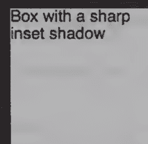

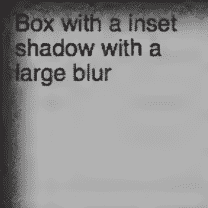

`box-shadow` 属性在 Firefox 3.5+、Safari 3.0+、Chrome 1+、Opera 10.5+ 以及 Internet Explorer 9+ 中均支持阴影定义，但旧版本不支持 `inset` 关键字。关于如何在 IE6 到 IE8 中使用 `box-shadow` 属性和私有的 `filter` 扩展创建跨浏览器投影的更多信息，请查看我的博客文章。

## background-size 属性

在 CSS 2.1 之前，背景图像以默认大小显示。如果你想在元素后面有一个图像，要么确保图像的大小与元素匹配，要么使用一些技巧将图像放在具有较低 `z-index` 值的 `div` 中并调整大小。

但现在图像可以使用 `background-size` 属性进行缩放或调整大小，它接受两个值：第一个用于水平尺寸，第二个用于垂直尺寸（如果只给一个，则第二个假设为 `auto`）。

- `auto`: 调整图像尺寸以保持其原始宽高比；如果两个值都是 `auto`，图像按正常大小显示。
- `<percentage>`: 将图像的大小调整为元素（而非图像）背景区域的百分比。
- `<length>`: 将图像的大小调整为指定的长度。

图 14.3 演示了使用 `<percentage>` 和 `<length>` 的 `background-size` 属性。

```css
div.one {
  background: url(images/background_sizing.png) no-repeat;
}
div.two {
  background: url(images/background_sizing.png) no-repeat;
  /* 用于 Firefox 3.6 */
  -moz-background-size: 100% 50px;
  /* 用于 Safari 和 Chrome */
  -webkit-background-size: 100% 50px;
  /* 用于 Opera */
  -o-background-size: 100% 50px;
  /* W3C 规范 */
  background-size: 100% 50px;
}
```

```css
div.three {
  background: url(images/background_sizing.png) no-repeat;
  /* 用于 Firefox 3.6 */
  -moz-background-size: 100%;
  /* 用于 Safari 和 Chrome */
  -webkit-background-size: 100%;
  /* 用于 Opera */
  -o-background-size: 100%;
  /* W3C 规范 */
  background-size: 100%;
}
```

```html
<div class="one">
  无设置大小的背景
</div>

<div class="two">
  background-size 设置为 100% 50px 的背景
</div>

<div class="three">
  background-size 设置为 100% 的背景
</div>
```


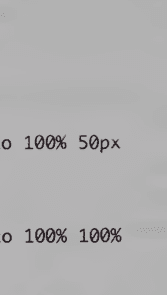

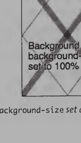

## CSS 指南

作为组合值的替代方案，关键字 `contain` 和 `cover` 描述了背景填充空间的行为。


- `contain`: 图像尺寸尽可能大以便包含在元素内；如果图像的宽高比与背景区域不一致，则其中一边为 100%，另一边小于长度。

- `cover`: 调整图像尺寸使其放大（或缩小）以完全填充区域；如果图像的宽高比与背景区域不一致，则其中一边为 100%，另一边大于长度。

```css
div {
  background: url(images/background_sizing.png);
  no-repeat;
  /* 用于 Firefox 3.6 */
  -moz-background-size: cover;
  /* 用于 Safari 和 Chrome */
  -webkit-background-size: cover;
  /* 用于 Opera */
  -o-background-size: cover;
  /* W3C 规范 */
  background-size: cover;
}
```

```css
div.three {
  background: url(images/background_sizing.png);
  no-repeat;
  /* 用于 Firefox 3.6 */
  -moz-background-size: contain;
  /* 用于 Safari 和 Chrome */
  -webkit-background-size: contain;
  /* 用于 Opera */
  -o-background-size: contain;
  /* W3C 规范 */
  background-size: contain;
}
```

```css
div {
  background: url(images/background_sizing.png);
  no-repeat;
}
```

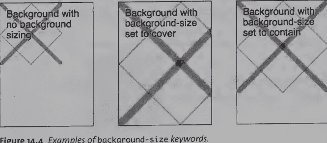

# 第 14 章：CSS 并不遥远的未来

图 14-5

带有三种颜色的线性渐变。

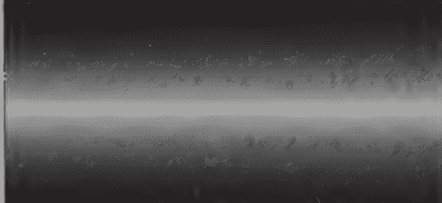

## 框图像

使用 `border-image` 属性，基于图像的灵活框可以替换标准的框。这是通过将框区域划分为九段网格来实现，代表框区域的每个角和每个边，如图 14.6 所示。单个图像文件同样被切分成九部分，并映射到框区域的每个区域以及容器的中心。

`border-image-property` 的值由一个图像引用、一个将图像分为九个段的描述、这些段的定位方式，最后关于它们如何平铺以填充可用区域的描述组成。

## border-image-source

`border-image-source` 属性接受作为边框图像的图像引用。

## border-image-slice

`border-image-slice` 定义了四条线如何将图像切割成若干段，这些线相对于图像四个侧的内缩。对于图 14.6 所示的图像，将这些分割线放置在距离每个边缘 30 像素处以创建九个均匀的段是合理的。与每个边缘的距离可以通过以下值来测量：

- `<number>`: 像素数（或 SVG 图像的坐标）。位图背景图像隐含为像素单位，且应省略单位。

- `<percentage>`: 基于图像尺寸的百分比值。

可以通过在切片位置值后添加正斜杠 (`/`)，通过 `border-image-slice` 属性可选地为边框分配宽度。这些宽度测量与 `border-width` 属性相同，如果两个属性都设置了，则作为 `border-image-slice` 部分设置的边框宽度值将覆盖 `border-width` 属性中设置的值。示例设置分割图像的切片为距离每个边缘 30 个单位，顶底部边框宽度为 30 像素，左右边框宽度为 15 像素。

```css
div.one {
  /* for Firefox */
  -moz-border-image-slice: 30 / 30px 15px;
  /* for Safari and Chrome */
  -webkit-border-image-slice: 30 / 30px 15px;
  /* W3C specs */
  border-image-slice: 30 / 30px 15px;
}
```

`border-image-slice` 的边框宽度行为允许为仅理解传统属性的浏览器设置一个宽度，并为理解 `border-image` 的浏览器更改尺寸。

## border-image-repeat

`border-image-repeat` 属性定义了图像切片如何填充侧边框和边框区域中间部分的弹性空间。可以使用以下关键词中的一个或两个：

- `stretch`: 图像切片被缩放以适应可用空间，不重复（默认值）。

- `repeat`: 图像切片被缩放但不平铺以填充可用空间。结果是图像在某些边缘上可能会被裁剪。

- `round`: 图像切片被平铺；但只使用完整的图像。然后这些平铺被均匀缩放以填充剩余空间。

如果只提供一个关键词，它将同时应用于边框和中心区域。

## border-image (Shorthand)

简写属性 `border-image` 接受上述三个子属性，以及额外的 `border-image-width` 和 `border-image-outside` 属性（描述图像在边框区域的绘制位置），顺序为 `<border-image-source>`、`<border-image-slice>`、`<border-image-repeat>`。

**图 14.7** 使用图 14.6 中的图像作为边框图像，并演示了 `border-image-repeat` 值之间的差异。

```css
div {
  /* set common width for all browsers */
  border-width: 30px;
}
div.one {
  /* for Firefox */
  -moz-border-image: url(images/border_background_tile.png)
  30 30 30 30 round;
  /* for Safari and Chrome */
  -webkit-border-image: url(images/border_background_tile.png)
  /* W3C specs */
  border-image: url(images/border_background_tile.png) 30 30 round;
}
```

```css
div.two {
  /* for Firefox */
  -moz-border-image-slice: 30 / 30px 15px;
  /* for Safari and Chrome */
  -webkit-border-image-slice: 30 / 30px 15px;
  /* W3C specs */
  border-image-slice: 30 / 30px 15px;
}
```

`border-image-slice` 的边框宽度行为允许为仅理解传统属性的浏览器设置一个宽度，并为理解 `border-image` 的浏览器更改尺寸。

`border-image-repeat` 属性定义了图像切片如何填充侧边框和边框区域中间部分的弹性空间。你可以使用以下关键词中的一个或两个：

- `stretch`: 图像切片被缩放以适应可用空间，不重复（默认值）。

- `repeat`: 图像切片被缩放但不平铺以填充可用空间。结果是图像在某些边缘上可能会被裁剪。

- `round`: 图像切片被平铺；但只使用完整的图像。然后这些平铺被均匀缩放以填充剩余空间。

如果只提供一个关键词，它将同时应用于边框和中心区域。

## border-image (Shorthand)

简写属性 `border-image` 接受上述三个子属性，以及额外的 `border-image-width` 和 `border-image-outside` 属性（描述图像在边框区域的绘制位置），顺序为 `<border-image-source>`、`<border-image-slice>`、`<border-image-repeat>`。

**图 14.7** 使用图 14.6 中的图像作为边框图像，并演示了 `border-image-repeat` 值之间的差异。

```css
div {
  /* set common width for all browsers */
  border-width: 30px;
}
div.one {
  /* for Firefox */
  -moz-border-image: url(images/border_background_tile.png)
  30 30 30 30 round;
  /* for Safari and Chrome */
  -webkit-border-image: url(images/border_background_tile.png)
  /* W3C specs */
  border-image: url(images/border_background_tile.png) 30 30 round;
}
```

- `matrix(<number>, <number>, <number>, <number>, <number>, <number>)`: 为元素的变换指定一个线性变换矩阵（http://en.wikipedia.org/wiki/Linear_transformation#Examples_of_linear_transformation_matrices）。

从图 7.6 中用于负定位演示的日期标记旗帜图形开始，你可以将旗帜和文字旋转 270 度，使其与其匹配的内容项并排排列。

```css
/* 使用 transform 对 7.6 进行修改 */
/* 调整位置 */
top: 29px;
left: -81px;
```

```css
/* 针对 Firefox */
-moz-transform: rotate(270deg);
/* 针对 Safari 和 Chrome */
-webkit-transform: rotate(270deg);
/* 针对 Opera */
-o-transform: rotate(270deg);
/* W3C 标准 */
transform: rotate(270deg);
}
```

在上一个代码示例中，元素经过旋转，然后使用绝对定位进行放置，以正确布局（见下一页的图 14.9）。旋转之前的位置（即在任何不支持过渡的浏览器中）由虚线轮廓显示。

图 14.9

旗帜和文字内容旋转 270 度，变为垂直位置。

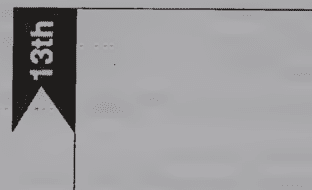

如果这个变换之前的位置是不理想的（例如，因为它偏移得太低），可能最好按照原始示例那样对元素进行定位，然后应用变换来获得其最终外观：旋转和位移（图 14.10）。

```css
/* 使用两个 transform 对 7.6 进行修改 */
/* 针对 Firefox */
-moz-transform: rotate(270deg) translate(-19px,-31px);
/* 针对 Safari */
-webkit-transform: rotate(270deg) translate(-19px,-31px);
/* 针对 Opera */
-o-transform: rotate(270deg) translate(-19px,-31px);
/* W3C 标准 */
transform: rotate(270deg) translate(-19px,-31px);
```

图 14.10

旗帜和文字内容经过旋转和位移，留下了一个更理想的非变换状态。

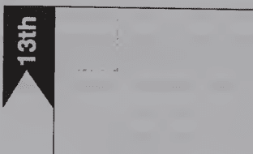

## transform-origin


任何变换的原点默认都是元素的中心（50%）。你可以使用 `transform-origin` 属性调整此原点，允许围绕不同的点进行旋转。`transform-origin` 接受两个值：第一个是元素的水平位置，第二个是垂直位置。固定单位（如 `px` 单位）、负值以及大于 100% 的值均被接受，这允许原点移动到元素之外。同样被接受的还有定义原点的关键字，包括 x 轴上的 `left`、`center`、`right`，以及 y 轴上的 `top`、`center`、`bottom`。

图 14.11 显示了当 `transform-origin` 从默认位置改变时，元素旋转效果会发生变化。

图 14.11

围绕变换原点旋转的元素。斜线箭头表示原点的新位置；圆形表示旋转变换。

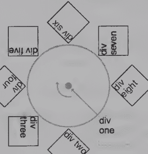

> 注意 为了简洁起见，以下代码仅显示了针对 Firefox 的。

```css
div {
  height: 50px;
  width: 50px;
  border: 1px solid #000;
  -moz-transform-origin: -100% -100%;
}
div.one {
  border: 1px dashed #ccc;
}
div.two {
  -moz-transform: rotate(45deg);
}
div.three {
  -moz-transform: rotate(90deg);
}
div.four {
  -moz-transform: rotate(135deg);
}
div.five {
  -moz-transform: rotate(180deg);
}
div.six {
  -moz-transform: rotate(225deg);
}
div.seven {
  -moz-transform: rotate(270deg);
}
div.eight {
  -moz-transform: rotate(315deg);
}
<div class="one">one</div>
<div class="two">two</div>
<div class="three">three</div>
<div class="four">four</div>
<div class="five">five</div>
<div class="six">six</div>
<div class="seven">seven</div>
<div class="eight">eight</div>
```

第二个值是可选的。如果省略，则假设为中心。CSS3 `transform` 属性、其值以及 `transform-origin` 属性在 Safari 3.2+、Chrome 3+、Opera 10.5+、Firefox 3.5+ 和 Internet Explorer 9 中以某种形式支持。

## 过渡

过渡是一种定义动画变化参数的方式。

### transition-property

`transition-property` 指定哪些属性将应用过渡。

- `none`: 不过渡。
- `all`: 所有属性都进行过渡。
- `<property-name>`: 指定特定的属性。

### transition-duration

`transition-duration` 定义过渡完成所需的时间。

- `<time>`: 过渡所需的时间（以秒 `s` 或毫秒 `ms` 为单位）。

### transition-timing-function

`transition-timing-function` 定义过渡的速度曲线。

- `ease`: 默认值，开始慢，中间快，结束又慢。
- `linear`: 匀速过渡。
- `ease-in`: 开始慢，然后变快。
- `ease-out`: 开始快，然后变慢。
- `cubic-bezier(<n1>, <n2>, <n3>, <n4>)`: 自定义三次贝塞尔曲线。

### transition-delay

`transition-delay` 定义过渡开始之前的延迟。

- `<time>`: 过渡开始前的延迟时间。

### transition (简写)

`transition` 简写属性接受一组过渡属性值，顺序为：`<transition-property>` `<transition-duration>` `<transition-timing-function>` `<transition-delay>`。以下代码为图像的悬停状态定义了变换，并应用了基础平缓效果。

```css
img {
  /* 针对 Firefox */
  -moz-transition: -moz-transform 0.5s ease-out;
  /* 针对 Safari 和 Chrome */
  -webkit-transition: -webkit-transform 0.5s ease-out;
  /* 针对 Opera */
  -o-transition: -o-transform 0.5s ease-out;
  /* W3C 标准 */
  transition: transform 0.5s ease-out;
}
```


Mozilla 开发者中心有一篇关于使用过渡的详细文章：https://developer.mozilla.org/en/CSS/CSS_transitions。CSS过渡支持 Safari 3.2+、Chrome 3+、Opera 10.5+、Firefox 4+ 和 Internet Explorer 9。

# 索引 257

## B

- `background-image-property`, 124–125
- `background-position-property`, 125–126
- 基础, 128
- 按钮和, 202
- 用于伪造圆角, 140–141
- 适应元素, 128
- 分层处理, 107–109
- 多个, 127
- 雪位图, 133–135
- 背景, 105–109, 123–135
- 背景图片，基础, 128
- 背景图片（按钮）, 202
- 背景图片，适应, 128
- 背景图片，多个, 127
- 背景简写属性 `shorthand-property`, 126–127
- `background-bottom-property`, 124, 125
- `background-color-property`, 124, 125
- `background-position-property`, 125–126
- `background-repeat-property`, 125
- `background-size-property`, 235–240
- 边框技巧, 241, 245
- 列表符号，自定义, 128–130
- 巧妙的设计和, 133, 192
- 伪列布局, 106–107
- 表单控件和, 191
- 列表项上的图像, 174
- 元素重叠, 130–131
- 智能平铺, 131–132
- 雪位图图像, 133–135
- 伪元素的 `:before` 和 `:after`,
    - B 级浏览器, 30
- 块级元素, 9, 84
- Blueprint, 226
- `body` 元素, 108–105
- 边框, 105–148
- 基础, 123
- 边框背景, 241, 245
- 边框盒, 82
- 边框图像, 241
- 边框简写属性 `shorthand-property`, 136–137
- `border-collapse-property` (表格), 182–183
- `border-color-property`, 135
- `border-image-property` (简写), 243–245
    - `border-image-property`, 242
- `border-image-repeat-property`, 243
- `border-image-slice-property`, 242–243
- `border-image-source-property`, 242
- `border-radius-property`, 137–138
- `border-spacing-property` (表格), 184
- `border-style-property`, 135–136
- `border-width-property`, 73, 136
- 浮动元素上, 94
- 表单控件和, 91
- 轮廓, 138–139
- 圆角，伪造。参见 rounded
- 盒模型, 69–82
- 替代盒模型, 81–82
- 基础, 69–70
- `box sizing` 属性, 81–82
- 单元格水平居中齐, 80–81
- 最小和最大尺寸, 74–75
- 负边距, 78–80
- 嵌套元素, 75–77
- 百比计算和, 60
- 属性, 71–74
- `box-shadow`, 232–234
- `box-sizing-property`, 81–82
- 桥接库, 222–225
- 浏览器。参见 Web browsers
- `@font-face` 语法, 165
- 列表符号，自定义, 128–130
- Burdette, Lenny, 111
- 按钮, 201–204. 参见 buttons

## C

- `col()` 函数, 246–247
- 候选建议 (CR),
    - 细节, 6
- 级联属性, 5–6
    - 大写敏感性 (CSS), xviii–xix
- 表格中的单元格, 182–185
- 链选择器, 50
- 选框, 89, 197–199
- `:checked` 伪类选择器, 193–194
- 子组合器, 49
- 子选择器, 49
- Chrome 开发者工具, xii
- Clark, Keith, 223
- Clark, Richard, 221
- `.class` (类选择器), 39
- `clear` 属性, 97–99

## CSS 指南

- `clearfix` 工具类, 115
- Curvy Corners JavaScript 库, 145, 224
- 自定义列表符号, 128–130
- 本书示例, xvii
- CSS 代码样式, 15–20
- 编写 CSS, xviii–xxii

## D

- 虚线型, 136
- 带有透明度的颜色, 64–66
    - 背景颜色, 124, 125
    - 基础, 62–64
    - `border-color` 属性, 135
    - 颜色渐变, 240–241
    - 调色板, 67–68
    - 设计和, 67
- `data:` URI 方案, 61
    - 表格数据 (表单), 199
- `data:` URI 类型, 61
- 声明块, 3
- 声明/声明块, 3
- 后代组合器, 48–49
- 设计
    - 表单控件和, 190–191
    - `outline-color` 属性, 139
    - 文本颜色, 64
    - 巧妙的设计, 133
    - 响应式设计 (媒体), 216–217
    - 开发者工具, xxl–221
- 设备
- 列。参见 multicolumn layouts
    - 列设计, 121–122
    - 伪列, 106–107
    - 固定尺寸, 117
    - 灵活列, 119
- 组合器, 48–49
- 组合选择器, 50
    - 注释代码, ix, 17–20
    - 计算值, 7
    - 条件媒体, 29–30
    - 列设计, 121–122
    - `contain` 关键字, 238
    - 手持设备, 213–214
    - 用户代理和, 12
- 盒模型中的尺寸和最大, 74–75
- `disabled` 伪类选择器, 193–194
- `display`, 84–85
- `display:none` 属性, 122
    - 容器元素, 88
    - 包含块, 89–91
    - 转义字符, 110–111
- Doctype, 25–26
- 文档模型 (DOM)
    - JavaScript 和, 15
- 文档，CSS 代码, 17–18
- DOM, JavaScript 和, 15
- 点状关键字, 10
- 下拉菜单, 111–112
- 过渡时长, 254
- 动态伪类, 41
- 内容
    - 在 CSS 中, 101, 102
    - 生成, 175–176, 212
    - 隐藏, 121

## E

- CSSCenter, 223
- Edwards, Dean, 223
- 元素
    - 内容块, 102–104
    - 内容盒, 81, 82
    - 连续媒体，定义, 12–13
    - 角。参见 rounded corners
    - 计数器 (列表), 177–179
    - `cover` 关键字, 238
- “创建演示文稿/幻灯片”
    - HTML & CSS, 207
    - 编写, viii–xxii
    - 代码样式, 15–20
    - CSS2, 2.1, CSS3, 11
    - 基础, 9
    - 内容显示元素类型, 84–85
    - 表单元素。参见 form controls
    - 嵌套，字体大小, 149–151
    - 嵌套, 75–77
    - 背景中的重叠, 130–131
    - 无需装饰的强制, 140
    - 重用。设置重置。
- `em` 单位, 58, 60
- 字体嵌入, 162–165
- `empty` 伪类选择器, 46
- Eric Meyer's Reset, 221
- 转义字符 (`\`), xix
- 出口, 60
- `text-indent` 属性, 158
- `text-shadow` 属性, 159
- `text-transform` 属性, 156
- `white-space` 属性, 158
- `word-spacing` 属性, 156
- `word-wrap` 属性, 158

## F

- 伪列, 106–107
- F 级浏览器, 34
- 字段，条件 (表单), 199–201
- Firebug 扩展, xvi, xxl
- Firefox
- 字体。参见 font styling.Web fonts and typography
    - 嵌入, 162–165
    - 字体服务, 165–166
    - Fonts.com 服务, 165–166
    - 表单控件, 189–194
    - 背景和边框, 190–191:
        - 颜色, 191–193
        - 实例, 192–193
        - 伪类选择器, 193–194
        - 尺寸, 189–193
        - 开发者工具, xvi, xxl
- Yahoo!Slow, xx
- 第一个和最后一个伪类选择器,
    - 44–45
    - 第一个和最后一个类型的类选择器, 45
    - `::first-element` 伪元素, 47
    - `::first-line` 伪元素, 47
        - 固定定位, 88–89
- 固定尺寸列, 117–119
- 固定宽度布局, 11
- Flash 替换 sIF, 169
    - `z-index` 和, 92
- 灵活列, 111, 247
- 浮动列，排列, 115
- 基础, 93
- 表单元素
    - 条件字段, 199–201
    - 字段上方标签, 194–195
    - 字段下方标签, 197
    - 多列表单, 195–196
    - 占位文本, 201
    - 单选按钮和复选框, 197–199
    - 表格数据，输入, 199
    - 表单, 187–201
    - 在不同浏览器中, 188, 192
    - 表单控件。参见 form controls
    - 元素布局, 177–188
- 浮动列，排列, 115
- 浮动列表项, 109–110
- 浮动边距, 104–105
    - `clear` 属性, 97–99
    - 在各种操作中, 177–188
    - 四边框属性，定义值, 4
    - 框架, 225–228
    - 常见框架, 226
    - 限制, 227–228
    - 功能表示法, 62–63
    - 伪类, 41
- font-face Generator, 165, 166
- 字体样式
    - `font` 简写属性, 153–154
    - `font-family` 属性, 148–149
    - `font-size` 属性, 149–151
    - `font-style` 属性, 152
    - `font-variant` 属性, 152
    - `font-weight` 属性, 152
- 生成的兄弟组合器, 49
- 生成的内容, 175–176, 212
- 全局样式, 16
- Google Font Directory, 166
- Google Page Speed, xxl
- 颜色渐变, 240–241
- 评级（浏览器）, 32–34
- `groove` 关键字, 13
- Gustafson, Aaron, 223
- 文本周围的间隙, 77, 79, 104–105
- `text-decoration` 属性, 155–156

## H

- 针对浏览器的破解, 28–29


# 索引

## 符号

- `Halbach, Till`, 202
- `手持设备`, 213–214
- `布局`, 30–32
- `高度属性`, 70, 71–53
- `十进制颜色值`, 62
- `hidden 关键字`, 93
- `水平分块`, 0–81
    - `href 伪类`, 41
    - `hsla(s,a)`, 颜色, 65, 66
    - `hns(h,s)`, 颜色方案, 63
    - `HTML8`, 12–15
    - `HTML <link> 元素`, 13–14
    - `HTML <style> 元素`, 108–109
    - `HTML5 Reset`, 221
    - `色相-饱和度-亮度颜色方案`, 63
    - `超链接，打印`, 212

## I

- `ID 选择器`, 38
- `IE7.5`, 223
- `图像`。参见背景图片
    - `边框图像`, 241–245
- `图像替换`, 167–169
- `list-style-image 属性`, 173, 174
- `“增加你的字体栈使用 Font Matrix,”`, 162
- `继承`, 7, 82–193
- `内联元素`, 9
- `Internet Explorer (IE)`
    - 与 `桥接库` 和, 223
    - `条件注释` 和, 29–30
    - `开发者工具`, xi
    - `布局` 和, 30–32
- `Irish, Paul`, 165

## J

- `JavaScript`
    - `添加四角元素`, 145
    - `浏览器支持`, 222–225
    - `插入库支持`, 34–35
    - `样式表`, 15
- `JavaScript 指南`, 111

## K

- `关键字`。参见特定关键字
    - `background-repeat 属性` 和, 125
    - `border-repeat 属性` 和, 243
    - `border-style 属性` 和, 135–136
    - `颜色关键字`, 63
    - `font-family 属性` 和, 148–149
    - `列表`, 175
- `Koch, Peter Paul`, 27
- `Korpela, Jukka`, 27

## L

- `实验室`, 194–195, 197, 199
- `Iin`, 160
- `语言伪类`, (`LC`), 10
- `最后调用 (LC)`
    - `最后一个元素伪类`, 44–45
- `左侧关键字`, 93, 97
- `Less`, 228
- `letter-spacing 属性`, 157
- `插入 JavaScript-Mart`, 34–35
- `字体许可`, 165–166
- `line-height 属性`, 153
- `链接伪类选择器`, 41
- `链接按钮`, 202–204
- `布局布局`, 119
- `列表`, 17–179
    - `::before 和 :after 伪元素`, 175, 176
    - `:marker 伪元素`, 175
    - `counter()`, 177
    - `counters`, 179
    - `生成的内容`, 175–176
    - `列表项`, 109–110
    - `列表属性`, 172–177
    - `列表项默认值`, 172
    - `ul, 和 li ii`, 172

## N

- `否定伪类选择器`, 46
- `负外边距`, 78–80
- `正向定位`, 110
- `Neil, Jon`, 22
- `嵌套元素`, 75–77
    - `列表` 和, 175
- `已知关键字`, 85, 93–97
- `not 关键字`, 214–215
- `th child 伪类选择器`, 43–44
- `th of type 伪类选择器`, 45

## O

- `面向对象的 CSS (OOCSS)`, 226
- `无没有列表元素`, 172
- `only child 伪类选择器`, 45
- `only 关键字`, 215
- `only of type 伪类选择器`, 36
- `准备打印`, 211–212
- `Pearce, Alan`, 118
- `Pedrick, Alan`, xxii
- `口袋书`, 31
- `百分比单位 (%)`, 59–60
- `像素单位 (px)`, 58, 60
- `像素、修复圆角`, 以及 145
- `点 (pt)`, 59, 60
- `定位 (position)`
    - `background-attachment 属性`, 125
    - `list-style-position 属性`, 173
    - `定位元素`, 83–99
        - `绝对定位`, 85–88
        - `clear 属性`, 97–99
        - `默认属性，修改`, 84
        - `display 属性`, 88–89
        - `固定定位、浮动元素`, 93–97
        - `起源和包含块`, 89–91
        - `定位基础`, 85
        - `相对定位`, 85
        - `static值`, 85
    - `《CSS 入袋指南》`
    - `定位元素（续）`
        - `visibility 属性`, 93
        - `z-index 属性`, 92
    - `定位属性`, 125–126
    - `position:relative`, 102
- `偏好、用户浏览器设置以及`, 23
- `处理器`, 228
- `打印媒体`, 210–213
- `属性`。另见特定属性
    - `盒模型`, 71–74
    - `多单词的驼峰命名法`, 15
    - `实例以及`, 7
    - `style 属性，定义`, 3
    - `用户自定义`, 23
- `建议 (R)`, 规范草案, 10–11
- `关系选择器`, 48–49
- `相对长度单位`, 85, 131
- `渲染模式`, 24–27
- `替换元素`, 9
- `required 伪类选择器`, 193–194
- `重置`, 219–222
- `资源，通用`, xviii
- `“响应式网页设计”`, 217
- `RGB 颜色`, 62–63
- `rgb(r, g, a) 颜色值`, 65, 66
- `rgb(r,g,b)`, 62–63
- `right 关键字`, 93, 97
- `root 元素伪类选择器`, 43
- `旋转`, 249–253
- `圆角，淡入`, 139–145
    - `背景图像，使用`, 140–141
    - `四个背景，使用`, 143
    - `当一条边固定时`, 141–143
- `表格中的行`, 185
- `建议 (PR)`
- `伪类选择器`, 41–46
    - `:-enabled, :checked (UI 伪类)`, 42
    - `:-first-child, :last-child (伪类类)`, 44–45
    - `:-first-of-type, :last-of-type (伪类类)`, 45
    - `:-hover: focus (动作 伪类)`, 41
    - `:-long() (否定伪类)`, 46
    - `:-link, :visited (链接伪类)`, 41
    - `:active`, 42
    - `:-not() (否定伪类)`, 46
    - `:-nth-child(), :nth-of-child (伪类类)`, 43–44
    - `:-nth-of-type(), :nth-of-type (伪类类)`, 45
    - `:-only-child (伪类类)`, 45
    - `:-only-of-type (伪类类)`, 46
    - `:-root (根元素伪类)`, 43
    - `:-target (目标伪类)`, 42
- `伪元素选择器`, 46–48
- `规则`, 3
    - `@font-face 规则`, 162–163
    - `@import 规则`, 14, 208
    - `@import 规则 (HTML)`, 14
    - `@media 规则`, 208–209
    - `@page 规则`, 211
- `编码样式`, 18–20
- `Rutter, Richard`, 162

## P

- `padding 属性`, 70, 72–73
- `页面布局`, 101–122
    - `背景 (backgrounds)`。见背景
    - `内容块，创建`, 102–104
    - `元素转义`, 110–111
    - `外边距浮动`, 104–109
    - `列表项`, 125
    - `多列布局`。见多列布局
    - `悬停效果、工具提示、下拉菜单`, 112
- `分页属性`, 210–211
- `分页媒体 (paged media)`, 13
- `页面 (pages)`
- `Meyer, Eric`, 221
- `微软 (Microsoft)`
    - `条件注释`, 29–30
    - `Web 字体工具 (WEFT)`, 165
- `最小和最大尺寸`, 74–75
- `min-width 和 max-width 布局`, 121–122
- `混合列布局`, 213–214
- `移动媒体`, 223–224
- `等宽字体`, 149, 161
- `Mozilla 开发者中心`, 211
- `多列布局 (multicolumn layouts)`
    - `限制`, 121–122
    - `弹性列`, 119, 121
    - `浮动列、换行`, 115
    - `表单 (forms)`, 195–196
    - `混合列`, 119–121
    - `三列`, 117–118
    - `两列`, 113–116
    - `“多列布局跳出盒框”`, 118
- `多重背景图像`, 127

## Q

- `查询，媒体`, 214–218
- `Quirks Mode (怪模式)`, 25
- `引号`, xix–xx, 61

## R

- `radio 按钮`, 189–190, 192–199
- `半径`
    - `border-radius 属性`, 137–138
- ``
- `属性选择器`, 39–41
- `支持`, 54
- `.class (类选择器)`, 组合, 48–49
- `组合与链式`, 50
- `定义`, 37
- `分组`, 54
- `important 声明`, 53
- `伪类选择器`。见伪类
- `伪元素选择器`, 46–48
- `可读性`, 55
- `易用性`, 55–56
- `选择性`, 51–53
- `速度`, 54–55
- `语句以及`, 3
- `目标浏览器`, 28
- `类型选择器`, 38
- `分号 (;)`, 规则以及, 4
- `serif 字体`, 148, 261
- `阴影`, 232–235
- `Shea, Dave`, 269
- `简属性`。见特定简属性
    - `background 简属性`, 126–127
    - `border radius 简属性`, 136–138
- `static值`, 85, 88
- `结构伪类`, 41
- `style 属性 (HTML)`, 15
- `样式表`
    - `作者、用户、代理`, 5
    - `基础`, 2
    - `浏览器`, 22
    - `用户`, 5, 23–24
- `样式`。另见字体样式
    - `border-style 属性`, 135–136
    - `代码位置以及`, 16–17
    - `字体可读性审查`, 160
    - `outline-style 属性`, 139
- `Stylish Firefox 扩展`, 223
- `语法悬挂`, 28–29
- `系统字体`, 161–162

## S

- `Safari`
    - `开发工具`, xxi
    - `控件，以及`, 189
- `sans-serif 字体`, 149, 169
- `Sass`, 229
- `Schmitt, Christopher`, 108
- `选择 伪元素选择器`, 48
- `Selector`, 223
- `SelectorObject`, 54
- `选择器`, 37–56. 另见特定选择器
    - `id (ID 选择器)`, 38
    - `*(通用选择器)`, 38
    - `排列方式`, 18–20

## T

- `表格`, 180–185
    - `基础`, 180–181
    - `border-collapse 属性`, 182–183
    - `border-spacing 属性`, 184
    - `display 值`, 184–185
    - `table-caption`, 184
    - `table-layout 属性`, 182
- `表格数据，输入 (表单)`, 199
- `占位符文本 (表单)`, 201
- `text-align 属性`, 157
- `text-align 属性 (表格)`, 184
- `另见字体样式和`
- `text-decoration 属性`, 155–156
- `text-indent 属性`, 158
- `text-shadow 属性`, 159
- `text-shadow 属性`, 202
- `text-transform 属性`, 156
- `下划线`, 156
- `word-spacing 属性`, 158
- `list-style 属性`, 174
- `outline 属性`, 139
- `transition 简属性`, 254–255
- `侧边栏`, 116
- `尺寸`
    - `background-size 属性`, 236–240
    - `固定尺寸列`, 117–121
    - `font-size 属性`, 149–151
    - `表单控件，尺寸`, 189–190
- `智能铺瓷`, 131–132
- `声明的起源`, 66
- `响应式网页设计`, 217
- `三列布局`, 117–118
- `背景重复的`, 125
- `声明的特定性`, 5
- `规范，CSS 以及`, 9–12
- `分页媒体`, 13
- `三列布局`, 117–118
- `背景重复的`, 125
- `圆角`, 138
- `颜色渐变`, 64
- `透明度，添加到颜色中`
- `Web 字体工具 (WEFT)`, 165
- `悬停效果`, 111–112
- `变换与旋转`, 247–253
- `<transform-function> 值`, 248–249
- `transform 属性`, 247–253
- `过渡简属性`, 254–255
- `transform-origin 属性`, 251–253
- `transform-duration 属性`, 254
- `transform-timing-function`, 254
- `透明度`, 254
- `颜色`, 65–66
- `字体替换`, 161–169
    - `通过文本自定义字体`, 166–169
    - `嵌入字体，创建`, 165
    - `字体格式`, 164–165
    - `字体许可与使用`, 165–166
    - `系统字体`, 161–162
- `Typekit`, 166
- `字体`, 160
- `字体与字体学`
- `用户界面`。另见表单
    - `单选按钮和选择框，值`, 197–199
    - `在不同操作系统的形式`, 187–188

## V

- `:valid 和 :invalid 伪类选择器`, 193–194
- `验证工具`, xx
- `<transform-function> 值`, 248–249
- `alpha 值`, 65
- `background-repeat 属性`, 125
- `基准–9`
- `颜色值`, 62
- `声明属性的`, 3
- `display 值 (表格)`, 184–185
- `四边属性的`, 4
- `继承以及`, 7–8
- `指定的、计算的–8`
- `vertical-align 属性`, 155–154
- `visibility 属性`, 92
- `visibility:hidden 属性`, 112
- `visible 属性`, 93

## W

- `WAI-ARIA 规则`, 245–246
- `Walker`, 115
- `Web 浏览器，以及`, 222–225
- `桥布局样式表`, 22
- `通过 JavaScript 使用 CSS`, 34–35

## U

- `UI 伪类选择器`, 42
- `列表元素`, 172
- `统一资源标识符 (URIs)`, 61
- `通用选择器`, 38
- `URL`, 61
- `用值`, 8–19
- `用户代理`, 12–13
- `用户设置`, 23
- `用户样式表`, 23–24
- `可嵌入字体`, 165
- `字体格式`, 164–165
- `字体许可与字体字厂`, 165–166
- `简写属性`, 153–154
- `font-family 属性`, 148–149
- `font-size 属性`, 149–151
- `font-style 属性`, 152
- `font-variant 属性`, 152
- `font-weight 属性`, 152
- `line-height 属性`, 153
- `相对字体与固定尺寸字体`, 151
- `样式与可读性审查`, 160
- `系统字体`, 161
- `vertical-align 属性`, 154–155
- `Web 检查器`, xx–
- `下载字体的网站`
- `Adobe 标尺工具`, 67
- `书中的代码示例`, 272
- `Data: URI 厨房工具`, 61
- `Firebug 扩展`, xxi
- `X-UA-Compatible 请求头`, 27
- `更多信息的网站`
- `桥梁构建者`, 223
- `浏览器支持`, 232
- `clearfix 工具类`, 115
- `CSS 技巧`, 29
- `CSS2.1 和 CSS3`, 11
- `浮动元素`, 99
- `框架`, 226
- `通用资源`, xviii
- `Google Page Speed`, 32
- `“分级浏览器支持”`, 32
- `hasLayout`, 32
- `HSL 颜色`, 63
- `IE 的基础样式表`, 22
- `图像替换`, 169
- `模式`, 27
- `Mozilla 开发者中心`, 211
- `怪模式 (Quirks Mode)`, 26
- `重置`, 221
- `截图`, 188
- `SelectOracle`, 50
- `阴影`, 235
- `sIFR 项目`, 169
- `Sitepoint CSS 参考`, 211
- `Stylish Firefox 扩展`, 233
- `过渡效果`, 255
- `W3C`, 9
- `W3C 验证服务`, xx
- `WAI-ARIA`, 245, 246
- `Web 字体与样式`, 160, 162
- `绕过样式限制`, 192
- `Yahoo! Yslow`, xxii
- `网站`
- `模式与构建新网站`, 25
- `Web 标准与规范`, 9–12
- `WebFonts.Info 目录`, 166
- `Westivci`, 241
- `When Can I Use...`, 232
- `空白符`, xix
- `white-space 属性`, 158
- `表格宽度`, 162
- `宽度属性`
    - `框宽 (border-width)`, 136
    - `在盒模型中`, 70, 71
    - `行宽`, 139
- `word-spacing 属性`, 156
- `word-wrap 属性`, 158
- `换行`, 93–115

## X

- `X 级浏览器`, 34
- `X-UA-Compatible 请求头`, 26–27

## Y

- `Yahoo! Yslow`, xxii
- `YUI! 库`, 227
- `YUI 库 CSS 重置`, 221

## Z

- `斑马纹`, 43–44
- `z-index 属性`, 92, 192
- ``


可无限在线访问来自 Peachpit、Adobe Press、Apple Training 和 New Riders 的所有视频和书籍，以及来自其他领先出版商的内容，包括：O'Reilly Media, Focal Press, Sams, Que, Total Training, John Wiley & Sons, Course Technology PTR, Class on Demand、VTC 等。

无需投入时间或签署合同！按月或按年订阅。每月 19.99 美元

# 观看 阅读 创建

# 立即注册

peachpit.com/creativeedge

# CSS Pocket指南

这是你理解层叠样式表（CSS）构建模块的必备指南，包含了规则、属性和特性。《CSS Pocket指南》将指导你如何：

- 利用新型和新兴的 CSS3 属性。
- 使用选择器控制要样化的元素。
- 调整块级元素的大小。
- 通过网络字体设计可读的文本内容。
- 元素相对于页面其他元素的定位。
- 使用多列网格布局 HTML 内容。
- 应用背景和框以获得你所需的视觉效果。
- 选择、嵌入和控制字体。
- 获取跨浏览器的一致结果。
- 为特定设备和其他媒体类型创建样式。

| 书籍难度 | 计算机书架分类：Web 设计 |
|---|---|
| 初级 中级 高级 | 涵盖：CSS，包括 CSS3 |
| 美元 14.99 加拿币 17.99 | CS/CAT：二手 文本 |
| 标题：CSS POCKET GUIDE | |
| 作者：CASCIANDO | 供应商：PEARSON LE 出版 |
| creative edge 可在 Peach Press 获取 www.peachpress.com | 99990 9780321732279 二手书 |
