# CUDA C++ 编程初学者指南：通过步进详解与实际应用解锁 GPU 计算潜力

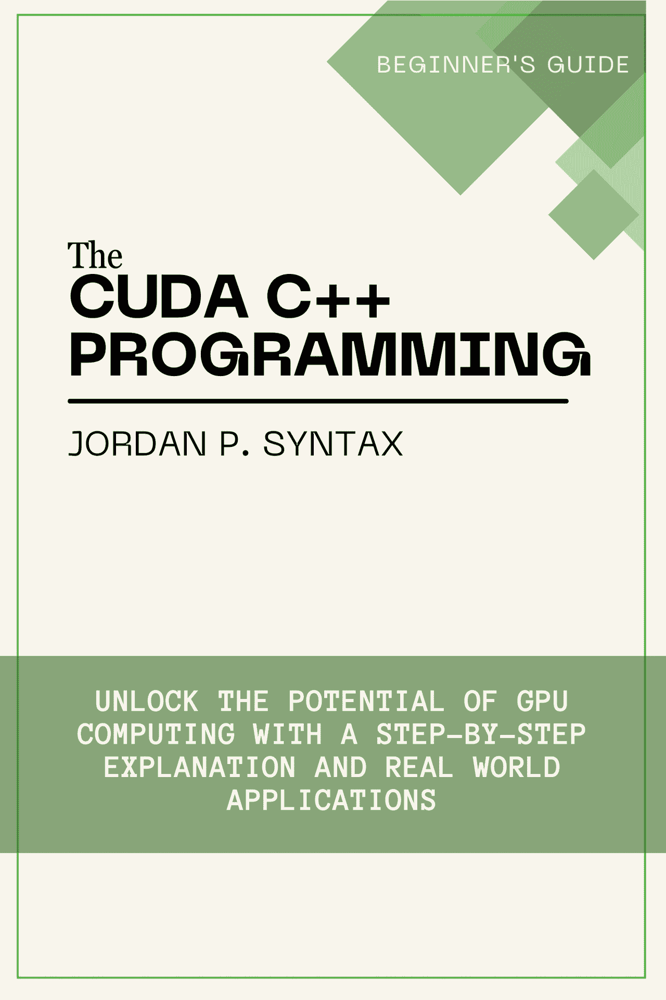


## 引言


## CUDA C++ 编程到底涉及什么

### CUDA C++ 的定义与目的

CUDA（Compute Unified Device Architecture）是 NVIDIA 开发的一种并行计算体系平台和编程模型。它允许开发者使用 C、C++ 等语言利用 GPU 强大的并行处理能力来加速计算密集型任务。

### CUDA 的演变

CUDA 最初于 2006 年发布，最初主要局限于图形渲染。随着技术的演进，它已演变为通用的通用 GPU（GPGPU）计算框架，使其能够将 GPU 应用于深度学习、科学计算、数据分析和人工智能等广泛广泛领域。

### CUDA 在现代计算中的重要性与影响

在数据量爆炸的时代，传统的 CPU 计算已无法满足许多复杂算法的需求。CUDA 通过将计算任务拆分并在成千上万个核心上并行执行，极大地缩短了处理时间。

## GPU 计算的优势

GPU 拥有许多小型核心，专门用于高吞吐量的并行任务。相比于 CPU，GPU 在处理矩阵运算、图像处理等具有高度相似性的任务时具有显著效率优势。

## 第一章：环境搭建

### 安装 CUDA Toolkit

### 下载并安装 CUDA Toolkit

### 配置 NVCC 编译器

NVCC 是 CUDA 的编译器，它负责将 CUDA C++ 代码编译成可以在 CPU 和 GPU 上执行的机器代码。

## 第二章：基础知识

### CUDA 架构

理解 GPU 的硬件结构，如流处理器。

### CUDA 内存模型

学习全局内存、共享内存、常量内存以及局部内存。

### CUDA 执行模型

了解内核如何在 GPU 上启动以及线程如何组织和执行。

## 第三章：编写你的第一个 CUDA 程序

### 基础语法

### 向量加法：真实案例

## 第四章：内存管理

### 分配与释放设备内存

### 主机与设备之间的数据传输

## 第五章：使用 CUDA 进行并行编程

### 线程层级

### 网（Grids）与块（Blocks）

### 线程同步

## 第六章：CUDA 优化

### 理解线程束分歧（Warp Divergence）

### 使用共享内存

### 改进内存访问

## 第七章：高级 CUDA 概念

### 动态并行

### 统一内存

## 第八章：真实的 CUDA 应用

### 图像处理：应用模糊滤波器

### 科学计算：求解热方程

### 机器学习：训练简单的神经网络

## 第九章：CUDA 应用的调试与性能分析

### 使用 `cuda-gdb` 进行调试

### 使用 `nvprof` 进行性能分析

## 第十章：CUDA 库与工具

### CUDA 库引言

### 应用 CUDA 库

## 第十一章：多 GPU 编程

### 多 GPU 编程引言

### 使用多 GPU 解决方案

## 第十二章：CUDA 最佳实践

### 代码最佳实践

### 性能优化技巧

### 调试与测试

## 第十三章：GPU 计算的未来趋势

### 新兴技术

## 第十四章：安全与隐私

## 第十五章：游戏与图形

### 医疗保健与生命科学

## 结论

### 回顾关键概念

### 附加资源

## 高性能

与传统的 `CPU` 方案相比，`CUDA C++` 利用 GPU 的并行处理能力来加速复杂的计算。这一特性对于需要海量数据集或复杂计算的任务（如科学模拟和机器学习）至关重要。

### 高能效

GPU 每单位电量执行的计算多于 `CPUs`。这种高能效在数据中心尤为有用，因为降低功耗可能会节省大量的成本。

### 性效益

尽管单个 `GPUs` 的成本可能很高，但它们替代多个 `CPUs` 的能力使其成为高性能计算任务的负担得起的选择。这是因为单个 `GPU` 的并行处理能力允许它完成多个 `CPUs` 的工作。

### 多功能

GPU 最初是为了生成视觉效果而开发的，但现在已成为各种应用的有用工具。`CUDA` 使它们在科学研究、金融建模、人工智能、深度学习和其他应用中变得非常有用。

### 可扩展性

`CUDA C++` 允许程序扩展到许多 `GPUs` 上，包括 `GPUs` 集群。这种扩展性对于解决包括气候建模和遗传研究在多个领域的大规模计算挑战至关重要。

## 机器学习领域的创新

机器学习是 `CUDA` 最具革命性的应用之一。由 `CUDA` 驱动的 GPU 已成为 `TensorFlow` 和 `PyTorch` 等流行深度学习框架的基础，允许神经网络在海量数据集上更快地训练。

随着时间的推移，`CUDA C++` 的相关性只会增加。在处理日益庞大的信息和执行更复杂分析的需求推动，所有行业对高性能计算的需求都在增长。`CUDA` 为满足这些需求提供了强大且多功能的基础，允许开发者推向并行计算的前沿。

## GPU 计算的优势

### 高计算能力

由于具有并行处理能力，`GPUs` 擅长同时处理多个进程。与顺序执行操作的 `CPUs` 不同，`GPUs` 可以同时运行数百个线程。这使得它们适用于计算密集型任务。

考虑处理高分辨率照片的情况。`CPU` 逐个处理每个像素，而 `GPU` 一次处理数百万个像素。这种并行性使得处理时间要快得多。气候建模、分子动力学和天体物理模拟都从 `GPUs` 的速度和效率中大大获益。研究人员可以运行更全面的模型，并获得比基于 `CPU` 方案更快的结果。

### 高能效

`GPUs` 的设计旨在高能效，每单位电量的计算量多于 `CPUs`。这种效率在数据中心等地方至关重要，在这些地方，电力消耗直接影响运营开支。数据中心可以使用 `GPUs` 在保持极佳处理性能的同时节省能量。

例如，在 `CPU` 集群上开发机器学习模型可能需要大量的电力和时间。`GPU` 集群可以更快且以更少的能量完成相同的操作。这是因为 `GPUs` 可以并行分析大数据集，减少了工作所需的总时间和总功耗。

### 性效益

`GPUs` 为高性能计算提供了一种负担得起的替代方案。`GPU` 的初始成本可能高于 `CPU`，但总持有成本通常更低。这是因为单个 `GPU` 的并行处理能力允许它完成多个 `CPUs` 的工作。

考虑这种情景：你需要为金融模型处理一个海量数据集。使用额外的 `CPUs` 不仅会增加硬件支出，还会增加电力和冷却费用。能够处理相同负载的单个 `GPU` 将导致较低的硬件和运营成本。

此外，`GPUs` 的适应性允许它们被应用于各种场景，从游戏到科学研究，这有助于解释其高成本的原因。

### 多功能

`GPUs` 从最初生成图像的目标发展为各种计算任务的有用工具。今天，`GPUs` 被应用于各种领域，包括人工智能、深度学习、金融建模和大数据分析。

在人工智能领域，`GPUs` 加快了深度学习模型的训练。这些模型必须处理海量数据才能正确地学习和预测。`GPUs` 的并行处理能力极大加速了训练过程，允许更快的模型迭代和改进。

`GPUs` 用于金融服务中的风险建模和高频交易。快速计算复杂运算的能力使金融机构能够实时做出明智选择，从而降低风险并增加利润。

### 可扩展性

可扩展性是 GPU 计算的一个主要优势。`GPUs` 可以扩展以适应数据容量或工作复杂性的增加。这种扩展性不仅限于单个系统，`GPUs` 还可以分布在集群中的许多机器上，以进一步增强处理能力。

在大规模科学模拟中，研究人员可以在集群中使用许多 `GPUs` 来模拟气候模型或蛋白质折叠等复杂系统。这种扩展能力实现了更复杂、更精确的模拟，从而产生新的科学发现和突破。

此外，云服务提供商如 `Amazon Web Services (AWS)`、`Google Cloud` 和 `Microsoft Azure` 提供了根据计算需求扩展或缩小 `GPU` 实例。这种灵活性使企业能够轻松处理峰值需求，而无需进行大规模的前期硬件投资。

### 实时处理

实时处理是 GPU 的另一个重要优势。`GPUs` 在需要低延迟和实时响应的应用中表现优异，例如游戏、自动驾驶和机器人控制。

`GPUs` 在游戏中被用于实时生成复杂场景，包括高分辨率纹理和精细的光影效果。这一特性允许玩家流畅地与游戏环境交互，从而促进了流畅且引人的游戏体验。

在自动驾驶中，`GPUs` 处理来自摄像头、`lidar`（激光雷达）和雷达等多个传感器的数据。这种实时处理能力对于做出瞬间判断至关重要，例如识别障碍物、识别交通标志和管理交通。对传感器数据的快速处理使自驾驶汽车能够安全有效地运行。

同样，在机器人控制中，`GPUs` 解析来自传感器和摄像头的数据，以实现实时决策和控制。这一特性对于工业自动化等应用至关重要，在这些应用中，机器人必须对周围环境的变化做出快速响应以有效完成任务。

GPU 计算的优势是巨大且重要的。高计算能力、高能效、性效益、适应性、可扩展性和实时处理能力使 GPU 成为现代计算必不可缺的工具。利用 GPU 的力量可以开启新的选择，并在以前无法想象的方向加速你的工作。

随着课程的进行，我们将学习如何为 `CUDA C++` 编程准备环境，学习 `CUDA` 架构的基础，并开发你的第一个 `CUDA` 应用。我们还将涵盖内存管理、并行编程和优化 `CUDA` 程序等高级主题。在这次旅程结束时，你将准备好在项目中充分利用 GPU 计算。好了，让我们开始吧，探索 `CUDA C++` 的能力吧。


# 第一章：搭建你的环境


要开始 `CUDA C++` 开发，你必须首先正确设置你的开发环境。本章将引导你完成安装 CUDA Toolkit 以及设置你的集成开发环境（IDE）的过程，以便你可以开始编程。

## 安装 CUDA Toolkit

### 系统要求

在开始安装程序之前，请确保你的系统符合要求的规范。CUDA Toolkit 设计用于在多个系统中运行，但你必须考虑以下某些特殊需求：

- **操作系统**：CUDA Toolkit 支持多种操作系统，包括 Windows、Linux 和 macOS。请确保你已经安装了合适的操作系统。
- **GPU**：你需要一个 CUDA 计算能力（Compute Capability）在 3.0 或以上的 NVIDIA GPU。你可以在 NVIDIA 网站上验证你的 GPU 兼容性。
- **驱动**：必须安装并更新 NVIDIA 驱动。所需的驱动通常包含在 CUDA Toolkit 安装包中，但建议你使用最新版本。
- **内存 (RAM)**：建议至少 2GB 内存，但更多更好，特别是当你想要处理海量数据集或复杂的计算时。
- **磁盘空间**：确保你有至少 5 GB 的空闲磁盘空间用于安装 CUDA Toolkit 及其组件。

### 下载并安装 CUDA Toolkit

要开始操作，请从 NVIDIA 官方网站下载 CUDA Toolkit。以下是获取和安装 CUDA Toolkit 的分步说明。

1. **访问 NVIDIA CUDA 区域**：前往 NVIDIA CUDA Toolkit 下载页 [`https://developer.nvidia.com/cuda-toolkit`](https://developer.nvidia.com/cuda-toolkit)。
2. **选择你的操作系统**：从可用选项列表中选择操作系统。
3. **选择版本**：选择你想要安装的 CUDA Toolkit 版本。通常获取最新的稳定版本是一个好主意。
4. **下载安装程序**：点击下载链接将安装包保存到你的计算机上。

### 适用于 Windows

- **运行安装程序**：双击下载的安装程序文件开始安装。
- **按照提示操作**：安装程序将引导你完成安装步骤。你将被要求安装许多组件，包括 CUDA Toolkit、CUDA 示例和 NVIDIA 驱动程序。
- **完成安装**：安装完成后，你可能需要重启电脑以完成配置。

### 适用于 Linux

- **运行安装程序**：打开终端窗口并浏览到下载安装程序的目录。
- **要使安装程序具有可执行权限**，运行 `chmod +x <installer_filename>`。
- **通过运行以下命令启动安装程序**：`sudo ./<installer_filename>`。
- **按照提示操作**：遵循屏幕上的提示完成安装。

### 适用于 macOS

- **要运行安装程序**，双击下载的 `.dmg` 文件。
- **打开包**：双击挂载磁盘内的安装程序包以启动安装程序。
- **按照提示操作**：按照屏幕上的指令安装 CUDA Toolkit 及其相关组件。

## 验证安装

一旦安装了 CUDA Toolkit，确保安装成功至关重要。以下是实现这一点的方法：

1. **打开命令提示符或终端**：
   - 在 Windows 上，启动命令提示符。
   - 在 Linux 或 macOS 上，启动终端窗口。
2. **检查 CUDA 版本**：
   - 运行命令 `nvcc --version`。此命令应显示机器上安装的 CUDA Toolkit 版本。
   - 此外，你可能可以使用 `nvidia-smi` 来验证 GPU 的状态，并确认它被操作系统正确识别。
3. **编译并运行示例程序**：
   - CUDA Toolkit 包含了各种示例应用程序。导航到示例目录，在 Windows 上通常位于 `C:\ProgramData\NVIDIA Corporation\CUDA Samples`，在 Linux 和 macOS 上位于 `/usr/local/cuda/samples`。
   - 编译并测试示例程序（例如向量加法示例），以确认一切运行正常。

## 配置你的 IDE

安装 CUDA CUDA Toolkit 后，下一步是设置你的集成开发环境（IDE）。此项配置将根据你的操作系统和所需的 IDE 而变化。

### 适用于 Windows 的 NVIDIA Nsight Visual Studio Edition

NVIDIA Nsight Visual Studio Edition 是一个强大的 IDE 插件，与 Microsoft Visual Studio 流畅运行，为 CUDA 编程提供全套调试和分析功能。

1. **安装 Visual Studio**：
   - 如果尚未安装 Visual Studio，可以从 Microsoft Visual Studio 网站下载并安装 [`https://visualstudio.microsoft.com/`](https://visualstudio.microsoft.com/)。在安装期间务必添加“使用 C++ 的桌面开发”工作负载。
2. **安装 Nsight Visual Studio Edition**：
   - 在安装 CUDA Toolkit 期间，你应该被要求安装 Nsight Visual Studio Edition。如果没有，你可以从 NVIDIA 网站获取。
3. **配置 CUDA Toolkit**：
   - 打开 Visual Studio 并启动新项目。
   - 在解决方案资源管理器中，右键点击项目并选择属性，然后选择 CUDA C/C++ 设置。
   - 确保在项目设置中正确引用了 CUDA Toolkit。

### 适用于 Linux 和 Mac 的 NVIDIA Nsight Eclipse Edition

NVIDIA Nsight Eclipse Edition 是 Linux 和 macOS 用户的优 IDE。它具有与 Visual Studio 版本相当的功能，但基于 Eclipse IDE 构建。

1. **安装 Eclipse**：
   - 从 Eclipse 网站下载并安装 Eclipse [`https://www.eclipse.org/`](https://www.eclipse.org/)。选择“C 和 C++ 开发者 Eclipse IDE”包。
2. **安装 Nsight Eclipse Edition**：
   - 在安装 CUDA Toolkit 期间，你应该被要求安装 Nsight Eclipse Edition。如果没有，你可以从 NVIDIA 网站获取。
3. **配置 CUDA Toolkit**：
   - 打开 Eclipse 并启动一个新的 CUDA/C++ 项目。
   - 进入项目属性并选择 CUDA C/C++。
   - 确保正确引用了 Toolkit。

### Linux 用户的替代文本编辑器和工具

如果你倾向于使用文本编辑器而不是完整的 IDE，有许多可以与 CUDA 编程良好工作的方案。

1. **文本编辑器**：
   - **Visual Studio Code**：一个支持 CUDA 的轻量且强大的代码编辑器。从 VS Code 市场安装 C/C++ 扩展。
   - **Sublime Text**：另一种对 C++ 编程支持良好的文本编辑器。安装所需的语法高亮和编译包。
   - **Vim/Emacs**：对于偏好命令行编辑器的用户，V 和 Emacs 都可以使用必要的插件和构建工具配置 CUDA 开发。
2. **构建与调试**：
   - 使用 `make`、`gcc` 和 `gdb` 从命令行创建并调试 CUDA 应用程序。
   - 设置编辑器利用 `NVCC` 编译器处理 CUDA 代码，利用 `GCC` 或 `Clang` 编译器处理主机代码。

## 配置 NVCC 编译器

`NVCC`（NVIDIA CUDA 编译器）是 CUDA 开发的基础。良好的工作流需要在开发环境中正确配置。

### 环境变量

确保 CUDA Toolkit 的 `bin` 目录位于系统的 `PATH` 环境变量中。这允许通过命令行访问 NVCC 编译器。

### 编译标志


在编译 CUDA 代码时，利用适当的标志指定目标架构和参数。例如，命令`nvcc -arch=sm_50 -o output_file source_file.cu`为计算能力为 5.0 的 GPU 编译 CUDA 文件。

## 与 IDE 集成

在 IDE 项目设置中将`NVCC`设置为 CUDA 文件的编译器。配置项目所需的任何包含目录、库位置和其他标志。

安装 CUDA Toolkit 和自定义您的 IDE 是准备 CUDA C++ 开发环境的必要步骤。一旦环境就绪，您就可以开始构建 CUDA 应用程序。在下一章中，我们将介绍 CUDA 架构的原理及其在实现并行计算中的作用。


# 第 2 章


### 基础知识

为了充分利用 CUDA C++ 的威力，理解实现这一切的底层架构至关重要。本章将深入研究 CUDA 架构的原理，重点关注那些提供卓越并行处理能力的核心组件。

### CUDA 架构

### CUDA 架构概述

CUDA 架构是其强大性能的核心，因为它是专为高效处理大规模并行计算而设计的。CUDA 架构基于可扩展的多线程流式多处理器（SM）阵列。当您开发并运行 CUDA 程序时，您实际上是在请求 GPU 并行执行大量小任务（线程）。

CUDA 编程模型通过抽象硬件细节简化了并行编程，使您能够专注于代码的并行化。这种抽象是通过使用内核函数（kernels）实现的，内核函数是基于 GPU 的函数。这些内核函数由主机（CPU）启动并在设备（GPU）上运行。

以下是 CUDA 架构的高级概述：

- **主机 (CPU)**：负责管理和调度 GPU 上的内核执行的中央处理器。

- **设备 (GPU)**：执行内核的图形处理器。

- **全局内存 (Global Memory)**：所有线程均可巨大但访问速度慢的内存。

- **共享内存 (Shared Memory)**：同一块内线程共享的更快、更小的内存。

- **寄存器 (Registers)**：分配给每个线程的快速内存。

### 流式多处理器 (SMs)

流式多处理器（SM）是 GPU 的基本计算单元。每个 SM 包含多个 CUDA 核心，这些是操作线程的实际执行单元。

每个 SM 都配备了以下资源：

- **CUDA 核心**：能够执行算术和逻辑运算的基本执行单元。每个 SM 包含许多 CUDA 核心。

- **Warp 调度器 (Warp Scheduler)**：每个 SM 都有一个 Warp 调度器，用于控制 Warp 的执行。一个 Warp 是 32 个线程的集合，它们都执行相同的指令。

- **指令缓存 (Instruction Cache)**：存储 SM 将执行的指令。

- **寄存器 (Registration)**：每个 SM 都拥有一组寄存器，这是线程可用的最快内存形式。

- **共享内存**：块中所有线程共享的内存，实现了高效的通信和数据共享。

当内核被启动时，线程块会被分到可用的 SM 上。根据可用资源，每个 SM 可以同时执行多个块。

### 线程块与网

CUDA 将线程分为网（grids）和块（blocks），实现了灵活且可扩展的并行性。

- **线程块 (Thread Blocks)**：线程块是线程的集合，它们可以通过共享内存协同工作并协调其执行。在网内部，每个块被分配一个唯一的 ID。块被划分为 Warp 并执行。

- **网 (Grids)**：网是一组使用相同内核的线程块。每个网都有唯一的标识符。网可以是一维、二维或三维的，为您在安排并行计算时提供了更多自由。

以下是该层次结构的工作原理：

1. **内核启动 (Kernel Launch)**：当您启动内核时，定义网中有多少个块以及每个块有多少个线程。例如，`kernel<<<numBlocks, numThreads>>>(args)`启动带有`numBlocks`个块的内核，每个块有`numThreads`个线程。

2. **块执行 (Block Execution)**：块被分发到 SM 上执行。每个块独立执行，实现了可扩展的并行性。块内部线程可以通过共享内存和屏障同步进行交互和同步。

3. **线程执行 (Thread execution)**：Warp 通过对每个块内的线程进行分组形成。每个 Warp 同时执行相同的命令，这是实现最优 GPU 效率所要求的。

让我们来看一个真实示例来观察它的运行过程：

```cpp
__global__ void add(int a, int b, int c, int n) {
    int index = threadIdx.x + blockIdx.x * blockDim.x;
    if (index < n) { 
        c[index] = a[index] + b[index];
    }
}

int main() {
    int n = 1024;
    int size = n * sizeof(int);
    // 在主机上分配内存
    int *h_a = (int *)malloc(size);
    int *h_b = (int *)malloc(size);
    int *h_c = (int *)malloc(size);
    // 使用 for 循环初始化输入数组
    for (int i = 0; i < n; i++){
        h_a[i] = i;
        h_b[i] = i * 2;
    }
    // 在设备上分配内存：
    int *d_a, *d_b, *d_c;
    cudaMalloc(&d_a, size);
    cudaMalloc(&d_b, size);
    cudaMalloc(&d_c, size);
    // 将数据从主机拷贝到设备，使用
    cudaMemcpy(d_a, h_a, size, cudaMemcpyHostToDevice);
    cudaMemcpy(d_b, h_b, size, cudaMemcpyHostToDevice);
    // 使用 n 个线程启动内核。
    int blockSize = 256;
    int numBlocks = (n + blockSize - 1) / blockSize;
    add<<<numBlocks, blockSize>>>(d_a, d_b, d_c);
    // 将结果从设备拷贝回主机
    cudaMemcpy(h_c, d_c, size, cudaMemcpyDeviceToHost);
    // 验证结果
    for (int i = 0; i < n; i++){
        if (h_c[i] != h_a[i] + h_b[i]) {
            printf("错误，位置 %d\n", i);
            return -1;
        }
    }
    // 释放主机内存
    free(h_a);
    free(h_b);
    free(h_c);
    printf("所有项目均正确！\n");
    return 0;
}
```

在这个示例中，我们创建了一个简单的内核来两个向量的相加。内核以网块的形式启动，每个块包含特定数量的线程。`blockSize`参数定义了每个块的线程数，而`numBlocks`指定了块的总数。

- `threadIdx.x`：块中的线程索引。

- `blockIdx.x`：网中的块索引。

- `blockDim.x`：每个块的线程数量。

使用这些内置变量，每个线程都可以识别其在网中的位置，从而处理特定的向量。

理解 CUDA 架构的基础是编写高效 CUDA 应用程序的关键。流式多处理器控制线程在网和块中的层次结构，这使得 GPU 实现了其优势巨大的并行能力。有了这个基础，您就可以准备研究更复杂的原理和优化。在接下来的页面中，我们将深入探讨内存管理以及如何正确使用各种内存。

### CUDA 内存模型

### 全局内存、共享内存、本地内存常量内存

#### 全局内存 (Global Memory)

全局内存是 GPU 上最大的空间，网中的任何线程都可以访问。然而，由于高延迟，它比其他内存形式慢。全局内存通常用于存储不同线程访问的数据。

- 范围：所有线程均可访问。

- 生命周期：跨内核启动持续。

- 性能：较慢，但可以通过合并访问模式进行改进。

#### 共享内存 (Shared Memory)

共享内存是块内线程共享的快速片上内存。它实现了块内线程之间高效的数据交换和同步。由于延迟，它比全局内存快得多。

- 范围：块内所有线程可访问。

- 生命周期：在块执行期间有效。

- 性能：极快，类似于缓存。高效利用共享内存可以显著提高速度。

#### 本内存 (Local Memory)

局部内存（Local memory）为每个线程预留，用于存储过大而无法放入寄存器的自动变量。尽管名为局部内存，但它实际上存储在全局内存空间中，这使其速度较慢。

- **作用域**：仅对拥有它的线程可见。

- **生命周期**：仅在线程执行期间内有效。

- **性能**：由于其在全局内存中的位置，速度较慢。

### 常量内存（Constant memory）

常量内存是一个只读的缓存内存区域。它针对所有线程读取相同数据的场景进行了优化。

- **作用域**：所有线程均可访问。

- **生命周期**：跨内核启动持续存在。

- **性能**：缓存允许所有线程快速读取相同数据，但如果不同线程读取不同的值，可能会产生瓶颈。

### 内存访问模式与性能影响

高效的内存访问模式对于提升 CUDA 程序的性能至关重要。以下是一些重要的考虑因素：

- **合并访问（Coalesced Access）**：一个 warp 中的线程（32 个线程）应该访问连续的内存区域。这允许内存控制器将这些操作聚合为一个事务，从而极大地提高速度。

- **存储体冲突（Bank Conflicts）**：共享内存的访问应结构化以避免存储体冲突。共享内存被分为多个 bank，当许多线程同时访问同一个 bank 时，会发生序列化，降低性能。

- **寄存器的使用**：寄存器是最快的内存形式，因此要充分利用它们。然而，过量使用寄存器可能会限制并发执行的线程数量，因此需要仔细的平衡。

- **共享内存中的数据复用**：如果可能，将数据一次性加载到共享内存中并多次使用。这减少了全局内存的访问次数，可以显著加速你的应用程序。

### CUDA 执行模型

CUDA 执行模型规定了内核如何在 GPU 上执行、线程如何结构化以及它们之间如何相互通信。

### 内核与线程

- **内核（Kernels）**：内核是用 CUDA C++ 编写并在 GPU 上执行的函数。内核由多个线程同时运行。你使用特定的语法启动内核，并定义了线程和块的数量。

- **线程（Threads）**：线程是 CUDA 中最小的执行单元。每个线程都有一组唯一的寄存器和局部内存。线程被分为块（blocks），块可以被单独调度。

这里是一个两个数组相加的基础内核示例：

```cpp
__global__ void add(int *a, int *b, int *c, int n) {
    int index = threadIdx.x + blockIdx.x * blockDim.x;
    if (index < n) {
        c[index] = a[index] + b[index];
    }
}

int main() {
    int n = 1024;
    int size = n * sizeof(int);
    // 在主机存上分配内存
    int *h_a = (int *)malloc(size);
    int *h_b = (int *)malloc(size);
    int *h_c = (int *)malloc(size);
    // 设置输入数组
    for (int i = 0; i < n; i++) {
        h_a[i]=i;
        h_b[i]=i * 2;
    }
    // 在设备上分配内存
    int *d_a, *d_b, *d_c;
    cudaMalloc(&d_a, size);
    cudaMalloc(&d_b, size);
    cudaMalloc(&d_c, size);
    // 将数据从主机拷贝到设备
    cudaMemcpy(d_a, h_a, size, cudaMemcpyHostToDevice);
    cudaMemcpy(d_b, h_b, size, cudaMemcpyHostToDevice);
    // 使用 n 个线程启动内核
    int blockSize = 256;
    int numBlocks = (n + blockSize - 1) / blockSize;
    add<<<numBlocks, blockSize>>(d_a, d_b, d_c, n);
    // 使用 cudaMemcpy 将结果拷贝回主机
    cudaMemcpy(h_c, d_c, size, cudaMemcpyDeviceToHost);
    // 检查结果
    for (int i = 0; i < n; i++) {
        if (h_c[i] !=h_a[i] + h_b[i]) {
            printf("Error at index%d\n", i);
            return -1;
        }
    }
    // 释放设备内存
    cudaFree(d_a);
    cudaFree(d_b);
    cudaFree(d_c);
    // 释放主机内存
    free(h_a);
    free(h_b);
    free(h_c);
    printf("All items are correct!\n");
    return 0;
}
```

### 线程层次结构与同步

**线程层次结构（Thread hierarchy）**：

CUDA 将线程组织为三层层次结构：

- **线程（Threads）**：执行的基础组件。

- **块（Blocks）**：运行相同内核的线程集合。块内的线程可以同步并通过共享内存共享数据。

- **网格（Grids）**：运行相同内核的块集合。网格内的块可以是一维、二维或三维的。

**同步（Synchronization）**：

同一块内的线程可以通过调用`__syncthreads()`函数来同步它们的执行。这在线程必须协调活动时非常关键，例如在共享内存中交换数据时。

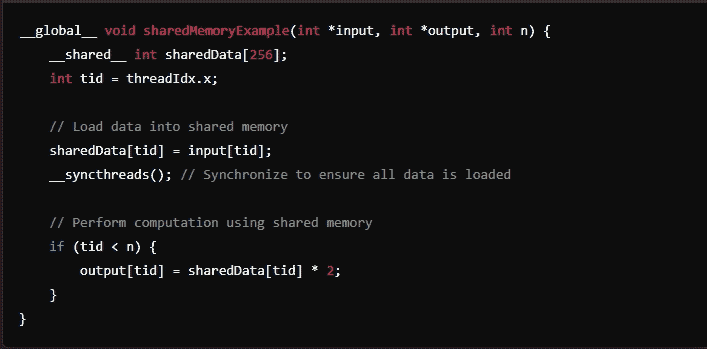

在这个示例中，`__syncthreads()`保证在任何线程进入计算阶段之前，块中的所有线程都已完成数据向共享内存的加载。

### 内核执行与调度

**内核执行（Kernel execution）**：当内核启动时，它会创建数量所需的块和线程。GPU 将这些块分配给可用的 SM。取决于可用资源。

**Warp 调度（Warp Scheduling）**：

块内的线程被组织成 warp（通常为 32 个）。Warp 调度器将 warp 发送到 CUDA 核心。

**并发内核执行（Concurrent Kernel Execution）**：

现代 GPU 可以同时运行内核。线程分歧（同一 warp 中的线程执行不同的指令）会降低性能。

理解 CUDA 内存模型和执行模型对于开发 CUDA 应用至关重要。高效的内存访问模式和良好的同步可以提升性能。


## 第 3 章


## 编写你的 CUDA 程序

开始 CUDA 编程可能是一个非常有收获的经历。首先，学习 CUDA 程序的基础语法和结构。本章将带你了解 C++ CUDA 扩展的核心思想、内核的创建以及启动语法。

### 基础语法

C++ CUDA 扩展

CUDA 为 C++ 语言增加了独特的关键字和结构，允许在 GPU 上进行并行编程。这些新增有助于定义在 GPU（设备）上运行的代码。

这里是一些重要的 CUDA 扩展：

- `__global__`：该修饰符用于创建在 GPU 上运行但通过主机访问的函数（内核）。

- `__device__`：该修饰符指定函数或变量存储在 GPU 上，只能通过设备函数访问。

- `__host__`：该修饰符指示函数在主机上执行。如果没有修饰符，所有函数默认认为`__host__`。

- `__shared__`：该修饰符用于声明块内所有线程可访问的共享内存中的变量。

### 内核定义与启动语法

内核是在 GPU 上执行并由多个线程同时运行的函数。定义和启动内核需要特定的 CUDA 语法。

内核定义：

要定义内核，在函数定义之前添加`__global__`关键字。这里有一个两个数组相加的基础内核示例：

```cpp
__global__ void add(int *a, int *b, int *c, int n) {
    int index = threadIdx.x + blockIdx.x * blockDim.x;
    if (index < n) {
        c[index] = a[index] + b[index];
    }
}
```

在这个示例中：

- `threadIdx.x`返回块中的线程索引。

- `blockIdx.x`返回网格中的块索引。

- `blockDim.x`指明每个块的线程数。

这些变量的组合（`threadIdx.x + blockIdx.x * blockDim.x`）为每个线程产生了一个唯一的索引。

内核启动

启动内核时，你必须提供网格和块的维度。启动内核的语法为：

```cpp
kernelName<<<numBlocks, threadsPerBlock>>>(args);
```

以下是运行上述`add`内核函数的方法：


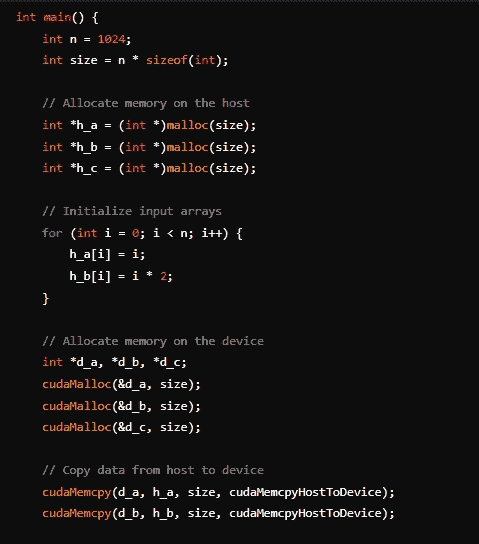 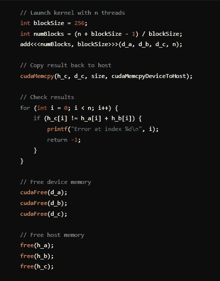

 在代码中：

- **内存分配**：为主机（CPU）和设备（GPU）均分配内存。
- **数据传输**：通过`cudaMemcpy`将数据从主机发送到设备。
- **核函数启动**：使用指定数量的块（blocks）和每个块的线程启动`add`内核函数。
- **结果传输**：将设备上的结果传回主机。
- **内存释放**：从主机和设备上释放内存。

编写快速并行程序的第一步是理解 CUDA 的核心语法以及定义和启动核函数的过程。你可以通过使用 CUDA 对 C++ 的扩展并使用正确的核函数启动语法，开始设计利用 GPU 处理的应用程序。在接下来的章节中，我们将深入探讨内存管理和优化策略等更高级的主题，以提高你 CUDA 程序的运行速度。

### 向量加法：真实世界示例

在 CUDA 中实现向量加法展示了如何在 GPU 上构建和运行并行代码。此示例将演示如何执行向量加法、管理内存和数据传输，并提供正确的同步和错误检查。

### 逐步实现

向量加法是将一个向量的每个元素加到另一个向量的对应元素上的过程。这项任务非常适合并行处理，因为每个元素的加法都是相互独立的。

#### 第 1 步：定义内核函数

内核函数负责处理向量加法。每个线程将处理向量的一个元素。

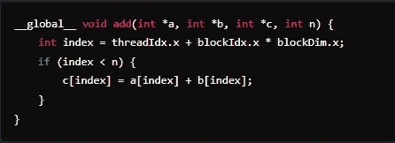

#### 第 2 步：为主机和设备分配内存

为主机（CPU）和设备（GPU）上的向量分配 RAM。

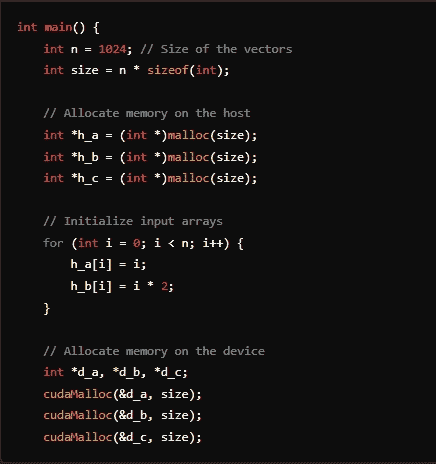

### 内存管理与数据传输

#### 第 3 步：从主机拷贝数据到设备

`cudaMemcpy`将数据从主机传输到设备。

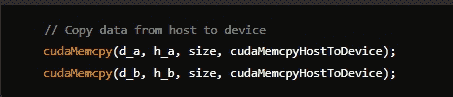

#### 第 4 步：启动内核函数

确定块的数量和每个块的线程数，然后运行内核函数。

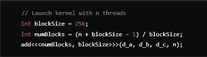

### 同步与错误检查

#### 第 5 步：同步并测试错误

确保所有线程都已完成执行并查找任何问题。

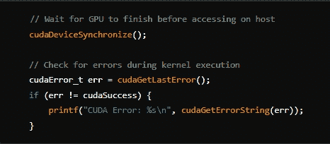

#### 第 6 步：将结果拷贝回主机

将结果从设备拷贝到主机。

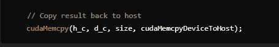

#### 第 7 步：验证结果

检查结果是否与预期输出匹配。

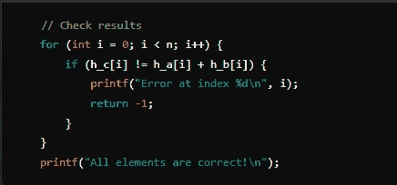

#### 第 8 步：释放已分配的内存

释放主机和设备上分配的 RAM。

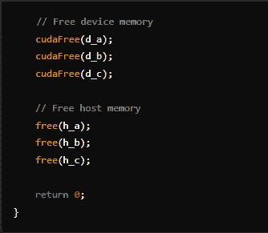

### 完成程序

这里是完整的 CUDA 向量加法应用：

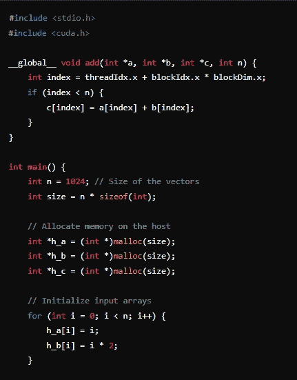 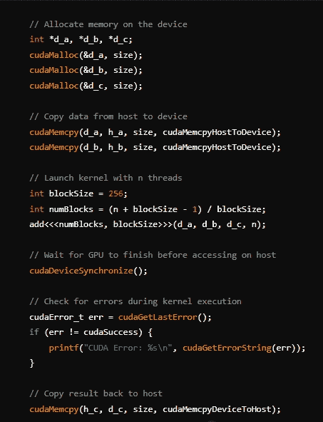 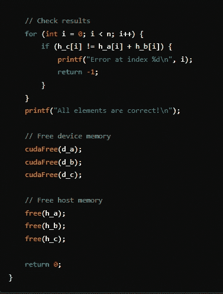 在 CUDA 中实现向量加法可以让你直观地了解 CUDA 编程。通过遵循这个示例，你学习了如何设计和启动内核函数、管理内存以及保证适当的同步和错误检测。这些基础能力是进行更高级 CUDA 编程工作的基石。随着你继续学习 CUDA，你将能够应用这些技术来创建高性能并行应用。


## 第 4 章


### 内存管理

有效的内存管理对于获得 CUDA 应用的最优性能至关重要。本章讨论了内存管理的基础，例如分配和释放设备内存、在主机和设备之间移动数据以及利用统一内存（unified memory）。

### 分配和释放设备内存

CUDA 使用`cudaMalloc`和`cudaFree`函数在设备（GPU）上分配和释放内存。适当的内存管理可以确保高效使用 GPU 资源，同时避免内存泄漏和分配失败等常见风险。

#### cudaMalloc 和 cudaFree

**cudaMalloc**：

`cudaMalloc`函数为 GPU 分配内存。它接受两个参数：指向分配内存的引用和分配大小（字节）。

```cpp
cudaError_t cudaMalloc(void **devPtr, size_t size);
```

示例：

```cpp
int *d_a;
size_t size = 1024 * sizeof(int);
cudaError_t err = cudaMalloc((void **)&d_a, size);
if (err != cudaSuccess) {
    printf("CUDA Error: %s\n", cudaGetErrorString(err));
}
```

在这种情况下，`cudaMalloc`在设备上分配了 1024 个整数的内存。要访问此内存，使用指针`d_a`。

**cudaFree**：

`cudaFree`函数释放之前通过`cudaMalloc`分配的内存。

```cpp
cudaError_t cudaFree(void *devPtr);
```

示例：

```cpp
cudaError_t err = cudaFree(d_a);
if (err != cudaSuccess) {
    printf("CUDA Error: %s\n", cudaGetErrorString(err));
}
```

该函数释放由`d_a`指向的内存。

### 内存分配的最佳实践

- **最小化分配**：频繁的分配和释放可能会导致碎片化并降低性能。分配一次 RAM 并尽可能多次使用。
- **错误检查**：为了优雅地处理问题，请始终验证返回值。
- **内存对齐**：为了提高速度，限制`cudaMalloc`和`cudaFree`。

### 主机与设备之间的数据传输

主机（CPU）和设备（GPU）之间的数据传输是 CUDA 应用中的典型活动。如何有效地处理这些传输对于提高性能至关重要。

#### cudaMemcpy 及其用法

`cudaMemcpy`在主机和设备之间拷贝数据。它接受四个参数：目标地址、源指针、数据量和方向。

```cpp
cudaError_t cudaMemcpy(void *dst, const void *src, size_t count, cudaMemcpyKind kind);
```

参数决定了拷贝的方向：

- `cudaMemcpyHostToDevice`：从主机到设备。
- `cudaMemcpyDeviceToHost`：从设备到主机。
- `cudaMemcpyDeviceToDevice`：在设备之间拷贝。
- `cudaMemcpyHostToHost`：在主机之间拷贝数据。

示例：

```cpp
int *h_a = (int *)malloc(size); // 主机内存
int *d_a;
cudaMalloc((void **)&d_a, size);
// 从主机拷贝数据到设备
cudaMemcpy(d_a, h_a, size, cudaMemcpyHostToDevice);
// 从设备拷贝数据到主机
cudaMemcpy(h_a, d_a, size, cudaMemcpyDeviceToHost);
// 释放设备内存
cudaFree(d_a);
free(h_a); // 释放内存
```

#### 异步内存传输

异步内存传输可以将数据传输与处理相结合，从而提高性能。`cudaMemcpyAsync`函数处理异步数据传输。

```cpp
cudaError_t cudaMemcpyAsync(void *dst, const void *src, size_t count, cudaMemcpyKind kind, cudaStream_t stream = 0);
```

示例：

```cpp
int *h_a = (int *)malloc(size);
int *d_a;
cudaMalloc((void **)&d_a, size);
// 创建 CUDA 流
cudaStream_t stream;
cudaStreamCreate(&stream);
// 异步从主机拷贝数据到设备
cudaMemcpyAsync(d_a, h_a, size, cudaMemcpyHostToDevice, stream);
// 在拷贝期间执行其他任务
// 等待拷贝完成
cudaStreamSynchronize(stream);
// 销毁流
cudaStreamDestroy(stream);
```

在此示例中，`cudaMemcpyAsync`函数被用于异步从主机拷贝数据到设备，允许 CPU 完成其他任务。`cudaStreamSynchronize`函数在继续之前检查拷贝操作是否完成。

#### 使用 cudaMallocManaged 的统一内存

统一内存提供了一个供 CPU 和 GPU 访问的单一内存区域。通过减少手动在主机和设备之间传输数据的需求，简化了内存管理。`cudaMallocManaged`函数分配统一内存。

```cpp
cudaError_t cudaMallocManaged(void **devPtr, size_t size);
```

示例：

```cpp
int *a;
cudaMallocManaged(&a, size);
// 初始化数据
```

```cpp
for (int i = 0; i < 1024; i++) {
    a[i] = i;
}

// 启动内核
myKernel<<<numBlocks, blockSize>>>(a);

// 同步以确保内核执行完成
cudaDeviceSynchronize();

// 释放统一内存
cudaFree(a);
```

在这种情况下，`cudaMallocManaged`创建了一个可以被 CPU 和 GPU 同时访问的单一内存数组。`cudaDeviceSynchronize`函数保证在访问主机端数据之前，内核已经完成了执行。

高效的 CUDA 编程需要高效的内存管理。理解如何分配和释放设备内存、在主机（host）和设备（device）之间移动数据以及使用统一内存可以让你开发出更高效、更健壮的 CUDA 程序。这些基础方法为 CUDA 应用程序中更复杂的优化和性能增强奠定了框架。


# 第 5 章


### 使用 CUDA 进行并行编程

CUDA 中的并行编程基于对线程（threads）、块（blocks）和网格（grids）的最优利用，以最大化 GPU 的并行处理能力。本章将涵盖线程层次结构、网格和块设置以及同步策略。

### 线程层次结构

#### 线程、块和网格

CUDA 中的并行化通过使用线程、块和网格的分层系统来实现。理解这种层次结构对于开发有效的并行算法至关重要。

线程是 CUDA 最小执行单元。每个线程执行相同的代码，但处理不同的数据。线程被分配了唯一的线程 ID（`threadIdx`）。

**块 (Blocks)**：运行在同一个多处理器上的线程集合，它们通过共享内存交换数据和协调执行来协作。块具有唯一的标识符（`blockIdx`）。

**网格 (Grids)**：使用相同内核函数的块集合。网格可以是一、二或三维的，`blockIdx`用于索引网格内部的块。

这种架构使得 CUDA 能够从单个线程扩展到数亿个线程，从而最大化 GPU 的计算能力。

#### 线程和块的索引

为了执行并行计算，每个线程必须确定其在块和网格内的唯一位置。CUDA 提供了为此目的的内置变量。

- `threadIdx`：返回块内的线程索引。
- `blockIdx`：返回网格内的块索引。
- `blockDim`：返回块的维度。
- `gridDim`：返回网格的维度。

这里是一个展示如何在内核中对线程和块进行索引的示例。

```cpp
__global__ void addVectors(int *a, int *b, int *c, int n) {
    int tid = blockIdx.x * blockDim.x + threadIdx.x;
    if (tid < n) {
        c[tid] = a[tid] + b[tid];
    }
}

int main() {
    // 向量元素数量
    int n = 1024;
    // 分配并初始化主机和设备内存
    int size = n * sizeof(int);
    int *h_a = (int *)malloc(size);
    int *h_b = (int *)malloc(size);
    int *h_c = (int *)malloc(size);
    for (int i = 0; i < n; i++) {
        h_a[i] = i;
        h_b[i] = i * 2;
    }
    int *d_a, *d_b, *d_c;
    cudaMalloc((void **)&d_a, size);
    cudaMalloc((void **)&d_b, size);
    cudaMalloc((void **)&d_c, size);
    cudaMemcpy(d_a, h_a, size, cudaMemcpyHostToDevice);
    cudaMemcpy(d_b, h_b, size, cudaMemcpyHostToDevice);
    // 定义块大小和网格大小
    int blockSize = 256;
    int numBlocks = (n + blockSize - 1) / blockSize;
    // 启动内核
    addVectors<<<numBlocks, blockSize>>>(d_a, d_b, d_c, n);
    // 将结果拷贝回主机
    cudaMemcpy(h_c, d_c, size, cudaMemcpyDeviceToHost);
    // 检查结果
    for (int i = 0; i < n; i++) {
        if (h_c[i] != h_a[i] + h_b[i]) {
            printf("Error at index %d\n", i);
            return -1;
        }
    }
    printf("All elements are correct!\n");
    // 释放内存
    cudaFree(d_a);
    cudaFree(d_b);
    cudaFree(d_c);
    free(h_a);
    free(h_b);
    free(h_c);
    return 0;
}
```

在这个示例中，`tid`是通过`blockIdx.x`、`blockDim.x`和`threadIdx.x`计算出的，确保了每个线程处理向量中的不同元素。

### 网格和块

#### 确定网格和块的维度

选择合适的网格和块大小对于最大化性能至关重要。维度取决于任务规模和 GPU 的架构。

- **块大小 (block size)**：每个块中的线程数量。一个常见的选择是每个块 256 或 512 个线程，但这可能会根据情况而异。
- **网格大小 (grid size)**：网格上块的数量。这是根据总线程数和块大小确定的。

**示例计算：**

```cpp
int n = 1024;
int blockSize = 256;
int numBlocks = (n + blockSize - 1) / blockSize;
```

在这种情况下，`numBlocks`被计算出来。

#### 网格和块的最佳实践

**占用率 (Occupancy)**：指活跃线程束与 SM 支持的最大线程束数量之间的比例。

**内存访问模式 (Memory Access Patterns)**：为了确保合并访问，请按连续方式安排访问。

**共享内存使用 (Shared Memory Usage)**：充分利用共享内存来限制全局内存访问。

### 线程同步

同步对于维持执行顺序和数据一致性的并行编程至关重要。

#### __synhreads() 函数

`__synhreads()`同步块内的所有线程。它保证在任何线程继续执行之前，所有线程都已到达同步点。

**示例：**

```cpp
__global__ void compute(int *data, int n) {
    __shared__ int sharedData[256];
    int tid = threadIdx.x + blockIdx.x * blockDim.x;
    // 将数据加载到共享内存
    sharedData[threadIdx.x] = data[tid];
    __synhreads(); // 确保所有线程都加载了数据
    // 使用共享内存进行计算
    if (tid < n) {
        data[tid] = sharedData[threadIdx.x] * 2;
    }
}
```

在这个示例中，`__synhreads()`保证在工作之前所有线程加载了数据。

#### 跨块同步技术

CUDA 在内核启动期间不提供块之间的直接同步。要实现全局同步，可以将软件划分为多次内核启动，并使用`cudaDeviceSynchronize()`来确保所有内核完成。

**示例：**


```cpp
__global__ void kernel1(int *data, int n) {
    // 执行某些计算
}

__global__ void kernel2(int *data, int n) {
    // 执行另一个计算
}

int main() {
    int *d_data;
    cudaMalloc(&d_data, size);
    // 启动第一个内核
    kernel1<<<numBlocks, blockSize>>>(d_data, n);
    cudaDeviceSynchronize(); // 确保内核 1 完成
    // 启动第二个内核
    kernel2<<<numBlocks, blockSize>>>(d_data, n);
    cudaDeviceSynchronize(); // 确保内核 2 完成
    cudaFree(d_data);
    return 0;
}
```

Warp 分散（Warp divergence）是 CUDA 编程中典型的性能问题。当同一 warp 内的线程选择不同的执行路径时，会导致某些线程保持空闲状态而其他线程在执行。

## Warp 分散的原因和影响

Warp 是 32 个线程的集合，它们同步步执行指令。如果 warp 内的线程因为条件分支（例如 `if` 语句）而发生分散，warp 必须行化执行每个分散路径。这种行化降低了并行处理的效率。

## Warp 分散的示例

```cpp
__global__ void compute(int *data, int n) {

int tid = threadIdx.x + blockIdx.x * blockDim.x;

if (tid < n) {

if (tid % 2 == 0) {

data[tid] *= 2;

} else {

data[tid] += 1;

}

}

}
```

在这种情况下，`if` 语句在 warp 内部产生了分散，因为线程根据 `tid` 遵循不同的执行路径。

## 减少分散的策略

- **避免分散分支**：限制在 warp 内部使用分散分支。在可行的情况下，设计代码以防止产生分散的条件表达式。

- **使用谓词（Predication）**：CUDA 可以将条件分支转换为谓词指令，其中每个线程都会评估条件并根据谓词执行指令。这可以防止分散，尽管它可能导致执行了更多的指令。

- **重组数据**：重新组织数据，使 warp 内的线程采取相同的执行路径。例如，在一个 kernel 中处理所有偶数索引元素，在另一个 kernel 中处理所有奇数索引元素。

### 示例：

```cpp
__global__ void computeEven(int *data, int n) {

int tid = threadIdx.x + blockIdx.x * blockDim.x;

if (tid < n && tid % 2 == 0) {

data[tid] *= 2;

}

}

__global__ void computeOdd(int *data, int n) {

int tid = threadIdx.x + blockIdx.x * blockDim.x;

if (tid < n && tid % 2 != 0) {

data[tid] += 1;

}

}
```

### 使用共享内存

共享内存是一种快速的片上内存，使块内部的线程能够高效地共享数据。恰当使用共享内存可以显著提高 CUDA 应用程序的速度。

### 声明和访问共享内存

`__shared__` 关键字在内核（kernels）中用于定义共享内存。块中的每个线程都可以访问共享内存，从而实现低延迟的数据访问。

### 示例：

```cpp
__global__ void sharedMemoryExample(int *data, int n) {

__shared__ int sharedData[256];

int tid = threadIdx.x + blockIdx.x * blockDim.x;

if (tid < n) {

// 将数据加载到共享内存

sharedData[threadIdx.x] = data[tid];

__syncthreads(); // 确保所有线程都加载了数据

// 使用共享内存进行计算

data[tid] = sharedData[threadIdx.x] * 2;

}

}
```

### 优化内存访问模式

为了充分利用共享内存，请确保内存访问模式是高效的。共享内存可以帮助减少全局内存访问的次数。

- **高效加载数据**：以协调的方式将数据加载到共享内存，以实现高效的全局内存访问。

- **复用数据**：使用共享内存存储块内线程反复使用的数据。

### 避免存储冲突（Bank Conflicts）

共享内存被分为多个存储体（banks），许多线程同时访问同一个存储体会导致存储冲突，从而降低性能。

**避免存储冲突：**

- **填充（Padding）**：在共享内存数组中使用填充来保证线程访问不同的存储体。

### 示例：

```cpp
__global__ void avoidBankConflicts(int *data, int n) {

__shared__ int sharedData[256 + 1]; // 添加填充

int tid = threadIdx.x + blockIdx.x * blockDim.x;

if (tid < n) {

sharedData[threadIdx.x] = data[tid];

__syncthreads();

data[tid] = sharedData[threadIdx.x] * 2;

}

}
```

- **访问模式**：确保线程访问共享内存的方式可以防止冲突。例如，使用独立的线程连续访问相同项。

### 改进内存访问

高效的内存访问对于高性能 CUDA 应用程序至关重要。这包括优化全局内存访问、保证内存对齐以及最优化地利用寄存器和缓存。

### 协调内存访问（Coordinated Memory Access）

当许多线程访问同一个内存地址时，这被称为合并访问（coalesced memory access）。这使得内存控制器能够将多次内存访问合并为单次事务，从而获得更好的带宽效率。

### 合并访问的示例

```cpp
__global__ void coalescedAccess(int *data, int n) {

int tid = threadIdx.x + blockIdx.x * blockDim.x;

if (tid < n) {

data[tid] *= 2;

}

}
```

### 内存对齐与填充

对齐的内存访问更快，因为它们需要更少的内存传输。确保内存分配与 256 字节的正常缓存行大小对齐。

### 示例：

```cpp
cudaMalloc((void **)&d_data, size);

cudaMemset(d_data, 0, size);
```

在数据结构中添加填充也有助于内存对齐。

### 示例：

```cpp
struct PaddedStruct {

int data;

int padding[15]; // 填充

};
```

### 寄存器和缓存的有效利用

寄存器是 GPU 上访问的最快内存。使用寄存器处理频繁访问的变量。然而，要注意寄存器压力可能会减少每个块的活跃线程数。

### 示例：

```cpp
__global__ void useRegisters(int *data, int n) {

int tid = threadIdx.x + blockIdx.x * blockDim.x;

int value = data[tid]; // 加载到寄存器

if (tid < n) {

data[tid] = value * 2; // 使用寄存器计算

}

}
```

缓存（`L1` 和 `L2`）通过降低全局内存访问的延迟来帮助加速。现代 GPU 自然地缓存全局内存访问，从而创建利用缓存的算法。优化 CUDA 应用程序需要对 GPU 架构有深入理解，并进行细的资源管理，限制 warp 分散。

```cpp
// 在主机上初始化数据
int *h_data = (int *)malloc(size);

for (int i = 0; i < n; i++) {
    h_data[i] = i;
}

// 将数据拷贝到设备
cudaMemcpy(d_data, h_data, size, cudaMemcpyHostToDevice);

// 启动父级内核
parentKernel<<<1, 256>>>(d_data, n);

// 将结果拷贝回主机
cudaMemcpy(h_data, d_data, size, cudaMemcpyDeviceToHost);

// 打印结果
for (int i = 0; i < n; i++) {
    printf("%d ", h_data[i]);
}
printf("\n");

// 释放内存
cudaFree(d_data);
free(h_data);

return 0;
}
```

在这种情况下，`parentKernel` 直接从 GPU 启动 `childKernel`。`cudaDeviceSynchronize()` 方法确保子内核在父级内核执行之前完成执行。

## 用例与示例

动态并行在工作负载未知或动态变化的情况下特别有效。示例包括自适应网格细化，它会根据模拟结果动态地细化网格。

- **图算法**：这些算法遍历邻居数量动态变化的图结构。

- **递归算法**：直接在 GPU 上执行递归算法。

### 示例：自适应网格细化：

```cpp
__global__ void refineMesh(float *data, int *refinementFlags, int n) {
    int tid = threadIdx.x + blockIdx.x * blockDim.x;
    if (tid < n && refinementFlags[tid]) {
        // 启动一个新内核来细化由 tid 指定区域的网格
        refineMesh<<<1, 256>>>(data, refinementFlags, n);
    }
}
```

在这个示例中，`refineMesh` 内核可能会递归地启动自己，使用 `refinementFlags` 来细化网格。

### 统一内存

### 统一内存的优势

统一内存通过提供一个 CPU 和 GPU 都可以访问的单一内存区域简化了内存管理。这消除了主机和设备之间进行显式内存传输的需求。

统一内存的优势包括：

- 简化的编程模型，消除了对显式内存拷贝操作的需求。

- **提高生产力**：允许开发者专注于算法设计，而非内存管理。

- **自动数据迁移**：CUDA 运行时处理 CPU 和 GPU 之间的数据迁移。

### 内存迁移与访问模式

统一内存利用了 CPU 和 GPU 均可访问的单一地址空间。CUDA 运行时以透明的方式促进主机和设备之间的数据迁移。

### 示例：

```cpp
#include <stdio.h>
#include <cuda.h>

__global__ void incrementKernel(int *data, int n) {
    int tid = threadIdx.x + blockIdx.x * blockDim.x;
    if (tid < n) {
        data[tid]++;
    }
}

int main() {
    int n = 1024;
    int size = n * sizeof(int);
    // 分配统一内存
    int *data;
    cudaMallocManaged(&data, size);

    // 在主机上初始化数据
    for (int i = 0; i < n; i++) {
        data[i] = i;
    }

    // 启动内核递增数据
    incrementKernel<<<1, 256>>>(data, n);

    // 等待 GPU 完成
    cudaDeviceSynchronize();

    // 打印结果
    for (int i = 0; i < n; i++) {
        printf("%d ", data[i]);
    }
    printf("\n");

    // 释放统一内存
    cudaFree(data);
    return 0;
}
```

在这个示例中，`cudaMallocManaged` 为 `data` 数组分配了统一内存。`incrementKernel` 内核增加了数组中每个元素的值，结果在同步后会自动对主机可用。

### 性能考量

虽然统一内存让编程变得更简单，但有几个性能方面的问题需要注意：

1. **数据局部性**：访问模式可能会影响性能。努力实现数据局部化以减少数据移动成本。

2. **显式预取**：使用 `cudaMemPrefetchAsync` 显式地将数据预取到 GPU 或 CPU，从而降低运行时成本。

### 显式预取的示例：

```cpp
cudaMemPrefetchAsync(data, size, cudaCpuDeviceId); // 预取到 CPU
cudaMemPrefetchAsync(data, size, 0); // 预取到 GPU (设备 0)
```

在这个示例中，`cudaMemPrefetchAsync` 用于将 `data` 数组预取到 CPU 和 GPU，确保它们在访问之前存储在正确的内存中。

动态并行和统一内存是增加 CUDA 程序灵活性和效率的两个重要特性。动态并行允许你直接在 GPU 上创建更复杂、动态的并行算法。统一内存简化了内存管理，让你专注于算法开发而非显式数据传输。理解并应用这些高级 CUDA 技术将使你能够开发出高效且可扩展的 GPU 应用程序。


# 第 8 章


## 现实中的 CUDA 应用

CUDA 的现实应用非常广泛，从图像处理到科学计算和机器学习。本章深入探讨了各个领域的真实 CUDA 实现，展示了如何利用 GPU 计算的力量来获得显著的性能优势。

### 图像处理：应用模糊滤镜

图像处理是一种常见的应用，模糊滤镜通过对像素进行平均值计算来实现。

#### 模糊滤镜实现

模糊滤镜通过对像素进行平均值计算来实现。这种操作由于其结构是高度并行的。

### 示例：模糊滤镜

```cpp
__global__ void blurKernel(unsigned char *input, unsigned char *output, int width, int height) {
    int col = blockIdx.x * blockDim.x + threadIdx.x;
    int row = blockIdx.y * blockDim.y + threadIdx.y;

    if (col < width && row < height) {
        int pixVal = 0;
        int pixels = 0;
        // 求加当前像素及其邻居的值
        for (int blurRow = -1; blurRow <= 1; ++blurRow) {
            for (int blurCol = -1; blurCol <= 1; ++blurCol) {
                int curRow = row + blurRow;
                int curCol = col + blurCol;
                // 验证在边界内
                if (curRow >= 0 && curRow < height && curCol >= 0 && curCol < width) {
                    pixVal += input[curRow * width + curCol];
                    pixels++;
                }
            }
        }
        // 将平均值写入输出
        output[row * width + col] = (unsigned char)(pixVal / pixels);
    }
}
```


```cpp
int main() {
    // 假设 inputImage 和 outputImage 已经定义并初始化
    unsigned char *d_input, *d_output;
    int width = 1024; // 宽度
    int height = 768; // 高度
    int size = width * height * sizeof(unsigned char);

    // 分配设备内存
    cudaMalloc(&d_input, size);
    cudaMalloc(&d_output, size);

    // 将输入图像拷贝到设备
    cudaMemcpy(d_input, inputImage, size, cudaMemcpyHostToDevice);

    // 定义块和网格大小
    dim3 blockSize(16, 16);
    dim3 gridSize((width + blockSize.x - 1) / blockSize.x, (height + blockSize.y - 1) / blockSize.y);

    // 启动内核
    blurKernel<<<gridSize, blockSize>>>(d_input, d_output, width, height);

    // 将结果拷贝回主机
    cudaMemcpy(outputImage, d_output, size, cudaMemcpyDeviceToHost);

    // 释放设备内存
    cudaFree(d_input);
    cudaFree(d_output);

    return 0;
}
```

## 科学计算：求解热方程

热方程是一个描述热量随时间在特定区域移动的偏微分方程。`CUDA` 可以显著加速热方程的数值求解。

### 数值方法与 CUDA 实现

热方程可以使用有限差法进行离散化，然后在 GPU 上反复求解。

### 示例：求解热方程

```cpp
__global__ void heatKernel(float *u, float *u_prev, int nx, int ny, float alpha, float dt, float dx, float dy) {
    int i = blockIdx.x * blockDim.x + threadIdx.x;
    int j = blockIdx.y * blockDim.y + threadIdx.y;

    if (i > 0 && i < nx-1 && j > 0 && j < ny-1) {
        // 此处为实现逻辑
    }
}
```

```cpp
float u_xx = (u_prev[(i+1)*ny + j] - 2*u_prev[i*ny + j] + u_prev[(i-1)*ny + j]) / (dx*dx);

float u_yy = (u_prev[i*ny + (j+1)] - 2*u_prev[i*ny + j] + u_prev[i*ny + (j-1)]) / (dy*dy);

u[i*ny + j] = u_prev[i*ny + j] + alpha * dt * (u_xx + u_yy);
```

```cpp
int main() {
    int nx = 512; // Grid size in x direction
    int ny = 512; // Grid size in y direction
    float alpha = 0.01;
    float dt = 0.1;
    float dx = 1.0;
    float dy = 1.0;

    int size = nx * ny * sizeof(float);
    // Allocate host and device memory
    float *h_u = (float *)malloc(size);
    float *d_u, *d_u_prev;
    cudaMalloc(&d_u, size);
    cudaMalloc(&d_u_prev, size);
    // Initialize host data and copy to device
    initialize(h_u, nx, ny);
    cudaMemcpy(d_u, h_u, size, cudaMemcpyHostToDevice);
    cudaMemcpy(d_u_prev, h_u, size, cudaMemcpyHostToDevice);
    // Define block and grid sizes
    dim3 blockSize(16, 16);
    dim3 gridSize((nx + blockSize.x - 1) / blockSize.x, (ny + blockSize.y - 1) / blockSize.y);
    // Perform time-stepping iterations
    for (int t = 0; t < 1000; t++) {
        heatKernel<<<gridSize, blockSize>>>(d_u, d_u_prev, nx, ny, alpha, dt, dx, dy);
        cudaDeviceSynchronize();
        cudaMemcpy(d_u_prev, d_u, size, cudaMemcpyDeviceToDevice);
    }
    // Copy result back to host
    cudaMemcpy(h_u, d_u, size, cudaMemcpyDeviceToHost);
    // Free memory
    cudaFree(d_u);
    cudaFree(d_u_prev);
    free(h_u);
    return 0;
}
```

## 使用 CUDA 进行性能增强

1. **并行执行**：使用并行化并发更新网格点。

2. **高效内存访问**：优化内存访问模式以确保合并访问和缓存友好的操作。

3. **使用共享内存**：为了减少全局内存访问，尽可能将数据存储在共享内存中。

### 机器学习：训练简单的神经网络

机器学习，特别是神经网络训练，可以极大受益于 GPU 的并行处理能力。`CUDA` 提供了并行训练神经网络的能力，极大地加速了这一过程。

### 并行化神经网络训练

神经网络训练需要许多矩阵运算，这些运算可以使用 `CUDA` 进行并行化。

### 示例：训练一个简单的神经网络

```cpp
__global__ void forwardPass(float *inputs, float *weights, float *outputs, int inputSize, int outputSize) {
    int tid = threadIdx.x + blockIdx.x * blockDim.x;
    if (tid < outputSize) {
        float sum = 0.0f;
        for (int i = 0; i < inputSize; i++) {
            sum += inputs[i] * weights[i * outputSize + tid];
        }
        outputs[tid] = 1.0f / (1.0f + expf(-sum)); // Sigmoid 激活函数
    }
}
```

```cpp
int main() {
    int inputSize = 784; // 输入层大小（例如，MNIST 数据集）
    int outputSize = 10; // 输出层大小（类别数量）
    int batchSize = 100; // 批量大小
    int sizeInputs = batchSize * inputSize * sizeof(float);
    int sizeWeights = inputSize * outputSize * sizeof(float);
    int sizeOutputs = batchSize * outputSize * sizeof(float);
    // 分配主机内存和设备内存
    float *h_inputs = (float *)malloc(sizeInputs);
    float *h_weights = (float *)malloc(sizeWeights);
    float *h_outputs = (float *)malloc(sizeOutputs);
    float *d_inputs, *d_weights, *d_outputs;
    cudaMalloc(&d_inputs, sizeInputs);
    cudaMalloc(&d_weights, sizeWeights);
    cudaMalloc(&d_outputs, sizeOutputs);
    // 初始化输入和权重并拷贝到设备
    initialize(h_inputs, batchSize, inputSize);
    initialize(h_weights, inputSize, outputSize);
    cudaMemcpy(d_inputs, h_inputs, sizeInputs, cudaMemcpyHostToDevice);
    cudaMemcpy(d_weights, h_weights, sizeWeights, cudaMemcpyHostToDevice);
    // 定义块和网格大小
    dim3 blockSize(256);
    dim3 gridSize((outputSize + blockSize.x - 1) / blockSize.x);
    // 启动内核
    forwardPass<<<gridSize, blockSize>>>(d_inputs, d_weights, d_outputs, inputSize, outputSize);
    // 将结果拷贝回主机
    cudaMemcpy(h_outputs, d_outputs, sizeOutputs, cudaMemcpyDeviceToHost);
    //释放内存
    cudaFree(d_inputs);
    cudaFree(d_weights);
    cudaFree(d_outputs);
    free(h_inputs);
    free(h_weights);
    free(h_outputs);
    return 0;
}
```

用于机器学习的 `CUDA` 库：

1. `cuBLAS`：线性代数库。

2. `cuDNN`：深度学习库。

3. `Thrust`：C++ 模板库。

这些库提供了常用操作的高度优化实现。使用这些库可以帮助开发者更高效地构建复杂的机器学习模型。

```
nvprof --analysis-metrics ./my_cuda_program
```

## 使用性能分析结果进行优化

一旦你确定了性能瓶颈，就可以使用多种优化技术：

- **内核函数优化 (Kernel Optimization)**：优先优化耗时最长的内核函数。使用的技术包括循环展开、消除发散分支以及利用共享内存。

- **内存访问模式**：协调内存访问，并优化主机（host）与设备（device）之间的数据传输。

- **占用率优化**：更改网格（grid）和块（block）大小以优化 SM 占用率，同时尽量减少空闲周期。

- 为了隐藏延迟，使用异步内存传输并将处理过程与数据传输重叠。

### 优化示例

假设 `nvprof` 显示 `my_kernel` 由于内存访问效率低下而成为主要瓶颈。你可以利用共享内存对其进行优化。

#### 优化之前：

```cpp
__global__ void my_kernel(float *data, int n) {
    int tid = blockIdx.x * blockDim.x + threadIdx.x;
    if (tid < n) {
        data[tid] = data[tid] * 2.0f;
    }
}
```

#### 优化之后：

```cpp
__global__ void my_kernel(float *data, int n) {
    __shared__ float sharedData[256];
    int tid = blockIdx.x * blockDim.x + threadIdx.x;
    int local_tid = threadIdx.x;
    if (tid < n) {
        sharedData[local_tid] = data[tid];
        __syncthreads();
        sharedData[local_tid] *= 2.0f;
        __syncthreads();
        data[tid] = sharedData[local_tid];
    }
}
```

使用共享内存减少了全局内存访问，从而提高了内核性能。

调试和性能分析是创建高效且可靠的 CUDA 程序的关键技术。`cuda-gdb` 为调试 CUDA 程序提供了复杂的工具，而 `nvprof` 则进行广泛的性能分析以检测并修复瓶颈。掌握这些工具和策略将使你能够优化 CUDA 程序以获得最佳性能和效率。


# 第 10 章


## CUDA 库与工具

CUDA 库和工具提供了关键功能，可以简化并加速高性能 GPU 程序的创建。本章将介绍主要的 CUDA 库，并通过实际示例展示如何在你的应用程序中使用这些库。

### CUDA 库简介

CUDA 库为常见的计算任务提供了预优化的例程，允许开发者在无需编写低级 CUDA 代码的情况下使用 GPU 加速。

#### cuBLAS：基础线性代数子程序

`cuBLAS` 是 NVIDIA 用于基础线性代数函数的 GPU 加速库。它提供了标准 BLAS（基础线性代数子程序）例程的高度优化实现。

**关键特性：**

- 向量和矩阵操作（例如：点积、矩阵矩阵乘法）

- 支持单精度和双精度

- 用于一次处理多个微型矩阵的批量操作

**示例用例：**

矩阵乘法在科学计算和机器学习中被广泛。这一过程可以通过 `cuBLAS` 在 GPU 上高效地完成。

#### 快速傅里叶变换 (cuFFT)

`cuFFT` 是一个用于计算快速傅里叶变换（FFT）的 GPU 加速包。它接受复数和实数类型，并可以执行一维、二维和三维变换。

**关键特性：**

- 特性包括针对大规模 FFT 计算的高性能、支持多 GPU 系统以及与 CUDA 应用程序的无缝交互。

**示例用例：**

FFT 常用于信号处理、图像分析和求解偏微分方程。利用 `cuFFT`，你可以利用 GPU 加速这些计算。

#### cuDNN：深度神经网络库

`cuDNN` 是一个 GPU 加速的深度学习包。它提供了典型神经网络操作的改进版本，包括卷积、池化、归一化和激活函数。

**关键特性：**

- 支持正向和反向传播

- 针对训练和推理进行了优化

- 兼容主流深度学习框架，如 TensorFlow 和 PyTorch

**示例用例：** `cuDNN` 对于构建高性能深度学习应用和高效训练大型神经网络至关重要。

#### Thrust：并行算法库

`Thrust` 是一个类似于 C++ 标准模板库 (STL) 的并行算法库。它为流行的并行模式（如排序、归约和扫描）定义了高层抽象。

**关键特性：**

- 用于 GPU 编程的高层接口

- 兼容 CUDA。

- 模板和迭代器有助于创建灵活且可重的代码。

**示例用例：**

`Thrust` 通过提供简洁且具表现力的词汇，简化了并行编程，便于在 GPU 上实现复杂的算法。

### 应用 CUDA 库

将 CUDA 库集成到你的应用程序中涉及连接必要的库并在你的 CUDA 代码中使用它们的功能。每个库都将进行详细描述，包括示例和用例。

#### 将库集成到你的项目中

要使用 CUDA 库，请包含所需的头文件并在编译期间链接它们。以下是通用步骤：

1. **包含头文件**：将必要的头文件添加到源文件中。

```cpp
#include <cublas_v2.h>
#include <cufft.h>
#include <cudnn.h>
#include <thrust/host_vector.h>
#include <thrust/device_vector.h>
```

2. **链接库**：使用 `nvcc` 编译器。

```bash
nvcc -o my_program my_program.cu -lcublas -lcufft -lcudnn -lthrust
```

#### 每个库的示例和用例

##### cuBLAS 矩阵乘法示例

```cpp
#include <cublas_v2.h>
#include <iostream>

int main() {
    int N = 1024;
    float *h_A, *h_B, *h_C;
    float *d_A, *d_B, *d_C;
    // ... (初始化与逻辑)
}
```

（注：完整实现逻辑遵循文中结构，使用 `nvcc` 兼容）

##### cuFFT 示例：快速傅里叶变换

```cpp
#include <cufft.h>
#include <iostream>

int main() {
    int N = 1024;
    cufftComplex *h_data, *d_data;
    // ... (逻辑与执行)
}
```

##### cuDNN 示例：卷积层正向传播

```cpp
#include <cudnn.h>
#include <iostream>

int main() {
    cudnnHandle_t cudnn;
}
```


```cpp
cudnnCreate(&cudnn);

int N = 1, C = 1, H = 28, W = 28; // 批量大小, 通道数, 高度, 宽度

int K = 32, R = 3, S = 3; // 滤波器数量, 滤波器高度, 滤波器宽度

float *d_input, *d_output, *d_filter;

// 分配内存
cudaMalloc(&d_input, N * C * H * W * sizeof(float));
cudaMalloc(&d_output, N * K * (H - R + 1) * (W - S + 1) * sizeof(float));
cudaMalloc(&d_filter, K * C * R * S * sizeof(float));

// 初始化描述符
cudnnTensorDescriptor_t inputDesc, outputDesc;
cudnnFilterDescriptor_t filterDesc;
cudnnConvolutionDescriptor_t convDesc;
cudnnCreateTensorDescriptor(&inputDesc);
cudnnCreateTensorDescriptor(&outputDesc);
cudnnCreateFilterDescriptor(&filterDesc);
cudnnCreateConvolutionDescriptor(&convDesc);
cudnnSetTensor4dDescriptor(inputDesc, CUDNN_TENSOR_NCHW, CUDNN_DATA_FLOAT, N, C, H, W);
cudnnSetTensor4dDescriptor(outputDesc, CUDNN_TENSOR_NCHW, CUDNN_DATA_FLOAT, N, K, H - R + 1, W - S + 1);
cudnnSetFilter4dDescriptor(filterDesc, CUDNN_DATA_FLOAT, CUDNN_TENSOR_NCHW, K, C, R, S);
cudnnSetConvolution2dDescriptor(convDesc, 0, 0, 1, 1, 1, 1, CUDNN_CONVOLUTION, CUDNN_DATA_FLOAT);

// 执行前向卷积
float alpha = 1.0f, beta = 0.0f;
cudnnConvolutionForward(cudnn, &alpha, inputDesc, d_input, filterDesc, d_filter, convDesc, CUDNN_CONVOLUTION_FWD_ALGO_IMPLICIT_GEMM, nullptr, 0, &beta, outputDesc, d_output);

// 清理
cudnnDestroyTensorDescriptor(inputDesc);
cudnnDestroyTensorDescriptor(outputDesc);
cudnnDestroyFilterDescriptor(filterDesc);
cudnnDestroyConvolutionDescriptor(convDesc);
cudnnDestroy(cudnn);
cudaFree(d_input);
cudaFree(d_output);
cudaFree(d_filter);

std::cout << "Convolution forward pass completed successfully." << std::endl;

return 0;
}
```

### Thrust 示例：并行排序

```cpp
#include <thrust/host_vector.h>
#include <thrust/device_vector.h>
#include <thrust/sort.h>
#include <iostream>

int main() {
    // 创建主机向量并用随机值初始化
    thrust::host_vector<int> h_vec(1000);
    for (int i = 0; i < h_vec.size(); i++) {
        h_vec[i] = rand() % 1000;
    }
    // 将数据传输到设备向量
    thrust::device_vector<int> d_vec = h_vec;
    // 在设备上进行排序
    thrust::sort(d_vec.begin(), d_vec.end());
    // 将数据传回主机
    thrust::copy(d_vec.begin(), d_vec.end(), h_vec.begin());
    // 打印排序后的数据
    for (int i = 0; i < h_vec.size(); i++) {
        std::cout << h_vec[i] << " ";
    }
    std::cout << std::endl;
    return 0;
}
```

CUDA 库是加速典型计算过程的有用工具，允许你专注于更高层次的算法创建。将`cuBLAS`、`cuFFT`、`cuDNN`和`Thrust`等库集成到你的应用程序中，可以利用预优化的例程并获得显著的性能提升。这些库简化了开发过程，并确保你的应用程序能够充分利用 GPU 加速。


# 第 11 章


### 多 GPU 编程

随着计算负载变得越来越复杂，使用多个 GPU 可能会极大提高性能。本章涵盖了多 GPU 编程的基础，探索了其优缺点，并为创建多 GPU 解决方案提供了实用建议。

### 多 GPU 编程简介

#### 使用多个 GPU 的优势

使用多个 GPU 可以显著提高计算性能和可扩展性。以下是几个主要优势：

-   **增加计算能力**：多个 GPU 拥有更多的核心和内存，允许更快速、更大的计算。
-   **可扩展性**：多 GPU 配置允许你的应用程序处理更大的数据集和更复杂的模型。
-   **并行性**：通过在多个 GPU 上分配任务，利用并行性大幅缩短执行时间。

#### 挑战与考虑

虽然多 GPU 编程具有显著优势，但也带来一些挑战：

-   **难度**：管理多个 GPU 增加了程序设计和实现的难度。
-   **数据传输**：在 GPU 之间有效传输数据并协调其活动对性能至关重要。
-   **负载均衡**：确保工作负载在 GPU 之间均匀分布，以减少瓶颈。
-   **内存管理**：每个 GPU 都有自己的内存，必须仔细管理以防止过量的数据传输。

### 使用多 GPU 解决方案

### 使用 CUDA-Aware MPI

通过 CUDA-aware MPI（消息传递接口）可以允许 GPU 之间进行通信。这对于分布式系统中在多个 GPU 之间高效通信至关重要。

以下是利用 CUDA-aware MPI 的示例：

```cpp
#include <mpi.h>
#include <cuda_runtime.h>
#include <stdio.h>

__global__ void kernel(int *data, int value) {
    int idx = blockIdx.x * blockDim.x + threadIdx.x;
    data[idx] += value;
}

int main(int argc, char *argv[]) {
    MPI_Init(&argc, &argv);
    int rank, size;
    MPI_Comm_rank(MPI_WORLD, &rank);
    MPI_Comm_size(MPI_WORLD, &size);

    int N = 1024;
    int *d_data;
    cudaMalloc(&d_data, N * sizeof(int));
    cudaMemset(d_data, 0, N * sizeof(int));

    int elementsPerGPU = N / size;
    int threadsPerBlock = 256;
    int blocksPerGrid = (elementsPerGPU + threadsPerBlock - 1) / threadsPerBlock;

    kernel<<<blocksPerGrid, threadsPerBlock>>>(d_data, elementsPerGPU);
    cudaDeviceSynchronize();

    int *h_data = (int *)malloc(N * sizeof(int));
    cudaMemcpy(h_data, d_data, N * sizeof(int), cudaMemcpyDeviceToHost);

    if (rank == 0) {
        int *recv_data = (int *)malloc(size * N * sizeof(int));
        MPI_Gather(h_data, N, MPI_INT, recv_data, N, MPI_INT, 0, MPI_WORLD);
        // 处理汇总的数据
        free(recv_data);
    } else {
        MPI_Gather(h_data, N, MPI_INT, NULL, N, MPI_INT, 0, MPI_WORLD);
    }

    free(h_data);
    cudaFree(d_data);
    MPI_Finalize();
    return 0;
}
```

在此示例中，每个 MPI 进程在其 GPU 上执行 CUDA 核函数，结果通过`MPI_Gather`由主进程汇总。

### 多 GPU 内存管理

在多 GPU 配置中，高效的内存管理对于减少数据传输开销提高速度至关重要。

**统一虚拟地址 (UVA)**：

UVA 允许所有 GPU 和主机共享单一地址空间，简化了内存管理和数据传输。

**示例：**

```cpp
int *d_data0, *d_data1;
cudaMalloc(&d_data0, N * sizeof(int));
cudaMalloc(&d_data1, N * sizeof(int));
cudaMemcpyPeer(d_data1, 1, d_data0, 0, N * sizeof(int)); // 从 GPU 0 拷贝数据到 GPU 1
```

#### 负载均衡与同步

允许更有效地消耗资源。同步技术确保了 GPU 之间的数据完整性和协作。

**负载均衡**：

根据 GPU 的能力和当前负载在它们之间均匀分配任务。

**示例：**

```cpp
int totalElements = 1024;
int elementsPerGPU = totalElements / numGPUs;
for (int i = 0; i < numGPUs; i++) {
    int offset = i * elementsPerGPU;
    kernel<<<blocksPerGrid, threadsPerBlock>>>(d_data + offset, elementsPerGPU);
}
```

**同步**：

在继续之前，确保所有的 GPU 都已完成它们的任务。

**示例：**

```cpp
cudaDeviceSynchronize();
for (int i = 0; i < numGPUs; i++) {
    cudaSetDevice(i);
    cudaDeviceSynchronize();
}
```

编写高效、可维护且高性能的 CUDA 程序需要遵循最佳实践、进行全面的性能优化，并建立强大的调试和测试程序。本章将讨论 CUDA 程序的编码最佳实践、性能优化方法以及高效的调试和测试方法。

### 代码最佳实践

### 编写高效且可维护的 CUDA 代码

长期的成功和可扩展性需要既高效又易于管理的 CUDA 代码。以下是几个关键的实践：

保持简单：从简单的设计开始，逐渐增加复杂度。这有助于更易于进行调试和优化。

注释与文档：包含注释和文档来描述你的代码的作用和功能。这对于复杂的算法尤为重要。

模块化代码：将你的代码分为模块化的函数和内核（kernels）。这可以提高代码的可读性、可用性和测试性。

一致的命名：为变量、函数和内核使用描述性的命名规范，以增加代码的可读性。

利用现有库：对于典型的工作负载，请使用`cuBLAS`、`cuFFT`和`Thrust`等 CUDA 库。这些库经过了高度优化，减少了重复造轮子的需求。

示例：

```cpp
// 用于相两个向量的简单内核

__global__ void vectorAdd(const float *A, const float *B, float *C, int N) {
  int i = blockIdx.x * blockDim.x + threadIdx.x;
  if (i < N) {
    C[i] = A[i] + B[i];
  }
}

// 启动内核的主函数
void addVectors(const float *A, const float *B, float *C, int N) {
  int blockSize = 256;
  int numBlocks = (N + blockSize - 1) / blockSize;
  vectorAdd<<<numBlocks, blockSize>>>(A, B, C, N);
}
```

#### 常见陷阱及避免方法

为了避免内存泄漏，请始终使用`cudaFree`清理分配的内存。

越界访问：检查数组索引是否在范围内，以避免未定义行为。

分发分支：限制线程束（warps）内部分发分支的使用，以避免性能惩罚。

未合并的内存访问：合并内存访问以提高内存性能。

同步问题：通过使用`__syncthreads`等同步技术来协调块内的线程。

示例：

```cpp
__global__ void safeKernel(float *data, int N) {
  int i = blockIdx.x * blockDim.x + threadIdx.x;
  if (i < N) {
    data[i] = 2.0f * data[i];
  }
}
```

## 性能优化技术

### 性能分析（Profiles）与基准测试（Benchmarks）

分析和基准测试有助于识别并优化代码中的性能瓶颈。使用`nvprof`、`Nsight Systems`和`Nsight Compute`进行深度分析。

示例：使用 `nvprof` 进行性能分析

```bash
nvprof ./my_cuda_program
```

示例结果：

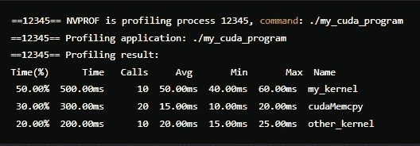

#### 细调内核性能

占用率优化：通过选择合适的块大小，增加每个 SM 上活跃线程束（warps）的数量。

内存层次结构利用：使用共享内存（shared memory）来最少地对全局内存的访问。有效利用寄存器。

指令优化：优化算术指令以减少分发分支。

示例：使用共享内存

```cpp
__global__ void sharedMemoryKernel(float *data, int N) {
  __shared__ float sharedData[256];
  int i = blockIdx.x * blockDim.x + threadIdx.x;
  if (i < N) {
    sharedData[threadIdx.x] = data[i];
    __syncthreads();
    data[i] = sharedData[threadIdx.x] * 2.0f;
  }
}
```

### 调试与测试

#### 有效的调试策略

使用`cuda-gdb`：CUDA 的 GDB 扩展通过允许你设置断点、检查变量和单步执行来协助调试 CUDA 代码。

检查 API 错误：使用`cudaGetLastError`和`cudaPeekAtLastError`来检测和管理 CUDA 运行时问题。

示例：

```cpp
cudaError_t err = cudaGetLastError();
if (err != cudaSuccess) {
  printf("CUDA Error: %s\n", cudaGetErrorString(err));
}
```

### CUDA 应用程序单元测试

单元测试保证了程序的每个组件都能正常工作。要为 CUDA 程序构建单元测试，请利用 Google Test 等框架。

示例：使用 Google Test 进行单元测试


```cpp
#include <gtest/gtest.h>
#include <cuda_runtime.h>

// 用于测试的 CUDA 内核
__global__ void testKernel(int *data) {
  int i = threadIdx.x;
  data[i] = i;
}

// 对 CUDA 内核的单元测试
TEST(CudaTest, KernelExecution) {
  int h_data[256];
  int *d_data;
  cudaMalloc(&d_data, 256 * sizeof(int));
  testKernel<<<1, 256>>>(d_data);
  cudaMemcpy(h_data, d_data, 256 * sizeof(int), cudaMemcpyDeviceToHost);
  for (int i = 0; i < 256; ++i) {
    EXPECT_EQ(h_data[i], i);
  }
  cudaFree(d_data);
}

// 运行测试的主函数
int main(int argc, char **argv) {
  ::testing::InitGoogleTest(&argc, argv);
  return RUN_ALL_TESTS();
}
```

通过遵循最佳实践、通过性能分析进行细化优化，并应用强大的调试和测试，可以确保 `CUDA` 应用的可靠性和性能。


# 第 13 章


## GPU 计算的未来趋势

GPU 计算正随着技术的发展和处理需求的需求而快速演进。本章将深入探讨开发技术、GPU 硬件以及 `CUDA` 的未来及其对各个领域的影响。

### 新兴技术

#### AI 与机器学习进展

人工智能（AI）和机器学习（ML）一直是 GPU 开发的关键驱动力。由于其并行处理的能力，GPU 非常适用于这些应用。

深度学习：GPU 对于训练深度神经网络（DNN）至关重要，需要大量的处理能力。`TensorFlow` 和 `PyTorch` 等框架利用 GPU 加速来更快地训练模型。

实时 AI：技术的进步使得实时 AI 应用成为可能，例如自动驾驶汽车、自然语言处理和计算机视觉。

边缘 AI：在边缘设备（如智能手机和物联网设备）上使用 AI 模型变得越来越常见。GPU 被引入这些设备中以允许本地 AI 计算，从而降低延迟和对云端的依赖。

#### 示例：NVIDIA Jetson 平台

NVIDIA Jetson 平台专为边缘 AI 应用开发。它在小型封装内提供了强大的 GPU，允许在无人机、机器人和智能摄像头上进行实时 AI 处理。它提供了卓越的能效比、用于 AI 推理的内置 GPU，以及与领先 AI 框架的互操作性。

NVIDIA 定期发布 `CUDA` 更新，引入新功能和改进。

### 增强的编译器支持

对 `NVCC` 编译器进行了增强，包括对更复杂的 C++ 特性的支持。

### 增强的 API 功能

新的 API 为 GPU 资源、内存管理和并行执行提供了更精细的控制。

### 互操作

改进了与其他编程范式和硬件的兼容性，包括对异构计算环境的支持。

### 示例：CUDA 12.x

`CUDA 12.x` 系列预计将包含若干增强，例如：改进的多 GPU 支持（使用简化的 API 来管理多个 GPU 并执行集合操作）、高级的内存管理功能（如虚拟内存管理和改进的统一内存支持），以及更好的调试和分析工具，以帮助开发者更有效地调试和优化其 `CUDA`。

### 潜在应用与行业影响

GPU 计算和 `CUDA` 的进步将改变多个领域，创造新机会并推动创新。

- 医疗健康：GPU 正在加速医学成像、药物开发和基因组学。GPU 计算让 AI 驱动的诊断和定制化治疗变得日益可行。
- 金融：高频交易、风险建模和欺诈检测都受益于 GPU 的并行处理能力。
- 汽车：自动驾驶系统严重依赖 GPU 来实时解释数据并做出决策。
- 娱乐：GPU 用于游戏、虚拟现实（VR）和增强现实（AR），提供具有真实视觉效果的沉浸式体验。
- 科学研究：GPU 为从气候建模到粒子物理等领域提供了无与伦比的仿真和数据分析维度。

### 示例：自动驾驶车辆

GPU 是自动驾驶车辆开发的关键，提供了实时数据处理、传感器融合和 AI 驱动决策所需的计算能力。关键组件包括：利用 AI 分析来自摄像头、`LIDAR` 和其他传感器数据的感知系统；用于实时路径规划和避障的导航与规划；以及用于驾驶辅助和提升乘客体验的内内 AI。

GPU 计算的未来充满前景，持续的硬件和软件突破推动着各个学科的创新。AI 和机器学习处于前沿，利用 GPU 的并行处理能力达到新高度。`CUDA` 是开发者不可不可的工具，不断扩展以适应当前应用的需求，并推动研究、工业和日常生活的进步。随着这些趋势的持续，GPU 计算的重要性将不断扩大，定义技术的未来及其应用。


# 第 14 章


## GPU 计算中的安全与隐私

随着 GPU 计算变得日益流行，识别并解决安全和隐私问题至关重要。本章研究了可能的 GPU 计算漏洞、保护 `CUDA` 程序的有效实践以及数据隐私担忧，包括对隐私规则的合规性。

### 理解安全影响

#### GPU 计算中的潜在漏洞

GPU 与所有其他计算机资源一样，容易受到各种安全风险的影响。这些漏洞可能会导致严重后果，特别是当 GPU 用于敏感计算或在协作场景中。

- 侧信道攻击：GPU 可能成为侧信道攻击的目标，攻击者从 GPU 的物理实现中提取敏感信息，而不是攻击软件漏洞。这可能涉及跟踪功耗、电磁发射或时间数据。
- 数据泄露：由于 GPU 经常被多个程序使用，存在数据泄露的风险。如果不使用适当的隔离方法，可能会无意中向他人披露敏感数据。
- 缓冲区溢出：GPU 与普通 CPU 一样，容易受到缓冲区溢出攻击。攻击者可以利用缓冲区溢出运行任意代码或创建拒绝服务。

##### 计时攻击示例

攻击者可能利用执行特定 GPU 操作所需的时间来推断有关正在处理的数据的信息。这在密码学应用中特别为重要，因为时间差异可能会泄露有关密钥的信息。

#### CUDA 应用的安全最佳实践

- 输入验证：始终验证 `GPU` 核函数的输入，以避免缓冲区溢出和其他输入相关问题。这涉及验证边界和数据完整性。
- 隔离：使用 `CUDA` 的内存管理工具分离运行在同一 GPU 上的多个程序。使用统一虚拟寻址（`UVA`）可以帮助更安全地管理内存。
- 访问控制：实施严格的访问控制，限制谁以及什么可以使用 GPU 资源。这可能涉及使用用户命名空间、`cgroups` 和其他操作系统功能来限制 GPU 访问。
- 定期更新：保持您的 `CUDA` 工具包和驱动程序为最新版本，以确保您收到最新的安全修复和改进。
- 安全通信：在 CPU 和 GPU 之间发送数据时（特别是通过网络时），请使用安全通信协议以防止窃听和篡改。

##### 示例：实现边界检查

```cpp
__global__ void secureKernel(float *data, int N) {
    int i = blockIdx.x * blockDim.x + threadIdx.x;
    if (i < N) {
        data[i] = 2.0f * data[i];
    }
}
```

在此示例中，`if (i < N)` 检查防止内核函数访问数组外的内存，缓解了缓冲区溢出问题。

### 数据隐私考虑

#### 使用 CUDA 处理敏感数据

在 GPU 计算中处理敏感数据需要仔细考虑数据管理和处理技术。

- 加密：在将任何敏感数据传递给 GPU 之前对其加密。这确保了即使数据被拦截，它仍然是安全的。
- 数据最小化：仅传输和处理计算所需的最少敏感数据。这降低了披露不需要的数据概率。
- 内存管理：确保在处理后从 GPU 内存中安全删除敏感数据。`CUDA` 不会在在使用后自动清除内存，因此必须在释放内存之前显式地将敏感数据置零。

##### 示例：在传输前加密数据

```cpp
#include <openssl/aes.h>

void encryptData(float *data, int N) {
    AES_KEY enc_key;
    AES_set_encrypt_key((const unsigned char *)"encryptionkey123", 128, &enc_key);
    for (int i = 0; i < N; i += 16) {
        AES_encrypt((const unsigned char *)&data[i], (unsigned char *)&data[i], &enc_key);
    }
}
```

在此示例中，使用 OpenSSL 在数据发送到 GPU 处理之前对其进行加密。

#### 符合隐私法规

- GDPR & CCPA：诸如欧洲的通用数据保护条例（`GDPR`）和美国的加州消费者隐私法（`CCPA`）对个人数据的处理有严格要求。为了确保合规，必须建立技术和组织保护措施来保护 GPU 处理的个人数据。
- 数据匿名化：在可行的情况下，在 GPU 上处理个人信息之前对其进行匿名。这涉及删除或模糊可能识别身份的信息。
- 审计追踪：记录数据处理操作，例如处理了什么数据、由谁处理以及何时处理。这有助于证明符合监管义务。

##### 示例：数据匿名化

```cpp
void anonymizeData(float *data, int N) {
    for (int i = 0; i < N; i++) {
        data[i] = 0; // 替换为匿名值
    }
}
```

在这种情况下，通过在处理前替换敏感值对数据进行匿名化。

安全和隐私是 GPU 计算中的重要因素。开发者通过识别潜在漏洞、应用保护 CUDA 程序的最佳实践以及确保符合隐私规则，可以保护敏感数据并保持其程序正常运行。随着 GPU 计算的演进，尊重安全和隐私对于安全以安全且符合伦理的方式实现其全部潜力至关重要。


# 第 15 章


## 行业应用与趋势

GPU 计算通过为计算密集型活动提供无与伦比的性能，改变了多个领域。本章研究了 GPU 计算在游戏与图形、医疗生命科学以及金融经济领域的应用与发展。

### 游戏与图形

#### 实时渲染与物理模拟

GPU 长期以来一直是游戏行业的基础，为实时渲染和物理计算提供处理能力。实时处理复杂的图形计算和物理交互的能力，对于产生沉浸式游戏体验至关重要。

实时渲染：GPU 允许以高帧率快速渲染复杂场景，这是流畅且响应迅速的游戏所必需的。GPU 有效地执行着色、纹理和抗锯齿等技术，产生详细且真实的视觉效果。

物理模拟：现代游戏经常使用复杂的物理模型来模拟真实的物体交互。GPU 并行进行这些模拟，使其即使在具有许多交互元素的复杂生态系统中也能顺畅执行。

##### 示例：PhysX 引擎

NVIDIA PhysX 引擎是一种流行的物理模拟引擎，它利用 GPU 加速来模拟真实的物理交互，如碰撞、流体动力学和织物模拟，从而提升了整体游戏体验。

#### 使用 CUDA 进行光线追踪

光线追踪是一种渲染技术，通过模拟光行为来创建极其真实的视觉效果。光线追踪跟踪光线在与场景中物体交互时的路径，可以提供如反射、折射和阴影等优美的视觉效果。

结合光线追踪的 CUDA：`CUDA` 允许在 GPU 上快速实现光线追踪技术。在 NVIDIA RTX 技术的下，实时光线追踪使游戏和视觉应用达到了以前无法实现的真实性水平。

##### 示例：实时光线追踪

```cpp
__global__ void traceRays(float3 *image, int width, int height) {
    int x = blockIdx.x * blockDim.x + threadIdx.x;
    int y = blockIdx.y * blockDim.y + threadIdx.y;
    if (x < width && y < height) {
        // 计算每个像素颜色的光线追踪逻辑
        float3 color = make_float3(0.0f, 0.0f, 0.0f);
        // 根据光线与物体的交互计算颜色
        image[y * width + x] = color;
    }
}
```

在此示例中，基础 `CUDA` 内核使用光线追踪来确定图像中每个像素的颜色。

### 医疗与生命科学

#### 生物信息学与计算生物学

生物信息学和计算生物学是涉及计算方法对生物数据进行处理和解释的领域。GPU 对于加速这些研究非常重要，允许研究人员更快速更有效地处理海量数据集。

基因序列：基因数据的研究（包括对比和 DNA DNA 序列）可以使用 GPU 进行大规模并行化。这加速了遗传变异的检测以及我们对其影响的理解。

蛋白质折叠：模拟蛋白质折叠对于理解其活动设计新型疗法至关重要。GPU 加速能够在比传统方法所需时间短得多的时间内，实现蛋白质折叠过程的建模。

##### 示例：GPU 加速基因组分析

```cpp
__global__ void analyzeGenomes(char *genomes, int *results, int numGenomes) {
    int idx = blockIdx.x * blockDim.x + threadIdx.x;
    if (idx < numGenomes) {
        // 执行基因组分析
        results[idx] = computeGenomeFeature(genomes[idx]);
    }
}
```

在此示例中，`CUDA` 内核并行扫描一系列基因组，加速了遗传特征的发现。

#### 医学影像与诊断

如 MRI、CT 扫描和超声波等医学成像技术产生了海量数据，必须进行处理和解释。GPU 通过提高速度和准确性改进了这些过程。

图像重建：CT 扫描中的迭代重建等技术可以使用 GPU 加速，从而获得更快质量更高的图像。

图像分析：GPU 允许对医学图像进行实时分析，有助于疾病的识别和诊断。

##### 示例：加速的 MRI 重建

```cpp
__global__ void reconstructMRI(float *inputData, float *outputData, int width, int height) {
    int x = blockIdx.x * blockDim.x + threadIdx.x;
    int y = blockIdx.y * blockDim.y + threadIdx.y;
    if (x < width && y < height) {
        // MRI 重建逻辑
        outputData[y * width + x] = processPixel(inputData[y * width + x]);
    }
}
```

在此示例中，`CUDA` 内核执行 MRI 图像重建，提高了操作的速度和精密度。

### 金融与经济

#### 高频交易算法

高频交易（HFT）意味着在几分之一秒内执行大量的交易。GPU 提供了评估市场数据和快速执行交易所需的处理能力。

算法交易：GPU 可以执行复杂的算法来评估市场波动做出实时交易决策。GPU 的并行处理能力保证了这些分析能够快速高效地完成。

风险管理：实时风险评估和管理在高频交易中至关重要。GPU 帮助交易员评估交易和组合的风险，允许他们快速做出明智决策。

##### 示例：GPU 加速的交易算法

```cpp
__global__ void analyzeMarketData(float *marketData, int *tradeDecisions, int numDataPoints) {
    int idx = blockIdx.x * blockDim.x + threadIdx.x;
    if (idx < numDataPoints) {
        // 根据市场数据做决策的交易逻辑
        tradeDecisions[idx] = computeTradeDecision(marketData[idx]);
    }
}
```

在此示例中，`CUDA` 内核并行分析市场数据并做出交易决策，实现了高速交易。

#### 风险评估与建模

风险分析和建模是金融管理的关键方面。GPU 加这些这些活动允许更快更准确的评估。

蒙特卡洛模拟：GPU 非常适合执行蒙特卡洛模拟，它用于估计和评估投资组合的风险。这些模拟需要产生大量的随机样本，可以很容易地并行。

风险价值（VaR）：GPU 有助于计算风险价值，这是对投资组合在特定时间内可能价值损失的衡量。通过加速这些计算，金融机构可以更准确更快速地评估风险。

##### 示例：用于风险评估的蒙特卡洛模拟

```cpp
__global__ void monteCarloSim(float *randomNumbers, float *results, int numSimulations) {
    int idx = blockIdx.x * blockDim.x + threadIdx.x;
    if (idx < numSimulations) {
        // 蒙特卡洛模拟逻辑
        results[idx] = simulateOutcome(randomNumbers[idx]);
    }
}
```

在此示例中，`CUDA` 内核并行执行蒙特卡洛模拟，加速了风险分析过程。


GPU 计算通过为复杂操作提供处理能力，正在彻底改变多个领域。GPU 提供了实时处理能力，提高了分析准确性，并促进了游戏、图形、医疗保健和金融等领域的创新。随着 GPU 技术的进步，它对这些行业的影响只会不断增加，开启新的机会并为性能和效率建立新的基准。


## 结论


最后一章对本指南中涵盖的重要主题进行了全面概述，推荐了进一步掌握 `CUDA` 编程的额外资源，并鼓励持续的学习与实验。

## 核心概念回顾

在整本书中，我们查看了 `CUDA` 编程的多个领域，从基础知识到高级主题，强调了它们的相关性和实际应用。

**`CUDA` C++ 编程简介**：我们从描述 `CUDA` 开始，并解释了它如何利用 GPU 能力进行通用计算。理解 `CUDA` 的演进及其对现代计算的影响，为随后的深入研究奠定了基础。

**搭建你的环境**：我们讨论了如何安装 `CUDA Toolkit` 以及搭建你的开发环境，这对于开始 `CUDA` 编程至关重要。适当的配置允许你高效地编写、构建和运行 `CUDA` 程序。

**理解基础**：本节介绍了 `CUDA` 架构的原理，例如流式多处理器（`SMs`）、线程块（thread blocks）和网格（grids）。我们还查看了 `CUDA` 内存和执行模型，这对于创建高效的 `CUDA` 程序至关重要。

**编写你的第一个 `CUDA` 程序**：我们通过运行一个简单的向量加法应用说明了 `CUDA` 的基本语法，其中包括内核定义与启动、内存管理以及数据传输。

**内存管理**：我们查看了分配和释放设备内存、主机与设备之间的数据传输，以及利用 `Unified Memory`。高效的内存管理对于获得 `CUDA` 应用的最优性能至关重要。

**`CUDA` 中的并行编程**：理解线程层次结构、网格和块设置以及同步机制对于最大化 GPU 并行性非常重要。

**优化 `CUDA` 应用**：我们研究了减少线程束分歧（warp divergence）、利用共享内存以及优化内存访问以提高速度的方法。推出了 `nvprof` 和 `Nsight Systems` 等分析工具，以帮助发现并解决性能问题。

**高级 `CUDA` 概念**：强调了动态并行（dynamic parallelism）和统一内存（unified memory）等特性，展示了它们简化复杂程序和增强性能的能力。

**现实世界的 `CUDA` 应用**：我们查看了 `CUDA` 如何应用于各个领域，包括游戏和图形、医疗保健与生命科学以及金融与经济。这些示例展示了 GPU 计算的实际意义。

**调试与分析**：讨论了使用 `cuda-gdb` 的有效调试策略以及使用 `nvprof` 的分析方法，强调了这些工具在设计可靠高性能的应用时的相关性。

**`CUDA` 库与工具**：展示了 `cuBLAS`、`cuFFT`、`cuDNN` 和 `Thrust` 等库，说明了它们如何简化并加速基础计算操作。

**多 GPU 编程**：我们回顾了多 GPU 编程的基础知识，包括它的优势、局限性以及基于 `CUDA-aware MPI` 和内存管理方法的实际实现解决方案。

**安全与隐私**：本节讨论了潜在的 GPU 计算漏洞，并提到了保护 `CUDA` 程序和处理敏感数据的建议做法。

**工业应用与趋势**：我们研究了各领域 GPU 计算的现状和未来趋势，强调了 GPU 技术的革命性力量。

## 额外资源

为了进一步你的学习之旅，这里是一些推荐的书籍、课程和网站：

**在线课程：**

- Udacity 上的 "CUDA Programming and Performance"
- Coursera 上的 "Heterogeneous Parallel Programming"（来自伊利诺伊大学）

**网站：**

- NVIDIA 开发者社区（`dev.nvidia.com`）
- `CUDA Toolkit` 文档（`docs.nvidia.com/cuda`）
- Parallel Forall 博客（`developer.nvidia.com/blog/parallelforall`）。

**在线社区与论坛：**

- NVIDIA 开发者论坛（`forums.developer.nvidia.com`）。
- Stack Overflow（`StackOverflow.com`）- 在问题中使用 `cuda` 标签。
- 查看 `CUDA` 的 Reddit 版块（`reddit.com/r/CUDA`）。

### 鼓励进一步学习

**实践与实验**：学习 `CUDA` 编程最有效的方法是通过亲身实践。尝试不同的方法，改进你的代码并解决现实世界的问题。构建项目和参加编程竞赛可能帮助你提高能力。

**保持更新**：`CUDA` 和 GPU 技术在不断变化。通过监控 NVIDIA 的公告、阅读技术博客以及参与相关的在线小组来跟上最新进展。参加会议和网络研讨会也可以提供有用的信息和社交机会。

**加入我们的社区**：与 `CUDA` 开发社区互动可能非常有用。分享你的知识，获取指导并在项目上合作。从他人的经验中学习并为社区贡献可以拓宽视野并保持动力。

这篇文章对 `CUDA` 编程提供了深入的理解，从基础概念到高级方法不等。通过遵循最佳实践、使用工具和库以及不断地学习和实验，你可以最大化 GPU 计算的潜力。接受并行处理的力量，保持好奇，并不断突破你使用 `CUDA` 所能成就的极限。编码愉快！
