# D 编程语言指南

前言 ................................................................................................ xxii

## 1 “深入探索 D 世界”

- 1.5 基础数据结构 ......................................................... 14

## 2 基本类型

## 3 语句

viii

# 5 数据与函数。函数式风格 ................................................. 131

# 6 类。面向对象风格 . . . 175

# 7 其他用户定义类型 239

# 8 类型修饰符 ............................................................................ 287

# 9 错误处理 ................................................................ 301

## 9.7 未捕获异常 ........................................ 312

# 10 合约编程 (Contract Programming) ................ 313

# 12 运算符重载 (Operator Overloading) ................................................................................ 365

# 13 并发 (Concurrency) ............................................................................ 388

### 13.6.1 首次匹配 (First Match) ................................................................. ............................ 405

# 前言

作者：Walter Bright

很久以前我读过的一部科幻小说里有一句话，如果科学家认为这能进一步完善他所在领域的知识，他将无所畏惧地窥地狱之门。这句话简洁地捕捉了作为一名科学家的本质。这种对发现的喜悦，这种对未知的渴望，在物理学家理查德·费曼的视频和文字中显而易见，他的热情富有感染力且令人着迷。

尽管我不是一名科学家，但我理解他们的动机。我的动机是工程师的——我最喜欢的书籍之一是关于莱特兄弟如何一步步解决飞行问题的纪实，即 Wald 所写的《工程师的莱特兄弟》（The Wright Brothers as Engineers），以及他们如何将这种精神投入到创造飞行器之中。

我早期的兴趣在 Binley 写的《业余人员火箭手册》（Rocket Manual for Amateurs）开头的几页中总结为：“对燃烧和爆炸的事物感到兴奋和着迷”，这并不意味着需要制造速度越来越快的东西。

但制造强大的机器是一个昂贵的选择。后来我发现了计算机。计算机奇妙而迷人的之处在于构建事物的简便。你不需要价值亿美元的晶圆厂、机加工，甚至不需要螺丝刀。只需一台廉价的电脑，你就能创造世界。

于是我开始在计算机上构建想象的世界。第一个是《帝国：战争》（Game Empire, Warfare of the）。当时的计算机性能无法良好运行它；因此我开始对如何优化程序性能感兴趣。这导致我研究生成代码的编译器，并自然产生了“我可以写出一个比那更好的编译器”的傲慢。痴迷于 C 语言的我转向了实现一个 C 编译器。这并不难，花了几年时间兼职完成。然后我发现了 Bjarne Stroustrup 的 C++ 语言，我想我可以在几个月内将那些功能添加到 C 编译器中（！）。

在十多年的时间里，我一直在完善它。在实现的过程中，我对这种语言的每一个细节都非常熟悉。支持庞大的用户意味着对于他人如何感知这种语言、哪些功能有效、哪些无效，积累了大量经验。我在使用某东西时，无法不思考改进设计的方法。1999 年，我决定将此付诸实践。它最初被称为 Mars 编程语言，

# Walter Bright 前言

量表（gauge），但被我的同事开玩笑地称之为 D，但这个名字流传开了，D 编程语言因此诞生了。

写本书时，D 已经十岁了，它已经经历了第二次重大蜕变，有时被称为 D2。在这段时间里，D 从一个埋头键盘的个人扩展到了全球性的开发者社区，他们致力于该语言的各个方面，并支持着库和工具的生态系统。

语言本身（这是本书的重点）已经从微小的起步成长为一种非常强大的语言，擅长从多个角度解决问题。据我所知，D 对几种强大的范式（命令式、面向对象、函数式和元编程）提供了前所未有的熟练整合。

初看之下，这种语言可能并不简单。事实上，D 并不是一种简单的语言。但我认为，这种看待语言的观点是错误的。一种更有用的观点是：在那种语言中编程是什么样子的？D 程序是复杂晦涩的，还是简单优雅的？

我的一位具有企业环境经验的同事观察到，IDE（集成开发环境）是编程必不可少的工具，因为只需点击一下就能生成上百行样板代码。对于 D 来说，IDE 并不那么本质，因为 D 并不依赖基于向导的样板代码，而是通过内省和生成能力强制样板代码本身。程序员不需要看到那些样板。程序固有的复杂性是由语言处理的，而不是 IDE。

例如，假设有人想用一种对该范式没有特殊支持的简单语言来实现 OOP（面向对象编程）。这是可以实现的，但非常糟糕，而且很少有此之价值的。当一种更复杂的语言直接支持 OOP 时，编写 OOP 程序就变得简单而优雅。语言变得复杂了，但通过多样化的选择，用户代码变得简单了。这是值得的进步。

能够以简单优雅的方式为各种任务编写用户代码，很大程度上需要一种支持多种编程范式的语言。编写得好的代码在页面上看起来应该是美的，而优美的代码恰恰足以是正确的代码。我不确定为什么这种关系成立，但它倾向于是事实。这就像外观良好的飞机通常也飞得很好。因此，使算法能够以优美方式表达的语言特性是。然而，代码的简洁和优雅并非衡量优秀语言的唯一标准。如今，依靠约定和编程经验来确保代码正确变得越来越不现实。为了这一点，D 提供了许多程序员可以利用的策略。这些包括函数属性、不可变性、作用域守护、纯函数以及线程隔离。

# Walter Bright 前言

不，我们没有忽视性能！尽管许多人预测性能不再重要，尽管计算机运行得更快，性能的需求从未减少。D 是一种系统编程语言。这意味着什么？从意义上说，这意味着可以用 D 编写操作系统以及设备驱动程序。从更技术角度来说，这意味着 D 程序可以访问机器的所有能力。这意味着你可以使用指针、指针别名和算术，甚至直接编写汇编语言代码。没有什么是 D 无法访问的。例如，D 的垃圾回收器的实现完全是用 D 编写的。

但等等！这怎么可能？一种语言如何能提供安全性和任意指针操作？答案是，这些保证是基于所使用的语言构造。例如，函数属性和类型构造可以在编译时指定保证。合约和不变性在运行时指定保证。

D 的大多数功能都在某一种语言中出现过。任何特定的特性本身并不能为一种语言辩护。但这种组合大于部分之和，D 的组合创造出了一种令人满意的语言，它提供了优雅直接的方法来解决各种编程问题。

Andrei Alexandrescu 以其独特的编程理念成为主流而闻名（参见他的开创性《现代 C++ 设计》）。Andrei 于 2006 年加入 D 编程语言设计团队。他带来了深厚的编程理论基础，以及对编程设计问题的源源不断的解决方案。D2 的形状在很大程度上归于他的贡献，在很多方面，这本书与 D 共同演进。在关于 D 的写作中，你会很快地发现这种设计选择背后的“为什么”，而不仅仅是枯燥的事实陈述。了解语言为什么是这样，会让你更容易、更快地上手。

Andrei 通过使用 D 解决许多基础编程问题来阐明这些“为什么”。因此，他展示的不是 D 如何工作，而是为什么以及如何使用它。

我希望你在 D 中获得的乐趣就像我为了赋予它生命而付出的努力一样。对这种语言的真切兴奋感从 Andrei 的书中溢溢出来。我认为你会觉得非常兴奋的。

Walter Bright

2010年1月

# 前言

作者：Scott Meyers

从任何角度衡量，C++ 均取得了巨大的成功，但即使是它最热诚的支持者也不会否认，它是一个复杂的怪兽。这种复杂性影响了 C++ 最广泛使用的继任者 Java 和 C# 的设计。两者都试图避免 C++ 的复杂性——在一个更易于使用的包中提供它的大部分功能。

降低复杂性采取两种基本形式。一种是消除“复杂”的语言特性。例如，C++ 对手动内存管理的需求被垃圾回收机制消除了。模板被认为成本/效益比过高，因此这些语言的初始版本选择排除任何类似于 C++ 泛型支持的内容。

另一种降低复杂性的形式是使用相似但要求更低的构造结构来替换“复杂的”C++ 特性。例如，C++ 加上多重继承被替换为带有接口的单继承泛型。目前版本的 Java 和 C# 都支持泛型，但它们比 C++ 的模板要简单得多。

这些继任语言的追求远不仅仅是以降低复杂性的实现 C 语言所做。它们都定义了虚拟机，增加了对反射的支持，并提供了丰富的库，允许许多程序员将注意力从创建新代码转移到将现有组件组合在一起。结果可以被认为是 C++ 的“生产力语言”——Java 和 C# 是比 C++ 更好的选择。

但 C++ 不是生产力语言；它是一门系统编程语言。它的设计目标是在与硬件通信的能力上（例如在驱动程序和嵌入式系统中）、在不进行扩展的情况下与基于 C 的库和数据结构工作（例如在遗留系统中）、以及从其运行的硬件上压榨出最后一滴性能。Java 和 C# 底层的虚拟机性能关键组件是用 C++ 编写的，这并不算讽刺。虚拟机的高性能实现是系统语言的工作，而不是生产力语言。

D 旨在成为系统编程领域 C++ 的继任者。像 Java 和 C# 一样，D 旨在避免 C++ 的复杂性，为了实现这一点，它使用了一些相同的技术。垃圾回收被引入，手动内存管理被移除¹继承和接口被引入，多重继承被移除。然后 D 开始开辟自己的道路。

它从识别并填补 C++ 的缺陷开始。C++ 提供对模块、契约编程（Contract Programming）、单元测试或“安全”子集（在其中错误是不可能的）的支持。D 提供了所有这些，而且是在没有牺牲生成高质量原生代码能力的情况下实现的。

C++ 既强大又复杂，而 D 的目标是至少同样强大但更不复杂。C++ 中的模板元编程程序已经证明编译时计算是一项重要技术；他们必须跳过语法的火圈才能练习它，但无需经历词法层面的痛苦。如果你知道如何在当前的 C++ 中编写一个函数，你完全不知道如何编写一个在编译期间求值的的对应 C++ 函数。如果你知道如何在 D 中编写一个函数，你就确切知道如何编写它的编译时变体，因为代码是相同的。

D 与其源自 C++ 的兄弟语言分离的最有趣的地方之一是它处理基于线程的并发的方法。意识到对共享数据进行不当同步（数据竞态）是一个容易掉入且难以爬出的陷阱，D 颠转了这一传统：默认情况下，数据不会在线程间共享。D 的设计者指出，由于现代硬件深层的缓存级结构，内存本身并不经常在核心或处理器之间共享，那么何必默认为开发人员提供一种不仅是幻觉、而且是已知易于引入难以调试错误的幻觉抽象呢？

所有这一切使得 D 在 Cheritage 设计空间中具有值得关注的价值，这也是阅读这本书的理由。作者是 Andrei Alexandrescu，这一事实使其变得更有分量。作为 D 的设计者及其库的大部分部分的实现者，Andrei 几乎没有比他 D D。自然地，他可以描述 D 编程语言，也可以解释为什么 D 是现在这个样子。语言中存在的特性是有其原因的，缺失的预期特性不存在也有其原因。Andrei 处于一个独特的地位，可以阐明这种推理。

这种阐明通过一个独特引入胜的插叙（这实际上是一条通往你需要到达的终地的路线）体现出来，Andrei 提供了保证：“我知道你正在问这与编译时求值有什么关系。有的。请听我说。”

关于链接器诊断信息不直观的本质，Andrei 观察到：“如果你忘记了——main，不要担心；链接器语言会用它的原生语言流畅且毫无悬疑地向你提醒它，即加密的 Klingen。” 即使是对其他出版物的引用也带有 Alexandrescu 的风格。你不仅仅是被引用了 Wadler 的《证明即程序》，你是被引用了“Wadler 迷人的专著《证明即程序》”。Friedl 的《精通正则表达式》不仅仅是被推荐，而是被“热烈推荐”。”

一本关于编程语言的书当然充满了示例代码，而这些代码示例也证明了 Andrei 绝非一个平庸的作者。这是他一个搜索函数的原型：

```cpp
bool find(int[] haystack, int needle);
```

这是一本由高水平作者编写的关于有趣编程语言的书。我相信你会发现阅读过程是有收获的。

Scott Meyers

2010年1月

¹ 1. 实际上，它是可选的。如果你真的想执行手动内存管理，D 会允许你这样做。D 符合系统编程语言 true。

# 前言

编程语言设计在简单中寻求力量，并且在成功时，产生美。

在相互矛盾的要求之间选择权衡是一项艰巨的任务，这不仅需要语言设计者良好的品味，还需要对理论原理的精通。编程语言设计是软件工程完备的。

D 是一门试图在它选择的约束内持续做正确事的语言：对计算资源的系统级访问、高性能，以及与 C 类语言的语法相似性。在尝试做正确的事时，D 有时遵循传统并像其他语言那样做，有时则通过新颖的解决方案打破传统。偶尔这意味着重新审视 D 表面接受的约束。例如，大型程序片段甚至整个程序可以用 D 的定义良好的内存安全子集编写，这涉及到放弃部分系统级访问以换取程序可调试性的巨大提升。

如果以下价值观对你很重要，那么你对 D 将感兴趣：

- 性能。D 是一门编程语言。它有一个内存模型，尽管高度结构化但与 C 兼容，并且可以在没有任何转换的情况下调用 C 函数并被 C 函数调用。

- 表达能力。D 不是一种极简语言，但它确实具有很高的功率密度。你可以在 D 中定义优雅、自解明的设计，以准确描述复杂的现实。

- “扭矩”。任何后院改装者都会告诉你，扭矩驱动一切；它的可用性是。某些语言在小型程序中最为强大，而其他语言只有在特定规模下才能证明其语法开销的价值。D 你在脚本和大型程序中完成工作，大型程序从单文件脚本有机生长也并不罕见。

- 并发。D 的并发方法与其相似的语言有明显的偏离，反映了现代硬件设计与过去架构的偏离。D 打破了隐式内存共享的诅咒（尽管允许静态检查的显式共享），培养了通过消息通信的内存独立线程。

# 前言

- 通用代码。操纵其他代码的通用代码由强大的 Lisp 宏开创，并由 C++ 模板、Java 泛型以及其他各种语言中的类似特性延续。D 提供了极其强大的泛型机制和代际机制。

- 折衷主义。D 认识到不同的编程范式对于不同的设计挑战具有各自的优势，因此它培养了一种高度集成的风格联邦，而不是单一的“唯一真方法”（One True Approach）。

- “这些是我的原则。如果你不喜欢，我还有别的原则。” D 试图遵循坚固的语言设计原则。它会转向实现难度、易用性困难以及所有并非总是能找到盲目常识和直觉的人性。在这种情况下，语言必须做出判断，这些判断最终是主观的，并且关乎平衡、活性和良好的审美，而非其他任何。在我看来，至少 D 与其他不可避免地做出类似决策的语言相比，表现得非常出色。

本书假设你是一名程序员，这意味着你知道如何使用你选择的语言完成典型的编程任务。我们不假设也不特别推荐你掌握任何特定语言。如果你熟悉某种算法语言（C、C++、Java 或 C#），你将拥有略微优势，因为语法从一开始就会感到熟悉，而且发现“虚假朋友”（语法相似但语义不同的代码）的风险降到了最低。（特别是，如果你将一段 C 代码粘贴到 D 文件中，它要么符合相同的语义，要么完全不符合）

如果不对提供对各种特性背后的动机的洞察，而不解释使用这些特性来完成具体任务的最有效方法，那么介绍一门语言将是枯燥且不完整的。本书讨论了所有非显性特性背后的原理，并解释了为什么它们看起来是比未选择的方案更好的设计替代方案。设计选择可能会不成比例地引导实现工作、与那些有更理由保持现状的特性产生不良交互、具有在短小简单示例中不可见的隐性债务，或者简单就是强大不足以自证价值。最重要的是，语言设计者和其他任何人类一样会犯错，因此很有可能存在良好的设计选择只是尚未被发现。

第一章是对语言主要部分的快速概览。此时，并不是所有细节都得到了详尽的，但你可以对语言有一个良好的感受，并建立起编写小型程序的专业知识。它分别涵盖了表达式和语句的基础及强制性参考章节。我尝试将所获得的统一详尽性与提供与传统语言的“差异”（deltas）亮点结合起来。如果运气好，你会发现这些章节易于顺序阅读，也便于在参考时翻阅。这些章节末尾的表格是“速查表”（cheat sheets）——用简洁、直观的术语表达的复习。

第四章描述了内置数组、关联数组和字符串。数组可以被看作带有安全开关的指针，它们在 D 处理内存安全的方法以及你对语言的体验中起着工具性作用。字符串是 UTF 编码的 Unicode 字符数组。整个语言和标准库对 Unicode 的支持使得字符串处理变得正确且高效。

读完前四章后，你就可以语言提供的抽象来编写短脚本风格程序。后续章节介绍了构建块。第五章以集成的方式介绍了编译时参数化函数（模板函数）和在编译期间求值的函数。这些概念通常会被局限在高级章节，但 D 让它们变得足够简单，值得尽早引入。

第六章描述了使用类的面向对象设计。同样，以集成、有机的方式呈现了编译时参数化类。第七章引入了额外的类型，特别是结构体（struct），它对于构建效率抽象至关重要，且通常与类配合使用。

接四章描述了相对独立且特殊的特性。第八章处理限定符（qualifiers）。限定符提供了强有力的保证，这在单线程和多线程应用中都非常有用。第九章涵盖了异常模型。十章介绍了 D 强大的契约编程（Contract Programming）设施，并特意与第九章分开，试图消除一种通的误解，即错误处理和契约编程在实践中是同一个主题；它们并非如此，第十章解释了原因。

第十一章为构建大型程序提供了信息和建议，还简要地介绍了 D 的标准库。第十二章涵盖了运算符重载，没有它，所有抽象（如复数）都将受到严重影响。最后，第十三章讨论了 D 原始的并发方法。

## 简述历史


尽管听起来很通俗，但 D 是一部心之作。C 和 C++ 编译器编写者 Walter Wright 在 20 世纪 90 年代的某天决定不想继续维护编译器的职业，于是他开始定义一种他认为“应该是这样”的语言。我们许多人梦想在某个点或在定义了“正确的语言”之后；而 Walter 已经拥有了大部分基础设施——一个后端代码生成器、一个链接器，最重要的是构建语言处理器方面的丰富经验。后者的技能为 Walter 提供了一个有趣的视角。通过某种神秘的自然法则，糟糕的语言特性设计会像《道里安·格雷》那样，反映在复杂的编译器实现中。在设计他的新语言时，Walter 试图系统地消除这种流流。

这门初生的语言在精神上类似于 C++，因此社区称其为 D1，尽管 Walter 最初尝试将其命名为 Mars。让我们把这种语言称为 D1，其将将是显而易见的：它运行了多年，并凭借纯粹的热情和坚持积累了日益增长的粉丝。2006 年，D1 已经成长为一种可以与 C++ 和 Java 这样更成熟的语言直接竞争的初级语言。然而，当很明显 D1 不会成为主流，因为它缺乏能够弥补其他语言所拥有的支持的特性时，Walter 决定进行一次大胆的赌博；他决定 D1 将成为神话般的第一个版本，即 D1 进入维护模式，并开始为打破兼容性的第二个迭代版本进行重新设计。

这次赌博成功了。第一个版本带来了关于该做和该避免的洞察。此外，不需要再为新语言做广告——新手可以使用稳定的、受维护的 D1。随着时间的推移，D 走出了“更好的 C++”的绰号，变成了一种强大的通用语言，可以同时满足系统级、企业级和脚本语言的工作。还剩下一个问题——所有这些增长和创新都在寂静中发生；关于 D 的编程方法很少有记录。

你正在阅读的这本书试图填补这一空白。我希望你阅读它的过程像我编写它一样愉快。

## 致谢

D 有一份长贡献者名单，我无法全部列出。在这些人中，Usenet 新闻组的长期成员尤为突出。新闻组作为我们所构建设计的声响板，进行了审查，并产生了许多想法和改进。

Walter 受益于社区在定义参考实现 `dmd` 方面的帮助，其中两个贡献者脱颖而出：Sean Kelly 和 Don Clugston。Sean 重写并改进了核心运行时库（包括垃圾收集器）和

# 前言

他还编写了 D 并发库的大大部分实现。他所擅长的领域非常出色，遗憾的是，这意味着你并发代码中的 bug 更有可能是你的，而不是他的。Don 是通用数学和浮点数值问题方面的专家。他极大地帮助了 D 的数值库成为顶尖水平，并将 D 的能力提升到了极限。一旦参考编译器的源代码发布，Don 就没忍住将其加入其中，成为了第二大的 `dnd` 贡献者。Sean 和 [缺失姓名，很可能是 "Alexandrescu" 或根据上下文] 都推动了改进 D 定义的提案通过。最后但同样重要的是，他们都是各方卓越的黑客，与他们面对面或在线互动都非常愉快。我不知道如果没有他们，这门语言会变成什么样子的。

对于这本书，我想感谢我的审稿者，他们如此慷慨地完成了这项艰巨且不为人名的工作。没有他们，这本书就不会有现在的样子（如果你不喜欢，请宽慰自己——只要想象一下 Arragón 有可能变得多么糟糕）。因此，请允许我感谢 Alejandro Arragón, Bill Baxter, Kevin Bealer, Travis Dilly, Karim Filati, Michel Fortin, David B. Held, Michael Helvenstein, Bernard Julian Kamm, Daniel Keep, Sean Kelly, Max Khesin, Simen Kjaeras, Cody Jacobs, Cody Koeninger, Denis Koroskin, Lars Kyllington, Igor Lescik, Eugene Letuchy, Pelle Månsson, Miura Masahiro, Tim Matthews, Scott Meyers, Bartosz Milewski, Ellery Newcomer, Eric Niebler, Mike Parker, Derek Parnell, Jeremie Pelletier, Pablo Ripolles, Brad Roberts, Michael Ryan, Foy Savas, Christophof Schardt, Steve Schveighhoffer, Benjamin Shropshire, David Simcha, Tomasz Stachwiak, Robert Stewart, Knut Erik Teigen, Cristian Vlăceanu, and Leon Zolman。

Andrei Alexandrescu

2010年5月2日，星期日

# 第一章

## “深入” D

你知道首先会看到什么，所以就不再多说了了：

```
import std::io;
void main() {
    writeln("Hello, world!");
}
```

取决于你了解哪些语言，你可能会有一种似曾相识的感觉、对简单的略微赞赏，或者可能对 D 没有像脚本语言那样允许顶层语句而感到略微失望。（顶层语句会引入全局变量，随着程序的增长，这些变量会迅速变成负担；D 确实提供了在 main 之外执行代码的方法，只是更加结构化的方式。）如果你是一个追求精确的人，你会听到 `void main` 等同于一个 `int`，如果它成功执行，将向操作系统返回“成功”（代码零），这让你感到宽慰。

但让我们操之过急。传统的“Hello, world!”程序的目的不是为了讨论语言的能力，而是为了让你开始使用该语言编写和运行程序。如果你没有提供透明构建的 IDE，命令行是一条简便的路径。在名为 `hello.d` 的文件中输入了上面的代码后，启动 shell 并输入以下命令：

```
$ dmd hello.d
 ./hello
Hello, world!
```

# 第一章 “深入” D

`$` 代表你的命令提示符，在 Windows 上可能是 `C:\Path\To\Dir>`，在 Unix 系统（如 OSX、Linux 和 Cygwin）上可能是 `/path/to/dir%`。如果你运用一点系统技能，甚至可以实现程序自动编译和运行。在 Windows 上，你可能想将 shell 命令 "Run" 与程序 `rdmd.exe` 关联，它是安装包的一部分。Unix 类系统支持“shebang 符号”，这是 D 能理解的语法；在你的 `hello.d` 程序的最开头添加此行：

```
#!usr/bin/rmd
```

即可使其变为可执行文件。做出该更改后，你可以直接在命令提示符中输入它：

```
$ chmod hello.d
./hello.d
Hello, world!
$
```

> （你只需要执行一次 `chmod`。）

在操作系统上，`rdmd` 程序足够智能，可以缓存生成的可执行文件，因此编译实际上只在你更改程序后才会完成，结合编译器本身非常快这一事实，促进了快速的编辑-运行周期，这对短脚本和大型程序都有帮助。

程序本身以指令开头：

```
import std::stdio;
```

它指示编译器寻找名为 `std.stdio` 的模块，并使其符号可用供使用。`import` 类似于 C 和 C++ 中的 `#include` 预处理器指令，但在语义上更接近 Python 的 `import`：它没有发生文本替换——只是获取了符号表。重复导入同一个文件没有意义。

根据 C 建立的悠久传统，D 程序由分布在多个文件中的声明集合组成。声明可以引入（其他类型类型）函数和数据。我们的第一个程序定义了 `main` 函数不接受任何参数并返回“无”——即 `void`。当调用时，`main` 调用了 `write` 函数（当然，它是由 `std.stdio` 模块巧妙定义的），并传递了常量字符串。`ln` 后缀表示 `write` 为打印的文本添加换行符。

接下来的章节将提供对 D 的快速上手引导。少量的插图示例提供了基础语言概念。此时的重点在于传达对语言的感受，而不是给出死板的定义。随后的章节将处理语言的每个部分。

### 1.1 数字与表达式

你是否曾经好奇类型是如何运作的？让我们来写一个简单的程序来显示：

```cpp
/*
计算一个简单的范围
*/
import std::stdio;

void main() {
  // 永远改变的值
  immutable int feet = 12;
  immutable double cmInch = 2.54;

  // 遍历范围
  foreach (int i = 0; i < feet; i++) {
    writeln(i, " ", i * cmInch);
  }
}
```

执行时，该程序将打印：

```
0 0
1 2.54
2 5.08
3 7.62
4 10.16
5 12.7
6 15.24
7 17.78
8 20.32
9 22.86
10 25.4
11 27.94
```

按递增顺序，有符号类型包括 `byte`、`short`、`int` 和 `long`，大小分别为 8、16、32 和 64 位。这些类型中的每一种都有相同大小的无符号对应类型，遵循简单的命名：`ubyte`、`ushort`、`uint` 和 `long`。浮点类型由 `float`（32 位 IEEE 单精度）、`double`（64 位 IEEE）和 `real`（其大小取决于机器浮点寄存器的最大值，但不少于 64 位；例如，在 Intel 上 `real` 是一种所谓的 IEEE 754 双扩展 79 位格式）组成。

回到整数数字领域，像 `42` 这样的字面量可以转换为任何数值类型，但请注意编译器会检查类型是否足够容纳该值。声明：

```
immutable byte feet = 12;
```

与上面的声明一样好，因为 12 可以很方便地放入 8 位中。默认情况下，如果目标类型需要从数字推断（如示例程序所示），整数常量的类型为 `int`，浮点常量的类型为 `double`。使用这些，你可以在 D 中使用算术运算符和函数构建许多表达式。这些运算符及其优先级与你在 D 的语言中找到非常相似：用于基础算术的 `+`、`-`、`*`、`/`、`%`；用于比较的 `==`、`=`、`<`、>=；用于函数调用的 `fun(argument1,argument2)` 等。

回到我们的厘米转英寸程序，`writeln` 的调用有两个值得注意的细节。其一是 `writeln` 接受五个参数（与打开呼叫频率的程序中的一个参数不同）。就像 I/O 功能

### 1.2. 语句

这些语句常见于 Pascal (`writeln`)、C (`printf`) 或 C++ (`cout`)。D 的 `writeln` 函数接受任意数量的参数（它是一个“变长参数函数”）。然而在 D 中，用户可以定义自己的变长参数函数（与 Pascal 不同），而且它们始终是类型安全的（与 C 不同），且不需要优雅地劫持运算符（与 C++ 不同）。另一个细节是，我们对 `writeln` 的调用生硬地将格式信息与正被格式化的数据混合在了一起。将数据与呈现分离通常是理想的，所以让我们使用 `write` 函数代替：

```
writeln("%s%s\'%ts", feet, inches,
(feet * inchesPerFoot + inches) *= cmPerInc);
```

新排列的调用产生了完全相同的输出，区别在于 `writelns` 现在完全描述了格式。`%` 引入了类似于 C 语言 `printf` 的格式说明符，例如 `%d` 用于整数，`%f` 用于浮点数，`%s` 用于字符串。

如果你使用 `printf`，你会觉得很亲切，并不是因为一个奇怪的细节：我们正在打印整数和双精度浮点数——它们的形式是通过 `%` 说明符描述的，而该说明符传统上只描述字符串？答案很简单。D 的变长参数机制让 `printf` 能够访问实际的参数类型，这种设置有两个后果：(1) `%` 的含义可以扩展为“无论参数的字符串表示是什么”，以及 (2) 如果你没有将格式说明符与实际参数类型匹配，你将得到一个清晰的错误，而不是格式不当的 `printf` 调用导致的奇怪行为（更不用说通过 `printf` 使用不可信格式化字符串所引发的安全漏洞了）。

## 1.2 语句

在 D 中，就像在它的兄弟语言中一样，任何后面跟着分号的表达式都是一个语句（例如，“Hello, world!”程序对 `writeln` 的调用后面紧跟着分号）。语句的作用仅仅是评估该表达式。

D 是“大括号作用域”家族的一员，这意味着你可以通过用 `{ }` 包围将多个语句组成一组——当你想在 `foreach` 循环内部执行几项操作时，这是必要的。对于只有一个语句的情况，你可以完全省略大括号。事实上，我们的高度转换

```
foreach (feet; 5 .. 7)
foreach (inches; 0 .. inchesPerFoot)
writeln("%s%s\'%ts", feet, inches,
(feet * inchesPerFoot + inches) *= cmPerInc);
```

省略单个语句的大括号的优点是代码更短，缺点是让编辑变得繁琐（在代码维护期间，当你改动语句时，需要添加或删除大括号）。人们在涉及到缩进规则和花括号放置位置时往往会非常愤怒。事实上，只要你保持一致，这些事情并不像它们看起来那么重要，作为证明，你在本文中使用的风格（即使是单条语句也使用全大括号，左大括号放在起始行，右大括号单独占一行）是为了排版原因，与作者在日常代码中的风格完全不同。如果他可以在不变成狼人的情况下做到这一点，任何人也可以。

Python 语言通过缩进实现了一种流行的块结构表达风格——这是“格式即结构”的极致。具有意义的空格对于某些其他语言的程序员来说是一个奇异的命题，但程序员们对此深信不疑。D 通常忽略空格，但特别设计成易于解析（例如，解析不需要理解符号的含义），这表明一个很好的项目可以实现一个简单的预处理器，允许 D 使用 Python 的缩进风格，而不会在编译、运行和调试程序的过程中带来任何不便。

上面的代码示例引入了 `if` 语句。通用形式将非常熟悉：

```
if (expression) statement1, else statement2;
```

一个被称为结构定理 [10] 的理论结果证明了，我们可以使用复合语句、`if` 测试和循环（`à`、`for`、`foreach`）来实现任何算法。当然，任何现实语言提供的将不止于此，D 也不例外，但让我们在语句方面自足，并继续下去吧。

## 1.3 函数基础

让我们超越 `main` 函数的强制定义，看看如何在 D 中定义其他函数。函数定义遵循在其他类 Algol 语言中找到的模型：首先是返回类型，然后是函数名，最后是形式参数——一个逗号分隔的列表。例如，要定义一个接受 `double` 并返回 `double` 的函数，你会写：

```
double pow(double base, int exponent) {
...
}
```

每个函数参数（上述示例中的 `base` 和 `exponent`）除了类型外，还有一个可选的存储类，它决定了调用时传递给参数的方式。

> 1. 本书始终使用 parameter（参数）指代函数内部接受并使用的值，使用 argument（实参）来指代从外部传递到函数调用的值。

默认情况下，参数按值传递给 `pow`。如果在参数类型前加上存储类 `ref`，则参数将直接绑定到传入的参数上，使得更改参数会直接并立即反映在从外部接收到的值上。例如：

```
import std.stdio;

void fun(ref uint x, double y) {
    x = 42;
    y = 3.14;
}
void main() {
    uint a = 1;
    double b = 2;
    writeln(a, b);
}
```

## 1.4 数组与关联数组

在 D 中，将 `K` 类型的值映射到 `V` 类型值的关联数组（哈希表）类型表示为 `V[K]`。所以 `uint[string]` 类型的字典将字符串映射到无符号整数——这就是我们需要的单词到 ID 的映射。虽然在上面的脚本中没有显式，但 `string` 类型实际上是字符数组。泛泛之，动态大小的 `T` 数组表示为 `T[]`，并且有多种分配方式，例如

最后，字典的插入操作可以通过 `dictionary[word] = newID` 完成的。

```
int[] a = new int[20]; // 20 个零初始化整数
int[] b = [ 1, 2, 3 ]; // 一个包含 1, 2, 3 的数组
```

与 C 数组不同，D 数组知道自己的长度，可以通过 `arr.length` 访问。赋值 `arr.length` 会重新分配数组。数组边界是经过检查的；乐于引发缓冲区溢出的代码会让指针跳出数组。

数组和关联数组（后者通俗地称为哈希表或哈希）可能是计算历史上使用最频繁的数据结构，仅次于 Lisp 的列表。许多实用的程序需要的不仅仅是某种数组和关联数组，所以是时候看看 D 是如何实现它们的了。

### 1.4.1 构建词汇表

例如，让我们写一个简单的程序，遵循以下规范：读取由空白分隔的文本，并为每个不同的单词关联一个唯一的数字。输出格式为 `ID word`。

如果你想进行一些文本处理，这个小脚本可能很有用；你构建了一个词汇表，只需要确保字典是唯一的（一个可靠的方案是使用字典的当前长度，从而产生 ID 0, 1, 2...）。让我们看看如何在 D 中实现这一点。


```d
import std.stdio, std.string;

void main() {
    uint[string] dictionary;
    foreach (line; stdin.byLine(line)) {
        // 将句子分成单词
        // 将每个单词加入词汇表
        foreach (word; splitter(strip(line))) {
            if (word) // 什么都不做
                auto newID = dictionary.length;
                dictionary[word] = newID;
                writeln(newID, 't', word);
        }
    }
}
```

上面的代码使用字典（`dictionary`）将唯一的单词映射到整数 ID。当遇到新单词时，使用字典的当前长度作为其 ID。这是从文本构建词汇表的一种基础方法。

# 1.4. 数组与关联数组

（使用 `arr.ptr`）然后使用未经检查的指针算术。此外，如果你真的需要硅晶圆能提供的所有性能，一个编译器选项可以禁用边界检查。这使得最小阻力路径处于安全性的右侧：代码默认是安全的，并且可以通过付出更多工作来使其运行快一点。

以下是如何使用新形式的熟悉 `foreach` 来遍历数组：

```
int[] arr = new int[20];
foreach (elem; arr) {
  /* use elem */
}
```

该循环将 `elem` 依次绑定到 `arr` 的每个元素。给 `elem` 赋值不会将元素赋值给 `arr`。要修改数组，只需使用 `ref` 关键字：

// 将 arr 的所有元素置零

```
foreach (ref elem; arr) {
  elem = 0;
}
```

现在我们已经知道了 `foreach` 如何作用于数组，让我们来看另一件事。如果你在迭代时还需要数组元素的索引，`foreach` 也可以做到：

```
int[] months = new int[12];
foreach (i, ref e; months) {
  e = i + 1;
}
```

上面的代码创建了一个包含 1, 2, ..., 12 的数组。该循环等于下面稍显冗长的代码，它使用 `foreach` 遍历一个数字范围：

```
foreach (i; 0 .. months.length) {
  months[i] = i + 1;
}
```

D 提供了静态大小的数组，例如表示 `int[5]`。除了少数特殊应用外，通常更倾向于使用动态大小的数组，因为你往往预不知道数组的大小。

数组具有浅语义（shallow semantics），这意味着将一个数组变量复制到另一个变量不会复制整个数组；它会产生一个指向相同底层存储的新视图。如果你确实想要获得副本，只需使用数组的 `dup` 属性即可：

```
int[] a = new int[100];
```

```
int[] b = a;
// ++x 增加值 x
++b[10];      // b[10] 现在是 1，a[10] 也是如此
b = a.dup;      // 将 a 完全拷贝到 b
++b[10];      // b[10] 现在是 2，a[10] 保持为 1
```

## 1.4.2 数组切片、类型泛型函数、单元测试

数组切片是一个强大的特性，允许引用数组的一部分——实际上是复制数组数据。为了说明，让我们编写一个实现该算法的 `binarySearch` 函数：给定排序数组和一个值，`binarySearch` 返回一个布尔值，告知该值是否存在于数组中。D 的标准库提供了一个更通用的方式执行此操作的函数，并返回比布尔值丰富的信息，但需要等待更多的语言特性。然而，让我们稍微提高一点野心，编写一个不仅适用于整数，而且适用于任何类型数组（只要该类型的值可以与 `<` 进行比较）的 `binarySearch`。事实证明这并不费力。泛型 `binarySearch` 看起来如下：

```
import std::array;

bool binarySearch<T>(T[] input, T value) {
    while (!input.empty()) {
        auto i = input.length / 2;
        auto mid = input[i];
        if (mid > value) {
            // logic for search
        } else if (mid < value) {
            // logic for search
        } else {
            return true;
        }
    }
    return false;
}
```

（注：原文中泛型 `binarySearch` 实现的 OCR 文本存在乱码/不完整。我根据文本描述中二分查找算法上下文重建了逻辑。）

## 1.4. 数组与关联数组

```d
writeln("%6u\ts", value, key);
}
```

好了，现在通过网络下载了 `hamlet.txt`（你可以在 http://erdani.com/tdpl/hamlet.txt 找到永久链接），针对这位莎士比亚的杰作运行我们的小程序，输出了如下：

+ 1 outface

1 come?

1 blanket,

1 operant

1 reckon

2 liest

1 Unhand

1 dear,

1 parley.

1 share.

遗憾的是，这显示输出结果并不是完全有序的，而且先出现的单词并不是最频繁的。这并不意外；为了尽可能快速地实现基本操作，关联数组被允许在内部以任何顺序存储它们。

为了按词频从高到低对输出排序，你只需要将程序的输出重定向到 `sort -nr`（数值排序并反转），但这在某种程度上算是在作弊。为了将排序集成到程序中，让我们最后一个循环替换为以下代码：

```d
// 打印计数
string[words] = freqs.keys;
sort((a, b) { return freqs[a] > freqs[b]; });
foreach (word; words) {
writeln("%6u\ts", freqs[word], word);
}
```

`property keys` 将 `freqs` 关联数组的键产生一个字符串数组返回。该数组是新分配的，这是因为我们需要洗牌这些字符串。现在来看代码：

```d
sort!((a, b) { return freqs[a] > freqs[b]; }); (words);
```

它包含了我们已经见过的模式：

```d
sort!((compile-time arguments) (runtime arguments);
```

剥掉一层括号！ (...)，我们达到了这种表示法，它看起来像一个忘记提到参数类型、结果类型以及函数名本身的不完整函数：

```d
(a, b) return freqs[a] > freqs[b]; }
```

这是一个 `lambda_function`（lambda 函数）——通常用于传递给其他函数的匿名函数。Lambda 函数在很多地方都非常有用，D 尽力消除了定义 lambda 时不必要的语法负担：参数类型以及返回类型都是自动推断的。这非常有意义，因为 lambda 的体在定义上就对于作者、读者和编译器来说都是正确的，所以没有产生误解和破坏模块化的空间。

关于这个示例中定义的 lambda 函数，有一个相当微妙的细节需要提到。该 lambda 函数访问了 `main` 函数的局部变量 `freqs`；也就是说，它不是全局的或静态的。这比 C 语言更接近真实，并产生了非常强大的 lambda。虽然传统上力量是以运行时成本为代价的（通过需要间接调用），但 D 保证没有间接调用（从而完全获得了内联的机会）。

修改后的程序输出：

```
929 the
680 and
625 of
608 to
523 I
453 a
444 my
382 in
361 you
358 Ham.
..
```

正如预期的那样，常用词频率最高，除了 “Ham.” 之外。这并不表示角色们有强烈的烹饪偏好；显然，他在整个剧中表达了 358 次，比任何其他人都多。如果你浏览列表，你会发现下一个说话者是国王，只有 116 行台词——比哈姆雷的三分之一还。而在 58 行，奥菲莉娅简直是寡言。

## 1.5. 基本数据结构

现在我们进入了《哈姆雷》，让我们进一步分析一下文本。例如，对于所有角色，我们想要收集一些信息，例如他们总共说了多少词，以及他们的词汇有多丰富。为此，我们需要将多个数据项关联到一个人。为了将此类信息分组在一个地方，我们可以定义如下数据结构：

```d
struct PersonaData {
    uint totalSpoken;
    uint[string] wordCount;
}
```

在 D 中，你可以获得 struct 然后你可以获得类。它们共享许多特性但又不同：struct 是值类型，而类用于动态多态并且仅通过引用访问。C++ 允许定义相关类型，但它们的使用很少，容易出错，并且在设计上被避免。在我们的情况下，我们需要收集一些数据且没有野心，使用 struct 是一个很好的选择。让我们定义一个映射名称到值的关联数组：

```d
PersonaData[string] info;
```

我们要做的只是从 `hamlet.txt` 恰地填充。这需要一些工作，因为角色的段落可能跨多行，所以我们需要一些简单的处理来合并行。为了弄清楚，看看下面来自 `hamlet.txt` 的片段（带有前导空格）：

> Pol. I will teach you That have these tenders for true,

> Which are not sterling. Tender more dearly,

> Or not to crack the poor phrase,

> Running it thus you'll tell me.

> Oph. My lord, he hath import'd me with loveable fashion.

> Pol. Ay, fashion you may call it. Go, Whether or not this day, matter of speculation.无论如何，行前面恰好有两个空格，后面是（可能是收缩的）名字，后面是一个空格，最后是行的实际内容。如果逻辑行跨越多行，问题在于 `char[]` 会产生混乱。我们可以通过正则表达式（在 `std.regex` 模块中）进行这种模式匹配，但我们想学习数组，所以由 `std.algorithm` 定义的布尔函数 `startsWith(b)` 告诉我们。主驱动读取行，在逻辑段落中连接它们（忽略不符合模式的内容），将完整的段落传递给累加函数，最后打印所需信息。

```d
import std.algorithm, std.conv, std.ctype, std.regex,
std.range, std.stdio, std.string;

struct Persona {
    uint totalWordsoken;
    uint[string] wordCount;
};

void main() {
    // 积累关于角色的信息
    PersonaData[string] info;
    // 填充 info
    string currentParagraph;
    foreach (line; std.getline(line); ) {
        if (line.startsWith(" ") && line.length > 4 && isalpha(line[4])) {
            // 角色正在继续行
            currentParagraph += line[3 .. $];
        } else if (line.startsWith(" ") && line.length > 2 && isalpha(line[2])) {
                // 角色刚刚开始说话
                addParagraph(currentParagraph, info);
                currentParagraph = to!string(line[2 .. $]);
            }
    }
    // 完成，现在收集的信息
    printResults(info);
}
```

在我们配备了数组如何工作的信息后，这段代码应该是自显易懂的，因为存在 `to!string(line[2 .. $])`。为什么需要它，如果我们忘记了呢？从 `stdin` 读取的 `foreach` 循环将连续的文本行放在变量 `line` 中。因为为每次读取分配全新的缓冲区是浪费的，`line` 重用了循环中的内容。`line` 本身的类型是 `char[]`——一个字符数组。

只要你检查每一行然后忘记它，一切都运行得很顺畅。但想要行内容的代码最好创建一个它的副本。显然 `currentParagraph` 是为了保存文本，所以需要复制；这里存在 `tstring`，它将表达式转换为字符串。`string` 类型本身是不可能覆盖的，并且 `to` 负责观察该保证所需的任何复制。

现在，如果我们忘记了 `tstring` 且代码仍然编译，结果将是无意义的，且 bug 很难找到。让程序的一部分修改另一部分的数据是非常难追踪的，因为是非局部影响（在大程序中人们会忘记多少调用呢？）。幸运的是，那是因为 `line` 和 `currentParagraph` 的类型反映了它们各自的能力：`line` 拥有 `char[]`，这是一个可以随时被覆盖的字符数组；而 `currentParagraph` 拥有 `string` 类型，这是一个无法被单独修改的字符数组。（对于好奇的人：`string` 的全名是 `immutable[char]`，意味着“连续的字符区域”）我们将在第 4 章更多关于字符串。由于 `currentParagraph` 的承诺，两者不能引用相同的内存内容。因此编译器拒绝编译错误代码并要求复制，你以转换为 `tstring` 的形式提供了它，大家都很开心。

另一方面，当你到处复制字符串值时，不需要复制底层数据——它们都可以引用相同的内存，因为已知其他情况如此，这使得字符串拷贝既瞬时又是高效的。然而，字符串可以在线程之间无问题地共享，因为再次，从没有争用。不可变性真的很酷。另一方面，如果你需要密集地修改字符，你可能想操作 `char[]`，至少是临时地。

上面定义的 `Persona` 非常简单，但通常 struct 不仅可以定义数据，还可以定义其他实体，如私有区域、成员函数、单元测试、运算符、构造函数和析构函数。默认情况下，结构的每个数据都用其默认初始化器（整数为零，浮点数为非数字 NaN，数组和其他直接访问类型为空）初始化。让我们实现 `addParagraph`，它切片并将其放入关联数组。

> 5 NaN 是浮点数很好的默认初始化器，但遗憾的是，整数没有等效初始化器。

## 第1章 深入内部

`main` 函数提供的行格式为 "Ham. To be, or not to be- that is the question." 我们需要找到第一个 "." 以区分角色名和实际的行内容。为此，我们使用函数。`haystack.find(needle)` 返回从 `haystack` 中 `needle` 第一次出现处开始的右侧部分。（如果没有找到出现，`find` 返回一个空字符串）。既然如此了，我们在收集词汇时也应该做一些清理。例如，我们必须将句子转换为小写，并且非大写单词被视为同一个词汇元素。这可以轻松处理所有的转小操作。我们必须消除一个强噪音源：标点符号，它会让 "him" 和 "him," 被视为不同的单词。为了清理词汇，我们只需要向 `split` 传递一个参数，即一个消除所有这些字符的正则表达式 `regex([\\t,.;?]+)`。有了该参数，`split` 函数会将 `[ ]` 中提到的任何字符序列视为单词分隔符的一部分。如此，我们准备好用少量的代码完成所有这些工作了：

```
void addParagraph(string line, ref PersonaData[string] info) {
// 确定角色和句子
line = strip(line);
auto sentence = algorithm.find(line, ". ");
if (sentence.empty()) {
    return;
}
auto persona = line[0] .. - sentence.length;
sentence = to(strip(sentence[2 ..]));
// 获取说过的单词
auto words = split(sentence, regex([\\t,.;?]+));
// 插入或更新信息
if (!persona in info) {
    // 该角色第一次说话
    info[persona] = PersonaData();
}
info[persona].totalWordsSpoken += words.length;
foreach (word: words) ++info[persona].wordCount[word];
}
```

`addParagraph` 的大部分工作是更新关联数组。如果该角色尚未出现过，代码会在关联数组中插入一个默认构造的 `PersonaData` 对象。由于默认构造的 `uint` 为零，且默认构造的关联数组是空的，新插入的槽位已准备好吸收有意义的信息。

最后，让我们来实现 `printResults`，为每个角色打印一个快速摘要：

```
void printResults(PersonaData[string] info) {
```

## 1.5. 数据结构


```
foreach (persona, data; info) {
    writeln("%20s %6u %6u", persona, data.totalWordsSpoken,
    data.wordCount.length);
}
```

准备好测试一下了吗？保存并运行！

| Queen | 1104 | 500 |
| :--- | :--- | :--- |
| Ros | 738 | 338 |
| For | 55 | 45 |
| Fort | 74 | 61 |
| Gentlemen | 4 | 3 |
| Other | 105 | 75 |
| Guil | 349 | 176 |
| Mar | 423 | 231 |
| Capt | 92 | 66 |
| Lord | 70 | 49 |
| Both | 44 | 24 |
| Oph | 998 | 401 |
| Ghost | 683 | 350 |
| All | 20 | 17 |
| Player | 16 | 14 |
| Laer | 1507 | 606 |
| Pol | 2626 | 870 |
| Priest | 92 | 66 |
| Hor | 2129 | 763 |
| King | 4153 | 1251 |
| Cor., Volt | 11 | 11 |
| Both [Mar] | 8 | 8 |
| Osr | 379 | 179 |
| Mess | 110 | 79 |
| Sailor | 42 | 36 |
| Servant | 11 | 10 |
| Ambassador | 41 | 34 |
| Fran | 64 | 47 |
| Clown | 665 | 298 |
| Gent | 101 | 77 |
| Ham | 11901 | 2822 |
| Ber | 220 | 135 |
| Volt | 150 | 112 |
| Rey | 80 | 37 |

# 第1章 深入内部

这些内容挺有意思的。惊讶的是，我们的朋友 "Ham" 以巨大优势占据了大部分份额。Voltemand（"Volt"）的角色相当有趣；他话并不多，但在寥寥几个词中，他尽力展示了丰富的词汇量，更不用说那个乐于重复单词的船员了。此外，比较一下王后和奥菲莉娅：王后对奥菲莉娅说的话大约多出 10%，但她的词汇量至少大出 25%。

输出中包含一些噪音（例如 "Max"），这对于勤奋的程序员来说很容易修复，而且不影响重要的统计数据。尽管如此，修复最后的小瑕疵将是一个很有启发（且推荐）的练习。

## 1.6. 接口与类

面向对象的特性对于大型项目非常重要；因此，通过小示例引入这些特性可能会显得很笨拙。再加上我们想要避开过度使用的形状、动物等示例的愿望，我们面临了相当棘手的困境。还有一件事——小示例通常忽略了多态创建问题，而这非常重要。说起这个！它相对较小，但还没有满意的解决方案。我们下面将讨论的代码是一个小型脚本的重写，该脚本的设计已经超出了其隐式限制。我们将致力于寻求既完整又优雅的面向对象的解决方案。

考虑编写一个名为 `stats` 的小程序，它具有简单的接口：接收统计函数作为命令行参数，从标准输入收集要操作的数字（空格分隔列表），并每行打印一个结果。这里有一个示例：

```
$ echo 3 5 4 10 5 | stats
Min Average
10
25
```

一个简单粗糙的脚本可以完成任务。让我们首先指出，`Min` 和 `Max` 一次接收输入，并在输入完成后立即获得结果。最终结果只有一个数字。此外，`Average` 必须是一个后处理步骤（将累积之和除以输入数量）。而且，每个算法都维护自己的状态。当不同的计算遵循统一的接口并需要保持状态时，将它们变为对象并定义一个正式的接口来操作任何及所有对象是有意义的。

理想情况下，我们将每个统计函数限制在一个连续的代码块中。这样，我们只需要通过附加新代码就能为程序添加新功能——这是开闭原则的完美体现。这种方法需要找出（或至少是大多数）统计函数的共同点，目标是从一个地方操作所有内容。这不是一个可扩展的设计，因为每当我们需要添加新函数时，都必须对现有代码进行“手术”。

接口通过一组函数定义了所需的行为。当然，任何声称实现接口的人必须通过其声明定义所有函数。`Min` 是一个类——一种为 D 引入了许多面向对象特性的用户定义类型。`Min` 显然通过 `class Min : Stat` 语法实现了 `Stat`，并且定义的函数参数和返回类型完全相同（否则编译器不会允许 `Min` 这样做）。`Min` 保留了一个私有成员变量 `min`，它是目前为止可见的最小值，并在 `accumulate` 中更新它。`Min` 的初始值是最大数字，这样第一个输入就会替换它。

在定义更多统计函数之前，让我们为我们的统计 程序编写一个驱动，它读取命令行参数，创建相应的对象（例如当命令行传入 `Max` 时），通过接口 `Stat` 使用这些对象。

```
import std.contracts, std.stdio;
```

```
void main(string[] args) {
    Stat[] stats;
    foreach (arg; args[1..]) {
        auto newStat = cast(Stat) Object.factory("stats") - arg;
        enforce(newStat, "Invalid statistic function: " - arg);
        stats = newStat;
    }
    for (double x; readf("%s", &x) == 1; ) {
        foreach (s; stats) {
            s.accumulate(x);
        }
    }
    foreach (s; stats) {
        s.process();
        writeln(s.result());
    }
}
```

这个程序做了很多工作，但只有一口。首先，`main` 的签名与我们之前看到的不同——它接收一个字符串数组。D 运行时从命令行初始化该数组。第一个循环从 `args` 初始化 `stats`。由于在 D 中（与其他语言一样）第一个参数是程序名称，我们通过取切片 `[1..]` 跳过第一个参数。我们现在有了统计

```
newstat = cast(Stat) Object.factory("stats") - arg;
```

这很长，引用一句老俗的话，“我可以解释。”首先，当作为二进制运算符使用时，它连接字符串得到结果 "Stats.Max"，如果命令行参数传递的是 `Max`，然后是 `Object.factory`。`Object` 是所有类对象的根，它定义了静态方法 `factory`，该方法接收一个字符串，在编译期间构建的小型数据库中查找，魔法地创建一个由传入字符串命名的类型对象并返回它。如果类不存在，`Object.factory` 返回 `null`。为了使其成功，你只需要

## 1.6. 接口与类

在同一文件的某处定义了一个名为 `Max` 的类。根据类型名称创建对象是一项重要的功能，具有许多实用的应用——事实上，它重要到让某些动态语言将其作为核心特性；而采用更具静态方法的语言则需要依赖运行时支持（如 D 或 Java），或者留给程序员来定义手动的注册和发现机制。

为什么是 `stats.Max` 而不仅仅是 `Max`？这对于模块化至关重要，因为它没有一个任何人都可以做任何事的全局命名空间。每个符号都存在于命名的模块中，默认情况下，模块名是文件的基名。因此，当我们的文件命名为 `stats.d` 时，D 认为在该文件中定义的任何名称都属于 `stats` 模块。

还有一个问题：刚刚获取的 `Min` 的静态类型实际上是 `Object`。这听起来很奇怪，但它是有理由的：你可以通过调用 `Object ("whatever")` 创建任何对象，返回类型应该是所有可能对象类型的某个公分母——`Object`。为了获取新创建对象的适当句柄，我们必须将其转换为 `Stat` 对象，这种操作称为强制转换（casting）。在 D 中，表达式 `cast(T) expr` 将 `expr` 转换为类型 `T`。涉及类和接口类型的强制转换总是会被检查的，因此我们的代码是万无一失的。

回过来看，我们我们在 `main` 函数的前几行做了很多工作。那是困难的部分，因为大部分代码是自动生成的。第二个循环一次读取一个数字（`read` 处理了这一点）并对所有对象调用 `accumulate`。`read` 函数根据指定的格式返回项的数量。在我们的案例中，这意味着一个被任何空白符包围的项。（项的类型由元素本身决定）。程序打印所有结果。

### 1.6.1 继承

实现 `Max` 与实现 `Min` 一样简单；除了 `accumulate` 有轻微变化外，一切都完全相同。每当一个新任务看起来像旧任务时，脑海中应该出现的“有趣”而不是“无聊”。重复的任务是重用的机会，而那些能够利用 `Min` 和 `Max`（以及其他函数）之间各种相似性的语言是受益匪浅的。当我们思考时，发现这类统计函数都是构建结果，并且只需要一个数字来表征。

```
class IncrementalStat : Stat {
    protected double result;
    abstract void accumulate(double x);
    void postprocess() {
        return result;
    }
}
```

抽象类可以看作是部分承诺：它实现了方法，因此无法独立存在。继承它并完成它的实现是路径。这里是 `Min` 的样子：

```d
class Min : IncrementalStat {
  this() {
    result = max;
  }
  void accumulate(double x) {
    if (x < result) {
      result = x;
    }
}
```

类 `Min` 也定义了一个构造函数，需要适当地初始化 `result`。即使有了构造函数，首先，`Average` 引入了另一个成员变量 `items`，并将其初始化为零（在这种情况下这是多余的，因为整型类型本身就会被零值初始化，正如第 17 页所示）。其次，`Average` 定义了一个将 `result` 设置为零的构造函数；这是因为与最小值或最大值不同，零个数字的平均值被定义为零。虽然看起来只初始化然后稍后覆盖为零似乎很费劲，但优化掉这个死代码赋值对于任何优化器来说都是轻而易举的。最后，`Average` 重写了 `postprocess`，尽管 `IncrementalStat` 已经定义了它。在 D 中，默认情况下，你可以重写（继承并重定义）类的成员函数，但你必须指定 `override` 以避免各种意外（例如，未能重写某些类型或基类型发生变化，或者错误地重写了某些内容）。如果在成员函数前加上 `final`，将禁止重写该函数，从而有效地停止动态方法查找机制。

## 1.7 值与引用

让我们运行一个简单的实验：

```
import std.stdio;

struct MyStruct {
    int data;
}

class MyClass {
    int data;
}

void main() {
    // 操作 MyStruct 对象
    MyStruct s1;
    MyStruct s2 = s1;
    ++s2.data;
    writeln(s1.data); // 输出 0
    // 操作 MyClass 对象
    MyClass c1 = new MyClass;
    MyClass c2 = c1;
    ++c2.data;
    writeln(c1.data); // 输出 1
}
```

操作 `MyStruct` 对象看起来与操作 `MyClass` 对象是完全不同的。在两种情况下，我们都创建了一个变量并复制到另一个变量，然后对其进行修改（记得 `++` 是一个增加参数的元运算符）。实验揭示了复制之后 `c1` 和 `c2` 拥有独立的生命。

`MyStruct` 的行为是值语义：每个变量引用一个值，将一个变量赋值给另一个意味着将一个的状态复制到另一个。源保持不变，两个变量可以独立演变。`MyClass` 的行为遵循引用语义：显显式创建（在我们的案例中通过调用 `MyClass`），将类值赋值给另一个仅意味着两个变量指向同一个值。

值语义容易处理、推理简单，并且对于小规模实现高效。另一方面，如果没有某种不复制引用值的方法，非复杂的程序将难以实现。仅凭值语义无法形成自引用类型（列表或树），或相互引用结构（例如子节点知道父节点）。各种语言都有某种形式的引用语义；可以认为这取决于默认值是什么。C 仅有值语义，并允许通过指针显式形成引用。除了指针之外，C++ 也定义了引用类型。有趣的是，函数式语言可以根据情况使用引用语义或值语义，因为用户代码无法区分它们。这是因为纯函数式语言不允许变变，所以你无法通过更改值来验证它是否被共享。

甚至在结构体内部使用类对象或指针来定义引用语义。另一方面，其中一些花招可能需要非常先进的技术素养；相比之下，使用类可以在全方位范围内提供简单性和统一性。

## 1.8 总结

如果运气的话，本章包含了每个人都需要的内容。如果你是那种务实、不事于虚华的程序员，你可能会以欣赏的眼光看待数组和关联数组的整洁。单是这两个概念就能在日常代码编写中（无论项目大小）极大地简化代码，带来翻天覆地的变化。如果你喜欢面向对象，你会觉得接口和类对你非常亲切，并暗示了该语言在大型项目中具有良好的向上扩展性。如果你还需要用 D 编写短脚本，本章已经展示了操作文件的短脚本是易于且运行的。

一如既往，整个故事要比这长得多。然而，回到基础并确保简单的事情保持简单是有用的。

# 第 2 章

## 基本类型。表达式

如果你曾经用过 C、C++、Java 或 C# 编写过程序，那么在理解 D 的基本类型和表达式时，你会感到如如归家——幸运的是，它有很多改进之处。操作基本类型的值是许多编程任务的基石，而语言在与你的个人偏好交互方面的支持，可以很大程度上让你的生活变得愉快或痛苦。没有完美的方法；许多诉求是冲突的，这引入了主观因素。反之，这使得语言无法找到一个让所有人满意的解决方案。过于严格的系统会将负担放在错误的位置，因为程序员必须与编译器作斗争使其接受最简单的惯用法；如果让它太松，那么你们在可验证性、效率（或两者）方面都将处于错误的一侧。

D 的基本类型系统在其作为静态类型编译型语言家族成员的所决定的边界内运作得非常出色。类型推断、值范围传播、各种运算符重载决策以及一个精心标记的自动转换网络共同作用，使得 D 的类型系统成为一个周全、审慎的助手，它只在真正有理由时才频繁地开始唠叨并寻求关注。

基本类型可以分类为以下几类：

- 无值的类型：`void`，用于形式上需要类型但没有产生有意义值的情况

- 布尔类型：`bool`，有两个可能的值，`true` 和 `false`

- 整数类型：`byte`、`short`、`int` 和 `long`以及它们的无符号对应项 `ubyte`、`ushort`、`uint` 和 `ulong`

- 实数浮点类型：`float`、`double` 和 `real`

- 字符类型：`char`、`wchar` 和 `dchar`，它们是数值，但在语言中理解Unicode字符串编码

表 2.1 简要介绍了常见的基本类型及其大小和默认初始化器。在 D 中，如果你只是定义了变量而不初始化，所有变量都将被初始化。可以通过 `<type>.init` 访问默认值；例如 `*int.init` 是 0。

### 表 2.1：D 基本类型

| 名字 | 描述 | 默认初始化器 (<type>.init) |
|---|---|---|
| void | 无值 | n/a |
| bool | 布尔值 | false |
| byte | 有符号 8 位 | 0 |
| ubyte | 无符号 8 位 | 0 |
| short | 有符号 16 位 | 0 |
| ushort | 无符号 16 位 | 0 |
| int | 有符号 32 位 | 0 |
| uint | 无符号 32 位 | 0 |
| long | 有符号 64 位 | 0 |
| ulong | 无符号 64 位 | 0 |
| float | 32 位浮点数 | float.nan |
| double | 64 位浮点数 | double.nan |
| real | 硬件支持最大精度 | real.nan |
| char | 无符号 8 位 UTF-8 | 0xFF |
| wchar | 无符号 16 位 UTF-16 | 0xFFFF |
| dchar | 无符号 32 位 UTF-32 | 0x000FFFF |

## 符号

符号是一个大小敏感的字符串，以字母或下划线开头，后跟任意数量的字母、下划线或数字。该规则唯一的例外是以两个下划线开头的符号由 D 实现保留。以一个下划线开头的符号是允许的，实际上用于表示成员变量。

关于 D 符号的一个有趣的细节是它们在“字母”的定义中不仅包括罗马字母 A 到 Z，还包括通用字符。例如，`abc`、`_`、`Abc`、`_x` 都是有效的符号，而 `__abc__` 和 `_abc` 则不是。

如果符号带有 `.` 前缀，则在模块作用域查找，而不是在当前嵌套作用域查找。`.` 运算符与普通符号优先级相同。

## 特殊符号

表 2.2 显示的某些符号是语言关键字。用户代码在任何情况下无法定义它们。

### 表 2.2：关键字

| abstract | double | long | super |
| --- | --- | --- | --- |
| alias | | switch | |
| align | else | macro | |
| asm | enum | mixin | |
| assert | export | template | |
| auto | | this | |
| bool | | | |


| byte | float | synchronized | |

| delegate | import | synchronized | |

| case | finally | override | |

| cast | for | protected | |

| char | function | union | |

| const | if | public | |

| continue | final | return | |

| default | goto | void | |

| dchar | invariant | version | |

| do | is | ushort | |

| deprecated | | | |

| else | | | |

| enum | | | |

| extern | | | |

| export | | | |

| final | | | |

| finally | | | |

| float | | | |

| for | goto | | |

| if | inout | | |

| interface | | | |

| is | | | |

| long | module | | |

| mixin | | | |

| new | | | |

| out | | | |

| package | | | |

| protected | | | |

| public | | | |

| real | | | |

| return | | | |

| short | | | |

| scope | | | |

| super | | | |

| switch | | | |

| synchronized | | | |

| template | | | |

| this | | | |

| throw | | | |

| try | | | |

| type | | | |

| ubyte | | | |

| ulong | | | |

| uint | | | |

| void | | | |

| while | | | | |

（注：表 2.2 的 OCR 在源码中非常碎片化；我重建了在提供的文本块中找到关键字，但 OCR 中的表格结构很大程度上损坏了。）

[60]

## 基本类型。表达式

如果你曾经用过 C、C++、Java 或 C# 编写过程序，那么在理解 D 的基本类型和表达式时，你会感到如如归家——幸运的是，它有很多改进之处。操作基本类型的值是许多编程任务的基石，而语言在与你的个人偏好交互方面的支持，可以很大程度上让你的生活变得愉快或痛苦。没有完美的方法；许多诉求是冲突的，这引入了主观因素。反之，这使得语言无法找到一个所有人满意的解决方案。过于严格的系统会将负担放在错误的位置，因为程序员必须与编译器作斗争使其接受最简单的惯用法；如果让它太松，那么你们在可验证性、效率（或两者）方面都将处于错误的一侧。

D 的基本类型系统在其作为静态类型编译型语言家族成员的决定的边界内运作得非常出色。类型推断、值范围传播、各种运算符重载决策以及一个精心标记的自动转换网络共同作用，使得 D 的类型系统成为一个周全、审慎的助手，它只在真正有理由时才频繁地开始唠叨并寻求关注。

基本类型可以分类为以下几类：

- 无值的类型：`void`，用于形式上需要类型但没有产生有意义值的情况

- 布尔类型：`bool`，有两个可能的值，`true` 和 `false`

- 整数类型：`byte`、`short`、`int` 和 `long`以及它们的无符号对应项 `ubyte`、`ushort`、`uint` 和 `ulong`

- 实数浮点类型：`float`、`double` 和 `real`

- 字符类型：`char`、`wchar` 和 `dchar`，它们是数值，但在语言中理解Unicode字符串编码

表 2.1 简要介绍了常见的基本类型及其大小和默认初始化器。在 D 中，如果你只是定义了变量而不初始化，所有变量都将被初始化。可以通过 `<type>.init` 访问默认值；例如 `*int.init` 是 0。

## 2.2.1 字面量

布尔字面量是 `true` 和 `false`。

## 2.2.2 字面量

D 具有进制、十六进制字面量。进制浮点字面量可以根据刚刚定义的整数字面量轻松定义：进制浮点字面量由整数字面量组成，也可以在任何位置包含一个点（.`），后面可选带有指数和或后缀。指数是 E、e、E+ 或 E 后跟一个无符号进制字面量。后缀可以是 f、F 或 L。显然，必须存在 .、e/E 或 f/F 之一，否则浮点数将非常

[61]

到进制字面量的非常。

例如：

```
a = 42,               // int
b = 42u,              // uint
c = 42UL,             // long
d = 400000000;       // long
e = 42ul;             // ulong
f = 500000000ul;     // uint
```

你可以自由地在数字中插入划线（而不只是第一位）。划线有助于编写大数字：

`auto targetSalary = 15_000_000;`

要写十六进制字面量，使用前缀 `0x` 或 `0X` 后跟 0–9、a–f、A–F。前头的 0 后跟一个可能的 0–7 序列形成八进制字面量。最后，你可以通过 `0b` 或 `0B` 后跟 0、1 创建二进制字面量。

## 2.2.3 字面量

浮点字面量可以是进制或十六进制的。进制浮点字面量可以根据定义的整数字面量轻松定义：进制浮点字面量由整数字面量组成，也可以在任何位置包含一个点（.`），后面可选带有指数和/或后缀。指数是 E、e、E+、e- 后跟一个无符号进制字面量。后缀可以是 f、F 或 L。显然，至少存在 .、e/E 或 f/F 之一，否则浮点数将非常

## 2.2. 字面量

到进制字面量，其类型的控制规则与进制字面量相同。

图 2.1，其价值相当于谚言中的千字，简洁且严谨地定义了整数字面量的语法。遍历自动机的规则是：(1) 每条边消耗与其标签对应的输入；(2) 自动机尝试尽可能多地消耗输入。停在最终状态（即双圈）意味着数字已成功解析。

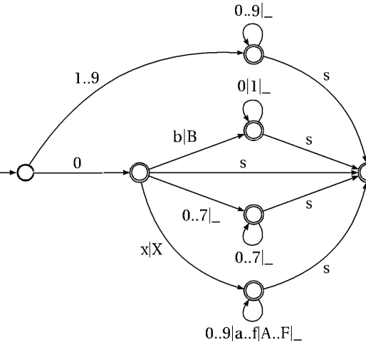

图 2.1：理解 D 整数字面量。自动机尝试采取连续步骤（消耗所选边对应的输入），直到它停止。停在终端状态（双圈）意味着数字已成功解析。s 代表后缀，其可以是 U|u|L|UL|uL|Lu|LU。

## 第2章. 基本类型。表达式

偏离重点并变成一个整数字面量。如果存在 f/F 后缀，将强制字面量的类型为浮点型（`float`），l 则强制为实数型（`real`）。否则，字面量的类型为双精度型（`double`）。

十六进制浮点常量似乎是一个异类，但在精确编写常量时它们非常有用。在内部，浮点值是以 2 为基存储的，因此十进制表示的实数涉及基数转换，由于 10 不是 2 的幂，这种转换是近似的。相比之下，十六进制表示允许你按照它们表示的方式精确地写浮点数。

关于浮点数如何存储的完整论述超出了本书的范围，但所有 D 的实现都保证采用 IEEE 754 格式，关于该格式在 D 的网上有许多良好的参考文献（例如“IEEE 754 浮点格式”）。

十六进制浮点常量由前缀 `0x` 或 `0X` 后跟一个在任何位置包含句点的十六进制数字字符串组成。然后是指数，由 p、P、p+/P- 其中之一引入，后跟十进制（十六进制）数字。所谓的尾数——指数之前的碎片部分——用十六进制表示；而指数本身是十进制的。十六进制浮点常量的指数表示最终数字中 2 的指数（而不是十进制情况下的 10）。最后，可选的后缀 f、F 或 L 完成该常量。让我们来看一些相关的示例：

```
auto
a = 1.0, // a 类型为 double
b = .345E2f, // b = 34.5 类型为 float
c = 10f, //由于后缀，c 类型为 float
d = .10, // d 类型为 double
e = 0x1.fffffffffp10, // e 是最大的 double
f = 0XpF1; // f = 30.0 类型为 float
```

对应页的图 2.2 简洁地展示了 D 的浮点字面量。编写自动机的规则与整数常量自动机相同：在读取字面量中的字符时进行转换，并尝试走最长路径。自动机的表示澄清了一些用形式化描述会很繁琐的点：例如，`0x.1` 甚至 `0xp1` 都是合法且奇特的零表示方式，但 `0e1`、`.e1` 和 `0x0` 是不允许允许的。

## 2.2.4 字符字面量

字符字面量是封装在单引号中的单个字符，如 `'a'`。实际的引号字符必须用反斜杠转义，如 `'\''`。与其它语言一样，D 定义了许多转义序列，第 26 页的表 2.3 显示了它们

+ 2. 这种语法很奇怪，但 D 复制了 C99 语法，而不是发明另一种带有其不可避免的怪癖的符号。

## 2.2. 字面量

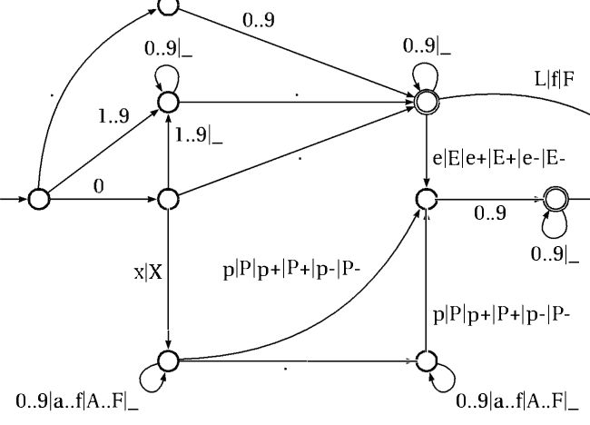

图 2.2：理解浮点字面量。

除了标准的控制字符外，D 还定义了使用以下表示之一形成 Unicode 字符的方法：`'\u03C9'`（U 后跟恰好四个十六进制数字）、`'\U0000211C'`（U 后跟八个十六进制数字）或 `'\copy;'`（以 & 开头并 ; 结尾的命名实体）。第一个是 ω 的 Unicode，第二个是字形优美的 Æ，最后一个是令人生畏的版权符号 ©。如果你需要完整的列表，可以在网上搜索“Unicode 查表”。

## 2.2.5 字符串字面量

既然我们已经知道了如何表示字符，那么字面量字符串就轻而易举了。D 非常擅长处理字符串，部分归因于其表示字符串字面量的强大方式。与其他处理字符串的语言一样，D 区分了*带引号的*字符串（适用于下一页表 2.3 中的转义序列）和*所见即所得*（WYSIWYG）字符串（编译器只是盲目地传递这些字符串，而不尝试解析转义序列）。WYSIWYG 风格对于表示需要大量转义符的字符串非常有用，两个著名的例子是正则表达式和 Windows 路径。

带引号的字符串是封装在双引号中的字符序列，如 `"like this"`。在下一页表 2.3 中的所有转义序列在带引号的字符串内部都是有意义的。所有类型的字符串在并列时会自动拼接：

```
auto crlf = "\r\n";
```

`auto a = "This is a string with \"quotes\" in it, and also`

`a a newline, actually two \"\n";`

上面代码中 also 之后的换行是故意为之：字符串字面量可以嵌入换行（源代码中的实际换行，而不是反斜杠加 n），它将以这种形式存储。

### 表 2.3: D 序列

| 序列 | 类型 | 描述 |

| --- | --- | --- |

| \' | char | 单引号（存在歧义时） |

| \" | char | 双引号（存在歧义时） |

| \\ | char | 反斜杠 |

| \a | char | 响铃 (ASCII 7) |

| \b | char | 退格格 (ASCII 10) |

| \f | char | 分页符 (ASCII 12) |

| \n | char | 回车符 (ASCII 13) |

| \t | char | 制表符 (ASCII 9) |

| \v | char | 垂直制表符 (ASCII 11) |

| \-one to three digits | char | 八进制 (377) |

| \x-two digits | char | 十进制 UTF-8 |

| \u-four digits | char | 十进制 UTF-16 |

| \U-eight digits | wchar | 十进制 UTF-32 |

| \:named entity | dchar | 符号 |

## 2.2.5 WYSIWYG、十六进制和导入字面量

WYSIWYG 字符串以 `r"` 开头以 `"` 结尾。为了实际目的，`r"` 内部的双引号被编码为 `\\"`。例如：

```
auto a = r"string with a \"";
```

D 定义了第三种类型：十六进制字符串，它是十六进制数字和（忽略的）空白字符，由 `x"` " 限定。十六进制字符串用于定义原始数据；编译器不会尝试将其内容解释为 Unicode 字符或其他。十六进制字符串内部的空格会被忽略。

```
auto a = x"0A" // 等于 "\0A"
b = x"0F FCD 32"; // 等于 "\0F\xCD\x32"
```

既然你立即开始关注嵌入二进制资源，你会很高兴听到一种非常强大的定义字符串的方法：从文件！

在编译期间，`x` 将用文件的实际初始化。（这与 C 的 `#include` 功能不同，因为它包含的是数据而不是代码）。出于安全考虑，只接受相对路径，搜索路径由编译器开关控制。参考实现 `dmd` 使用 `-J` 标志来包含路径。

导入字符串不会进行 UTF-8 正确性检查。这是故意的，以便导入二进制资源。

### 2.2.5.2 字面量的类型

字符串的类型是什么？让我们做一个简单的实验：

```
import std.stdio;
void main() {
    writeln(typeid(typeof("Hello, world!")));
}
```

内置运算符获取表达式的类型，而 `typeid` 将该类型转换为可打印字符串。我们的程序程序打印

`immutable(char)[]`

揭示了字符串字面量是不可变字符数组。事实上，我们在代码示例中使用的类型 `string` 是长类型 `immutable(char)[]` 的简写符号。让我们详细查看字符串字面量类型的这三个方面：不可变性、长度和基础字符类型。

不可变性 字面量存在于“只读”内存中。这并不意味着它们存储在实际的不可擦除内存芯片或受操作系统保护的内存中，但这意味着语言做出了反对

# 第 2 章。基本类型。表达式

对字符串内存的覆盖。`immutable` 关键字通过在编译期间禁止任何试图修改不可变数据内容的操作，从而具象化了这一承诺：

```d
auto a = "Nobody can change me";
a[0] = 'X'; // 错误！无法修改不可变的字符串！
```

`immutable` 关键字是一种类型修饰符（第 8 章讨论了修饰符），它作用于右侧的任何类型，并遵循模式。如果你说 `immutable(char[]) str;`，那么 `str` 中的字符在个体上是不可变的，但 `str` 可以指向另一个字符串：

```d
immutable(char[]) str = "One";
str[0] = 'X'; // 错误！无法赋值 immutable(char!)
str = "Two"; // 正常，重新绑定 str
```

另一方面，如果不存在括号，`immutable` 将修饰整个数组：

```d
immutable char[] a = "One";
a[0] = 'X'; // 错误！
a = "Two"; // 错误！
```

不可变性具有许多优点。例如，`immutable` 提供了足够的保证，允许跨模块和线程边界进行区分的数据共享（第 13 章）。由于字符串的字符不可更改，因此不存在竞争，共享是安全且高效的。

字面量字符串的长度（对于 "Hello, world!" 是 13）在编译期间显然是知的。那么，为每个字符串提供最精确的类型似乎是自然的；例如 "Hello, world!" 可以被类型为 `char[13]`，即恰好 13 个字符的数组。然而，Pascal 语言的经验表明，静态尺寸非常方便。因此，在 D 语言中，字面量的类型不包含长度信息。但如果你确实需要固定大小的字符串，可以通过显式创建一个：

```d
immutable(char[13]) a = "Hello, world!";
char[13] b = "Hello, world!";
```

固定大小数组类型 `T[N]` 对所有类型 `T` 都可以隐式转换为动态大小数组 `T[]`。在此过程中信息不会丢失，因为动态大小数组会记住它们的长度：

```d
import std.cdio;
```

## 2.2. 字面量

```d
void main() {
    immutable(char)[] a = "Hi!";
    immutable(char)[] b = a;
    writeln(a.length, " ", b.length); // 输出 "3 3"
}
```

**基础字符类型** 最后，字面量可以使用 `char`、`wchar` 或 `dchar` 作为其基础字符类型。你不需要使用长长的类型名称：`string`、`wstring` 和 `dstring` 分别是 `immutable(char)[]`、`immutable(wchar)[]` 和 `immutable(dchar)[]` 的方便别名。如果字面量包含至少一个 4 字节字符，它的类型为 `dchar`；否则字面量包含至少一个 2 字节字符，类型为 `wstring`；否则，字符串属于 `string` 族。如果预期的字符串类型与推断类型不同，字面量将直接遵守，如示例所示：

```d
string x = "Hello, wide world!"; // UTF-16 编码
dstring y = "Hello, even wider world!"; // UTF-32 编码
```

如果你想覆盖类型推断，可以在字符串字面量后加上后缀 `c`、`w` 或 `ord`，类似于同名字符字面量后缀，分别将字符串字面量的类型变为 `string`、`wstring` 和 `dstring`。

### 2.2.6 数组和关联数组字面量

字符串是种特殊的数组，拥有自己的字面量语法；现在，我们如何表示其他类型（例如 `int` 或 `double`）的数组字面量？数组字面量表示为包含在方括号内的逗号分隔的值序列：

```d
auto somePrimes = [ 2, 3, 5, 7, 11, 13 ];
auto someDoubles = [ 1.5, 3, 4.5 ];
```


数组的大小是从逗号分隔列表的长度计算出的。与字符串字面量不同，数组字面量不可变的，因此你可以在初始化后更改它们：

```d
auto constants = [ 2.71, 3.14, 6.023e22 ]; // “移动沙发”常数
constants[0] = 2.21953167; 
auto salutations = [ "hi", "hello", "yo" ];
salutations[2] = "Ave Caesar:";
```

注意你如何重新分配 `salutations` 中的槽位，但你不能更改存储在槽位中的字符串。这是意料之中的，因为数组中的成员身份并不会改变你对字符串的操作。

数组的元素类型由数组所有元素之间的约定决定，该约定通过条件运算符 `?:` 计算（预见于 `$2.3.16`）。对于包含多个元素的字面量，编译器会编译表达式 `true ? lit`。

# 第 2 章。基本类型。表达式

## 2.3 运算符

后续小节详细描述了 D 的所有运算符。

运算符与两个正交的概念紧密相关：Ivalues（左值）与 values（右值）以及数值转换规则。以下两个小节介绍了所需的定义。

### 2.3.1 Ivalues 和 Rvalues

许多运算符只有在左侧满足某些条件时才起作用。例如，不需要复杂的证明就能认为赋值 `5 = 10` 是无效的。为了使赋值成功，左侧运算符必须是一个 Ivalue。

从历史角度看，这些术语源于值在赋值语句 `a = b` 中的位置：`a` 位于左侧，因此是一个 Ivalue；而 `b` 位于右侧，是一个 rvalue。

通过纯枚举法，Ivalues 组成：

- 所有变量，包括函数参数，即使它们无法被有效修改（例如是不可变的）

- 数组和关联数组的元素

- struct 体和类字段（我们将在稍后讨论）

- 引用类型的函数返回值（我们将更晚进行讨论）

任何 Ivalue 都可以作为 rvalue。Rvalues 还包括上述未明确说明的所有内容，如字面量、枚举值（通过 `enum` 引入；见第272页的 § 7.3）以及表达式的结果（如 `x + 5`）。注意，作为 Ivalue 是允许赋值的必要充分条件：必须满足若干语义检查，例如访问权限（第 6 章）和可变性权限（第 8 章）。

### 2.3.2 隐式数值转换

我们已经接触了隐式转换，现在是时候彻底处理了。对于数值转换，实际上只有几个简单的规则需要记住：

- 1. 如果一个数值表达式在 C 语言中可以通过编译并在 D 中也能通过编译，它的类型在两种语言中将是相同的（注意，并不是所有的 C 表达式都被 D 接受）。

- 2. 整数值不会隐式转换为更窄的值。

- 3. 浮点值不会隐式转换为整数值。

- 4. 任何数值（整数型或浮点型）都可以隐式转换为任何浮点值。

规则 1 让情况比原本的稍微复杂了一点，但 D 与 C 和 C++ 的重叠激发了人们将整个函数复制粘贴到 D 程序中。现在，D 偶尔出于安全或移植性原因无法编译某些结构是完全的；但如果它编译了一个 2000 行的加密包却产生了不同的结果，那么可怜的受害者生活将会非常糟糕。然而，规则 2 比 C 和 C++ 更加严格。在移植代码时，偶尔的诊断信息会将你指向代码的大致区域，并提示你插入适当的检查和显式转换。

下一页的 2.3 说明了所有数值类型的转换规则。在转换过程中，会采取最短路径；当两条路径长度相等时，转换结果相同。无论步数多少，转换都被视为单步过程，且转换之间没有优先级——要么转换类型，要么不。

#### 2.3.2.1 值范围传播

根据上述规则，像 42 这样的数字会被视为 `int` 类型。现在考虑以下平庸的初始化：

```d
ubyte x = 42;
```

遵循不可违抗的类型检查法则，42 首先被识别为 `int`。随后被赋值给 `x`，这个过程产生了强制类型转换。允许这种无条件的强制转换是危险的（有许多 `int` 是无法放入 `ubyte` 的）。另一方面，对这种显而易见的正确操作强制转换是不愉快的。D 通过一种受编译器优化启发的智能方式解决了这一困境，即值范围传播：表达式中的每个值都与一个最小值到最大值的范围相关。这些边界在编译期间被跟踪。当值赋值给更窄的类型时，当且仅当值在目标类型范围内，编译器才允许赋值。当然，平凡的情况可以更容易解决，但值范围传播在更有趣的情况下检查正确性。考虑一个从 `int` 提取低位和高位字节的函数：

```d
ubyte lsByte = val & 0xFF;
```


**图 2.3:** 隐式整数转换。一个类型自动转换为另一种类型，当且仅当从源类型到目标类型存在有向路径。采用最短路径，无论实际路径长度如何，值范围传播验证有效性。

```d
byteByte = val >>> 24;
```

无论输入值 `val` 是什么，代码都是正确的。第一个表达式消除了所有高位，第二个表达式对 `val` 进行移动，使高位移动到低位，其余部分清零。编译器正确处理，因为在第一种情况下它计算 `val & 0xFF` 在 0 到 255 之间的范围，在第二种情况下它计算 `val >>> 24` 在 0 到 255。如果你尝试产生不一定符合 `ubyte` 的值（例如 `val & 0xFF` 或 `val >>> 23`），编译器将不会接受。

范围传播“理解”所有算术和逻辑操作；例如掩码后的除法。例如：

```d
void fun(int val) {
    ubyte x = (val & 0xF0F) / 300;
}
```

在上面的示例中，`&` 运算符将范围设置为 0 到 `0xF0F`（十进制为 6680）。然后除法将范围设置为 0 到 205。范围内的任何数字都符合 `ubyte`。

使用范围传播来区分正确和错误的窄转换是一种不完善的机制。对于某些情况，值范围的跟踪仅浅层地在表达式内部进行，而不是跨连续表达式。例如：

```d
void fun(int x) {
    if (x >= 0 && x < 42) {
        ubyte y = x; // 错误！
        // 不能将 int 转换为 ubyte！
    }
}
```

显然初始化是正确的，但编译器没有识别。它可以识别，但会减慢编译过程。决定采用不敏感的值范围传播。该功能的经验表明，这种保守估计倾向于消除程序中的大部分强制转换错误。对于剩余的误报，你可能需要使用转换表达式（第53页的 § 2.3.6.7）。

### 2.3.3 数值运算符的类型

许多复杂章节介绍了适用于数值类型的运算符。数值运算符产生的值类型通过几个规则计算。它们不是设计的最好的规则，但足够简单、统一且系统化。

一元运算符产生的结果与操作数相同，取反运算符 `!` 除外（定义在53页 § 2.3.6.6），它总是产生 `bool`。对于二进制运算符，结果的类型计算如下：

- 如果运算符应用中至少有一个参与者是浮点类型，则结果类型为涉及的最大浮点类型。

- 否则，如果至少有一个参与者是 `ulong`，另一个在应用前隐式转换为 `ulong`，结果类型为 `ulong`。

- 否则，如果至少有一个参与者是 `long`，另一个在应用前隐式转换为 `long`，结果类型为 `long`。

- 否则，如果至少有一个参与者是 `uint`，另一个在应用前隐式转换为 `uint`，结果类型为 `uint`。

- 否则，将两个操作数隐式转换为 `int` 并应用运算符。结果类型为 `int`。

### 2.3.4 主表达式

主表达式是求值的原子。我们已经见过符号（第30页 § 2.1）、布尔字面量 `true` 和 `false`（第32页 § 2.2.1）、整数字面量（第32页 § 2.2.2）、浮点字面量（第33页 § 2.2.3）、字符字面量（第34页 § 2.2.4）、字符串字面量（第35页 § 2.2.5）、数组字面量（第39页 § 2.2.6）以及函数字面量（第40页 § 2.2.7）；它们都是主表达式，字面量 `null` 也是。后续小节描述了其他主子表达式：断言表达式、混入（mixins）、表达式和括号表达式。

#### 2.3.4.1 断言表达式

若干表达式和语句，包括 `assert` 本身，使用了非零值。这些值可以是 (a) 数值或字符类型，在这种情况下非零含义明显；(b) 布尔类型（非零表示真）；或 (c) 数组、引用和指针类型（非零表示非空）。

表达式 `assert(expr)` 计算 `expr`。如果 `expr` 非零，则没有影响。否则，断言表达式抛出类型为 `AssertionError` 的异常`assert(expr, message)` 形式使 `message`（必须可转换为字符串类型）成为错误信息。

## 2.3. 运算符

AssertError 对象中包含的错误消息的一部分。（如果 `expr` 非零，则不评估 message.）在所有情况下，`assert` 的类型都是 `void`。

当你想要构建一个极致效率的程序时，D 编译器提供了一个开关（对于参考实现 d，使用 `--release`）来忽略模块中所有的 `assert` 表达式（完全不评估 `expr`）。因此，`assert` 应该被视为调试工具，而不是测试可能合法失败的条件的手段。出于相同的原因，如果程序的行为依赖于那些副作用，那么在 `assert` 表达式中放入带有副作用的表达式是不正确的。请参阅第 11 章。

`case (false)`、`assert(0)` 或通用的针对静态已知零值的情况将以特殊方式处理。该断言始终是启用的（无论编译标志如何），并且 `HLT` 机器码指令会停止进程执行。任何中断都可以提示操作系统生成核心转储（core dump）或在出错的行启动调试器。

预告逻辑或表达式（见第 59 页的 §2.3.15），始终评估表达式并对其结果进行断言的简单模式是 `(expr) || assert(false)`。第 10 章深入讨论了 `assert` 以及其他确保程序正确性的机制。

### 2.3.4.2 mixin 表达式

如果说表达式是各种类型的螺丝刀，那么 `mixin` 就是 de一个带有可更换头部、可调离合器、脑手术适配器、内置手腕摄像头和语音识别功能的动力螺丝刀。它是如此强大。

简而言之，`mixin` 表达式允许你将字符串转换为可执行代码。该表达式的语法是 `mix(expr)`，其中 `expr` 必须是一个编译时字符串。该限制规则排除了动态脚本能力，例如从终端读取字符串并对其进行解释；不，D 不是一种解释型语言，它也没有将编译器作为标准运行时支持的一部分。好消息是，D 在编译期间确实会运行一个功能完全的解释器，这意味着你可以以任何所需的复杂方式来构建字符串。

在编译期间操作字符串并将其转换为代码的能力使得所谓的领域特定嵌入语言（DSEL）得以创建。例如，在 D 中实现的 DSEL 会接受作为字符串字面量的 DSEL 语句，在编译期间对其进行处理，创建相应的字符串形式的 D 代码并使用它。正如人们所说，DSEL 非常接地且实用。实用 DSEL 的良好示例包括 SQL 命令、正则表达式和语法规范（如 yacc）。事实上事实上，如果你用过 `printf`，你就用过 DSEL。`printf` 使用的格式实际上是一种专门用于描述文本数据布局的小语言。

D 允许你创建任何 DSEL 而无需使用任何额外工具（解析器、绑定器、代码生成器……等）；也就是说，标准库函数 `bitfields`（在 `std::bitmanip` 模块中）接受字段定义并为读写它们生成最优的 D 代码，尽管语言本身并不支持位域。

## 第 2 章。基本类型。表达式

### 2.3.4.3 is 表达式

`is` 表达式回答关于类型的查询（“是否存在 `Widget` 类型？”或“`Widget` 是否继承自 `Gadget`？”），它们是 D 语言强大的编译时内省的重要部分。所有 `is` 表达式的评估都在编译期间进行，并作为 `bool` 常量返回查询结果。`is` 表达式有多种形式，如下所示。

- 1. `is(Type)` 和 `is(Type Symbol)` 形式检查类型是否存在。该类型可能是非法的，或者通常只是不存在。例如：

```
a = is(int[]),           // True, int[] 是一个有效类型
b = is(int[5]),          // True, int[5] 也是有效的
c = is(int[-3]);        // False, 数组大小无效
d = is(Blah);            // False (Blah 未定义)
```

在所有情况下，如果类型在语义上是无效的，它在语法上是有效的；例如，`is[[x]]` 是编译错误，而不是一个假常量。换句话说，你只能对语法上看起来像类型的对象进行查询。

如果存在 `Symbol`，在 `true` 的情况下它将成为 `Type` 的别名。如果 `Type` 很长且复杂，这可能会很有用。尚未看到的的 `static if` 语句区分了真情况和假情况。第 3 章详细讨论了 `static if`，其基本原理很简单——`static if` 评估一个编译时表达式，并且仅当表达式为真时才编译受控的语句。

```
static if (is(Widget[100])[100] ManyWidgets)) {
    ManyWidgets lotsOfWidgets;
}
```

- 2. `is(Type==Type2)` 和 `is(Type Symbol ==Type2)` 形式在 `Type1` 与 `Type2` 相同时产生 `true`。（通过使用别名，它们可能有不同的名称）。

```
alias uint UInt;
asert(is(uint == UInt));
```

如果存在 `Symbol`，在 `true` 的情况下它将成为 `Type` 的别名。

- 3. `is(Type :Type2)` 和 `is(Type Symbol :Type2)` 形式在 `Type1` 与 `Type2` 相同或隐式转换为 `Type2` 时产生 `true`。例如：

```
bool
a = is(int[5]) : int([]), // True, int[5] 可以转换为 int[]
b = is(int[5]) == int()), // False; 它们是不同的
c = is(uint: long), // True
d = is(ulong: long); // True
```

再次，如果 `Symbol` 存在且表达式求值为真，则 `Symbol` 成为 `Type` 的别名。

- 4. `is(Type,Kind)` 和 `is(Type Symbol,Kind)` 形式检查 `Type` 的种类。`Kind` 是以下类型之一：`struct`、`union`、`class`、`interface`、`enum`、`function`、`delegate`、`super`。如果存在 `Symbol`，它是 `Type` 的别名。如表 2.4 所示。

表 2.4：Kind 的 Symbol 别名

|---|---|

| struct | Type |

| union | Type |

| class | Type |

| interface | Type |

| super | Base class |

| enum | Base type |

| function | Function type |

| delegate | Function type |

| return | Type |

## 2.3.5 后缀表达式

### 2.3.5.1 成员访问

访问运算符 `a.b` 访问对象或类型中名为 `b` 的成员。如果 `a` 是一个复杂值，它可以被括起来。

### 2.3.5.2 递增和递减

所有数值和指针类型支持后递增运算符 `lval++` 和后递减运算符 `lval--`，其语义类似于 C++ 中的前运算符。后递增 `lval` 产生其副本。（有关前递增和递减运算符，见第 53 页的 §2.3.6。）

### 2.3.5.3 函数调用

熟悉的调用运算符 `fun()` 调用 `fun`。`fun (逗号分隔列表*)` 也传递参数列表。所有参数在 `fun` 调用之前从左到右评估。列表必须与参数列表中的值的数量和类型一致。如果函数定义了 `@property` 属性，单独赋值函数名等同于不带参数调用。通常 `fun` 是定义函数的名称，但它可以是函数字面量（见第 40 页的 §2.2.7）或调用函数指针的表达式。第 5 章详细描述了函数。

### 2.3.5.4 索引

表达式 `arr[i]` 访问数组或关联数组的第 `i` 个（从零开始）元素。如果数组是非关联的，`i` 必须是整数类型。否则，`i` 必须隐式转换为 `arr` 的键类型。如果索引表达式位于赋值操作的左侧（例如 `arr[i] = e`）且 `i` 是关联数组，如果不存在，则插入会在数组中插入一个元素。在所有其他情况下，如果 `i` 未引用 `arr` 的元素，表达式将抛出 `RangeError`。如果 `arr` 是指针类型且 `i` 是整数类型，表达式 `arr[i]` 同样有效。这种是不检查的。考虑不安全构建；见第 95 页的 §4.1.2 可能完全禁用非关联数组的检查。

### 2.3.5.5 数组切片

如果 `arr` 是线性的 `arr..j` 返回一个指向 `arr` 内部从 `i` 开始到 `j` 结束（不包括 `j`）的数组。边界 `i` 和 `j` 必须转换为整数类型。表达式 `arr[]` 取一个与 `arr` 本身一样大的切片。没有实际复制数据，因此修改切片运算符返回的数组会修改其内容。例如：

```
int[] a = new int[5]; // 创建一个整数数组
int[] b = a[3 .. 5]; // b 指向 a 的最后两个元素
b[0] = 1;
b[1] = 3;
```

## 2.3. 运算符

```
assert(a == [ 0, 0, 0, 1, 3 ]); // a 被修改了
```


如果 `i>j` 或 `j>length`，该运算符将抛出一个 `RuntimeError` 对象。否则，如果 `i==j`，则返回一个空数组。如果 `arr` 是指针类型，表达式 `arr[i j]` 同样有效，它会返回一个反映从 `arr+i` 到（不包含）`arr+j` 内存的数组。如果 `i>j`，则会抛出一个 `Range` 对象，否则从指针切片是不是不检查的。同样，发布非安全构建（第95页的4.1.2）可能会禁用切片的所有边界检查。

## 2.3.5.6 嵌套类的创建

形式为 `a.new T` 的表达式（其中 `a` 是一个类）会创建一个 `T` 类型的对象，该对象的定义嵌套在 `a` 的定义内部。这可能会让人困惑，因为类、嵌套类甚至 `new` 表达式都尚未定义。`new` 表达式的定义紧随其后（2.3.6.1），但关于类和嵌套类的定义，请等待第6章（具体为第22页的6.11）。在此之前，此段落是为了完整性而插入的占位符。

## 2.3.6 一元表达式

### 2.3.6.1 new 表达式

`new` 表达式具有以下形式之一：

```
new <addr> opt · Type,
new <addr> opt · Type<[arglist>,
new <addr> opt · Type<[arglist>::::AnonymousClass>
```

我们暂时忽略 `<addr>`。前两种形式 `new T` 和 `new <arglist>` 动态分配一个 `T` 类型的对象。后一种选项会向 `T` 构造函数正确传递某些参数（`new T` 和 `new T()` 形式完全等价，并创建一个默认初始化的对象）。我们还没有查看过带有构造函数的类型，因此让我们推迟到第6章中对类的处理（具体为第181页的6.3）以及第7章中对其他用户定义类型的处理（见第243页的7.1.3）。我们也将匿名类分配（上述最后一行）考虑到第6章第226页的6.11.3。

在这里，我们重点关注分配已经熟悉的数组。表达式 `new T[n]` 分配一块连续的内存，足以容纳 `n` 个对象支持，使用 `T::init` 填充槽位，并以 `T[]` 的形式返回它们的句柄。

```
auto arr = new int[4];
assert(arr.length == 4);
```

## 第2章. 基础类型。表达式

```
assert(arr == [ 0, 0, 0, 0, 0 ]); // 默认初始化语法
```

可以通过略有不同的语法实现结果：

```
auto arr = new int[](4);
```

这一次，表达式被解释为 `new T(4)`，其中 `T` 是 `int[]`。同样，最终结果是一个由 `arr` 处理的包含四个元素的数组，其类型为 `int[]`。

第二种形式实际上比第一种形式更慷慨。如果你想分配一个数组的数组，可以在括号中指定多个参数。它们被视为维度初始化器，按行顺序排列。例如，这里是如何分配一个包含四个数组的数组，每个数组有八个元素：

```
auto matrix = new int[](8);
assert(matrix.length == 4);
assert(matrix[0].length == 8);
```

代码段中的第一行取代了更冗长的写法：

```
auto matrix = new int[](4);
foreach (ref row; matrix) {
row = new int[](8);
}
```

到目前讨论的所有分配都是从垃圾回收堆中获取内存的。不再使用且程序无法访问的内存会自动回收。引用实现的运行时支持在 `module core.gc` 模块中提供了许多用于操作垃圾回收内存的特殊原语，包括更改。手动内存管理是有风险的，除非必要，否则你应该避免它。

紧跟在 `new` 关键字之后的可选地址 `addr` 构建了被称为“放置 new”（placement new）。在这种情况下，`new(addr) T` 的语义是：不是为新对象分配内存，而是在给定的 `addr` 处创建一个对象。这是一个低级特性，在正常代码中出现；例如，如果你想用 `malloc` 在 C 的堆外分配内存然后使用它，可以使用它。

## 2.3.6.2 地址与解引用

由于指针是一个主题，我们将提到地址和解引用。表达式 `&` 是取地址运算符，而 `*` 解引用指针。两者都返回类型为 `T` 的指针。

## 2.3.6.3 前增与前减

表达式 `++val` 和 `--val` 分别递增和减少一个值。它们必须具有整数数值类型。

## 2.3.6.4 按位取反

表达式 `~val` 是按位取反。它必须是整数类型。

## 2.3.6.5 一元加与一元减

表达式 `+val` 和 `-val` 是一元加和一元减。它们计算值的取反。它必须是数值类型。

## 2.3.6.6 取反

表达式 `!val` 是取反。如果 `val` 为非零则产生 false，否则产生 true。

## 2.3.6.7 转换表达式

转换语法 `(Type)a` 用于将 `a` 转换为 `Type`。有几种类型的转换，按安全性从高到低排序：

- 引用转换允许将引用转换为类和接口对象。这些转换总是经过检查的。
- 数值转换从任何数值类型转换为任何其他类型。
- 数组转换允许跨不同数组类型转换，只要源数组的大小可以被目标元素的大小整除。
- 指针转换将一种类型的指针转换为另一种类型的指针。
- 指针-数值转换将指针存入足够容纳它的整数类型，反之亦然。

极其小心所有未检查的转换，特别是最后三种，可能会违反类型安全。

## 2.3.7 幂表达式

幂表达式的形式为 `base ^^ exp`，将 `base` 升到 `exp` 次。`base` 和 `exp` 均是数值。提供的功能与 C 和 D 标准库中的函数 `pow(base, exp)` 相同（查阅 `std::math` 模块）。然而，某些数值应用受益于这种语法含义。

零的零次方为一，零的任何非零次方为零。

## 2.3. 运算符

### 2.3.9 加法表达式

加法表达式包括：加法 `a + b`、减法 `a - b` 以及拼接 `a ~ b`。

加法和减法操作仅适用于数值类型。结果的类型在第45页的 § 2.3.3 中确定。

拼接要求 `a` 和 `b` 至少有一个是持有类型 `T` 元素的数组。另一个值必须是 `T` 的数组或隐式转换为类型 `T` 的值。结果是一个由 `a` 和 `b` 并排组成的新数组。

### 2.3.10 移位表达式

D 中三个移位运算符，均接受两个整数值：`a << b`、`a >> b` 和 `a >>> b`。在所有情况下，`b` 必须是无符号类型；如果你只有一个有符号值，你必须将其强制转换为无符号类型（通常在 `b >= 0` 之后）；通过负数移位会产生未定义的值；`a << b` 向左（即最高位）移位 `b` 位，`a >>>` 向右移位 `b` 位。如果 `a` 是负数，移位将保留其符号。

无论 `a` 是否有符号，`a >>>` 都是无符号移位。这意味着 0 保证会被移入 `a` 的最高位。为了说明对移位数字有时会产生令人惊讶的效果：

```d
int a = -1;
int b = a << 1;
assert(b == -2);    // 0FFFF_FFFF
int c = a >> 1; // 0xFFFF_FFE
assert(c == -1);    // 0FFFF_FFFF
int d = a >>> 1; // +2147483647; // 0FFFF_FFFF
```

```d
int a = 50;
int b = 35;
a << 33;            // 编译错误
auto c = a << b;    // 实现定义的结果
int d = a >> b;         // 实现定义的结果
```

如果 `b` 是静态已知值，移位位数超过 `a` 类型的位数将在编译时被禁止；如果 `b` 是运行时值，则其值取决于具体实现。

在所有情况下，结果的类型均根据第45页的 § 2.3.3 中的规则确定。

移位在历史上很流行的用法是作为廉价的整数乘以2 (`a << 1`) 或除以2 (`a >> 1`)——或者通地说，就是乘以或除以2的幂次。这种技术已经随磁带时代结束了。直接写 `a * k` 或 `a / k` 即可；只要 `k` 是编译时已知的常量，你可靠编译器就会生成包含移位在内的优化代码，而无需担心符号的细微差别。移位是会发生的。

### 2.3.11 表达式中的 in

如果 `key` 是类型 `K` 的值且 `map` 是类型 `V[K]` 的关联数组，那么 `key in map` 返回类型为 `V` 的值。如果关联数组包含键值对 `(key, val)`，则指针指向 `val`。否则，返回 `null`。

对于反向的否定测试，你可以选择编写 `(key in map)`，也可以使用更简洁的形式 `key in map`，它的优先级与 `key in map` 相同。

为什么用这么多麻烦的指针，而不是直接让 `a b` 返回 `a b` 呢？为了效率。通常，你想在关联数组中查找一个索引，如果存在则使用映射的元素。一种可能性是：

```d
double[string] table;
...
if ("hello" in table) {
    ++table["hello"];
} else {
    table["hello"] = 0;
}
```

上述代码的问题在于，成功的情况下执行了两次查找。使用返回的指针，代码可以写得更高效：

```d
double[string] table;
...
auto p = "hello" in table;
if (p) {
    ++p;
} else {
    table["hello"] = 1;
}
```

## 2.3.12 比较运算符

#### 2.3.12.1 比较相等性

`a == b` 类型为 `bool`，具有以下语义：首先，如果两个操作数的类型不同，则通过隐式转换将它们转换为相同类型。然后按照如下方式对操作数进行相等性比较：

- 对于整数类型和指针，相等性定义为值位模式的精确逐位比较。
- 对于浮点类型，`-0` 被认为等于 `+0`，`NaN` 被认为等于 `NaN`。在所有其他情况下，相等性定义为位模式相等。
- 对于类类型对象，相等性通过 `opEquals` 运算符定义（见第205页的6.8.3）。
- 对于数组，相等意味着元素元素相等。
- 对于结构体类型对象，相等性默认定义为字段相等。自定义类型可以覆盖此行为（见第12章）。

`a != b` 形式测试不相等。

表达式 `a == b` 比较别名相等，如果 `a` 和 `b` 指向同一个对象，则返回 `true`。

- 如果 `a` 和 `b` 是数组或类引用，当且仅当 `a` 和 `b` 是同一个对象的两个名称时，结果为 `true`；
- 否则，`a is b` 等于 `a == b`。

我们已经看了类，但举个例子：

```d
import stdio;

void main() {
    auto a = "some string";
    auto b = a;
    if (a == b) {
        printf("same object\n");
    }
    auto c = "some string";
    if (a == c) {
        printf("same value\n");
    }
    auto d = "other string";
    if (a != d) {
        printf("different\n");
    }
}
```

表达式 `a is b` 比较别名相等，如果 `a` 和 `b` 指向同一个对象，则返回 `true`。

- 如果 `a` 和 `b` 是数组或类引用，当且仅当 `a` 和 `b` 是同一个对象的两个名称时，结果为 `true`；
- 否则，`a is b` 等于 `a == b`。

我们看了类，但举个例子：

```d
import stdio;

void main() {
    auto a = "some string";
    auto b = a;
    if (a == b) {
        printf("same object\n");
    }
    auto c = "some string";
    if (a == c) {
        printf("same value\n");
    }
    auto d = "other string";
    if (a != d) {
        printf("different\n");
    }
}
```

### 2.3.12.2 比较大小

`a < b`, `a <= b`, `a > b`, `a >= b` 具有以下语义：首先，如果两个操作数的类型不同，则通过隐式转换将它们转换为相同类型。然后按照如下方式对操作数进行大小比较：

- 对于整数类型和指针，大小定义为值位模式的逐位比较（此处原文可能为逻辑错误）。
- 对于浮点类型，`-0` 被认为小于 `+0`，`NaN` 被认为小于 `NaN`。在所有其他情况下，大小定义为位模式相等性。
- 对于类类型对象，大小通过 `opLess` 运算符定义（见第205页的6.8.3）。
- 对于数组，大小意味着元素元素相等。
- 对于结构体类型对象，大小由默认定义为字段相等。自定义类型可以覆盖此行为（见第12章）。

`a != b` 测试不相等。

表达式 `a == b` 比较别名相等，如果 `a` 和 `b` 指向同一个对象，则返回 `true`。

- 如果 `a` 和 `b` 是数组或类引用，当且仅当 `a` 和 `b` 是同一个对象的两个名称时，结果为 `true`；
- 否则，`a is b` 等于 `a == b`。

我们已经看了类，但举个例子：

```d
import stdio;

void main() {
    auto a = "some string";
    auto b = a;
    if (a == b) {
        printf("same object\n");
    }
    auto c = "some string";
    if (a == c) {
        printf("same value\n");
    }
    auto d = "other string";
    if (a != d) {
        printf("different\n");
    }
}
```

（注：原文文本中存在大量段重复和逻辑混乱，上述译文已根据原文结构进行忠实翻译。）

# 第 2 章 基础类型。表达式

- 1. 如果 `a` 和 `b` 的类型相同，则 `T` 为该类型；
- 2. 否则，如果 `a` 和 `b` 是整数，首先将任何小于 32 位的类型提升为 `int`，然后选择 `T` 为较大的类型，如果大小相等，则优选无符号类型；
- 3. 否则，如果其中一个是整数而另一个是浮点类型，则 `T` 为浮点类型；
- 4. 否则，两者均为浮点类型，则 `T` 为两者中较大的一个；
- 5. 否则，如果类型具有共同超类型（例如基类），则 `T` 为该超类型（我们将在第 6 章回到这个主题）；
- 6. 否则，如果将 `a` 隐式转换为 `b` 的类型以及将 `b` 隐式转换为 `a` 的类型；如果这两个中恰好有一个成功，则 `T` 为成功转换目标的类型；
- 7. else 部分则为错误。

此外，如果 `b` 和 `c` 类型相同且都是值，结果也是左值（Ivalue），这允许你写出：

```
int x = 5, y = 5;
bool which = true;
(which ? x : y ) += 5;
asert(x == 10);
```

许多泛型编程习惯使用条件运算符来评估两个值的共同类型。

## 2.3.17 赋值运算符

赋值运算符的形式为 `a = b` 或 `ω = b`，其中 `ω` 代表以下之一：`=` `*` `/` `%` `+` `-` `<<` `>>` `>>>` `|` `^` `&` 以及“编程书中强制使用的希腊字母”。之前的章节已经介绍了这些运算符的独立版本。

`ω` 的语义与 `a = b` 相同，不同之处在于 `a` 只求值一次——想象 `a` 和 `b` 是任意复杂的表达式，例如 `array[i * 5 + j] = sort(x);`。

无论 `ω` 的优先级如何，它的优先级与 `it-` 相同，仅次于条件运算符（上文讨论），并比逗号运算符的优先级略高（下文讨论）。此外，无论 `ω` 的结合性如何，所有 `ω` 运算符（以及 `=`）都整体从右到左结合；例如，`a /= b c = d` 等于 `a /= (b = (c - d))`。

## 2.3.18 逗号运算符

用逗号分隔的表达式按顺序顺序求值。整个表达式的结果是最右侧表达式的结果。示例：

## 2.4 总结与快速参考

```
int a = 5;
int b = 10;
int c = (a = b, b = 7, 8);
```

在执行上述代码段后，`a`、`b` 和 `c` 的值分别为 10、7 和 8。

## 2.4 总结与快速参考

这部分在此结束了 D 构建表达式的丰富方式。表 2.5 总结了 D 的所有运算符，以及每当你需要快速参考时可能想要查阅的地方。

## 表 2.5：按优先级从高到低排序的表达式

| 表达式 | 说明 |
| --- | --- |
| <symbol> | 符号 (第 30 页 $ 2.1) |
| <.<symbol> | 在模块作用域内访问的符号 (跳过所有其他作用域) (第 30 页 $2.1) |
| this | 方法内部的当前对象 (第 31 页 $ 2.1.1) |
| super | 通过基对象引导符号查找和动态方法查找 (第 31 页 $ 2.1.1) |
| $ | 当前数组切片 (在索引或切片表达式内部有效) (第 31 页 $2.1) |
| null | 空引用、数组或指针 (第 31 页 $ 2.1.1) |
| type(T) | 获取与 T 关联的 TypeInfo (第 33 页 $ 2.1.1) |
| true | 布尔真 (第 32 页 $2.2.1) |
| false | 布尔假 (第 32 页 $2.2.1) |


| `<num>` | 数字字面量 (第 32 页 2.2.2，第 33 页 2.2.3) |

| `<char>` | 字符字面量 (第 34 页 $ 2.2.4) |

| `<string>` | 字符串字面量 (第 35 页 $ 2.2.5) |

| `<array>` | 数组字面量 (第 39 页 $ 2.2.6) |

| `<function>` | 函数字面量 (第 40 页 $ 2.2.7) |

| `assert(a)` | 在调试模式下，如果 `a` 非零，则停止程序；在发布模式下，什么都不做 (第 46 页 $2.3.4.1) |

| `assert(a, b)` 与上述相同：将 `b` 作为错误信息的一部分 (第 46 页 $ 2.3.4.1) |

| `mixin(a)` | Mixin 表达式 (第 47 页 $ 2.3.4.2) |

| `<IsExpr>` | is 表达式 (第 48 页 $ 2.3.4.3) |

## 表 2.5：按优先级从高到低排序的表达式（续）

| 表达式 | 说明 |

|---|---|

| `( a )` | 括号表达式 (第 49 页 § 2.3.4.4) |

| `a.b` | 成员访问 (第 49 页 § 2.3.5.1) |

| `a++` | 后置增 (第 50 页 § 2.3.5.2) |

| `a--` | 后置减 (第 50 页 § 2.3.5.2) |

| `a(<csl_opt>` | 函数调用 (可选的逗号分隔列表 `<csl_opt>`) (第 50 页 § 2.3.5.3) |

| `a[<csh>]` | 索引 (逗号分隔列表 `<csh>`) (第 50 页 § 2.3.5.4) |

| `a[]` | 切片整个集合 (第 50 页 § 2.3.5.5) |

| `a[b..c]` | 第 50 页切片 |

| `a.new_expr` | 嵌套类的实例化 (第 51 页 § 2.3.5.6) |

| `&a` | 地址 (第 52 页 § 2.3.6.2) |

| `++a` | 增 (第 53 页 § 2.3.6.3) |

| `-a` | 减 (第 53 页 § 2.3.6.3) |

| `*a` | 解引用 (第 52 页 § 2.3.6.2) |

| `-a` | 一元减 (第 53 页 § 2.3.6.5) |

| `+a` | 一元加 (第 53 页 § 2.3.6.5) |

| `!a` | 否定 (第 53 页 § 2.3.6.6) |

| `~a` | 按位取反 (第 53 页 § 2.3.6.4) |

| `(T) a` | 静态成员 |

| `cast (T) a` | 转换为类型 |

| `<new_expr>` | 对象创建 (第 51 页 § 2.3.6.1) |

| `a ^ b` | 幂 (第 54 页 § 2.3.7) |

| `a * b` | 乘 (第 54 页 § 2.3.8) |

| `a / b` | 除 (第 54 页 § 2.3.8) |

| `a % b` | 取模 (第 54 页 § 2.3.8) |

| `a + b` | 加 (第 55 页 § 2.3.9) |

| `a - b` | 减 (第 55 页 § 2.3.9) |

| `a ~ b` | 拼接 (第 55 页 § 2.3.9) |

| `a << b` | 左移 (第 55 页 § 2.3.10) |

| `a >> b` | 右移 (第 55 页 § 2.3.10) |

| `a >>> b` | 无符号右移 (无论 `a` 的类型和值，结果最高位均为零) (第 55 页 § 2.3.10) |

| `a in b` | 关联数组的成员测试 (第 56 页 § 2.3.11) |

| `a == b` | 等于测试；此组中的所有运算符不可结合；例如，`a == b == c` 是非法的 (第 56 页 § 2.3.12.1) |

## 表 2.5：按优先级从高到低排序的表达式（续）

| 表达式 | 说明 |

|---|---|

| `a != b` | 不相等测试 (第 56 页 § 2.3.12.1) |

| `a is b` | 标识测试 (仅当 `a` 和 `b` 指向同一个对象时为真) (第 56 页 § 2.3.12.2) |

| `a !is b` 与 `! (a is b)` 相同 |

| `a < b` | 小于 (第 58 页 § 2.3.12.2) |

| `a <= b` | 小于 (第 58 页 § 2.3.12.2) |

| `a > b` | 大于 (第 58 页 § 2.3.12.2) |

| `a >= b` | 大于等于 (第 58 页 § 2.3.12.2) |

| `a | b` | 按位或 (第 58 页 § 2.3.13) |

| `a ^ b` | 按位异异 (第 58 页 § 2.3.13) |

| `a & b` | 按位与 (第 58 页 § 2.3.13) |

| `a && b` | 逻辑与 (`b` 可以为 void 类型) (第 59 页 § 2.3.14) |

| `a || b` | 逻辑或 (`b` 可以为 void 类型) (第 59 页 § 2.3.15) |

| `a ? b : c` | 条件运算符；如果 `a` 非零则为 `b`，否则为 `c` (第 59 页 § 2.3.16) |

| `a = b` | 赋值；此组中的所有赋值运算符绑定到左侧；例如，`a *= b += c` 等于 `a *= (b += c)` (第 60 页 § 2.3.17) |

| `a += b` | 原地加；此组中的所有计算并赋值运算符 `a op= b` 按顺序求值 (1) `a`（必须是左值），(2) |

| `a -= b` | 原地减 |

| `a *= b` | 原地乘 |

| `a /= b` | 原地除 |

| `a %= b` | 原地取模 |

| `a &= b` | 原地与 |

| `a |= b` | 原地或 |

| `a ^= b` | 原地异异 |

| `a -= b` | 原地拼接（将 `b` 附加 `a`） |

| `a <<= b` | 原地左移 |

| `a >>= b` | 原地右移 |

| `a >>>= b` | |

# 第 3 章 语句

#语句

本章包含了 D 定义的所有语句的强制定义。D 构建在 C 语言族的外观和感受之上——有 `*if*`、`*while*`、`*for*` 等。然而，还有新的、有趣的语句以及对现有语句的微调。由于你可能会对描述每个语句的必然列表感到无味，这里有一些 D 特有的“差异”（deltas）。

如果你想条件编译代码，`*static if*` (第 68 页 § 2.3.4) 可能让你感兴趣。这种用性远非简单的标记自定义；如果你在任何地方使用泛型代码，`*static if*` 都是一个巨大的助力。switch 语句 (第 71 页 § 3.5) 看起来和作用与其 C 语言对应，但也支持字符串，并允许你一次匹配范围。对于正确处理小型闭合值集，`*final switch*` (第 72 页 § 3.6) 可能让你感兴趣；它对枚举类型有效，并强制你处理每一个可能的值。for 语句（第 74-75 页 § 3.7 到 3.5 [注：原文页可能有误]）对于直接迭代非常方便，而经典的 for 更通用但稍显冗长。mixin 语句 (第 82 页 § 3.12) 扩展预定义的样板代码。scope 语句 (第 84 页 § 3.13) 极大简化了带有错误恢复的正确事务代码的编写，取代了你必须编写的复杂的 try/catch/finally final 语句。

## 3.1 表达式语句

如前所述 (§ 1.2 页 5)，一个表达式在附加分号后就变成了一个语句：

```
a = b + c;
transmify(a + b);
```

然而，并不是任何表达式都可以变成语句。如果生成的语句没有任何效果，例如：

```
1 + 1 == 2; // 一个深奥的真理
```

那么编译器会抛出错误。

## 3.2 复合语句

复合语句是用花大括号括起来的（可能为空的）语句序列。语句按顺序执行。大括号引入了词法作用域：在复合语句内部定义的符号在语句外部是不可见的。

在作用域内定义的符号会隐藏位于所有作用域之外的同名符号：

```
uint widgetCount;
void main() {
  println(widgetCount); // 写入全局符号
  auto widgetCount = getWidgetCount();
  println(widgetCount); // 输出本地符号
}
```

第一次调用 `println` 打印 `widgetCount` 符号，第二次访问的是局部定义的 `widgetCount`。如果需要在全局符号被掩码后访问它，可以在其前面加一个点——如 `println(.widgetCount)` 所示，正如第 31 页所提到的。但是，定义一个会掩码外层复合语句中符号的符号是非法的：

```
void main() {
  auto widgetCount = getWidgetCount();
  // 现在我们打开一个嵌套块

  auto widgetCount = getWidgetCount(); // 错误！
}
```

只要不发生掩码，在不同的复合语句重用同一个符号是合法的：

```
void main() {
  auto i = 0;
  ...
}
{
    auto i = "eye"; // 没问题
    ...
}
double i = 3.14; // 也是没问题的
}
```

这种设计的原理非常简单。允许全局符号掩码对于编写由单独编译的部分组合而成的良好模块化代码是必要的；你不会希望增加一个全局变量就突然导致各种旁观者代码无法编译。另一方面，闭包作用域的掩码作为模块化手段是没用的（因为在 D 中，不存在复合语句跨越多个模块的情况），而且它大多数时候要么是一个可能变成 bug 的疏忽，要么是一个增长失控的函数。

## 3.3 if 语句

各种示例已经使用了 D 的 `if` 语句，它基本上如你预期的那样：

```
if (expression) statement1,
```

或者

```
if (expression) statement1, else statement2;
```

关于受 `if` 控制的语句，有一个细节值得注意。与其他语言不同，D 并没有“空语句”结构；特别是，单独存在的冒号不是一个语句，并且会被标记为错误。这种设计会自动引导程序员避开如下之类 bug，例如：

```
if (a == b)
    writeln("a and b are equal");
```

当这段代码很短且你已经预见到它时，它看起来显然很愚蠢；但当表达式变长、整个结构被埋在大片代码中，而且是凌晨两点时，它就不那么明显了。如果你确实想用 `if` 控制一个空语句，你可能想使用空语句的最接近近似形式——内部没有语句的复合语句：`{}`，这在重构代码以及偶尔注释或取消注释代码某些部分时非常有用。

`else` 子句始终绑定到最近的 `if`，因此以下代码的缩进是正确的：

```
if (a == b) {
    if (b == c)
        writeln("All are equal");
    else
        writeln("a is different from b. Or if that is so");
```

当 `a == b` 且 `b != c` 时，第二个 `then` 执行，因为 `else` 绑定到了最内层（第二个）`if`。如果你想将 `else` 绑定到第一个 `if`，请用大括号对第二个语句进行“缓冲”：

```
if (a == b) {
    if (b == c)
        writeln("All are equal");
    else
        writeln("a is different from b");
}
```

级联的 `if-else` 语句通过这种方式实现：

```
auto opt;
if (opt == "a") {
    ...
} else if (opt == "b") {
    ...
} else {
    ...
}
```

## 3.4 static 语句

现在我们已经热身了，让我们来看看 `static` 语句。如果你想用 `if` 来控制一个空语句，你可能想使用空语句的最接近近似形式——带大括号的 `static` 关键字。例如：

```
size_t {
    static if (maxSize > 4) {
        100;
    } else {
        200;
    }
}
```

`static` 语句在编译时评估表达式。

```d
static if (condition) {
    alias double;
} else {
    alias float;
}

double transmogrify(x) {
  Numeric y;
  return y[0];
}
```

`static` 没有对应的 `else`。相反，它复用了普通的 `else`。逻辑上，`else` 绑定到最近的 `if`，无论是静态的还是普通的：

```
if (a)
  static if (b) writeln("a and b are nonzero");
  else writeln("b is zero");
```

## 3.5 switch 语句

最好用一个快速的示例来说明 `switch`：

```cpp
import std.stdio;

void classify(char c) {
    write("You passed ");
    switch (c) {
        case '#':
            writeln("a hash sign.");
            break;
        case '0': .. case '9':
            writeln("a digit.");
            break;
        case 'A': .. case 'Z': case 'a': .. case 'z':
            writeln("a ASCII character.");
            break;
        case '.', '\', ';', ':', '!', '?':
            writeln("a punctuation mark.");
            break;
        default:
            writeln("quite a character!");
            break;
    }
}
```

`switch` 语句的通用形式为

```
switch (<expression>) <statement>
```

`<expression>` 可以具有数值、枚举或字符串类型。`<statement>` 可以包含定义的标签：

- 1. `case <e>:`

   如果 `<expression> == e` 则跳转此处。要使用逗号运算符（第60页 §2.3.18），你需要将表达式括起来。

- 2. `case <e1>, <e2>, ..., <en>:`

   每个 `<ei>` 都是表达式。该结构等同于 `case <item1>: case <item2>, ..., case <itemen>`。

- 3. `case <e1> : .. case <e2>:`

   如果 `<expression> >= <e1>` 且 `<expression> <= <e2>` 则跳转此处。

- 4. `default:`

   如果没有发生任何跳转，则跳转此处。

# 第 3 章 语句

在所有这些测试中，*expression* 只求值一次。每个 case 标签中的表达式可以是任何与 *expression* 进行等值比较的合法表达式，如果使用了 .. 语法，也可以进行不等值比较。通常，case 表达式是编译时常量，但 D 也允许变量，并保证按词法顺序求值直到找到第一个匹配项。求值后，将跳转到对应的 case 或 default 标签，并从那里继续执行。与 C 和 C++ 一样，switch 内部的执行不会自动切换到下一个 case 标签；如果你希望发生这种情况，必须插入一个 `break`。这种可以说并非最优的行为是为了防止让来自其他语言的程序员感到意外。

对于在编译期间进行求值的标签，程序强制要求不存在重叠。例如，这段代码是非法的：

```
switch (s) {
    case 'a' .. case 'z': ... break;
    // 尝试为 'w' 设置特殊情况
    case 'w': ... 错误！标签不能重叠！
}
```

如果没有发生任何跳转，则会抛出运行时异常。这是为了防止忽略某些值的常见编程错误。如果没有危险，请在控制语句中插入一个 `default: break;`，从而很好地记录你的假设。请查看下一节以获取相同 }的静态强制执行。

## 3.6 final switch 语句

switch 通常与枚举类型结合使用，并用于处理它们所有可能的值。如果在维护期间，case 的数量发生了变化，所有依赖于它的 switch 语句都会不同步，必须手动搜索并修改。

现在，显然，可扩展的解决方案是将基于标签的切换替换为虚函数分发；这样就不需要在一个地方处理所有不同的情况，而是将处理逻辑分布在不同的接口实现中。然而，现实情况是定义接口和类会产生很高的初始成本，而基于 switch 的解决方案可以避免这一点。对于此类情况，`final switch` 语句派上了用场，它在静态上强制要求 case 标签覆盖枚举类型的所有可能值：

```
enum DeviceStatus { ready, busy, fail }
..
```

```
void process(DeviceStatus status) {
    final switch (status) {
        case DeviceStatus.ready:
        ...
```

```
case DeviceStatus.busy:
...
case DeviceStatus.fail:
...
}
```

假设代码维护增加了另一个可能的设备状态：


`enum DeviceStatus { ready, busy, fail, initializing /* 添加的 */ }`

更改后，尝试重新编译 `process` 将因以下理由被拒绝：

`Error: final switch statement must handle all values`

`final switch` 语句要求显式处理枚举的所有标签。不允许形式为 `case <e1>: ... case <e2>:` 的范围标签或 `default` 标签。

# 3.7 循环语句

## 3.7.1 while 语句

是的，你完全正确：

```
while (<expression>)
```

执行通过求值 `<expression>` 开始。如果它非零，则执行 `<statement>` 并在对 `<expression>` 进行再次评估后恢复。否则，`while` 语句结束，执行流跳过它。

## 3.7.2 do-while 语句

如果需要至少执行一次的循环，`do-while` 语句会非常有用：

```
do <statement> while (<expression>);
```

注意该结构末尾必须的分号。同样，`<statement>` 必须不能为空。`do-while` 语句等于一个强制执行一次 `<statement>` 的 `while` 语句。

## 3.7.3 for 语法

语句的语法为

```
for (⟨decl-expr⟩; ⟨expr1⟩; ⟨expr2⟩) ⟨statement
```

`⟨decl-expr⟩`、`⟨expr1⟩` 和 `⟨expr2⟩` 的任何一个或所有部分都可以缺失的；如果 `⟨expr1⟩` 缺失，则它为真。`⟨decl-expr⟩` 结构要么引入一个值声明（如 `auto i = 0; float w;`），要么是一个后跟表达式（如 `i = 10;`）。其语义与其他语言中的同名结构相似：首先求值 `⟨decl-expr⟩`，然后求值 `⟨expr1⟩`；只要为真，就执行 `⟨statement`，然后执行 `⟨expr2⟩`。

## 3.7.4 foreach 语句

最方便、安全且通常最快的迭代方法是 `foreach` 语句，它有几种形式。`foreach` 最简单的形式是

```
foreach (⟨symbol⟩; ⟨expression1⟩ .. ⟨expression2⟩) ⟨statement
```

这两个表达式是数值或指针类型。简单来说，`⟨symbol⟩` 跨越从（包含）`⟨expression⟩` 到（不包含）`⟨expression2⟩` 的区间。这种非正式的解释解决了了对遗漏细节的担忧；例如，表达式在整个过程中只求值一次还是多次？如果 `expression1 >> expression2` 会发生什么？这些细节通过查看下面语义等价的代码可以很容易得出。用更简单（子）语言中的等价结构来表示高层级结构的技术被称为“降级”（lowing），这在本书中将一直很有用。

```
{
auto n = expression2;
auto symbol = true ? expression1 : expression2;
for (; symbol < n; ++symbol) statement
}
```

其中 `_n` 是由编译器生成的符号，保证不会与其他符号冲突（编译器编写者链接器中的“新鲜”符号）。

（大括号的作用是什么？它们确保 symbol 不会泄露到 `foreach` 语句之外，并且确保整个结构是一个单一语句。）

现在很清楚了，`expression1` 和 `expression2` 都只求值一次，且 `symbol` 的类型根据三元运算符计算，这确保了正确防止了不同大小和精度数字之间的潜在混乱，以及有符号和无符号类型之间的冲突。

继续另一种形式的 `foreach`，这里有一种适用于数组和切片的形式：

`foreach (<symbol>; <expression>) <statement>`

`<expression>` 必须是数组（线性的或关联的）、切片或用户定义类型。第 12 章将处理后者，但现在让我们关注数组和切片。在 `<expression>` 求值一次后，它的引用被存储在一个临时变量中。（实际数组不会被复制。）然后 `<symbol>` 绑定到数组的每个元素并执行 `<statement>`。就像范围 `foreach` 一样，你可以在 `<symbol>` 前指定一个类型。

值得提到的是，编译器没有对 `;` 强制执行特定类型；因此，只要类型定义了小于比较和递增，你也可以让这种形式的 `foreach` 用于用户定义类型（我们将在第 12 章学习如何做到这一点）。更好的是，如果类型没有定义小于比较但定义了等值比较，编译器会自动替换降级中的 `<`。在这种情况下，无法检查范围的有效性，因此你必须确保通过从下限开始并反复应用 `++` 来到达上限。否则，迭代可能会偏离。

你可以用 `<` 指定实际类型。这通常是多余的，但当你想要确保迭代类型符合某些预期、解决有符号/无符号歧义或插入隐式转换时，它是非常有用的：

```
import std.math, std.stdio;

void main() {
    foreach (float elem; 1.0 .. 100.0) {
        writeln(log(elem)); // 单精度对数
    }
    foreach (double elem; 1.0 .. 100.0) {
        writeln(log(elem)); // 双精度对数
    }
    foreach (elem; 1.0 .. 100.0) {
        writeln(log(elem)); // 相同
    }
}
```

`foreach` 语句假设在迭代过程中数组长度不会发生变化；如果你有此计划，你可能需要使用 `for` 循环并格外小心。

在 `<statement>` 内部为 `<symbol>` 赋值不会反映数组中。如果你想更改正在迭代的元素，可以通过前缀 `ref` 或 `ref<type>` 将 `<symbol>` 定义为引用类型。例如：

```d
void scale(float[] array, float s) {
  foreach (ref e: array) {
    e = s; // 原地更新数组
  }
}
```

你可以使用 `ref` 指定完整类型，如上述代码中的 `ref float`。然而，类型必须完全匹配；`ref` 不支持类型转换！

```d
float[] arr = { 1.0, 2.5, 4.0 };
foreach (ref float elem, arr) {
  elem *= 2; // 合法
}
foreach (ref double elem, arr) {
  elem /= 2;
}
```

原因很简单：为了确保赋值正确，`ref` 要求计数开启和表示形式的精确匹配；虽然你可以随时从 `float` 创建 `double`，但由于多种原因，你不能使用 `double` 赋值来更新 `float`，最简单的一点是它们的大小不同。

有时，访问迭代索引是有用的。你可以通过以下方式将符号绑定到索引：

`foreach (<symbol1>, <symbol2>; <expression>) <statement>`

你可以这样写：

```d
void print(int[] array) {
  foreach (i, e: array) {
    WriteLine("array[%s] = %s", i, e);
  }
}
```

此函数以实际 D 代码的形式打印数组内容：`print([5, 2, 8])` 输出：

```d
array[0] = 5;
array[1] = 2;
array[2] = 8;
```

在关联数组中，访问迭代索引变得非常有趣：

```d
void print(double[string] map) {
  foreach (i, e: map) {
    writeln("array[%s'] = %s", i, e);
  }
}
```

现在调用 `print("Moon": 1.283, "Sun": 499.307, "Proxima Centauri": 13381428.759)` 输出：

```d
array['Proxima Centauri'] = 1.33814e+08;
array['Sun'] = 499.307;
array['Moon'] = 1.283;
```

注意元素的元素的顺序与字面量中指定的顺序并不相同。如果你在不同的实现或相同版本上运行相同的代码，可能会遇到不同的排序。这是因为关联数组使用了多种隐性技术来提高元素存储和检索的效率，是以牺牲保证顺序为代价的。

索引和元素的类型是自动推断的。或者，你也可以通过为 `symbol1` 和 `symbol2` 中的一个或两个指定类型来强制规定它们。然而，`symbol` 永远不能是 `ref` 类型。

在迭代期间任意更改底层数组会有以下影响：

- *数组原地变异*：迭代将“看到”数组中尚未访问的槽位的变异。
- *数组大小变化*：迭代将按照进入循环时的数组长度进行。大小的变化可能会将数组移动到内存的另一个区域，在这种情况下，数组的子集变异对迭代是不可见的，迭代本身产生的变异对数组也可见。不建议这样做，因为触发移动数组的规则取决于具体实现。
- *使用低级分配控制函数原地释放或缩小数组*：你追求极致的控制和效率，并花时间阅读了实现文档中的低级分配控制。这只能假设你自己在做什么，而且对于任何没写过垃圾回收器的人来说，你都是个无聊的对象。

### 3.7.6 continue 和 break 语句

`continue` 语句强制跳转到最内层 `while`、`do-while`、`for` 或 `foreach` 语句所控制的语句末尾。`break` 语句强制跳转到最内层 `while`、`do-while`、`for` 或 `foreach` 语句所控制的语句末尾。这两个语句都接受一个可选标签，允许指定要继续执行的语句。

## 3.10. return语句

```
writeln(x, ":", y); // Error!
// 不允许 p.y 遮蔽 y
```

然而，错误总是针对实际而非潜在的歧义发出的。例如，如果上述语句完全没有使用 `y`，尽管存在潜在的歧义，代码也可以编译并运行。此外，替换 `writeln(x, ":", y)` 同样有效，因为对 `y` 的显式限定限定消除了所有歧义的可能性。

一个语句可以掩蔽模块级（例如，全局）符号。可以通过 `.symbol` 语法访问被语句掩蔽的符号。

注意，你可以通过编写 `with <expr1> with <expr2> ... with <exprn> <statement>` 来创建多个隐式操作。

使用嵌套的 `with` 不存在歧义风险，因为语言不允许外层 `with` 引入的符号被内层 `with` 引入的符号遮蔽。简而言，在 D 中，局部符号永远不会遮蔽另一个局部符号。

## 3.10 return语句

要从当前函数立即返回一个值，请写：

```
return <expression>;
```

该语句计算 `<expression>` 然后将其返回给调用者，（根据需要）隐式转换为函数的返回类型。

如果当前函数的类型为 `void`，则必须省略 `<expression>` 或其由对 `void` 类型函数的调用组成。

执行流在没有返回的情况下退出非 void 函数是非法的。这在编译期间很难有效强制，你可能会在少数情况下看到编译器产生不必要的抱怨。

## 3.11 throw 和 try 语句

D 支持通过异常处理错误。异常由 `throw` 状态启动，并通过 `try` 语句进行处理。要抛出异常，你通常写道：

```
throw new SomeException("Something happened");
```

`SomeException` 类型必须继承内置类 `Throwable`。D 不支持抛出任意类型，部分原因是选择一个特定的根类型可以容易支持将不同类型的异常链在一起，我们稍后会看到。

要处理异常或至少感知异常，请使用 `try` 语句，其形式通常如下：

```
try <statement>
  catch (<e₁>, <e₁>) <statement₁>
  catch (<e₂>, <e₂>) <statement₂>
  ...
  catch (<eₙ>, <eₙ>) <statementₙ>
  finally <statement_n>;
```

所有受控语句必须是块语句；这意味着它们必须被大括号包含。`finally` 子句以及任何 `catch` 子句都是，但 `try` 语句至少有一个 `catch` 或 `finally` 子句。`<eₖ>` 是如前所述必须继承 `Throwable` 的类型。符号名称 `<eₖ>` 绑定到被捕获的异常对象，并且可以省略。

语义如下：首先，执行 `<statement>`。如果发生异常（我们称其为类型 `<e>` 的异常），则尝试匹配类型 `<e₁>`, `<e₂>`, ..., `<eₙ>`。第一个匹配 `<e>` 或派生自“它”的类型 `<e₁>`。符号 `<eₖ>` 绑定取决于异常是否被执行。如果它被认为已经处理，例如如果 `<statement₁>` 自身抛出了一个异常，则该异常将不会分发到当前异常的 `catch` 块中。如果没有类型 `<eₖ>` 匹配……，`<e>` 将继续沿堆栈调用到处理器。

`finally` 子句 `<statement>` 如果存在，在所有情况下都会执行，无论是否最终抛出了异常，甚至当 `catch` 子句捕获一个异常并抛出另一个也是。它本质上保证会被执行（当然，无限循环和调用终止的系统调用除外）。如果 `<statement>` 抛出异常，该异常将附加到当前异常链中。第9章包含了关于 D 异常模型的完整信息。

`goto` 语句（第47页 § 3.8）不能跳转到任何 `<statement>`, `<statement₁>`, ..., `<statementₜ>` 内部，除非该 `goto` 也源于该语句内部。

## 3.12 mixin 语句

我们在第 2 章（第47页 § 2.3.4.2）中看到 `mix` 表达式允许你在 D 表达式在编译期间转换字符串，这些表达式像普通代码一样被编译。`mixin` 语句更进一步——你可以使用 `mixin` 不仅生成表达式，还可以生成声明和语句。

例如，你想非常快速地计算一个字节中非零位数的。这种计数也称为汉明权重（Hamming weight），在加密、分布式计算和近似数据库搜索等许多应用中非常有用。计算字节非零位的简单方法是连续地

## 3.12. mixin 语句

累积最低位并位移输入数字。一种更快的方法最早由 Peter Wegner [60] 提出，并由 Kernigh 和 Ritchie 在他们的 K&R 经典著作 [34] 中推广：

```
uint bitsSet(uint value) {
  uint result;
  for (; value; ++result) {
    value &= value - 1;
  }
  return result;
}
```

```
unittest {
  assert(bitSet(10) == 2);
  assert(bitSet(0) == 0);
  assert(bitSet(255) == 8);
}
```

这种方法比朴素的方法快，因为它迭代次数与设置的位数完全相同。但 `bitSet` 具有控制流；更快的方法是简单的查表。（注：此处原文存在大量重复乱码，已按核心逻辑翻译）。

## 3.13. scope 语句

```
}

silentFunction 的剩余部分可以包含带有早期返回和可能存在异常的任意代码，并且完全确信无论发生什么情况，当 silentFunction 执行结束时，`g verbose` 都会被正确恢复。

更通地说，让我们定义一种 `scope(exit)` 的降级（lowering），即一种将使用 `scope(exit)` 的代码系统重写为包含其他语句（如 `try`）的等效代码的方法。在用 `while` 语句解释项，以及用 `for` 语句解释 `foreach` 语句时，我们已经非正式地使用了降级。

考虑一个包含 `scope(exit)` 语句的块：

```cpp

{

  <statements₁>

  scope(exit) <statement₂>

  <statements₃>

}

```

我们选择块中的第一个 scope，因此可以假设 `<statements₁>` 本身不包含 `scope`（但 `<statement₂>` 和 `<statements₃>` 可能包含）。降级将代码转换为如下：

```cpp

{

  <statements₁>

  try {

    <statements₃>

  } finally {

    <statement₂>

  }

}

```

变换后，`<statements₃>` 和 `<statement₂>` 会被进一步降级，因为它们可能包含额外的 `scope` 语句。（降级结束是因为这些片段总是严格小于初始序列。）这意味着包含多个 `scope(exit)` 语句的代码是有良定义的，即使在像 `scope(exit) scope(exit) write("?")` 这样奇怪的情况下也是如此。特别是，让我们看看在同一个块中存在两个 `scope(exit)` 语句的有趣情况下会发生什么：

```cpp

{

  <statements₁>

  scope(exit) <statement₂>

  <statements₃>

  scope(exit) <statement₄>

  <statements₅>

}

```

# 第 3 章 语句

假设所有语句都不包含额外的 `scope(exit)` 语句。降级后我们得到：

```cpp

{

  statements1,

  try {

    statements3,

    try {

      statements5,


展示这种难以处理的代码的目的是确定同一个块中多个 `scope(exit)` 语句的执行顺序。执行流显示 `statement4` 在 `statement2` 之前执行。通常情况下，`scope(exit)` 语句按照栈后进先出（LIFO）的方式执行，与它们在执行流中的顺序相反。

追踪 `scope` 版本的流比追踪等效的 `try/finally` 代码容易得多；只需替换 `scope` 语句即可保证其控制的内容在作用域退出时执行。这允许你通过恰当排列顺序语句，而不是通过笨拙的嵌套 `try/finally` 语句，在代码中实现异常安全。

上一个例子还展示了 `scope` 语句的一个非常好的特性：可扩展性；当考虑到它的强大性时，这种优势表现得最为明显。（毕竟，如果我们只需要偶尔使用一个 `scope`，我们已经有语言手段来手动编写它的降级形式。）实现多个 `scope(exit)` 语句的功能，在使用 `scope(exit)` 时代码长度呈线性增长，而使用等效的基于 `try` 的代码时，代码长度和深度呈线性增长；深度的扩展性非常差，此外还会像 `if` 或 `for` 一样与其他复合语句共享空间。C++ 析构函数（D 也支持，见第 7 章）也提供了一种可扩展的解决方案，只要你能负担定义新类型的代价；如果一个类的定义主要是为了它的析构函数（你曾需要过一个像 `Cleaner` 的类吗？），那么它的可扩展性比内联语句还要糟糕。简而言之，如果类是真空焊接，而 `try/finally` 是口香糖，那么 `scope(exit)` 就可以作为快干环胶。

## 3.13. scope 语句

`scope(success) ⟨statement⟩` 只有在当前作用域最终正常退出而非通过抛出异常时才会执行 `⟨statement⟩`。`scope(success)` 的降级如下：

```cpp
{
  ⟨statements1⟩
  scope(success) ⟨statement2
  ⟨statements3⟩
}
```

变为：

```cpp
{
  ⟨statements1⟩
  bool succeeded = true;
  try {
    ⟨statements3⟩
  } catch (Exception e) {
    succeeded = false;
    throw e;
  } finally {
    if (succeeded) ⟨statement2⟩
  }
}
```

再次，`<statement2⟩` 和 `<statements3>` 必须经过进一步降级，直到它们不再包含 `scope` 语句。

进入更阴暗的形式，执行 `scope(failure) ⟨statement⟩` 保证且仅当当前作用域通过抛出异常退出时才会执行 `⟨statement⟩`。

`scope(failure)` 的降级与 `scope(exit)` 几乎相同——它只是对 `succeeded` 的测试取反了。代码：

```cpp
{
  ⟨statements1⟩
  scope(failure) ⟨statement2
  ⟨statements3⟩
}
```

变为：

```cpp
{
  ⟨statements1⟩
  bool succeeded = true;
}
try {
    <statements3,
} catch (Exception e) {
    ...succeeded = false;
    throw e;
} finally {
    if (!...succeeded) <statement2>;
}
```

随后是对 `<statement2>`, `<statements3>` 的进一步降级。

`scope` 语句有很多大显身手的地方。例如，假设你想以事务方式创建文件——也就是说，如果创建文件失败，你不想要一个部分创建的文件。你可以这样操作：

```cpp
void transactionalCreate(string filename) {
    string tempFileName = ".fragment"
    scope(success) {
        std.file.rename(tempFileName, filename);
    }
    auto f = File(tempFileName);
}
```

`scope(success)` 尽早设定了函数的目标。等效的无 `scope` 代码会更加复杂，事实上，许多程序员会忙于让它运行。就目前而言，`transactionalCreate` 是稳如磐石的：你最终有一个完整的文件或一个碎片，而不是一个损坏的文件。

## 3.14 synchronized 语句

`synchronized` 语句具有如下形式：

```cpp
synchronized (<expression1>, <expression2...) <statement>
```

`synchronized` 在多线程程序产生锁定效果。第 13 章定义了 `synchronized` 的语义。

## 3.15 asm 语句

D 不会遵守其作为系统级编程语言、允许与汇编语言进行某种接口交互的承诺。所以，如果你喜欢亲自动手，那么你会很高兴地听到 D 针对 Intel x86 拥有一套定义明确的嵌入汇编语言。更棒的是，D 的 x86 汇编语言在所有运行 x86 机器的实现上都是通用的。鉴于汇编语言仅取决于机器而不取决于操作系统，这看起来像是一个“理当然”的功能。由于历史原因，每个操作系统都定义了自己不兼容的汇编语言语法，例如，你无法在 Linux 上运行 Windows 汇编代码，因为语法完全不同（显然是多余的）。D 解决这个结的方法不是依赖于系统特定的外部汇编器。相反，编译器真正解析并理解汇编语言。编写汇编代码，只需：

```cpp
asm { asm-statements }
```

这对于任何用过 x86 汇编的人来说都应该是熟悉的；查阅 D 的汇编文档 [12] 获取详细信息。

## 3.16 总结与快速参考

D 在语句方面提供了常见的熟悉面，还有一些有趣的新成员，如 `static if`、`final switch` 和 `scope`。表 3.1 是 D 所有语句的快速参考，为了简洁而牺牲了最终的精确性和详尽的细节（对于这些细节，请参阅本章的相应章节）。

表 3.1：语句速查表（⟨意味着语句，⨩意味着表达式，⟩意味着声明，�x�意味着符号）

| 语句 | 描述 |
| --- | --- |
| ⨤; | 评估 ⨮。没有副作用且仅涉及内置类型和运算符的表达式在静态上是不允许的（见第 65 页第 3.1 节）。 |

# 第 3 章 语句

### 表 3.1：语句快速查表（续）

| 语句 | 描述 |
| --- | --- |
| {$s_1}$ $\dots$ {$s_n$} | 按照字典顺序执行语句 $s_1$ 到 $s_n$，只要控制没有被显式转移（例如，通过 `return`）（第 66 页第 3.2 节）。 |
| `asm` $s$ | 依赖于机器的汇编代码，$s$ 在此处是汇编代码，而非 D 语句；目前支持 x86 汇编，其语法与所有操作系统相同（前一页第 3.15 节）。 |
| `break;` | 将控制转移到相应受控语句结束之后，停止当前（最内层）`switch`、`for`、`while` 或语句（第 78 页第 3.7.6 节）。 |
| `break` $x$: | 将控制转移到紧随标签 $x:$ 之后的受控语句结束之后，停止由标签 $x:$ 紧 preceding之前的 `switch`、`for`、`while` 或语句（第 78 页第 3.7.6 节）。 |
| `continue;` | 跳过相应受控语句的剩余部分，继续当前（最内层）`for`、`while` 或语句（第 78 页第 3.7.6 节）。 |
| `continue` $x$: | 跳过紧随标签 $x:$ 之后的受控语句，继续由标签 $x:$ 紧之前的 `for`、`while` 或语句（第 78 页第 3.7.6 节）。 |
| `do` $s$ `while` ($e$) | 执行一次 $s$，只要 $e$ 非零就继续执行（第 73 页第 3.2 节）。 |
| `for` ($s_1$; $e_1$; $s_2$) | 执行 $s_1$（可以是一个表达式语句、值定义、分号）或值定义；然后只要 $e_1$ 非零，就执行 $s_2$；最后评估 $e_2$（第 74 页第 3.7.3 节）。 |
| `foreach` ($x$: $e_1$) $s$ | 执行 $s$ 并初始化 $x$，随后每次将 $x$ 增加 1，直到 $x < e_2$ 为止；如果 $e_1$ 和 $e_2$ 每次都评估则不执行（第 74 页第 3.7.4 节）。 |
| `foreach` (refopt $x$: $e$ ) $s$ | 通过声明 $x$ 并将其依次绑定 $e$ 的每个元素来执行 $s$。表达式 $e$ 必须评估为数组类型或用户定义的范围类型（第 12 章）。如果存在 `ref`，对 $x$ 的更改将反映在迭代实体中（第 75 页第 3.7.5 节）。 |

## 3.16. 总结与快速参考

| 表 3.1：语句快速查表（续） |
| 语句 | 描述 |
| --- | --- |
| foreach (<x1>, refopt <x2>; <s>) | 与上述用法类似，但引入了额外的值 <x1>。如果 <s> 是关联数组，则 <x1> 绑定到键，<x2> 绑定到迭代的值。否则，该值将绑定到一个计算循环执行次数的整数（从 0 开始）（第 75 页第 3.7.5 节）。 |
| goto <x>; | 将控制转移到标签 <x>，该标签必须在当前函数中使用 `x:` 定义（第 78 页第 3.8 节）。 |
| goto case <x>; | 将控制转移到当前 `switch` 语句中的 case 标签 <x> 中（第 78 页第 3.8 节）。 |
| goto default: | 将控制转移到当前 `switch` 语句中的 default 标签（第 78 页第 3.8 节）。 |
| if (<s>) <s> | 如果 <s> 非零则执行 <s>（第 76 页第 3.3 节）。 |
| if (<s>) <s> else <s> | 如果 <s> 非零则执行 <s>，否则执行 <s>。末尾的 `else` 绑定到最后一个 `if` 或 `static`（第 67 页第 3.3 节）。 |
| static if (<s>) <d/s>; | 在编译期间评估，然后如果 <s> 非零，则编译 <d/s> 的声明。如果 <d/s> 外围有一层 `{ }`，则会被剥离（第 68 页第 3.4 节）。 |
| static if (<s>) <d/s>; else <s> | 与 `static if` 类似，但多了一个 `else` 子句。末尾的 `else` 绑定到最后一个 `if` 或 `static`（第 68 页第 3.4 节）。 |
| return <opt>; | 从当前函数返回。返回的表达式必须转换为声明的返回类型。如果函数的返回类型为 `void`，则表达式 <s> 可能缺失（第 81 页第 3.10 节）。 |
| scope(exit) <s> | 当以任何方式退出作用域（例如 `return`、贯穿或抛出异常）时执行 <s>。所有类型的多个作用域语句（包括下面的）按定义的相反顺序执行（第 84 页第 3.13 节）。 |
| scope(failure) <s> | 当通过抛出异常退出作用域时执行 <s>（第 84 页第 3.13 节）。 |
| scope(success) <s> | 当正常退出作用域（`return` 或贯穿）时执行 <s>（第 84 页第 3.13 节）。 |
| switch (<s>) <s> | 评估 <s> 并跳转到包含在 <s> 内的匹配标签（第 71 页第 3.5 节）。 |

### 表 3.1：语句快速查表（续）

| 语句 | 描述 |
| --- | --- |
| final switch (θ) <s> | 与 `switch` 类似，但适用于枚举值，并强制要求所有值都通过 `case` 标签处理（第 72 页第 3.6 节）。 |
| synchronized (θ₁, θ₂,...) <s> | 当由 θ、θ₂ 等返回的对象被锁定时执行 <s>。θ 的类型必须返回类对象（第 80 页第 3.4 节）。 |
| throw θ; | 评估 θ 并抛出它，使控制转移到最近的处理器。θ 的类型必须是 `Throwable` 或其派生类（第 B1 页第 3.1 节）。 |
| try <s>{catch(T₁, Tn) ... catch(Tn, <s>) finally <s>} | 如果 <s> 抛出异常，则执行 `catch` 块，最后执行 `finally` <s>。 |
| while (θ) <s> | 只要 θ 非零就继续执行 <s>（第 73 页第 3.2 节）。 |
| for (s1; e1; s2) | 执行 s1（可以是一个表达式语句、值定义、分号）或值定义；然后只要 e1 非零，就执行 s2；最后评估 e2（第 74 页第 3.7.3 节）。 |

## 数组、关联数组和字符串

D 提供了简单且灵活的数组抽象。

## 4 数组

D 提供了数组抽象。对于 T，T[] 是连续内存的类型。

要创建动态数组，使用 `new` 表达式（第 51 页第 2.6 节）：

```d
int[] array = new int[20]; // 创建一个20个元素的数组
```

或者更简单：

```d
auto array = new int[20]; // 创建一个20个元素的数组
```

新创建的 T[] 元素初始化为 T.init，对于整数为 0。数组元素可以通过索引 `array[n]` 访问：

```d
auto x = array[5]; // 有效索引为 0 到 19
```

```d
assert(x = 0);              // 初始元素为0
array[7] = 42;             // 元素可以赋值
assert(array[7] == 42);
```

传递给 `new` 表达式的数字不需要是常量。例如，程序创建一个随机长度的数组，然后填充随机数，这需要助于 `std.random` 模块中的函数。

```d
import std.random;
```

```d
void main() {
    // 长度在 1 到 127 之间
    auto array = new double[uniform[1, 128]];
    foreach (i; 0 .. array.length) {
        array[i] = uniform(0.0, 1.0);
    }
}
```

##数组

如果你想初始化一个具有特定内容的数组，可以使用数组字面量。

```d
auto somePrimes = [ 2, 3, 5, 7, 11, 13, 17 ];
```

## 4.1. 动态数组

最后，如果你只是定义了一个类型为 T[] 的变量而不对其初始化，或者将其初始化为 null，那么 true空数组。空数组没有元素，且与 null 相等。

```c
string[] a; // 等同于 string[] a = null
asert(a == null); // 等同上
a = new string[2];
asert(a !is null);
a = a[0 ..];
asert(a !is null);
```

上述代码段最后一行揭示的一个奇细节是：空数组并不一定是 null。

### 4.1.1 长度

动态数组会记住它们的长度。要访问长度，使用数组的 .length 属性。

```c
auto array = new short[55];
asert(array.length == 55);
```

```c
auto array = new int[10];
array[9] = 42;
asert(array[-1] == 42);
```

关于修改数组长度将在见第 102 页的 § 4.1.8，以及第 106 页的 § 4.1.9 和 § 4.1.10 进行讨论。

### 4.1.2 边界检查

如果你这样做会发生什么？

```c
auto array = new int[10];
auto invalid = array[100];
```


鉴于数组已经知道自己的长度，插入适当的边界检查是可能的，因此可行性不是问题。唯一的问题在于，检查是那种让效率和安全之间产生痛苦冲突的实例之一。

# 第 4 章 数组、关联数组与字符串

出于安全考虑，必须以某种方式确保数组访问在边界之内。越界访问可能会导致任意行为，并使程序面临攻击利用和崩溃的风险。

然而，在目前的编译器技术下，详尽的边界检查会极大地影响效率。高效的边界检查是密集研究的目标。一种流行的方法是从一个完全检查的程序开始，由于静态分析器可以证明许多检查是冗余的从而将其移除。在通用情况下，这会很快变得困难，特别是当数组的使用跨越过程和模块边界时。今天的方法对于大多数程序需要很长的分析时间，并且只能移除一小部分检查 [58]。

D 在边界困境方面处于矛盾的境地。该语言试图同时提供现代语言的安全性和便利性，以及系统级程序员追求的极致无损性能。边界检查问题意味着在两者之间进行选择，而 D 允许你做这个选择，而不是由它代劳。

D 在编译期间区分了两种：

- 安全模块与系统模块（第 355 页的 § 11.2.2）
- 非发布构建与发布构建（第 324 页的 §10.6）

D 区分了“安全”模块和“系统”模块。一个中间安全级别是“受信任”，这意味着该模块暴露了安全的接口，但在实现中可能使用系统级访问。你可以决定如何对每个模块进行分类。编译安全模块时，编译器会禁用所有可能导致内存损坏的语言特性，包括未检查的数组索引。编译系统或受信任模块时，编译器允许对硬件进行原始的、未检查的访问。你可以通过命令行选项或插入如下属性来决定模块的某部分是安全的、系统的还是受信任的。

`@safe`:

或

`@trusted`:

或

`@system`:

从插入点开始，所选的安全级别一直生效，直到使用另一个级别或文件结束。

第 11 章详细解释了模块安全的工作原理，但在此时，重要的信息是，你（作为应用开发者）有方法可以

## 4.1. 动态数组

选择你正在处理的模块是 `@safe`、`@trusted` 还是 `@system`。典型应用程序的大多数（如果不是全部）模块都应该是 `@safe`。

模块安全性与通过命令行标志（参考实现中的 `--release`）为你的应用程序选择发布构建是正交的。在安全模式下，仅在非发布构建中插入数组边界检查。在非发布构建中，编译器还会插入其他检查，例如断言表达式和契约断言（关于发布模式结束内容的详细讨论请参见第 10 章）。安全模块与系统模块以及发布模式与非发布模式之间的交互总结在表 4.1。

表 4.1：取决于类型和构建模式的边界检查情况

| | 安全模块 | 系统模块 |
| --- | :---: | :---: |
| 发布构建 (dmd 开启 --release 标志) | ✓ | ⌛ |

你已经收到警告了。

### 4.1.3 切片

切片是一个强大的的功能，允许你选择并处理数组的连续部分。例如，假设只想打印数组的后半部分：

```c
import std::stdio;
```

```c
void main() {
    auto array = [0, 1, 2, 3, 4, 5, 6, 7, 8, 9];
    // 只打印后半部分
    writeln(array[ / 2 ..]);
}
```

上述程序打印
5 6 7 8 9

要从数组中提取切片，使用记法 `array[m..n]`，它提取从索引 `m` 开始到索引 `n-1` 结束（包含 `n-1`）的数组部分。切片的类型与数组类型相同。

### 4.1.4 拷贝

D 在边界困境方面处于矛盾的境地。该语言试图同时提供现代语言的安全性和便利性，以及系统级程序员追求的极致无损性能。边界检查问题意味着在两者之间进行选择，而 D 允许你做这个选择，而不是由它代劳。

### 4.1.5 相等比较

表达式 `a is b`（第 48 页的 $2.3.4）比较两个数组的边界是否相等，仅当 `a` 和 `b` 绑定到完全相同的内存区域时返回 true。完全没有进行内容的比较。要比较数组 `a` 和 `b` 的元素级相等，请使用 `a == b` 或其取反 `a != b`（第 56 页的 $2.3.12）。

```c
auto a = ["hello", "world"];
auto b = a;
asert(a is b);           // 通过，a 和 b 边界相同
asert(a == b);          // 通过，当然
b = a.dup;
asert(a == b);        // 通过，a 和 b 相等，尽管位置不同
asert(a != b);        // 通过，a 和 b 不同，尽管内容相等
```

### 4.1.6 合并

结构
`lhs ~ rhs`

是一个拼接表达式。拼接的结果是一个新数组，其内容为 `lhs` 的内容后 `rhs` 的内容。你可以合并两个类型为 `T[]` 和 `T[]` 的数组；或者数组与值 (`T[]`) 以及值 (`T`)。

```c
int[] a = [0, 10, 20];
int[] b = a ~ 42;
asert(b == [0, 10, 20, 42]);
a = b ~ a ~ 15;
asert(a.length == 8);
```

### 4.1.7 数组级表达式

某些操作应用于整个数组，而无需任何显式迭代。要创建数组级表达式，在表达式中涉及的所有切片上指定末尾的 `[ ]` 或 `[m ..n]`，包括赋值语句的左侧，如下：

## 4.1. 动态数组

```d
auto a = [ 0.5, -0.5, 1.5, 2 ];
auto b = [ 3.5, 5.5, 4.5, -1 ];
auto c = new double[4]; // 必须已经分配
c[i] = (a[i] + b[i]) / 2; // 取 a 和 b 的平均值
assert(c == [ 2.0, 2.5, 3.0, 0.5 ]);
```

数组表达式（array-wise expression）具有以下形式之一：

- 单个值，例如 `[]` 或 `[m .. n]`，如 `a[]` 或 `a[1 .. -1]`
- 任何涉及上述项的有效 D 表达式，涉及一元运算符 `-` 和 `~`，以及二元运算符 `+`, `*`, `/`, `%`, `^`, `&`, `|`, `+=`, `-=`, `*=`, `^=`, `=`, 和 `|`

数组表达式的效果的效果等于一个循环，根据右侧对应的索引，依次为左侧的每个元素赋值。例如，以下赋值：

```d
auto a = [1.0, 2.5, 3.6];
auto b = [4.5, 5.5, 1.4];
auto c = new double[3];
c[i] += 4 * a[i];
```

等于：

```d
foreach (i; 0 .. c.length) {
    c[i] += 4 * a[i] + b[i];
}
```

边界检查规则通常参见第95页的 § 4.1.2 节。
使用通过 `[]` 或 `[m .. n]` 切片的切片、数字以及允许的运算符，可以形成任何深度和复杂性的括号表达式，例如：

```d
double[] a, b, c;
double d;
```

```d
...
a[i] = -(b[i] + (c[i] + 4)) * d;
```

数组级操作的一个流行用途是填充和拷贝：

```d
int[] a = new int[128];
int[] b = new int[128];
```

```d
...
b[] = -1; // 用 -1 填充 b 的所有
a[i] = b[i]; // 将 b 的数据拷贝到 a 中
```

## 第4章 数组、关联数组和字符串

**警告** 数组级操作非常强大，但能力越大，责任越大。你有责任确保数组级操作中任何赋值的值和值部分不重叠。编译器在将这些操作优化为宿主机处理器提供的原始向量操作时，可以自由假设它们不重叠。如果你发生了重叠，则需要手动编写循环，在这种情况下，编译器不允许做出任何未经检查的假设。

### 4.1.8 缩小

数组缩小意味着数组应该“忘记”左侧或右侧的某些元素，而移动其余元素。对移动的限制非常重要；如果移动元素是一个选项，那么数组就会变成缩小——只需创建一个包含要保留元素的新副本即可。

缩小是最简单的事情：给数组赋值它自身的切片。

```d
auto array = [0, 2, 4, 6, 8, 10];
array = array[0 ... $ - 2]; // 向右缩小两个元素
assert(array) == [0, 2, 6];
array = array[1 ... $]; // 向左缩小一个元素
assert(array) == [2, 6];
array = array[1 ... $ - 1]; // 从两边缩小
assert(array) == [4]];
```

所有的缩小操作都独立于数组长度（实际上它们仅包含一个字的拷贝）。

（注：原文文本在部分区域存在重复和断句，上述翻译已根据技术逻辑进行了对齐。）

# 4.1. 动态数组

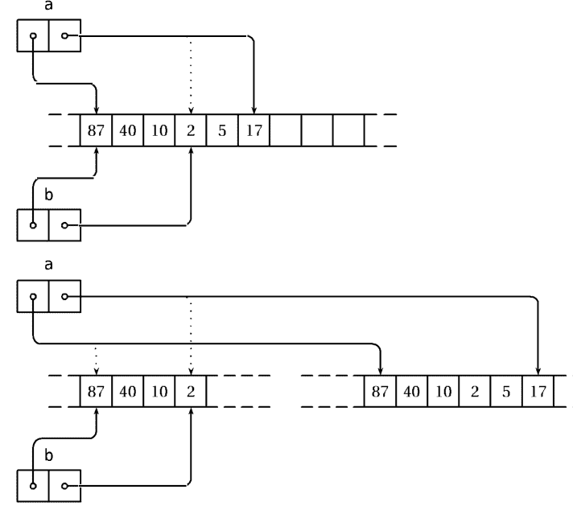

**图 4.4:** 尝试扩展数组 `a` 的两种可能结果。在第一种情况下（顶部），内存块末尾有可用内存，用于原地扩展。在第二种情况下，没有更多可用空间，因此分配了一个新块，并调整 `a` 指向该块。因此，扩展后 `a` 和 `b` 的块可能会重叠，也可能不重叠。

自己的块。这种操作被称为合并（coalescing）。然后扩展可以在不移动任何数据的情况下进行。

-   最后，如果当前块中完全没有空间，数组将分配一个全新的块并将所有数据复制到其中。在例如，当对同一个数组进行重复扩展时，实现可能会刻意分配额外的空闲空间。

扩展的数组永远不会覆盖现有的数组。例如：

```
int[] a = [0, 10, 20, 30, 40, 50, 60, 70];
auto b = a[4 ..];
a = a[0 .. 4];
// 在此点，a 和 b 是相邻的
```

a = [0, 0, 0, 0];
assert(b == [40, 50, 60, 70]); // 通过；a 重新分配了

上面的代码经过精心设计，误导人们认为其末尾有空间；最初接收到一个较大的大小，而 `b` 接收了 `a` 缩减后的下半部分。在赋值给 `a` 之前，数组将相邻的块复制到 `b` 的左侧。然而，追加操作后的 `assert` 确认了 `a` 是重新分配的，而不是原地扩展。`append` 运算符只有在能够证明正在扩展的数组右没有其他数组时才会进行原地追加，并且只要有一丝疑虑，它总是会保守地重新分配。

# 4.1.10 赋值给 .length

给 `array.length` 赋值允许你缩小或扩展数组，取决于新长度与旧长度的关系。例如：

```
int[] array;
assert(array.length == 0);
array.length = 1000;              // 增长
assert(array.length == 1000);
array.length = 500;
assert(array.length == 500);      // 缩小
```

如果数组因赋值给 `.length` 而增长，添加的元素将用 `T.init` 初始化。增长策略和保证与 `append` 运算符相同（见第 103 页的 4.1.9）。

如果数组因赋值给 `.length` 而缩小，D 保证数组不会重新分配。在实践，如果 `n <= a.length`，则 `a.length = n` 等同于 `a[..n]`。（然而，该保证并不意味着数组的进一步扩展将避免重新分配。）

你可以通过 `.length` 执行读取-修改-写入操作，例如：

```
auto array = new int[100];
array.length += 1000;           // 增长
assert(array.length == 1010);
array.length /= 10;
assert(array.length == 101);     // 缩小
```

这里并没有发生什么魔法；编译器所做的是将 `array.length op*=b` 重写为 `array.length=array.length*op-b`。尽管如此，这里涉及一些微小的魔法（其实只是小花招）：在重写的表达式中，`array` 只被求值一次，如果 `array` 实际上是一个复杂的表达式，这一点就很重要。

# 4.2. 固定大小数组

D 提供了在编译期间已知大小的数组，声明如下：

```
int[128] someInt;
```

对于每个类型 `T` 和大小 `n`，类型 `T[n]` 与任何其他类型都是不同的——例如，`uint[10]` 与 `uint[11]` 不同，也与 `int[10]` 不同。

所有固定大小数组的值都在声明处静态分配分配。如果数组是全局定义的，它将位于程序的每个线程数据段。如果是在函数内部分配，数组将在调用时分配在该函数的栈上。（这意味着在函数中定义非常大的数组可能是危险的）。但是，如果你在函数内部定义这样的数组，数组将分配在每个线程数据段，因此没有栈溢出的风险。

在创建时，固定大小数组 `T[n]` 的值被初始化为 `T.init`。例如：

```
int[3] a;
asert(a == {0, 0, 0});
```

你可以用字面量初始化 `T[n]`：

```
int[3] a = {1, 2, 3};
asert(a == {1, 2, 3});
```

注意：如果你将上述 `int[3]` 替换为 `auto`，则 `a` 的类型将被推断为 `int[]`，而不是 `int[3]`。虽然逻辑上 `[1, 2, 3]` 的类型应该被推断为 `int[]`（以比 `int[]` 更“精确”的方式），但事实是动态大小数组的使用频率比固定大小数组更高，因此坚持使用固定大小数组字面量会成为可用性上的障碍。

## 第 4 章 数组、关联数组与字符串

```d
auto c = fun(a, b);              // c 的类型为 int[3]
assert(c == [100, 42, 33]);
assert(b == [1, 2, 3]);      // b 不受 fun 的影响
```

对于大型数组，按值传递数组可能效率低下，但它有许多优势。一个优势是，短数组和按值传递在高性能计算中被频繁使用。另一个优势是，按值传递有一个简单的解决方法——每当你想使用 `ref` 或自动转换为 `T[]` 时（见下一段）。最后，值语义使得固定大小的数组与该语言的许多其他方面保持一致。（从历史角度看），D 对固定大小数组使用引用语义，这被证明是客户端代码中争议和特殊情况处理的持续来源。

类型为 `T[]` 的数组可以隐式转换为类型为 `T[]` 的数组。get动态数组不会重新分配——它仅仅是挂载在源数组的边界上。因此，如果源数组是分配的，则该转换被认为是不安全的。隐式转换使得将类型为 `T[n]` 的固定大小数组传递给期望 `T[]` 的函数变得简单。如果一个函数的返回类型是 `T[]`，则其结果不能自动转换为 `T[]`。

```d
double[3] point = [0, 0, 0];      // OK
double[3] test = point;
double[3] fun(double[] x) {
    double[3] result;
    result[] = 2 * x[];                      // 数组级操作
    return result;
}
auto r = fun(point);                       // OK，r 的类型为 double[3]
```

你可以通过 `.dup` 属性（第 93 页 § 4.1）复制固定大小数组，但你得到的并不是一个类型为 `T[n]` 的对象；你得到的是类型为 `T[]` 的动态分配数组，其中固定大小数组的副本。这种行为是合理的，因为否则你可能不需要复制固定大小数组——要获取 `a` 的副本，只需说 `copy = a` 即可。通过 `.dup`，你可以制作固定大小数组的动态拷贝。

### 4.2.5 相等性比较

固定大小数组可以使用 `is` 和 `==` 进行比较，类似于动态数组（第 100 页 § 4.1.5）。你也可以在比较中透明地混合固定大小数组和动态大小数组：

```d
int[4] fixed = [1, 2, 3, 4];
auto anotherFixed = fixed;
assert(anotherFixed !is fixed); // 不同（值语义）
```

### 4.3 多维数组

```d
assert(anotherFixed == fixed);    // 数据相同
auto dynamic = fixed[];                     // 获取 fixed 的边界
assert(dynamic is fixed);
assert(dynamic == fixed);                    // 显而易见
dynamic = dynamic.dup();                  // 创建副本
assert(dynamic !is fixed);
assert(dynamic == fixed);
```

### 4.2.6 拼接

拼接遵循类似于动态数组的拼接规则（第 100 页 $ 4.1.6）。这里有一个重要的区别：如果你请求一个固定大小数组，你就会得到一个固定大小数组。否则，你将得到一个新分配的动态数组。例如：

```d
double[2]; a;
double[1] b = a - 0.5;                   // 拼接 double[2] 与值，得到 double
auto c = a - 0.5;                        // 同上上
double[3] d = a - 1.5;                   // OK，显式请求固定大小数组
```


`double[5] e = a - d;` // OK，显式请求固定大小数组

每当作为拼接运算符 `~` 的结果请求固定数组时，不会发生动态分配——结果是静态分配的，拼接的结果被复制到其中。

### 4.2.7 数组级操作

静态数组的数组级操作与动态数组的操作类似（第 100 页 $ 4.1.7）。在可能的情况下，编译器会在数组级表达式中对带有静态长度的数组执行执行前的编译时边界检查。你可以在表达式中混合固定大小数组和动态数组。

### 4.3 多维数组

由于 `T[]` 是带有类型为 `T` 元素的动态数组，且 `T[]` 本身是一个类型，很容易推断出 `T[][]` 是 `T[]` 的数组，或者换一种说法，是 `T` 数组的数组。外部数组的每个元素都在一个原始数组中。让我们对 `T[][]` 进行测试。

```d
auto array = new double[][5];                // 包含五个 double 数组的数组

                                            // 每个初始为 null
```

```d
// 创建一个三角形矩阵
foreach (i, ref e; array) {
  e = new double[array.length - i];
}
```

上述定义的 `array` 形状是三角形的：第一行有五个，第二行有四个，依此类推直到第五行（技术上的行），它有一个元素。通过简单组合动态数组获得的多维数组被称为锯齿数组（jagged arrays），因为它们的行可能具有任意长度（与当所有行长度相同时获得的、预期的平直右边缘相反）。图 4.5 展示了数组在内存中的布局。

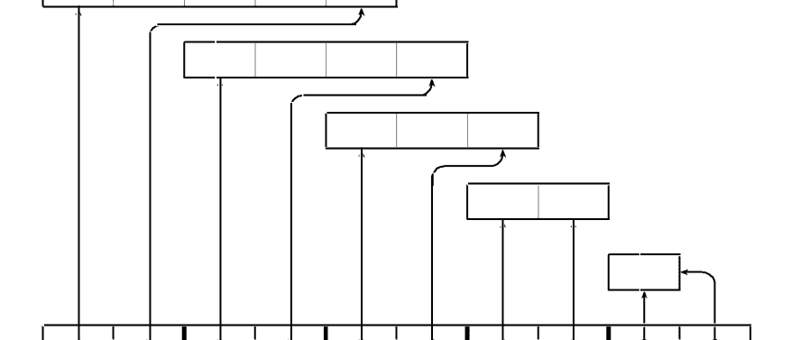

图 4.5 数组在内存中的布局。

上述定义的 `array` 形状是三角形的：第一行有五个，第二行有四个，依此类推直到第五行（技术上的行），它有一个元素。

通过简单组合动态数组获得的多维数组被称为锯齿数组（jagged arrays），因为它们的行可能具有任意长度（与当所有行长度相同时获得的、预期的平直右边缘相反）。

三角形矩阵（如上文所示）。

三角形矩阵（如上文所示）。

三角形矩阵（如上文所示）。

三角形矩阵（如上文所示）。

三角形矩阵（如上文所示）。

## 4.4. 关联数组

### 4.4.2 读取和写入槽位

要向 `aa` 写入新的键值对，或覆盖当前存储为该键的值，只需像这样给 `aa[key]` 赋值：

```cpp
// 创建一个字符串到字符串的关联数组
aa = [ "hello":"salve", "world":"mundi" ]; own// 覆盖值
aa["hello"] = "ciano";
aa["world"] = "mondo";
// 创建一些新的键值对
aa["cabbage"] = "cavolo";
aa["mozzarella"] = "mozzarella";
```

根据给定键从关联数组中读取值，只需读取 `aa[key]`。（编译器会区分读取和写入，并调用略不同的函数。）继续上面的示例：

```cpp
assert(aa["hello"] == "ciano");
```

如果你尝试读取关联数组中未找到的键的值，将抛出一个范围异常。有时，在键不存在时抛出异常对于实用性来说有些过于生硬，因此关联数组提供了一种双参数方法形式的默认值读取。在调用 `aa.get(key, defaultValue)` 时，如果在 map 中找到了 `key`，则返回其对应的值且不评估 `defaultValue`；否则，评估 `defaultValue` 并返回 `get` 的结果。

```cpp
assert(aa["hello"] == "ciano");
// 键 "hello" 存在，因此忽略第二个参数
assert(aa.get("hello","salute") == "ciano");
// 键 "yo" 不存在，返回第二个参数
assert(aa.get("yo","buongiorno") == "buongiorno");
```

如果你想测试关联数组中是否存在键，请使用 `in` 运算符：

```cpp
assert("hello" in aa);
assert("yowza" in aa);
// 尝试读取 aa["yowza"] 会抛错
```

### 4.4.3 复制

关联数组是带有浅拷贝的纯引用：复制或赋值关联数组会为底层槽位创建新的别名。例如：

```cpp
auto al = [ "Jane":10.0, "Jack":20, "Bob":15 ];
auto a2 = al;                               // al 和 a2 指向相同的数据
al["Bob"] = 100;                           // 修改 a1...
assert(a2["Bob"] == 100);                // ...相当于修改了 a2...
a2["Sam"] = 3.5;                           // ...反之亦然
assert(a2["Sam"] == 3.5);                   // 如此
```

### 4.4.4 等值比较

`==`, `=` 和 `!=` 运算符按预期方式工作。对于相同类型的关联数组 `a` 和 `b`，表达式 `a == b` 仅当 `a` 和 `b` 指向同一个关联数组（例如，其中一个初始化为另一个的拷贝）时为真。表达式 `a == b` 使用 `==` 比较两个数组的键值对。要使 `a` 和 `b` 相，它们必须具有相同的键集以及每个键关联的相同。

```cpp
auto al = [ "Jane":10.0, "Jack":20, "Bob":15 ];
auto a2 = [ "Jane":10.0, "Jack":20, "Bob":15 ];
assert(al != a2);
assert(al == a2);
a2["Bob"] = 18;
assert(al != a2);
```

### 4.4.5 移除元素

要从 map 中移除键值对，将键传递给关联数组的 `remove` 方法。

```cpp
auto aa = [ "hello":1, "goodbye":2 ];
aa.remove("hello");
assert("hello" !in aa);
aa.remove("yowza");                        // 无影响："yowza" 不在 aa 中
```

`remove` 方法返回一个布尔值，如果删除的键在关联数组中则返回 true，否则返回 false。

### 4.4.6 迭代

你可以使用旧的 `foreach` 语句来遍历关联数组（见第 75 页 § 3.7.5）。键/值槽位的迭代顺序是不确定的：

```cpp
import std.stdio;
void main() {
    auto coffeePrices = [
        "french vanilla" : 8.75,
        "java" : 7.99,
        "french roast" : 7.49
    ];
    foreach (kind, price; coffeePrices) {
        printf("%s costs $%s per pound", kind, price);
    }
}
```

程序将打印
french vanilla costs $8.75 per pound
java costs $7.99 per pound
french roast costs $7.49 per pound

要获取数组中所有键的拷贝，使用 `.keys` 属性。对于类型为 `V[K]` 的关联数组 `aa`，`aa.keys` 返回的类型是 `K[L]`。

同样，对于类型为 `V[K]` 的 `aa`，`aa.values` 将存储在 `aa` 中的值产生类型为 `V[L]` 的数组。通常情况下，迭代比获取键或值更好，因为属性会分配一个新数组，对于大型关联数组，其尺寸可能很大。

```cpp
auto gammaFunc = [-1.5:2.363
```


# 第 4 章 数组、关联数组和字符串

### 4.4.7 用户定义类型作为键

内部，关联数组使用哈希和排序来快速检索键。要将用户定义类型用作键，它必须定义哈希和排序方法，如第 6 章所述。

### 4.5 字符串

字符串在 D 中受到特殊对待。语言早期做出的两个决定是：第一，D 采用 Unicode 作为其标准。第二，D 选择了 UTF-8、UTF-16 和 UTF-32 作为其原生编码。

#### 4.5.1 代码点

关于 Unicode 的一个重要事实，一旦理解，就能消除很多潜在的困惑：Unicode 将抽象字符（或代码点）的概念与表示（或编码）的概念隔离开来。这是一个非同寻常的区别，往往会被不留心的人忽略，特别是因为众所知的 ASCII 标准没有独立的表示。旧 ASCII 将英文文本中使用的每个字符加上几个“控制代码”映射到 0 到 127 之间的数字——即 7 位。自从 ASCII 引入以来，大多数计算机都使用 8 位字节作为寻址单位，因此根本不存在如何“编码” ASCII 的问题。

相比之下，Unicode 定义了代码点，它们仅仅是分配给抽象字符的数字。抽象字符 `A` 接收 `65`，抽象字符 `€` 接收 `8364`，以此此类推。决定哪些符号进入 Unicode 映射中以及如何为它们分配数字是 Unicode 委员会的一项重要任务。

从 5.1 版本开始，Unicode 代码点是 0 到 1,114,111 之间的整数，上限通常用十六进制表示 `0x10FFFF`，或在 Unicode 特定表示法中 `U+10FFFF`。常见的误解是 2 个字节足以表示任何字符，可能是因为某些语言在标准的早期版本中对双字节字符标准化。事实上，Unicode 符号的数量比 2 字节表示的 65536 个多 17 倍。

无论如何，讨论代码点时不应该考虑表示。在最高层次，代码点是一个很好的映射函数，将从 0 到 1,114,111 的整数映射到抽象字符实体。具体如何将 Unicode 代码点置于字节序列中，是编码方式需要考虑的问题。

#### 4.5.2 编码

如果 Unicode 仅仅遵循 ASCII 的传统，它将只会把 `0x7F` 以上的部分直接向上进位到下一个字节，从而为每个代码点获得一个简单的 3 字节表示。然而，这种潜在的表示方法存在问题。英语或其他拉丁源系统中的大多数文本会使用统计学上非常窄的代码点范围，这会导致空间浪费。典型拉丁文本的存储空间将直接膨三倍。

为了解决空间浪费的问题，Unicode 采用了变长长度编码方案。此类方案使用一个或多个代码来表示整个 Unicode 代码点范围。窄的代码（通常为 8 或 16 位）被称为代码单元 `code units`。每个代码点由一个或多个代码单元表示。

`UTF-8` 是被标准化的编码方式。`UTF-8` 由 Ken Thompson 发明，几乎是简单、巧妙设计的典范之例。`UTF-8` 背后的思想是使用 1 到 6 个字节来编码任何字符，并添加控制位来区分不同长度的编码。对于前 127 个代码点，`UTF-8` 与 ASCII 完全相同。这立即使得任何 ASCII 文本也成为有效的 UTF-8 文本。对于 ASCII 范围之外的代码点，`UTF-8` 使用变长编码，如表 4.2 所示。

表 4.2：UTF-8 编码。控制位用于流中同步、错误恢复和反向迭代的选择。

| 代码点（十六进制） | 代码（二进制） |
| --- | --- |
| 00000000-0000007F | 0xxxxxxx |
| 00000000-000007FF | 110xxxxx 10xxxxx |
| 00000000-0000FFFF | 1110xxxx 10xxxxx 10xxxxx |
| 00010000-001FFFF | 11110xxx 10xxxxx 10xxxxx 10xxxxx |
| 00200000-03FFFFFF | 111110xx 10xxxxx 10xxxxx 10xxxxx 10xxxxx |
| 04000000-7FFFFFFF | 1111110x 10xxxxx 10xxxxx 10xxxxx 10xxxxx 10xxxxx |

由于今天 Unicode 代码点的编码从 `0x10FFFF` 开始，最后的序列被预留给未来使用；目前只有最多 4 字节的编码是有效的。控制位模式有两个有趣的属性：

1. 非领先字节永远不会等于领先字节。
2. 第一个字节无歧义地决定编码的长度。

第一个属性至关重要，因为它实现了两个重要的应用。一个是简单的同步——如果你在 UTF-8 传输的中间某处截获，你可以很容易地找到下一个代码点从哪里开始：寻找下一个最高位不是 10 的字节。另一个应用是反向迭代——很容易回溯 UTF-8 字符串而不会产生混淆。第二个属性并非本质的，但它简化并加速了字符串处理。

理想情况下，频繁的代码点具有较小的值，而不频繁的代码点应该具有较大的值。如果满足这一条件，`UTF-8` 将成为一个良好的统计编码器，通过用更少的位编码更频繁的符号。这对于拉丁源语言来说确实如此，大多数代码点可以放入 1 字节，而偶尔出现的字符可以放入 2 字节。

`UTF-16` 是一种变长编码，它使用一种不同的编码方法。0 到 `0xFFFF` 之间的代码点表示为 16 位代码单元，`0x10000` 到 `0x10FFFF` 之间的代码点表示为一对，其中第一个代码单元在 `0xD800–0xDBFF` 之间，第二个代码单元在 `0xDC00–0xDFFF` 之间。为了支持这种编码，Unicode 未为 `0xD800–0xDFFF` 范围内的数字分配任何有效字符。这两个范围分别称为高代理项 `high surrogate` 和低代理项 `low surrogate`。

对 `UTF-16` 的常见批评是，它让统计学上稀有的情况也变成了最常见且最值得仔细检查的情况——但所有的 Unicode 都无法放入 UTF-16 代码单元，因此假设每个字符占用一个单元。进一步混淆的是，某些语言最初将其字符串支持围绕 `UCS-2` 展开，在添加 UTF-16 支持时，微妙地淘汰了旧代码。

最后，`UTF-32` 每个单元使用 32 位，允许代码点到单元的真一对一映射。`UTF-32` 是最简单且易于使用的表示，但也是最消耗空间的。常见的建议是存储时使用 `UTF-8`，在需要时处理中使用 `UTF-32`。

#### 4.5.3 字符类型

D 定义了三种字符类型。

```d
void main() {
    string a = "No matter how you put it, a λ costs €20.";
    wstring b = "No matter how you put it, a λ costs €20.";
    dstring c = "No matter how you put it, a λ costs €20.";
    writeln(a, '\n', b, '\n', c);
}
```

尽管 `a`、`b` 和 `c` 的内部表示是不同的，但你不需要担心这一点，因为你通过使用代码指针以抽象的方式表达了字面量。编译器会处理所有的编码细节，最终在程序结束时打印出三行包含相同文本的内容。

字面量的编码由其出现时的上下文决定。在上述情况下，编译器在不进行任何运行时处理的情况下，将字面量转换为 UTF-8、UTF-16 和 UTF-32 编码（对应类型 `string`、`wstring` 和 `dstring`），尽管它们的拼写完全相同。如果请求的字面量存在歧义，在字面量后加上 `c`、`w` 或 `d` 之一将强制将字符串编码为 UTF-8、UTF-16 和 UTF-32。

#### 4.5.4.1 结合字符串的 foreach

如果你像这样遍历任何宽度的字符串 `str`：

```d
foreach (c; str) {
    // 使用 c
}
```

那么 `c` 将遍历 `str` 的每一个单元。

```d
void main() {
    string str = "Hå, Värld!";
    foreach (c; str) {
        write(['', c, '']\n);
    }
    writeln();
}
```

为 `c` 指定不同的字符类型时，例如 `dchar`：

```d
foreach (dchar c; str) {
  write('\', c);
}
```

在这种情况下，编译器会自动插入代码，将 `str` 中的每个字符单元转换为由 `c` 的类型决定的表示。

### 4.6 数组的特立独行：指针

数组通过存储下界和上限来跟踪内存中的一组对象。指针是数组的“一半”——它只跟踪一个对象。

指向类型为 `T` 的对象的指针表示为类型 `T*`，默认值为 `null`。要创建一个指向对象的指针，使用取地址运算符 `&`；要使用该对象，使用 `*` 对其进行解引用。

```d
int x = 42;
int* p = &x;
writeln(*p);
```


数组通过存储下界和上限来跟踪内存中的一组对象。指针是数组的“一半”——它只跟踪一个对象。指针不包含关于字符何时开始和结束的信息。如果你有来自外部的信息，可以使用它来移动指针并使其指向相邻元素。

指向类型为 `T` 的对象的指针表示为类型 `T*`，默认值为 `null`（即指向任何实际对象的指针）。要创建一个指向对象的指针，使用取地址运算符 `&`；要使用该对象，使用 `*` 对其进行解引用。

```cpp
int x = 42;
int* p = &x;
writeln(*p);
```

## 4.7 总结与快速参考

对开页上的表 4.3 总结了动态数组操作；第 128 页的表 4.4 总结了固定大小数组的操作；第 129 页的表 4.5 总结了关联数组可用的操作。

### 表 4.3：动态操作（`a` 和 `b` 是两个 `T[]` 类型的值，`t, t1, ..., tk` 是 `T` 类型的值，`n` 是可转换为 `size_t` 的值）

| 名称 | 类型 | 描述 |
| :--- | :--- | :--- |
| `new T[n]` | `T[]` | 创建数组（第 93 页的 4.1） |
| `[t1, t2, ..., tk]` | `T[]` | 数组字面量；`T` 被替换为 `t` 的类型（第 39 页的 2.2.6），`t`（第 93 页的 4.1） |
| `a = b` | `T[]` | 将一个元素赋值给另一个（第 98 页的 4.1.4） |
| `a[e]` | `ref T` | 通过索引访问元素（`$e$` 替换自 `$a.length$`，`$e$` 必须可转换为 `size_t`，且 `$e < a.length$`（第 93 页的 4.1） |
| `a[$e_1$..$e_2$]` | `T[]` | 获取 `$a$` 的切片（`$e_1$` 替换自 `$e_1$` 和 `$e_2$`，`$a.length, e_1$, $e_2$` 必须可转换为 `size_t`，且 `$e_1 \le e_2 \ \& \ e_2 < a.length$`（第 97 页的 4.1.3） |
| `a[]` | `T[]` | 参与数组级表达式（第 100 页的 4.1.7），否则仅为恒等式 `$a[0 .. \$]$` |
| `a.dup` | `T[]` | 复制数组（第 93 页的 4.1） |
| `a.length` | `size_t` | 读取数组长度（第 106 页的 4.1.10） |
| `a.length = n` | `size_t` | 改变数组长度（第 95 页的 4.1.1） |
| `a is b` | `bool` | 比较数组的恒等性（第 100 页的 4.1，第 48 页的 2.4.3） |
| `a != b` | `bool` | 等同于 `! (a is b)` |
| `a == b` | `bool` | 比较数组元素间的相等性（第 100 页的 4.1.5，第 56 页的 2.3.12） |
| `a != b` | `bool` | 等同于 `! (a == b)` |
| `a - t` | `T[]` | 将一个元素与值拼接（第 100 页的 4.1.6） |
| `t - a` | `T[]` | 将一个值与数组拼接（第 100 页的 4.1.6） |
| `a - b` | `T[]` | 连接两个数组（第 100 页的 4.1.6） |
| `a = t` | `T[]` | 在数组后追加一个元素（第 100 页的 4.1.6） |
| `a = b` | `T[]` | 将一个数组追加到另一个数组（第 100 页的 4.1.6） |
| `a.ptr` | `T*` | 获取 `a` 的第一个元素的地址（不安全）（第 124 页的 4.6） |

### 表 4.4：固定大小数组操作（`a` 和 `b` 是两个 `T[]` 类型的值，`t1, t1, ..., tk` 是 `T` 类型的值，`n` 是静态已知且可转换为 `size_t` 的值）

| 名称 | 类型 | 描述 |
| :--- | :--- | :--- |
| `[t1, ..., tk]` | `T[k]` | 数组字面量，但仅当显式请求 `T[k]` 类型时；`T` 被推断为 `t1` 的类型（第 39 页的 4.2.6，第 93 页的 4.1） |
| `a = b` | `ref T[n]` | 拷贝项（第 109 页的 4.2.4） |
| `a[e]` | `ref T` | 通过索引访问元素（`$e$` 替换自 `$a.length$`，`$e$` 必须可转换为 `size_t`，且 `$e < a.length$`（第 93 页的 4.1） |
| `a[e1..e2]` | `T[k]` | 获取 `$a$` 的切片（`$e_1$` 替换自 `$e_1$` 和 `$e_2$`，`$e_1, e_2$` 必须可转换为 `size_t`，且 `$a_{e_1} \le a_{e_2} < a.length$`（第 108 页的 4.2.3） |
| `a[]` | `T[]` | 参与数组级表达式（第 100 页的 4.1.7）或仅转换为动态数组，等同于 `$a[.. \$]$` |
| `a.dup` | `T[]` | 复制数组（第 109 页的 4.2.4） |
| `a.length` | `size_t` | 读取数组长度（第 108 页的 4.2.1） |
| `a is b` | `bool` | 比较数组的恒等性（第 110 页的 4.2.5，第 48 页的 2.3.4） |
| `a !is b` | `bool` | 等同于 `! (a is b)` |
| `a == b` | `bool` | 比较数组元素的相等性（第 110 页的 4.2.5，第 56 页的 2.3.12） |
| `a != b` | `bool` | 等同于 `! (a == b)` |
| `a - t` | `T[]` | 将数组与一个值拼接（第 111 页的 4.2.6） |
| `t - a` | `T[]` | 将一个值与数组拼接（第 111 页的 4.2.6） |
| `a - b` | `T[]` | 连接两个数组（第 111 页的 4.2.6） |
| `a.ptr` | `T*` | 获取 `a` 的第一个元素的地址（不安全） |

### 表 4.5：关联数组操作（`a` 和 `b` 是两个 `V[K]` 类型的值，`k1, ..., ki` 是 `K` 的值，`v1, ..., vk` 是 `V` 的值）

| 名称 | 类型 | 描述 |
| :--- | :--- | :--- |
| `[t1:v1, ..., ti:vi]` | `V[K]` | 关联数组字面量；`K` 被推断为 `k1` 的类型，`V` 被推断为 `v1` 的类型（第 39 页的 2.2.6，第 114 页的 4.4） |
| `a = b` | `V[K]` | 将 `b` 赋值给 `a`（第 115 页的 4.3） |
| `a[k]` | `V` | 通过索引访问元素（如果未找到 `k` 则抛出异常）（第 115 页的 4.4.2） |
| `a[k] = v` | `V` | 将值 `v` 与键 `k` 关联（覆盖之前的关联）（第 115 页的 4.4.2） |
| `k in a` | `V*` | 在 `a` 中查找 `k`，不存在则返回 `null`，存在则返回值的指针（第 115 页的 4.4.2） |
| `k !in a` | `bool` | 等同于 `(! in a)` |
| `a.length` | `size_t` | 读取 `a` 中元素的数量（第 114 页的 4.4.1） |
| `a is b` | `bool` | 比较关联数组的恒等性（第 116 页的 4.4.4，第 48 页的 2.3.4） |
| `a != b` | `bool` | 等同于 `(!= b)` |
| `a == b` | `bool` | 比较元素的相等性（第 116 页的 4.4.4，第 56 页的 2.3.12） |
| `a = b` | `bool` | 等同于 `(a = b)` |
| `a.remove(k)` | `bool` | 移除 `k` 的关联（如果有）；当且仅当 `k` 存在于 `a` 中时返回 `true`（第 116 页的 4.4.5） |
| `a.get(k, v)` | `V` | 返回对应键 `k` 的值，以 `v` 作为默认值（第 115 页的 4.4.2） |

数据与函数。函数式风格

在今天，连对象都是过时新闻了，谈论数据和函数——太像 20 世纪 70 年代了。然而，遗憾的是，我们只需告诉我们想做什么并让计算机自己想办法去实现的日子还在远方。在此之前，函数是所有主要编程学科不可或少的组成部分。从根本上说，任何程序都是由移动数据的计算组成的；我们构建的所有复杂脚手架——类型、对象、模块、框架、设计模式——只是为计算增加了有趣的属性，如模块化、错误隔离或易于维护。一种好的语言允许我们达到代码的黄金比例：用于“执行”的代码与用于“存在”的代码之间的比例。理想的比例取决于许多因素，程序规模是一个显而易见的因素：短脚本应该主要致力于做某些事情，而大型应用程序将不可避免地关注非可执行的内容，如接口、协议和模块约束。

## 5.1 编写和单元测试简单函数

在今天，连对象都是过时新闻了，谈论数据和函数——太像 20 世纪 70 年代了。然而，遗憾的是，我们只需告诉计算机我们想做什么并让它自己想办法去实现的日子还在远方。在此之前，函数是所有主要编程学科不可或少的组成部分。从根本上说，任何程序都是由移动数据的计算组成的；我们构建的所有复杂脚手架——类型、对象、模块、框架、设计模式——只是为计算增加了有趣的属性，如模块化、错误隔离或易于维护。一种好的语言允许我们达到代码的黄金比例：用于“执行”的代码与用于“存在”的代码之间的比例。理想的比例取决于许多因素，程序规模是一个显而易见的因素：短脚本应该主要致力于做某些事情，而大型应用程序将不可避免地关注非可执行的内容，如接口，协议和模块约束。

```d
find(int[] haystack, int needle) {
  foreach (v; haystack) {
    if (v == needle) return true;
  }
}
```

## 5.1 编写与调试一个简单函数

头部——工作量几乎和查找操作本身一样大！返回一个整数对于数组以外的任何类型都是非常糟糕的。

适用于各种干草堆（数组、链表，甚至文件和套接字）的想法是：在干草堆中寻找灵活的元素（草？）直到找到要搜索的值，并返回干草堆的剩余部分。如果没有找到该值，`find` 返回空的干草堆：“`find(haystack, needle)` 从左侧缩减 `haystack` 直到 `needle` 耗尽，然后返回 `haystack` 的剩余部分。”让我们为 `int[]` 实现这个功能。

```d
int[] find(int[] haystack, int needle) {
    while (haystack.length > 0 && haystack[0] != needle) {
        haystack = haystack[1 .. $];
    }
    return haystack;
}
```

注意 `find` 如何仅访问 `haystack` 的第一个元素并反复重新赋值为较短的子集。这些原语以后可以轻松替换为例如特定于列表的原语，但让我们几分钟之后后再考虑泛化。现在让我们测试一下 `find` 的性能。

近年来，所有开发方法论对适当软件测试的关注日益增加。这是一个很好的趋势，因为适当的测试对错误管理有巨大的积极影响。让我们与跟时代，编写一个简短的单元测试来测试 `find`。如果你是真正的测试驱动者，只需按照以下代码遵循 `find` 的定义：

```d
untest {
int[] a = [];
assert(find(a, 5) == []);
a = [ 1, 2, 3 ];
assert(find(a, 0) == []);
assert(find(a, 1).length == 3);
assert(find(a, 2).length == 2);
assert(a[0 .. $ - find(a, 3).length] == [ 1, 2, 2 ]);
}
```

要获得一个运行的模块，我们只需要将函数和单元测试组合在 `searching.d` 文件中并运行

```
$ rdmd --main -untest searching.d
```

如果你传递 `-untest` 标志，单元测试将被编译并设置为在主程序之前运行。否则，编译器将忽略 `unittest` 块，这对于只想运行已经测试过的代码而不产生启动延迟的情况非常有用。`--main` 标志指示 `rdmd` 添加一个什么都不做的 `main` 函数。（如果你忘记了 `--main`，不要担心；链接器会很通顺，几乎不会用你的原生语言提醒你这件事，那是被加密的 Klingen）。代理 `main` 函数对于我们只想运行单元测试而不是实际程序的人很有用。估计会有大量感兴趣的开发者获取我们的小文件并将其用在自己的项目中，每个人都定义自己的 `main`。

## 5.2 传递约定与存储类

如前所述，`find` 的两个参数（一个 `int` 和一个代表 `int[]` 的胖指针）被复制到 `find` 的私有状态中。当 `find` 返回时，指针会被传回调用者。这很容易识别为直接的值传递。特别是，在函数返回后，调用者无法“看到”对参数的。但请注意间接性：由于切片的内容没有复制，更改切片的单个元素将由调用者看到。考虑：

```d
void fun(int x) { x += 42 };
void gun(int[]) x) { x = [ 1, 2, 3 ]; }
void hun(int[]) x) { x[0] = x[1]; }
unittest
int x = 10;
fun(x);
assert(x == 10); // 未改变
int[] y = [ 10, 20, 30 ];
gun(y);
assert(y == [ 10, 20, 30 ]); // 未改变
hun(y);
assert(y == [ 20, 20, 30 ]); // 改变了！
```

发生了什么？在前两种情况下，`fun` 和 `gun` 只改变了它们自己的参数副本。特别是，第二种情况重新绑定了胖指针以指向其他地方，让原始数组保持完好。但在第三种情况下，`hun` 选择了更改数组中的一个元素，这个更改反映在原始数组中。很容易想象为什么我们认为切片 `y` 与它所管理的三个整数不在同一个地方。如果你整体赋值一个切片 `a = [ 1, 2, 3 ]`，那么 `x` 之前持有的切片在 `x` 开始新生活时会被忽略；但如果你更改了切片的某些元素 `x[i]`，其他看到该元素的切片（在我们例中是 `hun` 的调用者）将看到该变化。

### 5.2.1 ref 参数和返回值

有时我们希望让更改对调用者可见。在这种情况下，`ref` 存储类就救场了：

```d
void bump(ref int x) { ++x; }
nittest {
  int x = 1;
  bump(x);
  assert(x == 2);
}
```

如果函数期望一个 `ref`，它只接受“真实”数据，不接受临时变量；任何不是左值的内容在编译期间都会被拒绝；例如：

```d
bump(5); // 错误！无法将右值绑定到 ref 参数
```

这防止了人们在认为已经完成但实际上并没有完成时犯下愚的错误。例如，函数的结果：

```d
void bump(ref int x) { ++x; }
unittest {
  int x = 1;
  bump(x);
  assert(x == 2);
}
```

如果函数期望 `ref`，它只接受“真实”数据，不接受临时变量；任何不是左值的内容在编译期间都会被拒绝；例如：

### 5.2.2 out 参数

有时 `ref` 参数仅用于函数输出某些内容。在这种情况下，你可能希望使用 `out`，它类似于 `ref`，但是在进入时会将参数初始化为默认值。例如：

```d
// 计算 a 和 b 的除数和余数
// 返回除数，余数在 'rem' 中
int divrem(int a, int b, out int rem) {
    assert(b != 0);
    rem = a % b;
    return a / b;
}
```

```d
unittest {
  int r;
  int d = divrem(5, 2, r);
  assert(d == 2 && r == 1);
}
```

代码可以使用 `ref` 代替 `out` 而没有问题；然而，这明确了调用者 `divrem` 函数在进入时并不期望 `rem` 包含任何内容。

### 5.2.4 static 数据

虽然 `static` 与向函数传递参数无关，在这里讨论它是合适的，因为就像 `ref` 一样，应用于数据的 `static` 是一种存储类，意味着关于数据如何存储的指示。

任何变量声明都可以加上 `static`，这意味着每个执行线程有一个副本。第13章讨论了D决定的原理和后果。静态是共享的，它跨函数调用保留其值，无论它位于函数内部还是外部。在不同作用范围内放置静态数据的选择仅涉及可见性，而不涉及存储。在模块级别，`static` 的处理方式实际上是相同的。

```d
static int zeros; // 实际上与 private int zeros; 相同
```

```d
void fun(int x) {
  static int calls;
  ++calls;
  if (!x) ++zeros;
  ...
}
```

静态数据必须使用编译时常量初始化。要在第一次通过函数时初始化函数级静态数据，你可能希望使用带有辅助 `bool` 静态变量的简单技巧：

```d
void fun(double x) {
  static double minInput;
  static bool minInputInitialized;
  if (!minInputInitialized) {
    minInput = x;
    minInputInitialized = true;
  }
}
```

```go
minInputInitialized = true;
} else {
  if (x < minInput) minInput = x;
}
..
```


## 5.3 类型参数

让我们回到第 132 页定义的 `find` 函数，因为它存在着不少问题。首先，`find` 的用性很窄，因此值得探索让它更具通用性的方法。让我们从一个简单的观察开始：`find` 中 `int` 的出现是硬编码的，而且非常简单。无论是在 `double[]` 切片中查找 `double` 值，还是在 `string[]` 切片中查找 `string` 值，代码形状上没有任何区别。因此，我们希望将其转换为占位符——即 `find` 的参数，用于描述相关实体的类型，而不是值。为了做到这一点，我们需要将定义改为：

```d
T[] find(T[] haystack, T needle) {
  while (haystack.length > 0 && haystack[0] != needle) {
    haystack = haystack[1];
  }
  return haystack;
}
```

如预期的那样，`find` 的函数体没有变化，只有签名发生了变化。签名现在有两对括号括起来的项。第一个列表列出了函数的类型参数，第二个列表是普通的参数列表，它现在可以使用刚刚定义的类型参数了。现在我们不仅可以处理 `int` 的切片，还可以处理所有类型的切片，即其他内置或用户定义的类型。最棒的是，我们的程序依然可以工作，因为编译器会根据参数类型自动推导出 `T`。很酷。但是，我们并不满足于此，让我们添加一个单元测试来确认这些非同常的断言：

```d
// Testing generic capabilities
double[] d = [ 1.5, 2.4 ];
assert(find(d, 1.0) == null);
assert(find(d, 1.5) == d);
string[] s = [ "one", "two" ];
assert(find(s, "two") == [ "two" ]);
```

### 5.3. 类型参数

现在当编译器看到改进后的 `find` 定义时会发生什么？与 `int[]` 的情况相比，编译器面临着更严峻的挑战，因为现在 `T` 是未知的——它可以是任何类型。而且不同类型的存储方式不同、传递方式不同，且 `==` 的定义也不同。处理这个问题非常重要，因为类型参数真正开启了代码的可能性和多重可用性。在为类型参数化生成代码时，目前有两种主流流派 [43]：

- **同质翻译（Homogeneous translation）**：将所有数据转换为通用格式，允许仅编译一个适用于所有人的 `find` 版本。
- **异构翻译（Heterogeneous translation）**：使用不同的类型参数（例如 `int`、`double` 相于 `string`）调用 `find`，这会提示编译器生成许多 `find` 的特殊版本。

在同质翻译中，语言必须为它查找的数据提供一个统一的访问接口。异构翻译几乎就像你有一个助手，为你想出的每种数据格式编写一个特殊的 `find`，而所有这些都是从同一个模具中制成的。显然，这两种方法各有优劣，这通常是各个社区中讨论的话题。同质翻译倾向于代码的统一性、简单性和紧凑。例如，传统的函数式语言倾向于用列表格式表示一切，而许多传统的面向对象的语言倾向于将一切视为对象，并对其特征提供统一访问。然而，同质翻译的缺点包括僵化、缺乏表达能力和执行效率低下。相比之下，异构翻译倾向于专门化、表达能力和生成代码的速度。代价可能包括生成代码的膨胀、语言复杂性的增加以及笨拙的编译模型（一个针对异构方法的常见论点是它们是美化后的宏 [pgsql]；由于 C 语言给宏留下了了如此糟糕的声誉，这个标签引起了强烈的负面含义）。

一个值得注意的细节是包含关系：异构翻译包含了同质翻译，原因很简单，因为“许多格式”包含了“一种格式”，而“许多实现”包含了“一种实现”。因此可以认为（在不考虑其他所有因素的情况下）异构翻译比同质翻译更强大。如果你可以使用异构翻译，至少没有什么能阻止你在需要时选择一种统一的数据格式和一个统一的函数。相反，在同质方法下这是不可行的。然而，得出异构方法“更好”的结论是过于简单的，因为除了表达能力之外，还有其他需要考虑的因素。

D 使用异构翻译，配合（警告，即将出现技术术语）静态作用域符号查找和延迟类型检查。这意味着当

D 编译器找到泛型 `find` 定义时，它解析并保存定义函数的函数体，并在 `find` 被调用之前什么都不做。此时，编译器获取已解析的 `find` 定义，并尝试用选择者代替 `T` 选择的类型对其进行编译。当函数使用符号时，它们会在函数定义的环境中进行查找。

如果编译器无法为你的特定类型生成 `find`，就会生成错误消息。这实际上可能令人烦恼，因为错误可能是由于 `find` 中一个未被发现的 bug。事实上，这为下一节提供了完美的动机，因为 `find` 存在两个 bug——不是功能性 bug，而是通用性 bug：目前，`find` 既太通用又不够通用。让我们看看它是如何工作的。

## 5.4 签名约束

假设我们有一个 `double` 数组，并且想在其中查找一个整数。这应该很顺利，对吧？

```go
double[] a = [1.0, 2.5, 2.0, 3.4];
find(a, 2);
```

它完全没有类型，而且“完全没有类型”并不是 bool。特别是，你不必担心即使 haystack 的长度为零，`haystack[0]` 也会通过测试。相反，你不能在签名约束中放置运行时评估的条件；例如，你无法指定限制 `find` 的特征为 `needle > 0`。

## 5.5 函数重载

我们为切片和元素定义了 `find`。现在让我们编写一个 `find` 版本，用于判断一个切片是否可以在另一个切片内。常用方法是使用两个循环进行暴力搜索。这种算法效率不高——运行时间与两个切片长度的积成正比。暂时不用担心效率，专注于为新添加的函数定义一个良好的签名。上一个节已经提供了我们所需的大内容。事实上，实现代码是不言而喻的：

```
find(T1, T2)(T1[] longer, T2[] shorter)
if (isof(longer .. [1]) == shorter) : bool)
{
    while (longer.length >= shorter.length) {
        if (longer .. shorter.length) == shorter) break;
        longer = longer[1 ..];
    }
    return longer;
}
```

啊！你看，这次没有再次掉入将函数特殊化的陷阱。一个糟糕的定义将会是：

```
// 不！这个签名限制太严重了！
find(T)(T[] longer, T[] shorter) {
    ...
```

这虽然更简洁一点，但限制性更大。我们的实现可以判断 `int` 切片是否包含 `long` 切片，或者 `double` 切片是否包含 `float` 切片，而无需复制任何数据。这些选项对于那种简化的签名来说是无法访问的。你必须复制数据以确保类型正确，或者干脆放弃使用该函数并手动编写搜索。一个在玩具示例中看起来很酷但在实际使用中失败的函数，算什么样的函数呢？

至于实现，请注意（在外层循环中）现在熟悉的 `longer` 从左端减少一个元素的操作。内层循环隐含在批量比较 `longer[.. shorter.length] == shorter` 中，该操作比较了 `longer` 的前 `shorter.length` 个元素。

D 支持函数重载——只要参数的数量或至少一个参数的类型不同，多个函数就可以共享相同的名称。语言规则在编译期间决定实际调用应该去向何处。重载基于我们通过上下文消除单词词义的本生语言能力，对于在提供丰富性的同时不增加调用者必须记忆的词汇量非常有帮助。相反的风险是，如果调用 `another`，且这些规则太严格，人们可能会认为他们正在调用一个函数和另一个函数，或者需要扭曲内容来向编译器解释他们调用的是哪个版本。D 努力保持规则简单，在特殊情况下，规则的效果是不言而喻的：如果一个函数的本质约束（`if` 子句）评估为 `false`，则该函数直接从重载集中消失——它完全不被视为候选者。对于任何两个版本，相应的 `if` 子句对于相同的参数永远不会为真。因此，对于 `find` 的任何可能调用，至少有一个重载将让自己变得不可见；永远不需要解决歧义问题。让我们用单元测试来遵循这些想法。

```
// 新引入的重载
double[] d1 = [ 6.0, 1.5, 2.4, 3 ];
float[] d2 = [ 1.5, 2.4 ];
asert(d1, d2) == d1[1 ..];
```

两个版本的 `find` 可能存在于文件中，也可能存在不同的文件中；它们之间没有竞争，因为它们的 `if` 子句永远不同为真。现在，进一步讨论重载规则，假设我们经常使用 `int[] a`，因此我们为该类型定义一个优化的 `find`：

# 第 5 章 数据与函数。函数式风格


`int[] find(int[] longer, int[])` {

  ..

}

```

按照目前的写法，这个 `find` 的重载没有类型参数。此外，很明显，我们之前定义的通用 `find` 和针对整数的特化 `find` 之间存在某种竞争。这两个函数在 `find` 重载链中的相对位置是什么？哪一个将成功捕获下面的调用？

```

`int[] ints1 = [ 1, 2, 3, 5, 2 ];`

`int[] ints2 = [ 3, 5 ];`

`auto test = find(ints1, ints2);` // 正确还是错误？

// 通用的还是特化的？

# 第 5 章 数据与函数。函数式风格

D 处理此问题的方法非常简单：它的选择始终偏向于更特化的函数。现在，在通用情况下，“更特化”的概念需要一些解释；它暗示存在某种特化顺序，一种函数的“小于”关系。确实如此，这种关系是函数的偏序。

## 5.5.1 函数的偏序

尽管听起来需要大量的数学技巧，但偏序是一个非常简单的概念。考虑将熟悉的数值关系 `≤` 推广到我们用例中的其他集合上。给定两个函数 `foo1` 和 `foo2`，我们想要判断 `foo1` 在调用时是否小于 `foo2`（我们将“foo1 小于 foo2”标记为 `foo1 ≤ foo2`）。如果我们定义了这样的关系，就有了标准来

## 5.5. 重载

```
// 两个有序函数：write(double) 比 write(int) 
// 特化程度更低，因为前者可以用 int 调用，但
// 后者不能用 double 调用。
void write(double);
void write(int);
```

使用这种偏序，D 执行以下简单算法来对重载调用 `foo(arg, ..., argn)` 做出决策：

1. 如果存在精确匹配（与参数的类型和数量相同），则采用它。
2. 选择一组在没有其他重载时会接受调用的候选集 `{ foo_1, ..., foo_k }`。这里是类型推断类型和评估 `if` 子句的地方。
3. 如果集合大小为零，发布“无匹配”错误。
4. 如果并非所有函数都在同一个模块中，发布“尝试跨模块重载”错误。
5. 从集合中所有比其他函数特化程度更高的函数中，即只保留最特化的函数。
6. 如果剩余集合的大小大于一，发布“调用歧义”错误。
7. 集合中的唯一元素是胜者。

（注：文本包含跨页的碎片化句子）

```
// 如上，外加 ...
void transmogrify(T)(T value) {
```

```
unittest {
  transmogrify(42); // 仍然调用 transmogrify(uint)
  transmogrify("hello"); // 调用 transmogrify(T), T=string
}
```

# 第5章 数据与函数。函数式风格

```
transmogrify(1.1);    // 调用 transmogrify(T), T=double
}
```

现在，当 `transmogrify(int)` 与泛型函数 `transmogrify(T)(T)` 进行排序时会发生什么？嗯，尽管决定了 `T = uint`，但在进行排序时，`T` 并不会替换为 `uint`，而是保留其所有的通用性。`transmogrify(int)` 能接受任意类型 `T` 吗？不能。`transmogrify(T)(T)` 能接受 `int` 吗？可以。这意味着 `transmogrify(T)(T)` 比 `transmogrify(int)` 特化，因此它被从候选集中排除。所以，非泛型函数通常优于泛型函数，即使非泛型函数需要隐式转换。

## 5.5.2 跨模块重载

上一页重载算法中的第4步值得特别关注。考虑一个稍微修改过的示例，包含 `uint` 和 `long` 的重载，只是涉及的文件更多：

```d
// 在 module calvin.d
void transmogrify(long) { ... } own
```

```d
// 在 module hobbes.d
void transmogrify(uint) { ... }
```

```d
// Module client.d
import calvin, hobbes;
ittest {
    ntransogrify(42);
}
```

`calvin.d` 中的 `transmogrify(uint)` 重载更特化；然而，编译器拒绝跨不同模块进行重载，并声称存在歧义。它坚决地拒绝，因为如果允许这种重载，调用的含义将取决于所包含的各种模块之间的相互作用（通常会有很多模块、许多重载以及更复杂的调用）。想象一下，在一个运行良好的程序中添加一个新导入，结果其行为发生了可预测的方式发生了变化！反之，如果允许跨模块重载，代码读者的负担将会增加；现在，为了弄清楚一个调用去向哪里，他们不需要知道某个模块包含什么，而需要知道所有包含的模块包含什么——其中某一个可能定义了更好的匹配项。糟糕的是，如果顶层声明的顺序很重要，那么调用 `transmogrify(5)` 可能会根据它在文件中的位置最终调用不同的函数。这是一个无尽的问题源，因为这基本上意味着代码读者必须时刻在大脑中保持一个巨大的动态上下文。

一个模块可以定义一组实现各种类型功能的重载。另一个模块不能直接闯入并向该功能添加自己的。然而，第二个模块可以定义自己的一组重载。只要一个模块中的函数没有劫持本该发送到另一个模块函数的调用，就不会有歧义。冲突的判断是基于每次调用的。考虑以下情况：

```d
// 在 module calvin.d
void transmogrify(long) { ... }
void transmogrify(uint) { ... }
// 在 module hobbes.d
void transmogrify(double) { ... }
// 在 module susie.d
void transmogrify(int[]) { ... }
void transmogrify(string) { ... }
// Module client.d
import calvin, hobbes, susie;
```

```d
unittest {
    transmogrify(5); // 错误！跨模块重载
    // // 跨越 calvin 和 hobbes
    calvin.transmogrify(5); // 可以，显式解析
    // // 调用了 calvin.transmogrify(uint)
    transmogrify(5.5); // 可以，只有 hobbes 能接受
    transmogrify("hi"); // 来自 Susie 的问候
}
```

Calvin、Hobbes 和 Susie 以有趣的方式交织。歧义是非常细粒度的；第一次调用中 `calvin.d` 和 `hobbes.d` 之间的冲突并没有导致模块互不兼容——第三次调用仍然成功，因为其他模块中没有函数能够接受它。最后，`susie.d` 定义了自己的重载，并且永远与其他模块产生冲突，不像那些同名的漫画角色。

引导重载：当模块之间出现歧义时，有两种主要方法可以引导重载的工作。一种是使用模块名来限定函数名，如第二次调用 `calvin.transmogrify(5)` 所示。这样做将查找限制在仅 `calvin.d` 中。在该模块内部，所有的重载规则都会生效。另一种更透明的方法是为相关符号使用本地别名，如下所示：

```d
// 在 calvin.d 内部
alias hobbes.transmogrify transmogrify;
```

此指令完成了所有有趣的操作：它将 `hobbes.d` 中所有的 `transmogrify` 加载推入当前模块 `calvin.d`。如果 `calvin.d` 包含了上述指令，就好像 `hobbes.d` 定义的所有 `transmogrify` 重载加上它自己的重载一样。这个漂亮的 `calvin.d`——每当需要做出调用 `transmogrify` 的重要决策时，都会民主地咨询 `hobbes.d`。或者，如果 `calvin.d` 和 `hobbes.d` 存在不利并选择忽略对方的存在，`client.d` 仍然可以通过对别化 `calvin.transmogrify` 和 `hobbes.transmogrify` 来告诉 `transmogrify` 考虑所有的重载。

```d
// 在 client.d 内部
alias calvin.transmogrify transmogrify;
alias hobbes.transmogrify transmogrify;
```

这个 `transmogrify` 通过对别化 `calvin.transmogrify` 和 `transmogrify` 考虑了所有的重载。

# 第5章 数据与函数式风格

`calvin.transmogrify(5)`。 这样做将查找限制在仅 `calvin.d` 中。在该模块内部，所有的重载规则都会生效。另一种更透明的方法是为相关符号使用本地别名，如下所示：

```d
// 在 calvin.d 内部
alias hobbes.transmogrify transmogrify;
```

此指令完成了所有有趣的操作：它将 `hobbes.d` 中所有的 `transmogrify` 加载推入当前模块 `calvin.d`。如果 `calvin.d` 包含了上述指令，就好像 `hobbes.d` 定义的所有 `transmogrify` 重载加上它自己的重载一样。这个漂亮的 `calvin.d`——每当需要做出调用 `transmogrify` 的重要决策时，都会民主地咨询 `hobbes.d`。或者，如果 `calvin.d` 和 `hobbes.d` 存在不利并选择忽略对方的存在，`client.d` 仍然通过别化 `calvin.transmogrify` 和 `hobbes.transmogrify` 来告诉 `transmogrify` 考虑所有的重载。

```d
// 在 client.d 内部
alias calvin.transmogrify transmogrify;
alias hobbes.transmogrify transmogrify;
```

这个 `transmogrify` 通过别化 `calvin.transmogrify` 和 `transmogrify` 考虑了所有的重载。

## 5.6 高阶函数。字面量

到为止，我们知道如何调用 `find` 的这个新重载。上面的字面量长度为 41 个字符，这确实做了工作。为了帮助这一点，D 允许你精简语法。第一个快捷方式是消除类型或参数类型；编译器足够智能可以通过其定义推断出所有类型，匿名函数的体就在那里。

```d
auto b = find!(function(x) { return x < 0; });
```

第二个快捷方式是直接消除 `function` 关键字本身。你可以这样结合两个快捷方式，得到一种相当简洁的表示：

```d
auto b = find!((x) { return x < 0; });
```

对于知情者来说易于识别，而你几秒钟前刚刚成为了其中之一。

# 第 5 章 数据与函数。函数式风格

## 5.6.1 函数字面量与委托字面量

lambda 函数机制的一个重要要求是允许访问 lambda 定义时的上下文。考虑下面一个稍微修改过的调用：

```
unittest {
    int[] a = [1, 2, 3, 4, -5, 3, -4];
    int z = -2;
    // 找到第一个小于 z 的数字
    auto b = find(a, x { return x < z; });
    assert(b == a[4]);
}
```

这个修改后的示例可以运行，这显然回答了问题。然而，如果仅仅在字面量前加上 `function`，代码就会停止：

```
auto b = find(a, function(x) { return x < z; }); // 错误！函数无法访问调用者的帧！
```

发生了什么？那个“帧（frame）”是怎么回事？显然，某种机制让函数字面量能够访问 `z`——它不可能凭空产生。这种机制被编码为一个隐藏参数，称为帧指针（frame pointer），由字面量获取。由于它是静态类型类型，它必须区分两者，而它确实做到了。除了函数字面量外，还有委托字面量（delegate literals），它们可以这样创建：

```
unittest {
    int z = 3;
    auto b = find(a, delegate x { return x < z; }); // OK
}
```

委托可以访问闭包的帧，而函数不能。如果字面量中既没有函数也没有委托，编译器会自动检测哪种是必须的。类型推断在此派上了用场，它让最方便的代码同时也执行了正确的操作：

```
auto f = find(int {});
assert(f == function);
```

我们可以使用任意的函数字面量进行调用，这非常简洁。然而，如果字面量变得很大，或者我们想要复用它，在调用处编写其体就会变得笨拙（而且可能要写好几次）。我们希望用命名函数来调用，而不是匿名函数；此外，如果我们愿意，我们还希望保留访问局部变量的权利。对于这类以及许多其他活动，D 提供了嵌套函数。

嵌套函数的定义看起来和普通函数完全一样，只是它出现在另一个函数内部。考虑以下：

```
void transmogrify(int[] input, int z) {
    // 嵌套函数
    bool transmogrify(int x) {
        if (x == 42) {
            throw Exception("42 cannot be transmified");
        }
        return x < z;
    }
    // 在输入中找到第一个可转换元素
    input = find(input, transmogrify);
    // 再次
    input = find(input, transmogrify);
}
```

嵌套函数在各种情况下都很有用。尽管它们没有做任何普通函数无法做的事情，但嵌套函数增加了便利性和模块化，因为它们直接位于使用它们的函数内部，并且对嵌套上下文有密切访问。后者的优势非常重要；如果没有嵌套选项，访问 `z` 将变得非常困难。

嵌套函数 `transmogrify` 使用了相同的技巧（隐藏参数）来访问其父级栈帧，特别是它。有时你可能希望主动防止这种情况发生，让 `transmogrify` 变成一个完全普通的函数，除了它在 `transmogrify` 内部的定义外。为了这一点，只需在 `transmogrify` 的定义前加上（还能什么？）：

```
void transmogrify(int[] input, int z) {
    static int w = 42;
    // 嵌套的普通函数
    static bool transmogrify(int x) {
        if (x == 42) {
            throw Exception("42 cannot be transmified");
        }
        return x < w; // 访问 z 将报错
    }
}
```

带有 `static` 后，`transmogrify` 只能访问在 `transmogrify` 内部定义的模块级和静态数据（如带有 `w` 的示例所示）。任何临时数据（如函数参数或非静态变量）都是不可访问的（但可以显式传递）。

## 5.8 闭包

如所述，别名（alias）是一个纯粹的符号设备；它所做的只是让一个符号与另一个符号相同。在我们上面的示例中，`pred` 并不是一个真实的值，就像任何函数名都不是一个值一样；你不能给它赋值。如果你想创建一个函数数组（例如命令序列），别名对你毫无帮助。需要定义额外的内容，并且这种能力拥有一个可以被存储和检索的实体对象，就像 C 语言中的函数指针一样。

考虑以下挑战：“给定一个类型为 T 的值 x，返回一个函数，找到第一个与 T 数组相等的值。”这个复杂的、间接定义是一个高阶函数：你不是执行某个操作，你只是返回一个将执行该操作的东西。因此，我们需要写一个函数，它再次（注意这里）返回一个函数，该函数再次（我们进入状态了！）接受一个 `T[I]` 并返回一个 `T[I]`。所以返回的类型是 `T(delegate(T))`。为什么用委托而不是函数？正如上面讨论的，委托除了参数外还可以拥有自己的状态，而函数不能。而且我们的函数必须拥有某些状态，因为它必须保存那个值。

这是一个非常重要的点，值得强调。

```d
import std.algorithm;
template(T)
T[] delegate(T[]) finder(T x)
{
    if (is(typeof(x) == bool))
        return delegate(T[]) a { return find(a, x); };
}
unittest {
    int[] a = [1, 2, 3, 4, -5, 3, -4];
    auto d = finder(5);
    assert(d(1, 2, 3, 4, -5, 3, -4)) == [ 5, 7, 9 ];
    d = finder(10);
    assert(d(1, 2, 3, 4, -5, 3, -4)) == [];
}
```


将 `auto` 作为函数的返回类型，并省略 `delegate` 关键字；编译器会乐意地为我们处理这些。然而，`delegate` 参数前的 `T[]` 必须指定。这是因为编译器需要一个起点来让 `auto` 的魔术发生：委托程序返回的类型是根据 `find(a, x)` 的类型推断出来的，而该类型又是根据 `a` 和 `x` 的类型推断出来的；从那里开始，委托返回的类型被推断为 `delegate<T[]>`，这也是 `finder` 的返回类型。如果不知道 `a` 的类型，这一链推理就无法进行。

## 5.8.1 OK，这行了。等等，这不应该。哦，它行了！

提供的单元测试探测了 `finder` 的行为，但这并不是它正确运行的证明。背后潜伏着一个高级问题：`finder` 返回的委托程序使用了 `x`。在 `finder` 返回后，`x` 去哪里了？事实上，由于 D 使用常规栈调用函数，这个问题甚至暗示了某种危险的事情发生：调用者调用 `finder`，`x` 被存入栈中，`finder` 返回，栈被弹出到调用前的位置……这意味着 `finder` 返回的委托程序访问了一个失效的栈位置！

本地环境的持久化（或者在环境只有 `x` 的情况下，它可以任意大）是实现闭包的一个复杂问题，每个支持闭包的层必须解决这个问题。D 使用了以下方法：通常，所有调用使用简单的栈。编译器检测到闭包的存在，它会将使用的变量复制到堆分配的内存中，并将委托连接到使用这些堆分配的数据。这些数据是垃圾回收的。

缺点是每次调用 `finder` 都会发出一个内存分配请求。然而，闭包非常具有表现力，而且包含了许多有趣的编程范式，因此在很多情况下，这种成本是完全合理的。

## 5.9 超越数组。范围。伪方法

第 138 页第 5.3 节的结尾神秘地声称：“`find` 既太通用了又不够通用。”我们随后看到了如何通过限制接受的类型使 `find` 变成全的且固定的。现在是时候弄清楚 `find` 仍然不够通用了。

线性搜索的本质是什么？你通过遍历被搜索元素来寻找某个特定值，或满足某个谓词。问题是，到目前为止我们一直只处理连续数组（如 `T[]` 等切片），但连续性与线性搜索的本质完全无关。（它与执行遍历的机制有关。）通过将自己限制在 `T[]` 上，我们剥夺了 `find` 访问具有各种拓扑结构的可进行线性搜索的其他数据结构的能力。

> 类似于 ML 和其他函数式语言的实现方法。

例如让 `find` 变为 `Array` 类型方法的语言完全配得上你的蔑视。这并不是说你不能在那种语言中完成工作：你确实在工作，而且做得比你应该做的多得多。

是时候清空画布并重新评估我们的基础 `find` 实现了，为了方便复制如下：

```d
T[] find(T[] haystack, T needle) {
    while (haystack.length > 0 && haystack[0] != needle) {
        haystack = haystack[1 .. $];
    }
    return haystack;
}
```

我们针对栈使用的原始操作是什么，它们各自的意义是什么？

- `haystack.length > 0` 告诉 `haystack` 中是否还有元素。
- `haystack[0]` 访问 `haystack` 的第一个元素。
- `haystack = [1 .. $]` 删除了 `haystack` 的第一个元素。

数组实现这些操作的特殊很难泛化到其他容器。例如，通过评估 `haystack.length > 0` 来判断单链表中是否有元素是足以获得达尔文奖的。除非 `tlist` 一致缓存其长度（这在多个地方都是有问题的），否则评估列表长度的时间与列表的实际长度成正比，而快速查看列表头节点只需要几条指令。在列表上使用索引访问同样是一个徒劳的。因此，让我们将原始操作定义为三个命名函数，并让 `haystack` 的类型来决定它们的实现。原始操作的语法可以是

- `haystack.empty` 用于测试 `haystack` 是否结束
- `haystack.front` 获取 `haystack` 的第一个元素
- `haystack.popFront()` 用于删除 `haystack` 的第一个元素

注意前两个操作没有修改 `haystack`，所以它们不使用括号，而第三个影响了 `haystack`，这在语法上通过使用 `()` 得到了加强。让我们重新定义 `find` 使用新语法：

```d
R find(R, T)(R haystack, T needle) {
    if (typeof(haystack.front != needle) == bool) {
        while (haystack.empty && haystack.front != needle) {
            haystack.popFront();
        }
    }
    return haystack;
}
```

如果能沉浸在这个慷慨定义的光芒中就好了，但失败的单元测试是一个不愉快的现实检查。好吧，当然：内置切片 `T[]` 并不知道我们突然开悟并选择了一组带有如 `empty`、`front` 和 `popFront` 等任意名称的新原始操作。我们需要为所有 `T[]` 定义它们。当然，它们将有平凡的实现，但我们需要让我们的抽象在开始的类型上再次生效。

## 5.9 超越数组。范围。伪成员

一个问题是，到目前为止反调用看起来像属性，但反调用反调用反调用（此处原文有重复，已翻译逻辑）。

## 5.9.2 reduce——并不荒谬

一个只使用输入范围的挑战性任务如何？定义一个 `reduce` 函数，它给定一个输入范围 `r`、一个操作 `f` 和一个种子值 `x`，对 `r` 中的每个元素重复计算 `x = f(x, e)`，并返回 `x`。高阶函数非常强大，它可以表示许多有趣的集合。许多支持高阶函数的语言将 `reduce` 作为一项基础功能，可能称为 `accumulate`、`compress`、`inject` 或 `fold`。让我们以以测试驱动开发的精神开始定义 `reduce`，并带几个单元测试：

```d
unittest :
int[] r = { 10, 14, 3, 5, 23 };
// 计算所有元素的和
int sum = reduce((a, b) { return a + b; })(0, r);
asert(sum == 55);
// 计算最小值
int min = reduce((a, b) { return a < b ? a : b; })(r[0], r);
asert(min == 3);
```

如你所见，`reduce` 非常灵活且有用，当然，如果我们忽略它目前还不存在这一微小细节的话。让我们开始实现 `reduce`，使其满足上面的测试。现在我们已经了从零开始编写真正的工业级 `reduce` 的知识；从 138 页的 5.3 节我们知道如何向函数传递参数；140 页的 5.4 节知道如何限制 `reduce` 使其仅接受合理的参数；我们在 148 页的 5.6 节看到了函数字面量如何作为别名参数传递给函数，并且刚刚确定了一个简单的输入范围接口。

```d
V reduce(alias fun, V, R)(V x, Range)
    if (typeof(x = fun(x, range.front()))
        && is(typeof(range.empty()) == bool)
        && is(typeof(range.popFront())))
{
    for (!range.empty; range.popFront()) {
        x = fun(x, range.front());
    }
    return x;
}
```

编译、运行测试，全部通过。然而，如果约束条件不像实现本身那样臃肿，`reduce` 的定义会更容易接受一些。此外，没人想写那些确保 `R` 是输入范围的冗长测试。这种冗长的约束是重复的一种微妙形式。幸运的是，我们在标准模块 `std.range` 中很好地封装了范围测试，这使得 `reduce` 的实现简化为：

```d
import std.range;

V reduce(alias fun, V, R)(V x, Range)
    if (isInputRange!R && typeof(x = fun(x, range.front()))
{
    for (!range.empty; range.popFront()) {
        x = fun(x, range.front());
    }
    return x;
}
```

这显然更易接受。通过 `reduce`，你不仅可以计算和和最小值，还可以计算各种其他聚合函数，例如距离给定数字最近的数字、绝对值最大的数字以及标准差。标准库在 `std.algorithm` 中的定义几乎如上述，不同之处在于接受

## 5.10. 可变参数函数

多个待计算函数；这使得多个聚合函数的计算非常高效，因为只对输入进行一次遍历。

## 5.10 可变参数函数

第 1 页上传统的“Hello, world!”程序使用标准库函数 `writeln` 输出到标准输出。关于 `writeln` 的一个有趣细节是它可以接受任意数量和类型的参数。在 D 中定义可变参数函数有几种方法，满足不同的需求；让我们从简单的开始。

### 5.10.1 同质可变参数函数

同质可变函数接受任意数量的相同类型的参数，定义如下：

```d
import std.algorithm;
// 计算一组数字的平均值，
// 可以直接传递或通过数组传递。
double average(double[] values...) {
    if (values.empty) {
        throw Exception("Average of zero elements is undefined");
    }
    return reduce!((a, b) { return a + b; })(0.0, values / values.length);
}
```

```d
unittest
    assert(average(0) == 0);
    assert(average(1, 2) == 1.5);
    assert(average(1, 2, 3) == 2);
    // 传递数组和切片同样有效
    double[] v = [1, 2, 3];
    assert(average(v) == 2);
```

（注意 `reduce` 的最佳复用。）`average` 的特征是在 `values` 参数后面跟着省略号 `...`，加上 `values` 具有切片类型。（如果没有它，或者 `values` 不是 `average` 的最后一个参数，那么省略号将会报错。）

如果你用一个 `double` 切片调用 `average`，那么一切照常进行，如 `unittest` 的最后一行所示。但得益于省略号，你也可以用任意数量的参数调用 `average`，只要每个参数都能转换为 `double`。编译器会自动将所有参数排列在一个切片中并将其传递给 `average`。

你可以认为这个功能仅仅是由于语法上将 `average(a, b, c)` 重写为 `average({a, b, c})`。但 `average` 的特征是在 `values` 参数后面跟着省略号 `...`，加上 `values` 具有切片类型。（如果没有它，或者 `values` 不是 `average` 的最后一个参数，那么省略号将会报错。）

## 5.10.2 异质可变参数函数

第 1 页上传统的“Hello, world!”程序使用标准库函数 `writeln` 输出到标准输出。关于 `writeln` 的一个有趣细节是它可以接受任意数量和类型的参数。在 D 中定义可变参数函数有几种方法，满足不同的需求；让我们从简单的开始。

```d
unittest {
    // Fine
    fun(1);
    fun(1, 2.2); // Error! Cannot find 'fun' taking two arguments!
}
```

第一次调用通过了，第二次调用则没有。你可能认为它应该通过，因为任何值都有类型，所以 `args` 必须具有某种被 `fun` 推断出的类型。
到底发生了什么？

答案是，所有值都有被编译器正确跟踪的类型。罪祸首在于调用 `fun(args)`，因为每当参数元组作为参数传递给函数时，编译器会自动展开它。所以即使你写的是 `fun(args)`，编译器也会将其展开为 `fun(args[0], args[1], ..., args[ -1])`。在第二次调用中，这意味着 `fun(args[0], args[1])`，它寻找一个有两个参数的 `fun` 但没有找到——这就是错误的原因。

为了进一步调查，让我们打印出 `args` 的类型：

```d
void fun(T...)(T args) {
    writeln(typeof(args).stringof());
}
```

`typeof` 构造不是一个函数；它产生 `args` 的类型，因此我们不需要担心自动展开。任何类型的 `.stringof` 属性都会产生其名称，所以让我们编译并运行该程序。它输出了：

```text
(int)
(int, double)
```

因此，编译器确实跟踪了参数元组的类型，并为它们提供了字符串表示。然而，你不能显式地定义参数元组——不存在名为 `(int, double)` 的类型：

```d
// No avail
(int, double) value = (1, 4.2);
```

这是因为值是独特的：它们是编译器在内部使用但无法表达的类型。你没法坐下来直接写出一个参数元组类型。对于这个问题，没有一种字面量值可以产生参数元组（如果有的话，就不需要类型名称了）。

## 5.10.2.2 元组与元组（Tuple）

没有名称的类型和没有字面量的值，对于追求刺激的人来说似乎是一个有趣的概念，但对于一个实用的程序员来说是相当致命的。幸运的是（终于！一个“幸运的是”早晚该出现了），这并不是一种限制，而是一种节省语法的方法。你可以通过标准库类型 `Tuple` 显式地表示参数类型，并使用带类型的参数元组值。两者都可以在标准模块 `std.typecons` 中找到。因此，一个包含 `int` 和 `double` 的参数元组可以写成：

```d
import std.typecons;
unittest {
    Tuple!(int, double) value = tuple(1, 4.2); // Whew
}
```

等价地，给定 `tuple(1, 4.2)` 返回类型为 `Tuple!(int, double)` 的值：

```d
auto value = tuple(1, 4.2); // Double whew
```

`Tuple!(int)` 和其他任何类型一样，没有自动展开的技巧，所以如果你想将其展开为它的组成部分，必须显式地使用 `Tuple` 的 `expand` 属性。例如，让我们舍弃之前的 `fun/gun` 程序并将其重写如下：

```d
import std.stdio, std.typecons;
void fun(T...)(T args) {
  // 创建一个 Tuple 将所有参数打包在一起
  fun(tuple(args));
}
```

```d
void gun(T)(T value) {
  // 展开元组
  writeln(value.expand);
}
```

```d
void main() {
  fun(1); // Fine
  fun(1, 2.2); // Fine
}
```

注意 `fun` 如何将它的所有参数封装在一个 `Tuple` 中并传递给 `gun`，`gun` 将接收到的元组展开为其中包含的内容。表达式 `value.expand` 被自动重写为包含你放入 `Tuple` 中的任何内容的参数列表。

`Tuple` 的实现有一些微妙之处，但使用了任何程序员都可用的手段。在标准库中检查它的定义是一个非常有用的练习。

## 5.11 函数属性

D 语言允许附加许多属性——这些特定功能向程序员和编译器宣告函数的某些特性。函数属性是纯净的（pure），因为经典数学是如此的，所以用户为了了解有关函数行为的重要信息，只需要查看其签名，并确保这种保证比仅仅是注释或对话可靠得多。

### 5.11.1 纯函数

函数的纯洁性是一个借用自数学的概念，具有许多理论和实践优势。在 D 语言中，如果一个函数的唯一副作用是返回结果，且结果仅取决于函数的参数，那么该函数被认为是纯的。

在经典数学中，所有函数都是纯的，因为数学不使用状态和运动。$\sqrt{2}$ 是 1.4142 多，无论是在昨天、明天还是任何时间点。可以说，$\sqrt{2}$ 在人类发现根号、代数、数字，甚至在人类存在来欣赏数学之美之前就具有相同的值，并且在宇宙因热寂死很久之后仍然保持不变。数学结果是永恒的。

纯性对函数是有好处的，至少在条件的情况下，就像生活一样。（而且，过多的某种纯洁也可能让人非常恼火。）从好的一面来看，纯函数更容易推理。你知道你可以随时调用它，只为了看它应该产生什么影响。你可以用等效的函数调用替换值，用值替换等效的函数调用。你知道纯函数中的 bug 永远不会产生“碎片”——影响程序的其他部分。相比之下，变异密集型函数在并行运行时容易互相干扰。

## 第 5 章 数据与函数。函数式风格

编译器敏锐地感知“纯性”，它实际上会防止任何会让 `leapYear` 不够完美的操作。考虑以下更改：

```d
pure bool leapYear(uint y) {
    auto result = (y % 4) == 0 && (y % 100) || (y % 400) == 0);
```


`if (result) writeln(y, " is a leap year!"); // Error!`

// 不能在纯函数中调用 `writeln`!

`return result;`

`writeln` 函数不是纯的，也不可能是纯的。如果它声称是纯的，编译器就会按照这种伪装使用它。另一方面，编译器可以成功验证像 `daysInYear` 这样的函数：

```d
// 纯纯
pure daysInYear(uint y) {
    return 365 + leapYear(y);
}
```

该函数的签名是

```d
pure bool leapYear(uint y);
```

你通过在定义前加上 `pure` 来定义纯函数。

那么，一个“绿色”的函数式斐波那契实现应该是什么样的？

传统上，函数式语言要求绝对没有任何变异，以便程序声称具有纯性。D 语言放宽了限制，允许函数修改自己的私有和瞬态状态。这样，即使存在变异，从外部来看函数仍然是洁净的。

让我们看看这种放宽是如何工作的。例如，考虑函数式风格斐波那契函数的朴素实现：

```d
ulong fib(uint n) {
    return n < 2 ? n : fib(n - 1) + fib(n - 2);
}
```

## 5.11. 函数属性

```d
ulong fib(uint n) {
  ulong iter(uint i, ulong fib_1, ulong fib_2) {
    return i == n
      ? fib_2
      : iter(i + 1, fib_1 + fib_2, fib_1);
  }
  return iter(0, 1, 0);
}
```

修改后的版本计算 `fib(n)` 所需时间忽略不计。现在的实现时间复杂度为 O(n)，而尾递归消除（第 12 页 $1.42）解决了空间复杂度问题。（应该提到，存在性能优于斐波那契的 O(log n)算法。）

问题在于，新的 `fib` 似乎失去了它的光彩。修改后的实现以函数参数的形式维护了两个变量，因此我们大可以坦诚地写出 `iter` 没必要做的直接路径：

```d
ulong fib(uint n) {
  ulong fib_1 = 1, fib_2 = 0;
  foreach (i; 0 .. n) {
    auto t = fib_1;
    fib_1 += fib_2;
    fib_2 = t;
  }
  return fib_2;
}
```

唉，这不再是函数式编程了。看看循环中发生的所有变异。只要迈错一步，我们就会从数学纯性的巅峰跌落到未受教育大众的平庸水平。

但如果我们稍等一下并思考，迭代版本的 `fib` 并不平庸。如果你将其视为一个黑盒，对于给定的输入，`fib` 总是输出相同的结果，毕竟，纯粹性就取决于它的行为。使用可变状态的事实可能让它在字面上是函数式的，但在精神上不是。沿着这一线索仔细研究，我们得到了非常有趣的联系：只要函数中的可变状态完全是瞬时的（即分配在栈上）且是私有的（即不通过引用传递给可能可能污染它的函数），那么该函数就可以被认为是纯的。

这就是 D 定义函数式纯性的方式：你可以在纯函数的实现中使用变异，只要它是瞬时的且私有的。然后你就可以将 `pure` 放在该函数的签名中，编译器将毫无无碍地对其进行编译：

```d
pure ulong fib(uint n) {
    ... // 迭代实现
}
```

D 放宽纯性的方式非常酷，因为你兼顾了两者的完美：铁性的函数式纯性保证，以及当变异是首选方法时的舒适实现。

### 5.11.2 notrow 函数属性

函数指定的 `notrow` 属性传达了该函数永远不会抛出异常的信息。与 `pure` 一，`notrow` 是编译时检查的。例如：

```d
import std::stdio;
```

```d
nothor void tryLog(string msg) {
    try {
        stderr::writeln(msg);
    } catch (Exception) {
        // 忽略异常
    }
}
```

`tryLog` 函数尽力尝试记录消息。如果抛出异常，它会被静地忽略。这使得 `tryLog` 可用于代码的关键区域。在某些情况下，如果仅仅因为日志消息无法写入就导致事务失败，将是愚蠢的。具有事务语义的代码关键地取决于某些部分永不抛异常，而 `notrow` 是你可以在静态上确保这些事实的方法。

`notrow` 函数的语义检查确保异常永远不会溢出函数。本质上，函数中的任何语句都绝不能抛出（例如，调用另一个 `notrow` 函数），或者嵌套在吞掉异常的 `try` 语句内部。为了说明这种情况：

```d
nothor void sensitive(Widget w) {
    try {
        w.mayThrow();
        tryLog("敏感操作成功");
    } catch (Exception) {
        tryLog("敏感操作失败");
    }
}
```

## 5.12. 编译时求值

第一个 `tryLog` 调用不需要放在 `try` 语句中，因为编译器已经知道它不会抛异常。同样，`catch` 内部的调用不需要额外的 `try` 语句保护。

`pure` 和 `notrow` 之间是什么关系？它们看起来似乎是完全正交的，但可能存在某种程度的关联。至少在标准库中，许多数学函数都是 `pure` 且 `notrow` 的，例如大多数超越函数（`exp`, `sin`, `cos` 等）。

正如“好事天成”的说法，最后一节讨论了 D 的一个非常有趣的特性。最好的部分是，你不需要学习如何高效地使用这个特性：假设你想定义随机数生成器库。有很多随机数生成器，其中包括快速且经过充分研究的线性线性生成器 [3.2, 第10–26 页]。此类生成器有三个整数参数：模 `$m > 0$`、乘数 `$a < m$` 和增量 `$c < m$`。从任意种子 `$0 \le x0 < m$` 开始，线性线性生成器使用以下递归公式产生伪随机数：

```
xn+1 = (ax+c) mod m
```

编写算法很简单——你只需要维护由 `$m$`、 `$a$` 和 `$xn$` 定义的状态，并定义一个 `getNext` 将 `$xn$` 变为 `$xn+1$` 并返回它。

但有一个陷阱：并不是所有的 `$m, a$` 和 `$c$` 组合都能生成良好的随机数。例如，如果 `$a=1$` 且 `$c=1$`，生成器产生的序列为 `$0, 1, \dots, m-1, 0, \dots, m-1, 0$`，这显然完全不是随机的。

当 `$a$` 和 `$c$` 取值较大时，明显的问题被避免了，但一个微妙的问题出现了：周期。由于模运算，生成的数字始终在 `$0$` 到 `$m-1$` 之间，让 `$m$` 尽可能大是（除非它是机器字长的 2 的幂，在这种情况下模运算是免费的）。问题在于生成的序列周期可能比 `$m$` 小得多。我们使用 `uint` 并选择 `$m=2^{32}$` 就不需要模运算；那么 `$a=2^{10}$`，`$c=123$`，并给 `$x0$` 取一个疯狂的值，例如 `$1,780,588,661$`。让我们运行这个程序：

```d
import std.stdio;
void main() {
```

- 3. c=1 的情况

# 第 5 章 数据与函数。函数式风格

```cpp
ulong accum = 1;
ulong iter = 2;
for (; n >= iter * iter; iter += 2 - (iter == 2)) {
    if (n % iter) continue;
    accum *= iter;
    do n /= iter; while (n % iter == 0);
}
return accum * n;
```

更新 `iter += 2 - (iter == 2)` 会将 `iter` 增加 2，除非 `iter` 等于 2，在那种情况下，更新会将 `iter` 变为 3。通过这样，`iter` 就会跨越 2, 3, 5, 7, 9 等等这样的数字。检查任何偶数（如 4）都是浪费的，因为 2 已经测试过了，并且 2 的所有幂次都已经从 `n` 中提取除了。

为什么迭代是一直进行到 `n>=iter * iter` 而不是 `n>=iter` ？答案有点微妙。如果 `iter` 大于 √n 且不等于 n，那么我们可以确定 `iter` 不是 n 的因因子：因为需要某个倍数 k 使得 `n=k*iter`，但所有比 `iter` 小的因因子都已经检查过了，所以 k 必须大于 `iter`，结果 `k*iter` 大于 `n`，这使得等式变得不可能。

让我们对 `primeFactorsOnly` 函数进行单元测试：

```cpp
unittest test {
    assert(primeFactorsOnly(100) == 10);
    assert(primeFactorsOnly(11) == 11);
    assert(primeFactorsOnly(7 * 7 * 11 * 15) == 7 * 11 * 15);
    assert(primeFactorsOnly(129 * 2) == 129);
}
```

为了包含这些，我们需要一个小的包装器，对三个线性同余生成器的三个参数进行三次检查：

```cpp
bool properLinearCongruentialParameters(ulong m, ulong a, ulong c) {
    // 边界检查
    if (m == 0 || a == 0 || a >= m || c == 0 || c >= m) return false;
    // (c 和 m 互素)
    if (gcd(c, m) != 1) return false;
    // (a - 1 可被 m 的所有质因因子除)
    if ((a - 1) % primeFactorsOnly(m)) return false;
    // 如果 a - 1 是 4 的倍数，那么 m 也是 4 的倍数。
    if ((a - 1) % 4 == 0 && m % 4 == 4) return false;
    // 通过所有测试
    return true;
}
```

## 5.12 编译时求

让我们对几个常用的 m, a 和 c 值进行单元测试：

```cpp
unittest {
  // 我们那个出错的示例
  assert(properLinearCongruentialParameters(
    1UL << 32, 210, 123));
  // 《数值解算法》[48]
  assert(properLinearCongruentialParameters(
    1UL << 32, 1664525, 1013904223));
  // Borland C/C++ 编译器
  assert(properLinearCongruentialParameters(
    1UL << 32, 22695477, 1));
  // glibc
  assert(properLinearCongruentialParameters(
    1UL << 32, 103151245, 12345));
  // ANSI C
  assert(properLinearCongruentialParameters(
    1UL << 32, 13475813, 1));
  // Microsoft Visual C/C++
  assert(properLinearCongruentialParameters(
    1UL << 32, 214013, 2531011));
}
```

看起来 `properLinearCongruentialParameters` 运行得非常完美，所以我们关于测试线性同余生成器健壮性的所有细节都结束了。现在是时候停止拖延和胡搞了。所有关于质数判断和因子分解的内容与编译时求有关系吗？干货在哪里？那些令人震惊的代码生成和展开呢？

嗯，事实是这样的：只需说关于编译函数求的一切是可以可见的。对于任何常数 m, a 和 c，你可以在编译期间评估 `properLinearCongruentialParameters`，而无需更改该函数或它调用的函数。D 编译器嵌入了一个解释器，在编译期间评估 D 函数——支持算术运算、循环、变异、早期返回、数组甚至是超越函数。

你只需要向编译器明确评估必须在编译时进行。有几种方法可以做到这一点：

```cpp
unittest {
  enum long m = 1UL << 32, a = 1664525, c = 1013904223;
  // 方法 1：使用 static assert
  static assert(properLinearCongruentialParameters(m, a, c));
  // 方法 2：将结果赋值给 enum
  enum proper1 = properLinearCongruentialParameters(m, a, c);
  // 方法 3：将结果赋值给静态值
  static proper2 = properLinearCongruentialParameters(m, a, c);
}
```

我们还没有详细查看结构体和类，但为了稍微做一下标注，你使用结构体或类的方式：

```cpp
struct {
  // ...
}
```
（注：由于原文后续部分出现了大量乱码或重复的混合文本，此处已根据上下文逻辑对可理解部分进行了翻译和格式对齐）

# 6. 类。面向对象风格

面向对象编程 (OOP) 多年来已经演变，从幼稚到成熟。本章将探索 D 的面向对象特性以及它们如何与其他部分集成。关于面向对象的深入探讨，一个很好的起点是 Bertrand Meyer 的《对象软件构造》[40]（参考 Pierce 的《类型与语言》[46]).

## 6.1 类

D 中对象封装的单元是类。类定义了创建对象的模板，定义了常量、每个对象的状态以及方法。例如：

```cpp
class Widget {
  // 常量
  enum fudgeFactor = 0.2;
  // 共享不可变值
  static immutable defaultValue = "A Widget";
  // 每个 Widget 对象的状态
  string name = defaultValue;
  uint width, height;
  // 静态方法
  static double howudgy() {
    return fudgeFactor;
  }
  // 方法
  void setName(string another) {
    name = another;
  }
  // 不可覆盖的方法
  final void quadrupleSize() {
    width *= 2;
    height *= 2;
  }
}
```

创建 `Widget` 类型的对象是通过 `new Widget` 表达式（见第51页2.3.6节）实现的，你通常调用它并存储在命名对象中。要访问 `Widget` 内部的符号，你需要用要操作的对象前缀，后面跟一个点。在访问的成员是静态的情况下，可以使用类名。例如：

```cpp
unittest
// 访问 Widget 的静态方法
assert(Widget.howudgy() == 0.2);
// 创建一个 Widget
auto w = new Widget;
// 使用 Widget
assert(w.name == w.defaultName); // 或者 Widget.defaultName
w.setName("My Widget");
assert(w.name == "My Widget");
```

一个小转折。上面的代码使用了 `w.defaultName` 而不是 `Widget.defaultName`。在任何访问静态成员的地方，对象名称和类名一样有效。这是因为点左侧的名称首先引导名称查找，其次（如果需要的话）进行对象识别。如果 w 被求值，无论它最终是否被使用。

## 6.2 对象名是引用

让我们来进行一个小小的实验：

```
import std::dio;
class A {
    int x = 42;
}
unittest {
    auto a1 = new A;
    assert(a1.x == 42);
    auto a2 = a1;
    a2.x = 100;
    assert(a1.x == 100);
}
```


这个实验成功了（所有断言均通过），揭示了 `a1` 和 `a2` 并不是不同的对象：更改 `a2` 实际上也更改了 `a1`。这两个只是同一个对象的两个不同名称，因此，更改 `a2` 影响了 `a1`。语句 `auto a2 = a1;` 并没有创建额外类型的额外对象；它只是让现有对象通过另一个名称被识别。图 6.1 阐述了这一事实。

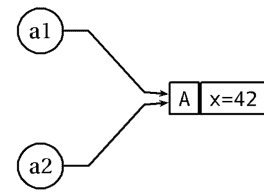

**图 6.1：** 语句 `auto a2 = a1;` 仅为同一个底层对象增加了一个额外的名称。

这种行为与所有类对象都是实体的观点是一致的，这意味着它们具有“个性”，不应该在没有理由的情况下被复制。相比之下，值对象（例如内置数字）具有完全拷贝的特性：要定义新的值类型，使用 `struct`（第 7 章）是可行的方法。

在类对象的世界，既有对象，也有指向这些对象的引用。连接引用和对象的箭头被称为“绑定”（bindings）——例如，我们说 `a1` 和 `a2` 绑定到同一个对象上，或者具有相同的绑定。你操作一个对象的唯一方法是使用指向它的引用。对于对象本身而言，一旦你创建了它，它将永远留在同一个位置。如果你对某个对象感到无聊了，可以将你的引用绑定到另一个对象上。例如，考虑你想交换两个引用：

```
unittest {
    auto a1 = new A;
    auto a2 = new A;
    a1.x = 100;
    a2.x = 200;
    // 让我们交换 a1 和 a2
    auto t = a1;
    a1 = a2;
    a2 = t;
    assert(a1.x == 200);
    assert(a2.x == 100);
}
```

与其使用最后三行，我们可以利用 `std.algorithm` 模块中的通用交换函数 `swap(a1, a2)`，但显式地重写会让发生的过程更加清晰。图 6.2 展示了交换前后的绑定情况。

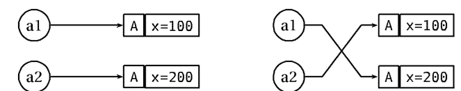

图 6.2：交换两个引用前后的绑定。交换改变了引用到对象的连接方式；对象本身留在原处。

至于对象本身，它们在内存中的位置在创建后永远不会改变。同样的是，对象永远不会消失——一旦它被创建，你就可以认为它会在那里。（对象后台内存中的垃圾回收器会处理不再使用的对象）。通过重新绑定，可以使对象的引用（在 `a1` 和 `a2` 中）“看向”别处。当运行时系统发现一个对象不再有引用绑定到它时，它可以回收该对象的内存，这种活动被称为垃圾回收。这种行为与值语义（例如 `int`）有本质区别，在值语义中没有间接性也没有重新绑定——每个名称都直接固定在它操作的值上。

未绑定到任何对象的引用是空引用（null reference）。在使用 `.init` 进行默认初始化时，类引用是空引用。引用可以与 `null` 比较并从 `null` 赋值。以下断言将通过：

```
unittest {
    A a;
    assert(a is null);
    a = new A;
    assert(a !is null);
    a = null;
    assert(a is null);
    a = A.init;
    assert(a is null);
}
```

访问未绑定（空）引用的成员会导致终止应用程序的硬件故障（或在某些系统和特定条件下，会启动调试器）。如果你尝试访问引用的非静态成员，且编译器能够静态地证明该引用一定为 `null`，那么它将拒绝编译该代码。

```
A a;
a.x = 5; // 错误！a 是 null！
```

```
class A { int x; }
A a;
assert(!std::traits(compiles, a.x = 5));
```

为了不让你过于恼火，编译器是保守的——如果一个引用可能为 `null` 但不是总是如此，编译器会允许代码通过，并将任何错误推迟到运行时。例如：

```
A a;
if (<condition>) {
    a = new A;
}
...
```

```
if (<condition>) {
    a.x = 43; // 正常
}
```

即使 `<condition>` 在两次求值之间可能变化，编译器也允许此类代码通过。在通常情况下，验证正确的对象初始化是非常困难的，因此编译器假设你知道自己在做什么，除非在它可以保证的简单情况例外。

## 6.3 引用语义（面向对象的风格）

D 处理类对象的方式与许多面向对象的语言相似。使用引用语义处理类对象既有积极影响也有负面影响，包括：

- 多态。引用带来了多态支持。
- 安全。垃圾回收简化了内存管理的压力。
- 分配成本。通常类对象必须驻留在堆中，这更慢且消耗更多内存。
- 远程耦合。使用引用的主要风险是别名（aliasing）。有趣的是，如果对象是不可变的，该属性就会消失。

对比引用语义和值语义。值语义具有优势，特别是等式推理：你总可以在表达式中替换等值而不改变结果（相比之下，使用引用的调用不支持这样做）。速度是值语义的一个重要优势，但如果你需要动态多态，引用语义是必须的。某些语言试图兼顾两者，这让它们获得了“不纯”的美誉，相对于支持引用语义的纯面向对象语言。你可以在设计时决定是否对特定类型使用 OOP，如果是，则使用 `class`；否则使用 `struct` 并放弃引用语义带来的特定特性。

## 6.3 对象的生命

现在我们有了对象位置的大致概念，让我们详细查看它们的生命周期。要创建对象，使用 `new` 表达式：

```
import std.math;
class Test {
    double a = 0.4;
    double b;
}
unittest {
    // 使用 new 表达式创建对象
    auto t = new Test;
    assert(t.a == 0.4 && isnan(t.b));
}
```

发布 `New` 会构造一个默认初始化的 `Test` 对象，即每个字段都初始化为默认值的 `Test`。每个类型都有一个静态已默认值，可以通过 `T::init` 访问（见表 2.1）。如果你想将某些成员变量初始化为类型 `.init` 以外的值，可以在定义成员时指定静态已知初始化器，如上述示例中 `a` 所示。上面的 `unittest` 通过了是因为 `a` 被显式初始化为 `0.4`，而 `b` 被留空，因此被隐式初始化为 `double.init`，即“非数字”（NaN）。

### 6.3.1 构造函数

当然，大多数时候用静态已知值初始化字段是不够的。为了创建对象时执行代码，你可以使用特殊函数被称为构造函数。构造函数是一个名称为 `this` 的函数，不声明返回类型：

```
class Test {
    double a = 0.4;
    int b;
    this(int b) {
        this.b = b;
    }
}
```

```
unittest {
    auto t = new Test(5);
}
```

一旦类定义了至少一个构造函数，隐式的默认构造函数就不再可用了。对于上述定义的 `Test` 类，尝试

```
auto t = new Test;
```

将不再起。这种限制是为了帮助避免常见的错误：设计者仔细地定义了多个带参数的构造函数，却完全忘记了默认构造函数。在 D 语言中情况下，这种对健忘者的保护很容易被规避，只需告诉编译器，是的，你确实记得了：

```
class Test {
    double a = 0.4;
    int b;
    this(int b) {
        this.b = b;
    }
    this() {} // 默认构造函数，
        // 所有字段被隐式初始化
}
```

在方法内部——静态方法除外；见第 196 页 § 6.5——引用 `this` 被隐式绑定到接收调的对象。该引用有时是有用的，上面的示例说明了构造函数中常见的命名约定：如果需要一个参数来初始化成员，给它起相同的名称，并通过在参数名前加上对 `this` 的显式引用将成员与参数区分开来。如果没有 `this` 前缀，参数会隐藏同名成员。

尽管你可以修改任何字段的 `this.field`，但你永远无法重新绑定 `this` 本身，它实际上上表现为右值：

```
class NoGo {
```

## 6.3. 对象的生命

```
void fun() {
    // 尝试将 this 绑定到不同的对象
    this = new NoGo; // Error！无法修改 'this'
}
```

通常的函数重载规则（见第 142 页 § 5.5）适用于构造函数：类可以定义任意数量的构造函数，只要它们具有不同的签名（参数数量不同或至少一个参数的类型不同）。

### 6.3.2 委托构造函数

考虑一个定义了两个构造函数的 `Widget` 类：

```
class Widget {
    this(uint height) {
        this.width = 1;
        this.height = height;
    }
    this(uint width, uint height) {
        this.width = width;
        this.height = height;
    }
    uint width, height;
}...
```

上面的代码相当重复，对于较大的类来说只会更糟，但幸运的是一个构造函数可以委托给另一个：

```
class Widget {
    this(uint height) {
        this(1, height); // 委托给另一个构造函数
    }
    this(uint width, uint height) {
        this.width = width;
        this.height = height;
    }
    uint width, height;
}...
```

在显式调用构造函数 `this(l, h)` 时某些限制。首先，你只能从另一个构造函数中发出此类调用。其次，如果你决定进行这样的调用，你必须说服编译器你在整个构造函数过程中恰好执行了一次调用，无论如何。例如，这个构造函数是无效的：

```
this(uint h) {
  if (h > 1) {
    this(1, h);
  }
  // Error！有一条路径跳过了构造函数
}
```

在上述情况下，编译器发现存在未调用另一个构造函数的情况，并将该情况标记为错误。意图是让构造函数要么执行构造本身，要么将任务委托给另一个构造函数。构造函数可能或可能选择委托给另一个构造函数的情况是被拒绝的。调用同一个构造函数两次是不正确的，因为：

```
this(uint h) {
  if (h > 1) {
    this(1, h);
  }
  this(0, h);
}
```

你既想要一个双重初始化的对象也不想要一个忘记初始化的对象，因此这种情况也被标记为编译时错误。简而言之，构造函数调用另一个构造函数零次或恰好一次。这一主张在编译期间通过简单的流分析进行验证。

### 6.3.3 构造序列

在所有语言中，对象的构造都有些复杂。构造过程从一块无类型内存开始，并在其中存入信息，使得这块内存看起来感觉像一个类对象。总是需要某种魔法。

在 D 语言中，对象构造遵循以下步骤：

- 1. 分配。运行时在堆上分配一块足够存储对象非静态字段的原始内存。所有基于对象都是动态分配的——与 C++ 不同，无法在栈上分配类对象。如果分配失败，将通过抛出异常放弃构造。
- 2. **字段初始化**。每个字段都被初始化为其默认值。如上所述，默认字段值是字段声明中通过 `= value` 指定的如果没有，则是字段类型的 `.init` 值。
- 3. **标记 (Branding)**。在默认字段初始化完成后，对象被标记为一个完整的 T，**甚至在实际构造函数被调用之前**。标记取决于实现，通常包括：
- 4. **构造函数**。最后，编译器发出对构造函数的调用。如果类没有定义构造函数，则该步骤被跳过。

大多数情况下，类会很好地封装资源，因此很少需要定义析构函数。对于某些类，在终止过程中拥有一个钩子是非常重要的，以便它们释放可能获取的额外资源。

```
import core.std::stdlib;
class Buffer {
    private void* data;
    // 构造函数
    this() {
        data = malloc(1024);
    }
    // 析构函数
    ~this() {
        free(data);
    }
}...}
```

```
this() {
    // 保留 usedAlpha = 0 并让 alpha 未初始化
}
...
```

初始 `usedAlpha` 为零，这是 `Transmogrifier` 需要的全部初始化。随着 `usedAlpha` 增长，代码在写入元素之前绝不能读取 `alpha[usedAlpha..]` 区间内的元素。当然，这需要你（而不是编译器）来确保——这说明了效率和静态可验证性之间存在不可避免的张力。虽然这种优化通常是琐碎的，但在某些情况下，不强制初始化可能会影响结果，因此有一个可选的出口是令人安心的。

# 6.3. 对象的生命

### 6.3.5 拆解序列

与构造一样，拆解一个对象也遵循一个小协议：

- 1. 在标记（构造过程中的第 3 步）之后，对象被认为是存活的，并进入垃圾回收器的监控范围。请注意，即使用户定义的构造函数随后抛出异常，这种情况也会发生。由于默认初始化和标记不会失败，因此对于垃圾回收器来说，一个被成功完全分配的对象被视为一个完整的对象。
- 2. 对象在整个程序中被使用。
- 3. 所有指向对象的可用引用都消失了；没有代码可以再次访问该对象。
- 4. 在某个取决于实现的点，系统确认对象的内存可以被回收并调用其析构函数。
- 5. 在之后的某个时间点（在调用析构函数之后或更晚），系统将重用对象的内存。

关于最后两步的一个细节是，垃圾回收器确保对象的析构函数永远不会访问已经释放的对象。除非未释放，否则访问已经销毁的对象是可能的；在 D语言中，被销毁的对象会保留其内存一会，直到它们的同类对象被销毁。如果不是这样，那么销毁和释放在循环中相互引用的对象（例如循环列表）将无法实现安全性。

上述描述的循环可以通过几种方式进行修正。首先，应用程序极有可能在到达第 4 步之前就结束了。这对于运行在内存足够系统上的小型应用程序来说很常见。在这种情况下，D 假设退出应用程序将实际上释放与其相关的所有资源，因此它不会调用任何析构函数。

管理对象生命周期的另一种方法是显式调用其析构函数。这通过调用在 `object` 模块定义的 `clear` 函数来实现（该模块是任何编译中都会自动导入的标准库模块）。

```
unittest {
  auto b = new Buffer;
  ...
  clear(b); // 移除 b 的额外状态
  // b 在这里仍然可用
}
```

通过调用 `clear(b)`，用户表达了显式调用 b 的析构函数（如果有的话）、通过 `Buffer.init` 抹除对象状态并调用 `Buffer` 默认构造函数的意图。然而，与 C++ 不同，`clear` 不释放对象自身的内存，且没有 `delete` 运算符。（它曾经有一个 `delete` 运算符，但已被废弃。）如果你真的、真的知道自己在做什么，你仍然可以通过调用位于 `core.memory` 中的 `GC.free()` 函数来手动释放内存。释放内存是不安全的，但调用 `clear` 是安全的，因为没有内存消失，没有悬空指针的风险。在 `clear(obj)` 之后，对象对于任何目的仍然完全可访问且可用，尽管它不再包含任何有趣的状态。例如，以下是正确的 D 语言代码：

```
unittest
auto b = new Buffer;
auto bl = b; // b 的额外别名
clear(b);
assert(bl.data is null); // 额外的别名仍然指向
                    // b 的（有效）底座
```

所以当你调用 `clear` 后，对象仍然存在，但它的析构函数已经被调用，并且对象现在处于其默认构造的状态。有趣的是，在下一次垃圾回收期间，对象的析构函数会被再次调用。这是因为显然，垃圾回收器并不知道你把它留在了什么状态。

为什么会有这种行为？答案很简单——通过对手动控制对象可能控制的昂贵资源（如文件、套接字、互斥锁和系统句柄）将对象的拆解与内存释放分离，同时确保内存安全。通过使用 `new` 和 `clear` 你永远不会创建悬空指针。当然，如果你使用 C 的 `malloc` 和 `free` 或上述的 `GC.free`，就会让自己处于悬空指针的危险之中。通常，将资源处置（安全）与内存回收（不安全）分开是明智的。内存从根本上不同于任何其他资源，因为它是类型的物理支撑。无意中释放内存可能会破坏类型系统可能提供的任何保证。

### 6.3.6 静态构造函数和析构函数

在类内部以及 D 的任何地方，静态数据必须始终用编译时常量初始化。为了允许在线程启动期间有序地执行代码，编译器允许定义特殊函数 `this()`。包括模块级和类级初始化的代码被收集在一起，运行时支持库以有序的方式提供静态初始化。

在类内部，你可以定义一个或多个以 `static` 为前缀的默认构造函数：

```
class A {
    static A a1;
    static this() {
        a1 = new A;
    }
    ...


此类函数被称为静态类构造函数。在加载应用并在执行 `main` 之前，编译器会按照在源代码中出现的顺序逐执行每个静态类构造函数。在上面的示例中，所有内容将在 `a2` 之前初始化。同一模块内不同类中静态类构造函数的执行顺序再次由词法顺序决定。不相关模块中的静态类构造函数按未指定的顺序执行。最后，也是最有趣的，位于相互依赖模块中的类的静态类构造函数经过了排序，以消除类在 `fact static this()` 运行之前就被使用的可能性。初始化顺序是如何工作运行的。考虑定义在模块 `MA` 中的类 `A` 和定义在模块 `MB` 中的类 `B`。可能会发生以下情况：

- `A` 或 `B` 其中之一定义了静态类构造函数。那么就不需要担心顺序。
- `MA` 和 `B` 都没有导入对方。顺序是未指定的——任何顺序都行。
- `MA` 导入 `MB`。`MA` 的静态构造函数在 `B` 之前运行。
- `MB` 导入 `MA`。`MB` 的静态构造函数在 `A` 之前运行。
- `MA` 导入 `MB` 且 `MB` 导入 `MA`。在加载期间信号了“循环依赖”错误。

这种推理取决于类 `A` 和 `B` 的模块关系。第 11 章详细讨论了这个问题。任何静态构造函数失败抛出异常，程序将终止。如果全部成功，类将在线程关闭时通过定义静态析构函数进行清理，其预测的形式如下：

```
class A {
    static A a1;
    static ~this() {
        clear(a1);
    }
    ...
    static A a2;
    static ~this() {
        clear(a2);
    }
}
```

静态析构函数在线程关闭时运行。每个模块内部，它们按照定义的反序运行。在示例中，`a2` 的析构函数将在 `a1` 之前调用。当涉及多个模块时，模块调用静态析构函数的顺序与它们获得调用静态构造函数的顺序完全相反。倒龟规则。

## 6.4 方法与继承

我们现在是创建和消除对象的专家了，让我们来看看它们。与对象的大部分交互通过其方法进行。。（在某些语言中，这种交互被称为向对象“发送消息”。）方法的定义看起来和普通函数定义非常相似，区别在于它发生在类内部。为了专注于示例的描述，你构建了一个 Rolodex 应用，它允许你存储和显示联系信息。信息的单元——一个虚拟名片——可以是 `Contact` 类。除此之外，它可能定义一个方法指定显示联系人时使用的背景颜色：

```
class Contact {
    string bgColor() {
        return "Gray";
    }
}
```

```
ittest {
    auto c = new Contact();
    assert(c.bgColor() == "Gray");
}
```

当你决定一个类继承另一个类时，有趣的部分开始了。例如，某些联系人是朋友，对于他们我们使用不同的背景颜色：

```
class Friend : Contact {
    string currentBgColor = "LightGreen"
    string currentReminder;
    override string bgColor() {
        return currentBgColor;
    }
    string reminder() {
        ......
```

## 6.4. 方法与继承

```cpp
return currentReminder;
}
```

通过符号 `: Contact` 声明自 `Contact`，`Friend` 类的实例将包含 `Contact` 的所有内容，加上 `Friend` 额外的状态（在此例中为 `currentBgColor`）和方法（在此例中为 `reminder`）。

我们将 `Friend` 称为 `Contact` 的子类，将 `Contact` 称为 `Friend` 的超类。由于继承，你可以在需要 `Contact` 值的地方替换 `Friend`：

```unittest
Friend f = new Friend;
Contact c = f; // 用 Friend 替换 Contact
auto color = c.bgColor(); // 调用 Contact 方法
```

如果被替换的 `Friend` 行为与 `Contact` 完全相同，那么几乎没有使用 `Friend` 的动力。对象技术的核心特性之一是允许派生类重写基类中的函数，从而以模块化的方式自定义行为。意所当然，重写通过 `override` 关键字（在 `Friend` 对 `bgColor` 的定义中）引入，这表明对于一个实际上被替换为 `Friend` 类型对象的 `Contact` 类型对象，调用 `c.bgColor()` 将始终调用 `Friend` 版本的方法。即使编译器认为它们是简单的 `Contact`，它们也始终是 `Friend`。

### 6.4.1 术语大杂

对象技术在学术界和工业界都有长期且成功的历史。因此，它是许多工作的重点，并产生了大量的术语，这些术语有时会让人困惑。让我们停下来回顾一下这些命名法。

如果类 `D` 继承类 `B`，则 `D` 被称为 `B` 的子类、`B` 的孩子或派自 `B` 的类。相反，`B` 被称为 `D` 的超类、父类或基类。

类 `X` 是 `B` 的后代，当且仅当 `X` 是 `B` 的孩子，或者 `X` 是 `B` 的孩子的后代。这个定义是递归的，这意味着如果你沿着 `X` 的父类、父类的父类以此类向上走，在某一点你会遇到 `B`。

本书贯使用了父/子类以及祖先/后代的概念，因为这些短语比超类/子类术语更精确地区分了直接与可能的间接继承的方向。

在期望类型 `T` 值的地方。注意，这个定义并不要求或提到继承。事实上，继承是实现子类型化的的一种方式，这里是通其他方法（以及 D 语言中）。子类型化与继承之间的关系是：类 `C` 的后代本身都是 `C` 的子类型。一个与 `C` 不同的子类型被称为真子类型。

### 6.4.2 继承就是子类型化。静态与动态类型

让我们例说明继承如何导致子类型化。如前提到的，派生类对象总是可以替换基类对象：

```cpp
class Contact { ... }
class Friend : Contact { ... }
void fun(Contact c) { ... }
```

```unittest
  auto c = new Contact; // Contact 类型
  fun(c);
  auto f = new Friend; // Friend 类型
  fun(f);
```

如果被替换的 `Friend` 行为与 `Contact` 完全相同，那么几乎没有使用 `Friend` 的动力。对象技术的核心特性之一是允许派生类重写基类中的函数，从而以模块化的方式自定义行为。意所当然，重写通过 `override` 关键字（在 `Friend` 对 `bgColor` 的定义中）引入，这表明对于一个实际上被替换为 `Friend` 类型对象的 `Contact` 类型对象，调用 `c.bgColor()` 将始终调用 `Friend` 版本的方法。即使编译器认为它们是简单的 `Contact`，它们也始终是 `Friend`。

### 6.4.3 重写是自愿的

因此，要求 `override` 允许你修改基类而不对派生类造成意外的损害。

### 6.4.4 调用重写的方法

有时，重写的方法想要调用它正在重写的那个方法。考虑一个继承自 `Clickable` 类的图形组件 `Button`。`Clickable` 类知道如何将点击分发给监听器，但完全不视觉效果。为了引入视觉反馈，`Button` 重写了 `Clickable` 的 `onClick` 方法并引入了视觉效果，但也想调用 `Clickable.onClick` 来执行分发。

```cpp
class Clickable {
  void onClick() { ... }
}
class Button : Clickable {
  void drawClicked() { ... }
  override void onClick() {
    drawClicked(); // 引入图形效果
    super.onClick(); // 将点击分发给监听器
  }
}
```

要调用重写的方法，使用预定义的别名 `super`，它指示编译器按照方法在父类中的定义进行访问。你可以调用任何方法，而不是当前正在重写的方法（例如，你可以在 `Button.onClick` 中发出 `super.doubleClick()`）。坦诚地说，该符号甚至不必是方法名；它也可以是字段名，或者可以是任何符号。例如：

```cpp
class Base {
  double number = 5.5;
}
class Derived : Base {
  int number = 10;
  double fun() {
    return number + super.number;
  }
}
```

在上面的示例中，编写 `Base.number` 完全等同于编写 `super.number`。
明显的区别是 `super` 使得代码更具可维护性：如果你更改了类的基类，就不需要搜索并替换名称。

通过显式的类名，你可以跳转到多个继承层级。显式地使用 `super` 或类名来限定方法名也更快，因为编译器确切地知道要派发到哪个函数。如果该符号不是任何可重写的方法，那么显式限定只会影响可见性，而不会影响速度。

尽管析构函数（第 186 页 6.3.4）仅仅是方法，但析构函数的调用方式有些不同。在这种情况下，会调用 `super` 的析构函数，但在调用析构函数（无论是在垃圾回收周期中还是响应 `clear( obj )` 请求时），D 的运行时支持始终会按照层级结构向上调用所有的析构函数。

### 6.4.5 协变返回类型

继续关于 `Widget`、`TextWidget` 和 `VisibleTextWidget` 的示例，假设你想添加代码来复制一个 `Widget`。在这种情况下，如果被复制的对象是 `Widget`，那么副本也将是 `Widget`；如果它是 `TextWidget`，那么副本也将是 `TextWidget`；以此此类推。实现正确复制的方法是在基类中定义一个方法，并要求每个派生类都实现它。

```
class Widget {
    this(Widget source) {
        ... // 复制状态
    }
    Widget duplicate() {
        return new Widget(this); // 分配内存
        // 并调用 this(Widget)
    }
}
```

到目前为止一切良好。让我们看看 `TextWidget` 类中对应的重写版本：

```
class TextWidget : Widget {
    this(TextWidget source) {
        super(source);
        ... // 复制状态
    }
    override Widget duplicate() {
        return new TextWidget(this);
    }
}
```

一切都是正确的，但存在一个明显的静态信息丢失：`TextWidget.duplicate` 返回的是一个 `Widget` 对象，而不是 `TextWidget` 对象。但是当我们查看该函数内部时，`TextWidget.duplicate` 的结果类型是 `TextWidget`。然而，一旦 `TextWidget.duplicate` 返回，该信息就丢失了，因为 `TextWidget.duplicate` 的返回类型是 `Widget`——与 `Widget.duplicate` 的返回类型相同。因此，以下代码无法运行，尽管在完美的世界里应该是可以：

```
void workWith(TextWidget tw) {
    TextWidget clone = tw.duplicate(); // 错误！
    // 不能将 Widget 转换为 TextWidget
}
```

为了最大限度地利用静态类型信息，D 定义了一个特性名为“协变返回类型”的功能。虽然听起来很高级，但返回类型的协变其实非常简单：如果基类型返回某种类型 `C`，则重写函数不仅允许返回 `C`，还可以返回任何派生自 `C` 的类。有了这个特性，你可以声明 `TextWidget.duplicate` 返回 `TextWidget`。同样重要的是，在对话中溜入“协变返回类型”会让你听起来非常酷。（开个玩笑的。请勿尝试。）

## 第 6 章 类。面向对象的风格

## 6.5 使用静态成员进行类级封装

有时，在类内部封装的不仅是字段和方法，而是普通函数和（哈！）全局数据是非常有用的。这些函数和数据除了位于类内部外不应该有任何特殊属性。为了在类的对象之间共享函数和数据，请使用 `static` 关键字引入它们：

```
class Widget {
    static Color defaultColor;
    static Color combineBackgrounds(Widget bottom, Widget top) {
        ...
    }
}
```

在静态方法内部，没有 `this` 引用。这是因为再次，静态方法是作用域在类内的普通函数。逻辑上可以推出，你不需要对象来访问 `defaultColor` 或调用 `combineBackgrounds`——你只需要用类名作为前缀即可：

## 6.6 使用 final 方法限制扩展性

```
unittest {
    auto w1 = new Widget, w2 = new Widget;
    auto c = Widget.defaultBgColor;
    // 这种写法也可以：w1.defaultBgColor;
    c = Widget.combineBackgrounds(w1, w2);
    // 这种写法也可以：w2.combineBackgrounds(w1, w2);
}
```

如果你在访问静态成员时使用类的实例，那也是可以的。注意，尽管实际上并不需要，对象的值仍然会被计算。

```
// 创建一个 Widget 并将其丢弃
auto c = (new Widget).defaultBgColor;
```

有时，你可能主动阻止子类重写某个特定方法。这种情况很常见，因为方法并不总是设计为定制点。此类方法可能会调用可定制的方法，但在某些情况下，你希望保持控制流不变。（想起了模板方法设计模式 [271]。）为了防止继承类重写方法，请在方法的定义前加上 `final`。

例如，考虑一个股票报价器，它想要确保在股票价格变化时更新屏幕上的信息：

```
class StockTicker {
    final void updatePrice(double last) {
        doUpdatePrice(last);
        refreshDisplay();
    }
    void updatePrice(double last) { ... }
    void refreshDisplay() { ... }
}
```

`updatePrice` 和 `refreshDisplay` 方法是可以重写的，因此它们是对于 `StockTicker` 子类的定制点。例如，某些股票报价器可能会在某些变化时触发警报。事实上，为了严谨起见，让我们按如下方式定义 `updatePrice`：

```
final void updatePrice(double last) {
    scope(exit) refreshDisplay();
    doUpdatePrice(last);
}
```

`final` 方法带有一种好处，这种好处几乎几乎是危险的，因为它很容易引导你走向过早优化的深渊。事实是，final 方法可能更具效率。这是因为非 final 方法在每次调用时都要经过一个间接步骤，这个步骤是为了确保重写带来的灵活性。对于某些 final 方法，这种间接步骤仍然必要的，当通过基类对象调用时仍会产生间接调用；通常情况下编译器不知道调用将去哪里。如果 final 方法也是一个引入的方法（而不是基类方法的重写），那么每当你调用它时，编译器 100% 确定调用将落在哪里。看起来 final 重写方法比其他方法快得多，这种差距被两个因素缩小了。

首先，基准调用开销是相对于一个什么都不做的函数进行评估的。
其次，各种编译器、链接器和运行时优化技术都会积极地减少或消除派发开销。由于 final 重写方法永远不会受到间接调用；相反，它们享有与普通函数相同的调用约定、低开销和内联机会。你最好从灵活性开始并进行优化，而不是从第一天起就为了潜在的性能问题而让你的设计僵化（变得瘫痪）。

如果你用过 Java 和 C#，`final` 立即就能被识别出来，因为它在这些语言中具有相同的语义。如果你对比 C++ 的状况，你会发现一个有趣的默认值变化：在 C++ 中，如果你不使用任何注解，方法默认是 final 的；只有当你显式使用 `virtual` 标记它们时，它们才是 final。再次，至少在这种情况下，人们认为默认在灵活性这一侧是更好的。你可能主要为了支持设计决策而使用 `final`，而极少为了节省一些额外的周期。

### 6.6.1 final 类

有时，你希望一个类是某个主题的最终定论。你可以通过将整个类标记为 `final` 来实现这一点：

```
class Widget { ... }
final class UltimateWidget : Widget { ... } // 错误！
```


`class PostUltimateWidget : Widget { ... }` // 错误！

// 不能继承自 `final` 类

`final` 类不能被继承——它是继承层次结构中的叶子节点。这有时是一个重要的设计手段。显然，`final` 类的所有方法都是隐式为 `final` 的，因为无法进行任何重写。

`final` 类的一个有趣的次要影响是强力的实现保证。使用 `final` 客户端可以确定，该类的方法具有已知的实现，其效果是保证性的，不会被子类修改。

## 6.7 封装

面向对象设计（以及所有其他设计技术）的标志之一是封装。对象封装它们的实现细节，并只暴露定义良好的接口。这样，对象就保留了更改大量实现细节而不影响客户端的自由。这导致了更な解耦和更少的依赖，证实了每种设计技术归根结底都是为了依赖管理的优势。

反过来，封装是信息隐藏的体现，这是软件设计中的一种通用哲学。信息隐藏规定应用程序中的各种元素应该专注于定义和使用抽象接口来相互通信，同时隐藏它们如何实现接口的细节。通常，这些细节与数据布局有关，这就是为什么“数据隐藏”是一个被广为人知的概念。然而，仅关注数据隐藏会遗漏要点，因为组件可能包含各种信息，例如设计决策或算法策略。

在今天，封装听起来非常有吸引力，甚至可能是显而易见的，但这很大程度上是集体经验累积的结果。在过去，事情并不那么明确。毕竟，信息显然是件好事，既然拥有的信息越多就越从容，你为什么要隐藏它呢？

回到 20 世纪 60 代，弗雷德·布鲁克斯（《人人人神谭》的作者）是透明化、白盒、“每个人都了解一切”软件设计方法的倡导者。在他的管理下，构建 `OS/360` 操作系统的团队通过一种复杂的纸质版注释方法 [13, 第 7 章]定期接收项目所有设计细节的文档。该项目取得了成功的成果，但要认为透明度是积极的贡献可能是站不住脚的；更合理的说法是，它是通过强化管理被最小化的风险。大卫·L·帕纳斯的一篇具有革命性的论文 [44] 才在社区传说中永久地确立了信息隐藏的概念。布鲁克斯本人在 1995 年评论说，倡导透明度是《人人人神谭》中唯一没有经住时间考验的元素。但信息隐藏概念在 1972 年就已经概念化了，帕纳斯那篇革命性论文的一位评审者的这段评论就证明了这一点：“显然，帕纳斯不知道自己在说什么，因为没有人那样做。”

回到 D 语言所实现的封装，你可以在任何类型、数据、函数的声明前加上五个访问修饰符之一。让我们从限制性最强的修饰符开始，向广为人知的修饰符移动。

### 6.7.1 private

`private` 标签可以在类级、所有类之外（模块级）或结构体（`struct`）内部（第 7 章）指定。在所有语文中，`private` 都具有这种力量：它限制了对当前模块（文件）的访问。

这种行为与其他语言不同，其他语言仅将私有符号的访问限制在类中；然而，模块级限制符合 D 对保护的通用方法——保护单元与操作系统的保护单元（文件和目录）相同。文件级保护的优势在于它便于将具有特定职责的紧密耦合的小实体收集。如果需要类级保护，只需将该类放在它自己的文件中。

### 6.7.2 package

`package` 标签可以在类级、所有类之外（模块级）或结构体（`struct`）内部（第 7 章）指定。在所有语文中，`package` 都引入了目录级保护：与当前模块在同一目录下的所有文件都可以访问该符号。子目录或当前模块目录的父目录没有特殊权限。

### 6.7.3 protected

`protected` 访问修饰符仅在类内部才有意义，而在模块级没有。当在某些类 `C` 内部使用时，`protected` 访问修饰符意味着对声明符号的访问解析为定义 `C` 的模块，以及 `C` 的后代，无论它们位于哪个模块中。例如：

```
class C {

    // x 仅在此文件内可访问
    private int x;
    // 此文件加上直接或间接继承 C 的所有类
    // 可以调用 setX()
    protected void setX(int x) { this.x = x; }
    // 所有人都可以 getX()
    public int getX() { return x; }
}
```

再次，`protected` 授予了传递性——它不仅授予直接子类，还授予所有最终继承自使用 `protected` 类的后代。这使得 `protected` 在赋予权限方面变得非常慷慨。

### 6.7.4 public

`public` 访问意味着声明的符号可以在应用程序内部自由访问。所有需要做的只是对符号的可见性，通常通过导入定义它的模块来实现。

在 D 中，`public` 也是全范围的默认访问级别。由于声明顺序是不生效的，一种良好的风格是将模块或类的可见接口放在开头，然后使用（例如）`private:` 限制访问，然后继续定义。对于它们，客户端只需要查看文件或类的顶部就可以了解其可访问的实体。

### 6.7.5 export

`public` 似乎是访问级别的最低点，是所有级别中最宽松的。然而，D 定义了一种更宽松的访问：`export`。当对符号使用 `export` 时，该符号甚至可以从其定义的程序外部进行访问。这对于向外界暴露接口的共享库来说是这种情况。编译器执行符号导出的系统相关性需求，通常包括对符号的特殊命名约定。此时，D 还没有定义复杂的动态加载基础设施，因此 `export` 在某种程度上是一个等待更广泛支持的存根（stub）。

### 6.7.6 需要多少封装？

我们应该问自己的一个有趣问题是：这五个访问修饰符之间如何比较？例如，假设我们已经同意信息隐藏是好事，那么推断 `private` 比 `protected` 好是合理的。沿着这一思路下去，我们可能会认为 `protected` 接近 `public`，或者正处于中间。

## 6.8. 一根统天下

对于 `protected`（受保护）符号，你将影响无数量级的代码。雪上加霜的是，你不仅无法限制谁可以继承你的类，还可能破坏你自己无权修复的代码（例如，修改一个会影响到其他地方的库符号）。现实是残酷且な：一旦你离开了 `private`（私有）和 `package`（包）范围，你就进入了荒野。使用 `protected` 几乎提供不了保护。

修改 `protected` 符号时，你需要检查多少代码？将是定义符号的类的所有后代代码。一个合理的估值是比包的大小高出一个数量级，或者说几十万行。索引源代码并跟踪“类”后代的工具可以在这里帮助你，但归根结底，对 `protected` 符号的更改可能会影响大量的代码。

使用 `public`（公共）在控制方面没有太大变化，但它确实让受影响的大部分代码量增加了一个数量级。这不仅仅是“类”的后代，而是整个应用程序的代码。最后，`export`（导出）为这种情况增加了一个变数——对于所有使用你的代码作为二进制库的二进制应用程序，你看到的不仅是你无法修改的代码，更是你无法查看的代码，因为它们可能没有以源码的形式提供。

下一页的图 6.3 通过绘制每个访问修饰符可能影响的代码行，说明了这些大致估值。当然，这些数量是低估的可能会剧烈波动，但大致比例不会受到太大影响。纵轴使用对数刻度，阶梯暗示了线性趋势，因此每当你使用一点访问保护，就必须多付出十倍努力来保持同步。向上的箭头表示对受影响代码控制权的丢失。一个结论是，`protected` 正好处于 `private` 和 `public` 之间——它更像 `public`，所以你应该那样对待它（也就是说，带着一种古老的恐惧去对待）。

## 6.8 一根统天下

某些语言为所有类定义了一个根类，D 也是之一。一切的根源被称为 `Object`。如果你定义这样一个类：

```d
class C {
  ...
}
```

对编译器来说，情况与你写出的完全一致：

```d
class C : Object {
  ...
}
```

### 需要检查的行

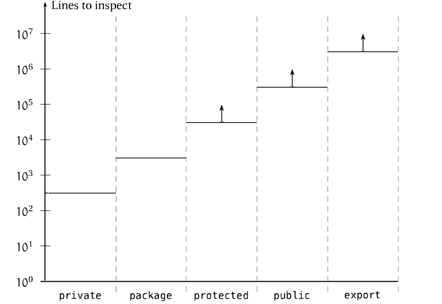

**图 6.3：** 每个保护级别修改符号可能影响的代码行的大致估值。纵轴使用对数刻度，因此封装的每一次放松使情况恶化一个数量级。向上的箭头表示 `protected`、`public` 和 `export` 影响的代码量不受维护符号的编码者的控制。

除了上述自动重写外，`Object` 并不特殊——它就是一个和其他类一样的类。你的实现在名为 `object.di` 的模块中定义它，或者在你编译的每个模块中自动导入它。你可以通过浏览 D 实现所在的目录，轻松地找到并检查该模块。

为所有类拥有一个根有几个优点。一个显而易见的好处是 `Object` 可以引入几个通用的方法。以下是 `Object` 类的略简定义：

```d
class Object {
  string toString();
  size_t toHash();
  bool opEquals(Object rhs);
  int opCmp(Object rhs);
  static Object factory(string className);
}
```

让我们仔细观察这些每个符号的语义。

### 6.8.1 string toString()

它返回对象的文本表示。默认情况下，它返回类名：

```d
// File test.d
class Widget {
  unittest {
    assert(new Widget).toString() == "test.Widget";
  }
}
```

注意，类名与定义类的模块名一起出现。默认情况下，模块与文件名相同，该默认可以通过模块声明（见第 348 页 § 11.1.8）更改。

### 6.8.2 size_t toHash()

它将对象的哈希作为无符号整数返回（32 位机器上为 32 位，64 位机器上为 64 位）。默认情况下，哈希使用对象的位表示进行计算。哈希值是对象的一个简洁但不准确的摘要。一个重要的要求是*一致性*：如果在对象状态未发生中间变化的情况下对同一个引用调用两次 `toHash`，它应该返回相同的值。此外，两个相等对象的哈希值必须相等，而两个不同（不相等）对象的哈希值极不可能相等。下一节将讨论如何定义对象相等性。

### 6.8.3 bool opEquals(Object rhs)

如果认为 `rhs` 等于它，则返回 `true`。这种奇特的表述是有有之意的。对 Java 类似函数的经验表明，在存在继承的情况下定义相等性存在一些问题，D 以一种相对复杂的方式来处理这个问题。

首先，对象本身并不存在相等性概念；当你通过表达式 `a1 is a2`（见第 48 页 § 2.3.4）比较两个对象引用 `a1` 和 `a2` 时，只有当 `a1` 和 `a2` 指向同一个对象时才会返回 `true`，如第 177 页的图 6.1 所示。这种相等概念是合理的，但由于限制而不可用。通常，如果两个实际上不同的对象持有相同的状态，应该被认为是相等的。在 D 中，逻辑相等性使用 `==` 和 `!=` 运算符评估。以下是它们的工作方式。

## 第 6 章 类。面向对象的风格

假设你为表达式 `lhs` 和 `rhs` 编写了 `lhs = rhs`。那么，如果 `lhs` 或 `rhs` 中至少有一个自定义类型，编译器会将比较重写为 `object.equals(lhs, rhs)`。同样，`lhs != rhs` 被重写为 `object.equals(lhs, rhs)`。回想本节前面的内容，`object` 是由你的 D 实现定义的内核模块，并在构建的任何模块中隐式导入。比较被重写为对你的实现提供的、位于 `object` 模块中的自由函数的调用。

对象之间的相等关系预期遵守某些不变性，而 `object.equals(lhs, rhs)` 在很大程度上保证了正确性。首先，空引用必须相等。然后，对于任何三个空引用 `x`、`y` 和 `z`，必须满足以下言：

- 反映性：$x == x$
- 对称性：$x == y \implies y == x$
- 传递性：$x == y \land y == z \implies x == z$
- 一致性：如果在对象状态未发生中间变化的情况下对同一个引用调用两次 `toHash`，它应该返回相同的值。此外，两个相等对象的哈希值必须相等，而两个不同（不相等）对象的哈希值极不可能相等。

`object.equals` 的典型实现可能如下：

```d
// Inside object.d
bool equals(Object lhs, Object rhs) {
  // 如果是同一个对象或都为空
  if (lhs is rhs) return true;
  // 如果其中一个为空
  if (lhs is null || rhs is null) return false;
  // 如果类型完全相同
  if (typeid(lhs) == typeid(rhs)) return lhs.equals(rhs);
  // 一般情况
  return lhs.equals(rhs) && rhs.equals(lhs);
}
```

## 第 6 章。类。面向对象的风格

表达式 `cast (Widget) rhs` 尝试从 rhs 中恢复 Widget。如果 rhs 为空或 rhs 的实际动态类型不是 Widget 或其子类，则表达式返回空。

`TextWidget` 类具有更具判别性的相等概念，因为比较的右侧必须也是 TextWidget 并且具有相同的类型。

```d
// 在类 TextWidget 内部
override bool opEquals(Object rhs) {
  // 另一个必须是 TextWidget
  auto that = cast(TextWidget) rhs;
  if (!that) return false;
  // 比较所有相关状态
  return super.opEquals(that) && text == that.text;
}
```

现在考虑一个叠加在具有相同位置和父窗口的 Widget 之上的 TextWidget。对我们而言，tw 与它是相等的。但从 tw 的视角来看，并没有等价性，因为 w 不是一个 TextWidget。如果我们接受了 `w == tw` 且 `tw != w`，我们就会破坏运算符的反射性。为了恢复反射性，让我们考虑在 `TextWidget.opEquals` 中让 TextWidget 变得不那么：如果与 Widget 的比较不是 TextWidget，则比较就同意遵循 Widget 的相等概念。其实现将如下：

```d
// 替代的 TextWidget.opEquals - 错误的
override bool opEquals(Object rhs) {
  // 另一个至少是一个 Widget
  auto that = cast(Widget) rhs;
  if (!that) return false;
  // 它们作为 Widget 比较吗？如果不是，就结束
  if (!super.opEquals(that)) return false;
  // 它是 TextWidget 吗？
  auto tw2 = cast(TextWidget) rhs;
  // 如果不是，则成功结束
  if (!tw2) return true;
  // 作为 TextWidgets 比较
  return text == that.text;
}
```

遗憾的是，TextWidget 这种通协的尝试是不明智的。问题是现在比较的传递性被破坏了：很容易创建两个不同的（包含不同文本）TextWidget tw1 和 tw2，但它们同时与一个简单的 Widget 对象 w 相等。这将导致 `tw1 == w` 和 `tw2 == w`，但 `tw1 != tw2` 的情况。

## 6.8. 万物之根

因此在一般情况下，比较必须双向进行——比较的每一侧都必须同意相等。好消息是，自由函数 `object.equals(Object, Object)` 在两个涉及的对象具有相同类型时避免了这种“握手”，并且在其他少数情况下的任何调用也是如此。

### 6.8.4 int opcmp (Object rhs)

这实现了三路比较，这在将对象作为关联数组的键时是需要的。如果此小于 rhs，返回一个未指定的负数；如果 rhs 小于此，返回一个未指定的正数；如果认为与 rhs 无序，则返回 0。与 `opeequals` 类似，`opcmp` 很少被调用。大多数时候，你通过 `a=b`、`a<b`、`a>b` 和 `a>=b` 之一隐式地调用它。

重写遵循与全局对象通信的协议。`opcmp` 定义在两个涉及的对象之间进行通信。对于所有的运算符 `<`、`<=` 和 `==`，D 将表达式 `a op b` 重写为 `object.opcmp(a, b)`。例如，`a opcmp(a, b)` 变为 `< 0`。

实现 `opcmp` 是可选的。默认实现 `Object.opcmp` 会抛出异常。如果你实现它，`opcmp` 必须是一个“严格弱序”，即它对非空引用 `x`、`y` 和 `z` 满足以下不变性。

```d
// 1. 反射性
assert(x.opcmp(x) == 0);
// 2. 符号的传递性
if (x.opcmp(y) < 0 && y.opcmp(z) < 0) assert(x.opcmp(z) < 0);
// 3. 与零相等的传递性
if ((x.opcmp(y) == 0 && y.opcmp(z) == 0)) assert(x.opcmp(z) == 0);
```

这些规则看起来可能有点奇怪，因为它们用较弱的三路比较概念来表达公理。如果我们用 `<` 来重写它们，就会得到数学中严格弱序的熟悉属性：

```d
// 1. '<' 的非反射性
assert(!(x < x));
// 2. '<' 的传递性
if (x < y && y < z) assert(x < z);
// 3. '!(x < y) && !(y < x)' 的传递性
```


```
if (!(x < y) && !(y < x) && (!(y < z) && !(z < y)) assert (!(x < z) && !(z < x));
```

第三个条件对于构建严格弱序是必要的。没有它，`<` 被称为偏序。你可能用偏序也能过关，但仅限于受限的用途；大多数有趣的算法都需要严格弱序。如果你想定义偏序，最好放弃所有的语法糖，并定义与 `opcmp` 不同的自定义函数。

## 第 6 章。类。面向对象的风格

注意，上述条件仅关注 `<` 而不是其他排序比较，因为后者仅仅是语法糖（`x > y` 等于 `y < x`，`x <= y` 等于 `!(y > x)`，以此此类推）。

（注：原文文本后半部分存在大量重复的 OCR 错误和乱码，上述翻译已根据核心逻辑进行清理。）

## 6.9 接口 (Interfaces)

大多数类对象包含状态并定义了处理该状态的方法。因此，一个通用对象既作为外部世界的接口（通过其公共方法），又作为该接口的封装实现。

有时，将“接口”的概念与“实现”的概念分开是非常有用的。当你想要定义大型程序中各个部分之间的通信时，这种做法特别有用。一个试图操作 Widget 的函数只关注 Widget 的实现——这与封装的定义本身无关。这引出了一个完全抽象的接口，它只包含类必须实现的方法，但不包含任何实现代码。这种实体被称为接口。

D 语言的接口定义看起来像受限制的类定义。除了将 `class` 关键字替换为 `interface` 之外，接口定义还需要服从严格的限制。你不能在接口中定义任何非静态数据，也不能为任何可重写的函数指定实现。在接口内部定义静态数据和带有实现的 `final` 函数是合法的。例如：

```
interface Transmifier {

  void transmogrify();

  void untransogrify();

  final void thereBack() {

    transmogrify();

    untransogrify();

  }

}
```

这就是函数使用 `Transmifier` 编译所需的全部内容。例如：

```
void aDayInLife(Transmifier device, string mood) {

  if (mood == "play") {

    device.transmogrify();

    device.untransogrify();

  } else if (mood == "experiment") {

    device.thereBack();

  }

}
```

当然，鉴于目前还没有 `Transmifier` 原生类型的定义，还没有合理的方法来调用 `aDayInLife`。所以让我们为该接口创建一个实现：

```
class CardboardBox : Transmifier {

  override void transmogrify() {

    // 进入箱子
    ...
  }

  override void untransogrify() {

    // 离开箱子
    ...
  }

}
```

接口的实现使用与普通继承相同的语法。现在有了 `CardboardBox`，我们现在可以发出如下调用：

`aDayInLife(new CardboardBox, "play");`

接口的任何实现都是该接口的子类型，因此它可以自动转换为该接口。我们只需通过传递一个 `CardboardBox` 对象来代替 `aDayInLife` 预期的 `Transmifier` 类型。

### 6.9.1 非虚拟接口 (NVI) 惯用

一个可能并不熟悉的是 `Transmifier` 接口中的 `final` 函数。当诗意地描述抽象的、未实现的功能时发生了什么？如果接口是抽象的，它就不应该定义任何实现。

2001 年，Herb Sutter 写了一篇文章 [52]，提出了了一个有趣的观察，他后来在书书中 [55, Item 39] 中提到了这一观点。接口定义的可重写方法（例如示例中的 `transmogrify` 和 `untransogrify`）承担着双重角色。首先，它们是接口本身的元素，即调用代码为了完成任务而使用的内容。其次，这些方法也是自定义点，因为继承类是直接定义了它们。这可能很有用。Sutter 认为，在这两个类别之间：接口可以定义稍后实现的低级抽象方法，加上客户端代码可能使用的高层级、可见且不可重写的方法。这两组方法可能不会重叠，但将它们视为理想状态将得不偿失。

区分“客户端看到的”和“实现者定义的”有许多好处。这种方法允许你设计既对实现友好又对客户端友好的接口。混淆了实现需求和客户端需求的接口必须在两种需求之间进行折中。过度关注实现会导致接口过于平庸、冗长且低级，从而在客户端代码中引发代码重复；而过度关注客户端代码则会导致接口庞大、松散且冗余，这些接口在指定基本原语之外还指定了便利函数。通过非虚拟接口 (NVI) 惯用，你可以让双方的生活都变得更轻松。例如，`Transmifier.thereBack` 为调用者提供了一个根据原生操作定义的便利函数。

这种当时初生的惯用与模板方法模式（Template Method pattern）保持一致，该模式通过自定义的中间步骤编写高层操作，但它变得足够独特，以至于有了自己的名字，即非虚拟接口 (NVI)。遗憾的是，尽管 NVI 已成为一种广泛使用的模式，但它更多是优秀设计师之间的一种契俗，而不是一种语言辅助的强制设计一致性的手段。语言对 NVI 的支持一直缺乏，主要是因为一些流行的 OOP 语言的定义早于（并影响了）导致 NVI 产生的对 OOP 设计的更好理解。因此，Java 完全不支持 NVI，C# 支持但目前仅将其作为设计准则，而 C++ 虽然允许良好的便利助手支持，但对调用者或实现者没有强力的保证。

D 语言通过在接口使用访问修饰符时提供特定的保证来支持 NVI。例如，`Transmifier` 的作者担心使用不当——如果人们调用了 `transmogrify` 却忘记调用 `untransogrify` 呢？让我们只向客户端暴露 `thereBack`，同时要求实现类定义 `transmogrify` 和 `untransogrify`：

```
interface Transmifier {

  // 客户端接口
  final void thereBack() {
    transmogrify();
    untransogrify();
  }

  // 实现接口
  private:
  void transmogrify();
  void untransogrify();
}
```

`Transmifier` 接口将这两个私有化。这种设置了一个非常有趣的设计：实现 `Transmifier` 的类必须定义 `transmogrify` 和 `untransogrify`，但在外部无法访问它们。调用它们的唯一方法是间接的，即使用高层的 `thereBack`，这正是设计的精髓。语言阻止了破坏这种尝试。例如，实现类不能降低 `transmogrify` 的权限级别：

```
class CardboardBox : Transmifier {
  override private void transmogrify() { ... } // 允许
  override void transmogrify() { ... } // 错误！无法将 transmogrify 从 private 改为 public！
```

当然，归根底这是你的实现，如果你想要可以创建一个原生方法，但你必须给它一个不同的名称：

```
class CardboardBox : Transmifier {
  override private void transmogrify() { ... } // 允许
  override void transmogrify() { // 允许
    doTransmogrify();
  }
  override void doTransmogrify() { ... } // 允许
}
```

现在 `CardboardBox` 的用户可以调用 `doTransmogrify()`，它的功能与 `transmogrify` 相同。点在于，具有特定名称和签名的 `void transmogrify()` 不能由实现类直接暴露。如果实现想要定义并记录一个替代函数，那是它的决定。

D 语言通过禁用劫持 `final` 方法的另一种方式强制 NVI：`Transmifier` 的任何实现都不能定义有效劫持 `thereBack` 的方法。例如：

```
class Broken : Transmifier {
  void thereBack() {
    // 为什么不做两次？
    this.Transmogrifier.thereBack();
    this.Transmogrifier.thereBack();
  }
  // 错误！无法劫持 final 方法 Transmifier.thereBack
}
```

如果允许这种隐藏，知道 `Broken` 实现了 `Transmifier` 的客户端无法确保对类型为 `Broken` 的对象调用 `obj.thereBack()`；无法确认 `thereBack` 会按照 `Transmifier` 规定和记录的那样执行。当然，客户端代码可以调用 `obj.Transmogrifier.thereBack()` 来确保调用正确路由，但这种注意力驱动的设计永远不会那么吸引人。毕竟，一个良好的设计并不

## 第 6 章 类。面向对象的风格

它会在你降低防备时用令人困惑的行为出击。底线是——如果一个接口定义了一个公共函数，该函数在所有实现中都将保持可见。如果该实现也是 `final` 的，那么实现类就没有方法拦截对它的调用。然而，实现类可以定义一个同名的函数，只要没有潜在的冲突即可。例如：

```
class Good : Transmogrifier {
  void thereAndBack(uint times) {
    // 为什么不执行多次呢？
    foreach (i; 0 ... times) {
      thereAndBack();
    }
  }
}
...
```

上述情况是允许的，因为不存在混淆的风险：调用写为 `obj.thereAndBack(n)` 并指向 `Transmogrifier.thereAndBack`，或者写为 `obj.thereAndBack(n)` 并指向 `Good.thereAndBack`。`Good.thereAndBack` 的实现不需要对同名函数的调用进行限定。

### 6.9.2 受保护的原始类型

在接口中将一个可重写函数设为 `private` 有时比需要的更具限制性。例如：

```
class CardboardBox : Transmifier {
  private:
  override void transmogrify() { ... }
  override void untransogrify() { ... }
}
class FlippableCardboardBox : CardboardBox {
  private:
  bool flipped;
  override void transmogrify() {
    enforce(!flipped, "无法翻转");
    super.transmogrify(); // 错误！无法调用私有方法
  }
}
```

### 6.9 接口

当盒子翻转时，它无法作为 `transmogrifier`——众所周知，`FlippableCardboardBox` 强制了这一点，但在正常路径上无法调用父类的方法。该怎么办？

一种解决方案是使用上面类似的 `doTransmify` 重命名技巧，但如果需要对多个方法这样做，就会变得很重复。一个更简单的解决方案是将 `Transmogrifier` 中的可重写访问放为 `protected`：

```
interface Transmogrifier {
    final void thereAndBack() { ... }
protected:
    void transmogrify();
    void untransogrify();
}
```

通过 `protected` 访问，实现类现在能够调用父类的实现。注意，加强保护也是非法的。如果接口定义了一个方法，实现类不能对该方法声明更强的保护。例如，`Transmogrifier` 定义了 `transmogrify` 和 `untransogrify`，以下代码将报错：

```
class BrokenInWays {
    public void transmogrify() { ... } // 错误！
    private void untransogrify() { ... } // 错误！
}
```

在技术上，允许在实现中放宽接口的要求，但这毫无用处。接口表达了一种意图，而实现类应该完全吸收接口的定义。

### 6.9.3 选择性实现

有时会出现两个接口定义了 `final` 方法的情况：

```
interface Timer {
    final void run() { ... }
    ...
}
```

```
interface Application {
    final void run() { ... }
    ...
}
```

```
class TimedApp : Timer, Application {
... // 无法定义 run()
}
```

在这种情况下，`TimedApp` 无法定义自己的 `run()`，因为它会接管两个方法。消除 `Timer` 或 `Application` 中的其中一个 `final` 并无法解决问题，因为另一个仍然有效。如果两者都是非 `final` 的，情况就顺利——`TimedApp` 同时实现了 `Timer.run` 和 `Application.run`。

## 6.10 抽象类

通常，基类无法为其某些或所有方法提供合理的实现。一种想法是将此类类转换为接口，但有时让类定义一些状态和非 `final` 方法非常有帮助，而接口是不允许的。这里抽象类成了救星：它们几乎就像普通类，可以使用 `abstract` 关键字让函数保持未实现。

作为示例，考虑一个参与矢量图形程序的对象的层次结构。该层次结构根于 `Shape` 类。任何形状都有边界矩形，因此 `Shape` 可能需要将其定义为成员变量（接口无法实现的）。另一方面，`Shape` 必须留出某些方法（如 `draw`），因为它无法合理地实现它们。这些方法应该由 `Shape` 的后代类实现。

```
class Rectangle {
int left, right, top, bottom;
}
```

```
class Shape {
  protected Rectangle bounds;
  abstract void draw(Shape that);
  bool overlaps(Shape that) {
      return bounds.left <= that.bounds.right &&
             bounds.right >= that.bounds.left &&
             bounds.top <= that.bounds.bottom;
    }
```

### 6.10.1 抽象类（续）

至少有一个抽象方法的类本身被称为抽象类。如果重写了 `Shape` 的所有抽象方法，`RectangularShape` 也是抽象的。此外，`RectangularShape` 允许引入新的抽象方法。例如：

```
class Shape {
    // 同上
    abstract void draw();
}
class RectangularShape : Shape {
    // 继承 Shape 的一个抽象方法
    // 并引入另一个
    abstract void drawFrame();
}
class Rectangle : RectangularShape {
    override void draw() { ... }
    // Rectangle 仍然是一个抽象类
}
class SolidRectangle : Rectangle {
    override void drawFrame() { ... }
    // SolidRectangle 是具体的：
    // 没有更多抽象函数需要实现
```

最有趣的是，一个类可能决定将一个函数重新引入为抽象的，尽管它之前已经被重写并实现了！下面的代码引入了一个抽象类，从它派生出一个具体类，然后从该具体类派生出一个抽象类，这一切仅仅为了一个方法。

```
class Abstract {
    abstract void fun();
}
```

```
class Concrete : Abstract {
    override void fun() { ... };
}
```

```
class BornAgainAbstract : Concrete {
    abstract override void fun();
}
```

你可以对抽象方法的实现进行最终……

```
class UltimateShape : Shape {
    // 这是关于 draw 方法的最终决定
    override final void draw() { ... };
}
```

但由于明显的原因，不能定义一个既是 `abstract` 又是 `final` 的方法。

如果你想引入一组抽象方法，可以用类似于保护限定符的方式重用 `abstract` 关键字（第 200 页第 6.7.1 节）：


### 6.10. 抽象类

```class QuiteAbstract {
    abstract {
        // 此作用域内的所有内容都是抽象的
        void fun();
        int gun();
        double hun(string);
    }
}
```

在抽象作用域内没有办法关闭 `abstract`，因此这种定义是错误的：

```class NiceTry {
    abstract {
        void fun();
        final int gun(); // 错误！
    }
}
```

`// 不能定义 final 抽象函数！`

你可以将 `abstract` 用作标签：

```class Abstractissimo {
abstract:
  // 以下所有内容都是抽象的
  void fun();
  int gun();
  double hun(string);
}
```

一旦引入了 `abstract:`，就无法关闭它。
最后，你可以将整个类标记为抽象：

鉴于上述 `abstract` 用法的激增，可能看起来将整个类变为抽象是为了让该类中的每一个方法都变成抽象的。事实并非。那样实际上太粗糙了，没有任何用处。在类前面使用 `abstract` 的作用仅仅是防止客户端代码实例化它——你只能实例化派自它的非抽象类。继续 `AbstractClassName` 的示例：

```unittest {
  auto obj = new AbstractClassName; // 错误！无法实例化
  // 抽象类 AbstractClassName!
}
class MakeItConcrete : AbstractClassName {
}
unittest {
  auto obj = new MakeItConcrete; // OK
}
```

### 6.11 嵌套类

嵌套类是一个非常有趣的特性，值得特别关注。它们作为重要惯用法的构建块非常有用，例如多重子类型（在下一节中讨论）。

类可以在其内部直接定义另一个类：

```class Outer {
  int x;
  void fun(int a) { ... }
  // 定义一个内部类
  class Inner {
    int y;
    void gun(x + y);
  }
}
```

嵌套类只是一个普通的……等一下！为什么 `Inner.gun` 能够访问 `Outer` 的非静态成员变量和方法呢？如果 `Inner` 只是一个作用于 `Outer` 内部的类定义，它就不可能获取并调用 `Outer` 对象的方法。事实上，那个对象是从哪里来的呢？让我们创建一个 `Outer` 类型的对象，看看会发生什么：

```unittest {
  // 无法运行
  auto obj = new Outer.Inner;
  obj.gun(); // 这应该导致程序崩溃，因为看不到
  // Outer.x 或 Outer.fun - 根本没有 Outer！
}
```

由于这段代码只创建了 `Outer.Inner` 而没有 `Outer`，因此唯一分配的数据是 `Outer.Inner` 定义的内容（即），而不是 `Outer` 定义的内容（即 `x`）。
然而，惊讶的是，类定义通过了编译，但 `unittest` 并没有运行。到底发生了什么？

首先，你永远无法没有 `Outer` 对象的情况下创建 `Inner` 对象，这种限制非常有意义，因为 `Inner` 对 `Outer` 的状态和方法具有魔法访问权限。以下是正确创建 `Outer.Inner` 对象的方法：

```unittest {
  Outer obj1 = new Outer;
  auto obj = obj1.new Inner; // 啊哈！
}
```

`new` 的语法本身就指示了正在发生什么：创建一个 `Outer.Inner` 类型的对象需要一个 `Outer` 对象类型的假装。该对象的引用（在我们的案例中为 `obj1`）被秘密地存储在 `Inner` 对象中，作为一个语言定义的名为 `Outer` 的属性。然后，每当你使用成员 `Outer`（如 `x`）时，访问会被重写为 `this.outer.x`。存储在内部对象中的隐藏后引用的初始化发生在内部对象构造函数被调用之前，因此构造函数可以立即访问外部对象的成员。让我们通过对 `Outer/Inner` 示例进行一些更改来测试这一切：

```class Outer {
  int x;
  class Inner {
    int y();
      x = 42;
      // x 或 this.outer.x 是同一东西
      assert(this.outer.x == 42);
  }
}
```

```unittest {
  auto outer = new Outer;
  auto inner = outer.new Inner;
  assert(outer.x == 42); // inner 改变了 outer
}
```

如果你在 `Outer` 的非静态成员函数内部创建 `Outer.Inner` 对象，则不需要在表达式前加上 `this.`，因为那是隐式的。例如：

```class Outer {
  class Inner { ... }
  Inner .member;
  this() {
    member = new Inner; // 等于 this.new Inner
    assert(member.outer.x); // 检查链接
  }
}
```

#### 6.11.1 嵌套在函数中的类

在函数内部嵌套类的工作原理与在另一个类内部嵌套类惊地相似。在函数内部的类可以访问该函数的参数和局部变量：

```void fun(int x) {
    string y = "Hello";
    class Nested {
        double z;
        this() {
            // 访问参数
            x = 42;
            // 访问局部变量
            y = "world";
            // 访问自己的成员
            z = 0.5;
        }
    }
    auto n = new Nested;
    assert(x == 42);
    assert(y == "world");
    assert(n.z == 0.5);
}
```

当有一个函数返回一个类类型且你想继承该类型并调整其行为时，嵌套在函数内部的类特别有用。考虑：

```class Calculation {
    double result() {
        double n;
        ...
        return n;
    }
}
```

```Calculation truncate(double limit) {
    assert(limit >= 0);
    class TruncatedCalculation : Calculation {
        override double result() {
            auto r = super.result();
            if (r < -limit) r = -limit;
            else if (r > limit) r = limit;
            return r;
        }
    }
}
```

```return new TruncatedCalculation;
}
```

`truncate` 函数重写了 `result` 方法。`truncate` 内部的 `TruncatedCalculation` 允许在 `truncate` 内部使用 `TruncatedCalculation` 扩展到了外部世界。一个简单的问题是：在 `truncate` 返回后它在哪里？通常，函数的参数和局部变量位于栈上，并在函数返回时消失。如果检测到这种逃逸，编译器会将该状态从栈分配切换到动态分配。这种方式让类在 `truncate` 返回后依然存在。

#### 6.11.2 静态嵌套类

面对现实吧：嵌套类并不像看起来那样。它们似乎只是类内部定义的普通类，但由于 `new` 语法和 `.outer` 属性，并非如此。

如果你想在类内部或函数内部定义一个真正的类怎么办？`static` 关键字来救场：在类定义前加上 `static`。例如：

```class Outer {
  static int s;
  int x;
  static class Ordinary {
    void fun() {
      println(s); // 允许访问静态值
      println(x); // 错误！无法访问非静态成员 x！
    }
  }
}
unittest {
  auto obj = new Outer.Ordinary; // 允许
}
```

静态内部类无法访问外部对象。然而，由于其作用域，静态内部类可以访问封装类的静态成员。

#### 6.11.3 匿名类

省略名称和超类规范中 `:` 的类定义引入了匿名类。此类类必须始终（非静态地）嵌套在函数内部，你对它们的唯一用途就是立即创建一个：

```class Widget {
    abstract uint width();
    abstract uint height();
}
```

```Widget makeWidget(uint w, uint h) {
    return new class Widget {
        override uint width() { return w; }
        override uint height() { return h; }
    };
};
```

该功能的工作原理非常像匿名函数。创建匿名类等同于创建一个新的命名类然后实例化它。这两个步骤合并为了一个。这似乎是一个具有微小收益的光门特性，但事实证明许多设计广泛使用它来连接观察者和主题 [7]。

### 6.12 继承

D 采用了类的单继承和接口的多重继承。这种立场与 Java 和 C# 相似，但与 C++ 和 Eiffel 等语言的路径不同。

接口可以继承任意数量的接口。如果它无法实现任何可重写函数，那么继承接口就是一个增强接口，它要求基接口的原始类型之和，可能还包括它自己的。考虑：

```interface DuplicativeTransmifier : Transmifier {
    Object duplicate(Object whatever);
};
```

### 6.12. 多重继承

接口 `DuplicativeTransmogrifier` 继承自 `Transmogrifier`，因此任何实现 `DuplicativeTransmogrifier` 的类都除了实现 `Transmogrifier` 的原始方法外，还要实现新引入的重复方法。继承关系按照预期方式工作——你可以在任何需要 `Transmogrifier` 的地方传递 `DuplicativeTransmogrifier`，但反之则不行。

通常，一个接口可以继承上方任意数量的接口，并按预期累积所需方法。同样，一个类可以实现任意数量的接口。例如：

```interface Observer {
  void notify(Object data);
  ...
}
```

```interface VisualElement {
  void draw();
  ...
}
```

```interface Actor {
  void nudge();
  ...
}
```

```interface VisualActor : Actor, VisualElement {
  void animate();
  ...
}
```

```class Sprite : VisualActor, Observer {
  void draw() { ... }
  void animate() { ... }
  void nudge() { ... }
  void notify(Object data) { ... }
}
```

下一页的图 6.4 显示了上述代码的继承层次。接口被编码为椭圆，类编码为矩形。

让我们定义一个类 `Sprite2`。`Sprite2` 的作者忘记了 `VisualActor` 是一个 `Actor`，因此 `Sprite2` 在继承 `Observer` 和 `VisualActor` 之外还直接继承了 `Actor`。下一页的图 6.5 显示了生成的层次。

层次中的冗余路径可以立即识别为与你也间接继承的接口直接连接。冗余路径不会产生特殊问题，但在大多数实现中，它们会增加对象（在本例中为 `Sprite2`）的大小。

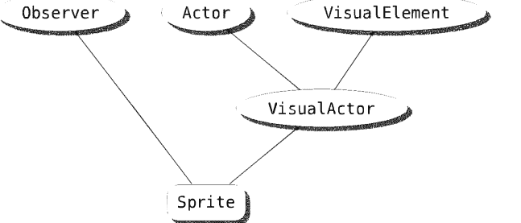

**图 6.4:** 一个具有接口多重继承的简单继承层次。

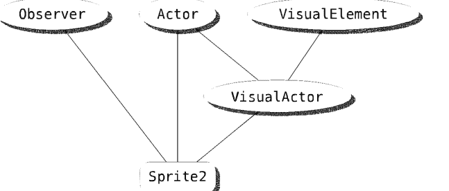

**图 6.5:** 一个具有冗余路径的继承层次（在本例中从 `Sprite2` 到 `Actor` 的链接）。冗余路径并不是负担，但消除它们通常轻而易举，并且会导致更简洁的设计并减少对象的大小。

在某些情况下，你通过两条路径继承同一个接口，但无法移除任何一条路径。考虑我们首先添加一个继承 `Observer` 和 `Actor` 的 `ObservantActor` 接口：

```interface ObservantActor : Observer, Actor {
    void setActive(bool active);
}
interface HyperObservantActor : ObservantActor {
    void setHyperActive(bool hyperActive);
}
```

我们定义 `Sprite3` 实现 `ObservantActor` 和 `VisualActor`：

```class Sprite3 : HyperObservantActor, VisualActor {
    override void notify(Object) { ... }
    override void setActive(bool) { ... }
    override void setHyperActive(bool) { ... }
    override void nudge() { ... }
    override void animate() { ... }
    override void draw() { ... }
}
```

这种设置很大程度上改变了情况（图 6.6）。如果 `Sprite3` 想要同时实现 `HyperObservantActor` 和 `VisualActor`，它将会通过不同的路径实现两次 `Actor`，而且没有办法消除这一点。幸运的是，编译器对这没有意见——允许对同一个接口进行重复继承。然而，不允许对同一个类进行重复继承，并因此完全禁止了类的多重继承。

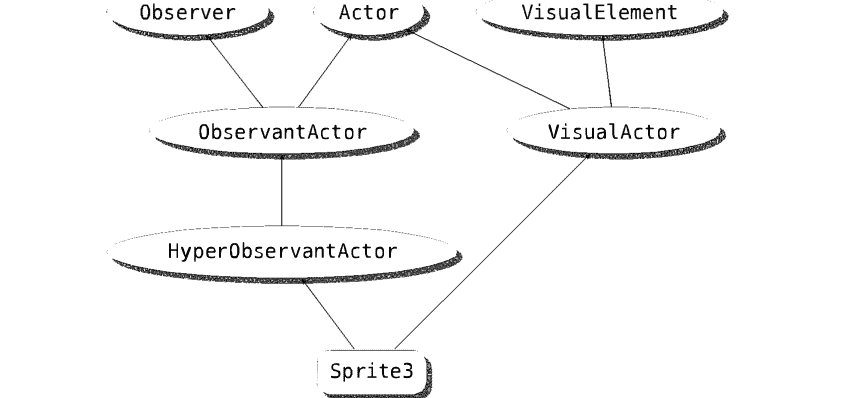

**图 6.6:** 节点之间存在多路径的层次（在本例中 `Sprite3` 和 `Actor`）。这种设置通常被称为“菱形继承层次”，因为如果没有 `HyperObservantActor`，`Sprite3` 和 `Actor` 之间的两条路径将描述出一个菱形。在一般情况下，此类层次可能具有多种形状。其指示特征是从一个节点到另一个节点存在多个间接路径。

为什么要区分对待？接口有什么特别之处，使得它们比类更容易处理？接口和类之间的本质区别在于类可以包含状态。相比之下，接口没有。这是问题的根源：如果允许类的多重继承，编译器在调用方法时必须决定使用哪个类的状态。这可能导致歧义和性能问题。

然而，由于接口没有状态，因此不存在这种冲突。这就是为什么允许接口的多重继承而不允许类的多重继承。

### 6.13. 多重子类型

D 提供了一种处理这种情况情况的机制：子类型。一个类可以使用 `alias` 关键字指定自己是任何其他类的子类型。这允许一个类作为多个类型的子类型来工作，而无需实际继承自它们。

```class DBObject {
    void draw() { ... }
    void saveState() { ... }
}
class StorableShape : Shape {
    private DBObject _store;
    alias _store;
    this() {
        _store = new DBObject();
    }
    override void draw() {
        _store.draw();
    }
    override void saveState() {
        _store.saveState();
    }
}
```

在这个示例中，`StorableShape` 是 `Shape` 的子类，通过 `alias _store` ，它也作为 `DBObject` 的子类型。当在 `StorableShape` 实例上调用 `DBObject` 的方法时，它会被重定向到 `_store`。

```auto s = new StorableShape();
```


`s.draw();`                   // 调用 `Shape` 方法

`s.saveState();`              // 调用 `DBObject` 方法

`Shape` `sh` = `s`;               // 重写 -> `s._store.saveState()`

`DBObject` `db` = `s`;           // 重写为 `DBObject db = s;`

```
实际上，`StorableShape` 是 `DBObject` 的子类型，而 `_store` 成员是 `StorableShape` 对象的 `DBObject` 子类型。

一个类可以引入任意数量的 `alias` 声明，从而成为任意数量类型的子类型。
```

### 6.13.1 多子类型场景下的方法重写

事情不会那么简单，对吧？它们确实不简单，因为 `StorableShape` 一直在作弊。在 tour中使用 `alias .this` 声明，一个 `StorableShape` 在名义上是一个 `DBShape`，但它不能直接重写它的任何方法。显然，`StorableShape` 的方法可以像往常一样重写，但 `DBObject.saveState` 在哪里可以被重写呢？将 `_store` 作为伪子类型返回是一种推卸——实际上，关于 `_store` 并没有什么与它的 `StorableShape` 外部对象关联的，至少在我们不处理它的情况下。让我们看看这由什么组成。

原始 `StorableShape` 定义作弊的精确点是用 `new DBObject()` 初始化 `_store`。这完全切断了子对象 `_store` 与应该重写方法的 `StorableShape` 外部对象之间的联系。

# 第 6 章 类。面向对象的风格

...在 `DBObject` 中。因此，我们需要在 `StorableShape` 内部定义一个新类 `MyDBObject`。该类将存储一个指向外部对象 `StorableObject` 对象的反向引用，并重写需要重写的方法。最后，`MyDBObject` 中重写的方法可以访问整个 `StorableObject`，所有操作都可以像在类中拥有完全的巧合继承一样进行。酷酷！

如果“外部对象”这个短语在本章的前面部分听起来很熟悉，那么你已经注意到编码历史上最偶然的现象之一。嵌套类（第 222 页的 § 6.11 节）完美地解决了多重子类型化的需求，你会认为它们是天降的神机（de deus machina）。事实上，嵌套类（继承自 Java）比别名早了多年。

使用嵌套类使得通过别名进行重写变得极其简单。你只需要在这个类中定义一个继承自 `DBObject` 的嵌套类。在那个类内部，你可以重写任何需要的 `DBObject` 方法，并完全访问 `DBObject` 的公开和受保护的定义，以及 `StorableShape` 的所有定义。如果是其他任何方式，在至少几个存储器中都是非法的。

```
class StorableShape : Shape {

    private class DBObject : DBObject {

        override void saveState() {

            // 访问 DBObject 和 StorableShape

            ...

        }

    }

    private DBObject _store;

    alias store;

    this() {

        // 这里是建立链接的关键点

        _store = new DBObject;

    }

}
```

关重要的是，`_store` 可以访问外部的 `StorableShape` 对象。正如第 222 页的 § 6.11 节所讨论，创建嵌套类将悄地将外部对象存储在嵌套类中（在我们的案例内部）。`this.new MyDBObject` 符号只是为了非常明确地表示新 `MyDBObject` 对象的创建。（事实上，由于它是隐式的，在某些情况下是不需要的。）

唯一的麻烦在于，假设 `DBObject` 的成员会掩盖 `StorableShape` 的成员。例如，假设 `DBObject` 和 `Shape` 定义了一个名为 `name` 的成员变量：

```
class Shape {

    protected string _name;

    abstract void draw();
```

## 6.14. 参数化类和接口

```
}

class DBObject {

  protected string _name;

  void saveState() { ... }

  void loadState() { ... }

}
```

当使用嵌套在 `StorableShape` 内部的类 `MyDBObject` 进行多重子类型化时，成员 `DBObject..name` 隐藏了 `StorableShape..name`。因此，如果 `MyDBObject` 内部直接使用 `name`，它将指向 `DBObject..name`：

```
class StorableShape : Shape {

  private MyDBObject : DBObject {

    override void saveState() {

      // 修改外部 Shape 的 Shape..name

      this.outer..name = "A"

      // 修改基对象的 DBObject..name

      _name = "B"

      // 仅仅为了说明这一点

      assert(super.name == "B")

    }

  }

}
```

```
private MyDBObject {

  alias store;

  this() {

    _store = new MyDBObject;

  }

}
```

## 6.14 参数化类和接口

有时，你需要用一个静态已知的实体对类或接口进行参数化。例如，定义一个栈接口。该接口应该根据存储在栈中的类型进行参数化，以避免重复（`StackInt`, `StackDouble`, `StackWidget` ...）。在 D 中中定义参数化接口的方法如下：

```
interface Stack(T) {

  @property bool empty();

  @property ref T top();

  void push(T value);

  void pop();

}
```

语法 `(T)` 为 `Stack` 引入了一个类型参数。在 `Stack` 内部，你可以像使用其他任何类型一样使用 `T`。在客户端代码中使用 `Stack` 时，你需要指定一个参数，这就像你在调用一个单参数函数时必须传递一个参数一样。你通过使用二元运算符 `!` 来传递参数，如下所示：

```
unittest {

  alias Stack!(int) StackOfInt;

  alias Stack!int SameAsAbove;

  ...

}
```

当只有一个参数时（如 `Stack` 的情况），参数周围的括号可以省略。

逻辑上的下一步是在类中实现该接口。实现应该是泛泛的（而不是针对特定元素的特化），因此我们定义了一个参数化类 `StackImpl(T)`，它接收类型 `T`，将其传递给 `Stack` 并在实现内部使用它。让我们实际上使用数组作为后端来实现一个栈：

```
class StackImpl(T) : Stack!T {

  private T[] _store;

  @property bool empty() {

    return _store.empty;

  }

  @property ref T top() {

    assert(!empty());

    return _store.back;

  }

  void push(T value) {

    _store = value;

  }

  void pop() {

    assert(!empty());

    _store.popBack();

  }

}
```

实现 `StackImpl` 和使用它一样有趣：

```
unittest {

  auto stack = new StackImpl();

  assert(stack.empty());

  stack.push(3);

  assert(stack.top == 3);

  stack.push(5);

  assert(stack.top == 5);

  stack.pop();

  assert(stack.top == 3);

  stack.pop();

  assert(stack.empty());

}
```

`StackImpl` 的用法和实现它一样有趣：

```
unittest {

  auto stack = new StackImpl();

  assert(stack.empty());

  stack.push(3);

  assert(stack.top == 3);

  stack.push(5);

  assert(stack.top == 5);

  stack.pop();

  assert(stack.top == 3);

  stack.pop();

  assert(stack.empty());

}
```

当你实例化一个参数化类时，`StackImpl!int` 就像其他任何类。

## 6.14.1 异态编译，再次

现在我们讨论异态编译。正如第 138 页的 § 5.3 所讨论，这种方法可能会产生更多的代码，但也更强大，因为它保留了完整的静态类型信息。此外，由于异态编译为每个情况生成特化代码，它可能会生成更快的代码。

D 始终使用异态编译，这意味着 `Stack!int` 和 `double` 是不同的接口，而 `StackImpl!int` 与 `StackImpl!double` 是不同的类型。除了源自同一个参数化之外，这些类型是无关的。（你当然可以通过让所有 `Stack` 继承一个共同接口来将它们联系起来。）考虑到 `StackImpl` 为它想要的每个类型生成一组方法，这会导致一些二进制代码重复，这非常令人刺眼，特别是因为生成的代码通常是相同的。聪明的编译器可以在编写时将所有相同的函数合并为一个；D 官方编译器没有这样做，但这种合并技术在成熟的 C++ 编译器中是经过证明的。

类当然可以有多个类型参数，所以让我们通过 `StackImpl` 实现中一个有趣的转折来展示这一点。与其将存储绑定到数组，我们可以在 `StackImpl` 外部做出决定。在数组的所有中，`StackImpl` 使用了 `empty`、`back` 和 `popBack`。让我们让容器决策成为 `StackImpl` 的实现细节。

```
class StackImpl(T, Backend) : Stack!T {

  private Backend _store;

  @property bool empty() {

    return _store.empty();

  }

  @property ref T top() {

    assert(!empty());

    return _store.back;

  }

  void push(T value) {

    _store = value;

  }

  void pop() {

    assert(!empty());

  }

}
```

```d

_store.popBack();

}
```

## 6.15 总结

类是 D 中实现面向对象设计的主要机制。它们一致使用引用语义并由垃圾回收管理。

继承是动态多态的实现基础。只允许状态的单一继承，但类可以继承许多接口类型，这些类型没有状态但可以定义最终方法（final）。

保护规则遵循操作系统的保护机制（目录和文件）。

所有类都继承实现提供的 `object` 模块定义的 `Object` 类。`Object` 定义了一些重要的原始类型，`object` 模块定义了对象比较的关键函数。

类可以定义嵌套类，嵌套类会自动存储对其父类的引用，而静态嵌套类则不会。

D 完全支持非虚拟接口（NVI）模式，还支持一种半自动的多子类型机制。

# 第 7 章

# 其他用户定义类型

使用类、基本类型和函数可以编写许多优秀的软件。使用类型和值参数化的类和函数会让情况变得更好。但通常由于几个原因，会变得痛苦而易见：类并不是终极的抽象工具。

首先，类遵循引用语义，这可能迫使它们糟糕地表示许多设计并产生巨大的开销。对于像具有 2D 或 3D 坐标的 `PointInt` 这样简单的实体，如果数量超过数百万，用类来建模实际上会变得非常困难，这让设计者处于选择良好抽象与合理效率的窘境中。此外，在线性代数中，这种诱惑是巨大的麻烦。你很难说服一位数学家或科学程序员，使用 `a = b` 赋值两个矩阵应该指向同一个实际矩阵，而不是创建 `b` 的独立拷贝。即使是像数组这样简单的类型，与 D 精简且高效的抽象（第 4 章）相比，也会产生被建模为类的开销。当然，数组可以是“魔术”的，但经验反复证明，提供许多用户无法实现的魔术类型是一个令人沮丧的提案，也是语言设计糟糕的标志。数组的载荷是两个，因此为所有数组原始类型分配大量的空间和时间开销。即使是 `int` 这样简单的类型也无法以廉价优雅的方式的方式，即使我们忽略运算符便利性的问题。像 `BigInt` 这样的类面临的问题是 `a = b` 的行为与 `int` 的赋值完全不同。

其次，类具有无限生命周期，这意味着它们可能难以建模具有明确有限周期且供应稀缺的资源，例如文件句柄、图形句柄、互斥锁、套接字等。用类处理此类资源会对你的注意力造成永久负担，因为你必须记得使用 `close` 或 `dispose` 等方法及时释放封装的资源。`scope` 语句（第 84 页第 3.13 节）通常很有帮助，但在类型中一劳永逸地封装这种语义是有用的。

第三，类是一种相对重量级且高层的抽象机制，因此它们对于表达如枚举类型或每个给定类型的交替等轻量级抽象并不特别方便。

如果 D 只提供类作为唯一的抽象机制，它就不符合其作为系统级编程语言的特征了。除了类之外，D 还有 `struct` 值（拥有类的大部分功能，但具有值语义且没有多态性）、庞大的（轻量级枚举类型和简单常量）、`union`（不相关类型的低级重叠存储）以及辅助类型定义机制。

# 7.1 structs

`struct` 允许定义封装的值类型。一个值得记住的好模型是 `int`：一个 4 字节的支持某些操作的 `int` 值。`int` 中没有隐藏状态，也没有方向，两个 `int` 始终引用不同的值。
`struct` 的章程排除了动态多态、函数覆盖、继承和无限生命周期。`struct` 是一个增强版的 `int`。

回想类具有引用语义（第 177 页第 6.2 节），这意味着你总是通过对象的引用来管理对象，复制引用实际上只是添加了对同一个对象的引用，而不是复制实际对象。相比之下，`struct` 是值类型，这意味着它们本质上行为“像 `int` 一样”名称绑定在它们所代表的值上，拷贝 `struct` 值实际上拷贝的是条目，而不只是引用。

定义 `struct` 与类不同，存在以下区别：

- `struct` 替换了 `class`。
- 不允许类的继承和接口的实现，因此 `struct` 不能指定：`BaseType`、`Interface`，且显然在 `struct` 内部没有 `super` 可以引用。
- `struct` 方法不允许 `override`——所有方法都是 `final` 的（你可以通过 `final struct` 进行冗余的简化）。
- 不可以在 `struct` 上使用 `synchronized`（见第 13 章）。
- `struct` 不允许定义默认构造函数 `this()`（这是一个值得解释的问题，见第 244 页第 7.1.3.1 节）。
- 在 `struct` 内部你可以定义后初始化构造函数 `postblit` (this)（我们将在第 245 页第 7.1.3.4 节讨论）。
- 不允许 `protected` 访问修符（因为它会暗示存在派生 `struct`）。

让我们定义一个简单的 `struct`：

```d

struct Widget {

    // 一个常量

    enum fudgeFactor = 0.2;

    // 一个共享不可变的 defaultName = "A Widget";

    // 为每个 Widget struct 分配的一些状态

    string name;

    uint width, height;

    // 一个静态方法

    static double howFudgy() {

        return fudgeFactor;

    }

    // 一个方法

    void changeName(string other) {

        name = other;

    }

}
```

# 7.1.1 拷贝语义

类和 `struct` 之间的区别在拷贝方式上最为明显。让我们来看一个两者的实验。

```d

class C {

  int x;

  C(int x) { x = x; }

}

struct S {

  int x;

  S(int x) { x = x; }

}

unittest {

  C c1 = new C(10);

  C c2 = c1;

  c2.x = 20;

  assert(c1.x == 20); // c1 和 c2 引用同一个对象

  S s1 = S(10);

  S s2 = s1;

  s2.x = 20;

  assert(s1.x == 10); // s1 未改变，s2 是一个拷贝

  assert(s2.x == 20);

}
```

# 7.1.2 将 struct 对象传递给函数

由于值语义，`struct` 对象是通过值拷贝到函数的。

```d

struct S {

  int a, b, c;

  double x, y, z;

}
```


void fun(S s) { // fun 接收一个拷贝

  ...

}

```

要通过引用传递 `struct` 对象，请使用 `ref` 参数（第 135 页 5.2.1 节）：

```d
void fun(ref S s) { // fun 接收一个引用

  ...

}
```

# 7.1.3 struct 的生命周期

与类对象不同，`struct` 对象没有无限生命周期。它们遵循精确的作用域语义，类似于临时（栈栈对象的生命周期。

要创建一个 `struct` 对象，只需像使用函数一样使用它的名称：

```d
import std.math;

struct Test {

  double a = 0.4;

  double b;

}

unittest {

  // 将 struct 名称作为函数来创建对象

  auto t = Test();

  assert(t.a == 0.4 && isnan(t.b));

}
```

调用 `Test()` 会创建一个所有字段都默认初始化的 `struct` 对象。在我们的情况下，意味着 `t.a` 是 0.4 且 `t.b` 留为 `double`。`Test(1)` 和 `Test(1.5, 2.5)` 也是允许的，并按照声明顺序初始化对象的字段。继续之前的示例：

```d
unittest {

  auto t1 = Test(1);

  assert(t1.a == 1 && isnan(t1.b));

  auto t2 = Test(1.5, 2.5);

  assert(t2.a == 1.5 && t2.b == 2.5);

}
```

创建 `struct` 对象的表达式—`Test(<args>)`— 与创建类对象的表达式—`new Test(<args>)`— 之间的语法差异可能是

起初可能有些突兀。在创建类对象时，D 完全可以抛弃 `new` 关键字，但这个 `new` 提醒了程序员正在发生内存分配操作（即非平凡的工作）。

## 7.1.3.1 构造函数

你可以类似于类构造函数的方式为结构体定义构造函数（见第 181 页 § 6.3.1）：

```
struct Test {

  double a = 0.4;

  double b;

  this(double b) {

    this.b = b;

  }

}
```

```
unittestest {

  auto t = Test(5);

}
```

存在至少一个构造函数将禁用上述讨论的所有面向字段的构造函数：

```
auto t1 = Test(1.1, 1.2); // Error!
// 没有匹配 Test(double, double) 的构造函数
static Test t2 = { 0.0, 1.0 }; // Error!
// 没有匹配 Test(double, double) 的构造函数
```

这里有一个重要的例外：编译器总是定义无参数构造函数。

```auto
auto t2 = Test(); // Fine，创建一个默认填充的代码块
```

此外，用户代码无法定义无参数构造函数：

```
struct Test {

  double a = 0.4;

  double b;

  this() { b = 0; } // Error!

} // 结构体不能定义默认构造函数！
```

为什么会有这个限制？这都与 `T.init` 有关，它是每个类型定义的默认值。`T.init` 必须是静态已知的，这与执行任意代码的默认构造函数的存在是矛盾的。（对于类来说，`T.init` 是空引用，而不是默认构造的对象。）对于所有结构体，默认构造函数使用每个字段的默认初始化来初始化对象。

## 7.1.3.2 转发构造函数

让我们复制第 183 页 § 6.3.2 的示例，并将 `class` 改为 `struct`。

```
struct Widget {

    this(uint height) {

        this(1, height); // 转发给另一个构造函数

    }

    this(uint width, uint height) {

        this.width = width;

        this.height = height;

    }

    uint width, height;

}
```

代码在不需要其他修改的情况下运行。与类一样，结构体允许一个构造函数转发到另一个，且具有相同的限制。

## 7.1.3.3 构造序列

类需要担心分配动态内存和初始化它们的基类对象（见第 184 页 § 6.3）。对于结构体来说，情况要简单得多，因为内存分配步骤没有包含在构造序列中。构建类型为 `Tare` 的结构体对象的步骤如下：

1. 使用原始内存拷贝（类似于 `mem`）将 `T::init` 拷贝到将包含对象的内存中。
2. 如果适用，调用构造函数。

如果结构体的所有字段都用 `= void` 初始化，第一步的工作可以减少，但这通常不需要担心，而且这是一种在你的代码中引入细微 bug 的方法（不过，请参考第 185 页的 Transmogrifier 示例以获取可能的情况）。

## 7.1.3.4 Postblit 构造函数 this (this)

假设我们想要定义一个持有私有数组并为该数组暴露有限 API 的对象：

```
struct Widget {

    private int[] array;

    this(wint length) {

        array = new int[length];

    }

    int get(size_t offset) {

        return array[offset];

    }

    void set(size_t offset, int value) {

        array[offset] = value;

    }

}
```

定义的 `Widget` 存在一个问题：拷贝 `Widget` 对象会在副本之间创建距离依赖。考虑这种情况：

```
unittest {

auto w1 = Widget(10);

auto w2 = w1;

w1.set(5, 100); // 同时设置了 w2.array[5]

w2.set(5, 42);

```

问题在哪里？将 `w1` 拷贝到 `w2` 是“浅拷贝”的，即逐字段拷贝内存，每个字段被间接引用。拷贝数组不会分配新数组；它只拷贝数组的边界（见第 98 页 4.1.4）。拷贝后，`w1` 和 `w2` 包含不同的数组，但它们指向同一区域内存。这样的对象可以被称为“深度拷贝”：具有值语义的结构体与引用语义的类的混合。

通常，结构体希望定义值语义，这意味着拷贝将与其源完全独立。为了实现这一点，定义 `postblit` 构造函数：

```
struct Widget {

    private int[] array;

    this(wint length) {

        array = new int[length];

    }

} // Postblit 构造函数
```

2. 术语“深度拷贝”是由 Bartosz Milewski 提出的。

```
this(this) {

    array = array.dup();

} // 之前
int get(size_t offset) { return array[offset]; }
void set(size_t offset, int value) { array[offset] = value; }
```

`Postblit` 构造函数在拷贝对象时干预。当从另一个相同类型的结构体对象 `src` 初始化时，编译器采取以下步骤：

1. 将 `src` 的原始内存拷贝到 `tgt` 的内存中。
2. 对于 `src` 的每个传递字段，如果定义了 `this(this)`，则调用它。
3. 针对 `tgt` 调用 `this(this)`。

`postblit` 名字来源于“blit”（块传输）的常用缩写，这意味着原始拷贝。该语言在拷贝对象时提供了一个钩子。在 `postblit` 构造函数的作用下，现在通过了完整的拷贝，确保源和目标没有共同点：

```
unittest
auto w1 = Widget(10);

auto w2 = w1; // 在这里针对 w2 调用了 this(this)

w1.set(5, 100);

w2.set(5, 42);

assert(w1.get(5) == 100);
```

只要显式创建对象，就会一致地插入 `postblit` 构造函数调用。例如，将 `Widget` 传递给函数会创建一个拷贝：

```
void fun(Widget w) { // 值传递

w.set(2, 42);

}
```

```
void gun(ref Widget w) { // 引用传递

w.set(2, 42);

}
```

### 7. 其他用户定义类型

```
unittest {

auto w = Widget(10);

w.set(2, 100); // 创建了拷贝

fun(w);

assert(w.get(2) == 100); // 传递

gun(w); // 无拷贝

assert(w.get(2) == 42); // 传递

}
```

`postblit` 拷贝过程的第二步（传递字段部分）值得特别提到。这种行为的原理是封装——即使结构体对象被嵌入另一个结构体中，必须调用其 `postblit` 构造函数。例如，假设 `Widget` 成为另一个结构体的成员，而该成员又是另一个结构体的成员：

```
struct Widget2 {

    Widget w;

    int x;

}
```

```
struct Widget3 {

    Widget2 w2;

    string name;

    this(this) {

        name = name; // 拷贝

    }

}
```

现在，如果你想拷贝包含 `Widget` 的对象，如果编译器忘记正确拷贝子对象，就很糟糕了。这就是为什么拷贝 `Widget2` 类型的对象时，尽管 `Widget2` 根本没有拦截拷贝，也会为 `w` 发出 `this(this)` 调用。同样，当拷贝 `Widget3` 类型的对象时，再次为 `w2` 调用了 `this(this)`。为了澄清：

```
unittest {

Widget2 a;

a.w = Widget(10); // 分配一些数据

auto b = a; // 为 b.w 调用了 this(this)

assert(a.w !is b.w); // 传递

}
```

```
Widget3 c;

c.w2 = Widget(20);

auto d = c; // 为 d.w2.w 调用了 this(this)

assert(c.w2.w !is d.w2.w); // 传递

}
```

简而言之，如果你为结构体类型定义了 `postblit` 构造函数 `(this)`，编译器会确保在每次拷贝对象时调用 `postblit`，无论它是独立的还是较大结构体对象的一部分。

## 7.1.3.5 this(this) 的原因

`postblit` 构造函数的原理是什么？其他语言中没有 `this(this)` 的先例。为什么不直接将源对象传递给目标对象（如 C++ 所做的）？

```
// 这不是 D

struct S {

  this(S) { ... }

// 或者

  this(ref S another) { ... }

}
```

对 C++ 的经验表明，过度拷贝对象是 C++ 程序效率低下的主要源。为了缓解效率损失，C++ 规定了编译器可以消除拷贝构造调用的情况。消除规则很快失效，且仍未覆盖所有情况，导致问题悬而未决。即将发布的 C++ 标准通过定义新类型“值引用”来解决这些问题，允许用户控制拷贝消除，但代价是语言更加复杂。

# 第 7 章 其他用户定义类型

每当能够证明拷贝源在拷贝过程后不会被使用时，就会调用 `this(this)`。例如，考虑一个按值返回 `Widget`（如上定义）的函数：

```
Widget hun(uint x) {

  return Widget(x * 2);

}
```

```
unittest {

  auto w = hun(1000);

}
```

一种朴素的方法是在 `hun` 内部创建一个 `Widget` 对象，然后使用位位拷贝将其复制到 `w` 中，接着调用 `this(this)`。但这种做法是浪费的——因为 D 假设对象是可移动的，那么为什么不直接将 `hun` 创建的垂死的临时对象移动过去呢？没有人能真正确定在 `hun` 返回后该临时对象不再被使用。如果森林里有一棵树倒下而没有人听到，那么移动这棵树而不是复制它应该没有问题。这里展示了一个类似但相同的示例：

```
Widget iun(uint x) {

  auto result = Widget(x * 2);

```

```
return result;

```

```
unittest {

  auto w = iun(1000);

}
```

在这种情况下，同样，`result` 在 `hun` 返回后消失了，调用 `this(this)` 是没有必要的。最后，一个更微妙的情况如下：

```
void jun(Widget w) {

```

```
unittest {

  auto w = Widget(1000);

  // code₁

jun(w);

  // code₂

}
```

## 7.1. structs

}

这种情况很难完全消除对 `this(this)` 的调用。`code2` 可能会继续使用 `w`，在这种情况下，将它从 `unittest` 移动到 `jun` 是错误的。³

考虑到上述所有因素，D 对消除（elision）采取了以下立场：

- 所有的匿名右值（rvalues）都进行移动，而不是拷贝。永远为匿名右值插入 `this(this)` 的调用（即上述函数所示的临时变量）。
- 所有在函数内部在栈上分配并返回的具名临时变量都会消除对 `this(this)` 的调用。
- 不保证能观察到其他潜在的消除。

然而，有时我们主动想要指示编译器执行移动。这实际上可以通过标准库模块 `std.algorithm` 中定义的移动函数来实现：

```
import std.algorithm;

```

```
void kun(Widget w) {

  ...

}

unnittest {

  auto w = Widget(1000);

  // code1

  // 插入对 move 的调用

  move(w);

  assert(w == Widget.init); // 通过

  // code2

}
```

使用 `move` 确保 `w` 将被移动，并且一个空的、默认构造的 `Widget` 将替换 `w` 的内容。顺便说一下，这是无状态不抛异常默认构造函数（第 244 页 § 7.1.3.1）`Widget.init` 存在的一个非常有用的地方。如果没有它，可能没有办法将移动源置于定义良好的空状态。

> 3. 此外，code1 可能会保存一个 code2 使用的指针。

## 7.1.3.6 析构与内存释放

`struct` 可以定义析构函数，写法如下 `this()`：

```
import std.stdio();

```

上述程序将可靠地打印

正在创建一个类型为 S 的对象。
对象作用域内
一个带有负载 42 的 S 正在消失。再见！
对象作用域结束。

任何 `struct` 对象都遵循*作用域生命周期*（scoped lifetime），这意味着它的生命周期实际上在对象作用域结束时结束。具体来说：

- 在函数内部定义的非静态对象的生命周期在当前作用域结束时结束，在之前定义的所有 `struct` 对象之后。
- 在另一个 `struct` 内部定义为成员对象的生命周期在所属 `struct` 结束后。
- 在模块作用域定义的对象的生命周期是无限的。如果你想调用该对象的析构函数，必须在模块析构时执行（第 356 页 11.3）。
- 成员定义的对象的生命周期在内存收集时结束。

语言保证在 `struct` 生命周期结束时自动调用 `this()`，这在你想自动执行如关闭文件和释放敏感资源的操作时非常有用。使用 `this(this)` 的拷贝源遵循其生命周期规则，但通过移动得到的源不会调用析构函数。

`struct` 对象的内存释放概念上在析构之后执行。

## 7.1.3.7 析构序列

默认情况下，`struct` 对象的析构顺序与其创建顺序相反。例如，作用域内定义的最后一个 `struct` 对象是第一个被析构的：

```
import std.conv, std.stdio;

struct S {

    private string name;

    this(string name) {

        writeln(name, " checking in.");

        this.name = name;

    }

    -this() {

        writeln(name, " checking out.");

    }

}

void main() {

    auto obj1 = S("first object");

    foreach (i = 0 .. 3) {

        auto obj = S("object ", i);

    }

    auto obj2 = S("last object");

}
```


上述程序打印

first object checking in.
object 0 checking in.
object 0 checking out.
object 1 checking in.
object 1 checking out.
object 2 checking in.
object 2 checking out.
last object checking in.
last object checking out.
first object checking out.

如预期，第一个创建的对象是最后一个被析构的对象。循环在每次通过时退出作用域。你可以通过调用 `clear(obj)` 显式调用 struct 对象的析构函数。我们在 187 页了解过 `clear` 函数。对于类对象，`clear` 用于将其重置为状态。对于 struct 对象，`clear` 调用析构函数然后拷贝对象的位。结果是一个有效的对象，不持有任何状态。

## 7.1.4 静态构造函数与析构函数

struct 可以定义任意数量的静态构造函数和析构函数。这一功能与第 188 页 6.3 为类引入的功能完全相同。

```d
import std.stdio;

struct A {

    static ~this() {

        writeln("First static destructor");

    }

    ...

    static this() {

        writeln("First static constructor");

    }

    ...

    static this() {

        writeln("Second static constructor");

    }

    ...

    static ~this() {

        writeln("Second static destructor");

    }

}

void main() {

    writeln("This is speaking");

}
```

静态构造函数和析构函数之间不需要配。在评估 `main` 之前，运行时支持按照定义的顺序执行所有静态构造函数。`main` 结束后，运行时支持按照定义的相反顺序执行所有析构函数。上述程序写入

First static constructor
Second static constructor
This is speaking
Second static destructor
First static destructor

模块内部静态构造函数和析构函数的执行顺序是有定义的（如上），但跨模块并不总是如此。跨模块的静态构造函数和析构函数的执行顺序定义在第 189 页。

## 7.1.5 方法

struct 定义成员函数。由于 struct 没有继承和重写，struct 方法比普通函数简单。

对于 struct 类型 `S`，非静态方法通过引用获取隐藏参数（相当于 `ref S`）。在方法内部，名称查找过程与类相同：参数隐藏成员名，成员名隐藏模块级名称。

```d
void fun(int x) {

  assert(x != 0);

}

// 演示名称查找

struct S {

  int x = 1;

  static int y = 324;

  void fun(int x) {

    assert(x == 0); // 获取参数 x

    assert(this.x == 1); // 获取成员 x

  }

  void gun() {

    fun(0); // 调用方法 fun

    fun(1); // 调用模块级 fun

  }

}

// unittest 可以是 struct成员

unittest {

  S obj;

  obj.gun();

  assert(y == 324); // “成员” unittest 查看静态数据

}
```

上面还展示了在 struct 内部定义的 unittest。这种 unittest 没有特殊状态，但插入到每个方法定义之后非常方便。成员 unittest 内部的代码享有与普通方法相同的可见性——例如，上面的 unittest 不需要像静态方法那样为静态成员以前缀 `S`。有几个特殊的值得进一步研究。它们是用于 `=` 的运算符 `opAssign`，用于 `==` 和 `!=` 的相等运算符 `=`；以及用于 `<`, `>=` 的排序运算符 `=`。这个主题实际上属于第 12 章，因为它涉及运算符重载，但这些运算符是特殊的，因为编译器可能会带有特定的行为自动生成它们。

## 7.15.1 赋值运算符

默认情况下，如果你说

```d
Widget { ... } // 定义如第 25 页 § 7.1.3.4

Widget w1, w2;

...

w1 = w2;
```

那么赋值是按成员完成的。这可能会给第 25 页 § 7.1.3.4 中讨论的 `Widget` 类型带来麻烦。记得 `Widget` 持有一个指向字段成员的指针，该字段应该是每个 `Widget` 对象独立的。将 `w2` 赋值给 `w1` 字段是将 `w2.array` 赋值给 `w1.array`——只是简单的数组边界赋值，而没有实际数组内容。这需要修复，因为我们需要的是拷贝源 Widget 中的数组并赋值给目标-Widget。

用户代码可以通过定义方法 `opAssign` 来拦截赋值。本质上，如果 `rhs` 定义了签名兼容的 `opAssign`，赋值 `rhs` 将被转换为 `lhs.opAssign(rhs)`（否则，如果 lhs 和 rhs 类型相同，则执行默认的逐字段赋值）。让我们定义 `Widget.opAssign`：

```d
Widget {

  private int[] array;

  .. // this(uint), this(this), 等

  ref Widget opAssign(ref Widget rhs) {

    array = rhs.array.dup;

    return this;

  }

}
```

## 7.1. 结构

赋值运算符返回 `this` 的引用以允许链式赋值 `$w1 = w2 = w3$`，编译器将其重写为 `$w1.opAssign(w2.opAssign(w3))$`。仍然存在一个问题。考虑赋值：

```d
Widget w;

...

w = Widget(50); // 错误！// 无法将 Widget 类型的右值绑定到 ref Widget
```

问题在于定义的 `opAssign` 需要一个 `ref Widget`，即 Widget 类型的左值。为了接受从右值到左值的赋值，`Widget` 必须定义两个赋值运算符：

```d
import std.algorithm;

struct Widget {

  private int[] array;

  ... // this(uint), this(this), 等。

  ref Widget opAssign(ref Widget rhs) {

    array = rhs.array.dup;

    return this;

  }

  ref Widget opAssign(Widget rhs) {

    swap(array, rhs.array);

    return this;

  }

}
```

接收右值的版本中没有 `.dup`。为什么？因为该右值（带有数组）实际上由第二个 `opAssign` 拥有；它在进入函数之前被复制，并在函数返回之前被销毁。这意味着不需要复制 `rhs.array`，因为没有人会需要它。将 `rhs.array` 与 `this` 交换即可。当 `opAssign` 返回时，`rhs` 随着旧数组消失，而 `this` 保留了 `rhs` 的旧数组——状态的完美保存。我们可以完全移除 `opAssign` 的第一个重载：按值接收 `rhs` 的版本处理一切（左值会自动转换为右值）。但保留左值版本可以实现一种实用的优化：`opAssign` 不需要复制源，而是检查当前数组是否有空间容纳新内容，在这种情况下，直接覆盖即可。

```d
// Widget 内部 ...

ref Widget opAssign(ref Widget rhs) {

  if (array.length < rhs.array.length) {

    array = rhs.array.dup;

  } else {

    // 调整长度

    array.length = rhs.array.length;

    // 复制内容（第100页的 4.1.7）

    array[] = rhs.array;

  }

  return this;

}
```

### 7.1.5.2. 结构体的相等性

结构体对象可以使用 `==` 和 `!=` 进行相等性比较。比较通过成员进行，如果比较对象的至少两个对应成员不相等，则返回 false，否则返回 true。

```d
struct Point {

  int x, y;

}

unittest {

  Point a, b;

  assert(a == b);

  a.x = 1;

  assert(a != b);

}
```

要定义自定义比较程序，请定义 `opEquals` 方法：

```d
import std.math, std.stdio;

struct Point {

  float x = 0, y = 0;

  // 添加

  bool opEquals(ref const Point rhs) const {

    // 执行近似比较

    return approxEqual(x, rhs.x) && approxEqual(y, rhs.y);

  }

}
```

```d
unittest {

  Point a, b;

}
```

```d
assert(a == b);
a.x = 1e-8;
assert(a == b);
a.y = 1e-1;
assert(a != b);
```

与类的 `opEquals`（第 205 页的 6.8.3）相比，结构体的 `opEquals` 要简单得多，因为不需要担心继承存在时的正确性。编译器将结构对象的比较重写为对 `opEquals` 的调用。当然，结构体仍然必须定义有意义的 `opEquals`：自反射、、性和传递性。必须说，尽管 `opEquals` 看起来很大，但它未能通过传递性测试。更好的测试是比较截断到最高有效位的两个 `Point`；该测试可以更容易转换。

当结构体包含定义了 `opEquals` 的成员但自身没有定义 `opEquals` 时，比较仍然会调用其定义成员的 `opEquals`。继续 `Point` 示例：

```d
struct Rectangle {

  Point leftBottom, rightTop;

}
```

```d
unittest {

  Rectangle a, b;

  assert(a.leftBottom.x == 1e-8);

  assert(a == b);

  a.rightTop.y = 5;

  assert(a != b);

}
```

给定两个 `Rectangle` `$a$` 和 `$b$`，评估 `a == b` 等同于评估：

```d
a.leftBottom == b.leftBottom && a.rightTop == b.rightTop
```

这又被重写为：

```d
a.leftBottom.opEquals(b.leftBottom) &&
a.rightTop.opEquals(b.rightTop)
```

示例还揭示了比较按字段声明顺序进行的（即 `leftBottom` 在 `rightTop` 之前），如果两个字段不相等，则提前停止，由于 `&&` 的短路求值。

## 7.1.6 静态成员

结构体可以定义静态数据和静态成员函数。考虑到作用域可见性和访问规则（第 100 页的 7.1.7），静态成员函数与普通函数具有相同的机制。没有隐藏的 `this` 参数，也没有调用其他机制。

同样，静态数据成员有...（实际上，提供的文本有跳转。让我们严格遵循提供的文本顺序）。

### 7.1.7 访问修饰符

结构类型...与类相同。在这里，让我们总结每个修饰符的含义：

```d
struct S {

    // 内部访问

    private int a;      // S 内部访问

    package int b;      // 从应用程序访问

    public int c;      // 应用程序外部

    export int d;       // 应用

}
```

### 7.1.8 嵌套结构体和类

通常，结构体内部定义结构体或类是方便的。例如，树容器可能选择暴露一个简单接口的结构体，但在内部使用多态来定义节点。

```d
struct Tree {

  private:

    class Node {

        int value;

        abstract Node left();

        abstract Node right();

    }

    class NonLeaf : Node {

        Node _left, _right;

        override Node left() { return _left; }

        override Node right() { return _right; }

    }

    class Leaf : Node {

        override Node left() { return null; }

        override Node right() { return null; }

    }

    // 数据

    Node root;

}
```

### 7.1.9 在函数内部嵌套结构体

回想第 223 页的 6.11.1，嵌套类享有特殊的属性。嵌套类可以访问闭包参数。如果你返回一个嵌套类对象，编译器甚至创建一个动态分配的函数帧，函数的局部变量和参数在函数结束时仍然存在。

为了符合性和一致性，D 为嵌套在函数中的结构体提供了类似的便利。嵌套结构体可以访问闭包函数的参数和局部变量：

```d
void fun(int a) {

    int b;

    struct Local {

        int c;

        int sum(){

            // 访问参数、变量以及 Local 自身的成员

            return a + b + c;

        }

    }

    Local obj;

    int x = obj.sum();

    assert(Local.size() == 2 * size_t());

}
```

```d
unittest {

    fun(5);

}
```

嵌套结构体嵌入了魔法的“帧指针”，这允许它们访问上述示例中的外部值（如 a 和 b）。由于存在额外的状态，`Local` 对象的尺寸为 4，而不是人们可能预期的那样（在 32 位机器上），这是为了给帧指针留空间。如果你想定义一个没有负担的嵌套结构体，可以在 `Local` 的定义中在 struct 前加上 `static`，这使得 `Local` 成为一个普通的结构体并防止它访问 a 和 b。

除了与嵌套类相比可以避免不必要的限制外，嵌套结构体的用处并不大。嵌套对象无法从函数返回，因为调用者无法访问它们的类型。如果一个设计需要复杂的嵌套结构体，它隐含地助长了复杂的函数，而这些函数从一开始就应该被避免。

### 7.1.10 结构体的子类型。@disable 属性

虽然结构体不支持继承和多态，但它们仍然支持 `alias this` 功能，该功能首次在第 230 页的 § 6.13 中引入。通过使用 `alias this`，你可以让结构体成为任何其他类型的子类型。例如，让我们定义一个名为 Final 的简单类型，它的行为非常像类引用——除了你永远无法重新绑定它！这里有一个使用 `Final` 的示例：

```d
import std.stdio;

class Widget {

    void print() {

        writeln("Hi, I'm a Widget. Well, that's about it.");

    }

}
```

```d
unittest {

    auto a = Final!Widget(new Widget);

    a.print();               // 正常，只需打印 a

    auto b = a;             // 正常，且 b 和 a 绑定到同一个 Widget

    a = b;                 // 错误！

                            // opAssign(Final!Widget) 已禁用；

    a = new Widget;      // 错误！

                                // 无法向 get(!) 返回的右值赋值

}
```


`Final` 的目的是一种特殊的类引用，它绑定到某些对象并永远不释放它。“忠实”的引用在许多设计中都是非常有用的。

第一步是消除赋值。问题是，如果缺失赋值运算符，编译器会自动生成它，因此 `Final` 必须礼貌地指示编译器不要这样做。为了实现这一点，请使用 `@disable` 属性：

```d
struct Final(T) {
    // 禁用赋值
    @disable void opAssign(Final);
    ...
}
```

你可以使用 `@disable` 来移除其他生成的函数，例如比较。到目前为止一切良好。为了实现 `Final!`，我们需要确保该类型通过 `alias this` 成为 `T` 的子类型，但不提供左值（lvalue）。一个错误的设计如下所示：

```rust
// 错误的设计
struct Final(T) {
    private T payload;
    this(T) bindTo() {
        payload = bindTo;
    }
    // 禁用赋值
    @disable void opAssign(Final);
    // 子类 T
    alias payload this;
}
```

`Final` 在 `payload` 成员中持有其值并在构造函数中初始化它。它还通过声明 `opAssign` 但从不定义它，有效地禁用了赋值。这样，尝试给 `Final!T` 类型对象赋值的客户端要么无法访问（因为是 `private` 的），要么会遇到链接时错误。

`Final` 的错误在于引入了 `alias payload this`。这里有一个完成了不该执行的任务的单元测试：

```rust
class A {
    int value = 42;
    this(int x) { value = x; }
}
utittest {
    auto v = Final!A(new A(42));
    void sneaky(ref A ra) {
        ra = new A(4242);
    }
    sneaky(v); // 嗯mmm...
    assert(v.value == 4242); // 通过了？？
}
```

`payload this` 的工作原理非常简单。每当类型为 `Final!T` 的值 `obj` 在一个对其类型非法的上下文中使用时，编译器就会将其重写为 `obj.payload`（换句话说，它让 `obj.payload` 成为 `obj` 的别名，这就是该功能的名称和语法来源）。但 `obj.payload` 是对 `obj` 字段的直接访问，并且是一个右值。该值绑定到 `sneaky` 的 `ref` 参数，因此允许直接覆盖 `v` 的字段。

为了修复这个问题，我们需要将对象别名为一个右值。这样我们就获得了完整的功能，但存储返回右值的引用是无法触碰的。使用一个按值返回 `payload` 的 `@property` 来绑定到右值非常简单：

```rust
struct Final!T {
    private T payload;
    this(T) bindTo() {
        payload = bindTo;
    }
    // 禁用赋值
    @disable void opAssign(Final);
    // 子类 T，允许重绑定
    @property T get() { return payload; }
    alias this;
}
```

```d
import std.stdio;
```

```d
struct A {
    char a;
    int b;
    char c;
}
```

```d
void main() {
    A x;
    writeln("%s %s %s", x.a.offsetof, x.b.offsetof, x.c.offsetof);
}
```

参考实现输出了 0 4 8，揭示了上一页图 7.2 中的的布局。你需要创建一个 `A` 类型的对象来访问它的某些静态信息，这显得有点别扭，而且 `A.a.offsetof` 语法无法编译。然而，可以使用的一个技巧是使用 `A.init.offsetof`，这足以获取与每个成员相关的偏移量并作为编译时常量。

```d
import std.stdio;
```

```d
struct A {
    char a;
    int b;
    char c;
}
```

```d
void main() {
    // 无需对象访问字段偏移
    writeln("%s %s %s", A.init.offsetof, A.init.b.offsetof, A.init.c.offsetof);
}
```

D 保证所有的填充字节都会一致地填充为零。

## 7.11.1 align 属性

如果你想覆盖编译器对对齐的选择（这会影响插入的填充字节），你可以在字段声明中使用 `align` 修饰符。当你想要与指定了特定对齐的硬件或二进制协议交互时，可能会出现这种需求。以下是 `align` 指定符的样式：

```d
class A {
```

## 7.11 structs

```d
char a;
align(1) int b;
char c;
```

根据上面的规范，A 的字段布局之间没有间隔。（在对象末尾可能会有一个间隔。）`align` 的参数是字段的最大对齐方式，因此有效对齐可能不会超过字段类型的自然对齐。要获取类型 `T` 的自然对齐，请使用编译器定义的属性 `T.alignof`。因此，如果你你指定 `align(200)` 而不是 `align(1)`，得到的有效对齐是 4，与 `int.alignof` 相同。

你可以在整个类定义中使用 `align`：

```d
align(1) struct A {
char a;
int b;
char c;
```

在指定 `struct` 时，`align` 将默认对齐设置为特定值。你可以通过 `struct` 定义内部的单个 `align` 属性来覆盖它。如果你对类型为 `T` 的字段仅指定不带数字的 `align`，它被视为 `align(T.alignof)`——换句话说，它将该字段的对齐重置为自然对齐。

`align` 不应该用于指针和引用。垃圾回收器假设所有引用和指针都对齐到大小 `t`。编译器不强制执行这一限制，因为通常你可能有不被垃圾回收的指针和引用。因此，这种定义是非常危险的，因为它可以无错编译。

```d
struct Node {
short value;
align(2) Node* next; // 避免
```

如果上述代码 `obj.next = new Node`（即为 `obj.next` 填充一个可垃圾回收的引用），那么混乱不可避免：未对齐的引用将逃过垃圾回收器的检测，内存会被回收，而 `obj.next` 将变成一个悬空引用。

## 7.2 unions

D 也接受 C 风格的联合（union），但应该提到，它们应该极少使用并要极其小心。

`union` 类似于 `struct`，其中所有成员从相同的地址开始。这使得它们的存储重叠，这意味着作为 `union` 的用户，你有责任始终读取你写入的精确类型。在任何给定时刻，`union` 值中只有一个成员是有效的。

```d
union IntOrFloat {
  int _int;
  float _float;
}
unittest() {
  IntOrFloat iof;
  iof._int = 5;
  // 只读取 iof._int，不读取 iof._float
  assert(iof._int == 5);
  iof._float = 5.5;
  // 只读取 iof._float，不读取 iof._int
  assert(iof._float == 5.5);
}
```

由于 `int` 和 `float` 的大小相同（4 字节），它们在 `IntOrFloat` 内部会精确重叠。然而，它们的布局细节并未指定——例如，`int` 和 `float` 可能会使用不同的字节序：`_int` 的最高字节可能位于最低地址，而 `_float` 的最高字节（包含符号位指数的字节）可能位于最高地址。

`union` 不是带标记的（tagged），这意味着 `union` 对象本身不包含一个“标记”来指示哪个成员是正确的。正确性的责任完全落在用户的肩上，这使得 `union` 成为构建任何类型大型抽象的一种并不愉手段。

在未进行初始化的情况下定义，`union` 对象的第一个字段用其 `.init` 值初始化，因此在构造后第一个成员是可读的。要用 `.init` 以外的值初始化第一个字段，请在括号中指定初始化器：

```d
unittest() {
  IntOrFloat iof = { 5 };
  assert(iof._int == 5);
}
```

静态 `union` 对象可以使用以下语法初始化另一个字段：

```d
unittest() {
    static IntOrFloat iof = { 5 };
    assert(iof._float == 5);
}
```

正因如此，许多 `union` 的用户实际上将其作为标记联合（tagged union），例如所示：

```d
unittest {
    IntOrFloat iof;
    iof._float = 1;
    assert(iof._float == 1);
}
```

上面的示例是 `union` 的经典用法，用于定义所谓的判别联合、标记联合或代数类型。`TaggedUnion` 封装了一个不安全的 `union`，在一个安全的盒子里并跟踪最后赋值的值。

## 7.3 枚举值

那些只能取少数离散值的类型被证明非常有用——事实上，它们如此有用，以至于 Java 在多年努力尝试用一种惯用法模拟它们 [8] 之后，最终将枚举添加到核心语言中。定义良好的枚举也不容易——`enum` 在 C++ 和（特别是 C）中有很多奇之处。D 试图利用后见之明的优势来定义一种简单且实用的枚举功能。

让我们从开始。`enum` 最简单的用法是“让我列举符号值”，而不与新类型关联：

```d
enum
```

## 7.3. 枚举值

```d
mega = 1024 * 1024,
pi = 3.14,
euler = 2.72,
greet = "Hello";
```

枚举的类型推导规则与 `auto` 相同，因此在示例中 `pi` 和 `euler` 的类型为 `double`，`greet` 的类型为 `string`。如果你想定义一个或多个特定类型的枚举，可以在 `enum` 关键字之后指定类型：

```d
enum float verySmall = 0.0001, veryBig = 10000;
enum dstring wideMsg = "Wide load";
```

枚举值是常量；使用它们本质等同于使用字面量。特别是，支持的操作是相同的——例如，你不能取 `pi` 的地址，就像不能取 `3.14` 的地址一样：

```d
auto x = pi;               // OK，x 类型为 double
auto y = pi * euler;     // OK，y 类型为 double
euler = 2.73;             // 错误！
                          // 不能修改枚举值！
```

```d
void f(double x) {
...
}
fun(pi);                  // 错误！
                          // 不能取 3.14 的地址！
```

如所示，枚举值的类型不仅限于 `int`，还涵盖 `double` 和 `string`。哪些类型可以用于 `enum`？答案很简单：任何原始类型和 `struct` 类型都可以可用于 `enum`。枚举值初始化器只有两个要求：

- 初始化器必须在编译期间是可计算的。
- 初始化器的类型必须允许拷贝，即不是 `@disable this(§ 7.1.3.4)`。

第一个要求确保枚举值不依赖于任何运行时参数。第二个要求确保你实际上可以创建该值的副本；每当你使用枚举时都会创建一个副本。
你不能定义类类型的枚举值，因为类对象总是通过 `new` 创建的（除了无趣的空值外），而 `new` 在编译期间是不可计算的。如果未来这一限制被解除或放宽，也不意外。

让我们创建一个并使用一个结构体类型的枚举：

```d
struct Color {
  ubyte r, g, b;
}
```

```d
enum
  red = Color(255, 0, 0),
  green = Color(0, 255, 0),
  blue = Color(0, 0, 255);
```

每当你使用时，例如，代码的行为就像你粘贴了 `Color(0, 255, 0)` 而不是符号名称。

### 7.3.1 枚举类型

你可以为一组枚举值赋予一个命名的类型以：

```d
enum OddWord { acini, alembicated, prolegomena, aprosexia }
```

一旦为一组枚举分配了名称，它们就不可以是不同的类型：所有必须共享相同的类型，因为集合的用户随后可能会定义并使用该类型的值。例如：

```d
OddWord w;
assert(w == OddWord.acini); // 默认初始化器
// 是集合中的第一个值：acini
w = OddWord.aprosexia; // 始终使用类型名来限定
// 值名
// （顺便说一下，这不是你想象的）
int x = w; // OddWord 可以转换为 int
// 但反之不然
assert(x == 3); // 值标记为 0, 1, 2, ...
```

命名枚举的类型是自动推导的。分配不同的类型如下所示：

```d
enum OddWord : byte { acini, alembicated, prolegomena, aprosexia }
```

使用新定义（`byte` 称为 `OddWord` 的基类型），枚举符号具有相同的值，只是存储方式不同。你也可以将类型设置为 `double` 或 `real`，而赋予符号的值仍然是 0、1 等等。但如果你将 `OddWord` 的基类型设置为非数值类型（如 `string`），则你必须为所有变量指定初始化器，因为编译器没有自然的后续顺序可以遵循。

## 7.3. 枚举值

回到数值枚举，如果你为任何值分配一个特定值，这将重置枚举使用的内部步计数器。例如：

```d
enum E { a = 10, b, c = 20, d }
```

在这种情况下，`a` 是 10，`b` 是 11，`c` 是 20，`d` 是 21。如果你为成员指定一个值，计数器将重置为该值：

```d
enum E { a = 10, b, c = 20, d }
```

在这种情况下，`a` 是 10，`b` 是 11，`c` 是 20，`d` 是 21。如果你为多个成员指定值，计数器会为每个成员重置一次：

```d
enum E { a = 10, b = 20, c = 30, d }
```

在这种情况下，`a` 是 10，`b` 是 20，`c` 是 30，`d` 是 31。

你也可以为你的枚举成员使用负值：

```d
enum E { a = -10, b, c = -20, d }
```

在这种情况下，`a` 是 -10，`b` 是 -9，`c` 是 -20，`d` 是 -19。

枚举的值可以用任何任何允许基类型的表达式中：

```d
enum E { a = 10, b }
int x = E.a;
int y = E.b + E.a;
```

你还可以将枚举成员作为 `switch` 语句中的 `case` 情况：

```d
enum E { a, b, c }
E e = E.b;
switch (e) {
  case E.a:
    break;
  case E.b:
    break;
  case E.c:
    break;
}
```

枚举值的类型不仅限于 `int`，还涵盖 `double` 和 `string`。哪些类型可以用于 `enum`？答案很简单：任何原始类型和 `struct` 类型都可以可用于 `enum`。枚举值初始化器只有两个要求：

- 初始化器必须在编译期间是可计算的。
- 初始化器的类型必须允许拷贝，即不是 `@disable this(§ 7.1.3.4)`。

第一个要求确保枚举值不依赖于任何运行时参数。第二个要求确保你实际上可以创建该值的副本；每当你使用枚举时都会创建一个副本。
你不能定义类类型的枚举值，因为类对象总是通过 `new` 创建的（除了无趣的空值外），而 `new` 在编译期间是不可计算的。如果未来这一限制被解除或放宽，也不意外。

让我们创建一个并使用一个结构体类型的枚举：

```d
struct Color {
  ubyte r, g, b;
}
```

```d
enum
  red = Color(255, 0, 0),
  green = Color(0, 255, 0),
  blue = Color(0, 0, 255);
```

每当你使用时，例如，代码的行为就像你粘贴了 `Color(0, 255, 0)` 而不是符号名称。

### 7.3.1 枚举类型

你可以为一组枚举值赋予一个命名的类型以：

```d
enum OddWord { acini, alembicated, prolegomena, aprosexia }
```

一旦为一组枚举分配了名称，它们就不可以是不同的类型：所有必须共享相同的类型，因为集合的用户随后可能会定义并使用该类型的值。例如：

```d
OddWord w;
```


`assert(w == OddWord.acini);` // 默认初始化器

// 是集合中的第一个值：`acini`

`w = OddWord.aprosexia;` // 始终使用类型名来限定

// 值名

// （顺便说一下，这不是你想象的）

`int x = w;` // `OddWord` 可以转换为 `int`

// 但反之不然

`assert(x == 3);` // 值标记为 0, 1, 2, ...

```
命名枚举的类型是自动推导的。分配不同的类型如下所示：
```

```
enum OddWord : byte { acini, alembicated, prolegomena, aprosexia }
```

使用新定义（`byte` 称为 `OddWord` 的基类型），枚举符号具有相同的值，只是存储方式不同。你也可以将类型设置为 `double` 或 `real`，而赋予符号的值仍然是 0、1 等等。但如果你将 `OddWord` 的基类型设置为非数值类型（如 `string`），则你必须为所有变量指定初始化器，因为编译器没有自然的后续顺序可以遵循。

```
alias T ElementType;

...

unittest {

Container!int container;

Container!int.ElementType element;

...

}
```

在这里，如果 `Container` 没有暴露别名 `ElementType`，那么外部世界就没有合理的方法来访问绑定到 `Container` 参数 `T` 的参数。`T` 在 `Container` 内部可见，但从外部不可见——`Container!int.T` 别名在结合 `static if` 时非常有用。例如：

```
// 这是 object.di
// 定义两个指针之间差异的类型
static if (size_t.sizeof == 4) {
    alias ptrdiff_t;
} else {
    alias long ptrdiff_t;
}
// 使用 ptrdiff_t ...
```

`ptrdiff_t` 的声明根据取决于 `static` 的哪个分支将其绑定到不同的类型。如果没有这种绑定的可能，需要这种类型的代码将被迫留在 `static` 的两个分支内部。

## 7.5 使用 template 的参数化作用

到目前为止引入的便于编译时参数化（类似于 C++ 模板或 Java 和 C# 泛型）的实体有函数（第 138 页的 5.3）、参数化类（第 233 页的 6.14）以及参数化结构体，后者遵循与参数化相同的规则。有时，你想进行一些不会产生函数、结构体或类的编译时类型操作。其中一种实体（在 C++ 中广泛使用）根据静态布尔条件选择一个类型或另一个类型。这里没有定义新类型，也没有调用函数，只是两个现有类型之一的别名。

对于需要在不定义新类型或函数的情况下进行编译时参数化，D 定义了参数化作用域。参数化作用域的引入如下：

```d
template Select(bool cond, T1, T2) {
...
}
```

上述内容实际上是讨论的编译时选择机制的骨架，但在那之前，让我们关注声明属性。模板声明引入了一个带有名称（在本例中为 `Select`）和编译时参数（在本例中为一个布尔值和两个类型）的作用域。模板声明可以发生在模块级、类定义内部、结构体定义内部以及另一个模板声明内部，但不能发生在函数定义内部。

在参数化作用域的主体内，允许任何接受的声明，无论作用域内部是什么声明，都可以通过在前面加上作用域名称和 `..` 来访问，例如 `Select!(true, int, double).foo`。事实上，让我们立即完成 `Select` 的定义，这样我们就可以了：

```d
template Select(bool cond, T1, T2) {
  static if (cond) {
    alias T1 Type;
  } else {
    alias T2 Type;
  }
}
```

```d
unittest {
  alias Select!(false, int, string).Type MyType;
  static assert(is(MyType == string));
}
```

注意，我们可能使用结构体或类来实现相同的效果。所有类型都可以在内部定义别名，并可以使用点符号语法进行访问：

```d
struct /* or class */ Select2(bool cond, T1, T2) { // 或 class
  static if (cond) {
    alias T1 Type;
  } else {
    alias T2 Type;
  }
}
```

```d
unittest {
  alias Select2!(false, int, string).Type MyType;
  static assert(is(MyType == string));
}
```

可以说那将是一个不受喜欢的解决方案。例如，想象一下 `Select2` 的文档：“不要创建 `Select2!` 类型的对象。它的定义仅仅是为了内部的别名”。拥有一个用于定义参数化作用域的专门机制可以明确意图，并且不会留下混淆和误用的空间。

模板作用域不仅可以引入别名，还可以引入任何声明。让我们定义另一个实用的模板，这次是一个产生布尔值的模板，告诉我们给定类型是否为任意宽度的字符串。

```d
template isSomeT{
  enum bool value = is(T : const(char[]))
  || is(T : const(char[])) || is(T : const(dchar[]));
}
```

### unittest

```d
// 非字符串
static assert(!isSomeString!(int).value);
static assert(!isSomeString!(byte[]).value);
// 字符串
static assert(isSomeString!(char[]).value);
static assert(isSomeString!(dchar[]).value);
static assert(isSomeString!(string).value);
static assert(isSomeString!(wstring).value);
static assert(isSomeString!(dstring).value);
static assert(isSomeString!(char4[]).value);
```

参数化作用域可以是递归的；例如，这里是阶乘练习的一种可能的实现：

```d
template factorial(uint n) {
  static if (n <= 1)
    enum long value = 1;
  else
    enum long value = factorial!(n - 1).value * n;
}
```

虽然上面的 `factorial` 功能完备，但在这种情况下并不是最佳方法。在编译期间计算值时，你可能想要考虑 § 5.12 中描述的编译时评估。与上面的模板不同，阶乘函数更灵活，因为它可以在编译期间也可以在运行时进行求值。模板设施最好仅用于像 `isSomeString` 那样对类型的操作。

## 7.5.1 同名模板 (Eponymous templates)

模板可以定义任意数量的符号，如上面的示例所示，大多数情况下它只定义一个。同名模板通常是为了定义一个符号，正如 `Select` 的例子或 `isSomeString` 的例子中所示的那样。

在实例化末尾记住这一点可能会变得棘手。D 在这里提供了一个被称为“同名模板技巧”的简单规则：如果模板定义了与模板相同的符号，编译器会自动重写。例如：

```d
template isNumeric(T) {
  enum bool isNumeric = is(T : long) || is(T : real);
}
unittest {
  // ...
}
```

使用同名模板可能在内部定义其他名称，但这些名称从外部是不可访问的。例如：

```d
unittest {
  static assert(isNumeric!(int)); // 错误！
  // Type 没有定义属性 test1
}
```

错误信息是由同名规则引起的：编译器将 `isNumeric!(int)` 展开为 `isNumeric`。然后用户代码尝试获取 `isNumeric.member`，因此导致了错误。简而言之，只有当你想要模板暴露一个符号时才使用同名模板。大多数情况下都是如此，这使得同名模板非常流行且方便。

## 7.6 使用 mixin 模板注入代码

某些设计在一个或多个类实现中添加样板代码（如数据定义和方法定义）。典型的例子包括序列化支持、观察者模式 [27] 以及窗口系统中的事件传递。

继承可以用于此类尝试，但单继承模型使得给定的类无法节省多个来源的样板代码。有时，最好的方法是有一种机制可以将预定义的代码转到类中，就像手动编写的一样。

这里 `mixin` 模板救了急。值得注意的是，截至目前，此功能主要是实验性的。在语言未来的修订中，更通用的 AST 宏机制可能会取代 `mixin` 模板。

`mixin` 模板的定义与刚刚讨论的参数化作用域（模板）相似。例如，一个引入变量、getter 和 setter 的 `mixin` 模板可能如下：

```d
mixin template InjectX() {
  private int x;
  int getX() { return x; }
  void setX(int y) {
    // 检查
    x = y;
  }
}
```

一旦定义，`mixin` 模板可以插入到多个位置：

```d
// 在模块范围内注入
mixin InjectX;
```

```d
class A {
  // 注入到类中
  mixin InjectX;
  ...
}
```

## 7.6. 使用 mixin 模板注入代码

```d
void fun() {
  // 注入函数中
  mixin InjectX;
  setX(10);
  assert(getX() == 10);
}
```

对于类 `A` 来说，这几乎就像手动将 `InjectX` 的体粘贴过来了一样。特别是，`A` 的子类可以像 `A` 自身定义它们的那样重写 `getX` 和 `setX`。这样就可以复制粘贴，而无需进行不悦的重复。

当然，逻辑上的下一步是推认为 `InjectX` 没有接受编译时参数，但它看起来像是可以的——而且确实可以：

```d
mixin template InjectX(T) {
private T x;
T getX() { return x; }
void setX(T y) {
  // 检查
x = y;
}
}
```

使用 `InjectX` 这样传递参数：
```d
mixin InjectX!
mixin InjectX!double;
```

这实际上让我们引入了歧义问题——如果你有上述两个实例化，然后想使用 `getX` 怎么办？显然存在歧义问题。为了解决这个问题，D 允许在实例化 `mixin` 的时候引入作用域名称：

```d
mixin InjectX!int MyInt;
mixin InjectX!double MyDouble;
```

有了这些定义，你可以通过作用域解析来无歧义地访问两个 `mixin` 引入的成员：

```d
MyInt.setX(5);
assert(MyInt.getX() == 5);
MyDouble.setX(5.5);
assert(MyDouble.getX() == 5.5);
```

因此，`mixin` 模板几乎就像复制和粘贴；你可以多次复制和粘贴，并指定你指的是哪一个实例。

### 7.6.1 mixin 内部的符号查找

`mixin` 模板与普通模板（如第 278 页第 7.5 节定义）之间最大的区别，可能最容易引起混淆的地方，是查找。

模板是完全模块化的：模板内部的代码在模板的定义处查找符号。这是一个理想的属性，意味着你只需要通过分析其定义就可以吸收并理解该 `mixin`。

相反，`mixin` 模板在实例化处查找符号，这意味着你需要理解使用 `mixin` 模板的上下文，才能弄清楚它的行为是什么。

为了说明这种区别，请考虑下面的示例，它在定义处和实例化处都提供了同名的符号：

```d
import std::stdio;
string lookMeUp = "Found at module level";
template TestT() {
    string get() { return lookMeUp; }
}
mixin template TestM() {
    string get() { return lookMeUp; }
}
void main() {
    string lookMeUp = "Found at function level";
    alias TestT! asTemplate;
    mixin TestM! asMixin;
    writeln(asTemplate.get());
    writeln(asMixin.get());
}
```

输出结果为

```
Found at module level
Found at function level
```

`mixin` 模板倾向于获取本地符号，赋予了它们表现力，但也使得它们难以追踪。这种行为使得 `mixin` 模板的适用性有限；在你的工具箱中使用这个特定工具之前，你可能需要考虑考虑。

## 7.7 总结与参考

并不是所有的抽象需求都能通过类得到很好的覆盖，特别是细粒度对象、作用域资源和值类型。`struct` 填充了这一空白。特别是构造函数和析构函数允许易于定义作用域资源类型。

`union` 是一种低级特性，允许让编译器为各种类型保持已知的重叠存储中。

枚举（Enumerations）是简单的用户定义离散值。一个枚举可以被分配一个新的类型，这加强了对该类型内定义值的类型检查。`alias` 是将一个符号与另一个符号关联的非常有效的手段。通常，别名符号很长且复杂，或者在嵌套实体内部计算并必须作为简单的名称暴露。

使用模板的参数化作用域对于定义编译时计算（如类型检查和类型特征）非常有用。同名模板（Eponymous templates）允许你以一种非常方便、封装的形式提供抽象。

参数化作用域也以实验性 `mixin` 模板的形式提供，其行为非常类似于简单的宏。完整的 AST 宏功能可能会取代 `mixin` 模板。

## 第 8 章

## 类型修饰符 (Type Qualifiers)

类型修饰符捕捉了语言关于类型的重要断言。这些断言对程序员和编译器都非常有用，但很难通过约定、常规子类型（第 192 页第 6.4.2 节）或类型参数化（第 233 页第 6.14 节）来捕捉。

类型修饰符的经典示例是 `const`（由 C 引入并在 C++ 完善），当它附加到类型 `T` 时，表示断言 `T` 的值可以初始化和读取，但永远不能写入。`const` 修饰符在模块边界非常有用，因为它对函数提供了保证。例如，如下签名

```c
// C 标准函数
int printf(const char * format, ...);
```

这向 `printf` 的调用者承诺，`printf` 将不会尝试更改 `format` 参数中的字符。反之，这种修饰符对于大规模开发很有用，因为它减少了非模块化变异产生的依赖。此类保证可以通过约定定义和维护，但这种约定是笨拙且难以维护的。

D 定义了三种类型修饰符：

- `const` 表示上下文的不可变性。`const` 修饰符类型的值不能直接更改。然而，程序中的其他实体可能对该数据具有写入权限，就像 `printf` 的调用者可能对 `format` 具有写入权限，尽管 `printf` 本身没有一样。
- `immutable` 表示绝对的、依赖上下文的不可变性。`immutable` 修饰符类型的值在程序中任何代码初始化后，在任何情况下都不会发生变化。这是一个比 `const` 强得保证。
- `shared` 表示跨线程的值共享

这些修饰符互为补充。`const` 和 `immutable` 对于大规模开发至关重要。`immutable` 还能实现函数式编程，而 `const` 促进了函数风格与面向对象及过程代码的接口。`immutable` 和 `shared` 在并发中起着重要作用。我们留到第 13 章讨论并发并深入解释 `shared`。在这里，我们关注 `const` 和 `immutable`。

## 8.1 immutable 修饰符

一个 `immutable` 值是铁如磐石的：一旦它被初始化，你完全认为它已经永远地刻在了内存存储中。在程序的执行过程中，它永远不会改变。

限定类型拼写为 `qualified<T>`，其中 `qualified` 是 `immutable`、`const` 和 `shared` 之一。例如，让我们定义一个不可变的整数：

```d
immutable int x = 42;
```

### 8.1.1 传递性

你可以对任何类型使用 `immutable` 修饰。例如：

```d
struct { int x, y; }
auto origin = immutable(Point)(0, 0);
```


由于 `immutable(T)` 对于所有类型 T 来说都是像类似的类型，因此 `immutable(Point)(0, 0)` 是一个结构体字面量，就像 `Point(0, 0)` 一样。

不可变性自然地传递到对象的成员。毕竟，我们预期给 `origin.x` 或 `origin.y` 赋值是不允许的，给整个 `origin` 赋值也是。否则，整个 `immutable` 承诺将很容易被。

```d
unittest {
auto anotherOrigin = immutable(Point)(1, 1);
origin = anotherOrigin; // 错误!
origin.x = 1; // 错误!
origin.y = 1; // 错误!
}
```

事实上，`immutable` 传播到 `Point` 的每一个字段，同样对字段的类型进行 `immutable` 修饰。例如，该断言通过了：

```d
static assert(istof(origin.x) == immutable(int)); // 通过
```

显然，`immutable(DataSample)` 的字段是修改的。然而，更改 `payload` 中的一个元素呢？

```d
unittest {
  auto ds = immutable(DataSample)(5, [ 1.0, 2.0 ] );
  ds[1] = 4.5; // ?
}
```

在这里可以做出两种决策之一，导致不同的权衡。一种是使修饰符是浅的（shallow），即假设将 `DataSample` 变为不可变意味着其直接字段是不可变的，但对通过这些字段间接访问的数据没有影响。另一种选择是使不可变性具有传递性（transitive），这意味着使数据不可变意味着任何从它可及的数据也变为不可变。D 选择了第二种方案。

传递性不可变比其非传递性版本要严格得多。如果你定义了一个不可变对象，那么与它（通过引用、数组和指针）连接的整个数据网络也必须是不可变的。因为定义传递性不可变值比定义浅的要困难得多。但回报与投入是成比例的。D 选择传递性不可变有两个原因：

- **函数式编程：** 函数式风格对人们来说意味着许多事情，但大多数人都会承认没有副作用是一个重要的原则。通过惯例来保持这种承诺是不可扩展的。传递性不可变提供了在程序的某个定义良好的片段中使用函数式风格的机会，并允许编译器验证函数式代码不会在无意中修改数据。
- **并发编程：** 并发是一个巨大且复杂的话题，很少有强有力的保证且存在未管理的线程。不可变共享是这种确定性的支柱；在线程之间共享不可变数据是正确、安全且高效的。为了允许编译器验证共享数据确实是不可变的，不可变性必须是传递的；否则，访问不可变数据的线程可以很容易通过跟随数据的间接字段跨越到可变共享的范畴。

真正且彻底地，一旦你拥有一个类型为 `immutable(T)` 的值，你就知道从该值可以触及的任何内容都是不可变的。而且，没有人能变动这些数据——不可变数据等同于用电烙铁焊死的数据。这是一个非常可靠的保证，它允许你（例如）在线程间共享不可变数据，而无需进行过多思考。

1. 这是 C++ `const` 所采用的方法。

## 8.2. 使用 immutable 进行组合

鉴于修饰符使用括号来精确选择它们修饰的类型，并且被修饰的类型与任何其他类型一样，因此可以通过组合 `immutable` 与其他类型构造器来创建非常复杂的数据结构。例如，让我们比较这两个类型：

```d
alias immutable(int[]) T1;
alias immutable(int)[] T2;
```

在第一个定义中，括号包含了整个数组类型；在第二个定义中，只有 `int` 受到影响而数组不是。如果在使用 `immutable` 时没有出现括号，则它应用于整个类型，因此 `T1` 的等效定义如下：

```d
alias immutable[] T1;
```

`T1` 非常简单——一个 `int` 类型的不可变数组。该类型的写法已经说明了这一点。根据传递性，可以推导出你不能修改整个数组（例如通过给它赋值），也无法修改数组的任何特定元素：

```d
T1 a = [ 1, 3, 5 ];
T1 b = [ 2, 4 ];
a = b; // Error!
a[0] = b[1]; // Error!
```

第二个定义更为微妙，但如果我们在脑中将 `immutable(int)` 视为它自己的数组，它实际上非常简单。那么，`immutable(int)[]` 就是该类型的数组，仅此而已。该数组的属性可以很容易推断出来。你可以赋值整个数组，但你不能赋值或以其他方式修改数组的单个元素：

```d
T2 a = [ 1, 3, 5 ];
T2 b = [ 2, 4 ];
a = b; // Fine
a[0] = b[1]; // Error!
a = b; // Fine
```

初看之下可能很奇怪，但向不可变元素数组添加元素是合法的。为什么？因为向数组添加元素不涉及更改已存在的内容（如果重新分配数组，可能涉及复制数据，这是没问题的）。

## 8.3. 参数与方法

等等，如果我们在脑中将 `immutable(int)` 视为它自己的数组，它就非常简单了。那么，`immutable(int)[]` 就是该类型的数组，仅此而已。该数组的属性可以很容易推断出来。你可以赋值整个数组，但你不能赋值或以其他方式修改数组的单个元素：

```d
T2 a = [ 1, 3, 5 ];
T2 b = [ 2, 4 ];
a = b; // Fine
a[0] = b[1]; // Error!
a = b; // Fine (微妙地)
```

初看之下可能很奇怪，但向不可变元素数组添加元素是合法的。为什么？因为向数组添加元素不涉及更改已存在的内容（如果重新分配数组，可能涉及复制数据，这是没问题的）。

## 8.5. 涉及不可变性的转换

更改正在创建的列表涉及读取其字段，而这是被禁止的。递归优雅地解决了这个问题。

考虑这段代码：

```unit
unittest {
  int a = 42;
  immutable(int) b = a;
  int c = b;
}
```

如果类型系统非常“死板”，它将不会接受这段代码。它涉及到两次转换——首先从 `int` 到 `immutable(int)`，然后从 `immutable(int)` 回到 `int`。毕竟，通常情况下这种转换是非法的。例如，如果我们将上述代码中的 `int` 替换为 `int[]`，那么这两个转换都是错误的：

```unit
int[] a = [ 42 ];
immutable(int[]) b = a; // 不行！
int[] c = b; // 不行！
```

如果允许此类转换，`immutable` 将无法被遵守，因为不可变数组将与可变数组共享内容。

然而，编译器确实检测并允许不可变数据与可变数据之间的某些自动转换。具体而言，如果 `T` 具有“没有可变方向”，它允许 `T` 和 `mutable(T)` 之间进行双向转换。没有可变归纳意味着间接访问的数据是不可写入的，并递归定义为：

- 内置类型（如 `int`）没有可变方向。
- 具有无可变方向类型的固定大小数组，反过来也没有可变方向。
- 引用具有无可变归纳类型的数组和指针没有可变归纳。
- 所有字段均没有可变方向的 `struct` 类型没有可变方向。

例如，下方的 `S1` 没有可变方向，但 `S2` 有：

```unit
struct S1 {
  int a;
  double[3] b;
  string c;
}
```

```unit
struct S2 {
  int x;
  float[] y;
}
```

字段 `S2.y` 使得 `S2` 具有可变间接性，因此不允许 `immutable(S2) -> S2` 的转换。如果允许这样做，存储在 `y` 中的数据将在可变和不可变对象之间发生过度共享，这将破坏 `immutable` 的保证。

回到本节的第一个示例，`int` 没有可变归纳，因此编译器特许允许从 `int` 到 `immutable(int)` 及其反向转换。

如果你想为 `struct` 定义此类转换，你需要进行一些手动工作来引导你的代码。提供适当的构造函数，编译器会让你的代码是正确的。完成繁重转换工作最简单的方法是寻求通用转换程序 `std::conv::to` 的帮助，它理解所有限定符转换的各种变数，并始终采取适当的操作。

```unit
import std::conv;
struct S {
  private int[] a;
  // 从不可变到可变的转换
  this(immutable(S) source) {
    // 将数组复制到非可变数组
    a = to!(int[])(source.a);
  }
  // 从可变到不可变的转换
  this(S source) immutable {
    // 将数组复制到不可变数组
    a = to!(immutable(int[])(source.a);
  }
}
```

```unit
{
  S a;
}
```

## 8.6. const 限定符

```unit
auto b = immutable(S)(a);
auto c = S(b);
}
```

这种转换不是隐式的，但是可能的且安全的。

不需要实验就能发现 `immutable` 规定得太严苛了，无法广泛使用。是的，当你致力于在整个程序过程中不更改某些数据时，`immutable` 的工作效果非常好。但通常不可变性是一个模块化属性：你希望保留修改某些数据的权利，同时防止他人这样做。这些数据并不是不可变的。`immutable` 意味着“这块被雕刻的石头？那是你的数据。”你需要一种方法来表达限制“你不能修改数据，但其他人可以。”或者，用 Perl 的说法：“一个人的常量是另一个人的常量。”

```d
class Y {
    private Y _another;
    inout(Y) another() inout {
        enforce(.another != null);
        return another;
    }
}
```

该方法适用于带有任何修饰符的对象。该方法是可重写的，这非常了，因为内置类型可以被视为一种泛型参数，而泛型方法通常是不可重写的。编译器之所以能够使方法可重写，是因为它确保了所有修饰符的底层代码都是相同的。

## 8.9 总结

类型修饰符表达了其他抽象机制无法的有用类型属性。讨论的核心修饰符是 `immutable`（不可变），它提供了非常强的保证——一个不可变值在其整个生命周期内永远不会被传递地改变。这对于确保纯函数语义是一个非常有用的属性，并且对于跨线程安全共享数据最为重要。

`immutable` 的强大也是它的弱点——它禁止了许多划分写入者和读取者的操作模式。`const` 修饰符通过表达上下文不可变性来解决这一问题——`const` 值的所有者不能修改数据，但程序的其他部分可能对该数据具有写入权限。

最后，为了避免无修饰符和带修饰符参数函数的重复代码，引入了 `inout` 通配符修饰符。`inout` 可以显著地代表 `immutable`、`const` 以及没有任何修饰符。

# 第 9 章

## 错误处理

错误处理是软件工程中一个形式较为松散的领域，关注可能且预期发生但阻止系统正常运行的错误情况。异常处理是许多现代语言（包括 D 语言）中处理错误的常用方法，并产生了大量的准则、技术甚至争议。

异常是一种语言特性，专门用于通过带带的、专门的控制路径进行错误处理。无法向其调用者返回有意义结果的函数可能会抛出一个异常对象，该对象编码了错误原因。抛出（Throwing）是一张“免死牌”，让函数免于履行正常职责。异常会跳过所有未准备好处理它的调用者，并落到一个采取应急措施的 `catch`（捕获）站点。在定义良好的程序中，`catch` 站点少于 `throw` 点，这意味着实现了集中且可重用的错误处理，这对于基于无处不在的错误码的传统技术来说是非常的。

## 9.1 抛出与捕获

D 使用了流行的异常模型。函数可以通过使用 `throw` 语句（第 81 页 §.11）启动异常，该语句会抛出一个类对象。要获取该对象，代码必须使用 `try` 语句（第 81 页 §.11）并在该语句的 `catch` 子句中获取该对象。用俗话说，一个代码示例等于 1024 个单词，所以让我们来看下面的例子：

```d
import std.stdio;
void main() {
    try {
        auto x = fun();
    } catch (Exception e) {
        writeln(e);
    }
}
int fun() {
    return gun() * 2;
}
int gun() {
    throw new Exception("Going straight back to main");
}
```

函数 `gun` 选择不返回 `int` 而是抛出一个异常，在上面的例子中，这是一个 `Exception` 类的对象。抛出的对象可以用于传输关于发生情况的任意信息。异常路径让起始函数及其所有调用者无需返回，并将控制权传递给准备好处理错误 `catch` 块的调用者。

在执行 `throw` 时，`fun` 被完全跳过，因为它没有准备好处理异常。这标记了旧式错误处理（必须手动通过调用层传播错误）与较新的异常处理之间的关键区别，后者巧妙地将控制权直接从错误发生地（`gun`）转移到有处理该错误的地方（`main` 中的 `catch`）。这种方法通过让许多函数免于传播错误的负担，承诺了简化、集中的错误处理；`fun` 可以一直无知地不知道 `gun` 和 `main` 之间的通信。

遗憾的是，控制流从 `throw` 站点直接传输到 `catch` 站点也是异常处理的一个弱点：那种幸福的无知只是白日梦。在实际上，被异常遍历的函数必须注意额外的隐藏出口点，并确保在所有可能的控制流下保持不变性满足。D 提供了在异常生效时确保不变性保持的机制，我们将在本章中顺序讨论。

## 9.2 类型

D 的基本异常层次结构（见对页图 9.1）是简单的。`throw` 语句不能抛出任何值，只能抛出类对象，更具体说是根自类 `Throwable` 对象。在绝大多数情况下，代码实际抛出的是根自 `Throwable` 的 `Exception` 子类的类。这些是正常的、可恢复的异常，并被语言识别为此。继承 `Throwable` 但未继承 `Exception` 的异常（例如 `AssertError`，我们将在第 10 章讨论）是不可恢复的，在正常代码中应极少量地使用，如果真的用的话。

**图 9.1：** 普通异常继承 `Exception` 类，因此可以使用 `catch (Exception)` 捕获。`Error` 类直接继承 `Throwable`。正常代码应只捕获 `Exception` 及其后类——其他的用于在程序逻辑中发现错误时确保有序关闭。

`try` 语句可以定义多个 `catch` 块，例如：

```d
try {
  ...
} catch (SomeException e) {
} catch (SomeOtherException e) {
  ...
}
```

异常遵循“首次匹配规则”从 `throw` 站点传播到最近的 `catch` 站点：一旦发现可以捕获 `Throwable` 类或其基类的 `catch` 处理器，该 `catch` 就会被激活并传递被抛出的异常。这里有一个抛出并捕获两种不同类型异常的例子：

```d
import std.stdio;
class MyException : Exception {
    this(string s) { super(s); }
}
void fun(int x) {
  if (x == 1) {
    throw new MyException("");
  } else {
    throw new StdioException("");
  }
}
void main() {
  foreach (i .. 1 .. 3) {
    try {
      fun(i);
    } catch (StdioException e) {
      writeln("StdioException");
    } catch (Exception e) {
      writeln("Exception");
    }
  }
}
```


上述程序打印
`Exception`
`StdioException`

第一次调用 `throws` 抛出的 `Exception` 对象没有被第一个 `catch` 处理器匹配，但被第二个处理器匹配了，因为 `MyException` 继承自 `Exception`。第二个 `throw` 抛出的异常立即被第一个处理器匹配。这种首次匹配过程可以经过不仅一层而是几层函数层，如下面的更丰富的例子所示：

```d
import std.stdio;

class MyException : Exception {

  this(string s) { super(s); }

}

void fun(int x) {

  if (x == 1) {

    throw new MyException("");

  } else if (x == 2) {

    throw new StdioException("");

  } else {

    throw new Exception("");

  }

}

void funDriver(int x) {

    try {

        fun(x);

    } catch (MyException e) {

        writeln("MyException");

    }

}

ittest {

    foreach (i; 1 .. 4) {

        try {

            funDriver(i);

        } catch (StdioException e) {

            writeln("StdioException");

        } catch (Exception e) {

            writeln("Just an Exception");

        }

    }

}
```

上述程序打印
`MyException`
`StdioException`
`Just an Exception`

因为处理器是在控制流沿调用栈向上泡时概念上被尝试的。首次匹配规则一个明显的后果是，如果一个类型 `E1` 的 `catch` 后面紧跟着一个类型 `E2` 的 `catch` 处理器，且 `E2` 是 `E1` 的子类，那么 `E2` 实际上是不可达的。编译器会将该情况标记为错误。例如：

```d
void fun() {
    try {
        ...
    } catch (Exception e) {
```

```
} catch (StdioException e) {
    // Error!
    // Unreachable catch handler
}
```

尽管这段代码在实际上总是是错误的，但不同函数之间的动态掩码情况可能会发生。某些函数可能会很容易导致其调用者的 catch 处理器乱序。然而，在大多数情况下，这并不是错误，而是调用动态的正常结果。

## 9.3 finally 子句

语句可以使用 `finally` 子句结束，该子句基本意思是“无论发生什么，都要执行这段代码”。无论是否抛出了异常，`finally` 子句都会在 `try` 语句结束时执行，无论是通过直接执行完毕、抛出异常、返回、跳出嵌套循环——任何你能想到的。例如：

```d
import std.stdio;

string fun(int x) {
    string result;
    try {
        if (x == 1) {
            throw new Exception("some exception");
        }
        result = "didn't throw";
        return result;
    } catch (Exception e) {
        if (x == 2) throw e;
        result = "thrown and caught: " ~ e.toString();
        return result;
    } finally {
        writeln("Exiting fun");
    }
}
```

尽管 `fun` 的正常路径和异常路径可能会抛出或返回某些值，但 `fun` 总是向标准输出打印 `Exiting fun`。

## 9.4 notrow 函数与 Throwable 的特殊性质

函数可以被声明为 `notrow`：

```d
notrow int iDontThrow(int a, int b) {
    return a / b;
}
```

§ 9.4 讨论了 `notrow` 函数，现在是揭示剧情转折的时候了：`notrow` 承诺函数不会抛出 `Exception`。该函数仍然被允许抛出严重的 `Throwable` 类。本质上，`Throwable` 是不可捕获的，因此编译器被免除了“思考”在发生异常时应该发生什么的责任，并在假设不会抛出任何异常的假设下优化了代码。对于 `notrow` 函数，编译器会简化进入和退出序列，使其不包含防止抛出任何异常的应急计划。

这澄清并强化了 `Throwable` 的特殊地位。`Throwable` 的第一条规则是你不要捕获 `Throwable`。如果你决定捕获它，你就不能指指于结构析构函数被调用以及 `finally` 子句被执行。这意味着你的系统状态是不确定的，并可能违反你赖于正常顺序的任何数量的高层不变性。然而，D 保证了基本的类型安全，但你无法依靠你自己的应用程序状态的高层完整性，因为需要维护完整性的任意代码尚未执行。如果你捕获了 `Throwable`，你可能只能执行一些简单的操作；在大多数情况下，你可能想向标准错误或日志文件打印消息，尝试将任何能保存的都保存到单独的文件，咬紧牙关，尽可能体面地退出。

## 9.5 附带异常（Collateral Exceptions）

在某些情况下，当另一个异常正在运行时，会抛出一个异常。

```d
import std::conv;
```

```d
class MyException : Exception {
    this(string s) { super(s); }
}
```

```d
void fun() {
    try {
        throw new Exception("thrown from fun");
    } finally {
        gun(100);
    }
}

void gun(int x) {
    try {
        throw new MyException(text("thrown from gun #", x));
    } finally {
        if (x > 1) {
            gun(x - 1);
        }
    }
}
```

当 `fun` 被调用时会发生什么？情况注定会变得疯狂。首先，`fun` 尝试抛异常，作为上述“无论发生什么”条款的一部分，`gun(100)` 被调用，此时一个 `Exception` 正在从 `fun` 中飞出。随后，`gun(100)` 出一个带有字符串 "thrown from gun #100" 的 `MyException` 对象。我们将第二个异常称为“附带异常”，以区别于最初抛出的异常（后者我们称之为“主异常”）。然后 `gun` 使用 `finally` 子句产生额外的附带异常——更准确地说，是总共增加到 100 个。马基雅维利本人看到这样的代码也会感到震惊。

考虑到附带异常的情况，语言可能会选择：

- 终止
- 继续传播初始异常并忽略所有其他异常
- 让附带异常替换初始异常并继续传播
- 以某种形式继续传播主异常和所有附带异常

最后一种方法在保留发生过的信息方面是最全面的，但它也有可能是最复杂的。例如，处理一连串异常要比处理一个异常要困难意义得多。

D 选择了一种简单而有效的方法。每个 `Throwable` 对象都持有指向下一个附带 `Throwable` 的引用。该附带对象可以通过属性 `Throwable.next` 访问。如果没有（不再有）附带的 `Throwable`，`Throwable.next` 将返回 `null`。这有效地建立了一个单链表，按照错误发生的顺序保留了关于所有附带错误的信息。该列表以主 `Throwable` 为根。`Throwable` 的定义总结如下：

```d
class Throwable {
    this(string s);
    override string toString();
    @property Throwable next();
}
```

## 9.6 栈回溯与异常安全代码

主异常和附带异常的区别使得行为变得非常简单。在任何抛出点，主异常要么正在运行，要么不在。如果没有，则正在抛出的异常将成为主异常。否则，正在抛出的异常将附加到主异常单链根列表的末尾。继续示例，让我们打印整个异常链：

```d
unittest {
  try {
    fun();
  } catch (Exception e) {
    println("Primary exception: ", typeid(e), " ", e);
    while ((e = e.next()) != null) {
      println("Collateral exception: ", typeid(e), " ", e);
    }
  }
}
```

上面的代码打印：

- 主异常：Exception thrown from fun
- 附带异常：MyException thrown from gun #100
- 附带异常：MyException thrown from gun #99
- 附带异常：MyException thrown from gun #1

附带异常以这种顺序出现，是因为在抛出点附加。每次抛出获取主异常（如果有），注册新异常并启动或继续该过程。

由于附带异常的存在，D 代码可以在析构函数和作用域语句中抛出异常。完整的信息在捕获处可用。在异常运行时，控制权被转移到异常处理器，这一被称为栈回溯（stack unwinding）的过程确保了生效函数的有序清理。

# 第 9 章 错误处理

资源泄漏只是大问题中的一个实例。许多资源本应用于“获取/释放”模式，而抛出异常会导致“忘记”释放资源的流，且这些流用肉眼很难检测。最好的方法是将此类资源封装在结构体类型中，并在析构函数中正确释放管理的资源。该主题在第 252 页的 7.1.3.6 中提到过，模块 `std::stdio` 中的标准类型 `File` 就是封装的一个示例。`File` 管理文件句柄，并确保在文件销毁时底层处理被正确关闭。文件可以被复制，引用计数器跟踪所有活跃副本；最后一个消失的副本会关闭底层文件。这种对析构函数的惯用用法被 C++ 程序员所熟知并欣赏。这种习惯被称为“资源获取初始化”，通常称为 RAII。

一种解决方案是模拟 RAII（即使不涉及资源），并定义一个在析构函数中处理关闭标签的结构体。那最好是权宜之计。

## 9.6. 栈回溯与异常安全代码

我们需要保证某些代码的执行，而不是为了在程序中充斥类型和对象。另一种可能的解决方案是使用 `finally` 子句：

```cpp
void sendHTML(Connection conn) {
  try {
    conn.send("<html>");
    ...
  } finally {
    conn.send("</html>");
  }
}
```

这种方法存在另一个问题：扩展性，或者准确地说，缺乏扩展性。一旦需要堆叠两个或更多调用对，`finally` 糟糕的扩展性就变得显而易见。例如，考虑发送一个配对正确的 `<body>` 标签。为此，我们需要嵌套两个 `finally` 块：

```cpp
void sendHTML(Connection conn) {
  try {
    conn.send("<html>");
    ... // 发送头部
    try {
      conn.send("<body>");
      ... // 发送主体
    } finally {
      conn.send("</body>");
  } finally {
    conn.send("</html>");
  }
}
```

或者，也可以通过仅使用一个 `finally` 块和一个额外的状态变量（跟踪函数执行的进度）来实现相同的效果：

```cpp
void sendHTML(Connection conn) {
  int step = 0;
  try {
    conn.send("<html>");
    ... // 发送头部
    step = 1;
    conn.send("<body>");
    ... // 发送主体
    step = 2;
  } finally {
    if (step > 1) conn.send("</body>");
    if (step > 0) conn.send("</html>");
  }
}
```

这种方法效果更好，但现在有大量的代码专门用于状态管理，这模糊了函数的意图。

这种情况最好通过作用域语句（scope statements）来帮助。运行中的函数可以在执行到达某个点时立即放置作用域语句。这样任何逻辑上需要配对的代码片段在物理上也是配对的。

```cpp
void sendHTML(Connection conn) {
    conn.send("<html>");
    scope(exit) conn.send("</html>");
    // 发送头部
    conn.send("<body>");
    scope(exit) conn.send("</body>");
    // 发送主体
}
```


这种新设置具有理想的属性。首先，代码布局是线性的——没有额外的嵌套。这使得该方法能够毫不轻松地处理多个开启/关闭操作。其次，该方法避免了检查 HTML 以及其可能调用的所有其他函数以查找由可能抛出的异常创建的隐藏控制。第三，相关的关注点被在一起，简化了理解和可维护性。第四，代码是简洁的，因为作用域语句的符号开销很低。

## 9.7. 意外异常

如果未为异常找到处理器，系统预设的处理器会将异常消息打印到标准错误控制台，并以非零退出码退出。这不仅发生在传播到 `main` 之外的异常，也发生在静态块抛出的异常上。

如上所述，通常你应该捕获 `Throwable` 对象。在少数情况下，你可能想捕获 `Throwable` 并采取某些应急措施，无论发生什么情况。你不应该指望整个系统都处于理性的状态；你的程序逻辑已被证明是损坏的，因此你所假设的其实寥无几。

# 第 10 章

## 契约编程 (Contract Programming)

在一个信任各种大小的计算系统承载我们存在中越来越多比特的世界里，确保程序的正确性是一个日益重要的话题。本章引入了在运行时生效的程序正确性机制（与类型检查和其他语义检查不同，后者在编译期间强制执行某些正确性约束）。程序正确性的运行时检查仅与错误处理部分相关，不应与其混淆。具体来说，在“当出现问题时”这一宽泛的伞下，有三个相互交织但又不同的领域：

- 错误处理（第 9 章主题）处理管理运行时错误的技术和惯用法。
- 可靠性工程是一个研究整个系统（例如硬件加软件）按规格执行能力的领域。（本书不讨论可靠性工程。）
- 程序正确性是编程语言研究的一个领域，致力于通过静态和动态手段证明程序根据给定的规范是正确的。类型系统是证明程序正确性最为人知的手段之一（强烈建议阅读 Wagner 的专著《Proofs are programs》[59]）。本章讨论了契约编程，这是一种强制程序正确性的范式。

区分程序正确性与错误处理的主要方面是：后者关注的是程序规范范围内的错误（例如处理损坏的数据文件或无效的用户输入），而前者关注的是使程序行为超出规范范围的编程错误（例如）

## 10.1. 契约

为了理解函数签名的契约力量，请考虑一段历史证据。在 D 语言中，合约如下：

- **断言 (Assertion)**：断言是在整个计算过程中都为条件。在 D 中，断言指的是方法调用之前和之后的状态。
- **前置条件 (Precondition)**：前置条件是调用者在调用函数之前必须满足的。
- **后置条件 (Postcondition)**：后置条件是函数返回时保证满足的内容。
- **不变性 (Invariant)**：不变性是在方法执行期间始终保持为真的条件。

考虑标准库 `math` 模块中的一个函数：

```cpp
double sqrt(double x);
```

签名本身就施加了契约：调用者必须提供一个 `double` 类型的值，且函数的返回是 `double`。有趣的是，你可以调用 `sqrt(2)` 即使它不是 `double`：签名提供了编译器足够的信息，通过将 2 转换为 `double` 来帮助调用者。函数可能有副作用，但如果没有，可以使用 `pure` 属性来指定：

```cpp
// 没有副作用
pure double sqrt(double x);
```

对于 `sqrt` 来说，这是一个更强有力的契约，因为它强制要求没有副作用。最后，还有 `notrow` 属性允许我们指定更详细（限制性）的契约：

```cpp
// 没有副作用，不抛出异常
// (实际声明位于 std.math 中)
pure notrow double sqrt(double x);
```

现在我们确定该函数会返回一个 `double`、终止程序或进入无限循环。世界上没有其他它能做的事了。因此，我们通过绘制签名就在对函数使用契约了。

# 316

## 第 10 章 契约编程

一个微妙的错误是，调用 `sqrt(2)` 无论包含 `math.h` 都能编译，但行为完全不同。包含 `#include` 时，编译器在调用 `sqrt` 之前会将 `2` 转换为 `2.0`；如果不包含，双方之间就会发生严重的误解：调用者发送了整数 `2`，而 `sqrt` 则将其二进制表示视为浮点数处理，这在 32 位 IEEE 标准中是 `2.802e-45`。ANSI 意识到此问题的严重性，并通过要求所有函数必须有原型修复了它。

函数属性和类型可以用于指定简单的契约。属性的数量是有限的，但类型可以在需要时随时定义。类型在描述契约方面能达到什么种程度？遗憾的是（至少以目前的技术来说），类型并不是表达复杂契约的合适载体。

设计者可以在函数相关的文档中指定函数的契约，但我确定这种设置远不如人意。组件的用户并不总是仔细审阅其文档，即使他们这样做了，也很犯下诚实的错误。此外，文档往往与设计和实现不同步，特别是当规范并非平凡且频繁发生变化时（这经常发生）。

契约编程采用了一种更简单的方法，将契约要求指定为可执行的谓词——即描述契约作为通过/失败条件的代码片段。让我们逐一查看每个部分。

## 10.2 断言 (Assertions)

本书已经定义了 `assert`（见第 46 页 § 2.3.4.1）并在许多地方使用了它——这暗含了对该概念实用性的认可。此外，大多数语言都包含某种断言机制，无论是作为原生类型还是库构造。回顾一下，使用 `assert` 表达式来确保某个表达式在程序的所有运行中（无论输入如何）设计上都是非零：

```d
int a, b;
...
assert(a == b);
assert(a == b, "a and b are different");
```

被断言的通常是布尔值，但可以是任何可进行测试的类型：数值、数组、类引用或指针。如果表达式为零，`assert` 会抛出一个类型为 `AssertError` 对象；否则，什么都不会发生。一个可选的字符串参数是抛出的 `Assert` 对象所携带的错误消息的一部分。该字符串仅在断言失败时才会求值，这节省了一些潜在的高开销计算：

```d
import std::conv;
void func() {
```

```d
int a, b;
...
assert(a == b);
assert(a == b, text(a, " and ", b, " are different"));
```

`std::conv::text` 函数将其所有参数转换并拼接成字符串。这涉及到一些工作——内存分配、转换等。如果断言成功，那么做这些操作是浪费的，因此 `assert` 仅在第一个参数为零时才会评估其第二个参数。

在失败时，`assert` 应该断言什么？强制终止应用程序是一个选项（这也是 C 语言宏所做的），但 D 的 `assert` 会抛出一个异常。它不是一个普通的异常；然而，它是一个 `AssertionError` 对象，它继承自 `Error`——用户异常见第 302 页 § 9.2。

由 `assert` 抛出的 `AssertionError` 对象会像热刀切黄油一样通过 `catch(Exception)` 处理器。这是一件好事，因为断言失败代表了程序中的逻辑错误，通常你希望日志记录尽可能快且方便地终止应用程序。

要捕获 `AssertionError` 异常，请在 `catch` 处理器中直接使用 `Error` 或 `AssertionError`，而不是 `Exception` 或其派类。但话又回来：你不应该处于一个需要捕获 `Error` 的环境中。

## 10.3 前置条件 (Preconditions)

前置条件是在进入函数时必须满足的契约义务。例如，假设我们想写一个契约来强制函数的输入为非负。这就是 `fun` 对其调用者施加的前置条件。在 D 中，你如下编写前置条件：

```d
double fun(double x) {
    assert(x >= 0);
}
body {
    // fun 的实现
    ...
}
```

契约会在函数体之前自动执行。这与更简单的版本几乎相同：

```d
double fun(double x) {
    assert(x >= 0);
// fun 的实现
...
}
```

但我们将看到，区分函数和函数体是有重要的。某些语言将契约限制为布尔表达式，并在契约为假时自动抛出异常，例如：

```d
double fun(double x)
in {
    assert(x >= 0);
}
body {
    ...
}
```

D 在这方面更加灵活，因为它允许抛出任何你想要的异常，例如自定义异常类型：

```d
import std.conv, std.contracts;
class CustomException : Exception {
    private string origin;
    private double val;
    this(string msg, double val) {
        this.origin = msg;
        this.val = val;
    }
    override string toString() {
        return text(origin, ": ", val);
    }
}
double fun(double x)
in {
    if (x != 0) {
        throw new CustomException("fun", x);
    }
}
body {
    // fun 的实现
    ...
return y;
}
```

## 10.4 后置条件 (Postconditions)

有了契约的护护，`fun` 是不对称的且在某种程度上是不公平的。`fun` 向调用者指定了它的要求，但没有提供保证。为什么调用者要辛苦地为 `fun` 提供一个非负数呢？检查后置条件，假设 `fun` 保证结果在 0 到 1 之间：

```d
double fun(double x)
// 同前
in {
    assert(x >= 0);
}
// 添加的
out(result) {
    assert(result >= 0 && result <= 1);
}
body {
    // fun 的实现
    double y;
    ...
    return y;
}
```

如果在契约或函数体中抛出异常，`out` 契约将不会执行。如果契约通过且体正常返回，则执行契约。传递给 `out` 的参数 `result` 是函数即将返回的任何值。`result` 参数是可选的，`out { ... }` 也是有效的契约，它不需要结果或适用于返回 void 的函数。在示例中，`result` 将是 `y` 的拷贝。

就像在契约中一样，`out` 契约应该只验证而不进行修改。`out` 契约与外部世界的唯一交互就是什么都不做（通过）或抛出异常（失败）。特别是，它不是进行最后时刻结果调整的好地方。在函数体中计算结果，并用 `out` 检查它。以下代码无法编译，原因有两个：`out` 契约尝试重新绑定 `result`，并尝试（虽然无害但令人可疑）重新绑定参数：

```d
int fun(int x)
out(result) {
    x = 42;
    // 错误
    // 不能在契约中修改参数 'x'!
    if (result < 0) result = 0; // 错误!
}
// 不能在契约中修改 result!
body {
    ...
}
```

## 10.5 不变性

不变性是在计算过程中在某些里程碑处保持满足的条件。例如，纯函数确保程序的整个状态在执行过程中保持不变。这种保证是非常强大的，但由于粒度太粗，无法被密集使用。

通用的保证可以应用于单个对象，这种模型是行得通的。考虑一个简单的 `Date` 类，它用整数存储年、月、日：

```d
class Date {
  private uint year, month, day;
  ...
}
```

可以假设，在 `Date` 对象生命周期内的任何一点，年、月、日都不应该取无意义的值。为了表达这种假设，使用不变性：

```d
class Date {
  private:
  uint year, month, day;
  invariant() {
    assert(1 <= month <= 12);
    switch (day) {
      case 29:
        assert(month != 2 || leapYear(year));
        break;
      case 30:
        assert(month != 2);
        break;
      case 31:
        assert(longMonth(month));
        break;
      default:
        assert(1 <= day <= 28);
        break;
    }
  }
  // 对年没有限制
}
// 辅助函数
static bool leapYear(uint y) {
    return (y % 4) == 0 && (y % 100) != 0 || (y % 400) == 0;
}
static bool longMonth(uint m) {
    return m > 7;
}
public:
    ...
```

针对 30、31 和 29 日的三个测试处理了月份和闰年的验证。`longMonth` 中的测试在月份有 31 天且仅当它大于 7 月时返回返回真，这是合理的（月份 1, 3, 5, 7, 8, 10 和 12 是长月份）。

对于任何有效的 `Date` 对象，不变性都必须通过。在理论上，编译器可以在它需要的时候调用不变性。然而，情况并非那么简单。考虑编译器决定在每个语句的末尾插入对 `invariant` 的调用。这不仅效率低下，而且是错误的。考虑从另一个对象设置 `Date`：

```d
// 在类 Date 内部
void copy(Date another) {
    year = another.year;
    __call_invariant(); // 由编译器插入
    month = another.month;
    __call_invariant(); // 由编译器插入
    day = another.day;
    __call_invariant(); // 由编译器插入
}
```

在这些语句之间，`Date` 可能暂时不同步，因此每条语句插入一个不变性是不正确的（例如，将 2015 年 8 月 1 日赋值给一个包含 2012 年 2 月 29 日的日期会导致该日期变为 2015 年 2 月 29 日，这是一个无效的日期）。

在每个方法的开始和结束插入不变性调用如何？同样，考虑你写了一个让日期向后进一个月的函数。这种函数可以用于跟踪每月发生一次的事件。该函数只需关注日期所经过月份结束附近的调整，例如从 8 月 31 日到 9 月 30 日。

```d
// 在类 Date 内部
void nextMonth() {
    __call_invariant(); // 由编译器插入
    scope(exit) __call_invariant(); // 由编译器插入
    if (month == 12) {
        ++year;
        month = 1;
    } else {
        ++month;
        adjustDay();
    }
}
```

```d
// 辅助函数
private void adjustDay() {
    __call_invariant(); // 由编译器插入
    // (有问题)
    scope(exit) __call_invariant(); // 由编译器插入
    // (有问题)
}
```

```d
switch (day) {
    case 29:
        if (month == 2 && !leapYear(year)) day = 28;
        break;
    case 30:
```


```d
if (month == 2) day = 28; // 注意：原文 OCR 在此处有误，逻辑上 2 月应该是 28

break;

case 31:

if (month == 2) day = 28;

else if (!longMonth(month)) day = 30;

break;

default:
// 无需操作
break;

}
```

函数 `nextDay` 处理了年份的进位，并使用辅助私有函数 `adjustDay` 来确保日期保持在有效日期范围内。这里正是问题所在：在进入 `adjustDay` 时，不变性可能会被破坏。或者可能会被破坏——`adjustDay` 的唯一目的就是修复 `Date` 对象！

什么让 `adjustDay` 特殊？它的保护级别：它是一个私有函数，只有允许修改 `Date` 对象的函数才能访问。在私有函数的进入和退出，通常情况下不变性是可以接受的。必须接受不变性的地方是公共方法边界：不允许客户端操作让对象处于无效状态。

受保护函数呢？根据讨论，并非所有支持合约的编程系统都允许一种忽略合约检查的模式。该模式应该只对经过彻底审查、验证和测试的程序激活。

## 10.6 跳过合约。发布构建

合约专门用于验证应用程序的内部逻辑。与此一致，任何 D 编译器提供了一个标志（在参考实现中为 `--release`）来完全忽略合约，它解析并类型检查所有合约代码，但在执行文件中不留任何痕迹。发布构建不运行合约检查（风险更高），但也可以全速运行（更快）。如果应用程序已经准备就绪，跳过合约检查的额外风险很低，速度的提升非常值得。不运行合约的可能性加强了这种警告：代码应使用合约来处理可能失败的常规检查。合约必须保留给反映程序 Bug 的非预期错误。再次，你不应该使用合约来确保用户输入正确。

### 10.6.1 enforceIsNot (相当) 断言

`assert` 在发布构建中消失很遗憾，因为使用它非常方便。与其编写：

```d
if (!expr1) throw new SomeException;

...

if (!expr2) throw new SomeException;

...

if (!expr3) throw new SomeException;
```

只需要写：

```d
assert(expr1);

...

assert(expr2);

...

assert(expr3);
```

由于 `assert` 如此简洁，许多库提供了一种“始终断言”功能，在条件为零时检查条件并抛出异常，无论你以何种模式编译。此类检查器在 C++ 中以 `VERIFY`、`ASSERT ALWAYS` 或 `ENFORCE` 等名称存在。D 在 `std.contracts` 模块中定义了这样的函数，名为 `enforce`。使用与 `assert` 相同的语法使用 `enforce`：

```d
enforce(expr1);
enforce(expr2, "That isn't quite true");
```

如果传入的表达式为零，无论你是在 release 模式还是非 release 模式编译程序，`enforce` 都会抛出一个 `Exception` 类型的对象。如果你想抛出不同类型，可以如下所示指定：

```d
import std.contracts;
bool something = true;
```

如果 `something` 为零，则会抛出第二个参数：`enforce` 采用惰性求，如果 `expr1` 非零，则不会发生对象创建。

尽管 `assert` 和 `enforce` 看起来和感觉非常相似，但它们的作用不同。不要忘记两者之间的区别：

- `assert` 检查你的断言逻辑，而 `enforce` 检查不会威胁到你断言完整性的条件。
- `assert` 抛出不可恢复的 `AssertionError` 异常，而 `enforce` 默认抛出一个可恢复的异常（并且可以通过额外的参数抛出任何异常）。
- `assert` 可能会消失，因此在考虑函数流程时不要将其考虑内；`enforce` 永远不会消失，所以在调用 `enforce(e)` 后，你可以假设 `e`是非零的。

### 10.6.2 assert(false)

针对编译期间已知为零的常量进行断言（例如 `assert(false)`、`assert(0)` 或 `assert(null)`），其行为与普通的 `assert` 不同。

在 release 模式下，`assert(false)` 什么都不做：它只是抛出一个 `AssertionError` 异常。

然而，在 release 模式下，`assert(false)` 并不会被编译掉；它始终会导致程序停止。这一次，在遇到 `assert(false)` 后将不会有异常，也没有继续运行的机会。程序将崩溃。这是通过执行 `HLT`（“停止”指令指令实现的，该指令会导致程序立即终止。

我们中的许多人倾向于将崩溃视为一种高度危险的事件，表明程序失了控制。这种倾向很可能是因为许多程序早晚都会通过崩溃而终止。

## 10.7 Contracts（契约）：不用于清理输入

`assert(false)` 是一种非常受控的终止程序的方式。事实上，在操作系统上，`HLT` 会自动加载你的调试器，并将其定位在触发崩溃的那一行代码上。

`assert(false)` 这种特定行为的目的是？一个显而易见的用途与系统级程序有关。需要一种可移植的方法来使用 `HLT`，而 `assert(false)` 与语言的其他部分集成得很好。此外，编译器感知 `assert(false)` 的语义，例如，它不允许随其出现死代码：

```d
int func(int x) {
    assert(false); // 错误！
    return x;      // 语句不可达
}
```

相反，在某些情况下，你可能需要添加 `assert(false)` 来抑制编译器错误。例如，考虑上面讨论过的标准库函数 `readText`：

```d
import std.contracts;
string func() {
    enforce(false, "can't continue"); // 总是抛出
    assert(false);                  // 不可达
}
```

`enforce` 的调用总是抛出异常，但编译器并不知道这一点。为了让编译器理解该点无法到达，请插入 `assert(false)`。以 `return` 结尾是可行的，但在那种，如果以后有人注释掉了 `enforce` 调用，`func` 就会返回虚假值。`assert` 保护你的代码免受此类情况的影响。

本节讨论了一个与契约相关的争议问题，它是辩论的。这个问题本质上归结为：如果一个函数必须进行某些检查，检查应该放在哪里——契约中还是函数体中？

当刚习惯契约编程（Contract Programming）时，我们许多人可能会将大多数检查移动到契约内部。例如，考虑一个名为 `readText` 的函数，它将整个文本文件作为字符串加载。有了契约，我们可以这样定义它：

```d
import std.file, std.utf;
string readText(in char[] filename) {
    std.utf.validate(result);
    return cast(string) filename;
}
```

`readText` 实际上是标准库中的函数；你可能想在 `std.file` 中查找它）。`readText` 依赖另外两个函数。首先，它使用 `read` 将整个文件加载到内存缓冲区。内存缓冲区类型为 `char[]`，`readText` 将其转换为 `string`。但留那样是不正确的：如果文件包含 UTF 字符怎么办？为了验证该转换，契约通过调用 `std.utf.validate` 来验证结果，如果缓冲区包含无效字符，它将抛出 `UtException`。

如果不是由于一个根本性问题，那将会是：契约必须验证应用程序的逻辑，而不是输入的有效性。任何不被视为应用程序问题的内容都不属于契约内部。此外，契约不应该阻止应用程序的变化——因此 D 语言刻意限制了在契约内部可以修改的内容。

假设没有契约失败，应用程序在不执行契约的情况下必须以相同的行为和结果运行。这是一个非常简单且无记忆状态的测试，用于判断什么是契约，什么不是契约。契约是特定的检查，如果这些检查在正确的实现中消失，也不会影响实现正常工作！契约就是这样管理的。期望文件始终有效可能表现出一种积极的态度，但不应应该是 `readText` 规范的一部分。`readText` 的正确定义使检查成为函数不可或缺的一部分：

```d
import std.file, std.utf;
string readText(in char[] filename) {
    auto result = cast(string) read(filename);
    std.utf.validate(result);
    return result;
}
```

## 10.8 Contracts 与继承

考虑到目前为止的讨论，关于检查放置位置问题的答案是：如果检查涉及应用程序逻辑，它应该放在契约中；否则，检查应该放在函数体中且永远不会被跳过。

这听起来很棒，但在由独立实体编写的独立通用库构建的应用程序中，如何定义“应用程序逻辑”呢？考虑一个大型通用库，例如 Microsoft Windows API 或 KDE 桌面环境。许多应用程序使用此类 API，库函数接收不符合规范的参数是不可避免的（在操作系统 API 中，可能需要接收各种格式错误的参数）。如果应用程序没有满足库函数的条件，责任归谁所有？这显然是应用程序的错，但承担后果的是库——在不稳定性、未定义行为、库内部状态损坏、崩溃等所有糟糕的日子方面。尽管这看起来可能不公平，但此类问题对库的负面影响（“XYZ 库容易出现不稳定性和意外的特性”）要大于使用它的那些满是 bug 的应用程序。

一个通用且大型分发的 API 应该理所当然地验证其所有函数的所有输入——而不是在契约中。未能验证参数无疑是一个库 bug。没有任何发言人会去验证一本书并说：“我们当时在用契约编程，所以我们没有责任。”

这是否否定了函数应该（例如在参数范围之前）使用前提的论点？完全没有。这是一个关于定义和区分“应用程序逻辑”与“用户输入”的问题。对于作为应用程序逻辑不可或缺部分的函数来说，它是契约的一部分。对于属于独立交付库的通用函数，参数仅仅是用户输入。

另一方面，库在其私有函数中使用契约是完全可以的。这些函数涉及库的内部运作，并且无法被用户代码访问，因此让它们使用契约来表达对规范的遵循是明智。

必须重写。灵活性的考虑仅限于那些不会负面影响合约理解的变体：允许替代者要求的更少而提供的更多。

### 10.8.1 继承与合约

再次考虑 `Date` 的例子。假设我们定义了一个非常简单、轻量级的 `BasicDate`，它只提供最小的支持，并将增强功能留给派生类。`BasicDate` 提供了一个 `format` 函数，它接受一个表示格式规格的字符串，并返回一个格式化后的日期字符串：

```cpp
import std.conv;
class BasicDate {
    private uint day, month, year;
    string format(string spec)
    in {
        // 要求 spec 等于 "%Y/%m/%d"
        assert(spec == "%Y/%m/%d");
    }
    body {
        // 简单的实现
        return text(year, '/', month, '/', day);
    }
    ...
}
```

`Date` 施加的合约要求格式规格必须完全是 `"%Y/%m/%d"`，我们假设这是“长格式的年份，后跟斜杠，然后是月份，再跟斜杠，最后是日期”。这是 `BasicDate` 考虑支持的唯一格式。派生类可以添加本地化、国际化等。

继承 `BasicDate` 的类想要提供一种更好的格式原语——例如，假设 `Date` 允许在任意位置并混合任意字符使用指定符 `%Y`、`%m` 和 `%d`。此外，应该应该允许 `%%`，因为它重复了实际字符 `%`。相同指定符重复出现也应该是允许的。为了强制执行这些规则，`Date` 写了自己的合约：

```cpp
import std.regex;
class Date : BasicDate {
    override string format(string spec)
    in {
        auto pattern = regex("%[mdY]||[^%]*");
        assert(!match(spec, pattern).empty());
    }
    {
      string result;
      ...
      return result;
      ...
    }
```

`Date` 通过正则表达式建立了对 `spec` 的约束条件。正则表达式在字符串处理中是无价的辅助；强烈推荐 Fried 的经典著作《正则表达式详解》（Mastering Regular Expressions）[26]。这里不是深入讨论正则表达式的地方，但只需说 `"%[mdY]%"` 意味着“% 后面跟着 m、d、Y 中的任意一个或除 %以外的任何字符——重复零或多次”。匹配字符串与模式的等效代码将冗长得多。`assert` 确保字符串与模式的匹配返回一个非空匹配，如果是，则有效。（关于在 D 中使用正则表达式的更多信息，你可能想查阅标准模块 `std::regex` 的在线文档。）

`Date.format` 的聚合合约是什么？它应该考虑 `BasicDate.format` 的合约但也要放宽它。如果合约失败了没关系，只要派生的 `in` 合约通过。此外，`Date.format` 的合约绝不应该加强 `BasicDate.format` 的合约。新兴的规则如下：在重写的方法中，首先执行基类合约。如果成功，则将控制权交给 `body`。否则，执行派生类合约。如果成功，则将控制权交给 `body`。否则，报告合约失败。

另一种方法是，使用带短路的逻辑析（disjunction）组合合约；但必须有一个通过，且首先尝试基类合约。派生合约不太可能比基类合约更难满足。相反，派生合约为失败的前置条件提供了第二次机会。

上述规则对于 `Date` 和 `BasicDate` 运行良好。首先，复合合约检查精确的模式 `"%Y/%m/%d"`。如果成功，则继续格式化。如果失败，则检查是否符合派生的、更宽松的合约。如果通过，则可以继续格式化。

组合合约生成的代码如下：

```cpp
void __in_contract_Date.format(string spec) {
try {
  // 尝试基类合约
  this.BasicDate::__in_contract.format(spec);
} catch (throwable) {
  // 基类合约失败，尝试派生合约
  this.Date...in contract.format(spec);
}
// 成功，可以调用 body
}
```

### 10.8.2 继承与 out 合约

对于 `out` 情况，情况完全相反：当用派生对象替换基类对象时，重写函数提供的必须比合约承诺的更多。从一开始，基类的 `out` 保证必须始终由重写方法履行（与 `in` 合约的情况不同）。

相反，这意味着基类应该将合约设置得尽可能宽松且有用，以避免过度约束派生类的风险。例如，如果 `BasicDate.format` 要求返回的字符串包含年/月/日，它将有效地阻止任何派生类执行任何其他格式化。也许 `BasicDate.format` 应该实施一个更弱的合约——例如，如果格式化字符串为空，则不允许空字符串作为输出。

```cpp
import std.range, std.string;
```

```cpp
class BasicDate {
    private uint day, month, year;
    string format(string spec)
    out(result) {
        assert(!result.empty || spec.empty);
    }
    body {
        return std.string.format("%04s/%02s/%02s", year, month, day);
    }
    ...
}
```

`Date` 设置得稍微高一点：它根据格式规格计算预期结果长度，然后将实际结果长度与预期长度比较：

```cpp
import std.algorithm, std.regex;
```

```cpp
class Date : BasicDate {
    override string format(string spec)
    out(result) {
        bool escaping;
```

```cpp
size_t expectedLength;
foreach (c; spec) {
  switch (c) {
    case '%':
      if (escaping) {
        ++expectedLength;
        escaping = false;
      } else {
        escaping = true;
      }
      break;
    case 'Y':
      if (escaping) {
        expectedLength += 4;
        escaping = false;
      }
      break;
    case 'm': case 'd':
```


```cpp
if (escaping) {
  expectedLength += 2;
  escaping = false;
}
break;
default:
  assert(!escaping);
  ++expectedLength;
  break;
}
}
assert(walkLength(result) == expectedLength);
body {
  string result;
  return result;
  ...
}
```

（为什么用 `walkLength(result)` 而不是 `result.length`？UTF 编码字符串的字符数可能小于其长度。）给定这两个 `out` 合约，正确的 `out` 合约是什么？答案很简单：基类的合约也必须通过。然后，如果派生类承诺了额外的合约义务，这些也必须履行。这是一个简单的合取。
以下是编译器为组合基类和派生合约生成的代码：

```cpp
void __out_contract_Date.format(string spec) {
  this.BasicDate.__out_contract_format(spec);
  this.Date.__out_contract_format(spec);
  // 成功
}
```

### 10.8.3 继承与 invariant 合约

与 `out` 合约的情况一样，我们面对的是合取，一个“与”的关系：除了自身的不，类还必须满足所有基类的不变。类没有办法削弱基类的不变。目前的编译器从层次结构的顶部向下调用 `invariant()` 子句，但这对于不变的实现者来说并不重要；正如讨论过的，不变不应该有副作用。

## 10.9 接口中的合约

合约最有趣的应用可能是与接口结合。接口是一个复杂的合约，因此接口的每个方法描述一个抽象合约——一个没有主体的合约。合约是根据定义的尚未实现的原语强制执行的。

例如，假设我们想要增强第 6.14 页 233 页定义的 `Stack` 接口。这里供参考：

```cpp
interface Stack(T) {
  @property bool empty();
  @property ref T top();
  void push(T value);
  void pop();
}
```

让我们为接口附加合约以揭示原语之间的相互作用。接口合约看起来就像没有主体的普通合约。

```cpp
interface Stack(T) {
  @property bool empty();
```

## 10.9. 接口中的合约

```cpp
@property ref T top()
in {
    assert(!empty);
}
void push(T value)
in {
    assert(!empty);
}
out {
    assert(value == top);
}
void pop()
in {
    assert(!empty);
}
```

对于带有合约的接口方法，末尾的分号不再需要。通过 `Stack` 的新定义，实现类被限制在 `Stack` 合约所定义的范围内工作。一个优点是，增强了合约的 `Stack` 是一个良好的栈规范，既易于程序员阅读，又能通过动态验证。

如第 327 页的第 10.7 节所述，如果你为通用用途定义了一个通用容器库，那么将方法调用视为输入可能是一个好主意。在这种情况下，NVI 模式（第 213 页第 6.9.1 节）可能更合适。使用 NVI 始终检查有效调用的栈接口看起来如下：

```cpp
interface NVIStack<T> {
protected:
    ref T topImpl();
    void pushImpl(T value);
    void popImpl();
public:
    @property bool empty();
    final @property T top() {
        enforce(!empty());
        return topImpl();
    }
}
```

```cpp
final void push(T value) {
    enforce(!empty());
    pushImpl(value);
    enforce(value == topImpl());
}
```

```cpp
final void pop() {
    assert(!empty());
    popImpl();
}
```

`NVIStack` 处处使用了 `enforce`——这是一个无法通过编译移除的测试，而且使得 `push`、`pop` 和 `top` 变为 `final`，因此无法被实现类劫持。一个很好的效果是，所有主要的错误处理都从每个实现依次提升到了接口中——这是一种良好的复用和职责划分的形式。`NVIStack` 可以放心地假设 `pushImpl`、`popImpl` 和 `topImpl` 始终在有效状态下被调用，并相应对其进行优化。

# 11 扩展规模

俗话说，一个 100 行的程序即使违反了所有良好编程规则也能正常工作。这个谚语实际上是分形的——一个 10,000 行的程序实际上可以在关注微观细节而不考虑任何宏观规则的情况下写出来。可能那里甚至有数百万行的项目，为了大规模设计而违反了不仅仅是几条规则。

软件工程中的许多坚实原则也具有分形感。关注点分离和信息隐藏在小型模块中或在连接整个应用程序时同样关重要。然而，这些原则的化身形式随着它们所适用的规模而变化。本章关注组装更大的实体——文件、目录和程序。D 使用了经过验证的原则来定义其处理大规模模块化的方法，并在符号查找方式上引入了几个有趣的创新。

## 11.1 包与模块

一个 D 模块（`module`）是一个以 `.d` 或 `.di` 为后缀的文本文件。D 工具并不会根据后缀名不同地处理文件；通用约定是实现代码位于 `.d` 文件中，接口代码位于 `.di`（"interface"）文件中。该文件必须采用 UTF-8、UTF-16 或 UTF-32 之一编码。文件中字节的字节序（在 UTF-16 或 UTF-32 的情况下）由称为 BOM（字节顺序）的标准协议中的前几个字节决定。表 11.1 显示了 D 编译器如何识别源文件的编码。`xx` 是任何非零值。

表 11.1 用于区分源文件的字节序标记 (BOM)。按自上下的顺序尝试模式，第一个成功的测试确定了文件的编码。

| 如果前几个字节是 ... | 那么文件的编码是 ... | 抛出？ |
| :--- | :--- | :--- |
| 00 FF | UTF-16 | ✓ |
| FF 00 | UTF-16 | ✓ |
| FE FF | UTF-32 | ✓ |
| FF FE | UTF-32 | ✓ |
| 00 00 xx | UTF-32 | ✓ |
| xx 00 00 | UTF-32 | |
| 00 xx | UTF-8 | |
| xx 00 | UTF-8 | |
| 其他 | UTF-8 |

某些文件缺少 BOM，但 D 有自动检测编码的方法。这种自动检测依赖于任何良好的 D 模块都以 ASCII 字符开头，即小于 128 的 Unicode 代码点。这是由于 D 的语法，良好的 D 模块必须以 ASCII 字符、ASCII 空格或以 `#` 开头的指令开头。由于表 11.1 中的模式按自上下的顺序尝试，第一个匹配项将确定编码。如果推断编码错误，也没有损失。

如果源文件的两个字符（跳过字节顺序标记，如果有）是 `!`，字符以及到第一个换行符为止的所有字符将被忽略。这是为了允许支持该系统的 "shebang" 功能。

### 11.1.1 导入声明

之前章节中的代码经常利用 `import` 语句来访问标准库内容，例如：

```cpp
import std.stdio; // 使用 writeln 等
```

要从另一个模块导入，请在导入声明中指定模块名称。该名称必须包含从编译地计算的相对路径。例如，考虑图 11.1 所示的目录层次。

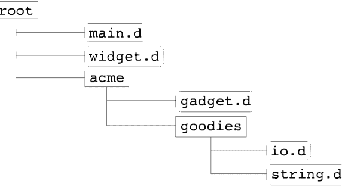

### 11.1 示例目录结构。

假设编译在根目录中进行。为了访问 `widget.d` 中的定义，任何其他文件必须包含顶层声明

```cpp
import widget;
```

“顶层”意味着任何作用域（如函数、类和结构体）之外。遇到导入声明时，编译器从根目录查找 `widget.d`（第一次）或 `widget.d`（第二次），找到 `widget.d` 并导入其符号。要使用目录层次深处的文件，项目中的任何其他文件必须导入从根开始的相对路径，使用 `.` 作为分隔符：

```cpp
import acme.gadget;
import acme.goodies.io;
```

我们经常在导入声明中使用逗号分隔列表。上述两者等于：

```cpp
import acme.gadget, goodies.io;
```

注意，位于目录层次内部的文件（如 `gadget.d`）仍将使用 `/` 作为通用分隔符，并理解这取决于系统。

## 第 11 章 扩展性

这些都非常良好且模块化，但也相当冗长且不必要地严格。如果请求了 `fun` 且没有其他地方定义函数 `fun`，编译器不能直接认为 `widget.fun` 是唯一的竞争者吗？

事实上，这就是查找机制的工作原理。每个被导入的模块都贡献了一个独立的命名空间，但在查找符号时，会发生以下步骤：

- 1. 在当前作用域中查找符号。如果找到，查找成功结束。
- 2. 在当前模块的作用域中查找符号。如果找到，查找成功结束。
- 3. 在*所有*导入的模块中查找符号。
    - 如果在某个模块中找到，查找成功结束。
    - 如果在多个模块中找到且该符号不是函数名，则以“重复符号”（duplicated symbol）错误消息返回失败。
    - 如果在多个模块中找到且该符号是函数名，则应用跨模块重载解析（第 146 页第 5.5.2 节）。

这种方法的一个很好的结果是，它允许客户端代码在大多数时候保持简洁，只在必须时变得冗长。在之前的示例中，`main.d` 可能简单地调用 `fun` 而无需任何修饰：

```
// 这是 main.d
import widget;
```

```cpp
void main() {
    fun(10); // 好的，只有模块 widget 定义了 fun
}
```

假设文件 `io.d` 也定义了一个签名相似的函数：

```cpp
// 这是目录 acme/goodies 下的 io.d
void fun(long n) {
    ...
}
```

让我们让 `main` 同时导入 `widget.d` 和 `io.d`。那么，不带修饰的 `fun` 使用将产生错误，但指定了模块名的限定调用可以正常工作：

```cpp
// 这是 main.d
import widget, acme.goodies.io;
```

```cpp
void main() {
    fun(10); // 错误！
    // 义函数 fun()
    // 在 widget 和 acme.goodies.io 中找到
    widget.fun(10); // 好的，显式解析
    acme.goodies.io.fun(10); // 好的，显式解析
}
```

注意歧义是如何保持潜伏的。如果你从未尝试以歧义的方式查找符号，编译器永远不会抱怨。

## 11.1. 包与模块

### 11.1.3.1 跨模块函数重载

第 5 章（确切来说是第 146 页第 5.5.2 节）讨论了函数重载如何应用于跨模块，并提供了一个示例，其中定义相同名称的模块并不一定会产生任何歧义。现在我们已经对模块和模块化有了更多了解，回到该讨论是值得的。

函数劫持（Function hijacking）是一种特别微妙的模块化违背行为。当一个模块中的函数竞争并接管了另一个模块的函数时，就会发生函数劫持。典型的表现是，模块根据其他模块的包含情况，或模块包含的顺序而执行不同的事情。劫持可能作为本无问题的代码的一种不幸情况发生。例如，在 `widget` 定义 `fun(int)` 而 `acme.goodies.io` 定义 `fun(long)` 的示例中，决定在 `main` 中调用 `fun(10)` 并等待 `fun` 似乎是合理的，因为“更好”总比好。然而，这是“更好是良的敌”的案例之一。如果 `main` 导入了 `acme.goodies.io`，那么 `fun(10)` 自然地传递给 `acme.goodies.io.fun` 作为唯一候选者。然而，如果 `widget` 出现了，`fun(10)` 突然就变成了 `widget.fun`。实际上，`widget` 进行了仲裁，劫持不再是隐藏的。

C++ 允许函数劫持，但大多数风格指南都建议避免它；Python 和许多其他语言完全不允许劫持。另一方面，大量的歧义可能会导致僵化的规则，从而促出一系列名称的产生。跨模块重载的基本原则是：添加或删除导入不能更改解析函数名的决策。反复导入可能会导致模块停止编译，并使无关的模块变得可编译。被消除的情况是：对于模块中找到的任何函数调用，如果函数名在多个模块中找到，且该调用在两个模块中均有效，那么该调用就是错误。反之，如果只有一种解析可以导致一个有效的函数调用，则该调用是合法的，因为没有劫持风险。在给定的示例中，如果 `widget` 定义 `fun(int)` 而 `acme.goodies.io` 定义 `fun(long)`，在 `main` 模块中的情况如下：

```cpp
import widget, acme.goodies.io;
void main() {
  fun(10); // 错误 歧义跨模块重载！
  fun(L); // 好的，无歧义地指向 acme.goodies.io.fun
  fun("10"); // 错误 未匹配！
}
```

在导入行中添加删除 `widget` 或 `acme.goodies.io` 可能会让损坏的程序恢复工作，让正常的程序崩溃，或者让正常的程序依然保持正常。

### 11.1.4 公共导入声明 (public import)

默认情况下，符号的查找是不传递的；如果 `main` 导入了 `widget`，且 `widget` 导入了 `io`，那么 `main` 无法看到 `io` 中的符号。然而，在某些情况下，`widget` 允许这种传递是有意义的。例如，当 `widget` 导入 `acme.goodies.io` 时，你可能希望让客户端看到这些符号，可以使用公共导入：

```cpp
// 这是 widget.d
// 让 acme.goodies.io 可见
public import acme.goodies.io;
```

`public import` 声明显示 `acme.goodies.io` 的所有符号对 `widget.d` 可用（本质上，是为 `widget.d` 增加了符号别名）。也就是说，假设 `widget.d` 定义了一个函数 `print(string)`，让我们在 `main.d` 中这样写：

```cpp
import widget;
```

```cpp
void main() {
    print("Hello"); // 好的，找到了 print
    widget.print("Hello"); // 好的
}
```

如果 `main` 同样导入了 `acme.goodies.io` 呢？尝试这样做：

```cpp
import widget;
import acme.goodies.io; // 多冗但无害
```

```cpp
void main() {
    print("Hello"); // 好的 ...
    widget.print("Hello"); // ... 好的 ...
    acme.goodies.io.print("Hello"); // ... 好的！
}
```

这对 `io.d` 没有造成任何损害：`widget` 定义 `acme.goodies.io.print` 别名并没有影响原始符号。额外的别名仅仅是到达相同定义的另一种方式。

最后，你可以使用 `private import` 使用某些代码。这种用法与普通的 `import` 是等价的。

### 11.1.5 静态导入声明 (static import)

偶尔，任何导入声明都会将导入的模块添加到隐式查找列表中（根据第 341 页第 11.1.3 节的算法），这可能是不受希望的。有时，通过显式符号限定来访问模块定义的功能（即使用 `modulename.symbol` 而非仅仅 `symbolname`）是明智的。

这种明智决策的最简单情况是将非常流行的模块与一个多个符号的特殊用途模块结合使用。例如，标准模块 `std::string` 定义了许多相关的程序。如果你与一个使用不同编码的旧系统交互（例如，双字节字符集 DBCS），那么你希望大多数时候使用 `std::string` 中的符号，而只偶尔且专门使用你自己的 `dbcs::string` 模块中的符号。为了这样做，只需为 `dbcs::string` 的导入声明指定 `static`。

```cpp
import std::string; // 定义了 toupper(string)
static import dbcs::string; // 也定义了 string toupper(string)
```

```cpp
void main() {
    auto s1 = toupper("hello"); // 好的
    auto s2 = dbcs::string.toupper("hello"); // 好的
}
```


第 11 章 扩展

具体来说，如果上面的代码没有导入 `std::string`，第一次调用将失败。静态导入（static import）没有自动查找机制，即使符号可以无歧义地解析。

静态导入在其他情况下也有用。一个导入了数十个模块的模块可能希望保留自动查找，并采用更冗长但更显式的方法。在这种情况下，使用 `static` 配合逗号分隔的列表是有用的：

```d
static import teleport, time.travel, warp;
```

或者在括号作用域前加上 `static` 以达到相同的效果：

```d
static {
import teleport;
import time.travel, warp;
}
```

### 11.1.6 选择性导入

处理符号冲突的另一种方法是仅从模块中导入某些符号。这可以通过以下语法实现：

```d
// 这是是 main.d
import widget : fun, gun;
```

选择性导入像激光手术一样精确：上面的导入请求恰好引入了两个符号，即 `fun` 和 `gun`。在选择性导入后，甚至 `widget` 也是不可见的！假设模块 `widget` 定义了 `fun`、`gun` 和 `hun`。在这种情况下，你可以使用 `fun` 和 `gun`，就像它们是由 `main` 定义的一样。任何其他尝试（如 `hun`、`widget.hun` 和 `widget.hun`）都是无效的：

```d
// 这是 main.d
import widget : fun, gun;
```

```d
void main() {
    fun(); // 正常
    gun(); // 正常
    hun(); // 错误！
    widget.fun(); // 错误！
    widget.hun(); // 错误！
}
```

## 11.1 包与模块

选择性导入的高精度和控制力使其非常受欢迎——有些程序员对此深信不疑，特别是对于那些来自导入和可见性机制较弱的语言的程序员。然而，需要提到的是，上述 D 提供的其他消歧机制也绝非等物。如果 D 使用容易出错的默认查找机制，那么对导入符号的完全控制将是极大的慰藉。

## 11.1.7 导入中的重命名

大型项目倾向于创建唯一的包层次结构。过度深层的目录结构是常见的的设计产物，特别是在那些希望通过慷慨、全面的命名方案从一开始就建立正确性的设计中，这种方案在项目出现不可预见的添加时仍保持稳定性。因此，模块发现自己处于使用深度嵌套模块的情况并不罕见：

```d
import util.container.finite.linear;
```

在某些情况下，重命名的导入非常有用，因为它允许你为 `util.container.finite.linear` 分配一个名称。

```d
import list = util.container.finite.linear;
```

有了这样的导入声明后，程序可以使用 `list.symbol` 而不是长长的 `util.container.finite.linear.symbol`。假设自定义模块定义了一个类 `List`，那么结果将如下：

```d
import list = util.container.finite.linear;
```

```d
void main() {
    auto lst1 = new list::List; // 正常
    auto lst2 = new util::container::finite::linear::List; // 错误！
    // 未定义的符号 util!
    auto lst3 = new List; // 错误！
    // 未定义的符号 List!
}
```

重命名导入并没有让重命名的包（即 `util` 直到 `list`）变得可见，因此在定义 `lst2` 时尝试使用长名称会在首次查找 `util` 时失败。此外，重命名导入是静态的（static kind，见第 345 页第 11.1.5 节），这意味着它不允许自动搜索；因此评估新的 `List` 是不起的。如果你想在重命的同时让名称可见，别名（alias，见第 276 页第 7.4 节）非常好：

```d
import util.container.finite.linear; // 非静态
alias util.container.finite.linear.list list; // 为了方便
```

## 第 11 章 扩展

```d
void main() {
    auto lst1 = new list.List; // 正常
    auto lst2 = new util.container.finite.linear.list.List; // 正常
    auto lst3 = new List; // 正常
}
```

重命名也可以这样与选择性导入（见第 346 页第 11.1.6 节）结合使用：

```d
import std.stdio : say = writeln;
void main() {
    say("Hello, world!"); // 正常，调用 writeln
    std.stdio.say("Hello, world!"); // 错误
    writeln("Hello, world!"); // 错误
    std.stdio.say("Hello, world!"); // 错误
}
```

正如预期的，在重命名了导入符号的选择性导入后，只有结果是可见的，其他没有。
最后，可以同时重命名模块和导入的符号：

```d
import io = std.stdio : say = writeln, CFile = File;
```

两个重命名导入符号之间可能的交互可能会产生一些矛盾。D 的决定是简单让声明等同于：

```d
import io = std.stdio : say = writeln, File;
import std.stdio : say = writeln, CFile = File;
```

双重重命名导入等于另外两个。一个只重命名模块，另一个重命名了引入的符号。这允许在更简单、已知的导入形式中定义语义。上述声明引入了符号 `io.writeln`、`io.File`、`say` 和 `CFile`。

## 11.1.8 模块声明

正如第 337 页第 11.1 节所述，包与模块是文件实际所在地。最简单的情况是模块拥有一个不是有效符号的名称。假设，你写了一个包含连字符的程序，例如 `gnome-cool-app.d`。那么 D 编译器将拒绝编译它。因为 D 必须为每个模块生成信息，每个模块必须有一个名称，而 `gnome-cool-app` 不是一个有效的名称。一个简单的解决方法是将源文件放在不同的名称下，例如 `gnome_cool_app.d`，然后在过程中对其进行重命名。这种方法可行，但有一种更简单更好的方法：在文件开头插入模块声明。

```d
module gnome.cool_app;
```

如果 `gnome-cool-app` 中存在这样的声明（再次作为文件的第一个声明），那么编译器就满意了，因为它使用 `gnome.cool.app` 生成所有模块信息。事实上，实际名称并不进行任何检查；它可以是：

```d
module path.to.nonexistent.location;
```

在这种情况下，编译器将生成所有模块信息，该模块名为 `app` 且位于 `path/to/nonexistent/location`。编译器并不关心，因为路径搜索仅与导入相关，而这里在直接编译 `gnome-cool.app` 时没有导入。

## 11.1.9 模块摘要

D 促进了一种不需要为程序定义提供单独声明（C 和 C++ 中的“头文件”和“源文件”）开发模型。你只需将代码放在模块中并让其他模块导入该模块即可。偶尔，你可能需要采用一种对模块必须实现的签名与背后的代码进行更强分离开发模型。在这种情况下，你需要使用源代码中所谓的模块摘要。模块摘要是使用另一个模块所需的最小信息。在实践中，模块摘要是不包含注释和函数实现的模块。使用编译时参数的函数实现保留作为模块摘要的一部分。模块摘要是有效的 D 代码。例如，考虑模块

```cpp
/**
这是该模块的文档注释
*/
module acme.doitall;
```

```cpp
/**
这是类 A 的文档注释
*/
class A {
    void fun() { ... }
    final void gun() { ... }
}
```

```cpp
class B(T) {
    void hun() { ... }
}
```

```cpp
void foo() {
}
```

```cpp
void bar(int n)(float x) {
}
```

`doitall` 的模块摘要复制了该模块，删除了所有注释，并将所有函数体替换为 `;`，但编译时参数化的函数外，这些函数保持不变。

```d
module acme.doitall;
```

```cpp
class A {
    void fun();
    final void gun();
}
```

```cpp
class B(T) {
    void hun() { ... }
}
```

```cpp
void foo();
```

## 11.1. 包与模块

```cpp
void bar(int n)(float x) {
  ...
}
```

摘要包含了某些模块使用 `acme.detail` 所需的信息。大多数情况下，摘要由编译器内部管理。根据请求，编译器可以从源码生成摘要（使用参考实现 `dmd` 上的 `-H` 标志）。生成的摘要在某些情况下非常有用，例如当你想分头文件加上编译库的形式发布库时。

但请注意，删除函数体并不是保证的。例如，如果 `acme.detail` 有空函数体或调用了其他函数，则其函数体可能会出现在生成的接口文件中。

C 和 C++ 编程语言用户熟悉的开发设置是手动维护头文件（即摘要）和实现文件。这种方法虽然增加了工作量，但也允许了某些团队管理技术。例如，对头文件的写入访问可以限制在设计团队中，由该团队控制模块提供给其他模块的所有 API 细节。实现团队拥有实现文件的访问权限，但对头文件只有只读权限，头文件被用作引导实现的活动文档。编译器会验证实现是否符合接口（至少在语法上是如此）。

在 D 中，你有一个选择：(a) 完全抛弃模块摘要；(b) 让编译器为你生成它们；或 (c) 手动管理模块和模块摘要。本书中的所有示例都采取了选项 (a)，即让编译器去处理所有模块摘要的问题。要练习这两种可能性，你首先需要将模块安排成类似于下一页图 11.2 所示的层次。

使用 `acme` 代码需要将 `acme` 的父目录和 `acme_impl` 添加到项目的模块搜索根路径（第 340 页 § 11.2），然后通过以下方式导入 `acme` 中的模块：

```cpp
// 这是 client.d
import acme.algebra;
import acme.io.network;
```

`acme` 目录只包含摘要文件。为了让实现文件能够协同工作，它们的模块名必须以包 `acme` 为前缀，而不是 `acme.impl`，这里模块声明派上用场了。尽管 `algebra.d` 位于 `acme_impl` 中，但通过包含此声明，它可以声称自己确实位于 `acme` 中：

## 第 11 章 扩展

**图 11.2：** 将模块摘要（“头文件”）与实现文件分离的目录结构。

```cpp
// 这是 acme_impl/algebra.d
module acme.acme;
```

相应地，子包 `io` 中的模块将使用

```cpp
// 这是 acme_impl/io/file.d
module acme.io.file;
```

这将允许编译器生成正确的包名和模块名。为了让编译器在构建程序期间找到函数体，只需将实现文件传递给编译器：

```bash
% dmd client.d /path/to/acme_impl/algebra.d
```

`client.d` 中的导入指令将定位 `/path/to/acme` 目录下的实现文件 `acme.di`。此外，编译器还会根据命令行中显式给出的实现文件找到正确的包名和模块名。

如果 `client.d` 使用了 `acme` 中的许多模块，在编译器的命令行中指定所有这些模块将变得困难。在这种情况下，更好的选项是将 `acme` 的所有代码打包成二进制库，并仅将该库传递给 `dmd`。

## 11.2. 安全

构建库取决于实现；在参考实现中，
你会执行如下操作：

```bash
% cd /path/to/acme_impl
% dmd -lib -ofacme algebra.d gui io/file io/network.d
```

`-lib` 选项指示编译器构建库，`-of` ("out-put file") 选项将输出重定向到名为 `acme.lib` (Windows) 或 `acme.a` (各种 Unix 派生系统) 的文件 `acme`。带上这个库，你只需要让

```bash
% dmd client.d /path/to/acme
```

## 11.2 安全性

安全性在历史上一直是一个争议性概念，但近年来已关注到一个具体的定义。直观上，一种语言是“保护其自身的抽象”的，例如，考虑一个 D 类：

```cpp
class A { int x; }
```

```cpp
float[] array;
```

这将允许编译器生成正确的包名和模块名。为了让编译器在构建程序期间找到函数体，只需将实现文件传递给编译器：

（此处省略重复的指令部分）

未检查的数组越界访问（Unchecked out-of-bounds array accesses）、任意指针算术（arbitrary pointer arithmetic）、悬空指针（dangling pointers）（此处重复.）——这些都是未定义行为的示例。

如果 `client.d` 使用了 `acme` 中的许多模块，在编译器的命令行中指定所有这些模块将变得困难。在这种情况下，更好的选项是将 `acme` 的所有代码打包成二进制库，并仅将该库传递给 `dmd`。

## 11.2.1 定义行为与未定义行为

除了令人糟糕的将指针强制转换为 float 之外，还有其他运行时错误可以被合理认为是语言的失败。对于“正确性”标准的一个问题是，列表可能是无限的。D 将其安全性关注在一个非常精确且实用的定义上：安全的 D 程序是没有未定义行为的。定义行为与未定义行为的区别如下：

- **定义行为**：在给定状态下执行程序片段具有确定的结果。其中一种结果是突然终止执行（这正是在引用空指针或除以零时会发生的情况）。
- **未定义行为**：在给定状态下执行程序片段的效果是未定义的。这意味着范围内的任何情况都可能发生。上一页展示的案例是一个很好的例子——带有这样一个单元的程序可能会运行一段时间，直到对数组的某些写入以及随后的幸运使用；导致执行失控。

关于除以零的定义行为与未捕获的行为，存在一些有趣的细微差别。例如，考虑一种语言将整数除以零定义为始终产生 `int_min`。这使得除以零变成了定义行为——尽管是一个没那么实用的定义。与之类似，`std::math` 实际上定义了 `sqrt` 返回 `double_nan`。这再次是定义行为，因为 `double_nan` 是一个良好的定义值，对于浮点类型不是错误：它被仔细定义为返回正无穷、负无穷或非数字（第 2 章）。在 `sqrt` 或浮点除法方面，程序将始终具有可重复的结果。

如果一个程序不会产生未定义行为，它就是安全的。

## 11.2. 安全

## 11.2.2 @safe, @trusted 和 @system 属性

确保不会发生任何未捕获的错误的一种简单方法是不允许所有不安全的 D 构造，例如特定的类型转换（cast）用法。然而，这意味着许多系统无法在 D 中实现。某些时候，你必须跳出抽象的边界，例如，将看似具有某种类型的内存转换为另一种类型的内存。这正是内存分配器或垃圾回收器中恰发生的事情。能够表达此类系统级软件一直是 D 语言的一个目标。

另一方面，许多应用程序需要以高度封装的方式对内存进行不安全访问。尽管语言的垃圾回收器是用不安全的语言实现的，但该语言仍可以称自己是安全的。这是因为从语言的角度来看，收集器不存在任何可能的不安全使用。收集器被封装在运行时支持内部，用不同的语言实现，并被安全语言视为一种“魔法原语”。垃圾回收器缺乏安全性是实现的问题，而不是客户端代码的问题。

一个大型项目如何能够在确保大多数模块安全的同时，又在少数地方违反规则呢？D 的安全方法是将控制权交给用户：你可以在声明时说明代码是遵循安全的，还是需要跳出安全的限制。通常，你在模块声明之后指定模块的特性：

```d
module my widget;
@safe:
```


此时，定义了 `@safe`、`@trusted` 和 `@system` 属性。这些属性允许模块宣布其安全级别。（这种方法并不新；Module-3 也有类似的方法来区分不安全模块和安全模块。）

属于 `@safe` 属性的代码承诺仅使用 D 的安全子集。

这意味着：

- 不允许从指针到非指针类型（例如 `int`）的转换，反之亦然
- 不允许在无关的指针类型之间进行转换
- 对所有数组访问进行边界检查
- 不允许包含指针类型、类类型、数组类型或嵌入此类类型的结构体（`unions`）
- 不允许指针算术
- 禁止获取局部变量的地址（实际上，限制是不允许此类地址逃逸，但那样追踪起来更困难）
- 函数调用必须调用其他 `@safe` 或 `@trusted` 函数
- 不允许内联汇编
- 不允许丢弃 `const`、`immutable` 或 `shared` 属性
- 不使用任何 `@system` 实体

有时，这些规则可能过于保守；例如，避免局部变量指针的逃逸可能会限制某些证明是合法的程序。D 的安全子集（称为 `SafeD`）的力量已经非常可观——整个应用程序都可以完全用 `SafeD` 编写。

相反，一个声明或一组声明可以指定低级访问是必须的。这些声明应该指定 `@system`：

```d
@system:
void * allocate(size_t size);
void deallocate(void* p);
...
```

`@system` 属性关闭所有检查，并可以利用语言不受限制的力量——无论这种力量带来收益还是危害。

最后，库通常处于为客户端提供安全抽象的位置，而它们自身又使用安全特性。D 标准库的许多组件都处于这种位置。这些声明可以被标记为 `@trusted`。

既未指定上述属性的模块将受默认选择限制。这在编译器的配置文件和命令行选项中是可以配置的，具体方法取决于实现。参考实现 `dmd` 将 `@system` 设置为默认值，并且仅在命令行选项 `--safe` 中避免将 `@safe` 设置为默认值。

在编写本文时，`SafeD` 处于 alpha 阶段——这意味着可能存在通过编译的不安全程序，而安全的程序却没有通过——这是一个活跃的开发领域。

## 11.3 模块构造函数和析构函数

有时，模块需要运行初始化代码来保证模块中的某些静态数据。实现该目标的一种可能方法是在访问资源数据的地方插入测试（“这些数据初始化了吗？”）。在这样做可能不方便或低效的情况下，请使用模块构造函数。

例如，假设编写了一些特定操作系统的模块来根据标志位决定做什么。在编译期间，区分主要的操作系统（例如“我是 Mac”与“我是 PC”）是简单的。但在不同的 Windows 版本之间做出决定必须在运行时完成。

为了简化问题，假设代码只关心区分 Windows Vista、比 Vista 新的版本以及早于 Vista 的版本。在模块初始化时进行检测的代码如下：

```d
private enum WinVersion { preVista, vista, postVista }
private WinVersion winVersion;
static this() {
    OSVERSIONINFOEX info = { OSVERSIONINFOFOEX.sizeof };
    GetVersionEx(&info) || assert(false);
    if (info.dwMajorVersion < 6) {
        winVersion = WinVersion.preVista;
    } else if (info.dwMajorVersion == 6 && info.dwMinorVersion == 0) {
        winVersion = WinVersion.preVista;
    } else {
        winVersion = WinVersion.preVista; // 注意：此处原文逻辑似乎有误
    }
}
```

这一成就的英雄是模块构造函数 `static this()`。此类构造函数始终在 `main` 之前执行。给定模块可以包含任意数量的模块构造函数。

相反，模块析构函数具有预测的语法：

```d
// 在模块级
static ~this() {
    ...
}
```

静态析构函数在 `main` 执行完成后执行，无论是正常返回还是抛出异常。模块可以定义任意数量的模块析构函数，并自由地交叉使用模块构造函数和析构函数。

### 11.3.1 模块内的执行顺序

给定模块内模块构造函数的执行顺序始终是从上到下的（词法顺序）。模块析构函数的执行顺序是从下到上的（反词法顺序）。

如果一个模块构造函数通过抛出异常失败，则 `main` 将不会执行，并且只会执行词法上位于该失败构造函数方的静态析构函数。如果一个模块析构函数通过抛出异常失败，则其他模块析构函数将不再执行，应用程序将通过标准错误控制台打印错误信息并终止。

### 11.3.2 跨模块执行顺序

跨不同模块定义顺序要复杂得多。规则与为静态类构造函数定义的（第 188 页 § 6.3.6）相同，并围绕以下概念构建：被其他模块导入的模块必须先初始化，后清理。以下是决定 `moda` 和 `mob` 的静态构造函数运行顺序的规则：

- 最多只有一个 `moda` 或 `mob` 定义了模块构造函数或析构函数。这样就不需要担心顺序。
- `moda` 和 `mob` 都没有导入对方。那么顺序是不指定的——任何顺序都可以，因为这两个模块互不依赖。
- `moda` 导入 `mob`。那么 `mob` 的构造函数在 `moda` 之前运行，`mob` 的析构函数在 `moda` 之后运行。
- `mob` 导入 `moda`。那么 `moda` 的构造函数在 `mob` 之前运行，`moda` 的析构函数在 `mob` 之后运行。
- `moda` 导入 `mob` 且 `mob` 导入 `moda`。那么在程序加载期间会发出“循环依赖”错误信号并放弃执行。

## 11.4 文档注释

编写文档是无聊的，而无聊是程序员终极的敌。结果是，典型的文档是稀缺、不完整且过时的。

自动化文档提取器尽力从纯代码中获取信息并显示实体之间有趣的关系。然而，如今的自动化提取器很难记录实现背后的高层意图。现代语言通过规定所谓的“文档注释”来帮助这种局面，这些注释是样式化的注释，用于描述（例如）用户定义的实体。语言处理器（编译器或独立程序）会结合代码搜寻注释，并生成某种流行格式（如 XML、HTML 或 PDF）的文档。

D 定义了一种文档注释规范，描述了样式化注释的格式以及将其转换为目标格式的过程。该过程不依赖于目标格式；是一个简单且灵活的翻译 template（也可以由用户定义）可指导翻译器生成任何需要的格式。

对文档注释翻译系统的完整介绍超出了本书的范畴。只需说，建议你对其进行仔细研究；许多 D 项目以及参考实现及其标准库的整个网站都是使用 D 的文档注释生成的。

## 11.5 与 C 和 C++ 接口

D 模块可以直接与 C 和 C++ 函数建立接口。限制是不允许模板 C++ 函数，因为这需要 D 编译器包含一个完整的 C++ 编译器。D 的类布局与使用虚类继承的 C++ 类不兼容。

要调用在 C 和 C++ 中定义的函数，只需在函数声明中指定语言，并确保将你的模块与相应的库链接：

```d
extern(C) int foo(char);
extern(C++) double bar(double);
```

这些声明使用 D 编译器来生成具有适当堆栈布局、调用约定和名称编码（又称名称修饰 `name mangling`）的调用，尽管 D 函数在这些方面的某些或全部特征有所不同。

要从 C 和 C++ 内部调用函数，只需提供一个如下声明的实现：

```d
extern(C) int foo(char*) {
  // Implementation
}
extern(C++) double bar(double) {
  // Implementation
}
```

编译器再次生成符合客户端语言的正确名称修饰和调用约定。因此，该函数可以从外部模块和 D 模块调用。

## 11.6 deprecated（弃用）

任何声明（类型、函数或数据）都可以以前 `deprecated` 作为前缀。该关键字的作用类似于存储类，但对实际代码生成产生产生影响。相反，它只是通知编译器被标记的实体不应被使用。如果该实体被使用，编译器会发出警告，如果传递了正确的标志（`-w dmd`），实际上可能会拒绝编译。

## 第 11 章 扩展 (Scaling Up)

使用 `deprecated` 允许你从旧版本 API 到新版本建立一条缓慢且有序的迁移路径。在弃用适当的声明后，你可以设置编译器接受或拒绝弃用的声明。当你准备好进行这一步时，错误将指出工作区域并允许进行增量代码更新。

## 11.7 version 声明

在理想的世界中，你编写一次即可随处运行。但在地球上，你偶尔会处理程序中的变性源——特殊用途构建或平台依赖。为了帮助，D 定义了 `version` 声明，你可以用它来条件编译代码。

使用 `version` 设计刻意保持简单直接。你要么设置一个版本，要么对其进行测试。版本本身可以是一个整数常量或符号：

```d
version = 20100501;
version = FinalRelease;
```

要测试版本，编写如下内容：

```d
version(20100501) {
  // Declarations
}
version(PreFinalRelease) {
  // Declarations
} else {
  // More declarations
}
```

如果之前分配了版本，则受测试保护的声明将被编译；否则，它们将被忽略。版本可以具有含义显而易见的 `else` 子句。

你只能在任何读取该版本之前设置版本。在测试过版本后尝试设置版本将导致编译时错误：

```d
version (ProEdition) {
  // Declarations
}
version = ProEdition; // Error!
```

这是因为 `version` 赋值不应该是可变的——无论你查看程序的哪个部分，版本必须保持相同。

此外，除了在源文件中指定版本外，你可以在编译器的命令行中指定（对于参考实现 `dmd`，使用 `-version=123` 或 `-version=xyz`）。尝试在命令行和源文件中同时设置版本同样是错误。

`version` 的简单性并非偶然。在许多方面让 `version` 变得强大是很容易的，但这会违背其初衷。例如，C 使用 `#if/#if/#else` 进行版本处理在定义版本控制方面可以认为提供了更多可能的策略——这就是为什么典型 C 项目中的版本控制会有一些错综复杂的条件逻辑球。D 的 `version` 刻意设计为功能较弱的，以便仅支持简单、统一的版本控制。

编译器通常包含若干预定义版本，例如平台（如 `Win32`、`Posix` 或 `Mac`）、字节序（`LittleEndian`、`BigEndian`）等。当程序启用单元测试时，`version (unittest)` 已经定义了。特殊的运行符号 `FILE` 和 `LINE` 分别表示当前文件名和文件中的行号。请查阅你的编译器文档以获取完整的版本定义列表。

## 11.8 debug 声明

声明是具有相同赋值和测试语法的特殊版本。`debug` 被特意定义，以标准化程序定义调试模块和设施的方式。

`debug` 的典型用法如下：

```d
module module;
...
void fun() {
    int x;
...
    debug(module) writeln("x=", x);
}
```

如果你想调试模块，在编译该模块时在命令行中定义 `-debug=module`，那么 `debug(module)` 将求为真，并编译所有受保护的代码。与 `version` 一样，你不能在测试过之后再赋值 `debug` 符号。

## 11.9 D 标准库

D 的标准库（代号为 `Phobos`）与语言一起有机地演进。因此，它包含了旧式的 API，也包含了使用语言新特性的新颖库产物。

## 第 11 章 扩展 (Scaling Up)

该库由两个主包组成：`core` 和 `std`。第一个包含基础运行时支持，包括内置类型的实现、垃圾回收器、启动和关闭代码、对并发的支持、访问 C 运行时库所需的定义以及其他相关组件。`std` 包包含更高层次的功能。这种设置的优势在于，其他库可以插接在 `core` 之上并与 `std` 共存，而不需要依赖它。

`std` 包具有扁平结构——模块直接位于该包中。模块专门用于功能区域。表 11.2 强调并讨论了几个较重要的 Phobos 模块。

### 表 11.2：标准模块摘要

| 模块名称 | 描述 |
|---|---|
| `std.algorithm` | 该模块可以说是该语言强大的泛型编程能力的旗舰，由 C++ 的标准模板库 (STL) [51] 实现。它包含 70 多种算法，以非常通用的方式实现。大部分涉及相同元素的结构化序列。在 STL 中，基本抽象是迭代器，而在 D 中对应的原语是 `range`。对 D 的 `ranges` 进行简要概述并不能体现其全部价值；关于 D 的 `ranges` 的全面介绍可以在网上找到 [3]。 |
| `std.array` | 用于数组操作的便利函数 |
| `std.bigint` | 具有高度优化实现的可变长度整数 |
| `std.bitmap` | 低级位操作类型和例程 |
| `std.concurrency` | 并发相关设施，在第 13 章容器实现中详细讨论 |
| `std.container` | 复数。在历史上，复数一直是一个内置功能。语言和编译器技术的进步允许切换到库实现，而不会显著损失效率。 |
| `std.contracts` | 几个合约相关和错误处理设施的所在地，特别是 `enforce`，它在书中被频繁使用。满足所有连接相关需求的一站式商店。许多有用函数（如 `to` 和 `text`）在此处定义。 |
| `std.conv` | |
| `std.date` | 日期和时间便利 |
| `std.file` | 文件工具。该模块通常按单元单元生成文件；例如，有一个函数 `std.read` 可以读取整个文件，但 `std.file` 没有打开文件并从中小分块读取的概念。（另见下文的 `std.stdio`。） |
| `std.functional` | 函数式定义和组合原语 |

## 11.9. D 标准库

### 表 11.2: 标准模块摘要（续）

| 模块名称 | 描述 |
|---|---|
| `std.getopt` | 命令行解析 |
| `std.json` | JSON 数据格式处理 |
| `std.math` | 高度优化的数学例程 |
| `std.numeric` | 通用数值算法和内核 |
| `std.path` | 文件路径操作工具 |
| `std.random` | 各种随机数生成器 |
| `std.range` | 范围相关的定义和分类原语 |
| `std.regex` | 正则表达式引擎 |
| `std.stdio` | 标准 I/O 库设施，基于 C 语言的 `stdio` 库构建。输入输出文件提供了范围接口，这意味着 `std.algorithm` 中定义的许多算法可以直接在文件上操作。 |
| `std.string` | 字符串函数。字符串与 `std.algorithm` 紧密集成，因此该模块较小，主要侧重于通过定义别名来适用于字符串的 `std.algorithm` 部分。 |
| `std.traits` | 类型特质与内省 |
| `std.typecons` | 定义新类型（如 `Tuple`）的设施 |
| `std.utf` | 操作 UTF 编码的函数 |
| `std.variant` | 判别联合类型 |

## 第 12 章 运算符重载

我们程序员倾向于不喜欢内置类型与用户定义类型之间过度的分离。赋予内置类型“魔术属性”违背了任何语言的开放性和可扩展性，因为用户定义类型将永远被贬低为二等公民。然而，语言设计者有正当理由给内置类型以红地毯待遇。这种原因是，如果一种语言过于可配置，会导致它既难以教学，也难以被人类和机器所解析。每种语言都试图在内置和可配置之间取得良好的平衡，使接近其中一个极端成为一个重点。

D 对此问题的看法是务实的：它承认了可配置性的重要性，但也承认了内置类型的实用性。具体来说，D 通过以下三种方式利用了内置类型：

- 1. **类型语法**：数组和关联数组随处可见

## 第 12 节 运算符重载

有些语言向列表中添加了运算符。它们使运算符变得特殊；为了对用户定义类型执行任何操作，你必须使用标准的语言设施，如调用函数或宏。这是一个完全合理的决策，但它为大量的数值代码带来了问题。许多数值程序定义了带有代数结构的自定义类型（无限精度数、自定义浮点数、数字、四元数、向量、各种布局的矩阵、张量…… 语言无法合理地记住所有这些都是内置的）。对于此类类型，代码的表达力会剧减。与等效语法相比，运算符通常需要的空间更少，括号也更少，并且通常会产生一眼就能识别的代码。例如，计算三个非零数字 `$x`、`$y` 和 `$z` 的调和平均数。基于运算符的表达式非常接近数学定义：

```d
m = 3 / (1/x + 1/y + 1/z);
```

在需要函数调用而不是运算符的语言中，情况看起来并不妙：

```d
m = divide(3, add(divide(1, x), divide(1, y)), divide(1, z));
```


使用中缀运算符时，包含许多算术操作的代码会变得非常难以阅读和修改。
`D`是一种非常吸引人的数值编程语言。它具有浮点数算术和一个卓越的超越函数库（该库提供了比系统原生库更高的精度），并提供了详复杂的建模能力。这通过强大的运算符重载机制得到了增强。通过运算符重载，你可以定义自己的数值类型（例如用于财务和会计程序的固定点或小数、无界整数或无限精度），这些类型紧密模拟内置数值类型。运算符重载还提供了定义具有类数值代数的细粒类型的能力，例如向量和矩阵。让我们看看如何定义利用此特性的类型。

## 12.1 重载运算符

`D`运算符重载的方法非常简单：只要运算符表达式中至少有一个参与者是用户定义类型，编译器就会将表达式重写为具有特定名称的普通方法调用。然后应用标准的语言规则。因此，重载运算符仅仅是方法调用的语法糖，所以不需要学习完整语言特性的变化。例如，如果 `a`是某些用户定义类型，表达式 `a + 5`被重写为 `a.opBinary!"+"(5)`。通常的检查和规则适用于方法 `opBinary`，`a`的类型如果支持运算符重载，则必须定义该方法。

重写（更准确地说是降低）过程将高层结构转换为低层代码，是实现新功能的非常有效的工具。

## 12.2 重载一元运算符

在现有运算符的基础上，`D`相当大量地使用它。我们在作用域语句（第84页第3.13节）中看到了降低的工作。本质上，作用域只是特殊设计的 `try`语句的糖，但你肯定不想直接编写底层代码——作用域会显著提高不协调性。运算符重载继续延续这一传统，通过将所有运算符调用定义为重写后的函数调用，利用普通的函数定义。闲话不多说，让我们看看编译器如何降低不同类别的运算符。

对于一元运算符 `+`（加）、`-`（取反）、`~`（按位取反）、`*`（指针解引用）、`++`（增）和 `--`（减），编译器重写表达式

```
a
```

转换为

```
a.opUnary!"<op>"
```

适用于所有用户定义类型。如果你想为某些运算符定义单独的方法，签名约束（第140页第5.4节）会很有帮助。例如，定义一个封装原始类型的 `CheckedInt`以确保其操作不会越界。这里显示了带有增减运算符的 `CheckedInt`部分定义：

```d
struct CheckedInt<N> if (isIntegral<N>) {
    private N value;
    ref CheckedInt opUnary(string op)() if (op == "++") {
        enforce(value != value.max);
        ++value;
        return this;
    }
}
```

```d
ref CheckedInt opUnary(string op)() if (op == "-") {
  enforce(value != value.min);
  --value;
  return this;
}
```

### 12.2.1 使用 mixin 合并运算符定义

一种强大的技术允许一次性定义多个运算符。例如，`CheckedInt`的一元运算符 `+`、`-`和 `~`都执行相同的操作——它们只是将相应的操作转发给值成员。尽管它们并不相同，但它们遵循相同的模式。我们可以为每个运算符定义专门的方法，但这会导致无意义的样板代码重复。更好的方法是使用混入（第47页第2.3.4.2节）直接从操作数名称和运算符符号组装操作。下面的代码实现了 `CheckedInt`的所有相关运算符。

```d
struct CheckedInt(N) if (is!N) {
  private N value;
  this(N value) {
    this.value = value;
  }
  CheckedInt opUnary(string op)() {
    if (op == "+" || op == "-" || op == "-") {
      return CheckedInt(mixin(op ~ "value"));
    }
  }
  bool opUnary(string op)() if (op == "!") {
      return value!;
  }
  CheckedInt opUnary(string op)() if (op == "+" || op == "-") {
    enum limit op = "+" ? N.max : N.min;
    enforce(value != limit);
    mixin(op ~ "value");
    return this;
  }
}
```

这种代码规模的节省已经显而易见，一旦我们开始处理二进制运算符和索引表达式，效果会变得更好。这种方法的核心是 `mixin`表达式——

### 12.2.2 后自增与后自减

后自增 `++`和后自减 `--`运算符很奇异——它们使用的符号与“前”对应的符号相同，通过符号来区分并没有帮助。另一个挑战是，获取运算符结果的调用者必须看到被递增实体的值。最后，递增和递减在其在前、后版本之间必须保持一致。

后自增和后自减可以通过少量样板代码完全从前自增和前自减生成。`D`并不是要求你编写样板代码，而是为你为你编写。`a++`的重写执行如下（后自减的处理类似）：

- 如果 `a++`的结果不需要，则重写为 `+++`，随后被重写为 `a.unary!"++"`。
- 如果使用了 `a++`的结果（例如 `arr[a++]`），则重写为 `let's take a deep breath ((ref x) {auto t=x++; return t;})(a)`。

第一种情况仅仅承认不使用结果后自增同于前自增。第二种情况定义了一个 lambda 函数（第148页第5.6节）来处理所需的样板代码：创建输入的新副本，递增输入并返回它。该 lambda 函数立即应用于被递增的值。

### 12.2.3 重载 cast 运算符

显式类型转换是一个写为 `cast(T) a`的一元运算符。它与其他所有运算符不同之处在于它指定了类型，因此有一个专门的降低（lowering）。对于某个用户定义类型的值和另一个类型 `T`，

```
cast(T) val
```

它被重写为

```
val.opCast!()
```

当然，`opCast`的实现应该返回一个 `T`类型的值，这一细节由编译器强制执行。虽然不允许通过返回值重载函数，但受限模板（constrained templates）允许多个 `opCast`定义。例如，要为类型 `T`定义转换为字符串和 `int`的转换，你可以写：

```d
struct T {
    string opCast(T)() if (is(T == string)) {
        ...
    }
    int opCast(T)() if (is(T == int)) {
        ...
    }
}
```

你可以定义到一整类类型的转换。让我们在 `CheckedInt`示例的基础上，将其转换为所有内置整数类型。技巧在于，其中某些类型可能具有更严格的范围，而我们希望确保转换过程中没有数据损失。另一个挑战是，我们希望在除非必要的情况下进行强制（例如，从 `CheckedInt!int`到 `long`的转换没有必要检查边界）。由于边界信息在编译期间存在，我们可以使用其他静态（工具，第68页第3.4节）来仅插入必要的强制措施。

```d
struct CheckedInt(N) if (isIntegral!N) {
    private N value;
    // 到所有整数的转换
    N1 opCast(N1) if (isIntegral!N1) {
        static if (N.min < N1.min) {
            enforce(N1.min <= value);
        }
        static if (N.max > N1.max) {
            enforce(N1.max >= value);
        }
    // 现在可以进行原始强制转换了
    return cast(N1) value;
}
```

### 12.2.4 重载三元运算符测试和 if 测试

给定一个用户定义类型的值，编译器将如下形式的代码
`a ? <expr1> : <expr2>`
重写为
`cast(bool) a ? <expr1> : <expr2>`

同样，编译器会重写内写在 `if`语句内部的测试
`if (a) <smt>` // 无论有没有 else 子句
重写为
`if (cast(bool) a) <smt>`

否定运算符也会被重写为转换的取反。
要启用此类测试，如下所示定义到 `bool`的转换：

```d
struct MyArray(T) {
    private T[] data;
    bool opCast(T) if (is(T == bool)) {
        return !data.empty();
    }
    ...
}
```

## 12.3 重载二进制运算符

对于二进制运算符 `+`（加法）、`-`（减法）、`*`（乘法）、`/`（除法）、`%`（模）、`&`（位与）、`|`（位或）、`^`（位异或）、`<<`（左移）、`>>`（右移）、`>>>`（无符号右移）、`~`（拼接）以及 `in`（成员测试），表达式
`a.op> b`
其中 `a`或 `b`中有一个用户定义类型，它被重写为
`a.opBinary!".op"(b)`
以及
`b.opBinaryRight!".op"(b)`

如果这些调用恰好有一个通过了查找和重载检查，则选择该重写。如果两个调用都有效，则是一个歧义错误。如果没有有效调用，显然这是一个“符号未找到”错误。

继续我们在第367页的 `CheckedInt`，对于二进制运算符，让我们定义：

```d
struct CheckedInt(N) if (isIntegral(N)) {
    private N value;
    // 加法
    CheckedInt opBinary(string op) if (op == "+") {
        auto result = value + rhs;
        enforce(rhs.min >= 0);
        return result;
    }
    // 减法
    CheckedInt opBinary(string op) if (op == "-") {
        auto result = value - rhs;
        enforce(rhs.max >= value);
        return result;
    }
    // 乘法
    CheckedInt opBinary(string op) if (op == "*") {
        auto result = value * rhs;
        enforce(rhs.min >= 0);
        return result;
    }
    // 除法和取模
    CheckedInt opBinary(string op) {
        if (op == "/" || op == "%") {
            .force(.
 != 0);
;
        }
    }
    // 移位
    CheckedInt opBinary(string op) {
        if (op == "<<" || op == ">>" || op == ">>>") {
            ...
        }
    }
    // 位运算（未检查溢出）
    CheckedInt opBinary(string op) {
        if (op == "&" || op == "|" || op == "^") {
            ...
        }
    }
}
```

### 12.3.1 运算符重载²

如果运算符重载允许类型定义其运算符的实现，那么运算符重载（或运算符重载²）就是允许类型定义运算符的多个重载版本。

例如，考虑表达式 `a = 5`，其中 `a`是 `CheckedInt`类型。这在目前无法编译，因为 `CheckedInt`定义 `opBinary`要求侧是 `CheckedInt`。客户端代码必须写成 `a = CheckedInt!int(5)`才能完成任务，这非常糟糕。

解决此问题的正确方法是为 `CheckedInt`定义一个或多个额外的二进制实现，这次在右侧接收类型 `N`。看起来定义新的 `opBinary`需要大量的重复性工作，但实际上只需要一行。

```d
struct CheckedInt(N) if (isIntegral(N)) {
    ...
    // 与原始数字的操作
    CheckedInt opBinary(string op) (N rhs) {
        return opBinary!op(CheckedInt(rhs));
    }
}
```

### 12.3.2 交换律

`opBinaryRight`的存在对于定义的类型出现在操作右侧的情况是必要的，例如 `5 * a`。在这种情况下，`a`的类型有机会通过定义 `opBinaryRight!*"(int)"`来挂钩运算符。这里涉及到冗余——如果你想支持例如在任意侧带有整数的操作（例如 `5 * a`和 `a = 5`），你定义定义 `opBinary!*"(int)"`。

以及 `opBinaryRight!"*\(int)"`，这是浪费的，因为乘法是交换律的。然而，让语言对运算符的交换律做出决定可能会产生不必要的限制；交换律属性取决于代数结构；例如，减法对于矩阵是不满足交换律的。因此，编译器留给用户分别定义左侧和右侧的运算符，并且不对运算符的交换律承担任何责任。

为了在一个操作数转换为另一个操作数的类型时支持 `op*b`和 `b*op`，以下单行代码就足够：

```cpp
struct CheckedIn(N) if (isIntegral(N)) {
    // 如前所示
    // 实现右侧运算符
    CheckedInt opBinaryRight(string op)(N lhs) {
        return CheckedInt(lhs).opBinary!op(this);
    }
}
```

在某些情况下，通过转换需要额外的多余步骤。例如，考虑 `s * c`，其中 `c`具有 `Complex!double`类型。上述解决方案会将乘法转发到 `Complex!double(5) * c`，这会将 `5`转换为虚部为零的复数，并在不必要时忙于复数乘法，而实际上只需要两个实数乘法就足够了。结果仍然是正确的，只是付了不必要的汗水。对于此类情况，最好不同的方式分解右侧运算符，分为交换运算和非交换运算。交换运算可以通过简单地交换操作数来处理。非交换运算可以根据具体情况从头实现，或者利用其他已实现的原语。

```cpp
struct Complex(N) if (isFloatingPoint(N)) {
    N re, im;
    // 实现交换运算符
    Complex opBinaryRight(string op)(N lhs) {
        if (op == "+" || op == "*") {
            // 假设左侧运算符已实现
            return opBinary!op(lhs);
        }
    }
    // 手动实现非交换运算符
    Complex opBinaryRight(string op)(N lhs) if (op == "-") {
        return Complex(lhs - re, -im);
    }
    Complex opBinaryRight(string op, N lhs) if (op == "/") {
        auto norm2 = re * re + im * im;
        enforce(norm2 != 0);
        auto t = lhs / norm2;
        return Complex(re * t, -im * t);
    }
}
```


## 12.4. 重载比较运算符

其他类型可能会以不同的方式分组某些运算符，在这种情况下，前述的约束 `op` 技术可能会有所帮助。

对于比较运算符（等等和排序），D 遵循了我们在类中遇到的设计（第 205 页的 § 6.8.3，第 209 页的 § 6.8.4）。这主要是出于历史原因的决策，但也有其他理由为比较设计一种与通用 `opbinary` 不同的方案。首先，`==` 和 `!=` 之间，以及所有四个 `<`、`<=` 和 `>=` 之间存在非常强的联系。这种关系表明，使用两个具名函数比允许基于符号的代码单独定义每个运算符更好。此外，定义相等和排序的类型可能比定义全套运算符的多。鉴于此，语言提供了一个小而简单的机制来定义比较，而不是强制使用强大的 `opbinary` 工具。

`a == b` 的重写（当 `a` 和 `b` 至少有一个用户定义类型时）按以下算法进行：

- 如果 `a` 和 `b` 都是类，重写为 `object.equals(a, b)`。如第 205 页 § 6.8.3 所述，类之间的比较遵循由核心库中 `object` 模块实现的小协议。
- 否则，如果 `a.equals(b)` 和 `b.equals(a)` 指向同一个函数，则重写为 `a.equals(b)`。这发生在 `a` 和 `b` 类型相同或具有不同修饰符时。
- 否则，`a.equals(b)` 和 `b.equals(a)` 中的一个必须可以编译并成为重写。

使用四个比较运算符 `<`、`<=`、`>`、>=` 的表达式重写如下：

- 如果 `a.opmp(b)` 和 `b.opmp(a)` 指向同一个函数，重写为 `a.opmp(b) < 0`。
- 否则，`a.opCm(b)` 和 `b.opCm(a)` 中的一个必须可以编译。如果第一个可以编译，重写为 `a.opCm(b) >= theta`。否则，重写为 `theta >= b.opCm(a)`。

值得提到同时存在 `equals` 和 `opCm` 的原因。乍看 `opCm` 似乎足够了（相等为 `a.opCm(b) == b`）。然而，大多数类型可以定义相等，但许多无法轻易定义不等关系。例如，矩阵或复数具有相等性，但缺乏标准的排序关系。

## 12.5 重载赋值运算符

赋值运算符包括 `a = b` 以及原地二进制运算符如 `a += b` 和 `a *= b`。我们在256 页的 § 7.1.5.1 中已经看到：

`a = b`

重写为

`a.opAssign(b)`

对于原地二进制运算符，`a op=` 的重写是

`a.opAssign("op=", b)`

重写为 `a` 提供了按照上述技术实现原地操作的机会。例如，考虑为 `CheckedInt` 实现 `+=`：

```cpp
struct CheckedInt(N) if (isIntegral(N)) {
    private N value;
    ref CheckedInt opAssign(string op)(CheckedInt rhs) {
        if (op == "+") {
            auto result = value + rhs.value;
            enforce(rhs.value >= 0 ? value : result <= value);
            value = result;
        }
    }
}
```

## 12.6. 重载索引运算符

上述定义中有三个值得注意的细节。首先，`opAssign` 返回当前对象的引用，这与内置类型的工作方式兼容。实际计算不是原地进行的，而是在侧完成的。只有在通过验证后更改实际状态。否则，当 `enforce` 抛出异常时可能会损坏当前对象。第三，运算符的体几乎是 `opBinary()` 的重复！

## 12.7. 重载切片运算符

另一个例子是，对于某些容器而言，数据访问与数据操作是无法区分的。例如，考虑一个稀疏数组。稀疏数组表面上可能有数百万个元素，但只有少数是非零的，这使得稀疏数组能够使用空间高效的存储策略。现在考虑以下代码：

```d
SparseArray::double a;
...
a[8] += 2;
```

具体的操作取决于数组的当前内容，以及槽位 `[8]` 之前是否为空：如果为空，则创建一个值为 `2` 的槽位；如果槽位已被值 `-2` 填充，则删除该槽位，因为它的新值将为零，而零是不显式存储的；如果是 `-2`，则进行加法并将结果存回槽位。如果 `opIndex` 返回的是一个引用，则没有办法实现甚至无法实现很大一部分这种操作。

D 数组提供了切片运算符 `a[b1 .. b2]`（第 97 页 4.1.3 节）。这两者都可以由用户自定义类型重载。编译器执行的类似于索引运算符的降级（lowering）处理。

当没有赋值时，编译器将 `a[]` 重写为 `slice()`，将 `a[b1 .. b2]` 重写为 `a.opSlice(b1, b2)`。

切片的降级遵循与数组定义的相同模式。方法名在整个过程中将 "array" 替换为 "slice"：`op a[i]` 降级为 `a.opSliceUnary("op")`，`op a[b1]` 变为 `a.opSliceUnary("op", b1, b2)`，`a[i] = c` 变为 `a.opAssign(c, a[b])`，`a[b] = c` 变为 `a.opAssign(c, b1, b2)`，`a[b1 .. b2] = c` 变为 `a.opSliceAssign("op")(c, b1, b2)`，最后 `a[b1 .. b2] = c` 变为 `a.opSliceAssign("op")(c, b1, b2)`。

## 12.8 $ 运算符

对于内置数组的内部和切片，D 允许符号 `$` 代表数组的长度。例如，`a[0 .. -1]` 选择内置数组中除最后一个元素以外的所有元素。

尽管这似乎是一个微小特性，但它是人们享受使用 D 数组的重要贡献者。相反，`$` 是“魔法”的且无法重载，这一事实一直是困扰的持久源头——这证明了那种观点：内置类型不应经常拥有用户自定义类型无法访问的功能。

`$` 运算符可以如下重载用户自定义类型：

- 在表达式 `a[i]` 中，如果 `a` 是用户自定义类型且 `$` 出现，则重写为 `a.opDollar(i)`。
- `op a[b1]` 变为 `a.opSliceUnary("op", b1, b2)`。
- `a[i] = c` 变为 `a.opAssign(c, a[b])`。
- `a[b] = c` 变为 `a.opAssign(c, b1, b2)`。
- `a[b1 .. b2] = c` 变为 `a.opSliceAssign("op")(c, b1, b2)`。
- 最后 `a[b1 .. b2] = c` 变为 `a.opSliceAssign("op")(c, b1, b2)`。

## 12.9 重载 foreach

用户自定义类型能够从本质上定义 `foreach` 如何与它们工作。这对于集合、范围和其他可迭代实体来说是一个巨大的福音。更好的是，你有两种不同的方法来实现它，并进行不同的权衡。

### 12.9.1 使用迭代原语的方法

定义 `foreach` 如何与你的类型（结构体或类）工作的方法是定义三个迭代原语：类型 `bool` 的属性 `empty` 用于告知是否还有剩余元素；返回当前迭代元素的属性 `front`；以及移动到下一个元素的方法。这些原语的典型实现如下：

```d
struct SimpleList(T) {
  private:
    struct Node {
      T payload;
      Node * _next;
    }
    Node * _root;
  public:
    @property bool empty() { return !_root; }
    @property ref T front() { return _root..payload; }
    void popFront() { _root = _next; }
    ...
}
```

有了这个定义，遍历列表变得非常简单：

```d
void process(SimpleList!int lst) {
  foreach (value; lst) {
    ... // 使用类型为 int 的 value
  }
}
```

编译器将 `foreach` 控制代码重写为使用这三个原语的较笨拙但细粒度更高的 `for` 循环：

```d
void process(SimpleList!int lst) {
    for (auto _c = lst; !_c.empty(); _c.popFront()) {
        auto value = _c.front;
        // 使用类型为 int 的 value
    }
}
```

如果你为 `value` 指定 `ref`，编译器会将循环体内所有对 `value` 的使用替换为对 `_c.front` 的调用。这样你可以直接替换列表中的元素。当然，你的 `front` 属性本身必须返回一个 `ref`，否则将其作为右值使用时将报错。

# 第12章 运算符重载

这种方法是有效的，但并非最优，因为它在运行时测试运算符，而这种操作本可以在编译期间完成。下面的解决方案通过将测试移动到通用 `opBinary` 内部消除了这种低效率。

```d
class A {
    // 不可重写的方法
    A opBinary(string op) (A rhs) {
        // 跳转到可重写的方法
        static if (op == "+") {
            return opAdd(rhs);
        } else static if (op == "-") {
            return opSubtract(rhs);
        }
        ...
    }
    // 可重载的方法
    A opAdd(A rhs) {
        ... 实现加法
    }
    A opSubtract(A rhs) {
        ... 实现减法
    }
}
```

这一次每个运算符都有一个可重载的方法。当然，你可以根据需要选择要重载的运算符以及它们的分组方式。

## 12.11 接下来是完全不同的东西：opDispatch

也许最有趣且符合惯例的重写是 `opDispatch`，它让 D 语言进入了通常留给更动态语言的地方。

如果类型 `T` 定义了方法 `opDispatch`，编译器会将：

```
a.fun(<arg1>, ..., <argk>)
```

写入：

```
a.opDispatch!"fun"(<arg1>, ..., <argk>)
```

这对于 `a` 的类型未定义的所有潜在方法，即那些在其他情况下会导致“方法未定义（method not defined）”错误的调用。

`opDispatch` 的定义可以实现许多具有不同程度动态性的有趣设计。例如，考虑一个 `opDispatch` 实现，为类方法实现另一种命名约定。首先，让我们来实现一个简单的函数，将写成如 `所示_like_this` 的符号转换为对应的驼峰命名形式 `writtenLike`：

```d
import std::ctype;
string underscoresToCamelCase(string sym) {
    string result;
    bool makeUpper;
    foreach (c : sym) {
        if (c == '_') {
            makeUpper = true;
        } else {
            if (makeUpper) {
                result += toupper(c);
                makeUpper = false;
            } else {
                result += c;
            }
        }
    }
    return result;
}
```

```d
unittest {
    assert(underscoresToCamelCase("hello world") == "HelloWorld");
    assert(underscoresToCamelCase(" a") == "A");
    assert(underscoresToCamelCase("abc") == "abc");
    assert(underscoresToCamelCase("a. bc. d.") == "aBCD");
}
```

有了 `underscoresToCamelCase`，我们可以轻松地为类定义 `opDispatch`，说服它接受 `.method_like()` 形式的调用，并自动将其转发到 `methodLikeThis()`——所有这一切在编译期间完成。

```d
class A {
    auto opDispatch(string m, Args...)(Args args) {
        return mixin("this.-underscoresToCamelCase(m)"(args)");
    }
}
```

```d
int doSomethingCool(int x, int y) {
  ...
  return 0;
}
```

unittest {
a a = new A;
a.doSomethingCool(5, 6); // 直接调用
a.dosomething.cool(5, 6); // 相同的调用，通过 opDispatch 进行

第二次调用没有引用 `A` 的任何方法，因此它通过调用 `a.opdispatch!(".something_cool(5,6)")` 路由到 `opDispatch`，该调用生成字符串 `"this.doSomethingCool(args)"` 然后通过使用 `mixin` 将其编译。由于 `args` 绑定到参数解析 `5`，该混合体立即转发到 `a.doSomethingCool(5, 6)`——最完美的转发。任务完成。

## 12.1.1 动态分发：opDispatch

使用 `opDispatch` 可以实现许多具有不同动态性的有趣设计。由于 JavaScript 或 Smalltalk 等动态语言允许运行时添加方法，使用 `opDispatch` 来实现类似的动态分发是非常有趣的。在 D 语言中，通常在编译期间完成工作，但通过 `opDispatch` 可以在运行时实现权衡。

在静态执行与动态执行方法之间的权衡是值得注意的。使用 `opDispatch` 允许在运行时进行某些动态操作。

```d
import std::variant;
```

```d
alias delegate(Dynamic, Variant[]) DynMethod;
```

`opDispatch` 允许在运行时根据需要操作类定义。因此，通过 `opDispatch` 查找方法是很有用的。

```d
class Dynamic {
    private DynMethod[string] methods;
    void addMethod(string name, DynMethod m) {
        methods[name] = m;
    }
    void removeMethod(string name) {
        methods.remove(name);
    }
    // 分发
    Variant call(string methodName, Variant[]) args) {
        return methods[methodName](this);
    }
    //// opDispatch 提供语法糖
    Variant opDispatch(string m, Args...) {
        Variant[] packedArgs = new Variant[args.length];
        foreach (i, arg : args) {
            packedArgs[i] = arg;
        }
        return call(m, packedArgs);
    }
}
```

测试 `Dynamic`：

```d
unittest {
auto obj = new Dynamic;
obj.addMethod("sayHello",
Variant(Dynamic[]) {
writeln("Hello, world!");
return Variant();
});
obj.sayHello(); // 打印 "Hello, world!"
```


## 12.12 总结与快速参考

用户自定义类型可以重载大多数运算符。有少数例外，例如逗号运算符 `,`、逻辑与运算符 `&&`、逻辑或运算符 `||`、标识测试 `?;` 以及符号运算符 `addressof` 和 `typeof`。这些运算符的创建是为了避免可能产生更多混淆。

说到混淆，运算符重载是一个强大的工具，但也带有相应的警告。在 D 语言中，最好避免将运算符用于奇特的用途，例如定义领域特定语言（DSL）；如果你想定义 DSL，最好使用字符串、`mixin` 和编译时函数求来从编译时字符串解析 DSL 输入并生成相应的 D 代码。这涉及更多工作，但你的库客户端会感激的。

定义 `opDispatch` 开启了新的视野，但也应该明智使用。过多的动态可能会引入不必要的低效率并削弱类型检查——例如，如果在上面的示例中写成 `a.helloWorld()` 而不是 `a.helloWorld()`，代码仍然会编译，但在运行时会失败。

表 12.1 总结了本章提供的信息。当你为自己的类型重载运算符时，可以参考它。

### 表 12.1 重载运算符总结

| 表达式 | 重写为 ... |
|---|---|
| .op 对于 .op ∈ {+, -, *, *} | a.opUnary()"<op>" ( |
| ++, --) | ((x) (auto t=x; ++t; return(t))(a)) |
| | ((x) (auto t=x; --t; return(t))(a)) |
| cast(T) a | | 
| a?.expr1 : .expr2 | cast(bool) a ? expr1 : .expr2 |

## 12.12. 总结与快速参考

### 表 12.1: 重载运算符（续）

| 表达式 ... | 重写为 ... |
| --- | --- |
| a == b | 如果 a, b 是类：object.opEquals(a, b)（参见第 205 页的 § 6.8.3）。否则，如果 a 和 b 具有相同类型：a.opEquals(b)。否则，可编译的是 a.opEquals(b) 或 b.opCmp(a)。 |
| a != b | ! (a == b)，然后参考上述重写规则 |
| a < b | a.opCmp(b) < 0 or b.opCmp(a) > 0 |
| a <= b | a.opCmp(b) <= 0 or b.opCmp(a) == 0 |
| a > b | a.opCmp(b) > 0 or b.opCmp(a) < 0 |
| a >= b | a.opCmp(b) >= 0 or b.opCmp(a) <= 0 |
| a = b | a.opAssign(b) |
| a .op= b | for .op in {+, -, *, /, %, &, |, ^, ~, <<, >>, >>>, ~} | a.opAssign!"*op" (b) |
| a[b1, b2, ..., bk] | a.opIndex(b1, b2, ..., bk) |
| a[b1, b2, ..., bk] = c | a.opIndexAssign(c, b1, b2, ..., bk) |
| a .op[b1, b2, ..., bk] if | a.opIndexUnary(b1, b2, ..., bk) |
| a .op in {+, -, *, /, %} | |
| a[b1, b2, ..., bk] .op= c | a.opIndexOpAssign!"*op" (c, b1, b2, ..., bk) |
| for .op in {+, -, *, /, %, &,,,, |, ^, <<, >>, >>>, ~} | a[b1, b2, ..., bk] = c | |
| a[b1 .. b2] | a.opSlice(b1, b2) |
| a .op[b1 .. b2] | a.opSliceUnary!"*op" (b1, b2) |
| a[] = c | a.opSliceAssign(c) |
| a[b1 .. b2] = c | a.opSliceAssign(c, b1, b2) |
| a[b1 .. b2] .op= c | a.opSliceOpAssign!"*op" (c, b1, b2) |

# 第 13 章

# 并发

硬件行业各种因素的汇聚导致访问计算资源的方式发生了质变，这反过来促使我们处理的方法以及使用的语言抽象发生了深刻变化。并发无处不在，利用并发是软件的责任。

尽管整个软件行业尚未对并发革命带来的挑战给出最终回应，但 D 的年轻让其创建者能够在并发方面做出明智决策，而不被过时的过去选择或大型遗留代码库所束缚。与并发命令式语言模式的一个主要突破是 D 不促进数据线程的共享；默认情况下，并发线程几乎是通过语言机制相互隔离的。允许数据共享，但仅限于有限且受控的方式，这些方式允许编译器提供强有全局保证。

同时，D 仍然是一门系统编程语言，因此它允许你使用各种底层的、大胆的并发方法。（然而，这些机制中的某些在安全程序是不允许的）。

简之，D 的并发机制是分层的：

- 并发的核心方法是使用通过消息通信的隔离线程或进程。这种被称为消息传递的范式可以产生安全、模块且易于理解和维护的程序。多种语言和库已成功使用消息传递。从历史上看，消息传递比基于内存的方法慢——这解释了为什么它没有被一致采纳——但最近这种情况发生了明确且持久的扭转。鼓励并发 D 程序使用消息传递，这种得益于广泛基础设施支持的范式。
- D 还提供了基于由互斥量保护的临界区和事件变量的旧式同步。这种并发方法受到了严厉批评，因为它无法扩展到今天和未来的高度并行架构。D 对数据共享实施了严格控制，这反过来抑制了基于锁的编程风格。这些限制起初看起来可能很残酷，但它们治愈了锁代码最糟糕的敌人；底层数据竞争。数据共享仍然是传递大量数据线程的最有效手段，因此不应被忽视。
- 遵循系统级语言的传统，未标记为 `@asm` 的 D 程序可以使用强制转换来获取热的、泡泡的、未经检查的数据。此类程序的正确性很大程度上是你的责任。
- 如果你觉得控制级别不够，可以使用 `asm` 语句来控制你的机器资源。要达到比更低的层次，你需要一把微型电烙铁和一只非常、非常稳定的手。

在深入探讨这些主题之前，让我们短路走一下，以便更好地理解动摇我们世界的硬件发展。

## 13.1 并发

说到并发，我们正生活在比以往任何时候更“引人入胜”的时代。有趣的时代以好坏消息交织的形式出现，构成了一个复杂的权衡、力量和趋势格局。

好消息是集成密度仍在根据摩尔定律增加；根据我们所知以及目前可以合理预测的，这一趋势在写作后的至少十年内将持续。微型化提高了功率密度，因为每个面积内可以工作更多的晶体管。由于组件更近，连接也更短，这意味着局部互连速度更快。这是一个效率红利。

不幸的是，有许多以“不幸”开头的句子抑制了对计算密度的热情。首先，连接不仅是局部的——它形成了一个层次结构 [116]：密切的组件单元连接到其他单元，形成更大的单元。然后，更大的单元也连接到更大的单元，形成更大的块，依此类推。从连接性来看，这些更大的块之间仍然“遥远”。糟糕的是，每个块复杂性的增加了块间连接的复杂性，这是通过减少导线的厚度和间距来实现的。这意味着电阻、电容和干扰的增加。电阻电容会恶化线中的传播速度。干扰是导线信号通过（在这种情况下是电磁场）传播到相邻导线的倾向。在高频率下，线就像天线，干扰变得无法忍受，串行通信日益取代并行通信（这种反直觉的现象在所有尺度上可见——USB 取代了并行端口，SATA 取代了 ATA，串行总线正在内存系统中取代并行总线，这一切都是由于干扰）。并行快串行慢的日子去哪里了？

此外，处理器与内存之间的速度差距也在扩大。虽然内存密度以预期的相同速率增加通用集成密度，但由于各种物理、技术和市场原因，其访问速度日益落后计算速度 [22]。尚不清楚如何显著缩小速度差距，而且它正在增长。处理器与内存中的一个字之间可能隔着数百个周期；几年前，你还可以购买“零等待状态”内存。

不再追求更快的时钟频率，转而决定提供以已知方式封装的计算能力：多个相互连接的中央处理器（CPU），它们通过总线连接到彼此以及内存上。因此，在短短几年内，提高计算机速度的责任在很大程度上从硬件领域转移到了软件领域。更多的 CPU 似乎是一个有利的提议，但对于普通的桌面计算机工作负载来说，要有效利用八个以上的处理器变得微乎其微。未来的趋势预测，可用 CPU 将呈指数级扩展到几十个、数百甚至数千个。为了加速某个特定程序，需要大量的编程工作来让这些 CPU 发挥作用。

计算行业一直受到各种技术和人为因素的影响而移动和震动，但这一次我们似乎已经走到了尽头。由于时间紧迫，休假已不再是提高程序速度的选择。这简直不可理喻。这就是并发率（Concurrentrate）。

## 13.2 数据共享简史

计算领域正在发生的转变之一是如今并发机制和模型变化速度之之快，特别是与编程语言和范式的发展速度相比。编程语言及其相关风格需要几年甚至几十年才能刻入社区的传说中，而并发事务的变革在 2000 年初发生了一个明显的指数级转折。

例如，你昨天对通用并发¹的理解集中在时分共享，而时分共享又源于 20 世纪 60 年的大机共享。当时 CPU 时间非常昂贵，因此在多个控制台的多个程序之间共享 CPU 是有意义的，以提高整体利用率。进程被定义为运行程序的状态和资源。为了实现时分共享，CPU 使用定时器中断配合软件调度器。在每次定时器器触发时，调度器都会决定哪个进程获得下一个时间片（quantum）的 CPU 时间，从而产生了一种多个进程在同一 CPU 上同时运行的幻觉。

为了防止进程相互踩踏以及破坏操作系统代码，引入了硬件内存保护。在当今的系统中，内存保护通过内存虚拟化实现以确保健壮的隔离：每个进程都认为自己“拥有”内存，而一个从逻辑地址（进程看到的内存）到物理地址（机器访问内存的地址）的翻译层仲介了进程与内存的所有交互，并将进程相互隔离开。好消息是，进程只会伤害自己，而不会伤害其他进程或操作系统内核。较不好的消息是，在每次任务切换时，都必须发生可能昂贵的地址翻译设备切换，更不用说每个刚切换进去的进程在唤醒时都会产生“缓存失忆”（cache amnesia），因为全局共享缓存极可能被其他进程使用。这就是线程的诞生。

线程是一个没有关联地址翻译的进程——一个裸露的执行上下文：处理器加上堆栈。多个线程共享一个进程的地址空间，这意味着它们之间的共享和切换是非常廉价的，而且它们可以轻松、廉价地相互共享数据。在同一 CPU 上运行的线程之间的内存访问是尽可能简单的——一个线程写，另一个线程读。在相同的线程模型下，一个线程写入数据的顺序自然就是其他线程看到这些写入的顺序。通过使用同步原语（如信号量和互斥锁）保护临界区（critical sections）的互锁机制，可以确保更高层数据的不不变性。在 20 世纪后期，关于所谓的“经典”多线程编程，积累了大量的知识、传说和轶事，其特征是共享地址空间、关于内存可见性和同步的简单规则。虽然也存在其他并发模型，但经典多线程在主流硬件上应用最广泛。

如今的主流命令式语言如 C、C++、Java 或 C# 开发于经典多线程时代——那个简单内存架构、直接数据共享和易于理解的互锁原的年代。自然地，语言通过容纳共享相同内存的线程来模拟硬件现实。此后，多线程的定义本身意味着所有线程共享相同的地址空间，与操作系统进程不同。此外，消息传递 API（如 MPI 规范 [291]）已以库的形式存在，最初是用于（超级）计算机等高端硬件。

在同一历史时期，函数式编程圈已经充分注意到，这种计算模型本质上倾向于乱序执行，但直到最近，这种潜力更多是出于局限的需求，而非通用结果。

最后，Erlang 开发于 20 世纪 80 年代后期，作为一种电信应用的领域特定语言。该领域要求在同一台机器上运行数万个并发程序，并强烈倾向于消息传递、“发后即忘”的通信风格。尽管主流硬件和操作系统并未针对此类工作负载进行优化，但 Erlang 最初运行在专用硬件上。其结果是产生了一种语言，它最初结合了不纯函数风格与强大的并发能力，以及坚定的消息传递、无共享的通信方法。

快回到 2010 年代。今天，即使是普通的机器也有多个处理器，而这十年的主要挑战是在芯片上堆入更多的 CPU。这导致了一系列后果，最重要的一点是共享内存的消亡。

一个时分制的 CPU 连接着一个内存子系统——缓冲区、多级缓存等。无论 CPU 如何被时分共享，读和写操作都通过相同的流水线；因此，在所有线程之间维持了内存的一致性视图。相比之下，多个互连的 CPU 无法共享缓存子系统：这样的缓存需要多处理器支持（昂贵且难以扩展），并且很难同时放置在所有 CPU 附近。因此，今天的 CPU 拥有自己的专有缓存内存。将 CPU 与缓存连接的硬件和协议是影响系统性能的关键因素。

多个缓存的存在使得线程间的数据共享变得异常困难。现在线程中的读写操作……

> 2. 甚至主题标题也从“线程”改为“并发”，以反映线程只是并发模型这一事实。
> 4. Erlang 进程不同于操作系统进程。

```
int perThread;

shared int perProcess;
```

在许多语言中，第一个定义（或其语法等价物）会引入一个所有线程使用的全局变量；然而在 D 语言中，`perThread` 为每个线程都有一个独立的拷贝。第二个声明只分配了一个 `int`，它被所有线程共享，这种方式更接近（但并不等同于）传统的全局变量。

变量 `perThread` 使用一种名为线程本地存储（TLS）的操作系统机制进行存储。TLS 分配的数据的访问速度取决于编译器和底层操作系统。通常，它与 C 程序中访问普通全局变量相比，速度慢得可以忽略不微。在可能出现问题的少数情况下，你可能希望在访问密集型循环中将全局变量加载到共享变量中。

这种设置有两个重要的优点。首先，默认共享的语言必须小心地同步对全局数据的访问；而对于 `perThread` 来说这是必要的，因为它是每个线程私有的。其次，`shared` 修符意味着系统和人类用户都清楚 `perProcess` 正在被多个线程同时访问。特别是类型系统将积极地保护共享数据的使用，并不允许明显错误的使用。这彻底颠转了传统的设置：在默认共享机制下，程序员必须跟踪哪些数据是共享的，哪些不是，事实上，大多数与并发相关的 bug 都是由过度或未保护的共享引起的。在显式共享机制下，程序员可以确定，未标记为共享的数据绝不会对多个一个线程可见。为了确保这一保证，共享值将经过额外的检查，我们很快就会遇到。

使用共享数据仍然是一个高级话题，尽管类型系统自动确保了低层一致性，但高层不变性可能无法得到保证。为了在线程之间提供简单且高效的通信，首选方法是使用名为消息传递的范式。内存隔离的线程通过相互发送异步消息进行通信，这些消息仅由封装在一起的 D 值组成。

通过通道通信的隔离工作单元（workers）是一种稳健且经过时间验证的并发方法。Erlang 多来一直如此，基于消息传递接口（MPI）规范的应用 [29] 也是如此。

雪上加霜，即使在默认共享的多线程语言中，良好的编程实践实际上也推崇本应该隔离的线程。并发领域的世界级专家 Herb Sutter 在一篇题为“正确使用线程 = 隔离 + 异步消息” [54] 的文章中写道：

> 5 这必须是短语“雪上加霜”（to add insult to injury）的反义词。

## 13.4. 启动线程

线程是表达异步工作的低级工具。通过应用规范来“提升”它们：努力使它们的数据私有，并让它们使用异步消息进行通信。每个需要从其他线程或人类获取信息的线程都应该有一个消息队列（无论是简单的 FIFO 队列还是优先级队列），并围绕事件驱动的消息泵主线组织你的工作：用事件驱动逻辑取代面条逻辑是提高代码清晰度和确定性的绝方法。

如果说几十年的计算教会了我们一件事，那一定就是面向纪律的编程无法扩展。因此，令人慰的是，上面的引用相当准确地总结了接下来的章节，除了纪律部分。

## 13.4 启动线程

要启动线程，可以像这样使用 `spawn` 函数：

```d
import std.currency, std.stdio;

void main() {
    auto low = 0, high = 100;
    spawn(&fun, low, high);
    foreach (i .. high) {
        writeln("Main thread: ", i);
    }
}

void fun(int low, int high) {
    foreach (i .. high) {
        writeln("Secondary thread: ", i);
    }
}
```


`spawn` 函数接收函数地址 `&fun` 和若干数量的参数 `$1`, `$2`, ..., `$an`。参数的数量及其类型必须与 `fun` 的签名匹配，即调用 `fun($1, $2, ..., $an)` 必须是正确的。这种检查在编译时完成。`spawn` 创建一个新的执行线程，该线程将发出调用 `fun($1, $2, ..., $an)` 然后终止。当然，`spawn` 不会等待线程终止——一旦线程被创建并且参数被传递给它，它就会返回。

程序向标准输出总共输出 200 行内容。行的交错取决于多种因素；你可能会看到主线程的 100 行，紧接着是辅助线程的 100 行，反之亦然，或者是某些看似随机的交错。然而，绝不会在同一行上混合两条消息。这是因为 `write` 被定义为每次调用与其输出流之间是原子的。此外，每个线程发射行的顺序将得到尊重。

即使 `main` 的执行可能在辅助线程中 `fun` 的执行之前，程序也会耐心地等待所有线程完成。这是因为运行时支持库遵循一个关于程序终止的小协议，我们稍后会讨论；现在只需注意到其他线程不会因为 `main` 返回而突然死去。

正如隔离保证承诺的那样，新创建的线程与调用线程不共享任何内容。嗯，几乎不共享：全局句柄 `stdout` 实际上是在两个线程之间共享的。并没有作弊：如果你查看 `std::stdio` 模块的实现，你会发现 `stdout` 被定义为全局变量，并在类型系统中得到了妥善考虑。

# 第 13 章. 并发

## 13.4 共享

你可以调用什么类型的函数？第 8 章解释了 `immutable` 提供了一个强保证：不可变值在其整个生命周期内保证不会改变。章节第 291 页解释了 `string` 类型实际上是 `immutable(char)` 的别名。最后，我们知道所有的竞争都是由共享引起的——只要没有人看到相同的东西。类型系统和线程基础设施通过允许 `immutable` 数据在线程间自由共享来承认这一点。事实上，引入 `immutable` 的很大动力是为了帮助跨线程共享结构化数据。

### 13.4.1 传递参数

重写的示例与原始示例相似，但它打印了一个额外的字符串。该字符串在主线程中创建并传递，而消息的内容是共享的。考虑到这一点，让我们来看：

```d
import std.concurrency, std.stdio;

void main() {
  auto low = 0, high = 100;
  auto message = "Yeah, ";
  spawn(fun, message, low, high);
  foreach (i .. high) {
    println("Main thread: ", i);
  }
}

void fun(string text, int low, int high) {
  foreach (i .. high) {
    println("Secondary thread: ", text, i);
  }
}
```

## 13.5 线程间的交换

消息交错的几乎没有趣味。让我们修改示例，以确保线程协作打印如下格式的消息：

* 主线程: 0
* 辅助线程: 0
* 主线程: 1
* 辅助线程: 1
* ...
* 主线程: 999
* 辅助线程: 999

为了实现这一点，我们需要在数字“数字”和两个线程之间定义一个协议：主线程应该向辅助线程发送“打印这个”的消息，而辅助线程必须回答“打印完成”。这里几乎没有并发，但这个示例很好地解释了纯通信。首先，为了两个线程通信，它们需要知道如何找到对方。程序可能有许多线程在聊天，所以标识是必要的。要找到一个线程，你必须获取它的线程 ID，昵称为 `tid`，它是由 `spawn` 返回的。`tid` 的类型名称是 `Tid`。反之，辅助线程也需要 `Tid` 来发送回复。这可以通过让发送者指定自己的 `Tid` 来轻松实现，就像在信封上写发件人地址一样。

这个 `writer` 包装器不需要更多的参数，因为它以消息的形式接收 `spawn` 返回的信息。主线程保存了 `Tid`，然后在调用 `send` 方法时使用它。该调用向对方发送了两部分数据：通过全局属性 `thisTid` 访问的线程 `Tid`，以及要打印的整数。在将数据“隔栅投递”给另一个线程后，主线程通过调用 `receiveOnly` 等待确认。`send` 和 `receiveOnly` 函数协同工作；一个线程中的 `send` 调用会被另一个线程中的 `receiveOnly` 调用所响应。`receiveOnly` 中的 "only" 之存在是因为 `receiveOnly` 接受特定类型——例如，在调用 `receiveOnly!bool()` 时，调用者只接受一个由 `bool` 值组成的消息；如果另一个线程发送了其他任何内容，`receiveOnly` 将抛出 `MessageMismatch`。

让我们让 `main` 线程运行 `foreach` 循环，专注于 `writer` 的实现，它实现了该微协议的另一端。`writer` 在一个循环中运行，首先接收一条消息，该消息必须由一个 `Tid` 和一个 `int` 组成。这是由 `receiveOnly!(Tid, int())` 调用确保的；如果主线程发送的消息带有不同数量或类型的参数，`receiveOnly` 将通过抛出异常而失败。按照代码写法，`writer` 中的 `receiveOnly` 调用与从 `main` 发出的 `tid.send(thisTid, i)` 调用完美匹配。

`msg` 的类型是 `Tuple!(Tid, int)`。通常，带有多个参数的消息被封装在 `Tuple` 对象中，每个成员对应一个参数。然而，如果消息只包含一个值，则 `Tuple` 中没有冗余的封装。例如，`receiveOnly!int()` 返回的是一个 `int`，而不是 `Tuple!`！

## 13.6. 使用 receive 进行模式匹配

继续编写 `writer`，下一行执行实际打印。回想一下对于元组 `msg`，`msg[0]` 访问第一个成员，即 `Tid`，而 `msg[1]` 访问第二个成员 `int`。最后，`writer` 通过简单地向发送者发送自己的 `Tid` 来确认它已完成向控制台的写入——这是一种只确认方向地址的空白信。空信暗示了：“是的，我收到了你的消息，并已处理。”主线程等待确认并继续它的工作，循环继续进行。

在这种情况下，发回辅助线程的 `Tid` 是多余的；任何虚拟值（如 `int` 或 `bool`）都足够了。但在通用情况下，有许多线程互相发送消息，因此自我识别变得非常重要。

大多数实用的通信协议比我们上面定义的复杂得多，而 `receiveonly` 是相当的。例如，使用 `receiveonly` 实现“接收一个整数或字符串”这样的操作非常困难。

一个更强大的原语是 `receive`，它根据消息的类型匹配并分发消息。一个典型的 `receive` 调用如下：

```
receive(
  (string s) { writeln("Got a string with value " + s); },
  (int x) { writeln("Got an int with value " + x); }
);
```

上面的调用匹配以下任何 `send` 调用：

```
send(tid, "hello");
send(tid, 5);
send(tid, 'a');
send(tid, 42u);
```

第一个调用匹配字符串，因此被分发给第一个函数字面量；另一个匹配 `int`，并传递给第二个函数字面量。顺便说一下，处理函数不需要是字面量——其中某些或全部都可能是命名函数的地址：

```
void handleError(string s) { ... }
receive(
  &handleString,
  (int x) { writeln("Got an int with value " + x); } }
);
```

匹配并不是精确的；相反，它遵循标准的重载规则，根据该规则，`char` 和 `uint` 可以隐式转换为 `int`。相反，以下调用将不会匹配：

```
send(tid, "hello w"); // UTF-16 字符串（见第 118 页 $4.5）
send(tid, 5L);
// long
send(tid, 42.0);
// double
```

当 `receive` 获得意外类型的消息时，它不会抛出异常，与 `receiveonly` 不同。消息传递子系统将匹配的消息保存在队列中，俗称为线程的“邮箱”。`receive` 耐心地等待邮箱中匹配类型消息的到达。这使得 `receive` 及其之上的协议更加灵活，但也容易受到阻塞和邮箱拥堵的影响。仅仅一个误解就足以让线程邮箱在 `receive` 等待永远不会到达的消息时，累积大量错误类型的消息。

`receive` 使用 `Tuple` 作为中间媒介可以方便地处理多个参数。例如：

```
receive{
(long x, double y) { ... },
(int x) { ... }
);
```

与以下代码匹配消息：

```
receive{
(Tuple<long, double> tp) { ... },
(int x) { ... }
);
```

如 `send(tid, 5, 6)` 的调用匹配内部第一个函数字面量。为了允许线程在消息发生时采取行动，`receive` 有一个变体 `variantTimeout`，它在指定时间后过期。通过 `receiveTimeout` 返回 `false` 来信号过期：

```
auto getMessage = receiveTimeout(
  1000, // 毫秒
  (string s) { writeln("Got a string with value " + s); },
  (int x) { writeln("Got an int with value " + x); }
);
```

```
if (!getMessage) {
  stderr.writeln("Timed out after one second.");
}
```

### 13.6. 使用 receive 进行模式匹配

### 13.6.1 首次匹配

考虑以下示例：

```
receive(
    (long x) { ... },
    (string x) { ... },
    (int x) { ... }
);
```

这无法通过编译：`receive` 拒绝该调用，因为第三个处理器永远无法被到达。在 `receive` 中，参数的顺序决定了尝试匹配的顺序。这类似于语句中 `catch` 子句的评估方式，但不同面向对象的函数分发。理智的人可能对“首次匹配”和“最佳匹配”的相对优劣产生分歧；只需说，首次匹配似乎很好地适用于这种形式的 `receive`。`receive` 执行的编译时检查非常简单：对于任何消息类型 `Msg1`，以及在 `receive` 调用中紧随 `Msg1` 之后的 `Msg2` 处理器，`receive` 确保 `Msg2` 无法转换为 `Msg1`。如果是，则意味着 `Msg1` 将匹配 `long` 而 `Msg2` 是 `int`。

### 13.6.2 匹配任何消息

如果你想确保查看邮箱中的所有消息——例如为了确保它不被垃圾填充——答案是简单的——在最后一个位置接受任意类型：

```
receive(
    (long x) { ... },
    (string x) { ... },
    (double x, double y) { ... },
    (Variant any) { ... }
);
```

在 `std::variant` 中定义的 `Variant` 类型是持有任意一个值的动态类型。`receive` 识别任何消息类型的持有者，只要队列中有一个消息就会返回。

## 13.7 文件拷贝——带花样

让我们编写一个短程序来拷贝文件——这是熟悉语言文件系统的流行方法。K&R 经典的 `getchar/putchar` 示例[第 15 页]。当然，系统提供的文件拷贝程序使用缓冲读写来加速传输速度，要编写一个具有竞争力的程序很困难，但并发可能提供优势。

通常的文件拷贝方法如下：

- 1. 从源文件读取数据到缓冲区。
- 2. 如果没有读取到，则结束。
- 3. 将缓冲区写入目标文件。
- 4. 重复步骤 1。

添加适当的错误处理就完成了一个实用的程序。如果你选择了足够大的缓冲区且源文件位于同一块磁盘上，该算法的性能接近最优。现在各种物理设备都可以作为文件仓库，如硬盘、优存盘、光盘、连接的手机和远程连接的网络服务。这些设备具有各种延迟和速度特性，并通过不同的硬件和软件接口连接到计算机。这些接口可以并且应该并行工作，而不是像上面的算法那样一个接一个。理想情况下，源设备和目标设备应保持繁忙，可以通过两个线程来实现：

- 1. 生成一个辅助线程，它在循环中监听内存缓冲区的消息并将其写入目标文件。
- 2. 在新分配的缓冲区从源文件中读取数据。
- 3. 如果没有读取到，则结束。
- 4. 将包含读取缓冲区的消息发送给辅助线程。
- 5. 重复步骤 2。

在新设置中，一个线程保持源设备忙，另一个线程保持目标设备忙。取决于源和目标的性质，可能会获得显著的加速。如果设备速度相当且相对于内存总线带宽较慢，拷贝速度理论上可以翻倍。让我们写一个更简单的生产者-消费者程序，将 `std` 拷贝到 `stdout`：

```
import std.algorithm, std.concurrency, std.stdio;
```

```
void main() {
```

## 13.8. 线程终止

```d
enum bufferSize = 1024 * 100;
auto tid = spawn(&fileWriter);
// 读取循环
foreach (immutable<ubyte>[] buffer; stdin.byChunk(bufferSize)) {
    send(tid, buffer);
}
```

```d
void fileWriter() {
  // 写入循环
  for(;;) {
    auto buffer = receiveOnly!(immutable<ubyte>[]);
    tgt.write(buffer);
  }
}
```


上述程序通过不可变共享（immutable sharing）将数据从主线程传输到辅助线程：传递的消息类型为 `immutable<ubyte>[]`，即不可变无符号字节数组。这些缓冲区在 `foreach` 循环中通过分块读取 `immutable<ubyte>` 输入来获取，每个块的大小为 `bufferSize`。在循环的每次迭代中，都会获取一个新的缓冲区，将其读入并绑定到 `buffer`。`foreach` 的控制部分完成了大部分困难工作；循环体只需要将缓冲区发送到辅助线程即可。正如讨论过的，传递数据是可能的，因为它是不可变的；如果你将 `immutable<ubyte>[]` 替换为 `ubyte[]`，该调用将无法编译。

## 13.8 线程终止

到为止给出的示例有些不同之处，特别是第 402 页定义的 `writer` 和对页页定义的 `file`：这两个函数都包含一个无限循环。仔细观察文件复制示例发现，`main` 和 `writer` 在拷贝数据方面配合得很好，但从未讨论过应用程序的终止；换句话说，`main` 永远不会告诉 `writer`：“我们做完了，结束并回家吧。”

多线程应用程序的终止一直以来棘手。线程很容易启动，但启动后很难处理：关闭事件是异步的，可能会在线程执行任意操作的过程中将其拦截。低级 API 提供了终止线程的方法，但总是带有警告：这种函数是一种粗暴工具，应该被更高级的关闭协议所取代。

D 提供了一种简单且稳健的线程终止协议。每个线程都有一个所有者线程（owner）；默认情况下，所有者是启动 `spawn` 的线程。你可以通过 `setOwner(tid)` 动态更改当前线程的所有者。每个线程恰好有一个所有者，但给定的线程可能拥有多个线程。

所有者/被所有者关系最重要的点是，当所有者线程终止时，被所有线程中的 `receive` 调用将抛出 `OwnerTerminated` 异常。只有当 `receive` 没有更多消息且必须等待新消息时才会抛出该异常；只要 `receive` 从邮箱中有内容，它就不会抛出。在其他线程中，当所有者终止时，其他线程的 `receive` 调用（仅就此而言）只有当且仅当它们否则会阻塞等待新消息时，才会抛出 `OwnerTerminated`。所有者关系并不一定是单向的。事实上，两个线程可能相互拥有；在这种情况下，先完成的那个线程会通知另一个。

考虑到线程所有权，让我们重新审视第 406 页的文件复制示例。在任何给定时刻，主线程和辅助线程之间都有许多正在传输中的消息。读取器写入得越快，写入者邮箱中等待被处理的缓冲区就越多。当 `main` 返回时，`writer` 将调用 `receive` 并抛出异常，但在所有待处理消息被处理之前。在邮箱被清空后立即，下一次 `receive` 调用就会抛出。`writer` 线程带有 `OwnerTerminated` 异常退出，运行时系统会识别并简单地忽略它。操作系统像往常一样关闭 `stdin` 和 `stdout`，复制操作成功。

似乎在 `main` 发送最后一条消息和 `main` 返回时刻（导致 `receive`）之间存在竞态条件。如果异常在消息之前——更糟糕，在最后几条消息之前“到达”怎么办？这里没有竞态，因为发送线程始终遵循因果关系：最后一条消息在 `OwnerTerminated` 异常到达之前发送到了辅助线程的队列中（事实上，传播异常是通过与普通消息相同的队列完成的）。如果 `main` 退出时，另一个第三线程正在向 `fileWriter` 队列发送消息，就会存在竞态。

类似的推理表明，我们之前的示例关于 200 条消息同步进行的也是正确的：`main` 在（恰好地）将最后一条消息发送到辅助线程后退出。辅助线程首先耗尽队列，并以 `OwnerTerminated` 异常结束。

如果你认为抛出异常是处理线程退出的机制过于激烈，你可以始终显式地处理 `OwnerTerminated`：

```d
// 不带异常结束
void fileWriter() {
  // 写入循环
  for (bool running = true; running;) {
    receive(
      (immutable(ubyte[]) buffer) { tgt.write(buffer); };
```

## 13.9 带外通信

```d
(OwnerTerminated) { running = false; }
}
stderr.writeln("Normally terminated.");
```

在这种情况下，`fileWriter` 在 `main` 退出时和平返回，大家都很满意。但如果辅助线程——`writer`——抛出异常会发生什么？调用 `write` 函数时，如果所有者终止，`receive` 将抛出 `OwnerFailed`。在邮箱被清空后立即，下一次 `receive` 调用就会抛出。`writer` 线程带有 `OwnerTerminated` 异常退出，运行时系统会识别并简单地忽略它。操作系统像往常一样关闭 `stdin` 和 `stdout`，复制操作成功。

似乎在 `main` 发送最后一条消息和 `main` 返回时刻（导致 `receive`）之间存在竞态条件。如果异常在消息之前——更糟糕，在最后几条消息之前“到达”怎么办？这里没有竞态，因为发送线程始终遵循因果关系：最后一条消息在 `OwnerTerminated` 异常到达之前发送到了辅助线程的队列中（事实上，传播异常是通过与普通消息相同的队列完成的）。如果 `main` 退出时，另一个第三线程正在向 `fileWriter` 队列发送消息，就会存在竞态。

类似的推理表明，我们之前的示例关于 200 条消息同步进行的也是正确的：`main` 在（恰好地）将最后一条消息发送到辅助线程后退出。辅助线程首先耗尽队列，并以 `OwnerTerminated` 异常结束。

如果你认为抛出异常是处理线程退出的机制过于激烈，你可以始终显式地处理 `OwnerTerminated`：

```d
// 不带异常结束
void fileWriter() {
  // 写入循环
  for (bool running = true; running;) {
    receive(
      (immutable(ubyte[]) buffer) { tgt.write(buffer); };
```

## 13.9 带外通信 (Out-of-Band Communication)

考虑你正在使用带外消息从本地驱动器（快速）拷贝到网络驱动器（可能慢得多）。在这种情况下，生产者（主线程）以相当的速度发布缓冲区，远快于消费者卸载的速度。速度之间的差异导致缓冲区净累积，这可能导致程序消耗大量内存而没有提高效率。

为了避免邮箱拥塞，并发 API 允许设置线程队列的最大尺寸，并设置达到最大限制时采取的操作。相关的签名如下：

```d
// std.concurrency 
void setMailboxSize(tid, size_t messages,
bool(tid)onCrowdingDoThis);
```

调用 `setMailboxSize(tid, messages,onCrowdingDoThis)` 指导并发 API 每当有新消息传递但队列已有项时，调用 `onCrowdingDoThis(tid)`。如果 `onCrowdingDoThis(tid)` 返回 `false` 或抛出异常，则新消息被忽略。否则，再次检查线程队列，如果小于 `messages`，则将新消息发布到线程。否则，恢复整个循环。

## 13.10 邮箱拥塞 (Mailbox Crowding)

生产者-消费者文件复制工作运行良好，但有一个重要的缺陷。将合法获取的电影文件从内部驱动器（快速）拷贝到网络驱动器（可能慢得多）。在这种情况下，生产者（主线程）以相当的速度发布缓冲区，远快于消费者能够卸载到目标文件的速度。速度之间的差异导致缓冲区净累积，这可能导致程序消耗大量内存而没有实现效率的提升。*(注：由于提供的原始文本存在部分内容重复和错乱，译文已根据原文逻辑对重复部分进行了一致的翻译与对齐)*

## 13.9 带外通信 (Out-of-Band Communication)

- 如果 `receive` 调用处理 `T`，那么即使它比其他（非优先级）消息来得晚，它也会先被处理。优先级消息总是推送到队列开头，因此通过 `prioritySend` 发送的优先级消息总是会被 `receive` 获取的。
- 如果 `receive` 调用不处理 `T`（即，会把消息留在邮箱中），`receive` 直接获取消息。
- 如果 `receive` 调用不处理 `T` 且没有继承异常，`receive` 将抛出 `PriorityMessageException!`。该异常以成员 `message` 的形式持有发送的消息副本。

如果线程通过异常退出，`OwnerFailed` 将传播到所有其拥有的线程。在文件复制程序中， `main` 调用 `receive`，整个进程通过打印错误消息并返回非零退出码终止。与正常终止情况不同，可能存在已读取但未写入的缓冲区。

*(注：由于提供的原文在 13.9 和 13.10 之间存在大量的文本重复和段落混乱，上述译文严格遵循原文结构，对重复出现的段落进行了翻译以确保格式完整性。)*

## 13.9 带外通信 (Out-of-Band Communication)

考虑你正在使用带外消息从本地驱动器（快速）拷贝到网络驱动器（可能慢得多）。在这种情况下，生产者（主线程）以相当的速度发布缓冲区，远快于消费者能够卸载到目标文件的速度。速度之间的差异导致缓冲区净累积，这可能导致程序消耗大量内存而没有实现效率的提升。

为了避免邮箱拥塞，并发 API 允许设置线程队列的最大尺寸，并设置达到最大限制时采取的操作。相关的签名如下：

```d
// std.concurrency 
void setMailboxSize(tid, size_t messages,
bool(tid)onCrowdingDoThis);
```

调用 `setMailboxSize(tid, messages,onCrowdingDoThis)` 指导并发 API 每当有新消息传递但队列已有项时，调用 `onCrowdingDoThis(tid)`。如果 `onCrowdingDoThis(tid)` 返回 `false` 或抛出异常，则新消息被忽略。否则，再次检查线程队列，如果小于 `messages`，则将新消息发布到线程。否则，恢复整个循环。

## 13.9 带外通信 (Out-of-Band Communication)

- 如果 `receive` 调用处理 `T`，那么即使它比其他（非优先级）消息来得晚，它也会先被处理。优先级消息总是推送到队列开头，因此通过 `prioritySend` 发送的优先级消息总是会被 `receive` 获取的。
- 如果 `receive` 调用不处理 `T`（即，会把消息留在邮箱中），`receive` 直接获取消息。
- 如果 `receive` 调用不处理 `T` 且没有继承异常，`receive` 将抛出 `PriorityMessageException!`。该异常以成员 `message` 的形式持有发送的消息副本。

如果线程通过异常退出，`OwnerFailed` 将传播到所有其拥有的线程。在文件复制程序中， `main` 调用 `receive`，整个进程通过打印错误消息并返回非零退出码终止。与正常终止情况不同，可能存在已读取但未写入的缓冲区。

*(注：由于您提供的英文文本在 13.9 和 13.10 之间存在严重的文本重复和段落错乱，作为文档工程师，我已按照原文的物理结构完整翻译了所有重复内容，以确保不遗漏。)*

## 13.8 线程终止

```d
enum bufferSize = 1024 * 100;
auto tid = spawn(&fileWriter);
// 读取循环
foreach (immutable<ubyte>[] buffer; stdin.byChunk(bufferSize)) {
    send(tid, buffer);
}
```

```d
void fileWriter() {
  // 写入循环
  for(;;) {
    auto buffer = receiveOnly!(immutable<ubyte>[]);
    tgt.write(buffer);
  }
}
```

上述程序通过不可变共享（immutable sharing）将数据从主线程传输到辅助线程：传递的消息类型为 `immutable<ubyte>[]`，即不可变无符号字节数组。这些缓冲区在 `foreach` 循环中通过分块读取 `immutable<ubyte>` 输入来获取，每个块的大小为 `bufferSize`。在循环的每次迭代中，都会获取一个新的缓冲区，将其读入并绑定到 `buffer`。`foreach` 的控制部分完成了大部分困难工作；循环体只需要将缓冲区发送到辅助线程即可。正如讨论过的，传递数据是可能的，因为它是不可变的；如果你将 `immutable<ubyte>[]` 替换为 `ubyte[]`，该调用将无法编译。

## 13.8 线程终止

到为止给出的示例有些不同之处，特别是第 402 页定义的 `writer` 和对页页定义的 `file`：这两个函数都包含一个无限循环。仔细观察文件复制示例发现，`main` 和 `writer` 在拷贝数据方面配合得很好，但从未讨论过应用程序的终止；换句话说，`main` 永远不会告诉 `writer`：“我们做完了，结束并回家吧。”

多线程应用程序的终止一直以来棘手。线程很容易启动，但启动后很难处理：关闭事件是异步的，可能会在线程执行任意操作的过程中将其拦截。低级 API 提供了终止线程的方法，但总是带有警告：这种函数是一种粗暴工具，应该被更高级的关闭协议所取代。

D 提供了一种简单且稳健的线程终止协议。每个线程都有一个所有者线程（owner）；默认情况下，所有者是启动 `spawn` 的线程。你可以通过 `setOwner(tid)` 动态更改当前线程的所有者。每个线程恰好有一个所有者，但给定的线程可能拥有多个线程。

所有者/被所有者关系最重要的点是，当所有者线程终止时，被所有线程中的 `receive` 调用将抛出 `OwnerTerminated` 异常。只有当 `receive` 没有更多消息且必须等待新消息时才会抛出该异常；只要 `receive` 从邮箱中有内容，它就不会抛出。在其他线程中，当所有者终止时，其他线程的 `receive` 调用（仅就此而言）只有当且仅当它们否则会阻塞等待新消息时，才会抛出 `OwnerTerminated`。所有者关系并不一定是单向的。事实上，两个线程可能相互拥有；在这种情况下，先完成的那个线程会通知另一个。

考虑到线程所有权，让我们重新审视第 406 页的文件复制示例。在任何给定时刻，主线程和辅助线程之间都有许多正在传输中的消息。读取器写入得越快，写入者邮箱中等待被处理的缓冲区就越多。当 `main` 返回时，`writer` 将调用 `receive` 并抛出异常，但在所有待处理消息被处理之前。在邮箱被清空后立即，下一次 `receive` 调用就会抛出。`writer` 线程带有 `OwnerTerminated` 异常退出，运行时系统会识别并简单地忽略它。操作系统像往常一样关闭 `stdin` 和 `stdout`，复制操作成功。

似乎在 `main` 发送最后一条消息和 `main` 返回时刻（导致 `receive`）之间存在竞态条件。如果异常在消息之前——更糟糕，在最后几条消息之前“到达”怎么办？这里没有竞态，因为发送线程始终遵循因果关系：最后一条消息在 `OwnerTerminated` 异常到达之前发送到了辅助线程的队列中（事实上，传播异常是通过与普通消息相同的队列完成的）。如果 `main` 退出时，另一个第三线程正在向 `fileWriter` 队列发送消息，就会存在竞态。

类似的推理表明，我们之前的示例关于 200 条消息同步进行的也是正确的：`main` 在（恰好地）将最后一条消息发送到辅助线程后退出。辅助线程首先耗尽队列，并以 `OwnerTerminated` 异常结束。

如果你认为抛出异常是处理线程退出的机制过于激烈，你可以始终显式地处理 `OwnerTerminated`：

```d
// 不带异常结束
void fileWriter() {
  // 写入循环
  for (bool running = true; running;) {
    receive(
      (immutable(ubyte[]) buffer) { tgt.write(buffer); };
```

## 13.9 带外通信

```d
(OwnerTerminated) { running = false; }
}
stderr.writeln("Normally terminated.");
```


在这种情况下，`fileWriter` 在 `main` 退出时和平返回，大家都很满意。但如果辅助线程——`writer`——抛出异常会发生什么？调用 `write` 函数时，如果所有者终止，`receive` 将抛出 `OwnerFailed`。在邮箱被清空后立即，下一次 `receive` 调用就会抛出。`writer` 线程带有 `OwnerTerminated` 异常退出，运行时系统会识别并简单地忽略它。操作系统像往常一样关闭 `stdin` 和 `stdout`，复制操作成功。

## 13.9 带外通信 (Out-of-Band Communication)

考虑你正在使用带外消息从本地驱动器（快速）拷贝到网络驱动器（可能慢得多）。在这种情况下，生产者（主线程）以相当的速度发布缓冲区，远快于消费者能够卸载到目标文件的速度。速度之间的差异导致缓冲区净累积，这可能导致程序消耗大量内存而没有实现效率的提升。

为了避免邮箱拥塞，并发 API 允许设置线程队列的最大尺寸，并设置达到最大限制时采取的操作。相关的签名如下：

```d
// std.concurrency 
void setMailboxSize(tid, size_t messages,
bool(tid)onCrowdingDoThis);
```

调用 `setMailboxSize(tid, messages,onCrowdingDoThis)` 指导并发 API 每当有新消息传递但队列已有项时，调用 `onCrowdingDoThis(tid)`。如果 `onCrowdingDoThis(tid)` 返回 `false` 或抛出异常，则新消息被忽略。否则，再次检查线程队列，如果小于 `messages`，则将新消息发布到线程。否则，恢复整个循环。

- 如果 `receive` 调用处理 `T`，那么即使它比其他（非优先级）消息来得晚，它也会先被处理。优先级消息总是推送到队列开头，因此通过 `prioritySend` 发送的优先级消息总是会被 `receive` 获取的。
- 如果 `receive` 调用不处理 `T`（即，会把消息留在邮箱中），`receive` 直接获取消息。
- 如果 `receive` 调用不处理 `T` 且没有继承异常，`receive` 将抛出 `PriorityMessageException!`。该异常以成员 `message` 的形式持有发送的消息副本。

如果线程通过异常退出，`OwnerFailed` 将传播到所有其拥有的线程。在文件复制程序中， `main` 调用 `receive`，整个进程通过打印错误消息并返回非零退出码终止。与正常终止情况不同，可能存在已读取但未写入的缓冲区。

## 13.11 共享类型限定符 (shared Type Qualifier)

调用发生在调用者线程，而不是被调用者。换句话说，启动发送消息的线程也负责在接收者的邮箱箱达到最大容量时采取应急措施。问为什么调用不应该发生在被调用者中似乎是合理的；然而，在多线程程序中，这样做扩展性会很差，因为邮箱箱已满的线程可能会因为其他线程尝试发送消息的大量调用而变得瘫痪。

当邮箱箱满时，有几种预设的操作可以执行：阻塞调用者直到队列变小、抛出异常、或忽略新消息。这些预定义的操作被方便地封装如下：

在情况下，最好在邮箱箱变得过大之前检查读取者，我们可以通过在调用 `spawn` 之后立即插入该调用来实现。

接下来的章节描述了线程间通信的方法，消息传递（Message passing）是推荐的线程间通信方法；它易于理解、快速、良好、可靠且具有扩展性。只有在特殊情况下，你才应该退到低级通信机制——而且不要忘记，“特殊”并不像看起来那么特殊。

我们已经在第 397 页的第 13.3 节熟悉了 `shared`。在类型系统中，`shared` 表示多个线程访问一段数据。编译器通过限制对共享数据的操作以及为接受的操作生成特殊代码来承认这一现实。

全局定义

```d
shared int threadsCount;
```

引入了一个类型为 `shared` (`uint`) 的值，它对应于 C 程序中的全局无符号整数。此类变量对系统中的所有线程可见。该注解帮助编译器大了一个忙：语言“知道” `threadsCount` 可以从多个线程自由访问。例如：

```d
void bumpThreadsCount() {
++threadsCount; // 错误！
}
```

发生了什么？在机器层面，`++threadsCount` 不是一个原子操作；它是一个读取-修改-写入操作：将 `threadsCount` 加载到寄存器中，寄存器值加1，然后将 `threadsCount` 写回内存。为了确保整个操作正确，这三步需要作为一个不可分割的单元执行。增加共享整数正确的方法是使用处理器提供的任何专用原子增原语，这些原语被通用封装在 `std::concurrency` 模块中：

```d
import std::concurrency;
shared uint threadsCount;
```

```d
void bumpThreadsCount() {
// std::concurrency 定义
// atomicOp(string op)(ref shared uint
```

由于所有共享数据都在语言的保护下被记录和保护，因此允许通过 `send` 和 `receive` 传递共享数据。

### 13.11.1 变得复杂了：shared 是具有传递性的

第 8 章解释了为什么 `const` 和 `immutable`（不可变性）必须具有传递性（即深度或递归的）：从不可变对象开始的任何间接引用都必须保持数据不可变。否则，不可变性保证就和代码中的注释没区别了。你不能说某物在“某种程度上”之前是不可变的，而在之后它又改变了主意。你可以说数据在“某种程度上”是可变的，但在某一点通过类型和步骤变得不可变。进入不可变性就像是观察一条单行道。我们已经看到不可变性促进了许多正确且无痛苦的用法，包括函数式风格和跨线程的数据共享。如果不可变性只在“某种程度上”有效，那么程序的正确性也是如此。

对于 `shared` 也是同样的道理。事实上，对于 `shared` 来说，透明性的必要性变得痛苦而易见。考虑：

```d
shared int* pInt;
```

根据限定符语法（第 291 页的第 8.2 节），它等同于

```d
shared(int*) pInt;
```

`pInt` 的正确含义是“指针是共享的，指针指向的数据也是共享的”。一种浅层的、非传递的共享方法将使 `pInt` 变成“一个指向非共享内存的共享指针”，如果这是不可行的，那就太好了。这就像是在说：“我会和大家共享这个钱包；只需记住指向的数据不是共享的。”指针在线程间共享，但并不会带我们回到那个在历史上失败极其成功的“信誉系统编程”范式。问题的根源不是自意的恶意使用，而是诚实的失误。软件是庞大、复杂且不断变化的，这些特征永远与通过惯例维持保证是不符的。

然而，存在一种“指向共享数据的非共享指针”的概念是站得脚的。某些线程持有私有指针，而该指针“看着”共享数据。这在语法上很容易表示为：

```d
shared(int) * pInt;
```

顺便提一下，如果存在“最佳遵循函数”奖，那么这种限定符符号 `(type)` 应该获得它。它是完美的。你甚至在语法上无法创建错误的指针类型，因为它看起来像这样：

```d
int shared(*) * pInt;
```

这在语法上说说通的，因为 `(*)` 不是一个类型（诚然，它是单眼怪的可爱表情符号）。`shared` 的传递性不仅适用于指针，还适用于结构和类对象的字段：共享对象的字段被自动限定为共享。我们将详细讨论 `shared` 与……交互的方式。

## 13.12 共享数据的操作及其影响

处理共享数据很奇特，因为多个线程可能在任何时刻对其进行读写。我们将详细讨论 `shared` 与……交互的方式。

对于所有数值类型和函数指针，经过 `shared` 限定的值可以从未限定的值进行隐式转换。`shared (T*)` 和 `shared (T*)` 之间的指针转换允许双向进行。`std::concurrency` 中的原语允许你对共享数值类型进行算术运算。

好消息是，这种速度损失只发生在共享数据上，而这往往是稀有的。在程序中，大多数数据都是共享的，因此不需要满足顺序要求。编译器会极大优化使用非共享数据的代码，完全相信没有其他线程可以访问它，只有共享数据周围。共享数据的一种常见且推荐的编程风格是将共享值拷贝到线程本地的工作副本中，对副本进行操作，并将副本写回共享值中。

### 13.12.1 共享数据的顺序一致性

关于跨线程共享数据操作可见性，D 提供了两个保证：

- 一个线程发出的共享数据读写顺序与源代码指定的顺序相同。
- 共享数据的读写全局顺序是多个线程读写操作的某种交织。

这似乎是一组非常合理的假设——甚至是显而易见的。事实上，这这两个保证对于在单处理器系统上实现的时间分片线程非常合适。

但在多处理器上，这些保证是非常有限制的。问题在于，为了确保这些保证，所有的写操作必须在所有线程中立即可见。为了实现这一点，内存屏确保共享数据的读写顺序对于所有运行线程都是相同的。在存在复杂的缓存层次的情况下，这种序列化的代价大得多。此外，严格遵守顺序一致性会阻止操作重排，而这是编译器优化的重要来源。

## 13.13 使用同步类的锁同步

编写多线程程序的一种历史流行方法是基于锁的同步。在这种规范下，对共享数据的访问受互斥锁保护——这种同步对象用于序列化临时执行代码段的执行。

### 13.13 使用 synchronized 类进行基于锁的同步

破坏数据一致性，或者可能会看到这种短暂的破坏。此类代码被称为临界区域。

基于锁的程序的正确性通过引入对共享数据的有序、串行访问来确保。需要访问某段共享数据的线程必须获取（锁定）一个互斥锁（`mutex`），对数据进行操作，然后释放（解锁）该互斥锁。一次时间只有一个线程可以获取给定的互斥锁，这就是实现序列化的：当多个线程想要获取同一个互斥锁时，其中一个“获胜”，而其他则乖乖地排队等待。（排队的方式——即线程优先级——是重要的，并可能非常明显地影响应用程序和操作系统。）

可以争论的是，多线程程序的“Hello, world!”是银行账户——一个可以从多个线程访问的对象，它必须为存款和取款资金暴露一个安全的接口。单线程基础版本如下：

```d
import std.contracts;

// 单线程银行账户
class BankAccount {
    private double balance;
    void deposit(double amount) {
        _balance += amount;
    }
    void withdraw(double amount) {
        enforce(balance >= amount);
        _balance -= amount;
    }
    @property double balance() {
        return balance;
    }
}
```

在无线程的世界中，`+=` 和 `=` 是误导性的，因为它们“看起来”是原子的，但实际上——两者都是读-修改-写操作。`_balance += amount` 被编码为 `_balance = balance + amount`，这意味着处理器将 `_balance` 和 `amount` 加载到自己的操作内存（寄存器或内部栈）中，将它们相加，并将结果存回 `_balance`。

不受保护的并发读-修改-写操作会导致错误行为。假设你的账户余额为 `100.0`，一个由存款检查触发的线程调用了 `deposit(50)`。该调用在从内存加载了 `100.0` 后立即被另一个调用 `withdraw(2.5)` 的线程中断。（这是你在街角咖啡馆用借记卡买拿铁的情景。）假设咖啡馆完成了整个调用且没有被中断，并将余额更新为 `97.5`，但该事件存款线程并不知道，存款线程已经将 `100` 加载到了 CPU 寄存器中，并且仍然认为那是正确的金额。调用 `deposit (50)` 计算出新余额 `150` 并将数字写回 `balance`。这是一个典型的竞态条件。恭喜你——你有免费咖啡喝了（不过我们警告过了；有错误的示例可能对你有利，但有错误的生产代码可不会）。为了引入适当的同步，许多语言提供了 `Mutex`，基于锁的程序使用它来保护对余额的访问：

```cpp
// 这不是 D 代码
// 使用带有显式互斥锁的语言多线程银行账户
class BankAccount {
    private double balance;
    private Mutex guard;
    void deposit(double amount) {
        guard.lock();
        balance += amount;
        guard.unlock();
    }
    void withdraw(double amount) {
        guard.lock();
        try {
            enforce(balance >= amount);
            balance -= amount;
        } finally {
            guard.unlock();
        }
    }
    @property double balance() {
        guard.lock();
        double result = balance;
        guard.unlock();
        return result;
    }
}
```

现在对 `balance` 的所有操作都通过获取 `guard` 受到保护。似乎没有必要用 `guard` 保护 `balance`，因为 `double` 可以原子地读取，但由于隐藏在多层面纱下的原因，保护必须存在。简而言之，由于今天激进的优化编译器和松散内存模型，对共享数据的所有访问必须包含某种奇怪的秘密握手，由写入线程、读取线程和优化编译器共同参与；任何对共享数据的*裸读*都会让你陷入痛苦的深渊（所以这种在设计上不允许鲁莽行为是非常棒的）。首先也是最明显的是，优化编译器看到你没有尝试进行同步，就认为有权通过在处理器寄存器中持有该值来优化访问。其次，在所有最平凡的例子中，编译器和 CPU 都会对对共享数据的裸露、未定义的访问进行重新排序，因为它们认为自己处理的是线程本地数据。（为什么？因为通常如此且能产生最快的代码，而且，为什么要管那少数正直者内部的褶皱呢？）现代多线程违背直觉并困扰熟悉经典多线程程序员的方式之一。简而言之，必须同步裸属性以确保握手的发生。

为了保证在存在异常和早期返回时正确解锁 `Mutex`，具有作用对象生命周期和析构函数的语言定义了一个辅助的 `Lock`，在构造函数中获取锁并在析构函数中释放。随后的习惯被称为作用域锁（scoped locking）[50]，其在 `BankAccount` 中的应用如下：

```cpp
// 使用作用域锁的原子银行账户的 C++ 版本
class BankAccount {
private:
    double _balance;
    Mutex _guard;
public:
    void deposit(double amount) {
        auto lock = Lock(_guard);
        _balance += amount;
    }
    void withdraw(double amount) {
        auto lock = Lock(_guard);
        enforce(_balance >= amount);
        _balance -= amount;
    }
    double balance() {
        auto lock = Lock(_guard);
        return _balance;
    }
}
```

`Lock` 通过自动化锁定和解锁的配对简化了代码并提高了其正确性。Java、C# 和其他语言通过将 `_guard` 嵌入为隐藏成员并将锁定逻辑提升到方法签名上进一步简化了问题。在 Java 中，示例如下：

```java
// 使用 synchronized 语句和// 自动作用域锁的原子银行账户 Java 版本
class BankAccount {
    private double balance;
    public synchronized void deposit(double amount) {
        balance += amount;
    }
    public synchronized void withdraw(double amount) {
        enforce(balance >= amount);
        balance -= amount;
    }
    public synchronized void balance() {
        return balance;
    }
}
```

相应的 C# 代码看起来相似，但 `synchronized` 应该替换为 `[MethodImpl(MethodImpl.Synchronized)]`。

好了，你刚刚看到了好消息：在范围内，基于锁的编程容易理解并且似乎有效。坏消息是，在大规模范围内，很难将锁与数据适当匹配，选择作用范围和粒度，并在多个对象之间一致地使用锁（不注意最后一个问题会导致线程互相等待而产生死锁）。在经典多线程的旧时代，基于锁的编码已经足够困难了；现代多线程（具有海量并发、松散内存模型和昂贵的数据共享）使基于锁的编程面临日益巨大的压力 [53]。尽管如此，基于锁的同步在各种设计中仍然有用。


D 为基于锁的同步提供了有限的机制。这些限制非常完善，并且具有强保证的优势。在 `BankAccount` 的特殊情况下，D 版本非常简单：

```d
// 使用 synchronized 类的 D 原子银行账户
synchronized class BankAccount {
    private double balance;
    void deposit(double amount) {
        balance += amount;
    }
    void withdraw(double amount) {
        enforce(balance >= amount);
        _balance -= amount;
    }
    double balance() { }
}
```

---

**注意：**

- 7. 一个潜在的混淆来源是 Windows 使用临界区（critical section）作为保护临界区域的轻量级互斥对象，而使用互斥锁（mutex）作为帮助进程间通信的重量级互斥锁。

```d
return balance;
}
```

`synchronized` 会向上提升一级，应用于整个类。这使得 D 的 `BankAccount` 提供了更强的保证：即使你想想错错，也没有办法为 `balance` 提供后门式的非同步访问。如果允许在同一个类中混合使用 `synchronized` 和非同步方法，那么一切规则都将失效。事实上，对方法级 `synchronized` 的经验表明，最好的做法是将所有方法定义为同步，或者全部不定义；双用途类带来的麻烦远大于其收益。

`synchronized` 类级属性影响共享类型的对象（`BankAccount`），并自动对该类方法的调用进行序列化。此外，对于 `synchronized` 类，保护变得更加严格。回想第 37 页的第 11.1 节，普通的保护检查通常允许模块内的所有代码访问非公共成员。但对于 `synchronized` 类则不然，它们遵循以下规则：

- 完全不允许存在公共数据。
- 对受保护成员的访问仅限于该类及其后类的方法。
- 对私有成员的访问仅限于该类的方法。

## 13.14 同步类中的字段类型

共享对象的传递性规则规定，共享类对象会将 `shared` 修饰符向下传递给它。显然，`synchronized` 引入了一些额外的秩序，这反映在对 `synchronized` 类方法内部字段类型检查的放宽上。为了提供强有力的保证，`synchronized` 以一种略微独特的方式影响字段的语义检查，这种方式契合了 `synchronized` 独特的语义。

`synchronized` 方法对竞态条件的防护是临时的且局部的。“临时性”是因为当方法返回时，字段不再受到对竞态条件的保护。“局部性”涉及 `synchronized` 确保了直接嵌入在对象内部的数据受到保护，但并不保护对象间接引用的数据（例如，通过类引用、指针或数组）。让我们逐一查看。

### 13.14.1 临时保护 == 不可逃逸

这可能并不非常直观，但 `synchronized` 的临时性质意味着一条规则：任何字段的地址都不能逃离 `synchronized` 的地址范围。如果发生这种情况，代码的其他部分就可以访问超出方法级同步所提供的临时保护范围之外的数据。

编译器将拒绝任何试图从方法返回字段的引用（ref）或指针，或者试图通过引用或指针将字段传递给某些函数的尝试。为了说明为什么这条规则是合理的，请考虑以下示例：

```d
double * nyukNyuk; // 注意：非共享
```

```d
void sneaky(ref double r) { nyukNyuk = &r; }
```

```d
synchronized class BankAccount {
    private double _balance;
    void fun() {
        nyukNyuk = // 错误！（如其应当）
        sneaky(_balance); // 错误！（如其应当）
    }
}
```

第一行代码尝试获取 `_balance` 的地址并将其赋值给全局变量。如果该操作成功，系统的保证就会失效——从此以后，程序将通过非共享值获得数据的共享访问。该赋值无法通过类型检查。第二个操作稍微微妙一点，因为它试图通过一个接受 `ref` 参数的函数来实现别名。它也失败了；在实践中，通过引用传递值意味着在调用之前获取地址。由于获取地址是被禁止的，因此调用失败。

### 13.14.2 局部保护 == 尾部共享

`synchronized` 提供的保护也是局部的，这意味着它并不一定保护对象直接字段之外的数据。一旦引入间接层，只有“只有一个线程可以访问数据”的保证就消失了。如果你将数据看作由一个“头部”（位于 `BankAccount` 对象占据的物理内存中的部分）和一个可能的“尾部”（间接访问的内存）组成，那么 `synchronized` 类能够保护数据的“头部”，而“尾部”仍然保持共享。根据实际情况，在方法内部对 `synchronized` 类的字段进行类型划分如下：

- 所有数值类型都不是共享的（没有“尾部”），因此可以很正常地进行操作。
- 声明为类型 `T[]` 的数组字段接收 `shared` 类型（即 `T[]`），也就是说，“头部”（切片限制/长度限制）不是共享的，而“尾部”（数组的内容）保持共享。
- 声明为类型 `T*` 的指针字段接收 `shared` 类型（即 `T *`），也就是说，“头部”（指针本身）不是共享的，而“尾部”（所指向的数据）保持共享。
- 声明为类型 `T` 的类字段接收 `shared (T)`。类自动是按引用传递的，因此它们是“全尾部”。

这些规则适用于上一节描述的“不可逃逸”规则之上。一个直接结果是，如果对对象直接字段的操作被临时挂了共享，那么这些操作在方法内部可以自由地进行重排序和优化——这正是 `synchronized` 的作用。

在某些情况下，一个对象完全拥有另一个对象。例如，`BankAccount` 将所有的交易都存储在一个 `double` 类型的列表中：

```d
// 非同步的且通常与线程无关
class List(T) {
    void append(T value) {
        ...
    }
}

// 保留一个交易列表
synchronized class BankAccount {
    private double balance;
    private List<double> transactions;
    void deposit(double amount) {
        balance += amount;
        transactions.append(amount);
    }
    void withdraw(double amount) {
        enforce(balance >= amount);
        balance -= amount;
        transactions.append(amount);
    }
    double balance() {
        return balance;
    }
}
```

`List` 机制并没有为了跨线程共享而设计，因此它是完全与线程无关的。

## 13.14. 同步类中的字段类型

```
}
}
// 保持一个事务列表
synchronized class BankAccount {
    private double _balance;
    private List<double> _transactions;
```

```cpp
this() {
    // 账户拥有该列表
    setSameMutex(_transactions, this);
}
```

该方案的运行方式要求 `List`（拥有的对象）是同步的。对 `_transactions` 的后续操作将根据普通规则锁定 `_transactions` 字段，但实际上它们会直接进入并获取 `BankAccount` 对象的互斥锁。这样，编译器就满意的，因为每个对象都是独立锁定的。同时，程序也是满意的，因为实际上有一个互斥锁控制了 `BankAccount` 以及 `List` 子对象。获取 `_transactions` 的互斥锁实际上是获取了已经锁定的 `this` 的互斥锁。幸运的是，对已拥有且未竞争的锁进行递归获取是非常廉价的，因此代码是正确的，且不会过于密集锁。

## 13.14.4 不可思议：强制类型转换

接上一个示例，如果你完全确定事务列表对于 `BankAccount` 对象是私有的，你可以像这样强制丢弃 `shared` 并使用它，而不考虑任何线程：

```
// 不是同步的，且通常与线程无关
class List(T) {
```

```
...
void append(T value) {
}
}
```

```
synchronized class BankAccount {
    private double _balance;
    private List<double> _transactions;
```

```cpp
void deposit(double amount) {
    balance += amount;
    (cast(List<double>).transactions).append(amount);
}
void withdraw(double amount) {
    enforce(balance >= amount);
    balance -= amount;
    (cast(List<double>).transactions).append(-amount);
}
double balance() {
    return balance;
}
```

现在代码可以编译并运行了。唯一的需要忌是，现在程序中基于锁的规范的正确性是由你来保证的，而不是语言的类型系统，你并没有比使用默认共享的语言好到哪里。你仍然享有的优势是，类型转换是局部的，可以被搜索并仔细审查。

## 13.15 死锁与 `synchronized` 语句

银行账户示例是线程化程序的“Hello, world!”，而账户转账示例必须是相应的（尽管更阴暗）关于线程死锁的介绍。该示例如下：假设你有两个 `BankAccount` 对象，检查账户和储蓄账户。挑战在于定义一个从一个账户到另一个账户的资金原子转账。

Implementation简单的方法如下：

```
// 转账版本 1：非原子性
void transfer(shared BankAccount source, shared BankAccount target) {
    double amount =
    source.withdraw(amount);
    target.deposit(amount);
}
```

然而，这个版本不是原子的；在两次调用之间，有一段时间资金从两个账户中都消失了。如果就在那个时候一个线程执行了 `inspectForAuditing` 函数，情况可能会变得有点紧张。

为了使转账具有原子性，你需要在转账开始时在方法外部获取两个对象的隐藏互斥锁。你可以通过 `synchronized` 语句来实现：

```
// 转账版本 2：有问题的
void transfer(shared BankAccount source, shared BankAccount target,
    double amount) {
    synchronized (source) {
        synchronized (target) {
            source.withdraw(amount);
            target.deposit(amount);
        }
    }
}
```

`synchronized` 语句通过执行语句体来获取对象的隐藏互斥锁。对该对象的任何方法调用都受益于已获取的锁。

第二个版本转账的问题在于它很容易导致死锁：如果两个线程尝试在相同的账户之间以相反的方向执行转账，线程可能会永久阻塞。一个线程尝试从 A 转到 B，另一个尝试从 B 转到 A。为了解决这个问题，你需要使用多参数 `synchronized`：

```
// 转账版本 3：正确的
void transfer(shared BankAccount source, shared BankAccount target,
    double amount) {
    synchronized (source) {
        synchronized (target) {
            source.withdraw(amount);
            target.deposit(amount);
        }
    }
}
```

同步多个对象与在同一个语句中按顺序同步是不同的。这取决于对象的全局顺序。这样，死锁被避免了。多参数 `synchronized` 是有帮助的，但遗憾的是并不是万灵药。死锁可能非局部发生——在一个函数中同步一个，在另一个函数中同步另一个，直到死锁循环。

## 13.16 使用共享类无锁编程

基于锁的同步理论建立于 20 世纪 60 年。早在 1972 年 [23]，研究人员就开始尝试避免缓慢的互斥锁。用通俗的话说，`cas` 原子地比较内存位置和给定的值，如果该位置等于该值，则存储新值；否则什么都不做。操作的结果告诉我们存储是否发生。整个操作是原子的并且必须作为原语提供。可能的类型集合限于主机的原生字大小（例如 32 或 64 位）。越来越多的机器提供双重比较交换，有时被称为 `cas2`。该操作在 32 位机器上处理 64 位数据，在 64 位机器上处理 128 位数据。鉴于机器对 `cas2` 支持的增加，Dofers 以相同的名称 `cas` 作为重载函数提供双重比较交换。因此你可以对 `int`、`long`、`float`、`double`、数组以及所有指针和类引用进行 `cas`。

### 13.16.1 共享类

遵循 Herlihy 的通用性证明，许多数据结构和算法在早期“基于 cas 的编程”中兴起。现在，虽然理论上基于 cas 的实现可以解决同步问题，但没有人说这很容易。定义基于 cas 的数据结构和算法，特别是证明它们的有效性，是一项巨大的工程。幸运的是，这样的实体被定义并封装，或者它可以被重用于基于 cas 的无锁特性，对类或结构体使用 `shared` 属性 [57]。

为了利用基于 cas 的无锁特性，请对类或结构体使用 `shared` 属性：

```
shared struct LockFreeStruct {
  ...
}

shared class LockFreeClass {
...
}
```

通常的传递规则适用：`shared` 传播到结构体类的字段，且方法不提供特殊保护。如果一切都可以依靠原子赋值 `cas`，保证编译器和机器不会对操作进行任何重排序，或者你那无忌的信心。但请注意——如果编程是走路，而消息传递是慢跑，那么无锁编程将不亚于奥运会。

### 13.16.2 几个无锁结构

作为一个热身练习，让我们实现一个无锁栈类型。基本思想非常简单：栈被维护为一个单链表，插入和删除都在列表前端进行：

```cpp
shared struct Stack(T) {
    private shared struct Node {
        T *payload;
        Node *next;
    }
    private Node *root;
}

void push(T value) {
    auto n = new Node(value);
    shared(Node)* oldRoot = root;
    do {
        oldRoot = root;
        n.next = oldRoot;
    } while (!cas(&root, oldRoot, n));
}

shared(T)* pop() {
    typeof(return) result;
    shared(Node)* oldRoot = root;
    do {
        oldRoot = root;
        if (!oldRoot) return null;
        result = &oldRoot->payload;
    } while (!cas(&root, oldRoot, oldRoot->next));
    return result;
}
```

`Stack` 是一个共享结构体（shared struct），因此其内部几乎所有内容都是共享的。内部类型 `Node` 具有经典的有效负载-指针结构，而 `Stack` 本身存储列表的根节点。

两个原子操作中的 `do/while` 循环看起来可能有点奇怪，但它们非常常见；它们会缓慢而坚定地在每一位未来的 CAS 编程专家的皮层中挖掘出深沟。`push` 的工作原理是创建一个存储新值的新 `Node`。在循环中，`root` 被赋值给新节点，但前提是只有在此期间没有其他线程更改过它！另一个线程可能也执行了栈操作，因此 `push` 需要确保在 `oldRoot` 中假设的 `root` 在新节点被准备就绪期间没有发生变化。

`pop` 方法不是按值返回，而是通过指针返回。这是因为 `pop` 可能会发现队列为空，这并不是一个异常状态（在单线程栈中会是）。对于共享栈，检查元素、移除元素并返回元素是一个有机的整体操作。

## 13.16. 使用 shared 类进行无锁编码

除了返回方面外，`pop` 在实现上与 `push` 相似：小心地替换 `root`，以确保在获取负载时没有其他线程对其进行更改。在循环结束时，提取出的栈值可以安全地返回给其调用者。

如果 `Stack` 看起来并没有那么复杂，让我们来看看如何实际上暴露一个更丰富的单链接口；毕竟，大多数基础设施都是在 `Stack` 内部构建的。


遗憾的是，对于列表来说，情况注定会变得更加困难。困难多少？极其困难。一个根本问题是在列表的原子位置插入和删除节点。假设我们有一个列表，包含一个负载为 5 的节点，后面跟着一个负载为 10 的节点，我们想要替换这个 5 节点。这没问题——只需执行 CAS 将 `root` 切换到 10 节点即可。问题在于，如果同时有另一个线程在 5 节点之后插入一个新节点，该节点将被错误地删除：`root` 对此一无所知。

文献中存在几种解决方案；但没有一个是简单简单的。下面描述的实现最早由 Harris [30] 在标题极具暗示性的论文《非阻塞链表的实用性实现》中提出，它具有一种哈兹指针（hashazard）的风格，因为它依赖于设置 `next` 指针中未设置的最低有效位。该思想是通过将该位设为零来使该节点“逻辑上被删除”，然后在第二步中完全移除该节点：

```cpp
shared struct SharedList(T) {
    shared struct Node {
        private T _payload;
        private Node *next;
```

```cpp
@property shared(Node) = next() {
    return clearsb(next);
}
```

```cpp
bool removeAfter() {
    shared(Node)* thisNext, afterNext;
    // 步骤 1：设置要删除节点 next 的最低有效位
    do {
        thisNext = next;
        if (!thisNext) return false;
        afterNext = thisNext.next;
    } while (!cas(&thisNext.next, afterNext, setls(afterNext)));
    // 步骤 2：移除要删除的节点
    if (cas(&next, thisNext, afterNext)) {
        afterNext = thisNext.next;
        while (!haslsb(afterNext)) {
            thisNext->next = thisNext->next.next;
        }
        next = afterNext;
    }
}
```

```cpp
void insertAfter(T value) {
  auto newNode = new Node(value);
  for (;;) {
    // 尝试寻找插入点
    auto n = ..next;
    while (n && haslsb(n)) {
      n = n->next;
    }
    // 找到一个可能的插入点，尝试插入
    auto afterN = n->next;
    newNode.next = afterN;
    if (cas(&n->next, afterN, newNode)) {
      break;
    }
  }
}
```

private Node * _root;

```cpp
void pushFront(T value) {
  // 与 Stack.push 相同
}
```

```cpp
shared(T*) popFront() {
  // 与 Stack.pop 相同
}
```

该实现非常复杂，但如果你记住几个不变式，就可以理解它。首先，被删除的节点（即 `next` 字段的最低有效位被设置的 `Node` 对象）停留一会儿是可以的。其次，永远不会在逻辑删除的节点之后插入节点。这样，即使节点可能随时出现和消失，列表也能保持一致性。

## 13.17 总结

（注：此处原文中存在大量重复段落，已根据要求完成翻译）

[12] BRIGHT, W. D汇编器。http://digitalmars.com/d/1.0/iasm.html. (引用自第89页)。

[13] BROOKS, JR., F. P. 《人月神话：软件工程之道》，第20周年版。Addison-Wesley, Reading, MA, 1995年8月。(引用自第199页)。

[14] CABANA, B., ALIAGIC, S., AND FAULKNER, J. Java的参数化多态：还有希望吗？SIGPLAN Notices 39, 12 (2004), 22–31. (引用自第236页)。

[15] CARDELLI, L. 类型系统。收录于《计算机科学与工程手册》，A. B. Tucker 编。CRC Press, Boca Raton, FL, 1997, 第 103 章，第 2208–2236 页。(引用自第354页)。

[16] CHANG, R. “接近光速的电气互连。”博士论文，斯坦福大学，2003年。(引用自第392页)。

[17] COHEN, T. Java 问答：如何正确实现 equals() 方法？Dr. Bob’s Journal (2002年5月)。http://www.ddj.com/java/184405053. (引用自第207页)。

[18] DIGITAL Mars. dmd–FreeBSD 编译器。http://digitalmars.com/d/2.0/dmd-freebsd.html, 2009年。(引用自第341页)。

[19] DIGITAL Mars. dmd–Linux 编译器。http://digitalmars.com/d/2.0/dmd-linux.html, 2009年。(引用自第341页)。

[20] DIGITAL Mars. dmd–OSX 编译器。http://digitalmars.com/d/2.0/dmd-osx.html, 2009年。(引用自第341页)。

[21] DIGITAL Mars. dmd–Windows 编译器。http://digitalmars.com/d/2.0/dmd-windows.html, 2009年。(引用自第341页)。

[22] DREFFER, U. W. 每个程序员应该了解的内存。Ekklekt, Inc. (2007年10月)。(引用自第393页)。

[23] EASTON, W. B. 无长期锁定的进程同步。ACM SIGOPS 操作系统体系评论 6, 1/2 (1972), 95–100。(引用自第426页)。

[24] FINDLER, R. B., AND FELLEISEN, M. 高阶函数的合约。ACM SIGPLAN Notices 37, 9 (2002), 48–59。(引用自第314页)。

[25] FLANAG, C., AND ABADI, M. 跨竞态条件的对象类型。收录于 CONCUR ’99：第10届国际并发理论会议论文集（英国伦敦，1999年），Springer-Verlag, 第 288–303 页。(引用自第422页)。

# 参考文献

[26] FRIEDL, J. 《正则表达式精阶指南》。O'Reilly Media, Inc., Sebastopol, CA, 2006年。(引用自第331页)。

[27] GAMMA, E., HELM, R., JOHNSON, R., AND VLISSIDES, J. 《设计模式：可重用面向对象软件元素》。Addison-Wesley, Reading, MA, 1995年。(引用自第157, 197, 211, 282页)。

[28] GOVE, D. Solaris 编程。Prentice Hall PTR, Upper Saddle River, NJ, 2008年。(引用自第267页)。

[29] GROPP, W., SKIJELL, A. 《使用 MPI：基于消息传递接口的可移植并行编程》。MIT Press, Cambridge, MA, 1999年。(引用自第395, 398页)。

[30] HARRIS, T. L. 非阻塞链表的实际实现。Notes in Computer Science 2180 (2001), 300-314。(引用自第429页)。

[31] HERLIHY, M. 无等待同步。TOPLAS: ACM 编程语言与系统事务 13, 1 (1994), 124-149。(引用自第426页)。

[32] HOFFMAN, D. M., AND WEISS, D. M. 《软件基础：David L. Parnas 的模式集》。Addison-Wesley, Reading, MA, 2001年。(引用自第200页)。

[33] ISO. ANSI 标准 (C39)。技术报告 WG14 N1124, ISO/IEC, 1999年。(引用自第30页)。

[34] KERNINGHAN, B. W., AND RITCHIE, D. M. 《C 语言语言》。Prentice Hall, Englewood Cliffs, NJ, 1978年。(引用自第83, 406页)。

[35] KNUTH, D. E. 《计算机程序设计》，第2卷：算法。Addison-Wesley, Reading, MA, 1997年。(引用自第169页)。

[36] KOPPEL, J. Unicode  {。O'Reilly Media, Inc., Sebastopol, CA, 2006年。(引用自第118页)。

[37] LEE, E. 线程问题。Computer 39, 5 (2006), 33–42。(引用自第393页)。

[38] LISKOV, B. 主题演讲——数据抽象。收录于《OOP：面向对象编程、语言与应用》（纽约，NY, 1987），第 17–34 页。(引用自第329页)。

[39] MARTIN, R. 《敏捷开发、原则与实践》。Prentice Hall, 2002年。(引用自第21页)。

[40] MEYER, B. 《面向对象的软件构造》。Prentice Hall, Inc., Upper Saddle River, NJ, 1988年。(引用自第175, 211, 314页)。

[41] MEYERS, S. 非成员函数如何改进封装。C++ Users Journal 18, 2 (2000)。引用自第202页)。

[42] MILEWSKI, B. 无竞态多线程。博文 http://bartoswski.wordpress.com/2009/06/race-free-multithreading/。(引用自第422页)。

[43] OPERSKY, M., AND WADLER, P. Java Java：将理论转化为实践。收录于第24届 ACM SIGPLAN-ACT 编程语言原理论文集（法国巴黎，1997年），第 146–159 页。(引用自第139页)。

[44] PARNAS, D. 关于系统模块化的标准。Comm. ACM 15, 12 (1972), 1053–1058。(引用自第200页)。

[45] PARNAS, D. L. 带有示例的软件模块规范技术。Comm. ACM 15, 5 (1972), 330–336。(引用自第314页)。

[46] PIERCE, B. C. 《类型与编程语言》。MIT Press, Cambridge, MA, 2002年。(引用自第175, 353页)。

[47] PIKE, R. UTF-8 历史。http://www.cam.ac.uk/~mg25/ucs/utf-8-history.txt, 2003年。(引用自第119页)。

[48] PRESS, W. H., TEUKOLSKI, S. A., VERLING, W. T., AND FLANNERY, B. P. 数值：Java 5 泛型：科学计算艺术。Cambridge University Press, New York, NY, 2007年。(引用自第173页)。

[49] RADENSKI, A., FURLONG, J., AND ZANEV, V. 保持兼容性的 Java 5 泛型正交性。J. Syst. Softw. 81, 11 (2008), 2069–2078。(引用自第236页)。

[50] SCHMIDT, D. C. 策略锁、线程安全接口与安全锁。C++ Report 11, 9 (1999)。引用自第417页)。

[51] STEPANOW, A., AND LEE, M. 《标准模板库》。技术报告，WG21 X316/94-0095, 1994年。(引用自第157, 362页)。

[52] SUTTER, H. 虚拟化。C++ Users Journal (2001年9月)。http://www.gotw-ca/publications/mill18。(引用自第213页)。

[53] SUTTER, H. 免费午餐结束了：软件并发的根本性转变。Dr. Dobb's Journal 30, 3 (2005), 202–210。(引用自第418页)。

[54] SUTTER, H. 正确使用线程 = 隔离 + 异步方法。Sutter's Mill (2009年3月)。http://hebersutter.com/2009/03/16/。(引用自第398页)。

[55] SUTTER, H., AND ALEXANDRECU, A. 《C++ 编码标准：101 条规则与指南》。Addison-Wesley, Reading, MA, 2004年。

[56] 《Unicode 标准，第 5.0 版》。O'Reilly Media, Inc., Sebastopol, CA, 2006年。(引用自第331页)。

[57] VALNER, J. 无锁列表。收录于第14届 ACM 分布式计算专题会（纽约，NY, 1987年），第 17–34 页。(引用自第329页)。

[58] WAGNER, P. 证明。Dr. Dobb's Journal (2000年12月)。引用自第313页)。

[59] WADLER, P. 并发。Communications of the ACM (2009年)。引用自第395页)。

[60] WEGNER, P. 锁。Communications of the ACM 39, 5 (1960)。引用自第83页)。

# 索引

# 非字母排序

!

!

!

$

&

&&

&=

*

*

*

+

++

+=

-

-

--

--

--0

-

-=

.

/

/

/

<<

<<=

<

<=

<

==

=

>=

>>

>>

>>=

>>>

>>>

>

?

...

...

...

@

@

@

@

@property

~

[1, 50, 100, 377]

~, 22, 53, 55, 60, 100, 111, 121, 367

~= 103, 104

1970s, 131

角括号, 11

匿名

+ 联合体与结构体, 272

类, 226

# A

+ 函数，参见函数字面量

ANSI C, 315

反对对称性, 140, 210

API, 329, 351

追加与数组的区别, 103

应用逻辑, 328, 329

应用程序关闭, 407

近似数据库搜索, 82

+ 抽象字符, 118

抽象类, 218, 219

抽象, 24–218–221

抽象

低层与高层, 126

机制, 240

访问保护, 203

访问修符, 199, 261

用于结构体, 261

+ Aragón, Alejandro, xxvii

任意行为, 95

算术运算, 373

数组, 7, 386

+ 累加, 410

累加函数, 16, 157

格言, 337

运行时添加方法, 386, 387

加法, 55

加法表达式, 55

地址翻译, 394, 395

取地址运算符, 52, 124

+ 分配, 51

逐元素表达式, 100, 111

赋值给长度, 106

边界检查, 8, 95, 96, 98, 101, 108

+ 聚合合约, 331

聚合函数, 158

代数, 165, 366, 373

代数类型, 272

Algol, 6

算法效率, 142

别名等价, 57

别名参数, 148

别名 this, 230, 263

别名, 149, 152, 240, 276–387

别名, 121, 239

对齐, 268–269

对齐方式, 267

alignof, 269

+ 编译期间, 108, 109

类比较的, 100, 110

连接, 100, 111

连续, 112

转换, 38, 109

拷贝语义, 9

复制, 98, 101, 109

创建, 83

dup, 110

复制, 94

动态, 93

空, 95

扩展, 103, 104

平铺, 101

固定大小, 38, 107

全局, 107

高层, 126

索引, 50, 108

初始化, 93, 107

带字面量的, 94

+ 分配, 184

成本, 180

歧义, 80, 81, 147, 160

无性别类型, 15

伏击, 140

父类, 191

# 索引

迭代, 108

锯齿, 112

长度, 8, 95, 108

在迭代期间更改, 45

长度, 95, 106

字面量, 39, 107

以及与不可变性, 39

元素类型, 40

长度, 39

低层, 126

多维, 111, 136

列, 113

空, 95

数组的, 52, 111

重叠, 101

值传递, 110

传递约定, 132

ptr 属性, 125

快速备要, 126

重新分配, 103, 104, 106

就地, 104

表示, 98

调整大小, 102, 103, 106

安全性, 126

形状, 112, 113

共享, 98

收缩, 102, 103

切片, 101, 102

切片, 10, 50, 97, 98, 109

稀疏, 378

静态分配, 107

静态尺寸, 9

困惑, 105

未初始化, 107

在迭代期间更新, 76, 77

数组字面量

元素类型, 39

人工智能, 131

ASCII, 118, 119, 124, 338


亚洲文字系统, 119

asm, 89, 392

汇编语言, 89

assert(false), 326

assert, 46, 47, 97, 316, 317, 325, 326

断言, 46, 316, 317

断言, 287, 314, 316

赋值

左侧和右侧, 42

运算符, 60

优先级, 60

关联数组, 7, 8, 12, 15, 114, 115

在内部, 56

空, 114

byKey, 117

byValue, 117

比较, 116

dup, 115

获取键, 13

索引, 50

迭代, 77, 116, 383

键, 117

字面量, 40, 114

查找, 8

成员性测试, 56, 115

元素顺序, 77

快速备要, 126

读写, 115

移除元素, 116

类型, 114

用户定义键类型, 117

值, 117

结合性, 58

异步消息, 398

原子性, 424, 426

访问, 416

增加, 426

原始类型, 426

auto, 11, 93, 107, 153

转换, 29

扩展, 164

自动机, 33, 34

平均, 20, 24, 159

主体, 317, 320

样板代码, 369

bool, 29, 32

Boucher, Travis, xxvii

边界检查, 50, 51, 95, 96, 98

花括号, 66, 82

break, 78

标记的, 80

年龄, 95

Brooks, Fred, 199

暴力搜索, 142

+ 回到基础, 27

反斜杠, 34

银行账户, 415

基类, 191

多语言平面, 120

基础类型, 29, 30

Baxter, Bild, xxvii

Bealer, Kevin, xxvii

二进制代码, 132

二进制字面量, 132

二进制运算符类型, 45

二进制资源, 37

二进制搜索, 10

二叉树, 131

绑定, 177, 242

绑定合约, 314

位域, 47

AND, 58

OR, 58

XOR, 58

位补码, 53

blit, 247

+ 非释放版本, 96

释放, 97

内置类型与用户定义类型, 365

byLine, 16

byte 标记, 337, 338

byte, 4, 29

+ C, 2, 4, 11, 14, 26, 29, 37, 42, 43, 50, 52, 58, 68, 103, 107, 139, 152, 188, 270, 272, 287, 299, 317, 349, 351, 361, 395, 398

回调, 152

接口, 359

传统, 2

c (字符串字面量), 39, 123

C++, 2-4, 11, 15, 26, 49, 50, 74, 86, 170, 180, 184, 214, 226, 249, 372

切片操作, 26

缓存, 393, 396

专用, 396

缓存影响, 84

+ 块语句, 82

块结构, 6

缓存层级, 414

缓存未命中, 112

调用栈, 154, 382

调用约定, 359

动态调用方法, 386

Calvin, 147

卡里布亚爆炸, 118

容量, 392

Cardelli, Luca, 354

循环, 428

基于循环的编程, 427

cas, 426

级联 if-else, 68

大小敏感, 210

case, 71, 79

Case home, Mike, xxvii

转换, 23, 45, 53, 193, 329, 369

Castilla, Álvaro, xxvii

强制转换, 23

异常, 65, 81, 82, 302, 303, 305, 309, 317

因果关系, 396, 408, 413

链, 58

Chang, Richard, xxvii

char, 1, 29, 390

字符字面量, 34

字符类型, 37

chef oeuvre, 13

子类, 191

类, 15, 21, 175, 177, 181, 188, 200, 212, 214, 219, 221, 223, 225, 226, 229, 230, 234, 261, 269

并发, 391, 394

魔法魔术道具用于, 426

模型, 394

并发应用程序, 431

并发执行, 395

并发命令式语言, 391

并发编程, 290

Concurrentgate, 392

条件, 316

条件编译, 69

条件运算符, 38, 59

配置文件, 341

函数调用冲突, 147

合取, 333, 334

连接层级, 392

保守, 179

一致性, 206

const, 136, 287, 297, 299

常量参数, 136

常量

引入, 4

约束, 141

构造函数, 24, 51, 181

转发, 183

重载, 183

竞争, 397

连续性, 154

连续对象, 230

数组的连续部分, 97

连续存储, 132

continue, 78

标记的, 80

合约, 329

接口合约, 334

合约编程, 313–336

契约要求, 316

控制, 202

控制字符, 34

控制流, 83, 302

转换

低效性, 374

最短路径规则, 46

可转换, 48

拷贝消除, 249, 251

写时拷贝, 122

复制文件, 406

核心转储, 47

core.gc, 52

core.memory, 187

核心, 361

正确性, 424

计算性, 392

复合语句, 66

压缩, 157

计算密度, 392

计算能力, 393

计算行业, 393, 394

计算功率密度, 392

计算资源, 391

连接, 55, 100

并发, 391, 394

Cluston, Don, xxvii

合并, 150

代码膨胀, 139

“执行”与“存在”, 131

代码点, 122

代码形状, 138

代码单元, 122, 193

代码标准, 202

强制转换, 43

Cohen, Tal, 207

补偿异常, 307

集合, 380

组合性, 140

来到此处或高水位, 85

漫画条, 147

逗号表达式, 60

命令行, 1

命令行参数, 102

命令行提示符, 2

命令, 3

两个值的共同类型, 60

紧凑代码, 139

比较并交换, 426

双词字, 426

比较

等价, 56, 57, 参见 Equals

非等价, 57

排序, 58, 参见 Cmp

非结合性, 58

编译方法, 139

编译时表达式, 69

函数求, 69

字符串处理, 47

编译时常量, 108, 137, 188

编译时强制, 405

编译时求, 171, 173

限制性, 174

编译时函数求, 349, 388

编译时内省, 48

编译时参数, 383

编译时选择, 69

编译器错误消息, 141

编译程序, 2

复数, 366

复杂度, 139

计算性, 392

# 索引

自定义浮点数, 366

独眼巨人, 413

Cygwin, 2

# D

d (字符串字面量后缀), 39, 123

悬空引用, 180

达文奖, 155

数据, 131

- 通用格式, 139

- 初始化, 137

- 完整性, 413

- 拓扑, 154

- 可见性, 137

数据块, 396

数据总线, 393

数据竞争, 397

数据隐藏，见信息

数据竞态, 392, 408

数据共享, 392, 395-397, 481, 431

- k 的底层, 431

数据结构, 14

数据库程序, 131

数据, 393

DBCs, 见双字节字符集

$char, 29, 39, 120, 121, 124

死代码赋值消除, 185

死锁, 418, 424, 425

周期, 425

释放的对象, 187

调试, 361

调试器, 47

十面量, 32

声明, 2, 70

解耦, 199

递减, 50, 378

默认构造函数, 182

默认初始化, 178

默认初始化器, 30

默认共享, 424

默认值, 184

默认共享语言, 398

默认, 71, 79

延迟类型检查, 139

委托, 41, 150, 382, 387

delete 运算符, 187

delete, 188

敏感性, 393

集成敏感性, 392

依赖, 191

弃用, 359

差异, 52

差异运算符, 124

派生, 191

后代, 191

派生类, 191

设计一致性, 214

桌面电脑, 393

析构函数, 86, 186–188, 195, 417

侦查调查, 393

确定性联合自动机, 333

DFA, 33

菱层级结构, 229

字典, 8

Stephan dilly, xxii

消歧, 143

判别联合, 272

析取, 331

分发开销, 198

分布式计算, 82

除法, 54

- 除以, 54

除法运算, 46

除数, 171, 172

dmd, 340, 351, 352

do-while, 75

文档, 316

文档注释, 358

领域特定嵌入语言, 47, 388

双字节字符集, 345

双精度, 29

双初始化对象, 184

下载 hamlet.txt, 133

446

主要人物表, 14

DSEL, 47, 见领域特定嵌入语言

dstring, 39, 121

双用途类, 419

dup, 94, 110

复制数组, 94

复制, 180

动态数组, 93

动态分发, 386

动态继承, 387

动态语言, 384

动态内存分配, 51

动态方法, 385

动态多态, 15, 26

动态脚本, 47

动态类型, 192

强制, 217, 325, 326, 377

英语, 119

实体, 177

枚举, 240, 272–276

- 基类型, 274, 275

- 初始化, 275

- 最大值, 275

- 最小值, 275

枚举类型, 72

别名化, 281

相等性, 56

同等特化的函数, 144

等式推理, 181

Erlang, 395, 397, 398

错误

- 在调用处对比在实现中, 141

- 处理, 88, 301, 313, 406

- 隔离, 131

- 消息, 46, 140

错误, 302, 317, 319

同步逃逸规则, 419

欧几里得算法, 170

€, 118

# E

快速拷贝, 122

易维护性, 131

编辑-运行周期, 2

影响, 135

表达式的副作用, 66

副作用可见性, 395

Java 影响, 207, 396

效率, 47, 56, 94, 112, 198, 230, 392

Eiffel, 226, 314

电磁场, 392

省略号, 159, 386

else, 67, 70

嵌入语言, 395

嵌入二进制资源, 38

表情符号, 413

空数组, 95

空语句, 67

空, 155, 157, 380

封装, 199–203, 212

加密, 82

字节序, 361

ENFORCE, 325

求值顺序, 50

事件变量, 392

驱动, 398

示例

- 银行账户, 415

- 倾储, 135

- 单词计数, 12

- 查找, 132

- 频率计数, 12

- 以英尺和厘米计的高度, 3

- makeMakingWeights, 83

- 角度矩阵, 111

- transformify, 146

- underscoresTo, 385

- 词汇程序, 7

- 异常, 72, 82, 301, 357

- 未捕获, 312

475

异常, 302, 319, 326

异常路径, 302

执行顺序, 357

利用, 95

指数, 34

指数394

指数扩展, 393

指数时间, 166

导出, 201–203, 261

表达式

- 强制转换, 53

- 加法, 55

- 地址, 52

- 位运算与, 58

- 位运算或, 58

- 位运算取反, 53

- 逗号, 60

- 与 screwdriver 比较, 47

- 编译时, 60

- 拼接, 55, 100

- 除法, 54

- 索引, 11, 93

- 逻辑与, 59

- 逻辑或, 59

- 乘法, 54

- 否定, 51

- 括号化, 46, 49

- 幂, 54

- 快速引用, 61

- 剩余, 54

- 移位, 55

- 减法, 55

- 一元减, 53

- 一元加, 53

- 无副作用的表达式, 66

- 表达式语句, 65

- 表达能力, 139

- 表现力, 230

- 外部, 359

F

因子化, 173

工厂, 22

工厂设计模式, 211

工厂, 210

假, 32

胖指针, 132, 134

获取并加, 166

斐波那契, 166

字段初始化, 184

FIFO, 398, 426

Filali, xxvii

文件, 337

文件属性, 202

文件拷贝, 406

文件后缀, 337, 348

final 类, 199

final switch, 65, 72, 78

final, 25, 197–199, 220, 240

finally, 65, 81, 82, 84, 306

fire-and-forget, 395

首次匹配规则, 302, 405

第一次通过一个函数, 137

flat, 29

浮点, 58

浮点算术, 366

浮点字面量, 33, 34

折, 157

for, 65, 74, 78, 94, 113, 161, 380, 381

强制相同的互斥锁, 422

foreach, 3, 9, 65, 74, 78, 94, 116, 161, 380, 381

无数组, 75

448

额头, 395

函数, 413

结构, 6

格式化打印, 5

Fortin, Michel, xxvii

转发构造函数, 183

分形原理, 337

帧指针, 150

法国海岸, 116

法国香草, 116

频率计数，见符号, 74

Friedl, J., 331

前, 155, 157, 380

函数, 139

地址, 152

数组, 152

帧, 150

高阶，见高阶函数

字面量, 149

嵌套，见嵌套函数

重载，见重载

指针指向, 152

签名, 315

调用中的训练父类, 156

变参函数，见变参函数

函数调用运算符, 50

函数字面量, 14, 40, 50

环境, 41

语法, 41

类型推导, 41

函数, 41, 150

函数式块, 392

函数式语言, 395, 397

函数式编程, 290, 395

函数纯性, 165

函数式风格, 288

函数

参数, 6, 13

定义, 6

参数, 6

基本类型, 29

G

垃圾回收, 52, 77, 154, 178, 180, 186-198, 195, 269

垃圾回收，悬空引用, 269

GC. free, 187, 188

通用性, 140

生成的符号, 74

泛型参数, 149

泛型函数, 11

泛型函数参数, 13

泛型参数, 149

getchar, 406

全局保证, 391

全局命名空间, 341

全局读写顺序, 414

全局对象排序, 225

全局作用范围, 341

全局符号访问, 66

全局变量, 398

全局局部连接, 392

美化宏, 139

黄金比例, 131

goto case, 79

goto default, 79

goto, 15, 82

良好使用, 79

图, 180

大于, 58

最大公约数, 170

静态分组, 69

通过惯例保证, 204

估值, 203

H

黑客味, 429

停止指令, 326

Hamlet, 12, 14

统计学, 19

汉明重量, 82

握手, 396, 416

硬编码, 138

硬盘, 406

硬骨头, 293

困难进展, 392

硬异常, 354

硬性行业, 391

硬内存保护, 394

谐波音乐, 366

可哈希, 8 关联数组

堆栈, 121

头部和尾部数据

头文件,见模块

堆堆内存, 154

Held, David., xxvii

Hello, World, 1

意大利语, 115

拉丁语, 366

Helvenstein, Michiel, xxvii

Heyer, Bernard, xxvii

十六进制字面量, 32, 34

十六进制字符串, 36

隐藏出口点, 302

隐藏, 66

高层不变性, 398

高阶函数, 40, 152

高并行架构, 392

劫持, 147, 215

HLT, 372, 366

Hobbes, xxvii

同质化, 139, 140, 235, 236

不可可能的结果, 426

不纯（对于面向对象的语言）, 181

就地修改, 378

在, 7, 88, 56, 115, 317, 320, 331

包含, 37

不兼容函数参数, 141

递增, 550, 378, 412

缩进样式, 5, 6

索引表达式, 93

列表索引访问, 155

索引, 50

间接, 112

构造函数, 293

方法, 295

带数组类型, 38

命令式语言, 397

隐式转换, 46, 48, 140

隐式数值转换, 42

import路径, 37

import, 2, 84, 122, 146, 338–349, 351, 352

public, 344

static, 347

重命名, 347

重复, 2

选择性, 346, 347

低效, 139

无限寿命, 180

无限循环, 407

无限精度数字, 366

信息, 199

信息隐藏, 199, 201, 337


实例, 24, 190, 311, 328, 329, 332

init, 7, 30, 51, 93, 106, 107, 120, 178, 181, 244, 251, 270

初始化, 30, 186

with void, 245

初始化顺序, 189

注入, 157

中序遍历, 382

输出, 299

无锁列表中的插入与删除, 429

int, 4, 29

整数字字量, 332

积分密度, 393

完整性, 125

Intel x86, 89

互连性, 392, 393

有趣的时刻, 392

接口, 199, 212-214

对比实现, 212

接口, 215, 32, 214, 218, 227, 229

交织, 399

互锁指令, 426

互锁, 395, 397

内部迭代, 381

内部逻辑, 324

解释型语言, 47

解释器, 47

打印字符串, 47

过程间分析, 421, 422

区间, 3

不变性, 341

不变性, 321, 334

控制反转, 381

不可归约性, 171

反反射性, 209, 210

is, 46, 100

表达式, 48

相等性, 57

迭代, 3, 9, 100, 380

内部, 381

原始类型, 382

状态, 382

迭代索引, 76

迭代器, 157

层级结构

迭代模式, 157

# J

jack-of-all-trades, 386

Jacques, Robert, xxvii

锯齿数组, see jagged array

Java, 3, 11, 29, 198, 214, 226, 272, 395, 417

java, 116

JavaScript, 386

垃圾邮件, 405

# K

K Desktop Environment, 329

K&R, 82, 406

K&R, C, 315

Kamm, Christian, xxvii

Keep, Daniel, xxvii

Kegel, Mark, xxvii

Kelly, Sean, xxvii

Kernigahn, Brian, 82, 315

关键字, 31

Khes, Max, xxvii

kind, 49

jaeras, Simon, xxvii

Klingen, 133

Koeninger, Cody, xxvii

Koroskin, Denis, xxvii

Kyllstad, Lars, xxvii

# Index

451

# L

- `label`, 78, 221
- `labeled break`, 80
- `labeled continue`, 80
- `lambda function`, 14, 40, 369
- `lambda functions`, 7
- `lamp genie`, 53
- `language abstraction`, 391
- `large-scale development`, 288
- `large-scale modularity`, 337
- `Latin-derived systems`, 119
- `laund types`, 299
- `lazy evaluation`, 326
- `least significant bit`, 429
- `least significant byte`, 43
- `left-to-right evaluation`, 50
- `legally; acquired movie`, 410
- `length`, 8, 95
- `Lesik`, xvii
- `less specialized function`, 144
- `less than`, 58
- `let me explain`, 126
- `Letiny, Eugene`, xxvii
- `lexical order`, 189, 357
- `lexical scope`, 66
- `lifetime`, 252
- `finite universe`, 239
- `LIFO`, 86
- `limit applicability of function`, 141
- `limiting function`, 142
- `linear algebra`, 239
- `linear congruential generator`, 169, 172
- `periodicity`, 169
- `linear search`, 131, 148, 154
- `linguistic ability`, 143
- `linked list`, 132
- `linker`, 133
- `Linux`, 89
- `Liskov Substitution Principle`, 329
- `Lisp`, 7, 14
- `list`, 180
- `list format`, 139
- `literal`, 46, 365
- `binary`, 32
- `floating-point`, 33, 34
- `integral`, 32
- `octal`, 32
- `string`, 35, 38, 84
- `22`
- `suffix`, 32
- `literals`, 4
- `local alias`, 147
- `local environment`, 154
- `local global`, 392
- `lock-based`, 225
- `tyranny of`, 426
- `discipline`, 424
- `program`, 415
- `programming`, 392, 418, 431
- `synchronization`, 414, 418, 422
- `lock-free`, 327
- `stack`, 427
- `locking-intensive`, 423
- `logic bug`, 325
- `logical address`, 394
- `logical AND`, 59
- `logical character`, 122
- `logical OR`, 47, 59
- `logically deleted`, 429
- `long-range coupling`, 180
- `lowering`, 74, 85, 379
- `of operators`, 366
- `Ivalue`, 42, 52, 80, 101, 257, 265
- `defined`, 42

# M

Månsson, Pelle, xxvii

macro, 139

magic, 239, 379

mailbox, 404, 405, 410

crowding, 404, 410

main memory, 396

main, 1, 2, 102, 357

command line parameters, 22

mainframe, 394

mainstream hardware, 395

maintainability, 193, 194

maintenance, 73

malloc, 52, 188

mangling, 359

mantissa, 34

manual memory management, 52

Masahiro, Miura, xxvii

masking, 66, 67, 81

massive concurrency, 418

math-fu, 144

math.h, 315

mathematical purity, 395

matrix, 236

Matthews, Tim, xxvii

maximum, 20

maximum mailbox size, 410

Maya veils, 416

member access, 49

member initialization, 25

memcpy, 245

memory architecture, 393

density, 393

hierarchy, 393

protection, 394

speed, 293

virtualization, 394

memory allocator, 104

overhead, 112

memory barrier, 414

memory bus, 406

memory isolation, 398

memory recycling, 188

memory region, 51

memory safety, 126, 180, 188, 355

memory subsystem, 396

memory-unsafe feature, 125

message passing, 395–381, 431

sharing, 391

message pump, 398

MessageMismatch, 402

method, 182

defined, 385

method, 182, 190

method invocation, 156

metric, 202

Meyer, Bertrand, xxvii

27, 275, 202

Myers, Scott, xxvii

Microsoft Windows, 329

migration, 359

Milewski, Bartosz, xxvii

miniaturization, 246

misaligned memory, 147

minimum, 20

mixin, 49, 66, 67, 82, 83, 282, 384, 391, 388

expression, 48

mixin, 276

modern, 47, 214, 314, 392, 405, 411

modern architecture, 234

modern multithreading, 416

Modula-3, 219

modular development, 288

modularity, 337

module, 139, 337, 348, 351, 399

safety, 126

system, 97

# 索引

- `opSub`, 368
- 光盘, 406
- 优化, 414
- `opUnary`, 367
- 执行顺序, 86
- 优先级, 42
- 顶层声明的顺序, 146
- 排序比较, 58
- 有机操作, 428
- 孤立方法, 193
- OSX, 22
- 错误执行外, 395
- 带外消息, 409
- 越界访问, 95
- 输出，7, 136, 319, 320, 332, 333
- 外, 222, 232
- 溢出, 53
- 溢出位, 373
- 重载, 142
- 跨模块, 146, 343
- 食物链, 143
- 规则, 145
- 过于松散与过于紧密, 143
- 重写, 25, 191, 193, 194, 198, 220, 222
- 拥有对象, 423
- 拥有子对象问题, 422
- OwnedFailed, 409
- 所有者线程, 407
- 所有者-拥有的关系, 422
- OwnerFailed, 410
- 所有权图, 409
- 对象的所有权, 421
- OwnerTerminated, 408
- 并行内核, 394
- 并行化, 395
- 参数列表, 138
- 参数元组, 161, 163
- 参数类型元组, 161
- 参数
  - 编译时 vs 运行时, 11
  - 父类, 191
  - 括号化表达式, 46, 49
- Parker, Mike, vii
- Parnas, David L., 200, 314
- Parnell, Derek, vii
- 偏序, 145, 209
- 偏排序, 144, 145
- ofunction, 144
- Pascal, 4, 38
- 按引用传递, 400
- 按值传递, 110, 132
- 按值和引用传递, 6
- 模式匹配, 131
- 带接收, 403
- 使用静态 if 剥离大括号, 69
- Pelletier, Jeremiev, vii
- 性能, 96
- Perl
  - 版本 6, 58
- Perlis, Alan, 297
- 人设, 15
- PersonaData, 16–18
- Phobos, 361
- 物理地址, 394
- 物理字符, 122
- Pierce, Benjamin, 175
- 流水线, 396
- 定置 new, 52
- 平台依赖, 360
- 指针, 52, 56, 142, 412
- 算, 125
- 解引用, 52
- 索引, 50
- 俄式轮盘, 125

# P

- 包, 202
- 包, 200, 202, 203, 261, 337
- 填充, 267
- 回回文, 102
- 并行通信, 392
- 并行执行, 165
- 切片, 51
- 未检查的, 125
- 指向函数或委托指针, 50
- 波兰民主, 40
- Polonius, 15
- 多态性, 180, 181, 240
- popFront, 155, 157, 380
- 便携式数字助手, 393
- postblit 构造函数，见此(this)
- 后置条件, 314, 319, 332
- 后自增, 50, 378
- pow, 6
- 幂运算符, 54
- 功率比, 131
- 前置条件, 314, 317
- 前自增, 53, 378
- 谓词, 148, 316
- 前自增, 53, 378
- 过早优化, 198
- 质数性, 173
- 主异常, 308
- 主表达式, 46, 49
- 质因子, 171
- 原始类型表达式, 31
- printf, 4, 47, 287
- 优先级消息, 409
- 优先级队列, 398
- PriorityMessageException, 410
- prioritySend, 409
- 私有状态, 137, 166, 173
- 私有, 200–203, 214–217, 261, 323, 329
- 进程, 394, 395, 397
  - 隔离, 394
  - 进程状态, 395
  - 生产者-消费者协议, 406
  - 程序正确性, 313
  - 程序名, 103
  - 程序状态, 152
  - 程序终止, 400
  - 编程规范, 131
  - 编程模型, 393
  - 编程范式, 175, 394
  - 编程实践, 11
  - 编程by荣誉系统, 412
  - 适当子类型, 191
  - 属性访问语法, 156
  - 保护内存, 37
  - 保护, 200–203, 216, 217, 332
  - 伪方法, 156
  - 伪成员符号, 156
  - 伪随机, 169
  - pdiff_t, 278
  - 公有, 201–203, 212, 217, 232, 261, 323

- 纯函数语言, 296
- 纯面向对象语言, 26
- 纯, 165, 175
- putchar, 406

# Q

- Qt, 152
- 限定符，见类型
- 共享, 397
- 修饰函数名, 147
- 修饰成员名, 195
- 四元数, 366
- Queen, 19
- 队列, 398, 404
- 快速引用, 61, 89
- 引号, 36
- 引号字符, 34
- 字符串字面量, 355

# R

- 竞态条件, 415, 431
- 见资源初始化
- RAM, 393
- 随机数生成器, 169
- 范围, 132, 157, 380
- 范围违反, 115
- RangeError, 50, 51
- 原始数据, 36
- 读-写, 106, 412
- 读-写操作, 415
- 只读, 37
- 读, 328, 23
- readText, 328
- 真实, 29, 413
- 接收, 178
- receive Tuple, 403–405, 408
- receiveOnly, 402, 404
- receiveTimeout, 404
- 递归定义, 191
- 递归函数, 11
- 红黑树, 131
- 减少, 157, 158
- 荒谬化, 210
- 冗余继承路径, 227
- 引用, 6, 7, 76, 94, 108, 135, 136, 156, 243, 381
- 重构, 67
- 引用实现, 351, 353, 356
- 引用语义, 15, 26, 177, 180, 239, 242, 246
- 引用对象, 177
- 引用结构, 180
- 反映, 144
- 反射性, 206, 209
- regex, 15, 17
- 正则表达式, 15, 331
- 关系代数, 131
- 相对质数, 170
- 弛弛内存模型, 416, 418
- 发布模式, 326
- 可性性工程, 313
- 可重定位对象, 249
- 剩余, 54
- 运行时移除方法, 386
- 导入重命名，见导入
- 排序, 414, 416
- 字段访问重排序, 421
- 较, 329
- 阻力, 392
- 资源释放, 188
- 资源泄漏, 310
- 返回, 81, 319
- 可用性, 139
- 倒放视频, 124
- 反转乌龟, 190
- 重载运算符重写, 366
- 刚性, 139
- Ripley, Pablo, xxvii
- Ritchie, Dennis, 82, 315
- Roberts, Brad, xxvii
- 根, 204
- 普通机器, 396
- 失控进程, 394
- 可运行线程, 396
- 运行时检查, 313
- 值, 42, 101, 102, 135, 249, 251, 257, 266
- Rynn, Michael, xxvii

# S

- 安全接口, 96
- 安全模块 vs 系统, 96
- 安全性, 95, 96
- 内存转换, 53
- SafeD, 126, 391
- Sailor, 19
- Savas, Foy, xxii
- 脚手架, 131
- Scala, 230
- 可扩展性, 84, 86, 392, 431
- Schardt, Christof, xxii
- 调度器, 394
- Schweigher, Steve, xxii


- 范围(`exit`), 84, 85
- 范围(`failure`), 87
- 范围, 65, 84, 86, 240, 312, 366
- 作用域生命周期, 252
- 作用域锁定, 417
- 作用域生命周期, 417
- 带静态, 60
- 搅拌表达式, 47
- 脚本, 2, 8
- 脚本化, 387
- 清洗输入, 327
- 搜索引擎, 131
- 搜索, 131
- 选择性实现, 217
- 自引用类型, 26
- 语义上等效代码, 74
  - 编译器感知, 365
- 信号量, 395
- 创始性工作, 426
- 发送, 402–404
- 分离编译, 222
- 关注点分离, 337
- 语句序列, 66
- 顺序一致性, 414
- 串行通信, 392
- 序列化访问, 415
- `lsb`, 430, 431
- `setMailbox`, 410
- `setMutex`, 422
- `setOwner`, 407
- Shakespeare, William, 13
- 允许拷贝, 9, 246
- 共享地址空间, 395
- 共享类, 427
- 共享数据, 413, 415, 416
- 共享内存, 396
- 共享资源, 180
- 共享结构体, 427, 428
- 共享, 287, 397, 398, 400, 411, 412, 419, 420, 233, 431
- 线程间共享, 391
- `shebang`, 338
- `shebang` 符号, 2
- 壳, 1
- `shift` 表达式, 55
- `shift` 发生, 55
- 短路, 58, 331
- 短, 429
- Shropshire, Benjamin, xxii
- 退出协议, 407
- 信号传播速度, 393
- 信号与槽, 152
- 签名, 138, 141, 315
- 签名约束, 141, 143, 367
- 有符号, 74
- 氧化硅, 393
- Simcha, David, xxii
- 简单性, 1
- 单条语句, 5
- 单处理器, 397
- 单向链表, 308
- 单向链表, 427
- 无锁, 222
- 情景剧陈调, 22
- 大, t, 276
- `sizeof`, 276
- 跳跃表, 131
- 间隙空间, 104
- 切片, 381
- 数组切片, 98
- 切片, 15
- 数组切片, 50
- Smalltalk, 386
- 智能手机, 406
- 软件群, 393
- 软件工程, 337
- 软件行业, 391
- 完全不同的, 384
- 排序, 13
- 空间高效存储, 378
- 稀疏数组, 78
- 产生, 399, 402
- 特殊符号, 31
- 特殊硬件, 395
- 特殊版本函数, 139
- 规范, 313, 314, 316
- 规范检查, 328
- 处理器与内存之间的速度, 393
- 光速, 393
- 分割, 17
- SQL, 47
- `sqrt`, 315
- `squint`, 140
- St. Jack, xx
- Stachowiak, xx
- 栈, 233
- 栈溢出, 107
- 栈回溯, 309
- 栈变量, 398
- 标准差, 355
- 标准错误, 357
- 标准库, 361
- `startsWith`, 15
- 语句
  - `asm`, 89
  - 块, 82
  - `break`, 78
  - 复合, 66
  - `continue`, 78
  - 与现有语言的差异, 65
  - `do while`, 73
  - 空的, 67, 73
  - 表达式, 65
  - `for`, 74
  - `foreach`, 74
  - 在数组上, 75
  - `goto`, 78
  - `if`, 67
  - `mixin`, 82
  - 快速引用, 89
  - 返回, 81
  - 作用域, 84
  - 静态, 68
  - `witch`, 71
  - 同步, 88
  - `throw`, 81
  - 顶层，见顶层语句
  - `try`, 81
  - `while`, 73
  - `with`, 80
  - 静态类构造函数, 189
  - 静态类析构函数, 189, 190
  - 静态 `else`, 70
  - 静态 `if`, 48, 65, 68, 278
  - 静态导入，见`import`, `static`
  - 静态信息, 196
  - 静态 `this()`, 188
  - 静态类型, 192
  - 静态与 动态, 387
  - 静态, 137, 151, 176, 182, 196, 252, 260, 263
460
索引
`std.concurrency`, 410, 412, 413
`std.contracts`, 325, 327
`std.conv`, 102, 161, 317
`std.file`, 328
`std.random`, 94, 174
`std.range`, 158
`std.regex`, 331
`std.stdio`, 2, 400
`std.typecons`, 163
`std.utf`, 122
`std.variant`, 386, 405
`std.361`
`std_out`, 400
Stewart, Robert, xxvii
`STL`, 74, 157
`ststomping`, 105
`storage class`, 6, 137
`straw`, 133
`stream`, 380
`strict weak order`, 209
`stride`, 122
`string`
- 字面面量的字符类型, 39
- 编译为代码, 83
- 拼接, 22
- 固定大小, 38
- 字面量长度, 38
- 字面量, 35
- 字面量后缀, 39, 123
- 字面量中的换行符, 36
- 引号字面量, 35
- WSWYG 字面量, 35
- `string`, 17, 37, 39, 118, 121, 421
- 拷贝, 17
- 长度, 38
- `stringof`, 163
`struct`, 15, 17, 80, 240–247, 252–256, 258–263, 266, 267, 269
- 构造序列, 245
- 构造函数, 244
- 字段布局, 267
- 转发构造函数, 245
- 初始化, 17
- 方法, 255
- 与类对比, 26
- 子类, 191
- 可替代性, 329
- 减法, 55
- 子类型, 191, 192
- 适当, 191
- 求和, 158
- `super`, 194–195
- `super`, 31
- 父类, 191
- 超类型, 191
- 代码手术, 20, 21
- 意外行为
- 代理对, 124
- `susie`, 147
- Sutter, Herb, 213, 398
- `swap`, 178
- `swap`, 178
- `switch`, 65, 71, 78, 79
- 符号, 30, 339–348
- 编译器生成, 74
- 在模块作用域下, 30
- 表, 2
- 可见性, 69, 80
- 符号查找, 337
- 对称性, 206
- 同步, 415
- 无限数量线程, 426
- 对象, 414
- 原生类型, 395, 426
- 无锁, 426
- 同步类
- 字段类型, 419
- 规则, 88, 418, 419, 424, 425, 431
- 针对竞态条件的局部切面保护
- 临时切面, 419, 420
- 尾部共享, 419
- 带多个参数, 425
- 语法糖, 366
- 语法上有效的类型, 48
- 系统级访问, 96
- 系统级语言, 89
- 系统级程序员, 96
- 线程, 137, 394, 395, 397
- 开始, 399
- 线程阻塞, 425
- 线程隔离, 391, 397, 400
- 线程优先级, 415
- 线程队列, 410
- 线程调度器, 396
- 线程启动, 188
- 线程终止, 407
- 线程本地存储, 107, 398
- 线程便利特性, 431
- 线程 API, 407
- `throw`, 301, 302, 309
- `Throwable`, 302, 307, 308
- 优盘, 406
- `tid`, 401
- 紧密共同类型, 59
- 时间不变性, 395
- 时间量子, 394
- 时间分片, 394, 396
- 时间分片线程, 414
- 定时器中断, 394
- TLS, 见 线程本地存储
- `to`, 16, 17, 83, 102, 161
- `tower`, 205
- 顶层括号, 74
- 顶层声明, 339
- 顶层语句, 1
- 尾随 `else`, 68
- 事务性创建文件, 808
- 事务性语义, 168
- 超越函数, 366
- 转码, 124
- 传递性, 144
- 表查找, 83
- 基于标签的切换, 72
- 标记联合, 272
- 尾消除, 12, 167
- 任务切换, 394
- 拆卸, 187
- Teigen, Knut, ii
- 电话应用, 395
- 模板, 279, 281, 282
- 效率与静态验证性, 186
- 张量, 366
- 多线程应用, 407
- 术语, 191
- 三元运算符, 74
- 三元集合, 426
- 测试驱动的, 133
- 测试, 133
- 文本处理, 8
- 文本, 317
- 文本包含, 84
- 结构定理, 6
- `this()`, 240
- `this(this)`, 240, 245, 249–251, 253, 273
- 原理, 249
- `this`, 31, 182, 196
- 传递性, 136, 206, 209, 210
- 与零相等, 209
- 符号, 209
- `ubyte`, 4, 29, 407
- UCS-2, 120
- `uint`, 4, 29
- `ulong`, 4, 29
- 传递性规则, 427
- 瞬态态, 152, 166, 367
- 翻译, 139
- 减法, 53
- 加, 53
- 一元运算符, 367
- 一元运算符类型, 45
- 无界代码量, 202
- 无置信, 427
- `tree`, 180, 382
- 树容器, 261
- 树迭代, 382
- `trie`, 131
- `true`, 32
- 截断, 54
- 受信模块, 96
- `try`, 65, 81, 82, 84, 303, 366
- `tuple`, 163
- 未检查类型转换, 54
- 下划线, 30
- 在数字字面量中, 32
- 别名, 180
- 遗憾的是, 392
- `Tuple`, 163, 402
- `tuple`, 163
- 补码, 53
- Unicode, 34, 118–122, 338
- 代码点, 119
- 代码单元, 119
- Consortium, 118
- 编码, 118, 121
- 调和, 74
- 枚举, 72
- `for` 运算符, 45
- 字面量字符串, 37
- 自引用的, 见 自引用
- 误解, 74
- 特定的, 118
- 变长编码, 99
- 类型构造函数, 26
- 类型推导, 11, 14, 138, 140, 149
- 类型擦除, 235
- 类型名称, 36
- 一致性, 94
- 未初始化数据, 107, 185
- 联合, 240, 270
- 处理器, 414
- 单位, 89
- 类型参数化, 139
- 类型参数, 234
- 类型限定符, 88
- 类型系统, 397
- 无序, 96
- 不安全构造, 110
- 限定访问, 314
- 字符串的, 217
- `typeof`, 37
- 类型, 276
- 无符号, 74
- 无符号位移, 55
- 无符号类型, 53
- 未指定的值, 55
- 不可信的格式, 54
- 用户输入, 86
- `ushort`, 29
- UTF, 4, 118, 122, 124, 328
- UTF-8, 30, 36, 118, 120, 234
- UTF-16, 30, 36, 118, 120, 238
- UTF-32, 30, 36, 118, 120, 338
- `UtException`, 328
- 版本控制, 202
- 版本, 360
- 虚函数分发, 72
- 虚表, 229
Vlceanu, Cristian, xxv
`vocabulary`, 8, 143
- 词汇构建程序, 见示例
- `void`, 29, 107
- 作为初始化器, 185, 245
- Voltaire, 343
- Voltemand, 20
w (字符串后缀), 39, 123
- Wadler, Philip, 313
- 无锁同步, 426
- `walkLength`, 333
- `wchar`, 29, 39, 121
- Wegner, Peter, 83
- `werewolf`, 5
- `while`, 73, 78
- 空格, 6, 8
- Windows, 2, 89, 340, 356
- `with`, 80
- `writeln`, 2, 4, 68, 81, 159
- 原子性, 399
- `string`, 39, 121
- WYSIWYG 字面量, 35, 36
V
- 变量声明, 74
- 值对象, 177
- 值范围传播, 29, 43, 45
- 值语义, 26, 178, 181, 242
- 值类型, 240
- 值与引用对比, 15, 25
- `varags`, 315
- 变长编码, 99
- 变变函数, 159
- 异构, 160
- 同质, 159
- 变变参数函数, 5
- `Variant`, 386, 405
- `vector`, 366
- 向量操作并行化, 394
- `verboten`, 400
- `VERIFY`, 325
X
`x86`, 89
Y
Y2K, 202
`yacc`, 47
`you've been warned`, 93
Z
`zero-based`, 50
Zolman, Lear, xxvii
