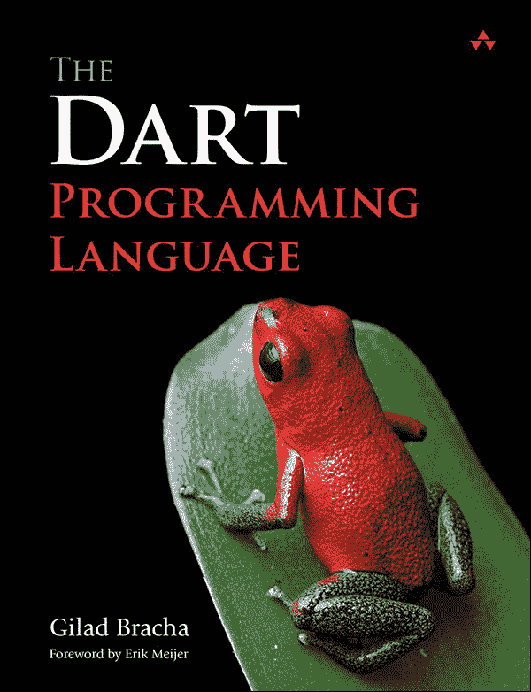

# Dart 编程语言入门指南



## 关于电子书

EPUB 是一种开放的行业标准书籍格式。然而，不同阅读设备和应用程序对 EPUB 及其许多功能的支持程度不相同。可以使用您的设备或应用设置来根据您的喜好自定义显示。您可以自定义的设置通常包括字体、字体大小、单栏或双栏、横屏或竖屏模式，以及可以点击或触摸放大的图片。有关您的阅读设备或应用设置和功能的更多信息，请访问设备制造商的网站。

许多书籍包含编程代码或配置示例。为了优化这些元素的显示效果，请在单栏横屏模式下查看电子书，并将字体调整为最小设置。除了以重流文本格式展示代码和配置外，我们还包含了代码图像，模拟纸质书籍中的显示效果；因此，当重流格式可能会损害代码列表的显示时，您将看到一个“点击此处查看代码图像”的链接。点击链接查看高保真代码图像。要返回之前查看的页面，请点击设备或应用上的返回按钮。


波士顿 • 哥伦布斯 • 印第纳波利斯 • 纽约 • 旧金山 • 阿姆斯特丹 • 开普敦

迪拜 • 伦敦 • 马德里 • 米兰 • 慕尼黑 • 巴黎 • 蒙特利尔 • 多伦多 • 德里 • 墨西哥

圣保罗 • 悉尼 • 香港 • 首尔 • 新加坡 • 台北 • 东京

她教会了我变得挑剔。

```dart
Vampire vamp = monsters['Dracula'];
```

怪物映射`monsters`仅保证包含`Monster`的实例。典型的类型检查器会抱怨上面最后一行查找的结果是一个`Monster`，它不是`Vampire`的子类型。

在实践中，当我们在怪物映射`monsters`中查找键`'Dracula'`时，我们知道自己将得到一个`Vampire`。这种情况经常发生。使用传统的类型检查规则将被迫使用强制转换。给程序员施加这样的负担与 Dart 使用类型作为工具来改进开发者体验的哲学背道而驰。相反，Dart 的赋值规则支持隐式向下转换。

当然，这意味着 Dart 的类型系统是不完备的（unsound）。我们无法保证一个通过类型检查的 Dart 程序实际上完全没有运行时错误。然而，正如我们在上面的介绍中提到的，现实中没有任何静态类型系统可以做到这一点。通常，类型系统可以强制的属性被定义为其范畴的一部分，而它无法强制的属性则被归到其他地方。一个经典的例子是函数式语言中的模式匹配，它将某些属性的强制定义在静态类型系统之外。

正如我们在第 5.5 节中将看到的，Dart 类型检查不完备还有其他原因。

### 5.4 运行中的类型：表达式问题，类型化

为了更好地理解 Dart 中的类型，让我们重新回到表达式问题，这是我们在第 2.15.1 节中首次遇到的问题。我们想对原始解决方案进行类型检查。

我们首先为评估器添加类型信息。在对评估器进行类型检查时，我们需要加法和减法的 mixin 具有支持`int`值的`eval()`方法的字段，因此我们用类型`ExpressionWithEval`标注这些字段。我们仍然没有依赖其他库（当然除了`dart:core`）。例如，我们不需要知道`ExpressionWithEval`是否实际上是`Expression`的子类型。

我们还想保证数字 mixin 拥有一个类型为`int`的字段`val`，并且所有的`eval`方法返回整数。

点击此处查看代码图像

```dart
library evaluator;

abstract class ExpressionWithEval {
  int get eval;
}

abstract class AdditionWithEval {
  ExpressionWithEval get operand1;
  ExpressionWithEval get operand2;

  int get eval => operand1.eval + operand2.eval;
}

abstract class SubtractionWithEval {
  ExpressionWithEval get operand1;
  ExpressionWithEval get operand2;

  int get eval => operand1.eval - operand2.eval;
}

abstract class NumberWithEval {
  int get val;
  int get eval => val;
}
```

然而，当我们为`multiplication evaluator`添加类型时，发现我们需要添加一个导入，因为我们必须访问`ExpressionWithEval`类型。类型依赖于原始定义并不意外，但遗憾的是，我们无法再独立编译这些代码。

点击此处查看代码图像

```dart
library multiplication evaluator;

import 'evaluator.dart' show ExpressionWithEval;

abstract class MultiplicationWithEval {
  ExpressionWithEval get operand1;
  ExpressionWithEval get operand2;

  int get eval => operand1.eval * operand2.eval;
}
```

`string converter`库的代码标注方式与`evaluator`类似：

点击此处查看代码图像

```dart
library string converter;

abstract class ExpressionWithStringConversion {
  String toString();
}

abstract class AdditionWithConversion {
  ExpressionWithConversion get operand1;
  ExpressionWithConversion get operand2;

  String toString() => '$operand1 + $operand2';
}

abstract class SubtractionWithConversion {
  ExpressionWithConversion get operand1;
  ExpressionWithConversion get operand2;

  String toString() => '$operand1 - $operand2';
}

abstract class NumberWithConversion {
  int get val;

  String toString() => '$val';
}

abstract class MultiplicationWithConversion {
  ExpressionWithConversion get operand1;
  ExpressionWithConversion get operand2;

  String toString() => '$operand1 * $operand2';
}
```

向表达式层级结构引入新函数的库并不依赖于核心层级，这一事实意味着无论我们是否选择为核心类层级添加类型注解，都可以为这些库添加类型注解。因此，喜欢类型检查的程序员即使在原始层级的设计者选择完全不使用类型的情况下，也可以向系统添加新函数并对它们进行类型检查。

现在，让我们为类层级中的字段标注类型。这要求我们导入类型`Expression`。

点击此处查看代码图片

```dart
library abstract expressions;

import 'expressions.dart' show Expression;

abstract class AbstractExpression {}

abstract class AbstractAddition {
  Expression operand1, operand2;

  AbstractAddition(this.operand1, this.operand2);
}

abstract class AbstractSubtraction {
  Expression operand1, operand2;

  AbstractSubtraction(this.operand1, this.operand2);
}

abstract class AbstractNumber {
  int val;

  AbstractNumber(this.val);
}

library multiplication;

import 'expressions.dart' show Expression;

abstract class AbstractMultiplication {
  Expression operand1, operand2;

  AbstractMultiplication(this.operand1, this.operand2);
}
```

对`expressions`库的依赖比`multiplication evaluator`对`evaluator`的依赖更令人不悦。我们最初定义的核心层级是完全独立于最终应用库的。看来添加类型正在降低我们代码的模块化程度。在下一节讨论泛型时，我们将看到如何在保留类型的同时获得所需的解耦。

最后，让我们为主库添加类型。我们需要做的唯一更改是为局部变量`e`标注类型`Expression`。该库的其余部分保持不变。

点击此处查看代码图片

```dart
main() {
  Expression e = new Multiplication(
    new Addition(new Number(4), new Number(2)),
    new Subtraction(new Number(10), new Number(7))
  );

  print('$e = ${e.eval}');
}
```

总的来说，为我们的表达式代码添加类型是非常直接的。唯一真正的问题是，所有对`Expression`及其子类的使用都必须根据 mixin 应用中定义的类型进行类型检查。为了解决这个问题，我们需要更复杂的类型：泛型。

### 5.5 泛型

Dart 类可以是泛型的——也就是说，它们可以由类型进行参数化。

泛型类可以赋予实际的类型参数：

```dart
List<String> l;
Map<String, int> m;
```

这类类型被称为参数化类型。

然而，并不要求为泛型类提供类型参数。如果选择使用泛型类的名称而不带类型参数，则会隐式地使用类型`dynamic`来代替所有缺失的类型参数。因此，可以写成：

```dart
List l;
Map m;
```

这完全等同于：

```dart
List<dynamic> l;
Map<dynamic, dynamic> m;
```

显然，优于前者更简洁的形式。在代码中充斥没有传达任何新信息的类型是一种不良风格。然而，在某些情况下，显式编写类型`dynamic`是理想的，例如：

```dart
Map<String, dynamic> m;
```

如果提供的类型参数数量不正确，所有的类型参数都将被忽略。

```dart
Map<String> m; // Map
List<String, num> // List
Object<int> // Object
```

上述三个示例将分别导致静态警告。除了警告之外，上述内容被分别视为`Map`、`List`和`Object`，如上所示，它们等同于`Map<dynamic, dynamic>`、`List<dynamic>`和`Object`。

假设我们有：

点击此处查看代码图片

```dart
class Fruit {
  var color;

  Fruit(this.color);
}

class Apple extends Fruit {
  Apple() : super('Red');
}

class Orange extends Fruit {
  Orange() : super('Orange');
}

// 打印列表中所有水果的颜色
printColors(List<Fruit> fruits) {
  for (Fruit f in fruits) {
    print(f.color);
  }
}

main() {
  List<Apple> apples = <Apple>[];
  List<Orange> oranges = new List<Orange>();

  apples.add(new Apple());

  oranges
    ..add(new Orange())
    ..add(new Orange());

  printColors(apples); // 输出一次 Red
  printColors(oranges); // 输出两次 Orange
}
```

我们有两个类，`Apple`和`Orange`，它们都是`Fruit`的子类。我们有一个简单的函数`printColors`，它接收一个`List<Fruit>`并打印每个成员的颜色。

向表达式层级结构引入新函数的库并不依赖于核心类层级，这一事实意味着无论我们是否选择为核心类层级添加类型注解，都可以为这些库添加类型注解。因此，喜欢类型检查的程序员即使在原始层级的设计者选择完全不使用类型的情况下，也可以向系统添加新函数并对它们进行类型检查。

现在，让我们为类层级中的字段标注类型。这要求我们导入类型`Expression`。

对`expressions`库的依赖比`multiplication evaluator`对`evaluator`的依赖更令人不悦。我们最初定义的核心层级是完全独立于最终应用库的。看来添加类型正在降低我们代码的模块化程度。在下一节讨论泛型时，我们将看到如何在保留类型的同时获得所需的解耦。

最后，让我们为主库添加类型。我们需要做的唯一更改是为局部变量`e`标注类型`Expression`。该库的其余部分保持不变。

总的来说，为我们的表达式代码添加类型是非常直接的。唯一真正的问题是，所有对`Expression`及其子类的使用都必须根据 mixin 应用中定义的类型进行类型检查。为了解决这个问题，我们需要更复杂的类型：泛型。

Dart 类可以是泛型的——也就是说，它们可以由类型进行参数化。

泛型类可以赋予实际的类型参数：

```dart
List<String> l;
Map<String, int> m;
```

这类类型被称为参数化类型。

然而，并不要求为泛型类提供类型参数。如果选择使用泛型类的名称而不带类型参数，则会隐式地使用类型`dynamic`来代替所有缺失的类型参数。因此，可以写成：

```dart
List l;
Map m;
```

这完全等同于：

```dart
List<dynamic> l;
Map<dynamic, dynamic> m;
```

显然，优于前者更简洁的形式。在代码中充斥没有传达任何新信息的类型是一种不良风格。然而，在某些情况下，显式编写类型`dynamic`是理想的，例如：

```dart
Map<String, dynamic> m;
```

如果提供的类型参数数量不正确，所有的类型参数都将被忽略。

```dart
Map<String> m; // Map
List<String, num> // List
Object<int> // Object
```

上述三个示例将分别导致静态警告。除了警告之外，上述内容被分别视为`Map`、`List`和`Object`，如上所示，它们等同于`Map<dynamic, dynamic>`、`List<dynamic>`和`Object`。

#### 5.5.1 泛型带来的表达式问题

在我们之前的迭代（5.4）中，我们发现添加类型引入了不希望的依赖。现在我们将看到如何使用泛型来缓解这个问题。

第一步是使核心类变为泛型，由`E`参数化。`E`代表应用中的最终表达式类型。这消除了对`Expression`的依赖。

```dart
library abstract expressions;

import 'expressions.dart' show Expression;

abstract class AbstractExpression {}

abstract class AbstractAddition<E> {
  Expression operand1, operand2;

  AbstractAddition(this.operand1, this.operand2);
}

abstract class AbstractSubtraction<E> {
  Expression operand1, operand2;

  AbstractSubtraction(this.operand1, this.operand2);
}

abstract class AbstractNumber {
  int val;

  AbstractNumber(this.val);
}

library multiplication;

import 'expressions.dart' show Expression;

abstract class AbstractMultiplication<E> {
  Expression operand1, operand2;

  AbstractMultiplication(this.operand1, this.operand2);
}
```


我们还将对代表函数的 mixin 类进行参数化。在 evaluator mixin 中，我们需要一个已知是 `ExpressionWithEval` 子类的类型参数，这样我们就可以调用 `eval` 方法而不会产生警告。

```dart
library evaluator;

abstract class ExpressionWithEval {
  int get eval;
}

abstract class AdditionWithEval<E extends ExpressionWithEval> {
  E get operand1;
  E get operand2;

  int get eval => operand1.eval + operand2.eval;
}

abstract class SubtractionWithEval<E extends ExpressionWithEval> {
  E get operand1;
  E get operand2;

  int get eval => operand1.eval - operand2.eval;
}

abstract class NumberWithEval {
  int get val;

  int get eval => val;
}

library multiplication evaluator;

import 'evaluator.dart' show ExpressionWithEval;
```

```dart
abstract class MultiplicationWithEval<E extends ExpressionWithEval> {
  E get operand1;
  E get operand2;

  int get eval => operand1.eval * operand2.eval;
}
```

同样，用于字符串转换的混入（mixins）应该将 `E` 限制为 `ExpressionWithStringConversion`：

点击此处查看代码

```dart
library string converter;

abstract class ExpressionWithStringConversion {
  String toString();
}

abstract class AdditionWithStringConversion<E extends ExpressionWithStringConversion> {
  E get operand1;
  E get operand2;

  String toString() => '$operand1 + $operand2';
}

abstract class SubtractionWithStringConversion<E extends ExpressionWithStringConversion> {
  E get operand1;
  E get operand2;

  String toString() => '$operand1 - $operand2';
}

abstract class NumberWithStringConversion {
  int get val;

  String toString() => '$val';
}

abstract class MultiplicationWithStringConversion<E extends ExpressionWithStringConversion> {
  E get operand1;
  E get operand2;

  String toString() => '$operand1 * $operand2';
}
```

最后，我们必须修改 `expressions` 来实例化所有泛型类型。

点击此处查看代码

```dart
library expressions;

import 'abstractExpressions.dart' show
      AbstractAddition,
      AbstractExpression,
      AbstractNumber,
      AbstractMultiplication,
      AbstractSubtraction;

import 'evaluator.dart' show
      AdditionWithEval,
      ExpressionWithEval,
      MultiplicationWithEval,
      NumberWithEval,
      SubtractionWithEval;

import 'multiplication.dart';

import 'multiplicationEvaluator.dart';

import 'stringConverter.dart' show
      AdditionWithStringConversion,
      ExpressionWithStringConversion,
      MultiplicationWithConversion,
      NumberWithStringConversion,
      SubtractionWithStringConversion;

abstract class Expression = AbstractExpression with
      ExpressionWithEval, ExpressionWithStringConversion;

class Addition = AbstractAddition<Expression> with
      AdditionWithEval<Expression>,
      AdditionWithStringConversion<Expression>
  implements Expression;

class Subtraction = AbstractSubtraction<Expression> with
      SubtractionWithEval<Expression>,
      SubtractionWithStringConversion<Expression>
  implements Expression;

class Number = AbstractNumber with
      NumberWithEval,
      NumberWithStringConversion
  implements Expression;

class Multiplication = AbstractMultiplication<Expression> with
      MultiplicationWithEval<Expression>,
      MultiplicationWithStringConversion<Expression>
  implements Expression;
```

到此我们对表达式的讨论结束。请记住，扩展一组变体并在其基础上扩展函数的问题是通用的，这里展示的模式对许多与表达式无关的应用程序都有帮助。对于那些想要深入研究的人，强烈推荐 Torgersen[part18.html_8] 和 Zendersky[part18.html_9] 的相关论文。

### 5.6 函数类型

函数类型在 Dart 中被特殊对待。所有函数都实现了 `Function`，但函数类型的比较是基于其结构的。函数的类型取决于其返回类型以及形式参数的类型。该类型反映了参数是命名的还是位置的、位置参数是否为必选，以及命名参数的名称。

目前，Dart 还没有表示函数类型的语法，因此我们在这里引入特殊的符号。在最简单的情况下，函数接受 `n` 个位置参数，且都是必选的。作为一个特殊情况，假设形式参数的类型为 `T[1]...T[n]` 且返回类型为 `T`，可以将函数类型写为 `F[t] = (T[1]...T[n]) -> T`。例如，我们将：

```dart
twice(num x) => x * 2;
```

类型写为 `(num) -> num`，而：

```dart
product(List<num> nums) => nums.reduce((a, b) => a * b);
```

类型为 `(List<num>) -> num`。`reduce()` 本身的类型很有趣，因为 `reduce()` 是一个接受函数作为参数的函数。`reduce()` 的类型是 `((E, E) -> E) -> E`，其中 `E` 是 `List` 的类型参数。在我们的示例中，`nums` 是一个 `List<num>`，`num` 替换了 `E`，所以 `List<num>.reduce()` 的类型为 `((num, num) -> num) -> num`。

然而，传递给 `reduce()` 的实际参数类型是 `(dynamic, dynamic) -> dynamic`。这是一个完全参数，因为 `(dynamic, dynamic) -> dynamic` 是 `(num, num) -> num` 的子类型。这是合理的，因为该函数类型接受 `dynamic` 类型的参数，而其中包含了 `num`。它的结果类型是 `dynamic`，这在任何地方都是可以的。

假设我们稍微改一下 `product`：

```dart
product(List<num> nums) => nums.reduce((num a, num b) => a * b);
```

现在 `reduce()` 的参数类型为 `(num, num) -> dynamic`，这仍然是有效的。假设我们稍微修改代码为：

```dart
product(List<num> nums) => nums.reduce((int a, int b) => a * b);
```

`reduce()` 的参数现在类型为 `(int, int) -> dynamic`。那么 `(int, int) -> dynamic` 是 `(num, num) -> dynamic` 的子类型吗？你可能会认为如此，这也是可以——毕竟 `int` 是 `num` 的子类型。遗憾的是，如果我们对包含 double 的列表使用这个版本，`reduce()` 将使用从列表中提取的 double 调用其参数函数；但 double 不是整数，`double` 也无法赋值给 `int`。

我们现在可以问函数之间子类型的通用规则是什么？给定 `F[t]` 和另一个函数类型 `F[s] = (S[1]...S[n]) -> S`，何时我们可以认为 `F[t]` 是 `F[s]` 的子类型？

类型理论告诉我们，只有当 `T` 是 `S` 的子类型，且对于 `i` 在 `1..n`，`S[i]` 是 `T[i]` 的子类型时，该结论才成立。也就是说，`F[s]` 中每个形式参数的类型必须是 `F[t]` 中对应形式参数的子类型。注意子类型关系的方向是相反的。这种现象被称为*逆变*（contravariance）。这种逻辑是不可避免的。

回想一下函数类型子类型规则后的直觉是基于：什么构成了对高阶函数 `h` 的参数 `g` 的有效调用。对于普通（非函数）对象，参数传递受赋值规则（assignability rule）限制，该规则允许双向的子类型。因此，当用实际参数调用 `g` 时，这些参数的类型只需要可以赋值给 `g` 的形式参数。任何参数的类型必须可以赋值给相应的 `S[i]`，因此它必须可以赋值给 `T[i]`。换句话说，参数既可以是 `T[i]` 的子类型，也可以是 `T[i]` 的超类型。因此，如果 `T[i]` 是 `S[i]` 的子类型或 `S[i]` 的超类型都是可以接受的。我们因此假设如果 `T` 可以赋值给 `S` 且 `T[i]` 可以赋值给 `S[i]`，则 `F[t]` 是 `F[s]` 的子类型。

到为止一切良好。上述规则虽然是不安全的（unsound），但非常宽松。违反这一规则的程序员确实可能传递了一个其参数类型与形式参数完全不相关的函数。

我们仍然需要考虑可选和命名参数。

#### 5.6.1 可选位置参数

第一步，让我们扩展函数类型的符号以容纳可选位置参数。一个函数可能具有 `k` 个可选位置参数。我们将它们写在必选参数之后，放在方括号内，呼应了函数签名中使用的语法：`(T[1], . . . , T[n], [T[n][+1], . . . , T[n][+][k]]) → T`。

我们可以安全地将一个接受可选参数的函数传递到需要这些参数的上下文中。该函数可以接受它们。相反的情况是不可接受的。要求某些参数的函数不能在一个认为这些参数是可选的上下文中使用，因为这些参数可能不会被提供。子类型必须能够接受至少与超类型相同的参数。然而，子类型的所有参数并不都是必选参数；事实上，即使它们一个都不是必选的也可以。

这引导我们得到了实际规则：

函数类型 `F[t] = (T[1], . . . , T[n], [T[n][+1], . . . , T[n][+][k]]) → T` 是函数类型 `F[s] = (S[1], . . . , S[j], [S[j][+1], . . . , S[m]]) → S` 的子类型，当且仅当：

1. `j ≤ n` 且 `m ≤ n + k`。
2. `∀i`  1..`m`, `T[i]` 可以赋值给 `S[i]`。
3. `S` 是 `void` 或 `T` 可以赋值给 `S`。

子类型需要 `n` 个参数，而超类型有 `j` 个必选参数。当类型为 `F[t]` 的函数 `f[t]` 在需要类型 `F[s]` 的地方使用时，至少会被传递 `j` 个参数。由于 `F[t]` 需要 `n` 个参数，第一项确保了 `j ≤ n`，因此 `f[t]` 保证获得足够数量的参数。可能传递的最大参数数是 `m`，即 `F[s]` 的参数总数。函数 `f[t]` 最多接受 `n + k` 个参数——`n` 个必选和 `k` 个可选。只要 `m` 不大于 `n + k`，传递的参数数量对于 `f[t]` 就可以接受。实际参数的类型必须赋值给 `f[t]` 的形式参数。由于最多只会发送 `m` 个实际参数，我们只需要前 `m` 个参数类型的赋值性。

最后一项是我们迄今为止忽略的一个转折。Dart 允许你识别不打算返回结果的函数。可以使用特殊的返回类型 `void` 进行标记。如果 `F[s]` 返回 `void`，类型检查器假设结果没有被使用，因此它没有意义。

#### 5.6.2 命名参数

命名参数呢？同样，让我们为带有命名参数的函数引入一些符号。我们将括号之间描述命名参数，类似于 Dart 的 map 字面量，再次呼应函数签名中使用的具体语法。命名参数出现在位置参数之后。每个命名参数将由一个类型后跟其名称表示。

作为一个具体的例子，我们将查看 `Iterable` 的方法 `firstWhere()`。

点击此处查看代码图像

```dart
E firstWhere(bool test(E value), {E orElse()});
```

其类型为 `((E) → bool, {() → E orElse}) → E`。

`firstWhere()` 方法接受一个谓词作为参数，就像 `where()` 一样。它不是返回满足谓词的结果集合，`firstWhere()` 只是返回第一个这样的元素。

`firstWhere()` 的近亲是 `lastWhere()`，它返回满足谓条件的最后一个元素。

点击此处查看代码图像

```dart
E lastWhere(bool test(E value), {E orElse()});
```

因此，带有命名参数的函数的通用形式为 `(T[1], . . . , T[n], {T[1], . . . , T[k]}) → T`。注意命名参数总是可选的。

函数类型 `F[t] = (T[1], . . . , T[n], {T[1], . . . , T[k]}) → T` 是函数类型 `F[s] = (S[1], . . . , S[j], {S[1], . . . , S[m]}) → S` 的子类型，当且仅当：

1. `S` 是 `void` 或 `T` 可以赋值给 `S`。
2. `∀i`  1..`j`, `T[i]` 可以赋值给 `S[i]`。
3. `n ≥ j` 且 `k ≥ m`。
4. `∀i`  1..`m`, `S[i]` 可以赋值给 `T[i]`。

#### 5.6.3 重新回顾 `Call()`

在第 4.6.1 节中提到，任何声明了特殊方法 `call` 的类实现了 `Function`。现在我们可以完善对 `call` 的理解。

假设我们想定义一个可以作为从键到值的 map 的类。我们将限制为字符串到数字的 map。

点击此处查看代码图像

```dart
class MapFunction implements Map<String, num> {
  MapFunction(this._map);

  Map<String, num> _map;

  num operator [](String k) => _map[k];

  void operator []=(String k, num v) {
    _map[k] = v;
  }

  // more map wrapping functions

  num call(String key) => _map[key];
}
```


`MapFunction` 类的实例通过将 `map` 对象传递给类的构造函数来创建。该类将 `Map` 接口的所有调用转发给它封装的 `map`。此外，`call` 方法接受一个对象，将其作为底层 `map` 的键并返回查找结果。

通常，当一个类 `FunctionWannabe` 声明 `call()` 方法时，该方法的签名描述了一个函数类型 `F`。`FunctionWannabe` 被视为 `F` 的子类型。上面我们展示了 `F = String → num` 和 `FunctionWannabe = MapFunction` 的情况。

虽然类型注解在运行时并不存在，但类型的其他方面是存在的。正如我们已经看到的，每个对象都带有其运行时类型，可以通过从 `Object` 继承的 `runtimeType` 方法进行动态访问。用户可以自由地重写 `runtimeType`，这意味着对象的实现类型通常无法通过调用 `runtimeType` 来观察到。

每个类型声明都会引入一个类型 `Type` 类的编译时常量对象来表示该类型。这些对象在运行时也是可用的。此外，如下所示，可以通过动态类型测试和类型转换来测试一个对象是否是某个类型的成员。

#### 5.7.1 类型测试

类型测试是用于测试对象是否属于某种类型的表达式。

点击此处查看代码图片

```dart
var v = [1, 2, 3];

v is List; // true

v is Map; // false

v is Object; // 无意义：始终为 true
```

类型测试的一般形式是 `e is T`，其中 `e` 是一个表达式，`T` 是一个类型。类型测试评估 `e` 并测试结果的动态类型是否与类型 `T` 匹配。上述代码段的最后一行在正常的 Dart 程序中不应该出现。它始终会求值为 `true`，因为所有的 Dart 值都是对象。

由于 Dart 类可以实现一个无关的类型，即使对象的类不是 `T` 的子类，对象也可能模拟另一个类型 `T`。然而，对象无法完全隐藏其实现类型，因为可以使用类型测试来检测它。这可以被认为违反了“只有对象的行为才是重要的”这一原则。同样的论点也适用于下文描述的类型转换。

#### 5.7.2 类型转换

类型转换也会评估一个表达式并测试生成的对象是否属于某种类型，但它们不是谓词。相反，如果测试失败，转换将抛出 `CastError`；否则，它将原样返回对象。

点击此处查看代码图片

```dart
Object o = [3, 4, 5];

o as List; // 某种带有开销的空操作

o as Map; // 抛出异常
```

转换基本上是以下内容的简写形式：

点击此处查看代码图片

```dart
var t = e;

t is T ? t : throw new CastError();
```

转换的一个典型用途可能是验证数据。

点击此处查看代码图片

```dart
List l = readNextVal() as List;

// 我很确定会从 readNextVal() 得到一个列表

// 如果不是，情况就糟大了，我应该失败

// 接下来，对列表进行操作
```

人们应该小心不要滥用转换。考虑：

点击此处查看代码图片

```dart
Object o = [5, 6, 7];

... // 大量的中间逻辑

o.length; // 正常工作；类型警告：对象并不总是有 length
```

许多程序员可能会忍不住将代码重写为：

点击此处查看代码图片

```dart
Object o = [5, 6, 7];

... // 相同的中间逻辑

(o as List).length; // 糟糕！避免警告的错误方法
```

转换是在运行时执行的，因此带有运行时开销。如果你的目标仅仅是让类型检查器安静，只需使用赋值：

```dart
Object o = [5, 6, 7];

... // 相同的中间逻辑

List l = o;

l.length;
```

上述代码之所以有效是因为存在赋值规则（5.3）。某些程序员可能对这种写法有异议，因为他们发现很难为变量命名。一个简单的解决方案是在变量名后加上转换语法的变体：

```dart
Object o = [5, 6, 7];

... // 相同的中间逻辑

List o_as_List = o;

l.length;
```

#### 5.7.3 检查模式（Checked Mode）

在开发过程中，验证变量的类型通常有用。例如，我们希望确保传入的参数或调用返回的对象符合预期。Dart 提供了检查模式（checked mode）来实现这一目的。在检查模式下，每次值传递都会经过动态检查。这意味着每当传递参数、方法或函数返回结果、以及在执行每次赋值时，系统都会自动为你执行动态类型测试。检查模式确保了赋值给变量的动态值是该变量静态类型的成员。同样，实际参数的动态类型会与形式参数的静态类型进行测试，函数结果的动态类型也会与函数的声明返回类型进行测试。

点击此处查看代码图片

```dart
num n = 3.0;

int i = n; // 检查模式下的动态错误；生产模式下正常

num x = i; // 始终正常

int j = null; // 始终允许
```

#### 5.7.4 泛型具体化

类型参数在运行时是具体化的。当泛型类被实例化时，提供的实际类型参数实际上在运行时被传递并存储。因此，使用 `List<String>` 创建的实例类与通过 `List<Object>` 创建的实例类是不同的。

```dart
var l = new List<String>();

l is List<String>; // true

l is List<int>; // false
```

#### 5.7.5 具体化与可选类型

可选类型的概念如何与类型具体化相结合？特别是可选类型本不应该影响运行时语义，然而具体化显然会。但是，具体化只在程序显式尝试观察或确定运行时类型结构时产生影响。这些情况包括：

- 使用类型测试、类型转换（cast）或调用 `runtimeType` 来获取对象的类型。
- 通过向泛型类型的构造函数传递实际的类型参数，来设置对象的运行时类型。
- 使用反射来检查或设置变量或函数的类型。
- 使用检查模式（checked mode）。
- 通过其签名上的注解来确定函数对象的具体化类型（reified type）。

最后三点都可能受到类型注解的影响，而类型注解通常没有语义影响。在这些点中，最后一点可能是微妙的。如果逻辑依赖于涉及函数的类型测试，它可能会受到类型注解的影响。该函数可以是显式定义的闭包，也可以作为属性提取。以下代码演示了该问题：

点击此处查看代码图片

```dart
typedef int IntFunction(int);

observeAnnotations(f) {
  return f is IntFunction;
}

String id1(String x) => x;

id2(x) => x;

int id3(int x) => x;

observeAnnotations(id1); // false

observeAnnotations(id2); // true

observeAnnotations(id3); // true
```

三个函数 `id1`、`id2` 和 `id3` 除了类型注解外，都是相同的，但由于使用的类型注解不同，它们在类型测试方面的行为也存在差异。当然，我们已经在显式地执行类型测试了，因此在这种情况下类型对行为产生影响并不令人意外。

#### 5.7.6 类型与代理（Types and Proxies）

能够为任何类型的对象定义透明代理是一个重要的属性。代理与类型之间存在着内在的张力。考虑我们在第 2.10 节中引入通用代理类 `Proxy`。

假设代理模拟类型 `Point`。我们遇到的第一个困难是当我们使用 `Proxy` 的实例作为类型化变量或参数的值时。

点击此处查看代码图片

```dart
Point pointProxy = new Proxy(new Point(0, 0)); // warning
```

由于 `Proxy` 既不是 `Point` 的子类型也不是超类型，该代码会导致警告。最佳解决方案是将 `proxyPoint` 声明为动态类型变量。

点击此处查看代码图片

```dart
var pointProxy = new Proxy(new Point(0, 0));
```

当然，到此时，我们丢失了类型检查的某些用处。如果我们想对 `pointProxy` 的使用进行类型检查，我们需要另一种方法。看起来我们只需要添加：

```dart
Point pointImposter = pointProxy;
```

但事实证明这是不够的。虽然这消除了静态警告，但我们将在动态类型检查中遇到麻烦。如果我们编写以下任何代码：

点击此处查看代码图片

```dart
pointImposter is Point; // false!

pointImposter as Point; // exception!
```

我们对代理对象是点的伪装就会被暴露。虽然我们可能会选择放弃类型检查并避免这些情况，但在现实中，我们可能不得不将 `pointProxy` 或 `pointImposter` 传递给其他人编写的、假设其处理点代码。在这种情况下，极可能会发生上述动态测试。此外，在检查模式下运行时，一旦有人尝试将 `pointProxy` 赋值、传递或返回到标记有类型 `Point` 注释的上下文中，就会发生错误。

点击此处查看代码图片

```dart
Point pointProxy = new Proxy(new Point(0, 0)); // dies in checked mode
```

如果我们进行任何形式的类型检查，我们需要定义一个特定类型的代理（type-specific proxy）：

点击此处查看代码图片

```dart
class PointProxy extends Proxy implements Point {
  PointProxy(forwardee) : super(forwardee);
}
```

现在我们可以可靠地使用我们的代理了：

点击此处查看代码图片

```dart
Point pointProxy = new PointProxy(new Point(0, 0));

pointProxy is Point; // true!

pointProxy as Point; // identical to pointProxy
```

等一下！`PointProxy` 中没有 `x`、`y`、`rho`、`theta`、`+` 等方法。我们难道不会收到 `PointProxy` 没有正确实现 `Point` 接口的警告吗？恰恰如此，Dart 有一条特殊规则允许抑制此类警告。如果一个类声明了 `noSuchMethod()`，就不会有关于支持接口缺失成员的投诉，也不会有关于此类成员签名不正确的此类警告。

对特定类型代理的需求是令人失望的。在这里，大部分工作由 `Proxy` 完成，但我们仍然必须为每个接口定义子类。这种解决方案比定义一组详尽的转发方法要简单且易于维护（在传统的类型环境中，你必须这样做），但又比只定义一个 `Proxy` 类要困难。在完全动态的环境中，`Proxy` 的共享定义就足够了。

此外，这个问题出现在 Dart 的单元测试框架中。该框架定义了 `expectAsync()`，它接收一个异步函数并将其封装在代理中，使其看起来是同步的。

```dart
class ProxyForFunctionOfArity5 implements Function {
  Function target;

  ProxyForFunctionOfArity5(this.target);

  call([a0 = NO ARG, a1 = NO ARG, a2 = NO ARG, a3 = NO ARG, a4 = NO ARG]) {
    List args = [a0, a1, a2, a3, a4]
      ..removeWhere((arg) => arg == NO ARG);

    return Function.apply(target, args);
  }
}
```

单元测试框架中的实际代码中包含一些处理异步的额外逻辑，但这并不是我们关注的重点。我们可以通过其他方式过滤掉未发送的参数，但这段代码在效率上略有牺牲的情况下，显得既优雅又简洁。这里需要注意的是，我们如何模拟广泛的函数类型，以及确定哪些参数实际上被传递了的技巧。

Dart 的类型系统为代理（proxies）提供了一个特殊的特例。注解（7.3）`@proxy` 对类型系统具有特殊意义。如果一个类被标记为 `@proxy`，那么当在该类的实例上访问某个方法时，即使该类在静态上并不支持该方法，Dart 分析器也会避免发出警告。

### 5.8 异常类型（Malformed Types）

如果我们用不存在的类型标记变量会发生什么？根据我们上面阐述的原则，除了在检查模式（checked mode）下，代码应该能够正常运行。

```dart
UndefinedType v = 91;
```

假设 `UndefinedType` 实际上是未定义的，Dart 将发出警告。在检查模式下，当系统尝试检查 `int` 是否为 `UndefinedType` 的子类型时，对 `v` 的赋值会导致运行时错误。然而：

```dart
UndefinedType v = null;
```

不会引起任何运行时错误，因为当赋值给变量的值为空时，不会执行子类型测试。

未定义类型可能由于多种原因引起：拼写错误、遗忘导入，或者在实际定义该类型之前提到了它。在某些情况下，类型注解中使用的名称可能表示函数或变量。在任何名称未表示实际类型声明的情况下，我们得到了一个异常类型。

未定义类型是异常类型的一种特殊形式。歧义类型（Ambiguous types）也是异常类型——即由于同名的不同声明导入到同一个作用域，导致其含义没有被明确指定。

泛型（Genericity）也可能导致异常类型。如果泛型本身是异常的，那么对泛型的任何调用也是异常的：

点击此处查看代码图片

```dart
UndefinedGeneric<int> ugi; // 异常

UndefinedGeneric ug; // 异常
```

最后，当类型变量在静态成员中被引用时，被视为异常：

点击此处查看代码图片

```dart
class C<T, S> {
  static T cantReferToTypeVars; // 警告

  static S alsoCantReferToTypeVars(T t) { // 这里有两个警告
    S local; // 这里的又有一个

    return new Map[T, S](); // 还有两个
  }
}
```

类型变量对于泛型类的每个实例可能具有不同的值。当不涉及实例时，它们没有意义。本可以简单地认为静态成员声明中的类型变量超出作用域，但通过将它们视为在作用域内但异常的，Dart 可以提供更好的错误信息。

`cantReferToTypeVars` 的声明给出了警告，因为 `T` 是异常的；它只在 `C` 的实例上下文中具有意义。方法 `alsoCantReferToTypeVars` 将产生多个警告：它的返回类型 `S` 是异常的，它的形式参数类型也是如此。局部变量 `local` 也产生了一个警告，而方法最后语句中 `Map` 的实例化分别为 `S` 和 `T` 产生了单独警告。

一旦针对异常类型的出现发出了警告，静态类型检查器会将该出现替换为 `dynamic`，以防止无意义的次要警告级联。例如，如果我们调用 `alsoCantReferToTypeVars`，将不会得到任何警告：

点击此处查看代码图片

```dart
int i = C.alsoCantReferToTypeVars('abc');
```

向程序员倾泻无法操作的警告是没有意义的。人们无法通过更改变量 `i` 的类型或参数的类型来使调用正确。问题出在 `C.alsoCantReferToTypeVars` 的声明处，而不是任何调用点处。

同样，上述 `Map<T, S>` 的实例化产生了 `T` 和 `S` 是异常的警告，但并没有抱怨它们是 `Map` 的不当类型参数。我们将异常的类型参数替换为 `dynamic`，从而产生了一个 `Map<dynamic, dynamic>`。我们看到，在参数化类型中使用异常类型作为类型参数并不会导致参数化类型变为异常。异常类型参数被替换为 `dynamic`，这才是运行时使用的类型参数。

点击此处查看代码图片

```dart
List<UndefinedType> l = [3]; // 警告

List<int> list = [3]; // 警告
```

### 5.9 不安全性（Unsoundness）

我们现在可以回顾 Dart 中各种不安全性的来源了。这些包括：

- 泛型的协变。
- 赋值规则中的下转型（5.3）。
- 函数类型的赋值性。
- 私有性与接口类型的交互。

前两点分别在 5.3 和 5.5 中讨论过。第三点实际上是前两者的产物。函数类型在返回上是协变的，但在参数上是逆变的。单这一点就会让函数子类型成为额外的不安全性来源。

此外，赋值规则适用于所有的值传递，包括传入参数和返回结果，这决定了参数和返回类型的赋值性，正如我们在 5.6 中讨论。

Dart 最后的不安全性是一个我们尚未讨论过的——库级 ADT 私有性与接口类型之间的交互。为了理解这种交互，让我们看看上一章中栈示例的变体：

点击此处查看代码图片

```dart
library stack3;

class Stack {
  List _contents = [];

  get isEmpty => _contents.isEmpty;

  get top => isEmpty ? throw '无法获取空栈顶顶' : _contents.last;

  get pop => isEmpty ? throw '无法从空栈弹出' : _contents.removeLast();
```


```dart
push(e) {
  _contents.add(e);
  return e;
}
```

```dart
clone(Stack s) {
  Stack ns = new Stack();
  ns.contents = new List.from(s.contents);
  return ns;
}
```

我们添加了一个`clone`函数，它接收一个栈并产生另一个内容相同的栈。这并不是一个好主意，但它符合我们此处的目的。一个应该引起警惕的事实，`clone`访问了其形式参数`s`的私有变量`contents`。在一种围绕抽象数据类型（ADTs）概念设计的语言中，这是非常自然的。在这样的语言中，类型系统确保了任何传入的参数都将是我们定义的`Stack`类的实例，因此也必然包含一个名为`_contents`的字段。

但问题就在这里：Dart 并不是围绕抽象数据类型概念设计的。Dart 是围绕接口（interfaces）概念设计的。Dart 中的类型永远从不表示某种特定的实现类型。相反，它表示的是该类型的接口。任何人都可以实现`Stack`类型，而且该实现可以与`Stack`类中定义的实现完全不同。特别是，该实现可能没有`_contents`字段。

事实上，假设我们决定在另一个库中产生`Stack`的替代实现。

点击此处查看代码图片

```dart
library stack4;

import 'stack3.dart' as stack show clone, Stack;

class Stack4 implements stack.Stack {
  final List _array = [];

  get isEmpty => _array.isEmpty;

  get top => isEmpty ? throw 'Cannot get top of empty stack' : _array.last;

  get pop => isEmpty ? throw 'Cannot pop empty stack' : _array.removeLast();

  push(e) {
    _array.add(e);
    return e;
  }
}

main() {
  stack.clone(new Stack4());
}
```

显然，当我们尝试访问传入参数中不存在的`_contents` getter 时，对`stack.clone()`的调用将因`NoSuchMethodError`失败，因为该参数是`Stack4`的实例，且确实没有这样的 getter。问题在于，类型系统是否应该对这段代码提出异意见。

在一个基于 ADT 的系统中，我们可能会抱怨`Stack4`没有实现`stack.Stack`，因为它缺少`_contents`访问器。这引发了几个困难：

- 由于`_contents`对`stack`是私有的，它的存在绝不能让其他库知晓。特别是，在接口的实现者中生成警告是不可接受的。添加私有成员应该是类的纯内部决策。如果向类中添加私有成员会导致该类的实现者中产生警告，那么这样做就是不可行的。
- 抛开前面的异议，假设我们确实发布了警告呢？开发`Stack4`的开发者该怎么办？在`Stack4`中定义一个`_contents`访问器并不能满足需求，因为它对`stack4`是私有的，无法在外部访问。`clone`内部的调用将以相同的方式失败。`stack3`和`stack4`中的`_contents`成员是不同的。简而言之，`stack3.Stack`之外的任何人无法无法实现一个`stack3`内部定义的访问器的`_contents` getter。

另一种方法是在`clone()`内部进行报错。`Stack`类型的变量不能可靠地假设它具有如`_contents`这样的私有访问器。遗憾的是，这意味着除了`this`之外，任何对象都永远无法使用私有实例成员。基于对象的封装强制了这种替代方案。正如我们在上一章中讨论的，Dart 显式拒绝了基于对象的封装。

在现实，任何地方都没有发布警告，因此系统再次是不完备的（unsound）。这种不完备性由于隐私规则基于 ADT，而类型检查纯粹基于接口的直接结果。

Dart 为程序员提供了定义抽象数据类型的选项，在这种情况下，他们必须清楚地记录他们所定义的抽象类型不应被他人实现（尽管它们可以被子类扩展）。人们可以用这种风格定义单个抽象数据类型或多个协作类型。

或者，程序员可能选择在优选的基于接口的风格下工作，在这种情况下，私有成员应该只通过`this`访问，从而有效地遵循基于对象的封装。

### 5.10 相关工作

类型系统的僵化性引发了许多放宽它的尝试。在 Scheme 中，人们对软类型（soft-typing）进行了大量研究，这与类型推断相关。Racket 最近的尝试将类型代码和无类型代码混合在一起，但粒度相对粗糙。每个模块要么是有类型的，要么是无类型的。跨越类型和无类型单元边界的数据会进行动态检查。这些检查在某种让人类似于检查模式（checked mode）的感觉。

Dart 的可选类型方案与 Strongtalk [16] 开发的最为相似。然而，在 Dart 中，可选类型与语言的集成更高。Strongtalk 没有泛型具体化（reify generics），也没有检查模式。此外，警告是 IDE 的专属领域；编译完全独立于类型检查。最后，Strongtalk 拥有一个具有泛型声明侧变性（declaration side variance）的完备类型系统。

可选类型（optional typing）一术语曾在 Common Lisp 的语境下使用，但表示一种相当不同的思想。类型被编译器视为有效的断言，编译器利用它们进行优化。然而，这些类型注释没有经过验证，导致系统从本质上是不安全的。Dart 要求指针安全，且不允许实现信任类型注解。

Dart 将不完备的泛型和具体化混合在一起是不寻常的。Beta [17] 的影响显而易见，在 Beta 中泛型也是协变的。然而，Beta 中的泛型并不是特殊特性，而是通过嵌套类型成员进行建模的，因此是显式具体化的。相比之下，Java 和 C# 等主流语言使用了包含变性声明的完备类型系统。在 Java 中，泛型不是具体化的，变性是基于使用的；而在 C# 中，泛型是具体化的且基于声明的。

### 6.1.1.1 Integer（整数）

在 Dart 中，整数可以是任意大小的。然而，使用非常大的整数可能会相对昂贵。越过某个特定的边界（该边界随实现方式而异），整数将无法直接利用底层的硬件表示。因此，对此类大整数的操作将变得昂贵得多。

实现者可以自由地使用各种类的实例来实现整数。唯一的要求是任何此类类都必须实现内置类`int`。在实践中，可能会根据所表示的整数的大小使用不同的类。

当询问一个整数的`runtimeType`时，答案总是`int`，这也就是静态检查器分配给整数字面量的类型。因此，发现整数底层实现类的唯一方法是通过反射，正如我们在下一章中将讨论的那样。

如果两个整数对象表示相同的数学值，则它们被认为是等等的。

在编译为 Javascript 的 Dart 实现中，会出现进一步的复杂性。在 Javascript 中，所有数字都表示为 IEEE 双精度浮点数；没有整数。因此，在 Javascript 之上实现整数语义的代价是非常高昂的。在这样的实现上，当整数超出给定范围（绝对值约为 2⁵³）时，整数将被近似。

[1]。人们只能希望在未来的将来，Javascript 能够发现整数。

你不能定义`int`的子类，也不能让另一个类实现`int`。这些限制是一种折中，允许 Dart 实现提供高性能，但代价是牺牲了人应该能够对任何类进行子类化或实现的原则。

#### 6.1.1.2 Double（双精度浮点数）

Double 是根据 IEEE 754 标准实现 64 位浮点数的对象。Double 是`dart:core`中`double`类的实例。

双恒等性规则与相等性规则有细微不同。简单来说，如果两个双表示浮点值的底层位模式相同，则它们是恒等的。在大多数情况下，这意味着两个双恒等的充当且仅当它们相等的，但有两个例外：

1. 双`-0.0`和`0.0`是相等的，但不恒等的。
2. `NaN`（不是数字）与自身是恒等的，但不相等的。

你不能定义`double`的子类，也不能让另一个类实现`double`。同样的规则适用于`num`，它是`double`和`int`的通用父类型。

#### 6.1.1.3 Boolean（布尔值）

恰有两个布尔对象：`true`和`false`。它们是`bool`类的成员。

与某些语言不同，不能将任意表达式强制转换为布尔值。如果你尝试写：

```dart
var x = someComputation();

if (x) print(x.foo()); // 不要这样做！
```

期望语言会将一个非空值转换为`true`，那么你会失望的。记住，Dart 反感内置的强制转换。如果`x`是`true`，则打印将按预期执行。然而，如果`x`是任何其他对象，在生产模式下它将被视为`false`且什么都不会被打印。在检查模式下，它会失败。因此，最好的做法是在执行测试时编写适当谓词：

```dart
if (x != null) print(x.foo());
```

这让读者清楚了你实际上在测试什么，并且不依赖于可能产生问题的强制转换。当然，如果`x`确实是一个布尔值，那么写成这样完全没：

```dart
if (x) print(x.foo());
```

简而言之，`true`是 Dart 中唯一的真理。

你可能会问，鉴于我们明确表示反感强制转换，为什么还允许其他非布尔对象被视为`false`？如果我们能确定 Dart 始终运行在 Dart VM 上，我们可能可以在所有测试中强制统一使用布尔值。然而，考虑到编译到 Javascript 的限制，事实证明始终使用真实的布尔值代价太高。这是 Dart 做出务实折中的的案例之一。

你不能定义`bool`的子类，也不能让另一个类实现`bool`。

#### 6.1.1.4 Strings（字符串）

字符串字面量在 Dart 中有多种形式。它们可以用单引号或双引号界定：

```dart
'我引用："用单引号界围的字符串可以包含双引号"'

"我引用：'用双引号界围的字符串可以包含单引号'"
```

通常，用户不需要记住使用哪种引号来界定字符串。两种方式都可以，这让语言变得更容易学习。此外，当引号出现在字符串中时，处理它们也会更简单，正如上面的示例所示。自然地，界定符必须匹配——例如，你不能用单引号开始字符串并用双引号结束。

```dart
'一个无效的字符串" // 非法！无法解析

"另一个无效的字符串' // 同样非法
```

普通字符串局限于单行。如果你需要一个跨多行的字符串，可以使用*多行字符串*（multiline string）。多行字符串用三个引号界定；同样，这些可以是三一组单引号，也可以是三一组双引号。

```dart
"""我引用：

"用单引号界围的字符串可以包含双引号"

"""我引用：

'用双引号界围的字符串可以包含单引号'"""
```

还有另一种选择，即将你的字符串拆分成若干部分，并将各个部分写在一起：

```dart
' "我引用：'用单引号界围的字符串可以包含双引号"'
```

Dart 会隐式地连接相邻的字符串。然而，生成的字符串不会跨行。Dart 在字符串内部支持多种转义序列。这些包括：

- `\n` 换行。
- `\r` 回车。
- `\f` 换页。
- `\b` 退格。
- `\t` 制表符。
- `\v` 垂直制表符。
- `\u{*h}`，其中`h`是十六进制数字序列，用于表示`h`的 Unicode 标量。
- `\u*x[1]*x[2]*x[3]*x[4]`，其中`x[1]--x[4]`是十六进制数字，是`\u{*x[1]*x[2]*x[3]*x[4]}`的简写。
- `\x*x[1]*x[2]`，是`\u{*x[1]*x[2]}`的简写。

字符串支持插值。字符串插值允许 Dart 表达式嵌入字符串字面量中，例如：

```dart
print('2*2 的值是 ${twice(2)}');
```

假设范围内有一个合理的`twice()`实现，这将打印`2*2 的值是 4`。如所示，`$`符号表示嵌入表达式的出现，它由大括号界定。嵌入表达式会被求值并调用其`toString()`方法，结果将插入到字符串中表达式所在的位置。如果表达式仅由单个标识符组成，大括号可以省略：

```dart
var roomNumber = 101;

print('欢迎来到房间 $roomNumber');
```

这将打印`欢迎来到房间 101`。

此外，Dart 支持*原始字符串（raw strings）。原始字符串不支持转义序列；它们包含引号内出现的内容。原始字符串有单行和多行变体。原始字符串以字符`r`为前缀。

```dart
print(r'一个原始字符串 \n'); // 打印：原始字符串 \n，没有换行
```

与整数类似，字符串字面量可以通过各种类来实现，但除非通过反射，否则这是不希望的。对字符串字面量请求其运行时类型始终得到`String`，这正是静态检查器赋予字符串字面量的类型。`String`类不能被用户代码子类或实现，就像`int`、`double`、`num`和`bool`一样。

Dart 将字符串表示为 UTF-16 代码单元序列。Dart 核心库包含了`Runes`类，它可以将字符串转换为 Unicode 表示形式。

#### 6.1.1.5 符号 (Symbols)

符号用于表示程序中声明的名称。符号以井号`#`开头，后紧跟一个或多个用点分隔的标识符，或者一个操作符。是一些示例：

点击此处查看代码图像

`#MyClass` `#i` `#[]` `#com.evil empire.forTheWin`

以下是一些非法符号：

点击此处查看代码图像

`#.` `.#..` `#++` `#=` `#&=` `#||` `#&&` `#!=` `#!`

以上都是不可由用户定义的操作符。非用户定义操作符集包括：^(2)

**2.** 要创建没有字面量形式的符号，需要显式地调用类`Symbol`的构造函数。这些情况通常出现在反射代码中。除了列出的操作符外，还有一个著名的单元负案例，出于反射目的，其名称为“unary-”。

- 赋值，包括基础赋值操作符和所有复合操作符
- 点，用于成员选择，以及双点，用于级联操作（cascades）
- 不等，它始终根据相等操作符定义
- 通过`!`取反
- 后置操作符：增量和减
- 逻辑布尔操作符

自然地，符号字面量的静态类型是`Symbol`。

#### 6.1.1.6 列表 (Lists)

列表字面量通常写为由方括号括定的、逗号分隔的表达式序列。

所有列表字面量都实现了类`List`的接口。方便地将字面量`[]`想为`new List()`的简写，将`['a', 2, true]`想为以下代码的简写：

```dart
new List()
  ..add('a')
  ..add(2)
  ..add(true);
```

严格来说，上面的解释并不准确，因为 Dart 实现并不要求使用`List`类的工厂构造函数。然而，作为第一种近似，我们离并不远。

`List`是一个泛型类，因此人们可能会合理地询问`[1, 2, 3]`是否创建了一个`List<int>`？它是否对应于：

```dart
new List()
  ..add(1)
  ..add(2)
  ..add(3);
```

或者对应于：

```dart
new List<int>()
  ..add(1)
  ..add(2)
  ..add(3);
```

答案（再次仅作为教学目的的近似）是前者。Dart 并不会尝试从列表字面量的元素中推导出更精确的类型。一个原因是在运行时执行此类类型推断开销很大。另一个原因是可选类型系统。

要获得后一种，我们可以选择通过编写`<int>[1,2,3]`来显式提供类型参数。事实上，语法`[e[1], ..., e[n]]`确实是`<dynamic>[e[1], ..., e[n]]`的简写。我们也可以将语法`<T>[e[1], ..., e[n]]`认为是以下代码的近似：

```dart
new List<T>()
  ..add(e[1])
  ..
  add(e[n]);
```

如第 6.1.4 节所述，列表字面量可以通过加上保留字`const`前缀来成为编译时常量。`const`的使用与类型参数的使用是正交的。因此`const[e[1], ..., e[n]]`恰好是`const<dynamic>[e[1], ..., e[n]]`的简写，而`const<T>[e[1], ..., e[n]]`是以下代码的近似：

```dart
const List<T>()
  ..add(e[1])
  ..
  add(e[n]);
```

#### 6.1.1.7 映射 (Maps)

Map 字面量写为由大括号括定的、逗号分隔的键值对序列。在每一对中，键先写并用冒号与值分隔，即`key: value`。

所有 map 字面量都实现了类`Map`的接口。方便地将字面量`{}`想为`new Map()`的简写，将`{'a': 'a', 'b': 2, 'c': true}`想为以下代码的简写：

```dart
new Map()
  ..['a'] = 'a'
  ..['b'] = 2
  ..['c'] = true;
```


与列表的情况一样，上面的解释只是近似，因为 Dart 实现并不要求使用 `Map` 类的工厂构造函数。（更正/注：6.1.1.7 及后续章节源文本包含重复/重叠的句子。我已根据所提供的源逻辑流处理了不同的逻辑段落。）

要获得后一种，我们可以选择通过编写 `<int>[1,2,3]` 来显式提供类型参数。事实上，语法 `[e[1], ..., e[n]]` 确实是 `<dynamic>[e[1], ..., e[n]]` 的简写。我们也可以将语法 `<T>[e[1], ..., e[n]]` 认为是以下代码的近似：

```dart
new List<T>() ..
      add(e[1])..
      ...
      add(e[n]);
```

如第 6.1.4 节所述，列表字面量可以通过加上保留字 `const` 前缀来成为编译时常量。`const` 的使用与类型参数的使用是正交的。因此 `const[e[1], ..., e[n]]` 恰好是 `const<dynamic>[e[1], ..., e[n]]` 的简写，而 `const<T>[e[1], ..., e[n]]` 是以下代码的近似：

```dart
const List<T>() ..
      add(e[1])..
      ...
      add(e[n]);
```

#### 6.1.1.8 函数（Functions）

函数字面量在第 4.4 节讨论过。函数类型规则在第 5.6 节中给出。我们现在给出函数字面量的类型规则。

函数字面量没有声明返回类型的语法，因此函数字面量始终具有 `dynamic` 类型。函数字面量的参数类型以任何函数相同的方式确定。如果声明了类型则使用类型，否则参数类型取 `dynamic`。根据参数类型以及它们是必需还是可选、位置还是命名，可以确定明显的函数签名。

示例：

```dart
(x) => 2*x; // (dynamic) -> dynamic

(num a, num b){ return a*b;} // (num, num) -> dynamic

(String k, [Function f]) => m.putIfAbsent(k, f); // (String, [Function]) -> dynamic
```

#### 6.1.2 标识符（Identifiers）

Dart 中的标识符与大多数其他语言中的标识符非常相似。标识符可以是字符 `A-Z`、`a-z` 或 `$` 之一开头。后续字符可以是上述任何字符或数字 `0-9`。

Dart 不允许在标识符中使用非 ASCII 字母。这一选择是在大量讨论后做出的。我们选择为了确保 Dart 程序可以被全球任何专业程序员阅读，尽管这牺牲了对非罗马脚本使用者的便利性。

标识符如其名，用于标识一个声明。它可以标识变量、函数或类型。标识符也可能表示库，但此时它不能单独在表达式中使用。

在评估标识符时，第一步是找到它所标识的声明。这涉及到一个搜索声明的过程，从紧邻的作用域开始。如果没有找到匹配的声明（即简单名称为我们正在搜索的标识符的声明），搜索将向嵌套的词法作用域继续递归进行，直到到达闭包库的顶层。如果我们找到了声明，我们对如何处理它就有了大概的思路；但也可能没有找到任何声明。

对合适声明的搜索是由编译器静态完成的；一旦编译器知道涉及哪个声明，它就会生成相应的代码以便在运行时进行评估。

为了查看它是如何运作的，我们将看看下面这段相当刻意的代码：

```dart
var global = 0;

var shadowed = 1;

aFunction(x) => x*x + global + shadowed;

class AClass<T> {
  static var aClassVariable = 2;
  var anInstanceVariable = 3;
  static var shadowed = 4; // 隐藏了顶层变量

  static aClassMethod() {
    print(shadowed); // 4
    print(aClassVariable); // 2
    print(anInstanceVariable); // error
  }

  aMethod(aParameter) {
    var aLocal = 5;
    var anUnassignedLocal;
    var shadowed = 6; // 隐藏了静态变量
    localFunction(x) => 7;

    {
      var moreLocal = 8;
      var shadowed = 9; // 隐藏了局部变量
      moreLocalFunction(y) {
        return moreLocal;
      }
      print(global); // 0
      print(shadowed); // 9
      print(aFunction);
      print(AnotherClass);
      print(F);
      print(AClass);
      print(T);
      print(aClassVariable); // 2
      print(anInstanceVariable); // 3
      print(aMethod);
      print(anotherMethod);
      print(aParameter);
      print(localFunction);
      print(aLocal); // 5
      print(anUnassignedLocal); // null
      print(moreLocal); // 8
      print(moreLocalFunction);
    }
    print(shadowed); // 6
  }

  anotherMethod() => 10;
}

class AnotherClass{}

typedef int F(int x);
```

最简单的例子是标识符 `moreLocal` 的评估。我们的搜索在紧邻的作用域中找到了同名的声明，该声明引入了一个局部变量。标识符的评估结果为评估时存储在局部变量中的值——在我们的案例中是 `8`。这显然是易见得令人痛苦，但如果想完全理解这些规则，这是必要的。

标识符 `aLocal` 的情况几乎完全相同；区别在于我们需要在作用域链上向上爬一层才能找到相关的声明。`anUnasssignedLocal` 的情况也是如此，不同的是在后者情况下表达式的值将是 `null`，因为变量尚未初始化，而前者表达式评估结果则为 `5`。

评估 `aParameter` 非常相似。`aParameter` 的名称在作用域链再上一层通过形式参数声明声明的，且形式参数的值无疑会随着每次调用而变化。

如果我们找到的声明并不表示变量会怎样？有几种可能性。声明可能表示一个函数；该函数可能是 getter 或普通方法（它不能是 setter，因为 setter 的名称总是以 `=` 结尾，所以永远不会是标识符）。

如果标识符表示一个 getter，评估的结果就是调用该 getter 的结果。如果它是静态或顶层 getter，我们调用它并返回结果。如果是实例 getter，我们会在 `this` 上调用该 getter。

例如，考虑标识符 `shadowed`。在 `aMethod` 内部，它首先在最内层的作用域中被评估，因此找到了最内层的声明，该变量的值 `9` 就是结果。在方法的最后面，我们在方法的最外层的作用域中评估 `shadowed`，得到值 `6`。

在类方法 `aClassMethod` 内部，我们再次引用了 `shadowed`。在这里，我们从方法作用域开始，沿着作用域链向上，直到到达类的静态作用域，该那里为类变量 `shadowed` 定义了一个 getter。调用这个 getter 产生值 `4`。

相比之下，在顶层函数 `aFunction` 内部，`shadowed` 评估结果为 `1`，因为我们从 `aFunction` 的作用域开始搜索声明，向上到其形式参数的作用域，然后到库级作用域，在那里我们找到了一个隐式声明的合适的顶层 getter。

在这种情况下，`global` 也是类似的；当我们在 `aMethod` 内部评估 `global` 时，我们的搜索将遍历一系列嵌套的作用域，直到到达库作用域。

如果标识符表示的声明是一个实例方法，那么我们将提取将在 `this` 的当前值上调用的闭包，如 6.7 所示。库方法、类方法和局部函数都被同样对待；评估的结果是函数/方法对象。

对于库方法或类方法，该对象是固定的；对于局部函数，每次进入声明该函数的作用域时都会创建一个新对象。

另一种可能是 `id` 指向一个类型声明——可以是类或 `typedef`。每个类和类型别名在 Dart 中都具实体化为一个唯一对象，在这种情况下这就是评估的结果。

然而，标识符也可能表示类型变量。在这种情况下，结果将是评估时类型变量的值——就像普通变量一样。类型变量的值是接收者的属性；任何泛型类的实例都是通过类似 `List<String>` 的实例化使用实际类型参数构造的。实际类型本身是一个类型（在这种情况下是 `String`），并成为相应类型参数的值。

当然情况可能会更加复杂，正如我们在第五](#part0013.html_ch05) 中所示。例如，考虑当标识符表示像 `List` 这样的泛型类时的情况。`List` 的类型参数没有提供显的值。类型参数的默认值始终是 `dynamic`，所以 `List` 表示一个代表 `List<dynamic>` 的类型对象。

在完全正确的情况下，可能会引用继承自父类的成员。规则是，如果我们不在词法作用域中找到 `id` 的声明，我们评估 `id` 就像它是表达式 `this.id`。

当我们尝试在 `aClassMethod` 内部引用实例变量 `anInstanceVariable` 时可以看到这一点。然而，该变量（以及它的 getter）不在作用域内。该引用随后解释为对 `this` 的 getter 调用。在实例方法中，这条规则效果良好，允许访问继承的成员。由于在类方法内部访问 `this` 是非法的，在我们这个案例中这是一个编译错误。

##### 6.1.2.1 保留字和内置标识符

当然，标识符不能是保留字。以下代码将永远无法正确解析：

```dart
var if;
```

然而，并不是所有的关键字都是保留字。Dart 区分了*保留字*（reserved words，在 Dart 程序中永远不能用于命名实体）和*内置标识符*（built-in identifiers）。

以下是 Dart 的保留字：`assert`, `break`, `case`, `catch`, `class`, `const`, `continue`, `default`, `do`, `else`, `enum`, `extends`, `false`, `final`, `finally`, `for`, `if`, `in`, `is`, `new`, `null`, `rethrow`, `return`, `super`, `switch`, `this`, `throw`, `true`, `try`, `var`, `void`, `while`, `with`。

以下是内置标识符：`abstract`, `as`, `deferred`, `dynamic`, `export`, `factory`, `get`, `implements`, `import`, `library`, `operator`, `part`, `set`, `static`, `typedef`。

关于 Dart 的内置标识符会出现一些有趣的情况。考虑：

```dart
get get => 'get'; // don't do this!
```

上述代码是完全合法的，尽管风格非常糟糕。它定义了一个名为 `get` 的 getter，返回字符串 `‘get’`。明白了吗？Dart 编译器可以很容易地判断每个“get”出现代表的含义，但人类可能无法判断，因此强烈不建议编写这种代码。

保留字与内置标识符之间的区别使得代码从其他语言迁移到 Dart 变得更容易。特别是将 JavaScript 代码转换为 Dart 往往出乎意地简单。允许在 JavaScript 中合法的标识符在 Dart 中使用（即使 Dart 对它们有特殊用途），这有助于这种迁移。

内置标识符不能用作类型名。类、类型定义（typedefs）或类型参数都不能以内置标识符命名。内置标识符（`dynamic` 除外）不能出现在类型注解中。这阻止了如下这种情况：

```dart
get get get => new get(); // 编译时错误
```

显然，你作为人类读者，可以立即看出其意图是定义一个名为 `get` 的 getter，返回类型 `get`，但解析器需要向后查看几个标记才能理解发生了什么。

这些限制并不影响迁移，因为 JavaScript 程序中没有出现类型。此外，由于按照惯例类型以大写字母开头，这条规则对 Dart 代码没有产生困难。唯一的缺点是限制了智谜题书作者的就业机会。

#### 6.1.3 `this`

保留字 `this` 作为表达式使用时，指代当前方法调用的接收者（receiver）。此外，`this` 也可以出现在构造函数的上下文中，此时它表示新创建的对象。不能在静态方法或库方法中引用 `this`，因为没有对象作为调用的接收者。

注意，在构造函数中，关键字 `this` 可以出现在特殊形式参数（formal parameters）的上下文中，在重定向构造函数（redirecting constructors）中，它标记了对同类其他构造函数的调用。然而，`this` 的这两种用法都不是独立的表达式。

#### 6.1.4 常量

常量表达式是一个可以在编译时求值的表达式。常量表达式的值永远不会改变。常量包括字面量数字、布尔值、`null`、常量列表和映射、顶层函数、静态方法，以及一些子部分为常量的特定复合表达式。

常量对象是通过将实例创建表达式中的 `new` 替换为 `const` 创建的，如下一节所示。常量对象的创建仅在非常特定的情况下才可能的。该类必须有一个合法的 `const` 构造函数，并且构造函数的参数本身必须是常量。

给定：

```dart
library constants;

const aTopLevelConstant = 99;

thrice(x) => 3*x;

class Foo {
  static threeCubed() => thrice(thrice(3));
}

class Konst {
  final x;
  const Konst(this.x);
}
```

以下表达式是常量：

```dart
"def" 1 2.5 true false null const[7, 8, 9.0] const{}
aTopLevelConstant thrice
Foo.threeCubed 'abc' 3+4
1 - 0 6*7 -1 2 > 3 3 < 3.0 7 >= 3+4
9 <= -0 17 % ( 2*2*2 + 8) '$aTopLevelConstant'
const Konst(42);
```

相比之下，这些表达式不是常量：

```dart
thrice(2)
threeCubed == 0
'${ const Point(0, 0)}'
const Konst(thrice(14));
```

#### 6.1.5 创建对象

对象通过调用构造函数创建，如第 2.9 节所述。构造函数使用*实例创建表达式*（instance creation expressions）调用。最常见的实例创建形式是 `new` `ConstructorName`(`args`)。

一些示例：

```dart
new List<int>(); // 带类型参数的构造函数

Map(); // 不带类型参数的构造函数
new Point.origin(); // 调用命名构造函数
```

使用 `new` 并不意味着分配了新实例。另一种实例创建形式是 `const` `ConstructorName`(args)，用于创建常量对象。

除了 `new` 和 `const` 之外，调用构造函数的唯一方法是从构造函数内部调用或通过反射。在构造函数内部，通过 `super(args)` 或 `this(` 调用。重定向工厂可以指定它们将重定向到的构造函数。构造函数的细节见上文第 2.9 节。

#### 6.1.6 赋值

赋值可以在顶层、类、实例变量上执行。对于顶层、类和实例变量，赋值是调用 setter（Setter）的简写。对于局部变量，赋值的行为与传统语言相同，将右侧表达式的结果赋值给左侧变量。

不能对 `final` 变量赋值。

Dart 中的赋值包括 `variable = expression` 形式的简单赋值，以及赋值与 `+` 等运算符结合的复合赋值。例如 `variable += expression`，它只是 `variable = variable + expression` 的简写。

除了 `+=` 之外，还有 `-=`, `*=`, `/=`, `~=`, `%=`, `<<=`, `>>=`, `&=`, `^=`, `|=`。

例如，以下程序打印数字 `1`、`-1`、`303` 和 `10`。

点击此处查看代码图片


```dart
library another_lib;

var topLevelVariable = 101;

class SomeClass {
  static var classVariable = 100;
}

library my_lib;

import 'anotherLib.dart' as another show topLevelVariable, SomeClass;

var myTopLevelVariable = 0;

class MyClass {
  static var myClassVariable = 0;
}

main(){
  myTopLevelVariable += 1;
  MyClass.myClassVariable -= 1;
  another.topLevelVariable *= 3;
  another.SomeClass.classVariable /= 10;
  print(myTopLevelVariable);
  print(MyClass.myClassVariable);
  print(another.topLevelVariable);
  print(another.SomeClass.classVariable);
}
```

#### 6.1.7 提取属性

偶尔，将一个方法作为未求值的函数对象使用是非常方便的。例如，我们可能想在事件循环中注册一个方法作为监听器。假设函数 `onClick()` 接收一个监听函数作为参数，并在发生点击事件时最终用事件对象对其进行回调。进一步假设我们定义了一个实例方法 `listener()` 来响应点击事件。

```dart
listener(ev) => print(ev);
```

我们可以按照如下方式调用 `onClick()`：

```dart
onClick(listener);
```

根据语言的常规规则，上述内容是内容的简写：

```dart
onClick(this.listener);
```

而这反过来大约是以下内容的简写：

点击此处查看代码图片

```javascript
onClick((event) => this.listener(event));
```

通常情况下，符号 `e.m` 表示对象 `e` 求值后得到的方法 `m`。严格来说，`e.m` 是一个参数与 `m` 完全相同的闭包。使用给定的参数调用此闭包的效果，与在 `e` 的值上调用方法 `m` 相同。如果 `m` 在作用域内，可以使用标识符 `m` 代替 `this.m`。

属性提取实际上不仅仅是编写闭包的简写。所制造的闭包具有特殊的等效性实现，如第 4.7 节所示。

无法通过这种方式提取 getter 或 setter 方法。对于 getter，问题在于如果 `g` 是一个 getter，那么 `e.g` 表示调用 getter 的结果，因此该符号无法表示 getter 方法本身。对于 setter，它们的真实名称以 `=` 结尾，不是合法的标识符，因此 `e.s =` 在语法上是无效的。在所有此类情况下，必须显式地编写闭包。

#### 6.1.8 方法访问

方法访问的形式为 `e.m(args)`，其中 `e` 是一个产生对象的表达式，`m` 是成员名称，`args` 是一个可能为空的参数列表。示例：

点击此处查看代码图片

```dart
3.toString();
{'a':1, 'b': 2}.containsKey('c');
'abcd'.indexOf('cd', 1);
myObject.foo(x, y, z);
```

理解各项求值的顺序非常重要。在成员访问中，首先计算接收者，然后计算方法的参数。参数与所有函数调用一样，是从左到右顺序计算的。通常这并不重要，但你可能会遇到产生差异的情况。

点击此处查看代码图片

```dart
String x;
(x = 'xyz').indexOf(x); // 求值结果为 0
```

如果我们在计算参数之前不先计算目标表达式 `(x = ‘xyz')`，我们将会传递 `null` 作为参数。根据规则，如果成员访问对求值顺序敏感，说明你的代码中存在问题。

如果你访问的方法不存在怎么办？正如你现在可能已经很知道的那样，这将导致调用 `noSuchMethod()`。事实上，如果你用错误的参数数量调用已存在的方法，`noSuchMethod()` 也会被调用。

另一个可能的问题是你引用的是 getter 而不是普通方法。在这种情况下，实际发生的情况是表达式 `e.m(args)` 被解释为 `(e.m)(args)`。首先，我们执行属性访问 `e.m`，产生调用 getter `m` 的结果。接着，我们在该结果上调用 `call` 方法。如果结果是一个函数对象（或任何支持适当 `call` 方法的对象），则一切将按预期工作。否则，我们将再次得到 `noSuchMethod()`。

#### 6.1.9 使用运算符

Dart 中的运算符本质上是具有特殊语法的实例方法。其中极少数运算符是被限制的，因此不能在用户代码中重新定义，但大多数运算符被视为普通的实例方法，可以在任何类中声明和/或重写。

运算符集合及其优先级是固定的。用户代码可以定义以下运算符：`<`、`>`、`<=`、`>=`、`==`、`-`、`+`、`/`、`~/`、`%`、`^`、`&`、`*<<`、`>>`、`[]=`、`[]` 和 `~`。

这些大部分都是二进制运算符。例外是 `~`（一元运算符）、`-`（具有一元和二元两个版本）以及索引赋值运算符（三元运算符）。我们之前已经见过用户定义运算符的示例，从 `Point` 类开始。类似的示例是复数：

点击此处查看代码图片

```dart
class Complex {
  final num re, im;
  Complex(this.re, this.im);
  Complex.fromScalar(num s): this(s, 0);
  // 重定向构造函数的极佳示例
  Complex operator + (Complex c) => new Complex(re + c.re, im + c.im);
  Complex operator * (Complex c) =>
  new Complex(re*c.re, im*c.im);
}
```

#### 6.1.10 `Throw`

形式为 `throw e` 的表达式抛出一个异常。抛出的异常是求值 `e` 的结果。与许多其他语言不同，`throw` 是一个表达式，而不是语句。这允许如下惯用法：

```dart
unsupportedFoo() => throw 'Foo is not supported!';
```

如果 `throw` 是一个语句，我们就无法使用函数的简写语法，而必须编写更啰嗦的：

点击此处查看代码图片

```dart
unsupportedFoo() {
  throw 'Foo is not supported!';
}
```

通常，表达式的组合性比语句更好，建议尽可能将构造定义为表达式。

如示例所示，任何对象都可以作为异常抛出。并不要求对象必须是特殊类或其子类的实例。

#### 6.1.11 条件表达式

条件表达式的形式为：`b ? e1 : e2`，其中 `b` 是布尔表达式，`e1` 和 `e2` 是任意表达式。如果 `b` 求值为 **true**，则整个表达式的值为 `e1` 的值；如果 `b` 求值为 **false**，则条件表达式的值为 `e2` 的值。

如果 `b` 不是布尔值怎么办？在检查模式下，代码将像往常一样在运行时失败。在生产环境中，任何非布尔值都被视为 **false**。如果 `b` 的静态类型不是 `bool` 或 `dynamic`，类型检查器会向你发出警告。

条件表达式是另一个让 `throw` 是表达式这一事实变得派用的上下文。

点击此处查看代码图片

```javascript
asExpected(x) ? computeNormalResult(x) : throw 'Unexpected input $x';
```

条件表达式的类型是两个分支类型的最小上界。

`block`（块）是将多个语句组合在一起的一种方式。块由大括号限定，在大括号之间我们可以列出语句。列表可以是空的，例如 `{}`。块内的语句之间用分号隔开。由于块本身也是语句，因此块可以嵌套。

块中的语句按照它们在源代码中出现的顺序，从左到右、从上到下的顺序执行。

每个块都引入了自己的作用域。在块内部引入的声明仅在块内部可用。在块内部，你可以通过名称引用声明，但必须在声明之后引用。换句话说，块不允许互斥递归声明。

### 6.2.2 `If`

我们在整本书中都看到了 `if` 语句。保留关键字 `if` 后面跟着一个圆括号括起来布尔表达式，接着是一个语句，可选地还跟着一个 `else` 子句，该子句由关键字 `else` 和另一个语句组成。在这两种情况下，该语句都可以是一个简单语句：

点击此处查看代码图片

```dart
if (x > 0) print(x);
if (y < x) print(y); else print(x);
```

或者是一个块语句，它允许你在单个分支中执行多个语句：

点击此处查看代码图片

```dart
if (x > 0) { var y = 'in then branch'; print(x);};
```

有些人偏向于始终使用块语句的风格：

点击此处查看代码图片

```dart
if (x > 0) {print(x);};
if (y < x) {print(y);} else {print(x);};
```

这是因为在分支或循环中添加语句时，永远不需要添加或删除分隔符。Dart 对此不持特定立场；这取决于你。

Dart 温和地鼓励你在所有测试中（包括 `if` 语句）使用正确的布尔值。如果你在条件中使用的表达式不是布尔值，你可能会得到类型警告；但只有在我们确实确定存在问题时才会如此。

例如，下面的代码：

点击此处查看代码图片

```dart
String primeBeef(x) => isPrime(x) ? 'DEAD BEEF' : null;
if (primeBeef(23)) {print('Prime');} // warning
```

这将生成一个警告，因为字符串不是布尔值。然而，为了不干扰你的开发，在生产模式下，如果你的代码没有类型，或者被类型为 `Object`，Dart 将不会抱怨：

点击此处查看代码图片

```dart
primeBeef(x) => isPrime(x) ? 'DEAD BEEF' : null;
if (primeBeef(23)) {print('Prime');} // 对真正的动态类型代码没有抱怨
```

然而，上述代码在检查模式（checked mode）下总是失败。

### 6.2.3 循环

Dart 支持几种循环：两种形式的 `for` 循环，以及 `while` 和 `do` 循环。

#### 6.2.3.1 `For` 循环

Dart 支持经典的 `for` 循环语法和更高级的 `for-in` 语法。

后者不容易出错，因为它消除了在 C 和其他低级语言中常见的差一错误（off-by-one errors）风险。`for-in` 语句允许你对 `Iterable` 提供的系列对象执行语句。`Iterable` 的示例可以是列表：

点击此处查看代码图片

```dart
import 'dart:math' show pow;
main() {
  var v;
  for (v in [1, 2, 4, 8]) print(pow(2, v)); // 打印 2, 4, 16, 256
}
```

在这里，我们遍历列表并计算列表中每个元素 2 的幂。我们使用从 `dart:math` 导入的 `pow` 函数来计算幂。循环的每次迭代都会将 `v` 绑定到列表提供的另一个元素。

可以在 `for` 语句本身中声明迭代变量，可以带有类型声明，也可以不带：

点击此处查看代码图片

```dart
for (int v in [1, 2, 4, 8]) print(pow(2, v)); // 打印 2, 4, 16, 256
for (var v in [1, 2, 4, 8]) print(pow(2, v)); // 打印 2, 4, 16, 256
```

除了列表，还有其他实现 `Iterable` 接口的类。最重要的是，任何人都可以实现 `Iterable`，使得他们类的实例可以使用 `for-in` 语句。

经典的 `for` 循环有四个部分：初始化器、测试、循环变量更新和循环体。初始化器通常声明迭代变量，但这并不是强制要求的。你可以重用已有的变量，这不是良好的习惯。

#### 6.2.3.2 `While` 和 `Do`

最基础且最通用的循环是 `while` 循环。`while` 循环评估一个条件，如果条件成立，它执行循环体并重复该过程；否则终止。

`do` 循环是 `while` 的近亲。它先执行一次循环体，然后评估一个条件。如果条件成立，它重复，否则终止。

循环评估的条件应该产生布尔值。如果该值不是布尔值，则被视为假。

### 6.2.4 `Try-Catch`

为了捕获异常，可以使用 `try` 语句。`try` 语句由几部分组成。第一部分是一个可能抛出异常的语句。这是紧跟在 `try` 关键字后面的语句。之后我们可以有一个或多个 `catch` 子句、一个 `finally` 子句，或两者都有。`catch` 子句定义了针对特定异常的异常处理器。`finally` 子句定义了无论如何都会执行的清理代码——无论是否发生了异常。

点击此处查看代码图片

```dart
try {
  if ( x >= 0) {
    doSomething(x);
  } else { throw 'negative x = $x';}
}
on String catch(e) {
  print(s);
}
catch(o) { print('Unknown exception $o'); }
```

如前所述，你可以抛出任何对象，因此 `catch` 子句也可以捕获任何类型的对象。在上面的示例中，我们预期会抛出一个字符串。抛出一个描述所遇问题的字符串通常是方便的。然而，如果异常对象不是字符串，第二个 `catch` 子句将起作用，报告错误。第二个子句没有指定它期望捕获的对象类型，因此作为任何可能出现的异常的通用捕获。`catch` 子句的这种形式具有兼容 JavaScript 的有用属性，减轻了将 JavaScript 代码转换为 Dart 代码的任务。

上述行为是非常标准的。Dart 中 `try`-`catch` 的不同之处在于它对堆栈跟踪（stack traces）的处理方式。`catch` 子句可以选择性接受第二个参数，表示堆栈跟踪。只有需要访问堆栈跟踪的代码才应该指定第二个参数。如果没有指定该参数，实现层可能会避免填充堆栈跟踪。填充堆栈跟踪是一项昂贵的操作，而避免该操作是一项重要的优化。

点击此处查看代码图像

```dart
try {
  shootFloor();
}

on PodiatryException catch(e, s) {
  print(s);
  print('Shot myself in the foot: $e');
}
```

堆栈跟踪对象不支持 `Object` 中定义之外的任何方法。其中最重要的是 `toString()`，它可以打印出堆栈跟踪。

### 6.2.5 重新抛出（`Rethrow`）

捕捉异常并在检查后发现本地无法进行处理，而应该将异常继续向调用链上传递，这种情况并不罕见。

`rethrow` 语句通过重新抛出正在 `catch` 子句中处理的异常，专门处理这种情况。

### 6.2.6 切换（`Switch`）

`switch` 语句提供了一种根据表达式的值在多个选项中选择行动方案的方法。`switch` 处理的每个 `case` 对应于表达式的一个可能值。这些可能值必须提前已知——它们必须是编译时常量。我们还坚持各种 `case` 必须具有完全相同的类型。

`switch` 的最佳用场景是词法分析器或解释器等应用程序。让我们来看一个极其简单的解释器。该解释器运行在一个非常简单的指令集上：

`constant` *n*

`plus`

`minus`

该指令集假设有一个隐式的操作数栈。指令 `constant` *n* 将数字型常量 *n* 推入栈中；`plus` 指令弹出操作数栈顶部的两个元素，将它们求和并将结果推回栈中；`minus` 类似，但它执行减法而不是加法。

我们可以用多种方式表示这些指令。这里有一种非常直观的方式：

点击此处查看代码图像

```dart
class Instruction {
  String code;
  Instruction(this.code);
}

class LiteralInstruction extends Instruction {
  num constantValue;
  LiteralInstruction(this.constantValue): super('constant');
}
```

现在假设我们有一个可迭代的 `instructions` 序列，我们可以使用以下代码执行它：

点击此处查看代码图像


```dart
List<num> operandStack = List<num>();
for (Instruction instruction in instructions) {
  switch (instruction.code) {
    case 'plus':
      operandStack.add(operandStack.removeLast() + operandStack.removeLast());
      break;
    case 'minus':
      operandStack.add(operandStack.removeLast() - operandStack.removeLast());
      break;
    case 'constant':
      LiteralInstruction litInst = instruction;
      operandStack.add(litInst.constantValue);
      break;
  }
}
assert(operandStack.length == 1);
num result = operandStack.last;
```

我们遍历指令流。在每次迭代中，`switch` 语句使用操作码（op-code）来相应地引导处理。指令的操作数存储在栈 `operandStack` 中。栈最初是空的。一个良好的指令流在执行完成时会在栈顶恰好留下一个元素。该元素就是求值的结果。

虽然上面的示例简单且朴素，但它捕捉了解释器的精髓。我们可以更高效地编码指令流（通常指令流将由整数而非对象组成），而且我们可能会有很多指令，但基本结构不会改变。

Dart 中 `switch` 语句的工作原理与 C 及其后继者的传统行为相似，但并不相同。在大多数语言中，`case` 的执行会“穿透”（falls-through）到下一个 `case`。这种出于实现方便性考虑的决策是无数 bug 的根源，特别是危险的 bug。在 Dart 中，不允许这种穿透。如果发生穿透，它将导致运行时错误，从而防止隐藏 bug。由于这种原因，我们示例中的每个 `case` 都以 `break` 语句结束，以防止穿透。

人们可能会自然地定义语义，使得执行在每个 `case` 结束时终止。这样会更清洁简单。然而，我们还希望便于从其他语言迁移代码到 Dart。Dart 的规则确保了编写正确的 `switch` 语句可以迁移到 Dart 并且极可能按预期工作。依赖于穿透的代码将失败；此类代码并不常见且容易出错。

人们可以为 `switch` 语句添加一个特殊的 `default` 用例。如果没有其他 `case` 都不匹配，则将执行该用例。我们将在下面看到一个示例。

`switch` 语句有若干要求。各种 `case` 必须全为编译时常量（2.11, 6.1.4）。这允许高效的编译。此外，这些常量必须：

- 全为 `int` 的实例；或
- 全为 `String` 的实例；或
- 全为完全相同类的实例，且该类必须继承 `Object` 的相等实现。

如果违反了任何这些要求，将标记编译错误。

上述规则存在一些微妙之处。注意，所有 `case` 为相同类的要求并未施加于整数。Dart 实现可能会使用不同的类来实现整数，但以下代码仍然允许：

点击此处查看代码图像

```dart
switch (guest.bankBalance) {
  case 0:
    print('Never darken my doorway again');
    break;
  case 10000000000:
    print('Welcome; su casa es mi casa');
    break;
  default:
    print('Hello');
}
```

我们只关心所有的 `case` 是否都是 `int` 类型。对于 `String` 类型也是如此，取决于所使用的字符串实现可能会使用多个类。

对自定义相等方法的禁止意味着实现可以使用对象恒等性（默认相等实现）来快速测试对象是否匹配分支。这一要求对于字符串和整数被忽略了；它们有自己的相等实现，但禁止在 `switch` 语句中使用这些类型。

### 6.2.7 断言（Assert）

程序员生活在永久的失望中；他们的期望经常被破灭。考虑简单的阶乘函数：

点击此处查看代码图像

```dart
factorial(int x) {
  return x == 0 ? 1 : x * factorial(x - 1);
}
```

这种简单的代码可能会出什么问题？事实上，虐待软件工程师喜欢在面试中问这个问题。人们很容易相信上述代码的正确性。但也很容易调用 `factorial(-1);` 并看到它一直递归直到栈空间耗尽。

为了防止这种心碎，良好的做法是在代码中大量使用断言使我们的期望显式化。我们通过 `assert` 语句制作此类断言。通常，我们通过将布尔表达式封装在 `assert` 中来编写断言：

点击此处查看代码图像

```dart
factorial(int x) {
  assert(x >= 0);
  return x == 0 ? 1 : x * factorial(x - 1);
}
```

```dart
if (x >= 0) return x == 0 ? 1 : x * factorial(x - 1);
else throw new AssertionError();
```

如果条件不成立，则会抛出一个 `AssertionError`。`assert` 构造的优势在于，在生产环境中它是被禁用的，不会增加空间或时间上的开销。它只在检查模式（checked mode）下起作用。

当然，这可能不是编写 `factorial` 的最佳方式；一旦我们明确了假设，我们可能希望这样：

点击此处查看代码图像

```dart
factorial(int x) {
  if (x >= 0) return x == 0 ? 1 : x * factorial(x - 1);
  else return 1;
}
```

或者更好：

点击此处查看代码图像

```dart
factorial(int x) {
  if (x > 1) return x * factorial(x - 1);
  else return 1;
}
```

关键点在于，人们应该仔细考虑自己所做的假设，然后决定是否验证它们，以及当它们不成立时该做什么。

在 `assert` 内部提供一个谓词（predicate）也是可能的。在这种情况下，执行 `assert` 语句时会调用该函数。如果它返回 `true`，断言成功，一切无事；否则，断言失败。这意味着如果函数返回 `false` 或返回任何非布尔值，断言将失败。

如果 `assert` 内部的表达式不是以下类型之一：`bool`、`() → bool`，或可以赋值给其中之一的类型，Dart 类型检查器将会报错。由于唯一可以赋值给 `bool` 的类型是 `Object` 和 `dynamic`。在 `() → bool` 的情况下，情况会稍微多样一些。以下是一些不会引起警告的断言：

点击此处查看代码图像

```dart
var x, y;
... f() => false;
g() => x > y;
assert(f); // 良好，尽管在检查模式下总是失败
assert(g); // 良好
assert(() => 'error!!'); // 闭包始终具有静态返回类型 dynamic
assert(([a, b]) => a > b); // 可选参数兼容的
```

这里是一些会引起警告的断言：

点击此处查看代码图像

```dart
String f() => 'true';
assert(f); // 返回类型 String 与 bool 不兼容
assert((a, b) => a > b); // 形参个数不兼容
```

如第 5 章所述，检查模式将类型注释视为断言。每一个形式为 `T v = e` 的检查模式赋值都会被处理为下面的生产模式代码：

点击此处查看代码图像

```dart
T v = (() {
  var vPrime = e;
  assert(vPrime == null || vPrime is T);
  return vPrime;
})();
```

类似的逻辑也适用于参数传递和从函数返回值。

### 6.2.8 Return

`return` 语句将控制权从函数转移到其调用者。`return` 有两种变体——一个带表达式，一个不带：

```dart
return 42;
return;
```

后者本质上是 `return null` 的简写。

执行 `return` 语句将立即控制权转移到封装该 `return` 的函数的调用者，紧接调用之后的位置。当前函数的结果是 `return` 之后表达式的值（如果没有表达式，则为 `null`）。然而，如果 `return` 被包含在 `try-finally` 语句中，控制权将转移到 `finally`。

如果与 `return` 关联的表达式静态类型无法赋值给封装函数的返回类型，Dart 类型检查器将警告我们。此外，在检查模式下，如果返回值的类型不是声明的返回类型的子类型，Dart 将停止运行（如既往一样，`null` 是可以的）。

如果我们写了一个没有表达式的 `return`，除非周围函数声明返回类型 `dynamic` 或 `void`，否则类型检查器也会警告我们。所以虽然以下是正确的：

```dart
void postNotice(String n) {
  print(n);
  return;
}
```

如下也是：

```dart
postNotice(String n) {
  print(n);
  return;
}
```

但这种不对：

```dart
String postNotice(String n) {
  print(n);
  return;
}
```

在最后一种变体中，我们可能想要向发送者返回 `n`，也许作为流式 API 的一部分，这就是为什么我们声明函数返回 `String`。或者我们实际上根没打算返回字符串。无论何种情况，某些地方不对，Dart 将发出警告。

`return` 语句在（生成式）构造函数中被特殊对待。在生成式构造函数中，不允许在 `return` 后面跟一个表达式：

点击此处查看代码图像

```dart
class Point {
  var x, y;

  Point(x, y) {
    this.x = x;
    this.y = y;
    return; // ILLEGAL
  }
}
```

显然，像 `Point()` 这样的构造函数不需要 `return` 值。在生成式构造函数中，允许 `return` 后不跟任何表达式，但不允许 `return` 后面跟一个表达式。

### 6.2.9 Yield

`yield` 语句用于生成器函数。`yield` 语句的形式为 `yield e`。`yield` 会挂起生成器，并将结果传递给调用者。在同步情况下，`yield` 会挂起生成器，并向调用者返回值；在异步情况下，执行继续。

`yield` 允许在生成器内部使用。`yield` 并不是 Dart 的保留词，也不是内置标识符。然而，在生成器内部它被视为关键字。有时，定义生成器会很有用。

点击此处查看代码图像

```dart
naturalsFrom(n) sync* {
  if (n > 0) {
    yield n;
    for (var i in naturalsFrom(n - 1)) {
      yield i;
    }
  }
}
```

上面的代码功能上是正确的，但隐藏着一个严重的性能 Bug：它以平方时间运行。为了理解为什么，请考虑 `naturalsFrom(3)` 的以下追踪：

点击此处查看代码图像

```
naturalsFrom(3)
  if (3 > 0) // true
    yield 3;
    for (var i in naturalsFrom(2))
      if (2 > 0)
        yield 2;
        for (var i in naturalsFrom(1))
          if (1 > 0)
            yield 1;
            for (var i in naturalsFrom(0))
              if (0 > 0) // false
                // 返回空序列 1
          // 序列 1
        yield 1;
        // 序列 2, 1
      yield 2;
    yield 1;
// 序列 3, 2, 1
```

注意 `yield i` 在序列的第 n 个元素中执行了 `n - 1` 次：在每个递归层级中执行一次；第一个元素 3 仅由 `yield n` 语句产生；第二个元素 2 由 `yield n` 产生一次，由 `yield i` 产生一次。第三个元素是 1，由 `yield n` 产生一次，由 `yield i` 产生两次。

总之，我们有 `n(n - 1)` 次 `yield i` 执行，这是 `O(n²)`。

Dart 提供了 `yield-each` 语句来解决这个问题。`yield-each` 语句的格式如下：

```dart
yield* e;
```

表达式 `e` 必须求值为集合（collection），否则将抛出运行时错误；`yield*` 将 `e` 的所有元素追加到闭包生成器的关联集合中。

我们可以使用 `yield-each` 如下重写我们的代码：

点击此处查看代码图像

```dart
naturalsDownFrom(n) sync* {
  if (n > 0) {
    yield n;
    yield* naturalsDownFrom(n - 1);
  }
}
```

后者的版本运行复杂度为线性时间。

### 6.2.10 标签（Labels）

Dart 允许在代码中使用标签。标签的意图是便于工具自动生成代码。我们在这里提到它们是为了保持完整性。但是，你不应该在自己编写的代码中使用标签。它们是一种低级机制，不应该出现在由人类编写或旨在供人类阅读的代码中。

### 6.2.11 Break 和 Continue

`break` 和 `continue` 语句支持所谓的“半结构化控制流”。它们是 C 传统早期语言的遗留物。通常，当一个人深处控制结构内部并需要跳出整个流时，它们是很有用的。

例如，假设我们正在循环中处理消息。我们持续处理消息，直到获取到消息 `#stop`。处理此种问题的一种方法是使用无限循环并使用 `break` 退出。

点击此处查看代码图像

```dart
var msg;

while (true) {
  msg = getMessage();
  if (msg == #stop) {
    break;
  } else {
    processMsg(msg);
  }
}
```

解决同一个问题的另一种方法是在循环顶部测试 `#stop` 消息：

```dart
var msg = getMessage();

while (msg != #stop) {
  processMsg(msg);
  msg = getMessage();
}
```

但这可能不够自然。不过，更好的做法是将上述内容提取为一个独立的例程，并使用 `return` 来跳出：

点击此处查看代码图像

```dart
processMessages() {
  var msg;

  while (true) {
    msg = getMessage();
    if (msg == #stop) {
      return;
    } else {
      processMsg(msg);
    }
  }
}
```


小方法是良好的编程风格。方法有一个名称，有助于记录代码的意图，而且，短方法比具有深层嵌套控制结构长方法更容易阅读和理解。

按照规则，`break` 语句将跳出最近的闭包循环（无论是 `while`、`do` 还是 `for`）或 `switch` 语句。任何中间的 `finally` 子句将被执行。如果编写了一个没有包含在循环或 `switch` 中的 `break` 语句，则会发生编译错误。

人们还可以将 `break` 语句与标签关联。在这种情况下，必须有一个具有相同标签的闭包语句，且控制将跳转到该语句。同样，任何中间的 `finally` 子句将被执行。正如上面第 6.2.10 节所述，标签（以及针对它们的 `break` 或 `continue` 语句）不应在人类编写或阅读的代码中使用。这些构造纯粹是为了便于编译为 Dart。

`continue` 语句与 `break` 非常相似，但它局限于循环。它的效果不是跳出循环，而是立即继续下一次迭代。

### 6.3 总结

Dart 提供了一套相当常规的表达式和语句。其主要目标是让主流程序员感到熟悉。一些细节上有所不同，例如：

- 条件判断和循环中对布尔项的处理，这是源于 Dart 对运行时强制转换的反感。
- `switch` 的规则。
- 对 `for` 循环变量的处理，以防止常见错误。
- `catch` 子句中对堆栈跟踪的处理，这是源于支持更高效异常处理的愿望。
- 允许用户定义对象作为常量。
- 运算符，它们大部分被视为实例方法，例如在 Smalltalk 或 Scala 中那样。与这些语言不同，操作符集被限制在一个固定范围内。
- 对异步的支持。

## 第 7 章 反射（Reflection）

什么是反射？对于我们的目的而言，反射是程序检查或修改自身的能力。反射可以进一步细分为*内省*（introspection，即程序在运行时确定其结构的能力）和*自修改*（self-modification，即程序在运行时改变自身的能力）。

目前，Dart 仅支持内省。我们预计自修改的支持随时间推移而演进。

Dart 中的反射基于*镜子*（mirrors）概念。在此语境下，镜子是一个反射另一个对象的对象。镜子是反射 API 的特殊形式，在分布、部署和安全方面具有优势，我们将在第 7.2 节中深入讨论这些。首先，我们将建立对“为什么”以及“如何”使用镜子的理解。

### 7.1 内省（Introspection）

在 Dart 中，人们可以对库、类、函数以及对象进行内省。要反射一个实体，你需要获取一个镜子。首先，我们将建立对为什么以及如何使用镜子的理解。

该程序使用 `dart:mirrors` 中定义的顶层函数 `reflectClass()` 来获取 `SelfPrinting` 类的镜子。结果是一个 `ClassMirror` 实例，它支持 `instanceMembers` 方法。在类镜子上调用 `instanceMembers` 会返回一个以反射类的成员名称为键的映射。该映射的键构成了成员名称列表，我们可以直接打印它们。

```dart
import 'dart:mirrors';

main() {
  ClassMirror cm = reflectClass(SelfPrinting);

  for (Symbol memberName in cm.instanceMembers.keys) {
    print('$memberName');
  }
}
```

运行此程序应该输出^(1)。如果你运行并看到类似 `Symbol("gobbledygook")`，请确保禁用混淆，这将在下面的第 7.1.1 节中描述。

```text
Symbol("==")
Symbol("hashCode")
Symbol("toString")
Symbol("noSuchMethod")
Symbol("runtimeType")
Symbol("superField")
Symbol("superField=")
Symbol("superFinalField")
Symbol("superGetter")
Symbol("superSetter=")
Symbol("superMethod")
Symbol("aField")
Symbol("aField=")
Symbol("aFinalField")
Symbol("aGetter")
Symbol("aSetter=")
Symbol("aMethod")
```

打印出的值都是 `Symbol` 类的实例，用于整个 Dart 镜像 API 中表示反射实体的名称。我们将在下一节中对符号进行更多说明。

关于上述列表有几点需要注意。对于字段 `superField` 和 `aField`，列出了两个项。一个是 getter（访问器），另一个（以 `=` 结尾）是 setter（存器）。`instanceMembers` 方法的设计目的是为我们提供实例的 API——即可以调用的成员集合。由于 Dart 中从不直接访问字段，因此结果实际上并不包含对字段声明的镜像（mirror）。相反，提供的是隐式定义的 getter 和 setter 方法的镜像。这就是为什么 `final` 字段在列表中只显示一次：`final` 字段会产生 getter 但不会产生 setter。

列表包含了继承的成员，以及由 `SelfPrinting` 自身声明的成员。这些包括 `Superclass` 和 `Object` 的成员。同样，`instanceMembers` 为我们提供了 `SelfPrinting` 类实例的 API，其中包含了继承的成员。

由于我们请求的是实例成员，因此静态成员（static members）和构造函数没有被列出。这是合理的，因为这两者都无法通过类的实例来调用。假设我们稍微修改一下 `for` 循环：

```
for (Symbol memberName in cm.staticMembers.keys) {
  print('$memberName');
}
```

现在我们得到了：

```text
Symbol("staticField")
Symbol("staticField=")
Symbol("staticFinalField")
Symbol("staticConstField")
Symbol("staticGetter")
Symbol("staticSetter=")
Symbol("staticMethod")
```

再次看到，像 `staticField` 这样的可变字段的 getter 和 setter 是如何被列出来的。`SuperClass` 的静态成员没有出现在此列表中；静态成员是不被继承的，且无法通过 `SelfPrinting` 调用。

#### 7.1.1 对速度和大小的影响

如果你直接在 Dart 虚拟机上运行代码，那么可以假设整个 Dart 平台以及你的完整应用程序源码在运行时都是可用的。然而，在许多部署场景中情况并非如此。

最常见的情况是将 Dart 编译为 Javascript 以部署到浏览器。Dart-to-Javascript 编译器试图尽可能地缩小其生成代码的大小。生成的代码越小，通过网络下载的速度越快，程序启动时解析源代码的时间就越短。然而，最小化部署代码大小与反射之间存在多种交互方式。

#### 7.1.1.1 树摇优化（Tree Shaking）

编译器会避免生成从未使用的代码。通过被称为*树摇*的过程，编译器会确定某些代码在给定应用程序中是否真的被使用。如果一个应用程序只使用了大型库中的单个函数，则没有必要生成、下载和解析该库中所有其他代码。事实上，这样做至关重要；想象一下如果每个使用 Dart 的网页都必须下载整个 Dart 核心库的代码，即使是一个简单的“Hello World”程序，也将有几 MB 大小！

反射带来了困难。要预测哪些代码是通过反射调用的非常困难。某种实现可能会采取保守策略，假设如果使用了反射，系统中的所有代码都必须保留在生成的输出中，因为它们可能被反射调用。结果将是，任何对反射的使用都会在代码大小上付出巨大代价，并对启动时间和内存占用产生不利影响。在另一个极端，实现可能会决定在树摇优化时忽略反射的使用。遗憾的后果是，在测试和开发期间正常的反射调用在生产环境中可能会失败，因为它们需要的代码并不在那里。

在实践中，目前的实现采用了前一种方法。然而，可以使用元数据注解和 `reflectable` 包来管理这个问题，如第 7.4 节所示。

#### 7.1.1.2 代码压缩（Minification）

*代码压缩*（minification）一词是指对下载到浏览器的源程序中的符号的过程。源代码中使用的名称会被混淆（mangled）为编译代码中使用的短名称。执行压缩的程序称为*压缩器*（minifier）。

压缩器不对字符串字面量操作；这些通常代表需要保留的用户数据；字符串可能会为了人类阅读而打印，或作为外部数据库的键，因此无法安全地进行混淆。

压缩对反射产生了不幸的后果。使用字符串来表示声明名称是自然的。然而，一旦程序经过压缩，这些字符串就不再对应程序中实体的实际名称。

为了减轻压缩带来的损害，Dart 反射使用 `symbols`^(2)(6.1.1.5) 而不是字符串作为键。符号会被压缩器识别并使用与代码中标识符相同的混淆方法进行转换。

**2。** 事实上，反射是为 Dart 添加符号字面量的主要动机。

有时有必要在符号和人类可读字符串之间进行映射。我们可能希望上一节中的自打印代码直接打印出成员名称，而不是以 `Symbol(...)` 的形式。在存在代码压缩的情况下，这尤为关键；压缩后的程序将打印带有压缩名称的符号，这对于人类读者可能没有用处。为了避免此类问题，镜像 API 支持符号和可读字符串之间的双向转换。`MirrorSystem` 类包含方法：

```dart
static String getName(Symbol symbol);

static Symbol getSymbol(String name, [LibraryMirror library]);
```

要将符号转换为表示其统一名称的字符串，请使用 `getName`。反向操作是 `getSymbol`；它将根据可读字符串生成符号。我们可以利用此功能来完善我们的自打印示例。我们在导入的 `show` 子句中添加 `MirrorSystem`，并调用 `MirrorSystem.getName()` 进行必要的转换。

```dart
import 'dart:mirrors' show ClassMirror, MirrorSystem, reflectClass;

class SuperClass {
  // 与上文保持不变
}

class SelfPrinting extends SuperClass {
  // 同样保持不变
}

main() {
  ClassMirror cm = reflectClass(SelfPrinting);

  for (Symbol memberName in cm.instanceMembers.keys) {
    print('${MirrorSystem.getName(memberName)}');
  }
}
```

运行上述代码将输出：

```text
==
hashCode
toString
noSuchMethod
runtimeType
superField
superField=
superFinalField
superGetter
superSetter=
superMethod
aField
aField=
aFinalField
aGetter
aSetter=
aMethod
```

无论是否经过压缩。然而，自打印代码并不是最流行的应用程序。在建立基础之后，我们现在将考虑更现实的反射用法。

#### 7.1.2 示例：代理（Proxies）

在第 2.10 节中我们定义了一个通用代理类 `Proxy`。它的实现依赖于辅助方法 `runMethod()`。我们终于可以展示 `runMethod()` 的实现了：

```dart
runMethod(forwardee, Invocation inv) {
  InstanceMirror im = reflect(forwardee);
  im.delegate(inv);
}
```

第一步是使用 `dart:mirrors` 中的顶层函数 `reflect()` 获取 `forwardee` 的镜像。实例由 `InstanceMirror` 类镜像。实例镜像支持 `delegate()` 方法，它接收一个 `Invocation` 并根据调用提供的参数在反射对象上执行相应的方法。

在现实中，我们希望避免每次调用时都分配一个实例镜像（instance mirror）。我们将重写 `Proxy`，以便将实例镜像缓存在一个私有实例变量中。

```dart
library proxies;

import 'dart:mirrors' show InstanceMirror, reflect;

@proxy
class Proxy {
  InstanceMirror _im;

  get forwardee => _im.reflectee;

  ProxyProxy(f) {
    _im = reflect(f);
  }

  noSuchMethod(inv) => _im.delegate(inv);
}
```

为了保持原始接口，我们为 `forwardee` 定义了一个访问器（getter）。大多数镜像都有一个名为 `reflectee` 的访问器，用于返回镜像所反射的实体；在这里我们使用 `reflectee` 来实现 `forwardee`。完成后的类带有在第 5.7.6 节描述的 `@proxy` 注解，以减少不必要的警告。

#### 7.1.3 示例：序列化

当我们谈到*对象序列化*（object serialization）时，指的是将一个对象写入外部介质。同样，*对象反序列化*（object deserialization）指的是从外部介质读取一个对象。外部介质可以是持久存储，也可以是通信通道。如果我们想持久地保存程序状态，或者我们在对象级别与远程进程进行通信，那么序列化对象是有用的。我们将在第 8 章中看到后者的示例。

对象序列化是一个非常丰富的话题，我们在这里不会展现它的全貌。我们在这里展示序列化器/反序列化器必然是简单的；它既不健壮，也不完整，更高效。序列化对象有不同的方法，各有优缺点，我们不进行讨论。尽管有这些限制，我们仍然选择序列化作为一个说明性的，因为它是反射的一个经典应用。

序列化器需要为对象定义一种标准表示。我们将通过对象的类和字段来表示对象。具体而言，我们将存储类、定义该类的库名以及对象字段的内容。

假设我们希望序列化通过表达式 `new Point(42, 91)` 创建的对象 `s`。记得 `Point` 是定义在第 1.4 节中的 `points` 库中的。`s` 的序列化形式将是 `points/Point(42 91)`。

如果我们有这样的代码：

```dart
var shared = new Point(42, 91);
var so = new Pair(shared, shared);
```

其中 `Pair` 是在第 2.7 节中声明的类。建议的格式不再不再了。假设 `Pair` 定义在 `pairs` 库中，其序列化形式将是：

```text
pairs/Pair(points/Point(42 91) points/Point(42 91))
```

但这并没有正确捕获结构。`Pair` 对象最终引用了两个不同的 `Point` 实例，而不是单个 `Point` 对象 `shared`。问题在于源程序总是树形，但对象可以形成有向图。我们必须泛化表示方法以支持此类图。

为了支持共享，我们将使用整数索引来表示对对象的引用。对象的表示即为类的完全限定名，后面紧跟实际的参数列表，其中参数通过整数索引表示。新的 `Pair(shared, shared)` 的序列化形式将是 `pairs/Pair(1 1)`。

对象图的完整序列化形式将是此类序列化对象的列表。整数索引将引用列表的元素。在示例中，图可以写为 `[pairs/Pair(1 1), points/Point(2 3), 42, 91]`。`Pair` 对象本身位于索引 0，共享的 `Point` 实例位于索引 1，整数 42 位于索引 2，整数 91 位于索引 3。

这一切引导如下定义：

```dart
class SerializedObject {
  final int id;
  final Symbol libName;
  final Symbol className;
  List<int> fields;

  SerializedObject(this.id, this.libName, this.className);

  toString() {
    String args = (fields.map((a) => a.toString()))
        .fold('', (s, e) => '$s $e');

    return '${MirrorSystem.getName(libName)}/${MirrorSystem.getName(className)}($args)';
  }
}
```

序列化对象有一个唯一的整数标识符 `id`，并记录了其类和所属库的名称，以及字段的内容。这些字段被表示为它们所包含对象的整数 ID。

`toString()` 方法使用这些信息来产生对象的序列化形式。

系统提供了几类常见的 Dart 对象，它们的表示形式是不透明的。这些包括如 `null` 等字面量、数字、布尔值、字符串和符号。我们将为这些使用特殊的表示方法：

```dart
class SerializedLiteral implements SerializedObject {
  final int id;
  final literal;
```


```dart
SerializedLiteral(this.id, this.literal);

Symbol get className => #literal;

Symbol get libName => #literal;

List<int> get fields => [];

set fields(f) {}

String toString() => literal is String ? "'$literal" : literal.toString();

}
```

`SerializedLiteral` 类实现了 `SerializedObject` 接口。事实上，许多模拟成员从未被使用，定义它们是为了正式符合接口。我们可以选择不实现它们并忽略警告。

列表和映射也有特殊的语法。它们比上面提到的字面量复杂，因为它们引用其他对象。我们在这里只处理列表以保持简单。扩展到映射留给读者练习。

和所有序列化对象一样，序列化列表需要一个整数 `id`。列表的序列化形式保留了其内容的索引列表。`toString()` 方法提供由方括号包围的索引列表形式。和之前一样，我们确保模拟了 `SerializedObject` 接口的其他部分。

#### 7.1.3.1 序列化算法

现在我们可以开始编写序列化器。

点击此处查看代码图片

```dart
library serializer;

import 'dart:mirrors'
    show ClassMirror, InstanceMirror, MethodMirror, Mirror, MirrorSystem,
        reflect, VariableMirror;

Map<Object, SerializedObject> sos;

// 序列化对象

int counter;
```

当我们序列化对象图时，将其序列化形式存储在映射 `sos` 中，以对象本身为键。每当序列化一个对象，我们就分配一个整数索引。该索引是 `counter` 的当前值。在序列化每个对象后，增加 `counter`。

我们需要检测对象图中的循环，以防止序列化时出现无限循环。稍后我们将详细看到它是如何工作的。

我们还需要几个工具函数。`isLiteral` 函数用于识别我们特殊处理的已知类型对象。

点击此处查看代码图像

```dart
bool isLiteral(o) {
  return o is num || o is bool || o is String || o is Symbol || null == o;
}
```

`superclasses` 函数计算给定类的所有父类。在反射地处理类层次结构时，通常需要这个非常有便利方法。然而，它并不是 `dart:mirrors` 的一部分，因为我们想保持 Dart 核心的简洁。

点击此处查看代码图像

```dart
List<ClassMirror> superclasses(ClassMirror cm) {
  List<ClassMirror> scs = new List<ClassMirror>();

  ClassMirror scm = cm;

  while (scm != null) {
    scs.add(scm);
    scm = scm.superclass;
  }

  return scs;
}
```

该函数的逻辑非常直观；它依赖于 `ClassMirror` 的 `superclass` 方法，该方法返回由镜像反射的类的父类（一个类镜像）。对于 `Object`，`superclass` 的结果是 `null`。我们做的只需沿着父类链向上移动，并将这些类添加到我们的结果列表中。在这里，我们认为父类关系是自反的，因此一个类的父类列表包含了类本身。这种公式方式在下面的代码中被证明非常方便。

现在我们可以关注序列化算法本身了。入口点是 `serialize` 函数，它接收对象图的根节点并序列化该图。

点击此处查看代码图片

```dart
List<String> serialize(o) {
  counter = 0;

  sos = new Map<Object, SerializedObject>();

  serializeObject(o);

  List<String> sf = new List<String>(sos.values.length);

  for (var v in sos.values) {
    sf[v.id] = v.toString();
  }

  return sf;
}
```

`serialize` 所做的只是初始化 `counter` 和 `sos`，对根节点调用 `serializeObject`，并将结果按照序列化对象 ID 的顺序封装在列表中。大部分工作由 `serializeObject` 完成的，它递归地序列化一个对象及其字段。

点击此处查看代码图片

```dart
SerializedObject serializeObject(o) {
  SerializedObject current = sos[o];

  if (current != null) {
    return current;
  }

  if (isLiteral(o)) {
    return sos[o] = new SerializedLiteral(counter++, o);
  }

  if (o is List) {
    return sos[o] = serializeList(o);
  }

  InstanceMirror im = reflect(o);

  ClassMirror cm = im.type;

  var res = sos[o] =
      new SerializedObject(counter++, cm.owner.simpleName, cm.simpleName);

  res.fields = serializeFields(cm, im);

  return res;
}
```

我们首先在序列化对象映射 `sos` 中查找该对象。如果找到了，说明我们已经遇到过它，可以返回它的序列化形式。这确保了我们正确地表示共享，并防止我们在循环对象图上陷入无限递归。

假设我们之前没有遇到 `o`，我们检查它是否为字面量；如果是，我们就产生一个合适的 `SerializedLiteral`，将其存储在 `sos` 中并返回。同样，我们检查该对象是否为列表，如果是，则使用以下例程创建一个 `SerializedList`：

点击此处查看代码图片

```dart
SerializedList serializeList(List l) {
  SerializedList sl = new SerializedList(counter++);

  sl.fields = l.map((e) => serializeObject(e).id).toList();

  return sl;
}
```

否则，我们有一个要序列化的普通对象 `o`。我们获取 `o` 的镜像，然后获取其类的镜像。我们可以通过实例镜像使用 `type()` 方法获取对象类的镜像。与 `runtimeType` 不同，`type` 返回的是底层对象真实类的镜像。

`ClassMirror` 通过 `simpleName()` 方法提供类的名称。我们还可以通过 `owner` 方法获取其所在库的镜像。`owner` 方法返回被反射实体的封装声明的镜像。在类的情况下，owner 始终是一个库。对于方法和函数，owner 可能是库、类或另一个函数。关键点在于人们可以使用 `owner` 遍历声明的词法作用域。

在我们的案例中，我们想要的只是封装库的名称，我们可以使用 `owner.simpleName()` 计算它。我们本可以直接使用 `qualifiedName()` 获取类的完全限定名，但我们更倾向于分别获取并存储这些名称。（此处注：原文后续存在大量重复内容，翻译时已根据要求进行清理）。

#### 7.1.3.2 反序列化

反序列化器带来了额外的问题。

点击此处查看代码图片

```dart
library deserializer;

import 'serializer.dart' as serializer
    show isInstanceField, SerializedList, SerializedLiteral, SerializedObject;

import 'dart:mirrors'
    show ClassMirror, currentMirrorSystem, InstanceMirror, LibraryMirror,
        MethodMirror, Mirror, MirrorSystem, VariableMirror;

import 'dart:math' as math show pow;

import '../grammars/CombinatorialParsing.dart'
    show CombinatorialParser, ExecutableGrammar, Token;

Map<int, dynamic> dsos; // 反序列化的对象

List<String> serializedForm;

CombinatorialParser parser =
    new SerializedObjectParser().serializedObject;

int sid;
```

我们将反序列化的对象存储在一个映射 `dsos` 中，并键键为它们在序列化形式中的索引。该映射初始为空空的。反序列化器只需遍历序列化器生成的序列化形式（这仅仅是一个字符串列表）。我们依次使用函数 `deserializeString` 来反序列化列表中的每个元素：

点击此处查看代码图片

```dart
deserialize(List<String> sf) {
  sid = 0;

  dsos = {};

  serializedForm = sf;

  // 序列化形式是一个字符串列表。依次遍历每一个并
  // 反序列化
  for (String s in sf) {
    deserializeString(s);
    sid++;
  }

  return dsos;
}

void deserializeString(String s) {
  if (dsos[sid] == null) {
    deserializeObject(parser.parse(s));
  }
}
```

随后，`deserializeString` 将单个对象的序列化形式解析为 `SerializedObject`。它会检查当前对象 ID 是否已经过解析，以便正确处理共享和循环引用。然后它会解析序列化形式并将其传递给 `deserializeObject`。代码依赖于 `parse` 函数。在下一节中，我们将描述一个可以方便构建解析器的框架。然后我们将使用该框架定义 `parse`。在此期间，你必须相信 `parse` 能够完成它的工作。

理想情况下，我们希望在反序列化期间避免运行任何用户代码（例如构造函数）。然而我们需要某种方法来创建正在反序列化的对象。在某些系统中，有一种机制可以在不执行构造函数的情况下分配类的原始实例。例如，在 Smalltalk 家族语言中，类支持 `basicNew` 方法，在 JVM 上，`new` 字节码的作用也类似。在使用 `basicNew` 或类似物时，可以产生处于未正确初始化状态的实例。这是有问题的，因为可能会导致安全问题。因此，真的必须非常小心如何暴露此类功能。尽管如此，我们认为可以通过适当结构的镜像（mirrors）来暴露它，特别是因为 Dart 镜像并不承担任何安全角色。

在获得原始实例后，可以使用反射根据序列化对象的描述设置其所有字段，从而产生对原始对象的精确反序列化。

在没有 `basicNew` 的情况下，我们如何创建原始实例呢？我们将玩一个相当“脏”的技巧。我们将调用构造函数，但将传入特殊的代理对象作为参数。这些对象通过返回自身来响应所有的方法调用。

点击此处查看代码图片

```dart
@proxy
class OmniProxy {
  noSuchMethod(Invocation) => this;
}
```

`OmniProxy` 的实例将处理构造函数直接或间接调用的所有方法调用。当然，生成的对象处于一种完全不一致的状态，但我们从 `basicNew` 得到的原始对象也是如此。一旦我们拿到原始对象，将使用反射正确地设置其状态。

点击此处查看代码图片

```dart
int setFields(InstanceMirror im, ClassMirror cm, Iterable fields) {
  int fieldIndex = 0;

  // iterate over all fields, including superclasses
  if (cm.superclass.reflectedType != Object) {
    fieldIndex = setFields(im, cm.superclass, fields);
  }

  for (VariableMirror vm
      in cm.declarations.values.where(serializer.isInstanceField)) {
    im.setField(vm.simpleName, fields.elementAt(fieldIndex++));
  }

  return fieldIndex;
}
```

`setFields()` 方法填充通过实例镜像 `im` 指定的对象的字段。类镜像 `cm` 规定了应该填充哪些字段；只有在通过 `cm` 所代表的类及其父类中声明的字段会被填充。字段本身通过一个可迭代的 `fields` 指定。代码会沿着类链向上递归，直到到达 `Object` 的直接子类。`Object` 本身不包含任何字段，因此没有必要访问它。对于访问的每个类，我们通过反射循环遍历实例变量，并使用 `setField` 方法逐个设置每个字段。我们使用 `fieldIndex` 来跟踪已处理的字段。

我们概述的这种方法本质上是有局限性的。与 Dart 中所有通用代理方案一样，它在存在类型测试和强制转换或检查模式（checked mode）时无法正常工作。如果构造函数依赖于副作用（它们本不应该这样做），它也将无法良好工作。在某些情况下，依赖参数之间标识性（或缺乏标识性）的构造函数也可能遇到困难。如果构造函数依赖于任何无法重定义的运算符，也是如此。

无论是否使用代理，通过反射设置字段都是有问题的，因为 `setField` 实际上调用了设置方法（setter method），而该方法可能会被重写或隐藏。这与之前讨论的 `getField` 问题类似。究 ultimate，Dart 应该支持一种能够实际修改特定实例变量的反射操作。再次，我们这里的目的是教学性的，因此我们将这些顾虑都放在了一边。

#### 7.1.4 示例：解析器组合器

作为使用反射以及整体 Dart 编程的另一个示例，我们将查看解析器组合器（parser combinators）。解析器组合器是由其他解析器组合成解析器的操作。例如，考虑一个用于标识符的简单 EBNF 产生式：

`identifier` → `letter(`letter`|`digit`)*

我们将借助解析器组合器库 `combinatorialParsing.dart` 在 Dart 中表示这一产生式。使用 `combinatorialParsing`，一个用于此类标识符的解析器可以由解析字母的解析器和解析数字的解析器构建出来：

点击此处查看代码图片

```dart
var identifier = letter & (letter | digit).star;
```

Dart 代码非常接近 EBNF 规范。假设 `letter` 是一个解析单个字母的解析器，`digit` 是一个解析单个数字的解析器。

解析器在其上定义了几个运算符。其中之一是 `|`，它定义了“交替组合器”（alternating combinator）。它接受一个解析器作为输入参数，并返回一个新的解析器，该解析器接受接收者或参数接受的任何内容。因此，`letter | digit` 将解析单个字母或单个数字。

这里介绍的交替解析器对应于 PEG[18] 中的交替运算符。它与 BNF 中的交替不同在于，它总是赋予左侧操作数优先级。^(3)

**3。** 使用 PEG 对比 BNF 的影响远超本书的范范围。

解析器还支持获取器方法 `star`。在解析器 `p` 上调用 `star` 的结果是一个新的解析器，该解析器接受空字符串或 `p` 接受的任何次数重复。由此可见，`(letter | digit).star` 解析零或多个字符序列，这些字符可以是字母或数字。

最后，运算符 `&` 定义为返回一个新的解析器，该解析器先解析接收者解析的内容，然后解析其参数解析的内容。`letter & (letter | digit).star` 的效果是产生一个解析器对象，它解析一个字母，然后接受一个（可能为空的）字母或数字序列。

这种方案的优点在于它像 EBNF 记法一样是组合性的。实际上，我们现在有了一种用于定义解析器的领域特定语言，这种语言非常接近通常用于语法的高级表示法。

#### 7.1.4.1 完整的语法

我们可以将整个语法定义为一个类，其中语法的每个产生式都是类的成员。语法被定义为 `ExecutableGrammar` 的子类，该类由 `combinatorialParsing` 提供。单个解析器的类型统一为 `CombinatorialParser`：

点击此处查看代码图片

```dart
class ExampleGrammar1 extends ExecutableGrammar {
```


`CombinatorialParser digit, letter, id, identifier, expression;`

`ExampleGrammar1() {`

```dart
digit = charBetween('0', '9');

letter = charBetween('a', 'z') | charBetween('A', 'Z');

id = (letter | digit).star;

identifier = tokenFor(id);

expression = identifier;
```

`}`

`}`

`charBetween` 方法继承自 `ExecutableGrammar`；它接受两个表示范围的字符串并产生一个解析范围内字符的解析器。`tokenFor()` 方法也是继承的。它根据输入产生一个标记解析器。标记解析器会忽略空格。因此，框架允许我们处理词法产生式。这被称为无扫描器解析（scannerless parsing）。

##### 7.1.4.2 语法子类与相互递归

让我们扩展语法。幸运的地方在于，由于语法是类，我们可以像扩展类一样扩展它们——通过继承：

点击此处查看代码图像

```dart
class ExampleGrammar2 extends ExampleGrammar {

  CombinatorialParser keywordIf, keywordThen, keywordElse, keywordReturn, ifStatement, returnStatement, statement;

  ExampleGrammar2() {

    keywordIf = tokenFromSymbol('if');

    keywordThen = tokenFromSymbol('then');

    keywordElse = tokenFromSymbol('else');

    keywordReturn = tokenFromSymbol('return');

    returnStatement = keywordReturn & expression;

    ifStatement = keywordIf & expression & keywordThen & statement & keywordElse & statement;

    statement = ifStatement | returnStatement;

  }

}
```

上述语法的一个有趣特性是它具有相互递归产生式。这在语法中很常见，但它产生了一个问题。当初始化 `ifStatement` 字段时，将调用 `statement` 的 getter，但它尚未初始化，所以其值将为 `null`。更改字段声明的顺序没有帮助，因为 `statement` 的初始化将尝试调用为 `null` 的 `ifStatement`。那么，上述代码应该如何工作呢？

一种方法是不允许向前引用，但这是不可接受的。另一种方法是通过闭包指定产生式。在我们的情况下，将 `ifStatement` 定义为闭包就足够了。

点击此处查看代码图像

```dart
ifStatement = () => keywordIf & expression & keywordThen & statement & keywordElse & statement;
```

当然，现在标识符 `ifStatement` 返回闭包而不是解析器，必须调用函数来提取所需的解析器。我们必须更改引用 `ifStatement` 的方式：

点击此处查看代码图像

```javascript
statement = ifStatement() | returnStatement;
```

这些更改是有问题的。并不是所有的产生式（productions）都以相同的方式表示，这导致在引用产生式时产生困惑。人们可以决定始终对产生式使用闭包（closures），但使用闭包会在产生式的定义和使用处都增加模板代码，这使得我们的内部 DSL 不那么有吸引力。

#### 7.1.4.3 使用反射的前向引用解析器

我们可以使用反射来解决这个问题。我们将语法对象的所有字段初始化为特殊的**前向引用解析器**（`forward reference parsers`）。这些解析器将支持普通解析器所支持的所有组合器（combinators），因此初始化代码就可以顺利运行。当实际解析开始时，前向引用解析器会查找其所引用的解析器的最新值并据此进行解析。

初始化字段为前向引用解析器的代码是解析器组合器库的一部分。具体来说，`ExecutableGrammar` 的构造函数将语法对象的所有字段设置为适当的前向引用解析器。由于库并不知道实际的语法，我们需要通过反射来发现这些字段并设置它们。

点击此处查看代码图像

```javascript
abstract class ExecutableGrammar extends CombinatorialParser {

  Map forwardReferenceTable = new Map();

  InstanceMirror selfMirror;

  ExecutableGrammar() {

    selfMirror = reflect(this);

    setupForwardReferences;

    bindForwardReferences;

  }

}
```

构造函数首先获取它正在创建的实例的镜像（mirror）。该镜像存储在 `selfMirror` 中，供 `setUpForwardReferences` 程序使用，该例程会将前向解析器分配给 `this` 的所有实例变量。最初，前向解析器并不知道它们将转发到哪个解析器；如果我们在创建前向解析器时就知道这一点，那么根本就不需要前向解析器了。只有在用户定义的语法构造函数设置了所有实例变量后，我们才能实际上将每个前向解析器绑定到它应该转发的解析器上。

显然，我们需要能够枚举语法所有的产生式，以便将前向解析器分配给相应的实例变量。我们使用一个私有工具方法 `allProductions` 来获取这些产生式。它依赖反射来遍历所有实例变量。

点击此处查看代码图像

```javascript
List<VariableMirror> get allProductions {

  List<VariableMirror> allProductions = new List();

  ClassMirror gc = selfMirror.type;

  while (gc.simpleName != #ExecutableGrammar) {

    allProductions.addAll(gc.declarations.values.where(isInstanceField));

    gc = gc.superclass;

  }

  return allProductions;

}
```

镜像库允许我们枚举单个类的声明（declarations）。我们需要向上爬类型层次以收集所有的声明。我们向上爬类型层次到 `ExecutableGrammar`。这允许我们收集框架用户定义的所有字段，并忽略框架自身的不存储解析器的字段。

通过 `_allProductions`，`setupForwardReferences` 遍历所有的语法产生式，为每个产生式分配一个全新的 `ForwardReferenceParser` 实例。

实际使用的解析器将在子类的构造函数体内定义，这将在稍后运行。显然，正如刚刚提到的，在此阶段我们并不知道每个 `ForwardReferenceParser` 将转发到哪个解析器。

当子类构造函数运行时，它将实际的解析器分配给各种实例变量。在分配过程中，它将覆盖存储在每个字段中的前向解析器。然而，我们之后需要找到这些前向解析器，以便它们绑定到真实的解析器。因此，当创建每个 `ForwardReferenceParser` 时，我们将其存储在映射 `forwardReferenceTable` 中，并以其字段名为键。

点击此处查看代码图像

```javascript
get setupForwardReferences {

  /* 遍历所有实例变量并将设置为新的前向引用 */

  /* 如果这些不对应于产生式，它们将由子类覆盖 */

  for (VariableMirror slot in _allProductions){

    Symbol iv = slot.simpleName;

    var fref = new ForwardReferenceParser();

    /* 假设 ExecutableGrammar 子类中定义的所有槽

     * 都是产生式。如果它们有其他用途，则会被覆盖。

     * 只有当子类定义了同名的字段时，这里才会失败。

     */

    forwardReferenceTable[iv] = fref;

    selfMirror.setField(iv, fref);

  }

}
```

在子类构造函数运行之后，我们希望将前向解析器绑定到它们的目标。问题是，此时 `ExecutableGrammar` 的构造函数已经执行完毕。为了克服这个困难，每个前向解析器都有一个字段 `bindingRoutine`，它持有一个将其绑定到目标的闭包。当 `ForwardReferenceParser` 第一次被解析某些内容时，它会检查是否已经绑定；如果未，则调用 `bindingRoutine`。

在 `setupForwardReferences` 中，我们为所有解析器设置了 `bindingRoutine`：

```javascript
// 前向引用

get setupForwardReferences {

  for (var v in forwardReferenceTable.values) {

    v.bindingRoutine = () => finalReferencesReferences;

  }

}

get finalForwardReferences {

  forwardReferenceTable.forEach((k, v) => {

    var p = getRealField(k);

    if (p is CombinatorialParser) {

      v.bind(p);

      p.name = MirrorSystem.getName(k);

    }

  });

}
```

`finalForwardReferences` 方法实际上绑定了所有的解析器，因此实际上它只会被调用一次，由第一个需要解析内容的前向解析器调用。该方法遍历 `forwardReferenceTable`，并将每个前向解析器设置为字段中存储的值。我们再次使用反射来获取我们想要绑定的目标解析器。该解析器存储在一个字段中，该字段的名称就是我们正在绑定的前向解析器映射条目的键。

在此处查看代码图像

```javascript
CombinatorialParser getRealField(Symbol k){

  /*
   * 如果当前类有 getter k 但没有字段
   * 那么假设其 getter k 覆盖了存储在父类字段
   * 中且带有包装解析器的产生式 k。
   */

  var p = selfMirror.getField(k).reflectee;

  if (selfMirror.type.getters.containsKey(k) &&

      selfMirror.type.declarations.values.where(isInstanceField).isEmpty())

    return p.parser;

  else return p;

}
```

点击此处查看代码图像

```dart
class SerializedObjectGrammar extends ExecutableGrammar {

  CombinatorialParser comma, decimal, digit, dot, doublequote, id, identifier,

                      integer, lbracket, letter, libName, list, literal, lparen,

                      nonliteral, number, rbracket, rparen, serializedObject, slash,

                      space, string, stringContent, sym, truth, underscore, untruth;

  SerializedObjectGrammar(){

    comma = token(',');

    dot = token('.');

    doublequote = token('"');

    lbracket = token('[');

    rbracket = token(']');

    lparen = token('(');

    rparen = token(')');

    slash = token('/');

    space = char(' ');

    underscore = char('_');

    digit = charBetween('0', '9');

    letter = charBetween('a', 'z') | charBetween('A', 'Z');

    integer = tokenFor(digit.plus);

    decimal = tokenFor(digit.plus & char('.') & digit.plus);

    number = decimal | integer;

    id = ((letter | underscore) & (letter | digit | underscore).star).wrapper(

          (fst, snd) => '$fst${ new StringBuffer()..writeAll(snd)}'

    );

    identifier = tokenFor(id);

    truth = token('true');

    untruth = token('false');

    stringContent = (letter | digit | underscore | space).star;

    string = doublequote & stringContent & doublequote;

    sym = token('Symbol') & lparen & doublequote & identifier

          & doublequote & rparen;

    literal = truth | untruth | number | sym | string;

    list = lbracket & integer.star & rbracket;

    libName = identifier & (dot & identifier).star;

    nonliteral = libName & slash & identifier & lparen & integer.star & rparen;

    serializedObject = literal | list | nonliteral;

  }

}
```

接下来，我们定义 `SerializedObjectGrammar` 的子类来生成 AST（抽象语法树）。在我们的案例中，AST 非常简单。它由 `SerializedObject` 实例和字面量组成：

点击此处查看代码图像

```dart
class SerializedObjectParser extends SerializedObjectGrammar {

  _computeIntFrom(List ints) {

    int val = 0;

    int j = 0;

    for (int i = ints.length-1; i >= 0; i–) {

      val += int.parse(ints[j++]) * math.pow(10, i);

    }

    return val;

  }

  _computeFractionFrom(List ints) {

    num val = 0;

    for (int i = 0; i < ints.length; i++) {

      val += int.parse(ints[i]) / math.pow(10, i+1);

    }

    return val;

  }

  CombinatorialParser get integer {

    return super.integer.wrapper((Token ints) {return computeIntFrom(ints.token);});

  }

  CombinatorialParser get truth => super.truth.wrapper((t) => true);

  CombinatorialParser get untruth => super.untruth.wrapper((f) => false);

  CombinatorialParser get decimal {

    return super.decimal.wrapper((d){

              return computeIntFrom(d.token[0]) + computeFractionFrom(d.token[2]);

    });

  }

  CombinatorialParser get string {
```


```dart
return super.string.wrapper((lq, s) {
  return s.fold('', (String s1, String s2) => s1 + s2);
});

}

CombinatorialParser get sym {
  return super.sym.wrapper((f, lp, ldq, s, rdq, rp) {
    return MirrorSystem.get(s.token);
  });
}

CombinatorialParser get libName {
  return super.libName.wrapper((Token hd, List tail) {
    List l = [hd.token];

    l.addAll(tail.map((List pair) => pair[0].token + pair[1].token));

    String ln = l.reduce((String s1, String s2) => s1 + s2);

    Symbol h = MirrorSystem.get(ln);

    return h;
  });
}

CombinatorialParser get nonliteral {
  return super.nonliteral.wrapper(
    (Symbol libId, sl, Token classId, lp, List ints, rp) {
      Symbol c = MirrorSystem.get(classId.token);

      var dso = new serializer.SerializedObject(sid, libId, c);

      dso.fields = ints;

      return dso;
    },
  );
}

CombinatorialParser get literal {
  return super.literal.wrapper((l) {
    return new serializer.SerializedLiteral(sid, l);
  });
}

CombinatorialParser get list {
  return super.list.wrapper((lb, elems, rb) {
    serializer.SerializedList res = new serializer.SerializedList(sid);

    res.fields = elems;

    return res;
  });
}

}
```

### 7.1.4 使用 `noSuchMethod` 代替反射

正如我们在 7.1.3 中提到的，使用反射会带来巨大的开销。是否有其他方法可以在不使用反射的情况下实现功能？有的。如 `RunnableGrammar` 类所示：

点击此处查看代码图像

```dart
abstract class RunnableGrammar extends CombinatorialParser {
  Map<Symbol, ForwardReferenceParser> forwardReferenceTable =
      new Map<Symbol, ForwardReferenceParser>();

  Map<Symbol, dynamic> productions = new Map<Symbol, dynamic>();

  // productions 可能会通过 noSuchMethod 插入

  RunnableGrammar();

  noSuchMethod(im) {
    // 如果是 getter，则在 productions map 中查找
    // 如果缺失，则安装一个引用器并返回

    if (im.isGetter) {
      var result;

      return (result = productions[im.memberName]) == null
          ? setupForwardReference(im.memberName)
          : result;
    }

    // 如果是 setter，则在 productions map 中安装
    // 注意 setter 名称和 getter 名称之间有 '='

    if (im.isSetter) {
      String setterName = MirrorSystem.getName(im.memberName);

      Symbol fieldName =
          new Symbol(setterName.substring(0, setterName.length - 1));

      return productions[fieldName] = im.positionalArguments[0];
    }

    // 否则调用 super 方法

    return super.noSuchMethod(im);
  }

  ForwardReferenceParser setupForwardReference(Symbol productionName) {
    ForwardReferenceParser fref = new ForwardReferenceParser();

    fref.bindingRoutine = () => finalForwardReferences;

    return productions[productionName] = fref;
    forwardReferenceTable[productionName] = fref;
  }

  // forward references

  get finalForwardReferences {
    forwardReferenceTable.forEach((k, v) {
      var p = productions[k];

      if (p is CombinatorialParser) {
        v.bind(p);
        p.name = MirrorSystem.getName(k); /* 命名 productions 的良好位置 */
      }
    });
  }
}
```

在这里，核心逻辑在于 `noSuchMethod`。产生式存储在 `productions` map 中，从产生式名称映射解析器。任何设置产生式的操作都会将其插入 map 中。当引用产生式时，会在 map 中查找。

我们同时也失去了类型检查的优势。此外，实际解析速度会变慢，因为对产生式的访问都通过 `noSuchMethod` 完成，这比普通的 getter 调用要得多。

总的来说，在 Dart VM 上使用反射可能是更好的选择，但在通过 Javascript 部署时，使用 `noSuchMethod` 可能更为合适。当然，人们也可以选择一种完全不同的方法，例如外部 DSL。一个很有前景的替代方案是使用支持代码生成的反射库；我们将在第 7.4 节中探讨该选项。

### 7.2 为什么选择用镜像（Mirrors）

Dart 使用基于镜像的反射。在语言中处理反射有其他方法。为什么 Dart 选择使用镜像呢？

人们常说，计算领域中的每个问题都可以通过增加一层间接来解决。镜像就是一个很好的例子。

镜像有助于反射代码和库的部署；通过将反射功能移动到独立的组件中，可以更容易识别是否使用了反射，从而判断反射代码是否需要在使用部署后的代码中被保留。

在分布式系统中进行反射时，镜像非常有用。与直接通过处理如类等实际实现产物来进行反射的方法不同，镜像允许同时支持不同的实现。特别是，可以支持镜像的实现，使其作为独立地址空间（无论是另一个 actor、进程还是远程机器）中代码和对象的代理。

作为独立的对象，镜像充当反射的权限（capabilities），因此自然适用于对象-能力安全模型（object-capability security model）。

前两个考虑与 Dart 相关；最后一个则不是，因为 Dart 的安全性是基于隔离器（isolates）。关于镜像的更详细讨论，请参阅本章末的相关工作部分（7.6）。

### 7.3 元数据（Metadata）

Dart 中的声明可以使用元数据注解（`metadata annotations`）进行装饰。元数据在声明之前给出。元数据注解以符号（`@`）开头，后跟着常量变量的引用或对常量构造函数的调用。可以给出多个注解：

点击此处查看代码图像

```dart
@deprecated
prematureOptimization(x) { ... }

@specialToLib1
@ImportantToLib2(4)
class MyClass {
  @override
  toString() => 'I am in a class of my own';
}
```

可以在运行时通过反射访问元数据。`dart:mirrors` 中的 `DeclarationMirror` 类有一个获取器 `metadata`，它返回一个包含与声明相关的各种注解值的镜像列表。

如果不对动态访问元数据，那么它不应该产生任何开销；良好的实现会在请求元数据之前忽略元数据。由于元数据完全由常量组成，其值独立于程序状态，因此可以在任何时间进行计算并得到相同的结果。特别是，元数据可以根据需要进行求值，避免对未使用的注解产生任何开销。

在许多情况下，完全不需要动态地访问元数据。工具可以静态地、离线地解析代码，并根据需要利用元数据注解。

我们现在来看一个通过反射访问元数据以获得某些优势的示例。

### 7.4 通过代码生成进行反射

如上述，当部署到不支持适当 Dart 虚拟机的平台（例如 Web 或 iOS）时，使用反射在空间上可能是昂贵的的。在许多情况下，我们可以调整代码来处理这个问题。

为了防止部署的应用程序体积爆炸，实现需要知道哪些代码正在被反射地访问，以及如何访问。为此，Dart 支持一个替代的镜像库 `reflectable`。`reflectable` 要求被反射的代码必须带有特定的元数据注解。元数据描述了在反射已注解代码时必须支持哪些能力。例如，是否应该能够反射地调用类的成员、或分析它们的结构、或遍历类的超类型链等。

我们将使用上面所示的解析器组合库来演示 `reflectable` 的用法。

理想情况下，一旦所需的注解就绪，部署的代码在按预期运行的同时，其体积会小得多。在实践中，`reflectable` 和 `dart:mirrors` 之间仍然存在不兼容。因此，我们必须对代码进行一些微调。

我们的第一步是导入 `reflectable`，并导入它的镜像库而不是标准的。

点击此处查看代码图像

```dart
import 'package:reflectable/reflectable.dart' show
    declarationsCapability,
    instanceInvokeCapability,
    Reflectable,
    TypeCapability,
    typeRelationsCapability;

import 'package:reflectable/mirrors.dart' show
    ClassMirror,
    InstanceMirror,
    Mirror,
    VariableMirror;
```

下一步是定义我们需要的反射能力集。例如，我们需要反射地获取语法实例类型的能力。`reflectable` 为此定义了 `TypeCapability` 类。具体来说，`TypeCapability` 的构造函数接受一个常量 `t` 作为参数，并产生一个代表反射地获取 `t` 实例类型的对象：

点击此处查看代码图像

```dart
const grammarTypeCapability = TypeCapability(ExecutableGrammar);
```

`reflectable` 还为某些能力提供了预定义的常量。在这里我们使用了 `declarationsCapability`、`typeRelationsCapability` 和 `instanceInvokeCapability`。第一个允许我们访问类的结构，第二个允许我们遍历类型层次结构，最后一个允许反射地调用成员。

要利用这些能力，我们需要创建一个拥有这些能力的镜像系统。`reflectable` 的镜像系统是 `Reflectable` 的子类。我们将定义 `Grammar` 类来描述语法需要的镜像系统：

点击此处查看代码图像

```dart
const grammar = const Grammar();

class Grammar extends Reflectable {
  const Grammar()
      : super(
          declarationsCapability,
          instanceInvokeCapability,
          typeRelationsCapability,
          grammarTypeCapability,
        );
}
```

我们需要在语法类上注解 `@grammar`，从而让 `reflectable` 知道这些类必须根据为 `grammar` 指定的能力通过反射进行访问。

点击此处查看代码图像

```dart
@grammar
abstract class ExecutableGrammar extends CombinatorialParser {...}
```

`dart:mirrors` 和 `reflectable` 之间还有一些 API 不兼容。`dart:mirrors` 中的 `getField` 和 `setField` 方法命名不当。在 `reflectable` 中，这些分别重命名为 `invokeGetter` 和 `invokeSetter`。我们需要在几处修改代码：4。未来的 `dart:mirrors` 版本将解决这个问题。

点击此处查看代码图像

```dart
CombinatorialParser getRealField(String k) {
  /* 一个粗略的黑科技，用于绕过 Dart 镜像库的缺陷。
   * 如果当前类有 getter k 但没有字段 k
   * 那么假设其 getter k 覆盖了存储在父类字段中的生产 k
   * 并对字段内容带有包装解析器。
   */

  var p = selfMirror.invokeGetter(k);

  if (selfMirror.type.instanceMembers.containsKey(k) &&
      selfMirror.type.declarations.values.where(isInstanceField).isEmpty) {
    return p.parser;
  } else {
    return p;
  }
}

get setupForwardReferences {
  /* 遍历非空实例变量并设置为一个新的前向引用 */
}
```

```javascript
/* If these do not correspond to productions, they will be overridden by the subclass */

_allProductions.forEach((VariableMirror slot) {
  String iv = slot.simpleName;

  var fref = new ForwardReferenceParser();

  forwardReferenceTable[iv] = fref;

  /* set iv to fref */

  selfMirror.invokeSetter(iv, fref);
});
```

此外，`reflectable` 使用字符串而非符号来命名声明。鉴于 `reflectable` 已经处理了部署问题，因此它并不关注针对代码压缩的优化。这使得它更加易。

点击此处查看代码图片

```dart
List<VariableMirror> get allProductions {
  List<VariableMirror> allProductions = new List();

  ClassMirror gc = selfMirror.type;

  while (gc.simpleName != 'ExecutableGrammar') {
    allProductions.addAll(gc.declarations.values.where(isInstanceField));

    gc = gc.superclass;
  }

  return allProductions;
}
```

最后，我们还需要在客户端代码上添加 `grammar` 注解：^5

**5-临时链接占位符。** 事实上，`reflectable` 有一种避免这种情况的方法，但该方法尚未实现。

点击此处查看代码图片

```dart
import 'parsing.dart' show CombinatorialParser, ExecutableGrammar, grammar;

@grammar
class ExampleGrammar1 extends ExecutableGrammar {..}
```


我们可以像以前一样运行示例。默认情况下，`reflectable` 在后台使用 `dart:mirrors`。然而，我们可以根据我们提供的反射能力注解，构建一个针对部署优化的应用程序版本。结果是体积大幅减小（对于我们的示例来说，缩小了一个数量级）。压缩又带来了近乎另一个数量级的进一步缩减。^6

**6-临时链接占位符。** 在编写本文时，对于我们的解析示例，我们看到翻译后的 JavaScript 代码大小从 2Mb 以上减少到 174Kb，然后进一步压缩到 30Kb。

一种合理的策略是使用 `dart:mirrors` 开发应用程序并使用 `reflectable` 将其部署。事实上，`reflectable` 可以直接在 Dart 运行时使用，在这种情况下，它将其工作转发给 `dart:mirrors`。因此，我们可以从一开始就使用 `reflectable` 编写应用程序。缺点是我们需要在流程早期指定反射能力。然而，我们可以在构建应用程序的过程中逐渐指定所需的能力。优点是我们不需要转换应用程序。我们预计，随着 `Reflectable` 软件包的成熟和完善，使用它将成为一个日益受欢迎的选择。

### 7.5 超越内省

反射最令人兴奋的应用之一是那些涉及反射性变化的程序——即即时修改或添加代码。反射性变化的主要用例是开发期间。一个支持反射性变化的系统使得实现一个实时 IDE 变得简单得多。

Dart 支持反射性变化一直是其意图之一。在编写本文时，只有一个实验性的 Dart 实现（代号为 Fletch）支持这一功能。然而，我们预计这种情况会随着时间推移而发生。

开发期间反射性变化最显而易见的应用是它实现了实时评估器。这些评估器可以像简单的经典的读取-评估-打印循环（REPL），也可以更丰富，例如允许在特定实例作用域内进行评估的对象检查器。反射性变化的另一个标准用法是“修复并继续”（fix-and-continue）调试。值得注意的是，真正的实时环境允许对各种类型的声明进行修改，而不仅仅是方法和函数。例如，应该能够添加、删除或重命名字段，并使更改立即在所有现有实例上生效。

在添加或重命名字段时，必须考虑它可能如何被初始化。反射性变化机制应该提供更新现有实例的方法，使得它们不仅拥有声明的槽位，而且这些槽位具有适当的值。

在生产环境中使用反射性变化要有争议得多。这种用法的一个例子是程序员定义的动态加载版本。另一个是基于 `noSuchMethod` 的设计优化，例如代理模式。可以在方法首次被调用时添加自定义版本，从而避免后续调用中 `noSuchMethod` 调用的开销（代价是首次调用的巨大开销）。可能最引人入胜的是，人们可能会选择在不需要重启应用程序的情况下，动态更新已部署的应用程序。

然而，在生产环境中支持反射性变化确实引发了问题。人们不再确定应用程序的代码是什么，并且可能存在安全担忧。反射性变化机制对性能的需求也更高。

### 7.6 相关工作

面向对象编程中反射的历史根植于 Smalltalk。Smalltalk 模型的变体被其他语言所采用。CLOS 通过元对象协议丰富了它，而 Java 限制了它，C# 也随之其后。

后来的脚本语言通过故意向程序员暴露实现结构，以非结构化的方式支持了反射。镜子（mirrors）的概念在 Self 中被引入。Self 模型被应用于基于类的系统，首先是在 Smalltalk 中，随后是在 Java 平台的部分中（如 JDI 和 APT）。最近，Newspaper 引入了一个旨在实现全部优势的镜子系统。Dart 镜像系统是 Newspeak 设计的后代，但在许多方面有所不同。

当在 Dart 中调用一个方法或函数时，调用者会一直等待被调用者求值并返回结果。在被调用者执行期间，调用者处于 `blocked`（阻塞）状态。函数调用就像电话通话，调用者等待对方接听。调用是一种 `synchronous`（同步）通信——调用者和被调用者在时间上同步它们的活动。

相比之下，在 `asynchronous`（异步）通信中，调用者发起操作但不等待其完成，而是立即继续执行。异步通信可能的场景示例包括输入或输出等任务，因为请求的操作可能很慢，等待操作完成是不可取的。

异步化是 Dart 并发机制的基础。Dart 既支持在单个隔离器（isolate）内部进行异步化，也支持跨多个隔离器进行异步化。

跨隔离器通信基于异步消息传递。在基本形式中，消息传递是一种“发后不管”（fire-and-forget）的活动。发送者无法确保消息已被接收，或是否会给予响应。这比旧式的邮寄信件更糟。人们可以通过发送消息来启动某些操作，但不知道该操作是否已执行，如果执行了，是否成功。人们显然无法得知成功时的结果值是什么，也无法得知失败时抛出了什么错误。这是不令人满意的。应用程序需要能够监控并响应它们发起的异步活动。为了满足这一需求，我们使用了 futures（未来元）。

### 8.2 Futures

`future` 是一个对象，代表一个可能尚未发生的计算任务的结果。该结果可能在未来的某个时间已知，因此名为“future”。Futures 在异步计算中非常有用。一旦发起了执行异步计算的请求，就可以立即以同步的方式返回一个 future，而实际计算可以被调度在稍后的时间执行。future 为请求异步操作的代码提供了一个句柄，即对所请求计算的引用。在请求的计算完成后，可以使用该 future 来访问结果。我们说该 future `has been completed`（已完成），或者换句话说，`has been resolved`（已解析）。

在 Dart 中，futures 通过 `dart:async` 库中的 `Future` 类实现。`Future` 是一个泛型类，类型参数 `T` 代表 future 完成时产生的值类型。

#### 8.2.1 消费 Futures

Futures 有一个实例方法 `then()`，它接受一个闭包 `onValue` 作为参数。当 future 成功完成时，该闭包将被调用。闭包本身接受一个类型为 `T` 的参数，即 future 所代表的计算类型。因此，当 future 完成时，它所代表的值将传递给 `onValue`。

例如，假设我们有一个想要复制的文件。`File` 对象支持复制文件的异步 API：

**[1].** 这里我们指的是在 `dart:io` 中定义的 `File` 类，而不是在 `dart:html` 中定义的类，后者的 API 完全不同。

```dart
Future<File> copy(String newPath)
```

如果我们在 `File` 对象上调用 `copy()`，我们会得到一个 future。异步 API 的优势是，人们可以启动大文件的复制操作而无需等待复制完成。缺点是，如果我们真的想对复制的文件做某些事情，情况就会变得复杂，因为我们必须与 futures 交互。

一个简单的测试可以断言：如果我们有一个文件并在 `myPath` 路径创建一个副本，则结果文件的路径确实是 `myPath`。由于 `copy()` 的结果是一个关于文件的 future 而不是文件本身，我们不能直接写：

```dart
assert(myFile.copy(myPath).path == myPath);
```

正确的代码是：

```dart
myFile.copy(myPath).then((f){ assert(f.path == myPath);});
```

文件系统完成复制后，`copy()` 返回的 future 将带有一个 `File` 对象完成，传递给 `then()` 的闭包将带有该 `File` 实例调用，从而触发断言。那时，Dart 的执行早已继续后续。

如果一个 future `f1` 代表一个产生另一个 future `f2` 的计算呢？如果结果本身是一个 future，那么让 `f1` 完成是不够的。我们会调用 `onValue`，但被迫测试传入的参数是否为 future，并通过另一个 `then()` 来处理，以此无限循环。相反，在这种情况下，`f1` 的完成依赖于 `f2` 的完成。当 `f2` 以一个非 future 值完成时，`f1` 将以相同的值完成。我们说这些 futures 是 `chained`（链式的），因为它们形成了一个依赖链。

Futures 也可以代表失败的计算。`catchError()` 方法也定义在 futures 上，它同样接受闭包作为输入。如果 future 执行的计算抛出异常，则会调用闭包 `onError`。

#### 8.2.2 产生 Futures

原则上，需要返回 future 的代码必须完成几件事：它必须调度一个计算在稍后的时间执行，它必须实例化 `Future` 实例，并且必须将该实例与调度的计算关联起来，这样当调度的计算完成后，future 就会带有结果完成。必须捕获调度计算抛出的任何异常，并根据情况完成 future。

`Future` 的构造函数为我们管理了这一切。代码看起来大致如下：

```dart
Future(computation){

  Timer.run(() =>

    try {

      _completeWithValue(computation());

    }

    catch (e){

      _completeWithError(e);

    }

  );

}
```

`Timer` 类定义在 `dart:async` 中，有一个静态方法 `run()` 用于调度代码执行。`Future` 构造函数接受一个闭包 `computation`，代表用户想要调度的计算。然而，实际调度的任务是一个旨在捕获 `computation` 结果（无论成功失败）并适当地完成正在构建的 `Future` 实例的闭包。完成是通过如 `completeWithValue()` 等私有方法实现的。我们不想将这些方法暴露给 futures 的消费者；此类消费者不需要也不应该影响返回给它们的 future 的结果。

结果是，Dart 程序员只需要写：

```dart
new Future(myComputation);
```

#### 8.2.3 调度

当我们说调度代码未来执行时，指的是什么？Dart 应用程序有一个事件循环，只要有可用的事件处理器来处理正在发生的事件，该循环就会运行。事件处理器针对各种事件——鼠标点击、键盘输入等。我们特别感兴趣的是定时事件——标记时间流逝的事件。

上一节提到的 `Timer` 类被用于定义定时事件的处理器。人们可以定义一个在给定时间段过去后触发的处理器。一个重要的特殊情况是该时间段为零。在零时间过去后触发的处理器仅仅是我们希望在尽早机会无条件运行的任务。人们可以使用 `Timer.run()` 来定义这样的处理器。设置这样的处理器等同于将任务调度到未来执行，在事件循环的下一次迭代中运行。

可以通过构造函数 `Future.delayed()` 调度一个在非零延迟后执行的未来任务。请参阅 Dart API 文档获取有关此以及其他几种 futures 构造函数的详细信息。

一旦任务开始，它就会运行到完成；任务永远不会被抢占。任务运行期间被称为一个 `turn`（轮次）。在一个 `turn` 内调度的所有 futures 都保证只在该 `turn` 结束后才运行——下文描述的微任务（microtasks）除外。

#### 8.2.3.1 微任务（Microtasks）

按照原则，我们还必须假设在通过 future 调度的任务之前，可能会执行其他代码。这些代码可能是：

- 来自另一个 isolate（隔离器）的代码
- 与鼠标点击等事件关联的事件处理器
- 与之前调度的其他 futures 相关的计算

一旦当前 `turn` 结束，事件循环可能会运行上述任何一类任务，且运行在当前 `turn` 调度的任何 future 运行之前。有时，我们确实需要在事件循环恢复之前运行某些异步操作。

有一种机制可以确保 future 在我们 `turn` 之外调度的任何代码之前运行。每个 `turn` 都有自己的 `microtask queue`（微任务队列）。微任务队列上的任务会在 `turn` 结束并在返回控制权给主事件循环之前运行。

我们可以使用构造函数 `Future.microtask()` 调度 futures 在微任务队列上运行。保持微任务数量少且执行短是非常重要的。

### 8.3 流（Streams）

`stream` 是一个长度不确定的值列表。它可能是无限的，永远持续。它可能最终会结束，但重点在于我们不知道流何时结束或是否结束。

流的示例可能是鼠标随时间的位置，或者所有质数的列表，或者是通过网络发送给我们的实时视频。

人们可以对流进行 `subscribe`（订阅）或 `listen`（监听），这意味着向流注册了一个或多个回调函数。当新数据被追加到流中时，这些函数就会被调用。

将流视为一个集合是自然的。许多对集合的操作也适用于流。可以在流上调用 `map()`，从而推导出一个包含计算结果的转换后的流。例如，我们可以将坐标对映射到通过这些坐标平移的图像，从而构建一个响应鼠标移动并在场景中移动图像的应用程序。

使用 `map()` 推导出的流与其派生的原始流是 1:1 的。有时，将流中的一个元素替换为多个元素是有用的。作为一个特殊情况，如果这个多个元素为 0，我们可以过滤掉元素。`expand()` 操作（在许多其他语言中被称为 `flatMap()`）允许我们这样做。

可以使用 `expand()` 过滤元素，但使用 `where()` 更简单。

对集合的一些操作需要遍历整个集合。在流的情况下，我们无法立即这样做，因此这些操作返回 futures。例如，假设我们有一个包含所有质数的流 `primes`，并且我们对它们求和：

点击此处查看代码图片

```dart
Future<int> sisypheanSum = sum(primes);

sisypheanSum.then((s) => print(s));
```

当然，如果我们的质数流真的一直运行下去，这将是一项西西弗斯式的任务。如果我们的流在某处关闭，那么我们就会得到结果。很棒的是，我们在第 4.4 节中使用的相同 `sum()` 函数可以在流上工作而无需更改。

### 8.4 隔离器（Isolates）

Dart 支持 `actor 风格并发`。一个运行中的 Dart 程序由一个或多个 actor 组成，称为 `isolates`。一个 isolate 是一个拥有独立内存和独立单线程控制的计算。`isolate` 一词源于 isolate 之间存在的隔离性（isolation），因为 isolate 的内存从逻辑上与任何其他 isolate 的内存分离。isolate 内部的代码按顺序执行；任何并发都是运行多个 isolate 的结果。因此，Dart 中没有共享内存并发，因此不需要锁（locks），也不可能发生竞态条件。

由于 isolates 没有共享内存，isolates 之间通信的唯一方式是通过消息传递。Dart 中的消息传递始终是异步的。

与某些语言不同，isolates 没有阻塞接收的结构。因此，不会发生死锁。

#### 8.4.1 端口（Ports）

一个 isolate 有几个 `ports`。端口是构建 Dart 隔离间通信的底层基础。端口有两种类型：`send port`（发送端口）和 `receive ports`（接收端口）。

接收端口是一个传入消息的 `stream`（8.3）。发送端口允许向 isolate 发送消息；具体来说，它允许消息发布到接收端口。接收端口可以产生发送端口，将发送在其上的任何消息发布回其源的接收端口。我们将在下一个小节中查看它是如何工作的。

#### 8.4.2 产生（Spawning）

从一个 isolate 启动另一个被称为 `spawning`。isolate 在 isolate 启动时指定的库的 `main()` 方法处开始执行。该库被称为该 isolate 的 `root library`（根库）。

`Isolate` 类提供了两个用于产生的类方法。第一个是 `spawnUri()`，它根据通过 URI 提供的库产生 isolate。第二个是 `spawn()`，它根据当前 isolate 的根库产生 isolate。

Dart 程序在由 Dart 运行时启动的 `main isolate` 中开始执行。为了创建新的 isolate，主 isolate 将必须产生它们。初始消息通常包含一个发送端口。消息是递归定义的：消息可以是空、数字、布尔值、字符串、发送端口、消息列表或消息到消息的映射。

产生者如何产生一个发送端口给被生产者？产生者创建接收端口 `r1`，从中提取发送端口 `s1` 并产生一个新的 isolate，传入该发送端口：

点击此处查看代码图片

```dart
main() { // 在 main isolate 中

  ReceivePort r1 = new ReceivePort();

  SendPort s1 = r1.sendPort;

  Isolate.spawnUri(new Uri(path:'./otherIsolate.dart'), [], s1);

}
```

被生产者随后创建自己的接收端口 `r2`，从中提取发送端口 `s2`，通过 `s1` 回产生者。这种配对产生了一对可以相互通信的 isolate：

点击此处查看代码图片

```dart
main(args, SendPort s1) { // 在 otherIsolate.dart 中

  ReceivePort r2 = new ReceivePort();

  SendPort s2 = r2.sendPort;

  s1.send(s2);

}
```


刚刚描述的过程有点乏味，尽管在每个 `isolate` 的开始处它只相当于三行仪式化的代码。然而，端口机制足够灵活，可以在其之上构建各种高级别的机制，正如我们很快将看到的。

#### 8.4.3 安全（Security）

`Isolates` 是 Dart 安全性的基础。内存隔离防止一个 `isolate` 影响另一个 `isolate` 的状态。因此，语言的隐私构造没有安全影响，仅用于软件工程目的。其结果之一是可以通过反射（7）违反库的隐私性，并且在 `isolate` 内部反射不受限制的。跨 `isolate` 反射则是另一回事。

### 8.5 示例：客户端-服务器通信

在本节中，我们将展示如何构建 Web 应用程序，使其独立于特定浏览器的具体实现机制。我们将应用程序视为一组对进行通信的隔离器（`isolates`），其中一个代表服务器，另一个代表客户端。

我们认为服务器本身就是一个对象，它拥有一个提供给客户端的操作接口。这些操作将是异步的，并返回 `future`（未来）。然而，返回的 `future` 将是我们现在定义的特殊类型，我们称之为 `promises`（承诺）。

#### 8.5.1 Promise：更明朗的未来

`Promise` 的设计是为了缓解与异步代码交互带来的痛苦。`Promise` 会自动处理 `future` 回调的样板代码。通过使用 `noSuchMethod()`，`promise` 可以将在其上执行的方法调用转换为使用 `then()` 回调。

当一个方法调用返回一个 `promise` 时，人们可以立即在该 `promise` 上调用后续方法，几乎就像它是实际结果一样。这缓解了使用 `future` 的许多枯燥感，因为代码不再充满深度嵌套的回调声明。

点击此处查看代码图片

```dart
library promise;

import 'dart:async' show Completer, Future;

import 'dart:mirrors' show InstanceMirror, reflect;

@proxy class Promise {

  Future future;

  Promise(this. future);

  noSuchMethod(Invocation inv) {

    onValue(v) {

      InstanceMirror m = reflect(v);

      var result = m.delegate(inv);

      return result;

    }

    return new Promise( future.then(onValue));

  }

}

class Resolver {

  Completer completer = new Completer();

  Promise _promise;

  get promise {

    return promise == null ? _promise = new Promise(_completer.future): _promise;

  }

  resolve(v) {

    _completer.complete(v);

  }

}
```

#### 8.5.1.1 局限性：无法保留的 Promise

上述代码存在我们之前在通用代理中看到的问题（5.7.6）。`promise` 与实际值之间的差异将通过动态类型检查检测到——包括显式检查和类型转换（通过 `is` 和 `as`），以及检查模式下的隐式检查。

当结果需要用于控制结构（如条件判断和循环）或用于输出时，该过程也会中断。将打印已知值 `v` 与打印代表 `v` 的 `promise` `p` 进行对比：

点击此处查看代码图片

```dart
print(v); // 打印值 v

print(p); // 打印类似 'An instance of Promise' 的内容
```

这里的一个直接问题是 `print()` 依赖于 `toString()`，而 `toString()` 是继承自 `Object` 的。更彻底的转发机制应该重写 `Object` 的所有方法，并通过 `then()` 将它们转发给 `future`。然而，这并不能真正解决这种情况下的问题；反而加剧了它。如果 `print()` 从 `toString()` 接收到的是一个 `Promise` 而不是预期的字符串，它将将抛出异常。

更为严重的是控制流问题。如果我们有一个异步谓词，我们无法在条件语句中使用它的结果来做出控制流决策。(2）

**2。** 关于输出和控制流的问题本质上是相同的。这些本质上是 `strict`（严格）函数，不会接受惰性输入。

我们可以尝试添加模拟条件判断的方法，本质上是将控制流的决策推迟到 `promise` 解析完成。然而，这些方法无法正确处理诸如 `break`、`continue` 等结构。最后，存在性能问题。使用 `noSuchMethod()` 会比正常调用慢得多，这在编译代码时是需要关注的。尽管存在这些问题，`promises` 在某些情况下是有用的。在接下来的章节中，我们将在通信的上下文中研究 `promises`。

#### 8.5.2 隔离器作为对象

我们的下一步是将隔离器视为对象。我们需要通过一个类来提供 `promises` 访问器的视图，并实现这个 `promise`。

#### 8.5.2.1 API

假设我们有一个可以发送 Cookie 的服务。该服务的 API 非常简单，由下方的抽象类给出：

点击此处查看代码图片

```dart
abstract class CookieService {

  Receipt sendCookiesTo(address, customer);

}
```

你告诉服务要把 Cookie 发送到哪里，服务在处理请求后返回一个 `receipt`。我们的模型依赖于客户端和服务器之间的对象传递。

#### 8.5.2.2 运行服务

为了运行该服务，我们通过库定义了主隔离器：

点击此处查看代码图片

```dart
library cookie service;

import 'civilisolates.dart' as civilisolates show serve;
```

我们依靠 `civilisolates` 库提供必要的架构，特别是下面使用的 `startService` 方法：

点击此处查看代码图片

```dart
main() {

  var cookieService = civilisolates.startServiceObject(new Uri(path: 'cookie service.dart'));

  cookieService.sendCookies(getAddress(), getCustomerDetails());

}
```

上述代码基于 `cookie service.dart` 库启动了一个服务。`startServiceObject` 的效果根据传入的 URI 启动一个隔离器，并返回一个允许我们与新隔离器通信的 `promise`。

接下来，我们在存储在本地变量 `cookieService` 的 `promise` 上调用 `sendCookies()`。服务隔离器可能还没有启动，但没关系；因为 `startServiceObject` 返回的是 `promise` 而不仅仅是普通的 `future`，我们可以立即在其上调用该方法。

#### 8.5.2.3 服务实现

为了实现我们的服务，我们如下所示定义 `cookie service.dart`：

点击此处查看代码图片

```dart
library cookie service;

import 'civilisolates.dart' as civilisolates show serve;

class MyCookieService implements CookieService {

  Receipt sendCookiesTo(recipientAddress, customer){

    charge(customer); // 首先要做的事情

    initiatePhysicalShipment(recipientAddress);

    return new Receipt(customer);

  }

}

main(args, client) {

  CookieService obj = new MyCookieService();

  civilisolates.serve(obj, client);

}
```

正如我们所看到的，服务器端的情况也相当简单。

再次，我们导入了 `civilisolates` 来提供必要的底层。`cookie service` 库定义了一个 `MyCookieService` 类，其中包含一组定义了该库提供的服务 API 的操作。为了让库像服务一样工作，我们实例化 `MyCookieService` 并将其传递给 `civilisolates.serve()`。对 `serve()` 的调用将让当前运行的隔离（`isolate`）监听来自 `client` 的消息，将它们转换为 `service` 上的方法调用，并将序列化后的结果传回；简而言之，`serve` 让当前隔离层充当由 `obj` 实现的服务。

我们几乎所有的代码都是独立于异步的。我们在普通类中定义了所需的功能。在服务器端，只有 `main()` 稍显特殊——但幸运的是，它非常短且公式化。

当然，这幅图有点过于简化了。如果我们有依赖于异步调用结果的复杂控制流，我们的承诺（`promises`）运行起来就不会那么顺畅。我们确实需要以合适的粒度来设计隔离层的 API，以避免这些问题并尽可能地减少往返次数。但我们避免了大量的模板代码。

#### 8.5.2.4 基础设施

现在让我们来看看我们一直用于定义和启动服务的底层设施。这包括 `startService` 和 `serve` 的定义。它们都定义在 `civilisolates` 库中。

点击此处查看代码图片

```dart
library civilisolates;

import 'dart:isolate' show Isolate, ReceivePort, SendPort;

import 'dart:async' show Completer, Future;

import 'dart:mirrors' show InstanceMirror, reflect;

import 'promise.dart' show Promise, Resolver;

import 'serializer.dart' as serializer show serialize;

import 'deserializer.dart' as deserializer show deserialize;

msg2Obj(List<String> msg) => deserializer.deserialize(msg);

List<String> obj2Msg(obj) => serializer.serialize(obj);
```

我们将利用在第 7.1.3 节中引入的序列化器。当然，这些想法更健壮的实现需要更好的序列化支持，但我们现有的已经足够说明核心思想。

下面，你可以看到 `serve` 如何帮助隔离层将一个对象（`obj`）表示为提供给给定客户端的服务（通过发送端口 `client` 表示）。它设置了与客户端通信所需的各种端口。然后它监听任何传入的消息，并使用反射（`reflection`）将它们转发给 `obj`，并将结果传回客户端：

点击此处查看代码图片

```dart
void serve(obj, SendPort client) {

  // 向 client 发我们的地址

  ReceivePort rport = new ReceivePort();

  SendPort selfPort = rport.sendPort;

  client.send(selfPort);

  // 设置监听以响应来自 client 的发送

  InstanceMirror target = reflect(obj);

  rport.listen (

    (msg){

      var invArgs = msg[0];

      SendPort returnAddress = msg[1];

      // 将调用转发给 obj

      var result = target.invoke(invArgs[0], msg2Obj(invArgs[1]), msg2Obj(invArgs[2]));

      // 提取并序列化结果传回 client

      returnAddress.send(obj2Msg(result.reflectee));

    }

  );

}
```

接下来，客户端使用 `startServiceObject` 来设置一个表示服务的对象。该服务将由位于 `uri` 处的库实现。我们将使用一个运行我们服务的隔离层。我们从挂接端口和启动服务隔离层的机制开始。我们想要为隔离层创建一个代理对象，但隔离层是异步创建的。我们拥有的只是该隔离层发送端口的 future。因此，我们返回一个代理的承诺（`promise`）。当端口的 future 完成时，它将触发代理的创建：

点击此处查看代码图片

```dart
Promise startServiceObject(uri) {

  ReceivePort rport = new ReceivePort();

  SendPort selfPort = rport.sendPort;

  // 启动服务隔离层

  Isolate.spawnUri(uri, [], selfPort);

  // 当我们收到隔离层的地址时

  // 我们可以为它设置一个代理对象。在此期间，

  // 返回代理的承诺

  Future<SendPort> target = rport.elementAt(0);

  return new Promise(target.then((s) => new IsolateProxy(s)));

}
```

最后一块拼图是隔离层的代理。它的工作原理与我们之前看到的代理类似。区别在于 `noSuchMethod` 例行方法的作用。它必须专门创建一个端口来监听答案。当答案完成后，我们返回代理的承诺（`promise`）。

作为一种简化，我们选择不处理命名参数。我们的示例不支持它们：

点击此处查看代码图片

```dart
class IsolateProxy {

  final SendPort _sendPort;

  IsolateProxy(this._sendPort);

  noSuchMethod(Invocation) {

    ReceivePort rport = new ReceivePort();

    SendPort selfPort = rport.sendPort;

    Resolver resolver = new Resolver();

    rport.listen((answer){

      var a = msg2Obj(answer)[0];

      resolver.resolve(a);

      rport.close();

    });

    _sendPort.send([obj2Msg([inv.memberName, inv.positionalArguments]), selfPort]);

    return resolver.promise;

  }

}
```

人们可以通过隔离层的发送端口直接创建代理；不需要使用 `startServiceObject`。它仅仅是在我们启动服务时的一种方便方法。

遗憾的是，链式承诺由于上述在第 8.5.1.1 节中提到的原因，在 Dart 中的用途有限。为了解决这些问题，Dart 提供了专门的异步支持，我们将介绍。

### 8.6 异步函数

正如我们所见，直接与 `future` 交互可能会很笨拙。问题之一在于，我们熟悉的经典控制结构在设计时并没有考虑到异步。一旦发起了异步调用，跟踪调用是否执行、执行是否成功以及结果如何的所有账记录工作都变成了程序员的责任。调度 `future` 以及调度在工作完成（无论成功与否）后要执行的工作，是非常繁重的。

为了减轻处理异步的痛苦，Dart 提供了语言级别的异步支持。函数体可以标记 `async` 修饰符；该函数就是一个**异步函数**：

点击此处查看代码图片

```dart
Future<int> foo() async => 42;
```

使用 `async` 函数可以从几个方面简化处理 `future` 和异步的任务。

当 `async` 函数被调用时，函数的代码不会立即执行。相反，函数中的代码会被调度在未来的某个时间执行。那么，返回给调用者的是什么？一个在函数体完成（无论成功与否）时将完成的 `future`。函数会自动制造该 `future` 并立即将其返回给调用者。

显然，这让程序员无需编写相当数量的样板代码，但 `async` 函数的真正价值在于它们可以包含 `await` 表达式。

#### 8.6.1 Await

`await` 表达式允许人们编写异步代码，几乎就像编写同步代码一样。执行一个 `await` 表达式让我们在等待异步计算完成时挂起周围的函数。

回想我们在第 8.2.1 节中的示例，当时我们想要测试 `File` 的 `copy()` 方法是否如描述的那样工作。使用 `await`，我们可以这样写断言：

点击此处查看代码图片

```dart
assert((await myFile.copy(myPath)).path == myPath);
```

这与我们在 `copy` 是同步函数时会编写的代码非常接近：

点击此处查看代码图片

```dart
assert(myFile.copy(myPath).path == myPath);
```

并且比显式使用 `future`（未来）的版本更直接：

点击此处查看代码图片

```dart
myFile.copy(myPath).then((f){ assert(f.path == myPath);});
```


`await` 只能在 `async` 函数内部使用。Dart 编译器不会在其他地方接受 `await`。

在思考 `async` 函数的执行时，需要记住它的体已经独立于其调用者被调度，在稍后的某个轮（turn）中执行。因此，当 `async` 函数运行时，它的调用者早已离开了。特别是在调试时，没有有意义的调用栈可以参考——而且也没有可以返回的调用者。那么，在 `async` 函数内部的 `return` 语句意味着什么？`return` 所能做的只是用一个值完成与 `async` 函数关联的 future。像往常一样，不带嵌套表达式的 `return` 被视为 `return null;` 的简写。同样，如果一个 `async` 函数抛出了它没有捕获的异常，该函数的 future 将以抛出的对象来完成状态。

### 8.6.2 异步生成器

异步生成器是 Dart 支持的另一种异步函数形式。体被标记为 `async*` 修饰的函数是流（stream）的生成器函数（4.8）。这个思想通过一个示例说明最为合适。以下函数产生一个按顺序包含自然数的流：

```dart
get naturals async* {
  int k = 0;

  while (true) {
    yield await k++;
  }
}
```

当调用 `naturals` 时，它会立即返回一个新的流。一旦该流被监听，函数体就会顺序执行，以生成值来填充流。该函数在无限循环中运行。每次迭代都会执行一个 `yield` 语句，该语句内部有一个 `await`。`await` 递增 `k` 并挂起函数。

稍后，函数带有新的 `k` 值恢复，`yield` 将该值附加到流中。这个过程在每次迭代中重复，将下一个自然数添加到流中。当然，这并不是产生这种序列的一种很好的方法；该函数在每次事件循环循环中最多运行一次。

这里有一个更真实的示例，它通过 HTTP 分块获取数据并将其放入流中。函数 `getRepeatedly` 被传入了一个 URI `uri` 和一个数字 `n`，表示 URI 应该被访问的次数：

点击此处查看代码图片

```dart
Stream getRepeatedly(uri, n) async* {
  for (var i = 0; i < n; i++) {
    var response = await http.get(uri);
    var nextJson = json.convert(response.body);

    yield nextJson;

    await new Future.delayed(new Duration(seconds: 2));
  }
}
```

流立即返回给调用者。一旦流被监听，`getRepeatedly` 的体将开始运行。它将循环 `n` 次；每次迭代都会使用 `await` 访问提供的 URI 以异步获取响应并挂起。响应准备好后，函数将恢复。响应被转换为 JSON 并发布到返回给调用者的流中。然后函数等待两秒并开始下一次迭代。

### 8.6.3 Await-For 循环

给定一个流，可以遍历它的值：

点击此处查看代码图片

```dart
await for (var i in naturals) {
  print('event loop $i');
}
```


每当有一个元素被添加到流中时，循环体就会执行。在每次迭代后，封装该循环的函数会挂起，直到下一个元素可用或流结束。

就像`await`表达式一样，`await-for`循环只能出现在异步函数内部。两种情况的理由是相同的：两种构造都会导致周围的函数挂起，而一个挂起的函数就不再是同步的。

### 8.7 相关工作

Dart 拥有独立内存的隔离器（isolates）模型，是 Hewitt 在 40 多年前首次提出的 Actor 模型（actor model）的变体[22]、[23]。从那时起，许多语言引入了 Actor 模型的多种变体，特别是 Erlang[24]、E[25]、Newspeak[26] 和 Scala[27]。与在 E、Newspeak 和原始 Actor 模型中一样，Dart 的消息传递是非阻塞的。

编程中的 future 概念有许多变体。这些包括 E 的 promises、Scala Actor 库 Akka 的 futures 以及许多其他。

Dart 的流深受 Meijer 在 Rx 方面工作的影响[28]。

### 8.8 总结

Dart 程序由一个或多个隔离器组成，隔离器是类似于 Actor 的并发单元，每个单元都有独立的内存和单线程控制。隔离器是 Dart 的并发和安全单元。隔离器是非阻塞的，通过异步消息传递进行通信。消息发送返回代表预期结果的 future。Future 支持回调，指定在 future 完成（无论成功失败）时要执行的操作。流提供了一个更高层次的抽象，Dart 应用构建之上。最后，`async`方法使得以类似于同步的方式编写异步程序成为可能。

## 第 9 章 结论

通过对 Dart 的大游，我们可以得出什么结论？我在开发 Dart 的过程中学到了哪些传达给你的知识？哪些地方本做得更好？在这个简短的章节中，我们将回顾现在的 Dart 以及未来可能变成的 Dart。

### 9.1 可选类型

可选类型几十年来以各种形式被提出。Dart 是第一个从诞生起就支持可选类型的流编程语言。在 Dart 出现后，许多其他语言也出现了类似的特性。这些语言并不直接受 Dart 的启发。然而，非强制类型系统是一个成熟的想法。

较不明确的是 Dart 是否代表了该领域的最佳实践。Dart 作为语言规范规定了特定的可选类型系统。可选类型，特别是可插拔类型（pluggable types）[29] 的灵活性，在类型成为语言工具的一部分而非语言本身时将得到最大化。语言工具的演进速度可以比语言本身快得多。

检查模式（Checked mode）已被证明是一把双刃剑。它的用处显而易见，但也是有代价。尽管有人认为检查模式仅是开发阶段的工具，但它往往被视为一种事实上的运行时类型系统，这违背了类型系统不应影响运行时语义的原则。在本书，我们在讨论代理（proxies）时，已经看到了检查模式带来的这种负面影响。

检查模式的另一个弱点是它是“全或无”的方案。人们可能希望能够以更细的粒度激活检查模式，也许是每个模块甚至每个函数。

一个健壮的（但可选的）静态类型规范可以减少对检查模式的需求。一个具有健壮规则但没有检查模式的设计更接近`Strongtalk`原始可选类型系统，可能是一个很有吸引力的替代方案。可选类型完全可以是健壮的。正如往常一样，这涉及到权衡。`Dart`选择了放弃健壮性，以更好地符合程序员的直觉。然而，健壮分析具有重要的益处。我们越贴近真正可选（即可插拔）的类型理念，在根据需要选择健壮或不健壮的方法时，就越有灵活性。

可选类型的一个有趣且意料之外的影响是用户期望的提高。一旦人们意识到程序尽管有类型警告也能运行正常，他们就会要求类型系统具有更智能性。示例包括流感知的类型规则和更好的推断。

总的来说，将类型从语言领域移到工具领域可能会更好地服务用户，从而允许一种快速演化的、结合了健壮和不健壮类型系统的混合体，并采用不同的推断方法。

## 9.2 对象面向性

`Dart`是一种纯面向对象的语言。所有运行时值都是对象，并且在大多数情况下这种做法运行得非常好。

然而，在`Dart`中，某些东西不是运行时值，因此它们不是对象。库（libraries）和前缀（prefixes）是这里的明显“罪祸首”。奇怪的是，库和前缀在底层通常被实现为对象，但语言本身破坏了这种一致性。

将库视为完全功能对象的后果是深远的。正因为影响如此深远，这种想法在`Dart`中并没有采用。它挑战了关于模块系统的传统观念，因此违背了易用性的目标。

使用传统的模块化构建的代价很高昂，因为传统的模块化构建是极其不充分的。我们遇到了一系列涉及依赖注入、灵活库配置和动态加载的问题。所有这些问题都可以通过更激进的设计来解决，如`Newspeak`[30]所示。

类在`Dart`中是对象，但它们的功能是有限的。将类方法和构造函数视为静态特征的决定错失了利用纯对象模型统一性的机会。在一个库和类都是对象的世界上，只需要一种方法访问方式（`instance`），而不是三类（`top-level`、类和`instance`）。这种简化贯穿整个系统，从规范到实现再到工具。

最后，有一种观点认为，纯对象面向性要求运行的程序/系统本身也是一个对象。这种观点意味着反射是对象面向性的不可或缺的一部分。`Dart`支持反射，但没有可能做得那么好或彻底。下一节将探讨这个主题。

## 9.3 反射

`Dart`对反射的支持仍在进化中。在目前，它还没有达到理想状态。程序员通常被建议避免使用它，主要由于与部署代码大小相关的务实问题。这些问题在第 7 章中讨论过。

确实，在某些情况下反射被过度使用了。反射在支持依赖注入和用户界面框架中的绑定方面被特别过度使用。遗憾的是，`Dart`甚至需要依赖注入。上一节提到的基于一等库的强大模块化技术将使依赖注入框架变得没有必要。

相反，追求反射的倾向说明了它在力量和便利方面的价值。以有效的方式支持反射是完全可能的，正如第 7.4 节所述。

超越自省转向动态演化的程序（7.5）是`Dart`缺乏反射支持的另一个领域。这对整体`Dart`编程体验产生了巨大影响，如下一节所示。

## 9.4 工具

编程涉及的不仅仅是语言的抽象概念。编程的现实涉及语言、实现、库、工具、文化和社区。

`Dart`曾雄心将`Smalltalk`的许多优势带给更广泛的受众。正如书中提到的，它深受`Smalltalk`的影响。然而，`Dart`在熟悉程度和目标实现平台方面的限制往往削减了这种雄心。

局限性在工具领域最为显着。有许多 IDE 支持`Dart`。为了保持`Dart`熟悉的感，这些 IDE 在设计上都非常传统。它们中没有一个能提供与`Smalltalk` IDE 稍微相似的体验。`Smalltalk`实时编程（live programming）的理想在近年来享受了复兴，未来的`Dart`开发环境应该纠正这一缺陷。

`Smalltalk`的实时感源于元循环工具设计与程序在执行时修改自身的能力。是程序随时间改变自身的能力，而不是动态类型，真正让一种编程语言变得动态化。这种动态性可以通过镜像构建器（mirror builders）（7.5）以结构化的方式实现。

大多数`Dart` IDE 并不是用`Dart`编写的，并且不支持实时性。无论主题、插件还是选项，都无法替代程序员根据需求塑造工具并在过程中获得即时反馈的能力。

## 9.5 总结

`Dart`是一种旨在为主流读者提供熟悉且实用的编程语言，同时尝试遵循对象面向性的核心原则：对象唯一重要的是它的行为，每个运行时值都是对象，并且程序代码本身可以被视为对象并进行反射。

在编写本书时，`Google`内部有数百万行`Dart`代码在使用，外部也有数百万行。这种语言对许多程序员来说显然实用的；而且是熟悉的。

为了保持熟悉，`Dart`并没有像本书作者希望的那样始终遵循对象面向性的原则。为了实用，它在很大程度上关注 Web 编程，这同样导致了妥协。

## 参考文献

[2] L. Bak, G. Bracha, S. Grarup, R. Griesemer, D. Griswold, and U. Hölzle, “Strongtalk 网站。” [`www.cs.ucsb.edu/projects/strongtalk/`](http://www.cs.ucsb.edu/projects/strongtalk/)。

[3] C. Unkel and M. S. Lam, “静态字段的自动推断：java final 字段的泛化，” 于 *Proceedings of the 35th Annual ACM SIGPLAN-SIGACT Symposium on Principles of Programming Languages*, POPL ’08, (New York, NY, USA), pp. 183–195, ACM, 2008。

[4] G. Bracha and W. Cook, “基于 mixin 的继承，” 于 *Proc. of the Joint ACM Conf. on Object-Oriented Programming, Systems, Languages and Applications and the European Conference of Object-Oriented Programming*, 1990 年 10 月。

[5] G. Bracha and D. Griswold, “用 mixins 扩展 Smalltalk，” 1996 年 9 月。OOPSLA Smalltalk 语言扩展研讨会。

[6] L. Bak, G. Bracha, S. Grarup, R. Griesemer, D. Griswold, and U. Hölzle, “Strongtalk 中的 Mixins，” 2002。邀请论文，ECOOP 继承研讨会。

[7] S. Krishnamurthi, M. Felleisen, and D. P. Friedman, “合成面向对象与函数式设计以促进重用，” 于 *European Conference on Object-Oriented Programming*, pp. 91–113, Springer, 1998。

[8] M. Torgersen, “重审表达式问题：使用泛型的四种新解决方案，” 于 *European Conference on Object-Oriented Programming*, pp. 123–143, Springer-Verlag, 2004。

[9] M. Zenger and M. Odersky, “表达式问题的独立扩展解决方案，” 于 *In Proc. FOOL 12*, 2005。

[10] A. Snyder, “面向对象编程语言中的封装与继承，” 于 *Proc. of the ACM Conf. on Object-Oriented Programming, Systems, Languages and Applications*, pp. 38–45, 1986。

[11] A. Snyder, “继承与封装化软件组件的发展，” 于 *Research Directions in Object-Oriented Programming*, pp. 165–188, MIT Press, 1987。

[12] G. Bracha, *The Programming Language Jigsaw: Mixins、模块化与多重继承*。博士论文，犹他大学，1992。

[13] N. Scharli, *Traits—从行为构建块中组合类*。博士论文，伯恩大学，2005 年 2 月。

[14] R. B. Findler and M. Flatt, “基于 units 和 mixins 的模块化面向对象编程，” 于 *Proc. of the ACM SIGPLAN International Conference on Functional Programming*, pp. 94–104, 1998。

[15] M. Odersky, L. Spoon, and B. Venners, *Programming in Scala*。加利福尼亚州 Mountain View：Artima Press，2008。

[16] G. Bracha and D. Griswold, “Strongtalk：生产环境下的 Smalltalk 类型检查，” 于 *Proc. of the ACM Conf. on Object-Oriented Programming, Systems, Languages and Applications*, 1993 年 9 月。

[17] O. L. Madsen, B. Møller-Pedersen, and K. Nygaard, *Beta 语言中的面向对象编程*。Addison-Wesley, 1993。

[18] B. Ford, “解析表达式语法：一种基于识别的语法基础，” 于 *Proc. of the ACM Symp. on Principles of Programming Languages*, pp. 111–122, 2004 年 1 月。

[19] D. Ungar and R. Smith, “SELF：简单的力量，” 于 *Proc. of the ACM Conf. on Object-Oriented Programming, Systems, Languages and Applications*, 1987 年 10 月。

[20] G. Bracha and D. Ungar, “Mirrors：面向对象编程语言元级设施的设计原则，” 于 *Proc. of the ACM Conf. on Object-Oriented Programming, Systems, Languages and Applications*, 2004 年 10 月。

[21] G. Bracha, “Newspeak 中的可执行语法，” *Electron. Notes Theor. Comput. Sci.*, vol. 193, pp. 3–18, 2007。

[22] C. Hewitt, P. Bishop, and R. Steiger, “一种用于人工智能的通用模块化 actor 形式化，” 于 *Proceedings of the 3rd International Joint Conference on Artificial Intelligence*, IJCAI’73, (加利福尼亚州金山), pp. 235–245, Morgan Kaufmann Publishers Inc., 1973。

[23] G. Agha, *Actors：分布式系统的并发计算模型*。马萨诸塞州 Cambridge：MIT Press, 1986。

[24] J. Armstrong, *Programming Erlang：并发世界的软件*。Pragmatic Bookshelf, 2013。

[25] M. S. Miller, *Robust Composition：通向访问控制与并发控制的统一方法*。博士论文，约翰霍普金斯大学，马里兰州巴尔摩，2006 年 5 月。

[26] N. Bote, “Newspeak 4 中基于 actor 的并发，” 2012。圣何塞大学硕士论文 231。

[27] P. Haller and F. Sommers, *Scala 中的 Actors*。Artima, 2012。

[28] E. Meijer, “你的鼠标是一个数据库，” *Commun. ACM*, vol. 55, no. 5, pp. 66–73, 2012 年 5 月。

[29] G. Bracha, “可插类型系统，” 2004 年 10 月 OOPSLA 动态语言复兴研讨会。可用于 [`pico.vub.ac.be/wdmeuter/RDL04/Bracha.pdf`](http://pico.vub.ac.be/wdmeuter/RDL04/Bracha.pdf)。

[30] G. Bracha, P. von Ahmet, V. Kashai, W. Maddox, and E. Miranda., “Newspeak 中的对象模块，” 于 *European Conference on Object-Oriented Programming*, 2010 年 6 月。

## 索引

- `assert`, [131]
- `async`, [183]
- `async`, [184]
- `await`, [183]
- `break`, [136]
- `catch`, [128]
- `continue`, [136]
- `do`, [128]
- `dynamic`, [78]
- `for`, [126]
- `hide` 有用的, [55]
- `if`, [126]
- `null` 是一个消息, [176]
- `null` 隐式返回, [63]
- `rethrow`, [129]
- `return`, [133]
- `return`, [63]
- `super`, [120]
- `switch`, [129]
- `this`, [120]
- `throw`, [124]
- `try`, [128]
- `while`, [128]
- `yield`, [134]
- `ClassMirror`, [140]
- `Function` 类, [68], [91]
- `Iterable`, [65]
- `Iterator` 类, [72]
- `MirrorSystem`, [143]
- `NoSuchMethodError`, [30], [62], [77], [78]
- `Object`, [78]
- 的 API, [34]
- `NoSuchMethodError` 的实现, [30]
- `Timer`, [173], [174]
- `Type` 类, [33], [46]
- `apply()`, [68]
- `basicNew`, [152]
- `call()`, [68]
- `currentMirrorSystem`, [153]
- `double`, [79]
- `getName`, [143]
- `getSymbol`, [143]
- `hashCode`, [20]
- `instanceMembers`, [140]
- `main()`, [59], [64]
- `noSuchMethod()`, [30], [70]
- `noSuchMethod`, [45]
- `num`, [79]
- `reduce()`, [65]
- `reflectClass`, [140]
- `reflectable`, [xvii]
- `runtimeType()`, [70]
- `runtimeType`, [34]
- `spawnUri`, [176]
- `staticMembers`, [141]
- `toString()`, [146]
- `where()`, [65]
- 丹麦哥本本, [xvii]
- 抽象数据类型, [59]
- 访问器(s), [3]
- actor(s), [1], [10], [185]

在 Scala 中，185

Ada 编程语言，59

Ahé, Peter, xvii

Akka, 185

Anderson, Zachary, xvii

Andersson, Daniel, xvii

Animorphic, xix

Annamalai, Siva, xvii

`annotation(s)`, 102

在 Java 中的处理工具，170

用于优化反射，166

`metadata`, 165

ASCII

`identifier(s)`必须是，116

`assert statement`, 131

`AssertionError`, 132

`assignment`, 67

`AST`, 160

自动装箱

没有这么事，2

Backus-Naur Form，155

扩展的，155

Bak, Lars, xvii

Ben-Gurion 大学，xix

Beta 编程语言，107

绑定用户界面，189

`block statement`, 125

`blocking`, 175

样板代码，180

`Boolean(s)`, 110

在测试中，126

是消息，176

在 asserts 中，132

在循环中，128

大括号

花括号

限定类体或 mixin，36

限定命名参数，62

Bracha, Teva, xviii

Bracha, Weihong Victoria, xviii

括号

方括号

限定可选参数，61

在索引操作符中，5

`break statement`, 136, 178

在 switch 中，130

`builder(s)`

APIs，67

镜像，189

`built-in identifier(s)`, 119

字节码

新的，152

C 编程语言，1, 10, 46

家族，4

C++ 编程语言，45, 59, 107

C# 编程语言，xiii, 11, 59, 107, 169, 185

`callback(s)`, 177, 186

常量的规范化，32

用于反射的能力，166

镜像是，165

`cascade(s)`, 66

`cdspawn`, 176

`checked mode`, 178

Boolean 表达式中的非 Boolean，110

`class(es)`, 2, 7, 107

`abstract`, 22

是对象，33

作为对象，188

私有的，33

基于类的，1

封装，59

语言定义，13

`closure(s)`, 65

相等性，70

用于指定语法，156

CU 编程语言，59

Common Lisp 编程语言，107

交换律，20

编译器错误

歧义的名称，55

歧义导入的名称，51

冲突的前缀，52

Part URI 不是部分，54

从生成器返回表达式，73

不是常量，54, 55

插值字符串，54, 55

在类方法中使用`this`，32

违反限制，39

计算逻辑学家，xix

并发

共享内存，175

条件表达式，125

配置，188

常量，31, 46

作为默认值，61

表达式，120

在元数据中，165

列表，114

映射，115

用户定义对象，31

构造函数，3, 7, 46

是函数，64

经典缺陷，45

重定向，29

支持抽象，3

`continue`语句，136, 178

控制结构，178

第一类，74

Cook, William R., 46

relier Régis, xvii

Dart

设计者，xvii

VM 团队，xvii

死锁，175

调试，170

修复并继续，169

由符号表示的，113

延迟加载，57

丹麦，xvi, xvii

依赖注入，188, 189

部署和反射，166

来自镜像的收益，165

到 Javascript，142

来自镜像的分布，165

`do`循环，128

Doench, Greg, xviii

DOM，70

点操作符，66

双倍，110

动态语言定义，189

动态加载，169

E 编程语言，185

EBNF，155

ECMA，xvii

封装，59

闭包的相等性，70

操作符，19

用户定义的在 switch 中禁止，131

Erlang 编程语言，10, 185

Ernst, Erik, xvii

事件

处理器，174

循环，174

示例，145

`Point`, 79

异常和未来，173

在一个`await`中，184

抛出，124

在函数内部未捕获，63

导出，55

表达式，120

`await`, 184, 185

条件，6, 125

`throw`，7

工厂，30

字段

常量，31

Fletch, 169

Flow 编程语言，xi

## 索引

- 流式 API (fluent API), 67
- `for`循环(s), 126
- `for`循环
  - 异步, 185
- `for`语句, 7
- 外函数接口 (FFI), 35
- 函数(s), 61, 74
  - 异步, 183
  - 仿真, 68
- 表达式(s), 115
  - 生成器, 184
  - 数学, 61
- 函数式编程语言, 74
- 未来(s), 171, 172, 177, 186
  - 错误完成, 184
  - 延迟, 174, 185
  - 在 Scala 中, 185
- 生成器(s), 71, 134, 184
  - 异步, 184
- 器(s), 66
  - 参数列表的, 61
- 渐进式类型, xi
- Hack 编程语言, xi
- Hausner, Matthias, xvii
- 易森虫 (Heisenbugs), 18
- Hello World 程序, 1
- Hewitt, Carl, 185
- HTTP, 184
- 超文本, 2
- IDE(s), 189
  - 实时, 169
  - 元循环 (metacircular), 189
- 标识符(s), 116
- 恒等性, 8, 20
  - 双浮点数的, 110
  - 函数的, 69
  - 整数的, 109
- IEEE 754, 109, 110
- `if`语句, 6, 126
- 导入(s), 9, 49
  - 延迟, 58
  - 菱形 (diamond), 56
  - ...的弱点, 59
- 索引运算符, 5
- 间接性
  - 计算中的任何问题都可以通过解决, 165
- 继承
  - 基于混入的 (mixin-based), 1, 36, 46
  - 多重, 36
  - 类方法的, 33
  - 语法的, 156
  - 单一, 36
- 化的类型, 79
- 整数(s), 5, 109
- 接口(s), 2, 46, 79, 107
  - 没必要的声明, 23
- 反射, 139
- 隔离(s), 165, 171, 175, 185
  - 作为对象, 179
- 以色列, xix
- 可迭代的(s), 72, 134
- 迭代器(s), 72
- Java 编程语言, xiii, xix, 10, 59, 107, 169
- Javascript
  - 编译到, 178
- Javascript 编程语言, xiii, 5, 10, 46, 165
- 损坏的整数, 109
- 编译 Dart 对反射的影响, 142
- JDI, 170
- json, 185
- JVM, 152
- Kronecker, Leopold, 109
- 标签(s), 136
  - 在`break`中, 137
- 库, 9, 47
  - 作为对象, 188
  - main 方法的, 176
  - 根, 176
- Lisp 编程语言, 46, 169
  - Common Lisp 方言, 107
- 列表(s), 113
  - 是消息, 176
- 监听器(s), 70
- 字面量(s), 109
  - 是常量, 31
  - 函数, 65
- 实时评估器, 169
- 实时修改, 170
- 实时编程, 189
- 动态加载, 188
- 延迟的库, 57
- 锁(s), 175
- 循环(s), 126
- Lund, Kasper, xvii
- Nak, Ryan, xvii
- 主函数, 5
- 隔离, 176, 179
- 方法, 176
- 映射(s), 114
  - 是消息, 176
- McCut, John, xvii
- Meijer, Erik, xvii, 185
- 消息传递, 171, 175, 186
- 元循环 IDE(s), 189
- 元类, 33, 45, 46
- 元数据, 142, 165, 170
- 抽象方法(s), 22
- 类, 32
  - final, 3
  - main, 176
  - 载载, 75
  - 静态, 32
- 微任务(s), 174
- 代码压缩, 142, 168
- 镜像(s), 139, 170
  - API, 143
  - 构建器(s), 189
  - 可反射的系统(s), 167
- Mitrovic, Srdjan, xvii
- 混入(s), 36, 46
  - 表达式问题, 39
  - 应用, 38
  - 起源, 46
- 移动
  - 应用(s), 2
  - 设备(s), 1
  - 平台(s), 2
- Modula 编程语言家族, 59
- Modula-3 编程语言, 107
- 加州山景, xvii
- 命名空间组合器, 52
- 命名空间(s), 9
- NaN
  - 与自身不等, 110
- 新
  - 字节码, 152
- Newspeak 编程语言, xix, 46, 170, 185, 188
  - 一切都是，2, 13, 46, 169
  - 基于对象的封装，59
  - 对象能力模型，165
  - 面向对象的编程，68
  - 纯的，1, 188
  - 性能的，190
- Odersky, Martin, 91
- 运算符, 9, 67, 124
- 可选类型, xi, xv, 1, 107
  - 的定义, 3, 75
  - 重写, 3, 21

### 参数

- 命名的, 62
- 可选的, 61
- 位置的, 61
- 必需的, 61

### 解析器

- 组合器, 155
- 使用可反射的, 166
- 部分, 53
- PEG, 155

### 点

- 常数, 31
- 端口, 175, 182

Posva, Ivan, xvii

前缀, 51

- 作为对象, 188
- 延迟导入所需的的, 58
- 隐私性, 48, 59, 177
- 承诺, 177
- 在 E 中, 185
- 属性提取, 122
- 以及闭包等值性, 70
- 代理, 68, 169, 178
- 用于隔离区, 182

- 谜题, 119
- 竞态, 175

Racket 编程语言, xi, 59, 106

Rasmussen, Linda, xvii

读取-求值-打印循环, 169

### 接收

- 端口(s), 175

### 递归

- 生成器定义, 135
- 无限的, 132

### 相互

- 文法产生式的, 156
- 局部的, 125

### 引用

- 前向的, 156
- 可反射包, 142, 166, 167
- 反射, xv, 34, 139, 188
- 可以违反隐私的, 177
- 的定义, 139
- 对速度和大小的影响, 142
- 用于发现整数运行时类型的, 109
- 反射性, 169
- 反射性, 20

### 相关工作

- 异步和并发, 185

### 表示

- 独立性, 3
- 表现独立性, 45, 66
- 关键字, 119
- `rethrow`语句, 129

### 返回

- 非局部的, 74
- 语句, 4, 133, 178
- 在异步函数中, 184
- 在生成器内部, 73
- 根库, 176

Ruby 编程语言, 46

### 运行时类型

- 整数的, 109
- 字符串的, 112
- Rx, 185

Sandholm, Anders, xvii

Scala 编程语言, 46, 185

Scheme 编程语言, 106

- 块语句的范围, 125
- 脚本, 48
- 安全性, 169, 177
- 从镜像中益, 165
- 基于对象能力的, 165

Self 编程语言, 45, 169

- 自修改, 139
- 发送端口, 175
- 消息, 176
- 序列化, 179
- 设置器, 66, 67

### 影子

- 标识符的, 118

### 大小

- 部署反射代码, 168

Smalltalk 编程语言, 10, 45, 59, 152, 169, 189

- 手机, 1
- 派生, 176
- 语句, 125
- 复合的, 126
- 组, 125
- 返回, 133
- 简单的, 126
- 静态的, 188
- 修饰, 9
- 流, 71, 134, 171, 174, 176, 184
- 循环遍历, 185
- 相关工作, 185
- 严格函数, 178
- 字符串, 111
- 消息, 176
- 转义序列, 112
- 隐式连接的, 111
- 插间值, 112
- 多行的, 111
- 原始的, 112

Strongtalk, xix, 10, 46, 106, 169

### 子类化

- 禁止用于 bool, 110, 111
- 禁止用于 double, 110
- `switch`语句, 129
- 符号, 113, 168
- 以及压缩化, 143
- 字符串的映射映射, 143
- 平板, 1

TC52, xvii

- 线程, 175
- 工具, 188, 189

Torgersen, Mads, 91

- 特性, 46
- 传递性, 20
- 树摇优化, 142
- `try`语句, 128
- ，174

Turnidge, Todd, xvii

### 类型, 3

### 检查

- 静态, 3
- 动态检查, 107, 178
- 通用的, 107
- 可选的, 187, 190

查看可选类型, 3

原则, 46, 66

URI, 10, 176, 179

犹他

大学的, xix

值

默认

可选参数的, 61

变量

最终（final）

不可重新赋值, 67

Wadler, Philip, 46

web

浏览器, 1, 4, 142, 171, 177

全球的, 1

`while`循环, 128

`yield`语句, 73, 134, 184, 185

Zenger, Matthias, 91


## 代码片段


