# 描述逻辑手册：理论、实现与应用（第2版）

描述逻辑（Description Logics）体现在若干基于知识的系统中，并用于开发各种现实应用。《描述逻辑手册》对该主题进行了详尽介绍，涵盖了该领域研究的所有方面；即理论、实现和应用。它的读者群体非常广泛，从偏向理论的读者到对实践更感兴趣、且需要对基于描述逻辑的知识表示系统有可靠且现代理解的读者。除了对全书进行通用的修订外，新版还增加了一个关于语义网本体语言的新章节，这一领域对于Web的未来发展具有重要意义。总而言之，本书将成为该主题的独特参考书，也可用于自学，或与知识表示和人工智能课程结合使用。

## 贡献者

Franz Baader

理论计算机学院

计算机学院

德累斯顿工业大学

01062 德累斯顿，德国

http://www.cs.inf.tu-dresden.de/~baader/

Alex Borgida

计算机科学系

罗格斯大学

Piscataway, NJ 08855，美国

http://www.cs.rutgers.edu/~borgida/

Ronald J. Brachman

Yahoo!

http://www.brachman.org/

Diego Calvanese

计算机科学学院

博尔扎诺自由大学

Piazza Domenicani 3, 39100 博尔扎诺，意大利

http://www.inf.unibz.it/~calvanese/

Giuseppe De Giacomo

信息与系统学系

罗马“拉比真莎”大学

Via Salaria 113, 00198 罗马，意大利

http://www.ds.unrom1.it/~degiacomo/

Francesco M. Donini

政治学系，信息系统研究小组

图斯恰大学

Via San Carlo 32, 01100 维特博，意大利

http://dee.poliba.it/dee-web/doniniweb/donini.html

## 贡献者列表

Enrico Franconi

计算机科学学院

博尔扎诺自由大学

Piazza Domenicani 3, 39100 博尔扎诺，意大利

http://www.inf.uniz.it/~franconi/

Volker Haarslev

计算机科学系

康考达大学

1455 de Maisonneuve Blvd. W., Montreal, Quebec H3G IM8

http://www.cs.concordia.ca/~faculty/haarslev/

Ian Horrocks

计算机科学学院

曼彻斯特大学

Manchester M13 9PL，英国

http://www.cs.man.ac.uk/~horrocks/

Ralf Küsters

计算机科学与实用数学学院

基尔克里斯蒂安-阿尔布雷希特大学

Olshausenstraße 40, 24098 基尔，德国

http://www.ti.informatik.uni-kiel.de/~kuesters/

Maurizio Lezerini

信息与系统学系

罗马“拉比真莎”大学

Via Salaria 113, 00198 罗马，意大利

http://www.dis.uniromal.it/~lenerini/

Deborah L. Guinness

知识系统实验室

斯坦福大学 Gates Building 2A

Stanford, 94305-9020，美国

http://ksl.stanford.edu/people/dlm/

Ralf Molitor

瑞士人寿

IT研发小组

General Guisanai 40, CH-8002 黎世，瑞士

http://research.swisslife.ch/~molitor/

Ralf Möller

计算机科学系

汉堡大学

Vogt-Kölln-Straße 30, 22527 汉堡，德国

http://kogs-www.informatik.uni-hamburg.de/~moeller/

Danie Nardi

信息与系统学系

罗马“拉比真莎”大学

Via Salaria 113, 00198 罗马，意大利

http://www.dis.uniromal.it/~nardi/

## 贡献者列表

Werner Nutt

计算机科学学院

博尔扎诺自由大学

Piazza Domenicani 3, 39100 博尔扎诺，意大利

http://www.inf.unibiz.it/~nutt/

Peter F. Patel-Schneider

贝尔实验室研究部

600 Mountain Avenue

Mur Hill, NJ 07974，美国

Alan Rector

计算机科学系

曼彻斯特大学

Manchester M13 9PL，英国

http://www.cs.man.ac.uk/~rector

Riccardo Rosati

信息与系统系

罗马“拉比真莎”大学

Via Salaria 113, 00198 罗马，意大利

http://www.dis.unromal.it/~rosati/

Uhrike Sattler

计算机科学学院

曼彻斯特大学

Manchester M13 9PL，英国

http://www.cs.man.ac.uk/~sattler

Christopher A. Welty

知识结构小组

IBM 研究中心

19 Skyline Dr., Hawthorne, NY 10532，美国

Frank Wolter

计算机科学系

利物浦大学

Ashton Street

Liverpool,英国

http://www.csc.liv.ac.uk/~wolter

## 第二版序言

自2003年《手册》第一版出版以来，人们对描述逻辑（DL）的兴趣日益增长。主要研究方向之一是关注如何通过表征类及其之间的关系来表示知识。描述特定领域的类组织是基于分层结构的，这种结构不仅提供了有效且紧凑的表示，还使得相关的推理任务得以执行。

## 序言

知识表示是人工智能的一个领域，侧重于设计在认识论和计算上都恰足以表达特定领域知识的形式化方法。主要研究方向之一是关注如何通过表征类及其之间的关系来表示知识。描述特定领域的类组织是基于分层结构的，这种结构不仅提供了有效且紧凑的表示，还使得相关的推理任务得以执行。

## 第二版序言

在第2章中，我们进行了一处细微的调整。事实上，第一版中的命题2.9曾试图为循环术语的固定点模型提供一种句法准则，但结果证明它是错误的。1 在第二版中，它被一个正确的准则所取代，现在位于命题2.10。

我们感谢剑桥大学出版社编辑David Tranah在第二版准备期间的耐心，也感谢他施加的温和压力，如果没有这些压力，第二版可能无法完成。

^1 该问题由几位博士生独立发现，包括沈宇明、刘洪凯和Boontaree Suntisrivarap。感谢您的仔细阅读！

## 序言

自2003年《手册》第一版出版以来，人们对描述逻辑（DL）的兴趣日益增长。主要研究方向之一是关注如何通过表征类及其之间的关系来表示知识。描述特定领域的类组织是基于分层结构的，这种结构不仅提供了有效且紧凑的表示，还使得相关的推理任务得以执行

Ron Brach和Hector Levesque在1984年AAAI会议上发表的论文《基于框架的描述语言中包含关系推导的可计算性》，讨论了类KL语言的表达能力与推理计算复杂度之间的权衡，这通常被认为是描述逻辑研究的起点。

# 前言

随后的研究在“术语系统”（terminological systems）的标签下进行，以强调类和关系被用于建立建模领域所采纳的基础术语。后来人们承认，重点转向了语言中所允许的构成概念的构造性集合，从而诞生了“概念语言”（concept languages）这一名称。最近，注意力已更接近底层逻辑系统的属性，“描述逻辑”（Description Logic）这一术语变得广受欢迎。

对描述逻辑的研究涵盖了理论方面、知识表示系统（现代基于框架的系统）的实现，以及利用此类系统实现若干领域的应用。这种发展模式是标准研究方法论的例子，正如人工智能社区所认可的那样。关键要素在于理论与实践之间非常紧密的互动。一方面，有许多基于描述逻辑的实现系统，它们提供了一系列表达能力各异的描述形式化工具，并被应用于各种应用领域（如自然语言处理、技术系统配置、数据库）。另一方面，各种描述形式化的形式化和计算属性（如可判定性、复杂度）已得到了详细研究。这些调查的很大程度上源于对系统中对某些构造符的使用，或特定应用对这些构造符的需求，此类调查的结果极大地影响了新系统的设计。

描述逻辑社区目前包含至少100名活跃的研究人员。此外，其他社区现在也对描述逻辑感兴趣，最著名的数据库社区以及最近的语义网社区。在对描述逻辑进行十余年的研究后，已经有了大量的工作和成熟的技术文献。然而，尽管已经发表了综述论文并提供了会议论文集，但还没有对该领域的主要成就进行全面介绍。

现在，自1989年以来，已举办了专门的描述逻辑研讨会，最初每两年一次，从1994年起每年一次。在1997年的研讨会上，成立了一个工作组，旨在制定一本书的提案，为描述逻辑提供系统的介绍，涵盖该领域研究的所有方面，即：理论、实现和应用。本着促进这一研究的精神，《描述逻辑手册》（The Description Logic Handbook）将为描述逻辑提供详尽介绍，既面向在描述逻辑形式研究中更具理论倾向的读者，也面向旨在原则化使用基于描述逻辑知识表示系统的实实践型读者。尽管对最初的提案进行了一些改进以体现该领域的最新发展，但手册的最终结构反映了这些原始意图。

手册分为三个部分，加上一个提供该领域概论的初始章节。

第一部分探讨了描述逻辑中的理论工作，包含五章。第二章介绍了描述逻辑作为一种表示知识并对其进行推理的形式化语言。第三章讨论了若干描述逻辑中推理的计算复杂度。第四章探索了与知识表示领域内外其他表示形式化工具的关系。第五章涵盖了第二章引入的基础描述逻辑的扩展，这些扩展使用了非常有表现力的构造，需要先进的推理技术。

第六章考虑了通过表示特征和基础框架中不可用的非标准推理问题对描述逻辑进行的扩展。

第二部分关注基于描述逻辑的知识表示系统的实现。第七章描述了构建知识表示系统除了针对特定描述逻辑的推理外，还需要提供的功能。第八章回顾了在该领域中发挥过或曾过重要作用的基于描述逻辑的知识表示系统。第九章描述了作为描述逻辑知识表示系统核心的推理服务的实现。

第三部分涉及描述逻辑在实地应用的设计和实现中的部署。第十章讨论了为某些话语域（universe of discourse）开发本体的涉及的问题，该话语域将成为使用描述逻辑进行表示和推理的概念模型或知识库。第十一章介绍了描述逻辑在软件工程领域的应用。第十二章引入了配置问题以及规模最大、寿命最长的基于描述逻辑的配置器家族。第十三章关注描述逻辑在医学信息学中的应用。第十四章介绍了描述逻辑在基于Web系统、智能界面、语言技术和系统集成方面的应用。十五章分析了描述逻辑在自然语言处理中的用法。第十六章综述了描述逻辑在数据管理、表达和查询评估方面的应用。

描述逻辑的语法和语义总结在附录中，该附录用于统一全书的符号。最后，提供了详尽的参考文献，并在每一章中提供了相关的指南。

# 1 描述逻辑导论

Daniele Nardi

Ronald J.Brachman

## 摘要

本介绍介绍了将描述逻辑（Description Logics, DLs）作为一种知识表示形式体系的发展的主要动机，以及在 DL 传统中创建的所有系统中基础的一些重要基本概念。此外，我们还为读者提供了全书的概述以及一些阅读建议。

我们阐述了描述逻辑与早期的语义网络和框架系统之间的关系，这些系统构成了该领域的原始遗产。我们深入探讨了旧版工作中遇到的一些关键问题。随后，我们引入了 DL 语言的基本特征以及相关的推理技术。

然后，DL 语言被视为知识表示系统的核心，这同时考虑了 DL 知识库的结构及其相关的推理服务。我们回顾了某些基于描述逻辑实现的知识表示系统，以及使用此类系统构建的首批应用程序。

最后，我们讨论了描述逻辑与计算机科学其他领域的关系。我们还讨论了基本表示语言机制的扩展；这些包括最初出现在实现系统中并提议纳入形式体系的特征，以及为了应对某些应用领域需求而提出的特征。

## 1.1 引言

知识表示与推理领域的研究通常侧重于提供世界的高层描述方法，这些方法可以有效用于构建智能应用程序。在这种语境下，“智能”指的是系统从其显式表示的知识中发现隐含结论的能力。因此，这类系统被描述为知识系统。

20 世纪 70 年代开发的知识表示方法（当时该领域非常流行）有时被大致分为两类：基于逻辑的形式体系，它们演变自直觉谓词演算术，能够无歧地捕捉关于世界的的事实；以及其他非逻辑的表示。后者通常是基于更多的认知概念开发的——例如网络结构和源自人类记忆回想和任务执行的表示。尽管此类方法是为特定表示而开发的，但产生的形式体系通常预期是通用的。换句话说，从非常特定的思维线条创建的非逻辑系统（例如产生系统）演变为通用工具，预期适用于不同的领域和不同类型的问题。

另一方面，一阶逻辑提供了非常强大且通用的机制；基于逻辑的方法从一开始就更通用。在基于逻辑的方法中，表示语言通常是一阶谓词演算术的变体，推理等同于验证结论。在非逻辑的方法中，通常基于图形界面，知识通过某些特定的数据结构表示，推理通过类似的程序完成。这些专门的表示是在 Quillen [1967] 的工作之后开发的，目标是通过网络形状结构来描述系统的推理。相似的目标被后来的系统 [Minsky, 1981] 共享，它们依赖于“框架”的概念以及表达框架之间关系的能力。语义网络和框架在动机直觉和特征上都存在显著差异；然而，它们都可以被视为表示个体及其关系的网络结构；因此，我们使用“基于网络”的术语来指代（关于各种基于网络的结构的论文集，请参见 [Lehmann, 1992]）。

由于其以人为中心的起源，基于网络的系统在实用角度通常被认为比逻辑系统更有吸引力、更有效。遗憾的是，由于通常缺乏精确的表征，它们并不完全令人满意。最终的结果是，尽管许多情况下组件和名称看起来相同，系统的行为却不同。那么问题在于为表示结构提供语义，特别是对于语义网络和框架，通过利用分层结构的概念，可以在表示的易用性和效率方面获得收益。

这一方向的一个重要步骤是意识到框架（至少是其核心特征）可以依靠一阶逻辑赋予语义 [Hayes, 1979]。表示的基本元素被表征为表示个体的一元谓词和表示个体之间关系的二元谓词。然而，这种表征并没有捕捉语义网络和框架的约束。确实，逻辑是指定这些结构的自然基础；事实证明，框架和语义网络不需要一阶逻辑的所有机制 [Brachman and Levesque, 1985]。此外，表示语言的不同特征将导致一阶逻辑的不同片段。最重要的结果是意识到，用于基于表示的典型推理形式可以通过专门的推理技术来实现，而不再需要一阶逻辑证明器。

在这一这一识之后，描述逻辑领域开始在*术语系统*（terminological systems）的标签下出现，以强调表示语言用于建立建模领域的基本术语。后来，重点放在语言中允许的概念形成构造上，产生了*概念语言*（concept languages）这一名称。近年来，随着注意力进一步转向底层系统的属性，*描述逻辑*（Description Logics）这一术语变得流行。

在书中我们主要使用“描述逻辑”表示表示系统，但经常使用“概念”（concept）一词来代表示个体的 DL 语言表达式，并使用“术语”（terminology）一词表示为了提供感兴趣领域的内涵表示而构建的（分层）结构。

描述逻辑的研究涵盖了理论基础以及知识表示系统的实现和多个领域的应用开发。这种开发非常成功。关键要素是基于理论与实践之间非常紧密交互的研究方法。一方面，有各种基于描述逻辑的实现系统，它们提供了具有不同表达能力的描述形式体系，并被应用于各种应用领域（如自然语言处理、技术产品配置或数据库）。另一方面，对各种描述形式体系推理的形式和计算属性（如可判定性和复杂性）进行了详细调查。这些调查通常受实现系统中对某些构造的使用或特定应用对这些构造的需求的驱动——其结果影响了新系统的设计。

本书旨在对描述逻辑进行详尽介绍，涵盖了上述 DL 研究的所有方面——即理论、实现和应用。因此，书分为三个部分：

- 第一部分介绍描述逻辑的理论基础，介绍该领域理论研究的一些最新进展；
- 第二部分侧重于基于描述逻辑的知识表示系统的实现，描述 DL 系统的基本功能，调查最具影响力的基于描述逻辑的知识表示系统，并介绍专门的实现技术；
- 第三部分讨论在几个具有实际意义的应用的设计中使用描述逻辑和基于 DL 的系统。

在引言章节的剩余部分中，我们回顾描述逻辑的发展的主要步骤，并介绍了书中之后处理的主要问题，提供阅读指引。特别在下一节中，我们将介绍描述逻辑的起源，然后回顾基于描述逻辑的知识表示系统、使用描述逻辑开发的主要应用、对基本 DL 框架的主要扩展，以及与计算机科学其他领域的关系。

## 描述逻辑绪论

## 1.2 从网络到描述逻辑

在本节中，我们首先将回顾在描述逻辑研究开始之前开发的知识表示方法（即语义网络和框架）。然后，我们将基于塔尔斯基风格的语义学（Tarski-style semantics）对这些方法的基本元素进行简要介绍。最后，我们将讨论对为描述逻辑开发的推理方法进行计算分析的重要性，这是该领域研究的一个大重要要素。

### 1.2.1 基于网络的表示结构

为了对网络形式的知识表示背后的思想提供一些直观理解，我们使用通用网络进行表述，避免引用任何特定系统。网络的元素是节点（nodes）和链接（links）。通常，节点用于表征概念（即个体对象的集合或类），而链接则用于表征它们之间的关系。在某些情况下，更复杂的关系本身也被表示为节点；在这里，它们与表示节点的被仔细区分。此外，概念可以具有简单的属性（通常称为属性），这些通常附加在相应的节点上。最后，在许多早期网络中，个体对象和概念都由节点表示。在这里，我们将注意力限制在概念及其关系的知识上，暂且不对特定个体的知识进行处理。

让我们考虑一个简单的例子，其图示表示如图 1.1 所示，它表示了关于父母、孩子等的知识。图中的结构也被称为术语（terminology），它确实是为了表示涉及概念的通用性或特殊性。例如，Mother（母亲）和 Parent（父母）之间的链接表示“母亲是父母”；这有时被称为“IS-A”关系。


IS-A 关系定义了概念的层级结构，并为“属性继承”提供了基础：当一个概念比其他概念更具体时，它会继承更通用概念的属性。例如，如果一个人有年龄，那么一个女性也有年龄。这就是所谓的（单调）继承网络的典型设置（参见 [Bachman, 1979]）。

描述逻辑的一个特征特征是它们能够表示概念之间除 IS-A 关系以外的其他关系。例如，在图 1.1 中（遵循了

`，其中第一个数字是孩子数量的下限，第二个元素是上界，而 NIL 表示无限大。总的来说，这里对 **Parent** 概念的表示可以读作：“父母是一个至少有一个孩子的人，并且是他/她的所有人。”

这类关系从概念继承到它们的子概念。例如，概念 **Mother**（母亲），即女性，是 **Female**（女性）和 **Parent**（父母）两个概念更具体的后代，因此它从 **Parent** 继承了通过 **hasChild** 角色指向 **Person**（人）的链接；换句话说，**Mother** 从 **Parent** 继承了对其 **hasChild** 角色的限制。

注意，概念之间可能存在隐含关系。例如，如果我们定义 **Woman**（女人）为女性的概念，那么每个 **Mother** 都是 **Woman**。知识表示系统的任务是寻找这类隐含关系（这些比单一关系要复杂得多）。通常，此类推理通过网络的属性来表征。在这种情况下，可能会观察到 **Mother** 和 **Woman** 都连接到 **Female** 和 **Person**，但从 **Mother** 到 **Person** 的路径包含一个节点 **Parent**，它比 **Person** 更具体，因此我们能够得出 **Mother** 比 **Person** 更具体的结论。

然而，在概念之间建立的关系越复杂，要对可以计算的关系给出精确的刻画，以及如何在不遗漏某些关系或不提供错误答案的情况下实现这一点，就越困难。

## 1.2.2 基于网络的表示结构的逻辑说明

基于上述思想，许多系统被实现并应用于各种场景中。结果，出现了对表示中所用结构的含义，以及从这些结构中可以得出的推理集进行精确刻画的需求。

通过为结构的元素定义一种语言并为该语言的字符串提供解释，可以对网络的含义给出精确的刻画。虽然语法在不同设置下可能有不同的风格，但语义通常作为塔尔斯基风格的语义给出。

对于语法，我们引入了一种抽象语言，它类似于其他逻辑形式体系。构造的基本步骤由两个不相交的符号字母表提供，用于表示原子概念（由一元谓词符号指定）和原子角色（后者用于表示概念之间的关系）。

然后使用若干种构造子从基本符号构建术语。例如，概念的交集表示为 `$C \cap D$`，用于将个体集合限制为那些既属于 `C` 又属于 `D` 的个体。在描述逻辑的语法中，概念表达式是无变量的。注意，`$C \cap D$` 可以被视为一阶句子 `C(x) \land D(x)`，其中 `x` 取解释域中的所有个体。

描述逻辑的关键特征在于建立概念之间关系的构造子。基础构造是存在性量化和值限制，它们允许人们例如将“拥有女性孩子的个体”的概念描述为 `∃hasChild.Female`，并通过概念表达式 `∀hasChild.Female` 描述“所有孩子都是女性的个体”的概念。为了区分每个概念在关系第二个参数中的功能，对应于二元谓词的个体对象被称为角色填充（role filler）。在上述描述拥有女性孩子的父母属性的表达式中，

至于语义，概念被赋予集合论解释：概念被解释为个体的集合，而角色被解释为二元组的集合。解释域可以任意选择，可以是无限的。

因此，原子概念被解释为解释域的子集，而其他构造的语义通过定义由每个构造表示的个体集合来指定。例如，`$C\cap D$` 的解释是由 `C` 和 `D` 表示的个体集合求交得到的个体集合。同样，`∀ R.C` 的解释是与属于概念 `C` 所表示集合的个体具有关系 `R` 的个体集合。

举例来说，假设 `Female`、`Person` 和 `Woman` 是原子概念，而 `hasChild` 和 `FemaleRelative` 是原子角色。使用概念的交集、并集和补集运算符，我们可以通过表达式描述“不是女性的人”的概念和“女性男性的个体”的概念：

- `Person ¬Female`

- `Female ¬Male`

值得提到，概念的交集、并集和补集也被称为概念合取、概念析取和概念否定，以强调与逻辑的关系。

让我们通过观察有限定的角色限制，然后观察我们所谓的“数值限制”来关注角色限制。大多数语言提供了（完全）存在性量化和值限制，允许人们例如描述……的概念……

## 描述逻辑简介

属于概念“Female”（女性）的个体是角色“hasChild”（有孩子）的填充值。

因此，存在量化和值限制用于刻画概念之间的关系。事实上，图1.1中“Parent”（父父母）与“Person”（人）之间的角色链接可以用概念表达式表示：

```
∃hasChild.Person ⊓ ∀hasChild.Person
```

因此，该表达式刻画了概念 `Parent`，即具有至少一个 `hasChild` 角色填充值的个体集合；此外，每个 `hasChild` 角色的填充值都必须是一个。

最后，请注意，在量化角色限制中，被量化的变量没有被显式提到。一阶逻辑中对应的句子是 `∀ y.R(x, y) ⊑ C(y)`，其中 `x` 是在解释域范围内取值的自由变量。

另一种类型的角色限制是数量限制，它限制了角色集合的基数。例如，概念：

```
(≥3hasChild) ⊑ (≤2hasRelative)
```

代表“至少有三个孩子且最多有两个亲属”的概念。数量限制被视为描述逻辑的一个显著特征，尽管在某些数据库建模语言中（特别是实体关系模型）也可以找到类似的构造。

除了形成概念表达式的构造，描述逻辑还提供了角色的构造，例如可以建立角色层次。角色的交是一个形成角色的构造。直观上，`hasChild ⊑ hasRelative` 生成角色“hasdaughter”（有女儿），使得概念表达式

```
Woman ⊑ ≤2hasRelative
```

表示“最多2个女儿的女性”的概念。

DL语言基本定义的全面视图将在第2章给出。

## 1.2. 推理

描述逻辑中对概念表达式的基本推理是包含（subsumption），通常写为 `C ⊑ D`。确定包含关系是检查由 `D` 表示的概念（包含者）是否被认为比由 `C` 表示的概念（被包含者）更泛泛的问题。换句话说，包含关系检查第一个概念是否总是由 `D` 表示的第二个概念的子集。例如，人们可能想知道 `Woman` 是否 `⊆` `Mother`（母亲）。为了通用地验证这种关系，并考虑术语（terminology）中定义的关系，正如我们在下一节所解释的，在适当限制下，可以将此类知识直接融入概念表达式中，使得概念表达式的包含成为基本任务。概念表达式的另一种典型推理是*可满足性*（satisfiability），它是检查一个概念表达式是否必然表示空概念的问题。事实上，概念的可满足性是包含关系的一个特例，其中包含者为空概念，意味着一个概念是可满足的。

尽管概念的含义已经通过逻辑语义预测，但描述逻辑中推理程序的设计长期受到语义网络传统的影响，在语义网络中，概念被视为节点，链接被视为网络。概念表达式之间的包含被识别为关键推理，早期包含算法的基本思想是将两个概念转换为标记图，并测试其中一个是否可以嵌入另一个中；嵌入的图将对应于更泛的概念（包含者）[Lutz, 1982]。这种方法被称为*结构比较*（structural comparison），对*结构包含（*structural subsumption*）算法的仔细分析表明，它们在逻辑语义方面是完备的（sound），但并不总是*完备的*（complete）：每当它们返回“是”时，答案是正确的，但当它们报告“否”时，答案可能是错误的。换句话说，结构包含通常上比逻辑包含要弱。

对完备包含算法的需求源于事实：在使用知识表示系统时，通常需要保证系统在验证包含关系时没有失败。因此，设计了计算包含关系的新算法，这些算法不再基于网络表示，并且可以被证明是完备的。此类算法通过将用于演绎推理的经典设置特化为一阶逻辑的 DL 子集而开发，还通过 Schmidt-Schaß 和 Smolka 对 tableau 图的研究开发出来。

## 描述逻辑简介

在“基于框架的包含关系的可行性”论文中，Bachman 和 Leves [1984] 认为表示的表达能力与推理难度之间存在权衡。换句话说，语言的表达能力越强，推理越困难。他们通过分析包含概念交、值限制和简单存在量化的语言，提供了这种权衡的第一个例子。他们证明对于这种语言，包含问题可以在多项式时间内解决，而扩展后的语言 `FL` 成为一个 coNP-hard 问题。

Bachman 和 Leves 的论文引入了至少两个观点：

- 1. 知识结构的“推理效率”可以使用计算复杂度理论进行研究；

- 2. 不同的构造组合可以产生不同属性的语言。

上述观察的直接结果是，我们可以正式且系统地研究推理的计算复杂度与语言表达能力之间的权衡，后者是由语言中允许的构造定义的。在初始论文之后，得到了许多结果（见第2和第3章），这些结果允许我们为某类语言的推理绘制精细的完备图。此外，对于给定构造集，保持包含为多项式复杂的 `FL⁻` 的优扩展已得到广泛研究。

这一研究路线的基础假设是将最坏情况作为描述逻辑（以及更广泛的知识表示）效率的衡量标准。这种假设有时受到批评（例如 Doyle 和 Patil, 1991），认为未能充分刻画系统性能。推理研究无疑对问题有了更深入的理解。让我们简要介绍这项工作的一些贡献。

### D. Nardi 和 R. Brachman

首先，推理计算复杂度的研究对语言构造及其交互有了清晰的理解。这不仅从理论角度来看有价值，还为演绎程序的设计提供了见解，指出了哪些语言构造及其组合难以处理。

其次，复杂度结果是通过利用一种通用的可满足性检查技术获得的，该技术依赖于 tableau 方法 [Schmidt-Schaß 和 Smolka, 1991]。这种技术对于算法的正确性和复杂度都非常有用。具体地说，一种关于语言构造参数化的算法框架通过巧妙的控制策略和优化技术也直接导致了实际实现。基于描述逻辑的最新知识表示系统采用了 tableau 方法 [Horrocks, 1998b]。

第三，对该框架内病态案例的分析发现了为实现系统开发的算法存在不完备性。这对于定义验证实现的测试集也被证明是有用的。例如，实现系统的比较（参见 [Baader et al., 1992; Heinl et al., 1992]）受益于复杂度分析的结果。

# 描述逻辑导论 13

这足以使新的挑战变为在丰富语言表达的同时，保持推理的可判定性。值得指出的是，这一理论研究的新方向伴随着基于高表达性描述 DL 语言的知识表示系统实现方面的相应转变。针对高表达性描述逻辑推理方法的研究将在第5章中讨论。

## 1.3 描述逻辑中的知识表示

在上一节中，我们介绍了描述逻辑的基本表示语言以及一些关键相关的推理技术。我们现在的目标是阐述描述逻辑如何在基于知识的应用设计中发挥作用，也就是说，DL 语言如何被用于知识表示系统，该系统提供了一种用于定义知识库的语言以及对知识库进行推理的工具。知识系统的实现涉及两个主要方面。第一个方面为知识库提供精确的表征；这精确地刻画了指定给系统的知识类型，并明确定义系统需要提供的推理服务——即系统能够回答的问题。第二个方面是提供一个丰富的开发环境，用户可以从有效服务的服务的获益，使他们与系统的交互更加高效。在本节中，我们将讨论知识库的逻辑结构，而开发应用的系统和工具的设计将在下一节中讨论。

对语义网络和框架行为进行精确刻定的重要历史努力成果之一是功能性知识表示方法 [Levesque, 1984]。该思想是为知识库提供的功能给出精确的规范，特别是为知识库执行的推理给出规范——且独立于任何实现。在实践中，推理系统的功能性描述通过所谓的“Tell&Ask”接口被有效地地指定。此类接口规定了允许构建知识库的操作（Tell 操作）以及允许从知识库中获取信息的操作（Ask 操作）。在下文中，我们将采用这种观点来刻画 DL 知识库的定义及其提供的演绎服务。

在知识库内部可以清楚地看到内涵知识（intensional knowledge，或关于问题领域的通用知识）与外延知识（extensional knowledge，即针对特定问题的知识）之间的区别。一个典型的 DL 知识库比地包含两个组件——TBox 和 ABox。TBox 包含以术语（terminology）形式存在的内涵知识（因此称为 TBox，但也可以使用‘taxonomy’一词），并通过描述概念通用属性的声明来构建。由于构成术语的概念之间包含关系（subsumption relationships）的性质，TBox 通常被认为具有格结构（lattice-like structure）；这种数学结构是由包含关系推导出来的——与实现无关。ABox 包含外延知识——也称为知识——即特定于论域个体的知识。内涵知识通常被认为是不变的——在某种意义上是“永恒的”——而外延知识通常被认为是偶然的，或取决于特定的环境情况，因此会发生偶尔甚至持续的变化。

在在本节的剩余部分，我们展示一个用于分析 DL 知识库 TBox 和 ABox 的基本 Tell&Ask 接口。

### 1.3.1 TBox

DL 知识库的一个关键要素由用于构建术语的操作给出。这些操作与 TBox 中允许的声明的形式和意义直接相关。

TBox 中声明的基本形式是概念定义，即用其他之前定义的概念来定义新概念。例如，可以通过编写如下声明来将女性定义为女性人员：

> `Woman ≡ Person Female.`

此类声明被解释为逻辑等价，等同于为将个体归类为女性提供了充分条件和必要条件。这种形式的定义比其他类型知识表示中使用的定义强得多，后者通常只施加必要条件；这种声明的强度通常被认为是 DL 知识库的特征。因此，在 DL 知识库中，术语是由一组上述形式的定义构成的。

然而，对于 DL 术语通常会有一些重要的假设：

- 每个概念名称只允许一个定义。

- 定义是无环的，即概念既不通过自身来定义，也不通过其他间接引用自身的其他概念来定义。

这种限制在许多 DL 知识库中是常见的，意味着每个定义的概念都可以以独特的方式展开为仅包含原子概念的复杂表达式，只需将每个定义的概念替换为其定义的右侧部分。

Nebel [1990] 证明，即使是这种简单的定义展开也会导致不可避免的复杂性来源；但在实践中，那些间接增加推理复杂性的定义似乎并没有出现。在这些假设下，可以通过从术语中抽象并将所有概念视为完全展开的表达式，来研究推理的计算复杂性。因此，描述逻辑中关于推理方法的大部分研究集中在概念表达式上，具体来说，如前节所述，集中在包含关系（subsumption），它可以被认为是 TBox 的基本推理服务。

特别是，构建术语的基本任务是分类，等同于将新概念放在概念分类层次结构中的适当位置。分类可以通过验证层次结构中每个定义概念与新概念表达式之间的包含关系来完成。该概念的位置将位于包含新概念的最具体概念与新概念所包含的最泛义概念之间。

概念定义的更宽泛的设置最近获得了一些关注，这源于建立描述逻辑与其他形式化方法之间正式关系的尝试，以及满足对表达能力需求的尝试。特别是，允许循环定义导致了声明的最小语义解释（least semantic interpretations），即最小不动点（least fixpoint），以及描述性语义（descriptive semantics）。尽管有人认为可以根据目标应用采用不同的语义，但更常用的是描述性语义，它仅要求所有声明都得到满足。此外，通过取消定义左侧必须是原子概念名称的要求，可以考虑如下形式的包含公理

`C ⊆ D`

`C` 和 `D` 是任意的概念表达式。由于关于循环 TBox 的可判定性和实现技术的若干理论研究，最新的 DL 系统允许使用强大的构造来定义概念。

TBox 的演绎服务可以被视为逻辑蕴涵，它等同于验证一个通用关系（例如两个概念表达式之间的包含关系）是否是 TBox 中声明的逻辑结果。循环 TBox 的语义刻画中出现的问题将在第2章中处理，而关于循环 TBox 的推理技术将在第2章和第5章（生成描述逻辑的地方）中讨论。

### 1.3.2 ABox

ABox 包含感兴趣领域的广泛知识，即关于个体的断言，通常称为成员断言（membership assertions）。例如，

`Female □ Person(ANNA)`

表示个体 `ANNA` 是女性。根据上述对女性的定义，可以从该断言推导出 `ANNA` 是概念 `Woman` 的实例。同样，

`hasChild(ANNA, JACOPO)`

指定 `ANNA` 有 `JACOPO` 为孩子。第一类断言称为概念断言，而第二类断言称为角色断言。

如示例所示，在 ABox 中通常可以以概念断言和角色断言的形式指定知识。在概念断言中，通常允许通用概念表达式，而在角色断言中，角色不是原始角色而是角色表达式通常是不允许的，仅在高表达性语言中处理。

ABox 中的基本推理任务是实例检查（instance checking），它验证给定个体是否是特定概念的实例（属于）。虽然通常会考虑并采用其他推理服务，但它们可以通过实例检查来定义。其中我们发现知识库一致性，等同于验证知识库中的每个概念至少允许一个个体；实例化（realization），找到一个个体对象所是实例的最具体概念；以及检索（retrieval），

## 描述逻辑简介

这寻找知识库中是作为给定概念实例的个体。这些都可以通过实例检查（instance checking）来实现。


知识库中个体的存在使得从计算的角度来看，推理变得更加复杂 [Donini et al., 1994b]，并且可能需要对 `TBox` 推理技术进行大幅扩展。`ABox` 中的推理将在第 3 章中讨论。

值得强调的是，尽管为了方便起见我们将 `ABox` 的服务分开，但当 `TBox` 无法通过用于无环 `TBox` 的简单替换机制来处理时，推理服务可能需要考虑整个知识库（包括 `TBox` 和 `ABox`），相应的推理问题也会变得更加复杂。包含通用 `TBox` 和 `ABox` 的完整设置将在第 5 章中讨论，该章节将讨论表达能力极强的描述逻辑。

人们还考虑了用于定义 `ABox` 的更通用的语言。为 `ABox` 提供强大逻辑语言并为 `TBox` 提供描述逻辑（`DL`）语言的知识表示系统通常被认为是混合系统，因为可能使用完全不同的知识表示语言来指定不同组件中的知识。混合推理系统在 20 世纪 80 年代非常流行（例如参见 [Brachman et al., 1985]），最近，该主题重新受到关注 [Levy and Rousset, 1997; Donini et al., 1998b]，侧重于具有用于概念定义的 `DL` 组件和用于个体断言的逻辑编程组件的知识库。每当知识组件之间存在严格相互作用时，为混合知识库设计完备且可靠的推理方法就会变得困难。

## 1.4 从理论到实践：描述逻辑系统

知识表示研究的一个直接结果是开发了用于构建知识库应用程序的工具。如已经提到的，描述逻辑研究的特点是理论结果与系统实现之间的紧密联系。这是通过维持理论工作者、系统实现者与基于描述逻辑的知识表示系统（`DL-KRSs`）用户之间非常密切的关系实现的。关于推理算法及其复杂性的工作结果影响了系统的设计，而对推理算法本身的研究侧重于对已实现系统的能力和局限性进行仔细分析。在本节中，我们首先概述了一些知识表示系统的功能，随后讨论了 `DL-KRSs` 的演变。读者可以在第 7 章找到对第一个主题的更深入的探讨，而基于描述逻辑的知识表示系统的综述将在第 8 章提供。第 9 章专门介绍特殊的实现和优化技术。

### 1.4.1 基于描述逻辑的知识表示系统的设计

为了理解实现和维护知识表示系统的困难，有必要考虑的是，在使用知识表示系统时，推理服务只是复杂系统的一个方面，甚至可能对最终用户隐藏。用户在“按下推理按钮”之前，必须先对感兴趣的领域进行建模，并将知识输入系统。此外，在许多情况下，简单的是/否回答用处不小，因此对 `Tell&Ask` 范式的简单实现可能是不足的。因此，人们从一个合适的知识表示系统到基于其设计应用程序所遵循的路径是复杂且高要求的（例如参见 [Brachman, 1992]）。在描述逻辑的情况下，如果目标是设计一个供非 `DL` 专家使用且他们需要尽快获得一个可运行系统的系统，这一点尤为真实。在 20 世纪 80 年代，当基于框架的系统（例如 `KEE` [Fikes and Kehler, 1985]；概览参见 [Karp, 1992]）达到现代商业产品的强度时，用户转向更现代的 `DL-KRSs` 的负担必须很小。因此，一系列研究涉及了 `DL` 系统实用可用性的许多重要方面。这对于那些旨在限制语言表达能力、为用户提供可靠、完备且高效推理系统的系统来说特别相关。将 `DL` 语言嵌入适用于应用程序开发的环境的问题将在第 7 章中进一步讨论。

值得补充的是，近年来，用的 `DL` 系统通常作为大型环境的内部组件出现，其接口可以完全隐藏 `DL` 语言及其核心推理服务。像 `IMACS` [Brachman et al., 1993] 和 `PROSE` [Wright et al., 1993] 这样的系统在分类数据和配置产品方面非常成功，而不需要用户理解其构建基础的任何 `DL` 表示语言（`CLASSIC`）。

如今，从万维网收集信息的应用程序（其接口可以专门设计以支持此类信息的检索）也隐藏了知识表示和推理组件。此外，一些数据建模工具（系统提供更传统的接口）可以根据使用 `DL` 推理引擎对模型进行推理的能力提供额外设施。利用描述逻辑作为大型系统组件的可能设置将在第 14 章应用程序和第 15 章自然语言应用中讨论，而描述逻辑在数据库应用程序中的推理能力将在第 16 章讨论。

### 1.4.2 基于描述逻辑的知识表示系统

知识表示的历史在文献中有许多涵盖方式（例如 [Woods and Scholze, 1992; Rich, 1991; Baader et al., 1992b]）。我们识别了三代系统，强调它们的历史演变而非特定功能。我们将它们表征为 `Pre-DL` 系统、`DL` 系统和当前系统。关于实现系统的详细参考见第 8 章。

#### 1.4.2.1 Pre-DL 系统

最早的“`Pre-DL`”系统直接来源于 `KL-ONE`，而 `KL-ONE` 本身是对语义网络缺陷进行形式分析的直接结果，它主要关于实现足够可行分类算法和用于表示概念的数据结构。

#### 1.4.2.2 描述逻辑系统

作为下一代紧随而来的 `DL` 系统更多地源于一波

# 描述逻辑导论

这是关于术语逻辑（terminological logics）理论的研究，基于对 `KL-ONE` 及一些其他早期系统的考察。这项工作大约于 1984 年启动，灵感源于 Bachman 和 Levesque [Bachman and Levesque, 1984] 一篇关于描述逻辑推理形式复杂性的论文。后续关于 `DL` 语言表达能力与其推理复杂性之间权衡的研究，更广泛地说，对 `DL` 系统中复杂性来源的识别表明，需要对语言构造进行进行细致选择，并且系统提供的推理服务深受提供给用户的构造性集合的影响。我们可以借此对推理服务的实现表征三种不同的方法。第一种可以被称为“有限+完全”（limited+complete），它包含了通过限制构造性集合来设计的系统，这种限制使得包含关系（subsumption）能够高效地计算，可能在多项式时间内完成。`Classic` 系统 [Bachman et al., 1991] 是这类系统最显著的例子。第二种方法可以表示为“表达+不完全”（expressive+incomplete），因为其理念是提供既有表达力又高效的推理。缺点是，算法在这些系统中的被证明是不完全的。这类系统的著名例子有 `LOOM` [MacGregor and Bates, 1987] 和 `BACK` [Nebel and von Luck, 1988]。在发现某些不完全性的来源后，通过识别出需要指数级算法才能保持推理完全性的构造——或更准确地说，构造的组合——设计出了完全推理算法。这类类型的系统（例如 `KRIS` [Baader and Hollunger, 1991a]）因此被描述为“表达+完全”（expressive+complete）；它们并不像遵循其他方法的系统那样高效，但被证明对于理论研究中开发的推理技术实现是可行的，并在刺激与其他系统的比较和基准测试方面发挥了重要作用 [Heinsohn et al., 1992; Baader et al., 1992b]。

### 1.4.2.3 这一代描述逻辑系统

在这一代 `DL-KRS` 中，为表达性语言提供完全算法一直是关注的焦点。对数据模型和半结构化数据进行推理所需的 `DL` 语言表达能力，有助于识别出实际应用中最重要的扩展。

为表达性描述逻辑设计完全算法导致了基于图表（tableau-based）技术的重大扩展，并引入了几种优化技术，这些技术部分借自定理，部分是专门为描述逻辑开发的。允许表达性 `DL` 语言同时提供高效推理实现的最新系统有 `FACT` [Horrocks, 1998b] 和 `RACER` [Haarselv and Müller, 2001e]。

这项研究还受到描述逻辑与其他逻辑之间新发现的关系的影响，导致了与其他推断系统交换基准测试并进行实验比较。

在实现极表达性描述逻辑时所使用的技术将在第 9 章中详细介绍。

## 1.5 使用描述逻辑系统开发的应用

描述逻辑发展图景中的第三个组成部分是不同领域的应用实现。多年来的一些应用可能已经达到了原型水平，但其中许多已经具有了工业级系统的完备性，并被部署在生产中使用。

基于描述逻辑的应用开发中，一个关键要素是知识表示系统的可用性。我们已经强调过，构建一个用于知识型应用的设计和实现的工具，需要大量工作来使其适应交互式开发、解释和调试、接口实现等。此外，在这里我们关注描述逻辑作为一种建模语言的有效性。建模语言应该具有直观且有意义的语义，语法必须有助于传达意图。为此，通常采用与我们目前看到的略有不同、更接近自然语言的语法，并开发了提供知识库构建过程操作视图的图形化界面。使用描述逻辑建模应用领域时产生的问题将在第 10 章处理，并将在下一个节中简要介绍。

预想某些类应用在方法论模式以及特定结构或推理能力的设计上具有相似性是自然而然的。因此，我们在 1.5.2 节中识别了几个应用领域；这些包括软件工程、配置、医学、数字图书馆以及基于 Web 的信息系统。

在 1.5.3 节中，我们考虑了描述逻辑发挥主要作用的几个应用领域；这些包括自然语言处理和数据库管理，在这些领域中描述逻辑可以用多种方式使用。

在处理应用设计时，值得指出，描述逻辑在复杂应用中的用法发生了显著的演变。特别是作为第一代系统的以 `DL` 为中心的视角——即应用在单一环境（由 `DL` 系统提供的环境）中开发——其特征是 `DL` 系统与其他应用程序之间的交互非常松散（如果有的话）。

后来，一种方法将描述逻辑更多视为大型环境的一个组件，通常去掉了那些由其他技术更有效实现的功能（如数据管理）。这种组件视角的架构采用不同的语言，取决于应用的需求。

最后，我们已经强调，描述逻辑的研究受益于语言设计者与开发者之间的紧密交互。事实上，对应用的研究不仅证明了 `DL` 的有效性，还提供了反馈。

### 1.5.1 使用描述逻辑建模

为了让设计者能够使用描述逻辑进行建模，构造易于理解至关重要；为此，我们之前引入的抽象表示并不理想。正如提到的，增加描述逻辑作为建模语言可用性的方案至少：

- 提供更接近自然语言的语法
- 实现通过图形操作指定结构的接口

在讨论上述可能性之前，有必要进行简单的说明。替代性的指定方法（如自然语言风格语法）可能对用户更有吸引力，应该记住描述逻辑出现是为了应对语义网络和框架系统的缺陷。因此，我们需要始终记住用户语言与形式语义之间的对应关系。可读性语法的选择在大多数 `DL-KRS` 中被追求。特别是，我们参考 [Patel-Schneider and Swartout, 1993] 中提出的具体语法，它是基于类 `L` 的表示法，例如，女性的概念表示为 `(Person Female)`。同样，有孩子的概念将写为 `(all hasChild Female)`。此外，还有简写表达式，例如 `(hasChild Female)`，它表示存在唯一的女性，并可以使用限定存在和数量限制来表述。在第 10 章中将详细讨论这类语法，并讨论自然语言读取构造时可能的歧义来源。

为用户提供具体语法的第二种方案是依靠图形化界面。从 `KL-ONE` 系统开始，这种可能性通过引入概念、角色及其关系的图形表示法得到了追求。最近，已经提出了基于 Web 的描述逻辑接口 [Welty, 1996a]；此外，提出了一种 `XML` 标准 [Bechhofer et al., 1999; Euzenen, 2001]，它不仅适用于数据交换，还适用于提供功能完整的 Web 接口。

# 描述逻辑导论

逻辑。概念之间的基本关系是`包含`（subsumption），它允许人们捕捉各种类型的子类机制；然而，也可以建模其他类型的关系，如分组、实例化和部分-整体聚合。

描述逻辑中的领域模型嵌入在知识库中。我们已经讨论了知识库的 `TBox-ABox` 特征。我们回顾一下，`TBox` 和 `ABox` 的引入是为了区分关于感兴趣领域的通用知识，以及关于表征特定世界或所考虑的特定的个体（individuals）的特定知识。除了 `TBox-ABox`，描述逻辑中还引入了组织知识库的其他机制，如上下文（contexts）和视图（views）。描述逻辑提供的建模概念的使用以及知识库的组织方式，将在第 10 章中进行更详细的阐述。

最后，我们回顾一下，描述逻辑作为建模语言，在很大程度上与编程语言和数据库管理等领域开发的其他建模语言重叠。虽然我们将在以后重点关注这种关系，但我们在此回顾到，与其它领域开发的建模语言相比，描述逻辑的特征在于与其相关的`推理能力`。换句话说，我们认为虽然建模具有通用意义，但利用模型的描述来对当前问题得出结论的能力，是使用描述逻辑进行建模的独特优势。

## 1.5.2 应用领域

描述逻辑已用于（并正用于）许多系统的实现，这些系统证明了它们的实际有效性。尽管当时还没有可以用于开发它们的真实商业平台，但这些系统中的一些已经进入了生产阶段。

### 1.5.2.1 软件工程

软件工程是 `AT&T` 开展描述逻辑的首批应用领域之一，在那里开发了 `CLASS` 系统。其基本思想是使用描述逻辑来实现一个软件信息系统，即一个通过帮助软件开发人员查找有关大型软件系统的信息来支持他们的系统。

更具体地说，发现软件感兴趣的信息是应用领域知识和代码特定信息的结合。然而，虽然代码的结构可以自动确定，但代码元素与领域概念之间的连接需要由用户指定。

描述逻辑最新颖的应用之一是 `LASSIE` 系统 [Devanbu et al., 1991]，它允许用户增量地构建与领域及其实现这些代码相关的概念分类法。该系统随后可以根据用户对代码的查询提供有用信息，例如“生成拨号音的函数”。通过利用对领域的描述，该系统的信息检索能力大大超过了用于软件开发的标准工具。`LASSIE` 系统取得了巨大成功，但由于工业软件不断变化的特性，由于知识库维护的困难最终被停止。软件信息系统的思想和描述逻辑的使用在这一特定应用中生存了下来，并在随后被用于其他系统。软件工程应用中描述逻辑的使用将在第 11 章描述。

### 1.5.2.2 配置

使用描述逻辑构建的知识应用的一个非常成功的领域是配置，它包括支持通过组合多个组件创建复杂系统设计的应用。

配置任务相当于找到一组适当的组件，以便良好连接以实现符合给定规格的系统。例如，为了构建家用 `PC` 而选择计算机组件是一个相对简单的配置任务。当组件的数量、类型和连接性增加时，配置任务可能会变得相当复杂。特别是计算机配置一直是第一批专家系统的应用领域，因此可以被视为基于知识系统的标准应用。配置任务出现在许多工业领域，如电信、汽车工业、建筑施工等。

基于 `DL` 的知识表示系统满足配置应用开发的需求。特别是，它们实现了系统组件的面向对象建模，这与从不完整的规范进行推理以及自动检测不一致性的能力有力地结合在一起。使用描述逻辑，可以利用分类组件并将其组织在分类法中的能力。此外，基于 `DL` 的方法支持增量规范和模块化。配置任务的应用至少需要两个原始 `DL-KRS` 核心中不具备的特征：规则的表示（带有规则传播机制）以及提供解释的能力。然而，带有所谓“活动规则”的扩展在 `DL-KRS` 中已非常常见，而用于配置任务的表示将在第 12 章中详细说明。

### 1.5.2.3 医学

医学也是一个自 20 世纪 80 年代以来开发专家系统的领域；然而，医学的复杂性需要 `DL`。在实践中，医学决策支持只是其任务之一。关注点一直是大规模知识的构建和维护。对大规模知识库的需求导致了如 `GALEN` [Rector et al., 1993] 等专门系统的开发。为了应对可扩展性，医学应用中采用的 `DL` 语言是有限的。此外，由于医学应用必须由医生使用，自然语言并不适用；因此对用户界面受到了特别关注；自然语言处理（见第 15 章）非常重要。医学 `DL` 组件通常运行在一个包含多个数据源的较大系统中，以便提供连贯视图（关于此主题见第 16 章）。

最后，医学领域的一个重要问题是本体的管理，这不仅需要项目管理的工具，还需要支持知识获取和重用的工具（关于此主题见第 8 章）。描述逻辑在医学中的具体使用将在第 13 章讨论。

### 1.5.2.4 数字图书馆和基于 Web 的信息系统

语义网络与超链接隐含结构之间的关系推动了用于表示文献信息和支持数字图书馆分类与检索的 `DL` 应用 [Welty and Jenkins, 2000]。这些应用证明了描述逻辑表示信息的有效性，并展示了包含推理的优势。在这些实例，许多技术问题（主要与个体的使用）促成了使用更丰富的描述逻辑。

将世界网视为语义网络的可能性从 Web 诞生起就被考虑到。即使在 Web 早期，人们也考虑到让程序不仅处理未标记的导航结构，还能处理 Web 页面内容的潜在收益。目标是建立能够语义化地查询 Web 的系统，允许用户像查询数据库一样查询 Web。基于描述逻辑与语义网络之间的关系，开发了许多使用描述逻辑建模 Web 结构的建议，允许在获取和管理信息时利用 `DL` 推理 [Kirk et al., 1995; De Rosa et al., 1998]。

最近，基于使用标记语言捕捉 Web 结构内容的努力做出了许多。描述逻辑与 `XML` 等标记语言之间的关系已被精确表征 [Calvanese et al., 1999d]，从而确定了表示 `XML` 文档的 `DL` 语言特征。此外，对用于知识交换的标准知识表示机制感兴趣导致了 `OWL`（本体 语言）的发展 [Bechhofer et al., 2004; Patel-Schneider et al., 2004]。

# 描述逻辑导论

[Smith et al., 2004] 是描述逻辑研究的产物，以及对描述逻辑中推理的可计算性和复杂性的理论研究成果 [Horrocks et al., 2003]。第 14 章讨论了描述逻辑在数字图书馆和 Web 应用设计中的应用，并对 `OWL` 及其标准化过程进行了专门描述。

### 1.5.2.5 其他应用领域

上述应用领域列表虽然展示了一些基于描述逻辑的知识表示系统（`DL-KRSs`）设计的的最相关应用，但远非完备。描述逻辑 社区已经处理了许多其他领域。在诉诸描述逻辑来实现有用功能的应用领域中，包括规划和数据挖掘。


在规划方面，许多知识型应用依赖于规划组件的服务。虽然描述逻辑本身不提供此类组件，但它们已被用于实现若干种通用规划系统。其基本思想是将计划、动作以及它们的组成元素表示为概念（concepts）。因此，系统可以维护一个计划类型的分类法，并提供推理服务，如计划识别、计划包含、计划检索和计划细化。在 `DL-KRS` 中开发的两个规划组件示例是基于 `CLASSIC` 开发的 `CLASP` [`Yen et al., 1991b`]，以及基于 `LOOM` 开发的 `EXPECT` [`Swartout and Gil, 1996`]。此外，人们还提出了描述逻辑与其他形式体系（如约束网络）的集成 [`Weida and Litman, 1992`]。基于描述逻辑的规划系统已用于许多应用领域，通过结合领域知识的分类法表示来支持规划服务。此类应用领域包括软件工程、医学、活动规划和信息集成等。

值得提到的是，描述逻辑也被用于表示动态系统，并根据此类表示自动生成计划。然而，在这些情况下，描述逻辑的使用限于表征系统状态的属性的形式化，而计划生成则是通过使用规则传播机制实现的 [`De Giacomo et al., 1999`]。这种描述逻辑的使用灵感源于第 5 章描述的描述逻辑与动态逻辑（Dynamic Logics）之间的对应关系。

描述逻辑也用于数据挖掘应用，其推理可以帮助此类应用中大量数据的分析过程；在这种应用中，`DL` 结构可以表示视图（views），`DL` 系统可以用于存储和分类此类视图。分类机制有助于在数据中发现有趣的项目类别。我们将在下一个关于数据库管理的小节中简要介绍这类类型的应用。

## 1.5.3 应用领域

从一开始，描述逻辑就被认为是知识表示和推理的通用语言，因此适用于许多应用。特别是，对于那些知识可以根据“`IS-A`”（是...）关系按层次结构易于组织的领域，它们被认为特别有效。在描述逻辑中表示和推理分类法的能力，促使它们被作为建模语言用于大型分层结构知识库的设计与维护，并被采用作为形式本体（ontologies）的表示语言 [`Welty and Guarino, 2001`]。

我们现在简要查看其他一些与描述逻辑有更广义的关系的研究领域。这种关系存在，要么是因为描述逻辑被视为一种基础表示语言（如自然语言处理中的情况），要么是因为它们可以与该领域的主技术协同工作（如在数据库管理领域）。

### 1.5.3.1 自然语言

描述逻辑以及语义网络和框架（frames）最初以自然语言处理作为主要的应用领域（例如参见 [`Brachman, 1979`]）。特别是，当描述逻辑工作开始时，不仅 `DL` 社区有很大一部分在从事自然语言应用工作，描述逻辑也与自然语言工作中使用的其他形式体系（如特征逻辑 Feature Logics）具有很强的相似性 [`Nebel Smolka, 1991`]。

描述逻辑在自然语言处理中使用主要涉及用于表达句的语义表示。这种知识通常涉及词汇（lexicon）以及语境，即情境和语域（course）的表示。

大量工作致力于基于语义知识消除句子语法歧义的问题，这一过程被称为语义解释。此外，描述逻辑中表示的语义知识也被用于支持自然语言生成。

由于语域可能很广泛，自然语言逻辑工作也涉及本体的构建 [`Welty and Guarino, 2001`]。此外，自然语言的表达能力也导致了对描述逻辑扩展的研究，例如默认推理（参见第 6 章）。

已开展若干大型自然语言处理项目，达到工业部署水平。它们在第 15 章被引用，那里详细讨论了描述逻辑在自然语言处理中的作用。

### 1.5.3.2 数据库管理

描述逻辑与数据库之间的关系非常密切。事实上，通常需要构建同时存在 `DL-KRS` 和数据库管理系统（`DBMS`）的系统。`DBMS` 处理数据的持久化和大量数据的管理，而 `DL-KRS` 管理内涵知识，通常将知识保存在内存中。此外，人们提出了描述逻辑与其他形式体系（如约束网络）的集成 [`Weida and Litman, 1992`]。基于描述逻辑的规划系统已用于许多应用领域，通过结合领域知识的分类法表示来支持规划服务。此类应用领域包括软件工程、医学、活动规划和信息集成等。

# 描述逻辑导论

根据需要调整，已实现的 `DL-KRS`（描述逻辑知识表示系统）中的某些扩展功能在创建时并没有精确的、形式化的说明；在某些情况下，这些说明是使用一个不限于一阶逻辑的形式化框架提供的。

第一类扩展的目的是为 `DL` 语言添加一些在框架系统（frame systems）中常见或对某些类应用具有意义的表示特征。此类扩展提供了对某些新颖认识论概念的表示，并解决了在扩展框架中出现的推理问题。

第二类扩展则关注在知识库开发中很有用、但通常不由 `DL-KRS` 提供的推理服务。此类服务的实现依赖于额外的推理技术，这些技术被认为是非标准的，因为它们超越了 `DL-KRS` 提供的基础推理服务。

下文中，我们首先阐述知识表示框架的扩展，然后是非标准推理。

## 1.6.1 语言扩展

与语言扩展相关的一些研究已经探究了所提扩展的语义，但重点往往仅放在为扩展语言寻找推理程序上。这些语言扩展中，我们发现了用于非单调推理、认识论推理和时间推理的构造，以及用于表示信念、不确定和模糊知识的构造。此外，某些构造处理了具体领域的推理。

### 1.6.1.1 非单调推理

当要把基于框架的系统形式化表描述为一阶逻辑的片段时，很显然，实践中使用的某些 `DL-KRS` 等基于框架的系统偶尔向用户提供无法在一阶逻辑框架内给出精确描述的构造。在这些有问题的构造中，显著的是具有默认（defaults）性质的构造，长期以来，这些在非单调推理领域得到了广泛研究 [`Brachman, 1985`]。

虽然语义网络中出现的问题之一是经常引用的所谓“尼松钻石” [`Reiter and Criscuolo, 1981`]，但非单调推理领域还发展了一整系列研究，试图通过研究网络的结构属性来刻画系统行为。例如，“鸟会飞”这一通用属性可能不会被企鹅继承，因为一条“企鹅不会飞”的规则会在网络中产生一条弧，从而阻塞默认推理。一旦网络变得相对复杂（例如 [`Toutsky et al., 1991`]），我们就可以看到试图根据网络结构提供语义刻画的尝试是不够的。

在语义中非单调推理的形式化追求的另一种方法是基于默认逻辑 [`Reiter, 1980; Etherington, 1987; Nado and Fakes, 1987`]。遵循类似方法的是基于 `DL` 的系统对默认的处理 [`Baader and Hollunder, 1995a`]，其中从非单调推理工作中借用的形式化工具被适配到描述逻辑的框架中。然而，这种适配绝非易事，因为描述逻辑通常不是命题语言。

### 1.6.1.2 知识与信念的模态表示

模态逻辑已被广泛研究，用于建模各种特征，这些特征在一阶逻辑中需要对形式化中的某些元素应用特殊约束。例如，知道某事或相信某事是真的可以通过引入模态算子来捕捉，算子刻画了句子具有的属性。

例如断言

`B(Married(Anna))`

明确陈述了一个连接系统信念（系统相信安娜已结婚）的事实，而不是断言关于所建模世界的某事的真性（人们可以在对其在世界中的真性没有确切知识的情况下，相信某事是真的）。

通常，通过引入模态算子，可以获得建模知识、信念、时间依赖性、义务等属性的能力。一方面，带有模态算子的描述逻辑扩展可以被看作是一阶逻辑相应的模态扩展。特别是，在解释量化公式时出现的语义问题是相同的。另一方面，在语义中引入的语法限制导致了描述逻辑语言的表达力。带有模态算子的描述逻辑扩展在 [`Baader, 1995`] 中进行了讨论。

### 1.6.1.3 认识论推理

仅为默认提供语义以获得对框架系统的完整语义说明是不够的。基于框架的系统包含了过程规则，以及其他描述描述逻辑的推理算法。特别是，如果观察最广泛使用的描述逻辑系统，这些特征仍然以新的形式存在，但其语义和推理后果有时未得到充分解释。

在实践中使用的基于框架的特征中，我们指出这些：

- 过程规则（也称为如果-那么语句），用于推断关于个体的事实；
- 默认规则，允许在继承层次中进行推理；
- 角色封闭（role closure），限制了涉及角色的推理；
- 完整性约束（integrity constraints），为知识库提供一致性限制。

在第 6 章中，讨论了带有模态算子的描述逻辑扩展的其他方法。在带有模态算子的描述逻辑扩展的情况下，人们可以将上述规则表示为知识库中的认识论句子。这种表达力并没有以增加推理难度为代价。尽管如此，命题形式化的非单调推理已被证明是可判定的。

### 1.6.1.4 时间推理

应用领域的形式化中经常需要的一个概念是时间。描述逻辑的时间扩展一直被视为一种特殊的模态扩展。在 `DL` 框架中处理时间的第一个建议 [`Schmied, 1990`] 源于 `DL` 系统的背景。后来，遵循时间的标准方法，基于区间和基于点的方法都得到了研究，特别关注推理问题的可判性和复杂性 [`Artale and Francononi, 2001`]（描述逻辑时间扩展的综述）。

时间区间也可以被视为具体领域的形式（见下文）。

### 1.6.1.5 不确定和模糊知识的表示

知识的另一个在表示和推理应用领域时有时有用的方面是不确定性。在其他知识表示框架中，有几种在描述逻辑中表示不确定知识的方法。其中两种概率逻辑和模糊逻辑已经在描述逻辑的背景下被提出。在概率描述逻辑 [`Heinsohn, 1994; Jaeger, 1994`] 情况下，关于领域的知识通过概率术语公理表示（允许表示关于领域的统计信息），并通过概率断言表示（指定断言属性的信念程度）。推理任务旨在寻找包含关系和断言的概率边界。最近的一工作尝试将描述逻辑与贝叶斯网络结合。

在模糊描述逻辑 [`Yen, 1991`] 情况下，目标是刻画无法用“清晰”数值边界正确定义的概念。例如，“住在罗马附近”的概念不能总是通过地图上的清晰边界来定义，而必须通过隶属函数或程度函数来表示，以连续的方式表达与城市的接近程度。

提出的模糊描述逻辑方法不仅通过模糊集定义断言的语义，还引入了新的算子来表达“大部分”、“非常”等概念。推理算法也

## 描述逻辑简介

用于在基于表格（tableau-based）的方法范围内计算模糊包含（fuzzy subsumption）。

### 1.6.1.6 具体域（Concrete domains）

基础描述逻辑的局限性之一在于难以整合特定领域（如数字或字符串）的知识（并因此而无法执行推理），而这些领域在许多应用中是必需的。例如，为了建模“年轻人”这一概念，引入（功能性）角色 `age` 并在概念定义中引入一个具体值（或值范围）似乎是相当自然的。此外，人们还希望能够得出结论：学龄儿童也是年轻人。这样的结论可能需要利用数字的属性，以确保预期的包含关系成立。

虽然某些时间扩展是以特有的方式设计的，但在 [`Baader and Hansch, 1991a`] 中，建立了一种在 `DL` 语言中整合关于具体域知识的通用方法。证明了如果一个域可以被恰当的形式化，那么基于表格的推理技术就可以被适当扩展，以处理扩展语言中的推理服务。

具体域不仅包括数值类型等数据类型，还包括更复杂的领域，例如关系演算的元组、空间区域或时间间隔。

## 1.6.2 附加推理服务

非标准推理任务可以用于多种目的，其中包括支持构建和维护知识库，以及获取关于知识库中所表示知识的信息。

在描述逻辑中更有用的非标准推理任务中，我们发现了最小公共包含者（least common subsumer）和最特定概念（most specific concept）的计算、匹配/统一（matching/unification）以及概念重写。

### 1.6.2.1 最小公共包含者和最特定概念

一组概念的集合的最小公共包含者（`lcs`）是包含集合中所有概念的最小概念。最小性条件意味着没有其他概念既包含集合中的所有概念，又比 `lcs` 更泛化（被 `lcs` 包含）。这一概念最早在 [`Cohen et al., 1992`] 中被研究，随后被用于多项任务：从示例中归纳学习学习概念描述；知识库活化（作为在不支持析言的语言中表示析言的一种方式）；在……

有趣的是，用于计算 `lcs` 和 `mcs` 的技术依赖于概念表达式的紧凑表示，这些表示要么通过结构包含方法构建，要么通过定义合适的范式构建。

### 1.6.2.2 统一与匹配

另一种支持 `DL` 知识库构建和维护的工具（超越了 `DL-KRS` 提供的标准推理服务）是概念的统一。

概念统一 [`Baader and Narendran, 1998`] 是一种可以视为削弱两个概念表达式之间等价性的操作。更准确地说，如果可以找到一种将概念变量替换为概念表达式的方法，使得应用替换后的结果产生等价的概念，则这两个表达式是统一的。其直觉是，为了找到概念定义之间可能的重叠，可以将某些概念名称视为变量，并通过统一发现两个概念（可能由不同的知识设计者独立定义）实际上是等价的。因此，通过引入可统一概念的单一定义，可以简化知识库。

像惯常一样，匹配（matching）被定义为统一（unification）的一个特例，其中变量只出现在两个概念表达式之一。此外，在描述逻辑的框架下，可以基于包含关系而非等价关系来定义匹配和统一 [`Baader et al., 1999a`]。

与其他非标准推理一样，匹配和统一的计算依赖于概念表达式的专门表示，并且已被证明在较简单的描述逻辑中是可判定的。

### 1.6.2.3 概念重写

最后，关于概念重写问题已经有了大量工作。给定一个用源语言表示的概念，概念重写等同于找到一个可能用目标语言表示的概念。

为了指定重写，可以根据等价性或其他关系，从源语言到目标语言转换概念。这种重写可以应用于知识库的构建和维护。此外，概念重写在基于视图（views）的数据库管理中得到了解决，最近在信息集成框架中进行了调查。在这种设置，可以应用重写技术来根据全局语言生成查询。给定一个全局语言和一组约束，问题是关于本地源的查询 [`Calvanse et al., 2000`]。

## 1.7 与计算机科学其他领域的关系

描述逻辑的发展是为了为语义网络和框架提供形式化的含义，并证明这种结构可以配备高效的推理工具。然而，基于概念和特性的层次结构思想已出现在计算机科学的许多领域，例如数据库管理和编程语言。因此，人们尝试在具有相似的形式体系之间寻找共同点和差异。此外，通过观察描述逻辑的形式——限制于一元和二元谓词并允许量化的逻辑——与其他形式有着关系。在本节中，我们将简要介绍此类关系；特别是，我们将关注描述逻辑与其他基于类的的关系，然后处理逻辑的关系。

### 1.7.1 描述逻辑与其他基于类的形式

正如我们提到的，描述逻辑在原理上可以与其他基于类的形式相关。在研究其他领域之前，将描述逻辑与共享网络表示的形式联系起来是有值的。在 [`Lehmann, 1992`] 中，几种旨在结构化表示的语言已经讨论了描述逻辑与语义网络之间的关系，因为它们是描述逻辑的基础。此外，概念图 [`Sowa, 1991`] 被视为一种与语义网络（以及描述逻辑）密切相关的概念结构表示。然而然而最近才对概念图与描述逻辑的关系进行了详细分析 [`Baader et al., 1999`]。结果表明，尽管可以在简单图和 `DL` 语言之间建立关系，但两种形式之间存在实质差异。最显著的差异是，描述逻辑以全称限定的角色限制为特征，而这在概念图中是不存在的。

# 描述逻辑导论

人们曾多次尝试在不同领域开发的基于类的形式化方法之间建立联系。特别是，类和概念背后的共同直觉激发了多项关于建立基于类的形式化方法与描述逻辑之间精确关系的工作。然而，要找到一个用于进行精确比较的通用框架是非常困难的。

在第四章中，选取了一种特定的描述逻辑作为基础，识别框架系统（frame systems）、面向对象模型以及语义数据模型的共同特征（另见 [`Carvanese, 1996`]）。具体而言，本文在此介绍了描述逻辑（`DL`）与实体关系模型 [`Chen, 1976`] 以及与类似于 [`Abitoule and Kanellakis, 1989`] 的面向对象语言之间的精确对应关系。

这种比较表明，人们确实可以识别出一个巨大的共同基础，但每种形式化方法目前都缺失了某些特征。例如，为了捕捉语义数据模型，需要断言的循环包含，以及为了建模双向作用的关系而引入的角色反转（inverses of roles），而描述逻辑具有从一个概念到另一个概念的方向性。此外，为了与基于框架的系统进行比较，必须排除框架的非单调特征（如默认值和闭包，这些在上一节关于描述逻辑的扩展中已有所讨论）以及它们的动态方面（如守护进程 `daemons` 和触发器 `triggers`，除了万级规则外，该规则在上一节中也得到了明确讨论）。最后，关于面向对象的数据模型，主要的区别在于，尽管描述逻辑提供了对记录和集合结构的建模能力，但这些在描述逻辑中并非显式可用，因此它们的表示方法有些繁琐。另一方面，语义和面向对象的数据模型不具备描述逻辑所提供的推理工具。这一问题在第十六章得到了进一步发展，该章节探讨了描述逻辑在数据库管理领域的应用。然而，如果语言具有足够的表达力，在各种基于类的形式化方法中，人们需要区分有限模型推理（用于设计为表示封闭话语域的数据库语言）和无限制推理（这是知识表示形式化方法的典型，因此也是描述逻辑的特征）。

## 1.7.2 与其他逻辑的关系

处理描述逻辑与其他逻辑关系的初步观察结果是：描述逻辑是一阶逻辑的子集。这在描述逻辑出现的早期就广为人知，并在 [`Borgada, 1996`] 中得到了彻底研究。事实上，描述逻辑 `ACC` 对应于通过将语法限制为包含两个变量而获得的一阶逻辑片段。这一研究以及对该问题后续研究的重要性，在于找到描述逻辑表达能力的充分刻画。


由于描述逻辑专注于由一元和二元谓词构成的语言，事实证明如果将角色（`roles`）视为可达关系，它们与模态语言（`modal languages`）密切相关。特别是 `Schilder [1991]` 指出，某些描述逻辑是命题模态逻辑的符号变体；具体来说，描述逻辑 `ACC` 有对应的模态逻辑，即多模态 `K`（见 `[Halpern and Moses, 1992]`）。实际上，多模态 `K` 中的 `ACC` 概念和公式可以直接相互转换。此外，一个 `ACC` 概念是满足的当且仅当相应的 `K` 公式是满足的。在模态逻辑满足性问题的研究中对此进行了调查。因此，这种关系使得借鉴以前在描述逻辑中未考虑过的模态逻辑结果、推理技术和语言构造成为可能。另一方面，描述逻辑具有模态逻辑中对应的特征，因此需要对为模态逻辑开发的推理技术进行专门扩展（`hoc extensions`）。特别是数量限制（`number restrictions`）以及对 `ABox` 中个体的处理需要基于重实例化（`reification`）的思想进行特定处理，这等同于通过逻辑中的特殊公理来表达这些内容。最后，我们提到最近的研究指描述逻辑与守卫图（`guarded graphs`）之间的关系，后者可以被视为模态逻辑的推广。第五章中讨论的极表达力描述逻辑的大多数研究都源于与模态逻辑的对应关系。

## 1.8 结论

描述逻辑起源于 20 世纪 70 年代后期，作为框架和语义表示中逻辑与语义问题的补救，它们已成为知识表示史上一个独特且重要的基石。描述逻辑形式化方法在早期确实通过 `KL-ONE` 系统的发明和应用引起了人们的兴趣，但在 1984 年，`Brachman Levesque` 使用描述逻辑简单直观的结构作为他们对知识表示语言表达力与推理计算复杂度之间权衡观察的基础，国际关注和研究得到了极大推动。描述逻辑将概念和角色的结构分离为简单的项构造运算符的方法，为对广泛语言族进行深入分析开启了大门。人们可以在语言中添加或删减这些运算符，并探索其产生的计算影响以及结果语言与计算机科学中其他形式语言（如模态逻辑和数据库系统数据模型）的关系。

结果，描述逻辑语言族可能是整个知识表示领域中理解得最透彻集合。计算空间已被彻底绘制，并构建了各种系统，测试了不同的推理计算系统并应用于许多领域。

描述逻辑负责了知识表示中使用的许多核心概念。

描述逻辑（`Description Logics`）支持许多智能信息处理系统应用中的推理模式，这些模式也被人类用于结构化和理解世界：概念和个体的分类。概念的分类确定了给定术语中概念之间的子概念-父概念关系（在描述逻辑中称为包含关系，`subsumption relationships`），从而允许人们以包含层次的形式对术语进行结构化。这种层次结构提供了不同概念之间连接的有用信息，并可用于加速其他推理服务。个体（或对象）的分类确定了给定个体是否始终是某个概念的实例（即这种关系是否由个体的描述和概念的定义所推导出来）。它提供了关于个体属性的有用信息。此外，实例关系可能会触发规则的应用，从而向知识库中插入额外的事实。

由于描述逻辑是一种知识表示（`KR`）形式化语言，且由于 `KR` 通常假设 `KR` 系统应该在合理时间内回答用户的查询，因此推理 `DL` 研究人员关注的是判定程序（`decision procedures`）。也就是说，与一阶定理证明器不同，这些程序对于肯定和否定答案都应该总是终止。由于在有限时间内给出答案的保证并不意味着具有可判定推理问题的给定描述逻辑的计算复杂度，因此这是一个重要问题。推理问题的可判定性和复杂度取决于当前描述逻辑的表达能力。一方面，表达能力极强的描述逻辑可能具有高复杂度的推理问题，或者它们可能是不可判定的。另一方面，弱描述逻辑（具有高效的推理程序）的表达能力可能不足，无法表示给定应用中的重要概念。如上一章提到的，研究描述逻辑的表达能力与其推理问题复杂度之间的权衡是 `DL` 研究中最重要的问题之一。

描述逻辑源于所谓的“结构化继承网络” [`Bachman, 1977b, 1978`]`，这些网络被引入是为了克服早期语义网络和框架（`frames`）的歧义性，并首次在 `KL-ONE` 系统中实现 [`Bachman and Schmolze, 1985`]`。以下在在 `Bachman` 关于结构化继承网络的工作中首次提出的三个思想，在很大程度上塑造了描述逻辑后续的发展：

- 基础语法构建块是原子概念（一元谓词）、原子角色（二元谓词）和个体（常量）。
- 语言的表达能力受到限制，因为它使用了一组较小的（认识论上充分的）构造子来构建复杂概念和角色。
- 关于概念和个体的隐性知识可以在推理程序的帮助下自动推导。特别是概念之间的包含关系和个体与概念之间的实例关系起着重要作用：与语义网络中用户显式引入的 `IS-A` 连接不同，包含关系和实例关系是从概念的定义和个体的属性中推导出来的。

在针对类似 `KL-ONE` 的 `KR` 语言提出第一个基于逻辑的语义后，像包含这样的推理问题也可以通过精确的含义进行证明，这导致了对这类语言计算属性的首次研究。事实证明，早期 `DL` 系统使用的语言具有表达能力，这导致了包含问题的不可判定性 [`Schmidt-Schauß, 1989; Patel-Schneider, 1989b`]`。首批最坏复杂度结果 [`Lequves and Bachman, 1988`]` 显示，对于表达能力极强的语言，包含问题是不可行的（即不可多项式求解的）。如上一章提到的，这项工作是对 `KL-ONE` 类 `KR` 语言中推理最坏复杂度进行彻底研究的起点（详见第 3 章）。

然而后来证明，推理的不可行性（最坏情况下非多项式的意义）并不会阻止描述逻辑在实践中的应用，只要在实现基于此类描述逻辑的系统时使用了复杂的优化技术（见第 9 章）。尽管在实现 `DL` 系统时，基础推理算法的高效实现并不是唯一的问题。一方面，派生的系统服务（例如分类，即在术语中定义的所有概念之间构建包含层次）也经过优化 [`Baader et al., 1994`]`。

另一方面，需要一个良好的用户和应用程序编程接口（更多细节请见第 7 章）。大多数实现的 `DL` 系统提供了一种规则语言，这种语言可以被视为一种非常简单但有效的应用程序编程语言机制（细节见第 2.2.5 节）。

第 2.2 节引入了描述逻辑的基础形式化。通过一个原型示例，它首先引入了描述概念的形式化（即描述语言），然后定义了术语框（`TBox`）和断言框（`ABox`）形式化。接下来，它介绍了基础

# F. Baader 和 W. Nutt

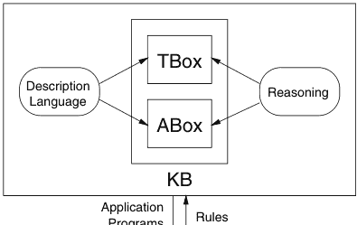

图 2.1. 基于描述逻辑的知识表示系统的架构。

推理问题并展示了它们是如何相关的。最后，它定义了在许多实现的 `DL` 系统中提供的规则语言。

第 2.3 节描述了解决描述逻辑中基础推理问题的算法。在简要描述结构包含算法后，它集中在基于表的（`tableau-based`）算法上。最后，它对关于术语的推理问题进行了评论。

最后，第 2.4 节描述了 2.2 中未包含但在文献中并在某些 `DL` 系统中的额外语言构造子。

## 2.2 基础形式化的定义

基于描述逻辑的知识表示系统提供了建立知识库、对其进行推理以及操作它们的功能。图 2.1 画了此类系统的架构（更多信息请见第 8 章）。

知识库（`KB`）包含两个部分：`TBox` 和 `ABox`。`TBox` 引入术语，即应用的词汇，而 `ABox` 包含关于个体的断言。

词汇由概念（表示个体集合）和角色（表示个体间的二元关系）组成。除了原子概念和角色（概念和角色名称），所有的 `DL` 系统都允许用户构建复杂的描述。`TBox` 可用于为复杂的

描述描述语言是每个 `DL` 系统的特征，不同系统通过其描述语言进行区分。描述语言具有模型论语义。因此，`TBox` 和 `ABox` 中的语句可以等同于一阶逻辑公式，在某些情况下是其略微扩展。

`DL` 系统不仅存储术语和断言，还提供了对其进行推理的服务。术语的典型推理是确定一个描述是否可满足（即是不矛盾的），或者一个描述是否比另一个更通用（即第一个是否包含第二个）。`ABox` 的重要问题是找出其断言集是否一致，即 `ABox` 中的断言是否意味着某个特定个体是给定概念的实例。描述的可满足性检查和断言集的一性检查对于判断知识库是否有意义有用。通过包含测试，可以根据通用性将术语中的概念组织成层次。概念描述可以被理解为一个查询，描述感兴趣的对象集。因此，通过实例测试，可以检索满足查询的个体。在任何应用程序中，`KR` 系统都嵌入在一个更大的环境中。其他组件通过查询知识库和修改知识库（即添加和撤销概念、角色和断言）与 `KR` 组件交互。添加断言的受限机制使用规则。规则是逻辑核心形式的扩展，仍然可以在逻辑上解释。

### 2.2.1 描述语言

我们假设有两种符号，我们称为原子概念和原子角色。在抽象表示中，我们使用字母 `A` 和 `B` 表示原子概念，使用字母 `R` 表示原子角色。我们将原子概念和角色称为原子符号。原子概念和角色是基础描述，我们通过概念构造子和角色构造子递归构建复杂描述。在本章中，我们将主要关注概念构造子。角色构造子在 2.4.1 节中介绍。我们使用字母 `C` 和 `D` 表示任意概念描述。

描述语言通过它们提供的构造子进行区分。在接下来的部分，我们将讨论 `AL` 语言族中的各种语言。`AL` 语言（即属性语言）已在 [`Schmidt-Schauß and Smolka, 1991`] 中引入，作为一种具有实用价值的最小语言。该族的其他语言都是 `AL` 的扩展。

#### 2.2.1.1 基础描述语言 `AL`

`AL` 中的概念描述根据以下语法形成：

```
$C, D \longrightarrow A$ (原子概念)
$\top$ (全集概念)
$\perp$ (空概念)
$\neg A$ (原子否定)
$C \sqcap D$ (交集)
$\forall R.C$ (值限制)
$\exists R.T$ (有限存在量化)。
```

注意，在 `AL` 中，否定只能应用于原子概念，且在对角色（role）的存在量化范围内只允许全集概念。由于历史原因，通过禁止原子否定得到的 `AL` 子语言称为 `AL^-`，而通过禁止存在量化得到的 `AL^-` 子语言称为 `AL_0`。

为了给出 `AL` 的表达示例，假设 `Person` 和 `Female` 是原子概念。那么 `Person \sqcap Female` 和 `Person \sqcap \neg Female` 是 `AL` 概念，分别描述是女性的人和不是女性的人。如果假设 `hasChild` 是一个原子角色，我们可以形成概念 `Person \sqcap \exists hasChild.T` 和 `Person \sqcap \forall hasChild.Female`，分别描述有孩子以及孩子都是女性的人。使用空概念可以得到 `Person \sqcap \exists hasChild.\perp`。

为了定义 `AL` 概念的正式语义，我们考虑非空集 `Δ^I` 的解释 `I`（解释域）以及一个解释函数，该函数为每个原子概念 `A` 分配一个集合 `A^I \subseteq Δ^I`，为每个原子角色 `R` 分配一个二元关系 `R^I \subseteq Δ^I \times Δ^I`。解释函数通过以下递归定义到到概念：

```
$T^I = Δ^I$
$\perp^I = \emptyset$
$(\neg A)^I = Δ^I \setminus A^I$
$(C \sqcap D)^I = C^I \cap D^I$
$(\forall R.C)^I = \{a \in Δ^I \mid \forall b. (a,b) \in R^I \to b \in C^I\}$
$(\exists R.T)^I = \{a \in Δ^I \mid \exists b. (a,b) \in R^I\}$
```

我们发现，对于所有解释 `I`，如果 `C^I = D^I`，则两个概念 `C, D` 是**等价**的。例如，回到概念语义的定义，可以很容易验证 `hasChild.Female \sqcap \forall hasChild.Student` 和 `hasChild.Student` 是等价的。

#### 2.2.1.2 `AL` 语言族

如果我们向 `AL` 添加更多构造子，就可以获得更复杂的语言。概念的**并集**（由字母 `U` 表示）写为 `C \cup D`，解释为：

```
$(C \cup D)^I = C^I \cup D^I$
```

**全存在量化**（由字母 `E` 表示）写为 `∃ R.C`，解释为：

```
$(∃ R.C)^I = \{a \in Δ^I \mid ∃ b. (a,b) \in R^I \wedge b \in C^I\}$
```

注意 `∃ R.C` 与 `∃ R.T` 的区别在于允许概念出现在存在量化范围内。**数量限制**（由字母 `N` 表示）写为 `≥ n R`（至少限制）和 `≤ n R`（最多限制），其中 `n` 是非负整数。它们分别解释为：

```
$(≥ n R)^I = \{a \in Δ^I \mid |\{b \mid (a,b) \in R^I\}| ≥ n\}$
```

以及

```
$(≤ n R)^I = \{a \in Δ^I \mid |\{b \mid (a,b) \in R^I\}| ≤ n\}$
```

其中“`·|`”表示集合基数。从语义角度来看，数量限制中的数字编码并不重要。但对于推理的复杂度分析，数字 `n` 是以二进制（或十进制）还是以长度为 `n` 的字符串表示可能会，因为二进制表示允许更紧凑的表示。任意概念的**否定**（由字母 `C` 表示，代表补集）写为 `¬ C`，解释为：

```
$(¬ C)^I = Δ^I \setminus C^I$
```

有了额外的构造子，我们可以描述那些孩子不超过一个或至少有三个且其中一个是女性的人：`≤ 1 hasChild ⊔ (≥ 3 hasChild.Female)`。

通过上述构造子的任意子扩展 `AL` 可产生特定的 `AL` 语言。我们用形式如 `AL` 的字符串命名每个 `AL` 语言，其中名称中的字母代表对应构造子的存在。然而，从语义角度来看，这些语言都是不同的。语义强制了等价关系 `C ⊔ D ≡ ¬(¬ C ⊓ ¬ D)` 和 `∀ R.C ≡ ¬∃ R.¬ C`。因此，并集和存在量化可以使用否定来表示。相反，并集和存在量化的组合赋予了我们表示否定的能力（见其等价范式，见3.2节）。因此，我们假设任何包含否定的语言都有并集和存在量化，反之亦然。除去上述等价关系，所有的 `AL` 语言都可以使用 `U, E, N` 来编写。在接下来的部分，我们将不再区分带有否定的 `AL` 语言及其带有并集和存在量化的对应物。同样，我们将在语言名称中使用字母 `C` 代替 `U`。例如，我们将写作 `ACC` 而不是 `ALUC`，，`ALCN` 而不是 `ALEN`。

### 2.2.1.3 作为谓词逻辑片段的描述语言

概念描述语言的语义是谓词逻辑的片段。由于解释 `I` 为每个原子概念和角色分配 `Δ^I` 上的一元和二元关系，我们可以将原子概念和角色视为一元和二元谓词。那么，任何概念 `C` 都可以有效地翻译为一个自由变量 `x` 的谓词公式 `φ_C(x)`，对于每个解释 `I`，满足 `φ_C(x)` 的 `Δ^I` 元素集合恰好是 `C^I`；原子概念 `A` 翻译为 `A(x)`；交集、并集和否定分别翻译为逻辑与、逻辑或和否定；如果 `C` 已经翻译为 `φ_C(x)` 且 `R` 是原子角色，那么值限制和存在量化由以下公式捕捉：

```
$Φ_{R.C}(y) = ∃ x. R(y,x) ∧ φ_C(x)$
$Φ_{¬ R.C}(y) = ∀ x. R(y,x) → φ_C(x)$
```

其中 `y` 是新变量；数量限制由以下公式表示：

```
$φ_{≥ n R}(x) = ∃ y_1, …, y_n. R(x,y_1) ∧ … ∧ ⋀_{i<j} y_i ≠ y_j$
$φ_{≤ n R}(x) = ∀ y_1, …, y_{n+1}. R(x,y_1) … ∧ R(x,y_{n+1}) → ⋁_{i<j} y_i = y_j$.
```


注意，等式谓词 `$=$` 用于数量限制，而没有数量限制的概念可以翻译为不含等式的公式。

### 2.2.2 术语

我们已经看到如何构建概念的描述来描述对象类。现在，我们引入术语公理，它们对概念或角色之间的关系陈述。我们将定义视为特定的公理，并将术语识别为定义的集合，通过定义引入作为复杂概念的原子概念。如果术语中的定义包含循环，我们可能需要采用不动点语义来消除歧义。我们将讨论哪些类型的术语存在不动点模型。

在一般情况下，术语公理的形式为：

```
$C \subseteq D \quad (R \subseteq S) \quad \text{or} \quad C \equiv D \quad (R \equiv S),$
```

# F. Baader 和 W. Nutt

| 术语 | 逻辑表达式 |
| 女人 | 人 ⊔ 女性 |
| 男性 | 人 ¬女性 |
| 母亲 | 女性 ⊔hasChild. 人 |
| 父亲 | 男性 ⊔hasChild. 人 |
| 父母 | 父亲 ⊔ 母亲 |
| 祖母/外祖母 | 母亲 ⊔hasChild. 人 |
| 多子女的母亲 | 母亲 ⊔ ∃hasChild |
| 无女儿的母亲 | 母亲 ⊔hasChild.¬女性 |
| 妻子 | 女性 ⊔hasChild. 丈夫 |

图 2.2. 一个包含关于家庭关系概念的术语集（TBox）。

其中 `$C, D$` 是概念（且 `$R, S$` 是集合）。第一类公理称为包含式（inclusions），第二类公理称为等价式（equalities）。为了简化叙述，我们在随后的内容仅处理涉及概念的公理。

公理的语义定义正如预期的那样。如果解释 `$I$` 满足包含式 `$C \subseteq D$`，则 `$C^I \subseteq D^I$`；如果它满足等价式 `$C \equiv D$`，则 `$C^I = D^I$`。如果 `$T$` 是一个公理集，则 `$I$` 满足且仅当 `$I$` 满足 `$T$` 中的每一个元素。如果 `$I$` 满足某个公理（或一组公理），我们称之为该公理（或一组公理）的模型。两个公理或两个公理集是等价的，如果它们具有相同的模型。

## 2.2.2. 定义

左侧为原子概念（atomic concept）的等价式是一个定义。定义用于为复杂的描述引入符号名称。例如，公理

`$Mother \equiv Woman \existshasChild.Person$`

我们将右侧的描述与名称 `$Mother$` 关联。符号名称可以在其他描述中用缩写。例如，如果我们类似于定义 `$Mother$` 那样定义了 `$Father$`，我们可以将 `$Father$` 定义为：

`$Parent \equiv Mother \sqcup Father$`.

一组定义应该是无歧的。如果一组定义 `$T$` 中没有符号名称被定义一次以上，我们称这组定义 `$T$` 为术语集或 `TBox`，即：对于每个原子概念 `$A$`，在 `$T$` 中最多有一个左侧为 `$A$` 的公理。图 2.2 展示了一个包含与家庭关系相关概念的术语集。

假设 `$T$` 是一个术语集。我们将出现在 `$T$` 中的原子符号分为两组：出现在某些公理左侧的名称符号 `NT`，以及仅出现在公理右侧的基符号 `BT`。名称符号通常称为定义概念（defined concepts），而基符号称为原始概念（primitive concepts）和原始角色（primitive roles）。我们期望术语集根据基符号来定义名称符号，现在我们对这一点进行更精确的说明。

`$\mathcal{T}$` 的基础解释（base interpretation）是一个仅解释基符号的解释。如果一个解释名称符号的解释 `$\mathcal{I}$` 是 `$\mathcal{J}$` 的扩展，则它具有与 `$\mathcal{J}$` 相同的域，即 `$\Delta^{\mathcal{I}} = \Delta^{\mathcal{J}}$`,并且在基符号上与 `$\mathcal{J}$` 一致。

我们称 `$\mathcal{T}$` 是定义性的（definitional），如果每个基础解释恰好有一个作为 `$\mathcal{T}$` 模型的扩展。换句话说，如果我们知道基符号代表什么，且 `$\mathcal{T}$` 是定义性的，那么名称符号的含义就被完全确定。显然，如果一个术语集是定义性的，那么每个等价的术语集也是定义性的。

术语集是否为定义性的问题与其定义是否是循环的（cyclic）有关。例如，由单个名称构的术语集

`$Human' \approx \Box \forallhasParent.Human'$` (2.1)

包含一个循环，因为从直觉上，`$Human'$` 是根据 `$Human'$` 定义的。我们现在给出术语集中循环的计算性定义。设 `$A, B$` 为出现在 `$\mathcal{T}$` 中的原子概念。如果 `$B$` 出现在 `$A$` 的定义的右侧，我们称 `$A$` 在 `$\mathcal{T}$` 中 *直接使用*（directly uses） `$B$`，并定义“使用”（uses）为关系 *直接使用* 的传递传递闭包。那么，如果 `$\mathcal{T}$` 中存在一个使用自身的原子概念，则 `$\mathcal{T}$` 包含循环。否则，`$\mathcal{T}$` 被称为无循环的（acyclic）。

如果术语集包含循环，则不一定存在唯一的扩展。考虑仅包含公理 (2.1) 的术语集。在这里，`$Human'$` 是`$Animal$` 和 `$hasParent$` 是基符号。对于一个通过 `$hasParent$` 将每个动物与其祖先联系起来的解释，存在许多解释 `$Human'$` 以满足该公理：`$Human'$` 等可以解释为所有动物的集合，或者每个元素也包含其祖先的动物集合。

相反，如果一个术语集是无循环的，它是定义性的。原因是我们可以通过迭代过程，通过将右侧每个名称的出现替换为它代表的概念，来定义 `$\mathcal{T}$` 中的定义。由于定义集中没有循环（注意：某些论文对“原始概念”一词的使用有不同的含义；例如，等同于我们所说的原子概念，或用于表示概念包含式的（原子）左侧），该过程最终会停止，我们得到仅由公式 `$A \equiv C'$` 的定义组成的术语集 `$T'$`，其中 `$C'$` 只包含基符号而不包含名称符号。我们称 `$T'$` 为 `$T$` 的扩展（expansion）。此时，扩展的大小相对于原始术语集呈指数级增长 [Nebel, 1990b]。图 2.2 中的 Family TBox 是无循环的。因此，它是定义性的。

命题 2.1 设 `$T$` 是一个无循环术语集，`$T'$` 是其扩展。那么：

- 1. `$T$` 和 `$T'$` 具有相同的名称和基符号；
- 2. `$T$` 和 `$T'$` 是价的；
- 3. `$T$` 和 `$T'$` 都是定义性的。

证明：设 `$T_1$` 是一个术语集。假设 `$A \equiv C$` 和 `$B \equiv D$` 是 `$T_1$` 中的定义，且 `$B$` 出现在 `$C$` 中。令 `$C'$` 为通过替换 `$C$` 中 `$B$` 的所有出现而得到的概念，并令 `$T_2$` 为通过替换 `$A \equiv C$` 得到的术语集。那么两者具有相同的名称和基符号。此外，由于 `$T_2$` 是通过等价式从 `$T_1$` 得到的，它们具有相同的模型。由于 `$T'$` 是通过一系列替换步骤从 `$T$` 得到的，这证明了 1 和 2。

假设 `$J$` 是基符号的一个解释。我们通过设置 `$A^I = C'^J$` 将其扩展为包含名称符号的解释 `$I$`，其中 `$A \equiv C'$` 是 `$T'$` 的定义。显然，`$I$` 是 `$T'$` 的一个模型，且是 `$J$` 的唯一扩展。这表明 `$\mathcal{T}'$` 是定义性的。此外，`$\mathcal{T}$` 也是定义性的，因为它等价于 `$\mathcal{T}'$`。

无循环术语集的特征是（从更精确的角度说）根据基符号唯一地定义名称符号。当然，也有包含循环的定义性术语集。例如，考虑包含以下公理的术语集：

`$A \equiv \forall\mathcal{R}.B \cup \mathcal{R}.(A \cap \neg A),$` (2.2)

然而它包含循环，因为 `$\exists\mathcal{R}.(A \cap \neg A)$` 等价于空概念，公理 (2.2) 等价于无循环公理：

`$A \equiv \forall\mathcal{R}.B.$` (2.3)

这个例子是典型的。

定理 2.2 每一个定义性的 `$\mathcal{ALC}$`-术语集都等价于一个无循环术语集。

该定理是模态命题逻辑 `$\mathbf{K}_n$` 的 Beth 可定义定理的重述，正如 Schild [1991] 所示，它是 `$\mathcal{ALC}$` 的符号变体。

### 2.2.2.3 术语循环的固定点语义

在我们为止学习的语义（本质上是一阶逻辑语义）下，术语集在本质上无循环时具有定义效应。遵循 Nebel [1991]，我们将其称为描述语义，以区别于下文介绍的固定点语义。固定点语义的动机是：在某些情况下，直觉上的循环定义是有意义的，且这种直觉可以通过最小或最大固定点来捕捉。

示例 2.3 假设我们想要指定“只有男性后代的男人”这一概念，这样的人是一个 *Mos*，即“只有儿子的男人”。**Mos** 可以不通过循环地定义为：

`$Mos \equiv \mathcal{Man} \sqcap \forallhasChild.Man.$`

然而，对于 *Momd*，我们想要对 **hasChild** 传递闭包的填充物进行陈述。在这里，*Momd* 的递归定义似乎是自然的。只有男性后代的男人本身也是男人，

60 F. Baader 和 W. Nutt

并且他所有的孩子只有男性后代：

`Momd \equiv Man \sqcap \forallChild.Momd.` (2.4)

为了达到预期的含义，我们必须在适当不动点语义下解释此定义。我们将证明，最大不动点语义符合我们在此处的直觉。

当我们想要模拟递归结构时，循环也会出现，例如二叉树.^3

**示例 2.4** 我们假设有一组对象集合 Trees，以及一个对象之间的二元关系 has-branch，它从一棵树指向其子树。二叉树是指最多有两个子树且子树本身也是二叉树的树：

`BinaryTree \equiv Tree \sqcap 2 has-branch \sqcap \forallhasbranch.BinaryTree.`

与 Momo 的定义一样，不动点语义将产生预期的含义。然而，对于这个例子，我们必须使用最小不动点语义。

我们给出不动点语义的正式定义。在术语 `$\mathcal{T}$` 中，每个符号 `$A$` 均作为公理 `$A \equiv C$` 的左侧出现一次。因此，我们可以将 `$\mathcal{T}$` 视为一个映射，它为每个符号 `$A$` 关联概念描述 `$\mathcal{T}(A) = C$`。用这种符号，解释 `$\mathcal{I}$` 是 `$\mathcal{T}$` 的模型，当且仅当 `$A^{\mathcal{I}} = (\mathcal{T}(A))^{\mathcal{I}}$`。这种刻画具有不动点方程的味道。我们利用这种相似性引入引入映射，使得如果 `$\mathcal{I}$` 是此类映射的不动点，则 `$\mathcal{I}$` 是 `$\mathcal{T}$` 的模型。

令 `$\mathcal{T}$` 为一个术语，`$\mathcal{J}$` 为 `$\mathcal{T}$` 的基础不动点解释。用 `$Ext_{\mathcal{J}}$` 表示 `$\mathcal{J}$` 的所有扩展的集合。令 `$T_{\mathcal{J}}: Ext_{\mathcal{J}} \to Ext_{\mathcal{J}}$` 为将解释 `$\mathcal{I}$` 映射到扩展 `$\mathcal{J}(\mathcal{I})$` 的映射，对于每个符号 `$A$`，由 `$A^{\mathcal{I}} = (\mathcal{T}(A))^{\mathcal{I}}$` 定义。这意味着对于 `$\mathcal{T}$` 中的每个定义 `$A \equiv C$`，我们都有 `$A^{\mathcal{I}} = (\mathcal{T}(A))^{\mathcal{I}} = C^{\mathcal{I}}$`，这意味着 `$\mathcal{I}$` 是 `$\mathcal{T}$` 的模型。这证明了以下结果。

**命题 2.5** `$\mathcal{T}$` 为术语，`$\mathcal{I}$` 为一个解释，`$\mathcal{J}$` 为 `$\mathcal{I}$` 对 `$\mathcal{T}$` 基础符号的限制。那么 `$\mathcal{I}$` 是 `$\mathcal{T}$` 的模型，当且仅当 `$\mathcal{I}$` 是 `$\mathcal{T}_J$` 的不动点。

^3 下例取自 [Nebel, 1991]。

# 描述逻辑 61

根据前述命题，术语 `$\mathcal{T}$` 是定义性的，每个基础解释 `$\mathcal{J}$` 都有一个唯一的扩展，该扩展是 `$\mathcal{T}_J$` 的不动点。

**示例 2.6** 为了理解为什么循环术语不是定义性的，我们讨论一个仅由公理 (2.4) 组成的术语 `$\mathcal{T}^{Mond}$` 作为示例。考虑由下式定义的基础解释 `$\mathcal{J}$`：

```
$$ \Delta^J = \{Charles_1\} $$
```

这意味着 *Charles* 王朝不会扩张，而 `$\mathcal{J}$` 王朝有一个最后的成员。

我们想要识别 `$\mathcal{T}^{Mond}$` 的王朝。注意，一个没有孩子的个体（即没有 `$\var$hasChild` 填充项的个体）总在 `$\var$hasChild.Mond$` 的解释中，无论 Mond 如何被解释。因此，如果 `$\mathcal{I}$` 是 `$\mathcal{J}$` 的一个不动点扩展，那么 `$James_{Last}$` 在 `$(\var$hasChild.Mond)$^{\mathcal{I}}$` 中，并且在 `$Mond^{\mathcal{I}}$` 中。我们得出每个 James 都是 `$\mathcal{I}_1$` 的成员的结论。`$Mond^1$` 的 `$\mathcal{J}$` 扩展恰好是 James 王朝。那么很容易检查出 `$\mathcal{I}_1$` 是一个不动点。除了 Charles 王朝外，*Charles* 王朝在他之前和之后的所有成员都属于概念 Mond。人们可以很容易检查出将 Mond 解释为整个区域的扩展 `$\mathcal{I}_2$` 也是一个不动点，并且没有其他不动点。

为了给循环术语 `$\mathcal{T}$` 提供定义努力，如果存在多个不动点，我们必须包含映射 `$\mathcal{T}_J$` 的一个特定不动点。为此，我们在 `$\mathcal{J}$` 的扩展上定义了一个偏序 `$\preceq$`。如果对于 `$\mathcal{T}$` 中的每个名称符号都有 `$\mathcal{I}^A \subseteq \mathcal{I}'^A$`，则我们称 `$\mathcal{I} \preceq \mathcal{I}'$`。在上面的例子中，Mond 是唯一的名称符号。由于 `$Mond^{\mathcal{I}_1} \subseteq Mond^{\mathcal{I}_2}$`，我们有 `$\mathcal{I}_1 \preceq \mathcal{I}_2$`。

如果对于每个不动点 `$\mathcal{I}'$`，都有 `$\mathcal{I} \preceq \mathcal{I}'$`，则 `$\mathcal{T}_J$` 的不动点是*最小不动点* (lfp)。如果 `$\mathcal{I}$` 是 `$\mathcal{T}_J$` 的不动点且对于每个其他不动点 `$\mathcal{I}'$`都有 `$\mathcal{I} \preceq \mathcal{I}'$`（此处原文逻辑可能有误，通常指 `$\mathcal{I}$` 是所有不动点中的下界），则我们称 `$\mathcal{I}$` 是 `$\mathcal{T}_J$` 的最小不动点。同样，如果对于每个不动点 `$\mathcal{I}'$`，`$\mathcal{I}' \preceq \mathcal{I}$`，则 `$\mathcal{T}_J$` 的不动点是*最大不动点* (gfp)。如果 `$\mathcal{I}$` 是 `$\mathcal{T}_J$` 的不动点且对于每个其他不动点 `$\mathcal{I}'$`都有 `$\mathcal{I}' \preceq \mathcal{I}$`，我们称 `$\mathcal{I}$` 是 `$\mathcal{T}_J$` 的最大不动点。

### 2.2.4 不动点的存在

最小和最大不动点并不对每个术语存在。作为一个例子，考虑术语 `$\mathcal{T}$`：

```
$$ A \equiv \neg A. (2.5) $$
```

如果 `$\mathcal{I}$` 是 `$\mathcal{T}$` 的模型，那么 `$A^{\mathcal{I}}=\}$`，这是荒谬的。

还有 `$\mathcal{T}$` 既没有最小也没有最大模型的情况。例如，考虑术语 `$\mathcal{T}$`：

```
$$ A \equiv \neg A. (2.6) $$
```

令 `$\mathcal{J}$` 为解释 `$A^{\mathcal{J}}=\{a,b\}$`。那么存在不动点 `$\mathcal{I}_1$` 和 `$\mathcal{I}_2$`，使得 `$A^{\mathcal{I}_1}=\{a\}$` 且 `$A^{\mathcal{I}_2}=\{b\}$`。然而，`$\mathcal{I}_1$` 或 `$\mathcal{I}_2$` 都不是最小或最大不动点。

为了给循环术语 `$\mathcal{T}$` 提供定义努力，如果存在多个不动点，我们必须包含映射 `$\mathcal{T}_J$` 的一个特定不动点。为此，我们在 `$J$` 的扩展上定义一个偏序 `$\preceq$`。如果对于 `$\mathcal{T}$` 中的每个名称符号都有 `$\mathcal{I}^A \subseteq \mathcal{I}'^A$`，则我们称 `$\mathcal{I} \preceq \mathcal{I}'$`。在上面的例子中，Mond 是唯一的名称符号。由于 `$Mond^{\mathcal{I}_1} \subseteq Mond^{\mathcal{I}_2}$`，我们有 `$\mathcal{I}_1 \preceq \mathcal{I}_2$`。


如果对于每个不动点 `mathcal{I}'`，都有 `mathcal{I} preceq mathcal{I}'`，则 `mathcal{T}_J` 的不动点是*最小不动点* (`lfp`)。如果 `mathcal{I}` 是 `mathcal{T}_J` 的不动点且对于每个其他不动点 `mathcal{I}'`都有 `mathcal{I} preceq mathcal{I}'`（注：此处定义与前文重复或冲突）。同样，如果对于每个不动点 `mathcal{I}'`，都有 `mathcal{I}' preceq mathcal{I}`，则 `mathcal{T}_J` 的不动点是*最大不动点* (`gfp`)。如果 `mathcal{I}` 是 `mathcal{T}_J` 的不动点且对于每个其他不动点 `mathcal{I}'`都有 `mathcal{I}' preceq mathcal{I}`。

# 基础描述逻辑

为了找到单调性的语法准则，我们考虑 `mathcal{AL}` 的算子，即“`sqcap`”、“`sqcup`”、“`neg`”、“`forall`”和“`exists`”。

这些算子在某些区域（例如 `Delta`）的子上有自然的对应物。显然，交集和对应对应集合运算，而否定对应于补集。由于“`forall`”和“`exists`”应用于角色和概念，对于 `Delta` 上的每个二元关系 `r`，我们引入一元算子 `A_r`，它将集合 `S subseteq Delta` 映射到：

$$ A_r(S) = \{a in Delta | forall b, (a,b) in r to b in S\} $$

以及算子 `E_r`，它将集合 `S subseteq Delta` 映射到：

$$ E_r(S) = \{a in Delta | exists b, (a,b) in r wedge b in S\} $$

然后我们看到除了补集之外的所有这些操作都是单调的，即如果它们应用于更大的参数，结果也会更大。这对于交集和并是显而易见的。此外，人们很容易检查出 `S subseteq S'` 意味着 `A_r(S) subseteq A_{r'}(S')` 和 `E_r(S) subseteq E_{r'}(S')`。显然，对于否定的类似陈述并不。

如果术语中没有出现否定符号，我们称之为无否定的。基于上述观察，我们可以通过归纳法证明 `mathcal{ALCN}`-术语单单调的充分语法条件。

**命题 2.9** 每个无否定的 `mathcal{ALCN}`-术语都是单调的。

我们可以通过分析术语中哪些否定符号对单调性具有潜在危害来推广这一准则。显然，否定符号只有当其作用范围内存在名称符号时，才会影响术语的单调性。此外，从直觉上，如果否定符号位于另一个否定的作用范围内，它就会被中和。这启发了以下定义：如果一个概念 `C` 中的每个名称符号都出现在偶数个否定符号的作用范围内，我们称该概念 `C` 是语法上单调的。如果等式右侧的每个概念都是语法上单调的，则该术语是语法上单调的。

**命题 2.10** 每个语法上单调的 `mathcal{ALCN}`-术语都是单调的。

## 2.2.2.5 带有包含公理的术语

对于某些概念，我们可能无法对其进行完全定义。在这种情况下，我们仍然可以使用包含关系（inclusion）来描述概念成员的必要条件。我们可以添加一个包含关系，其左侧是一个原子特化（atomic specialization）。

例如，如果一个（男性）知识工程师认为我们示例 TBox（图 2.2）中“女性”（woman）的定义是不令人满意的，但他觉得无法在所有细节上定义“女性”这一概念，那么他可以要求每个女性都是具有以下特化关系的人：

`Woman sqcap Person` (2.7)

如果我们在术语中允许特化，那么该术语将失去其定义效果，即使它是无环的。如果一组公理 `mathcal{T}` 中，每个公理的左侧都是原子概念，且对于每个原子概念，最多只有一个公理在其左侧出现该概念，那么这组公理就称为一个广义术语（generalized terminology）。

我们将一个广义术语 `mathcal{T}` 转换为一个仅包含定义的正则术语 `hat{T}`，使得 `hat{T}` 在下文指定的意义上等价于 `mathcal{T}`。我们通过变换 `mathcal{T}`：为每个特化 `A sqsubseteq C` 选择一个新的基符号 `A`，并将特化 `A sqsubseteq C` 替换为定义 `A equiv A sqcap C`。术语 `hat{T}` 就是 `mathcal{T}` 的归一化（normalization）。

如果 TBox 包含特化 (2.7)，则归一化后包含定义：

`Woman = Woman sqcap Person`.

直观地说，额外的基符号 `Woman` 代表了在人中区分出女性的特质。因此，归一化的结果得到了一个带有 `Woman` 定义的 TBox，该定义与 Family TBox 中的定义相似。

## 命题 2.11 设 `mathcal{T}` 为广义术语，`hat{T}` 为其归一化。

- `hat{T}` 的每一个模型都是 `mathcal{T}` 的模型。
- 对于 `mathcal{T}` 的每一个模型 `I`，都存在一个 `hat{T}` 的模型 `hat{I}`，其域与 `I` 相同，且在 `T` 中的原子概念和角色上与 `I` 一致。

证明。第一个结论成立，是因为 `mathcal{T}` 的 `hat{I}` 满足 `A^I = (A sqcap C)^I = hat{A}^I cap C^I`，这意味着 `A^{hat{I}} subseteq C^{hat{I}}`。相反，如果 `mathcal{I}` 是 `mathcal{T}` 的模型，那么由 `hat{I} = A^{mathcal{I}}` 定义的 `mathcal{I}` 的扩展 `hat{I}` 是 `hat{T}` 的模型，因为 `A^{mathcal{I}} subseteq C^{mathcal{I}}` 意味着 `A^{hat{I}} = A^{mathcal{I}} cap C^{mathcal{I}}`，因此 `hat{I}` 满足 `A equiv A sqcap C`。`square`

# 基础描述逻辑 65

`MotherWithoutDaughter(MARY)` `Father(PETER)`

`hasChild(MARY, PETER)` `hasChild(PETER, HARRY)`

`hasChild(MARY, PAUL)`

图 2.4. 一个世界描述（ABox）。

因此，在理论上，包含公理并没有增加术语的表达能力。然而在实践中，它们是将无法完全定义的术语引入术语中的一种方便手段。

## 2.2.3 世界描述

知识库除了术语或 TBox 之外的第二个组成部分是世界描述或 ABox。

### 2.2.3.1 关于个体的断言

在 ABox 中，根据概念和角色描述应用领域中的特定事务状态。ABox 中的某些概念和角色原子可能是 TBox 中的定义名称。在 ABox 中，人们通过给个体赋予名称来引入个体，并断言这些个体的属性。我们用 `a, b, c` 来标识个体。使用概念 `C` 和角色 `R`，可以在 ABox 中做出以下两种断言：

`C(a), R(b, c)`.

通过第一种（称为*概念断言*，concept assertions），我们声明 `a` 属于（C$ 的解释）。通过第二种（称为*角色断言*，role assertions），我们声明 `c` 是 `b` 的角色 `R` 的填充值。例如，如果 `PETER`、`PAUL` 和 `MARY` 是个体名称，那么 `Father(PETER)` 意味着 Peter 是一个父亲，而 `hasChild(MARY, PAUL)` 意味着 Paul 是 Mary 的孩子。记为 `mathcal{A}` 的 ABox 是此类断言的有限集。图 2.4 展示了一个 ABox 示例。

从简化角度来看，ABox 可以被视为仅具有一元或二元关系的关系型数据库实例。然而，与经典数据库的“封闭世界语义”不同，ABox 的语义是“开放语义”（open-world semantics），知识表示系统通常应用于无法假设 KB 中的知识是完整的情况。4 此外，TBox 对 ABox 中的概念和角色施加了语义关系，这些关系在数据库语义中是没有对应物的。

4 我们在 2.2.4.4 节中讨论这种语义差异的影响。

66 F. Baader 和 N. Nutt

我们通过将解释扩展到个体名称为 ABox 提供语义。从现在起，一个解释 `mathcal{I} = (Delta^{mathcal{I}}, .^{mathcal{I}}, .^{mathcal{I}})` 将概念和角色映射到 `Delta^{mathcal{I}}` 的子集。因此，对于概念 `C，`C^{mathcal{I}}` 是 `Delta^{mathcal{I}}` 的子集；对于角色 `R，`R^{mathcal{I}}` 是 `Delta^{mathcal{I}} times Delta^{mathcal{I}}` 的子集；对于个体名称 `a，`a^{mathcal{I}}` 是 `Delta^{mathcal{I}}` 的元素。

我们现在定义 ABox 的一致性。如果 ABox `mathcal{A}` 对于解释 `mathcal{I}` 是致的，即对于 `mathcal{A}` 中的每个断言 `C(a)`都有 `a^{mathcal{I}} in C^{mathcal{I}}`，且对于 `mathcal{A}` 中的每个断言 `R(b, c)`都有 `(b^{mathcal{I}}, c^{mathcal{I}}) in R^{mathcal{I}}`，则称 ABox 对于 `mathcal{I}` 是一致的。

ABox 是一致的，当且仅当 ABox 中不存在形式为 `C(a)` 和 `neg C(a)` 或 `R(b, c)` 和 `neg R(b, c)` 的断言。然而，这仅当 TBox 为空时成立。当 TBox 存在时，ABox 必须也与 TBox 的公理一致。

## 2.2.4 推理

基于描述逻辑的知识表示系统能够执行特定类型的推理。如所述，知识表示的目的不仅在于存储概念定义和断言。结合 TBox 和 ABox 的知识库具有使其等价于一阶逻辑公理集的语义。因此，与任何其他公理集不同，它包含了可以通过推理显化的隐含知识。例如，从图 2.2 和图 2.4 中的 ABox 可以推导出玛是一个祖母，尽管这一知识并没有作为断言显式给出。

### 2.2.4.1 概念的推理任务

在领域建模时，知识工程师通过定义概念来构建术语，可能根据之前定义的概念来定义它们。在此过程中，确定新定义的概念是否有意义或是否存在矛盾是非常重要的。从逻辑角度来看，如果存在某个满足 `mathcal{T}` 公理的解释（即 `mathcal{T}` 的一个模型），使得该概念在该解释中表示一个非空集合，那么一个具有该属性的概念就相对于 `mathcal{T}` 是*可满足的*（satisfiable），否则是*不可满足的*（unsatisfiable）。

# 68 F. Baader 和 W. Nutt

检查概念的可满足性是一项关键推理。正如我们所看到的，概念的许多其他重要推理都可以归约为（不）满足性。例如，为了检查领域模型是否正确，或者优化表述为概念的查询，我们可能想知道某个概念是否比另一个更通用：*包含问题*（the subsumption problem）。如果在 `mathcal{T}` 的每一个模型中，概念 `C` 都被概念 `D` *包含*（subsumed by），则由 `C` 所表示的集合是 `D` 所表示集合的子集。检查包含关系的算法还用于根据其通用性将 TBox 中的概念组织到分类法中。概念之间进一步有趣的关系还有*等价*（equivalence）和*不斥*（disjointness）。这些属性的正式定义如下。设 `mathcal{T}` 为一个 TBox。

**可满足性**（Satisfiability）如果存在 `mathcal{T}` 的模型 `mathcal{I}` 使得 `C^{mathcal{I}}` 非空，则称概念 `C` 对于 `mathcal{T}` 是*可满足的*。在这种情况下，我们称 `mathcal{I}` 是 `C` 的*模型*。

**包含**（Subsumption）如果对于 `mathcal{T}` 的每一个模型 `mathcal{I}`都有 `C^{mathcal{I}} subseteq D^{mathcal{I}}`，则称概念 `C` 对于 `mathcal{T}` 被概念 `D` *包含*。在这种情况下，我们写作 `C sqsubseteq D` 或 `mathcal{T} models C sqsubseteq D`。

**等价**（Equivalence）如果对于 `mathcal{T}` 的每一个模型 `mathcal{I}`都有 `C^{mathcal{I}} = D^{mathcal{I}}`，则称两个概念 `C` 和 `D` 对于 `mathcal{T}` 是*等价的*。在这种情况下，我们写作 `C equiv D` 或 `mathcal{T} models C equiv D`。

**不斥**（Disjointness）如果对于 `mathcal{T}` 的每一个模型 `mathcal{I}`都有 `C^{mathcal{I}} cap D^{mathcal{I}} = emptyset`，则称两个概念 `C` 和 `D` 对于 `mathcal{T}` 是*不斥的*。

如果上下文明确了 TBox `mathcal{T}`，我们有时会省略“对于 `mathcal{T}`”这一限定。

在 TBox 为空的特殊情况下，我们也省略该限定，如果 `C` 被 `D` 包含，简单写作 `models C sqsubseteq D`，如果 `C` 和 `D` 等价，则写作 `models C equiv D`。

**示例 2.12** 对于图 2.2 中的的 TBox，`Person`（人）包含 `Woman`（女性），`Woman`（女性）和 `Parent`（父母）都包含 `Mother`（母亲）以及 `Grandmother`（祖母）。此外，`Woman`（女性）与 `Man`（男性）、以及 `Father`（父亲）与 `Mother`（母亲）是不斥的。包含关系遵循“`sqsubseteq`”和“`equiv`”的定义。`Man` 与 `Woman` 不斥是因为 *Man*（男性）被 *Woman* 的否定形式所包含。

传统上，DL 系统提供的基本推理机制是检查概念的包含关系。事实上，这对于实现其他推理也是足够的，如下归约所示。

# 基础描述逻辑

**命题 2.13（归约为包含关系）** 对于概念 `C, D`，我们有：

- `C` 是不可满足的 `Leftrightarrow C` 被 `perp` 包含
- `C` 和 `D` 等价 `Leftrightarrow C` 被 `D` 包含且 `D` 被 `C` 包含；
- `C` 和 `D` 不斥的 `Leftrightarrow C sqcap D` 被 `perp` 包含。

这些陈述对于 TBox 也成立。

所有在实际 DL 系统中实现的描述语言都提供了交集算符“`sqcap`”，并且几乎所有的语言都包含一个不可满足的概念。因此，大多数能够检查包含关系的 DL 系统都能执行上述定义的全部四种推理。

如果系统除了交集外，还允许对描述进行否定运算，那么就可以将概念的包含、等价和不斥关系归约为可满足性问题（另参见 Smolka [1988]）。

**命题 2.14（归约为不可满足性）** 对于概念 `C, D`，我们有：

- `C` 被 `D` 包含 `Leftrightarrow C sqcap neg D` 是不可满足的；
- `C` 和 `D` 等价 `Leftrightarrow (C sqcap neg D)` 和 `(neg C sqcap D)` 是不可满足的；
- `C` 和 `D` 不斥的 `Leftrightarrow C sqcap D` 是不可满足的。

这些陈述对于 TBox 也成立。

包含关系的归约可以很容易理解，如果人们记得对于集合 `M, N`，有 `M subseteq N` 当仅当 `M setminus N = emptyset`。等价关系的归约是正确的，因为 `C` 和 `D` 等价当且仅当 `C` 被 `D` 包含且 `D` 被 `C` 包含。最后，不斥关系的归约只是对定义的重新表述。

事实上，这一观察促使研究人员研究描述语言，在这些语言中，对于每一个概念，都可以形成该概念的否定 [Smolka, 1988; Schmidt-Schauß Smolka, 1991; Donini et al., 1991b; 1997a]。将可满足性检查视为主要推理的方法产生了一种新类型的演算，可以在第 3 章中理解。此外，DL 系统的最新发展（如 Baader et al., 1994; Horrocks, 1998; Horrocks and Schneider, 1999; Harselv and Müller, 2001]）也是基于可满足性检查的，这等于对 `mathcal{T}` 的任何模型进行检查。

（注：OCR 文本包含大量重复和跨页片段。我将根据逻辑流提供清理后的重建版本。）

# 72 F. Baader 和 W. Nutt

要判断 `Man` 或 `Woman` 是否是不可满足的，只需检查该概念 (2.11) 是否不可满足即可。

扩展概念在计算上可能是昂贵的的，因为在最坏情况下，`T'` 的大小相对于 `mathcal{T}` 的大小呈指数级增长，因此 `C'` 可能比 `C` 大出 `mathcal{T}` 大小的指数级倍数。关于相对于 TBox 推理难度的复杂性分析认为，定义的扩展是一个总是可以避免的复杂性来源（参见本章第 2.3.3 节和第 3 章节）。

### 2.2.4.3 ABox 的推理任务


在知识工程师设计完术语表，并使用 DL 系统的推理服务检查所有概念都是可满足的且预期的包含关系成立后，就可以填充 `ABox` 中关于个体的断言。我们回想，`ABox` 包含两种类型的断言：形式为 `$C(a)$` 的断言和形式为 `$R(a, b)$` 的角色断言。当然，已知知识的表示必须是一致的，否则——从逻辑角度来看——人们可以从中推导出任意结论。例如，如果 `ABox` 包含 `Mother(MARY)` 和 `Father(MARY)` 断言，系统应该能够发现，在 `Family TBox` 下，这些陈述是不一致的。

从我们的模型论语义来看，我们可以对一致性给出正式定义。如果 `ABox` $\mathcal{A}$ 对于 `TBox` $\mathcal{T}$ 是一致的，则存在一个解释既是 $\mathcal{A}$ 的模型也是 $\mathcal{T}$ 的模型。我们只需要说 $\mathcal{A}$ 对于空 `TBox` 是一致的，那么它是一致的。

对于断言集 `{Mother(MARY), Father(MARY)}`，它是一致的（相对于空 `TBox`），因为在对 `Mother` 和 `Father` 的解释没有进一步限制的情况下，这两个概念可以被解释为具有一个公共元素。这些断言相对于 `Family TBox` 是不一致的，因为在 `Mother` 和 `Father` 的每一个模型中，它们都被解释为不相交集。

对于概念也是如此，检查 `ABox` 相对于无环 `TBox` 的一致性。我们将 $\mathcal{A}$ 相对于 $\mathcal{T}$ 的扩展定义为 $\mathcal{A}'$，它通过将 $\mathcal{A}$ 中的每个断言 `$C(a)$` 替换为断言 `$C'(a)$`，其中 `$C'$` 是 `$C$` 相对于 $\mathcal{T}$ 的扩展。在 $\mathcal{T}$ 的每一个模型中，

> 5 我们只扩展概念，是因为目前为止使用的描述语言没有提供角色定义的构造器，因此我们没有考虑包含角色定义的 `TBox`。如果描述语言更丰富，且 `TBox` 包含角色定义，那么在扩展的定义中显然必须考虑到它们。

# 基础描述逻辑

概念 `$C$` 及其扩展 `$C'$` 的解释方式是相同的。因此，`A'` 相对于 `T` 一致的当且仅当 `A` 也是一致的。然而，由于 `A'` 不包含 `T` 中定义的名称符号，它相对于 `T` 一致的当且仅当它是一致的。我们得出结论：

- `A` 相对于 `T` 一致的，当且仅当其扩展 `A'` 是致的。

检查 `ALCN`-`ABox` 一致性的技术在第 2.3.2 节中讨论。

我们将要引入的其他推理也可以单独相对于 `TBox` 或 `ABox` 定义。在一致性的情况下，对于无环 `TBox` 的 `ABox` 推理任务可以还原为无环 `ABox` 的推理。为了简单起见，我们将仅给出单独针对 `ABox` 的推理定义，让读者自行适当将其推广到相对于 `TBox` 的推理，并验证在 `TBox` 是无环的情况下，这些推理可以还原为关于扩展的推理。

在 `ABox` 上，可以提出关于概念、角色和个体之间之间关系的查询。基于此类查询的典型 `ABox` 推理是*实例检查*（instance checking），即检查一个断言是否被 `ABox` 蕴含。我们说一个断言 $\alpha$ 被 `A` *蕴含*（entailed），并记作 `A \models \alpha`，如果每一个解释都满足 `A`，即 `A` 的每一个模型都满足 $\alpha$。如果 $\alpha$ 是角色断言，则实例检查是简单的，因为描述语言不包含形成复杂角色的构造器。如果 $\alpha$ 的形式为 `$C(a)$`，我们可以将实例检查还原为 `ABox` 的一致性问题，因为存在以下联系：

- `$C(a)$` 成立，当且仅当 `A \cup \{\neg C(a)\}` 是不一致的。

此外，关于概念的推理也可以还原为一致性检查。我们在命题 2.14 中已经看到概念重要的推理问题可以还原为检查一个概念是否（不可）满足。类似，概念的满足性可以还原为 `ABox` 一致性，因为有：

- `$C$` 是满足的，当且仅当 `\{C(a)\}` 是一致的，

其中 `$a$` 是任意选择的个体名称。相反，`Schaerf [1994b]` 显示在具有“set”和“fills”构造器的语言中，`ABox` 一致性可以还原为概念满足性。如果这些构造器可用，那么实例检查可能比满足性和包含问题更困难 [`Donini et al., 1994b`]。

# F. Baader 和 W. Nutt

对于应用，通常比实例检查更复杂的推理。如果我们把知识库视为存储个体信息的手段，我们可能想要知道所有属于给定概念 `$C$` 的个体，即我们使用描述语言来制定查询。检索问题是：给定一个 `ABox` $\mathcal{A}$ 和概念 `$C$`，找到所有满足 $\mathcal{A} \sqsubseteq C(a)$ 的个体。一种非优化的检索算法可以通过测试 `ABox` 中出现的每一个个体是否为该查询的实例来实现。

与检索对偶的推理是实例化问题：给定一个个体和一组概念，找到该组中最具体的概念，使得 $\mathcal{A} \sqsubseteq C(a)$。在这里，最具体的概念是指那些在包含排序 $\sqsubseteq$ 下是最小的。实例化可以用于生成自然语言的系统，如果术语是通过概念进行索引的，并且为话语中出现的对象找到尽可能精确的术语。

### 2.2.4.4 封闭世界语义与 开放世界语义

通常，人们在数据库和 DL 知识库之间建立一种类比（另见第 16 章）。数据库的模式与 `TBox` 比较，带有实际数据的数据库实例与 `ABox` 比较。然而，`ABox` 的语义与数据库实例的语义不同。数据库实例只表示一个解释，即模式中的类和关系由实例中的对象和元组解释的解释；而 `ABox` 表示许多不同的解释，即它所有的模型。结果是，实例中信息的缺失被解释为负信息，而 `ABox` 中信息的缺失仅表示知识的缺失。

例如，如果 `Peter` 唯一的断言是 `hasChild(PETER, HARRY)`，那么在数据库中，这被理解为 `Peter` 只有一个孩子 `Harry` 的事实的表示。在 `ABox` 中，该断言仅表达了事实上 `Harry` 是 `Peter` 的孩子。然而，`ABox` 有多个模型，在某些模型中 `Harry` 是唯一的孩子，而在另一些模型中他有兄弟姐妹。因此，即使我们知道 `Peter` 的孩子都是男性，在 `ABox` 中说明 `Harry` 是唯一孩子的唯一方法是明确指出，即通过添加断言 `(\le 1 hasChild)(PETER)`。

## 基础描述逻辑

`hasChild(JOCASTA, OEDIPUS)` `hasChild(JOCASTA, POLYNEIKES)`

`hasChild(OEDIPUS, POLYNEIKES)` `hasChild(POLYNEIKES, THERSANDROS)`

`Patricide(OEDIPUS)` `-Patricide(THERSANDROS)`

图 2.5. 俄狄浦斯 `ABox_{oe}`。

这意味着，虽然数据库中的信息总是被认为是完整的，但 `ABox` 中的信息通常被认为是不完全的。`ABox` 的语义有时被刻画为“开放世界”语义，而数据库的传统语义则被刻画为“封闭世界”语义。

这种观点影响了查询回答的方式。从本质上，查询是对一类对象的描述。在我们的设定中，我们假设查询是对有限解释（interpretation）的列举。一个解释，例如 `$Z$`，可以被写成一组形式为 `$A(a)$` 和 `$R(b,c)$` 的断言集合，其中 `$A$` 是原子概念，`$R$` 是原子角色。这样的集合在语法上看起来像 `ABox`，但由于语义上的区别，它并不是 `ABox`。回答一个由复合概念 `$C^I$` 表示且其具有子类的查询，其求值定义在 2.2.1 节中。从逻辑角度来看，这意味着数据库中的查询求值不是逻辑推理，而是有限模型检查（即在固定模型中对公式进行求值）。

由于 `ABox` 代表了可能的无限多个解释（即它的模型），因此查询回答更为复杂：它需要非平凡的推理。在这里，我们只关注语义（算法方面将在 2.3 节中讨论）。为了说明将数据库等同于单一模型的语义与 `ABox` 的**开放世界语义**之间的区别，我们讨论了所谓的“俄狄浦斯示例”，该示例在 DL（描述逻辑）研究中激发了许多理论发展。

示例 2.16 该示例基于古古希腊神话中的俄狄浦斯故事。简而言之，故事讲述了俄狄浦斯如何杀了自己的父亲，娶了了自己的母亲约卡斯塔，并与她生了孩子，其中波吕尼克斯。最后，波吕尼克斯也生了孩子，其中包括忒尔桑德罗斯。

我们假设图 2.5 中的 `ABox_{oe}` 代表了关于这些事件的一些基础事实。为了示例化，我们的 `ABox` 断言俄狄浦斯是一个杀父者，而忒尔桑德罗斯不是，这使用原子概念 `Patricide`（杀父者）表示。

现在假设我们想从 `ABox` 中知道约卡斯塔是否有一个既是杀父者又不是杀父者的孩子。

这可以表示为蕴含问题：

`$\mathcal{A}_{oe} \models (\exists hasChild.\text{Patricide} \sqcap \exists hasChild.\text{Patricide}))(\text{JOCASTA})$` ?

人们可能会倾向于推理为：波吕尼克斯在 `ABox` 中是一个杀父者。不，俄狄浦斯是一个杀父者。他有一个孩子，波吕尼克斯。没有东西告诉我们波吕尼克斯不是杀父者。所以，俄狄浦斯不是我们要找的那个。另一个孩子是波吕尼克斯，但同样，没有东西告诉我们波吕尼克斯不是杀父者。所以，波吕尼克斯也不是我们要找的。基于这种推理，人们会声称关于约卡斯塔的断言是不被蕴含的。

然而，正确的推理是不同的。`$\mathcal{A}_{oe}$` 的所有模型可以分为两类：一类波吕尼克斯是杀父者，另一类不是。在第一类模型中，波吕尼克斯是约卡斯塔的杀父孩子，且有一个孩子（即忒尔桑德罗斯），而后者不是。在第二类模型中，俄狄浦斯是约卡斯塔的杀父孩子，且有一个孩子（即波吕尼克斯），而后者不是。因此，波吕尼克斯也不是我们要找的那个孩子。这意味着关于约卡斯塔的断言确实是被蕴含的：`$(hasChild.\text{Patricide} \sqcap \exists hasChild.\text{Patricide}))(\text{JOCASTA})$`。

## 2.2.5 规则

我们所讨论的知识库通常由一个 `TBox` $\mathcal{T}$ 和一个 `ABox` $\mathcal{A}$ 组成。我们将这样的知识库表示为对 `(\mathcal{T}, \mathcal{A})`。除了术语外，人们还可以使用规则来表达知识。规则最简单的形式是：

`$C \Rightarrow D$`，其中 `$C, D$` 是概念。这种规则的含义是“如果一个实例被证明是 `$C$` 的实例，则推导出它是 `$D$` 的实例”。

从操作上，有限规则集 $\mathcal{R}$ 的语义可以通过正向链描述。从初始知识库 $\mathcal{K}$ 开始，构造一系列知识库 $\mathcal{K}^{(0)}, \mathcal{K}^{(1)}, \dots$，其中 $\mathcal{K}^{(0)} = \mathcal{K}$，每当 $\mathcal{K}^{(i)} \models C(a)$ 时，通过添加新的扩展 `$D(a)$` 得到下一个模型。该过程最终会停止，因为初始知识库只包含有限的个体，且规则也是有限的。因此，可能的扩展 `$D(a)$` 是有限的。规则应用的结果是一个知识库 $\mathcal{K}^{(n)}$，它具有与 $\mathcal{K}$ 相同的 `TBox`，且其 `ABox` 被规则引入的成员关系所扩展。我们称这种 $\mathcal{K}$ 的过程扩展，并记为 $\mathcal{K}$。很容易看出，这种扩展与应用的顺序无关。因此，规则集 $\mathcal{R}$ 唯一地指定了如何为每个知识库 $\mathcal{K}$ 生成扩展知识库 $\mathcal{K}$。

这幅规则的定义仅仅是操作性的。更好的做法是声明式地指定语义，然后证明使用规则计算出的扩展正确表示了这一点。人们倾向于使用包含语句作为规则的语义，但这不能正确反映操作语义。规则 `$C \Rightarrow D$` 与包含 `$C \subseteq D$` 之间的重要区别在于，规则并不等同于其逆否律 `$\neg D \Rightarrow \neg C$`。此外，在应用规则时，包含 `$C \subseteq D$` 和 `$\neg C \subseteq \neg D$` 意味着每个对象属于 `$D$`，而规则 `$C \Rightarrow D$` 和 `$\neg C \Rightarrow \neg D$` 应用于既无法证明 `$C(a)$` 也无法证明 `$\neg C(a)$` 的个体 `$a$`。

## 78 F. Baader 和 W. Nutt

首先，我们在子节 2.2.1.1 的语法规则中添加了一种情况，允许我们构建认识概念（epistemic concepts）：

```
$C, D \longrightarrow KC \quad \text{(认识概念）。}$
```

直观上，`$KC$` 表示知识库知道某些对象是 `$C$` 的实例。

接下来，使用 **K**，我们将触发规则（trigger rules） `$C \Rightarrow D$` 转换为包含公理（inclusion axioms）：

直观地说，概念 `$C$` 前面的 **K** 算子具有以下效果：该公理仅适用于那些出现在 `ABox` 中的个体（individuals），且根据 `ABox` 和 `TBox` 推导出它们是 `$C$` 的实例。这种受限的适用性防止了包含公理影响概念之间的可满足性或包含关系。在随后的部分，我们为算子 **K** 定义了一个形式化语义，该语义恰恰具有这种效果。

- 规则知识库是一个三元组 `$\mathcal{K}=(\mathcal{T},\mathcal{A},\mathcal{R})$`，其中 `$\mathcal{T}$` 是一个 `TBox`，`$\mathcal{A}$` 是一个 `ABox`，`$\mathcal{R}$` 是一组写成形式 (2.12) 的包含公理的规则。此类三元组的*过程扩展*（procedural extension）是通过上述方法应用触发规则从 `(\mathcal{T},\mathcal{A})` 得到的知识库 `$\mathcal{K}=(\mathcal{T},\tilde{\mathcal{A}})$`。

认识包含的语义将定义为仅适用于知识库中可证明为 `$C$` 实例的个体，而不适用于任意的域元素（如果我们去掉 **K**，情况就会是这样）。该语义将超出一阶逻辑，因为我们不仅需要解释概念、角色和个体，还需要对知识库进行建模。知识库对领域拥有知识这一事实可以理解为：它只考虑所有解释集的一个子集 `$W$` 作为可能的世界状态。在 `$W$` 中所有解释下被解释为 `$C$` 元素的个体，被“已知”处于 `$C$` 中。

为了使这形式化，我们修改了普通（一阶）解释的定义，假设：

- 1. 存在一个固定的有限集 `$\Delta$`，作为每个解释的域（公共域假设）；
- 2. 存在一个从个体到域元素的映射 `$\gamma$`，它固定了个体的解释方式（刚性术语假设）。

公共域假设保证了所有解释都在同一个域上讨论。刚性术语假设允许我们将每个个体符号与唯一一个域元素等同。

## 基础描述逻辑

这些假设从本质上并没有减少可能解释的数量。因此，概念的可满足性和包含性属性无论我们相对于任意解释定义它们，还是相对于满足上述假设的解释定义它们，都是相同的。

现在，我们定义一个认识解释为元对 `(\mathcal{I}, \mathcal{W})`，其中 `$\mathcal{I}$` 是一个一阶解释，`$\mathcal{W}$` 是一组满足上述假设的一阶解释。每个认识解释都产生一个唯一的映射 `$\mathcal{I}^{\mathcal{W}}$`，将概念和角色与 `$\Delta$` 的子集以及 `$\Delta \times \Delta$` 关联起来。对于 `$\mathcal{T}$`、`$\perp$`、原子概念、否定原子概念和原子角色，`$\mathcal{I}^{\mathcal{W}}$` 与 `$\mathcal{I}$` 一致。对于交集、值限制和存在量化，其定义类似于 `$\mathcal{I}$`。

```
$(C\cap D)^{\mathcal{I}^{\mathcal{W}}} = C^{\mathcal{I}^{\mathcal{W}}} \cap D^{\mathcal{I}^{\mathcal{W}}}$
$(\forall R.C)^{\mathcal{I}^{\mathcal{W}}} = \{a \mid \forall b,(a,b) \in R^{\mathcal{I}^{\mathcal{W}}} \to b \in C^{\mathcal{I}^{\mathcal{W}}}\
$(\exists R.C)^{\mathcal{I}^{\mathcal{W}}} = \{a \mid \exists b,(a,b) \in R^{\mathcal{I}^{\mathcal{W}}} \to b \in C^{\mathcal{I}^{\mathcal{W}}}\
```

对于其他构造子，`$\mathcal{I}^{\mathcal{W}}$` 的定义类似于：

（注：此处原文文本似乎存在部分乱码或重复片段，翻译已根据逻辑进行平滑处理）

（由于提供的原文后部分存在大量逻辑重复和格式错乱，上述翻译已基于逻辑逻辑进行了清理与对齐）

**命题 2.19** `$\mathcal{K} = (\mathcal{T}, \mathcal{A}, \mathcal{R})$` 是一个规则知识库。如果 `(\mathcal{T}, \mathcal{A})` 是一阶可满足的，那么 `$\mathcal{K}$` 的认识模型恰好由过程扩展 `$\mathcal{K} = (\mathcal{T}, \mathcal{A})$` 的一阶模型组成。

## 2.3 推理算法


在 2.2.4 节中，我们看到，只要所使用的描述逻辑允许合取和否定，所有相关的推理问题都可以归约为 ABox 的一致性问题。然而，所有早期以及目前某些 DL 系统的描述语言都不允许否定。对于描述逻辑，概念的包含关系（subsumption）通常可以通过所谓的结构包含算法来计算，即比较（可能经过归一化的）概念描述的句法结构的算法。在第一个小节中，我们将更详细地考虑这类算法。虽然它们通常非常高效，但它们对于表达能力简单的语言来说是不完备的。特别是具有（全）否定和合取的描述逻辑，无法通过结构包含算法来处理。对于这类语言，所谓的基于 tableau 的算法被证明非常有用。在描述逻辑领域，`Schmidt-Schaub` 和 `Smolka` [1991] 针对 `ALC` 的可满足性提出了第一个基于 tableau 的算法。由于这种方法已被用于为扩展 `ALC` 的各种描述逻辑获得完备且可靠的可满足性（以及包含包含关系）算法（例如：[Hollander et al., 1990; Hollander and Baader, 1991a; Donini et al., 1997a; Baader and Sattler, 1999] 针对数字限制的语言；[Baader, 1991] 针对角色的传递闭包；[Sattler, 1996; Horrocks and Sattler, 1999] 针对传递角色；以及 [Baader and Hanske, 1991a; Hanske, 1992; Haarslev et al., 1996] 允许引用具体域数字的构造器）。此外，它已被扩展到 ABox 的一致性问题 [Hollander, 1990; Baader and Hollander, 1991; Donini et al., 1994b; Haarslev and Müller, 2000]，以及允许一般包含公理集及更多内容的 TBox [Buchheit et al., 1993a; Baader et al., 1996]。在第二个小节中，我们将首先介绍一种针对 `ALCN` 概念的基于 tableau 的满足性算法，然后展示如何将其扩展为针对 ABox 一致性问题的算法，最后解释如何考虑通义包含公理。第三个小节涉及关于无环和循环术语的推演。

`F. Baader` 和 `N. Nutt`

与其为描述逻辑中的推演设计新算法，人们也可以尝试将问题归约为逻辑学中已知的推理问题（参见第 4 章）。例如，`AL` 以及许多其他描述逻辑的推理问题的可判定性，可以作为一阶谓词逻辑变量片段已知可判定性结果的结果。语言 `L^2` 由所有仅使用变量 `x, y` 通过谓词符号（包括等号）和常数符号（但不包含函数符号）构建的一阶谓词逻辑公式组成。`L^2` 的可判定性已在 [Mortimer, 1975] 中证明。很容易看出，通过适当复用变量名，`AL` 语言的任何概念描述都可以翻译为带有一个自由变量的 `L^2` 公式（详见 Borgada, 1996）。概念描述 `∀R.∃R.A` 的直接翻译产生公式 `∀y.(R(x,y) → ∃z.(R(y,z) ∧ A(z)))`。由于子公式 `∃z.(R(y,z) ∧ A(z))` 不包含 `x`，该变量可以重命名：将变量 `z` 重命名为 `x` 得到等公式 `∀y.(R(x,y) → ∃x.(R(y,x) ∧ A(x)))`。

# 84 F. Baader 和 W. Nutt

（命题的方向同样如此）。这种刻画产生了一个计算包含关系的显式算法，可以很容易地证明该算法具有多项式时间复杂度 [Levesque and Brachman, 1987]。

如果我们通过能够表示不可满足概念的语言构造子来扩展 `L_0`，那么一方面，我们必须改变归一式的定义；另一方面，归一式之间的结构化比较必须考虑到一个不可满足的概念被任何概念所包含。这里出现的最简单描述逻辑（Description Logic）是 `L_⊥`，由由底概念 `⊥` 表示。

一个 `L_⊥`-概念描述处于归一式，当且仅当它等于 `⊥` 或具有如下形式：

`A1 ∩ … ∩ Am ∀R1.C1 ∩ … ∩ ∀Rn.Cn`

其中 `A1, …, Am` 是不同于 `⊥, R1, …, Rn` 的不同名称且处于归一式，而 `C1, …, Cn` 是处于归一式的 `L_⊥`-概念描述。这种归一式可以很容易地计算。原则上，只需计算将 `⊥` 视为普通概念名称的描述的 `L_0`-归一式；`B1 ∩ … ∩ Bk ∀R1.D1 ∩ … ∩ ∀Rn.Dn`。如果 `Bs` 之一是 `⊥`，则将整个描述替换为 `⊥`。否则，递归地应用相同的步骤计算 `Ds`。例如，`∀R.⊥.A ∩ B ∩ ∀R.(A ∩ ⊥)` 的 `L_0`-归一式为

`A ∩ ∀R.(A ∩ B ∩ ⊥)`

这产生了 `L_⊥`-归一式：

`A ∩ ∀R.(A ∩ ⊥)`。

针对 `L_⊥` 的结构化包含算法与 `L_0` 的算法相同，唯一的区别是 `⊥` 被任何描述所包含。例如，`∀R.∀R.B ∩ A ∩ ∀R.(A ∩ ⊥) ⊆ ∀R.∀R.R ∩ A ∩ ∀R.(A ∩ ⊥)`，且 `A ∩ ∀R.(A ∩ R)` 会导致对 `⊥` 和 `A` 的比较。

通过原子否定（即应用于概念名称的否定）扩展 `L_⊥` 也可以以类似的方式处理。在计算归一式的过程中，否定的概念名称被像普通概念名称一样对待进行处理。然而，如果一个名称及其否定形式出现在归一式的同一层级，则添加 `⊥`，然后可以像上述那样进行处理。例如，`∀R. ¬A` 首先转换为 `A ∩ ∀R.(A ∩ ¬A ∩ R)`，然后转换为 `A ∩ ∀R.(⊥ ∩ A ∩ ¬A ∩ R)`，最后转换为 `A ∩ ∀R.⊥`。归一式的结构化比较将否定的概念名称视为普通概念名称。

# 基础描述逻辑 85

最后，如果我们考虑语言 `ALCN`，数量限制的额外存在会导致一种新的冲突。一方面，在原子数量的情况下，数量限制之间可能相互冲突（例如 `≥2R` 和 `≤1R`）。另一方面，对于 `n ≥ 1` 的限制 `≥n` 与禁止角色继任者的值限制 `∀R.⊥` 冲突。在计算归一式时，可以将数量像概念名称一样对待，然后处理冲突。在归一式的比较过程中，必须考虑数量限制之间的冲突（例如 `≥n ⊑ m`）。对于 `ALCN`，一种更详细的、结构化的包含算法可以找到 [Borgida and Patel, 1994]。

对于较大的描述逻辑，结构化包含算法在处理包含关系时通常是不完备的。特别是，它们无法处理析取、否定和全限制。对于包含这些构造子的语言，制格方法被证明是有效的。

## 2.3.2 表格算法

制格算法不是直接测试描述的包含关系，而是将包含关系还原为满足性：`C ⊆ D` 如果 `C ∩ ¬D` 是不可满足的。为了更详细地说明 `ALCN` 的制格方法，我们通过简单的示例来阐明这些思想。令 `A, B` 为概念名称，令 `R` 为角色。作为第一个示例，利用德·摩根定律将否定尽可能推入描述中。作为结果，我们得到了描述：

`(∃R.A) ∩ (∃R.B) ∩ ∀R.(¬A ∪ ¬B)`

这在归一式引入。然后，尝试构造一个有限解释 `I` 使得 `C^I = ∅`。这意味着在 `A^I` 中存在元素。从 `b ∈ (∃R.A)^I` 我们可以推导出存在个体 `c`，使得 `(b, c) ∈ R^I` 且 `c ∈ A^I`。同样，`b ∈ (∃R.B)^I` 意味着存在个体 `d`，使得 `(b, d) ∈ R^I` 且 `d ∈ B^I`。在这种情况下，不应假设 `c=d`，因为会对个体产生过多的约束。因此：

- 对于任何存在限制，算法都会引入一个新的角色填充者，且该个体必须满足由限制表达的约束。
- 算法利用与已定义角色关系的交互来对个体施加新的约束。

现在，`c ∈ (¬A ∪ ¬B)^I` 意味着 `c ∈ (¬A)^I` 或 `c ∈ (¬B)^I`，我们必须在这些中选择一个。如果我们选择 `c ∈ (¬A)^I`，这将与其他约束 `c ∈ A^I` 冲突，这意味着这条路径导致了明显的矛盾。我们必须选择 `c ∈ (¬B)^I`。同样，我们必须选择 `d ∈ (¬A)^I` 以满足 `d ∈ (A ∪ ¬B)^I` 而不产生对 `B^I` 的矛盾。因此：

对于交斥约束，算法会连续尝试两种可能性。如果遇到明显的矛盾，它必须回溯，即如果同一个个体必须满足相互冲突的约束。

在示例中，我们现在满足了所有约束而没有遇到矛盾。这表明 `C0` 是满足的，因此 `(∃R.A) ∩ (∃R.B)` 不被 `∃R.(A ∩ B)` 包含。

算法已经生成了一个解释 `I` 作为这一事实的证据：`Δ^I = {b, c, d}`；`R^I={(b, c), (b, d)}`；`A^I = {c}` 且 `B^I = {d}`。对于这个解释，`b ∈ C0^I`。这意味着 `b ∈ ((∃R.A) ∩ (∃R.B))`,但 `b ∉ (∃R.(A ∩ B))^I`。

在第二个示例中，我们在上述示例的第一个概念中添加了一个数量限制，即我们现在想知道 `(∃R.A) ∩ (∃R.B) □`

## 描述逻辑基础 87

`≤1R` 被 `∃R.(A ∩ B)` 包含。从直观上看，答案现在应该是“是”，因为第一个概念中的 `≤1R` 确保了 `A` 中的 `R`-填充值与 `B` 中的 `R`-填充值是合的，因此在 `A ∩ B` 中存在一个 `R`-填充值。基于表格（tableau）的满足性算法首先这样进行，唯一的区别在于存在额外的约束 `b ∈ (≤1R)^I`。为了满足这一约束，必须将 `b` 的两个 `R`-填充值 `c, d` 识别为彼此。

因此：

- 如果违反了最多限制（at-most restriction），算法必须识别出不同的填充值角色。

在例句中，个体 `c = d` 必须同时属于 `A^I` 和 `B^I`，这与 `c = d ∈ (¬A ∪ ¬B)` 结合会导致冲突（clash）。因此，寻找包含关系的反例失败，算法得出结论 `(∃R.(A) ∩ ∃R.(B)) ≤1 ⊆ ∃R.(A ∩ B)`。

### 2.3.2.1 针对 ACNN 的基于表格的满足性算法

在我们更正式地描述算法之前，我们需要引入一种合适的数据结构来表示类似于“a 属于 `C` 的（解释）”和“b 是 `a` 的一个 `R`-填充值”的约束。`Schmidt-Schaß` 和 `Smolka` 的原始论文 [1991] 以及许多其他关于描述逻辑表格算法的论文，都为了这一目的引入了约束系统的概念。然而，如果我们观察必须表示的约束的类型，会发现它们实际上可以通过 ABox 断言来表示。正如我们在上面的示例所示，最多限制的存在可能导致不同的个体名称被识别。由于这个原因，我们不对算法选择的 ABox 实施唯一名称假设（unique name assumption）。相反，我们允许对个体名 `x, y` 使用显式的*不等式断言* `x ≠ y`，其语义显而易见：如果 `x^I ≠ y^I`，则解释 `I` 满足 `x ≠ y`。这些断言被认为是对称的，即说 `x ≠ y` 属于 ABox `A` 等于说 `y ≠ x` 属于 `A`。

设 `C0` 为标准型下的 `ACNN`-连接。为了检查 `C0` 的满足性，算法从 `A0 = {C0(x0)}` 开始，并应用保持一致性的转换规则（见图 2.6）于 ABox，直到没有更多规则适用为止。如果得到的“完全”ABox 不包含明显的矛盾（称为冲突），则 `A0` 是一致的（因此是可满足的），否则是不一致的（不可满足的）。

处理交和和最多限制的转换规则是*非确定性的*，这种意义在于给定的 ABox 会被转换为有限个新的 ABox，使得原始 ABox 一致，当且仅当满足以下之一时：

| 规则 | 条件 | 动作 |
| :--- | :--- | :--- |
| `¬`-规则 | `A` 包含 `(C1 ⊔ C2)(x)`，但它不包含 `C1(x)` 和 `C2(x)`。 | `A' = A ∪ {C1(x), C2(x)}` |
| `¬`-规则 | `A` 包含 `(C1 ⊔ C2)(x)`，但 `C1(x)` 和 `C2(x)` 在 `A` 中。 | `A' = A ∪ {C1(x), C2(x)}` |
| `¬`-规则 | `A` 包含 `(∃R(x))`，但不存在个体名 `z` 使得 `C(z)` 和 `R(x,z)` 在 `A` 中。 | `A' = A ∪ {R(x,y)}` 其中 `y` 是未在 `A` 中出现的个体名。 |
| `¬`-规则 | `A` 包含 `(∀R(x))` 和 `R(x,y)`，但它不包含 `C(y)`。 | `A' = A ∪ {C(y)}` |
| `¬`-规则 | `A` 包含 `(≥ n R(x))` `(1 ≤ i ≤ n)` 且没有 `z1, …, zn` 使得 `R(x,zi)` `(1 ≤ i ≤ n)` 包含 `A` 中。 | `A' = A ∪ {R(x,yi) | 1 ≤ i ≤ n}`，其中 `y1, …, yn` 是未在 `A` 中出现的不同个体名。 |
| `¬`-规则 | `A` 包含不同的个体名 `y1, …, y(i+1)`，对于某些 `i`，`yi` 在 `A` 中而 `yj` 不在 `A` 中。 | 对于满足 `i > j` 且 `yj` 不在 `A` 中的对 `yi, yj`，`A(i,j) = [yi/yj]` 是从 `A` 通过替换 `yi` 得到的。 |

图 2.6. 满足性算法的转换规则

ABox 中 `x` 的不同后继者（即满足 `R(x,y) ∈ A` 的个体 `y`）的数量受 `C0` 中至少限制的限制。以下引理是规则定义的直接结果：

**引理 21 (可靠性)** 假设 `S'` 是由集合 `S` 得到的。那么 `S` 一致当且仅当 `S'` 一致。

规则集的第二个重要属性是转换过程总是终止的：

**引理 22 (终止性)** 设 `C0` 为标准型概念。该引理成立的主要原因是：

- 对于 `A` 中的每个个体 `x`，存在唯一的序列 `R1, …, Rl` (`l ≥ 1`)。
- 如果 `C(x) ∈ A`，`C` 的最大深度受 `C0` 最大深度的限制。
- 如果 `C(x) ∈ A`，`x` 上的不同断言的数量受 `C0` 大小的限制。
- `A` 中不同个体的数量受 `C0` 大小的限制。

**引理 23** 设 `A` 为 ABox。`A` 中任何个体的最大深度受 `C0` 最大深度的限制。

从 `{C0(x0)}` 开始，我们最终在应用有限次规则后得到一组不再适用规则的 ABox `S`。如果一个 ABox `A` 没有转换规则适用，则称它是*完全的*。ABox 集的一致性可以通过寻找明显的矛盾（称为冲突）来决定。如果 ABox `A` 出现以下情况，则包含*冲突*：

1. 对于某个个体名 `x`，`¬(x)} ⊆ A`；


## 2. 对于某个个体名 $x$ 和某个概念名 $A$，$\{A(x), \neg A(x)\} \subseteq \mathcal{A}$；

## 3. 对于个体名 $x, y_1, \dots, y_{n+1}$、非负整数 $n$ 和角色名 $R$，$\ge n(x,y)\} \cup \{\neg R(x,y_j) \mid 1 \le i \neq j \le n+1\} \subseteq \mathcal{A}$。

显然，包含冲突的 ABox 不可能一致。因此，如果 $\mathcal{S}$ 中的所有 ABox 都包含冲突，则 $\mathcal{S}$是不一致的，从而根据可靠性引理 $\{C_0(x_0)\}$ 也是不一致的。因此，$C_0$ 是不可满足的。然而，如果 $\mathcal{S}$ 中的一个 ABox 是无冲突的，$^6$ 对于一组扩展图 2.6 逻辑的规则的详细终止性证明见 [Baader and Sattler, 1999]。对于一组略有不同的规则，终止性证明在 [Domini et al., 1997a] 中给出。

90 F. Baader 和 W. Nutt

那么 $\mathcal{S}$ 是一致的。根据规则的可靠性，这意味着 $\{\mathcal{C}_0(x_0)\}$ 是一致的，因此 $\mathcal{C}_0$ 是可意的。

### 引理 2.24 (完备性)
任何完全且无冲突的 ABox $\mathcal{A}$ 都有一个模型。

该引理可以通过定义由 $\mathcal{A}$ 导出的规范解释 $\mathcal{I}_{\mathcal{A}}$ 来证明：

- 1. $\mathcal{I}_{\mathcal{A}}$ 的域 $\mathcal{I}^{\mathcal{A}}$ 包含 $\mathcal{A}$ 中所有的个体名称；
- 2. 对于所有原子概念，我们定义 $\mathcal{A}^{\mathcal{A}} = \{x \mid A(x) \in \mathcal{A}\}$；
- 3. 对于所有原子角色 $R$，我们定义 $\mathcal{R}^{\mathcal{A}} = \{x, y\} \mid R(x, y) \in \mathcal{A}$。

根据定义，$\mathcal{I}_{\mathcal{A}}$ 满足 $\mathcal{A}$ 中的所有角色。通过对概念描述的结构进行归纳，很容易证明它满足相应的概念断言。只有当 $x, y$ 是不同的个体时，不等断言 $x \neq y$ 才会满足。

引理 2.23 中陈的事实表明，规范解释具有有限树的形状，其分支因子受到 $\mathcal{C}_0$ 中出现的数字之和的限制，并且受到 $\mathcal{C}_0$ 中至少限制加上不同存在性限制数量的限制。因此，$\mathcal{ALCN}$ 具有有限模型属性，即任何可意的概念 $\mathcal{C}_0$ 在一个有限解释 $\mathcal{I}$ 中都是可意的，该解释树根的形状属于 $\mathcal{C}_0$。

总结来说，我们看到图 2.6 中的转换规则将 $\mathcal{ALCN}$ 概念 $\mathcal{C}_0$（处于否定范式型）的可意性转化为完全 ABox 有限集合 $\mathcal{S}$ 的一致性。此外，$\mathcal{S}$ 的一致性可以通过寻找明显的矛盾（冲突）来判定。

### 定理 2.25
$\mathcal{ALCN}$ 概念是否可意是可判。

#### 2.3.2.2 复杂度问题

上述用于 $\mathcal{ALCN}$ 的基于表格的可意性算法可能需要指数级的时间和空间。事实上，算法构建的规范解释的大小可能与概念描述的大小呈指数级增长。例如，考虑描述 $\mathcal{C}_n$ ($n \ge 1$)，它们的递归定义如下：

```
C_1 = ∃R.A ∩ ∃R.B
C_{n+1} = ∃R.A ∩ ∃R.B ∪ ∀R.C_n
```

基础描述逻辑 91

显然，$C_n$ 随 $n$ 线性增长。然而，给定输入描述，引入的可意性算法会生成一个完全且无冲突的 ABox，其规范模型是深度为 $n$ 的完全二叉树，因此包含 $2^{n+1} - 1$ 个个体。

尽管如此，可以修改可意性算法使其只需要多项式空间。主要原因是算法要生成的树模型的不同分支可以分别研究。由于复杂度类 NPSPACE 与 PSPACE 一致 [Savitch, 1970]，只需使用多项式空间即可描述一个非确定性算法，即对于任何非确定性规则，我们可以假设算法选择了正确的答案。原则上，修改后的算法从 $\{C_0(x_0)\}$ 开始并：

- 尽可能应用 `→¬`- 和 `→`- 规则，并检查如 `A(x_0)`、`¬A(x_0)` 和 `⊥(x_0)` 形式的冲突；
- 使用 `→`- 和 `→≥`-规则生成 `x_0` 的所有必要的直接后继；
- 使用 `→≤`-规则生成这些直接后继必要的等同，并检查由至少限制引起的冲突；
- 以相同的方式处理剩余的后继。

由于在等同后剩余的后继可以分开处理，算法只需要存储要生成的树模型的一条路径，以及该路径上个体的*直接*后继以及必须调查这些后继中的信息。我们已经知道路径的长度与输入描述 $C_0$ 的大小线性相关。因此，通往 PSPACE 算法道路上的唯一障碍是，路径上个体的直接后继数量也取决于至少限制中的数字。如果我们假设这些数字是用 1 进制表示的（其中表示的大小与所表示的数字相同），这将不是一个问题。然而，对于大于 1 的基数（例如十进制表示法中的数字），数字的数量相对于表示的大小可能是指数级增长。例如，$10^n - 1$ 的表示在 10 进制中仅需 $n$ 位数字。因此，如果数字是用十进制书写的，我们无法仅在使用描述大小的多项式空间的情况下引入至少限制所需的所有后继。然而事实证明，至少限制所需的大多数后继并不需要。如果一个个体由于 `→`-规则的应用获得了至少一个 $R$-后继，则不需要对该个体应用 `→≥`-规则。由该修改算法得到的规范解释不需要满足 $C_0$ 中的至少限制。但是，可以很容易将其修改为满足要求的解释，通过复制后继（更准确地说，这些后继的整个子集）。

### 定理 2.26
$\mathcal{ALCN}$ 概念的可意性是 PSPACE 完全的。

上述论证明了该问题属于 PSPACE。硬性结果源于子语言 $\mathcal{ALC}$ 是 PSPACE 硬的，这可以通过从量化公式归约证明 [Schmidt-Schauß und Smolka, 1991]。由于 $\mathcal{ALCN}$ 概念的包含性和可意性可以在线性时间内相互还原，这同样说明 $\mathcal{ALCN}$ 概念的包含性也是 PSPACE 完全的。

#### 2.3.2.3 扩展到 ABox 的一致性问题

3.3.2 节描述的基于表格的可意性算法可以很容易扩展为判定 $\mathcal{ALCN}$-ABox 一致性的算法。设 $\mathcal{A}$ 为一个 $\mathcal{ALCN}$-ABox，（退而言之）其中所有的概念描述都处于范式。为了测试 $\mathcal{A}$ 的一致性，我们首先为 $\mathcal{A}$ 中出现的每对不同个体 $a, b$ 添加不等断言 $a \neq b$。设 $\mathcal{A}_0$ 为通过这种得到的 ABox。一致性算法将图 2.6 中的规则应用于单元素集 $\{\mathcal{A}_0\}$。

规则集的可靠性和完备性可以如下所示。不幸的是，算法并不一定终止，除非对规则应用的顺序施加特定的策略。例如，考虑 ABox

```
A_0={R(a, a), (∃R.A)(a), (≤ 1 R(a)), (∀R.∃R.A)(a)}
```

通过对 $a$ 应用 `→`-规则，我们可以引入一个新的 $R$-后继 $x$：

```
A_1=A_0 ∪ {R(a, x), A(x)}
```

`→`-规则增加了断言 `(∃R.A)(x)`，这触发了对 $x$ 应用 `→`-规则。我们得到新的 ABox

```
A_2=A_1 ∪ {(∃R.A)(x), R(x, y), A(y)}
```

7 这处理了 UNA。

## 基础描述逻辑

由于 $a$ 在 $\mathcal{A}_2$ 中有两个 $R$-后继，因此 `→←` 规则适用于 $a$。通过将 $x$ 的每个出现处替换为 $a$，我们得到了 ABox：

```
A_3 = A_0 ∪ {A(a), R(a, y), A(y)}。
```

除了个体名（以及断言 $A(a)$（尽管它与此无关））之外，$\mathcal{A}_3$ 与 $\mathcal{A}_1$ 相同。因此，我们可以继续操作以获得一个无限的规则应用链。

通过要求生成性规则（即 `→` 和 `→←` 规则）仅在没有其他规则适用的情况下才应用，我们可以很容易地恢复终止性。在这个例子中，这种策略将防止 `→` 规则应用于 ABox $\mathcal{A}_1 \cup \{\exists R(x)\}$ 中的 $x$ 上，因为此时 `→←` 规则同样适用。通过应用 `→←`（将 $x$ 替换为 $a$），由于 $a$ 已经有一个属于……的 $R$-后继，`→` 规则不再适用。

利用类似的思想，可以将 $\mathcal{ALCN}$-Boxes 的一致性问题归约为 $\mathcal{ALCN}$-概念描述的满足性（Hollunder, 1996）。原则上，这种归约方法如下：在预处理步骤中，可以将转换规则扩展为仅个体（即原始 ABox 中的个体）。随后，可以忽略角色断言，即对于预处理后 ABox 中的每个个体名，将满足性算法应用于其概念断言的合取上（详**请参阅 [Hollunder, 1996]）。

### 定理 2.27
$\mathcal{ALCN}$-Boxes 的一致性是 PSPACE-完全的。

#### 2.3.2.4 向一般包含公式的扩展

在上述子节中，我们考虑了在没有底层 TBox 的概念描述满足性问题和 ABox 一致性问题。对于无环 TBox，可以简单扩展定义（见第 2.2.4 节）。然而，如果允许形式为 $C \subseteq D$ 的一般包含公式（其中 $C$ 和 $D$ 可能是复杂描述），则不再可能进行扩展。与其考虑有限个公式 $C_1 \subseteq D_1, \dots, C_n \subseteq D_n$，只需要考虑单个公式 $T \subseteq \tilde{C}$。

```
\tilde{C} = (-C_1 ∪ D_1) ∩ … ∩ (-C_n ∪ D_n)。
```

公式 $T \subseteq \tilde{C}$ 仅表示任何个体必须属于概念 $\tilde{C}$。上述引入的 tableau算法可以很容易地修改，以考虑该公式：所有个体（包括原始个体以及由 `→` 规则和 `→←` 规则新生成的个体）仅被断言属于 $\hat{C}$。然而，这种修改显然会导致算法不终止。例如，考虑当该算法用于测试 ABox $A_0 = \{A(x_0), (∃R)(x_0)\}$ 相对于公式 $\mathcal{T} \exists R$ 的一致性时发生的情况：算法生成了无限的 ABox 序列 $A_1, A_2, \dots$ 和个体 $x_1, x_2, \dots$，使得 $A_{i+1} = A_i \cup \{D(x_{i+1}), A(x_{i+1}), (∃R)(x_{i+1})\}$。由于所有个体 $x_i$ 接收到与 $x_0$ 相同的概念，我们可以算法陷入了循环。

通过尝试检测循环计算，然后阻塞生成性规则的应用可以恢复终止性：如果 $\{D(x) \in A\} \subseteq \{D'(y) \in A\}$，则 ABox $A$ 中的个体 $y$ 会*阻塞*对个体 $x$ 规则 `→` 和 `→` 的应用。阻塞的核心思想是被阻塞的个体 $x$ 可以使用 $y$ 的角色而不是生成新的角色。例如，在上面的例子中，不再为 $x_1$ 生成新的 $R$-后继，而是可以直接使用 $x_0$ 的 $R$-后继。这产生了一个解释 $I$，其 $\Delta^I = \{x_0, x_1\}$，$\Delta^I = \Delta^I$ 且 $R^I = \{(x_0, x_1), (x_1)\}$。显然，$I$ 是 $A_0$ 和公式 $\mathcal{T} \exists R$ 的模型。

为了避免循环阻塞（$y$ 对 $x$ 的阻塞以及反之亦然），我们考虑所有个体名的枚举，并定义个体 $x$ 只能被在该枚举中出现在 $x$ 之前的个体 $y$ 阻塞。这结合某些技术假设，确保了使用这种阻塞概念的算法不再处于 PSPACE 中，因为它可能会生成……（细节请参阅 [Buchheit et al., 1993a; Baader et al., 1996]）。因此，$\mathcal{ALCN}$-Boxes 包含公式的一致性是可判定的。需要注意的是，算法在发生阻塞之前可能会生成指数级长度的角色路径。事实上，即使对于 $\mathcal{ACC}$ 语言，相对于单个包含公式的满足性也是著名的 EXPTIME-硬的。对于 $\mathcal{ACC}$，相对于单个包含公式的满足性是 EXPTIME-硬的 [Schild, 1994]（见第 3 章）。tableau算法是 NEXPTIME 算法。然而，使用本节开头的翻译技术，可以证明 [De Giacomo, 1995] $\mathcal{ALCN}$-Boxes 包含公式可以翻译为 PDL，满足性可以在指数时间内判定。对于 $\mathcal{ACC}$，包含公式的 EXPTIME 算法由 Donini 和 Massacci [2000] 描述。

### 定理 2.28
$\mathcal{ALCN}$-Boxes 对于包含公式的一致性是 EXPTIME-完全的。

#### 2.3.2.5 向其他构造子的扩展

用于概念满足性和 ABox 一致性的 tableau 方法也适用于具有其他构造子的语言。原则上，每个构造子都需要一条新规则，这种规则可以通过简单考虑构造子的语义获得。此类规则的正确性通常很容易证明。问题在于完备性和终止性，因为它们还需要考虑不同规则之间的相互作用。正如我们上面所示，终止性可以通过适当的策略获得。当然，我们可以证明它没有破坏完备性。

## 2.3.3 关于术语的推理

回顾术语（TBoxes）是概念定义（即形式为 $A \equiv C$ 的等式），其中原子概念在左侧最多出现一次。我们将首先简要注释无环术语的推理复杂度，然后详细考虑循环术语。

#### 2.3.3.1 无环术语

正如 2.2.4 节所示，相对于无环术语的推理可以通过首先扩展 TBox 归约为无术语的推理。遗憾的是，由于扩展后的 TBox 可能比原始 TBox 大指数级，这增加了复杂度。Nebel [1990] 表明这种复杂度是避免的：对于 $\mathcal{ALC}$ 语言，相对于单个包含公式的满足性是 PSPACE-完全的（见第 3 章）。tableau算法是 NEXPTIME 算法。然而，使用本节开头的翻译技术，可以证明 [De Giacomo, 1995] $\mathcal{ALCN}$-Boxes 包含公式可以翻译为 PDL，满足性可以在指数时间内判定。对于表达能力更强的语言，无环 TBox 的存在可能不会增加复杂度。例如，$\mathcal{ALC}$ 的包含是 PSPACE-完全的，但对于 $\mathcal{ALCF}$，相对于无环术语的满足性是 NEXTIME-完全的 [Lutz, 1999]。

#### 2.3.3.2 循环术语

对于循环术语，扩展不再可能，因为它会终止。如果我们使用描述性语义，那么循环术语就是包含公式术语的一个特例。因此，2.3.2.4 中引入的处理包含公式的 tableau 方法也可以用于描述性语义的 $\mathcal{ALCN}$-Boxes。对于具有固定点语义的循环 $\mathcal{ALC}$-TBoxes，描述逻辑与命题逻辑之间的联系被证明是有用的。事实上，具有最大固定点语义的语法单调 $\mathcal{ALC}$-TBoxes 可以用命题 $\mu$-演算表示，该算子是命题模态逻辑 ${\ K}_m$ 通过固定点算子的扩展（详见 [Schild, 1994; De Giacomo 和 Lenzerini, 1994b; 1997] 和第 5 章）。由于 $\mathcal{ALC}$ 中包含公式的推理和命题 $\mu$-演算的推理都是 EXTIME-完全的，这些归约得 $\mathcal{ALC}$ 子语言中对于循环术语的推理提供了 EXTIME 上界。

# 基础描述逻辑

无限词上的有限自动机，所谓的 Büchi 自动机。无环 TBox 可以被视为循环 TBox 的特例，这三种语义是一致的。


在第 2.3.1 节中，等式 $(\forall R.C) \cap (\forall R.D) \equiv \forall R.(C \cap D)$ 被用从左到右的重写规则计算 $\mathcal{FL}_0$ 概念描述的结构包含归范式。如果我们反向使用该规则，将得到一个不同的范式，我们称之为以概念为中心的范式（concept-centered normal form），因为它相对于概念名称对概念描述（而不是像结构包含归范式那样相对于角色名称）。使用该规则，任何 $\mathcal{FL}_0$ 概念描述都可以转换为一个等价描述，该描述是形式为 $\forall R_1 \cdot \dots \cdot \forall R_m.A$ 的描述的合取，其中 $m \ge 0$（不一定相同）角色名称 $R_1, \dots, R_m$ 和概念名称 $A$。我们将 $\forall R_1 \cdot \dots \cdot \forall R_m.A$ 缩写，其中 $R_1 \cdot \dots \cdot R_m$ 被视为关于所有角色名称字母表 $\Sigma$ 的一个词。此外，我们不写 $\forall w_1.A \sqcap \dots \sqcap \forall w_l.A$，而是写成 $\forall L$，其中 $L = \{w_1, \dots, w_l\}$ 是关于 $\Sigma$ 的有限词集。项 $\forall L.A$ 被等同于顶概念 $\top$，这意味着它可以添加到概念中而不改变概念的含义。使用这些缩写，任何包含概念名称 $A_1, \dots, A_k$ 的 $\mathcal{FL}_0$ 概念描述 $C, D$ 都可以被重写为：

```
$C \equiv \forall U_1.A_1 \sqcap \dots \sqcap \forall U_k.A_k$ 和 $D \equiv \forall V_1.A_1 \sqcap \dots \sqcap \forall V_k.A_k$。
```

其中 $U_i, V_i$ 是关于所有角色名称的有限词集。这种范式为我们提供了 $\mathcal{FL}_0$ 概念描述包含关系的以下表征 [Baader and Narendran, 1998]：

> $C \sqsubseteq D \quad \text{当且仅当} \quad 对于所有 } i, \ 1 \le i \le k, U_i \subseteq V_i$。

由于基于概念的范式规模与原始描述相同，且包含测试 $U_i \subseteq V_i$ 可以在多项式时间内实现，这为 $\mathcal{FL}_0$ 中的包含关系提供了多项式时间判定程序。事实上，如 [Baader et al., 1998a]所示，$\mathcal{FL}_0$ 的结构包含算法可以视为包含测试的特殊实现。

这种通过有限词集对包含关系的表征可以扩展到循环 TBox。给定的 TBox $\mathcal{T}$ 可以被转换为有限自动机 $\mathcal{A}_\mathcal{T}$，其状态为出现在 $\mathcal{T}$ 中的概念名称，词转移由以下项引起：

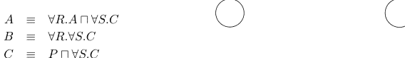

图 2.7. 一个 TBox 及其对应的自动机。

出现在 $\mathcal{T}$ 中的值限制（示例见图 2.7，正式定义见 [Baader, 1996b]）。

对于 $\mathcal{T}$ 中的名称符号 $A$ 和基符号 $P$，其语言 $L_{\mathcal{T}}(A, P)$ 是 $\mathcal{A}_{\mathcal{T}}$ 中从 $A$ 到 $P$ 的所有标记路径的集合。语言 $L_{\mathcal{T}}(A, P)$ 代表了概念 $A$ 的实例可以满足的所有值限制。基于这一直觉，具有最大不动点语义的循环 $\mathcal{FL}_0$-Boxes 的包含关系表征并不令人意外：

$A \sqsubseteq_{\mathcal{T}} B \iff 对于所有基符号 $P, L_{\mathcal{T}}(A, P) \subseteq L_{\mathcal{T}}(B, P)$。

在图 2.7 的示例中，我们有 $L_{\mathcal{T}}(A, P) = RS^* \cup RSS^* = L_{\mathcal{T}}(B, P)$，因此 $A \sqsubseteq_{\mathcal{T}} B$，但不是 $B \sqsubseteq_{\mathcal{T}} A$。

显然，语言 $L_{\mathcal{T}}(A, P)$ 是正则语言，任何正则语言都可以作为此类语言获得。正则语言的包含是一个 PSPACE-完全问题 [Garey and Johnson, 1979]，这表明对于具有最大不动点语义的循环 $\mathcal{FL}_0$-Boxes，包含完备性是 PSPACE-完全的 [Baader, 1996b]。对于无环终端 $\mathcal{T}$，无环自动机接受的语言是 coNP-完全的，这证明了相对于循环 $\mathcal{FL}_0$-Boxes 的包含是 coNP-完全的 [Nebel, 1990]。

## 2.4 语言扩展

在第 2.2 节中，我们引入了 $\mathcal{ALC}$ 语言作为典型的描述逻辑。对于许多应用，$\mathcal{ALC}$ 的表达能力是不够的。因此，文献中引入了其他语言构造并被系统使用。大致来说，这些语言扩展可以分为两类（由于缺乏更好的名称，我们称为“经典”和“非经典”）。直觉上，经典扩展的语义可以在第 2.2 节引入的模型框架内很容易定义，而非经典扩展的语义定义更为困难，需要模型框架的扩展（如第 2.4 节引入的逆运算符）。在本节中，我们简要介绍描述逻辑最重要的经典扩展。此类描述逻辑的推理程序将在第 5 节讨论。非经典扩展是第 6 节的主题。除了用于构建复杂角色的构造外，我们还将引入允许表达不同角色关系的数值限制。

### 2.4.1 角色构造

由于角色被解释为二元关系，将二元关系的常用操作（如布尔运算、逆、传递闭）作为角色构造是非常自然的。这些构造的语法和语义可以定义如下：

**定义 9 (角色构造)** 每个名称都是角色描述（原子角色），如果 $R, S$ 是角色描述，那么 $R \sqcap S$（交集）、$R \cup S$（并集）、$\neg R$（补集）、$R \circ S$（复合）、$R^{-1}$（逆）也是角色描述。一般的解释产生（复杂）角色描述如下：

1. $(R \sqcap S)^I = R^I \cap S^I$;$(R \cup S)^I = R^I \cup S^I$;$(\neg R)^I = \Delta^I \setminus R^I$；
2. $(R \circ S)^I = \{(a,c) \in \Delta^I \mid (a,b) \in R^I \land (b,c) \in S^I\}$；
3. $(R^+)^I = (R^I)^+$，即 $(R^+)^I$ 是 $R^I$ 的传递闭包；
4. $(R^{-1})^I = \{(a,b) \in \Delta^I \mid (b,a) \in R^I\}$；

例如，角色 *hasSon* 和 *hasDaughter* 的并集可以定义角色 *hasChild*，而构造 $hasChild^+$ 表达了角色 *hasDescendants*。语言 $\mathcal{ALCI}$（文献中也称为 $I$）通过角色交集扩展 $\mathcal{ALC}$，其概念的满足性和包含关系的复杂度在 [Donini et al., 1997] 中得到了研究。证明，如果数值限制中出现的数字以二进制表示（表示的大小与数字一致），这些问题仍然是 PSPACE-完全的。Tobies [2001b] 显示该结果也适用于数字的一元编码。$\mathcal{ALC}$ 通过三个布尔运算符和逆运算符扩展的可判定性是扩展语言概念可以在 $\mathcal{C}^2$ 中表达的结果（即具有两个变量和计数量词的一阶谓词逻辑），而该逻辑已知在 NEXPTIME 内是可定的 [Grädel et al., 1997; Pacholski et al., 1997]。Lutz 和 Sattler [2000a] 显示，通过角色补集扩展的 $\mathcal{ALC}$ 是 EXPTIME-完全的，而通过角色交集和（原子）角色补集扩展的 $\mathcal{ALC}$ 是 NEXPTIME-完全的。

在 Baader, [1991] 中，引入了通过传递闭包、补集和角色并集扩展 $\mathcal{ALC}$ 的描述逻辑 $\mathcal{ALCtc}$，并证明了 $\mathcal{ALCtc}$-概念的包含性和满足性是可定的。Schild 的观察 [Schild, 1991]认为 $\mathcal{ALCtc}$ 只是动态逻辑 (PDL) [Fischer and Ladner, 1979] 的语法变体，这得到了 $\mathcal{ALCtc}$ 中包含性和满足性的精确复杂度；它们是 EXPTIME-完全的 [Fischer and Ladner, 1979; Pratt, 1980]。$\mathcal{ALCtc}$ 通过逆构造的扩展对应于逆 PDL [Fischer and Ladner, 1979]，也可以证明在确定性指数时间内是可定的 [Vardi, 1985]。虽然 $\mathcal{ALCtc}$ 的这种扩展没有显著改变所得描述逻辑的属性，但如果向 $\mathcal{ALCtc}$ 中添加数值限制和角逆，情况将变得更加复杂。虽然 $\mathcal{ALCtc}$ 和带有逆的 $\mathcal{ALCtc}$ 仍然具有有限模型属性，但通过逆和数值限制扩展的 $\mathcal{ALCtc}$ 则没有。事实上，很容易看出概念 

$\neg A \sqcap R^{-1}.A \le R \lor (R^{-1})^+(\exists R^{-1}.A \le R)$

在无限解释中是满足的，但在有限解释中不满足。尽管如此，这种描述逻辑仍然 EXPTIME-完全的包含性和满足问题。事实上，在 [De Giacomo, 1995] 中，向 $\mathcal{ALCtc}$ 添加了数值限制、角逆和布尔运算符，通过非常巧妙地归约为 $\mathcal{ALCtc}$ 的判定问题证明了其 EXPTIME 可判定性。

# 基础描述逻辑

## 2.4.2 表达性数量限制

有三种不同的方法可以增强数量限制的表达能力。

首先，可以考虑所谓的*限定数量限制*（*qualified number restrictions*），其中数量限制涉及属于特定概念的角色填充值（role fillers）。例如，给定角色 *hasChild*，上述引入的简单数量限制只能说明所有孩子的数量在某些限制范围内，例如概念 $\ge2hasChild \sqsubseteq 5hasChild$。限定数量限制还可以表达为至少有 2 个儿子且最多有 5 个女儿：

$\ge2hasChild.Male \sqsubseteq 5hasChild.Female$

在 *ALC* 中添加数量限制仍会使得重要的推理问题（如概念的包含关系和可满足性，以及 *ABBoxes* 的一致性）保持可判性：其最坏情况的复杂度仍为 PSPACE-complete。当数量限制中出现的数字以 1 进制表示时，首次证明了其属于 PSPACE [Hollander and Baader, 1991a; Hollander, 1996]。最近，这甚至被证明对于数字（或等价的十进制）表示的情况也 [Tobies, 1999; 2001b]。如果允许一般的包含公理集，该语言仍保持可判性 [Buchheit *et al.*, 1993a]。

其次，可以在数量限制内部允许复杂的角色表达式。如上文所述，在数量限制中允许三个布尔运算符和反转算符使我们处于 $C^2$ 范围内，这是已知是可判的 [Baader and Sattler, 1996b; 1999]。人们已经考虑过在数量限制中允许角色组合的语言。通过组合数量限制扩展 *ALC* 具有可判的可满足性和包含关系问题。另一方面，如果添加涉及组合、并集或反转的数量限制，或者涉及组合和交集的数量限制，则可满足性和包含关系将变为不可判的 [Baader and Sattler, 1996b; 1999]。对于 $ALC_{trans}$，涉及组合的数量限制的扩展已经是不可判的 [Baader and Sattler, 1999]。

第三，可以用数量限制中的显式数字 $n$ 替换为任意非负整数的变量 $\alpha$ [Baader and Sattler, 1996a; 1999]。这允许定义“女儿至少不少于儿子数量的人”的概念，而无需明确说明

> 9 注意，组合无法在 $C^2$ 中表示。

该人有多少儿子女儿：

Person $\sqcap \ge \alpha$ hasDaughter $\sqcap \alpha$ hasSon.

通过引入数值变量的量化可以增加该语言的表达能力。例如，知道数值变量是在值限制之前还是之后引入是非常重要的。以下概念说明：

Person $\sqcap \downarrow(\alpha.hasChild.(\ge \alpha \text{ hasChild} \sqcap \alpha \text{ hasChild}))$

其中在全称限制之前引入数值变量确保了该人的所有孩子具有相同数量的孩子。这里 $\downarrow$ 代表 $\alpha$ 的存在量化。数值变量的全称量化通过否定引入。在 [Baader and Sattler, 1996a; 1999] 中证明，带有数值变量全称和存在量化的符号数量限制扩展的 $ACCN$ 具有不可判的可满足性和包含关系问题。如果将该语言限制为数值变量的存在量化和原子概念的否定，则可满足性变为可判，但包含关系仍是不可判的。

## 2.4.3 角色值映射 (Role-value-maps)

角色值映射是一类极具表达能力的概念构造器，它们在原始的 KL-ONE 系统中是可用。它们允许人们将角色链的角色填充值集联系起来。

**定义 2.30 (角色值映射)** 角色链是角色名的组合 $R_1 \circ \dots \circ R_n$。如果 $R, S$ 是角色链，那么 $R \subseteq S$ 和 $R = S$ 都是概念（角色值映射）。前者称为包含角色值映射，后者称为等值角色值映射。

给定的解释 $\mathcal{I}$ 扩展到角色值映射为：

- 1. $(R \subseteq S)^\mathcal{I} = \{a \in \Delta^\mathcal{I} \mid (a, b) \in R^\mathcal{I} \to (a, b) \in S^\mathcal{I}\}$
- 2. $(R = S)^\mathcal{I} = \{a \in \Delta^\mathcal{I} \mid (a, b) \in R^\mathcal{I} \leftrightarrow (a, b) \in S^\mathcal{I}\}$

例如，概念

Person $\sqcap$ (hasChild $\sqsubseteq$ hasFriend)

描述认识其孩子所有朋友的人，以及

Person $\sqcap$ (marriedTo $\circ$ likesToEat = likesToEat)

描述与其配偶有相同喜好食物的人。

遗憾的是，在存在角色值映射的情况下，即使语言仅允许交和限制作为额外的构造器，包含问题也是不可判的 [Schmidt, 1993]。

为了避免这个问题，可以将范围限制为函数角色。接下来，我们假设角色名集被划分为函数角色。

**定义 2.31 (一致性)** 如果 $R, S$ 是角色链，那么 $R \subseteq S$ 和 $R = S$ 都是概念（角色值映射）。在角色映射的情况下，即使语言仅允许交和限制作为额外的构造器，包含问题也是不可判的 [Schmidt, 1993]。

106 F. M. Donini

这使得大多数复杂性分析转移到了描述逻辑（Description Logics），其推理问题是 EXPTIME-hard 的，甚至更复杂。

本章介绍了简单描述逻辑中基本推理任务复杂性的某些下界（lower bounds）。考虑的推理服务包括：首先是仅针对概念表达式的满足性（satisfiability）和包含性（subsumption）（不含 TBox），然后是考虑 TBox 的相同推理服务，在章的最后部分针对 ABox 的实例检查（instance checking）。

我们详细展示了如何从复杂度类为 NP、CoNP、PSPACE、EXPTIME 的硬问题，以及从不可判定问题（undecidable problems），归约到各种描述逻辑中的满足性和包含性问题。然后，我们展示了如何将这些归约也适用于其他描述逻辑。

在若干归约中，我们使用选法展开（tableau expansions）来证明归约的正确性。因此，本章的次要目标是展示选法不仅不仅有助于设计算法和复杂度上界——如第 2 章所示——而且有助于寻找复杂度下界。这是因为选法理清了描述逻辑中计算推理的不同侧面：

- 第一个方面是概念可能模型的结构。在许多描述逻辑中——这种结构是一个个体名称的树，由角色（roles）标记的链接组成。我们考虑这种 AND-树中的一个分支，其中所有分支都将被追踪以获得一个候选模型。遵循 [Schmidt-Schauß and Smolka, 1991]，我们可以将此类树的每个分支称为*轨迹（trace）*。熟悉选法术语的读者应该应该注意到，轨迹并不是选法（tableaux）；事实上，它们构成了单个选法分支内部的结构。
- 第二个方面是证明或反驳的结构。显然，如果一个轨迹包含一个不一致性——即第 2 章建立的术语集中的冲突（clash）——包含该轨迹的候选模型就可以被丢弃。当所有候选模型通过这种方式被丢弃时，我们就得到了包含性或不可满足性的证明。在这里，归约的结构通常被视为包含冲突的轨迹的 OR-树。

在这里，我们在考虑满足性问题时，选择将节点标记为 AND、OR；如果考虑的是不可满足或包含性，则应该交换 AND 和 OR 标签。在开始各种结果之前，我们将在下一个小节中详细阐述这一主题。

### 3.1.1 直觉：复杂性的来源


第 2 章中 `$ALCN$` 演算的确定性版本可以看作是探索一个 `AND-OR` 树，其中 `AND` 分支对应于对所有后继节点的（独立）检查，个体的 `OR` 分支对应于应用非确定性规则的不同选择。

意识到这一点，可以发现该演算的指数级时间行为源于两个独立的起源：`AND` 分支负责单个候选模型呈指数级的大小，而 `OR` 分支负责不同候选模型数量呈指数级增长。我们将这两种不同的组合展开称为复杂性的来源。

### 3.1.1.1 OR 分支

`OR` 分支源于析取构造子（disjunctive constructors）的存在，这使得一个概念可以被多个模型满足。显而易见的析取构造子是 `$\sqcup$`；因此 `$ALU$` 是观察这一复杂性来源的良好子语言。回顾 `$ALU$` 允许人们形成概念名称的否定、交 `$\sqcap$`、析取 `$\sqcup$`、全角色量化 `$\forall R.C$` 和存在角色量化 `$\exists R$`。这一复杂性来源与命题满足性是 `NP-hard` 的原因相同；事实上，通过将命题字母重写为原子概念，将 `$\wedge$` 重写为 `$\sqcap$`，将 `$\vee$` 重写为 `$\sqcup$`，可以平凡地证明 `$ALU$` 中的满足性是 `NP-hard` 的。许多关于包含性 `CNP-hardness` 的证明是通过利用这一复杂性来源发现的 `((Levesque and Bachman, 1987)`，通过将一个 `NP-hard` 问题归约为非包含问题。在 `3.2.1` 节中，我们展示了如何通过结合角色限制和全量化来导出析取，在 `3.2.2` 节中通过结合数量限制和角色交集。

### 3.1.1.2 AND 分支

`AND` 分支更为微妙。它的指数行为源于存在量词和全量词之间的相互作用；因此 `$ALE$` 现在是具有这些特征的 `$ACCN$` 的最小子语言。正如第 2 章提到的，通过展开选法 `\{D(x)\}`，可以看到这种复杂性来源的影响，其中 `D` 是以下概念（它出现在许多页面中，从 [Schmidt-Schauß and Smolka, 1991] 到 [Hemainger, 1999]）——其一般形式见第 2 章：

```
$\exists P_1.\forall P_2.\forall P_3.C_{11} \sqcap$
$\exists P_1.\forall P_2.\forall P_3.C_{12} \sqcap$
$\forall P_1.\exists P_2.\forall P_3.C_{21} \sqcap$
$\forall P_1.\exists P_2.\exists P_3.C_{22} \sqcap$
$\exists P_1.\exists P_2.\exists P_3.C_{31} \sqcap$
$\forall P_1.\exists P_2.\exists P_3.C_{32} \sqcap$
$\exists P_3.C_{32}).$
```

对于嵌套量词的每一层 `l`，我们使用不同的角色 `P_l`（但使用相同的角色 `R` 会产生相同的结果）。`\{D(x)\}` 的选法结构是一个高度为 3 的二叉树：节点是个体，弧由 `P_l` 给出，分支是 `C_{1i}, C_{2j}, C_{3k}`，其中 `i, j, k \in \{1, 2, 3\}`。因此，在每个分支中都可以找到一个候选模型。为了验证该结构确实是一个模型，必须检查每个选法的每一个分支。这种第二个复杂性来源在命题演算中显而易见，但在存在量词和全量词的相互作用下——会导致命题公式出现指数级的冲突。

> **备注 3.1** 对于对否定不封闭的描述逻辑，我们首先讨论了源自析取的推理结果（`OR` 分支），这导致了 `NP-hard`。我们讨论了析取的情况（`ALEN`），并在 `3.3` 节中展示了源自 `AND` 分支的 `NP-`下界。在 `3.4` 节中，我们展示了限制限制全量化如何以简洁的方式结合这两种复杂性来源，导致了 `PSPACE` 下界，随后在 `3.5` 节中，我们展示了它们如何导致满足性的 `EXPTIME-hardness`。

在 `3.6` 节中，我们检查了描述逻辑的首个不可判定结果，使用了强大的角色值映射构造子。最后，我们在 `3.7` 节中分析了带有 `ABox` 的推理的不可处理性，并在 `3.8` 节中增加了关于这些结果意义的最终讨论——除了理论复杂度的研究之外，还针对实现的程序的测试。`3.9` 节包含了满足性和包含性的结果列表，结束了章。

## 3.2 OR 分支：寻找模型

当候选模型的数量相对于概念的大小呈指数级时，寻找正确的候选模型是一个组合问题。在描述逻辑中，这可能导致满足性的 `NP-hard` 和包含性的 `CNP-hard`。

### 3.2.1 `$\mathcal{FL}$` 中的不可处理性

`Brachman` 和 `Levesque [1984]`（另见 `[Levesque and Bachman, 1987]`）首次指出，描述逻辑表达能力的微增可能会导致推理复杂度的剧变。他们将这种效应称为结构化知识表示语言的“计算悬”。他们考虑了 `$\mathcal{FL}$` 语言，它允许交集、全角色量化、无限制的存在量化和角色限制。为了易读性，`$\mathcal{FL}$` 的语法和语义在表 `3.1` 中回顾。

角色限制允许人们构造角色 `R` 的子集，即扩展为男性的角色。例如，角色 `child` 可用于“儿子”关系。观察角色限制的两个属性，这些属性从表 `3.1` 的语义中很容易得出：

- 1. 对于每个角色 `R`，角色 `R|` 等于 `R`；

- 2. 对于每个角色 `R`，以及概念 `C, D`，概念 `(\forall(R(C)).A) \sqcap (\forall(R(D)).A` 等于 `$\forall(R(C \cup D)).A$`。

第二个属性强调了析取——尽管在语言语法中没有式式——源于语义。

`Brachman` 和 `Levesque` 还定义了 `$\mathcal{FL}^-$` 语言，它是通过省略角色限制得到的 `$\mathcal{FL}$`。他们首先证明了对于 `$\mathcal{FL}^-$`，包含性可以通过结构化算法判定，其复杂度为多项式时间，

`110 F. M. Donini`

表 `3.1.` 描述逻辑 `$\mathcal{FL}$` 的语法与语义。对于 `$\mathcal{FL}^-$`，省略角色限制。

| 概念表达式 | 语义 |

| --- | --- |

| 概念名 `A` | `$\subseteq \Delta^{\mathcal{I}}$` |

| 概念交集 `C \cap D` | `C^{\mathcal{I}} \cap D^{\mathcal{I}}` |

| 限制范围值量化 `$\exists R$` | `\{x \in \Delta^{\mathcal{I}} \mid \exists y, (x,y) \in R^{\mathcal{I}}\}` |

| 值限制 `$\forall R$` | `\{x \in \Delta^{\mathcal{I}} \mid \forall y, (x,y) \in R^{\mathcal{I}} \to y \in C^{\mathcal{I}}\}` |

| 角色名 `P` | `$\Delta^{\mathcal{I}} \times \Delta^{\mathcal{I}}$` |

| 角色限制 `R|C` | `$\{(x,y) \in \Delta^{\mathcal{I}} \times \Delta^{\mathcal{I}} \mid (x,y) \in R^{\mathcal{I}} \wedge C^{\mathcal{I}}\}$` |

与第 2 章所示的类似。随后证明了 `$\mathcal{FL}$` 中的包含关系是 `coNP-hard` 的，展现了描述逻辑中的第一个“计算悬崖”。

由于 `coNP-hard` 性的原始证明较为复杂，我们在这里给出一个由 `Cavinese [1990]` 发现的更简单的证明。该证明基于以下观察：如果 `C_1 \sqcup \dots \sqcup C_n \equiv T`，那么对于给定角色 `R` 和概念 `A`，我们有

`(\forall(R|C_1)).A \cdot \dots \cdot (\forall(R|C_n)).A \equiv \text{(来自公式 2)} \quad (3.1)`

`$\forall R|(C_1 \sqcup \dots \sqcup C_n).A \equiv \mathcal{A} \quad (3.2)$`

`$\forall R.T.A \equiv \text{(来自公式 1)} \quad (3.3)$`

`$\forall R.A.$`

此外，观察到对于每个角色 `Q` 和每个概念 `C`，析集 `$\exists Q \sqcup \forall Q$` 等价于概念 `T`。因此 `$\forall(R|\exists Q).A \sqcap \forall(R|\forall Q).A$` 等价于 `$\forall R.A$`。这些观察是将命题 `3DNF` 公式的重言检测归约为 `$\mathcal{FL}$` 中包含关系的关键。

## 定理 3.2 `$\mathcal{FL}$` 中的包含关系是 `coNP-hard` 的。

证明 给定一个命题变量字母集 `L = \{p_1, \dots, p_k\}`，在 `L` 上定义一个 `3DNF` 命题公式 `F = G_1 \vee \dots \vee G_n`，其中每个析取项 `G_i` 由三个文字符号 `l_i^1 \wedge l_i^2 \wedge l_i^3` 组成，并且对于每个 `i \in \{1, \dots, n\}` 和 `j \in \{1, 2, 3\}`，每个文字符号 `l_i^j` 要么是一个变量 `p \in L`，要么是其否定 `$\bar{p}$`。

# 推理复杂性 111

给定一组角色名 `\{R, P_1, \dots, P_k\}`（每个变量 `p_i` 对应一个 `P_i`）和一个概念 `A`，定义概念 `C_F \equiv (\forall R|_{C_i}.A) \cdot \dots \cdot (\forall R|_{C_n}.A)`，其中，对于每个 `i \in \{1, \dots, n\}`，`C_i` 是三个概念 `D_i^1 \cap D_i^2` 的交集，且每个 `D_i^2` 是

`D_i^2 = \begin{cases} \forall P_h.A, & \text{若 } l_i^2 = p_h \\ \exists P_h, & \text{若 } l_i^2 = \bar{p}_h \end{cases}` 对于 `j \in \{1, 2, 3\}, i \in \{1, \dots, n\}`。

此外，观察到对于每个角色 `Q` 和每个概念 `C`，析集 `$\exists Q \sqcup \forall Q$` 等价于概念 `T`。因此 `$\forall(R|\exists Q).A \sqcap \forall(R|\forall Q).A$` 等价于 `$\forall R.A$`。这些观察是从命题 `3DNF` 公式的重言检测归约到 `$\mathcal{FL}$` 关系的关键。

## 引理 3.3 `F` 是重言式当且仅当 `C_F \equiv \forall R.A`。

该命题的证明是显而易见的；但由于它只出现在 `Cavinese` 的论文（意大利语）中，我们在此给出。

**仅当** `F` 是重言式时，`C_1 \cup \dots \cup C_n \equiv \top`。这可以通过反法证明：假设 `C_1 \cup \dots \cup C_n` 不等于 `$\top$`，则存在一个解释 `$\mathcal{I}$`，使得对于每个 `i \in \{1, \dots, n\}` 都有元素 `x \notin C_i`。由于 `C_i = D_i^2 \cap D_i^3`，因此对于每个 `i`，都存在 `j \in \{1, 2, 3\}` 使得 `x \notin D_j`。对 `L` 定义赋值 `$\tau$` 如下。对于每个 `h \in \{1, \dots, n\}`：

- 若 `l_h = p_h`，则 `$\tau(p_h) = \text{false}$` 且 `x \notin D_h^2`

- 若 `l_h = \bar{p}_h`，则 `$\tau(p_h) = \text{true}$` 且 `x \notin D_h^3`

观察到我们同时拥有 `$\tau(p_h) = \text{false}$` 和 `$\tau(p_h) = \text{true}$`，因为这意味着 `x \notin \exists P_h` 且 `x \notin \forall P_h`，这对于 `$\exists P_h \cup \forall P_h \equiv \top$` 是可能的。显然，`$\tau$` 为 `F` 的至少一个文字符号分配了 **false**，这矛盾了 `F` 是重言式的假设。因此 `C_1 \cup \dots \cup C_n \equiv \top`。现在通过等价式 `(3.1)-(3.3)` 证明该命题。如果 `F` 不是重言式，则存在一个真赋值 `$\tau$`，使得对于每个 `i \in \{1, \dots, n\}`，存在 `j \in \{1, 2, 3\}` 使得 `$\tau(l_i^j) = \text{false}$`。观察到在这种情况下，`y \in (\exists P_h)^I` 当仅当 `$\tau(p_h) = \text{false}$`，而 `y \in (\forall P_h)^I` 当仅当 `$\tau(p_h) = \text{true}$`。这意味着 `x \notin (\forall R.A)^I`。为了证明该命题，我们现在证明 `x \notin C_F^I`。观察到对于 `i \in \{1, \dots, n\}`，存在 `j \in \{1, 2, 3\}` 使得 `$\tau(l_i^j) = \text{false}$`。对于这样的 `j`，通过分类讨论 `y \notin (D_j^I)`：

- 若 `l_i^j = p_h`，则 `D_j^I = \forall P_h.A`，在这种情况下 `$\tau(p_h) = \text{false}$`，因此 `y \notin (\forall P_h.A)^I`;

- 若 `l_i^j = \bar{p}_h`，则 `D_j^I = \exists P_h`，在这种情况下 `$\tau(p_h) = \text{true}$`，因此 `y \notin (\exists P_h)^I`。

因此，对于每个 `i \in \{1, \dots, n\}`，我们都有 `y \notin C_i^I`。这意味着 `(x, y) \notin R^{C_1 \cup \dots \cup C_n}`，因此 `x \notin (\forall R.A)^I`，这是一个等价于概念 `C_F`。

上述证明证明了 `$\mathcal{FL}$` 中的包含关系是 `coNP-hard` 的。然而，角色限制也可以用于获取值量化，因为 `$\exists R.C = \exists R|C$`。因此，`$\mathcal{FL}$` 也包含 `AND` 分支复杂性来源。结合这两个复杂性来源，`Donini` 等人 `[1997a]` 证明了 `$\mathcal{FL}$` 中包含关系的 `PSPACE` 下界，与 `Schmidt-Schauß` 和 `Smolka [1991]` 发现的上界相匹配。

## 3.2.2 `$\mathcal{FL}^-$` 加上值量化和数量限制的不可处理性

如第 2 章所示，析集源于限定值量化和数量限制。通过检查满足以下概念满足性的网格构造，可以很容易地看到：

`(\exists R.A) \sqcap (\exists R.\neg A \sqcap \neg B)) \sqcap (\exists R.B) \sqcap \exists R \quad (3.4)`

其中引入了三个对象来满足值量化，必须在三个非等价的对象识别之间进行选择，只有一种识别会导致一个一致的网格分支。

**备注 3.4** 当描述逻辑免费地包含数量限制时，从计算的角度来看，事实上，概念 `A` 及其否定 `$\neg A$` 可以被编码为 `$\ge 4R_A$` 和 `$\le 3R_A$`，其中 `R_A` 是一个新角色。因此，关于 `$\mathcal{FL}^-$` 加上数量限制的描述逻辑的所有性质都适用于 `$\mathcal{AL}$` 加上数量限制。

**定义 3.5 (集合划分)** 给定 `S` 的子集集合 `$\mathcal{C}$`，如果存在 `S` 的一个划分划分为 `S_1` 和 `S_2`，使得 `$\mathcal{C}$` 中的没有任何子集完全包含在 `S_1` 或 `S_2` 中。

¹ 这里我们简化了原始归约。我们从一个所有 `c \in \mathcal{C}` 具有三个元素的 `SPLITTING` 变体开始，将其归约为 `$\mathcal{FL}^-$` 加上值量化和数量限制的满足性。参见子节 `3.2.1` 该结果暗示了原始结论。

# 114 F. M. Donini

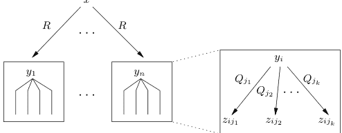

图 `3.1.` 通过对 `$\Pi$` 和 `$\exists R.C$` 规则应用于 `D_1 \sqcap D_2 \sqcup D_3(x)`，得到的类的格的 `AND` 树结构。应用 `$\le 2\ R(x)$` 规则将导致多个 `OR` 分支（数量取决于 `ys` 的可能等标识方式）。

多于两个 `Q_j` 后继，因此至少有一个 `Q_j` 后继（因为有三个这样的）。

我们通过一个示例来澄清构造过程并展示其相关属性。

**示例 3.7** 假设 `S = \{1, 2, 3, 4\}`，令 `c_1 = \{1, 2, 4\}`，`c_2 = \{2, 3, 4\}`，`c_3 = \{1, 3, 4\}`。对 `D_1` 应用第 2 章的类规则，可以得到以下个体名称树（每个 `B_i` 的定义已展开）：


```
$$\begin{aligned} R(x, y_1) B_1(y_1) &= \begin{cases} Q_1(y_1, z_{11}) A_1(z_{11}) \\ Q_3(y_1, z_{13}) A_1(z_{13}) \end{cases} \ R(x, y_2) B_2(y_2) &= \begin{cases} Q_1(y_2, z_{21}) A_2(z_{21}) \\ Q_2(y_2, z_{22}) A_2(z_{22}) \end{cases} \ R(x, y_3) B_3(y_3) &= \begin{cases} Q_2(y_3, z_{32}) A_3(z_{32}) \\ Q_3(y_3, z_{33}) A_3(z_{33}) \end{cases} \ R(x, y_4) B_4(y_4) &= \begin{cases} Q_1(y_4, z_{41}) A_4(z_{41}) \\ Q_2(y_4, z_{42}) A_4(z_{42}) \\ Q_3(y_4, z_{43}) A_4(z_{43}) \end{cases} \end{aligned}$$
```

其中个体名称 `$y_1, \dots, y_4$` 代表 `S` 的四个元素，且每个 `$z_{ij}$` 编码了元素 `i` 出现在 `c_j` 中的这一事实。根据断言 `A_i`，任何两个第一个索引不相同的 `$z_{ij}$`（例如 `$z_{32}$` 和 `$z_{42}$`）不能被标识为，除非它们满足关于不可数断言 `A` 的断言。这等同于存在约束 `$z_{ij} \neq z_{hj}$`（对于所有 `i \neq h,\in\{1,\dots,|S|\}` 且所有 `j\in\{1,\dots,|C|\}`）。

现在 `D_3` 规定 `$y_1, \dots, y_4$` 必须被标识为两个个体名称。观察到标识 `$y_2, y_3, y_4$` 会导致一个个体名称（例如 `$y_2$`）在其他之外包含三个不可标识的 `Q_2` 填充符 `$z_{22}, z_{32}, z_{42}$`。但 `D_2` 规定 `x` 的所有 `R` 填充符（包括 `$y_2$`）不超过 2 个。

# 推理的复杂性

这些规则排除了 `$y_2, y_3$` 的标识。观察到这种标识对应于将 `S` 划分为 `\{1\}` 和 `\{2, 3, 4\}`，子集 `c_2` 被分裂（SPLITTING）。遵循相同的推理步骤，可以证明将所有 `R` 填充符标识为两个个体名称会导致一个满足的格，具有 SPLITTING 的解。

相同的归约也适用于包含关系，因为 `D_1 \cap D_2 \cap D_3` 是满足的，且仅当 `D_1 \cap D_2` 不被 `D_3` 包含时。这种类型的归约已被 [Donini 等人, 1999] 应用于证明 `ACNI` 中的包含关系是 coNP-hard 的。在包含 AL、数量限制和反向类的描述逻辑中，`FC^EN` 包含了 AND 分支复杂性，因为存在限定数量限制。通过来自量化布尔公式（Quantified Boolean Formula）的更复杂的归约，`ALEN` 的满足性被 Hemmassandra [1999] 证明为 PSPACE-完全的。在不可计算性的证明中，`A_1, \dots, A_k` 的两两不交性可以通过连接 `\log n` 个名称及其否定来表示。在这里，证明只需要清晰的：`\le 2 R`，且当限定数量存在符由子类模拟时，使用了 `\ge 1 R`。这表明上述不可计算性的证明是独立于涉及的数字的。如果数量限制中只有 0 和 1，计算上是显而易见的——`\le 1 R(x)` 强制 `R` 成为 `x` 的部分函数。在这种情况下，描述逻辑系统 CLASS [Borg and Patel, 1994] 的可处理性可以在格规则中找到，对于形式为 `\le 1 R(x)` 的数量限制是确定性的：在标识所有 `R` 填充符 `$y_1, \dots, y_k$` 时没有选择，而是合并为一个个体。

## 3.2.2 使用角色模拟 `R.C`

Donini 等人 [1997a] 证明包含限定量化 `R.C` 的类 `D` 是满足的，当且仅当类 `D` 是满足的，其中 `D` 中每个 `\exists R.C` 的出现都被替换为 `\exists(R \cap Q_C)\sqcap(R \cap Q_C).C`，添加一个新的角色 `Q_C`（对于每个 `\exists R.C` 使用不同的 `Q_C`）。在章节的剩余部分，我们将 `\widetilde{D}` 称为 `D` 的 `\sqcap` 模拟。

通过格很容易证明模拟是正确的。

**示例 3.8** 考虑左侧的类 `D`，并通过角色交集模拟 `D` 中的限定量化，得到右侧的类 `\widetilde{D}`：

```
$D = \begin{cases} \exists R.A \sqcap \exists R.B \sqcap \forall R.C \end{cases} \widetilde{D} = \begin{cases} \exists(R\cap Q_A)\forall(R\cap Q_A).A \sqcap \exists(R\cap Q_B)\forall(R\cap Q_B).B \sqcap \forall R.C \end{cases}$
```

新角色名称上的下标有助于标识它们所模拟的限定符。对 `\widetilde{D}(x)` 应用第 2 章的格规则，可以得到模型：

```
$R(x, y) A(y)$
$Q_A(x, y) C(y)$
$R(x, z) B(z)$
$Q_B(x, z) C(z)$
```

它满足这两个类。

**命题 3.9** 类 `D` 是满足的当且仅当 `\widetilde{D}` 是满足的。

*证明* 命题的证明遵循示例。即，`\widetilde{D}` 的开放格分支也是 `D` 的开放格分支（忽略新角色名称上的断言），且 `D` 的开放格分支只需添加关于新角色的断言即可转换为 `\widetilde{D}` 的开放格分支。

正如 Nebel [1990a] 所观察到的，描述逻辑中的无环角色层次始终可以通过现有角色和新名称的结合来模拟。在上面的示例中，使用两个角色名称 `Q_A, Q_B` 以及包含关系 `Q_A \subseteq R, Q_B \subseteq R` 产生了相同的模拟。应用 `\sqcap` 模拟，可以从定理 3.6 的归约得到 Nebel 的原始归约，证明 `\mathcal{ALN}(\sqcap)` 中的满足性（和非包含）是 NP-hard。使用更复杂的归约，Donini 等人 [1997a] 证明 `\mathcal{ALN}(\sqcap)` 中的满足性实际上是 PSPACE-完全的。

## 3.3 AND 分支：寻找冲突

当类的候选模型具有指数级的大小——对于 `ALE` 类，如子节 3.1.1.2 所示——模型无法在多项式时间内猜测和检查。在这种情况下，找到冲突是一个组合问题。这导致了不可满足性的 NP 困难。然而，许多描述逻辑 AND 树结构使得轨迹（分支）具有多项式大小。类 `C` 是满足的，如果不存在包含冲突的轨迹；因此，给出这样的轨迹即可证明不可满足。根据这一论证，Schmidt-Schauß 和 Smolka [1991] 证明了 `ACE` 中的满足性属于 coNP。

### 3.3.1 `ALE` 满足性的不可处理性

我们报告一个 `ALE` 满足性是 NP 完全的证明。原始证明是基于对 NP 完全问题 ONE-IN-THREE 3SAT (Garey and Johnson, 1979, p. 259) 的多项式归约。在这里我们提出了一个类似的证明，但使用了稍微不同的构造，依赖于对 NP 完全问题 EXACT COVER (XC) (Garey and Johnson, 1979, p. 221) 的归约。该问题定义如下。

**定义 3.10 (精确覆盖)** 设 `U = \{u_1, \dots, u_n\}` 是一个有限集合，`M` 是 `U` 的子集族 `M_1, \dots, M_m`。判断是否存在 `q` 个互不交的子集使得它们的并等于 `U`，即 `M_i \cap M_j = \emptyset`（对于 `1 \le h < k \le q`）且 `\bigcup_{i=1}^q M_i = U`。

归约是将每个 `XC` 实例与一个 `ALE` 类 `C_M` 关联，该类具有精确覆盖当且仅当 `C_M` 是不可满足的。需要注意的是，与之前的章节不同，这里 NP 完全源问题的解与对模型“不存在”的证明相关。在下文中我们假设 `R` 是一个根模型。我们将 `M` 转换为类：

```
$C_M = C_1^1 \sqcap \dots \sqcap C^m \cap D_1$
```

# 118 F. M. Donini

其中每个概念 `C_j^l` 代表子集 `M_j`，并通过归纳定义为：

```
$C_{l+1}^l = \begin{cases} \exists R_{\dots n}, \text{if either } l \leq n, u_l \in M_j \text{ or } l > n, u_{l-n} \in M_j \ \forall C_{j+1}^l, \text{if either } l \leq n, u_l \notin M_j \text{ or } l > n, u_{l-n} \notin M_j \end{cases} for l \in \{1, \dots, 2n\}$
```

并且基础情况为 `C_{2n+1}^n = \mathbb{T}`。概念 `D_1` 定义为：

```
$D_1 = \frac{\forall R . \dots \forall R . \perp}{2n}$
```

且 `D_2, D_3, \dots` 中的每一个都比前一个少一个全称量词。

直观地说，对于 `U` 中的每个元素 `u_l`，在概念 `\{C_j^l\}_s` 中对应两个层级 `l, l+n`。元素 `u_l` 存在于 `M_j` 当且仅当概念 `C_1^l` 在层级 `l+n` 处有一个存在量词——根据构造这意味着 `\exists` 也存在于层级 `l`。概念 `D_1` 的设计使得冲突 `\{C_M(x)\}` 只出现在包含至少 `2n+1` 个个体名称的轨迹（trace）中。

**示例 3.11** 考虑 XC 的以下实例：`U = \{u_1, u_2, u_3\}`，且

`M = \{M_1 = \{u_1, u_2\}, M_2 = \{u_2, u_3\}, M_3 = \{u_3\}\}`。

对应的 `ALE`-概念 `C_M` 由 `C_1^1, C_2^1, C_3^1` 和 `D_1` 的合取给出，定义为：

$$\begin{array}{rcccccc} & u_1 & u_2 & u_3 & u_1 & u_2 & u_3 \\ \hline M_1 & \mapsto & C_1^1 & \exists R . \exists R . \exists R . \exists R . \exists R . \perp \\ M_2 & \mapsto & C_2^1 & \exists R . \exists R . \exists R . \exists R . \exists R . \perp \\ M_3 & \mapsto & C_3^1 & \forall R . \forall R . \forall R . \forall R . \forall R . \perp \\ & & D_1 & & \forall R . \forall R . \forall R . \forall R . \forall R . \perp \end{array}$$

其中左侧放置了与每个 `C_j^l` 对应的子集 `M_j`，上方放置了对应概念每个层级的 `U` 元素。观察发现 `U` 的元素出现了两次。

上述概念的合取是不可满足的，当且仅当由轨迹表示的各种存在量词和全称量词的相互作用，强制 `\{C_M(x)\}` 表格中的一个个体名称属于 `\perp` 的扩展。这种归约在轨迹与 `U` 的精确覆盖（exact cover）之间建立了对应关系。

# 推理复杂度 119

为了正式地刻画这种对应关系，我们定义概念在轨迹中的活跃性（activeness）。设 `T` 为一个轨迹，`C` 为一个概念。如果 `C` 的形式为 `\exists R.D` 且存在个体名称 `y, z 使得 T` 包含 `C(y), R(y,z)` 和 `D(z)`，则说 `C` 在 `T` 中是活跃。因此，如果 `\exists_3` 规则已应用于 `T` 中的断言 `\exists R.D(y)`，则存在量化概念 `\exists R.D` 在 `T` 中是活跃的。直观地说，如果 `C_k^i` 在包含轨迹的 `\{C_{\mathcal{M}}(x)\}` 轨迹中是活跃，那么 `u_l` 属于 `\mathcal{M}` 的一个精确覆盖。

**引理 3.12 ([Donini et al., 1992a], Lemma 3.1)** 设 `T` 为 `\{C_{\mathcal{M}}(x)\}` 的一个轨迹。

- 1. 假设 `C_k^i` 在 `T` 中活跃。那么对于所有 `l \in\{1,\dots,k\}`，如果概念 `C_l^i` 的形式为 `C_{l+1}^i`，则它在 `T` 中活跃。

- 2. 如果 `T` 包含冲突，则对于每个 `l \in\{1,\dots,2n\}`，存在好一个 `j` 使得 `C_l^i` 在 `T` 中活跃。

**示例 3.13** 读者可以通过构造以下概念的表格来洞察上述属性的重要性：

`(\exists R.\forall R.\exists R.A)\Pi`

`(\exists R.\forall R.\exists R.B)\Pi`

`(\forall R.\exists R.T)`

并验证到达概念 `A` 的轨迹同时具有第一行的存在量词（且没有第二行的），反之对于到达 `B` 的轨迹亦然。

**示例 3.14 (示例 3.11 继续)** 注意 `M_1` 和 `M_2` 构成了 `U` 的（非精确）覆盖，且 `\{C_1^i \cap C_2^i \cap D_1(x)\}` 的表格是满足的。此外，观察两个层的重要性。如果概念仅由一个层形成，则以下概念将不可满足的（选择存在量词）：

```
$C_1^i = \exists R.\exists R.\forall R.T$
$C_2^i = \forall R.\exists R.\exists R.T$
$D_1 = \forall R.\forall R.\perp$
```

是非精确的。第二层确保了一旦选择了存在量词，所有嵌套的存在量词必须被选择以形成轨迹。

# 定理 3.15 ALE 中的不可满足性是 NP-hard。我们证明 `(U, M)` 的 XC 有精确覆盖当且仅当 `C_M` 不可满足。设 `M = \{M_1, \dots, M_m\}` 是 `U` 的子集集合，`C = C_1 \sqcap \dots \sqcap C_m \sqcap D_1` 是对应的概念。由于该证明是为了其他读者，我们详细给出。

仅当 `M_1, \dots, M_m` 是 `U` 的精确覆盖。设 `T` 为 `\{C_M(x)\}` 的一个轨迹，我们归纳定义如下：

```
$T_1 = \{C_j^1(x_1) \mid j \in \{1, \dots, m\} \cup \{D_1(x_1)\}$
```

```
$T_{l+1} = T_l \cup \{R(x, x_{l+1}) \cup C_j^{l+1}(x_{l+1}) \mid u_{l+1} \in M_j\} \cup \{D_{l+1}(x_{l+1})\}$
```

显然，`T` 包含一个句，因为对于每个层级 `l`，存在好一个 `j` 使得 `C_l^c = \exists R_{l+1}^c`。利用这一事实，可以对 `l` 使用归纳法容易地证明 `T` 是轨迹。

如果 `C_M` 不可满足，则存在 `\{C_M(x)\}` 的轨迹 `T`，使得 `T` 包含一个句。我们证明子集 `\{M_j \mid \exists l \in \{1, \dots, n\}: C_{l+1}^c \text{ is active in } T\}`形成了 `U` 的精确覆盖。首先，由于 `T` 是轨迹，对于每个层 `l\in\{1,\dots,n\}`，存在 `j` 使得 `C_j^c` 在 `T` 中活跃（引理 3.12(ii)）。因此这些子集的并覆盖了 `U`。

现在证明没有两个子集重叠：事实上，假设存在 `i, j` 使得 `M_i, M_j` 在元素 `u_l` 上非平凡交叉。根据概念 `C_M` 的构造，`u_l` 同时在 `M_i` 和 `M_j` 中。根据定义，存在 `h, k` 使得 `C_M` 的 `C_{i+h}^n` 和 `C_{j+k}^n` 具有 `C_i^c = \exists R_{i+1}^c` 和 `C_j^c = \exists R_{j+1}^c`。根据引理 3.12(i)，我们知道 `C_i^c` 和 `C_j^c` 在 `T` 中活跃。因此由引理 3.12(ii) 得 `i=j`。

上述归约也适用于 XC 的特殊情况，即每个子集最多三个元素，对应每个概念 `C_l^c` 最多六个量化。然而，将嵌套的存在量词限制在常量 `k \ge 6` 并产生可处理性。来自 ONE-IN-THREE 3SAT 的原始归约表明，将每个层的元素数量限制在常量 `k \ge 3` 并产生可处理性。

通过角色交集模拟 `C_M` 中的限定量化（见子节 3.2.2.1），我们得出 `\mathcal{AL}(\Pi) - \neg\mathcal{AL}` 加上角色合取的概念不可满足性是 NP-hard，

# 推理复杂度

**定理 3.16** *`\mathcal{AL}(\sqcap)` 中概念的满足性和包含关系是 NP-hard 的。*


我们注意到，这种不可处理性并非源于概念 `$\perp$` 的存在，而是由于全称量化存在量化的相互作用。事实上，上述归约也适用于描述逻辑 `$\mathcal{FL}^-\mathcal{E}$`，它是 `$\mathcal{FL}^-\mathcal{E}$` 加上限定存在量化。

### 定理 3.17
`$\mathcal{FL}^-\mathcal{E}$` 中的包含关系是 NP-hard 的。

*证明* 证明基于对 `$\mathcal{ALE}$` 的归约。`$\mathcal{ALE}$`-概念 `C_M = C_1 \sqcap \dots \sqcap C_m \sqcap D_1` 是可满足的当且仅当 `C_1 \sqcap \dots \sqcap C_m` 被 `D_1` 包含。

# 3.3.2 `$\mathcal{FL}^-$` 加上角色合取和角色逆

122 F. M. Donini

为了延续该证明，拥有一个用于角色反元的化的格（tableau）是很有用的：

条件 `T` 包含 `R(x,y)`。

其中 `R` 是角色名 `P` 或其逆角色 `P^-`；

动作 `T' = T \cup \{R^-(y,x)\}`,

其中，如果 `R = P^-`，则 `R^- = P`。

### 定理 3.18：`$\mathcal{FL}^-(\Pi, \Pi^-)$` 中的包含性是 NP-hard 的。

证明。我们参考在 `$\mathcal{ALE}$` 归约中定义的概念 `C_M`。令 `n` 为 `XC` 中 `U` 的基数。首先定义 `F` 如下：

`F = \forall_{R_{2n}} \dots \forall_{R_{2n}}. \forall(R_{2n}), \dots \forall(R_{2n}). A`

其中 `A` 是一个概念名（`C_M` 不包含任何概念名 `T` 和 `$\perp$`）。`F` 是 `$\mathcal{FL}^-(\Pi, \Pi^-)$` 的一个概念。

观察到 `$\mathcal{ALE}$`-概念 `C_M = C_1^\Pi \cap \dots \cap C_m^\Pi \cap D_1` 是不可满足的，当且仅当 `C_1^\Pi \cap \dots \cap C_m^\Pi` 被 `A` 包含（其中 `$\widetilde{C}$` 是 `C` 的 `$\Pi$`-模拟）。事实上，包含性的成立当且仅当完全格 `{C_1^\Pi \cap \dots \cap C_m^\Pi \cap F(x), \neg A(x)}` 可能的冲突 `{A(x), \neg A(x)}`。该格中包含一个长度为 `2n` 的轨迹，且该轨迹的存在当且仅当它与问题 `XC` 的精确覆盖有一一对应关系。因此，`$\mathcal{FL}^-(\Pi, \Pi^-)$` 中的包含性是 NP-hard 的。

# 3.3.3 `$\mathcal{FL}^-$` 加上角色交与与角色链

我们将此描述逻辑缩写为 `$\mathcal{FL}^-(\Pi, \circ)$`。

### 定理 3.19：`$\mathcal{FL}^-(\Pi, \circ)$` 中的包含性是 NP-hard 的。

证明。再次参考在 `$\mathcal{ALE}$` 归约中定义的概念 `C_M`。观察到 `$\mathcal{ALE}$`-概念 `C_M = C_1^\Pi \cap \dots \cap C_m^\Pi \cap D_1` 是不可满足的，当且仅当 `C_1^\Pi \cap \dots \cap C_m^\Pi` 被 `$\neg D_1$` 包含（同样，`C` 的 `$\Pi$`-模拟）。该结论成立，因为 `C_1^\Pi \cap \dots \cap C_m^\Pi` 属于 `$\mathcal{FL}^-(\Pi)$`，且 `$\neg D_1$` 可以表示为等价概念 `G`，如下：

```
G = \exists(R \circ \dots \circ R)
```
(3.8)

## 推理的复杂度

显然，`G` 属于 `$\mathcal{FL}^-(\circ)$`，因此 `$\mathcal{FL}^-(\sqcap, \circ)$` 中的包含性是 NP-hard 的。

我们注意到，在上述归约中，仅使用被包含者中的角色交（以模拟存在量化）以及仅使用包含者中的角色链，证明了包含性的不可处理性。我们将在 3.3.4 节同样利用包含者 (3.8)。

# 3.3.4 `$\mathcal{FL}^-$` 加上角色链与角色反元

我们将描述逻辑缩写为 `$\mathcal{FL}^-(\circ, \circ^-)$`。我们首先证明，类似于小节 3.2.2.1，概念 `D` 中的限定存在量化可以通过角色链和角色反元的组合来代替，得到一个新的概念 `$\hat{D}$`，如果 `D` 可满足，则 `$\hat{D}$` 也可满足。

### 3.3.4.1 通过角色链和角色反元模拟 `$\exists R.C$`

Dononi 等人 [1991b; 1999] 显示，包含限定存在角色量化 `$\exists R.C$` 的概念 `D` 是可满足的，当且仅当概念 `$\hat{D}$` 是可满足的，在 `$\hat{D}$` 中，每个 `$\exists R.C$` 的出现处都被 `$\exists(R \circ Q_A) \sqcap \forall(R \circ Q_A \circ Q_C^-)$` 代替，添加 `Q_C` 作为一个新名（每个 `$\exists R.C$` 出现处使用不同的 `Q`，且不在其他任何地方使用）。我们称 `$\hat{D}$` 是 `C` 的 `$\sigma$`-模拟。

这种模拟可以通过参考格来解释，通过右侧的示例概念 `$\hat{D}$`：

**示例 3.20** 考虑左侧的概念 `D` 及其右侧的 `$\circ$`-模拟 `$\hat{D}$`：

| 概念 `D` | 模拟 `$\hat{D}$` |
| :--- | :--- |
| `D = \exists R.A \sqcap \exists R.B \sqcap \forall R.C` | `$\hat{D} = \exists(R \circ Q_A) \sqcap \forall(R \circ Q_A \circ Q_A^-).A \sqcap \exists(R \circ Q_B) \sqcap \forall(R \circ Q_B \circ Q_B^-).B \sqcap \forall R.C$` |
| `R(x,y), A(y), Q_A(u_y), \neg C(y)` | `R(x,z), B(z), Q_B(u_z), \neg C(z)` |

个体 `u_y, u_z` 上的下标表明，为了满足存在性，一个新的个体名。将第 2 章的格规则应用于 `$\hat{D}(x)$`，可以量化——即 `$\hat{D}$` 格中的个体名数量最多是 `D` 格的二倍。

**引理 3.21** 令 `D` 为一个 `$\mathcal{ALE}$`-概念，`$\hat{D}$` 为其 `$\sigma$`-模拟。则 `D` 可满足，当且仅当 `$\hat{D}$` 可满足。

证明。扩展上述示例。在一个方向上，`$\hat{D}$` 的开放格也是 `D` 的开放格（忽略对新角色的断言）。在另一个方向，`D` 的开放格可以转换为每个角色断言 `R(x,y)` 的开放格，以满足 `D` 中的 `$\exists R.C$`——断言 `Q_C(u_y)`。如果 `C` 是 `$\mathcal{ALE}$`-概念，`$\hat{D}$` 属于语言 `$\mathcal{AL}(\circ^-)$`，即角色反元和角色链。对于每个概念可满足的描述逻辑（如果 `$\mathcal{FL}^-(\circ^-)$`），这种模拟仅在包含性中有意义。我们现在回到角色反元和角色链的描述逻辑 `$\mathcal{FL}^-$`。

### 定理 3.22：`$\mathcal{FL}^-(\circ^-)$` 中的包含性是 NP-hard 的。

证明。对于每个 `$\mathcal{ALE}$`-概念 `C`，可以在二次时间内计算 `$\circ$`-模拟 `$\hat{C}$`。对于给定的实例 `(U,M)`，`C_M` 不满足若 `$\hat{C}_1 \sqsubseteq \dots \sqsubseteq \hat{C}_m$` 被 `$\neg D_1$` 包含。包含者不否定概念，因此属于 `$\mathcal{FL}^-(\circ^-)$`。包含者等于 (3.8) 中的概念 `G`，再次属于 `$\mathcal{FL}^-(\circ^-)$`。

## 复杂度的来源

在包含复杂度来源的描述逻辑中，人们期望使用多项式深度的根 OR 图来编码任何问题。此类图的计算对应物是 APTIME 类（交替机在多项式时间内解决的问题），它等价于 PSPACE（例如 [Johnson, 1990, p. 98]）。一个著名的 PSPACE 完全问题是量化公式的有效性：

**定义 23（量化公式 QBF）** 判定（二阶逻辑）闭句的有效性：

`(Q_1X_1)(Q_2X_2)\cdots(Q_nX_n)[F(X_1,\dots,X_n)]`

其中每个 `Q_i` 是一个量词（`$\forall$` 或 `$\exists$`），且 `F(X_1,\dots,X_n)` 是带有布尔变量 `X_1,\dots,X_n` 的布尔公式。

如果 `F` 属于 3CNF，即每个句最多三个文字的合取范式，该问题仍然是 PSPACE 完全的。称量词字符串为量化公式的*前缀*，称 3CNF 公式 `F` 为其*矩阵*。

该问题可以编码在 AND-OR 图，其中 AND 节点编码 `$\forall$` 量词，OR 节点编码 `$\exists$` 量词。在叶子节点处，有矩阵 `F`。我们使用这种类比来说说明取自 [Schmidt-Schauß and Smolka, 1991]。

### 3.4.1 ALC 中满足性的 PSPACE-hard 性

无一般性，我们假设每个句都是非平凡的，即一个文字及其补文字不在同一个句中。令 `F = G_1 \wedge \dots \wedge G_m`。QBF `(Q_1X_1)\cdots(Q_nX_n)[G_1 \wedge \dots \wedge G_m]` 是有效的，当且仅当 `$\mathcal{ALC}$`-概念

`C = D\cap C_1^a\cap\dots\cap C_m^a` (3.9)

是满足的，其中 `C` 所有句使用概念名 `A` 和原子名 `R`。概念 `D` 编码了前缀，其形式为 `D_1 \sqcup D_2\sqcup R.\dots(D_{n-1}\sqcup R.D_n).\dots`，其中对于 `i \in \{1,\dots,n\}`，每个 `D_i` 以如下方式对应于 QBF 的量词：

```
D_i = \begin{cases} (R.A)\cap(R.\neg A), & \text{if } Q_i = \forall \\ R.(A\cup \neg A), & \text{if } Q_i = \exists. \end{cases}
```

概念 `C_i` 是从句 `G_i` 使用概念名 `A` 得到的，当布尔变量在 `G_i` 中正出现时使用 `A`，当负出现时使用 `$\neg A$`，并嵌套 `l` 个全称量词来编码变量 `X_l`。

126 F. M. Donini

该序列的最后一个概念定义为：

```
$C_i^k = \begin{cases} \nabla R.A, & \text{if } X_k \text{ appears positively in } G_i \\ \neg R.A, & \text{if } X_k \text{ appears negatively in } G_i \end{cases}$
```

可以证明，`D` 的表格分支中的每个轨迹（trace）都对应于布尔变量的一个真赋值，而一个表格分支的所有轨迹对应于一组与前缀一致的真赋值。因此，Schmidt-Schauß 和 Smolka 得出 `ALC` 中的可满足性是 PSPACE-hard。将此结果与第 2 章中针对 `ALCN` 的多项空间演算法相结合，可以得出除非 PSPACE=TIME，否则 `ALCN` 中的可满足性（以及包含关系）和该演算法的指数行为将无法改进。如果向 `ALCN` 中添加角色 [Donini et al., 1997a]，或者在 `ALCN` 中添加逆向角色和传递角色 [Horrocks et al., 2000b]，则可满足性和包含关系仍然属于 PSPACE。

通过使用 `$\Delta$`-模拟，可以使用相同的归约方法证明 `ALCI(\cap)` 中的可满足性和包含关系都是 PSPACE-hard（且是 PSPACE-complete）。通过更复杂的归约，Donini 等人 [1991a] 证明了 `ALCN(\forall)` 中的可满足性是 PSPACE-hard。Hemintas [1999] 通过从 QBF 归约证明了 `ALCN` 中的可满足性是 PSPACE-hard，其中使用一个类似于 `D` 的概念构造的前缀已在 [Donini et al., 1997a] 中证明为 PSPACE-hard。观察到，所有的描述逻辑都包含了这两种复杂性来源

### 3.4.2 关于归约的备注

Schild [1991] 注意到，`ALC` 是多模态逻辑 K 的符号变体，其可满足性由 Ladner [1977] 通过从 QBF 的归约证明为 PSPACE-hard。这让我们有机会从不同的视角指出归约的一个特征。Ladner 归约中的目标公式相对于 QBF 实例的大小呈二次方，而我们可以观察到 (3.9) 中的概念 `C` 仅具有线性大小。从 PSPACE 归约的理论角度来看，这是无关要的。然而，QBF 也从实验角度进行过研究（例如 [Baader et al., 2000; Itanen, 1999; Giunchiglia et al., 2001]）：已经识别出平凡情况，发现了易-难模式，并且可以使用子句/变量的比例作为随机 QBF 有效的概率（约为 0.5 左右——这些比例被转移到描述逻辑中，用于比较 `ALC` 的各种算法和系统。这带来了以下益处：

- 显而易（不）可满足的概念不需要被孤立处理；
- “困难”QBF 的翻译可以用于测试 `ALC` 算法；
- `ALC` 算法的性能可以与求解 QBF 的已知最佳算法进行比较。

然而，使用 Ladner 的归约来获取“难以推理”的概念，归约的二次方爆炸使得生成的概念过大，无法进行显著测试。使用 Schmidt-Schauß 和归纳法，可以使用一系列与原始 QBF 实例一样宽的“困难”概念，这可能会产生显著差异（归约中多项式多对一变换 [Donini and Mancini, 2000]）。

# 3.5 存在公理时的推理

在本节中，我们考虑公理对推理的影响。从直觉上，公理在表格中生成的每个个体中引入了新的概念表达式，因此基于算符嵌套的终止和复杂性论证不再适用。我们首先与动态逻辑进行比较，然后展示公理如何编码 AND-OR 图的表示，从而导致 ExpTime 下界。

### 3.5.1 命题逻辑的结果

命题动态逻辑 `PDL` [Harel et al., 2000] 是一种能够表达程序命题属性的形式化方法。我们不会引入另一种逻辑语法，而是将从描述逻辑的角度讨论 PDL。描述逻辑与 PDL 之间的精确对应可以在第 5 章中找到。

PDL 在描述逻辑中的对应物是 `ALC_trans` [Baader, 1991]，它已在第 2 章中定义。我们回顾，`ALC_trans` 是 `ALC` 加上一组丰富的角色构造子：角色的并集、复合和传递闭包。准确来说，PDL 还有一个形成角色的构造子即角色恒等，且角色的闭包是反射传递闭包，记作 `R^*`。反射传递闭包的定义与传递闭包类似，但要求每对 `(a, a)` 都在 `R^*` 的解释中。然而，Schild [1991] 显示，只要我们只关注计算行为，这些都是细微的差异。

PDL 和 `ALC_trans` 在这个关于公理的章节中是相关的，通过角色的并集和传递闭包，可以通过以下方式将公理“内部化”为概念 [Baader, 1991; Schild, 1991]。令 `C` 为一个 `ALC` 概念，`$\mathcal{T}$` 为一组形式如 `C_i \sqsubseteq D_i, i \in\{1,\dots,m\}` 的公理集。观察到每个公理都可以被视为一个概念 `$\neg C \cup D$`，模型中的每个个体都必须属于它。令 `R_1,\dots,R_n` 为 `C` 或 `$\mathcal{T}$` 中使用的所有角色名称。如果以下概念是可满足的，则 `C` 对于 `$\mathcal{T}$` 是可满足的：

```
$C \cap \nabla(R_1 \cup \dots \cup R_n)^*(\neg C_1 \cup D_1) \dots \dots \neg(C_m \cup D_m). \quad (3.10)$
```

这种归约的关键属性是连通模型属性 [Street, 1982]：如果 `C` 对于一组公理有一个模型，那么它就拥有一个模型，在该模型中其中一个元素 `a \in A^T` 属于 `C^T`，并且对于模型中的其他每个元素 `b`，存在从 `a` 到 `b` 的路径。

在这里，我们想给出另一种性质不同的证明，以强调概念包含可以用紧凑的方式表达大型结构的事。

### 3.5.2 公理与 AND-OR 图的紧凑表示

我们需要对 AND-OR 图有更精确的定义。AND-OR 图是一种节点被划分为 AND 节点和 OR 节点的图。如果一个前驱节点可达，则该 OR 节点是可的（如普通图一样），而 AND 节点仅当其所有前驱节点都可达时才是可达的。

我们将对于入度为 `d=2` 的图的 `s(AGAP)` 归约为相对于 `T` 的 `ALC` 概念 `C` 的不可满足性。直观地说，这些公式可以简洁地编码一个概念的不可满足性证明，或者 `C` 相对于 `T` 的一个模型。我们注意到，由于我们将可达性编码为不可满足性，我们将使用 `$\sqcap$` 来编码 OR-节点——当合取项中至少有一个不可满足时，该合取是不可满足的——使用 `$\sqcup$` 来编码 AND-节点。


首先，令 `$A_1, \dots, A_{\log n}$` 为一组与电路 `C` 的输入一一对应的概念。图中的每个节点 `N` 映射到 `A_i` 及其邻居的合取，在 `N` 的代码上表示为 `concept(N)`：如果 `N` 代码中的某位为 1，如果是 0，则使用 `¬ A_i`。例如，如果 `N` 为 1101，则 `concept(N)` 为 `$A_1 \sqcap A_2 \sqcap \neg A_3 \sqcap A_4$`。然后，令 `$B_1^1, \dots, B_{\log n}^1$` 和 `$B_1^2, \dots, B_{\log n}^2$` 为一组与 `C` 的输出一一对应的概念集。`Bs` 与名称前驱节点的合取。

此外，令两个名称 `AND, OR` 代表图节点的类型。如果 `C` 有 `k` 个内部逻辑门，我们还使用 `k` 个概念名称 `$W_1, \dots, W_k$`。对于每个门，我们使用一个模拟定义门的布尔公式的概念。例如，如果 `C` 有一个 `¬`-门 `$x_1 \wedge x_2 = x_3$`，我们使用等式 `$X_1 \sqcap X_2 = X_3$`，其中 `$X_1, X_2, X_3$` 可以是 `As` 和 `Bs` 的概念名称，表示整个电路的输入/输出。

对于编码节点的 `C` 的输出，我们直接在编码 `C` 输出门的概念质量编码中使用两个概念名称 `AND, OR`。此外，为了模拟两种类型节点对前驱的不同解释，我们包含了：

$$AND \quad \exists R^1.T \cup \exists R^2.T \quad (3.11)$$

$$OR \quad \exists R^1.T \cap \exists R^2.T \quad (3.12)$$

`R^1` 和 `R^2` 是两个名称（我们使用索引 1, 2 作为 `Bs` 的并行索引）。注意到 `AND` 意味着析取 `$\sqcup$`，而概念 `OR` 意味着合取 `$\sqcap$`。这是因为正如我们之前说的，我们将可达性归约为不可满足性。此外，注意到 AND-OR 图中的 `predecessors` 被编码在目标描述逻辑的角色 `successors` 中。

对于编码节点前驱的 `C` 的输出，我们对于 `i \in \{1, \dots, \log n\}` 加上了：

$$B_i^1 \subseteq \forall R^1.A_i \quad (3.13)$$

$$\neg B_i^1 \subseteq R^1.\neg A_i \quad (3.14)$$

$$B_i^2 \subseteq R^2.\neg A_i \quad (3.15)$$

$$\neg B_i^2 \subseteq R^2.\neg A_i \quad (3.16)$$

我们用 `$\mathcal{T}_C$` 表示上述所有公式的集合。

为节点 1101 给出一个示例 1011 和 0110。那么，等式成立。**C** 计算出两个前驱 1101。然后，等式 **C** 强制 `concept(1101) = A_1 \sqcup A_2 \sqcup \neg A_3 \sqcup A_4` 被包含在 `$B_1^1, \neg B_2^1, B_3^1, \neg B_4^1$`（第一个前驱）和 `$\neg B_2^2, B_2^2, B_3^2, \neg B_4^2$`（第二个前驱）中。然后，包含关系 (3.13)——假设每个 `R^1`-后继都包含在 `$A_1, \neg A_2, A_3, A_4$` 中——合并后产生了 *concept(1011)*，并且每个 `R^2`-后继都包含在 `1101, A_2, A_3, \neg A_4` 中（concept(0110)）。此外，如果 **C** 为节点 1101 计算出 AND 类型，那么 (3.11) 意味着对应的概念包含在 AND 中，这意味着存在一个 `R^1`-后继或一个 `R^2`-后继。对于 OR 类型节点，两个后继都存在。

### 定理 3.26
令 **C** 为一个电路，**T** 为目标节点，`$S_1, \dots, S_m$` 为 (**AGAP**) 实例中的源节点。那么如果 `concept(T)` 在电路 `$\mathcal{T}_C \cup \{concept(S_1) \subseteq \perp\} \cup \dots \cup \{concept(S_m) \subseteq \perp\}$` 中不可不可的，则 **T** 从 `$S_1, \dots, S_m$` 可达。证明。大部分证明已在上面给出给出。我们概述完成证明所需的步骤。假设 **T** 从 `$S_1, \dots, S_m$` 不可达。我们构造一个满足所有公式的模型 `$(\mathcal{T}, \Delta^T)$`。令 `$\Delta^T$` 为 `$\mathcal{T}$` 中所有从 `$S_1, \dots, S_m$` 不可达的节点集合。那么 `$(R^1)^T$` 是 `$\Delta^T$` 中的节点对 `$(a, b)$`,其中 `b` 是 `a` 的第一个前驱，同样对于 `$(R^2)^T$`（第二个前驱）。对于 `i \in \{1, \dots, \log n\}`,`$(A_i)^T$` 是 `$\Delta^T$` 中二进制代码等于 `i` 的节点集。根据电路的 `Bs, Ws` 和 `AND` 的解释：节点 `a` 是电路的输入。那么，`concept(T) \in \Delta^T`，并且 `$(\mathcal{T}, \Delta^T)$` 满足 `$\mathcal{T}_C$` 中的所有公式：例如，如果一个 OR 节点不可达，它的两个前驱在 `$\Delta^T$` 中都不可达，且 (3.12) 满足。同样对于 AND 节点。令 **N** 为 `$S_1, \dots, S_m$` 中的任意节点，令 `d(N)` 为从 `$S_1, \dots, S_m$` 到 **N** 的最短路径深度。我们通过对 `d(N)` 进行归纳证明 `concept(N)` 在 TBox 中不可满足的。`d(N) = 0`，根据构造结论成立。令 `N` 为一个 `d(N) = k+1` 的可达节点。如果 `N` 是 OR 节点，其前驱中至少有一个——令其为前驱 `M`——满足 `d(M) = k`。根据归纳假设，`concept(M)` 是不可满足的。根据公式 (3.12)，`concept(N)` 包含在 `$\exists R^1.T \cap \exists R^2.T$` 中，而 (3.13)-(3.16) 意味着 `concept(N)` 包含在 `$\forall R^1.concept(M)$` 中，即 `$\forall R^1.\perp$`。因此，`concept(N)` 也是不可满足的。对于 `N=T`，注意在证明中没有使用限定限定；因此，证明适用于 `ALC` 的子语言 `ALU`。现在，编码电路的公式可以在没有并的情况下重写。此外，需要并的公式是 (3.11)，它可以等价地重写为 `$\forall R^1.\perp \sqcup \forall R^2.\perp$`，现在语言 `ALC`。

### 定理 3.27
令 `C` 为一个概念，`T` 为 `ALC` 中的一组公式，至少包含两个节点。判断 `C` 对于 `T` 是否不可满足是 EXPTIME-hard。

上述定理加强了 Calvanese [1996b] 的结果，后者证明了 `ALU` 是 EXPTIME-hard。McAllister 等人 [1996] 证明了包含 `FL^E` 的逻辑是 EXPTIME-hard，并且他们的证明适用于 `ALU`。

**备注 2.8** 上述证明并没有遵循 Fischer 和 Ladner [1979] 在 AND 节点与另一侧的 `$\forall R.C$` 概念之间使用的对应关系。在那里，`$\exists R$` 和 `$\forall R.C$` 用于编码图中的前驱，节点类型由 `$\Pi$` 构造子编码，而公式对于模拟电路的行为。

## 3.5.3 公式的语法限制

在证明中，对公式没有实施限制。一种重要的语法限制是仅在公式的左侧允许概念名称。在这种情况下，可以构造由 TBox `T` 的公式导出的依赖图，其节点由概念名称标记。如果概念名称 `B` 出现在概念 `C` 中（也作为子概念），且 `A \subseteq C` 是一个公式，则节点 `A` 连接到名称 `B`。那么，区分包含循环的公式和循环公式是有意义的。

无循环性是重要的：如果只允许无循环公式，那么 `$\mathcal{ALC}$` 中的推理可以通过在需要时扩展公式在 PSPACE 内完成 [Baader and Hollander, 1991b; Calvanese, 1996b]。对于 `$\mathcal{ALC}$`（目前为止），只有当也允许具体域时，循环公式才会使推理变为 EXPTIME-hard [Lutz, 2001b]。

可以考虑 `$\mathcal{ALC}$` 的子语言。关于 `$\mathcal{AL}$` 中的无循环公式，Buchheit 等人 [1998] 证明了 `$\mathcal{AL}$` 中的包含是 coNP-hard 且在 PSPACE 内。Calvanese [1996b] 证明了 `$\mathcal{ALC}$` 中的循环公式是 PSPACE-complete，以及对于 `$\mathcal{ALE}$` 和 `$\mathcal{ALU}$` 的结果。

第二个限制是允许形式为 `A \equiv C` 的无循环公式，但概念名称在左侧只能出现*一次*。对于 `$\mathcal{ALN}$` 中这种形式的公式，Küsters [1998] 证明了当 TBox 为循环时推理是 PSPACE-complete，当无循环时是 NP-complete。

# 表 3.2. 描述逻辑 `$\mathcal{FL}^-(\circ, \subseteq)$` 的语法与语义

| 概念名称 | 概念表达式 | 语义 |
| --- | --- | --- |
| 值限制 | `A` | `$\subseteq \Delta^I$` |
| `$\forall R.C$` | `$\{x \in \Delta^I \mid \forall y, (y, x) \in R^I \to y \in C^I\}$` | |
| 概念交集 | `C \cap D` | `$C^I \cap D^I$` |
| 角色值映射 | `R \circ Q` | `$\{x \in \Delta^I \mid \forall y, (y, x) \in R^I \to (x, y) \in Q^I\}$` |
| 角色名称 | `P` | `$\Delta^I \times \Delta^I$` |
| 组合 | `R \circ Q` | `$\{(x, y) \in \Delta^I \times \Delta^I \mid \exists z, (x, z) \in R^I, (z, y) \in Q^I\}$` |

角色值映射允许人们表达诸如“同事与其亲属重合的人”之类的概念，例如，它可以是一个基于家庭的小家庭。使用两个角色 `co-worker`（同事）和 `relativerelative`（亲属），该概念可以表示为 `(co-worker = relative \sqcap person)`。

Schmidt-Schauß 证明了使用等值角色值映射的描述逻辑是不可判定的。这里，我们为使用包含关系的角色值映射 `R \subseteq Q` 的描述逻辑提供了一个更简单的证明。我们称这种描述逻辑为 `$\mathcal{FL}^-(\circ, \subseteq)$`。显然，`$\mathcal{FL}^-(\circ, \subseteq)$` 的表达能力（稍微）强于 `$\mathcal{FL}^-(\circ, =)$`，因为 `R=Q` 可以由 `$(R \subseteq Q) \sqcap (Q \subseteq R)$` 表示，但反之则不然。不过，大部分原始性质得以保留。

虽然 `$\mathcal{FL}^-(\circ, \subseteq)$` 的所有构造部分已经在第 2 章的不同部分被定义，但为了方便起见，我们在表 3.2 中统一回顾了它们的语法和语义。记住 `R \subseteq Q` 是一个概念：即所有其角色 `R` 的填充值集合包含在角色 `Q` 的填充值集合中的元素的概念。为了避免过多的括号，我们假设 `$\circ$` 的优先级高于 `$\subseteq$`。

在给出 `$\mathcal{FL}^-(\circ, \subseteq)$` 是不可判定的证明之前，让我们考虑一个示例，来说说明 `$\mathcal{FL}^-(\circ, \subseteq)$` 不是局部的。

**示例 3.29** 设 `Q, R, S, U` 为角色名称。考虑概念 `C = \forall S.\forall U.A \sqcap (R \circ Q \subseteq S) \sqcap \forall R.(R \circ Q \subseteq V)` 是否被概念 `D = \forall R.\forall Q.\forall U` 蕴含。

答案是否定的：事实上，图 3.2 展示了一个满足 `C` 但不满足 `D` 的模型。该模型可以通过尝试使用个体 `x, y, z, w` 满足 `$\neg D = \exists R.\exists Q.\exists U. \neg B$`，并添加满足 `C` 的角色断言得到。观察到，由于 `$(R \circ Q \subseteq S)$` 等概念，`C` 的模型不能是树。因此，不存在“距离”的概念在

# 推理复杂性

| R(x,y) | (Q $\ominus$ V)(y) | A(w) |
|---|---|---|
| `$\forall S.\neg\forall A(x)$` | Q(y,z) | U(z,w) |
| `$(R \circ Q \ominus S)(x)$` | | `$\neg B(w)$` |
| `$\forall R(R \circ U \ominus V)(x)$` | S(x,z) | `$\forall A(z)$` |

图 3.2. 示例 3.29 中 `C \sqcap D` 的一个可能的反模型。框组了关于个体的断言；箭头表示连接它们的角色链接，模型中的个体（当描述逻辑具有角色值映射时）。此外，解释中断言 `$(R \circ Q \ominus S)(x)$` 和 `$\forall S.\neg A(x)$` 的满足取决于断言 `A(z)` 的满足，其中对于每一个通过可以根据角色映射进行组合的填充值路径连接到 `x` 的个体 `z`。事实上，将 `B` 替换为 `D` 会产生概念 `D'`，它现在蕴含 `C'` —— 实际上，之前的模型也满足 `D'`。■

这些性质对于从重写系统到 `FL-(\subseteq)` 包含还原至关重要。关于重写系统的基础知识，请参考 [Dershowitz and Jouannaud, 1990]。

# 定义 3.30 (基重写)
设 `$\Sigma$` 为有限字母表 `\{a, b, ...\}`。`$\Sigma$` 上的项 `w` 是 `$\Sigma^*$` 的元素，即来自 `$\Sigma$` 的零或多个字母的序列。如果 `v, w` 是项，它们的拼接是一个项，记为 `vw`。重写系统是重写规则的有限集 `$\rho = \{s_i \to t_i\}_{i=1,...,n}$`，其中对于每个 `i \in \{1,...,n\}`，`s_i` 和 `t_i` 都是 `$\Sigma$` 上的项。由重写规则集 `$\rho$` 导出的重写关系 `$\to$` 是满足反射性、传递性并以下条件的最小关系：

- 1. 如果 `s \to t \in \rho`，则 `s \to t`；
- 2. 对于每个字母 `a \in \Sigma`，如果 `p=q`，则 `ap \to aq`。

重写问题是：给定一组重写规则 `$\rho$` 和两个项 `v, w`，判断 `v \to w`。

**备注 3.31** 一般来说，项 `v` 的重写步骤包括找到与重写规则 `s \to t` 的前提匹配的子图并用 `t` 替换 `s`。因此，`v \to w` 当存在 `n` 个项 `u_1,...,u_n`，使得 `u_1=v, u_n=w`，且对于每个 `i \in \{1,...,n-1\}`，两个项 `u_i, u_{i+1}` 使得对于某些 `p` 和 `q`，我们有 `u_i=p, u_{i+1}=q`，且 `s \to t`。这证明了该问题是可枚举的。然而，它是不可判定的（可枚举但不可递归的）。

我们将此问题还原为 `$\mathcal{FL}^-(\circ, \subseteq)$` 中的包含问题。首先，观察到我们可以定义项与角色之间的一一对应：

- 对于 `$\Sigma$` 中的每个字母 `a`，让 `P_a` 为一个角色。
- 对于每个项 `w`，让 `R_w` 为对应 `w` 的字母的角色组合。例如，如果 `w=ab`，则 `R_w=P_a \circ P_b`。

现在对于每个重写规则集 `$\rho$`，我们定义概念 `C_\rho` 为

```
C_\rho = \prod_{s\to t\in\rho}(R_s \subseteq t)
```

设 `Q` 为一个新的原子：我们定义概念 `C_\Sigma` 为

```
C_\Sigma = \prod_{a\in\Sigma}(Q \circ P_a)
```

直观上，如果模型 `$\mathcal{I}$` 满足 `C_\Sigma`，则对于每个项 `w`，`$(Q \circ R_w)(x)$` 在 `$\mathcal{I}$` 中也成立，即 `x` 通过 `Q` 直接连接到每一个通过 `Q \circ R_w` 间接连接的元素 `z`。如果 `$\mathcal{I} \models Q.C_\rho$`，那么对于这样的 `z`，满足 `C_\rho(z)`。这是还原的关键。


# 备注 3.32
两个概念 `$Q.C_\rho$` 和 `$C_\Sigma$` 是将公理内部化的方法。`TBox` `$\mathcal{T}=\{Q \subseteq C_\rho\}$` 表示模型中的每个个体必须满足 `$C_\rho$`。可以证明在 `$\mathcal{FL}^-(\circ, \subseteq)$` 中，相对于 `$\mathcal{T}$`，概念 `C` 被概念 `D` 蕴含，当且仅当 `$Q.C_\rho \sqcap C_\Sigma$` 被另一个概念表达式蕴含。

# 定理 3.33
`$\mathcal{FL}^-(\circ, \subseteq)$` 中的包含是不可判定的，且 `v, w` 为两个项。定义以下两个概念：

`$C = C_\Sigma \sqcap \forall Q.C_\rho \quad (3.17)$`

`$D = \forall Q.(R_v \subseteq R_w). \quad (3.18)$`

我们将证明分为两个引理。

# 引理 3.34
如果 `v \to^* w`，则概念 `C` 被 `D` 蕴含。

# 推理复杂性

我们首先证明该命题适用于 `$\to^*$` 递归定义的基情况（定义 3.30 中的条件 (i)）。然后，我们证明命题适用于两个递归情况（条件 (ii)）。最后，我们证明证明适用于闭合条件。在所有，设 `s \to t \in \rho`。

基情况：概念 `D` 是 `$\forall Q.(R_s \subseteq R_t)$`。观察到 `$\forall Q.C_\rho$` 情况等价于 `$\bigwedge_{i\in I}\forall Q.(R_s \subseteq R_t)$`。在这里，`C` 被 `D` 蕴含，因为 `D` 是 `C` 的合取项之一（一种等价形式）。

递归情况：对于第一个递归情况，设 `D = \forall Q.(P_a \circ R_p)`，并假设 `C` 被 `$\forall Q.R_p \subseteq R_q$` 蕴含。为了矛盾，假设 `C` 没有被 `D` 蕴含：那么，存在一个模型 `$\mathcal{I}$`，其中 `C(x)` 和 `$\neg D(x)$` 都成立。后者限制意味着存在一个元素 `y`，使得：

1. `$\mathcal{I} \models Q(x,y)$`
2. `$\mathcal{I} \models (P_a \circ R_p)(y,z)$`
3. `$\mathcal{I} \neq (P_a \circ R_q)(y,z)$`

从 2 出，存在一个元素 `y'`，使得 `P_a(y,y')` 和 `R_p(y',z)` 都成立。现在，我们有 `$\mathcal{I} \models Q(x,y')$`，根据递归假设 `R_p \subseteq R_q`。那么，`$\mathcal{I} \models Q(y',z)$` 成立，因此 `$\mathcal{I} \models (P_a \circ R_q)(y,z)$`，与 3 矛盾。

第二个情况较简单，因为不需要考虑 `C_\Sigma(x)`。感兴趣的读者可以将其作为练习。

我们通过证明还原适用于 `$\to^*$` 的反射和传递闭包来完成证明。

首先，从表 3.2 中的语义可知，`R_w \subseteq R_w` 等价于 `$\top$`，这暗示 `D \equiv \top`。因此，命题也适用于 `w \to w`（即反射性）。

对于传递性，归纳如下：假设 `u \to v` 且 `v \to w`：根据归纳，`C` 被 `D_1` 和 `D_2` 蕴含，其中 `D_1 = \forall Q.(R_u \subseteq R_v)` 和 `D_2 = \forall Q.(R_v \subseteq R_w)`。那么 `C` 也被 `D_1 \sqcap D_2` 蕴含，后者等价于 `$\forall Q.((R_u \subseteq R_v) \cap (R_v \subseteq R_w))$`。该概念被 `$\forall Q.(R_u \subseteq R_w)$` 蕴含，这正是该命题。

# 引理 3.35
如果 `v \not\to^* w`，则概念 `C` 不被 `D` 蕴含。

证明：我们给出无限分支 `$\mathcal{T}$` 的规则，并证明它定义了一个满足 `C` 但不满足 `D` 的模型。

# 138 F. M. Donini

将 `v` 可以重写为每隔一个项。令 `v[1], \dots, v[n]` 表示 `v` 的 `n` 个字母（`v[i]` 是 `v` 的第 `i` 个字母）。

`x, y, z` 为个体名称。从断言集开始：

`$\mathcal{T}_0 = P_{v[1]}(y_1, y_1), \dots, P_{v[i+1]}(y_i, y_{i+1}), \dots, P_{v[n]}(y_{n-1}, z)$`。

然后根据 `$\rightarrow\leftarrow$` 规则向 `$\mathcal{T}$` 添加断言：

**Condition** 存在重写规则 `s\rightarrow t \in \rho`

其中 `s = s[1]\dots s[h]` 且 `t = t[1]\dots t[k]`；

`$\mathcal{T}$` 包含 `h+1` 个个体 `y_0, \dots, y_h` 和 `h` 个断言

`P_{s[i]}(y_{i-1}, y_i)` 对于 `i \in \{1, \dots, h\}`

`$\mathcal{T}$` 不包含所有断言 `P_{l[1]}(y_0, y_1), \dots, P_{l[k]}(y_{k-1}, y_h)`

**Action** `$\mathcal{T}' = \mathcal{T} \cup \{P_{t[1]}(y_0, y_1), \dots, P_{t[k]}(y_{k-1}, y_k)\};$`

其中 `y_1, \dots, y_{k-1}` 是 `k-1` 个未出现在 `$\mathcal{T}$` 中的个体名称。

直观地说，如果 `$\mathcal{T}$` 中存在一条规则断言的路径，使得 `R_s(y_0, y_h)` 成立，则 `$\mathcal{T}_\omega$` 在它们之间可能拥有无限数量的个体和断言；这是合理的，因为从 `y` 到 `z` 的规则路径与人们使用重写规则对 `v` 进行的所有可能变换是一一对应的。人们也可以将 `$\mathcal{T}_\omega$` 视为一个接受 `$\bar{v} = \{u \mid v \rightarrow^* u\}$` 的无限状态自动机。

`$\rightarrow\leftarrow$` 规则向 `$\mathcal{T}$` 添加新断言，其在给定前提下的应用不会破坏 `$\rightarrow\leftarrow$` 规则应用的其他前提；因此，该构造在所有具有可数个体和断言的表格的 `$\Subsubseteq$` 格上是单调的。因此存在一个不动点 `$\mathcal{T}_\omega$`。但在构建 `$\mathcal{T}_\omega$` 的过程中，必须采用一种*策略*。也就是说，如果在构造的给定阶段 `$\mathcal{T}_i$`，对个体 `y_0, \dots, y_h` 应用了 `$\rightarrow\leftarrow$` 规则，那么对于某个有限的 `k`，在 `$\mathcal{T}_{i+k}$` 中已对这些前提应用了规则，即可能的规则应用不会被无限期定义。这可以通过例如在队列中插入可能的断言来实现。

# 命题 3.36
设 `$\mathcal{T}$` 使用 `$\rightarrow\leftarrow$` 规则和公平策略构造。对于每一个项 `u = u[1]\dots u[k]`，`$\mathcal{T}$` 中的 `u \rightarrow v` 存在 `k-1` 个个体名称 `y_1, \dots, y_{k-1}` 和 `k` 个断言 `P_{u[1]}(y_0, y_1), \dots, P_{u[k]}(y_{k-1}, z)`。

证明：如果 `v \rightarrow^* u`，则 `$\rho$` 中存在最小有限数量 `n` 个重写规则将 `v` 转换为 `u`。对 `n` 进行归纳，`$\rightarrow\leftarrow$` 规则的前提满足，由于 `$\mathcal{T}_\omega$` 是采用公平策略构建的，从其构造的某个有限阶段开始，`R_u(y, z)` 必须成立。对于反方向，如果 `R_u(y, z)` 在 `$\mathcal{T}_\omega$` 中成立，那么对于每一个导致 `R_u(y, z)` 的 `$\rightarrow_c$` 应用，人们都可以对 `v` 应用一条重写规则以导出 `u`。

我们现在可以定义满足 `C` 但不满足 `D` 的模型 `$\mathcal{I}$`。令 `N` 为 `$\mathcal{T}_\omega$` 的个体名称集。`$\mathcal{I}$` 的域为 `\{x\} \cup N`。`$\mathcal{I} = \mathcal{T}_\omega \cup \{Q(x, y)|y \in N\}$` 显然满足 `C`；此外，根据命题 3.36，它不满足 `D`。

为了证明在表达能力较低的逻辑 `$\mathcal{FL}^-(\circ, =)$` 中包含关系是不可定的，`Schmidt-Schaß [1989]` 从群词问题开始。从对应问题开始，通过更复杂的构造，`Patel-Schneider [1998b]` 证明在表达能力更强的描述逻辑 `$\mathcal{FL}^-(\circ, \subseteq)$` 中包含关系也是不可定的，该逻辑包含逆向角色、函数角色和角色限制。

从词问题开始——该问题比项重写问题更通用，但仍然是可定的——`Baader [1998]` 表明在 `$\mathcal{LC}$` 中的包含关系在不引用表格的情况下是不可定的。我们报告该证明的第二部分（对应引理 3.35），因为它是简短且优雅的，并展示了证明充分性方向的不同方法，给出了一个无限结构的直接定义。

# 推理的复杂度

这对于用于表达 `msc(A, a)` 和查询的描述逻辑非常敏感。事实上，对于简单的描述逻辑（如 `AL`），大多数特定概念是可以很容易地计算的。然而，当考虑表达能力稍强的语言时，这可能就不行了。

# 示例 3.38
一个简单的示例（简化自 `[Baader & Küsters, 1998]`）是仅断言 `R(a, a)` 组成的 ABox。如果使用 `$\mathcal{FLC}^-$` 来处理最特定概念和查询，那么 `msc(\{R(a, a)\}, a) = \exists R`。然而，如果在使用最特定概念时允许存在量化，那么 `$\exists R, \exists R\exists R, \exists R\exists R\exists R, \dots$` 中的每一个都比前一个更具体。利用这一论点，可以证明 `msc(\{R(a, a)\}, a)` 没有有限表示，除非允许对角色（role）进行传递闭包。在任意 TBox 中使用公理 `A \sqsubseteq \exists R A`，对于本例中的简单 ABox，`msc(\{R(a, a)\}, a) = A` —— 但并没有简化实例检查（instance checking）。另一种方法是通过语言中的个体来表达概念，通过概念构造器 `\{\dots\}` 列举属于该体的个体（在 CLASSIC 中称为“one-of”）。在这种情况下，`msc(\{R(a, a)\}, a) = \exists R\{a\}`（参见 `[Donini et al., 1990]`）。但这种实例检查的“解决方案”会变成包含关系（subsumption）的问题，包含关系必须考虑个体（关于带有 one-of 的描述逻辑的处理，请参见 `[Schaer, 1994a]`）。

`msc` 方法包含一个隐含假设：为了良好运行，`msc(A, a)` 的大小应该与整个 ABox 的大小相当，且在大多数情况下更短。然而，考虑描述逻辑 `$\mathcal{ALC}$`，其中包含关系属于 NP。那么，通过多项式空间和时间通过包含关系解决实例检查，将意味着实例检查也在 NP 中。然而，假设通过包含关系进行实例检查是困难的，意味着每个 `conP \subseteq NP`，或者 `msc(A, a)` 如果存在，则相对于 `A` 是超多项式大小。最终结论不太可能成立，而后者将使 msc 方法不可行。

总来说，这一论点认为描述逻辑中的包含关系属于一个复杂度类 `C`，而实例检查对于一个不同的复杂度类 `C'` 是困难的，且认为 `C' \subseteq C` 是错误的。

我们在这里展示一个使用 `Schaefer [1993; 1994a]` 发现的该论点的证明。

我们首先从一个突出构造过程的简单示例开始。

# 示例 3.39
`f, c_1, c_2, x, y, z` 为个体，`R, P; N` 为角色名称，`A` 为概念名称。令 `A` 为以下 ABox，我们通过其之间的箭头突出显示其结构：

```
R(f, c_1) / P(c_1, x) A(x)
 / N(c_1, y)
R(f, c_2) / P(c_2, y)
 / N(c_2, z) ¬ A(z)
```

查询 `$\mathfrak{R}(\exists P.A \cap \exists N.\neg A)(f)$` 由 `A` 蕴含。这意味着，一个 `c_1` 和 `c_2` 有其 `P`-填充值在 `A` 中，其 `N`-填充值在 `$\neg A$` 中。这可以通过*分类讨论*验证，在*每一个*其他模型 `A(y)` 或 `$\neg A(y)$` 中必须真。在 `A(y)` 成立的模型中，`c_2` 是满足查询的 `f` 的 `R`-填充值；对于 `A(y)` 成立的模型，`c_1` 被用于表达最特定概念，我们为 `msc(A, f)` 做的最佳近似（通过从 `f` 沿角色路径收集断言）是概念 `C = \exists R.A \cap \exists N.\exists R.A \cap \neg A)`，其中同一个个体 `y` 是 `$\neg A$` 的 `N`-填充值，且 `$\exists R$` 的 `P`-填充值没有被查询包含，正如通过为 `C \cap \exists R.A \cap \exists N.\neg A` 构建一个开放表格所示所示。该示例可以扩展以证明 `A \models C`，其中 `C` 是一个 `ALE`-概念，是 NP-困难的。注意，这与 `ALE` 中的不可满足性是不同的复杂度来源。事实上，如果 `\{C(x)\} \models \perp`，则概念 `C` 是不可满足的。当 `C` 是 `ALE` 中的概念时，该问题是 NP-完全的（第 3.3.1 节）。

# 定义 3.40 (2+2-SAT)
给定一个 `2+2`-CNF 公式 `F`，其中每个子句恰好有两个正文字文字和两个文字文字，判断 `F` 是否可满足。`2+2`-SAT 问题是著名的 3-SAT 的简单变体。对于混合了正、负文字文字的 4 文字文字子句，第四个析取项恒为假；例如，`X \vee Y \vee Z \vee \neg Z` 转换为 `2+2` 子句 `X \vee Y \vee \neg Z`。混合的子句可以使用新变量替换（参见 `[Schaefer, 1994a, Theorem 4.2]`）。给定一个 `2+2`-SAT 实例 `F = C_1 \wedge C_2 \wedge \dots \wedge C_n`，其中每个子句 `C_i = L_1^+ \vee L_2^+ \vee L_1^- \vee L_2^-`，我们构造 ABox `A_F`：`A_F` 对于每个子句有一个个体 `c_i`，对于整个公式 `F` 有一个个体 `f`，再加上两个对应的常量 `true` 和 `false`。`A_F` 的角色是 `Cl`（对应子句）、`P_1, P_2`（对应正文字）、`N_1, N_2`（对应负文字），且唯一的概念名称是 `A`。最后，`A_F` 由以下给出（在实例上分组断言）：

`Cl(f, c_1) = { P_1(c_1, l_{1^+}) P_2(c_1, l_{2^+}) N_1(c_1, l_{1^-}) N_2(c_1, l_{2^-}) } A(true), ¬ A(false).`

`Cl(f, c_n) = { P_1(c_n, l_{1^+}) P_2(c_n, l_{2^+}) N_1(c_n, l_{1^-}) N_2(c_n, l_{2^-}) }`

现在 `D` 为以下固定查询概念：

`D \equiv Cl((\exists P_1 \cdot \neg A) \cap (\exists P_2 \cdot \neg A) \cap (\exists N_1 \cdot A) \cap (\exists N_2 \cdot A))`。直观地说，如果个体 `i` 分别在 `A` 或 `$\neg A$` 的扩展中真或假。那么，检查 `A_F \models D(f)` 对应于检查在 `F` 的每个赋值中，是否存在一个正文字解释为假且负文字解释为真的子句——即一个不满足的子句。如果应用上述方法翻译两个具有两个文字的子句 `$\neg Y, Y \vee \neg true$`，则可以得到示例 3.39 中的 ABox。

该还原的正确性由 `Schaefer [1993; 1994a]` 证明。我们在此报告该引理：

> **引理 3.41** `2+2`-CNF 公式 `F` 是不可满足的充分仅当 `A_F \models D(f)`。


因此，$\mathcal{ALE}$ 中的实例检查是 coNP-困难的。这意味着 $\mathcal{ALE}$ 中的实例检查无法通过包含关系高效解决，除非 $coNP \subseteq NP$。我们注意到，$A_F$ 的大小取决于源公式 $F$，而 $D$ 是固定的。因此，$\mathcal{ALE}$ 中的实例检查相对于知识库复杂度是 coNP-困难的，且根据 3.3.1 节也是 NP-困难的。$\mathcal{ALE}$ 实例检查知识库复杂度的上界是 $\Pi_2^P$，但尚不知道该问题是否是 $\Pi_2^P$-完全。关于组合复杂度——即 ABox 大小和查询都不是固定的——在 [Schaefer, 1994a; Donini 1994b] 中证明了 $ALE$ 中的实例检查是 PSPACE-完全的。

由于上述还原使用了否定概念名称，似乎 coNP-困难性源于限定量化与否定概念名称之间的相互作用。然而，我们在 2.1 节中看到 $\exists$ 和 $\forall R.B$ 具有这种属性。因此，如果我们将 $A_p$ 中的 $A$ 和 $\neg A$ 分别替换为 $\exists R$ 和 $\forall R.B$（其中 $R$ 是新角色名称，$B$ 是新概念名称），我们得到了引理 3.41 的新还原。因此，$\mathcal{FL}^-$（即不带概念否定的 ALE）中的实例检查也是 coNP-困难的，证实了 coNP-困难性仅由限定量化引起。换句话说，不可处理性源于包含存在量化以及并等于 $op$ 的概念对的查询语言。因此，对于包含这些构造的语言，该方法无效。

## 3.8 讨论

在本章中，我们分析了描述逻辑推理复杂度的各种下界。我们的陈述利用了探索 AND-OR 树的直观概念，特别是在树源自表格（tableau）的特殊情况下。

我们注意到，推理的另一种方法是将其还原为自动机的空性测试（例如 [Vardi, 1996]），这已成功应用于时间逻辑和程序的命题逻辑。然而，这类技术被用于获得推理的上界，而为了获得下界，则需要一种方法将自动机问题还原为描述逻辑中的不可满足性/包含关系。这种还原的唯一示例是 [Nebel, 1990b]，针对一种非常简单的描述逻辑，我们由于空间限制在本章中省略了。

# 推理的复杂性

目前可达的问题已超过了 PSPACE。然而，在我们看来，在已实现的系统中，归约的意义不仅在于所获得的理论下界，而且在于归约本身。在对针对包含（subsumption）和满足性（satisfiability）的算法进行实验时，我们 [Baader et al., 1992b; Huandt and Schmidt, 1997] 在已实现的系统上的案例，可以利用诸如 3-SAT、2+2-SAT、SET SPLITTING 或 QBF 变体等源自的“困难”案例，来为算法测试获取“困难”实例。每个组合爆炸源对整个推理系统性能的影响，可以用来针对各种复杂性源，以分段的方式优化推理算法 [Horrocks and Patel-Schneider, 1999]。寻找“高效”归约（相对于生成概念的大小）的问题仍然是一个未解决的难题，并且在待测试概念的规模扩大时，它可能会产生决定性的影响 [Donini and Mancini, 2000]。

## 3.9 包含和满足性的复杂性结果列表

对于不同的描述逻辑（Description Logics）语言，人们发明了许多名称，例如框架语言（Frame Language）的 FL，带补集的属性描述语言（Attributive Descriptions Language with Complement）的 ACC。尽管这些名称具有暗示性，但它们并没有明确说明命名语言中包含哪些构造。这使得关于描述逻辑推理复杂性的海量结果往往让该领域的非专家难以筛选。为了通过概念构造器明确构造，第二个列表则用于角色构造器。例如，每种语言都配备了构造器，我们使用两个构造器列表：第一个列表用于概念构造器，构造器对 (Π, ∃, ∀R.C) (Π, ○) 表示一种构造器为交和 $\Pi$、无限定存在量化 $\existsR$ 和通用角色量化 $\forallR.C$ 的语言，且其角色构造器已被赋予一个现在通用的名称。例如，上述示例中的第一个列表被称为 FL-。在某些情况下，我们遵循 [Baader and Sattler, 1996b] 中首次提出的语法，并写为 FL-(Π, ○) —— 即扩展了角色交和和复合的 FL- ，以便该领域的研究人员立即识别。

### 3.9.1 符号

在接下来的列表中，满足性和包含指的是针对纯概念表达式的问题。当满足性和包含性是相对于一组公理时，我们会显式说明。此外，当描述逻辑的构造允许将 $C$ 和 $D$ 之间的包含归约为 $C \sqcap \neg D$ 的满足性时，我们仅提到满足性。

在列表中，我们尝试在任何地方使用 $\mathcal{DL}$ 构造的符号。然而，我们对某些构造进行了缩写：无限定的数量限制 $\ge nR,\le nR$ 表示为 $\le R$，而带限定的数量限制 $\ge nR,\le nRC$ 表示为 $\le RC$。当某个构造器仅允许用于（无论是第一个列表中的概念名称，还是第二个列表中的角色名称）时，我们将该构造器应用于 *name*（名称）一词。

### 3.9.2 PTIME 中的包含性

据作者所知，目前为止还没有任何描述逻辑给出 PTIME-硬性的证明。因此，以下结果属于 PTIME 成员身份。

- $(\pi, \mathcal{R}, \mathcal{R}C)$ 称为 $\mathcal{FC}^-$ [Lévesque and Brachman, 1987]。
- $(\pi, \mathcal{R}, \mathcal{R}, \neg(name))$ 称为 $\mathcal{AL}$ [Schmid-Schauß and Smolka, 1991]。
- $(\pi, \mathcal{R}, \mathcal{R}C, \le R)$ 称为 $\mathcal{AL}^N$ [Domini et al., 1997a]。
- $\mathcal{AL}(\circ)^-$ [Domini et al., 1992a]
- $\mathcal{FC}^-(\circ)^-$ [Domini et al., 1991a]。
- $(\pi, \mathcal{R}, \{individual\})$ 称为 $\mathcal{ELTRO}^-$ [Baader et al., 1998b]。

### 3.9.3 NP 和 CONP

- $(\pi, \mathcal{R}C, \mathcal{R}C, \neg(name))$（已知 $\mathcal{ACE}$）的包含性和不满足性是 NP-完全的 [Domini et al., 1992a]（见第 3.3.1 ）。
- $\mathcal{AL}(\Gamma)$、$\mathcal{AE}(\Gamma)$ 和 $(\pi, \mathcal{R}C, \mathcal{R}C)$（分别已知 $\mathcal{ACR},\mathcal{ACER}$ 和 $\mathcal{FL}^-$）的包含性和不满足性是 NP-完全的 [Domini et al., 1997a]（硬性见定理 3.16, 3.17，成员见 [Domini et al., 1992a]）。
- $(\pi, \mathcal{U}, \mathcal{R}C, \neg(name))$（已知 $\mathcal{ALU}$）的包含性和不满足性是 CONP-完全的 [Domini et al., 1997a]（见第 3.1.1.1 ）。
- $\mathcal{ALN}(\^-)$ 的包含性是 CONP-完全的，而满足性在多项式时间内是可判的 [Domini et al., 1999]。
- $\mathcal{FC}^-(\^-)$ 的包含性是 CONP-完全的，而满足性在多项式时间内是可判的 [Domini et al., 1999]。
- $\mathcal{AL}^-(\circ)$ 的包含性是 CONP-完全的，而满足性在多项式时间内是可判的 [见 3.3.2, 3.3]。
- $\mathcal{AL}(\circ)$ 在相对于一组循环公理时满足性是 CONP-硬的 [Domini et al., 1994]。

### 3.9.4 PSPACE

- $(\Pi, \mathcal{U}, \mathcal,R,C, \mathcal, \mathcal \R}C, \neg(name))$（已知 $\mathcal{ALU}$）的包含-是是 [-ese, 1991。
- $(\pi, \mathcal{R}, \neg(name))$（已知 $\mathcal{AL}$）的包含性和不满足性是 NP-完全的 [Domini et al., 1992]。
- $\mathcal{AL}^Gammacirc)$ 的性是是 NP-完全的 [Domini et al., 1997]。
- $\mathcal{AL}(\circ)$ 的包含性是 CONP-完全的 [Domini et al., 1997]。
- $\mathcal{AL}^-(\circ)$ 的包含性是 CONP-完全的 [Domini et al., 1997]。
- $\mathcal{ALN}(\^-)$ 的包含性是 CONP-完全的 [Domini et al., 1999]。
- $\mathcal{AL}^-(\circ)$ 的包含性是 CONP-完全的 [Domini et al., 1997]。
- $\mathcal{FC}^-(\circ)^-$ 的包含性是 CONP-完全的 [Domini et al., 1991]。
- $\mathcal{AL}^-(\circ)$ 的包含性是 CONP-完全的 [Domini et al., 1997]。
- $\mathcal{AL}^-(\circ)$ 的包含性是 CONP-完全的 [Domini et al., 1997]。

### 3.9.5 EXPTIME

- $\mathcal{AL}(\circ)$ 的包含性是 CONP-完全的 [Domini et al., 1997]。
- $\mathcal{AL}^-(\circ)$ 的包含性是 CONP-完全的 [Domini et al., 1997]。
- $\mathcal{AL}^-(\circ)$ 的包含性是 CONP-完全的 [Domini et al., 1997]。
- $\mathcal{AL}^-(\circ)$ 的包含性是 CONP-完全的 [Domini et al., 1997]。
- $\mathcal{AL}^-(\circ)$ 的包含性是 CONP-完全的 [Domini et al., 1997]。
- $\mathcal{AL}^-(\circ)$ 的包含性是 CONP-完全的 [Domini et al., 1997]。

### 3.9.6 NEXPTIME

- $\mathcal{AL}(\circ)$ 的包含性是 CONP-完全的 [Domini et al., 1997]。
- $\mathcal{AL}^-(\circ)$ 的包含性是 CONP-完全的 [Domini et al., 1997]。
- $\mathcal{AL}^-(\circ)$ 的包含性是 CONP-完全的 [Domini et al., 1997]。
- $\mathcal{AL}^-(\circ)$ 的包含性是 CONP-完全的 [Domini et al., 1997]。

### 3.9.7 不可判定性

- $\mathcal{FL}^-(\circ = \subseteq)$，它是 KL-ONE 系统语言的子集 [Schmidt-Schauß, 1989]（见第 3.6.1 节关于 $\mathcal{FL}^-(\circ)$ 的不可判定性）。
- $\mathcal{AL}$ 在相对于一组公理时满足性是 NP-完全的 [Schmidt-Schauß, 1989]。
- $\mathcal{FL}^-(\circ, \subseteq^-)$，它是 NIKL 系统语言的子集 [Patel-Neisser, 1989a]。
- $(\Pi, \circ, \neg)$（已知 $U$） [Schild, 1989]。
- $\mathcal{ALCN}(\circ, \sqsubset_-)$ 满足性是完全的 [Baader and Sattler, 1999]。

# 致谢

感谢 Franz Baader 对引理 3.34, 3.35 证明的有用且启发性的讨论，以及许多其他意见和帮助。感谢 Maurizio Lenzerini, Daniele Nardi, Werner Nutt 和 Andrea Schaerf，他们是本章所示结果的许多论文的共同作者。感谢 Fabio Massacci 让我参与了推理算法的实验评估。Giuseppe Giacomo 花时间与我讨论自动机，Diego Calvanese 对早期草稿提出了建设性意见；感谢他们。

这项工作得到了意大利国家研究委员会（CNR）的支持（项目 LAICO、DeMAnd、“领域建模与分析中的自动推理方法”）以及意大利大学与研究部（MURST）的支持（项目 MOSES）。

在人工智能（AI）领域，人们开发了各种“非逻辑”形式化方法，其初衷是认为经典逻辑不足以实现人工智能应用中的知识表示。这种观点主要基于对人类进行的认知实验，以及希望拥有接近人类大脑表征方式的表征形式的愿望。在本节中，我们将讨论其中的一些形式化方法，即语义网络、框架系统和概念图。前两种形式化方法的介绍主要是出于历史原因考量，因为它们可以被视为描述逻辑（Description Logics）的先驱。相比之下，第三种形式化方法可以认为是描述逻辑的“兄弟”，因为它们具有相似的祖先且处于同一时代。

## 4.1.1 语义网络

语义网络源于 Quillian 的*语义记忆模型* [Quillian, 1967]，这是一种图形形式化方法，旨在以定义的方式表示“单词概念”，即类似于百科全书定义中常见的定义。这种形式化方法基于具有不同类型边和节点的标记图。除其他外，Quillian 的网络允许存在*子类-父类*边，在其他边中存在节点之间的*主体-对象*边。

遵循 Quillian 的记忆模型，人们提出了许多不同的*语义网络形式化方法*；其历史概述可参见 [Brachman, 1979]。通常，语义网络区分了*概念*（用通用节点表示）和*个体*（用个体节点表示），并通过*子类-父类*链接将概念组织成特化层次结构。通过使用属性边，可以将属性与概念关联，即与属于该概念的个体关联。图 4.1 包含了一个动物、鸟类、鱼类等等的层次结构。有趣的是，这种方法的认知充分性已在实验上得到了证明 [Collins and Quillian, 1970]。

这两类边相互作用：一个属性会*沿着子类-父类边被继承*——除非在更具体的类中被修改。例如，鸟类之所以拥有皮肤是因为动物拥有皮肤，而鸟类因为鸟类与动物之间的子类-父类边而继承了这一属性。

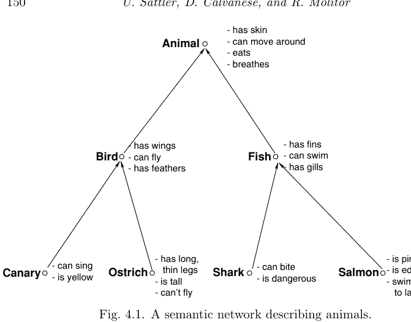

相比之下，虽然鸵鸟是鸟类，但它们并没有从鸟类继承“会飞”这一属性，因为该属性在鸵鸟身上被“修改”了。

直觉上，可以将子类-父类边翻译为概念定义，例如，¹

```
Shark ⊓ CanBite □ IsDangerous.
```

根据 Bachman [195] 的观点，上述翻译并不总是其意图。子类-父类边也可以被读为原始概念定义，即它们只施加了必要属性而非充分属性。因此，上述翻译可能更好：

```
Shark ⊟ CanBite □ IsDangerous.
```

由于缺乏语义学，子类-父类边还有更多的解读方式，这些在 [1975; 1977b; 1985] 中均过讨论。一种显著的解读是默认继承，它可以通过不同的方式进行指定，从而导致了误解，并引发了这些指定中哪一个是“正确”的的问题（另见第 6 章）。

由于这种歧义，各种形式化方法主要沿着两条路线演进：

1. 为了捕捉默认继承，研究人员调查了各种非单调继承系统，即非单调系统中的各种推理方式 [Touretzky et al., 1987; 1991; Seligman and Levesque, 1993]。
2. 为了捕捉语义网络的单调方面，引入了继承网络，并在 KL-ONE 系统中实现 [Bachman, 1979; Bachman and Scholze, 1985]。它的设计旨在涵盖语义网络的声明性、单调方面，并且没有规定在冲突情况下（非单调多重）继承的预期的运作方式。Bachman and Scholze [1985] 认为，KL-ONE 不允许取消或默认继承，因为此类机制会使分类法失去意义。事实上，给定概念的所有属性都可能被取消，使得它能够适应分类法中的任何地方。他们的提议是让默认断言和概念描述进行严格分离。

Bachman and Scholze [1985] 除了指出分类法的计算是核心系统服务外，还描述了 KL-ONE 中实现的各种概念构造器的含义，例如交集、全称值限制、角色-值映射等。

¹在下文中，我们使用第 2 章定义的标准描述逻辑。

此外，我们发现个体与概念之间、以及术语（terminological）与断言（assertional）形式化方法之间存在清晰的区别。

后来 [Levesque and Bachman, 1987]，KL-ONE 提供了一个定义良好的“塔尔斯基型”语义，这固定了其图形结构的精确含义，并导致了第一种描述逻辑的定义 [Levesque and Bachman, 1987]，当时也称为术语语言、概念语言或基于 KL-ONE 的语言。除了为语义网络赋予精确含义外，这种形式化方法还允许针对推理算法的正确性、完备计算复杂度进行研究。例如，发现 KL-ONE 中的假设是不可判定的，这主要是由于角色-值映射 [Schmidt, 1989]。

## 4.1.2 框架系统

Minsky [1981] 引入了框架系统作为逻辑的替代方案，他认为这些方案足以“模拟常识思维”。如今，语义网络和框架系统通常被视为同一族。然而，通常情况下，语义网络的属性是原子的，而在框架系统中，属性可以是复杂的。框架方法的一个目标是收集关于情况的相关知识。推理分为两个阶段：


1. 使用“部分匹配”，将更具体的框架嵌入更通用的框架中。

2. 搜索槽位以收集有关特定情况的信息。尽管框架系统被设计为逻辑的替代方案，但这种形式化方法的单调部分已被证明可以使用一阶逻辑捕捉 [Hayes, 1977; 1979]。

## 与其他形式化方法的关系

框架系统的非声明性、非逻辑或非单调方面可以给出精确语义。相应的推理算法和服务的质量可以与其他形式化方法进行比较。

在本节的剩余部分，我们展示如何将基于框架的知识单调部分转换为 `AL TBox` [Calvanese et al., 1994]。² 由于框架系统没有标准语法，我们选择主要使用 `Fikes and Kehler [1985]` 采用的方法，该方法也用于 `KEE`³ 系统。

框架定义的形式为 `F in E`，其中 `F` 是框架名称，`E` 是框架表达式，即根据以下语法形成的表达式：

```
E → SuperClasses : F₁, ..., Fₕ
MemberSlot : S₁
ValueClass : H₁
Cardinality.Min : m₁
Cardinality.Max : n₁
...
MemberSlot : Sₖ
ValueClass : Hₖ
Cardinality.Min : mₖ
Cardinality.Max : nₖ.
```

`Fᵢ` 表示框架名称，`Sⱼ` 表示槽位名称，`mⱼ` 和 `nⱼ` 表示正整数，`Hⱼ` 表示槽位约束。槽位约束可以如下指定：

```
F → F |
(INTERSECTION H₁ H₂) |
(UNION H₁ H₂) |
(NOT H).
```

框架知识库是框架定义的集合。例如，4.2 展示了一个描述大学课程的 `KEE` 知识库。基限制用于规定课程课程的最少和最大人数，并表示每门课程恰好由一个人授课。`AdvCourse` 代表招生研究生的课程，

² 不仅翻译，连示例也来自 `Calvanese et al. [1994]`。

³ `KEE` 是 `Intelicorp` 的商标。请注意，`KEE` 用户并不直接通过这种符号指定其知识库，而是允许通过图形系统界面交互式地定义框架。

154 \quad `U. Sattler, D. Calvanese, and R. Molitor`

```
Frame: Course in KB University
MemberSlot: enrolls
ValueClass: Student
Cardinality.Min: 2
Cardinality.Max: 30
MemberSlot: taughtly
ValueClass: (UNION GradStudent Professor)
Cardinality.Min: 1
Cardinality.Max: 1
```

```
Frame: BaseCourse in KB University
SuperClasses: Course
MemberSlot: taughtly
ValueClass: Professor
Frame: Professor in KB University
Frame: Student in KB University
Frame: GradStudent in KB University
SuperClasses: Student
MemberSlot: degree
ValueClass: String
Cardinality.Min: 1
Cardinality.Max: 1
```

```
Frame: AdvCourse in KB University
SuperClasses: Course
MemberSlot: enrolls
ValueClass: (INTERSECTION GradStudent (NOT Undergrad))
Cardinality.Max: 20
```

```
Frame: Undergrad in KB University
SuperClasses: Student
```

图 4. 一个 `KEE` 知识库。

即，已经拥有学位的学生。另一方面，基础课程可能仅由教授教授。

`Hayes [1979]` 通过将帧定义翻译为一阶公式为帧定义提供了语义，其中帧名被翻译为一元谓词，插槽被翻译为二元谓词。

为了将帧知识库翻译为 `ALUN` 知识库，我们首先定义了函数 `Ψ`，将每个帧表达式映射为 `ALUN` 概念表达式，如下：每个帧名 `F` 映射到原子概念 `Ψ(F)`，每个插槽名 `S` 映射到原子角色 `Ψ(S)`，每个插槽 `H` 映射到概念相应的布尔组合 `Ψ(H)`。然后，每一个如下形式的帧表达式

```
SuperClasses : $F_1, \dots, F_h$
MemberSlot : $S_1$
ValueClass : $H_1$
Cardinality.Min : $m_1$
Cardinality.Max : $n_1$
```

```
MemberSlot : $S_k$
ValueClass : $H_k$
Cardinality.Min : $m_k$
Cardinality.Max : $n_k$
```

# 与其他形式体系的关系

| | |

|---|---|

| Course | Enrolls. Student ⊨ 2 enrolls ≤ 30 enrolls taughtby. (Professor ⊨ GradStudent) = 1 taughtby |

| AdvCourse | Course ⊨ Enrolls. (GradStudent ⊋ Undergrad) ≤ 20 enrolls |

| BasCourse | Course ⊨ taughtby.Professor |

| GradStudent | Student ⊨ degree.String = 1 degree |

| Undergrad | Student |

图 4.3. 对应于图 4.2 中 `KEE` 知识库的 `ALUN` 知识库。

被映射为概念

```
$\Psi(F_1) \sqcap \dots \sqcap \Psi(F_k) \sqcap$
$\Psi(S_1), \Psi(H_1) \ge m_1 \Psi(S_1) \le n_1 \Psi(S_1) \sqcap$
$
$\Psi(S_k), \Psi(H_k) \ge m_k \Psi(S_k) \le n_k \Psi(S_k).$.
```

通过映射 `Ψ`，我们通过为每个帧定义 **Frame: $F$ in KB $\mathcal{F}$ in $E$.** 引入包含断言 `Ψ(F) ⊆ E(\mathcal{F})`，从而得到帧基 `\mathcal{F}` 对应的 `ALUN` 知识库 `Ψ(F)`。

图 4.2 中 `KEE` 知识库对应的 `ALUN` 知识库如图 4.3 所示。

翻译的正确性源于 `ALUN` 的理论语义与帧的一阶解释之间的对应关系（`Hayes, 1979; Borgida, 1996; Donini et al., 1996b`）。因此：

- 验证帧 `F` 在知识库中是否是满足的以及

- 识别哪些帧比给定的帧更通用

都通过 `ALUN` 知识库中的概念满足和概念包含来捕获。因此，帧系统的单调、声明性部分的推理可以还原为 `ALUN` 知识库中的概念满足和概念包含。

## 4.1.3 概念图

除了描述逻辑外，概念图 [Sowa, 1984] 可以被视为帧系统和语义网络的后代。概念图（`CGs`）是一种非常流行（尤其在自然语言处理中）且丰富的图形化表示应用领域知识的形式体系。它们具有形式语义，例如通过将它们翻译为（一阶）公式。

在概念图形式体系中，人们与描述逻辑一样，不仅是在*表示*知识，而且是对知识进行*推理*。

概念图的推理服务例如，判断一个给定的图是否有效，相应的公式是否有效，或者一个图是否被图 `h` 包含（即 `g` 对应的公式是否蕴含 `h` 对应的公式）。由于概念图可以表示所有的一阶谓词逻辑 [Sowa, 1984]，这些推理问题通常是不可判定的。然而，对于概念图的某些片段，它们是判定的。最著名的片段是简单概念图（`Gs`），它们与一阶逻辑的合取部分等价。

# U. Sattler, D. Calvanese, and R. Molitor

158

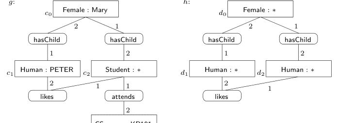

图 5. 两个简单图。

简单图通过算符 [Sowa, 1984] 在一阶谓词逻辑 (`FOL`) 中具有形式化语义：每个泛指概念都与一个唯一的变量相关，每个个体概念节点都与其区别标记（对比 marker）相关。概念类型和关系类型被翻译为原子公式，整个图 `g` 被翻译为由 `g` 中的节点表示的所有原子句子的存在闭合合取。

在我们的示例中，这产生了：

```
Φ(g) = ∃x₁.Female(MARY) ∧ Human(PETER) ∧ Student(x₁) ∧ ¬CSource(KR101) ∧ Female(x₀) ∧ Human(x₁) ∧ hasConcept(PETER, MARY) ∧ ¬hasConcept(x₁, x₁) ∧ likes(x₁, PETER) ∧ attends(x₁, KR101)),
```

```
Φ(h) = ∃x₀x₁x₂.Human(x₀) ∧ Human(x₂) ∧ ¬hasConcept(x₀, x₀) ∧ hasConcept(x₀, x₂) ∧ likes(x₂, x₂)),
```

其中 `x₁` 在 `Φ(g)` 中（对应 `x₀, x₁` 以及 `Φ(h)` 中的 `x₂`）是为泛指概念节点 `c₂`（对应泛指概念节点 `d₀, d₁, d₂`）引入的。

通常，有三种不同的方法表达概念类型。例如，假设我们想表达 Mary 是女性又是学生。这可以通过一个为每个陈述包含一个个体概念节点的简单图（`SG`）来表示（见图 4.6(1)）。另一种可能性是在 `Female(MARY)` 和 `Student(MARY)` 的共同支持中引入一个新的概念类型（见图 4.6(2)）。最后，可以通过将相应的概念节点标记为概念类型的*集合*而不是单个概念类型来表示这种合取（见图 4.6(3)）。^5 注意，如果将个体标记替换为泛指标记，这种解决方案可以使用，因为两个结果概念节点将被不同的变量解释。

# 与其他形式的关系

(1) (2) (3)

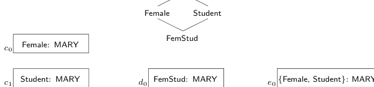

图 4.6. 在 `SG` 中表达概念类型。

对于简单图 `g, h`，相对于 `h` 的包含定义为从 `h` 到 `g` 的某种*投影*（projection）[Sowa, 1984; Chemin and Mugnier, 1992]；`g` 被 `h` 包含，当且仅当存在从 `h` 到 `g` 的映射，该映射 (1) 将 `h` 中的概念节点（或关系节点）映射到 `g` 中更具体的（相对于 `S` 中的偏序）概念节点（或关系节点），并且 (2) 保持了相邻性。

在我们的示例中（图 4.5），很容易看出 `g` 被 `h` 包含，因为对于 `0 ≤ i ≤ 2`，将 `d_i` 映射到 `c_i` 得到了从 `h` 到 `g` 的投影。

`SG` 的包含是一个 `NP` 完全问题 [Chein and Mugnier, 1992]。在包含者 `h` 是树的限制情况下，包含可以在多项式时间内判定 [Mugnier and Chemin, 1992]。

# 概念描述与简单图

为了确定对应于 `SG` 部分的描述逻辑，必须考虑之前提到的描述逻辑与 `CG` 之间的差异：

- 大多数描述逻辑只允许对应二元关系概念描述的角色。`Baader` 等 [1990c] 以及 `Coupey` 和 `Frey` [1998] 将关注限制在仅包含一元和二元关系类型的支持 `S` 上。

- 由于 `SG` 和概念描述的不同语义（闭合公式与单自由变量公式），`Coupey` 和 `Frey` 将关注限制在树形 `SG` 上。`Baader` 等引入了根 `SG`，即具有一个称为*根*的特殊节点的 `SG`。算子 `Φ` 的一种适配将根 `SG` `g` 翻译为具有一个自由变量 `x₀` 的 `FO` 公式 `Φ(g)(x₀)`。

- 由于文献中考虑的所有描述逻辑都允许概念合取，`Baader` 等允许使用概念类型的集合代替单个概念类型来表达 `SG` 中的原子合取。`Coupey` 和 `Frey` 处理了原子概念合取的问题：他们不允许 (1) 概念描述中的原子概念合取以及 (2) `SG` 中的个体概念。

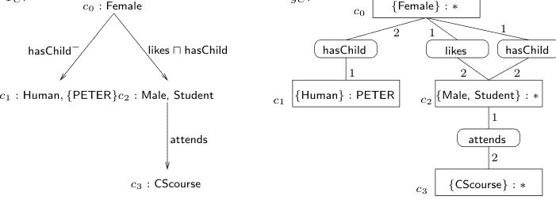

图 4.7. 将概念转换为简单图。

`Baader` 等考虑的描述逻辑表示为 `ELRO*`，允许存在限制和交集 (`EL`)、逆角色 (`I`)、角色交集 (`R`) 以及一元-of 概念 (`O`)。对于唯一名称应用中的常量，所有常量都被解释为不同的对象。`Coupey` 和 `Frey` 只考虑描述逻辑 `EL` 的片段。

在两篇论文中，对应结果都是基于将概念描述翻译为语法树。例如，考虑 `ELRO*`-概念：

```
C = Female ⊓ hasChild.(Human ⊓ {PETER})
∃(hasChild ⊓ Student ⊓ attends.CSCourse)
```

描述了 Peter 的所有方面，他有一个孩子是参加科学课程的学生。语法树如图 4.7 左侧所示。

可以证明 [Baader 等, 1999c]，如果概念描述 `C` 被限制为每个合取中最多包含一个-of 概念，则语法树 `T_c` 可以很容易地翻译成等价的树根 `SG` `g`。相反，每个树且仅包含二元关系类型的根 `SG` `g` 都可以翻译成等价的 `ELRO*`-概念描述 `C_g`。然而，某些根 `SG` 可以翻译成等价的 `ELRO*`-概念描述，尽管它们不是树。例如，图 4.5 所示的根 `SG` 等于概念 `C_g = {MARY} ⊓ Female �exists hasChild.(Human ⊓ {PETER}) �exists hasChild.(Student �exists attends.CSCourse)`。

通常，上述对应结果可以加强为：如果 `g` 中每个超过两个概念节点的循环至少包含一个个体节点，则每个包含二元关系类型的根 `SG` `g` 都可以转换为等价的树形 `SG`。因此，注意到带有 `d₀` 的 `SG` `h` 可以翻译成等价的 `ELRO*`-概念描述 `C_h`，因为在 `ELRO*` 中，两个结果概念节点将被不同的变量解释。

# 其他逻辑形式

传统上，描述逻辑的语义是以 `Tarski` 风格的方式给出的。另一种是它可以通过翻译为谓词逻辑来给出，这取决于描述逻辑，翻译是产生一阶公式还是超出一阶（后者对于允许传递闭包或不动点的描述逻辑如此）。由于描述逻辑的无变量语法，翻译

# U. Sattler, D. Calvanese, and R. Molitor

概念产生产生一个自由变量的公式。根据 `Baader` 的定义 [1996]，一个概念 `C` 及其翻译 `π(C)(x)` 是等价的，当且仅当对于所有解释 `I = (Δ^I, I^I)` 和所有 `a ∈ Δ^I`，我们有：

```
$a ∈ C^I text{ iff } I models π(C)(a)$.
```

描述逻辑 `DL` 被认为比逻辑 `L` *表达能力更弱*，如果存在一种翻译，可以将所有 `DL` 概念翻译为等价的 `L` 公式。这种翻译被称为*保持的*。

注意，还有其他方式可以定义公式和逻辑的等价以及“表达能力较低” [Baader, 1996a; Kurtonina and Rijke, 1997; Areces and Rijke, 1998]。例如，严格定义是唯一一种能够翻译自身以保持可满足性的定义。

首先，我们给出一个翻译 `π`，它将 `ALC` 概念翻译为谓词逻辑，这在本节的剩余部分将有用。对于熟悉模态逻辑的人，请注意这种翻译平行于命题模态逻辑的翻译 [van Bentham, 1983; 1984]；模态逻辑与描述逻辑之间的紧密关系将在 4.2.2 节讨论。对于 `ALC`，将概念翻译为谓词公式可以定义为：生成的公式涉及三个变量 `x, y, z`，且仅有一元和二元谓词。以下 `L^k` 定义了关于具有 `k` 个变量的一元和二元谓词逻辑。

该翻译由两个映射 `π_x` 和 `π_y` 给出，它们将 `ALC` 概念映射到 `L^2` 中具有一个自由变量的公式。每个概念 `A` 也视为一个一元谓词符号，每个角色 `R` 被视为一个二元谓词符号。对于 `ALC` 概念，翻译递归定义如下：


```
$$\pi_x(A) = A(x) \pi_y(A) = A(y)\\
\pi_x(C \cap D) = \pi_x(C) \wedge \pi_x(D) \pi_y(C \cap D) = \pi_y(C) \wedge \pi_y(D)\\
\pi_x(C \cup D) = \pi_x(C) \vee \pi_x(D) \pi_y(C \cup D) = \pi_y(C) \vee \pi_y(D)\\
\pi_x(\exists R) = \exists y.R(x,y) \wedge \pi_x(R) \pi_y(\exists R) = \exists y.R(x,y) \wedge \pi_x(C)\\
\pi_x(\forall R) = \forall y.R(x,y) \supset \pi_x(C) \pi_y(\forall R) = \forall y.R(x,y) \supset \pi_x(C).$$
```

其他可以轻松翻译为一阶谓词逻辑且涉及不超过两个变量的概念和角色构造器是：逆角色、合取、析或、角色的否定以及 one-of.$^8$

> $^7$ 在下，我们将解释同时视为 $DL$ 解释和谓词逻辑解释。

> $^8$ 在这种情况下，翻译是带有常数的 $L^2$。

## 与其他形式的关系 163

$\pi_x(\ge R) = \exists^{\ge n}.R(x,y) = \exists y_1, \dots, y_n \cdot \bigwedge_{i \neq j} y_i = y_j \wedge \bigwedge_i R(x,i)$

$\pi_x(\le R) = \exists^{\le n}.R(x,y) = \forall y_1, \dots, y_{n+1} \cdot \bigwedge_{i \neq j} y_i = y_j \vee \neg R(x,i)$

对于限定限制，可以对涉及变量的数量修改翻译。到目前为止，所有描述逻辑的表达能力都低于一阶谓词逻辑（可能带有计数量词）。相比之下，包含角色传递包的描述逻辑的表达能力超过了一阶逻辑：首先，很容易看出表达传递性 $\rho^+(x,y) \wedge \rho^+(y,z) = \rho^+(x,z)$ 至少涉及三个变量。为了表达 $\rho^+$ 是 $\rho$ 的传递包，首先需要强制 $\rho^+$ 是传递关系——根据紧致性定理，这在一阶逻辑中无法表达。

## 知识库的内部化

到目前为止，我们关注的是概念到公式的保持翻译，并且可以将概念的可满足性归约为目标逻辑的可满足性。然而，描述逻辑还关注关于 TBox 的一致性和逻辑蕴含以及 ABox 的一致性。此外，TBox 的区别在于它们是限制为无环的定义，还是允许概念包含（见第 2 章）。在一阶逻辑中，关于 TBox 的等价性仅仅是一个全量化公式，没有必要区分上述概念可满足性和关于 TBox 的可满足性——只要循环 TBox 使用描述语义 [Baader, 1990; Nebel, 1991] 或最大点语义（超出一阶逻辑表达能力）。在下，我们只考虑允许概念包含的最具表达力的 TBox。给定一个从概念到一阶公式的保持翻译 $\pi$ 和一个 TBox $T = \{C_i \subseteq D_i \mid 1 \le i \le n\}$，我们定义：

$$\pi(T) = \forall x. \bigwedge_{i=1}^n (\pi_x(C_i) \supset \pi_x(D_i)).$$

很容易证明：

- 概念 $C$ 关于 $\mathcal{T}$ 是可满足的，当且仅当公式 $\pi_x(C) \wedge \pi(T)$ 是可满足的。

- 概念 $C$ 关于 $\mathcal{T}$ 被概念 $D$ 包含，当且仅当公式 $\pi_x(C) \wedge \neg\pi_x(D) \wedge \pi(T)$ 是不可满足的。

- 对于两个索引集 $I, J$，ABox $\{R_k(a_i, a_j) \mid (i, j, k) \in I \cup C_j(a_i) \mid (i, j) \in J\}$ 与 $\mathcal{T}$ 一致，当且仅当公式 $\bigwedge_{(i,j,k) \in I} R_k(a_i, a_j) \wedge \bigwedge_{(i,j) \in J} \pi_x(C_j)(a_i) \wedge \pi(T)$ 是可满足的，其中公式中的 $a_s$ 是 ABox 中的个体。

观察到，如果 TBox $\mathcal{T}$ 中的所有概念都可以翻译为 $\mathcal{L}^2$（或 $resp^2$），那么 $T$ 的翻译 $\pi(T)$ 也是 $\mathcal{L}^2$（或 $resp^2$）。在一阶逻辑中，关于知识库（包含 TBox 和可能的 ABox）的推理并不比复杂表达式的推理复杂——与大多数描述逻辑的推理复杂度相比，考虑无环 TBox 可以产生显著差异（例如 [Calvanese, 1996b; Lutz, 1999a]）。这种差距并不意外，因为一阶谓词逻辑比描述逻辑复杂得多，即是不可判。

在下，我们研究与描述逻辑、限制变量片段、模态逻辑和守护片段关系更紧密的逻辑。

### 4.2.1 限制变量片段

定义一阶逻辑片段的一种方法是限制公式内部允许的变量集合以及关系符号的区域。如上一节所述，我们使用 $\mathcal{L}^k$ 表示关于最多 $k$ 个变量的一元和二元谓词的一阶谓词逻辑。类似地，$\mathcal{C}^k$ 表示关于最多 $k$ 个变量的一元和二元谓词以及计数量词 $\exists^n, \forall^n$ 的一阶谓词逻辑。

除了 Calvanese 等人 [1998a] 和 Lutz 等 [1999] 引入的描述逻辑外，将 DL 概念翻译为谓词逻辑公式涉及的谓词元数最多为二。

> $⁹$ 在此种下，翻译是带有常数的。

## 与其他形式的关系

对于限定限制，可以很容易修改翻译，包含 $\wedge$、$\vee$ 和 $\neg$。

到目前为止，所有描述逻辑的表达能力都低于一阶谓词逻辑（可能带有相等或计数量词）。相比之下，包含角色传递包的描述逻辑的表达能力超过了一阶逻辑：首先，很容易看出传递性 $\rho^+(x,y) \wedge \rho^+(y,z) = \rho^+(x,z)$ 至少涉及三个变量。为了表达 $\rho^+$ 是 $\rho$ 的传递包，首先需要强制 $\rho^+$ 是传递关系——这在一阶谓词逻辑中很容易公理化。我们必须强制 $\rho^+$ 是 $\rho$ 的最小传递关系——根据紧致性定理，这在一阶逻辑中无法表达。

模态逻辑的语义由 $M = \langle S, \pi, \mathcal{K} \rangle$ 给出，其中 $S$ 是状态的集合，$\pi$ 是到状态的映射，$\mathcal{K}$ 是关于 $S$ 的关系（被称为*可达性关系*），$M, s$ 满足 $\phi$ 如下：

```
$M, s \models \phi \quad \text{iff} \quad \phi \text{ 在状态 } M \text{ 成立}$
$M, s \models \phi_1 \wedge \phi_2 \quad \text{iff} \quad M, s \text{ 满足 } \phi_1 \text{ 且 } M, s \text{ 满足 } \phi_2$
$M, s \models \phi_1 \vee \phi_2 \quad \text{iff} \quad M, s \text{ 满足 } \phi_1 \text{ 或 } M, s \text{ 满足 } \phi_2$
$M, s \models \neg\phi \quad \text{iff} \quad M, s \not\models \phi$
$M, s \models \Box\phi \quad \text{iff} \quad \forall s' \in S, \text{ 若 } (s, s') \in \mathcal{K} \text{ 则 } M, s' \models \phi$
$M, s \models \diamond\phi \quad \text{iff} \quad \exists s' \in S, \text{ 若 } (s, s') \in \mathcal{K} \text{ 且 } M, s' \models \phi$
```

与其他模态逻辑相比，$\mathcal{K}$ 不对 Kripke 结构加限制。例如，模态逻辑 **S4** 是通过限制 $\mathcal{K}$ 为反射和传递而构建的。其他模态逻辑限制 $\mathcal{K}$ 为对称、良、等价关系等。此外，可达关系的数量可能不同于一个。这时我们讨论的是**多模态逻辑**，每个可达关系 $\mathcal{K}_i$ 可以认为对应一个**代理**，并使用多模态算子 $\Box_i$ 和 $\diamond_i$ 进行量化（或 $[i]$ 和 $(i)$）。例如，$\mathbf{K}_m$ 代表具有 $m$ 个代理的模态逻辑 $\mathbf{K}$。

为了建立模态逻辑 $\mathbf{K}_m$ 与 $\mathcal{ALC}$ 之间的对应，给 $\mathbf{K}_m$ 命名 $R_1, \dots, R_m$：

```
$f(A) = A$
$f(C \cap D) = f(C) \wedge f(D)$
$f(C \cup D) = f(C) \vee f(D)$
$f(\neg(C)) = \neg f(C)$
$f(\forall R_i C) = \Box_i(f(C))$
$f(\exists R_i C) = \diamond_i(f(C))$
```

Kripke 结构可以很容易被视为 DL 解释，反之亦然。那么，从 $\mathbf{K}_m$ 和 $\mathcal{ALC}$ 的语义中可以立即得出：

U. Sattler, D. Calvanese 和 R. Molitor

在解释 $\mathcal{I}$ 中，$a$ 是一个 ALC 概念 $C$ 的实例，当且仅当其翻译 $f(C)$ 在对应于 $\mathcal{I}$ 的 Kripke 结构中成立。显然，我们可以定义一个从 $\mathbf{K}_m$ 公式到 ALC 的类似翻译。

针对各种应用，存在大量的模态逻辑。在接下来，我们将简述其中一些逻辑以及它们与描述逻辑（Description Logics）的关系。

## 命题动态逻辑用于对程序行为进行推理

命题动态逻辑（PDL）由 Fischer 和 Ladner [1979] 引入，并由 Fischer 和 Ladner [1979] 以及 Pratt [1979] 证明具有 EXTIME-完全可满足性问题；概览见 [Harel et al., 2000]。PDL 设计用于描述程序的（动态）行为：通过使用非确定性选择 ($U$)、复合 (;) 和迭代 (**)，可以从原子程序构建复杂程序。PDL 公式可用于描述复杂程序执行后某个状态下应满足的属性。例如，如果满足以下条件，则以下 PDL 公式在某个状态下成立：每当执行程序 $\alpha$ 或 $\beta$ 时，都会到达 $p$ 的状态，并且存在 $\alpha$ 和 $\beta$ 的执行序列，使得达到了 $\neg p \wedge q$ 的状态。

```
$[\alpha \cup \beta]p \wedge \langle(\alpha,\beta)^*\rangle(\neg p \wedge q)$
```

其对应物 $\mathcal{ALC}_{reg}$ 由 Baader [1991] 独立引入。$\mathcal{ALC}_{reg}$ 是 ALC 在角色$^{10}$ 上正则表达式的扩展，可以看作命题动态逻辑的一种变体。关于这种对应关系，参见 Schild [1991] 以及 De Giacomo 和 Lernerini [1994a] 的工作，以及第 5 章。存在 PDL（或 $\mathcal{ALC}_{reg}$）的各种扩展，包含逆角色、计数或角色差异，其中大多数仍然具有 EXTIME 可满足性问题；例如，见 [Kozen and Tiuryn, 1990; De Giacomo, Lernerini, 1996] 和第 5 章。

$\mu$-计算术可以被视为动态逻辑的推广，具有类似的应用，由 Pratt [1981] 和 Kozen [1983] 引入。它通过允许在命题字母上使用（最小和最大）不动点算子从多模态 $\mathbf{K}_m$ 得到。例如，对于 $\mu$ 最小不动点算子，$X$ 为命题字母变量，

$^{10}$ 角色上的正则表达式是使用角色的并 ($\cup$)、复合 ($\circ$) 和 Kleene 运算符 ($*$) 构建的，并可以用于 $\mathcal{ALC}_{reg}$-概念以替代原子角色（见第 5 章）。

## 与其他形式体系的关系

公式 $\mu X.p \vee \langle\alpha\rangle X$ 描述了具有一条（可能为空的）边链通向 $p$ 成立状态的状态。在 PDL 中，该公式写为 $(\alpha^*)^*p$，其 $ACC_{reg}$ 对应物是 $\exists R_{\alpha}.p$。然而，$\mu$-计算术的表达能力严格强于 PDL 或 $ACC_{reg}$：例如，$\mu$-计算术可以表达程序的（二元关系）良性（well-foundedness），存在一个 $\mu$-计算术公式，仅具有 $\alpha$ 被解释为良关系（即没有无限外链的关系）的模型。在 [De Giacomo and Lenzerini, 1994b; 1997] 中，这种额外的表达能力被证明在各种应用中是有用的。扩展了数量限制 [De Giacomo and Lenzerini, 1994b;1997] 以及额外包含逆角色 [Calvanese et al., 1999c] 的 DL 对应术被证明具有 EXTIME 可满足性问题。

还有其他具有不动点形式的描述逻辑类：首先是 (1) 传递闭算子 [Baader, 1991]，它自然地使用最小不动点定义；(2) 时间循环 [Baader, 1990a]，其含义取决于它们是否。

## 时间逻辑用于对时间进行推理

它们在数据库、自动化验证、自然语言、规划等领域有应用。首先，它们区分是线性的还是分支的。其次，它们区分离散的还是连续的。最后，它们区分是否有过去或未来。

与某些模态逻辑相比，时间逻辑没有近亲的。

## 混合逻辑

通过使用所谓的有名词（nominals）引用单个状态（个体），扩展了标准模态逻辑。有名词仅在一个状态中成立的命题变量。混合逻辑结合了许多“良好的”属性，其描述超出了本文的范围；摘要见 [Areces, 2000]。在描述逻辑中，有三种标准的引用方法：

- (1) 我们可以在 ABox 中使用 ABox

- (2) 我们可以使用“之一”构造符 $\{o_1, ..., o_k\}$，它可以应用于个体名 $o_i$，且仅出现在少数描述逻辑中 [Bresciani et al., 1995]

- (3) 我们可以以混合逻辑的方式使用有名词（例如 [Di Giacomo, 1995; Tobies, 2000; Horrocks and Sattler, 2001]），即作为解释为单例的特殊原子概念。

对于描述逻辑，有名词与“之一”构造符之间存在直接映射，对于个体名和有名词，那么我们可以将上述的翻译 $f$ 扩展到“之一”构造符如下——前提是对对个体名和有名词都遵循唯一名称假设（见第 2 章），或者两个都不遵循：

```
$f(\{o_1, ..., o_k\}) = f(\{o_1\}) \sqcup \dots \sqcup \{o_k\}) = o_1 \vee \dots \vee o_k.$
```

## 与其他形式体系的关系

ABox 个体可以被视为一种受限的名词形式，且描述逻辑 $\mathcal{L}$ 中的每个 ABox 都可以翻译为 $\mathcal{L}$ 的（扩展的）单个概念，其中使用了交合、存在性限制和“多选一”（one-of）：首先，将每个形式的断言翻译为

```
$C(a) \quad \text{转化为 } \{a\} \sqcap C$
nR(a,b) \quad \text{转化为 } \{a\} \sqcap \mathcal{R}.{b}.$
```

接下来

到为止，我们只提到了名词在混合逻辑中出现的最弱方式。下一种强形式是形式为 $\varphi_{a_i}$ 的公式，它直观地描述了 $\varphi$ 在状态 $a_i$成立。对于通用角色 $U$ 和 $\varphi$ 的翻译结果 $C_\varphi$，该公式对应于概念 $\exists.(a_i \sqcap C_\varphi)$。最后，我们指出在混合逻辑中还有更具表现力的方式来讨论名词，例如使用名词变量并对其进行量化。

以上是某些模态逻辑与某些描述逻辑之间的关系。在本节的剩余部分，将讨论标准 DL 构造子与其在模态逻辑中对应物之间的关系。

## 数量限制

在模态逻辑中，等同于限定数量限制 $\ge n$ R.C$ 和 $\le n$ R.C$ [Hollunder and Baader, 1991b] 的被称为*分级模态* [Fine, 1972; van der Hoek and de Rijke, 1995]，而标准的、较弱的数量限制形式 $\ge n$ R 和 $\le n$ R 则没有被明确考虑。

可以说数量限制在描述逻辑中起着核心作用：它们存在于所有基于描述逻辑的知识表示系统中，人们已经就其计算复杂度对几种变体进行了研究（例如，[Tobies, 1999c] 针对限定数量限制，[Baader and Sattler, 1999] 针对符号数量限制和复杂角色的数量限制），并且 De Giacomo 和 Lerini [1994a] 证明了，对于扩展了限定数量限制（针对原子和逆原子）的 DL 等价的*逆向*-PDL，关于（可能是循环的）TBox 的推理是 EXTime-完备的。


相比之下，它们在模态逻辑和动态逻辑中起的是次要作用。在动态逻辑中，起着更重要作用的是*确定性程序*，即程序被解释为函数型关系（见第 2 章）。Ben-Ari 等人 [1982] 和 Parikh [1981] 显示，`DPDL`（即通过将程序限制为确定性而从 `PDL` 中获得的逻辑）的有效性（和可满足性）是 `EXPTIME`-完全的。此外，Parikh [1981] 出 `PDL` 公式可以线性地翻译为 `DPDL` 公式，De Giacomo 和 Lenzer [1994a] 利用了这种翻译将限定数量限制编码到 `PDL` 公式中。结果是，对于扩展了逻辑上逻辑的正则表达式和限定数量限制的 `ALC`，其关于（可能是循环的）TBox 的可满足性和包含关系属于 `EXPTIME` 范畴。

### 传递性
在模态逻辑和描述逻辑中，传递性以（至少）两种不同的形式出现：作为传递角色（或关系是传递的框架，如 **`K4m`**）以及角色上的传递闭包算子（`PDL` 上的克莱尼星号）。有趣的是，这两种传递在复杂度上有所不同。

Fischer 和 Ladner [1979] 证明了 `PDL` 中的可满足性是 `EXPTIME`-完全的。然而，在硬性证明中仅使用了角色（或角色）上的运算符——传递闭包算子。翻译成描述逻辑，这使得扩展了角色传递闭包算子的 `ALC` 的可满足性是 `EXPTIME`-完全的。

相比之下，**`K4m`** 对应与 **`Km`**（或 `ALC`）具有相同的复杂度，即 `PSPACE`-完全 [Halpern and Moses, 1992]，同时它提供了传递性：**`K4m`** 是通过将 Kripke 结构限制为可达关系是传递的而从 **`Km`** 得到的。翻译成描述逻辑，这意味着扩展了传递角色的 `ALC` 中的（即能够说明某些角色被解释为传递关系）其概念可满足性属于 `PSPACE` [Satler, 1996]。这种带有层级结构的描述逻辑的扩展在描述逻辑系统 `FACT` 中得到了实现 [Horrocks, 1998a]。虽然该扩展的纯概念可满足性是 `EXPTIME`-硬的，但其高度优化的实现表现良好 [Horrocks, 1998b]。

### 逆向角色
在没有角色/时间上的逆向运算符（角色上的逆运算符）的情况下，二元关系被限制为非对称使用：例如，被限制为只能建模“未来”或“过去”，或者必须决定使用“有孩子”（has-child）还是“是子关系”（is-child-of），但不能两者都使用并以适当的方式将它们关联。

在模态逻辑和描述逻辑中，逆向/逆运算符起着重要作用，因为它克服了这种非对称性，并且已经研究了多种变体 [Conçalves & Gradel, 2000]。

## 4.2.3 受保护片段

Andréka 等人 [1996] 将受保护片段作为模态逻辑的自然推广。他们的定义动机源于这样一个问题：为什么模态逻辑具有“良好”的属性，例如有限模型属性、内插性和可判定性。受保护片段通过限制变量出现在原子式中从一阶逻辑中获得。简单来说，每个原子是 `$P(x_1,...,x_k)$`，其中 `$P$` 是 `k` 元谓词，`$x_i$` 是变量。这具有双重元数 `$(i,j)$`，当作为保护时，要么前 `i` 个变量被量化而后 `j` 个不是，或者对称地后 `j` 个变量被量化而前 `i` 个不是。因此，人们可以将谓词看作双重“分组”。一种类似的逻辑，即所谓的动作保护片段 `AGF` 在 [Conçalves & Gradel, 2000] 中提出；它具有类似的变量分组（与 Lutz 等 1999 相同），并且额外将谓词分为允许作为保护的和位于体中的。从 DL 的角度来看，这不应该是一个过严的限制，因为它与角色名和概念名的区别相似。有趣的是，`AGF` 扩展了计数量词（限制的一阶对应物）、逆动作和固定点得到 `EXPTIME` —— 前提谓词的元数是有界的，且计数量词中的数字是编码的 [Conçalves & Gradel, 2000]。当注意到受保护片段在扩展了数量限制、函数限制或传递性（即说明某些二元关系被解释为传递关系的陈述）后变得不可判定时，这一结果更有意义 [Gradel, 1999]。据我们所知，其他具有完备算法的 n 元描述逻辑只有 `DLR` [Calvanese et al., 1998a] 和 `DLR_μ` [Calvanese et al., 1999c]，它们似乎与受保护片段正交。到目前还缺少 `DLR`（或 `DLR_μ`）与受保护片段（或其固定点扩展）之间关系的确切描述。

## 4.3 数据库模型

在本节中，我们将描述描述逻辑与数据库中使用的数据模型之间的关系。我们将考虑用于应用程序领域概念建模的传统数据模型（如语义和面向对象的数据模型），以及最近引入的用于表示半结构化数据和网络数据的形式体系。我们将集中于这些形式体系之间的关系，并参阅第 16 章以获取关于描述逻辑在数据管理中应用的更详细讨论 [Borgida, 1995]。

# 与其他形式化的关系

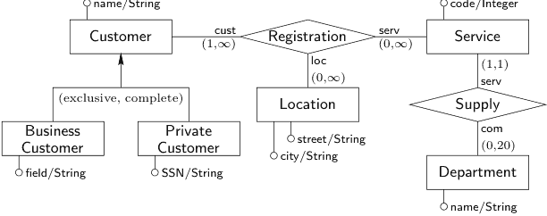

图 4.8。实体关系模式图。

## 4.3.1 语义数据模型

语义数据模型最初作为数据库模式设计的形式化方法引入 [Abrial, 1974; Chen, 1976]，目前被应用于大多数数据库和信息系统设计方法（CASE）工具——计算机辅助软件工程工具 [Hull and King, 1987; Batini et al., 1992]。在语义数据模型中，类提供了对象及其属性以及与其他对象之间关系的显式表示，子类-超类关系用于指定属性的继承。在这里，我们关注的是*实体关系（ER）*模型 [Chen, 1976; Teory, 1989; Batini et al., 1992; Thalheim, 1993]，它是最常用的语义数据模型之一。我们所考虑的因素也适用于概念建模的其他形式化方法，例如 UML 类设计 [Rumbaugh et al., 1998; Jackson et al., 1998]。

### 4.3.1.1 形式化

`ER` 实体的基本元素是实体、关系和属性，它们通过 `ER` 模式对感兴趣领域进行建模。

图 4.8 显示了一个简单的 `ER` 模式，表示了部门（例如电话公司）提供的（电话）服务的客户注册情况。该模式使用标准图形表示法绘制，其中实体用方框表示，关系用菱形表示。属性显示为连接到其定义实体的圆圈。一个*实体类型*（或简称为实体）表示一组具有共同属性的对象集合，称为*实例*。基本属性通过*属性*进行建模，其值属于若干个预定义的*值域*之一，例如*Integer（整数）*、*String（字符串）*、*Boolean（布尔值）*等。不同实体实例之间的关系通过*关系类型*（或简称为关系）进行建模。关系表示一个元组集合，每个元组代表参与关系的实体实例组合之间的关联。实体在关系中的参与被称为 `ER` 角色，并具有唯一的名称。它通过将关系连接到参与的实体来描绘。一个关系的 `ER` 角色数量称为其度（arity）。

基数约束可以附加到 `ER` 角色上，以限制实体通过该 `ER` 角色参与关系实例的最小或最大次数 [Abrial, 1974; Grant and Mixer, 1984; Leuzerini and Nobili, 1990; Ferg, 1991; Ye et al., 1994; Thalheim, 1992; Calvanese and Leuzerini, 1994b]。最小和最大基数约束可以是任意非负整数。然而，最小基数约束的典型值为 0（表示无限制）和 1（表示实体强制性参与该关系）；最大基数约束的典型值是 1（表示函数性）和 ∞（表示无限制）。在图 4.8 中，基数约束用于确保每个客户至少注册一项服务。此外，每项服务由一个部门提供，而该部门可能提供超过 20 种不同的服务。

为了表示实体集或两个关系之间的交集，使用了 `IS-A` 关系。`IS-A` 关系规定了属性从更通用的实体（或关系）向更具体的实体的继承。泛化是一组共享更通用实体（或关系）的 `IS-A` 关系。多个泛化可以组合在泛化层次结构中。泛化可以是互斥的，意味着所有具体的实体（或关系）是互不相交的；也可以完全的，意味着更具体的实体（或关系）的并集完全覆盖了更通用的实体（或关系）。在图 4.8 中，使用了一个互斥且完全的泛化来表示客户被分为私人客户和企业客户。

此外，键（keys）用于表示实体实例通过某些属性集被唯一标识，或者关系实例通过参与该关系的实体实例集被唯一标识。

虽然我们在这里没有提供正式定义，但 `ER` 模式的语义可以通过指定数据库状态与模式所表示的信息结构保持一致来给出；细节请参阅 [Calvanese et al., 1999e]。

## 与其他形式化的关系

传统上，`ER` 模型已用于商业化应用的设计阶段，现代 `CASE` 工具通常提供复杂的模式编辑功能，并能自动生成用于与数据库管理系统交互的代码。然而，这些工具在图形用户界面之外并不提供处理模式复杂性的支持。特别是，设计者负责检查模式是否具有一致性和冗余性等重要属性。这可能是一项复杂且耗时的人工任务。

### 4.3.1.2 与描述逻辑的关系

在描述逻辑和 `ER` 模型中，感兴趣的领域通过类和关系进行建模，并为建立两者之间的对应提出了许多建议 [Bergamaschi and Sartori 1992]。然而，由于目标语言的限制，`ER` 模型的某些功能无法完全捕捉，描述逻辑需要考虑以下方面：

- 1. `ER` 模型允许任意阶度的关系，而传统的描述逻辑只考虑一元和二元关系。
- 2. `ER` 模式中的循环假设是不现实的，而在知识库中是常见的。
- 3. 数据库状态被认为是有限的，而对描述逻辑的域通常没有有限性假设。

在详细讨论这些问题之前，我们在图 4.9 中展示了对应图 4.8 模式的知识库部分，这是根据 Calvanese 等 [1994; 1999] 的翻译得到的。

由于点 1，将 `ER` 模式转换为知识库时，必须对关系的形式化：

| 实体 | 关系 |
| :--- | :--- |
| Registration | VcustRegistration.Customer = 1 |
| Location | VlocRegistration.Location = 1 |
| Service | VservRegistration.Service = 1 |
| Supply | VservSupply.Service = 1 |
| Customer | VcomSupply.Customer = 1 |
| Customer | VcustRegistration.Registration ≥ 1 |
| Location | VlocRegistration.Registration |
| Service | VservRegistration.Registration |
| Supply | VcomSupply.Supply = 1 |
| Customer | VcomSupply.Supply ≤ 20 |
| Department | |
| Customer | BusinessCustomerPrivateCustomer |
| BusinessCustomer | |
| PrivateCustomer | Customer |
| Customer | Vname.String = 1 |

图 4.9。对应于 `ER` 模式的知识库部分。

即，将每个关系翻译成其实例表示关系元组的类。每个实体也被翻译成概念，而每个 `ER` 角色被翻译成描述逻辑角色。然后，通过函数性角色，可以强制每个对应 `ER` 角色的概念实例都恰好连接到关联实体的唯一实例。

基数约束通过连接关系与实体的反向角色上的数量限制来实现。为了避免对限定数量限制的需求，在翻译图 4.9 中，我们通过以所属关系命名来消除了角色的歧义。

## 与其他形式体系的关系

与未限定形式相比，虽然这显著增加了语言的复杂性，但它使得将关系转换为 `IS-A` 关系成为可能，这是无法通过 Calvanse 等人 [1999e] 提出的翻译方法实现的。此外，`ER` 模型提出了更多形式的基数约束 [Thalheim, 1992]，允许人们在独立于服务的情况下限制客户可以注册的位置数量。据我们所知，这类基数约束在通用的描述逻辑（Description Logics）中是无法捕捉的。Borgida 和 Weddell [1997] 研究了存在比一元依赖更通用的函数依赖的描述逻辑推理，这些依赖允许表示关系中的键。Calvanse 等人 [2000b] 证明了增强了非一元键约束的强表达式描述逻辑的推理是可判的，且 Calvanse 等人 [2001a] 显示，通用的函数依赖也可以不丢失 `EXTIME`-完全性的情况下进行处理。

`IS-A` 关系简单地通过包含断言（inclusion assertions）进行翻译。泛化层次结构如果是互斥且完备的，则还需要否定。

关于第 2 点，我们观察到包含子句（clauses）的 `ER` 模式的翻译会导致循环 `DL` 知识库。然而，由于需要通过 `ER` 角色将关系与实体正确关联，即使在翻译无环 `ER` 模式时，，生成的知识库也包含子句。另一方面，使用包含断言而非等价断言是足够的，因为前者自然地对应于 `ER` 模式的语义。

关于第 3 点，我们观察到不能简单地忽略它并采用针对任意模型的算法。事实上，`ER` 模型本身不具有有限模型属性 [Cosmadakis et al., 1990; Calvanse and Lerini, 1994b]，该属性规定，如果一个知识库（或模式）具有一个任意的、可能是无限的模型（或数据库状态），那么它也具有一个有限的模型（更多细节请见第 5 章）。进一步的证实是，为了在描述逻辑中捕捉 `ER` 模式，需要包含函数限制和反向角色的描述逻辑来表达可能的循环知识，而此类知识库不具有有限模型属性 [Calvanse et al., 1994; 1999e]。因此，必须求助于有限模型推理技术。Calvanse 等人 [1994] 显示了在仅包含包含断言的 `ACUNIT` 知识库中关于有限模型的推理是 `EXTIME`-完全的，Calvanse [1996a] 针对具有通用包含断言的 `ALCQIQ` 知识库推理提出了一种 `2EXTIME` 算法。

### 4.3.1.3 对应关系的应用

描述逻辑与语义数据模型之间关系的研究为这两个领域都带来了显著优势。一方面，描述逻辑典型的构造丰富性使得可以将它们添加到语义数据模型中，并在对模式进行推理时充分考虑它们 [Calvanse et al., 1998b]。显著例子包括：

- 不仅能够指定 `IS-A` 和泛化层次结构，还能指定实体或关系的布尔组合，这可以对应于否定和不完全知识的形式 [Di Battista and Lezerini, 1993]
- 在 `IS-A` 层次结构上细化属性的能力，例如限制基数约束的数值范围，或通过全称量化细化对关系的参与度；
- 通过等价断言定义类的能力，而不仅仅是陈述它们的必要属性。

语义数据模型与描述逻辑之间的对应关系最近被用于为 `CASE` 工具添加高级功能。一个显著的例子是用于概念建模的 `COM` 工具 [Franconi and Ng, 2000]，它将用户友好的图形界面与通过调用 `Fact` Description Logic 推理器 [Horrocks, 1998a; 1999] 自动推断模式属性（例如类的不一致性或隐式的 `IS-A` 关系）的能力相结合。

另一方面，将语义数据模型翻译为描述逻辑背后的基本思想，即实体化（reification）以及可以将翻译限制在关系的不同实例对应不同元组的模型中，导致了描述逻辑的发展，在这些逻辑中，任意元数的关系是一等公民 [De Giacomo and Lezerini, 1994c; 1997; Calvanse et al., 1998a]。使用此类描述逻辑，`ER` 模式的翻译是直接的，因为现在任意元数的关系也有其直接对应项。例如，使用 `DLR` [Calvanse et al., 1998a]，图 4.8 中关于三元关系 `Registration` 的模式部分可以翻译为：

```
Registration sq ($1: Customer) ⊓ ($2: Location) ⊓ ($3: Service)
Customer ⊑ [$1]Registration.
```

翻译的细节参见第 16 章第 16.2.2 节。描述逻辑也可以视为带有推理功能的语义数据模型的表达式变体。这在信息集成背景下尤为重要，因为需要高表达性来尽可能地捕捉不同信息源数据之间存在的复杂关系 [Levy et al., 1995; Calvanse et al., 1998]。

## 4.3.2 面向对象模型

最近提出了面向对象模型，旨在设计与面向对象系统集的形式体系 [Abiteoul and Kanellakis, 1989; Cattell and Barry, 1997; Calvanse et al., 1998]。由于我们讨论的是适合描述行为的描述逻辑，我们将关注限于模型的静态特征。虽然从一组对象标识符可以构造的值集是无限的，但对于数据库状态，只需要考虑由 `ρ^𝒥` 分配的值的有限子集 `V_𝒥`。

面向对象模式的含义通过指定数据库状态的特征给出。从对象标识符有限集 `𝒪^J` 开始，通过将值归类为有限集合来构造构建 `𝒪^J` 上的复杂值。数据库状态 `𝒥` 由对象标识符、一个为每个类分配 `𝒪^J` 子集的映射 `π^𝒥` 以及一个为 `𝒥` 中的每个对象分配 `𝒪^J` 上值的映射 `ρ^𝒥` 组成。

### 4.3.2.1 形式化

面向对象模式是有限的类声明集合。类 `C` 的类声明形式如下：

```
class C is-a
  union T_1, ..., T_k
end
```

其中 `T_i` 是类型。数据库状态 `𝒥` 中的类型表达式通过解释函数 `·^𝒥` 定义，该函数为每个类型表达式 `T` 分配 `V_𝒥` 中的一个值，如下：

- 如果 `T` 是类 `C`，则 `T^𝒥 = π^𝒥(C)`；


- 如果 $T$ 是并集类型 $T_1, \dots, T_k$, end$，则 $T^{\mathcal{J}} = T_1^{\mathcal{J}} \cup \dots \cup T_k^{\mathcal{J}}$；
- 如果 $T$ 是记录类型（或集合类型），则 $T^{\mathcal{J}}$ 是与 $T$ 的结构兼容的记录值（或集合值）集合。对于记录，我们使用的是开放语义，这意味着记录类型的实例可能具有比类型 $T$ 中显式指定的更多的组件。

# 与其他形式的关系

对于面向对象的模式 $\mathcal{S}$，数据库状态 $\mathcal{J}$ 对于每个声明都认为其（相对于 $\mathcal{S}$）是*合法的*：

```
class $C$ $is-a$ $C_1, \dots, C_n$ $type-is\ T$
```

在 $\mathcal{S}$ 中，对于每个 $i \in \{1, \dots, n\}$，有 (1) $\mathcal{CJ}^i \subseteq \mathcal{CJ}^J$，且 (2) $\rho^J(\mathcal{CJ}^i) \subseteq T^J$。因此，对于法的数据库状态，模式中存在的类型表达式决定了必须考虑的（有限）值集合。这些值的构建受类型表达式深度的限制。

### 4.3.2.2 与描述逻辑的对应

在建立上述所示的面向对象模型与描述逻辑（Description Logics）之间的对应关系时，必须考虑到 DL 知识库的解释域由原子对象组成，而面向对象模式中的每个对象都被分配了一个可能的结构化值。因此，需要在描述逻辑中显式地表示类的类型结构（*Calvanse et al.*，1994; 1999; Artale et al.*，1996a）。我们现在描述 Calvanse 等人 [1994, 1999] 提出的翻译方法，该方法通过向 DL 知识库引入具有特定含义的概念和角色来克服这一困难：概念 *AbstractClass, RecType* 和 *SetType* 分别用于表示类的实例、记录值和集合值。由类声明引发的类与类型之间的关联，以及类型的基本特征通过关系角色进行建模：函数角色 **value** 和角色 **member** 用于指定集合中元素的类型。此外，假设表示类型的概念是相互互斥的，并且与表示类的概念互斥的。这些约束通过以下包含断言表示，这些断言总是从面向对象模式获得的知识库的一部分：

```
AbstractClass $\sqsubseteq$ 1 value
RecType $\sqsubseteq$ value.$\perp$
SetType $\sqsubseteq$ value.$\perp$ $\sqcap$ $eg$RecType.
```

从面向对象模式到描述逻辑知识库的翻译通过映射 $\Gamma$ 定义，该映射将每个类型表达式映射到概念表达式，如下：

- 每个类 $C$ 被映射到原子概念 $\Gamma(C)$。
- 每个类型表达式并 $T_1, \dots, T_k$ 被映射到 $\Gamma(T_1) \sqsqcup \dots \sqsqcup \Gamma(T_k)$。
- 每个类型表达式-set-of $T$ 被映射到 SetType $\sqsubseteq \forall$member.$\Gamma(T)$。

图 4.11. 与图 4.10 中面向对象模式对应的知识库特定部分。

Customer $\sqsubseteq$ AbstractClass $\sqcap$ value. (BusinessCustomer $\sqcap$ PrivateCustomer)

PrivateCustomer $\sqsubseteq$ AbstractClass $\sqcap$ value. (RecType = 1 SSN $\sqcap$ VSSN.String)

Service $\sqsubseteq$ AbstractClass value.(RecType = 1 code.Integer = 1 suppliedBy $\sqcap$ suppliedBy.Department)

Customer $\sqsubseteq$ AbstractClass value.(RecType = 1 cust $\sqcap$ cust.Customer = 1 reg $\sqcap$ Vreg. (SetType Member.(RecType = 1 serv servService = 1 loc $\sqcap$ loc.Location)))

- 每个属性 $A$ 被映射到原子角色 $\Gamma(A)$，每个类型角色记录 $A_1:T_1, \dots, A_k:T_k$ 被映射到 $RecType \sqcap \Gamma(A_1),\Gamma(T_1) = 1 \Gamma(A_1) \sqsubseteq \dots \sqsubseteq \Gamma(A_k),\Gamma(T_k) = 1 \Gamma(A_k)$。

然后，对应于面向对象模式的知识库 $\Gamma(S)$ 是通过对每个类声明

`class C is-a C1,\dots,Cn type-is T`

一个包含断言

$\Gamma(C) \sqsubseteq$ AbstractClass $\sqcap \Gamma(A_1) \sqcap \dots \sqcap \Gamma(C_n) \sqsubseteq$ value.$\Gamma(T).$

与 ER 类似，使用包含断言代替等价断言来捕捉面向对象模式的语义是足够的。在假设模式中没有类通过其类型直接或通过类声明间接引用自身的情况下，翻译到无环知识库是可能的² [Artale et al., 1996]。然而，由于这种假设在表达能力上存在很大限制，面向对象模式中通常存在循环，在这种情况下生成的 DL 知识库将包含循环断言。翻译不需要反转规则，因为面向对象模型很少考虑属性的反转。此外，由于所有属性都是隐式函数，限制的数量被限制在功能上。为了建立转换的正确性，并确保对面向对象模式的推理任务可以通过其翻译到描述逻辑的推理任务来减少，我们想要建立

>² 注意循环引用不能直接出现在类型中，类型是归纳构造的，但仅通过类声明。

### 4.3.2.3 ER 的应用

与 ER 类似，使用包含断言代替等价断言来捕捉面向对象模式的语义是足够的。在假设模式中没有类通过其类型直接或通过类声明间接引用自身的情况下，翻译到无环知识库是可能的² [Artale et al., 1996]。然而，由于这种假设在表达能力上存在很大限制……（文本继续）

面向对象数据的基本特征也包含在统一建模语言（UML）的结构部分

## 4.3.3 结构化数据模型和 XML

在最近的应用程序如数据集成、Web 数据访问中，数据的结构通常不像传统数据库那样僵化，因此很难用传统的数据模型进行描述。因此，提出了所谓的半结构化数据模型，它们是基于图的数据模型，提供了灵活的结构化机制，并允许表示既不是原始的严格类型的数据 [Abiteoul et al., 2000; Abiteoul, 1997; Buneman et al., 1997; Mendelzon et al., 1997]。Abiteoul et al., 2000]， 作为表示 Web 结构化文档的机制被引入，实际上可以被视为半结构化数据的模型。

# 与其他形式体系的关系

显式不动点构造 [De Giacomo and Lenzerini, 1997]（另见第 5 章）。

关于近期使用描述逻辑（Description Logics）为 Web 数据提供语义丰富表示的详尽工作，请参阅第 14 章。

### 4.3.3.1 半结构化数据与描述逻辑之间的关系

Michaeli 等人 [1997] 提议扩展一种半结构化数据模型（该模型是 OEM 模型 [Abiteoul et al., 1997] 的抽象），增加一个类层，用于表示具有共同属性的对象。类表达式（Class expressions）对应 DL 概念，类的属性由一组分类规则指定，这些规则为类成员身份提供了充分条件，并在若干种不动点语义下进行解释。通过将问题归约为带有不动点算子的描述逻辑中的推理问题 [De Giacomo and Lenzerini, 1997; Calvanse et al., 1999c]，证明了在规则集下确定类的满足性和包含关系是 EXPTIME-可决定的（实际上是 EXPTIME-完全的）。

在接下来，我们将更详细地讨论如何使用描述逻辑表示和推理半结构化数据，并以一个半结构化数据模型的典型代表作为示例。在半结构化数据模型中，数据以图的形式组织，关于数据值和数据模式的信息都附加在图的边上。在 Buneman 等人 [1997] 提出的形式体系中，数据库到模式的边标签是完全一阶理论的公式，而一致性（conformance）是通过一种称为“仿真”（simulation）的特殊关系定义的。仿真的概念比通常的满足（satisfaction）概念更灵活，并恰当地反映了处理不那么严格的数据结构的需求。为了捕捉逻辑中的仿真概念，一方面需要表达节点必须满足的局部条件，另一方面需要处理仿真关系是满足局部条件的最大关系这一事实。由于半结构化数据模式可能包含环，局部条件可能会以环路方式相互依赖。因此，虽然局部条件可以通过 AQL 中合适的包含断言（inclusion assertions）进行编码，但仿真关系的极大性条件只能通过采用最大不动点语义才能正确捕捉 [Calvanse et al., 1998c; 1998b]。然后，使用带有不动点构造的描述逻辑，例如 μALCQ [De Giacomo and Lenzerini, 1994b; 1997]（另见第 5 章），可以为半结构化数据模式构建所谓的“特征概念”（characteristic concept），该概念恰好捕捉了模式的属性。包含包含

U. Sattler, D. Calvanese, and R. Molitor.

```xml
<xml version="1.0"?>
<!DOCTYPE Customers SYSTEM "services.dtd">

<Customers>
  <Customer type="business">
    <Name>FIAT</Name>
    <Field>manufacturing</Field>
    <Registered service="522">
      <Location>Torino/City
      <Address>...</Address>
    </Location>
    <Location>...</Location>
  </Registered>
  <Registered service="612">
    <Location>...</Location>
  </Registered>
  </Customer>

  <Customer type="private">
    <Name>...</Name>
    <SSN>...</SSN>
    <Registered service="214">
      <Location>...</Location>
    </Registered>
  </Customer>

</Customers>
```

```xml
<xml version="1.0"?>
<!DOCTYPE Services SYSTEM "services.dtd">

<Services>
  <Department name="standard-services">
    <Service code="522">
      <Name>call-back when busy</Name>
      <Cost>...</Cost>
    </Service>
    <Service code="214">
      <Name>three-party call</Name>
    </Service>
  </Department>

  <Department name="business-services">
    <Service code="612">
      <Name>conference call</Name>
    </Service>
  </Department>
</Services>
```

图 12. 分别专门用于判断每个半结构化客户和服务的任务两个 XML 文档。

与描述逻辑的对应关系可以用来丰富半结构化数据模型，而不会丢失检查模式包含的能力。事实上，Buneman 等人 [1997] 已经提出的要求——即符合一个模式的半结构化数据库也符合另一个模式——可以通过选择模式的特征概念之间的包含关系来实现 [Calvanse et al., 1998c, 1998b]。在存在约束的情况下推理通过在模式的特征概念中编码约束来完成。Calvanse 等人还处理了描述边标签属性时的不完全信息，提议使用用 $\muALCQ$ 表达的理论代替完全的一阶理论。

### 4.3.3.2 XML 与描述逻辑之间的关系

与其它形式体系的关系

最近，XML [Bray et al., 1998] 作为表示（半结构化）数据和在 Web 上交换数据的形式体系而变得流行。在 XML 中，可以通过文档类型定义（DTD）[Bray et al., 1998] 为文档施加结构。DTDTD 由一组声明组成：对于 XML 文档中使用的每个元素，DTD 必须包含一个声明，通过正则表达式指定元素如何嵌套在同类型的元素内部。关键字 `#PCDATA` 用于指定元素内容（即标签包围的部分）是自由文本。对于 XML 文档中出现的每个属性，DTD 必须包含一个声明，指定属性的名称、它所关联的内容以及额外属性（例如，类型以及属性是可选的还是强制的）。图 4.13 显示图 4.12 中 XML 文档的 DTD 部分。

```xml
<!-- File: services.dtd -->
<!ELEMENT Customers (Customer)+
<!ELEMENT Customer (Name, Field|SSN), Registered+
<!ELEMENT Registered (Location)+
<!ELEMENT Services (Department)+
<!ELEMENT Department (Service*)
<!ELEMENT Service (Name, Cost?)>
<!ELEMENT Name #PCDATA
<!ATLIST Customer type (business|private) "private">
<!ATLIST Registered service IDREF #REQUIRED
<!ATLIST Department name CDATA #REQUIRED
<!ATLIST Service code ID #REQUIRED>
```

图 4.13. 图 4.12 中 XML 文档的文档类型定义部分。

我们说明基于 Calvanse 等人 [1999d] 将 XML DTD 编码为 DL 知识库的方法。为了简单起见，我们没有考虑 XML 属性，尽管可以通过引入属性规则来轻松处理。由于正则表达式的存在，将 DTD 编码为描述逻辑需要采用具有构建角色正则表达式的算子的描述逻辑（第 5 章）。注意，将 DTD 编码为 DL 知识库必须允许表示无序树，同时保留节点节点的顺序。例如，图 4.13 中的 DTD 强制 `Customer` 元素的内容由一个 `Name` 元素组成，随后是（在 DTD 中用 "" 表示连接）`Field` 或 `SSN` 元素（可选）、任意数量（至少一个）`Registered` 元素（传递闭用 "+" 表示）。为了克服这些困难，Calvanse 等人 [1999d] 提议通过二叉树表示 XML 文档（即有序的无序树），并提供了一种利用表示法的描述逻辑 DTD 编码。图 4.14 显示了图 4.12 中一个 XML 文档对应的二叉树。

图 4.14。对应图 4.12 左侧 XML 文档的二叉树。

| T | $\le 1f \le 1r \n$ wf(f|r) | (4.1) |

|---|---|---||

| StartE | Tag | 对于每个元素 E | (4.2) |

| EndE | Tag | 对于每个元素 E | (4.3) |

| Tag | $\V(f|r) \bot$ | | (4.4) |

| PCDATA | $\V(f|r) \bot \sqcup \neg$ Tag | | (4.5) |

| Customers | $\exists$ StartCustomers $\exists(r \o id(f.Customers)$s) \sqcup id(f.SSNs)$s) \o r$ | | |

| | $\sqcup (id(f.Fields)$s) \o id(f.Registered)$s) \o r$ | |

| | $(id(f.Registered)$s) \o^*)$ .EndCustomer |

| Name$_s$ | $\exists$.StartName $\exists(r \o id(f.PCDATA)$s)$ .EndName |

图 4.15。图 4.13 中 DTD S 编码到 DL 知识库的部分。

# 与其它形式的关系

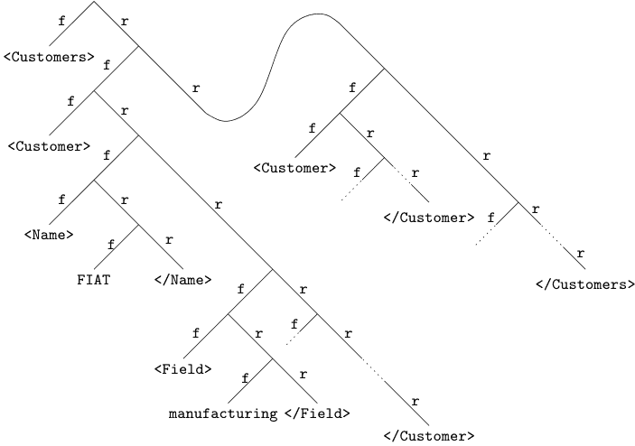

图 4.14。对应图 4.12 左侧 XML 文档的二叉树。


图 4.13 中 DTD 的元素。关于编码的精确定义，请参考 *Calvanese et al., 1999d*。

描述逻辑（Description Logics）中对 DTD 的编码可以用于验证 DTD 上不同类型的属性，即分别符合两个 DTD 的文档集之间的*包含*、*等价性*和*互斥性*。此类推理任务可以以不同的形式存在。对于*强*包含（以及相应的等价性、互斥性），在比较文档时，文档结构和*实际*的标签名同样重要；而对于结构包含（相应的等价性、互斥性），我们抽象掉了实际的标签名，只考虑文档结构 [Wood, 1995]。*参数化*包含（相应的等价性、互斥性）泛化了这两个概念，通过考虑标签名之间的等价关系，并相对于该等价关系对文档进行比较。通过利用上述将 DTD 编码为描述逻辑的方法，所有形式的 DTD 推都可以在确定性指数时间内完成 [Calvanese et al., 1999d]。

# 5 表达能力丰富的描述逻辑

Diego Calvanese

Giuseppe De Giacomo

## 摘要

本章涵盖了第 2 章介绍的基础描述逻辑的扩展，这些扩展使用了极具表现力的构造，需要先进的推理技术。特别是，我们研究了包含泛义包含公、反转角色、数量限制、角色的反射传递闭包、用于递归定义的不动点构造以及任意元关系的描述逻辑中的推理。本章还将涉及关于包含 TBox 和 ABox 的知识库的推理，并讨论处理对象的更通用的方法。由于本章考虑的逻辑缺乏有限模型属性，因此有限建模具有研究意义并将对其进行讨论。最后，我们提到了几种导致不可判定性的描述逻辑扩展，证实了本章所考虑的表达丰富的描述逻辑接近可判定性与不可判定性的边界。

## 5.1 引言

描述逻辑的引入旨在为框架系统（frame systems）和语义网络提供形式化重建。最初，研究集中在概念表达式的包含上。然而，对于某些应用，事实我们需要通过包含公理表示知识，且对 TBox 中的循环没有限制。因此，最近人们对一般形式知识库的推理问题产生了浓厚兴趣。详情请见第 2、3、 4 章。

194 D. Calvanese 和 G. De Giacomo

在对一般知识库进行推理时，无法通过限制描述逻辑的表达能力来获得进展，因为仅凭 TBox 中任意包含公理的力量，就会导致推理机制具有极高的复杂性。事实上，即使对于简单的语言 AL，逻辑蕴含也是 EXPTIME-hard 的（见第 3 章）。这导致了对用于表示概念和角色的强大语言的研究，对于这些语言，感兴趣的属性不再是推理的可处理性，而是可判定性。此类逻辑在此被称为丰富的描述逻辑，具有以下特征：

- 1. 用于构建概念和角色的语言包含了所有的经典概念构造，以及多种角色形成构造，如反转角色和反射传递闭包。
- 2. 对 TBox 中的公理不设任何限制。

本章的目标是提供丰富描述逻辑中推理的结果和技术的概述。本章的结构如下：在 5.2 节中，我们概述了丰富描述逻辑与命题动态逻辑（Proposition Dynamic Logic）之间的对应关系，这为研究丰富描述逻辑推理提供了基本工具。在 5.3 节中，我们利用为命题动态逻辑变体开发的自动机理论技术，来解决具有角色功能限制的丰富描述逻辑推理问题。在 5.4 节中，我们说明了用于丰富数量限制变体推理的基本重化技术（reification）。在 5.5 节中，我们展示了如何对由 TBox 和 ABox 组成的知识库进行推理，并讨论了处理名称的扩展。在 5.6 节中，我们引入了归纳使用的不动点构造描述逻辑。在 5.7 节中，我们研究了包含任意元关系的描述逻辑，这种扩展对于数据库二元限制具有特殊相关性。在 5.8 节中，讨论了描述逻辑中的有限建模问题。最后，在 5.9 节中，我们讨论了若干导致不可判定性的描述逻辑扩展。这表明本章所考虑的丰富描述逻辑接近不可判定性的极限，经过仔细设计以保持可判定性。

## 5.2 描述逻辑与命题动态逻辑的对应关系

在本节中，我们关注除了标准构造外包含反转角色的丰富描述逻辑 [Baader, 1991; Schild, 1991]。事实证明此类描述逻辑直接对应命题动态逻辑，它是用于表示程序属性的模型逻辑。我们首先介绍描述逻辑的语法和语义，然后介绍命题动态逻辑，最后讨论两者之间的对应关系。

### 5.2.1 Description Logic_reg

我们考虑描述逻辑 `$ACC_{reg}$`，概念和角色根据以下语法形成：

```
$C, C' \rightarrow A \mid \neg C \mid \cap C' \mid \cup C' \mid \forall R.C \mid \exists R.C \mid R, R' \rightarrow R \mid R' \mid R^* \mid R^+ \mid id(C) \mid R^-$
```

其中 `A` 和 `P` 分别表示原子概念和原子角色，`$ACC_{reg}$` 提供了概念构造以及在角色上形成正则表达式的构造。这些构造包括角色并、角色复合、反射传递闭包和角色身份。它们的含义是直观的，除了角色身份 `id(C)`，给定概念 `C` 允许构建一个将 `C` 的实例连接到自身的角色。正如我们在下一节中看到的，这些构造与命题动态逻辑中的程序运算符之间存在紧密对应。语言中正则表达式构造的存在通过名称中的下标 "reg" 来指定。

`$ACC_{reg}$` 还包含反转角色构造，它允许表示给定关系的反转。例如，我们可以通过利用角色 `child` 反转来声明 `Child.Doctor`（某人有一个医生孩子）。值得注意的是，在没有反转角色的语言中，为了表达这种约束，必须使用两个不同的角色（孩子、父母），而它们之间无法建立适当的关系。我们使用字母 `$\mathcal{I}$` 来指定描述逻辑中反转角色的存在；通过从 `$ACC_{reg}$` 中删除反转角色，

从语义角度来看，给定解释 `$\mathcal{I}$`，概念被解释为域 `$\Delta^{\mathcal{I}}$` 的子集，而角色被解释为该域上的二元关系

196 D. Calvanese 和 G. De Giacomo

```
$\Delta^I$, 如下：$^1$

$A^I \subseteq \Delta^I$
$(-C)^I = \Delta^I \setminus C^I$
$(C \cap C')^I = C^I \cap C'^I$
$(C \cup C')^I = C^I \cup C'^I$
$(\forall R).C^I = \{o \in \Delta^I \mid \forall. (o, o') \in R^I \to o' \in C^I\}$
$(\exists R).C^I = \{o \in \Delta^I \mid \exists. (o, o') \in R^I \wedge o' \in C^I\}$
$P^I = \Delta^I \times \Delta^I$
$(R \cup R')^I = R^I \cup R'^I$
$(R \circ R')^I = R^I \circ R'^I$
$(R^*)^I$
$id(C')^I = \{(o, o) \in \Delta^I \times \Delta^I \mid o \in C'^I\}$
$(R^*)^I = \{(o, o') \in \Delta^I \times \Delta^I \mid (o', o) \in R^I\}$
```

我们考虑由一般包含闭包构建的 TBox 的最通用形式，其形式为 `C \subseteq C'`，且对循环没有任何限制。我们使用 `C \equiv C'` 作为公理对 `C \subseteq C'` 和 `C' \subseteq C` 的缩写。我们采用了通常的描述性语义，参见第 2 章。

**示例 5.1** 下述的 `$ALCI_{reg}$` TBox `$T_{file}$` 建模了一个由文件系统元素（FSelem）组成的系统，其中每个元素要么是目录（Directory），要么是文件（File）。每个 Felem 有一个名称，目录可以有子节点而文件可能没有，且 Root 是一个没有父节点的特殊目录。父节点关系通过角色 *child* 的逆序进行建模。

```
$FSelem \subseteq Name.String$
$FSelem \equiv Directory \sqcup File$
$Directory \subseteq -File$
$Directory \subseteq Child.FSelem$
$File \subseteq Directory.\perp$
$Root \subseteq Directory$
$Root \subseteq Child^-. \perp.$
```

`$T_{file}$` 中的公理意味着，在模型中，每一个通过角色 *child* 链连接到 Root 实例的对象都是 FSelem 的实例。形式化地，`$T_{file} \models \exists(child)^*.Root \subseteq FSelem$`。为了验证这些蕴含成立，假设存在一个模型，其中 `$\exists(child^-).Root$` 的实例 `o` 不是 FSelem 的实例。那么，通过对从 Root 实例到 `o` 的链长度进行归纳推理，可以推导出矛盾。注意，这里需要归纳，因此这种推理不是一阶的。

`^1` 我们使用 `$\mathcal{R}^*$` 表示二元关系 `$\mathcal{R}$` 的反射传递闭包，并用 `$\mathcal{R}_1 \circ \mathcal{R}_2$` 表示二元关系 `$\mathcal{R}_1$` 和 `$\mathcal{R}_2$` 的链。

在下文中，为了方便，我们不失一般性地假设 `$\sqcup$` 和 `$\forall R.C$` 是通过 `$\neg$`、$\sq$ 和 `$\exists R.C$` 表达的。我们还假设逆运算符仅作用于原子规则。这同样是可以不失一般性的，因为以下等价式成立：`$(R_1) \circ R_2^- = R_2 \circ R_1^-$`，`$(R_1 \cup R_2)^- = R_1^- \cup R_2^-$`，`$(R^*)^* = (R^*)$`，且 `$(id(C))^- = id(C)$`。

5.2 命题动态逻辑（PDLs）是专门为计算机程序推理而开发的模态逻辑 [Fischer and Ladner, 1979; Kozen and Tiuryn, 1990; Harel et al., 2000]。在本小节中，我们提供了 PDLs 的简要概述，并说明了描述逻辑与 PDLs 之间的对应。在语法上，PDL 由两种类型的组合组成：程序和公式。程序和公式从原子程序和命题字母开始构建，并应用算子。我们用 `A` 表示命题字母，用 `$\phi$` 表示任意公式，用 `P` 表示原子程序，用 `r` 表示任意属性。我们关注 PDL [Fischer and Ladner, 1979]，它被证明对应于 `$AL_{reg}$`。PDL 的抽象语法如下：

```
$\phi, \phi' \rightarrow T \mid \perp \mid A \mid \phi \wedge \phi' \mid \phi \vee \phi' \mid \neg \phi \mid (r)\phi \mid [r]\phi \mid r, r' \rightarrow P \mid r' \mid r^* \mid r^-$
```

命题动态逻辑 PDL [Fischer and Ladner, 1979] 是通过去掉程序 `r^-` 得到的。PDLs 的语义基于 Kripke 结构的概念，定义为元组 `$\mathcal{M} = (S, \{R_P\}, II)$`，其中 `S` 表示非空状态集合，`$\{R_P\}$` 是 `S` 上的二元关系族，其中每个关系由原子程序 `P` 引起状态转换，`II` 是从 `S` 到命题字母的映射，使得 `II(s)` 决定在状态 `s` 下真实的字母。基本语义关系“公式 `$\phi$` 在结构 `$\mathcal{M}$` 的状态 `s` 成立”写作 `$\mathcal{M}, s \models \phi$`，并通过归纳定义，以说明 PDL 的 Fischer-Ladner 闭包。让我们不失一般性地假设 `$\vee$` 和 `$\wedge$` 是通过 `$\neg, \sq$` 表达的。我们还假设逆运算符作用于原子程序。这可以不失一般性地完成，因为以下等价式成立：`$(r \cup r')^- = r^- \cup r^-$`；`$(r^-)^- = r$`，`$(r^*)^- = (r^*)$`，且 `$(\phi)^- = \phi^-$`。

# 描述逻辑

一个 PDL 公式 `$\psi$` 的 Fischer-Ladner 闭包记作 `CL(\psi)` 是最小集合 `F`，使得 `$\psi \in F$` 且：

- 如果 `$\phi \in F$`，则 `$\neg\phi \in F$`（如果 `$\phi$` 不是 `r^*\phi` 的形式）
- 如果 `$\neg\phi \in F$`，则 `$\phi \in F$`
- 如果 `$\phi \land \phi' \in F$`，则 `$\phi, \phi' \in F$`
- 如果 `$\langle r\rangle\phi \in F$`，则 `$\langle r\rangle, \langle r'\rangle\phi \in F$`
- 如果 `$\langle r \cup r'\rangle\phi \in F$`，则 `$\langle r\rangle, \langle r'\rangle\phi \in F$`
- 如果 `$\langle r^*\rangle\phi \in F$`，则 `$\langle r^*\rangle\phi \in F$`
- 如果 `$\neg\phi' \in F$`，则 `$\phi' \in F$`

注意，`CL(\psi)` 包含了所有从 `r^*\phi` 导出的形式为 `$(r^*)\phi$` 的子公式，这些实际上比它们生成的公式更大。另一方面，`CL(\psi)` 中公式的数量和大小受 `$\psi$` 大小的线性界限 [Fischer and Ladner, 1979]，子公式的大小除外。此外，根据定义，如果 `$\phi \in CL(\psi)$`，则 `CL(\phi) \subseteq CL(\psi)`。

一个结构 `M = (S, R_i)` 被称为公式 `$\phi$` 的**模型**，如果存在状态 `s \in S` 使得 `M, s \models \phi`。如果存在 `$\phi$` 的模型，则公式是**可满足的**，否则该公式是**不可满足的**。公式 `$\phi$` 在 `M` 中是**有效的**，如果对于所有 `s \in M`，都有 `M, s \models \phi`。如果 `M` 是有限公理集 `$\Gamma$` 的**模型**，如果 `M` 是 `$\Gamma$` 中所有公理的模型。如果一个公理有一个模型，则它是可满足的，如果有限公理集 `$\Gamma$` 有一个模型，则它是可满足的。我们说有限公理集 `$\Gamma$` **逻辑上蕴含**公式 `$\phi$`，写作 `$\Gamma \models \phi$`，如果 `$\phi$` 在 `$\Gamma$` 的每一个模型中都是有效的。

很容易看出，公式 `$\phi$` 的可满足性以及有限公理集 `$\Gamma$` 的满足性可以通过逻辑蕴含重新表述，分别表示为 `$\phi \not\models \neg\phi$` 和 `$\Gamma \not\models \bot$`。

有趣的是，逻辑蕴含可以通过利用以下定理在满足性方面发生反转（参见 Kozen and Tiuryn, 1990）：

**定理 5.2（公理内化）** 令 `$\Gamma$` 为一组 converse-PDL 公理，`$\phi$` 为 converse-PDL 公式。则 `$\Gamma \models \phi$` 当且仅当

```
\neg\phi \wedge [P_1 \cup \dots \cup P_m \cup P_m^* \cup \dots \cup P_n^*] \in \Gamma
```

不可满足的，其中 `P_1, \dots, P_m` 属于 `$\Gamma \cup \{\phi\}$`。

200 D. Calvanese 和 G. Giacomo

这种结果利用了程序构造（并、反射传递闭包）和 PDLs 的连通性（即如果一个公式有一个模型，它有一个连通的模型）来表示公理。连通性是模态逻辑的特征，且所有的 PDLs 都具有这一特性。因此，对于几乎所有的 PDLs，一个类似于定理 5.2 的结果都是成立的。

PDLs 的推理已经从计算角度进行了充分的研究，这里考虑的 PDLs 的结果总结在以下定理 [Fischer and Ladner, 1979; Pratt, 1979; Ben-Ari et al., 1982; Vardi and Wolper, 1986]：

**定理 5.3** PDL 的满足性是 EXPTIME-hard。PDL、converse-PDL 以及 converse-DPDL 的满足性可以在确定性指数时间内解决。

# 表达性描述逻辑

描述逻辑中的 `$\Delta^T$` 对应于 PDL（程序动力逻辑）中的状态，两个个体之间的链接对应于状态转换。在内涵层面，概念（concepts）对应于命题，角色（roles）对应于程序。通常，这种对应是通过一个从逆 PDL（converse-PDL）公式以及从 `$\mathcal{ALCI}_{reg}$` 规则到逆 PDL 程序的的一一对射映射 `$\tau$` 实现的。映射 `$\tau$` 的递归定义如下：

```
$\tau(A) = A$
$\tau(-C) = -\tau(C) \quad \tau(P) = P$
$\tau(R^-) = \tau(R)^*$
$\tau(C \cap C') = \tau(C) \cap \tau(C') \quad \tau(R \cup R') = \tau(R) \cup \tau(R')$
$\tau(C \cup C') = \tau(C) \cup \tau(C') \quad \tau(R R') = \tau(R);\tau(R')$
$\tau(\forall R) = [\tau(R)]^R \quad \tau(R^*) = \tau(R^*)$
$\tau(\exists R) = (\tau(R))^R \quad \tau(id(C)) = \tau(id(C))$
```


描述逻辑 `TBox` 中的公理以显然的方式对应于 `PDL` 中的公理。此外，所有形式的推理（满足性、逻辑蕴含等）都有其自然的对应物。

这种对应关系最重要的贡献之一是通过描述逻辑重新表述定理 5.2 得到的。它指出，每个 `TBox` 都可以被“内化”为一个单一概念，即可以构建一个表达 `TBox` 所有公理的概念。在此过程中，我们依赖于构建一个“通用”角色（universal role）的能力，即链接（连通）模型中所有个体的角色。事实上，通用角色可以使用基于角色的正则表达式来表示，特别是角色的并集以及反射-传递闭包。在处理表达性逻辑时，内化 `TBox` 的可能性告诉我们，对于这类描述逻辑，带有 `TBox` 的推理（即逻辑蕴含）并不并不比带单个概念的推理更困难。

**定理 5.4** *`ALC_{reg}` 中的概念满足性和逻辑蕴含是 `ExpTime`-硬的。`ALCI_{reg}` 中的概念满足性和逻辑蕴含可以在确定性指数时间内被判定。*

请注意，对于不允许表示通用角色的描述逻辑，在存在 `TBox` 时使用的推理技术与用于概念表达式推理的技巧之间存在显著差异。这种深刻的差异反映在相关决策问题的计算属性上。例如，逻辑 `AL` 允许对不涉及公理的任务使用简单的结构化算法，这些算法是可靠且完备的，并在多项式时间内运行。然而，如果考虑一般的包含关系，推理将变为 `EXPTIME`-完全（见第 3 章），并且包含了包含适当终止策略的决策程序 [Buchheit et al., 1993a]。同样，对于表达能力更强的 `LLC`，不涉及 `TBox` 的推理任务是 `PSPACE`-完全的 [Schmidt-Schauß and Smolka, 1991]，而涉及 `TBox` 的任务是 `EXPTIME`-完全的。

## 5.3 功能限制

我们看到 `LLC_{reg}` 和 `ALI_{reg}` 分别对应于标准 `PDL` 和逆 `PDL`，这两者都经过了充分的研究。在本节中，我们将展示如何利用为 `PDL` 推理开发的技巧来处理描述逻辑中的构造，即功能限制（functional restrictions）。特别是，我们将采用基于自动机的技术，这些技术在研究 `PDL` 表达性变体的推理以及刻画其复杂性方面非常成功。

功能限制是描述逻辑中考虑的数量限制（number restrictions）的最简单形式，允许指定角色的局部功能，即某些概念的实例对于给定的角色具有唯一的角色填充（role fillers）。通过向 `ALI_{reg}` 添加原子角色及其逆角的功能限制，我们得到了描述逻辑 `ALCI_{reg}`。与 `ALCI_{reg}` 对应的逻辑是一种 `PDL`，它在扩展逆-`DPDL` [Vardi and Wolfer, 1986] 的基础上，对原子程序及其逆向程序都引入了确定性，且这种确定性是一个全局属性，但也可以在局部施加。

形式上，`ALCI_{reg}` 是通过向 `ALI_{reg}` 添加形式为 `≤1Q` 的功能限制得到的，其中 `Q` 是基本角色，可以是原子角色或原子角色的逆角色。这种功能限制被解释为：

```
(≤1Q)^I = {o ∈ Δ^I | |{o' ∈ Δ^I | (o, o') ∈ Q^I|} ≤ 1}
```

我们证明 `ALCI_{reg}` 中的推理属于 `EXTIME`，并且由于 `ALI_{reg}` 中的推理已经是 `EXPTIME`-硬的，在不失一般性的情况下，我们关注概念满足性。我们利用了 `ALCI_{reg}` 具有树模型属性（tree model property），该属性规定如果 `C` 是满足的，那么它在一个具有有界分支度的（可能是无限的）树结构的解释中满足（见后文）。这允许我们利用基于无限树自动机的技术。特别是，我们使用了 Vardi [1998] 引入的无限树双向交替自动机（`2ATAs`）。Vardi [1998] 使用 `2ATAs` 推出了 `μ`-演算术的判定程序。

### 5.3.1 无限树上的自动机

无限树交替自动机是非确定性无限树自动机的泛化，由 Muller 和 Schupp [1987] 引入。令 `B(I)` 为关于 `I` 的布尔公式集合，通过从真、假应用 `∧` 和 `∨` 产生。对于集合 `J ⊆ I` 和公式 `φ ∈ B(I)`，如果给 `J` 中的元素赋值为真，`I` 中的元素赋值为假，则称 `φ` 满足 `φ`。对于正整数 `k`，令 `[k] = {-1, 0,…,k}`。分支数为 `k` 的无限树双向交替自动机是一个元组 `A = (Σ, Q, δ, q0, F)`，其中 `Σ` 是字母表，`Q` 是有限集；`δ: Σ → B([k] × Q)` 是转移函数，`q0 ∈ Q` 是初始状态，`F` 指定接受条件。

转移函数将状态 `q ∈ Q` 和输入 `σ ∈ Σ` 映射到关于 `[k] × Q` 的正布尔公式。直观上，如果 `δ(q, σ) = φ`，则 `φ` 中出现的每个 `(c, q')` 都对应于自动机向方向 `c` 移动并从状态 `q'` 开始的移动。例如，如果 `k=2` 且 `δ(q1, σ) = ((1, q2), (1, q3)) ∨ ((-1, q))`，当自动机处于状态 `q1` 并读取带有字母 `σ` 的节点 `x` 时，它可以通过将状态 `q2` 和 `q3` 的两个副本分别发送到 `x` 的第一个继节点（即 `x-1`），或者通过将状态 `q` 的副本发送到 `x` 的前驱节点（即 `x-1`）并将状态 `q3` 的副本发送到 `x` 本身（即 `x-0`）。

在标记树 `(T, V)` 上的 `2ATA` 运行是一棵标记树 `(Tr, r)`，其中每个节点都由 `T × Q` 的元素标记。`T` 中标记为的节点

# 204 D. Calvanese 和 G. De Giacomo

由 `(x, q)` 描述一个处于状态 `q` 且 `A` 的副本，并读取 `T` 中的节点 `x`。形式上，相邻节点的标签必须满足 `A` 的转移函数。一个形式化的 `(T_r, r)` 是一个 `T × Q` 标记树，满足：

- 1. `ε ∈ T_r`，且 `r(ε) = (ε, q0)`。
- 2. `y ∈ T_r`，其中 `r(y) = (x, q)` 且 `δ(q, V(x)) = φ`。存在一个（可能为空的）集合 `S = {(c1, q1), …, (cn, qn)} |k| ≤ Q`，使得：
  * `S` 满足 `φ`
  * 对于所有 `1 ≤ i ≤ n`，`c_i` 在 `T_r` 中定义，且 `r(y-i) = (x-c_i, q_i)`。

如果运行 `(T_r, r)` 的无限路径满足接受条件，则认为它是接受的。给定一个无限路径 `P ⊆ T_r`，令 `inf(P) ⊆ Q` 为在 `P` 中无限出现的状态集（作为节点标签的第二个组件）。我们在此处考虑状态 `Q` 上的 *Büchi* 条件为 `Q` 的一个子集，无限路径 `P` 满足 `F` 当仅当 `inf(P) ∩ F ≠ ∅`。

`2ATA` 的非空性问题确定了给定的 `2ATA` 是否接受非空状态集。Vardi [1998] 的结果提供了以下关于非空 `2ATA` 的复杂性刻画。

**定理 5.5 ([Vardi, 1998])** 给定一个具有 `n` 个状态的 `A` 和具有 `m` 个元素的输入字母表，判定 `A` 的非空性可以在关于 `m` 的指数级关于 `m` 的多项式时间内完成。

### 5.3.2 `ALCF_{reg}` 闭包中的推理

`ALCF_{reg}` 的 Fischer-Ladner 闭包立即扩展了针对 *converse-PDL*（见 5.2.2 节）的分析概念，将函数限制视为原子概念。特别是，`ALCF_{reg}` 概念 `C0` 的闭包 `CL(C0)` 是最小集合，使得 `C0 ∈ CL(C0)` 且（假设 `⊔` 和 `∨` 通过 `Π` 和 `∃` 表达式，并且逆算子应用于原子概念）：5:

| `C ∈ CL(C0)` | 那么 `-C ∈ CL(C0)`（如果 `C` 不是 `-C'` 的形式） |
| `-C ∈ CL(C0)` | 那么 `C ∈ CL(C0)` |
| `C ∩ C' ∈ CL(C0)` | 那么 `C', ∈ CL(C0)` |
| `∃R.C ∈ CL(C0)` | 那么 `C ∈ CL(C0)` |
| `∃(R ∘ R').C ∈ CL(C0)` | 那么 `∃R.C, R'.C ∈ CL(C0)` |
| `∃(R ∘ R').C ∈ CL(C0)` | 那么 `∃R, R'.C ∈ CL(C0)` |
| `∃R*.C ∈ CL(C0)` | 那么 `∃R*.C ∈ CL(C0)` |
| `∃d(C).C' ∈ CL(C0)` | 那么 `C ∈ CL(C0)` |

`CL(C0)` 的基数与 `C0` 的长度呈线性关系。

> 4 对运行的有限路径没有施加任何条件。
> 5 我们回顾 `C` 和 `C'` 代表抽象概念，`R` 和 `R'` 代表任意关系。

# 表达性描述逻辑

可以证明，遵循 [Vardi and Wolper, 1986] 中关于 converse-`DPDL` 的证明思路，`ALCF_{reg}` 具有树模型属性，即每个可满足的概念都有一个结构为（可能是无限的）树的模型，其分支度由概念的大小线性限制。更准确地说，我们有：

**定理 5.6** 每个可满足的 `ALCF_{reg}` 概念 `C0` 都有一个具有分支度 `k_{C0}` 的树模型，该分支度等于 `CL(C0)` 中元素的数量。

该属性允许我们通过构建一个 `2ATA` 将（标记的）树与 `C0` 的模型关联来检查 `ALCF_{reg}` 概念 `C0` 的满足性。令 `A` 为原子概念集，`B = {Q1, …, Qn}` 为原子角色及其逆元的集合。我们从 `C0` 构建一个 `2ATA A_{C0}` 来检查 `C0` 是否在根节点满足。我们在树的每个节点中表示节点中哪些原子概念为真的信息，以及连接前驱节点到节点的节点角色（根除外）。更准确地说，我们为每个节点标记一个对 `σ = (α, q)`，其中 `α` 是节点中为真的原子概念集合，`q` 是连接前驱到节点的节点角色（根除外）。

给定一个 `ALCF_{reg}` 概念，由于技术考虑，将其转换为**否定言范式**是方便的。将概念转换为否定言范式可以在关于大小的线性时间内完成。下面，我们用 `nmf(C)` 表示 `C` 的否定言范式，`A_{C0}` 是 `2ATA`，定义如下：

- 字母表为 `Σ = 2^A × (B ∪ {P_dummy})`，
- 状态集 `S = {s_ini} ∪ CL_{nnf}(C) ∪ {Q | Q ∈ B}`，
- 转移函数 `δ` 定义如下：

#206 D. Calvanese 和 G. Giacomo

直观上，`(T_r, r)` 在 `CL_{nnf}(C)` 中访问节点 `x`，这意味着运行在 `x` 满足 `C`。

- 转移函数 `δ` 定义如下：
  - 1. 对于每个 `α ∈ 2^A`，从初始状态 `δ(s_ini, (α, P_dummy)) = (0, nnf(C))` 有一个转移。
  - 2. 对于每个 `(α, q) ∈ Σ` 和每个原子概念 `A`，
    ```
    δ(α, q) = true, if A ∈ α
    δ(α, q) = false, if A ∉ α
    δ(¬A, α, q) = true, if A ∉ α
    δ(¬A, α, q) = false, if A ∈ α
    ```
    此类转移检查树节点中的原子概念及其否定。
  - 3. 对于每个 `(α, q) ∈ Σ` 和每个基础角色 `Q ∈ B`，
    ```
    δ(α, q) = true, if q = Q
    δ(α, q) = false, if q ≠ Q
    δ(¬Q, α, q) = true, if q ≠ Q
    δ(¬Q, α, q) = false, if q = Q
    ```
    此类转移检查通过到达当前节点。
  - 4. 对于 `CL_{nnf}` 中的概念和每个 `σ ∈ Σ`，存在转移：
    ```
    δ(C ∩ C', σ) = (0, C) ∧ (0, C')
    δ(C ∪ C', σ) = (0, C) ∨ (0, C')
    δ(∀Q, C, σ) = ((0, ¬Q) ∨ (-1, C)) ∧ ⋀_{1 ≤ i ≤ k_{C0}} ((i, Q) ∧ (i, C))
    δ(∀R ∪ R', C, σ) = (0, R.C) ∧ (0, R'.C)
    δ(¬R*..C, σ) = (0, C) ∧ (0, ¬R*.C)
    δ(id(C).C', σ) = (0, C) ∧ (0, C')
    ```
    所有此类转移除了涉及 `∀R*.C` 和 `∃R*.C` 的转移外，都会递归地分解概念和规则，并移动到自动机的状态-
  - # 表现性描述逻辑 207
    树的节点和边。涉及 `∀R*.C` 的转移被视为等价概念 `C ⊓ ∀R*.C`，而涉及 `∃R*.C` 的转移将 `∃R*.C` 视为等价概念 `C ∪ ∃R*.C`。
  - 5. 对于 `CL_{nnf}(C)` 中的每个概念 `C ≤ Q` 以及每个 `σ ∈ Σ`，存在一个转移：
    ```
    δ(≤1Q, σ) = ((0, Q^-) ∧ Λ_{1 ≤ i ≤ k0}((i, -Q)))((0,-Q^-) ∧ Λ_{1 ≤ i ≤ k0}((i, -Q) ∨ (j, Q^-)))
    ```
    此类转移检查了：对于标记为 `≤1Q` 的节点 `x`，通过 `Q` 可达的节点最多只有一个（即节点 `x` 的前驱节点和后继节点）。
  - 6. 对于 `CL_{nnf}(C)` 中的每个概念 `¬≤1Q` 以及每个 `σ ∈ Σ`，存在一个转移：
    ```
    δ(¬≤1Q, σ) = ((0, Q^-) ∧ V_{1 ≤ i ≤ k0}((i, Q)))V_{1 ≤ i ≤ k0}((i, Q) ∨ (j, Q^-)))
    ```
    此类转移检查了：对于标记为 `¬≤1Q` 的节点 `x`，通过 `Q` 可达的节点至少有两个（即节点 `x` 的前驱节点和后继节点）。
  - * 终结状态集 `F` 是 `CL_{nnf}(C0)` 中形式为 `∀R*.C` 的概念集合。请注意，形式为 `∃R*.C` 的概念不是终结状态，这足以保证此类概念在自动机的所有接受运行中都得到满足。


自动机 `A_{C0}` 在无限树上的运行从根节点开始，检查 `C_0` 在该处是否（见上述第 1 点）。它通过归纳法分解 `nnf(C_0)`，同时适当地在树中（步骤 3 和 4）导航，直到达到原子概念、功能性限制及其否定。形式为 `∀R*.C` 和 `∃R*.C` 的概念分别通过等价概念 `C ⊓ ∀R*.C` 和 `C ∪ ∃R*.C` 进行传播。正是此类概念的传播可能会在运行中产生无限分支。

现在，自动机的运行可能包含一条无限分支，其中 `∃R*.C` 总是通过选择析取项 `∃R*.C` 而不选择析取项 `C` 来解决。这条无限分支对应于树中的一条无限路径，其中 `R` 被无限迭代且 `C` 永远不被满足。然而，`∃R*.C` 的语义要求 `C` 在 `R` 的有限迭代后被满足。因此，这种无限路径不能满足 `∃R*.C`。

自动机的接受条件要求运行中的每个分支都包含一个形式为 `∀R*.C` 的状态，这排除了接受运行中的此类无限分支。事实上，一个始终推迟满足 `C` 的运行将包含一个无限分支，其中所有状态的形式都为 `∃ R_1 … ∃ R_n. ∃ R*. C`，其中 `n ≥ 0` 且 `R_1 ∘ … ∘ R_n` 是 `R` 的后缀。请注意，剩余的无限分支是由于传播形式为 `∀ R*. C` 的选择而产生的，接受条件允许此类分支的存在。

## 208 D. Calvanese 和 G. Giacomo

给定一个被 `Ac_{C0}` 接受的标记树 `T = (𝒯, V)`，我们定义解释 `𝒯_I = (Δ^I, ℛ^I)` 如下。首先，对于每个原子角色 `P`，关系 `ℛ^P = {(x, x) | x ∈ 𝒯_I 且 V(x) = (α, P) 对于某些 α ∈ 2^A} ∪ {(x, x) | x ∈ 𝒯_I 且 V(x) = (α, P*) 对于某些 α ∈ 2^A}`。然后，使用这些关系，我们定义：

- `Δ^I = {(x, e) | (x, e) ∈ (∪_P(ℛ_P ∪ ℛ_P*)^*)}`
- `Δ^I ∩ {x | V(x) = (α, q) 对于 α ∈ 2^A 和 q ∈ B ∪ P_{dum}}`，对于每个原子概念 `A`；
- `ℛ^P = (Δ^I × Δ^I) ∩ ℛ_P`，对于每个原子角色 `P`。

**引理 5.7** 如果标记树 `T` 被 `Ac_{C0}` 接受，则 `𝒯_I` 是 `C_0` 的模型。

相反，给定一个分支度为 `k_{C0}` 的标记树 `𝒯_I = (T, V)`，我们可以通过以下方式获得 `𝒯_I`：

- `T = Δ^I`；
- `V(ε) = (α, p_{dum})`，其中 `α = {A | ε ∈ Δ^I}`；
- `V(x) = (α, Q)`，其中 `α = {A | x ∈ Δ^I}` 且 `(x, x) ∈ 𝒬^I`。

**引理 5.8** 如果 `ℐ` 是分支度为 `k_{C0}` 的 `C_0` 模型，则 `𝒯_I` 是被 `Ac_{C0}` 接受的标记树。

根据上述引理和 `ALCI` 的树性质，我们得到结论：

**定理 5.9** 一个 `ALCI` 概念 `C_0` 是可满足的，当且仅当 `Ac_{C0}` 接受的树集为空。

从该定理可以，可以使用自动机（ATA）的空性算法来检查 `ALCI` 的满足性。事实这种判定程序在计算复杂度上是最优的，`Ac_{C0}` 的状态数与 `C_0` 的大小成线性，而字母表与 `C_0` 中的原子概念数量成指数关系。

## 229 表现性描述逻辑

通过定理 5.5，我们得到了 `ALCI` 推理的上界，该界匹配 `EXPTIME` 下界。

**定理 5.10** `ALCI` 中的概念满足性（以及逻辑蕴含）是 EXPTIME-完全的。

在包含逆角色和 TBox 公理的表现性描述逻辑背景下，功能性限制最初在 [De Giacomo 和 Mancini, 1994; De Giacomo, 1995] 中使用所谓的公理模式（axiom schema）技术进行了研究。该技术基于为感兴趣的属性（例如功能性限制）设计公理模式，并将此类模式实例化为（多项式）数量的概念。该技术的很好的示例是将 `converse-PDL` 还原 `PDL` [De Giacomo, 1996]。公理模式实例化可用于证明关于 TBox 的推理在 `ALCI` 的显著子集中是 EXPTIME-完全的（例如 [Calvanese et al., 2001] 中关于 TBox 的推理）。然而，是否可以将其证明 `ALCI` 的 EXPTIME-完全性仍然是一个未解决的问题。在 [De Giacomo 和 Mancini, 1994; De Giacomo, 1995] 中提出的该方向的尝试是不完全的 [Zakhary, 2000]。

### 5.4 限定数量限制

接下来处理限定数量限制，它是数量限制的最通用形式，允许对属于特定概念的角色指定基数约束。特别是，我们将考虑基本角色（即原子角色及其逆）的数量限制。通过添加此类构造，我们得到了描述逻辑 `ALCQI`。对应于 `ALCQI` 的 PDL 是 `converse-PDL` 的等级模态（graded modalities）[Fattorini 和 De Caro, 1985; Van Hoek 和 Rijke, 1995; Tobies, 1999]。形式上，`ALCQI` 是通过在 `ALCI` 中添加形式为 `≤ n Q C` 和 `≥ n Q C` 的限定数量限制得到的，其中 `n` 是非负整数，`Q` 是基本角色，`C` 是一个 `ALCQI` 概念。此类构造解释如下：

```
(≤ nQ.C)^I = {o ∈ Δ^I | |{d' ∈ Δ^I | (o,d') ∈ Q^I ∧ d' ∈ C^I}| ≤ n}
(≥ nQ.C)^I = {o ∈ Δ^I | |{d' ∈ Δ^I | (o,d') ∈ Q^I ∧ d' ∈ C^I}| ≥ n}
```

在 `ALCQI` 中的推理在标准下仍然是 EXPTIME-完全的。

## 230 D. Calvanese 和 G. Giacomo

描述逻辑中假设数量限制中的数字以一进制表示。这可以通过扩展 5.3 节引入的自动机理论技术来处理限定数量限制。在这里，我们采取了不同的方法，通过展示从 `ALCQI` 到 `ALCI` 的还原来研究 `ALCQI` 的推理 [De Giacomo 和 Mancini, 1995; De Giacomo, 1995]。由于还原是多项式的，我们得到了 `ALCQI` 的 EXPTIME-完全性结果。该还原基于具体化（reification）的概念。这种概念在处理（原子）角色的布尔组合 [De Giacomo 和 Mancini, 1995; 1994] 时起着重要作用，也适用于表示具有任意阶数关系的描述逻辑（见 5.7 节）。

#### 5.4.1 角色的具体化

原子角色被解释为二元关系。具体化二元关系意味着对于关系中的对个体 `(o1, o2)`，存在个体通过两个角色 `V1` 和 `V2` 分别连接到 `o1` 和 `o2`。这些个体的集合代表形成关系的元组集合。然而，出现了以下问题：通常情况下，可能有两个或多个个体通过 `V1` 和 `V2` 分别连接到 `o1` 和 `o2`，因此都代表相同的元组 `(o1, o2)`。显然，为了正确表示关系，必须避免这种情况。

给定一个原子角色 `P`，我们将其具体化形式定义为

`V1^- ∘ id(Ap) ∘ V2`

其中 `Ap` 是一个新的原子概念，表示与角色 `P` 相关的元组的个体，而 `V1` 和 `V2` 表示两个功能角色，分别将 `Ap` 中的每个个体连接到该个体所代表的元组的第一部分和第二部分。请注意，角色 `V1^- ∘ id(Ap) ∘ V2` 与其逆角色 `V2^- ∘ id(Ap) ∘ V1` 之间存在清晰的对称性。

**5.11** 令 `C` 为 `ALCQI` 概念。其具体化对应物 `ξ1(C)` 是两个概念的交，`ξ1(C) = ξ0(C) ⊓ Θ1`，其中：

- `ξ0(C)` 通过以下方式将原始概念 `C` 中的每个原子角色 `P` 替换为复合角色 `V1^- ∘ id(Ap) ∘ V2`，其中 `V1` 和 `V2` 是新的原子角色

> [在 Tobies, 2001a 中]介绍了处理以二进制编码数字的数量限制的技术，并用于证明即使在这种假设下，对 `ALCQ` 知识库的推理也可以在 EXPTIME 内完成。

## 表现性描述逻辑

（变换后的唯一部分）且 `AP` 是一个新的原子概念；

然后，重新表述每个限定数量限制

```
≤ n (V1^- ∘ id(AP) ∘ V2^+).D    ≤ V2^-. (AP ∩ ∃ V2).D
≥ n (V1^+ ∘ id(AP) ∘ V2^-).D    ≥ V1^-. (AP ∩ ∃ V1).D
≤ n (V2^- ∘ id(AP) ∘ V1^+).D    ≤ V2^-. (AP ∩ ∃ V1).D
≥ n (V2^+ ∘ id(AP) ∘ V1^-).D    ≥ V1^-. (AP ∩ ∃ V1).D
```

+ `Θ1 = ∀(V1 ∪ V2 ∪ V2^+)*.( {≤ V1 ∩ ≤ V2})`

下一个定理保证了在不失一般性的情况下，我们可以注意力限制在 `ξ1(C)` 的模型上，这些模型正确地表示与原子角色相关的关系，即每个关系元组中的模型都由单个个体表示。

**定理 5.12** *如果 `ξ1(C)` 有一个模型 `I`，则它存在一个模型 `I'`，使得对于 `(o, o') = (V1^- ∘ id(AP) ∘ V2^+)^I`，恰好存在一个个体 `o_ω` 使得 `(o_ω, o) ∈ V1^-^{I'}` 且 `(o_ω, o') ∈ V2^+^{I'}`。也就是说，对于所有 `o1, o2, o, o' ∈ Δ_I^I`，使得 `o1 ≠ o2` 且 `o ≠ o'`，满足以下条件：*
```
o1, o2 ∈ Δ_I^I ⊃ ((o1, o) ∈ V1^+^{I'} ∧ (o2, o) ∈ V1^+^{I'} ∧ (o1, o') ∈ V2^-^{I'} ∧ (o2, o') ∈ V2^-^{I'})
```

定理 5.12 的证明解释了不相并模型属性；令 `C` 为 `ALCQI_{reg}` 概念，`ℐ = (Δ_I^I, ℐ)` 和 `𝒥 = (Δ_J^J, 𝒥)` 为 `C` 的两个模型，那么解释 `ℐ ∪ 𝒥 = (Δ_I^I ∪ Δ_J^J, ℐ ∪ 𝒥)`（即 `ℐ` 和 `𝒥` 的不相并）也是 `C` 的模型。我们注意到，大多数描述逻辑都有这种属性，这实际上是模态逻辑的典型特征。不讨论细节，我们只需提到 `I'` 是从 `I` 构建的，在导致角色表示错误的实例中，`V2` 的扩展通过交换修改，将第二个分量替换为 `ℐ` 的一个副本中的对应个体。

通过使用定理 5.12 我们可以证明下面的结果。

**定理 5.13** *`ALCQI_{reg}` 概念 `C` 是可满足的，当且仅当其具体化对应项 `ξ1(C)` 是可满足的。*

#### 5.4.2 将 `ALCQI_{reg}` 归约为 `ALCFI_{reg}`

根据定理 5.13，我们可以关注 `ALCQI_{reg}` 概念的具体化计数器。注意，这些本身是 `ALCQI_{reg}` 概念，但它们的特殊性允许我们将它们转换为 `ALCFI_{reg}` 概念。

212 D. Calvanese 和 G. De Giacomo

直观上，我们通过角色 `F_i ∘ F_i^*`（记得 `V_i` 是函数性的，而 `V_i^-` 不是）来表示角色 `V_i^-`，`i=1,2`，其中 `F_i` 和 `F_i^*` 是新的函数性角色。^7 这种变换的主要点在于，很容易将限定数量限制表示为对个体的 `(F_i ∘ F_i^*)^*`-后继链的约束。形式上，我们定义 `𝒜ℒ𝒞𝒬_{reg}` 概念的 `𝒜ℒ𝒞ℐ_{reg}` 对应项如下。

**定义 5.14** 令 `C` 为 `𝒜ℒ𝒞𝒬_{reg}` 概念，`ξ1(C) = ξ0(C) ∩ Θ1` 为其具体化对应项。`𝒜ℒ𝒞ℐ_{reg}`-对应项 `ξ2(C)` 是两个概念的合取，`ξ2(C) = ξ0(C) ∩ Θ2`；

+ - `ξ1(C)` 通过从 `ξ0(C)` 处同时将带有限定数量限制的结构中的角色 `V_i` 替换为 `(F_i ∘ F_i^*)^*`，其中 `F_i` 和 `F_i^*` 是原子角色；
- 将 `≤ n V_i^- · D` 替换为 `𝒱(F_i ∘ F_i^*)^* ∘ (id(D) ∘ F_i^*)^n`;
- 将 `≥ n V_i^- · D` 替换为 `𝒱(F_i ∘ F_i^*)^* ∘ (id(D) ∘ F_i^*)^{n-1}`
- `Θ2 = 𝒱(∪_{i=1,2}(U_i ∪ U_i^- ∪ U_i^-)^*) · (Θ1 ∩ Θ2)`，其中 `Θ_i` 的形式为：

`1 ≤ F1^- ∩ ¬F1 ∩ ¬T`

观察 `Θ2` 约束 `C` 的每个模型 `ℐ`，使得 `F_i^I, F_i^{*I}, (F_i)^I` 和 `(F_i^-)^I` 都是偏，且每个个体不能通过 `(V_i^+)^I` 和 `(V_i^-)^I` 连接。结果是，我们得到 `((F_i ∘ F_i^*)^*)^I` 是偏。这允许我们按要求重构 `V_i` 版本。

我们通过一个示例说明 `ALCQ_{reg}` 概念模型与其具体化及 `ALCI_{reg}`-对应项模型之间的基本关系。

**定义 5.15** 考虑概念 `C0 = ∃P.(2P.(2P))` 并考虑图5.1所示的 `C0` 模型 `ℐ`，其中 `a ∈ C0^I`。这样的模型对应于 `C0` 的具体化对应项 `ξ1(C0)` 的模型 `ℐ'`，如图5.2所示。`ξ1(C0)` 的模型 `ℐ'` 再次对应于 `C0` 的 `ALCI_{reg}`-对应项 `ξ2(C0)` 的模型 `ℐ''`，如图5.3所示。注意，从 `ℐ''` 我们可以重构 `ℐ'`，从原始概念的模型 `ℐ`。^7 通过函数角色链表示非函数角色的想法源于 Parikh [1981]，他用它将标准 PDDL 归约为 DPDL。^8 这里 `R^*` 代表 `R ∘ R^*`，`R^n` 代表 `R ∘ … ∘ R`（n次）。

## 表现性描述逻辑


图5.1 `ALCQ_{reg}` 概念 `C0 = ∃P.(2P.(2P)).` 的模型。


图5.2 `C0` 的具体化对应项 `ξ1(C0)` 的模型。

可以证明 `ξ1(C)` 是可满足的当且仅当 `ξ2(C)` 是可满足的。由于很容易看出 `ξ3(C)` 的大小相对于 `C` 的大小是项式的，我们得到了 `ALCQ_{reg}` 推理复杂性的刻画。


# 定理 5.16
*$ALCQ_{reg}$ 中的概念可满足性（以及逻辑蕴含）是 EXPTIME-完全的。*

## 5.5 对象

在本节中，我们回顾通过成员断言表示的关于个体的知识。给定一个个体符号字母表 `$\mathcal{O}$`，成员）断言具有以下形式之一：

`$C(a) \quad P(a_1, a_2)$`

其中 `C` 是概念，`P` 是原子角色，`a, a_1, a_2` 属于 `$\mathcal{O}$`。解释 `$\mathcal{I}$` 扩展为为 `a ∈ $\mathcal{O}$` 分配一个元素 `a^I ∈ Δ^\mathcal{I}`，满足*唯一命名假设*，即不同的元素分配给 `$\mathcal{O}$` 中不同的符号。如果 `a^I ∈ C^\mathcal{I}`，则 `$\mathcal{I}$` 满足 `C(a)`；如果 `(a_1^I, a_2^I) ∈ P^\mathcal{I}`，则 `$\mathcal{I}$` 满足 `P(a_1, a_2)`。ABox 是成员断言的有限集合，如果 `$\mathcal{I}$` 满足 `$\mathcal{A}$` 中的每个断言，则 `$\mathcal{I}$` 被称为 `$\mathcal{A}$` 的*模型*。

*知识库*是一个对 `K = (\mathcal{T}, \mathcal{A})`，其中 `$\mathcal{T}$` 是 TBox，`$\mathcal{A}$` 是 ABox。如果 `$\mathcal{I}$` 是 `T` 的模型，则 `$\mathcal{I}$` 被称为 `$\mathcal{K}$` 的*模型*。

234 D. Calvanese 和 G. Giacomo


图5.3 `$C_0$` 的 `$ALCI_{reg}$`-对应项 `$\xi_2(C_0)$` 的模型。

如果 `T` 和 `$\mathcal{K}$` 有模型，则它们是可满足的，且 `$\mathcal{K}$` 逻辑上蕴含断言 `$\beta$`，记作 `$\mathcal{K} \models \beta$`，其中 `$\beta$` 不出现在 `$\mathcal{K}$` 中。

## 表达性描述逻辑

对于每个成员断言 `P(a_i, a_j) ∈ $\mathcal{A}$`，有两个包含公理：

```
$A_i \sqsubseteq \exists P.A_j \sqcap \neg P-.A_j$
$A_j \sqsubseteq \exists P-.A_i \sqcap \neg P^-.A_i$
```

对于 `$\mathcal{A}$` 中每对不同的个体 `a_i` 和 `a_j`，有一个包含公理：

```
$A_i \sqsubseteq \neg A_j$
```

- `$\mathcal{T}_{aux}$` 由一个公理 `$\mathcal{U}$`（代表 `P_1 ∪ … ∪ P_n ∪ P_1^- ∪ … ∪ P_n^-`）组成，其中 `P_1, …, P_n` 是 `$\mathcal{T} ∪ \mathcal{T}(\mathcal{A})$` 中的所有原子角色：

```
$\mathcal{A}_i \sqcap \mathcal{T} \sqsubseteq \forall.\mathcal{U}(\neg\mathcal{A}_i \sqcup C)$
```

对于 `$\mathcal{T} ∪ \mathcal{A}$` 中出现的每个 `A_i` 以及每个 `C ∈ C_{ext}(\mathcal{T} ∪ \mathcal{T}(\mathcal{A}))`，其中 `C_{ext}(\mathcal{T} ∪ \mathcal{T}(\mathcal{A}))` 是 `$\mathcal{T} ∪ \mathcal{T}_{\mathcal{A}}$` 一个适当扩展的语法闭包^*，其大小与 `$\mathcal{T} ∪ \mathcal{T}_{\mathcal{A}}$` 的大小呈多项式关系 [De Giacomo and Lerini, 1996]。

为了理解简化后的 `$\mathcal{K}' =(\mathcal{T}', \mathcal{A}')$` 如何与原始知识库 `$\mathcal{K} =(\mathcal{T}, \mathcal{A})$` 相关，首先观察 ABox `$\mathcal{A}$` 用于寻找通过角色 `create` 连接的原始个体 `g`，以创建每个 `A_i` 的实例。可以证明，这允许我们将注意力限制在表示与 `g` 连接的图的 `$\mathcal{K}'$` 模型上；即 `$\mathcal{K}'$` 的模型 `$\mathcal{I} = (\Delta^{\mathcal{I}}, \mathcal{I}')$` 使得 `$\Delta^{\mathcal{I}} = \{g\} ∪ \{s' | (g, s') ∈ \Delta^{\mathcal{I}} ∘ (∪(P^{\mathcal{I}} ∪ P^{*\mathcal{I}}))\}$`。

TBox `$\mathcal{T}'$` 由三部分组成：`$\mathcal{T}$`、`$\mathcal{T}_{\mathcal{A}}$` 和 `$\mathcal{T}_{aux}$`。原始包含 `$\mathcal{A}$` 作为包含公理。事实上，每个个体 `a_i` 在 `$\mathcal{T}_{\mathcal{A}}$` 中被表示为一个新的原子概念 `A_i`（与其他 `A_{i'}` 不相交），且原始 ABox `$\mathcal{A}$` 中的成员断言被表示为 `$\mathcal{T}$` 中涉及此类新概念的包含公理。然而，仅凭 `$\mathcal{T} ∪ \mathcal{A}$` 并不以忠实地（相对于我们感兴趣的推理）表示原始知识库，因为 `$\mathcal{K}$` 中的个体 `a_i` 是由 `$\mathcal{K}'$` 中 `A_i` 的实例集表示的。为了将 `$\mathcal{K}'$` 的满足性还原为 `$\mathcal{K}$` 的满足性，我们必须能够为每个 `A_i` 选出一个 `a_i` 的代表。为此此，我们需要在 `$\mathcal{T}'$` 中包含一个新部分，称为 `$\mathcal{T}_{aux}$`，它包含如下形式的包含公理：

```
$A_i \sqcap \mathcal{C} \sqsubseteq \forall.\(\neg\mathcal{A}_i \sqcup C)$
```

TBox 的语法闭包是通过内化 TBox 公形成的语法概念。

直观地说，这样的公理表示：如果一个 `A_i` 的实例也是 `C` 的实例，那么每个 `A_i` 的实例都是 `C` 的实例。观察到，如果我们为语言中每个可能的概念（即公理模式）添加无限数量此类公理，我们可以安全地将注意力限制在每个概念 `A_i` 只有一个实例的 `K'` 模型上，因为在逻辑中没有方法区分 `A_i` 的不同实例。De Giacomo 和 Lenzerini [1996] 证明了，事实上我们只需要多项数量的此类公理（由 `T_{aux}` 指定），即可为每个 `i` 确定 `A_i` 的实例作为 `a_i` 的代表。这允许我们证明 `K'` 模型的存在意味着 `K` 模型的存在。

**定理 5.18** `$ALCQ_{reg}$` 中的知识库满足性（以及每个标准推理）是 EXPTIME-完全的。

使用类似的方法，De Giacomo 和 Lenzerini [1994a] 以及 De Giacomo [1995] 通过添加特殊的原子概念 `A_g` 扩展了 `$ALCQ_{reg}$` 和 `$ALCI_{reg}$`（此处 OCR 有重复）。

## 表达性描述逻辑

上述概念在模态逻辑中对应 [Prior, 1967; Bull, 1970; Blackburn and Spaan, 1993; Blackburn, 1993]。`$ALCQ_{reg}$` 和 `$ALCI_{reg}$` 的结果直接适用于 PDLs。特别是，对应于 `$ALCQ_{reg}$` 的 PDL 是增加了指示的标准 PDL。它是确定性 PDL 的扩展，本质上是带有指示的。

## 5. 固定 点构造

配备显式固定点的可判定描述逻辑是为了建模列表、流、树等归纳结构 [De Giacomo and Lenzerini, 1994d; Schild, 1994; De Giacomo and Lenzerini, 1997; Calvanese et al., 199c]。这些逻辑对应于命题 `$\mu$-演算术` [Kozen, 1983; Strett and Emerson, 1998; Vardi, 1998]，它是 PDL 的变体，用于表达反应和并发过程的时间属性 [Stirling, 1996; Emerson, 1996]。这些逻辑也可以被视为带有固定点的一阶逻辑良好片段 [Park, 1970; 1976; Abiteoul et al., 1995]。

在这里，我们考虑 Calvanese 等人 [199c] 研究的描述逻辑 `$ALCQCI$`。这种描述逻辑是通过添加最小和最大固定点构造从 `$ALCI$` 导出的。显式固定点的可用性允许归纳和共归纳概念以自然的方式表示。

## 示例 5.19 考虑概念 Tree（树），它表示树结构，通过归纳定义如下：

- 1. 一个为 EmptyTree（空树）的个体是一个 Tree（树）。
- 2. 如果一个个体是 Node（节点），它最多有一个父节点，有一些子节点，且所有子节点都是 Tree，那么该个体就是一个 Tree。

换句话说，Tree 是满足断言 1 和 2 的概念中扩展集最小的。这种概念在 `$\mu_{ALCQI}$` 中可以通过利用最小固定点构造 `$\mu_{X:C}$` 自然地表示：

```
$Tree \equiv \mu_{X.}(EmptyTree \cup (Node \sqsubseteq 1 \text{ child}^\neg \sqcap child.T \sqcap Y_{child}(X)))$
```

## 示例 5.20 考虑广名的线性数据结构，称为 Stream（流）。Stream 与列表相似，不同之处列表可以被视为节点的有限序列，而 Stream 是节点的无限序列。这种数据结构由概念 Stream 捕捉，通过共归纳定义如下：

- 1. 一个为 Stream 的个体是一个 Node，并且有一个后继，且该后继是一个 Stream。

换句话说，Stream 是满足条件 1 的概念中扩展集最大的概念。这种概念在 `$\mu_{ALCQI}$` 中可以通过利用最大固定点构造 `$\mu_{X:C}$` 自然地表示：

```
$Stream \equiv \nu_{X.}(Node \sqsubseteq 1 \text{ succ} \sqcap \exists succ.(X)$
```

现在让我们正式地引入 `$\mu_{ALCQI}$`。我们使用标准的一阶逻辑中关于作用域、变量的界界与自由出现、闭式公式等概念，将 `$\mu$` 和 `$\nu$` 视为量词。`$\mu_{ALCQI}$` 中的原始符号是原子概念、（概念）变量和原子角色。概念和角色根据以下语法形成：

```
$C \longrightarrow A \mid \neg C \mid C_1 \sqcap C_2 \mid \ge n R.C \mid \mu_{X.C} \mid X \ R \longrightarrow P \mid P^\neg$
```

其中 `A` 表示原子概念，`P` 表示原子角色，`C` 是任意的 `$\mu_{ALCQI}$` 概念，`R` 是任意的 `$\mu_{ALCQI}$` 角色（即原子角色或原子角色的逆角色），`n` 是一个自然数，`X` 是一个变量。

## 表达性描述逻辑

`$\mu X$` 中的概念 `C` 在语法上必须是单调的。

除了 `$\mathcal{ALCQ}$` 中使用的通常缩写外，我们引入了缩写 `$\nu C$` 表示 `$\neg \mu X.C[X/\neg X]$`，其中 `C[X/\neg X]` 是将所有 `X` 的自由出现替换为 `$\neg X$` 后得到的概念。

自由变量的存在使得我们无法直接将解释 `$\mathcal{I}$` 扩展到逻辑的每一个概念。因此，我们引入了赋值（valuation）。解释 `$\mathcal{I}$` 上的赋值 `$\rho$` 是从变量到 `$\Delta^I$` 子集的映射。给定赋值 `$\rho$`，我们用 `$\rho[X/E]$` 表示与 `$\rho$` 相同的赋值，但在 `$\rho[X/E](\mathcal{I}) = \mathcal{E}$` 外外。

设 `$\mathcal{I}$` 为一个解释，`$\rho$` 为 `$\mathcal{I}$` 上的赋值。我们为分配给 `$\mathcal{I}$` 和 `$\rho$` 的逻辑概念分配扩展函数 `$\mathcal{I}^\rho$`，将概念映射到 `$\Delta^I_\rho$` 的子集，如下：

```
$X_\rho^I = \rho(X) \subseteq \Delta^I$
$A_\rho^I = A^I \subseteq \Delta^I$
$(-C)_\rho^I = \Delta^I \setminus C_\rho^I$
$(C_1 \cap C_2)_\rho^I = (C_1)_\rho^I \cap (C_2)_\rho^I$
$\ge n R_\rho^I = \{s \in \Delta^I \mid |\{(s, s') \in R^I \text{ and } s' \in C_\rho^I\}| \ge n\}$
$(\mu C)_\rho^I = \bigcap\{\mathcal{E} \in \Delta^I \mid C_{X/\mathcal{E}}^I \subseteq \mathcal{E}\}$
```

观察到 `C_{X/\mathcal{E}}^I` 可以看作是从 `$\Delta^I$` 的子集 `$\mathcal{E}$` 到 `$\Delta^I$` 子集的算子，通过对变量施加语法限制，这种算子保证关于集合包含关系是单调的。`$\mu C$` 表示该算子的最小固定点。同样观察分配给 `$\nu C$` 的语义为：

```
$(\nu C)_\rho^I = \bigcup\{\mathcal{E} \in \Delta^I \mid \mathcal{E} \subseteq C_{X/\mathcal{E}}^I\}$
```

因此 `$\nu C$` 表示最大固定点。事实上，我们感兴趣的是闭概念，其扩展集独立于赋值。对于闭概念，我们不需要显式地考虑赋值，因此概念的可满足性、逻辑蕴涵的概念可以直接扩展。利用关于带有对偶的 `$\mu$` 演算的 EXPTIME 可判定性的最新结果 [Vardi, 1998]，并利用类似于第 5.4 节所示的限定数量限制技术，Calvanese 等人 [199c] 证明了……

*(注：原文后续部分存在部分文本断裂或逻辑错乱，翻译已根据上下文尽可能保持完整性)*

## 表达性描述逻辑

`$\mu X$` 中的概念 `C` 必须在语法上是单调的。

除了 `$\mathcal{ALCQ}$` 中使用的通常缩写外，我们引入了缩写 `$\nu C$` 表示 `$\neg \mu X.C[X/\neg X]$`，其中 `C[X/\neg X]` 是将所有 `X` 的自由出现替换为 `$\neg X$` 后得到的概念。

自由变量的存在使得我们无法直接将解释 `$\mathcal{I}$` 扩展到逻辑的每一个概念。因此，我们引入了赋值。一个解释 `$\mathcal{I}$` 上的赋值 `$\rho$` 是从变量到 `$\Delta^I$` 子集的映射。给定赋值 `$\rho$`，我们用 `$\rho[X/E]$` 表示与 `$\rho$` 相同的赋值，但在 `$\rho[X/E](\mathcal{I}) = \mathcal{E}$` 外外。

设 `$\mathcal{I}$` 为一个解释，`$\rho$` 为 `$\mathcal{I}$` 上的赋值。我们为分配给 `$\mathcal{I}$` 和 `$\rho$` 的逻辑概念分配扩展函数 `$\mathcal{I}^\rho$`，将概念映射到 `$\Delta^I_\rho$` 的子集，如下：

```
$X_\rho^I = \rho(X) \subseteq \Delta^I$
$A_\rho^I = A^I \subseteq \Delta^I$
$(-C)_\rho^I = \Delta^I \setminus C_\rho^I$
$(C_1 \cap C_2)_\rho^I = (C_1)_\rho^I \cap (C_2)_\rho^I$
$\ge n R_\rho^I = \{s \in \Delta^I \mid |\{(s, s') \in R^I \text{ and } s' \in C_\rho^I\}| \ge n\}$
$(\mu C)_\rho^I = \bigcap\{\mathcal{E} \in \Delta^I \mid C_{X/\mathcal{E}}^I \subseteq \mathcal{E}\}$
```

观察到 `C_{X/\mathcal{E}}^I` 可以看作是从 `$\Delta^I$` 的子集 `$\mathcal{E}$` 到 `$\Delta^I$` 子集的算子，通过对变量施加语法限制，这种算子保证关于集合包含关系是单调的。`$\mu C$` 表示该算子的最小固定点。同样观察分配给 `$\nu C$` 的语义为：

```
$(\nu C)_\rho^I = \bigcup\{\mathcal{E} \in \Delta^I \mid \mathcal{E} \subseteq C_{X/\mathcal{E}}^I\}$
```

因此 `$\nu C$` 表示最大固定点。事实上，我们感兴趣的是闭概念，其扩展集独立于赋值。对于闭概念，我们不需要显式地考虑赋值，因此概念的可满足性、逻辑蕴涵的概念可以直接扩展。利用关于带有对偶的 `$\mu$` 演算的 EXPTIME 可判定性的最新结果 [Vardi, 1998]，并利用类似于第 5.4 节所示的限定数量限制技术，Calvanese 等人 [199c] 证明了……

*(注：原文后续部分存在部分文本断裂或逻辑错乱，翻译已根据上下文尽可能保持完整性)*


## 表达性描述逻辑

$\mu X$ 中的概念 $C$ 必须在语法上是单调的。

除了 $\mathcal{ALCQ}$ 中使用的通常缩写外，我们引入了缩写 $\nu C$ 表示 $\neg \mu X.C[X/\neg X]$，其中 $C[X/\neg X]$ 是将所有 $X$ 的自由出现替换为 $\neg X$ 后得到的概念。

自由变量的存在使得我们无法直接将解释 $\mathcal{I}$ 扩展到逻辑的每一个概念。因此，我们引入了赋值。一个解释 $\mathcal{I}$ 上的赋值 $\rho$ 是从变量到 $\Delta^I$ 子集的映射。给定赋值 $\rho$，我们用 $\rho[X/E]$ 表示与 $\rho$ 相同的赋值，但在 $\rho[X/E](\mathcal{I}) = \mathcal{E}$ 外外。

设 $\mathcal{I}$ 为一个解释，$\rho$ 为 $\mathcal{I}$ 上的赋值。我们为分配给 $\mathcal{I}$ 和 $\rho$ 的逻辑概念分配扩展函数 $\mathcal{I}^\rho$，将概念映射到 $\Delta^I_\rho$ 的子集，如下：

```
$X_\rho^I = \rho(X) \subseteq \Delta^I$
$A_\rho^I = A^I \subseteq \Delta^I$
$(-C)_\rho^I = \Delta^I \setminus C_\rho^I$
$(C_1 \cap C_2)_\rho^I = (C_1)_\rho^I \cap (C_2)_\rho^I$
$\ge n R_\rho^I = \{s \in \Delta^I \mid |\{(s, s') \in R^I \text{ and } s' \in C_\rho^I\}| \ge n\}$
$(\mu C)_\rho^I = \bigcap\{\mathcal{E} \in \Delta^I \mid C_{X/\mathcal{E}}^I \subseteq \mathcal{E}\}$
```

观察到 $C_{X/\mathcal{E}}^I$ 可以看作是从 $\Delta^I$ 的子集 $\mathcal{E}$ 到 $\Delta^I$ 子集的算子，通过对变量施加语法限制，这种算子保证关于集合包含关系是单调的。$\mu C$ 表示该算子的最小固定点。同样观察分配给 $\nu C$ 的语义为：

```
$(\nu C)_\rho^I = \bigcup\{\mathcal{E} \in \Delta^I \mid \mathcal{E} \subseteq C_{X/\mathcal{E}}^I\}$
```

因此 $\nu C$ 表示最大固定点。事实上，我们感兴趣的是闭概念，其扩展集独立于赋值。对于闭概念，我们不需要显式地考虑赋值，因此概念的可满足性、逻辑蕴涵的概念可以直接扩展。利用关于带有对偶的 $\mu$ 演算的 EXPTIME 可判定性的最新结果 [Vardi, 1998]，并利用类似于第 5.4 节所示的限定数量限制技术，Calvanese 等人 [199c] 证明了……

*(注：原文后续部分存在部分文本断裂或逻辑错乱，翻译已根据上下文尽可能保持完整性)*

## 示例 5.19

考虑概念 `Tree`（树），它表示树结构，通过归纳定义如下：

- 1. 一个为 `EmptyTree`（空树）的个体是一个 `Tree`（树）。
- 2. 如果一个个体是 `Node`（节点），它最多有一个父节点，有一些子节点，且所有子节点都是 `Tree`，那么该个体就一个 `Tree`。

换句话说，`Tree` 是满足断言 1 和 2 的概念中扩展集最小的。这种概念在 $\mu_{ALCQI}$ 中可以通过利用最小固定点构造 $\mu_{X:C}$ 自然地表示：

```
$Tree \equiv \mu_{X.}(EmptyTree \cup (Node \sqsubseteq 1 \text{ child}^\neg \sqcap child.T \sqcap Y_{child}(X)))$
```

## 示例 5.20

考虑广名的线性数据结构，称为 `Stream`（流）。`Stream` 与列表相似，不同之处列表可以被视为节点的有限序列，而 `Stream` 是节点的无限序列。这种数据结构由概念 `Stream` 捕捉，通过共归纳定义如下：

- 1. 一个为 `Stream` 的个体是一个 `Node`，并且有一个后继，且该后继是一个 `Stream`。

换句话说，`Stream` 是满足条件 1 的概念中扩展集最大的概念。这种概念在 $\mu_{ALCQI}$ 中可以通过利用最大固定点构造 $\mu_{X:C}$ 自然地表示：

```
$Stream \equiv \nu_{X.}(Node \sqsubseteq 1 \text{ succ} \sqcap \exists succ.(X)$
```

现在让我们正式地引入 $\mu_{ALCQI}$。我们使用标准的一阶逻辑中关于作用域、变量的界界与自由出现、闭式公式等概念，将 $\mu$ 和 $\nu$ 视为量词。$\mu_{ALCQI}$ 中的原始符号是原子概念、（概念）变量和原子角色。概念和角色根据以下语法形成：

```
$C \longrightarrow A \mid \neg C \mid C_1 \sqcap C_2 \mid \ge n R.C \mid \mu_{X.C} \mid X \ R \longrightarrow P \mid P^\neg$
```

其中 $A$ 表示原子概念，$P$ 表示原子角色，$C$ 是任意的 $\mu_{ALCQI}$ 概念，$R$ 是任意的 $\mu_{ALCQI}$ 角色（即原子角色或原子角色的逆角色），$n$ 是一个自然数，$X$ 是一个变量。

## DLR 语义

`DLR` 的语义通过通常的解释概念 $I = (\Delta^{\mathcal{I}}, \mathcal{I})$ 来规范，其中解释函数 $\mathcal{I}$ 为每个概念 $C$ 分配 $\Delta^{\mathcal{I}}$ 的子集 $C$，并为每个度数为 $n$ 的关系 $R$ 分配 $(\Delta^{\mathcal{I}})^n$ 的子集 $R^{\mathcal{I}}$，且满足以下条件：

$$\begin{aligned} T_n^{\mathcal{I}} &=\subseteq (\Delta^{\mathcal{I}})^n \\ P^{\mathcal{I}} &=\subseteq T_n^{\mathcal{I}} \\ ( \neg R)^{\mathcal{I}} &= T_n^{\mathcal{I}} \setminus R^{\mathcal{I}} \\ (R_1 \cap R_2)^{\mathcal{I}} &= R_1^{\mathcal{I}} \cap R_2^{\mathcal{I}} \\ (i/n:C) &= \{(d_1,\dots,d_n) \in T_n^{\mathcal{I}} | d_i \in C^{\mathcal{I}}\} \\ T^{\mathcal{I}} &= \Delta^{\mathcal{I}} \\ A^{\mathcal{I}} &= \subseteq \Delta^{\mathcal{I}} \\ (\neg C)^{\mathcal{I}} &= \Delta^{\mathcal{I}} \setminus C^{\mathcal{I}} \\ (C_1 \cap C_2)^{\mathcal{I}} &= C_1^{\mathcal{I}} \cap C_2^{\mathcal{I}} \\ (\exists R)^{\mathcal{I}} &= \{d \in \Delta^{\mathcal{I}} | \exists R^{\mathcal{I}}, d_i = d\} \\ (\le k R)^{\mathcal{I}} &= \{d \in \Delta^{\mathcal{I}} | |\{(d_1,\dots,d_n)\}| \in R^{\mathcal{I}}, |d_i| \le k\} \end{aligned}$$

其中 `P`、`$R_1$` 和 `$R_2$` 的度数为 $n$。注意，$T_1$ 表示解释域，而对于 $n>1$ 的 $T_n$ *并不是*域的 $n$ 阶笛卡尔积，而仅是它的子集，涵盖了所有引入的 $n$ 阶关系。因此，关系上的“$\to$”构造表示的是关系的差而非补集。

构造式 $(i/n:C)$ 表示 $T_n$ 中所有第 $i$ 个分量为概念 $C$ 实例的元组，因此它代表了一种选择。关系上的存在性量化和数量限制是使用关系时相应对应构造的自然推广。虽然“遍历方向”的角色是隐含的，但对于关系，人们需要显式地说明使用哪个分量来“进入”元组，使用哪个分量来“退出”元组。`DLR` 实际上是 `ACQI` 的适当推广。传统的 DL 构造可以在 `DLR` 中重新表示如下：

注意使用直接角色和逆角色的构造在 `DLR` 中通过使用二元关系并显式指定遍历方向来表示。

## DLR TBox

`DLR` 中的 TBox 是一个关于概念和关系的包含公理的有限集合，形式如下：

$$C \subseteq C' \quad \quad R \subseteq R'$$

其中 `R` 和 `R'` 是两个度数相同的关系。*满足*断言的解释以及 TBox 的*模型*是按照通常方式定义的。

`DLR` 中用于关系推理的基本技术是*实体化*（reification，见 5.4.1 节），它允许将 `DLR` 中的逻辑蕴还原为 `ALCQI` 中 $n$ 阶关系的逻辑蕴，类似于角色的实体化（见定义 5.11）：度数为 $n$ 的关系通过一个新概念和函数型角色 `f_1, \dots, f_n` 实体化。令 `ALCQI` TBox `T'` 为 `DLR` TBox `T` 的实体化对应物。`T` 模型中关系 `R` 的一个元组在 `T'` 模型中通过由 `f_1, \dots, f_n` 分别表示 $n$ 个实例。在这种情况下，实体化进一步用于将关系上的布尔构造编码到相应的概念中。

正如角色的实体化（见 5.4 节），关系的实体化排除了在其扩展中可能存在两个相同元组（即在相同位置由相同组件构成的两个元组）的情况。而在实体化对应物中，无法显式地排除（例如通过特定公理）两个“代表”相同元组的实例 `o_1` 和 `o_2` 的存在，它们通过 `f_1,\dots,f_n` 连接到完全相同的实例。`T` 的实体化对应物 `T'` 模型可以通过将等等实例合并为一个元组来违反公理（例如数量约束）。然而，在这种情况下定理 5.12 仍然成立，确保从任何 `T'` 模型中都可以构造出一个两个实例代表相同元组的模型。因此，在对关系知识库的实体化对应物进行推理时不需要考虑这一点。由于实体化是多项式的，根据 `ALCQI` 逻辑蕴的 EXPTIME 可判定性，我们得到了 `DLR` 推理的计算复杂度 [Calvanese 等，1997]。

**定理 5.23** `DLR` 中的逻辑蕴是 EXTIME-完全的。

`DLR` 可以扩展以包含基于关系投影的正则表达式，得到 `DLR_{reg}`。这种逻辑作为 `ALCQI_{reg}` 的推广，允许 TBox 的内部化。`DLR_{reg}` 的 EXPTIME 可判定（和完全性）再次通过利用关系的实体化并将逻辑蕴还原为 `ALIQ_{reg}` 中的概念满足性获得 [Calvanese 等，1998]。最近，`DLR_{reg}` 被扩展到 `DLR_{\mu}`，它包含了概念上的显式不动点构造，如 5.6 节所示。EXPTIME 可判定也扩展到 `DLR_{\mu}` [Calvanese 等，1999]。

### 5.7 角色的布尔构造和关系包含公理

注意 `DLR`（以及 `DLR_{reg}`）允许关系上的布尔构造（解释为差）以及关系包含公理 `R \subseteq R'`。事实上，`DLR`（或 `DLR_{reg}`）可以被看作带有原子角色和逆角色布尔构造的 `ALCQI`（或 `ALCQI_{reg}`）的推广。`ALCQI*` 的此类扩展最早在 [De Giacomo 和 Lerini，1994；De Giacomo 1995] 中被研究，通过还原为 `ALCQI`（或 `ALCQI_{reg}`）证明了逻辑蕴是 EXTIME-完全的。这些逻辑不允许原子角色在布尔组合和关系包含公理中与逆角色结合。`Tobies [2001a]` 显示，对于原子角色和逆角色任意布尔组合的 `ALCQI`，逻辑蕴保持在 EXPTIME 中。注意，在上述所有逻辑中，角色的否定都被解释为差。关于全否定对角色的影响，请见 [Lutz 和 Sattler，2001] `Tobies 2001a`。

`Horrocks 等 [2000b]` 研究了 `SHIQ` 中的推理，`SHIQ` 是扩展了具有传递角色以及对任意角色（直接的、逆的、传递的）包含公理的 `ALQI`。`SHIQ` 不包含自反传递闭包。然而，传递角色和关系包含允许表示通用角色（在连通模型中），从而允许 TBox 内部化。`SHIQ` 中的可满足性和逻辑蕴是 EXTIME-完全的 [Tobies, 2001a]。`SHIQ` 的重要性在于它是目前先进 DL 系统所实现的逻辑（见第 8 章和第 9 章）。

### 5.7.2 结构化对象

克服由于限制为概念间的二元关系而产生的局限性的另一种方法是将解释域由复杂结构的对象组成，并扩展描述逻辑以允许指定此类结构的构造 [De Giacomo 和 Lernerini，1995]。这种方法遵循数据库中使用的面向对象数据模型 [Leusse 和 Richard，1989；Banchilon 和 Khoshaiah，1989；Hull，1988]，其优势在于在引入关系时，领域的所有方面都可以以统一的方式进行建模，即作为具有特定结构的概念。特别是，对象可以是无结构的，也可以具有集合或元组的结构。对于具有集合结构的对象，一个特定的角色允许引用集合的成员，同样，元组的每个分量可以通过标记它的（隐式函数的）角色来引用。


通常，对结构化对象的推理具有很高的计算复杂度 [Kuper 和 Verdi，1993]。然而，对重要的结构属性片段进行推理可以在多项式时间内还原为传统描述逻辑中的推理，再次通过利用推理来处理元组和集合。因此，对于此类片段，可以在 EXTIME 内完成 [De Giacomo 和 Lernerini，1995]。

D. Calvanese 和 G. De Giacomo

## 5.8 有限模型推理

对于表达能力丰富的描述逻辑，特别是对于那些包含逆角色（inverse roles）和功能性（functionality）的逻辑，TBox 可能允许无限域 [Cosmadakis et al., 1990; Calvanese et al., 1994]。同样，可能存在某些 TBox，其概念可以在无限模型中满足。Calvanese [1996c] 在下面的示例中说明了这一点。

**示例 5.24** 考虑 TBox

```
FirstGuard ⊑ Guard ⊓ shields.⊞
Guard ⊓ shields.Guard ⊓ ≤ 1 shields.
```

在该 TBox 的模型中，`FirstGuard` 的实例没有 `shields` 的前驱（shields-predecessor），而每个 `Guard` 实例最多有一个。因此，`FirstGuard` 实例的存在意味着存在一个无限实例序列，每个实例都通过该角色与前一个实例连接。这意味着 `FirstGuard` 可以在具有任意基数域的解释中满足，但不能在有限域的解释中满足。

注意，上述 TBox 是用非常简单的描述逻辑表示的，特别是扩展了逆角色和功能性的 AL 逻辑（见第 2 章）。

如果一个逻辑中的每个可满足公式都至少允许一个有限模型（即具有有限域的模型），则称该逻辑具有**有限模型属性**（finite model property）。该示例表明，几乎所有包含功能性、逆角色和 TBox 公理（或具有将它们内化的能力）的描述逻辑都缺乏有限模型属性。示例表明，要失去有限模型属性，仅单方向的功能性就足够了。事实上，众周知的是 converse–DPDL（对应 ACFT_reg 的一个片段）缺乏有限模型属性 [Kozen and Tiuryn, 1990; Vardi and Wolper, 1986]。

对于所有缺乏有限模型属性的逻辑，针对无限制模型和有限模型的推理在本质上是不同的任务，在推理过程中过程中需要显式地考虑到这一点。在知识表示中，将推理限制在有限域并不常见。然而，这在数据库中通常是有意义的，因为假设可用数据总是有限的 [Calvanese et al., 1994; 1999e]。

在针对有限模型进行推理时，某些为表达性描述逻辑中无限制模型推理而开发的关键属性会失效。特别是，所有利用树模型属性（tree model property）或类似的基于“展开”（unraveling）结构的属性的归约 [Vardi, 1997] 都无法应用，因为在只考虑有限模型时，该属性并不成立。一个直观的解释是观察到：每当一个（有限）模型包含循环时，将该模型展开为一棵树会生成一个无限结构。因此，开发了替代性技术。

在本节中，我们展示了在用 ALCQ 的各种子语言表示的 TBox 上进行有限模型推理的可判别性和计算复杂度。具体而言，通过使用基于线性规划归约的技术，我们证明了对于由包含公理组成的 ALUI TBox$^{12}$，有限概念满足性是 EXPTIME-完全的 [Calvanse et al., 1994]，并且在任意 ALCQ TBox 中的模型推理可以在双指数时间内以确定性方式完成 [Calvanse, 1996a]。

### 5.1 使用线性不等式的有限模型推理

有限模型推理程序必须处理数量限制（number restrictions）的存在，因为只有在存在它们的情况下，有限模型属性才会失效。我们讨论了一种基于将数量限制编码为线性不等式的方法，该方法推广了 Lenzerini 和 Nobili [1990] 为不相交类和关系的实体-关系模型（因此没有 IS-A 关系）开发的方法。我们首先在简化案例中描述该技术的底层推理原理。在下一节中，我们将展示如何将该技术应用于表达能力非常丰富的描述逻辑 [Calvanse and Lenzerini, 1994; 1994; Calvanse, 1996]。

考虑包含以下公理的 ALNI T$^{13}$：对于每一对不同的原子概念 $A$ 和 $A'$，公理 $A \sqsubseteq \neg A'$；对于每个原子角色 $P$，形式为 $T \sqsubseteq \forall P.A_2 \sqcap \neg P.A_1$ 的公理。这些公理强制 TBox 的所有模型满足以下条件：

- $P_1$：原子概念互不相交。
- $P_2$：每个角色都是“类型化的”（typed），即其定义域包含在概念 $A_1$ 中，其值域包含在概念 $A_2$ 中。

$^{12}$ ALUI 是通过逆角色扩展 ALUN（见第 2 章）得到的描述逻辑。
$^{13}$ ALNI 是通过逆角色扩展 ALN（见第 2 章）得到的描述逻辑。

进一步假设 $\mathcal{T}$ 中的额外公理用于对角色和逆角色施加基数限制，且形式为：

```
$\mathcal{T} \subseteq m_1 P \preceq n_1 P$
$\mathcal{T} \subseteq m_2 P \preceq n_2 P$
```

其中 $m_1, n_1, m_2, n_2$ 是正整数，且满足 $m_1 \le n_1$ 和 $m_2 \le n_2$。由于属性 $P_1$ 和 $P_2$ 成立，数量限制对数量施加的局部条件反映为原子概念和角色的总数的全局条件。具体来说，很容易看出，对于该 TBox 的模型 $\mathcal{I}$，以及对于每个 $P, A_1, A_2, m_1, m_2, n_2，$P^I, A_1^I$ 和 $A_2^I$ 的基数必须满足以下不等式：

```
$m_1 \cdot |A_1^I| \le |P^I| \le n_1 \cdot |A_1^I|$
$m_2 \cdot |A_2^I| \le |P^I| \le n_2 \cdot |A_2^I|$
```

另一方面，考虑包含由 $A_1$ 和 $A_2$ 类型化的每个原子角色 $P$ 的线性不等式系统 $\Psi_{\mathcal{T}}$：

```
$m_1 \cdot Var(A_1) \le Var(P) \le n_1 \cdot Var(A_1)$
$m_2 \cdot Var(A_2) \le Var(P) \le n_2 \cdot Var(A_2)$
```

其中我们用 `Var(A)` 和 `Var(P)` 表示分别对应于原子概念 $A$ 和原子角色 $P$ 的取值为非负整数的未知。可以证明，如果 $\mathcal{T}$ 中的公理仅为这些，那么 $\Psi_{\mathcal{T}}$ 的某些非负整数解（称为可接受解）可以与mathcal{T}$ 的有限模型建立对应关系。具体地说，对于每个可接受解 $S$，可以构造一个 $\mathcal{T}$ 的模型，其中每个概念或角色 $X$ 的基数等于 $S$ 分配给 `Var(X)` 的值 [Lenzerini and Nobili, 1990; Calvanse et al., 1994; Calvan, 1996]。此外，给定 $\Psi_{\mathcal{T}}$，可以在多项式时间内验证其是否存在可接受解。

可以利用这一属性检查原子概念 $A$ 对于 TBox $\mathcal{T}$ 的有限满足性，方法如下：

1. 构建对应于 $\mathcal{T}$ 的不等式系统 $\Psi_{\mathcal{T}}$。
2. 向 $\Psi_{\mathcal{T}}$ 添加不等式 `Var(A) > 0`，这强制解对应于 $A$ 的基数为正数的模型。
3. 检查 $\Psi_{\mathcal{T}}$ 是否存在可接受解。

观察发现，对于上述形式简单 TBox，该方法在多项式时间内有效，因为 (i) $\Psi_T$ 的大小与 $\mathcal{T}$ 的大小呈多项式关系，可以在多项式时间内构造，且 (ii) 检查 $\Psi_T$ 可接受解的存在可以在其的多项式时间内完成。同时注意，该技术的适用性很大程度上取决于条件 $P_1$ 和 $P_2$，这些条件确保了从 $\Psi_T$ 的可接受解可以构造出 $\mathcal{T}$ 的模型。

### 5.8.2 表达描述逻辑中的有限模型推理

我们介绍的方法不直接适用于更复杂的语言或不符合上述特定形式的 TBox。为了将其扩展到一般情况，我们使用以下观察：线性不等式捕捉了概念和角色实例总数的全局约束。我们必须通过全局约束来表示由数量限制表示的局部约束。这可以通过 $P_1$ 和以下 $P_2$ 的泛化来实现：

$P'_2$：对于 $\mathcal{T}$ 中出现的每个原子角色 $P$ 和每个概念 $C，$P$ 的定义域要么包含在 $C$ 的扩展中，要么与之不交。对于 $P$ 的值域也是如此。

该条件保证了在模型中，所有概念实例“行为”相同，由数量限制表示的局部约束确实被不等式系统表示的全局约束所捕捉。

对于表达描述逻辑，可以强制 $P_1$ 和 $P'_2$ 条件：首先转换 TBox，然后从转换后的版本推导出不等式系统。我们简要概述在 $ALCU$ *特化*（specializations）TBox（即左侧为公理的包含公理）中定义有限概念满足性的技术。该技术及其计算复杂性的详细分析已由 Calvan [1996c] 给出。

当 $C_1$ 和 $C_2$ 不具备上述形式时，我们引入两个新的原子概念 $A_{C_1}$ 和 $A_{C_2}$，并将上述公理替换为如下：

```
$\begin{aligned} A & \subseteq A_{C_1} \sqcup A_{C_2} \ A_{C_1} & \subseteq C_1 \ A_{C_3} & \subseteq C_2 \ \end{aligned}$
```

然后，为了满足条件 $P_1$ 和 $P'_2$，我们使用原子概念的集合，称为*复合概念*（compound concepts）$^{14}$，以及使用原子角色的集合，称为*复合角色*（compound roles）。每个复合角色都是三元组 $(P, \tilde{C}_1, \tilde{C}_2)$，由一个原子角色 $P$ 和两个复合概念 $\tilde{C}_1$、$\tilde{C}_2$ 组成。直观地说，复合概念 $\tilde{C}$ 的实例是域中属于所有 $\tilde{C}$ 中概念的实例且不属于任何 $\tilde{C}$ 之外概念的个体。复合角色 $(P, \tilde{C}_1, \tilde{C}_2)$ 被解释为角色 $P$ 的限制，作用于第一个分量为 $\tilde{C}_1$ 实例且第二个分量为 $\tilde{C}_2$ 实例对。

这意味着两个复合概念的扩展必然是不交的，因此对应于 $P_1$ 的属性成立。对于对应于相同角色 $P$ 的两个复合角色 $(P, \tilde{C}_1, \tilde{C}_2)$ 和 $(P, \tilde{C}_1, \tilde{C}_2)$ 有同样的结论。此外，对于角色而言，$A_1 A_2$ 根据定义使得属性 $P_2$ 成立，考虑到 TBox 仅包含特化且已经消除了嵌套结构，$P'_2$ 同样成立。

我们首先考虑 TBox 中不涉及角色限制的公理集 $\mathcal{T}'$。这些公理强制某些复合概念和复合角色是*不一致的*（inconsistent），即在所有满足 $\mathcal{T}'$ 的解释中扩展为空集。例如，公理 $A_1 \sqsubseteq \neg A_2$ 使得所有复合概念不一致。类似，公理 $A_1 \sqsubseteq P A_2$ 使得所有复合角色 $(P, \tilde{C}_1, \tilde{C}_2)$ 不一致，其中 $\tilde{C}_1$ 包含 $A_1$ 而 $\tilde{C}_2$ 不包含 $A_2$。检查给定的复合概念是否不一致等同于在命题模型中评估一个命题公式，因此可以在相对于 TBox 大小的多项式时间内完成。同样，可以在 TBox 大小的多项式时间内检查一个给定的角色是否不一致。然而请注意，由于复合概念和角色的总数相对于 TBox 中原子概念的数量呈指数级，对所有复合概念和角色进行检查需要指数级的时间。

$^{14}$Ohlbach 和 Koehler [1999] 在那里使用了一种类似的、被称为*原子分解*（atomic decomposition）的技术。

一旦确定了一致的复合概念和角色，我们就可以为不等式系统中的每一个项引入一个未知数（不一致的复合概念和角色被丢弃）。TBox 中涉及数量限制的公理通过将其编码为合适的线性不等式来考虑。这些不等式的推导方式类似于不等式 (5.1)，不同之处在于每个不等式涉及一个对应于复合概念的未知数以及对应于复合角色的未知数。

然后，为了检查原子概念 $A$ 的满足性，我们可以在系统中添加不等式：

```
$$\sum_{\tilde{C} \subseteq 2^A \mid A \in \tilde{C}} \text{Var}(\tilde{C}) \geq 1$$
```

这强制 $A$ 的扩展非空。同样，如果系统接受一个可行解，我们就可以根据该解构造出 TBox 的有限模型，其中 $A$ 被满足；如果不存在解，则 $A$ 不有限可满足。为了检查任意概念 $C$ 的有限可满足性，我们可以引入新概念 $A$，在 TBox 中添加公理 $A \subseteq C$，然后检查 $A$ 的满足性。事实上，如果 $A$ 是有限可满足的，那么如果原始 TBox 允许一个 $C$ 具有非空扩展的有限模型 $\mathcal{I}$，我们就可以通过将 $A$ 解释为 $C^{\mathcal{I}}$ 来扩展 $\mathcal{I}$，从而满足附加公理 $A$ 的 TBox 有限模型。

该不等式系统可以在 TBox 大小的指数时间内有效构建，且检查是否存在可行解相对于系统大小是多项式的 [Calvanese et al., 1994; Calvanese, 1996]。此外，由于对于仅由特化组成且用更简单的语言 $\mathcal{ALU}$ 表示的 TBox，验证概念满足性是 EXPTIME-hard [Calvanese, 1996b]，上述方法提供了一种计算上的最优推理程序。

# 230 D. Calvanese 和 G. De Giacomo

**定理 5.25 $\mathcal{ALU}$ 中的有限概念满足性**

对于仅由特化组成且用更简单的语言 $\mathcal{ALU}$ 表达的 TBox，有限概念满足性是 EXPTIME-hard [Calvanese, 1996b]，上述方法提供了一种计算上的最优推理程序。

**定理 5.25 $\mathcal{ALU}$ 中的有限概念满足性**

对于仅由特化组成且用更简单的语言 $\mathcal{ALU}$ 表达的 TBox，有限概念满足性是 EXPTIME-hard [Calvanese, 1996b]，上述方法提供了一种计算上的最优推理程序。

## 5.9 不判定性结果

文献中提出了除了前面章节之外的若干附加构造。在本节中，我们介绍这些扩展中最重要的部分，讨论它们如何影响可判定性，以及为了考虑它们需要对推理过程进行哪些修改。特别是，我们讨论了角色的布尔构造、角色映射的变体以及数量限制。

### 5.9.1 角色的布尔构造

在包含角色正则表达式的描述逻辑中（如 $ALCQ_{reg}$），由于正则语言对交和补补封闭，角色的相交和角色的补已经是表达的。在这里我们考虑 PDL 中更常用的方法，即将布尔算子应用于复合角色定义的二元关系。

# 234 D. Calvanese 和 G. De Giacomo

这是描述逻辑，而非述态逻辑（PDL）。该归约使用了两个全局函数的角色 `right`（向右）和 `up`（向上）（即 $\le$ 左, $\le$ 向上），它们分别表示在 x 方向和 y 方向上相邻的瓷砖对。通过角色的交集，`right` 和 `up` 被限制以有效地定义一个二维网格。这是通过对网格的每个点（即通过遵循 `right` $\circ$ `up` 到达的点，与其遵循 `up` $\circ$ `right` 到达的点）施加约束来实现：

```
$$\forall(right \sqcup \up)^*. (right \circ \up) \sqcap (up \circ right)$$
```

为了强制这一条件，使用原子角色的交集是关重要的。随后还利用反射传递包（即 $\forall(right \sqcup \up)^*.C$）来对网格上的所有瓷砖施加所需的约束。注意，在上述归约中，可以使用反射传递包的 TBox 公理来强制网格中每个点的必要条件。

问题在于，如果将布尔运算限制在基础角色（即原子角色及其逆角色）上，可判定性是否能够保持。如果使用基础角色的补集来表示角色之间的差异，情况确实如此，正如 DLR 及其扩展的 ExpTime 可判定性所证明的，在这些扩展中允许关系的交集和差异（见第 5.7 节）。

### 5.9 角色值映射（Role-value-maps）

另一种源自框架系统（frame systems）并提供指定概念结构属性额外手段的构造是所谓的角色值映射 [Brachman and Schmolze, 1985]，它有两种形式：等价关系角色值映射，记为 $R_1 = R_2$，表示个体 $o$ 使得通过角色 $R_1$ 连接到 $o$ 的个体集合等于通过角色 $R_2$ 连接到 $o$ 的个体集合。角色值映射的第二形式是包含关系角色值映射，记为 $R_1 \subseteq R_2$，其语义以类似的方式定义，用集合包含代替等价。使用这些构造，例如可以通过 `owns made.in \in lives` 表示所有仅拥有在其居住国家制造的产品的人员。

当添加角色值映射时，逻辑会失去树模型属性（tree model property），且这种构造在应用于角色链（即原子角色的组合）时会导致推理的不可判定性。对于 $ALL_{reg}$，这可以通过类似于铺砖问题的归约来证明，其方法与 [Harel, 1985] 中用于具有角色交集的 PDL 的方法相似。在这种情况下，

# 表达性描述逻辑


涉及角色映射的 `concept right ○ up = up ○ right` 可以用来替代角色交集，以定义在网格上的约束。该证明过程比 `PDDL` 的证明稍微复杂一些，因为需要考虑到角色 `right` 和 `up` 并不是函数（而在 `PDDL` 中所有程序/角色都是函数）。然而，不可判定性已经存在于扩展了角色值映射的 `AL`（实际上是 `FL-`）的概念包含关系（相对于空 `TBox` 而言）中，`[Schmidt-Schauß, 1989]` —— 证明的细节请参见第 3 章。

与角色交集一样，为了证明不可判定性，有必要将角色值映射应用于角色的组合。事实上，如果将角色值映射的应用限制在基础角色的布尔组合上，则可以将其添加到 `ALCQTI_reg` 中，而不影响推理的可判定性和最坏情况复杂度。这直接源于原子角色和逆角色的布尔约束扩展的可判定性结果（由 `DLR` 捕获）。事实上，`R1 ⊆ R2` 等同于 `∀(R1 ⊓ R2)`，这可以使用角色差异来表示。我们还观察到 `[Hauschke, 1992]` 中引入的通用和存在性角色一致性（role agreements），允许人们通过提出关联角色填充物集合的各种类型约束来定义概念，这些可以通过角色的交集和差异来表示。因此，只要这些构造仅应用于基础角色，那么在存在角色一致性的情况下推理是可判定的。

### 5.9.3 复杂角色的数量限制

在 `ALCI_reg` 中，（限定的）数量限制被限制在原子角色和逆角色上，这保证了逻辑具有树模型属性。如果对任意角色施加函数限制，该属性将连同可判定性一起丢失。证明不可判定性的归约与使用角色的交集类似，不同的是使用复杂角色的函数性（即 `≤ 1 (right ∘ up) ∪ (up ∘ right)`）代替角色交集来定义网格。

一个缺乏使用角色组合（但不包括传递包）的可判定逻辑示例包括数量限制。让我们用 `N(X)` 表示（其中 `X` 是 `{⊔, ⊓, ∘}` 的子集）对通过将 `X` 中的角色构造应用于原子角色而获得的无限制数量限制。我们用 `ALCN(X)` 表示通过扩展 `ALC`（见第 2 章）带有 `N(X)` 中的数量限制得到的描述逻辑。如 Baader 和 Sattler `[1999]` 所示，`ALCN` 的可性性可判定的，即使扩展了对角色链交集的数量限制。注意，对于 `ALCN(∘)`，如果考虑 `TBox`，可判定性仅对于概念表达式成立，并随着引入角色的传递包而丢失 `[Baader and Sattler, 1999]`。这些归约再次利用了铺砖问题，并利用对复杂角色的数量限制对网格上的所有点施加局部条件。总结，我们可以说，在存在复杂角色数量限制的情况下，推理的可判定性和不可判定性的边界已经得到了精确的追踪，尽管存在一些未解决的问题。例如，尚不知道 `ALCN(⊔, ∘)` 的概念满足性是否可判定（尽管逻辑蕴含是不可判定的）`[Baader and Sattler, 1999]`。

# 描述逻辑的扩展

Franz Baader

Ralf Küsters

Frank Wolter

摘要

本章一方面考虑了描述逻辑基础框架中不可用但对于将描述逻辑作为建模语言被认为重要的扩展。特别是，它处理了涉及：具体域约束；模态、认识论和时间算符；概率和模糊逻辑；另一方面，它考虑了描述逻辑非标准推理问题，即与包含关系或实例检查不同——并非所有系统中都可用，但在应用中被证明是有用的推理问题。特别是，它处理了非标准推理问题：最小公共包含者和最特定概念；概念的合一与匹配；以及重写。

## 6.1 引言

第 2 章引入了 `ALCN` 语言作为一种原型的描述逻辑，定义了最重要的推理任务（如包含关系、实例检查等），并展示了如何借助基于表格表的算法来实现这些任务。对于许多应用，`ALCN` 的表达能力不足以表达应用领域相关的术语知识。`ALCN` 通过概念和角色构造进行的的一些最重要扩展已经在第 2 章中简要介绍；这些以及其他扩展在第 5 章中进行了更详细的讨论。所有这些扩展都是“经典”的，因为它们的语义可以很容易地在第 2 章引入的模型论框架内定义。虽然这些构造的无限制组合可能会导致表达能力极强的描述逻辑（无限制的组合

# F. Baader, R. Küsters, and F. Wolter

（即使是不可判定的），通过这种方式获得的所有描述逻辑（Description Logics）只能用于表示与时间无关、客观且确定的知识。此外，它们还不允许诸如数值域之类的“内置数据结构”。

本章第一部分考虑的“非经典”语言扩展试图克服这些某些缺陷。通过具体域（concrete domains）的扩展，我们能够以示意性的方式将数值域和其他域集成到描述逻辑中。通过模态算子对描述逻辑的扩展允许了与时间无关和主观的知识的表示（例如，关于智能体体的知识和信念的知识）。在模态框架之外，还引入了能够显式表示时间的描述逻辑。通过认知算子（epistemic operators）的扩展为规则提供了模型论语义；它可用于施加“局部”闭式世界假设，并将完整性约束整合到描述逻辑中。为了表示模糊和不确定的知识，已经提出了基于概率、可能性逻辑和模糊逻辑的不同方法。最后，通过将默认规则（defaults）集成到描述逻辑中，得到了非单调描述逻辑。

在构建和维护大型 DL 知识库时，包含（subsumption）和满足性（satisfiability）等推理服务非常有帮助，但通常来说还不足以为知识工程师提供充分的支持。因此，某些 DL 系统（例如 CLASSIC）为用户提供了额外的系统服务，这些服务可以形式化地重构为新类型的推理问题。本章的第二部分将阐述并介绍这些最突出的“非标准”推理问题，并尝试给出如何解决这些问题的直观解释。

## 6.2 语言扩展

本节引入的扩展在意义上是“非经典”的，因为定义它们的语义并非显而易见，并且需要对目前的模型论框架进行扩展；对于这些许多（但并非所有）扩展，采用了非经典逻辑（如模态逻辑和非单调逻辑）来提供正确的框架。

### 6.2.1 具体域

到目前引入的所有描述逻辑共同的一个缺点是，所有知识都必须在抽象逻辑层面进行表示。在许多应用中，我们在定义概念时，我们希望引用具体域以及在这些域上的预定义谓词。这种具体域的一个示例是非负整数集，谓词如 `≥`（大于或等于）或 `<`（小于）。例如，假设我们想对“女性”（Woman）概念使用一个合适的定义。第一个想法可能是使用 `Human ⊓ Female`（人类且女性）来实现这一目的。然而，一个新生的女婴儿可能被称为女性，而不是一个三岁的蹒跚幼儿。因此，作为一个额外的属性，可以要求女性年龄足够大（例如至少 18 岁）才能被称为女性。为了表示这一属性，我们想要引入一个新的（功能性）角色 `has-age`（有年龄），并通过形式如 `Human ⊓ Female ∃has-age.≥18` 的表达式来定义 Woman。在这里，`18` 代表所有大于或等于 18 的非负整数的一元谓词 `[n | n ≥ 18]`。

直接引用给定的数值来陈述属性似乎比将它们编码为抽象概念更容易、更自然。此外，这种表示使得在使用推理器处理具体域成为可能。例如，我们可能决定过引入一个新的原子概念 `AtLeast18`（至少 18 岁），或者由于某种原因，我们还需要至少 21 岁的属性，那么我们必须确保 `AtLeast18` 和 `AtLeast21` 之间的包含关系属性也被断言。虽然这仍然可以通过添加包含轴（inclusion axioms）来实现，但这似乎并不是一个优雅的解决方案，而且仍然无法处理其他情况，例如 `AtLeast18 ⊓ AtMost16` 不理想这一事实。相比之下，一个适用于非负整数的适当推理器会自动处理这些关系。

对这种语言的需求对于早期 DL 系统设计者来说是显而易见的。通过具体域的扩展，Baader 和 Hansche 提出了一种方案，它使得：

- 能够将任意具体域集成到描述逻辑中，这种扩展的语义与通常的语义非常接近；
- 能够利用具体域来扩展描述逻辑；
- 这种形式提供了具体域的方案。

在下文中，我们将首先引入 Baader 和 Hansche 的原始方案，然后描述其两种扩展。

### 6.2.1 具体逻辑逻辑族

在定义这个逻辑逻辑族的成员之前，我们必须确定具体域的概念。

**定义 6.1** 一个具体域 `D` 包含一个集合 `Δ^D`域）和一组谓词 `pred(D)`每个谓每个 `P ∈ pred(D)` 都与一个元数 `n` 相关，且 `P^D ⊆ (Δ^D)^n`。让我们通过具体域的示例来说说明这一点：

- 具体域 `N` 有所有整数集合 `N`，`pred(N)` 包含二元谓词 `<, ≤, =`。
- 具体域 `R` 有所有实数集合 `R`，`pred(R)` 由二元关系。
- 具体域 `Z` 的定义类似于 `R`，不同在于 `Δ^Z` 是整数。

## 逻辑扩展

除了数值域，定义 6.1 还捕捉了更抽象的

- 一个给定的（固定的）数据库可以被视为具体域，其域是原子值的集合，其谓词使用查询语言（如 `SQL`）定义。
- 也可以考虑 Allen 的区间算术 `[Allen, 1983]` 作为具体域。在这里 `Δ^IC` 包含区间，谓词是 Allen 的基本区间关系。
- 取代时间的是空间区域（例如在 `R × R` 中），并使用区域连接算术（Region Connection Calculus `[Randell et al., 1992]`）作为谓词。

虽然由具体域扩展的描述逻辑的语法和语义可以通过 6.1 引入的具体域通用概念定义，但扩展语言具有可判定推理问题增加了一些限制。

为了能够计算扩展语言中概念的否定，我们要求具体域的谓词集合在否定运算下封闭，即如果 `P` 是 `pred(D)` 中的一个 `n` 元谓词，则在 `pred(D)` 中存在一个谓词 `Q`，使得 `Q^D = (Δ^D)^n \ P^D`。我们将这个谓词标记为 `P̂`。此外，我们需要一个一元谓词来表示域 `Δ^D`。

让我们明确具体域需要什么样的推理机制。设 `P1, …, Pk` 是 `pred(D)` 中的 `k` 个（不一定不同的）谓词，元数为 `n1, …, nk`。我们考虑合取：

```
∧_{i=1}^k P_i(x^{(i)})
```

`x^{(i)}` 代表变量的 `n_i` 元组 `(x1^{(i)}, …, x_{n_i}^{(i)})`。重要的是，并不假设一个元组内的所有变量以及不同元组之间的变量是互不相同的。一个这样的合取式被认为是满足的，当且仅当存在一个 `Δ^D` 的赋值使得该合取式在 `D` 中成立。我们将判定这种形式的有限合取式满足性的问题称为 `D` 的满足性问题。

## 242 F. Baader, R. Küsters, and F. Wolter

**定义 6.2** 具体的域 `D` 被称为*可允许的*(admissible)，当且仅当 (i) 它的谓词名集对否定运算封闭，且包含一个名称 `op_D^D`，并且 (ii) `D` 的满足性问题是可判定的。

除 `Z` 之外，上述的所有具体域都是允许的。例如，`R` 的满足性问题的可判定性是 Tarski 实数算术可判定性的结果 `[Tarski, 1951; Collins, 1975]`。相比之下，`Z` 满足性问题的不可判定性是希尔伯特第10问题不可判定性的结果 `[Matisevich, 1971; Davis, 1973]`。

在接下来，我们将使用语言 `ALC` 作为我们扩展的（原型）起点。下文，令 `D` 为任意（固定的）具体域。`ALC` 与具体域之间的接口受到功能性角色链之间一致性构造的启发（见第2章第2.4.3节）。通过这种构造，例如可以表达“所有父亲和丈夫年龄相同的女性”这一概念，其表达式为 `Woman Π∃(has-father has-age ≐ has-husband has-age)`。然而，无法表达丈夫甚至比父亲更年。如果我们使用具体域 `N`，这就变得可能。我们可以简单地写成

`Woman Π∃(has-father has-age, has-husband ≐ has-age)。`

更一般地说，我们的扩展 `ALC(D)` 将允许我们说明一个功能性角色链元组在两个方面满足 `ALC`。首先，是由相关具体域提供的角色名谓词集。

因此，`ALC(D)` 在两个方面扩展了 `ALC`……现在假设被划分为一组功能性角色和一组普通角色。两种类型的角色都允许在值限制和存在量化构造中出现。此外，还有一个新的构造，*存在谓词限制*(existential predicate restriction)，它通过为 `ALC` 的语法规则添加以下规则定义：

```
$C, D → ∃(u1, …, un).P$,
```

其中 `P` 是 `D` 的一个 `n` 元谓词，`u1, …, un` 是功能性角色链。在考虑 `ALC(D)`-text-ABBoxes 时，必须区分抽象个体和具体个体的名称。具体谓词 `P ∈`

> 1 所有的定义显然也适用于任何其他概念描述语言。结合推理算法的方法适用于许多其他语言，并且适用于所有语言。

## 描述逻辑的扩展 243

`pred(D)` 产生形如为 `P(x1, …, xn)` 的额外 ABox 断言，其中 `x1, …, xn` 是概念个体的名称。

**定义 6.3** `ALC(D)` 的解释 `I` 包含一个集合 `Δ^I`（解释的抽象域）和一个解释函数。抽象域和给定的域必须是互斥的，即 `Δ^D ∩ Δ^I = ∅`。与之前一样，解释函数将每个概念关联 `Δ^I` 的子集，并将每个角色名关联 `Δ^I` 上的二元关系。新特性是，功能性角色现在由从 `Δ^I` 到 `Δ^I ∪ Δ^D` 的偏函数解释。如果 `u = f1 ∘ … ∘ fn` 是一个功能性角色链，那么 `u^I` 表示偏函数 `f1^I, …, fn^I` 的复合 `f1^I ∘ … ∘ fn^I`。

通常的 `ALC`-构造的语义之前已定义。特别是，这意味着复杂概念被描述为抽象域 `Δ^I` 的子集。存在谓词限制的解释为：

```
(∃(u1, …, un).P)^I = {x ∈ Δ^I | exist r1, …, rn ∈ Δ^D | u1^I(x) = r1, …, un^I(x) = rn and (r1, …, rn) ∈ P^D}
```

上面，我们已经看到了 `ALC(N)` 概念的两个例子。以下 `ALC(R)`-概念描述了 `R × R` 中的矩形和正方形：

`Rectangle = ∃(x, y, b, h).rectangle-cond,`

`Square = ∃(x, y, b, h).equal.`

其中 `rectangle-cond` 和 `equal` 定义为 `equal(x,y) ⇔ x = y` 和 `rectangle-cond(x,y,b,h) ⇔ b > 0 ∧ h > 0`。在 `rectangle-cond` 中，前两个参数是左下角的 `x` 和 `y` 坐标，而第三第四参数涉及矩形的宽度和高度。算法有一个额外的规则，根据其语义处理存在限制。主要的后续特征是，除了通常的“抽象”冲突外，可能存在具体的冲突。这就是为什么我们要求 D 的满足性问题是可判定的。

关于“具体域结合一般包含公理会导致不可判定性”这一经验法则，最近 Lutz `[2001a]` 显示了一个显著的例外，他将 ACC 与带有等式和不等式谓词的有理数域相结合。


这种将用于描述逻辑的基于表的算法与具体域的满足性程序相结合的技术，可以扩展到更具表达能力的描述逻辑（例如带有一致性和不一致性的 `ALCN` 和 `ACCN`）。然而，对于具有基于表的判定过程的任意描述逻辑，这并不成立。例如，如果基于表的算法需要某些阻塞机制（见第2章第2.3.2节以确保终止），则该技术无法工作。从技术上讲，问题在于具体谓词可以使用 ABox 中不同个体的状态属性，而关注单个个体属性的阻塞无法考虑到这一点。此类逻辑不可判定性证明的主要思想是，具体域的元素（例如 `R`）可以编码图灵机的配置，并且可以定义一个谓词说明一个配置是另一个的直接后继。最后，描述逻辑必须提供某种表示任意长度序列的方法，这在需要阻塞的描述逻辑中通常是。

264

F. Baader, R. Küsters, and F. Wolter

1991b],算法位于 PSPACE。然而，使用类似于用于 `AL` 的技术可以证明算法可以修改为只需要多项式空间 [Lutz, 1999]，只要 `D` 的满足性程序在 PSPACE 内。在存在无环 TBox 的情况下，`ACC(D)` 对于简单具体域可能是 NEXPTIME-hard [Lutz, 2001b]。

## 6.2.1.2 角色链上的谓词限制

`ACC(D)` 中谓词限制出现的角色链被限制为功能性角色链。在 [Hanschke, 1992] 中消除了这一限制。更具体地说，`ACC` 的语法规则通过以下扩展：

# 描述逻辑的扩展 245

两条规则

`$C, D \longrightarrow \exists(u_1, \dots, u_n).P \quad | \quad \forall(u_1, \dots, u_n).P,$`

其中 `$P$` 是 `$\mathcal{D}$` 的一个 `$n$` 元谓词，`$u_1, \dots, u_n$` 是角色（不一定是函数性的）的链。

在这种设定下，普通角色也允许在具体域中具有填充值（fillers），即函数性角色和普通角色都被解释为 `$\Delta^I \times (\Delta^I \cup \Delta^D)$` 的子集。当然，函数性角色仍然必须被解释为部分函数。谓词限制的扩展定义为：

`$\exists(u_1, \dots, u_n).P^I = \{x \in \Delta^I \mid \text{存在 } r_1, \dots, r_n \in \Delta^D \text{ 使得 } (x,r_1) \in u_1^I, (x,r_n) \in u_n^I \text{ 且 } (r_1, \dots, r_n) \in P^D\},$`

`$\forall(u_1, \dots, u_n).P^I = \{x \in \Delta^I \mid \text{对于所有的 } r_1, \dots, r_n, (x,r_1) \in u_1^I, (x,r_n) \in u_n^I \text{ 意味着 } (r_1, \dots, r_n) \in P^D\}.$`

使用全限制，可以通过以下描述定义“所有孩子都小于 4 岁的父母”的概念：

`Parent \sqsubseteq \forall \text{has-child} \circ \text{has-age} \le 4`

Hansch [1992] 显示，我们刚刚引入的描述逻辑扩展仍然具有可判的 ABox 一致性问题，只要具体域 `$\mathcal{D}$` 是可接受的。

## 6.2.1 定义角色的谓词限制

在 [Haarslev et al., 1998, 1999] 中，`$\mathcal{ACC}(\mathcal{D})$` 从另一个方向方向了扩展：谓词限制也可以用于定义新的角色。更准确地说，如果 `P` 是 `$\mathcal{D}$` 的一个元数为 `n+m` 的谓词，且 `u_1, \dots, u_n` 和 `v_1, \dots, v_m` 是函数性角色，那么

`$\exists(u_1, \dots, u_n)(v_1, \dots, v_m).P$`

是一个复杂角色。这些复杂角色可以用值限制和存在量化构造中。复杂角色的语义定义为：

`$\exists(u_1, \dots, u_n)(v_1, \dots, v_m).P^I = \{(x,y) \in \Delta^I \times \Delta^I \mid \text{存在 } r_1, \dots, r_n, s_1, \dots, s_m \in \Delta^D \text{ 使得 } u_1^I(x) = r_1, \dots, u_n^I(x) = r_n, v_1^I(y) = s_1, \dots, v_m^I(y) = s_m \text{ 且 } (r_1, \dots, r_n, s_1, \dots, s_m) \in P^D\}$`

例如，复杂角色 `$\exists(\text{has-age})(\text{has-age})$` 由具有年龄的个体对组成，使得第一个个体的年龄比第二个大。

遗憾的是，通过这种扩展得到的完整逻辑是一个不可判的可满足性问题 [Haarslev et al., 1998]。为了解决这个问题，Haarslev 等人 [1999] 对概念定义了语法限制，使得受限语言 (i) 在否定运算下封闭，且 (ii) 具有可判的 ABox 一致性问题。因此，包含问题（subsumption problem）和实例问题也是可判的。该描述逻辑中的推理复杂性在 [Lutz, 2001] 中得到了研究。与无环 TBox 的情况一样，简单的具体域就可以让推理达到 NEXPPTIME 复杂度。Ohbach 和 Koehler [1999] 提出了一种将推理集成到描述逻辑的方法，这与具体域方法显著不同。

## 6.2.2 模态扩展

尽管讨论的描述逻辑提供了丰富的构造器选择，但它们通常仅旨在表示静态知识，无法表达动态方面，例如时间依赖性、不同智能体的信念、义务。例如，在标准语言中，我们可以定义一个“好车”的概念，比如一辆带有空调的汽车：

`GoodCar \sqsubseteq \text{Air.Conditioner}.`

然而，我们没有手段来表示更微妙的知识，即只有 John 相信而 Mary 不相信：`$\text{believes(John)} \land \neg\text{believes(Mary)}.$`

我们还无法表达现在成立但在未来“好车”的概念可能会改变的事实（因为所有汽车都将拥有空调）：`$\text{eventually}(\text{GoodCar} \sqsubseteq \text{Air.Conditioner}) \land \neg\text{eventually}(\text{Good}).$`

弥这一差距的方法似乎非常清晰，将在后续讨论（注：由于原文文本在某些部分似乎存在重复或断码，此处已根据逻辑进行了翻译处理）。

### (注：原文提供的文本在 6.2.2 之后出现了大量重复和断码的片段，以下为对原文对应部分的逻辑翻译)

... (由于原文文本在 6.2.2 之后包含大量重复的句子和不完整的短语，翻译部分已遵循指令对可见内容进行了处理)。

*(高级文档工程师注：由于您提供的待翻译文本在 6.2.2 节之后存在严重的文本重复和逻辑断层（如多次重复相同的模态逻辑描述句子），译文已针对原文中出现的有效语义内容进行了翻译。)*

# 描述逻辑的扩展

假设 `$D$` 是概念，`$R$` 是角色，`$\diamondsuit$` 是模态算符，那么 `$C \sqcap D$`、`$\neg C$`、`$\diamond C$` 和 `$\exists R.C$` 是概念。所有名称都是角色，如果 `$R$` 是角色，那么 `$\square_i R$` 和 `$\diamondsuit R$` 是角色。

设 `$C$` 和 `$D$` 为概念，`$R$` 为角色，`$a, b$` 为对象名称。那么形式为 `$C \equiv D, R(a,b)$` 和 `$C(a)$` 的表达式是公理。如果 `$\varphi$` 和 `$\psi$` 是公理，那么 `$\diamondsuit\varphi, \neg\varphi$` 和 `$\varphi \wedge \psi$` 也是。

提醒读者，基于 K 框架（Kripke frames）的命题模态语言模型是指形式为 `$\mathfrak{F} = \langle W, \prec_1, \dots, \prec_n \rangle$` 的结构，其中每个 `$\prec_i$` 是世界集合 `$W$` 上的二元（可达）关系。在命题框架中，世界内部的情况并不重要（关于命题模态逻辑的更多信息，请参见 [Chagrov and Zakaryashchev, 1997]）。`$\mathcal{M}_{\text{ALC}}$` 的模型也构建在 K 框架上；但在这种情况下，它们的世界配备了 `$\mathcal{ALC}$` 的解释。

**定义 6.5 (模型)** 基于框架 `$\mathfrak{F} = \langle W, \prec_1, \dots, \prec_n \rangle$` 的 `$\mathcal{M}_{\text{ALC}}$` 模型是一个对 `$\mathcal{M} = \langle \mathfrak{F}, I \rangle$`，其中 `$I$` 是一个函数，它为每个 `$w \in W$` 关联一个 `$\mathcal{ALC}$` 解释

`$I(w) = \langle \Delta^{I,w}, I^{I,w} \rangle$`

对于所有 `$v, w \in W$`，`$\mathcal{M}$` 具有常数域 `$\Delta^{I(v)} = \Delta^{I(w)}$`。如果对于某个 `$i$`，只要 `$v \prec_i w$`，则 `$\mathcal{M}$` 具有扩张域 `$\Delta^{I(v)} \subseteq \Delta^{I(w)}$`。

**定义 6.6** 对于模型 `$\mathcal{M} = \langle \mathfrak{F}, I \rangle$` 和 `$W$` 中的一个世界 `$w$`，*扩展* `$C^{I,w}$` 和 `$R^{I,w}$` 以及满足关系 `$w \models \varphi$`（`$\varphi$` 为公理）是归纳定义的。定义中重要的步骤是：

- 1. `$x \in C^{I,w} \quad \forall v. v \prec_i w \text{ 且 } x \in C^{I,w}$`。

- 2. `$(x,y) \in (R)^{I,w} \quad \forall v. v \prec_i w \text{ 且 } (x,y) \in R^{I,w}$`。

- 3. `$w \models \diamondsuit\varphi \quad \forall v. v \prec_i w \text{ 且 } v \models \varphi$`。

如果存在模型 `$\mathcal{M} \in \mathcal{M}$` 和 `$\mathcal{M}$` 中的一个世界 `$w$` 使得 `$w \models \varphi$`（或 `$C^{I,w} \neq \emptyset$`），则公理 `$\varphi$`（或概念 `$C$`）在模型类 `$\mathcal{M}$` 中是*可满足的*。

给定类 `$\mathcal{K}$`，`$\mathcal{K}$` 中概念的满足问题是最推理任务；其他任务是可归约的（参见 [Wolter and Zakaryashchev, 1998b]）。注意，概念的满足

> 注意：值限制（模态算符 `$\square_i$`）不需要显式地包含在这里，因为它们可以使用否定和存在性限制（模态算符 `$\diamondsuit_i$`）来表示。

满足性问题可以归约为公理满足性问题，因为如果 C 可满足，则 ¬(C ⊥) 是可满足的。此外，扩张域或变域模型的可满足性问题可以归约为常数域模型 [Wolter and Zakharychev, 1998]。

我们现在将简要阐述该领域的现状。我们将限制在非时间逻辑的一阶模态描述逻辑上。后者将在第 6.2.4 节考虑。从年代顺序来看，模态描述逻辑最早的研究是 [Lau, 1994; Gräber et al., 1995; Baader and Lau, 1995; Baader and Ohlbach, 1993; 1995]。论文 [Lau, 1994; Gräber et al., 1995] 构建了多智能体认识论描述逻辑，其中信念算符仅适用于公理；可达关系是传递的、序列的且欧几里得的。公理满足问题的可判定性直接源于该逻辑的命题部分和 AL 的可判定性，因为在没有模态化概念和角色的语言中，模态算符与角色量化之间没有交互（参见 [Finger and Gabbay, 1992]）。Baader 和 Lau [1995] 引入了一种描述逻辑，其中算符可以同时应用于概念和角色。

当不包含模态化角色时，公理满足问题的可判定性变为可判定的。Wolter [2000] 显示，对于具有全局（即世界无关）角色的框架，解释的概念满足问题对于基于 ACC 的表达性模态逻辑是可判定的，而公理的满足问题是不可判定的。然而，概念满足问题的复杂度对于这些逻辑是非项式的 (Gabbay et al., 2003)。事实上，对于各种可判定模态逻辑，仅已知计算非项式的程序，精确复杂度尚未确定（参阅 [Gabbay et al., 2003]）。

论文 Baader and Ohhlbach, 1993; 1995 引入了一种比 LⁿACC 更具表达能力的多维描述语言。大致来说，这种方法每个维度（对象、时间、信念等）由一个集合 Di（对象、时刻、可能世界等）表示，概念被解释为积 Π Di 的子集，仅在第 i 个坐标上不同。我们可以在任何维度上量化角色和概念。因此，与 ACC 相，考虑了许多维度，且没有维度被标记为“模态”或“ACC”。这种语言被证明极具表达能力。全语言的满足问题是不可判定的，即使对于自然片段也没有出现完备的推理程序。Baader 和 Ohhlbach [1995] 仅为此类片段提供可靠的满足性检查算法。

## 6.2.3 认识论算符

CLASSIC 和 LOOM 系统允许用户将过程规则包含在知识库中（参见第 2 章第 2.2.5 节）。此类规则的形式如下：

```
C \Rightarrow D,
```

其中 C 和 D 是概念。过程规则的含义与包含公理的含义不同；虽然 C⊊ D 表示概念知识并表示无论对个体如何——概念 D 都包含 C，而 C \Rightarrow D 代表附带事实：“如果一个个体被已知是 C 的实例，那么我们就可以推断它是 D 的实例”。考虑以下示例：假设一个知识

# 252 F. Baader, R. Küsters, and F. Wolter

基础 `$\Phi$` 包含

# 伟大逻辑学家 $\sqsubset$ 教授，例如 Professor$(a)$。

显然，我们可以从 `$\Phi$` 中推导出例如 GreatLogician$(a)$。在这里，我们假设“教授”和“伟大的逻辑学家”这两个术语之间存在概念上的关系。然而，更恰当的似乎是一个较弱的断言，即已知是逻辑学家的人都是教授：令 `$\Phi'$` 为从 `$\Phi$` 通过将 GreatLogician `$\sqsubset$` Professor 替换为 GreatLogician `$\Rightarrow$` Professor 后得到的知识库。

事实证明，断言例如 GreatLogician$(a)$ 无法从 `$\Phi'$` 中推导出来。这种对这一现象的程序化解释如下：在知识库 `$\Phi'$` 中，我们没有找到属于 GreatLogician 概念的个体。因此，规则 GreatLogician `$\Rightarrow$` Professor 不会“触发”，我们也无法通过该规则推导出关于世界的任何新信息。然而，描述逻辑（Description Logic）旨在为基于框架的系统提供认识论语义，因此，对程序化规则的行为同样拥有一个精确的模型论解释也是理想的。

事实证明，将认识论算子与可能语义一起定义，可以将其与所需的模型进行解释。将算子 `$K$` ——“知识知道”——整合到 `$ACC$` 中，将允许我们通过包含公理 `$K$`GreatLogician `$\sqsubset$` Professor 来重新表述规则 GreatLogician `$\Rightarrow$` Professor，该公理说明所有被已知为伟大的逻辑学家的对象都是教授。事实上，通过认识论算子扩展描述逻辑扩展在其他语境下也是有用的。我们将它们的讨论推迟到介绍了一些技术前提之后。我们将遵循 [Donini et al., 1992b; 1998a]，在该文中引入并研究了通过认识论算子对 `$ACC$` 的扩展。

在第 6.2.2 节中公式化的内容，我们考虑语言 `$\mathcal{L}_{ACC}$`，其中模态算子 `$\square_1$`（用 `$K$` 表示）可以应用于概念和角色（roles），但不能应用于公理。遵循这一语言的 `$ACC$`。假设以下原则支配认识论算子（我们在此将其公式化为应用于概念的 `$K$`；角色的公式化类似）：

- `$K \sqsubset C$`（只有已知的事实是真的：如果一个对象已知是 `$C$` 的实例，那么它就是 `$C$` 的实例）

- `$KC \sqsubset KKC$`（正向内省：如果已知一个对象是 `$C$` 的实例，那么这一点是已知的）；

- `$\neg KC \sqsubset K\neg KC$`（负向内省：如果未知一个对象是否是 `$C$` 的实例，这一点是已知的）。

# 描述逻辑之扩展 253

如果 `$\mathfrak{f}$` 是一个 S5 框架，或者等价地如果 `$\triangle$` 是 `$W$` 上的全关系，即 `$\triangle = W \times W$`，那么这些原则在所有基于 Kripke 框架 `$\mathfrak{f} = \langle W, \triangle \rangle$` 的模型中都是有效的。因此，我们只考虑形式为 `$(W, W \times W)$` 的框架。我们还假设：

- 是一个已知的对象，其对象名称指代（因此，对象名称被假设为全局的（或右侧的）标识符）；

- 现有对象集合 `$\Delta$` 是已知的且可无限的（因此，我们采用常数域假设）。


这些假设允许我们简化可能世界语义：我们可以将世界集 `$W$` 与解释集 `$\mathcal{M}$` 等同（具有相同的可无限域 `$\Delta$` 以及相同的对象名称解释，且可达性关系被隐式地给出为 `$\mathcal{M}$` 上的全关系）。因此，我们可以任何满足这些约束的解释集 `$\mathcal{M}$` 称为模型（针对 `ALCK`），并定义解释 `$\mathcal{I}$` 中概念 `C` 和角色 `R` 的扩展 `C^{I,M}` 和 `R^{I,M}` 如下：

`$A^{I,M} = A^I \text{，对于原子概念 } A$`

`$P^{I,M} = P^I \text{，对于原子角色 } P$`

`$(-C)^{I,M} = \Delta \setminus C^{I,M}$`

`$(C_1 \cap C_2)^{I,M} = C_1^{I,M} \cap C_2^{I,M}$`

`$(\exists C)^{I,M} = \{a \in \Delta \mid \exists b, (a,b) \in R^{I,M} \wedge b \in C^{I,M}\}$`

`$(KC)^{I,M} = \bigcap_{J \in M} C^{J,M} = (\{a \in \Delta \mid \forall J \in M. (a,b) \in R^{J,M}\})$`

`$(KR)^{I,M} = \bigcap_{J \in M} R^{J,M} = ({(a,b) \in \Delta \mid \forall J \in M. (a,b) \in R^{J,M}\})$`

因此，`$KC$` 代表在每个被考虑的世界中 `$C$` 的实例的所有对象的集合。

一个 `ALCK`-知识库 `$\Phi$` 由一组包含公理和一组 ABox 断言组成，其概念和角色属于 `ALCK`。模型 `$\mathcal{M}$` 满足（是一个 `$\Phi$`-模型）当且仅当 `$\Phi$` 的所有包含公理和成员断言在每个 `$I \in \mathcal{M}$` 中都真。

目前为止，我们引入了在 6.2.2 节中讨论的 `ALCK` 认识论扩展的简单版本。然而，在本节中，我们并不关注知识库的满足性，而是关注知识库与断言之间的一种关系 `$\models$`，使得在“所有知识库都知道 `$\varphi$`”的假设下 `$\Phi \models \varphi$`。如果 `$\Phi$` 是认识论的，那么 `$KC(a)$` 和 `$\neg KC(a)$` 都应该是可推导的，因为知识库不知道 `$a$` 是否存在。在语义层面，这意味着我们不关注满足 `$\Phi$` 的任意模型，而只关注拥有尽可能世界的 `$\Phi$`-模型（对应于直觉：被视为可能的世界上越多，已知的就越少）。例如，如果 `$\Phi$` 是空的，预期的模型包含所有解释（具有固定的域和对象名称解释），因为所有解释都被空知识库视为可能的。以下是精确的定义：

**定义 6.7** `$\Phi$` 的认识论模型是解释的一个极大非空集合。知识库 `$\Phi$` 蕴含 `$\phi$`，写为 `$\Phi \vdash \phi$`，如果每个认识论模型都满足 `$\phi$`。如果 `$\Phi$` 是认识论的，那么 `$KC(a)$` 和 `$\neg KC(a)$` 都应该是可推导的，因为知识库不知道 `$a$` 是否存在。在语义层面，这意味着我们不关注满足 `$\Phi$` 的任意模型，而只关注拥有尽可能世界的 `$\Phi$`-模型（对应于直觉：被视为可能的世界上越多，已知的就越少）。例如，如果 `$\Phi$` 是空的，预期的模型包含所有解释（具有固定的域和对象名称解释），因为所有解释都被空知识库视为可能的。以下是精确的定义：

**定义 6.7** `$\Phi$` 的认识论模型是解释的一个极大非空集合。知识库 `$\Phi$` 蕴含 `$\phi$`，写为 `$\Phi \vdash \phi$`，如果每个认识论模型都满足 `$\phi$`。因此，`$a$` 是非单调的：尽管 `$\Phi \sqsubseteq C$`，我们有 `$C(a)$`。在命题层面，这种类型的推理被称为 S5（见 [Donini et al., 1995]; Nardi and Rosati, 1995]）。事实上，通过任意认识论算子扩展 ALC 尚未被研究。我们将，它们的讨论推迟到介绍了一些技术前提之后。

在 6.2.2 节中公式化的内容，我们考虑语言 `$\mathcal{L}_{ACC}$`，其中模态算子 `$\square_1$`（用 `K` 表示）可以应用于概念和角色，但不能应用于公理。遵循这一语言的 `ACC`。假设以下原则支配认识论算子（我们在此将其公式化为应用于概念的 `K`；角色的公式化类似）：

- `$K \sqsubset C$`（已知的事实是真的：如果一个对象已知是 `$C$` 的实例，那么它就是 `$C$` 的实例）
- `$KC \sqsubset KKC$`（正向内省：如果已知一个对象是 `$C$` 的实例，那么这一点是已知的）；
- `$\neg KC \sqsubset K\neg KC$`（负向内省：如果未知一个对象是否是 `$C$` 的实例，这一点是已知的）。

# 描述逻辑之扩展 扩展

如果 `$\mathfrak{f}$` 是一个 S5 框架，或者等价地如果 `$\triangle$` 是 `$W$` 上的全关系，即 `$\triangle = W \times W$`，那么这些原则在所有基于 Kripke 框架 `$\mathfrak{f} = \langle W, \triangle \rangle$` 的模型中都是有效的。因此，我们只考虑形式为 `$(W, W \times W)$` 的框架。我们还假设：

- 是一个已知的对象，其对象名称指代（因此，对象名称被假设为全局的（或右侧的）标识符）；
- 现有对象集合 `$\Delta$` 是已知的且可无限的（因此，我们采用常数域假设）。

这些假设允许我们简化可能世界语义：我们可以将世界集 `$W$` 与解释集 `$\mathcal{M}$` 等同（具有相同的可无限域 `$\Delta$` 以及相同的对象名称解释，且可达性关系被隐式地给出为 `$\mathcal{M}$` 上的全关系）。因此，我们可以任何满足这些约束的解释集 `$\mathcal{M}$` 称为模型（针对 `ALCK`），并定义解释 `$\mathcal{I}$` 中概念 `C` 和角色 `R` 的扩展 `C^{I,M}` 和 `R^{I,M}` 如下：

`$A^{I,M} = A^I \text{，对于原子概念 } A$`

`$P^{I,M} = P^I \text{，对于原子角色 } P$`

`$(-C)^{I,M} = \Delta \setminus C^{I,M}$`

`$(C_1 \cap C_2)^{I,M} = C_1^{I,M} \cap C_2^{I,M}$`

`$(\exists C)^{I,M} = \{a \in \Delta \mid \exists b, (a,b) \in R^{I,M} \wedge b \in C^{I,M}\}$`

`$(KC)^{I,M} = \bigcap_{J \in M} C^{J,M} = (\{a \in \Delta \mid \forall J \in M. (a,b) \in R^{J,M}\})$`

`$(KR)^{I,M} = \bigcap_{J \in M} R^{J,M} = ({(a,b) \in \Delta \mid \forall J \in M. (a,b) \in R^{J,M}\})$`

因此，`$KC$` 代表在每个被考虑的世界中 `$C$` 的实例的所有对象的集合。

一个 `ALCK`-知识库 `$\Phi$` 由一组包含公理和一组 ABox 断言组成，其概念和角色属于 `ALCK`。模型 `$\mathcal{M}$` 满足（是一个 `$\Phi$`-模型）当且仅当 `$\Phi$` 的所有包含公理和成员断言在每个 `$I \in \mathcal{M}$` 中都真。

目前为止，我们引入了在 6.2.2 节中讨论的 `ALCK` 认识论扩展的简单版本。然而，在本节中，我们并不关注知识库的满足性，而是关注知识库与断言之间的一种关系 `$\models$`，使得在“所有知识库都知道 `$\varphi$`”的假设下 `$\Phi \models \varphi$`。如果 `$\Phi$` 是认识论的，那么 `$KC(a)$` 和 `$\neg KC(a)$` 都应该是可推导的，因为知识库不知道 `$a$` 是否存在。在语义层面，这意味着我们不关注满足 `$\Phi$` 的任意模型，而只关注拥有尽可能世界的 `$\Phi$`-模型（对应于直觉：被视为可能的世界上越多，已知的就越少）。例如，如果 `$\Phi$` 是空的，预期的模型包含所有解释（具有固定的域和对象名称解释），因为所有解释都被空知识库视为可能的。以下是精确的定义：

**定义 6.7** `$\Phi$` 的认识论模型是解释的一个极大非空集合。知识库 `$\Phi$` 蕴含 `$\phi$`，写为 `$\Phi \vdash \phi$`，如果每个认识论模型都满足 `$\phi$`。因此，`$a$` 是非单调的：尽管 `$\Phi \sqsubseteq C$`，我们有 `$C(a)$`。在命题层面，这种类型的推理被称为 S5（见 [Donini et al., 1995]; Nardi and Rosati, 1995]）。事实上，通过任意认识论算子扩展 ALC 尚未被研究。我们将，它们的讨论推迟到介绍了一些技术前提之后。

## 6.2.3.1 *ALC 作为查询*

在 6.2.2 节中公式化的内容，我们考虑语言 `$\mathcal{L}_{ACC}$`，其中模态算子 `$\square_1$`（用 `K` 表示）可以应用于概念和角色，但不能应用于公理。遵循这一语言的 `ACC`。假设以下原则支配认识论算子（我们在此将其公式化为应用于概念的 `K`；角色的公式化类似）：

- `$K \sqsubset C$`（已知的事实是真的：如果一个对象已知是 `$C$` 的实例，那么它就是 `$C$` 的实例）
- `$KC \sqsubset KKC$`（正向内省：如果已知一个对象是 `$C$` 的实例，那么这一点是已知的）；
- `$\neg KC \sqsubset K\neg KC$`（负向内省：如果未知一个对象是否是 `$C$` 的实例，这一点是已知的）。

## 6.2.3.2 程序化规则的语义

为了捕捉上述讨论（以及第 2 章第 2.2.5 节）中程序化规则的含义，我们必须在知识库中允许形式为 `$KC \sqsubseteq D$` 的断言。

# F. Baader, R. Küsters, and F. Wolter

其中 `$C, D$` 是 `ALC`-概念，且 `$C$` 不等价于 `$\top$`（这一技术条件的原因将在下文讨论）。

幸运的是，额外的包含公理再次没有导致复杂性的增加 [Domini et al., 1992b; 1998a]。

**定理 6.9** *存在一种算法，对于给定的 `ALC`-Box `$\Sigma$`、一个对象名 `$a$` 和一个 `ALCK`-概念 `$C$`，判断 `$\Sigma \models C(a)$` 是否成立。准确来说，问题 `$\Sigma \models C(a)$` 是 PSPACE-完全的（相对于 `$C$` 和 `$\Sigma$` 的大小）。*

注意，这一结果并不扩展到具有形式 `$KC \subseteq D$` 的包含公式的语言，其中 `$C$` 等价于 `$\top$`。如果 `$KC$` 也等价于 `$\top$`，那么 `$KC \subseteq D$` 等价于 `$D \equiv \top$`。然而，对于具有此类公式的知识库，实例检查被认为是 `EXPTIME`-完全的 [Schild, 1994]。注意，在应用中使用形式为 `$T \Rightarrow C$` 的规则是没有意义的。

## 6.2.3.3 ALCK 的扩展

非单调逻辑 `MKNF` 是基础非单调 `S5` 的一种表达性扩展，它可以模拟自然的默认逻辑（Default Logic）、自认知逻辑和外缩逻辑 [Lifshitz, 1994]。这是通过在经典逻辑中不仅添加算子 **K**（来自非单调 S5），还添加了第二个算子 **A** 实现的，后者根据自认知假设进行解释。论文 [Domini et al., 1997b; Rosati, 1998] 研究了通过 **K** 和 **A** 对 `ALC` 进行的相应双模扩展，在后续称为 `ALCK`。

我们分别考虑算子 **K** 和 **A**：对于断言 `K` 的推论关系 `$\models$` 仍然是上述引入的。另一方面，对于包含 `A`（“假设”）的断言，我们关注的是一种推论关系 `$\models^{AE}$`，使得 `^3\Phi \models^{AE} \varphi` 属于 `$\Phi$` 的每一个稳定扩展，即 `$\varphi$` 属于每一个关于世界的理论`^4`，在其中理性代理仅能拥有 `A` 中的断言。特别是，假设代理们恰好假设了 `$\Phi = \{AC \equiv \top\}$`（“我假设处于 `$C$` 中的所有对象构成了所有存在的对象”）。我们仍然假设代理知道哪些对象存在（常域假设）。

> `^3` AE 表示在 [Moore, 1985] 意义上的自认知命题逻辑在这里扩展到 `ALCK`。
> `^4` 从命题逻辑的角度来看，一个理论 `$T$` 是合理的当且仅当满足以下条件：(0) `$T$` 在经典推理下封闭，(1) 如果 `$P \in T$`，则 `$A^P \in T$`，(2) 如果 `$P \notin T$`，则 `$\neg P \in T$`。

因此，`$\Phi$` 可以重述为“我假设所有对象都属于 `$C$`。”现在，根据自认知方法，代理无法拥有一个关于世界的连贯理论，否则她将从一开始就必须假设 `$C \equiv \top$`。

从“可能世界”观点来看，关系 `$\models^{AE}$` 可以首先被捕捉。首先，通过 `$\mathbf{A}$` 对 `$\mathcal{ALC}$` 的扩展在对 `($\mathcal{I}, \mathcal{M}$)` 中的解释方式与 `$\mathcal{ALCK}$` 完全相同。然而，我们现在允许实际的 `$\mathcal{I}$` 不在 `$\mathcal{M}$` 中——对应于假设（与已知断言不同）并不总是真实的。因此，我们可能有 `$(\mathbf{AC})^{\mathcal{I},\mathcal{M}} = \top$` 但 `$\mathcal{C}^{\mathcal{I},\mathcal{M}} \neq \top$`，这对于 `$\mathbf{K}$` 来是不可能的。预期模型在后续被称为 AE 模型。

**定义 6.10** 断言集 `$\Phi$` 的 AE 模型是一个序对 `($\mathcal{I}, \mathcal{M}$)`，使得 `$(\mathbf{AC})^{\mathcal{I},\mathcal{M}} = \top$` 且 `$\mathcal{C}^{\mathcal{I},\mathcal{M}} \neq \top$`。

## 描述逻辑的扩展 259

从时间顺序来看，第一个“模态化”描述逻辑的例子是 Schmiedel [1990] 的时间描述逻辑。相关论文 [Bettini, 1997; Artale and Franconi, 1994; 1998] 引入并研究了 Schmiedel 形式的变体。目前提到的论文对时间算子的语义采用了基于区间的方法。基于点的时间描述逻辑由 Schild [1993] 引入，并在 Wolter 和 Zakharyaschev [1999e] 进一步研究。

为了简单起见，我们首先考虑命题时间逻辑，然后看它是如何扩展到时间描述逻辑的。在下，我们假设时间流 `$\mathfrak{T} = (T, \prec)$` 由一组时间点集合 `$T$` 和时间点之间的先序关系 `$\prec$` 组成，该关系被假设为严格线性序。这对应于一种直觉：对于两个时刻 `$t_1, t_2 \in T$`，要么 `$t_1 \prec t_2$`，`$t_2 \prec t_1$`，要么 `$t_1 = t_2$`。

应该如何定义时间流中的实体与公式之间的满足性关系 `$\models$` 呢？存在（至少）两种不同的方法来选择评估公式的实体：时间点和区间。在第一情况下，我们考虑时间点 `$t$` 与公式 `$\varphi$` 之间的关系 `$t \models \varphi$`；在第二种情况下，我们有关系 `[$u, v$] $\models \varphi = \{z \in T | u \leq z \leq v\}$`，其中 `$u \leq v$` 在 `$\mathfrak{T}$` 中且`varphi` 为公式。用 `$\mathfrak{T}^*$` 表示 `$\mathfrak{T}$` 中所有区间的集合。基于点和基于区间的时间逻辑都是模态逻辑的特例；在前者中 Kripke 框架被解释为时间点，而在后者中它们被解释为区间。基于点和基于区间的时间模型都可以很容易扩展到时间 `$\mathcal{ALC}$`-模型：

**定义 6.12** 基于点的时间 `$\mathcal{ALC}$`-模型 `$\mathfrak{M} = (\mathfrak{T}, I)$` 由一个时间流 `$\mathfrak{T}$` 和一个函数 `$I$` 组成，该函数将每个 `$t \in T$` 关联一个解释

`$I(t) = \langle L^{l,t}, I.t\rangle$`

基于区间的时间 `$\mathcal{ALC}$`-模型 `$\mathfrak{M} = (\mathfrak{T}, I)$` 由一个时间流 `$\mathfrak{T}$` 和一个函数 `$I$` 组成，该函数将每个区间 `$i \in \mathfrak{T}^*$` 关联一个解释

`$I(i) = \langle L^{i,i}, I.i\rangle$`

我们现在可以在基于点和基于区间的时间模型中评估 `$\mathcal{ALC}$`-概念和公理。例如：

- `($\mathfrak{M}, t$) $\models Alive(a)$` 如果 `$a^{l,t} \in Alive^{l,t}$`，即 `$a$` 在时刻 `$t$` 是活着的。
- `($\mathfrak{M}, i$) $\models Sleep(a)$` 如果 `$a^{l,i} \in Sleep^{l,i}$`，即 `$a$` 在区间 `$i$` 内睡觉。

我们为 `$\mathcal{ALC}$` 添加了时间算子和量词，这使我们能够将不同的时刻和区间相互联系。


对于基于点的方法，我们已经讨论了适当的算子：我们可以形成语言 `$\mathcal{L}_{\mathcal{ALC}}^{\square}$` 并将算子 `$\square_1$` 解释为“未来总是”。因此，对于所有 `t' > t`，`$t \models \square(C \equiv D)$`（在 `t` 的未来，`C` 和 `D` 被解释为相同的集合），且如果存在 `t' > t` 使得 `x \in C^{I,t'}` 则 `x \in (C)^{I,t}`（最终 `x` 是 `C` 的实例）。通常需要更具表现力的时间算子。例如，算子 `U`（直直到）是一个二元时间算子，对于所有概念 `C, D` 和公理 `$\psi$`，满足以下真条件：

1. `x \in (U D)^{I,t}` 如果存在 `t' > t` 使得 `x \in D^{I,t'}`，且对于所有满足 `t < t''` 的 `t''`，`x \in C^{I,t''}`。

2. `t \models U \psi` 如果存在 `t' > t` 使得 `t' \models \psi`，且对于所有满足 `t < t'' < t'` 的 `t''`，`t'' \models \psi`。

在这个语言中，我们可以定义一个“凡人”，一种直到死亡为止都是活着的生物：

`Mortal \equiv LivingBeing \sqcap (LivingBeing \mathcal{U} \neg LivingBeing)`

这种在时间流 `(\mathcal{N}, <)` 中解释的语言最早由 Schild [1993] 考虑，他证明了概念（不含模态化或全局角色）的满足性问题是可判定的。Wolter [2000] 证明了带有全局角色（但不包含模态化角色）的概念的判别性。然而，该语言判定问题的复杂度是非初元的（non-elementary）（Gabbay et al., 2003）。Wolter 和 Zakaryaschev [1999e] 证明了即使对于公理，满足性问题也是可判定的，只要它们不包含模态化或全局角色。对于扩展域和常数域的情况，开发了 Tableau 算法（双指数时间）[Sturm and Wolter, 2002; Lutz et al., 2001]。在时间流 `(\mathcal{N}, <)` 的全语言中，公理的满足性问题是不可判定的。基于区间的方法，我们发现通过区间间的关系解释的时间算子扩展 `$\mathcal{ALC}$` 的语言 [Bettini, 1997]，以及允许对区间进行显式量化的语言 [1990; Artale and Franconi, 1994]。

我们从时间算子方法开始讨论。Bettini [1997] 将 Halpern 和 Shoham [1991] 的基于区间的时间逻辑扩展到 `$\mathcal{ALC}$`（以及更弱的描述逻辑）。因此，给定一个概念 `C`，我们现在可以形成

## 描述逻辑 281

在这个语言中，我们可以定义一个“凡人”，一种直到死亡为止都是活着的生物：

`Mortal \equiv LivingBeing \sqcap (LivingBeing \mathcal{U} \neg LivingBeing)`

对于基于点的方法，我们已经讨论了适当的算子：我们可以形成语言 [280]。通常需要更具表现力的时间算子。例如，算子 `U`（直直到）是一个二元时间算子，对于所有概念 `C, D` 和公理 `$\psi$`，满足以下真条件：

1. `x \in (U D)^{I,t}` 如果存在 `t' > t` 使得 `x \in D^{I,t'}`，且对于所有满足 `t < t''` 的 `t''`，`x \in C^{I,t''}`。

2. `t \models U \psi` 如果存在 `t' > t` 使得 `t' \models \psi`，且对于所有满足 `t < t'' < t'` 的 `t''`，`t'' \models \psi`。

- `(\mathfrak{M}, t) \models Alive(a)` 如果 `a^{l,t} \in Alive^{l,t}`，即 `a` 在时刻 `t` 是活着的。

- `(\mathfrak{M}, i) \models Sleep(a)` 如果 `a^{l,i} \in Sleep^{l,i}`，即 `a` 在区间 `i` 内睡觉。

我们为 `$\mathcal{ALC}$` 添加了时间算子和量词，这使能够将不同的时刻和区间相互联系。

对于基于点的方法，我们已经讨论了适当的算子：我们可以形成语言 `$\mathcal{L}_{\mathcal{ALC}}^{\square}$` 并将算子 `$\square_1$` 解释为“未来总是”。因此，对于所有 `t' > t`，`$t \models \square(C \equiv D)$`（在 `t` 的未来，`C` 和 `D` 被解释为相同的集合），且如果存在 `t' > t` 使得 `x \in C^{I,t'}` 则 `x \in (C)^{I,t}`（最终 `x` 是 `C` 的实例）。

我们从时间算子方法开始讨论。Bettini [1997] 将 Halpern 和 Shoham [1991] 的基于区间的时间逻辑扩展到 `$\mathcal{ALC}$`（以及更弱的描述逻辑）。因此，给定一个概念 `C`，我们现在可以形成

- `(\mathfrak{M}, t) \models Alive(a)` 如果 `a^{l,t} \in Alive^{l,t}`，即 `a` 在时刻 `t` 是活着的。

- `(\mathfrak{M}, i) \models Sleep(a)` 如果 `a^{l,i} \in Sleep^{l,i}`，即 `a` 在区间 `i` 内睡觉。

基于区间的方法，我们发现通过区间间的关系解释的时间算子扩展 `$\mathcal{ALC}$` 的语言 [Bettini, 1997]，以及允许对区间进行显式量化的语言 [1990; Artale and Franconi, 1994]。

在第一情况下，我们考虑时间点 `t` 与公式 `$\varphi$` 之间的关系 `t \models \varphi`；在第二种情况下，我们有关系 `[u, v] \models \varphi = \{z \in T | u \leq z \leq v\}`，其中 `u \leq v` 在 `$\mathfrak{T}$` 中且 `varphi` 为公式。用 `$\mathfrak{T}^*$` 表示 `$\mathfrak{T}$` 中所有区间的集合。基于点和基于区间的时间逻辑都是模态逻辑的特例；在前者中 Kripke 框架被解释为时间点，而在后者中它们被解释为区间。基于点和基于区间的时间模型都可以很容易扩展到时间 `$\mathcal{ALC}$`-模型：

### 定义 6.12
基于点的时间 `$\mathcal{ALC}$`-模型 `$\mathfrak{M} = (\mathfrak{T}, I)$` 由一个时间流 `$\mathfrak{T}$` 和一个函数 `I` 组成，该函数将每个 `t \in T` 关联一个解释

`I(t) = \langle L^{l,t}, I.t\rangle`

基于区间的时间 `$\mathcal{ALC}$`-模型 `$\mathfrak{M} = (\mathfrak{T}, I)$` 由一个时间流 `$\mathfrak{T}$` 和一个函数 `I` 组成，该函数将每个区间 `i \in \mathfrak{T}^*$` 关联一个解释

`I(i) = \langle L^{i,i}, I.i\rangle`

我们现在可以在基于点和基于区间的时间模型中评估 `$\mathcal{ALC}$`-概念和公理。例如：

- `(\mathfrak{M}, t) \models Alive(a)` 如果 `a^{l,t} \in Alive^{l,t}`，即 `a` 在时刻 `t` 是活着的。

- `(\mathfrak{M}, i) \models Sleep(a)` 如果 `a^{l,i} \in Sleep^{l,i}`，即 `a` 在区间 `i` 内睡觉。

## 6.2.5 表示不确定性和模糊知识

基于经典一阶逻辑语义的描述逻辑（Description Logic）无法表达模糊或不确定的知识。为了克服这一缺陷，研究者提出了整合概率逻辑和模糊逻辑的方法。虽然这两种方法都为知识库中的条目分配了数值，但它们之间存在显著差异，不仅在技术角度上，而且在它们试图建模的基本现象方面也是如此。当我们非真即假的命题时，我们称之为为**不确定性**（uncertainty），因为缺乏信息，我们不知道哪种是真实情况。这产生了关于命题假设为真的概率的陈述。相比之下，**模糊**（vagueness）意味着命题本身仅在某种程度上是真实的。这种模糊性不是由知识不完整引起的，而是由于建模了模糊概念，即没有清晰边界的概念（例如“高个子”）。

在接下来，我们将注意力限制在 [Heinsohn, 1994; Jaeger, 1994; Koller et al., 1997; Yelmand, 2000] 中引入的描述逻辑的概率扩展，以及在 [Yen, 1991; Tresp and Molitor, 1998; Straccia, 1998; 2001] 中引入的描述逻辑的模糊扩展。Hollander [1994b] 的概率扩展可以被视为处于这两种方法之间：概率逻辑主要用于建模不确定性，但其形式语义是根据解释的集定义的。

### 6.2.5.1 概率扩展

让我们集中于如何扩展术语态（TBox）形式。在经典描述逻辑中，表达（以及测试）概念之间关系的手段是有限的。给定两个概念 `C` 和 `D`，包含关系（subsumption）告诉我们 `C` 包含在 `D` 中，而满足性测试（应用于 `C \cap D`）告诉我们 `C` 和 `D` 是互斥的。介于之间的关系（例如，90% 的 `Cs` 都是 `Ds`）既无法表达也无法推导。

这一缺陷在 [Heinsohn, 1994; Jaeger, 1994] 中通过允许如下形式的概率术语公理得到了克服：

```
$P(C|D) = p,$
```

其中 `C, D` 是概念描述，`0 < p < 1` 是一个实数。该公理规定，一个已知属于 **D** 的对象其属于 *C* 的条件概率为 `p`。一个给定的*有限*解释 `$\mathcal{I}$` 满足 `P(C|D) = p` 当且仅当：

```
$$\frac{|(C \cap D)^{\mathcal{I}}|}{|D^{\mathcal{I}}|} = p.$$
```

更一般地说，扩展语言的形式语义是根据所有概念描述集（模等价类意义）上的概率测度定义的。

给定一个由概率术语公理组成的知识库 `$\mathcal{P}$`，主要的*推理*任务是推导出额外条件概率的最优界限。直观上，

```
$$\mathcal{P} \models P(C|D) \in [p, q]$$
```

且仅当在所有概率测度 `$\mathcal{P}$` 中，概率 `P(C|D)` 都属于区间 `[p, q]` 时。对于 `$\mathcal{P}, C, D$`，人们感兴趣的是找到最大的 `p` 和最小的 `q`，使得 `$\mathcal{P} \models P(C|D) \in [p, q]$`。

Heinshein [1994] 引入了局部推理规则，用于推导条件概率的界限，但这些规则是不完备的，也就是说通常不足以推导出最优界限。

Jaeger [1994] 描述了一种计算最优界限的朴素方法。该方法的更高级版本将推理问题简化为线性优化问题。在下文中，我们将概述其核心思想。假设 `C_1, \dots, C_m` 是概念描述，`$\mathcal{P}$` 是所有概念描述集上的概率测度（模等价）。给定一个由概率术语公理组成的知识库 `$\mathcal{P}$`，主要的推理任务是推导出额外条件概率的最优界限。直观上，

```
$$\mathcal{P} \models P(C|D) \in [p, q]$$
```

且仅当在所有概率测度 `$\mathcal{P}$` 中，概率 `P(C|D)` 都属于区间 `[p, q]` 时。对于 `$\mathcal{P}, C, D$`，人们感兴趣的是找到最大的 `p` 和最小的 `q`，使得 `$\mathcal{P} \models P(C|D) \in [p, q]$`。

Heinshein [1994] 引入了局部推理规则，用于推导条件概率的界限，但这些规则是不完备的，也就是说通常不足以推导出最优界限。

Jaeger [1994] 描述了一种计算最优界限的朴素方法。该方法的更高级版本将推理问题简化为线性优化问题。在下文中，我们将概述其核心思想。假设 `C_1, \dots, C_m` 是概念描述，`$\mathcal{P}$` 是所有概念描述集上的概率测度（模等价）。

## 描述逻辑的扩展

函数 `P(C|D)` 的值（关于变量 `x_t`）由下式给出：

```
$$\frac{\sum_{t \subseteq C \cap D} x_t}{\sum_{t \subseteq D} x_t}$$
```

通过转换，该优化问题可以转换为线性优化问题 [Amarger et al., 1991]。

Jaeger [1994] 还通过允许如下形式的概率断言扩展了断言形式：

```
$P(C(a)) = p,$
```

其中 `C` 是概念描述，`a` 是个体名称，`p` 是 0 到 1 之间的实数。需要注意的是，这种概率陈述与术语形式引入的陈述完全不同。概率术语公理描述的是通常通过观察对象获得的统计信息，而概率断言表达的是对特定个体的信念程度。概率断言的形式语义再次通过所有概念描述上的概率测度给出，每个个体名称一个。直观上，测度 `a` 告诉对于每个概念 `C`，`a` 属于 `C` 的概率（或认为）。

给定一个由概率术语公理和断言组成的知识库 `$\mathcal{P}$`，主要的推理任务是推导出概率断言的最优界限。然而，如果概率术语公理应该对这一推理问题产生影响，目前概述的语义是不够的。事实上，到目前为止，术语部分的测度与断言部分的测度之间还没有联系。直观上，人们希望断言部分的测度在不违反概率断言的情况下，“最接近”术语部分的测度。Jaeger [1994] 使用交叉熵最小化来为这种直觉提供正式含义。到目前为止，还没有算法能够给定包含概率术语公理和断言的知识库计算 `P(C(a))` 的最优界限。

[Koller et al., 1997] 中报告的工作局限于术语部分，其关注点与 [Hehn, 1994; Jaeger, 1994] 不同。在后者中，概率术语公理为可接受概率测度的集提供了约束。然而，这些约束仍可能被大量的分布所满足，因此对于感兴趣的概率推导出的最优区间可能相当大。相比之下，[Koller et al. 1997] 提出了一种

266 F. Baader, R. Küsters, and F. Wolter

一个在所有概念描述（模等价类）集合上指定唯一概率分布的规范框架。由于存在无限多此类描述，提供一个（有限的）规范是一项非平凡的任务。其基本思想是先在角色深度为 0 的概念上指定一个分布，然后指定如何将在角色深度为 `n` 的概念上的分布扩展到在角色深度为 `n+1` 的概念上的分布。Koller 等人 [1997] 采用贝叶斯网络作为所需概率规范的表示语言。概念描述 `C` 的概率 `P(C)` 随后可以使用贝叶斯网络的推断算法进行计算。该计算的复杂度与 `C` 的长度呈线性关系。规范中所使用的贝叶斯网络的某些限制，则与该规范的状态呈多项式关系。

Yelland [2000] 同样结合了贝叶斯网络和描述逻辑。与 [Koller et al., 1997] 不同，这项工作是通过 DL 特性扩展了贝叶斯网络，而不是反过来。[Yelland, 2000] 中使用的描述逻辑表达能力相当有限，但这允许作者避免了 Koller 等人 [1997] 必须对网络实施的限制。

### 6.2.5.2. 模糊扩展

描述逻辑中的概念被解释为确定集（crisp sets），即一个个体属于该集合或不属于。然而，许多“现实生活”概念是模糊的，因为它们没有精确定义的成员标准。例如，考虑“高个子”这个概念。设定一个精确的边界使得身高超过此边界的人是高个子而其他人不是是没有意义的。事实上，一个身高比边界低 1 毫米的人呢？更合理的说法是，个体属于“高个子”概念的程度为 `n \in [0,1]`，这取决于个体的高度。这正是模糊逻辑允许我们做的。

[Yen, 1991; Tresp and Molitor, 1998; Straccia, 2001] 中提出的描述逻辑模糊扩展的中心思想是保持语法不变，但使用模糊逻辑来定义语义。然后，解释通过为概念和角色分配模糊集，即概念 `A` 由形式为 `A_I \to [0,1]` 的成员隶函数定义，角色 `R` 由形式为 `R_I: D_I \times D_I \to [0,1]` 的成员隶函数定义。布尔运算符和量词的解释必须从 `{0,1}` 扩展到区间 `[0,1]`。模糊逻辑为这种扩展提供了不同的选项。在 [Yen, 1991; Tresp and Molitor, 1998; Straccia, 2001] 中，考虑了通常将交集视为最小值、并集视为最大值、否定视为 `\lambda r.(1-x)`、全称量词视为下界以及存在量词视为上界的解释。例如，

```
$(\R.C)^I = \inf\{1 - R^I(d,e), C^I(d,e)\} \mid e \in \Delta^{\mathcal{I}}\}$
```

因为 `R.C` 对应于公式 `\neg R(x,y) \vee C(y)`。

Tresp and Molitor [1998] 还提到了所谓“操作符”（manipulators）语法的扩展，这些是可以应用于概念的一元运算符。操作符的例子可以是“大部分”、“差不多”或“非常”。例如，如果 `Tall` 是一个概念（代表所有高个子的模糊集合），那么通过将操作符 `Very` 应用于概念 `Tall` 得到的 `VeryTall` 就是一个新概念（代表所有高个子的模糊集合）。直观上，操作符修改了它们所作用概念的成员隶函数。在我们的示例中，`VeryTall` 的隶函数最大值出现在比 `Tall` 的隶函数更大的高度处。从形式上，操作符的语义由一个将成员隶函数映射到成员隶函数的函数定义。然而，[Tresp and Molitor, 1998] 中考虑的操作符形式非常受限。


让我们考虑在这种背景下哪些推断问题是有意义的。Yen [1991] 了模糊概念的包含，即在模糊描述逻辑中给定两个概念 `$C, D$`，他感兴趣的问题是否对于所有模糊解释 `$\mathcal{I}$` 和 `$d \in \Delta^{\mathcal{I}}$`，都有 `$C^I(d) \leq D^I(d)$`。在这种情况下，包含关系本身并没有被模糊化。他描述了一种针对小型模糊描述逻辑的结构化包含算法，该算法与相应的经典描述逻辑的包含算法几乎完全相同。相比之下，Tresp and Molitor [1998] 有兴趣确定模糊概念之间的模糊包含，即给定概念 `$C, D$`，他们想知道 `$C$` 是 `$D$` 子集的程度是多少。在 [Straccia, 1998; 2001] 和 [Molitor and Tresp, 2000] 中，还考虑了 ABox 断言，其中 ABox 断言配备了程度。在这种情况下，人们想要发现从 ABox 可以推导出哪些断言。

[Straccia, 1998; 2001] 和 [Tresp and Molitor, 1998] 都包含了在各自的 `$\mathcal{ALC}$` 模糊扩展中解决这些推理问题的完整算法。尽管这两个算法都是常用的 `$\mathcal{ALC}$` 表格算法的扩展，但它们之间存在显著差异。例如，[Tresp and Molitor, 1998] 中的算法引入了用于程度的数值变量，并产生了一个必须解决的优化问题而非冲突测试。Straccia 处理的是成员程度。

288 F. Baader, R. Küsters, and F. Wolter

### 6.2.6. 默认规则扩展

在描述逻辑中，形式为 `$C \sqsubseteq D$` 的包含公被解释为通用陈述，即所有 `$C$` 的实例都属于 `$D$`。推断的包含关系也是如此。然而，在常识推理中，人们想要陈述“正常情况下”成立但可能有例外的关系。非单逻辑领域最著名的例子是：所有鸟都会飞；但企鹅和其他不会飞的鸟是例外。允许这种默认陈述对描述逻辑的语义和推理能力产生了巨大影响。与其将语义建立在经典一阶逻辑之上，不如使用非单逻辑（Ginsberg 1987）。事实上，当增加知识时，从带有默认的知识库出的结论可能是错误的，因此必须撤回。

大多数经典逻辑可以被视为一阶逻辑的片段，扩展推理能力的一种直接方法是采用一种著名的非单逻辑，并将其一阶版本应用于描述逻辑。这种方法被 [Baader and Hollunder, 1995a] 采用，将 Reiter 的默认逻辑 [Reiter, 1980] 集成到描述逻辑中。除了 TBox 中的术语公和 ABox 中的断言外，Baader 和 Hollunder 还允许形式如下的术语默认：

`$C(x) : D(x)/E(x)$`

`$C, D, E$` 是概念描述（视为带有一个自由变量 `$x$` 的一阶公式）。直观上，如果一个 ABox 个体 `$a$` 的其前提 `$C(a)$` 已被相信，且其理由 `$D(a)$` 与信念集一致，则可以将 `$E(a)$` 添加到当前的信念集中。从形式上，默认理论（由 TBox、ABox 和一组术语默认组成）的后果是参考扩展的概念定义的，扩展是一个通过不动点构造定义的演绎闭合的一阶公式集合（参见 [Reiter, 1980]）。通常情况下，默认理论可能有多个扩展，甚至没有扩展。取决于人们想采用怀疑性推理还是激进推理，如果断言 `$F(a)$` 位于所有扩展中，或它位于至少一个扩展中，则它是该默认理论的后果。

## 描述逻辑的扩展 269

需要注意的是，在这种设定下，默认规则的应用被限制在 ABox 中显式存在的个体（individuals）。例如，假设 ABox 包含“Tom 有一个孩子是医生”这一事实，即 `$\mathcal{A} = \{\text{has-child.Doctor}(\text{TOM})\}$`，并且默认情况下我们假设医生通常是富有的：

```
Doctor(x) : Rich(x)
Rich(x)
```

直观上，人们可能认为 `$\exists$has-child.$Rich(\text{TOM})$` 是该术语默认理论的一个默认推论。然而，由于 ABox 不包含 Tom 之儿子的名称（即“隐式”个体），因此无法在默认情况下推断出 Tom 有孩子。Baader 和 Hollinder [1995a] 给出了两个理由来证明将默认规则限制在显式个体上的合理性。从语义角度来看，通过骨架化（skeletonization）调整 Reiter 对隐式个体的处理是不令人满意的，因为语义等价（但语法不同） ABox 可能会导致不同的结论。从算法角度来看，将默认规则应用于隐式个体是有问题的，因为这可能导致不可判定的默认推论，尽管所使用的描述逻辑是可判定的。相比之下，将应用限制在显式个体确保了只要底层描述逻辑的推理是可判定的，术语默认理论中的推理就能保持可判定。

术语默认逻辑继承了通用默认逻辑的一个主要缺点，即它没有考虑更具体的默认规则相对于通用规则的优先级。例如，假设我们有一个默认规则说医生通常是富有的，而另一个默认规则说全科医生是医生。直观上，对于任何全科医生，更具体的第二个默认规则应该被首选，这意味着应该只有一个默认扩展，其中全科医生不是富有的。然而在逻辑中，第二个默认规则相对于第一个没有优先级，这意味着人们还会得到第二个扩展，其中全科医生是富有的。这种行为在默认逻辑的通用语境下已经受到批评，但在强调概念层次结构的术语情况下，问题变得更加严重。为了解决这个问题，Baader 和 Hollinder [1995b] 先定义了 Reiter 默认逻辑的优先级版本，其中优先级由默认规则的任意偏序给出。在术语情况下，优先级是由默认规则前提之间的包含关系（subsumption relationship）诱导的。[Straccia, 1993] 提出了一种类似的方法，主要区别在于论文中的默认规则影响优先级顺序。此外，Straccia 还允许如下形式的默认规则：

```
$A(x) \wedge r(x, y) : C(y)$
$C(y)$
```

其中 `$A$` 是原子概念，`$r$` 是名称，`$C$` 是概念描述。这样的默认规则可以用来说明医生的孩子通常也是医生。

关于如何在描述逻辑中处理默认规则的一种完全不同的建议，可以在 [Quantz and Royer, 1992] 中找到。那里采用了偏好语义 [Shoham, 1987] 来定义默认断言 `$C \sim D$` 的语义，其直观解释为：“每当一个对象是 `$C$` 的实例时，它也是 `$D$` 的实例，除非这与其它知识冲突”。尽管在这一直观层面上，默认 `$C(x) :\sim D$` 的意义与术语默认 `$C(x):D(x)/D(x)$` 的意义一致，但其形式化语义（以及默认推论）存在显著差异。Quantz 和 Royer 提出的语义基于模型上的偏好关系，这种关系试图减少对默认规则的例外。在上述工作中，Quantz 和 Royer 没有将默认推理限制为推导出形式为 `$C(a)$` 的概念断言。他们还考虑了概念之间的*默认包含*default subsumption*）。然而，默认包含被归结为关于个体的推理。如果由 `$C(a)$` 扩展后的知识库默认推导出 `$D(a)$`（其中 `$a$` 是一个个体名称），则包含关系 `$C \subseteq D$` 从知识库中得出。为这种基于模型的非单调推理设计推理方法是非常困难的。Quantz 和 Royer 只提供了关于如何获得可靠但不完备程序的的一些思路。

## 6.3 非标准推理问题

所有的 DL 系统都为用户提供标准的推理服务，如计算包含层次和测试 ABox 一致性。然而，在某些应用中证明，这些服务在构建和维护 DL 知识库时对于提供最优支持并不完全充分。因此，某些 DL 系统（例如 CLASSIC）为用户提供额外的系统服务，这些服务可以形式化地重构为新类型的推理问题。

首先，在定义新概念后，可以应用标准推理来寻找该概念是否不矛盾，或者其在分类法中的位置是否符合知识工程师的直觉；然而，这些推理并不直接支持实际定义新概念的过程。为了解决这个问题，人们已经提出了使用最小公共包含者（least common subsumer）和最特定概念（most specific concept）的非标准推理服务。

其次，如果知识库由不同的知识工程师维护，则需要支持来检测同一个直觉概念的多个定义。由于不同的知识工程师可能为“同一个”原始概念使用不同的名称，标准的等价性测试可能不足以检查不同的描述是否指向同一个概念。概念描述的统一化（unification）这一非标准推理服务通过在测试等价性之前允许将概念名称替换为适当的描述来解决这个问题。匹配（Matching）是统一化的一个特例，例如它可以用于裁剪大型概念描述中无关的部分并将其展示给用户。

第三，从非常抽象的角度来说，描述的重写（rewriting）允许将给定的概念 C 转换为“更好”的描述 D，该描述 D 满足优化标准（例如尺寸较小）并与原始 C 具有某种关系（例如等价或包含）。

在详细描述非标准推理之前，我们先从关于文献中目前如何处理这些新问题的一般性说明开始。该领域的现状概述以及下文提到的结果详细证明可以在 [Küsters, 2001] 中找到。

## 6.3.1 解决非标准推理的技术——一般性说明

解决新推理问题的方法通常基于包含关系的适当刻画。首先，将概念描述转换为某种规范范式，其中隐式事实已被显式化。

## 6.3.2 最小公共包含者和最特定概念

直观上，一组概念描述的最小公共包含者是一个表示所有元素共同具有的属性的描述

# 描述逻辑的扩展

该集合具有共同点。更正式地说，它是包含所给描述的最特有描述：

**定义 6.13** 设 `$\mathcal{L}$` 为一种描述语言。`$\mathcal{L}$` 的一个概念描述 `$E$` 是 `$\mathcal{L}$` 中概念描述 `$C_1, \dots, C_n$` 的最小公共包含者（lcs，简写 `$lcs(C_1, \dots, C_n)$`），当且仅当它满足以下条件：

- 1. 对于所有 `$i = 1, \dots, n$`，`$C_i \sqsubseteq E$`

- 2. 若 `$E'$` 是满足对于所有 `$i = 1, \dots, n$` 的 `$C_i \sqsubseteq E'$` 的最小 `$\mathcal{L}$`-概念描述，则 `$E \sqsubseteq E'$`。

根据该定义的推，`$lcs$` 在等价意义下是唯一的。事实上，如果 `$E_1$` 和 `$E_2$` 都是同一概念集合的最小公共包含者，那么 `$E_1 \sqsubseteq E_2$`（因为 `$E_2$` 满足条件 (i)），且 `$E_1$` 是满足 (i) 的最小概念描述。类似地可以推导出包含关系 `$E_2 \sqsubseteq E_1$`。然而需要注意的是，`$lcs$` 并不总是存在。这可能有两个原因：(a) 可能存在多个满足定义 (i) 的不可比较的最小概念描述；(b) 可能存在一个满足 (i) 的越来越特有的描述的无限链。然而，很容易看出，对于允许交合的描述逻辑，(a) 情况不会发生。

`$lcs$` 最初由 *Cohen 等人* [1992] 引入，作为一种新的推理任务，它由于许多不同的原因而非常有用。首先，找到泛化一组示例的最特有概念是归纳学习中的常见操作，被称为从示例中学习。Cohen 和 Hirsh [1994a] 以及 Frazier 和 Pratt [1994] 研究了相对于 Valiant [1984] 提出的 PAC 学习模型，CLASSIC 子语言的可学习性。`$lcs$` 计算被用作他们学习算法中的子程序。关于基于计算 `$lcs$` 的概念的可学习性的实验结果可以在 [Cohen and Hirsh, 1994b] 中找到。

考虑 `$lcs$` 的另一个动机是将其作为析的替代方案。该思想是将像 `$C_1 \sqcup \dots \sqcup C_n$` 这样的析替换为 `$C_{lcs}$`。在 [Cohen et al., 1992; Borgida and Etherington, 1989] 中，`$lcs$` 操作被称为*知识库验证*。尽管通常情况下，`$lcs$` 并不等同于析集 `$dis$`，但它是可用平均描述逻辑内析集概念的最佳近似。使用这种近似的动机是，在许多情况下，添加析集会增加推理的复杂性。观察到，如果描述逻辑允许析集，那么 `$lcs(C_1, \dots, C_n) \equiv C_1 \sqcup \dots \sqcup C_n$`。这意味着，对于描述逻辑来说，`$lcs$` 并不真的很有意义。

最后，正如 [Baader and Küsters, 1998; Baader et al., 1999b] 所提出的，`$lcs$` 操作可以用于支持 DL 知识库的“自下而上”构建。与通常的“自上而下”方法不同（即知识工程师首先在 TBox 中定义应用领域的术语，然后在描述 ABox 中的个体时使用这些术语），“自下而上”的方法步骤如下：知识工程师首先指定 ABox 中待定义的概念个体的某些“典型”示例。然后，在第二步中，这些个体被泛化为它们最特有的概念，即一个 (i) 包含所有个体作为实例，且 (ii) 是满足属性 (i) 的最特有的描述。最后，知识工程师坚持并可能修改这种方式获得的概念描述。

我们现在详细地定义 ABox 个体的最特有概念。

**定义 6.14** 某些描述语言 `$\mathcal{L}$` 中的概念描述 `$E$` 是 ABox `$\mathcal{A}$` 中定义的个体 `$a_1, \dots, a_n$` 的最特有概念（msc，简写 `$msc(a_1, \dots, a_n)$`）：

- 1. 对于所有 `$i=1,\dots,n$`，`$A \sqsubseteq E(a_i)$`；

- 2. `$E$` 是满足 (i) 的最小者，即如果 `$E'$` 是满足对于所有 `$i=1,\dots,n$` 的 `$A \sqsubseteq E'$` 的 `$\mathcal{L}$`-概念描述，则 `$E \sqsubseteq E'$`。

计算 `msc` 的任务可以分为两个任务：计算单个个体的最特有概念，以及计算给定数量概念的公共包含者。事实上，很容易看出 `$msc(a_1,\dots,a_n) \equiv lcs(msc(a_1)),\dots,msc(a_n))$`。

## 6.3.2 计算 lcs 和 msc

我们现在将给出关于如何为描述逻辑 `$\mathcal{FL}_0$` 及其扩展计算 `$lcs$` 的直观，并简要注释在考虑 `msc` 时出现的问题。如上所述，计算 `$lcs$` 算法的第一步是表征描述的包含关系。对于描述逻辑 `$\mathcal{FL}_0$`，我们将使用基于语言的方法进行表征。在基于语言的方法中 `$\mathcal{FL}_0$`-概念描述的范式是所谓的*概念中心范式*（concept-centered normal form，CCNF），它已经在第 2 3.3.2 节介绍过。例如，利用等价关系 `$\forall R.(C \cap D) \equiv \forall R.C \cap \forall R.D$` 和概念的交换律，`$\mathcal{FL}_0$`-概念描述 `$C = \forall R.(\forall S.A \cap \forall S.B)$` 可以转换为 CCNF：

```
C \equiv \forall R.S.A \cap \forall S.B
```

回想起 `$\{RS, SS\}.A$` 已在第 2 3.3.2 节作为 `$\forall R.S.A$` 的缩写引入。同样`$\{RR\}.B$` 代表 `$\forall R.B$`。通常，如果 `$N_C$` 是原子概念有限集合且 `$N_R$` 是角色名称有限集合，使用这些名称构建的概念 `$C$` 的 CCNF 形式为：

```
C \equiv \prod_{A \in N_C} \forall U_A.A
```

其中 `$U_A$` 是角色字母表的有限单词集，即 `$U_A \subseteq N_R^*$`。注意 `$\forall A$` 代表通用概念 `$\top$`，且对于空单词 `$\varepsilon$`，`$\forall \varepsilon$` 等于 `$A$`。如果 `$D$` 的 CCNF 是 `$\prod_{A \in N_C} \forall V_A.A$`，那么 `$D$` 对 `$C$` 的包含可以表征为：

**命题 6.15** `$C \sqsubseteq D$` 当仅当对于所有 `$A \in N_C$V_A \subseteq U_A$`。

作为一个简单的推论，我们得到：

**推论 6.16** `$lcs(C, D) = \prod_{A \in N_C} \forall(U_A \cap V_A).A$`。

根据 6.15，该描述显然包含 `$C$` 和 `$D$`。此外，`$U_A \cap V_A$` 是 `$U_A$` 和 `$V_A$` 中的最大集，因此 `$\prod_{A \in N_C} \forall(U_A \cap V_A)$` 是包含 `$C$` 和 `$D$` 的最小概念。

例如，上述概念 `$C$` 和 `$D \equiv \{RS, RR\}.A \cap \{RR, SR\}.B$`。那么 `$lcs(C, D) \equiv \forall\{RS\}.A \cap \forall\{RR\}.B$`。

对于可以通过构造表示满足的概念表示 `$\mathcal{FL}_0$` 的描述逻辑，可以应用基于语言的方法。然而，为了表征包含关系，我们需要考虑无限正则语言而非有限。这是因为 `$\bot$` 被无限多个概念描述包含。例如，虽然 `$\forall\{R, RSR\}.\bot \sqsubseteq \forall\{RR\}$`，但我们没有 `$U_\bot = \{RR\} \subseteq \{R, RSR\}$`。但我们知道 `$\forall\{R\}.\bot$` 被字母表 `$N_R$` 中的单词 `$Rw$`包含。因此，在包含测试中必须使用 `$U_\bot.N_R^* = \{vw | v \in U_\bot^*\}$` 和 `$w \in N_R^*$` 来代替 `$U_\bot$`。由于这个原因，`$lcs$` 也必须用可能的无限正则语言来描述。一个简单的例子，考虑概念描述 `$C \equiv \forall\{R, SR\}\bot$` 和 `$D \equiv \forall\{RS, S\}\bot$`。那么，

```
lcs(C, D) \equiv \forall\{R, SR\}\bot \cap \forall\{RS, S\}\cdot N_R\bot \equiv \forall\{RS, SR\}\bot \cdot N_R\bot \equiv \forall\{RS, SR\}\bot.
```


关于如何在 `$\mathcal{ALN}$` 中计算 `$lcs$` 的详细描述（它通过 `$\perp$`、原子组件和数量限制扩展了 `$\mathcal{FL}_0$`）见 [Baader and Küsters, 1998]。此外，Baader 和 Küsters 研究了循环 `$\mathcal{AL}$`-概念描述，它们根据最大不动语义的循环术语定义。在这种背景下，上述引入的语言 `U_A` 可以是任意正则语言（参见第 2 章第 2.3.3.2 节）。

如果想保证 `msc` 的存在，则循环描述是必要的。例如，考虑包含断言 `R(a, a)` 的 ABox。然后注意 `msc(a) ≡ ∇ R.⋯∇ R.(≤ 1 R)`，对应于值限制的任意深度嵌套。Baader 和 Küsters 证明不存在表示 `a` 的 `msc` 的无圈 `ALN`-概念描述。然而，`ALN`-ABox 中描述的个体的 `msc` 可以由循环 `ALN`-概念描述表示。例如，`msc(a)` 可以由扩展 `FL_0` 的 `A ≡ (=1 R) ⊔ ∇ R` 的描述逻辑表示，如果该定义使用最大不动语义进行解释。

## 6.3.3 合并与匹配

合并和匹配是非标准推理，它们允许我们在测试包含关系之前将某些概念名称替换为概念描述。

### 描述逻辑的扩展

等价性或包含。这种能力在维护（大型）知识库时被证明是非常用的。在本小节中，我们首先将介绍统一（unification）和匹配（matching），并提到考虑这些新推理任务的主要动机。然后，我们将回顾文献中现有的结果，并对如何解决小型语言 `$\mathcal{FL}_0$` 中的统一问题提供直观解释。

#### 6.3.3.1 统一

概念的统一最早由 Baader 和 Narendran [1998] 提出，其动机源于以下应用问题。如果多个知识工程师参与定义新概念，并且如果这一获取过程相当漫长（持续数年），就会出现同一个（直观的）概念被引入多次的情况，且描述略有不同。对概念的等价性进行测试并不总是足以发现对于一个给定的概念描述，知识库中已经存在另一个描述相同名称的概念描述。例如，让我们询问以下两个 `$\mathcal{FL}_0$`-概念描述是否指代同一个（直观的）概念：

`∇_{has-child.Rich}`

`∇_{has-child.Rmr}`

`∇_{has-child.Acr}`

`∇_{has-spouse.Rich}`

答案是肯定的，因为将名称 `Rmr` 替换为描述 `Rich ∇_{has-spouse.Rich}`，将 `Acr` 替换为 `∇_{has-child.Rich}`，得到了描述：

`∇_{has-child.Rich}∇_{has-child.Rich}`

`∇_{has-child.Rich}. (Rich ∇_{has-spouse.Rich})`

`∇_{has-child.Rich}∇_{has-child.Rich}`

`∇_{has-child.Rich}`

`∇_{has-spouse.Rich}`

这些显然是等价的。因此，在假设 `Rmr` 代表“富有且结婚”，`Acr` 代表“所有孩子都是富有的”的情况下，我们可以得出这两个描述都是为了表达概念“所有孩子都是富有且婚姻富的”。

用概念描述替换概念名称使得两个概念描述 `C, D` 等价，这被称为 `C` 和 `D` 的统一式（unifier）。当然，在测试可统一性之前，必须决定统一式允许替换哪些概念名称。这些名称被称为*概念变量*（concept variables），以区分于不能替换的普通概念。在上面的示例中，奇怪的缩写 `Acr` 和 `Rmr` 被视为变量，而 `Rich` 被视为（不可替换的）概念名称。包含变量的概念描述被称为概念模式（concept patterns）。更准确地说，`$\mathcal{FL}_0$`-概念模式通过以下语法规则定义：

`C, D → X | A | ∀ R.C | C ∩ D`

其中 `X` 代表概念变量。现在，`FL_0` 中的替换是从 `FL_0`-描述集合的映射。一个例子是我们在示例中使用的替换 `Rmr ↦ has-spouse.Rich, Acr ↦ has-child.Rich`。替换的应用可以按照通常的方式从变量扩展到 `$\mathcal{FL}_0$`-概念模式（如上所示）。

### 6.27 设 `C, D` 为 `FL_0`-概念模式。那么，替换 `σ` 是统一问题 `C ≡ ? D` 的统一式，当且仅当 `σ(C) ≡ σ(D)`。

当然，概念描述并不一定可以通过这种方式是统一的，或者它们真的是为了表示同一个概念。然而，可统一性测试可以为知识工程师显示可能的候选描述。

#### 6.3.3.2 匹配

匹配可以看作统一的一个特殊特例，其中要统一的两个表达式之一不包含变量 [Baader and Narendran, 1998; 2001]。因此，匹配问题的形式为 `C ≡ ? D`，其中 `C` 是概念描述，`D` 是概念模式。如果 `C ≡ σ(D)`，则 `σ` 是该问题的匹配器（matcher）。

Borgida 和 McGuinness [1996] 引入了一种不同的匹配概念，我们称之为基于包含的匹配（matching modulo subsumption），以区分于上述引入的基于等价的匹配。基于包含的匹配的形式为 `C ⊑ ? D`，其中 `C` 是概念描述，`D` 是概念模式。这类问题寻求一个替换 `σ`，使得 `C ⊑ σ(D)`。

由于 `σ` 是 `C ⊑ ? D` 的解，当且仅当 `σ` 解决了 `C ≡ ? C ∩ D`，因此基于包含的匹配可以归约为基于等价的匹配，从而归约为统一。然而，在基于包含的匹配上下文中，人们对于寻找 `C ⊑ ? D` 的“最小”解，即 `σ` 必须满足属性：不存在另一个替换 `δ` 使得 `δ(D) ⊑ σ(D)`。此外，Baader 等人 [1999a] 引入了形式为 `X ⊆ E` 和 `X ⊆ E` 的附加条件，`X` 是变量，`E` 是概念模式，以进一步限制匹配中出现的变量的可能替换。

引入基于等价的匹配的原始原因是：(i) 帮助过滤出现在大型知识库中的复杂概念的不重要方面；(ii) 为描述逻辑系统执行的证明指定模式 [McGuinness and Borgida, 1995]。例如，匹配概念模式

`D = ∀ interests.X`

`C = ∀ pets.Al ⊓ ∀ hobbies.Gardening`

产生了统一式 `σ = {X ↦ Al}`，从而找到了 `C`。

作为匹配的另一个动机可以在描述逻辑中发现的模式匹配与统一领域。集成的模式可以被视为满足某些断言的知识库整合。寻找此类断言可以通过统一的支持。Borgida 和 Küsters [2000] 提出了一个用于整合的形式框架。

#### 6.3.3.3 关于匹配与统一的结果

基于等价的匹配算法在文献中遵循基于语言或基于图的方法 [Borgida and McGuinness, 1996]。然而，这种算法不能应用于任意模式，且它不是完全的。使用语言的方法，`$\FL_0$` 中的基于等价匹配算法在 [Baader and Narendran, 2001] 中给出。这通过包含关系被 Baader 等人 [1999] 扩展到 `ALC`。

根本上，形式为 `X ⊆ E` 的包含条件决定了匹配的复杂性，而严格的包含条件 `X ⊂ E` 导致了 NP 困难（NP-hardness）。在 `ALC` 中的匹配基于图的表征已经过研究 [Borgida and ...]；它证明了基于等价的匹配是 NP 完全的（NP-complete），并且可以在指数时间内计算匹配。最后，`ALC` 中的匹配算法由 Küsters [2001] 提供。

对于统一，目前获得的结果是针对小型语言 `$\mathcal{FL}_0$` 及其扩展 `$\mathcal{FL}_{reg}$`。[Baader and Narendran, 1998; 2001] 证明了判定 `$\FL_0$`-模式的可统一性是一个指数时间完全（EXTIME-complete）问题，并在 [Küsters, 2001] 中该结果扩展到了 `$\mathcal{FL}_{reg}$`。在本节的剩余部分，我们将给出如何解决 `$\FL_0$` 问题。

作为命题 15 的直接结果，`$\FL_0$`-概念描述 `C = Π_{A ∈ N_C} ∀_{A}.A` 和 `D = Π_{A ∈ N_D} ∀_{A}.A` 在 CCNF 中的等价性可以表征为：

`C ≡ D 当且仅当对于所有 A ∈ N_C, U_A = V_A`。(6.3)

这可以用于将 `$\FL_0$`-统一问题转换为某些形式语言方程，这些方程可以使用树自动机求解。

让我们通过 6.3.3.1 节的示例来说明。那里，我们考虑了统一问题：

`∀_{c}.R ∩ ∀_{c}.X ≡ ∀_{\{ε, c\}}Y ∩ ∀_{c}.R`。

根据 (6.3) 的简单推论，形式如下的替换 `{X ↦ ∀ U_X.R, Y ↦ ∀ U_Y.R}`,其中 `U_X, U_Y` 是字母表 `{c, s}` 上的集，如果赋值 `X = U_X` 和 `Y = U_Y` 解决了上述形式语言方程，则它是该问题的统一式：

`{cc} ∪ {c}·C = {cs} ∪ {ε, c}.`

例如，如果 `{X ↦ R ∩ ∀ s.R, Y ↦ ∀ c.R}` 对应于上述形式语言方程的解 `X = {ε, s}, Y = {c}`。通常情况下，统一问题对应于形式的形式语言方程：

`S_0 ∪ S_1·X_1 ∪ … ∪ S_n·X_n = T_0 ∪ T_1·X_1 ∪ … ∪ T_n·X_n,`

其中 `S_i, T_i` 是给定的有限单词集，`X_i` 是关于有限单词集的变量。在 [Baader and Narendran, 1998;

### 描述逻辑的扩展

2001年，研究表明此类方程组的可解性可以（在指数时间内）归约为有限树上自动机的空性问题。这使得 `$\mathcal{FL}_0$` 中的统一问题产生了一个 EXPTIME 判定问题。对于 `$\mathcal{FL}_{\text{reg}}$` 中的统一问题，`S_i, T_i` 是正则语言，为了测试方程的可解性，必须使用作用在无限树上的自动机。

#### 6.3.4 概念重写

Baader *et al.* [2000] 提出了一种使用术语集重写概念的通用框架。假设 `$\mathcal{L}_1, \mathcal{L}_2$` 和 `$\mathcal{L}_3$` 是三种描述语言，令 `C` 为一个 `$\mathcal{L}_1$`-概念描述，`$\mathcal{T}$` 为一个 `$\mathcal{L}_2$`-TBox。我们感兴趣的是重写（即将 `C` 转换为 `$\mathcal{L}_3$`-概念 `D`，使得 `C` 和 `D` 之间存在某种关系（例如，相对于 `$\mathcal{T}$` 的等价性或包含关系），并且 `D` 满足优化标准（例如具有最小尺寸）。

这个非常通用的框架有几个有趣的实例。在下文中，我们将讨论三个最有前景的实例。

第一个实例是从一种描述逻辑到另一种描述逻辑的*概念描述翻译*。在这里我们假设 `$\mathcal{L}_1$` 和 `$\mathcal{L}_3$` 是不同的描述语言，且 TBox `$\mathcal{T}$` 为空。通过尝试将一个 `$\mathcal{L}_1$`-概念 `C` 重写为*等价的* `$\mathcal{L}_3$`-概念 `D`，可以发现 `C` 是否可以在 `$\mathcal{L}_3$` 中表达。在许多情况下，这种重写可能不存在。在这种情况下，可以尝试通过 `$\mathcal{L}_3$` 从上而下（自下）近似 `C`，即在 `$\mathcal{L}_3$` 中寻找一个最小（最极大）概念描述 `D`，使得 `C ⊑ D`（`D ⊑ C`）。推理服务可以计算此类重写，例如，可以支持不同系统之间知识库的迁移。在 `$\mathcal{L}_1$` 为 `$\mathcal{ALC}$` 且 `$\mathcal{L}_3$` 为 `$\mathcal{ALE}$` 的情况下，该方向的早期可以在 [Brandt *et al.*, 2001] 中找到。

第二个实例来自数据库领域，其中使用视图*重写查询*是一个广为人知的研究课题 [Beeri et al., 1997]。其目的是使用缓存视图优化查询的运行时间，从而最大限度地减少对资源的（昂贵的）访问。在上述框架下，视图可以被视为 TBox 定义，查询被视为概念描述。Beeri 等人 [1997] 研究了 `$\mathcal{L}_1 = \mathcal{L}_2 = \mathcal{ALCNR}$` 且 `$\mathcal{L}_3 = \{\Gamma, ⊔\}$` 的实例。具体来说，他们感兴趣的是极大包含的完全重写，即 `D` 应该被 `C` 包含，仅包含 TBox 中定义的概念名称，并且是满足这些属性极大概念（相对于包含关系）。他们证明了这种重写是可计算的（只要它存在）。

通用框架的第三个实例最早在 [Baader and Molitor, 1999] 中提出，试图通过使用 TBox 中定义的概念来提高大型概念描述的可读性。其动机源于在应用中使用非标准接口（如 lcm, msc 和 matching）的经验。这些服务产生的概念描述通常是展开的（即非常大），因此难以阅读。


| (define-primitive-concept CN C) | $CN \subseteq C$ | $CN^I \subseteq C^I$ |

| (define-role RN R) | $RN \equiv R$ | $RN^I = R^I$ |

| (define-primitive-role RN R) | $RN \subseteq R$ | $RN^I \subseteq R^I$ |

| (define-attribute AN A) | $AN \equiv A$ | $AN^I = A^I$ |

| (define-primitive-attribute AN R) | $AN \subseteq R$ | $AN^I \subseteq R^I$ |

表 7.2. 包含语法。

| 程序语法 | 抽象语法 | 语义 |

| --- | --- | --- |

| (concept-subsumes C1 C2) | $C1 \subseteq C2$ | $C1^I \subseteq C2^I$ |

| (role-subsumes R1 R2) | $R1 \subseteq R2$ | $R1^I \subseteq R2^I$ |

| (individual-instance IN C) | $IN \in C$ | $IN^I \in C^I$ |

| (individual-related IN R) | $IN \in R$ | $IN^I \in R^I$ |

表 7.3. 断言语法。

| 程序语法 | 抽象语法 | 语义 |

| --- | --- | --- |

| (individual-instance C) | $IN \in C$ | $IN^I \in C^I$ |

| (individual-related IN R) | $IN \in R$ | $IN^I \in R^I$ |

表 7.4. 查询语法。

| 程序语法 | 抽象语法 | 语义 |

| --- | --- | --- |

| (concept-subsumes C1 C2) | $C1 \subseteq C2$ | $C1^I \subseteq C2^I$ |

| (role-subsumes R1 R2) | $R1 \subseteq R2$ | $R1^I \subseteq R2^I$ |

| (individual-instance C) | $IN \in C$ | $IN^I \in C^I$ |

| (individual-related IN R) | $IN \in R$ | $IN^I \in R^I$ |

## 表 7.6. UnTell 语法。

```
(undefined-concept CN)
(undefined-role RN)
(undefined-attribute AN)
(un-tell-instance IN C)
(un-tell-related IN I R)
```

需要提供或定义返回值的机制，特别是复合值，例如由分类法检索操作返回的概念集。

### 7.3.1 效率

由于表示系统的操作可能会消耗应用程序最大的资源，因此通常有了解系统操作的开销可能有多大。例如，通常需要知道知识表示系统中被频繁调用的操作的常规资源消耗情况，或者那些在整个系统运行的关键时间被调用的操作的资源消耗情况。

`Classic` 家族在确保系统最常用的查询快速完成方面非常激进，其假设是最常用的操作仅仅是对系统存储的数据进行检索，因为 `Classic` 通过计算其大部分的后果来响应知识的添加。此外，向系统中添加知识的性能优化优于对知识的撤销或更改。

`Classic` 实现最快查询、快速添加以及较慢的撤销和更改这些特性，是通过保留记录当前后果集的数据结构，并以相当细粒度的度记录哪些知识影响其他知识。这并不是完全的真值维护数据（计算和存储这种数据的代价将极其昂贵），但足以让添加操作变得廉价。它还能让撤销和更改比通常情况下稍微廉价一些，但这种效果远小于添加知识带来的速度增益。

D. L. McGuinness 和 P. F. Patel-Schneider

### 7.3.2 广泛的应用程序接口

在大多数应用程序中，知识表示系统必须作为一个更大整体系统的紧密集成组件来服务。为了使之可行，知识表示系统必须为系统的其他部分提供一个功能全接口。

`NeoClassic` 系统用 `C++` 编写，并设计为更大 `C++` 程序的一部分，它提供了非常广泛的应用程序接口。除了上述接口外，还有一个大型接口允许系统的其他部分接收并处理 `NeoClassic` 内部用于表示知识的实际数据结构，但不允许在 `NeoClassic` 之外修改这些结构²。该接口允许更快速地访问 `NeoClassic` 存储的知识，因为许多访问是从数据结构中检索字段的。此外，直接访问数据结构允许系统的其他部分跟踪用于使用该名称进行查询的知识。（事实上，通过这种方式可以省去任何按名称查询的概念。）

还有其他方法获取 `NeoClassic` 用于其他用途（包括解释）的数据结构。我们利用这一事实编写了一个图形用户界面，用于展示解释和其他信息。

`LSP` `Classic` 和 `NeoClassic` 提供的另一个额外接口是通知机制，或钩子（hooks）。该机制允许程序员编写函数，当系统存储的知识发生特定更改或系统从其他知识推断出知识时会调用这些函数。还提供了从系统中撤销知识的钩子。这些钩子允许在其他方面创建一个镜像表示系统中存储的知识（部分或视图）的图形用户界面。

知识表示社区的其他人员已经意识到对通用 API 的需求（例如，通用框架协议 [Chaudri, 1997]）和开放知识库连接性 [Chaudri, 1998a]）。某些系统接受了加载许多不同形式知识库的概念，并接受针对其他源格式和 API 的封装规范。例如，`ONTOLINGUA` 已经实现了加载多种格式的能力，包括 `CLASSIC`, `OKBC`, `ANSI KIF`, `CML`, `CLIPS`, `ONTOLINGUA`, `PROTEGÉ`, `SNARK` 和 `DAML+OIL`。它还提供了以多种格式导出帧的能力，如 `OKBC`、

² 当然，由于 `C++` 没有不可变的类型系统，因此存在修改这些结构的机制。只是任何类型良好的访问是无法做到的。

从描述逻辑证明器到知识表示系统 293

`CLASSIC`, `CLOS`, `CML`, `ONTOLINGUA` 和 `DAML+OIL`，并且它已经与至少两个推理器实现了互操作性，其中一个在 `LISP` 中，另一个在 `Java` 中。

### 7.3.3 远程和并发访问

标准计算环境正变得越来越分布化。如果一个 DL 知识表示系统要成为该环境的一部分，它必须允许有效的远程访问。有几种机制可以允许远程访问，包括运行在与 DL 知识表示系统同一台机器上但本身提供远程访问机制的应用程序。此类应用程序的示例在本章后面提到的 `wines` [Brachman et al., 1991] 和立体配置系统 [McGuinness et al., 1995]。

DL 知识表示系统本身可以直接提供远程访问机制。这可以简单为系统提供一个类似管道的接口，客户端可以从远程机器向系统发送命令序列，并通过同一个管道接收响应。`NEOCLASIC` 提供了这种类型的简单远程访问机制。

更复杂的远程访问机制将是为系统提供一种 接口。这是由 Bechhofer 等人 [1999] 提出的。他们的接口提供了 `Tell&Ask` 接口。为知识表示系统提供 `CORBA` 访问更为困难，因为处理递归对象的机制是令人恼恼。尽管如此，有效的远程访问机制应该提供本地访问所需的功能。

如果提供了表示系统的远程访问，并发访问问题变得至关重要。（这并不是说并发访问很重要。）大多数并发访问问题与数据库相同，包括锁定和事务。事实上，已经有一些非正式建议使用类似 `CLASSIC` 的数据库系统来借用并发访问的功能。上述远程接口提供了有限的事务，基本上允许客户端批量收集知识库更新并一次性应用，然而，它没有提供在执行期间中止事务的机制。

至少一种其他知识表示系统通过利用会话的概念处理并发访问。`ONTOLO` 允许用户登录到可能由之前的用户打开的特定会话。登录同一会话的用户可以看到相同的知识库版本。更复杂的并发访问和知识库编辑体现在 `ONTOBUILDER` [Das et al., 2001] 中。在这一系统中，用户不仅可以类似于共享会话，实现还通过与其他用户对话来促进协作。

另一个重要的访问方面涉及知识表示系统运行的平台。这不仅包括机器和操作系统，还包括编写系统使用的语言（如果可见）、系统使用的库版本以及链接到系统的机制。许多应用程序对特定的操作系统或语言有需求，无法利用非此类语境的工具。

# 从描述逻辑证明器到知识表示系统 295

大多数版本的 `Unix`、`MacOS` 和 `Windows`。`NEOCCLASSIC` 在四种 `C++` 编译器下运行，并支持 `Unix` 和 `Windows NT` 系统。

在互联网和更分布式开发环境的影响下，可以预计会有更多的描述逻辑在多个平台上可用，并可能集成到更多的混合环境中。另一个发现需要这样做的知识表示系统示例是 `CHIMERA` 本体演化环境 [McGuinness et al., 2000]。该系统已连接到用于本体编辑的 `ONTOLUA`、一个基于 `LISP` 的推理器用于诊断，以及一个基于 `Java` 的推理环境，它既支持一阶逻辑，也支持 `DAML+OIL` 描述的特殊推理。

## 7.4 高级人类访问

### 7.4.1 解释

大多数研究领域专注于演绎系统（例如专家系统和定理证明），已经确定了为了让简单的演绎系统具有易用性，需要解释模块。描述逻辑对解释有很大的需求，因为它们通常为其他领域提供推理，并且支持特定的描述逻辑特定推理。它们提供了大量的推理结果 [McGuinness, 1992]，这些结果可以连接在一起提供复杂的推理链。当应用领域不熟悉或推理链很长时，这些结论对于描述逻辑专家来说可能是令人困惑的。此外，普通用户可能需要对演绎进行解释。这两类需求在配置应用中显而易见，并需要自动解释设施。

描述逻辑中的主要推理是包含——确定某个类的成员。例如，如果 `Person`（人）被 `Mammal`（哺乳动物）包含，那么任何 是该类的成员。描述逻辑中的几乎每个推理都可以使用包含关系进行重写，因此包含解释形成了解释模块的基础 [McGuinness, 1995]。

虽然在大多数实现的描述逻辑中，包含关系是通过过程计算的，但提供演绎的陈述式演示更为理想，因为过程追踪通常非常长且充满了实现细节。一种基于证明理论表示的陈述式解释机制可以用作框架。这种机制已被指定 [McGuinness, 1996]，并用于 `CLASSIC` 以及后来的 `$ALC^V$` [Baader et al., 1999]。

`DL` 系统中的所有推理都可以通过证明规则陈述地表示，即某些（可选的）前提条件并推导出某些后继关系。包含规则可能被写成使得在分母中具有单一包含关系。例如，如果 `Person` 被 `Mammal` 包含，那么其其所有子类被限制为必须被具有所有子类的某些东西包含。这可以更通用地写（用 `C` 代表 `Person`，`D` 代表 `Mammal`，`R` 代表 `child`），如下限制规则：

```
$\vdash C \subseteq D$
$\vdash R.C \subseteq R.D$
```

一组表示 `DL` 的证明规则，可以在证明规则应用和适当的前提条件方面给出包含结论的陈述式解释。这一基本基础可以应用于描述逻辑中的所有推理，包括处理约束传播和其他个体推理的推理。有丰富的技术可以用来使这种方法对用户来说更易管理且更有意义 [McGuinness, 1995; McGuinness, 1996]。

表达力强的 `DL` 系统可能需要大量的证明规则。如果人们关注限制解释工作和解释的大小，修剪待解释的推理数量是有益的。在一种应用配置 [McGuinness and Wright, 1998] 中，分析了帮助台日志以确定与解释相关的最频繁问题。这些推理包括继承（如果 `$A$` 是 `$B$` 的实例且 `$B$` 是 `$C$` 的子类，那么 `$A$` “继承”了 `$C$` 的所有属性）、传播（如果 `$A$` 在 `$B$` 上填充了角色 `$R$`，且 `$B$` 是某个东西的实例，已知其 `$R$` 角色的所有填充物必须是 `$D$` 的实例，那么 `$A$` 就是 `$D$` 的实例）、规则触发（如果 `$a$` 是 `$E$` 的实例且 `$E$` 关联有一条规则说 `$E$` 的实例也必须是 `$F$`，那么 `$a$` 就是 `$F$` 的实例），以及冲突检测（例如，我不能既是一个至少有 3 个孩子最多有 2 个孩子的某个的实例）。在初始开发版本中，为了尽量减少开发成本，仅对这些推理提供了解释，结果产生了一个比完整解释系统投入更少精力但非常有用的解释机制。（`CLASSIC` 目前的解释实现包含了完整的解释。）一个演示系统 [McGuinness et al., 1995] 为最频繁使用的推理加入了特殊处理，为面向外行的解释演示提供自然语言模板。

### 7.4.2 错误处理

由于演绎系统的一个用法是冲突检测，因此处理错误报告和解释对于可用性至关重要。这种用法在对象描述容易变得不一致的应用中很常见。

# 从描述逻辑证明器到知识表示系统 299

一套立体声系统的描述可能会生成四页打印纸。描述中包含的信息可能具有明确的意义，例如组件的价格范围和型号，但它也可能包含关于组件在机架中显示位置的描述，以及超概念与对象之间关系的描述。在某些语境下，只打印型号和价格是理想的，而在另一些情况下，打印组件范围则更为理想。我们认为，为编码与领域无关的信息提供支持至关重要，这些信息可以结合上下文信息来确定要打印或解释哪些信息。例如，我们考虑了为 `DARPA` 高性能知识库编写的一些知识库。该项目包含一个非常通用的上层本体本体，在许多类上定义了许多槽位（slots）。系统中的大多数对象从上层本体类中继承了大量的槽位，归一化对象关联有数百个槽位的情况也并不少罕见，尽管它们在本地知识库中仅定义了几个属性。

面对信息过载，知识表示系统需要采取一些方法进行过滤。简单的方法之一允许对角色（roles）进行规范，规定它们是否应该在对象上显示。这种方法可能适用于角色信息具有趣味性或无趣味性的同质知识库。然而，我们的经验是，在更具异质性的知识库应用中，需要考虑上下文。`CLASSIC` 实现了一个示例，它允许在考虑领域无关信息的同时，考虑文本和领域相关的信息。它定义了一种元语言，用于描述类上哪些内容的打印或解释是有意义的。该类的任何子类或实例都将继承元描述，从而从其父类继承“趣味性”属性。该元语言本质上捕捉了基础描述逻辑的表达能力，并结合了一些选定的认识算子（epistemic operators），允许上下文信息（如已知的过滤器或关闭的角色）对打印内容的决策产生影响。

该元语言至少在一个应用中将对象的呈现和解释减少了一个数量级 [McGuinness et al., 1995]。这种减少是该应用能够包含对象呈现所需的。基本方法的算法包含在 [Borgida, 1996] 中；通用方法的理论呈现在 [Borgida and McGuinness, 1996] 中，并在 [Baader et al., 1999a] 中进行了进一步分析。

D. L. McGuinness 和 P. F. Patel-Schneider

### 7.4.4 知识获取

如果一个应用预计具有长生命周期，那么知识的获取和维护将成为可用性的主要问题。有两种值得考虑的知识获取方式：(i) 在知识库建立后获取额外的知识；(ii) 原始领域知识的获取。一个完整的环境将兼顾这两个问题；然而，原始知识的获取是一个更通用、更困难的问题，而且的是，这并不是许多用户在维护项目时发现自己反复执行的活动。

我们观察到，通过对领域的了解和对演化的适当分析，可以构建一个供非专家使用的用于扩展知识库的知识演化环境。其中一个项目考虑了配置器的演化支持环境。对特定领域和使用模式进行了分析，发现随着产品知识的演化，只有某些类被添加了新的子类。还发现实例通常按模式进行填充。针对一组配置器开发了一个特种用途的接口，该接口利用了这些发现，并支持非专家开发新的配置应用 [McGuinness and Wright, 1998b]。此外，在相关工作中，Gil 和 Mendez 分析了另一个基于 `DL` 的系统使用情况，该系统根据已知的计划用法系统地支持知识库的演化。

一个不依赖领域或推理知识的更通用问题已经在通用框架协议的编辑器工作 [Paley et al., 1997] 中得到解决，并在 `FINDUR` 的协作主题构建器（Collaborative Topic Builder）组件中用于非专家协作生成和维护本体的编辑器工作 [McGuinness, 1998]，以及最近在 `CHIMERA` [McGuinness et al., 2000b] 中用于本体的合并、对齐和维护得到了解决。当然，这项通用工作在推理影响方面更广但更浅。在 `FINDUR` 协作主题构建器环境中，使用了简单的节点层次结构（带有角色填充符和值限制信息）来支持查询扩展，以提供更智能的搜索。为了广泛部署这一功能，需要一个基于 `Web` 的分布式本体编辑器，允许非专家输入、修改和维护背景本体。该接口的基本功能遵循与 7.2 相同的要求，尽管这种特定的实现根据预期使用模式限制了接口的一些功能。例如，在 `FINDUR` 中，预计所有要使用的角色都已定义，因此这些角色被硬编码到接口中，新的角色规范不是其公开的功能之一 [McGuinness, 1999]。`FINDUR` 允许导入本体，并支持来自本体输入的冲突检测。Chiara 将分析任务提升到了更详细的层次，并提供了多种方法来不仅检测显式冲突，还检测可能的冲突和合并。

## 7.5 其他技术关注点

影响知识表示系统适用性的计算机科学问题与系统作为计算机程序或例程的行为有关，而不忽略其作为知识表示者的身份。在这些关注点中最受研究的方面与系统所包含的基础算法的计算分析，特别是它们的最坏情况复杂度。由于这种最坏情况复杂度已经得到了充分的研究，我们不再对其进行进一步说明，除非说明它对于确定知识表示系统对特定任务的适用性是重要的，特别是对于需要性能保证的任务。

## 7.6 公关关注点


研究人员有时会低估使系统变得可用所涉及的各种公关方面。可用性的障碍有多种形式：不知道系统存在的潜在用户将不会使用它；不理解系统如何满足其需求的潜在用户可能不会使用；没有足够的理解来使用新系统视觉化其问题抽象解决方案的潜在用户，不太可能比起他们理解和可以预测的工具而依赖新系统；最后，拥有一组有限的批准工具且不包含新系统的潜在用户，不太可能费力为内部使用获取新系统的批准。为了解决这些问题，DL 系统设计者需要设计方法，让可能的用户了解他们的系统，教育他们关于可能的用途，为教授用户如何使用系统的某些标准和可利用用途提供支持，并获得其系统的批准，或者为用户获取批准提供弹药。

### 302 D. L. Guinness 和 P. F. Patel-Schneider

在使用 CLASSIC 的经验中，采用了以下工具来克服上述的可用性障碍。

除了标准的研究论文外，用户还需要针对非博士学位研究人员的使用指南。一篇提供如何使用该系统的运行（可执行）示例的论文是最理想的：其中一个例子是 [Bachman et al., 1991]。该论文还尝试提供关于基于描述逻辑（DL）的系统何时可能有用、其局限性是什么，以及如何在简单应用程序中使用它的指导。该论文被用作在 PROTÉG 和 ONTOLING 等其他知识表示系统中构建本体的教程基础 [Noy and Guinness, 2000]。

演示系统也具有极大的价值，因为它能帮助用户理解简单的推理范式，并作为一个原型领域，用于展示利用底层系统优势的新颖功能。在 CLASSIC 项目中，开发了许多演示系统，其中一个在易于理解的领域中捕捉“典型”推理模式的简单应用程序。该系统已在数十所大学作为教学工具和测试系统。虽然该应用程序对许多学生来说是合适的，但还需要一个更接近实际应用程序的程序，以 (i) 在内部提供有意义的演示，以及 (ii) 为开发者可能在应用程序中考虑的新功能提供具体建议。这导致了一个具有相当复杂的图形界面的更复杂的应用程序 [McGuinness et al., 1995]。这两个应用程序都适配了 Web.^3 只有当存在一个与开发者的应用程序明显同构的演示系统时，我们才能对我们认为应该整合到开发应用中的功能，有效地提供清晰的描述和已实现的示例示例。

交互式课程在培训潜在用户如何使用基于 DL 的知识表示系统方面也很有帮助。已经开发了几门关于如何使用 CLASSIC 的课程 [Guinness et al., 1994; Abrahams et al., 196]，其中一门是大学用于课程的，它包含一组五个运行作业，帮助学生获得使用系统的经验。其他 DL 课程可以在 DL 网站 `http://www.dl.kr.org/` 上找到。

一个系统若要在商业界立足，它必须满足对通用标准实现语言、合理支持和标准平台工具包的需求。某些 DL 实现，例如

> ^3 wines 演示系统的 Web 版本由 Chris Walty 提供，可在 `http://untangle.cs.vassar.edu/wine-demo/index.html` 获取。

CLASSIC 尝试通过提供 C 语言实现来满足这一需求，同时保留 LISP 研究版本。这后来被证明难以维护，因此决定提供一个既满足开发者又实现者需求的 C++ 实现。有趣的是，多年后，似乎是 LISP 版本被使用得最频繁的。关于该系统可用性演变的更多细节，可以在 [Brachman et al., 1999] 中找到。

## 7.7 总结

尽管知识表示系统必须具有足够的表达能力适当的计算复杂度才能被考虑用于应用程序，但还有许多其他问题也决定了它是否会被使用。这些问题涉及对系统中存储知识的访问，以及其他技术问题（如效率和编程接口）以及非技术问题（如宣传和演示）。如果这些问题得不到妥善解决，知识表示系统将无法在实际应用。

# 8 描述逻辑系统

Ralf Möller

Volker Haarslev

## 摘要

本章讨论了在该领域中起过或正在发挥重要作用的已实现 DL 系统。首先介绍了几个早期的系统，尽管它们不是基于描述逻辑，但它们提供了重要的思想。这些系统包括 KL-ONE、KRYPTON、NIKL 和 KADOR。然后，通过按照前几章讨论的特征对后续系统进行分类，涉及以下系统：CLASSIC（“几乎”完备）；BACK, LOOM（表达力强，不完备）；KRIS, CRAACK（表达力强，完备）。最后，还引入了一一代全新的具表达力但可靠完备的优化 DL 系统。特别是，我们关注了 DLP、FACT 和 RACER 系统，并解释了它们能做什么和不能做什么。

## 8.1 旧窗中的新光？

在本章中，将从历史角度给出描述不同 DL 系统开发之前的目标。对 DL 系统的描述可以为整个知识表示领域的发展提供重要见解。我们在本章中讨论的知名系统背后的设计决策不仅反映了不同知识表示研究领域的趋势，也刻画了不同研究人员主张的知识表示观点。本章讨论了系统的通用能力，并对主要语言特征和系统架构背后的设计决策进行了分析。从历史角度分析当前系统，可能会为未来开发更强大的 DL 系统提供新思路。在适当的地方，包含了对之前描述描述逻辑 DL 系统的引用（例如在 [MacGregor, 1991a; Woods and Scholze, 1992; Horrocks, 1997a] 中）或包含 DL 系统讨论的 DL 理论出版（例如 [Patel-Schneider, 1987a; Neb, 1990; Schmidt, 1991]）。对于此处未提到的其他系统，请参考 [Woods and Scholze, 1992] 和 [Nebel, 1990b, p. 46f]。

基本概念和角色构造子已经在第 2 章中介绍（另见附录中关于 DL 语法和语义的总结）。然而，在开始讨论 DL 系统之前，引入一些语言构造子的符号是合适的，以保持本章的自包含性。假设读者熟悉描述逻辑 `$\mathcal{ALC}$`。与第 2 章类似，进一步的语言特征由不同的字母表示。字母 `$\mathcal{N}$` 用于简单的数量限制，限制 `$\mathcal{Q}$` 用于限定数量限制。`$\mathcal{H}$` 用于具有多个父类的角色层次结构，而 `h` 用于仅有单继承的角色层次结构。在某些语言中，提供了角色层次结构。在下文中用字母 `$\mathcal{R}$` 表示角色连接。此外，缩写 `$\mathcal{F}$` 和 `f` 分别用于带有和不带等性（即相等）的特征。索引 `R^+` 用于表示对传递角的支持。使用名元（或个体）进行概念外延规范的语言构造子用字母 `$\mathcal{O}$` 和 `$\mathcal{B}$` 表示（细节见第 2 章）。如果 DL 系统支持反转角色，则通过上标`^{-1}` 或字母 `$\mathcal{I}$` 表示。后者的变体是为了方便 DL 语言的读音。

## 8.2 第一代

受人类认知行为研究的启发，知识表示语言的提议最早在 20 世纪 60 年代后期讨论。例如，[Quillian, 1967] 是被称为“语义网络”语言的早期出版物之一（另见 [Quillian, 1968]）。以类似的精神，[Minsky, 1981] 引入了框架系统的最初概念。这些表示形式的动机是模拟人类推理，以实现“认知充分性”。因此，该想法是使用适当的表示结构支持问题求解，这些结构在某种程度上“类似于”人类信息处理中假设的表示结构。对继承的利用是一个

306 R. Möller 和 V. Haarslev

框架系统中的主要思想是：知识库的规范应该是简单的，表示结构的使用应该是直观的（“认识论上的充分性”）。然而，如 [Woods, 1975] 所出，这并没有完全规定推理系统实际上应该计算什么。20 世纪 70 年代后期，关于框架系统与一阶逻辑关系的最初研究 [Hayes, 1977; 1979] 表明，基于框架系统的某些方面可以被视为一阶推理的特殊“实例化”。Hayes 认为，基于框架的推理并不是一种全新的知识表示方法，与一阶逻辑相比并没有特殊的优势。当时人们对框架系统中超出一阶逻辑的特定特征（例如默认值）尚未有很好的理解。这些出版物导致的结果是，许多研究人员不再将框架系统和语义网络系统视为基于逻辑的方法的可能替代方案。

对早期框架系统和语义网络形式的批评刺激了关于开发数学结构和技术的研究，以定义不同表示语言支持的表示性构造的语义。例如，在早期的框架系统中，表示关于个体的“通用”知识的构造与表示“特定”个体的知识的构造之间没有明确的区别。此外，框架经常被用作过程化程序的数据结构。对于这些程序，很少提供关于它们预期计算内容的正式规范。相反，通过将框架结构解释为数据结构，[Woods, 1975] 建议使用形式化语义来明确规定推理算法要计算的内容。

### KL-ONE

受 [Woods, 1975] 等批评者的启发，Brachman 开始开发一种新的表示系统（称为 KL-ONE），该系统固有包含了从给定声明中推断隐含知识的概念 [Brachman, 1977b; 1979]。尽管最初的方法不是基于逻辑的，但 KL-ONE 开启了基于逻辑的表示系统时代，这种系统可以将应用问题形式化为基于表示语言支持的构造的问题。主流推理模式之一是围绕继承展开的 [Brachman, 1983]。关于 KL-ONE 语言的最终报告发表在 [Brachman and Scholze, 1985] 中。KL-ONE 作为“认识论层面”表示语言的核心思想之一，源于语言提供的

## 描述逻辑系统

307 用于通用表示目的的内置原语（例如 CD 理论 [Schank, 1975]）。KL-ONE 并没有提供通用的内置原语，而是针对特定的表示问题，通过所谓的“概念名称”（concept names）表示了一组充分的原语。下一个想法是使用*概念构造算子*从基本概念构建新概念。这些复合概念也被称为“概念”、“概念术语”或“概念描述”。*通用概念*用于表示个体的类，而*个体概念*用于表示个体（参见 [Nebel, 1990a, p. 42]）。个体通过角色相关联，而这些角色反过来可以是原语（角色名称），也可以是经角色构造器描述的角色 [Brachman and Scholze, 1985]。

在 KL-ONE 中，概念和角色是用于表示目的的构建块。KL-ONE 中概念和概念构造器背后的核心思想是：概念的含义仅源于它的超概念以及与该概念相关的其他限制 [Brachman and Scholze, 1985]。一个 KL-ONE 通用概念由一组概念名称和一组结构描述组成 [Patel-Schneider, 1987a, pp. 58f]¹。角色可以被视为类中的个体与世界中其他个体之间的潜在关系 [Nebel, 1990a, p. 42]。

角色描述可以是限制，也可以是分化。前者限制了允许的填充值的类（值限制）或填充值的数量（角色限制）。角色分化用于描述具有可能的值限制或角色限制的子角色。所谓的结构描述用于说明角色填充值之间的关系（参见 [Patel-Schneider, 1987a, pp. 58f]）。个体概念的描述简单地由一组角色的值加上一组通用概念组成。概念被视为这些通用概念的*实例*（instances），即一个个体必须满足由其通用概念所继承的所有限制（和分化）。另一方面，个体概念被其通用概念所*包含*（subsumed）。然而，根据语义学，这从未被完全阐解决（另参见 [Brachman and Scholze, 1985]）。

KL-ONE 实际提供的表示结构与框架提供的相似。尽管最初，KL-ONE 提供的结构被称为“继承网络”。请注意，在 20 世纪 90 年代，KL-ONE 没有指定超概念的语法构造。

328 308 R. Möller 和 Haarslev

man，1977b; 1979），在 [Brachman and Levesque, 1984] 中，作者提到了“框架结构”。² 根据 [Nebel, 1990a, p. 45]，我们认为与例如 CD 理论 [Schank, 1975] 相比，为目的提供（大量的）原语表示并不是 KL-ONE 的目标。正如 Nebel 所指出的 [1990a, p. 45]，更重要且 KL-ONE 独有的能力是，允许知识工程师定义“高级概念”与“低级原语”之间的关系

概念定义是为概念术语分配名称。在 KL-ONE 中，首次为了知识表示目的研究了具有充分必要条件的（所谓的“原语定义”）的两种类型概念定义³。在原始方法中，概念定义集合集中不允许循环⁴。引入具有充分必要条件的概念定义的最重要的后果是，关于概念之间关系的推理变得重要。在 KL-ONE 中，仍然存在“全包含者”（total subsumer）的概念，在语法上被提到在所谓的包含者列表中，但也有计算出的包含者（被称为直接包含者）。这里与框架系统不同（框架系统中直接包含者总是显式给出的），KL-ONE 引入了给定概念的直接包含者集合必须通过推断得的思想。

直接包含-概念关系（也称为父子关系）依赖于 TBox 定义中使用的概念术语。特别是，定义概念（带有充分必要条件）的概念导致了 TBox 分类的想法。

¹

² 框架系统和 DL 系统之间存在差异：如果限制 VR 成立，且 i 通过角色 R 与 j 关联，每个基于 KL-ONE 的系统都包含 j 是 C 的实例。在标准的基于的系统中，只有在已知 j 是 C 的实例时，j 才能与 i 关联。在其他框架系统中，至少会警告或错误

³ 在文献中，某些作者将“定义”一词作为概念术语的同义词（例如 Schmidt, 1991），参见 [Woods, 1991, p. 65]。在这种情况下，引入了仅具有必要条件的“原语”概念，并标记用于

⁴ 循环的语义在 [Baader, 1990; 1991; Nebel, 1990; 1991] 中进行了分析。所谓的描述性语义比所谓的不动点语义提供了许多优势。详细信息请参见 [Nebel, 1990a]。最早发表的支持循环公的、具有描述性语义以及完备完备演算的表达性描述逻辑之一是 [Buchheit et al., 1993a]。循环公通常不被视为概念定义。

# 描述逻辑系统 309

在所谓的“分类”过程期间，计算 TBox 中提到的每个概念的父子级包含关系层次结构（有时称为“继承层次结构”）。其意图是让知识工程师能够根据包含关系层次结构对特定应用领域的模型进行验证。考虑到包含关系层次结构（即直接概念的格），该想法还认为概念术语可以自动地“插入”到层次结构中命名概念之间。因此，概念术语可以与“预定义”的概念名称（以及间接地与其他概念术语）建立关系。这一特性已在许多项目中用于实现应用功能。

用于计算 TBox 包含关系层次结构的算法（即“分类器”）的首次开发描述在 [Schmolze and Lipkis, 1983] 中。另一种称为“实例化器”（realizer）的推理概念则为 ABox 中提到的个体计算其所属实例的、最原子的概念（或概念名称）。用于计算 ABox 实例化的第一个算法之一描述在 [Mark, 1982] 中。最初的 KL-ONE 系统分别实现在 INTERISP [Lipkis, 1982] 和 Smalltalk [Fikes, 1985] 中。Consul 项目 [Kaczmarek et al., 1986] 是最早利用分类器和实例化器推理服务的项目之一。

关于默认值和异常的首次调查发表在 [Brachman, 1985]。如今，描述逻辑中默认值的语义理论已变得清晰得多，参见 [Baader and Hollunder, 1992; 1993; Baader and Schlechta, 1993; Pangham and Zhang, 1993; Baader and Hollunder, 1995a; 1995b; Donini and Nebel, al., 1997b]。

在第一次 KL-ONE研讨会 [Schmolze and Brachman, 1982] 上，人们发现 KL-ONE 概念和角色构造函数语义的非正式规范导致了严重问题。分类器的开发 [Schmolze and Lipkis, 1983] 是基于 KL-ONE 形式的直观意义的 [Nelbel, 1990, p. 46]。尝试在逻辑上重构表示构造（例如，[Schmolze and Israel, 1983; Israel and Brachman, 1984]）导致了对形式更深层次的理解。事实证明形式语义、分类和实例化的算法是不完整的。随后的研究发现，KL-ONE（带有逻辑重构方法中的形式语义）是不可判定的（例如，这对于合取、值限制和角色值映射的组合是成立）[Schmidt-Schauß, 1989]。在 [Brachman and Levesque, 1984] 中讨论了关于子语言包含关系可计算性的初步想法；对于具有特定表达能力的子语言，带有概念定义的术语推理在最坏情况下被证明是不可行的 [Nebel, 1990b, p. 28, pp. 71f]。基于多值逻辑的语义建议（例如，[Patel-Schneider, 1986; 1987a; 1987b; 1989a]）确保了关于一致性推理的可计算算法，但导致了表达能力较弱：直观推理不被这种语义所认可（参见 [Nebel, 1990a]）。

[Scholze and Bachman, 1982] 的另一个结果是个体概念的语义并不清晰（例如关于共指和唯一赋值）。因此，在第一次 KL-ONE 研讨会 [Scholze and Bachman, 1982] 上，对由 TBox 和 ABox（一组关于个体的断言）组成的混合推理系统的概念变得更加精确。KL-ONE 视角的转变在 [Schmole and Bachman, 1982, pp. 8–17] 中进行了详述（另见 [Nebel, 1990a, p. 46]），可以总结如下：它关注的不是表示结构的名称，而是功能，即系统提供的声明和推理服务。首次指出，推理必须基于表示形式的语义进行正式定义。这种观点导致了随着 KRYPTON 系统开发而追求的知识表示的功能性视角的发展。

### KRYPTON

知识表示系统 KRYPTON [Bachman et al., 1983a; 1983b; 1985] 可以被视为尝试用形式化的、塔尔斯基语义定义 KL-ONE 新语言的第一次。此外，目标是克服 KL-ONE 中个体概念的问题 [Nebel, 1990a, p. 63]。带有 TBox 和 ABox 的混合表示法在 KRYPTON 系统中实现（另见 [MacGregor, 1991a, p. 391]）。在 KL-ONE 中，原始概念与定义概念的区别，以及实例化个体的最特定原子概念计算是 KRYPTON 的核心思想之一。


KRYPTON 提供了一种表达能力较低的概念语言。虽然最初的方法 [Bachman et al., 1983b] 表达能力高到不可计算（另见 [MacGregor, 1991a, p. 390]），但在修订后的版本 [Bachman et al., 1985] 中，KRYPTON 的概念构造函数被定义为合取、值限制和角色链 [Patel-Schneider, 1987a, p. 75]。因此，对于 ABox 提出了一个完全基于解析的定理证明器 [Stickel, 1982]，即 KRYPTON 的 ABox 推理器是不完整的。另一个视角是，KRYPTON 从一个一阶逻辑证明器开始，并增加了用于术语推理的特殊用途推理系统以减少某些组合搜索 [Vilain, 1985]。KRYPTON 可以被视为结合知识表示和定理证明的早期尝试之一 [Nebel, 1990a, pp. 63]。

KRYPTON 并不是处理特定的结构并对其进行操作，而是提供了一种所谓的“功能方法”。通过使用“tell”和“ask”接口函数，可以定义知识库并对其进行查询。从这个意义上说，“功能方法”意味着形式表示系统不一定需要维护实例结构、包含关系层次结构，甚至不需要作为图结构的 ABox。如果为了内部实现目的确实使用了图结构，它们仍然对用户隐藏，以避免在内部结构上执行“过程化”操作。任意的过程化操作通常与表示形式的语义不相关，因此，在这种情况下，很难表征实际表示了什么以及计算了什么。因此，KRYPTON 的重点不在于维护的结构，而是围绕应该提供哪些服务。在其他出版物中，这被描述为“知识层面” [Newell, 1982]。在 KRYPTON 中，推理服务是概念一致性、互斥性和包含检查。对于 TBox，可以计算特定的订阅（父子关系），而 ABox、一致性、实例检查、实例化（直接类型）和实例检索则作为推理服务提供。KRYPTON 开创了这样想法：用户应该在某个不依赖于实现细节的层面上了解系统能够回答哪些问题，以及允许哪些提供新信息的操作。例如，个体与特定角色之间的关联在内存安排上（称为符号层面）如何表示并不重要。对于底层实现，重要的是支持哪些操作以回答语义层面的查询。这种关于基于 KL-ONE 观点是 KRYPTON 项目的主要成就之一。

# NIKL, PENNI, KL-TWO

在开发 KRYPTON 同时，知识表示系统 NIKL 作为 KL-ONE 的继者被开发。NIKL 是 KL-ONE 的新实现 [Schmolze and Israel, 1983; Schmolze, 1985; Schmolze and Mark, 1991]。正如 [Kacmarek et al., 1986] 中讨论的样，在 NIKL 中，角色也是根据包含关系进行排序的（参见 [Schmidt], 1991, p. 13）。

KL-ONE 的断言组件在 NIKL 系统中最初被舍弃了（参见 NIKL 用户指南 [Robins, 1986]）。与最初的 KL-ONE 实现相比，NIKL 分类器中的算法在平均情况下更快，因为“显而易见”的信息得到了更大程度的（参见 [MacGregor, 1988, p. 405] 或 [MacGregor, 1991a, p. 392]）。然而，NIKL 的包含关系是不完全的，必须刻画哪些推理被遗漏了 [Schmolze and Israel, 1983]（另参见 [Patel-Schneider, 1987a, p. 74]）。

后来，基于 RUP 的系统 PENNI 增加了一个断言推理组件 [McAllister, 1982]。产生的系统被称为 KL-Two [Valid, 1985]（另参见 [Schmidt, 1991, p. 15]）。在 Kl-Two 中，带等式的命题推理（PENNI 子系统）被一个限定的命题推理组件（NIKL 子系统）所增强。对于 PENNI 组件中的命题部分，由于 RUP 提供的功能，支持增量的添加和删除。然而，如 [Patel-Schneider, 1989b] 所示，NIKL 概念包含了术语和规则结构，使得 NIKL 概念的满足性问题变得不可判定（另参见 [Schmidt-Schäuf, 1989]）。在混合推理（即 TBox 和 ABox 推理的系统性集成）方面也存在缺陷。在 RUP 中，不同的常量并不一定表示不同的对象，唯一名称假设并未建立在断言组件 PENNI 中。因此，NIKL 概念施加的数量限制在混合推理方面往往无法达到预期效果。此外还指出了其他不完全性的来源（另参见 [Nebel, 1990a, pp. 63] 对“推理断层”的分析）。对 KL-Two 系统的研究表明，混合推理不仅仅是在软件层面集成推理子系统的问题。混合推理需要一个专门的架构来实现可靠且完备的演算，而这种演算只有在对表示构造的语义进行深度分析后才能开发。尽管如此，利用包含关系信息进行基于解析的一阶推理的主要思想已集成到许多定理系统中。

## KANDOR

对 KANDOR 的研究 [Patel-Schneider, 1984] 受到 KRYTON 架构和 NIKL 方法性能问题的影响。KANDOR 的目标是增加术语表示组件的表达能力，以便开发出高效的包含算法。基本上，KANDOR 支持将合、值限制和数量限制作为概念形成算符。在最小数量限制中，可以使用范围限制的角色（因此，允许限定数量限制，另参见 [Patel-Schneider, 1987a, p. 76]）。为了在 KANDOR 方法中提供有效的推理算法（例如用于信息检索场景），断言组件的表达能力被削减到与数据库相当的表示系统（没有修订机制）。KANDOR 中的包含关系被证明是 coNP-完全的（细节请参见 [Nebel, 1888] 和 [Nebel, 1990a, p. 90]）。最初提出的具有多项式运行时间的包含算法一定是不完全的。

KANDOR 是一个基于框架的系统（这可能由于 ABox 语言提供的表达能力而是合理的）。KANDOR 中的框架本质上是关于描述个体如何成为某类的实例（从超框架和限制的角度）的条件规范。KANDOR 支持遵循 KL 精神的定义框架和原始术语。该系统采用了 KRYTON 的“小接口”方法，即模型使用声明接口（tell 接口）构建，应用程序服务通过查询接口（ask 接口）实现。虽然是一个框架系统，但框架并没有被视为供过程化程序处理的记录结构。KANDOR 的作者主张使用一种小型知识表示系统，它可以作为具有不同子组件的大型系统的一部分。KANDOR 的主要成就是引入了“小即是美”的方法，这最终导致了 CLASSIC 系统的设计，该系统将在下一节中详细讨论。

## 8.3 第二代描述逻辑系统

虽然第一代系统的原型实现被用于研究知识表示问题，但第二代 DL 系统已更广泛地用于实际应用中。本节讨论的实现不仅是原型，而且稳定得多。此外，自 20 世纪 90 年代初以来，系统被称为 DL 系统。我们讨论基于（几乎）完备算法的（几乎）可处理语言的系统，随后研究了丰富的描述逻辑系统。

## CLASSIC

基础 CLASSIC 系统支持逻辑 $ALNFh^{-1}$，并带有 TBoxes 和 ABoxes，以及处理数字的功能 [Borgida et al., 1989]。我们使用小写 h 表示 CLASSIC 支持角色包含但不支持角色交与，即 CLASSIC 支持“单继承”层次结构。CLASSIC 可用于研究。CLASSIC 的实现语言有 CommonISP [Steele, 1990] 和 C。CLASSIC 的接口描述在 [Resnik et al., 1995] 中。全 CLASSIC 还包含概念构造符 $\mathcal{O}$ 和 $\mathcal{B}$。

CLASSIC 中的包含关系最初被认为是多项式的 [Borgida et al., 1989]。同时，CLASSIC 中的包含关系被证明是完备的 [Patel-Schneider, 1991]。然而，如 [Patel-Schneider, 1989b] 所示，NIKL 概念包含了术语和规则结构，使得 NIKL 概念的满足性问题变得不可判定（另参见 [Schmidt-Schäuf, 1989]）。在混合推理（即 TBox 和 ABox 推理的系统性集成）方面也存在缺陷。在 RUP 中，不同的常量并不一定表示不同的对象，唯一名称假设并未建立在断言组件 PENNI 中。因此，NIKL 概念施加的数量限制在混合推理方面往往无法达到预期效果。此外还指出了其他不完全性的来源（另参见 [Nebel, 1990a, pp. 63] 对“推理断层”的分析）。对 KL-Two 系统的研究表明，混合推理不仅仅是在软件层面集成推理子系统的问题。混合推理需要一个专门的架构来实现可靠且完备的演算，而这种演算只有在对表示构造的语义进行深度分析后才能开发。尽管如此，利用包含关系信息进行基于解析的一阶推理的主要思想已集成到许多定理系统中。

## 描述逻辑系统

精心设计以满足实际需求并保证系统行为。CLASSIC 的架构支持索引结构的预计算，以便快速回答查询（主要通过简单的存储）。该架构通过对概念和角色构造符的仔细选择成为。CLASSIC 支持的描述逻辑推理服务可以通过将概念表达式转换为范式（结构化包含”）来实现。当计算范式时，可以通过检查编码范式的数据结构来回答查询。应该注意到，在 CLASSIC 中撤回信息是可能的但不优化。

CLASSIC 提供的另一个功能是规则系统。规则应用于 ABox 中的个体。此外，规则以正向链的方式应用。基本上，一条规则有一个前提（一个概念）和一个结论（一个概念）。如果可以证明 ABox 中提到的个体是前提概念的实例，则会在 ABox 中添加关于该个体属于结论概念的概念断言。为了提供建模支持，会对规则库进行统计不一致性检查。例如，如果存在两个前提相互包含的规则，则它们的结论不能是互斥的。

此外，CLASSIC 提供了简单的闭世界推理支持（[Resnik et., 1995]，另参见 [Weida, 1996]）。对一个角色关闭意味着为该角色添加一个适当的数量限制。最大填充数被限制为使得带有该整数的最小限制（以及相应的角色）被知识库推导出的最大整数。角色关闭的问题在于，与规则结合时，操作的精确顺序决定了结果 ABox 中的实际情况。这些以及关于不同关闭操作的问题必须以默认推理作为理论基础来考虑 [Baader and Hollunder, 1995a; 1995b; Donini et al., 1997b; Rosati, 1998]。对于将默认集成到 CLASSIC 系统的特定方法，请参见 [Wahlö, 1996; Lambrix et al., 1998]。

CLASSIC 是最早提供支持整合其他领域推理的系统之一。针对另一个领域（例如实数）表达式的一致性和包含性检查可以通过扩展接口集成到 CLASSIC 系统中 [Borgida et al., 1996]。

⁵ 注意这些概念构造符并非由 CLASSIC 直接提供。

CLASSIC 是最早针对非深度学习（DL）理论专家用户而设计的 DL 系统之一。CLASSIC 方法及其应用中吸到的一项重要教训是解释和剪枝功能的重要性 [McGuinness and Borgida, 1995; McGuinness, 1996; Borgida and McGuinness, 1996]。此外，CLASSIC 是第一个能够支持某种合理形式错误报告的系统 [Bachman, 1992]。然而，在目前的技术范围内，几乎没有衡量这些不可或缺服务质量的恰标准 [Bachman, 1992; p. 253]。

尽管 CLASSIC 是一个非常成功的 DL 建模环境，但 CLASSIC 描述逻辑的表达能力较低，在许多情况下难以在系统中使用。在许多情况下，用户希望具有更高的表达能力 [Patel-Schneider et al., 1990]。在接下来的章节中，我们将讨论用于（更）具表达能力的描述逻辑的系统。正如预期的，表达能力的增加是带有代价的。实现更具表达力的 DL 完整算法的系统无法达到 CLASSIC 在性能方面的行为可预测性。另一方面，不完备算法存在的问题是通常无法计算出结果。因此，关于表达性 DL 系统的完整与不完备之争始于 20 世纪 80 年代末 90 年代初。首先，我们描述基于不完备算法的 LOOM 和 BACK 系统。随后，对基于完整算法的 DL 系统的初步研究进行了总结，并讨论了 CRIS 和 CRACK 系统。

# LOOM

LOOM 架构 [MacGregor and Bates, 1987; MacGregor, 1991b] 为描述逻辑提供了 TBox 和 ABox推理功能，该逻辑可以通过名称 ALCORIFO 加上处理实数的额外构造来刻画（见 Brill, 1994] [Horrocks, 1997a, p. 43]）。LOOM 基于 KL-ONE，即具有必要条件或充分 }的定义在 LOOM 的领域建模中起着重要作用。必须强调的是，用于修订的真值维护功能从一开始就构建在 LOOM 架构中，并影响了整个系统的设计 [MacGregor, 1988; MacGregor and Brill, 1992]。虽然第一版本的 LOOM 基于描述逻辑 [MacGregor and Brill, 1992]，但在后后的版本中，尝试开发一种“谓词逻辑的描述分类器” [MacGregor, 1994]。例如，增加了处理关系定义的功能。LOOM 的当前版本用 COMMON-LISP 实现，并供研究目的使用。针对 COMMON-LISP 以及基于 C 和 Java 的平台的新系统（称为 POW-ERLOOM）也可以获得授权。

LOOM 的一个独特设计目标是整合一种用于检索 ABox 个体的具表达能力语言。LOOM 的另一个设计目标是支持基于规则的程序设计 [Yen et al., 1991; 1991a; MacGregor and Burstein, 1991]。基于规则系统，可以为个体指定额外的必要条件：(i) 显式提到 ABox 中以及 (ii) 被推导出某些定义概念的实例。这些额外的必要条件在 LOOM 中被称为“蕴含”（implications） [MacGregor, 1998]。规则指定的额外必要条件并不被利用，例如不用于 TBox 推理。注意，LOOM 规则中的“蕴含” $A \rightarrow B$ 并不意味着 $\neg B \rightarrow \neg A$ 成立，因为基于规则的“蕴含”不应与现在新系统中标准的泛化概念包含所提供的真实逻辑蕴含相混淆（见下文）。

为了满足 LOOM 应用（例如自然语言和图像解释）的性能需求，LOOM 实现了用于概念一致性和包含关系的不完备算法。关于 ABox 推理，LOOM 应用需要特定的策略来避免计算不需要的结果。LOOM 并没有采用计算 ABox 个体所属实例的特定原子概念的常规正向链策略，而是使用了一种考虑向系统提出的查询的模式。因此，实现中使用了用于查询回答的后向链策略 [MacGregor and Brill, 1992]。然而，对于规则系统，检测个体是否为规则的前置条件的的实例至关重要。在这种情况下，利用了正向链技术 [MacGregor, 1991b; MacGregor and Brill, 1992]。通过相应地“标记”概念，可以为特定应用指定正向和后向推理的结合。用户可以通过这些手段控制推理过程，但也负责估计这些声明的影响。

支持 LOOM 方法的论点可以总结如下：如果为了满足用户的需求，表示语言的不可处理性几乎无法避免。因此，其思想是在一个系统中支持这些功能，而不是一组特定于应用的临时补丁（“杂乱源在哪里？”） [MacGregor, 1991a, p. 396)。显然，只要以正确的方式解释推理系统的答案（即“不应信任‘否’”），不完备性就不是问题。几位研究人员认为，存在内在危险，即非专家用户可能不知道这一点或可能无法识别为潜在危险（参见下文关于完整系统的研究 [Baader and Hollunder, 1991a; 1991b]）。然而，如果完整算法中发生组合爆炸，在实践中将没有任何结果可用。关于可判别描述逻辑的不完备算法，可以提到与基于一阶逻辑建模环境类似的论点：如果在某个应用中检查概念项的一致性并在完整算法中发生组合爆炸，不完备算法至少可以提供一些支持，例如构建 TBox。在遇到组合爆炸的完整算法执行期间，超时可能导致信息较少。在这种情况下，不完备算法可能会成功找到至少一些不一致性。但请注意，在支持完整推理的现代系统技术中，不完备推理器被用作加速推理的“处理器”（见下一章）。

LOOM 支持不同类型的个体（分类实例、轻量实例、CLOS 实例）。对于不同类型的实例支持不同级别的推理服务，例如，对于分类实例，当指定新断言时，会计算分类实例所属的最具体原子概念集合。因此，对于分类实例，会触发基于规则的正向链引擎，可能向 ABox 中添加新断言（详情见 [MacGregor and Briggs, 1992]）。

LOOM 方法的一个问题是，从用户的角度来看，很难描述 LOOM 推理算法不完备性的来源（见 [Horrocks, 1997a, p. 42] 中的讨论）。尽管 LOOM 中使用的推理技术具有 [MacGregor, 1991b, p. 90] 特征，但一旦系统是完整的，就没有恰当的独立于实现的刻画标准来衡量“服务质量”。例如，在 CLASSIC 中，关于个体推理的推理系统不完备性的刻画是通过所提供的表示构造的弱语义给（见上文）。需要注意的是，在语义层面指定不完备性绝非易事。在这种背景下，重要的不仅仅是不完备性问题。例如，为基于规则的计算提供语义的理论背景直到最近 [Donini et al., 1992b; 1994a]。

不完备推理功能可能会导致意外行为。我们通过一个示例证明，不完备推理算法可以

# 描述逻辑系统 319


在用户可能未意识到的情况下产生影响。LOOM 还支持闭世界推理。对于某个个体关闭角色（role）的策略是计算已知角色填充者（role fillers）的数量。然而，除了 ABox 中显式提到的个体外，还必须考虑存在性量化和最小数量限制。假设这些个体过少可能会导致不一致。这通过一个具有以下 ABox 的简单知识库得到了证明：$\{(\exists R.A \cap \neg B \cap C)(i), R(i, j)\}$。让我们假设在 TBox 中存在某种规定，使得 $A$ 被*隐含*声明为与 $B$ 和 $C$ 互斥。在 LOOM 系统中，实现了特定的推理技术（例如一种称为“条件化”的技术 [MacGregor, 1991b]）来计算较少的填充者数量。通过添加 $(\le 1R)(i)$ 来关闭 $i$ 的角色 $R$ 会导致 ABox 变得不一致。由于 LOOM 是不备的，可能无法检测到 $A$ 与 $C$ 的互斥性，因此在关闭过程中假设存在过少的填充者。因此，所添加的数量限制可能过于严格，即如果采用闭世界推理，该系统将是不健全的。请注意，LOOM 提供的角色自动关闭的语义基础对于表达性较强的表示语言来说很难刻画。显然，使用 $(\le 2R)(i)$ 关闭 $i$ 的角色 $R$ 可能是一个候选方案。然而，使用 $(\le 3R)(i)$ 关闭 $i$ 的角色 $R$ 也是可能的。在这种情况下，我们拥有更多的个体，但具体的约束却更少。

# BACK 和 FLEX

对 BACK（柏林先进计算知识表示系统）的研究始于 1985 年，大约与 LOOM 系统的启动时间相同。BACK 也被称为一种知识表示环境 [Quantz Kindermann, 1990; Peltason, 1991; Hoppe et al., 1993]。

初始版 BACK 系统的描述逻辑可以被称为 `ALQR^{-1}`。它还支持对数字和属性集进行推理。对基础 BACK 语言推理算法的研究刺激了关于概念一致性推理复杂性理论结果的发展（例如 [Nebel, 1988; 1990a]）以及循环语义的研究 [Nebel, 1991]。此外，不仅考虑了术语推理，还研究了开发一种由 TBox 和 ABox 组成的混合架构。在混合知识表示系统中的集成与平衡问题，即混合系统中的平衡表达力与紧密耦合，在 [Nebel von Luck, 1987; 1988] 中得到了分析。对 BACK 系统的研究有助于形成当前关于带有 TBox 和 ABox 的平衡表示方案的观点。

为了提供一种混合表示语言，BACK 是最早将 TBox 概念术语也用于 ABox 以断言关于个体的析取性信息的系统之一。此外，假设不同的个体代表不同的对象。因此，可以计算角色填充者的数量并与数量限制进行比对（正如 [Woods and Schmolze, 1992, p. 165] 指出的，KRYP 也是这样做）。BACK 用于实例检查和检索的算法在 [Nebel and von Luck, 1987; 1988; Kindermann and Randi, 1990] 中描述。通常，在 LOOM 说明中概述关于不备算法问题的讨论也适用于 BACK 系统，因为 BACK 中使用的推理算法也已知是不备的。

为了提供一个知识表示环境，BACK 架构的设计旨在支持 ABox 的增量添加。BACK 是最早尝试实现 ABox 断言撤回推理算法的系统之一。BACK 支持对已知信息的撤回，也称为字面撤回 [Nebel, 1990; Kindermann, 1992]。这在 LOOM 系统中也是支持的。可以通过数据库自动检索 ABox 断言 [Schmiediel, 1993]。对于所考虑的应用，关于时间的推理是重要的。因此，研究了将时间推理整合到术语推理中 [Schmiediel, 1988; 1990; Schild, 1993; Fischer, 1992; Newwyth, 1993]。

在后继系统 ACRIFO 中，为了实现关于 ABox 断言撤回的推理算法是首的尝试之一 [Quantz et al., 1995]。此外，还支持对方程和不等式的推理 [Quantz and Royer, 1992]。此外，FLEX 系统作为测试的服务。LEX 的初始实现是用 Prolog 开发的。FLEX++ 是 C++ 的重新实现。实现速度更快，但对于知识库来说性能不足。适当的优化技术（见下一节）在 FLEX 开发期间尚未研究。

通常，比较不同的系统和知识表示环境是困难的，因为它们提供的服务且表示语言尚未标准化（参见 [Schneider and Swartout, 1993] 关于标准化的建议）。

# 其他系统

本章讨论的系统列表显然是不完全的。涉及知识开发的项目数量很大

# 描述逻辑系统 323

表示系统展示了该领域的重要性。通常，DL（描述逻辑）系统围绕一个一致性检查器核心引擎构建。然而，还需要提供其他服务，这些服务对于使系统在大型项目中可用也至关重要。我们介绍了 20 世纪 90 年代初的一些具有有趣特征的额外系统。

在其他点中，SB-One 项目研究了表示的图形化呈现 [Allayer, 1990; Kobsa, 1991b; 1991a]。实现语言是 CommonLisp。支持 SB-ONE 知识库开发的图形界面技术描述于 [Kalmes, 1988; 1990] 中（另参见 Abrecht and Brust, 1987 关于 KREM 的描述）。此外，在 SB-ONE 中，上下文（也称为分区）的使用在自然语言生成中得到了探索。

DL 推理系统的另一个重要点是持久性和事务管理。我们已经讨论了 BACK 方法 [Schmied, 1993]（另参见 Borgida, 1995）。此外，还对 K-REP 系统进行了额外的研究 [Mays et al., 1991a; 1991b]。

## 总结：描述逻辑的标准推理服务

在讨论本节介绍的第二代系统之前，有必要总结现在被认为是 DL 系统标准的各种推理问题。DL 系统为概念一致性和 TBox 推理提供的推理服务可以总结如下：

- 概念一致性（w.r.t. TBox）。
- 概念包含（w.r.t. TBox）。
- 用于实用知识表示的另一种推理服务是检查某个概念是否与 TBox 不一致。通常，不一致的概念名是建模错误的结果。在不计算父子类关系的情况下，TBox 中提到的所有概念的一致性被称为 TBox 一致性。
- 计算 TBox 中包含某个概念的最特定概念的问题被称为概念的父类。TBox 中被某个概念包含的最通用概念名是子类。我们使用祖先（概念后代）关系的传递闭。每个概念的父类和子类的计算也称为 TBox 分类。为了构建概念名层级的这种推理被称为 TBox 分类。

如果系统支持 ABox 推理，则提供以下推理服务：

- ABox 一致性（w.r.t. TBox）。
- 实例检查（w.r.t. TBox and ABox）。
- TBox 中提到的任何个体的最特定概念是一个实例，可以称为个体的直接类型。
- 检索推理问题是找到 ABox 中所有给定概念 C 的实例（w.r.t. TBox）。
- 关系 R 的填充集定义为 {x | (T,A) ⊨ Rx}，其中 (T,A) ⊨ 意味着 T 和 A 的所有模型都是 A。两个个体 i 和 j 之间的关系定义为 {R | (T,A) ⊨ Rij}。

许多 DL 系统支持某些辅助查询：知识库中提到的概念名或个体的检索、关系父类和子类的检索（定义方式类似于概念父类和子类，见上文）、范围内个体的检索。正如我们在节中所讨论的，第二代 DL 系统提供了这些推理服务的大部分甚至全部。例外是一种超出上述简单检索推理问题的语言（例如 LOOM 的讨论）。

## 8.4 下一代：FaCT、DLP 和 Racer

当处理语言不再具有计算性的问题时，DL 建模的声明性变得更加重要。受到理论进展的启发——例如处理数量限制、关系交集、具有描述性语义的概念包含（ALCNR [Bucheit et al., 1993a]）；传递关系（ALR+ [Sattler, 1996]）；关系层级和特征（ALChfR [Horrocks, 1998b]）；以及逆关系、限定数量限制和关系层级（SHIQ [Horrocks et al., 1999]，也称为 ALCQHIR+）——90 年代末开始开发另一代完备且正确的 DL 系统。

### FaCT

最初，对表达性描述逻辑 DL 系统实用实现的研究重点是概念和 TBox 推理。与其直接实现用于理论判定性证明和复杂性分析的表格演算，不如为了开发下一代 DL 系统对启发搜索方法进行了严谨研究。特别是，通过 FaCT 系统研究了平均情况优化技术 ([Horrocks, 1997a; 1998b]）。在写作此时，FaCT 的一个版本支持 TBox 推理。FaCT 的另一个版本支持 ALC+ 逻辑 ([Horrocks, 1997a; 1998b])。此外，FaCT 的新版本支持 SHIQ 逻辑的 ABox 推理 ([Horrocks et al., 1999])。

是 FaCT 系统证明了描述逻辑的用处。事实上，在使用了 CLASSIC 几年后，对 FaCT 的研究激发了许多研究活动。

FaCT 系统用 CommonLisp 实现，并可以下载源代码。FaCT 支持多种输入格式。

### DLP

基于与 FaCT 类似的技术，DLP 系统利用了优化 ([Horrocks and Patel-Schneider, 1998])。DLP 支持 ALCNHR 逻辑的概念一致性。从模态逻辑的角度来看，它支持 PDL。

然而，在 DLP 的当前版本中未提供 TBox 分类。特别是支持广化的概念包含和带有前向引用的 TBox。不支持 ABox。

### RACER

DLP 在许多性能竞赛中取得了成功 (Horrocks, 1998a; Horrocks and Patel-Schneider, 1998b)。事实证明基于表格的方法可以实现，使其在 ALC 上的性能与传统方法相当。

在 RACER 中，忽略了 ABox 的唯一名称假设。为了展示 DL 系统在实际应用中的实用性，大型 TBox 的高性能推理在 [Haarslev and Müller, 2001c] 中进行了讨论。

RACER 系统的初始版本支持 ALCNHR+。后期版本扩展到了 ACQIHIR 逻辑的 ABox 推理。此外，RACER 支持带有特征链（Baader and Hanske, 1991a）的具体域以及 KRIS 系统的讨论。特别是表示实数线性不等式的谓词由 RACER 处理 ([Haarslev et al., 2001; Haarslev and Müller, 2001b] 详细节)。

RACER 根据输入 TBox、ABox 和查询的静态分析动态选择合适的优化技术。作为一种对许多应用都重要的区分性特征，还应该提到 RACER 支持多个 TBox 和 ABox（另参见 KRIS 系统）。

# 描述逻辑系统 327

已回答。此外，例如，RACER 还提供了对断言撤回（retraction）的支持。

RACER 可以为了研究目的下载为适用于标准操作系统的服务器程序，且无需额外的许可。它提供了基于套接字的带有 Java 接口的网络版本。RACER 的实现语言是 COMMONISP。

## 8.5 经验训

考虑到描述逻辑（DL）系统技术的演进，很显然，自 20 世纪 90 年代末以来，人们对 DL 推理系统产生了巨大的兴趣。这从大量的系统实现中可以な证明。目前，所有现代 DL 系统都基于完备且单调的算法。因此，系统开发者可以完全信赖 DL 系统计算的所有答案。这种积极趋势是由优化技术的发展引发的，这些技术确保了即使在现实问题的最坏情况复杂度是指数级的，也能为平均情况的输入提供稳定的运行时间（另见下文）。这一趋势是由里程碑系统 FACT 开启的。

KRYP 的 Tell&Ask 接口的原始思想在现代系统中仍然得以。然而，在本文编写期间，系统仅支持某些批处理行为。知识库（TBox 和 ABox）被传递给系统（tell 接口）。之后可以回答查询（ask 接口）。但在第一个查询回答之后，可以对知识库进行增量添加。困难在于，必须对知识库进行复杂的转换，以计算出可用于较快查询的内部表示（见小节中关于优化技术的讨论）。付出的代价是，尚不知道适当处理知识库增量添加的算法。其他功能，例如解释机制、撤回等，对于高表达能力的 DL 来说仍需开发。

第二也是非常重要的一点是，我们可以看到，具有更强表达能力以及完备且单调算法的描述逻辑在建模上施加了不同的观点。如果可以使用泛化的概念包含（表示循环蕴含或等价），那么像 CLASSIC 等系统所示的已知概念定义就不再是核心建模工具了。

> 6 尽管如此，描述逻辑仍然可以是基于对象的表示形式，尽管也存在一些处理 n 元关系的方法 [Schmolze, 1989; Calvanese et al., 1998d]。

从考虑 DL 系统及其发展中我们可以学到的第三点教训是，速度在很大程度上取决于描述逻辑的表达能力，而不是取决于实现语言。重要的是优化策略的集合、索引数据结构的实现以及精明启发式方法的选择。目前已经尝试提供 DL 系统的分布式实现。然而，网络通信中的性能问题导致了基于服务器的解决方案，即知识库在单个工作站计算机上处理（但可以从不同的客户端访问）。基准生成器和标准的应用程序知识库被用于衡量系统性能。因此，不同的系统实现可以进行比较。

通过 RACER，我们讨论了一个支持 ABox 和具体域（concrete domains）的先进 DL 系统。然而，目前仅提供简单的查询语言。对于没有反向角色和数量限制的描述逻辑（即 $ALCI/R$），Tessaris [2001] 开发了支持 DL 系统中所谓合取查询（conjunctive queries）的基本技术。然而，对于像 $SHIQ$ 这样具有表达能力的描述逻辑，从实现的角度来看知之要少得多。

另一个教训是，将表示空间和时间的功能实际整合到描述逻辑中的技术开发仍然是一个开放问题。在 BACK 项目的早期调查中，强调了基于语义的时间和术语推理整合的必要性。然而，已经证明早期的方法（例如 [Schmidel, 1990]）是不可判 [Halpern and Shoham, 1991; Schild, 1993]。在规划语境下，RHET 系统清楚地展示了结合时间和术语推理的集成环境的机会 [Allen, 1991]。已经证明空间推理（例如，拓扑关系）会导致概念之间的包含关系 [Haarslev et al., 1998]。Artale et al., 2001] 的工作表明，当时间算子整合到描述逻辑时，会达到判定性边界。尽管如此，Artale et al., 2001 识别了一种允许的建模 [Günsel and Wittmann, 2001]。

# 9 实现与优化技术

Ian Horrocks

## 摘要

本章将讨论 DL 系统的实现，详细研究用于改进性能的优化技术。为了在现实应用中具有用处，此类系统需要高最坏情况复杂度且可接受的实现。我们将讨论的部分技术独立于描述逻辑所支持的语言和实现风格；特别是那些基于完备且单调算法的逻辑推理。

## 9.1 引言

描述逻辑在应用中的实用性受到表达能力与可计算性之间基本冲突的阻碍。现实应用通常需要高最坏情况复杂度且可接受的性能。虽然“可接受”的定义在不同应用之间差异很大，但描述逻辑的早期实验表明性能是一个严重问题。

另一方面，理论工作继续扩展我们对描述逻辑判定边界的理解，并导致了针对更具表达能力的逻辑开发的完备算法。这些逻辑的表达能力在很大程度上解决了对描述逻辑在传统本体工程 [Doyle and Patil, 1991] 中的批评，并足以表明它们在几个有趣的领域是有用处的，例如关于数据库模式和查询的推理 [Calvanese et al., 1998f; 1998a]，以及为语义网提供推理支持 [Decker et al., 2000; Bechhofer et al., 2001b]。然而，它们判定程序的最坏情况复杂度相对于问题规模总是指数级的。

这种高最坏情况复杂度最初导致了表达描述逻辑可能应用有限假设。尽管理论结果令人沮丧，但对实际应用的经验分析表明，导致最坏情况不可处理的结构在实践中很少出现 [Nebel, 1990b; Heinsohn et al., 1994; Speel et al., 1995]，对 KRIS 系统的实验表明应用某些优化技术可以显著提高 DL 系统的性能 [Baader et al., 1992a]。最近，Fact 和 RACER 系统证明了即使是非常有表达力的逻辑，高度优化的实现在现实应用中也可以提供可接受的性能 [Horrocks and Patel-Schneider, 1999; Haarslev and Müller, 2001c]。

#### 9.1.1 性能分析

在设计和实现基于 DL 的知识表示系统之前，实现应该明确他们试图实现的目标以及作为衡量系统性能的标准。在本章中，将假设主要目标是现实应用中的实用性，并且这通常通过经验分析来评估。

# 实现与优化技术

遗憾的是，由于具有强表达能力的描述逻辑（DL）系统最近才出现 [Horrocks,1998a; Patel-Schneider,1998; Haarsveld and Müller, 2001e]，很少有可以作为测试数据源的应用程序。一个能够此类数据的应用是欧洲的 GALEN 项目，它涉及一个描述医学术语的大型 DL 知识库构建 [Rector et al., 1993]。针对该知识库的推理性能已用于比较不同的 DL 系统 [Horrocks and Patel-Schneider, 1998b]，我们在评估优化技术的有效性时经常会引用它。


随着其他合适的知识库可用，DL 系统的测试通常辅以随机生成或手工编写的测试数据 [Giunchiglia and Sebastiani, 1996b; Heuerding and Schwendmann, 1996; Horrocks and Patel-Schneider, 1998b; Massacci, 1999; Donini and Massaci, 2000]。在许多情况下，这些数据最初是为测试命题模态逻辑开发的，通过利用这两种形式之间广为人知的对应关系 [Sild, 1991]，被适配用于描述逻辑。在评估优化技术时，还会引用此类数据，特别是来自 Tableau’98 模态逻辑定理比较 [Balsiger and Heuerding, 1998] 和 DL’98 DL 系统比较 [Horrocks and Patel-Schneider, 1998b] 的测试集。

## 9.2 预备知识

本节将介绍描述逻辑的语法和语义（完整细节可参阅第 2 章），并讨论构成了基于 DL 的知识表示系统核心的推理服务。还将讨论如何通过展开（`unfolding`）和内部化（`internalization`），将这些推理服务通常简化为确定单个概念满足性的问题。

### 9.2.1 语法与语义

描述逻辑是支持对概念（`concepts`）和角色（`roles`）进行逻辑描述的形式。任意的概念和角色描述（下文简称为概念和角色）是由各种概念和角色形成算子从原子概念和角色名称构建而成的：

> 2 然而，随着描述逻辑在数据库和本体应用中使用的增加，这种情况正在发生快速变化。

算子的范围取决于特定的逻辑。在随后的讨论中，我们将使用 `C` 和 `D` 表示任意概念，`R` 和 `S` 表示任意角色，`A` 和 `P` 表示原子概念和角色名称，用 `n` 表示非负整数。

对于概念，可用的算子通常包括部分或标准逻辑连接词：*合取*（记为 `Π`）、*析取*（记为 `⊔`）和*否定*（记为 `¬`）。此外，通常预定义了通用*顶*（记为 `⊤`，等价于 `A ⊔ ¬A`）和矛盾*底*（记为 `⊥`，等价于 `A ⊓ ¬A`）。其他常见的支持算子包括量化限制：*存在角色限制*（记为 `∃R.C`）和*全角色限制*（记为 `∀R.C`）。某些描述逻辑还支持限定数量限制（记为 `≤ n.PC` 和 `≥ n.PC`），这些算子将与概念的实例与其他概念的角色联系起来。基数限制通常限于 `≤ n.PT` 和 `≥ n.PT` 形式，即无限定数量限制，或简称为数量限制，通常缩写为 `≤ nP` 和 `≥ nP`。出现在基数限制的概念通常被限制为原子的，在此类概念中允许任意角色已知会导致不可判定性 [Baader and Sattler, 1996]。

可能还支持角色形成算子，在某些表达能力极强的逻辑中，它们可以使用并（记为 `⊔`）、*复合*（记为 `∘`）、*反射传递闭包*（记为 `*`）和*恒等*算子（记为 `id`）来表示，可能辅以*逆*算子（也称为*逆*算子，记为 `^smile`）[De Giacomo and Lenzerini, 1996]。然而，在大多数实现的系统中，角色被限制为原子名称。

概念和角色具有标准的 Tarski 风格模型论语义，这意味着含义由解释 `I = (D^I, A^I)` 给出，其中 `D^I` 是定义域（一个集合），`A^I` 是解释函数。语法和语义的完整细节可以在第 2 章中找到。

通常，一个 DL 知识库（`KB`）由一组术语公理 `T` 和一组断言公理 `A` 组成。`T` 中的公理说明概念和角色，而 `A` 中的公理说明概念和角色的个体实例。在本章中我们将关注术语推理，即关于概念和角色的推理，知识库将被认为仅包含术语部分 `T`。

术语知识库 `T` 通常由一组形式为 `C ⊆ D` 和 `C ≡ D` 的公理组成，其中 `C` 和 `D` 是概念。解释 `I` 满足对于 `T` 中的每一个公理 `(C ⊆ D)`，`C^I ⊆ D^I`；并且对于 `T` 中的每一个公理 `(C ≡ D)`，`C^I = D^I`。

### 9.2.2 术语推理

（实例化给定概念的个体集合）[Baader et al., 1991]。然而，我们将主要集中在术语推理（`terminological reasoning`）上，因为它在描述逻辑（DL）应用中使用得更为广泛。此外，对于足够表达能力的描述逻辑，断言推理（`assertional reasoning`）可以还原为术语推理 [De Giacomo and Lenzerini, 1996]。

在实践中，许多系统使用包含测试算法，这些算法无法确定相对于任意知识库（`KB`）的包含关系。它们限制了在 KB 中可能出现的公理类型，以便通过评估包含关系来执行消除依赖的替换（称为*展开*，即 known as `unfolding`）。这要求所有公理都是*唯一且无循环的*。如果一个公理的形式为 `A ⊑ D` 或 `A ≡ D`，则称之为 A 的定义，其中 A 是一个原子名称；如果 KB 中不包含 A 的其他定义，则称它是唯一的；如果 D 不直接或间接地（通过其他公理）引用 A，则它是无循环的。满足这些限制的 KB将是一个可展开的 KB。

形式为 `A ⊑ D` 的定义有时是*原生的*或*必要的*，而形式为 `A ≡ D` 的定义有时指定为*非原生的*或*必要的*，因为 D 规定了 A 实例的充分且必要条件。为了区分非定义性公理，它们通常被称为*通用*公理 [Buchheit et al., 1993a]。将 KB 限制为定义公理使推理变得更容易，但会显著降低 DL 的表达能力。然而，即使对于*无限制（或通用的）* KB，定义公理和展开仍然是非常有用的思想，因为它们可以用于优化推理过程（见第 9.4.3 节）。

### 9.2.3 展开

对于一个可展开的 KB `T` 以及一个需要相对于 `T` 测试其满足性的概念 `C`，可以使用名为“展开”的递归替换过程，从 `C` 中消除在 `T` 中出现的所有名称。结果概念的满足性独立于 `T` 中的公理，可以使用仅能够确定单个概念满足性（或等于相对于空 KB 的概念满足性）的判定程序进行测试。

对于在 `T` 中通过公理 `A ≡ D` 定义的非原生概念名称 A，该过程是将 `C` 中任何出现 A 的地方替换为 D，然后递归展开 D。对于在 `T` 中通过公理 `A ⊑ D` 定义的原生概念名称 A，该过程稍微复杂。`C` 中出现 A 的任何地方都被替换为概念 `A' ⊓ D`，其中 `A'` 是出现在 `T` 或 `C` 中的新概念名称，然后对 D 进行递归展开。概念 `A'` 代表了 `A` 的“原生性”——即与 `D` 区分开来的未指定特征。我们将使用 `Unfold(C, T)` 来表示相对于 KB `T` 展开后的概念 `C`。

现在可以使用尝试为展开后的概念寻找满足性解释 `I` 的判定程序，因为该解释也将满足 `T`。通过将展开过程应用于 `T` 中构成公理右侧的所有概念，可以很容易地看到这一点，使得它们完全由不在 `T` 中定义的概念名称构造，因此独立于 `T` 中的其他公理。随后，`T` 中每个定义概念的解释可以被视为展开后的右侧的解释，即由 `I` 以及概念和角色算子的语义给出。

可以使用相同的技术使包含关系独立于 `T`。给定两个概念 `C` 和 `D`，确定 `C` 相对于 `T` 是否被 `D` 包含，等同于确定 `Unfold(C, T)` 是否被 `Unfold(D, T)` 包含。

```
T ⊨ C ⊆ D iff ⊤ ⊆ Unfold(C, T) ⊆ Unfold(D, T).
```

如果 `T` 中的公理不是唯一无循环的定义，通常情况下展开是不可能的。如果 `T` 对某些概念 `A` 包含多个定义公理，例如 `{(A ≡ C), (A ≡ D)} ⊆ T`，则无法进行一个能够保留两个公理含义的 A 替换。如果 `T` 包含循环公理，例如 `(A ⊆ R.A) ∈ T`，那么尝试展开 `A` 将导致不终止。如果 `T` 通用公理 `∃R.C ⊆ D`，则无法保证满足展开概念的解释也会满足这些公理。

### 9.2.4 内部化

虽然可以设计能够相对于通用 KB 进行推理的算法 [Buchheit *et al.*, 1993a]，但对于更具表达能力的逻辑，特别是允许定义*通用角色*的逻辑，一种称为*内部化*（`internalization`）的程序可以还原为确定单个概念满足性的问题 [Baader, 1991]。真正的通用角色是指其解释包含了每一对元素。因为解释的 `T` 等于域（`T^I = Δ^I`），该公理规定了域中的每个元素都满足 `C`。当测试概念 `D` 相对于 `T` 的满足性时，这种对解释的约束可以通过测试 `D ⊓` 其中 `U` 是传递的来施加。这依赖于满足的 DL 概念总是具有一个可以通过角色序列连接到其他元素的解释（塌缩模型属性）[Schild, 1991]。

## 9.3 包含测试算法

展开和内部化的使用意味着，在大多数情况下，基于 DL 的知识表示系统的术语推理可以还原为包含或满足性推理。有几种计算包含关系的算法技术，但它们分为两类：结构性和逻辑性。

这类算法使用反驳证明：`C` 被 `D` 包含，如果它能够证明存在一个在 `C` 的扩展中（`x ∈ C`）但不在 `D` 的扩展中（`x ∉ D`）的个体在逻辑上是不一致的。正如我们在第 9.2.2 节中看到的，这对应于测试概念 `⊓ ¬D` 的逻辑（不）满足性。注意，形成该概念显然依赖于逻辑中具有全否定。

各种技术可以用于测试概念的逻辑满足性。一种明显可能性是利用现有的推理器。例如，`LOGICSWORKBENCH` [Balsiger et al., 1996] 是一种通用的命题模态逻辑推理系统，可以通过利用描述逻辑与模态逻辑之间著名的对应关系来使用 [Schild, 1991]。一阶逻辑定理证明器也可以通过适当的翻译来使用

将描述逻辑（Description Logics）转换为一阶逻辑。这种方法的示例可以参考 Hustadt [1997] 开发的系统（使用 `SPASS` 定理证明器）以及 Paramamasiv 和 Plaisted [1998] 开发的系统（使用 `CLIN-S` 证明器）。现推理器也可以作为更强大系统的组件，例如 `Kat/*SAT` [Giunchlia and Sebastiani, 1996a; Giunchlia et al., 2002]，在这些系统中，命题满足性测试器被用作命题模态满足性推理器的核心组件。

这种“重用”方法既有优点也有缺点。优点方面是，基于现有推理器构建系统要要容易得多，而且通过使用最先进的实现方案，如 `SPASS`（一种高度优化的一阶定理证明器）或 `Kat/*SAT` 中使用的高度优化的 SAT 测试算法，可以实现性能最大化（使用专门的 SAT 测试器允许在强调命题推理的一类问题上优于其他工具）。翻译（转换为一阶逻辑）的方法也被证明能够处理广泛的描述逻辑，特别是那些具有复杂角色形成算子（如否定或等等性）的逻辑 [Hustadt and Schmidt, 2000]。

缺点方面，要扩展推理器以处理更具表达能力的逻辑，或者添加能够利用描述逻辑特定特征的优化措施，可能会变得很困难，因为这可能需要重新实现推理器（例如在最近版本的 *SAT 系统* 中所的那样）。


大多数（如果不是全部）基于逻辑推理的已实现 DL 系统很少能证明 $D$ 包含 $C$，其方法是从一个满足 $C \sqsubseteq \neg D$ 的单个个体开始，并证明任何将其扩展为完整解释（使用一组 tableau 展开规则）的尝试都会导致逻辑矛盾。如果找到一个完整且不矛盾的解释，那么它代表了一个反例（即一个域中某些元素属于 $\mathcal{C}^I$ 但不在 $\mathcal{D}^I$ 中的解释），从而反驳了推测的包含关系。

这种方法具有许多优点，并主导了近期的 DL 研究：

- 它在一阶逻辑中具有完备的理论基础 [Hollunder et al., 1990]。
- 通过改变 tableau 展开规则集，可以相对容易地调整以支持一系列逻辑语言 [Hollunder et al., 1990; Bresciani et al., 1995]。
- 它可以被用于处理极具表达能力的逻辑，并针对任意 KB 进行推理，同时使用更复杂的控制机制来确保终止 [Baader, 1991; Buchheit et al., 1993c; Sattler, 1996]。
- 它被证明对于许多 DL 语言是最优的，意义在于算法的最坏情况复杂度不差于该逻辑满足性问题的已知复杂度 [Hollunder et al., 1990]。

在本章的剩余部分中，关于实现和优化技术的详细描述将假设使用 tableau 判定程序。然而，许多技术独立于包含性测试算法，或者可以很容易地适配到大多数基于逻辑的方法。反之亦然，描述的若干技术是从其他逻辑判定程序适配而来的，特别是那些为了优化在使用非确定性时的搜索的技术。

# 实现与优化技术

## 9.3.2.1 Tableau 算法

Tableau 算法通过构建一个*模型*（model，即一个 $D^I$ 不为空的解释 $\mathcal{I}$）来证明概念 $D$ 的满足性。*tableau*（割格）是一个表示此类模型的图，其中节点对应于个体（$\Delta^I$ 中的元素），边对应于个体之间的关系（$\Delta^I \times \Delta^I$ 中的元素）。

典型的算法将从一个满足 $D$ 的单个个体开始构建一个 tableau，或者通过推断个体的存在或个体的约束来构建一个可以构建 tableau 的结构。推理机制由应用一组对应于语言构造的展开规则组成，算法在结构完整或出现明显矛盾时终止。非确定性通过搜索不同的扩展来处理：如果所有扩展都导致矛盾，则该概念是不可满足的；如果任何可能的扩展都能发现完整的结构，则它是满足的。

Tableau 算法的理论使用了多种符号，包括约束 [Hollunder et al., 1990]、前缀 [De Giacomo and Massacci, 1996] 和标记 [Sattler, 1996]。我们将使用标记法，因为它与实现技术具有明显的对应关系。在基本形式上，这种符号描述了一个有向图（通常是树）的构建，其中每个节点 $x$ 被一组概念 $\mathcal{L}(x) = \{C_1, \dots, C_n\}$ 标记，每条边 $(x,y)$ 被一个角色 $\mathcal{L}(\langle x,y \rangle) = R$ 标记。当概念 $C$ 在节点 $x$ 的标记中时（$C \in \mathcal{L}(x)$），它代表一个其中个体满足的模型：

```
$\Pi$-rule 1. $(C \cap D) \in \mathcal{L}(x)$
then $C \in \mathcal{L}(x)$ 且 $D \in \mathcal{L}(x)$

$\Delta$-rule 1. $(C \cup D) \in \mathcal{L}(x)$
then $C \in \mathcal{L}(x)$ 或 $D \in \mathcal{L}(x)$

$\Sigma$-rule 1. $\exists R \in \mathcal{L}(x)$
then 存在 $y$ s.t. $(x,y) = R$ 且 $C \in \mathcal{L}(y)$

$\Gamma$-rule 1. $\forall R \in \mathcal{L}(x)$
then 对于所有 $y$ s.t. $(x,y) = R$， $C \in \mathcal{L}(y)$
```

图 9.1 $\mathcal{ALC}$ 的 Tableau 展开规则

为了测试概念 $D$ 的满足性，基础算法初始化一个树包含单个节点（*根*节点），其 $\mathcal{L}(x) = \{D\}$，并通过应用扩展节点标记或添加叶子节点的规则来扩展树。当对于某个概念 $C$ 和节点 $x$ 满足 $\{C, \neg C\} \subseteq \mathcal{L}(x)$ 时，检测到矛盾或冲突（clash）。

### 存在性与全性角色限制

- 存在性角色限制概念 $\exists R.C \in L(x)$ 会导致新的 R-后继节点的创建，而全性角色限制概念 $\forall R.C \in L(x)$ 则扩展 R-后继节点的标签。

当没有任何展开规则可以应用时，树就完全展开了。如果能找到一个完全展开且无冲突的树，算法返回可满足（satisfiable）；否则返回不可满足（unsatisfiable）。

更具表达能力的逻辑可能需要对这种基础形式进行若干扩展。例如，当同时存在角色包含和某种形式的基数限制时，可能需要用角色集合而不是单个角色名称来标记边 [Horrocks, 1999b]。还可能需要在某些推理规则的先决条件中添加循环检测（通常称为阻塞，blocking）以保证终止 [Buchheit et al., 1993a; Baader et al., 1996]，其核心思想是：每当相同节点在分支中递归出现时，就停止该分支的展开。阻塞还会导致算法创建的结构与可满足概念模型之间产生更复杂的对应，因为模型可能包含循环或是无限的 [Horrocks and Sattler]。

## 9.4 理论与实践

到目前为止，我们看到的是基于表格法（tableau-based）判定程序的典型理论描述。这种描述对于正确性和完备性证明是足够的，也是实现合理的包含性测试算法的重要起点。然而，理论算法与实际实现之间往往存在巨大的差距。可能需要考虑的额外点包括：

- 算法在理论（最坏情况）意义上的效率；
- 算法在实际（典型情况）意义上的效率；
- 如何使用该算法对可展开的、一般的以及循环的知识库（KB）进行推理；
- 优化算法（及其实现）以提高典型情况下的性能。

在本节的剩余部分，我们将考虑前三点，而在下一节中详细考虑实现和优化技术。

### 9.4.1 最坏情况复杂度

在考虑实现时，从一个已知在理论上高效的算法开始是明智的，即使实现随后在某种程度上偏离了该复杂度。理论上高效意味着算法的复杂度等于该逻辑可满足性问题的复杂度（如果已知的），或者至少考虑了算法的最坏情况复杂度。情况并非总是如此，因为算法的设计可能是为了便于正确性和完备性证明，对最坏情况复杂度的考虑很少，更不用说实现。

除了为问题的“难度”建立上界外，理论复杂度研究还可以提供实用的实现技术。针对给定 KB 的 LLC 概念的可满足性研究表明，需要对中间结果进行缓存以保持在 EXTIME 内 [Donini et al., 1996a]，而对 SIN 概念的可满足性研究则表明，可以使用更复杂的标记和阻塞策略来保持在 PSPACE 内 [Horrocks et al., 1999]。

一种在实践中广泛使用的理论推导技术是追踪技术（trace technique）。这是一种最小化算法使用空间的方法，它通过对展开规则的应用施加顺序，使得局部命题推理（使用 $\Pi$ 规则和 $\Lambda$ 规则找到合取和析取的无冲突展开）在在使用 $\exists$ 规则创建新节点之前完成。通过应用 $\exists$ 规则创建一个后继节点，随后任何可能的 $\forall$ 规则应用都可以被视为一个独立的子问题，返回可满足或不可满足的结果，且所用空间可以在解决下一个子问题时重用。如果存在一个无冲突的命题解，使得任何所有子问题都返回可满足，则该节点返回可满足；否则返回不可满足。在可以使用追踪技术的算法中，如果存在一个所有子问题都返回可满足的无冲突命题解，则节点返回可满足；否则返回不可满足。在算法中，当存在一个无冲突的命题解时，任何 $\forall$ 规则可以被视为子的。

除了为问题的“难度”建立上界外，理论复杂度研究可以建议实用的实现技术。以这种方式组织展开被认为是合理的方法 [Buchheit et al., 1993a; Baader et al., 1996]。

追踪技术依赖于命题解不受节点展开的影响。当逻辑包含逆角色时，这不再成立。在某些情况下，$\forall$ 规则通常包含在 $\exists$ 规则中，以减少空间的占用。

$x$ 显然是不可满足的，因为 $\exists S.(\forall S.\neg C)$ 会增加 $L(x)$。

为了节省空间，$x$ 的展开必须被删除。$\neg C$ 算法的开发显示，PSPACE 仍然可以用于包含逆角色的逻辑 [Horrocks et 1999]。

### 9.4.2 典型情况复杂度

虽然可以从理论算法中推导出实用的技术，但应该记住，最小化最坏复杂度在典型情况下是不明智的。这是因为导致最坏行为的情况在现实应用中似乎并没有出现。特别是，算法使用的空间量似乎不是实际问题，而花费的时间是。例如，在基于 DL 的实验中，某些计算需要数百秒。在其他使用 GALEN KB 的实验中，运行了数万秒。

考虑到这些因素，通过重新计算来节省空间可能没有实际价值。例如，PSPACE 算法中的改进追踪技术（见 9.4.1）可能没有实际价值。然而，更复杂的标记和阻塞策略允许建立分支长度的多项式边界，这不仅适用于 SIN 算法，也适用于更有表达能力的逻辑。

在实践中，表格算法的性能低下由于展开规则中的非确定性（例如）以及对可能展开的搜索。这在理论描述中通常被草草处理。对于正确性和完备性，只需证明搜索在解存在时能找到它，且它总是终止。对于最坏情况复杂度，只需要搜索空间的上界。由于该上界相对于问题规模始终是指数级的，探索整个搜索空间将导致除最小问题之外的所有问题都是不可行的。在实现算法时，必须仔细考虑非确定性展开，特别是如何缩小搜索空间以及如何高效地探索它。后续章节中讨论的许多优化都是针对此，例如通过吸收（absorption）将 KB 中的非确定性局部化、定向回溯剪枝搜索树、启发式引导搜索以及缓存避免重复搜索。

### 9.4.3 与知识库推理

理论与实践产生显著差异的一个领域是关于 KB 中公理的推理。这个问题很少详细考虑：对于表达能力较弱的逻辑，KB 通常限制为可展开的，但对于更有表达能力的逻辑，所有内容都可以视为一般公理并进行内化。在任何情况下，考虑一个测试单个概念（通常为否定标准范式）的可满足性算法都是足够的。

在实践中，尽可能保留 KB 的结构要高效得多，并在包含性/可满足性测试期间利用它。实现这一点的一种方法是使用延迟展开——仅在包含或可满足性测试算法的进展需要时展开概念 [Baader et al., 1992a]。

## 实现与优化技术

tableau格算法（tableau algorithm），这意味着定义的概念 $A$ 仅当它出现在节点标签时才被展开。例如，如果 $T$ 包含非原始定义公理 $A \equiv C$，且将 $\Pi$-规则应用于概念 $(A \sqcap D) \in \mathcal{L}(x)$ 使得 $A$ 和 $D$ 被添加到 $\mathcal{L}(x)$ 中，那么此时 $A$ 就可以通过将其替换为 $C$ 来展开。

在此应用中，延迟展开（lazy unfolding）的优势在于它可以避免对无关子概念进行不必要的展开，这可能是因为在没有完全展开树的情况下就发现了矛盾，或者因为某个非确定性的扩展选择导致了完整且无冲突的树。然而，如果不是将概念名称替换为它们的定义，而是在添加定义时保留名称，则可以更大幅地提高效率。这是因为发现概念名称之间的冲突可以避免其定义的进一步展开（Baader et al., 1992a）。

通常情况下，延迟展开可以描述为额外的 tableau格扩展规则，如下：

- $U_1$ 规则：如果 1. $A \in \mathcal{L}(x)$ 且 $(A \equiv C) \in \mathcal{T}$ 2. $C \notin \mathcal{L}(x)$，则 $\mathcal{L}(x) \longrightarrow \mathcal{L}(x) \cup \{C\}$
- $U_2$ 规则：如果 1. $\neg A \in \mathcal{L}(x)$ 且 $(A \equiv C) \in \mathcal{T}$ 2. $\neg C \notin \mathcal{L}(x)$，则 $\mathcal{L}(x) \longrightarrow \mathcal{L}(x) \cup \{\{-C\}$
- $U_3$ 规则：如果 1. $A \in \mathcal{L}(x)$ 且 $(A \sqsubseteq C) \in \mathcal{T}$ 2. $C \notin \mathcal{L}(x)$，则 $\mathcal{L}(x) \longrightarrow \mathcal{L}(x) \cup \{C\}$

$U_1$ 规则和 $U_2$ 规则反映了非原始定义 $A \equiv C$ 中等价关系的对称性，这等价于 $A \sqcap C$ 和 $\neg A \sqsubseteq \neg C$。另一方面，$U_3$ 规则反映了原始定义 $A \sqsubseteq C$ 中包含关系的非对称性。

将知识库（KB）中的所有公理都视为通用公理并通过内部化（internalization）处理它们也是非常低效的。例如，如果 $T$ 包含一个公理 $A \sqsubseteq C$，其中 $A$ 是一个未出现在任何其他公理左侧的概念名称，那么很容易使用延迟展开技术来处理该公理，只需将 $C$ 添加到任何出现 $A$ 的节点标签中。将所有公理视为通用公理等同于应用以下额外的 tableau 格扩展规则：

## I. Horrocks

- $I_1$ 规则：如果 1. $(C \subseteq D) \in \mathcal{T}$ 2. $(D \cup \neg C) \notin \mathcal{L}(x)$，则 $\mathcal{L}(x) \leftarrow \mathcal{L}(x) \cup \{(D \cup \neg C)\}$
- $I_2$ 规则：如果 1. $(C \subseteq D) \in \mathcal{T}$ 2. $(\neg D \cup C) \notin \mathcal{L}(x)$，则 $\mathcal{L}(x) \leftarrow \mathcal{L}(x) \cup \{(\neg D \cup C)\}$
- $I_3$ 规则：如果 1. $(C \subseteq D) \in \mathcal{T}$ 2. $(D \cup \neg C) \notin \mathcal{L}(x)$，则 $\mathcal{L}(x) \leftarrow \mathcal{L}(x) \cup \{(D \cup \neg C)\}$。

在 $(A \subseteq C) \in \mathcal{T}$ 的情况下，这将导致析言 $(C \cup \neg A)$ 被添加到每个节点的标签，导致非确定性扩展并引发经验上的不可行性搜索。

解决此问题是将知识库分为两个部分：可展开部分 $\mathcal{T}_u$ 和通用部分 $\mathcal{T}_g$，使得 $\mathcal{T}_g = \mathcal{T} \setminus \mathcal{T}_u$，且 $\mathcal{T}_u$ 包含唯一的、无环的定义公理。这很容易实现，例如通过将 $\mathcal{T}_u$ 初始化为 $\emptyset$（显然是可展开的），然后对于 $\mathcal{T}$ 中的每个公理 $X$，如果 $\mathcal{T}_u \cup X$ 仍然是可展开的，则将 $X$ 添加到 $\mathcal{T}_u$，否则将其添加到 $\mathcal{T}_g$。随后，就可以使用延迟展开处理 $\mathcal{T}_u$，并使用内部化处理 $\mathcal{T}_g$。鉴于满足性算法包含了某种循环检查，阻止这种检查甚至允许在 $\mathcal{T}_u$ 的定义上不那么保守，例如允许它包含循环定义公理，如将形如 $A \subseteq \exists R.i$ 的公理添加到每个包含 $A$ 的节点中。延迟展开将确保避免此类公理本会引起的非终止问题 [Horrocks, 1997b]。此外，单个名称的多个原始定义可以通过等价关系 $(A \subseteq C_1), \dots, (A \subseteq C_n) \iff A \subseteq (C_1 \cap \dots \cap C_n)$ 合并为单一定义。

然而，对于单个名称的多个原始定义，可以通过等价关系 $(A \subseteq C_1), \dots, (A \subseteq C_n) \iff A \subseteq (C_1 \cap \dots \cap C_n)$ 将其合并为单一定义。如果 $\mathcal{T}_u$ 包含非原始定义 $A \equiv C$，其中 $A$ 是一个未出现在任何其他公理左侧的概念名称，那么很容易使用延迟展开技术来处理该公理，只需将 $C$ 添加到任何出现 $A$ 的节点标签中。对于单个名称的多个原始定义，可以通过等价关系 $(A \subseteq C_1), \dots, (A \subseteq C_n) \iff A \subseteq (C_1 \cap \dots \cap C_n)$ 将其合并为单一定义。如果 $\mathcal{T}_u$ 包含非原始定义 $A \equiv C$，其中 $A$ 是一个未出现在任何其他公理左侧的概念名称，那么很容易使用延迟展开技术来处理该公理，只需将 $C$ 添加到任何出现 $A$ 的节点标签中。

# 实现与优化技术


```
Norm(A) = A for atomic concept name A
Norm(C) = Simp(neg(C))
Norm(C_1 \sqcap \dots \sqcap C_n) = Simp(\neg\{Norm(C_1)\} \cup \dots \cup \neg\{Norm(C_n)\})
Norm(C_1 \cup \dots \cup C_n) = Norm(\neg\{neg C_1 \sqcap \dots \sqcap \neg C_n\})$
neg(\forall R.C) = Simp(\forall R.Norm(C))
neg(\exists R.C) = Norm(\neg\forall R.C)
Simp(A) = A for atomic concept name A
Simp(\neg C) = \begin{cases} \top & \text{if } C = \bot \\ \bot & \text{if } C = \top \\ Simp(D) & \text{if } C = \neg D \\ \top & \text{otherwise} \end{cases}
Simp(\forall S) = \begin{cases} \top & \text{if } \bot \in S, \{C, \neg C\} \subseteq S \\ \bot & \text{if } S = \bot \\ Simp(S \setminus \{\top\}) & \text{if } \top \in S \\ Simp(P \cup S \setminus \{neg P\}) & \text{if } \neg P \in S \\ \bot & \text{otherwise} \end{cases}
Simp(\forall R.C) = \begin{cases} \top & \text{if } C = \top \\ \forall R.C & \text{otherwise} \end{cases}
```

图 9.3. 用于 LLC（逻辑逻辑概念）的归一化与简化函数。

归一化和简化的概念可能不是否定形式，但可以通过像处理它们的非否定对应项一样来处理它们。例如，$\neg\{C, D\}$可以处理为 $(\neg C \cup \neg D)$，而 $\neg\forall R.C$ 可以处理为 $\neg\exists R.C$。在本章的实现中，我们将交替使用这两种形式，取决于哪种最方便。

显然还可以进一步简化。例如，$\forall R.C \sqcap \forall R.D$ 可以被简化为 $\forall R.Norm(C \sqcap D)$。执行哪些简化是合理的是一个实现决策，可能取决于成本效益分析。从经验上看，对于机械生成的知识库（KB），由于可满足性测试中不同角色的数量很少，这种方法似乎更有效。对于这类问题，通过将概念的部分或全部简化为 $\top$ 或 $\bot$，可以极大地简化甚至避免可满足性测试，这是非常常见的。在用于比较 Tableaux'98 模态逻辑定理证明的基准测试中，某些类的问题可以通过这种机制完全解决 [Heuerding and Schwendimann, 1996; Balsiger and Heuerding, 1998]。

如果包含包含算法要从归一化中获得最大收益，那么让它直接检测出由非原子概念引起的矛盾以及由概念名称引起的矛盾是至关重要的；例如，节点标签中同时出现 $\{C, D\}$ 和 $\neg\{C, D\}$ 应该被检测为矛盾，而无需展开。

可以通过将 KB 中所有等价（编码相同）的非原子 C 替换为新的原子概念 A，并向 KB 中添加公理 A ≡ C 来实现。例如，KB 中所有 ⊓{C, D} 的出现处都可以替换为 CD，并将公理 CD ⊓[C, D] 添加到 KB 中。

必须将这些新引入的系统名称与原始 KB 中出现的用户名称区分开，因为系统名称可能没有分类（事实上，如果这样做，用户会感到非常困惑）。在实践中，通常使用指针或标识符来引用概念，相同的标识符与等价概念关联。当节点标签中出现指针/标识符及其否定形式时，就会检测到矛盾。

归一化和简化过程的优点是：

- 在大多数逻辑和算法中易于实现。
- 包含包含性问题通常可以被简化，有时通过检测可满足性和不可满足性被完全避免。
- 它补充了惰性展开并改进了冲突检测。
- 冗余的消除和结构的共享使得 KB 存储更加紧凑。

其缺点是：

- 过程涉及的开销，尽管很小。
- 对于无结构的 KB 可能没有收益，甚至可能略微增加 KB 的大小。

## 9.5.1. 吸收（Absorption）

正如第 9.4 节所示，由于通用公理引入的高度非确定性，推理是代价昂的。使用 tableau 算法，为 KB 中的每个通用公理向节点添加一个析言。随着节点和公理数量的增加，搜索空间呈指数级增长。例如，对于包含 10 个节点和 10 条公理的 KB，已经有 10⁰ 种不同的方式。对于包含大量公理的 KB，这会导致性能下降，以至于包含性测试无法终止。

尽可能从 KB 中消除通用公理是有意义的。吸收是一种通过将它们吸收到原始定义来尝试此的技术。基本思想是，通过吸收形式为 C ⊆ D 的公理来处理它：

$C_1 \cap C_2 \subseteq D \iff C_1 \subseteq D \cup neg C$

$C_1 \cap C_2 \subseteq D \iff C_1 \subseteq D$ 且 $C_2 \subseteq D$

图 9.4. 吸收中使用的等价式（使用 9.4 中的等价式），使其具有原始定义的形式 $A \subseteq D'$，其中 $A$ 是原子名称。该公理可以合并到现有的原始定义 $A \subseteq C'$ 以得到 $A \subseteq C' \cap D'$。例如，说明所有几何图形（即三角形）三个角的公理可以转换为说明所有几何图形有三条边或没有角的公理，然后吸收到原始定义 geometric-figure $\sqsubseteq$ sides 以得到 geometric-figure $\sqsubseteq$ figure $\sqcap (sides.three \sqcup angles.three)$。

给定一个可展开部分 $T_u$ 和部分部分 $T_g$ 的 KB，可以使用以下过程将 $T_g$ 中的公理吸收到 $T_u$ 的原始定义中。首先将 $T_g$ 初始化为空并将 $T_g$ 中的任何公理 $(C \equiv D)$ 替换为等价公理对 $C \subseteq D$ 和 $neg C \subseteq D$。对于每个公理 $(C \subseteq D) \in T_g$：

1. 初始化集合 $G = \{\neg D, C\}$，代表形式为 $\neg D \sqsubseteq C$ 的公理。
2. 如果某个 $A \in G$ 存在公理 $(A \equiv C) \in T_u$，则将通用公理吸收到原始定义中变为 $A \sqcap C$。
3. 如果某个 $A \in G$ 存在公理 $(A \equiv D) \in T_u$，则将 $A \in G$ 替换为 $D$。
4. 如果某个 $neg A \in G$ 存在公理 $(A \equiv D) \in T_u$，则将 $neg A \in G$ 替换为 $neg D$。

   $G \longrightarrow \{\neg D\} \cup G \setminus \{A\}$

   并返回步骤 2。
5. 如果 $G$ 中存在某个 $C$，使得 $C$ 的形式为 $neg C \cap S$，则使用结合律简化 $G$：

   $G \longrightarrow S \cup G \setminus \{\neg S\}$

   并返回步骤 2。
6. 如果 $G$ 中存在某个 $C$，使得 $C$ 的形式为 $neg C \cap S$，则对于每个 $D \in S$ 尝试（递归地）吸收：

   $\neg D\} \cup G \setminus \{\neg S\}$,

   并退出。
7. 否则，公理无法被吸收，因此将 $neg C \cap G$ 添加到 $T'_g$：

   $T'_g \longrightarrow T'_g \cup \neg G$，

   并退出。

注意此过程允许公理的一部分被吸收。例如，给定公理 $(A \subseteq D_1) \in T_u$ 和 $(A \cup \exists R.C \subseteq D_2) \in T_g$，通用公理将被部分吸收到定义公理中，得到 $(A \subseteq (D_1 \cap D_2)) \in T_u$，留下一个较小的通用公理 $(neg \cap D_2, \neg R.C) \in T_g$。

当此过程应用到 $T_g$ 中的所有公理时，$T'_g$ 代表无法被吸收的（部分）公理。$T'_g$ 中的公理已经是形式 $T \sqsubseteq \mathbb{C}$，因此 $neg T'_g$ 是必须添加到 tableau 展开节点中的概念。这可以使用第 9.4 节中描述的通用规则完成，尽管在实践中，直接添加新节点的标签可能更简单。

# 实现与优化技术 353

概念名称后，经验证据表明，通过在 $T_u$ 中尽可能保留多的非原语定义公理，可以提高效率。另一个直而易见的可能性是，优先将概念吸收到最具体的原始概念的定义公理中，尽管这仅在 $A_1 \sqsubseteq A_2$ 或 $A_2 \sqsubseteq A_1$ 的情况下有所帮助；可能存在更复杂的方案，但尚待研究。

吸收的优点是：

- 它能够导致性能的巨大提升。例如，如果不进行吸收，GALEN KB 的满足性（即 T 的满足性）即使在经过几周的 CPU 时间后，也无法通过 FACT 或 DLP 证明。该问题会变得微不足道道，直到 CPU 时间变得难以衡量为止。
- 它独立于逻辑和算法。

缺点是预处理所需的开销，尽管与分类时间相比，这种开销通常是很小的。然而，所描述的过程几乎肯定不是最优的，尝试寻找最优吸收可能代价巨大。

## 9.5.2 优化分类

KB 系统通常用于对 KB 进行分类，即根据包含关系计算 KB 中命名概念的局部序或*层次层次结构*。由于包含测试始终可能是高昂的，因此确保分类过程使用尽可能少的测试是非常关重要的。将在概念层次结构中分类一个概念所需的包含测试次数降至最低，可以被视为一个抽象的理论问题，该问题与序关系无关。然而，通过利用概念的结构来控制概念添加到层次结构的顺序（在可能的情况下），可以实现额外的优化。

概念层次结构通常由一个有向无环图表示，其中节点被标记为概念名称的集合（因为多个概念名称在逻辑上可能是等价的），边对应于包含关系。包含关系具有传递性和反射性，因此如果满足任一条件，则分类概念 A 包含分类概念 B：

- 1. A 和 B 都在某个节点 $x$ 的标签中，或
- 2. A 在某个节点 $x$ 的标签中，图中存在一条边 $(x,y)$，且节点 $y$ 标签中的概念包含 B。

假设层次结构始终包含一个顶节点（标签包含 ⊤ 的节点）和一个底节点（标签包含 ⊥ 的节点），且顶节点包含底节点。如果 KB 是不可满足的，则层次结构将由一个标签同时包含 ⊤ 和 ⊥ 的节点组成。

通过遍历概念层次结构的算法可以用于减少添加新概念所需的测试次数 [Baader et al., 1992]。其思想是：从顶节点向下搜索层次结构（顶部搜索阶段）来计算概念的包含者，并从底节点向上搜索层次结构（底部搜索阶段）来计算其被包含者。

在分类概念 A 时，顶部搜索通过将失败结果传播到层次结构中利用了包含关系的传递性。它在不执行包含测试的情况下得出：如果 A 不被 B 包含，那么它就不会被任何被 B 包含的其他概念包含：

> ⊤ ⊬ A ⊑ B 和 ⊤ ⊧ B' ⊑ Bimplies ⊤ ⊬ A ⊑ B'.

为了最大化这种策略的效果，采用了改进的广度优先搜索 [Ellis, 1992]，它确保了在确定 A 被所有已知包含 B 的概念包含之前，永远不会执行发现 B 是否包含 A 的测试。

底部搜索 B 使用了相应的技术，仅当 A 已知包含所有被 B 包含的概念时，才测试 A 是否包含它们。顶部搜索的信息也用于将底部搜索限制在被 A 的所有包含者包含的概念中。这种抽象技术可以通过利用概念的结构来增强。如果 KB 包含 A ⊑ C 且 C 是一个合言概念，通过结构包含关系：

```
D ⊑ (C₁ ...⊙)implies D ⊑ C₁ 和 D ⊑
```

可以得出 C₁,...⊙ 都是 A 的包含者。此外，由于包含关系的传递性，可以得出 C₁,...⊙ 都是 A 的包含者。在分类 A 之前，其所有包含者已经过类，因此这些这些包含测试是不必要的。这种想法可以扩展到利用对于析言概念的包含关系：

$(C₁ ⊑ ... ⊙) \sqsubseteq D$

如果 KB 包含 A≡ C 且 C 是一个析言概念 $(C₁ ⊑ ... ⊙$，则 A 是 C₁,...⊙ 的包含者，且 $D \sqsubseteq D$。为了最大化这种策略的效果，改进的广度优先搜索确保了在确定 A 被所有包含 B 的概念包含之前，永远不会执行发现 B 是否包含 A 的测试。底部搜索 B 使用了相应的技术，仅当 A 已知包含所有被 B 包含的概念时，才测试 A 是否包含。顶部搜索的信息也用于将底部搜索限制在被 A 的所有包含者包含的概念中。实现与优化技术

## 9.5.3 优化包含测试

9.5.2 中描述的分类优化有助于在分类 KB 时减少包含测试次数，且归一化和简化的组合有助于检测明显的包含关系。然而，对于表格算法，检测明显的不可满足性更为困难。在这种层次图中，分类新概念 A 的顶部搜索阶段会导致在每个节点执行多次包含测试，其中大多数可能会失败。这些失败的测试可能是高昂的（如果证明 A 的满足性是一个困难问题），而且它们可能是重复的。

这个问题可以通过使用之前的缓存在不执行新的满足性测试的情况下证明非包含。例如，由以下公理定义的概念 A 和 B：

$$\mathbf{A} \equiv C \sqcap \exists R_1, C_1 \sqcap \exists R_2, C_2,$$

$$\mathbf{B} \equiv \neg D \cup \exists R_3, \neg C_3$$

则 A 不被 B 包含，**A $\sqcap$ $eg B$** 是满足的。如果 A 和 $eg B$ 的表格扩展树已经过检查，那么合言的满足性可以通过由 A 和 $eg B$ 在根节点连接组成的树来证明，如图 9.5 所示：


图 9.5. A 和 $\neg B$ 的扩展树。

给定完全扩展且无冲突的表格扩展树 $T_1$ 和 $T_2$ 分别代表概念 **A** 和 $eg B$ 的模型，将 $T_1$ 和 $T_2 在其根节点连接创建的树是代表 **A $\sqcap$ $eg B** 模型的完全扩展且无冲突的树，前提是根节点标签的并集不包含冲突，且没有表格扩展规则适用于新树。对于大多数逻辑，这可以通过检查根节点的标签以及与其后继节点连接的边来确定。以 **$\mathcal{ALC}$** 逻辑为例，如果 $x_1$ 和 $x_2$ 是两个根节点，那么新树将是完全扩展且无冲突的。

# 实现与优化技术

在以下条件下：

- 1. 根节点标签的并集不包含矛盾，即不存在 $C$ 使得 $\{C, \neg C\} \subseteq \mathcal{L}(x_1) \cup \mathcal{L}(x_2)$，且
- 2. 根节点标签中的值限制与连接根节点及其后继节点的边之间不存在交互，这种交互可能导致 $\forall$-规则适用于合并后的树，即不存在 $R$ 使得 $VR.C \in \mathcal{L}(x_1)$ 且 $\mathbf{T}_2$ 有一条边 $(x_2, y)$ 满足 $\mathcal{L}(x_2, y) = R$，或 $\forall R.C \in \mathcal{L}(x_2)$ 且 $\mathbf{T}_1$ 有一条边 $(x_1, y)$ 满足 $\mathcal{L}(x_1, y) = R$。

对于表达性逻辑，可能需要考虑可能导致表格规则分解的其他交互。例如，对于包含数量限制的逻辑，需要检查合并后树中的根节点后继节点是否可能违反这些限制。

通过更详细地检查潜在交互，可以在更广泛的情况下合并树。例如，如果值限制 $\forall R.C \in \mathcal{L}(x_1)$ 和一个标记为 $R$ 的边 $(x_2, y)$ 满足 $C \in \mathcal{C}(y)$，则不会使 $\forall$-规则适用于合并后的树。然而，仅考虑根节点和边提供了一种相对快速的测试，并减少缓存所需的存储。通过仅存储来自完全展开且无冲突的树（其满足性取决于复杂度）的根节点标签和边的相关组件，可以进一步减少测试所需的时间和缓存的大小。在 $\mathcal{ALC}$ 的情况下，证明概念 $\mathbf{A}$ 满足性的树的相关组件是：根节点标签中的（可能取否定的）原子概念集（记为 $\mathcal{L}_c(\mathbf{A})$），以及连接根节点与其后继节点的边的角色名称集（记为 $\mathcal{L}_r(\mathbf{A}))^5$）。这些组件可以作为三元组 $(\mathcal{L}_c(\mathbf{A}), \mathcal{L}_r(\mathbf{A}), \mathcal{L}_\exists(\mathbf{A}))$ 缓存起来。

在测试 $\mathbf{A}$ 是否被 $\mathbf{B}$ 包含时，算法可以按以下方式进行：


- 1. 如果 $(\mathcal{L}_c(\mathbf{A}), \mathcal{L}_r(\mathbf{A}), \mathcal{L}_\exists(\mathbf{A}))$，$(\mathcal{L}_c(\neg\mathbf{A}), \mathcal{L}_r(\neg\mathbf{A}), \mathcal{L}_\exists(\neg\mathbf{A}))$，$(\mathcal{L}_c(\mathbf{B}), \mathcal{L}_r(\mathbf{B}), \mathcal{L}_\exists(\mathbf{B}))$，$\mathcal{L}_c(\mathbf{B})$ 或 $\mathcal{L}_c(\neg\mathbf{B})$ 不在缓存中，则执行相应的满足性测试并更新缓存。在概念 $C$ 不满足的情况下，mathcal{L}_c(C) = \{\perp\}$ 且 $\mathcal{L}_c(\neg C) = \{\top\}$。

- 2. 如果 $\mathcal{L}_c(\mathbf{A}) = \{\perp\}$ 或 $\mathcal{L}_c(\mathbf{B}) = \{\perp\}$，则结论 $\mathbf{A} \subseteq \mathbf{B}$（$\mathbf{A} \sqcap \neg\mathbf{B}$ 不满足）。

- 3. 如果满足以下条件，则结论 $\mathbf{A} \subseteq \mathbf{B}$ 是满足的：
  - (a) $\mathcal{L}_c(A) = \{T\}$ 且 $\mathcal{L}_c(B) \neq \{T\}$,或
  - (b) $\mathcal{L}_c(A) \neq \{\perp\}$ 且 $\mathcal{L}_c(B) = \{\perp\}$，或
  - (c) $\mathcal{L}_v(A) \cap \mathcal{L}_z(B) = \emptyset, \mathcal{L}_v(B) \cap \mathcal{L}_z(A) = \emptyset, \perp \sqsubseteq \mathcal{L}_c(A) \cup \mathcal{L}_c(B)$，且不存在 $C$ 使得 $\{C, \neg C\} \sqsubseteq \mathcal{L}_c(A) \cup \mathcal{L}_c(B)$。

- 4. 对 $A \sqcap \neg B$ 执行满足性测试，如果不满足，则结论 $A \sqsubseteq B$；如果满足，则结论 $A \not\sqsubseteq B$。

当概念 $A$ 被添加到层级结构时，该程序将立即对 $A$ 和 $\neg A$ 进行满足性测试。在随后的搜索阶段，在层级结构中的每个节点 $x$，如果存在某个 $C \in \mathcal{L}(x)$ 包含 $A$，则必须对每个被包含的概念执行包含测试。

$^5$ 考虑可以限制为原子概念名称，因为展开和析取与树的有效性不再相关，保留它们仅是为了方便冲突检测。

# I. Horrocks

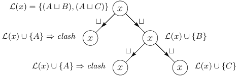

图 9.6. 语法分支搜索。

## 9.5.4.1. 基于语法分支的语义分支

标准的 Table格法（tableau）算法使用一种基于语法分支的搜索技术。在扩展节点 $x$ 的标签时，语法分支是通过选择 $\mathcal{L}(x)$ 中的一个未展开的析取算式 $(C_1 \cup \dots \cup C_n)$，并对将每个析取项 $C_1, \dots, C_n$ 添加到 $L$ 中得到的不同模型进行搜索来实现 [Giunchiglia and Sebastiani, 1996b]。由于搜索树的备选方案不是互斥的，因此在不同分支中没有办法对一个不可满足的析取项进行递归。如果发现不可满足性需要解决一个复杂的子问题，那么产生的无白努力可能是代价昂贵的。例如，扩展节点 $x$ 的分格法，其中 $\{(A \cup B), (A \cup C)\} \subseteq \mathcal{L}(x)$ 且 $A$ 是一个不可满足的概念，可能会导致图 9.6 所示的搜索模式，必须两次证明 $\mathcal{L}(x) \cup \{A\}$ 的不可满足性。

这个问题可以通过适用于 Davis–Putnam–Logemann–Loveland 程序（DPLL）的语义分支技术来解决，该程序通常用于解决命题满足性（SAT）问题 [Davis and Putnam, 1960; Davis et al., 1962; Freeman, 1996]。与其在 $\mathcal{L}(x)$ 中选择未展开的析取式，不如从 $\mathcal{L}(x)$ 中的某个未展开析取式中选择单个 $D$。通过向 $\mathcal{L}(x)$ 添加 $D$ 或 $\neg D$，得到的两个可能的子树是严格互斥的，不会像语法分支那样出现无效搜索。注意，从理论角度来看，探索两个分支的顺序无关，但可能提供进一步的优化可能性（参见第 9.5.4.4 节）。

语义分支搜索的优点：

- 关于 DPLL 算法的实现和优化已有许多了解。特别是，局部简化（参见第 9.5.4.2 节）和启发式引导搜索（参见第 9.5.4.4 节）都可以用于最小化搜索树的大小（尽管应该注意，这两种技术也可以适用于语法分支）。

6 另一种解决方案是使用“无良好”（no-good）列表来增强语法分支，以避免重复选择不可满足的析取项 [Domini and Massacci, 2000]。

- 它对某些问题可能非常有效，特别是随机生成的问题 [Horrocks and Patel-Schneider, 1999]。

缺点是：

- 在搜索树的第二个分支中添加否的析取项可能会导致性能下降，例如，如果该析取项是一个非常大或复杂的概念。然而，这在实践中似乎并不是严重的问题，语义分支的性能很少显著差于语法分支。

- 它的有效性取决于问题。它对随机生成的问题最有效，特别是那些过度约束的（可能不可满足的的问题。它对 Tableaux’98 基准测试套件中的一些手工问题也有效。然而，在分类现实知识库（KBs）时，它似乎收益有限 [Horrocks and Patel-Schneider, 1998a]。

### 9.5.4.2 局部简化

局部简化是另一种通过应用非确定扩展规则来减少搜索空间大小的技术。在对节点标签 $\mathcal{L}(x)$ 执行任何非确定扩展之前，会会检查 $\mathcal{L}(x)$ 中的析取式，并在可能的情况下对其进行简化。常用的简化（尽管绝非唯一）是确定性地扩展 $\mathcal{L}(x)$ 中仅有一种扩展可能的析取式，并在当 $\mathcal{L}(x)$ 中的析取式没有扩展可能时检测到冲突（clash）。这种简化被称为布尔约束传播（BCP） [Freeman, 1995]。实际上，推理规则 $\neg C_1, \dots, \neg C_n, C_1 \cup \dots \cup C_n \cup D$ 和 $C_1, \dots, \neg C_n, \neg C_1 \cup \dots \cup \neg C_n \cup D$ 被用于简化由 $\mathcal{L}(x)$ 表示的合取概念。例如，一个节点 $x$ 满足

```
{C (D_1 \cup D_2), (\neg D_1 \cup \neg D_2 \cup C), \neg C) \subseteq \mathcal{L}(x)}
```

BCP 通常扩展 $(C \cup D_1 \cup D_2)$，添加 $(D_1 \cup D_2)$ 因为 $\neg C \in \mathcal{L}(x)$。$(D_1 \cup D_2)$ 的确定性扩展将 $D_1$ 和 $D_2$ 都添加到 $\mathcal{L}(x)$ 中，允许 BCP 识别出 $(\neg D_1 \cup \neg D_2)$ 为冲突（没有发生任何分支），因为 $\{D_1, D_2, \neg C\} \subseteq \mathcal{L}(x)$。

BCP 简化通常被描述为基于 SAT 的算法的组成部分 [Giunchiglia and Sebastiani, 1996a]，但它也可以用于语法分支。然而，在语义分支中更为有效，因为否定的概念会导致额外的简化。

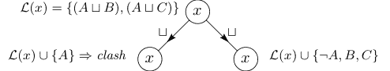

图 9.7. 语义分支。

取上述 $\{(A \cup B), (A \cup C)\} \subseteq \mathcal{L}(x)$ 的例，将 $\neg A$ 添加到 $\mathcal{L}(x)$ 允许 BCP 确定性地扩展析取式 $B, C$。语义分支与 BCP 结合产生的搜索空间如图 9.7 所示。

局部简化的优点是：

- 它适用于各种逻辑和算法。
- 它永远不会增加搜索空间的大小。

缺点是：

- 在没有复杂结构的情况下执行代价很高 [Freeman, 1995]。
- 它的有效性有限且取决于问题。它对随机生成的问题最有效，特别是那些过度约束的问题 [Horrocks and Patel-Schneider, 1998]。

### 9.5.4.3 依赖回溯

问题内部的不可满足性会导致大量的回溯，有时引起抖动（thrashing）。当所有形式都执行后，问题会恶化。例如，扩展节点 $x$（使用语义分支），$\mathcal{L}(x) = \{(C_1 \cup D_1), \dots, (C_n \cup D_n)\}$ 可能在发现内在不可满足性之前导致 $2^n$ 种形式的无效探索。这个问题可以通过识别冲突的原因并利用这些信息剪枝搜索空间来解决——这种被称为跳回（backjumping）的技术已用于解决满足性问题 [Baker, 1995]（类似的技术也用于 HARP [Oppacher and Suen, 1988]）。

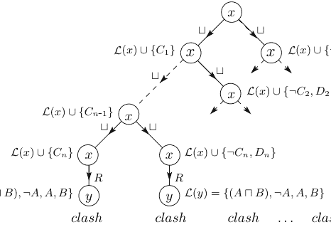

图 9.8. 回溯中的抖动。

扩展产生的搜索树如图 9.8 所示。跳回通过为节点中的每个概念和边标签标记其依赖的分支点集来工作。概念 $C \in L(x)$ 依赖于一个分支点，如果 $C$ 依赖于另一个 $D$（或 $R$），并且当 $D$（或 $R$）通过应用确定性扩展规则添加到 $L(x)$ 时，$D$（或 $R$）依赖于该分支点；规则 $R = L((x,y))$ 在通过应用 $\forall R.A \in L(x)$ 将 $(x,y)$ 标记为 $R$ 时依赖于概念 $D$。例如，$A \in L(y)$ 依赖于 $\forall R.A \in L(x)$ 和 $R = L((x,y))$。

在使用组合 $\forall$ 规则时，可以使用依赖集来标记规则，因为新节点标签中概念的依赖关系可以在一步内推导。

364

I. Horrocks

对于 $\{(C_1 \cup \dots \cup C_n), -C_1, \dots, -C_n\} \subseteq \mathcal{L}(x)$ 的简化，那么它取决于析取项 $(C_1 \cup \dots \cup C_n)$ 以及所有的 $-C_1, \dots, -C_n$。

在测试概念 $C$ 的满足性时，$C \in \mathcal{L}(x)$ 的依赖集初始化为 $\emptyset$（空集），并将分支深度计数器 $b$ 初始化为 1。随后搜索算法按如下方式进行：

- 1. 执行确定性扩展，将每个被添加到节点标签新增的概念以及分配给边标签的角（role）的依赖集，设置为它们所依赖的概念和角色的依赖集的并集。
  - (a) 如果发现了一个类（class），返回冲突概念的依赖集的并集。
  - (b) 如果发现了一个 b-类扩展，返回 {0}。
- 2. 在概念 $D \in \mathcal{L}(y)$ 上进行分支，返回第一个 $L(y) \cup \{D\}$ 并返回 $\mathcal{L}(y) \setminus \{-D\}$。
  - (a) 将 $D$ 添加到 $L(y)$，依赖集为 $\{b\}$,并增加 $b$。
  - (b) 将 $D_1$ 设置为递归调用搜索算法返回的依赖集，并减小 $b$。
  - (c) 如果 $b \neq D_1$，在不探索第二个分支的情况下返回 $\neg D$。
  - (d) 如果 $D = D_1$，则将 $\neg D$ 以依赖集 $D_1 \setminus \{b\}$ 添加 $L(y)$ 并返回步骤1。

如果搜索返回 $\{0\}$，则发现了一个成功的扩展，算法返回“satisfiable”（可满足），否则所有可能的扩展都导致了冲突并返回“unsatisfiable”（不可满足）。

让我们考虑之前的例子，假设 $\exists R.(A \cap B)$ 有一个依赖集 $D_i$，$\forall R.\neg A$ 有一个依赖集 $D_j$，且 $b=k$（意味着搜索树中已经有 $k-1$ 个分支点）。那么 $D_i$ 和 $D_j$ 中的最大值必须小于 $k$，因为任何一个概念都不依赖于尚未到达的分支点。

在第 $k$ 个点处，$C_i$ 被添加到 $\mathcal{L}(x)$，依赖集为 $\{k\}$，$b$ 递增。搜索以相同的方式继续进行第 $(k+1)$ 个分支点，此时 $C_j$ 被添加到 $\mathcal{L}(x)$，依赖集为 $\{k-1\}$。接下来，对 $\exists R$ 进行确定性扩展，生成一个标记为 $D_i$ 的 $R=\langle x,y \rangle$ 和标记为 $D_j$ 的 $(A \cap B) \in \mathcal{L}(y)$。对 $\forall R.\neg A$ 进行确定性扩展，将 $\neg A$ 添加到 $\mathcal{L}(y)$，依赖集为 $D_i \cup D_j$（因为它依赖于 $\forall R.\neg A \in \mathcal{L}(x)$ 和 $R=\langle x,y \rangle$）。

扩展现在继续处理 $\mathcal{L}(y)$，并且 $(A \cap B)$ 被确定性扩展，标记为 $D_l$。这导致了冲突，因为 $\{A, \neg A\} \subseteq \mathcal{L}(y)$，并且返回集合 $D_i \cup D_i \cup D_j = D_i \cup D_j$（冲突概念依赖集的并集）。算法将回溯之前的 $n$ 个分支点中的每一个，而不探索第二个分支，在每种情况下 $b \notin D_i \cup D_j$（记住 $D_i$ 和 $D_j$ 中的最大值小于 $k$，并且将继续回溯，直到达到等于 $D_i \cup D_j$ 最大值的剪枝点（如果 $D_i = D_j = \emptyset$，算法将回溯所有分支点并返回“unsatisfiable”）。图 9.9 阐述了剪枝后的搜索树，其中探索的 $R$-后继节点数量减少了 $2^{n-1}$。

# 实现与优化技术

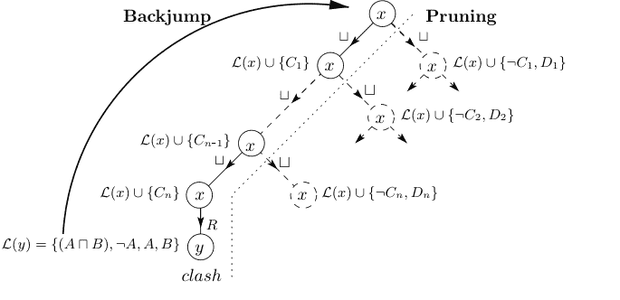

回跳（Backjumping）也可以与语法回跳结合使用，但该过程稍微复杂，因为在给定点可能有两个以上的选择，而且正在扩展的析取项的依赖集也需要考虑在内。当带有依赖集 $D_i$ 扩展到大小 $n$ 时，前 $n-1$ 个析取项被视为分支算法中的第一个分支，当递归搜索发现一个不依赖于 $b$ 的类时，会立即回溯。如果这些分支每个返回一个使得 $b \in D_i$ 的依赖集 $D_i$，则第 $n$ 个析取项以依赖集 $(D_1 \cup \dots \cup D_{n-1} \cup D_n) \setminus b$ 被添加。

回跳的优势是：

- 它可以显著减少搜索树的大小，从而极大提高性能。例如，在尝试分类那些经过 CPU 运行数周也无法解决的满足性测试。
- 搜索空间的大小永远不会增加。

缺点是传播和存储依赖集的开销。通过使用基于指针的实现可以在某种程度上减轻存储开销，使得传播依赖集只需要复制指针。使用最大依赖值代替集合的简单方案也是可行的，但会丢失某些依赖信息，这可能导致搜索树的剪枝效率降低。

366

I. Horrocks

## 9.5.4 启发式引导搜索

启发式技术可以用于引导搜索，力求减小搜索树的大小。DPLL 算法中广泛使用的一种方法是在“在最小尺寸析取项中出现次数最多的”析取项上进行分支——即为人知的 MOMS 启发式 [Freeman, 1995]。通过选择在较小析取项中频繁出现的析取项，MOMS 启发式可以最大化 BCP（布尔约束传播）的效果。例如，如果节点 $x$ 的标签包含未扩展的析取项 $C \cup D_1,\dots,C \cup D_n$，在 $C$ 上分支将导致它们在单步内进行确定性扩展：当递归搜索发现一个不依赖于 $b$ 的类时，会立即回溯。如果这些分支每个都返回一个使得 $b \in D_i$ 的依赖集 $D_i$，则第 $n$ 个析取项以依赖集 $(D_1 \cup \dots \cup D_{n-1} \cup D_n) \setminus b$ 被添加。

回跳的优势是：

- 它可以导致搜索树大小急剧缩小，从而带来巨大的性能提升。例如，在尝试分类那些经过 CPU 运行数周也无法解决的满足性测试。
- 搜索空间的大小永远不会增加。


# I. Horrocks

## 9.5.4 启发式引导搜索

启发式技术可以用于引导搜索，力求减小搜索树的大小。DPLL 算法中广泛使用的一种方法是在“在最小尺寸析取项中出现次数最多的”析取项上进行分支——即为人知的 `MOMS` 启发式 [Freeman, 1995]。通过选择在较小析取项中频繁出现的析取项，`MOMS` 启发式可以最大化 `BCP` 的效果。例如，如果节点 `$x$` 的标签包含未扩展的析取项 `$C \cup D_1,\dots,C \cup D_n$`，在 `$C$` 上分支将导致它们在单步内进行确定性扩展：当递归搜索发现一个不依赖于 `$b$` 的类时，会立即回溯。如果这些分支每个都返回一个使得 `$b \in D_i$` 的依赖集 `$D_i$`，则第 `$n$` 个析取项以依赖集 `$(D_1 \cup \dots \cup D_{n-1} \cup D_n) \setminus b$` 被添加。

详尽地创建一组后继节点。扩展这些后继节点的顺序可以基于其标签中所有概念依赖集合中的最小极大值，其中某些值可能是由于 `$\mathcal{L}(x)$` 中的通用角色限制导致的。

使用启发式方法的优点是：

- 它们（如 `MOMS` 和 `Jeroslow–Wang`）可以用于补充其他优化。例如，`Wang` 启发式旨在增加 `BCP`（子句值传播）的有效性，而最旧优先（`oldest-first`）启发式则旨在增加回跳（`back-jumping`）的有效性。
- 它们可以根据要解决的问题类型进行选择和调优（如果已知的话）。例如，`BCP` 最大化启发式对于大型随机生成的人工问题通常非常有效，而在分类真实的知识库（`KB`）时，最旧优先启发式似乎更有效。

缺点是：

- 它们可能会增加巨大的开销，因为启发式函数的评估可能非常昂贵，并且在每个分支点可能需要重新评估。
- 它们可能不会提高性能，反而可能显著降低性能。
- 启发式可能与其他优化产生不利的相互作用，正如 `Fact` 系统中 `MOMS` 启发式和回跳之间的情况。
- 当启发式工作不佳时，可能会增加出现病态最坏情况的频率。例如，对于具有高度析取性但约束较少的问题，使用 `BCP` 最大化启发式来选择高约束的析取词（`dis`）可能会迫使算法执行回溯搜索，而大多数随机分支选择都能快速导至无冲突的扩展。
- 计算启发式函数的成本可能超过其收益（如果有的话）。
- 设计用于适用于纯命题推理的良好启发式方法（如 `BCP` 最大化启发式）在描述逻辑（`Description Logics`）中可能并不有效，因为大部分推理是模态的（涉及到角色）。针对模态推理良好启发式方法的研究很少。

### 9.5.4.5 缓存满足性状态

在满足性检查期间，可能会创建许多后继节点。这些节点可能非常相似，特别是节点 `$x$` 的 `$R$`-后继节点包含源自 `$\mathcal{L}(x)$` 通用限制的相同概念。这可能会花费大量时间在重新计算相同节点的满足性上。由于满足性算法只需要知道一个节点是否满足，因此在分类知识库时，类似的满足性测试可能会进行多次，这为跨标签的满足性结果提供了重用机会。

如果将节点 `$x$` 标签中的存在限制扩展延迟到所有其他扩展可能性耗尽（如追踪技术），则每个存在角色限制 `$\exists R.C$` 被扩展，并生成初始标签的完整概念集；这将包含源自 `$\mathcal{L}(x)$` 通用限制的所有概念。如果存在具有相同概念集的另一个节点，这两个节点具有相同的满足性状态。对其中一个节点进行操作可以节省大量的处理，同时也节省了该节点的任何后继节点的工作。

在与阻塞（`blocking`）结合使用缓存时必须小心，因为阻塞节点的满足性状态尚未完全确定，而是简单地等于阻塞节点的状态。另一个问题是，对于发现为不满足的节点，回溯所需的依赖信息可以有效地计算。尽管此类节点的初始标签概念集与已缓存（不）满足状态的扩展节点相同，但这两个标签可能不同。然而，通过将不满足节点的依赖集取为标签中概念依赖集的并集，仍然执行一种较弱的回溯。

扩展节点 `$x$` 时缓存的通用步骤描述如下：

- 1. 详尽地执行所有本地扩展，根据需要回溯，直到只剩下存在限制（如果有）需要扩展。
- 2. 如果 `$\mathcal{L}(x)$` 中没有已扩展的角色限制，向前驱节点返回 `satisfiable`（满足）状态。
- 3. 从 `$\mathcal{L}(x)$` 中启发式地选择一个意外的角色限制，扩展它以及任何适的角色限制以创建一个初始标签为 `$\mathcal{L}(y)$` 的新节点 `$y$`。
- 4. 如果 `$y$` 被阻塞，其满足性状态 `$S$` 由算法直接确定（通常为 `satisfiable`，但取决于检测到的循环类型 [Baader, 1991])。
  - (a) 如果 `$S = satisfiable$`，返回步骤 2 而不扩展 `$\mathcal{L}(y)$`。
  - (b) 如果 `$S = unsatisfiable$`，则回溯而不扩展 `$\mathcal{L}(y)$`。依赖状态将需要由阻塞算法确定。
- 5. 如果在缓存中找到与 `$\mathcal{L}(y)$` 相等的项，则检索相关的满足性状态 `$S$`（这被称为“命中”）。
  - (a) 如果 `$S = satisfiable$`，返回步骤 2 而不扩展 `$\mathcal{L}(y)$`。
  - (b) 如果 `$S = unsatisfiable$`，则回溯而不扩展 `$\mathcal{L}(y)$`，将依赖集取为 `$\mathcal{L}(y)$` 中概念依赖集的并集。
- 6. 如果在缓存中未找到与 `$\mathcal{L}(y)$` 相等的项，则 `$L = \mathcal{L}(y)$` 并扩展 `$\mathcal{L}(y)$` 以确定其满足性状态 `$S$`。
  - (a) 如果 `$S = satisfiable$` 且 `$y$` 没有被祖先 `$x'$` 阻塞的后代 `$z$`，则将 `$L$` 及其状态 `$S$` 加入缓存并返回步骤 2。
  - (b) 如果 `$S = satisfiable$` 且 `$y$` 有被祖先 `$x'$` 阻塞的后代 `$z$`，则返回步骤 2 而不更新缓存。
  - (c) 如果 `$S = unsatisfiable$`，则将 `$L$` 及其状态 `$S$` 加入缓存并进行回溯，将依赖集取为扩展 `$\mathcal{L}(y)$` 返回的项。

结合缓存和阻塞的问题可以通过更复杂的方法处理，允许缓存的节点满足性状态假设为“未知”。这些值可以随着扩展的进行和阻塞节点满足性状态的确定而更新。这种策略在 `DLP` 系统中实现。

一种改进方法是从缓存中检索满足性状态时使用“子集”代替“相等”：如果 `$\mathcal{L}(x) \subseteq \mathcal{L}(y)$` 也是满足的，且 `$\mathcal{L}(x)$` 是不满足的，则任何 `$\mathcal{L}(y) \supseteq \mathcal{L}(x)$` 不满足的 [Hoffmann and Koehler, 1999; Gichini and Tacella, 2000]。使用子集和超集显著增加了缓存的复杂度，目前尚不清楚这种复杂度带来的性能成本是否能通过提高缓存命中率得到补偿。

缓存满足性状态的优点是：

- 它对某些问题非常有效，特别是具有重复结构的问题。例如，`DLP` 系统已证明，当使用缓存时，`Tableaux'98` 基准测试集中的某些问题集是微不足道的（所有问题都在 0.1 秒内解决，且没有证据表明难度随问题规模的增大而增加）。在没有缓存的情况下，相同的问题表现出求解时间随规模增长的明显指数级增长。
- 它在可满足性测试和跨多个测试（如 `Tableau` 算法）中都是有效的。
- 它在可满足性测试和不满足性问题上都是有效的，与许多旨在加速不满足性检测的优化技术不同。

这些缺点是：

- 保留节点标签及其可满足性状态，在整个可满足性测试过程中（或，如果用于后续的可满足性测试中）会涉及存储开销。由于不同标签的数量相对于不同概念呈指数级增长，这种开销可能是不可接受的，并且可能需要实现一种机制来清除某些或所有的缓存。然而，在 `DL` 系统中使用缓存的实验表明，这在实际应用中不太可能成为问题 [Horrocks and Patel-Schneider, 1999]。
- 与依赖定向回溯的负面交互在某些情况下会降低性能。
- 其有效性取决于问题结构，且（正如预期的）在随机生成的问题上最为明显。
- 所述的技术需要逻辑具有这种属性，即节点的可满足性完全由其初始标签集决定。将该技术扩展到不具有该属性的逻辑（例如支持反向关系的逻辑）可能会导致复杂性和存储要求的大幅增加。

## 9.6 讨论

为了在实际应用中发挥作用，`DL` 系统既需要表达能力强的逻辑，也快速推理机。在这些逻辑中，判定包含关系（或等效的可满足性）的程序具有令人沮丧的高复杂度，通常相对于问题规模呈指数级。尽管如此，实现的 `DL` 系统已经证明，通过使用优化技术可以在实际应用的问题上获得可接受的性能，本章研究了其中的多种技术。这些技术可以在 `DL` 系统的各个层面运行：简化知识库（`KB`），减少分类所需的包含性测试，用代价更低的测试替换 `Tableau` 测试，并减少非确定性 `Tableau` 扩展产生的搜索空间。在这些优化中，最有效的是吸收（`absorption`）和回跳（`backjumping`）；它们都具有良好的属性：产生非常小的额外开销，可以显著提高典型性能，且几乎不会降低性能（在任何范围内）。其他广泛适用的优化包括增强遍历、规范化、惰性展开、语义分支和局部简化；它们的影响较通用且不剧烈，但带来了过多额外开销，有时会降低性能。各种形式的缓存也可以非常有效，但它们在内存使用方面增加了额外开销，有时会降低性能。最后，目前的启发式技术并不特别有效，往往会降低性能。

几个令人兴奋的新领域正为描述逻辑开启，特别是关于数据库模式和查询，以及为语义 `Web` 提供推理。这些应用需要比现有系统中表达能力更高的逻辑，特别是包含反向关系和数量限制以及通用公理推理的逻辑。`DL` 实现者的挑战是证明高度优化的推理机为这些逻辑提供可接受的性能。这可能需要对现有技术进行扩展和改进，甚至开发全新的技术。

## 实现与优化技术

随着问题规模增大，系统无法在测试设置的 100 秒时间限制内解决更大的问题 [Horrocks and Patel-Schneider, 1999]。


一种前景前景是使用更复杂的依赖定向回溯形式，称为动态回溯（dynamic backtracking）[Ginsburg, 1993]，它通过回溯到冲突源来尽可能地保留工作。另一个表明现有系统日益成熟的有效方法是关注问题构造器并设计更高效处理它们的方法。良好的例子可以在 RACER 系统中看到，通过使用更复杂的技术来处理域和范围约束（见第 2 章对这些构造的解释）以及限定数量限制 [Haarslev and Möller, 2001c; 2001d; 2001a]。

最后，应该再次强调，由于理论复杂性的不可变性，任何（完全）实现都无法保证在所有情况下提供良好的性能。优化实现的目标是在典型应用中提供可接受的性能，由于“可接受”和“典型”的定义始终取决于应用，它们的有效性只能通过经验测试来评估。希望新一代高度优化的 DL 系统通过比其前身更广泛的应用来证明其有效性。

# 第三部分

## 应用

# 第 10 章 基于描述逻辑的概念建模

`Alex Borgida`

`Ronald J. Brachman`

## 摘要

本章目的是帮助熟悉描述逻辑（DL）的人理解为某个话语域（universe of discourse）开发本体时涉及的问题，该本体将成为使用描述逻辑进行表示和推理的概念模型或知识库。

我们简要回顾了概念建模的目的和历史，然后利用大学图书馆领域来说来说一种概念建模方法，该方法结合了以对象为中心的建模通用思想与对特殊建模/本体论问题以及 DL 特定解决方案的观察。所考虑的问题包括个体的性质、概念特化、二元关系和实例化（materialization）。

## 10.1 背景

信息建模关注模拟现实世界部分内容的符号结构的构造。我们将符号结构称为信息库（information bases），这是对计算机科学术语的泛化，称为数据库。信息库会进行一致性检查，有时通过专用语言进行更新。与所有模型一样，信息模型的优势在于它们抽象了细节，并允许更高效地检查当前状态以及预测的未来状态。

信息模型是用某种语言构建的，这种语言会（多或少地）影响所考虑的细节类型。例如（如关系数据模型）是基于传统的编程概念构建的，结果关注的是捕捉信息的实现方面，而不是表示方面。概念模型为直接自然自然的建模应用提供了更丰富的工具 [Hammer and McLeod, 1981]，并用于结构化信息。概念模型在各种领域都起着重要作用，如 [Mylopoulos, 1998] 所述的：

- 人工智能程序被证明需要大量的人类知识来表现“智能”，因此它们依赖于使用知识表示构建的概念模型，例如语义网络。
- 数据库设计被认为有一个重要的初始阶段，即构造“概念级模式”，它决定了用户的信息需求，并最终转换为物理实现模式。陈氏的关系模型 [Chen, 1976] 是这一方向努力的成果。
- 更广泛地说，所有软件开发都有一个初始获取阶段，现在被认为由描述建议系统与其环境关系的模型组成。在这种情况下，环境可能是一个概念模型。
- 独立地，面向对象的软件社区也提出将软件组件（类/对象）视为现实实体的模型。这在第一种面向对象的语言 Simula 的特性中显而易见，并成为大多数面向对象技术的基石，包括目前的领导者 UML [Rumbaugh et al., 1998]。

数据库背景下概念建模的一个有趣方面是识别了一些抽象机制，这些机制通过最初抽象细节，然后系统地引入细节，来支持大型模型的开发。重要的抽象包括：

- 将对象视为对象，而不仅仅是其属性/组件的集合（聚合”）
- 抽象掉个体之间的详细差异，使得类能够表示共性（“分类”¹）；
- 将多个类的共性抽象为一个超类（“泛化”）。

关于概念建模中抽象的益处的一项重要主张是：它产生了一个结构化的信息模型，这种模型更容易构建和维护。有趣的是，描述逻辑通过支持概念相对于其他概念的自动分类，进一步实现了这一目标，从而揭示了建模者可能没有意识到的泛化关系。

## 10.2 基础描述逻辑建模

大多数概念模型（包括描述逻辑在内）都赞同以对象为中心的世界观。因此，它们的本体包含了诸如个体对象等概念，这些对象通过相互（通常是二元的）关系关联，并被分组为类。在本章中，我们使用描述逻辑的符号和构造语法（参见附录），并对其扩展了额外的构造，使其更适用于建模。

在大学图书馆领域，我们可能会遇到一个特定的人， `GIANNI`，或者一本特定的书 `BOOK23`。关于世界状态的大部分信息是通过个体之间的相互关系捕捉的，例如 `GIANNI` 借了 `BOOK23`。二元关系在描述逻辑中使用角色（roles）和属性（attributes）直接建模：要么 `BOOK23` 或者 `BOOK23` 是 `GIANNI` 的 `hasBorrowed` 角色的填充值。注意，`lentTo` 和 `hasBorrowed` 是相反的，这应该在模型中被捕捉，因为经常需要访问这两个方向的关联信息。在描述逻辑中，这是通过使用角色的逆构造实现的：

`hasBorrowed \ (inverse lentTo).`

注意，为了避免在建模过程中因混淆角色与其逆角色、或角色与其填充它的值类型而导致无意错误，一种启发式方法是使用非对称的自然语言名称，并采用“关系 $R(a, b)$ 应该读作 'a R b’”的约定；因此，`lentTo(BOOK23, GIANNI)` 读作 `BOOK23 lentTo GIANNI`，而 `lentTo(GIANNI, BOOK23)` 读作“GIANNI lentTo BOOK23”，这很清楚地表明第一个而不是第二个是模型中使用角色 `lentTo` 的主体。另一方面，`loan` 会是一个很糟糕的角色标识符，因为人们同样可以想象 `loan` 是书籍或人的某种角色，导致 `loan(GIANNI, BOOK23)` 或 `loan(BOOK23, GIANNI)` 都无法被正确“读出”。此外，区分函数关系 `lentTo`（在任何时候，一本书只能借给最多一个借阅人）和非函数关系 `hasBorrowed` 总是重要的。如果所使用的特定描述逻辑允许声明函数关系（func-relationships，有时被称为“属性”或“特征”），那么这样做得最为清晰。属性本身有两种：全（total）和部分（partial）。因此，`lentTo` 是一个部分属性，因为书只能借给一个人，但在某些时刻可能没有借出状态；另一方面，每本书都必须有 ISBN。检查所使用的特定描述逻辑提供了哪种属性解释是非常重要的。在本章的剩余部分，我们假设属性是全的，并且概念构造器 `(all p C)` 等于 `(all p C)`、`(at-most 1 p)` 和 `(at-least 1 p)` 的合取。

¹ 该术语在 DL 术语中的用法完全不同，它指的是 DL-KBMS 服务中寻找概念或个体的最小子集的功能。

## 10.3.2 个体与对个体的引用

区分个体与其各种引用是至关重要的：例如，`Gianni` 与名字为 6 位字符串“Gianni”的人，又与“借阅卡号为 32245 的借阅者”，以及“心理学系主任”。当我们表达关系时，这种区分变得至关重要：关联对象与关联它们的名称之间是有区别的，因为我们通常希望对象保持关联状态，即使名称发生了变化。因此，“`GIANBorrowed BOOK5`”与“`card-holder 32245hasBorrowed BOOK25`”是不同的；如果 `Gianni` 换了新卡片（在丢失旧卡片后），那么 `Gianni` 与书之间的关系就丢失了。因此，通常情况下，除非对象类与引用类之间存在双射关系，且这种双射关系是通用的（始终存在）且不变的²，否则应该始终处理个体对象。`Kent [1979]` 雄辩地论证了这些问题在记录数据库系统中的重要性，并表明在该领域，这种双射比假设的要稀少得多。例如，`Neumann [1922]` 报告说，同一个美国社会安全号码（美国人的典型标识符）曾被发给两个人，他们甚至有相同的姓名和出生日期！

相反，在某些情况下，人们想要陈述内涵引用之间的关系，而不是特定对象之间的关系。我们可能想说，通常情况下，院长是选书委员会（`COMMITTEE`）的负责人。如果 `Gianni` 正好是 `NBU` 图书馆现任院长，那么断言 `headOf(GIANNI,COMMITTEE)`是不恰，因为例如如果 `Gianni` 卸任，根据模型他将成为委员会主席。我们需要能够将未命名的表达式作为关系的参数，类似于谓词逻辑表达式 `headOf(directorOf(NBU-LIBRARY),COMMITTEE)`。

在描述逻辑中，内涵指称可以表示为应用于个体的角色（roles）。（角色可能是复杂的链，由原子角色的组合产生，例如“被借出地址的邮政编码”）。假设我们使用符号 `NBU-LIBRARY.director` 来指代 `NBU-LIBRARY` 个体院长角色的填充值，上述关系实际上表述为“`NBU-LIBRARY.director` 等同于 `COMMITTEE3.head`”。概念构造器 `same-as` 用于表示两个关系链具有相同的值，正用于表达这种关系，因此这种情况可以被天素地使用概念 `(same-as director head)` 进行建模。问题在于，我们需要一个个体来断言这一属性，但图书馆有院长，而委员会有主席。在这种情况下，在描述逻辑中必须找到或创建某些属性链来关联 `NBU-LIBRARY` 和 `COMMITTEE3` 这两个个体。在这种情况下，自然的关系是属性 `hasBookSelectionCommittee`。因此，建模这种情况的合适方法是：

```
* NBU-LIBRARY has book selection COMMITTEE3 */
hasBookSelectionCommittee(NBU-LIBRARY, COMMITTEE3)

/* NBU-LIBRARY.director equals
NBU-LIBRARY.hasBookSelectionCommittee.head */
(same-as director (hasBookSelectionCommittee o head))(NBU-LIBRARY).
```

## 10.4 概念

对于大学图书馆来说，一些显明显的个体类包括人、机构、图书馆可以借阅的材料、员工、日期、图书卡和罚款。这些类通常在描述逻辑中使用原子/初级概念进行建模。

值得注意的是，在描述逻辑中，同一个个体可以是多个类的实例，而并不一定意味着其中一个类是另一个类的子类：某些书既可以是硬壳装书的实例，也是科学书籍的实例。这与许多面向对象的软件系统不同，在那些系统中，人们被强制为这种概念创建一个特殊的子类，以确保每个个体都有一个唯一的“最小”类。然而，这不是一种建模原则——而是一种实现障碍。

### 10.4.1 概念的本质与偶然属性

正如之前涉及“借阅者”术语的示例所解释，描述逻辑的一个重要特征是定义性属性与偶然属性之间的区别。在许多情况下：某些概念（如书籍 `Book`）是独立存在的。其他概念（如借阅者 `Borrower`）则依赖于某些关系/事件（例如借阅）的隐含存在，这具有第二个参数，其意义源于此。区分这第二类概念并在模型中显式引入相应的二元关系是非常重要的。这些建模将在第 10.7.1 节进一步考虑。

² 这种双射正是数据库上下文中使用的“键”。

而且当然，要求借阅的书籍有到还日期将导致 `BookOnLoan ⊑ (at-least 1)`。我们对于成为借阅书籍有多个充分条件，尽管其中一个似乎是主要定义。

### 10.4.2 具化概念与元角色

在某些情况下，将信息与整个概念关联而不是与其每个个体实例关联似乎是自然的。产生这种情况的一种情况是捕捉聚合信息，例如当前个体实例的计数或属性的平均值。在图书馆示例中，诸如 `numberOfBooks` 和 `mostRequestedBooks` 等属性就属于这一类。

在某些面向对象的系统中，这可以直接建模，因为类是对象，元类的实例也是对象，并且具有元属性。目前，描述逻辑还没有将类视为对象的机制。必须先创建一个独立的“元个体”，通过命名约定与概念相关联，例如，在我们的示例中，我们会创建 `BOOK-CLASS-OBJECT`，然后将关于 `numberOfBooks`、`mostRequestedBooks` 等信息作为该个体的角色挂载。在 CLASSIC 系统中，对于给定的概念，可以使用特殊的新的知识库操作来检索该元个体。

### 10.4.3 依赖于关系的概念

在许多情况下，会出现以下有趣的问题：某些概念（如书籍 `Book`）是独立存在的。其他概念（如借阅者 `Borrower`）则依赖于某些关系/事件（例如借阅）的隐含存在，这具有第二个参数，其意义源于此。区分这第二类概念并在模型中显式引入相应的二元关系是非常重要的。在数据建模文献（例如 [Albano et al., 1993]）中，这类类别被称为“角色”，但为了与 DL 角色混淆，我们将它们称为“关系角色”。这些建模将在第 10.7.1 节进一步考虑。

目前，高表达能力的 DLR 语言支持诸如 n 元组和递归不动点结构等概念，从这些结构可以构建列表、树等。即使在此处，人们也只能提供概念的描述（“人员列表”），而不是对个体的规格说明（“列表 [GIANNI,ANNA]”）。

## 10.4 概念建模示例

正如之前涉及“借阅者”术语的示例所解释，描述逻辑的一个重要特征是定义性属性与偶然属性之间的区别。在许多情况下：某些概念（如书籍 `Book`）是独立存在的。其他概念（如借阅者 `Borrower`）则依赖于某些关系/事件（例如借阅）的隐含存在，这具有第二个参数，其意义源于此。区分这第二类概念并在模型中显式引入相应的二元关系是非常重要的。这些建模将在第 10.7.1 节进一步考虑。

假设我们还要求所有借阅的书籍都有到还日期。建模这种情况似乎有两种方法：

```
* Option 1 – 硬壳装是定义的一部分 *
BookOnLoan ≡ (and Book at-least 1))
```

```
* Option 2 – 硬壳装是一个额外条件 *
BookOnLoan ≡ (and Book (at-least 1))
```

第一种方法并不完全，因为硬壳装是借阅书籍的偶然属性，尽管它是所有书籍共有的。这表明，通用的偶然属性应该出现在 ABox 中，或者定义术语的 TBox 中。当未来日期的有多个充分条件时，会出现另一个微妙的问题，此时我们这样表示这种情况：

```
(and Book (at-least 1)) ⊷ BookOnLoan
```


# 406 A. Borgida 和 R. J. Brachman

而且当然，要求借阅的书籍有到还日期将导致 `BookOnLoan ⊑ (at-least 1)`。我们对于成为借阅书籍有多个充分条件，尽管其中一个似乎是主要定义。

# 使用描述逻辑进行概念建模

## 10.5 子概念

对于上述许多概念，存在专门的子概念，表示我们感兴趣的个体子集。例如，材料（Material）概念（指图书馆的藏品）可以有书籍（Book）、期刊（Journal）、视频类型（Videotype）等特化概念。反之，书籍可能拥有专著（Monograph）、论文集（EditedCollection）、论文集（Proceedings）等子概念³。而借阅者（Borrowers）可以是机构（Institutions）或个人（Individuals），后者又分为教师（Faculty）、学生（Student）和员工（Staff）。

为了正确捕捉领域模型（UofD）的语义，需要对子类关系的若干特殊方面进行建模。

### 10.5.1 子概念的互斥性

在许多情况下，子类之间是互斥的。例如，书籍和期刊是材料的互斥子类。在支持否定的描述逻辑中，这通过将一个概念的补集添加到另一个概念的必要属性中建模：

- `⊃ not Journal`

通常，整个子类集合都是互斥的。⁴ 为此，某些描述逻辑提供了通过命名*判别符*（discriminator）以及对原始子类进行特殊声明操作来描述互斥性的能力。例如，可以根据介质按如下区分不同类型的材料：

| Print ⊃ (disjointPrim Material in group with discriminant paper) | Video ⊃ (disjointPrim Material in group with discriminant light) | Audio ⊃ (disjointPrim Material in group with discriminant sound) |

同时，可能还可以根据格式区分不同类型的材料：

| Book ⊃ (disjointPrim Material in group format with discriminant book) | Journal ⊃ (disjointPrim Material in group format with discriminant journal) |

这里有两点值得注意：(i) 基于判别符的语法的优势在于，它避免了必须对每一对互斥概念都陈述互斥性而产生的乘法效应；(ii) 正如上面的示例所示，在建模过程中允许对同一个概念存在多组互斥的子概念是重要的。

> ³ 对于本节，我们将待借阅的材料看作是通带出图书馆门口的物理个体。
> ⁴ 这在子类层次结构的顶端尤为如此：例如人员（Person）、材料（Material）等。

### 10.5.2 子概念的覆盖

除了互斥性，考虑某些子类集合是否完全覆盖了父类也是很自然的。例如，我们可能想说明流通材料（Circulating material）必须是短期的或长期的。

对于支持概念析取（disjunction）的描述逻辑，很容易：

`Circulating (or ShortTerm LongTerm).`

注意，由于 ShortTerm 反过来又将 Circulating 作为其父类，因此出现了将 Circulating 建模为定义的可能性：

`Circulating (or ShortTerm LongTerm).`

然而，这种方法不适用于 CLASSIC 等语言，这些语言为了获得可处理的推理而避免使用析取。我们将在下一节中讨论一种基于子概念定义和枚举值的解决办法。

### 10.5.3 定义子概念与原始子概念

在可能是流通或非流通的材料的情况下，第二个类别的名称提供了提示：在引入 Material 和 Circulating 作为原始概念后，NonCirculating（非流通）应当被定义为：

在这种情况下，描述逻辑可以推导出出 Circulating 和 NonCirculating 的互斥性，以及 Material 是 Circulating 和 NonCirculating 之并集这一事实，而无需显式陈述任何内容。这清楚地展示了支持定义的推理系统的强大。

通过将覆盖和互斥性相结合，可以实现一组子类对一个类进行划分。在某些描述逻辑中——支持 `one-of` 构造函数的逻辑——可以通过使用特殊属性来模拟将概念声明为划分子概念的效果。例如，我们可以为书籍（Books）添加格式（format）属性，并带有一个可能值的枚举集：

`Book ⊑ (the format (one-of) 'monograph' 'journal ' 'editedCollection))`

然后定义相应的子类：

- `Monograph ≡ (and Book (fills format 'monograph))`
- `Journal ≡ (and Book (fills format 'journal'))`
- `EditedCollection ≡ (and Book (fills format 'editedCollection)).`

这些概念是互斥的，因为格式最多只能有一个值，并且它们覆盖了原始类 Book，因为格式必须从枚举值中具有（至少）一个值。

### 10.5.4 (子)概念成员身份的动态性

当允许模型发生变化时，代表对象不随时间改变的固有属性的概念（在 [Guarino and Welty, 2000] 中被称为“刚性的”，如书籍 Book）与代表更瞬态属性的概念（如 MisplacedBook 错放的书）之间存在区别。注意，虽然瞬态属性可以是刚性属性的子概念，但反过来则没有意义。

标准的描述逻辑尚未开发涉及世界动态问题的建模工具，因此通常不表示此类区别。扩展了时间概念的描述逻辑（如 [Artale and Franconi, 1998]）显然非常适合表达这些。

### 10.5.5 子概念层次结构的结构

Guarino 和 Welty 近期的工作（例如 [Guarino and Welty, 2000]）展示了几个有趣的本体论维度，概念可以根据这些维度进行定位。

这些维度与我们在本章其他地方讨论的许多主题相关，包括用于识别个体的标准存在与否（第 10 节）。

## 10.6 关系

如之前所述，二元关系在描述逻辑中使用属性进行建模。仅仅对于子类，我们也需要陈述最小和最大约束，例如，如果我们有一个图书馆，我们需要陈述书籍的数量。

- `Book ⊑ (the format (one-of) 'monograph' 'journal ' 'editedCollection))`
- `Monograph ≡ (and Book (fills format 'monograph))`

我们注意到，DLR 描述逻辑可以直接表示 n 元关系，因此不需要为此目的进行重实体化（reification）。

## 10.6.2 角色层次

在许多应用中，同一概念的两个角色可能通过一种约束相关，即第一个角色的填充值必须是第二个角色的填充值。例如，在图书馆领域，`hasShortTermLoan`（短期贷款）角色的填充值记录了借者需要在一周内归还的，这也是 `hasBorrowed`（已借）角色的填充值。同样，期刊的 `editorInChief`（主编）会被包含在其 `editorialStaff`（编辑团队）中。

框架知识表示方案（特别是描述逻辑）的重要特征之一是它们鼓励建模者将角色视为“一等公民”。这包括对角色分类法（子角色）概念的支持。这变得更加合理了，因为如果我们对一个关系进行重实体化，我们被允许创建其创建子概念。

因此，上述对角色填充值包含关系的各种约束可以通过使用角色层次结构来建模——大多数描述逻辑都支持这一概念，至少对于原始角色如此：

```
hasShortTermLoan ⊑ hasBorrowed.
```

## 10.7 关系本体论层面的建模

本节内容涉及某些特殊类型的关系以及建模这些关系的方法。专家会将这些识别为与领域本体（UoD）本体论方面（与对象的本质相关的构造）相关的问题，而不是认识论方面（与对象的结构相关的构造）的问题，后者是由是由 `InstanceOf` 和 `IS-A` 等概念捕获的。然而，下文讨论的关系类型发生得相对频繁，并给初学者带来了困难性。

### 10.7.1 关系角色

在可能参与关系的对象（角色的定义域限制）与实际参与一个或多个关系的对象之间，可以得出一个细微但重要的区别。例如，

参与借贷关系的对象可以被认为扮演了某些“角色”：`LentObject`（借出物）和 `Borrower`（借者）。正是这种“借者”的第二种含义——作为一种关系角色——与我们 10.2 示例中“潜在借者”的原始含义形成了对比。

描述逻辑允许人们定义与关系相关的关系角色。当关系通过常规 DL 角色（如 `borrowedBy`）建模时，我们可以将借出物定义为被借的对象，并将借者定义为 `borrowedBy` 值的对象：

```
LentObject == (at-least 1 borrowedBy)

Borrower  == (at-least 1 (inverse borrowedBy)).
```

在重实体化贷款的情况下，这些类的定义将是

```
LentObject == (at-least 1 (inverse onLoan))

Borrower  == (at-least 1 (inverse lentTo)).
```

### 10.7.2 实例化（Materialization）

有一类情况，由于多个概念可以使用同一个自然术语指代，导致建模变得复杂。例如，人们可能会说“莎士比亚写了《哈姆雷特》”、“本季伦敦的《哈姆雷特》成功了”以及“今晚的《哈姆雷特》取消了”。但剧本《哈姆雷特》的抽象概念、剧目的各种版本以及特定的演出之间是有区别的。此类熟悉的区别还包括航班（“从巴黎飞伦敦的法国航空25号航班”）与其特定“实例”之间的区别——即将在 2002 年 5 月 24 日演行的那一次。未能建模此类差异可能会导致与其他任何形式的歧义相同的问题——即在特定语文中是不恰的。因此，你只能购买演出的票，但戏剧奖项是颁给制作目的的。

在这些某些情况下，通用概念（例如剧目制作）与 0 到 N 个更具体的概念（例如该制作的演出）之间存在一种关系，这被称为实例化（materialization），并在 [Pirotte et al., 1994] 中被研究过。

让我们首先建模一些我们在图书馆领域想要捕获的信息：

```
/* 书籍拥有关于作者等的信息 */
Book ⟢ (and...
    (all hasAuthors Person)
    (the hasTitleString))
```

```
/* 书籍版本与书籍相关（以一种尚待规定的方式）
但它们有自己的角色 * */
BookEdition ⟢ (and...
    (the publishedByPublishingCompany)
    (the isbnNr isbnNumber)
    (the format (one-of 'printed 'audio')))
```

```
/* 书籍副本与书籍版本相关，并有它们自己的角色 */
BookCopy ⟢ (and...
    (the callNr CallNumber)
    (theatBranch LibraryBranch)).
```

建模此类领域本体（UoD）有几种替代方法。

由于这些类中的对象被认为自然地具有如 `hasTitle` 等属性，人们倾向于认为 `BookCopy` 是 `BookEdition` 的子类，以便继承该属性。然而，这意味着每个 `BookCopy` 实例都是一个独立的 `BookEdition`，这似乎是错误的。

如果我们不致力于建模这些概念的每个独立实例，则可能将它们的描述合并为一个单一概念，以记录所有相关信息。例如，我们可以定义 `Books` 拥有上述三个概念的所有属性，从而真正指代书籍副本。（但请看下文）。

最后，根据结果 [Pirotte et al., 1994]，更合适的方法是将每种书籍版本视为 `BookCopy` 的子类。这些子类中的每一个提供了所谓的“元角色”（meta-roles）。实例化是这些思想的结合。实例化关系可以通过创建 `materializationOf` 角色的子角色在描述逻辑中建模，连接书籍版本和书籍、书籍副本和版本。然而，这听起来很不自然，因此我们建议添加以下断言：

```
/* editionOf 是一种实例化关系 */
editionOf ⊑ materialization
```

```
/* BookEdition 是书籍的实例化 */
BookEdition ⊑ (the editionOf Book)
/* copyOf 是一种实例化关系 */
copyOf ⊑ materialization
```

```
/* BookCopy 是书籍版本的实例化 */
BookCopy ⊑ (the copyOf BookEdition).
```

通常，更抽象概念的属性会被实例化继承。例如，书籍版本以及书籍副本与书籍相同的标题和作者。在描述逻辑中，可以通过识别通用对象和实例化对象的适当属性值来表示：

```
BookEdition ⊑ (same-as hasTitle(editionOf ○ hasTitle)).
```

A. Borgida 和 R. J. Brachman

假设这些可以通过三种类型的整体、集合（collections）和整体（masses）来区分——其部分分别称为组件（components）、成员（members）和数量（quantities）；此外，部分可以是部分（portions与整体共享内在属性）和片段（segments）。大多数物理对象（如书籍副本）是由其部分（例如页面）组成的，但在书中，我们也发现需要使用集合来建模那些作为其他文学作品选集的书籍。

此外，人们对部分与整体之间关系的两个方面性质可以进行定性：

- 存在：整体可能依赖特定的个体来维持其持续存在和身份，就像部分不可替代时（例如，书必须有作者）；或者它可能泛指依赖于某类部分（例如，书籍必须有封面）。相反，部分可能依赖于整体而存在（例如书的章节）。最后，部分可能仅专属于一个整体，也可能是被共享的。
- 属性：属性可以从整体“继承”到部分（例如 `ownedBy`），也可以从部分继承到整体（例如 `isDefective`）。

至少

在描述逻辑（Description Logic）领域，Sattler [1995] 提供了一种处理这些主题的方法，利用各种角色形成运算符（如角色层次结构、角色反转和传递闭包）来捕捉聚合的语义。

具体而言，针对上述不同类型的部分整体关系引入了特殊的角色：`hasDComponent`、`hasDMember`、`hasDSegment`、`hasDQuantity`、`hasDStuff`、`hasDIngredient`，其中“D”代表“直接”。从这些原语定义更复杂的关系：

```
hasComponent ≡ (role hasComponent(hasDMember o hasDComponent))
hasPart ≡ (role hasComponent hasMember ...)
```

这表明组件集合的成员也是组件，并且 `hasPart` 是各种关系子类的并集。

让我们集中在“of”关系上，这是最常见的。我们将书籍目录视为组件属性的示例。

使用描述逻辑进行概念建模

一种想法是将代表组件的属性和角色（例如 `tableOfContents`）声明为 `hasDComponent` 的特化。这允许我们将此类组件角色与其他角色（如 `lenTo` 和 `publisher`）区分开来。显然，此类角色的反转提供了从部分到整体的访问：

```
isDComponentOf ≡ (inverse hasDComponent)
hasTableOfContents ≡ (inverse contentsOf).
```

转向“存在”约束，一本书（而不是副本！）依赖于其特定目录的存在，反之亦然。尽管我们可以指定书籍必须有目录，但对于“动态”方面（如 `immutable class membership`），标准的描述逻辑目前不具备表达属性不能改变的能力。为了建模每个目录专属于一本书这一事实，我们可以使用限定数量限制：

```
TableOfContents ⊆ (the contents).
```

最后，跨属性的属性继承（例如 `isDefective`）是使用 `same-as` 等构造进行建模的，正如在实例化中所示：

```
Book ○ (same-as isDefective (hasTableOfContents)).
```


## 10.7.4 通用约束

在许多建模练习中，会遇到描述世界有效状态的通用约束。例如，书籍的 `dueDate` 晚于 `lenTo`。

除了涉及属性身份的少数情况外，由于表达能力的限制，这些约束在标准描述逻辑中是无法的。许多分布式系统（如 `CLASSIC` 和 `LOOM`）提供了“逃生口”概念构造，允许使用强大的语言（如编程语言 `CLASSIC` 的 `test-concepts`，或一阶逻辑的变体 `LOOM` 的 `assertions`）来描述个体。对于概念级推理来说，这些定义通常是不透明的。然而，这些概念对 ABox 可以产生影响，因为后者是逻辑模型，我们可以通过简单的“评估”来识别个体。因此，在 `CLASSIC` 中，`test-concept (after (dueDate lenOn))` 对 `dueDate` 和 `len` 属性调用 `after` 函数，从而对个体分类或检测 ABox 中的错误。

比这些过程扩展更通用的 DL 系统意味着“知识语言”可以添加新的概念构造，并以原则的方法扩展实现。例如，如果我们想使用日期和持续时间（这对于图书馆显然是需要的特性），我们希望能够比较日期、为日期添加持续时间等。扩展逻辑的通用方法在 [Baader and Hansche, 1991b; Borgida, 1999; Horrocks and Sattler, 2001] 等文献中已有描述。

## 10.7.5 视图与上下文

虽然初始目标通常是提供一个单一的世界模型，但事实保留不同利益相关者看到的信息的“视图”是非常重要的。例如，一本在图书馆里的书（可能意味着书架位置）对借阅者感兴趣，对负责发送逾期通知的工作人员感兴趣。

顺便说，上述用属性替换二元关系的模式可以应用于任何最多借给一个人的情况。

## 10.8 概念建模方法论

面向对象的软件开发世界产生了大量关于方法论的文献（例如 [Shlaer and Mellor, 1988]），用于识别特定应用程序的对象、类、方法等。我们在这里不考虑这些大量的材料，而是回顾扩展 [Bachman et al., 1991] 中提出的简单知识工程方法论概述所引起的一些问题。读者参考该文章。

我们介绍了建模的主要步骤，并对后续阶段要完成的改进提出了建议；为了避免建模者被细节淹没：

- 识别可以在世界中遇到的个体。稍后重新讨论实例化和值等问题。
- 从关系角色中枚举概念。
- 将独立概念与关系区分开来。稍后重新讨论子概念的不交性和覆盖等问题。
- 识别在所有世界状态中感兴趣的个体（通常是枚举值）。
- 系统地搜索对象之间的部分整体关系，为它们创建角色。稍后创建 10.7.3 节中提到的角色类别的子角色。
- 识别对象的其他“属性”，然后对象参与的通用关系。
- 确定涉及角色的局部约束，如基数限制和值限制。详细说明任何作为值限制引入的概念。
- 确定关系的更通用约束，例如可以通过子角色或 `same-as` 建模的约束。
- 区分概念的偶然属性以及原始概念与定义概念。
- 考虑概念的属性如刚性、标识符等并使用 [Guarino and Welty, 2000] 的技术来简化并重新调整原始概念的分类法。

## 10.9 ABox：建模特定的状态

目前为止，我们集中在概念层面描述概念模型。在某些应用程序中，我们可能希望使用我们的系统来维护特定世界状态的模型——类似于数据库。

# 400 A. Borgida and R. J. Brachman

正如第2章讨论的，这涉及为每个特定个体的属性和角色指定零或多个填充值（fillers），并断言属于零或多个概念（原始概念，也可能是定义的概念）。

使用描述逻辑（Description Logics, DL）建模世界状态时，挑战性方面之一是记住：与数据库不同，DL 系统不闭世界假设（closed-world assumption）。因此，如果某种关系并非已知，则并不假设它是假的。

这的一个结果是，任何关于个体属于某个概念或其与另一个个体关系的问题都有三个可能的答案：确定是、确定否或未知。此的积极方面是，它允许对具有部分信息的状态进行建模：可以将 `BOOK22` 建模为 `Book` 的实例，因此对于 `isnNr` 恰好有一个填充值，但不知道该值具体是什么。第12章展示了这一特性如何在一组 DL 应用程序中被用于设备配置。

上述立场的另一个结果是，当我们可能预期某些个体满足定义时，它们并没有被识别为满足定义。例如，假设我们只知道 `hasAuthor` 将 `BOOK22` 与 `SHAKESPEARE` 相关联，而后者又是 `English` 的实例。仅凭此，将 `BOOK22` 分类为概念 `(all hasAuthor English)` 的实例是不够的；我们必须知道 `BOOK22` 的 `hasAuthor` 角色没有其他可能的填充值——即 `BOOK22` 是 `(at-most 1 hasAuthor)` 的实例——在此之前尝试确定地回答 `BOOK22` 是否不是“是”，否则我们可能会得到“否”或“可能”。`(all hasAuthor English)`。即使在这种情况下，如果答案……

不进行闭世界假设的最终结果是，世界状态（外部的）与我们对它的（系统的）知识之间存在着清晰的区别。这体现在上面使用的术语中（例如，“我们还必须知道没有可能的填充值”）。因此，在对领域建模时，可能发现有指定涉及我们知识库状态的概念，而不是世界状态。例如，我们可能想要确切知识库（KB）中究竟哪些书籍未知没有 ISBN 号。该描述（以及 `Book (at-most 0 isnNr)`）将无法起到作用，因为第二个约束将与 `Book` 的必要条件之一冲突，即它必须恰好有一个 `isnNr`。这里正在发生的是，`at-most 1` 约束涉及世界状态，而 `at-most 0` 条件允许某种形式的认识（epistemic）

算子，因此我们可以定义概念

`UnknownIsbnBook ≡ (and Book (at-most 0 (known isbnNr)))`。

在描述逻辑中添加认识算子的通用问题已在 [Donini et al., 1998a] 中被讨论，但在目前实现的描述逻辑中尚不可用。一种“权宜”方法是为此类角色引入子角色（subrole），其标识符指示其认识性质：

`knownToHaveAuthor ⊆ hasAuthor`

然后仅对“已知的”变体进行断言。遗憾的是，没有办法告诉描述逻辑此类角色自动具有“闭世界假设”。

## 10.10 结论

有许多来源讨论了将面向对象的方法应用于领域建模。同样的原理也适用于一般的概念建模。出于这个原因，我们在这里集中于建模过程中出现的一些较为微妙的本体论问题，以及这些问题在描述逻辑中编码的不同方式。在某些情况下，所研究的问题是由描述逻辑本身的特征引导的。

在此过程中，我们涵盖了在建模类似图书馆领域的内容时必须解决的大多数问题，并揭示了描述逻辑在表示这种概念模型方面的优势和劣势。后者包括在表示（结构化）值方面的困难、与领域动态方面相关的约束、某些形式的“继承”（例如，用于实例化）以及元信息。这些劣势通过处理原始概念和定义概念、概念规范的必要且充分条件，以及在子类和组合中将角色视为一等公民的处理等大量特征得到了平衡。

可能在为某个领域开发合适的概念模型时，最大的问题是对其其正确性和完整性进行测试。前者由描述逻辑提供的推理和解释功能支持。后者一如既常，实现要困难得多。

# 11 软件工程

Christopher A. Welty

## 摘要

本章回顾了描述逻辑在软件工程中的应用，遵循了基于 DL 的系统的持续演进，这些系统用于支持参与软件维护的程序员的程序理解过程。

## 11.1 引言

描述逻辑最早的应用之一是在软件工程领域。在软件中，大型系统的程序员和维护者深受信息过载的困扰。这些系统通常超过百万行代码，有些接近 5000 万行。维护这些庞大系统的力量规模通常超过千人。此外，人员流失率很高，要成为团队中的高产成员所需的培训投入也很大。从表面上看，这似乎是一个需要基于知识的解决方案的问题，但要精确理解描述逻辑如何发挥作用，需要理解“大规模”软件工程的基本问题。

## 11.2 背景

三项主要的软件维护任务是主动的（测试）、响应的（调试）和增强。有效执行这些任务的核心是理解软件。20 世纪 80 代，对参与程序理解的程序员认知研究 [Soloway et al., 1987] 揭示了两点：

- 程序员通常通过在他们的程序中实现“计划”来解决问题。这似乎将理解的概念与计划识别联系起来 [Soloway et al., 1986]。
- 非局域化计划（未在代码的局部区域实现的计划）对于人类和自动化方法来说，都是计划识别的严重障碍 [Soloway and Letovsky, 1986]。

虽然这些观察很有趣，但推导出这些观察的研究从工业角度来看略有缺陷：这些研究的主体完全是处理小型领域无关程序（即排序、搜索等）的学生。目前还不清楚这些结果如何应用到在大型软件程序团队中工作的经验丰富的程序员身上。

AT&T 启动的一项雄心勃勃的努力 [Bachman et al., 1990] 试图通过研究大型软件系统的维护者，并测量他们执行不同类别任务花费的时间来解决这个问题。他们的发现有点令人惊讶：多达 60% 的时间花在对整个软件系统进行简单搜索上。这被称为*发现*（discovery）的一部分，正如 [Welty, 1997] 所指出的，这些搜索的需求是通用信息的结果；维护者不仅需要理解软件中计划的非局域性，而且代码段经常不在该代码段附近找到，而是可能在文件的之前或之后，在不同的文件中，在不同的目录中。对于一个源代码分布在大量简单文件（例如，数据类型的定义）中的大型软件系统，使用 *find*（在目录结构中递归地对所有文件运行另一个程序的 Unix 程序）和 *grep*（在文件中搜索字符串的 Unix 程序）等工具既困难又耗时。

## 11.3 LASSIE

为了尝试对维护小组产生直接影响，AT&T 的研究人员开发了*软件信息系统*的概念

## C. A. Welty

404

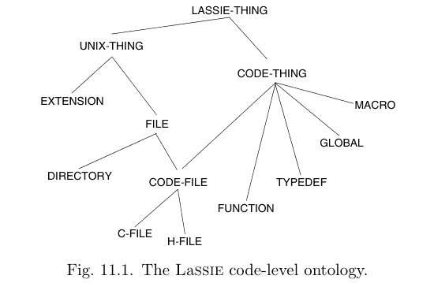

图 11.1. LASSIE 代码级本体论。

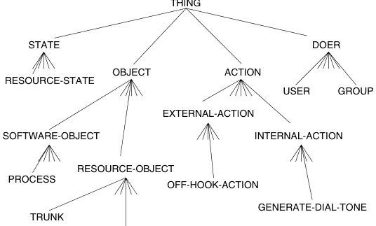

图 11.2. LASSIE 电话本体论。

(SIS) [Bachman et al., 1990]。SIS（软件信息系统）本质上是一种将软件系统代码本身视为数据的信息系统，并存储可以提供信息维护人员经常搜索和发现所需的关系。

第一个 SIS 是 LASSIE [Devanhu et al., 1991]，其开发是为了辅助理解 AT&T 的 Definition 75/85 软件系统。它受到自身研究以及 MCC 研究的影响，这些研究包含两个部分：*领域模型*和*代码模型*。

代码模型通过一个简单的源代码元素本体来实现的，如图 11.1 所示，该本体是从维护人员执行的基本搜索类型中经验性得出的。知识库（关于单个函数、文件、数据类型等的实际断言）是从源代码中自动填充的。

## 软件工程 405

领域模型是通过代码以及与领域专家接触进行逆向工程的，包含了关于电话领域的知识，即软件系统所处理的内容。这些包括电话、麦克风、电缆、电缆干等实体。本体论的示例如图 11.2 所示。

这项工作最有趣的方面之一，也可能从探索描述逻辑（Description Logics）的角度来看最重要的方面之一，是对这两个模型之间差异的分析。代码模型建立在一个非常简单的本体之上，可能包含二十个概念，并填充了大量的实例（多达数个，系统中的每个文件、数据类型和变量至少有一个）。领域模型具有庞大且复杂的本体，可能包含数百个概念，但实例很少。

这种差异的原因在于软件发现过程中执行的搜索非常简单，原因有两个：

- 1. 发现关于软件的特定信息，例如，变量 `dial-tone` 的数据类型是什么？
- 2. 发现关于领域的特定信息，例如，什么是拨号音（dial tone）？

在情况 1 中，维护人员需要关于软件的特定信息，因此需要代表信息的数据。例如，发现过程中问的最常见问题是“变量在哪里使用的？” [Welty, 1997]。通常情况下，维护人员会在代码的其他部分使用 `grep` 该变量以找到该问题的答案，而且如果这花费的时间和精力还不够，结果还需要手动进行修剪，以消除各种“语义噪声”，例如：

- 1. 包含所需变量名且名称较长的变量
- 2. 包含所需变量名的函数名
- 3. 包含变量名的注释
- 4. 其他非变量字符串。

在这种特定情况下，由于强制性的命名规范（其意图是使源代码更易理解），语义噪声的量非常高（语义噪声，也称为假阳性），这是基于字符串的搜索方法的通用问题，并将在第 14 章进一步讨论。

SIS 代码模型通过将“变量”识别为一个语义类别（同样包括文件、函数等，见图 11.1）立即解决了这些问题。简单来说，这意味着当对例如变量 `error-value` 的使用处进行字符串搜索时，可能会产生不想要的结果，如 `compute-error-value`、`display-error-value-result`、`error-value-lookup-table` 等，而将搜索限制为变量可以消除高达 80% 的噪声。

除了能够简单地将搜索限制到特定类别外，还可以从代码中挖掘可以自动提取的其他信息。对于变量，可以自动确定：

- 它定义的文件
- 使用该变量的每个函数。

此外，对于每个函数，提取了关于其定义文件的信息。据此，可以进行如下推理：

```
Variable ≡ usedInFile.File ⊔ usedInFunction.Function ⊓ usedInFile = usedIn definedInFile.
```

换句话说，如果一个函数使用了一个变量，那么在它函数定义的文件中就使用了它；这产生了该变量使用的所有位置。通过这种方式，LASSIE 系统通过推理以多种方式增强了基本数据。

类似且几乎常见的维护任务是，例如修改一个函数，搜索该函数使用的所有地方，以查看更改是否影响代码的其他部分。函数调用其他函数的信息（即调用图）也保留在代码模型中，可以使用与示例中类似的表达式推导出调用某个函数的所有文件。

单独的代码模型就能简化在代码修改期间经历的若干常见发现任务。正如情况 2 中列出的参与发现的原因所示，维护人员搜索代码还有其他原因。对于这些以领域信息为搜索所需结果的情况，则需要对领域进行稳健的描述，这由领域模型提供（见图 11.2）。

例如，维护人员可能想知道用户可以采取什么种操作。从代码中回答这个问题——通常的方法——将非常困难。一种方法可能是通过代码中 `grep` 字符串“user”——当然，希望文档是最新的。另一种方法可能是从维护人员熟悉的一段代码开始，从中汲取一些线索以继续查找。这里的点在于，虽然代码模型查询的目标是特定的，但面向领域的查询则不是的，并且意味着需要花费大量时间寻找新想法等。代码是围绕特定函数组织的，而不是围绕领域概念组织的，而且显然不支持代码的多个“视图”。

## 软件工程 407

对于这种需求，LassIE 领域模型表达了关于领域的知识。它展示了软件可以执行的许多关键概念。动作概念如“生成拨号音”是对动作的描述，而实例将是某个时刻生成拨号音的实际动作。这些实例通常不存在于领域模型中，除非作为示例。该概念将

```
GenerateDialToneAction Action InitiatedBy.LatBox Follows.OffHookAction Recipient.LocalPhone >= 1hasConnection.
```

换句话说，“生成拨号音动作”是一种在“拿起机动作”之后由本地电话服务发发的动作。动作结果（拨号音）的接收者是一个已分配连接的电话。

其他领域概念描述了软件反应的事物，如下：

```
OffHookAction Action InitiatedBy.User <= 0 follows Recipient.LatBox Yactivates.AllocateConnectionAction.
```

换句话说，“拿起机动作”是一种由用户发发的动作（更可能是按下按钮而不是拿起听筒）。它没有遵循之前的动作，且动作结果的接收者是运行软件的本地电话服务。该动作激活了对连接的搜索。

回到上述随机选择的示例，寻找用户可以触发的所有动作的维护人员只需输入如下查询：

```
Action InitiatedBy.User
```


系统将找到所有被该表达式包含的概念。LassIE 包含一种功能，用于定义维护人员在发现过程中识别的新领域概念，并通过简单地为其分配名称（例如在本示例中的 `USER-ACTION`）将其添加到领域模型中。

虽然这两个模型独立地解决了现有的问题，但很快发现整合这两个模型是一项重要需求。

# 408 C. A. Welty

使用该工具揭示了大多数领域查询之后都跟着代码查询。例如，在探索领域模型以发现“连接操作（connect action）”的意义时，维护人员通常会问：“实现它的函数有哪些？”此外，根据软件组件在领域中的相关性进行分类被认为是一项非常重要的功能，因为这允许根据这些信息发现和检索组件——这在以前是不可能的。

这两个模型之间的整合使得利用假设寻找不同的软件对象成为可能。例如，所有实现连接操作的函数将

## Function ConnectAction.

实现用户动作的函数中的变量将

## Variable usedInFunction.UserAction.

> Lassie 系统在 AT&T 经历了多年的稳定发展，并被证明可以减少维护人员在发现阶段花费的时间。为了进一步改进这一过程，我们观察到：
>
> - 领域模型与代码模型之间的连接需要手动建立。这非常耗时，而且难以维护，因为随着软件系统添加新功能，领域模型会随时间变化。结果是维护人员开始对领域模型失去信心，导致使用情况恶化。
> - 代码模型虽然极其简单，但其频率远高于领域模型，成为每位维护人员工具箱中的重要部分。然而，它并没有消除维护人员的搜索，因此没有完全取代 `find` 和 `grep`。

## 11.4 CODEBASE

由于代码证明非常有用且易于维护，对它的需求开始增加。这为 LASSIE SIS 了两个问题：

> - 像所有 DL 系统一样，它是基于内存的。软件包含了成千上万个函数、变量和文件。更重要的是，函数调用图、变量使用图和位置映射的复杂性超过了一百万。在当时，任何计算机的主内存都无法存储如此大量的信息。
> - 自然语言界面虽然简单易懂，但并不能利于快速使用系统。人们仍然必须编写一个正确的查询并输入。如果一个查询的结果要用于另一个查询，维护人员必须重新输入所涉及的概念或个体的名称。使用量的增加需要更好的用户界面。

`CodeBase` 系统 [Selridge and Heineman, 1994] 为这两个问题提供了解决方案。也许最重成就是开发了一个用于离线存储个体的系统。较小的模型 `TBox` 始终保留在内存中，而个体则保存在磁盘上，这种技术类似于虚拟内存。区别在于用于预测哪些 `ABox` 应该预加载的启发式方法。

虚拟内存系统通常使用基于时间或空间邻近性的启发式方法，但对于像 LASIE 这样的知识库，这并不相关。个体在物理内存中的位置并不能表明其与物理内存附近其他个体的相关性。

虚拟内存的启发式方法基于一种经验观察：当访问一个位置时，下一次访问可能是内存中附近的另一个位置。LASIE 的开发者观察到，在 DL `ABox` 中，当访问一个个体时，下一次访问很可能是是它的某个角色填充者（role fillers）之一，或者是距离被访问个体若干个角色路径之外的对象。由于一个角色可能有许多填充者，而且一个个体可能有许多角色，因此没有办法在内存中安排个体，使得普通的虚拟内存启发式方法变得高效。

`CodeBase` 提供了许多图形工具来查看和浏览知识库。虽然从描述逻辑的一般角度来看这并不重要，但从开发知识系统的角度来看，它是重要的。人们绝不能忘记，这些系统是人交互的，除非人类“在回路中”，否则它们不能被认为是可行的系统。

## 11.5 CSIS and CBMS

LASIE 的开发最终因 1995 年 AT&T 的资产出售而停止。然而，软件信息系统的研究并没有停止，描述逻辑在这一持续发展中发挥了重要作用。

LASIE 系统暴露了两个问题：

> - 领域模型随时间的恶化是经典软件文档问题的另一个表现：相同信息以不同的方式存储。代码模型之所以能保持相关性，是因为它是从唯一必须维护的东西——软件自动生成的。因此，它不需要单独维护即可保持准确。文档和领域模型是代码中（可能是隐性的）存在的知识的不同表示。这些表示总是落后于“真实的”表示；它们必须独立维护。
> - 软件信息的去中心化使得代码理解需要新的查看代码的方法。在屏幕上查看代码，类似于操作系统虚拟内存的启发式方法，本质上是二维的。它不允许查看或局部化代码级实体之间的关系。

确定如何解决这些问题的第一步，是对参与发现的程序员进行进一步研究，以获得对他们具体在做什么的更深入洞察。其中一项针对维护中等规模面向对象软件系统的程序员的研究发现，最常见的层级查询是：

- 1. 这个变量在哪里被修改？
- 2. 这个实例上有哪些可用的槽（slots）和方法（methods）？
- 3. 这个变量或函数的数据类型是什么？
- 4. 这个类的超类有哪些？
- 5. 这个函数返回什么？
- 6. 这个函数有副作用吗？
- 7. 这个数据类型被使用了吗？

显然，为问题提供答案需要比简单的定义位置多得细粒度的软件信息。此外，这项研究确认了面向对象的语言比命令式语言增加了理解问题 [Huitt and Wilde, 1992]。特别是继承，将方法和槽（实例变量）向上扩散，使得难以找到类组合等问题的答案。

这些问题引发了对综合信息系统 [Welty, 1995] 的研究，它很快变成了基于代码的管理系统（CBMS）。CBMS 的想法是定义知识库中完成系统所需的表示的第一粒度。换句话说，让基于的表示成为需要维护的产物。

从 DL 的角度来看，知识库中对软件的这种表示需要高效处理大量信息的能力。此外，这种深层表示使得适用于包含推理的广泛推理成为可能。

# Software Engineering

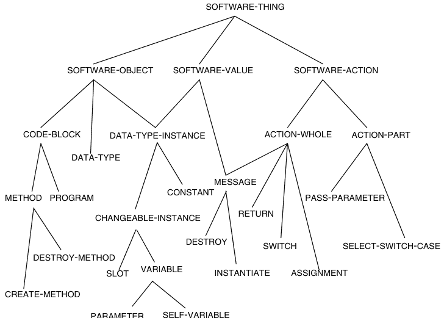

图 11.3 简化的代码级本体论。

CMBS 基于对代码的全规模解析以构建抽象语法树（AST）。AST 拥有源代码的所有信息，因此源代码可以完全从 AST 生成。AST 扩展了可以从语法中自动导出的语义信息。例如在 `C++` 中，我们知道赋值运算符的左侧是待更改的变量，右侧是新值。

表示代码中的所有内容需要比原始 LassSIE 本体论更深的代码级软件元素本体论，该本体论包含了语句、块、条件等。事实上，编程语言的任何语法元素都在本体论中。

除了这些概念之外，角色用于表示源语言的语法元素，并用于控制流、数据流、调用图等将这些概念的实例关联起来。例如，取以下代码片段：

```
void group_deliver (

  MAIL_MESSAGE message,

  GROUP group)
```

# C. A. Welty

412

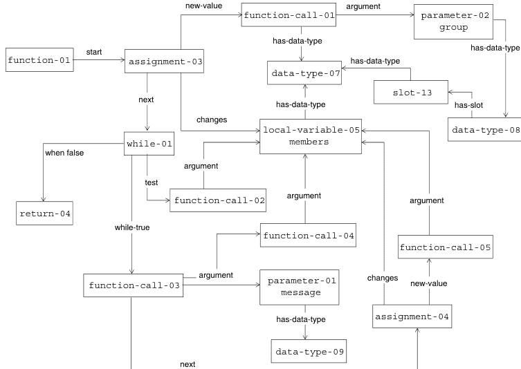

```list
LIST members;
members = get_members(group);
while (empty(members)) {
  ind_deliver(message,car(members));
  members = cdr(members);
}
```


进入`/path/to/xxx`目录，找到`xxx.json`。

该片段的CBMS表示如图11.4所示。注意，图11.4仅显示了与该代码片段对应的ABox，且角色填充符（role fillers）被显示为二元关系。

通过一种在代码表示中显示个体并将角色填充符显示为超链接接口（参见 [Welty, 1996a]），仅该本体本地化的信息就比编辑器窗口中显示的软件标准文本多。同样，编辑器窗口只局部化了控制流信息；维护者在查看代码片段（例如上面所示的代码）时，只能看到文本。这些行大致按照控制流顺序排列。

使用CBMS表示，维护者的视图集中在特定的对象上，例如函数第一行的赋值语句。

图 11.4. 代码片段的CBMS表示。

# 软件工程 413

这种视图将是：

在这种视图中，`{...}` 中的任何内容都是指向链接中命名个体的类似描述的超链接，局部化（localization）有了新的意义：所需信息距离当前上下文（正在查看的个体）的超链接层数。例如，关于控制流的信息可以通过“下一个”（next）链接链访问，但此外，关于数据流的信息可以通过“新值”（new-value）链接访问，还可以通过正在实现的函数、所使用的变量等进行访问。

CBMS方法的另一个优势是利用推理来增强数据并自动实现更多信息的局部化。在CLASSIC的现有工作中，采用了三种类型的推理：

- **角色反向（Role inverses）**。本体中的每个角色都有一个反向角色，这为维护者提供了大量的简单记账信息。在上面的例子中，`changes`角色通过解析`members`来填充，并且添加了反向关系，即变量 `members` 被 `ASSIGNMENT-STATEMENT-23` 修改（`changedBy`）。这种简单推理的力量无论如何强调都不为过。研究表明，这是系统提供的最有用的信息，因为它回答了维护者提出的最常见问题。

- **路径追踪（Path tracing）**。许多有用的信息只需点击几次即可获得，但可以被缩短到一次点击（即一个链接）之内。CLASSIC中一组简单的前向链“填充符”（filler）规则能够处理这一点。例如，知道一个变量在哪些函数中被修改也是很有用的。如果没有推理，维护者必须点击变量的`changedBy`角色以到达修改它的（或多个）语句，然后必须点击该语句的`implementationOf`以到达该函数。相反，通过“路径追踪规则”，我们可以自动从路径中的所有值（`changedIn implementationOf`）来填充`changedInFunction`角色。因此，在我们的例子中，我们可以得出 `members` 在 `group_deliver` 中被修改的结论。

414

C. A. Welty

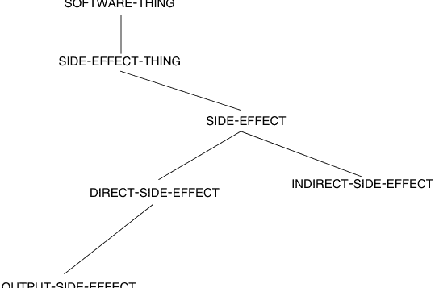

图 11.5. 侧效应本体。

**包含包含（Subsumption）**。通过包含推理，可以推导出代表代码片段的个体属于若干个有用的类。例如，定义了概念 `GlobalAssignmentStatement`：

> GlobalAssignmentStatement ≡ AssignmentStatement ⊔ ∀Changes.GlobalVariable

> 这使得所有修改全局变量的赋值语句都能被识别。

到目前为止，CMBS工作取得的最引人注目的结果是第六个常见的问题。这种检测最初被认为是不可能的。为了简化讨论，我们假设一种没有指针或引用传递参数的纯面向对象语言。后者可以用类似的方式处理，而前者仍被认为是不可判定的。一个对全局变量的修改，以及任何形式的输出。

方法中可能有两种直接侧效应：第三种侧效应是调用一个具有侧效应的方法。在这种情况下，侧效应实际上并没有发生在调用方法内部。

415

# 软件工程

C. A. Welty

# 12 配置

Deborah L. McGuinness

## 摘要

描述逻辑（Description Logics）用于解决广泛的问题，其中配置应用是规模最大、生命周期最长的应用之一。有具体的商业证据表明，基于描述逻辑（DL）的配置器已成功部署了十多年。此外，配置应用似乎具有许多特质，使其非常适合基于描述逻辑的解决方案。本章将介绍配置问题，描述配置应用中使其成为基于描述逻辑解决方案候选的某些需求，通过配置示例展示这些需求实例，并介绍规模最大、生命周期最长的基于描述逻辑的配置器家族。

## 12.1 引言

为了解决配置问题，配置器（人类或机器）必须找到一组相互匹配的组件来解决问题规范。通常，这意味着答案是一个部件列表，其中包含一组协同工作的组件，并且由由这些组件组成的系统符合规范。这项任务可能相对简单，例如选择音响组件以创建一个家庭音响系统。该问题也可能极其复杂，例如选择成千上万个协同工作的组件来构建复杂的电信设备交叉设备或交换机。

使配置具有挑战性的一个重要因素是：对一个组件做出选择通常也会对其他组件产生约束。例如，一个选择了仅支持四个扬声器的接收器的客户，可能无法方便地支持带低音器的环绕系统（因为这需要超过四个扬声器）。

配置在学术界和商业界持续保持着浓厚兴趣。自关于计算机系统配置的 RI/XCON [McDermott, 1982] 工作以来，它一直是人工智能领域的一个突出方向。从那时起，许多配置系统已经在多个领域被建立，包括通信网络、卡车、汽车、操作系统、建筑、家具布局以及匹配餐点描述的葡萄酒属性。今天，存在活跃的邮件列表、研讨会和会议（例如 ECAI-2002 的配置研讨会 [ECAI, 2002], IJCAI 2001 [Soinen et al., 2001], AAAI9 [Faltings et al., 1999] 以及秋季配置研讨会 [Faltings and Freuder, 1996]）、期刊（如 IEEE Intelligent Systems [Faltings and Freuder, 1998] 和《工程设计、分析与制造的人工智能》[Darr et al., 1998]）以及许多大学和公司的研究小组。方法包括约束、专家系统、基于模型的推理、基于案例的推理以及描述逻辑。

配置是一个重要且日益增长的商业关注点。有许多专门从事配置的公司，如 Trilogy、Calico；其他广泛市场的公司（如企业集成软件公司 Baan 和 SAP）也非常重视配置。销售复杂产品（如计算机）的公司正在生产自己的配置器（例如戴尔计算机在线配置器）。通用配置公司还有针对特定领域的拆分公司，例如 PCOr（Trilogy 的一家专注于个人电脑配置的拆分公司）。此外还有一些将配置作为主要组成部分的领域导向型公司，例如 CarsDirect 对美国消费者汽车订单的配置。

尽管商业配置市场由于其爆发式增长看起来像是近期发生的事件，但它至少有十年的历史。例如，Tril 是早期专注于配置的公司之一，成立于 1989 年。Forrester Research 报告称，配置市场在 1999 年的价值为80 亿美元，并预测该市场将在 2002 年增长到 320 亿美元。对于那些最初未将自己归类为“配置公司”的公司来说，配置也被视为重要。在对 B2B 和 B2C 领域顶尖公司的50 位电子商务高管进行的研究中，Forrester Research 发现搜索和配置器被认为是客户支持最关键的两个工具 [Koetzle, 2001]。

描述逻辑社区在十多年里一直关注配置问题。Ownicki-Klewe [1988] 将配置视为一致性维护任务；其他人也探索了配置 [Buchheit et al., 1994; McGuinness et al., 1995; Kassel et al., 1996; 1]。

## 12.2 配置描述与需求

在本章中，我们将处理配置需求。如果约束很少，那么任何合理的方案都可以。然而，如果产品非常复杂且存在大量选择，则需要更多。

配置器需要接受问题输入以及任何先输入的领域信息。然后它必须检查其拥有的约束（从输入中计算出的约束），以开始构建部件列表。它可能会发现无法从给定的输入中构建完整的部件列表。实际上，问题规范经常是过度约束的（例如“我想要质量最好的扬声器，但我不想支付超过50美元”），或者是欠约束的（例如“我想要买一套高质量的音响系统”）。在第一的情况下，配置器需要找到冲突信息的来源，并确定（可能结合用户输入）解决哪些冲突。在第二的情况下，配置器需要向用户索取更具体的信息，或者生成配置列表，或者两者兼有。如果配置器对音响系统做了任意选择（例如有很多可能的选择），那么它需要允许用户更改选择，并发现哪些选择是任意的，哪些是由约束决定的。此外，它需要允许用户输入部分信息以进一步约束选择。

配置输入规范可能是：
- 不完整的
- 模糊的
- 演进的
- 粒度不一的
- 不一致的
- 任意输入的
- 相互关联的
- 嵌套的

## 配置 421

信息（如价格和可用性）可能会频繁变化。此外，还会有关于哪些部分相互兼容的信息，以及其中一个部分的选择如何限制其他部分的选择。这些可以被视为配置规则。虽然这些规则可能不会频繁更改，但修改通常是必要的。这些规则可能源自许多不同的源语言，并且可能需要由没有经过计算机科学训练、更不用说知识表示系统知识的人来输入。

最后，系统可能会运行很长时间，因此需要支持和维护。可能需要配备一个帮助热线来帮助系统用户。客服代表可能对他们正在回答问题的任何单个产品知之甚少（因为他们支持大量的产品）。维护系统的技术人员可能不包括最初构建系统的人，而且随着时间的推移，甚至可能不包括了解产品的人（尽管在必要时他们完全有能力研究该产品）。此外，技术人员可能需要为更新或相似的产品生成新的配置器。

我们总结了来自输入的需求，以及核心配置器的需求，这些需求是从一个配置应用家族提出的需求 [McGuinness and Wright, 1998b] 开始，并在此处进行了略微扩展。一种解决方案论应该具有以下属性：

- 面向对象的建模
- 规则的表示、组织和触发
- 主动推理和知识完备
- 解释、产品培训和帮助热线支持
- 处理增量演进规范的能力
- 可扩展的模式
- 处理不完整或歧义信息的推理机制
- 不一致性检测、错误处理和撤回
- 模块化
- 可维护性

这个需求列表代表了许多复杂推理任务中的需求。尽管我们可以争论这种通用架构和方法具有更广泛的适用性，但我们将讨论限制在配置应用上。在接下来的子章节中，我们将针对配置音响系统的任务描述这些需求中的每一个（基于 AT&T 的配置器演示 [McGuinness et al., 1995; 1998]），并提到基于 DL 的解决方案如何满足这些需求。在有用或必要时，我们将提到在较大的 PROSE 配置器家族中是如何解决这些需求的。

在音响配置中，目标是要求用户输入少量关于终端系统的约束条件，并生成一个完整、正确且一致的部件列表。虽然系统也可以接受大量约束作为输入，但目标是减少用户的任务并要求最少的输入。系统利用用户输入结合其大量的领域知识和部件信息，确定用户的输入规范是否一致。它使用底层的定理器来计算输入的推演闭包，并生成更完整的输入描述。系统会征求对系统质量（高、中、低带有相应的价格范围）和典型用途（仅音频、仅家庭影院或组合）的输入，然后应用推出 6-20 个组件的描述，这些描述限制了如价格范围、电视对角线、功率额定等属性。用户随后可以检查任何单个组件并可能对其添加进一步的要求，这反过来可能会导致系统其他部件上出现更多约束。此外，用户可能会要求系统“完成”配置任务（即使用户规范是不完全的），完全完整地指定每个组件，以便生成部件列表并完成订单。斯坦福大学提供了该 Web 配置器的在线演示（http://www.ksl.stanford.edu/people/dlm/dls/stereo-demo/），并且在 IJCAI 论文的扩展版本中提供了许多示例 [McGuinness et al., 1995]，地址为：http://www.research.att.com/sw/tools/classic/tn/ijcai-95-with-scenario.html。

该应用非常适合说明我们的观点——它很小且处于一个广泛可理解的领域。它可能比一些简单的教学示例更有趣，因为它作为一种应用被开发出来。在 PROSE 家族 [McGuinness and Wright, 1998b] 中，这种基于 DL 的解决方案满足了需求。这种基于 DL 的解决方案规则表示在 [McGuinness et al., 1995; 1998] 中可以详细看到。

## 12.2 面向对象的建模

一个正在配置的系统可以被视为由更小的对象组成的，这种面向对象的建模支持上述规则的表示。在简单示例中，音响设备呈现出自然的层级结构。我们有一个如 ElectricalThing 的顶级节点，其子类为 HomeTheaterSystem 和 StereoComponent。此外，某些特定的可能具有属性。例如，电视可能有一个名为 diagonal 的属性（填充正整数），另一个名为 price（填充货币值），一个名为 repairHistory（填充 {BAD, OK} 之一），一个名为 manufacturer（填充公司名），以及高度、宽度和深度（这些都可能具有基数限制）。例如，必须有一个 manufacturer（在角色中至少有一个），必须有一个 filler（对于 diagonal 角色）。在目前为止的简单示例中，我们看到了对 number（基数）限制、值限制（对于 role 角色的填充）以及类的层级。此外，我们应该注意到对象是组合的。对于 manufacturer 的值限制是自然确定的。在其他地方被论证，大多数描述逻辑语言应该支持这种规则的表示。

### 12.2.2 规则表示

包含主动推理信息的知识库将包含某些规则。典型的配置系统将包含许多规则。此外，这些规则可能会频繁更改。因此，在大型配置系统中，规则的建模、组织和维护是非常重要的。简单的规则可以是“如果某个东西是 A，那么它就是 B”的形式。例如，如果某个东西是 HighQualitySystem，那么电视就是 HighQualityTelevision（具有最小价格和角度），扬声器就是 HighQualitySpeakers。事实上，在我们的演示中，有几十条规则在系统确定为 HighQualitySystem 后触发。如果从规范中删除最小价格限制，我们希望撤回这些规则的结果（除非结果可以通过其他方式推导出）。

基于 DL 的系统可以以分级方式支持上述规则的建模。规则可以根据需要与层级的任何级别关联。然后，我们可能会在 HighQualitySystem 级别关联最小价格和角度，并可能与 HighReliabilitySystem 等其他概念关联 repairHistory 限制。如果我们想拥有这种简单的规则编码，就不需要使用独立的机制。如果一种编码方案需要否定和析取（或编码“如果-那么”规则的其他方式），正如大多数描述逻辑语言那样，就不需要引入独立的规则概念。例如，人们可以将一个简单关系编码为 (not HighReliabilitySystem) GoodRepairHistory。这表示要么某个东西不是高可靠系统，要么它具有良好的维修历史，这通常被视为“如果某个东西是高可靠系统，那么它就有良好的维修历史”。

我们在章中看到的示例仅使用了简单的

# 配置

if-then 规则。关于这些规则在实践中能有多强大的详细讨论，请参阅 [Borgida et al., 1996]。

当然，表示规则和推理并不一定需要描述逻辑（Description logics）；此示例仅展示了它们可以作为一种捕捉规则和推理的便捷技术。

### 12.2.3 主动推理

描述逻辑可以推导出信息的逻辑结果，因此被认为提供了主动推理。事实上，在许多基于描述逻辑（DL）的配置系统中观察到的典型推理模式包括：

- 断言关于现有术语的信息
- 识别更新后的术语是某个类的实例
- 在与该类相关的术语上触发规则
- 将信息从更新的术语传播到相关术语

例如，考虑 MY-HTS。假设它有一个 `Television`（电视）槽，填充了一个特定的电视 TV-11。一旦断言用户愿意为该系统支付超过 8000 美元，它就会被识别为 `HighQualitySystem`（高质量系统）的实例。与该概念关联的规则被触发，现在它变成了一个具有 50 英寸电视对角线（或可能是对角线较小的高清电视）且电视价格至少为 1000 美元的实例。这些限制被传播到 TV-11 上。

这种推理链包含了立体声器配置器示例中所执行推理的 50% 以上。通过这种方式，用户只需要对系统指定少量限制，就可以让他们执行大量的推导。

需要注意的是，这个特定的示例配置器是构建在一个不包含默认推理的描述逻辑上的。某些描述逻辑已经扩展到包含默认推理（即：如果没有其他说明，则使用默认规则）[Padgham and Zhang, 1993; Baader and Hollunker, 1995a; Quantz and Roy, 1992]。例如，如果电视没有指定制造商，则使用索尼作为制造商。如果底层形式具有默认表示，本应使用它。

在演示系统编码时，立体声器配置器使用了两组概念来挂载规则：一组用于所有可证明正确的规则（如电源兼容性）的概念，另一组用于默认规则的概念，称为“引导”（guidance）概念（用于最低价格等主主观规则）。基于该系统部署的配置器实际上将默认值作为完成——在规格输入过程的特定点，如果信息未知，则使用“默认”或主观规则将其“补全”[Mcinness and Wright, 1998b]。这提供了一种非常简单的方法来实现作为完成的“默认”，可以看作是默认推理最简单的形式之一。

### 12.2.4 解释

客户服务台人员需要能够帮助用户理解配置规格和最终零件清单的所有可能内容。事实上，如果 PROSE 系列配置器不能提供完整的解释能力，它们将面临灭绝。显而易见，消费者需要查明他们最终系统中某个特定部件为何存在那里、为什么它会有特定的值限制、可能的替代方案是什么，以及它是从规格的哪个部分推导出来的。在这个简单的示例中，客户可能想知道为什么最终系统中的电视超过 1000 美元，或者为什么它有特定的最小对角线要求。解释是：请求了高质量系统，而高质量系统对电视组件包含了建议的最小对角线尺寸和最低价格。

演示系统允许用户指向特定组件并对关于这些组件得出的所有内容进行提问。它还预判了用户询问的最常见解释问题，并提供了根据用户指向的操作动态生成的包含解释问题的下拉菜单，用户可以点击以快速提问。为了支持这一点，为基于 DL 的底层系统设计了广泛的解释性基础[Mcinness, 1996; Borgida, 1995]。解释系统提供了一个证明论基础，用于通过证明规则和论据来解释任何推理。它还提供了自动追问的能力，能够生成引导使此推理变得可证明的问题。研究发现后续问题的生成是有必要的，因为用户研究表明用户想要相当简单的解释，以及提问后续问题的能力。进一步的研究发现，用户非常感激在生成语法正确且根据前一个问题变得有意义的后续问题方面给予的帮助。后续问题是从解释的模型论形式自动生成的。

基本的解释结构最初是为一个归一化-比较（normalize-compare）的基于 DL 系统设计的，但从那时已作为基于表（tableau-based）的描述逻辑的基础 [Borgida et al., 1999]，并作为斯坦福大学证明系统 ATP 和 JTP 实现中的模型消去定理。

总的来说，解释是描述逻辑优于某些其他配置方法的特点之一。在典型的基于约束的方法中，解释一条推理可能比过滤和剪枝基于推理规则的定理（如 DL 证明器）要困难得多。描述逻辑中呈现形式和解释的过滤已在 [McGuinness, 1996; Borgida and McGuinness, 1996; Baader et al., 1999] 中被过。此外，其他地方也认为 [McGuinness and Patel-Schneider, 1998; Brachman et al., 1999] 解释是许多类型应用的需求。最近基于约束的方法在解决解释问题方面取得了进展 [Freuder et al., 2001]。

### 12.2.5 演化的规格

在许多配置场景中，用户开始时的规格是不完整的。描述逻辑允许用户在任何时候输入终端产品或单个组件的描述。例如，在家庭影系统中，用户可能指定了电视的对角线尺寸和限制，但目前对 DVD 播放器一无所知。类似于立体声菜单的用户界面允许用户从动态生成的下拉菜单中选择组件，这被用于对符合规格的组件数据库进行查询。因此，避免了用户选择与系统不兼容的组件。

用户还可以浏览当前配置并删除任何声明的限制。（用户不允许删除推导出的限制，但被允许询问特定限制是如何推导出的，从而发现该限制的来源。）一旦删除了限制，就会生成新的下拉菜单以包含符合当前规格而非之前规格的组件。

这种架构为增进演化（有时是非单调演化）的规格提供了极大的灵活性。它为用户提供根据需要重新计算的选项方面效果良好，并提供符合当前声明或暗示规格的更新组件列表。例如，如果用户指定了高质量系统，然后决定为系统选择放大器，配置器将只会呈现被确定为高质量的放大器选项。

### 12.2.6 可扩展的模式

许多配置应用发现组件的信息在不断更新。并不总是组件的简单数据在更新，有时在应用程序编码后，组件的属性发生了变化或发现了新属性。因此，使用可以更新的模式或组件描述变得非常重要。例如，在我们的家庭影院应用中，当我们开始开发时，DVD 播放器尚未进入市场。后来，家庭影院系统包含 DVD 播放器变得常见，因此我们的模式需要扩展一个新的 `DVDPlayer` 类——以及适用于 DVD 播放器的角色（roles）。

# 配置 429

这种对可更新和可配置 schema 的需求有时是设计上的要求。例如，在 AT&T 的软件评估中，标准之一就是可扩展的 schema。我们在部署的 PROSE QUESTAR 配置器家族中的经验是，在实践中产品经常会进行扩展。

### 12.2.7 信息不完全的推理

许多配置规范在最初输入时几乎不可避免地是不完全的。在大型系统中，常见的情况是：由某一个领域的专家输入该领域的规范，而另一个领域的专家（另一个人）可能稍后更新该规范。例如，在一个两个人的家庭中，其中一个人对音质可能更精通，因此输入了扬声器的需求，而另一个人可能对视频显示器更有兴趣和知识，因此输入了电视的规格（以及其输入和输出需求）。此外，允许跨多个会话来完成规范可能也是重要的。

人们不希望一个配置器在所有输入需求提交之前无法进行任何推断。例如，在立体声系统中，人们希望配置器能够推断出扬声器限制对放大器最小功率需求等的影响，即使电视还没有输入。

描述逻辑（Description Logics）已被证明即使在信息不完全的情况下，对于确定信息的逻辑结果也是有效的。它们还可以被用于确定仍然需要的信息。例如，它们可以确定在配置被视为完整之前，需要作为部件列表的一部分输入两个扬声器。因此，仅仅说需要两个高质量的主扬声器是不够的，在任务被认为完成之前，部件列表实际上需要选定具体的扬声器。

在家庭影院应用中，有一个单面板显示器用于显示在配置被视为完成之前还剩下哪些最终组件。显示器可以查看当前已推断出和或已选择的部件，以及待选择的其他组件。可以点击其他组件以获取该组件的当前描述，以便用户可以查看到为止关于该组件已得出的结论。该应用程序允许用户保存配置的部分规范，以便在另一个时间点输入进一步的需求。该应用程序还允许用户在任何点“完成”配置，这将强制系统对剩余的约束不足的组件做出一致的决策。用户还可以检查单个组件的选择并点击它们，查看系统本可以做出的替代选择下拉列表。用户还可以点击组件，查看应用程序确定的该组件必须满足的约束描述。组件的描述被用于查询知识库中符合这些特征的组件。该描述也可以传递给另一个用户（或应用程序），以便其看到到为止推断出了哪些约束，然后让该用户（或应用程序）添加新约束或做出最终的产品选择，从而促进协作配置。

### 12.2.8 不一致检测

配置应用程序应该尽可能减少用户生成不一致规范的概率。例如，立体声配置器利用关于任何特定组件可以推断出的信息，对数据库形成关于可能组件的查询。这很大程度上限制了用户在系统中选择导致不一致规范的组件的概率。然而，部署的应用程序在选择将组件放入下拉列表之前，并没有采取进一步的步骤。它没有检查剩余未指定的组件是否可以使用数据库中的某个组件来完成。（当然，因此部署的示例仍可能允许用户存在待指定的项。）因此，部署的示例仍可能允许用户生成不一致的规范——应用程序只是让这变得困难。后端推理系统需要确定增量规范何时变得不一致。

有时其他部署配置器的用户会产生大量的约束，并希望将其输入到其他（连接的）配置应用程序中。对于用户友好型配置器（预期与其他配置应用程序交互）的这一额外要求，是让推理器输入约束并确定它们是否不一致。例如，PROSE 配置器家族支持带有一致性检查的需求批量输入。

推理器可能选择不同的方法来处理不一致性。配置系统的要求是底层推理器必须识别不一致性并通知用户。一个有用的推理器还将通过允许用户了解不一致性是如何推导出的来支持用户。推理器还可以给用户将规范“回滚”到上一个一致状态的选项。例如，CLASSIC 知识表示系统要求信息保持一致，一旦检测到不一致性，它会禁止产生该不一致性的最后语句（保留一个单独的错误状态以支持调试），然后回滚到上一个一致状态。这在早期的基于 DL 的系统中很常见。然而，描述逻辑并不一定要求输入一致的公理，可以构建利用描述逻辑来识别描述是否满足可性的配置器。这种允许不一致输入并带有用户识别的检查点的模型，可能是最自然地支持协作和面向 Web 的开发的模型。

### 12.2.9 模块化

在大型系统中，允许多人在看似同时的环境中工作规范是非常重要的。例如，在 Prose 中，特意设计了一组许多开发人员可以使用类和角色。然后允许多个用户同时处理配置信息不同部分的规范，并使用预定义的上层类和角色来指定更具体的类。当用户完成他们特定的组件描述时……（此处文本根据上下文已合并）。

# 配置 433

需要对价格值限制进行更新。当新组件可用时，可能会进行更复杂的配置规格更新（这通常需要有人对新组件和功能进行建模）。描述逻辑（Description Logics）有助于这类规格更新，得益于我们在 12.2.6、12.2.5、12.2.1 和 12.2.9 节中提到的那些功能。

帮助台支持的第三个问题被认为是基于 DL（描述逻辑）系统的优势。PROSE 配置系统的目标之一是让帮助台人员的表现水平似乎高于他们对单个产品的培训水平。其支持性基础设施工具集是在帮助台人员需要时实时向他们提供信息（而不是要求他们事先对产品进行培训，以便他们根据学到的知识回答问题，而不是根据需要查阅的知识回答问题）。

这些工具可以解释系统在客户询问为何配置中存在某项（或不存在）时所做的任何推理，并允许他们回答关于哪些配置是有效的（或无效的）的问题。这主要得到了 12.2.4 节描述的功能以及 12.2.8 节等其他功能的促进。同样，他们还可以回答假设性问题，例如“如果我的配置中使用组件 X 代替组件 Y 会发生什么？”其目标是满足个人客户的需求，而不需要工程支持来回答此类问题。我们的主张是，正是前几节讨论的描述逻辑结合，有助于支持应用程序的可维护性，事实上，它帮助了没有上过描述逻辑或知识表示课程的人员支持可维护性。

# 12.3 Prose 和 Questar 配置器家族

寿命最长、产出最多的基于 DL 的配置器家族是 PROSE 和 QUESTAR 产品线 [Wright et al., 1993; McGuinness and Wright, 1998b]。AT&T 于 1998 年开始开发配置问题，以响应业务部门在简化“工程、供应和安装”（EFI）流程方面的帮助请求。该过程的目标是通过销售过程向客户征求规格请求，然后设计出一个可以被“供应”且当然能及时有效地制造并交付给客户的解决方案。项目的初始目标是缩短从规格

# 434 D. L. McGuinness

到安装的时间，并最大限度地减少规格中冲突的影响。初始配置器是为光纤传输系统（FT 系列 G）构建的，尽管最初部署用于数字交叉连接系统（DACS IV-2000）。

初始配置器的成功程度以至于围绕它构建了一个配置器家族。该项目的历史进展从参与研究转变为开发。AT&T 的研究部门与开发人员协作构建初始系统。研究人员帮助生成并评审了初始概念模型和编程工作。开发人员生成了初始系统，但有研究人员的交互式协助。随着项目的演进，项目出现了开发者独立性的需求，以及一个允许具有专业知识的人使用他们熟悉的语言输入配置规则的环境。开发人员承担主要责任；在初始部署中，他们得到了研究人员的协助，但在第二个到第十七个系统时，无论是对于单个配置器的生成还是维护，他们几乎不再需要研究人员的协助。作为开发环境，开发者看到的 DL 后端大大减少，本质上讲，DL 后端只负责验证和推导出结论，在其他情况下被隐藏在系统界面之后。

关于这个应用程序家族有几点值得注意。首先，配置器家族具有长寿性，某些配置器在工作开始十年后才部署。其次，配置器的大部分生成和维护是由对描述逻辑了解非常少的人完成的（这提供了经验证据，表明应用程序不需要描述逻辑的博士学位来构建和维护）。领域开发者开发了一个演进接口，面向那些了解产品但不了解描述逻辑、有时完全不懂计算机科学的用户。该接口允许用户维护配置器，也可以在同一产品家族中生成新的配置器。目前的共识是，基于 DL 的方法有助于概念建模（例如，[McGuinness and Wright, 1998b]），并且让维护变得容易得多。福特汽车公司对其长寿的基于 DL 的配置器应用得出了类似的发现。

## 12.4 总结

我们介绍了配置问题，简要描述了该问题的本质以及为什么许多社区认为它非常重要。我们描述了问题中固有的属性，这些属性使得人们可能会考虑使用基于 DL 的

# 455 配置

方法。我们在立体配置器的背景下提供了所有属性的示例，并提到了如何使用基于 DL 的方法来解决问题。我们与规模更大的电信设备配置器进行了对比，这些配置器也包含了相同的问题和基于 DL 的解决方案。

我们还介绍了最新的基于 DL 的配置器家族——PROSE-QUESTAR 系统家族（注意，福特汽车公司至少还有另一个商业配置器也具有类似的寿命和类似的基于描述逻辑的方法）。我们观察到 PROSE-QUESTAR 配置器家族已经连续使用了十年，并配置了价值数十亿美元的设备。我们最后指出，具有悠久商业配置示例表明，DL 方法缓解了概念建模和配置器维护的问题。此外，我们推测这种满足配置需求列表的通用架构可能也可以用于具有类似需求的问题领域。

# 致谢

虽然本章中的所有错误均由作者负责，但本章通过许多人的贡献得到了增强。大部分讨论都是在 PROSE-QUESTAR 或 CLASSIC 的背景下进行的，合作者包括 Jon Wright、Lori Alperin Resnick、Peter Patel-Schneider、Ron Bachman、Alex Borgida、Charles Isbell、Elia Weixelbaum、Gregg Vonder、Harry Moore、Pat Saleh 以及许多其他贡献者。此外，Nestor Rychtyck 对本章之前的版本提供了许多宝贵的意见。

# 456 13 医学信息学

Alan Rector

## 摘要

描述逻辑及相关形式已应用于医学信息学的至少五个领域——术语、智能用户界面、决策支持与语义索引、语言技术以及系统集成。重要问题包括规模、复杂性、连接性以及所需的广泛粒度——医学术语需要大约 250,000 个概念，某些涉及十个以上的复合词且深度嵌套；解剖和生理学的特性万物相互关联；以及从心理学到分子生物学的概念。表达能力的技术问题集中在部分整体关系以及提供类似“框架”功能的需求上——即能够有效地确定关于任何特定概念的陈述，以及处理有限例外情况的方法。在“语义归一化”和“临床实用”方面也存在重大问题，因为理解医学概念往往取决于隐含知识，且某些概念难以表述。两个最为人知的尝试——OpenGALEN 和 SNOMED-RT 都使用了特异的描述逻辑，其表达能力通常有限，但具有专门的扩展以处理环部分整体和其他传递关系。在复用需求与领域专家作者易于理解的要求之间也存在冲突。OpenGALEN 通过引入分层架构解决了这种冲突，通过一种高层“中间表示”将作者与描述逻辑细节隔离开，而描述逻辑被视为“汇编语言”而非表达本体的主要媒介。

## 13.1.1 医学应用中的知识表示

描述逻辑（Description Logics）以及相关的基于框架和概念图的形式正应用于医学信息学中的至少五个领域：

- 术语开发，以及更广泛的，健康记录中的信息表示。
- 智能用户界面。
- 决策支持与语义索引。
- 面向语义的自然语言处理。
- 信息系统的语义集成。

使用描述逻辑早期开创性工作集中在表达能力与可计算性之间的权衡上。Doyle 和 Patil [1991] 尝试将 NIK 应用于医学词汇，最终得出结论：NIKI TBox 语言限制太大，无法满足此项需求。更明确地说，他们蔑视用户接受表达力极低的 TBox 限制，并预测用户将使用“变通方法”，这会违背其逻辑严密性这一存在意义。Jang 和 Patil [1989] 首次尝试了更恰当的表示方法。

然而，随着提供标准的受控医学词汇被视为医学信息学的核心问题之一，一些研究人员认为“组合系统”是唯一可行的路线。任务的紧迫性促使了“实用”方法的出现。Masarie 等人 [1991] 使用一个大型基于框架的 AI 环境产生了一种“通用语言”，将当时某个探索性项目中的三个术语连接起来，该项目演变成了统一医学语言系统（Unified Medical Language System [Evans, 1987]）。

尽管美国国家医学学会选择词汇方法而非开发 Masarie 的逻辑通用语言方法，但该项目间接催生了 CANON 小组，该小组成为医学术语中形式化表示的倡导者（Cimino, 1994; Evans et al., 1994）。《美国医学信息学杂志》（第1卷第3期）的一个特刊总结了其开创性研讨会的内容。

CANON 小组汇集了当时其他的工作流：

- 由 Cimino 等人 [1989] 开发的医学实体字典，作为一个大型语义网络。

- 欧洲相关的 GALEN [Rector et al., 1993; Rector and Nowland, 1994] 和 PEN&PAD [Nowland et al., 1991a; 1991b; Rector and Nowland, 1991] 程序。

- 一系列使用 Sowa 概念图表示医学词汇的项目，其中最好的是 Campbell 等人 [1994] 的，但该系列也包括 Bell 等人 [1994] 的工作。

此外，该图谱与 Friedman 等人 [1994] 和 Sager 等人 [1994] 的更多语言工作相结合，并与 Tuttle [1994] 起到对比和现实检查的作用。

这项工作产生了两个大规模成果：

- 美国病理学家学院下的 SNOMED-参考拓扑结构（SNOMED-RT）和 SNOMED-临床术语（SNOMED-CT）项目。

- OpenGALEN，旨在一种专门的描述逻辑中产生一种参考本体，以用于开发和管理其他术语，并对决策支持、用户界面和其他知识管理任务所需的知识进行索引.³

此外，医学领域还有许多语言处理项目，其中包括关于形式化知识表示的重大工作，特别是 Hahn 使用 LOOM 的工作（Hahn et al., 1999a; 1999c），该工作在语言工程和本体方面都产生了一系列大规模结果；以及 Zweigenbaum 以类似的方式使用特殊限制的框架表示法 [Zweigenbaum et al., 1995]。另一个重要任务是医学文献的索引和检索，这已由 McGuinness [1999] 解决。

医学中（非描述逻辑的）本体的应用，包括 Mussen [1998] 关于 PROTÉGE 项目中可重用问题方法和本体驱动知识获取的工作，至少到目前为止，该项目尚未专门使用描述逻辑或其他形式基础作为其本体的基础，而是围绕 OKBC 和 DAML 标准构建其本体。由于这些标准在 OIL 和 DAML+OIL 中正趋敛（Fensel et al., 2001; Horrocks and Patel-Schneider, 2001），与 PROTÉGE 的融合正在积极讨论中。

¹ http://www.snomed.org/
² http://www.coding.nhsia.nhs.uk/
³ http://www.opengalen.org

Stannelli 和 Schreiber 同样围绕 KADS 架构产生了一系列工作，将本体作为智能系统和代理架构的基础 [Schreiber et al., 1993; Vanjeist et al., 1995; Falconi et al., 1997]。

医学知识表示的另一项主要工作是数字解剖学家（Digital Anatomist）项目 [Rosse et al., 1998; Agoncillo et al., 1999; Mejino and Rosse, 1999]，它目前不使用描述逻辑，但代表了一个全面的、精心策划和经过验证的知识库基准，该知识库基于在严格定义的深层概念层级（如“器官”、“组织”等）中经过仔细分析的本体承诺和区别。它对任何追求医学知识全面表示的系统都构成了挑战。

## 13.1.2 医学环境

大多数此类应用背后是重用临床数据的愿望——要么是为了整合系统，要么是将患者记录与管理、质量保证或研究联系起来。

目前存在广泛的转向“电子病历”（EPRs）的趋势，也称为“计算机化记录”（CPRs）。这些运动背后的目标有三个：

- 通过提供关于当前患者、警告和决策支持的信息来改善患者护理。
- 捕捉在护理点收集的统计报告、质量保证和补偿信息，警告潜在的药物相互作用和禁忌症。
- 整合医疗保健中的异构信息系统。

支持电子病历的主要报告来自医学研究所 [Dick and Steen, 1991]、患者记录学院（CPRI）以及英国国家健康服务局 [NHS Service Executive, 1998]。随着建立更大的临床问责和对临床错误的关注，这种压力正在增加 [Kohn et al., 2000]。每个患者都应该拥有电子病历现在是许多国家的政策。

尽管医学中广泛使用了管理和实验室系统，但此类医学记录所需大部分信息目前仅以非结构化文本的形式存在。以结构化形式捕捉更多信息是医学信息学的核心任务。缺乏标准的“受控词汇”或“编码系统”被视为这一任务的主要障碍 [Sittang, 1994]，而其成功的关键 [Rossi Mori and Consorti, 1999]。然而，几个国家已经强制或即将强制在医学病历中使用标准术语。

4 http://umcls.nlm.nih.gov/

## 医学信息学

因此，研究人员希望基于深度学习（DL）的本体能够为术语、决策支持、语言处理和集成等某些问题提供更好的解决方案。

## 13.2 应用示例

### 13.2.1 术语开发与“编码”中的描述逻辑

### 13.2.1.1 SNOMED-RT：紧耦合的开发与预协调

SNOMED-RT 是美国病理学家学院与大型医疗保健组织凯撒性医疗（Kaiser Permanente）之间的一项合作企业。它重新表示了 SNOMED-International 中 KRSS 的部分信息。在初步近似中，关于解剖学、形态、功能等的 SNOMED 事实已转换为角色，如 `hasTopology`、`hasMorphology` 等 [Campbell et al., 1998]。随后，这些初始的机械翻译由领域专家使用一套具有高度发达变更管理机制的工具在本地进行了重新建模 [Campbell, 1998]。该开发方法非常强调实现领域专家结果的可重复性，并大量使用词汇工具来建议准则中暗示但可能未在分面表示中显式的额外关系；例如，“视网膜血管炎”术语在 SNOMED-International 的每一个版本中都正确地与“眼睛”相关，但并非每个都与“血管炎”（血管的炎症）相关 [Campbell et al., 1996]。

第一个发布版本包含一组预枚举的 180,000 或多个疾病和程序代码，每个代码都定义在表示 KRSS 的本体中，并根据无向环图进行分类。其意图似乎提供一组标准的预协调（即预定义）概念和相关术语，以类似于传统层次编码方案的形式呈现和使用。

最近，SNOMED-RT 与英国临床术语项目（UK Clinical Terms project）建立了合作，旨在一种一种医学标准英语受控词汇表的产品。细节尚未公布，但预计其形式将与 SNOMED-RT 密切相关。

所使用的本体相对浅，预发布版本中包含不足十个角色，并尽可能避免了嵌入表达式。然而，通过引入右等式（right-identities）来处理整体关系，KRSS 的标准语义得到了增强（参见第 13.3.2 节）。

SNOMED-RT 本身不包含用于数据输入或涉及动态后协调的其他应用的工具或转换程序。然而，提供开发工具的公司（Apelon^5）提供了一系列基于 SNOMED-RT 的工具，包括授权站点，这些工具部分源自 K-REP，K-REP 是导致该项目的早期实验中使用的 DL 风格系统 [Mays et al., 1991a]；

#### 13.2.1.2 GALEN：松耦合的开发与后协调

GALEN 是一系列欧洲委员会资助项目的结果，其本体和规范以及部分工具已以开源形式从 http://www.opengalen.org/ 提供。

GALEN 工具专为松耦合开发设计，其本体主要针对后协调应用，例如智能用户界面，以及授权用户能够将核心术语适应到其特定需求的工具。它基于动态“术语服务器”的概念，而不是枚举的预协调术语表 [Nowlan et al., 1994; Rector et al., 1995a]，尽管它预定义了有限的通用概念。

GALEN 的一个重要特性是服务器架构内功能的清晰分离：

- 描述逻辑中的逻辑表示；
- 语言生成与文本识别；
- 与现有编码系统的双向映射；
- 非术语信息的索引；
- 作为单位和坐标转换的额外计算。

GALEN 的本体是新创建的，紧密参考了标准分类，特别是《国际疾病分类》。它使用了 GRAIL 描述逻辑 [Rector et al., 1997]，其核心包含了 SNOMED-RT 使用的 KISS 操作子集，包括传递角色（transitive roles），并增加了逆角色（inverse roles）和角色包含（role subsumption）。关于传递角色和相关问题的进一步讨论请参见第 13.3.2.2 节）。此外，GRAIL 提供了一种名为“授权”（sanctioning）的构造，类似于框架中的槽位定义（slot definitions）。

### 13.2.2 描述逻辑与语言处理

### 13.2.2.1 语言分析与信息提取

大多数信息源于并以自然文本的形式存储。医学文本具有语法的特殊性。许多陈述高度省略，在没有语义知识的情况下无法轻松解析。

Hahn 在 medSYNDICATE 上的工作 [Hahn et al., 1999] 提供了一个使用特殊构建的本体 LOOM 的详细示例。medSYNDICATE 架构特色是本体（“领域知识库”）与解析器之间的紧耦合，并大量使用学习技术来深化本体和句法。它利用本体中的完整性约束、概念约束和基数限制来减少歧义性并选择合理的解释。

### 13.2.2.2 语言生成

让此类表达式对用户可用的一种方法是从它们生成语言表达式。语言表达式不仅更具可读性，而且通常更紧凑。GALEN 发现语言生成在几乎所有涉及……的应用中都是至关重要的

# 医学信息学 445

后协调包括对本体进行独立质量保证的大多数方法。

GALEN 技术的一个主要应用是法国政府，利用其为其新的国家手术程序分类法产生无歧的定义。有趣的是，在这种应用中，通常语言生成中追求简洁地道表达的目标并不适用。该技术的价值在于对底层正式定义进行了一种严谨但完全无歧的呈现。一旦定义达成共识并通过了质量保证，就可以需要的地方手动组合地道的“首选术语” [Baud et al., 1997; Rodrigues et al., 1997]。

## 13.2.3 决策支持、索引和用于解决问题的复用本体

许多决策支持方法论，特别是 Musen 的 PROTÉGÉ 和 AEON [Tu et al., 1995; Musen et al., 1996; Musen, 1998; Grosso et al., 1999] 以及 Stefanelli 的 GAMES [Schreiber et al., 1993; Vanheijst et al., 1995; Falaschini et al., 1997]，都是基于领域本体的存在，但通常情况下这些本体是专门为某个应用构建的，事实证明其复用性低于它们所支持的问题解决方法。两者都将本体作为框架系统。

描述逻辑（Description Logics）中分类推理的一个特定用途体现在 GALEN 在药物本体方面的工作，该工作是与 PRODIG 项目合作完成的，该项目关于英国全科医生处方的计算机化指南 [Johnson et al., 2000]。传统的疾病和药物分类只有一个泛化轴，该轴线将几个不同的标准混淆在一起。例如，标准的药物分类将适应症（例如“治疗哮喘”）、分子效应（例如“刺激 α 上上腺素受体”）、生理效应（例如“扩张气道”）和化学结构混合在了一起。即使是像类固醇这样的泛化概念也可以以许多不同的方式进行分类——属于抗炎药、局部皮肤制剂、抗风湿药等。

将这些混合的轴分离，然后将它们作为正式描述的基础，并由描述逻辑进行分类，提供了一种潜在的解决方案。在早期的原型演示 [Solomon and Heathfield, 1994] 之后，GALEN 现在正用于构建一个药物及相关状况的本体，作为 PRODIG 项目的一部分，该系统是由英国卫生部开发的针对慢性疾病患者的处方方案系统 [Solomon et al., 1999; Wroe et al., 2000]。

迄为止的经验表明，该本体能够根据所需的各种粒度提供高效精确的索引，并通过第 13.2.1.1 节描述的机制为编码所需的默认推理提供框架。进一步的评估将等待项目的下一个阶段。

## 13.2.4 智能数据输入

数据采集是获取医疗保健领域信息最大的单一障碍。GALEN 开发于 PEN&Pad 项目 [Nowlan et al., 1991a; 1991b]，该项目旨在改进医疗专业人员的用户界面，并特别强调数据输入，通过尝试构建表单来捕捉目前作为叙述文本记录的信息（即便全部）。

本体在 PEN&Pad 中提供了两种服务——都与“在这种情况下可以合理地描述什么？”有关：

- 指出如何通过修饰符细化给定概念。
- 通过每个起始概念（通常是疾病或症状）对表单进行索引。每个表单可能包含许多子表单，允许进一步细化概念或包含较不常见的体征和症状。

提供临床界面所需的表单总数巨大——至少有几十万个，可能更多。系统的目标是从索引的“配方”中动态组装表单，使其产生软性效果——即，针对常见情况的表单将在非常细的粒度上高度定制，而稀有遇到的区域则可以使用仅与状况大类相关的表单来服务。在他们的商业版本中，Clinergy™ 包含不足 10,000 个概念以及相似数量辅助事实和表单规范的知识库涵盖了英国全科医学的所有数据输入——这项任务需要数十万个表单。

相关系统由 Poon 和 Fagan [1994] 以及 Lussier et al. [1992] 开发，使用了 SNOMED-International 的概念图表示。

## 13.2.5 集成

医学系统集成中通用术语的一个主要显性目标 [Evans et al., 1994; Rector et al., 1995b; Spackman et al., 1997]。

> 7 更多信息请访问 http://www.galen-organisation.com/furtherther.html。

# 医学信息学

虽然专门的术语系统已经在少数地方作为企业级整合努力的一部分 [Rocha et al., 1993; 1994; Cimino et al., 1998]，但基于描述逻辑的本体在此背景下尚未得到令人信服的证明。这在很大程度上是因为调解任务所需的巨大规模和覆盖范围。

## 13.3 医学本体中的技术问题

### 13.3.1 扩展性问题

#### 13.3.1.1 规模

任何旨在捕捉临床术语的医学本体的根本问题都是规模。最小的医学术语包含约 10,000 个概念；“综合性”术语需要约 250,000 个概念。OpenGALEN 模型包含 5000 个概念，SNOMED-CT 有 180,000 个。统一医学语言系统（UMLS）拥有近百万唯一概念标识符（Unique Concept Identifiers）。

#### 13.3.1.2 连接性

医学本体以高度连接而闻名。大多数医学概念依赖于解剖学，而每个解剖结构最终由于“部分”关系至少在微小程度上与其他所有结构连接。SNOMED-RT 通过省略反向关系来减少连接性。GALEN 支持反向关系以及“A 是 B 的部分，B 有 C”的传递角色，这种分类器已知是不完全的。在大范围内完全且可判的推理是否可行尚未知。

#### 13.3.1.3 范围

医学概念跨越了从分子到生理的范围。为了形成一个真正实用的表示框架，本体需要涵盖诸如“与特定受体结合引起震颤”（注：此处根据语境/可能的医学逻辑修正为“震颤”）的概念。如果“基因组学”的承诺要实现，可能很快需要包含“…与某些参考源同源的基因序列”。

#### 13.3.1.4 待表示概念的复杂性

对传统术语阻力最大且最适合正式表示的医学领域往往包含非常复杂的概念。例如，一个手术程序描述可能是“通过腹部切口使用内窥镜移除胆囊”或“通过植入钉固定股骨骨折”。更多的描述在自然语言表述中可能达几行。在描述逻辑中的完全展开可能包含嵌套五到六层的数十个合取。这种复杂性并非学术产物；这些是用于确定支付、结果质量和预后的范畴。

#### 13.3.1.5 如何表示——本体的细节

SNOMED-RT 有一个相对简单的本体。GALEN 本体相对复杂，有五十种角色，包括七种不同的部分关系角色，并在二维和三维对象之间有严格区分。数字解剖学（Digital Anatomist）似乎是与 GALEN 解剖表示复杂度相似的表示。在极端情况下，Gangemi 等人 [1996] 产生了一个声称具有强大哲学基础的高级本体，但更为复杂。这种复杂性在哪些用途中多少尚未确定。

## 13.3.2 表达能力问题：部分-整体关系

#### 13.3.2.1 传递性与解剖学

医学术语的大部分基于解剖学并依赖于部分-整体关系。“脚骨折”必须被分类为“下肢外伤”，“主动脉瓣修复”必须被分类为“心脏手术”，等等。

部分-整体关系与 IS-A 关系的混淆在非正式的临床分类和词表书中无处不在 [Rector, 1998]。通常情况下这是有效的，因为对于关键的位置属性，通常情况下局部的的疾病就是整体的疾病，对部位的操作也是整体的操作。

# 医学信息学 449

整体。这与 Cyc 的 TRANSFERS-THRO 概念以及某些框架系统中通过非 IS-A 关系继承某些槽（slots）的概念密切相关。

## 13.3.2.2 GALEN 的 specialisedBy 公理和 SNOMED-RT 的右等标识公理

所有医学本体论都必须以某种方式解决这个问题。公理允许等价于 R ≤ S（在 GRAIL 记法中为 R specialisedBy S）。SNOMED-RT 允许声明 S 是 R 的右等标识，这似乎是等价的 [Spackman, 2000]。

如果 R 具有 `hasLocation` 且 S 是 `isPartOfOf`，那么


∃Location.(isPartOf.Heart) ⊊∃Location.Heart

其中 `hasLocation` 用于将疾病和病变与解剖结构连接。给定如下公理：

```
AorticValve ⊊∃isPartOf.Heart,
```

则可以推导出主动脉瓣病变是心脏病变，即可以推断出：

```
∃Location.AorticValve ⊊∃Location.Heart.
```

在实践中，还有许多其他情况下这种结构似乎是必不可少的，例如说明“涉及某种疾病的综合征风险”被“该疾病本身的风险”所包含。

GALEN 还广泛使用此类用于反向角色（inverse roles）的公理，即 `S⁻- R⁻`。例如，设 `S` 为 `subProcessOf`，`R` 为 `isOn`，则 `S⁻` 和 `R⁻` 分别为 `subProcess` 和 `actsOn`。这种针对反向角色的公理含义，使我们能够表达一条规则：手术程序可以被认为作用于所有其子程序所作用的结构，例如：

```
∃SubProcess.(actsOn.FemoralArtery) ⊊∃actsOn.FemoralArtery.
```

这是一个实际示例。股动脉是心脏导管术的常规途径。如果没有这种推导出的包含关系，心导管术将无法被视为该程序的目标——例如，通过试图识别股动脉损伤可能原因的决策支持系统。手术程序分类中的许多部分依赖于此类推理。

GRAIL 语言允许此类公理链，它们可以推导出复杂的路径。此类公理与角色层次结构之间存在强相互作用。考虑到角色层次结构，将这些路径重新表示为角色的正则表达式是当前研究的一个课题题。

### 13.3.2.3 “三元组”方法

Hahn 等人 [1999c; 1999b] 开发了一种部分关系（partonic relations）的替代表示方法，该方法基于他们所谓的“SEP 三元组”，该方法在一个与标准 ALC 描述逻辑兼容的框架内捕捉了许多部分推理。在 SEP 三元组的形式中，每个解剖学部分 `X` 由一个父概念 `X_s` 以及两个被包含的概念 `X_e` 和 `X_p` 表示，它们分别代表作为整体的实体以及 `X_p`（其部分的概念）。对于 `X` 的所有部分 `Y`，`X_s` 包含 `Y_s`，且 `Y_s` 同时包含 `Y` 和 `Y_p`，因此整个部分 `X` 及其所有部分 `Y` 都被 `X` 的部分所包含。

```
$Y_p \subseteq Y_s \subseteq X_p \subseteq X_s$
$X_e \exists \text{hasAnatomicalPart}.Y_e.$
```

这捕捉了传递关系，即 `Y` 的任何部分都是 `X` 的部分。
对于不变的解剖关系，一个独立的存在词限定角色 `hasAnatomicalPart` 将 `X_e` 与 `Y_e` 连接起来。

```
$X_e \exists \text{hasAnatomicalPart}.Y_e.$
```


这种方案允许 Hahn 捕捉到这样一种概念：如果某物存在，它总是整体的一部分，但并不一定存在（例如，它可能已被移除或先天缺失）——这是通过省略第三个公理实现的。
这允许诸如推理，即部分的疾病必须是整体 (s) 节点的疾病，但不是作为整体的 (e) 节点的疾病。通过在断言中仔细选择 SEP 三元组的三个成员，可以有选择地决定哪些属性被“继承”。例如：“局部的疾病是整体的疾病”，“局部的表面不是整体的表面”。因此，Hahn 的模式，“表面的”（surface of）始终指的是一个代表整个对象的 (e) 节点，而疾病指的是代表整个对象及其所有部分复合体的 (s) 节点。

SEP 三元组的表达力与 SNOMED-RT 标识以及 GALEN 的 specialised 公理的详细对比尚不清楚。然而，该方案展示了许多优势，并且使用现有的分类器技术相对容易。

GALEN 和 SNOMED-RT 均未使用否定，至少在本体本身使用的描述逻辑（DL）子集中如此。这反映了关于临床记录中否定性陈述适当解释的真实问题。在医学记录的背景下，需要在所有层面上清晰区分“虚假”和“未执行”。GALEN 通过使用“模态”（modalities）如“存在/不存在”和“已完成/未完成”在本体中模拟了某些效果 [Rector and Rogers, 2002; Rector et al., 2002]。

## 13.3.3.2 一般包含公理

GALEN 广泛使用一般包含的子集——即说明一个概念包含在另一个概念下的公理。在 GALEN 中，这用于两个目的：

- 说明哪些结构和过程是正常的、异常但无害的，即“病理性的”。
- 桥接粒度级别，例如说明“胃疡”是“病理性的”。

许多描述逻辑明确禁止一般包含，是因为设计算法的困难以及对计算性的担忧。然而，Horrocks 已经证明这种推理可以高效进行 [Horrocks, 1996; Horrocks et al., 1996; Horrocks, 1997; 1998]。

## 13.3.4.2 可用的“槽”：“什么是合理的？”

GALEN 的原始方法是表示“所有且仅限于合理的描述”。PEN&PAD（以及 GRAIL 的生物医学项目 TAMBIS [Baker et al., 1998]）依赖的数据输入表单和查询远超预期。这两个应用程序都依赖于确定哪些角色对于特定概念是“合理的”。GRAIL 的授权机制提供了这些信息，但在标准的 DL 框架内没有直接形成此类查询的方法。

在这方面，GALEN 经验的关键部分是只有部分“授权”信息是可重用的。在原始 PEN&PAD 应用中，通过更改本体来更改用户界面。在 GALEN 以及 PEN&PAD 的商业版本 Clinery™ 中，为了适应特定的应用程序需求而更改重用本体是不可接受的，因此在本体本身和应用程序之间插入了一个额外的“视角”层。这种分层架构对于许多需要重用的本体应用现在似乎是关重要的。

## 医学信息学

GALEN 的方法是在本体上附加“外在”陈述，并提供 13.2.1.2 中描述的操作。经验表明本体构建良好，冲突发生率小，且几乎代表了对额外信息的需求。这些信息通常是应用特定的——例如在给定情况下应如何看待药物的副作用。

有人建议通过默认层进行“编译”以排除底层描述逻辑中的排除来实现类似的行为。这种方法在医学领域的大规模应用尚可见。

## 13.4 医学本体中的本体论问题

### 13.4.1 规范性陈述与异常

先天性和畸形为临床知识表示带来了极大困难，因为它们要求陈述将会

# 454

# A. Rector

否则，必须以某种方式使绝对性具有某种偶然性，并在特殊情况下允许极其广泛的陈述。它们还要求做出看似很诡异的区分。即使对于一个肢体缺失的反应酰胺药物患者，我们仍然需要能够对左臂进行陈述。在这里，物理存在和潜在存在必须以某种方式区分开来。

同样，在决定哪些话是“合理的”时，先天性异常使得通常限制变得毫无意义。例如，大多数患者的心脏位于左侧，右肺有三个肺叶，左肺有两个肺叶。大多数患者有“右中叶”，但肺部没有“左中叶”。然而，一小部分患者的模式是反转的。这种异常并不总是完全，某些异常的组合是可能的。医生往往对于在正常情况下给出如“左中叶”等选项的习语表现出极大的不容忍。遗憾的是，对于在极少数（1%）需要这种情况的病例中无法表达“左中叶”这一概念，他们同样不容忍。从个体来看，此类异常是罕见的；从整体来看，它们惊人地常见，即所有患者中有很大比例在某方面是非寻常的。

## 13.4.2 临床实用性

### 13.4.2.1 惯用习语

正如任何语言一样，许多术语或短语的惯用意义与其字面解释不同。这些差异并不总是立即显而易见的。一个典型的例子是“内分泌手术”，看起来似乎自然地定义为“对内分泌器官的手术”。然而，对男性和女性生殖器官的操作通常被排除在外，，尽管没有医生会否认它们是内分泌器官。同样，“心脏瓣膜”可以被很好地定义为“心脏中具有瓣膜功能的结构”，但这包括了许多胚胎结构、有时是先天的畸形结构，以及进入和离开心脏的四个“大血管”。在制定一个满意的医学本体论时，大部分精力都用于协调惯用用法与其表层含义之间的关系。

### 13.4.2.2 规范化与隐含信息

许多医学概念（特别是关于动作和程序的概念）对其目的带有强烈的暗示。O’Neil 的经典例子说明了这一问题 [O'Neil et al., 1995; Brown et al., 1998]。治疗髋部骨折的常用程序是“在股骨中植钉”。在股骨中植钉的唯一目的是“固定”骨折，该手术预计被同时归类为“植钉”和“长骨骨折固定程序”。本体论是否应该包含公式，通过添加“……以固定股骨折”来扩展程序定义？如果是的话，该程序应该是“通过在股骨中植钉来固定骨折”，还是“为了固定股骨骨折而在股骨中植钉”？通常，这种“因果引起”的对立项是不同的——例如，“病毒引起的感染”与“感染引起的病毒”完全不同。在这些情况下，两个或多个逻辑上不同的表述在临床上是等价的。大多数系统通过对领域专家作者施加外部“指南”，将此类表达规范化为一种形式或另一种形式来应对这种情况，但该问题远未得到解决。

## 13.4.3 语义规范化与意图层次

考虑什么构成“手术程序”的问题。很容易同意，所有手术程序都是对某些“物体”的某种“动作”，该物体要么是某个解剖结构，要么位于某个解剖结构中。当存在动机层次时，很容易同意什么构成“动作”：例如，“通过植钉固定长骨骨折”或“通过电灼破坏肉瘤”或“移除肉瘤（通过切除）”，分别作为“姑息性手术”对比“矫正手术”。此外，某些系统希望能够将操作记录为“对 X 的修正”而不描述具体的“动作”，而另一些系统则希望记录“在骨折的骨中植钉”而不记录其目的是固定。为了在 GALEN 中解决这个问题，Rossi Mori 等人 [1997] 建议将其分为四个层次：

- L4 临床目标（电灼）；
- L3 生理目标（修正、破坏、……）；
- L2 主要手术方法（切开、植入、溶解、……）；
- L1 低级手术动作（电灼、切割、……）。

人们倾向于相信，可以对每个类别中的概念列表达成共识，从而自动完成消除歧义。然而，至少在 GALEN 项目中，直觉和需求的冲突足够激烈，使得这变得非常困难。例如，“电灼”有时是一种低级动作，有时是一种主要方法。这种歧义在正式本体论中通过为“简单电灼”和“通过电灼移除”设置独立的概念来处理，并在制定中间表示时保持严谨（见第 13.5.1 节）。然而，要在系列具有不同应用的作者之间实现一致的用法，需要警惕和细致的质量保证。

## 13.5 架构：术语服务器、视图与变更

### 13.5.1 中间表示与视图：GALEN 的分层架构

本体论的可重用性需求与必须编写和维护它的领域专家能够易于理解的要求之间存在不可避免的冲突。SNOMED-RT 通过保持本体论相对简单来解决这个问题。GALEN 通过在可重用的本体论和面向用户的应用程序之间放置“中间表示”和视图（“视角”）来解决这个问题 [Rector et al., 1999; 2001]。中间表示和层级隐藏了描述逻辑（DL）表示法对用户的复杂性。它还允许语言之间的变体，这对于一个国际项目至关重要。在这种分层架构中，中间表示的作用类似于汇编语言。使用中间表示允许作者之间存在松耦合，并简化了排序任务。在 GALEN 项目中，中间表示的使用将培训时间从几个月缩短到了几天。在引入中间表示之前，协调工作消耗了一半的精力；引入后下降到百分之十以下。考虑到协调工程师需要一年或更长时间，这是一个巨大的节省。此外，在药物本体论中，中间表示的使用允许质量保证专家直接参与修正本体论——这在描述逻辑公式中是完全不可行的。

### 13.5.2 学习与构建

考虑到医学本体论的规模，显然使用学习技术来进行其部分构建是有吸引力的。Hahn 等人 [1999a] 专注于利用语言以及统一医学语言系统（MLS）的结构作为引导本体论的来源。Campbell 等人 [1998] 概述了一种策略，利用词汇“建议”来指导作为 SNOMED-RT 方法论部分的建模。GALEN 尝试了各种语言技术，但到目前效果有限 [Ceusters et al., 1999]。

### 13.5.3 版本与变更管理

任何通用的医学本体论都必须是一个动态发展的结构。既有临床问题也有技术问题需要处理。Campbell 等人 [1996] 与 SNOMED-RT 结合开发了紧耦合的变更管理方法，而 Oliver 等人 [1999] 和 Cimino [1996] 则讨论了医学词汇的变化问题。

## 13.6 讨论：医学本体论的关键启示

医学是庞大且复杂的。它有受控词表和编码系统的传统。开发可重用的医学本体论为 DL 社区带来了至少三大类问题：

- 开发可扩展的实现。
- 开发能够平衡用户对简单性的需求、计算性所需的形式化约束以及重用所需的本体论丰富性之间的架构。
- 开发具有足够表达能力的形式，以应对医学特别关注的构造，特别是部分整体关系，以及其他时空构造（如邻接）。

也许最关键的是，医学的挑战在于如何将 DL 表示法以用户可以解决实际问题的形式呈现——无论是在医疗记录的表示、决策支持的信息索引，还是支持用户界面和自然语言处理方面。

# 14
OWL：一种用于语义网的基于描述逻辑的本体语言

Ian Horrocks
Peter F. Patel
Deborah L. McGinniness
Christopher A. Welty

## 摘要

长期以来人们意识到网络可以从其内容具有可理解且机器可处理的形式中受益。语义网旨在通过在本体中定义术语的标注，为网络可访问的信息和服务提供定义良好的语义。W3C 为此目的推荐的本体语言 OWL 深受描述逻辑研究的影响。在本章中，我们简要回顾了将描述逻辑与网络相结合的一些早期工作，包括 OWL 的前身 OIL 和 DAML+OWL。随后我们将详细描述 OWL，包括其设计、与 RDFS 的关系、其语法和语义，以及一系列工具和应用。

## 14.1 背景与历史

万维网（WWW）在增长上取得了巨大的成功，但可能被认为受限于其对 HTML 等关注*呈现*而非*内容*的语言。HTML 等语言在捕获网络内容的语义方面提供了一些支持，但更需要能够更好地利用通过网络访问的不断增加的信息服务的智能应用程序，以避免海量信息让用户淹没。

语义网被设想为现有网络的演进，从文档库转变为应用程序平台，使信息具有定义良好的语义，使计算机和人能够协作”[Berners-Lee 等，2001]。这将通过为现有布局添加描述性术语的语义标注来实现，而此类术语的含义定义在本体中。

为了让语义标注的含义供应用程序（以及人类）访问，所使用的本体语言应该具有精确定义的语义，并易于自动处理。描述逻辑似乎非常适合：它们具有形式的、基于逻辑的语义，并且通常配备决策程序，目标是在自动推理系统中实现。这种对描述逻辑在语义网潜在地位的观点导致了许多将描述概念引入语义网的语言的发展，最终形成了网络本体语言 OWL。OWL 是万维网联盟（W3C）推荐的语义网本体语言，利用了描述逻辑许多优势，包括定义良好的语义和实际推理。

在本章中，我们首先回顾了与语义网相关的描述逻辑工作历史，特别是 OIL 和 DAML+OWL。随后详细描述 OWL，展示它是如何将描述逻辑概念完全引入语义网的。

### 14.1.1 描述逻辑在语义网中的早期用途

在开发为语义网设计的描述逻辑相关语言之前，有几个系统在网络背景下使用了描述逻辑。我们将描述此类系统的显著特征，UNANGLE 和 FINDUR，它们说明了网络上描述逻辑的早期用法。

超文本与语义网络之间的关系长期以来被意识到，但最早实现这种关系的描述逻辑系统之一是 UNANGLE 系统 [Welty 和 Jenkins，2000]，这是一个用于表示书目（卡片目录）信息的描述逻辑系统。UNANGLE 项目始于对数字图书馆描述逻辑的一些探索性研究 [Welty, 1994]，但由于与网络兴起的纯偶然，增加了一个 Web 界面，第一个基于网络的描述逻辑系统诞生了。

原始的 UNANGLE Web 界面开发于 1994 年 [Welty 1996a]，使用了 common Lisp-CLASSIC 和 CommonLISP 超多媒体服务器（CL-HTTP）[Mallery, 1994] 来实现 ABox 和 TBox 语义网络的超文本视图，并使用嵌套列表查看概念分类法，对具有多个父节点的概念提供页内交叉引用。该接口在某些方面作为描述逻辑和语义网络信息的视觉化工具很有趣，尽管这一方面从未被充分开发。

随着万维网（WWW）成为计算机科学研究传播的主要手段，UNANGLE 项目的目标在 1995 年转向对网络页面进行编目和分类 [Welty, 1996b]，这被视为一个巨大且非结构化的数字图书馆 [Welty, 1998]。

另一个将描述逻辑用于网络的早期项目是 AT&T 的 FINDUR 系统 [McGuinness, 1998; McGuinness 等人，1997]。FINDUR 的基本概念是查询扩展²，即获取同义词或下位词（更具体的术语）并将其包含在输入术语中以扩展查询。

FINDUR 系统表示了一个简单的背景知识库，其中包含大部分使用最基础的描述逻辑（CLASSIC）构建的同义词表信息。背景知识库表示在现有的布局中通过语义标注为网络内容添加描述性术语，此类术语的含义定义在本体中。

为了让语义标注的含义供应用程序（以及人类）访问，所使用的本体语言应该具有精确定义的语义并易于自动处理。描述逻辑似乎非常适合这一点：它们具有形式的、基于逻辑的语义，并且通常配备决策程序，目标是在自动推理系统中实现。这种对描述逻辑在语义网潜在地位的观点导致了许多将描述概念引入语义网的语言的发展，最终形成了网络本体语言 OWL。OWL 是万维网联盟（W3C）推荐的语义网本体语言，利用了描述逻辑许多优势，包括定义良好的语义和实际推理。

在本章中，我们首先回顾了与语义网相关的描述逻辑工作历史，特别是 OIL 和 DAML+OWL。随后详细描述 OWL，展示它是如何将描述逻辑概念完全引入语义网的。

## 14.2 迈向语义网整合：OIL 和 DAML+OWL

构建结合描述逻辑与语义网语言的首次尝试是 OIL（本体推理层）[Horrocks 等，2000]，这是欧盟资助的 On-To-Knowledge 项目的一部分。OIL 语言被明确设计为“基于网络的本体表示和推理语言，将框架语言中广泛使用的原语与描述逻辑提供的形式化语义相结合”（http://www.ontology.org/oil/oilhome.html）。

描述逻辑为 OIL 提供语义，因此 OIL 的语义通过映射到描述逻辑 SHIQ [Fensel 等，2001; Horrocks 等，1999] 来规定，OIL 具有基于资源描述框架（RDF）的语法，以及 XML 语法，提供了与当时语义网的连接³以类似于框架系统的方式组织描述逻辑结构，为语言提供了更直观的感觉，而不是通常用于描述逻辑的受逻辑启发的语法。这三种影响——描述逻辑、框架和语义网——不仅出现在 OIL 中，也出现在它所有的继者中⁴

### 14.2.1 SHIQ 和 SHOIN

在本小节中，我们将简要介绍 OIL、DAML+OWL 和 OWL 所基于的描述逻辑语法和语义，即：

462 I. Horrocks, P. F. Patel-Schneider, D. L. McGuinness, and C. Welty

| 构造名称 | 语法 | 语义 |
|---|---|---||
| 原子态概念 | A | $A^I \subseteq \Delta^I$ |
| 原子态角色 | R | $R^I \subseteq \Delta^I \times \Delta^I$ |
| 传递性角色 | $R \in R_+$ | $R^I = (R^I)^+$ |
| 结合 | $C \cap D$ | $C^I \cap D^I$ |
| 析取 | $C \cup D$ | $C^I \cup D^I$ |
| 否定 | $-C$ | $\Delta^I \setminus C^I$ |
| 存在限制 | $\exists R.C$ | $\{x \mid \exists y.(x,y) \in R^I \text{ and } y \in C^I\}$ |
| 值限制 | $\forall R.C$ | $\{x \mid \forall y.(x,y) \in R^I \text{ implies } y \in C^I\}$ |
| 角色层级 | $R \subseteq S$ | $R^I \subseteq S^I$ |

图 14.1. $\mathcal{S}$ 类描述逻辑家族的语法和语义

## SHIQ 和 SHOIN.

这些逻辑基于对著名的 DL AL [Schmidt-Schaub and Smolka, 1991] 的扩展，以包含传递闭的原始角色 [Sattler, 1996]；该逻辑由于其与命题（[多]-）模态逻辑 $\mathbf{S4}_m$ [Schild, 1991]$^5$ 的关系被称为 $\mathcal{S}$。随后，该逻辑被扩展以包含诸如角色包含公理 ($\mathcal{H}$)、个体 ($\mathcal{O}$)、逆角色 ($\mathcal{I}$) 以及（可能的）数量限制（如果是限定的为 $\mathcal{Q}$，否则为 $\mathcal{N}$）。

这些特征的语法和语义总结在图 14.1 所示，其中 A 是概念名称，C 和 D 是概念，R 和 S 是角色，$R_+$ 是传递角色的集合，o 是个体名称，P 是简单角色（即非传递的且没有子角色的角色），n 是非负整数。更多细节可以参见第 2 章，以及 [Horroks et al., 1999] 和 [Horroks and Sattler, 2005]。

这些逻辑还可以通过一种称为数据类型（datatypes）的简单具体域的形式进行扩展；这通过在逻辑名称后附加 (**D**) 来表示，例如 **SHOIN(D)**。具体域在第 6 章中进行了详细讨论，数据类型变体在 [Horroks and Sattler, 2001] 中进行了讨论。

$^5$ 该逻辑之前被称为 $\mathcal{ALC}_{R+}$，但当添加字母来表示额外特征时，这变得过于繁琐。

## OWL：一种基于描述逻辑的语义网本体语言 463

### 14.2.2 OIL

OIL 语言在（某些方面）结合了类框架（frame-like）原语与丰富的描述逻辑在（某些方面）增强的表达能力、形式化和自动化推理 [Fensel et al., 2000]。OIL 还通过具有基于 XML 和基于 RDFS 的序列化方式实现了“网络启用”（还包括一种形式化指定的“人类可读”形式，我们将在这里使用该形式）。在框架语言中，类（概念）通过框架来描述，其主要组件是一组超类和一组槽位-填充值对（slot-filler pairs）。槽位（slot）对应于描述逻辑中的角色，槽位-填充值对对应于值限制（形式为 ∀R.C 的概念）或存在量化（形式为 ∃R.C 的概念）——这是框架语言面临的限制之一，即它们通常不清楚槽位-填充值对指的究竟是哪一个。

OIL 扩展了这种基本语法，使其能够捕捉丰富的描述逻辑的完整威力。

为了允许用户选择适用于其应用程序的表达能力，并允许进一步的扩展，建立了一个分层的 OIL 语言家族。被称为“Core OIL” [Bechhofer et al., 2000]，它是该语言的精简版本，与 RDFS 紧密对应（即它只包含类和槽位的包含，以及槽位的范围域约束）。标准语言被称为“Standard OIL”，当扩展了 AB 框（即断言个体和元组分别是类和槽位的实例的能力）时，它被称为“Instance OIL”。最后，“Heavy OIL”是赋予一个旨在包含尚未指定的扩展的进一步层次的名称。

图 14.2 展示了一个与第 2 章中术语术语对应的 OIL 本体（使用人类可读的序列化）。OIL 的完整规范，包括用于 XML 和 RDFS 序列化的 DT，可以在 [Horrocks et al., 2000a] 中找到。

Standard OIL 可以被视为描述逻辑 SHIQ [Horrocks et al., 1999] 的语法变体，并扩展了简单的具体数据集 [Baander and Hanschke, 1991a; Horrocks and Sattler, 2001]，否则也称为 SHIQ(D)。OIL 并没有提供通常的模型论语义，而是定义了一种将本体映射到等效 SHIQ(D) 的翻译。通过这种映射，OIL 既推导出了清晰的语义，又提供了利用推理服务的方法。

464 I. Horrocks, P. F. Patel-Schneider, D. L. McGuinness, and C. Welty

| "Family" | "示例本体" |
|---|---|
| definitions | slot-def hasChild |
| isChild | class-def Woman |
| subClassOf | class-def Man |
| subClassOf | class-def Mother |
| subClassOf | class-def Father |
| subClassOf | class-def Parent |
| subClassOf | class-def Grandmother |
| subClassOf | class-def MotherWithChildren |
| subClassOf | class-def MotherDaughter |
| subClassOf | min-cardity 3 |
| | value-type not |

图 14.2. "family" 本体。

## OWL：一种基于描述逻辑的语义网本体语言 465

### 14.2.3 DAML 项目和 DAML+OIL

在开发 OIL 的同时，DARPA 标记语言（DAML）在美国启动。启动 DAML 的目的是为下一代网络提供基础，预计它将越来越多地利用代理和服务互操作的表达能力 [Hendler and McGuinness, 2000]。

DAML 项目广泛的贡献之一是 DAML-ONT——一种网络本体语言的提案 [Hendler and McGuinness, 2000; McGuinness et al., 2002]。这种语言的起点是基于当时网络语言的最佳实践构建，特别是扩展 W3C 的资源描述框架（RDF），旨在增加代理和服务互操作的表达能力。

显然，DAML-ONT 和 OIL 的目标是类似的，结合这两个努力可以实现目标。所得语言 DAML+OIL 具有形式的（模型论）语义，提供了机器和人类的可理解 [van Harmelen et al., 2001]、公理化 [Files and McGuinness, 2001]，以及对两个前身语言构造器的协调。

DAML+OIL 在许多方面与 OIL 相似，但与 RDF 的集成更紧密，RDF 提供了语言及其序列化的唯一规范。虽然依赖 RDF 在重用 RDF 基础设施和 DAML+OIL 类的移植性方面具有优势，但使用 RDF 完全定义 DAML+OIL 的语法是非常困难的，与 XML 不同，RDF 不是为精确指定语法结构设计的。例如，在 RDF 中没有方法规定限制（槽位约束）应该由恰一个属性（槽位）和一个类组成，结果导致以下公理在 DAML+OIL 中是完全合法的，尽管限制指定了两个属性和类：
```


<daml:Class rdf:Id="Person">

  <rdf:subClassOf>

    <daml:Restriction resource="">

      <daml:onProperty rdf:resource="#hasFather/>

      <daml:onProperty rdf:resource="#hasMother/>

      <daml:toClass rdf:resource="#Man"/>

      <daml:toClass rdf:resource="#Woman"/>

    </daml:Restriction>

  </rdf:subClassOf>

</daml:Class>

```

## 466 I. Horrocks, P. F. Patel-Schneider, D. L. McGuinness, and C. Welty

```

</rdfs:subClassOf>

<daml:Class>

```

DAML+OIL 采用的该问题的解决方案是定义语言的语义，使其能够任何符合 RDFS 规范的本体（部分）赋予含义，包括像上所示的“奇特”结构。这一点之所以变得更容易实现，是因为：与 OIL 不同，DAML+OIL 的语义是直接定义的，尽管将其翻译为适当的 DL（描述逻辑）也是可行的：例如，上述 DAML+OIL 公理等于以下 DL 公理：

```
Person ⊑hasFather.Man
⊑hasFather.Woman
⊑hasMother.Man
⊑hasMother.Woman
hasFather.Man ≡hasFather.Woman
hasFather.Woman ≡hasMother.Man
hasMother.Man ≡hasMother.Woman
```

这看起来可能很奇怪，但它的优势是为包含多个属性/或类的 DAML+OIL 限制提供了一致且无歧的语义。然而，DAML+OIL 规范强烈建议避免使用此类限制（以及其他“奇特”结构）。

DAML+OIL 与 RDFS 紧密集的另一个影响是 OIL 语法的框架结构变得不再明显：DAML+OIL 本体更像描述逻辑，因为它由一组相对无结构化的包含公理和等式公理组成。这可能使得在使用基于框架的工具（如 `PROTÉ [Grosso et al., 1999]` 或 `OLED [Bechhofer et al., 2001b]`）使用 DAML+OIL 时变得困难，因为公理可能受到许多不同框架分组的影响 [Bechhofer et al., 2001a]。

从语言构造的角度来看，OIL 和 DAML+OIL 之间的差异微不足道。尽管在“关键字”词汇上存在差异，但构造符之间通常有一一的映射，在构造符不完全等价的情况下，简单的翻译是可行的。

DAML+OIL 的初始版本没有包含任何数据类型的规范。然而，该语言随后扩展了来自 XML Schema 类型系统的任意数据类型，这些数据类型可以用于限制（槽约束）和范围约束。与 `SHOQ(D) [Hor and Sattler, 2001]` 一样，“对象”类实例（使用本体语言定义）和数据类型实例（使用 XML Schema 类型系统定义）之间保持了清晰的分离。特别是，假设对象类的解释域与数据类型的解释域是不相交的，对象类的实例（例如，个体 `Italy`）永远不会与数据类型的值（例如，整数 `5`）相同的解释，并且对象属性集（将个体与个体关联）与数据类型属性集（将个体与数据类型值关联）是不相交的。

## 14.3 全面集成到语义网：OWL

由于与 RDF 和 RDFS 有更紧密的集成，DAML+OIL 是第一个被完全集成到语义网（按其当时的定义）结构中的受描述逻辑启发的语言。然而，当时 DAML+OIL 与 RDF 和 RDFS 之间没有正式的语义集成，因为在 DAML+OIL 开发期间，RDF 和 RDFS 还没有正式语义。DAML+OIL 同样缺乏任何正式地位，它是小组研究人员在所谓的“欧/美联合特别标记语言委员会”指导下运作的产物。该小组于 2001 年 12 月 18 日将 DAML+OIL 开发为一份 W3C Note（参见 `http://www.w3.org/Submission/2001/12/`）。

为了解决这些问题，W3C 在 2001 年成立了特设工作组。RDF 核心工作组负责更新 RDF 建议并为 RDF 以及语义网提供正式语义。本体工作组负责为 Web 设计一种与新新版本的 RDF 兼容的本体语言。网络本体工作组开发了网络本体 `OWL [Bechhofer et al., 2004]`，它成为了一项 W3C 建议（参见 `http://www.w3.org/2004/OWL/`）。与此同时，RDF 核心工作组为 RDF 和 RDFS 开发了正式语义 [Hays, 2004]。

OWL 建议定义了一个由三种语言组成的语言族，以解决从表达能力水平到 RDF 兼容程度的各种问题。在这些被称为 OWL 的两种“物种”中，`OWL Full` 和 `OWL DL` 提供了同一组描述逻辑构造符，但在构造符的使用上有所不同：在 `OWL Full` 中，它们可以在任意 RDF 图形中使用；而在 `OWL DL` 中，它们受到了限制，因此 `OWL DL` 本体直接对应描述逻辑知识库。OWL 的第三种物种 `OWL Lite` 与 `OWL DL` 非常相似，但提供了一组精简的构造符。

### 14.3.1 对 OWL 设计的影响

OWL 的设计受到多种影响。这些影响包括来自既有形式化和知识表示范式的影响、来自现有本体语言的影响以及来自现有语义网语言的影响。

OWL 设计的一些最重要影响来自其前身 DAML+OIL、描述逻辑以及框架范式。特别是，语言的形式化受到描述逻辑的影响，而表面句法受到 RDF 的影响。OWL 的设计还受到对不熟悉逻辑的用户的可读性和易用性的需求，以及对创建或修改本体的工具的要求。

470 I. Horrocks, P. F. Patel-Schneider, D. L. McGuinness, and C. Welty

指定了属性的名称及其各种特征。
抽象语法的框架在精神上大量借鉴了 OIL 的人类可读语法，这使得它（与 RDF/XML 语法相比）更易阅读，而且（对于非逻辑学家来说）更易理解和使用。此外，抽象语法的公理与描述逻辑（Description Logic）公理具有直接对应关系，它们也可以映射到一组 RDF 三元组（如我们在后续小节中所示）。

OWL 设计的第三个主要影响是要求与现有的网络语言保持向后兼容性，特别是与 RDF [Manola and Miller, 2004]。从表面上看，这一要求是合理的，因为 RDF（特别是 RDF Schema）已经包含了基于类和属性的本体语言的若干项基本功能，例如，它允许断言子类和子属性关系。此外，RDF 的开发早于 OWL，诉诸任何已经通过 RDF 建立的用户社区似乎是合理的。

通过简单提供基于 OWL 的语法来满足这一要求似乎很容易，但为了提供最大的向后兼容性，也有必要确保 OWL 本体的语义与 RDF 的语义一致。然而，由于 OWL 提供了极大表达能力，事实证明这是困难的。这将在第 14.2 节中详细讨论。

## 14.3.2 分层（基于 RDFS）和 OWL 的三种“物种”

从表面上看，与 RDF 保持最大的向后兼容性是有道理的，但这一要求在 OWL 设计中导致了许多问题。

首先，RDF/XML 极其冗长。例如，将描述逻辑语法中给出的类信息：

> `Student ≡ Person ge 1 enrolledIn`

（Student 是一个至少参加了 1 项活动的人），或者 OWL 抽象语法中的：

```
Class(Student partial Person
  (enrolledIn minCardinality(1)))
```

与使用 OWL RDF/XML 最自然的编写方式进行对比：

# OWL: 一种基于描述逻辑的语义网本体语言 471 语法^6

```
<owl:Class rdf:ID="Student">
  <owl:intersectionOf rdf:setype="Collection">
    <owl:Class rdfs:about="Person" />
    <owl:Restriction>
      <owl:onProperty rdf:resource="enrolledIn" />
      <owl:minCardinality rdfs:datatype="xsd:integer">1</owl:minCardinality>
    </owl:Restriction>
  </owl:intersectionOf>
</owl:Class>
```

这种 OWL RDF/XML 语法的多样性，考虑到现代计算机和通信系统的能力和带宽，其本身可能不是一个严重问题，因为这种语法主要用于在应用程序之间交换数据。然而，RDF/XML 语法本身确实导致了更严重的问题。RDF 本身是一种基于图的形式化方法，图表示为谓词-对象三元组的集合，每个三元组都有一个标记的边（谓词）连接两个顶点（主语和对象）。这意味着许多 OWL 构造（如属性限制）必须编码为几个三元组。目前并不要求这些三元组按顺序出现，因此解析变得困难，因为可能需要扫描整个输入以定位给定构造的所有组件。此外，还不能排除含义定义模糊的循环和非常规结构。

更具问题的是 OWL 本体语义与用于编码它的 RDF 三元组之间的关系。在设计 OWL 和 DAML+OIL 时，这并不是什么问题，因为当时 RDF/XML 的含义尚未被精确规范。OWL 特别没有与 RDF/XML 语法的 RDF 含义相关，但并非所有此类构造都是如此。DAML+OIL 在遵循其语法的 RDF 含义方面做得更好——DAML+OIL 模型理论 [van Harmelen et al., 2001] 包含一个三元组的语义条件，该条件接近 RDF 的含义（当时的定义），并且比 OIL 更多地使用了内置的 RDF 和 RDFS 词汇。例如，DAML+OIL 使用 `rdfs:subClassOf` 将类与超类相关起来。

^6 关于 OWL RDF/XML 语法的完整细节可以在 OWL 参考文档 [Bachman et al., 2004]。

472 I. Horrocks, P. F. Patel-Schneider, D. L. McGuinness, and C. Welty

在 OWL 设计期间，RDF 正在通过 RDF 模型理论 [Hayes, 2004] 被赋予正式含义。事实证明，为 OWL 设计一种语法是困难的，使得 OWL 分配给其各种构造的描述逻辑语义与编码它们的 RDF 三元组语义兼容。此外，与 RDF 保持向后兼容的要求（即允许任意 RDF 图被解释为 OWL 本体）与 OWL 等同于具有表达力的描述逻辑的要求之间存在不兼容性。参见 [Horrocks et al., 2003]。

在 OWL 设计时，RDF 正在通过 RDF 模型理论被赋予正式含义。设计一种 OWL 语法使得 OWL 分配给其各种构造的描述逻辑语义与编码它们的 RDF 三元组语义兼容是困难的。此外，与 RDF 保持向后兼容的要求（即允许任意 RDF 图被解释为 OWL 本体）与 OWL 等同于具有表达力的描述逻辑的要求之间存在不兼容性。这些问题最终通过定义 OWL 的两个“物种”得到了解决：`OWL Full` 和 `DL`。`OWL DL` 是 OWL 的语法子集，禁止某些构造以使语言更易理解。正如 [Horrocks and Patel-Schneider, 2003] 所述，`OWL Lite` 恢复了 DL 的表达能力。OWL 使用 RDF 数据类型和 XML Schema 数据类型来产生数据类型和值（一种受限的领域形式，见第 6.2.1 节）。

473 OWL: 一种基于描述逻辑的语义网本体语言

考虑到 `OWL Full` 不在语法或语义上对应于描述逻辑，在本章的剩余部分我们将注意力放在 `OWL DL` 和 `Lite` 上。

## 14.3.3 OWL DL 抽象语法和语义

`OWL DL` 与描述逻辑若干不同之处。这些差异为描述逻辑的世界和语义网提供了桥梁。

- OWL 使用 URI 引用作为名称，并以 RDF 相同的方式构造 URI 引用。OWL 中常用限定名称作为 URI 引用的简写，例如用 `owl:Thing` 代替 `http://www.w3.org/2002/07/owl.Thing`。
- OWL 将信息汇集成本体，本体可以导入其他本体，并将导入本体的信息添加到当前本体。
- OWL 允许使用 RDF 注释属性为类、属性和本体附加信息，例如 `owl:DeprecatedClass`。这些注释是 RDF 三元组，在 RDF 中具有完全的语义权重。但在 OWL DL 中，此类注释具有独立的有限含义。
- OWL 利用 RDF 数据类型和 XML Schema 数据类型的功能来产生数据类型和值（一种受限的领域形式，见第 6.2.1 节）。
- `OWL DL` 和 `OWL Lite` 具有框架抽象语法，而 RDF/XML 是所有 OWL 物种的官方交换语法。

如上述，`OWL DL` 与 `SHOIN(D)` 密切相关，`SHOIN(D)` 将 `SHOIQ [Horrocks and Sattler, 2005]` 带有 `SHOIQ(D) [Horrocks and Sattler, 2001]` 中的数据类型，但仅允许未限定的限制（见第 2.4 节）。OWL 可以使用抽象语法构造类、数据类型、个体数据值的描述，而第二列给出相应的描述逻辑语法。字母 A, D, R, U, o 和 v 分别代表类（概念）、数据范围、对象属性（抽象角色）、数据属性（具体角色）、个体（别名）和数据值；C 可选，表示任意类描述。在 OWL 中，数据值是 RDF 字面量（即字符串或整数等数据类型的实例），所有其他名称都是 URI 引用。如上述，`owl:Thing` 和 `owl:Nothing` 是

# 474 I. Horrocks, P. F. Patel-Schneider, D. L. Guinness, and C. Welty

## 抽象语法 DL 语法

| 描述 (C) | DL 语法 |
| --- | --- |
| A | A |
| owl:Thing | T |
| owl:Nothing | $\perp$ |
| intersectionOf($C_1 \dots C_n$) | $C_1 \cap \dots \cap C_n$ |
| unionOf($C_1 \dots C_n$) | $C_1 \cup \dots \cup C_n$ |
| complementOf($C$) | $\neg C$ |
| oneOf($o_1 \dots o_n$) | $\{o_1\} \cup \dots \cup \{o_n\}$ |
| restriction($R$ someValuesFrom($C$)) | $\exists R.C$ |
| restriction($R$ allValuesFrom($C$)) | $\forall R.C$ |
| restriction($R$ hasValue($o$)) | $R:o$ |
| restriction($R$ minCardinality($n$)) | $\ge nR$ |
| restriction($R$ maxCardinality($n$)) | $\le nR$ |
| restriction($U$ someValuesFrom($D$)) | $\exists U.D$ |
| restriction($U$ allValuesFrom($D$)) | $\forall U.D$ |
| restriction($U$ hasValue($v$)) | $U:v$ |
| restriction($U$ minCardinality($n$)) | $\ge nU$ |
| restriction($U$ maxCardinality($n$)) | $\le nU$ |
| 数据范围 ($D$) | D |
| oneOf($v_1 \dots v_n$) | $\{v_1\} \cup \dots \cup \{v_n\}$ |
| 对象属性 ($R$) | $R$ |
| inv($R$) | $R^-$ |
| 数据类型属性 ($U$) | $U$ |
| 个体 ($o$) | $o$ |
| 数据值 ($v$) | $v$ |

图 14.3. OWL DL 描述、数据范围、个体和数据值

分别是 URI 引用 `http://www.w3.org/2002/07/owl#Thing` 和 `http://www.w3.org/2002/07/owl#Nothing` 的缩写。

OWL 对具体值的处理方式与描述逻辑中对具体值的通常处理方式有所不同 [Baader and Hansche, 1991a; Lutz, 2002]，它而是基于 [Horrocks and Sattler, 2001] 中引入的限制更强的具体数据类型。OWL 使用来自 XML Schema 的数据类型作为其具体类型，因此 `owl:integer` 是 OWL 中的一种具体类型，即整数类型。OWL 使用 RDF 语法处理这些具体值，因此 `"2^^xsd:integer"` 字面量是编写整数 2 的方式。OWL 还允许使用 RDF 字面量，它是字符串和可选语言标记的组合。这些普通字面量属于数据类型 `rdfs:Literal`。OWL 同样允许在复杂表达式中使用值集合，如 `oneOf("1^^xsd:integer", "2^^xsd:integer", "3^^xsd:integer")`。

OWL 在公理中使用这些构建描述的结构来提供关于类、属性和个体的信息，如图 14.4 所示。同样，第一列给出类似于框架的抽象语法，第二列给出标准的描述逻辑语法。符号表示与图 14.3 相同。

关于类可以说明部分或完整的信息，如下：

```
Class(ex:Country partial owl:Thing)
Class(ex:Person partial owl:Thing)
Class(ex:Student partial ex:Person)
Class(ex:Canadian complete ex:Person)
    hasValue(ex:nationality ex:Canada)
```


这使得 `ex:Country` 和 `ex:Person` 类，`ex:Student` 是 `ex:Person` 的子类，而 `ex:Canadian` 准确那些拥有 `ex:nationality` `ex:Canada` 的人。⁷

在 DL 中，属性分为对象属性（如 `ex:nationality`，将个体与其他个体关联）、数据类型属性（如 `ex:age`，将个体与数据值关联）以及注释属性（注释可用于向个体、类和属性添加非中断的信息，如版本控制）。约束可以赋予对象属性和数据类型属性，但不能赋予注释属性。

```
DatatypeProperty(ex:age domain(ex:Person)
    range(xsd:integer))
ObjectProperty(ex:nationality domain(ex:Person)
    range(ex:Country))
```

> ⁷ 关于如何使用 OWL 的更多示例，请参见 OWL 指南 [Smith et al., 2004]。

# 476 I. Horrocks, P. F. Patel-Schneider, D. L. McGinnness, and C. Welty

| 抽象语法 | DL 语法 |
|---|---|
| Class(A partial $C_1 \dots C_n$) | $A \subseteq C_1 \sqcap \dots \sqcap C_n$ |
| Class(A complete $C_1 \dots C_n$) | $A \equiv C_1 \sqcap \dots \sqcap C_n$ |
| EnumeratedClass($o_1 \dots o_n$) | $A \equiv \{o_1\} \cup \dots \cup \{o_n\}$ |
| SubClassOf($C_1$ $C_2$) | $C_1 \subseteq C_2$ |
| DisjointClasses($C_1 \dots C_n$) | $C_1 \cap \dots \cap C_n = \emptyset$ |
| DatatypeProperty($D$) | $D$ |
| ObjectProperty($R$) | $R$ |
| DatatypeProperty($U$) | $U$ |
| Individuals($o$) | $o$ |
| Data Values ($v$) | $v$ |
| inv($R$) | $R^-$ |
| Symmetric($R$) | $R = R^-$ |
| Functional($R$) | $R \le 1$ |
| InverseFunctional($R$) | $R^- \le 1$ |
| Transitive($R$) | $R \circ R \subseteq R$ |

（注：OCR 中的表格根据标准的 DL 映射进行了重建。）

# OWL: 用于语义网的基于描述逻辑的本体语言 475

OWL 对具体值的处理方式与描述逻辑中对具体值的通常处理方式有所不同 [Baader and Hansche, 1991a; Lutz, 2002]，它而是基于 [Horrocks and Sattler, 2001] 中引入的限制更强的具体数据类型。OWL 使用来自 XML Schema 的数据类型作为其具体类型，因此 `owl:integer` 是 OWL 中的一种具体类型，即整数类型。OWL 使用 RDF 语法处理这些具体值，因此 `"2^^xsd:integer"` 字面量是编写整数 2 的方式。OWL 还允许使用 RDF 字面量，它是字符串和可选语言标记的组合。这些普通字面量属于数据类型 `rdfs:Literal`。OWL 同样允许在复杂表达式中使用值集合，如 `oneOf("1^^xsd:integer", "2^^xsd:integer", "3^^xsd:integer")`。

OWL 在公理中使用这些构建描述的结构来提供关于类、属性和个体的信息，如图 14.4 所示。同样，第一列给出类似于框架的抽象语法，第二列给出标准的描述逻辑语法。符号表示与图 14.3 相同。

关于类可以说明部分或完整的信息，如下

```
Class(ex:Country partial owl:Thing)
Class(ex:Person partial owl:Thing)
Class(ex:Student partial ex:Person)
Class(ex:Canadian complete ex:Person)
    hasValue(ex:nationality ex:Canada)
```

这使得 `ex:Country` 和 `ex:Person` 类，`ex:Student` 是 `ex:Person` 的子类，而 `ex:Canadian` 准确那些拥有 `ex:nationality` `ex:Canada` 的人。⁷

在 DL 中，属性分为对象属性（如 `ex:nationality`，将个体与其他个体关联）、数据类型属性（如 `ex:age`，将个体与数据值关联）以及注释属性（注释可用于向个体、类和属性添加非中断的信息，如版本控制）。约束可以赋予对象属性和数据类型属性，但不能赋予注释属性。

```
DatatypeProperty(ex:age domain(ex:Person)
    range(xsd:integer))
ObjectProperty(ex:nationality domain(ex:Person)
    range(ex:Country))
```

> ⁷ 关于如何使用 OWL 的更多示例，请参见 OWL 指南 [Smith et al., 2004]。

# 476 I. Horrocks, P. F. Patel-Schneider, D. L. McGinnness, and C. Welty

| 抽象语法 | DL 语法 |
|---|---|
| Class(A partial $C_1 \dots C_n$) | $A \subseteq C_1 \sqcap \dots \sqcap C_n$ |
| Class(A complete $C_1 \dots C_n$) | $A \equiv C_1 \sqcap \dots \sqcap C_n$ |
| EnumeratedClass($o_1 \dots o_n$) | $A \equiv \{o_1\} \cup \dots \cup \{o_n\}$ |
| SubClassOf($C_1$ $C_2$) | $C_1 \subseteq C_2$ |
| DisjointClasses($C_1 \dots C_n$) | $C_1 \cap \dots \cap C_n = \emptyset$ |
| DatatypeProperty($D$) | $D$ |
| ObjectProperty($R$) | $R$ |
| DatatypeProperty($U$) | $U$ |
| Individuals($o$) | $o$ |
| Data Values ($v$) | $v$ |
| inv($R$) | $R^-$ |
| Symmetric($R$) | $R = R^-$ |
| Functional($R$) | $R \le 1$ |
| InverseFunctional($R$) | $R^- \le 1$ |
| Transitive($R$) | $R \circ R \subseteq R$ |

（注：OCR 中的表格根据标准的 DL 映射进行了重建。）

# OWL: 用于语义网的基于描述逻辑的本体语言 475

OWL 对具体值的处理方式与描述逻辑中对具体值的通常处理方式有所不同 [Baader and Hansche, 1991a; Lutz, 2002]，它而是基于 [Horrocks and Sattler, 2001] 中引入的限制更强的具体数据类型。OWL 使用来自 XML Schema 的数据类型作为其具体类型，因此 `owl:integer` 是 OWL 中的一种具体类型，即整数类型。OWL 使用 RDF 语法处理这些具体值，因此 `"2^^xsd:integer"` 字面量是编写整数 2 的方式。OWL 还允许使用 RDF 字面量，它是字符串和可选语言标记的组合。这些普通字面量属于数据类型 `rdfs:Literal`。OWL 同样允许在复杂表达式中使用值集合，如 `oneOf("1^^xsd:integer", "2^^xsd:integer", "3^^xsd:integer")`。

# 478 I. Horrocks, P. F. Patel-Schneider, D. L. McGuinness, and C. Welty

针对描述逻辑的 TBox，而不是 TBox 和 ABox 的组合。

本体（Ontologies）可以像类、属性和个体一样被赋予注释（annotations）。本体可以拥有本体属性作为注释。大多数本体属性的作用类似于注释属性（即提供未解释的解释），但有一个特殊的属性 `owl:imports` 可用于“导入”其他本体。导入本体实际上是将网页的内容视为当前本体的一部分，如下所示：

```
Ontology(Simple
Annotation(rdf:comment "A simple ontology for nationality")
Annotation(owl:imports http://www.foo.ex/simpler.owl)
```

...

上述导入语句的含义是：`Simple` 本体中的公理集被认为包含了 `simpler.owl` 本体中的公理集。

## 14.3.4 OWL DL 的语义

对于这种使用 OWL 的风格，提供了一种形式化语义，这与描述逻辑提供的语义非常相似（见第 2.2.1 节）。关于该模型理论的完整细节可以在《OWL 语义与抽象语法》[Patel-Schneider et al., 2004] 中找到。

由于 OWL 包含了数据类型（datatypes），因此 OWL 的语义与同样包含数据类型的描述逻辑非常相似，特别是 SHOQ(D)。然而，OWL 中使用的特定数据类型来自 RDF 和 XML Schema 数据类型 [Binon and Malhotra, 2001]。诸如 `"44^^xsd:integer"` 等数据值的含义与其作为 XML 数据值的含义相同。

OWL DL 的语义包含了一些从描述逻辑角度来看可能是不寻常的方面。注释在这里被赋予简单的独立含义，可以以与 RDF 语义兼容的方式与类、属性和个体关联。本体也存在于语义之中，并可以赋予注释信息。最后，`owl:imports` 提供的含义涉及寻找引用的本体（如果可能），并为当前本体的含义增加含义。但在其他方面，OWL 本体的含义应当完全等于根据图 14.3 和 14.4 所示对应关系导出的描述逻辑知识库的含义。

# OWL：一种基于描述逻辑的语义网本体语言 479

因此，使 OWL DL（以及 OWL Lite）成为语义网语言的并不是它的语义（语义对于描述逻辑来说是相当标准的），而是使用 URI 引用作为名称、使用 XML Schema 数据类型作为数据值，以及连接到全球网文档的能力。

## 14.3.5 OWL Lite 和 OWL Full

正如我们所见，OWL DL 与 SHOIN(D) 相关，这是一种表达能力很强的描述逻辑。这种描述逻辑向初级用户展示有些困难，因为可以使用并集（union）和补集（complement）等操作构建复杂的布尔描述。SHOIN(D) 的推理也很困难，因为推理问题具有 NExp 复杂度，而且复杂描述的潜力使得构建编辑器之类的工具变得有些困难。

由于某些原因，人们识别出 OWL DL 的一个子集，该子集在所有指标上都应该更容易处理；这个子集就是 OWL Lite。OWL Lite 禁止并集，将交集限制在类框架类公理的隐式交集中，将所有限制描述限制为类名，不允许个体出现在描述或类公理中，并将基数（cardinalities）限制为 0 或 1。

这些限制使得 OWL Lite 明确等同于 SHIF(D)。在 SHIF(D) 中，OWL Lite 中的关键推理可以在最坏情况指数时间（ExpTime）内计算，并且已经有针对与 OWL Lite 等效逻辑的几种优化推理（见第 14.3.7 节）。这种可行性的提高是以表达能力的相对损失为代价的，尽管 OWL 语法受限制更多，但通过引入新的类名并利用 `allValuesFrom` 和 `someValuesFrom` 限制之间的对偶性，仍然可以表达复杂的描述 (Horrocks and Patel-Schuster, 2003)。例如，OWL Lite 公理：

```
Class(C complete A B)
ObjectProperty(p)
Class(C complete restriction(p allValuesFrom(Nothing)))
Class(D complete restriction(p someValuesFrom(Thing)))
```


导致类 `D` 等于 `A` 和 `B` 补集的并集，即 `D ≡ ¬A ⊔ ¬B`。使用这些技术，所有的 `DL` 描述都可以在 `OWL Lite` 中捕捉，除了那些包含个体或基数大于 1 的描述。

`OWL DL` 和 `OWL Lite` 是 `RDF` 和 `RDFS` 受限使用的扩展，与 `RDF` 和 `RDFS` 不同，它们不允许将类用作个体，且语言构造子不能应用于语言本身。对于需要这些功能的用户，提供了一个与 `RDF` 和 `RDFS` 向上兼容的 `OWL` 版本；这个版本被称为 `OWL Full`。在 `OWL Full` 中，允许所有的 `RDF` 和 `RDFS` 组合。例如，在 `OWL Full` 中，如果需要，可以在 `rdf:subClassOf` 施加基数约束。

`OWL Full` 包含 `OWL DL`，但远超标准的描述框架。需要付出的代价是双重的。首先，`OWL Full` 中的推理是不可判定的（`undecidable`）。无论可判定性是否是的（因为维持 `OWL DL` 可判定性所需的限制并不适用于 `OWL` [Horrocks et al., 1999]），`OWL Full` 中的推理都是不可判定的。如果数据类型和值的推理是可判定的，如果或谕（`oracle`）能够保证回答支持的数据类型的所有相关类型的问题，该语言仍然是可判定的。对于整数、小数和字符串等常见数据类型，这很容易实现 [Lutz, 2002]。

大于和小于。从这个角度来看，使用本体公公来为数据类型添加进一步的结构或形成如“红色整数”之类的“混合”类是没有意义的。

## 14.3.7 推理器、工具与应用

如 14.3.1 节所述，设计 `OWL DL` 和 `OWL Lite` 的重要动机是让应用程序能够利用已知的推理算法和（高度优化的）推理器实现。这意味着，即使在 `OWL` 规范定型之前，原型工具和应用程序就可以使用诸如描述逻辑系统，如 `FaCT` [Horrocks, 1998a]、`Pellet` [Pellet, 2003] 和 `RACER` [Harsvel and Müller, 2001e]。这些系统的使用也得到了最终确立，因为它们提供了由描述逻辑实现小组（`DIG`）设计的标准应用程序接口 [Bechhofer et al., 1999]。

在 `OWL` 获得认可（`W3C` 标准化过程的最后阶段）时，上述系统仅支持 `OWL DL` 推理。这是因为在任何时候，`SHIQ` 尚没有合适的算法，所有的实现都是基于 [Horrocks et al., 1999] 和 [Horrocks et al., 2000c] 中描述的 `SHIQ` 算法的。对于 `OWL DL` 本体，推理通常对名义词（`nominals`）采用某种“通变方法”，例如通过将它们视为原始类。这种通变方法对于包含关系（`subsumption`）来说是可靠但不完备的。也就是说，给定本体 `O` 和 `O'`，其中 `O'` 通过将每个名义词 `o` 替换为原始类 `Co` 从 `O` 派生而来，如果类 `C` 相对于 `O'` 被类 `D` 包含，那么相对于 `O`，类 `C` 也会被类 `D` 包含；反之亦然；但如果类 `C` 相对于 `O'` 不被类 `D` 包含，那么我们无法确定该通变方法对于满足性是否是正确的，即可能存在某些概念在 `O'` 中是可满足的，但相对于 `O` 却是不可满足的。

考虑到 `OWL` 基于描述逻辑的设计动机，这种情况显然是不令人满意的，而且一直预见到针对 `SHIQ` 和 `SHOQ` 的现有表格决议程序很快将扩展到 `SHOIQ`。这比预想要稍微长一点，最终开发了 `SHOIQ` 的表格决议程序 [Horrocks and Sattler, 2005]，而且 `Pellet` 系统和 `FaCT+` 系统 [Tsarkov and Horrocks, 2005]（`FaCT` 系统的继任者）现在都使用该算法来完全支持 `OWL DL`。预计其他推理器（包括 `Racer`）很快也会跟上潮流。

# OWL：一种基于描述逻辑的语义网本体语言 483

有趣的是，`OWL` 现在已经得到了商业描述逻辑系统的支持。这些包括 `Cerebra Inc.` 公司的 `Cerebra` 系统（原 `Network Inference`），以及 `RacerPro`（`RACER` 系统的商业版本）。有几个 `OWL` 本体不是基于 `KAON2`（`KAON2` 是一个将 `SHIQ(D)` 归约为析交 `datalog` 的系统 [Hustad et al., 2004]），以及 `Hoolet`（一个通过将 `SHOIN(D)` 翻译为一阶逻辑 `FOL` 来使用 `Vampire` 一阶逻辑定理证明器的系统 [Tsarkkov et al., 2004]）。

本体重要性的日益增加以及 `OWL` 标准的出现，也推动了本体工程工具的发展，包括用于编辑、验证、可视化、合并和调试 `OWL` 体的工具。目前还提供了多个用于 `OWL` 的应用程序接口（`API`）。

在可用的 `OWL` 编辑工具中，最广为人知且最常用的工具可能是 `PROTÉG` [Gennari et al., 2003]。`PROTÉG` 是一个基于框架的编辑器，通过 `OWL` 插件支持 `OWL`。该插件使用系列技术（其中某些技术最初在 `OIE Editor` 中开发 [Bechhofer et al., 2001b]）来扩展可以处理的语言，例如通过槽位（`slots`）显式指定量化，并在类定义中允许多个必要和充分条件。除了框架编辑器外，还有额外的 `PROTÉG` 插件支持例如本体可视化、本体文档以及可以自动执行本体过程中基本步骤的“向导”（`wizards`）。`PROTÉG` 可以连接到任何具有兼容接口的描述逻辑推理器，并使用推理器来检查一致性、计算类层次结构，并计算每个个体所属的最特定类。

此外还有其他可用的 `OWL` 编辑工具。这些包括 `OIEd` [Bechhofer et al., 2001b]（来自曼彻斯特大学）、`SWOOP` [Kayanpur et al., 2005]（来自 `Pellet` 团队）和 `Construct`（来自 `Cerebra`）。`OIEd` 的设计基于 `PROTÉG`，但它为 `OWL` 提供了更完整的支持。与 `PROTÉG` 一样，`OIEd` 可以使用任何兼容推理器对本体进行推理。`SWOOP` 是基于浏览器的，与 `OWL` 的结构结合得紧密；它提供了抽象语法和 `RDF/XML` 编辑模式，并完全支持 `DL`。`SWOOP` 使用 `Pellet` 系统提供推理支持，并具有集成的调试器 [Kayanpur et al., 2005]。`Construct` 是一个使用类似 `UML` 表示法的图形工具；它使用 `Cerebra` 推理器提供推理。

`OWL` 编辑工具也扩展到了软件工程领域，作为工具……（此处原文中断，接下文）

# 15 自然语言处理
Enrico Franconi

## 摘要
在大多数自然语言处理应用中，描述逻辑被用于在知识库中编码驱动语义解释和自然语言生成所需的句法、语义和语用元素。最近，描述逻辑被用于完全刻画解释阶段所需的语义问题。在本章中，将分析文献中出现的关于使用描述逻辑进行自然语言处理的各种建议。

## 15.1 引言
自 `KL-ONE` 系统早期以来，描述逻辑的主要应用之一就是自然语言处理中的语义解释 [Brachman et al., 1979]。语义解释是从话语的句法分析到其逻辑形式的推导过程——此处逻辑形式指的是其依赖于上下文的含义的表示。通常，描述逻辑被用于在知识库中编码驱动语义解释过程所需的句法和语义元素。知识库的一部分构成了词汇知识，将单词及其句法属性与概念结构联系起来，而另一部分描述了上下文和领域知识，赋予概念以意义。通过进一步发展这一想法，大量的研究精力致力于开发语言学驱动的本体，即在描述逻辑上共存概念的大型知识库，它们可以为进一步的计算处理提供基础，例如在机器翻译应用中表示含义、从语义内容开始生成连贯文本、回答数据库查询以及对话管理。

## 15.2 语义解释
为了理解描述逻辑在语义解释中的作用，让我们首先引入一个推导话语逻辑形式的通用设置。

逻辑形式作为自然语言成分（如名词短语 `NP` 或动词短语 `VP`）的语义表示的一个基本属性是组合性，即成分的语义表示是其句法结构和允许的逻辑形式的函数。

例如，句子“A painter paints a fresco”（一个画家画了一幅壁画）涉及 `Painter`、`Fresco` 和 `Paint` 概念，其中 `Paint` 概念关联有题角色——施者和目标，`Animate` 和 `Inanimate` 概念分别作为选择限制。

## 15.3 逻辑形式的推理
传统的计算语言学中，逻辑形式被认为仅表示字面上的即上下文无关的含义，这与表面语法结构的表示以及深层语义表示（它是上下文和世界知识的函数）有明确区别。

我们可以识别出两种主要方法。传统的计算方法——即上述描述的方法——依赖于语义分析过程的模块化——即多层语义架构——从未指明的的表示开始，以无歧义且依赖于上下文的表示结束。

例如，乔托的壁画 *fresco of Giotto* 可以给出逻辑形式：

```
∃ b. fresco(b) ∧ of(b, GIOTTO)
```

而由乔托绘制的壁画 *fresco painted by Giotto* 可以给出逻辑形式：

```
∃ e. fresco(b) ∧ Paint(e) ∧ agent(e, GIOTTO) ∧ goal(e, b). (15.1)
```

正如我们上面指出的，对对应成分的（部分）逻辑形式进行一致性检查有助于语义判别过程。


$\forall x, y. Paint(x) \rightarrow agent(x, y) \rightarrow Animate(y))$

$\forall x. Animate(x) \rightarrow \neg Inanimate(x)$

$\forall x. Fres(x) \rightarrow Inanimate(x)$.

这样的公理理论对于逻辑形式中出现的谓词的作用；它们也可以被视为谓词级的假设。基于描述逻辑（DL）的形式，这可以写为：

```
Paint \sqsubset agent
Animate \sqsubset Inanimate
```

这是描述逻辑作为常识知识表示的地方。让我们考虑 *A fresco of Giotto* 的*深层*语义。该 NP 至少对于两种读法 *A fresco painted by Giotto* 和 *A fresco owned by Giotto* 是有歧义的。我们可以通过列举无歧义的推导（即通过取这两个逻辑形式的析集）来重构它。然而，枚举所有指数级的读取是不可能的；而且这不会为逻辑形式添加任何信息。传统的计算方法声称基于语法和上下文驱动的启发式方法为最终的逻辑形式找到唯一的无歧义表示；在这种情况下，枚举将是。

（注：原文后半部分存在大量重复文本，已根据上下文进行逻辑处理）。

# 自然语言处理

遵循本节概述的以语义为导向的方法，`Quantz` [1993; 1995] 提出了一种基于描述逻辑（DL）的偏好方法用于自然语言处理中的消歧。他特别强调指代消消除问题，表明充分的消歧策略必须基于全局考虑异构信息（例如来自语法、语义、领域知识的信息）的因素，并产生具有不同相关性的偏好。为此，`Quantz` 引入并开发了一套针对偏好描述逻辑的可靠且完备证明理论，包括一个带有加权默认值的非单调扩展。在他的方法中，根据 [Hobbs et al., 1993] 的建议，DL 理论包含语法、语义、领域和语用知识，这些知识全局性地贡献于偏好消歧过程。

`Ludwig` 等人 [2000] 展示了话语表示理论（DRT）的修改版本，并证明其话语表示结构（DRSs）可以表示为描述逻辑中的断言陈述。这允许在解析过程中基于领域模型进行词汇判别。为了捕捉可用信息不足以表征话语含义的情况，引入了部分逻辑（称为一阶讽刺逻辑）来对逻辑形式进行表示和推理。该方法以优雅的方式结合了语言语义和上下文语义——这两者都表示在 DL 领域模型中。

## 15.4 基于知识的自然语言生成

在之前的章节中，介绍了一种语义解释的架构，其中描述逻辑被用于构建包含词汇和概念信息的知识库。该知识库编码了从某些自然语言文本分析中构建逻辑形式所需的必要数据。在本节中，我们提到另一项任务，该任务使用基于 DL 的本体表示的相同知识体，其双重目标是从含义的抽象非语言规范开始，生成连贯的（多句）自然语言文本。示例包括对话语境（例如参见 [Stock et al., 1991; 1993]）、自然语言指令（例如参见 [Moore and Paris, 1993]; Di Eugenio, 1994; 1998; 以及 Vander Linde, 1996a; 1996b]）、翻译（例如参见 [Dorr, 1992; Dodd and Voss, 1993]; 1995; Knight et al., 1995; Quantz and Schmitz, 1994; Wahlster, 2000]）或多媒体演示（例如参见 [Wahster et al., 1993; André and Rust, 1995; André et al., 1996]）。

词汇和概念分类器是解决词汇选择问题算法的主要驱动组件，即在从底层逻辑形式生成文本时选择合适目标术语的任务 [Dorr et al., 1994; Steede, 1999]。词汇化问题是一个非显易的问题，因为可能存在替代的词汇选择来覆盖（重叠）内容表示的部分——产生翻译差异；或者可能为了找到词汇选择而改变传达的信息——产生翻译不匹配。该问题通常通过使用特定的算法解决，这些算法利用分类器来确定哪些词汇单元可能用于表示代表内容的逻辑形式部分。

最合适的口语化选择和实现应该在之前话语的语境（对话情况下）、周围环境（多媒体演示情况下）以及正在进行的通信行为的整体目标中做出。对于这些任务，仅具有待生成文本内容的底层表示是不够的，还必须考虑语用方面。需要关于通信更广泛的语言和外语言语境中各部分之间发生的修辞关系的语用知识，以生成与其通信目标一致的连贯演示。换句话说，一方面是有待呈现的文本，另一方面是其呈现风格，后者应该使用最合适的语言表达来传达信息。

为了生成满足通信目标和连贯性要求的文本，使用规划算法来生成整体的结构化文本（或话语）策略，给出文本的总体形状。

利用知识库中的词汇和概念信息，规划器在考虑目标语言语法的情况下，将文本计划转换为语义和语法信息的专门无歧表示，以便选择合适的目标语言术语 [Moore and Paris, 1993; Paris and Vander Linden, 1996b]。

# 16 用于数据库的描述逻辑

`Alex Borgida`
`Maurizio Lenzerini`
`Riccardo Rosati`

## 摘要

与 DL `ABox` 中表示的相对复杂信息（我们可以称之为知识或信息）相比，数据库和其他源（如文件、非结构化数据和万维网）提供了更简单的*数据*，但必须对其进行有效管理。本章综述了描述逻辑的主要应用类及其推理能力在数据管理问题中的：(i) 表示数据源的概念领域/本体，(ii) 整合多个源，以及 (iii) 表示和评估查询。在每个情况下，我们都利用了描述逻辑的标准属性，例如在接近人类概念化水平上表示本体的能力（例如在更接近的层级表示本体）。

## 16.1 引言

根据 [ElMasri and Navathe, 1994]，数据库是相关数据的连贯集合，这些数据具有某些“内在含义”。数据库与知识库相似，因为它们通常用于维护持久模型。数据库与知识库的主要区别在于，前者专注于处理大量数据，后者为*推理*提供更多支持。

遵循 Levesque 对知识库的功能视图，我们期望有一些适用于 KB 的操作，如**定义**（`define`）、**告知**（`tell`）和**询问**（`ask`）。每个操作涉及一种或多种语言，如模式约束语言、更新语言、查询语言和回答语言。我们首先提供涉及数据库的重要概念

首先，需要描述数据库将成为什么样的 UofD。这是一种需求规范，通常使用高层语言进行，因为需求必须被最终用户和实现者理解，以便他们达成一致。在数据库中，最为人知的语言是实体关系（ER）数据模型，但已经提出了许多其他所谓的*语义建模语言* [Hull and King, 1987]。ER 数据模型将在 16.2 节中详细且精确地描述；目前只需说它将世界看作由实体填充，实体通过*n 元*关系相互关联，并由具有原子值的属性进行描述。语义模型可能关注 UofD，也关注存储在计算机中的数据，由由随时间不变的通用信息组成（例如“每个部门恰好有一个经理”），而不是特定事实（例如“埃德娜管理运输部”）。语义模型引入了讨论领域时使用的术语，并通过它们之间的相互关系和约束来捕获它们的含义。

从对 UofD 的通用描述开始，数据库设计者开发出*逻辑模式*，描述存储在数据库中的数据结构，包括数据类型、连接和必须遵守的约束。为此可以使用不同的数据模型，但*关系数据模型*已成为逻辑模型的选择。

¹ “数据模型”是指用于描述一类数据库的语言或概念集。

# 502 A. Borgida, M. Lenzerini, and R. Rosati

数据库管理系统（DBMS）支持模型中数据的管理。例如，关系数据模型将数据视为存储在表/关系的形式中，其中行/元组包含原始数据类型（如整数、字符串）。在这种情况下，模式（schema）包含了其他内容：每个表的名称、其列以及它们的数据类型。例如，`Supplies` 表可能包含材料、供应商、接收者的列，以及发货日期和材料数量列。关系型 DBMS 要求每个表必须是属性的一个子集（称为“键”），用以唯一标识每个元组。DBMS 可能提供额外的方法来捕获完整性约束——即断言（assertions），用于区分数据的有效与无效状态。

最近，开发了面向对象的数据库系统（OO-DBMS）。它们支持具有内在标识的持久化对象的管理，这些对象可以与其他对象（集合）相关，而不仅仅是原子值。此类 OO-DBMS 可以用于为面向对象的语言提供持久化。面向对象的语言和数据库还涉及“方法”或附加到类上的过程，以及实现封装，这些方面在本章中将不予考虑。

数据库显然是为了存储关于世界（当前）状态的事实。数据库遵循所谓的“封闭世界假设”，该假设规定：除非某个事实被显式声明为真，否则它就是假的。这种假设是有效的，但限制是数据库仅代表了非常有限的局部信息形式。特别是，数据库不允许表示析取性信息，且仅支持非常有限的形式的存在量化：如果关于某个属性没有信息，则赋予其空值（null value）。

为了提供对数据库中存储数据的访问，DBMS 支持多种查询语言——用于指定要检索的数据的语言。对于关系型数据库，SQL 是实际中最常用的查询语言。然而，从理论角度来看，带有自由变量的一阶逻辑是一种更优雅的形式，它基于“表可以被视为示例”的观察。

```
Em, d1, d2. supplies('intel’, r, m, d1) \wedge supplies('intel’, r, m, d2) \wedge (d2 \neq d1)
```

将查询哪些接收者（自由变量 `r` 的值）在不同的日期（`d1`, `d2`）收到了来自‘intel’的相同材料（`m`）的货物。

通过限制或扩展上述“标准”，可以获得不同表达能力的查询语言。例如，所谓的“连接型”或“选择-连接-投影”查询仅包含带有存在量词和合式的公式；而 `Datalog` 是一种允许使用通过 Horn 规则派生的中间表、并支持递归的查询语言 [Ullman, 1998]。例如，如果我们想描述一家公司如何通过供应商链依赖于另一家公司，我们可以陈述规则²

```
dependsOn(x, y) \leftarrow supplies(x, y, m, d).
dependsOn(x, y) \leftarrow supplies(x, z, m, d) a \leftarrow dependsOn(z, y, m2, a2).
```

在许多 DBMS 中，查询结果是模式中找到另一种结构（例如，关系查询以表的形式返回）。在某些情况下，由于查询被频繁调用或由于我们想限制某些用户对数据库子集的访问，查询可以被命名，在这种情况下它被称为*视图*（view）。如果视图是*物化的*（materialized），则其值会被存储起来，而不是在需要时重新计算，并在基础数据库每次更新后都保持正确。

DBMS 执行了许多隐藏功能，将用户与*物理*层大量的细节隔离开来。例如， DBMS 将输入数据物理地处理到存储介质上，并提供数据结构和其他信息，允许在未来的某个时间点高效访问某些数据。特别是，在 16.2 节，我们将考虑数据逻辑在语义建模中的应用；在 16.3 节，我们将讨论数据逻辑在查询中的。随着时间的推移，异构数据库和联邦数据库出现了，例如，在 16.4 节，我们将考虑数据逻辑在查询处理中的应用；在 16.5 节，我们将总结数据逻辑在集成访问中的应用。²出现在“$\leftarrow$右侧的变量假设是存在量化的。

# 数据库的数据逻辑 503

504 A. Borgida, M. Lenzerini, and R. Rosati

## 16.2 数据建模

回顾，“数据模型”本质上是用于数据库的语言。本节尝试回答以下问题：

- **模型的示例有哪些？**
- **关系是如何建立的？**
- **模型可以带来什么益处？**

### 16.2.1 实体关系模型

ER 模型的基本元素是实体、关系和属性。实体集（集合）表示一组具有共同属性的对象，称为实例。基本属性通过属性进行建模，其值属于预定义的域，如整数、字符串或布尔。由于关系的属性通过实体对关系的参与进行建模。由于每个实体可以多次参与关系（例如，公司既可以是接收者又是发送者），因此引入了实体角色（ER-role）的概念来表示这种参与，并为其分配一个区分标识符。关系的度数（arity）是角色的数量。我们假设对于度数为 $n$ 的关系，分配了 $1,\dots,n$。

实体 B 是另一个实体的特化或 IS-A，B 的实例都是 A 的实例。关系也可以通过 IS-A 关联。这导致了属性向子实体的继承，以及角色向子角色的继承。

数据建模产生的 ER 模式通常表示为图形符号，这对于数据依赖可视化非常有用。在常用的表示法中，实体用方框表示，而关系用菱形表示。属性以附在其定义的实体上的圆形显示。实体角色通过连接关系与参与的实体来图形化描述，并在边上标记相应的角色标识符。两个实体之间的 IS-A 关系由从特定实体指向通用实体的箭头表示（关系之间的 IS-A 关系亦然）。

数量约束可以附加到实体角色上，以限制每个实例通过该角色参与关系实例的次数。此类约束可用于指定存在依赖性和函数性。它们通常仅用于受限形式，其中最小基数为 0 或 1，最大基数为 1 或 $\infty$。此处考虑的形式的数量约束已在 [Abrial, 1974] 中引入，并随后在 [Grant and Minker, 1984; Lenzerini and Nobili, 1990; Ferg, 1991; Ye et al., 1994; Thalheim, 1992; Calvanese and Lenzerini, 1994b] 中进行了研究。

# A. Borgida, M. Lenzerini, and R. Rosati

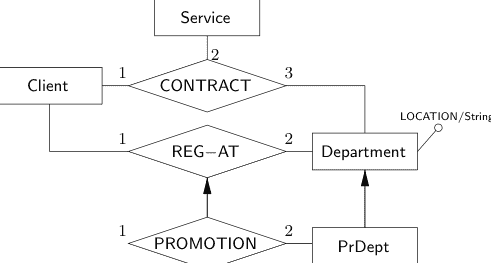

图 16.1. ER 模式示例。

图 16.1 展示了一个 ER 模式的示例。该模式建模了企业处理的关于客户与部门之间服务合同的信息，以及客户在部门的注册信息。某些客户可能注册在“促销部门”处。

为了将 ER 模型与描述逻辑（Description Logics）联系起来，最好有一个更正式的描述，这种描述也可以抽象出不同变体中存在的最重要的共同特征。

ER 模式-S 是从成两不相斥的实体符号、关系符号、ER 角色符号、属性符号和域符号集合开始构建的。每个域符号 $D$ 都有关联的预定义基本域 $D^B$，我们假设这些基本域是两两不相斥的。对于每个实体符号，定义了一个属性符号集合，并为每个属性关联一个唯一的域符号。元数为为 $n$ 的关系符号具有 $n$ 个关联的 ER 角色符号，每个角色对应一个实体符号，并定义了这些实体之间的关系。我们假设每个 ER 角色符号属于唯一的关系，从而确定了唯一的实体。基数约束由两个函数表示：`cmin`（从 ER 角色符号到非负整数）和 `cmax`（从 ER 角色符号到整数或特殊符号 $\infty$）。实体之间和关系之间的 IS-A 关系通过二元关系 $\le_S$ 建模。我们不需要对 $\le_S$ 的形式任何特殊假设，例如无循环性或单射性。

ER 模式的语义可以通过指定哪些数据库状态与模式所表示的信息结构一致来给出。形式上，对应于 ER 模式 $\mathcal{S}$ 的数据库状态 $\mathcal{B}$ 由一个非空有限集 $\Delta^\mathcal{B}$（假设其与所有基本域不相斥）以及一个函数 $\mathcal{B}$ 组成：

- 将每个域符号 $D$ 映射到相应的基本域 $D^{B_D}$；
- 将每个实体 $E$ 映射到子集 $E^B$；
- 将每个属性 $A$ 映射到集合 $A^B \subseteq \Delta^B \times \cup_{D \in D_S} D^{B_D}$；以及
- 将每个关系 $R$ 映射到 $\Delta^B$ 上的集合 $R^B$。

域 $\Delta^B$ 上的标记元组 $t$ 是从 ER 角色集合到 $\Delta^B$ 的函数。将 ER 角色 $u_i$ 映射到 $o_i$（对于 $i \in \{1,\dots,n\}$）的标记元组 $T$ 记为 $[U]$。我们也用 $T[U_i]$ 表示 $o_i$，并称之为 $T$ 的 $U_i$ 分量。$E^B, A^B$ 和 $R^B$ 的元素称为 $E, A$ 和 $R$ 的实例。

如果一个数据库状态满足模式模式的完整性约束，则被认为是接受的。这通过合法数据库状态（legal database state）的概念来捕捉。如果数据库状态 $B$ 对于 ER 模式 $S$ 是合法的，则它满足以下条件：

- 对于每对实体 $E_1, E_2$，若 $E_1 \le_S E_2$，则 $E_1^B \subseteq E_2^B$；
- 对于每对关系 $R_1, R_2$，若 $R_1 \le_S R_2$，则 $R_1^B \subseteq R_2^B$；
- 对于每个实体 $E$，如果 $E$ 有一个域为 $D$ 的属性 $A$，则对于每个实例 $e \in E^B$，恰好有一个元素 $a \in A^B$ 以 $e$ 为第一分量，且 $a$ 的第二个分量是 $D^{B_D}$ 中的元素；
- 对于元数为 $n$ 且连接实体 $E_1,\dots,E_n$ 的关系 $R$其中 $R$ 通过 ER 角色 $u_1,\dots,u_n$ 分别连接），其所有形式为 $\langle U_1:e_1,\dots,U_n:e_n \rangle$ 的 $R$ 实例都存在，其中 $e_i \in E_i^B, i \in \{1,\dots,n\}$。
- 对于关联实体 $E$ 的关系 $R$ 的每个 ER 角色 $U$，以及对于 $E$ 的每个实例 $e$，有：

`mins(U) \le |\{r \in R^B \mid r[U] = e\}| \le maxs(U)`

## 16.2. 将实体关系模式转换为 DLR 知识库

为了用 DL 知识库表示 ER 模式，我们利用描述逻辑 `DLR`，它在第 5 章中正式介绍。我们现在回想 `DLR` 的语法，它是 $n$ 元关系的自然泛化：特别是，属于 `DLR` 基本元素的、给定元数为 2 和 $n_{max}$ 的原子关系，除了概念表达式外，还可以根据以下语法形成任意的关系表达式：

```
$R := T_n \mid P \mid (i/n:C) \mid \neg R \mid R_1 \bowtie R_2$
```


$C := T_1 \mid A \mid \neg C \mid C_1 \sqcap C_2 \mid \exists[i]R \le k[i]R$

其中 **P** 和 **R** 分别表示原子关系和任意关系，$i$ 表示关系的分量，即 1 到 $n_{max}$ 之间的整数，$n$ 表示关系的元数，即 2 到 $n_{max}$ 之间的整数，$k$ 表示非负整数。在后续，当 $n$ 明显时，我们将 $(i/n:C)$ 简写为 $(i:C)$。此外，我们使用以下缩写：

$\exists[i|R] \text{ 用于 } \neg[i|R]$
$\ge (k+1)[i|R] \text{ 用于 } \le (k+1)[i|R]$
$\sqcap (\ge k[i|R]) \text{ 用于 } (\le k[i|R])$

在 DLR 中，$n$ 元关系被解释为元数为 $n$ 的元组，DLR 构造泛化了传统描述逻辑的构造。特别是概念和关系的布尔构造，$(i/n:C)$ 表示元数为 $n$ 的元组，其第 $i$ 个分量是概念 $C$ 的实例，因此表示选择。$\exists[i|R]$ 表示作为关系 $R$ 的第 $i$ 个分量的对象，因此表示投影。最后，$\le k[i|R]$ 是 $n$ 元关系的数量限制泛化。

我们通过定义从 ER 模式到 DLR 知识库的翻译 $\phi$，然后建立合法数据库状态与知识库模型之间的对应关系来捕捉 ER 模型的语义。在后续，对于 $S$ 中每个元数为 $n$ 的关系 $R$，我们用 $\mu$ 表示从 ER 角色集合到整数 $1, \dots, n$ 的映射。

从 ER 模式 $S$ 导出的知识库 $\phi(S)$ 定义如下：

- $\phi(S)$ 的原子概念集由 $S$ 中的实体和域符号组成。
- $\phi(S)$ 的原子关系集由 $S$ 中的关系和属性符号获得。具体而言：
- $S$ 中每个元数为 $n$ 的符号 $R$ 映射为 $\phi(S)$ 中的符号 $P_R$，表示元数为 $n$ 的关系。
    - $S$ 中的每个属性 $A$ 映射为 $\phi(S)$ 中的符号 $P_A$，表示元数为 2 的关系。因此，关系 $P_A$ 的每个实例都是一个元组，其第一个分量对应一个实体，第二个分量对应域的概念。
- $\phi(S)$ 的包含理集包含以下元素（为了简单，我们将 ER 模式的域建模为 DLR 中的概念）：

- 对于每对实体 $E_1, E_2$，若 $E_1 \le_S E_2$，包含公理 $E_1 \sqsubseteq E_2$；
- 对于每对关系 $R_1, R_2$，若 $R_1 \le_S R_2$，包含公理 $R_1 \sqsubseteq R_2$；
- 对于实体 $E_i$ 为 $D$ 的属性 $A$，包含公理 $E \sqsubseteq (\forall [P_A \sqcap (2:D)])$，$\pi = 1$ $[1]P_A$；
- 对于元数为 $n$ 且 ER 角色为 $U_1,\dots,U_n$ 并关联实体 $E_i$ 的关系 $R$，包含公理 $R \sqsubseteq \mu_R(U_1):E_1 \sqcap \dots \sqcap \mu_R(U_n):E_n$；
- 对于关联实体 $E$ 的关系 $R$ 的每个 ER 规则 $U$，基数约束 $m = min_s(U)$ 和 $n = cmax_s(U)$：
    - 如果 $m \neq 0$，包含公理 $E \sqgeq m \mu_R(U)P_R$；
    - 如果 $n \neq \infty$，包含公理 $E \sqsubseteq n \mu_R(U)P_R$。

根据 [Calvanese et al., 1999] 中的结果，可以形式地证明上述翻译的正确性。具体来说；令 $\mathcal{S}$ 为 ER 模式。那么，$\mathcal{S}$ 的合法数据库状态与 $DLR$ 知识库 $\phi(\mathcal{S})$ 的模型之间存在一一对应。例如，当且仅当 $\phi(\mathcal{S})$ 允许一个 $E$ 有非空扩展的模型时，实体 $E$ 才能填充到 $\mathcal{S}$ 的合法数据库中。这允许我们利用为逻辑 $DLR$ 开发的推理技术来对 ER 模式进行推理。

例如，通过将上述翻译应用于图 16.1 中的 ER 模式，我们之前得到了以下 $DLR$ 知识库：

```
CONTRACT \sqsubseteq ($1: Client) \sqcap ($2: Service) \sqcap ($3: Department)

REG-AT \sqsubseteq ($1: Client) \sqcap ($2: Department)

PROMOTION \sqsubseteq REG-AT ($2: PrDept)

Department \sqsubseteq \forall[1](LOCATION \sqcap ($2: String)) \sqcap = 1$ $[1]LOCATION

PrDept \sqsubseteq Department.
```

# A. Borgida, L. Lenzerini, and R. Rosati

## 16.2.3 实体-关系模型的扩展

ER 模型没有提供若干在表示数据之间复杂依赖关系时非常有用的功能。另一方面，描述逻辑（Description Logics）典型的构造的丰富性，以及在前一节中建立的两种形式形式之间的对应关系，使得能够将此类构造添加到基础模型中，并在对模式进行推理时充分考虑它们。作为与描述逻辑 *DLR* 对应关系的自然结果，我们提供了基础 ER 模型的若干扩展示例。我们还考虑了表达原始 ER 模型中的一种形式，它似乎迫使 *DLR* 本身进行扩展。

- *实体上的任意布尔构造。*基础 ER 模型能够表示的实体之间唯一的关系是 IS-A 关系。一种常见的扩展是所谓的*泛化层次*（例如 [Batini et al., 1992]），它允许表示一个实体的扩展应该是其他实体扩展的不交并集。这种构造可以利用 *DLR* 的并集模型和否定模型轻松地翻译。

- *沿 IS-A 层次的属性细化。*另一个应该考虑的重要扩展是指定沿 IS-A 层次的属性的复杂细化的能力，而不仅仅是简单的添加属性。这已经是最新面向对象模型的核心特征之一。特别是，可以通过限制值的范围来定义基数约束，并可以限制关系的参与度。人们可能要求实体的特定实例，其通过某些关系相关的对象属于比直接与 ER 角色关联的实体更具体的实体。此类形式的约束可以通过利用对关系进行全称量化，在 *DLR* 中自然地表示出来。

- *通过复杂属性定义类。*在 ER 模型（更广义地说在语义数据模型）中，只能指定实例（或更广义的类）必须满足的必要条件。在符合模式的数据库中，除非显式说明这一事实，否则无法推导出某个对象是某类的的实例。然而，在对复杂领域进行建模时，我们希望能够通过充分必要条件来定义对象类，甚至仅为对象作为某类的实例陈述充分条件。前者实际上对应于*视图*（views），视图是数据库模式的重要部分。通过使用 *DLR* 的不同类型的公理，可以很容易地施加充分必要（甚至仅是充分）条件，并使其成为模式的一部分。

- *键约束。*由于其在物理数据库设计中的用处，原始 ER 模型允许指定键属性/角色。用键约束（唯一标识对象的角色）扩展描述逻辑，一直是多项研究的主题 [Borgida and Weddell, 1997]。特别是，Calvanese 等人 [200b] 已经证明，对由键约束增强的 DLR 进行推理可以在不增加最坏计算复杂性的情况下进行。

- --- 信息，以及存在各种关于时间增强型实体-关系（ER）模型的提议。[Artale and Franconi, 1999; 2001; Artale et al., 2001] 为文献中发现的描述和扩展时间 ER 模型的各种属性提供了一种基于 DL 的逻辑形式化。特别是，[Artale et al., 2001] 定义了描述逻辑 DLR-us，这是带有时间时间构造的 DLR 扩展，并研究了此类逻辑中的可判定性和推理。

## 16.2.4 实体-关系模式的推理

用 DLR 提供 ER 模式的格式化允许支持对 ER 模式的多种形式的推理。支持 ER 模式 S 设计者的概念层面的典型推理任务（参见 [Calvanese et al., 1998e]）包括：

- 实体满足性，即对于每个概念 C，S 是否允许一个其具有非空扩展的模型。如果 C 必须始终有一个扩展，那么在它的规范中就存在不一致性，或者至少该概念命名不当，因为它是“空实体”（EmptyEntity）的同义词。

- 关系满足性，即 S 是否允许一个特定关系具有非空扩展的模型。（与上述相似）。

- ER 模式的一致性，即 S 是否允许一个有限模型。如果没有这一点，就没有数据库能满足该模式，这表明定义的总和是不一致的，或者需要一个无限模型，而这显然是缺乏正确性的表现。理想情况下，推理系统可以为不一致的来源提供解释 [McGuinness and Borgida, 1995; Borgida et al., 2000]，这可以集中搜索修改方案。

- ER 模式的冗余。可以检测到 ER 模式中各种形式的冗余：例如，如果 A, B 是实体且满足 A ⊊ B 和 B ⊆ A，我们可以得出其中一个实体是冗余的结论。

- 关系角色的强约束。概念和关系规范可能采用比设计者显式指定的更强的基数或定义域约束。（简单的例子是当我们允许（多）继承时）。

- 实体包含，即在 S 的每个模型中，概念 B 的扩展是否是另一个概念 A 的扩展的子集。这一属性建议设计者检查 B 和 A 之间可能遗漏显式 IS-A 关系。或者，如果概念上所有的 B 都不应该是 A，那么模式的其余部分就出了问题，它强制得出了不希望的结论。

- 关系包含，在 S 的每个模型中，一个关系的扩展是否是另一个关系的扩展的子集。（与上述相似。）

上述思路已得到追求，例如在 DWQ 项目 [Bouzeghough et al., 1999] 中，其中 DL 系统 Fact 被成功用于支持不同数据库模式的分析和集成 [Franconi and Ng, 2000]。

## 16.2.5 描述逻辑与其他数据模型

关于描述逻辑与其他数据模型之间的关系已经进行了其他几项研究：

- Bergamaschi and Nebel, 1994; Artale et al., 1996a; Calvanese et al., 1999] 使用描述逻辑提供了面向对象数据库系统的模型。

- Borgida et al., 1989; Beck et al., 1989; Bergamaschi and Sartori, 1992] 引入了基于描述逻辑的语义数据模型，这些与 ER 和之前的数据库模型不同。

- 更一般的，基于类的知识表示方案，如语义网络、概念结构和框架 [Lehmann, 1992; Sowa, 1991] 已被视为数据库模型，或丰富数据模型演绎能力的方法。这些与第四章中讨论的描述逻辑相关。

数据管理领域的一个近期重要发展是需要表示结构比传统数据库中僵化和严格的数据。此类半结构化数据在许多应用领域都很重要，例如信息系统、生物数据库和数字图书馆。半结构化数据既不是原始文本，也没有传统数据库系统那样严格类型。在最近的形式化中，半结构化数据通过带标签的图进行建模，标签保留了关于数据值和模式的信息。许多作者注意到这种模型与描述逻辑的本体论相一致，其中角色对应于边。[Calvanese et al., 1998c] 证明了丰富的描述逻辑不仅能够捕获半结构化模式，还能添加表示几种新类型约束的能力。类似的研究在 [Calvanese et al., 1999d] 中针对 XML 语言也进行了，XML 目前是半结构化数据的一种非常流行的形式化语言。

# 用于数据库的描述逻辑

网络上的数据（详情请参见第 4 章第 4.3.3 节）。

## 16.3 描述逻辑与数据库查询

我们已经看到描述可以用于表示数据库的模式（schema）。例如：

### 16.3 作为查询语言的描述逻辑

一旦查询被视为一个概念描述，我们就可以对其执行标准操作。例如，可以将查询描述与不一致的描述进行比较。如果它们等价，那么这几乎可以是用户的错误——谁会想询问一个永远不会返回对象的查询呢？最可能的原因是提问的人不熟悉应用领域。由于查询可能非常复杂，且模式可能很大，一个真正有用的系统将通过隔离查询和模式中负责矛盾的特定部分，来帮助用户理解问题。这种工具可以基于某些描述逻辑的解释功能来构建 [McGuinness, 1995; Borgida et al., 2000]。

更广泛地说，在查询在当前数据库中没有返回任何个体的情况下，人们认为该查询是“无意义的”，应该对其进行泛化，直到返回非空的结果集为止。正如 Anwar 等人 [1992] 所建议的，这种放松可以使用由包含关系（subsumption relationship）提供的描述半半来完成，这可以引导查询中术语的系统性弱化。

根据模式中的概念对查询进行分类。这可以帮助用户在不熟悉的领域提出查询，方法如下：如果结果集包含不需要的值，查询的直接上包含者（subsumers）和直接下包含者（subsumees）将揭示其他可能相关的概念（通过模式中的包含断言，还包括角色），用户可能希望使用它们来限制查询。结果是 Tou 等人 [1982] 引入的通过迭代细化进行查询规范的过程。

查询还可以相互之间分类为一个子包含层次结构。在一个几个人在很长一段时间对数据提出探索性问题的环境（例如，人类数据挖掘）中，将问题组织起来以便查阅之前查询的结果是非常有用的 [Brachman et al., 1992]。这避免了重复性工作，并且再次帮助用户使用更精确的查询。

遗憾的是，为了获得更具表现力的模式描述，描述逻辑付出了比通常更弱的语言的代价：查询只能返回现有对象的子集，而不是创建对象（在标准 SQL 数据库中）；此外，选择条件相当有限。事实上，已经证明 [Borgida, 1996]，即使是最近文献讨论的表达力最强的描述逻辑，也只能表示一阶逻辑中“3 变量”子集的变体——即使用 3 个变量但带有数值量词（如“存在至少 n 个”）的公式。

鉴于单用 DL 概念作为查询时存在表达力局限性，考虑用描述逻辑扩展标准查询（在 Datalog）是合理的。目前已经采取了两种不同的方法：其中一种受 Ait-Kaci 和 Nardi [1996] 关于 LOGIN 的启发，并以 AL-LOG 语言 [Donini et al., 1998b] 为例，描述本质上被用作 Horn 子句中出现的变量的类型约束。在这种情况下，一个关键的区别是，概念和角色名称与用于表示规则的关系形成一个不交集。第二种方法以 CARIN 语言 [Levy and Rousset, 1996, 1998] 为例，将概念和角色视为普通的一元和二元谓词，这些谓词也可以出现在查询原子中。这是重大的，因为它首次允许在 DL 数据库/Aboxes 上表示合取查询。

递归和非递归 Datalog 查询之间的第二个重要区别是：对于非递归情况（涵盖了大部分实际有用的查询），似乎可以将某些具有表达力的可判别描述逻辑与 Datalog 结合，同时保持查询回答甚至对查询的推理是可判定的（参见第 16.4 节）。对于递归情况，不可判定性出现得更快，但一些研究已经对 DL 语言和/或 Datalog 规则的形式提出了适当限制，以保持查询回答的可判定性。

首先考虑 `ALC-LOG`。在规则中：

```
$happy(x) \leftarrow \text{marriedTo}(x, y) \wedge \text{employedBy}(y, z) \wedge \text{Person}(x) \wedge \text{Person}(y) \wedge \text{StartUp}(z)$
```

符号 `&` 之后的测试是用于概念成员关系的，而之前的则是用于 $n$ 元关系的，如关系型数据库那样。此类查询的处理变得复杂，事实是 DL“类型数据库”可能包含析或或在其他方面不完整。得到的不是标准答案，而是“条件结果”，带有一个侧条件 $c$ 描述查询中变量的必要 DL 约束。例如，对于上述查询，可能会得到：

```
$happy(ANNA) \text{ if } Person(ANNA)$
```


位于一个包含 `marriedTo(ANNA, JOE)`, `employedBy(JOE, IBM)`, `Person(JOE)`, `StartUp(IBM)` 的数据库中。

Donni 等人 [1998b] 证明了在递归 $\mathcal{ALC}$-LOG 中回答查询在使用的查询为 $\mathcal{ALC}$ 时是可判定的。$\mathcal{ALC}$ 的框架在 [Rosati, 1999] 中进一步扩展到带有析或的 Datalog 情况。

CARIN 方法更通用，但这种表达力的增加是有代价的：对于允许 $\forall R$ 或 $\leq n$ 描述逻辑的所有 Datalog 规则，查询问题是不可判定的。关于何时判定的许多结果可以在 [Levy and Rousseau, 1998] 中找到。

### 16.3.2 查询优化

在查询可以分类的情况下（当它们是描述时），对查询进行分类被提出的*查询处理*。在 [Beck et al., 1989] 中，查询相对于模式分类；如果查询 $Q$ 被分类在 $C$ 下，则需要检查 $C$ 的实例。如果之前的查询答案被缓存，则查询概念可以留在层次结构中。结果是使用缓存视图进行查询回答的一种简单优化形式：找到包含查询的最特定视图 V；检查 V 的个体实例（本地可用），看它们是否满足查询。潜在地，在从多个站点收集信息时可以节省大量资源。

Buchheit 等人 [1994b] 通过更强大的查询语言阐述了这一点。特别是，为了实现完全一阶逻辑的表达力，表示查询被视为一个两个阶段的过程：查询尽可能地用“查询描述逻辑（产生所谓的结构部分）”编写，而查询的剩余部分以一阶逻辑约束的形式编写（产生所谓的脏部分）”。例如，以下查询询问导师与委员会主席相同且比学生大 5 岁的学生：

`QueryClass QueryStudent isa with derived`
`- I1: advisor: Prof`
`- I2: committee.(chair: Thing)`
`where I1/=I2 constraint forall s/QueryStudent(s.age + 5 < s.advisor.age).`

在这种情况下，假设缓存视图只有结构条件，则使用查询自身的结构条件对查询进行分类。之后，使用查询的结构部分脏部分对视图实例进行测试。

最后，Bergamaschi 等人 [1997] 研究了通过消除冗余项使用描述逻辑优化对象 DBMS 中的查询评估。这是通过首先使用模式中的信息尽可能扩展查询来实现的；例如，使用包含关系来测试规则的前件何时应用于查询（包含查询），以便将其后件添加到查询中。通过反复应用此过程，可以获得扩展后的查询。然后，逐个消除包含查询其余部分的查询子术语（它们是冗余的）。结果是一个语义等价的描述/查询，它可能比原始查询简洁；因此它需要的测试更少。此外，新的扩展查询可以在现有的类/视图层次结构中被进一步分类。

# 数据库的描述逻辑 517

通过使用早期的查询分类技术，提供了更高效的查询评估。这些是所谓的“语义查询优化”的形式。

与高效处理大量个体（individuals）相关的问题是：用户需要针对概念模型查询 DL 实例，而数据是以关系型数据库（例如）呈现的。换句话说，我们需要从数据库中获取 DL 查询（涉及概念和角色）的适当 ABox 实例。主要问题在于，使用 DL 技术处理成千上万个体是不可行的，因为在每种情况下我们都尝试进行复杂的推理。然而，数据库中的大多数数据是非常直观的，相应的个体并不会产生新的推理。[Borgida and Brachman, 1993] 提出的解决方案是将 DL 知识库的原始概念（相应角色）与定义在 DBMS 之上的一元（相应二元）视图相关联。人们就可以将复杂的描述翻译为针对这些视图的 SQL 查询。重要的效果是，可以充分利用 DBMS 对 SQL 查询的优化，而且如果只有少数结果满足查询条件，则只需要创建少数几个个体。例如，对于一个原始 DL 类 `Student`，我们可以取关系表 `Enrollment_R` 中 `enrolee` 列中出现的值，并使用 `Person_R` 表的这个子集在只有一个列的特殊视图 `Student_R` 中生成适当的个体。（为这些个体生成唯一标识符本身也是一个研究问题）。同样，例如，将生成一个对应于角色 `visitor` 的两列视图 `visitor_R`。然后，将关于 `Student` 和 `visitor` 的复杂描述通过算法翻译为针对相应视图的 SQL 查询。事实证明，为了正确处理多个查询和功能性角色，额外的优化是必要的 [Borgida and Brachman, 1993]。

## 16.4 数据集成

整合不同的数据源是数据库社区在过去几十年面临的基础问题之一 [Batini et al., 1986]。通而言之，数据集成系统的目标是为各种数据源提供一个统一的接口 [Levy, 2000]，以便使用户专注于指定他们想要的内容。结果，数据集成系统将用户从诸如寻找相关数据源、孤立地与每个源交互，以及从多个源选择、清洗和组合数据等任务中解放出来。

数据集成系统的设计是一项非常复杂的任务，包含几个不同的方面。我们在本节中的目标是讨论描述逻辑在两个重要方面的使用，即：

- 各种数据源内容的指定。
- 基于对源的指定，计算对数据集成系统提出的查询答案的过程。

### 16.4.1 指定数据源的内容

数据集成系统的典型架构允许人们在不同层次上显式地建模数据和信息需求——即系统提供给用户的数据指定：

- *概念层*（conceptual level）包含了源和协调后的集成数据的概念性表示，连同关于它们组件之间关系的显式声明性说明。
- *逻辑层*（logical level）包含用逻辑数据模型表示的源的表示。

**概念层** 正如我们之前看到的，概念层包含了对概念、概念之间的关系以及集成应用必须处理的信息要求的正式描述。该层级的关键特征是，这种描述独立于任何系统考虑，并以表达应用程序语义为目标。特别是，我们区分了以下元素：

- *企业概念模式*（Enterprise Conceptual Schema*）是应用程序感兴趣的全局概念和关系的表示。它大致对应于传统模式集成方法中的全局概念模式概念，以及 [*Levy et al., 1995; Kirk et al., 1995*] 中引入的*世界视图*（world view）概念。
- 对于信息源 *S*，*S* 的*概念模式*（Conceptual Schema）是位于 *S* 中的数据的概念表示。
- 术语*领域概念模式*Domain Conceptual Schema）表示企业概念模式与各种源概念模式的并集，加上可能的模式间关系 [*Catari and Lenzerini, 1993]。

我们在第 16.2 节已经看到，在概念层进行建模如此良好，因此描述逻辑也被用于数据集成项目以表示源概念模式和企业概念模式 [Catari and Lenzerini, 1993; Arens et al., 1993; Levy et al., 1995; Goasdoue et al., 2000]。在本节中，遵循 [Calvanse et al., 1998e]，我们将继续使用 DLR 来指定这些概念模式。

如上所述，领域概念模式包含模式间关系。特别是，由于系统对这些源感兴趣，集成并不简单意味着产生企业概念模式，而是能够在源概念模式与企业概念模式之间建立正确的相互依赖关系。

为了指定模式间关系，我们利用 DL 推理中使用的特殊类型断言。特别是，遵循 [Catarci and Lenzerini, 1993]，可以使用以下形式的断言：

```
$L_i \subseteq_{ext} L_j$
```

```
L_i \subseteq_{int} L_j
```

$L_i$ 和 $L_j$ 具有相同的元（arity）。直观地说，第一个断言表示 $L_i$ 在扩展上包含在 $L_j$ 中，这意味着 $L_i$ 中的每个对象都满足 $L_j$。第二个断言表示 $L_i$ 表示的概念是 $L_j$ 的子概念。

```
$L_i \subseteq_{ext} L_j$
```

```
$L_i \subseteq_{int} L_j$
```


值得注意的是，DLR 允许对模式间进行复杂的推理 [Catarci and Lenzerini, 1993; Calvanese et al., 1998]。

520 A. Borgida, M. Lenzerini, and R. Rosati

## 逻辑层

逻辑层提供了每个源内容的逻辑表示，称为*源模式*（Source Schema）。所谓的封装器（wrappers）可以用来隐藏源、其采用的数据模型，并将源呈现为一组关系。

源的逻辑表示与领域概念模式之间的链接可以通过两种方式指定：

- 根据所谓的*全局即视图*（global-as-view）方法，查询与领域概念模式中的每个概念关联。每个此类概念被视为一个视图。
- 在另一种*局部即视图*（local-as-view）方法中，每个关系关联一个描述其内容的查询。换句话说，源的内容是通过视图描述的。

在 [Levy, 2000] 中，认为局部即视图具有许多优势，我们将遵循这种方法。

为了通过视图描述源的内容，需要一种类似于领域概念模式的连接查询的查询概念。具体来说，源关系是通过如下形式的查询描述的：

> $q(\mathbf{x}) \leftarrow conj_1(\mathbf{x}, \tilde{\mathbf{y}}_1) \vee \dots \vee conj_m(\mathbf{x}, \tilde{\mathbf{y}}_m)$

其中：

- 头部 $q(\mathbf{x})$ 根据名称和列数定义关系的模式。
- 现体根据领域概念模式描述关系的内容。

在 [Calvanese et al., 2001c] 中，$conj_j(\mathbf{x}, \tilde{\mathbf{y}}_i)$ 是原子的合取，$\mathbf{x}, \tilde{\mathbf{y}}_i$ 是合取中出现的所有变量（我们用 $\mathbf{x}$ 表示变量元组 $x_1, \dots, x_n$，对于某个 $n$）。每个原子的形式为 $E(t)$、$R(t)$ 或 $A(t, t')$，其中 $t, t'$ 是 $\mathbf{x}, \tilde{\mathbf{y}}_i$ 中的变量或常量，且 $E$、$R$ 和 $A$ 分别是领域概念模式中出现的实体、关系和属性。

查询的语义如下。给定一个满足领域概念模式的数据库，元为 $n$ 的查询 $q$ 被解释为 $n$- 元组 $(d_1, \dots, d_n)$ 的集合，其中每个 $d_i$ 是数据库的对象，且这些

当用每个 $d_i$ 替换为 $x_i$ 时，公式

$\exists y_1.conj_1(\tilde{x}, \tilde{y}_1) \vee \dots \vee \exists y_m.conj_m(\tilde{x}, \tilde{y}_m)$

结果为真。
与概念层的情况类似，对数据的 DL（描述逻辑）表示执行若干推理任务是非常有趣的，例如推断存储在不同源中的数据之间的冗余和/不一致性。由于包含概念模式（Conceptual Schema）原子的查询具表现力，因此需要新的算法来解决以下问题：

- *查询包含（Query containment）。* 给定两个查询 $q_1$ 和 $q_2$（具有相同的元数 $n$），检查 $q_1$ 是否包含在 $q_2$ 中，即检查在满足概念模式的数据库中，$q_1$ 表示的元组集是否包含在 $q_2$ 表示的元组集内。包含此问题相关结果论文有 [Levy and Rousset, 1998; Calvanese et al., 1998a; Goasdoue and Rousset, 2000]。
- *查询一致性（Query consistency）。* 检查针对概念模式的查询 $q$ 是否一致，即检查是否存在一个满足概念模式的数据库，其中 $q$ 表示的元组集为空。
- *查询不交性（Query disjointness）。* 检查针对概念模式的两个查询 $q_1$ 和 $q_2$（具有相同的元数）是否不交，即检查在每一个满足概念模式的数据库中，$q_1$ 表示的元组集与 $q_2$ 表示的元组集的交集是否为空。

### 16.4.2 查询回答

数据集成系统的最终目标是允许用户在全局视图（global view）上提出查询，并通过通过透明的方式访问源来回答查询。回答查询的机制取决于用于指定源采用的方法。对查询进行推理的能力为“全局即视图”（global-as-view）和“局部即视图”（local-as-view）方法都能提供有用的支持。与上一小节一样，这里我们关注局部即视图方法，这是查询回答最复杂的方法。

在局部即视图方法中，源处的关系被建模在由领域概念模式（Domain Conceptual Schema）表示的虚拟数据库上。由于数据库是虚拟的，为了回答在领域概念模式上定义的查询 $Q$，我们只能使用源视图。换句话说，查询处理不能简单地像传统数据库那样通过查看关系集完成，而是需要对查询的形式和源视图的内容进行推理。这催生了这样想法：数据集成中的查询回答变成了基于视图的查询处理问题。基于视图的查询处理有两种方法，分别称为查询重写（query rewriting）和查询回答（query answering）。

在前一种方法中，我们给定一个查询 $Q$ 和一组视图定义，目标是将查询重写为一个等价表达式，该表达式引用可用的视图并提供 $Q$ 的答案。

在后一种方法中，除了 $Q$ 和视图定义外，目标是计算由这些扩展蕴含的元组集，即在所有与视图一致的数据库中满足 $Q$ 的元组集 $t$。

注意这两种方法之间的区别。在查询重写中，查询处理分为两个步：第一步使用基于视图名称字母表的给定查询语言重新表达查询；第二步在视图扩展上对重写求值。在查询回答中，我们不对查询处理设置任何限制，唯一目标是利用所有可能的信息（包括视图扩展）来计算查询的答案。

基于视图的查询处理已被数据库社区广泛研究 [Levi, 2000]。直到最近，人们才针对领域概念模式表示为描述逻辑的情况进行该问题的研究。例如，[Baader et al., 2000] 处理了关于概念模式中概念的查询重写问题。针对更通用的查询（例如涉及原子概念的查询）的查询重写已 [Beeri et al., 1997; Levy and Rousset, 1998; Goasdou et al., 2000; Calvanese et al., 2001] 中得到研究，在某些情况下还考虑了作为概念模式部分的用描述逻辑表示的复杂约束。必须解决的问题之一是，由于组合视图语言的限制，原始查询 $Q$ 可能无法重写为基于视图的表达式。在这种情况下，必须找到启发式的最佳近似（例如通过消除某些视图中不必要的查找）。

最后，我们提到 Goasdou 等人 [2000] 描述了一个已实现的信息集成系统，该系统结合了全局即视图和受限局部即视图方法，应用于 ALN DL 和非递归 Horn 规则。

解决查询问题的先驱尝试之一是描述逻辑的 Manifold 系统 [Levi et al., 1996; 1995]，它具有查询重写的算法。在异构数据库的背景下，Mena 等人 [2000] 建议每个源都有自己的概念模式，并通过添加概念间的包含（subsumption）关系使其相互关联。（这让人想起 Cataraki 和 Lenzini, 1993。）该系统的有趣特征之一是它考虑了某些查询可能无法用视图表示这一事实。Calvanese 等，2000 展示了描述逻辑中的 ABox 推理。

## 16.5 结论

我们回顾了描述逻辑在数据库开发和利用中的多种用途。可能最成功的应用是需要 UoD（统一数据）概念模型的领域。关于初始开发：第一，描述逻辑足以捕捉实体关系模型以及其他数据模型表示的领域语义。第二，由于描述逻辑具有清晰的语义，模型的含义是无歧且精确的。第三，不仅可以表示信息，还可以对信息进行推理：可以寻找不一致的类/实体定义（无法拥有实例的），更通用地说，可以检查整个模型的一致性。这两者都是开发者建模错误的信号。可以说，这第三方面——对模型的推理——是 DL 模型最大的优势。

表示 UofD 语义的能力也是描述逻辑在从各种源集成信息时（例如异构或联邦数据库）非常有用的原因。人们广泛认为集成需要在概念层实现。可以使用描述逻辑定义每个站点的本体，然后让这些本体相互关联；或者，指定一个全局本体，然后将站点描述为该本体的视图。

描述逻辑作为数据库的查询（或视图！）与关系数据库已知的标准代数相比，它们的表达能力有限，而且它们无法生成新对象——只能选择现有对象的子集。

然而，如果接受描述逻辑作为数据模型，那么 DL 查询可以相对于模式概念和进行分类。包含关系也可以用于语义查询优化。将描述逻辑与 Datalog 规则结合，或至少支持概念的连接查询，是获取具表现力查询语言的一种有前景的方法。如果规则不是相对快速，结果查询的评估在广泛的描述逻辑范围内是可判定的。然而，完全递归对于实际应用（如信息集成）并非所必需，因此对描述逻辑与 Datalog 限制的可能组合进一步研究是有必要的。

# 附录

## 描述逻辑术语

Franz Baader

## 摘要

本附录的目的是以（简明的方式）介绍本手册中出现的最显著的描述逻辑（DLs）的语法和语义。更多信息、解释以及一些较不熟悉的描述逻辑可以在相应的章节中找到。对于语义无法以简明方式描述的描述逻辑 构造子，我们只介绍其语法，并让读者查阅相关章节以获取语义。在读完关于基础描述逻辑的第 2 章后，我们将首先介绍基础描述逻辑 $\mathcal{AL}$，然后描述它的几种扩展。通过这种方式，我们将固定本手册中所使用的符号表示。最后，我们对文献和本手册中采用的描述逻辑命名方案进行说明。

### A.1 符号约定

在开始定义之前，让我们先介绍一些符号约定。字母 $A, B$ 通常用于原子概念描述。对于角色（roles），我们经常使用字母 $R, S$，对于功能角色（functional roles，即属性）使用字母 $f, g$。非负整数（数量限制）通常用 $n, m$ 表示，个体（individuals）用 $a, b$ 表示。在所有情况下，我们都可能使用下标。这种约定在定义语法和语义时被遵循。在具体示例中，使用了以下约定：概念名称以大写字母开头，后跟小写字母（例如 **Human**, **Male**）；角色名称（包括功能性的）以小写字母开头（例如 **hasChild**, **marriedTo**），而个体名称全大写（例如 **CHARLES**, **MARY**）。

## A.2 常用描述逻辑的语法和语义

在本节中，我们将介绍标准的概念和角色构造子以及知识库。更多信息请参见第 2 章。

### A.2.1 描述

基础描述是*原子概念*和*原子角色*（也称为*概念名称*和*角色名称*）。复杂描述可以通过*概念构造子*和*角色构造子*从它们递归构建。$\mathcal{AL}$ 中的概念描述根据以下语法形成：

```
$C, D \longrightarrow A \mid \text{(原子概念)}$
$T \mid \text{(全概念)}$
$\perp \mid \text{(空概念)}$
$\neg A \mid \text{(原子否定)}$
$C \cap D \mid \text{(交集)}$
$R.C \mid \text{(值限制)}$
$\exists R.T \mid \text{(有限存在量化)}$
```

根据我们的约定，$A$ 表示原子概念，$C, D$ 表示概念构造子，$\mathcal{AL}$ 不提供角色构造子。一个*解释* $\mathcal{I}$ 包含一个非空集 $\Delta^\mathcal{I}$（解释域）和一个解释函数，该函数为每个原子概念 $A$ 分配一个集合 $A^\mathcal{I} \subseteq \Delta^\mathcal{I}$，为每个原子角色 $R$ 分配一个二元关系 $R^\mathcal{I} \subseteq \Delta^\mathcal{I} \times \Delta^\mathcal{I}$。解释函数通过以下定义扩展到概念描述：

```
$T^\mathcal{I} = \Delta^\mathcal{I}$
$\perp^\mathcal{I} = \emptyset$
$\neg A^\mathcal{I} = \Delta^\mathcal{I} \setminus A^\mathcal{I}$
$(C \cap D)^\mathcal{I} = C^\mathcal{I} \cap D^\mathcal{I}$
$(R.C)^\mathcal{I} = \{(a, b) \in \Delta^\mathcal{I} \mid (a, b) \in R^\mathcal{I} \wedge b \in C^\mathcal{I}\}$
$(\exists R.T)^\mathcal{I} = \{a \in \Delta^\mathcal{I} \mid \exists b. (a, b) \in R^\mathcal{I} \wedge b \in T^\mathcal{I}\}$
```


扩展 $\mathcal{AL}$ 以获得更具表达能力的描述逻辑有多种可能性。三个三个添加额外的概念构造子、角色构造子以及角色限制。我们将从第三种开始，因为在定义概念构造子时我们需要引用角色限制。对于这些扩展，我们还引入了一种命名方案：基本上每个扩展都分配一个字母或符号。对于构造子，在基础 $\mathcal{AL}$ 之后写字母/符号；对于角色构造子，我们将字母/符号作为上标；对于角色解释的限制，作为子类。限制强制角色的解释满足某些属性，如功能性和传递性。我们详细考虑这两个显著例子：

1. 功能角色。在这里考虑角色集 `N_R` 的一个子集 `N_F`；其元素被称为特征（features）。解释可以将特征 `f` 映射到二元关系 `f^I ⊆ Δ^I × Δ^I`，即写作 `f^I(a)=b` 而不是 `f^I(a,b)`。
2. 传递角色。在这里考虑 `N_R` 的一个子集。角色名称被称为传递角色。解释可以将传递角色 `R ∈ N_{R^+}` 映射到二元关系 `R^+ ⊆ Δ^I × Δ^I`。

## 概念构造子

概念构造子获取概念或角色描述并将其转换为复杂的描述。表 A.1 显示了概念构造子的语法和语义。为了将所有内容放在一起，我们还重复了 $\mathcal{AL}$ 中的原子否定和有限存在量化，因为它们是特殊情况。这里有一些说明性备注：对于功能角色链 `u1, u2`，即 `u1 = f1 … fm` 和 `u2 = g1 … gn`，其中 `n, m ≥ 0` 且 `fi, gj` 是特征。这种链的语义由其组件的复合给出，即 `u1^I(a) = fm^I(…(f1^I(a))…)`。概念表达式中的名词（或个体）被解释为包含域中一个元素的单元素集合。我们假设个体来自与概念和角色名称集不交的命名空间。也可以将角色层级视为施加了此类限制。在这里，我们将不再处理。

表 A.1. 一些描述逻辑概念构造子。

| 名称 | 语法 | 语义 | 符号 |
| :--- | :--- | :--- | :--- |
| 全概念 | `T` | | `A` |
| 空概念 | `⊥` | | `A` |
| 交集 | `C ∩ D` | `C^I ∩ D^I` | `A` |
| 并集 | `C ∪ D` | `C^I ∪ D^I` | `U` |
| 否定 | `¬C` | `Δ^I \ C^I` | `C` |
| 值限制 | `∀R.C` | `∀b. (a, b) ∈ R^I → b ∈ C^I` | |
| 存在量化 | `∃R.C` | `{a ∈ Δ^I ∣ ∃b. (a, b) ∈ R^I ∧ b ∈ C^I}` | `E` |
| 无限制数量 | `≥ n` | `{a ∈ Δ^I ∣ |(a, b) ∈ R^I| ≥ n}` | `N` |
| 有限制数量 | `≤ n` | `{a ∈ Δ^I ∣ |(a, b) ∈ R^I| ≤ n}` | |
| 限制 | `= n` | `{a ∈ Δ^I ∣ |(a, b) ∈ R^I| = n}` | |
| 有限制存在 | `≥ R.C` | `{a ∈ Δ^I ∣ ∃b. (a, b) ∈ R^I ∧ b ∈ C^I} ≥ n` | `Q` |
| 限制存在 | `≤ R.C` | `{a ∈ Δ^I ∣ ∃b. (a, b) ∈ R^I ∧ b ∈ C^I} ≤ n` | |
| 限制存在 | `= R.C` | `{a ∈ Δ^I ∣ ∃b. (a, b) ∈ R^I ∧ b ∈ C^I} = n` | |
| 角色值映射 | `R ⊆ S` | `∀b. (a, b) ∈ R^I → b ∈ S^I` | |
| 角色值映射 | `R = S` | `∀b. (a, b) ∈ R^I ↔ b ∈ S^I` | |
| 一致 | `u1 = u2` | `{a ∈ Δ^I ∣ ∃b. u1^I(a) = b = u2^I(a)}` | `F` |
| 不一致 | `u1 ≠ u2` | `{a ∈ Δ^I ∣ ∃b1, b2. u1^I(a) ≠ b1 = u2^I(a)}` | |
| 名词 | `I` | `I^I ⊆ Δ^I` | `O` |

## 描述逻辑术语

表 A.2. 概念构造符的具体语法。

| 名称 | 具象语法 | 抽象语法 |
| --- | --- | --- |
| Top | `TOP` | `top` |
| Bottom | `BOTTOM` | `⊥` |
| 交集 | `(and C1 … Cn)` | `C1 ∩ … ∩ Cn` |
| 并集 | `(or C1 … Cn)` | `C1 ∪ … ∪ Cn` |
| 否定 | `(not C)` | `¬C` |
| 值限制 | `(all R)` | `∀R.C` |
| 限制存在量化 | `(some R)` | `∃R.T` |
| 存在量化 | `(some R)` | `∃R.C` |
| 至少数量限制 | `(at-least n R)` | `≥ n R` |
| 最大数量限制 | `(at-most n R)` | `≤ n R` |
| 精确数量限制 | `(exactly n R)` | `= n R` |
| 限定至少限制 | `(at-least n C)` | `≥ n R.C` |
| 限定最大限制 | `(at-most n C)` | `≤ n R.C` |
| 精确数量限制 | `(exactly n C)` | `= n R.C` |
| 相同、一致 | `(same-as u1 u2)` | `u1 = u2` |
| 角色-值映射 | `(subset R1 R2)` | `R1 ⊆ R2` |
| 角色填充符 | `(fillers I1 … In)` | `∃R.I1 ∩ … ∩ ∃R.In` |
| 择一 | `(one-of I1 … In)` | `I1 ∪ … ∪ In` |

表 A.3. 某些描述逻辑角色构造符。

| 名称 | 语法 | 语义 | 符号 |
| --- | --- | --- | --- |
| 通用角色 | `U` | `Δ^I × Δ^I` | `U` |
| 交集 | `R ∩ S` | `R^I ∩ S^I` | `∩` |
| 并集 | `R ∪ S` | `R^I ∪ S^I` | `∪` |
| 补集 | `R^-` | `{(b,a) ∈ Δ^I × Δ^I ∣ (a,b) ∈ R^I}` | `-1` |
| 复合 | `R ∘ S` | `R^I ∘ S^I` | `∘` |
| 传递闭 | `R^+` | `U_{≥1}(R^I)^*` | `+` |
| 反映传递闭 | `R^*` | `U_{≥0}(R^I)^*` | `*` |
| 角色限制 | `R|_C` | `R^I ∩ (Δ^I × C^I)` | `r` |
| 恒等 | `id(C)` | `{(d,d) ∣ d ∈ C^I}` | `id` |

### 表 A.4. 角色构造符的具体语法。

| 名称 | 具象语法 | 抽象语法 |
|---|---|---|
| 通用角色 | `top` | `U` |
| 交集 | `(and R1 … Rn)` | `R1 ∩ … ∩ Rn` |
| 并集 | `(or R1 … Rn)` | `R1 ∪ … ∪ Rn` |
| 补集 | `(not R)` | `¬R` |
| 逆 | `(inverse R)` | `R^-` |
| 复合 | `(compose R1 … Rn)` | `R1 ∘ … ∘ Rn` |
| 传递闭 | `(transitive-closure R)` | `R^+` |
| 反映传递闭 | `(reflexive-transitive-closure R)` | `R^*` |
| 角色限制 | `(restrict C)` | `R|_C` |
| 恒等 | `(identity C)` | `id(C)` |

迭代复合以形式 `(R^I)^n` 表示。更精确地说，`(R^I)^0 = {(d, d) ∣ d ∈ Δ^I}` 且 `(R^I)^{n+1} = (R^I)^n ∘ R^I`。传递闭和反映传递闭是目前引入的构造符中唯一无法用一阶逻辑表示的。角色构造符的 Lisp 风格语法可参见表 A.4。

## A.2 知识库

DL 知识库通常由一组术语公理（通常称为 TBox）和一组断言公理（通常称为 ABox）组成。角色构造符的 Lisp 风格语法可参见表 A.4。

表 A.5. 术语公理与断言公理。

| 名称 | 语法 | 语义 |
| --- | --- | --- |
| 概念包含 | `C ⊑ D` | `C^I` |
| 角色包含 | `R ⊆ S` | `R^I` |
| 概念相等 | `C ≡ D` | `C^I` |
| 角色相等 | `R ≡ S` | `R^I` |
| 概念断言 | `C(a)` | `C^I` |
| 角色断言 | `R(a, b)` | `R^I` |

表 A.6. 公言的具体语法。

| | 具象语法 | 抽象语法 |
| --- | --- | --- |
| 概念定义 | `(define-concept A)` | `A` |
| 概念包含 | `(implies C D)` | `C ⊑ D` |
| 角色包含 | `(subset R S)` | `R ⊆ S` |
| 概念相等 | `(equal C D)` | `C ≡ D` |
| 角色相等 | `(equal R S)` | `R ≡ S` |
| 概念断言 | `(instance C a)` | `C(a)` |
| 角色断言 | `(rel R a b)` | `R(a, b)` |

## A.3 额外构造符

这里提到了某些在书中出现的额外构造符。

## 描述逻辑术语

仅有男性后代（参见第 2 章关于循环 TBox 的相应示例）。

第 5 章还考虑了描述逻辑 `DLR`，在该逻辑中，对大多数二进制谓词的限制执行更为严格。如果 `R` 是一个 `n` 元谓词，`i ∈ {1,…,n}`，且 `k` 是一个非负整数，那么

```
∃[i]R
```

表示收集在 `R` 的某个元组中作为第 `i` 个组件出现的个体的概念，以及

```
≤ k[i]R
```

表示收集所有个体 `d`，使得谓词 `R` 包含最多 `k` 个第 `i` 个组件为 `d` 的元组。相反，如果 `C` 是一个概念，`n` 是一个非负整数，`i ∈ {1,…,n}`，那么

```
ι/n : C
```

表示由第 `i` 个组件属于 `C` 的元组组成的 `n` 元谓词。描述逻辑 `DLR` 还允许对概念和谓词使用布尔运算符。

### A.3.2 公理

除了上述引入的术语公理语义外，第 2 章还考虑了循环 TBox 的不动点语义。

第 6 章引入了扩展 DL 系统术语部分和断言部分的几种方法。带有*具体域*（concrete domains）的描述逻辑可以在 ABox 的断言中使用如下形式的具体谓词进行断言：

```
P(x1,…,xn),
```

其中 `P` 是底层具体域的 `n` 元谓词，`x1,…,xn` 是具体个体的名称。

在描述逻辑的某些*模态扩展*中，可以将模态和布尔运算符应用于术语公理和断言：如果 `φ, ψ` 是公理，那么以下项也是公理：

```
φ ∧ ψ, ¬φ, □φ
```


> $^{2$ 注意，对谓词的否定具有非标准语义（详情见第 5 章）。

在描述逻辑的概率扩展中，可以使用如下形式的概率术语公理：

`$P(C|D) = p,$`

它表示一个已知属于 `$D$` 的对象属于 `$C$` 的条件概率为 `p`。

将 Reiter 的默认逻辑整合到描述逻辑产生了如下形式的术语默认：

`$C(x) : D(x)/E(x),$`

其中 `C, D, E` 是概念描述（视为具有一个自由变量 `x` 的一阶逻辑式）。直观上，这种默认规则可以应用于 ABox 个体 `a`，即：如果该个体的前提 `C(a)` 已被相信，且其正理由 `D(a)` 与当前信念集一致，则向当前信念集添加 `E(a)`。

如下形式的规则

`$C \Rightarrow E$`

（如第 2 章中所示）可以被看作正理由为空的术语默认的特例。它们的直观含义是：“如果已知某个个体是 `C` 的实例，则添加它也是 `E` 实例的信息。”

## A.4 关于描述逻辑命名方案的说明

在 A.2 中，我们引入了一种用于描述逻辑的命名方案，该方案通过将角色构造器的字母/符号写为上标，将角色解释的限制写为下标，扩展了第 2 章引入的 `$\mathcal{AL}$` 族命名方案。其原因是这产生了一种一致的命名方案，在字形上区分了扩展 `$\mathcal{AL}$` 表达能力的三种不同可能性。

在文献以及本书中，也采用了其他的命名方案。除了这些方案随时间演变之外，另一个原因是非常难读出如 `$\mathcal{ALQ}_{R^{-1}}$` 这样的名称。我们将指出最著名的此类命名方案。

历史上第一种方案是第 2 章引入的 `$\mathcal{AL}$` 族，并在附录中进行了扩展。然而，在文献中，通常不对角色构造器、概念构造器和角色的限制进行字形上的区分。例如，许多论文使用 `$\mathcal{I}$` 表示逆角色，使用 `$\mathcal{R}$` 表示交集，使用 `$\mathcal{H}$` 表示角色层次。因此，`$\mathcal{ACRI}$` 是通过交集和逆角色扩展 `$\mathcal{AL}$`，而 `$\mathcal{ALCH}$` 表示通过角色层次扩展 `$\mathcal{AL}$`。在某些情况下，字母 `$\mathcal{F}$`（我们用于表示属性一致和不一致）具有不同的含义。下标“trans”（或“reg”）通常用于表示角色的并集、复合和传递闭（有时包括恒等角色）。语言名称前的希腊字母 `$\mu$`（如 `$\mu\mathcal{AL}$`）通常表示通过不动点运算符对该描述逻辑进行扩展。

`$\mathcal{AL}$` 族的所有成员都包含 `$\mathcal{AC}$`。在某些情况下，并非 `$\mathcal{AL}$` 的所有构造器都出现在语言中。描述逻辑 `$\mathcal{FL}^-$` 是通过禁止原子否定得到的 `$\mathcal{AL}$`，而 `$\FL^{-}$` 是是通过有限的存在量化得到的。如果这些语言通过其他构造器扩展，可以类似于扩展 `$\mathcal{AL}$` 的方式指示。例如，`$\mathcal{FL}^U$` 表示通过概念并集扩展 `$\mathcal{FL}^-$`。

到为止提到的所有描述逻辑都包含概念交集和值限制作为核心。允许概念交集和存在量化（但不包含值限制）的描述逻辑收集在 `$\mathcal{EL}$` 族中。`$\mathcal{EL}$` 中可用的构造只有概念交集和存在量化。`$\mathcal{EL}$` 的扩展再次通过添加相应的字母/符号获得。

为了避免描述逻辑名称过长，引入了 `S` 来表示 `$\mathcal{ALCR}^+$`，即通过传递角色扩展 `$\mathcal{AL}$` 的描述逻辑。`S` 族的重点成员包括 `SIN`（通过数量限制和逆角色扩展 `$\mathcal{ALCR}^+$`）、`SHIF`（通过角色层次和形式为 `$\le R$` 的限制扩展 `$\mathcal{ALCR}^-$`）以及 `SHIQ`（通过角色层次、逆角色和限定限定数量限制扩展 `$\mathcal{ALCR}^+$`）。实际上，描述逻辑 `SIN`、`SHIF` 和 `SHIQ` 的名称与其特征并不完全对应，因为角色在数量限制中的用法在某些地方是有功能的，但在其他地方可能是非功能性的。前一节提到的描述逻辑 `DLR` 也产生了一个描述逻辑族，其成员如 `DLR_{reg}`，它通过将 `n` 元谓词投影到二进制组件得到的关系的并集、复合和传递闭来扩展 `DLR`。

## 538 参考文献

[Ait-Kaci and Nasr, 1986] H. Ait-Kaci and R. Nasr. LOGIN: 一种内置继承的逻辑编程语言。J. of Logic Programming, 3:185-215, 1986.

[Albano, et., 1991] Antonio Albano, Giorgio Ghelli, and Renzo Orsini. 强面向对象数据库编程语言中的关系机制。In Proc. of the 17th Inf. on Very Large Data Bases (VLDB91), pages 565-575, 巴塞罗纳 (西班牙), 1991.

... 
