# 发展性信息技术：提高政策一致性

## 发展维度

### 促进发展的通信技术

#### 提高政策一致性

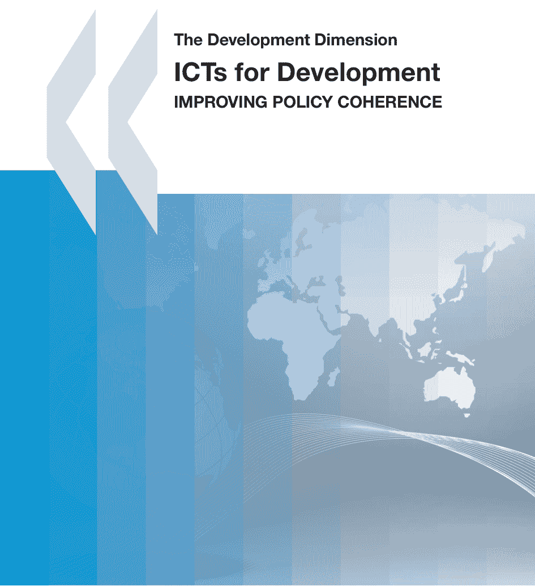

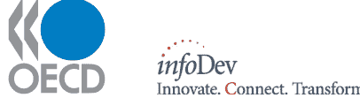

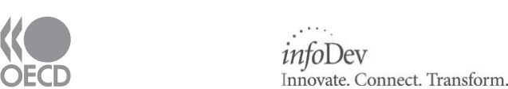

## 经济合作与发展组织

经合发展组织（OECD）是一个独特的论坛，30个民主国家的政府共同努力，应对全球化带来的经济、社会和环境挑战。OECD在理解和帮助政府应对新发展和新关注方面处于前沿，例如公司治理、信息经济以及人口老龄化挑战。该组织提供了一个平台，使各国可以在此比较政策经验、寻求共同问题的答案、识别良好实践并协调国内和国际政策。

OECD成员国包括：澳大利亚、奥地利、比利时、加拿大、捷克、丹麦、芬兰、法国、德国、匈牙利、冰岛、爱尔兰、意大利、日本、韩国、卢森堡、墨西哥、荷兰、挪威、葡萄、斯洛伐克、西班牙、瑞典、土耳其、英国和美国。欧洲委员会委员会参与OECD的工作。

OECD广泛传播组织关于经济、社会和环境问题的统计收集和研究结果，以及成员同意的公约、指南和标准。

## 前言

信息和通信技术（ICTs）对于改善医疗和教育服务的获取以及为贫困人口创造新的收入和就业机会至关重要。能够获取和使用ICTs已成为推动竞争力、经济增长和社会发展的主要因素。特别是手机，为连接开辟了新通道，并对思想意见的自由流动做出贡献。

本出版物基于“促进发展的信息通信技术应用中的政策一致性”研讨会的讨论论文，该会议由OECD和infoDev/世界银行联合举办，于2009年9月11-12日在巴黎举行。该工作由OECD的Raili Lahalnampi、Sam Paltridge、Karine Prset以及infoDev/世界银行的Tim Kelly启动并协调。

研讨会探讨了缩小国家间ICTs差距及ICTs使用差异的一些主要挑战。它还为更具一致性和协作性的方法提供了最佳实践建议，以支持减贫和实现千年发展目标。

感谢以下人士贡献：Tim Kelly（infoDev/世界银行首席ICT政策专家）、Richard Heeks（曼彻斯特大学发展信息中心主任）、Rohan Samarajiva（LRNEAsia主席兼首席执行官）、Victor Mulas（顾问）、Siddhartha Raja、Christine Zhen-Wei Qiang（经济学家）以及Mark Williams（高级经济学家），均来自世界银行全球信息技术部；Paul Makin（Consult Hyperion首席顾问）、John（Consult Hyperion首席顾问）、以及John Watson。本出版物由……编制和编辑。

- `USSD` 非结构化辅助业务数据
- `USO` 通用义务

## 执行摘要

经济合作组织（OECD）与世界银行的发展信息（infoDev）计划合作，于 2009 年 9 月 10 日至 11 日在巴黎举办了关于“信息通信技术用于发展（ICT4D）应用中的政策协调性”研讨会。导致此次会议的倡议包括：

- OECD 的发展政策协调性倡议（www.oecd.org/development/policycoherence）；
- 2008 年 5 月在首尔举行的 OECD 互联网经济未来会议（www.oecd.org/futureinternet）；
- 2009 年版世界银行《发展信息与通信报告》，该报告探讨了扩大范围和增加影响力；
- 2008 年 11 月举办的 OECD/世界银行全球化世界中的创新与可持续增长研讨会，该会议将 ICT 视为一种通用技术（GPT），但也强调了需要协调一致的方法，以最大限度地发挥 ICT 作为发展工具的效能。

研讨会确定了行动的关键：

**接入 ICT 和互联网：** 缺乏接入和能力仍然是促进 ICT 用于发展的主要限制。有必要提高不同部门政策（如税收和竞争）的协调性，以促进更广泛的接入。

**宽带政策制定：** 政府需要制定明确的宽带战略，因为宽带作为经济刺激手段的重要性及其带来的社会效益已获得认可。战略应在政府干预与私营部门投资之间提供平衡，并确保强大的监管环境允许竞争繁荣。

战略应当意识到光纤铺设本身的重要性，同时也考虑到其作为支持无线接入的骨干网络所起的作用。在许多发展中国家，宽带接入将通过移动设备实现，因此政府应以合理价格提供足够的频谱。政府自身也应通过提供在线服务、提高意识和改善接入，来充分利用宽带的益处。

**移动支付：** 真正的银行交易（手机 银行）应与基础资金转账（移动 支付）区分开来。有必要平衡监管国际资金交易的需求（例如，防止洗钱或恐怖主义融资）与促进贫困人口通过移动设备廉价获取资金的需要之间的关系。收集现有的最佳实践是分享知识和应对当前挑战的有效方法。

**安全考量：** 关键挑战包括协调方法、缺乏现有最佳实践执行以及缺乏跨境合作。需要提高意识，并在安全与隐私考量之间取得适当平衡。特别需要进行能力建设，为发展中国家提供源源不断受过培训的安全专业人员，他们可以协助协调国际行动。

**用于环境的 ICT：** ICT 的机会不仅在于减少其占温室气体排放份额，还在于利用它们减少其他部门的排放，并应对系统性变化和反弹效应。知识产权、技术转移和当地能力建设需要特别关注。从购买到处置的整个生命周期都有提高 ICT 性能的空间，政府可以发挥表率作用。

**用于教育的 ICT：** 主要重点应放在提高教师和学生的教育 ICT 技能/资源。需要更多关于国家层面发生情况的信息，并更好地理解技术和教学趋势，这反映了对投资教育信息通信技术（ICT4E）效益及其对社会更广泛影响的实证证据的总体需求。

研讨会议记录（包括议程、演示稿和背景文件）可登录：www.oecd.org/ict/4d。

# 第一章

## 为什么 ICT 对发展至关重要

要充分发挥信息与通信技术（ICTs）对发展的全部效益，需要将其视为一种发展创新，而不仅仅是另一种发展工具。本章概述了在 OECD/infoDev 研讨会上讨论的六种支持 ICT的应用，概述了每种应用如何为发展做出贡献，并介绍了目前实施这些技术的国家所面临的一些挑战。

### 14 - 1. 为什么 ICT 对发展至关重要

“发展中 ICT 应用政策协调性”研讨会的六场实质性会议讨论了信息通信技术促进发展（ICT4D）中政策协调性问题的不同方面，以及加速减贫进展、减少包括数字鸿沟在内的不平等以及实现千年发展目标的需求。每场会议都包含了背景报告的陈述，其中部分报告以后续章节的形式在此呈现。特别是第二章提出了关键问题以及 ICT4D 迄今的演变。

### ICT 和互联网的接入

全球移动用户数量已超过 40 亿，其中发展中国家占该数字的三分二。

图 1.1：全球手机数量，2000-2008

| | | | | | | | | | | |
|---|---|---|---|---|---|---|---|---|---|---|
| 4,500 | | | | | | | | | | |
| 4,000 | | | | | | | | | | |
| 3,500 | | 发展中国家 | | | | | | |
| 3,000 | | | 发达国家 | | | | | | | |
| 2,500 | | | | | | | | | | |
| 2,000 | | | | | | | | | | | |
| 1,500 | | | | | | | | | | | |
| 1,000 | | | | | | | | | | | |
| 500 | | | | | | | | | | | |
| 0 | 2000 | 2001 | 2002 | 2003 | 2004 | 2005 | 2006 | 2007 | 2008 |

来源：Mohsen Khalil，世界银行/国际金融公司全球 ICT 部门（GICT）负责人。

### I. 为什么 ICT 对发展至关重要 – 15

事实上，许多发展经济体在 SIM 卡拥有上已经超过了 OECD 对应国家，阿联酋是第一个人均拥有两张 SIM 卡的经济。然而，在宽带领域，传统的数字鸿沟仍然存在。发展中国家与发达国家之间宽带单位成本的差异加强了这一点，后者的价格可能是者的十倍。

手机变得越来越便宜且容易获得，有助于创造新的收入来源和就业机会，并鼓励了满足当地需求的创新。另一方面，关键基础设施可能不存在或未被充分利用。全球超过一半的国家没有互联网交换点（IXP），本地流量无法在此进行交换，因此在通过发达国家进行传输时面临着较高的费用。

网际协议（IP）地址对互联网的发展至关重要，因为所有连接的设备——包括路由器、计算机或 IP 电话——必须拥有 IP 地址。非洲互联网使用的增长正在推动对 IP 地址的需求：目前的比例仅为每个用户 0.36 个互联网地址，仅占全球 IP 地址的 3%（而世界人口占 10%）。在非洲内部，这种差异更加显著，几乎三分之二的 IPv4 地址已分配给南非，因为它在互联网早期发展中发挥了重要作用。

## 图 1.2：非洲的 IPv4 地址分布

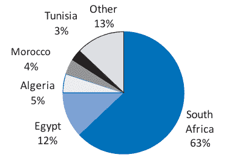

来源：Adiel Akplogan 演讲，AfricNic 执行官及数字资源组织主席。

全球 IPv4 地址耗尽可能早在 2011 年就会发生，非洲则可能在 2013-2014 年发生，这将影响连接互联网的新用户以及需要 IP 地址进行增长的企业。迄为止，较新版本互联网协议 IPv6 的部署远慢于预期。

大多数非洲国家仍然依赖卫星连接，国际带宽通常按每月每 Mb 支付 2000-500 美元。该地区传统上由两根电缆（SAT3 和 SAFE）提供服务，但它们的定价也很高。最近，两条服务东非地区的新电缆（SEACOM 和 TEAMS）上线，并将很快加入第三根电缆（EASSy）。这些对定价无疑产生积极影响，但其他挑战——如缺乏互联、高运营成本以及法律和监管障碍——也是因素。

互联网流量交换有两种基本模型：对等连接（peering）和中转（transit）。前者对互联网服务提供商更有利。因此，最佳解决方案是开发本地互联网交换点（IXPs）。这只需要一台交换机，基础设施成本相对较低。这可以保持较高比例的流量负载，并促进增值服务的提供。例如，Google 的流量在本地进行对等，回传互联网成本通常会减少约 40%。这将平均传输延迟从 1.2 秒减少到 100 毫秒以下。这种性能提升的连锁效应惠及了其他发展应用。

满足发展中世界挑战的一种解决方案是第三章提出的“预算网络电信模型”。这种模型在某些国家已是成功的。

## 带宽政策

全球范围内，带流量的用户可能超过 50 亿。在某些国家，带宽可以被视为一种公共产品。

图 1.3：发达国家和发展中国体的连接性评分卡

| 创新驱动型经济体 | 分数 | 资源和效率驱动型经济体 | 分数 |
|---|---|---|---|
| 美国 | 7.71 | 马西亚 | 7.07 |
| 瑞典 | 7.47 | 土耳其 | 6.71 |
| 丹麦 | 7.18 | 智利 | 6.59 |
| 荷兰 | 6.75 | 南非 | 5.76 |
| 挪威 | 6.51 | 墨西哥 | 5.39 |
| 英国 | 6.44 | 俄罗斯 | 5.37 |
| 加拿大 | 6.15 | 阿根廷 | 5.14 |
| 澳大利亚 | 6.14 | 巴西 | 5.12 |
| 新加坡 | 5.99 | 哥伦比亚 | 4.08 |
| 日本 | 5.87 | 波茨纳瓦 | 3.98 |
| 芬兰 | 5.82 | 泰国 | 3.75 |
| 爱尔兰 | 5.70 | 伊朗 | 3.62 |
| 德国 | 5.37 | 乌克兰 | 3.60 |
| 香港特别区 | 5.33 | 突尼斯 | 3.50 |
| 法国 | 5.22 | 中国 | 3.19 |
| 新西兰 | 4.85 | 菲律宾 | 3.17 |
| 比时 | 4.65 | 埃及 | 3.02 |
| 韩国 | 4.17 | 斯里兰卡 | 2.87 |
| 意大利 | 3.99 | 越南 | 2.75 |
| 捷克共和国 | 3.71 | 印度 | 1.88 |
| 西班牙 | 3.49 | 印度尼西亚 | 1.67 |
| 葡萄牙 | 3.02 | 肯尼亚 | 1.75 |
| 匈牙利 | 2.72 | 孟加拉国 | 1.60 |
| 希腊 | 2.62 | 巴基斯坦 | 1.54 |
| 波兰 | 2.49 | 尼日利亚 | 1.30 |

来源：Ilkka Lakaniemi 演讲，Nokia Siemens Networks 全球政策倡议总监。

### 1. 为什么 ICT 对发展至关重要 – 19

该分析允许与各国的人均 GDP 表现进行比较。例如，它显示瑞典和爱尔兰的表现远好其 GDP 所暗示的水平，而希腊和西班牙的表现则较差。

埃及的相对成功可归功于政策制定者（MCIT）、监管机构（NTRA）与私营部门之间的公共伙伴关系。政策的主要元素包括：尝试扩大 ADSL 服务的接入范围并提高意识；推广 Wi-Fi；一项扩展家庭和小型企业电脑使用的计划（以及将“免费互联网”捆绑在拨号上网时长费用中）；以及其他诸如电脑俱乐部和“埃及 PC2010 项目”等倡措。这些举措成功降低了宽带价格，使目前平均每月 Mb 的成本降至 24 美元左右。

作为刺激方案的一部分，政府对宽带的投资应与政策目标保持平衡。倡措可以包括解除本地环路限制、提供足够的频谱，并确保政府资金资助的分配可以通过开放接入（open access）供竞争对手使用。例如，墨西哥政府于 2009 年 5 月宣布，将把国家电力公司的网络开放给竞争性的电信服务提供商。

固定光纤网络具有巨大的理论容量（例如，单根光纤就可以让世界上每一个人同时进行对话）。但此类网络在发展中国家仍然缺乏，因此重点更有可能地放在移动宽带的提供上。

## 移动支付

发展中国家有数十亿人无法或未能获得任何形式的金融服务。手机越来越多地被用作资金转账或买卖产品和服务的渠道。这为许多手段极其有限的人首次提供了负担得起的金融服务，同时为他们提供了比传统替代方案更高的安全性和效率。

移动支付的发展速度在不同国家之间并不均衡，这可能反映出由于创新带来的颠覆性并不总是受到所有利益相关者的欢迎，而且从服务推广最成功的国家中汲取教训。同时，通信与金融服务的融合引入了不同的监管机构，需要对这些实践进行审查，以确保在实现政策目标方面的整体一致性。

第 5 章描述了最初在肯尼亚部署的汇款服务 M-PESA。尽管该服务最初用于汇款，但它已演变为包括新的金融服务，如微型金融、微型保险和学费支付。逻辑上的下一步是将公共部门服务整合到该系统中；然而，监管立场往往过于不一致或缺乏连贯，没有最佳实践。

发达国家与发展中国家之间手机覆盖率的差异较小，但银行分支数量尤其是自动取款机数量的差距要大得多。这为移动银行（m-banking）提供了最有有力的理由。通常来说，在存在多个资金转账运营商的地方（如美国、西班牙和英国），平均交易成本（每 200 美元 6.6 美元）远低于运营者相对较少的国家（如日本、法国、加拿大和荷兰），后者的平均交易成本为每 200 美元 15.5 美元。像 M-PESA 这样的手机运营商可以大幅降低这些交易成本。

## 图 1.4：选定地区的网络覆盖（占人口百分比）

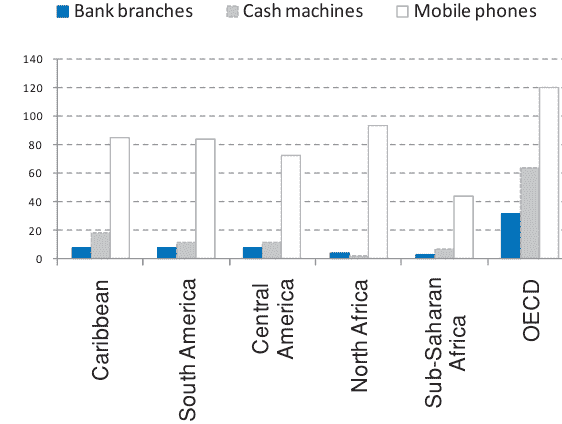

来源：Laura Recuerdo Virto 演讲稿，OECD 发展中心经济学家。

在一些发展中国家，汇款金额远超过了正式官方援助的价值。像 M-PESA 这样提高效率和减少汇款利润的创新可能会产生显著的益处。然而，虽然移动银行为发展开启了许多新机会，但也留下了欺诈空间。因此，部门、监管机构、捐赠者提供者之间迫切需要政策一致。

## 发展中 ICT 的安全考虑

互联网全球关联的性质意味着一个国家采用的政策和实践能够影响其他国家网络使用的安全性和。在这种背景下，发展一种造福全球所有用户的安全文化，并资助维持这种环境所需的支出，对于下一个十亿互联网用户来说将特别具有挑战性。

2003 年之前，大多数病毒来自发达国家，主要动机是扭曲的乐趣感和名声追求。今天，全球最大的热点是俄罗斯、中国和巴西，最常见的动机是信用卡诈骗，尤其是使用记录器（记录器在很大程度上已成为过去式）。现在全球最大的热点是用户几乎无法察觉的键盘记录器。另一种常见的黑客形式是捕获全球的计算机作为僵尸网络来发动拒绝服务攻击，然后这些攻击被用于强制在线购物网站支付赎金。在保障发展中国家安全方面，倡措可能需要国际合作。讽刺的是，发展中国家目前拥有的主要保护形式之一是连接速度缓慢，这使得他们的系统对黑客缺乏吸引力。

安全与隐私担忧之间的平衡，特别是在在线购物、智能电网和在线搜索等领域。

发达国家和发展中国家的安全担忧是相同的。有很多工具可以解决这些问题，但问题在于缺乏执行和跨国合作。年轻人对将 ICT 安全作为可能的职业道路的意识和兴趣缺失是一个特殊的空白，尤其是在发展中国家。

能力建设发挥着作用，还需要在安全与隐私之间取得适当的平衡。优先事项的顺序应该是预防，其次是缓解，然后是起诉。

## ICT 与环境

所有利益相关者面临的关键任务之一是如何利用 ICT 改善环境性能并缓解整个经济部门的气变化。这在第 6 章进行了详细讨论。

据估计，ICT 占全球温室气体排放 2-2.5%，预计未来这些排放量将增加。另一方面，ICT 有潜力将其他部门温室气体排放减少为其直接污染影响五倍。还存在效率提高带来的“反弹效应”问题（例如，更廉价、更广泛的能源导致使用量增加）。这种现象在发展环境中尚未得到充分研究。

一个更广泛的问题是，今天的发展中国家是否遵循与发达国家类似的长期发展模式，从农业到制造业到服务业。发展中国家能否跳跃式进入 ICT 驱动的服务？需要考虑的问题包括：

ICT 对环境的影响案例可以在香港和珠江三角洲找到。该地区数据中心的蓬勃增长引发了涵盖四个主要领域的绿色倡措：

保护、水处理与保护、绿色建筑材料以及确保生活质量。

数据中心绿化的努力包括在提高处理能力的同时降低功耗、改进服务器整合以及采用更环保的方法。根据美国环保保护署的说法，在未来五年内，与当前的技术曲线相比，能源效率的提高可能达到十倍。

在开发新策略方面，一种适当的方法是重用并调整现有策略，例如通过使用《数据中心行为准则》。许多组织与 ICT（信息与通信技术）供应商签有长期，这可能会限制绿色创新的机会。这需要灵活性，并设定要实现的明确目标。产品设计是一个需要解决的重要领域，特别是对于减少冷却功率的需求。重点应放在“插拔式”和“升级型”技术上。“脏脏 ICT”产品在没有废物处理的情况下正变得越来越难以处理。

“绿色 ICT”被定义为企业内部环境目标与效率目标之间的交集。换句话说，绿色 ICT 不关乎 ICT 部门自身的绿色，而是利用绿色倡议来提高整个行业内的目标。绿色 ICT 的典型应用是在电力和物流管理。尽管电脑被关闭了，但局域网（LAN）很少处于活跃状态，其周末的功耗通常是工作日的 95%。计算机中心经理需要接受教育，以识别节电和节约成本的机会。

人们热于推广 ICT 在其他行业减少排放潜力并通过跨经济应用改善环境表现时，往往忽视了解决 ICT 自身温室气体排放的紧迫需求。

## 教育 ICT

在学校中更广泛地使用 ICT 有助于实现与义务小学教育和消除教育性别不平等相关的发展目标。然而，人们仍存在怀疑，即相对于其他教育需求，应该优先考虑哪些 ICT。

一直存在一种夸大 ICT 对教育益处的倾向；但实际上，证据基础仍然非常匮乏。`infoDev` 在 2005 年发布的教育 ICT 知识图谱相当令人担忧，它揭示了目前对直接益处的了解和可证明性是么之少。由 `infoDev` 委托对非洲（2008年）和加勒比（2009年）教育 ICT 进行的区域研究结果显示，在不同地区以不同的速度日益增加的使用。

在非洲，加纳、卢旺达和塞内加尔可能被认为是领先者，而像利比利亚或苏丹等冲突后地区则处于落后。53 个非洲国家中有 48 个已制定政策，但总体而言，公民社会和私营部门正在设定节奏。供应和 ICT 方面缺乏执行能力以及基础设施。性别平等也缺乏。宏观趋势包括公私合作伙伴关系、数字内容开发、开源软件、区域倡议、国家研究与教育网络、国际互联和无线网络。

相比之下，加勒比地区在理解趋势方面形成了一个更有凝聚力的地区。ICT 被视为实现变革的一种。重点是 ICT 技能的发展。当地有区域 ICT 考试，且宽带通常在没有额外费用的情况下部署到学校。

`infoDev` 委托的涵盖印度和南亚的最新区域调查的初步结果在第 7 章。该地区的八个国家处于不同的发展阶段，但尽管如此，仍然可以概括教育 ICT（`ICT4E`）生态系统，并确定需要定义为“政策+”方法的方面。

经合发展组织（`OECD`）的国际学生评估计划（`PISA`）发现在家使用电脑频率与学生成绩提高之间存在联系（图 1.6）。然而，要证明学校电脑使用与学生成绩提高之间存在同样的关系则更为困难。事实上，当排除学生社会经济地位的影响时，任何关系都开始消失。证据似乎是，ICT 进一步造福那些已经表现良好的人，而不是损害那些表现不佳的人。

学生在家里和学校的生活之间存在差距。经合组织国家平均 15 岁的青少年每天在家里面对电脑前花费约两小时，在学校使用电脑的时间每周少于一小时。问题随之产生：在教育 ICT 上投入更多值得吗？在财务和公平方面会有回报吗？

### 图 1.6：技术使用与科学教育成就之间的关系（2006 年 PISA 调查）

来源：Frances Pedro 和 William Thomas 在 OECD 的研讨会演示。

真正的挑战是开发更好的衡量方法。经合组织国家的学生已经暴露在信息丰富的环境中，因此使用 ICT 带来的改进可能是微乎其微的。人们可能会在发展中国家看到更大的影响。一个特别挑战是理解电脑在学校是如何被使用的。在大多数情况下，它们似乎旨在开发 ICT 技能，而不是将 ICT 作为其他学科学习的媒介。

`ICT4E` 领域有大量的倡议。它们并不一定来自捐助者，而是来自非政府组织和国家政府。教育捐助社区在发展政策方面相当保守。然而，发展中国家对 `ICT4E` 的需求增长迅速。发达国家获取维基百科等互联网知识资源或信息检索的极大促进了学习。

开源学习管理系统的快速增长以及由马萨诸理工学院的 OpenCourseWare 等倡议驱动的开放教育资源的可用性，正在改变人们对教育内容价值的思考——即价值在于交付，而非内容本身的知识产权。技术趋势——例如，内存存储容量的快速提高与连接性相对缓慢的提高相比——表明，更多的教育内容可以存储在本地，而不是通过昂贵的网络访问。

索罗悖论的一种变体可能会说：“我们在学校随处都能看到计算机时代，唯独教育改进例外”。这表明我们需要重新思考如何在学校使用技术。新的数字鸿沟不在于接入，而在于使用类型和质量的差异。经合组织国家 70% 以上的人口接入互联网，而在近 100 个发展中国家中这一数字小于 10%。在发展中国家，接入的主要平台是手机，手机越来越多地用于电子学习和视频教学。移动计算平台的下降和在发展中国家的普及将对接入产生巨大影响。

## ICT 与国际发展的未来在何方？

### 整体政策协调性挑战

数字技术的不断新颖和创新带来了源源不断的政策挑战。例如，曼彻斯特的发展信息学中心一直在研究“移动金融”（`m-finance`）扩散的障碍；即利用手机帮助最贫困的社区获得金融交易和服务（Duncombe 2009）。

由于部门间的融合，产生了即时的政策障碍。当手机手机变成移动钱包时，信息与通信技术（ICT）政策就与金融政策发生了碰撞。一些国家缺乏对多项政策的全局视角——即看清其对发展影响大局所必需的视角。例如，金融监管可能仅允许银行开展正式金融交易，而银行目前是受信任程度最低的金融机构之一。此外，此类规定限制了竞争——将移动运营商和第三方创新者排除在市场之外，限制了移动金融的传播，从而损害了发展。

相比之下，一些国家缺乏政策的基层视角——他们不理解贫困社区内部个人在尝试使用 ICT 时面临的道路障碍。以移动金融为例，即使在服务可用的情况下，仍有三个关键障碍阻碍了贫民使用服务：负担能力、缺乏金融素养以及缺乏信任的中间人。要解决这些问题，需要在税收、电信政策、教育和金融监管等一系列政策领域实现协调。

`OECD`/`infoDev` 举办的“信息与通信技术促进发展应用政策协调”研讨会关注 ICT 特定应用（如移动银行案例）的协调需求。但还存在更通用的信息技术促进发展（`ICT4D`）政策协调挑战，这些挑战可以归为四个问题。

### 问题 1：全球北方国家与全球南方国家之间的 ICT4D 政策是否存在协调性？

当然，一些评论者会认为认为存在完全的协调：富裕国家的政策使富裕国家受益，而强加于贫穷国家的政策也让富裕国家受益。世界贸易组织谈判中的当前斗争表明，如今的情况并非如此简单，因为全球南方的一些国家在经济和政治上正变得日益强大。尽管如此，谁从 `ICT4D` 政策中获益——全球北方、全球南方还是特定的利益相关者？——这个问题仍然有待解决。

### 问题 2：ICT 发展价值链的不同部分之间是否存在政策协调（平衡）？

简单来说，`ICT4D` 价值链追踪了技术投入转化为发展产出的过程（图 2.1）。详细而言，它分为四个核心领域：

- 准备就（Readiness）：国家需要一组先驱系统作为法律基础以及人力和技术基础设施。通过战略性行动（包括政策），这些系统成为具体的计划和项目投入（如资金和技术），以及作为动力和政治支持的软性投入。
- 可用性（Availability）：将投入转化为一系列特定项目的交付物；中间项目如电话中心或移动手机系统。
- 采纳（Uptake）：对数字技术的实际采纳和使用，包括特定 `ICT4D` 项目的可持续性和扩展性问题。
- 影响（Impact）：熟悉的产出（outputs）、成果（outcomes）和发展影响（development impacts）；产出是 `ICT4D` 项目引起的直接行为变化；成果是随之产生的个人和社区利益；发展影响则是 ICT 在多大程度上帮助实现了更广泛的发展目标。

`ICT4D` 政策的焦点随时间对价值链发生了怎样的变化？多年来（在某些机构中、在今天的某些政策中），注意力一直集中在基础上。直到最近，政策才开始完全扩展，关注人们使用以及如何使用这些基础，最重要的是技术对发展做出了什么贡献。

如果发展促进技术只关注价值链的早期部分，它们可能缺乏协调性。因此，当我们分析政策时，可以问——它涵盖了什么？它只是在看基础——即准备就绪和可用性问题——还是具有“从头到尾”的完整协调性（这种协调性包括不仅铺设铁路和买火车，还要确保有人使用它们，并确保购买行为有助于国家发展）？

### 图 2.1：ICT4D 价值链

| 策略 | 实施 | 采纳 | 使用 | | | | | | |
| :--- | :--- | :--- | :--- | :--- | :--- | :--- | :--- | :--- |
| 先驱因素 -数据系统 -法律 -制度 -人力 -技术 -领导力 -驱动力 -需求 | 投入 -资金 -技术 -价值观与动机 -潜在支持 - 目标 | 中间件 / 交付物 -电话服务 -读写能力 -共享电话 -在线访问系统 | 可持续性 扩展性 | 可用性 (AVAABILITY) | 采纳 (UPTAKE) | 产出 -新的通信模式 -新的信息与决策 -交易 | 成果 -财务和定量收益 -定性收益 -利益 | 外生因素 | 发展影响 公共目标（如 MDGs） |

来源：Richard Heeks. *CTS FOR DEVELOPMENT. IMPROVING POLICY COHERENCE* © OECD 2009

### 问题 3：ICT 政策与发展目标之间是否存在协调性？

正如我们看到政策焦点随时间在价值链的不同部分之间变化，我们也能看到典型的 ICT 政策与发展之间的关系随时间发生的变化（Heeks 2009）。

二十五年前，ICT 几乎不在政策议程上；很大程度上被发展机构和除少数几个发展中国政府以外的所有政府所忽略。随着微型计算机的出现，ICT 变成了一个无法忽视的现象。当互联网在 20 世纪 90 年完全进入舞台时，最初被一些人崇拜，然后被整合。

因此，我们可以勾勒出一条轨迹。在 `ICT4D` 被称为 `ICTD` 之前，它经常被忽视然后被孤立，贡献有限。当我们为今天和明天需要一个世界观，却为昨天制定发展政策时，政策协调问题就出现了。最明显的那些忽略或孤立 ICT 的政策无法有效地为发展做出贡献。但那些已将 ICT 主流化并的政策呢？

### 问题 4：我们是否拥有足够的内容、结构和流程来交付协调、有效的政策？

有效的政策需要关注三件事：政策的内容；制定和实施政策的正式和非正式制度结构；以及制定和实施政策的过程。

到目前为止，对政策内容的关注过多，在某种程度上排斥了另外两个要素：结构和流程。需要一种更平衡的观点。例如，最近对斯里兰电子政府政策的研究发现，政策的初始内容在整体评估中的作用相对较小。相反，相关利益相关者的性质、他们的利益以及他们形成政策网络的方式，决定了政策的结果和影响（Stanforth 2009）。

关于最后一点，我们可以发现 ICT 正在改变我们开展发展的方式；引入了新的发展模式，并提供了“发展 2.0”的可能性。

这在 OECD 的《塑造未来互联网经济的政策》中得到了认可，该报告强调了 ICT 发挥的催化作用，特别是在创意和创新方面（OECD 2008）。我们可以在 Kiva 等“小额捐赠”模型中看到这一点。此类模型通过切断传统上位于帮助的全球北方与想要投资的全球南方之间的机构，实现了去中间化。它们通过允许新类型的发展参与者进入（例如 Kiva 本身及其与其合作的微型金融伙伴），实现了再中介化。

- 主流化将 ICT 困在在个人发展目标中；一种“创新”观点将其视为许多工具中的一种工具。
- 主流化丧失了 ICT 可能带来的兴奋感和希望；一种“创新”观点捕捉到了这些情感。
- 主流化接受了当前的游戏规则；一种“创新”观点承认技术可以变革。

## ICT4D 0.0 到 ICT4D 1.0 到 ICT4D 2.0

第一台在发展中国家使用的数字计算机于 1956 年安装在加尔各答的印度统计学院，用于数值计算工作。从这个早期开始到 20 世纪 90 年代，计算促进发展有两种应用侧重点。最初，政府曾是关键执行者，而 IT（当时的称呼，而非 ICT）主要应用于发展中国家公共部门的国际行政职能。在20世纪80年代，跨国公司和其他企业开始凸显，而 IT —— 以微型电脑及其相关软件的出现为代表 —— 被视为私营部门经济增长的工具。我们可以将“`ICT4D 0.0`”时期命名为 `IT4G` —— 即为了增长的信息技术，随后它被为了全球发展的信息技术所取代。

在20世纪90年代发生了两件事，催生了可以被公认地称为 `ICT4D 1.0` 的产物。第一是互联网的普及。第二是《千年发展目标》（`MDGs`）。

互联网引发了人们对 ICT 兴趣的高涨，包括对其在发展中国家如何应用的兴趣再次点燃。与此同时，国际发展开始进入政治议程。这一趋势受到对具体目标的追求推动，这些目标最初在1996年作为“国际发展目标”出现，随后在2000年9月的《千年宣言》中正式确立为《千年发展目标》，该目标特别寻求减少贫困以及改善健康和教育公平。

2090年代的数字技术是寻找用途的新工具。而发展目标是寻找交付机制的新目标。这两者的相遇并非出乎意料。它们共同产生了“`ICT4D`”，它诞生于一系列出版物、机构、活动、计划和项目资助的浪潮中：世界银行1998年的《世界发展报告》强调了信息、知识和 ICT 在发展中的作用；G8 国家于2000年创建了“数字机遇任务组”，为 `ICT4D` 的行动制定了议程；以及分别于2003年在日内瓦、2005年在突尼斯举行的“信息社会世界峰会”，这些成为 `ICT4D` 路径上的关键学习和政策制定点。

关键执行者变成了国际发展组织和非政府组织（NGO），ICT 的首要应用是实现《千年发展目标》。核心在于，《千年发展目标》旨在改善普拉哈拉德（Prahalad）所说的“金字塔底端”的人的生活：即地球上每天生活收入低于2美元的30亿人。

### 框 2.1. 应对贫困需求

发展行动可以通过三种方式应对贫困人的需求：

- 包容性（Inclusive）：改善涵盖所有人（包括贫困人）的机会和；
- 赋能性（Enabling）：支持能够改善贫困人生活的政策或环境；
- 针对性（Focused）：专门针对贫困人的权利、利益和需求。

`ICT4D` 的初始阶段包含了所有这些方面。例如，存在包容性的电子政府计划，旨在通过互联网增加公共服务的交付。在 ICT 治理方面也有赋能行动，寻求确保贫困国家的利益被纳入控制互联网、电信流量及关税的全球体系中。但大多数精力被预留给了针对性项目：即那些将 ICT 引入贫困社区，并寻求提供可能解决贫困、健康、教育和性别平等信息与服务的项目 —— 这四个领域构成了《千年发展目标》的主要内容。这种结合了包容性、赋能性和针对性的方法可能会在 `ICT4D 2.0` 时代继续存在。尽管如此，我们可能会看到一些重新平衡，即对治理在塑造 `ICT4D` 成果方面的重要性给予更多认可。

### ICT4D 1.0 期间发生了什么？

由于时间跨度短且面临展示切实成果的压力，参与 `ICT4D` 的发展执行者采取了在这种情况下每个人都会采取的做法。他们寻找一种快速、现成的解决方案，以便在发展中国家的贫困社区中进行复制。

鉴于大多数贫困集中在农村地区，落入每个人怀中的模型是“农村远程咖啡馆”（telecottage）或“远程服务中心”（telecentre），这种模式在20世纪80年代和90年代初已在欧洲和北美的边缘地区推广。它看起来像是一个拥有一个或多个连接互联网电脑的房间或建筑，可以相当快地安装，提供成就的实物证明，并向贫困社区提供信息、通信和服务（同时也为作为大多数 `ICT4D` 论坛合作伙伴的 ICT 公司提供销售额支持）。因此，一系列命名形象五目的的项目开始开展开来，从哥伦比亚的 InForCauca 到马里的 CLICS，再到印度的 Gyandoot。

用于发展的 ICT：提高政策协调性 © OECD 2009

自然，`ICT4D 1.0` 并不局限于远程服务中心项目。但远程服务中心是这一时期的原型，从从20世纪90年代中后期一直持续到2000年代中后期。

结果是什么？粗略地来说，我们可以用三个词来总结：失败、限制和轶事。这每一项都导致了具体的教训和新的格言：

- 可持续性（Sustainability）：鉴于许多 `ICT4D` 项目未能交付和/或存活，现在更加强调确保此类项目的长期生命力。
- 可扩展性（Scalability）：鉴于单个远程服务中心项目的覆盖范围有限，人们正在寻找可扩展的 `ICT4D` 解决方案。
- 评估性（Evaluation）：鉴于 `ICT4D 1.0` 往往依靠炒作和未经证实的、出于私利的故事来维持，人们对影响的客观评估有了新的关注。

更广泛地说，`ICT4D` 第一个十年的这些结果导致了对新方法的需求。对于 `ICT4D 2.0` 应该什么样，尚未达成共识。讨论正在进行。

让我们看看 `ICT4D` 的技术和过程。当我们站在 `ICT4D 2.0` 的门槛上时，一个需要解决的问题是，我们将如何为剩下的50亿人提供互联网？

在20世纪90年代，最初的模型是为全球北方服务：通过电话线连接的电脑。但尝试的推广面临了巨大障碍，因为南方金字塔底端被证明难以触及。该模型过于昂贵，无法实现可持续性或扩展性，且/或缺乏必要的电力和电信基础设施。向前发展，连接互联网的电脑需要在硬件方面进行创新：

- 终端（Terminals）：人们正努力开发低规格、低成本、耐用的终端设备，使其能够在大量社区中运行。其中知名度最高的是每人一电脑（`OLPC`）项目的 `XO`。巧合的是，出现了一系列类似的设备。像 `PixelQi` 和 `Intel Classmate` 等设备目标是发展中国家。而其他的如 `Linutop`、`InkMedia`、`Elonex ONE`、`Asee Eee` 等则是更通用的商业产品。
- 通信（Telecommunications）：无线是为南方贫困社区提供连接的首选方法。20世纪80年代和90年代对卫星形式（如 `VSAT`）的兴趣已让位于对地面传输系统的关注。同样，注意力正从基于 `WiFi` 的系统和创新转向 `WiMAX`。

### 框 2.2. 影响评估与评价

影响评估和评价一直被视为发展家族中被忽视的孩子。我们担心回望时，会像最后（罗后）一样变成盐柱。部分问题在于动力，这很难改变，但 `ICT4D` 的部分问题在于缺乏指导。诸如《发展信息技术影响手册》和《全球影响研究》等计划将为 `ICT4D 2.0` 提供指导。

## 新硬件

当我们站在 ICT4D 2.0 的门槛上时，一个需要解决的问题是，我们将如何为剩下的50亿人提供互联网？

来源：Richard Heeks。

## 40 – 2. ICT 与国际发展下一步将走向何方？

- 电力：撒哈拉以南非洲地区只有 15% 的农村家庭可以使用电，因此在三个领域仍需要持续创新：用于当地发电的新型低成本设备；更好的存储、携带和传输电力的方法；以及降低 ICT 设备的功耗。

但在某些方面，我们正处于互联网接入道路的十字路口。我们是继续沿着基于 PC 的路线走（目前为止，少于 0.5% 的非洲村庄通过这种方式建立了连接）？还是转向移动电话（移动电话已经覆盖了非洲三分之二的人口）。对硬件创新的需求似乎相对有限，但跨国公司的产品似乎扩散得相当容易。全球一半的人口是手机用户；更多的人可以使用手机；而且目前的增长率最快的是最贫困地区。

目前的增长率将使使用人数推向全球 90% 以上的人口，这使得如何覆盖最后的 5 亿人以及支持功能手机的普及成为问题，考虑到目前贫困社区的大多数手机仅用于通话和短信。对于这两者，对硬件创新的需求可能会再次出现。随着移动设备上的 iPhone 及应用型设备与笔记本型设备融合，可能会出现创新，产生成本更低的类 PC 终端设备，最终形成类似于“开发用黑莓手机”的东西。

## 框 2。宽带：新希望/新鸿沟

宽带已经是全球北方国家 ICT 使用不可或缺的一部分。在美国（表现较差的国家之一），到 2008 年，每 100 名公民就有 25 个宽带订阅，55% 的家庭拥有宽带，约占所有互联网连接的 90%。相比之下，包括埃塞俄比亚、加纳、肯尼亚和乌干达在内的大多数非洲国家的订阅率低于人口的 0.1%。小安道拉的宽带订阅量大约与非洲人口最多的国家尼日利亚相当。

因此，当我们开始看到数字设备围绕互联网接入和手机普及时，一种新的宽带设备正在出现。这并将持续需要战略性的应对，如果不能由政府主导，至少必须由政府协调。无论在何地发生，其发展结果将是令人瞩目的。在宏观层面，宽带的普及与就业和 GDP 等指标的增长相关；在微观层面，则有许多增强就业和生产的新机会。

## 2. ICT 与国际发展下一步将走向何方？

可能，在处理“剩余 50 亿人”问题时，ICTD 2.0 将同时推进 PC 和和移动路线。但有人问，互联网是否应该是焦点，或者我们是否应该观察穷人是否已经“用钱包投票”，并探索已使用的更简单、更便宜的技术是否可以提供 ICT 功能？与其通过升级手机和带宽来允许移动互联网接入，通过通话和短信能为发展实现什么？老旧技术又如何呢？“接入”（区别于“所有权”或“地理覆盖范围”）的数据很难获得，但我们可以估算，发展中国家约有 80% 的人口可以使用收音机，50% 的人口可以使用电视机。因此，在 ICT4D 历史早期，对 ICT 进行了重新解释，将广播和电视纳入其中。

因此，融合在 ICT4D 2.0 中也将扮演重要角色。在实践中，这意味着观察已经渗透的技术——手机、收音机、电视——寻求增加计算和互联网功能的方法。试点项目已经在进行中。斯里兰的 Kothale 社区广播电台通过电子邮件和网络回答听众问题并广播回复。印度的 Warana 社区中心数据库允许农民在田间通过手机手机进行搜索。许多其他的“中心-辐射型”创新也可能在未来找到有价值的应用。

## 框 2.4. ICT4D 2.0 与个体的兴起

工业化国家和发展中国家在 ICT 应用方面存在核心差异。在全球北方，过去几十年主导的 ICT 所有权和使用模式首先是家庭然后是个人。相比之下，全球南方的所有权和使用模式是社区群体。

这种模式在概念和实践上被继承在几乎每一个 ICT4D 1.0 项目中。它帮助确保了每个设备的覆盖范围远大于对北方模式简单推演所得出的结论。因此，南方的数字鸿沟被高估了，因为对 ICT 的共享访问使基础技术所有权数字放大了许多倍。这种模式也是一些项目产生广泛益处的源泉，这些项目有助于形成或加强社区群体。这些群体——通常由来自当地社区内部培训的“信息人员”提供支持——会考虑收到信息（例如关于儿童健康或农业改进的信息）的影响，或者后期参与创建自己的数字内容。

## 框 2.4. ICT4D 2.0 与个体的兴起（续）

这将持续到 ICT4D 2.0，但面临家庭甚至个人所有权上升（尤其是手机）的挑战。早期的手机项目采取每部社区一部手机的模式，但随着手机的进一步普及，这种模式正在被超越。手机必须取代某些社区所有 ICT 的用途，随着它们慢慢变成便携收音机、电视、网络设备等，这种替代将会增加。

替代意味着去中间化，减少对群体和中间人的需求。这可能会引发 ICT 用于发展的新创业性用途。

迹象表明，某种专业化正在发生。更加理性、社会化的 FOSS 部分正在增长，挑战着 ICT4D 1.0 期间采用的内向、以技术为中心的方法。结果是 FOSS 在 ICT4D 系统中的使用增加，以及基于 FOSS 的 ICT4D 项目（如健康信息系统 HIS）的增长。（另一个结果是专利解决方案提供者的反击，一个胜利者是 2008 年为 OLPC 添加 Windows 版本。）

连接硬件和应用程序的是软件。在 ICTD 1.0 中，自由开源软件（FOSS）成为交付适当解决方案的潜在重要工具。它带来了比专利解决方案成本更低、更健壮且易于本地化的系统承诺。

## 框 2.5. 自由开源软件

即使是过去和未来的创新也能为世界上大多数地区提供 ICT 接入，硬件加接口的组合仍然是一个空壳。当填充了应用软件后，这个空壳可以承担许多发展角色：数据内容处理器、交互通信器、服务提供者和生产力工具。

## 44 - 2. ICT 与国际发展的下一步在何方？

社区广播以及在较小程度上的社区电视——是一种允许社区参与的非常本地化的广播形式。参与式视频正在增长——即由当地社区创作视频内容，并针对社区群体通过单场放映活动进行展示。我们还可能看到更多具有外部目的的内容创作。这意味着利用本地创建的数据来向外部团体提高意识、采取行动或募集资金，正如 Kiva 和治疗行动联盟（Treatment Action Campaign）等组织目前所做那样。

## Box 2.6. 数据转换障碍的减少

发展中国家面临的信息障碍之一是，有用的数据内容格式不对，无法有效使用。新技术正在减少这些障碍，并且通过 ICT4D 2.0 期间的创新将不断减少这些障碍。示例包括：

- 通过对话和交互语音响应系统进行音频/数字转换，以提供发展信息，或用于识字培训的语音识别系统。

- 文本/数字转换，直接通过扫描提高数据输入的速度和准确性，或实现转换为数字语音或盲文输出。

- 将心理表征转换为数字地图，以捕捉当地知识。

- 将物理测量数据转换为低成本传感器设备上的数字格式，例如血检、心率监测和农业管理。

交互。在该领域曾关于“ICT 非 IT”引起过不小的波动——即“现在增加了 C（通信，Communication）”的技术讨论。尽管如此，但利用技术进行通信——至少是交互式通信——还是来得晚了。这可能是因为，在面对远程中心模型、交互式电子邮件时，穷人没有可以发信息的人。他们的社交网络被认为是小规模、局部且非正式的。事实上，手机的普及证明，这些网络已经通过农村到城市的迁移以及国际迁移得到了扩展。它们可能会通过新技术得到进一步扩展，从而增加边缘化大多数群体的社会资本。如何实现这一点，以及如何利用数字媒体的交互式通信能力，仍然是 ICT4D 2.0 一项日益增长的任务。

## 2. ICT 与国际发展的下一步在何方？ – 45

服务。正如 Web 模型从信息阶段转向交互阶段，再到交易阶段一样，ICT4D 近期也转向关注为贫困人口提供服务交易交付。这针对的是电子政府：允许通过远程中心支付账单，或帮助订购重要的证书。在经历了若干年问题重重的试点项目后，现在似乎正在产生可衡量的效益。然而，此类创新的影响范围有限，而 ICT4D 2.0 似乎在推进“移动发展（m-development）”：寻找在不断增长的移动平台上挂相关服务的方法。目前，这意味着利用现有功能，例如使用短信处理各种任务，从提醒生活有艾滋病毒的人群服用抗转录病毒药物到监控选举。从这里开始，它意味着进一步的功能，例如“为没有银行账户的人提供银行服务”：使用手机为目前被排除在主流之外的人提供金融和银行服务。

## Box 2.7. 跨越千年发展目标（MDGs），实现韧性发展的 ICT

自 ICT4D 1.0 开始以来，多年来进入发展议程的三个主要问题是：

- 安全，包括恐怖主义。

- 经济增长，包括其波动性和脆弱性（正如信贷危机后的衰退和缓慢恢复所证明的那）。

- 环境可持续性，特别是气候变化。

在 ICT4D 2.0 的中期，气候变化很可能成为发展议程中最大的项目。但所有三个问题都可以归类为“韧性发展”这一概念，并且它们为 ICT4D 2.0 的下一阶段驱动了一些问题。

- ICT 如何确保在面对不安全、经济波动和气候变化等威胁时实现具有韧性的发展？

- ICT 如何提供可持续的发展？

毫无疑问，ICT 将成为发展议程的关键组成部分。例如，ICT 一直是恐怖主义组织和反恐主义活动的核心；基于 ICT 的企业以及企业对 ICT 的使用现在是经济增长和恢复的基石；ICT 是“更绿色”技术不可或缺的一部分（尽管还有日益增长的电子垃圾问题）、气候变化制图以及协助社区适应气候变化的重要部分。

## 46 – 2. ICT 的下一步在何方？以及国际发展的下一步在何方？

生产。ICT 似乎被地认为是向世界穷人提供信息和服务的工具。到目前为止较少被理解的是，穷人如何利用它们来创造新的收入和工作机会。这种新的生产观点部分包含了穷人作为数据内容参与者的角色，正如社区广播和参与式视频项目所示。在交付相关内容的同时，这些项目还通过让参与者成为参与式创造者，使他们能够控制 21 世纪的这些手段，从而赋予他们力量。这现在可以进一步扩散到涵盖 Web 2.0 的一切吗？博主、整合者和 Wiki 编写可以从世界上最弱势的人群中选拔吗？这需要新的应用程序来实现吗？

来自内容带来的赋权感和包容感是有价值的。但穷人的首要任务通常是收入和就业。我们在这里才开始意识到这些可能性。手机随处可见。穷人已经创造了既围绕技术（销售配件和预付卡）又通过技术（销售或接听电话）的收入。但是是否存在可以开发的 ICT 赋能微型项目？这已经在社交和农村远程中心发生了，通过“社会外包”：即将 ICT 服务外包给贫困社区的社会企业。但 ICT4D 2.0 的首要任务将是构思新的应用程序和商业模式，利用不断增长的 ICT 基础（手机、远程中心等）来创造就业。

## Box 2.8. ICT4D 与创意产业

“创意经济”——“一个巨大且异质的领域，处理创意活动之间的相互作用，范围从传统手工艺、出版、音乐、视觉和表演艺术到更具技术密集性和面向服务的活动组，如电影、电视和广播、新媒体和设计”——被认为为发展中国家提供了日益增长的机会。这些国家已经拥有丰富的传统创意产业，并正在为新创意产业提供低成本基础。

在 ICT4D 2.0 期间，数字技术可能会为该领域这两个部分的增长提供基础。ICT 已经应用于传统领域，例如手工艺品的更广泛营销以及音乐的录制和销售。ICT 也是新媒体工作的基石，包括动画、游戏等领域外包工作的增长。

## 2. ICT 与国际发展的下一步在何方？ – 47

## ICT4D 2.0 的新创新模型

Box 2.7 中讨论的背后是关于技术和发展的两种不同观点——或者说，是连续体上的两个极端。在的一端，我们有“被动扩散”观点。以移动电话的快速传播为借鉴，这种观点认为，如果 ICT 对穷人具有发展价值，那么私人公司对利润的追求加上穷人对价值的追求将使其成为现实。任何从外部干预的尝试都是愚蠢且浪费的：一种强加的不适当事物，只会导致混乱的监管。相反，“主动创新”观点认为市场无法交付——或者对穷人来说交付太慢。因此，需要以新创新的形式进行干预以帮助实现目标。

本章没有详细比较这些观点。在 ICT4D 1.0 期间，主动创新确实遭受了打击。人们认为国际援助机构资助了不可持续的事物，并且围绕供应型发展的远程中心点忙碌，而忽视了市场驱动的移动浪潮。另一方面，非市场干预是许多随后市场化技术的根源。从第一批电脑到互联网的起源，再到 OLPC 所青睐的竞争对手，主动创新一直是被动扩散的基础。最后，当私人公司将金字塔底部的概念融入心中并开始专门为贫困消费者设计产品时，两种观点汇合了（随着他们改变了术语从“发展中国家”变为“新兴市场”）。

我们得出的结论是，主动创新的某些元素可能会留在 ICT4D 领域。在这种，出现了两个关键问题：

首先，创新什么。正如 OLPC 经验所示，专门针对金字塔底端的大规模硬件和操作系统创新是风险巨大的创业，属于极勇敢或极愚蠢的人。在温和程度上，这适用于大型私人部门参与。相反，大多数 ICT4D 2.0 创新似乎是在较小规模上，无论是通过适应还是应用现有技术发生的。另一种方式是，随着从新的电信/电力基础设施移动到新的硬件、软件、新的数据内容，到新的商业模式和流程时，创新似乎更加可行（尽管可能更本地化）。

其次，如何创新。在创新过程方面，我们可以诱导出三种不同的模式，在这里标记为实验室型（亲贫）、协作型（并贫）和草根型（依贫）。

“实验室型”（亲贫型）创新是在贫困社区之外进行，但代表贫困群体的。远程中心（Telecentres）很大程度上就是按照这种方式设计的。对于吸引全球北方资源来解决发展中国家的问题，这是一种有效的方法。然而，它面临着“设计与现实鸿沟”的风险：即设计中建立的假设和要求与贫困社区的现实之间不匹配。

关于各种低成本终端设备是否会掉入这个差距陷阱，目前还没有定论，早期的远程中心无疑陷入了这一点；而且当存在巨大的设计与现实鸿沟时，结果几乎注定是失败。这就是为什么报道远程中心项目普遍缺乏成功和可持续性的原因。尽管如此，在 ICT4D 2.0 中仍然会有亲贫型创新的空间。例如，创新的亲贫型定价模型已经取得了成功。手机预付费是其在发展中国家采纳的重要部分，毫无疑问微软为发展中国家设计的 3 美元学生创新套件也将也将证明广受欢迎。

“协作型”（共贫型）创新是与贫困社区并肩进行的创新。它的应用正在不断增加，并将成为 ICT4D 2.0 的核心。参与式的、用户参与的设计过程是第一阶段的关键学习点。这是信息学领域在几十年前就学到的教训，但当新的应用出现时（由于新参与者的狂热般涌入），总是需要重新发明轮子。

学得较慢——尽管 20 世纪 90 年代的发展研究中已得到承认——教训是，社区参与项目设计充满了陷阱。谁参与很重要——往往是一群极少数、声音很大的精英。他们如何参与很重要——这会产生不同的结果。他们为什么参与很重要——参与者往往给出设计者想听的答案。他们为什么不参与很重要——发展中国家群体低自我效能感可能会阻碍设计的投入。ICT4D 参与的本质也很困难，因为它需要跨越设计者与用户之间的多重鸿沟：技术人员与非技术人员；富与穷；通常是西方思维与非西方思维。而且，对于某些项目，还有城市与农村；男性与女性。

## 框 2.9. ICT4D 的新型创新中介

在 ICT 系统设计者与贫困社区的潜在用户之间可以存在各种组织安排。传统上，这些是临时的——一个在设计和初始实施期间持续的非正式小组，然后解散。

然而，ICT4D 的增长以及贫困人口作为 ICT 系统市场的增长导致了一些更具永久性的组织形式出现：我们可以称之为 ICT4D 的“新型创新中介”。以世界 ICT4D 枢纽之一——班加罗尔为例，我们可以引用三个可能在 ICT4D 2.0 中发挥日益重要作用的原型：

- 直接部门。微软研究院（印度）已与一组贫困社区建立了关系，通过这些社区可以进行创新的试点。从此类试点中学习的知识随后可以回馈给微软的其他部门。

- 间接部门。知识社会中心（Centre for Knowledge Societies）是一家代表大型私营公司工作的承包商。通过在贫困社区内结合人类学和技术研究方法，它可以向其客户报告 ICT 设计和使用方面的问题。

- NGO 部门。IT Change 活跃在少数几个农村社区中。它随后可以与外部机构（通常是国际开发机构）建立伙伴关系，就设计的良好实践提供指导。

还应该提到关注技术的 Practical Action 的工作。它从一个基于英国的亲贫创新模型开始，在 20 世纪 80 年代和 90 年代转向协作亲贫模型。它现在已开始（例如通过 PROLINNOVA 程序）捕捉和传播当地创新者的发明。这还未属于 ICT 领域，但它为中介组织在基层亲贫创新中可以扮演的角色提供了一个模型。

“基层型”（普贫型）创新是由贫困社区内部并由其成员进行的创新。在 20 世纪 90 年代，这几乎是不可能的——贫困用户与新技术之间缺乏足够的接触；广播和电视等旧信息技术没有提供创新的空间。但这种情况在过去几年里发生了变化。随着手机的到来，以及 PC 和 Web 的进入，贫困人口自己变成了创新者。这不是指传统意义上的实验室/研发，而是以新方式适应和应用技术。

大而言之，目前我们只有以下方面的轶事：

- *新流程*：例如移动货币允许在没有银行账户的情况下进行交易。

- *新业务模式*：例如将通话时长作为货币，允许微支付。

- *新产品*：例如为恶劣环境设计的低成本智能手机。

此类轶事的分量在增加；ICT4D 2.0 将面临压力，需要更系统的方法来获取基层创新。这在南方国家已有很好的实践。这种运动已经通过增加开源和 Web 2.0 模型的功能不断演变。

## 2. ICT 和国际发展的下一步在何？

### 框 2.10. Jugaad——贫困是发明的方法

除了问做什么以及如何创新之外，我们还可以问：“为什么要创新？”对于在贫困社区内部及其工作的人来说，答案是：因为你必须这样做。来自“外部世界”的技术无法运行、无法正常工作且会损坏。北印概念 *jugaad* 指的是在贫困环境中为了让技术运行或保持运行而进行的快速修复。尽管补救措施可能是局部的，但我们可以在全球的贫困社区看到 *jugaad*：在限制性环境中进行的微小创新。这可以更进一步，接受这样一种观察：资源贫困可能是创新的催化剂。

因此，我们得到了 ICT4D 2.0 的概念：约束驱动创新——即普拉拉德（Prahlad）描述的在约束墙的沙盒内进行创新，交付了“主流”创新无法提供的匹配可用资源的专业解决方案。它们价格更低、资本密集度低、技能密集度低、更多利用当地材料，并能适应不稳定供应。总之，它们缩小了其他创新所面临的“设计与现实鸿沟”，并证明了贫困可以驱动创新。

## ICT4D 2.0 的新型实施模型

之前的章节主要关注 ICT4D 2.0 的技术：主要平台、应用程序以及这些创新的方式。我们现在观察这些新技术如何投入行动，关注 ICT4D 实施的各个方面。

### 资助 ICT4D 2.0

ICT4D 1.0 由少数几个国际开发机构的资金驱动。ICT4D 2.0 看起来由更多多样化的来源资助。

私营部门。私营公司越来越多地投资 ICT4D，原因似乎是 CSR（企业社会责任）与 BOP（将贫困人口视为金字塔底部）之间相当模糊的交界面。思科、惠普、英特尔和微软等跨国公司向贫困社区转移设备的投资是众为人知的。较为人知的是来自南方的 IT 公司（如 Datacom 和 Wipro）日益增长的发展性投资。还有

商业运营商在如 Drishtee 和 N-Logue 等贫困社区建立了自己的 ICT（信息通信技术）设施。

南方政府。此前（目前在某种程度上）仍依赖捐赠者资金，但南方的一些国家在社区需求的推动和预期收益的吸引下，已开始投入资金用于 ICT4D（信息通信技术促进发展）。

新的 21 世纪见证了一波新的南方捐助者的崛起。中国、印度和韩国等国现在活跃于发展援助领域，考虑到自身的经济实力和专业知识，他们对资助 ICT4D 特别热情，可以说甚至比许多北方捐助者还要积极。

复苏的老捐助者。来自北方和国际（即由北方主导的捐助者）的 ICT4D 资金遵循了类似于 .com 的周期。资金在 20 世纪 90 年代后期大幅增长，在 2005 年突尼斯信息世界峰会之后衰减，并从 2008 年开始显示复苏迹象，例如，英国国际发展部将 ICT 重新纳入其议程，世界银行倍增了对非洲 ICT 计划的资助。

随着新进入者的加入，有迹象表明他们正在重复过去的错误。ICT4D 第二阶段的关键任务将是找到激励并促进新进入者学习。

从更广泛的意义上说，这至关重要，因为涉及金额巨大。世界银行、美国国际开发署、日本国际合作机构等开发机构每年在发展中国家的 ICT 上的支出至少达 20 亿美元。私营部门对发展中国家 ICT 的投资——尤其是移动基础设施——要多得多；例如，非洲每年在移动领域的投入达 100 亿美元。而整体数字则更高。例如，2007 年，中低收入国家在 ICT 支出占 GDP 的约 6%，总量超过 8000 亿美元。

## 实施 ICT4D 2.0

**新参与者。** ICT4D 1.0 大程度上由国际或国家非政府组织（NGO）实施。它们将在 ICT4D 2.0 中继续发挥关键作用，但似乎还有以下者的加入：

- **私营公司。** 随着 ICT4D 投资和基础设施的增长，越来越多的商业实施者加入竞争，与典型的捐赠资助顾问并肩作战。除了上述提到的公司外，还包括南非的 Fundamento 和菲律宾的 Globe 等公司，它们作为“移动开发”（m-development）应用的基础。在基层层面，可能会更加注重微型企业，因此，关于电话中心（telecentres）的讨论可能会减少，而关于微咖啡馆（microcafés）的讨论会增加。

- **伙伴关系。** “伙伴关系”一直是发展领域的热词，但它们推动了 ICT4D 程。存在公私伙伴关系，例如黎巴嫩电子教育、电子政府、电子企业计划中政府与私营实施者之间的合作。还有多利益相关者伙伴，例如为实施联合国西亚经济社会委员会“智慧社区”项目而建立的伙伴，其成员来自国家和地方政府、当地非政府组织和社区代表。

- **如今的虚拟化。** 虽然有些“出乎意料”，但虚拟化允许活动远程进行。Kiva 允许连接互联网的人向发展中国家的企业家提供贷款。在线志愿者允许对 ICT4D 项目进行类似的虚拟化贡献。

随着新参与者及其新组织形式在 ICT4D 中发挥更大的作用，认识到他们带来了不同的利益以及与用户社区不同的关系将是非常关重要的。

**新方法：从蓝图到过程。** ICT4D 1.0 项目失败的一些关键原因可以总结出来。这些包括：完全基于设计者理解而非用户的项目设计；极其僵化的项目实施，不偏离初始的自上而下计划；无法建立能够帮助项目的适当知识；对外部资源的狭隘依赖；以及糟糕的项目领导。这些也是对发展项目中“蓝图”方法的共同批评，该方法表明 ICT4D 2.0 项目可以从采取更多“过程”式的方法中获益。

ICT4D 项目的过程化方法应包括：

- 受益者参与 ICT4D 项目的设计和/或建设。
- ICT4D 项目实施过程中的灵活性和即兴发挥。
- 为了改进 ICT4D 项目的实施而进行的学习（包括从过去的经验中学习以及项目期间的迭代边做边学）。
- 利用和建设当地能力，包括当地机构的能力。
- ICT4D 项目的胜任领导，能够促进其他四个要素。

### 框 2.11. ICT4D 项目中的“需求”与“想要”

在 ICT4D 1.0 期间，项目设计者往往将 ICT 应用侧重于自上而下的需求确定，而非自下而上的意愿表达。项目是根据标准信息需求模板设计的，该模板认为社区需要获得关于健康、教育、治理等方面的更好信息。然而，当社区成员自由讨论他们想要从 ICT 中获得什么时，优先事项通常是获得新收入和就业的帮助，以及娱乐的混合。

南印度的 Namma Dhwani 项目阐明了这种对比。社区广播扬声器布满了整个村庄的线路，以广播“发展性”信息。村民对此并不满意，在某个时刻，这些电线连接到了移动系统，在当地节日期间，甘尼神（Lord Ganesha）塑像在村庄巡游时播放音乐。前者 ICT 使用方式被视为社区“需要”的；而后者是他们“想要”的。

如果项目关注“需求”，可能会面临使用率低（从而影响较小）、被淹没和缺乏可持续性的问题。而如果项目（例如印度的一些 N-Logue 亭亭）允许 ICT 使用关注“想要”，情况则往往会相反。

如果需要达成一种平衡，那么在 ICT4D 2.0 中，一种较少家长式的项目受益人观点将非常有价值，即理解满足“想要”——正如已经提到的，我们认为这可以用阿马蒂亚·森的“作为自由的发展”来理解——至少是可以发展意义的。

**新技术：设计与现实的差距。** 对 ICT4D 1.0 项目失败的分析还表明，可以使用单一的基础模型来解释失败：设计-现实差距模型。这证明了失败与设计预期与项目及其背景实际现实之间的巨大差距有关。对于有问题的项目，这种巨大的差距出现在某一组维度中的一个或多个维度上，这些维度由 ITPOSOS 缩写总结，并如图 2.3 所示。

根据该模型，识别 ICT4D 项目风险的技术可以在项目之前、期间和之后应用。在所有三个时间点，获得的得分都可以用于风险识别。在前两种情况下，它们还可用于预测可能的结果，并识别风险缓解措施。

此类行动可能是针对特定维度的：例如改变技术设计，或提高现有技能的水平。这些行动也可以更具通用性，从而作为 ICT4D 2.0 良好实践的通用指南。示例包括：

- 绘制项目现实：找到揭项目背景内真实情况并将其整合到实施过程的方法。一个示例是使用“丰富图”（rich pictures）等软系统技术，这些技术在绘制现实方面记录良好。
- 使用混合型人才：混合型 ICT4D 专业人士是指那些结合了技术、系统和发展理解的人（图 2.5），有助于缩小差距。
- 渐进式方法：将整个 ICT4D 项目分解为较小的步骤，从而减少在任何时候经历的设计与现实之间的差距。

### 图 2.3：ICT4D 项目中的设计—现实差距

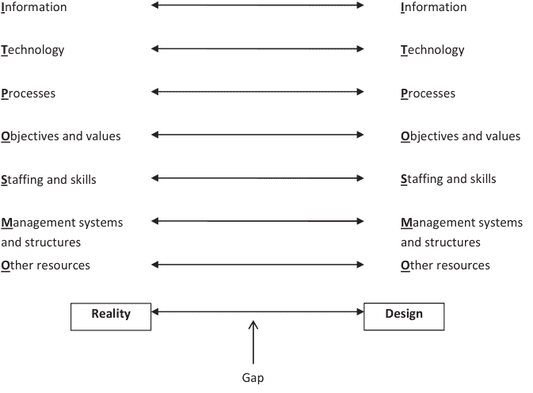

来源：Richard Heeks。

### 56 - 2. ICT 的何去何方？国际发展又何何？

此外，图 2.3 描述的方法论可以证明有助于缩小差距，因为它揭示了项目现实，并允许设计和现实进行灵活且迭代的改变。

将这一切整合在一起，我们发现与图 2.4 中的 ICT4D 项目策略指导非常相似，该图总结了 ICT4D 1.0 的教训。

### 图 2.4：ICT4D 2.0 实施良好实践

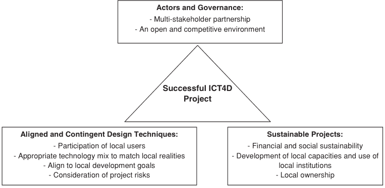

来源：Richard Heeks。

### ICT4D 2.0 的行动新世界观

ICT4D 领域的参与者来自特定的学科背景。通过观察他们的背景，我们可以学到什么？

该领域的许多活跃人士源于计算机科学背景。其中一些处理我们可能所谓的“硬端”领域（硬件和固件），另一些则来自相对“软”的人机交互领域。当然，这种专业知识对于 ICT4D 2.0 是至关重要的。它对于实现图 2.4 中详细说明的新技术和应用优先事项至关重要。它将成为实验室/亲贫以及协作/类贫创新的重要组成部分。

但单靠它是不够。而且，当它孤立存在时，问题就会出现。许多 ICT4D 失败的根源被认为是其以技术中心的方法，这种方法由信息学世界观主导。这类项目通常类似于医学笑话：“手术很成功，但遗憾的是病人去世了”。它们交付了一个在技术上可行但未能对发展做出贡献的系统。

因此，为了从 ICT4D 1.0 的失败中转型，我们需要有新的、更广泛的世界观来指导 ICT4D 2.0 项目。这些世界观将从何而来？有两个主要的学科候选。

第一个是信息系统。在 20 世纪 80 年代和 90 年代初，信息系统在被称为 ICT4D 之前是 ICT4 的知识基地；特别是国际信息处理联合会（IFIP）第 9.4 工作组关于计算机在发展中国家社会影响的研究。随着处理 ICT4D 的信息系统学科期刊的创建、关键信息系统期刊任命了具有特定发展中国家职责的新编辑委员会成员，以及最近信息系统协会（AIS）创建了关于发展中国家信息系统的特别兴趣小组，这种趋势得到了加强。

信息系统视角提供了理解许多导致 ICT4D 项目问题的手段。最值得注意的是，它提供了模型来理解许多 ICT4D 项目失败背后的人类、政治和背景原因。它还提供了在项目设计和实施期间解决这些因素的方法。在最广泛的范围内，信息系统甚至允许我们退后一步，回答关于 ICT4D 政治经济的问题：它促进了谁的利益，其机会成本又是什么。

但信息系统视角在两个方面失效了。它至少在某方面失去了对人工制品（arte）的关注，变得太像社会科学，并过度关注是否未能与技术接触。它与发展的背景、利益相关者和过程缺乏联系。信息系统倾向于既不理解也不使用发展、发展研究的观点。

人们可以主张纳入第四种世界观：传播学。几十年来它承载着对发展的兴趣，是 ICT4D 社区的关键部分。为了简单起见，我们在这里将其关键概念整合到信息系统中：这种简化对于传播模型和电信来说更具信度；但在媒体研究中则较弱。

我们转向发展研究。到目前为止，发展研究未能充分传达或支持 ICT4D。部分，这是因为发展研究在 20 世纪 80 年代普遍远离了技术；这是对“大科学”和“技术转移”理念的反作用，这些理念泛化了此前几十年中主导发展的、已被信誉扫地的范式。

结果是，ICT4D 1.0 像一个泡沫一样增长。它是由发展领域之外的参与者（作为 IT 供应商）以及少数希望如此的信奉者驱动的。但它与发展主流隔绝了，主流对技术仍然保持怀疑态度，尤其是新技术（尽管在他们家里和工作场所他们日益依赖这些技术）。

然而，随着 2000 年的发展，发展研究领域发生了变化。科学和技术正在构成发展议程，受到诸如杰弗里·萨克斯（Jeffrey Sachs）等人类发展冠军的推动，他们认为技术是实现千年发展目标（MDGs）的核心；受到新兴工业国家（如韩国和台湾等新兴工业国家）和金砖国家（巴西、俄罗斯、印度、中国）作为新兴经济力量和新援助提供者对科学技术核心重要性的重视；受到技术创新新视角的推动，这些视角展示了技术如何在解决贫困问题方面是有效的。

ICT4D 2.0 为与发展研究接触提供了更大的机会。这种接触将有助于理解数字技术如何融入到发展范式、过程和结构中。这不仅可以指导事后活动（如 ICT4D 影响评估），还可以指导事前活动，即理解 ICT4D 优先事项，以及 ICT4D 项目设计和实施的良好实践。发展研究视角从宏观和微观层面提供了指导，最终都增加了 ICT 对发展的可能贡献。

### 整合视角

我们得出结论，计算机科学、信息系统和发展研究这三个知识领域之一，对 ICT4D 领域都有其贡献。

从概念上说，这意味着需要将这三个领域结合在一起的空间。这尚未实现，仍然是 ICT4D 2.0 期间的关键知识挑战。但在某些小组中存在一些很有前景的可能性，例如 ICTD 会议²，它汇集了信息专业人士来解决发展问题，以及最近成立的 IFIP 交互设计与国际发展特别兴趣小组。这两个小组都关注计算机科学/信息系统边界上关于发展背景下系统设计的特定需求和实践。它们借鉴了学术领域日益蓬勃的“发展设计”领域以及商业领域的“新兴市场设计”领域。

在实践中，这意味着如果 ICT4D 2.0 项目要成功，它们需要这三个领域的专业知识。这可以被解释为需要多学科团队，但问题领导力也将同样重要。在这里，我们可以扩展一个性发现：成功的 ICT 项目是由跨越技术和组织的混合型人才领导的。

### 图 2.5：培养 ICT4D 2.0 领袖

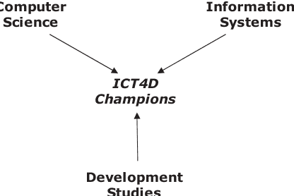

来源：Richard Heeks。

正如图 2.5 所示，因此我们需要开发或寻找“三栖型”（tribids）ICT4D 领袖。他们必须对计算机科学、信息系统和发展研究三个领域有足够的了解，以总结关键教训，并与领域专业人士互动和管理。这些混合型 ICT4D 领袖的培养是另一个问题。职业培训无疑会有帮助；那些创建 ICT4D 硕士课程的人对这一点非常敏锐。作者还观察到，三栖型人才往往在 ICT4D 项目期间自发形成，因为任何单一领域的领导者都会很快发现自己面临着只有通过其他领域的见解才能解决的问题。

### 框 2.12 教学 ICT4D 2.0

目前，已有少数但数量不断增长的正式培训课程涉及 ICT4D（信息通信技术促进发展）。

曼彻斯特大学的一期发展信息化硕士（MSc in ICT for Development）明确将图 2.5 作为其培训基础的基础。经验表明，许多参与者已经拥有良好的计算机科学技能基础，因此这些内容仅作为选项提供。

核心课程的重点集中在以下三个领域：

- 发展概念：理解发展过程和结构的基础性知识框架。
- 发展项目实践：与发展背景下的项目管理相关的知识和技能。
- 信息系统：理解信息和信息系统，以及其在发展背景下的构建与实施的知识与技能。

该课程还通过一个关于 ICT 与社会经济发展的顶石元素，以及一系列对发展中国家 ICT4D 项目的实地访问，将不同领域联系起来。在教学这一元素时，以及其他 ICT4D 课程通常围绕实现类似千年发展目标（MDG）的能力（并加入了经济增长等问题）来构建。对于 ICT4D 2.0 来说的一个问题是，这种“整合方法”（图 2.6）是否是最合适的，或者是否存在一个更具变革性的“发展 2.0”课程空间。

从战略上讲，这意味着我们还需要在传统的 ICT4D 政策和计划制定中开发“混合模式”。我们可以通过追溯关于 ICT 和发展的观点的年代史来描绘这一需求，如图 2.6 所示。

我们可以利用这一点来重新解读（重新解读）我们早期的技术与发展年代史。直到 20 世纪 90 年代——我们称为 ICT4D 0.0——大多数发展计划和政策制定者倾向于要么忽视 ICT（因为当时完全如此），要么将其从发展的主流中孤立出来，放到单独的政策和部门中。如果技术整体在主导思维的发展研究范式中被视为积极的，那么 IT 则被贬放到更边缘的角色，甚至被视为负面的（例如，20 世纪 80 年代印度出现的“要工作，不要计算机”的涂鸦）。

### 图 2.6：关于 ICT 与发展的战略性观点的演变

ICT 对发展的感官贡献

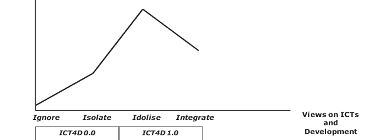

来源：Richard Heeks。

如所示，这种观点在 20 世纪 90 年代的少数发展官员中继续存在，作为更广泛的科学技术边缘化的一部分。但与此同时，在一种最初很少触及发展研究的基于技术和计算机科学的范式驱动下，ICT4D 运动诞生了。这种运动崇拜数字技术并将其置于发展过程的核心。世界的主要问题被视为数字鸿沟：缺乏对 ICT 的获取。

ICT4D 1.0 未能达到其炒作这一点已有记载。这一阶段的后半部分出现了一种可以认为是发展研究观点优越地位的重新主张，这些观点认为他们看到的计算机科学概念是过度狭隘的。因此，ICT 在发展领域内变得“主流化”，意味着它从属于发展目标的实现，被整合到长系列可能被证明有用的工具和技术列表中。典型的表述是从一个发展目标开始，然后寻求理解信息通信在实现该目标中的作用，然后询问哪些新技术（如果有）可以帮助实现这一作用。

在许多方面，这种整合方法看起来非常合理；它是许多机构——世界银行、加拿大国际发展研究中心、英国国际发展部——正在遵循的方法。它代表了我们 ICT4D 2.0 的起点，并隐藏在

### 62 – 2 ICT 和国际发展的下一步在何方？

人们在谈到 ICT4D 时经常听到诸如“手段而非目的”或“工具而非目标”等格言。

### 框 2.13 ICT 政策：超越菜单

在在 ICT4D 1.0 期间，关于 ICT 政策的大量研究和建议似乎更多地关注内容而非过程和结构。如果用餐饮来类比，那就是对“政策菜单”的关注过度；而对烹饪和餐厅的关注不足。继续这个类比，可以从米其林星餐厅拿一份菜单交给麦当劳的经理。

### 64 - 2. ICT 与国际发展的下一步在何方？

### 框 2.14. ICT4D 2.0 的研究重点（续）

- 新型实施模式：更多关于 ICT4D 资金筹助、组织和管理新方法的研究。
- 新观点：更多关于在发展研究与计算机科学/信息系统交叉领域之间建立智力联系的研究；更多关于 ICT4D “超越主流化”（beyond mainstreaming）的研究。

它将包含来自其他教科书的特定元素，例如：

- 城市发展：研究发展中国家城市中 ICT 的使用。
- 气候变化：研究 ICT 如何能够减少、宣传、缓解并帮助应对发展中国家气候变化带来的后果。
- 超越菜单：研究 ICT4D 政策是如何制定和实施的，而不仅仅是政策内容的进行简单改革。

最后，我们可以识别出一些通用的研究重点：³

- 定义发展：研究 ICT 能够促进什么样的发展愿景；仅仅是千年发展目标（MDGs）还是远于此？以及 ICT 如何重新定义发展——是否正在出现一种“发展 2.0”？
- 抽后观察：更多以各种方式“抽后”的研究；在时间上，采用纵向研究方法；在参与上，对项目采取更独立、更少自身利益倾向的观点；在关注点上，采取更具政治性和批判性的研究视角，界定 ICT4D 议程并明确服务于谁的利益。

- 评估：（如图 2.7 所示）从研究 ICT4D 的准备情况和可用性转向研究采纳率和特别是影响。严谨的影响评估是 ICT4D 的“麦考维”（Macavity）——谈论很多，但极少见到。

# 结论

我们并没有一个明确的分界线来可以说：“ICT4D 1.0 在此停止；ICT4D 2.0 从此开始”。在基层，这是一种演化的感觉，而非断层。然而……一些混乱、模糊但新颖的东西正在出现。如果我们给它贴上这个标签并进行总结（如表 2.1 所示），是有意义的。

## 2. ICT 与国际发展的下一步在何方？ – 65

### 表 2.1: ICT4D 阶段总结

| 问题 / 阶段 | ICT4D 0.0 | ICT4D 1.0 | ICT4D 2.0 |
|---|---|---|---|
| | (1960年代 – 1990年代中期) | (1990年代中期 – 2000年代中期) | (2000年代中期/后期及以后) |
| 标标性技术 | PC 数据库 | 远程中心 (Telecentre) | 手机 |
| 关键应用 | 数据处理 | 内容（交互） | 服务与生产 |
| 贫民 | | 消费者 | 创新者与生产者 |
| 关键目标 | 组织效率 | 千年发展目标 (MDGs) | ?增长与发展？ |
| 关键问题 | 技术潜力 | 准备情况与可用性 | 采纳率与影响 |
| 关键参与者 | 政府 | 捐助者与非政府组织 (NGOs) | 所有部门 |
| 态度 | 忽略 -> 隔离 | 崇拜 -> 整合 | 整合 -> 创新 |
| 创新模式 | 北方 | 亲贫 -> 贫困 | 类贫 -> 针对贫困 |
| 主导学科 | 信息系统 | 信息学 / 发展研究 | 计算机科学、信息系统与发展的交叉学科 |
| 发展范式 | 现代化 | 人类发展 | ?发展 2.0？ |

我们可能会认为 ICT4D 1.0 和 2.0 之间的关键区别是什么？在回答这个问题时，我们可以与 Web 2.0 的概念进行类比。例如，ICT4D 2.0 关于世界的“长尾”——利用数字技术来挖掘那些掌握世界 20% 资源的 80% 人的能力。或者，用里克·施密特（Eric Schmidt）的“不要对抗互联网”描述，我们可以看到 ICT4D 2.0 的口号是“不要对抗贫民”。1.0 强加了预先的设计并要求贫民适应，而 2.0 则围绕贫民特定的资源、能力和需求进行设计。或者，我们可以转化“网络即平台”来论证：ICT4D 1.0 将 ICT 作为发展的工具，而第二阶段将 ICT 作为发展的平台。

另一种，我们可以将 ICT4D 问题拆解为时间顺序，如图 2.7 所示：

- * 准备工作 Readiness：我们是否有政策和基础设施来使 ICT 的可用成为可能？
- - 可用性 Availability：我们如何向贫民推广 ICT 以帮助他们成为用户？
- 采纳率 Uptake：我们能以什么方式实施和应用 ICT 使其有用？
- 影响 Impact：我们如何利用 ICT 产生最大的发展影响？

### 图 2.7: 随时间变化的 ICT4D 问题

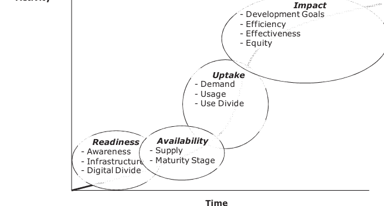

来源：Richard Heeks。

当然，准备工作、可用性和采纳问题在至少一个代人内将继续保持相关性；事实上，随着新技术浪潮的出现，它们将永远存在。它们对基础设施、硬件软件的创新提出了持续的需求。虽然手机已经成为现实，且连接互联网的 PC 是日益增长的可能性，特别是对于城市和城市边缘贫民而言。在 ICT4D 1.0 关乎打好基础，且作为概念证明（如试点）在很大程度上基于供应的采纳时，ICT4D 2.0 可以将其部分注意力转向其他地方。

它可以不再仅仅思考试点，而是更多地思考可持续性、可扩展性和影响。它可以停止从单一学科的角度思考，转而更多地从计算机科学、信息系统和发展的交叉学科视角思考。

它可以不再仅仅考虑“需求”（needs），而是更多地考虑“愿望”（wants）——由外部家长式的术语定义。相反，它还可以考虑贫民自己想要什么？贫民如何使用数字技术？

综上，我们可以看到 ICT4D 2.0 是关于重塑贫民。ICT4D 1.0 将他们边缘化，基于供应驱动的视角；ICT4D 2.0 将他们中心化，基于需求驱动的视角。贫民可以产生数字内容和收入吗？

这一阶段提出的三个总结性问题是：

# 注释

+1 源自 SDC (2007) 瑞士发展与合作署。

+2 例如，Walsham, G. & Sahay, S. 见上。

+3 观点源自：Walsham, G.

# 参考文献

Badran, M., A. El-Sherb and A. Ragab (2009), “决定宽量的因素是什么？”见 E. Byrne, B. Nicholson and F. Salem (eds.), Assessing the Contribution of ICT to Development, Dubai School of Government, UAE, pp. 69-93.

Bailur, S. (2008), “Namma Dhani Community Radio and IT Project”, 班会，印度，19日。

Baker, J.L. (2000), Evaluating发展项目对贫困的影响，银行， Washington。http://siterources.worldbank.org/INTISPMA/Resources/handbook.pdf.

Bhatia, D., S.C. Bhatnagar and J. Tominaga (2009), “手动与电子政府如何比较？印度经验”，见 Information and Communications for Development 2009: Extending Reach and Increasing Impact, World Bank, Washington, pp. 67-82.

Bond, R. and D. Hulme (1999), “发展的过程方法：理论与斯里兰卡实践”，World Development, Vol. 27, No. 8, pp. 1339-1358.

Caniels, M.C. and H.A. Romijn (2007), “创新对最不发达国家重要吗？讨论与新议程”，在奥斯洛行的创新研讨会上报告，10月30日至11月1日。www.cas.uio.no/research/0708innovation/CASworkshopCanielsRomijn.pdf.

CIMA (2007), 社区广播及其发展的挑战，国际媒体援助中心，华盛顿。www.ned.org/CIMA-Community_Radio_Working_Group_Report.pdf.

Checkland, P.B. and S. Holwell (1998), 信息、系统与信息系统，Wiley, Chichester, UK.

Clark, B. and B. Burrell (2009), “自由电话：拨号信息服务”，见 R. Heeks and R. Tongia (eds.), ICTD 2009 Proceedings, 卡内基·梅隆大学，卡塔尔，483.

# 70 – 2. ICT 的未来何在？国际发展如何？

Denton, A. (2008), 《连接非洲的政策优先级》，发表于第一届促进发展的移动通信技术会议，瑞典卡尔斯塔德大学，12月11-12日。

Donner, J. 等 (2008), 《全球发展技术中的设计阶段》，《IEEE计算机》杂志，第41卷，第6期，第34-41页。

Duncombe, R. 与 R. Boateng (2009), 《发展中国家的手机电话与金融服务》，发展信息学工作论文第37号，曼彻斯特大学信息中心，www.sed.chester.ac.uk/idpm/research/publications/wp/di/di_wp37.htm

Enberg, J. (1998), 《综合农村发展与普惠接入》，发表于农村发展电信伙伴关系与参与会议，安大略尔夫大学，安大略省省，10月26-27日。

Etta, F.E. 与 S. Parvyn-Wahamiu (2003), 《远程中心的使用经验》，国际发展研究中心，渥太华。

Etta, F. (2002), 《远程中心的问题》，IDRC，渥太华，www.acacia.org/zatelecentres_etta.htm。

Fornefeld, M. G. Delaunay 与 D. Elixmann (2008), 《宽带对增长和生产力的影响》，MICUS，杜塞尔多夫夫。

Gamos (2005), 《面向穷人的社区电视》，Gamos，英国，雷丁。www.tv4d.org/comtelefe_final_report_vs_97.pdf。

Gandhi, R. 等 (2009), 《数字绿色：用于农业推广的参与式视频与中介教学》，信息技术与国际发展，第5卷，第1期，第1-15页。

Gibbert, M. Hoegl 与 L. Valikangas (2007), 《赞美资源限制》，麻省理工学院管理评论，第48卷，第3期，第15-17页。

GKP (2003), 《多利益相关者伙伴关系》，全球知识伙伴关系，马来西亚吉隆坡。

Grover, A.S. 等 (2009), 《使用对话系统获取 HIV 健康信息》，收于 R. Heeks 和 R. Tongia（编），ICTD 2009 论文集，卡内基·梅隆大学大学，卡塔尔，第95-107页。

Hanna, N.K., Qiang, C.Z.-W., Kimura, K. 和 Kueuc, S.C. (2009), 《国家政府机构：功能、模式与趋势》，收于《2009年发展信息通信：扩大范围与增强影响力》，世界银行，华盛顿特区，第83-102页。

## 2. ICT 与国际发展的未来何在？

Heeks, R. (1999), 《信息系统中的参与暴政：从发展项目中学习教训》，发展信息工作论文第4号，曼彻斯特大学发展信息中心，英国，www.sed.manchester.ac.uk/idpm/research/publications/wp/di/wp_04.htm。

Heeks, R. (2002), 《信息系统与发展中国家：失败、成功与本土即兴改进》，信息社会，第18卷，第2期，第101-112页。

Heeks, R. (2005), 《过度估计全球数字社会》，电子发展简报第7号，11月，www.sed.manchester.ac.uk/idpm/research/publications/wp/di/index.htm。

Heeks, R. (2006), 《电子政府的实施与管理》，Sage，伦敦。

Heeks, R. (2007), 《IT 中的社会外包与公平贸易》，GKP，马来西亚吉隆坡。www.gk3onlineinteractions.net/en/node/79。

Heeks, R. (2008a), 《避免电子政府失败：设计与现实差距技术》，eGov4Dev www.egov4dev.org/success/techniques/drg.shtml。

Heeks, R. (2008b), 《非西方 ICT4D 资助者的新浪潮》，ICT4D 博客，10月17日http://ict4dblog.com/2008/10/17/the-new-wave-of-non-western-ict4d-aid-donors。

Heeks, R. (2009a), 《ICT4D 的教父与 ICT4D 的第一台电脑》，ICT4D 博客，1月1日http://ict4dblog.com/2009/01/01/the-godfather-of-ict4d-and-ict4ds-computer。

Heeks, R. (2009b), 《ICT4D 中的参与式设计问题：自我效能问题》，ICT4D 博客，1月23日，http://ict4dblog.com/2009/01/23/participatory-design-problems-in-ict4d-the-self-efficacy-issue。

Heeks, R. (2009), 《全球 ICT4D 支出》，4月4日http://ict4dblog.com/2009/04/06/worldwide-expenditure-ict4d。

Heeks, R. 与 A. Molla (2009), 《发展性 ICT 项目的影响评估：方法汇编》，发展信息工作论文第36号，曼彻斯特大学发展信息中心，英国。

Heeks, R. 与 B. Nicholson (2004), 《“追随国”的软件出口成功因素与策略》，竞争与变化，第8卷，第3期，第267-303页。

Impio, J., 等 (2008), 《在非洲城市低收入音乐产业利用移动技术》，发表于第一届促进发展的移动通信技术会议，瑞典卡尔斯塔德大学，12月11-12日。

ITU (2007), 《衡量撒哈拉以南非洲的村庄 ICT》，国际电信联盟，日内瓦。www.itu.int/ITU-D/ict/statistics/Africa_Village_ICT_2007。

ITU (2009), 《ICT 统计数据》，国际电信联盟，日内瓦。

Kara, S., S. Kemaloglu 与 S. Kirbas (2006), 《低成本、可调色照明的心电图》，《医学系统》，第30卷，第3期，第205-209页。

Kenny, C. (2006), 《过度推销宽带》，Reinder。

Kelly, T. (2007), 《超越三亿》，ID21 洞察，第69号。

Kumar, A., Chakraborty 与 H. Chauhan (2009), 《COMMONSense：面向资源匮乏地区的无线传感器网络》，收于 R. Heeks 和 R. Tongia（编），卡内基·梅隆大学，卡塔尔，第85-94页。

Leach, M. 与 I. Scoones (2006), 《慢速：让技术发挥作用》，伦敦。

Lee, H. 等 (2008), 《研究中寻求“IT”：理论化》，信息系统，第35卷，第2期，第121-34页。

Mills-Tette. (2009), 《开拓利基：坦桑尼亚女性使用 ICT》，发表于性别研讨会，IDPM，曼彻斯特大学。

Molony, T. (2006), 《发展 ICT》，战略。

OECD (2009), 《宽带门户》，OECD，www.oecd.org/sti/ict/broadband。

Orlikowski, W. 与 S. Iaco (2001), 《早期开发的社会动态》，信息研究，第12卷。

Prahalad, C.K. (2006), 《创新沙盒》，商业，第44卷。

Qiang, C.Z.-W. 等 (2009), 《宽带的经济影响》，收于《2009年发展信息通信：扩大范围与增强影响力》，世界银行，华盛顿特区，第35-50页。

Teubal, M. (2001), 《从以色列视角观察印度软件行业：微观经济与政策分析》，以色列，耶路撒冷大学，以色列。

Thirumavalavan, R. and C. Garforth (2009), “ICT4D and Farming Communities: Success and Failure of Telecentres in Rural Tamil Nadu”, Assessing the Contribution of ICT to Development, Dubai School of Government, UAE, 26–28, May, www.ifpq.dsg.ae/Docs/dcs05_Thiru_Final.pdf.

Thomas, B. (2003), “What the World’s Poor Watch on TV”, Prospect, Vol. 82, pp. 30–33.

UNCTAD (2008), Creative Economy Report 2008, UNCTAD, Geneva. www.unctad.org/en/docs/ditc20082cer_en.pdf.

UNDP (2008), Human Development Report 2008/2009, United Nations Development Program, New York, NY.

Veeraraghavan, R., N. Yasodar and K. Toyama (2007), “Warana Unwired”, paper presented at ICT2007, Bangalore, India, 15-16 Dec.

Wakumuna, K. J. (2007), “Mobile Reinforce Unreal Gender Relations in Zambia”, “Mobile Phones and Development”, ID21 Insights, No. 69, p3. www.id21.org/insights69/insights69.pdf.

Walsham, G. and S. Sahay (2006), “Research on Information Systems in Developing Countries, Information Technology for Development, Vol. 12, No. 1, pp. 7–24.

Walton, M. (2008), “A Process Approach to ICT4D: An Analysis of Practice, MSc ICT4D dissertation, IDPM, University of Manchester, UK.

Yamout, S. (2009), “Public Private Partnership (PPP) Model of the Partnership for Lebanon”, paper presented at Regional Follow-up on the Outcome of the WISIS, Damascus, 16-18 Jun.

http://globalimpactstudy.org.

www.kiva.org.

www.kothmale.org.

www.onlinevolunteering.org.

`www.prolinnova.net.`

`www.sed.manchester.ac.uk/idpm/postgraduate/taught/courses.`

# 第3章

## 发展中国家如何参与全球互联网经济：竞争驱动的创新

作者: Rohan Samarajiva¹

全面参与全球互联网经济需要日益复杂的电子化连接。如今，由于自由化浪潮以及技术和商业创新的推动，世界大部分地区已经实现了电子连接，尽管其水平尚未达到支持全面参与的程度。本章旨在探讨竞争和商业创新在实现当前连接水平方面所做的贡献，并探讨未来如何推演以确保全球范围内广泛参与互联网经济的可能性。

发展中国家在这一领域面临的最大挑战是连接低收入群体。解决这一问题将使寻找其他问题的解决方案变得更加容易。在应对连接挑战时，本章广泛参考了在南亚和东南亚开展的研究。在结论部分，讨论了政策影响——包括与税收和其他政策的衔接，如果希望将接入机会转化为财富创造，这些政策必须保持一致。

## 76 – 3. 发展中国家如何参与全球互联网经济

OECD《关于互联网经济未来的首尔宣言》涵盖了由互联网支持的全方位经济、社会和文化活动以及相关的信息技术（ICT），这些技术通过以下方式加强各国提高所有公民生活质量的能力：

- 为就业、生产力、教育、健康和公共服务提供新机会，并解决环境和人口统计问题。
- 作为创建企业和社区的关键驱动力，刺激更紧密的全球合作。
- 实现新形式的公民参与和互动，促进意见多样化并增强透明度、问责制、隐私和信任。
- 赋能在线交易和交换中的消费者及用户。
- 强化适用于信息系统、网络及其用户的安全体系。
- 为许多不同领域的研究、国际科学合作、创造和创新开发一个日益重要的平台。
- 通过无处不在且无缝接入通信和信息网络，创造新的经济和社会活动、应用和服务机会。
- 促进一个基于连接数十亿人、机器和对象的快速、安全且无处不在的网络的全球信息社会。

OECD 就互联网经济举行部长级会议，并决定促进 ICT 的无处接入以推进其实现，这表明全球互联网经济尚未完全实现，即使在 OECD 国家内部也是如此。对于生活在发展中国，尤其是贫困人口来说，这更不现实。《首尔宣言》明确考虑到了这一点，宣布其寻求通过以下政策使互联网经济真正全球化：

- 支持发展中国家的人扩大互联网及相关 ICT 的接入。
- 互联网及相关技术为残障人士和特殊需求人士提供增强服务的潜力。

## 3. 发展中国家如何参与全球互联网经济 – 77

- 竞争环境对互联网经济成功增长的重要性，以及这能为发展带来的机会，特别是对于经济手段最有限的人和地区。
- 促进所有社区使用互联网及相关 ICT 网络，以及创建本地内容和多语言翻译。
- 在确保的同时，促进国际化域名 (IDNs) 的引入。
- 利用互联网应对气候变化。

互联网的心理形象是一个通过有线或无线连接的台式电脑或笔记本电脑。固定电话和移动宽带有不同的定义。

过去几十年取得的巨大进展，确实是通过开放连接市场才实现的。

## 什么是互联网？

互联网的一个常见形象是一个通过有线或无线连接的台式电脑或笔记本电脑。令人惊讶的是，许多从未接触过标准电脑的人已经在以电子方式执行其中一些功能了。

例如，当一个拥有预付费移动连接的贫困人输入短代码来检查账户余额时，他们正在参与当前较为复杂的互联网功能之一：远程计算。下载铃声并从预付费手机的“话值”中支付是一项包含电子支付的交易。

## 3. 发展中国家如何参与全球互联网经济 – 79

参与互联网经济，尽管其形式尚有些受限且不熟悉。

随着各国引入 3G 移动网络，高端手机向低收入群体的迁移将加速。截至 2008 年 10 月，孟加拉国社会经济分类（SEC）D 组和 E 组的新手机中位价为 43 美元（平均 58 美元）。二手手机的中位价为 29 美元（平均值 35 美元）。作为 LIRNEAsia Teleuse@BOP 研究的一部分，定性研究显示，许多二手手机其实相当先进。这两类手机都被用于通过蓝牙将音乐从手机传输到另一部手机、听音乐、观看和玩游戏、获取新闻和就业信息（有时是唯一来源），以及记录交易情况。在斯里兰卡、菲律宾和泰国，这些可支配收入、识字率和普及率较高的国家，贫困人口的使用范围和频率要得多。

显然，当农业信息可以根据用户需要随时获取时，其利用率要高于在有固定营业时间的营业亭或家庭中获取。孟加拉国的 Cellazaar 等创新公司正在通过 SMS 和 WAP（无线接入协议）为金字塔底层（BOP）用户引入基础电子商务，这些用户否则可能永远无法获得此类服务。2009 年印度大选候选人的信息（如其特定资产和负债、受教育程度以及是否有犯罪记录）可以通过 SMS 获取。BuzzCity 和 Gushup 正在移动空间领域创建社交网络。一旦移动支付的监管问题得到解决，手机可能会像信用卡一样成为发展中国家主要的支付方式，这在非洲某些地区已经如此。

## 纳入先决条件

数十亿贫困人口实现电子连接并能够使用互联网的一些功能是值得庆祝的，但不应因此自满。例如，大多数贫困人口使用的 2G 网络和手机目前的能力无法实现传统桌面电脑/笔记本电脑上网使用中被视为所当然的复杂搜索和信息检索活动。除了 Twitter 之外，发布（指在网站和博客上发帖）在简单的移动手机上操作非常繁琐。作为 LIRNEasia Teleuse@BOP 研究的一部分，定性研究显示，深度用户会同时使用两种模式：例如，在咖啡馆下载音乐，通过蓝牙传输并在手机上收听。

## 80 – 3. 发展中国家如何参与全球互联网经济

那么，如果新兴的互联网经济要具有包容性，必须改进移动手机和电脑的宽带接入毫无疑问。全球政府必须优先加速频谱改革，并透明地释放频谱，以便运营商能够提供 3G 及以上的技术。仅将频谱视为释放点时的政府收入来源，无不利于广泛部署或政府收入的长期产生。

接入网络或“最后一公里”中无线技术的价值并不抵消回传组件中有线的基本重要性。每个 WiFi 热点都是将我们连接到互联网云（大多数情况下是美国本土）的一系列有线。正如链条的强度取决于其最弱的环节，个人互联网连接的整体性能取决于连接中最慢的组件。LIRNEAsia-IIT Madras 对宽带服务质量体验（QoS）的研究表明，发展中国家大多数用户的真实瓶颈是国际段，运营商的海底电缆和卫星容量似乎不足（图 3.1）。

图 3.1：到 yahoo.com 的往返时间 (RTT)，2009 年 7 月 24 日 1350 小

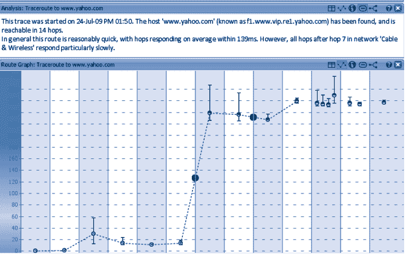

Y 轴表示到服务器的往返时间 (RTT)。最多 60 个跳 IP 地址在斯里兰卡境内 (whowhois.net)；“跳转”是从本地服务器到进入美国的第一个入口。

来源：LIRNEasia (2009)。宽带服务质量体验。测试结果。

## 3. 发展中国家如何参与全球互联网经济 – 81

显然，为了提高连接性还需要做大量工作。接入网络或“最后一公里”中无线技术的价值并不抵消回传组件中有线的基本重要性。每个 WiFi 热点都是将我们连接到互联网云（大多数情况下是美国本土）的一系列有线。正如链条的强度取决于其最弱的环节，个人互联网连接的整体性能取决于连接中最慢的组件。LIRNEAsia-IIT Madras 对宽带服务质量体验（QoS）的研究表明，发展中国家大多数用户的真实瓶颈是国际段，运营商的海底电缆和卫星容量似乎不足（图 3.1）。

## 82 – 发展中国家如何参与全球互联网经济

### 3.1

图 3.1：到 yahoo.com 的往返时间 (RTT)，2009 年 7 月 24 日 1350 小

Y 轴表示到服务器的往返时间 (RTT)。最多60 个跳 IP 地址在斯里兰卡境内 (whowhois.net)；“跳转”是从本地服务器到进入美国的第一个入口。

来源：LIRNEasia (2009)。宽带服务质量体验。测试结果。

## 3. 发展中国家如何参与全球互联网经济 – 81

显然，为了提高连接性还需要做大量工作。接入网络或“最后一公里”中无线技术的价值并不抵消回传组件中有线的基本重要性。每个 WiFi 热点都是将我们连接到互联网云（大多数情况下是美国本土）的一系列有线。正如链条的强度取决于其最弱的环节，个人互联网连接的整体性能取决于连接中最慢的组件。LIRNEAsia-IIT Madras 对宽带服务质量体验（QoS）的研究表明，发展中国家大多数用户的真实瓶颈是国际段，运营商的海底电缆和卫星容量似乎不足（图 3.1）。

## 82 – 发展中国家如何参与全球互联网经济

### 3.2

图 3.2：到 yahoo.com 的往返时间 (RTT)，2009 年 7 月 24 日

img/e4ba8eadbe4bb6a2aa563835c838d6f5_83_0.png)

来源：LIRNEasia (2009)。宽带服务质量体验。测试结果。

## 3. 发展中国家如何参与全球互联网经济 – 81

显然，为了提高连接性还需要做大量工作。接入网络或“最后一公里”中无线技术的价值并不抵消回传组件中有线的基本重要性。每个 WiFi 热点都是将我们连接到互联网云（大多数情况下是美国本土）的一系列有线。正如链条的强度取决于其最弱的环节，个人互联网连接的整体性能取决于连接中最慢的组件。LIRNEAsia-IIT Madras 对宽带服务质量体验（QoS）的研究表明，发展中国家大多数用户的真实瓶颈是国际段，运营商的海底电缆和卫星容量似乎不足（图 3.1）。

## 准入

投资

连接性的增长没有投资无法发生。政府放宽准入障碍导致了增加，

## 84 - 3. 发展中国家如何参与全球互联网经济

这种良好的表现是如何实现的？如图3.4所示，流入巴基斯坦电信行业的外商直接投资（FDI）在2002-07年间大幅增加。从2002年的微不足道的604万美元增加到2006年的19亿0506.0万美元（占外商直接投资总额的50%以上），并在2007年增加到18亿2425.0万美元（接近40%）。重大的改革在2004年开始生效，其中通过了极具典范的许可框架并举行了移动许可证拍卖。从那时起，移动业务呈爆炸式增长，外商直接投资也是如此。

## 图 3.4: 2002-07年巴基斯坦主要部门的外商投资

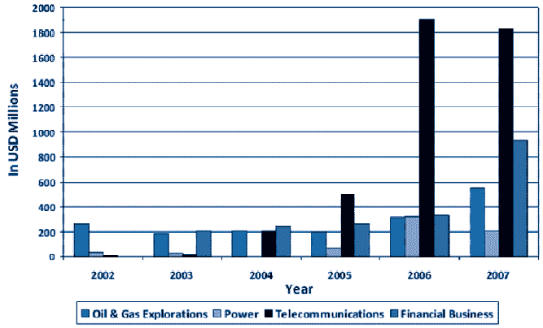

注：2004年电力部门的外商直接投资为负1,424万美元。

来源：巴基斯坦国家银行（2008）经济数据。检索自`http://www.sbp.org.pk/ecodata/NIFP_Arch/index.asp`

## 移动业务成功故事对宽带的启示

在国内，对于全球很大一部分贫人口来说，连接性并不意味着网络使用率低。事实上，印度的平均使用分钟是OECD国家的两倍。印度网络低廉的价格和高使用率指向了过去十年连接数十亿人的成功的核心解释：发现并应用了“廉价电信网络模型”，这是一种全新的南亚模型，类似于亚洲航空和瑞航等航空公司实施的廉价航空模型。

## 廉价电信网络模型

廉价电信网络模型最早出现在孟加拉国、印度、巴基斯坦和斯里兰卡等南亚市场，事实证明了它们的总拥有成本在2007年是最低，低于5美元，而77个新兴经济体的平均成本为13.15美元。南亚地区的运营商在息税、税前、折旧和摊销前利润（EBITDA）方面往往是盈利的，尽管存在相当大的波动。

表 3.1: 选定南亚市场的运营商收入、EBITDA及EBITDA利润率（2005）

| 国家 | 收入（美元） | EBITDA（美元） | EBITDA利润率 (%) |
|---|---|---|---|
| 斯里兰卡 | 259,041,928 | 124,833,464 | 48 |
| 印度 | 26,723,674,194 | 9,938,340,523 | 37 |
| (2007) | (2007) | (2007) | |
| 孟加拉国* | 655,000,000 | 344,500,000 | 54 |
| 巴基斯坦 | 978,802,178 | n/a | n/a |

*数据仅针对三个主要的移动服务提供商：Graphphone、Aktel和Banglink，它们在2005年的总市场份额达到93%。

来源：斯里兰卡：公司年度报告、公司新闻稿；Malik, P. (2008),《印度电信监管与政策环境：2008年TRE调查结果与分析》；孟加拉国电信监管委员会（2007）年度报告。美林银行报告的孟加拉国收入和EBITDA利润率不同。巴基斯坦电信管理局（2005），年度报告。

该地区复杂的政策和监管环境以及客户较低的购买力似乎迫使运营商进行创新，既包括将运营成本降至最低，也包括为每月仅使用几分钟的“长尾”客户服务。后者的创新依赖于降低与预付费客户相关的交易成本，预付费客户占了Teleuse@BOP研究中SEC D和E细段的绝大多数（图3.5）。预付费这一简单事实避免了或或不可避免产生的产生和传输月账单费用，降低了整体交易成本，在每位客户收入非常低时，这是一项非常有价值的减少。

## 图 3.5: 金字塔底层的预付费移动连接（社会经济分类D和E级移动所有者的百分比）

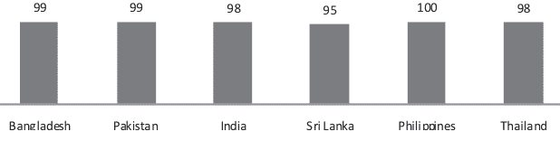

来源：LINREasia (2009) Teleuse@BOP3调查发现。

预付费允许客户在能够或需要使用服务时付费。这符合穷人的需求，他们许多人有不稳定的收入模式。低面值充值卡和特殊的电子充值引入提供了最大的支付灵活性，这对于该模式的运作具有特殊意义。

本质上，廉价电信业务模式是由激烈竞争驱动的创新，并作为对南亚国家严格的监管环境和低购买力的回应。如果没有竞争，这种创新就不会发生。该模型在尼泊尔得到了证实，该国拥有2900万人口，与南亚国家有许多相似之处。尼泊尔2008年的移动价格相对较高，但在2009年，尽管没有授予执照，所有移动运营商的价格都大幅下降。原因被发现不是传统的类型，而是一种准入形式，某些无线接入进入了该市场。

## 宽带的启示

廉价电信网络模型带给我们什么启示？期望全天候宽带连接数十亿穷人是现实的，正如传统的电话业务成功连接了穷人一样，这在印度恒河平原、非洲和印度洋地区是至关重要的，那里有巨大的改进空间，特别是运营成本必须大幅降低。

表 3.2: 1998-2005年印度固定线路资费趋势

| 年份 | 64Kbps (美元) | E1 | Mbps |
|---|---|---|---|
| 1998 | 413,631 | - | - |
| 1999 | 404,690.73 | - | - |
| 2000 | 342,245.99 | 6,203,208.56 | 17,967,914 |
| 2001 | 333,889.82 | 6,203,208.56 | 17,529,215 |
| 2002 | 54,009.14 | 6,203,208.56 | 2,835,479 |
| 2003 | 67,558.68 | 6,203,208.56 | 2,994,077 |
| 2004 | 53,888.13 | 6,203,208.56 | 2,088,049 |
| 2005 | 44,390.89 | 6,203,208.56 | 2,191,717 |
| Nov 2005 | 28,483.79 | 6,203,208.56 | 655,127 |
| 2006 | 26,209.68 | 6,203,208.56 | 602,598.57 |
| 2007 | 25,158.19 | 6,203,208.56 | 578,840.80 |

来源：Kathuria, R. (2009),《固定线路下降的影响》，未发表论文。

表 3.3: 2000-2008年印度IPLC（半路）资费（美元/年）

| 年份 | 容量 | DS3 | STM-1 |
|---|---|---|---|
| 1998 | 413,631 | - | - |
| 1999 | 404,690.73 | - | - |
| 2000 | 342,245.99 | 6,203,208.56 | 17,967,914 |
| 2001 | 333,889.82 | 6,203,208.56 | 17,529,215 |
| 2002 | 54,009.14 | 6,203,208.56 | 2,835,479 |
| 2003 | 67,558.68 | 6,203,208.56 | 2,994,077 |
| 2004 | 53,888.13 | 6,203,208.56 | 2,088,049 |
| 2005 | 44,390.89 | 6,203,208.56 | 2,191,717 |
| Nov 2005 | 28,483.79 | 6,203,208.56 | 655,127 |
| 2006 | 26,209.68 | 6,203,208.56 | 602,598.57 |
| 2007 | 25,158.19 | 6,203,208.56 | 578,840.80 |

## 3. 发展中地区如何参与全球互联网经济

包括 3G 地理覆盖区域，当特定基站（BTS）的需求过大时，这些区域会收缩。此外，“始终在线”的概念对于移动运营商提供的宽带服务用户而言，适用性有限。

廉价电信网络模型基于聚合用户的小额使用来帮助吸收可用容量，而不是基于过时且误导性的每用户平均收入（ARPU）概念⁸。随着个人用户通过手机、网络电脑、笔记本电脑或桌面电脑进行连接，关键是将交易成本（例如客户获取和计费）降至最低。实现相同结果的另一种方法是让低流量用户通过电信中心和网络网吧等公共使用设施连接互联网。早些对电信中心 ADSL 或 VSAT 链路等固定连接的关注，正日益被通过移动运营商提供的接入、HSPA 甚至 2.5G 连接所取代。这使得关于“移动对电信中心”框架的辩论转向了“移动与电信中心相结合”的框架。

## 应用场景

Teleuse@BOP 定性研究显示，低收入用户确实以互补的方式使用网吧和手机，例如确实通过蓝牙将音乐下载到手机，然后在手机上听。

Teleuse@BOP 调查专门探测了对移动端非语音服务的意识水平、尝试和使用情况。结果发现，这些水平普遍较低，特别是在巴基斯坦、印度和孟加拉国较低的社会经济地位（SEC）群体中（印度恒河平原是最困难的案例）。在东南亚国家和斯里兰卡，对于“美国偶像”类才艺节的增值短信投票等服务，意识、尝试和使用率都很低（图 3.6 和图 3.7）。这并不意外，因为这些服务才开始提供，而且服务贫困地区的业务模式尚未成熟。

### 图 3.6：金字塔底端的 Mobile2.0 服务意识（社会经济分类为 D 和 E 的电信用户百分比）

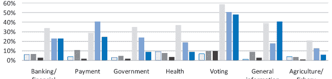

- 孟加拉国
- 巴基斯坦
- 印度
- 斯里兰卡
- 菲律宾
- 泰国

来源：LIRNeasia (2009)，Teleuse@BOP3 调查结果。

### 图 3.7：金字塔底端的 Mobile2.0 服务使用（社会经济分类为 D 和 E 的电信用户百分比）

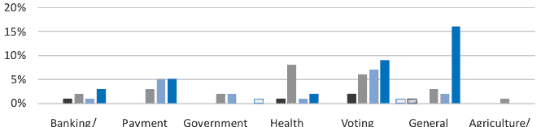

- 孟加拉国
- 巴基斯坦
- 印度
- 斯里兰卡
- 菲律宾
- 泰国

来源：LIRNeasia (2009)，Teleuse@BOP3 调查结果。

年轻用户的意识、尝试和使用水平一致地较高，这表明存在巨大的潜力（图 3.8）。调查还发现，当前电信用户尝试不同服务的意愿程度不异（图 3.9）。

### 图 3.8：Mobile2.0（非语音）服务的意识和使用（所有国家社会经济分类为 D 和 E 的电信用户百分比）

| 15-24 岁 | 25-34 岁 | 35-49 岁 | 50-60 岁 |
|---|---|---|---|

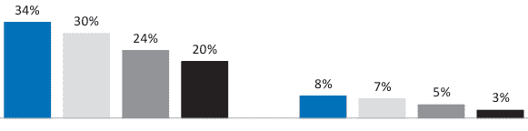

了解服务 | 使用服务

来源：LIRNEasia (2009) Teleuse@BOP3 调查结果。

### 图 3.9：愿意通过手机尝试访问支付、政府或农业/渔业信息服务的意愿（目前不了解此类服务的社会经济分类 D 和 E 的电信用户百分比）

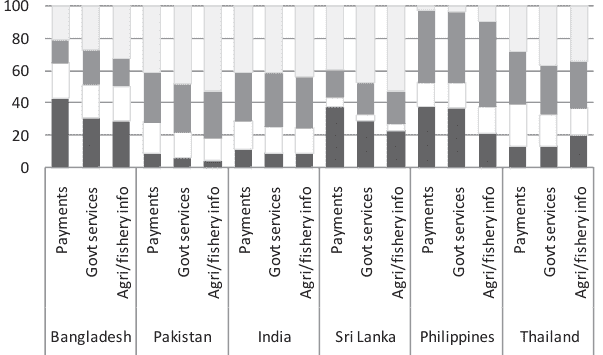

- 我不需要这项服务
- 否
- 不确定
- 是

来源：LIRNEasia (2009) Teleuse@BOP3 调查结果。

现在很清楚，农业信息通过移动设备提供的效率最高。在马哈哈拉拉邦，来自 Warana Wired（旧且正在失败的）；标准的以电脑为中心的以及 Warana Unwired（新且成功的）；以移动为中心的项目的发现，生动地说明了这一点，现在微软研究院正在越南更大范围内应用这些项目⁹

孟加拉国的 CellBazaar 等公司正在将电子商务引入贫困地区（BOP）用户，否则他们永远无法获得此类服务。CellBazaar 正在针对市场上最便宜、最简单的 GSM 手机的高度限制能力设计其服务，因此仅关注交易的搜索阶段（图 3.10）。

### 图 3.10：CellBazaar 包含的商业交易阶段与亚马逊市场（Amazon Marketplace）对比

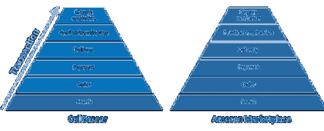

一切都发生在 CellBazaar 系统之外，但使用了手机的对话和消息功能。分析显示，该企业仍处于推广阶段，试图以低价格吸引用户（例如短信交易的最低价格约为 0.35 美元），并牺牲了高回报。CellBazaar 通过熟悉的短信格式提供的这种较为笨重的用户体验正在通过 WAP 得到改进，其他也可能通过也是 GSM 一部分的 USSD（非结构化补充业务数据）功能进行改进。

作为即使在拖拉机上也能获取市场信息的甘蔗农民，CellBazaar 的移动界面对于无法在 Web 上完全完成的交易（例如购买汽车或牛）具有固有的额外益处。与桌面端的比较购物不同（在进行实际交易前需要做笔记或打印打印），移动界面允许根据需要、在需要时进行比较购物。

斯里兰卡农业市场价格传输 Govi Gnana Seva (GGS) 系统自 2002 年以来经历了多次演变。起初它侧重于从斯里兰最大的果蔬批发市场收集现价并将其显示在大型电子屏幕上，减少市场内部的价格偏差。然后，它试图通过短信和交互式语音应系统将现价交付给那些远离市场的人。当试点项目资金结束后，价格通过广播和电视进行收集和传播。从 2009 年开始，该系统正在重新设计，以向手机提供现价和初步的期货价格。这将允许一系列如果价格仅交付到电信中心或其他地方的桌面上将无法实现的行为。这里手机可以直接用于谈判，双方都可以调取额外信息。

在印度喀拉邦鱼市和尼日尔谷物市场减少摩擦的使用已得到充分研究。在两种情况下，生产者价格上涨，消费者价格下降，并消除了浪费（对于易腐商品鱼而言），因为生产者可以访问通过移动设备新连接的更多孤立的市场。与 Warana 和 GGS 不同，喀拉邦和尼日尔的案例不涉及任何形式的组织数据收集，只是使用手机进行信息收集和决策。

手机作为支付设备引起了极大关注，特别是对于贫困地区。显然，支付是互联网上执行的功能之一，与其他功能结合可以产生更高水平的互联网参与。特别是，人们对利用移动设备促进临时劳工汇款表现出兴趣。

LiAsia 的研究显示，与巴基斯坦、印度、斯里兰卡和菲律宾的同行相比，孟加拉国移民与家联系最频繁：87% 的孟加拉国移民每周致电一次家，而 34% 的每天致电。调查发现，平均孟加拉国人还为与家友的通信付费，每月花费 48 美元保持联系，而印度人为 15 美元。

孟加拉国移民主要在西亚和东亚/东南亚工作。他们平均每月收入约为 485 美元，其中汇回 203 美元。与家通信最流行的模式是电话，但与其他国籍不同，28% 的孟加拉国人通过互联网拨打。

孟加拉国国内移民似乎最经常使用手机发送汇款。携带现金仍然是汇款的最流行方式，但有相当比例的人发送

## 94 - 3. 发展中国家如何参与全球互联网经济

尽管缺乏正式的移动支付系统，他们通过手机进行汇款。孟加拉国的移民正在使用“灵活充值”（一个客户可以将价值转入另一个预付账户）。通常情况下，移民会与村庄的灵活充值销售人员保持良好关系，这些人员会将充值转移的价值“兑现”给移民的家人（需扣除佣金，佣金可能高达 20%，最低为零）。讽刺的是，在菲律宾——世界上唯一合法移动汇款服务的国家，使用此类系统的移民反而更少（图 3.11）。解释在于替代方案的可用性。看来，孟加拉的汇款替代方案没有菲律宾那么有吸引力。

### 图 3.11：移动汇款服务的使用

（社会经济分类 D 类和 E 类工人的百分比）

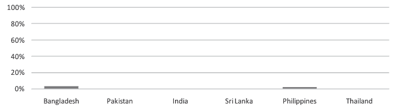

来源：LIRNEasia (2009). Teleuse@BOP3 移民工人研究。调查结果。

随着更多应用程序的出现，可以预计手机除语音以外的使用将增加，让大量贫困人口体验通常与桌面电脑到宽带管道相关的功能。随着这些用途的增加，预计对更利于良好移动网络体验的 3G 及以后网络标准的需求拉动将变得增强，供应也将变得无处不在。通往互联网的移动路径越来越成熟，可以预计对传统路径的补充性使用将增加，那些希望打印或扫描文档或图片的用户，以及那些希望针对特定任务使用更大屏幕和键盘的用户。

## 互联网/电信接入与服务业的财富创造

服务业一直是一个剩余类别，包括任何不属于农业（渔业和采矿业）和制造业的内容。因此，发展中经济体服务业规模巨大且通常不断扩大，这本身不能作为它们正以能够使大量人口脱困的方式发展的。尽管如此，服务业随着生产率的提高，在吸收农业和制造业过剩劳动力方面确实发挥着重要作用。

知识部门是服务业的一个子部门。例如教育、研究和软件。该部门严重依赖信息通信技术（ICT），但事实上，ICT 贡献财富创造的作用延伸到整个服务业、制造业和农业。ICT 在知识型经济的出现中起着基础性作用，在这种经济中，基于知识系统应用的创新发生在所有部门。如果没有 ICT，很难或无法将知识代码化并以低成本在各种流动和规模内对其进行传输。

接入互联网和电信网络有助于财富创造的基本论点，建立在所可能实现的知识以及可以实现的时空摩擦的减少之上。仅接入 ICT 并不会导致财富创造；它是与治理和金融基础设施共同构成的基础要素。没有教育/技能、投资和创新，就无法实现预期结果。接入 ICT 是必要条件，但不是充分条件。

## ICT 会导致发展吗？

接入 ICT 具有互补性这一事实使得建立与发展结果之间的因果关系变得困难，尽管已经过多次尝试，每种尝试都有自己的缺点。在宏观层面，索洛（Solow）曾著名地说：“你随处可以看到计算机时代，唯独生产力统计中没有。”有人认为存在滞后因素，也有研究显示了其贡献。在经济发展的特定背景下，世界银行在 1999 年做出了权威性的努力来建立这一观点。

在微观层面，案例研究比胜胜完。也许最严谨的论证是关于印度喀拉拉邦沿岸在手机出现之前，几个相邻但相互独立的鱼市场的生产者价格、消费者价格和浪费情况的分析。这项自然实验清楚地证明了消费者和生产者都受益，且市场实现了均衡（消除了浪费），因为渔民在前往某个市场之前会拨打多个鱼市场，然后去价格最高的那一个。据报道，在手机出现之前，所有返回家乡的船只中，有 35% 卖出了捕获物。在这种模式下，工人不需要长时间与家人分离，他们及其雇佣的企业的资金在当地经济中循环，创造了更多财富。工作场所和工人流动对基础设施造成了压力，但长期结果通常是建设了完善的基础设施，其受益者多于服务出口公司。

在许多发展中国家，服务出口业创造了财富并让更多的人脱贫。当然，允许功能分化和非核心活动外包的现代商业实践最终也会渗透到国内经济中，创造出回流而非外包的条件。这导致国内公司变得更高效和/或对客户反应更敏感，并在主要城市聚集区之外创造了就业。外包和回流自 20 世纪 90 年代以来在印度南部和西部繁。普遍认为，这些地区对印度经济增长故事做出了不成比例的贡献。分析 ICT 以及其他各种因素（如人口红利）对服务贸易的具体贡献已超出本章的范围。只需说，由 ICT 推动的组织化和出口导向型服务业的增长，对印度近期的经济增长以及大量印度人随之脱贫做出了重大贡献，这些教训可以推广到其他国家。

## 有利互联网经济的政策与监管

政策和监管的传统观念是从公共管理理论得出政策框架和监管工具，并受到显性或隐含国家理论的影响。在发展中国家的情况下，国家缺乏某些元素或属性——例如，对合同神性的充分尊重。在某些情况下，投资者会得到承诺和保证，但一旦投资到位，投资者的谈判能力萎缩，保证就会消失，或发生直接或行政征收。投资保险被视为一种解决措施，建立特定行业的监管机构和制度以管理特定行业，特别是那些容易受到行政征收的资本密集型基础设施。

## ICT 与服务贸易

电信和互联网接入对财富产生的意义也可以进行讨论。根据服务贸易总协定（GATS）的规定，有四种认可的服务贸易模式：

- 模式 1：卖家留在 A 国，消费者留在 B 国。
- 模式 2：消费者前往 A 国。
- 模式 3：卖家留在 A 国，消费者留在 B 国。
- 模式 4：卖家前往 B 国。

## 98 – 3. 发展中国家如何参与全球互联网经济

当时的趋势是从发达市场经济体进口监管制度和实践，特别是 20 世纪 80 年代英国和美国亲私营部门政府创建的所有权、市场准入和监管改革。然而，学者们指出，需要将监管解决方案与东道国家的制度条件相适应。

鉴于发展中国家国家的一个特殊属性，即缺乏有效改革的能力，外部专家被引入来为交易提供建议（结果尚可），并为新政策和监管框架及工具的设计提供建议（结果较不尽人意，倾向于对发达经济体的框架和工具进行整体移植）。随着时间的推移，在付出巨大成本的情况下，这些框架和工具正在根据当地情况进行调整，尽管在许多情况下，这些调整呈现了病态形式，与发展中国家国家形成过程中某些不那么糟糕的方面格不入。

尽管存在这些错误，令人惊讶的是，电信基础设施已经极大地扩张。此前 30 多亿被政府所有集成垄断拒绝提供服务的人现在已连接到电子网络，即使在那些没有运行的监管机构和最基础政策框架的国家也是如此。当然，存在低移动普及率国家，以朝鲜和缅甸为首，在这些国家，似乎什么都没有奏效。在这一群体中，厄立特里亚、埃塞俄比亚、帕布亚新几内亚和土库曼等几个国家正在从低基础快速增长（表 3.4）。这表明，某种程度的市场准入对于启动市场动态至关重要。固定端统一较低的增长率也支持了观点：至少允许供应商进入市场是快速增长的必要条件。

## 3. 发展中国家如何参与全球互联网经济 99

### 表 3.4：低移动普及率国家（排除微型国家）

| | 活跃 SIM 卡，2003 年（千） | 活跃 SIM 卡，2008 年（千） | 复合年增长率，2003-08（%） | 活跃 SIM/100 人 |
| :--- | :--- | :--- | :--- | :--- |
| 朝鲜 | - | - | - | - |
| 缅甸 | 66.5 | 375.8 | 41.4 | 0.76 |
| 厄立特里亚 | | 108.6 | - | 2.2 |
| 古巴 | 35.4 | 331.7 | 56.5 | 2.96 |
| 埃塞俄比亚 | 51.3 | 3,168.3 | 128.1 | 3.93 |
| 帕布亚新几内亚 | 17.5 | 300 | 103.5 | 4.67 |
| 布隆迪 | 64 | 480.6 | 49.7 | 5.95 |
| 土库曼斯坦 | | 347.6 | 148 | 6.98 |

注：CAGR：复合年增长率。朝鲜未报告数据。其 3G 许可于 2008 年发放。

来源：ITU (2008)，ICT 统计数据库。检索自 www.itu.int/ITU-D/icteye/Indicators/Indicators.aspx

### 表 3.5：低移动率国家的固定电话性能（排除微型国家）

| | 固定电话，2003 年（千） | 固定电话，2008 年（千） | 复合年增长率，2003-08（%） | 固定电话/100，2008 |
| :--- | :--- | :--- | :--- | :--- |
| 朝鲜 | 980 | 1180 | 4.8 | 4.97 |
| 缅甸 | 363 | 708.9 | 18.2 | 1.44 |
| 厄立特里亚 | 38.1 | 40.4 | 1.2 | 0.82 |
| 古巴 | 724.3 | 1103.6 | 8.8 | 9.85 |
| 埃塞俄比亚 | 404.8 | 908.9 | 17.6 | 1.13 |
| 帕布亚新几内亚 | 62.9 | 60 | -1.2 | 0.93 |
| 布隆迪 | 23.9 | 30.4 | 4.9 | 0.38 |
| 土库曼斯坦 | 376.1 | 457.9 | 5 | 9.2 |

来源：ITU (2008)，同上。

## 3. 发展中国家如何参与全球互联网经济 100

## 3. 发展中国家如何参与全球互联网经济 101

## 互联

在监管早期，大多数专家同意将三项优先事项列为“互联、互联和互联”。在预算网络模型中，最高优先级是市场准入和频谱管理。

对客户行为的研究显示，人们已经设计出了应对不互联的变通方法。孟加拉国现有固定运营商拒绝向移动运营商提供互联，但这并没有阻止该国人民在 2002-07 年间以超过 100% 的复合年增长率连接到移动网络，并享受着世界上低廉的价格之一。此外，客户有越来越倾向于携带多个 SIM 卡，在同一部手机上切换或使用双 SIM 卡手机，以跟踪他们的“网内”通话，从而从网络内亲友通话的各种优惠中获益。这表明传统的互联正在被绕过，至少对于那些愿意忍受多 SIM 卡不便的人来说是。

这并不是说基于成本的、非歧性的互联是无关紧要的。它是重要的，特别是在缩小网内和网外通话差异以及对国际电话非法接通产生预期或无预期影响方面。事实上，考虑到预算网络模型的要求，经常被忽视的骨回批发接入和关键设施问题需要更多的监管关注。

## 反竞争行为的监管

这一主题在 GATS 附件议定书 4 参考文件中具有重大意义。然而，许多政策框架在执行禁止反竞争行为方面存在空白，且许多处理该问题的监管工具也十分粗糙简单。在由预算网络模型定义的市场中，成功取决于日益稀薄的成本差异。因此，交叉补贴和捆绑销售等反竞争行为的影响变得更加强大。

随着公司越来越多地提供服务包（某些情况下包括娱乐内容），需要确保交叉补贴不会失控。当然，最好的控制方法是确保公司在任何业务领域都不拥有市场支配地位。随着零售价格的持续下降，反竞争的可能性……

竞争性的垂直价格挤压日益加剧。廉价电信网络模式的成功取决于价格的灵活性，以及对垂直价格挤压等策略的防御。

## 资费监管

旧式的资费监管对于廉价电信网络模型的有效部署是不恰的。在任何情况下，当每家公司提供数十种甚至上百种服务组合时，价格或收入监管都难以实施。在实践中，采取的做法是事实上的宽容，即所有资费或或少常规地获得批准；或者至多采取不对称监管，即仅对具有显著市场支配地位（SMP）运营商的资费进行监管。这种做法的弱点在于，SMP 的认定以及产生的监管行动极其复杂，大多数发展中国家的监管机构无法执行这些措施。最终结果可能是导致监管瘫痪，从而无意中维护了现有运营商的利益。

分带宽容（Banded forbearance）即一个国家选择与其他国家的价格进行基准对比是一种可能的解决方案。在这里，所有运营商（包括现有运营商）在通过基准对比定义的范围内都获得灵活性。如果价格低于下限，将根据根据说明的竞争相关标准触发审查。阈值将根据税收或同行国家价格波动等外部因素进行定期调整。

## 服务质量监管

正如人们无法期望莱恩航空（RyanAir）提供银牌级服务一样，人们也不能期望廉价电信网络提供优质服务。由于需要挤压大量流量，所有运营商可能都会提供次优的服务。严格且激进的服务质量（QOS）监管对该模型是有害的。然而，期望竞争能防止运营商让 QoS 降到不可接受的水平也是天真的。因此，对 QoS 进行温和的监督，重点关注发布相对于基准的性能情况，并确保不满的客户更换供应商的障碍保持在低水平，是最合适的。

## 通用服务

通过通用服务基金取代通过交叉补贴将服务延伸至未覆盖和服务不足地区的模糊承诺，从而使通用服务义务透明化，这一想法在当时是一个好主意，并符合《服务贸易协定》（`GATS`）协议4参考文件的规定。然而，经验表明，通用服务基金已变得适得其反。数十亿美元的通用服务费闲置在政府账户中未未使用，或被用于一般支出。在已发放资金的情况下，通常用于救助网络运营商（大多数为现有运营商）。当未覆盖和服务不足地区并非通过补贴的固定电话运营商而是通过移动运营商实现连接时，低收入客户（通用服务政策初衷）却在为支持现有运营商的低效买单。现在可以得出充分的理由认为，通用服务基金和征收比例不再符合“为实现定义的通用服务所必需的最低”的标准，因此违反了许多国家在 `GATS` 协议4 下所做的承诺。

## 电信监管环境

`lirAsia` 在 2006 年和 2008 年就讨论的维度对几个亚洲国家的电信监管环境（TRE）进行了评估。表 3.6 给出的 2008 年关键结果显示，知情利益者认为，研究的所有国家 TRE 都有很大的改进空间，但微型国家马尔代夫除外，认为知情利益者的数量有限可能阻碍了坦诚的回答。

### 表 3.6：2008 年八国 TRE 研究最终得分：移动部门

| 孟加国 | 印度 | 印度尼西亚 | 马尔代夫 | 菲律宾 | 斯里兰卡 | 泰国 | 巴基斯坦 |
|---|---|---|---|---|---|---|---|
| 市场准入 | 3.1 | 3.1 | 3.0 | 3.8 | 3.2 | 2.8 | 2.7 | 3.9 |
| 资源接入 | 2.8 | 2.2 | 2.7 | 3.6 | 2.8 | 2.7 | 2.6 | 3.6 |
| 互互互 | 3.3 | 2.8 | 2.7 | 3.5 | 2.8 | 2.6 | 2.6 | 3.7 |
| 资费监管 | 3.5 | 3.9 | 2.6 | 3.4 | 2.8 | 2.7 | 2.9 | 3.2 |
| 反竞争行为 | 3.1 | 2.7 | 2.5 | 3.1 | 2.5 | 2.7 | 2.6 | 2.8 |
| 通用服务义务 | 2.4 | 3.1 | 2.1 | 3.5 | 2.6 | 3.0 | 2.6 | 3.2 |
| 服务质量 | 3.2 | 2.8 | 2.3 | 3.8 | 3.1 | 2.9 | 3.1 | 3.2 |

## 税收

税收未包含在 `GATS` 协议 4 参考文件中，直到最近在电信政策和监管的讨论中经常被忽略。这已不再可能，因为税收的尾巴已经开始摇动监管的狗。只有当将税收视为主要目的、将电信服务视为次要目的时，某些政策或监管行动才是可以理解的。

行业游说团体 GSM 协会（GSM Association）的研究显示，每为移动服务花费 100 单位货币，就有高达 44% 被提取作为税收（包括许可证费、频谱费、通用服务义务费、销售税等），运营商充当了税收员的角色。这显然对廉价网络模型是有害的。手机和 SIM 卡的一些税收是累进性的，构成了贫困人的准入障碍。肯尼亚是一个例外，最近减少了此类税收。

### 图 3.12：税收占 TCMO 的百分比和渗透率

| | | |
|---|---|---|
| EU15 | 中东欧 | 拉美 |
| 撒拉哈以南非洲 | 亚太 |

来源：Deloitte (2007), Global Mobile Tax Review: 2006-2007. 伦敦：GSMA. 2009 年8 月 7 日检索自 www.gsmworld.com/documents/tax_review_06_07.pdf。

### 图 3.13：电话费用中税收组成部分的认知度（社会经济分类 D 和 E 类手机持有者的百分比）

来源：LIREasia (2009) Teleuse@BOP3. 调查结果

## 结论

数百万贫困人口正在使用简单的移动手机参与信息检索、支付和远程计算等基于互联网的活动。新的廉价电信网络模型实现了语音连接的增长，并开启了移动端语音之外的应用。贫困地区的广泛宽带接入可能通过扩展这一模型来实现。它还可以作为服务连通目标的连贯且有效的政策和监管措施的基础。本章证明，世界上大多数人口（包括大量贫困人口）实现了语音连接，这是因为政府移除了或降低了参与电信服务供应的障碍，并创造了有利于竞争的条件。

### 106 – 3. 发展中国家如何参与全球互联网经济

产生了大量产生收益的分钟数，因为它们成功降低了与低流量客户交易的交易成本。预付费模式适应了收入不规律的人群需求，也是一个关键要素，因为它允许通过降低交易成本来实现对长期市场的开发。随着这些业务创新，廉价电信网络模型的倡导者还成功地大幅降低了成本（有效的运营费用）。

新模型使得 `ARPU`（每用户平均收入）变得不再重要，因为它取决于网络承载了多少产生收益的分钟数，而不是从客户身上赚了多少钱。正如瑞得航空（Ryanair）和亚洲航空等航空公司在传统航空公司亏损的情况下盈利一样，廉价电信网络尽管提供的价格较低，比传统运营商赚得更多。然而，廉价电信网络模型确实增加了收益的波动性，并导致服务质量下降。

廉价电信网络模型扩展到宽带需要允许小额的预付不规则支付，这与主导的“随心用”模式有显著偏离。前者似乎已经在 HSPA 等基于移动宽带的服务中显现。当然，低收入消费者对更多内容的需求是存在的。

通过移动网络访问互联网（无论是在固定地点、游牧还是实际移动）都将成为一种主要的、甚至是主的模式。这符合目前的趋势，即许多互联网功能（如通信、信息检索和远程计算）越来越多地通过廉价且便宜的移动手机在移动网络上访问。有证据表明，预示参与互联网经济的高价值应用开始在贫困人口中立足，尤其是年轻一代。预计随着业务模式的完善和更多服务的提供，这些用途将会增加。

如果竞争带来的流程创新正在解决电子连接数十亿贫困人口的挑战，那么政府的角色是什么？当通过业务模式而非政府直接行动提供服务时，最合适的政府行动是支持该业务模式。政策和监管行动必须更多地源于对业务模式的分析，而非公共管理理论。在目前形式的早期，需要采用符合已识别特定制度环境的政策监管解决方案——但在实际实践中，为发达国家情况设计的政策和监管解决方案往往被原封不动地应用于非常不同的环境中。

新业务模式的出现以及对发展中国家政府机构运作的深层理解，为制定更合适的政策和监管解决方案提供了可能。例如，这将涉及更多地强调降低市场准入门槛，并在以往关注互联互通之前提供更多频谱。随着成本下降，国内和国际回程容量的相对重要性将增加，需要更大的监管关注。同样，随着零售价格的下降，监管反竞争行为的重要性将增加，特别是关于垂直价格压缩。

廉价电信网络模型导致网络的高负载，这必然导致偶尔的服务质量问题。对服务质量（`QOS`）进行温和监督，强调发布对比性能数据并降低切换供应商的门槛是合适的。通用服务基金已失去了其效用，且与业务模式格不入，因此应逐步淘汰。税收正成为政府电信行动的核心动力因素。这需要进一步研究，以确定政府在不破坏业务模式的情况下收集合理收入的最佳方法。

政策和监管行动的协调性是一好事。通过充分理解廉价电信网络模型并确保所有政策和监管行动保持一致——不仅是为了让模型运行，还为了通过利用模型而非与其背道而驰来实现公共政策目标——将实现政策的一致性。

## 注释

- 1. 世界贫困人口最集中的地区。
- 2. 这与麦肯锡在世界经济论坛和 INSEAD 2009 年《全球信息技术报告 2008-09：网络世界中的移动》中倡导的“管理竞争”方法形成对比。
- 3. 作者根据从世界银行（2009年）关键发展数据和统计[在线数据库]检索的人口和面积数据进行的计算。
- 4. 诺基亚 TCO 计算，基于最便宜诺基亚手机价格的 1/36，任何连接更改成本的 1/36。
- 5. 当安德关注低需求时，廉价电信网络出现在南亚。
- 6. 麦肯锡在世界经济论坛和 INSEAD 2009 年《全球信息技术报告 2008-09：网络世界中的移动》的贡献者。
- 7. 固定意味着用户位于一个地点。移动意味着用户正在移动。游牧意味着用户是静态的。
- 8. 更准确的术语应该是每 SIM 卡平均收入。更准确的术语是每客户平均收入 (`ARPC`)，因为这是统计的依据。
- 9. 微软研究院 Kentaro Toyama 的个人通信，2009年6月。
- 10. 麦肯锡在世界经济论坛和 INSEAD 2009 年《全球信息技术报告 2008-09：网络世界中的移动》的贡献者。廉价电信模型在过去几年出现，现在正扩散到其他地区。

Cronin, F. J. et al. (1991), “电信基础设施与经济增长：因果关系分析”，“电信政策”(Telecommunications Policy), 第15卷，第6期，第 529-535页。

Cronin, F. J. et al. (1993), 电信基础设施投资与经济发展，《电信政策》(Telecommunications Policy), 第17卷，第6期，第 415-430页。

David, P.A. (1990), “发电机与计算机：对现代生产力悖论的历史视角”，“美国经济评论论文与论文集》，第 355-361页。

《每日之报》(2009), “孟加拉国移民频繁回家：‘调查结果’；金字塔底端的电信用户：超越通用接入”，“电信技术”(Telektronikk), 第2卷，第 25-38页。

de Silva, H.,  way A. Zainideen, A. (2008), “斯里兰卡农业ICT政策：一些思考”，收录于农业信息技术联合国家会议论文集，莫拉图瓦大学与鲁胡纳纳大学，斯里兰卡，第 34-43页。

de Silva, H. (2009), “斯里兰卡农业ICT政策：一些思考”，收录于农业信息技术联合国家会议论文集，莫拉图瓦大学与鲁胡纳纳大学，斯里兰卡，第 34-43页。

Dutta, S. and Mia, I. (2009), 《2008-09年全球信息技术报告：网络世界中的移动性》，世界经济论坛与欧洲高等管理学院(INSEAD)，日内瓦，第 63-73页。

Dutta, S. and Mia, I. (2009b), “盒子：斯里兰卡的成功改革”，收录于《2008-09年全球信息技术报告：网络世界中的移动性》，世界经济论坛与欧洲高等管理学院(INSEAD)，日内瓦，第 72页。

《经济学人》(2009), “谦卑者将继承网络”，9月4日，www.economist.com/research/articlesBySubject/displaystory.cfm?subject=348963&story_id=11999307。

《经济学人》(2009), “东非宽带：可能让生活更简单更廉价”，6月18日，www.economist.com/research/articlesBySubject/displayStory.cfm?story_id=1386700&subjectID=348963&fsrc=nl。

《金融快报》(2009), “回家对孟加拉国出口工人来说意义重大”，6月29日，第8页。

Gillward, A. (2009), “孟加拉国电信监管委员会关于显著市场支配力的RIA回复”，2009年8月2日检索自http://lirneasia.net/wp-content/uploads/2009/07/LIRNEasia_Bangladesh_SMP_July2009.pdf。

## 112 – 3. 发展中国家如何参与全球互联网经济

Giridharadas, A. (2009), “广袤土地上的口袋尺寸平衡者”，“纽约纽约时报》，2009年7月28日检索自www.nytimes.com/2009/05/10/weekinreview/10giridharadas.html?ref=w

GSMA (2009), “今日如何实现移动宽带的效益”，白皮书，第5节，2009年7月28日检索自http://hpa.gsmworld.com/upload/newsfiles/13022009113831.pdf。

Gonsvalves, T. and A. Bharajwaj (2009), “互联网连接服务质量(QoS)的AT测试与其他测试器的比较”，发表于LIREAsia研讨会，2009年7月29日，哥伦坡。

Goswami, D. (2008), “Wi-Fi；网络修复”，收录于R. Samarajiva and A. Zainude (编)，《新兴亚洲ICT基础设施：政策与障碍》，SAGE & IDRC，新德里与渥太华，第 131-156页。

Greame Telecom (n.d.), “CIC与GIK (2.5G使用)”，2009年7月28日检索自www.greentecom.net/gic_ck.html。

Greenwood, L. (2009), “非洲的移动革命”，8月12日，http://news.bbc.co.uk/2/business/81941.

Hardy, A. P. (1980), “电话在经济发展中的作用”，“电信政策》，第4卷，第4期，第 278-286页。

Hirschman, A.O. (1970), “退出、声音与忠诚：企业、组织与国家的衰落”，哈佛大学出版社，剑桥。

世界电信发展独立委员会 (1985), 《缺失的环节》，国际电信联盟(ITU)，日内瓦。

ITU (2009), ICT统计数据库，检索自www.itu.int/ITU-D/Indicators/aspx。

Jackson, J.H. (1997), 《世界贸易体系：法律与政策》，第二版，MIT出版社，剑桥。

Jensen, R. (2007), “数字鸿沟：南亚部门的信息与福利”，“季度经济杂志》，第CII卷，第3期，第 879-924页。

Jipp, A. (1963), “国家财富与电话密度”，“电信杂志》，7月，第 199-201页。

## 3. 发展中国家如何参与全球互联网经济

Kelly, T. (2005), “衡量缺失环节的二十年”，收录于G. Milward-Oliver (编)，《修复缺失的环节》，Anima Centre，布拉德，第 23-33页。

Khan, M. (2005), “资本主义转型”，收录于K.S. Jomo and E.S. Reinert (编)，《发展的起源：思想流派》，Zed Press and Tulika，伦敦，第 69-80页。

Kishore, J.V. (2003), “Paan”，“Avantgarde，第1卷，第9期，2006年1月检索自www.iatk.ac/in/avantgarde/paan.htm。

Levy, and B.T. Schiller (1994), “监管承诺的制度基础：电信监管的比较分析”，“法律、经济与组织杂志》，第10卷，第2期。

LIRNEA (2009), 孟加拉国移民研究幻灯片，2009年8月2日检索自http://lirnea.net/2009/06/teleuse-migrant-study-to-be-released-dhaka。

LIRNEA (2009), “移动基准：南亚”，2009年8月2日检索自http://lirnea.net/wp-content/uploads/2007/08/09-02-sa-expanded-v1-0。

Maddison, A. (2004), “量化与解释世界发展：柯林·克拉克之前与之后”，“澳洲经济评论》，第44卷，第1期，第 1-34页，长版本于2009年8月20日检索自www.ggdc.net/maddison/articles/colin_clark.pdf。

Mahan, A.K. and W.H. Molly (2005), “刺激发展投资：监管者的规则”，“世界监管对话”，蒙特维得亚，2009年7月28日检索自www.infodeev.org/en/Document.12.pdf。

Malik, P. (2007), “LIRNEA六国多组成2006-2007印度报告”，WDR对话第四周期WDR0703，2009年7月28日检索自http://www.lirnea.net/wp-content/uploads/2007/04/malik-2007-cmcs-india.pdf。

Malik, P. (2008), “通用服务义务：现经营者”，收录于R. Samarajiva and A. Zainuede (编)，《新兴亚洲ICT基础设施：政策与障碍》，SAGE & IDRC，新德里与渥太华，第 216-239页。

Malik, P. (2009), “服务提供与频率许可证发放的不同模式评估”，发表于LIRNeasia研讨会的工作论文，2009年7月9日，哥伦坡。

美林富盛 (2007), 《全球无线矩阵》。

《新国家》(2009), “移民使用手机向家庭汇款”，7月1日，第6页。

Nilekani, N. (2008), 《想象印度：一个重生的国家》，企鹅出版社，纽约。

Nokia (2008a), “数字包容的关键”，“视野”(Expanding Horizons)，第1卷，第 12-13页。

Nokia (2008b), “新兴市场的负担能力路线”，“视野”(Expanding Horizons)，第4卷，第 4-7页。

OECD (2008), 《互联网经济未来首尔宣言》，第 4-5页。

OECD (n.d.), 宽带用户标准，2009年7月24日检索自www.oecd.org/document/46/0.3343,en_26

Parker, E.B, et. (1995), 《电子途径：通过电信促进农村发展的政策》，第二版，阿斯彭学院，华盛顿特区。

发展信息测量伙伴 (2009), ICT核心指标列表，2009年8月18日检索自www.itu.com/ITU-D/ict/partnership/material/CoreICT_Indicators_e_rev2.pdf。

Samarajiva, R. (2002), “为什么要监管？”第四版，国际电信联盟，日内瓦。

Samarajiva, R. (2006), “亚太地区有效部署无线技术的先决条件”，“信息技术与国际发展》，第3卷，第2期，第 57-71页，http://itidjournal.org/itid-article/view/224/94。

Samarajiva, R. (2008, 10月12日), “孟加拉国不需要通用服务税”，“每日之报”，2008年10月12日，2009年8月20日检索自http://www.thedailystar.com/story.php?id=58271。

Samarajiva, R. (2009), “电脑不是为农村地区提供IT服务的最佳工具”，“电信中心杂志”，4-6月，第 30, 32页，http://lrneasia.net/wp-content/uploads/2009/08/Telecenter.pdf。

## 3. 发展中国家如何参与全球互联网经济 – 115

Samarajiva, R. 与 T. Iqbal (2009), “带带化宽容：部分自由化电信市场价格监管的新方法，《国际监管与治理国际杂志》，第 9 卷，第 1 期，第 19-40 页。

Samarajiva, R. 与 P. Malik (2009), “小额充值（Chhota Recharge）的经济学，《金融快报》(Financialexpress)”，5月22日，取自 www.financialexpress.com/news/the-economics-of-chhota-recharge/4638493。

Samarajiva, R. 与 A. Zainideen (编) (2008), 引言, “什么是 . . . 以及本可以是什么的 . . .，《新兴亚洲的 ICT 基础设施：政策与监管障碍>”，Sage & IDRC，新德里与渥太华，第 19.20 页。

Sirasonthorn, P. (2009), “提供移动增值服务的业务模式”，在 LINreaAsia 会讨会上报告的工作论文，2009年7月13日。

Sivapragasam, N., A. Zainideen 与 D. Ratnadawakara (2008), “用未接通电话回电：金字塔底层 (BOP) 对未接通电话的使用”，在 CPRsouth3: 电信运营商转型策略会议上发表的论文，北京，2008年12月5-9日，取自2009年7月27日，www.cpsouth.org/default/files/Nirmali%20Sivapragasam.pdf。

Solow, R. M. (1987), “我们最好留心，《纽约时报书评》(New Times Book Review)，2009年7月12日，第 36 页。

Spence, M. (2009), 对“关于 ICT、人类发展、增长与减贫的对话”的回应，http://publius.cc/responses_mike_spence/091109。

Teligen (2006), “2006年 OECD 电信价格基准篮子：2006年2月起的 T-Basket 实施”，取自2009年7月28日，自 www.teligen.com/publications/oecd.pdf。

印度电信监管管理局 (2008), 《2007年10月至12月印度电信服务绩效指标》，取自2009年7月28日，自 www.trai.gov.in/WriteReadData/upload/Reports/41/report10april08.pdf。

Veagarajan, R., N. Yasodhar, N 与 K. Toyama (2009), “瓦拉纳无线（Warana Unwired）：在农村甘蔗合作社用手机手机取代电脑，《信息技术与国际发展》，第 5 卷，第 1 期，第 81-95 页。

## 116 – 3. 发展中国家如何参与全球互联网经济

Vijayabaskar, M. 与 K. Krishnawamy (2004), “理解发展中国家高科技集群的增长动力学及其限制：对印度南部班加罗尔的研究”，工作小组论文，取自2009年8月20日，www.eadi.org/fileadmin/WG_Documents/Reg_WG/vijayabaskar.pdf。

沃达丰 (2007), “移动交易的转型潜力”，沃达丰政策文件，取自2009年8月2日，自 http://www.ictregulationtoolkit.org/Document.3437.pdf。

Waverman, L., M. Meshi 与 M. Fuss (2005), “电信对发展中国家经济增长的影响”，收于《非洲：移动手机对发展中世界的影响：推进讨论》，沃达丰政策论文系列第 3 卷，第 10-23 页，2005年11月2日，取自 www.vodafone.com/assets/files/en/SIM_Project_download_2.pdf。

Waverman, L. 与 K. Dasgupta (2009), “如何使移动通信经济影响最大化：四个波浪”，收于 S. Dutta 和 I. Mia (编)，《2008-09全球信息技术报告：网络化世界中的移动性》，世界经济论坛与欧洲高等学院 (INSEAD)，日内瓦，第 53-63 页。

Wellenius, B. 与 I. Neto (2007), “无线频谱管理：发展中国家的改革框架”，取自2009年8月20日，http://sitesources.worldbank.org/extinctionandcommunicationandologies/Resources/Wellenius-Neto.pdf。

Wishart, N. (2006), “支付支付及其在移动网络中的应用：菲律宾移动金融案例”，infdev，华盛顿特区，取自2009年8月2日，自 http://www.infdev.org/Publication.43.html。

世界银行 (1999), 《1998/99年世界发展报告》，牛津大学出版社，纽约。

世界银行 (2009) 《2008年国内生产总值：快速参考表》，取自2009年7月31日，自 http://sitesources.worldbank.org/DATASTATISTICS/Resources/GDP.pdf df。

世界银行 (2009), 《关键发展数据与统计》，在线数据库，取自2009年7月27日，自 http://webbank.org/website/external/datastistics/

## 118 – 3. 发展中国家如何参与全球互联网经济 – 117

Zain, A. R., Samarajiva 与 N. Sivapragasam (2009), “CellBazaar：基于移动的市场：成功因素与扩张潜力”，在 Mobile 2.0: Beyond Voice?会议上发表的论文，芝加哥，伊利诺伊州，2009年5月20-21日，取自2009年7月28日，自 http://lirnearasia.net/wp-content/uploads/2009/05/final-paper.pdf，并由 CellBazaar 首席官 Kamal 的个人通信补充。

www.itu.int/en/newsroom/press_releases/2008/29.html.

www.mobitel.lk/support/3g_delight.html.

www.lirnearasia.net/2006/05/net-neutrality-implications-for-emerging-asia.

www.lirnearasia.net/projects/2008-10/telecom-environment/.

# 第4章：政府在宽带中应扮演什么角色？

Victor Mulas, Siddhartha Raja, Christine-Wei Qiang 和 Mark Williams，世界银行

世界银行2009年的《信息与通信发展》报告表明，宽带对增长的贡献是巨大的，且可能比窄带更深刻。扩大宽带接入正成为首要任务¹Tim Kelly，ICT政策专家；Victor Mulas，顾问；Siddartha Raja，顾问；Christine-Wei Qiang，高级经济学家；Mark Williams，高级经济学家，全球信息技术（GICT）部门。文中表达的观点不一定代表世界银行或成员国的意见。

## 为什么需要宽带？

宽带是一种通用技术 (GPT)，对我们的生活和工作方式产生了重大影响。公司利用宽带通过远程监控、物流管理和采购来提高生产力。它还用于提供媒体内容、在线购物和电子银行服务。

宽带是经济增长和国家竞争力的关键驱动力。宽带普及率每增加10%，发展国家的GDP有望增长1.3个百分点（见图4.1）。

### 图4.1 选择ICT普及率增加10%对人均GDP的影响

注：基于1980-2006年120个经济体的分析。来源：改编自世界银行 (2009)，信息与通信发展：扩大范围与影响力》。

## 作为“生态系统”的宽带

宽带通常被定义为“高速通信网络”，其数据传输速度高于某一最低值（例如256比特/秒）。虽然这是一个流行的定义，但并不完整。相反，宽带可以被视为一个生态系统，不同的元素通过高速连接进行互动（见图4.2）。与相对被动的拨号上网用户相比，宽带用户具有创建和共享各种格式多媒体内容的能力。这种互动是区分宽带与其他高带宽但本质上是被动的网络（如多频道电视）的重要因素。

# 图 4.2：宽带的良性循环：连接各个要素

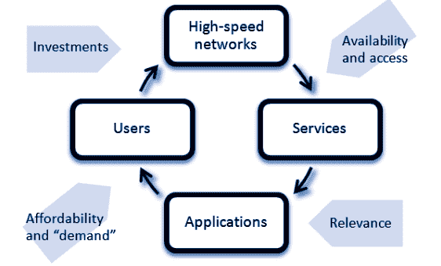

来源：世界银行（即将出版）《发展中国家的宽带政策制定》。

所谓具有动态和协作性质的 Web 2.0 服务和应用的增长，取决于用户相互互动的能力，同时也对网络发展具有影响。例如，以前网络提供的更新速度低于下载速度，因为这反映了电子邮件和网页浏览等应用的典型使用情况。然而，如今的双向多媒体服务用户要求两个方向都具有高速度。尽管人们担心大量由于带宽密集型服务会淹没互联网，但这些预测仅在个别事件中发生。全球互联网在扩展到更多用户、更具要求的应用程序和更高速度方面表现出异常的稳健性。

因此，网络是一个不断演变的生态系统的一部分，该系统包含了具有更高要求的用户和应用程序。同时，用户创建和共享需要更多带宽的内容和应用应该推动宽带供应，形成一个良性循环。因此，在本文中，“宽带生态系统”被定义为一个由互联的高容量通信网络、带宽密集型服务与应用以及用户组成的多层系统。

# 政府的角色

将宽带定义为生态系统而非仅仅是网络

# 4. 政府在宽带发展中应该扮演什么角色？ – 123

有助于评估政府在利用宽带作为信息通信技术促进发展（ICT4D）的工具时，可能需要扮演的角色。传统上，政府扮演着“推动”角色，为 ICT 基础设施的提供和国内 ICT 部门的发展提供良好环境。这可以通过“政策 1.0”（图 4.3）来实现。政府日益需要需要转向“拉动”策略，旨在提高数字素养、建立环境、提供包括本地内容在内的服务。这可以通过“政策 2.0”来实现，对应于 Web 2.0 或移动 2.0 等流行概念。

# 图 4.3：政府应对发展性 ICT 的方法的演变

| 策略 | ICT4D | 方法 |
| --- | --- | --- |
| 推动 (Push) | 基础设施 |  |
| | ICT 部门 | 1.0 |
| | （数字）素养 |  |
| 拉动 (Pull) | 赋能环境 | 应用程序（内容和服务） | 2.0 |

来源：改编自 Peña-López, Ismael (2009),《政策决策的数字发展衡量：模型、阶段、特征和原因》，未出版博士论文，UOC，巴塞罗那。

政府对于是否建立国家宽带战略采取了非常不同的观点。通常，具有一致国家战略的国家在促进宽带普及方面往往更成功。领先宽带渗透率的大多数 OECD 国家（包括丹麦、荷兰、挪威、韩国、瑞典和芬兰）都有此类战略。但即使是最初抵抗定义中央政府角色的预市场市场体现在也跨越了这一界限。例如，英国政府2009 年的《数字英国》报告包含了一项激进的建议，计划对每条固定电话订阅收取 6 英镑（约 10 美元）的费用，以为全国的高速宽带服务筹资金。

# 124 — 4. 政府在宽带发展中应该扮演什么角色？

同样，在美国，在经历了十年的辩论后（在此期间，美国在 OECD 宽带排名中从第二名跌至第十五名），新政府宣布制定《国家宽带计划》，并由监管机构联邦通信委员会（FCC）主持了一系列讨论启动。

政府在提供宽带方面应该扮演什么角色？基本原则是，政府应仅根据健全的经济原则进行干预，并且在此类干预的收益大于成本的情况下。公共部门本质上有两个不同的角色：让市场运行更高效，以及确保所有人都能公平获取。

# 让市场运行更高效

到 2008 年，宽带服务已在 182 个经济体中可用（图 4.4），到 2009 年初，固定和移动网络全球宽带用户总数超过了 10 亿。由于这些连接大部分由私营公司提供，可以假设宽带市场运行得相当有效，没有市场失灵。

> 图 4.4：拥有商业可用宽带的经济体数量，2002-2008

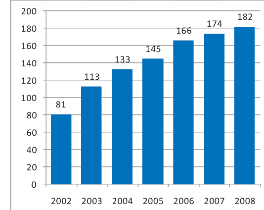

注：宽带定义为速度等于或超过 256 kbit/s。

来源：国际电信联盟（ITU）。

# 4. 政府在宽带发展中应该扮演什么角色？ – 125

然而，宽带存在市场失灵。与许多其他市场一样，它们涉及公共基础设施的提供。宽带市场本身的结构有时给服务的发展带来问题。市场失灵最常见的形式是在即使不存在法律垄断的情况下，宽带基础设施提供中仍然存在垄断结构。在许多国家，现有公共电信运营商的主地位是发展有效竞争的主要障碍之一。其他市场失灵可能与缺乏规模效应有关。获取运营法律许可的困难、无线频谱分配效率低下、糟糕的信息市场和有限的资本市场都是市场失灵的进一步例子。

ICT 部门的市场失灵已得到全球政府的广泛认可。通常通过监管政策来解决：许可自由化、促进无线频谱接入以及监管主要运营商都是为快速扩张提供基础政策。在欧洲和一些发展中国家，宽带政策侧重于提供低成本的接入。

在法国，可以从宽带市场的演变中看到“投资阶梯”方法。在最低的“阶梯”上是容量的转售，只需在一个点进行连接。后来，在地区层面提供了比特流接入，准入者在多个点进行连接并构建了骨干网络。随着本地回路完全开放，像 Iliad（free.fr）这样的全服务运营商进一步产生了对法国电信（图 4.5）的直接竞争。

# 126 — 4. 政府在宽带发展中应该扮演什么角色？

### 图 4.5：法国宽带用户的演变，说明了“投资阶梯”

| | | | | | | | |
|---|---|---|---|---|---|---|
| 18 | | | | | | | |
| 16 | | | | | | | |
| 14 | | | | | | | |
| 12 | | | | | | | |
| 10 | | | | | | | |
| 8 | | | | | | | |
| 6 | | | | | | | |
| 4 | | | | | | | |
| 2 | | | | | | | |
| 0 | 2002 | 2003 | 2004 | 2005 | 2006 | 2007 | 2008 |

注：这不是统一的数据序列。

来源：Mulas, Victor（即将出版）《拉丁美洲宽带普及的潜力》，基于欧盟数据。

某些国家（如大韩）比这种市场监管方法更进一步，通过提供财务激励让运营商进行投资和竞争。在宽带发展的早期，这使得能够“超越S曲线”，并以比预期的快的速度扩张其市场（图 4.6）。韩国政府一直对宽带普及的供需两端进行干预，自1985年以来有六项主要计划。最初，政府资助了连接全国公共机构的骨干网络，并激励扩张光纤网络。它开发了广泛的电子政府计划，数字化并连接了公共机构。韩国政府还通过多项政策（如 ICT 培训和促进本地应用）提供资金以培养需求。

# 图 4.6：挑战S型曲线：韩国与其他领先宽带经济体的宽带普及对比

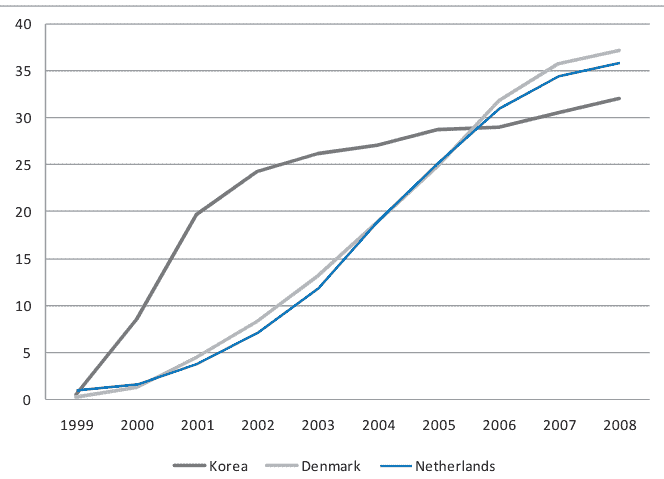

来源：Mulas, Victor（即将出版），《拉丁美洲宽带普及潜力》，基于OECD数据。

尽管丹麦和荷兰等其他经济体在人均宽带渗透率上随后超过了韩国，但韩国在家庭渗透率方面仍然处于领先地位，到1998年底覆盖率已达到94%。这种初期的领先帮助韩国实现了经济和社会效益。例如，自20世纪90年代后期以来，韩国来自信息通信技术（ICT）服务部门的国民GDP比例翻了一番。韩国在OECD的国际学生学评估（PISA）调查中，也成为教育水平提高方面的领先经济体之一。

韩国的案例可以概括为一种公私合作伙伴关系，政府向私营部门提供行政指导，并通过公私机构合作促进国家目标和愿的实现。在其他国家，监管机构通过建立有利于激烈竞争的环境来设定基调。

在英国，现任运营商英国电信（BT）的结构性分离似乎对宽带普及产生了即时的积极影响（图 4.7）。有趣的是，BT在英国通信管理局（Ofcom）对市场进行审查后，于2005年提供了这种解决方案，可能是为了避免更激进的重组。BT和Ofcom同意创建一个新的且在运营上独立的部门——Openreach，该部门由负责网络运营的BT员工组成，并在BT管理层保持独立运行。Openreach将根据“投入等同”原则为所有参与者提供服务。建立了一个独立的机构——接入平等委员会（Equality of Access Board）以确保合规。尽管BT的直接市场份额在2005年后有所下降，但整个市场却蓬勃发展。

# 图 4.7：英国电信功能分离对英国宽带普及的影响

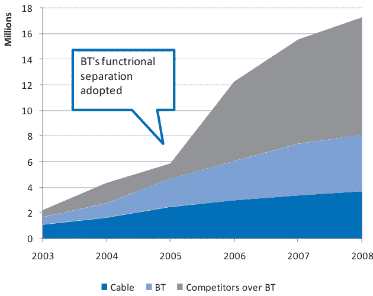

注：这并非统一的数据序列。

来源：Mulas, Victor（即将出版），《拉丁美洲宽带普及潜力》，基于欧盟数据。

发展信息通信技术：提高政策协调性 © OECD 2009

# 4. 政府在宽带发展中应扮演什么角色？

## 确保所有人公平获取

广而言，政府在提供宽带方面的第二个主要作用是确保所有人公平获取。这关注的是公平性，以平衡上述对效率的强调。大多数政府已采取积极措施，刺激农村和其他缺服务地区的部署。这在传统上是通过国家垄断运营商的内部交叉补贴实现的。在市场自由化之后，这种方法被诸如“通用服务基金”的显性补贴机制所取代。

例如，在1998年至2000年间，加拿大尽管人口密度极低，实现了全球最高的宽带渗透率。加拿大农村和偏远地区提供服务的问题由独立电信审查小组研究，该小组在2006年报告的附录中认为，政府应设定到2010年前为全国所有地区提供负担且可靠的宽带服务的目标。小组绘制了宽带可用性地图，并估计到2007年将只有90%的加拿大人可以使用，仍有约300万人无法使用。对于居住在最偏远社区的约30万人来说，卫星将是最实用的解决方案。研究发现，在宽带接入点5公里半径内少于1200人的地区在经济上是不划运营的；地形进一步加剧了这一点。WiMAX可以使无法在经济上覆盖的人数减少120万，但对于剩余的150万（加上30万只能通过卫星服务的人），仍需要某种形式的针对性成本补贴，以实现2010年实现通用宽带服务的目标。

最具知名度的倡议之一是一项为加拿大偏远北部地区、努纳维特地区（Nunavut）和西北地区地区的加拿人提供宽带的计划。努纳维特宽带开发公司已成立，这是一家非营利的联邦注册公司，拥有多利益相关者成员，其目标是为25个缺服务的社区带来宽带。根据2009年1月签署的一项五年计划（作为加拿大经济刺激计划的一部分），加拿大基础设施和当地客户的匹配资金将筹集约4320万加元，通过卫星为该地区引入宽带。

在农村地区提供宽带面临重大的经济和技术挑战。低人口密度地区的成本高昂，与其他ICT技术不同，宽带的提供（例如数字用户线路技术）具有技术限制，其速度会随距离中心位置的增加而减慢。因此，宽带市场的快速增长主要集中在城市中心，导致农村地区的大多数人无法获得服务。随着公共和私立服务越来越多地在线提供，部分人群无法接入宽带正成为一个关键的公共政策问题。一旦宽带使用达到临界点（例如25%），如果要在不基于地理位置的歧视的情况下实现平衡发展，它将被认为是不可或缺的。这促使政府考虑采取更积极的方法来确保宽带的可用。在韩国，政府采纳了一项综合战略，侧重于为运营商提供财政激励。在欧洲，瑞典和法国等国家使用了需求聚合、公私合作伙伴关系和通用服务义务（USO）方法相结合来确保宽带。挪威政府的目标是通过固定宽带连接其99%的人口。

最近，宽带投资出现在全球的财政刺激计划中。澳大利亚已承诺投入330亿，而美国政府已为农村宽带预留了72亿美元（图 4.8）。

带在这些刺激计划中被视为一种快速见的效果，因为在供应侧，它刺激了投资和就业；而在需求侧，它创造了创业机会和对整体经济有利的溢出效应。

## 图 4.8：作为经济刺激组成部分的政府计划宽带支出

| | 政府计划投资总额（十亿美元） |
|---|---|
| 德国 | 0.2 |
| 日本 | 0.3 |
| 加拿大 | 0.2 |
| 韩国 | 0.9 |
| 美国 | 7.2 |
| 爱尔兰 | 0.1 |
| 芬兰 | 0.3 |
| 葡萄牙 | 1.2 |
| 新加坡 | 0.7 |
| 新西兰 | 1.0 |
| 希腊 | 3.0 |
| 澳大利亚 | 33.4 |

来源：世界银行，基于ITU、波士公司和OECD的数据。

### 开发中国家案例研究

发展中国家的宽带发展策略比发达国家要少，因为国家之间在宽带发展仍然存在巨大的数字鸿沟。事实上，由于大多数发展中国家的移动通信已远领先固定线路通信，宽带可能会在无线平台而非固定线路平台上发展。埃及就是一个例子。截至2009年中，埃及的4940万移动用户数量超过了其1160万固定线路用户的四倍以上。固定线路用户数在2009年上半年开始下降。此外，固定线路市场在很大程度上仍由国家拥有的现任运营商——埃及电信（Telecom Egypt）垄断；移动市场竞争激烈，第三家进入者Etisalat Mis于2006年获得许可。所有三家运营商都拥有3G网络，允许他们提供移动宽带服务。国家监管机构NTRA估计，截至2008年，只有一半的埃及互联网用户接入了宽带，但总ADSL用户不足100万。

## 132 – 4. 政府在宽带发展中应扮演什么角色？

渗透率仅略高于1%：见图4.9。到2009年中，移动宽带用户数已达到170,201人，移动运营商已收购了几家互联网服务供应商，以帮助他们在与ADSL的竞争中销售服务。

### 图4.9：埃及宽带用户数（每100人）

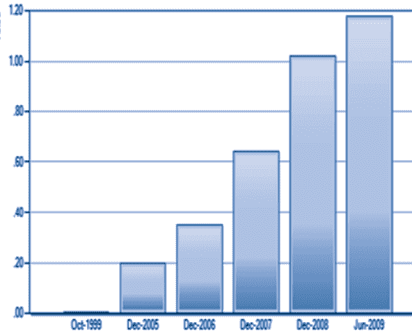

来源：Olfat Monseh (NTRA) 演讲。

埃及正在采用公私合作伙伴模式，赋予房地产开发商安装被动基础设施（即暗纤）的权利，这些可以租赁给不同的网络接入提供商（即埃及电信和其他ISP）。房地产开发商可以与服务提供商协商收益分成协议。2009年9月30日，埃及宣布计划提供两项三合一业务许可，旨在五年内吸引10亿美元的投资。

另一个进一步发展的例子是智利，作为拉丁美洲的宽带领导者，其在2008年的渗透率仅为每100人9名用户。到年底，固定线路宽带用户已达到140万，但预计只会额外增长50%。这是因为预计未来的大部分增长将发生在移动宽带，预计移动宽带将在2012年之前超过固定线路宽带。竞争水平可能受限于事实：领先的3G移动运营商Movistar是西班牙电信集团的一部分，因此与现有的固定线路运营商绑定，但市场上的另外两家参与者Entel PCS和Claro由竞争性公司拥有。预计2009年将拍卖额外的3G频谱。

移动运营商通过更低价格的套餐和预付订阅选项，在提高宽带可负担性方面发挥了特别影响。他们还提供与后付订阅捆绑的具有3G能力的折扣价格网络。在一个约60%的人口没有笔记本电脑的市场中，这特别具有吸引力。

### 捐助社区的角色

捐助社区可以在帮助制定宽带战略和开发其宽带服务方面发挥作用。通过共享信息、基准比较、提供技术援助和监管支持，国际组织可以帮助政府改善市场运行、刺激投资并从其他国家的经验中学习。在这种背景下，建立宽带指标基准以进行国际比较是非常重要的。OECD通过其宽带指标门户网站（www.oecd.org/sti/ict/broadband）在该领域建立了地位，但需要将此范围扩大到发展中地区，特别是价格和服务供应的比较。

世界银行可以提供帮助，例如为战略投资提供融资以支持基础设施关键部分的发展。国际海底电缆、跨境连接和高容量骨干网络都是世界银行投资可以发挥催化作用的领域，引入部门投资并改善服务交付。世界银行目前支持政府通过公私合作伙伴关系（如非洲东岸的EASY电缆和整个东部的RCIP计划）克服关键基础设施瓶颈。

宽带是公共和私营部门投资项目组合中的增长领域。目前已承诺ICT投资项目的资金超过10亿美元，这是吸引70亿美元投资资本的催化剂。世界银行正在进行一项重大工作，收集宽带政策的国际经验，并开发一套全球政府和监管机构使用的工具包。它欢迎在此项活动中与其他组织合作。

# 注释

1  PISA是一项针对15岁青少年知识和技能的三年一次调查。最新评估显示了全球57个国家约40万名学生的2006年结果。韩国的得分高于OECD平均水平，在阅读方面获得OECD地区最高分，在数学方面排名前二，科学得分也是最高之一。更有意义的是韩国自2000年来的表现提升，那时期是学校和家庭宽带扩张时期。

# 参考文献

Aker, J. C. (2008), “Does Digital Divide or Provide? The Impact of Cell Phones on Grain Markets in Niger”, University of California, Berkeley.

Atkinson, R. D., D. K. Correa, J. A. Hedlund (2008), “Explaining International Broadband Leadership”, The Information Technology and Innovation Foundation, May.

Besley, T. and R. Burgess (2002), “The Political Economy of Government Responsiveness: Theory and Evidence from India”, Quarterly Journal of Economics.

Cave, M. (2004), Making the Ladder of Investment Operational.

European Regulatory Group (2005), Broadband Market Competition Report.

ITU (2003), “Broadband Korea: Internet Case Study”.

Jensen, R. (2007), “The Digital Divide: Information (Technology), Market Performance and Welfare in the South Indian Fisheries Sector”, Quarterly Journal of Economics, Vol. CXXII, Issue 3.

Kelly, Tim (2009), “International Broadband Benchmarks” and other papers presented at the FCC workshop.

Kelly, Tim (2009), “International Broadband Benchmarks” and other papers presented at the FCC workshop.

Monsh, Oftat (2009), “Broadband and Policy report prepared for OECD Ministerial Meeting on the Future of Economy, 17-18 June 2009, Seoul.

OECD (2008), Programme for Student Assessment, pisa.oecd.org.

OECD (2008), Broadband and Policy, Paris.

OECD (2009), Broadband for Africa, Seoul.

Reinikka, R. and J. Svensson (2003), “The Power of Information: Evidence from Newspaper Capture”, World Bank.

Qiang, Christine (2009), “Broadband Infrastructure in Stimulus Packages: Relevance for developing countries”.

World Bank (2008), Broadband for Africa: Extending Reach.

World Bank (2009), Information and Communication for Development: Increasing Reach and Impact.

## 5. 移动银行的监管问题 – 141

### 监管者的角色

金融监管机构对任何国家的经济都起着至关重要的作用。监管机构处于普通公民与金融混乱之间，试图确保国家经济的金融稳定性，并确保那些希望提供金融服务的机构以负责任的方式运营。除了维护金融稳定的监管角色外，监管者还承担着保护消费者的关键责任。

然而，监管者还有第三种角色，这对于新兴经济体尤为重要：通过确保尽可能多的公民可以使用适当的金融服务，并使服务范围和复杂程度随国家需求同步增长，从而促进国家的社会目标。这第三种角色通常被称为“扩展金融服务的范围和深度”。

可以说，许多监管机构倾向于认为这第三种角色在实质上与前两个角色冲突。毕竟，其逻辑是：经济增长受到了威胁，谁会在意人口是否拥有银行账户？虽然这种观点有一定道理，但它可能导致保守主义倾向，其无意间的后果是推高了新市场进入者的门槛，实际上封锁了现有金融服务提供者的大门，并保护他们免受更具创新性或高效的竞争者的竞争。

### 监管机构对无网银行的问题

在 Consult Hyperion 与全球金融监管机构的交流中，关于无网银行出现了一些共同主题。许多人认为，像 `M-PESA` 这样没有银行直接参与的支付方案不应被允许——此类方案应该始终由银行领导。正如一位监管者不带讽刺地说的：“鉴于近期的金融危机，我们认为只有银行才能提供必要的稳定性”。

对非银行机构的不熟悉也是一个被提到的问题。通常，监管机构对他们所监管的银行和其他金融机构的现有关系感到放心。他们知道应该查看哪些数据和报告，并熟悉影响这些机构运营的可用杠杆。没有理由认为其他机构不能提供类似的、满意的机制，但对监管者来说，这是一个熟悉程度的问题。

最后，一些监管者担心无网银行方案的失败会对客户和更广泛的经济产生影响。这是一种合情合理的担忧，事实上，一些既有无网银行方案的代表在考虑其某些竞争对手的新产品时，也提出过这种担忧。

### M-PESA 的经验

`M-PESA`（M 代表 mobile，PESA 是斯瓦希里语中“钱”的意思）是一种转账服务，最初部署于肯尼亚，它允许普通肯尼亚人使用手机廉价且可靠地在全国范围内（或者实际上面对面）发送款项。`M-PESA` 账户也可以作为存储小额资金的安全场所（这一方面让一些评论者感到不安，但对于那些无法获得真正银行账户的人来说却是理想的）。这是“扩展金融服务的范围和深度”的一个典型例子，对肯尼亚公民具有显而易见的益处。

### 图 5.2：运行中的 M-Pesa

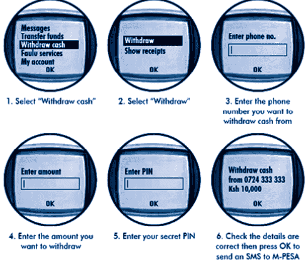

- 1. 选择“提取现金”
- 2. 选择“提取”
- 3. 输入你想取款的手机号码
- 4. 输入你想提取的金额
- 5. 输入你的秘密 码
- 6. 检查详情无误后按 OK 向 M-PESA 发送短信

来源：David Birch 的工作坊演示，数字货币论坛主席兼 Consult Hyperion 董事。

发展中的 ICTS：提高政策一致性 | OECD 2009

`M-PESA` 由沃达与肯尼亚领先移动运营商 Safaricom 合作开发并部署。它已经运行了近两年半，根据最后统计，已有超过 700 万注册客户，他们之间每天转账金额达200 万美元。

然而，在它的合作伙伴列表中，没有任何肯尼亚金融社区的成员，除了提供商业银行服务的非洲商业商业银行（CBA）除外。这种缺失导致了 Consult Hyperion 所接触的某些监管机构的几近于愤怒。

`M-PESA` 团队确实联系了肯尼亚金融社区的许多知名成员，希望招募一个合作伙伴。但无论是因为这些机构对与移动运营商合作持怀疑态度，还是可能觉得该提议风险太大且注定失败，一直没有找到合适的金融部门合作伙伴。最终，沃达和 Safaricom 决定在没有伙伴的情况下。这在金融监管方面显然构成了一个问题。

迈向 `M-PESA` 的初步尝试包括与尽可能多的利益方会面——肯尼亚监管机构就是其中之一。在这方面，团队认为需要与监管机构互动，该监管机构不仅仔细确保其对肯尼亚经济整体、特别是金融部门的责任得到充分满足，还将“扩展金融服务的范围和深度”的目标视为首要任务，并愿意探索新想法并听取潜在新市场进入者的意见。

意识到监管机构在提出新进展时通常会咨询其同行，`M-PESA` 团队还与其他监管机构（如英国金融服务监管管理局）进行了接触。他们的目标是营造出一种正常进展和明智发展的氛围，以减少任何将该服务视为危险前卫的观点。

无网银行行业可以从支付卡行业标准委员会等行业倡议中学习到很多东西——因此，从卡片行业借用的几个概念被嵌入了 `M-PESA` 中。有些是端到端加密（机密数据保存在手机、SIM 卡中），在 `M-PESA` 服务器上使用硬件安全模块（HSMs），以及对业务流程的安全性关注。这得到了一套完整的报告工具的支持，可以对单笔和批量交易进行详细查看。

为了确保 `M-PESA` “涵盖了所有方面”，他们指派了一位顾问审查了草案中的肯尼亚反洗钱法，以确保了所有必要的控制措施和报告机制——这些步骤有助于缓解与监管机构的关系。这些努力并非仅仅为了允许 `M-PESA` 上线——尽管它们确实有帮助，且 `M-PESA` 获得了一个特别许可。相反，团队认为，尽管 `M-PESA` 不是完全受监管的金融机构，但像它那样运营是唯一负责的方法。额外的益处是为 `M-PESA` 应对未来的监管发展做了准备，以及员工心态从移动运营商转向准金融机构的不可忽视的影响。

新兴无网银行方案的一个问题是“了解你的客户”（KYC）法规，该法规要求在新客户使用服务之前必须验证其身份。幸运的是，肯尼亚已经建立了国家身份证制度。在研究某些国家启动的项目所遇到的困难时（例如 `M-PESA` 在坦桑尼亚的推出），现有身份证制度的优势显而易见。

### 监管进展

无网银行的整体成功以及 `M-PESA` 的成功，推动了近期的一些监管进展。其中一些基于只允许银行提供此类服务的观点，这表明某些监管者并不理解监管环境如何适用于非银行。肯尼亚财政部长最近对 `M-PESA` 启动了审计，以验证其不会被洗钱者和金骗计划利用（事实上，曾有虚假指控 `M-PESA` 仅仅是一个庞氏骗局）。这一举措在普通肯尼亚人中极不受，他们认为这是银行（某些人认为银行从未想过为他们服务）关闭 `M-PESA` 的尝试。Consult Hyperion 被要求通过对安全措施和程序进行新的审计来做出回应，并再次证实了 `M-PESA` 提供银行级的安全性。

## 5. 移动银行的监管问题 – 145

向客户提供安全与控制。在流程结束时，`M-PESA` 获得了良好的健康评估，并继续运营。

`M-PESA` 被纳入肯尼亚法律的完全监管范畴只是时间问题，它可能会被作为电子货币发行方接受监管。预计这不会是像银行那样的完全监管——`M-PESA` 不提供信贷或贷出（客户资金的倍数）资金。欧洲通过创建一个独立的监管类别“支付机构”——并将支付服务的监管与信贷机构的监管隔离开来，在这方面可能是一个非常实用的模型。

作为一种可能被视为对等交换的回报，肯尼亚银行将允许通过代理机构提供服务，而不是被限制在自己的网点，从而避免了高昂的运营成本。同样，这并不是什么新事：这种方法在许多国家为银行和客户都带来了巨大的利益，其中巴西在这方面具有很高的知名度。如果银行能为肯尼亚人提供这一机会，特别是如果他们能够开始将 M-PESA 视为一个机会而非竞争对手。如果银行选择通过手机为 M-PESA 客户提供服务——贷款、储蓄账户等——他们将立即获得全肯尼亚超过 11,000 多个接入点，而现金处理以及账户进出的流动将由 M-PESA 完成，这可能为银行节省大量资金。

与此同时，在印度，无网点银行业的发展陷入了停滞。大约一年前，印度储备银行对该行业引入了监管变化，并要求方案必须由银行运营，还引入了端到端加密的要求（这是目前技术下只有移动运营商才能提供的功能），从而创造了一个无法解决的问题。这实际上为所有新市场准入者关上了大门，许多接近启动的方案被取消或推迟。印度的实际情况与墨西哥的情况形成了对比，在墨西哥，中央银行表示，包括银行和零售商在内的机构为客户开设移动银行账户，因为考虑到农村和半城市地区网点的稀缺，代理网络被视为实现金融包容的关键。

2008 年底，由比尔和梅琳达·盖茨基金会资助的金融包容联盟（AFI）的建立是一项积极进展。作为金融监管机构和其他新兴市场代表的论坛，它为政策制定者提供了一个审视无网点银行等领域问题的机会。

## 主要技术问题

无网点银行解决方案存在影响其监管的一或两个技术问题。它们围绕安全展开，涉及移动手机的 SIM 卡和端到端加密，这对于银行级交易的安全性至关重要。

按照目前的技术水平，为无网点银行提供端到端加密的方法只有一种：使用 SIM 卡。由于 SIM 卡受移动运营商控制，这实际上意味着只有由移动运营商领导的方案才能提供完全的安全。解决这种情况有两种方法：

- 放宽对 SIM 卡的控制。有人认为，SIM 卡在相对不久的未来某个时候将获得公用事业的地位。这意味着应该将 SIM 卡的完全控制权从移动运营商手中收回，并通过移动运营商将其部分功能提供给第三方。
- 放宽对安全性的要求。在无法访问 SIM 卡的情况下，无法实现全面的安全性——但移动运营商成为无网点银行解决方案的唯一供应商是不可接受的。也许应该接受无 SIM 卡方案较低的安全性，但要受到适当的控制，例如最大客户数量、较小的最大交易金额以及增强基于服务器的控制。这些这些并非纯技术问题。它们展示了公共政策问题与技术细节之间错综复杂的联系，而且在不考虑另一方面的情况下，任何一个都不应解决。

## 主要监管问题

无网点银行及其监管的主要问题可以总结为：

- 高知名度失败的风险。如果一个高知名度的方案失败，所有无网点银行方案的声誉将不可避免地受损，该行业可能会后退多年。
- 非银行领先方案。只要方案能够证明符合监管机构要求的可见性和必要的控制手段，为什么必须由银行主导呢？毕竟，人们信任移动运营商不会将钱借给未识别的第三方——对于银行则不一定这么说。此外，移动运营商可以提供银行永远无法提供的交易地理可追溯性。客户通过手机发送资金，因此移动运营商确切知道资金发送给了谁、在何处以及何时接收。
- KYC（了解您的客户）监管的适用性。KYC 要求无疑阻碍了无网点银行业。虽然它们在某种形式上是绝对必要的，但应该考虑其目前的应用是否合适。例如，每周向乡下亲属寄送 20 美元的人是否应该接受与想寄送 10 美元的人相同的 KYC 检查？也许可以对最贫困的客户应用更有限形式的 KYC，直到达到特定的交易阈值，届时再应用完全 KYC。很难想象这种类型的安全监管放宽将如何增加恐怖袭击的风险。

总体而言，监管机构特别是 AFI 需要考虑这些问题。他们还需被说服无网点银行方案是值得信赖的，即：

- 已经建立了适当的报告渠道，且监管机构……
- 方案是可审计的
- 方案是适当安全的

关于最后一点，分析师预计互联网用户将从 7,300 万稳步增长到 2012 年的 2 亿。。传统的开发模式侧重于从农业向制造业的转变、自由市场的发展，以及鼓励出口和劳动密集型消费品的工业化——这种良好的模式在《亚洲奇迹》（世界银行，1993）中取得了成效，并使中国成为全球最大的 ICT 及相关消费设备出口国。Sheahan (2008) 建议根据印度的崛起和中国“十二五”的证据进行重新思考。

ICT 促进发展：提高政策连贯性 © OECD 2009

## 6. 发展中国家的 ICT 与环境：机遇与发展 – 151

五年计划（2006-11年）。通过观察就业和部门 GDP 占比及增长率的长期趋势，Shehan 指出印度是一个由服务业驱动的“大推动”发展案例（图 6.1），并认为：“我们过去所理解的工业化对于发展中国家来说不再是一个现实的选择，它们需要找到参与现代服务业增长的方法，这将直接提高其人民的生活水平。”值得注意的是，印度单位 GDP 的二氧化碳强度远低于发展中国家的典型水平，与日本相当，并低于德国（Ghosh 2009）。

## 图 6.1：各各部门增加值占比，印度 1950–51年至 2007–08 年

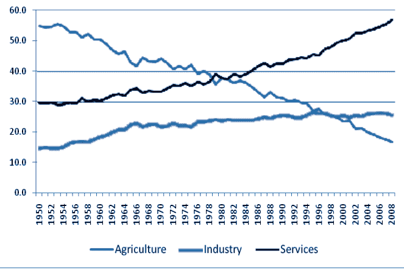

> 来源：Shehan, P.J. (2008) 超越工业化：基于服务业的发展战略新方法，UNU-WIDER 研究论文 2008/60：赫尔辛基。

ICT 在使服务变得贸易化以及 IT 和 IT 支撑服务的全球化方面发挥了关键作用。Houghton 和 Welsh (2009) 在观察 IT 和 IT 支撑服务的出口强度时指出，2006 年三个国家计算机和信息服务占总服务出口的 25% 以上：印度占比近 40%（低于 2004 年的 50%）；爱尔兰 31%（低于 2004 年的 39%）；以及以色列 27%（图 6.2）。他们的分析表明，IT 和 IT 支撑服务的出口可以在广泛的发达、新兴和发展中经济体中发挥重要作用，并且对于后者，可能提供一种比过去通用工业化更具环境可持续性的发展路径基础。

## 图 6.2：IT 服务在总服务出口中的占比，2006年 (%)

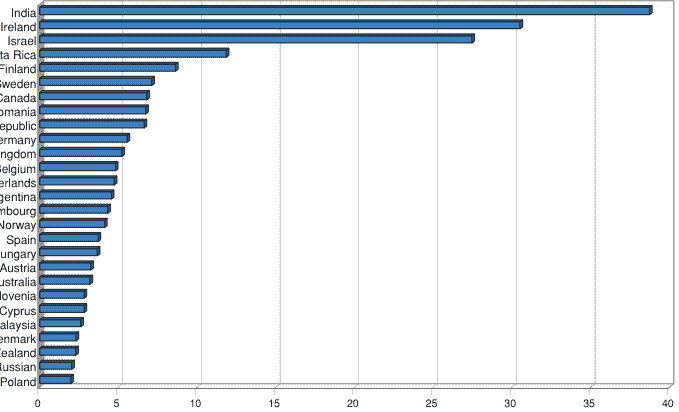

来源：Houghton, J.W. and Welsh, A. (2009)，澳大利亚 ICT 贸易更新 2009，澳大利亚计算机学会，悉尼。

在评估替代发展路径的可能性时，Berkhout 等人 (2009) 认为，经济结构和增长率的收敛在增长理论中起着核心作用，但这并不意味着支撑增长的社会技术系统在技术组成和环境质量方面也必须是敛的。他们呼吁更加关注发展的资源和环境质量，将其作为更可持续发展路径的基础。

## ICT 与环境

ICT 与环境之间的关系复杂且多方面，因为 ICT 既可以产生积极影响也可以产生负面影响。积极影响可以来自去物质化和在线交付、交通和旅行的替代、监测和管理应用、生产和使用中能源效率的提高，以及产品责任延伸和回收。负面影响可能来自 ICT 设备生产和分销中的能源消耗和材料、直接使用和冷却的能源消耗、较短的产品周期和电子垃圾，以及剥削性应用（例如用于不可持续过度捕鱼的遥感技术 (Daly 2003)）。

ICT 对环境的影响可以是直接的（能源消耗和电子垃圾）、间接的（如智能交通系统和智能电网等应用）或三级和反弹的（由直接或间接使用 ICT 引起，例如更多地使用高效的交通工具）。ICT 的影响究竟是什么，以及在多大程度上存在反弹效应（框 1），是广泛讨论的话题。然而，显然，衡量 ICT 对环境影响的尝试应该考虑到潜在的反弹效应和整个生命周期，而不仅仅是产品或应用本身的直接影响（Plepsy 2002; Yi and Thomas 2007; Hilty 2008, 等）。

对 ICT 行业直接影响的估算随行业定义和 ICT 相关用途的覆盖范围而异，但据估计 ICT 设备的生产和使用约相当于全球二氧化碳排放量的 1% 至 3%（包括嵌入能源），且用电占比较高并在不断增长。2006 年估计，ICT 设备（不包括广播）贡献了全球温室气体（GHG）排放量的约 2% 至 2.5%——其中 40% 据报道由于 PC 和显示器的能源需求，23% 来自数据中心，24% 来自固定和移动电信，6% 来自打印机（Kumar and Mieritz 2007）。最近的生命周期评估得出了大致的结果（Malmodin 2009）。数据中心是一个特别关注点。Koomey (2007) 估计了2000 年至2005 年间全球服务器的用电，并预计消耗将进一步增加 40%。

尽管如此，许多人发现 ICT 可以显著减少环境足迹（The Climate Group 2008）。

## 图 6.3：发展的 ICT：改进影响：全球

| 环境规划：GtCO2e | 削减量 | ICT |
| :--- | :--- | :--- |
| 2002 | 40 | 5.1 |
| 2020 | 14.1 | 7.8 |
| BAU | 3.9 | 1.4 |
| 2020 | - | - |

注：BAU – 照常运行。GtCO2e – 十亿吨二氧化碳当量。

4. 环境管理与保护：涉及所有与管理和减轻对环境的影响，以及帮助适应给定的环境条件的内容。这包括资源节能管理系统、温室气体（GHG）排放管理与减少系统及控制、污染控制与管理系统及相关方法，包括减轻污染物和人为环境危害的有害影响。

5. 信息通信技术（ICT）利用的影响与缓解作用：ICT 的生产、使用和处置需要材料和能量，并会产生废物，包括重金属形式的某些毒废物。ICT 可以通过提高流程效率以及去物质化（dematerialisation）的结果直接缓解环境影响，并间接通过应用在人类活动中，从而减少人类对环境的影响。

6. 环境能力建设：改善环境状况的努力取决于个人和组织的行动。能力建设包括提高公众对环境问题和优先事项意识的努力、培养专业人才以及将环境内容整合到正式教育中。

## 图 6.4：ICT 应用分类

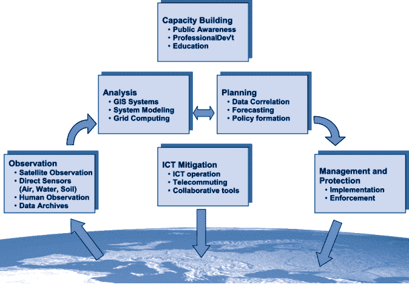

来源：ITU (2008) 《面向电子环境的 ICT：发展中国家的指南，重点关注气候变化》，ITU，日内瓦，第 25 页。

## 缓解：避免不可管理的因素

缓解活动旨在减少气候变化对环境的负面影响，对于实现排放目标至关重要。此类活动可以侧于直接缓解气候变化，也可以关注一系列其他环境影响（例如水可用性和盐度、荒漠化和森林砍伐）。

## 气候变化缓解

ICT 有许多方法可以用于缓解环境影响，包括通过其在测量、监测和管理方面的贡献，以及通过去物质化实现更高效的资源利用和基础设施运行（例如报纸、书籍和音乐等内容的在线交付）、交通替代（例如电话和视频会议）以及智能交通系统、物流和货运合理化、智能建筑和家庭自动化。许多研究和报告强调了 ICT 能够对环境产生重大影响的领域，根据部门能源消耗的份额和趋势以及应用机会，许多研究指出建筑能效、通过去物质化实现的交通合理化与替代、电话和视频会议以及远程办公是主要的影响领域（例如《气候风险 2008》）。

## 图 6.5：美国各部门交付能源消耗

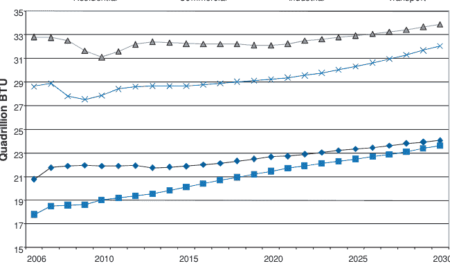

来源：EIA (2009)，《2009 年能源展望》，EIA，华盛顿特区。CSES 分析。

随着经济增长，发展中和新兴经济体在提供基础设施方面面临许多挑战，对可靠电力供应、交通基础设施和商业建筑的需求迅速增加。满足这些需求所面临的巨大困难正在并推动投资转向更高效的能源解决方案。气候集团 (2008) 引用了几个例子：

- 能源基础设施：智能电网意味着通过引入 ICT 和传感器网络技术实现配电网的现代化。智能电网能够实现对作为供应链的能源网络的改进监测和控制，这意味着减少能量损耗、提高网络运行效率、提高能源供应的质量和可靠性、增强客户对能源使用的控制、更良好地管理高度分布的发电源（例如增加更多的太阳能和风能发电），并减少温室气体排放。智能电表增加了供应商和用户之间进行双向通信和供应的可能性（Access Economics 2009），并在让能源和环境问题对家庭消费者可见方面发挥着关键作用，从而告知并赋能消费者，实现行为改变。

发电能力的限制以及电网输配损耗正在驱动印度和中国智能电网的发展，这正在提高能源效率并减缓燃煤系统的扩张速度。发电占印度总排放量的 57%；随着需求的快速增长，预计排放量每年增长 4%，是全球平均水平的两倍。估计有 32% 的发电损耗了（Climate Group 2008）。

随着未来 20 年的基础设施投资正在进行，现在有机会“跨越”发展到减少损失和停电的智能电网系统。鉴于此，印度和中国正寻求投资智能系统以实现更高的效率。

### 框 6.1. 反弹效应？

人们担心效率提高带来的价格下降可能导致使用量增加，例如反弹效应。这些效应可以是直接的（例如节能汽车）或间接的（例如如航空旅行等高能耗活动）。在对反弹效应的最全面的综述之一中，Sorrell (2007) 指出等：直接和间接影响似乎在不同技术、部门和收入组之间存在巨大差异，并且无法很有把握地进行量化。然而，证据并未表明能源效率通常会导致全经济范围内能源消耗的增加。关于发展中国家能效提高引起的反弹效应的研究较少，这种效应可能至少达到 10%。在能源服务需求远未饱和的发展中国家，预计反弹效应更大。

来源：Sorrell, S. (2007) 《反弹效应：全经济能源节约的证据评估》，UKERC。www.ukerc.ac.uk

电机：系统将电能转换为机械能。虽然对我们大多数人来说是不可见的，但它们对制造业的能源使用至关重要。如果电机无论负载如何都以满负荷运行，其效率就会低下。当电机可以通过变频和智能电机控制器将其功率使用调整为所需的输出时，它就是“智能”的。估计中国的电机系统占工业用电量的 70%，效率比西方国家低 20%。到 2020 年，中国的工业电机系统预计将消耗电量的 34% 并产生碳排放的 10%，占全球排放量的 1–2%。通过提高电机系统的效率，中国的工业能源消耗可以减少 10%，因为仅通过优化即可在 2020 年减少 2 亿吨二氧化碳排放——相当于荷兰 2006 年的排放量（气候集团 2008）。意识到这一潜力，中国政府实施了中国电机系统节能计划以实现其能效目标。如果没有此类倡议，不太进行必要的投资。

建筑：建筑的能源消耗由两个因素驱动——能源强度和表面积。基于 ICT 的监测、反馈和优化工具可用于减少建筑生命周期的每个阶段，从设计、施工到使用和拆除。能源建模软件可以帮助建筑师确定设计能耗。建筑商可以使用软件将能源模型与实际施工进行比较。建筑完成后，ICT 可以测量并基准化其性能，并将实际情况与预测的能效进行比较。住户可以安装建筑管理系统（BMS）来自动化照明、采暖和冷却等建筑功能。如果建筑用途发生变化，可以使用 ICT 重新设计能源模型并衡量变化的影响。据估计，此类工具可以在 2020 年将建筑排放减少 15%（The）。

# 6. 发展中国家的信息通信技术与环境：机遇与发展 – 161

Climate Group 2008. 建筑标准和法规是实现此类节约的关键要素。

交通：全球化导致国际供应链变得日益复杂，并为运输、存储和物流运营带来了挑战。信息通信技术（ICTs）可以通过多种方式提高物流运营的效率。这些包括用于改进运输网络设计的软件，允许运行中心化配送网络和管理系统，这些系统可以促进灵活的送上门服务。具体的杠杆包括多式联联运、路线优化和库存减少。交通部门是温室气体（GHGs）的大型且增长中的排放源，占全球排放量的14%，据估计，利用信息通信技术优化物流可以使全球运输排放减少16%，储运排放减少27%（The Climate Group 2008）。许多政策和监管问题影响着运输和物流，从航线路线监管到建筑规划与法规，再到与运输相关的噪音和污染法规（Houghton 2005），这为政策一致性构成了重大挑战。

## 缓解其他环境压力

发展中经济体通常依赖农业和渔业作为经济作物和维持生存；在新生和发展中经济体，水资源问题可能比能源使用更紧迫。在某些地区，森林砍伐可能是主要关注的问题。因此，对土地、森林和水道进行映射、监测和管理对于关键部门的效率和可持续性至关重要。地理信息系统为埃及的陆地水路监测与管理（IISD 2005）、非洲、东南亚以及喜马拉雅地区（IISD 2009）提供了重大机遇。与其它地区一样，信息是使人们做出更可持续选择并从其行动中获益的关键，也是教育、意识和支持的基础。

通过一系列允许观测和预测的门户和系统，全球用户可以日益获得观测数据。示例包括地球观测门户¹和气候变化预测网²，而保护协会（Society for Conservation）的门户³则关注保护工作。目前有一种趋势是通过使用 Google Earth 和 Microsoft Virtual Earth 等通用接口，使地理空间环境信息更加可用。这使得信息持有者能够以低成本通过标准的网络界面向用户提供特定地理区域的信息。示例包括热带生态评估与监测网络⁴、我们世界中的气候变化⁶以及其他⁷。

用于发展的信息通信技术：提高政策一致性 – OECD 2009

# 162 – 6. 发展中国家的信息通信技术与环境：机遇与发展

在发展中国家，有很多例子说明移动手机和无线网络如何在固定线路网络简陋或不存在的情况下提供“跨越式发展”的机会。考虑到农业是肯尼亚经济的支柱，Mungai (2005) 提供了若干与缓解相关的例子，例如 SokoniSMS 服务，它使农民能够通过手机接收来自各个中心的市场价格。凭借了这些信息，农民能够确定利润最高的市场进行产品运送，从而避开通常提供价格低得多的中间商，并减少了将货物运往市场后再寻找买家的倾向。其他倡措还包括在维多利亚湖盆地（Mungai 2005）和尼罗河盆地（Sobeih 2005）使用地理信息系统以支持资源管理和当地发展。这些系统可以由特定位置或生态系统的信息包进行补充，例如湄公河和尼罗河意识套件。集成的生态系统监测、感知和建模也日益常见（例如珠三角地区（Chan 2009)).

考虑到东南亚和喜马拉雅地区农村社区的脆弱性、他们对生态系统的依赖以及来自不可持续和过度使用的压力，Tyler 和 Fajber (2009) 强调了获取信息的重要性以及一些创新项目。例如：

- 印度尼尼，博加尔农业大学正与农民合作，通过气候田学校利用气候预报。当季节性预报显示 2006-07 年的作物季节将比常年干燥时，农民储存了更大比例的第一批水稻，以备干旱天气可能导致的价格上涨。

进入菲律宾，马尼拉天文台（MO）已与该国移动电话运营商之一 SMART 合作，开展了一项试点项目，在灾区地区提供遥测雨计和手机。当地农民读取雨计并将信息拨打给天文台，天文台则利用手机向农民发布风暴预警警报。农民也可以使用手机获取市场信息。

## 适应：管理不可避免的因素

适应是指旨在减少已经发生的气候变化负面影响的行动。由于最脆弱的群体风险最高，发展中世界可能是信息通信技术在气候变化监测和适应中发挥重要作用的地方（infoDev 2009）。

用于发展的信息通信技术：提高政策一致性 © OECD 2009

# 6. 发展中国家的信息通信技术与环境：机遇与发展 – 163

适应的示例包括准备风险评估、保护生态系统、改进农业方法、管理水资源、实施更好的建筑设计并在安全区域建立定居点、开发预警系统、提高保险覆盖范围以及建立社会安全网（ISDR 2008; ITU 2008）。

## 气候变化适应

监测和预警气候变化引发的事件（如风暴和海啸、干旱和洪水、饥荒和疾病）至关重要。国际水平示例包括：

- 饥荒早期预警系统网络（FEWS NET），这是一个由美国国际开发署（USAID）资助的网络，汇了国际、区域和国家伙伴，就新兴和不断变化的粮食安全问题提供早期预警和脆弱性信息。位于非洲、中美美洲、海地、阿富汗和美国的 FEWS NET 专业人员监测并分析气候信息对生计和市场的潜在影响，以识别对粮食安全的潜在威胁。一旦识别，FEWS NET 使用一系列通信和决策支持技术帮助决策者缓解粮食不安全问题。这些包括对 25 个国家的每月粮食安全更新、定期的粮食安全展望和警报，以及对应急和响应计划工作的简报和支持¹⁰

- 海啸远距离预警系统（DEWS）是针对印度洋的海啸预警系统，旨在创建一个基于开放传感器平台的新一代互操作海啸预警系统，该平台集成了快速检测地震、监测海平面、海底事件和地面位移的传感器系统。海啸警报可以通过短信发送到手机、通过传真或作为电视叠加层发送¹¹

- 预防利用信息工具为防减风险（DRR）社区提供一个共同平台，用于发现和共享信息、交流经验、联系与协作¹²

另一个信息通信技术支持适应的领域是气候和影响模型，这些模型可用于从业者和决策者的规划，并预测气候变化对农业的影响（例如使用作物模型）。SEI (2008) 引用了若干例子，包括：

- 普勒托利亚大学开展的一项南非省级研究发现，历史气温升高与干旱地区主作物产量之间存在显著相关性，并预测到2100年净作物收入将下降90%。

- 一项尼日利亚研究应用 EPIC 模型对21世纪的作物产量进行了预测。该研究对玉米、水稻、小米和木薯在最坏气候情景下进行了建模，发现随着21世纪初气候的变化，由于所有低地生态区的作物产量都将增加，尽管到世纪末增长速度将趋于放缓。

- 一项埃及研究将当前气候条件下的作物产量与2050年的预测产量进行了比较，预测许多作物的产量将下降，其中大豆的下降幅度在-11%至-28%之间。

- 一项重点关注牧业的气候脆弱性制图确定了非洲大陆的干旱和半干旱牧场以及较干燥的农业生态区（特别是南部非洲和萨赫尔地区，以及东非的沿海系统）为极易受到气候变化影响（Thornton 等人，2006）。

同样，半干旱热带作物研究中心的集成气候风险评估与管理系统利用遥感和地理信息系统（GIS）技术研究降雨模式，并为亚洲和撒哈拉以南干旱地区的农民提供建议¹¹³

在存在脆弱地区，信息通信技术（ICT）可以实现多种应对措施，信息网络发挥着关键作用。有许多例子：

- 干旱地区信息网络（ALIN）的策略基于一种信念：知识是竞争力的源泉，而新思想、实践、机会信息和新技术是这一过程的驱动力；知识能改善生活、减少贫困并赋能人类；获取知识是发展和进步的基础；而 ICT 是获取知识的关键。ALIN 提供了一个信息共享论坛，帮助人们适应气候变化¹¹⁴

- RANET 利用无线电和互联网传输用于农村发展的水文气象信息，并包括使用短信紧急警报系统和基于社区的气候观测。15

- 开放知识网络（OKN）和 openenrich 还提供与气候变化适应相关的定期信息，例如2009年7月的交流活动“气候变化加剧肯尼亚库索的粮食不安全问题”。16

- 山地论坛（Mountain Forum）及其区域伙伴专注于监测，提供使山地居民能够适应气候变化的信息（例如：气候变化与喜马拉雅山）。17,18

如 I4D19、Telecentre Magazine20、NewsDev21、Worldchanging22 等期刊提供了许多其他案例，且许多国际 ICT4D 机构运营着与环境相关的计划（例如 IICD23）。链接和概览可以通过 sideynet、km4cd25、t4cd26 等网站查看。

## 国际合作

环境问题在本质上是全球性的，虽然需要地方行动，但国际合作至关重要。关键领域包括：提供和运行用于监测和早期预警的基础设施；收集、分析和分发确保政府和其他机构能够管理、缓解和适应气候变化的必要信息；能力建设、技术转让以及实现这些技术应用所需的资金支持。

## 技术转让

《巴利行动计划》承诺通过从发达国家以可衡量、可报告和可验证的方式转移资金和技术，帮助发展中国家在不损害增长的情况下，在可持续发展的背景下采取符合本国国减缓行动（世界银行，2008）。虽然有很多技术意识和转让活动的例子，但技术和资金的转让是有挑战性和最紧迫的问题之一。

TT:clear 是由气候变化框架公约（UNFCCC）技术转让小组运行的技术信息清理中心。它提供了一个基于网络的共享平台，访问包括案例研究在内的多种信息源。27 其目标是为利益相关者提供气候变化缓解和适应技术转让各方面的有用信息。TT:clear 旨在帮助各国利用技术转让机会，帮助他们更深入了解可用技术、现有资金和其他形式的援助，以及在各国制定提议或开展项目时可案例研究。它还提供了关于技术开发和转让的观点和经验交流（ITU 2008）。

气候变化信息网络（CCiNet）是一个门户网站，作为气候变化领域公共信息、教育和培训信息源的清理中心。它旨在帮助政府、组织和个人快速方便地获取理念、策略、专家和材料，这些材料可激励并赋能人们采取气候变化采取有效行动。

GIS 开发（GIS Development）是一个地理空间通信网络，促进 GIS 技术和应用在各个发展领域中的使用。它通过促进知识传递，协助社区和政府提高生产力、制定政策和增强管理能力。它培养了对地理信息感兴趣的日益增长的网络，并通过杂志、门户网站、会议和培训促进科学知识的交流。GIS 开发声称是全球最大的地理空间资源门户，拥有有关地理空间科学各方面的2 万多页内容。它位列全球前 10 万网站之列，每月吸引 14 万独立访客，是该领域最受欢迎的之一。

能源部门管理援助计划（ESMAP）是一项全球技术援助计划，为发展中国家和转型经济体的可持续能源发展建立共识并提供政策建议。ESMAP 还有助于能源部门管理的技术和知识传递，以及向贫困人口提供现代能源服务。

澳大利亚的沙漠知识结合信息、研究与教育，提供了与适应沙漠化相关的信息、专业知识和经验；而 km4dev.org、scie.net 和 t4cd.org 则提供了大量关于气候变化缓解、适应和发展的信息。这种国际信息流、发展项目以及经验和学习在技术转让中起着至关重要的作用。

## 可持续 ICT 价值与供应链

发展和全球化的进程将偏远地区纳入全球分配和物流网络，使得国际合作在能源效率监测与标签标准化以及电子垃圾（e-waste）国际贸易等领域至关重要。

## 电子垃圾跨境贸易

电子垃圾或 e-waste 是日益严重的问题，联合国估计每年产生 2000 万至 5000 万吨电子垃圾，最近欧洲的研究表明，电子垃圾的增长速度比总废物流快三倍，占所有市政垃圾的 8%（Vetter and Creech 2008）。

虽然小型化和使用移动设备及 LCD 屏幕的趋势减少了 ICT 设备的消耗，但其在家庭以及发展中和新兴经济体中的快速采用，加上短产品周期，正导致能源使用的持续增加和电子垃圾的产生。电子产品在汽车、家电器以及几乎所有工业和消费设备中的增加加剧了这一点（Bio Intelligence 2008）。

许多主要的 ICT 和电子公司正试图通过积极的回收和回收倡议来解决电子问题，但这些措施对当地回收的影响大于对电子垃圾贸易的影响。国际合作有助于打击非法贸易，并确保回收操作符合适当标准。可以通过更新《巴塞尔公约》、区域或双边协议、跟踪监测或其他监管机制来实现。然而，这个问题并不容易解决，因为禁止贸易和强制当地回收可能会增加成本，从而抑制回收行为。这可能是当地

...绿色和平报告称，2005 年对 18 个欧洲海港的检查发现，在定用于出口的废物（包括电子垃圾）中，高达 47% 是非法的³32。尽管各国政府尝试禁止电子垃圾的非法出口和进口，印度、中国和非洲（例如加纳和尼日利亚）仍是主要的目的地³33。

实施和监测国际公认的回收标准是唯一有效的行动方案（Shinkuma and Huong 2009）。

## 总结与结论

信息通信技术（ICTs）几乎无处不在，且 ICT 对环境的潜在用途和影响是众多且多样的。这里仅提供了一些示例。然而，我们可以从更通用的术语来注意一些关键的影响领域和潜力，并重点关注在政策一致性方面出现的一些主要问题。

有许多关键性任务和工具，包括：

- 地球观测、遥感与监测、通信网络、电网与云计算、数据收集、分析与建模、数据库管理和决策支持系统；

- 地理信息系统（GIS）和地球浏览器（例如 Google Earth 和 Microsoft Visual Earth）；

- 用于技术交流、学习、教育和能力建设的基于 Web 的清算站点；

- 交易系统和贸易的监测、报告及运行。

具体应用包括：

- 探测与预警（例如针对风暴、洪水、地震和海啸）；

- 能源效率利用应用（例如智能建筑系统、智能交通系统、智能电网和家庭自动化）；

- 信息、教育和能力建设（例如技术意识与转移、公共教育与支持），其中实现潜在收益的关键在于家庭和个人层面的行为改变。

新兴和发展中国家的关键问题包括：

- 基础设施的获取，以及实现对更智能、更绿色的能源、交通和建筑基础设施投资的方法，以及实现运行所需的宽带网络、ICT 设备和服务的获取；

- 数据获取以及如何汇总收集的大量数据以提供生态系统或环境的整体图景（即：谁拥有数据，谁可以使用数据以及数据可以用于什么）；

- 负担能力，以及新兴新技术如何在预算严重受限的背景下实施；

- 能力以及如何将必要的技能应用于发展中和新兴经济体的环境问题中。

发展中和新兴经济体需要关注的领域包括：

- 理解发展中和新兴经济体存在的许多不同背景和情况下的生命周期，而不是在可用数据的限制范围内假设发达国家的生命周期评估适用（例如，国家统计收集不足以支持投入产分析和生命周期评估）；

- 管理可能的反弹效应，这种效应在能源和资源需求未满足的快速增长市场中可能更大，以及建立公平国际碳价格和对适当价格信号进行监管的相应困难；

- 确保有充足的技术转移和性资金流向发展中国家。

根本上，ICT 关乎信息和通信——这些角色至关重要。数据必须经过收集、分析和解释，转化为能够让个人做出更明智、更绿色选择的信息，并以能够告知、教育、影响和改变行为的方式进行传播。这不仅仅是价格信号塑造行为的问题（即使可能获得正确的信号），还涉及到通过告知、监测性能和提供非价格反馈，从而激励和奖励个人及社区创造可持续生计。

正如 Pleyp (2002) 指出的：“……有必要从生态和社会两个维度来看问题。”积极的生态维度依赖于 ICT 提供更绿色产品的潜力、优化其交付方式，以及通过去物质化、替代、绿色营销、生态产品生命周期优化等手段提高消费效率。生态维度所提供的环境潜力只有在处理消费行为问题的优化社会维度下，才能得到充分利用。

# 注释

- 1 www.eoportal.org。

- 2 www.climateprediction.net。

- 3 www.scgis.org。

- 4 www.teamnetwork.org。

- 5 http://map.unep.net/digital_atlas2/google.php。

- 6 http://earth.google.co.uk/outreach/kml_entry.html#tClimate%20Change%2010%20Our%20World

- 7 http://earth.google.co.uk/outreach/kml_listing.html#cenvironment%20science#s1#e20。

- 8 www.gkpnet.org/projects/public/ict4dinitiatives/view.do gkpproject=32600。

- 9 www.mrcekong.org/ and www.nileateap.org/nrak。

- 10 www.fews.net。

- 11 www.dews-online.org。

- 12 www.prevention.web.net。

- 13 www.icrisat.org。

- 14 www.alin-or.ke。

- 15 www.ranetproject.net。

- 16 http://196.201.231.147/eNR/viewContentView.do?View=item&id=13821&ptltid=302。

- 17 www.icimod.org/home/pbf/publications.content.php?puid=126。

- 18 www.minforum.org/index.cfm and http://www.minforum.org/rn/index.cfm。

- 19 www.i4donation.net/articles/current-article.asp?articleid=1910&type=Features。

- 20 www.telecentremagazine.net。

- 21 www.newsfordev.org/index.html。

- 22 www.newsfordev.org/index.html.

- 23 www.newsfordev.org/index.html.

- 24 www.dev.com.

- 25 http://earth.google.co.uk/outreach/kml_entry.html#tClimate%20Change%2010%20Our%20World

- 26 http://earth.google.co.uk/outreach/kml_listing.html#cenvironment%20science#s1#e20.

- 27 www.gkpnet.org/projects/public/ict4dinitiatives/view.do gkpproject=32600.

- 28 www.mrcekong.org/ and www.nileateap.org/nrak.

- 29 www.fews.net.

- 30 www.dews-online.org.

- 31 www.prevention.web.net.

- 32 www.icrisat.org.

- 33 www.alin-or.ke.

- 34 www.ranetproject.net.

- 35 http://196.201.231.147/eNR/viewContentView.do?View=item&id=13821&ptltid=302.

- 36 www.icimod.org/home/pbf/publications.content.php?puid=126.

- 37 www.minforum.org/index.cfm and http://www.minforum.org/rn/index.cfm.

- 38 www.i4donation.net/articles/current-article.asp?articleid=1910&type=Features.

- 39 www.telecentremagazine.net.

- 40 www.newsfordev.org/index.html.

- 41 www.newsfordev.org/index.html.

- 42 www.newsfordev.org/index.html.

- 43 www.dev.com.

- 44 http://earth.google.co.uk/outreach/kml_entry.html#tClimate%20Change%2010%20Our%20World

- 45 http://earth.google.co.uk/outreach/kml_listing.html#cenvironment%20science#s1#e20.

- 46 www.gkpnet.org/projects/public/ict4dinitiatives/view.do gkpproject=32600.

- 47 www.mrcekong.org/ and www.nileateap.org/nrak.

- 48 www.fews.net.

- 49 www.dews-online.org.

- 50 www.prevention.web.net.

- 51 www.icrisat.org.

- 52 www.alin-or.ke.

- 53 www.ranetproject.net.

- 54 http://196.201.231.147/eNR/viewContentView.do?View=item&id=13821&ptltid=302.

- 55 www.icimod.org/home/pbf/publications.content.php?puid=126.

- 56 www.minforum.org/index.cfm and http://www.minforum.org/rn/index.cfm.

- 57 www.i4donation.net/articles/current-article.asp?articleid=1910&type=Features.

- 58 www.telecentremagazine.net.

- 59 www.newsfordev.org/index.html.

- 60 www.newsfordev.org/index.html.

- 61 www.newsfordev.org/index.html.

- 62 www.dev.com.

- 63 `http://earth.google.co.uk/outreach/kml_entry.html#tClimate%20Change%2010%20Our%20World`

- 64 `http://earth.google.co.uk/outreach/kml_listing.html#cenvironment%20science#s1#e20.`

- 65 `www.gkpnet.org/projects/public/ict4dinitiatives/view.do gkpproject=32600.`

- 66 `www.mrcekong.org/` and `www.nileateap.org/nrak.`

- 67 `www.fews.net.`

- 68 `www.dews-online.org.`

- 69 `www.prevention.web.net.`

- 70 `www.icrisat.org.`

- 71 `www.alin-or.ke.`

- 72 `www.ranetproject.net.`

- 73 `http://196.201.231.147/eNR/viewContentView.do?View=item&id=13821&ptltid=302.`

- 74 `www.icimod.org/home/pbf/publications.content.php?puid=126.`

- 75 `www.minforum.org/index.cfm` and `http://www.minforum.org/rn/index.cfm.`

- 76 `www.i4donation.net/articles/current-article.asp?articleid=1910&type=Features.`

- 77 `www.telecentremagazine.net.`

- 78 `www.newsfordev.org/index.html.`

# 参考文献

Access Economics (2009), ICT Trade Update, Access Economics, Canberra, `www.accesseics.com`.

Herring, H. and Roy, R. (2002), “Sustainable Services, Electronic Education and the Rebound Effect,” Environmental Assessment Review 22(2002), pp. 524-542.

Global Action Plan (2007), An Inefficient Truth, Global Action Plan, London.

Ghosh, P. (2009), “The Climate Change Debate: Story from India,” Taxing Debate: Climate policy, CEDA, Melbourne, `www.ceda.com.au`.

Houghton, J.W. (2005), “Digital Delivery in Distribution and Logistics,” OECD, Paris.

Houghton, J.W. and Welsh, A. (2009), Australian ICT Trade Update, Australian Computer Society, Sydney. `www.cfses.com`.

ISDR (2008), Climate Change and Disaster Reduction, UN, Geneva.

EIA (2009), Annual Energy Outlook 2009, EIA, Washington DC, `www.eia.gov/oia/forecasting`.

EUIST (2000), The Knowledge Economy and Climate Change: An Overview, European Commission/IST, `www.media.se`.

InfoDev (2009), ICTs and Climate Change, `infodev.org`.

ISDR (2008), Climate Change and Disaster Risk Reduction, UN/ISDR, Geneva, `www.unisdr.org`.

Komeey, J. (2007), 估算美国及全球服务器的总功耗, way分析出版社, 奥克兰兰, `http://enterprise.amd.com/Downloads/svrprusecompletefinal.pdf`.

Kumar, R. and L. Mieritz (2007), “绿色IT与数据中心电力及冷却问题的概念化”,Gartner研究报告, `www.gartner.com/DisplayDocument?id=597177`.

Laitner, J. A. and K. Erhardt-Martinez (2008), 信息技术：生产力的力量, 美国能源效率经济委员会, `www.aceee.org/pubs/e081.htm`.

Malmodin, J. (2009), “ICT的生命周期评估：对环境与气候变化的影响”，经合ICT会议, 赫尔辛基, `http://tist.media.net/ict2009/video.php?tab=demand`.

Mungai, W. (2005), “在肯尼亚利用ICT进行减贫和环境保护”,收录于《发展的连接：弥合信息社会与可持续发展之间的差距》,国际可持续发展协会, 温尼伯, `www.iisid.org/publications/pub.aspx?pno=740`.

Murphy, D., et al. (2009), “鼓励发展中国家参与未来的气候机制”,国际可持续发展协会, 温尼伯, `www.iisid.org`.

Plelys, A. (2002), “ICT的阴暗面”,《环境影响评估评论》第22卷, 第509-523页.

Rock, M., et al (2009), “艰难的槽位，而非跨越式发展：发展亚洲的全球化与可持续转型”,《技术预测与社会变化》第76卷, 第241–254页.

Romm, J., A. Rosenfeld and S. Hermann (1999), 互联网经济与全球变暖：电子商务对能源和环境的影响情景,能源与气候解决方案中心, 全球环境与技术基金, `www.2ppays.org/ref/04/03784/0378401.pdf`.

Schmidt, A. and N.H. Kloverpris (2009), “作为传统纸质方案替代品的数字化解决方案的环境影响”,电子邮箱评估, 隆恩比亚. `http://ekstranet-e-boks.dk`.

SEI (2008), 非洲农业的气候变化与适应,SEI, 斯德哥尔摩, `www.sei.se`.

Sheehan, P.J. (2008), “超越工业化：基于服务业的发展战略新方法”,UNU-WIDER论文2008/60, 赫尔辛基, `www.wider.unu.edu/publications/working-papers/research-papers/2008/en_GB/rp2008-60`.

Shinkuma, T. and N.T.M. Huong (2009), “亚洲地区电子垃圾的流动与对电子垃圾国际贸易政策的重新思考”,《环境影响评估评论》第29卷第1期, 第25-31页.

Sobeih, M. (2005), “埃及的地理信息系统 (GIS)”,收录于《发展的连接：弥合信息社会与可持续发展之间的差距》,国际可持续发展协会, 温尼伯, `www.iisd.org/publications/pub.aspx?pno=740`.

Sorrell, S. (2007), 反弹效应：提高能源效率实现全范围内节节约证据评估,英国能源研究中心, `www.ukerc.ac.uk`.

Thornton P.K., et al. (2006), 非洲气候脆弱性与贫困地图,向国际发展部报告,国际畜牧研究协会, 内罗毕, 肯尼亚.

Tyler, S. and L. Fajber (2009), 亚洲土地与水资源管理：气候适应的挑战,国际可持续发展协会, 温尼伯. `www.iisd.org/climate`.

Vetter, T. and H. Creech (2008), ICT部门与全球连接系统：可持续发展概述,国际可持续发展协会, 温尼伯. `www.iisd.org`.

世界银行 (1993), 东亚奇迹：经济增长与公共政策,世界银行, 华盛顿特区, `www.worldbank.org`.

世界银行 (2008), 发展与气候变化,世界银行, 华盛顿特区, `www.worldbank.org`.

Yi, L. and H.R. Thomas (2007), “电子商务与ICT环境影响研究综述”,《国际环境》第33卷, 第841-849页.

# 第7章

## 教育ICT的政策一致性：来自南亚的案例

作者：Mitakshara Kumari 和 Nilaya Varma¹

教育是社会和经济繁荣的关键需求。在南亚的发展中经济体中，教育通常被视为社会流动和财务自给自足的唯一途径。考虑到教育的重要性，该地区各国政府已投入了大量的资金和综合计划，以改善教育的获取、质量和交付机制。

本章介绍了由infoDev委托、普华永道印度分公司（PricewaterCoopers India）开展的关于印度及南亚教育ICT使用调查的初步结果，涵盖的国家包括阿富汗、孟加拉国、不丹、印度、马尔代夫、尼泊尔、斯里兰卡和巴基斯坦。

¹ Mitakshara Kumari是普华永道印度的副经理，Nilaya Varma是普华永道印度的经理。`mitakshara.kumari@in.pwc.com`。`nilaya.varma@in.pwc.com`。

近年来，对于信息通信技术（ICT）如何在教育部门应用的兴趣日益高涨。其最重要的贡献之一是学习资源的易于获取。人们广泛认为，ICT是引入和维持教育改革的重要杠杆，也是教学和学习的有用辅助。然而，尽管有全球范围内教育倡议广泛使用ICT的证据，但对于考虑增加教育相关ICT使用的发展中国家的政策制定者和捐助人员来说，仍缺乏相关指导。

为了界定教育ICT的清晰准则和政策，并弥合印度和南亚国家教育投资与发展之间的差距，infoDev委托普华永道印度收集了阿富汗、孟加拉国、不丹、印度、马尔代夫、尼泊尔、斯里兰卡和巴基斯坦教育ICT使用的最相关信息。这项区域调查是该系列中的第三项，此前是针对非洲和加勒比地区的调查。该调查重点关注ICT应用的政策一致性。

普华永道的调查显示，南亚国家广泛认识ICT对发展的重要性，均已建立了信息技术增长的某些政策框架。ICT在所有领域的应用是一个演变中的现象；但值得注意的是，教育既是ICT的消费者也是生产者。没有稳健的教育框架，开发ICT应用所需的知识将是不可能的——因此利用ICT振兴教育过程尤为重要。

教育ICT工具的普及是南亚的一项新兴趋势。发展中国家的ICT通常被视为实现发展目标的机遇，无论是由于感知的需求，还是希望复制其他成功案例。基于教育成就和基础设施的广泛分类将斯里兰卡和马尔代夫置于顶端，它们拥有100%的识字率、普及小学和基础基础设施。印度、不丹和巴基斯坦处于下游，识字率较低，但拥有未来实现更高教育水平的体系。尼泊尔、孟加拉国和阿富汗处于底层，经历了重大的政治、地理和教育动荡，在制度化流程和实现基本服务方面挣扎。

各国教育和ICT指标的广泛比较将在2010年中发布在infoDev网站上的完整报告中。

### 教育ICT的政策框架

在大多数关注的国家中，教育ICT的政策表述如图7.1所示，通过以下方式之一进行：

图7.1：教育ICT的表述

| 教育政策中的独特ICT | ICT政策中的教育部门计划 | 教育政策中的ICT计划 | 其他 |
| --- | --- | --- | --- |
| (印度、巴基斯坦、斯里兰卡) | (孟加拉国、尼泊尔、不丹、阿富汗) | (不丹、阿富汗) | 其他（国家发展计划，在马尔代夫） |

来源：普华永道。

用于发展的ICT：改进政策一致性 OECD 2009

印度、斯里兰卡和巴基斯坦已经制定或正在制定不同的教育信息通信技术（ICT）政策。一个共同特征是ICT既作为一学科也作为教学手段具有重要性。

印度的政策制定过程是通过利益相关者对话，旨在制定《学校教育ICT国家政策草案》启动的，由人力资源开发部、全球电子学校倡议（GESCI）以及科学、发展与媒体研究中心（CDSMS）领导。根据收到的反馈，该政策草案已发布征求意见并修订。然而，即使在采取重点行动之前，ICT已在政府的若干项教育倡议和旗舰计划中普及。

斯里兰卡的《教育信息技术国家政策》（NAPITSE）于2002年制定，其中ICT将同时应用于教育和教育系统的管理。

巴基斯坦在2004-05年间通过咨询过程制定了其《国家教育信息与通信战略》（NICT）。该政策承认了ICT在创造获取机会、提高学习质量、加强教师教育和提高学生学术成就方面的重要性。

对于所有这些国家来说，政策/战略文件需要详细的实施计划的支持。斯里兰卡有一个2002-2007年的战略行动计划，但其雄心勃勃的政策中规定的目标尚未实现。必须为概述的倡议提供额外的专项资金分配。极少数国家的政策文件详细概述了监测和评估方法，以衡量这些倡议或所用工具的成功。

不同重点国家的教育ICT倡议之所以成功，是因为它们能够将许多不同元素整合在一起，并受到强大且灵活的政策框架的支持。图7 2展示了可以理解为“教育ICT生态系统”的广泛图解。核心基础设施政策提供了电力供应和物理设施；教育部负责阐述更な教育政策；ICT部则发起广泛的通信政策以及关于开发硬件、软件和连接的政策。

### 图7.2：教育ICT生态系统

来源：普华华道集团（印度）。

这些政策随后可以通过公共和私营提供者通过不同的机制转化为具体的倡议和方案。针对教育ICT的特定倡议有几个关键元素，如能力建设、内容开发以及监测和评估策略。这些元素共同指向学生及其环境，确保ICT倡议能够切实改善教学和学习。除了这些元素外，详细的实施计划、资金分配、机构能力和社区对ICT的需求等因素对于确保ICT有效整合到教育系统中也至关重要。

### 教育ICT政策的主要元素

教育ICT的使用是一项横向活动，需要将不同领域的元素汇集起来，为学生提供有意义的学习体验。任何教育ICT政策都应包含以下内容：

- 课程；
- 内容/数字资源；
- 基础设施；
- 能力建设；
- 监测和评估框架；
- 教育管理ICT；
- 政策+（Policy Plus）：
  - 实施计划；
  - 资金分配；
  - 政治和行政意愿；
  - 社区对ICT的需求。

### 内容与课程开发

这是教育ICT最重要的。ICT应用能否产生有意义的结果主要取决于课堂提供的内容和课程的质量。需要确保ICT不仅简单地使用计算机和其他手头工具来教授旧课程，而是利用ICT提供的优势以一种根本性的新方法来教授概念。可视化、实验和在做中学学是这种新方法的一些特征。

因此，将ICT引入学习环境是一个重新思考教学范式的机会。随着学习模式的改变，课堂上教授的内容和水平也应该被重新思考。这是一个培养21世纪教学习技能的机会。

内容需要设计得与目标群体相关。内容开发和课程改革是重要的支柱——如果这些设计不当，即使其他所有方面都到位，也很通过ICT看到任何利用或性能的提高。

几乎所有国家的政策都强调了对适当课程和内容的需求。ICT通常被规定为从中学阶段开始的一个学科；初级目标是提高一般的ICT素养和对技术的熟练程度。文中还提到将ICT作为教授其他学科的工具，尽管

7. 教育ICT的政策连贯性：南亚案例–183

重点国家对内容开发策略的阐述程度不一。

#### 印度

由人力资源开发部于2009发布的《学校教育ICT国家政策草案》强调了在所有学校阶段实现通用ICT能力的重要性，在高中阶段将ICT作为学科的适当课程，以及对ICT赋能教学实践的需求。该政策概述了从基础到高级的不同层次ICT素养和能力要求，并提供了确保实现这些水平的实施战略。它还阐述了在高中阶段开发不同ICT领域模块化课程的需求。

鉴于印度在语言、文化和社会方面的多样性，该政策承认了多语言、高质量且与当地相关内容的重要性。它阐述了一项分阶段开发内容的策略，首先关注较难教学和理解的概念，并为所有班级和学科提供高质量的数字资源，最终转向高度交互的数字资源模型（如虚拟实验室）。预想建立国家级和州级基于网络的数字资源存储库，将为学生和教师提供各种格式的内容，从答题库到活动、笔记等。政策将重点介绍便于资源进行开放和免费访问的适当许可规范，并加强对版权问题以及对所有用户重用内容限制等问题的认知。此外，教育标准和教学设计模型将广泛分发，以确保不同机构所生产数字内容的质量。

学校图书馆将经过改造，作为高质量数字内容的网关，从而在所有班级的数字资源分类中发挥关键作用。图书馆将拥有充足的互联网连接，并转向数字化分类和自动化。

内容开发被委托给公共和私营领域。如CIET、NCERT、英德拉·甘迪国立开放大学（IGNOU）、州教育学院（SIETs）和印度电视（Doordarshan）等机构拥有专门的资源，用于根据各种目标开发和分发数字内容，涵盖从非正式教育信息到结构化课程模块各种类型。私营公司如EduComp、Evernon、NIIT、Aptech、IL & FS、Intel和Zee Interactive系统正致力于开发和交付高质量的数字内容。这些

## 1. 184 – 7. 教育领域 ICT 的政策一致性：南亚案例

公司除了向个人和学校销售产品外，还与各州政府签署了谅解备录（MoUs），旨在通过专注于政府学校的明确倡议来设计和交付内容。

#### 斯里兰卡

斯里兰卡2002年的《学校教育信息技术国家政策》（NAPSITE）旨在“设想并预见 IT 教育未来的全球挑战，并为应对这些挑战制定适当的人力资源发展良好基础”。此外，它还寻求提高所有公民的信息素养，通过学校系统创造学习机会，并使 ICT 成为普通教育各阶段教学和学习的工具。具体而言，NAPSITE 表明了以下需求：

- 在学校普通教育中引入、维持和增强 ICT 的参与度，并创造基于 ICT 的学习和教学机会。
- 在职前和职后教师发展及培训计划中引入 IT，并为教师的系统性专业发展创造机会。
- NAPSITE 还提到需要建立一个多媒体软件和网络开发中心。

斯里兰卡政府意识到，当地语言相关内容的匮乏是大量人群采用 ICT 的障碍，因此通过其信息和通信技术局（ICTA）启动了 Shilpa Surya 项目，以用僧伽罗拉语创建数字内容。Shilpa Surya 项目让学生能够在电信中心使用 ICT 学习八门学科，以为国家考试做准备。此外，国家 ICT 素养项目旨在通过一个名为 `nensalas` 的农村服务中心网络提供培训，以提高人口的电子素养水平。

## 巴基斯坦

2005年《教育国家信息和通信技术战略》（NICT）强调将 ICT 既作为一门学科也作为关键的教学辅助。其目标是通过教师开发的自己的教学学习材料所创建的当地相关内容，利用 ICT 改进学生学习。它还建议将基于 CD-ROM 的软件（包括来自相关网站和教育门户的条目和链接）发给学校、专业发展中心和教师培训机构，以帮助职前和职后教师扩展其内容知识。

NICT 还强调，鉴于 ICT 提供的工具和教学技术，需要对整体课程进行全面改革，以丰富每个阶段的教育。它强调需要利用 ICT 提供国际或国家制作的优质内容，以补充现有的教科书和材料。这些内容通过其灵活性、互动性和多模态（广播/电视等），将改善学生的学习。

该政策建议各部委、教育部门和地区教育局建立有限的搜索引擎——即供学生使用的适当内容在线数据库集合。在根据指南对国家需求进行调整后，可以使用国际开放教育资源以及课程和内容开发模型。

## 不丹

不丹2004年的《信息和通信技术政策与战略》（BIPS）旨在根据市场需求创建将 ICT 作为一门学科的适当课程，以及面向所有学校学生的通识 ICT 素养和能力课程。

《第26届教育政策指南与说明》（EPGI-2007）指出政府意图是让完成基础教育（即十年级级）的教师和学生具备 ICT 素养。为此，自2007年4月起，不丹电信提供所有免费的拨号上网套餐包。因此，敦促拥有计算机和互联网设施的学校为学生引入相关的 ICT 项目，并鼓励利用互联网学习，特别是在课后和周末，此时这些设施通常未被充分利用，且学生有充足的时间练习和学习。教育部门的课程与专业支持处制定了一个标准的 ICT 素养框架，敦促学校启动并实施 ICT 项目。

当地内容开发的一个战略组成部分是信息技术部（DIT）正在执行的 Dzongkha（不丹语）本地化项目。Dzongkha Linux 的 Beta 版本于 2006 年发布，能够用不丹语（不丹的官方语言）进行如文字处理、电子表格和 PowerPoint 演示文等常见的桌面计算任务。这标志着对开源软件开发承诺的开始。消除语言障碍是另一项成就。DIT、国家图书馆和语言文化研究所正合作建立“不丹国家数字图书馆”（NDLB），旨在展示不丹的生活、传统和文化方面，并为学者提供资源。

其他关注此的国家——阿富汗、马尔代夫、孟加拉国和尼泊尔，在强调当地相关内容重要性的同时，并没有专门阐述开发这些内容的战略。相反，他们专注于培养合格的 ICT 专业人员，以促进其当地 ICT 行业的发展，反过来又为内容开发创造当地能力。此外，正在进行的倡议专注于用当地语言创建当地相关内容。

## 阿富汗

阿富汗的 ICT 政策强调了在中等和高等教育阶段推广有效的 ICT 培训课程的需求。它侧重于为教师和培训师开发课程和材料。阿富汗的内容开发能力仍在完善，重点是培训教职员工、IT 专业人员以及支持通用 ICT 行业。可以通过远程教育中心获取国际内容。还鼓励内容开发的伙伴关系；例如，教育部在亚洲基金会（The Asia Foundation）的帮助下，已将 10-12 级的科学科目以 DVD 的形式数字化。

## 马尔代夫

在马尔代夫，规划与国家发展部的《第七次国家发展计划》完全致力于扩大目前的 ICT 水平。它强调需要为中等阶段的所有学生提供计算机，并制定一套侧重于 ICT 技能和使用（包括互联网）的小学中学国家课程。

## 孟加拉国

同样，孟加拉国2009年国家 ICT 政策强调需要通过改进 ICT 学科的课程来培养更多经过培训的 ICT 专业人员。该政策规定了从小学到高等教育各阶段使用 ICT 的战略重点领域。内容开发被强调为重点，包括需要为教师和学生创建一个电子学习内容的中央存储库，并为内容开发提供激励。

## 尼泊尔

尼泊尔2000年 IT 政策强调了“到2010年实现全全民计算机教育”的需求。它提议在中等阶段分阶段引入 ICT 作为一门学科。尼泊尔开放学习交易所（OLE）是一个非营利组织，致力于通过开发易获取的开源基于 ICT 的教育教学学习材料，帮助尼泊尔政府实现其目标。OLE 建立了一个名为 E-Pustakalaya 的数字图书馆，包含了所有所需的当地语言课程教科书。

### 框 7.1. 内容与课程开发：总结

- 几乎所有关注的国家在中等阶段（印度、斯里兰卡、巴基斯坦、不丹、尼泊尔、孟加拉国、马尔代夫和阿富汗）都规定了将 ICT 作为学科的课程。
- 在小学阶段，课程侧重于通识 ICT 素养和提高对技术的熟练程度。
- 某些国家的政策强调了将 ICT 作为教学工具的使用（印度、巴基斯坦、孟加拉国 (2009) 和斯里兰卡）。
- 极少数国家阐述了内容开发的战略（印度和不丹），尽管许多国家确实有特定的倡议（例如斯里兰卡的 Shilpa Sayura）。
- 巴基斯坦的 NICT 是唯一明确强调鉴于 ICT 提供的工具和教学技术需要对整体课程进行全面改革的政策。

开发相关内容的限制：

- 国家缺乏 IT 专业人员；
- 缺乏资金、基础设施和资源；
- 缺乏当地内容开发倡议；
- 缺乏数字教育内容的明确定义标准；
- 传统课程中没有关注数字内容。

## 188 – 7. 教育领域 ICT 的政策一致性：南亚的案例

### 能力建设

人力资源开发是将 ICT 整合到教育中能力建设的一个重要方面。教师、行政人员和管理者都需要配备充分设备，以最大限度地发挥 ICT 在改进培训和学习实践方面的潜力。

所有重点国家的政策都包含了某种形式的 ICT教师培训衔接。培训机构正在配备以提供此类服务。

印度《学校教育 ICT 国家政策草案》强调了需要改革教师职前培训课程，将 ICT 课程纳入其中。此外，ICT 能力将成为教师任职标准的一部分。所有教师培训机构将配备适当的 ICT 基础设施。该草案承认，包括入职培训和进修课程在内的定期在职培训将是学校系统广泛引入 ICT 赋能实践的关键。培训将涵盖从操作技能到 ICT 赋能学科培训技能的初步感性教育，随后将鼓励教师加入在线专业小组和协会，以跟上最新发展，分享和开发相关内容，并与更广泛的专家社区进行交流。

认识到让学校领导和行政人员参与进来对于确保优化采用和利用 ICT 赋能的培训与学习的重要性，建议对所有校长提供 ICT 和 ICT 赋能教育培训计划的指导。将鼓励学校在其行政、管理和系统监控过程中实现自动化。为此，学校领导将接受充分培训，以便能够为学校教育管理信息系统（SEMIS）的成功开发和实施做出贡献。

通常，工作在国家、州和地区各级教育部门的政府人员缺乏足够的 ICT 知识。印度的国家政策草案规定，将为政府人员提供培训，以鼓励他们在日常活动中使用 ICT。还将针对学校管理信息系统以及 ICT 基础设施的通用维护和保养提供专门培训。

在巴基斯坦，NICT 特别重视利用 ICT 加强教师的职业发展和教育管理。该战略强调了需要通过不同的 ICT 媒体（如 IRI、电视、ODL 和在线资源）最大限度地利用职业发展机会。这对于地理偏远地区以及面对面交流互动困难且成本效益低的地区将证明是特别用的。教师将学习 ICT 技能，以及如何将 ICT 作为一门学科进行教学并将其纳入课程，使 ICT 培训不仅是为了技能开发，还能赋能新的教学方法（例如项目导向型和协作学习）。该政策承认，虽然 ICT 技能培训至关重要，但 ICT 作为一门独立学科不应该是重点。对于教师来说，知道如何使用 ICT 进行教学比如何使用 ICT 更重要，这种教学应整合到教师培训学院的基础课程中。

NCT 强调了根据评估需求为教师提供正确技术的重要性。它还建议探索国际通用的标准，例如国际教育技术协会（ISTE）提供的标准，并根据当地情况对其进行教师培训的调整。

该政策进一步强调了需要通过各种平台为教师提供充足的资源，使他们能够开发自己的教学材料。设建立一个国家教育门户网站，以便教师能够相互交流，从彼此的经验中学习，并接触学科专家以提高自己的理解。行政人员和教育管理者的培训应作为计划计划的一部分，以使学校环境有利于 ICT 的最大化利用。

在斯里兰卡，NAPITSE 阐述了为公立学校的所有教师提供培训和教育，使其能够胜任教学目的 ICT 使用。它重申了需要将 ICT 引入入职和在职教师发展及培训计划，以创造教师全系统职业发展的机会。该政策设想了对管理教育系统的政府官员进行培训，并鼓励校外人口利用学校 ICT 资源，为社区提供通用的 ICT 素养。Intel 技术计划旨在使教师能够利用技术时代的全部教育潜力。教育行政人员、校长和教师的反应非常令人鼓；已有超过 7500 名教师接受了培训。

孟加拉国 2009 年国家 ICT 政策确定了经过培训的合格教师的短缺，因此建议利用 ICT 工具提供有效的教师培训计划并缓解优质教师的短缺。该政策强调了需要激励教师获取 ICT 技能，并通过连接、多媒体内容等手段加强所有小学和中学的教师培训学院。它还提到了需要通过改进 ICT 学科的课程来培养更多经过培训的 ICT 专业人员。国家计算机培训与研究学院（NACTR）是一个自治的教育和计算机培训机构，负责为孟加拉国政府、半政府、自治和非政府机构准备备、实施和评估计算机培训大纲。还将启动“ICT 专业人员与技能增强计划”，该计划将评估 ICT 专业人员的技能，并通过针对性的教师培训计划填补差距，以克服 ICT 行业的短期技能短缺。

**尼泊尔的 ICT 政策**也强调了需要将计算机培训作为教师职前和在职培训的一部分。它指出，计算机知识对所有新招募教师应是强制性的，以便在学校引入计算机教育，并将通过远程教育分阶段为所有在职教师提供计算机教育。

**在马尔代夫**，近 80% 的教师培训成本与交通有关。针对这一限制，在 20 个环礁上建立了教师资源中心，并配备了先进技术，通过“智能白板”提供互动学习体验，并提高教师培训质量。通过教育开发中心的教师资源网站，教师可以坐在资源中心的电脑前搜索课程材料、下载大纲并与其它环礁的同事分享想法。通过剑桥国际考试为教育开发中心开发的虚拟学习环境，多达 400 名教师可以同时参加在线课程并进行互动来接受培训。

在政策层面，强调了通过认证和认可流程建立更大规模的 ICT 专业人才库。

**不丹的 BIPS** 强调了需要确保从计算机素养到高级技术技能的适当 ICT 意识和技能。此外，第 26 次教育政策指南现实确保所有教师和学生都具备 ICT 素养。

**阿富汗** 指出缺乏技术 ICT 专业人员和适当培训材料是 ICT 用于教师培训和职业发展的主要限制因素。阿富汗高等教育门户是与全球学习门户和阿富汗高等教育部合作开发的，是一项赋能教师、学习者和社区以提高教育机会的努力。

基础设施是部署教育信息技术（ICTs）的关键。必须关注基础设施需求的方面性，从合适的建筑/教室到电力和供应，再到复杂的硬件、系统软件，以及最重要的是连接性。所有这些参数的趋势显示，政府在确保有效基础设施可用性方面的成效参不齐。虽然马尔代夫和斯里兰卡等国拥有相对较高水平的教育和 ICT 基础设施，但其应用和内容开发慢于印度等国；印度的基础设施不完善，但拥有一个快速发展的 ICT 行业，能够为教育开发许多新的应用和内容。不不丹和尼泊尔在提供基础基础设施方面面临地理和气候的挑战。

除了地理因素外，阿富汗和巴基斯坦不稳定的政治局势也是基础设施充分发展的障碍。孟加拉的基础设施可用性记录也较差。

几乎所有重点国家都关注了改善基础设施的政策，根据各国不同，涵盖 ICT、教育、教育 ICT 以及基础设施等政策。基础设施的核心组成部分是连接性、硬件、软件以及电力、教室等支持因素。

根据印度的政策草案，每所学校的 ICT 要求将根据其规模和州政府规定的标准来确定。政策草案设想，所有中学将开始配备适当、充足且成本效益的先进 ICT 以及其他性基础设施。这包括配备充足硬件和软件的计算机实验室、配备数字静态和视频摄像头的 AV 室、音乐音频设备、数字显微镜和望远镜、用于研究各种物理参数的数字探针、EDUSAT 终端的充足硬件等。

每所学校都将建立局域网（LAN）并至少 2 Mbps 的专用宽带连接。除了计算机实验室的互联网连接外，连接还将覆盖学校图书馆、教师休息室和学校管理办公室。每个州将规划一个 EDUSAT 网络，配备交互式终端和仅接收终端。每个州可能计划至少 1000 个终端。

中学阶段将引入丰富的软件组合，涵盖从标准办公到图形和动画、桌面出版、网页设计、数据库和编程工具的一系列软件。为了实现具有成本效益的软件使用和开发，优先选择免费和开源软件应用程序。

印度的政策草案还强调，高效维护 ICT 设施所需的性基础设施将得到定义、建立和维护。这包括充足且定期的电力供应，以及大房间、良好的通风和其他支持性基础设施。

用于发展的 ICT：提高政策一致性 © OECD 2009

## 7. 教育 ICT 领域的政策一致性：南亚案例 – 193

巴基斯坦的国家信息技术政策（NICT）虽然强调了其六个要素中的每一个都具有对充足 ICT 基础设施的需求，但并未勾概述在每个层级创建此类基础设施的明确战略。相反，该文件被视为联邦、省和学校级管理人员的一套指南，旨在帮助他们提高能力并量身定制将 ICT 整合到其所在级别教育系统的战略。巴基斯坦的 NICT 强调了 ICT 对教育的重要性，一些相关规定包括：

- 通过公私部门倡议启动一项计划，为大学、学院和学校提供低价计算机和互联网连接。
- 将所有大学、工程学院、医学院和高等教育机构网络化，以提高教育质量。
- 建立电子图书馆，确保经济且公平地获取世界信息。
- 鼓励教育机构将其注册、考试、会计和其他活动计算机化。
- 鼓励教育机构采用计算机辅助学习和其他 ICT 工具来辅助教学过程。
- 建立虚拟教室教育计划，利用在线、互联网和/或视频设施为大量人员提供远程学习。
- 建立国家教育内网（连接互联网），以便共享教学和研究设施以及教职员工的电子图书馆。

“斯里兰卡”计划始2003年，通过实施多项倡议将 ICT 益处扩大到贫困地区；e-Sri Lanka 侧于提供基础设施和硬件安装，而 NAPITSE 则专注于创建充足的人力资源并开发高质量内容，以确保 ICT 整合教育的利益最大化。

孟加拉2009年国家 ICT 政策建议采取以下措施以为所有学校提供 ICT 访问：

尼泊尔2009年 IT 政策建议采取以下措施以为所有学校提供 ICT 访问：

在尼泊尔，教育管理信息系统（EMIS）一直在不断发展，并用于生成快报，以绘制“全民教育”（Education All）计划中既定教育指标的进展。

## 7. 教育 ICT 领域的政策一致性：南亚案例 – 194

孟加拉2009年国家 ICT 政策建议采取以下措施以为所有学校提供 ICT 访问：

尼泊尔2009年 IT 政策建议采取以下措施以为所有学校提供 ICT 访问：

## 7. 教育 ICT 领域的政策一致性：南亚案例 – 195

尼泊尔2009年 IT 政策建议采取以下措施以为所有学校提供 ICT 访问：

## 7. 教育 ICT 领域的政策一致性：南亚案例 – 196

尼泊尔2009年 IT 政策建议采取以下措施以为所有学校提供 ICT 访问：

# 7. 教育领域 ICT 的政策连贯性：南亚案例 – 197

孟加拉国教育信息与统计局（BANBEIS）负责各层次、各类型教育信息及统计数据的收集、编制和传播。该机构是教育部的主要机构，负责教育数据和统计的收集与发布，并作为其教育管理信息系统（EMIS）。它还是南亚与中亚地区信息信息化（RINSACA）的国家协调员。

不不丹和马尔代夫都没有针对在学校管理中使用 ICT 的明确政策阐述。

## 监控与评估

对 ICT 倡议的监控与评估应纳入任何将 ICT 整合到教育的战略中。

印度的政策草案预计，将利用内置在 SEMIS 中的监控工具以及地区教育信息系统（DISE）数据等信息，监测各项倡议和计划的进展。州政府将设计自己的监控机制，并对地方、地区和州各级进行映射，以接入国家网络管理信息系统（MIS），推动学校 ICT 的发展并提供中期调整建议。建议进行独立的第三方评估，各州将委派自己的机构来评估 ICT 项目、基础设施、数字资源、能力建设和整体项目管理等各项参数。

如前所述，巴基斯坦的国家战略（NI）预计建立一个教育 ICT 技术实施部门（TIU）。该机构将担任教育部的咨询角色，提高国家、省、地区和学校级政策制定者、规划者及管理员的技术、规划、监控和评估能力。TIU 还与教师培训机构联系，监督国家战略的实施并通过国家 EMIS 对教育进行整体监控。

在大多数其他关注国家，尚未针对教育 ICT 倡议制定明确的监控与评估战略。

用于发展的 ICT：提高政策连贯性 © OECD 2009

198 – 7. 教育领域 ICT 的政策连贯性：南亚案例

### 框 7.4. 监控与评估：总结

- 大多数国家（印度和巴基斯坦除外）对监控评估策略的阐述较为模糊。
- 现有的监控评估策略大多侧重于项目评估和 EMIS 类工具，而非基于学习水平的评估（印度、巴基斯坦、尼泊尔）。

制定监控与评估策略的关键限制：

- 缺乏评估教育领域 ICT 倡议影响的标准。
- 制度结构薄弱，责任碎片化。

## 政策+（Plus）

政策连贯性不仅意味着阐述整合良好的战略。还需要采取若干措施来确保政策的有效性。其中包括：

**详细的实施计划。** 虽然几乎所有关注国家的政策都强调了将 ICT 整合到教育的需求，但明确的实施计划寥寥无几。印度和巴基斯坦政策文件中简要说明了实施策略。在斯里兰卡，NAPITSE 应通过“学校教育信息技术国家政策行动计划、运营策略”实施，但关于其实施成功的信息非常少。

**资金分配。** 资金分配应支持政府做出的明确政策声明。应当探索从包括政府、私营部门和公私合作伙伴关系在内的不同来源获取资金。几乎所有关注国家的政策声明都缺乏针对特定倡议的详细资金分配或资金框架（不丹的 BIPS 除外）。

**制度能力与政治行政意愿。** 这是南亚地区最关键的限制，该地区缺乏足够的制度和行政能力将纸面上的良好政策转化为具体的实际倡议。例如，在孟加拉国2002年国家 ICT 政策的16个领域103项政策指令中，只有八项在2008年完全或大部分完成。

社区对 ICT 的需求。通用的 ICT 意识和社区参与被视为将 ICT 有效整合到教育中的关键。随着更广泛社区对 ICT 服务的强劲需求，学校环境对技术有了更好的采用和利用。南亚国家中极少数政策文件承认了这种关键联系（不不丹 BIPS 和孟加拉国2009年国家 ICT 政策除外）。

## 主要发现

- 南亚地区对教育 ICT 政策的迫切需求很大程度上源于需要开发充足人力资源，以便在全球 ICT 市场中具有竞争力（孟加拉国、尼泊尔、斯里兰卡、巴基斯坦）。
- 与将 ICT 作为教学辅助以提高整体教育质量相比，更关注将 ICT 作为一门学科纳入课程。
- 只有斯里兰卡、巴基斯坦和印度拥有特定的教育 ICT 政策。这些政策关注 ICT 作为一门学科以及其作为教学工具的使用。其中，斯里兰卡的 NAPITSE 自2000年以来一直在运行，巴基斯坦的 NICT 自2005年开始运行，而印度的《学校教育 ICT 国家政策草案》仍在制定中，第一稿已于2009年发布。
- 孟加拉国、不丹、尼泊尔和富汗的 ICT 政策包含了教育章节，强调了对素质人才的需求以及通过教育系统让大众熟悉 ICT。
- 马尔代夫尚未制定 ICT 政策，但凭借基础 ICT 基础设施（相对较高的互联网普及率、移动网络、电视和广播普及率）和良好的教育指标（识字率接近100%，小学及中学的入学率较高），具备受益条件。

7. 教育领域 ICT 的政策连贯性：南亚案例 – 199

7. 教育领域 ICT 的政策连贯性：南亚案例 – 200

7. 教育领域 ICT 的政策连贯性：南亚案例 – 201

7. 教育领域 ICT 的政策连贯性：南亚案例 – 202

7. 教育领域 ICT 的政策连贯性：南亚案例 – 203

# 7. 教育领域 ICT 的政策协调性：南亚案例 – 203

- 尼泊尔政府，信息与通信技术部，www.moic.gov.np。
- 巴基斯坦政府，教育部，www.moe.gov.pk。
- 巴基斯坦政府，信息技术部，www.moit.gov.pk。
- 巴基斯坦政府（2009年），《2009年国家教育政策》。
- 巴基斯坦政府（2005年），《巴基斯坦国家教育信息与通信技术战略》。
- 斯里兰卡政府，教育部，www.moe.gov.lk。
- 斯里兰卡政府（2002年），《学校教育信息技术国家政策，2002-07》。
- 斯里兰卡政府，《2009年英语与信息技术之年》，www.englishandit.lk/programmes.html。
- InfoDev（2005年），《知识地图：教育中的 ICT，政策问题》，infoDev/世界银行。
- Lallana, Emmanuel（2003年），《亚洲 ICT 政策与策略比较分析》，亚太发展信息计划，联合国开发计划署。
- Siddiqui, Zainab Hussain（2007年），《在巴基斯坦推广电子学习：策略与挑战》，发表于 e-Asia 2007 会议与展览的论文，2007年2月6-8日，马来西亚布布贾亚。
- 联合国教科组织（UNESCO），《教育 ICT：参考手册》，ICT 教育工具包，巴黎。
- 联合国教科组织（2003年），《亚太地区教育中技术使用情况元调查》，巴黎。
- Wagner, Daniel A., 等（2005年），《教育 ICT 项目的监测与评估：发展中国家的手册》，infoDev/世界银行。
- Watson Julian（2007年），《从政策到学生：政府如何鼓励教育领域的 ICT》，亚洲开发银行（ADB）。
- World Links（2007年），《ICT 整合至教育的亚洲政策论坛——最终报告》，World Links。

OECD 出版社，2, rue André-Pascal, 75775 PARIS CEDEX 16

法国印刷

(03 2009 09 01 P) ISBN 978-92-64-07739-3 – 编号 57137 2010

# 发展维度

面向发展的 ICT

提高政策协调性

信息通信技术（ICTs）对于减少贫困、改善医疗和教育服务的获取，以及为贫困人口创造新的收入和就业来源至关重要。能够获取和使用 ICT 已成为驱动竞争力、经济增长和社会发展的主要因素。在过去的十年中，ICT（尤其是手机）为思想和意见的自由传播辟了新渠道，促进了民主和人权。

OECD 和 infoDev 在 2009 年 9 月 10-11 日的一次研讨会上合作，探讨了减少发展中国之间在 ICT 获取和使用差异方面的一些主要挑战。研讨会讨论了更具协调性和协作性的最佳实践，以支持旨在实现千年发展目标的减贫工作。

在提高政策协调性方面仍有大量工作要做，并且需要与伙伴国家积极互动。充分发挥 ICT 的作用需要将其视为发展创新的一部分，而不仅仅是另一种发展工具。

本出版物探讨了 ICT 作为其使用前提的情况：宽带互联网接入以及政府在提供接入方面的作用；移动支付的发展；ICT 安全问题；用于改善环境的 ICT；以及 ICT 在教育中的相对优先级。

更多信息

- OECD/infoDev 面向发展的 ICT 研讨会：www.oecd.org/ICT/4D
- OECD 关于发展中政策协调性的工作：www.oecd.org/development/policycoherence
- infoDev：www.infoDev.org

> 本书的全文可通过这些链接在线阅读。

www.sourceecd.org/development/9789264077393

www.sourceecd.org/scienceIT/9789264077393

拥有所有 OECD书籍在线访问权限的人可以使用此链接：

www.sourceecd.org/9789264077393

SourceOECD 是 OECD 的书籍、期刊和统计数据库在线图书馆

有关此项获奖服务的更多信息和免费试用，请咨询您的图书管理员，或发送邮件至：SourceOECD@oecd.org。

