# C/C++ 游戏编程基础：基于单片机的目标开发使用指南

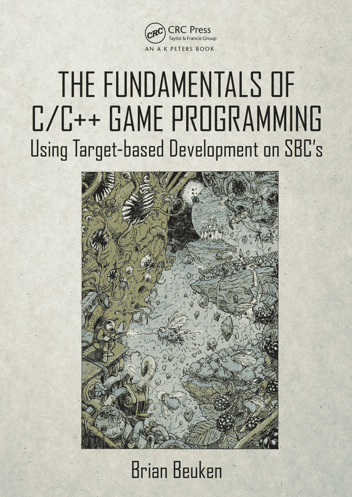


6000 Broken Sound Parkway NW, Suite 300

Boca Raton, FL 33487-2742

本书包含获取自真实且受推崇来源的信息。我们已经在发布可靠数据和信息方面做出了合理努力，但作者和出版商不对所有材料的有效性或其使用的后果负责。作者和出版商已尝试追踪本出版物复制的所有材料的版权所有者，如未获得此类形式的出版许可将向版权所有者致歉。如果有任何版权材料未注明，请来信告知我们，以便我们在未来的重印中予以修正。除美国版权法允许外，未经出版商书面许可，本书任何部分不得以任何电子、机械或其他手段（无论是现在的还是以后发明的）打印、复制、传输或利用，包括复印、微胶和记录，或在信息存储或检索系统中。

如需许可复印或以电子方式使用本书中的材料，请访问 [www.copyright.com](http://www.copyright.com/) 或联系 Copyright Clearance Center, Inc. (CCC)，222 Rosewood Drive, Danvers, MA 01923, 978-750-8400。CCC 是一个非营利组织，为各种用户提供许可和注册。对于获得 CCC 授予复印许可的机构，已安排了单独的系统。

**商标公告：** 产品或公司名称可能是商标或注册商标，仅用于识别和说明，无侵权意图。

**美国国会图书馆编目数据**

名称：Beuken, Brian，作者。

标题：C/C++ 游戏开发基础：在单板计算机上基于目标的开发 / Brian Beuken。

描述：第一版。 | Boca Raton, FL : CRC Press, Taylor & Francis Group, 2018. | “CRC 出书，属于 Taylor & Francis 品牌的一部分，Taylor & Francis Group 成员，T&F Informa plc 的学术部门。”

标识符：LCCN 2017048100 | ISBN 9781498788748 (平装：无酸纸) | ISBN 9780815355274 (精装：无酸纸)

主题：LCSH: 计算机游戏--程序设计。 | C（计算机程序语言） | C++（计算机程序语言）

分类：LCC QA76.76.C672 B49 2018 | DDC 005.13/3--dc23

LC 记录可用于 [`lccn.loc.gov/2017048100`](https://lccn.loc.gov/2017048100)

**访问 Taylor & Francis 网站**

[`www.taylorandfrancis.com`](http://www.taylorandfrancis.com)

**以及 CRC Press 网站**

[`www.crcpress.com`](http://www.crcpress.com)

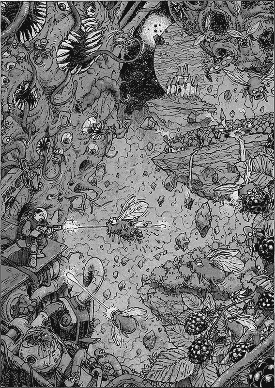

尽管避难所的 `Update` 例程确实返回一个 `bool` 值，但它毕竟是一个重写的更新函数；我们没有使用它，所以没必要收集它的返回值。它将直接进入更新，并在内部进入 `Draw`，因为避难所没有任何逻辑需要处理。

你可以编译这些代码，现在应该能看到 16 个位置良好但目前处于非活动状态的避难所。

## 碰撞逻辑（Collision Logic）

好了，必要的绘制和逻辑已经完成。现在该处理碰撞了。

我们已经有了子弹测试，但它目前只是在测试入侵者（invaders），现在我们需要在那之后进行第二次测试，来测试避难所，现在成对数据列表的原因变得更加清晰了。

最后，我们需要添加一些代码，以便 `MyObjects` 列表中的子弹对象可以检查此数组并查看是否命中。

嗯，我们如何知道 `MyObjects` 中哪些是 `Bullets`（子弹）呢？

哦，这就是我们在 `Objects` 类中包含的 `type` 变量真正派上用场的地方。尽管我们现在必须确保在构造时拥有了给定的类型，但回去检查一下在你创建 `Alien` 时，在构造函数中是否已将类型设置为了 `Alien`，`Bullets` 和 `shooter` 也是如此。记得这个列表吗？

```cpp
enum Types { Bullet,Missile1,Missile2,Alien,AShooter,AShelter };
```

首先，向 `Bullets` 测试添加内容以便它可以射击避难所，目前我们应该是这样的：

```cpp
// 如果有子弹，检查它是否击中了任何东西

if (Bullet)
{
    if (MyObjects[i] != Bullet)
    {
        if (Bullet->TestForHit(MyObjects[i]))
        {
            MyObjects[i]->MarkForRemoval = true;
            Bullet->MarkForRemoval = true;
        }
    } // 如果不是 Bullet
} // 如果是 Bullet
```

让我们在此基础上添加：

```cpp
// 如果有子弹，检查它是否击中了任何东西
if (Bullet)
{
    if (MyObjects[i] != Bullet)
    {
        if (Bullet->TestForHit(MyObjects[i]))
        {
            MyObjects[i]->MarkForRemoval = true;
            Bullet->MarkForRemoval = true;
        }
    } // 如果不是 Bullet
    if (MyObjects[i]->Type == AShelter)
    {
        MyObjects[i]->MarkForRemoval = true;
    }
}
// 检查子是否击中了避难所
for (int i = 0; i < 16; i++)
{
    if (Bullet->TestForHit(Shelters[i]))
    {
        Shelters[i]->MarkForRemoval = true;
        Bullet->MarkForRemoval = true;
    }
}
```

这看起来可能很奇怪，因为那并不是我们刚刚输入的代码吗？但我们刚刚输入的代码对一个中的避难所（hit shelter）做了一些非常简单的操作。

```cpp
Shelters[i] = NULL;
```

它导致其拥有一个 `NULL` 或 `0` 值……更新例程无法从 `0` 调用。这产生了一个断点点（break）。

显然，这是一个 Bug，但它很容易发现并修复。事实上，这也是我们把无效指针置为 `NULL` 的原因之一，这样当我们不小心尝试使用无效指针时，就能触发这个错误。我们需要意识到，当我们杀死一个对象时，我们不希望它被更新。所以这个修复方法很简单：我们可能无法调用 `NULL` 指针，但我们可以测试是否有一个 `NULL` 指针，并且不尝试使用它。

如下：

```cpp
// 循环 16 次更新 Shelters
for (int i = 0; i < 16; i++)
{
    if (Shelters[i] != NULL) Shelters[i]->Update(a_Screen, a_InputHandler);
}
```

还有两种情况我们可能会使用 `NULL` 避难所，一种是在子弹与避难所碰撞的测试中，你可以对那里进行双重测试：

```cpp
if (Shelters[i] != NULL && Bullet->TestForHit(Shelters[i]))
```

另一个我留给你自己去找，它非常简单，当你命中它时，Visual Studio 会给你一个断点。

一旦你完成了，我们现在就有了游戏的基础。放去吧，向那些外星害渣释放地狱。

## 那么哪种更好？06_Contents.xhtml_ch5sec5_1_14

那么数组（Arrays）还是向量（Vectors）更好呢？这实际上取决于你用它们做什么以及如何使用它们。我们已经看到了在使用它们存储指针时遇到的一些问题。它们各有优缺点。

从数组中移除元素是不可能的，假设使用它们，就需要对 `NULL` 值进行额外的检查，以防止意外使用已销的实例。

一旦达到我们在数组中定义的项目数量，我们就无法（轻松地）创建任何新条目，因为固定大小限制了我们。

从向量中移除元素需要一个稍微技巧的后向循环，而且速度慢得多，但我们可以随心所欲地跟踪并更改它的大小。

但根结底，你选择适合自己的。在理想的世界里，我们可以将包括避难所在内的所有对象放在一个列表中，但随着向量大小的变化，追踪避难所的位置将成为一个挑战，尽管并不算困难。

## 最后细节 06_Contents.xhtml_ch5sec5_1_15

仍然还有几个我们真的应该添加的细节；我们需要实际包含一些游戏规则，允许自己真的被杀死，并在所有生命值耗尽时检测游戏结束。

此外，敌人也可以获胜，当入侵者到达屏幕底部时，游戏结束。

这些游戏规则本该应该立即执行的，但我们当时玩得太开心了，所以现在我们得想办法把它们挤进去。

这最后几件事应该是保留在我们心理待办清单上的任务，它们对于让游戏变得有趣很重要，但实际上并不是游戏机制的核心部分。不过，这类“点睛”功能可能会决定游戏的成败。

我们应该让母船偶尔随机跳出来……给我们一个做决策的机会，并转移玩家几秒的注意力。我们也可以让它在出现或死亡时做一些酷炫的事情……你来决定？

此外还有一个生命计数器，它在我们死亡时需要显示并更新，或者我们可以给自己额外的生命？

剩下的就是指示游戏结束，这当然会在我们的生命值变为 `0` 时发生？但我们还必须指示关卡的结束，然后重置它以重新开始，并希望能增加一些关卡难度。

这些是你以后对自己的编程更有信心时应该回来考虑的事情。

我们本应该在 `Score` 变量中记录分数，随着每次击杀分数会增加，但我们没有办法显示它。我们知道 `cout` 和 `printf` 是向控制台发送信息的手段。但对于想要在进程在屏幕上看到游戏分数的玩家来说，这没什么用处。

所以我们需要迈入字体世界的第一步。这以后会变得复杂一点，但现在，在一个非常简单的 320 × 200 大小的屏幕上，我们只需要一些像字母和数字的图像，并想出显示它们的方法。

## 简单文本显示 06_Contents.xhtml_ch5sec5_1_16

《入侵者》不需要任何文本，但它可以使用分数，基本上是一段简短的数字字符字符串。由于我们知道如何使用表面（surfaces）来绘制图形，那么创建字母数字字符图形应该是可能的吧？我们在这里这样做吧，通过在我们的游戏中包含一个包含字母表图像的屏幕，按 ASCII 顺序排列，这样我们就可以通过数学索引到集合中的正确字符，然后使用我们简单的正方形绘制系统来绘制它。噢，ASCII，代表美国信息交换标准代码（American Standard Code for Information Interchange），它是我们在英语及大多数其他西方字母表中排列各种字符的方式，以便我们知道某个字符属于特定的数字。保留一份 ASCII 表格是非常用的。

所以我们可以使用 ASCII 表格来索引字符。由于我们知道如何使用表面来绘制图形，那么创建字母数字字符图形应该是可能的吧？我们在这里这样做，通过在我们的游戏中包含一个包含字母表图像的屏幕，按 ASCII 顺序排列，这样我们就可以通过数学索引到集合中的正确字符，然后使用我们简单的正方形绘制系统来绘制它。

这将为我们提供一个非常高效的字体绘制系统，我们的新方法可以设置为提供实用的功能，如颜色、alpha 值，甚至是缩放。但我们必须自己编写它。

它不会是最高效或最快的系统，但嘿，我们已经知道我们的双缓冲器系统是对编程之神的侮辱了，所以让我们继续侮辱它们吧。至少它给了我们一个玩字体的机会，所以让我们写一个字体显示系统吧。

原理很简单，从那张图像创建一个表面，并将相关的字符从 `Font Surface` 绘制到游戏表面。我们可以通过颜色甚至缩放来对其进行增强，但老实说，那样看起来会很糟糕，这种系统最好被看作是直接绘制到屏幕上，如果你想要更大的文本，我们需要更大的字符。但稍后我们可以找到放大的方法。

和大多数大多数事情一样，我们将把字体看作一个可以被操作的对象，但它不是一个游戏对象，所以它不需要继承自那里。因此创建一个新类。我把它命名为 `TileFont`。这里是你的头文件。

```cpp
#pragma once

#include "MyFiles.h"

#include "surface.h"

#define PRINT_AT 1

#define NEWLINE 13

class TileFont
{

public:
	TileFont();
	~TileFont();
	void FontPrint(char*, Surface* mScreen);
	void SetScreenSizes(int height, int width);
	void SetPrintPosition(int PrintX,int PrintY);
	void SetColour(Pixel Col);

private:
	Surface* TheImage;
	int Xpos, Ypos;
	int CharWidth, CharHeight;
	Pixel TextColour;
};
```

所以我们可以看到一个熟悉的类结构，构造函数和析构函数，以及一些实用的方法，这些应该是显而易见的。

注意这次我将变量或成员命名为它们应该的名称，并将类设为私有（private）。这迫使我使用 get 和 set 例程来更改它们，在这种情况下有三个 set 句式，我目前不需要任何 get 系统，所以我还没有添加它们。

我这样做是因为，尽管我通常倾向于将一切设为公共（public），但这并不被认为是良好的编码实践，而且这个类需要是完全可移植且独立的，因此确保它的成员是私有的，并且它将使用自己的例程来设置它们，这使其在以后插入到例程时保持整洁。

cpp 文件看起来像这样：

```cpp
// very basic tile font display system

#include "TileFont.h"

TileFont::TileFont()
{
	MyFiles* FileHandler = new MyFiles();
	this->TheImage = new Surface((char*)"../Assets/fontwhite.png", FileHandler);
	delete FileHandler; // 我们打开了一些内存，确保它被回收
}

TileFont::~TileFont()
{
	delete this->TheImage; / 我们现在不需要这个
}

void TileFont::SetPrintPosition(int PrintX, int PrintY)
{
	this->Xpos = PrintX;
	this->Ypos = PrintY;
}

void TileFont::SetColour(Pixel Col)
{
	TextColour = Col;
}

void TileFont::FontPrint(char* Text, Surface* mScreen)
{
// 解析字符串直到你找到终止符 0
	char* TheString = Text;
	while (*Text != 0)
	{
		char Ch = *Text;
		int index = (Ch - 32);
// 现在将索引转换为偏移量
		int X = index % 8;
		int Y = index / 8;
		TheImage->CopyBox(mScreen, X,Y, 8, 8, mScreen->GetPitch(), Xpos * 8, Ypos * 8, TextColour);
		Xpos++;
		Text++;
	}
	return;
}

void TileFont::SetScreenSizes(int height, int width)
{
	this->CharHeight = height;
	this->CharWidth = width;
}
```

这里有一个新的循环系统，以及访问数据的新方法。

```cpp
while (*Text != 0)
```

虽然 `for` 和 `while` 循环测试条件，但 `for` 通常与迭代相关，而 `while` 则是查看特定的测试条件是否完成，而不考虑循环重复了多少次。我们还使用一种有趣的方法通过 `*Text` 访问内存，这是在检查地址 `Text` 所持地址中包含的值。由于我使用了“引号包含的字符集”，C++ 存储此类字符串的内部方法会在末尾添加一个 0 来终止它。我的 `while` 循环随后将搜索我们是否已经到达 0，如果没有，它将打印字符并递增 `Text` 中的指针以查看下一个字符。

对字符的解析相当平庸，但字符的绘制要稍微有趣一点，并且它依赖于这样一个想法：我们每行有八个字符，从空格字符开始。然后我们获取想要打印的字母的 ASCII 值，使用取模运算计算我们想要哪列，并通过简单的整数除法获取行数。

这将带我们我们想要打印的字符，我稍后会解释它。

现在回到 `TileFont` 类，注意我非常有意地让构造函数创建它自己的文件句柄，一旦使用，它就会被删除。这看起来可能是一个坏主意。

如果我们只想打印一行文本，下面这行代码没问题，但如果我们想打印文本和数字的混合体，甚至是数字，它就不起作用了，因为像 `score` 这样的变量并不是存储为字符集。

```cpp
this->Font.FontPrint((char*)"This is my test text", a_Screen);
```

因此，我们需要进行一些格式化，或者说我们不需要这样做，因为 C/C++ 贴心地为我们提供了一个非常很好的例程，可以将内容打印并格式化到字符缓冲区中，然后我们可以使用简单的文本打印器来打印它。

所以，如果我们想打印得分，可以这样做：


```cpp
char buffer[50];
int n, a = 5;
n = sprintf(buffer, "this is my test buffer %04d", a);
buffer[n] = 0; // 确保我们在那里有一个 0
```

这是一个很酷、很老但显然仍然非常有用的 C 系统，它允许我们将格式化后的字符串打印到缓冲区中，还可以将数字转换为字符串，甚至可以给它们添加前导 0（`%04d`），然后将该缓冲区传递给我们的文本打印器，它可以像这样去掉那种糟糕的 `char*` 强制类型转换：

```cpp
this->Font.FontPrint(buffer, a_Screen);
```

除了我们需要在某处有一个可访问的缓冲区，并且它必须足够大以容纳我们最大的字符串 + 1 之外，这是一个非常简单的系统，它让我们能够在屏幕上打印得分、生命值和 Hello World。

现在我们可以打印一些文本和数值数据了，它虽然有点原始，但可以满足我们显示得分和生命值数量的目的。

我想现在继续下去了，我知道这离一个完成的产品还很远，但目前我们已经在这个项目中学了所能学的一切，是时候向前迈进了。如果你能想出任何其他想要添加的功能、视觉效果或新的游戏机制，请尽管提，不过正如我们在回顾中将讨论的那样，这个游戏的组装方式存在一些问题，可能会让它比实际需要的更困难，一切都会变得清晰。

## 我们做得如何？名声昭彰的回顾

现在我们完成了，拥有了自己的游戏，并且理应感到欣慰，但真的如此吗？一个程序员很少会在项目结束时对自己的努力感到 100% 满意。对于这段代码，我有几个问题想让我们仔细思考一下：

1. 为什么我们在代码中使用了那个难陋的 `extern`？
2. 为什么我们不能让入侵者自己来发射导弹？
3. 为什么 `Game` 类仍然处理所有的逻辑？
4. 为什么我们在实际游戏过程中还在加载图形资源？
5. 我们是否在泄露内存？
6. 为什么我从一开始就没有做对？
7. 那个游戏更新循环……呃。
8. `way` 能如何让它变得更好？

这些以及你自己能想到的其他几个问题是极其重要的。随着我们的游戏变得越来越复杂，我们可能会发现自己处理事情的能力受到越来越多的限制，所以我们需要回顾这些。我们真的需要问问，这是完成这个项目的最佳方式吗？尽管它可以运行，而且运行得非常好，但它是一个非常糟糕的 C++ 程序示例。

我们使用 `extern` 是因为我们的对象向量基于自由内存的，换句话说，它没有被封装在类中。这使得我们很难将向量的地址传递给任何可能操作它的例程。使用 `extern` 虽然很方便，但一点也不优雅！

这也回答了我们的第二个问题，我们可以向量地址以及许多其他地址传递给 `Game` 类，而如果更新例程本身传递了向量地址，它就可以将地址传递给更新例程。不过，更简单的方法是直接传递 `Startup` 类的地址，它持有这些主游戏变量；如果你有类的地址，就可以访问该类中的所有值，这意味着我们不需要传递 2、3、4 或更多不同的重要地址或变量，我们只需要传递 `Master` 类的地址。我们会在下一个项目中这样做。

问题 3 是一个很好的问题，因为在某些方面，我们确实需要 `Game` 类来控制外星人移动的方向性，但我们也让它处理移动以及我们外星人的动画。我们还从对象返回标志位，这些位告诉我们的游戏循环去创建子弹和炸弹等新物体。这太乱了。理想情况下，我们希望这个类仅提供处理对象的方法，而不是为它们执行实际逻辑。

问题 4 是另一个很好的问题，也是我们在之后需要立即解决的问题，以便为下次做准备。加载图形资源，尤其是从 SD 卡加载，速度慢得令人痛苦，而这里我们每当发射一颗子弹或导弹时，都会花费数千个周期来反复、一遍又一遍地加载相同的图形。我们并没有真正注意到这一点，因为我们每帧的操作不超过几次，但它仍然是一个瓶颈。我们不需要这样做。跟踪这类事情非常重要。它可能导致内存泄漏和严重的性能问题。

问题 5……老天，我们确实像漏斗一样在泄露，如果你不知道在哪里，那么查看它将是一个非常好的练习。问题在于我们可能永远不会注意到，你可能需要玩游戏 1000 次才会突然遇到意料之外的内存溢出错误，但它在那里……噢，它就在那里。别担心，你以后会发现的，晚得多。但我会给你一个线索，每一个 `new` 都应该有一个对应的 `delete`。这里有几个 `new` 并没有！

问题 6 很简单，我想让你体会到尽管我们的游戏运行完美、玩起来很好，并且执行了我们想要它做的一切，但它写得并不很好，你应该对我们的处理方式感到一丝效率的挫败感，这种挫败感将在未来几年里让你成为一名更好的程序员。如果你不喜欢某些东西，你真的应该尝试避免这样做！

所以这些问题需要被解决。这以后对你来说将是一个很好的练习。

问题 7，那个更新循环，噢那个循环，看着它真很痛苦，不是吗？在一个理想的世界里，游戏循环真的应该只由输入、更新和绘制组成！虽然这是可能的，但我们确实不应该用移动逻辑、碰撞逻辑等污染我们的游戏循环。我们会在变得更优秀时改进这一点。

问题 8，把最好的留最后……我们需要记录我们学到的东西；每个项目都是一个学习过程。我们会犯很多错误，不必为此感到沮丧，诀窍是每次少做一点。如果你认真的，可以回去重做项目以避免你犯过的错误。

所以是的，这个问题非常困扰我，希望你也想在继续之前现在就修好它。让我们考虑这种情况，我们有 55 个入侵者，每个加载 2 个图像用于动画，但实际上只有 6 个图像……我们的游戏正在加载并存储 110 个图像的空间。我们只显示 6 个，显示 6 个就够了，而不是 110。只有 6 个图像！

你明白我的意思。这很不对。一定有某种重用图像的方法吧？

当然有……让我们考虑我们的表面类所谓的 `Image`，它只是一个指向字符缓冲区的指针。所以如果我们创建 6 个包含图像的字符缓冲区，然后就可以告诉对象指向正确的图像。

让我们创建一个新的构造函数，它不创建新的字符缓冲区，而是使用现有的图像。如下：

```cpp
Objects::Objects(Surface* a_Image)
{
    Image = a_Image;
    MarkForRemoval = false;
}
```

另一种方案是使用图像列表并将其传递给构造函数，我们创建的构造函数数量实际上没有限制；唯一的约束是它们必须传递不同类型或数量的参数，或者不同的顺序。因为 `C++` 通过它需要发送和返回的参数类型指纹来区分构造函数。

我们的 `Aliens` 需要两张图片，分别存储在 `Image1` 和 `Image2` 中，这些图片在动画过程中会被加载到 `Objects` 的主显示 `Image`。因此，我们需要一个可以接收两张图片的 `Aliens` 构造函数。

现在，通过选择在 `Game` 类初始化开始时加载实际图像，我们只加载了六张图片，这些图片可以存储在某处并交给 `Alien` 类。因此，我们的 `Game Init` 现在可以像这样：

```cpp
bool Game::Init(MyFiles* a_FileHandler)
{
    int imageWidth, imageHeight;
    StepTime = TIMEPERSTEP;
    AlienCount = 0;

#define PRELOAD

#ifdef PRELOAD
    char* Names1[] =
    {
        (char*)"../Assets/invaders8x8/InvaderA-1.png",
        (char*)"../Assets/invaders8x8/InvaderB-1.png",
        (char*)"../Assets/invaders8x8/InvaderC-1.png",
    };
    char* Names2[] =
    {
        (char*)"../Assets/invaders8x8/InvaderA-2.png",
        (char*)"../Assets/invaders8x8/InvaderB-2.png",
        (char*)"../Assets/invaders8x8/InvaderC-2.png"
    };
    Surface* Images1[5];
    Surface* Images2[5];

    for (int i = 0; i < 3; i++)
    {
        Surface* s = new Surface(Names1[i], a_FileHandler);
        Images1[i] = s;

        // reload s
        s = new Surface(Names2[i], a_FileHandler);
        Images2[i] = s;
    }

    // 重新安排，因为我们有 3 张图片来填充 5 行。
    Images1[4] = Images1[2];
    Images1[3] = Images1[2];
    Images1[2] = Images1[1];
    Images2[4] = Images2[2];
    Images2[3] = Images2[2];
    Images2[2] = Images2[1];

    for (int i = 0; i < 5; i++)
    {
        for (int x = 0; x < 11; x++)
        {
            Aliens* T = new Aliens(Images1[i], Images2[i]);
            T->Xpos = (x * 11) + 5;
            T->Ypos = (i * 11) + 40;
            MyObjects.push_back(T);
            AlienCount++; // 跟踪创建了多少个，以便知道它们何时都死亡了
        }
    }
#else
    for (int i = 0; i < 5; i++)
    {
        for (int x = 0; x < 11; x++)
        {
            Aliens* T = new Aliens(i, a_FileHandler);
            T->Xpos = (x * 11) + 5;
            T->Ypos = (i * 11) + 40;
            MyObjects.push_back(T);
            AlienCount++; // 跟踪创建了多少个，以便知道它们何时死亡了
        }
    }
#endif
```

我在这里也使用了一个很好的预处理器特性，即 `#ifdef`、`#else` 和 `#endif`。这些是编译器指令，询问标签是否存在（而不是它是否有值，而是看它是否被定义），如果是，就会编译这段代码；如果没有，它将编译浪费资源的代码。如果我想使用旧代码，只需注释掉 `#define PRELOAD`。

`Alien` 类需要一个不同的构造函数来使用那两个 `Surfaces`；你能看出如何添加它吗？`Aliens` 的工作方式仍然完全相同。使用方法完全一样，而且节省了 `4 * 32 * 32` 字节，也就是 `4096` 字节。此外，虽然可能并不明显，但我们没有额外加载 `6` 张图片，这在我们的初始化中节省了相当长的时间，这不值一提。当然，我们可能有想要 `10` 张独立图片的原因，但今天不需要！通常情况下，确保图像不重复并在对速度要求不高的时候加载更好。

不过，我们可能并没有真正注意到这一点，因为我们只在第一次设置外星人时执行了这些加载，所以是我们的初始化系统有点慢，不过那很大程度上是在游戏开始前的一秒内完成的。我们可能根本没有想过这花费了多久，也没有过多考虑内存的浪费。一想，每当我们发射子弹或导弹并创建其中一个事物的新实例时，这个加载过程就会在每一个物体上发生，所以我们必须解决这个问题。

所以，和外星人一样，确保在 `Game` 类初始化时加载图形，并确保更新例程将 `Game` 类的位置传递给实际更新，这样就能确保 `Aliens` 能够访问子弹图形、创建子弹的新实例，并能够查看当前活动对象列表以进行我们可能想要做的任何其他测试。现在这是一个好得多且更有效的系统，显然是我们从一开始就应该这样做的。但让我们不要过度沉溺于怀疑和自我厌恶，我们还有整个职业生涯可以沉溺于此，现在我们已经写了第一个真正的游戏，尽管某些概念与你记忆中原始游戏的情况有所不同。先保护好这个游戏，随着我们学习新知识，我希望你回到这里并添加新功能，这样你就可以定制并增强这个游戏，使其成为你自己的特别个人版本。


一个拍背的鼓励。

让我们看看你做了什么，而不是看那些有很多错误、相当简单的代码。在制作这个游戏时你成就了什么，你刚刚制作的这个游戏由哪些部分组成？

你学习了如何绘制物体，以及创建可以实际响应按键按下并发射具有运动逻辑的物体。你可以从子弹和导弹飞行并导致死亡的角度来观察这个过程，你记录了分数，你可以避免被射中并看到这些事件在屏幕上发生。你甚至开始洞察为什么看起来运行正常的代码实际上并没有以你需要的方式运行。这看起来还很粗糙，并且有很多小 Bug 可以让你尝试寻找，但作为我们编写街机游戏的第一次尝试，它非常酷。

你所做的事情真的很惊人，你创造了一个虚拟世界，在这个世界里，你是控制地球最后的防御以对抗一群掠夺像素的人……但实际上你做得多得多。

这款游戏包含了一些很棒的新图形，这次是彩色的。原版是首批使用彩色精灵的游戏之一，这真的让它脱颖而出并成为了经典。

我们不仅仅是简单的左右移动，有时我们会让一些外星者飞过来，并向你可怜的射击器落下密集的导弹，它的运行方式与之前几乎相同，但没有任何可以躲避的掩体。

我们还会对它进行一些装饰，我们入侵者游戏的纯黑色背景需要一点花样来让它更有趣。

从支持网站下载 `Kamikazi` 基础项目，你会发现它本质上还是我们在添加游戏玩法之前完成的 `InvaderStart` 项目，但我重命名了一些内容，这将作为我们接下来的几个游戏的基准项目。

我们将保留来自 `Invaders` 的原始游戏对象类、碰撞类和输入系统，因此我将它们从 `Invaders` 项目目录复制到 `Kamikazi` 目录，并将它们添加到新项目中，但图形和 `Game` 类将无法用于此，所以我们需要为这些准备新的类。

此外，是时候将我们的屏幕分辨率提高到 `1024 × 720` 了，虽然仍然是一个旧的分辨率，但它将为我们提供更好的细节。不过，我们将使用大得多但仍然很简单的精灵。

最后，我们将更好地组织我们的类，这样我们就可以抛弃那些讨厌的 `extern` 命令，并让所有对象都能更好地访问主 `Game` 类中持有的信息。

好了，我们准备好了。

让我们像以前做的那样，列出游戏的基本功能并草拟截图：

- 我们有五行坏蛋，每行的数量略有不同，它们会变换帧且图形有细微差异。
- 我们有射击器可以发射的子弹。
- 我们有看似随机的方式向我们落下导弹。
- 我们有外星者，它们似乎正飞下来，意图撞击我们。
- 如果外星者离开了屏幕，它们会回到形成位置。
- 我们可以用子弹击中外星者——它们会爆炸。
- 当子弹可用时，它位于我们飞船的鼻头，一次只有一个。
- 我们会被它们的子弹击中——我们会爆炸，并失去一条生命。
- 我们还有一套评分系统。
- 我们控制射击器左右移动并发射。
- 入侵者向左或右移动然后返回。
- 如果我们杀光了它们，它们会来得更快。
- 我们的背景中有一个移动的星场。

所以有很多相似之处，也有一些有趣的不同之处。我们知道如何创建左右移动的东西。我们知道如何让子弹飞行，我们知道如何处理碰撞。

未知数是俯冲轰炸的外星者和星场。

我们现在还有经验的优势；我们知道上上次有些地方做得不好，所以让我们努力在这次避免这种情况。

- 让我们先做星场。
- 创建并控制我们的射击器。
- 给射击器配备子弹并测试命中。
- 设置敌人的左右移动。
- 然后处理俯冲轰炸。

星场非常简单，如你看到的，星星都朝一个方向移动，它们是随机放置的，为了好玩，我们将它们闪烁一下。`StarField` 类已经为你设置好，但还没有实际代码。首先，决定一个数字并在 `StarField.h` 中添加这个：

```cpp
#define NUMBEROFSTARS 50
```

50 到 100 之间的任何数字都可以！

我们在星场的描述中有一个关键词，它们需要被 `Randomly`（随机放置）。所以我们需要再次使用随机函数。不过这次我们不再使用它们来做决策，而是使用它们来实际生成位置。

就像其他东西一样，我们可以使用 `Stars` 作为 `Objects` 的派生类，并带有一个持有图形的表面，所以让我们创建它们，并将它们放入 `Objects` 列表中，这次由于固定了数量，可以使用数组。

所以首先，让我们在 `Star.h` 中为星星定义一个新类：

```cpp
#pragma once

#include "simplebob.h"
#include "surface.h"

#include "Game.h"

class Star : public SimpleBob
{
public:
    Star();
    ~Star();
    bool Update(Surface*, Input*);
    bool Update(Game* G);
    void Draw(Surface*);

private:
    Pixel Colour1;
};
```

这是一个非常小的类，因为它真的不需要什么，它派自 `SimpleBob`，这是一个同样简单的类，目前基本上是空的，但作为一个定义上简单的图形对象，它可能是很有用的。此时，我想它最终可能会被移除，但目前我会允许它留在那里以防我想起其他想要创建的派生自它的东西。

我们甚至可以把星星纯粹作为 `SimpleBobs`，但由于我想做一些不同的事情，我更倾向于保持 `SimpleBob` 类尽可能独立。通常，这是你需要做出的：在 `SimpleBob` 之上创建一个 `Star` 类，还是用 `Star` 类替换 `SimpleBob`？


在你设置了 `Colour1` 的值后，我们可以制作出 2–4 种变体。

```c
Colour2 = BLUEMASK + GREENMASK + ALPHAMASK;
Colour3 = REDMASK + GREENMASK + ALPHAMASK;
Colour4 = REDMASK + BLUEMASK + ALPHAMASK;
```

现在希望你一直都在关注，并且你记得通过特定名称来引用单个变量有点麻烦，尤其是当我们想要使用变量来引用它们时……所以，我们打算在这里对代码做一点改动，去掉 `Colour1` 并将其替换成一个名为 `Colours` 的漂亮数组。

```c
Pixel Colours[4];
```

我们现在需要做的就是修改 `Star` 构造函数中的代码，创建四种颜色，它们存储在这个数组中，如下所示。

```c
Colours[0] = REDMASK+BLUEMASK+GREENMASK+ALPHAMASK;
Colours[1] = BLUEMASK + GREENMASK + ALPHAMASK;
Colours[2] = REDMASK + GREENMASK + ALPHAMASK;
Colours[3] = REDMASK + BLUEMASK + ALPHAMASK;
```

注意我确保了那里一直有 `ALPHAMASK`，这可以确保我们能看到它，但之后我们仍然可以对其进行操作。现在在 `Star::Draw` 方法中，让我们添加一行并修改一行。

```c
Pixel Col = Colours[Counter];
dst[TheScreen->GetPitch()*(int)Ypos + (int)Xpos] = Col;
```

我有一个 `Counter` 变量，请确保将其作为 `int` 类型添加到你的 `Class` 定义中，并在更新方法中，我们将添加这个：

```c
Counter++;
if (Counter > 3 ) Counter = 0;
```

好了，那么我们可以开始了吗？编译并运行，如果你犯了任何拼写错误，或者忘记在 `Class` 定义中添加 `Counter`，那么就去修复它们并重试。

还不错对吧？但你几乎看不清闪烁，它确实在发生，但更新率太快了，可能远超 30 fps，以至于它看起来有点模糊。你是否想保留它取决于你，但对我来说，它并没有达到我想要的效果，我们该如何让动画慢下来呢？

简单使用数字 0–3 创建的动画太快，所以让我们尝试其他方法，使用一个大数字并将其缩小，让计数器增加到 4 的大倍数，尝试这个：

```c
Counter++;
if (Counter >= 4 * 32 ) Counter = 0;
```

我们为什么使用 `4 * 32` 而不是 `3 * 32` 呢？嗯，是因为我们要对其进行除法，并且我们想要：32 次 `0`、32 次 `1`、32 次 `2` 和 32 次 `3`，所以实际上我们想要 4 个数字，`0,1,2,3`。我们希望每种颜色的显示时间相等。我们基本上是允许它超过 3…………这样 `3` 就会被使用，但永远不会超过 4。

现在我们的计数器工作了，修改 `Draw` 来使用下面这行代码。

```c
Pixel Col = Colours[Counter/32 ];
```

在这里你可以看到 `/32`，它确保了我们的值永远不会大于 `3`，因为索引是 `int`，浮点部分将始终向下取整，所以我们将得到 `0,1,2` 和 `3` 作为可能的索引值。不过，有一种更好的方法可以实现，我刚才没说，但如果你了解一点数学和 C++ 的话，请随意修改它。运行它，你应该能看到它们都在变换颜色。

好了，但它们看起来有点统一……让我们给它们设置不同的数字，并保留它的副本（在 `Star` 特有的成员列表中）。让我们确保在启动它们时，每个星星的计数器略有不同，使用我们的朋友 `Rand(32)`，在 `Star` 构造函数中数组设置之后添加这个：

```c
Counter = Rand(32);
```

好多了，50–100 颗小星星以非常平稳的速度在屏幕上向下移动并闪烁……姆姆，我们应该尝试改变速度吗？这也许会增加更多变数？增加更多颜色，改变 Alpha 值？随你心意，这没有任何害，而且这是一个你可以自己完成的一个小增强。

我们的星星完成了；我们可以对此感到满意了。但我们真的可以吗？`Pixels` 的效果很好，但你完全可以用四个小图像来实现同样的效果，四个小小的星星表示，为什么不自己尝试呢？尝试在你的 `Star` 类中添加几个表面，并绘制那些而不是像素，通过图像来创建动画，并观察它自主运行！

所以……星星，它们并不是我们想象中那种笨东西，它们会移动，会动画，并在离开屏幕时重新定位。这并不是复杂的逻辑，但它就是逻辑。你可以以任何想要的方式在此添加，例如让它们沿斜线移动？

所有的代码都整齐地包含在 `Star` 类的更新方法中，因此要进行更改只需修改更新程序，我们甚至可以拥有类型的变体，正如我们稍后看到的。

## 飞船（The Ship）

我们的射击在这个游戏中定义得更清楚，所以这次我们称之为飞船。它和入侵者相比并没有大区别，我们仍然创建一个类，加载图形，并控制它的左右移动。

```cpp
#pragma once
#include "GameObject.h"

class Shooter : public GameObject
{
public:
    Shooter();
    ~Shooter();
    Shooter(char* filename, GameObject* filehandler);

    bool Update(Surface* s, Input* InputHandler);
    bool Update(Game* g);
    void Draw(Surface* TheScreen);

private:
    GameObject* TheBullet; // 子弹位置
};
```

到目前为止看起来良好，让我们初始化系统来创建飞船并尝试让它移动一下。这里和原来的没有太大区别。

```cpp
#include "Shooter.h"

Shooter::Shooter()
{
    TheBullet = NULL;
}

Shooter::~Shooter(){}

bool Shooter::Update(Surface* s, Input* InputHandler){}

bool Shooter::Update(Game* g){}

void Shooter::Draw(Surface* TheScreen)
{
    Image->CopyAlpha(TheScreen, Xpos, Ypos);
}
```

## 敌人（Da Baddies!）

这次的敌人排列方式略有不同，但基本上左右移动，没有向下移动……所以这很容易。

然而，我们没有像入侵者那样整齐的 5×11 网格，所以我们无法使用简单的数学方法来定位我们的外星人。

但我们可以记录它们在启动时所需的 x 和 y 位置，就像任何其他列表一样我们可以将其写下来，但为了避免拥有一大堆无法修改而不编辑每个数字的硬编码数字，我们将从之前的值来定义它们。

```cpp
#define Row1 48
#define Row2 (Row1 + 32 + 8)
#define Row3 (Row2 + 32 + 8)
#define Row4 (Row3 + 32 + 8)
#define Row5 (Row4 + 32 + 8)
#define Row6 (Row5 + 32 + 8)
```

通过将我们的 `Row1` 定义为 48，我们可以累积之前定义的行，从而为外星的 y 轴位置提供一个非常简单的设置。此外，我们还要让每个外星之间保持特定的距离，因此我们可以将该距离定义为一个变量……然后布置我们新的外星。

```cpp
#define DIST 40

int AlienCoords[46 * 3] = // 我们可以使用 [46][3] 但使用单维数组也没那么困难

{
    // 顶层外星，我们使用 X,Y,Type
    (SCRWIDTH / 2) - 100,Row1, 0,
    (SCRWIDTH / 2) + 100 - 32, Row1, 0,
    // 第 2 行 6 个
    (SCRWIDTH / 2) - (3 * DIST), Row2, 1,
    (SCRWIDTH / 2) - (2 * DIST), Row2, 1,
    (SCRWIDTH / 2) - (1 * DIST), Row2, 1,
    (SCRWIDTH / 2) + (0 * DIST), Row2, 1,
    (SCRWIDTH / 2) + (1 * DIST), Row2, 1,
    (SCRWIDTH / 2) + (2 * DIST), Row2, 1,
    // 第 3 行 8 个
    (SCRWIDTH / 2) - (4 * DIST), Row3, 2,
    (SCRWIDTH / 2) - (3 * DIST), Row3, 2,
    (SCRWIDTH / 2) - (2 * DIST), Row3, 2,
    (SCRWIDTH / 2) - (1 * DIST), Row3, 2,
    (SCRWIDTH / 2) + (0 * DIST), Row3, 2,
    (SCRWIDTH / 2) + (1 * DIST), Row3, 2,
    (SCRWIDTH / 2) + (2 * DIST), Row3, 2,
    (SCRWIDTH / 2) + (3 * DIST), Row3, 2,
…继续（见源码）
```

注意，我们还使用了 `SCRWIDTH`，因为它我们可以信赖的预定义值，这允许我们将这些外星置于屏幕中间。虽然我们仍然使用一些硬编码数字，但我们可以通过更改 `Row1` 和 `DIST` 的值来进行简单的调整，而不是修改 46 个条目，我们只需要做一些小的变化。

现在在代码中，我们可以像这样表示具有固定数量条目的列表，使用二维数组：

```cpp
int AlienCoords[46][3]
{
    { 300, 100, 0},
    { 320, 100, 0},
    { 320, 100, 0},
…
```

所以这是一个数组，就像我们之前入侵者使用的数组一样，有 46 个条目，每个条目有 3 个值。你可以通过变量或硬编码数字来查找你需要的相关外星。

像这样：

`XCoord = AlienCoords[23][0];` // 获取第一个值，即我们 x 坐标的位置

还有这个：

`YCoord = AlienCoords[23][1];` // 获取第二个值，即我们 y 坐标的位置

正如我们以后会发现的，二维数组非常重要，但并不总是需要设置它们。当每个条目中的元素数量相等时，对我们来说足够简单，可以简单计算 Y 索引 * 元素数量，并加上 x 偏移量/索引来得到我们想要的值。

二维数组需要更多的输入，而且在将二维数组作为参数传递时也可能会遇到一些细微的问题，尽管这些在本项目中都不是问题。我只是有点懒，想确保在我们继续之前你已经完全习惯了一维数组。

现在我们已经有了外星的位置和类型，我们可以直接创建我们的外星并将它们显示在屏幕上了。

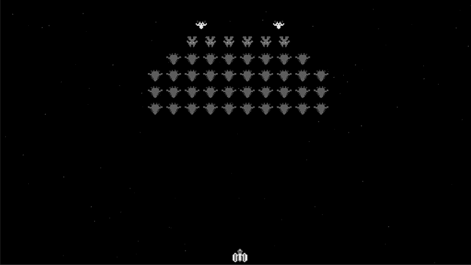

既然我们已经有了飞船和敌人，我们不如把子弹和碰撞也做好了，和我们之前做得完全一样。这部分留给你来添加好吗？

## 现在进入重点了

好了，我们开始吧，是游戏中重大区别的时候，我们必须让这些敌人向我们飞来，但我们将以一种特定的方式来实现。只有上面的两个外星应该先向我们俯冲，然后再让其他的也尝试。

但它们是如何俯冲的呢……我们可以将其分解为步骤：

1. 划弧线
2. 以自杀俯冲飞向飞船
3. 在途中投弹
4. 如果没有撞到则飞出屏幕
5. 回到它们的位置

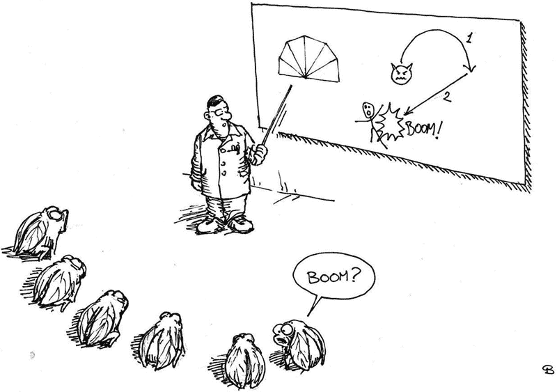

还有一个很好的功能，如果能让外星绕着它们的中心旋转将非常酷，这样可以让弧线和俯冲更令人深刻，营造出它们在改变方向时正在倾斜的印象。然而，在我们的对象类或绘制系统中没有旋转方法。嗯……目前我们得先放弃它……但那会多酷啊？为什么不尝试创建一个允许旋转的新绘图系统呢？把它加入待办事项。

让我们考虑一下步骤，或者用程序员喜欢的术语称为状态。我们每个外星需要执行的六种不同的行为……幸运的是，它们可以按顺序执行，这允许我们跟踪某些条件，以指示何时从一个状态转换到下一个状态。

1. 左右移动，这看起来是轻而易举的，但有一个小问题在第 6 步中会变得明显。
2. 划弧线，嗯，划弧需要一些数学知识，所以我们需要记得中学数学，可以使用 `sin` 或 `cos` 来绘制点。
3. 俯冲，所以我们需要给顶部的外星优先级以决定何时开始
4. 投弹，在俯冲时打开弹舱。
5. 飞出屏幕，我们需要知道它们的位置。
6. 当我们需要返回时，这一点有点棘手。

最后，我为什么选择从 100 开始呢？嗯，说到底，`Status` 类型本质上仍然是一个 `int`，我们并不排除不小心使用另一个具有相同值的 `typedef` 过的 `int` 来测试某些内容的可能性，因此，让每个 `enum` 从不同的基数开始是明智的。这并非必须的，但确实很明智。编译器会为我们处理数值，我们只需要使用分配给数字的名称即可；这些数字在每次编译时可能会变化，但代码看起来始终是一致的，并且对我们来说理解。

现在我们可以像这样在 `Alien::Update` 方法中放入一个简单的 `switch/case` 组合：

```cpp
switch (this->State)
{
case Moving:
    break;
case Arcing:
    break;
case Diving:
    break;
case Bombing:
    break;
case FlyOff:
    break;
case FlyBack:
    break;
default:
    printf("Something undefined happened in Alien Update!\n");
    break;
}
```

我们现在必须为每个步骤填充代码，注意 `default` 状态，它是用来捕获我们忘记编写的任何情况。如果你在控制台中看到这段文字，请立即修复它！这也是我将 `Moving` 值设置为 100 的另一个原因，因为如果你不初始化它，它很可能会被设置为 0，导致此情况立即触发。并务必检查你的初始化/构造函数设置。

## 让它们移动起来

好了，我们步骤列表中的第一步是让它们移动。我们在《太空侵入者》游戏中做过这一点，但在这里实际上要简单得多，没有向下移动的步骤，但我们确实希望它们在到达边缘时切换方向。

注意在 `Alien::Update` 的定义中，我返回了一个 `bool`，我们将它用来告诉控制外星人的组管理器方向已经发生了变化。但和《太空侵入者》一样，我们不会让外星人自己改变方向。

好了，移动的代码非常简单，注意我们将添加一个 `bool ReturnState = false;` 在 `switch` 语句之前，这将提供一个要返回的值，所以我们的第一项任务在 `Alien.cpp` 中看起来像这样：

```cpp
case Moving:
    if (TheGame->AlienGroup->Direction == true)
    {
        this->MovingX++;
        if (this->MovingX > (SCRWIDTH - 64))
            ReturnState = true;
    }
    else
    {
        this->MovingX--;
        if (this->MovingX < 64)
            ReturnState = true;
    }
    this->Xpos = MovingX;
    break;
```

我们还需要在更新过程的末尾添加 `return ReturnState;`，但移动部分就此结束了。我相信这些内容现在不需要过多的解释了吧？

在 `GroupManager.cpp` 代码中，我们只需要确保检查了此返回值，将其添加到 `GroupManager::Update` 中：

```cpp
// 这只需要更新左侧和右侧的外星人
bool Changed = false;
for (int i = 1; i < 47; i++) // 0 是飞船
{
    if (Game::MyObjects[i]->Update(G) == true)
        Changed = true; // 我们可能会有几个东西返回 true，所以请务必在此处更改
}
if (Changed == true)
    Direction = !Direction; // 然后检查 Changed 是否被设置，这指示方向发生了变化
```

移动部分就这些，编译并运行，假设它们处于 `Moving` 状态，就看它们永远地向左右移动吧。

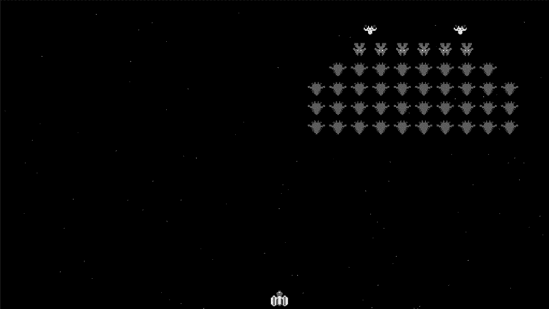

现在你注意到了，我的 `Alien` 代码并没有实际更新 `Xpos`，它更新了 `MovingX`，然后将该值移动到 `Xpos` 以创建移动，这些原因简要讨论过，我希望你留神了，但我稍后会让它变得更加明显。

## 让它们飞起来

这是一个有趣的点，我们需要让外星人执行它们的工作，但目前我们还没有编写它们所有的逻辑。我们希望这些外星人以一种半逻辑且计算的方式开始攻击。但这意味着我们需要实际运行游戏来判断我们的方法是否有效。这也就是所谓的“本末倒置”吗？

如果你对正在做的事情非常有信心，你确实可以编写整套程序，在正确的时间仔细触发正确的外星人飞行，甚至可能还带上一两个护卫，但我们大多数人此时还没有那么自信。所以这里有一个建议。

写一些目前行得通的代码，让我们让我们继续进行。我们知道这对于最终完成的游戏来说并不够好，但它能为我们提供一种快速粗暴的方法，来实现我们需要的效果。

## 优美的弧线

好了，我们准备好进行第 2 步了。

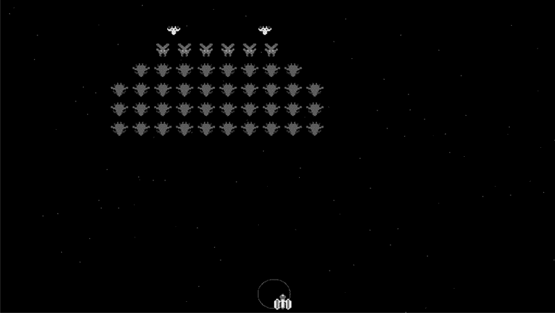


嗯，是不是出了一点问题？其实并不不是，你看，我们圆的中心点是基于 Fred 的左上角的，因为我们这样决定精灵的 `x` 和 `y` 起始点。为了平衡这一点，我们需要加上高度的一半和宽度的一半到达精灵图像的中心。

假设半径为 `30` 像素，我们可以这样做：

```cpp
for (int angle = 0; angle < 360; angle++)
{
	float Xpos = cos(angle) * 30;
	float Ypos = sin(angle) * 30;
	TheScreen->Plot(Xpos + Fred->Xpos + (Fred->Image->GetWidth()/2), Ypos + Fred->Ypos+(Fred->Image->GetWidth()/2), REDMASK + ALPHAMASK);
}
```


好了，这看起来实际上很不错；不过它并不是游戏的一部分，除非你想添加一个盾牌或某种冲击标记，这交由你决定。

但我确实想让你仔细看看这张图片……然后问问自己，这一行：

`if ((xpos >= 0) && (ypos >= 0) && (xpos < m_Width) && (ypos < m_Height))`

隐藏在你的 `Surface` 类绘图程序中的，是如何阻止你造成巨大伤害的？有什么想法吗？

当然，一个半圆只需要 `180` 步，所以尝试用 `180` 步代替 `360` 运行代码。发生了什么？不是你想的那？你可能预期一个向上的漂亮弧，但我们最后又是一个圆，只是上面有很多洞？没关系，我预料到了。虽然我们做的事情起初看起来符合要求，但这里有两个细微的错误。

首先是我们使用了角度。角度对人类来说很容易理解的，但对计算机来说并不容易，它们倾向于使用所谓的弧度（`Radians`），本质上是圆周的比例。`Radians` 从 `0` 到 `2PI`（6.2831…）。而且 `cos` 和 `sin` 函数的工作方式是使用 `2PI` 的模值，所以无论你输入什么数字，它的范围都在 `0` 到 `2PI` 之间。让我们先修复这个问题，确保我们向 `sin` 和 `cos` 例程发送 `Radians`。

对我们继续使用 `Degrees` 也可以的，正如我所说，人类对它们的理解超过 `Radians`，但我们确实需要转换，这是通过简单的公式完成的：

`Radians = (Degrees*Pi)/180`

为了完整起见，从 `Radians` 到 `Degrees` 的公式是：

`Degrees = Radians x (180/Pi)`

由于有点老派并喜欢尽可能使用 `Degrees`，所以我根据需要来回切换，我定义了几个简单的宏来为我完成：

`#define DEG2RAD(x) (x*PI)/180`

`#define RAD2DEG(x) x*(180/PI)`

这些通常存在于公共文件中，例如 `Defines.h` 文件，但这里我将使用 `Surface.h` 文件，紧跟在它依赖的 `PI` 定义之后。现在，让我们再次尝试，这次将 `Radians` 发送给我们的 `sin` 和 `cos` 函数，如下：

```cpp
for (int angle = 0; angle < 180; angle++)
{
	float Xpos = cos(DEG2RAD(angle)) * 30;
	float Ypos = sin(DEG2RAD(angle)) * 30;
	TheScreen->Plot(Xpos + Fred->Xpos + (Fred->Image->GetWidth()/2), Ypos + Fred->Ypos+(Fred->Image->GetWidth()/2), REDMASK + ALPHAMASK);
}
```

这应该行了……但还不完全。

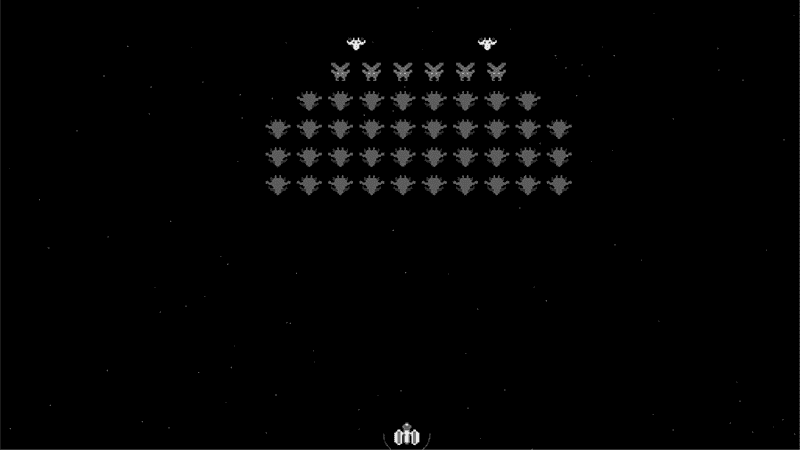

我们得到了一个半圆，但它是反向的；`0°` 到 `180°` 应该画一个从顶部到底部的半圆，世界和数学法则疯了吗？

不，，那是因为我们倾向于认为 `0°` 是直上上的，但我们的 `C/C++` 数学系统倾向于认为它在 `90°` 指向右侧。解决这个问题有办法，我们可以给角度加上/减去偏移量，但这并不理想，因为我们在循环中已经有了很多计算。或者，我们简单接受我们看到的在 `270°` 处的起始点在 `180°` 处少 90 度，并改变步值。

现在我们的代码看起来是：

```cpp
for (int angle = 180; angle < 360; angle++)
{
	float Xpos = cos(DEG2RAD(angle)) * 30;
	float Ypos = sin(DEG2RAD(angle)) * 30;
	TheScreen->Plot(Xpos + Fred->Xpos + (Fred->Image->GetWidth() / 2), Ypos + Fred->Ypos+(Fred->Image->GetWidth() / 2), REDMASK + ALPHAMASK);
}
```

图像如下；成功！

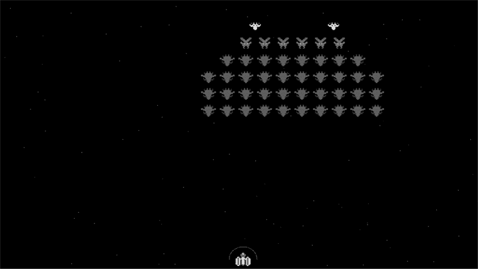

很好，这很不错且有趣，我们需要让它们变成弧线。

考虑到你可能想在不先弧线飞行（Arc）的情况下直接俯冲（Dive），让我们给俯冲系统设置它自己的初始化标记（`init flag`），但请记住在将 `State` 设置为 `Diving` 时将其设置为 `false`。我们本也应该对 `Arcing` 执行同样的操作，因为飞船可能会进行多次弧线飞行。

现在的俯冲逻辑看起来像这样，这是一个计算 `X` 和 `Y` 值并缩减其比例的简单案例，从而提供一个意味着在 32 帧内击中我们目标的值。

```cpp
case Diving:
  if (DiveInit == false)
  {
    float Xvalue = TheGame->Fred->Xpos - this->Xpos;
    float YValue = TheGame->Fred->Ypos - this->Ypos;
    this->StepX = Xvalue/32 ;
    this->StepY = YValue/32 ;
    DiveInit = true;
  } else
  {
    Xpos = Xpos + StepX;
    Ypos = Ypos + StepY;
    if (Ypos > SCRHEIGHT / 2) State = Bombing;
  }
  break;
```

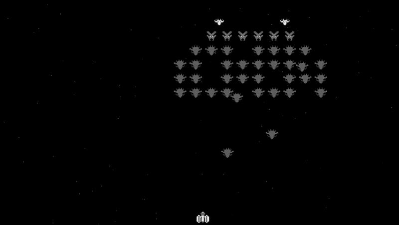

### 投弹开始

这看起来运行得非常完美，如果我们真的去掉了状态切换的检查，我们的外星人每次弧线飞行结束后都会向我们冲来。我们可以在屏幕中间左右决定何时开始轰炸（Bombing）。轰炸基本上会重复俯冲代码，但增加了一些随机因素来决定我们是否应该掉弹。

```cpp
case Bombing:
  // 现在我们必须决定是否要投弹
  if (Rand(100) < 5)
  { // 创建类后掉落一颗炸弹；
    printf("bombs away\n");
  }
  Xpos = Xpos + StepX;
  Ypos = Ypos + StepY;
  if (Ypos > SCRHEIGHT * 2) // 在改变状态前让他们离开屏幕
  {
    State = Moving; // 临时切换到 FlyBack
  }
```

我们还没有 `Bomb Class`（炸弹类），所以请把 `printf` 看作一个临时方案，向我们展示代码正在运行，让我们继续。

现在看起来越来越像个游戏了，你可以修改随机计时器来增加俯冲的频率，以便我们继续测试，但现在我们真正想做的只是遍历不同的状态，并确保我们的外星人执行它们该做的事，而不会导致任何虚拟的生命损失。如果你愿意，可以将 `State` 改为 `Moving`，让他们在俯冲结束后直接重新出现，而我们来处理复杂的返回顶部（Fly back）以及回到队列。

### 回到你曾经所属的地方

我们现在处于飞离（Flyoff）阶段，我们希望外星人回到屏幕顶部，同时保持在屏幕外。我们可以通过两种方式实现这一点，方法如下：

1. 简单的方法……实际上将它们放回屏幕顶部。
2. 让它们移动到屏幕顶部，通常是在侧边，但恰好能看到它们正在返回。

从表面上看，这种简单的方法显然是最好且最简单的。但我内心的一小部分很希望看到它们在屏幕边缘显示出正在向上移动。

我告诉你吧，为了简单起见，我会采用简单的方法。你来用酷炫的方法，你已经知道如何让针对目标点的步进系统工作了，所以你拥有所有需要的工具。

但两个系统都需要一个目标点。我将选择屏幕上方和外的一个点，一个在左侧，另一个在右侧，取决于在我们触发状态时外星人位于屏幕的哪侧。

由于我做的是单步移动，我不需要使用目标变量，我将这样设置 `Xpos` 和 `Ypos`。

```cpp
case FlyOff: // 这里我们必须返回到左上或右上角的点，取决于我们所在地。
  Ypos = -64;
  if (Xpos > SCRWIDTH/2) Xpos = SCRWIDTH+64;
  else
    Xpos = -64;
  State = FlyBack;
  break;
```

酷酷，所以现在当调用 `FlyOff` 时，它会将自己设置为屏幕的左上或右侧，准备开始导航回到正确位置。

### 回家！

现在我们想做的是让外星人缓慢移动回到它们在外星人队列中应该的位置，回到我们最初飞离的地方。现在你知道为什么我们保留了 `MovingX` 和 `YY` 变量了。但我们必须归位……嗯，基本上意味着我们需要检查想要去哪里，并朝那个方向移动，我们可以再次使用三角形吗？

是的，当然可以。

```cpp
case FlyBack:
  Ypos = -64;
  if (Xpos > SCRWIDTH/2) Xpos = SCRWIDTH+64;
  else
    Xpos = -64;
  State = FlyBack;
  break;
```

（注：此处后续的重复代码块已根据要求处理，保留逻辑结构）

该比例值可以是从 0 到 1 以实现更慢的移动，也可以是嗯，游戏需要的任何数值。我们可以将该比例值视为 `Speed`，并通过修改它来在对象沿我们设置的向量方向上创建变速度；如果我们将其设置为负值，`Speed` 就会让对象向后移动。搞定！

归一化（Normalizing）听起来并没有那么疯狂，它只是一个标准方程，将向量的 `X` 和 `Y` 值视为我们可视化三角形的高度和宽度。正如你那老高中老师在那些无聊的三角函数课上试图告诉的那样，如果你知道这两个数，就可以计算出三角形的斜边（以及我们以后将发现的许多其他东西）。正如我们现在所知，向量的 `Length/Magnitude`（长度）……将 `X` 和 `Y` 除以该 `Length` 的结果始终是 -1 到 1 之间的数字。这对于移动非常完美。

有一个小困惑点：`vector2D` 类型并不是 `C++` 的标准部分，它们属于数学库的一部分，而 `C++` 只提供了针对数字的基础函数，因此如果你不使用数学库，就得自己编写它们。然而，它们几乎是标准的。

尽管这看起来有点奇怪，但 `vector2D` 作为代码类型很棒的一点是，它可以表示不同的事物，比如网格中的点和方向，这意味着我们可以将一组向量加到另一组，所以你可以将移动向量的 `Vector2D` 加到坐标的 `vector2D`，以创建新的坐标。

所以，如果我们将 `X` 和 `Y Screen` 位置存储在向量类型中，就可以通过加上任何其他向量类型来移动我们的对象。这使得事情变得非常简单，如果我们需要，仍然可以单独访问 `x` 和 `y`。

稍后我们将发现实际上可以将向量用于各种不同的事情，而不只是坐标。我们还可以使用不同类型的向量，它们可能具有三维或四维空间，但目前，我们将它们视为坐标的便捷存储方式，以及移动的方向！

我希望你能看到向量是非常有用的东西，它们在游戏中有很多不同的用途。目前，使用它们来创建移动是一个理想的入门，因为事实上它们可以被视为某种不完全的三角形，所以理解三角形背后的数学对我们来说将非常有帮助。对于 2D 数学，我们不需要比三角函数太多的东西，所以越早学会热爱三角形越好。我们已经在一些地方用过它了，你注意到了吗？

我们在弧形函数中使用了 `Sine` 来创建半圆，这并不是我们第一次遇到 `Sine`、`Cosine` 以及那个神秘且偶尔令人沮丧的 `Tangent`，但我们会在需要时再引入它们，以免勾起你那些因为看不见用处而睡掉的三角函数课的糟糕回忆。因为你曾无法想象任何需要它们的情况。没错！我也曾经错了！天哪，我真的是大错特错。

但请记住这一点很重要，`sin`、`cos` 和 `tan` 都使用弧度值（radian values），所以我们需要选择是使用弧度还是角度，并坚持下去。正如所指出的，我倾向于使用角度，但在使用点将其转换为 `Radians`。这可能稍微有点浪费，但在调试时，读取一个从 0 到 360 度的数字并与方向联系起来（即使有一点扭曲），要比读取从 0 到 6.283185307179586476925286766559 的弧度要容易得多。

如果你习惯一直使用 `Radians`，请尽管这样做。如果不是，记住那些在它们之间转换的宏会让生活变得简单得多。

遗憾的是，我们目前的标准数学库不包含任何数学向量类。所以我们必须自己写一个。目前如此！以后当项目变得复杂复杂时，我们会考虑使用开源库来节省时间。所以现在，我们会在项目中包含一个简单的 `Vector2D` 类，并将其放入名为 `Vector2D` 的新 `.h` 文件中。

```cpp
#pragma once

#include <math.h>

class Vector2D
{
public:
	float x, y; // 对 2D 向量进行的所有操作都围绕着这两个数字

	Vector2D(float X = 0, float Y = 0) // 允许我们创建一个空向量
	{ x = X;
		y = Y;
	}
	~Vector2D() {};

	// 我们需要一些标准的算术函数
	Vector2D operator*(float scalarValue) const
	{ return Vector2D(x * scalarValue, y * scalarValue); }

	Vector2D operator+(const Vector2D &vect2d) const
	{ return Vector2D(x + vect2d.x, y + vect2d.y); }

	Vector2D operator-(const Vector2D &vect2d) const
	{ return Vector2D(x - vect2d.x, y - vect2d.y); }

	// 向量的幅度（长度）
	float mag() const {return sqrtf(x * x + y * y);}

	// 返回叉积
	float cross(const Vector2D &vect2d) const
	{ return (this->x * vect2d.y) - (this->y * vect2d.x);}

	// 归一化
	void normalise()
	{
		float mag = sqrtf(x * x + y * y);
		this->x = x / mag;
		this->y = y / mag;
	}

	// 点积
	float dot(const Vector2D &vect2d) const
	{ return (this->x * vect2d.x) + (this->y * vect2d.y); }
};
```

```cpp
float Speed = Vec.mag();

Speed /= 32;

if (Speed < 3) Speed = 3; // 我们需要一个足够的速度来校准位置，因为它正在移动

Vec.normalise();

Vec = Vec * Speed;

this->Xpos += Vec.x;

this->Ypos += Vec.y;

if (fabs(Xpos - MovingX) < 2 && fabs(Ypos - MovingY) < 2) State = Moving;
```

请用这段代码替换当前 `FlyBack` 步骤中的代码。注意，我将近似的碰撞点检查从 4 减到了 2，因为现在要精确得多。此外，为了保持“加速进入、在接近目标时减速”的想法，我使用了距离/长度/模长（随你如何称呼它）作为一个因子，但确保它永远不会变得太慢。由于归一化数字始终小于 1，所以我们必须确保至少能以 `MovingX` 运动的速度来追上它。这就是归一化向量的巨大优势；我们可以通过乘以一个 `float` 值非常容易地改变它的比例，而它仍然指向相同的方向。事实上，除了指示方向的手段外，向量对于拥有模长也非常重要。从数学角度上来说，它既有方向也有模长。当我们以后用 `Vectors` 处理简单二维运动以外的事情时，这将会变得重要得多。

这样做视觉上整洁了多少？我们看到外星人飞入并平滑地到位，没有追逐，而是完美地嵌入。

好了，我该承认了，我们也可以对比例系统设置一个小的最小值，是的，我必须诚实，结果大同小异，但目的是对 `Vectors` 进行一个无痛的介绍，你感到痛苦了吗？没有？没关系，那以后会来的！

当然，在这个项目中我们仍然混合使用独立的 `X` 和 `Y` 值以及 `Vector2D`，但既然我们有了 `Vector2D` 类，让我们在未来所有具有具有 `X` 和 `Y` 运动的对象场景中都使用它吧。

哦，关于这一点还有最后一点，我们在计算 `speed` 时计算了向量的模长。但后来，我们用这一行代码进行了相当笨拙的计算。

```cpp
if (fabs(Xpos - MovingX) < 2 && fabs(Ypos - MovingY) < 2) State = Moving;
```

你能想出一种非常简单的方法来移除这一行并更改代码以实现相同的结果吗？我给你一个提示，我们实际上是在尝试判断我们是否在目标的一定距离内，我们其实并不需要计算*两次*！


`vectors` 还能为我们做一些其他非常棒且实用的事情，但我们现在并不需要它们，所以现在不会让你的大脑变得混乱。但请放心，我们向量的学习还有很路要走。

## 让我们致命（Lets Get Lethal）

现在我们知道外星人运行良好，是时候给它们配备一些武器了，还要让我们的飞船移动起来并射击，确保我们能碰撞并爆炸物体，以完成游戏性。是的，我们必须确保我们的炸弹使用向量，因为那是我们现在想要操作的方式。让我们从飞船开始，因为那是容易做的。

我们留下的 `Shooter` 类只包含创建和绘制它的基础功能，它的更新程序目前什么都没做，但它与我们的 `Invader` 类并不相似，所以让我们把同样的代码放在这里吧：

```cpp
bool Shooter::Update(Game* g)
{
	bool fire = false;
	if (g->InputHandle->TestKey(KEY_LEFT))
	{
		Xpos-= 1;
		if (Xpos < 0) Xpos = 0;
	}
	if (g->InputHandle->TestKey(KEY_RIGHT))
	{
		Xpos+= 1;
		if (Xpos > SCRWIDTH - Image->GetWidth()) Xpos = SCRWIDTH - Image->GetWidth();
	}
	if (g->InputHandle->TestKey(KEY_SPACE))
	{
		fire = true; / fire
	}
}
```

与我们为 `Invaders from Space` 使用的方法相比，只有微小的修改。请确保在 `Shooter.cpp` 文件的顶部添加：

`#include "Game.h"`

否则它将不知道 `Game` 类有一个用于获取信息的 `InputHandle`。

所以一切都运行正常，但速度有点慢。试着将增量更改为你认为让移动更平滑的值，我让你自己挑选数字，尝试几次，看看哪个最适合你。希望你已经让你的外星人处于工作状态，这样你会发现当它们移动时，它们仍然尝试撞向你，或者至少撞向它们开始俯冲时你所在的位置。这增加了游戏性，因为你现在真的必须不断移动来躲避俯冲的外星人。以后我们应该增加这些俯冲的频率，让游戏变得更加激烈，并躲避子弹。

现在，你可能会问自己，为什么我还有一个空的 `Update` 函数？嗯，这是一个很好的问题，答案是，因为当我设计它时，我觉得我可能需要它。

我们不会在 `Game` 类中创建子弹，我们可以在创建 Fred 之后创建它，但在创建所有外星人之前不要将其添加到我们的游戏对象向量中，因为我们正在做一些依赖于外星人在列表中从设定值开始的操作，我们不想在代码中寻找它。让我们至少在添加炸弹之前，确保我们的子弹是最后添加的。

我们还应该记得，我们在 `Shooter.h` 类中通过这一行告诉了 Fred 子弹在哪里：

`GameObject* TheBullet;` / 子弹位置

作为一个占位值这样做是可以的，因为在我们写这段代码时，实际上并不知道什么是子弹（bullet）。但现在我们知道了，我们想要创建一个新的子弹并修改它拥有的标志——这是 `GameObject` 不具备的标志——所以我们现在必须将其改为：

`Bullet* TheBullet; / Bullet location`

记得在文件顶部包含 `Bullet.h` 头文件。

现在，回到为什么 `Bullet` 要在 Fred 里面的问题。可能没必要在 Fred 内部保留他的子弹地址。我们完全可以像处理 Fred 本身一样，把它放在 `Game.h` 文件中。但 Fred 和子弹之间是关联的，因此让 Fred 通过访问自己的变量在适当的时机重置 `ReadyToFly` 标志，比回头去访问 `Game` 的变量要稍微合理一点。但这确实是一个你可以自己做出的选择：在 `Game` 中将 `Bullet` 与 Fred 保持分离，或者将其保留在 `Shooter.h` 中。我暂时会把它留在 Fred 内部，但这意味着当调用 Fred 的析构函数时，我们应该小心地删除 Fred 的子弹。

### 将子弹挂载到 Fred 上

现在，让我们让子弹贴在 Fred 的鼻子上。将 `Bullet` 的更新程序修改为：

```cpp
bool Bullet::Update(Game* g)
{
    if (this->ReadyToFire == true)
    { / 它在 Fred 的鼻子上
        Xpos = g->Fred->Xpos + g->Fred->Image->GetWidth() / 2 - 4;
        Ypos = g->Fred->Ypos - 12;
    }
}
```

我们使用 `Game* g` 更新，是因为我们在 `Game` 中的主循环对所有非外星对象调用了这种更新模式（除非你修复了它？）。

令人恼的是，我必须减去 4 个像素的微小偏移才能让线条居中，你能猜到为什么吗？现在在代码中使用硬编码数字是不好的，所以我真的很想修复这个问题。也许你可以想出一个方法来修改这行代码，这样当我们把子弹图形换成更粗的，它依然能居中。对于这来说是一个微不足道的问题，所以如果你不知道为什么要这么做，就让 `-4` 留在那里吧。

好的，编译并移动 Fred，你会发现子弹一直留在他的鼻子上。现在是时候让它飞了。

子弹的实际移动将通过在 `ReadyToFire` 标志为假时简单向上移动来实现，因此我们可以将其添加到更新程序中：

```cpp
else
{
    Ypos -= 10;
    if (Ypos < 0) ReadyToFire = true;
}
```

紧接修复子弹的代码之后。现在剩下的就是让 Fred 测试子弹是否准备就绪发射，如果是，是否已经按了发射键。在 `shooter.cpp` 文件中，我们可以将发射代码更改为：

```cpp
if (g->InputHandle->TestKey(KEY_SPACE) && TheBullet->ReadyToFire == true)
{
    fire = true; // 发射
    this->TheBullet->ReadyToFire = false;
}
```

现在运行它，你应该能看到很棒的子弹发射，并在它到达顶部时返回你的鼻尖。注意我正在检查子弹是否处于准备就绪的模式，我们不想在它已经发射过的情况下再次发射。

同样注意，射击者的发射代码包含一个冗余的 `fire` 变量，在这个游戏中我们并不需要它，所以除非你觉得有必要保留它，否则可以将其移除。

我们的射击者现在可以射击了。它的子弹足够智能，可以测试屏幕边缘并重置自己，只需设置一个标志即可。还有另一个条件也会重置该标志：如果它真的击中了外星人！

那么我们为什么不让子弹去测试是否击中外星人呢？嗯，这是我们在《外星入侵者》（Invaders from Space）中遇到的相同问题：我们并不总是知道在任何时刻有多少个外星人，如果我们盲目地测试每一个无论死活，就会浪费处理周期；更糟糕的是，可能会在对象死亡时减少我们的向量列表，导致我们最终可能测试到其他东西。

不，最好让 `Aliens` 去测试它们是否击中了我们的子弹，同时也让 `Bombs` 测试它们是否击中了我们的 `Shooter`。

但我们会稍后处理碰撞，首先让我们的 `Aliens` 有机会向我们投炸弹，并让我们的炸弹变得稍微有趣一点。

## 现在真正开始发射了

炸弹和 `Bullets` 一样也需要自己的类，因为它们与其他所有东西的操作都不同。所以创建一个 `Bomb` 类。大搞定：

```cpp
#pragma once

#include "GameObject.h"
#include "Shooter.h"
#include "Vector2D.h"

class Bomb : public GameObject
{
public:
    Bomb();
    ~Bomb();
    Bomb(char* filename, MyFiles* filehander)
    : GameObject(filename, filehander) {};

// 这些替换了纯虚函数
    bool Update(Surface* s, Input* InputHandler);
    bool Update(Game* g);
    void Draw(Surface* TheScreen);
    bool DidWeHitFred(Shooter* Fred);

    Vector2D BombMotion;
    float BombSpeed;
    Surface* Frame1;
};
```

是的，你猜对了，它和 `Bullet` 几乎一样，但不需要一个准备就绪的标志。为了让移动更有趣，我们需要一个移动向量和一个速度值。这让 `Bomb.cpp` 看起来像这样：

```cpp
#include "Bomb.h"
#include "Game.h"

Bomb(){ }

Bomb::~Bomb(){ }

bool Bomb::Update(Surface* s, Input* InputHandler){ }

bool Bomb::Update(Game* g){ }

bool Bomb::DidWeHitFred(Shooter* Fred){ return false;}

void Bomb::Draw(Surface* TheScreen)
{
    Image->CopyAlpha(TheScreen, Xpos, Ypos);
}
```

还有一点，当我们在计算 `BombMotion` 时，我们将目标一个固定点，可能是 Fred 所在的位置。所以我们需要归一化的向量。这是一个每次发射炸弹时都需要进行的计算，以保持我们的触发程序整洁，因此在 `Bomb.h` 中添加一个方法定义：

```cpp
void SetBombMotion(Shooter* Fred, Alien* Host);
```

记得添加 `Shooter.h` 和 `Alien.h`，以便 `Bomb` 知道它们是什么。此代码非常简单：

（见上文 `SetBombMotion` 的逻辑实现）

由于炸弹是动态创建的，我们需要从列表中移除它们。现在我们需要在游戏更新循环中添加一个对 `MarkForRemoval` 标志的简单检查。`Update` 程序测试炸弹是否离开屏幕：

```cpp
bool Bomb::Update(Game* g)
{
    Vector2D Step = BombMotion*10;
    Xpos += Step.x;
    Ypos += Step.y;
    if (Ypos > SCRHEIGHT + 10) this->MarkForRemoval = true;
}
```

这种做法很有意思，需要仔细观察。在 `true` 循环之前，我们正在更新所有非平凡的敌人，比如 Fred 和外星人，然后是恒星，现在是可能新添加的炸弹。要从游戏中移除一个对象，我们必须先删除它（因为它是通过 `new` 分配的），然后从列表中擦除它。`i--` 的原因应该是显而易见的，但经常会被遗忘。

当我们开始这个循环时，可能会有 150 个对象需要解析，假设我们正在查看第 100 个。然后我们移除了它。向量的 `erase` 函数会移除它，然后将所有内容向下移动 1，删除后，第 101 条现在会进入第 100 条的空间。如果我们不递减当前为 100 的计数器，下一次循环它将是 101，而空间 100 的新占用者将被忽略。

我们还需要回到代码，检查所有的对象构造函数是否在实例化时都仔细地将 `MarkForRemoval` 设置为 `false`，否则我们可能会因为创建时假设设置为 `false` 而删除了我们并不想要删除的东西。

所以到目前为止看起来不错，有很多炸弹试图击中 Fred，有很多自杀队式的外星人试图撞向他。我们离这个游戏的结论很近，但让我们加上至关重要的碰撞检测，随之我们需要添加一些游戏规则，比如生命值等等。

## 碰撞检测

就像我们之前的游戏一样，这种碰撞检测真的不需要太复杂，一个简单的圆对圆检查就可以了。首先让外星人测试它们是否击中了子弹，或者它们是否击中了 Fred。这两个条件都会结束外星人的生命，要么是光荣，要么是惨死！

在你的 `Alien.h` 文件中为新方法添加定义：

```cpp
bool DidWeGetHit(Shooter* Fred);
```

然后在你的 `Alien.cpp` 文件中添加这个：

```cpp
bool Alien::DidWeGetHit(Shooter* Fred)
{
    return false;
}
```

现在很有趣，因为这实际上帮助我们证明了将 Fred 的子弹保留在 Fred 类中的决定，因为我们只需要将 Fred 的地址传递给这个函数，就可以访问 Fred（用于自杀式碰撞）和 Fred 的子弹（用于耻辱的失败）。

让我们来填充代码，这两个条件实际上都导致了死亡，所以 `bool` 返回 `true` 应该是击中条件。我们先写击中子弹的条件，因为它是最简单的。

你现在应该觉得非常熟悉了：

```cpp
bool Alien::DidWeGetHit(Shooter* Fred)
{
    int My_Height = this->Image->GetHeight()/2;
    int My_Width = this->Image->GetWidth()/2;
    int Ob_Height = Fred->TheBullet->Image->GetHeight()/2;
    int Ob_Width = Fred->TheBullet->Image->GetWidth()/2;

    // 执行一个简单的圆/圆测试
    float R1 = sqrtf((My_Height*My_Height) + (My_Width*My_Width));
    float R2 = sqrtf((Ob_Height*Ob_Height) + (Ob_Width*Ob_Width));

    // 移动到中心
    int diffx = ((Xpos + My_Width) - (Fred->TheBullet->Xpos + Ob_Width));
    int diffy = ((Ypos + My_Height) - (Fred->TheBullet->Ypos + Ob_Height));
    float Dist = sqrtf((diffx*diffx) + (diffy*diffy));

    if (Dist < (R1 + R2)) return true;
    return false;
}
```

好了，在 `Update` 中添加一些代码来运行这个测试，如果为真，目前设置 `MarkForRemoval` 标记。

编译并运行，然后尝试射击外星人，发生了什么？不是你预期的吗？有什么想法为什么吗？让我给你一个提示，在我们的 `Game.cpp` 文件中有这样的更新序列：

```cpp
// 让我们移动飞船并射击东西
Fred->Update(this);

// 现在执行正常的更新代码？
AlienGroup->Update(this);

// 我们不需要更新前 48 个，因为那些是由 AlienGroup->Update(this) 处理的船和外星人
for (int i = 48; i < Game::MyObjects.size(); i++)
{
    Game::MyObjects[i]->Update(this);
    if (Game::MyObjects[i]->MarkForRemoval == true)
    {
        delete Game::MyObjects[i]; // 删除内存中的对象
        Game::MyObjects.erase(Game::MyObjects.begin() + i); // 从向量中移除
        i--;
    }
}
```

你看到了吗？我在那里为你写了一条注释让你注意。

我们在 `AlienGroup->Update(this)` 中更新我们的外星人；这很棒，因为它让它们都很好地分组在一起，我们可以无论如何都保持移动状态的更新，但这意味着那些前 47 个对象、Fred 以及我们创建的 46 个外星人不会响应随后的更新循环（该循环从对象 48 开始，即第一颗恒星）。

嗯，那是件好事吗？还是坏事？

它两者兼有。坏事，是因为这意味着那些前 47 个对象、Fred 以及我们创建的 46 个外星人不会响应随后的更新循环（该循环从对象 48 开始，即第一颗恒星）。

现在，当我们编译并运行时，我们应该能够射击外星人，并让他们冻结，我们的子弹会回到我们的鼻子，这样对任何自杀式攻击都不会造成伤害。

完美，我们这部分工作快要完成了，只需要对计划如何展示他们死亡以及计划如何将他们从游戏中移除做出一些决定。

“死亡”（Dying）是一个重要的状态，因为它为我们提供了一种检查关卡中表现的手段，可能随着更多外星人被杀死而改变某些因素，并检查我们是否处于序列的末尾。因此，`Dying` 需要更多的额外工作。

不过，“死亡”（Dead）其实非常简单。只需将它们置在屏幕外即可。仍然有一些处理在进行，随后的绘制程序会尝试绘制它们，但没关系，我们在这个游戏中不在意这一点，因为我们并没有真正过度消耗 CPU……等等……你真的觉得那样可以吗？

绝不是的！我们必须确保它们完全不被绘制；即使是一个不显示它们的绘制操作，也是在浪费 CPU 周期来决定不绘制它们。我们需要停止这一点。但怎么做呢？

嗯，我们在 `GameObject` 类中有一个存在很久但尚未经过测试的标志：

```cpp
bool onscreen; // 我们可能会标记一个对象为在屏幕内/外以避免处理
```

它一直呆在那里被静静地忽略着，但现在时机到了。我们现在应该使用这个标志，这样 `Game.cpp` 中负责绘制的更新部分就可以测试此标志，查看某些对象是否已关闭。不过，由于它从未被初始化，它在我们的每个可绘制对象（包括星星和导弹）在创建一刻的状态目前是未定义的，所以我们必须回退几步，以确保在创建任何 `Objects` 时将其设置为一个已知值，在这种情况下为 `true`。


由于我们所有的图形对象都基于`GameObject`的概念，我们需要确保在`GameObject`中当前的三个构造函数中的每一个都添加以下行：

```cpp
onscreen = true;
```

现在，每个`Bullet`、`Bomb`、`Alien`，甚至被创建的 Fred，都将使用这些基础构造函数之一，因此它们的`onscreen`标志将被设置为`true`。剩下的就是修改绘制循环以考虑这一点。

```cpp
// 更新后，让我们绘制所有它们吧
for (int i = 0; i < Game::MyObjects.size(); i++)
{
    if (Game::MyObjects[i]->onscreen == true)
        Game::MyObjects[i]->Draw(TheScreen);
}
```

我们应该在测试运行中发现，在我们把某个对象中的该标志设置为`false`之前，一切都不会改变。让我们现在让这种情况在`Dying`中发生：

```cpp
case Dying:
    onscreen = false;
    break;
```

编译并运行，看起来还不错，对吧？

但是……再次，有些不对劲，似乎有隐形的飞船正被子弹击中？这使得杀死它上方的飞船变得非常困难。

是的。即使`Alien`已经死亡，或者说处于`Dying`状态，并且没有被绘制，它仍然留在被击中的位置，并且仍在进行碰撞测试。我们需要停止这一点。

脑海中出现了两个想法：将`Alien`放在远远的屏幕外，这样它永远不会被击中；或者让`DidWeGetHit`程序考虑到死亡或正在死亡的飞船已不再能被击中的事实。

我觉得我们两个都应该做，从将其放在屏幕外开始。

```cpp
case Dying:
    Ypos = 2000;
    onscreen = false;
    State = Dead;
    break;

case Dead: // 我真的不需要在这里做什么，只需承认我死了即可
    break;
```

然后处理碰撞系统：

```cpp
bool Alien::DidWeGetHit(Shooter* Fred)
{
    if (Fred->TheBullet->ReadyToFire == false && State != Dead && State != Dying)
    {
        ..etc.
    }
```

现在就像模样了……我们有一颗可以工作的子弹，有`Aliens`在子弹致命时检查与它的碰撞，并且它们会死亡并消失以清理游戏区域。不过，如果为它添加一些爆炸效果就更好了？你可以从这个网站[`www.explosiongenerator.com/`](http://www.explosiongenerator.com/)创建一组非常棒的爆炸效果，它允许你调整许多设置并创建出漂亮的爆炸序列。对于基于精灵的爆炸非常完美，我们将在接下来的演示中某个时候使用这些。我们可以绕过它们超出了我们与美术包所使用的精灵框尺寸这一事实。

## Danger UXB

接下来是我们必须让炸弹对 Fred 致命，还需要考虑 Fred 被击中时会发生什么。我们知道 Fred 有两种被杀死的情况：神式攻击命中和炸弹击中。

先处理神式攻击命中应该是易事的，因为这实际上只是扩展了`DidWeGetHit`程序的概念，因为它直接关系到`Alien`。不幸的是，如果它成功撞击到我们英雄般的 Fred，它将在一片绿色粘液的荣光中死去。所以这是要做的第一件事。在子弹测试后添加以下内容。它仍然是相同的代码，但目标不同：

```cpp
// 现在检查神式攻击测试
if (State == Diving || State == Bombing)
{
```

## 我们需要攻击率随着等级推进而增加

- 我们需要关卡随着触发器/飞行器的增加而变得更加困难。

先从它们何时飞行开始说，我们直接用一个随机值作为计时器好吗？我们可以这样做，以前这样做很有效，但显而易见，纯随机系统倾向于产生过于随机的值，这取决于我们寻求的范围，而这现在正引导我进入一个可能相当长且无聊的关于随机数的讨论。

随机数在游戏中是一个有趣的概念，因为事实上并不存在这种东西，CPU 实际上很难产生真正的随机数，但我们可以简单地操纵一个名为`seed`（种子）的初始值，并用手段对其进行修改，以产生一个看似随机的数字序列。这是计算机使用的最常见的随机形式，它的优点在于，从相同`seed`派生的序列会产生相同的结果。这对于确保事件的重复模式非常有用。

但如果你真的希望触发的事件是不可预测的，那么这可能就不如人意。尽管生成的序列是可预测的，但选择和使用它的频率可以通过真正不可预测的因素来改变，例如用户按下按键，这是一个真正不可预测的随机事件的例子，因为没有电脑能确切知道用户何时会击键。从不可预测或变化的值（如应用程序启动的时间）设置`seed`，也可以产生一个每个游戏之间都不同的序列。

所以，随机性可以被部分控制，或者允许它表面上不可预测，就像编程中的许多事情一样，你需要的取决于项目的需求，完全由你选择。

关于随机数目前就到此为止；它们在游戏中有非常重要的用途，但在基于它们做出基础逻辑判断时要非常小心。

## 计时器策略

用计时器怎么样？嗯，计时器本质上是有节律的，如果某些事情在相同的间隔内发生，你的玩家会很快感觉到游戏的脉动。如果你想要那样，那就太棒了；如果不想，它就需要被修改。

通常一个良好的解决方案是结合使用`Random`和`Timer`，使用一个基础时间来确保触发之间至少有一些时间，并使用一个修改因子（即随机生成的），它会将该时间扩展到一个较不可预测的事件。

对于我们的需求来说，这听起来相当合理。我们将使用我们认为合理的长度来设置计时器，一旦该计时器倒计时，我们就会重置计数，使用随机值作为修改因子，这样我们就可以很确定一个合理的间隔将会发生，但它又不会那么重复。我们可能仍然得到很多`0.001 s`的值，但我们的基础值会让玩家认为有一个节拍在发生，直到随机值终于产生可明显的变化，减小该基础值的大小以增加事件的发生也是完全可能的。玩家将感觉到事件会在给定的时间范围内发生，但无法准确预测精确的时刻。

但让我们创建一个小型计时器来倒计时，并设置一个标记告诉我们该做某些事情了。这小部分代码应该被视为`Game`循环中的一项清理任务，理想情况下它在我们移动外星人之前发生。

```cpp
// 执行一些清理工作 

Trigger = false;

TimeTillChoice--;

if (TimeTillChoice == 0)
{
    TimeTillChoice = BaseTime + Rand(30 * 5);
    Trigger == true;
}
```

我在我的`game.h`中将`BaseTime`定义为`#define`，在类内部如下：

```cpp
#define BaseTime 3*30
```

同样在`Game`类内部，添加`TimeTillChoice`和`Trigger`：

```cpp
int TimeTillChoice;
bool Trigger;
```

不用说，这些需要初始化。在第一次初始化时，我实际上会让`TimeTillChoice`大约是`BaseTime`的四或五倍，以便让玩家在混乱发生之前观察到正在发生的情况。

现在这是一个基于代码的计时器示例，但它实际上并没有使用时间本身，它只是将我们在某处设置的值减到`0`，称其为计数器更准确，但我们确实在使用时间，因为我们知道游戏以`30 fps`运行，所以 30 个周期就是`1 s`。然而，如果我们愿意，可以使用实时值，因为你的操作系统板载上确实有计时器，可以让你知道事情花了多久。尽管大多数单板计算机不包含板载实时时钟（因为缺少电池），但它们一旦启动并运行，就会记录自己运行了多久。一旦被允许从互联网或你的输入获取时间，它们就会将其设置为它们认为所在时区的时间。它们作为运行计数器的计时非常精准。我们已经在启动文件`Invader.cpp`的这一行代码中使用了这一点：

```cpp
gettimeofday(&t2, &tz);
```

我们稍后会发现用它的很多酷方法，因为它允许我们知道游戏循环花费多长时间，我们称之为 delta time（增量），即自上一个周期以来通过的时间，并且在跟踪它，因为随着我们的项目变得复杂，它将有一个非常重要的用途。例如，我们可以从`TimeTillChoice`计数器中减去那个`delta time`以获得非常准确的值。但是，这是一个随机值，实际的时间对我们来说并不重要，我们只是想在时间上创建一个变化。这里不需要微秒级的精度，对吧？

来自`gettimeday`程序的时间还有许多其他用途，例如，它可以作为游戏开始时一个真正的随机种子。

```cpp
// top row ALIENS we use X,Y,Type
(SCRWIDTH / 2) - 100,Row1, 0,
(SCRWIDTH / 2) + 100 - 32,Row1, 0,

// 2nd row 6 aliens
(SCRWIDTH / 2) - (3 * DIST), Row2, 1,
(SCRWIDTH / 2) - (2 * DIST), Row2, 1,
etc.
```

我们可以让它们保持那样，但你们知道我现在对这些硬编码数字的感觉……所以是时候进行一些复制和替换了。我不建议进行全块的复制替换，只需手动输入第一个`Alien::Commander`，复制它，然后选择下一行的`1`并粘贴`Alien::Commander`。然后将前两个替换为`Alien::Sergeant`，复制它，然后高亮接下来两个，按`CTRL`替换那两个。重复此操作直到完成，然后处理剩下的三个`Alien::Private`。

为什么不使用块替换呢？嗯，因为我们正在替换的数字`0`、`1`和`2`在我们要修改的代码块中出现非常频繁，所以逐个选择并替换虽然有点无聊，但更好。完成后它看起来是这样：

```cpp
// top row ALIENS we use X,Y,Type
(SCRWIDTH / 2) - 100,Row1, Alien::Commander,
(SCRWIDTH / 2) + 100 - 32,Row1, Alien::Commander,

// 2nd row 6 aliens
(SCRWIDTH / 2) - (3 * DIST), Row2, Alien::Sergeant,
(SCRWIDTH / 2) - (2 * DIST), Row2, Alien::Sergeant,
etc.
```

这样就完成了，原因仅仅是我们可能修改那些我们知道正在查看的指挥官（Commanders）、中士（Sergeants）和士兵（Privates）的值……如果你编译这些代码，你不会看到任何区别，设置例程中的代码仍然在使用`0`、`1`和`2`，因为那些`enum`取值就是那样设置的。

但这一次，当我们获取`whatImages`值时，我们需要将其存储在我们在`Alien.h`类中创建的`Type`变量中。

```cpp
AlienType Type;
```

回到我们的组设置，添加这一行：

```cpp
A->Type = (Alien::AlienType)whatImages;
```

令人烦恼的是，我们需要强制转换`(Alien::AlienType)`作为一种安全检查，它非常正确地认为我们的`Type`变量是一个`AlienType`，但数组初始化器允许它被存储为`int`。这是 C++ 的一个特性，它允许将枚举被视为`int`，但如果不进行强制转换以明确这是我们的意图，它就不会将其视为一个定义了别名的`enum`。所以当我们设置`whatImages`时，它是一个`int`，我们只需要告诉 C++ 它实际上是一个`AlienType`。

既然谈到了强制转换，可能很有智慧地注意到，`(Alien::AlienType)`是 C 风格强制转换的例子，C++ 有不同且更高效的转换类型，但我们稍后会讨论。

好了，现在完成了，我们已经成功在没有费费精力的情况下存储了创建的外星人的类型值，我们可以在逻辑中使用它，让我们回到`Game`类和`Alien`类。

我们几乎准备好了，只需要确保在游戏初始化代码的末尾这样设置我们的`TimeTillChoice`和`ChanceOfHit`表：

```cpp
// Level variable initialising stuff
TimeTillChoice = BaseTime * 3;
ChanceOfHit[Alien::Commander] = 60;
ChanceOfHit[Alien::Sergeant] = 5;
ChanceOfHit[Alien::Private] = 0;

HowManyOfThisType[Alien::Commander] = 2;
HowManyOfThisType[Alien::Sergeant] = 6;
HowManyOfThisType[Alien::Private] = 38;
```

特别注意那个注释，以后要用。确保你在`Game.h`中`ChanceOfHit[3]`和`HowManyOfThisType[3]`是`ints`。

所以我们将计时器设置为大约`9 s`，这可能太长了，但我们可以以后调整，指挥官的命中概率为`60%`，中士为`5%`，因为我们不想在最初几次俯冲中完全消除他们。但我们不想让士兵在指挥官死亡之前单独俯冲，顺便说一下，这需要我们多留意物体死亡时发生了什么，我们稍后会回到这一点。

一旦我们的计时器显示可以进行，我们只需测试现有的外星人，如果触发器设置，我们就掷一个`Random`概率，并与我们给出的类型`%`概率进行比较。不要把`100%`作为最高值；我们需要增加一点不确定性，这就是为什么当时间准备就绪时，你有`60%`的概率飞行一个指挥官。

如果我们扫描列表没有触发任何，可能需要一些代码来减少计时器值以重试，但现在让我们看看如何。

在外星更新的移动步骤中，让我们测试我们是否想要飞行，将随机例程替换为如下：

```cpp
if (TheGame->Trigger)
{
    // 让我们进行一些触发操作
    if (Rand(100) < TheGame->ChanceOfHit[Type])
    {
        State = Arcing;
        ArcInit = false;
        TheGame->Trigger = false; // 我们要清除吗
    }
}
```

看，它传递了一个指向`Game`的指针，我将能够通过 ID 知道我当前正在更新的`Alien`到底是谁，这样我就可以查出我知道在我管理下的`Aliens`列表。

回到你的`GroupManager`初始化例程，在实际`new`出`Aliens`后的循环中，添加以下代码：

```cpp
A->MyID = i;
```

这将为我们的`Alien`分配一个 0 到 45（包含边界）之间的 ID 编号，非常适合查找数组！

但我们遇到了一个问题。一个很大的问题；我们有可以使用索引来查找数组，但我们目前在游戏中并没有一个`Aliens`数组……事实上，我们有的，我们正在使用`Game::MyObjects`更新它们，这确实如此。但`Game::MyObjects`并不是`Aliens`数组，它是一个`GameObject`数组，而`GameObject`类并不包含我们需要修改的`MyID`或`State`变量，这些变量在`Alien`类中！我们需要在`Game`类中再添加一个`Aliens`数组。

这是一个普通数组，因为我们确切知道有多少个。如果你以后想拥有数量不确定的`Aliens`，就把它变成`vector`，但目前，在`Game.h`的`Game`类中添加这个：

```cpp
Alien* TheAliens[46];
```

恼的是，在我们编译它之前，我们需要为`Alien`类添加一个小小的预定义，以便让`Game`类知道它的存在。这是因为我们的`Alien`类包含了`Game.h`文件，以便在类定义中使用`Game*`，但现在`Game`又想使用`Alien`，这让编译器感到很困惑，因为某些东西在它知道它们之前就尝试被创建，这有点像循环的大脑风暴。

在定义`Game`类之前添加这一行，将告诉它有一个名为`Alien`的类。一旦全部编译，链接器就会为我们处理好一切。在现阶段这种代码写法并不整洁，但相信我，它是有效的。

```cpp
class Alien;
```

现在，在`GroupManager`的初始化系统中，我们需要在创建每个`Alien`时用它的地址来填充这个新数组，在例程末尾`push_back`之后添加这一行：

```cpp
Game->TheAliens[i] = A;
```

砰，我们现在有了一条`Aliens`可以用来寻找彼此的面包屑，这让我们可以像这样写`GetMyFriends`例程：

```cpp
void Alien::GetMyFriends(Game* TheGame)
{
    if (MyID > 7) return; // 士兵不允许执行
    int Count = 0;
    for (int i = 0; i < 3; i++)
    {
        if (TheGame->TheAliens[WhoAreFriends[i]]->State == Moving)
        {
            TheGame->TheAliens[WhoAreFriends[i]]->State = Arcing;
            Count++;
        }
        if (Type == Commander && Count == 2) break;
    }
}
```


这将确保 `Commander` 只带上他的两个朋友，而 `sergeants` 如果可用，可以带上全部三个。遗憾的是，`Privates` 没有朋友，除非你想添加他们？不过，你可以看到这个例程需要一个名为 `WhoAreFriends` 的新数组，那么它在哪里呢？噢，当然在这里！

```cpp
int WhoAreFriends[8][3] = {
    { 2, 3, 4 }, // 确定是第 2、3 号 Alien，可能可能是第 4 号 Alien
    { 6, 7, 5 }, // 移动到士官的末尾
    { 8, 9, 10 }, // 第 8、9 和第 10 号
    { 9, 10, 11 },
    { 10, 11, 12 },
    { 11, 12, 13 },
    { 12, 13, 14 },
    { 13, 14, 15 }
};
```

我把它放在例程正上方，并让它存在于全局空间，这样访问起来更快、更方便。你能根据例程和数组推断出发生了什么吗？现在运行它并修复出现的任何错误/拼写错误。`Aliens` 现在基本上就此了，我们可以调整其中一些烦人的数字，不过如果我们在文件顶部用一些易于定位的 `#defines` 来替换它们会更好，但总的来说我们实现了目标，是时候处理下一个问题了。

## Fred 的反应！

那么当 `Fred` 被击中时会发生什么呢？他会爆炸，事实上，他做的事情和 `Aliens` 几乎一样，我们可能会显示一个小的爆炸图形，然后他会死去，生命计数器会递减，然后由游戏代码来决定他是获得重生还是游戏结束。

现在我们发现我们有一个问题。在我们的 `Game` 循环中完全没有游戏管理代码，我们只是在执行更新和渲染对象的简单步骤，很少考虑我们游戏本身应该如何流转。因此，我们需要在待办清单上增加一个项目：编写一些游戏管理代码。

第一部分是：编写一些游戏管理代码。首先，在 `Game.h` 中添加一个 `int` 类型的 `Lives` 变量，并在 `Game` 初始化时将其设置为 3。我们需要在 `Game` 循环中当 `Fred` 被击中时处理它。

现在我们看到，我们需要在 `Fred` 被击中时进入 `Dying` 状态。这在 `Alien` 类中是类似的。为了 Fred 被击中，我们需要一个 `switch` 语句，并放在 `Game` 循环中：

```cpp
if (Fred->State == Shooter::Normal)
{
    Fred->Lives--;
    if (Fred->Lives <= 0)
    {
        // 游戏结束逻辑
    }
    Fred->State = Shooter::Dying;
}
```

现在，我们需要在 `Fred` 被击中时进入 `Dying` 状态。这在 `Alien` 类中是类似的。为了 Fred 被击中，我们需要一个 `switch` 语句，并放在 `Game` 循环中。

现在，我们需要在 `Fred` 被击中时进入 `Dying` 状态。这在 `Alien` 类中是类似的。为了 Fred 被击中，我们需要一个。在 `Shooter` 构造函数之后，使用如下代码：

```cpp
Shooter(char* filename, GameObject* filehandler)
    : GameObject(filename, filehandler) {}

typedef enum Status
{
    Normal = 200, Dying, Dead
} Status;

Status State;
```

现在为了让炸弹真正致命，是时候更新并使用我们早早在炸弹更新例程中写的 `DidWeHitFred` 代码了，它现在看起来是这样的：

```cpp
bool Bomb::Update(Game* g)
{
    Vector2D Step = BombMotion*10;
    Xpos += Step.x;
    Ypos += Step.y;
    if (Ypos > SCRHEIGHT + 10) this->MarkForRemoval = true;
    if (g->Fred->State == Shooter::Normal)
    {
        if (DidWeHitFred(g->Fred) == true)
```

```cpp
g->Fred->State = Shooter::Dying;

}
```

编译并运行，让 `Fred` 被炸弹击中，我们应该能看到控制台窗口报告他的状态，然后冻结。

记住，我们还有会俯冲和投掷炸弹的外星人，他们可以杀死 `Fred`，而且他们有一个特定的测试来检查这一点，但只有在击中时才会移除自己，现在我们可以将这段代码添加到 `Alien.cpp` 中 `Alien::DidWeGetHit(Shooter* Fred)` 函数的底部：

```cpp
float Dist = sqrtf((diffx*diffx) + (diffy*diffy));

if (Dist < (R1 + R2))
{
  // 我们确实俯冲了 Fred，所以 Fred 可以被杀死
  Fred->State = Shooter::Dying;
  return true;
}
```

太棒了，我的意思是，真伤感，他死了。但没关系，也许我们还有更多的生命。不过，我们现在可能应该停止外星人开始新的俯冲，因为它们显然已经完成了任务，当然，那是例行程序中的另一个简单条件检查，它会触发弧形移动（Arc）。目前，我在外星人的 `Moving` 步骤条件中加入了这个随机逻辑：

```cpp
if (Rand(1000000) < 1150 && TheGame->Fred->State == Shooter::Normal)
{
  State = Arcing;
  ArcInit = false;
}
```

我们能够知道他处于正常状态还是死亡状态，这允许我们定制自己的几种行为。如果我们有相关的图形，我们甚至可以触发一段小庆祝舞。

但我们最需要做的事情是让游戏检查游戏结束条件或重启条件，顺便说一下，这就是停止弧形移动非常有用，因为我们不希望在一群俯冲的外星人中重生。

好了，既然我们知道一切运行正常，让我们添加一些爆炸效果和一些逻辑代码来控制游戏流程。回到 `Shooter.h`，用相关的代码替换那段优雅的文本：

```cpp
case Dying:
  if (g->Lives > 0) g->Lives = g->Lives - 1;
  State = Shooter::Dead;
  break;
```

我正在检查 `Lives` 是否已经为 0，因为存在多颗子弹击中的可能，虽然实际上只有第一颗子弹会设置它，但这是一个很好的合理检查。

我还要在 `Game.h` 的 `Game` 类中添加一个计时器，称为重生计时器。

```cpp
int RespawnTimer;
```

它的目的希望显而易见，但请确保在游戏初始化时将其设置为 0。为了让它在 `Game` 类生效，在更新 `Fred` 之前添加这段代码。

```cpp
if (RespawnTimer != 0)
{
  Fred->onscreen = false;
  RespawnTimer--;
  printf("Get Ready for a respawn in %i \n", RespawnTimer);
  if (RespawnTimer == 0)
  {
    // 是时候带他回来了了
    Fred->State = Shooter::Normal;
    Fred->onscreen = true;
  }
}
```

这将防止 `Fred` 被绘制，并递减计时器来重置他。这应该能给你一个线索，我们什么时候想要给那个 `RespawnTime` 赋值？

```cpp
case Dying:
  if (g->Lives > 0) g->Lives = g->Lives - 1;
  State = Shooter::Dead;
  g->RespawnTimer = 30 * 3;
  break;
```

尽管如此，如果我们想加入爆炸动画，我们可能在此之前使用一个爆炸状态。这部分留给你们去考虑。注意在最终代码中，我注释掉了 `printf` 而不是删除它，这是我个人的选择，但它充当了一个完美的注释，谁知道万一我发现这段代码有问题时，想要恢复打印以检查状态是否被调用。

我们射击者的死亡状态可以简单是一个空状态：

```cpp
case Dead:
  break;
```

它的唯一目的是向游戏代码发出信号，在 `Fred` 被恢复到正常状态之前，他无法产生任何影响。

如果你现在编译这个，你实际上应该拥有了第一次具有杀伤力的真实游戏体验，以及你的射击者被杀死的机会，或者清除所有的外星人。但游戏就这样停止了，没有办法继续下去，这并不是件好事。

### 整理逻辑

所以，我们已经有了 `Fred` 死亡（非常伤心）、外星人正在测试他的状态并进入保持模式，直到他准备好重生；以及游戏循环本身，正在处理重生循环并在不需要时将他保持在屏幕外。顺便说一下，你注意到他的子弹仍然可见吗……你现在可以修复它了。

### 微调与改进

现在完成了，我们的第二个完全功能运行的游戏。其实并不坏，但有很多小细节我们可以做来让它更好。例如，把子弹发送到 `Fred` 预期所在的地方而不是他当前所在的地方怎么样？很难推断出如果他向左移动，那么大约 20 个周期后，他会在当前位置左侧几十像素的地方？我们为什么只在一个方向做弧形移动？如果我们有一个标志来指示我们在哪一侧，可以同时做两个吗？或者，也许让俯冲者早一点开始投掷炸弹？所以，我们有很多小方法可以改进它。例如，把子弹发送到 `Fred` 预期的位置，而不是他所在的位置。顺便问一下，我有一个问题，在 `Game.h` 文件中，我们将向量列表定义为 `static`，这让你获得了使用 `static` 变量的体验，你认为这是个好主意吗？毕竟我们只有一个 `Game` 实例。

### 总结回顾

现在这一次，我们并没有发现很难实现的东西，通过确保我们的基类包含了连接所有其他类的数据结构，对象之间可以相互作用，也可以生成炸弹。我们还在 2D 向量上玩了花，它们确实让平滑移动和恒定速度变得容易得多。我们将更多地使用它们。

我不满的地方很少；例如，我不完全满意我们在活跃外星人和 `Fred` 的数量上使用了硬编码，这意味着我们无法删除它们，因为这会导致我们在处理星星和炸弹的第二部分索引混乱。那是糟糕的计划，你同意吗？所以我们以后应该避免那样，硬编码不好。

另外，为什么我把外星人的 `enum` 定义为全局，而把射击者的封装在 `Shooter` 代码中？我真的应该把它们都封装在各自的类中。但尽管有些人允许所有的 `enums` 从 0 开始，我认为确保有不同起始值的选择是正确的，在你忘记添加正确前缀时，这是一个非常有用的安全措施。

老实说，我真的很讨厌俯冲的比例下降，这应该也让你感到不快，你注意到如果外星人在刚开始时离 `Fred` 很远，它们有多快吗？你认为我们如何平衡这种速度？你应该知道答案，所以我不会告诉你！

尽管如此，`Game` 类是非常整洁的，并执行了它的三个主要功能：初始化、更新所有对象以及控制何时结束或重置关卡。单个类完成了其余工作。这样更整洁，并允许我们在显示该行为的文件中进行简单的更改。

这在结构上是一段健壮得的代码。它仍然不是最好的方法；纯主义者可能不太喜欢它，因为真正的 OOP 架构避免了类之间这种直接的过度交互，但对于一个小游戏来说，这种效果非常好。所以现在我们可以在此基础上继续构建，直到暴露出其他我们需要解决的缺陷。

# 稍微跳跃一下？

你还应该注意的另一点是，虽然在刚开始项目时，我对不同的类和文件要做什么已经有了大概的了解，但随着项目的进行，我并不害怕回去进行修改或添加。随着游戏的增长，我们在不同的类之间来来回去，在这里加一点，那里改一点；你可能觉得我并不知道自己在做什么，但实际上我心里很有数。

这是一种正常的开发流程，在书籍教程中很难捕捉，但我希望你理解了这一点。我读过的每一本初学者编程书都会向你展示完成的小型杰作，它们确实实现了作者在开头所说的功能。但它们没有向你展示的是那一个周左右的编写、重写，以及更多的的重写，只为了找到将书中那段完成的代码序列化的方法。这并不是游戏开发的真实情况！

这一点很重要，很多初学者认为在编写代码之前必须将项目计划到每一个细节，并非常努力避免在编码后回去修改东西。但这正是疯狂和糟糕代码的根源。永远不要害怕回去，永远不要害怕改变，永远不要害怕在完全想清楚之前开始。只要你脑海中有了基本的结构，你就可以让事情运行起来，尝试想法，测试事物，观察会发生什么，并允许事物演化！

世界上没有任何程序员在输入第一行代码之前就确切知道自己要写什么。你需要保持灵活，有些想法在你想到它们并向你的编程伙伴解释它们时听起来很棒，但当你真正实现它们时，它们却糟透了。或者在你编写时，你可能会产生一个小小的改进，但它需要你退回到代码中进行一些更改。我们在 `Kamikazi` 中就这样做过几次。

有一条非常重要的规则：不要对你写出的东西过于珍视。即使是一个非常棒的方法，随着代码的增长以及你看到它在真实运行条件下的表现，也可以进行改进。就像那个缩放俯冲！！它实际上是错误的，我只是想让你看到一个坏主意似乎有效，但实际上并无效，你应该修复它！

在项目的任何时候，不要害怕修改、更改、更新和改进。此外，不要在尝试它们之前太执迷于拥有完全运行的系统。愿意放置临时系统或部分系统，以确保它们在正确的时间被调用，并允许你观察结果。`printf` 是确保你的代码到达你认为所在的地方的好方法，但不要把它们留在最终版本中。

# 爬行过去，是小步阶段

到目前为止不错，尽管这些游戏其实非常简单，但它们在如何思考执行方式方面给我们提供了一些挑战，我们也学会了如何让事情在正确的时间发生，并发现了如何使用一些数学基础，特别是向量数学（Vector maths），当我们转向 3D 时，它将成为一个不可或缺的重要概念。我们还引入了一种新类型的非常重要的数组——向量（vectors），不要将其与数学类型 2D 和 3D 向量混淆，`Vectors` 是动态数组的一种形式，可以根据需要更改其大小并删除/替换其内部的对象。这种额外能力在性能上确实有一些缺点，但这种可以在游戏运行时修改的数组类型结构，其灵活性是无与价值的。这些内容在接下来的章节中将变得更加重要。

而且在这一切之上，你获得了创建类、处理游戏循环的经验，并利用了 C++ 的一项基本特性继承以及强大但有时危险的重写（overriding）概念。

# 面向对象编程不是错误

不要把 `oops`（意外错误）和 OOP（面向对象编程）搞混，后者代表 OOP。C++ 的核心是一门 OOP 语言，这意味着它的设计是为了允许编程中的某些概念，而我们才刚刚开始利用它们。当然，名字本身就说明了问题，我们认为创建的东西是对象（objects），我到目前为止已经暗示了这一点。但 `objects` 的含义不仅仅是指我们的小型图形驱动力类。一个 `object` 是任何我们可以描述为自包含单元的东西。你会发现我在书中经常使用“对象”这个词，因为我们将使用很多自包含的单元。如果我们能定义这样的东西，就可以向它添加功能，这就是 OOP 发挥作用的地方。我们通常（尽管不是唯一）使用类来定义我们的对象概念，这使得 C++ 作为一种 OOP 语言展现出自己的特性。目前为止，我们对代码的设计相当懒散，这导致了我典型的杂乱的“C 类类”风格，但现在我们将投入更多努力，引导你走向更好的 OOP 原则。OOP 有四个主要原则，C++ 纳了这些原则，这里是一些非常简单的解释，我们将随着学习不断扩展。

# 封装（Encapsulation）

它本质上确保了对象为了实现其需求而需要的所有数据和变量都包含在对象内部。理想情况下，对象的方法或函数将只作用于自身的数据。这可能是 C++ 的大问题，你越避免全局概念和 `extern` 越好，一个对象/类应该是完全自包含的。

# 抽象（Abstraction）

很难用简单的术语来解释，我喜欢将其理解为离开对象的技术细节并从更高的层次来看待它，例如我们的 `Kamikazi` 敌人，对我来说它们只是敌人，我不想花太多时间考虑让它们运行的底层变量和子类，我只想让敌人移动。

# 继承（Inheritance）

允许我们构建之前的概念和对象的基础上来创建新事物，从而创建一个对象概念的层次结构，但能够以它们的基类型来引用它们。再次，`Kamikazi` 中的敌人是一个很好的例子，所有敌人都从 `Objects` 继承数据，但由最终类类型控制。

# 多态（Polymorphism）

尽管听起来像一种可怕的病毒，但它简单意味着拥有具有相同名称但不同功能的多方法。这通常通过传递或返回不同的参数集来表示。还有更多细节，但这是一个很不错的单句解释。

真正的硬核 C++ 程序员会像生命取决于它们一样遵守这四个原则，如果你真的想做正宗的 C++，你也会这样做。但在你还在努力理解“如果我这样做会发生什么”时，转动大脑理解这些概念可能需要相当的时间。因此，我们将缓慢地开发 OOP 概念，并离开目前所做的非常基础的 C 和 C++ 类写法。我只是提前警告你，我们的编码风格需要从这种丑陋的开始发展到更优雅一点。但在人类允许的范围内，我将保持代码的可读性，这会偶尔打破一些主要的 OOP 原则。

# 开启音乐（Start the Music）

显而易见我们的游戏需要声音；如果不是真正的音乐，我们至少需要一种播放某些音效的方法。所以是时候让一些声音进来来了，但怎么做呢？

完全可以访问目标的音频芯片（如果有的话），编写一个音调生成器、播放声音，以及噢，各种事情，但我们多年前就不再关心这些了。这需要耗费巨大的精力，而在这种情况下，坚持我们“不使用外部库”的规则完全没有意义。编写一个音频系统所需的工作量与我们获得一个运行游戏的愿望相比完全不成比例。

不过要提醒一下，在我对不同类型目标的实验中，我明显发现并不是所有的 SBC（单板计算机）系统处理音频的方式都是相同的，甚至在启动时并没有激活音频系统。在我们尝试任何操作之前，请确保你的系统能够播放声音。没有什么比尝试让某东西运行起来却失败了，然后在最后时刻才发现你忘记调大音量更令人沮丧了。

确保你的系统目前音频工作正常且音量已调大，这是你的责任。


树莓派系列带有一个非常高效的音频和媒体系统，称为`OpenMax`，它可以播放各种媒体格式的音频。这在很多系统中都是提供的，但它并不是真正为游戏设计的，因此我决定尝试一种不同且更传统的方法，不使用`OpenMax`。我们真的想要的是不仅仅是播放的功能，`OpenMax`不允许我们提供用户自定义的环绕声，这在我们以后处理带有对象的 3D 世界时非常有用，所以尽管它很酷，但它不适合我们！

是时候寻找一个免费、易用且流行的音频库了，并将其添加到我们的构建中了。

## 欢迎使用 OpenAL

正如其名，这是一个（或者说曾经是）开放访问的音频 API，但它之所以取这个名字，是因为它的设计理念与原始`OpenGL`的概念类似。它最初是一个免版税的跨平台系统，但现在是专源的，所以你需要为最新版本付费。不过，这并不是全坏事，仍然有一个功能齐全、非常稳定且广泛使用的版本，名为`OpenAL Soft`，我们可以免费使用它。更重要的是，我们可以轻松地将其安装到我们的目标上，并且只需花费少量的精力就能完成我们需要的所有工作。

确实有很多其他可用的音频 API，例如`FMOD`、`OpenSL`以及提到的来自 Khronos 组的`OpenMAX`，似乎是理想的，因为我们正在寻找免版税的跨平台系统。虽然你可以找到一些 SBC 支持它们，但并不是所有的都支持，SBC 上的音频通常是主芯片系统的一部分，因此与音频 API 的兼容性取决于制造商的决定，而这种支持性差异很大。我在大多数 SBC 上都找不到它，甚至包括支持非常好的树莓派系列。

此外，为了学习的目的，我需要一个通用的系统，它应该能够在我们本书所针对的所有可用 SBC 上运行。当然，你完全自由使用另一个音频 API，只要你接受这可能会限制你的用户目标。所以现在，就用`OpenAL`吧！使用它的经验会在你想要升级到更好、更现代或更针对特定目标的 API 时对你大有益。

## 安装 OpenAL

为了一个正当的理由，我们不得不再次打破“不使用外部库”的规则。不过，这次与我们基于头文件的图形加载器不同，我们将从网上安装一个预编译的库，过程稍有不同。

打开终端，或者如果你处于控制台模式，输入：

```bash
sudo apt-get install libopenal-dev
```

在你的控制台命令行中（当然，要连接到互联网）。这应该就是我们需要做的全部，因为`apt-get`程序将去询问它已知的服务器`libopenal-dev`的最新版本，该版本适用于我们的目标，它会将库安装在你的机器上，通常在`/usr/libs/arm-linux-gnueabihf`和`/usr/include/AL`文件夹，但不同的 Linux 发行版可能会去其他地方。

为了确保万无一失，在安装完成后输入此命令：

```bash
dpkg -L libopenal-dev
```

它将显示包中所有文件的位置，包括文档。不，我不知道`dpkg`是什么意思，Linux 对我来说是一个绝对的谜团，我不知道它为什么如此流行，让我们希望我们需要使用的 Linux 仅限于此……尽管我怀疑并非如此！

希望你会得到类似这样的内容：

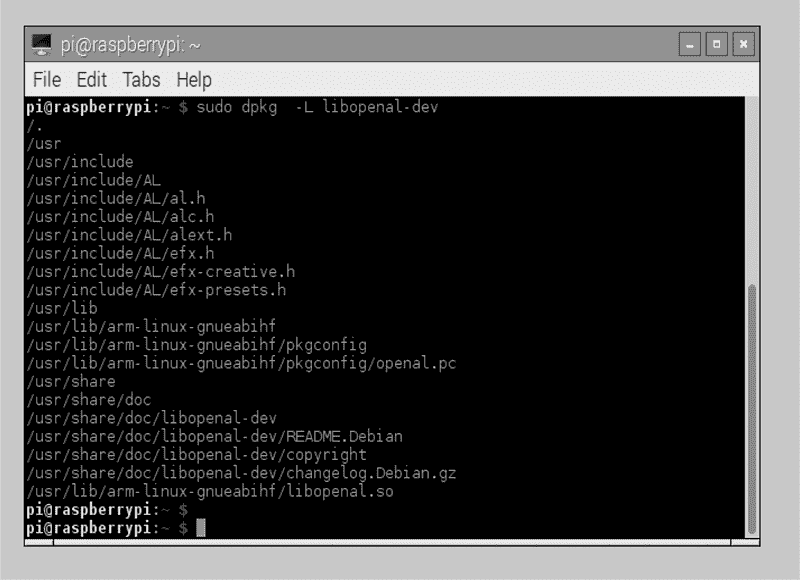

这让我们知道我们的包含文件如我们预期的一样，位于`/usr/include`和`/usr/include/al`目录。

我们需要将这些信息传递给 VisualGDB 属性，如下所示：


你可以看到我将包含目录添加到了 Include directories 中，在最后一个后面加了一个空格。还有 Library directories，注意我们从`dpkg`程序中获取了`*.so`的名称，名称是`openal`。库的名称通常是去掉`lib`前缀的`*.so`文件名，所以`libopenal.so`文件被命名为`openal`。小心，因为这些都是大小敏感的。

VisualGDB 应该获取这些值，当你点击应用时，它会进行测试以确保它们都是有效的，如果你全部输入正确，库现在已经安装并准备好供你使用了。在它你的开发系统上创建副本时，可能会有短暂的暂停。

完成后，我们就可以使用`<>`包含我们需要的头文件了。`<>`表示路径，由于我们已经在属性中设置了路径，Visual Studio 会为我们找到它们，如果在输入`#include <al.h>`时出现红线，请检查你是否全部输入正确。

## 让 OpenAL 运行起来

我们只需要一些基本的音频控制，全 3D 双声超出了我们目前的需求，尽管`OpenAL`完全能够做到。但我们确实想要可以播放的音效，可能还有简单的背景音乐。

现在，安装它是一回事，使用它并知道如何设置是另一回事。当然，有一个强大的支持网络，你首先需要去的地方是[`www.openal.org`](http://www.openal.org)。

你可能会在那里找到更新，尽管它已经没有支持一段时间了，这可能不太可能，但你一定能找到文档。

需要知道的重要点是，`OpenAL`就像`OpenGL`一样，对文件格式一无所知，它只能处理已放入缓冲区并准备好播放的数据，然后将其发送到负责播放的设备。`OpenAL`仅负责完成立体声播放所需的所有数学计算和计时。

所以现在我们还需要添加可以加载声音的东西，并且我们需要确保有某种适当的播放设备。

### 噢不，更多的库？

是的，我恐怕如此，但这是一个很容易的，我们将安装`Alut`，一个为`OpenAL`设计的实用工具包。这个东西有一个小问题，它非常过时了，我是说极其过时，你们可能可能是几十年来第一个下载它的人，它过时到了被官方弃用的地步，但我现在还是会使用它，这样我们才让生活变得太复杂。而且，这对你有利，在使用简单的 wav 文件时，它是迄今为止最简单的解决方案。一旦我们运行起来并且你知道自己在做什么，你就可以将其替换为更灵活的系统，它可以处理更多内容并处理其他格式的流媒体。

只有这一次，我们不需要担心安装所有的`include`和`lib`目录，因为它们会自动安装到 OpenAL 目录中，我们只需要将库名添加为`Alut`。

你可能会发现，如果在添加`#include <alut.h>`后下方会出现一条红线，这是有原因的：VisualGDB 的智能感知（intellisense）系统负责函数、标签和文件位置的交叉引用，它只缓存包含目录中列出的库，而我们没有更改这些目录，所以由于我们包含了 OpenAL 目录，它们并不会得到更新。因此，我们的智能感知系统实际上并不非常了解我们添加的这个新库，因为我们只添加了名称，它所使用的文件并不在缓存中。

你的代码可以编译，但那条红线会在我们想要使用/查找函数时带来麻烦，所以请进入 VisualGDB 属性并选择`reload all directories`（重载所有目录）选项。

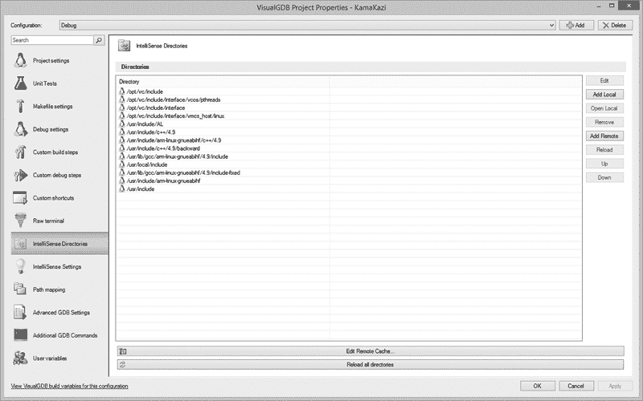

完成后，点击确定，你就会发现所有的红线都消失了。智能感知是基于你开发机上缓存的文件工作的，所以现在它会再次正常工作。如果你以后添加了库并发现出现红线，即使你确定在属性中填写的目录是正确的，这也能解决问题。

现在最后，我们应该能够让声音工作起来了，我们很快就会开始。如果你没有听到任何声音，可能只是你的音量调小了，前往音频偏好（audio preferences），确保你选择了`controls`（控制）并激活了脉冲编码调制（PCM）控制，它可以提供音量调节。

如果你使用的是树莓派以外的其他目标机，那么你的系统是否激活了声音将完全取决于运气，我所拥有的目标板中有一半在标准操作系统中没有内置运行良好的声音系统，这确实令人沮丧。不过，可能有一些帮助，形式是添加另一个我们可以添加的库，以便在大多数系统上提供声音播放功能。如果你还没有安装它，请尝试在目标机上安装`pulseaudio`。

```bash
sudo apt-get install pulseaudio
```

不需要修改我们的 VisualGDB 属性文件，这是我们正在安装到操作系统中的系统库，这基本上确保了你的目标机具有 pulse audio 功能（如果它本身还没有的话）。我希望能够说这在所有系统上都有效，但如果你的板卡没有启用音频，就不行，你需要去找板卡或操作系统的制造商来激活它。

所以我们实际上涵盖了我们将使用的三种类型的库：一种是我们自己编译的，一种是我们下载并使用的，还有一种是我们用来扩展操作系统的。很轻松，对吧？

如果你分发你的游戏，必须确保记得提供与这些库相关的`.so`文件，或者确保用户也安装了它们，这通常是更稳妥的办法。

好了……现在我们准备好了，尽管我目前只关注`Wavs`，我们以后会意识到对压缩型长格式的需求，并在稍后使用它们。

我们需要确保自己有一些合适的音效（sound fx），像大多数事情一样，你可以在网上找到大量的免费版音效，以及免费音乐。对于我们的目的来说，我们真的想使用非常短的音乐和音效，因为我们的机器板载内存（RAM）并不多。

正如想象的那样，音乐通常比点音要长，在游戏中让循环 3 或 4 分钟的声音并不是可能的。如果你将其看作是原始的未压缩数据，那可能是许多兆字节的数据。我们必须时刻记住这一点。因此，对于此类大样本，压缩格式通常是最好的。当然，这存在权衡，压缩声音需要解压缩，这将消耗一些 CPU 周期，并在解压缩后存储在某处；再次，可能会消耗我们的内存。存在防止这种情况的方法，例如流式传输（streaming），声音存储在我们的存储系统中，并在需要时拉入工作缓冲区。但再次，这存在开销，加载数据并不是一个快速的过程。

由于`OpenAL`实际上并不关心文件格式并且只对原始数据有效，它可以处理`MP3`、`OGG`和`FLAC`以及任何其他压缩格式，它只是无法实际上加载或解压缩它们，那是支持库的工作，所以当我们以后有了合适的加载器（loader）时，我们将尝试使用它们来处理背景音乐。

现在我们不用过多担心这些技术细节，只需加载一些声音为我们的游戏增添活力。在支持网站上，你可以找到为`Kamikazi`提供的简单音效和背景音乐，它们位于`Kamikazi`文件夹下的`Sounds`文件夹中。

像往常一样我们需要创建一个文件夹来存储这些新资产，在解决方案视图（solution view）上加一个过滤器（filter）也是明智的，这样你可以提醒自己文件名。另外不要忘记在 VisualGDB 属性中添加`*.wav`，以便音效可以从你的机器目录发送到目标机。

在我们的解决方案中，我们可以添加过滤器，但过滤器并不直接映射到我们的目录结构，因此在添加此类实际上不是构建过程一部分的资源时，在我们的资产文件夹中为声音创建一个单一目录是个好主意。

在一个大型游戏中，我们可能有很多在不同时间播放的声音。通常我们需要音乐和一系列所谓的点音效（spot fx）：射击声、提示声、爆炸声和砰砰声……列表就像图形类型一样无穷无尽。

如果你像我一样不擅长制作自己的声音，有很多免费的声音源可用。我使用了贡献者 Cabeeno 提供的一个很棒的音包。当然，你可以使用任何你想要。不过注意，我在让 24 位和 32 位音频样本工作方面没有太大运气，所以尽量坚持使用 16 位的，反正它们更小。所以我想要以下毫无想象的声音：

- 子弹的射击声。
- 导弹的射击声和哨声。
- 俯冲的哨声。
- 飞船的爆炸声。
- 敌人死亡时的两种或三种不同的爆炸声。
- 还有背景音乐，但很复杂，留到以后再说。
- 关通过的进行曲。
- 失去生命的丧钟声。
- 失去所有生命游戏结束的巨大丧钟声。

## 将声音作为数据

声音很奇妙，当我们拆解它时，我们基本上看的是样本，通常每种想要播放的声音类型都有一个样本，导致产生大量数据。为了提高给定声音的质量，会使用更高的采样率和更大的位深。这都会产生更大的样本大小。

原始样本通常以所谓的`PCM`格式出现，并且会占用大量的内存，但有多种压缩和未压缩系统可用，它们构成了一系列不同的文件格式。大多数格式将这些信息存储在文件头中。

通常，与所有代码相关的事一样，需要进行折中。较大的样本（如音乐）最好以压缩文件存储和加载，较短且频繁的声音则使用未压缩的`WAV`甚至`PCM`。

现在我们的系统中已经准备好了音频文件，我们需要能够播放它们。但正如我们在处理图形界面时发现的那样，我们不能在每次播放时都重新加载它们。想象一下，如果我们有一个快速射击的声音，并且不断按下射击键，这种频繁的加载会严重减慢运行速度，并消耗大量内存。

因此，我们需要明确游戏需要哪些声音，并在初始化阶段或关卡设置期间，加载好所有我们认为可能需要的声音，以备随时触发。

不过，请记住两点：

1. **音频是非常消耗内存的；**我反复强调这一点是因为它很重要，只加载你需要的素材，确保它们准备好被触发。如果你需要加载一组新声音，请安排加载顺序，使其在非游戏关键时刻进行加载。
2. **由于音频数据通常很大，从我们的存储系统加载会很慢。**尽量避免在游戏循环中进行加载，这会严重损害性能，这就是我们使用缓冲区（buffers）的原因。

让我们暂时保持音频的简单，仅将其添加到我们的 Kamikazi 项目中。我们将添加几种爆炸声和一个射击效果，并为不同的游戏事件添加一些良好的点特效。这对于让游戏运行起来已经足够，并为之后更复杂的项目打下良好基础。

为了使用音频，我们需要一个简单的音频类以及一种调用`fx`的方法。所以，让我们先通过一个枚举（enum）为音频音效赋予易于使用的名称。

## OpenAL 是如何工作的？

在处理`OpenAL`时，我们需要考虑三件事，即所谓的基础对象：

- **缓冲区（Buffers）**：这是存放原始音频数据的地方，这与我们从存储系统加载的数据不同，它是从 wav 或其他格式转换而来的 PCM 数据。
- **源（Sources）**：在 3D 空间中，发出声音的对象所在的位置。
- **监听者（Listener）**：你。

这些对象之所以分开，与`OpenAL`渲染声音的方式有关。它实际上考虑了声音的方向、距离，以及发射声音对象的移动速度，因此甚至可以模拟声音的多普勒效应。这些都是相当复杂的方程，与`OpenGL`计算给定方向上实际看到的像素的原理并不相似，`OpenAL`负责计算你应该听到的声音。

缓冲区是我们概念中最简单的，它仅仅是内存中存在原始音频样本的位置，一旦设置好，就会通过一个句柄（handle）来标识。我们应该加载所有需要的声音并记录它们的位置。

将“源”简单理解为游戏世界中发出声音的对象是理解`Source`最简单的方法。随着时间的发展，我们将允许每个发出声音的对象成为一个源。但对于一个简单的 2D 游戏，我们唯一的真实源将固定在一个代表我们所看屏幕的位置，希望那个位置旁边有扬声器。但在 3D 游戏中，我们可能会有两艘飞船，引擎嗡嗡响，以不同的速度向我们的位置移动。`OpenAL`允许我们将每艘船视为一个源，从缓冲区播放相同的引擎声，但我们作为在固定点观察游戏世界的监听者，将能够判断它们来自我们立体声场中两个不同的位置。

不过，与`OpenGL`不同，我们不需要设置大量的数值来让声音工作，只需告诉它缓冲区在哪里、源在哪里以及`Listener`（监听者）在哪里即可。

我们计划播放声音的设备很难确定，某些系统板载了音频芯片，而另一些则可能使用其他手段。但通常机器上至少有一个设计用于播放声音的设备，很少有任何单板计算机（SBC）没有声音系统，尽管它可能没有自动启用。你应该检查是否已启用声音播放功能。

如果有多个设备，我们可以为用户提供播放设备选择，但我们实际上只需要一个默认播放器。因此，我们音频系统的第一个实际任务就是找到设备。

然后，我们需要加载声音并将它们分配给缓冲区。我们不希望在播放时加载它们，因此预加载更好。

在 2D 游戏中，我们实际上只需要一个源和一个监听者，所以现在的业务顺序应该很清晰了？

## Alut 是如何工作的？

`OpenGL`曾经有一个名为`GLut`的优秀辅助工具包，它仍然存在并且某些人喜欢，但已经过时了。`Alut`是`OpenAL`对应的辅助工具包，和`Glut`一样也是过时的。但它为我们提供了最简单的方法来加载和转换 wav 文件，以便`OpenAL`使用。而且它们在所有类型的系统中都是非常通用的。我们只用它来加载和卸载基础 wav 文件，所以尽管它老旧且有限制，但仍然方便的系统。当我们需要 3D 声音时，我们会使用更好的工具。

初始化`OpenAL`以及`ALUT`是重要的。音频类本身可以从构造函数中初始化，但`ALUT`需要对其初始化系统进行特定的调用，这可能最好在项目启动时或游戏初始化中完成。但一定要在开始实际游戏代码之前完成。

```cpp
ALboolean initAL = alutInit();
```

音频类的头文件应该如下所示：

```cpp
#pragma once

#include <al.h>
#include <alc.h>
#include <alut.h>

#define NUM_BUFFERS 8
#define BUFFER_SIZE 4096

class Sound {
public:
    Sound();
    ~Sound();

    ALCdevice *device;
    ALCcontext *context;
    ALuint source, buffers[NUM_BUFFERS];
    ALuint frequency;
    ALenum format;

    void LoadSound();
    void PlaySound(ALint);
};
```

`Sound.cpp`的实现：


```cpp
#include "Sound.h"
#include <AL/alut.h>
#include <string.h>
#include <stdio.h>

static void list_audio_devices(const ALCchar *devices) {
    const ALCchar *device = devices, *next = devices + 1;
    size_t len = 0;
    fprintf(stdout, "\n Devices list:\n");
    fprintf(stdout, "----------\n");
    while (device && *device != '\0' && next && *next != '\0') {
        fprintf(stdout, "%s\n", device);
        len = strlen(device);
        device += (len + 1);
        next += (len + 2);
    }
    fprintf(stdout, "----------\n");
}

Sound::Sound() {
    // 第一次检查我们是否有多个设备（很有可能）
    ALboolean testEnum = alcIsExtensionPresent(NULL, "ALC_ENUMERATION_EXT");
    if (testEnum == AL_FALSE) {
        printf("enumerations are NOT possible");
        // 不支持枚举
    } else {
        printf("enumerations are possible");
        // 支持枚举
    }

    list_audio_devices(alcGetString(NULL, ALC_DEVICE_SPECIFIER));

    defaultDeviceName = alcGetString(NULL, ALC_DEFAULT_DEVICE_SPECIFIER);
    device = alcOpenDevice(defaultDeviceName);

    if (!device) {
        fprintf(stderr, "default device not available\n");
        return;
    }
}
```

```cpp
fprintf(stdout, "Device: %s\n", alcGetString(device, ALC_DEVICE_SPECIFIER));

// 清除错误
alGetError();

// 创建上下文
context = alcCreateContext(device, NULL);
if (!alcMakeContextCurrent(context))
{
    fprintf(stderr, "无法创建默认上下文\n");
    return ;
}
ALfloat listenerOri[] = { 0.0f, 0.0f, 1.0f, 0.0f, 1.0f, 0.0f };
/* 设置方向 */
alListener3f(AL_POSITION, 0, 0, 1.0f);
alListener3f(AL_VELOCITY, 0, 0, 0);
alListenerfv(AL_ORIENTATION, listenerOri);
alGenSources((ALuint)1, &source).
alSourcef(source, AL_PITCH, 1);
alSourcef(source, AL_GAIN, 1);
alSource3f(source, AL_POSITION, 0, 0, 0);
alSource3f(source, AL_VELOCITY, 0, 0, 0);
alSourcei(source, AL_LOOPING, AL_FALSE);
alGenBuffers(1, &buffer);
```

```cpp
bool Sound::LoadSound(char* fileName)
{
    ALvoid *data;
    ALsizei size;
    ALfloat freq;
    ALenum format;
    ALboolean loop = AL_FALSE;
    data = alutLoadMemoryFromFile("test.wav", &format, &size, &freq);
    if (data == NULL)
    {
        printf("抱歉，无法加载声音文件\n");
        return false;
    }
    return true;
}
```

```cpp
Sound::~Sound()
{
// 销毁任何缓冲区并关闭资源
    alDeleteBuffers(NUM_BUFFERS, buffer);
}
```

请随时将这些代码输入进去，我们将进行一些更改；不过，我仍然希望你输入这些内容，这些更改不需要完全重写，你将模拟一个正常的重构过程。

目前，我们可以加载几个通用声音，实际上是根据 `NUM_BUFFERS` 定义的八个，播放它们非常简单，但我们应该意识到，音乐和音音效（Sound Fx）之间存在区别。音乐倾向于循环，这个概念我们只能应用于源（source），而不能应用于它播放的声音（sound），因此在尝试让音乐循环……呃，循环，而不产生音效循环时，我们会遇到问题。而且一个不会停止的、持续“叮、叮、叮”的效果是很多用户并不买账的。

所以，尽管所有这些都能运行，但目前只使用一个源被证明有点棘手。每个源一次只能播放一个东西，让该源播放我们的背景循环没问题，但每当我们调用一次音效时，背景循环 `loop` 就会重置。

这令人困扰，但不是大问题。因为我们可以有多个源，每个源的设置可以略有不同。所以，让我们专门为循环设置一个源，可能再为音效设置几个源。所有的源都可以 `located` 在同一个位置，我们只是根据用途对它们进行专门化。事实上，为音乐循环准备一个源，为外星人想要做的音效准备七个源。换句话说，我们的源的数量与缓冲区的数量相同，这并不是刻意设计的，如果我们想要，可以有更多源，但 `NUM_BUFFERS` 可以是我们需要的任何大小。

将上述代码适配以支持多种大小，只需像对缓冲区使用数组一样，对源也使用数组即可。

我们决定源 0 将作为我们的循环 `music` 循环，所以我们只需要一种方法允许其他源轮流设置，因此需要一个小型辅助函数来寻找第一个空闲源。

## 头文件

头文件现在看起来如下：

```cpp
#pragma once

#include <al.h>
#include <alc.h>
#include <alut.h>
#include <stdio.h>
#include <sys/types.h>
#include <sys/stat.h>
#include <unistd.h>
#include <stdlib.h>
#define NUM_BUFFERS 8
#define BUFFER_SIZE 4096 /* 4K 应该足够了 */

class Sound
{
public:
    Sound();
    ~Sound();
    ALCdevice *device;
    ALCcontext *context;
    ALCenum error;
    ALuint source[NUM_BUFFERS], buffer[NUM_BUFFERS];
    ALuint frequency;
    ALenum format;
    const ALCchar *defaultDeviceName;
    bool LoadSound(char* fname, ALint index);
    bool PlaySound(ALint index);
    bool PlayMusic(ALint index);
    ALuint GetFreeSource();
};
```

注意添加了 `PlayMusic` 方法，以便我区分声音和音乐循环。`PlayMusic` 将始终作用于源 0，而 `PlaySound` 将作用于源 1–7（包含边界）。

## 重构后的代码

现在的代码看起来像这样，尽管我移除了文本输出格式以节省这里的纸张。

```cpp
#include "Sound.h"
#include <AL/alut.h> // 我们需要这个来加载 Wav
#include <string.h>
>>>> 我删除了 list_audio_devices 和 TEST_ERROR，因为它们和之前一样

// 与其他构造函数不同，这里可以做一些事情
Sound::Sound()
{
    // 第一次检查是否有多个设备
    ALboolean testEnum = alcExtensionPresent(NULL, "ALC_ENUMERATION_EXT");
    if (testEnum == AL_FALSE)
    {
        printf("不支持枚举");
        // 不支持枚举
    }
    else
    {
        printf("支持枚举");
        // 支持枚举
    }
    list_audio_devices(alcGetString(NULL, ALC_DEVICE_SPECIFIER));
    defaultDeviceName = alcGetString(NULL, ALC_DEVICE_SPECIFIER);
    device = alcOpenDevice(defaultDeviceName);
    if (!device)
    {
        fprintf(stderr, "默认设备不可\n");
        return ;
    }
    // 告诉设备
    fprintf(stdout, "Device: %s\n", alcGetString(device, ALC_DEVICE_SPECIFIER));
    // 清除错误
    alGetError();
    // 创建上下文
    context = alcCreateContext(device, NULL);
    if (!alcMakeContextCurrent(context))
    {
        fprintf(stderr, "无法创建默认上下文\n");
        return ;
    }
    // 谈谈 OpenAL
    printf(" OpenAL Version %s\n", alGetString(AL_VERSION));
    printf(" OpenAL Renderer %s\n", alGetString(AL_RENDERER));
    printf(" OpenAL Vendor %s\n", alGetString(AL_VENDOR));
    printf(" OpenAL Extension %s\n", alGetString(AL_EXTENSIONS));
    ALfloat listenerOri[] = { 0.0f, 0.0f, 1.0f, 0.0f, 1.0f, 0.0f }; /* 设置方向 */
    alListener3f(AL_POSITION, 0, 0, 1.0f);
    alListener3f(AL_VELOCITY, 0, 0, 0);
    alListenerfv(AL_ORIENTATION, listenerOri);
    // 在 0,0,0 生成一组源
    alGenSources(NUM_BUFFERS, source);
    // 设置所有源
    for (int i = 0; i < NUM_BUFFERS; i++)
    {
        alSourcef(source[i], AL_PITCH, 1);
        alSourcef(source[i], AL_GAIN, 1);
        alSource3f(source[i], AL_POSITION, 0, 0, 0);
        alSource3f(source[i], AL_VELOCITY, 0, 0, 0);
        alSourcei(source[i], AL_LOOPING, AL_FALSE);
        TEST_ERROR("oops")
    }
    // 设置音乐小一点，否则会覆盖音效
    alSourcei(source[0], AL_LOOPING, AL_TRUE);
    alSourcef(source[0], AL_GAIN, 0.2f);
    // 生成缓冲区
    alGenBuffers(NUM_BUFFERS, buffer);
    TEST_ERROR("buffer generation");
    return;
}

Sound::~Sound()
{
// 销毁任何缓冲区并关闭资源
    alDeleteBuffers(NUM_BUFFERS, buffer);
}

bool Sound::LoadSound(char* FileName,ALint index)
{
    ALvoid *data;
    ALsizei size;
    ALfloat freq;
    ALenum format;
    data = alutLoadMemoryFromFile(FileName, &format, &size, &freq);
    TEST_ERROR("抱歉，无法加载声音文件");
    alBufferData(buffer[index], format, data, size, freq); / 我们可以打印这些
    TEST_ERROR("buffer copy");
    return alGetError() == AL_NO_ERROR;
}

bool Sound::PlaySound(ALint number)
{
    ALint source_state;
    ALint FirstFree = GetFreeSource();
    alSourcei(source[FirstFree], AL_BUFFER, buffer[number]);
    TEST_ERROR("buffer binding");
    alSourcePlay(source[FirstFree]);
    TEST_ERROR("source playing");
    alGetSourcei(source[FirstFree], AL_SOURCE_STATE, &source_state);
    TEST_ERROR("source state get");
    return alGetError() == AL_NO_ERROR;
}

// 音乐始终是源 0
bool Sound::PlayMusic(ALint number)
{
    ALint source_state;
    alSourcei(source[0], AL_BUFFER, buffer[number]);
    TEST_ERROR("buffer binding");
    alSourcePlay(source[0]);
    TEST_ERROR("source playing");
    alGetSourcei(source[0], AL_SOURCE_STATE, &source_state);
    TEST_ERROR("source state get");
    return alGetError() == AL_NO_ERROR;
}

ALuint Sound::GetFreeSource()
{
    ALuint RetVal = 1;
    ALint source_state;
    for (int i = 1; i < NUM_BUFFERS; i++)
    {
        alGetSourcei(source[i], AL_SOURCE_STATE, &source_state);
        if (source_state != AL_PLAYING)
        {
            RetVal = i;
            return RetVal;
        }
    }
    // 如果没有空闲的，则直接返回 1;
    return RetVal;
}
}
```

因此，唯一的区别在于扫描以寻找免费资源，以及新的 `PlayMusic` 方法。我们已经准备好在游戏初始化中使用代码播放音乐：

```cpp
TheSound->PlayMusic(2);
```

其中 `2` 是缓冲区编号 2（或者是声音 3，因为我们从 `0` 开始计数）。不过，我们真的应该使用我们的枚举系统。

## 糟糕的洗脑循环

我们的循环音频运行良好，也符合我们的预期，但人类的耳朵对重复模式非常敏感，因此在很短的时间内，当我们花一两周时间听这种嗡嗡没完的声音时，这个短的循环就会开始让我们这些敏感的程序员耳朵感到痛苦。我们可以直接调低电视音量，但那是一个 ICT 问题，而且你在周日是永远叫不动工程师出来干活的。

所以，尽管更长的曲子在几天后仍然会让我们发疯，但我们显然需要一段恰好的背景音乐，不过我们面临着更多的几个技术问题，甚至还有一个法律问题。我们已经看到即使是中等的 `wavs` 文件，在内存方面也是多么巨大。`OpenAL` 只能处理未压缩的数据，因此较长的特效或短曲子会开始消耗更多内存。我们可以轻松地在几分钟的未压缩音频上占用 `400` 或 `500 MB MB`。由于我们的一些目标设备甚至没有那么多内存可用，因此必须找到替代方法。


理想情况下，我们会尝试将音乐保存为一种常见的压缩格式（如 `MP3`），并在播放时进行解压缩。但遗憾的是，`MP3` 并不是免费使用的，尽管它的所有者近年来的诉讼欲望少了一些，但没必要去惹醒睡的熊。

所以，尽管 `MP3` 具有市场统治地位和有效的压缩率，但它并不是我们想要涉足的。幸运的是还有其他选项，它们提供了几乎相同的功能。

当然，开源社区充满了不同的选项，但有几个脱颖而出并获得了足够的支持以推广到主流使用，可以被认为是可靠且实用的。因此，我们将使用 `OGG` 格式，它是多个开源音频和音乐应用的支持。

我们再次必须打破“不使用库”的规则，但和之前一样，这是为了你好——也就是说，别无选择。现在，让我们像之前安装 `OpenAL` 那样，在终端窗口中输入以下命令进行安装：

```bash
sudo apt-get install libogg-dev
```

当然，还要将 `OGG` 添加到你包含的库列表中。该库位于 `/usr/include/ogg`，因此请将其添加到你的 `Makefile` 设置中的库列表中。

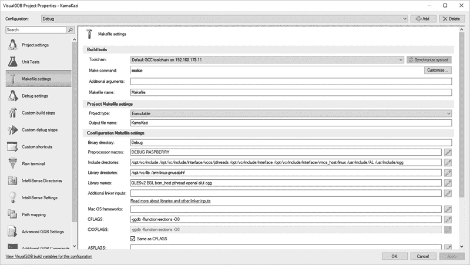

使用 `OGG` 文件就像加载图形一样简单，它的工作方式几乎相同，我们可以加载一个 `OGG` 压缩文件并让它占用空间，以便 `OpenAL` 进行处理。

## 流式传输（Streaming）

我们可以加载、解压缩并播放声音，但你可能已经注意到我们仍然在使用惊人的大量内存，将一个小的文件解压缩到一个大缓冲区中并不能消除我们系统中长期的内存短缺。

我们需要其他方法来处理这个问题，这个过程被称为“流式传输”。这涉及到分配一段我们负担得起的空间，并让 `OpenAL` 与该空间工作，同时让来自解压缩过程的音频数据不断填充该空间。

这个过程有几个技术挑战；没什么大不可越的，但在我们开发的目前阶段，我们不想太深陷其中。因此，目前我们将坚持使用这种简单而恼人的循环。我会在支持网站的一些示例中介绍流式传输，因为我们现在需要继续前进，并且已经有一个可以运行的系统了。

从现在起，我在特效/音乐方面将只做这些，仅仅是为了让书的页数少一点。我们完全可以假设所有的游戏都需要声音，但所有的处理方式都是相同的，支持网站上的最终版本将会有适当的声音。我将留给你们，根据需要在运行的示例中添加声音，这样可以避免重复我们的话。


## 与杂乱代码存储的战争

到为止，我们一直乐于直接将文件添加到我们的 `Visual Studio Solution` 过滤器中，而且代码看起来很正常。在这里你看到一个漂亮整洁的基础项目示例，我们通常的入侵者游戏基础项目，源代码和头文件整齐地存放在文件夹中！

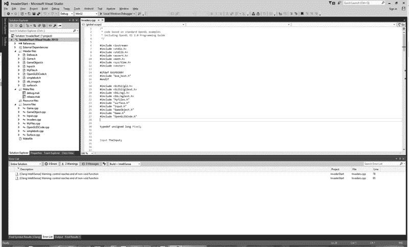

但现实情况是不同的……看看我们的项目目录，我们看到了一些无法用语言形容的糟糕东西。`*.h`、`*.cpp`、make 文件、设置文件等等，杂在一起。在 `Visual Studio` 中它们可能看起来都整整齐齐，但在文件夹本身中却是一团糟。如果我们只有几个文件，这并不是问题，所以到目前为止我们还没有担心它。但随着每个项目的增加，文件数量也将增加，虽然这对编译没有任何影响（`Visual Studio` 知道每个文件的位置并能正确编译它），但这会让我们很难找到可能想在后期项目中使用的文件。所以，是时候长大并打扫一下我们的“卧室”了。

做到这一点最简单的方法是确保对于解决方案中的每个项目，你都有一个同命名的文件夹。

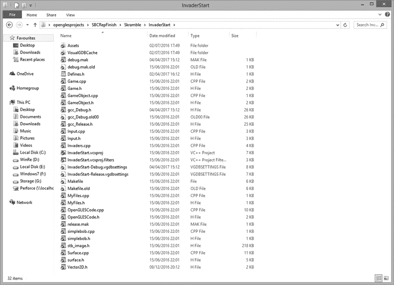

所以是时候进行大扫除了，我们将从 `Header`、`Source` 和其他目录开始。

## 我们自己的库

反对杂乱代码战争中的另一场战斗是尽量不要重复发明轮子。通过几个简单的项目，我们开始看到自己在反复使用相同的代码思想，在某些情况下，我们更新了它，修复了几个错误，但基本上还是一样的。这导致我们在不同项目中留了同一文件的不同版本。

我们为什么要关心这个？除了浪费磁盘空间（特别是考虑到这些早期项目大多是一次性工具），我们不必太担心这种精力的浪费。

我们之所以关心，是因为我们已经开始认真考虑如何保持代码整洁，我们还需要保持它的可访问性。

有些事情是显而易见的，我们显然在未来的所有项目中都需要输入、文件处理和声音，我们所有 2D 项目中的 `Surface` 类看起来不错，那个 `Vector2` 类无疑很有用并可能需要扩展，稍后我们可能会添加其他几个骨干类。

我们正在做的，是开始依赖一组核心函数和功能，并在我们的项目中复用它们。这些将成为我们第一个库的基础！

通过将其作为一个独立的项目，我们可以规定它不再生成可执行文件，而是作为一个标准的 Linux 静态库，任何其他项目只需要包含该库及其头文件即可访问这些函数。

这种方法要整洁得多，并且带给了我们更大的灵活性。它也应该对我们施加一点自律，因为我们必须小心不要实际上破坏或更改库为旧项目提供的功能，当我们在添加新功能时，可能还会回到这些旧项目。但添加新功能是可以、而且将会发生的，反之，未来的项目也将从中受益。

让我们建立一个 `MyLibs` 项目，它会生成一个静态库，也就是说，在链接时被链接到我们的主项目中，创建一个我们的新项目与 `MyLibs` 项目的组合。我们将所有的核心工作类都放在那里，并创建一个简单的头文件来加载所有的核心工作头文件。

设置我们自己的库和创建一个新项目一样简单，只不过我们不是要创建一个可执行文件，而是创建一个 `static library`（静态库）。像之前一样，创建一个新项目并为你的 PC 上指定一个存放位置。设置好名称和目录后，选择应用程序类型 `Static library`。我通常也倾向于使用 `GNU make`，但 `MSBuild` 也不错，尽管你会发现偏好面板的格式与书中略有不同。

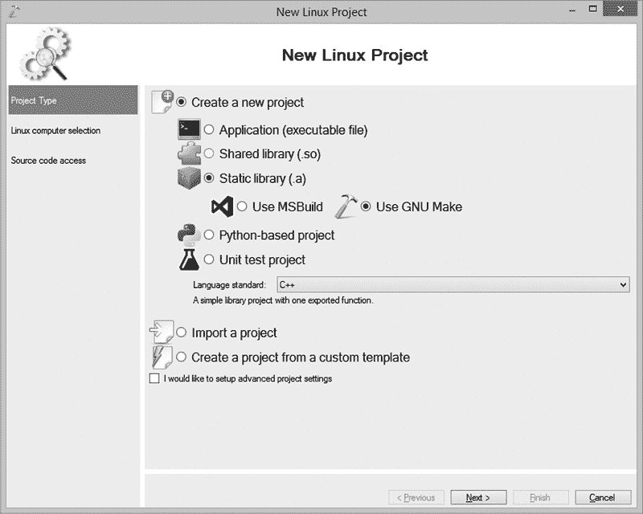

点击下一步将你进入 Linux 选项下的项目构建部分，我们已经涵盖过了。输入你的 `Targets` 详情并点击 `NEXT`……但是，不要在下一个屏幕上点击完成。

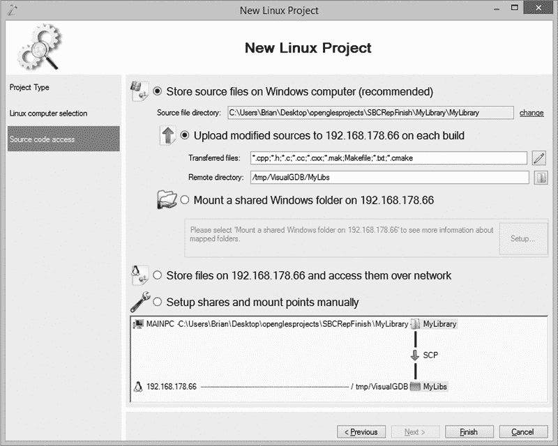

注意 `Remote Directory`（远程目录）选项，默认情况下它将使用你 PC 自身目录结构的副本，存储在 `/tmp` 目录之外，在开发期间大部分时间这没问题，但这个库现在将由许多不同的项目使用，所以它确实需要存在一个中心位置，即使你换了 PC 或决定在 PC 上移动项目，该地方也不会改变。我将其设置为使用 `VisualGDB` 目录旁边的 `MyLibs` 目录，这样我就知道它是我的代码，并且是由我自己的 `VisualGDB` 项目生成和维护的。这实际上并不理想，因为 `tmp` 目录每次在你关闭目标机电源时都会擦除，所以在你进行构建之前，它不会在那里。因此，在代码会话开始时，确保你构建了该库以便在主程序尝试构建之前替换它。你可以并且可能应该把它放在一个与 `tmp` 不关联的实际永久目录中。但目前，由于我们仍在学习，情况将不断变化，我们可以忍受这种对预构建的需求。

最后一件要完成的事（我本可以在命名时完成，但在这里仍然可以做），是进入 `MyLibrary` 的 `VisualGDB` 属性并重命名输出文件名为 `libMyLibrary.a` 文件。

`GNU Linker`（GNU 链接器）期望所有库的名称都带有 `lib` 前缀，它会剥离该前缀以获取库名。因此，我们的项目通过将其命名为 `MyLibrary` 来包含这个 `lib`。

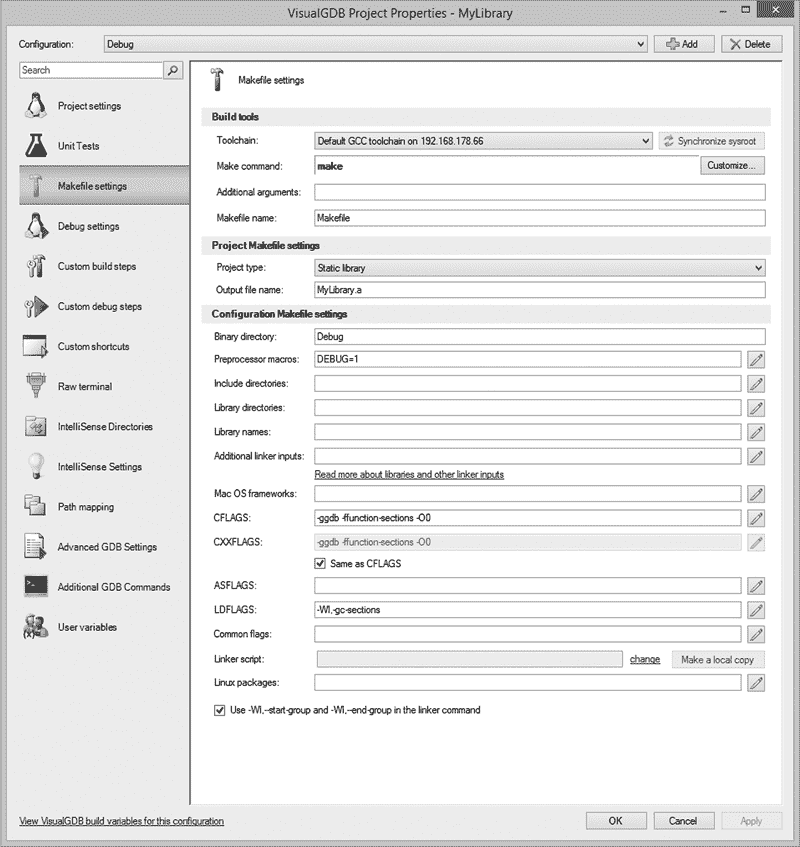

现在剩下的就是我们添加所有需要的库，当我们的主项目将此库与编译器生成的文件链接时，它们将会被包含在我们的主项目中。

## 使用这个新库

现在库项目已经设置好了；我们需要告诉接的项目如何使用它。这真的非常简单。起初，我们知道我们将要构建这个库，所以可以将其与我们的游戏一起包含在解决方案中。这意味着我们只需要在创建的每个未来解决方案中包含它即可。`Visual Studio` 将解决方案视为任何数量的项目，因此我们实际上可以让一个项目依赖于另一个，在这种情况下，我们新的游戏项目依赖于 `MyLibrary.a` 被编译并保持最新。通过将 `MyLibrary` 项目包含在我们的解决方案中，我们可以对其进行更改，并允许它在我们的新项目将其链接到可执行文件之前进行编译。我将在下一个项目中详细说明该过程。

记住，这个特定的库只是为我们的游戏项目设置的，你可以创建任何数量的包含有用内容/工具/函数的库，你可能希望在项目中随时调用。你所做的只是确保头文件是可以访问的，并且 `.a` 文件可以被链接。

我还应该解释一下 Linux 中的另一种库，即 `Shared Object (SO)`（共享对象）库。共享对象是在应用程序启动时加载到程序中的库，它们类似于 Windows 中的 `DLL` 概念。在为可能更新的硬件或软件系统创建接口时，我们经常使用这类动态库，`SO` 系统允许在硬件更新或软件接口更改时产生新的 `SO` 并使其可用，从而导致在软件编写后需要对其进行更改，因为 `SO` 本身是可变的，可以更改以反映接口的新状态，我们可以在相同的访问点添加新数据以提供新的更新或功能，而旧的手写应用程序只需调用 `.so` 库中已知的访问点。`OpenGLES2.0` 以及音频以及大多数其他类型的系统库大部分作为 `SO` 提供的，这使得不同的制造商有机会执行与他们特定系统相关的略有不同的操作。

静态库实际上在链接时被编译到可执行文件中。因此，它们是一次性的，并且在链接后不可更改。所有例程的地址在链接器时间被分配。

我在解决方案中同时拥有两个项目时发现的一个恼人的问题是，应该可以让 `Visual Studio` 知道你的主项目依赖于你的库，这样库的任何更改都会导致库的重建。

`Visual Studio` 中有一个名为 `Build Dependency`（生成依赖）的选项，它本应允许你分配项目依赖，也就是说，在使用它之前确保项目 A 是新的并已编译。但遗憾的是，我发现设置 `Visual Studio` 依赖会导致编译错误，主项目似乎尝试构建但无法构建，尽管库已经构建过了。依赖设置的详情见下方图片。

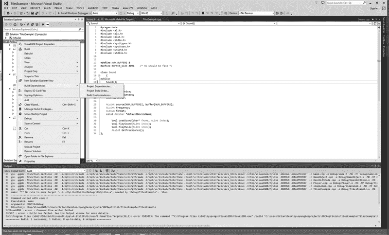

这可能只是 `VisualGDB` 集成中的一个小问题，我已经报告了，所以它可能会被修复，但并不是世界末日，只需构建（不带依赖）并记住确保先处理 `MyLibs`，如果你对它进行了更改，右键点击 `MyLibs` 项目并构建库。你也可以确保你的库的名称在字母顺序上于项目名称之前，这样它总是先被构建。

实际上没有必要将库项目本身包含在解决方案中，你可以选择、可能明智地在 `Makefile` 设置中仅包含生成的 `libMyLibs.a` 文件，而在开发游戏时实际上不触碰库代码。

到目前为止，我一直你们有点刻薄，特别是如果你拥有一个多核单板计算机（SBC）的话。因为有一种方法可以让你的编译器运行速度快得多。我本想等你们编译完所有多个类、图形系统和声音系统后再说，因为这些部分显示出了明显的编译器压力迹象，我希望让你意识到这一点，而现在我们可以尝试通过一个非常简单的命令来缓解。这对于单核系统来说没太大作用，但如果你有双核、四核甚至八核目标，请进入你项目的 `VisualGDB` 项目属性。选择 `MakeFile settings`，然后向 `Additional arguments`（附加参数）字段中添加 `-j2` 或 `-j4` 或 `-j8`。这会告诉编译器同时运行两个、四个或八个任务，实际上允许它同时编译多个文件，每个核心编译一个。

是的，我很抱歉，这确实很刻薄，不客气！我们稍后还会讨论更快的编译方法，但目前这会极大地缩短编译时间。


## 5. 瓦片（Tiles）与背景

尽管我们有了星空背景，但 `Kamikazi` 是在一个相当单的背景上运行的，如果我们能玩一个背景本身成为游戏玩法的游戏就太好了。这是许多平台类游戏背后的原理。

我们可以直接将一个屏幕大小的图像作为 `Surface Class` 放入我们游戏的 `m_screen` 表面中，并用它来代替我们的清屏（clear screen），因为如果你打算不断绘制一个屏幕大小的图像来擦除前一帧，那么就不需要清屏了。

事实上，现在回到 `Kamikazi`，找到一张你可以用艺术处理包缩放到屏幕大小的漂亮图片，将其放入资源文件夹（assets folder），为它创建一个表面，并用它来替换清屏操作以创建你的背景。你可以通过将清屏命令替换为表面拷贝（surface copy）来显示它。

去吧……我等着。

好了，效果怎么样？尽管你可能为你的游戏获得了一个非常漂亮的背景，但显然这个背景并不是你可以与之交互的，它只是一张图像。你所做的最好的 own 挑出屏幕上某些点拥有的颜色，但这并不能给你提供有用信息。

但假设我们从瓦片中创建一个屏幕，一种图像的马赛克，而其中一些瓦片能够代表你想要交互的背景部分。

### 我们所说的瓦片是什么？

现在我们已经用过瓦片了，我们简单的字体系统实际上是一个基于瓦片的系统，这就是为什么我将其命名为 `TileFont`，我们一直使用 `ASCII` 值作为一组 `squares` 的索引，这些正块代表了我们能够控制的字母数字图像。这个单行索引是计算出来的，但我们完全可以使用一个一维数组来提供该索引。这是可能的，但有点没意义，计算是微不足道的，所以没必要浪费内存去创建一个数组。

我们现在所做的只是扩展这个想法，这样除了文字，我们还可以拥有小图像，这些图像可以产生较大的图像，比如巨大的交互式变量拼图，或者马赛克，配上世界上最无聊的图案！我们仍然可以做一长行瓦片图像，但这对我们来说可视化开始变得有点困难，所以我们需要切换到一个具有行和列瓦片的简单屏幕。计算仍然是微不足道的，但这次我们将使用数组，仅仅是为了方便，而且正如我们稍后看到的，为了速度。

### 使用瓦片工作

我们使用的字体系统简单来说是一组连接在一起的图像，我们对其进行索引以获取正确的 `tile`，我们可以继续这样做，或者我们实际上可以从该图像中创建单个瓦片。嗯，选择很多……程序员经常面临选择；我们需要学习如何根据项目的需求来做出选择。所以让我们考虑一下这个问题。

如果我们有一个大小合理且细节的世界，我们可能会有很多瓦片图像，因此我们希望尽可能地高效，这意味着尽可能让图形保持在未压缩且可用的形式，并尽可能限制它们，记住内存（RAM）的限制是我们无法克服的约束。

正如游戏编程中的大多数事情一样，每种方法都有优缺点。我将使用 2D 索引系统来访问我的瓦片，只要我们不在其中添加太多的空白区域，它就是高效的，因为指向空白区域是没有意义的，而对空白区域保留多个索引更是徒劳一事。实际上，我们可以变得非常聪明，确保我们的瓦片以逻辑方式存储，就像我们 `ASCII` 系统的设置一样。选择权始终在我们手中。有时，花一点精力计算索引，对于节省那些无意义的图形填充和未使用索引所浪费的内存来说是值得的。

### 多么美丽的世界

我们一直将屏幕坐标视为对象在它们虚拟 2D 宇宙中实际的物理位置。当屏幕是它们存在的宇宙的绝对极限时，这是完全没问题的。然而，如果我们让它们拥有更大的世界，我们就必须增加屏幕的大小来看到全部（如果你使用 `EGL` 窗口则不适用）。目前这实际上仍然是，因为我们正在显示的是 `640 × 480`。

这只是一个从顶部到底部填充屏幕的循环。

```cpp
void Game::DrawMap(float x, float y, Surface* a_Screen) {
    for (int y = 0; y < SCRHEIGHT/16; y++) {
        for (int x = 0; x < SCRWIDTH/16; x++) {
            Tiles[Map1[y][x]]->CopyTo(a_Screen, x * 16, y * 16);
        }
    }
}
```

```cpp
void Game::GameInit() {
    this->InitDone = true;
    /* Tile example */
    Surface* T = new Surface(16, 16);
    T->ClearBuffer(GREENMASK+ALPHAMASK);
    Game::Tiles.push_back(T);

    T = new Surface(16, 16);
    T->ClearBuffer(REDMASK+ALPHAMASK);
    Game::Tiles.push_back(T);
}
```

生成的瓦片被推入 `Game.h` 文件中的一个 `vector` 中。

`Map` 本身是 `Game.cpp` 顶部的一个巨大的 2D 数组，实际上位于所谓的全局空间（global space）中，即不在任何特定的类中。它目前只是放在那里，以便我们快速访问，通常我们会把数据保留在类中。

除了这个新的 `DrawMap` 和对 `Game` 的一些添加外，我希望你能看到这目前只是一个非常简单的模板。但大部分内容对你来说应该熟悉。它和 `Invaders` 相比真的没什么区别。但那个地图数组很重要，因为它包含了显示在屏幕上显示的瓦片索引。

这个 `DrawMap` 系统将有效地取代我们的清屏系统。当然，它慢一点，但它非常有效。

现在当你编译并运行它时，你将得到一张漂亮的地图图像，上面大致拼写着 `HELLO`，如果你查看 `Map1` 数组，你应该能看到它。尝试在地图上的 `hello` 后面加上句号？

到此时，你应该能够视觉化与不同磁块（tiles）相关的地图中的数字概念了，但我们人类也知道这些磁块在游戏中也可以代表某些概念，例如地板、墙壁、梯子等。构成地板、墙壁和梯子的磁块将始终是相同的，这意味着我们可以以某种方式知道哪个数字是墙，哪个数字是梯子，以此类推。不过，我们还需要更多的磁块来代表除了地板或墙以外的任何东西，我们很快就会。。

跟上吗？很好，让我们再进一步扩展……如果我们有一个由磁块组成的屏幕，而这些磁块存储在那些地图中，你就可以联系到，地图实际上是我们正在游戏的区域的编码表示。而那张地图是一个简单的二维网格……这意味着它们有 X 和 Y 坐标。我们建立联系了吗？

屏幕地图给了我们两组信息：绘制哪个磁块，以及哪些磁块是实心的或具有特殊特征。我们以后可以在此基础上进行构建。

## 将 `TileExample` 转换为游戏


让我们把`TileExample`变成简单的小游戏。在`assets`文件夹中你会找到一些图形。四个用于玩家，两个用于我们需要拯救的家人角色，以及某种类型的敌人悬浮机器人。

让我们在屏幕上放置 20 个不移动的家人成员，并让 20 个敌人随机放置并以简单的方式移动。我们将角色放置在地图中心，所以我们必须确保敌人类型不会在中心生成。游戏将由我们使用键盘移动角色，并在避开敌人的同时拾起家人角色，这至少应该让他们尝试向我们的角色移动吧？

### 任务列表

- 绘制并显示地图：如你所见，这已经为你做好了。
- 将我们的角色放入地图并与地图交互：仍待完成。
- 放置敌人：待完成。
- 设置胜利目标：待完成。

我们真的需要弄清楚胜利目标应该是什么，我们只是想到达顶部吗？或者我们可以让它变得更有趣，把它变成一个收集挑战。所以，让我们安排在避开守卫这些物品的敌人的同时收集数量物品。

## `Player`类

我们首先需要一个可以控制的角色，创建一个名为`Player`的类，并创建如下所示的头文件：

```cpp
#pragma once

#include "GameObject.h"
#include "Game.h"

class Player : public GameObject
{

public:
	Player();
	Player(char*, MyFiles*);
	~Player();
	void Update(Game* G);

private:
	Surface* Images[4];
};
```

如果你一直在关注，你会记得在我们的 Kamikazi 和 Invaders 游戏中，我们定义了一个相当不同的更新例程，它被刻意设计为覆盖`GameObject`中的此更新例程：

```cpp
virtual bool Update(Surface* s, Input* InputHandler);
```

这种传递`Game`类的新更新形式被 C++ 纯洁主义者所鄙视，因为我正在将调用类的地址发送给玩家代码，而调用例程中拥有的所有内容都会暴露出来。这违背了 C++ 封装和数据保护的所有规则。

但我真的不在乎，因为我想访问`Game`类的许多变量，而且我不想为此绕圈子。至少目前不想。在这个阶段，确保我们不会落到与语言作斗的地步是重要的；我们只想完成工作。一旦我们对事物的运作方式感到熟悉，并且觉得我们理解了它是如何运作的，那么，并且只有那时，我们才关心使用语言的所谓正确方式，记住，它是为我们服务的，而不是我们服务它！

为了使用此更新系统，我需要`GameObject`类具有相同类型的更新。为什么？我希望你正在问，很好，因为我的`Game`类在这个 vector 中存储了它需要更新和绘制的所有相关对象。

```cpp
static std::vector<GameObject*> MyObjects; // 这将包含游戏需要的所有游戏对象？
```

我们通过遍历这个 vector 来执行更新，如你所见，它是一个`GameObject`指针的`Vector`。因此我只能调用`GameObject`方法，而不能调用特定的`Player Update`。不过，当然，我可以这样做，只有一个玩家，且调用一个特定的更新对我们来说不是大问题，我只是倾向于将它们放在同一个 vector 中。

一种解决方案是在`GameObject`类方法中添加相同类型的更新并将其设为`virtual`，使其成为“空类”，像在`GameObject.h`中这样：

```cpp
virtual void Update(Game* g) {};
```

所以我们在头文件中同时声明并定义了它。我们将以后可能需要的概念加入其中。现在，一个更新、一个绘制和一些坐标就是我们需要的全部。

`cpp`文件也会有些不同，我们习惯于编写空的构造函数和析构函数，但这次我们将做一些不同的。首先，我们的玩家有四个帧，每个方向一个，我们在头文件中通过`Images[4]`数组为此预留了空间。所以我们应该填充它，在构造函数让我们加载我们的角色使用的四个帧。

```cpp
Player::Player(char* fname, MyFiles* fh) : GameObject(fname, fh)
{
	// 我们可以用这个创建，让我们加载角色使用的四帧
	this->Images[0] = new Surface("../walkDown.png");
	this->Images[1] = new Surface("../walkUp.png");
	this->Images[2] = new Surface("../walkLeft.png");
	this->Images[3] = new Surface("../walkRight.png");
}
```

（注：源代码中的实现逻辑是碎片化的；我根据提供的片段重构了意图逻辑）

```cpp
Player::~Player()
{
	delete this->Images[1];
	this->Images[1] = nullptr;
	delete this->Images[2];
	this->Images[2] = nullptr;
	delete this->Images[3];
	this->Images[3] = nullptr;
}

// 需要时删除玩家并存储他的四个帧
```

更新例程现在可以写为：

```cpp
void Player::Update(Game* G)
{
	Input* IH = G->InputHandle; // 更容易访问

	if (IH->TestKey(KEY_RIGHT))
	{
		this->Image = Images[3];
		this->Xpos += SPEED;
	}

	if (IH->TestKey(KEY_LEFT))
	{
		this->Image = Images[2];
		this->Xpos -= SPEED;
	}

	if (IH->TestKey(KEY_UP))
	{
		this->Image = Images[1];
		this->Ypos -= SPEED;
	}

	if (IH->TestKey(KEY_DOWN))
	{
		this->Image = Images[0];
		this->Ypos += SPEED;
	}
}
```

## 集成

一旦我们在`GameClass`中完成了三件事，首先在初始化例程中我们需要创建我们的玩家：

```cpp
Player* GO = new Player((char*)"../Assets/walkDown.png", this->FileHander);

GO->Xpos = 400;

GO->Ypos = 200;

MyObjects.push_back(GO);
```

并且我们需要我们的`Game::Update`例程循环`MyObjects` vector 并调用这个新的更新系统：

```cpp
for (int i = 0; i < Game::MyObjects.size(); i++)
{
	Game::MyObjects[i]->Update(this);
}
```

最后，在更新循环之后，我们需要一个绘图程序：

```cpp
for (int i = 0; i < Game::MyObjects.size(); i++)
{
	Game::MyObjects[i]->Image->CopyAlphaPlot(
		a_Screen,
		Game::MyObjects[i]->Xpos,
		Game::MyObjects[i]->Ypos
	);
}
```

我们可以把它放在和更新同一个循环中，但我更倾向于将逻辑和绘制分开。这样做的原因以后可能会变得更加明显，因为那时碰撞可能会导致已经更新并绘制的对象被移除。

不要忘记在`Game.cpp`的头文件列表中添加`Player.h`。编译并运行……它看起来应该是这样的：

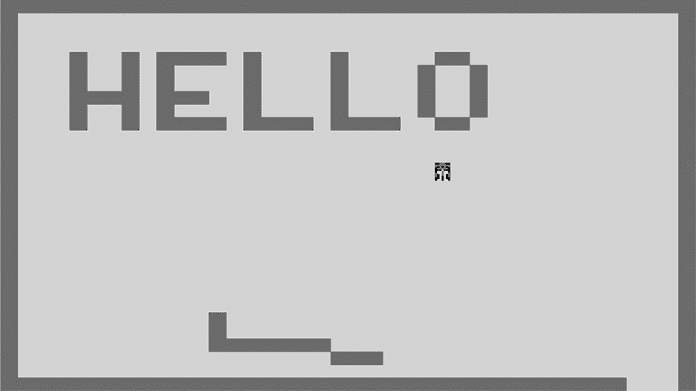

所以这样运行得相当不错，如果我们按左，我们就向左走；按右，我们就向右走，我们的帧会根据方向发生变化。但注意我们使用了一个速度值，它定义在`Player.cpp`的头文件之后：

```cpp
#define SPEED 1.0f
```

我们以后会更多地使用它，但让我们的角色以这样的值移动让我们让我们对他有了更多的控制。在这里它被设为一个`#define`，但我们也可以轻松地把它变成一个变量，根据我们所处的情况进行更改。例如，在水中移动。如果你觉得移动太慢，可以随时增加该值。

到目前为止一切顺利，这比移动我们的神风特攻击机没有难多少，但现在我们有了上下移动。但当我们移动到边缘时，我们发现了一个问题：我们不希望它与我们的红色瓷砖重叠，它们应该是屏障/墙壁，所以让我们使用屏幕坐标来测试红色像素。实体部分都是红色的，这将表明我们撞击了屏障。

对玩家精灵的位置进行简单的检查，我们确实可以判断何时撞击墙壁并阻止移动。但我们需要考虑到我们是通过左上角来引用精灵的，所以如果向右移动，整个精灵实际上会与屏障重叠，这是不理想的，因此我们需要为玩家的`xpos`（用于左右移动）添加一个小小的偏移量，或者用于上下移动的`ypos`坐标，以恰仅测试精灵的边缘而不是中心参考点。将其添加到移动系统中非常简单，只需考虑移动方向并从我们使用的参考点添加偏移量即可。

我们可以通过这个指向缓冲区的简单指针获取参考点：

```cpp
Pixel* Point = G->m_Screen->GetBuffer() + ((int)Ypos * SCRWIDTH + (int)Xpos);
```

如果我们想向左，只需从该地址减去 1；向右则加上精灵图像的宽度以到达它的右上角。如果我们没有检测到红色像素，我们将允许加上速度。

```cpp
if (IH->TestKey(KEY_RIGHT))
{
    this->Image = Images[3];

    if (*(Point + (this->Image->GetWidth())) != REDMASK + ALPHAMASK)
        this->Xpos += SPEED;
}
```

那个看起来很奇怪的解引用符号`*`告诉我们想要实际测试`Point +`我们计算出的偏移处的像素。还有其他方法可以访问内存区域，但我认为看到如何这样访问内存会很好，我们很快就会使用一个更棒的系统。

由于我们直接查看内存地址，上下移动需要稍微不同的方法，我们需要知道屏幕缓冲区的宽度，这样我们可以将其乘以想要向下查看的距离，或者直接减去缓冲区的像素宽度来查看。

向下移动看起来像这样：

```cpp
if (IH->TestKey(KEY_DOWN))
{
    this->Image = Images[0];

    if (*(Point + (Offset * this->Image->GetHeight())) != REDMASK + ALPHAMASK)
        this->Ypos += SPEED;
}
```

看看自己自己写出左和上的测试代码？你只需要知道，它们不是在加上参考点，而是减去它。

编译并运行代码并尝试走动，你可以看到我们的玩家确实可以移动直到撞击红色像素！

所以这样行得通，显然我们可以检测到感兴趣点的像素，由于我们知道自己移动的方向，从一个已知点添加偏移量是一件非常简单的事情。

还不错，我们有了移动，也有了交互，现在是时候添加一些更多功能了。

我们需要一些敌人，这自然意味着一个`Enemy`类，所以创建一个名为`Enemy`的`CPP/H`文件对，目前只需创建构造函数/析构函数。我们希望它们被随机放置在边缘区域，这样它们就能被看到，但我们将让初始化系统来处理。

现在我们需要做的一件事是给它们一种方向感，原因是它们没有键盘控制，所以它们并不知道自己将使用哪个方向来寻找正确的偏移值以检测与墙壁的碰撞。

所以，在给它们随机位置放置的同时，我们在创建它们时还会给它们一个随机方向。方向值对我来说对我们的敌人是一个非常重要的概念，所以最好将其添加到`GameObject`基类中，而不是仅仅在`Enemy`类中，此外，一个方向枚举也是个好主意。所以让我们把它添加到我们的`GameObject.h`中：

```cpp
typedef enum Direction
{
    Up,
    Right,
    Down,
    Left
} Direction;
```

好的，现在它们看起来很酷了，当然，由于它们都会移动到屏幕边缘，所以给测试中添加一个检查：如果结果为正数，则将方向改变为相反方向。再次，我希望你尝试自己完成这一点！如果你真的卡住了，支持网站上有一些信息可以提供帮助。但请务必尽力独立完成。

让我们将 20 个拾取物随机放置在屏幕上，然后看看我们是否可以使用圆与圆碰撞检测系统来检测我们的角色是否发生了碰撞。

我们将这个类命名为`Family`（爸爸和妈妈），它同样将继承自`GameObject`。

它们除了检查与玩家的碰撞外什么都不做，因为它们的存在仅仅是为了被捡起，所以这就是`update`函数要做的全部。我们可以立刻意识到，我们真的需要在`Game`类中知道玩家的位置，这意味着我们必须回到最初创建`Player`的`Game`类，创建一个变量，方便我们获取`Player`。在`Game.h`的公共成员中添加此内容：

```cpp
Player* ThePlayer;
```

在`Game`中创建它时，不要使用并推入一个 TP 值，而是使用`ThePlayer`。让我们按照创建敌人的方式完全相同的创建它们。

## 制导（Homing in）

我们现在的敌人以非常可预测的方式移动，对地图上的障碍做出反应，而且还有可以拾取的东西。这是一个相当成熟的游戏机制，但坦率地说，它并没有起太大作用。如果我们保持警惕，就可以避开敌人。所以，让我们添加那个额外功能：制导，正如我们所说的，让离玩家最近的切换到制导系统，类似于我们的神风式攻击者。

我们如何确定哪一个是最近？计算距离对我们来说非常简单；我们的老朋友毕股哥已经为我们做好了。但我们真的想每个周期都扫描 20 个敌人来确定谁最近吗？

嗯，我们实际上没有选择。记住我们人类所做的是观察并在视觉上计算距离，但计算机做不到这一点，它们字面上必须测试每一个相关对象并与其他进行比较。

但有一种逻辑方法可以实现。我们已经在`Game`循环中有一个执行更新的良好循环，所以如果我们能逐个比较每个相关对象的范围，就可以与上一次的最佳值进行比较，如果现在更好，那么在循环结束时我们就知道哪一个是最近的。

注意我说的相关对象。我们有三种类型：(1) 家庭，(2) 玩家和 (3) 敌人，我们只想测试敌人。至少有两种方法可以实现：我们可以为`GameObjects`添加一个类型值，并在每个对象的构造函数中设置该值，然后它就变成了一个检查是否为敌人的简单测试；或者我们可以添加一个范围值，并允许所有非敌人将其设置为非常大的值（意味着它们永远不会被选中），并让敌人放入正确的值。

范围在很多游戏中实际上是一个非常实用的概念，所以我将跳到这一点，并在`GameObject`中添加`Range`作为一个值，以便所有类型的游戏对象都拥有某个值。但只有`Enemies`会在每帧实际计算它。

我们可以在敌人的`update`函数中添加一些代码来计算并存储该范围，主循环可以进行简单的比较测试。范围计算看起来如下，作为`GameObject`的方法：

```cpp
float GameObject::DistanceFrom(GameObject* P)
{
    float XDist = P->Xpos - Xpos;
    float YDist = P->Ypos - Ypos;

    return (XDist * XDist) + (YDist * YDist);
}
```

注意，尽管这是一个毕股哥计算，但我并没有费心对其进行`SQRT`（平方根），因为处理该值的平方和处理平方根一样容易，这在以前是一项重要的优化，现在可能没那么了，但`SQRT`仍然是一个耗时的函数，所以如果你真的不需要它，就不要使用它。

当我们遍历 vector 中的对象以更新它们时，现在只需要在`Game`类中添加对此例的调用，如果它找到了比我们当前更近的对象，它将将其细节保留在`CurrentClosest`变量中。

```cpp
void Game::CheckClosest(GameObject* GO)
{
    static float Distance = 300000;
    static GameObject* CurrentClosest = NULL;

    if (CurrentClosest != NULL) // 确保我们有一个当前的最近的
    {
        Distance = CurrentClosest->DistanceFrom(ThePlayer); // 好的，他有多远？
    }

    if (GO->DistanceFrom(ThePlayer) < Distance) // 将我们当前的最近距离与这个玩家的距离进行比较
    { // 我们发现了一个更近的人
        if (CurrentClosest != NULL) // 确保我们有一个当前的，
        {
            CurrentClosest->Dir =
                (GameObject::Direction) Rand(GameObject::Left + 1); // 他不再是当前的，所以重置他的方向
        }

        Distance = GO->DistanceFrom(ThePlayer); // 我们的新敌人是当前最近的
        CurrentClosest = GO;
        CurrentClosest->Dir = GameObject::Homing; // 变成制导敌人
    }
}
```

记得在`Game`类中为此函数添加描述符，我们还有最后一步要做，即在游戏更新中添加如下的良好范围检查器：

```cpp


```cpp
for (int i = 0; i < Game::MyObjects.size(); i++)
{
    if (Game::MyObjects[i]->OBJType == GameObject::ENEMY)
    {
        CheckClosest(MyObjects[i]);
    }

    MyObjects[i]->Update(this);
}
```

这样简洁多了，这就是我们需要的目标：简洁的代码更容易调试，通常也更容易遵循。

在确定了谁是最近的人之后，我们可以将其状态设置为`Homing`，但我们也应该记住原来的，并将其设置为随机标准移动模式。如果你想要一个非常困难的游戏……让它保持`Homing`。

我们确实需要先讨论我们将移动，我将简单重复在神风式中使用的基本想法。

这可能看起来有些凑合，但足够了。如果我们认为正方形（或更准确地说，图片的矩形）有一个中心点，那么从该中心观察的移动方向指向图片的边缘，遗憾的是，归一化的运动向量将无法到达正方形的边缘。但可以使用旧的碰撞思路，在正方形周围画一个外圆并获取圆的半径来增大向量。这可能不会 100%准确，但足够了，所以代码看起来像这样：

```cpp
case Homing:
{
    // 计算我们想要移动的位置，然后查看是否安全
    float PX = G->ThePlayer->Xpos - Xpos; // 指向玩家的向量
    float PY = G->ThePlayer->Ypos - Ypos;

    Vector2D MoveThisWay(PX, PY); // 使用这些创建一个向量
    MoveThisWay.normalise(); // 归一化以便更好地利用

    float PossibleXpos = Xpos + MoveThisWay.x * SPEED; // 如果测试有效，保留可能的新的 Xpos
    float PossibleYpos = Ypos + MoveThisWay.y * SPEED; // ypos 也是如此

    // 现在我们必须判断我们要移动的方向是否允许
    // 需要一个参考点。计算中心，因为我们知道高度和宽度
    Vector2D sides(Image->GetWidth() / 2, Image->GetHeight() / 2);
    Vector2D CP(Xpos + sides.x, Ypos + sides.y); // 计算中心点

    // 获取半径也很简单
    float Radius = sides.mag(); // 我们现在有半径了

    // 我们可以使用这个半径来计算距离中心点的偏移量，从而得到一个测试点
    MoveThisWay = MoveThisWay * Radius; // 复用这个现在带有偏移量的向量
    CP = CP + MoveThisWay;

    // 使用我们的新测试位置重新计算点
    Point = G->m_Screen->GetBuffer() + ((int)CP.y * SCRWIDTH + (int)CP.x);

    if ((*(Point) != REDMASK + ALPHAMASK))
    {
        // 我们可以允许这次移动
        Xpos = PossibleXpos;
        Ypos = PossibleYpos;
    }
}
break;
```

看到我们的老朋友`Vector2D`类回归真是好的，我们真的应该在整个游戏中都使用它，提示，提示。有一个值得注意的小型技术细节，我通常倾向于将`case`语句放在括号中，这并不是总是需要的，到目前为止你已经看到好几次我没这么做，但在这里我必须这样做，因为我正在创建一些局部变量来存储临时值。如果我没有把`case`语句放在括号里来包含语句的作用范围，在编译时会抛出一个令人困惑的错误。（翻译：我没有把它放在括号里，结果它报了一个令人困惑的错误！我受罪你不受罪。）

这里有一个重要得多的点，我们做了一件将来将反复执行的事情：我们计算了想去的地方，用它进行测试，但当我们认为它是一个有效点时，才更新角色的位置。将来我们将多次重复这个过程，任何游戏世界中的移动通常取决于知道你想去哪里，而不是你实际上在何处。

## 总结

现在我们只需要做的就是处理一些游戏性条件。显然，接触敌人意味着死亡，所以我们需要存储给予的生命次数，如果我们抓到了所有的家人，我们就赢了，然后游戏结束，带有一个很棒的小胜利消息。

我会让你们自己完成这些，这样我们就可以继续读这本书。从非常基础的图形和糟糕的游戏玩法可以看出，这不是一个严肃的游戏，它只是一个演示。但至少让我们让它变得可玩，并添加一些评分和结束条件。不过，对于后面的游戏，你应该参考支持网站上的最终版本源码来获取游戏状态信息，因为这些将是每个游戏通用的代码/方法。你会在支持网站上找到一个完成的版本来和你自己的努力进行比较，但实际上你如何处理这个问题取决于你。

## 这些就是我们需要的吗？

在让我们的角色在带有纯色的简单地图上移动方面，这个想法实际上运行得很好。根据我们的方向进行微小偏移让我们测试移动方向前方的物体，并做出相应的反应。但只有当我们确定障碍物在屏幕上且具有特定颜色时，它才真正有效，灵活性并不高。

然而，这是一项既定原则，有时用于需要精确形式的像素碰撞或测试的情况，它对于研究如何从内存获取数据也是一种良好的做法。但如果我们想要彩色瓷块，并且有更多类型的瓷块，这种方法就完全失效了。如果我们看一张这样包含更多瓷块的地图：

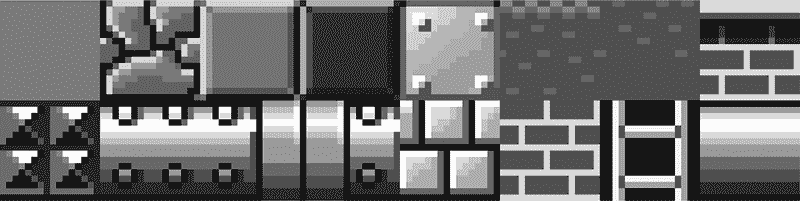

显然我们有很多种颜色，更重要的是，这些瓷块可以代表我们可能站在不同类型的物体，深入像素缓冲区不再有意义。但我们仍然可以访问瓷块或角色地图，它可以为我们提供信息。

我们可以看到，瓷块`0`似乎是一个空白块，瓷块`1`、`2`、`3`和`4`是实心的，瓷块`5`和`6`是水，`7–13`是实心的（虽然管道可能其他概念有用），`14`非常有趣的梯子，`15`是另一根管道。

所以我们的 16 个瓷块中有 12 个似乎是某种地面，`1`是梯子，`2`是水，`0`是空白的，但可能有用途。

这是一个使用这些图形设置的简单游戏地图，没什么花哨的。我花 10 分钟用一个由 Thorbjørn Lindeijer 开发的非常棒的软件包`Tiled`制作了它，它可以从[`www.mapeditor.org/`](http://www.mapeditor.org/)免费获得，但如果你计划使用它，请捐几钱以便他继续支持它。如果你想设计自己的地图，这是一个非常值得拥有的应用程序。当然，你对设计的投入的精力应该比我多！

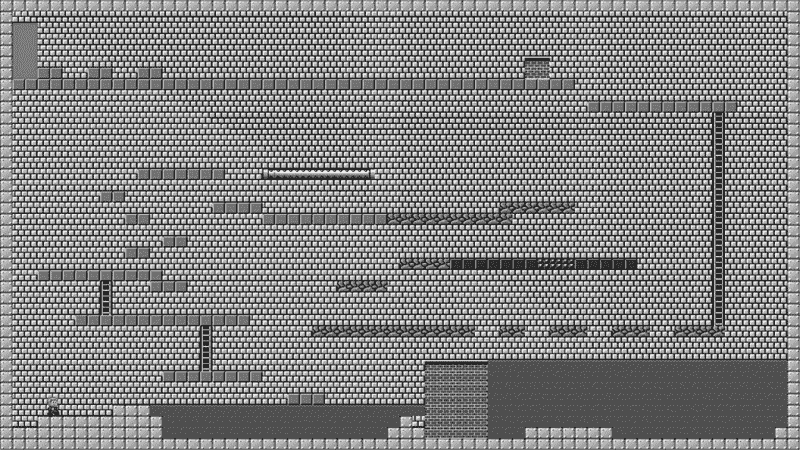

让我们在我们的游戏中查看这张地图，从网站下载`BobsDay`框架并让它运行起来。你应该立刻看到它的构建方式与`TileDemo`相同，我们把它做了一个小追逐游戏。

如果你查看`Game.cpp`中的地图代码，你会看到地图中的数字与地图中的瓷块之间有直接的对应关系。

我们可以检查任何点的事，意味着我们可以使用对象的参考点，以及/或我们想要使用的相对于参考点的任何偏移。这为我们提供了极大的灵活性来测试矩形角色的中间、顶部、底部、侧面甚至角落。

这允许我们拥有一个像素移动系统，它可以很方便地读取给定屏幕碰撞处字符地图中的值，并为我们提供一种快速简单的方法来判断那里是否有东西可以碰撞。

```cpp
int GetTile(float PixelX, float PixelY)
{
    int Xindex = PixelX / TILE_X;
    int YIndex = PixelY / TILE_Y;

    return Map[YIndex][XIndex];
}
```

其中`TILE_X`和`TILE_Y`是在其他地方定义的值，瓷块的大小（通常相同，但永远不要假设如此！）。

我们可以检查任何点的事，意味着我们可以使用对象的参考点，以及/或我们想要使用的相对于参考点的任何偏移。这为我们提供了极大的灵活性来测试矩形角色的中间、顶部、底部、侧面甚至角落。

现在让我们开始利用这些信息来创建一个新但又熟悉的游戏类型——是时候制作一个平台类游戏了。同时，我们还将开始利用我们更整洁的文件系统和`MyLib`。

我还打算再进行一些更改，将所有旧的 C 风格图形设置和交换代码移动到一个独立的、简洁的类中，这样我们就可以让包含`main`函数的文件只执行设置游戏所需的操作。这正是我们应该的目标：小型、自包含的文件，其中包含只负责其职责的代码。`main`文件实际上只用于设置系统、调用游戏并退出。它现在只做这些工作。此外，我还更改了实例化`Input`和`FileHandler`例程的方式，而不仅仅是修复拼写错误。

我们终于开始脱离旧的`Hello Triangle`代码，让代码变得整洁得多，尽管我们还有一些问题需要修复。你可以从支持网站下载这个精美的模板，它被称为`BobsDay`。现在将成为我们项目的基础模板，直到下一次大改进。作为一个额外奖励，将图形作为一个独立的类将使得我们更容易为不同的目标系统插入不同的图形文件。

现在让我们回到游戏本身，当你编译并运行`BobsDay`时，它看起来和`TileDemo`几乎一样，只是当你移动那个看起来好看的角色时，他显然呈现的是侧面视图，而且他有一段更漂亮的四帧动画，但只要你让他在屏幕上移动，你就会发现我们还没有对其进行交互。

你现在可以看到，处理俯视图的世界对我们来说非常容易，我们基本上只需要考虑我们会碰撞到的物体，并且乐于认为我们的角色始终在地面上；但现在我们对世界采用侧面视图时，情况发生了变化。`BobsDay`与`TileDemo`游戏具有相同的显示代码、相同的地图样式和游戏结构，但我们对控制和交互的理解将非常不同。唯一的显著区别是我们的视角。

不同的控制系统在`Player`类中实现，它有一个新的构造函数，可以加载 12 张图像，左、右和爬升各 4 张。然后是`update`代码的更改，你将在其中看到移动上的一些细微调整，因为我们实际上根据方向有多个动画帧。我是按照以下顺序加载动画帧的：

四次向右走、四次向左走、以及然后是四次爬升。这样我可以确保向右走的索引为`0`-`3`，向左走的为`4`-`7`，爬升的为`8`-`11`。

拥有 2 的倍数（在此例中为`4`）非常有用，因为它允许我使用简单的递增系统来更改帧，然后通过二进制“与”运算使其范围仅限制在`0`-`3`之间。

将该索引添加到基准值上，使我可以在每个基准开始的地方循环遍历这四个帧。

```cpp
BaseAnim = 0;

this->Image = Images[BaseAnim + AnimIndex];

(AnimIndex += 1) &= 3;
```

每个方向都设置自己的基准，虽然向上爬和向下爬共用，而且我可以轻松地选择帧。基准`0`代表右侧，`4`代表左侧，`8`代表爬升。由于这个游戏现在看起来是侧面的，我们必须考虑如何移动。我们创建了一个场地，在其中我们识别了下方位于屏幕底部的概念，并且我们遵循某种形式的重力；我们想要在地板以及地图上的任何其他平台上行走，并且当我们没有真正向上跳跃时应该掉落。

让我们先在`Player::Update`代码中引入掉落的基本概念，在读取按键之前添加这两行：

```cpp
Ypos += SPEED;

if (Ypos > SCRHEIGHT - 48)
    Ypos = SCRHEIGHT - 48;
```

我们可以看到我们只是在向`Ypos`加上速度，除非我们在地面上（考虑到我们的精灵引用是其左上角，这允许了一个微小的偏移）。

运行它，你会发现我们确实在掉落，同时仍然保留了某些左右移动的能力，并且显然在按下向上键时停止，在按下向下键时掉得更快，你能理解为什么向上和向下会产生这些奇怪的事情吗？它们实际上在抵消或复合作用了我们的掉落系统。

但显然，这不是一个非常有说服力的掉落，顺着重力掉落是一个加速过程。正如任何跳过飞机的人可以告诉你的那样，你会掉得越来越快，直到空气阻力停止你的加速，然后你将以终端速度继续掉落，直到你啪的一下摔在地上，这就是为什么如果你计划在现实生活中测试这项活动，降伞是非常重要的！

我们简单的速度常数加法对我们来说并不适用，我们需要加速，这意味着我们需要实际上增加速度值，直到达到我们认为的终端速度。

我们可以通过向我们目前处于休眠状态的`GameObjects`的`YSpeed`值来实现，测试它是否达到了终端速度，然后将其添加到`Ypos`。

```cpp
Yspeed += SPEED;

if (Yspeed > 9.81f)
    Yspeed = 9.81f;

Ypos += Yspeed;

if (Ypos > SCRHEIGHT - 48)
{
    Ypos = SCRHEIGHT - 48;
    Yspeed = 0;
}
```


通过这种方式添加速度给了我们一个更有说服力的掉落，但我们需要停止在按下按键时持续施加力，这应该只在我们目前处于地面上时才可能。

实现这一点有两种方法：设置一个指示标志来告诉我们是否正处于跳跃过程中，该标志在跳跃触发时设置，在掉落停止时重置。

### 跳跃与重力逻辑

这是一个非常棒的方法，但另一种方法也是可能的，并将有助于我们的设计。我们只允许在初始位于地面上时触发跳跃，目前可以通过这种方式实现。

```cpp
if (Ypos == SCRHEIGHT - 48)
    Yspeed = -SPEED * 6;
```

但这对我们来说用途有限，我们并不仅仅在地面层玩这个游戏，我们还有想要在上面走的平台，这些平台位于屏幕上不同的 Y 位置，所以是时候开始对地图进行测试了，以找出我们是否在一个坚实的平台上，或者是否让我们的掉落系统生效。

现在，我们知道我们的屏幕是由 2D 地图构建的，这基本上是一个数组，我们知道 X 和 Y 坐标，我们也知道瓦格的大小是 16 × 16 像素。

所以……如果我们想知道我们正站在哪个瓦格上，我们将 X 和 Y 坐标除以瓦格的大小（在此例中为 16），然后就能得到构建屏幕数组的索引。

计算测试坐标需要进行调整，记住我们的精灵（sprite）左上角是参考坐标，但我们需要测试底部，所以有一个偏移量需要添加，只要我将精灵的 `Height` 加到 `Ypos` 上，我就能得到参考坐标的底部。同理，如果我将宽度加到 `X` 部分，就可以检查右侧点。这种在地图上测试点的能力，意味着我们可以将其扩展到寻找左右两侧的物体，让我们在移动时被墙挡住，并在向上移动时撞到头。但我们需要小心，因为只测试一个点有点太窄了，我们可能应该在移动方向上测试两个甚至三个点，代表物体的中心点以及该方向的两个角。这可以防止我们在物理尺寸比瓦格大或接触点未击中的情况下，穿过瓦格。

我们还需要让玩家能够访问 `Map` 的权限，它目前在我们的 `Game` 类中，但实际上并不是该类的成员。在我们的 `Game` 类头文件的 `public` 部分添加此行：

```cpp
int* WhichMap;
```

这将为我们提供一个指向 `int` 位置的指针，由于我们的地图是由数组组成的，我们可以告诉 `Game` 类将我们需要的地图设置到该位置，任何可以访问 `Game` 类公共成员的对象都可以获取它。遗憾的是，尽管我们可以很容易地传递数组基的地址，但我们无法像指针那样容易地传递二维数组的维度，所以我们必须做一些“体操”，因为我不想修改 `Update` 的输入参数来使传递数组变得简单。

在你的 `Game` 初始化类中，确保使用此命令让 `WhichMap` 变量知道我们正在使用的地图：

```cpp
WhichMap = &Map2[0][0];
```

现在当玩家更新时，他可以像以前一样更新重力，但现在能够修改停止或允许跳跃的测试条件，考虑到他在地图中的位置，如下：

```cpp
int YMap = (Ypos + 33) / 16;
int XMap = (Xpos + Image->GetWidth() / 2) / 16;

int WhatsUnderOurFeet = G->WhichMap[YMap * 64 + XMap];

if (WhatsUnderOurFeet == 4 && Yspeed >= 0)
{
    Ypos = YMap * 16 - 32;
    Yspeed = 0;
}
```

测试条件现在考虑了玩家的 `X` 和 `Ypos` 作为参考点（位于他图像中心脚脚下方 1 像素处），然后将它们除以瓦格的大小以找到地图中的索引。`WhichMap` 仍然可以作为数组访问，但只能作为单维数组，所以我们需要将 `YMap` 索引乘以原始地图中 `X` 部分的元素个数。我们已经知道了这个，所以可以使用硬编码数字。然后我们添加一个偏移量。

我们的条件现在足够灵活并可以使用，我选择了 `4` 作为主地板瓦格，但我很快会向你展示如何扩展它。

尝试并看一看。我们现在可以跳到另一个区域上，但不再有空中跳了。我们的跳跃触发器也使用了一个条件来判断是否允许跳跃，所以那里也需要更新列表如下：

```cpp
if (WhatsUnderOurFeet == 4 && Yspeed >= 0)
    Yspeed = -SPEED * 6;
```

现在我们有了更多的灵活性和一个相当有说服力的跳跃动作，但你已经看到，只有当我们地图上拥有那个中心底部点时，跳跃才能真正正确落地。我们现在需要进行一些小的更改以获得这种控制。

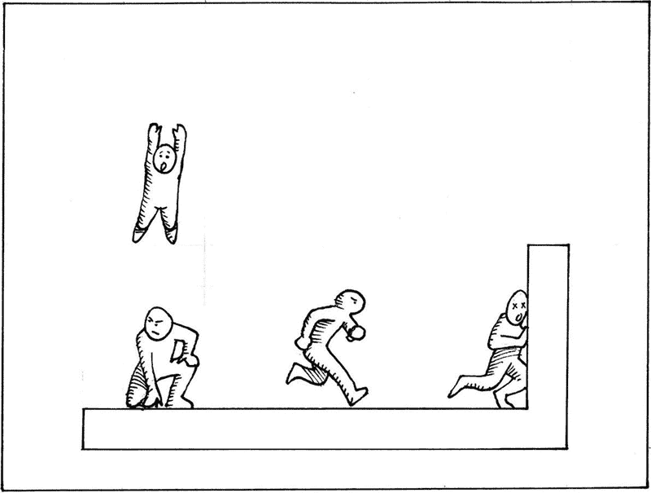

我们希望在空区域掉落，落在实心物体上，并能够检测墙是否会停止我们的 `X` 轴移动。如果我们能像下面的图所示看到瓦格作为瓦格，那会是什么样子。让我们创建一个小型属性列表，它将直接关联到我们 16 种不同类型的瓦格：

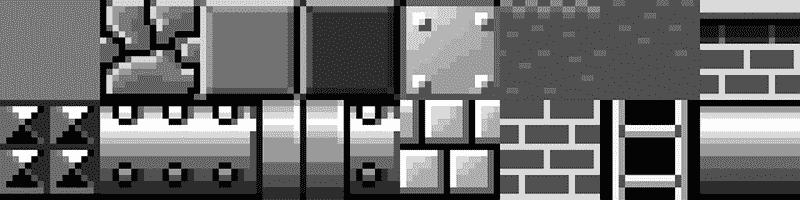

```cpp
int Attributes[] =
{
    0, 1, 1, 1, 1, 0, 0, 1,
    1, 1, 1, 0, 0, 1, 2, 1
};
```

这个非常简单的列表告诉我们某个东西是实心的（`1`）还是不是（`0`），还有一个梯子的特殊情况，即 `2`。我们也可以将这些被视为每个瓦格多个属性的二进制位模式！

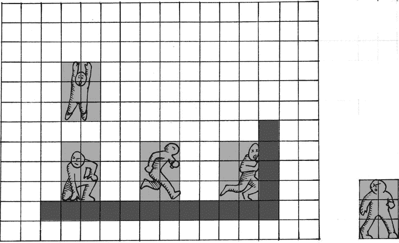

现在将该列表放在我们 `Game` 类地图下方。记住，我们将再次在玩家和随后的 `Enemy` 类中访问此数组，所以准备另一个指向数据的指针命名为：

```cpp
int* WhichAttributes;
```

并在你的游戏初始化例程中使用此代码设置它：

```cpp
WhichAttributes = Attributes;
```

注意，我们不需要 `&` 地址符号或 `[][]`，因为它是单维数组，且 C++ 实际上知道此类数组已被处理为地址。现在每个瓦格的属性已经记录，对我们的地面测试进行另一个小更改使其看起来像这样：

```cpp
int WhatsUnderOurFeet = G->WhichMap[YMap * 64 + XMap];

int Attrib = G->WhichAttributes[WhatsUnderOurFeet];

if (Attrib != 0 && Yspeed >= 0)
{
    Ypos = YMap * 16 - 32;
    Yspeed = 0;
}
```

我们现在寻找与玩家脚下瓦格相关的属性，如果它非 0，我们将停止它，对你的跳跃条件也这样做：

```cpp
if (Attrib != 0 && Yspeed >= 0)
    Yspeed = -SPEED * 6;
```

然后编译并运行。我们现在有了更多可以站立的平台，尽管我们把梯子视为一种地面，但我们实际上能够检测出它是否实际上（注：此处原文为重复的 account account）是一个梯子而不是一个简单的实心块，这将允许我们使用更合适的攀爬动画。事实上，我们可以让许多瓦格对我们的移动产生不同的影响。

所有这些工作为我们提供了一个完全灵活的系统；我们可以决定哪些瓦格是实心的、站在上面是危险的，或者仅仅是没有任何交互的背景部分，无论我们的地图位置如何。我们现在准备好编写适用于许多地图的代码，只要地图瓦格相同即可。

一个瓦集，许多地图，这是许多 2D 游戏的制作方式，地图的大小可以是任意的。

```cpp
{
public:
    Point2Point();
    Point2Point(MyFiles*);
    ~Point2Point();

    void Update(Game* G);

    Direction OurHeading;

    Int Xmin, Xmax;
    int Ymin, Ymax;
};
```

现在 `Update` 应该显而易见了，还有几个变量，我们的更新程序可以利用它们来执行移动。

在我们的 `Point2Point.cpp` 文件中，我们只需要创建构造函数：一个是简单的默认构造函数，另一个是将我们的图像加载到 vector 中的构造函数，因此它需要文件处理器的地址。

现在让我们来写这两个构造函数。默认构造函数目前完全没意思，只是创建一个实例并离开；而基于文件的构造函数会加载图像，但这给我们带来了一个问题：如果我们创建了多组图像该怎么办？

在我们的 `Player` 类中，使用数组是没问题的，因为我们只有一个；但屏幕上可能有五个或六个敌人，最好让它们使用同一组图形。在之前的入侵者代码中，我们通过通过留地预加载图形解决了这个问题，但在我们与粗糙代码的战争中，是时候采用更好的解决方案了。我提议一种检查我们已加载图形的方法，如果有就使用它，否则就加载，我们称之为 `add` 或 `replace`，它看起来像这样：

```cpp
// 检查主图中是否已存在图形
Surface* Enemy::AddorReturn(char* fn, MyFiles* FH)
{
    char* cstr = &fn[0u]; // 使用 char 这一决策带来的尴尬副作用

    if (graphics.find(fn) == graphics.end())
    {
        printf("New graphic to be added %s \n", cstr);

        // 我们从没有找到它
        Surface* T = new Surface(fn, FH);
        graphics.insert(std::make_pair(fn, T));

        return T;
    }
    else
    {
        printf("Graphic previously loaded and now reused %s \n", cstr);
        return graphics[fn];
    }
}
```

我把这个放在 `Enemy` 类中，因为我真正需要处理的只有敌人。这个系统依赖于被称为 `map` 的东西，这是一种非常棒的特殊数组形式，它不是通过索引，而是根据其他内容查找项，在本例中是文件名。

我们需要在 `enemy.h` 文件中定义我们的 map，我想将其设为静态（static），因为应该只有一个 map。我们新的 `enemy.h` 头文件现在如下：

```cpp
#pragma once

#include "GameObject.h"
#include "Game.h"
#include <map>

class Enemy : public GameObject
{
public:
    Enemy();
    Enemy(char*, MyFiles*);
    ~Enemy();

    virtual void Update(Game* G);

    static std::map<char*, Surface*> graphics;

    Surface* Images[4];

    // 检查是否已经加载了图形，如果是返回 surface，否则插入并返回 surface
    Surface* AddorReturn(char*, MyFiles*);
};
```

只要我们在另一个文件中也有这个 map 的定义，理想情况下在 `enemy` 类中如下所示：

```cpp
std::map<char*, Surface*> Enemy::graphics;
```

在 h 文件中创建以便在此处引用。

我们现在可以使用 `AddorReturn` 作为一个加载系统，它将完全如其所言执行。然而，这确实创建了一个非常危险的先例。我们将创建新的 surface 并将它们存储在此 map 中，为调用函数提供 surface，但我们将删除这些 surface 的责任转嫁给了创建敌人并最终销毁 map 的类。通常情况下，如果一个对象创建了一个新项，则由该对象负责在清理函数或析构函数中将其删除。但由于多个敌人将使用这些图形，让第一个敌人去删除 surface 可能是不实际的，因为这可能会损害任何剩余敌人的图形完整性。

`AddorReturn` 也可以同样地建立在我们的 `GameObject` 类中，这实际上取决于你；在这种情况下，我希望为敌人图形拥有一个单独的图像集合，因此没有实际的理由把它放在 `GameObject` 类中。

让我们把构造函数构建起来，我将只详细说明带文件的部分，你可以处理其他的。

```cpp
Point2Point::Point2Point(MyFiles* FH)
{
    // 我们可以测试 map 以查看文件是否已存在，如果是则使用已有的
    Images[0] = AddorReturn((char*)"../Assets/fungus_1.png", FH);
    Images[1] = AddorReturn((char*)"../Assets/fungus_2.png", FH);
    Images[2] = AddorReturn((char*)"../Assets/fungus_3.png", FH);
    Images[3] = AddorReturn((char*)"../Assets/fungus_4.png", FH);
}
```

在这里我们可以看到如何使用 `AddorReturn` 函数，当我们创建第一个 `Point2Point` 敌人时，我们将看到所有四个都会加载。然而，这确实创建了一个非常危险的先例。我们将创建新的 surface 并将它们存储在此 map 中，为调用函数提供 surface，但我们将删除这些 surface 的责任转嫁给了创建敌人并最终销毁 map 的类。通常情况下，如果一个对象创建了一个新项，则由该对象负责在清理函数或析构函数中将其删除。但由于多个敌人将使用这些图形，让第一个敌人去删除 surface 可能是不实际的，因为这可能会损害任何剩余敌人的图形完整性。

### 巡逻敌人

`AddorReturn` 也可以同样地建立在我们的 `GameObject` 类中，这实际上取决于你；在这种情况下，我希望为敌人图形拥有一个单独的图像集合，因此没有实际的理由把它放在 `GameObject` 类中。

在这里我们可以看到如何使用 `AddorReturn` 函数，当我们创建第一个 `Point2Point` 敌人时，我们将看到所有四个都会加载。然而，这确实创建了一个非常危险的先例。我们将创建新的 surface 并将它们存储在此 map 中，为调用函数提供 surface，但我们将删除这些 surface 的责任转嫁给了创建敌人并最终销毁 map 的类。通常情况下，如果一个对象创建了一个新项，则由该对象负责在清理函数或析构函数中将其删除。

```cpp
#pragma once

#include "Enemy.h"

class Patrol : public Enemy
{
public:
    Patrol();
    Patrol(char*, MyFiles*);
    ~Patrol();

    virtual void Update(Game* G);

    Direction OurHeading;
};
```

```cpp
Patrol::Patrol(MyFiles* FH)
{
    // 我们可以测试 map 以查看文件是否已存在，如果是则使用已有的
    Images[0] = AddorReturn((char*)"../Assets/fungus_1.png", FH);
    Images[1] = AddorReturn((char*)"../Assets/fungus_2.png", FH);
    Images[2] = AddorReturn((char*)"../Assets/fungus_3.png", FH);
    Images[3] = AddorReturn((char*)"../Assets/fungus_4.png", FH);

    BaseAnim = 2; // 0 是静态帧，1 是站立帧，2 和 3 是行走帧
    Yspeed = Xspeed = 0;
    AnimIndex = 0;
    Image = Images[0]; // 我们需要一个来开始
    Dir = Right;
}
```

与 `Point2Point` 类似，如果测试显示前方有障碍物，我就可以改变方向。

```cpp
void Patrol::Update(Game* G)
{
    float Speed = 1.2;

    Yspeed += 1.2f;
    AnimTime -= 1.0f / 60.0f;

    if (AnimTime < 0)
    {
        (AnimIndex += 1) &= 1;
        AnimTime = 0.2f; // 0.2 秒
    }

    // 让他移动起来
    switch (Dir)
    {
    case Left:
        {
            Xpos -= Speed;

            // 现在我们检查可能的障碍物
            int YMap = Ypos / 16;
            int XMap = (Xpos - 1) / 16;

            for (int i = 0; i < Image->GetHeight() / 16; i++, YMap++)
            {
                int WhatsAtTheEdge = G->WhichMap[YMap * 64 + XMap];
                int Attrib = G->WhichAttributes[WhatsAtTheEdge];

                if (Attrib & 1)
                {
                    Dir = Right;
                    break; // 退出循环，我们完成了
                }
            }

            break;
        }

    case Right:
        {
            Xpos += Speed;

            // 现在我们检查可能的障碍物
            int YMap = Ypos / 16;
            int XMap = (Xpos + 1 + Image->GetWidth()) / 16;
```


```cpp
for (int i = 0; i < Image->GetHeight() / 16; i++)
{
    int WhatsAtTheEdge = G->WhichMap[YMap * 64 + XMap];
    int Attrib = G->WhichAttributes[WhatsAtTheEdge];

    if (Attrib & 1)
    {
        Dir = Left;
        break; // 退出循环，我们完成了
    }

    YMap++; // 移动到下一个
}

break;
```

你可以在`game.cpp`的`GameInit`中用以下代码创建一个`Patrol`真菌：

```cpp
// 创建一个标准的巡逻真菌
Patrol* Pat = new Patrol(FileHander);
Pat->Xpos = 210;
Pat->Ypos = 20;
Pat->Dir = Enemy::Right;
MyObjects.push_back(Pat);
```

编译并运行，我们现在可以看到这个移动更平滑的巡逻真菌向右移动，当它撞到砖块时会返回。这并不是非常尖端的技术，但它是敌人根据环境对移动方向决策的良好例子，就像我们一样。

# 追踪

最后，可以再添加一种类型的`Enemy`，一种类似追踪者（homer）。我们将利用所学的关于计算距离的知识，让真菌静静地待着，直到靠近时它会尝试攻击，并在环境允许的范围内进行追猎。

移动部分将与巡逻真菌相同，但为了让它们变得有趣，让我们引入一种睡眠模式，在这种模式下看起来什么都没做。创建一对`Homer`文件，我们的头文件看起来像这样：

```cpp
#pragma once

#include "Enemy.h"

class Homer : public Enemy
{
public:
    Homer();
    Homer(MyFiles*);
    ~Homer();

    void Update(Game* G);
    float GetDistance(Game*);

    Direction;
    float Distance;
    bool Moving;
};
```

并没有巨大的区别，只是多了一个用于距离的变量和一个`bool`，我们在创建构造函数时需要将其初始化为`false`。默认构造函数再次是空的，看起来如下：

```cpp
Homer::Homer(MyFiles* FH)
{
    // 我们可以测试地图以查看文件是否存在，如果存在使用已有的
    Images[0] = this->AddorReturn((char*)"Assets/fungus_1.png", FH);
    Images[1] = this->AddorReturn((char*)"Assets/fungus_2.png", FH);
    Images[2] = this->AddorReturn((char*)"Assets/fungus_3.png", FH);
}
```

梯子的特殊之处在于，它可以在当前分配给跳跃的按键动作上，触发从简单行走到爬爬的转换。当我们检测到跳跃需求时，现在还可以检查我们脚下是否有梯子物体，如果是，则切换到爬爬模式。

在某些方面，爬爬是一种不同的控制状态，而在梯子上，在到达顶部之前，我们并不真的想跳跃或可以直接走开。在这个游戏中，我们并没有很多游戏状态，所以爬爬和行走/跳跃确实是我们唯一需要考虑的事情。因此，这里的代码需要修改：

```cpp
if (IH->TestKey(KEY_UP))
{
    BaseAnim = 8;
    this->Image = Images[BaseAnim + AnimIndex];
    (AnimIndex += 1) &= 3;

    if (Attrib != 0 && Yspeed >= 0)
        Yspeed = -SPEED * 6;
}
```

目前，它只是盲目地允许跳跃，但使用的是爬爬动画。让我们修改一下，以便能够考虑到他处于爬爬模式时可以使用爬爬动画。此外，我们还需要测试他何时可以切换到爬爬模式，以及何时需要退出该模式。

在你的`player.h`中添加一个名为`Climbing`的布尔标记，并在初始化游戏时确保将其设置为`false`。同时，确保在构造函数中添加跳跃的最后两帧：

```cpp
Images[12] = new Surface((char*)"../Assets/brianJumpR.png,fh", fh);
Images[13] = new Surface((char*)"../Assets/brianJumpR.png,fh", fh);
```

只需将测试代码封装在`if/then/else`条件中，我们使用这个布尔值：

```cpp
if (IH->TestKey(KEY_UP))
{
    // 这是爬爬
    if (Climbing)
    {
        BaseAnim = 8;
        this->Image = Images[BaseAnim + AnimIndex];
        (AnimIndex += 1) &= 3;
    }
    else
    {
        if (Attrib != 0 && Yspeed >= 0)
            Yspeed = -SPEED * 6;
    }
}
```

我们可以编译并运行这段代码看看发生什么。如果我们按下向上键，他会跳跃而没有帧变化，但梯子本身被视为平台并允许我们向上跳跃，所以让我们为爬爬再增加一些测试，它现在看起来像这样：

```cpp
if (IH->TestKey(KEY_UP))
{ // 这是爬爬
    if (Climbing)
    {
        Yspeed = -SPEED * 6; //<<<<爬爬速度
        BaseAnim = 8;
        this->Image = Images[BaseAnim + AnimIndex];
        (AnimIndex += 1) &= 3;

        // 我们需要测试爬爬是否结束了？
        if (Attrib != 2)
        {
            Climbing = false;
        }
    }
    else
    { // 现在我们检查我们是否在梯子上
        if (Attrib == 2)
        {
            Climbing = true;
        }

        if (Attrib != 0 && Yspeed >= 0)
            Yspeed = -SPEED * 6;
    }
}
```

这看起来不错，我们在正确的时间更改了动画。现在的问题是我们基本上仍然是在跳跃梯子，所以减少我们在爬爬时增加的速度，给出一个更像台阶状的值，`2`似乎很有效。

这种方法允许我们通过在最后一步允许恢复为跳跃来清除梯子的最后部分，这是我们想要的吗？理想情况下，我们可以有一个小小的向上爬的动画，但遗憾的是我们没有。所以我们必须保持这样。

现在尝试向下移动！我们遇到问题了，不是吗？我们的属性测试正在查看我们的脚部，而在我们的脚下正好没有梯子，所以我们需要进行第二次测试并像这样重写向下例程：

```cpp
if (IH->TestKey(KEY_DOWN))
{
    int WhatsUnderFeetplus = G->WhichMap[(YMap + 1) * 64 + XMap];
    int Attrib2 = G->WhichAttributes[WhatsUnderFeetplus];

    if (Attrib2 == 2)
        Climbing = true;

    if (Climbing)
    {
        BaseAnim = 8;
        this->Image = Images[BaseAnim + AnimIndex];
        (AnimIndex -= 1) &= 3;
        this->Ypos += SPEED;

        if (Attrib2 != 2)
        {
            Climbing = false;
            Yspeed = SPEED * 2;
        }
    }
}
else
{
    // 也许添加一个脚趾图形？
}
```


它与向上例程有点不同，尤其是现在你现在两个属性要测试：脚下正下方的那个和下方一个瓷格的，这将允许它在清除`Climbing`标记之前移动到梯子的底部。编译并运行……这不太对，不是吗？

由于重力一直作用于我们的玩家，我们需要处理在爬爬模式下重力不应该作用的事实。这就是为什么`Down`对`Ypos`进行了直接修改，因为重力不应该在我们在梯子上时允许我们掉落。

我们需要对`Game::Update`函数的重力部分进行细小的修改，以考虑到这个特殊情况：

```cpp
if (Climbing == false)
{
    Yspeed += SPEED;

    if (Yspeed > 9.81f)
        Yspeed = 9.81f;

    Ypos += Yspeed;
}
else
{
    Ypos += Yspeed;
    Yspeed = 0;
}
```

是的，这运行得不错。我们只有在非常接近梯子的中心位置时才能下梯子，我们可以稍微调整容差，根据需要将那些`±6`的值调大或调小，只要两点之间的距离不超过一个瓷砖的宽度即可。

我们写完了吗？并没有，遗憾的是还有一个小问题：尝试在我们不完全处于中心位置时“向上”移动。你认为这里发生了什么？他没有爬上去，因为我们的新测试不会设置`Climbing`标志，而且也没有播放动画。基本上，他正在跳跃，而在跳跃的顶端，他识别出了一个可以着陆的实体。嗯……，这是一个问题，大部分原因源于我们对重力的测试是基于属性是否为`0`或是否为实体的。但梯子有两个，而且从原则上讲，它是实体的。呃，什么？？

这里我们有一个非常棒的例子：对基础移动规则的几次简单更改就会对其他规则产生连锁反应，并迫使我们编写新函数来适配。这是大多数交互式编程中的持续问题，你必须尝试预测并纠正允许玩家执行的操作。

让一个瓷砖在任何时候都只有一个属性是一件痛苦的事情，这意味着我们在进行条件测试时需要到处写异常处理。但属性可以让我们获得一定的灵活性，与其将`Ladder`瓷砖定义为非零且实体瓷砖，不如让每个瓷砖拥有多个属性并用位进行编码。因此，`Ladder`可以被定义为非实体但可攀爬的。

在`Game.h`中添加这些行：

```cpp
#define SOLID 0b1
#define LADDER 0b10
#define WATER 0b100
#define METAL 0b1000
#define EARTH 0b10000
```

这为我们提供了一系列二进制值或掩码，我们可以这样将它们编码到属性中：

```cpp
int Attributes[] =
{
    0, //0
    SOLID, //1
    SOLID, //2
    SOLID, //3
    METAL+SOLID, //4
    WATER, //5
    WATER, //6
    SOLID, //7
    SOLID, //8
    SOLID, //9
    SOLID, //0
    SOLID, //11
    0, //12
    SOLID, //13
    LADDER, //14 / ladder
    SOLID //15
};
```

目前，它们仍然大部分是单值，尽管金属有两个属性，这可能允许我们在玩家在金属上行走时播放“滴哒哒”的声音，但梯子现在有一个`LADDER`属性，且不是实体，如果我选择的话，它还可以关联其他属性。因此，如果我现在对着陆在实体上的测试看起来像这样：

```cpp
if ((Attrib & SOLID) && Yspeed >= 0 && Climbing == false)
{
    Ypos = YMap * 16 - 32;
    Yspeed = 0;
}
```

我可以更有心地认为重力会忽略梯子，而现在使用`& LADDER`的梯子测试能够运行得好得多。例如：

```cpp
bool Player::TestClimb(Game* G)
{
    int YMap = (Ypos + 33) / 16;
    int XMap = (Xpos + (Image->GetWidth() / 2) - 5) / 16;
    int WhatsUnderOurFeet = G->WhichMap[YMap * 64 + XMap];
    int Attrib = G->WhichAttributes[WhatsUnderOurFeet];

    if ((Attrib & LADDER) == 0) return false; // 测试梯子

    YMap = (Ypos + 33) / 16;
    XMap = (Xpos + (Image->GetWidth() / 2) + 5) / 16;
    WhatsUnderOurFeet = G->WhichMap[YMap * 64 + XMap];
    Attrib = G->WhichAttributes[WhatsUnderOurFeet];

    return (Attrib & LADDER) == LADDER;
}
```

你现在需要遍历代码并修改任何属性检查，使用这种掩码系统而不是丑陋的硬编码数字系统，在未来你应该始终使用这种方法。32 位的`int`允许瓷砖拥有 32 种可能的属性。涵盖广泛的可能属性或其组合绰绰余。

对于一个单屏幕平台游戏来说，这样了。我们使用角色的坐标来查询地图，并此找到要绘制的图形，以及它影响 Bob 移动的特定属性。

坏蛋们也做着类似的事情，这允许我们在放置它们时不需要那么高的精度，当它们掉到最近的地面空间时，实际上看起来还不错。

虽然这算不上是一个真正的游戏，但你可以从底部爬到顶部，如果你觉得的话，添加带有不同地图和不同模式的额外关卡将带给你一些游戏性。噢，还有评分，别忘记评分。

随心用你想要的方式增强它，有很多经典游戏都是这样制作的，它们代码的简单性使其成为很好的学习体验。我们可以用不同的坏蛋来增加趣味，改变我们对 Bob 的控制，甚至可以添加一些持枪的坏蛋、设置陷阱、避开陷阱、改变游戏中的地图等等。所有这些概念都适用于这种基础的游戏编程概念。但要制作出出色的游戏需要良好的设计和关卡构建技巧。记住这一点！

所以处理文本需要一些精力。但这是值得的。

一旦我们剔除了逗号、命令代码和不需要的文本，我们就可以将数值值加载到一个存储区域，即数组中。这意味着你不再需要为你的地图准备 20 个不同的数组，只需要 1 个，并将相关的地图加载其中即可。

现在给出一个警告：如果你的地图大小完全相同，那么将数据覆盖到容器数组中是可以的。但如果你有不同尺寸的地图，你就必须做一个决定。

1. 创建一个表示最大可能性的存储数组，我们可以将所有较小的数组包含在其中。
2. 每次加载地图时动态分配内存，并在在使用完成后释放它。

这两种方法都是可行的，但动态内存（Dynamic）可能更好。尽管这意味着我们必须通过一些技巧来访问 2D 数组，而这恰恰是编译型数组的一大优势。

我们可以使用`<vectors>`，即 STL 的标准动态列表系统，或者更准确说是“向量的向量”（vectors of vectors）。在内存中查看它时，它是一个相当笨拙且不灵活的数据结构，创建速度也慢，但一旦设置好，它确实能让你延续通过`Array[y][x]`访问数组的理念。

由于我们在访问方面希望保持简单，我们将坚持这种做法，等你更有信心时，我会让你去探索动态创建多维数组的酷炫方法。

遵循 C++ 的面向对象编程（OOP）原则，最好将所有与地图相关的内容（加载、解析和存储）放在一个独立的类中，因此我们将从创建一个`MapManager`类开始。

通常，我们可能进行的任何文件处理都会被放在`MyFiles`类中，但由于这是针对非常特定的数据系统的非常特定类型的文件，我们不会使用`MyFiles`，而是直接将代码写在`MapManager`类中。

我们的`MapManager`头文件非常简单，尽管里面有很多头文件相关内容，因为我们使用了一些 C++ 字符串特性。尽管我很喜欢使用`char*`，但在这种情况下，字符串确实要方便一些。

```cpp
#pragma once

#include <stdio.h>
#include <stdlib.h>
#include <vector>
#include <string>
#include <fstream>
#include <streambuf>
#include <sstream>

class MapManager
{
public:
    MapManager();
    ~MapManager();

    std::vector<std::vector<int>> TheMap; // 一个大小未知的向量，其包含大小未的向量（注意写成 >> 而不是 >>，否则编译器有时会报错！）

    bool LoadMap(char*, int x, int y); // 你必须知道大小
};
```

它实际上并没有做什么，只是提供那个向量的向量，并且我为自己提供了一个函数来加载并设置地图的大小。我假设（我经常打破这个规则，所以让我们说，我坚持认为）我将使用基于文本的地图而不是二进制地图，但你也可以轻松地向此添加一个二进制读取器。我们可能想要添加几个不同的加载函数，例如，如果我们发现地图编辑器输出了某些脚本，但我使用的简单地图只包含原始瓦片数据，因此加载函数是一个非常简单的 CSV 解析器，将瓦片编号推入`TheMap`。

与我们其他的某些简单类不同，这个类承担了若干职责，这就是为什么我称它为`MapManager`而不是 map。如果我们加载了内容，我们需要确保在完成后释放内存。在这种情况下，我们的内存将被`TheMap`向量吞噬。我将确保加载程序和析构函数在删除此类或加载新地图时负责地清理或重置它。

因此在 cpp 文件中，我们的构造函数和析构函数看起来像这样：

```cpp
#include "../Headers/MapManager.h"

MapManager::MapManager()
{
}

MapManager::~MapManager()
{
    //删除地图
    if (TheMap.size() != 0)
    {
        printf("A map still exists and is now being erased\n");

        for (int y = 0; y < TheMap.size(); y++)
            TheMap[y].clear(); // 清除每个元素

        TheMap.clear(); // 现在清除主体
    }
}
```

正如往常一样，我们的默认构造函数什么都不做，我们需要传递信息，因此大部分工作都在加载/初始化中完成。但你可以看到析构函数是一个很乖的小函数，它在被调用时会检查是否存在地图，并仔细地将其移除。

现在，我们的加载程序需要实际加载，或者更准确地说是流式处理文件，并在解析文件时创建向量，因此它看起来可能有点复杂，但在向量内部设置向量的基本思想看起来如下：

```cpp
for (int y = 0; y < ys; y++)
{
    std::vector<int> T; // 临时
    TheMap.push_back(T);

    for (int x = 0; x < xs; x++)
    {
        TheMap[y].push_back(x); // 替换此处
    }
}
```

```cpp
printf("Mapsize is Y-%i : X-%i \n\n", TheMap.size(), TheMap[0].size());

t.close(); // close the stream its done

return true;
}
```

很好，它在安全检查、输出、拉取以及从输入流中转换数据方面增加了不少功能，但你仍然可以看出，其核心仍然是将一个数字简单的`pushback`到`vector`中。从现在起，我们只需要做的是加载地图，为它提供真实或虚假的尺寸以便其运行，最后我们将获得一个易于访问的`TheMap`二维`vector`。只要我们不弄乱我们的瓦片编辑器导出的数据，目前这就足够使用了了。

仍然存在一些细微的问题，你可能会遇到也可能不会遇到，但当然，我们还应该添加一个检查，判断文件名是否有效，如果不有效则中止加载。你可以自己添加这一点，提示：对象`t`包含你可以测试的内容！在这个逻辑中还存在一个轻微的缺陷，如果你使用`TileEd`保存你的`CSV`，你会发现它末尾有一个空行。我们将加载它，尽管我们不会在其中放入最终的列向量，但我们会放入一个最终的行向量。有什么办法修复它吗？这可以在这里完成而且也应该这样做，只需在你得到`CR`时测试你是否确实拥有一个带有某些值的列向量即可。或者在程序末尾测试最后那一行，并看看它的列向量是否有值。

好了，既然我们已经知道如何做到这一点，我们就可以创建类似的解析器，为我们可能用到的许多其他资源加载数据了。这种简单的`CSV`文本解析器非常有用，但随着你需要在管理器中获取更多数据，它们可能会变得更复杂，但只要你使用`,`来分隔内容，你就可以提取令牌（tokens）而不是数字字符串，并设置`switch/case`条件来处理它们。

由于这也是一个非常紧凑的程序，可能会在接下来的几个项目中使用，我们应该将其存储在`MyLibs`库中。


## 5.4 让我们滚动起来

我们在单屏幕世界上做得相当不错，我们角色的`x`和`y`坐标直接对应屏幕位置，而屏幕位置又直接对应瓦片位置。我们的世界受限于屏幕的大小。

但如果我们有一个比屏幕大得多的世界呢？我们不能总是增加屏幕分辨率，那是有上限的，而且此外，分辨率越高，我们的角色看起来就越小，这可能没那么酷。事实上，让我们把屏幕分辨率调小一点，尝试看看在地图上开启窗口对我们的游戏会产生什么影响。

在`BobsDay`头文件中将屏幕分辨率更改为非常复古尺寸的`320 × 200`，然后编译并运行项目。我们现在得到了一个非常酷的复古风格屏幕，但只显示地图的左上角。但是 Bob 在哪里？敌人又在哪里？嗯，事实上，他们所做的和之前一模一样：在启动时，Bob 出现在地图上并迅速倒在地上。他仍然做着这一切，事实上，整个游戏仍在忙碌地运行，因为它根据地图数据而不是屏幕来执行所有的逻辑和测试。我们游戏的视觉化与实际控制是完全独立的，所以现在我们必须修改视觉系统，让我们能够看到 Bob 及其周围环境。

这将是我们滚动世界的第一次尝试，并将屏幕简单地作为进入该世界的视口。一如既往，有许多方法可以这一点，但我更喜欢给屏幕本身赋予与其在地图上位置相关的坐标，这些坐标反过来是根据我们主角所在的位置计算出的点。

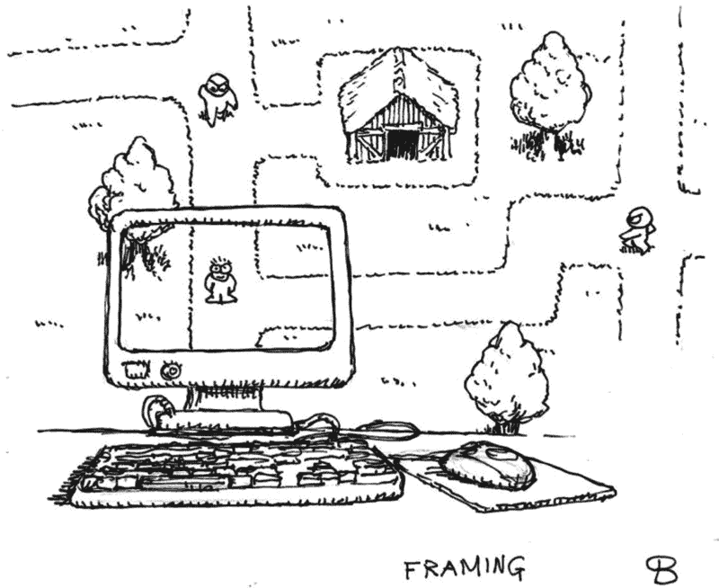

看看上一个图中角色的位置，我们称之为为“控制影响”。显而易见，屏幕只显示了地图的一部分，而他是地图的一部分，但这里的 Bob 才是我们感兴趣的，也是控制一切的人。他将为我们在地图上移动屏幕，让我们能够看到他相对于自己的位置所移动的地图的不同部分。

屏幕的顶角（几乎）总是与我们朋友 Bob 所在地保持固定的距离。因此它在地图上有一个位置。稍后我们可以进行微调以处理世界的边缘，但简单来说，我们的`ScreenX`坐标将始终是 Bob 的`mapX`减去屏幕宽度的一半，而我们的`ScreenY`坐标将始终是 Bob 的`mapY`减去屏幕高度的一半。这样他大致保持在中间，屏幕将拥有自己的地图坐标。为了避免尝试在地图区域之外绘制，我们可以检查是否`<0`或`> Maximum Mapsize`。给我们的`Game`类添加一些变量，允许它跟踪屏幕。在公共成员部分添加这些：

```cpp
float ScreenX, ScreenY;
```

我们需要对绘图地图函数进行调整，但现在让我们解释如何加载这些重要的屏幕值。

我们现在需要提醒自己，我们的`Xpos`值纯粹关系到我们在地图上的位置，我们需要从屏幕在地图上的位置作为一个相对视图来绘制我们的精灵，因此我们的绘图系统需要一个一个新的改进的屏幕坐标。在`GameObject`类中添加这些，我们将其称为`SXpos`和`SYpos`：

```cpp
float SXpos, SYpos;
```

Bob 是唯一移动屏幕的人，所以当他的位置改变时我们更新。在玩家更新末尾添加此代码：

```cpp
G->ScreenX = Xpos - SCRWIDTH / 2;
G->ScreenY = Ypos - SCRHEIGHT / 2;

// 如果超出边界则保持
if (G->ScreenX < 0) G->ScreenX = 0;
if (G->ScreenY < 0) G->ScreenY = 0;

if (G->ScreenX > 64 * 16 - SCRWIDTH)
    G->ScreenX = 64 * 16 - SCRWIDTH;

if (G->ScreenY > 40 * 16 - SCRHEIGHT)
    G->ScreenY = 40 * 16 - SCRHEIGHT;

// 为玩家计算屏幕位置
this->SXpos = Xpos - G->ScreenX;
this->SYpos = Ypos - G->ScreenY;
```

这些应该都很好理解，我们基本上是在确保屏幕坐标与玩家参考点有一定的距离，并进行测试以确保不超出地图区域。一旦我们知道了屏幕从地图的哪个部分绘制，我们的地图绘图系统也需要进行改造，我们不再满足于在`0,0`处绘制，而是要在我们计算出的点绘制。

我们需要确保在玩家更新之后进行绘制，否则数据将是不准确的，而且我们需要玩家（我们的控制影响）在任何其他绘制对象之前更新`ScreenX/Y`，以便它们也能计算出相对屏幕位置。

回到`Game.cpp`文件，更改更新循环中的`DrawMap`函数调用以使用新的坐标：

```cpp
DrawMap(ScreenX, ScreenY, a_Screen);
```

快完成了，我们仍然需要对绘图系统做一个微小的更改以便可以使用这些新值：

```cpp


```cpp
void Game::DrawMap(float mapx, float mapy, Surface* a_Screen)
{
    int Tmapx = mapx / 16;
    int Tmapy = mapy / 16;

    for (int y = 0; y < SCRHEIGHT / 16; y++)
    {
        for (int x = 0; x < SCRWIDTH / 16; x++)
        {
            Tiles[Map2[Tmapy + y][Tmapx + x]]->CopyTo(a_Screen, x * 16, y * 16);
        } // x 循环
    } // y 循环
}
```

我们创建了几个临时值，它们用于`map`的索引，并加上了`for`循环提供的偏移量，这个偏移量同时也作为绘制时的屏幕位置。好了，让我们编译并运行它，看看会发生什么。现在我们可以看到 Bob 很好地显示在屏幕上，如果我们向右移动，屏幕就会在滚动，但它一点也不流畅。我们没有考虑到 Bob 是以像素值移动的，而我们的`Drawmap`仅以瓦片（Tile）值进行绘制，因此只有当 Bob 移动了 16 像素或更多时，我们才会滚动。我们需要考虑一个瓦片由 0–15 像素组成，并在绘制时考虑到它们。

第一步是实际计算出这些值并将它们转换为易于使用的整数。在`Drawmap`的入口处，计算`Tmapx`之前，添加以下几行：

```cpp
int offsetX = fmod(mapx, 16);
int offsetY = fmod(mapy, 16);
```

`fmod`函数返回浮点数除法的余数，在本例中为除以`16`，因此它将为提供瓦片内的偏移量。

现在，我们只需要通过此代码将其整合到实际绘制中：

```cpp
Tiles[Tmapy + y][Tmapx + x]->CopyTo(a_Screen, (x * 16) - offsetX, (y * 16) - offsetY);
```

我们可以去掉`*16`周围的`()`，因为编译器总会在执行减法之前执行乘法，但为了清晰起见，将步骤封装在括号中总是好的，这对我们代码的编译没有太大影响，但有助于我们视觉化自己的意图。现在运行它，如果一切顺利，你将获得一个惊喜。流畅且整洁的滚动，可能有一点快，那是因为我们改变了分辨率导致更新变快了很多。不过还有一个小瑕疵，那些边缘是什么？

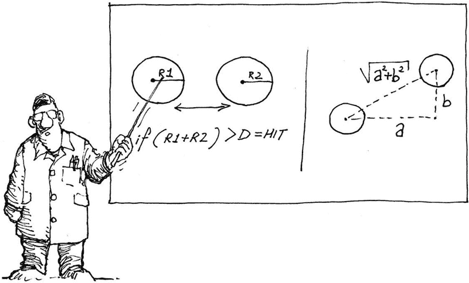

显然它们与我们的滚动有关，因为它们随着我们的移动而增长，这其实非常简单：我们因为偏移量正在绘制瓦片，实际上即将进入屏幕的瓦片也需要被绘制。我们可以简单地为`for`循环加上`+1`来修复这个问题，我们我们完成后的绘制看起来像这样：

```cpp
void Game::DrawMap(float mapx, float mapy, Surface* a_Screen)
{
    int offsetX = fmod(mapx, 16);
    int offsetY = fmod(mapy, 16);
    int Tmapx = mapx / 16;
    int Tmapy = mapy / 16;

    for (int y = 0; y < (SCRHEIGHT / 16) + 1; y++)
    {
        for (int x = 0; x < (SCRWIDTH / 16) + 1; x++)
        {
            Tiles[Tmapy + y][Tmapx + x]->CopyTo(
                a_Screen,
                (x * 16) - offsetX,
                (y * 16) - offsetY
            );
        } // x loop
    } // y loop
}
```

基本上就是这样，运行这个代码，我们现在将拥有非常非常好的像素滚动，这让我们能够轻松探索地图。现在我们只需要在`GameObject`中添加一个很小的`GetScreenPos`方法，以便世界中的敌人和其他对象可以计算它们的相对屏幕位置并正确绘制。我会让你们自己想办法，提示一下：只有 Bob 被允许创建`ScreenX/Y`值，但每个人用相同的方式创建`SXpos/SYpos`。

将我们的单屏幕游戏转换为多方向滚动游戏被证明是一项相当简单的任务：添加几个变量，引入地图或世界坐标的概念，并将我们的屏幕绘制与逻辑分离。从现在起，非常重要的一点是消除“屏幕坐标就是我们的地图/世界坐标”这种观念。我们已经迈出了第一步，将世界的渲染与更新区分开来。

如果你想制作更多滚动平台游戏，这个模板将让你大有裨益。这类游戏的游戏性更多取决于地图的设计和敌人的放置。但你可以在设计新敌人以及在关卡中放入开关和谜题获得很多乐趣。但现在我们将回到射击风格的游戏，看看它们如何适应我们刚刚掌握的滚动方法。

## 简单滚动射击游戏

平台游戏使用的滚动方法可以适应几乎任何类型的游戏，包括射击游戏。`on rails`（轨道式）游戏有一个悠久的传统，屏幕不断滚动，使得我们的飞船似乎在飞过广阔的地形，下方的地形不断出现新的敌人加入战斗，测试我们的反应能力，以便在它们杀死我们之前将其击杀。让我们尝试从玩家和程序员的视角来视觉化我们将看到的内容。

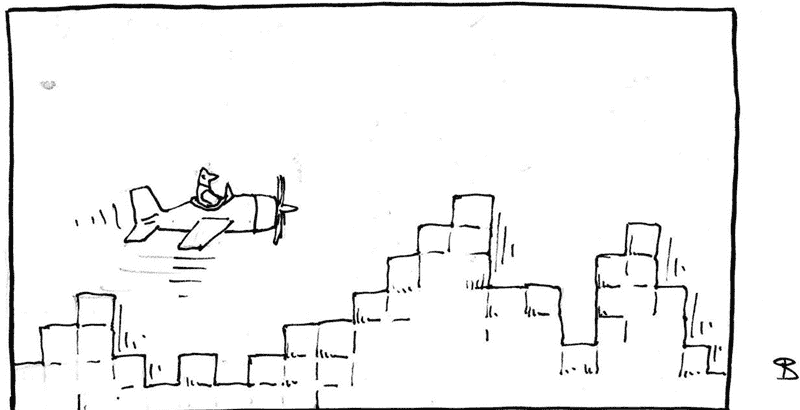

你体内的玩家能看到飞船/飞机在飞行，下方的地形有高低起伏，我们可以轻松利用它们来隐藏火箭或其他攻击我们的东西。你体内的程序员应该看到构成该图像的整齐瓦片。之后，我们可能会使用质量更好的瓦片来让瓦片不那么明显，允许出现更无缝的大型游戏场。让我们看看地图：

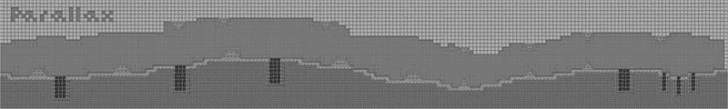

这是一个经典的从右到左的滚动，穿过隧道，避开一波波敌人，还有导弹发射井增加了我们的痛苦。我们穿过的隧道也填满了零瓦片，我们稍后会回到这个问题。我们穿过的隧道也填满了零瓦片，我们稍后会回到这个问题。在这个情况下，我们仍然使用`TileExample`框架，但我稍微清理了它并将其放在`Skramble`中。让我们开始滚动吧，我们的`ScrollScreen`程序看起来像这样：

```cpp
// scroll
if (ScreenX < MapManager->TheMap[0].size() * 16 - SCRWIDTH)
{
    ScreenX += 1;
    MyObjects[0]->Xpos += 1; // 他的 Xpos 需要改变
}
else
{
    ScreenX = MapManager->TheMap[0].size() * 16 - SCRWIDTH;
}

// 如果超出限制则保持在边界
if (ScreenX < 0) ScreenX = 0;
if (ScreenY < 0) ScreenY = 0;
```

巨大的区别在于这段代码现在位于对象更新之前的`Game update loop`中。飞船对 Y 轴仍有一定的控制权，所以我们可以留在那里。但现在我们正在明确我们的滚动将移动屏幕，飞船必须随之移动。当然，我们需要对玩家的控制做些处理，它仍然需要测试是否被要求移动，但要考虑到它正在跟踪滚动，我们将允许它移动到屏幕右侧的三之二处。他在`Player.cpp`文件中的移动程序现在看起来像这样：

```cpp
// 为我们的玩家计算屏幕位置
this->SXpos = Xpos - G->ScreenX;
this->SYpos = Ypos - G->ScreenY;

if (SXpos < 10) // 检查他的 SXpos
{
    SXpos = 10; // 如果我们覆盖了他的 SX，我们需要一个新的 Xpos
    Xpos = G->ScreenX + SXpos;
}
```

```cpp
if (SXpos > (SCRWIDTH / 4) * 3) // make sure he's over at his limit
{
    SXpos = (SCRWIDTH / 4) * 3; // if we override his SX we need a new Xpos
    Xpos = G->ScreenX + (SCRWIDTH / 4) * 3;
}
```

他现在可以随滚动条移动了，稍微超前一点，但如果走得太远就会被拉回来。这一切运行起来，你现在应该得到类似这样的效果：

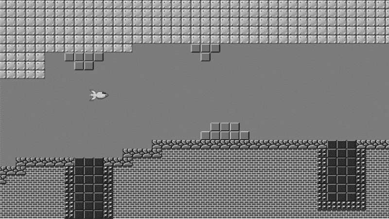

最终效果是我们的`Xpos`始终增加，但我们正在测试它是否走得太远，如果我们不小心过了 ¾ 的线，就会把他拉回来。

最后一点改进，我提到了那些零瓦片，它们看起来有点奇怪，对吧？所以我们不要画它们，将`DrawMap`例程更改为如下：

```cpp
void Game::DrawMap(float mapx, float mapy, Surface* a_Screen)
{
    int offsetX = fmod(mapx, 16);
    int offsetY = fmod(mapy, 16);
    int Tmapx = mapx / 16;
    int Tmapy = mapy / 16;

    for (int y = 0; y < (SCRHEIGHT / 16) + 1; y++)
    {
        for (int x = 0; x < (SCRWIDTH / 16) + 1; x++)
        {
            if (OurMapManager->TheMap[Tmapy + y][Tmapx + x] != 0)
            {
                Tiles[OurMapManager->TheMap[Tmapy + y][Tmapx + x]]->CopyTo(
                    a_Screen,
                    (x * 16) - offsetX,
                    (y * 16) - offsetY
                );
            }
        } // x loop
    } // y loop
}
```

你可以看到我添加了一个测试，如果瓦片是零，我就不打印它，但这有什么帮助呢？它只是给我了一个黑色隧道区域，并留下了未绘制瓦片的痕迹（记得我们没有清除屏幕）？好吧，让我们添加另一个绘制背景的例程，再次使用我们的瓦片概念。记住在头文件中添加原型声明，并将此函数添加到`Game.cpp`文件中：

```cpp
void Game::DrawBackground(float mapx, float mapy, Surface* a_Screen)
{
    return;

    int offsetX = fmod(mapx / 32, 16);
    int offsetY = fmod(mapy / 32, 16);
    int Tmapx = mapx / 16;
    int Tmapy = mapy / 16;

    for (int y = 0; y < (SCRHEIGHT / 16) + 1; y++)
    {
        for (int x = 0; x < (SCRWIDTH / 16) + 1; x++)
        {
            Tiles[12]->CopyTo(
                a_Screen,
                (x * 16) - offsetX,
                (y * 16) - offsetY
            );
        } // x loop
    } // y loop
}
```

现在它看起来和我们的`DrawMap`不一样，但你可以看到它并没有很大区别，我们确实可以通过稍微修改来完全显示另一个地图，但目前我让它绘制一个瓦片，并对位置值进行了一些调整。运行它看看。

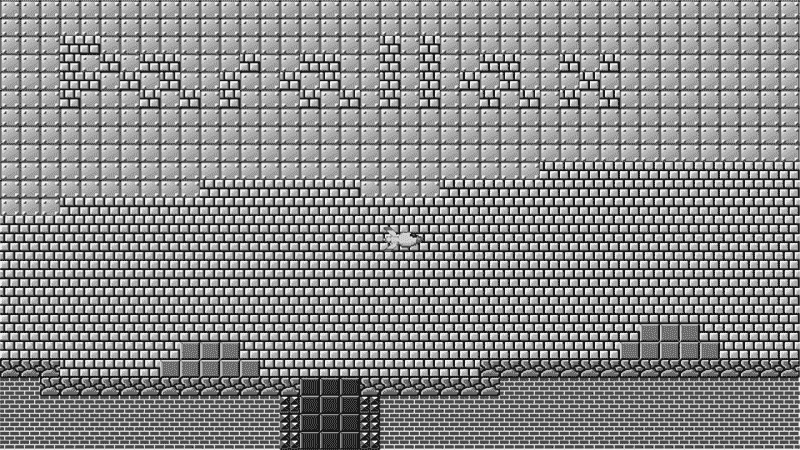

很酷，不是吗？这是一个被称为视差滚动（parallaxing）的概念，背景以与前景不同的（通常是更慢）的速度滚动。我们可以在那里放入任何类型的背景，一个漂亮的静态屏幕、一个非交互的背景地图，或者在这种情况下，一个易访问且易循环的瓦片。

这个特定版本并不完美，因为我们的瓦片缺少 Alpha 值，我们基于 CPU 的 2D 系统无法真正处理具有透明区域的瓦片，但我们始终可以让未绘制的零瓦片作为背景的窗口。我们可以在`Surface`类的拷贝中添加 Alpha 混合，但以后我们将移动到更好、技术上更先进的框架，所以我倾向于目前保持现状。但如果你觉得需要更好的 Alpha 值，请尽管去做。

滚动工作现在几乎完全为你完成了，但这个游戏并不仅于此，我们需要敌人，还需要与地图的碰撞，这将为我们提供某种形式的游戏性。

## 让他们吃铅吧

如果我们要做射击游戏，那么我们真的需要可以射击的东西。在这种情况下，是子弹和炸弹。用子弹杀死冲锋的敌人，用炸弹摧毁我刚刚决定作为这个游戏首要目标的导弹井，这就像在 T-16 上打打靶鼠一样！

先说子弹。显然我们需要……

我们将引入的另一个功能是燃料，我们会在地图上散布一些燃料箱，也许当我们杀掉数量的坏人并捡起它们时，就能补充燃料条，让我们能够继续前进。所以这是游戏的另一个条件，到目前为止，我们有：不要死亡、杀掉敌人、然后杀掉最后的坏蛋，并且不要耗尽燃料。听起来很有趣！

我不认为我需要再次向你解释类了，尽管与我们的平台游戏不同，我们有更多类型可以使用。我还打算尝试一种不同的共享资源系统形式，所以这次`Enemy Map Class`对我来说没有那么用用，因为每个类类型将跟踪它自己的一组图形。

将以下头文件和 cpp 文件添加到你的项目中，它们都在你的源文件和头文件文件夹中，所以你不需要手动输入。

`Bomb`、`Explosion`、`Fuel`、`GunTower`、`Launcher`、`Mine`、`Eye`、`Squid`和`Missile`。

此外，确保在`game.h`中添加`#include` `这些头文件名.h`，以便所有需要知道的类都能感知到新类型。

这些都是我们要拥有的基础敌人类型，每种类型都包含在自己的类中，并将处理它们共享的帧和逻辑。阅读注释查看行为，你可以根据需要对其进行更改。

但此时我们实际上还没有导致任何一个这些坏蛋被创建，所以这是下一步。

我们的`Game Class`负责此，尽管实际上它应该由一个关卡管理器（level manager）来完成，因为只有一个关卡算不上游戏。一旦我们让这一切运行起来，那应该是你的下一个个人任务：获取多个关卡。

查看`Game Class`，我们需要添加一些信息来告诉我们要在地图的什么位置放置坏人。关于这一点有两种通行的观点：我们可以在地图上设置特殊的瓦片、瓦块或标记，我们在绘制时可以检测它，并用它在该点生成坏人；或者我们可以保留一个想要放置物品的位置的简单列表。

我更倾向于前者，如果制作地图的编辑器支持的话（很多编辑器都支持），但我们将采用后者，以防你无法生成那些标记。

所以，让我们从`Missiles`开始吧。我们希望导弹在它们的发射筒位于屏幕上时反复发射，因此我们需要在那里放置发射器，由发射器再生成导弹。

`Launcher Class`现在供你使用了，这里是放置它们的坐标，将此放在你的`Game.cpp`文件的任何位置，如果你真的想，可以把它成为你的`Game Class`的一部分，但目前将它们放在空闲区域或`GameInit`函数中作为局部变量也可以（不过这对关卡管理器来说是更好的数据）。

```cpp
int MissileStartPoints[][2] =
{
    { 16, 25 }, // 这些是发射筒的位置
    { 49, 23 },
    { 75, 21 },
    { 171, 23 },
    { 182, 23 },
    { 186, 24 },
    { 190, 24 }
};
```

现在显然这是一个二维数组，但我不需要输入行（y）分量的大小，因为实际的初始化会填充它。然而，如果我最后输入了很多条目，或者编辑了这个数组，我可能会丢失条目的数量。无法使用`sizeof()`获取二维数组的行分量，它只会返回数组的总大小……但是我们可以获取列分量的大小，尽管我们知道它是 2，在这种情况下，通过使用`sizeof(MissileStartPoints[0])`。

这在数学上并不意外，你可以通过将总数除以列来获得行的大小，如下：

```cpp
int total = sizeof(MissileStartPoints);
int column = sizeof(MissileStartPoints[0]);
int row = total / column;
```

现在让我们创建一些导弹发射器，如下：

```cpp
for (int i = 0; i < row; i++)
{
    Launcher* l = new Launcher();

    l->Xpos = MissileStartPoints[i][0] * 16;
    l->Ypos = MissileStartPoints[i][1] * 16;

    MyObjects.push_back(l);
}
```

这些当然要放在`GameInit`函数中（它是关卡管理器的良好原型）。一旦你写了这些，编译并运行，你应该能看到一些致命的核弹在飞翔，并在击中屋顶时爆炸。

所以你已经有了思路，对这些数组重复这个过程：

```cpp
int GunTowerPlacement[][2] =
{
    { 10, 18 },
    { 33, 17 },
    { 63, 13 },
    { 93, 15 },
    { 113, 19 },
    { 127, 21 },
    { 145, 18 },
};
```


很不错，对吧？随地向数组中添加更多条目，在屏幕上放置更多东西，或按照你的意愿更改类中物品的行为。为什么不把自己的燃料放置也放在那里呢？

同样，我们也可以将敌人发射器瓦片放在地图数据中，或者作为一种特殊的对象类，其设计用于在玩家进入范围时生成多个敌人。这在很大程度上减少了我们的`Game Init`工作，我们可以专注于那些必须位于特定地点的物体，例如我们的枪塔，并使用一个简单的生成器对象来生成敌群波。通过这种方式生成对象可以将责任从初始化程序中转移出来，并允许你设定更广泛范围的值，也许是为了增加生成的难度或强度，而不是在关卡管理器中使用多个数组。

现在我们的反派和收集物品已经就绪，并且运行良好，是时候面对现实的状况情况了。这些敌人出现在这里是为了伤害我们，而我们生活在一个冷酷无情的宇宙里，那里子弹真的会造成伤害，我们只需要检测这种伤害何时发生，然后让它们发生爆炸即可。

这里的碰撞分为四个基本概念：物体撞击墙（我们可能允许也可能不允许某些动作性较强的外星人这样做）；子弹击中敌人、敌弹或地雷；正如我命名的那样，击中我们；以及第四种，物体与物体碰撞，因为我们有收集物品，需要区分与坏蛋的正面撞击与燃料的收集。当然，这就是为什么我在`Enemy`类中设置了一个`Type`标识符。

### 物体与物体碰撞

从简单的部分开始，大多数其他操作都源于此：物体与物体碰撞。`GameObject`类中有一个简单的框检查，可以用于任何敌人与其他敌人进行测试。敌人并不真正需要测试它们是否互相击中，所以，让它们只测试是否击中了玩家是非常直接的。因此，将该测试添加到`Enemy`代码中。同时，确保在每个敌人中都为碰撞添加了某种反应。

接下来，让我们考虑物体撞击环境。我很喜欢那些散开/圆形阵型的敌人，它们通常在不与环境交互时效果最好，但尽管如此，如果导弹击中某个东西它们就会爆炸，所以我们也应该对其他物体做些处理。检测非常简单，虽然有点笨拙，只需扫描精灵所占据的瓦片大小的空间块，并测试我们是否撞到了某些东西。现在是一个回到像我们在`Bob's World`中那样的属性系统的好时机。

### 地雷和敌弹

让地雷和敌弹具有致命性，实际上只是“物体与物体碰撞”的扩展，再次地雷对`Player`的兴趣大于任何其他物体。所以尽管去添加它。

### 玩家的子弹

最后是玩家的子弹，在这里我们遇到了第一个小障碍。当我们只有一颗子弹时，让敌人测试子弹并决定其是否在战斗中获得了光荣的并不是大问题。现在我们有一系列子弹，我们测试哪种，以及如何测试？

嗯，当然是测试所有的弹，这意味着需要以某种形式对`Object`列表进行扫描。但这令人困扰，因为我们可能有几十颗子弹、几十颗敌弹、几十枚地雷、几十个……你明白我的意思。对敌人来说，非致命物品比致命物品多得多，所以如果我们扫描它们所有的，我们就是在做我们最害怕的事情：为了一个大部分为负面的结果而测试多项内容。

同样，在像这样的游戏上，这可能不是问题，但我们应该在可以的时候寻求优化。在这种情况下，一个简单的方案是在`Game`类中保留一个独立的子弹向量列表（vector list），让每个潜在目标针对该向量进行测试，而不是针对主对象向量。

诚然这意味着要维护两个列表并对它们进行维护，但这将为我们节省 CPU 时间，这并不是坏事。只需确保在标记移除子弹时，也将其将其从第二个列表中移除。这可以通过像这样的`Player`函数来实现：

```cpp
void Player::RemoveBullet(GameObject* b)
{
    // 从可碰撞子弹集从移除该子弹
    MyBullets.erase(std::remove(MyBullets.begin(), MyBullets.end(), b), MyBullets.end());
}
```

这并不简单，对吧，你需要在`Player.cpp`的头文件中添加`#include <algorithm>`。但这是从向量中移除某物的一种合理方法。

我应该说，当我说“合理”时，我的意思是实际上完全不合理，因为这是一个缓慢且糟糕的扫描和删除系统，但在使用更好方法之前，它是可以的。

为了让这生效，我还必须确保在`Game`类中有一个`Player* APlayer`，因为我将子弹保存在`Player`的静态列表中，只有`Player`才能访问它们。这是一个复杂之处，因为尽管我经常使用不同类型的`Object`，但我通常将它们都视为它们的基类`GameObject`，并让重写函数接控制。

为了允许不同的对象访问特定类型的成员，而不是共同的`GameObject`或`Enemy`成员，我需要该类型的实例。我在`Game::GameInit()`函数中克服这个问题，确保`APlayer`确实指向我对象的`Player`部分的指针，并将其存储在`ThePlayer`中，它定义为`GameObject*`，这允许访问更通用的`GameObject`方法和成员。

### 响应碰撞

一旦建立了碰撞，就轮到单个对象来决定如何反应。子弹或地雷会消失，但我们确实需要确保它们的目标知道它们被击中了。因此，我在我们的`Enemy`类中添加了一个`AmIHit`标志，以指示是否被击中。由于理论上任何物体都可能被击中，最好将其添加到`GameObject`类中。

现在每个对象都可以测试该标志并决定将如何反应，这将取决于类型。我放在`GameObject`中的`DidIHitThis`程序也是虚的（virtual），因此允许我在决定这样做时为每种类型提供不同类型的测试，尽管在这种情况下，我没有看到必要。

在每个敌人的更新结束时，务必添加类似这样的测试，这将使用`Enemy::TestBullets()`函数，而该函数反过来将使用`GameObjects::DidIHitThis()`。

```cpp
if (this->TestBullets())
{
    MarkForRemoval = true;

    Explosion* e = new Explosion();

    e->Xpos = Xpos - 32 + 8;
    e->Ypos = Ypos - 16;
    e->Xspeed = 0;
    e->Yspeed = 0;

    Game::MyObjects.push_back(e);
}
```

如果你完全对每个敌人类型执行完全相同的操作，没有理由这不能放入你目前空的`Enemy::Update()`中，并使用：

```cpp
Enemy::Update(G);
```

在每种类型更新结束时。或者甚至有一个通用的`Enemy::CheckForDead()`方法，这完全取决于你。为了代码整洁，这样做是有意义的；为了简单允许实验，使用更新结束时的测试。

设置游戏状态并不是一个主要问题，我们将在下一个游戏演示中说明这一点，但确保游戏状态被正确设置和正确关闭是非常重要的，这样下一个状态就可以从全新的起点开始运行，同时可以使用上一个状态设置时所需的任何值。

首先，我们有一个必须处理的更重要的改进。

### 没有什么错误的方法……但总有更好的方法

瓦片（tile）的想法是可行的，它确实带给了我们极大的灵活性，但运行并不快，而且没有充分利用系统性能，我们有几种方法可以优化它。我们目前过于关注对表面（surface）的使用，以至于完全没有使用过 GPU。这对我们来说是一个巨大的错误，我们的 GPU 处理图形的能力远强于 CPU，而我们现在甚至无法在表面上实现正确的透明效果。更不用说将翻转、旋转、缩放或 Shader 效果作为自动过程了。一切都需要消耗 CPU 周期，而我们可以浪费的周期只有那么几百万个。

让我们做一个真正压榨 CPU 的演示，让我们对它的极限有一些了解。到目前为止，我们所有的游戏运行得相当不错，我们并没有做太多操作来实际上测试极限，我的意思是，我们能够运行所有逻辑，绘制有限数量的图形，并在一帧内更新屏幕，因此我们不会遇到掉帧的恐怖（除非你运行了大量的后台任务，而不是使用一台整洁的机器）。所以，让我们看看我可以做些什么来让你们感受到 CPU 绘图是多么有限。

### 对于烟花来说，生命虽短但甜！

让我们创建一个简单的粒子系统。粒子是一个非常基础的对象；它的逻辑非常有限，理想情况下不应该只做移动、绘制并在最终死亡之外，也许可能会过渡到不同的类型、颜色、状态或任何东西。它们通常很小，尽管可以是任何大小，我们可以将它们绘制为图像或简单的像素，通常利用 Alpha 效果和其他特性，尽管我们的 2D 表面系统处理 Alpha 效果并不太好，所以我们无法真正实现一些像烟雾那样酷的效果；但是，如果你运用一点想象力，是有方法的。粒子的原理在 2D 或 3D 中是相同的，所以我们在这里学到的以后可以使用，并利用 3D 图像处理更强大的能力。

粒子在游戏中最明显的用途包括烟雾、火、灰尘、血溅、烟花等，它们也可以被用于模拟一系列具有动态属性的其他事物。

首先从支持网站下载烟花演示，它目前并没有做什么，它只是一个空演示项目，我们将添加功能让它运行起来，别担心，这不需要写很多字，这些东西非常简单。

不过，我们这个演示需要一个鼠标，用键盘控制在屏幕上移动光标或其他指针有点麻烦，所以是时候让沉睡已久的鼠标例程大显身手了。

实际上我们在这里并不需要做什么，我们的输入处理程序已经有一个鼠标事件处理程序，而且它一直都在那里工作，它的运行方式与我们已经使用的按键读取器完全相同，只是它以这种结构体返回数据。

```cpp
public:
    typedef struct // 用于存储鼠标信息的简单结构体
    {
        int PositionX; // 包含从起始点的相对位置（注意不要与 GUI 鼠标位置混淆）
        int PositionY;

        unsigned char LeftButton; // 按下为 TRUE，否则为 FALSE
        unsigned char MidButton;
        unsigned char RightButton;
    } MouseData;
```

这是大多数标准鼠标的基础信息返回……鼠标的复数，是 meeces？嗯，我真的不知道桌面鼠标的复数是什么，我假设和啮齿类的一样！对我们来说，我们只寻找标准按钮，最重要的是位置信息。但我们必须非常小心，鼠标并没有向处理程序返回一个实际的固定位置；我们只是得到它移动的量，并将其加到上位置，所以只有当我们知道原始起始值时，我们的位置值才是准确的。而知道原始起始值的唯一方法是在使用之前设置它。因此在初始化期间，我们必须确保做到这一点，理想情况下在屏幕中心。还要记住输入需要初始化，所以在在实例化之后紧接着进行指针位置初始化。像这样：

```cpp
TheInput.Init(); / 启动

TheInput.TheMouse.PositionX = SCRWIDTH / 2;
TheInput.TheMouse.PositionY = SCRHEIGHT / 2;
```

鼠标在屏幕上也需要一个指示器，所以我们需要确保创建一个良好的指针对象，然后可以使用该对象来绘制指针。确保创建一个指向名为`MousePointer`的 Surface 指针，然后你就可以将其添加到你的鼠标初始化行中：

```cpp
MousePointer = new Surface("../Assets/MousePointer.png", FileHandler);
```

现在，我们必须注意一点，我们的鼠标是在一个被称为线程（thread）的过程中进行测试的（我们稍后会讨论），这意味着无论我们的程序在做什么，只要鼠标移动或点击鼠标按钮，CPU 可能就会去处理鼠标代码。我说是“可能”，是因为这还取决于鼠标的刷新率。但那通常是 CPU 的快速响应。

```cpp
// 我们的粒子基本上是表面，但大多数时候它们是空的或 1 × 1 的缓冲区
#include "Particle.h"

Particle::Particle()
{
    Xpos = Ypos = Xspeed = Yspeed = 0; // 清空这些变量
    this->MarkForRemoval = false;
    this->Image = new Surface(Rand(2)+1, Rand(2)+1); // 创建一个小型表面
    this->Image->ClearBuffer(Colour); // 使用固定颜色（嗯，目前可以）

    Time = 4.0f;
    Xspeed = 3.0f-Rand(6.0f);
    Yspeed = 3.0f-Rand(6.0f);
}

Particle::Particle(char* Fname, MyFiles* FH) : Objects(Fname, FH)
{} // 如果需要，添加一个文件加载系统

Particle::~Particle()
{} // 目前没什么什么需要做的。

void Particle::Update(Surface* mScreen)
{
    Objects::Update(mScreen); // 基类已经处理了这些，让它工作吧

    Time -= (1.0 / 30.0f); // 假设帧率为 30fps（可能是错误的）
    if (Time < 0) this->MarkForRemoval = true;

    // 颜色处理有点复杂
    unsigned int r = (Colour & REDMASK);
    unsigned int g = (Colour & GREENMASK) >> 8;
    unsigned int b = (Colour & BLUEMASK) >> 16;

    r -= 2;
    if (r > 255) r = 0;

    g -= 5;
    if (g > 255) g = 0;

    b -= 5;
    if (b > 255) b = 0;

    Colour = r + (g<<8) + (b<<16) + ALPHAMASK; // 给它一些 alpha 通道

    if (Colour == ALPHAMASK) this->MarkForRemoval = true; // 它死了，把它杀掉

    Image->ClearBuffer(Colour);
    Image->CopyTo(mScreen, (int)Xpos, (int)Ypos);

    // 最后假设它们受重力影响并降低速度
    Yspeed += 9.81f / 100; // 使用真实世界的值但按比例缩放

    // 给它一个终端速度
    if (Yspeed > 10.0f) Yspeed = 10.0f;

    // 阻尼 x 速度
    Xspeed *= 0.99f; // 缓慢减小
}
```

再次非常简单，构造函数负责初始化，我留了一个空的基于文件的构造函数（如果你需要可以在其中添加代码），并允许它创建的空表面大小略有变化以增加多样性。核心在于`update`函数，在这里我让这个类派生自`Objects`，由于`Update`具有移动对象并从边缘反弹的功能（尽管我重写了该程序），基类程序仍然可以访问；这非常有用。然后我进行了一些颜色操作。在这个 2D 缓冲区上这有点乱，但它可以正常工作。我将 RGB 值拆分为`unsigned ints`并将它们移动到低 8 位，以便处理。我检查是否`>255`是因为`unsigned int`无法测试`<0`。我大幅减少了红色分量，以便得到那种从白色到暗红色的外观，并测试所有 RGB 部分是否都减到了 0，如果是的话，无论剩余时间多少我都会杀死该对象。然后是在用分数乘以正数或负数时的速度阻尼，它会减小该数字的比例，使其整齐地接近 0。如果我使用任意颜色并希望它们淡入黑色，那么使用类似的方法并将每个颜色分量乘以一个分数会更有意义。不过，稍后我们会发现更好的方法。所以现在我们只需要在`Game`中更新来处理鼠标，并为我们生成一些漂亮的粒子。这也是我们可以在绘制完对象后可以添加的一段简单代码：

```cpp
if (TheInput.TheMouse.LeftButton == true)
{
    for (int i = 0; i < 40; i++)
    {
        Particle* p = new Particle();

        p->Xpos = (float) TheInput.TheMouse.PositionX;
        p->Ypos = (float) TheInput.TheMouse.PositionY;

        TheObjects.push_back(p);
    }
}
```

我将其设置为每次创建 40 个新粒子，它们在构造函数中以随机速度生成。不过，这种方法并不优雅，所以我们不会保留它，但目前它能胜任。启动它并按下鼠标左键，我们应该能看到一些漂亮的像素显示为白色然后淡变为红色。非常漂亮，我们可以在屏幕上创建好看的（虽然略显方形的）星爆效果，并持续这样做。但粒子只出现在我们点击的地方，这是因为那个不优雅的游戏循环，我想要更整洁一点，允许我们选择生成粒子的位置并允许我们跟踪屏幕上的另一个点，所以让我们创建一个`Emitter`（发射器）吧。

`Emitter`的工作基本上是只要接收到指令，每次更新时就生成少量的粒子。我们还可以决定粒子的生成方式，是爆发式的，还是像火箭后方的羽流；例如，甚至是不同类型的粒子。

```cpp
Emitter* Emit = new Emitter();

Emit->Init(this);

TheObjects.push_back(Emit);
```


记得将`Emitter.h`添加到`Game.h`的`cpp`包含文件列表中。我们可以让构造函数完成所有这些设置，但请记住我们计划添加不同的类型，所以让构造函数尽可能简单，我们可以扩展`init`函数，甚至为不同类型添加不同的`init`或`inits`。

现在编译并运行，尝试这段代码，并注意当你按下并松开鼠标键时，你会得到非常漂亮的单个方形爆发（squarebursts）。不过尽量不要一直按住鼠标不放，否则你会产生大量的粒子，这会增加我们系统的负担，我稍后会讨论这一点。

但我们为什么得到的是正方形爆发呢？为什么不是漂亮的圆圆形绽放呢？这是因为我们在`X`和`Y`上使用了受限制的随机值（clamped random values），它们会产生从原点发散的向量方向。由于它们具有并非基于半径的有效限制，因此无法实现我们想要的圆圆形效果，所以看起来不自然是正方形，虽然看起来有点酷，但并不是我们真正想要的。所以，让我们现在扩展系统来创建不同类型的发射器，这样我们就能拥有绽放效果，以及不同类型的粒子来启动它。

## 粒子种类的新纪元！

我们目前的`Particle`实际上是一个带热衰减的`Particle`，我们真的不应该在构造函数中设置它的运动速度，那是发射器（emitters）的工作，但时间函数以及知道何时死亡是它变得实用的关键。事实上，这是我们在这里关心的唯一能让它成为粒子的逻辑了。粒子的个体的行为会有所不同，因此我们应该创建新类来处理这些行为，然后让`Particle`类的`update`函数来处理衰减以及我们那短暂而美丽的生命的终结。

创建一个名为`HotDecay.h`的新头文件，也许可以把它放在解决方案（solution）的新过滤器中，因为你可能会创建很多这样的文件，我创建了一个名为`Particles`的过滤器。文件本身仍然可以留在`Header`和`Source`目录中，但一旦完成了这些简单的东西，我们可能想要折叠过滤器并在以后忘记这些文件。`HotDecay.h`应该包含以下内容：

```cpp
// 一个受重力影响的简单热粒子

#pragma once

#include "Objects.h"
#include "MyFiles.h"
#include "Particle.h"

class HotDecay : public Particle
{
public:
    HotDecay(); // 正常为 1 × 1 表面
    ~HotDecay();

    void Update(Surface* s); // 当然我们需要我们的 update
};
```

你可以看到，只需要简单的构造函数/析构函数对和一个更新系统。由于我是继承自`Particle`，它将拥有`Time`值，而由于`Particle`继承自`Objects`，所有其他有用数据都在那里。这次我没有在文件中留一个构造函数，因为我很确定这次我不会使用它。

创建一个新的`HotDecay.cpp`文件，同样可以通过在解决方案中添加过滤器来实现，并添加此代码：

```cpp
#include "HotDecay.h"

HotDecay::HotDecay()
{
    // 我们可以设置这些默认值，但发射器应该改变它们
    Xpos = Ypos = Xspeed = 0; // 清空这些

    this->MarkForRemoval = false;

    this->Image = new Surface(Rand(2) + 1, Rand(2) + 1); // 创建不同大小的表面
    this->Image->ClearBuffer(Colour); // 创建蓝色蓝点

    Time = 4.0f;

    Xspeed = 3.0f - Rand(6.0f);
    Yspeed = 3.0f - Rand(6.0f);
}

HotDecay::~HotDecay(){}

void HotDecay::Update(Surface* mScreen)
{
    Particle::Update(mScreen);

    // 颜色有点复杂
    unsigned int r = (this->Colour & REDMASK);
    unsigned int g = (Colour & GREENMASK) >> 8;
    unsigned int b = (Colour & BLUASK) >> 16;

    r -= 2;
    if (r > 256) r = 0;

    g -= 5;
    if (g > 256) g = 0;

    b -= 5;
    if (b > 256) b = 0;

    Colour = r + (g << 8) + (b << 16) + 0xff00000;

    if (Colour == ALPHAMASK)
        this->MarkForRemoval = true; // 它死了，把它杀掉

    Image->ClearBuffer(Colour);
    Image->CopyTo(mScreen, (int)Xpos, (int)Ypos);

    // 最后假假设它们受重力影响并减少 Yspeed
    Yspeed += 9.81f / 100; // 使用真实世界的值但缩放以适应

    // 给它一个终端速度
    if (Yspeed > 10.0f)
        Yspeed = 10.0f;

    // 并阻尼 x 速度
    Xspeed *= 0.99f; // 缓慢减少
}
```

这应该很清楚，这是旧的`Particle`代码，现在逻辑被分离到了这个类中。`Particle.cpp`中的`update`例程已经删除了这些，现在看起来像这样：

```cpp
void Particle::Update(Surface* mScreen)
{
    Objects::Update(mScreen); // 我们的基类执行此操作，让它工作

    Time -= (1.0 / 30.0f); // 假设（可能错误）为 30fps 帧率

    if (Time < 0)
        this->MarkForRemoval = true;
}
```

最后，我们的`Emitter.cpp`文件需要稍微更改，它不再创建粒子，而是创建`HotDecay`对象。

```cpp
void Emitter::Update(Surface* s)
{
    Time -= (1.0 / 30.0f);

    if (Time < 0)
        this->MarkForRemoval = true;

    for (int i = 0; i < HowManyPerUpdate; i++)
    {
        HotDecay* HD = new HotDecay();

        HD->Xpos = this->Xpos;
        HD->Ypos = this->Ypos;

        WhereIsGame->TheObjects.push_back(HD);
    }
} // 当然我们需要我们的 update
```

好，现在编译并运行，尝试这段代码的效果，并注意当你按下并松开鼠标时，你会得到非常漂亮的单个方形爆发。不过不要一直按住鼠标不放，否则你会产生大量的粒子，这会增加我们系统的负担，我稍后会讨论这一点。

但我们为什么得到的是正方形爆发呢？为什么不是漂亮的圆圆形绽放呢？这是因为我们在`X`和`Y`上使用了受限制的随机值，它们会产生从原点发散的向量方向。由于它们具有并非基于半径的有效限制，因此无法实现我们想要的圆圆形效果，所以看起来不自然是正方形，虽然看起来有点酷，但并不是我们真正想要的。所以让我们扩展系统来创建不同类型的发射器，这样我们就能拥有绽放效果，以及不同类型的粒子来启动它。

## 粒子种类的新纪元！

我们目前的`Particle`实际上是一个带热衰减的`Particle`，我们真的不应该在构造函数中设置它的运动速度，那是发射器的工作，但时间函数以及知道何时死亡是它变得实用的关键。事实上，这是我们在这里关心的唯一能让它成为粒子的逻辑了。粒子的个体的行为会有所不同，因此我们应该创建新类来处理这些行为，然后让`Particle`类的`update`函数来处理衰减以及我们那短暂而美丽的生命的终结。

创建一个名为`HotDecay.h`的新头文件，也许可以把它放在解决方案的新过滤器中，因为你可能会创建很多这样的文件，我创建了一个名为`Particles`的过滤器。文件本身仍然可以留在`Header`和`Source`目录中，但一旦完成了这些简单的东西，我们可能想要折叠过滤器并在以后忘记这些文件。`HotDecay.h`应该包含以下内容：

```cpp
// 一个受重力影响的简单热粒子

#pragma once

#include "Objects.h"
#include "MyFiles.h"
#include "Particle.h"

class HotDecay : public Particle
{
public:
    HotDecay(); // 正常为 1 × 1 表面
    ~HotDecay();

    void Update(Surface* s); // 当然我们需要我们的 update
};
```

你可以看到，只需要简单的构造函数/析构函数对和一个更新系统。由于我是继承自`Particle`，它将拥有`Time`值，而由于`Particle`继承自`Objects`，所有其他有用数据都在那里。这次我没有在文件中留一个构造函数，因为我很确定这次我不会使用它。

创建一个新的`HotDecay.cpp`文件，同样可以通过在解决方案中添加过滤器来实现，并添加此代码：

```cpp
#include "HotDecay.h"

HotDecay::HotDecay()
{
    // 我们可以设置这些默认值，但发射器应该改变它们
    Xpos = Ypos = Xspeed = 0; // 清空这些

    this->MarkForRemoval = false;

    this->Image = new Surface(Rand(2) + 1, Rand(2) + 1); // 创建不同大小的表面
    this->Image->ClearBuffer(Colour); // 创建蓝色蓝点

    Time = 4.0f;

    Xspeed = 3.0f - Rand(6.0f);
    Yspeed = 3.0f - Rand(6.0f);
}

HotDecay::~HotDecay(){}

void HotDecay::Update(Surface* mScreen)
{
    Particle::Update(mScreen);

    // 颜色有点复杂
    unsigned int r = (this->Colour & REDMASK);
    unsigned int g = (Colour & GREENMASK) >> 8;
    unsigned int b = (Colour & BLUASK) >> 16;

    r -= 2;
    if (r > 256) r = 0;

    g -= 5;
    if (g > 256) g = 0;

    b -= 5;
    if (b > 256) b = 0;

    Colour = r + (g << 8) + (b << 16) + 0xff00000;

    if (Colour == ALPHAMASK)
        this->MarkForRemoval = true; // 它死了，把它杀掉

    Image->ClearBuffer(Colour);
    Image->CopyTo(mScreen, (int)Xpos, (int)Ypos);

    // 最后假假设它们受重力影响并减少 Yspeed
    Yspeed += 9.81f / 100; // 使用真实世界的值但缩放以适应

    // 给它一个终端速度
    if (Yspeed > 10.0f)
        Yspeed = 10.0f;

    // 并阻尼 x 速度
    Xspeed *= 0.99f; // 缓慢减少
}
```

这应该很清楚，这是旧的`Particle`代码，现在逻辑被分离到了这个类中。`Particle.cpp`中的`update`例程已经删除了这些，现在看起来像这样：

```cpp
void Particle::Update(Surface* mScreen)
{
    Objects::Update(mScreen); // 我们的基类执行此操作，让它工作

    Time -= (1.0 / 30.0f); // 假设（可能错误）为 30fps 帧率

    if (Time < 0)
        this->MarkForRemoval = true;
}
```

最后，我们的`Emitter.cpp`文件需要稍微更改，它不再创建粒子，而是创建`HotDecay`对象。

```cpp
void Emitter::Update(Surface* s)
{
    Time -= (1.0 / 30.0f);

    if (Time < 0)
        this->MarkForRemoval = true;

    for (int i = 0; i < HowManyPerUpdate; i++)
    {
        HotDecay* HD = new HotDecay();

        HD->Xpos = this->Xpos;
        HD->Ypos = this->Ypos;

        WhereIsGame->TheObjects.push_back(HD);
    }
} // 当然我们需要我们的 update
```

我目前只有`HotDecay`代码，不过没关系。由于我们已经在`Emitter`中添加了类型概念，在设置它时我们需要提供该类型，因此在`Game.cpp`文件中，将触发系统更改为如下：

```cpp
if (TheInput.TheMouse.LeftButton == true)
{
    Emitter* Emit = new Emitter();

    Emit->Init(this);
    Emit->PType = Emitter::ParticleType::T_HotDecay;

    TheObjects.push_back(Emit);
}
```

搞定了，我们的系统已经设置好了：当我们按下左鼠标键时，会产生一个热衰减的方形喷发（hotdecay squareburst）。现在是时候为右键添加一个更细微的`ColourFade`（颜色渐变）了，你可以猜出接下来要在`Game`类中需要添加什么代码，不是吗？为右键也写一个能生成`ColourFades`的逻辑。

`ColourFade`粒子需要一个可以渐变的颜色值，而标准的默认粒子设置了一个硬编码值作为默认值，它是`Pixel`类型，是一个整数值。整数在平滑缩放方面的效果并不理想，但我们只能使用它。不过这并不阻止我们保留值的浮点数副本，这就是为什么我们在`ColourFade`头文件中添加了浮点型的`r`、`g`、`b`。我们还应该在该头文件中添加一个新的构造函数定义，将我们的整数颜色值转换为浮点数，因此在默认构造函数之后添加此处：

```cpp
ColourFade(Pixel Col); // 设置颜色
```

在`ColourFade.cpp`文件中，那个新构造函数看起来如下：

```cpp
ColourFade::ColourFade(Pixel Col)
{
    // 我们可以在这里设置默认值，但发射器可能会改变它们
    Xpos = Ypos = 0; // 清空这些

    this->MarkForRemoval = false;

    this->Image = new Surface(Rand(2) + 1, Rand(2) + 1); // 创建一个略有不同的小表面

    Time = 4.0f; // 设置一个合理的寿命

    Xspeed = 3.0f - Rand(6.0f);
    Yspeed = 3.0f - Rand(6.0f);

    Colour = Col;

    this->Image->ClearBuffer(Colour);

    r = (float)(Col & REDMASK);
    g = (float)((Col & GREENMASK) >> 8);
    b = (float)((Col & BLUEMASK) >> 16);
}
```

默认构造函数被清空且现在是空的，因为现在它是我们将使用的主构造函数，它设置了所需的值。

我们仍然需要告诉发射器如何使用这个新构造函数进行操作，请将你发射器中`T_ColourFade`情况下的空代码替换为如下：

```cpp
case T_ColourFade:
{ // 我喜欢用括号括起来我的 case
    for (int i = 0; i < HowManyPerUpdate; i++)
    {
        int Colour = 0xffe0e0e0; // 红黄色

        ColourFade* FD = new ColourFade(Colour);

        FD->Xpos = this->Xpos;
        FD->Ypos = this->Ypos;

        WhereIsGame->TheObjects.push_back(FD);
    }

    break;
}
```


现在我们有了颜色，新构造函数将其拆分为浮点数，是时候让 `ColourFade` 中的 `Update` 使用这些浮点数并将它们转换回整数了，它看起来如下：

```cpp
void ColourFade::Update(Surface* mScreen)
{
    Particle::Update(mScreen); // 添加速度

    // 颜色处理有点复杂
    r *= 0.98f;
    if (r < 0.05f) r = 0.0f;

    g *= 0.96f;
    if (g < 0.05f) g = 0.0f;

    b *= 0.96f;
    if (b < 0.05f) b = 0.0f;

    Colour = ((unsigned int) r + (((unsigned int) g) << 8) + (((unsigned int) b) << 16)) + 0xff000000; // <<<<< 哎

    if (Colour == ALPHAMASK) this->MarkForRemoval = true; // 它死了，杀掉它

    Image->ClearBuffer(Colour);
    Image->CopyTo(mScreen, (int)Xpos, (int)Ypos);

    // 减缓速度
    Xspeed *= 0.99f; // 缓慢减少
    Yspeed *= 0.99f;
}
```

是的，这种将浮点数转换回整数的强制非常糟糕，但我们可以放心，当我们有正规的数学模型可以操作时，就不会再使用这种糟糕的方法了，目前这只是我们的 `Pixel` 系统将字节编码颜色的副作用。

就是这样，你应该能够按左键来获得受重力影响的带有白色粒子的方形喷发，按右键则获得不受重力影响的方形喷发。

是时候改变这一点了。我们的 `Emitter` 使用粒子的默认值作为速度，但我们可以修改它们。我们想要创建一个花朵效果（bloom），这基本上是一个圆形模式，所以我们需要一个 0 到 `$2PI$` 之间的随机角度（弧度制）。别忘了在头文件中添加 `<math.h>`。

我们的 `ColourFade` 看起来如下：

```cpp
case T_ColourFade:
{
    // 我喜欢用括号括起来我的 case
    for (int i = 0; i < HowManyPerUpdate; i++)
    {
        int Colour = 0xffe0e0e0; // 红黄色
        ColourFade* FD = new ColourFade(Colour);

        FD->Xpos = this->Xpos;
        FD->Ypos = this->Ypos;

        WhereIsGame->TheObjects.push_back(FD);
    }

    break;
}
```

注意，我为这个类型添加了一个特定的变量 `ThreeQuarters`，因为我想在通过一段时间后再修改颜色的红色分量，正如在这个 `cpp` 文件中所示。

我们现在可以添加任何想要的 `Particle` 类，只需扩展 `Emitters.h` 中的 `enum`，在类中编写粒子行为。

我会给你另一个简单的类型，你可以自己研究如何添加它。它名为 `Plume`，可能用于不需要结束的粒子流。

这是它的 `h` 文件：

```cpp
// 一个简单的红色颜色渐变，无重力
#pragma once

#include "Objects.h"
#include "MyFiles.h"
#include "Particle.h"
#include "stdio.h"

class Plume : public Particle
{
public:
    Plume(); // 默认 1×1 表面
    Plume(Pixel Col, float lifetime); // 设置颜色和寿命
    ~Plume();

    void Update(Surface* s); // 当然我们需要我们的 update

    float r, g, b; // 我们需要浮点版本
    float ThreeQuarters;
};
```

为了确保值小于 1 并乘以缩放因子，我为速度添加了一点点随机性。正如在这个 `cpp` 文件中所示：

```cpp
#include "Plume.h"

Plume::Plume() {}

Plume::~Plume() {}

Plume::Plume(Pixel Col, float LifeTime)
{
    Xpos = Ypos = Xspeed = Yspeed = 0; // 清空这些，发射器会设置它们
    this->MarkForRemoval = false;

    this->Image = new Surface(Rand(2) + 2, Rand(2) + 2); // 创建一个略有不同的小表面
    this->Image->ClearBuffer(Colour); // 创建一个点

    Colour = Col;
    this->Image->ClearBuffer(Colour);

    r = (float)(Col & REDMASK);
    g = (float)((Col & GREENMASK) >> 8);
    b = (float)((Col & BLUEMASK) >> 16); // 结果将为 0，但允许其他选项

    Time = LifeTime;
    ThreeQuarters = Time * 0.75f;
}

void Plume::Update(Surface* mScreen)
{
    Particle::Update(mScreen); // 添加速度

    // 颜色是变量，我们不需要蓝色，并且我们希望红色只在后期衰减，
    // 这样尾部会变得更红，使用时间来增加红色含量
    if (Time > ThreeQuarters)
    {
        r *= 0.98f;
        if (r < 0.05f) r = 0.0f;
    }

    g *= 0.98f;
    if (g < 0.05f) g = 0.0f;

    Colour = ((unsigned int) r + (((unsigned int) g) << 8)) + 0xff000000;

    if (Colour == ALPHAMASK) this->MarkForRemoval = true; // 它已经没了，把它删掉

    Image->ClearBuffer(Colour);
    Image->CopyTo(mScreen, (int)Xpos, (int)Ypos);

    // 减缓速度
    Xspeed *= 0.98f; // 缓慢减少
    Yspeed *= 0.98f;
}
```

最后，发射器（Emitter）触发器如下：

```cpp
case T_Plume:
{
    for (int i = 0; i < HowManyPerUpdate; i++)
    {
        int Colour = 0xff00ffff; // 选择起始黄色
        Plume* Pl = new Plume(Colour, 1.5f); // 创建

        float randRange = Range - (Rand(Range * 2)); // 在方向上增加 ±1 随机值以创建一个锥形
        float deg = DEG2RAD((this->Direction + randRange));
        float radius = 10.0f; // 任何值都可以

        Xspeed = cos(deg) * radius; // 存储在我们未使用的速度值中
        Yspeed = sin(deg) * radius;

        // 归一化范围
        float Mag = sqrt(Xspeed * Xspeed + Yspeed * Yspeed);

        Pl->Xspeed = ((Xspeed / Mag) * Time) * (3 + Rand(1.0f)); // 添加一点随机性
        Pl->Yspeed = ((Yspeed / Mag) * Time) * (3 + Rand(1.0f));

        Pl->Xpos = this->Xpos;
        Pl->Ypos = this->Ypos;

        WhereIsGame->TheObjects.push_back(Pl);
    }

    break;
}
```

请注意，发射器类中还添加了两个新变量，这里没有显示：

1. `Direction`
2. `Range`

`Direction` 自然地是粒子流向的方向，以 `float` 类型的角度值表示，而 `Range` 是我们可以在围绕该方向偏离的 ± 量，用来创建一个锥形。我会让你自己思考如何在头文件中添加它们。

这三个系统在同一点共同工作会产生相当棒的图像，这就是为什么它被称为烟花的原因。

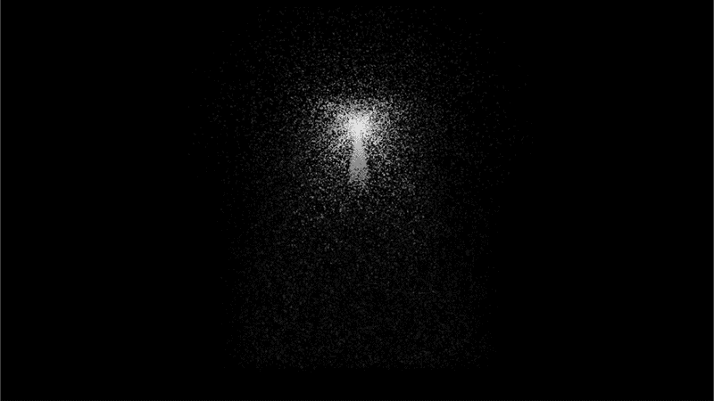

`Plume` 最好不要在鼠标按钮上持续激活，最好用一个非常长的寿命激活一次，或者每秒大约激活一次，位于飞船后面以产生排气效果？这可能意味着要在飞船上挂载一个 `Emitter`，使得飞船的位置能够反映在发射点上。

你可以调整这些值来获得理想的效果，当然，如果你能将控制变量作为参数传递给你的系统，那会好得多。

随着复杂性的增加，你会发现你可能需要向 `Emitter` 添加更多几个标准变量，以便它能创建正确类型的粒子。你可能更倾向于将更多变量发送到粒子类型的构造函数中，而不是使用初始化系统。这取决于你如何管理。

这三个简单的粒子系统可以非常简单地插入到我们现有的游戏中，用于爆炸、引擎喷流等，并且理想情况下，可以充分利用我们在这里省略的 `vec2` 类。我将它们写成独立程序，只需添加你创建的头文件即可。

粒子实际上可以作为独立的概念来工作，但配合 `Emitters` 使用时效果最好。

现在，我真的不想在这些东西上花费太多时间了，因为没有了透明度、缩放、旋转以及我们这个 2D 系统中没有的其他漂亮效果，这些粒子显得相当平淡、受限且枯燥，但创建和使用它们的原理是有意义的。

## 帧率

在我们结束本节之前，让我们简要谈一下帧率（frame rate）。

由于我们选择的更新方法较慢，这实际上使我们的游戏在树莓派 3B 上的更新率大致保持在稳定的 30 fps。这背后是有逻辑原因的。大多数单板计算机（SBC）甚至 PC 电脑的更新率都锁定在显示器的帧率上，通常为 60 fps。

但由于我们使用的系统要求在屏幕切换之前向纹理缓冲区（texture buffer）写入大量数据，因此我们实际上花费了一帧的时间来处理并写入该纹理，然后我们的系统会等待所谓的垂直空白（vblank）。这是显示器发出的一个信号，告知显示系统屏幕当前没有更新，可以安全地进行更新而不会在屏幕上产生撕裂（tear pattern）。

在垂直空白点进行更新始终是最好的，因为我们并不希望看到上一次显示的一部分和新显示的一部分。这种撕裂效应对眼睛非常不友好。

较小的纹理尺寸可能允许我们在垂直空白发生前完成处理、更新和显示，但那样可能会太小。

现在，30 fps 对于大多数事情来说其实是一个相当可以接受的帧率，但 60 fps 更好，那么 100 或 200 fps 呢？

嗯，你能够更新的实际帧率可以是任何值，这完全取决于你在主循环中做了多少工作，但我们始终会受限于显示器的帧率。你可以通过在图形初始化系统中添加此行代码来释放锁定：

```cpp
eglSwapInterval(state->display, 0); // 设置为 1 以锁定帧率
```

完成此操作后，你的游戏现在将完全自由地运行。你可以在发送最后一个值给 GPU 的瞬间要求其进行更新，尽管你也应该记住 GPU 指令可能需要一些时间来处理，因此你也可以考虑在每次游戏更新交换屏幕后的末尾添加以下内容：

```cpp
glFinish();
```


这将挂起系统直到 GPU 完成，允许你继续执行。虽然它运行良好良好，但如果你在没有锁的情况下运行，你无法确定绘图何时以及何地开始，结果你几乎肯定会遇到撕裂。不过，速度会变快，有时又变慢，然后又变快，这种不稳定性可能会非常恼人，我们很快会讨论这一点。

这些锁定函数在 2D 游戏中比 3D 更有意义，仅因为在 2D 中，事物往往更具一致性；正如我们在 3D 中看到的，大量在流动的数据决定了什么绘制什么不绘制，这会让你的处理和图形循环速度变得如此波动，这时就有时候选择了：是将帧率锁定在你已知可以处理最坏情况的值（例如 15 或 30 fps），或者解锁帧率并以所需的速率为目标，同时保持准确记录事物运行所需的时间，并使用补偿系统来应对某些帧运行比其他帧慢的情况。我们之前提到过增量时间（delta timing），但我们很快就会开始更认真地使用它。

 回顾 2D 体验

## 回顾 2D 体验

所以，我们写了一系列游戏，大多基于过去的经典作品，这些游戏将我们对对象操作理解提升到了新的水平，我们看到了数据和资源管理的改进如何极大地提高性能和内存利用。

我们有一个实用的工具库，包含了碰撞检测、剔除（culling）、AI 基础（或更准确地说是敌人逻辑），甚至以重力和原地运动形式形式了一些基础物理知识。我们学习了如何组织项目文件，并在我们的游戏组织中引入了一些结构，从非常混乱的 C 风格代码进展到接近组织良好的 C++ 架构。

我们可以滚动，可以给角色赋予逻辑，还可以自动化流程。我们知道如何读取按键（以及鼠标，但那在 3D 中更好）。我们理解了内存是如何组织的，并且可以创建大量对象并维护它们而不产生内存泄漏。我们已经建立了显示地图、屏幕、文本、精灵、粒子、发射器的运行系统，而且非常重要的是，我们意识到做某些事情有更好的方法可以更好地利用我们的硬件。

我们做了很多工作，你不注意时我也偷偷加入了一些东西，而且你正在使用与专业人士相同的逻辑和数学系统。

## 前路

但我们还可以做得更多。你也可以做得更多。现在是你制作属于自己的游戏的时候了，你拥有创建几乎任何经典街机游戏或完全完全设计的全新作品所需的所有工具。

看看 3D 真正成为主流之前的 20 世纪 80 年代和 90 年代的经典街机游戏。选一个你觉得能够胜任的。有成千上万个，我想让你尝试一个。找一个网上有其画面和音频的游戏，然后开始大干一场。你可以从零开始，也可以改编我们这里的某款游戏来制作你的游戏。

不要害怕复制游戏，为了学习目的而为经典游戏编写你自己的致敬作品并没有害处，只要你不分发它或不试图从中赚钱。

我非常想看到你游戏的截图，你可以在支持网站上找到联系邮箱，向我展示你的努力，并告诉我第一次独立完成一个完整游戏的感觉如何。

所以准备好，冲泡一杯新鲜的咖啡因饮料，然后点一些披萨。接下来的这一段硬核文本将进入其中，但请宽心，一旦我们有了一个`functional`可用而非完美的渲染系统，我们就会进入游戏机制阶段，而不再过度担心技术问题，我们会以更小、更易消化的片段来逐步添加这些内容。

你准备好了吗？让我们开始吧！


## 3D 的简要介绍

到目前为止，我们一直关注的是控制角色/化身，让它在所在的平坦世界中移动——无论是侧视还是俯视视角——我们只需显示它周围的环境来创建某种形式的交互环境。所有物体的移动都在`X`和`Y`平面上进行，我们忽略了深度的概念，而在 3D 中，深度是由`Z`轴表示的。但尽管我们忽略了它，它一直存在那里，并设置为`0`。

三维游戏的逻辑和交互与 2D 游戏完全相同，但是，那个讨厌的第三维度现在登场了。然而……假设我们仍然在某种世界空间内让化身左右、上下移动，就像我们之前在基于地图的游戏中做的那样。考虑让我们的角色向内和向外移动其实并不是一个巨大的飞跃。事实上，这几乎就是我们需要做的全部：在代码中添加`Z`概念，让角色在三维空间中移动。

这里有些棘手的地方在于我们需要找到某种方法来控制这种进出移动，我们还需改变部分交互系统，而且我们不再拥有可以检查的简单瓦片（tiles）。实际上，最大的技术问题源于如何在屏幕上表示或渲染我们游戏世界中所发生的情况。我们理解方向的概念，在之前的俯视追逐游戏中实现过，但假设我们不是八个方向，而是在三个轴上拥有全方位的`360°`方向，也就是说，指向左侧的第三颗恒星并稍微向上一点，一直移动直到黎明。

那么，如果这这么简单，为什么写 3D 游戏这么困难呢？嗯，移动很容易，我们现在知道如何使用向量了，而 3D 向量仅仅增加了第三个`Z`元素，但在 2D 屏幕上对我们的物体进行可视化要困难得多，这要求我们以不同的方式思考如何绘制或`render`渲染我们的世界。我们还需要考虑朝向和与视点的距离等问题，这带来了旋转和缩放问题，并确定在屏幕上画什么、剔除什么（cull），以及处理物体遮挡的问题。

这第三维度确实增加了大量的新视觉特征，但也带来了一堆需要克服的问题。

现在，思考这一点非常重要、非常重要，因为这能让你脚踏实地。你需要确信，尽管可视化是复杂的，但在你的世界空间中对物体进行操作并不复杂。我们知道可以将绘制与物体操作分离，所以即使你觉得渲染的技术方面很困难，我们只需要让基础功能运行起来，然后就可以专注于移动了。

移动是将我们已有的 2D 代码添加第三个维度，并重新处理部分运动数学以适应 3D 坐标和地形。当与渲染分离时，对我们角色的操作是一项微不足道的任务，但在我们的显示代码正常工作之前，我们无法正常看到它，而且基于文本的 3D 射击游戏在销量榜上的表现一直很糟糕。

尝试思考一下你是如何观察某物的，例如这一页……你的头可能稍微向前倾斜，书就在你面前，你正以你认为最适合眼睛聚焦的距离舒适地阅读着。如果书是平放在桌子上的，请拿起它，在我们进行小幅演示时将它举在面前。

双手平开书本，将书向右旋转`45°`，保持头部直立。

显然，相对于你的头部，书现在是`45°`，现在将头向左侧倾斜大约`45°`，尝试让眼睛相对于头部看向前方……我知道这会让阅读这些内容变得有点困难，但请经常回头看。

你的头部（包含你的眼睛，也就是你观察周围世界的相机）和书本质上形成了一个`90°`的角。它们彼此相对移动了……向左`45°`和向右`45°`。

现在假设你向后倾斜头部……同样是`45°`。你的相机（眼睛）现在完全偏离了那本书所在的位置……你的相机和书彼此以及它们自身都发生了扭转和旋转。

但你的头仍然在肩膀上，书仍在你手里，这两者在宇宙中仍然处于同一个位置……只是你的相对视角发生了变化。

好了，回到你正常的阅读姿势，让我们聊聊这一切意味着什么。那个微小的例子——物体彼此相对移动和旋转、在空间中移动以及在位置上旋转——是我们必须计算的这类问题的例子。计算实际上非常密集，更糟糕的是，我们必须对定义图像部分的每个点执行此操作。这些点被称为`vertices`（顶点，单数是`vertex`），在平均游戏中数量可达数十万个！因此，对所有顶点进行计算将变成巨大的计算量。我们已经见过我们的 CPU 处理几个像素的效果有多么糟糕了。那么，我们的 GPU 能处理这么多吗？

简单的答案是定的，因为我们的 GPU 专门为计算相对于相机的顶点位置设计，但它依赖于两点：

- `Vertices`（顶点）：3D 空间中的点，表示`x`、`y`和`z`坐标，给出空间中点的位置。
- `Matrices`（矩阵）：复杂的数学数组，包含位置、旋转和缩放信息。

这两个概念是我们移动物体方式的关键。所以，无法逃避可视化很困难的这一事实（非常困难），但我们不需要重新发明轮子，只需要确保它是圆的并且有足够的纹路来完成工作。和我们的 2D 游戏一样，我们将从简单的系统开始，允许我们的框架增长并处理我们在编写第一款游戏时将面临的新问题。3D 系统将是基础但实用的，我们将随着进度添加功能。

现在最重要的一点是思考，我们正在将物体放置到 3D 空间中，我们称之为世界（world）或场景（scene）。在做 2D 游戏时我们也使用了场景，但那是一个有一个扁平物体的场景，上面带有我们修改过的纹理以呈现屏幕的视觉。基本上，想象自己坐在电影院的第一排中间看电影；当你离那么近时，你看到的只有正面前的屏幕。所以我们所做的只是显示那个屏幕，每秒更新 30–60 帧一次图像。

摄像头可以向上、向下、向左和向右移动，而它们的中心位置始终不会移动，因此在计算相机能看到的所有内容时，我们必须考虑到这一点，我们将在解释什么是`LookAtMatrix`时对此进行进一步阐说明。

我们必须仔细思考场景中哪些对象是我们实际上想要渲染的。首先，我们可以立即排除相机背后的任何东西；为了复制视野（field of view），我们可能会排除任何被认为在视野之外的内容，或者距离太远、超过了我们远平面（far plane）的内容，以至于它们在视觉上只剩下几个点。剩下的部分就是我们所说的视场（view field）。

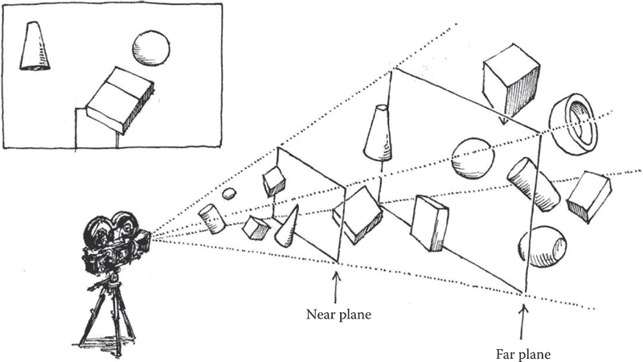

注意，我们还有一个近平面（near plane），因为我们真的不希望有些东西正对着我们的脸，即使我们能看到它们，它们也会填满整个屏幕，所以我们小行其事地产生了一个裁切点。

现在我们可以稍微作弊，拥有两种视场：一种是正方形的，也称为正交视图（orthogonal view），这基本上就是我们在 2D 中用过的；另一种是更真实的锥体，它提供了一种距离感，让物体离视点越远越小。这被称为透视投影视图（perspective projection view）。无论它是什么形状，它都被称为棱锥（frustum），它代表了一个定义的区域，我们将该区域认为是我们能够看到并应该绘制到显示器上的场景部分。

所以，我们的`Camera`将看向一个点，而它在该点及其周围看到的内容，就是我们通过现在要学习的某些 3D 转 2D 数学绘制到屏幕上的。

好了，到目前为止，现在稍休息一下，放松一下，戴上你对危险敏感的墨镜，准备就绪。

 数学！！别太害怕（真的）

## 数学！！别太害怕（真的）

我讨厌数学，我数学很烂，在我大学的编程系里这并不是秘密，我是全职员工中数学最差的人，并且经常被就此取玩笑，但要成为一名优秀的程序员并不需要擅长数学，尽管许多人会反驳你，但他们错了！要成为一名优秀的程序员，你只需要知道你总可以使用数学，并且学习如何使用数学。对我来说，这些内容的大部分都是魔法（说的时候时比个手势）。到目前为止我给了你非常简单的数学，仅足够完成我们需要完成的任务，但现在事情将变得复杂一点，至少在某个方面是如此。

尽管这种魔法可能会让人困惑，但在情况下，它是每个人都做过的魔法。大家使用的数学库、函数和标准系统对我们都是可用，所以让我们使用它们，如果必须的话就学习魔法是如何运作的，相信我，如果你有能力，这是一个好主意。但不要害怕它。如果你学会在正确的地方使用正确的数学魔法，这就是你真正需要的。

凭借有限的数学理解，你可以完成惊人的工作；如果有人向你解释某个数学函数的作用并将其分解为代码步骤，你就可以编写几乎任何数学函数……如果它产生了正确的结果，那就是欢舞时间了。即使数学基础很少，看看我们到为止做了什么？

如果你觉得确实想学一些数学，关于这个主题有很多书，但尽量专注于找到一两本专门设计用于教你游戏编程中所用数学的书；特别是与 3D 图形、运动和碰撞检测相关的内容。这三个是我们在游戏编程中使用那种类型数学的主要领域，当然还有很多其他领域，但这三个是专业且令人兴奋的……如果你喜欢数学的话！如果你不喜欢……就用代码实现它！

### 这种巫术是如何运作的？

3D 的趣味之处在于，我们在 3D 中做的很多工作，我们在 2D 中也可以做，并且一直在做。

- 我们可以在我们的世界中移动。这被称为`Translation`（平移）。
- 我们可以旋转对象，那被称为……呃，旋转（rotation），取决于你如何使用它，有时也称为`Orientation`（朝向）。
- 最后我们可以`Scale`（缩放），根据需要让物体增大或缩小。

在 2D 中，这些都是非常简单的东西，通常不需要做比保持单一旋转值更复杂的操作（这个值让我们的精灵旋转）、一个用于位置的`vector 2D`以及一个用于缩放的值。

但 3D 不同又相同，主要区别在于我们必须考虑的额外维度。我们不是沿着`X`和`Y`坐标移动，而是有`X`、`Y`和`Z`。此外，`orientation`可能会改变，我们不仅围绕`Y-axis`旋转（这会产生旋转的印象），还可以进行`X`和`Z`旋转。

最后是缩放，就像`orientation`一样，我们可以在三个方向上按不同的值进行缩放，尽管我们通常用同一个值同时处理三个方向。

还有另一个问题，我不知道这会在未来的多久之后被读到，但目前，我们没有 3D 显示器，这意味着我们需要某种系统，能够在 2D 屏幕上表示 3D 世界的视图，让我们能够保持 3D 世界的概念。这被称为`projection`（投影），需要大量的计算。

但不用担心，数学的大师们很久以前就发现了一种我们可以使用的巫术形式：看，`Matrix`（矩阵）！


这并不怎么想象力对吧？但你知道，数学家并不以想象力闻称，但那组数字看起来是这样：


每个矩阵真正的区别在于正确数据位于矩阵的位置。

你可能还注意到对角线上有一序列 1，特别是在平移矩阵中，它们并没有被改变。

只包含这些对角线 1 的矩阵被称为单位矩阵（Identity Matrix），通常用毫无想象力的字母`I`表示。它本质上是我们任何矩阵初始化的基础，在我们创建新矩阵时从`I`开始是非常重要的。

一个针对`X 轴`的旋转矩阵与其他矩阵相比看起来是这样的，其他的在之前的图中。

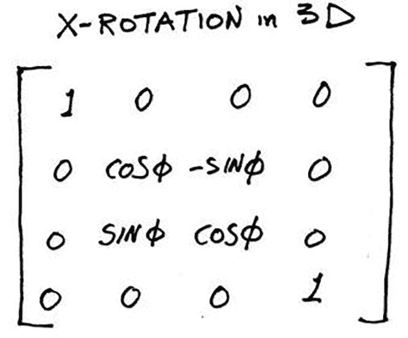

但是，这些矩阵是如何使用的，非常非常酷，这才是真正的巫术！可以将向量与矩阵相乘，并创建一个新向量，其数据代表对向量中数字的变换动作，这可以是任何一种变换！所以如果我们想绕`X 轴`旋转，我们就把角度的`cos`、`–sin`、`sin`和`cos`代入矩阵中，并执行`Matrix*vector`相乘。

在 C++ 编译器中并没有实际的算术函数允许你执行这种操作，我们通常会重载`*`操作符，这样当编译器看到我们正试图将一个矩阵乘以向量以生成新向量时，它会执行一组相当简单但数量大量的乘法和除法。这种机制的实际工作原理类似于这样：16 次乘法和 12 次加法。

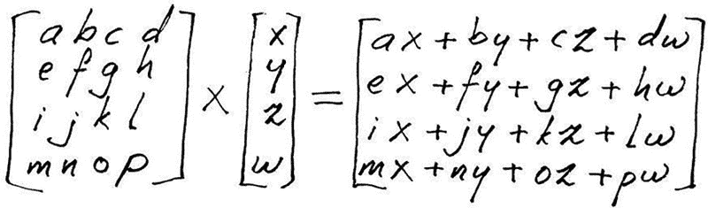

然后我们在新的向量中得到结果，我们还可以设置平移（Translation）和缩放（Scaling）矩阵，然后依次乘以生成的向量，以逐一得到该点在空间中经过缩放、平移和旋转后的最终位置……或者……等等一下！我们实际上可以将这三种不同的操作合并成一个主变换矩阵，然后对向量进行操作。这种合并矩阵的能力坦率地说用处惊人，它让原本可能非常冗长的重复多次计算序列变得短小得多。当所有不同类型的矩阵合并后，我们就有了一个主变换矩阵，然后可以用它处理每一个我们需要操作的向量。

让我们先单独观察不同的操作，然后尝试将它们结合起来。

所以，如果我们想围绕原点旋转一系列点，可以使用方向矩阵……但等一下，你提到的这个“原点（Origin）”是什么……嗯，我们需要考虑一个中心点，我们的模型通常被存储或创建为像这样朝上/朝前存在的对象：

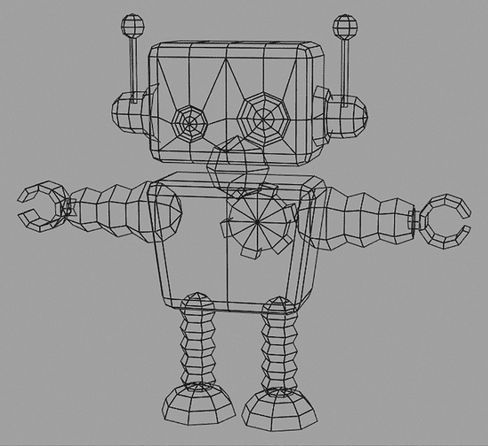

这个看起来很友善的小家伙在支持网站上供你玩，但目前他正尽力摆出达芬奇式的维特鲁威人姿势，面对（几乎）并垂直站立，他在任何轴上都没有旋转，除了极微的 Y 轴扭转，并且位于世界空间中`0`、`0`和`0`的原点。他基本上很无趣……尽管非常可爱。

显然，他需要围绕其 3D 轴的任何一个旋转，这是在他自己的中心点进行的，但如果我们使用矩阵在空间中的某点而不是中心点来旋转他，就会得到这样：

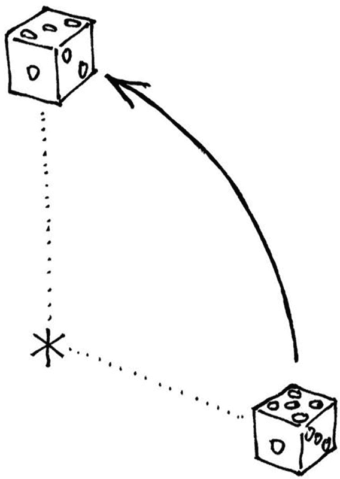

物体旋转了，但因为不在原点，每个顶点的距离被被用来计算新位置……这正是我们想要的。

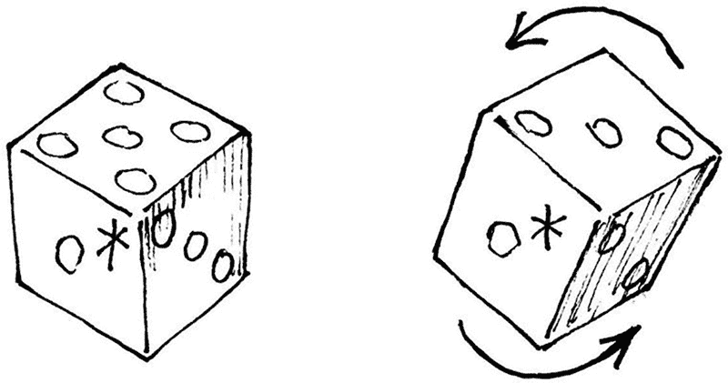

其中立方体的中心就是原点。

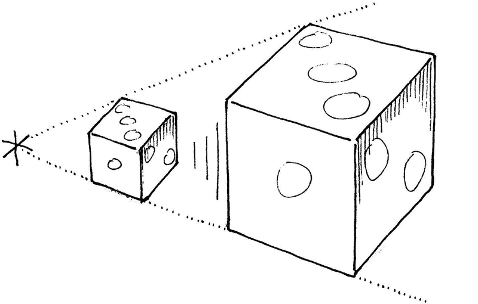

缩放（Scaling）也会发生相同的问题，如果物体不在原点，那么缩放实际上会导致移动和缩放。我们想要更像这样的。

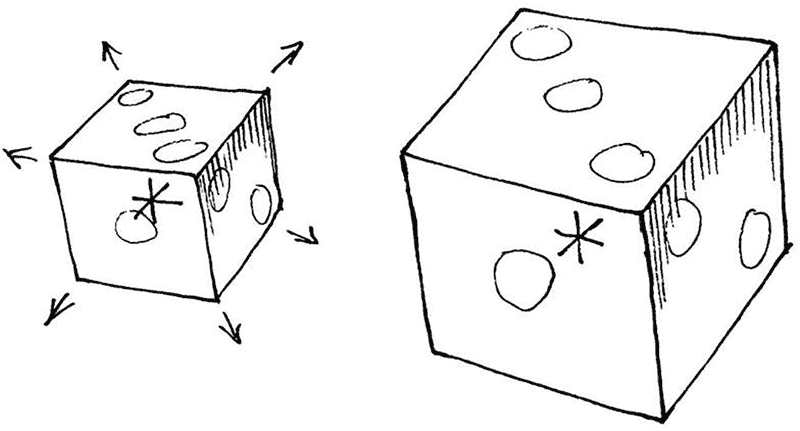

现在这取决于你如何思考这个问题，我们要么是将模型的中心移动到它宇宙的中点，要么是将宇宙的中心点移动到它的中心……但无论我们怎么想，我们的模型都必须位于`0`、`0`、`0`原点，然后移回它的世界位置。由于我们围绕原点旋转，尝试在它的世界位置旋转他实际上会让他围绕该原点移动，因此需要移动，即平移。一旦他自己的中心点位于`0`、`0`和`0`，我们就可以绕三个轴的任何一个轴旋转，然后将其滑回去。

很好的一点是，我们通常始终让模型基于`0`、`0`、`0`位置，我们使用的平移系统仅在缩放完成后移动它们。

所以这是一个两个阶段的过程：首先让物体像在`0`、`0`、`0`（默认）位置一样旋转，然后平移到它所在的空间点。

两个阶段……如果我们想在平移之前进行缩放（缩放也需要在原点进行），那就是三个……阶段，嗯，那是大量的计算。

### 好的，这这是一件好事吗？

嗯，并不是，大量的计算从来不是好事，但无法避开它们，我们必须做这些计算，所以诀窍在于减少我们可以省掉的计算次数。

这正是矩阵这些东西非常酷的地方，因为它允许我们将这三种不同类型的变换合并成一个超级全能的变换矩阵。

这是通过特定的顺序将矩阵合并在一起完成的。顺序至关重要，因为如果你按照错误的顺序执行，它们根本不会像我们预期的那样工作。

大多数 C++ 数学库都有自己的合并矩阵（`matrix`的复数）的方法，这种过程称为拼接（concatenation），使用操作符重载或新函数来提供我们需要的方法，它并不是严格的 C++ 标准标准概念，有时拼接矩阵的方法会有所不同，但原理是非常标准的。我们在支持网站上有一个基础 3D 项目，叫作……`3Dbase`，并不意外。去下载并确保它能编译。它目前还做不了什么。它目前只包含基础的 3D 数学，还没有什么用的代码。我们将在需要时编写更多函数。

### 好的，以上就是使用矩阵来定向我们模型的理论，但那只是故事的一半。

一旦根据游戏世界的需求完成了定向……我们仍然必须显示它们，并且让它们在虚拟宇宙中都位于`0`、`0`、`0`是不现实的。

`3Dbase`目前仅仅是一个模型查看器，它非常简单，应该提供一些见解，它的关键在于让它们在虚拟宇宙中都位于`0`、`0`、`0`是不现实的。

是的，确实是这样，我们引入并解释了向量（Vectors）和矩阵（Matrices）的概念以及它们是如何运作的，但要制作一个像样的 3D 游戏，我们所需的功能只有极小部分。我们完全没有手段来操作它们，因此我们需要使用数学库。我们谦虚且深受喜爱的`Vector2D`类在我们的 3D 世界中无法胜任。

编写自己的库是一个合理的论点，我们可以学到很多，但坦率地说，我们只会构建一个只包含目前需要的功能的库；从现在起，编写一个完整的数学库并将其用于我们所有的项目对我们来说是一个很棒的主意。

这是我非常希望你在开发过程中的某个时刻做的事情，当你完全理解你的数学库需要做些什么时。但由于这个过程可能需要几周、几个月，甚至是几年，也许我们最好回到公共领域寻找一个良好且可靠的系统。


# 安装数学库

有几十个（我是真的几十个）免费的数学库，而且它们可能都非常优秀，因为一个不按预期工作的数学库往往很快就会被移除或修复。

但我选择的`library`是`GLM`，全称为 (Open) GL Mathematics。它是一个功能齐全的数学系统，由一系列头文件组成，这些文件生成处理数学运算的代码。它已经存在于新框架中了，因为这是一个基于头文件的库，只需要`.h`文件即可安装。

你可以从以下地址下载下载：[`www.glm.g-truc.net`](http://www.glm.g-truc.net) 或直接在 Google 上搜索 GLM 下载。

现在，GLM 使用`.hpp`来表示它是一个头文件，因此我们需要向 VisualGDB 应该发送的文件类型中添加`.hpp`，它还使用一种名为`.inl`的文件类型，所以我们将这两种类型添加到要传输的文件类型中，这样做，它将在下一次构建时传输我们当前需要的所有文件。

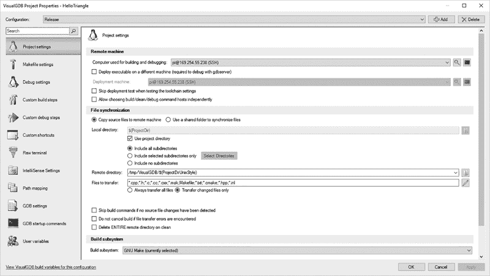

现在要在我们的项目中使用它，我们可以在需要的地方添加以下头文件：

```cpp


// Include GLM

#include "glm/glm/glm.hpp"

using namespace glm;

```

这将包含 GLM 的主要核心功能，或者你可以选择只包含你的文件实际需要的功能，如下：

```cpp
// Include spefici GLM features

#include <glm/vec3.hpp> // glm::vec3

#include <glm/vec4.hpp> // glm::vec4

#include <glm/mat4x4.hpp> // glm::mat4

#include <glm/gtc/matrix_transform.hpp> // glm::translate, glm::rotate, glm::scale, glm::perspective
```

# 危险，罗宾逊！

我正在做一件我向过自己不要做的事情，穿越时回到这本书的早期，给你一个来自未来的警告。在本书的末尾，我注意到我在使用一个稍旧的 GLM 版本，因此我更新了。有一位老程序员说，永远不要在项目中间进行更新，这是一种明智的预防措施，因为更新我的 GLM 版本完全从那个点起破坏了我此之后的所有代码。

我知道你将下载的 GLM 版本也将我后来使用的版本，因此我必须防止你遇到相同的问题。

问题的原因实际上非常奇怪，而且花了相当的时间才找到，但最后追溯到 GLM 后期版本中的问题与我树莓派上的某些系统文件发生冲突。它会抛出大量的编译器错误，这些错误与实际编译的代码无关。事实证明，这没有简单的修复方法，尽管已经报告给了 GLM 团队和 gnu 编译器的制作者（以防是他们的问题），但目前还没有立即的修复！不过，有一个通融方法（hack）。它并不理想，但它能让你继续下去。我们要感谢我的学生 Viktor Zoutman 和 Rick van Miltenburg，他们对编译器行为有着深刻理解并想出了解决方案。在使用任何 GLM 包含文件之前，添加此行：

```cpp
#undef countof
```

我可能也会在 GLM 包含之后添加它。原因是，在树莓派的视频设置中的某些系统文件在使用 `bcm_host.h` 时定义了这个值，GLM 也是如此，这可能导致编译器混淆，当它尝试使用其中一个定义而不是另一个时产生很多错误。这基本上是我们在像这样的情况下使用 C++11 时 GLM 的一个缺陷，是游戏开发中我们必须面对的那些抓狂时刻之一。我将确保支持网站上所有使用 GLM 的文件都包含此修复，并在 GLM 团队妥善修复后在网站上通知你。

# 恢复正常编程

与 SOIL 库不同（我们注意到它会导致编译时间大幅减慢，并且需要封装来让编译时间容易一点），GLM 非常紧凑，简易地包含在任何需要数学运算的文件中而无需封装。但如果你想做，你可以这样做！从现在起，我们将使用 GLM，并在转向 3D 时更详细地使用它。

选择 GLM 的主要原因是它拥有极其丰富的功能，以及它在开源社区中拥有庞大的支持者，所以如果你遇到问题，可以在论坛上寻求帮助。

现在当我们可以创建和操作矩阵时，我们必须意识到在使用矩阵时有几个规则。矩阵不能是空的。填充了 0 的矩阵乘以一个向量会产生 0，这在标准算术中是有意义的，但在矩阵中不是。所以初始化矩阵的方法是加载 `I`，单位矩阵。这样你可以确保向量 `V * I` 将保持不变。就像 `1 * 20 = 20` 一样；`I * V` 将等于 `V`。

其次也是重要的是，当你组合矩阵来执行缩放、旋转和平移时，组合的顺序至关重要。在日常标量数学中，`7 * 8` 等于 `63`，`8 * 7` 也等于 `63`。这被称为交换律。但矩阵数学没有交换律，虽然 `M1 * M2` 产生 `T1`，其中 `T1` 是你可以用于某些函数的变换矩阵。`M2 * M1` 绝不等于 `T1`，将是完全不同的 `T2`，有时如果你混淆了它们，可能会产生一种新奇且奇怪的值，但更多时候会导致一种不那么有趣的、抓头发并把电脑扔出窗外的后果。对于 3D 图形，矩阵组合的正确顺序是缩放、旋转，然后是平移。如果你顺序错了，可能会非常明显，但为了让我们的生活更复杂，代码看起来像这样：

```cpp
glm::mat4 mModelMatrix = mTranslationMatrix * mRotationMatrix * mScaleMatrix;
```

反向的？？因为编译器在看到一行优先级相同的操作数时是从后往前工作的。是的，我知道，这很困惑对吧……但但我在这里是为了防止你犯我犯过的错误，并避免掉掉头发和电脑，只是要意识到，如果你使用的是新的或非标准的编译器，有极微小的概率它可能、仅仅是可能会反过来工作。所以，请尽早测试你的矩阵，以确保顺序是正确的。

# 三种矩阵类型

是的，抱歉我们还没有完全讲完矩阵（Matrices），所以你可能已经意识到了它们有多重要了，不过没关系，既然我们已经知道了矩阵是什么以及它的作用，现在是解释我们如何在项目中使用它们了。

在 3D 游戏渲染中使用了三种基础类型的矩阵，每种类型都是独特的，且功能略有不同，但所有它们都需要被完全理解。

这三种类型是模型矩阵（Model Matrix）、视图矩阵（View Matrix）和投影矩阵（Projection Matrix）；我将逐一介绍。

## 模型矩阵 (Model Matrix)

这是最容易解释的一种。`Model` 矩阵代表了我们要处理的对象的平移（Translation）、三轴旋转（`3xRotation`）和缩放（Scale）矩阵的组合值。同样，精灵图（sprites）也有一个中心点，四个角被定义为相对于该点的偏移。一个 3D 对象将有一个 `Model` 矩阵，它可以作用于中心点 `0, 0, 0`，并且构成图像的所有顶点都是相对于该点描述的。当这些顶点每一个乘以此矩阵时，它们将找到它们应该所在的世界位置！

当控制 `Translation`、`Scale` 或 `Rotation` 的其他矩阵发生任何变化时，`model` 矩阵需要重新计算，但一旦创建，`model` 矩阵就可以反复使用。

所以基本上，我们的 `Model` 矩阵是模型在世界中旋转、缩放和位置的容器，并用于在世界中移动它，并在一个相当简单的矩阵中表示它的缩放和朝向，一切都计算完毕并准备好使用。

## 视图矩阵 (View Matrix)

`View` 矩阵更有趣，它涉及到相机，并回到了我们在 2D 卷中提到过的一个概念。是屏幕在移动还是地图在移动？我选择认为地图围绕视角移动，在这里我们有类似的想法。就像 `Model` 一样，相机本身存在于空间中的 `0, 0, 0` 点。现在我们可以把它放在任何地方，但在数学上，将相机所在点视为 `0, 0, 0` 要容易得多，这意味着如果相机移动，整个世界都必须移动，或者更准确地说，里面的东西必须移动。

这直接源自《沙丘》中“无中移动”的想法，如果你的相机是一艘经过改装的飞船；它停留在原地，而宇宙围绕它移动。这并不是说相机实际上没有移动，它当然在移动，它有允许我们四处移动的世界坐标，只是为了将某些物体引入视野，我们需要使用 `view` 矩阵将它们与相机联系起来，以计算它们相对于相机的相对位置！

为了让它更令人烧脑，相机还可以旋转，我想它们甚至可以缩放，但我从未见过这种操作，不确定是否实际上会有任何影响，但你确实可以旋转相机，从而改变相机所观察的空间区域/体积。

看，这里；这就是为什么我讨厌数学，即使是向你解释这些也让我头疼，但这确实解释了为什么我们倾向于使用一些很棒快捷方法，例如重载运算符和添加小的辅助函数来简化问题。

这是 GLM 提供的最有用的辅助函数之一，`lookAt` 函数。

```cpp
glm::mat4 camMatrix = glm::lookAt(
    camPosition, // 相机的世界位置！
    camTarget,   // 我们在看什么
    upVector     // 哪个方向是向上！（或者如果你喜欢也可以是向下）
);
```

现在它为我们处理了所有讨厌的旋转问题，至少目前它为我们提供了一个简单得多的我们可以联系的概念，用我们能理解的术语。

## 投影矩阵 (Projection Matrix)

这一个解释起来更加棘手，但实际上我们正试图获取相机能看到的视图，以模拟人眼或相机的视野，在里面会有很多与模式/对象相关的顶点。回想我们正在窥视的那个盒子，盒子有物理尺寸和深度，定义了它的边缘；这是一种尝试定义这些边缘并用数学方式使用不同形状盒子的方法。

一旦我们定义了那个 `box`，然后通过某种方式，将其转换为一种视图，然后可以用这种视图将盒子中的 3D 顶点转换为 2D 屏幕坐标。

离相机的物体看起来需要比远处物体大，使得物体看起来像金字塔视图，由于我们将 `real` 世界样本的立方区域变成了那个金字塔视图，我们还必须变形/缩放物体以让它们看起来正确……我说过这很棘手！让我们尝试视觉化！

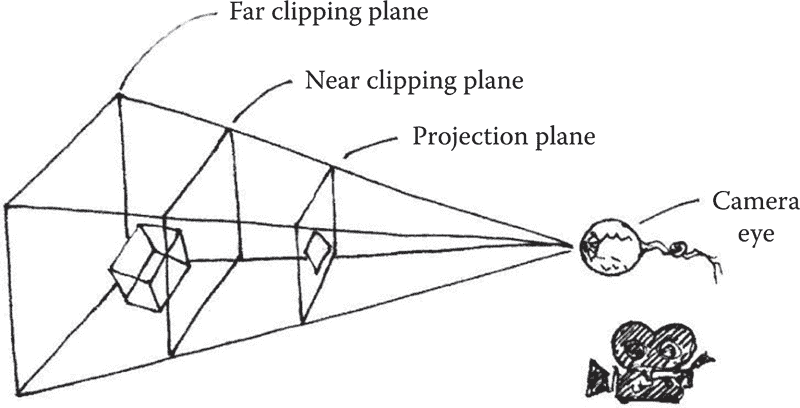

我们的 `Eye`（眼睛）从侧放的金字塔开始，在沿着这个金字塔的某处是我们的屏幕，金字塔被正确地称为 `Frustum`（视锥体），因为它本质上是一个知的数学形状，我们能够将可见顶点的坐标转换为我们想要在屏幕上表示的 `Projection` 平。`Near`（近）和 `Far`（远）裁剪平面本质上是截止点，在它们之外或之内我们不想真的处理这些东西，否则我们会画到无限远。

`Projection` 有三种常见类型，但我们通常关注两种。旧的 2.5D 样式或——我们想要的 `Perspective Projection`（透视投影）。但我们也可以使用另一种类型称为 `Parallel Projection`（平行投影），它对于 2D 非常有用。

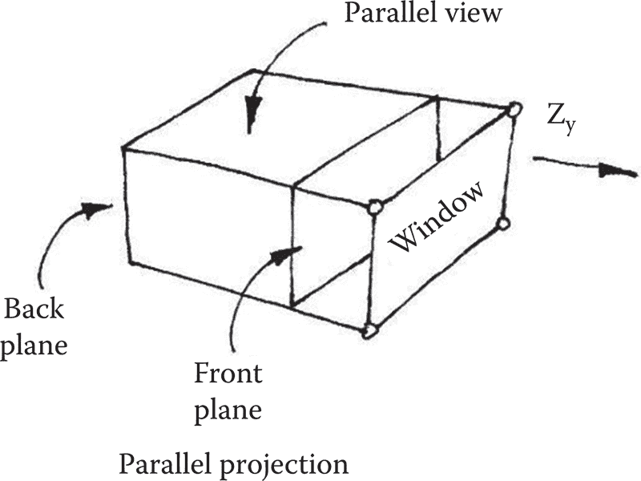

不是我们的眼睛，我们有一个窗口，我们在上面绘制顶点。点在于我们可以以角度的形式表示我们想要看到的范围，这很难视觉化，但我们很幸运 GLM 给了我们另一个辅助函数来创建投影：

```cpp
glm::mat4 projectionMatrix = glm::perspective(
    FoV,         // 视野
    4.0f / 3.0f, // 宽高比
    0.1f,        // 近裁剪平面
    100.0f       // 远裁剪平面
);
```

这些东西中有些需要解释，例如 `FoV` 是新术语。它代表 `Field of View`（视野）。它基本上描述了当你直视时看到的水平角度大小。人类的眼睛在前方可以看到大约 180°，但实际上我们只感知边缘的运动而不是细节，我们的立体视野限制在 130° 左右，尽管主要与运动和颜色有关。这就是为什么我们作为视觉动物，直接观察想要检查的东西，所以我们使用最敏锐、最详细的视野。从相当窄的 30°–90° 视野都是舒适的人类焦点，但如果你想玩的话，较大的值可以创建很好的鱼眼效果。

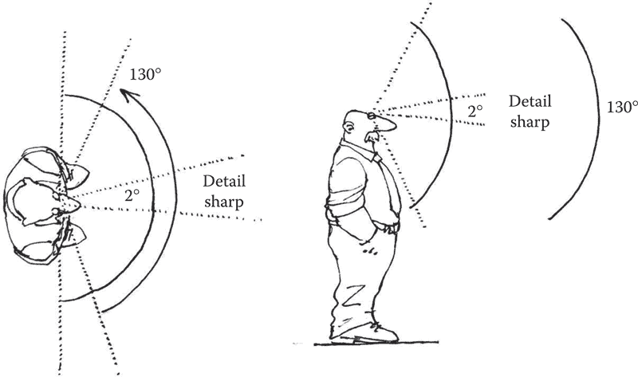

我们倾向于忽略垂直视野，尽管有方法将其整合，我从未见过很多用途，但我确定这在虚拟现实（VR）头戴设备上会改变。

裁剪平面（Clipping planes）决定了我们能看到和看不到物体的地方。如果你把手贴近脸部，它会遮挡你对远处物体的视。我们的相机在移动位置没有任何物理限制，因此它极有可能移动到物体正前方，从而遮挡视线。能够移除某些物体让我们能够消除那种“进入物体内部并在其中间观察”的奇异感。不过，如果你愿意，你也可以保留它们。

同样，远平面（far plane）规定了我们相机视野的极限。随着物体变得越来越远，辨别它们是什么的能力就会降低，此时忽略它们比观察它们更有效。无限视野对于游戏来说并不理想，但谁知道呢，你可能会发现为了某种效果你想把这个数字设得非常大。

## 这三个矩阵的关系

为什么我们需要三个不同的矩阵呢？因为我们必须修改所有的顶点，并以某种方式让它们在 2D 屏幕上产生意义。我们可能有几万甚至十万个顶点，每一个顶点都需要经过某种变换，以计算出它们在屏幕上的相对位置。考虑到物体可以在局部空间和世界空间中进行缩放、旋转和平移，并且相机也可以平移和旋转。实际所需的数学计算量是惊人的。

但惊讶的是，它也相当简单，而且我们已经有了 GPU 形式的硬件，它们非常擅长处理这些……如果我们向它们发送正确的数据！它们需要的是`模型视图-投影矩阵 (MVP Matrix)`（我稍后会解释），以及这几万个顶点的列表，然后它们就开始执行工作了。

所以，产生最终结果包含一个三阶段的过程：

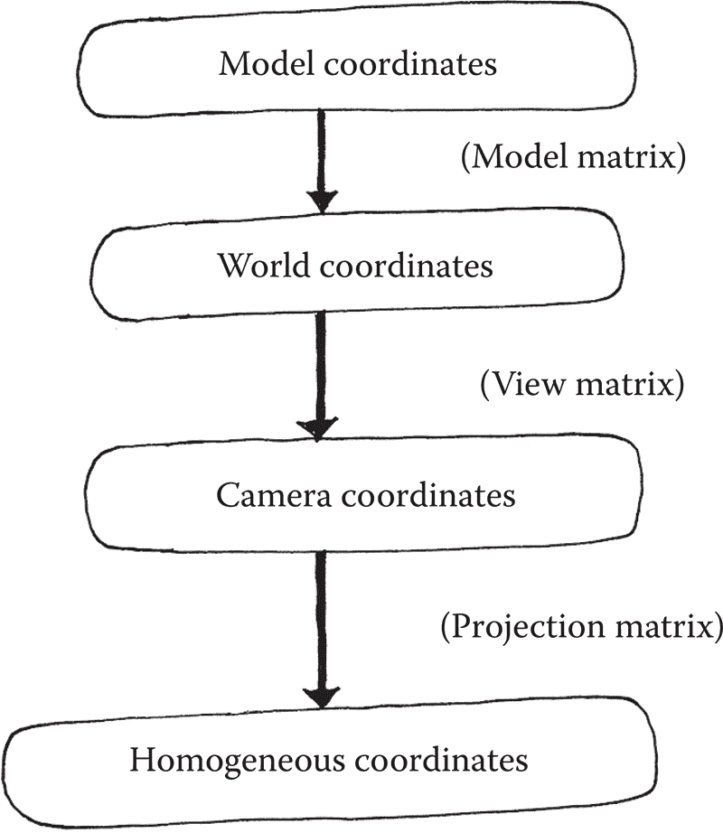

首先，我们获取模型坐标，然后使用任何需要的变换（如平移、缩放和旋转）将其转换为世界坐标。

然后，这些世界坐标通过我们的 `View`（视图）或相机矩阵进行变换。

接着，我们的 `Projection`（投影）矩阵将它们转换为良好的 2D 坐标。

当然，我们可以将这些不同的矩阵合并成一个超级全能的 MVP 变换矩阵，如下所示：

```cpp
glm::mat4 MVPmatrix = projection * camera * model;
```

（记住它是倒写的，因为每个矩阵的算术优先级相等）

所以，我们得到了 MVP 变换矩阵，如果我们对物体的顶点使用它，就可以计算出它们在屏幕上（实际上是在屏幕外）的何处绘制一点，或者在我们的案例中，是一个填充了纹理的点集。

## 其他矩阵函数

矩阵还提供了其他几个函数，允许我们做更多有趣的事情，例如：

- 转置（Transposition）：在行主序和列主序格式之间切换。
- 标量操作（Scalar manipulation）：本质上是将矩阵乘以缩放值。
- 矩阵的加法和减法。
- 行列式（Determinant）：用于寻找 `Matrix` 的逆等。
- 逆（Inverse）：用于解决无法除法的问题。
- Voodoo、黑魔法和巫术：这基本上涵盖了我在整个职业生涯中可能用过一两次的所有其他矩阵函数，它们确实存在并存在于几乎所有的数学库中。

我会在需要的时候再解释这些，因为如果我们强行加载许多我们还没准备好使用的复杂数学，可能会让任何对数学真正反感的人望而畏。

我们无法真正逃避对这类数学的需求，但我们可以尝试在它们变得符合我们的需求时再引入，这样当我们看到它的实际作用时，学习起来就会容易一些。

## 移动

我们还有一件事需要考虑：运动！到目前为止，上、下、左、右是非常简单的概念，我们一直在 `X` 轴和 `Y` 轴上滑动。增加 `Y` 向上，增加 `X` 向左，减小 `X` 向右（这似乎不符合直觉，但使用相机时，我们是在向后看向 OpenGL 3D 中的 `0, 0, 0` 点）。

现在我们还可以使用 `Z-轴` 添加进入和向出。你可以说这是六自由度运动中的沿轴移动，但如果我们不是沿轴移动呢？

我们还需要考虑另外两个运动概念：向前（Forward）和向后（Back），我们希望朝着指向的方向移动，这个方向可以是 `360° × 360° × 360°` 中的任何一个。这就是朝向（orientation）介入的地方，它变得复杂了。尽管实际上我们想要的只是一个加到当前位置的向量，以便我们朝着指向的方向移动。我们会在需要时涵盖这一点，因为获取这种向量有多种方法。

向前和向后也引导我们得到相对的左、右、上、下，甚至是“那个方向”。也就是说，取决于我们面对的方向，如果你在 `Z-轴` 上旋转了 `90°`，那么相对的左实际上可能是绝对的向上。

这……就是 3D 变得令人混乱的原因，但我们会慢慢引入这些内容。

好了，数学课上完了……目前为止！我们该休息一下了，我会让你们思考一下。


## 回顾 Hello Triangle

现在回到我们做 OpenGLES 2.0 时，方法非常麻烦。让我们先考虑这个程序做了什么。它首先设置窗口，在此期间编译了一个顶点着色器，代码如下：

```cpp
byte vShaderStr[] = "attribute vec4 a_position;\n"
"attribute vec2 a_texCoord;\n"
"varying vec2 v_texCoord;\n"
"void main()\n"
"{gl_Position=a_position;\n"
"v_texCoord=a_texCoord;\n}";
```

我们所做的只是将输入的属性加载到输出值中。我们想做的是使用矩阵，以便根据相机的位置来改变我们看到的内容。

将你的 Hello Triangle 项目复制到名为 `HelloMatrix` 的新文件夹中，从该新目录启动并确保一切运行正常。

在 VisualGDB 项目属性中为 `*.hpp` 和 `*.inl` 添加文件类型。

很好，现在在我们的 `HelloTriangle.cpp` 文件中添加这些头文件：

```cpp
// Include GLM

#include "glm/glm/glm.hpp"

#include "glm/glm/gtc/matrix_transform.hpp"

using namespace glm;
```

```cpp
UserData *userData = p_state->user_data;

// 投影矩阵：45° 视场，4:3 比例，显示范围：0.1 单位 <-> 100 单位

glm::mat4 Projection = glm::perspective(45.0f, 4.0f / 3.0f, 0.1f, 100.0f);

glm::mat4 View = glm::lookAt(
    glm::vec3(17, 23, 3), // 相机位于 (17,23,3)，位于世界空间
    glm::vec3(0, 0, 0), // 朝向原点
    glm::vec3(0, 1, 0) // 向上（ 0,-1,0 将导致倒置）;););

// 在这里硬编码一个空的模型矩阵 (I)

glm::mat4 Model = glm::mat4(1.0f);

// 创建 MVP 矩阵

glm::mat4 MVP = Projection * View * Model; // 注意顺序似乎是反的
```


```cpp
GLuint MatrixID = glGetUniformLocation(userData->programObject, "MVP"); // 看这里！

GLfloat TriVertices[] =
{
    0.0f, 0.5f, 0.0f,
    -0.5f, -0.5f, 0.0f,
    0.5f, -0.5f, 0.0f
};

// 设置视口
glViewport(0, 0, p_state->width, p_state->height);

// 清除颜色缓冲区
glClear(GL_COLOR_BUFFER_BIT);

// 使用程序对象
glUseProgram(userData->programObject);

// 将我们的变换发送到当前绑定的 Shader，
// 在 "MVP" 变量中
glUniformMatrix4fv(MatrixID, 1, GL_FALSE, &MVP[0][0]); // 看这里！

// 加载顶点数据
glVertexAttribPointer(0, 3, GL_FLOAT, GL_FALSE, 0, TriVertices);
glEnableVertexAttribArray(0);
glDrawArrays(GL_TRIANGLES, 0, 3);

if (glGetError() != GL_NO_ERROR) printf("Oh bugger");
}
```

这里的改动并不大，但在开头你可以看到我创建了一些`Model`、`View`和`Projection`矩阵，使用了一些硬编码的数字，通常我们并不会这样做。

另外非常重要，注意我两次注释了`LOOK!!!!`（看这里！）。这指的是我们实际上正在从`Shader`获取一个名为`MVP`的统一变量的句柄，而在第二个实例中，我们将该`MVP`发送到了`Shader`。

但目前`Shader`还没有编写。

你可以运行它……它会编译，但无法正常工作，你会得到一个空白屏幕，或者可能甚至是`Shader`错误。

所以我们需要在初始化代码中编写一个新的`Shader`，并将顶点 Shader 替换为以下内容：

```cpp
GLbyte vShaderStr[] =
"attribute vec3 vertexModelPosition ;\n"
"uniform mat4 MVP;\n"
"void main(){\n"
" gl_Position = MVP * vec4(vertexModelPosition,1);\n"
"}\n";
```

引号和`\n`值目前是必不可少的邪恶，一旦我们的`Shader`管理器就绪，我们就会处理它们。不过移除这些引号后，我们得到了简单易读的内容：

```cpp
attribute vec3 vertexModelPosition ;

uniform mat4 MVP;

void main()
{
    gl_Position = MVP * vec4(vertexModelPosition,1);
};
```

现在我们可以清楚地看到`gl_Position`不仅仅是输入数据的再次输出，这次输入的`vec3`——`vertexModelPosition`正在通过`MVP`进行变换，而这正是我们在绘制过程中计算并发送到`Shader`的。

现在运行它，你将看到一个神奇的画面。

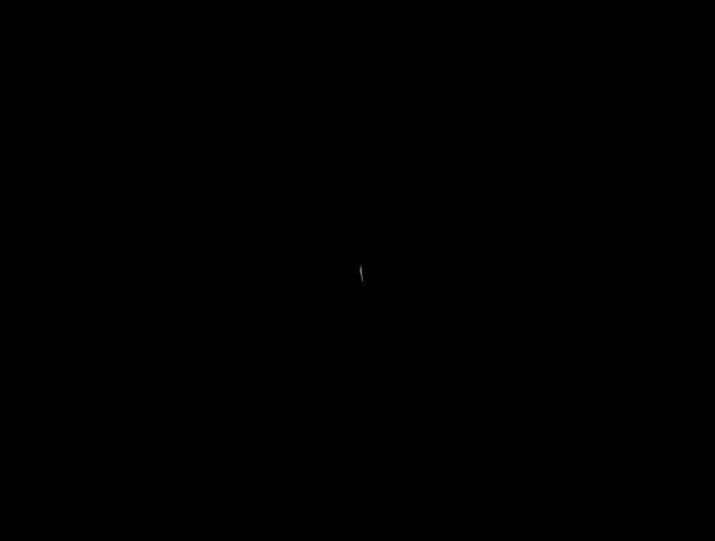

真的，那很奇妙，那是我们的老朋友三角形，但现在是从一个距离`glm::vec3(17, 23, 3)`单位的相机观察的。将`lookAt`函数中的位置值更改为`glm::vec3(7, 3, 3)`（离近一点），然后再次编译，很酷吧？


现在尝试`glm::vec3(0, 3, 3)`。

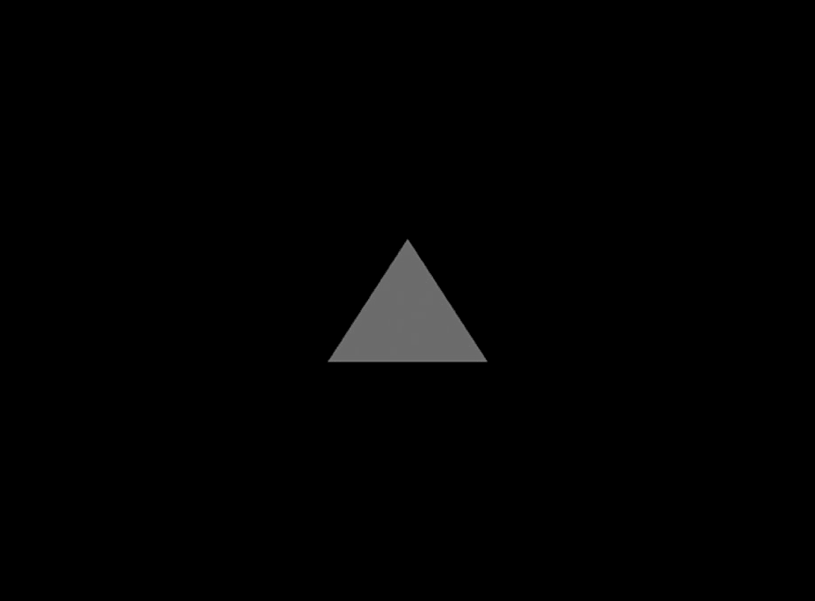

这开始变得有意义了吗？得益于我们将模型矩阵设置为`I`，你的三角形被放置在了`0, 0, 0`。我们的`LookAt`矩阵将相机放置在距离它的一段距离，然后投影矩阵（或者更准确地说是三者的组合）放入`Shader`代码中，将其转换为一种视觉效果。

当然，使用硬编码的值这样做是非常笨拙且没用的，它的实际用途是让我们创建一个简单的顶点，当我们发现更有效的方法来更改模型和相机时，将为我们提供移动手段。我们不太可能修改`Projection`矩阵，除非我们计划使用不同的模型等等。我们需要做的是创建拥有自己的`Model`矩阵的对象，最重要的是它们可以根据我们的意愿移动、旋转或缩放。一个相机（如果你真的想要的话，是多个相机）以及一个保持一致的`Projection`矩阵，用于观察它。

```cpp
glVertexAttribPointer(0, 3, GL_FLOAT, GL_FALSE, 5 * sizeof(GLfloat), CubeVertices); // 使用 3 个值，但每次增加 5 以跳到下一个
glEnableVertexAttribArray(0);
glDrawArrays(GL_TRIANGLES, 0, 36);
```

但是，除了顶点列表不同，以及对属性指针（attrib pointers）进行了稍微仔细的设置（我使用了`sizeof`运算符来检查 float 的内部大小，以便跳过存储在`CubeVertices`中的最后两个值），对于立方体来说，其绘图系统和三角形几乎是一样的！试一下吧，你会得到这个：


现在我们开始进入正题了，我们实际上可以画出一个清晰的、3D 且肉眼可见的实体。不过，它看起来有点单调且是的，但我们很快就会解决这个问题。

首先，我们需要让这个绘图程序变得灵活得多，所以让我们检查一下它实际上在做什么。

它设置一个视图……然后设置它想要发送给 GPU 的数组，最后发送数据。然而，在执行`glDrawArrays(GL_TRIANGLES, 0, 36)`之前，什么都不会发生，而且在调用`eglSwapBuffers(esContext->display, esContext->surface)`命令之前，我们实际上也看不到任何画的内容。这意味着我们可以设置并绘制任意数量（合理范围内）的数组，将它们发送到 GPU，调用`glDrawArrays`并重复，直到我们准备好显示屏幕。

我们在做 2D 游戏时做过类似的事情，我们在基础游戏对象系统中有一个绘图程序，用于绘制与对象相关的图像/精灵，然后移动到下一个对象，处理它，然后绘制它。重复直到完成。

所以这里并没有什么特别的。目前我们还没有任何对象类（Object Classes），这就是为什么这个越来越笨拙的`Draw`函数开始显得很无力。如果我们向代表 3D 对象的类中添加绘图系统，而该类本身包含其数据或指向通用数据的指针，那么我们应该能够处理我们的对象、绘制它们，并最终通过`SwapBuffer`命令进行显示，这与我们 2D 游戏的方法完全一样。

这里有更多证据表明，3D 游戏实际上与 2D 游戏并没有太大区别。只是复杂了一点。

## 极易发生的错误

我需要提醒你的一点是，我们使用`GLM`和`OpenGLES2.0`时矩阵的顺序。当你手动用数值加载它们时！我在视觉上将它们表示得类似于 2D 数组。它们确实是那样的，但你访问它们的方式非常不同。

在 2D 数组中，你使用`[行][列]`顺序（行主序）来设置或获取数组中的数据。但 OpenGL 和默认的`GLM`库中的矩阵使用`[列][行]`顺序（列主序）。这可能会让你有点绕筋，但通常只要你记住将其视为行主序系统，并以列主序的方式使用它，一切都会正常。

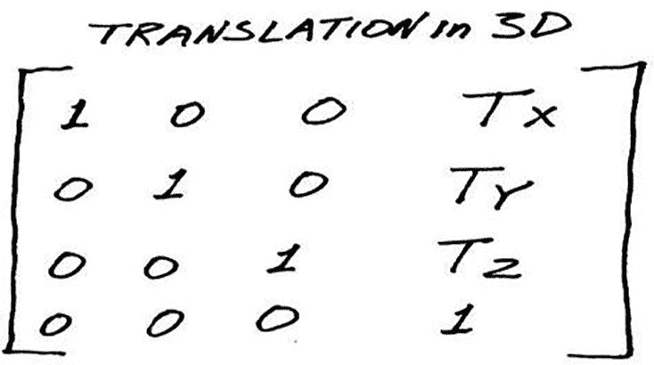

在这里，`Tx`在视觉上位于`Mat[0 row][3 col]`。

但当使用`[][]`索引到使用列主序的矩阵时，它实际上位于`Mat[3 (col)][0 row]`，以设置`Tx`、`Ty`和`Tz`值，即`Mat[3][0]`、`Mat[3][1]`和`Mat[3][2]`。

DirectX 编码员当然会抱怨这完全是错误的……但只是不同而已。DirectX 使用行主序，所以如果你是从那里过渡过来的，它可能会让你掉几次跟。

以后，你将使用更快的方法来设置矩阵，不太可能让你绕筋转向，但现在由于你正在手动操作以习惯它们，这是一个需要记住的重要点。如果你在模型中看到奇怪的行为/切变，最可能是因为你混淆了主次序/次要序（Major/Minor order）。


## 关于使用四元数的简短说明

不要。

这说得很简单了！

不要。暂时不要！经验丰富的编码员和数学极客此时可能会因为我们竟然使用欧拉角（Euler systems）来处理旋转而气得跳脚。因为他们会意识到欧拉角（基于角度的）有几个巨大的缺陷，我们可能会经常遇到。其中之一就是可怕的万向锁死（Gimbal Lock）！

这很难描述，但当你看到它就显而易见了，有时在旋转多个方向时，两个或三个轴会对齐，然后一个或多个轴将沿着另一个轴的方向旋转，从而有效地搞乱你的视觉效果。这在原本优雅的旋转方法中是一个令人沮丧的缺陷。你可以通过黑科技修复它，通过测试轴是否对齐……并在计算中将受影响的轴偏转 0.01 度，但这是一种很糟糕的黑科技，而且现在很少使用。

幸运的是，答案存在于一个名为**四元数**（`Quaternions`）的数值概念中！但是，即使我是一个优秀的数学家，这些也是很复杂的概念。我很容易花一两个章节来解释它，而且可能还会出错，因为我在不同的数学书籍和不同的专家那里看到过相互冲突的解释。

## HelloCubes

我不想继续在 Hello Triangle 的基础上扩展，所以请从支持网站下载 HelloCubes 并运行它。

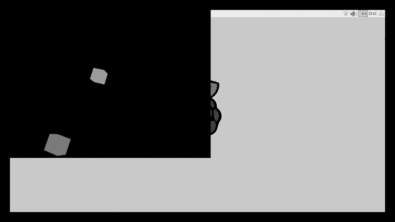

再仔细观察`ObjectModel`类，它现在负责移动对象、创建和维护每个实例的模型，然后有一个绘图程序，向 GPU 发送正确的顶点或属性列表。然而，`Draw`和`Update`程序是纯虚的。这提供了灵活性，我们知道我们需要矩阵，但我们并不真正知道要更新或绘制什么种对象，所以让那些以`ObjectModel`为基类的对象来完成这些工作。让我们来看看它包含了什么。

```cpp
#pragma once

#include "glm/glm.hpp"
#include "glm/gtc/matrix_transform.hpp"
#include "MyFiles.h"
#include "ShaderManager.h"
#include <GLES2/gl2.h>

using namespace glm;

class Graphics;

class ObjectModel
{
public:
	ObjectModel();

	ObjectModel(char* filename, MyFiles* FH);

	~ObjectModel();

	virtual bool Update() = 0; // 我们需要 Update 来移动和创建模型视图
	virtual bool Draw() = 0; // 我们需要从顶点进行绘制

	// 用于简单的属性数组系统
	GLvoid* Vertices; // 指向属性数组的指针，应包含顶点和纹理坐标

	// 一些基础实用函数
};
```

```cpp
glm::vec3 GetPositon();

void SetPosition(glm::vec3*);

void SetPosition(glm::vec3);

glm::vec3 GetRotations();

void SetRotations(glm::vec3*);

void SetRotations(glm::vec3);

void SetXRotation(float); // 如果你需要设置单个旋转角度

void SetYRotation(float);

void SetZRotation(float);

void SetModelMatrix(); // 初始化并重置

void MakeModelMatrix(); // 创建并返回模型矩阵

void MakeRotations();

void MakeTranslationMatrix();

void StoreGraphicClass(Graphics* Graphics);

GLuint texture1; // 一个句柄

bool LoadModel(GLvoid* vertices);

glm::vec4 Colour;

glm::vec3 WorldPosition; // 我在世界的哪个位置？

glm::vec3 Rotations; // 我的旋转角度是什么？以弧度存储！

glm::vec3 DegreeRotations;

glm::vec3 Scales;

glm::mat4 mTranslationMatrix;

glm::mat4 mRotationMatrix;

glm::mat4 mScaleMatrix;

glm::mat4 RotationMatrixX;

glm::mat4 RotationMatrixY;

glm::mat4 RotationMatrixZ;

void MakeModelMatrix(); // 因为这些经常会被修改

GLuint programObject, vertexShader, fragmentShader; // programObject 用于绘图。vertex 和 fragment 用于创建 programObject

glm::mat4 Model; // 模型矩阵将有效地持有对象的所有旋转和位置数据

GLint positionLoc; // 指向纹理中重要概念的索引句

GLint texCoordLoc;

GLint samplerLoc;

Graphics* TheGraphics; // 任何使用着色器的都需要访问在游戏应用中设置的图形类。确保已提供该类

GLuint vbo;
};
```

有一两个点可能不会显而易见，但我们很快就会涵盖；不过，你已经看到有大量的矩阵操作，以及七种不同的矩阵，其中三个仅仅是为了处理旋转。但它仍然是一个非常轻量且易于理解的类。它包含了熟悉的设置（Setting）和获取（Getting）位置的概念，一些人类易理解的概念如`WorldPosition`和`DegreeRotations`，一些`MakeMatrix`函数（我们的更新方法将根据需要处理这些函数），以及……基本上就这些了。

几个可能还不那么熟悉的新事物是这些句柄：

```cpp
GLuint programObject, vertexShader, fragmentShader;
```

这些与我们之后要更多使用的着色器（Shader）代码有关，但在我们深入研究着色器之前，它们的用途将会变得清晰。

作为一个头文件，我们可以看到有两个纯虚函数，这意味着任何继承`ObjectModel`的`Shape`类必须包含它们自己的版本的`draw`和`update`。

在我们的项目中，我创建了一个这种基类型的向量或列表，基本上我想要做的就是遍历该列表并调用`update`和`draw`函数，这些函数将跳转到`Shape`类中对应的版本。

之前，我们的大部分 3D 代码都设置在主 cpp 文件中（包含入口点`main()`的文件），这是对每个人都开始的原始“你好三角形”项目的致敬，也是为了保持熟悉感。但现在我们知道不应该再扩展旧的 C 风格项目了，所以我们正在分支，并减少主文件的开销。它的角色现在被正确地缩小为启动项目、创建一个`Game`类的实例、让它运行，并在返回时退出项目。

在旧的 C 风格演示中主要的绘图和初始化函数现在被移到了`Graphics`类中，该类的任务是设置`OpenGLES2.0`，以便我们可以使用它并当然处理绘图调用。稍后，我们将对此进行进一步扩展。

我们现在基本上可以让该文件及其主`Draw`函数和初始化保持不管了，我们现在在模型类的`Draw`例程中进行修改；如果我们使用非树莓派设备，我们还可以接入不同的`Graphic`类，这样从现在起，代码的大部分（正如我们做 2D 项目时那样）就不关心目标平台，只要我们遵循`OpenGLES2.0`的限制即可。

## 我以为我们可以移动几十万个吗？

嗯，在理想的世界里我们也许可以，但 GPU 每秒可以绘制的三角形/顶点/面/任何你想要测量的东西的实际数量很难量化，因为我们有着色器在为我们完成大量工作！这些着色器的复杂程度会很大程度上影响我们的性能。但目前我们的着色器已经尽可能简单了，所以我们真的应该能够得到……（为了简洁省略了文本，其余部分遵循相同的逻辑）

```cpp
HelloCube.cpp
```


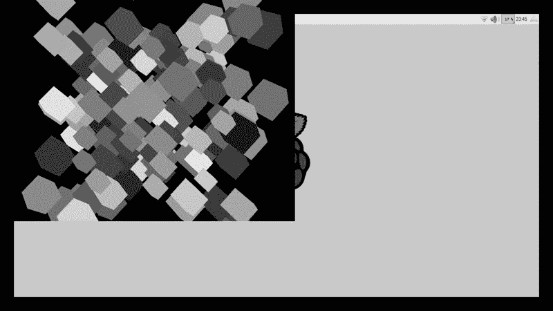

## GPU 如何获取数据

到目前为止，我们一直从 CPU 内存将图形数据发送到 GPU，调用绘图函数然后进行交换，让这一切神奇地出现。它们确实出现了。但我们可能已经注意到，随着我们的 2D 屏幕尺寸变大，或者我们尝试在屏幕上绘制几个以上的 3D 对象，我们的帧率正在下降，有时下降非常明显。

在所有当前的 SBC（单板计算机）上，我们的 `CPU` 和 `GPU` 共享内存，但实际上在内部，这两个单元将内存相互隔离开，并声明为自己所有。这两个内存池甚至可能以不同的速度运行，并具有不同的访问方法和地址宽度，因此当一个单元想要访问另一个单元的内存时，必须有某种方式来跨越那道栅栏。

取决于你的机器，这道栅栏会采取多种形式，但底线是当一个单元想要访问另一个池的内存时，会发生大量的芯片间协商，这种协商需要时间，在此期间，我们想要移动的数据必须停在一个名为 `bus`（总线）的区域，它会将数据传输到它想去的地方，尽管像现实中的公交一样，它的速度不会像法拉利那么快，而且一次只能携带若干字节。

我们的 `bus` 大小取决于我们的系统，我们可能有 8、16、32、64、128 位或更宽的总线，但无论它有多宽，我们都必须将数据放在 `bus` 上，让芯片协商传输，然后将位移动到它们的新“家”。

这一切都极其缓慢，实际上，比从 `CPU` 内存移动到 `CPU` 内存的 32/64 位要慢好几个数量级。

所以，当我们从 `CPU` 将属性数组数据发送到 `GPU` 时，速度简直慢得令人痛苦。通常可以使用稍微快一点直接内存访问（`DMA`）方法，但为了获得真正的速度，我们需要 `GPU` 访问它自己的内存，因为当 `GPU` 访问自己的内存时，速度极快。显然，我们需要对此进行思考。我们必须不惜一切地避免总线传输。那么，我们该如何将图形或几何数据发送到 `GPU` 呢？`OpenGLES2.0` 给了我们什么能防止我们反复地从 `CPU` 向 `GPU` 写入相同的属性列表？

## 缓冲区（Buffers），随处可见缓冲区

预加载缓冲区是提高 FPS（帧率）的关键因素之一。在每一帧的绘制调用中向 `GPU` 抛出顶点和纹理显然是有效的，如果我们只讨论少数几十个简单模型或几百个 2D 精灵图，我们可以勉强应付，但我们 `GPU` 的真正实力应该允许我们在屏幕上有超过 100,000 个三角形，因此我们需要知道如何做到。我们的编程格言是必须让事情变得更好，而不应该仅仅因为到目前为止还能应付就将就合。

我们的 `GPU` 需要直接访问其自身内存中自身地址空间的数据，每当我们通过 `bus` 或内部传输系统将数据从一个系统传递到另一个系统时，我们都在浪费大量时间，时间浪费意味着低帧率。

我们必须尽一切避免让 `GPU` 不断从 `CPU RAM` 获取数据，并对完全相同的同一组顶点/纹理/法线/或其他数据反复执行完全相同的处理过程。

`OpenGLES` 将它们称为对象属性缓冲区（Object Attribute Buffers，简称 `OAB`），我们通常可以在项目中使用几个，或者用一个巨大的，选择权在我们手中。我倾向于将它们称为 `Vertex Buffers`（顶点缓冲区），这其实并不准确，但这是我使用完整版 `OpenGL` 的一种习惯，所以你会看到我在代码中使用 `VB` 或 `VBO` 而不是 OAB 缩写。这是一个我会努力打破的习惯。

`OpenGLES2.0` 仅提供几种不同类型的缓冲区，对于向 `Shaders` 传递信息，它实际上只为我们提供了一个，不像完整版 `OpenGL` 有好几个。但 `OpenGLES2.0` 的这一个缓冲区更灵活。完整版为许多不同类型的属性提供了不同的缓冲区并相应地使用，但我们的 `OAB` 的灵活性意味着我们可以将想要使用的所有不同内容存储在一个缓冲区中，简单地使用基值、计数和跨度值访问不同的属性，让我们的 `GPU` 知道属性在缓冲区中的起始位置、需要多少字节以及在哪里获取下一组数据。

尽管只有一种对象属性缓冲区，但在 `OpenGLES2.0` 中还有其他类型的缓冲区。帧缓冲区（Frame Buffers）、渲染缓冲区（Render Buffers）和纹理缓冲区（Texture Buffers），纹理和帧缓冲区还可以调整以存储图形以外的数据！但哪些东西需要哪些缓冲区，我们又如何设置它们呢？

目前我将只关注我们目前需要的缓冲区，即可以与我们的纹理和顶点数据工作的缓冲区。让我们关注顶点缓冲区（Vertex Buffers），正如我提到的，我倾向于将它们称为 `VBOs` 或 `VBs`（尽管它们仍然是 OAB）。

## 顶点缓冲区

所以，显而易见，顶点缓冲区的作用是将顶点保持在一个地方，更具体地说，在我们 `GPU` 内存中的某个地方，在那里它可以被非常快速地访问，其内容被发送到我们的 `Shader` 使用。

实际上，一个 `VB` 符合 `OAB` 的整个概念，是一种非常多功能的缓冲区形式，它实际上可以持有 `GPU` 在将缓冲区中的值转换为 `Shader` 属性时所需要的几乎任何类型的数据序列。它甚至不需要专门处理顶点，它可以同样轻松地处理纹理坐标甚至浮点数，但它的主要功能是处理顶点。关于奇数数据的问题我们稍后会讨论，目前我们要做的是创建。简单来说，我们想把顶点和纹理存储在 GPU 中，而不是在每次触发绘制调用时都从 CPU 内存加载它们。

我们可以通过一个简单的命令来设置缓冲区：

```cpp
GLvoid glGenBuffers (GLsizei n, GLuint* bufferhandles);
```

用法如下：

```cpp
glGenBuffers (1, &vb);
```

但这一切只是在 GPU 中分配了缓冲区或多个概念，并返回句柄（handle），我们现在可以引用它来访问它。缓冲区本身在任何意义上尚未真正存在，因为还没有内容放入其中，所以它是一个内容为 0 字节的缓冲区。但现在我们创建了它，就可以向它发送数据。

我们使用一个简单的命令写入数据，它将初始化该缓冲区并赋予它与我们写入的内容相等的大小。

现在数据已经在 GPU 内存中了，并且准备供我们使用，我们不再需要 CPU 内存中的数据了，所以如果加载了就可以释放它，从现在起我们将使用这个缓冲区。

我们还没有完全完成，如果我们有另一块模型数据想要存储在 GPU 内存中，我们可以将数据插入此缓冲区，但我们首先需要确保缓冲区本身足够大的值。我们只能在初始化时设置一次缓冲区的大小。因此可以在第一批之后插入新数据，但不能在其追加数据。

一旦插入了新数据，我们只需要记住第二个模型的数据位于第一组数据的之后，第三个在其之后，以此此类推。不过目前我将为每个模型使用不同的缓冲区，以便我们能让事情运行起来。

我们可以有不同的缓冲区，例如，现在我们在缓冲区中存储顶点数据，在另一个中存储纹理数据，但将数据交错排列也是可能的且通常是理想的，这样你就拥有一块顶点数据，然后是一块纹理数据。只要块的大小相同，你基本上就可以通过跳过数据，在需要时发送你想要的部分。

要解析必须加载到这些属性变量中的不同数据块，我们只需要让 GPU 知道我们将要发送多少数据、从哪里开始，以及它获取的是什么类型的数据。

假设我们有一组交错排列的数据，顶点有三个值，纹理坐标有两个值。我们知道它们都是浮点数（floats）。

下一个问题是在哪里设置缓冲区？我希望你将其视为一种初始化过程，因此设置缓冲区需要在模型创建时完成，而不是在绘制时完成（我们已经看到那样速度非常慢）。因此，我们将在模型构造函数中添加一些代码，并设置一个 `VB`。设置缓冲区看起来如下：

```cpp
glGenBuffers(1, vb); // 生成缓冲区并将句柄存入 vb

glBindBuffer(GL_ARRAY_BUFFER, vb); // 绑定存储在 vb 中的缓冲区

glBufferData(GL_ARRAY_BUFFER, sizeof(GLfloat) * size, vertices, GL_STATIC_DRAW); // 将数据写入其中

glBindBuffer(GL_ARRAY_BUFFER, 0); // 取消绑定以确保
```

基本上就是这样，我们原本位于 CPU 内存中 `vertices` 位置的顶点现在正开心、舒适且温暖地待在 GPU 内存中。我们并不知道具体在哪里，但 GPU 知道，并且它给了我们一个存储在 `vb` 中的句柄。

要绘制该缓冲区，我们只需要绑定它，设置步长值（step values），通过指定 Shader 将使用哪个属性来启用传输，并使用 `glDrawArrays` 命令从数组中绘制三角形，如下：

```cpp
glBindBuffer (GL_ARRAY_BUFFER, vb); // 我们将使用这个缓冲区

// 设置属性

glVertexAttribPointer(positionAttribute, 3, GL_FLOAT, GL_FALSE, stride, (void*)0);

glEnableVertexAttribArray(positionAttribute);

glDrawArrays(GL_TRIANGLES, 0, NumberOfTriangles);
```

这里有一个小小的 `(void*)0` 强制转换问题，因为这个例程是双重目的：在没有绑定缓冲区时它使用 CPU 地址，在有缓冲区时它使用偏移量。因此，我们必须将偏移量转换为地址才能使其工作。为了获得 10 倍以上的速度，这个代价是值得的。

让我们通过修改我们的立方体程序来使用缓冲区，将其付诸实践。

编译并运行……尝试着将 150 个正方形改为 1500，或 15,000……我们确实看到了性能的巨大提升。我打赌这让你感觉自己像像个编程之神！只需几个简单的改变，你就能看到性能提高了百倍。

在做 2D 时我们本可以这样做，但你并不会看到益处。绘制瓦片（tiles）是一件很容易的事；然而，绘制顶点需要更多的用心，而这种用心将换来程序员最喜爱的奖励——速度！

### 属性指针（Attribute Pointers）

我们简要略过了属性指针命令，但它非常重要，这也是我们的单个 `VBO` 如此灵活的原因，因为它允许我们为 `Shader` 馈数据。我们可以一次性提供多个 `Shader` 属性，并在发送的 `vertex` 数据中交错排列这些数据。

考虑到属性是 `Shader` 中的变量，每当 `Shader` 运行时，都会从缓冲区加载数据。这表明数据正在被传输并移动到下一部分数据，为下一个周期做好准备。

属性指针命令是用来解释要传输什么、传输到哪里、以及移动多少距离的。

它还具有双重功能，可以描述 `VBO` 中的偏移量，也可以描述直接的内存位置。我们必须小心不要将它们混淆。

看我们刚刚使用的命令：

```cpp
glVertexAttribPointer(positionAttribute, 3, GL_FLOAT, GL_FALSE, stride, (void*)0);
```

这告诉我们，与位置关联的属性应该加载 3 个浮点数，这些数是不经过归一化的，然后我们需要从当前基点跳过 `stride` 数量的条目，最后，数据从 `VBO` 中的索引 0 位置开始，或者较小概率位于地址 0 的数据。由于该命令的双重性质（可以接受地址或偏移量），我们需要将其强制转换为 `(void*)`。

如果我们有像这样的值序列：

```cpp
GLfloat TheCubeVertices[] = {
    -0.5f, -0.5f, -0.5f, // 第 1 组

    0.0f, 0.0f,

    0.5f, -0.5f, -0.5f, // 第 2 组

    1.0f, 0.0f,

    0.5f, 0.5f, -0.5f, // 第 3 组

    1.0f, 1.0f,

    0.5f, 0.5f, -0.5f,

    1.0f, 1.0f,
};
```

我们可以看到这些值是如何与命令关联的。三个顶点，两个用于纹理坐标，每个顶点五个条目。

### 纹理缓冲区（Texture Buffer）

注：原文中此处段落存在大量重复，已根据指令要求保持翻译逻辑并避免重复输出原文内容。

## 帧缓冲区（Framebuffers）

`Framebuffers` 是一个指向存储生成的 ID/句柄变量的指针。它的设置方式是，如果你想生成多个一个，该指针将指向一个整数数组的开头。

当然，也可以使用以下代码删除帧缓冲区：

```cpp
GLvoid DeleteFramebuffers(GLsizei n, GLuint *framebuffers);
```

当然，这基本上是带有相同参数的创建函数的反向操作。关于帧缓冲区，还有一些高级函数，我们将在稍后进行介绍。但目前，帧缓冲区唯一真正需要的另一个命令是：

```c
GLvoid glBindFramebuffer (GLenum target, GLuint framebuffer)
```


正如我们过去提到的，绑定（Binding）会将这个特定的帧缓冲区放入 GPU 的焦点范围内。OpenGLES2.0 一时间只能关注一个帧缓冲区，所以无论你创建了多少个，最后绑定的那一个才是 OpenGLES2.0 将工作并发送或从那里接收数据的缓冲区。

奇怪的是，变量 `target` 将始终为 `GL_FRAMEBUFFER`，尽管在 OpenGLES 的后续实现版本中，它可能会改变以允许其他用途。当然，变量 `framebuffer` 将是与该缓冲区相关的 ID/句柄。

除非你计划进行某些后处理，或者有理由实现三缓冲/四缓冲，否则你实际上只需要系统帧缓冲区。

# 渲染缓冲区（Render Buffer）

啊，这些就有点复杂了，因为从某种意义上说，它们在 OpenGLES2.0 中实际上并不存在，但作为普通 OpenGL 的支柱，以至于我们找到了模拟它们的方法。我们短期内还不会实际使用它们，所以现在先略过这一点。不过，正如其名，这是一个可以渲染到内容的缓冲区，这本质上就是帧缓冲区提供的功能。

真正的渲染缓冲区可以发送到屏幕，但 OpenGLES2.0 只允许一个渲染目标（Render Target），即我们切换查看的那个，因此我们使用帧缓冲区和纹理的组合来获得渲染缓冲区的合理近似。如果我们想以不同的方式渲染内容并在稍后组合它们，这可以且将会有用。

渲染允许我们创建不同输出类型的缓冲区；这些是 OpenGLES2.0 支持的类型：

`DEPTH_COMPONENT16, RGBA4, RGB5_A1, RGB565, STENCIL_INDEX8`

我们稍后会用到它们，但现在只需知道它们存在，我们很快就会玩转它们。

# 缓冲区不是免费的

现在，已经很清楚了，如果我们打算进行任何相当数量的多边偏移（poly shifting），就必须使用缓冲区，但根据定义，缓冲区需要占用一些 RAM 空间。在单板计算机（SBCs）上，我们并没有多少空间，我们的 GPU 内存需要为自己的需求留出一些 RAM。因此，增加大量的缓冲区虽然诱人，但并不总是可能的，尽管它是非常理想的。

当然，我们可以扩大 GPU 内存的大小，需要时手动操作，或者允许某些 SBC 动态 GPU 分配来完成，但这会消耗掉你的 CPU RAM……你必须找到一个平衡点，这将直接取决于你的游戏需求。

64MB 是一个巨大的内存，确实如此，但如果你不仔细考虑加载到其中的多少数据，它会瞬间消失。

另一件我们必须非常清楚的事情，而且最好现在就说：大多数 SBC 中的 GPU 都是……，说得不难听一点，是垃圾！它们真的糟糕得令人痛苦。大多数只有两个核心，且运行速度低于 CPU 速度的一半，并且大多数与 CPU 共用慢速 RAM。无法指望 SBC 的 GPU 像最低功耗的 PC 显卡那样强大。事实上，它们比普通的目前的安卓手机还要弱。

所以我们面临着一个有趣的困境：OpenGLES2.0 或多少允许我们做大玩家能做到的任何事情，但这种基础处理能力的缺乏意味着做基础任务之外的任何事情都很慢。这就是游戏开发开始变得痛苦的时候，因为我们很快就会达到想要做一些非常酷的事情的程度，但这样做会让我们的游戏变得很糟糕。这就是挑战！根据我们的局限性工作，拥抱它们，推向它们，但要尊重它们并改进你的游戏设计方法来应对动力的不足。

但让我们不要因此太沮丧，尽管现在要求我们的 GPU 执行几件事之外的事情会让它窒息，但这并不意味着这几件事学习起来可以很有趣，我们可以找到方法让它们实现。


# 回归正题

现在我们开始行动了。我们可以用顶点列表加载属性缓冲区，并且绘制调用（draw call）已经修改为：如果存在缓冲区列表则使用它，如果不存在则设置一个，只要我们不是在一个周期内引入海量的新模型，应该是没问题的。不过我们稍后可以为代码添加一个预加载选项。

正如我们在 2D 中对 GameObjects 执行的那样，我们可以向处理列表添加任意数量的 `ObjectModel` 或其继承类的实例。事实上，为什么不试着使用 `CubeModel` 类作为模板来创建一个三角形或金字塔对象呢？你只需要创建一个类，编写一个与 `CubeModel` 类类似的更新例程即可。

现在我们开始行动了。我们可以用顶点列表加载属性缓冲区，并且绘制调用已经修改为：如果存在缓冲区列表则使用它，如果不存在则设置一个，只要我们不是在一个周期内引入海量的新模型，应该是没问题的。不过我们稍后可以为代码添加一个预加载选项。

正如我们在 2D 中对 GameObjects 执行的那样，我们可以向处理列表添加任意数量的 `ObjectModel` 或其继承类的实例。事实上，为什么不试着使用 `CubeModel` 类作为模板来创建一个三角形或金字塔对象呢？你只需要创建一个类，编写一个与 `CubeModel` 类类似的更新例程即可。

# 相机移动（Camera Movement）

我们现在尝试做的是移动我们的相机，使其更具交互性。注意 `Camera` 类，事实上我们在移动，通常你会移动你的对象，但现在我们只是想获得空间移动的感觉。

很酷吧？我们有多个控制轴，我们的立方体一直在旋转。我们拥有了真正的自由和移动感。

作为一个练习，尝试让立方体绕原点移动，同时旋转。这与你做 Kamaazi 入侵者弧线时并没有巨大的飞跃。

尽管在你编写这些代码时，不要移动相机太多，让它在一个合理的距离观察，并确保它确实如你所想。相机的移动有时会改变你对运动的感知，所以在在确定之前保持静态。

# 为我们的立方体贴图（Time to Texture Our Cube）

那么，既然我们已经解决了快速渲染问题，现在该将注意力转向另一个主要概念了：纹理。

至少我们对这个概念很熟悉，因为在 2D 精灵中使用过它们，但现在我们必须将它们应用于顶点，而顶点可能并不像四边形或立方体那样规则。这看起来并不完全复杂，但事实上，随着顶点的增加，它会变得复杂得多，每个顶点都需要为自己固定一个起始 UV，这样 UV 映射（将纹理布局到一组顶点上）就不是你真正想要手动完成的任务了。这是艺术家需要使用自己的工具处理的任务之一。

此外，我们必须考虑到每个可渲染对象可能都有自己的一套纹理，并且可能需要它自己的 Shader。我们目前在项目初始化期间设置单个 Shader 的系统似乎不再有效。

技术上，我们正开始变得复杂得多。但在原理上，一切完全相同。

# 引言

让我们先开始，在我们的立方体面上放上一张漂亮的图片。不过，首先我们需要处理一个事实：我们目前的简单 3D 着色器（Shaders）没有处理纹理的能力。这对特定的着色器只负责变换顶点并用颜色绘制立方体。

但不用担心，我们在制作帧缓冲区（Frame Buffer）时用过纹理着色器，我们现在要做的是将变换和绘制 2D 缓冲区纹理的方式与我们的 3D MVP 系统相结合。

这会出什么错呢？

是时候引入几个新的着色器了，它们不仅能让我们看到立方体，还能使用 MVP 并提供纹理。这就是我们的顶点着色器（Vertex Shader）。

```glsl
precision mediump float;

attribute vec3 a_position;
attribute vec2 a_texCoord;

uniform mat4 MVP;
varying vec2 v_texCoord;

void main()
{
    gl_Position = MVP * vec4(a_position, 1);
    v_texCoord = a_texCoord;
}
```

以及我们的片元着色器（Fragment Shader）。

```glsl
precision mediump float;

varying vec2 v_texCoord;
uniform sampler2D s_texture;

void main()
{
    gl_FragColor = texture2D(s_texture, v_texCoord);
}
```

虽然现在没做什么，但现在我们正在使用 2D 纹理，简单来说，就是从顶点着色器提供的点中获取像素。

在资源文件夹中，你会找到我最喜欢的孙子的照片，那是我女婿和女儿的，她会因为我用它而讨厌我的，但让我们让 Harvey 成为书中最著名的立方体纹理，并将他的图像放在我们的立方体上。

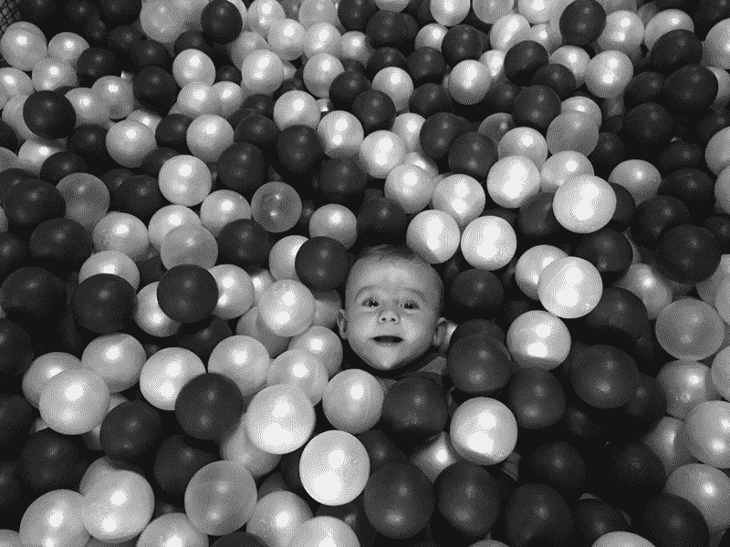

将此代码添加到你的立方体实例化中，记得添加一个原型：

```cpp
// 加载，创建纹理
CubeModel::CubeModel(MyFiles* FH) : CubeModel()
{
    int width, height;

    char* image = FH->Load((char*)"../Resources/Textures/Harvey2.jpg", &width, &height);

    glGenTextures(1, &texture1); // 创建我们的第一个纹理并将句柄存储在 texture 中
    glBindTexture(GL_TEXTURE_2D, texture1); // 绑定它，使其现在成为我们观察的对象

    // 设置我们的纹理参数
    glTexParameteri(GL_TEXTURE_2D, GL_TEXTURE_WRAP_S, GL_REPEAT); // 设置纹理环绕为 GL_REPEAT
    glTexParameteri(GL_TEXTURE_2D, GL_TEXTURE_WRAP_T, GL_REPEAT);

    // 设置纹理过滤
    glTexParameteri(GL_TEXTURE_2D, GL_TEXTURE_MIN_FILTER, GL_LINEAR);
    glTexParameteri(GL_TEXTURE_2D, GL_TEXTURE_MAG_FILTER, GL_LINEAR);

    // 现在将图像放入其中……可能有点复杂
    glTexImage2D(GL_TEXTURE_2D, 0, GL_RGBA, width, height, 0, GL_RGBA, GL_UNSIGNED_BYTE, image);

    glBindTexture(GL_TEXTURE_2D, 0); // 完成后解绑纹理，这样我们就不会意外破坏了纹理。
}
```

这将加载图像并使一个漂亮的纹理激活，其句柄在变量 `texture1` 中可用。代码现在需要做的是设置系统，在着色器每次需要时向其发送两个值：一个用于我们之前使用的三个顶点的实际位置，现在还有两个纹理坐标。

这些数据通过使用 `positionLoc` 和 `texCoordLoc` 的句柄提供给着色器。设置如下：

```cpp
// 加载顶点数据
glVertexAttribPointer(this->positionLoc,
    3, // 写入 3 个值
    GL_FLOAT, // 它们是浮点数
    GL_FALSE, // 不是法线
    5 * sizeof(GLfloat), // 现在到下一个顶点有多少个字节（跨距）
    TheCubeVertices // 从哪里开始
);
```

纹理信息也有类似的设置，但纹理坐标在三个顶点坐标之后开始，因此我们需要从基础偏移 `+3`，但偏移需要字节值，所以我们需要乘以 `3 * sizeof(float)`（通常是 4 字节），以得到一个指示纹理坐标在缓冲区内存中开始位置的值。

我说通常是 4 字节，是因为 `float` 的大小取决于运行它的机器，最好永远不要假设，所以我们使用 `sizeof` 函数来确保在编译时获得正确的尺寸。

```cpp
// 加载纹理坐标
glVertexAttribPointer(this->texCoordLoc,
    2, // 写入 2 个值
    GL_FLOAT,
    GL_FALSE,
    5 * sizeof(GLfloat), // 跨距不变
    TheCubeVertices + (3 * sizeof(GLfloat))
);
```

下一步是启用这些值，以便着色器每次运行时，它将按照我们定义的方式，每三个一组顶点、每两个一组纹理（UV）坐标拉取这些数据。

```cpp
glEnableVertexAttribArray(this->positionLoc);
glEnableVertexAttribArray(this->texCoordLoc);
```

好了，缓冲区已经设置好为着色器提供顶点和纹理数据，现在通过绑定将正确的纹理固定到过程中，使其成为当前激活的纹理：

```cpp
glBindTexture(GL_TEXTURE_2D, texture1);
```

最后，将采样器重置为 0。

```cpp
glUniform1i(this->samplerLoc, 0);
```

显然，我们可以看到（因为我们在那里放了文字供你查看）顶部、底部和侧面在哪里，我还突出亮显示了 UV 坐标。对于每个起始点，我个人并不太喜欢使用三分之一作为 UV，因为这是一个循环分数值，我们很快会讨论这一点，但目前这样是可以运行的。

这是我们的新纹理；它的 POT（二幂尺寸）尺寸为 `128` × `64`。


我们已经有一个贴接了 UV 的立方体表格，但现在我们需要更改这些值，以便我们获得正确的 UV 将其锚定到正确的顶点上。这次加载骰子（Die）纹理而不是 Harvey，并根据上图中的纹理布局更改立方体纹理，你现在应该得到这个：


代码中真正发生改变的是我们提供给每个顶点的 UV 坐标，当然，我们加载了一个包含我们想要显示的六个不同面部的纹理。

现在有一件小事我想让你们尝试一下，我们的骰子实际上并不正确，普通骰子的相对面之和应该是七；你应该能够推导出如何制作一个正确的骰子，尝试修改立方体列表数组中的 UV 坐标。

我们可能永远不需要手动输入此类信息，有很多艺术软件包为远为复杂的形状提供了 UV 映射系统，我们确实应该使用它们，而不是手动输入。但了解你的纹理是如何映射到顶点上的是非常重要的，以防你需要定位某些偶尔引起图形故障的恼人离离点图像。

## 选择合适的尺寸

纹理的另一个考虑因素是缩放，纹理越小，放大后看起来越不具有服力。尽管 GPU 有神奇的内部算法来处理纹理缩放，但你无法将几个像素拉伸到大而不出现某种形式的像素化。因此，我们需要考虑以多大的尺寸查看图像。通常情况下，如果你的图像在屏幕上的尺寸主要是 `128` 像素，请使用 `128` 像素纹理；作为一个极端例子，如果你使用 `16` 像素纹理，你会得到糟糕的伪影。

通常，如果纹理缩放过大（无论是放大还是缩小），我们可以预期它看起来是错误的，但在一定范围内通常没问题，眼睛可以原谅良好绘制纹理上一点像素化，我们还可以使用一些抗锯系统来稍微模糊处理。

然而，我们可以轻松显示具有不同尺寸纹理的物品，创建细节层次（LOD）效果以减少对眼睛的影响。还有一种称为 mipmapping（多图映射）的技术，可以以增加纹理内存为代价使这个过程半自动化。

不过，我们以后会讨论这些，现在我们可以为对纹理是什么、如何将其放置在顶点上（包裹）以及如何避免某些产生故障的简单陷阱有了更充分的掌握。

## 纹理的数量限制

纹理是很奇的东西，取决于你的目标，你实际上只能处理特定数量的不同纹理图像。尽管你可以存储任何数量，但它当然与你分配给 GPU 的内存多少有关。

Shader 对同时可以处理的纹理数量也有一些限制。树莓派和我检查过的大多数其他单板计算机（SBC）的限制是八个，这意味着 Shader 在任何时刻只能与八个纹理工作。

你可以通过这两行代码查出你的片段色 Shader 可以处理多少个纹理：

```cpp
GLint MaxTextureUnits;

glGetIntegerv(GL_MAX_TEXTURE_IMAGE_UNITS, &MaxTextureUnits);
```

这会将 GPU 能处理的纹理单元/图像数量加载到变量 `MaxTextureUnits` 中，在我的树莓派上它是八个。

你也可以通过以下代码询问顶点 Shader 可以处理多少个：

```cpp
GLint MaxVertexTextureUnits;

glGetIntegerv(GL_MAX_VERTEX_TEXTURE_UNITS, &MaxVertexTextureUnits);
```

同样在树莓派 Model 3B 上是八个。现在，每个 Shader 使用八个纹理听起来不多，但请记住我们有 UV 映射，所以我们实际上可以将模型纹理的许多独立部分放入一个或多个大的纹理单元/图像中。因此，事实上，八个已经很多，在大多数情况下你真的只需要使用二或三个来实现某些效果。

让一个模型使用多个纹理进行图形渲染并不是特别明智的（尽管通过一些技巧和一个空闲的图像单元可以实现），所以尽量保持纹理图像整齐有序并良好地管理它们，以便在需要时在 GPU 内存中有正确的纹理。

另一个需要测试的是纹理的实际最大尺寸，可以通过另一个简单的查询找到它：

```cpp
GLint MaxTextureSizes;

glGetIntegerv(GL_MAX_TEXTURE_SIZE, &MaxTextureSizes);
```


在树莓派 Model 3B 上是 `2048`，所以你可以将视频内存设置为 `192 MB`，留出 `128 MB` 的纹理空间，剩下的作为缓冲区。这大致是你需要的 GPU 内存的最大尺寸。一些配置更高的机器可以在你的 Shader 中提供更多纹理单元并拥有更多 GPU 内存，但 `2048` 基本上是目前的尺寸最大。据我所知，OpenGLES2.0 规范的最大可能值为 `32` 个纹理单元。当然，有很多……总之，正如我所说，纹理是复杂的，我们会不断增加理解。

### 每个人都喜欢三角形

在我们的 2D 游戏中，我们用两个三角形创建精灵来表示屏幕上的角色，而在 OpenGLES2.0 中我们通过两个平铺连接的三角形创建一个正方形。

在我们的 HelloCubes 示例中，我们仍然用三角形制作立方体，所以看起来三角形是唯一的选择……事实上，我个人认为应该是，但是……

三角形是很棒的；事实上，对程序员来说，三角形是完美的典范……三角形是任何 3D 游戏中许多内容的基石，但 OpenGLES 非常慷慨地为提供了其他类型的几何体。


所以我们将看到很多使用三角形、扇形和带的操作，但永远不要放弃三角形，它仍然是我们最重要的基础形状！你可能注意到我们的绘制系统目前只使用此命令来通知 OpenGLES 系统其意图。

```cpp
glDrawArrays(GL_TRIANGLES, 0, 3);
```

作为程序员，我们将主要使用三角形、一些线和一些点，它们运行良好如你所见，但其他类型在程序员的使用中较少，通常取决于模型的设计需求。只要我们在执行 `glDrawArray` 或其他绘制命令之前设置好数据（该命令会设置 GPU 执行其工作），一切都是好的。

大量这些三角形和其他基础形状类型组合在一起创建了所谓的网格（mesh）……当你看到没有纹理的网格时，你就能理解这个名字了。

# 引言

下面的图片显示了一个机器人模型，它包含大约 `830` 个顶点，大约 `200` 个面。每个面可以是三角形或其他闭合多边形。在这种情况下，我们还看到大多数面被表示为四边形（quads）。这是因为所使用的绘图包将四边形作为基础类型，尽管我们几乎肯定会将它们输出为三角形或我们支持的其他原始几何类型之一。然而，艺术家们喜欢使用四边形，因为它们的线条更少，也更容易看出哪里可能出现多边形过载（模型中的错误或低效之处）。


我们在精灵图（sprites）上使用了纹理来覆盖这些面，并根据需要创建看起来整齐的正方形或三角形对，但我们也可以将纹理扩展到大量的三角形或四边形上，从而填充网格中的空隙，这基本上构成了我们模型的基本概念。


与由两个三角形组成的平面 2D 图像不同，我们的模型包含数百个三角形，并具有一个新的 Z 轴维度，赋予了它形状和深度。然而，这些三角形每个都有一个面……我们的精灵图正方形有两个面，我们用纹理覆盖了它们，现在我们有数百个面需要覆盖。我们该如何做呢？

看看我们机器人的纹理。你可以看到它的不同部分布局在尽可能小的表面积内。这与我们把精灵图纹理放置到更大的绘制纹理中时使用的方法完全相同。


你可以看到所有的单独纹理都组合成了一个大纹理，其尺寸可以从 `32 × 32` 到 `2048 × 2048` 不等，它实际上取决于你使用的 GPU 以及它分配的内存量。但无论我们为纹理设定多大的尺寸，我们使用归一化坐标，这样我们就有 `0` 到 `1` 的值。线框网格中的每个三角形然后通过归一化坐标（称为 UV 坐标）引用这个大纹理的一部分来覆盖自己。鉴于我们在单板计算机（SBC）上的纹理 RAM 非常有限，我们真的希望使用尽可能小的纹理，并使其尽可能高效。机器人的纹理中有很多间隙，这是我们应该尽可能避免的。

现在，如果你只是尝试给一个立方体上纹理，计算坐标、输入它们等工作可能不是一项艰巨的任务，但我们这个 `800` 多个顶点的模型已经远远超出了任何普通程序员在无错误的情况下输入的极限。

这就是为什么任何复杂度的模型都不是通过手工输入的吗？这是艺术家的工作，更具体地说，是建模师的工作。

我们可以在 `HelloCubes` 代码中进行一些有趣的纹理映射练习，但实际上你真的需要手动为模型上纹理的机会微其其，尽管如果你真的需要的话，在我们完成这一节之前，你将完全能够胜任了。


## 3D 让我们进入 GPU 的核心

在我们的树莓派以及几乎任何其他目标机器中心，跳动着 CPU 和 GPU 组合的心脏。CPU 已经被很好理解了，但 GPU 是另一回事，是完全不同的东西。到目前，我们所知道的就是它处理图形并消耗我们一些 RAM 来施展魔法，但事实上，它可能是我们触手可及的最强大的硬件。

GPU 实际上是极其专门的处理单元，像 CPU 一样，它们接受编程并处理数据，但输出结果比任何 CPU 都快得多。这是因为它们处理的数据是为显示而设计的。与 CPU 的通用不同，GPU 的整个设计都是基于确切知道它拥有什么类型的数据以及它必须做什么。

大部分工作围绕着绘制三角形的最快方法，并将其渲染为像素，使用颜色和光来影响最终输出。

如果现在一个平均屏幕的分辨率为 `1920 × 1200`……那就是 `1920 × 1200` 个像素，或者 `2,304,000` 个像素……其中每一个像素都可能经过与其他像素的颜色、强度、透明度的测量、测试并显示。那是非常多的像素！

所以，GPU 正在不断处理大量的屏幕内存以为你呈现图像。而且在 3D 中，它还在处理将 3D 空间转换为 2D 空间以便显示在平板屏幕上！

实际上考虑这一点真是令人头脑爆炸：GPU 为了每 `1/60` 秒（或更短）为你呈现一个图像，以便让你看到一个正在吃圆点的黄色披萨小哥。

每个像素可能包含一个用于红、绿、蓝颜色的字节和一个用于 Alpha（透明度）的字节，显示一个屏幕就需要超过 `8 MB` 的数据……`8 MB`！！！而且是的，你甚至可以为 RGBA 设置两个、四个甚至更多字节……每个字节都会使被寻址的内存翻倍。

当我上世纪（20 世纪 80 年代！）开始编写 `Spectrums` 时，屏幕占用高达 `6 K`，我们还为它们占用了可用 `48 K` 内存很大一部分而抱怨过？我觉得我很老了，但也对计算机在处理能力和图形操作方面取得如此巨大进步感到兴奋。

所以我们的 GPU 做了极其大量的工作，它是一块野兽级的芯片，它的核心工作本质上比我们能做的任何事情都要好，只要我们准确地告诉它我们需要什么。

## 你们还有什么？

三角形虽然奇妙，但确实有一些局限性；在很多情况下我们需要其他类型的原始几何，或者只想做点（`Points`）或线（`Lines`）。

基础类型在选择绘制正确的原始几何方面赋予了我们巨大的灵活性，我们可以很容易地将这些可视化。我们可以创建一些数学形状，像三角形一样简单，立方体和金字塔稍微复杂一点，球体、圆环和其他规则形状也是可能的。但在演示中摆弄这些形状之外，它们在游戏中很少甚至从不使用。能够使用它们来保存图像或实验着色器（`Shaders`）是非常棒的，但由于我们即将要开始加载模型，我们不需要在它们上花费任何实际时间，但你可以自己尝试，也许制作一些标准形状对象，比如立方体，或者圆环。拥有这些标准形状是有用的，它们紧凑且有效，在需要时尽管使用它们。但实际上，我们的游戏需要的是看起来属于其所属环境的东西。一个脉动的球体并不是你的阿斯加德背景战斗游戏中投掷雷霆之神的良好表示！为此我们需要：

艺术家。


是的，遗憾的是，程序员的艺术技能在我们尝试实际制作看起来像角色或环境的东西时是有局限性的。但艺术家对程序化生成角色的快乐一无所知，相反，他们逃避了程序员合理的逻辑，使用艺术软件包并用想象力和技能表达他们的创造力，用笔，有时在数位板上这样他们就能真正创建写实或卡通风格的角色。这可能比在文本文件中输入 `2000` 个顶点是个好主意，尽管你可能觉得很有趣！

艺术家通常制作模型，这正是我们想要得到的，而不是花费另外 `20` 多页来创建优雅的圆环形状。

但每当开发团队中的某个成员的操作与他人不同时，你就需要某种形式的信息传递。坦率地说，艺术家使用的艺术软件包复杂得令人难以理解，而且它们以极其广泛的格式输出工作结果。但归根结底这些都是数据，只要我们知道这些数据的格式，数据就是我们可以利用的东西。

我们并不真正需要知道艺术家是如何制作作品的，但我们确实知道如何在游戏中利用这些作品。现在是时候探索模型的渲染和显示了。

## 加载模型（OBJ）

现在加载一个模型，就像加载图形图像文件一样有点麻烦。模型比我们已经完成的简单手写形状要复杂几个数量级，而且它们通常还会有复杂的纹理贴图需要处理。

`OpenGLES2.0` 或者说任何图形 API 都不提供任何处理此类文件的手段，它真的只知道如何绘制组成它的基元三角形和简单类型，将网格的细节馈给我们的 GPU 将取决于我们，而这通常由我们 SDK 中的例程来完成。

这既是 `OpenGLES2.0` 给我们的一种限制，也是一种自由。如果我们实际上只需要担心将图元发送到渲染系统，那么数据本身的排列、存储和分发方式基本上取决于我们，或者理想情况下取决于比我们更聪明的人。

无论我们使用什么格式，最终结果都是我们需要构成模型的原始数据，至少，这将会是顶点数据，但我们可能还需要用于纹理的 UV 信息，以及与光照和其他纹理贴图相关的其他技术数据。我们可以向文件格式中推入大量信息，其中一些信息稍后会变得清晰。

所以，有一系列不同的模型格式，它们将为我们提供我们需要的数据，但有几个标准。它们并不总是提供存储图形的最佳手段，但由于我们缺乏既适用于 Linux 机器又免费且易于获取的选项，我们需要使用我们能找到的东西！

## 寻找并安装 OBJ 模型加载器

是的，又是选择库的时间了，像往常一样，开源领域有很多可用。我仔细查看了这些选项，根据我们项目中的需求衡量了它们的功能，并得出了选择（详细信息见后文）。

最简单的通用格式是 `.OBJ`，这是一个相当通用的格式，最早由 Wavefront 采用并由他们开源，这意味着几乎任何其他 3D 图形软件包都可以以这种格式保存，或者你可以找到一个执行此操作的转换器。例如，这里有一个很棒在线免费转换器：`http://www.greentoken.de/onlineconv/`。

我说是简单，但事实上 `OBJ` 具有几个相当复杂的功能，允许模型具有很大的灵活性和细节，并且不断被添加，但通常大多数低/中等多边形模型转换得很好。

不过也有缺点，`.OBJ` 文件格式不是压缩的，它是一个基于文本的系统，这可能很有用，但也意味着它会在你的 SD/EMMC 上占用大量的存储空间，加载时也是如此。它只包含模型的 3D 几何结构。默认不包含纹理，但包含 UV 位置数据。不过，它通常会带有一个材质文件（`.MTL`），该文件可以定义纹理以及关于模型表面应如何渲染的几个相关细节。

这意味着我们需要加载文件、解析它、创建缓冲区，然后生成必须发送到 GPU 的原始二进制数据以及纹理（如果加载的话）。

就像图像处理一样，这是许多程序员乐意在工作日里一直做的事情，但我们真的没有时间！所以，我们将寻找一个可以处理 `.OBJ` 文件的工具，让我们能够利用可能访问的某些不错的图形工具。但我们拥有的格式越多，库就越复杂，当我们的项目运行时占用的内部内存也就越多，这里有一个新的需要记住的黄金法则：如果你不需要它，就不要浪费内存。

所以关于选择；嗯，我选择了……`TinyObjLoader`。


这是来自 TinyLoaderObj Github 下载站点的一个示例图像（上）。这实际上是 Rungholt 场景，一个著名的测试场景。不要被这些漂亮的图片欺骗了，我们实际上要在单板计算机（SBC）上获得这样的图像需要做大量工作，但它是可以实现的！虽然不是实时的，这张图像中包含 `670` 万个三角形，尽管我非常喜欢并信任我们的微型机器，但这还是太跨一步了。我们可以构建它并创建一个静态图像，但对于我们的微型机器来说，像这样查看所有三角形几乎是不可能的。但点在于，`TinyObjLoader` 能够加载如此大的场景，令人印象深刻。

我选择 `TinyObjLoader` 仅仅是因为它紧凑、有效且支持非常好。会有其他模型加载器可用，而且几乎肯定某些更适合你计划放入游戏中的模型，但目前，这对我们有效，所以我们将使用它。你可以从这里访问它：`https:/github.com/syoyo/tinyobjloader`。

任何想要使用该加载器的其他 cpp 文件只需要包含头文件，并通过输入 `tinyobj::Function_name(args)` 来访问函数。

## 安装和使用 TinyObjLoader

安装 TinyObjLoader 稍微我们已经安装过的 SOIL 库所需的部分有点像。但有一个不同之处，这次我们不会封装一个大型且编译缓慢的系统，头文件实际上包含了所有的代码，我们只需要一种简单的方法让它编译并忘记它。我们需要的这个 cpp 文件简单得惊人：

```cpp
#define TINYOBJLOADER_IMPLEMENTATION

#include "tiny_obj_loader.h"
```

是的，就是这样，现在只需确保将 `tiny_obj_loader.h` 文件包含在你的头目录，我们就可以运行了。但不要在任何其他文件中使用 `#define`，否则可能会导致两组 TinyObjLoader 函数。

考虑到 `TinyObjLoader` 的主要目的就是加载 Obj 文件，我们真正关心的其实只有一个函数 `LoadObj()`。它提供了两种形式，通过传递不同的参数来重载该函数，但基本上它的作用就是加载我们的 Obj 文件。还有一个带回调的加载方法以及一个 `LoadMtl()` 函数，但对于我们需要完成的任务来说，并不需要它们。

头文件中的 `LoadObj` 代码为我们提供了信息：

```cpp
// 从文件加载 .obj。
// 'attrib', 'shapes' 和 'materials' 将被填充解析后的形状数据
// 'shapes' 将被填充解析后的形状数据
// 加载 .obj 成功时返回 true。
// 将警告和错误信息写入 `err`。
// 'mtl_basepath' 是可选的，用于 .mtl 文件的基础路径。
// 'triangulate' 是可选的，用于决定是否对 .obj 中的多边形面进行三角化。

bool LoadObj(attrib_t *attrib, std::vector<shape_t> *shapes,
             std::vector<material_t> *materials, std::string *err,
             const char *filename, const char *mtl_basepath = NULL,
             bool triangulate = true);
```

我们现在应该已经习惯阅读头文件并理解它们的作用了，这一个有点长，但逻辑非常直观。

加载大多数 OBJ 通常是一个两个阶段的过程：从加载顶点开始，但在处理纹理对象的情况下，我们还需要构成纹理的图形文件或文件。因此，第一阶段是加载 Obj 和对应的材质（MTL）文件，并允许它处理模型的所有属性数据。我们实际上为 `shape_t` 和 `material_t` 结构体提供了空向量（vectors），它将填充这些内容供我们以后使用。

然而，`TinyObjLoader` 并不会加载和转换我们的纹理，那是第二阶段，它仅仅会将有关纹理的信息放入 `material_t` 结构中，我们需要稍后进行检查。因此，在构建形状之后，我们必须解析数据文件，找出任何可能需要加载并转换为纹理的图形文件。

我再次为你完成了所有的打字工作，并调整了 `TinyObjLoader` GitHub 上的示例代码，这些代码需要从 OpenGL 转换为 GLES2.0。

结果是，我们现在可以加载格式正确的 OBJ 文件及其关联的 MTL 和纹理文件了。尽管有时会出错。所以我打算将进行一两处改动，不再直接使用 `TinyObjLoader`，而是将其封装在一个函数中，该函数将负责加载纹理的一些脏活，并为我们报告任何错误。我们需要简单讨论一下如何获取这些纹理，以及之后如何正确使用它们。

## 我们在乎数据吗？

虽然 `TinyObjLoader` 让我们的生活变得更容易，但还有其他几个我们需要考虑的因素。加载数据一方面，使用数据是另一方面；像大多数数据一样，它只是一堆看似随机的数字和属性。此外，加载某些数据需要我们的渲染器以特定方式使用，而我们还没有完全写好它。

OBJ 模型的整个格式可能相当复杂，因此部分内容交给了另一个名为材质的文件，并以 `.mtl` 扩展名表示。

我们最简单的 OBJ 文件主要关注三类信息：

- 使用标识符 `v` 的顶点，例如：`v 38.268581 66.621857 -19.958624`
- 使用标识符 `vt` 的纹理坐标：`vt 0.657997 0.129749`
- 使用 `f` 的多边形面或表面：`f 382/532/507 409/586/5098 406/545/454`

在此例中，“面”实际上是我们预先识别的顶点三元组列表的索引。OBJ 足够智能不会列出相同的顶点，使得索引成为构建三角形正确方式。

你可能还会看到其他内容，如用于分组的 `g`、用于平滑的 `s` 等，但对于基础的模型，就顶点信息而言，`v`、`vt` 和 `f` 就是我们需要的所有。

请特别注意 `mtllib` 的使用，这是一个告诉加载器和渲染器使用材质文件的命令，该文件将包含表面应如何渲染、使用什么纹理以及纹理/光照效果的信息。所以如果你在 OBJ 文件中看到这个：

`mtllib walk-frm1.mtl`

它表示我们需要使用一个名为 `walk-frm1.mtl` 的材质文件，其内容如下：

```text
newmtl RobotBuddy_meshSG

illum 4

Kd 0.49 0.49 0.49

Ka 0.00 0.00 0.00

Tf 1.00 1.00 1.00

Ni 1.00

Ks 0.00 0.00 0.00

Ns 0.00
```


```cpp
Newmtl RobotBuddy_meshSG
```

只是为这一系列被称为 `Kd`、`Ka`、`Tf` 的奇怪且晦涩的引用命名。

目前，他为我们提供了一些可以在项目中使用的有用模型，这让我们能够制作出第一批演示。`TinyObjLoader` 的下载包中还包含了一些很棒但没有纹理的测试模型，供你尝试。

让我们加载它们，并在目前仅算是一个可视化项目中查看它们。在下一节中，我们将开始着手一个实际项目，在其中我们可以控制视图。噢，顺便说一下，`Visual Studio` 有一个非常棒的功能，它实际上可以显示包含在 `Obj`/`Mtl` 文件对中的模型，可以尝试从菜单加载，或者将其中一个文件拖入屏幕。我们无法对它进行大量编辑，但有一点是非常实用的：当我们的艺术家为我们提供基于四边形（quad-based）的模型时，我们可以使用 `triangulate` 选项工具对其进行三角形化。

如果你想深入艺术家的世界并制作自己的模型，市面上有很多惊人的建模软件包，它们的复杂度各不相同。我个人无法理解大多数专业软件，它们从本质上设计就是为了产生艺术家可以想象的任何东西，并提供实现这些想法的工具和方法。

对于我们这种连火柴人画都不会的非艺术家来说，有像 `Blender` 这样的软件包，它们几乎用上手；还有我最近发现的叫 `3D Builder`，这是一个很棒的免费 `Microsoft` 产品，主要用于制作 3D 打印模型，但它的优点是可以输出更简单的标准格式。虽然只有 `Windows 10` 版本似乎可以保存 `Obj` 文件，但它还附带许多许多简单模型包供你使用。遗憾的是，它不能为你的火柴人添加纹理（至少目前还没有）。不过要小心，示例模型的版权归 `Microsoft` 所有，所以不要将它们包含在任何最终发布的游戏中，但对于个人测试，它们是理想的。

`Win10` 版本中还有一些相当不错的教程，可以让你你的火柴人迅速运行起来。直到你找到一个能创作出顶级艺术的温顺艺术家。使用这种更简单的软件包来创建简单的占位资源（holding assets），你可以处理它们并让代码顺利进行。通常创建或加载简单的通用形状比直接使用立方体要容易得多。请记住，千万不要在你发布给公众的项目中留下由拥有无限资源和昂贵且热情的法务部门的大型公司拥有的占位图形或资产。好吗？


## 灯光、摄像、动作（#06_Contents.xhtml_ch6sec42）

在这个点上，我们都有些敬畏的数学魔法（jazzhands）变成了某种接近巫术的东西（快跑！！），因为我们正准备以我们迄为止从未尝试过的方式使用数学，但无论你最终是否理解这种巫术是如何运作的，有一个压倒性的一点可以让你放心！

它确实有效！

而且，它在你玩过的每一个 3D 游戏中运作原理都是一样的，所以网络上有大量的信息、教程和易于跟的……呃，某种程度上易于跟的教程。但对于我们某些人来说，数学将永远是恐惧的对象，但永远不会是回避的对象！

所以宽心吧，我知道完全不知道书中的数学是如何运作的，我只知道它是有效的，如果我对这个这样做，对那个这样做，并让这个对那个做这些，我就得到了……那个！！而这就会把东西显示在了屏幕上。

但是……我们确实需要对正在发生的事情有一个简短的入门介绍……所以深呼吸几次，准备迎接书中第二个最可怕的章节……如果你真的很担心它，可以跳过它，但最好对我们正在尝试做的事情有一个模糊的了解。即使我们并不完全理解它是如何实现的。

那么，既然我不懂数学，我该如何解释数学是如何运作的呢？留在这里稍后问我吧，也许当我把这些写下来时，我实际上会理解得更好。

事实是，我对数学的恐惧阻止了我完全理解它为什么会产生这些结果，但我对于理解步骤、使用数学结构和函数并将它们或其结果发送到 `GPU` 则没有问题。所以，如果我能向你解释这么多，你就可以据此工作，但我诚地希望你以此为跳板，并对 3D 游戏背后的数学产生真正的兴趣。

## 我们如何看待世界？

我们需要问一个非常重要的问题。我们是如何看待世界的？

嗯，这不像你想象的那么简单。如果你考虑眼睛的工作原理（暂时忽略双目），你实际上是通过在脑海中创建一个图像来观察世界的。这是通过处理大量由成千上万彩色光束组成的信息完成的，通过透镜聚焦然后击中你的视网膜，在那里，某些神经细胞受到刺激并向大脑发送关于颜色、强度色色调的信息，以提供一个清晰的图像。呃姆不！事实上，科学已经证明，图像的很大一部分是倒置的、模糊的且分辨率很低的，而且我们眼睛/大脑的聚焦随点而异，因为我们的大脑认为我们需要检查对我们感兴趣或有危险的不同事物，这意味着的大脑填补了许多眼睛根本没有提供的细节。更奇人的是，这在我们看来似乎是一个无缝的模拟过程，平滑且连续。

尽管无论模糊与否，为了让我们能理解它，大脑需要实时进行惊人的计算，速度远快于任何已知的计算机，它处理图像中模糊的部分，特别关注移动的部分，并将大部分注意力放在中间非常清晰的部分，一旦视神经在视网膜上用完它！它运行得非常快，我不知道如何，我也确定这因人而异，但除非我们的视觉系统受到损伤，否则我们对世界的看法是非常完美的。

而且……很容易被欺骗。

这很重要，因为这是游戏、电影、电视等运作的方式，我们故意利用了大脑意识不到它采样和处理眼睛采集图像的频率。有一个概念被称为“视觉留存”（image retention），如果你在眼睛前闪过一个图像，大脑在图像本身消失很久后仍保留该图像。紧接着闪过另一个图像，你的大脑会将它们连接起来。动画和电影实际上每秒闪烁 24 帧，电视为 60 次，高清每秒 100 次以上，你的大脑连接这些静态的图像来创造运动。

当我们在 3D 中工作时，我们似乎必须解析我们创建的世界的所有信息，然后在每个更新帧中神奇地在平面屏幕上投射像素，使得我们看着屏幕时，看到一个接一个的图像，这些图像似乎被正确表示并像运动一样流动。就像电影，或者更准确地说是动画。

我们不仅在屏幕上按照我们观察平面屏幕时应该出现的位置显示物体，我们还允许世界中的光改变世界中任何被该光源照射的物体的外观和颜色，而且我们可以有多个光源。

如果你考虑空间……没有星星的情况下……那里非常黑暗，即使在你自己的房间里，你之所以能看到东西是因为某处光源的光从那个物体反射并进入你的眼睛。如果没有光源，你什么也看不见。三维图形通常也是如此，如果没有某种光源，我们的图像无法被看到。

我们还需要确定我们是如何看到颜色的……以前的物理老师可能告诉过你，我们只能看到物体反射出来的光，这是完全正确的。绿叶子实际上并不是绿色的，它们包含了除了绿色以外的所有颜色。太阳的白光实际上被叶片表面吸收了，除了绿色，绿色被反射回我们的眼睛，并被你的大脑翻译为绿色！如果我们去说叶片的实际颜色是红、橙、蓝、靛蓝和紫色的深浅变化就太费劲了，我们只说我们看到的。它的工作原理如下：


现在，颜色会被吸收这一事实让我们非常很容易给物体赋予上颜色。

如果我们假设光源是白光，物体是橙色的，我们可以得到这个结果：

```cpp
vec3 SunlightColor(1.0f, 1.0f, 1.0f); // 白色是所有 3 种 RGB 颜色

vec3 ObjectColor(1.0f, 0.72f, 0.11f); // 略带橙色

vec3 FinalColour = SunlightColor * ObjectColor; // = (1.0f, 0.72f, 0.11f) 略带橙色
```

所以白光将产生完全我们预期的颜色……

但如果我们想用蓝光呢？

```cpp
vec3 SunlightColor(0.0f, 0.0f, 1.0f); // 蓝色只是 RGB 中的蓝色部分

vec3 ObjectColor(1.0f, 0.72f, 0.11f); // 略带橙色

vec3 FinalColour = SunlightColor * ObjectColor; // = (0.0f, 0.0f, 0.11f) 浅蓝色
```


我们的橙色物体将失去 `R` 和 `G` 分量，只剩下蓝色分量。

计算当光线照射在彩色物体上时预期的结果其实并不困难，困难的是计算出有多少比例的光照射在你的物体上，因此我们必须讨论什么是“法线”（normal），以及它是如何计算的。

这个颜色概念是理解光的关键，我们在这里基本上描述的是漫反射光（diffuse light）的概念，即任何有颜色的物体都会辐射那种颜色，尽管它需要光源形式的某种刺激。我们已经通过使用纹理提供显示 RGB 变化的像素来完成这种光照了。

不过，为了获得更多关于其他类型光的信息，我们必须开始使用更多的数学，并学习一些新的数学函数。

## 向量的回归

其实它从未真正离开，到目前为止一直很好地利用它来创建运动、表示方向或速度，并将数据类型本身用作位置。但现在，你开始看到向量可能有更多的用途，特别是现在我们处于 3D 环境。光是以方向表示的，而且光以角度从物体上反射。我们可能需要计算这类内容。向量作为一种方向概念在 3D 中对我们变得重要得多，因为我们观察物体的方式与物体面向的方向密切相关。所以需要为我们这位老灵活的朋友解释一些新点。

我们已经做了很多向量加减法的工作，可能还有将其与标量相乘来改变它们，但我们需要看看当向量与其他另一个向量时会发生什么，这实际上允许我们进行两种类型的乘法：一种返回标量值（乘积），另一种返回向量值（或乘积）。

## 点积（Dot Product）

这是一个非常有用但稍显困惑的函数，它基本上返回两个向量之间角度的余弦。它的正式名称是标量积（Scalar Product），但由于我们传统上使用 `∙` 符号表示该操作，它被称为点积。

当你看它的实际数学解释时：

`a ⋅ b = |a| × |b| × cos(θ)`

其实有点吓人，所以我不认为我们需要深入研究实际数学……（是的，我是个胆小鬼）我们真正需要知道的是 `a ∙ b` 返回两个向量之间的角度。`GLM` 当然有一个点积函数（这就是我的逃避理由！）。但我的恐惧很大程度上是空穴，尽管有新的名字和有趣的符号，这实际上只是使用向量的长度（可以用中学的勾股定理轻松计算），然后将向量的分量部分相乘以返回角度的余弦。


## 另一个有趣的向量事实——叉积（Cross Product）

另一个我们只在 3D 中真正需要的非常有用的向量函数（主要是因为它在 2D 中实际上不存在）是这个，叉积……哒哒哒：

`a × b = |a| |b| sin(θ) * n`

保持冷静，保持呼吸，这只是一个公式，它不会伤害你的。[为了清晰起见已删除重复内容]。

当你这样看时，视觉上会变得更清晰。


假设当我们转板子时，所有的箭头都是以直角进入的。


我们可以看到，尽管板子是一个简单的平面，但所有的箭头都指向同一个方向。法线被用于各种原因，特别是用于光照。法线可以告诉我们空间中某一点（或几点）的光有多少落在了面的表面，并以此推出它的亮度、它会吸收多少光色、或者它会反射多少到我们的视线，或者，嗯，正如我们将看到的，有很多东西。

# 光的类型

为了让光对我们的世界产生影响，它们必须存在于那里，这意味着我们需要定义一些可能用到的光类型。光在物理学中是一个复杂的概念，而现实世界中的光要复制起来极其复杂，但在数字世界中，我们可以用易于使用的方式对光进行简化和概念化，为我们提供非常真实的光影呈现。

你周围最明显的光的形式，无论是来自太阳还是你家中的灯泡，都是 `Ambient`（环境光）。由于来自极亮光源的光似乎会同时在房间内的所有物体表面上反弹、反射并散射，因此你世界中的一切万物都被照亮了，即使它们实际上并不在你直接视线范围内。

通常，我们对环境光可能做的事情就是定义它的强度、颜色或强度。就像灯泡上的调光开关，甚至是太阳一样。到目前为止，我们在模型中加入颜色时，只是简单地将强度调至 100%，这确实让它们看起来脱颖而出，但这并不真实。不过，我们可以自由地调整它，我们很快就会看到。

光影名人堂的下一个成员是 `Diffuse`（漫反射光）。漫反射光与 `Ambient` 类似，但它来自定向光源，且强度没有环境光那么大，因此不会用光子淹没整个场景来产生环境光；因此它实际上只会照亮面向光源的物体表面，而不会照亮背面。我们将包含想要展示的颜色的纹理称为漫反射纹理，因为像素本身的颜色来自该纹理，但强度取决于光线照射在它上并离开它的方式。

我们将从漫反射光和环境光开始编写代码，因为这些最容易实现，而且我们几乎已经掌握了它们。但稍晚些时候，一旦我们有了更好的数据来处理，我们还会尝试其他几种类型的光。

接下来是 `Specular`（高光）光，它们是有趣的效果，可以在发光物体上创建光泽或高光。它们还取决于光线击中物体的位置，从而产生更具动态的光影效果。这些稍微有点难解释，所以我稍后将通过演示来解释。

最后，在我认为最好的光——`Emissive`（自发光）。这些是是真实的物体，它们会发光并本身成为光源。所以你可以制作一个霓虹灯模型，并赋予它发光属性，这会让它本身和周围区域产生光辉。

还有很多其他形式的光和光效果，但它们通常计算开销很大，最好留给下一代 GPU。随着你变得越来越有信心，你可以慢慢将它们引入你的 `Shaders` 中，但我确信你会遇到一个点，此时我们的小型 GPU 将无法应付，帧率会暴跌。因此，我不会在书中涵盖反射、基于物理的渲染、散射效应等高级话题。但是，我们可以在支持网站上尝试，我很想看到你如何将这些系统推到何种程度，并在产生酷炫效果的同时保持游戏的可玩性。

# 光源

除了光的类型，还有若干种光源。`Ambient`（环境光）通常被认为是强力定向光的结果，它来自非常强烈的光源并以相同的亮度照亮整个场景。太阳是我们的最好例子，事实上它实际上是一个非常强大但遥远的点光源。

`Point`（点光源）就像我们场景中的灯泡，它们的作用是在所有方向上产生自发光和漫反射光，距离光源越远光线越弱，但仍然向所有方向辐射光。它们基本上是带有强度问题的环境光，它们照亮物体的能力与物体与光源的距离以及哪些表面面向光源直接相关。

`Spot Lights`（聚光灯）正如你想象的，是 `Point Lights` 的高度定向版本。它们具有中心强度，并向边缘递小（呈锥形），它们拥有一种名为 `attenuation`（衰减）的属性，该属性定义了锥体的强度以及它离开光源的影响。我们将这些留到以后，可能在支持网站上讨论；它们运行起来是最有趣的，但制作开销较高。

# 阴影，危险隐藏的地方

任何关于光的讨论如果没有讨论阴影是不完整的……但是，阴影很难，真的很难！因为阴影实际上不是我们模型的一部分，它在边界之外，需要被程序化生成，实时计算。

当我们有一个物体（即使是简单的立方体），并且有定向光射向它时，光线被阻挡无法显示的区域显然不会被照亮，从而产生阴影。我们必须计算阴影的形状、方向和强度/锐度，这些会根据光线的角度和强度产生巨大的变化。

如果模型移动了或有动画呢？这使得它们变成动态的，可能每一帧都在变化。更糟糕的是如果光移动了呢？如果两者都移动了呢？如果（祈求上帝保佑）我们在不同点有许多不同颜色和强度的光，产生许多阴影呢！或者，具有反射效果的表面会怎样，在其中显示出阴影……嗯，当我们开始思考光及其缺失运作的方式时，复杂性就永远没有完结的时候了。

透明度、反射表面和折射表面也可以创造出惊叹的场景，至少在代码层面这些都是可能的，但我不会在书中深入探讨这些。这太像是在透支运气了，我最终会写出一本关于图形学的技术书籍，而不是学习编写游戏。另一个原因是，我们并没有足够的 GPU 性能来很好地实现它们。

`OpenGLES1.1` 是一个非常不错的 API，它可以实现许多非常棒的功能，但它使用的是所谓的“固定管线”（fixed pipeline），基本上这意味着你只需要设置一些标记和变量，告诉它光源在哪里，将数据发送给它进行渲染，然后 *BOOM*，你就得到了显示结果。这虽然没问题，但意味着对于所有发送的对象通常只有一种渲染方式，必须通过停止和启动渲染来为不同的效果设置不同的标记。

然而，`OpenGLES2.0` 改变了这个想法，它不再使用那种一切都必须按照标记设置来运行的固定管线，而是引入了可编程管线（programmable pipeline）。我们现在通过选择不同的 `Shaders` 来推入数据，这比以往任何时候都提供了更多的变化和图形效果。尽管我们的机器几乎肯定仍然支持使用 `OpenGLES 1.1` 的 `OpenGL` 原始固定管线概念，但这仅仅是为了兼容性考虑（为了让旧游戏仍能运行），其实没有理由去尝试学习它，因为它与 `OpenGLES2.0` 相差太远了，只会让初学者困惑。

由于我们正确地选择了使用 `OpenGLES2.0`（它类似于桌面端 `OpenGL` 的后续版本），我们拥有了 `Shaders`。我在项目中添加了一些标准的 `Shaders`，我们也已经看到了它们的作用，但我刻意避免对它们做过多的解释，仅仅是因为这确实是专门化图形编程的一个子集，在还没有对游戏编程获得更多信心之前，我不想让你分心。

但现在我们有很多很棒的演示，是时候让我们的 GPU 真正显身，让它们炫一下了，这意味着要更详细地理解 `Shaders` 的作用，并让你编写一些自己的 `Shader`。这才是 GPU 真正的威力所在，它允许我们对 CPU 会卡住的每个像素或顶点执行神奇的操作。`Shaders` 代表了我们能应用于游戏的最强大力量。有些人——那些疯狂、偏执、幻想而又了的人——甚至用 `Shaders` 写游戏……它们是让现代游戏视觉效果生起来的惊人事物。

尽管如此，它们如此强大且提供的功能如此丰富，市面上有一些厚厚的书籍解释了你可以用它们做什么，它们几乎没有限制，但它们是技术增强而非游戏编程的基础，因此，完全解释如何使用它们（再次）超出了本书的范围，我们在这里能做的最好就是简要解释它们能做什么、如何做，并展示几个简单的示例来扩展我们的游戏，如果你发现那条道路很有趣，这应该足够让你开启技术图形编程的之旅了。

## 什么是 Shader？

`Shaders` 对于初学者来说，既非常酷，又非常令人困惑。在 `Shaders` 出现之前，3D 显得非常单调且毫无生命，我们依赖许多关于光照和纹理映射的基本概念来完成任何看起来稍微酷一点的事情。创建真正酷炫的效果需要大量的想象力和相当的努力。当然，这些都是可能的，但通常在 GPU 处理之前需要经过密集的 CPU 处理，然后 GPU 使用固定管线来完成工作。设置好标记来执行某些操作。数据进入……结果产出。这是一个相当简单的系统。

但 `Shaders` 作为扩展在 `OpenGL1.4` 中被引入，随后作为完整功能在 `OpenGL2.0` 中引入，这在像素绘制方式上开启了一系列全新的动态可能性，可以根据我们的意愿与 CPU 发送的值、数学光源或纹理进行交互。标记和状态仍然可以设置，但现在：东西进入，按我们任何想要的方式被揉碎，与其他东西混合，经过检查和测试，然后东西产出。

这是图形学领域过去及现在仍然的一个巨大突破。这个 `Shader` 概念增加的灵活性是巨大的，但它也引入了让一些新手感到困惑的复杂性。所以，让我们尝试简单地解释它。

`OpenGLES2.0` 中基本上有两种 `Shader`：`Vertex`（顶点着色器）和 `Fragment`（片元着色器）。它们的作用各异，但它们以类似的方式编译和运行，最重要的是它们允许相互交互。它们是可编译的这一事实为我们理解为什么它们如此酷提供了最大的线索。我们编写它们，它们就执行我们想要它们做的事……大部分情况下如此。

### Vertex Shaders

`Vertex Shaders` 的工作是提供由 CPU 给出的 3D 坐标转换为 2D 屏幕坐标后产生的值；这正是我们在 3D 代码中讨论的大部分矩阵和视锥体数学真正大显用场的地方。它输出一个名为 `gl_Position` 的计算值，并可选地发送它可能认为有用的下一个 `Shader` 值；事实上，片元 `Shader` 实际上没有办法访问某些数据类型，所以顶点 `Shader` 必须传递它们。

我们可以通过被称为 `Attributes` 的特殊变量类型从 CPU 或客户端内存向 `Shader` 发送数据，这些类型提供了对根据需要设置的一系列数据结构的访问。我们还可以向两个 `Shaders` 发送一些被称为 `Uniforms` 的常量值，它们代表了由 CPU 计算并传递的可能的重要常量值。`Shader` 还可以持有一些自己的简单变量，可以用于计算存储，然后使用 `Varying` 类型的值丢弃或发送给下一个 `Shader`。遗憾的是，`OpenGLES2.0` 中的 `Shaders` 无法将信息传回给 CPU。

`Vertex Shaders` 是我们可编程渲染系统的第一站，我们在我们将数据移交给 `Shaders` 之前可能用 CPU 进行的任何预计算除外。

`Vertex Shaders` 只知道通过 CPU 发送的数据的数据以及它持有或被提供的任何 `const` 值，通常正如你预期的那样数据将是顶点，但实际上它可以接受我们想要的任何数据，只要它最终为 GPU 继续处理其想要绘制的像素输出 `gl_Position` 值即可。可能发送到 `Vertex shader` 的其他数据可能包括 `MVP` 矩阵和光源的位置，可以通过 `varying` 变量类型传递给下一个 `Shader` 的值。

由于我们提供了 `Shader` 使用的代码，我们可以根据每个模型甚至每个顶点对我们想要的变换类型进行各种变体。这种插入自己的代码来执行该计算的能力使得可以使用非常广泛的方法。但关键点在于，它们本质上根据我们设置的规则将 3D 世界中的点转换为 2D 视图。在大多数情况下，我们可能一直会执行视锥体裁剪和矩阵变换之类的标准操作，但我们有很多选项可以使用。

### Fragment Shader

另一种 `Shader` 是 `Fragment Shader`，这可能是最有趣且最难使用的，但在最简单的水平上（正如我们一直在使用的那样），它获取纹理在应该绘制位置的颜色，并在放入绘制缓冲区之前以我们任何想要的方式对其进行操纵。

我们可以让该像素受到其他像素、CPU 变量、光照的影响，我们可以生成自己的光照变量来影响其他像素，控制像素在随我们意愿改变的变量上的单个颜色，等等！限制非常少，这确实是一个我们可以用来让图形发生有趣事情的全新宝库，它远离了 CPU，并且通常极快，至少比 CPU 快！

由于来自 CPU 的数据必须先到达 `Vertex Shader`，因此对于 `Vertex Shader` 来说，第二个最重要的工作（在要求它执行以获取 `gl_Position` 而执行的任何操作之后）是传递 `Fragment Shader` 需要的值，所以如果你想将纹理坐标的细节传递给 `Fragment Shader`，你首先将其传递给 `Vertex Shader`，然后它通过一个 `varying` 变量将其传递给 `Fragment Shader`。

Shader 代码与我们迄今为止使用的代码略有不同，它带有一种神秘色彩，因为它通常是由某些我们无法真正访问的隐藏系统编译的。更糟糕的是，除了编译错误外，它报告错误的能力糟糕得令人吃舌。不过嘿，我们已经习惯了，毕竟 `C++` 的错误报告不也是这样？

如果我们看看我们在第一个演示中标准的、无聊的 Shader 代码，它们是这样的：

```glsl
GLbyte fShaderStr[] =

"precision mediump float;      \n"

"varying vec2 v_texCoord;      \n"

"uniform sampler2D s_texture;   \n"

"void main()            \n"

"{               \n"

" gl_FragColor = texture2D(s_texture, v_texCoord);\n"

"}                \n";
```

这一切本质上只是一个很小的文本段，完全可以很容易地写在另一个文件中并保存为标准文本然后加载。去掉加载它的数组以及 `\n` 和双引号，你就得到了这个：

```glsl
precision mediump float;

varying vec2 v_texCoord;

uniform sampler2D s_texture;

void main()

  gl_FragColor = texture2D( s_texture, v_texCoord );

 };
```

这看起来很像代码，不是吗？

从这些文件/片段中，我们可以看到一些你应该能够识别为代码的内容，尽管 `varying` 和 `uniform` 术语对你来说可能很陌生，但它们是什么的概念你并不陌生。一个 `varying` 值简单来说就是一个变化的值，没错，一个变量，我们对它们很熟悉了，但在这种情况下，它是一个来自另一个 Shader 的变量，在 `OpenGLES2.0` 上只可能是顶点着色器（Vertex Shader），因为 `OpenGLES2.0` 只有两种 Shader。

`uniform` 是一种并不真正设计用于改变并保持为 `const` 的东西，这又是一个熟悉的概念。它通常是从 CPU 发送的计算值，Shader 然后可以对其进行处理；在本例中，它是 GPU 内存中纹理的 ID，但地址是由 CPU 使用其属性缓冲区系统提供的，系统在每次激活 Shader 时都会填充 `uniform`，导致在属性缓冲区中移动，直到没有更多值需要处理为止。

重要的是记住，在 `OpenGLES2.0` 中 Shader 是成对工作的。顶点着色器总是与片段着色器（Fragment Shader）配对，生成的对被称为 `ProgramObject`，这允许它们使用相同的 `varying` 变量。只要 Shader 传递并期望相同的值，你就可以混合 Shader 配对来制作出一系列 `ProgramObjects`。

再次阅读这个短小的 `main` 函数：

```glsl
void main() {
  gl_FragColor = texture2D(s_texture, v_texCoord);
};
```


它告诉我们，值 `gl_FragColour`（这是该片段着色器所需的输出）是从纹理 `s_texture` 在 `v_texCoord` 持有的坐标处获取的。

这里没有任何实际操作的迹象，因为我们还没有进行任何操作！但我们正在从顶点着色器将 `v_texCoord` 传递给这个片段着色器！

`GLSL 1.0` 中只有五种存储限定符（Storage qualifiers）：

- `None`
- `Const`
- `Attribute`
- `Uniform`
- `Varying`

而且还可以对参数的类型进行限定，这样你就能知道数据是进入、输出还是两者兼有，但某些 Shader 编译器在 `GLSL 1.0` 中并不喜欢：

- `None/in`
- `Out`
- `Inout`

它们的用法会随着练习变得清晰，但从我们目前为止的操作来看应该已经很清楚了。我们还可以更改计算的精度，这通常很有用，但高精度通常会有时间代价。限定符（Qualifiers）是：

- `Highp`
- `Mediump`
- `Lowp`

可以将 Shader 中的任何变量设置为特定的精度，但在计算中尽量使用相同的精度类型；此外，一旦你设置了精度，所有后续变量都会设置为该精度，除非另设置为不同的精度。

### 跟踪它们

在大多数游戏中，我们将使用几个……（文本已截断）

### 引入 Shader 语言

在大多数游戏中，我们将使用几个……（文本已截断）

还有一个很长的关键字列表，它们被指定未来使用，我不会在这里列出，你可以在任何 GLSL 参考书中找到它们，但如果你遇到关于保留关键字的错误……说明你正在使用保留关键字。

你也不被允许使用以 `gl_` 开头的变量或函数名，这很显然是预留给 `gl_typethings` 使用的！！！

由于着色器（Shaders）是为了执行特定任务设计的，因此顶点着色器（Vertex Shaders）和片元着色器（Fragment Shaders）都有许多与该任务（即将像素放置屏幕上）相关的内置变量。

`gl_Position`, `gl_FrontFacing`, `gl_PointSize`

与顶点着色器最相关的是最重要的输出值 `gl_Position`。

对于片元，这些是内置变量：

`gl_FragColor`, `gl_FrontFacing`, `gl_FragCoord`, `gl_PointCoord`

在这种情况下，`gl_FragColor` 是片元着色器的最终输出值。

到目前为止，我们已经在非常简单的着色器中使用了这些。

编译过程有点模糊且神秘，因为着色器实际上是在程序运行时进行编译的，不像你的 C++ 代码是在运行之前编译的。每个显卡驱动程序都需要包含一个小型的编译器来编译着色器。这些由显卡制造商提供，因此你的着色器将被编译成 GPU 可以使用的代码，它可能随不同的 GPU 而异，这使得为你的特定 GPU 获取正确的厂商驱动程序非常重要。

一旦编译，着色器代码就会存储在 GPU 内存中并一直留在那里直到将其删除，不过，你可以同时放置多个着色器。

关于着色器能为你做什么的完整解释对于像这样的通用编程书来说完全超范围。它们的潜力几乎是无限的，但很难掌握。坚持下去，因为着色器编程作为一种学科在游戏编程中是一个非常热门的话题。

游戏现在越来越依赖更强大的着色效果来实现视觉显示，尽管着色器可以非常快速地处理极其复杂的事情，但它们必须频繁执行这些极其复杂的操作。因此，尽量保持着色器的简单高效，避免那些 CPU 可以提供相同结果的计算，特别是在像 SBC（单板计算机）这样的低功耗系统上。某些复杂的照明系统或效果使用了大量代码，这是无法避免的，但始终要考虑着色器必须尽可能快地运行以保持你的帧率。

市场上有一些关于这个主题的极佳书籍，这个领域正迅速变化，因为越来越多的 GPU 制造商已经意识到：

更好的硬件 + 具想象力的程序员 = 各种**超级酷炫**的效果！

### 让我们点亮它吧！

现在我们已经有了工具：着色器、矩阵、向量以及对光的工作原理的一点点理解，是时候在我们的游戏中实现它了。

光线对我们显示效果的影响远看是最大的。没有光，我们什么也看不到，到目前为止，我们假设了一种非常简单的基础环境光，让我们能够看到或着色我们的 3D 对象，但现在我们可以改变它们，甚至可能给它们配备自己的光，反过来，这决定了相机所看到的内容。但光在移动表面上的反射，或者在相机移动时静态表面上的反射，则需要更多的工作。

在最简单的层面，我们只需要在着色器中进行一点数学计算，根据入射光角度和反射回眼睛的光角度来增强或变暗我们的片元。这个角度需要使用法线（normal）。

我们在顶点缓冲区（VB）中存储但从未使用的法线现在开始变得意义；这些线允许我们快速访问每个顶点法线，以便我们计算光线将从哪里反射。我们可以实时计算法线，但这些值从不改变，因此在每个周期中重新计算数百甚至数千个法线是极人震惊的浪费，我们需要避免这一点。所以我们几乎总是将它们存储在模型数据中，在 VB 中访问此类数据要快得多。

我们现在准备好真正开始尝试着色器了，让我们回顾一个使用光源的简单着色器。大部分工作将在顶点着色器中完成，因此我们需要确保像以前一样给它访问顶点、新法线以及常用的纹理坐标的权限。

```cpp
uniform mat4 MVP; // 代表组合模型/视图/投影矩阵的常量。

uniform mat4 MV; // 代表组合模型/视图矩阵的常量。

vec3 u_LightPos = vec3(1.0,2.0,3.0); // 光在眼睛空间中的位置。

uniform vec4 Ambient; // 我们将丢弃这个

attribute vec2 a_texCoord;

attribute vec4 a_Position; // 我们将传递的每个顶点的位置信息。

attribute vec3 a_Normal;  // 我们将传递的每个顶点的法线信息。

varying vec2 v_texCoord;

varying float v_Colour;   // 这将传递到片元着色器。

void main()

{

    vec3 modelViewVertex = vec3(MV * a_Position); // 将顶点转换到眼睛空间。

    vec3 modelViewNormal = vec3(MV * a_Normal); // 将法线转换到眼睛空间。

    vec3 lightVector = normalize(u_LightPos - modelViewVertex);

    v_Colour = max(dot(modelViewNormal, lightVector), 0.1);

    v_texCoord = a_texCoord;

    gl_Position = MVP * a_Position;

}
```

实际计算相当短，因此很容易理解，我们仍然在做着色器做的常规工作，例如将纹理坐标传递给片元着色器并设置 `gl_Position`。但注意这两个新行，它们是为了计算非常重要的变化变量 `v_Colour` 值。`v_Colour` 值为片元着色器提供了一个强度值，以便该顶点或其附近的像素被光线适当地照亮。

我们在片元着色器中真正改变的只是添加了一个稍微不同的计算来获取 `gl_FragColor`。

```glsl
uniform sampler2D s_texture;

varying vec2 v_texCoord;

varying float v_Colour;

void main()

{

    gl_FragColor = texture2D( s_texture, v_texCoord )*v_Colour;

    gl_FragColor.a = 1.0;

}
```

通过使用计算出的 `v_Colour` 值，我们可以改变比纹理返回的简单值更大的最终 `gl_FragColor`，使其变得更暗或更亮，这正是光或其缺失所产生的效果。

当然，我们需要稍微调整渲染的设置，以便在 VB 中传递法线的属性信息，并发送额外的统一和属性值，但在添加之后，我们的新视觉效果就变得非常令人印象深刻。

所以到目前，我们将使用这个，它对于我们即将到来的飞船将运行良好，并假设位于固定点且在我们视野之外的太阳是我们的光源。

相当不错吧！这是一个顶点光照（vertex lighting）的示例，其中顶点 `Shader` 通过将光强分布在面片的顶点上，来决定整个面（或至少是其三分之一）的光照强度。这是实现光照最快的方法，而且对于软光效果确实非常有效，只要我们的面片足够小，且颜色值上没有太大对比度。`但，请注意，`它会对我们的帧率产生影响，这是我们在相对低功耗系统中面临的限制之一。我们可以实现光照，但为了实现它所需的 `Shaders` 复杂度增加，需要更多时间来处理。

对于我们的低功耗机器，在必须光光的情况下，顶点光照确实是首选系统，但也可以采用更详细的光照形式，称为片段或像素光照（per fragment or per pixel lighting），正如你想象的，它将计算多边形中每个像素的颜色，而不仅仅相对于顶点。这项工作密集得多，但能提供更好的图像，尤其是当你近距离观察物体时。

网站上有一个每像素 `Shader` 的示例，可以尝试用 `LightFrag.fsh` 和 `LightVertex.vsh` 替换 `LightObjectFrag.fsh` 和 `LightObjectVert.vsh` 文件。

和之前一样，我们的 `Vertex Shader` 执行了一些基础工作，但现在我们让 `Fragment Shader` 也发挥它的作用，让它做更多事情。`Vertex Shader` 只作用于三个顶点（假设是三角形），而 `Pixel Shader` 将作用于该三角形中的每一个像素，这可能从一个到几十甚至几百个像素不等。所有的都在进行这些复杂的数学方程。任务的重复会消耗大量的处理时间，即使是我们的快速 GPU 也不喜欢花费太多时间进行重复计算。你会发现这个 Shader 的性能下降是相当明显的。诚然，如果你仔细看，你会得到更漂亮的光照效果，但这种性能下降有时是如此明显，以至于你不得不怀疑是否应该使用它。

选择权始终在于你。在一个包含多个光照对象的游戏中，你可能无法在每个每像素光照的情况下渲染一个非常复杂的场景，并保持稳定的快速帧率，但你可以根据每个模型/网格混合并匹配你所使用的方法。一如既往，性能与图形质量之间的平衡是永无止境的，你需要在游戏中做出基于技术的 `Design` 选择，以获得最适合你的结果。

你可能还会发现可以在游戏的不同点使用不同的 `Shaders` 来使用不同级别的着色。鉴于更复杂的光照 `Shader` 比标准的环境光 `Shader` 需要多一点处理时间，在同一个模型上针对不同情况选择不同 `Shaders` 变成了一个可行的概念，因为它会影响你的更新率。我们如何决定这一点取决于游戏、你的硬件速度或两者；但在现阶段，明智的做法是让你的更新程序对 `Shader` 的选择做出判断，例如，根据距离光源或视点的远近选择快速的环境光、中等的顶点光或缓慢但详细的像素 `Shader`。不过，目前我们将在演示中继续使用一种 `Shader`，以便你有机会做出能够优化你自己的代码版本的决择。

不过注意，我让自己陷入了点困境，因为我必须为我使用的哪个 `Shader` 进行测试，以设置新的属性句柄（attribute handles）并做出是否传递法线属性（normal attributes）的决定。我们需要记住这一点并对其清理，因为陷入困境意味着意味着复杂性，而我们不希望那样。

噢，一点很有趣的是，我们还可以在 `Shader` 中拥有多个光源，我们只需要按顺序遍历它们，要么从 CPU 传递，要么将它们硬编码为值或作为数组的统一（uniform），并组合这些值以获得最终的强度值。但我们必须小心。场景中光源过多会过载 Shader 快速计算最终结果的能力。

对于低端机器，我们真的应该尝试保持在 1–2 个光源，但如果帧率不是问题，可以随时添加更多。支持网站上有一个光源演示供查看。

这就是我目前在光照方面想做的，从现在起我将坚持顶点光照，因为它提供了我认为大多数双核 GPU 在使用适量光照模型的情况下可以应对的性能质量平衡。如果你有四核或更高核心的 GPU，你应该能够通过每像素 `Shader` 从中提取出更多的质量。但请记住你的目标受众；你的系统越通用，对市场渗透就越有利。这通常意味着针对最低公约数，或者至少是最低的可行标准。

遗憾的是，我们没有一种硬件调用可以询问 GPU 有多少个核心，从而决定你使用的光照水平。你可以记录已知的 GPU 硬件，你可以通过 `glGetString(GL_RENDERER)` 查询获取它们，并存储一个已知厂商核心数的表格，只要你保持列表更新即可！但你无法轻松找到该 GPU 的速度等信息，这无疑会影响性能。你可以尝试询问用户，并接受他们可能不是完全诚实或确定，但根据响应尽力而为。甚至可以对固定数量的绘制运行一些小的内部计时测试来测试帧率。这种硬件设计问题即使是我们的问题，在 GPU 硬件设计方面没有标准，只有软件接口存在。

## 相机从不撒谎

到目前为止，我们一直使用固定相机，在绘制之前设置固定的视图/投影矩阵来创建 `MVP`，但这些重要的矩阵需要位于类中，并允许所有类修改和使用，例如，我们的相机可以随着移动的车辆或化身移动，从物体的位置提供视角。

有多种形式的相机，正如我们预期的可视化方式：

### 第一人称视角

实际上，它是这样的，我看到的每一张照片看起来都像个胖、老、精疲力竭的人，而实际上我是一个健康的 24 岁阿多尼。但我的问题够了。

### 固定视角

固定相机正如我们已经拥有的，对于 2D 或上帝视角游戏有用，在这些游戏中我们想要看到整个游戏区域，无论是否有滚动。

### 第二人称视角

第二人称视角与固定相机相似，不同之处在于从那个视角看你可以看到你自己，所以固定相机可以是第二人称视角，它也可以是另一个化身的视角。

### 第三人人称视角

第三人称视角是你控制相机，但相机本身位于你的化身眼睛/视图空间之外，通常在上方和后面，尽管相机被遮挡时绕你旋转被认为是很正常的。

相机在空间中的扭转和旋转与其他任何物体一样，但通常我们希望将它们保持在某种程度的控制之下，因为让它们脱离世界太远产生的效果就像你在乘坐过山车时左右摇头一样，最好在在那之前不要吃午饭。

扭转和旋转的相机也存在一个问题，而且确实是一个大问题。当我们使用旋转角度（欧拉角）的概念时，在计算空间中的这些扭转和旋转时存在一个主要问题，例如万向锁死（Gimbal lock）。如果我们使用角度，我们实际上是无法逃避它的。解决方案要求我们使用四元数（`Quats`），我已经说过我还不想谈论它，但我们现在处于一个尴尬的境地，我们需要一个全轴相机来让空战斗斗游戏运行起来。但我仍然不想现在进入 `Quats`。所以，我给你一种使用欧拉角进行 3D 渲染的方法，尽管我完全清楚在某些情况下你会遇到万向锁死并导致问题出现……没关系，它并没听起来那么糟糕，而且这是你应该真正体验过的东西，尽管在我们以后介绍四元数时，这种特定的烦恼将会消失。

我们将创建一个抽象的 `Camera` 类，我们的 `Game` 和对象可以使用它来访问创建我们的 `MVPs` 所需的 `View`（视图）和 `Projection`（投影）矩阵，并在这个 `Base Class` 之上尝试几种不同类型的相机，这将使我们的工作变得更容易。

## 但这一切是做什么的？

相机的主要目的自然而易见的是让你看到，但从更技术层面来说，它设定了你开始 `View Space`（视图空间）的空间点。这意味着 `Word Space`（世界空间）中的所有其他旋转和飞行的物体都将从空间中一个新的变量点被看到。`View Space` 就是我们从相机点并沿着其指向的方向看到的那个锥形空间。

假设相机固定在 `0, 0, 0` 就能看到一切，如果我们把 `eye`（眼睛点）绑定到飞船或持斧矮人的头部，这种简单的方法是行不通的。一旦载体移动，`View Space` 就会变成变量，这就是它成为我们必须处理的 `Matrix` 计算中因素的原因。因为我们需要旋转世界坐标以适应 `View coords`（视图坐标）。

对于单屏幕显示，我们倾向于只有一个 `View Space`，即你从我们所在的位置观察世界的视角。通常，实际存在于该世界中的所有物体都需要根据该 `View Space` 进行渲染。还有其他可能的视图空间，可能与 `HUD`（平视显示）和其他效果（如后视镜）有关。

为了演示方便见，我创建了一个第一人视角 `Camera Class` 的小变体，它重写了我们现在开始使用的基础 `Camera Class`。这允许我们将相机 `attach` 到 `Player` 对象上，这将是一艘飞船；我将其称为 `3DCamera`。我将玩家的轴旋转限制在 `Yaw`（偏航）和 `Pitch`（俯仰），这加上向前移动将赋予我们在空间中移动的能力。`Roll`（滚转）是可能的，但我们的相机真的不喜欢它，所以让我们保持在两个旋转轴上，即使如此我们可能也会有问题。

在旋转计算在使用欧拉角的一点是，某些值可以产生相同的结果，例如 `-180°` 等同于 `+180°`，所以我们应该努力确保我们的 `Degree`（角度）值从 `0` 增加到 `360`，并避免 `<0` 和 `>360`。这也是为什么我们在此阶段不使用 `Roll` 的原因，我们的源数据是欧拉角，并且它们存在问题，如果我们在计算中添加 `Roll`，它有时会导致万向锁死，尽管我们可以将角度转换为 `Quats`，但我们的源数据始终是有缺陷的。

我们简单的 `Camera Class` 将获取玩家飞船的位置以及随后的旋转数据，这可以让我们生成并访问新的 `View Matrix`（视图矩阵）。我们 `could` 也生成新的 `Projection matrix`（投影矩阵），但它可能会保持不变，除非我们想玩某些效果，所以现在我们将 `Projection` 留为默认并简单地访问它。到目前为止，我们允许每个模型都重新计算 `Projection matrices`，虽然这不是一个巨大的计算，但由于它们都在同一个相机内工作，现在维护它应该是相机的任务了。

需要渲染的物体需要创建它们的 `MVP matrices`，因此 `Camera` 自然需要提供 `V` 和 `P` 部分，所以我们将提供这些部分的访问权限。让我们看看基础相机类的头文件，所有其他相机都将继承它。

```cpp
```


```cpp
#pragma once

#include <GLES2/gl2.h>

#include "../Headers/ObjectModel.h"

#include "Frustum.h"

class Camera
{
public:
    Camera();

    ~Camera();

    glm::mat4* GetView();

    glm::mat4* GetProjection();

    virtual void Update(ObjectModel* ControllingObject); // 使用模型数据更新

    virtual void Update(); // 使用其自己的位置和矩阵值更新

    glm::mat4 View; // 用于 MVP 计算

    glm::mat4 Projection;

    glm::vec3 CameraPos;

    float Roll; // 当我们独立于物体移动时

    float Pitch;

    float Yaw;

    Frustum* MyFrustum; // 当我们进行剔除时使用

    float Ratio;

    float FOV;

    float NearPlane;

    float FarPlane;

    glm::vec3 Target;

    glm::vec3 UpVector;
};
```

 在太空中，没有人能听见你一边尖叫“为什么不干活!!!”一边敲击键盘。

好了，现在我们对 3D 和着色器（Shaders）有了相当的了解，是时候真正创建一个真正的 3D 游戏示例了。正如我们在做 2D 时一样，我们将从简单的东西开始，在模型的基础上的基础上添加一些其他的元几何体。

和之前处理新事物时一样，让我们考虑一下计划要做什么。我们将创建一个简单的 3D 游戏框架，它可以加载 `OBJ` 模型作为游戏对象数据的一部分，并且就像处理纹理一样，我们会注意不要加载多个版本的同一个 `OBJ`。

- 我们的玩家将控制一艘太空飞船，自私地试图骚扰并抢夺其他飞船的货物。因此，我们需要允许这种操作的控制和可视化方案。
- 控制应该包括推进、刹车（在太空中尽可能做到刹车）以及某种类型的左/右/上/下方法。
- 我们想创建一个太空环境，而不仅仅是一个空白空旷的空间。
- 我们希望屏幕上同时出现多个 `enemies`。
- 我们希望它看起来很酷。

这些听起来都不太复杂，对吧？

- Rungholt 可从 McGuire, Computer Graphics Archive 访问于 2016 年 6 月 28 日：[`graphics.cs.williams.edu/data`](http://graphics.cs.williams.edu/data)。
- `varying` 变量是一种特殊的着色器变量，我正准备解释它。
- 实际上可以拥有两个以上的着色器，但你至少仍然需要一个顶点（Vertex）和一个片元（Fragment）着色器对，通常额外的着色器是作为函数存在的，但很难为创建着色器函数并将其附加提供一个充分的理由，但如果有什么可以做的事，就会有人去做，而且可能比我做得更好。

## 太空：最后的边疆

太空游戏很容易，你真正需要做的仅仅是把你的玩家围在一个巨大的太空主题天空穹盒/球体^* 中，并在那里填充几个空间站/行星……你不需要做很多渲染，只需确保你视线中的任何物体都以正确的朝向和比例绘制，砰的一声，我们就有一个经典的太空游戏了。糟糕的是，在我们玩了这么多模型动画之后，飞船并没有真正动起来。但别担心，我们很快就会涉及到动画！但我们现在完全可以将模型加载技能派上用场；我们已经有了相当不错的特性框架，可以把任何我们需要的东西放进去。

我们可以重构 `HelloCubes` 项目来制作我们的太空游戏；毕竟它本质上不只是一个显示图形的游戏循环。但由于代码的一些过度简化，它的局限性也相当大。我知道我们只打算画几种形状的模型，所以我没有做得很好，允许不同对象之间进行通信。

让我们重新构建一下，我们仍然将使用 `ObjectModel` 基类的基本思想，因为我们知道它运行良好，但我们将对资产、纹理、`Shaders` 等增加更多控制，更重要的是创建几个管理类来负责我们的对象，而不是让它们留在全局空间中。

将我们的模型封装在管理类（Manager Class）中将允许一个游戏对象与其他游戏对象对话或交互；我们在碰撞测试和其他交互点需要这一点。

所以，是时候从支持网站下载稍微改进的名为 `SpaceCadet` 的飞行立方体项目并熟悉它的布局了。

你这次会注意主要变化是完整整合了 `TinyObjLoader` 文件，以及 `ObjectModel` 类中全新的构造函数，正如意料的，它接收一个 `OBJ` 文件，然后加载它。

该项目不再允许主入口程序控制代码的运行，那是一个非常懒惰的补丁（hack），我希望它让你感到不舒服。没有吗？那你就是没留神，那是那种现在臭名昭著的糟糕设计选择……试着跟上！

相反，它现在会创建并调用一个 `Game` 类，该类除其他外，还是包含我们所有对象的向量以及游戏运行所需的支持类的新家。项目的入口代码永远不应该负责任何游戏函数；它的角色是启动游戏，而不是运行游戏。让我们永远再也不那样了。

我在我们的模型加载器中添加了一点额外代码，用于加载和管理材质文件，这些文件描述了面部的表面，当然，还有任何相关的纹理。

代码很大程度上基于 `TinyObjLoader` 提供的示例，并根据我们的加载系统以及 `OpenGLES2.0` 处理纹理略有不同的方式进行了修改。

所以我们准备就绪，可以加载任何 `OBJ` 文件，但请确保它们位于 `Resources\Models\` 文件夹中，并与其相关的 `.mtl` 和纹理图像在一起。


由于本书的篇幅限制，我们的太空游戏将会相当简单，但让我们建立这个概念。你控制一艘具有一定程度俯仰（pitch）和偏航（yaw）控制的飞船，使用最基本的动量/冲量物理学，你必须攻击区域内的其他飞船，而它们反过来也会攻击你。

听起来简单吗？如果我们能想出一些逻辑，确实是如此。

## 单位与缩放

但什么是单位？嗯，这取决于我们。我们所有的模型都使用数字（通常是 `-1.0` 到 `1.0`）来表示相对于原点的相对位置，缩放因子允许我们根据需要增大尺寸，但最好的想法是认为单位应该代表现实世界中的某种标准测量单位。最常见的是毫米、厘米和米。当然，可以使用更大的值，但它们对我们来说往往用处不大，因为我们不会用“公里的几分”来描述日常物体。在大多数情况下，我们将一个单位视为米，如果我们需要厘米，缩放比例将设为 `0.01`（将其除以 100）。

我们将在空间中填充一些坏蛋，不过首先我们需要创建它们。模板中提供了三种飞船供你选择：(1) `FastShip`、(2) `BigShip` 以及 (3) `Carrier Ship`。它们只有非常简单的方向移动逻辑和构造函数，允许我们访问它们的顶点列表和纹理。

我们将随着进度添加更多内容，所以让我们像以前做的那样，先在我们的宇宙中随机放置并随机缩放每种几十艘飞船。


相当庞大的舰队吗？

## 相机与玩家逻辑

好了，我们在 `Camera` 类中仍然有简单的环顾控制，我们很快就会删掉它们，但希望如果你环顾四周，能看到几艘你生成的飞船？如果没有，别担心，它们就在某个地方。

是时候创建属于我们自己的飞船，并为自己提供一些合理的飞行手段了。由于我们的游戏视角是从飞船前方观察的，我们自己控制的飞船本身实际上就是相机，因此我们要确保我们的飞船实际上可以访问 `Camera` 类，并将其设置为飞船的位置，从而带给我们在太空中飞行的感觉。

为了让我们在飞船上连接相机，理所当然使用飞船的位置数据来放置相机，这很简单。但我们需要确保我们的 `Camera` 飞船确实是我们自己的飞船，所以我们应该以某种方式将其与在空间中飞翔的其他杂鱼区分开来。我要创建一个 `Player` 类，它使用了 `ShipModel` 类，但这个稍不同，它还将提供输入数据，并在 `Game` 类中通过 `Player* MyPlayer` 值进行引用，以便从其他飞船和相机的实例进行访问。向项目添加 `Player.h` 和 `cpp` 并包含一个：

```cpp
Player* ThePlayer;
```

在 `Game.h` 类中定义。然后对我们的 init 进行细微修改，将我们的玩家创建为第一个对象，确保这是我们创建的第一项，`Player` 对我们很重要，我们将通过他的名字来引用他，就像我们对 Fred 和 Bob 做的那样，但飞船仍然是对象集合的一部分。

```cpp
ThePlayer = new Player(&this->Handler, (char*)"../Resources/Models/brian_03.obj", &this->MainModelManager);

glm::vec3 Pos = glm::vec3(0.0f, 0.0f, 0.0f);

float MScale = 0.95f;

ThePlayer->Scales = glm::vec3(MScale, MScale, MScale);

ThePlayer->SetPosition(Pos);

MyObjects.push_back(ThePlayer); // 它在系统中以便进行可能的更新/绘制

ThePlayer->StoreGraphicClass(MyGraphics);

MyGraphics->Init(ThePlayer);

glUseProgram(0); // 释放程序

ThePlayer->TheGame = this;
```

然后对我们的游戏循环进行细小的更改。

```cpp
ThePlayer->Update(TheInput);

TheCamera->Update(ThePlayer);

for (int i = 1; i < MyObjects.size(); i++)
{
    MyObjects[i]->Update();

    MyObjects[i]->Draw();
} // for
```

你可以看到我在主循环之外更新了玩家和相机，主循环从 1 开始而不是 0，所以只要玩家是第一个被创建的，他就永远不会被这个循环更新或绘制。将你的角色放在任何列表的第一个具有某些优势，这是一个很好的例子。

## 相机实现细节

3D 相机存在一些小问题，你可能没有注意到，主要是在没有偏移量的情况下，我们本质上把相机放在了飞船的中间，如果我们把飞船留在那里，当我们决定渲染飞船时，它可能会在相机周围渲染自己（你应该根据条件决定是否渲染飞船，稍后会说），这某种程度上很有趣，但在游戏体验戴着一个眼罩会有些阻碍，我们有两个简单的选项：在相机中提供 `Cameraoffset` 值使其刚好位于飞船外部，或者确保我们永远不渲染玩家。

我们也可以选择使用追逐相机，从乍上看它与 3D 附带相机是相同的，因为它取决于玩家的位置和偏移。然而，追逐相机应该具有更多功能，例如，将其安装在身后一个可延伸的自拍杆上，或者能够左右稍微调整它，或者更好的是把它安装在一个略微带弹性的自拍杆上，这样当你转过弯角时，相机会延迟一下再回到正确的视角。我不会在书中深入讨论这个，这是那些大的话题之一，但


## 小行星填充

让我们让空间填充保持相对简单，在我们的视野中心周围创建一个小行星带，并让一些护队从 A 点移动到 B 点。我将创建大约 30 个小行星，随机散布在 `0,0,0` 点周围，还有两支在点之间移动护队。我在文件夹中包含了一些简单的几何小行星，命名为 `Geosphere.obj`，面数从 8 到 80 个不等，这感谢我的同事 Bojan Endrovski，他在一个名为 `Blasteroroids` 的小游戏使用了它们。还有一个名为 `Asteroid` 的类来处理它们，因为它们没有纹理，使用任何带纹理的 `Object` 类型来更新和渲染是不理想的。但我对光照进行了条件处理以演示如何这样做。

我将让你自己思考如何将其放入循环中并完成所需的各种。请注意，我们之前做过类似的事情！当我们想要让我们的 KamaKazi 精灵（sprites）呈弧形时。原理是一样的，将它们放置在中心点的一个环形中（这次 `Y` 轴向上，所以我们使用 `X` 和 `Z`），并放入几个随机缩放值来改变大小。在你的 `Game` 类中某处的一个小数组可以提供不同的模型文件名，`sprintf` 函数正在演示这些文件名，并通过 `printf` 将它们输出给你看。

```cpp
char* AsteroidFiles[] =
{
    (char*)"GeoSphere8.obj",
    (char*)"GeoSphere16.obj",
    (char*)"GeoSphere20.obj",
    (char*)"GeoSphere32.obj",
    (char*)"GeoSphere64.obj",
    (char*)"GeoSphere80.obj",
};
```

提供的 `Asteroid` 类期望使用 `SimpleTri` 着色器，它运行良好良好，但确实有点单调；不过，你可能想使用 `UntexturedLit` 着色器对，我会让你自己思考如何修改类以适应这些着色器的额外需求。

 Skyboxes

在完成这些复杂的内容之后，让我们讨论一些简单但非常酷的东西，你已经在光照着色器的截图看到我使用它（例如在上一张图中）。天空盒（Skybox）可以对你的游戏图形和环境感产生巨大的变化。它也是一个非常聪明的技巧，依赖于彩虹的效应——你可以看到彩虹，但永远无法到达它。那么，这是实现的呢？

到目前为止，我们认为模型是从外部进行纹理化的，并且是这样看待它们的，而不考虑其内部的任何东西。但天空盒对此有一个有趣的变体，设计用于从内部观察，而且正如你想象的那样，它只是一个简单的盒子或立方体，可能没有底部，因为我们通常看不到那里。还有其他变体，有时会使用天空穹（Sky Domes）和天空球（Sky Spheres），但它们会增加一些复杂性，所以我在这里不会介绍它们。

天空盒的一个特点是它通常很大。大到足以让我们的游戏世界或至少是很大一部分被包含在其中。事实上，我们正在做的是将世界*装箱*（boxing up），然后从里面向上看，在我们观察的任何方向看到盒子的内部。由于盒子的面永远无法到达，它将一直像彩虹的末端一样，无法触及。

当然，我们并不总是要把整个场景/世界封装在盒子里，只有观察对象（即我们的相机）需要处在一个盒子里，只要它随相机移动（但不旋转），边缘就永远无法到达。如果盒子太大，理所当然地会导致大量的纹理拉伸。所以我们让盒子足够大，看起来很远，并配合一些透视技巧。我们用漂亮的蓝天白云对其进行纹理处理，用于世界基础场景；或者用星团和遥远的行星用于太空场景。我们永远无法到达的东西将保持遥不可及，但我们不再需要关心在我们没有绘制模型的地方存在的空白区域。

如果我们有一个很小的盒子，而存在于盒子边界外的地形或建筑，那么当你向前迈一步时，它们会突然出现（pop in），但这种问题我们可以通过更大的盒子或距离雾系统来隐藏，距离雾系统允许远物体在进入盒子范围时逐渐淡入视野。

观察它的最佳方法是亲手实践，所以让我们在代码中创建一个简单的*空间*（space）盒子。一如既往，如果我们正在创建一个新东西，我们应该为它创建一个新类。幸运的是，我已经在项目中提供了它，只是没有被添加到解决方案中。

在源文件和头文件过滤器中，将 `Skybox.h/cpp` 文件添加到解决方案中，然后在 `Skybox.cpp` 文件的初始化中，确保按照此顺序加载纹理，再次，我为你提供了纹理，并稍后会解释它们的来源。

```cpp
faces.push_back("../Resources/Textures/vr_rt.tga");

faces.push_back("../Resources/Textures/vr_lf.tga");

faces.push_back("../Resources/Textures/vr_up.tga");

faces.push_back("../Resources/Textures/vr_dn.tga");

faces.push_back("../Resources/Textures/vr_bk.tga");

faces.push_back("../Resources/Textures/vr_ft.tga");
```


这个类几乎是完全自包含的，但你将需要为不同的游戏加载自己的天空盒纹理，所以从理论上讲，这是你唯一需要担心的编辑。也可以加载单个立方体纹理，其中单个纹理将六个面呈十字形排列。但我认为这可能在纹理空间中引入一些浪费的空间，我不百分之百确定，但我倾向于避免它。然而，如果你想修改立方贴图（cube map）的生成，这里有一些非常优秀的单立方贴图纹理免费示例：

[`www.humus.name/index.php?page=Textures`](http://www.humus.name/index.php?page=Textures)

天空盒的一个特点是它通常很大。大到足以让我们的游戏世界或至少是很大一部分被包含在其中。事实上，我们正在做的是将世界装箱，然后从里面向上看，在我们观察的任何方向看到盒子的内部。由于盒子的面永远无法到达，它将一直像彩虹的末端一样，无法触及。

当然，我们并不总是要把整个场景/世界封装在盒子里，只有观察对象（即我们的相机）需要处在一个盒子里，只要它随相机移动（但不旋转），边缘就永远无法到达。如果盒子太大，理所当然地会导致大量的纹理拉伸。所以我们让盒子足够大，看起来很远，并配合一些透视技巧。我们用漂亮的蓝天白云对其进行纹理处理，用于世界基础场景；或者用星团和遥远的行星用于太空场景。我们永远无法到达的东西将保持遥不可及，但我们不再需要关心在我们没有绘制模型的地方存在的空白区域。

如果我们有一个很小的盒子，而存在于盒子边界外的地形或建筑，那么当你向前迈一步时，它们会突然出现，但这种问题我们可以通过更大的盒子或距离雾系统来隐藏，距离雾系统允许远物体在进入盒子范围时逐渐淡入视野。

第二个小小的痛苦是，为了充分利用这些效果，六个贴面的边缘必须匹配以避免接缝，这通常需要艺术家细致且稳定的眼光。如果你没有在自己的地下室里关着一个被驯服的艺术家，你可以在 `http://www.custommapmakers.org/skyboxes.php` 找到很多酷炫、开箱即用且免费的天盒。

我正在为我们即将推出的太空游戏使用该网站上的 `mp_vr` 天空盒。它是根据 GNU 许可证提供的，请记住，如果你使用了它或该网站上的任何其他天空盒，并在分发时必须包含许可证文本。

它并不完美，每个面的 512 × 512 尺寸投影到 1920 × 1080 的全屏上，会导致纹理出现明显的拉伸，而且行星等物体实际上离我们真的有点太近了，但它极好地突出了这些概念，并且不会占用过多的 GPU 内存。在理想的世界里，我会使用 2048 × 2048 的天空盒，但那会消耗 100 Mb 的内存，对于单板计算机（SBC）来说，这部分损失可能太昂贵了。


但即使在 512 × 512 且有明显拉伸的情况下，我们也得到了很好的效果，并且很快就会添加更多改进。如果你觉得应该保持原样，或者尝试减少拉伸（有两个明确的选择：减小显示缓冲区大小，或寻找更高分辨率的纹理图像），将由你决定。这会让你感到起皮发瘩吗？


## 游戏开始了，该往何处去？

在完成这些设置后，很容易认为我们遗漏了游戏本身，但实际上，真的没什么可以做的了。一旦渲染系统建立并开始运行，简单的太空游戏不需要花费大量精力。我们确实需要思考一下 3D 碰撞问题，我们很快就会解决它，但现在我们需要考虑如何在这个片新的 3D 空间中同时控制我们的飞船和敌方飞船。

现在创建一个太空游戏相当简单，我们不需要太担心物理问题，尽管物理学在太空中并没有真正消失，我们只是根据几十年来观看科幻片的预期，认为物理学在太空中不是问题。你将安稳地坐在椅子上，你可以飞得比光快，而不用担心加速度在 1 秒内从 0 变到 186,282 米/秒；你也可以在原地转弯，而不会把自己挤压进靴子里；以近光速移动的微陨石永远不会撞破你的挡风玻璃，并在进入你大脑时爆炸成一团熔融的物质。不，物理学不会发生在太空中……只发生在游戏里！我们真正需要的只是通过合理的转弯和制动手段沿直线移动。

简单地将它们从 A 点移动到 B 点是可以的，它能运作，但我们必须更多地考虑新的重要概念——朝向（orientation），这在零重力空间中与行驶方向并不完全相同。对于飞船或任何 3D 物体要逻辑化地移动，它需要将其运动与朝向相关联，或者在某些例外情况下（如侧推器），与推进系统所在的方向相反。

这在 2D 中很容易，而且诚实地说，在 3D 中也没有那么难，除了在 2D 中我们可以用简单的方位点（上、下、左、右）来表示方向，甚至考虑提供 360° 行程的向量运动。但我们现在在 3 个轴上都有 360°！朝向变成了一个稍微复杂的因素。但我们仍然可以与一些熟悉的概念联系起来并编写代码。

无论你的朝向如何，你都可以相对于你的朝向与前、后、左、右的概念联系起来。向前正如你预期的，简单地朝你面对的方向迈一步。向后则是反过来。左和右可能看起来很复杂，但记住我们有那个有趣的 `Cross-product`（叉积）函数，它可以为每对向量提供直角。

所以，向前和向后的移动将非常简单，但对于运动中的物体，如果我们要想遵守某些惯性定律，转弯可能会带来一些问题。

在这里我们遇到了一个问题……惯性是物理学中的一个概念；我们还没有物理引擎。目前还没有！我们很快就会拥有一个，所以在这个阶段向 Demo 中添加物理概念似乎有点没意义，因为以后它会被一个正式的引擎完全取代。

但由于意图是学习一些运动概念，这将具有价值。不过确实，我不想花几天时间在一个我们将在下一章丢弃的东西上。所以我的惯性运动概念基本上非常简单且相当不。我们将通过保持当前的行驶方向和期望的行驶方向来模拟惯性和运动。我们将根据请求的方向施加方向性力（另一个物理概念）来产生运动，改变我们的方向以匹配我们的朝向。

这并不完美，特别是因为太空中的摩擦力是一个可以忽略不计的概念，而且我没有对我们的向前运动应用任何抵消力，但它看起来和感觉还不错。

你可以从源代码中看到这是如何实现的，它为我们提供了一个相当好看的游戏。


## 我们需要一些力学

## HUD 和驾驶舱

GUI 也可以使用正交投影矩阵进行渲染，这是我们双缓冲的基本原理，尽管该投影矩阵并没有被实际定义。但如果我们要在 3D 游戏中使用正交投影，绘制 GUI 是使用该技术最常见的地方。不过，GUI 可能会很大，甚至可能占据整个屏幕，但与双缓冲不同，我们的图形数据是存储在 GPU 内存中的。应该避免动态分配（即我们每一帧都创建新纹理）；我们应该尽可能尝试不修改纹理，因为这会导致 FPS 下降。在某些情况下，纹理的某些总是需要修改，例如更新功率计、分数计数器等。因此，我们必须考虑屏幕有多少部分将进行更新，以及是否有方法减少新纹理的生成，也许可以通过将屏幕分成多个较小的纹理，其中大部分纹理实际上并没有被更新。

最简单的方法是将 GUI 的变量部分与静态部分分开。看看网站上的 `GUI3D` 演示，它包含一个我们将要使用的简单飞船屏幕叠加层，大部分纹理确实是屏幕大小，但纹理中有“`holes`”，状态栏更新和雷达显示就在这里。动态部分的更新方式将与静态部分不同。

### 3Dfont

3D 游戏也需要我们显示文本，我们可以继续在表面上使用旧的简单 2D 瓦片字体并像 2D 中那样完全绘制该表面，但 CPU 写入像素缓冲区已经是过时了。我们确实需要一些更灵活但仍然相当简单的东西。本质上，我们将采用相同的基本思想，将字体保持为纹理中的一组瓦片，但这次允许 `Shader` 获取纹理中的正确位置，以绘制相关的瓦片来创建文本。我们需要做的只是为每个瓦片创建一个六个顶点的小四边形（quad），映射所需字母的纹理 UV（确保不处理空格），并构建一个包含这些顶点的小缓冲区，然后通过单个绘制调用（draw call）进行绘制。

我在支持站点包含了一个 `Font3D` 系统。它非常基础，但它将允许我们使用 2D 字体图像进行打印，我们还可以更改字体图像以获得不同的文本样式和大小。只需确保将背景色的 alpha 设置为 0，否则我们将绘制整个瓦片，而不仅仅是我们想要看到的像素。

请注意，在使用它时，它实际上并不是在空间中绘制，而是绘制到屏幕或裁剪空间（clip space），因此它看起来总是与场景略有脱节，非常适合调试和直接显示分数等用户信息。

请自由尝试 `Shaders` 以获得一些漂亮的效果，也许可以添加 `MVP` 功能将文本放入游戏本身中，提示！（这就是你如何使用硬件制作 2D 精灵）！

### 击中要害（Hit Em Where It Shows）

我们有飞船，通过 GUI 拥有方向感和朝向，敌人遵循路径并会尝试使用它们自己的路径来拦截我们，“我想去你所在的地方这是追逐我们的基本逻辑。现在是时候释放像素化质子推进粒子 p（proton propelled particle p）的全部怒火了。我想不出其他好的 P 开头的单词了。我们需要一个发射系统，并且我们需要知道是否击中了一艘像谷门一样大的船。

能够检测子弹/激光/相位器（或无论我们如何称呼我们的死光射线）对飞船的命中是一回事。向玩家展示他们已经击中了东西是另一回事；我们需要一些很棒的效果来真实地传达击中的冲击感。

当然，我们可以只让目标抖动一下，但对于定向能量武器来说这种效果并不好，抖动实际上对基于质量的投射物有效。不过，如果我们击中了某个东西，可以假设击中区域将变形并破碎。

还有什么更好的方法来展示从碰撞点发射的粒子呢？

但我们需要做的一件事是实际上决定无论我们发射什么武器，它是否击中了我们的敌飞船？这就是我们需要稍微认真地对待死光射线想法的地方，因为在某种意义上，我们将使用 `Ray` 来判断击中的成功或失败。遗憾的不是死光，而是一种更优雅、更传统的数学 `Ray`。

`Ray` 简单就是从我们选择的一个点开始，并在某个固定方向向无限延伸的直线。想象一个可以到达月球及更远的超强激光笔。它不是一条物理上的真实直线，但如果我们想要，可以画出它。

它实际上是一个数学概念，因为它同时由 `vector3` 表示的起点和方向，因此可以进行许多有趣的计算。大多数计算都围绕着判断某个几何形状是否与它所在空间中的某处相交。这使得它们在碰撞计算中特别有用。事实上，许多碰撞系统都依赖于 `Ray` 的概念，通常使用面、平面或三角形的法线作为 `Ray` 的方向来进行测试。所以，如果我想知道脚下是什么（假设重力是垂直向下的），垂直向下投射的射线可以测试构成我环境的三角形网格中的三角形。此外，在我前方发射射线，我可以询问我是否击中了构成墙的任何三角形！

`Ray` 特别擅长一些基本的相交计算；与平面、立方体、多边形、球体以及其他几个相交。但对我们来说最用的是平面球体。不过其他的也会偶尔出现。这有什么用呢？想象一下你的飞船头部确实有一个射线，当你开火时……那条射线会立即射向空间，我们唯一需要知道的是是否击中了目标飞船？如果飞船本身封装在一个简单的球体中，那么就有射线到球体的测试，它不仅能告诉我们是否击中，还有射线起点到接触点之间的距离。这个距离在我发现前方有一堵墙时特别有用，但如果它在光年之外，我就不需要采取规避行动。

### 3D 碰撞

这是另一个棘手问题，为了完善 3D 碰撞系统已经产生了许多职业，在很多情况下这些职业是很有根据的。但与由网格组成的物体进行 3D 碰撞，不可避免在数学试图模拟现实生活反应时出现某种形式的妥协。

3D 碰撞可能代表了数学在代码中的终极表达，因此它可能涉及让老胖苏格兰程序员流泪的复杂程度。

但归根结底，没有适用于一切的完美系统。即使是最好的系统也会在某种程度上做出妥协或对所使用的数据格式设定限制。因此，我们现在尽可能地简化处理并不意外，但我们会介绍一些易于理解的标准方法。

3D 碰撞的一个关键点在于，正如我所说，它是复杂的，而复杂性是低性能 CPU 的天敌。复杂的任务需要更长的时间来评估，这反过来可能会导致我们的游戏运行变慢，尤其是当我们执行了大量结果为负的此类任务时。

为了减少执行的复杂任务数量，我们倾向于使用基础碰撞类型与剔除系统（culling systems）相结合，这可以防止我们进行那些不需要的测试。就像我们在 2D 游戏中做的那样，我们可能不需要处理那些视野范围之外、距离某些特定物体非常远、或者远高于我们作为地面的游戏区域的物体。将我们复杂且昂贵的精力集中在更有可能产生结果的事情上总是有价值的。

## 基础碰撞类型

在大多数游戏中，很少需要对一个复杂的几何模型与另一个复杂模型进行测试；精度越高，判断是否发生碰撞的过程就越复杂、速度也越慢。这会消耗大量的 CPU 时间，并且需要被避免。

为了避免这种压力，几乎所有目前的游戏和物理引擎都放弃了复杂碰撞（至少在大部分情况下如此），而是依赖于简化的形状结构。这些结构定义快速且简单，并能提供可用的碰撞细节，我们可以根据游戏需求选择最合适的水平。

最常见的是 `Spheres`（球体）和 `Boxes`（盒体），它们无非 2D 圆形和正方形测试的 3D 扩展。流行的还有 `cylinders`（圆柱）、`ellipses`（椭圆）和 `capsules`（胶囊体），选择非常广泛，但基本上它们是将我们的模型封装在一个更易于处理的形状中的手段。然后我们可以通过使用更简单的网格包围更复杂的网格来设置复杂程度。碰撞不需要图形细节，它只需要空间准确性，而这更加灵活。


这些简单网格中的某几个本身就是数学概念，特别是 `boxes` 和 `spheres`。已经存在用于普通几何形状的数学系统来使这些测试变得非常容易，我们将在代码中使用它们，不再进行过多的解释。

我们还会有一些可以使用的抽象概念，如 `rays`（射线）和 `planes`（平面），它们允许使用更复杂的碰撞概念。

不同的基础类型能够以不同程度良好地互动，这允许我们非常简单地确定宽阶段（broad-phase）碰撞，让你作为程序员可以决定是否需要更精确的碰撞。

## 剔除概念

但无论我们的碰撞基础类型有多简单，我们可能仍然需要测试很多东西，而且大部分测试将返回负结果。一个拥有 30 个角色的世界意味着每个角色都必须测试其他 29 个角色来查看是否击中，无论它们是否在游戏世界的另一侧。这是一个高比例的负结果；事实上，在大多数时候，你的测试都不会返回任何有用的交互。

减少无意义的负测试数量并尝试隔离最可能碰撞的物体非常符合我们的利益。这是碰撞剔除（collision cull）的基本原理。有很多方法可以允许我们在节点或单元格中隔离感兴趣的物体。`Grids`（网格）和 `Quad Trees`（四叉树）是相当简单且文档良好的系统，可以根据物体的世界位置进行跟踪。使用这些系统，可以让每个物体（它们仍然需要某种测试）只测试其所在相邻空间内的物体。它们的工作原理是使用代表世界一小子空间的数据单元，在只跟踪相邻区域物体的结构中，因此每个单元格可能有二或三个物体，而这些物体反过来只需要测试同一个共享单元格中的其他物体。

我们本质上做的是使用数据结构来引导我们的测试，该结构必须构建（通常在开始时）并偶尔更新，因此需要一些处理，但通常情况下，这比在大部分负碰撞测试上浪费的处理要少。

拥有一个 `Quad Tree` 或类似的空间划分系统将减少复杂碰撞测试的数量，尽管当有很多物体移动时，`Quad Trees` 会面临一些问题，重建 `Quad Tree` 比较耗时。然而，即使是一两个复杂的碰撞测试，其花费的时间可能和构建防止那一两个测试的 `Quad Tree` 一样长。这仅仅是一个平衡问题，我们尽可能地避免执行昂贵的碰撞测试，而使用一个同样昂贵但一次性的计算来防止多次无意义的测试是非常理想的。

确定要测试哪些物体是决定我们是否要进行碰撞的好方法，但我们也可以进行一个非常简单且快速的宽阶段测试来进一步判断。

让我们详细讨论一下这些划分系统。

## 网格、四叉树和八叉树

从 `grids` 开始，因为它是最容易描述和使用的，我甚至不需要为它画图。游戏中的所有模型都存在于空间中，因此可以表示为空间中的一点，如果你考虑桌子上有一张插着小旗子的地图，每个旗子代表一个物体。该地图通常用侧边的字母和横向数字数字划分，这让你完全可能查看 `Grid` 位置 `F23`，并发现网格区域内没有旗子，那里没有物体。在地图的不同单元格中，随机散布着 100 个不同的物体。

现在在 `F23` 网格单元格中放入四个旗子，你现在相邻区域有四个物体，它们都可能相互作用，它们可能会发生碰撞。但 `F23` 单元格中的任何物体都不会与 `H14` 单元格中的物体发生碰撞。在 `F23` 单元格中的物体可能不会与 `F22`、`F24`、`E22` 和 `G22` 碰撞，但那仍然只有几个需要检查的对象。

我可以做得进一步，反复对节点进行划分，也许为每个节点设置一个最大对象限制。但是，无论我划分得有多深，都只需要几次简单的递归检查就能到达我所在的节点，而这会告诉我需要与多少个物体进行交互。

这是一个 `Quad Tree`（四叉树）的示例，当节点中的对象只有四个或更少时，我就会停止划分。（我在左下角作了作弊，本可以只留一个层级，但我想要演示一下这个概念）


你可以看到，在大多数情况下，我只需要向下移动两个节点就能得到每个节点中只有四个或更少对象的情况，但右上角有六个（如果你考虑重叠的对象，就是七个），所以它需要再次划分。如果我的重点在那个区域，我需要向下移动三层才能找到对象。所以，无论我在世界的任何一个位置，我最多只需要测试四个对象……通常更少，甚至没有。

顺便提一下，注意最后一张图，尽管右上角有一个四叉树，但世界的其他部分被划分为等大小的空间。那是一个简单的网格！但回到四叉树。

这是碰撞检测中非常常见的概念，特别是在 3D 环境中，与环境的碰撞可能非常复杂。它也可以用于渲染。一旦我们知道自己所处的区域，就可以保留模型或单个三角形的信息，选择我们感兴趣区域的顶点。

`OctTrees`（八叉树）的工作原理与四叉树完全相同，但它们代表 3D 空间，正如你想象的那样，每个节点中使用包含八个更小的立方体。如果你所在的环境在 `y` 维度上有大量相关数据（例如带有楼梯、阳台和多层的建筑），它们就会有用得多。

我们可以使用此类系统来跟踪对象，甚至允许它们稍微移动，或者用于更大的数据结构，例如构成地形的单个三角形。这是使用射线（Ray casts）进行碰撞的关键原理之一，它允许访问构成网格的三角形，以便通过对特定区域的特定三角形进行特定测试，从而在网格三角形上行走。这些结构为我们提供了一种深入数据的方法，数据可能包含数上万个可测试项，并隔离出最少需要测试的数量。这大大加快了我们的碰撞测试并提高了准确性。

这些概念的设计旨在让我们的生活变得简单，无论是对于碰撞系统还是渲染决策，我们应该能够处理世界中的任何点（该点被 `Quad/OctTree` 覆盖），然后通过执行几次碰撞测试来查看是否击中某些东西，通过确定我们想要查看的节点来确定相关区域。因此，尽管场景复杂且数量增加，我们将测试简化为了简单的“我正在测试的这个区域有什么？”以及“我在这个区域内击中任何东西吗？”

这节省了大量的处理时间。这种访问的简单性对于树结构的成功至关重要。

不过，这种树确实有一些缺点：它们当然会占用空间，尽管速度得到了巨大提升并避免了浪费周期，这是可以接受的；而且它们的构建需要时间，你必须多次解析你那杂乱的数据来设置节点。所以，理想情况下，我们真的只想构建一次。如果我们的世界中有移动物体，动态地维护它就会给我们带来问题：如果我们把它们放入树中，场景实际上发生了变化，树需要重新构建。对于一两个物体来说没问题，但对于一个非常动态且大量的测试群体来说，这将是一场噩梦。

我们可以创建并使用相当有效的 `remove`（移除）和 `replace`（替换）函数，但其收益是递减的。所以，尽可能将树用于静态对象，可能还用于少数重要的移动对象。但通常情况下，一个移动的对象就是一个移动的对象，将其视为一个对象，并使用对象之间的方法来判断它是否与你当前感兴趣的内容。

对于大多数简单地形来说，`OctTrees` 是过头了，`Quad Trees` 也是如此，因为地形在大多数情况下，代表的每平方米的三角形数量是相同的，你可以同样地使用更简单的 2D 网格系统来跟踪特定区域的顶点，只需定义一个包含面列表或向量的网格结构，你就可以使用 `tile` 方法查看数组，以找到与你的位置最相关的面。

但这些存储方法足够灵活，让你使用最适合你特定环境的方法。

支持网站包含了其他你可以尝试的划分系统的示例，数据的复杂性和编码方法会增加，所占用的空间也会随之增加，但对数据的访问仍然简单快速。只要我们不直接用 RAM 填满 `BSP`、`OctTree` 或包围体层次结构（`BVH`）（这是目前树系统的一种趋势），这种用内存换取速度的折中就是有效的。

我们稍后回到这些数据结构，因为它们比仅仅跟踪世界位置和区域密度要有用得多。

## 可能的碰撞系统

现在已经建立了访问最少数量测试的方法，我们仍然必须执行测试本身，而我们进行什么测试很大取决于我们要对什么进行测试。

两种最常见的宽阶段测试形式是我们在 2D 盒子和圆形检查中学习的概念的变体。只有在 3D 中，它们变成了轴对齐包围盒（AABB）和球体测试。我们也可以考虑将 `Ray`（射线）到 `ObjectType` 作为宽阶段测试，这很大取决于我们想要用它检测什么，因为它可能延伸到无限，但我们倾向于给它设定一个范围。

球体应该很容易理解，它就像是增加了一个维度的圆，并且与其他球体配合时可能是最快的。

不过，轴对齐包围盒（Axis-Aligned Box）需要更多的解释。我们之前的包围盒系统自动假设物体的 X 和 Y 轴是对齐的，如果我们旋转了它们，我们使用的包围盒就会变得混乱且不准确。这就是为什么我们在射击游戏中坚持使用圆形检查的主要原因。

但轴对齐包围盒有其优点且被广泛使用，它只需要考虑我们盒子的角位置并在旋转时扩展包围盒，从而允许进行计算。

扩展那个 2D 系统以产生一个封装系统，以查看一个尽可能包裹我们对象的球体是否与我们感兴趣区域的另一个物体发生任何碰撞。这种类型的测试非常快，但并不非常准确，除非我们实际上在使用球体对象。

## 球体到球体

我们已经在 2D 游戏中使用过圆形到圆形碰撞系统，在大多数情况下，它们提供了相当不错的分率，不需要太精炼。我们可以轻松地扩展那个 2D 系统以产生一个封装系统，以查看一个尽可能包裹我们对象的球体是否与我们感兴趣区域的另一个物体发生任何碰撞。

记得这个吗？


如果你从空间中的任何点观察这两个球体，它们基本上仍然是圆。而且圆的半径与球体的半径完全相同。稍有不同的是计算距离的方法。但只要我们知道两个球体中心在空间中的 `x`、`y`、`z` 点，就可以将这些点视为空间中的位置，通过相互相减得到一个新向量，并使用 `glm::length(v)` 来获取距离，从而可以使用几乎相同的测试。对我来说，这使得封装球体是最简单的使用方法，因此目前我将使用这种方法。要让它们发挥作用，我们只需要在飞船周围创建一个球体，现在我们可以对其他飞船进行测试，查看是否会碰撞并采取适当行动；我们还可以通过使用 `Rays` 类中的 `RayToSphere` 来测试玩家的火力系统，让死射线发挥作用。不过要注意，因为你应该让我们的 `Enemy` 飞船反击，而射线是很难回避的。

子弹也是可能的，使用完全相同的方法 `Ray to Sphere`，让你的子弹以合理的距离和速度飞行，这样你就可以避开它们，并让每一颗子弹执行 `RayToSphere` 测试，只需在记录碰撞命中之前，确保射线从子弹到飞船的距离非常小。


[3D Particles]

当我们在 2D 中制作粒子时，创建发射器并随着粒子的出现构建一个粒子向量，然后执行简单的代码来移动它们、衰减它们并在完成时将其杀掉，这其实非常简单。

真的没有任何理由我们不能在 3D 中做同样的事情，除非……确实有点理由。

我们已经看到当我们在 GPU 缓冲区中使用数据时，速度会快得多；这种速度差异是巨大的。这些速度依赖于所提供的顶点数据在 GPU 中本质上是静态的；一旦进入那里，我们实际上无法更改它。相反，我们依赖于一组在 CPU 端计算的、模型、视图和投影矩阵来重新定位我们的对象，以便我们能够在预期的位置看到它们。对于我们的系统来说，三次矩阵写入并不困难，基于此，GPU 中执行了数千次计算。

但粒子比我们的模型活跃得多，而且我们将有很多粒子，至少需要几千个才能获得良好的效果。它们的位置数据是动态的，与模型顶点完全不同静态的，因此我们不能将它们保留在 VBO 中。为了绘制它们，我们需要每帧都从 CPU 向 GPU 发送位置数据……是的，这并不如人意。但如果我们无法逃避需要向 GPU 传输大量数据的现实，至少让我们确保 GPU 通过尽可能地进行数学计算来分担 CPU 的一些计算负载，因此我们将安排发送的数据与粒子相关。

年龄、时间、位置和速度等信息都将需要用来计算粒子的最终位置。因此，我们将它们传递给 `Shader`。

尽管如此，就像我们的 2D 软件粒子一样，但无法回避这样一个事实：粒子越多，我们的两个处理单元需要做的工作就越多。有方法可以处理无限数量，但这属于那种“审慎胜于过勇”的状况，即我们对可以拥有的粒子数量设置一个合理的限制，并节节使用它们以获得最佳效果。

支持网站包含一个你可以尝试的 3D 粒子系统，它使用类似的烟雾和级联效果，同时发送粒子信息和发射器信息以产生不同的结果。下载并将 `Particle3D` 文件包含到你的项目中，只需按照说明在你的游戏中触发你需要的粒子类型即可。

粒子通常也使用 `GL_POINTS` 或点精灵生成，这是 OpenGLES2.0 绘制带有纹理的简单四边形的一种非常且快速的方法，非常类似于老派的精灵，但它们的缺点是始终面对摄像头，并且在任何轴上都缺少旋转，尽管可以进行缩放。因此，它们对于 2D 游戏非常棒，但在完整的 3D 几何世界中并不十分有用。如果你想开发 2D 游戏，我为你包含了一个使用这种方法的 `Particle2D` 类。

## 总结

这就是我想对这个特定的太空游戏做的全部事情了。它有一两个相当明显的问题，例如在 `Z` 轴上缺乏全 360° 运动。目前，这仅仅代表了使用传统的基于欧拉角的局限性。这并非不可克服，但我们真的希望很快就能达到一个不再在计算中依赖它们点。但回顾这一章和之前的基础章节，我们又学习了一些显著的概念。

其中最重要的不是 3D 渲染，还包括：

- 相机控制（带有限制的）
- 着色器（`Shaders`）
- 光照计算
- GPU 优化
- 简单 3D 碰撞
- 射线投射（`Ray Casts`）
- 3D 粒子
- GUI 渲染
- 3D 向量运动
- 天空盒（`Skyboxes`）
- 矩阵数学

这些都是加入到你工具库的基础工具，并且会在每个 3D 游戏中反复出现。这些都是加入到你工具库的基础工具，并且会在每个 3D 游戏中反复出现。这些都是加入到你工具库的基础工具，并且会在每个 3D 游戏中反复出现。这些都是加入到你工具库的基础工具，并且会在每个 3D 游戏中反复出现。这些都是加入到你工具库的基础工具，并且会在每个 3D 游戏反复出现。这些都是加入到你工具库的基础工具，并且会在每个 3D 游戏反复出现。这些都是加入到你工具库的基础工具，并且会在每个 3D 游戏反复出现。这些都是加入到你工具库的基础工具，并且会在每个 3D 游戏反复出现。（（等一下，我应该停止重复那个句子了）。

实际上，让我们仔细重读一下源文本：“这些都是加入到你工具库的基础工具，并且会在每个 3D 游戏中反复出现。”

尽管我们还有很多要学习，但到目前为止一切顺利。让我们继续！

## 环境识别

正如我所说，空间很容易，在空中飞行也不太难，只要你避开撞击硬物和爆炸起火焰的部分；但在看起来像景观并被预期像景观一样运行的环境中移动要困难得多，因为我们需要跟踪更多的碰撞物体。

我们的很多 2D 思路可以用于带有重力限制的角色在游戏区域内移动的游戏。但现实主义意味着我们需要尝试确保环境中的一切尽可能像它们在生活中应该表现的那样。树应该有叶子，草应该随风摇曳，水应该泛起涟漪。这些事情都需要消耗 CPU 和 GPU 的努力。

也许重要的是，如果我们正在创建环境，我们实际上是在尝试创建某种形式的现实，在这种情况下，我们相当静态的 OBJ 模型将不再那么适用于我们。是时候研究模型动画了，这在 3D 中并不像在 2D 中那样简单。

对于 2D 游戏，我们只有画师提供的帧，我们按照正确的顺序依次显示它们，或许甚至会利用几帧中间帧来实现从一个序列到另一个序列的过渡。但动画化的 3D 模型处理起来要困难得多，因为它们并不是艺术家意图的直接呈现（尽管是产物），而是其数学表示，我们现在面临着其他的挑战与机遇。我们的帧不仅仅是静态图像，它们更具动态性，从任何角度和距离可见，而且通常无法像 2D 图像那样欺骗我们的眼睛。我们不仅需要更仔细地注意画什么，还要留心注意怎么画。这可能是一个巨大的挑战。特别是动画，为我们提供了许多有趣的选项。

现在，我们将花相当长的页幅来讨论为了引入这种真实感并引入更多可用的模型和游戏场，我们需要处理的一些技术挑战。这没法粉饰，在我们重新开始编写正式的游戏之前，我们需要花几天时间来过这些内容。不要跳过，技术性内容可能很枯燥，但理解它带来的好处将让我们的游戏运行得更快、更流畅，并能挤入更多内容。


## 让我们聊聊时间！

我们已经很久没这么做过了，但我们可能到了需要开始更多关注它的时刻了，我们即将把动画加入我们的技能库中，这取决于时机，而且正处于屏幕上以不同深度同时发生许多不同类型事件的阶段。我们的三角形数量将开始上升，系统也将受到推。即使充分利用我们的 GPU，我们也会发现开始触及极限，这意味着我们需要将“时间”的概念重新置于焦点，并并在游戏之中。

我们非常幸运，我们的 `EGL` 显示器上有一个帧同步系统（frame-lock system），只要我们能确保在 1/60 秒内完成所有想要做的工作，它就能确保我们的游戏同步运行，锁定在 `vblank` 上，使其变得流畅且高效。我们的 2D 缓冲区需要比 1/60 秒多一点的时间来准备并发送到 `GPU`，这意味着我们的 2D 游戏通常需要 1/30 秒。但它是持续的，所以我们足够放心地比本应速度快一倍的速度来移动。一致性是流畅的关键。如果我们确定自己正以 1/60、1/30 甚至 1/15 秒的速度移动，我们只需要简单地放大移动单位因子，我们的游戏就会在多程度上感觉是流畅的，尽管 1/15 是在冒险。

但如果我们使用速度得多的 `GPU`，甚至是速度慢得多的 `GPU` 呢？如果我们有一个 100 Hz 或 200 Hz 的显示器，且我们的 `GPU` 可以与之同步呢？这听起来像是一件很棒的事——更快更流畅的移动，但实际上这给了我们绘制图像的时间更少了。某些周期的产生和显示总是比其他周期耗时。

一致性并不总是那么容易保证；事实上，在真正的 3D 游戏中，这完全是不可能的。一个拥有 1000 个三角形的对象在离你近时可能需要很长时间来绘制（用缩放后的纹理填充屏幕），而在远离你时只需要很短的时间，渲染的实际像素数量即使对于同一个模型也会变化，这将花费 `GPU` 不等的时间来完成绘制。我们在更新循环的末尾有一个 `glFinish()` 函数，所以我们真的不知道一个模型的更新是花费了 1/100,000 秒还是 1/100 秒。但只要花费少于 1/60 秒我们就没问题吗？当我们有数百个这样的模型时（有些近，有些远，大部分在中间）会发生什么呢？时机（Timing）变得完全无法固定在一个所需的数值，尽管我们可以测量它。

当我们确定永远不会触及特定 `GPU` 的极限时，我们的帧同步将极大地帮助我们。但我们并不生活这种确定的世界里，我们需要意识到我们误命名了“游戏循环”（game cycle）——即为了在屏幕上显示图像所做的处理量——为“帧”（frame）！这实际上与我们显示器固定且恒定的显示率有关。游戏循环是不一致的，帧才是！我真的不知道我们为什么要用那个术语，我们可能应该停止，我会给游戏开发者社区发个备忘录看看如何。在此期间，我将继续使用“帧”，有时使用“循环”，上下文应该能保持清晰吧？

是时候……是时候回到增量时间（Delta Time）的概念了！我们在程序循环中计算并传递给游戏循环的秒数分数，到目前还没有引起太大兴趣。

我们需要做的是不要把移动看作每个循环的像素数，或者在 3D 中看作每个循环移动的单位数，而是看作每秒的距离！我们必须将移动视为时间和速度的函数，它确实是如此（你小学物理课上的 `d = st`）。由于我们做的每一帧实际上都是一秒钟的一部分，我们应该能够让对象在整一秒之后移动到那个理想量，或非常接近它。

这为我们的增加了一小程度的复杂性（这并没有完全困扰），很好地引入了动画。

## 模型动画化

动画化模型有很多方法；最简单的，就像我们处理 2D 时那样，是持有多个不同姿态的模型版本，尽管通常使用相同的材质和纹理。如果你的模型不是太巨大，这可以是一个非常有效的系统。

然而，如果你模型中有数万个顶点，那么为每一帧重复这个数量可能会非常消耗内存，特别是使用未压缩的 `OBJs`。尽管如此，考虑到动画化大型 2D 精灵需要多少字节的纹理内存，这实际上被认为是一个相当合理的量。一个 128 × 128 像素的 2D 精灵每帧占用 64K 内存……想象一下 30 帧？而一个 10,000 个顶点的模型（暂不考虑纹理）可以拥有六倍数量的动画帧。动画替代方案有很多，但也增加了代码的复杂性，并且主要专注于被称为“骨骼”（rig）的技术，即在模型中布置由顶点组成的骨架，并在关键点处连接到可以生成或提供的网格（mesh）上。移动骨骼会移动网格，而骨骼从一点移动到另一点可以通过多种方式进行插值。

这一切的工作原理与你的骨骼移动时身体的运动方式基本相同。对关节的动作会导致运动，有时会对其他关节产生影响，从而改变你身体的位置。

那么，关于骨骼（rigs）、关节（joints）、关键帧（key frames）、纹理拉伸（texture stretching）以及你在高端游戏中看到的其他精彩事物呢？为什么我要用这些美妙的内容来逗你，而不是直接演示它们呢？

噢！那样当然很棒……但实际上，这是一个极其复杂的主题，它开始变得远比我想在书中深入探讨的技术性得多。如果你准备好了，目前最好的研究对象是 `FBX` 格式文件，它允许我们加载带有所有那些精彩动画系统的模型来构建它，并能够重新播放动画师/建模师在制作模型时创建的动画序列。

但为了充分利用这些系统，我们需要对 3D 概念有比现在多得理解，因此在这里进行讨论将让我们陷入技术信息的泥潭。我真的希望我们能继续前进。所以，目前这本书将关注非常简单的方法，随着你技能的提高，你可以将它们替换为稍微复杂的系统。

## OBJ 的局限性

现在，因为 `OBJ` 是一种简单易于使用的格式，它确实有很多局限性，其中最大的缺点之一是它在格式中没有实际支持多个动画帧。它不包含其他格式拥有的、允许我们处理骨骼运动或在帧之间循环的信息，而这些信息通常允许公共顶点保持不变并进一步增加压缩。因此，当我们想要处理大量模型或具有大量帧的模型时，`OBJ` 的简单性最终会被证明是一个问题。

不过，一个 `OBJ` 并不总是由单个网格（mesh）组成，它的一个优点是 `OBJ` 可以存储多个组件网格，它们构成了整体。如果你查看我们渲染系统的代码，我们实际上在循环中渲染了多个形状。这些形状是有命名的，因此有方法分离单个形状组件并让它们通过不同的 `MVP`，从而在 `OBJ` 内部创建某种程度的运动，例如轮子的旋转或跳动，你以后可能想要尝试这些。但真正意义上的从一个姿态移动到另一个姿态的动画并不在 `OBJ` 的技巧箱里。

不过，我们可以伪造动画，就像我们处理 2D 图像时那样，用一张图形替换另一张，以创建明显的停帧运动。如果我们有八个略有不同的模型网格，代表步走的八帧，我们可以通过简单地用一个模型替换另一个来制作行走动画。与显示不同图形的精灵动画（sprite animations）不同，模型动画只需要指向相同纹理的不同顶点集。

但这种加载和播放的动画实际上非常笨拙，而且还需要我们加载多个 `OBJ` 文件来跟踪帧，并确保我们有足够的帧来使动画平滑。这一切都是可能的，但实际上会非常笨拙，而且看起来很糟糕。我在支持网站上放了一个名为 `OBJAnimation` 的小型演示，让你看看它有多糟糕。但我打算说这是一个开发上的死胡同，将其留作为一个供回顾的奇闻吧。

因此，`OBJs` 真正最适合不需要动画、需要额外细节或内容，并且最好只加载一次的物品。它们理想用于（包括但不限于）固定地形、静态细节对象，以及游戏中的任何非动态的内容。

那么我们用什么来做动画呢？如果 `OBJs` 真的不能胜任，我们显然需要动画模型，还有其他选择吗？

当然，我们可以编写自己的专有模型格式，如果你觉得你准备好了，尽管去做吧。但我并不是重新发明轮子的大力支持者。周围有很多主要用于动画的模型格式，而且对于我们的处理能力水平，我认为我有一个完美的系统可以带我们开始。

## MD(x) 系统

一种用于 3D 模型动画的简易格式可以在 ID 的 `Quake` 系列游戏中找到，它使用了一种非常合理的基于关键帧/顶点的动画系统。由于多年来，随着开发者 ID 根据需求的扩大而修改和扩展它，复杂程度不断提高。他们从 `MDL` 格式开始，现在是 `MD5`，当你对自己的系统更有信心时，在上面实现它是一项有趣但具有挑战性的任务；但更简单的 `MD2` 版本非常适合我们想要实现的基础级动画，让我们为 ID 鼓掌吧；该格式是开源的，意味着我们可以免费使用。而且因为它是几款 `Quake` 游戏使用的系统，那里有无数修改游戏的玩家（称为 `Modders`），他们免费提供了自己的模型供大家使用。

但公平地说，在此时（2017 年），`MD2` 基本上已经过时了，你可能会因为使用它而望而却步，但它为理解基于顶点的动画以及如何编写代码提供了一个很好的起点，并让我们通过使用一些不错的数学知识进行练习。我在这里使用它主要是因为即使在我们目标系统最基础的设备上它是可行的。我们可以尝试编写复杂的、基于骨骼的动画系统（现代游戏更倾向于这种），但我认为我们都应该在尝试冲刺 100 米之前先学会爬。如果你能让它运行得很好，你将能够在其他时间自己学习如何制作更好的系统。

```c
```


```cpp
struct md2_header_t /* MD2 头部 */
{
    int ident;        /* ID 编码："ID2" */
    int version;      /* 版本 */
    int skinwidth;    /* 纹理宽度 */
    int skinheight;   /* 纹理高度 */
    int framesize;    /* 每帧的字节大小 */
    int num_skins;    /* 皮肤数量 */
    int num_vertices; /* 每帧顶点数量 */
    int num_st;       /* 纹理坐标数量 */
    int num_tris;     /* 三角形数量 */
    int num_glcmds;   /* OpenGL 命令数量 */
    int num_frames;   /* 帧数量 */
    int offset_skins; /* 皮肤数据偏移量 */
    int offset_st;    /* 纹理坐标偏移量 */
    int offset_tris;  /* 三角形数据偏移量 */
    int offset_frames;/* 帧数据偏移量 */
    int offset_glcmds;/* OpenGL 命令数据偏移量 */
    int offset_end;   /* 文件尾偏移量 */
};
```

就是这样，该文件格式仅仅是对我们二进制图像第一部分（即文件头）数据布局方式的一种指南。一旦我们加载了该二进制图像，就可以将这些值叠加到数据的第一部分，并将其视为文件头；从那里，我们知道文件头提供了让我们能够理解数据主体内容的信息。

## MD2 文件格式

`MD2` 实际上是一种非常简单的格式，本质上它的工作方式与 `OBJ` 相同，包含顶点列表、指向顶点的索引，以及它对材料和纹理的引用，但 `OBJ` 在一个文件中只存储一帧，而 `MD2` 可以存储多个帧，我们可以通过对帧进行索引来获取相关数据。它还包含一些其他酷酷的数据，我们将在处理过程中尝试获取。

当然，`MD2` 已经过时了，我们图形工具中用于该格式的导出器也很老了，但它们在大多数免费和商业 3D 软件包中都是可用的，尤其是稍微找找，Blender 在 Linux 社区非常受欢迎且是免费的。

市面上仍然有丰富的模型，构建我们自己的 `MD2` 加载器和渲染系统将为我们实现 `MD3`/`4` 甚至 `MD5` 系统（如果你选择使用它们的话）打下良好的基础。

我不会太担心过时的问题，请记住我们需要保持现实的预期。我们的 `SBC`（单板计算机）不是当代的 PC 或游戏机，甚至不是上一代的。它们有我们必须在范围内运行的限制，基于这种能提供我们大部分所需的旧格式来构建我们的系统，将允许我们稍微扩展，直到达到我们机器的极限。推开一个施加于我们的限制，远比为了满足该限制而缩减我们想做的事情要容易得多。

请注意，随着每个 `MD(x)` 版本的更新，复杂度水平会提高，但由于我们的目标是最终达到接近现代标准，你可以一步一步地构建它们。`MD3` 相比 `MD2` 并不是一个巨大的飞跃，因此我鼓励你尝试编写一个加载器和渲染器，以应对你知识的扩展。

## 获取 MD2 模型

由于我没有使用 Blender 或或其他艺术软件包的技能，我在网上找到了一些 `MD2` 文件，并发现这个是一个很好的资源：

`http://www.md2.sitters-electronics.nl/models.html`

这里的模型都根据 GNU 和 `CC_attribution/by` 许可发布，这意味着只要你为原作者署名，你就可以使用并修改它们。Quake 模组社区也经常分享他们的作品，稍加搜索你就能找到许多不同 `MD2` 格式的模型类型。

`https://www.quaddicted.com/` 是模型、地图、天空盒和其他与 Quake 相关内容的绝对宝库，但我不太确定其许可协议是否经过了正确定义，它更像是将所有在线内容收集在一个地方，并希望它们属于公有领域。但对于教育目的来说，没有什么可以阻止你使用这些内容，只需在尝试分发它们之前验证所有权即可。

我将使用一个非常标准且易于获取的 Quake 模型，由 James Green 制作的（臭名昭著的）`knight.md2` 模型。这是一个很好的简单入门模型，因为它有很多不同的动画序列，并且只使用一个纹理，所以很容易设置和启动。不过，我不 100% 确定它是否属于公共领域，尽管它被许多引擎和 Demo 编写者使用，而且 Green 似乎无法联系上。因此，我将采取谨慎态度，承认有证据表明 1998 年以他的名义拥有版权，并且不在我的网站上提供实际的模型文件；你必须自己找到它们。因此，我在屏幕截图对它的使用符合教育公平使用政策，我绝不声称对该设计的任何所有权。（法律事务是为了保护我们所有人，尽管它们可能有点麻烦）

你可以通过查看我在 `http://www.glge.org/demos/md2demo/` 找到的非常漂亮的 `MD2` Demo 预览器来了解它应该做什么。

## 添加 MD2 模型加载器

所以让我们继续吧，为 `MD2` 添加一个模型加载器，代码在网站上并附有注释，它将加载图像，解析数据以计算每帧的顶点数量、实际上有多少帧，以及动画名称及其起始/结束点，最重要的是，创建用于光照的顶点和法线网格（如果你想要光照效果的话）。我将它们同时保留在 CPU 顶点缓冲区和 GPU `vbs` 中，以便你选择自己的渲染方法。

从网站下载 `MD2Demo` 文件并添加你的骑士或其他合适的 `MD2` 模型。一如往常一样，我们不会在设置和添加文件之外做太多，但你会发现你现在可以创建一个 `MD2base` 类了。`ModelManager` 文件一直有一个名为 `LoadMD2` 的 `MD2` 加载器。现在我们可以使用它了！该加载器非常简单，它加载二进制块并逐帧提取帧，使用其索引系统创建顶点网格，并将其存储在 `vb` 中以备后用。实际上内容很多……也许我应该看看那个？

需要注意的是，尽管这些旧模型中很多使用 PCX 格式作为纹理，而我们的 `stbi_image` 加载器目前不支持 PCX，但不要担心，尽管纹理文件名编码在数据中且无法编辑，我调整了加载器，使得如果它发现 PCX 格式的文件，它将尝试加载 TGA 或 PNG 文件。如果你发现下载了带有 PCX 皮肤（`MD2` 对纹理的名称）文件的模型包，只需在放入 `Resources/Textures` 目录之前使用任何好的艺术软件包将其转换为 TGA 或 PNG。你也可以修改 `ModelManager` 中的 `LoadMD2` 来尝试 `stbi_image` 可以处理的其他格式。也可以去编辑皮肤，但不要更改图像的大小。

哦，还有一点！`MD2` 模型也可能对皮肤没有任何内部引用，即 `num_skins = 0`，在这种情况下，你有责任确保正确加载皮肤纹理。在这种情况下，绘制函数将使用旧的 `texture1` 句柄作为渲染的唯一纹理，骑士就是这个很好的例子。

## MD2 动画与帧插值

一旦创建了网格 `vbs`，我们需要考虑从一帧移动到另一帧时采取什么方法。下载的 `MD2Demo` 只允许我们绘制单个帧，因此动画是我们的下一个关注点，我已经安排好了，使得绘制 `MD2` 模型只需使用正确的帧数进行绘制，这与我们处理精灵图的方式非常相似。

下载 `MD2Demo` 可以看到项目已经具备了所有的加载器和渲染系统。它目前还在模型的所有可用帧之间进行动画，只需在更新函数中使用简单的递增即可。


像这样切换帧显然是有效的，但它看起来确实有些锯和且突兀，完全不像在线查看器带给我们的那种平滑运动。这其中有两个原因：如果我们把更新率设置为 `5/60` 秒，这基本上意味着在 5 帧内，他或她会绘制同一幅图像，然后突然跳到下一帧，再持续 5 帧。之所以突兀，是因为 `MD2` 动画序列通常是按所需的最小帧数保存的。但我们知道，动画的更新率越快，在我们看来就越平滑。但在 `6/60s` 内，每一帧只播放了 6 帧的跑步序列。那看起来会比凯斯石警探还要快！因此，我们实际上需要时间控制，但我们可以引入一种*插帧*（inbetweening）元素，我们可以计算两帧之间的中间帧并产生一个插帧；事实上，如果我们想得更聪明一点，可以产生极大量的插帧，只需在第一帧和第二帧之间产生固定数量的帧并分布在时间上就能让动画变得平滑，而不需要我们安装另一段昂贵的顶点内存。在每个循环中，显示器将显示略有不同的帧，使动画更平滑。所以，只要我们告诉它慢慢来，一个 2 帧的动画也可以产生几十个步进序列。这就是与数字而非手绘艺术工作的乐趣之一。数学让此类任务变得简单。

这个过程被称为线性插值或 `Lerping`。基本上，如果你认为从 A 点到 B 点的旅程需要 `x` 秒，你实际上可以算出在半 `x` 秒后所在的位置，在正中间创建一个点 `C`。

将这个想法应用到数据，如果我们正在绘制一帧，我们能够预看下一帧（我们可以这样做），那么顶点从一帧到另一帧就会移动一段距离。如果我们想创建一个中间点，只需找到两点之间的中点 `C`（`50%`），我们就创建了一个插帧，它现在可以用来平滑帧。我们还可以在两帧之间创建更多的点；这完全取决于我们需要多大程度的平滑。

`Lerping` 可以在 `CPU` 或 `GPU` 中完成，完全取决于你的决定，但考虑到这是一个基于向量的系统，使用 `GPU` 会更有意义。遗憾的是，如果 `GPU` 载载了复杂的 `Shaders`，可能无法使用它。

当 `MD2` 刚出来时，`Shaders` 还处于婴儿时代，如果不是实际上还只是 `OpenGL` 眼中的一丝闪光。因此，网上关于使用 `Shaders` 的 `MD2` 示例非常少，但我们生活在启明的时代，`OpenGLES2.0` 依靠它的 `Shaders` 生存。`MD2 Demo` 备有一个 `Lerping Shader`，按下 `L` 可以查看完整效果。印象深刻吗？我们已经从卡顿变成了超级平滑。只需确保让 `Shader` 执行所有计算，而我们的渲染例程只需提供访问第一帧和第二帧的权限，并带上代表动画生命周期百分比的时间值。我们现在可以在任何认为合适的速度下平滑地在帧之间进行插值。

正如我所说，你可以在 `CPU` 上执行此操作，如果你大量使用 `GPU` 处理特效，这可能很有用，但请记住你必须保留加载器提取的原始顶点，并且保留一个合适大小的缓冲区，你需要在每次更新中计算该缓冲区，以便为绘制系统提供一个基于客户端的缓冲区进行绘制。对于像骑士这样的完整模型，这可能会导致数百 KB 的数据。`Pure Shader systems` 可以在转移到 `GPU` 后立即释放该内存。此外，每个循环由 `CPU` 解析和插值几百个顶点确实慢，但如果你有 `CPU` 时间而不是 `GPU` 时间，你应该考虑这一点。我允许 `MD2 loader` 保留基于 `RAM` 的顶点缓冲区，如果你选择删除它们，只需在它们发送到 `GPU` 之后删除即可。

`Lerping` 之可能是因为每一帧的顶点数量相同，所以当你计算第 472 个顶点的插值比例时，你知道在加载模型的每一帧中，该顶点始终代表模型中的相同点。

这既是 `MD2` 的优点也是缺点，它强制所有帧必须遵循最大尺寸，但我们说的不是海量数据，所以目前我们可以接受。


## 控制 MD2 模型的动画

`MD2` 核心本质是一个动画系统，我们可以在当前的演示系统中看到所有可用帧，但显然它在游戏中对我们没有太大帮助，因为它会按顺序运行它的所有帧。我们必须控制在给定时间想要的动画序列以及它的速度，并决定它是循环、停止还是需要触发。基本上，这与我们处理 2D 精灵系统时面临的问题相同。

`MD2` 确实为我们提供了动画序列的名称，以及每个序列使用的帧数。实际名称是非标准的，完全取决于制作它们的建模师。因此，你使用哪些动画以及如何引用它们将取决于你和你的游戏需求。如果你喜欢，甚至可以忽略名称并直接使用索引。

```cpp
NextFrame = CurrentFrame + Direction;

if (NextFrame > FinalFrame) NextFrame = FinalFrame;

if (NextFrame < BaseFrame) NextFrame = BaseFrame;

break;
}

case BOUNCE:
{
    CurrentFrame += Direction;

    if (Direction > 0)
    {
        if (CurrentFrame > FinalFrame)
        {
            CurrentFrame = FinalFrame - 1;
            Direction = -Direction;
        }
    }
    else
    {
        if (CurrentFrame < BaseFrame)
        {
            CurrentFrame = BaseFrame + 1;
            Direction = -Direction;
        }
    }

    break;
}

default: { } // choose to report here?

}

return true; // no issues reported
```

你可以看到，正如当前帧一样，它也计算了下一帧以便我们进行线性插值（`lerp`）。在这些准备就绪后，我们触发动画只需要执行：

`Animation.SetSequence((char*)"run", this );` // 使用默认速度和 CYCLE 进行更新

当然，这假设你已经知道动画的名称，但这很容易找到，只需通过查询 `MD2Mode->animations` map 获取其中存储的动画名称即可。顺便说一下，`MD2` 模型通常不包含武器，因此它们通常是第二个模型，但使用相同的动画名称，这将允许你同步模型手中剑/枪/扫帚的动作。不过，你还必须记住为武器提供与持有者相同的 `MVP` 数据，以便它能渲染在模型手中；并且其方向是正确的。这有点浪费，这就是为什么在 `MD3` 中，武器是主模型的扩展。这是以后你厌倦了 `MD2` 之后再考虑的事情。

## 创建 Knight 类

Demo 程序通过创建一个 `MD2Model` 骑士来启动，我们已经知道这不是良好的做法，但它有助于测试。现在是时候创建一个派生自 `MD2Model` 的 `Knight` 类，以及一个派生自 `Knight` 的 `Player` 类，以便我们可以控制它。这样，我们就可以有一个玩家骑士和一个敌人骑士。

```cpp
#pragma once

#include "MD2Model.h"

class Knight : public MD2Model
{
public:
    Knight() {};
    Knight(MyFiles* FH, char* FN, ModelManager* MM);
    ~Knight() {};

    bool Update(); // 我们只需要提供更新，Draw 是内置的

    MD2Model
};
```

所以我真正想要创建的是一个构造函数和一个如下的更新函数：

```cpp
#include "Knight.h"

Knight::Knight(MyFiles* FH, char* FN, ModelManager* MM)
    : MD2Model(FH, FN, MM)
{
    Animation.SetSequence((char*)"stand", this);
}

bool Knight::Update()
{
    // 执行任何需要的逻辑
    MD2Model::Update(); // 然后执行矩阵和动画的更新
}
```


我的构造函数所做的只是使用相同签名的基类构造函数，然后设置要动画的序列，以便让它在第一次更新时有内容可以展示。

现在我们对这些骑士需要做的就是让它们移动；这取决于我们的游戏，但显然站立、跑步、攻击、跳跃等应该非常简单，并在我们对动作做出决定时使用它们。

`Player` 代码当然完全一样，只需将 `Knight` 替换为 `Player` 即可，但在创建他们时，我可以选择让他们成为骑士、公主或一个意大利水管工。我们不会使用 AI，而是使用按键控制来移动他/她，并在需要时触发动画。

玩家的动画同样直观，并与按键控制直接绑定。不那么明显的可能是挑衅（taunt）、挥手（wave）和指向？这些更有可能发生在特定的游戏节点。例如在闲置站立太久时。设置一个计时器，如果用户没有输入键值，就选择这些序列中的一个来引起他们的注意力。

尝试自己进行动画选择，并注意队列（queuing）的概念，这些某些动画（特别是挑衅）在完成后应该返回另一个序列，而不是停止或循环。这在提供的动画类中尚未添加。此外，处理一下某些序列，它们可以有多个子序列，以便操作变得更轻松。

尽管严格来说，优质的纹理设计、用法和在网格中的放置是艺术师的工作，但我们至少需要了解如何充分利用纹理，让艺术师的工作变得轻松一点。此外，我们还可以利用一些酷的数学概念来提升视觉效果。


# 简单的地面平面

你所使用的地面类型无疑会对你的游戏类型产生很大影响。但如果我们计划设置一个平坦的点用于跳跃、跑步、驾驶、起飞以及从高处坠落并着陆，那么就需要某种地面平面！我们可以很容易地通过一个简单的四边形（quad）或一对非常大的三角形来可视化并创建一个平坦的地面，如果用基础 `Shader` 以单色显示它，那是可以的。这在调试中并不常见。

但对于除最简单的游戏之外的所有，地面平面应该由许多三角形组成；这样 `GPU` 更容易剔除（cull）不需要的部分，从而允许你创建一个相当复杂的地面平面。单位面积内更多三角形带来的额外分辨率，还有一个额外欢迎的效果，即允许我们操纵地面平面的分三角形，特别是顶点的 `Y` 分量，以为我们的平面赋予高度和起伏。你的平面中细节越多，这些高度效果就可以越平滑。将你的地形映射到另一个数据源以提供纹理数据和物体放置，也可以在不需要太多数据的情况下实现更多的变化。这与一个带有多个添加 `OBJs` 或子形状以提供树木、草、岩石等细节的大型 `OBJ` 不同。这是地形过程化生成的开始，是一个非常令人兴奋的话题。

目前，我在你的 `GroundPlaneDemo` 中包含了一个非常简单的 `GroundPlane` 类。它的工作原理是生成两个初始三角形来表示正方形地形的外角，然后递归地将其拆分为两个，通过设置最大递归级别生成你所需的数量的三角形。

所以你从两个基础三角形开始，计算每个三角形的中点，将其分成二，然后将那两个也分成二，以此此类推。结果是根据你的需要组成地面平面的三角形数量。不过不要将 `MAX_TRIS` 级别设置得太高，这种递归是基于 2 的幂倍倍增，所以你只需要 11 步就会从 2 个三角形增加到 8192 个。和所有这些事情一样，你必须找到平衡点，更多的三角形意味着更大的细节但增加了 `GPU` 使用率，不过它是一个变量率，你以后可以添加其他变量来更改细节。

只需将 `GroundPlane` 文件 `cpp/h` 添加到你未来的项目中，在你的游戏初始化中创建 `GroundPlane` 实例，设置你的 `MAX_TRIS` 值，然后调用 `Init()` 来加载并创建纹理，并调用 `Generate()` 创建顶点向量，你可以决定它应该放入 `vb` 中，还是保留在客户端 `RAM` 中进行测试。`Update` 将将其放置为水平，但渲染取决于你如何存储它。我目前将使用 `vb`，我的渲染系统也是基于此的。

遗憾的是，在用一点过程化生成诱惑了你们之后，我们不会再进一步下去了，但我们可以对其进行一些微调。`GroundPlaneDemo` 中添加了一些额外的选项，用于改变组成平面的网格部分的高度（当 `MAX_TRIS` 级别设置为 8 以上时），通过随机方式和使用高度图来实现。这些是值得记住的有用概念，但目前对我们来说没太大用。研究代码看看它们是如何工作的，因为我们不会在主演示中使用它们。我不会写它们的说明，在回到编写有趣代码之前，我们还有很多内容要涵盖。

# 细节层次（LOD）

`GroundPlane` 类通过其 `MAX_TRIS` 值接触了改变细节层次的想法，但这到底意味着什么呢？`LOD` 方法基本上考虑了这样一个事实：物体离我们的视角越远，就越难看出细节，因此远处的低细节物体看起来与同样远的高细节物体没有太大区别。如果我们在极远视图中有一个高多边形模型，这一点是显而易见的，它可能有几千个三角形，但渲染出来可能看起来只有几十个。我们的 `GPU` 有义务尝试画出这几千个三角形，即使由于距离的原因它最终看起来像一团色块。然而，如果我们有一系列不同细节水平的模型，我们可以要求 `GPU` 根据模型到离我们视点的距离来渲染恰当的模型。


如果通过良好选择 `LOD` 模型来良好完成，我们并不会真正注意到网格的变化。但当然，这些 `LOD` 模型也有缺点，它们会占用空间。性能与内存之间的权衡总是会发挥作用。但如果内存可用，性能几乎总是赢得辩论，我们应该尝试这样做。看下一张截图中的这个例子。在这里，我们看到一排 30 辆汽车。但较远的汽车使用小型 168 三角形网格，中间的使用 1338 个，前面的使用 2146 个。如果你看得很近，可能会看到一些细微的差别，但实际上你对屏幕上快速移动的模型会看得有多近呢？网格尺寸的大幅减少对你的 `GPU` 必须的处理量有非常直接的影响，因此确保添加 `LOD` 选项是一个巨大的提升。


如果使用 `GL_STRIPS` 而不是 `GL_TRIANGLES` 渲染这些可能会更清晰，这是在 `GLES2.0` 上复制线框的一种快速、廉价的方法。


但我们还没有讨论模型，我们讨论的是我们的地面，而我们的地面目前是一个变尺寸的网格，所以没有（简单的）高效方法来运行 `LOD` 系统，至少将 `GroundPlane` 类转换为运行的 `ROAM` 系统是相当容易的，在每帧的 `Update` 中调用 `Generate` 函数，但这并不真正符合我们的需求。

所以，如果我们不能轻松地减少网格信息，我们还有什么选择呢？嗯，稍等一下，我们可以做一些简单且有效的事情，也有一些非常复杂且可能对我们的目标没有效果的事情。我们应该先处理一些廉价简单的事情。

一些免费工具允许你根据需要过程化产生不同细节层次的环境。这避免了我们的有限资源被要求超出其能力范围的任务，而是让内容变得可加载。来自 Bundysoft 的 `L3DT` 特别适用于创建大型地形并将其分成可用的部分；试用一下，它有一个免费和低成本的专业版。

# 纹级映射（Mipmapping）

这带我们进入一个名为纹级映射的概念。纹级映射是一种处理基础纹理的方法，通过简单但精确的缩放将其分辨率减半以降低其细节层次，将其存储在 `GPU` 可以轻松访问的方式中，然后取其创建一个四分之一的版本，然后八分之一，以此此类推。


此图片取自维基百科，根据 GNU 自由文档许可协议使用。

有效结果是你拥有一个主纹理以及四个或五个逐渐减小、质量稍降低的版本。缩放版本显然清晰度较低，但如果你从远处查看纹理或使用 `LOD` 模型，它们代表了更好的使用纹理，因为主图像不再需要被缩放这么多。

这可以显著提高不同视角下纹理采样的整体质量，但代价是较高的，mipmaps 需要多出约 50% 的纹理内存。然而，我们也获得了速度上的提升，因为 `GPU` 不再为了适应较小的空间而进行大量的缩放。提升的程度会有所不同，但绝对值得投入。

实现 mipmaps 特别为简单，因为 `GPU` 非常支持使用它们，且 `OpenGLES2.0` 在被告知的情况下，具备自动生成和使用 mipmap 纹理的能力。更好的是，它可以使用 `OpenGLES2.0` 中已有的 `glGenerateMipmap(GL_TEXTURE_2D)` 函数自动生成它们。你只需要确保在创建 `Texture` 并加载图像时应用了适当的过滤器。`ModelManager` 类在第 150 行左右已经有了适当的过滤器，取消这些行以及其后的几行，寻找这些命令：

```cpp
glGenerateMipmap(GL_TEXTURE_2D);
```

以及：

```cpp
glTexParameteri(GL_TEXTURE_2D, GL_TEXTURE_MIN_FILTER, GL_LINEAR_MIPMAP_LINEAR);
glTexParameteri(GL_TEXTURE_2D, GL_TEXTURE_MAG_FILTER, GL_NEAREST_MIPMAP_NEAREST);
```

现在，每当你使用 `TinyObjLoader` 加载 `OBJ` 时都会自动使用 MipMaps。注意速度的提升了吗？任何速度的提升都非常值得努力，但要注意不要填满你的 `GPU`。你还应该考虑对于不太可能缩放或远离摄像机的模型将 Mipmapping 设置为可选。

Mipmapping 还突出了一个事实：`GPU` 在渲染像素时确实更倾向于使用较小的纹理，越接近一对一的关系越好。即使没有 mipmaps，使用尽可能小的纹理也能带来巨大的速度提升。这仍然取决于平衡，我们能在纹理中装载的内容越多，为模型添加细节就越容易，但纹理越大，`GPU` 为了缩放纹理以适应试图绘制的像素分辨率而做的工作越多。

## 过滤（Filtering）

谈到 Mipmapping 就离不开过滤，这要求我们理解：在 `GPU` 内存中，我们看到的纹理像素实际上并不是 `GPU` 看到的像素。在 `GPU` 内存中，它们被称为 `texels`（纹素元素），它们本质上充当了我们要存储在将要显示的帧缓冲区像素中的数据。

通常，在理想的一对一比例情况下，`1 texel` 等于 `1 pixel`，但如果你进行任何形式的缩放，就必须使用更多或少的 texels 来生成你的像素？

例如，如果你放大四倍，那么你的 `1 pixel` 现在必须占据 `16 pixels (4 × 4)`，但 `GPU` 中只有 `1 texel` 对应于该像素，因此该 `texel` 在所有 `16 pixels` 中被重复使用，这就是放大（magnification）的例子。

另一个极端是缩小，称为缩小化（minification），这时可能会出现有多个 texels 对应 `1 pixel` 的情况，必须采取某些措施将不同的 texels 合并到这 `1 pixel` 中。

放大和缩小都有缺点，在放大时它们会产生锐利的块状图形，而当然，在缩小化时你会丢失细节。

块状感是由 texels 的简单重复以填充空间引起的，被称为最近邻点插值（Nearest-Neighbor interpolation）。这是一个完全可行的系统，你可能想要块状的缩放，但大多数时候我们希望它变得平滑。为了减少块状感，你可以使用 `GPU` 内置的其他插值方法，通常称为抗锯齿（antialiasing），尽管技术上它被称为双线性插值（bilinear interpolation）。它不是将 `1 texel` 丢进所有 `16 个可能的像素` 中，而是观察相邻 texels 的颜色并向外平滑或混合颜色，创建出平滑得多的图像，更符合视觉。

尽管在放大时可以看到最佳结果，但缩小化也可以从双线性插值中受益，只是细节的丢失是不可避免的现实。插值的平滑效果可以让图像在静态时对眼睛不那么刺眼，但远处的运动会在图像中产生大量噪声，因为每次更新都会使用不同的 texels 来创建像素，那么我们如何克服这一点呢？我们的 mipmaps 将包含缩放后的纹理采样，这允许我们或者说让 `GPU` 使用与缩小比例更合适的尺寸的纹理，这将大大减少噪声，因为产生像素的 texels 之间不会有巨大差异。

最后是三线性过滤（Trilinear Filtering），它可以帮助我们避免 `GPU` 从一个 mipmap 切换到另一个时出现跳跃效果。它是通过从比例中的下一个和上一个纹理进行采样，从一个纹理图像到另一个提供一种中间值集来实现。

我可以画很多图来解释这些，但实际上在屏幕上看到它们非常简单。在支持网站上，你会找到一个名为 `FilterDemo` 的短演示，启动它并看一看。

我们的演示非常简单；我们从一个明显过度拉伸的简单四边形（quad）开始。按下 `1` 会引入 Mipmapping，立即提升视觉效果，可能还会提高一点速度。

按下 `2` 得到双线性过滤，我们现在可以看到少得多的块状感以及一个更平滑但可能略模糊的图像。模糊真的是是因为散布 `1 texel` 的疯狂选择。按下 `3` 得到双线性过滤，我们现在可以看到少得多的块状感以及一个更平滑但可能略模糊的图像。模糊真的是是因为散布 `1 texel` 的疯狂选择。按下 `4` 将演示三线性过滤器。

执行过滤是有计算开销的，但最多只会消耗几个 `FPS`，而且许多 SBC 实际上能够胜任。过滤和使用 mipmapping 可以使得两者的结合成为一种有效的方法。

## 我们并不都住在荷兰

所以，从视觉上来说，我们让简单的地面平面看起来更好看了，但实际上我们拥有的只是一个巨大的平面印章，它在数学上是一个地面平面，但看起来很单调。除非你用墙围住它并把它变成一个竞技场，否则它是一个非常有限的区域。

## 使用 OBJ 文件——简单的解决方案

当然，我们可以利用一个简单的 `OBJ` 作为我们的地形，只要它不是太大且不包含数十亿个三角形，这对于像 2D 瓦格这样具有小活动区域的游戏非常有效，我们可以将许多这样的组合在一起来构建更大的世界。

# 我们离海面有多高？

关于地形有一个显而易见的问题，至少是我们需要处理的一个问题：它是起伏不平的，有高低起伏。如果我们想让角色在这些地面上行走，随着地面的升起和落下，他们需要对高度有一定的感知，才能与重力将他们拉向的地面产生完全且逻辑上的接触。

这非常简单；如果我们有一个完全平坦的平面，我们只需要测试一个已知值即可，但我们程序生成或加载的 `OBJ` 地形是完全变化的，网格中的几乎每个点都有一个不同的高度值。

如果使用高度图（height map），它可以给我们提供某个区域的高度感，但它只是几个不同采样面面的平均值，我们不太可能拥有 1–1 像素分辨率的高度图。它始终是对某个区域高度的近似，并经过了一些平滑处理使其看起来很平滑。

因此，是时候将地面视为碰撞系统的一部分了，至少是一个特殊的组成部分。对于我们放入世界中的任何物体/角色，如果它受重力影响，它就必须知道正下方的地面在哪里，这要求我们测试网格中的许多多边形。

现在这个原理相当直接，但实践起来要复杂一些，有一些“魔法数学”让我们能够在角色需要时直接查看脚部/爪子/跳跳簧下方的物体并获取高度。但那些数学其实非常简单，可以分解为一系列代码段，用于测试 `ray`（射线）与不同类型数学对象（平面、立方体、球体等）之间的交互。

这个射线（ray）概念到底是什么？从所有意义上来说，它就是一个简单的向量，从空间中的某一点（例如你模型的中心）开始，向任何给定的方向向空间延伸，例如，直向下！

我们知道地形是由三角形组成的，我刚刚告诉过你我们可以测试射线与三角形的相交，所以我们现在应该可以做一个酷的跨跃，意识到三角形的作用不仅限于渲染。


## 与我们的世界交互

### 碰撞图

如果我们观察任何计划用于地地的几何结构，去掉纹理，就能清楚地看到它是由多边形组成的，通常是三角形的混合体。这些通常针对绘制进行了优化，但正如前面提到的，它们也可以作为可能的碰撞系统使用。碰撞图或网格是一个存储的参考图，包含了我们用于绘制的所有三角形，本质上是使用网格渲染这些内容，并可用于检测碰撞。

关于地面我们知道的一点是它在我们的下方；我们站在上面，重力将我们拉向它的高度，并迫使我们停留在脚下的最高点。

由于重力在直向下的本质上是均匀的，我们可以使用 `ray`（射线）或一条直向下的线来模拟重力的概念，从我们模型的中心参考点定义，并向直下方延伸。

射线到三角形的计算其实非常简单，尽管它有一个糟糕、混乱且巨大的数学公式。这是一个会被大量使用的基础概念，所以它确实是我们需要理解的东西，但用数学术语解释其工作原理一如既往超出了我的能力，但我将尝试用一些代码——那是我大约 50 年前、当我还能理解这些东西时写的，而且我现在仍在使用。

```cpp
// Ray equation
// Q = P + t * Dir
//
// Plane equation
// Ax + By + Cz + D = 0
//
// normal.Q + D = 0
// normal.(P + t * Dir) + D = 0
// normal.P + t * normal.Dir + D = 0
//
// t = -(D + normal.P)
//     ---------------
//         normal.Dir
//
// 对于任何平面，D 是从原点到平面的距离。
//
// 根据定义，D 可以通过计算法线与平面上任意顶点的点积负值来计算。
// D = -normal.vertex0
```


好了，这在当时看来是有道理的，将其分解成代码后它非常直观，可以用少于 25 行尚健全的代码来实现，你可以在 `RayIntersectTriangle` 方法中找到它，我把它放在 `GroundPlane` 类中。它是可以运行的，但我可能还会使用它，因为之后会有更好的方法出现，但它是一个有趣的例子，展示了如何将一个你不理解的数学公式分解为可能更容易理解的代码。

如果碰撞网格本身存储在某种合理的数据结构中（如四叉树/八叉树），那么确定是否击中了某个特定三角形只是在网格的子集上运行 `Ray` 到三角形相交系统以检查是否命中的简单情况。

这些数学内容的结果是，我们有一种方法来测试我们下方是否有物体，而且还有一个额外方法可以返回击中该三角形的实际坐标。只要我们付出了合理的努力不去测试每一个三角形，这就非常有用。事实上，这是一个非常重要的点，我们的地形将由成百个三角形组成，我们需要采取一些措施来避免无意义的测试，这要求我们更聪明地处理数据。

我们的碰撞图可以是任何形式，从简单的基于网格的系统（我们维护一个向量数组），到深入直到只剩下少数对象的四叉树。只要我们的地形只有一个层级，这两种方法都是完全可以的。但是，如果我们有不同的层级，例如在一个可以自由上下移动的建筑中，你将需要更复杂的方法。

碰撞图可以预计算并加载，也可以同样容易地解析网格来创建地图。取决于大小，它们的设置并不复杂，但当然，应该在初始化时完成。我提供了一种从 OBJ 文件提取数据的方法，我稍后会讨论。

## 渲染剔除（Render Culling）

两个不同概念共享同一个名称很麻烦，但在某种意义上，它们在做非常相似的事情，只是原因不同。你已经看到了将所有数据发送到 GPU 让其进行绘制的巨大优势，这比 CPU 式的绘制快得多，但现在我们有了环境，你可能注意到我们正将所有内容发送给 GPU，并让视图系统决定哪些被绘制，但在内部你应该意识到，每一个顶点和相关的片段都在被测试是否需要绘制。

但发送所有内容真的非常浪费资源，我们可能在 GPU 内存中填充成百甚至上千个我们永远看不见的顶点。我们知道目标设备的 GPU 性能和内存相当有限，随着环境变得越来越大，模型越来越多，顶点不断发送到有限的内存中，它们无法跟上，即使是最大的 PC 显卡也有限制，我们的限制要严格得多，严格得多！

因此，我们需要让 CPU 再次参与，允许它做出一些通用的判断，决定哪些内容发送给 GPU 进行处理。

渲染剔除的概念简单且显而易见；我们已经在 2D 系统和碰撞系统中做过它。就像碰撞剔除防止我们进行不需要的检查一样，渲染剔除防止我们尝试渲染我们看不见的模型。

如果你明知一个包含 800 多个面面的模型永远不会被实际绘制出来，那么将其发送到 GPU 是毫无意义的。我们也知道这 800 多个面面包含在一个在场景中占据特定体积的物体/模型中。因此，对我们来说，检查包含这 800 多个面面的物体是否可见是非常容易的。浪费一点点 CPU 时间来避免在这些顶点不可见时浪费多得 GPU 时间去发送和处理它们，是完全值得的。

剔除测试（culling test）实际上有两种类型，这与我们在 3D 中处理碰撞的方式相似；我们可以进行粗略阶段（broad-phase）和窄阶段（narrow-phase）剔除。本质上，这分为决定哪些模型被发送到 GPU，以及在窄阶段决定哪些实际顶点被发送。尽管就我们目前正在做的游戏规模而言，窄阶段真的不值得费精力，而且讽刺的是，我们需要更多的 GPU 算力才能完成。因此，我们将坚持粗略阶段系统。

我们不需要做任何太复杂的，粗略阶段从定义上是一种粗略的检查，与 GPU 内部的视锥体剔除不同（后者深入到三角形/顶点/像素级），我们只需要粗略地检查我们的模型/网格确实位于视锥体看向的区域内或外。即使是像测试它是否在我们身身后这种简单的操作，也能消除大量的不可见模型。不过，在简单的游戏场景中对数百个模型进行更有效的快速扫描，可能会发现高达 80% 的模型将不会被绘制。无论 CPU 发送顶点或绘制调用上节省的时间，还是 GPU 在不绘制不可见模型上节省的时间，都将对性能产生显著影响。

如果我们再次考虑模型对我们意味着什么，我们可以重新想象这张图像，将其作为决定绘制和不绘制某些内容的指南。


我们将查看模型的位置，以及一个像我们处理碰撞时那样的粗略包围系统（包围盒或球体），并检查该包围体是否完全在视锥体之外。如果它在外面，我们就不需要将其发送到 GPU。

如果它在部分或完全在视锥体内，那么我们就可以发送它！我们可以让 GPU 处理跨越边界的模型。这个简单的概念因为我们的视锥体形状奇异而略显困惑，但它之所以形状奇异是因为我们用来创建它时使用的投影矩阵，我们也可以使用矩阵将我们的计算扭转回来。

## 添加功能

将 `Frustum.h` 和 `.cpp` 文件添加到你的项目中，并在你的 `Camera` 类中添加一个实例。确保在更新相机时也更新视锥体，因为它需要使用相机的矩阵来获取部分数据。

你也可以将这些函数的大部分整合到你的 `Camera` 类本身中，选择取决于你，我只是为了清晰起见将其保持分开。

`Frustum` 类的工作原理是通过计算视锥体的六个不同面或平面并记录它们。

在此此之后，如果一个模型想要测试自己是否在视锥体的视野内并需要绘制，它可以使用它的中心位置点和包围球半径进行简单测试。好吧，我虽说简单，但这又是数学，只不过它是使用直线与平面相交概念的相当简单的数学。是的……我知道 <爵士舞手势> 数学，有一个方程 `N*· P(r) + D = 0`；但我依然一头雾水，代码本身更容易编写，它围绕着基本思想：我们可以定义构成视锥体侧边的六个平面，并借此判断一条从模型中心点出发并指向平面方向的射线是否与该平面相交，如果是，则从模型中心到交点的距离是否小于球的半径或其他测试参数。

我已为你提供了一个 `Sphere`（球体）测试，因为它是最简单的，但如果你认为有需要，请随时添加 `Rectangles`（矩形）、`Points`（点）或 `Convex Hulls`（凸包）。当你将此添加到模型绘制系统时，你可以检查每个模型看它在该项测试中是否返回 `false`，如果是，就不要尝试绘制它！

这节省了大量的处理量。根据游戏的需要，你甚至可能有正当理由完全不更新它。设置和测试视锥体剔除并不是没有 CPU 消耗的，但如果它阻止你向 GPU 发送即使几十个顶点，你将在时间上获得净节省，帮助保持帧率在高水平。

当然，无论进行多少程度的剔除，都无法补偿你的游戏设计让每个模型都在相机视野内的情况，在这种情况下，视锥体剔除将无法提供益处。而且，即使在自由漫游环境中，也难以确保你不会过载你的视锥体。这是你的 AI 可能需要考虑的，使视锥体测试可能成为你 AI 的一部分，以防止在压力下生成或移动到视锥体视野内。

为了测试这一切，将 `Asteroid.h` 和 `Asteroid.cpp` 文件添加到你的 Space Cadet 项目中，并在游戏初始化中创建许多随机放置的小行星。

```cpp
for (int i = 0 ;i < 20; i++)
{
    Pos = glm::vec3(100-Rand(200) , 10 - Rand(20) );
    Asteroid* T = new Asteroid(&this->Handler, (char*)"Resources/Models/A2.obj", &this->MainModelManager);
    T->Scales = glm::vec3(MScale, MScale, MScale);
    T->SetPosition(Pos);
    MyObjects.push_back(T);
    T->StoreGraphicClass(MyGraphics);
    MyGraphics->Init(T);
    T->programObject = lightsh;
    T->MyLightShader = T->programObject;
    T->TheGame = this;
}
```

构建并运行。你现在应该能看到几个距离起点不远的小行星。我们的太空游戏一直以合理的帧率运行，因为任何时候只有四五艘飞船处于激活状态。我的 Pi 3 可以轻松地达到 50+FPS。但这些大行星的加入导致了帧率下降。假设你已经添加了 `Frustum` 类并在 `Camera` 类中正确了更新，取消 Asteroids Draw 函数开头的测试并重新编译，将看到帧率上升。

## 1. 牛顿第一定律

有时也称为惯性定律；静止的物体除非不受平衡外力作用，否则将保持静止状态。运动的物体除非不受平衡外力作用，否则将以相同的速度和方向继续运动下去。

## 2. 牛顿第二定律

有时也称为加速度定律；物体的加速度与作用于物体质量的力成正比。

## 3. 牛顿第三定律

这是每个人都熟知的定律；从拉丁语翻译而来：每一个作用都存在着一个等大且相反的反作用：或者说两个物体之间的相互作用总是相等的且方向相反。或者正如我们大多数人所知的那样，每一个作用都有一个相反且等反的反作用。

在微观层面，模拟这些定律非常简单，只要我们对真实性不那么挑剔，我们已经在 2D 重力和 3D 运动中实现了这一点，但随着我们世界复杂性的增加，该世界中物体之间的相互作用开始增加，我们知道这对我们的帧率会有有多么危险。

如果你擅长数学和物理，你可能非常想要构建自己的物理库，或者在游戏中包含基础系统，但如果你像我一样数学很烂，或者只是想节省大量的精力，那么有很多替代方案。对于 SBC 来说，最的方法之一就是使用现成的物理库。是的，是时候再次深入一下公共领域了，以避免自己做那些苦力活。

### 介绍 Bullet 引擎

市面上有许多不同的物理系统，就像数学库一样，它们都非常成熟且符合预期，但与数学库不同，它们涉及更多复杂的概念，因此，程序员们针对表示牛顿世界面临的挑战采取了不同的方法。这些不同的方法有时需要额外的硬件才能运行，或者需要单独的预留核心，甚至是特殊类型的指令。它们几乎都使用一些通用方法，但可能会改变精度、使用略有不同的方法，并在某些真实情况下，当数值太接近无法判断时使用随机值来决定。这意味着不同物理引擎返回的结果之间存在很大差异。不同引擎支持者关于提高准确性的说法其实并不相关，因为几乎所有的物理引擎都是根据算法或启发式方法对测试用例进行最佳拟合来近似许多事情，而你并不是在编写测试用例！但在大多数情况下，它们都会提供一个结果，这个结果至少看起来对我们来说是足够真实的。只要苹果从树上掉下来，我们就没问题。

鉴于物理模拟总是需要大量的处理，我们需要将搜索范围限制在一个轻量但有效的物理系统，并且是免费提供的现有系统。我选择了 Bullet 物理库，因为它在性能和结果之间取得了良好的平衡，而且它是 100% 免费的。使用以下命令安装到目标机器：

```bash
sudo apt-get install libbullet-dev
```

这将需要几分钟时间，一旦完成，你就安装了包含和运行 Bullet 所需的头文件和库文件。然后你需要将四个核心库添加到我们的库列表中：(1) `BulletCollision`、(2) `BulletSoftBody`、(3) `BulletDynamics` 和 (4) `LinearMath` 在我们的 VisualGDB 列表中！这些是 `*.so` 库，所以当你分发项目时必须小心，确保用户也安装了这些内容，或者你在发行中也提供了它们。还要记得将它们添加到你的包含目录列表中。

```text
/usr/include/bullet
```

在编写时，我们得到的是 2.82 版本。有一个 2.86 版本可用，但你可能需要从源码编译它，我不确定我们是否真的需要担心这一点，后来的 2.xx 版本没有包含任何显著差异，而且我们还没有深入那个程度。所以现在坚持使用当前的已安装版本，在你觉得更有信心时再更新。Bullet 在变为版本 3 时将过渡到基于 GPU 的计算。这将使得它不太可能被我们使用，因为我们绝大多数 GLES2.0 GPU 无法进行那种所需的操作。但当 GLES3.1+ 成为常态时，它们就能做到。在此之前，2.82 版本完美符合我们的需求。不要在对不充分了解它们在做什么的情况下尝试使用其他版本。

你也可以考虑从 `http://www.bulletphysics.org` 网站下载 PC 版本 2.82 或更高版本，并在你的计算机上运行其演示以帮助理解。它是以 zip 文件形式提供的。在点击主文件夹中的 `build_visual_studio` 或 `versus 2010.bat` 文件设置好 Visual Studio 构建后，它会在 build 文件夹中生成可用的解决方案和项目文件，尽管是 Visual Studio 2010 格式。但较新版本的 Visual Studio 会在你尝试加载时自动为你更新它们。那里几乎所有的演示都能运行，但有几个并不那么友好。第一次尝试使用它时仍然是一团混乱，但一旦你加载并将你的解决方案重定向到你当前的 SDK，将 `App_BulletExampleBrowser` 设置为启动项目并运行它，你就能看到它是做什么的。它不是最直观的系统，但它有助于视觉化演示中每个方面在做什么，并可以为你提供灵光一现的时刻，就像它曾多次对我产生过一样。`http://www.bulletphysics.org` 还有一个论坛供像我们这样的菜鸟提问，虽然这些问题大多会被忽略，但它已经活跃很久了。

现在我也是 Bullet 的新手，几年前我曾浅用过它，看看在手机上能做什么，我的测试显示它是行的，但可能无法胜任工作，我当时的客户需要更详细的东西，于是我离开了。从那以后它进步了很多，但我仍然习惯于大型、健壮但沉重的物理引擎，所以我将只关注让我的游戏运行的基础知识。尽管方法和术语有所不同，但物理引擎的大部分原理是非常标准的，所以我们应该能够尝试一下并实现我们想要的东西。

### 工作原理以及最后的四元数

Bullet 的工作原理是创建一个基于物理的世界，其中由代表你物体的物体填充，并提供一组基类，你可以将这些类附加到自己的物体上并跟踪它们的位置和朝态，以便进行渲染。在此过程中，它提供了物理属性概念，如速度、质量、朝态、形状和其他现实世界的属性，你可以预期一个 300 米长的航天器拥有的，以及 5 英尺 2 寸肥胖但运动惊人的水管工拥有的。简单来说，Bullet 在这个看不见的物理世界中拥有所有物体，然后计算当它们都被抛到空中、相互碰撞然后掉落在地面并反跳时会发生什么。旋转效应、摩擦、材料属性、动量保持和吸收以及许多其他事情都为我们处理好了。

为了让这种魔法发挥作用，我们必须允许 `Bullet` 创建并维护这个世界，这个世界将主要包含我们地形的数学概念，以及我们认为足够重要并作为该动态世界部分的任何移动或静态对象。这些对象被添加到世界中，赋予某些物理属性，然后调用一个合适的 `solver` 函数，由它来执行移动它们的工作。为了效率和速度，我们在其中加入了一些优化措施，例如选择一种宽相碰撞检测的方法来减少不必要的测试。

我们可以拥有多种不同的基础对象形状，这些形状基于我们之前对 `Primitive` 碰撞类型的想法，而且，每个对象都可以有自己的物理属性，并且可以为不同类型的运动和交互使用不同的 `solver`。

通过使用 `Bullet` 方法来实现运动，我们实际上可以让它来处理我们预期对象产生的所有移动、碰撞、响应和反应。这让我们能够将更多精力集中在逻辑和决策上。当发生重要事件（如碰撞）时，`Bullet` 会创建那些我们可以检测的事件和可以进行测试的对象，从而使我们能够发出正确的声音，或者销毁相关的对象，然后可以要求 `Bullet` 根据我们认为宇宙运行的标准规则，继续处理交互对象的运动。

我们应该记住，尽管并不精确，但现实宇宙中的物理学是在量子层运行的，一切都在被检查和测试。计算机按顺序级别工作，一次一个，在特定的时间点。但它的运行得非常有效，代价是消耗大量的处理资源！

从现在起，我们将 `Bullet` 引入到大多数项目中，以演示它的用法，但详细介绍它能做什么、如何设置它等会占用大量页面，而且在 `Bullet` 网站上有一些不错的教程和一个知识丰富（尽管响应较慢）的在线社区，地址为：[`www.bulletphysics.org/wordpress/`](http://www.bulletphysics.org/wordpress/)。我会让演示的源代码来更详细地解释事情，即设置了什么、如何设置以及为什么。但在之前，我们需要了解一些概念，这些将是我们将用于创建 `Bullet` 世界、设置它、定义它如何处理事务、使用哪种 `solver` 等基础系统；这些概念描述应该足够清晰，不需要太多的解释。

## 我们终于要开始了

到目前为止，我避开的一点是元数（quaternions），我仍然想避开它们，但我们正要开始大量使用它们了，因为 `Bullet` 在内部以及很多设置过程中都使用了它们，所以是时候涉足这些深水区，并从解释它们是什么开始。

它们本质上是一种数学方法，使用由 `x`、`y`、`z`、`w` 组成的 `vector4` 类型数字来表示旋转。这并不是说它们是方向或位置，仅仅是旋转，仅仅是旋转，尽量不要把它们想成旋转以外的任何东西，如果你在某一点认为它们是方向或位置，你就迷失了。

`xyzw` 值代表这些数值：

```text
X = RotationAxis.x * sin(RotationAngle/2)
Y = RotationAxis.y * sin(RotationAngle/2)
Z = RotationAxis.z * sin(RotationAngle/2)
W = cos(RotationAngle/2)
```


`Rotation Axis`（旋转轴）本身是你所指向的任何实际方向，它本身可以旋转。现在将铅笔指向房间的左上角并看着铅笔，那就是轴，当然，由 3D 空间中的 `xyz` 值表示。在保持指向角的同时，在手指间旋转铅笔，数数你旋转了多少度，你就得到了绕该轴的旋转角。

像那样对齐后它看起来没那么可怕，对吧？这样做提供了一种整洁的方法来组合旋转并创建新值，而不会产生万向锁（gimbal lock）的问题。但它们实际上是如何运作的是如此难以理解，以在你精通奥秘魔法——我的我是数学——之前，甚至尝试解释都是没有意义的。

但它们确实有效，可以组合代表绕不同轴不同旋转的 `Quats`，并返回一个表示结果的新 `Quat`。

我们使用 `Yaw`（偏航）、`Pitch`（俯仰）和 `Roll`（翻滚）来表示绕轴的运动，因为熟悉的 `XYZ` 轴只有在我们直接沿 `Z` 轴指向时才有意义，而平在 `X` 轴上向上指向 `Y` 轴时。

我们新的 `Rotation Axis` 概念消除了这些固定轴，例如，左/右的 `Yaw` 运动不再固定在 `Y` 轴上，而是相对于我们当前的方向。

使用 `Quats`，我们并不真正设置要移动的方向或旋转，而是向它们移动。从一个方向到另一个方向的任何变化都是通过应用一个新的 `Quat` 完成的。所以，如果我们正在看 `y` 轴上的 `-45°` 转向，向左 `-45°`（yaw），我们希望他处于 `-35°`，我们将其乘以一个代表 `10°` yaw 的 `Quat`，然后我们就得到了 `-35°`。在这个简单的例子中，乘以 `Quats` 等于角度的相加？是的，好吧……嗯，它确实有效，而且它具有相当简单的优点。

这些应用的量由你的输入系统控制，例如向左提供 `5°` 的 yaw，向上提供 `5°` 的 pitch。

`glm` 和 `Bullet` 都拥有四元数，但它们的使用方式有所不同。例如，转换为旋转矩阵的操作可能会让人困惑，因为 `Bullet` 允许使用 `Quat` 作为构造函数参数来创建 `Matrix 3 × 3` 矩阵，而 `glm` 则有一个函数 `glm::toMat3`（或 `toMat4`）可以完成相同的工作。

因此，四元数（`Quats`）是奇妙的东西，在你习惯它们之前，它们简直让人抓狂，所以请尽可能保持与它们的交互简单。`Quats` 还可以为我们提供其他几个函数，特别是线性插值（Lerping），但我会将那部分留给你们自己探索。在某个时候，回到《Space Cadet》游戏，并使用 `Quats` 移动你的飞船，因为相机与你的位置和朝向相关，你将能够获得全 3D 运动，并像应该的那样在星空之中穿梭。

让我们回到使用 `Bullet`。

## 设置环境

在 `Game.h` 文件中添加 `#include <btBulletDynamicsCommon.h>` 允许我们在 `Game` 类中创建这些成员，公有还是私有取决于你。

```cpp
btBroadphaseInterface* BroadPhase;

btDefaultCollisionConfiguration* CollisionConfiguration;

btCollisionDispatcher* Dispatcher;

btSequentialImpulseConstraintSolver* ConstraintSolver;

btDiscreteDynamicsWorld* DynamicPhysicsWorld;
```

在 `Game` 类本身的 `initialize` 函数中，我们将使用一些基础函数概念来创建这些内容，不过正如我们将发现的，也有其他选项可用。

```cpp
// 创建主物理系统

BroadPhase = new btDbvtBroadphase();

CollisionConfiguration = new btDefaultCollisionConfiguration();

Dispatcher = new btCollisionDispatcher(CollisionConfiguration);

ConstraintSolver = new btSequentialImpulseConstraintSolver;

DynamicPhysicsWorld = new btDiscreteDynamicsWorld(Dispatcher, BroadPhase, ConstraintSolver, CollisionConfiguration);

// 设置“正常”的重力水平

DynamicPhysicsWorld->setGravity(btVector3(0, -9.81f, 0));
```

本质上，这就是我们设置并启动的所有内容，我们稍后会介绍更新。从现在开始，我们需要添加一些碰撞形状，并提供一些处理碰撞反应的方法，但最好在代码中解释，因为这很大程度上取决于我们加载的内容以及它最代表的大小和形状。为了创建新的物理对象，我在 `Game` 类中添加了一个小型辅助函数。

```cpp
PhysicsObj* Game::CreatePhysicsObj(btCollisionShape* pShape,

    const float &mass,

    const btVector3 &aPosition,

    const btQuaternion &aRotation)

{

    // 创建一个新的游戏对象

    PhysicsObj* pPhysicsObject = new PhysicsObj(pShape, mass,aPosition, aRotation);

    if (DynamicPhysicsWorld)

    { 

        DynamicPhysicsWorld->addRigidBody(pPhysicsObject->GetRigidBody());

    }

    else {

        printf("Dynamic world does not exist\n");

    }

    return pPhysicsObject; // 返回到对象数据或另一个列表中

}
```

这将简化创建新对象的过程，我们只需要提供形状（类型很少，且偶尔会添加更多类型），然后是质量、位置和旋转，但旋转是以四元数形式提供的。我提供了默认的 `0,0,0` 位置（`Position`）和无旋转 `(0,0,0,1)`，这样你就不太需要亲自动手了。

## 步进执行

一旦我们的世界被创建并填充，更新 `Bullet` 和大多数其他物理引擎涉及到一个称为“步进”（stepping）的过程。物理学中的所有运动都基于物体在给定时间内移动多远的构想，并处理在该期间可能发生的任何碰撞，因此，如果我们想看到它们以 60FPS 的速度移动，我们必须以 `1/60` 的频率对物理引擎进行步进。

我为你提供了一个 `PhysicsDraw` 类，并结合了一个 `PhysicsObj` 类。我们需要将 `PhysicsObj` 类添加到我们最基础的模型类型 `ObjectModel` 中，如下所示：

```cpp
// 当我们需要时提供的边界盒信息，由模型管理器为 OBJ 类型提供。

float bmin[3];

float bmax[3];

PhysicsObj* MyPhysObj;
```

即使我们选择不为某个对象类型分配专门的物理对象并将其留空，它也不会占用多少空间，更好的做法是将其作为一个选项，并在需要时使用 `CreatePhysicsObj`。

`CreatePhysicsObj` 最适合放在 `Game` 类或任何你创建对象的地方。一旦创建，物理对象就会放置在 `Dynamic`（动态）世界中，我们可以在物理更新函数对其进行更新时进行查询。如果我们包含一个指向我们对象基类或派生类实例的指针，这将变得特别有用，这样我们可以利用 `Bullet` 提供的指针系统，询问物理系统哪个 `PhysicsObject` 与哪个游戏 `ObjectModel` 关联。这提供了双向链接，使得我们的游戏 `ObjectModels` 和 `Bullet PhysicsObjects` 能够相互感知。

我们仍然需要将新的绘制系统注册到内置但目前处于被动状态的 `DebugDraw` 中，只需通过创建一个 `PhysicsDraw` 方法的实例并告诉物理世界它的位置即可。

```cpp
m_pPhysicsDrawer = new PhysicsDraw();

m_pPhysicsDrawer->setDebugMode(1+2);

this->DynamicPhysicsWorld->setDebugDrawer(m_pPhysicsDrawer);
```

网站上的物理演示程序都已开启了调试渲染，通过按下 `W` 或 `F` 键提供线框模式。不过，我实际上只实现了接触点和线条函数，但如果你有需要，可以填充其他部分。你可以查看 `BulletDebugDraw` 类来看看它是如何运作的，它并不复杂。

不过，调试渲染会稍微减慢你的帧率，因为你实际上添加了另一个绘制周期（尽管很短），所以最好不要一直保持开启！调试函数通常是为了功能而编写的，而不是为了性能。

这看起来可能很麻烦，但能够视觉化物理世界如何看到和管理你的对象是非常重要的，你能够更快地发现结构和位置上的错误，并确保你的模型可视化与控制其移动和方向的物理世界相匹配。


## 力、力矩和冲量

如果不解释这些东西是什么，我们实际上无法进行物理讨论。虽然使用某种形式的设置线性运动函数来设置对象的速度和方向是完全可行且有效的，但我们知道宇宙的运行方式并非那样的！我们预期物体会加速、具有惯性，并由于摩擦和空气阻力等因素而产生微小的方向偏差。事实上，我们已经习惯了这一点，以至于在心理上拒绝不符合这些特征的事物。我们的 `Amphibian` 类船只就考虑到了这一点，不允许它们一步到位从 0 升到全速；我们必须允许加速的发生。尽管这仍然有一点“全开全关”的感觉。

那么，我们如何让物理效果看起来更真实呢？第一步是解释一下运动和力的概念，从什么是`线性运动`（Linear Motion）开始，然后是它同样重要的兄弟`角运动`（Angular Motion）。

线性运动或速度很容易理解，它是物体在空间中移动，沿着轨迹线移动，轨迹线通常由向前推或向拉它的推进力定义。我们可以从空间中任何相对 `0,0,0` 点径射出的所有可能方向移动。沿着直线。因此称为“线性”（linear）。

“角”（Angular）涉及物体的旋转，虽然它可能向任何方向旋转，但它的中心点或质心（定义它在空间中的点）不会改变。

`线性`（Linear）和`角`（Angular）速度都需要某种力来触发物体的运动。根据我们移动的物体具有质量这一常识，它们也将具有某种惯性或对运动的阻力，这是需要被克服的。

施在物体上的`角`力（力矩）会导致它绕中心扭转，使其旋转！对于任何在儿童游乐场度过时间的人来说，这应该是显而易见的。一个从中心向直线直接推的旋转木不会移动，除非你力大得不可置信，或者安装人员的工作非常糟糕！但从偏心位置推它会导致它旋转。

旋转很酷，我们可以在游戏中经常做这种操作；然而，如果一个物体施加了线性力，那么角力的应用也会改变该线性力的方向，导致物体不是旋转，而是改变它的方向。扭转/旋转/改变的程度完全取决于力施加在物体质心的相对什么位置。

现在我使用的`force`（力）一词是通俗用法，即我们都把力看作拉/推其他东西的东西，这在物理学中同样成立，但力需要比一个值定义得更好，只要我们要求它就可以一直施加，愿力与我们同在。

作用在物体上的`角`力和`线性`力自然会导致`角`速度和`线性`速度，这是我们让物体动起来的最终目标。我们应用那种力有几种选项可以让我们事物变得真实，我们必须记住，我们并没有奢侈拥有始终开启的、现实世界的、实时物理。

`Bullet` 实际上为我们处理了所有的碰撞，至少在检测碰撞方面是如此的，并导致物体之间像不可摧毁的雕像一样相互弹开。这在大多数情况下是可以的，但我们通常希望对碰撞所做的处理不仅仅是弹开！例如，我们可能想触发某些基于游戏的响应，比如一个简单的音效，或者更复杂的响应（如设置爆炸），或者是减少生命计数器的简单情况。当然，实际的响应完全取决于你编写的游戏以及发生碰撞对象的实际类型。因此，`Bullet` 甚至没有尝试做这类工作。它只是通过其碰撞分发器（collision dispatcher）利用一个名为 `manifolds`（流）的概念为你提供了一种机制。

`Bullet` 维护着这些 `manifolds` 的集合，它们提供了关于对象对的信息，这些对象在广阶段测试（broad-phase test）期间引起了 `Bullet` 的关注。这并不意味着它们正在接触，而是意味着它们的包围体发生了交互，并且至少处于碰撞边缘，或者可能刚刚碰撞并正在远离但仍然很近。

这些 `Manifolds` 存在于我们的碰撞分发器中，从它们在广阶段被发现为相互作用点开始，直到它们不再相互作用（即所谓的分离阶段）为止。我们可以通过对分发器（它位于我们的 `Game` 类中）进行简单查询来追踪有多少个 manifold。

```cpp
int numberOfManifolds = Dispatcher->getNumManifolds();
```

更有用的方法是，当我们知道自己拥有了某个 manifold 时，可以访问它。

```cpp
btPersistentManifold* Manifold = Dispatcher->getManifoldByIndexInternal(index);
```

取决于我们世界的复杂程度以及对象的数量，列表可能会增长，我们将必须逐个遍历它们，因此能够通过索引获取它们是非常有用的。

有了 `Manifold` 可供使用，我们可以获取一些非常有用的信息，例如关于哪两个刚体正在碰撞的信息，以及有多少个接触点。接触点非常重要，因为可能存在 0 个接触点，在这种情况下，物体只是彼此靠近，并没有实际接触。但多于 0 个意味着发生了明确的碰撞，它们正处于接触状态，我们可以对此采取措施。

但我们需要非常清楚地区分交互（interact）、接触（contact）和分离（separate）的概念。这是两个对象生命周期中的三个不同点。我们必须决定其中哪些点对我们重要，以及我们何时应该执行自己的事件来触发我们的响应。

大多数时候，我们希望在碰撞的精确时刻触发我们的事件，但这处理起来可能有点棘手，我们需要知道两件事：首先，我们的对象对目前是否正在接触，如果是的话，它们之前是否在接触？如果第二个部分的答案是否定的，那么我们就可以确定这是第一次接触点。

分离点同样如此，我们需要知道在当前时刻它们没有接触，并且它们在上一次序列中是接触的。我们可以记录下交互事件，实际上它更像是一个接近警报，这对你的游戏可能有价值，但目前在我们关注的三个可能事件中，我们将专注于 `CollisionEvent`（碰撞事件）和 `SeparationEvent`（分离事件）。

显然，我们只需要一台时光机回到上一秒的 1/60 秒并进行比较……啊等等！这个概念有一个缺陷。在我写这些内容时，时光机还没有发明！这太不方便了。我们需要想另一个办法。

我们可以做的是保留所有当前 manifold 的记录，并在下一帧，将我们的新 manifold 集合与旧列表进行比较，一旦完成，我们将它们设置为下一帧的最后记录。

这听起来很复杂，是的，可能有几十/上百个对象，但我们可以处理。到目前为止，保持向量（vectors）和映射（maps）对我们来说一直是标准做法，我们可以再次这样做，但为了简单起见，还有几个很好的 STL 函数我们可以可以使用，其中一个是为为对设计的，叫做……`std::pair`。这是一个简单的数据结构，我们可以将其定义为碰撞对象的对。

```cpp
typedef std::pair<const btRigidBody*, const btRigidBody*> CollisionObjects;
```

不过我们确实需要小心，因为对的顺序会使其变成不同的 `std::pair`，所以 `body0:body1` 被认为与 `body1:body0` 是不同的对。我有一个巧妙的方法来处理这个问题，正如你将看到的。

我们可以为这些 `CollisionObjects` 创建一个 map，但还有另一个因素需要考虑，任何单个对象实际上可能与多个对象发生碰撞。这使得 map 变得难以使用，因为 map 需要其中一个索引值是唯一的，而我们无法确定这一点。可以使用 `std::vector` 或 `std::list`，但我们必须扫描它，并为一个物体上发生多个碰撞的情况添加一些限定代码。

解决方案是 `std::set`，这是一种新奇的 C++11 结构，允许我们比较一个集合与另一个集合并提取差异。它不是特别快，但它特别简洁且有效，因此就此，我们将创建一个名为 `ManifoldPairs` 的 `CollisionObjects` 集合。

```cpp
typedef std::set<CollisionObjects> ManifoldPairs;
```

我们还需要向 `Game` 类中添加三个新函数，当然还有一个碰撞检查器（Collision Checker），以及各种类型碰撞事件的处理器。它们几乎总是被称为 `CollisionEvent` 和 `SeparationEvent`，为了不破坏传统，最后，我们需要保留我们的。

在 `Game.h` 中你可以添加这些：

```cpp
typedef std::pair<const btRigidBody*, const btRigidBody*> CollisionObjects;

typedef std::set<CollisionObjects> ManifoldPairs;

void CheckCollision();

void CollisionEvent(btRigidBody* RB0, btRigidBody* RB1);

void SeparationEvent(btRigidBody* RB0, btRigidBody* RB1);
```

现在我们需要做的是添加碰撞检查的代码，如下：

```cpp
void Game::CheckCollision() {

    ManifoldPairs pairsThisFrame;
```


// 遍历分发器中所有的 manifolds
for (int i = 0; i < Dispatcher->getNumManifolds(); i++) {
    btPersistentManifold* Manifold = Dispatcher->getManifoldByIndexInternal(i);

    // 只有当有接触点时我们才感兴趣
    if (Manifold->getNumContacts() > 0) {
        // getBodyx 实际上返回 CollisionObject，而我们真的需要 rigid 体（所以我们需要使用 C++ 强制转换）
        const btRigidBody* Body0 = static_cast<const btRigidBody*>(Manifold->getBody0());
        const btRigidBody* Body1 = static_cast<const btRigidBody*>(Manifold->getBody1());

        // 它们是指针并具有数值，利用这一点将较值存储在前
        const btRigidBody* FirstRB = (Body0 > Body1) ? Body1 : Body0;
        const btRigidBody* SecondRB = (Body0 > Body1) ? Body0 : Body1;

        // 创建对
        CollisionObjects NewPair = std::make_pair(FirstRB, SecondRB);

        // 将对插入到当前列表中
        pairsThisFrame.insert(NewPair);

        // 这对确实正在碰撞，如果它们是全新的，我们可以安全地说这是一个碰撞事件
        if (pairsLastFrame.find(NewPair) == pairsLastFrame.end()) {
            // 在旧列表中查找这个新对
            CollisionEvent((btRigidBody*)Body0, (btRigidBody*)Body1);
            // 运行到最后……它不在那里所以这是一个新命中
        }
    }
}

// 另一个用于在本次更新中移除的对列表，它们将是分离事件
ManifoldPairs removedPairs;

// 比较上一帧的集合与本帧的集合，并将移除的放入移除集合
std::set_difference(
    pairsLastFrame.begin(),
    pairsLastFrame.end(),
    pairsThisFrame.begin(),
    pairsThisFrame.end(),
    std::inserter(removedPairs, removedPairs.begin())
);
```

```cpp
std::inserter(removedPairs, removedPairs.begin());

// 遍历所有被移除的对并为它们发送分离事件，
// 这里不能使用索引，所以这是一个 C++11 迭代器
for (ManifoldPairs::const_iterator iter = removedPairs.begin(); iter != removedPairs.end(); ++iter) {
    SeparationEvent((btRigidBody*)iter->first, (btRigidBody*)iter->second);
}

// 因为集合的名字是指针，我们可以简单地告诉上一帧
// 对它现在是当前对
pairsLastFrame = pairsThisFrame;
}
```

当然，请确保你调用了此例程；我刚刚花了 5 分钟试图弄清楚为什么没有碰撞，最后才发现我压根没有调用过测试。在物理步进（Physics Step）之后调用它可能是最好的。

碰撞和分离事件的代码非常简单，因为我们并不会真的去执行响应（response），只是确认一下，具体发生什么取决于对象本身。到那时，如果我们使用 Bullet 而不是我之前提到的那些方便的指针来回到我们的游戏对象 `ObjectModel` 基类或派生类，可能会很有帮助，使用 `RB0->setUserPointer(&SomeThingRelated)` 来帮助我们访问刚刚击到的游戏对象实例。

```cpp
void Game::CollisionEvent(btRigidBody* RB0, btRigidBody* RB1)
{
    ObjectModel* First = (ObjectModel*)RB0->getUserPointer();
    // 假设我们用 ObjectModel* 设置了用户指针并使用了 setUserPointer

    ObjectModel* Second = (ObjectModel*)RB1->getUserPointer();
    // 并且在 ObjectModel 中有处理例程或在派生类中重写

    First->HandleCollision(Second);
    Second->HandleCollision(First);
}
```

对 `SeparationEvent` 系统重复此操作，并决定是否是否为该事件设置不同的碰撞处理器。

由于 `ObjectModel` 是我们的基类，无论我们创建了什么类型的对象，只要我们将它的地址存储在 `RigidBody` 的用户指针中，就可以将其转换回 `ObjectModel`，并提供 `HandleCollision` 例程，至少在 `ObjectModel` 类中是这样。如果该例程被标记为虚函数，那么派生类就可以拥有自己的适当处理器，现在你就可以拥有特定类型的处理例程，在被另一个对象击中时执行任何你需要的操作。

这个好主意的唯一缺点是我们只能传递 `ObjectModel` 指针，所以你受限于该类中的基础值，但你可以包含一个 `Type` 枚举或一个 `ID` 值，以检查你是否被子弹类型或软弹球类型击中。我听说其中一种对你的健康有害。

由于不同的游戏需要以不同的方式使用碰撞，要泛化你的碰撞系统可能会很困难。但碰撞响应的想法是非常通用的，使用虚基函数允许你为派生类创建特定的类函数。

我已将所有这些代码从我的 `Game` 类移动到我的 3D 游戏模板中的 `CollisionProcess` 类中，并对其进行了扩展扩展以跟踪接触事件。当我们想要知道对象之间的接触是否是持续的（例如在地面上）时，这可能很有用，尽管比测试简单的碰撞和分离事件要耗费一些。

重要的是确保 Bullet 提供访问你所使用的基类的权限，并且那里有简单形式的 ID 可用于告诉你正在中什么，或者什么在击中你。

这基本上涵盖了碰撞，我们如何处理它取决于我们和我们的游戏逻辑，我们可以让它像默认那样到处弹跳，或者我们可以触发音效、让对象死亡、爆炸、生气并反击。它有很多选择。你可以在从现在开始的所有基于物理的演示（Demos）中看到它的运行。

## 缺点

现在是警告时间了。我已经说过，使用 Bullet 有着很大的处理开销。如果使用得当，Bullet 以及你可能发现的其他物理引擎在我们有限的目标设备上运行得相当不错，但总会有函数尝试做很多事情来模拟现实。非常多的事情！

并不是所有这些事情实际上对你编写的大多数游戏都会产生巨大影响。某些事情我们可以关闭或降低精度或测试频率，以牺牲一些准确性为代价，而某些事情将仅仅由于大量的单元和递归而变得缓慢。即使在最新的 PC 和主机机硬件上，物理引擎也代表了对处理资源的大投入，已经有许多游戏为了追求尽可能真实的物理效果而导致 FPS 下降。

但我们必须记住，我们是在编写游戏，现实是一个可选功能，你可能需要，也可能不需要。

除非你真的需要精确的物理效果，否则你应该尝试将对物理的使用限制在那些真正需要它的地方！对于不在动态世界焦点之外的任何内容，我们都可以使用自己的简易系统，所以我们学会自己做的事情并没有白费。目前为止，在没有适当物理效果的情况下我们表现得很好，而且还没有到保持简单对我们开始失效的地步。

由于不同的游戏需要以不同的方式使用碰撞，要泛化你的碰撞系统可能会很困难。但碰撞响应的想法是非常通用的，使用虚基函数允许你为派生类创建特定的类函数。

另一个缺点是你对对象的控制可能会变得稍微复杂。我们不再手动放置物体、旋转它们或向它们的位置添加方向向量。Bullet 为我们做了一这一切，所以可能很难理解除了设置或应用速度外，我们实际上几乎没有控制权，但只要我们能从 Bullet 中提取运动状态数据（`btDefaultMotionState`），我们就可以跟踪位置，并偶尔通过 `SetPosition` 或 `SetOrientation` 辅助函数进行调整，但在大多数情况下我们是在观察和报告物理世界并影响某些事件。这是一种看待问题的方式。

尽管如此，物理在游戏中玩非常有趣，即使对于像我这样怕数学的人也是如此。我们在这里只是浅尝表面，所以确保花时间研究 Bullet 或具有良好示例和资源的库，学习现实世界是如何运作的，即使你不在森林里听见树掉在盒子里的死猫上。

## 基础赛车游戏

最后，在经历了所有的解释、吹嘘和可怕的枯燥内容之后，我们可以回到游戏中。我们的基础赛车游戏概念只需要两件事：(1) 用于赛的赛道和 (2) 一辆用来赛的汽车。

在某些方面，我们的 2D 游戏与赛车游戏的概念相似，真正的区别在于相机的位置以及使用了更大的地块而不是字符大小的地块……事实上，我们会看到尽管这是一个完全的 3D 游戏，我们仍然在使用相当数量的地块概念。

一旦我们建立了这些基础，我们将讨论如何添加竞争对手，以及如何让比赛实际上遵守赛车规则，例如绕着赛道行驶。

在我们开始创建赛道之前，我们真的需要让汽车运行起来。由于我们将在游戏中使用 Bullet 引擎，这为我们提供了一个机会来测试一些基础知识，即使用一个非常简单的地面平面和一个用于汽车的简单立方体碰撞形状（collider shape）。

在这个阶段，我不会涉及任何更复杂的内容；让我们专注于显示一个精美的模型，并用按键控制它。

我在网上找到了不少汽车模型，其中有一些非常棒的模型我想使用，但在与面数超出我处理范围的高面数模型挣扎了一番后，我最终选定了一个低面数的简单意大利跑车模型，该模型可以在 TurboSquid 获取：[`www.turbosquid.com/FullPreview/Index.cfm/ID/458545`](https://www.turbosquid.com/FullPreview/Index.cfm/ID/458545)。

为了防止商标问题，我在这里不会点出它的名字，但它是那种你绝对不能在廉价商店里乱开的车……呃……好吧，说得这么神秘就够了。它确实需要从 DirectX 格式转换为 OBJ 格式，但我使用了 [`www.greentoken.de/onlineconv/`](http://www.greentoken.de/onlineconv/) 来进行转换。

这是一个很棒的在线资源，如果你经常使用它就给他们 5 美元吧，他们值得，而且这会为你节省大量时间，尤其是你不熟悉图形软件包时。我还包含了一个来自 Turbo Squid 的低面数卡通汽车模型，它不需要转换，几乎没费吹就能用。

为了好玩，我还添加了一个由我的学生 Layl Bongers 在 10 分钟内完成的非常简单的模型，简称为 Car，它是你能拿到的面数最低的汽车模型，而且运行良好。

在某些方面，我们并不太在意模型的质量，我们需要更多地关注显示它的代码，但你可以清楚地看到，在模型上花费艺术时间会让你的游戏视觉效果值得你付出的创造精力，所以让你的艺术家们保持开心并吃得饱，他们会报答你的。


如果你没有自己的艺术家，那么从网上下载模型通常是非常安全可靠的，但可能会遇到挫折，有时纹理太大了，我们只能处理 2048 × 2048，但纹理缩放可以使用任何艺术工具完成，而且我们的小游戏很少需要超过 1024 × 1024 的尺寸。

有时纹理格式与我们的文件处理不兼容。有时 `mtl` 文件会意外引用创建者的实际驱动器映射，更糟的是引用了不同的纹理，有时文件名中有空格，需要编辑。你很快就会经历所有这些挫折，你只需要有足够的适应性来接受并修复问题，或者有酷酷的朋友和学生替你做。两者兼顾可能是最好的。

## 物理与运动

使用物理学来驱动物体运动时，最重要的一点是，我们不再像以前那样使用位置运动（即通过给 A 点增加速度得到 B 点），而是通过施力来移动，这些力本身可以被其他力改变，而这些力又决定了我们的速度，为下一个时间段提供最终的位置。

所以，汽车的向前移动是因为引擎向后轮提供动力，后轮旋转并推动它向前。现在有很多其他力在起作用！赛道的摩擦力、空气阻力、甚至是下压力、传动系统的动力损失，以及一大堆杂乱的事情，你本会在真实的赛车游戏中看到它们被正确实现。

但我们只需做出一系列巨大的假设，即我们可以向前向后移动，并实现一些转弯，同时允许少许漂移，以考虑到 2 吨赛车的惯性。我们可以根据需要构建其他内容。

### 应用前进和反向运动

所以，我们的第一个也是最简单的任务是应用前进或反向运动。要做到这一点，我们需要一些方向的概念，即我们朝向哪个方向。

Bullet 确实给了我们方向，但仅作为一个 `btQuaternion`，而我并不非常喜欢使用它们，因为它们只用于旋转，而不用于方向，但不用担心，它是可以使用的，因为将一个 `Qauat` 乘以一个轴对齐的前向量（在我们的案例中 `+Z` 是前方），我们可以得到一个方向向量。

遗憾的是，Bullet Physics 似乎没有办法让一个 `Quat` 乘以 `vector3` 并返回一个 `vector3`。但它有一个更好的替代方案，`quatRotate` 函数，它正好执行了我们想要的乘法，如下：

```cpp
Forward = btVector3(0, 0, 1);
Forward = quatRotate(orient, Forward);
```

显然，如果我们需要，我们也可以从这个概念中返回左、右、上、下方向，使用相关的方向向量乘以 `Quat`。

我在 `ObjectModel` 类中添加了 `btVector3 Forward;`，因为这将非常重要。请注意，与 `GLM` 相比，Bullet 显然有它自己的 `Vector3` 版本，两者在不进行某种形式的浪费性转换的情况下无法直接传输，这令人烦恼，但因为我们在使用物理引擎时并没有怎么使用 `glm::matrices` 和 `glm::vectors`，我们应该直接使用现有的工具。

提取前进向量的另一种方法是：

```cpp
btMatrix3x3 rotationMatrix(orient);

Forward = btVector3(rotationMatrix.getColumn(2)); // 前向量
Right = btVector3(rotationMatrix.getColumn(0));   // 右
Up = btVector3(rotationMatrix.getColumn(1));      // 上
```

我在游戏循环中设置了一个小型测试用例来移动第一个：

```cpp
MyObjects[0]->MyPhysObj->GetRigidBody()->setActivationState(DISABLE_DEACTIVATION); // 不要让我们的玩家睡眠

if (this->TheInput->TestKey(KEY_SPACE)) {
    MyObjects[0]->Forward.normalize();
    MyObjects[0]->MyPhysObj->GetRigidBody()->applyCentralImpulse(MyObjects[0]->Forward * 10);
}
```

由于这是一个归一化值，它的冲量很小，所以乘以 10 或一个加速度因子，仅就此示例而言。好了，这样很不错，一个合理的加速度达到了我们为添加的冲量所设置的最大值。

现在是时候添加转向了，这在视觉上将不会完全准确，因为转向是轮子机械位置改变的结果，而我们的 OBJ 模型无法表示这一点，但即使图形不准确，代码也可以运行。

我们实际上是在改变汽车方向的同时，仍然允许它向前移动，这个前进的概念是运动的关键，实际方向对我们不再那么重要。

为了进行转向，我们需要设置一个角速度，这会改变我们的方向，并进而改变向前运动的方向。角速度的大小通常体现在转动方向盘的幅度，但由于我们没有方向盘，我们将使用 `A` 和 `D` 键来施加力——按住时间越长，力越大，直到达到最大值；不按时，则允许它减小到 `0`，就像方向盘自然回到中心点一样。

我们可以使用 `Impulses`（冲量）和 `Torque`（扭矩），但那些最好留给带有轮子的正式 `vehicle class`，因此，我实现了一个简单而粗暴的系统，它能让我们产生控制感，但会在我们行驶得过快时惩罚我们。

这段代码应该放在你的 `Player Class` 中，因为你现在作为玩家实际上负责控制汽车。

```cpp
if (this->TheGame->TheInput->TestKey(KEY_UP)) {
    motion++;

    if (motion > 20) {
        motion = 20;
    }
} else if (motion > 0) {
    motion--;
}

if (this->TheGame->TheInput->TestKey(KEY_DOWN)) {
    motion--;

    if (motion < -20) {
        motion = -20;
    }
} else if (motion < 0) {
    motion++;
}

if (motion <= 0.0001f) {
    LRDIR = 0.0f;
}

LRDIR = 0;

// 基础转向
```


```cpp
if (this->TheGame->TheInput->TestKey(KEY_A)) LRDIR = -0.2f;

if (this->TheGame->TheInput->TestKey(KEY_D)) LRDIR = 0.2f;

// 设置适度阻尼以减速
MyPhysObj->GetRigidBody()->setDamping(0.2f, 0.15f);

// 如果正在转向，增加线性（向前）运动的阻尼，
// 如果没有转向，则将转向设置为 0。
if ((TheGame->TheInput->TestKey(KEY_A) == 0) && (TheGame->TheInput->TestKey(KEY_D) == 0))
    LRDIR = 0.0f;
else
    MyPhysObj->GetRigidBody()->setDamping(0.6f, 0.115f);

// 稍微减小角阻尼
// 应用冲量用于向前运动，使用简单的速度用于转向。
MyPhysObj->GetRigidBody()->applyCentralImpulse(Forward * motion * 30);
MyPhysObj->GetRigidBody()->setAngularVelocity(btVector3(0, -1.0, 0) * LRDIR * 6);
```

一旦输入，代码即可编译，现在我们有了转向、刹车和转弯。我们有一辆车了！它可以在目前平坦的地面上行驶得非常有说服力，而且基本上可以运行，除了可以在原地旋转之外。我们如何停止这种现象呢？当然，因为我们没有实际的地形，只有模型本身给了我们运动和转向的感觉。但当我们添加多个一个对象并允许它们相互作用时，`Bullet` 才真正大显身威。

这是我们迈向下一步——放置真实的地形或赛道进行赛赛的良好基础。然而，这种简单外力的基本用法实际上并不是让车辆运行的最佳方法，它的表现更像一艘悬浮船而不是汽车，完全没有那种在地面上滚动的感，也没有悬挂系统产生我们通常与四轮车辆运动相关的颠簸和弹跳感。我们需要一个稍微更好的系统来增加真实性并提升体验。`Bullet` 通过为我们的碰撞盒提供轮子，提供了实现更真实车辆运动的方法，轮子反过来驱动它向前，并使用悬挂系统产生一些震动……

即使轮子本身没有显示，我们仍然可以密切观察碰撞盒本身（它受到隐形轮子的影响），并获得更准确的汽车表示。

该系统被称为 `btRaycastVehicle`，它提供了一种创建良好运动的相当准确的方法。我之所以说“相当准确”，是因为试图创建一个涵盖所有形式两轮或四轮车辆的单一系统是不可行的，因此通常需要大量的折中和调整，才能针对特定形状的汽车获得你预期的响应。

支持网站有一个名为 `TrackRacer2` 的演示，它展示了如何使用它，并提供了更好的汽车运动表示，代价是增加了一点处理量，但在代码层面，它具有相同的基础系统。我也花费了大量的时间进行调整和调试，才对运动效果满意，所以如果你决定更换汽车或添加不同类型、形状、重量和动力，请准备好投入大量时间让它们按照你的意愿运行。在书这里实现它对于我们要做的事情来说是大材小用了，所以我们将坚持现有的基础系统并让游戏运行起来。是否想添加增强功能让游戏更真实，取决于你，我的目标仅仅是做一个有趣的街机风格游戏，所以真实性并不不在今天的议程之内。

## 留在轨道上

是时候让我们的赛道可见了，我们有很多方法可以创建真实的赛道。我们可以使用基于网格的方法，但目前我们将专注于基于瓦片（tile-based）的系统。这允许我们将赛道定义为一系列点，然后在这些点放置瓦片。

我们需要创建一个 `TrackManager` 类来处理逻辑，然后将其集成到我们的游戏循环中。我们将从定义赛道的数据结构开始……（注：原文后续内容大量重复，此处已去重并保留核心逻辑翻译）。

赛车演示中的 `TileManager` 类负责创建赛道，首先它加载并创建了我现有的六种不同瓦片（tiles），并为我们稍后要使用的碰撞图创建并存储三角形网格。随后，它会顺序放弃赛道模型，因为它的主要目的是设置 `vb` 和纹理系统并生成碰撞网格。`ModelOBJ` 在销毁时不会清理它的 `vb` 或 `Texture`（纹理），那是 `Model Manager` 在关闭时的任务，因此 `OBJ` 形状以及已加载的 `vb` 和纹理图像都是安全无恙且可用的。

就像我们旧的 2D 瓦片图形一样，我们可以在不同的模型中复用 `vb` 形状、材质和碰撞图，但像 2D 瓦片一样，我们确实需要创建新的 `physicsObjects` 以便在不同点使用它们。像下面这样一个简单的网格：

```cpp
int TileMap[6][6] =
{
    { 0, 5, 5, 5, 5, 3 },
    { 4, 9, 9, 9, 9, 4 },
    { 4, 9, 9, 9, 0, 2 },
    { 4, 9, 9, 9, 4, 9 },
    { 4, 9, 9, 9, 4, 9 },
    { 1, 5, 5, 5, 2, 9 }
};
```

我们可以运用旧的 2D 技巧，通过解析瓦片贴图并在空间中放置瓦片，如下所示。


那些老的 2D 技巧可没那么容易忘记，对吧？遗憾的是，我没有一个纯的草地瓦片来增加细节，但你明白我的意思。我使用了 9 号瓦片来表示一个简单的空白区域。

使用像这样的“上帝视角”相机是非常低效的，因为我们向渲染系统推送了大量的瓦片，这会导致掉帧，但我们确实可以考虑将某些瓦片设置为“不可见，不渲染”状态，这将让我们找回帧率。

但是，更好的相机、更有效的剔除和一些更有效的渲染将使程序以良好的 60FPS 运行，即使赛道上还有几辆其他汽车。尝试添加一些汽车，你有很多可选的相机，只需创建你想要的类型，并在当前不活跃的瓦片绘制程序中添加一个剔除系统，以避免将不可见的瓦片发送到 GPU。

## 使用 Bullet 与地形进行碰撞

我们早些时候讨论了碰撞图和射线检测，将其作为地形交互的一个概念，现在是时候尝试使用它们了，因为这是 `Bullet` 用于与地形交互的主要方法……我们的赛道瓦片仍然相当平坦，但它们内部确实有一些起伏和坡度，我们可以利用这些来增加某种程度的颠簸感。特别是在沥青路边缘的红白相间的路缘石（rumble strips）。

我已经解释过碰撞图本质上是由构成形状的三角形网格组成的（理想情况下是它的简化版本），这些可以来自我们的艺术部门，或者我们可以从我们的 `OBJ` 或其他预加载的格式文件中提取它们。`Bullet Physics` 有一些内置方法，可以使用地形网格来创建不同内部格式的碰撞图，但注意我说的是使用地形网格，而不是 `OBJ` 本身。`OBJ` 中的数据太多了，我们需要剔除相当多的内容，我们实际上只需要三角形，而这为我们带来了一点困境。

我们目前使用 `TinyObjLoader` 作为主要的 `OBJ` 文件加载器，它有一套很棒的转换系统，可以解析文件并提取出所有顶点、法线、颜色、纹理坐标和形状，然后将它们发送到 GPU 并丢弃不再需要的所有内容。

是否有方法可以让我们保留网格（构成三角形的三个顶点组），这样我们就可以将其提供给 `Bullet`，用它的 `btBvhTriangleMeshShape` 系统创建一个地形碰撞图，这是 `Bullet` 一种优雅的表达方式，表示我们将创建一个 `Bullet(bt)` 边界体积层次结构（BVH）三角形……什么。

噢，废话，当然可以，但这涉及一些工作，我们有两个选择：

1. 在 `LoadandConvert` 中的 `Convert` 函数中添加一些额外的条件存储。
2. 编写一个完全新的提取系统。

我们仍然需要使用 `TinyObjLoader` 来实际加载并创建顶点列表；我们只是想避免那种糟糕的把好数据扔掉的部分。

或者选择第二个方案，编写一个新程序，只提取网格并将其存储在可访问的格式中供以后使用。这可能是一个可行的选择，特别是如果我们计划以后从其他格式中提取网格并有不同类型的网格存储。

我将采用第一种，因为基本上它很快，而且如果可以避免，我真的不想加载两次文件，尽管这些都将在初始化期间完成，加载文件（尤其是相当大的文本文件）并不是一个快速的过程。

我还想使用现有的 `LoadOBJModel` 系统，但不想遍历我所有旧的加载系统并添加一个额外的条件参数。所以我不会那样做，相反，如果你查看 `ModelManager.h` 和 `cpp` 文件，我添加了一个指向额外 `Collision` 网格向量的参数，默认值为 `0`。在 `LoadAndConvert` 中，我也再次添加了该参数，值为 `0`。

```cpp
void LoadOBJModel(
    ObjectModel* MyModel,
    MyFiles* FH,
    const char* filename,
    std::vector<btVector3>* CollisionMesh = 0
);

bool LoadAndConvert(
    std::vector<ObjectModel*>& drawObjects,
    tinyobj::material_t& materials,
    std::map<std::string, GLuint>& textures,
    const char* filename,
    MyFiles* FH,
    std::vector<btVector3>* CollisionMesh = 0
);
```

之后，在 `vb` 中存储网格只是简单的问题，而且如果它存在，就将其添加到我们的向量中（在 `ModelManager.cpp` 的 330 行左右）。

```cpp
if (Mesh != 0)
{
    btVector3 vert = btVector3(v[k][0], v[k][1], v[k][2]);
    Mesh->push_back(vert);
}
```

这段代码已经在那里了，由于我们还没有添加需要任何形式碰撞的对象类型，它一直处于休眠状态。这样添加空或无害参数是构建旧代码的有效方法，当有很多系统调用这些函数但你需要添加条件功能时，可以节省大量的重写。

现在我们可以访问网格，可以将其发送给 `Bullet` 并请求它创建一个 `btBvhTriangleMeshShape` 或形状并将其添加到物理世界中。我们的 `TrackTile` 类现在可以使用增强后的系统，一旦创建并添加，开启线框模式将看到赛道本身现在是物理世界的一部分了。我们的乘坐变得更加颠簸，总的来说我们获得了一种处于正正物理环境中的感觉。

```cpp
// 创建瓦片（在初始化部分）TrackTile 创建一个碰撞网格
TrackTile* Tile = new TrackTile(
    &this->Handler,
    (char*)"../Resources/Models/track_90_01.obj",
    &this->MainModelManager
);

scale = glm::vec3(0.012f); // 这是一个大瓦片

Tile->TheModelManager->GetBoundingBoxes(Tile);

Pos = glm::vec3(-6 + (0 * sizeofXTile), 0, -0.0f);

Tile->SetPosition(Pos);
```

这些是有趣的物理部分，将我们的网格转换为 `Bullet` 网格。

```cpp
btTriangleMesh* triangleMeshTerrain = new btTriangleMesh(); // 初始化

for (int i = 0; i < Tile->CollisionMesh.size(); i += 3)
{
    // 使用我们加载系统中的顶点填充它
    triangleMeshTerrain->addTriangle(
        Tile->CollisionMesh[i],
        Tile->CollisionMesh[i + 1],
        Tile->CollisionMesh[i + 2]
    );
}
```

这就是我们现在可以使用该网格的酷炫部分。

```cpp
Tile->MyPhysObj = CreatePhysicsObj(
    new btBvhTriangleMeshShape(triangleMeshTerrain, false), // 将其交给 Bullet 引擎
    0, // 质量
    btVector3(Pos.x, Pos.y, Pos.z) / position
);

// 别忘记处理缩放
Tile->MyPhysObj->GetRigidBody()->getCollisionShape()->setLocalScaling(
    btVector3(scale.x, scale.y, scale.z)
);

Tile->CollisionMesh.clear(); // 现在不再需要这个了，把它删掉吧。
```


在图像中，我们可以看到瓦片现在关联了一个线框碰撞映射，它现在是物理世界的一部分，而那些细微的渐变和起伏也变成了物理过程的一部分。对于具有更清晰起伏的网格来说，它将变得有用得多，但这是一个很好的开始。

`TileManager` 创建了我们的六个虚拟瓦片来生成 `vbs` 和形状，但它也创建了六个碰撞网格，我们允许在多个 `PhysObj` 实例中重用该网格，因为每个 `PhysObj` 都有自己的坐标和朝向系统，可以对其平移网格来重新定位。因此，相同的瓦片贴图（但具有自身位置和其他数据的不同实例）可以使用相同的碰撞网格，从而节省了大量的内存。这里是其碰撞映射的线框部分，你可以看到直道上的重复瓦片共享同一个网格，但位于不同的位置。


# 流场（Flow Fields）

我们来聊聊移动，以及如何判断我们是在路路上还是在草地上。这不像旧的 2D 瓦片属性系统那么简单，但差别并不大。让我们引入流场吧！流场是一个非常棒且简单的想法，非常类似于瓦片创建我们可以看作不同模式的图像的思路，但瓦片指示不是图像，而是指示了旅行的方向。它们对于有大量物体沿着已知轨道移动的游戏来说特别有用。塔防游戏和赛车道是理想的候选者，因为你的 AI 将沿着已知的方向行驶，没有实际上需要改变方向，所以没必要在昂贵的路径查找上浪费 CPU 时间。

看下一张图，它与我们拥有的轨道非常接近，很明显这是一条赛车道，也很明显我们可以创建代表不同直道和弯道部分的图形，这些图形将构成赛道！同样明显的是，我们有很多代表单向移动的瓦片，但中间的那些空白方格呢？


如果我们把瓦片占据的空间划分为网格，就可以看到某些方格有轨道，而有些没有。现在我们已经利用这一原理让瓦片表示图形，并且可以在这里这样做，无论是在 2D 还是 3D 中……但假设我们现在使用瓦片来指示方向箭头。如果我们有很多指示方向的图形，而不是轨道显示，它看起来可能会像这样。


在这里，我们可以非常清楚地看到轨道方向是在绕圈运行。而没有轨道碎片的方格则指向轨道本身，这样如果一辆车在那个轨道区域，而我们交叉引用这个方向网格，我们就可以知道向哪个方向移动进入轨道。我们可以拥有任何想要的方向，甚至可以有几个属性来指示方向的选择（如双向箭头所示），我们还可以留出一些空白方格，这可能表示停止的意愿或创建一个禁区。

当然，我们不存储箭头；我们会存储像这样的表示箭头的值：

```cpp
enum
{
    Up,
    Upleft,
    Left,
    Downleft,
    Down,
    DownRight,
    Right,
    UpRight,
    Line
};
```


这给了我们八种可能的方向以及一种判断我们是否跨越了界线的方法，我们的方向图将是一个包含这些值的 2D 数组，可能还包含一些其他提供移动指示器的值。我称之为指示，是因为我们还必须考虑到汽车正在移动并具有惯性，所以网格中的方向是告诉我们应该移动到哪里，而不是给出绝对值。

我们的轨道实际上是在告诉我们留在轨道上需要移动的方向，以及在我们离开轨道时需要去的方向。这是一个精妙的系统。

流场是我个人最喜欢的自主移动物体的方法之一，因为它们通常是预产生或有时是预计算的，并提供了一种非常简单易于理解的方法从一个地方移动到另一个地方。本质上，流场是一系列路标，以提示或绝对值的形式给出方向，引导角色朝它应该去的方向移动。

这样一来，如果情况将物体推离路径，它将有一个很有把握的方法找到返回路径。这对于赛道是理想的，因为你实际上并不在轨道之间的空间赛车，但也适用于具有大量角色的游戏，那里传统的路径查找可能会花费太多时间，角色只需要看脚下，旅行方向就是清晰且直接的。

你可以从视觉上看到这个概念。在这种情况下，汽车需要朝一个方向行驶，如果它因为打滑或颠簸而偏离，它可以通过查看当前位置的流场地图轻松找到返回路径，这会立即告诉它向哪个方向转弯才能回去。


对于我们来说，确定我们正在查看网格中的哪个单元格并找到返回的正确运动并不困难，我们知道瓦片的大小（至少以单位而言），而且流图与轨道瓦片图之间存在直接的比例关系。因此，我们可以很容易地获取很多良好的方向信息。对于 AI，这可以提供一种转向力；对于玩家，我们可以放一个箭头来指示返回轨道的方向，或者一个屏障来防止我们离开轨道，尽管通常安装具有物理属性的实际屏障是阻止我们游荡的好方法，并提供一些更刺激的碰撞对象。

赛道演示的最后一步只需要非常简单的逻辑来利用我们的流场，并且在领先时尽量不要领先我们的玩家太远，以便给他一个追赶的机会。通过为 AI 玩家添加技能等级来防止打滑和失速，可以对其进行相当改进，或者简单地添加速度限制（略低于我们允许玩家的速度），但预计玩家会滥用和误用所有的马力，并且不会在轨道上行驶整洁的路线，所以 AI 将从玩家的错误中受益。

总的来说，使用物理引擎处理运动和碰撞、使用流图（flow map）进行控制以及一些非常简单的响应式 AI，将带给我们一个简单且易于管理的赛车游戏。额外的功能如漂亮的观众席和其他赛道装饰会让游戏真正脱颖而出。这些功能在市面上大多数赛车构建包中都是提供的。此外，更好的动画模型带有独立组件，允许你旋转车轮，并将转向视觉化，这将为整个游戏增添真实感。尝试寻找一些可以实现这些功能的精美模型。最后，当然还有声音，没有声音的赛车游戏是不行的，看看你能找到什么样的引擎样本，并尝试修改频率值，让你在转速加速时感到心跳加速。

支持网站提供了一个 `BasicRaceLogic` 来让你访问 `Flowmap`，以及一个你可以使用的 `AICar` 类，所有这些只是为了允许创建 CPU 控制的玩家，让它们注意当前的流图信息并据此进行转向。它包含少许的前向检查，以查看前方是否有弯道，并利用这些信息来调整刹车。注释中还对功能进行了建议，你可以添加这些或其他选项，以便在玩时产生更有趣的体验。理想情况下，你会对你的流瓦片使用基于瓦片的概念，并将其与相应的图形瓦片匹配。但在情况下，我只是给你提供了一套独立的流图，以避免上/下和左/右图形瓦片实际上是同一个瓦片的这一困惑事实。只需在 `init` 中添加一些 `AICars` 并看着它们跑起来吧。


这是一个非常有趣的小游戏，开始看起来像一个半专业的产品，但它已经暴露出很多问题，帧率有时会下降，尽管 `Bullet` 版本的增量时间（delta time）进行了补偿，但某些时候游戏可能会有点卡顿。不过，一切并非不可救，因为从开始我就提到过，我们的系统是功能性的，但远非优化状态。我们需要开始更加仔细地处理我们的方法，以及在任何给定时间执行哪些事情。

现在已经意识到，我们的系统通常无法在我们需要的时候一直完成我们需要的一切。我们有很多相当可以直接使用的方法来提高整体性能，我们可以在 CPU 端剔除很多内容，防止我们进行过度的碰撞，或发送无意义的绘制或逻辑系统，但我们也可以改进使用 GPU 的某些技术，花些时间来解释它们可能是值得的。但如果我们那样做，我们就真的进入了技术编码的领域。

有些是显而易见且已经涵盖的，例如降低显示器或帧缓冲区的分，选择何时使用顶点光照而非逐像素光照（甚至不使用光照）。对顶点缓冲区和纹理大小充分利用 `LOD`（细节层次）系统也可以产生很大影响，例如 `Mipmapping`（多级映射）等等。这些方法对你性能的影响有多大，很大取决于你正在做的游戏。例如，`LOD` 只有在你知道物体会进入和离开你的深度视图时才能起作用；如果它们大部分留在屏幕前方，那么没有益处，你的深度基础 `LOD` 计算就白费了。

我们目前的 GPU 渲染也是需要审查的内容，在我们开始使用 `TinyObjLoader` 时我就提到过，我们只在使用简单的顶点数组。使用基于索引缓冲区（index-based buffers）也可以获得相当大的性能提升，但创建它们所需的复杂度略有增加。

我会涵盖其中几个优化方案，但不会进行极其细节的，并且在我们真正需要使用或突出它们时（即我们开始给硬件施压时）。目前，我们将关注功能性而非最优的渲染，仅当性能问题影响实际项目时才处理。我们将开始考虑添加优化，因为我们的下一个演示复杂性增加了，将真正从更优的系统中获益。

能够通过视锥剔除（frustum cull）来忽略物体显然是一个巨大的胜利，但取决于游戏情况，我们可能仍然面临大量未使用/未见但仍被处理的三角形发送到 GPU 的问题。因此，我们需要思考一下如何停止这一点。

我们的瓦片概念允许我们在场景大区域不可见时舒适地跳过不绘制。但如果我们有一个代表游戏区域的非瓦片的地形，一直延伸到远平面呢？或者一个内部环境，当我们正在探索的整个幽灵大宅是由一个巨大的 500K+ 多边形网格表示，而我们只能看到前面的 4K 或 5K 多边形，而且现实中我们根本无法推送这么多多边形。

我们遇到了一些问题，原因很简单。我们的模型格式设计用于允许我们轻松加载和创建网格，然后将其推送到 GPU。它们定义了我们世界中的一个对象或事物，但作为格式，它们并非设计用于渲染除子形状（subshape）概念之外的模型特定部分。我们无法挑选顶点。它们给了我们“全有或全无”的选项，而由我们的 GPU 决定我们发送的顶点是否在视图空间内以进行绘制。我们平均 45° 的视野必须与这样一个事实作斗：我们没有看的那另外 315° 仍然被发送，有相当数量的内容正在被处理，显然这是一个巨大的浪费。我们不喜欢浪费。

所以，在寻找高度优化的渲染系统时，我们需要放弃标准格式，这时诸如 `BSP`、`Quad Tree’s`（四叉树）、`BVH` 等数据结构再次回到我们的视野；我们已经看到如何允许我们的碰撞系统关注给定区域内的物体。这种分区树系统也可以用于允许我们跟踪更易渲染的项目，例如多边形。

我本可以轻松花两三个章节来讨论这个问题，但我的出版社已经在为页数发愁了。所以，这些内容必须放在支持网站，也许放在以后的书中。你现在至少意识到了这个问题，并可以开始考虑它。一个很好的切入点是 Quake/Doom 的 BSP 渲染系统。目前，请专注于你环境良好的设计、瓦片系统，或者更好的区域系统（基本上是 3D 瓦片或游戏区域区块），尽可能通过索引改进你的渲染，并有效使用你的视锥体裁剪（frustum culls）。

我们的下一个项目将使用一个稍微复杂的环境，这会给我们带来一些问题，但我们仍然能够使用标准系统来获得良好的结果。不过，你自己去研究更好的方案对你来说非常有帮助。

### 注意事项

- `PNG` 格式往往是最可靠的格式。
- `ROAM-Real-time Optimally Adapting Mesh`（实时优化自适应网格）是一种细节水平算法，它确实允许我们在围绕相机可见区域的地形中创建可变细节。它在过程化生成的地形上效果最好，且在用户映射的环境中不易实现。但它可以作为创建实时渲染的无尽荒野地形的极佳方法。去查查它，它很容易编写，但不适合我们正在尝试制作的游戏。
- 我真的希望在本书结束时，你会开始挑战自己的边界，并找到真正优化渲染的方法，但这里的项目规模还无法挑战你做到这一点。
- 看，即使是我在需要的时候有时也会使用 `C++11`，这个函数太好用了，不使用简直不可！

## 起源、Doom 以及超越

我记得玩过的第一个 3D 游戏是《德军战士 Wolfenstein 3D》，它在普及 3D 方面的作用没有得到应有的评价，尽管它甚至不是第一个。但真正的大作、最终让 3D 成为主流的大作是《Doom》！那是一个多么精彩的游戏，现在依然如此。如果你从未玩过，请花点时间找到并下载它。忽略它的低分辨率图形，尽情享受探索一个可以进入而非仅仅是俯视世界的宏伟感吧。

但这些早期游戏有趣的地方在于，它们实际上并不是真正的 3D，只是看起来像 3D；事实上，这些游戏完全是在 2D 环境中运行的，只是被做成了 3D 的效果。为了创建一些高低起伏的关卡采用了一些技巧，但仍然是在 2D 地图上完成的，只是从玩家的第一称视角观察的。

他们使用了一种名为 `ray casting`（光线投射）的技术来查看玩家前方哪些墙在视野范围内，通过在视野的每个扇区角度内发射射线，然后绘制组成这些墙的线条，并进行缩放以创造深度幻觉。

我的第一次 3D 尝试都围绕这个概念展开，事实上，我甚至成功让它在台性能极差的原始任天堂 Gameboy 上运行，尽管你必须侧着握住它，因为这样可以实现连续的内存访问。我见过它实际上在计算器和手表上运行。

但虽然这种方法很有趣，但在这里没有必要详细阐述它，它已经老旧得离谱，而且意味着我们要回到我们在 2D 时代留下的双缓冲系统。

如果我们要做室内 3D，我们必须做正宗的 3D，它的游戏 DNA 归功于 John Cormack 的工作以及他在编写 Quake 系列游戏代码时扮演的角色，他普及了在引擎中使用多边形的概念，并开发和增强了当时在很大程度上未被使用的技术和系统，以改进基础的位置显示系统。

## 遮挡：一个留待以后解决的问题

室内（以及有时是室外）游戏有很多问题，其中一些是我们需要意识到的，但对于我们目前的系统来说处理起来会太复杂了，但我希望你考虑这些问题。

如果在室内并抬头看天花板，我们会看到 `Skybox`（天空盒）吗？通常不会，所以我们可以避免浪费 GPU 时间而不绘制天空盒，但如果天花板上有一个窗户呢？

如果我们走过一个带带门的关卡，而门是关着的，我们还会绘制构成门后房间的多边形吗？是的，我们可能会这样做，我们的 `GPU` 正在对多边形进行排序，先绘制最远的，然后用近的多边形覆盖在上面，这就是所谓的“画家算法”（Painters algorithm）。那么那些在门后我们可以清晰听到的骚乱丧尸群呢？我们画它们吗？你你知道我们会画的，只要我们正对着它们看，无论门和它周围的墙壁如何。

事实上，用我们目前的渲染系统，我们可能会绘制大量我们看不见的三角形。`Frustum culling`（视锥体裁剪）在消除其区域内的模型、组或组件形状方面是有限的。但如果我们在室内使用整个模型来代表世界，我们确实会将每个多边形发送到我们的 `GPU`，让它忽略视野外的部分，但绘制那些被我们可见部分遮挡住的不可见部分。

我们非常简单的渲染系统依赖于基于的绘制，使用一种“它在视觉范围内，就画它，让它被更近的东西覆盖”的心态。我们确实没有办法防止 `VB` 中的缓冲区进行“全有全无”的绘制，但我们可以对为构建 `CPU buffers` 构建的数据做出决策。我们可以通过构建缓冲区仅计算前景多边形，并将这些选定的多边形发送到 `GPU`，从而只保留直接视野中的多边形。

`Occlusion culling`（遮挡剔除）基本上依赖于我们对已知不可见的事物做出重要决策，这与 `frustum culling` 类似，但这次使用的是基于视线的系统，而不是我们的箱体方法。

有多种 `occlusion culling` 方法，有不同复杂程度供我们选择，以及现实情况带给我们的一系列问题。我们如何处理透明的多边形？如果我们有一面半高的墙可以越过去，或者可能有木梁让我们越过去或看到下面但无法穿过去怎么办？

遗憾的是，我没有足够大的环境模型来让你真正投入到基于遮挡渲染（occlusion-based rendering）的改进渲染系统工作中，如果有，我可能会把它实现为 `BSP` 或类似的系统。因此，你不太可能遇到像基于遮挡渲染这种既有趣又具有技术性的东西。也许这样做是明智的，因为在性能只有这种级别的机器上，你不应该拥有如此巨大的场景。不过，我们会尽力对动态对象进行测试和遮挡处理，并保持 `FPS` 达到所需的标准。

让我们开始使用一张地图，我们可以在模型上练习一下遮挡概念，而不是以每个多形为基础。


## 探索迷宫

好了，但我的资源有限，我只想向你们展示一些你们可以回去实践并做得更好的东西。我们现在将进入第一人称视角，偶尔切换到第三人称和上帝视角，并探索一个有很多墙的环境。我也可以添加花板，但我想保留一个上帝视角，让你更改摄像机来视觉化游戏区域。这将有助于我们观察角色是如何移动以及做出好选择或坏选择的。

下载并编译演示程序 `3DMazehunt`。它比我们的其他项目更完整，因为我们现在不需要太多的引导了。不过，我们会添加一些额外功能。我们在这里的主要兴趣是讨论可以做什么来改进我们的渲染和移动系统，并让我们 AI（尽管目前有限）在有障碍物阻挡时更清楚该如何表现。显然，模型可以工作，我们可以四移动，而且我们的帧率很好，即使在上帝视角模式强制 `GPU` 绘制 `OBJ` 的所有三角形，我们也能做得相当好。这确实是一个非常低多边形的迷宫。


感谢我的学生 Channing Eggers 提供的这个模型，这是他第一年树莓派作业的一部分完成的，我问他是否可以将它用于这个演示。在他地图的某些部分，有很多墙，当我们处于封闭空间时，我们知道我们将在我们前面的墙壁后面绘制角色，因此这是一个很好的示例，可以尝试使用射线检测墙壁来进行第一代潜行，并练习使用视锥遮挡（frustum occlusion）和视线遮挡（line of sight occlusion）的想法。

花点时间注意我移动移动 `Player` 以及其他对象的方式。我没有使用力或冲量，事实上，我正通过将角速度重置为 `0` 来覆盖大部分主要的运动系统。我为什么要这么呢？

这与游戏的性质和预期有关，以及一些便利性。在这个 3D 迷宫中，通过提供基于力的移动来移动玩家和对象是可行的，如果我们很好地平衡一切，它运行得良好且感觉非常真实，但我们并不是试图模拟现实世界，第一人称射击游戏一点也不现实，而且这种平衡需要相当的时间才能做好。

我们需要对运动有更直接的控制，因此与其应用扭矩或方向冲量，我实际上是在模型的朝向中添加 `± angles` 来改变它。我还应用了向前线性速度（而不是力）让他向前和向后移动。这在这样的游戏中给了我更直接的移动和控制感，同时允许摩擦力停止我，并通过碰撞检测防止我穿过墙壁，尽管由于覆盖，它没有提供任何良好的墙壁反弹。这是一个很小的代价，或者我甚至可以使用碰撞响应系统来创建自己的反弹效果。

`Bullet` 仍然为我们提供 `Gravity`，因为这对控制跳跃和掉落非常有用，当然，碰撞仍然非常有用，即使没有基于力的移动，它也给了我们速度/移动和朝向控制。其他优点包括我们可以用于射击检测和视线测试的非常有用的 `btRay cast` 系统。这些功能确实有助于我们，并使使用昂贵的物理引擎对我们来说保持相关且有用。如果我们发现需要，游戏中仍然会有正常的基于物理的箱子和其他物品。但玩家和敌人需要更简单的运动系统。

设置 `FPS` 摄像机（它将取代上帝视角），并创建一个 `Game init` 循环来实例化你在 `Enemies.h` 文件中找到的所有对象。这是一个简单的数组结构，所以你应该能够很好地遵循它。

有两个非常简单的 `Enemy` 类，分别是 (1) `PatrolBaddie` 和 (2) `StaticBaddie`，它们除了动画和在进入它们的兴趣范围时做出响应外，目前没做什么做什么。你可以添加更多内容，或者更好的是派自这两个基本类型创建新类。可以随意让它们执行一些巡逻，在 `Enemies.h` 文件中有一些坐标供你使用。

为什么不加一个 `SkyBox` 呢？毕竟没有天花板，然后也许你必须拿起某种麦格芬（McGuffin）并跑回基点？不要吗？噢，我会在支持网站上做那个。

好了，这样行得通了，我们可以到处逛，可以攻击也可以被攻击。一切运行良好。但我们可能会发现，由于处理的坏人数量，我们的帧率下降得相当惊人。事实上，引起困扰的不是处理而是绘制，即使有视锥剔除（frustum cull），我们也有许多相当详细的角色需要绘制，而我们并不总是能看到它们。这是一个遮挡问题的很好的例子，但我们很快会讨论那个，先让这些角色动起来吧。

## 让坏人移动起来，动作！

在某些方面，移动与我们已经掌握的 2D 版本没有太大区别。在开放地带关卡游戏中，你只需要确定你想去的地方的 `X` 和 `Z` 点在哪里，并像我们处理 2D 精灵那样对准它们。使用单位向量步到该那里。跨越地形从 A 到 B 非常简单，忽略额外的维度即可！

遗憾的是，室内区域从 A 到 B 并不那么容易；有墙和转角，也许还有楼梯。这些不是容易处理的东西；事实上，即使检测它们都很麻烦。幸运的是，`Bullet` 为我们处理了检测，并在此为我们提供了一种简单的方法来确定我们对想要到达的点是否有视线。

我们的移动能力，特别是使用 AI 时，变得稍微复杂了一些，当然我们可以让物理引擎控制与墙壁和楼梯的碰撞，但当玩家看到坏人为了到达另一侧的点而反复撞击最近的墙时，这并不能完全给玩家留下深刻印象。

这是一个复杂的问题，但我们之前已经做过许多简单的解决方案，而且理由充分，所以让我们在这里也尝试寻找一些简单的解决方案。基本上，我们需要某种路径规划算法。如果一个敌人决定去猎捕你或者旅行，他需要能够从 A 点移动到 B 点，无论中间是否有墙壁，然后可能是 C 点、D 点，以及无限的远方。

路径规划……这是一个有趣的话题，是人工智能领域的基石之一，它是对几种寻找绕行路线方法的统称。每当我问我那些在荷兰大学的学生关于路径规划的问题时，他们通常会回答：“`A*`”，也许几个人知道迪杰斯特（Dykstra），因为他是荷兰人。虽然这些都是成熟且实用的系统，但意义远不止于此。

路径规划的基本思想很有趣，本质上你想做的是找到从 A 到 B 的最短路径，绕过路径上的任何墙壁、沼泽、火坑、狗粪以及深邃且无法逾越的深沟。对于现实世界中的我们大多数人来说，这相当容易，我们使用主要的视觉，环顾四周，评估区域情况，在脑海中绘制地图，然后转向我们想要移动的总方向并朝那里去，巧妙而灵活地避开火坑，绕过沼泽，跳过深沟，尽管有时会忘记狗粪！

很容易对吧？好了，现在蒙上眼睛，在被绑架、下药、开了一整夜车并丢在一个陌生的房子里、连杯欢迎茶都没有提供的情况下试一下！突然之间变得没那么容易了，不是吗？

这就是我们的计算机必须处理的问题，它没有视觉，我们的代码只能推断它想去……那里……沿着代码中某些其他因素建议的方向，并朝那里去，穿过如山堆般的狗粪、沼泽和火坑，最后仁慈地跌入无底深渊！

嗯，如果我们无法*看到*周围的路线，我们还有什么可以利用的呢？我们有其他的感官，计算机也有，某种程度上是！

我们大脑从起始位置规划可能路线的方法是让路径规划生效的关键。无论发生什么，我们都会有一个起点，有了视觉，我们就有能力看到前方可以通往我们想去地方的点，但如果没有视觉，我们需要通过摸索来移动，我现在非常后悔那个狗粪的构想。

但对于计算机来说，摸索和任何方法都一样好。它只需要知道要*感觉*什么。构建大脑地图的方法远没有我们实际上在产生大脑地图这一事实重要。无论我们是看、摸、嗅、触还是尝…………这并不重要……是的！让我们把狗粪删掉；我们的绕行路线，只要我们能对周围建立某种心理地图，并借此确定如何到达我们想去的地方。

我们寻找的点代表不同的东西，也许是重启点、从起点到*这里*的安全点，在那里我们知道自己可以摸索前方而不会撞到任何东西。每一个让我们离目标更近的点都会变成一个新的需要被记住的安全点。

这些点是什么是可以争论的，并且取决于游戏，但本质上它是一个路标。它可以告诉你下一个安全路标的位置，或者更有用的是，通往你想去的地方的下一个路标的方向？

但当然，路标没有办法知道你想去哪里……除非你以某种方式巧妙地在地图上放置了它，可能在你开始游戏之前，或者当游戏启动时，初始化部分就是计算从一个路标到另一个路标的所有路径，并在路标中加载了下一个该去哪里的信息。

我们一直在使用路标，去任何市中心你都会看到引导你前往你想去的地方的路标，但考虑一下，放置这些路标的人必须知道路标应该指向哪个方向。

这些路标的更正式的术语是 `nodes`（节点）。节点是一个奇特的概念，但它基本上是一种维护与其他数据结构保持链接的数据结构，允许你从一个节点遍历到另一个。节点是许多编码工具中的共同特征，特别是在人工智能和路径规划中。

一旦我们有了一个路标告诉我们为了得到下一个路标必须朝 *thataway* 方向走，我们就可以向那里移动，当我们到达下一个路标时，它就会告诉我们朝 `ThatNewWay`（新方向）前进，带我们去我们想要的路径！我们可能会使用 `vector3` 来指示要旅行的点，但我们可能会忽略 `y` 分量，即使我们的目标在楼上，你只需要在楼梯顶部和底部各有一个标志，互相指向，移动系统会处理剩下的部分。

这是一个简单的系统，主要因为它依赖于我们手动填写方向，使用我们老派的 Mark1 眼睛和头脑。不过，如果你能让计算机在 `Game init`（游戏初始化）时填充它，那将非常酷，试着对路径规划方法做一些研究，找出如何做到，或者实际上放入一个更好的系统？

我们的路标虽然通常是不可见的，但实际上无非指向其他节点的指针列表。它们带有一点逻辑，环顾当前活跃的对象查看那里有什么。如果它发现了一个敌人，它就会将自己的地址植入敌人最近的路标存储值中。然后敌人就可以移动，正如你看到的那样。但它们没有物理属性，所以无法碰撞。不过，标准的 A 到 B 系统可能无效，例如，前方有一堵墙，路标概念可能允许我们在每个交叉口像 2D 一样操作。

上图截图显示了前方的射线射线正在寻找需要避开的物体，而右侧的射线正在测试寻找需要避开的墙壁。我们可以添加任意数量此类天线在前方和周围搜索，以便根据与即将碰撞物体的接触做出决策，但通常情况下，前方和侧面的信息足以让我们知道关于角色能 `看到` 什么的足够信息。

当然，这不是一个完美的系统，但实际上这正是它的乐趣所在。如果敌人运行得太快，它们方向的变化有时不会足够平滑/快速，它们会撞到墙壁并彼此碰撞，就像你在电视节的每个花絮集锦中看到的那个风暴兵撞撞头的场景一样！

查看提供的 `EnemyLogic` 类中的 `MoveToPoint(x, y, z)` 代码，你现在可以将其添加到项目中了。这将为你提供一些方法，让你的敌人角色到处移动，并能以简单的方式检测你的存在并对警报做出响应。一如既往，请随时添加新的行为。

你会在支持网站上找到一个完成但未优化的 `3DMazeHunt` 版本，我在那里已经让一切运行起来了，但不要直接复制粘贴！尝试编写你自己的版本，然后与我的进行比较。如果你必须复制粘贴，请尝试寻找更好的方法来实现我所做的内容，这里有几种方法。

## 我们画了什么？

目前接受这一点：我们必须绘制整个迷宫，因为我们还没有一个足够让它变得更好的渲染方法（不过你可以研究几个）。我们需要将精力放在敌人以及放置在世界中的其他细节上。

这就是我们涉及到模型遮挡的地方。使用 `Bullet`，每个模型都有一个我们可以通过 `Bullet` 内置函数访问的 `AABB` 包围体。

```c++


```cpp
MyPhysObj->GetRigidBody()->getAabb(aabbMin, aabbMax);
```

这给了我们两个可能的角点，我们可以将其外推为立方体的完整八个点。我们可以利用这些点从摄像视角向每个角点投射 `btRay`，如果这些射线中任何一条从眼睛点到角点没有撞到墙壁，我们就能看到它，或者至少非常接近看到，因为 `AABB` 通常比模型大。但如果八个点都被墙壁遮挡，我们就看不见。八次（尽管我们实际上可以减少到四次）简单的测试就能节省我们将模型发送到 GPU 的时间，并获得相应的时间。

允许一个模型隐藏在另一个模型后面有时是有效的，但通常我们的模型有很多空隙，是可以穿透的。基础遮挡系统基于包围体工作，它们将这些空隙视为有效的遮挡区域，因此最好的办法可能是只避免绘制被环境特征遮挡的物体。

我在 `ObjectModel` 类中添加了一个未优化的遮挡测试方法，它返回一个简单的 `bool` 值：`true` 表示可见，`false` 表示在墙后，供你尝试。它是完全自包含自足的，你只需要将它添加到你的绘制系统中，并且如果不需要绘制，则中止绘制。

你现在有趣的任务是优化该方法并让它更快，而且，如果你不想使用 `Bullet`，你则需要使用不同的射线投射，并用一种不同的方式来访问包围体。

我应该提醒你的一点小问题是，它在我编写代码时也曾坑过我。在 FPS 中，摄像机位于模型的头部，由于我们的玩家角色本身是一个物理对象，即使没有渲染，它也可以被射线投射系统检测到，因此射线测试完全可能将其返回为射线投射的命中结果。当你考虑到这一点时，这是很合理的，我们被包裹在一个碰撞外壳中，从该外壳内部发射射线将始终会击中它的内部。但由于所有的碰撞测试都是成对进行的，并带有一些微小的不可预测性元素进行动态排序，有时你得到的是墙壁，有时得到的是玩家，这种随机的返回可能会扰乱你的逻辑。所以在使用来自对象的射线投射时，要小心不要从碰撞容器内部开始射线。我添加了一个略大于角色半径并乘以归一化方向的偏移量来避免这种情况。如果你的摄像机不是物理对象，通常你不需要它，或者你必须忽略任何返回你玩家的射线投射结果。

## 有意义吗？

噢对了！我们在这里并没有真正的游戏，对吧？只是几件事来演示一些观点。好吧，我们来做一个游戏吧！这就是你读这本书 true，不是吗？

我已经让那些坏人在看到你时向你开火，你可以杀死它们。如果你正确地安装了路标牌，那么它们就可以根据你所处的位置相当独立地移动，你可以更改摄像机视角来了解敌人正在做什么。这是一套相当不错的基础能力，当然，你还可以添加更多。

尝试制作一个潜入游戏，不需要自动射击它们，而是避免被巡逻卫兵发现。如果你被发现，卫兵会无线电报告，周围的卫兵将向该位置聚集。如果你能在援军到达之前摧毁报告卫兵，你就有机会再次隐身，卫兵将返回它们的巡逻路径。

你的最终目标是在关卡结束时捕捉旗帜并活着离开。你可能甚至想添加一个狩猎并摧的选项。

## 射线投射与选取

在游戏中，我们偶尔需要使用鼠标作为视角的控制器，也许是为了访问 2D GUI 上的图标。何时以及如何切换完全取决于游戏设计，但我们需要知道如何使用它。使用 2D 指针选择世界中的 3D 对象带来了一些问题。

鼠标显然作用在 2D 屏幕上，它只有 `X` 和 `Y` 坐标，而 `Z` 可能保持为 0。但我们的对象生活在 3D 世界中，在屏幕上只是 2D 的。为了选择 3D 对象，我们需要某种方法让鼠标进入世界并选择我们感兴趣的对象/物品。

显然，我们无法把鼠标放入屏幕，所以我们需要某种方法计算出我们正在用眼睛看什么，以及用鼠标指向什么。这给了我们一个线索！

如果我们从眼睛视角连接到屏幕上的指针画一条线，我们实际上在创建一条线，或者说我们现在更准确地称其为射线。射线是一个向量……我们对向量知道一些事情。首先，它们可以是任何长度但指向相同的方向。通常，我们把向量缩小到单位大小。但如果我们从视角延伸直线到屏幕内的鼠标指针……会发生什么？

这对我们有什么帮助？嗯，屏幕实际上是我们的摄像机的近平面，而我们的眼睛在本质上都是视锥体的起点，所以我们可以追溯视觉原点以得到一条从眼睛到 `xy` 点的线，然后利用摄像机的投影在空间中向该方向发送射线。是的，又是数学……等一下，这并不太复杂！一旦有了射线，我们就知道有一些很棒的方程可以用来测试我们为了碰撞目的而包围球体的物体是否与该射线相交。

所以，如果我们对场景中所有已知对象进行快速扫描，并优先剔除不可见的对象。通过进行拾取射线测试（picking ray test），我们就可以知道射线与哪些对象发生了交互。当然，我说的是“对象”复数形式，因为它是一条射线，会无限延伸，但我们可以使用远平面（far plane）作为限制。它可能会交叉几个对象，所以我们只需关注离我们最近的一个，并假设我们点击的是具有绘制优先级（draw priority）最高的一个。利用我们可用的相当棒的 `Ray->Shapetype` 系统之一，我们可以判断是否击中。如果我们使用基于 `Bullet` 的对象，它们已经封装在它们的碰撞形状中了；如果不是，我们至少应该将它们封装在球体中。

幸运的是，我们正在使用 `Bullet` 物理引擎，我们知道它有自己的射线投射代码，尽管它没有特定的拾取方法（pick method），但我们必须自己提供一个。

你应该从一开始就决定好是使用基于 `Bullet` 的射线投射还是编写自己的。由于我计划在所有的 3D Demo 中以某种形式使用 `Bullet`，所以最好是演示一个 `Bullet` 版本。我们已经为“死亡射线”（Death Rays）使用过简单的 `glm` 射线投射；过程完全相同。

尽管过程很简单，但包含两个清晰的步骤：

### 步骤 1：创建方向性拾取射线

这使用了 <鼓掌> 数学，但基本上是获取我们鼠标的 x 和 y 坐标，通过相机视图和投影对其进行微调，并产生一个 `vector3` 格式的射线。这就是访问相机变量数据最终变得有用的地方；我希望你添加了访问系统？目前，我将直接从相机本身获取它们。

### 步骤 2：投射射线

使用内部的 `Bullet` 系统，如果存在击中，它将返回 `RigidBody` 和其他信息。

我不会详细说明数学原理；代码在下一个 `RayPick` Demo 的 `Rays` 类中，供你查阅。我们只需要知道，我们现在有一个非常棒的 `Pick` 函数，如果正在使用鼠标，它会告诉我们正在点击什么，并允许我们的代码采取执行任何所需的动作。

## 我们要涉及 AI 吗？

噢，大家好！不！！AI 是另一个极其宏大的话题，我得就这个主题再写一本 20 章的书。但我已经在实际应用中给了你们很多基础知识，例如点对点、自动寻路、状态管理系统、转向系统、链接节点、隐身、触发式和确定性响应，以及作为触发器和种子的随机性，以及其他一些针对我们制作的游戏的特定内容。

AI 是一个如此巨大的课题，因为它非常努力想要通用化，而这可能是不可能的。每个游戏都有自己的细微需求，虽然我们可以识别出一些相似之处，但我们需要根据我们所处的处境对事物进行调整。我们做过的所有游戏实际上都包含一些 `AI` 元素，你可以自由地扩展或替换这些元素。

许多 AI 概念也以各种形式作为库或解决问题的简单复制粘贴方案存在，`A* 路径规划` 是启发式解决方案的绝佳例子，人们已经产生了多个非常令人印象深刻的版本，这些版本在某些情况下比其他情况下工作得更好，但在你如何定义它运行所需的节点方面存在重大问题。

支持网站上的 Demo 最终版本将包含几个可以被视为 AI 的概念，我会尝试在网站上发布一些文章并创建讨论组，介绍如何在需要 AI 的游戏中演示不同的 AI 概念。

如果你真的想进入 AI 世界（我建议你这样做），我的老朋友 Mat Buckland 写过几本你能找到的最好的 AI 介绍，他花了大约 500 页才完成。去查看他的网站 [`www.ai-junkie.com/`](http://www.ai-junkie.com/)，找到他书籍的链接、购买地址以及一些非常有用且相关的教程和讨论的链接。

| 10 | 图形需要加强 |

 那只猫已经在包里呆了够久


## 图形需要加强

我们几乎已经运行了不同类型游戏的基础概念，但我们的图形仍然有点太轻量了；理想情况下，我们希望深入研究图形编程的技术方面，但那需要大量的数学知识来理解，而且又是一本 20 章的书，其中大部分在我们那些微小的双核 GPU 上其实并不会很有用。但有一个你可以添加并可能应付过去的大图形提升是阴影。我希望你记得我们把它们留到了以后再处理，好了，现在是时候了！

我之前提到过阴影以及它们对 `Shaders` 的依赖，我们当时刚刚开始接触它们，所以在我们的 Shader 之旅之初，这是一个有点复杂的话题。现在我们对 `Shaders` 应该足够熟悉就开始一些复杂的操作了。我们现在有了合适的模型和地形，能够很好地演示它们，所以现在是阴影的好时机。这个话题有点技术性，尽管原理相当简单，阴影在 OpenGLES2.0 上很难处理。我以前使用一种在完整版 `OpenGL` 中使用的方法，但自从玩单机电脑（SBCs）和 `OpenGLES2.0` 后，我发现我绕了太多圈子，必须简化事情，之后我发现了一些看起来很有效的简单方法。还有其他一些方法且正在不断被发现，但让我们坚持使用我们已知有效且有很多使用示例的方法。

在我们开始之前，你需要知道为什么我留了这么久讨论，这很简单，阴影会杀死你的帧率，因为我们要让图形通过 GPU 进行两次处理，这是无法避免的，即使对于最先进的 GPU 也是一个计算密集型过程，我们的小双核和四核 GPU 可能可以运行代码，但你必须在真正需要时才考虑这个功能，而不是在一个有几十个投阴影对象的游戏中使用它。

话虽如此，让我们尝试最实用的系统并让它运行，树莓派 3B 可能会为此挣扎，但也许当你读到这里时，树莓派 7 已经完全胜任了。

 阴影映射

### 阴影映射

我认为我是对，阴影映射（Shadow mapping）是目前创建动态阴影的最佳方法之一。它们已经存在几年了，工作得很好。但像所有的阴影系统一样，它们确实会带来代价，因为它们是多次通过 GPU 设置缓冲区的结果，这将从光视角而非摄像机的视角来渲染场景。而不是渲染像素，它将存储从光源放置点到被光像素点的深度。生成的帧缓冲区将包含光源位置相机绘制的像素的深度信息，但仅作为距离光源的距离。

把它想象成一盏正对着上方一个拿着伞的角色模型的灯，光线向下照射在伞上，伞显然被照亮了，但光线在那里被挡住，伞下的所有部分将处于阴影中，仅由场景中的环境光照亮。这意味着我们有一个“高度”的概念，即伞所在的位置！在该高度以下绘制的任何东西都会更暗。改变光线的角度不会产生巨大差异，记住矩阵允许我们在空间中旋转和转换点以及方向，而这从我们的视角来看就是光线的全部——光线传播到遇到障碍物之前的距离可以很容易地计算出来，并用于判断同一条光线上的像素是在吸收光线的形状前面还是后面。雨和伞的原理其实是一样的。


这实际上意味着我们可以访问光线击中物体的概念以及它们击中绘图平面的深度……我们可以将其转换为为光线将击中物体的“上方”和“下方”的值。障碍物之上的物体可以正常绘制，下方的物体可以根据我们的决定处于阴影中或完全黑暗。

好了，这听起来挺简单，执行计算可能很平凡，但计算量很大，而且需要易于访问。

这就是我们需要 GPU 及其 `Shaders` 力量的地方。`OpenGLES2.0` 到此为止一直非常乐于计算并将我们的 `RGBA` 像素绘制到一个巨大的渲染目标缓冲区中，然后变成屏幕。

它还可以创建其他类型与颜色信息不直接相关的缓冲区，特别是……请击鼓掌。一个 `depth buffer`（深度缓冲区）！意不意外的是，它可以存储距离我们 3D 空间中某个感兴趣点（例如，光线等有趣的物体）有多远的信息……

是的，`OpenGLES2.0` 已经具备了我们制作阴影所需的所有工具，但我们仍然需要让 `Shaders` 运行起来，并且我们必须向 GPU 执行两次绘制调用：一次创建深度缓冲区，另一次创建使用该深度缓冲器的实际图像。

遗憾的是，`OpenGLES2.0` 在像素渲染期间访问深度缓冲区的方法有点复杂。与功能完备的 `OpenGL` 不同（在那里我们可以有多个渲染目标，一个包含深度值，一个包含像素，等等），在 `OpenGLES2.0` 上我们只能有一个。因此，我们将放入深度值的渲染目标缓冲区与我们写入像素的渲染目标缓冲区是同一个，它们会因为一个覆盖另一个而导致丢失。很棘手。

但有心之事事事成。由于我们不能直接向渲染目标写入，我们必须找出我们可以写入什么地方。当然，它是缓冲区类型，我们有选项可以使用。

`Depth textures`（深度纹理）是我的首选，因为有一些酷且廉价的方法可以绘制到纹理上并使用扩展产生深度值，在理想世界中，我很乐意使用它们，但扩展在所有机器上都不是保证提供的，所以如果你计划将项目发布到社区，你必须考虑到并非所有 GPU 都支持相同的扩展，因此我们需要一个回退方案，所以我将先使用回退方案进行操作，稍后你可以尝试使用 `GL_OES_depth32` 或 `GL_OES_depth24` 扩展，尽管我必须说，我认为测试过的所有设备都有这些，但不要假设仍然是一个良好的习惯。不过，如果你那样定义你的纹理类型，你会获得一点速度提升。

回退方案是使用从 `Frame Buffer object`（帧缓冲区对象）生成的普通纹理，这在所有 `OpenGLES2.0` 实现中都是通用的。但让我们先解释一下基础技术。

该过程涉及对场景进行一次通过，以计算光源与它们在场景中物体点之间的距离，如果你有多个光，你必须为每个光执行一次通过，因此多个光会导致减慢。然而，这些 `Light Passes`（光照通过）在计算上非常简单，因此通常比标准的 `Render pass`（渲染通过）快得多。

一旦收集了所有深度数据，就是执行正常的渲染调用了，测试绘制的像素是否处于阴影中，如果是，则需要进行计算来确定像素需要表示的阴影量。正如你可以想象的，如果场景中有更多的光，情况会变得复杂，因为某些阴影会被某些光抵消。我目前还不想考虑那个，但我们以后可以再研究。

由于每个通过都在做不同的事情（收集数据，最后绘制图像），显然我们需要两组专门设计的 `Shaders` 来产生我们想要的结果。

`Framebuffer Objects`（帧缓冲区对象）是我们制作纹理的东西，遗憾的是我们无法将其直接传输到屏幕，但拥有纹理至少允许我们在 `Shaders` 中访问它。`Shaders` 喜欢使用纹理。

首先，我们必须按照通常的方法创建实际纹理的概念，但要小心完整定义，以防来自其他纹理的旧值仍然激活。

```cpp
glGenTextures(1, &Texture);

glActiveTexture(GL_TEXTURE0);

glBindTexture(GL_TEXTURE_2D, Texture);

glTexImage2D(GL_TEXTURE_2D, 0, GL_RGBA, Width, Height, 0, GL_RGBA, GL_UNSIGNED_BYTE, NULL);

glTexParameteri(GL_TEXTURE_2D, GL_TEXTURE_WRAP_S, GL_CLAMP_TO_EDGE);

glTexParameteri(GL_TEXTURE_2D, GL_TEXTURE_WRAP_T, GL_CLAMP_TO_EDGE);

glTexParameteri(GL_TEXTURE_2D, GL_TEXTURE_MIN_FILTER, GL_LINEAR);

glTexParameteri(GL_TEXTURE_2D, GL_TEXTURE_MAG_FILTER, GL_LINEAR);
```

等等，提供的文本包含一些碎片化的代码。让我根据规则重新格式化代码：

```cpp
glGenTextures(1, &Texture);

glActiveTexture(GL_TEXTURE0);

glBindTexture(GL_TEXTURE_2D, Texture);

glTexImage2D(GL_TEXTURE_2D, 0, GL_RGBA, Width, Height, 0, GL_RGBA, GL_UNSIGNED_BYTE, NULL);

glTexParameteri(GL_TEXTURE_2D, GL_TEXTURE_WRAP_S, GL_CLAMP_TO_EDGE);

glTexParameteri(GL_TEXTURE_2D, GL_TEXTURE_WRAP_T, GL_CLAMP_TO_EDGE);

glTexParameteri(GL_TEXTURE_2D, GL_TEXTURE_MIN_FILTER, GL_LINEAR);

glTexParameteri(GL_TEXTURE_2D, GL_TEXTURE_MAG_FILTER, GL_LINEAR);
```

等等，指令说：“代码块加上反引号”。我会将其分组。回退方案是使用从 `Frame Buffer object` 生成的纹理，这在所有 `OpenGLES2.0` 实现中都是通用的。但首先让我们解释一下基础技术。该过程涉及对场景进行一次通过，以计算光源与它们在场景中物体点之间的距离，如果你有多个光，你必须为每个光执行一次通过，因此多个光会导致减慢。然而，这些 `Light Passes` 在计算上非常简单，因此通常比标准的 `Render pass` 快得多。一旦收集了所有深度数据，就是执行正常的渲染调用了，测试绘制的像素是否处于阴影中，如果是，则需要进行计算来确定像素需要表示的阴影量。正如你可以想象的，如果场景中有更多的光，情况会变得复杂，因为某些阴影会被某些光抵消。我目前还不想考虑那个，但我们以后可以再研究。

由于每个通过都在做不同的事情（收集数据，最后绘制图像），显然我们需要两组专门设计的 `Shaders` 来产生我们想要的结果。`Framebuffer Objects`（帧缓冲区对象）是我们制作纹理的东西，遗憾的是我们无法将其直接传输到屏幕，但拥有纹理至少允许我们在 `Shaders` 中访问它。`Shaders` 喜欢使用纹理。首先，我们必须按照通常的方法创建实际纹理的概念，但要小心完整定义，以防来自其他纹理的旧值仍然激活。

```cpp
glGenTextures(1, &Texture);

glActiveTexture(GL_TEXTURE0);
```


```cpp
glBindTexture(GL_TEXTURE_2D, Texture);

glTexImage2D(GL_TEXTURE_2D, 0, GL_RGBA, Width, Height, 0, GL_RGBA, GL_UNSIGNED_BYTE, NULL);

glTexParameteri(GL_TEXTURE_2D, GL_TEXTURE_WRAP_S, GL_CLAMP_TO_EDGE);

glTexParameteri(GL_TEXTURE_2D, GL_TEXTURE_WRAP_T, GL_CLAMP_TO_EDGE);

glTexParameteri(GL_TEXTURE_2D, GL_TEXTURE_MIN_FILTER, GL_LINEAR);

glTexParameteri(GL_TEXTURE_2D, GL_TEXTURE_MAG_FILTER, GL_LINEAR);
```

```glsl
value = 10.0 - v_TexCoord.z; // force the range to be -15 to +15 (alter if needed)

val2 = floor(value); // remove the decimals

f = value – val2; // get them back

vn = v * 0.1; // reduce to fit

gl_FragColor = vec4(vn, f, 0.0, 1.0); // this would normally be RGBA, but R and G have depth values, B is unused. A needs to be 1 or the colour might get ignored
```

好了，这样我们的纹理深度缓冲区在第一次绘制调用后就准备就绪，我们唯一做的就是给它传递一个光源的 `MVP matrix matrix`，它就会开始执行它的工作。

当然，你需要对所有对象运行一个渲染循环来生成这个 `depth` 纹理，因此屏幕上的对象数量会对这个过程产生影响，这和任何渲染渲染次（render pass）一样。

如果你计划在游戏中使用阴影，那么你显然需要创建一个简化的渲染系统，这将允许你传递光照 `MVP` 和属性，不需要其他内容。目前对每个对象单独渲染并不是最高效的系统，但它对于我们实验不同类型的模型很有用。但缺点是，你需要编写一个特定的阴影渲染方法，根据条件调用阴影 `Shaders`。

我们大多数不同的模型类型都有它们自己的特殊绘制版本，并使用不同的属性，因此在其中加入条件代码可能会有点麻烦。我发现最简单的方法是拥有第二个绘制系统，当我运行游戏更新循环时，它会提取光照值。由于我们真的只需要 `Model matrix`、`light` 和 `vertex attributes`，这样运行的调用将简单得多。对于不进行线性插值（lerp）的 `MD2 version` 也是完全可以接受的，生成的阴影虽然略有不同但接近真实，并不令人讨厌。不过那是你的决定。

这还没此结束；我们目前拥有并计划与阴影配合的任何 `Shaders` 现在都必须经过修改以支持阴影。这可以在 `Shader` 中有条件地完成，但实际上 `Shader` 做的工作越少越好，所以最好是为不同的条件保留不同的 `Shaders`，并使用 `glUseProgram()` 为你选择的条件设置正确的 `Program Object`。

加载并编译 `MD2Shadow` 示例，按下 `F1` 循环切换不同的 `Shader methods`。使用的 `Shaders` 你都可以使用，但请注意，`Game Loop` 本身已经过修改，以考虑用于收集深度图的阴影通过，并且 `ObjectModel Base Class` 中添加了一个额外的 `ShadowDraw` 虚函数。

然而，这样的阴影并不完美，最明显的失败就是我们的阴影边缘太锐利且锯齿。现实世界中的阴影除非在极明亮的光下，否则并没有如此清晰的边缘，而且我们在现实世界看到的大多数事物在游戏中没有正确生成时，它们往往会干扰我们的感官。如果阴影有更软的边缘，会更有说服力。

实现这一点有几种方法，但它们都带有代价，你必须面对质量是有代价的这一事实，在双核/四核/五核 `GPU` 上，质量成本可能超过硬件所提供的。但随着时间的推移，我们将拥有更多力量，所以练习并做好准备。

目前使用的大多数方法都涉及某种形式的抗锯齿滤波器，对像素周围的区域进行采样并将其平滑。

如果有时间，我可能会在支持网站上包含一个关于如何实现的示例，但老实说，我认为成本太高了，真的太高了，甚至我的一些性能更强大的 `SBC systems` 往往也会在此处卡壳。在 `EGL context` 上直接使用抗锯齿滤波器，要比使用代价如此巨大的 `Shader-filtering method` 要好。


## 回顾流程

现在已经涵盖了许多优秀内容；我们可以在自由空间中漫梭。我们可以在力的影响下飞行、坠毁，并撞击敌人。我们可以开车，让它们根据质量和我们驾驶技术的好坏而打滑、翻滚，肆无忌惮地撞向纸箱山。

我们可以在自己生成的飞机平面中漫梭，为了保险起见，我们可以在世界中偶然发现的任何附近的建筑中寻求避难并进行探索。

我们可以让赋予了某些智能的对象找到从 A 点到 B 点再到 C 点路径，并为基于路径或轨道的运动提供简单的路标系统。

我们可以查看能够建模的几乎任何现实世界环境，并正确地避免绘制我们不需要的内容，允许我们的 `GPU` 专注于将我们精美的视觉效果显示在屏幕上的任务。

正如我们的 2D 回顾一样，我们已经走得很远了，但我们还不是 Jedi。

到目前为止，我们所做的只是在可能的表面上稍微加深了一点，实现这些大多数事情有 100 种不同的方法，而且关于哪种是正确的方法已经引发过多次口战。但希望到现在你也开始看到一些让事情运行得更好的方法。

一个方法的有效性在很大程度上取决于你编写的是什么样的项目。某些方法在某些游戏中效果会非常好，比其他游戏好得多。永远记住我们在 2D 双缓冲中中学的教训。是的，它有效且效果良好，但它很慢、笨拙、在绘制透明物体时有局限性，并且消耗 CPU。每当你编写代码时，你都需要考虑最佳方案。

## 但这一切都是有代价的……内存

我们的目标设备板载内存有限，因此如果我们计划针对所有可能的变体，就必须针对最低配置的系统工作。在我们的案例中，是一台 `512MB Raspberry Pi Model B`。不过谁知道呢，我们可能想用带有 `256MB` 的 `Model A`。（按照传统，程序员中占有相当高比例的受虐者）。

嗯，突然之间，我们对库的使用和资产的加载开始变成问题，我们的代码变得越来越大，每当我们加载一个文件，数据区域就会变大，不久我们就会达到内存耗尽的程度。我们无法增加更多内存……即使我们将基础模型更改为更现实的带有 `1024MB` 的 `Raspberry Pi 3 Model B`，我们实际的可用内存也是有限的，必须进行管理。

### 让我们考虑何时以及为什么要将内容加载到项目中的？

到目前为止，我们加载的最明显的内容是图形和数据结构。在 SBC（单板计算机）系统上，我们必须接受加载是一个缓慢的过程，因此我们必须确保它只在游戏不在主循环中运行时进行。这就是为什么关卡设计和检查点很重要的原因。压缩系统和基于块的加载意味着我们可以很好地缩短加载时间，但我们必须对所使用的内存开销保持谨慎。我们略微强制的最低配置具有 `512MB` 内存，但在其中，我们的代码必须与操作系统共存。当然，我们共享内存的 GPU 会至少偷走 `64MB`，很可能是 `128MB`，所以实际上，我们可能会发现自己只有不到 `200MB` 的数据可以处理。我这个老派的 Spectrum 程序员会对这种内存量感到惊讶，但更愤世俗的现代主机程序员知道，仅仅一个模型就能占用这么多内存。

我们需要始终确保资产尺寸是现实的。从 `SD/eMMC` 内存流式传输是可以可能的，但真的相当慢，所以我们最好只能那样做一件事，通常是音乐！

其他内存大户是图形；它们越早加载到 GPU 内存并被视为固定不可移动的资产越好。始终通过仔细记录并完善你的设计，确保你不会用 `500MB` 的不同模型的草模型填满你的显存！

将加载操作保持在一个地方，在游戏循环中加载不是一个选项，我们在之前的 2D 射击游戏中已经演示过这一点，因此仔细记录你需要什么以及何时需要是成功的关键。一旦你将模型或纹理数据锁定在 GPU 中，确保释放这些 CPU 内存以供重用。

将你想保存的数据放在一起。写出一个包含你所需所有信息的内存块要比创建一个缓冲区并加载内容要容易得多。考虑 `MD2` 文件格式的布局方式，如果你自己的内存模仿了那种头部布局，你就不需要做很多工作来保存头部，然后保存随后的内存块。同样，重新加载它允许你直接指向预处理的区域。

压缩系统非常有用，加载压缩后的图形会非常快，并允许你在存储介质上保留更多数据。但有少数例外（例如压缩纹理），压缩数据不能直接使用，它必须解压缩到工作空间中。所以，在实践中，你既有加载压缩数据的内存，又有解压数据所需的内存。这显然意味着你实际使用的内存会比直接将原始数据加载到预留缓冲区中多。

加载脚本在这里可能是天赐之笔。即使是创建一个脚本的简单动作也能帮助你可视化你在使用什么以及在哪里使用。如果你的关卡系统通过加载脚本来工作，其中列出并加载所有资产，你可以清楚地看到你在 GPU 和 CPU 中使用了多少内存。


## 场景管理

当我们有一个巨大的世界时，往往会有一个大问题。将场景中的每个对象都作为独立的数据块存储，意味着有海量的数据需要处理。

允许你在庞大的环境中穿梭、从一个地方到另一个地方获取积分和经验的游戏，需要在游戏的关键点放置游戏玩法的关键点。还要考虑，你在该环境中杀掉或摧毁的东西，需要留在该环境中，除非你可以在游戏的叙事中提供一个很好的逻辑理由解释为什么它们可以被移除。成百只死猪可能不需要太多的逻辑来假装死亡，但它们仍然需要被处理然后显示。你是否好奇过为什么游戏中的这么多角色会解体或变成灵魂并消失？它们越早离开场景并移出处理列表越好。代码可以专注于活动对象，而不会浪费 GPU 时间去绘制 30 分钟前的尸体。

还有这样一个事实，并不是所有对象都需要一直留在你的世界中。在地图上放置 100 个敌人似乎是一个好主意，但实际上你一次需要处理多少个呢？如果它们超出范围，让它们保持休眠非活动状态将会可行，但你仍然需要处理包含 100 个大多处于非活动状态敌人的处理列表。

有时创建一个生成系统是更好的计划，它可以是一个简单的 `Manager` 类，其工作是测试某些条件、玩家时间等。然后生成所需的对象，将其放入处理列表，然后移除自身，或者留下来创建更多！

生成对象比手动放置和有时替换要有效得多，因为生成器可以负责决定实际的生成时机。例如，如果你离得太近，它可以防止通过在出生点旁守持待敌来刷杀。

我倾向于使用两种类型的生成器。一种全局生成器，这是一个始终被处理（不需要渲染）的类，它将玩家的位置与生成点地图进行比较，并根据条件设置新敌人。这可能相当复杂，并将从根本上驱动你的游戏流程，因为一个类将处理所有的“如果这样，就做那样”的关于生成什么以及何处生成的决策。

还有一种更简单的、基于范围的特定生成器。这基本上是一个敌人，它不被绘制且只为了处理逻辑存在，所以它在处理列表中并在每个周期中被处理，但对于给定区域内的几个敌人自动产生控制系统非常有用。一个特定生成器可以负责在你进入房间时生成多种类型的敌人，并在你离开房间时移除它们。它是一种团队管理器。

然而，跟踪游戏对象的死亡或存状态并不是一个大问题，你很快就能确定在游戏中应该目标保持活跃的对象数量，你的代码在很大程度上会正确处理它们。

一个更令人担心的问题是如何将它们全部放入场景中。与大多数问题一样，最好的方法是通过创建一个持有你世界的数据结构来解决。我们已经通过小方法这样做过几次，比如有一个要绘制的敌人列表，带有它们的位置数据。但大多数时候，我们都在 `Game` 初始化系统中硬编码对象的实例化。在小规模上这没有问题，但这显然是一种非常僵化且固定的方法。

## 引言

例如，如果我们想创建一个具有多个关卡的游戏，在我们的 `Init` 系统中，我们需要使用 `switch` 或条件测试，来根据不同的关卡设置不同的反派和环境，包括它们不同的位置、朝向等。

对于两个或三个、也许四个关卡来说没问题，但在整本书中我一直强调要保持简单性。文件越小，就越容易追踪其包含的类在做什么，而在我们的 `game.cpp` 文件中填充大量的初始化代码并不是明智之举。

这就是我们应该使用某种形式的包（package）或脚本系统。它们的基本原理相同。包通常是一个二进制文件，其中头文件提供了关于所有数据的信息。我们在 `MD2 Loader` 中看到过如何使用它。

对于每个关卡，我们只需加载该关卡的包，解析它并创建环境、敌人、天空盒（skyboxes）等，然后进入游戏处理相关事项。

这具有明显的优势：我们的整个关卡初始化系统可以简化为单一命令 `LoadLevel(NameOfLevelPacket)`。这类很好的例子是 Doom 的 WAD 文件和 Quake 的 PAK 文件，它们通常包含 `Textures`（纹理）、`LevelMaps`（关地图）、`Models`（模型）、`Sound`（声音）数据或声音文件名，最重要的是角色和对象的放置列表，所有内容都以特定加载器所需的易于访问的格式。

当然，这也有缺点，二进制包需要生成，为此你需要一个针对特定需求的特定工具，可能运行在 PC 上，该工具知道你的游戏中有种种对象并保存数据。它们的另一个问题是，一旦数据结构建立，它就是固定的，无法更改，并且系统中只有一个加载器可以加载一种类型的包。

这需要一些工作，但它的优点是，如果你不公开头文件，它可以保持数据相对安全，并且在磁盘和内存中都很紧凑。

更灵活的方法（特别是在开发期间）是使用文本脚本系统。文本脚本的优势是易编辑。

你可以将关卡创建简化为简单的过程：加载脚本文件，然后通过某些代码解析如下行：

```text
LOADMODEL “Environment1.obj”, 0, 0, 0;

LOADPLAYER “Knight.md2”, 0, 0, 0;

LOADENEMYTYPE BadKight, 10, 10, 10;
```


它相对易读。在你的代码中，你只需扫描关键词，如 `LOADMODEL`、`LOADPLAYER`、`LOADENEMYTYPE`，并在 `switch/case` 系统中解析出要加载的文件名、放置的位置，并在找到 `;` 行终止符时移动到下一行。

每个关键词都将有一组相关的所需最小值。`LOADMODEL` 只需要 obj 文件名和放置的位置，但如果我们愿意，也可以添加缩放（scale）和朝向（orientation）。

支持网站上提供了一个简单的关卡解析系统（Parsing Level system）供 `LevelLoadDemo` 使用。你可以根据需要尽情扩展这个系统，并使用它来创建关卡。


## 管理所有这些数据

我们在场景管理中看到，有些时候需要加载东西，有些时候则需要移除它们……同样，也有某些时候东西应该在内存中，某些时候则不应该。这为我们引申出了两个不同但同样重要的数据存储概念。

## 资产管理

资产管理最大的关键是确保你拥有良好的文件夹结构。输入完整的目录名称确实可能有点麻烦，但简单的事实是，将纹理放在纹理目录中，将材质放在材质目录中，更容易追踪它们。在很多早期项目中，我曾将文件放在 `shared` 目录中，并硬编码加载系统去查找这些目录，直到后来我将它们分离开。事实确实如此：将所有资产放在一个超级文件夹中是可行的，对于少于 10 个文件的小项目来说可能是很理想的，但随着游戏变得复杂，将它们分离到相关的位置确实非常重要。

在游戏中，追踪内存中加载了哪些资产也非常重要。我们使用 C++ 的 `MAP` 结构，允许我们在系统中保留资产的名称并对其进行比较。这本身表明我们需要确保命名规范是清晰的，且最好具有描述性。名为 `RobotHead.png` 的文件易于阅读和查找，不像 `L1ARH1.png`。即使“第一关资产，机器人头 1”看起来显而易见，其实不然！正如变量一样，保持文件名清晰，使用合理的名称可以避免混乱并方便追踪。

但将它们以整洁的格式存储在 SD 或 eMMC 内存中只是一半，我们还需要仔细考虑如何加载（以及偶尔保存）数据。

从任何存储介质加载数据总是缓慢的，但对于内存有限的系统，这通常是能够保持数据可用的唯一方法。我们无法将 1GB 的艺术资源加载到 512MB 的内存中。因此，我们的游戏需要思考必须加载什么，哪些可以流式传输，哪些可以为了之后提前加载。

所有这些因素很大程度上取决于你编写的游戏类型，但一些显而易见且常见的情况跃然脑中。

音效需要在内存中，知道特定关卡可能需要的效果，将允许你在关卡初始化时创建正确的加载列表（当然要记住内存限制）。

然而，音乐可能太大而无法存储在内存中，但你可能经常将其分块拉取到缓冲区。

这种概念可以用于许多其他形式的数据，只要它们是线性的。随机访问的数据需要我们的存储系统寻找新位置，即使是 SD 和 eMMC 内存也需要时间调整。

某些类型的地图、模型和纹理，例如赛车或无尽跑类游戏，可以从开放文件系统中加载，只要游戏玩法调整为不超过读取速率。这当然需要你编写一个创建这些文件的工具。

在内存有限的情况下，我们通常设计游戏在现有内存内运行，但使用流式系统可以显著提高你在任何时间内可以处理的数据量。我需要提醒你，从 SD 进行流式传输是极不稳定的，即使是快速访问卡也可能被糟糕的操作系统加载系统限制。

## 碎片：难以解决的问题

在内存有限的机器上，我们往往遇到一个被称为碎片（fragmentation）的问题。当我们请求一个内存块、使用它并将其释放回系统时，就会发生这种情况。由于其他内存区域已被占用，我们的连续内存现在出现了空洞，这些内存块处于已释放的空闲状态。

要简单地解释这一点很困难，但我尝试一下：原始内存块只能重新分配给大小小于或等于原始分配大小的内存请求。等分配是非常棒的，因为系统的内存管理器会提供刚刚释放的块的指针。

但较小的分配会导致给出块的指针，而末尾未使用的内存区域则被丢弃。

随着时间的推移，我们会有大量的内存分配和释放，内存管理器会努力在内存中寻找足够大的空间来满足我们的需求。如果它找不到足够大的块，管理器将开始报告没有足够的可用内存来满足你当前的需求，因为在它看来，所有的内存块都太小了。

所以，尽管你的系统知道这些内存块都存在且处于空闲状态，总和起来数量很大，但系统只是无法找到一块连续的内存来分配你请求的量，导致你遇到内存溢出错误。

这可能是一个大问题，虽然没有简单的一站式解决方案，但有几种逻辑上的方法可以尝试：

- 尽量不要频繁地创建和销毁对象。
- 尽量确保创建相同大小的对象。
- 避免不必要的对象动态分配。如果你的游戏需要 100 个物体，就创建它们并让它们保持活跃，使用 `reset/sleep` 方法而不是 `delete`。
- 内存通常按照先来后到的原则从内存块底部向上分配，因此请确保你先创建大对象，这样小对象就不会尝试使用之前的大块并将其切割成更小的块。
- 最后……你可以创建自己的内存管理器，以实现更逻辑化的内存分配和一些碎片整理的想法。这非常有趣，但超出了本书的范围。


## 扩展为 SDK 吗？

现在，我们已经拥有了一系列实用的函数，它们允许我们访问图形、文件、模型、纹理、内存和输入设备，播放声音、处理动画等等。

我们已经有一段时间没有真正需要去调用 API 层了；我们刻意添加了一些我们认为更容易理解的函数，由这些函数来完成所有的繁琐工作。例如，我们的 3D 对象加载器不再要求我们去处理最初必须做的那些细碎的硬件通信。我们将所有所需的不同步骤合并成了一个简单的函数。

这就是一个 SDK 的开始；我们可以将所有的辅助函数收集到库中，创建头文件并将其包含在我们的预编译构建过程中，从而缩短编译时间。

不过，作为一个 SDK，它相当轻量。传统上，SDK 中会有更多的辅助函数，它们倾向于被拆分成不同的部分，例如内存管理、输入设备管理、低层和高层图形管理、音频、GUI 以及 SDK 设计者需要添加的许多内容。我们还可以开发一些工具，让我们使用起来更方便，或者将我们的数据转换为我们认为更容易处理的格式，并坚持使用该格式，也许还可以创建我们自己的数据结构。

我们拥有的辅助函数或创建和操作对象的替代手段越多，对于我们潜在的新目标用户来说，这个 SDK 就越容易使用。

当我们有一个自己满意的 SDK 时，我们期望用户使用高层调用，并知道这些调用会执行特定的功能并返回特定的结果。重要的是，我们的用户不应该特别关心这些是如何实现的。

这允许硬件制造商（或 API 开发者）对其系统进行更改，而 SDK 可以进行修改以适应这些更改，但用户的访问和返回操作不会受到过度影响。

我们现在有一系列功能丰富的项目了，你为什么不拿走我们的项目，找到所有真正实用的函数并创建一些库子项目，然后创建一个属于你自己的简单 SDK 呢？当你发现用于扩展它的新想法和新方法时，随着时间的推移，它将成为你所有游戏开发中忠实可靠的 SDK。


## 最后一个项目

我们拥有了某种 SDK，它（非常）轻量但确实有效；我们拥有了本书开始时并不具备的技能，最重要的是，我们有信心自己大概知道自己在做什么。

是时候自己迈出几步了。你现在有能力编写你所想象的任何类型的游戏，不仅应该能够使用现有的技能，而且能够以更少的畏惧来增强和扩展这些技能。

在我们开始讨论增强新技能之前，我们的游戏代码之旅将基本上回到起点终结。通过创建一个游戏，其目标是移动，躲避来自疯狂外星人波的火力攻击，同时进行射击并寻找掩护。

但这次是全 3D 的！

让我们写一个基于环境的射击游戏，带有敌人波、可以躲避的建筑以及向你或表现出某种逻辑的敌人，本质上是一个精简版的《光环》！

你可以从支持网站下载 `3DHalo`。它包含了你需要的所有内容，除了 `Enemy Classes` 的逻辑，而且实际上只有几个基础敌人。环境已经在那里了，GUI、你的角色、拾取物和武器都准备好供你添加你的大军了。物理和 AI 系统已就绪，我只想让你把它变成你自己的游戏。这里提供了许多免费的 MD2 模型，加载和渲染代码全在那里。当然，你可以添加自己的模型、环境以及任何你觉得需要的东西。整个项目的设计都是为了方便添加，只要你为你想要更新和渲染的内容维护基本的 `ObjectModel`，扩展应该是简单的。创建敌人，让它们执行你想让它们做的事，然后做一个伟大的游戏。

你看，当很久以前我说过每个射击游戏基本上都是《太空入侵》时，我没有开玩笑……只是复杂度变了。

到目前为止，我们已经完成了基础游戏概念。从现在起，我们应该非常熟悉如何设置项目、定义我们想要控制的某种实体/对象，并使用游戏循环和事件来处理它。我们还没有处理过益智类游戏，但只要我们记住游戏的关键是将视觉化与逻辑分离，就应该能够将任何事物视觉化为对象的形式，并让处理游戏规则的代码独立地运行。因此，尽管我们关注的是街机游戏，但更有深度的游戏同样简单。

本书的剩余部分将介绍我们需要掌握的细节，以确保我们编写的内容看起来良好、充分利用资源并在高水平上运行。


## 现成的还是自制

显然，在本书中，我们特意避免使用库，除非某个特定任务绝对需要它们。但即使有这条规则，我们仍然需要导入文件处理、声音处理、物理引擎和模型加载器……幸运的是，我们找到了免费版本，并且它们实现了我们需要的功能。但我们也可以自己编写系统，它们可能会更快一点、更紧凑一点，或者更符合我们的需求。不过这需要时间，如果需要帮助可能需要人力，而且几乎肯定需要调试。

但是，除了证明自己是一个神级编程机器所带来的真正光荣的满足感之外，如果你想在固定时间内启动一个项目，这种方法通常不是世界上最好的主意。

在专业游戏开发的真实世界中，我们需要利用一切可用的资源来尽可能快速、高效地完成项目。时间就是金钱，花在代码编写上的时间意味着人们无法购买和玩我们的游戏的时间。我们必须面对现实：无论我们对自己的工作有多投入，我们必须以最终目标为目标——交付一个完整的项目，并准备展示给那些渴望体验的观众。

现在，你已经开始培养作为一名程序员的技能，到了一个可以开始评估可用选项的阶段。有无数的库，以及这些库和引擎的 API，它们的设计初衷都是让你的生活变得更轻松。

然而，它们通常是有代价的，不仅是在资金方面（尽管如今即使是最先进的 AAA 引擎也是免费提供的），更在于你为所选的库牺牲了多少对机器的控制权。当引擎迫使你按照引擎最初的设计来制作游戏时，这种选择就会变得更加重要。

引擎是非常棒的，`Unity`、`CryEngine`、`Unreal4` 等，都代表了当前游戏技术的巅峰。它们拥有良好的支持，不断改进，并且可以让制作即使是非常复杂的游戏也变成一项简单任务。

但你确实失去了控制权，你不再对内部内存管理如何工作、处理顺序应如何发生，以及一系列只有程序员才会认为重要的、看似毫无意义的事情拥有完全的访问权限。是的，你有脚本功能，是的，你可以在运行时修改你暴露的变量，但这真的不是一回事。

引擎让游戏变得简单，前提是你脑海中的游戏类型在引擎编写时已经被考虑在内。没有引擎是 100% 高效的，它们试图兼顾所有人的需求，总有些事情它们做得比其他引擎好，而另一些事情你可能做得更好。

引擎在游戏开发中的兴起是惊人的，它让原型设计和概念开发变得快得多，可以在极短的时间内 `knocked out` 完成，而这让一个小开发团队从零开始可能花费大量时间。

现在 SBC（单板计算机）市场并没有充斥着游戏引擎。开源网站上有一些爱好者项目，但需求并不迫切，而且做起来非常困难。引擎由于其尝试支持所有游戏格式和类型的本性，其开销非常大，并且对可用资源的要求很高。如果说我们从目前为止的游戏中学到了一点，那就是内存和处理周期是有限的，我们无法真的负担起用你选择的各种功能 GUI/动画/多格式显示/插入功能系统来消耗它们。我们被迫保持尽可能精简和高效。

但对我来说，这正是乐趣所在！

## 硬件限制性

到目前为止，我们已经做了很多酷的事情，还没有发挥出全部潜力，但我们必须记住目标机器是有限制的。即使是 `PlayStation 4` 也有限制，它们只是比我们的 `Raspberry Pi` 强大得多。

我们可以使用的片上内存有限，没有办法直接添加内存。我们可以以 USB 驱动器的形式添加存储，但板载内存是固定的。正如提到的，如果我们想将目标设定为最大的市场，我们需要将基准水平设定在最低的可行机器上。

我说是“可行”，是因为尽管 `256MB` 的机器能够运行我们目前为止的项目，但它们只是勉强运行。如此小内存的局限性太大了，让我们无法创建具有大型游戏区域或大量模型的有效游戏，因此我们真的应该将 `512MB` 的机器作为我们的基准。

我们的 GPU 每秒只能处理几十万条指令，实际上更像是几十万……（是的，我不知道，这取决于系统）。它仍然比几年前的许多 16 位和 32 位游戏机快得多，但这是我们必须遵守的限制。我们看到过当我们过度推动 `GPU` 时，`FPS` 率是如何下降的，所以我们需要考虑到这一点。如果我们把视频系统推到极限，详细的多纹理 10,000 多边形模型可能是可能的，但你现实中无法期望在屏幕上出现很多这样的模型并保持良好的帧率。我们的多边形预算需要作为我们 `GPU` 性能和目标帧率的函数来计算出来。

这些限制是非常真实的，而且并不总是可以克服的。对游戏技术特性的仔细设计应该考虑到我们拥有的限制，并调整或适配游戏以适应该目标机器。

你必须做出选择：只针对用户量有限的极高配置机器，还是针对更大的可行机器池。

尽管如此，完全可以检测你的游戏运行在什么硬件上，并允许游戏根据此增加细节，然而，这确实会显著增加你代码的复杂性。


## 跨平台编译

我猜你可能奇怪为什么我留到最后才写这个……非常简单，当我决定开始写这本书作为初始笔记集时，我并不确切知道如何在 `Raspberry Pi` 上这样做。当我在过程中间弄明白时，我觉得自己已经深入了远程开发，不想打破我的思路。或者说，随着这本书的成型，不想给读者带来更多需要担心的事情。

但我们现在在这里了，我们的项目变得越来越大，编译时间越来越长，我们那可怜的老旧 `Raspberry Pi` 开始感到压力。

所以你现在有一个选择，我将完全由你决定。我们可以继续使用完美运行但缓慢的远程构建，或者将编译/链接过程切换到主 PC，然后将可执行文件和资源发送到 `Raspberry Pi` 进行运行和调试。

这是一个非常强大的功能，正如蜘蛛侠粉丝告诉你的那样，能力越大，责任越大。在我们的案例中，责任就是在我们的 PC 上维护与 `Raspberry Pi` 匹配的库，并保持 Pi 上的资源文件夹是最新的。

人会犯错，并且经常忘记事情。

设置跨编译仅仅是在创建新项目时勾选一个框的事，所以尝试设置一个简单的跨编译项目示例，以及简单的批处理系统来发送我们的资源，以便项目在目标机上运行时访问它们。该过程由内置向导自动完成，因此不需要在这里记录如何开始新项目。

然而，如果你想将一个项目从目标机构建切换到跨编译，它会复杂一些，而且老实说，你为什么要这样做呢？让所有的项目都从一种格式开始。我仍然喜欢基于目标的编译，尽管它很慢。但这取决于你。支持网站上会有关于如何添加新的跨平台配置的概述。这就是你的线索……创建一个新配置，按照向导要求的所有信息进行设置，然后砰！你已经准备好从 PC 冲向你的目标机了。

对于那些拥有原始版树莓派 A、B、B+ 型以及趣味型的 Zero 以及其他单核单板计算机（SBC）的人来说……这一章对你们来说可能不太适用。你们没有多个核心可以工作，因此这里的任何内容都不会对你们产生任何实际影响。尝试这样做并不会导致你的机器崩溃，因为我们使用的系统会计算核心数量并分配工作负载。所以，如果你有一台单核机器，管理代码会将工作分配给一个核心，并简单地为每个进程分配一些时间，试图营造出所有任务同时运行的错觉。

即使是单核机器，你也应该学习完这一部分。如果你在读完这本书后继续编程，你注定将来某个时刻会在多核机器上工作，那时这些内容将非常有用。

## 什么是多核编程？

简单来说，这是一个似乎让你在单块芯片上拥有多个 CPU 的概念。

这是基本概念，但现实情况略有不同。它被称为“核心”，是因为你的芯片中实际拥有的是多个处理器核心单元，每个单元都有自己的寄存器组和内存缓存，它们还共享许多内部组件以允许访问专用硬件；然而，某些内容是受保护的（例如某些地址线等），通常一次只能有一个核心访问这些受保护的位。

拥有两个核心并不意味着你可以运行项目的速度快一倍，但它确实意味着你可以同时运行两个应用程序、进程甚至项目，只要它们没有尝试同时访问同一内存区域或受保护的硬件。这种看似同时运行两个进程的能力被称为多任务处理。

## 多任务处理

多任务处理是理解多核如何工作的关键。现代 CPU 设计用于多任务，允许你在屏幕上移动光标的同时，仍在测试键盘、播放音乐并进行其他几项任务，这一切似乎都是同时进行的。只有一个核心的 CPU 将对它的许多任务使用“时间分片”概念，将一部分处理时间花在一个任务上，然后花一点时间花在另一个任务上。纯粹的处理能力会让这一切看起来像是同时发生的，并让多任务处理显得流畅无缝，直到你尝试执行的任务超过了它能合理应对的范围，情况就会变得有些迟钝。这就是为什么旧的单核机器在显示 Linux 桌面时，即使只打开几个窗口，也会显得非常缓慢。

但拥有更多的核心，意味着更多的任务可以发送到不同的核心，而核心本身又可以对其任务进行切分。核心越多 = 任务越多。


## 什么是线程？

线程是将任务分配给核心或时间槽的基本方法，它不应与“超线程”（hyperthreading）混淆。超线程是一个更适用于大多数桌面机和笔记本电脑上可见的 x86 风格芯片的概念，这些芯片的内部架构允许处理器的每个核心在 CPU 运行其他事情时，利用一些未使用的时钟周期。x86 芯片具有非常复杂的指令，这意味着其中几个指令需要多个时钟周期才能运行，并且通常需要等待几个时钟周期来完成，而线程应用程序可以利用这些周期。因此，超线程 CPU 上的每个核心可以在每个核心上运行多个线程。但超线程只能在主 CPU 进程的后台进行处理。因此，它们并不总是能在相同的时间内完成任务。但对于 CPU 在每个核心内部完成双倍工作的能力来说，这是一个巨大的提升，因为它在等待内部或外部源的输入/输出时，利用了本会被浪费的时钟周期。

然而，ARM 芯片并不这样做。基于 RISC 的设计概念意味着几乎没有浪费的时钟周期，这意味着依赖于未使用周期的东西必须等待很长时间直到出现任何周期后才能处理。因此，ARM 芯片设计师决定不再在制作 CPU 的硅片上增加超线程能力，而是挤入新的核心，这些核心具有充分处理其内部数据的能力，只有在访问相同的外部总线时才会进入等待状态，而我们通过细致的代码可以有效避免这一点。这也就是为什么 ARM 和其他 RISC 芯片谈论的是多核而不是超线程，尽管令人困惑的是，程序员仍然在谈论线程。

但这些核心可以加载信息，拥有它们自己的内部寄存器组和缓存内存，并能够与其他核心同时进行内部计算。只有当你需要访问同一块主内存或让地址线与硬件（例如 `GPU`）进行通信时，才会发生冲突，这意味着一个核心必须等待另一个核心完成才能做自己的事情。但一个与另一个核心访问相同内存或硬件的核心，能够全速运行它被分派的任务。

## 最大化多核编码

那么，最大化多核编码的关键就是确保每个核心都在做独特且特定的事情，这些事不需要与其他核心相同的内存、不发生冲突、不访问相同的硬件地址线，并且能够独立完成工作。

这并不意味着你的四核计算机在任何时候、任何情况下都快四倍，但通过对你的代码进行细致管理，是可以实现的。特别是在你代码中进行非常密集处理的关键点，且每个核心运行的代码都没有尝试访问与他人相同的内存或资源时，你确实可以让它运行得快近四倍。

想象一下四个人在同一个坑里，手拿四把铲子挖掘，他们不能挖掘完全相同的位置，所以他们处理坑的不同部分以加速过程。当他们正在处理坑的不同部分时，挖坑速度确实是一个单人的四倍，但当他们靠得越来越近时，他们需要决定谁在冲突点挖掘，争斗随之发生，一切陷入停滞，你的人们争论的时间比实际挖掘的时间还要多。

对我来说，使用线程/核心最简单的方法是考虑在继续做其他事情之前，我必须在大型对象实例上反复重复的所有多项任务或任务部分。任何涉及需要特定时间才能完成的特定计算集的任务，都是线程的良好候选者。

创建线程简单得令人痛苦，我们已经在键盘和鼠标系统中做到了。这些是很好的简单线程，我们知道无论我们的代码在做什么，都需要它们一直运行以测试按键和鼠标。但创建更复杂的线程也是完全可能的，例如，如果我们想设置一些与游戏同时运行的任务。这种类型的任务需要更多的讨论，正如我们很快看到的。

但线程很容易引入，因为它们是 STL 的一部分，也是我们系统的一部分，所以我们还不需要下载任何库。线程定义为使用 `thread` 类的 STL 函数，尽管为了很好地使用它们我们还需要一种称为互斥锁（mutex）的东西。只需将这些添加到程序中。

```cpp
```


```cpp
#include <thread>
#include <mutex>
```

我们需要一个函数，即我们想要在线程上执行的实际任务。让我们做一些简单的，如`printf`。这里有一段小代码片段可以添加到任何项目的主文件中，将其放在`main()`函数中。

```cpp
std::mutex m;

int count = 0;

void SayHelloGracie()
{
    m.lock(); // 即将使用函数或更改数据，因此停止其他线程访问内容
    printf("Hello Gracie %i\n", count); // 变量 count 在调用 m.unlock() 之前安全的
    m.unlock(); // 我们现在允许访问 count
}
```

这里唯一奇怪的地方在于`mutex`变量，它意味着一个互斥（mutually exclusive）指示器，用于指示其他线程有代码或数据需要这些线程排他性地一段时间，因此请等待。`printf`可能完全不完全线程安全（稍后会解释），所以那个小小的`mutex`变量现在派上用场了：通过锁定它，我们告诉任何使用同一个`mutex`变量作为指示器的线程，它们现在无法访问，实际上必须等待一段时间，我们会在它们可以继续时通知它们；反过来，它们会坐在这里等待`mutex`被空闲，然后再尝试锁定它供自己使用。

现在回到 Gracie，要调用该函数，我们只需要创建一个新线程并传递函数名：

```cpp
std::thread AnIdent(SayHelloGracie);
```

由于`Say Goodnight Gracie`是已故伟大的乔治·伯恩斯（George Burns）的一句口禅，让我们把这个 Ident 命名为 George 吧。现在，我们可以让四个伯恩先生（Mr Burns）向这位伟人致以敬意。

让 4 个伯恩先生说话：

```cpp
std::thread George1(SayHelloGracie);
std::thread George2(SayHelloGracie);
std::thread George3(SayHelloGracie);
std::thread George4(SayHelloGracie);
```

如果我们现在运行它，将得到四个`Hello Gracie`输出，然后什么也没有了，但我们的线程运行了，因为输出显示了它，同时也显示计数器值增加了。但这个过程太短了，无法真正感觉到它正与我们的游戏一起运行，它就像只是一个函数调用一样。所以，让我们做些疯狂且不明智的事吧，将`SayHelloGracie`内部的代码修改为：

```cpp
void SayHelloGracie()
{
    while (1)
    {
        m.lock(); // 准备使用函数或更改数据，所以停止
        // 防止其他线程访问内容
        printf("Hello Gracie %i\n", count);
        count++; // 变量 count 在调用 m.unlock() 之前是安全的
        m.unlock(); // 我们现在允许访问 count
    }
}
```


添加 `while` 循环意味着这个函数将永远不会停止。再次运行它。注意观察你的调试输出窗口。

你现在可以看到，你正在输出极其大量的 Hello Gracie，但你的游戏仍然在运行？

那四个 George 线程正在运行且永不停歇，分布在你所有可用的核心上，而你的主游戏循环正以正常的顺序方式运行。如果你能在某个地方看到 CPU 核心指示器，你应该注意到，假设是一个四核系统，你的三个核心可能完全投身于打印 Hello Gracie，而另外一个核心在运行你的游戏的同时也在打印 Hello Gracie。

在极少数情况下，我们会真的让线程这样重复执行一个函数，但这对于理解线程是如何工作的无疑很有帮助。

让我们再做一件同样疯狂的事，注释掉 `mutex` 上的 `lock` 和 `unlock`，在调试模式下重新运行你的项目……注意输出。

运行几秒钟后，点击暂停或停止按钮，查看你的输出值。这不会显而易见，但你应该在某些地方发现 `count` 并没有按顺序增加？你认为这是为什么？我稍后会对此进行简单评论。

 线程与 Pthreads

由于我们使用的是基于 Linux 的系统，我们倾向于使用 `pthreads`（Posix 线程）而不是标准线程（`std::thread`），是的，它们之间有区别，尽管不大，它们的设计是为了完成完全相同的事情。线程有时被认为是更正确的方法，因为它们现在已内置于 STL 中；而 `pthreads` 并不是 STL 的一部分，你需要一个库来使用它们。但 `pthreads` 在更多平台上通常更可靠，代码经过了精炼且使用时间更长，更加稳定，它们更适合跨平台工作，因此在某台机器上运行的代码通常可以在其他机器上运行而没有线程问题。

线程和 `pthreads` 在参数传递上略有不同，`Threads` 非常容易将参数传递给线程应用程序处理，而 `pthreads` 需要一些语法上的“跳跃”来传递内容，但这并不是火箭科学。关于哪者在速度和灵活性上更有优势的争论可能是合理的，但我认为通常我们可以使用任何我们觉得最顺手的方法。

不过好消息是，在 Linux 和 Windows 上，这两种方法都是完全可以的，你甚至可以混合使用。我在游戏演示中使用了 `pthreads` 处理键盘/鼠标处理程序，接下来我将描述我提供的一个使用线程的任务管理器。

 任务管理，也挺简单的

我说“也挺简单”是因为对我个人来说，我一直觉得这更难理解，而且这再次需要你对架构更加小心，所以对于我们这里的简单游戏系统，执行此操作的机会非常有限，除非是在将每个对象的逻辑更新从渲染中分离时，将其作为一个“任务（job）”进行分配。你将在支持网站上找到一个小型演示 `JobDemo`。

任务管理器的核心自然而易见：一个管理器跟踪特定数量的可用线程，以及你想让它处理的任务，这些任务会被分配给这些线程。线程通常在管理器实例化时设置，但在接收到任务之前一直处于休眠状态。这减少了创建和销毁线程的大量开销。一旦实例化，你将要执行的任务或任务地址传递给管理器，如果有空闲，任务将分配给它；否则，任务将被存储以便后用。当线程上的任务完成后，管理器会注意到有一个空位，并将它保存在待办列表中的另一个任务分配到那个空闲的空间中。

# 线程与任务

我们已经很好地涵盖了线程；我们的主程序运行在一个线程上，意不而然地，我们称之为 `main thread`（主线程），我们可以创建新线程运行在其他核心上，或者如果所有核心都满了，它将在当前相同的核心上运行，但会占用处理器大约 `50%` 的时间。我们向一个核心中添加的线程越多，它们的时间切片切换就越频繁。线程一旦启动，只有调用它的线程才能停止它，尽管线程可以被要求睡眠一段时间，使其进入休眠状态并停止工作，直到某些内部硬件（或 `timer thread` 定器线程）在规定的时间后唤醒它。

线程一旦启动，通常会一直运行；我们的主项目被视为启动它的 `OS` 的线程。与 `job`（任务）不同，除非我们让它结束，否则永远不会结束。此外，我们还有一直在工作的键盘测试系统、定时器以及其他正在运行的系统线程。

## 任务（Jobs）

任务是我们想要执行的操作，任务应该能够结束并结束，它们旨在作为函数或进程，并且以与主进程最少交互的方式进行计算。

## 资源（Resources）

资源非常简单，通常是我们想要操作的内存中的数据，但也可以是硬件进程或访问硬件进程的类。在任何给定时刻，只有一个核心（并此类推，只有一个线程）可以可靠地访问给定的内存区域。这在硬件上是不可能的，但如果所有可能的核心同时撞击一个地址试图更改数据，实际上并不会损坏你的内存。但崩溃并非不可能，而且定位起来可能会非常混乱，因为它们都在尝试读取或更改相同的数据，这对于任何给定的线程来说都变得不可预测。不受控线程的实际结果是未知的。因此，请始终保持线程可。

## 线程安全（Thread Safety）

当一个任务使用自己的私有内存区域而不访问任何共享资源时，它被认为是线程安全的。你可以自由地启动你需要的任何线程安全任务。

你也可以通过让非线程安全的进程变为线程安全：在想要使用可能被其他线程损坏的数据或函数时，要求其进行 `mutex lock`（互斥锁），并在完成后释放 `mutex` 以允许另一个线程继续。如果你只访问少数内容，这样做没有问题；但如果你锁定一个线程，并且你的任务在释放内存给他人之前花费了一些时间，那么它可能是线程安全的，但它正在霸占资源并迫使其他线程等待，这不是良好的做法。

此外，请记住，很少有硬件进程允许多核心访问，因此使用硬件的类本身很少是线程安全的。如果我们回想那四个人挖洞的例子，只要他们都在洞的不同部分挖矿，就没有冲突。但如果他们必须在洞的同一个位置，或者在你的 `CPU memory` 中挖矿，就会发生冲突，三个人必须等待第四个人完工，顺便说一下，这还假设他完工会告诉其他人！

## 封装与渲染（Encapsulation and Rendering）

这就是为什么在类内部对数据进行封装是一件很好的事情之一，我们可以在连续的任务中更新对象，因为我们可以相当确定，更新函数将仅仅是更新它们的 `AI`、更改某些动画值，并为它们的移动创建新的位置和矩阵，这些都与类实例本身内部的数据有关。这是一个很好的线程安全函数。

## 渲染挑战（Rendering Challenges）

然而，我们对对象的渲染不能那么自信，因为那需要访问一种一次只能由一个东西使用的硬件资源。四核系统中的四个核心都可以愉快地更新对象，但在任何给定时刻，只能有一个核心访问 `GPU`，因为我们无法确定核心何时会完成更新，所以所有四个核心可能同时敲 `GPU` 的门。比 `GPU` 硬件强制等待（它在硬件访问点会这样做）更糟糕的是，我们必须考虑，当所有线程都在做自己的事情尝试设置渲染调用时，`OpenGLES2.0` 状态系统中的某些值会发现自己被设置，然后被另外三个不同线程之一重置。最后，对 `GPU` 的实际硬件调用最终将排队，因为第一个到达那里的会尝试渲染它的数据，但完全不知道它想要让 `OpenGLES2.0` 拥有的设置是否还在。最终结果是……不可预测的疯狂渲染以及可能发生的灾性崩溃。

这就是我们在 `SayHelloGracie` 示例中发生的情况，在没有 `mutex locks` 的情况下，某些线程尝试访问 `counter`，然后在其他线程在使用过程中更改了它时对其进行打印，导致它变得不稳定。

想象一下，这种不稳定性在你准备执行 `GLdraw` 时被放大到几十个重要变量上会怎样？


## 硬件问题：发热（Heat）

如果你在 `Raspberry` 上运行，你可能注意到，当疯狂循环的 `SayHelloGracie`、示例任务管理器，甚至像 `OpenMP` 这样的库系统（去看看吧，它非常酷）运行大量任务时，情况发生了！你可能在屏幕左上角看到过热警告，如果你让它继续运行，它可能会变得非常非常慢。这并不是用工作过载你的系统的情况；而是你过度使用系统的情况，所有核心都以紧凑循环运行，运行频率达到或接近 `100%` 的 `CPU capacity`。其他非树莓派系统很可能只是变慢，甚至崩溃并重启。遗憾的是，这是我们需要注意的少数真实硬件问题之一。全负荷运行我们的多个核心会导致 `CPU` 发热到非常高的水平，我们面临着损坏 `CPU` 的风险，尽管实际上内部安全系统会介入并仅仅降低功率使用，直到它们冷却。

这种节流效应何时生效将取决于我们无法控制的外部条件。一个已经超频的 `CPU` 会先产生压力，没有冷却系统的 `CPU` 会比有的升热得更快，封闭盒子里的主板由于缺乏空气流动会变得非常热，而带风扇的系统可能根本不会发热。

无论环境因素如何，我们确实可以控制以全功率运行运行的频率，我们需要仔细选择何时这样做，并确保在系统决定介入之前不时提供一些短暂的休息。

我避免了回过头去修复那些我后来发现自己做出了错误选择的部分，这样我就可以反映出你作为一名新程序员可能正在经历的状况。但在某些可能阻碍你进度的地方，我确实进行了修改，并为你留了注释。重要的是，你要意识到，无论你拥有多少经验，总会有新的东西需要学习，有新的错误需要犯，以及许多旧的错误需要重复。记住，如果你开始看到错误了，说明你开始像一个程序员一样思考了。

书中有几个地方是刻意写得很糟糕的，为了向你展示更好的方法是多么令人印象深刻。有些地方做得不好是因为我起初对目标系统一无所知。

此外，某些目标 SBC（单板计算机）上 GPU 驱动程序的缺失或质量问题是我无法控制的，遗憾的是，制造商将这些系统组装在一起时，往往从不考虑程序员实际上从底层与它们进行交互的需求。欢迎来到硬件世界，有时我们并不能如愿所愿。但是，如果我们足够努力，至少可以使用双倍缓冲（叹气）。至少树莓派的机器都是开箱即用的。

随着我对 SBC 使用的越来越了解，我发现了许多关于它们的“要做”和“不要”，我希望你也能开始注意到。不要因为某台机器无法实现 `x` 或容易出现 `y` 而感到太沮丧。无论好坏，你目标的机器就是你必须让它运行的机器。与它的缺陷共处，并在可能的情况下绕过它们，如果它仍然无故地崩溃，带给你无尽的挫败感和瞬间的狂怒……把它砸成碎片，用大锤击它，它是自找自受的！发完之后你会感觉好受！但你再也没有目标可以玩了！

这本书从未意图过要教你 `C/C++` 语言，至少不是直接教你，但我希望在学习它的过程中，你增加了对该语言的知识和信心，以便继续探索它，可能还有其他语言。关于编程的书有很多，还有一些很棒的在线参考资料。我在这里呈现的是我所说的“核心集”。这绝不是对 `C/C++` 的完整或高效使用，但我真的希望你能意识到，使用这套核心集，你几乎可以写出任何东西。想象一下，如果你决定进一步扩展你的 `C/C++` 知识，你能取得什么样的成就？

如果我们在这里所做的一切让你觉得可能喜欢游戏开发行业，那么我就实现了我计划这本书时的目标之一。但请不要直接跳进去，现在还不行。还有很多东西要学，我的意思是**非常多**！

我希望我为你提供了一个可以在此基础上构建的基础，我一直追求的基础，如果我做到了，它将带你不断前进。

编程就像健身，你不能仅仅通过说自己是健身健身者就练出大肌肉，你得通过训练、练习、举铁和不断突破自己的极限来获得。编程是一种精神形式的健身，要变得更好，你必须亲力亲，你必须实际编写代码，并且必须真正突破项目最后那 5% 的关卡，那会超出你目前认知的领域。

专业水平的游戏编程是很困难的；你需要与那些总是比你优秀的人一起工作，他们了解硬件和 `C/C++` 语言及其所有的技巧，而且你需要跟上。所以，如果你想提高 `C/C++` 水平，去网上找一些好的资源，找一些全面且最新的书籍，`C/C++` 每隔几年就会更新一次，你也需要如此，并保持编写代码！

如果你是一个稍进阶的程序员但是游戏新手，那么我希望这本书让你对游戏编程中使用一些方法和技术有了洞察。我尝试给你提供一种实用的体验，但这只是大海中的一一粟，因为当然，没有哪一本书能够涵盖足够详尽的话题，以满足在 AI、压缩、数据管理、图形编程等许多领域蓬勃发展的专家的需求。

游戏编程在 40 年里演变了如此巨大；人们现在能够将简单的想法扩展为几乎无限的子课题。如果书中的任何主题让你觉得还想学更多，那太太棒了，去寻找更多吧。现在你可以拥有的资源非常多，这些资源在我学习时根本不存在。

在今天，书籍看起来似乎是一个过时的想法，但当我从网站上复制并粘贴一段代码到我的项目中时，我并不能获得同样的深刻理解感。也许这就是为什么我从未完全理解数学 `<挥手>` 的原因吧。学习某东西最好的方法是去做它，理解它在做什么，然后进行扩展。尝试输入一些内容，在你输入每一行代码时推导出代码的演进过程，像 CPU 一样思考，你想从这段代码中得到什么，视觉化预期的结果，并与你正在写的代码进行比较，不断询问，是否有更好的方法来写这个？复制和粘贴无法带给你完全理解你所输入代码所需的理解感。

书籍可以包含非常详细的内容，特别是在特定主题上。我希望你在处理了这里学到的知识后，现在可以开始欣赏这些细节。这只是旅程的第一步，这段旅程可以带你去令人兴奋的新地方，扩展你对虚拟世界的理解，甚至涉足现实世界。然而，它并不能帮你找到女朋友！没有人说过“计算机编程真性感！”所以，去给自己找几本好书，数学、AI、引擎开发、`C/C++` 等；建立你自己的参考库，它永远不会离线，一直在那里，最重要的是它能让你洞察编写者的思想，他们几乎总是试图帮助你练出强壮的肌肉。

### 非树莓派机器上的文件位置

由于我在这里的大部分项目都是树莓派系列机器编写的，因此有一些非常针对树莓派范围的特性。最明显的是操作系统 Rasbian，而没那么明显的是使用了 Broadcom 的图形库，这些库增强了标准的 EGL 系统。如果你没有使用树莓派机器，那么你不需要包含任何 `bcm_*` 库。我也使用了不同的设置程序来创建我们的渲染窗口，非树莓派机器使用 EGL，树莓派使用 Dispmanx。这种初始化只影响显示的方式。

Rasbian 经常可以在其他目标 SBC 上运行，但它通常是一个移植得很糟糕且/不完整的拷贝，通常找一个专门为你的目标构建的干净 Debian 或 Ubuntu 版本要好得多，它往往会稳定得多。这意味着 Rasbian/树莓派特定的 `bcm_*` 库是不需要的，即使它们包含了，它们可能无法按照你预期的方式工作。

我已经涵盖了支持网站上提供的相当数量的不同单板计算机（SBC），因此请随时查看其他 SBC 章节。如果你的板卡或操作系统未被涵盖，请在论坛上留言，希望你能够收到回复；但一旦你掌握了设置目标设备的基础知识，在其他系统上的操作过程并没有显著区别。

## 附录 II

 更新与新 SD 卡

当你使用任何发行者的操作系统发行版烧录到 SD 卡时，你基本上是在创建一个全新的、格式化过的 SD 卡，其中包含最新版本的操作系统以及使你特定板卡运行所需的所有驱动程序。这当然是一件好事。但随着你花费几周时间创建项目并将你的目标板卡用于许多趣味性活动，你会发现你向 SD 卡中添加了自己的应用、`libraries` 和实用资源。当你烧录新的 SD 卡时，这些内容就会丢失。

每当有新操作系统发布并烧录到你的 SD 卡时就丢失这些内容，是非常烦恼的！是的，你可以保存它们或重新下载它们，但这确实是一个非常乏味的过程，时间应该花在编码上，而不是重新安装应用和数据（备份……记住对所有个人数据进行备份）。

除非发行者的发行版实际上修复了你目标机器核心使用中的某个已知问题，否则尽量不要不断烧录新的 SD 卡。相反，应该每隔一段时间关注一次更新和升级周期，以确保你拥有最新版本的应用和 `libraries`。

Linux 系统会跟踪你所有应用的当前版本号，使用以下命令可以确保你的系统已更新到任何最新的应用和 `libs`。在烧录并重新分区新 SD 卡后，你也应该始终立即执行此操作：

```bash
sudo apt-get update && sudo apt-get upgrade
```


这将使你的板卡公共驱动程序和所有内置应用保持更新并运行正常。定期执行此操作，以确保你拥有事物的最新版本。然而，我不建议在项目开发过程中进行此操作。有时 `libraries` 的变化可能会非常大，导致访问功能的新方式，你的代码本身可能需要进行修改，而这些修改并不总是显而易见的。

定期在 PC 上备份你的 SD 卡（包含所有当前更新以及我们安装的工具和 `libraries`）也是一个非常好的主意。程序员损坏其存储介质并不罕见，特别是当执行某些多媒体访问系统时，可能会忘记关闭文件或意外格式化内容。在发生那种不幸事件时，拥有一份 SD 卡的备份将为你你节省大量更新和重新安装工作工具的时间。

## 附录 III


### 关于版本控制的简单介绍

我希望你是从本书的早期来到这里的，我曾考虑过把这一放在这里，但担心会吓跑你或过度消耗初学者的热情。所以，假设当你阅读这些内容时，你仍处于摸索阶段，这是你想要了解的内容，即关于使用什么工具的选择。

版本控制是一个允许你随时间跟踪文件变化的系统。它还可以允许你与其他人在项目上协作。目前有很多版本控制系统，包括 `SVN`、`Git` 和 `Perforce`。

`SVN` 是一个较旧的版本控制系统，但仍然被许多人使用。它学习和使用相对简单。

`Git` 是目前最流行的版本控制系统。它是一个分布式版本控制系统，这意味着每个用户都拥有项目历史的完整副本。

`Perforce` 是一个商业版本控制系统，经常被大型游戏公司使用。它非常强大且快速，但它免费的。

## 位、半字节、字节和字

它们传统上分别是 `1` 个二进制位（`8` 个为一个字节）、`4` 个二进制位（`2` 个为一个字节）、`8` 个二进制位和 `16` 个二进制位（`2` 个字节组合）。当我开始使用 `8` 位机器时，这些就是限制。随着时间的推移，由于单位增大以及 CPU 能够处理更多内容，内存容量和寄存器尺寸都在增长，新的单位如 `longwords`、`32`、`Doubles`、`64` 等出现了，但基本单位依然存在。

`bit`（位）是计算机能识别的最小数字，即传统的 `1` 或 `0`。但你的目标机器的内存并不是由大量的 `1` 和 `0` 布局的，这允许你在任何时间针对其中任何一个。它是以各种大小的块布局的，由 `CPU` 或 `GPU` 一口抓取。当我们谈论 `32 位`或 `64 位`计算机时，我们实际上说的是 `CPU` 每次抓取 `32 bits`，并将这些 `32 bits` 作为数字存储在寄存器中，按其认为合适的方式处理。`64 位`机器每次抓取 `64 bits`。这种更宽的地址尺寸副作用是代码体积会增大；大多数 `variables`（变量）现在是 `64 bits` 长而不是 `32`，`pointers`（指针）需要是 `64 位`，而且机器的许多指令现在也是 `64 位`，这增加了我们代码的实际尺寸。这是我们需要考虑的，我们通常可用的 `RAM` 仍然相同，但我们的代码体积会增加。它不会翻倍，但会更多。但由于各种原因，`64 位`机器通常快得多，这种尺寸的增加是非常值得的。我们还倾向于认为 `word`（字）这一术语现在指的是 `32 位`值，因为随着计算机尺寸和性能的增长，旧的 `16 位`值已或或少地被遗留在过去。

现在大多数时候，我们并不真的需要太担心 `32 位字`的位模式，但在涉及图形学时确实需要。因为一个 `32 位字`包含 `4 bytes` 数据，其中每个 `byte` 包含我们像素的 `red`（红色）、`green`（绿色）、`blue`（蓝色）和 `alpha`（透明度）组件的信息。它也包含在我们字的特定部分。例如，一个`红色像素`在二进制中可能像这样：

```text
11111111000000000000000011111111b
```

噢，为了增加趣味性，它可能是：

```text
11111111000000000000000011111111b
```

是的……一样，这里的区别在于 `Alpha` 值在开头，这是一个混淆 `PC 程序员`的绝佳方法，让他们去看 `ARM` 二进制值。噢，我们不要忘记在 `C/C++` 中，组件颜色和透明度值是 `0` 到 `1.0f` 之间的 `floats`。

这一切取决于你的 `CPU` 偏好以 `big endian`（大端）还是 `little endian`（小端）格式读取数据，`ARM` 实际上两种都能，带来了更加令人抓狂的疯狂。

要理解这些尺寸可能很难，例如，`int`……

尽管并非所愿，但我们确实使用了一些不同的库，其中一些需要安装在我们的系统中才能正常工作。如果你发现需要格式化存储系统并重新安装操作系统，这些库将会丢失并需要重新安装。因此，这里在一个处简要列出你如果你安装了新系统，需要重新安装的库。

## 系统更新

每当你进行全新安装时，请务必执行更新/升级：

```bash
sudo apt-get update && sudo apt-get upgrade
```

然后可以安装以下库：

```bash
sudo apt-get install libopenal-dev
sudo apt-get install pulseaudio
sudo apt-get install libalut-dev
sudo apt-get install libbullet-dev
sudo apt-get install libogg-dev
```

如果你在系统中找不到显卡驱动程序，这些驱动可能允许你创建项目，但可能会以次优帧率运行，并且仅在系统访问 GPU 的情况下可行。

```bash
sudo apt-get install libgles2-mesa-dev
```

如果你有一个多核 CPU，你可能想尝试使用 OpenMP 来处理某些多核工作。系统应该已经安装了 OpenMP 的库，但你可以通过尝试再次安装来检查。所有单核系统仍然可以工作和编译，但你不会看到任何好处，事实上你可能会看到变慢，因为线程正在不断建立，且 CPU 在进行时间分片而不是在空闲核心上处理。

```bash
sudo apt-get install libgomp1
```


 PC 端

## 头文件库

我们还下载了几个头文件库，然后将它们编译为可执行文件的一部分，因此它们不会受到新存储设置的影响，但万一你更换了电脑并忘记使用了什么，你可以重新安装这些库。

- `SOIL`，或者更准确地说，`STB` 文件加载器是从 [`www.github.com/nothings/stb`](https://www.github.com/nothings/stb) 下载的。
- `GLM` 数学库是从（请检查最新版本）[`www.glm.g-truc.net/0.9.8/index.html`](http://www.glm.g-truc.net/0.9.8/index.html) 下载的。
- `Tiny Object Loader` 用于从 [`www.github.com/syoyo/tinyobjloader`](https://www.github.com/syoyo/tinyobjloader) 加载基础 `OBJ` 文件。

## 附录 VII

 编写我自己的游戏？

噢天哪，这是一个大问题……人们经常问我，我该如何编写自己的游戏，我有一个很棒的主意？嗯，从技术上说，答案就在这里；你需要知道的一切都在这里，并且可以在此基础上构建，除了那一个至关重要的东西。

### 愿景！

没有什么真正的方法可以跨越这一点，但大多数程序员没有那种愿景，我们把项目视为一系列逻辑和技术问题，这些问题必须被克服以完成……什么？

如果没有愿景，对于游戏将变成什么样的清晰且完整的蓝图，从一条超快速华丽的魔法技术路线开始，将会被白浪费并令人沮丧。

我尝试通过使用我们都应该熟悉的游戏类型来模拟愿景，这样你甚至可以进行一些基础研究来理解游戏希望变成什么样，但如果我建议我们来做一个关于“狗狗在太空中驾驶原子动力气球”的游戏！你可能会理所当然地困惑摇头。

这就是为什么我们需要设计师，那些面带微笑、希望你交出一根插在棍子上的月亮的人，并说服你让趣味增加 30% 似乎是可能的。

我们可以采用一个酷炫的编程效果并将其转化为游戏的时代已基本过去，尽管偶尔有例外（我看着你，《Flappy Bird》）！游戏需要对它们计划成为什么有一个清晰的大纲。

### 规划你的游戏

所以如果你有一个游戏主意，你应该做的第一件事就是把它写在纸上并进行规划。识别游戏的目标和目的。要求玩家实现什么，如何实现？

AI 的目标是什么？会有什么障碍阻路？游戏的进展过程是怎样的？在你愤怒地碰代码键盘之前，有许多设计问题需要你回答。充分意识到你需要处理的任务、任务的规模，以及最重要的是，它们的可行性。某些事情在你选择的硬件上是不可能的，是否有替代方法来实现它们？

一旦你规划了游戏，就考虑它的核心组成。我提出了一个观点，所有游戏基本上都是《太空侵略者》的变体，但当然，有些游戏将这种观点扭曲到接近崩溃的边缘。在游戏的核心，技术上它仍然有一个主循环，获取输入、处理和渲染，所以你可以……（注：提供的输入在结尾包含大量的损坏文本/重复；我已根据可读部分清理了逻辑流）。

## 附录 VIII

### A

- `AI`，224, 429, 444–445
- `Alpha` 效应，255
- `Alpha` 值，126
- `Alut`，179–180
- 工作中的，184–190
- 环境光，338
- 美国信息交换标准代码（`ASCII`），111–112
- 两栖类船，358, 410
- 安卓手机，xvii–xviii, xxii
- 角向力，410
- 抗锯滤滤，452
- `A*` 路径查找，445
- `APIs`。参见应用程序编程接口（`APIs`）
- `Apple` 设备，xvii–xviii
- 应用程序编程接口（`APIs`），xxii, 32–33, 461
- `applyCentralxxx` 方法，411
- `Armbian`，14
- `ARM` 芯片，468
- 数组，93
- `ASCII`（美国信息交换标准代码），111–112
- 宽高比例，294
- 资产，54
  - 管理，459–460
  - 使用对象类创建小行星，360–361
- `Asus Tinker Board`，485–486
- 衰减，339
- 属性，341
- 指针，311–312
- 着色器，310
- 轴对齐包围盒，373

### B

- 后缓冲区。参见帧缓冲区
- 背景。参见瓦片与背景
- 后向运动，296
- 基类，88
- `bcm_host` 库，41
- `BigShip`，358
- 双线性插值，395
- 二进制文件，235
- `Bishishek`，381
- 位，483–484
- `Bobs`，213–214
- `Bool` 标志位，229
- 包围体层次结构（`BVH`）三角形，424
- 箱体碰撞检测，101–102
- 脑图，439
- `Breda` 中的 `Brian Beuken`，xxx
- `Manchester` 中的 `Brian Ocean`，xxix
- `Brianucraft`，xxix
- `Broadcom` 库，51
- 宽相位裁剪，399
- 宽相位测试，373
- `btDebugDraw`，407
- `btRay` 系统，438
- `btRaycastVehicle`，421
- 缓冲区，308–309, 313–314
  - 深度，318, 449
  - `double`，68, 75, 366
  - `OpenAL`，183
  - 像素，68, 119
  - 渲染，313
  - 纹理，312
  - 类型，449
  - 顶点，309–311
- 基于缓冲区的游戏设计，434
- `Visual Studio` 中的构建依赖，197
- `Bullet`，402
  - 应用力，411
  - 基于……的对象，444
  - 物理，402
- `Bullet` 类，89, 248–249
- `Bus`，308
- `BVH`（包围体层次结构）三角形，424
- 字节，483–484

### C

- 相机，350–353
  - 在 3D 空间中，278–280
  - 视图矩阵，291–292
- `Camera` 类，358
- 载体舰，358
- 赛车中的汽车，417–418
- 转换技术，99, 166, 207, 433
- 追随相机，353
- 廉目标，xvii
- 基于块的加载，456
- `cin()`，12
- 圆，102–103
- `CMake`，19
- 驾驶舱，365
- 基于代码的计时器，163
- 编码，475
- 碰撞裁剪，369
- 碰撞检测，101–102
- `CollisionEvent`（等待，检查文本流）
- 划分的，252–254
- `map`，397
- 系统，208, 372–373
- `CollisionEvent`，413
- `CollisionProcess`，415
- `Collision-response`，437
- `ColourFade` 粒子，262–270
- 逗号分隔值（`CSV`）文件，235, 239
- `Commutative` 属性，290
- 压缩系统，456
- 拼接，287
- `CondOBJLight.vsh/fsh`，376
- 控制台窗口，9
- `cout()`，10
- `C++` 程序，10
  - `namespace`，11
- `CPU`，473
- 基于 2D 的系统，70
- `-manipulated` 图形，70
- `CreateTexture2D` 程序，64
- 跨平台编译，464–465
- 交叉产品，336
- `CSV`（逗号分隔值）文本文件，235, 239
- 立方体绘制，300–302
- 立方体顶点（`CubeVertice`），300–301
- 剔除（`Culling`），369
- 测试（`test`），399

### D

#### 数据存储概念

- 跨平台编译，464–465
- 扩展到 `SDK`，461–462
- 硬件限制，463–464
- 场景管理，456–459
- 资产追踪，455–456
- 资源处理（`wrangling`），459
- 资产管理，459–460
- 碎片化（`fragmentation`），460–461
- 达芬奇维特鲁人姿势，284–285
- 调试器（`Debugger`），28
- 调试模式，`Visual Studio`，8
- 调试渲染，409
- 帧时间（`Delta time`），164
- 深度缓冲区（`Depth buffer`），318, 449
- 深度纹理（`Depth textures`），449, 451
- 解引用符号（`*`），86
- 行列式，矩阵函数，295
- 开发工具包（`Dev Kits`），xvii
- 漫反射光照（`Diffuse lighting`），338
- 直接内存访问（`DMA`），308
- 微软的 `Direct X`，32
- 小狗驾驶原子动力气球游戏，489–490
- `Doom` 的 `WAD` 文件，458
- 点积（`Dot product`），335
- 双缓冲（`Double buffer`），68, 75, 366

#### `DrawMap`

- 函数，241–242
- 系统，200
- 动态分配，86
- 动态数组，93

### E

- `EGL`，41
- 系统，477
- 窗口，51, 76
- 嵌入式系统（`ES`），32–33
- 发光光（`Emissive lights`），338
- 发射器类（`Emitter Class`），259–261
- `MMC` 内存，459–460
- 封装（`Encapsulation`），176, 473
- 文件结束标记（`EOF`），235
- 敌人类（`Enemy Class`），206
- 游戏中的引擎，463
- 枚举命令，133–134, 170
- 臂旋转（`Earm rotation`），281
- `ES`（嵌入式系统），32–33
- `eth0`，15
- 欧拉数学（`Euler maths`），405

### F

- 面（`Faces`），`OBJ`，330
- 快速船（`FastShip`），358
- 视场角（`FoV`），293
- 文件处理器（`FileHandler`），86
- 文件同步，57
- 过滤器演示（`FilterDemo`），395
- 第一人称射击游戏（`FPS`），122
- 固定相机，350, 353
- 固定流水线，318, 340
- 流场（`Flow field`），429
- 飞行立方体项目，356
- 文件夹管理，58
- 字体系统，199
- 基于力的移动，437
- 前向运动，296
- `FoV`（视场角），293
- `FPS` 相机，353, 438, 442
- 碎片化（`Fragmentation`），460–461
- 片元着色器（`Fragment Shader`），342–344
- 帧缓冲区（`Framebuffer`），68–74, 312–313, 448, 450
- 帧锁系统，378
- 帧率，271–272
- `free()` 函数，67–68
- 视锥体（`Frustum`），280, 292–293, 400
  - 剔除（`culling`），434–435
- 视锥体类（`Frustum Class`），400
- 全功能 `OpenGL`，449

### G

- 游戏，379
- 开发（`dev`），463, 474
- 初始化，391
- 初始化系统，458
- 3D 碰撞，368
- 3D 字体，366
- 驾驶舱（`cockpits`），365
- 碰撞系统，372–373
- 剔除概念，369
- 网格树（`Grids Tree`），369–370
- 图形用户界面（`GUI`），365–366
- 抬头显示（`HUD`），365
- 原始碰撞类型，368–369
- 四叉树（`Quad Tree`），369–370
- 屏幕/渲染，366
- 球对球（`Sphere-to-Sphere`），373–374
- 程序功能，50
- 编程，475
- `Game` 类，201–202, 250
- `GameInit` 函数，250–251
- `GameObject` 指针，203
- `GameObject` 方法，202, 209
- `GameObjects` `YSpeed` 值，216
- 游戏状态，255
- `Game::Update` 函数，231
- `GDB` 程序，28–29
- 几何着色器（`Geometry Shaders`），485
- `GeosphereXX.obj`，360
- `Get` 函数，73
- `GetScreenPos` 方法，243
- 经节锁（`Gimbal lock`），405
- `GL` 数学（`GLM`），288, 290, 335
- `GLM` 数学库，488
- 全局生成器（`Global spawner`），457–458
- `glUseProgram()`，452
- `GLut`，184
- `GNU, OS`，19, 29
- 无敌模式（`God mode`），相，353
- `GPU`。参见图形处理器（`GPU`）
- 图形（`Graphics`），32–33, 447–448
  - `APIs`，32
  - 过程回顾（`process recap`），452–453
  - 程序（`program`），53
  - 帧缓冲区和切换系统（`frame buffer and switch system`），74–76
  - 加载（`loading`），53–57
  - 纹理，创建/显示（`texture, creation/display`），59
  - 项目（`projects`），35–41
  - 着色器（`shaders`），35
  - 阴影映射（`shadow mapping`），448–452
- 图形类初始化例程（`Graphics Class Init routines`），344
- 图形处理器（`GPU`），xxii, 32, 34
  - 芯片（`chip`），32
  - 数据（`data`），307–308
  - 硬件（`hardware`），473
- 像素内存，3D，325
- 基础形状对象（`stock shape objects`），325–326
- 图形用户界面（`GUI`），14–15, 365–366
- 重力（`Gravity`），397
- 詹姆斯·格林（`James Green`），383
- 网格树（`Grids Tree`），369–370
- `GroundPlane` 类，391
- `GroundPlaneDemo`，390
- `GUI`（图形用户界面），14–15, 365–366

### H

- 硬编码数字（`Hard-coded numbers`），51
- 抬头显示（`HUD`），365
- 高度图（`Heightmap`），391
- 3D 中的 `HelloCubes`，304–306
  - 属性指针（`attribute pointers`），311–312
  - 缓冲区（`buffer`），308–309
  - 帧（`frame`），312–313
  - 渲染（`render`），313
  - 纹理（`texture`），312
  - 顶点（`vertex`），309–311
- `GPU` 数据，307–308
- 3D 中的 `Hello Triangle`，296–300
- 异构编程（`Heterogeneous programming`），486
- `Homing` 类，226–228
- `Homing` 系统，208–211
- 热衰变（`HotDecay`），261–265
- `HUD`（抬头显示），365
- 超线程 `CPU`（`Hyperthreading CPU`），468

### I

- `IDE`（集成开发环境），xxii, 31
- 恒等矩阵（`Identity matrix`），283
- 图像数组（`Image array`），224
- `Imretention`，333
- 图像加载器（`Image Loader`），54
- 冲量（`Impulse`），411
- 室内游戏（`Indoor games`），433–434
  - 3D 游戏（`3D game`），434
  - 遮挡（`occlusion`），434–435
- `inet addr`，16
- 继承（`Inheritance`），88, 176
  - `Bullet` 类，89
  - 人类代码（`code of human`），88–89
- `Init_ogl` 例程，51
- 集成开发环境（`IDE`），xxii, 31
- `InvaderStart`，85
- `IP 地址`，16

### J

- `Java`，xxii
- 任务管理器（`Job manager`），471–472

### K

- 神风式入侵者（`Kamikazi Invader`），123–128

### Alien

- 行为（`behavior`），132–135
- 类型（`types`），164–165
- 弧形状态外星（`arcing state alien`），133, 137–141
- 敌人（`baddies in`），130–131
- 炸弹类（`Bomb Class`），154–161
- 炸弹状态外星（`bomb state alien`），133, 144
- 击中 `Fred` 和外星人的子弹（`bullet to hit Fred and aliens`），153–156
- 死亡和临死状态（`dead and dying state in`），158–159
- 时间时间（`delta time`），164
- 潜水状态外星（`diving state alien`），133, 142–144
- 敌人（`enemies in`），176
- 飞回阶段外星（`FlyBack alien`），145–146
- 飞行状态外星（`flying state alien`），133–137
- 飞离阶段外星（`FlyOff alien`），145
- 来自 `Fred`（`from Fred`），152–155
- `Fred` 的反应（`Fred reaction`），169–173
- 移出屏幕（`going offscreen`），133
- 击中 `Fred`（`hitting Fred`），161
- 移动状态外星（`moving state alien`），133–136
- 像素颜色（`pixel colour`），126–127
- 死后（`postmortem`），173–175
- 飞船类（`Ship Class in`），128–129
- 简单外星（`SimpleBob`），125
- 粗糙代码（`sloppy code`），192–193

### B

- `Bob` 的运动及其对的影响，234–235
- 爬爬动画，229–230
- `CSV` 文本文件，235, 239
- 重力，231
- 跳跃动画，232
- 地图，235–239
- `Launcher Class`，250
- 加加速度定律，401
- 惯性定律，401
- 线性插值（`Lerping`），385
- 基于关卡的游戏，438
- 细节层次（`LOD`），320, 391
- 库（`Libs`），487–488
- 灯源位置相机，448

### L

#### Lights

- 相机动作，332–353
- 来源，339
- 类型，338

- 线性插值，385
- 线性运动，410
- 线绘制系统，408
- `Linux`，xxii, xxv
  - 在 `Linux` 中创建项目，37–41
  - 系统，471, 479
  - `Linux` 项目向导选项，17–18
- `LoadMD2`，383
- `LOD`（`Level of Detail`），320, 391
- `LookAt function`，292

### M

- 魔术数字，51
- 制作板，xxiv
- `malloc()`，67–68, 74–75
- 流行形对（`Manifoldpairs`），413
- 流形（`Manifolds`），412
- 地图（`Maps`），235–239
  - 数组，200–201
  - 大脑，439
  - 碰撞，397
  - 梯子，235–239
- `MapManager Class`，236–237
- 材质文件，330
- 数学，280–288
- `Matrix`，277, 282
  - 拼接，287
  - 在其中的难度，276
  - 属性，295–296
  - 恒单位，283
  - 多种尺寸，283
  - 平移，283
  - 3D 游戏类型，291
  - 模型，291
  - 投影，292–294
  - 关系，294–295
  - 视图，291–292
- `MD2Demo`，383–384
- `MD2Shadow demo`，452
- `MD2 system`，381
  - 动画系统核心，385
  - 二进制块，382
  - 动画控制，385–389
  - 线性插值，385
  - 加载器，383
  - `Quake` 模型，383
  - 着色器，385
- `MD3/4 system`，382
- `MD5 system`，381–382
- `MDL format`，381
- `MD(x) systems`，381–385
- `C++` 中的成员，72
- 内存块，460
- `memset()`，75
- `Mesa 3D` 图形库，34
- 网格（`Mesh`），322, 397
  - 紧凑化，394
  - 多级贴映射（`Mipmapping`），320, 393–394
- 模组开发者（`Modders`），381

#### Model

- 动画，379
- 矩阵，291, 452
- `ModelManager Class`，394
- 模型视图投影（`MVP`）矩阵，294
- 现代 `CPU`，468
- `MousePointer`，256
- `MSBuild tool`，19
- 多核编程，467
- 多任务处理，468
- 互斥变量，469
- `MVP`（模型视图投影）矩阵，294
- `MyLib`，214

### N

- 原生开发包（`NDK`），xxviii
- 近裁剪与远裁剪，293
- 最近邻插值，395
- 牛顿运动定律，401
- 字节（`Nibbles`），483–484
- 节点（`Node`），440
- 保密协议（`NDAs`），xxvii
- 非树莓派机器，477
- 非线程安全进程，472

### O

- `OBJAnimation`，381
- 对象属性缓冲区（`OAB`），309
- `ObjectModel Class`，415
- 面向对象编程（`OOP`），xx, 98, 175–176
- `Objects Class`，88–89, 175
- `OBJ` 文件格式
  - 加载模型，327
  - 位置与安装，327–329
- 遮挡剔除，435
- 八叉树（`OctTrees`），371–372
- 板载内存，455
- 芯片上内存，464
- `OOP`（面向对象编程），xx, 98, 175–176
- `OpenAL`，177
  - 缓冲区，183
  - 安装，177–179
- `OpenAL Soft`，177
  - 与 `OpenGL` 的比较，179
  - 工作原理，183–184
- `OpenGL3.0`，485
- `OpenGLES1.1`，着色器（`shaders`），340
- `OpenGLES2.0`，33–35, 42, 275, 309, 448–449, 473, 485
- 《`OpenGLES 2.0` 编程指南》（书），35, 41
- `OpenGLES3.0`，486
- `OpenGLES3.0+`，485–486
- `OpenGLESProjects`，19
- `OpenMax`，177
- `OpenMP` 库，488
- 操作系统（`OS`），14
  - `GNU`，19
  - 用于按键扫描，78–85
- 正交投影矩阵，366
- 正交视图，相机，280
- 重载，149

### P

- 画家算法（`Painters algorithm`），434
- 平行投影，293
- 解析，115, 235
- 粒子系统，255–261
- 褪色渐变粒子（`ColourFade particle`），262–270
- 大量使用，271
- 分区树，435
- 路径查找方法，439–440
- 光线追踪系统，453
- `Patrol Class`，224–226
- `PCM`（脉冲调制）控制，180
- `PCX` 格式，383
- `Perforce`，481–482
- 逐片元/逐像素光照，348–349
- 透视投影，293
- 视图，280
- `PhotoFrame`，65
- 物理编程，401
- 像素缓冲区，68, 119
- 像素移动系统，211–214
- 指针，67, 86
- 属性，311–312
- 点光照，339
- 点对点，221–224
- 多态，176
- `Posix` 线程，471
- `Postmortem, Kamikaze Invaders`，173–175
- 原始碰撞类型，368–369
- 投影矩阵，292–294
- 线程，471
- 脉冲调制（`PCM`）控制，180
- 纯着色器系统，385
- 金字塔视图，292

### Q

- `Quad` 系统中的核心，473
- 四叉树（`Quad Tree`），369–370, 398, 431
- `Quake` 游戏，434
- 迷宫探索，436–438
- 应用扭矩，437
- 脑地图，439
- 内置子弹，442
- 路标方向，439–440
- 绘制，441–442
- 敌人类（`Enemy Classes`），438
- 移动的敌人，438–441
- 路径查找，439
- `PatrolBaddie`，438
- 静态敌人（`StaticBaddie`），438
- 限定符，344
- 四元数（`Quaternions`），303–304
- `Quats` 函数，405

### R

- 赛车游戏，416
- 弧度，139
- `RAM` 双缓冲区，68
- 随机数，162
- 基于范围生成器，458
- `Rasbian` 操作系统，xxiii, 477
- 树莓派（`Raspberry Pi`），13–14, 28, 464
  - `GDB` 中的，28
  - 安装，28
  - 模型，xix–xx, xxii–xxiii
  - `Zero+` 核心，xxii
  - 通过电缆，17
  - 通过 `WiFi`，17
  - 树莓派 2/3，416
  - 树莓派 2 B 型，xxii
  - 树莓派 3 型，xix
  - 树莓派 3 B 型，xxii, 455
- 光线，367, 397
  - 投射技术，433, 440, 442
  - 到三角形，397
- 引用点，205
- 远程编译，57
- 渲染缓冲区，313
- 渲染剔除，397–398
- 渲染表面，41
- 渲染系统，434–435
- 资源，54
- 复生计时器，172
- 视网线，365
- 视网显示，333

### 索引

- `Emitter` 类，259–261
- 灵活性，255
- 帧率，271–272
- 游戏状态，254–255
- 加载图像，249–251
- 粒子系统，255–261
- 处理，251–252
- 滚动方法，243–248
- `SD` 卡，xxiii
- 更新 vs. 新，479–480
- `SDK`，461–462
- 游戏开发，463
- 游戏项目在，462
- 中的辅助函数，461
- 安全外壳连接（`SSH`），xxv
- `Set` 函数，73
- 着色器（`shader(s)`），35, 340–344, 452
  - 代码，61
  - 编译器，`GLSL 1.0`，343–344
  - 语言，344–346
  - 跟踪，344
- 阴影映射，448–452
- 阴影，339–340
- 共享对象（`SO`）库，197
- 纯处理能力，468
- 路标/节点，方向，439–440
- 简单 `OpenGL` 图像库（`SOIL`），54, 488
- `Simply SBCProjects`，19
- 单板电脑（`SBCs`），xvi, xxii, 14
- 系统，456
- 单行索引，199
- 单屏平台
- `BobsDay`，213–214
- 坐标，217
- `Enemy` 类，221
- 重力值，215–216
- 追踪制导弹类，226–228
- 跳跃过程，216–220
- `adders`。查看 `adders`
- `Patrol` 类，224–226
- 点对点，221–224
- 测试条件，217–218
- `Sizeof()`，484
- 骨骼动画系统，381
- `Skybox`，361–363
- 室内游戏，434, 438
- `Sky Dome`，362
- `SoC`（片上系统）机器，xix
- `SOIL`（简单图像库），54, 488
- `SO`（共享对象）库，197
- 源码控制备份，481–482
- `SpaceCadet`，356
- 太空游戏，355–356
  - `Asteroid` 类，360–361
  - 追逐相机，359–360
- 太空侵入者，77
  - `Aliens` 类，99
  - 中的构造函数，121
  - 使用数组创建外星人，93–95
  - 中的动画，98–100
  - 子弹击中敌人，101–102
  - 带掩体的子弹测试，104–110
  - `Enemy` 类创建，91–92
  - 特性，87
  - 字体绘制系统，113–118
  - 继承，88–91
  - `InvadersFin`，87
  - `InvaderStart`，85, 87
  - 加载图形，119–122
  - 移动方向，96–98
  - `MyBullet`，89
  - `Shooter` 创建，89–90
  - 创建子弹，101
  - 文本显示，111–112
  - `Tile` 类，114, 116
  - `update` 函数，90–95
- 生成系统，457
  - 对象，457
  - 类型，458
- 高光光照，338
- `Sphere` 测试，373
- `Sphere` 到 `Sphere` 方法，373–374
- 聚点光，339
- `Sprites`，85
  - 2D 游戏使用，101
  - 显示，85–86
- `SSH`（安全外壳），xxv
- 标准模板库（`STL`），10
  - 函数，235–236, 469
- `stbi_load()`，66
- `std::`，11
- 步进过程，407
- `Stewart, Jamie`，381
- `STL`。查看标准模板库（`STL`）
- 存储限定符，`GLSL 1.0`，343
- 音频流传输，191–192
- `String`，12
- `Surface` 类，70
- `SVN`，481–482
- 帧切换，384
- `Sysprogs`，28
- `T`
- 目标基编译器系统，491
- 细分化着色器，485
- `Texels`，394
- 纹理（`texture(s)`），320–321, 390
  - `buffer`，312
  - `coords, OBJ`，330
- `cube`，315–318
- 面，映射，319–320
- 固定管线，318, 340
- `shaders`，321
- 尺寸选择，320
- 三维（3D）游戏，275–280
  - `HelloCubes`，304–314
  - `Hello Triangle`，296–303
  - `matrix`，291
  - 模型，291
  - 投影，292–294
  - 之间的关系，294–295
  - 视图，291–292
  - `quaternions`，303–304
  - 自我参与与，275
  - Z 概念，276
- `Thread(s)`，256, 471
  - 任务管理器中的，471–472
  - 安全的，472
- `Threading`，468–471
- 节流效果，473
- 更整洁的文件系统，214
- `Tiled`，212
- `TileFont`，199
- `TileManager` 类，422
- 瓦片与背景，198–199
  - 投射，207
  - 碰撞系统，208
  - 构造函数与析构函数，202–203
  - 方向值，206
  - 字体系统，199
  - `Game` 类，传递，201–202
  - 寻迹系统，208–211
  - 地图数组，200–201
  - 新的更新系统，204
  - 像素移动系统，211–214
  - 引用点，205
  - 屏幕坐标系，199–200
  - 速度值，204–205
  - `Tiles` 示例，200–201
  - 包裹，211
- 时间切片概念，468
- `TinyObjLoader`，329–332, 356, 424, 430
- `_main`，8
- `TrackRacer`，421
- `Translation`，281
- 矩阵，283
- 转置矩阵，295
- 3D 游戏，322–324
- 代码，44–49
- 三线性滤波，395
- `TurboSquid`，417
- 二维数组，131
- `uniform` 变量值，343
- 单位向量，147
- `UV` 坐标，324
- `Vector(s)`，93, 335
  - `erase` 函数，156
  - 数学，175
  - 乘积，336
- `Vector2D` 类，147–148
- 速度，410
- 顶点，277
  - 缓冲区，309–311
  - `OBJ`，330
- `Shader`，296–297, 341–342
- 视图矩阵，291–292
- 视角概念，278
- 虚函数，91
- 虚拟现实（`VR`），294
- `Visual C++`，5
- `VisualGDB`，xxiv–xxv, 16, 25, 28, 57, 491–492
  - 控制，28
  - 安装，2, 17
  - `intellisense` 系统，180
- `Visual Studio`，xviii, xxiv, 8
  - 构建依赖，197
  - 控制台窗口，9
  - 调试模式，8
  - 执行阶段，8
  - `Hello World`，10–12
  - 安装，2
  - 概述，2–10
  - 模板组，5
  - `Win32 Console Application`，6
- `Wifi`，17
- 加密狗，xxiii
- `Win32 Console Application`，6
- 有线网络连接，xxiii, xxiv
- `Wolfenstein 3D` 游戏，433
- `x86` 芯片，468
