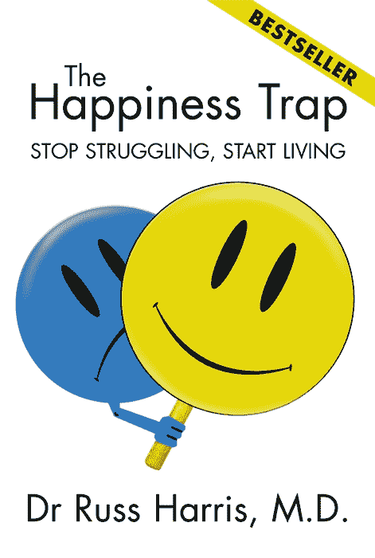
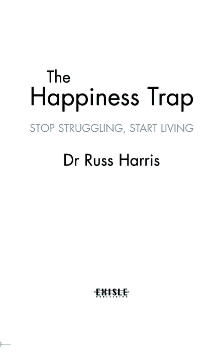
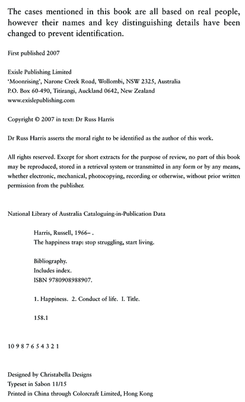

# 快乐陷阱 [电子资源]：停止挣扎，开始生活






# 献辞

献我的父母，感谢他们四十来的爱、支持、启发与鼓励。也献我的妻子卡梅尔（Carmel），她的爱、智慧和慷慨丰富了我的生活，并以我从未梦想过的方式开启了我的心扉。


# 前言

幸福中存在着一种巨大的讽刺。它源于一个意味着“偶然”或“发生”的词根，在积极的意义下，它意味着对偶然发生事件的新奇感、惊叹和感激。讽刺的是，人们不仅在追求它，还试图抓住它——尤其是为了避免任何“不快乐”的感觉。不幸的是，恰恰这些控制努力可能会变得沉重、计划化、封闭、僵化且固定。

幸福不仅仅是感觉良好那么简单。如果是那样，药物成用者将是地球上最幸福的人。事实上，感觉良好可能是一场非常不幸的追求。药物成用者将他们的方法称为 `fix`（固定/解瘾）并非偶然——因为他们正从化学角度试图将某种东西固定在位置。然而，就像被钉在桌子上的蝴蝶，除非被轻地对待，否则幸福就会死去。药物成用者并非唯一的如此。为了产生我们称之为幸福的情绪结果，我们大多数人倾向于从事与此完全相反的行为，然后对不可避免的结果感到糟糕和无能。在我们清醒过来之前，我们通常都都在试图给幸福找上一个 `fix`（暂时的稳定状态/成瘾点）。

本书基于接纳与承诺疗法（`ACT`），这是一种经过实证支持的方法，在处理幸福和生活满意度问题上采取了新颖且意料的角度。ACT 并不是教授追求幸福的新技巧，而是教授削弱挣扎、回避和错失当下的方法。鲁斯·哈里斯（Russ Harris）以非常仔细、富有创意且易于理解的方式介绍了这种方法。在 33 个小巧易读的章节中，他系统地探讨了我们是如何陷入`幸福陷阱`的，以及正念、接纳、认知解离和价值观如何将我们从中释放出来。

这些页码中传递的喜悦信息是：没有理由继续等待生活的开始。那种等待游戏可以结束了。现在就可以。就像被放在纸笼里的狮子，人类通常最被自己头脑中的幻象所困住。但尽管如此，笼子并不是真正能限制人类精神的障碍。还有另一条出路，通过这本书，哈里斯博士在黑暗中投射了一道强大且充满爱的灯塔，照亮了那条路。

旅途愉快。你会一切好的。

史蒂芬··海斯（Steven C. Hayes）
ACT 创始人
内华达大学

# 我只想快乐

假设一下，你对寻找幸福所相信的几乎一切事实都被证明是不准确的、误导的或虚假的。假设恰恰是这些信念让你痛苦不堪。如果你为了寻找幸福所付出的努力实际上阻碍了你获得它呢？如果你认识的几乎每个人都被发现处于同一条船上——包括那些声称拥有所有答案的心理学家、精神科医生和自我帮助导师呢？

我提出这些问题不仅仅是为了吸引你的注意力。本书基于日益增长的科学研究，这些研究表明我们都受困于一个强大的心理陷阱中。我们的生活受许多关于幸福的无益且不准确的信念的支配——这些观点被社会广泛接受，因为“每个人都知道它们是真的”。从表面上看，这些信念似乎很有道理——这就是为什么你在你读过的几乎每一本自我帮助书中都会反复遇到它们。但这些错误的信念既是恶性循环的起因，也是燃料，在这个循环中，我们越努力寻找幸福，遭受的痛苦就越多。而这个心理陷阱隐藏得如此之，以至于我们甚至不知道自己被它捕获并控制了。

这是坏消息。

好消息是还有希望的。你可以学习如何识别`幸福陷阱`，更重要的是，你可以学习如何从中爬出来——并保持在外面。本书将提供你完成这一目标所需的所有技能和知识。它基于人类心理学的一项革命性新进展：一种强大的改变的强大模型，即接纳与承诺疗法（`ACT`）。

ACT（读音同英文单词‘act’）由美国心理学家史蒂芬·海斯（Steven Hayes）创立，并由他的几位同事，包括凯莉·威尔尔逊（Kelly Wilson）和柯克·斯特罗沙尔（Kirk Stroshal）进一步开发。ACT 在帮助患者解决各种问题方面表现出惊人的效果：从抑郁、焦虑到慢性疼痛甚至药物成瘾。例如，在一项显著的研究中，心理学家帕蒂·巴赫（Patty Bach）和史蒂芬·海斯对患有慢性精神分裂症的患者使用了 ACT，发现只需四小时的治疗就足以让医院的再次入院率降低一半！对于我们数百万人会遇到的那些没那么剧烈的问题，如戒烟和减轻职场压力，ACT 也被证明是极其有效的。与绝大多数其他疗法不同，ACT 有坚实的科学研究基础，正因如此，它在全世界心理学家中的中的普及程度正在迅速增长。

ACT 的目标是帮助你过上丰富、完整且有意义的生活，同时有效处理不可避免而来的痛苦。ACT 通过使用六个强大的原则来实现这一点，这些原则与大多数自我帮助书中建议的所谓常识策略非常不同。

## 幸福是正常的吗？

在西方世界，我们现在的生活水平比人类以往任何时候都要高。我们拥有更好的医疗治疗、更多更新的食物、更好的住房条件、更好的卫生条件、更多的金钱、更多的福利服务，以及更多获得教育、公正、旅行**娱乐和职业机会的机会。事实上，如今的中产阶级生活得比不久前的皇室还要好，然而，人类的痛苦无处不在。

书店的心理学和个人发展部门正以前所未有的速度增长，书架在压力下咯吱作响。书籍涵盖了抑郁、焦虑、神经症、过度进食、愤怒管理、离婚、关系问题、性问题、药物成瘾、酒精依赖、低自尊、孤独、悲伤、赌博——只要你能说出名字，就有相关的书。与此同时，在电视和广播上，以及杂志和报纸上，“专家们”每天向我们倾轰如何改善生活的建议。这就是为什么心理学家、精神科医生、婚姻和家庭咨询师、社会工作者和“生活教练”的人逐年增加。然而——现在，请想一下——尽管有了这些帮助、建议和世俗智慧，人类的痛苦不仅没有减少，反而正在飞速增长！

统计数据令人震惊：在任何一年中，几乎有 30%的成年人会患上公认的精神疾病。世界卫生组织估计，抑郁症目前是全球第四大、最昂贵且破坏性的疾病，到 2020 年它将成为第二。在任何一个周内，十分之一的成年人正遭受临床抑郁症的痛苦，每五个人中就有一个人在一生某个阶段会遭受。此外，每四位成年人中就一人一生某个阶段会遭受药物或酒精成瘾，这就是为什么光美国就有超过 2000 万酒精成患者！


但比这些统计数据更令人震惊、更令人清醒的是，几乎每两个个人中就有一个人一生中经历过认真考虑自杀的阶段，并为此挣扎两周或更久。更可怕的是，每十个人中就有一个会在某个时刻实际尝试自杀。

想一下这些数字。想想你生活中的这些人：你的朋友、家人和同事。考虑这些数字意味着什么：在你认识的所有人中，几乎有一半的人会在某个时刻被痛苦所淹没，从而认真地考虑自杀。而每十个人中就有一个会尝试这样做！在过去的两个世纪里，人类的平均寿命增加了一倍。但我们让生活的丰富程度、快乐和满足感也增加了一倍了吗？这些统计数据给了我们一个响亮清晰的答案：快乐并不是常态！

## 为什么快乐变得如此困难？

为了回答这个问题，我们需要回到过去。现代人类的心脑拥有分析、计划、创造和交流的惊人能力，这在很大程度上是在过去的十万年里进化的，自从我们的物种——`Homo sapiens`首次出现在地球。但我们大脑的进化并不是为了让我们感觉良好，好让我们能讲出色的笑话、写十四行诗并说“我爱你”。我们大脑的进化是为了帮助我们在充满危险的世界中生存。想象你是一个早期的人类狩猎采集者。为了生存和繁衍，你的基本需求是什么？

有四种：食物、水、避难所和性，但如果你死了，这些东西就没有任何意义。因此，原始人类大脑的首要任务是留意任何可能伤害你的事物并避开它们！从本质上说，原始大脑是一个“别被杀死”的装置，它被证明是极其用的。我们的祖先在预测和避免危险方面变得越熟练，他们活得就越长，生的孩子也越多。

随着每一代人的进步，人类大脑在预测和避免危险方面变得越来越熟练。现在，在经历了十万年的进化后，现代大脑仍在不断寻找麻烦。它评估并判断我们遇到的几乎每件事：这是好是坏？安全还是危险？是有害还是有益？然而，如今我们大脑警告我们的不再是剑虎或 200 公斤重的狼。相反，是失业、被拒绝、收到超速罚单、付不起账单、在公共场合丢脸、让心爱的人不快、患癌症，或者其他百万种常见担忧之一。结果是，我们花费了大量时间去担心那些往往不会发生的事情。

对于任何早期人类来说，另一个生存要素是属于一个群体。如果你的部落把你踢出去，很快狼群就会找到你。那么，大脑是如何保护你免受群体拒绝的呢？通过将你与部落的其他成员进行比较：我融入其中了吗？我做得对吗？我的贡献足够吗？我和别人一样好吗？我做了任何可能导致被拒绝的事吗？

听起来熟悉吗？我们现代大脑不断警告我们会被拒绝，并将我们与社会其他部分进行比较。难怪我们花费这么多精力担心人们是否喜欢我们！难怪我们总是寻找改进自己的方法，或者因为自己“不标”而贬低自己。十万年前，我们只能与直属部落的少数成员进行比较。但这些如今，我们可以打开任何报纸或杂志，打开任何电视，收听任何电台，瞬间发现一大群比我们更聪明、更富有、更高、更瘦、更性感、更强壮、更有权力、更有名、更成功或更受推崇的人。让一个青少年抑郁的最快方法是什么？给她看一本时尚杂志。当她把自己和那些经过修图、植胶原蛋白、数字化处理过的超模进行比较时，她注定会自卑或完全不吸引人。我们其他人也没有那么不同。由于进化，我们的大脑现在如此复杂，以至于甚至可以幻出一个我们想要成为的人形象——然后将我们“真实的”自我与那个无法实现的标准进行比较。我们有什么机会呢？我们总是会觉得不够好！

现在，对于任何有野心的石器时代人来说，成功的通用规则是：越多越好。你的武器越精良（数量越多），你能杀到的食物越多。你的食物储备越充足，你度过匮乏期的机会就越大。避难所越坚固，你免受天气和野兽侵害就越安全。孩子越多，某些孩子活到成年的概率越大。因此并不意外，我们的现代大脑不断寻找更多：更多的钱、更高的地位、更多的爱、更多的工作满意度、更新的汽车、更年轻的身体、更年轻的伴侣、更大的房子。如果我们成功了，如果我们真的获得了更多钱、新车或更好的工作，那么我们就满足了——一会会。

因此，进化塑造了我们的大脑，使我们几乎不可避免地注定遭受心理痛苦：比较、评估和批评自己；关注我们所缺失的；对我们拥有的感到不满；以及想象各种可怕的场景，其中大多数将永远不会发生。难怪人类很难感到快乐！

## “快乐”究竟是什么？

我们都想要它。我们都渴望它。我们都为之努力。甚至达赖喇也曾说：“生命的意义就在于追求快乐。”但我们寻找的这种难以捉摸的东西究竟是什么？

“快乐（happiness）”这个词有两个非常不同的含义。通常它指的是一种感觉：一种愉悦、喜悦或满足感。我们都喜欢快乐的感觉，所以我们追逐它们并不意外。然而，和我们所有的其他其他感觉一样，快乐的感觉是不持久的。无论我们如何努力地想要留住它们，它们每次都会流逝。正如我们将看到的，花费时间追求这些感觉的生活在主要是不令人满意的。事实上，我们越努力追求愉悦的感觉，就越容易遭受焦虑和抑郁的痛苦。

快乐的另一个含义是“一种丰富、充实且有意义的生活”。当我们对内心深处真正重要的事情采取行动时，当我们朝着我们认为有价值和值得的方向移动时，当我们明确了我们在生活中的立场并据此行动时，我们的生活就会变得丰富、充实且有意义，并体验到一种强大的生命力。这不是某种转瞬即逝的感觉——这是一种对良好生活的层次感。尽管这样的生活无疑会带给我们许多愉悦的感觉，但它也会带给我们不舒服的感觉，如悲伤、恐惧和愤怒。这是意料之中的。如果我们过着充实的生活，我们将体验人类情感的全谱。

在这本书中，正如你现在可能已经猜到的，我们对快乐的第二种含义的兴趣远大于第一种。当然，快乐的感觉是很舒服的，当它们出现时，我们当然应该充分利用它们。但如果我们试图一直拥有它们，我们注定会失败。

现实是，生活包含痛苦。这是逃不开的。作为人类，我们都必须面对事实：迟早我们都会衰老、生病和死亡。迟早我们都会由于拒绝、告别或死亡而失去珍视的关系。迟早我们都将面对危机、失望和失败。这意味着以某种形式或其他形式，我们都将经历痛苦的思想和感受。


好消息是，尽管我们无法避免这种痛苦，但我们可以学会何好地处理它——为它留出空间，超越它，并创造一个值得过的生活。这本书将教你如何这样做。这个过程分为三个部分。

在第一部分中，你将学习自己是如何制造并陷入 `happiness trap`（幸福陷阱）的。这是关键的第一步，所以请不要跳过——如果你不知道它是如何运作的，你就无法逃离陷阱。

在第二部分中，你将不再试图避免或消除痛苦的思想和感受，而是学习如何从根本上改变你与它们的关系。你将学会如何以全新的方式体验痛苦的思想和感受，从而减轻它们的影响，消解它们的能量，并大幅减少它们对你生活的影响。

最后，在第三部分中，你将不再追逐快乐的思想和感受，而是将精力放在创造一个丰富且有意义的生活。这将产生一种活力感和成就感，这种感觉既是深层满足的，又是长久持久的。

# 前方的旅程

这本书就像是一场跨越异国外的旅行：很多事情看起来是陌生而新颖的。有些事情看起来很熟悉，但又似乎有些微妙的差异。有时你可能会感到受到挑战或面临对峙，另一些时候可能会感到兴奋或有趣。在这段旅程中请慢慢来。不要急于求成，要充分品味它。当你发现某些启发性或不寻常物时，停下来。深入探索，并尽可能多学习。创造一个值得过的生活是一项巨大的工程，所以请花时间去欣赏它。

# 第一部分

## 你是如何设置幸福陷阱的

### 第一章：童话故事

每个童话的最后一句是什么？你猜对了：“……从此以后，他们幸福地生活在一起。”而不只是童话有圆满的结局。好莱坞电影呢？它们不是几乎总是有一个某种令人宽慰的结局，正义战胜邪恶，爱情战胜一切，英雄击败坏人吗？大多数流行小说和电视节目不也是如此吗？我们热爱圆满结局是因为社会告诉我们生活应该是那样的：充满快乐和乐趣，充满和平与满足，永远幸福地生活在一起。但这听起来现实吗？它符合你的生活经验吗？这是构成 `happiness trap` 基本蓝图的四个大神话之一。让我们逐一来看这些神话。

### 神话一：快乐是人类的自然状态

我们的文化坚持认为人类天生是快乐。但引言中引用的统计数据清楚地反驳了这一点。记住，十个成年人中有一个会尝试自杀，五个人中有一个会遭受抑郁症。此外，你在生活中某个阶段遭受精神疾病的统计概率几乎是 30%！这些几可不是很乐观的，对吧？

当你考虑到所有由未被归类为精神疾病的问题引起的所有痛苦时——孤独、离婚、性困难、工作压力、中年危机、关系问题、家庭暴力、社会孤立、欺凌、偏见、低自尊、慢性愤怒以及生活中缺乏意义或目标——你开始意识到真正的快乐究竟是多么么罕见。不幸的是，许多人带着一种信念四处走动，认为除了自己以外，每个人都是快乐的。而且——你猜对了——这种信念创造了更多的不快乐。

### 神话二：如果你不快乐，说明你是有缺陷的

从神话一逻辑推导出，西方社会假设心理痛苦是不正常的。它被视为一种软弱或疾病，是某种故障或缺陷心灵的产物。这意味着当我们不可避免地经历痛苦的思想和感受时，我们经常会批评自己软弱或愚蠢。健康专业人员在这一过程中推波助澜，他们随意贴上如“你抑郁了”之类的标签，而这些标签仅仅证实了我们有多缺陷。

`Acceptance and Commitment Therapy`（接纳承诺疗法）基于一个截然不同的假设。`ACT` 认为，健康人类大脑正常的思维过程自然会导致心理痛苦。你并没有缺陷——你的大脑只是在履行它的职责；那是它*进化*出来要做。幸运的是，`ACT` 可以教你如何适应这一点，从而让你的生活发生强有力的转变。

### 神话三：为了创造更好的生活，我们必须消除负面情绪

我们生活在一个追求快乐的社会里，一种对寻找幸福极度痴迷的文化中。那个社会告诉我们要做什么？消除“负面”情绪，并代之积累“积极”的情。这是一个很棒的理论，表面上似乎很有道理。毕竟，谁想要不愉快的感受呢？但问题在于：我们在生活中通常最看重的事物会带来一系列感受，包括愉快的不愉快的。例如，在一段亲密的长期关系中，尽管你会体验到如爱和快乐等美妙的感受，但你不可避免地也会经历失望和挫败。并没有完美的伴侣，早晚会发生利益冲突。

对于我们开始的几乎每一个有意义的项目也是如此。尽管它们通常会带来兴奋和热忱的感觉，但它们通常也会带来压力、恐惧和焦虑。所以，如果你相信神话三，你就大麻烦了，因为如果你不准备好产生一些不舒服的情绪，创造更好的生活几乎是不可能的。然而，在本书的第二部分，你将学习如何完全不同的方式处理此类感受，以一种体验它们的方式，让它们不再那么困扰你。

### 神话四：你应该能够控制你的思想和感受

事实是，我们对思想和感受的控制力比我们想象的少得多。并不是我们完全没有控制力；只是我们远少于“专家们”让我们相信的程度。然而，我们对自己的行动拥有*巨大*的控制力。正是通过行动，我们创造了丰富、完整且有意义的生活。（这就是为什么我们把 `ACT` 读作单词 `act`，而不是字母组合 `A.C.T`。）

绝大多数的自助计划都支持神话四。例如，许多方法教你识别负面思想并用更积极的思想替换它们。其他方法鼓励重复积极的肯定句，如“发生发生的一切都是为了我最高的利益和最大的快乐”，或“我在任何时候都是坚强、能力且能力的”。还有其他方法鼓励你视觉化你想要的东西，生动地想象自己成为你想要的样子，过上梦想的生活。所有这些方法的基本主题都是：如果你挑战自己的负面思想或图像，相反，不断用积极的思想和图像填充你的大脑，你就会找到幸福。如果生活真有那么简单就好了！

我敢打赌，你已经尝试过无数次去更积极地看待问题，但那些负面思想仍然反复反复地出现。正如我们在上一章看到的，我们的大脑已经进化了十万年才变成现在这样，所以仅仅通过一些积极的思想或肯定句，不太可能让它们发生巨大的变化！并不是说这些技术*没有*效果；它们通常能让你暂时感觉好受。但它们从长远来看无法消除负面思想。


愤怒、恐惧、悲伤、不安全感和内疚等“负面”情绪的情况也是如此。有许多心理策略可以“摆脱”这些情绪。但你无疑发现，即使它们消失了，过了一会儿它们又回来了。然后它们又消失了。接着它们又又了。周而复始。很可能是，如果你和地球上大多数其他人类一样，你已经花费了大量精精力试图拥有“好”情绪而不是“坏”情绪——而且你可能发现，只要你不过得太痛苦，在某种程度上你可以做到的。但你可能也发现，随着你痛苦程度的增加，你控制情绪的能力逐渐减弱。遗憾的是，`Myth 4` 如此广为人知，以至于当我们控制思想和情感尝试失败时，往往会感到自己很失败。

这四个强大的迷思为“幸福陷阱”提供了基本的蓝图。它们让我们陷入了一场永远无法赢的斗争：与我们自身人性的斗争。正是这种斗争构建了陷阱。在下一章中，我们将详细观察这种斗争，但首先让我们考虑为什么这些迷思在我们的文化中如此根深蒂固。

### 控制的幻象

人类大脑作为一个物种带给了我们巨大的优势。它使我们能够制定计划、发明创造、协调行动、分析问题、分享知识、从经验中学习并想象新的未来。你身上的衣服、脚上的鞋子、手腕上的手表、你身下的椅子、头顶的屋顶、手中的书——如果没有人类心灵的智慧，这些东西中一个都不会存在。心灵让我们能够塑造周围的世界并使其符合我们的意愿，为自己提供温暖、避难所、食物、水、保护、卫生和药物。并不意外，这种控制环境的惊人能力让我们对其他领域的控制也产生了很高的期望。

现在，在物质世界中，控制策略通常很有效。如果我们不喜欢某件东西，我们就想办法避免它或摆脱它，然后就去做。门外有一只狼？把它赶走！向它投掷石头、长矛，或者把它射掉。雪、雨或雹？嗯，你无法摆脱这些东西，但你可以通过躲进洞穴或建造避难所来避免它们。干旱的土地？你可以通过灌溉和施肥来改善它，或者通过搬到更好的地方来避免它。

但我们的内心世界呢？我在这里指的是思想、记忆、情感、冲动、心理图像和身体感觉。我们可以简单地避免或摆脱我们不喜欢的东西吗？在外部世界，我们可以相当容易地这样做，那么我们的内心世界不应该一样吗？

这里有一个小实验。当你继续阅读这段话时，试着不要想冰淇淋。不要想它的颜色、质地或味道。不要想它在炎热夏日里吃起来是什么味道。不要想它在口中融化时的感觉有多好。不要想你必须不停舔边缘以防止它滴到你的手指上。

你做得怎么样？

完全正确！你无法停止思考冰淇淋的事情。

这里是另一个小实验。回想一下上周发生的一件事。任何记忆都可以，无论是你进行过的一次对话、看的一部电影，还是吃的一顿饭。想到了吗？很好。现在尝试摆脱它。从你的记忆中彻底抹除它，让它永远不再回到你的脑海。

进展如何？如果你认为自己成功了，再检查一下，看看你是否还能记得。

现在，留意你的嘴巴。注意你舌头的感觉。让它滑过你的牙齿、牙龈、脸颊和上颚。现在尝试摆脱那些感觉。尝试让你的嘴巴完全麻木，就像刚从牙医那里打了一针麻醉剂。你能忘记那些感觉吗？

现在考虑一下这个假设场景。假设有人用一把上膛的枪指着你的头对你说：`你不能感到恐惧；` 如果你感到哪怕一丝焦虑，他们就会射死你。在这种情况下，你能阻止自己感到焦虑吗，即使你的生命取决于此？（当然你可以试着表现得冷静，但你能真正感受到它吗？）

好了，最后一个实验。盯着下方的星星，然后看看你是否能阻止自己思考 60 秒。这就是你需要做的。在 60 秒内，防止任何想法进入你的大脑——尤其是任何关于那颗星星的念头！（图 1）


图 1

希望到现在你已经明白，思想、情感、身体感觉和记忆并没有那么容易控制。并不是你对这些东西`没有`控制力；而是你拥有的控制力比你想的要少得多。面对现实吧，如果这些东西那么容易控制，我们不应该都生活在永恒的幸福中吗？当然，有几个自我帮助大师声称自己一直处于这种状态。这类人通常非常富有，他们的书畅销数百万册，并吸引了大量渴望“答案”的巨大追随者。我猜，这本书的许多读者可能已经走过了那条路，并感到遗憾的失望。

我们 我们是如何学习控制的

从从小，我们就被教导应该能够控制自己的情绪。在你成长过程中，你可能听过很多这样的表达，比如“别哭，否则我让你没得哭”、“别那么忧郁，看好的一面”、“把你的苦脸脸收起来”、“你现在是个大孩子了，大孩子不哭的”、“别自怜了”、“别担心，没必要害怕。”

通过这些词汇，我们周围的大人向我们传递了一个信息：我们应该控制自己的情绪。而且在我们看来，他们似乎控制了自己的情绪。但在关上的门后发生了什么？很可能，那里许多人处理自己的情绪并不并不好。他们可能过度饮酒、服用镇静药、每晚哭着睡去、出轨、埋头工作，或者在沉默中忍受胃溃疡。无论他们是如何应对的，他们可能都没有与你分享这些经历。

而在那些你偶尔目睹他们失去控制的时刻，他们可能从来没有说过任何类似的话：“好的，这些泪水是因为我感到了一种叫做悲伤的情绪。这是正常的，你可以学习如何有效地处理它。”但不过，这并不意外；他们无法教你如何处理情绪，因为他们自己不知道如何处理自己的情绪！


所有这些短语的含义都是，你应该能够像拨开关一样，随心所欲地开启或关闭你的情绪。为什么这种神话如此迷？因为我们周围的人表面看起来都是快乐的。他们似乎能控制自己的思想和情感。但“似乎”是这里的关键词。事实是，大多数人对于自己在思想和情感上所经历的挣扎并不完全坦诚或诚实。他们“强颜欢笑”，“咬着牙坚持”。他们就像像谚语中说的在内心哭泣的小丑；我们看到的只是鲜艳的彩和活泼的举止。在治疗过程中，听到客户说出这样的话很常见，例如：“如果我的朋友/家人/同事能听到我现在的样子，他们永远不会相信的。大家都认为我是那么坚强/自信/快乐/独立……”

佩妮（Penny）是一位 30 岁的接待员，她在她第一个孩子出生六个月后来看我。她感到疲惫、焦虑，并对自己的育儿能力充满自怀疑。有时，她觉得自己很无能或不足，只想逃避所有的责任。另一些时候，她感到精疲力竭、痛苦不堪，怀疑生孩子是否是一个巨大的错误。更糟糕的是，她为自己竟然产生了这样的想法感到内疚！尽管佩妮经常参加妈妈小组会议，但她对自己的问题守如秘密。其他妈妈似乎都那么自信，她担心如果自己告诉她们自己的感受，她们会看不起她。当佩妮最终鼓起勇气与其他女性分享她的经历时，她的坦白打破了沉默的阴谋。其他妈妈在不同一程度上都同样的同样的感受，但她们都在假装勇敢，装作没事，因为害怕不被认可或被拒绝而隐藏了真实的感受。当这些女性敞开心扉并诚实地相待时，产生了一种巨大的解脱感和纽带感。

粗略概括一下，男性在承认自己内心深处忧虑方面比女性糟糕得多，因为男性被教导要保持坚忍：要压抑自己的情感并隐藏它们。毕竟，大男子汉是不流泪的。相比之下，女性从小就学会了分享和讨论自己的感受。尽管如此，许多女性仍不愿意向最亲密的朋友承认自己正感到抑郁、焦虑或在某些方面无法应对，因为担心被评判为软弱或愚蠢。我们对真实感受的沉默，以及在周围人面前戴上的虚假面具，只会加剧这种强大的“控制幻觉”。

所以问题是：你受所有这些控制神话的影响有多大？后面页的问卷将帮助你发现。

## 思想与情感控制问卷

本问卷改编自斯蒂芬·海耶斯（Steven Hayes）、弗兰克·邦德（Frank Bond）等人开发的类似问卷。当使用“负面思想和情感”这一术语时，它指的是一系列痛苦的感受（如愤怒、抑郁和焦虑）以及痛苦的思想（如不愉快的回忆、令人不安的画面和严厉的自我评判）。对于每一对陈述，请选择最符合你真实感受的一项。你选择的答案并不需要对你来说一直是绝对的 100% 正确的；只需选择看起来更能代表你总体态度的答案即可。

**1a.** 我必须很好地控制我的情绪才能在生活中取得成功。

**1b.** 为了在生活中取得成功，我不需要控制我的情绪。

**2a.** 焦虑是坏的。

**2b.** 焦虑既好也不坏。它仅仅是一种不舒服的感觉。

**3a.** 如果你不控制或摆脱负面思想和情感，它们会伤害你。

**3b.** 负面思想和情感不会伤害你，即使它们感觉起来不愉快。

**4a.** 我害怕我的一些强烈的情感。

**4b.** 我不害怕任何情感，无论它多强烈。

**5a.** 为了我做某些重要的事情，我必须消除所有的怀疑。

**5b.** 即使在怀疑的情况下，我也可以做重要的事情。

**6a.** 当负面思想和情感出现时，尽快地减少或摆脱它们是重要的。

**6b.** 经常尝试减少或摆脱负面思想和情感会导致产生问题。如果我只是让它们存在，那么它们就会作为生活的自然组成部分而发生改变。

**7a.** 管理负面思想和情感的最佳方法是分析它们；然后利用这些知识来摆脱它们。

**7b.** 管理负面思想和情感的最佳方法是承认它们的存在并让它们去，而不必对其进行分析或评判。

**8a.** 我将通过提高避免、减少或摆脱负面思想和情感的能力，来变得“快乐”和“健康”。

**8b.** 我将通过允许负面思想和情感随其自然地来去，并在它们存在时学会有效地生活，来变得“快乐”和“健康”。

**9a.** 如果我无法抑制或摆脱一种负面的情绪反应，那是个人失败或软弱的标志。

**9b.** 控制或摆脱负面情绪反应的需求本身就是一个问题。

**10a.** 拥有负面思想和情感说明我心理上不健康，或者“我有问题了”。

**10b.** 拥有负面思想和情感意味着我是一个正常的人。

**11a.** 掌控生活的人通常可以控制他们的感受。

**11b.** 掌控生活的人不需要尝试去控制自己的情感。

**12a.** 感到焦虑是不好的，我正努力避免它。

**12b.** 负面思想和情感是可以接受的，但我不喜欢它们。

**13a.** 拥有负面思想和情感意味着我的生活有问题。

**13b.** 负面思想和情感是每个人生活中不可避免的一部分。

**14a.** 在做重要事情之前，我必须感觉良好。

**14b.** 即使我感到焦虑或抑郁，我也可以做重要的事情。

**15a.** 我通过不去想它们来压抑我不喜欢的思想和情感。

**15b.** 我不尝试压抑我不喜欢的思想和情感。我只是让它们随其自然。

要为测试评分，请计算你选择 `a` 或 `b` 的次数。（请记录你的分数。在书结束时，我会要求你回来再次做。）

你选择 `a` 的次数越多，控制问题在你的生活中产生显著痛苦的概率就越大。为什么呢？这就是下一章的主题。

## 第二章

## 恶性循环

米妮泪流满面。“我到底怎么了？”她问道，“我有一个很的丈夫、棒的孩子、棒的工作。我身体健康；我很健康。我们有一栋漂亮的房子。我们很富有。我们住在优美的地区。所以为什么我不快乐呢？”

这是一个很好的问题。米妮似乎拥有了生活中想要的一切，那么到底哪里出问题了呢？我们在本章稍后会回到米妮，但现在让我们看看你的生活中发生了什么。

### 你的问题是什么？

推测，如果你正在读这本书，说明你的生活有空间变得比现在更好。也许你的关系出了问题，或者你感到孤独或心碎。也许你讨厌你的工作，或者你可能丢了工作。也许你的健康状况正在恶化。也许你爱的人去世了，拒绝了你，或者搬远了。也许你正处于中年危机。也许你自尊心低、缺乏自信或感到不足。也许你有药物或酒精问题或其他成瘾。这可能是财务或法律困难，或者你只是感到被困住了，不知道自己到底想要什么。也许你正遭受抑郁或焦虑的困扰，或者你只是对生活感到厌倦，觉得生活缺乏任何意义。


无论问题是什么，它无疑会引起不快的想法和感受——你可能已经花了大量精力试图逃避它们或抹除它们。但假设这些摆脱负面想法和感受的尝试实际上正在降低你的生活质量呢？在接纳承诺疗法（ACT）中，我们有一句话：“解决方案本身就是问题！”

#### 解决方案是如何变成问题的

当你觉得痒时会做什么？你会去抓，对吧？通常这种方法效果非常好，你甚至不会想它：抓一抓，痒就消失了。问题解决。但假设有一天，你的皮肤长了一块湿疹（一种常见的皮肤病）。皮肤非常痒，你自然会去抓挠。然而，该区域的皮肤细胞已经炎症，因此非常敏感，当你抓挠它们时，它们会释放一种名为组胺的化学物质，这种物质具有很强的刺激性。这些组胺会让皮肤进一步炎症。所以过了一会儿，瘙痒感又回来了——而且比以前更强烈。当然，如果你再次抓，情况会变得更糟！你越抓，湿疹就越严重，痒感也越剧。

对于正常健康皮肤上转瞬即逝的痒，抓挠是一个很好的解决方案。但对于异常皮肤的持续性瘙痒，抓挠是有害的：“解决方案”变成了问题的一部分。这通常被称为“恶性循环”。在人类情感的世界里，恶性循环非常常见。这里有几个例子：

- 约瑟夫（Joseph）害怕被拒绝，因此在社交场合中感到过度焦虑。他不想要那些焦虑的情绪，所以尽可能避免社交。他不接受派对的邀请。他不追求友谊。他独自生活，每晚都呆在家里。这意味着当他罕不容易社交时，他会比任何时候都焦虑，因为他太久没有练习了。此外，没有朋友或社交生活的独自生活只会让他感到完全被拒绝，而这恰恰是他所恐惧的！
- 艾冯（Yvonne）在社交场合中也会感到焦虑。她通过大量饮酒来应对。短期内，酒精减轻了她的焦虑。但第二天她会感到宿醉和疲惫，并经常后悔花在酒精上的钱，或者担心自己在醉酒期间做的尴尬事。诚然，她逃避了一会儿的焦虑，但长期来看付出的代价是许多其他不快的感受。如果她发现自己处于一个不能喝酒的社交场合，她的焦虑会比任何时候都大，因为她没有酒精可以依赖。
- 丹尼尔（Danielle）超重并讨厌这一点，所以她吃一些巧克力来让自己心情好起来。这时她感觉好多了。但接着她想到了刚刚摄入的热量，以及这些热量如何增加她的体重——最终感到比任何时候都痛苦。
- 阿哈迈（Ahmed）身材不佳。他想恢复健康。他开始锻炼，但因为身体跟不上，运动很辛苦且感觉不舒服。他不喜欢那种不适感，于是停止了锻炼。然后他的健身水平下降得了。
- 安德鲁（Andrew）和他的妻子西尔娜（Sylvana）之间积累了大量的紧张。西尔娜对安德鲁生气，因为他工作时间长，没有花足够的时间陪她。安德鲁不喜欢家里这种紧张感，所以为了避免这些，他开始工作更长时间。但他工作的时间越长，西尔娜就越不满意——他们关系中的紧张感不断增加。

你可以看到，这些都是试图摆脱、避免或逃避不愉快感受的例子。我们称这些为“控制策略”，因为它们是试图直接控制你的感受的尝试。下页的表格显示了一些常见的控制策略。我将它们分为两大类：战斗策略和逃避策略。战斗策略涉及与你不想要的想法和感受斗争或试图支配它们。逃避策略涉及逃避或隐藏那些不受的想法和感受。（表 2.1）

常见的控制策略

| 逃避策略 | 战斗策略 |
| :--- | :--- |
| 隐藏/逃避 | 抑制 | 你躲避或离开可能引发不舒服想法或感受的场合或活动。例如，你退出一个课程或避免参加社交活动，以防止焦虑情绪。 | 你试图直接抑制不想要的想法和感受。你强行将不想要的想法从脑海中推出去，或者将你的感受“压在内心深处”。 |
| 分心 | 争论 | 你通过关注其他事情来分散对想法和感受的注意力。例如，你感到无聊或焦虑，所以你抽根烟、吃个冰淇淋或去购物。或者你担心工作上的某个重要问题，所以你整晚看电视试图让大脑不去想它。 | 你与自己的想法争论，试图从逻辑上反驳它们。例如，如果你的大脑说“你是个失败者”，你可能会反驳道：“噢，不，我不是——看看我在工作中取得的一切。”或者你可能与现实争论，抗议道：“这不应该是这样！” |
| 走神/麻木 | 主宰 | 你试图通过走神或让自己麻木来切断与想法和感受的联系，最是通过使用药物、毒品或酒精。有些人通过过度睡眠或仅仅是“盯着墙看”来走神。 | 你试图主宰你的想法和感受。例如，你可能会对自己说诸“清醒点！”“冷静点！”或“开心起来！”或者你试图用积极的想法取代消极的想法，或者在不快乐时强迫自己快乐。 |
| | 自我攻击 |
| | 你试图欺负自己以产生不同的感受。你给自己起诸如“失败者”或“白痴”之类的名字。或者你批评并责备自己：“别这么可怜！你能处理好这个；你为什么要这么胆小？你应该比这更懂事。” |
| 表 2.1 | |

#### 控制的问题

使用这些方法试图控制你的想法和感受有什么问题呢？如果：

- 你只是适度使用它们
- 你只在它们有效的情况下使用它们
- 使用它们没有阻止你去做你所看重的事情

如果你没有感到非常痛苦或心烦——如果你只是在处理平常的日常压力——那么有意识地尝试控制你的想法和并不可能成为问题。在某些情况下，分心是处理不愉快情绪的好方法。如果你刚刚和伴侣吵了架，感到受伤和愤怒，那么通过散步或埋头看书直到你冷静下来来分散注意力可能会有所帮助。有时，走神是有益的。例如，如果你在劳累的一天后感到压力巨大且精疲力竭，在沙发上睡着可能是帮助你恢复活力的良方。


我们每个人在不同程度上都会使用控制策略。我的意思是，谁不想避开那些不时浮现的、不那么愉快的想法和感受呢？正如我们所看到的，只要适度使用，这种控制尝试并无大碍。例如，当我感到特别焦虑时，我有时会吃一块巧克力或一些饼干。这基本上是分分散注意力的一种形式；是试图通过关注其他事情来逃避某些不愉快的感觉。但因为我没有过度这样做，它并没有给我的生活带来重大问题——我保持了健康的体重，也没有得上糖尿病。现在，在我二十岁出头的时候，情况就完全不同了。那时我吃掉了一整车的蛋糕和巧克力来试图避免焦虑（在糟糕的日子里，我可以吃掉五整包 `TimTams` 饼干），结果我严重肥胖并患上了高血压。这完全是同样的控制策略，但当我过度使用它时，显然导致了严重的后果。

如果你担心即将到来的考试，你可能会通过看电视来分散焦虑的注意力。现在，如果你只是偶尔这样做，那没关系；但如果你做得太多，你就会花整个晚上看电视，而根本没法学习。这反过来会随着你的学业越落越后而产生更多的焦虑。因此，作为一种焦虑控制方法，分散注意力从长期来看根本行不通。而且还有显而易见的一点：这种方式处理焦虑会阻止你去做真正有帮助的事情——学习。

用酒精或药物发呆也是同样的道理。适度饮酒或偶尔服用镇静剂不太可能产生严重的长期后果。但如果这种控制方法变成了拐杖，就很容易导致成瘾，从而产生各种并发症，引发更多痛苦的感受。

请注意，这些控制策略之间存在相当的重叠。看电视而不是学习不仅可能是一种分散注意力的，还可能是一种隐藏/逃避策略（隐藏或逃避你的学习）。电视也可以用来发呆：有些人可能坐在电视机前连续几个小时，在没有任何真正兴趣的情况下坐着看。

### 在控制无法作用的情况下尝试使用控制

如果你深爱着某人并失去了那段关系——无论是通过死亡、拒绝还是分离——你都会感到痛苦。这种痛苦被称为悲伤。悲伤是对任何重大损失（无论是失去亲人、工作还是肢体）的正常情感反应。没有办法可以避免或摆脱它——它就在那里。而且，一旦被接受，它会随着自己的时间过去。

不幸的是，我们许多人拒绝接受悲伤。我们宁愿做任何事情也不愿感受它。我们可能会把自己埋首于工作、大量饮酒、投入一段“报复性”的新感情关系中，或者用处方药麻痹自己。但无论我们如何努力推开悲伤，在我们的内心深处它仍然在那里。最终它还是会回来。

这就像把一个足球按在水下。只要你一直按着它，它就会留在水面以下。但你的手臂终会累，一旦你松开手，球就会直冲出水面。

唐娜（Donna）25 岁时，她的丈夫和孩子死于一场烈的车祸。自然地，她感受到了巨大的失去感：痛苦感受的爆发，包括悲伤、愤怒、恐惧、孤独和绝望。但唐娜无法接受那些痛苦的感受，她转向酒精来推开它们。醉酒可以暂时缓解她的痛苦，但一旦她清醒过来，她的悲伤就会报复性地回来——她会喝得更多来再次推开它。当唐娜六个月后来看我时，她每天要下两瓶酒，还要吃一些 `Valium` 和安眠药。她康复的单一最大因素是愿意停止逃避痛苦。只有当她向自己的感受敞开放，并接受它们为哀伤过程中自然的一部分时，她才能与她可怕的失去达成和解。这使她能够为爱人有效地哀悼，并将能量投入到建立新生活中。（在书的后面，我们将看看她是是如何实现的。）

### 当控制阻止我们做我们看重的事时

你生命中最珍惜的是什么？健康？工作做家庭？朋友？宗教？运动？自然？当我们积极投入时间和精力到对我们来说最重要或最有意义的事情上时，生活变得更加丰富和充实，这并不意外。然而，很多时候，我们避免不愉快感受的尝试阻碍了我们去做真正看重的事。

例如，假设你是一个职业演员，你热爱你的工作。但某一天，毫无征兆地，就在你准备上场时，你对失败产生了强烈的恐惧。于是你拒绝上场（这种疾病被称为“舞台恐惧症”）。拒绝上场可能暂时减轻你的恐惧，但它也阻止了去做你真正看重的事。

或者假设你刚刚经历了离婚。悲伤、恐惧和愤怒都是自然反应，但你不想有这些不愉快的感受。所以你试图通过吃垃圾食品、醉酒或连续抽烟来提升情绪。但这对你的健康造成了什么影响？我从未见过任何不看重健康的人，但有许多人使用积极损害他们身体的控制策略。

### 我们到底有多多少控制权？

我们对想法和感受的控制程度在很大程度上取决于它们的强度——感受越不强烈，我们越能控制它们。例如，如果我们只是在应对典型的压力，简单的放松技术可以让我们冷静下来。然而，我们的想法和感受越令人困扰，我们的控制尝试的效果就越差。如果你处于恐惧中，人类已知的放松技术都无法让你冷静。

当我们逃避的事情并不重要时，我们对自己的想法和感受也有更多控制权。例如，如果你在避免清理你凌乱的车库或汽车，那么转移注意力可能相当容易。为什么？因为从宏观角度来看，这根本不重要。如果你你不做，明天太阳会升起，你也会继续呼吸。唯一发生的是你的车库或汽车依然很乱。但假定你手臂上突然长了一个大、看起来可疑的黑痣，而你避免去看医生。转移注意力容易吗？当然，你可以去看电影、看电视或上网，也许在一段时间内你可以停止思考它。但从长远来看，你不可避免会开始思考那个黑痣，因为不采取行动的后果可能是严重的。

所以，因为我们回避的很多事情并不重要，而且我们的很多负面想法和感受并不强烈，我们发现我们的控制策略通常能让我们感觉好——至少是一会儿。但不幸的是，它们会给我们一种虚假的自信感；也就是说，我们开始认为自己拥有的控制权比实际得多。这种虚假的控制感只因我们在上一章中遇到的神话而加剧。

### 控制与幸福陷阱有什么关系？

幸福陷阱是通过无效的控制策略建立的。为了感到快乐，我们努力控制自己的感受。但这些控制策略有三个巨大的代价：


1. 它们花费了大量的时间和精力，从长期来看通常是无效的。
2. 我们感到很愚蠢、有缺陷或意志薄，因为那些我们试图摆脱的想法/感受不断反复出现。
3. 许多在短期内减少不愉快感受的策略，从长期来看实际上降低了我们的生活质量。

这些不受欢迎的结果导致了更多不愉快的情绪，从而引发了更多控制它们的尝试。这是一个恶性循环。心理学家对这种不当或过度使用控制策略有一个专业术语：“**体验性回避**”（experiential avoidance）。体验性回避倾向于不断尝试避免、改变或摆脱你不想要的想法和感受——即使这样做是有害的、昂贵的、无用的或破坏性的。体验性回避是抑郁、焦虑、药物和酒精成瘾、进食障碍以及大量其他心理问题的主要原因。因此，这就是“幸福陷阱”的概括：为了找到幸福，我们试图避免或摆脱糟糕的情绪——但我们越努力，创造的糟糕感受就越多。对你自己产生这种感觉很重要，要信任你自己的经历，而不是简单地相信你读到的东西。带着这一点，请花一点时间完成以下句子：我最想摆脱的想法/感受是……

一旦你有了答案，请花几分钟列出你为了避免、改变或摆脱这些不愉快的想法或感受而尝试过的每一件事。尝试记住你曾经用过的每种策略，无论是有意的还是默认的。不要试图编辑或对你的答案进行故障排除。目标是尽可能多举例子，例如：避免出现该感受的场合、使用药物或酒精、服用处方药、批评或责备自己、陷入否认状态、指责他人、使用视觉化或自我催眠、阅读自助书籍、看心理治疗师、使用积极肯定、拖延、祈祷、与朋友倾诉、写日记、抽烟、吃得更多、吃得更少、睡得多、睡得少、推迟重要的改变或决策、投身工作/社交/爱好/运动中，或告诉自己“这会过去的”。

完成之后，检查你的列表，并对每一项问自己一个问题：

1. 它从长期来看真的摆脱了我痛苦的想法和感受吗？
2. 它在时间、精力、金钱以及健康和活力上让我付出了什么代价？
3. 它是否让我更接近丰富、充实且有意义的生活？

在做这个练习时，你可能发现了四件事：

1. 你投入了大量的时间和精力试图改变、摆脱或逃避不愉快的想法和感受。
2. 你尝试的大多数控制策略在长期来看并没有减轻你痛苦的想法和感受。
3. 许多这些控制策略付出了代价。
4. 许多这些控制策略实际上让你远离了你理想想要的生活。

感到有些迷茫、困惑或不安？如果是的话……太好了！这是你现实的一个重大转变，挑战了许多根深蒂固的信念。产生反应是非常正常的。

当然，如果你的控制策略没有产生巨大的代价，或者它们带你更接近了你想要的生活，那么它们就没有问题，我们不需要关注它们。在 `ACT` 中，我们只关注那些长期来看给你的生活质量带来负担的控制策略。

“等一下，”我听到你说，“你为什么没有谈论像捐献慈善、努力工作或照顾朋友之类的事情呢？给予他人不应该让人感到幸福吗？”说得好。请记住，重要的不仅是你所做的事情，还有你做这些事的动机。如果你捐慈善是为了推开“我很自私”的想法，或者你投身工作是为了回避不胜任感，或者你照顾朋友是为了对抗被拒绝的恐惧，那么可能，你无法从这些活动中获得多少满足感。为什么呢？因为当你的首要动机是避免不愉快的想法和感受时，这会消耗掉你所做事情中的快乐和活力。例如，回想你上次为了停止感到压力、无聊或不开心而吃丰盛美食的时刻。很可能那并不十分满意。然而，你是否曾经吃过同样的食物，不是为了摆脱糟糕的情绪，而是纯粹简单地享受它并欣赏它的味道？我打赌你发现那样要充实得多。

关于如何改善生活的建议从四面八方而来：找一份有意义的工作、做这项棒的锻炼、与朋友家人联系、走进大自然、培养一个爱好、加入俱乐部、为慈善做贡献、学习新技能、参与社区等等。如果你是因为这些活动对你真正重要且有意义而去做，那么所有的这些活动都能带来巨大的满足感。但如果这些活动主要被用来躲避不愉快的想法和感受，可能，它们不会有很有回报。当你正在逃避某种威胁时，很难欣赏生活。

记得米歇尔吗？她似乎拥有生活中想要的一切，但她并不快乐。米歇尔的生活是由回避“不价值感”的情绪驱动的。她被这些想法困扰：“我是一个糟糕的妻子”、“我为什么这么无能？”以及没人喜欢我”，以及所有伴随的内疚、焦虑、挫败和失望。

米歇尔努力让这些想法和感受消失。她迫使自己在工作中表现卓越，经常为了迁就他人而加班；她宠爱丈夫孩子，顺从他们的每一个要求；她试图取好生活中每一个人，总是把他们的需求放在自己前面。这对她付出的代价是巨大的。这真的摆掉了那些令人不安的想法和感受吗？你猜对了。通过不断把自己放在最后并如此努力地赢得他人的认可，她只是强化了自己的不价值感。她深陷在幸福陷阱之中。”


接纳与承诺疗法（ACT）基于六个核心原则，这些原则共同作用帮助你实现两个主要目标：a) 有效处理痛苦的思想和情绪，以及 b) 创造丰富、完整且有意义的生活。本书的第二部分主要关注第一个目标：转变你的内在心理世界。第三部分主要关注第二个目标：创造一个值得过的生活。随着书籍的进行，我们将逐一探讨这六个核心原则，但在之前，让我们先简要概述一下所有的原则。

## 原则一：解离（DEFUSION）

解离意味着以一种新的方式与你的对待处，使得它们对你的影响和作用大大减小。当你学会解离那些痛苦和不愉快的想法时，它们将失去恐吓、扰扰或让你抑郁的能力。当你学会解离那些没有帮助的想法（例如自我限制性信念和严厉的自我批判）时，它们对你行为的影响也会小得多。

## 原则二：扩张（EXPANSION）

扩张意味着为不愉快的情绪、感觉和冲动留空间，而不是试图压抑或推开它们。当你敞开心扉并为这些感觉创造空间时，你会发现它们不再那么困扰你，而且它们会更快地“离开”，而不是“徘留”并骚扰你。（ACT 对这一原则的官方术语是“接纳”。我更改了这个术语，是因为“接纳”这个词有很多不同的含义，很容易被误解。）

## 原则三：连接（CONNECTION）

连接意味着生活在当下；关注并完全投入到你正在做的任何事情中。而不是沉溺过去或担心未来，你与此时此刻正在发生的事情深度连接。（ACT 对这一原则的官方术语是“接触当下”。我纯粹为了沟通方便，在书中更改了这个术语。）

## 原则四：观察自我（THE OBSERVING SELF）

观察自我是人类意识中一个强大的方面，直到现在，西方心理学在很大程度上忽略了它。当你学会如何进入自己的这部分时，它将使你进一步转变与不受欢迎的思想和情绪的关系。

## 原则五：价值观（VALUES）

明确并连接你的价值观是赋予生活意义的必要步骤。你的价值观反映了你内心最重要的东西：你想成为什么样的人；什么对你来说是重大且有意义的；以及你想在生活中代表什么。价值观为你的生活提供了方向，并激励你做出重要的改变。

## 原则六：承诺行动（COMMITTED ACTION）

丰富且有意义的生活是通过行动创造的。但不是任何行动。它是通过`有效的`行动实现的，并由你的价值观所引导和驱动。特别是，它是通过`承诺的`行动实现的：即你一次又一次、又一次采取的行动，无论你失败了多少次，或偏离了轨道。所以，“承诺行动”是“承诺的、有效的、基于价值观的行动”的缩写。

要记住，虽然这六个基本原则可以从许多积极方面改变你的生活，但它们并不是十诫！你并不`必须`遵循它们。如果你选择，并且在合适的时候，你可以应用它们。所以，试着玩玩它们。实验。在你的生活中测试它们，看看它们对你是否有效。不要仅仅因为我说过就相信它们是有效的；尝试一下，相信你自己的经验。

我应该提醒你，在你阅读这本书的过程中，有一个关键点我会反复强调：你不会仅仅通过`阅读`这本书来改变生活。要做到这一点，你必须`采取行动`。这就像读一本关于印度的旅游指南：读完之后，你对想去的地方有了很多想法——但你还没有去过那里。要真正体验印度，你必须努力起来去那儿。同样，如果你只是读这本书并思考其中的内容，那么到结束时，你对如何创造一个丰富、完整且有意义的生活会有很多想法——但你并没有在真正过那种生活。为了真正`过`上更好的生活，你需要执行这些页面中的练习和建议。所以，你渴望开始吗？那么请继续读下去……

## 第四章

### 伟大的讲述者

今天早上，我手里拿着一个新鲜的柠檬。我用手指滑过亮黄色的外皮，注意到所有微小的凹凸。我把它举到鼻子前，深吸了一口芬芳的香气。然后我把它放在菜板上，切成两半。拿起其中一片，我张开嘴，将一滴新鲜的柠檬汁挤在舌尖上。

当你读到关于那个柠檬时，发生了什么？也许你“看到”了它的形状和颜色。又也许你“感觉”到了皮肤的质地。你可能还“闻”到了新鲜的柠檬气味。你甚至可能觉得口水直流了。然而，你面前并没有柠檬，只有`关于`柠檬的文字。但是，一旦这些文字进入你的脑海，你对它们的反应几乎就像对待真正的柠檬一样。

当你读一本精彩的惊悚小说时，也会同样的事情。你面前只有文字。但一旦这些文字进入你的大脑，有趣的事情就开始了。你可能“看到”或“听到”角色并体验到强烈的情绪。当这些文字描述一个处于危险境地的角色时，你的反应就像真的有人处于危险中：你的肌肉紧张，心跳加快，肾上腺素上升。（这就是为什么它们被称为惊悚小说！）然而，在现实中，你处理的只是纸上的小黑点。文字，真是奇妙的东西！但它们究竟是什么？

### 词汇与思想

人类高度依赖词汇。其他动物使用手势、表情和各种声音来交流——我们也是如此——但我们是唯一使用词汇的动物。词汇基本上是一个复杂的符号系统。（符号意味着或指的是其他东西。）例如，英语中的单词 `dog` 指的是一种动物。在法语中，`chien` 指同一种动物，意大利语中的 `cane` 也是。三个不同的符号，指向同一个事物。

我们能够感知、感觉、思考、观察或互动的任何事物都可以用词汇符号化：时间、空间、生命、死亡、天堂、地狱、几年前的人、从未存在过的地方以及时事等等。如果你知道一个单词指的是什么，你就知道它的含义并能理解它。但如果你不知道一个单词指的是什么，你就无法理解它。例如，`axillary hyperhidrosis` 是一个我们大多数人都不懂的医学术语。它的意思是`腋汗`。现在你知道 `axillary hyperhidrosis` 指的是什么，你就理解了这些词。

我们在两个不同的环境下使用词汇：公共场合，当我们说话、听或写作时；私下，当我们思考时。页面上的文字称为`文本`；说出的文字称为`演讲`；脑子里的文字称为`思想`。

不要将思想与随之产生的心理或或感觉混淆。为了区分，这里有一个小实验。花几分钟思考你明天早餐吃什么。在思考时，闭上眼睛，观察你产生的思想。注意它们以什么形式出现。闭上眼睛，这样做大约半分钟。


好了，你注意到了什么？你可能注意到脑海中出现了“画面”；你“看到”了自己正在烹饪或吃饭，就像在电视屏幕上一样。我们将这些心理画面称为“图像”。图像并不是思想，尽管它们经常一起出现。你可能还注意到身体里的感受或感觉，几乎就像你真的在准备或吃早餐一样。这些也不是思想；它们是感觉。你很可能还注意到有些词在脑海中闪过，就像一个说话的声音一样。这些词可能描述了你打算吃什么：“我要吃涂花生酱吐司。”或者它们可能在说类似：“我不知道我想吃什么。”我们脑子里的这些词就是我们说的“想法”。因此：

- `Thoughts`（想法）=我们脑子里的词
- `Images`（图像）=我们脑子里的画面
- `Sensations`（感觉）=我们身体里的感受

记住这种区别非常重要，因为我们以不同的方式处理这些内在体验。在书的后面章节，我们将关注图像和感觉。现在，我们将观察想法。

人类非常依赖自己的想法。想法告诉我们关于生活以及如何生活。它们告诉我们现在是什么样，我们应该是什么样，该做什么以及应该避免什么。然而，它们仅仅是词而已——这就是为什么在接纳承诺疗法（ACT）中，我们经常将想法称为“故事”。有时它们是真实的故事（被称为“事实”），有时是虚假的。但我们大多数的想法既不是真的也不是假的。它们中的大多数要么是关于我们如何看待生活的故事（被称为“观点”、“态度”、“判断”、“理想”、“信念”、“理论”和“道德”），要么是关于我们想对生活做些什么（被称为“计划”、“策略”、“目标”、“愿望”和“价值观”）。在 ACT 中，我们对一个想法的主要兴趣不在于它是真是假，而在于它是否有帮助；也就是说，它是否帮助我们创造我们想要的生活？

## 故事并不等于事件

想象一名警察在场场激烈的交火中抓获了一个武装的银行劫匪。第二天我们在报纸上读到了这件事。其中一份特定的报纸可能对发生的情况给出完全准确的描述。它可能包含了所有正确的事实：警察的名字、银行的位置，甚至是开枪的精确次数。另一份报纸对发生的情况的描述可能没那么准确。它可能为了戏剧性而夸大了某些细节，或者只是弄错了事实。但无论这个故事是完全准确还是虚假且误导性的，它仍然只是一个故事。当我们读到故事时，我们并没有真正在事件现场。我们的眼睛前并没有实际发生射击；我们面前拥有的只有文字。唯一真正经历这一事件的人是那些在事件发生时在场的人：“目击者”。只有目击者才能真正听到枪声，或看到警察制服劫匪。无论描述中有多少细节，故事都并不等同于事件（反之亦然）。

当然，我们知道报纸上的故事是有偏见的。它们没有给我们提供`绝对真理`；它们只是给了我们关于发生情况的一个`角度`，这反映了报纸的编辑观点和态度。（让我们面对现实吧，有些报纸比其他报纸更具煽动性。）我们还知道，在我们希望的任何时候，都可以停止阅读。如果我们没有从故事中获得任何有用的信息，就可以放下报纸走到外面去。

现在，这对于报纸上的故事来说可能显而易见，但对于我们脑海中的故事来说，远没有那么显而易见。我们往往对想法做出反应，好像它们是绝对真理一样，又好像我们必须给予它们所有的注意力。这种反应的心理学专业术语是“认知融合”。

## 什么是认知融合？

“认知”（Cognition）是心智产物的技术术语，例如想法、图像或记忆。“融合”（Fusion）意味着混合或融合在一起。“认知融合”意味着想法和它所指代的内容——故事和事件——融合在了一起。因此，我们对关于柠檬的词做出反应，好像柠檬真的在那里一样；我们对犯罪小说里的词做出反应，好像真的有人要被杀害了；我们对像“我很没用”这样的词做出反应，好像我们真的没用；我们对“我会失败的”这样的词做出反应，好像失败是注定无疑的事。在认知融合的状态下，似乎：

- 想法就是`现实`——好像我们正在思考实际上在发生。
- 想法就是`真理`——我们完全相信它们。
- 想法是`重要的`——我们认真对待它们并给予它们全部注意力。
- 想法是`命令`——我们自动服从它们。
- 想法是`明智的`——我们假设它们是最好的，并听从它们的建议。
- 想法可以是`威胁`——某些想法可能会让人深感不安或恐惧。

记得米歇尔（Michelle），她深受“我没希望了”、“我是个糟糕的妈妈”和“没人喜欢我”等想法的困扰。在她的认知融合状态下，这些想法似乎是真理。结果，她感觉糟糕极了。“并不奇怪，”你可能会想，“有那种想法，任何人都会感到难过的。”这确实是米歇尔最初相信的。但她很快发现，通过应用下面描述的简单技术，她可以立即减少此类愉快想法的影响。先读完说明，然后试一下。

### “我产生了了……的想法……”

要开始这项练习，首先在脑海中想出一个形式为“我是……”的令人心恼的想法，例如“我很笨”、“我真是个大失败者”或“我真没能”。最好选择一个经常出现且通常困扰你的想法。现在，让这个想法留在心里，尽可能相信它。关注它几秒钟。注意它是如何影响你的。

*** 现在拿出那个想法，在前面加上这个短语：“我产生了了……的想法。”现在再次运行那个想法，这次带着短语。对自己说：“我产生了了[想法]的想法。”观察发生了什么。

*** 你做了吗？记住，你不能仅仅通过阅读来学会骑自行车——你必须实际上上车并踩踏。如果你只是读练习，你从书中获得不了多少帮助。要改变你处理想法的方式，你必须实际上练习新技能。所以，如果你还没有做，请回去去做。

*** 那么发生了什么？你可能发现，插入“我产生了了……的想法”这个短语立即让你与想法本身产生了距离；它帮助你退后并观察它。（如果你没有发现任何区别，换另一个想法再试。）

你可以对任何不的想法使用这种技术。例如，如果你的脑海说：“生活太糟糕了！”，那么只需承认：“我产生了生活太糟糕了的想法。”如果你的脑海说：“我永远无法过去的！”，那么只需承认：“我产生了永远无法过去的想法。”如果你的脑海说：“我穿这件衣服看起来太大了！”，那么只需承认：“我产生了我穿这件衣服看起来太大了的想法。”

使用这个短语能让你意识到思考的过程。这意味着你不太可能从字面上理解你的想法。相反，你可以退后并看到这些想法的本质：它们只是在脑海中闪过的词，仅此而已。我们将这一过程称为“认知解离”，或简单称为“解离”。认知融合告诉我们想法是真理且非常重要。认知解离提醒我们想法只是词。在解离的状态下，我们意识到：


* 想法仅仅是声音、文字、故事或语言片段。
* 想法可能真实，也可能虚假；我们不会自动相信它们。
* 想法可能重要，也可能没；只有当它们有用时，我们才会关注。
* 想法绝对不是指令；我们当然不需要服从它们。
* 想法可能明智，也可能愚；我们不会自动遵循它们的建议。
* 想法绝不是威胁；即使是最负面的想法也不会引起深层的困扰或恐惧。

在 ACT（接纳承诺疗法）中，我们有很多不同的技巧来促进解离（defusion）。其中某些技巧起初可能有些花哨，但请把它们想象成自行车上的辅助轮：一旦你会骑自行车，就不再需要它们了。所以，在我们学习的过程中，尝试每种技巧，看看哪种最适合你。记住，在使用这些技巧时，解离的目标并不是消除某个想法，也不是为了让你喜欢它或想要它。目标仅仅是看清想法的真面目——一串文字——并让它存在那里，而不与其斗争。

接下来的技巧将用到你的音乐天赋。但别担心，除了你以外，没人会听。

### 音乐想法

脑海中浮出一个经常出现并困扰你的负面自我评判，例如，“我真是个笨蛋。”现在，在脑海中记住这个想法，并尽可能地相信它大约十秒钟。注意它是如何影响你的。

现在想象拿出同一个想法，并随着《生日快乐》的旋律自己给自己唱出来。在脑海里默唱。注意发生了什么。

现在回到原始形式的那个想法。再次，在脑海中记住它，并尽可能地相信它，大约十秒钟。注意它是如何影响你的。

现在想象拿出那个想法，并随着《铃当响》的旋律给自己唱出来。在脑海里默唱。注意发生了什么。

完成这个练习后，你可能会发现，现在你已经不再那么认真对待那个想法了；你不再那么深信它了。注意，你完全没有挑战这个想法。你没有试图消除它，没有争论它的真假，也没有尝试用一个积极的想法来取代它。那么发生了什么呢？基本上，你已经把它“解离”了。通过将想法旋律化，你意识到它只是由文字组成的，就像歌曲的歌词一样。

### 大脑是一个伟大的故事家

大脑喜欢讲故事；事实上，它从不停止。整天，每天，它都在向你讲述关于你是谁、你是什么样的人、你的生活应该该做什么、别人怎么看你、世界哪里出了问题、未来会发生什么、过去哪里错了等故事。它就像一台永不停播的收音机。

不幸的是，这些故事中很多是非常负面的——诸如“我不够好”、“我很蠢”、“我太胖了”、“我讨厌我的大腿”、“我的生活太糟糕了”、“未来没有希望了”、“没人喜欢我”、“这段关系注定会失败”、“我应付来”、“我永远不会快乐的”等等。

这并无异常。正如之前提到的，研究显示我们大约 80% 的想法带有某种程度的负面内容。但你可以看到，这些故事如果被视为绝对真理，很容易引发焦虑、抑郁、愤怒、低自尊、自我怀疑和不安全感。

大多数心理方法将负面故事视为一个主要问题，并费大劲试图消除它们。这些方法会建议你尝试：

* 通过检查事实和纠正任何错误来使故事更准确
* 改写故事，使其更积极
* 通过不断告诉自己一个更好的故事来摆脱故事
* 从故事中转移注意力
* 把故事推开
* 与故事争论，并辩论它的真假

但你难道还没有尝试过这些方法吗？事实是，从长远来看，这种控制策略根本不起作用。

在 ACT 中，处理方法非常不同。负面故事本身并不被视为一个问题。只有当我们与它们“融合”在一起时，当我们像对待真理一样对它们做出反应并给予我们全部注意力时，它们才会变成问题。

从小你就听过“不要相信你所读到的一切。”当我们在小报上读到关于名人的报道时，我们知道很多故事是虚假的或误导性的。有些是为了效果而夸大，另一些完全是捏造的。现在有些名人对此付之若罔；他们接受这是成名的一部分，不让它影响自己。当他们注意到关于自己的荒谬故事时，他们只是耸肩跳过。他们绝不会浪费时间去阅读、分析和讨论它们！然而，其他名人会对这些故事感到非常难过。他们阅读并纠结于此，大声抱怨，并提起诉讼（这压力很大，而且消耗大量的时间、能量和金钱）。

解离让我们变得像第一批名人一样：故事确实在那里，但我们并不认真对待它们。我们不给它们太多关注，也绝不浪费精力和试图与其斗争。在 ACT 中，我们不尝试改变、回避或消除故事。我们知道那是多么没用。相反，我们简单地承认：“这是一个故事。”

#### 为你的故事命名

识别出你大脑最喜欢的故事，然后给它们命名，例如“失败者！”故事，或“生活太糟了！”故事。通常会有同类主题的变体。例如，`没人喜欢我`故事可能会表现为`我很无聊`，`我不够吸引力`故事表现为`我太胖了`，而`我不胜任`故事表现为`我很蠢`。当你的故事出现时，通过叫出名字来承认它们。例如，你可以说：“啊，是的。我认出这个了。那个老喜欢的，‘我不行！’！”或者“哈！‘我应付不来’来了。”一旦你承认了一个故事，就够了——让它去吧。你不需要挑战它或把它推开，也不需要给它太多关注。只需让它随心所欲而去，而你将能量投入到你重视的事情中。

我们之前遇到的米歇尔识别出了三个主要故事：毫无价值的、`坏妈妈`和不被爱的。通过这些名字来承认她的想法，让她不太可能陷入其中。但米歇尔最喜欢的技巧无疑是“音乐想法”。每当她发现自己深信那个`可怜`的故事时，她就会把这些词汇谱成曲，看着它们失去所有的力量。她并不局限于《生日快乐》和《铃当响》。她尝试了各种曲调，从贝多芬的第五交响曲到披头士的《巷弄》。在全天练习这种技巧一周后，她发现自己不再那么认真地对待那些想法了（即使没有音乐）。它们并没有消失，但不再那么困扰她了。现在，你无疑充满了各种问题。但请耐心。在接下来的几章中，我们将更详细地介绍解离，包括如何将其用于意象。在此期间，练习我们目前涵盖的所有技巧：“我有产生这样一个想法……”、“音乐想法以及为故事命名。

当然，如果你不喜欢某个技巧，可以放弃它。如果你有一个最喜欢的，可以坚持使用。在面对困扰想法时要经常使用这些技巧，每天至少至少十次。每当你感到压力、焦虑或抑郁时，问问自己：“我的大脑现在在讲什么故事？”一旦你识别了它，就解离它。


如果这一切看起来太难了，只需承认就好：“我产生了一个‘这太难了’的想法！” 产生‘这太难了’、‘这太蠢了’或者‘这行不通’的想法都没关系。它们都只是想法，所以请看清它们的本质，并让它们随之。

“这没关系，”你可能会说，“但如果这些想法是真的的呢？”

问得好……

## 第五章

## 真正的真相（TRUE BLUES）

在接纳承诺疗法（ACT）中，一个想法是否真实并不重要。重要得多的是它是否`有用`。无论真假，想法都不过是词汇。如果它们是有用的词汇，那么就关注它们。如果没有用，又何必费心呢？

假设我在工作中犯了了一些严重的错误，我的脑海告诉我：“你真没才！”这并不是一个有帮助的想法。它没有告诉我我可以做些什么来改善局面，而是在贬低我。它没有激励我去改进，仅仅是在打击我的士气。如果我真的犯了错，那么自我贬完全毫无意义。相反，我需要的是采取行动：磨练我的技能或寻求帮助。

又假设我超重了，我的脑海说：“你是一块肥肉！看看那个肚子——太恶心了！”这个想法没有用；它除了指责、轻视和打击士气之外别无他用。它没有激励我理智地饮食或多运动；它只是让我感觉很糟糕。

你可以花费大量时间试图判断你的想法是否真实；你的脑海会一次又一次地试图把你拖入那场辩论中。虽然在某些情况下这可能很重要，但在大多数时候，它是完全无关的。而且，它还浪费了大量的能量。

更务实的方法是问：“这个想法`有用吗？`它能帮助我采取行动去创造我想要的生活吗？”如果它有用，就关注它。如果没有用，就化解它。但是，我听到你在问，万一那个负面想法实际上是有用的呢？万一告诉自己“我很胖”真的促使我减轻了呢？嗯，如果一个负面想法确实激励了你，那么尽管利用它吧。但几乎总是，这种自我自我批判的想法并不会激励你采取有效的行动。通常，这类想法如果从字面上理解，只会让你感到内疚、羞耻、抑郁、沮丧或焦虑。而且通常有体重问题的人会对这些不愉快的情绪做出吃更多的反应，徒劳地尝试让自己好受！在 ACT 中，我们非常强调采取有效行动来提高生活质量。在随后的章节中，我们将看看如何这样做。目前，只需说明，批评你、侮辱你、判断你、贬低你或指责你的想法可能会降低你的动力而不是增加它。所以，当麻烦的想法进入你的脑海时，问自己以下一个或多个问题可能是很有用的：

* 这个想法在任何方面有用或有帮助吗？
* 这是一个旧想法吗？我以前听过这个吗？再次听它能让我获得什么有用的东西吗？
* 这个想法帮助我采取有效行动来改善我的生活吗？
* 相信这个想法我会得到什么？

到这里，你可能想知道，如何判断一个想法是否有用？如果你不确定，可以问问自己：

* 它帮助我成为我想成为的人吗？
* 它能帮助我建立我想要的人际关系吗？
* 它帮助我与我真正重视的事物建立联系吗？
* 它帮助我充分利用当下的生活吗？
* 它帮助我采取有效行动来让我的生活变得更好吗？
* 从长期来看，它帮助我创造丰富、完整且有意义的生活吗？

如果其中任何一个问题的答案是“是”，那么这个想法就是用的。如果所有答案都是“否”，那么它可能没有用。

## 想法只是故事

在第四章中，我讨论了这样一个概念：想法基本上只是“故事”——一连串串在一起告诉我们某些事情的词汇。但如果想法只是故事，那么我们如何知道该相信哪一个呢？这个答案有三个部分。首先，要警惕不要紧紧抓住任何信念。我们都有信念，但我们抓得越紧，我们的态度和行为就越越变得僵化。如果你曾试图与一个绝对认为自己是正确的的人争论，你就知道那是多么毫无意义——他们永远看不到除了自己观点以外的任何观点。我们描述他们为固执、死板、狭隘、目光短浅或“固执成规”。

此外，如果你反思自己的经历，你会发现信念随着时间的推移而改变；也就是说，你曾经紧紧持有的信念，现在可能觉得很可笑。例如，在某个时刻，你可能曾相信过圣诞老人、复活节兔子、牙齿仙，或者龙、小精和吸血鬼。几乎每个人随着年龄增长，都会对宗教、政治、金钱、家庭或健康的信念发生变化。所以，尽管拥有你的信念——但要轻松地持有。记住，所有信念都是故事，无论它们是否“真实”。

其次，如果一个想法帮助你创造一个丰富、完整且有意义的生活，就使用它。关注它，并用它引导和激励——*并且*同时记住它仍然只是一个故事；一点人类语言。所以使用它，但不要紧紧抓住它。

第三，ACT 的核心原则之一是学习关注`实际发生的事情`，而不是仅仅相信你的大脑所说的。例如，你可能听说过“冒充者综合征”。这是指那些胜任工作的人认为自己只是个冒充者；认为自己并不知道在做什么。在冒充者综合征中，人们没有充分关注他们的直接经验；相反，他们在关注一个过度批判的大脑，说：“你不知道在做什么。你正在搞砸。早晚大家都会看穿你，因为你是个假货。”经历过冒充者综合征的名人包括摇滚明星罗比·威廉姆斯和奥斯卡影后瑞瑞·泽维格。在我从医生涯的早期，我也曾经历过这种。如果我的一个病人说：“谢谢，你是一个很棒的医生，”我以前会想：“是吗，如果你知道我真实的样子，你就不会这么说了。”


这些来，当我犯错时，这两个词仍然经常出现，但不同在于现在它们不再困扰我了——因为我不再认真对待它们。我知道那些词只是一种自动反应，就像你打喷嚏时眼睛总会闭上一样。事实是，我们并不能选择脑海中的大部分想法。只有当我们积极计划、心理演练或进行创作时，我们才会选择其中一小部分，但脑海中大多数想法只是会按照自己的意愿“现出来”。我们每天都有成千上万个无用或无益的想法。无论它们是多么刻薄、残忍、愚蠢、报复性、批判性、恐惧还是完全诡异，我们都无法阻止它们的出现。但仅仅因为它们出现了，并不意味着我们必须认真对待它们。

对我而言，“我不够能”这个故事在我成为医生之前很久就已经了。在我生活的许多不同方面，从学习跳舞到使用电脑，我犯的任何错误都会触发同一个念头：“我不够能。”当然，并不总是这几个完全相同的词汇。通常它们是相同主题的不同变体，例如：“白痴！”或“又来了，又搞砸了！”或“你到底能不能把任何事情做对？”但只要我能看清它们的本质：只是几个跳入我脑海的词，这些想法就不是问题。基本上，你对生活的直接体验（而不是对大脑的旁白评论）感知得越敏锐，你就越有力量让生活向着你真正想要的方向发展。在随后的章节中，你将学习如何培养这种能力。

### 故事从未停止

大脑从未停止讲述故事——即使在我们睡觉时也是如此。它不断地进行比较、判断、评估、批判、计划、说教和幻想。它讲述的许多故事都是非常吸引注意的。我们一次又一次地迷失在这些故事中——对于这个过程有许多不同的表达方式。我们谈论“沉溺于一个想法”、“享受一个想法”、“与一个想法斗争”、“与一个想法调情”、“信服一个想法”、“陷入思绪中”、“陷入沉思中”以及“被念绪带走”，这只是其中一角。

所有这些表达都指向想法如何占据我们的时间、能量和注意力。大多数时候，我们倾向于对想法过于认真，并给予它们太过多的关注。下面的练习演示了“赋予想法重要性”与“不认真对待想法”之间的区别。

#### 不认真对待想法

在脑海中想出一个通常会让你感到困扰的想法；它的形式是“我是 X”（例如，“我不够好”）。把这个想法留在你的脑海中，注意它是如何影响你的。

现在，在脑海中想出想法：“我是一个香蕉！”把它留在脑海中，注意它是如何影响你的。

你注意到了什么？大多数人发现第一个想法困扰着他们，但第二个想法却让他们微笑。为什么？因为你没有认真对待第二个想法。但如果“我是……”后面的词是“一个失败者”、“一个失败蛋”、“一只胖猪”或“一个无趣的人”，而不是“一个香蕉”，我们倾向于赋予它们多得多的重要。然而，它们仅仅是词。让自己的想法没那么严肃的一种简单方法是尝试……

#### 感谢你的大脑

这是一个简单而有效的解离（defusion）技术。当你的大脑开始产生那些老调调时，只需感谢它。你可以对自己（默默地）说：“谢谢你，大脑！太有信息量了！”或“谢谢分享！”或“是吗？太有趣了！”或者简单地说：“谢谢你，大脑！”

在感谢大脑时，不要带有讽刺或攻击性。要带着温暖和幽默去做，并对大脑产生源源不断的想法流的惊人能力表示由衷的感谢。（你也可以将这种技术与“命名故事”结合起来：“啊是的，‘我是失败者’的故事。非常感谢你，大脑！”）

下面是另一种帮助你不再认真对待想法的技术。先阅读说明，然后试一试。

#### 傻瓜声音技术

这个技术特别适用于反复出现的负面自我评价。找到一个让你感到心烦或困扰的想法。专注于这个想法十秒钟，尽可能地相信它。注意它是如何影响你的。

***

然后选择一个拥有幽默声音的动画角色，比如米奇鼠、兔八哥、史瑞克或霍默·辛森。现在把那个烦人的想法带入脑海，但用那个动画角色的声音“听”它，仿佛那个角色正在大声说出你的想法。注意发生了什么。

***

现在让那个负面想法回到原始形式，再次尽可能地相信它。注意它是如何影响你的。

接下来选择另一个动画角色，或者来自电影或电视节目中的角色。考虑一些幻想角色，如达斯·维达、尤达、咕噜，或者你最喜欢的情景剧中的角色，或者是具有独特声音的演员，如阿诺德·施瓦辛格或或埃迪·墨菲。再次将那个令人痛苦的想法带入脑海，并用那个声音“听”它。注意发生了什么。

***

在完成这个练习并重复之后，你可能发现自己并没有那么认真地对待那个负面想法了。你甚至发现自己在微笑或咯笑。注意，你并没有试图改变这个想法、消除它、与它争论、推开它、辩论它的真假、用一个更积极的想法替换它，或以任何方式分散自己的注意力。你只是看清了它的本质：一段语言。通过获取这段语言并用不同的声音来听它，你会意识到它仅仅是文字——因此，它失去了冲击力。（这可能让你想起我们小时候学过的一句童谣：“木头和石头可能会打碎我的骨头，但言语伤害不了我。”遗憾的是，我们小时候并不能很好地实践这一点，因为没有人教过我们解离技术。）

我的一位客户——我们叫她珍娜，患有抑郁症——发现这种方法非常有帮助。她在一个言语虐待她的母亲环境中长大，母亲不断地批判和侮辱她。曾经来自母亲的侮辱现在变成了反复出现的负面想法：“你太胖了”、“你真丑”、“你真笨”、“你什么成不了”、“没人喜欢你。”当这些想法在我们的课程中出现时，珍娜通常会哭起来。珍娜是蒙提派剧团的忠实粉丝，她选择的角色来自他们的电影《布莱恩的人生》。在电影中，布莱恩的母亲（由男演员特里·琼斯饰演）总是用一种滑稽的高音尖叫责备布莱恩。当珍娜用布莱恩母亲的声音“听”她的那些负面想法时，她无法认真对待它们了。想法并没有立即消失，但很快就失去了对她的控制力，这对缓解她的抑郁症有很大贡献。

但如果一个想法既真实又是严肃的呢？例如，如果你正死于癌症并产生了这样的想法：“我很快就要死了。”


从接纳承诺疗法（ACT）的角度来看，我们更感兴趣的是一个念头是否有帮助，而不是它是真是假、严肃还是荒谬、消极还是积极、乐观还是悲观。底线始终是一样的：这个念头是否帮助你最大限度地生活？

现在，如果你只剩下几个月的寿命，那么反思你想要如何度过这些时间就变得非常重要。你有哪些未完成的任务需要处理？你想做些什么，在去世前想见哪些人？所以，诸如“我要快死了”这样的念头如果能促使你反思并采取有效行动，它就是有用的。如果是这样，你就不会尝试去消除这种念头。你会关注它，并利用它来帮助你完成需要要做。但假设这个念头变成了一种执念，让你在脑海中反复播放。那么在生命的最后几周里，整天想着“我要快死了”，把所有的注意力都给这个念头而不是周围的爱人，这会有帮助吗？

现在，对于某些人来说，`Silly Voices`（傻语气）技术对于这种念头可能显得不合适，因为它看起来可能是在淡化某些非常严肃的事情。如果你有这种感觉，那就不要用它。但请注意，解离（defusion）并不是要淡化或嘲笑生活中的真实问题。解离目的是让我们从大脑的压迫中解放出来；释放我们的时间、能量和注意力，以便将其投入到有意义的活动中，而不是徒劳地陷入思想。如果“我要快死了”不断出现并占据你所有的注意力，从而阻止了你与爱人的联系，那么你可以通过多种不同的方式来解离它。你可以承认：“哈！‘临死’的故事又来了”，或者“我产生了一个‘我要快死了’的念头”，或者你可以简单地说：“谢谢你，大脑！”

不要认为你必须用余生来感谢你的大脑，或者用小调子和傻语气听到你的念头。这些方法仅仅是垫脚石。从此以后，你可以预期自己瞬间解离念头，而不需要这些刻意的技巧（尽管在某些时候，从心理工具箱中拿出它们总是有用的）。

### 练习解离

在练习解离时，记住以下几点：

- 解离的目标`不是`要摆脱不快的念头，而是要`看清它们的本质`——仅仅是文字——并放弃与它们纠斗。它们有时会离开，有时则不会。如果你开始期待它们会离开，你就是在让自己陷入失望或挫败中。
- `不要期望`这些技术能让你感觉良好。通常，当你解离了一个烦恼的念头时，你会感觉好一些。但这只是一个有益的副产品，而不是主要目标。

解离的主要目标是从大脑的暴政中释放你，这样你就可以把注意力集中在更重要的事情上。所以，当解离确实让你感觉好起来时，尽管去享受。但不要期望它这样做。而且不要开始用它来试图控制你的感受；否则，你又会掉回幸福陷阱阱中。

- 记住你是人，所以会有很多时候你会忘记使用这些新技能。这没关系，因为当你意识到自己被无帮助的念头钩住时，你可以立即使用这些技术之一来让自己脱钩。
- 记住没有一种技术是万无一失的。可能会出现你尝试了但解离并没有发生。如果是这样，只需观察与念头融合（fused）的感觉是怎样的。仅仅学会区分融合和解离本身就有意义。

解离就像任何技能一样：练习得越多，进步得越快。所以，将`Thanking Your Mind`（感谢你的大脑）和`Silly Voices`技术加入你的技能库，并目标每天各使用五到十次。

此时，不要期望生活会有任何剧烈变化。只需观察当你将这些练习融入日常生活时发生了什么。如果你有任何怀疑或顾虑，请把它们记录下来。在下一章中，我们将看看人们在解离时遇到的常见问题，更重要的是，我们将学习如何克服它们。

## 第 6 章

### 解离问题排除

“解离没用！”约翰粗鲁地说道。

“你什么意思？”我问道。

“嗯，”他说，“我必须在公司里向大约 50 个人做这次演示。我的大脑不断告诉我我会搞砸并让自己丢大脸，于是我尝试了那些解离技巧，但它们毫无作用。”

“你的意思是，你一直在认同那个你会搞砸的说法吗？”

“不，它对我有帮助——我不再严肃地对待它了。”

“那你为什么说解离没用？”

“因为我仍然感到焦虑。”

“约翰，”我说，“我做公开演讲已经二十多年了，每次站在那里我仍然感到焦虑。我遇到过成百上千以演讲为职业的人士，我总是问他们：‘你们演讲时会焦虑吗？’到为止，几乎每一个人都说是的。重点是，如果你要让自己处于任何挑战性情境中，如果你要承担任何重大风险，焦虑是一种正常情绪。它会在那里的。而解离念头并不能消除它。”

我们许多人在第一次遇到解离时都会陷入约翰同样的陷阱；我们开始试图将解离作为一种控制策略。记住：

- 控制策略是任何改变、回避或摆脱不想要的念头和情绪的尝试。
- 当控制策略过度使用或在无法使用的情况下时，它们就会产生问题。

解离与控制策略是`相反`的；它是一种接纳策略。在 ACT 中，与其试图改变、回避或摆脱不快的念头和情绪，我们的目标是`接受`它们。接纳并不意味着你必须喜欢你的念头和情绪；它只是意味着停止与它们纠斗。当你不再浪费能量去改变、回避或摆脱它们时，你可以将这些能量投入到更有用的事情上。这通过一个类比来解释最好。

想象你居住在一个与敌对邻国接壤的小国。两国之间存在长期的紧张关系。邻国拥有不同的宗教和政治制度，你的国家将其视为一个重大威胁。你的国家与邻国的关系有三种可能的情况。

最坏的情况是战争。你的国家发动进攻，另一个国家反击（或反之）。当两国都卷入一场战争时，两国人民都会遭受痛苦。想想任何重大战争在生命、金钱和健康方面的巨大代价。

另一种情况，比第一种好，但远不理想，是临时休战。两国同意停火，但并没有和解。怨恨在表面下涌动，并存在着战争再次爆发的威胁。想想印度和巴基斯坦，面临着核战争的威胁，以及印度教徒和穆斯林之间激烈的敌对。

第三种可能性是真正的和平。你们承认差异并允许它们自然存在。这并没有消除另一个国家，也不意味着你一定喜欢它，甚至不希望它在那里。这也不意味着你认可它的政治或宗教。但因为你不再处于战争状态，你现在可以使用资金和资源来建设自己国家的基础设施，而不是在战场上挥霍。


第一种情况，战争，就像是为了摆脱不想要的想法和情感而进行的斗争。这是一场永远无法的战斗，会消耗大量的时间和能量。

第二种情况，休战，显然好得多，但距离真正的接纳还有很长的路。它更像是一种不情的宽忍；没有迈向新未来的感觉。虽然没有活跃的战争，但敌意依然存在，你屈从于持续的紧张状态。对想法和情感的不情宽忍比公开斗争要好，但它让你感到陷入困境且有些无助。这种感觉更多是无奈而非接纳，是受困而非自由，是停滞而非前进。

第三种情况，和平，代表了真正的接纳。请注意，在这种情况下下，你的国家不需要喜欢另一个国家，不需要批准它的存在，不需要皈依它的宗教或学习它的语言。你只需要与他们和解。你承认你们的差异，放弃改变他们的政治或宗教的尝试，并将精力集中在让自己的国家变成一个更好的居住地。当你真正接纳自己不舒服的想法和情感时，也是如此。你不需要喜欢它们、想要它们或批准它们；你只需要与它们和解并随它去。这让你能够释放精力投入到行动中——让你的生活朝着你所珍视的方向前进的行动。

## 接纳的真谛

接纳并不意味着“忍受”或向任何事情妥协。接纳关于拥抱生命，而不仅仅是忍受生命。接纳的字面意思是“接纳所提供的一切”。它并不意味着放弃或承认失败；并不意味着只是咬牙坚持。它意味着完全向你当下的现实开放——承认它此时此刻此地的真实样貌，并放弃与此时此刻的生活现状进行斗争。

但如果你想改善你的生活，而不仅仅是接受它的现状呢？嗯，这正是本书的全部目的。但改变生活最有效的方法是从完全接纳现状开始。假设你正走过一片冰面。为了安全地迈出下一步，你首先需要找到一个坚实的立脚点。如果你尝试在不这样做这一点的情况下向前移动，你很可能会摔个狗头。

接纳就像找到那个坚实的立脚点。它是对你脚所在位置以及地面状况的现实评估。这并不意味着你喜欢待在在那里，也不意味着你打算留在那里。一旦你有了坚实的立脚点，你就可以更有效地迈出下一步。你越完全地接受你处境的现实——无论它此时此刻是什么样的——你就越能有效地采取行动去改变它。

达赖喇玛完美地说明了这一点。他完全接受中国已经入侵了西藏，以及他被迫离开自己的国家流亡。他没有浪费时间和精力在痴人说梦上，没有感到愤怒，也没有忧郁地沉溺于所失去的一切。他知道那没有帮助。他没有承认失败，也没有将整个问题扔进“太难了”的篮子里。相反，他承认现在就是如此，同时他竭尽所力提供帮助。他在全球积极开展活动，以增加公众和政界对西藏困境的认识，并为那里的人募集资金支持。

另一个例子，让我们考虑家暴的情况。如果你的伴侣有身体暴力，第一步是接受局势的现实：你处于危险之中，你需要采取行动保护自己。下一步是采取行动：寻求专业帮助、采取法律行动和/或离开这段关系。为了采取这一行动，你需要接纳可能升起的焦虑、负罪感和其他痛苦的想法和情感。这就是 ACT（接纳与承诺疗法）的精髓所在：接纳与行动并肩而。ACT 的核心哲学被简洁地概括在“宁静挑战”中：

```
培养勇气去解决可以解决的问题，培养宁静去接受无法解决的问题，并拥有明辨区别的智慧。
```

如果你的生活对你不顺意，唯一理智的事情就是采取行动改变它。当你从接纳的角度出发时，这种行动将有效得多。你浪费在与想法和情感斗争上的所有时间和精力，本可以更有用地投入到行动中——正确的行动。一个丰富、充实且有意义的生活是通过接纳你的想法和情感而不是与它们斗争，并在深层价值观的指导下采取有效行动来实现的。

那么，不接纳的代价是什么？当你试图避免或摆脱不愉快的想法和情感时，长期来看会发生什么？控制策略有效吗？它们带给了你想要的生活吗？接纳是控制策略的一种强大替代方案。你已经发现，许多不愉快的想法在解离（defused）后痛苦要得多，在随后的章节中，你将发现负情绪也有类似的转化。

## 如何使用解离

现在让我们回到约翰的评论，“解离没用”。约翰正试图用解离来摆脱焦虑。难怪它“没用”！解离并不是某种控制情绪的聪明法子。它仅仅是一种接纳技术。诚然，解离无帮助的想法通常会减少焦虑，但这只是一个有益的副产品；一个奖励——它不是重点。如果你试图用解离来控制焦虑——或者任何不愉快的情绪——早晚你会感到沮丧。

但如果你已经解离了一个想法，它仍然在那里怎么办？再次，解离并不是为了摆脱想法。它是为了看清它们的真实面目并与它们和解；允许它们存在而不与它们斗争。有时它们会很安静地离开，有时它们会徘一会儿，有时它们会离开又回来。要点是，一旦你允许它们在不斗争的情况下存在，你就可以将精力和注意力放在你重视的活动上。但如果你期望解离你的想法会让它们消失，你就是在让自己陷入失望；你又掉回了控制的议程——幸福陷阱。目标是接纳你的想法，而不是摆脱它们。

并记住，你不必喜欢一个想法才能接纳它。你可以完全出于实用主义而接纳它：无论你喜不喜欢，这个想法已经在那里了，与它斗争只是浪费你的时间和精力，没有任何长期利益。接纳为你释放了精力，用于增强生活的活动。

想要摆脱一个不愉快的想法是可以的。事实上，这是预料之中的，因为你一辈子都在尝试这样做。但想要摆脱某物与积极与其斗争是完全不同的。例如，假设你有一辆不再想要的旧车。并假设你至少在一个月内没有机会卖掉它。你可以想要摆脱这辆车，同时接受你还拥有这辆车。你不需要因为还拥有那辆旧车就非要把它撞碎、让自己痛苦或每晚醉酒。

所以，如果你发现自己正在与一个负面想法斗争，只需留意它。假装你是一个观察自己大脑的科学家；留意你斗争的不同方式。你是否在挑战你的想法，试图反驳或否定它们？你是否在判断它们是好坏、真假、正负？你是否在试图将它们推开或用“更好”的想法取代它们？你是否在与自己的大脑辩论？带着兴趣观察你的斗争，并留意它达成了什么。


当然，有些故事比其他故事更顽固：它们会一次又一次地回来。还记得我那个关于“我很无能”的故事吗？从我记忆中开始，就有这个故事了。现在它拜访我的频率少了一很多，但偶尔还是会跳入我的脑海。区别在于，现在我不再相信它了。但如果出现了一个有帮助的想法，比如“我刚刚搞砸了；我该如何从中学习呢？”，那么我确实会关注它。

放下任何认为你的故事会消失或出现频率会降低的预期是非常重要的。事实上，它们往往会消失。但如果你是为了让它们消失而对它们进行“脱钩”，那么从定义上来说，你并没有真正接纳它们。而且你知道那会导致什么结果。

但是，我听见你在问，积极的想法难道不比消面性的想法好吗？并不一定。记住，最重要的问题是：“这个想法有帮助吗？”假设一个酗酒的脑科医生在心里想：“嘿，我是世界上最伟大的脑科医生。即使我喝了酒，也能完成精彩的手术。”这是一个积极的想法，但显然不是一个有帮助的想法。大多数被判定酒驾的人都曾有过类似性质的积极想法。

中性想法也是如此。在本书中，我主要谈论负面想法，仅仅是因为这些是我们最常与之产生问题的。但任何适用于负面想法的道理也适用于中性和积极想法。底线不在于一个想法是积极还是消极、真实还是虚假、愉快还是痛苦、乐观还是悲观，而在于它是否能帮助你创造一个充实的生活。

那么，你应该相信你的*任何*想法吗？是的，但只有当它们有帮助时如此——并且要轻松地持有这些信念。即使在持有这些信念时，也要知道它们仅仅是语言。

随着时间的推移，当你读完这本书的其他部分时，你将学会快速轻松地脱钩无帮助的想法。但重要的是记住：认知融合并不是敌人。

为未来制定计划、为问题集思广益解决方案、在心中演练行动、沉浸在书中、参与对话、读谱、写信、告诉某人你爱他们：所有的活动都涉及认知融合。因此，认知融合不是敌人；它是人之所以为人的的一部分。

负面想法也不是敌人。由于我们大脑进化的方式，我们的许多想法在某种程度上都是负面的，所以如果你把它们视为敌人，你将永远在与自己作斗。想法仅仅是声音、词汇、符号或语言片段，为什么要向它们宣战呢？我们在这里的目标是增加自我意识；识别我们何时与想法融合在一起，并在这种情况发生时抓住自己。一旦我们有了这种意识，我们在如何行动上就有了更大的选择权。如果想法有帮助，就利用它们；如果没帮助，就让它们脱钩。

记住，我们到为止涵盖的脱钩技术就像小孩子在游泳池使用的充气手臂：一旦你学会了游泳，就不再需要它们了。这个理念是，以后当你融入了书中的其他观点时，你可以在不给予太多关注的情况下脱钩你的想法；你可以全身投入到工作、对话或任何有意义的活动中，当一个无帮助的想法跳入脑海时，你可以瞬间看清它的本质，让它来去而不干扰你。

在读完下一章后，这将变得清晰得多。在下一章中，我们将探索人类意识一个极其强大的方面，那是我们内在的一种资源，它被西方社会忽视了，以至于英语中甚至没有一个通用的单词来描述它。

但不要立即翻页。为什么不要在继续阅读之前等几天，在此期间练习你的脱钩技巧呢？如果你的大脑说：“这一切太难了；我没精力管了”，只需感谢它即可。

# 第 7 章

## 看看是谁在说话

你是否注意到过某些奇怪或不安的想法跳入你的脑海，并想道：“那是从哪儿来的？”你是否曾因为不注意而被责备，并说：“对不起，我刚才在想别的事？”你是否曾突然意识到你的大脑“走神”了？

如果我们更仔细地观察这些表达，就会发现它们指向一些奇奇的事情。那个想法*究竟*是从哪里来的？它*又*去了哪里？如果你在“在别处”，那么你在哪里？你是如何从那里回来的？

`ACT` 通过教你识别自己的两个不同部分来回答这些问题：“思维自我”和“观察自我”。思维自我是你中负责思考、计划、判断、比较、创造、想象、视觉化、分析、记忆、白日梦和幻想的部分。它更常见的名称是“头脑”。流行的心理学方法，如积极思考、认知疗法、创意视觉化、催眠和神经语言程序，都关注于控制你思维自我的运作方式。这些在理论上都是非常好的，而且符合我们的常识，但正如我们所看到的，思维自我并没有那么容易控制。（再次，并不是说我们*没有*控制力——毕竟，在整本书中，我们研究了许多更有效的思考方法——只是我们拥有的控制比“专家们”想让我们相信的要少得多。）

观察自我与思维自我本质上完全不同。观察自我不思考；它是你负责专注、注意和意识的部分。虽然它可以观察或关注你的想法，但它不能产生想法。当思维自我思考你的经历时，观察自我直接*记录*你的经历。

例如，如果你在打棒球、板球或网球并且非常专注，那么你所有的注意力都紧盯着向你来的球。这是你的观察自我正在工作。你不是在*思考*球，而是在*观察*它。

现在，假设想法开始跳入你的脑海，比如“我希望握法是正确的”、“我最好击好球”或者“哇，球飞得真快！”那是你的思维自我正在工作。当然，这样的想法往往会分散注意力。如果你的观察自我对这些想法投入太多注意力，那么它就不再关注球了，你的表现将会受到损害。（我们有多少次专注于某项任务，却被一个这样的想法分散了注意力：“我希望我没搞砸这！”！）

或者假设你正在看着一场壮丽的日落。在某些时刻，你所做的只是看着它。你的大脑很安静；脑海中没有想法在闪过，你仅仅在记录眼前奇观的色彩。这是你的观察自我正在工作：观察，而不是思考。

然后你的思维自我开始介入：“哇，看那些颜色！这让我想起了去年度假时看到的那个日落。我真希望我带了相机。这太美了，看起来就像电影里的一样。”你的观察自我对思维自我内心旁白越关注，你就越容易失去与那场日落的直接接触。


尽管我们都理解“意识”、“聚焦”和“注意力”这些词，但西方世界的大多数人对“观察性自我”（observing self）几乎完全没有概念。因此，英语中没有一个通用的词汇来描述它。我们只有“mind”（心）这个词，它通常被用来同时指代思考自我和观察自我，而不区分二者。为了减少混淆，我在本书中每当使用“mind”一词时，我指的都是思考自我。当我使用“注意力”、“意识”、“观察”、“察觉”和“直接体验”等术语时，我指的是观察自我的各个方面。随着本书的进展，你将学会如何调动并使用你内在这个强大得惊人的部分。让我们现在就从一个简单的练习开始。

## 思考对比观察

闭上眼睛一分钟，只需观察你的`mind` 在做什么。密切留意任何想法或图像，就像你是一个野生动物摄影师，正等待某种异域动物从丛林中出现。如果没有出现想法或图像，请继续观察；早晚它们会显身的——我向你保证。注意观察这些想法或图像似乎位于哪里：在你面前、在你上方、在你身后、在你侧面，还是在你体内？当你这样做一分钟后，再次睁开眼睛。

就如此。请再次阅读一遍这些指令；然后放下书试一试。

你所经历的是两个正在进行的不同过程。首先是思考的过程——换句话说，出现了一些想法或图像。然后是观察的过程；也就是说，你能够注意到或观察那些想法和图像。体验思考与观察之间的区别是非常重要的，因为随着书籍的进行，我们将以不同的方式使用这两种过程。所以请再尝试一次上面的练习。闭上眼睛大约一分钟，留意出现了哪些想法或图像，并注意它们似乎位于哪里。

希望这个小练习让你感受到你与与想法之间存在着一种距离感：想法和图像出现了，然后再次消失，你能够注意到它们的来来去去。另一种说法是：你的思考自我产生了一些想法，而你的观察自我观察了它们。

我们的思考自我有点像一台收音机，在背景中不断播放。大部分时候，它都是《毁灭与忧郁节目》（`Radio Doom and Gloom Show`），24 小时播放着负面故事。它提醒我们过去发生的坏事，警告我们未来可能发生的坏事，并定期向我们更新我们身上所发生的一切问题。偶尔它会播放一些有用或愉快的内容，但并不频繁。所以如果我们一直调到这台收音机的频率，专心地听它，更糟糕的是，相信我们听到的所有话，那么我们就有了压力和痛苦的可靠配方。

不幸的是，没有办法关掉这台收音机。即使是禅师也无法做到这种事。有时收音机会会自己停止几秒钟（甚至——极罕见的情况下——停止几分钟）。但我们并没有力量让它停下来（除非用药物、酒精或脑手术让它短路）。事实上，总的来说，我们越是努力让这台收音机停止，它播放得就越响。

但还有另一种方法。你是否经历过背景中有收音机播放，但你非常专注于正在做的事情，以至于并没有真的听它？你能听到收音机在播放，但你并没有关注它。在练习“离解”（defusion）技巧时，我们的最终目标正是对我们的想法这样做。一旦我们知道想法只是语言的碎片，我们就可以像对待背景噪音一样对待它们——我们可以让它们来去去而不关注它们，也不被它们困扰。这最好的例子是“感谢你的心灵”技术（见第 5 章）：一个不愉快的想法出现了，但你并没有关注它，你只需承认它的存在，感谢你的心灵，然后将注意力回到你正在做的事情上。

所以这就是我们通过所有离解技巧想要的目标：

- 如果思考自我正在广播某些无帮助的内容，观察自我不需要关注。观察自我反而可以将注意力集中在此时此刻正在做的事情上。
- 如果思考自我正在广播某些有用或有帮助的内容，那么观察自我就可以调到频率并关注。

这与积极思维等方法非常不同，积极思维就像是在《毁灭与忧郁节目》的同时，播放另一个收音机节目——《快乐与阳光节目》（`Radio Happy and Cheerful`），希望以此盖过它。当背景中有两台收音机播放不同的曲调时，想要专注于你正在做的事情是非常困难的。

也要注意，让收音机继续播放而不给予太多关注，与主动尝试忽略它是它是完全不同的。你是否曾经听过收音机在播放并试着不去听？发生了什么？你越是努力*不*听见它，它就越困扰你，对吧？

在保持注意力专注于正在的事情的同时，让想法在背景中来来去去非常有用。假设你正处在一个社交场合，你的`mind`在说：“我太无聊了！我无话可说。我希望我回家！”如果你把所有的注意力都放在这些想法上，很难进行良好的对话。同样，假设你正在学习开车，你的思考自我在说：“我不行。这太难了。我会撞车的！”如果你的观察自我聚焦在这些想法而不是道路上，很难开好车。接下来的技巧将教你如何让你的想法流过。

## 十次深呼吸

深呼吸十次，尽可能缓慢地。（你可能更喜欢闭眼这样做。）现在，专注于肋骨的起伏，以及进入肺部的空气。注意呼吸时的感受：胸部隆起、肩膀抬起、肺部扩张。注意空气呼出时的感受：胸部下降、肩膀落下、呼吸离开鼻腔。专注于完全排空肺部。呼出最后的空气，感受肺部萎缩，然后在吸气前停顿。当你吸气时，注意肚子是如何向外推的。


1. 如何让念头来去去，而不去关注它们。
2. 如何识别你何时被念头“钩住了”。
3. 如何轻轻地让自己从念头中“脱钩”，并重新集中注意力。

在练习这项技术时，请注意你的“思维自我”与“观察自我”之间的区别。（观察自我关注呼吸，而思维自我则在背景中喋喋不停。）同时请注意，这是一种接纳策略，而不是控制策略。我们并不是试图改变、回避或摆脱不想要的念头；我们只是允许它们存在，让它们随心欲地来去去。

幸运的是，这是一种很容易练习的技术，因为你可以随时随地进行。因此，你的目标是在全天范围内这项练习：当你堵在红灯前时、在商店排队时、电话等待时、等别人准备好时、电视广告间隙、喝晨茶或咖啡时，以及晚上睡前最后的一件事或早上起床前。基本上，只要你有空闲，就尝试一下。（如果你没有时间完成完整的十次呼吸，即使是三四次也很有用。）特别是，当你意识到自己完全陷入念头中时，请尝试这样做。

记住，当你执行这项技术时，你被钩住多少次并不重要。每当你注意到这一点并让自己脱钩时，你就在这项宝贵的技能上变得更加熟练。

在执行这项技术时，放下任何期待；只需观察你执行它时产生了什么效果。许多人发现这非常放松，但请不要将其视为一种放松技术。当放松发生时，请记住，它仅仅是有益的副产品，而不是主要目标。（当然，如果放松发生了，尽管享受它，但不要去期待它，否则早晚你会失望。）

我设计上述简短练习是为那些忙碌的人设计的，他们说“一天中没有足够的时间来进行正式的解离练习”。然而，“没有时间”只是另一个借口。所以这里有一个挑战给你：如果你真的想精通此道，在完成所有这些简短练习的同时，每天留出五分钟练习关注呼吸。例如，你可以在早上起床第一件事做五分钟，午休时做五分钟。在期间，将你的注意力完全放在呼吸上，同时让念头在背景中来去去；每当你注意到注意力游离时，轻轻把它带回来。此外，如果你还没有尝试过，可以尝试在每当一个念头或图像出现时，心里对自己说：“在思考”。有些人发现这种方法非常有帮助，可以作为一种承认思考过程而不被陷入其中的方式。（然而，如果你觉得它没用，就不必强求。）

## 理性的预期

解离技能对于逃离“幸福陷阱”至关重要。如果你能看到念头的真面——仅仅是文字——并让它们来去去而不关注它们，那么你就可以把时间和精力投入到更重要的事情上，例如采取行动创造你想要的生活。你的大脑永远不会停止向你讲述不愉快的故事（至少不会持续）——那是大脑的本能。所以，让我们现实一点吧。事实是，你会又一次一次被这些故事钩住并拉入。

这是坏消息。

好消息是，你*可以*取得巨大的进步。你*可以*学会更少被钩住。你*可以*学会更快地识别出自己何时被钩住，而且你*可以*学会更好地让自己脱钩！所有这些能力都将帮助你远离幸福陷阱。

至于观察自我，我们才刚刚触及一角。观察自我是你改变生活中非常有力的盟友，我们将在后面的章节中多次回到它。与此同时，我们现在进入关于解离的最后一个章节，在其中我们将学习如何处理……可怕的画面！

## 第 8 章：可怕的画面

罗西（Roxy）颤抖着。她的脸色苍白憔悴，眼里带着泪。

“诊断结果是什么？”我问她。

“多发性硬化，”她低声说道。

罗西是一位 32 岁的律师，对职业非常投入。一天在工作时，她注意到左腿感到无力和麻木，在几天之后，她被诊断为患多发性硬化，简称 `MS`。`MS` 是一种人体内神经退化的疾病，会产生各种身体问题。在理想的情况下，你可能经历一次短暂的神经功能障碍并完全恢复，再也不受困扰。在最坏的情况下，`MS` 会不断恶化，你的神经系统逐渐衰化，直到导致严重的身体残疾。医生无法预测它将如何影响患者。

意不意外的是，这对罗西来说是一个极度痛苦的消息：一个可怕的诊断，且无法预测结果。罗西的大脑一直倾向于想象最坏的情况。这对于律师来说是一个有用的特质，因为这允许他们预判刑事或民事案件中每一个可能的问题。但现在，这个特质变成了阻碍，因为罗西不断想象自己坐在轮椅上，身体严重变形，嘴部扭曲流着口水。每当这个图像跳入她的脑海，就会让她感到恐惧。她试图对自己说那些常见的常理话：“别担心……那可能永远不会发生在你身上”，“你的机会非常好……到时候再过过桥吧”，“担心一件可能永远不会发生的事情有什么意义呢？”朋友、家人和医生也试图用类似的建议来安慰她。但这些消除了那个可怕的画面吗？一点也没有。

罗西发现她有时可以将图像从脑海中推出去，但它不会离开多久，每当它回来时似乎比以前更困扰她。这种常用但无效的控制策略被称为“思维抑制”（thought suppression）。`思维抑制` 意味着主动将痛苦的念头或图像从脑中挤出去。例如，每当一个不想要的念头或图像出现时，你可能会对自己说：“不，不要想它！”“停止！”或者你可能会心理上把它推开。研究表明，尽管这种方法在短期内可以消除痛苦的念头或图像，但一段时间后会出现反弹效应：负面念头会以以前更大的规模和强度回来。

我们大多数人都有倾向于对未来幻想可怕的画面。你曾多少“看到”自己失败、被拒绝、丢脸、丢工作、生病、衰老虚弱或陷入某种麻烦？在认知融合的状态下，这些心理图像看起来极其真实，就好像我们正在想象的内容正此时此地发生。自然，这会产生很多恐惧。引用马克·吐温的话说，我们的一生中会经历许多可怕的经历，但其中大多数从未发生过。

当我们面对生活中的挑战时，不愉快或令人不安的图像会反复出现，我们可以浪费宝贵的时间去纠结它们或试图摆掉它们。此外，如果我们完全与这些图像融合，它们可能看起来如此可怕，以至于吓跑我们去做我们看重的事情。例如，许多人避免乘机，因为他们大脑会幻想出飞机坠毁的图像。在认知融合中，我们：

• 认真对待这些图像
• 给它们所有的注意力
• 像它们正在发生一样对其做出反应
• 将它们视为对未来的准确预测

在认知*解离*中，我们：

• 意识到图像仅仅是图片
• 仅在它们有帮助时才关注它们。


我们用于图像的去融合技术与我们用于思维的技巧非常相似。起初，我们需要关注这些图像以练习去融合它们。但终极目标是能够让这些图像来来去去，而完全不对它们给予太多关注。（这就像背景里开着电视，但并没有真的在看。）

去融合技术帮助我们看清这些图像的本质：它们仅仅是色彩斑斓的图片。一旦我们意识到这一点，就可以让它们存在那里，而不与它们抗争，不对其进行评判，也不试图逃避它们。换句话说，我们可以接受它们。接受意味着我们不再需要恐惧它们。接受意味着我们不再把宝贵的能量浪费在与它们斗争上。最终，接受意味着我们可以专注于更具建设性的事情。

在尝试以下技巧之前，有必要对痛苦的记忆说几句话。我们通过五感来存储记忆：视觉、听觉、嗅觉、味觉和触觉。接下来的技巧通常对视觉记忆很有帮助，即那些主要以图像形式存储的记忆。在认知融合中，我们：

* 给予这些记忆所有的注意力
* 像它们正在此时此刻发生一样对它们做出反应
* 像它们是危险或有害一样对它们做出反应

在认知去融合中，我们：

* 意识到这些记忆仅仅是图片
* 知道它们发生在过去，不再能伤害我们
* 仅在它们对我们有帮助时才关注它们

然而，在处理记忆时，你需要非常小心。虽然本章中的技巧有助于应对许多不愉快的记忆，例如你失败、搞砸了、被拒绝、受辱或感到尴尬的时刻，但它们可能不适用于更具创伤性的记忆。如果你对强奸、酷刑、儿童虐待、家庭暴力或其他严重事件的创伤性记忆感到深感困扰，我不建议你独自使用这些方法。相反，你应该向接受过适当训练的治疗师学习如何去融合此类记忆。

### 去融合不愉快的图像

人类已知的任何技术都不是 100%可信的，去融合技术也不例外。如果你发现某个技巧不起作用，只需留意被融合的感觉如何，然后换到另一个。对于每种技巧，首先通读说明，然后在脑海中浮现出一个反复出现的困扰图像。如果是一个动态图像，将其浓缩成一段十秒钟的“视频片段”。接下来放下书并尝试该技巧。如果任何技巧看起来不恰当，就不要做。

#### 电视屏幕

脑海中浮出一个不愉快的图像，并留意它是如何影响你的。现在，想象在房间对面有一台小电视屏幕。将你的图像放在电视屏幕上。对这个图像进行处理：把它倒过来；让它侧过来放；让它转圈转圈；向侧面拉-伸-伸。如果是一个动态的“视频片段”，用慢动作播放。然后用慢动作倒放。然后用双倍速正放；然后双倍速倒放。调低色彩，让它变成黑白的。调高色彩和亮度直到它变得荒谬地刺眼（让人们长着亮橙色的皮肤，云朵变成亮粉色）。这里的意图不是消除这张图像，而是看清它的本质：一张无害的图片。你可能需要这样做十秒钟到两分钟不等，直到你真正去融合它。如果两分钟后它仍然在困扰你，请尝试下一种技巧。

#### 搞笑的字幕或配音

让那个图像留在电视屏幕上，为它添加一段幽默的字幕或配音，例如“终极灾难！本周四频道，周五晚 7:30 首映”或“现在你附近的电影院正在热映：*我被恋人拒绝了！*”。如果这个图像与一个你已经命名的故事相关，那么就在字幕或配音中使用那个名字。例如，一张你失败的图像可以配上字幕：“‘失败’之故事”。如果在另一个 30 秒后它仍然在困扰你，请尝试下一种技巧。

#### 音乐背景乐

让那个图像留在电视屏幕上，添加一段你选择的背景音乐。尝试几种不同的背景音乐：爵士、嘻哈、古典、摇滚或你最喜欢的电影主题。如果图像仍然在困扰你，请尝试下一种技巧。

#### 变换位置

在各种不同的地点视觉化这个图像。在每个场景中停留二十秒，然后切换到新场景。想象你的图像出现在跑步者或摇滚明星的 T 恤上。想象它被画在画布上，或画在飞机后飞行的横幅上。想象它是一个保险杠贴纸、一张杂志照片，或某人背上的纹身。想象它是电脑屏幕上的“弹出窗口”，或者是青少年卧室里的海报。想象它是邮票上的图像，或是漫画书里的插画。发挥你的想象力；想象无限制。

如果你在经历了这一切之后仍然与图像融合——也就是说，每当它出现时，它仍然让你感到心心、恐惧或占据了你所有的注意力——那么我建议你每天都练习上述部分或全部练习，至少五分钟。这就是我要求 Roxy 做的，在一周内，那张她在轮椅上的照片就不再困扰她了。它仍然偶尔出现，但不再恐吓她，她可以在让它来来去去的同时，专注于更重要的事情。矛盾的是，她越是试图推开它，它出现的就越少。这并非本意，但通常会产生这种积极的效果。

对于不那么困扰的图像，你可以轻松地调整去融合技巧。与其说“我有……的想法”，不如承认“我有……的图像”。例如，“我有搞砸面试的图像”。如果这个图像是一段记忆，你可以尝试说“我有……的记忆”。你甚至可以想：“我的大脑在给我看一张……的图片”。

与其命名故事，不如命名图片。例如，“啊！这张孤独又痛苦的图片！”你甚至可以命名记忆——“啊！这段糟糕的拒绝记忆！”而且你总是对大脑发送的任何图片说：“谢谢你，大脑！”

#### 变换类型

这对于动态图像最有效。首先将图像转换成一段短的“视频片段”，然后在电视屏幕上将其视觉化。现在尝试用不同的类型播放这段“片段”。例如，想象它是一部黑帮片、西部片、肥剧、科幻惊悚片、迪士尼动画或音乐剧。每当你切换类型时，改变服装、场景和表演风格，但不要尝试改变发生。保持基本故事完全不变。在不同的类型中反复播放，直到你能真正看到这仅仅是一张动态图像，仅此而已。

记住，去融合的核心在于接受。意图不是消除这些图像，而是放弃与它们的斗争。你*为什么*应该接受它们？因为现实是，在你余生的时间里，以各种形式，可怕的图像将会出现。记住，你的大脑进化自一种“不要被杀死”的装置。它通过发送警告来救你祖先的命：洞穴深处有一只熊在睡觉，或者岩石上伏着一只饥饿的剑齿虎。因此，在经历了了万年的进化后，你的大脑并不会突然说：“噢，等等。所有的狼和熊都消失了——我不再需要继续发送这些警告了。”抱歉，大脑不是这样运作的。


再次，不要仅仅因为我这么说就相信它——请检查你自己的经验。尽管多年来尝试了一切，但你的大脑仍然产生不愉快的画面，难道不是事实吗？因此，我们需要学习如何与这些事物共处——如果它们有帮助，就关注它们；如果没有，就让它们来去去。

再次，我必须提醒你做好准备。当你练习这些技术时，你的不愉快图像往往会消失，或者至少减少频率，你会经常感到好得多。但请记住，这些结果仅仅是有益的副产品，而不是主要目标。如果你为了`getting rid` 它们而拆解想法或图像，那么你并没有真正接受它们。相反，你是在试图将接纳策略用作控制策略——最终，这会适得其反。所以，请按照初衷和出于正确的原因使用这些技术，它们将帮助你摆脱幸福陷阱。

# 第 9 章

## 船上的恶魔

想象你正在远海中航行着一艘船。在甲板下方，视线之外，住着一群庞大的恶魔，它们都拥有巨大的爪子和锋利的牙齿。这些恶魔有许多不同的形态。有些是情绪，如内疚、愤怒、恐惧或绝望。有些是你失败、搞砸或受伤经历的记忆。另一些是一些想法，比如“这太难了”、“我会丢脸的”或“我会失败的”。有些是一些心理图像，你在图中看到自己表现得很糟或被拒绝；另一些是过度饮酒、吸烟、伤害自己或过度进食的强烈冲动。还有一些是不愉快的感受，如胸部紧闷感或胃部打结。

现在，只要你让那艘船在海上漂浮，恶魔就会留在下方。但只要你一开始向陆地驶去，它们就会从甲板下方爬出来，扇动着膜状的翅膀，露出獠牙，通常威胁要将你撕成碎片。难怪，你非常不喜欢那样，于是你达成了一项交易：“如果你们这些恶魔留在视线之外，在下面，我就让这艘船继续在海上漂浮。”恶魔同意了，一切看起来都很正常——持续了一段时间。

问题是，你最终厌倦了在大海上漂泊。你感到无聊、孤独、痛苦、怨恨和焦虑。你看到许多其他船只驶向岸边，但你的没有。“这算什么生活？”你想，“那里那片陆地——那才是我想去的地方。”但底下的恶魔对你想要的并不感兴趣。它们只想留在海上，这是定局！所以当你开始向陆地移动时，它们就会成群结队涌上甲板，再次开始威胁你。

有趣的地方在于，尽管这些恶魔威胁你，但它们从未对你造成过任何身体伤害。为什么呢？因为它们做不到！它们能做的只是咆哮、挥舞爪子并看起来很可怕——在身体上，它们甚至无法`touch`到你。一旦你意识到这一点，你就自由了。这意味着你可以把船带到你想去的任何地方——只要你愿意接受恶魔的存在。要到达陆地，你要做的就是接受恶魔在甲板上，接受它们正竭尽全力恐吓你，并继续操控船驶向岸边。恶魔可能会哀叫和抗议，但它们是无能的，因为它们的力量完全取决于你对它们威胁的相信。

但如果你不愿意接受这些恶魔，如果你不惜一切代价将它们留存在甲板下方，那么你唯一的选择就是在海上漂流。当然，你可以尝试把恶魔扔下海，但当你忙于此时，没有人掌船，所以你面临撞上岩石或翻船的风险。此外，这是一场你永远赢不了的战斗，因为货舱里有无限数量的恶魔。

“但这太可怕了！”你可能会抗议。“我不想住在恶魔的包围中！”好吧，我很抱歉要带给你坏消息，但你已经是这样了。而且只要你开始朝着价值的方向经营生活，那些恶魔就会一次又一次地出现。为什么呢？再次，这都源于进化。记住，我们祖先的大脑有一个首要任务：“不要被杀死！”不让自己死掉的一个重要因素是了解你的环境。你对地形和当地野生动物了解得越好，显然你就越安全；而进入未知领域会让你暴露在各种奇特的危险之中。所以，如果我们的祖先决定探索一个新区域，他的大脑就会进入红色警戒状态。“小心！”“留神！”那个池塘里可能有鳄鱼，丛林里可能有豹子！”多亏进化，我们现代的大脑也这样做，只是范围要大得多。

因此，当我们开始做新事物时，我们的大脑就会开始警告我们：“你可能会失败”、“你可能会犯错”、“你可能会被拒绝。”它们用负面的想法、令人不安的图像或糟糕的记忆，以及不舒服的感觉和感受来警告我们。很多时候，我们让这些警告阻止了我们朝着自己真正想要的方向生活。我们没有驶向岸边，而是在海上漂泊。有些人称这为“留在你的舒适区”，但这并不是一个好名字，因为舒适区绝对并不舒服。它应该被称为“痛苦区”或“错失生活区”。

在随后的章节中，当我们开始关注你的价值观并采取行动改变生活时，这些恶魔将挑战你。


当你思考这四个问题时，脑海中会浮现哪些令困扰的想法和画面？你是否会想象自己受到了某种伤害？你的内在思维自我是否会告诉你：“没希望了”或“太难了”，或者你无法做出这些改变，是因为你太软弱/能力不足/抑郁/焦虑/愚蠢/不值得爱？

列出这些令你困扰的想法和画面，一旦完成，每天花五分钟时间来练习“脱钩”（defusing）它们。（当你的大脑找各种借口不让你练习时，请记得要感谢它！）正如我之前多次提到的那样，练习是成功的关键。你越能看清这些想法的本质——它们仅仅是文字和图画——它们对你生活的影响就越小。

“脱钩”是一个宏大的话题，我们将在后阶段阶段回到它。现在，我们将关注痛苦的情绪（大多数人认为这是所有中最可怕的恶魔）。在下一章中，我们将从科学的角度来看情绪，发现它们是如何产生的，并破除关于情绪的一些迷信。在那之后，你将学习如何从根本上改变你处理它们的方式。

# 第 10 章

## 你感觉如何？

如果你正在阿拉斯加的荒野中徒步，突然遇到一只巨大的灰棕熊，你会做什么？尖叫？呼救？逃跑？我们稍后会回到这个问题，在此之前我们先回答：情绪是什么？

科学家们在情绪究竟是什么方面很难达成共识，但大多数专家对三点达成了一同：

1. 情绪源于大脑的中层，被称为“中脑”。
2. 任何情绪的核心都是贯穿全身的一系列复杂的物理变化。
3. 这些物理变化为我们采取行动做准备。

身体的物理变化可能包括心率、血压、肌肉张力、循环和激素水平的变化，以及神经系统不同部分的激活。我们将这些变化感知为感觉，例如胃里的“蝴蝶感”、喉咙里的“异物感”、流泪或手心出汗。我们还将它们感知为以特定方式行动的冲动，例如哭泣、大笑或躲避。

情绪影响我们以不同的方式行动。例如，在任何强烈情绪的影响下，我们通常会改变声音、脸表情、身体姿态和行为。我们在经历特定情绪时以特定方式行动的可能性被称为“行动倾向”（action tendency）。但请注意这里的关键词：“倾向”。倾向意味着我们有做某事的`倾向`（inclination）；并不意味着我们`必须`这样做，也不意味着我们`没有`选择。它不意味着我们被强迫或被迫以特定方式行动；它只是意味着我们`倾向`这样做。所以，例如，如果你对迟到感到焦虑，你可能有超速行驶的`倾向`，但如果你愿意，你仍然可以`选择`合法安全地驾驶。或者如果你对某人生气，你可能有对他们大吼的`倾向`，但如果你愿意，你可以`选择`冷静地交谈。

为了理解情绪的构成，让我们来看看焦虑。焦虑的体验因人而异（任何情绪也是如此），但它可能包括以下部分或全部：

* 物理变化，如血压升高、心率加快、出汗增加、腿部血流量增加或呼吸加快。
* 感觉，如胸部紧闷、心跳加速、胃部翻腾、双腿颤抖、手抖或掌心出汗。
* 冲动，如想要逃跑或停止正在做的事的冲动。
* 行动倾向，如坐立不安、说话快速或来回走走的倾向。（人们经常将这种行动倾向感知为“冲动”——坐立不安的冲动等。）

情绪与想法、记忆和画面紧密相连。例如，当你感到恐惧时，你可能会产生关于可能出问题的想法、对其他时候感到恐惧的记忆，或者从车祸到心脏发作等任何内容的心理图像。其中一种特定的思维过程与我们的情绪联系如此紧密，以至于某些专家将其视为核心组成部分。这就是对我们的经历进行“理解”或“赋予意义”的过程。例如，在悲伤时，你有一种丧失感；在恐惧时，你有一种危险感。

“emotion”（情绪）一词源于拉丁语 `exmovere`，意思是“移出”或“激发”。我们赋予情绪的许多名称都源于描述物理感觉的古语。例如，“anguish”（痛苦）、“angst”（焦虑）、“anger”（愤怒）和“anxiety”（焦虑）都源于拉丁语 `angere`，意思是“窒息”——这指的是此类情绪经常相关的喉咙紧缩感。为了清楚起见，每当我使用“emotions”（情绪）和“feelings”（感觉）这两个词时，我主要指的是我们经历的物理感觉和冲动，而不是与它们相关的意义或想法。

## 我们的情绪控制我们的行为吗？

这个问题的答案简单来说：不！我们的情绪绝对没有控制我们的行为。例如，你可以感到愤怒但表现得冷静。你可能有大叫、面部扭曲、握拳或在肢体或言语上发泄的`倾向`，但你`并不必须`这样做。如果你`选择`的话，你可以缓慢而冷静地说话，在脸上保持宁静的表情，并保持开放、放松的身体姿态。

我确信在你生活的某个时刻，你曾感到恐惧，但你在恐惧面前坚持了下来。换句话说，你有一种逃跑的`倾向`，但你`选择`不这样做。我们都经历过这种情况，例如在参加考试时、约人约会、参加工作面试、在小组面前演讲或参加危险运动时。

你已经知道每当我演讲时，我都会感到焦虑。然而，当我向观众揭示这一点（正如我通常做的那样）时，他们总是很惊讶。“但你看起来那么冷静和自信，”他们说。那是因为尽管我感到焦虑（心跳加速、胃部翻腾、手心出汗），但我并没有在`表现`焦虑。焦虑通常带给我们坐立不安、呼吸快速或说话快速的`倾向`；然而我做的恰恰是这些事的相反面。我有意识地`选择`缓慢地说话、缓慢呼吸和缓慢移动。几乎所有的公共演讲者都是如此：即使经过多年的经验，他们仍然经常`感到`焦虑，但你永远不会察觉，因为他们`表现`得冷静。

想想那些扑克玩家，即使在情绪剧烈时也保持面无表情。想想那些专业演员，他们能栩生地呈现出恐慌的面部表情、肢体动作和声音变化，尽管演员本人可能非常冷静。（显然，沉浸式演员是另一回事。）想想那些你即使心情糟糕也依然“强颜微笑”的时刻。在所有这些案例中，行动与情绪是区分的。

现在回到本章的开头场景：你正在阿拉斯加的荒野中徒步，遇到了一只灰棕熊。显然，你会感到极度恐惧，而且无疑会有想要逃跑的冲动。但如果你读过生存手册，你就会知道那是最糟糕的事情。如果你转身逃跑，你将激发熊的追捕本能。它会追你并在几秒钟内轻易甩掉你。之后，你就成了熊的食物。现在，虽然专家们对最佳反应有些讨论，但他们倾向于认为一条好的规则是`缓慢`地后退，不要有任何突然动作或大噪音，永远不要背对熊。


许多人通过遵循这条建议幸存了下来。他们都曾感到极度的恐惧——那是他们无法控制的——但他们能够控制`自己该如何行动`。所以，我想反复强调的重点是：尽管你对自己的情绪没有太大的直接控制权，但你可以直接控制你的行为。这种认知在以后将具有重要的实践意义，因为当涉及到对生活的重大改变时，专注于你所控制的，比关注你无法控制的要有用得多。

当然，确实有一些反射性反应是无法控制的。例如，如果我去戳你的眼睛，你的眼睑会瞬间闭上。你无法控制这一点。即使我给你一百万美元，你也无法阻止眼睑闭合。但这种反射反应是特例。只要我们对自己的行为有`意识上的认知`，我们绝大多数行为是可以控制的。

情绪控制我们行为的想法是一个非常强大的幻觉。心理学家汉克·罗布（Hank Robb）将这种幻觉比作日落。当我们观看日落时，太阳似乎正没入地平线以下。但事实上，太阳根本没有移动。是地球在移动，它绕着轴线旋转，导致我们实际上正在远离太阳。尽管我们都在学校学过这些，但它太容易被忘记了！当你看着那场日落时，几乎不可能相信太阳是静止的，而你脚踩的地面实际上在移动。

当我们产生强烈的情绪时，可能会做出许多事后会后悔的事。我们可能会砸东西、大喊、辱骂他人、过量饮酒或参与任何数量破坏性的行为。这`似乎`是情绪在`导致`我们这么做。但事实并非如此。我们之所以这样做，是因为我们养成了坏习惯。但如果我们`有意识地`将注意力放在自己的感受上，并`有意识地`观察自己的行为，那么无论我们的情绪有多激烈，我们仍然可以控制自己的行为。即使当你愤怒或恐惧时，你也可以站起来或坐下、闭上嘴、喝杯水、接电话、去上厕所或抓挠头部。你无法阻止自己`感到`愤怒或恐惧，但你确实`可以`控制你的行为。

问题在于，我们的社会延续了“情绪控制我们行为”的神话。例如，我们会谈论“被恐惧驱动”、“被愤怒抓住”或“被内疚感淹没”。我们通过诸如“我当时太生气了，我控制不住！”或“我太抑郁了，什么也做不了”之的话为自己的行为辩护。我们使用诸如“我的恐惧胜过了”或“我的愤怒占据了主导”之类的表达。所以，当我们长大听着人们这样说话时，我们很容易就相信情绪控制着我们——而这是一个难以消除的强大幻觉。

那些人们因恐惧而瘫痪的情况呢？确实，在极少数情况下，当人们发现自己处于真正的生命威胁境地中时，他们可能会暂时被恐惧变得“瘫痪”，就像一只被僵在车灯前的兔子。但在 99.9% 的时候，当我们谈论“被恐惧瘫痪”时，这并不是字面上的事实。这只是一个比喻；一种生动的措辞。那个人并不是在身体上真的无法采取行动；他们只是选择了不。

### 情绪就像天气

情绪就像天气——它们无处不在且不断变化。它们不断起伏波动，从温和到激烈，从愉快到不愉快，从可以预测到完全出乎意料。“心情”指的是一段时间内情绪的总体基调。“一种感觉”指的是一段具有独特、可识别特征的离散情绪片段。在我们的天气类比中，“坏心情”类似于阴云天气，而愤怒或焦虑的感觉则类似于风暴。我们总是在经历某种类型的情绪，就像总会有某种天气一样——尽管有时它们并不足够强烈或足够清晰，让我们无法轻易描述，甚至可能无法察觉。在这些时候，如果有人问我们感觉如何，我们可能会说“还好”或“我没什么特别的感觉”。

有些人与自己的情绪非常“接轨”，而另一些人则在不同程度上与情绪“脱节”。同样，有些人非常擅长谈论自己的感受，而另一些人则觉得这非常困难，可能仅限于简单的表达，如“我感觉很好”、“我感觉不好”或“我感觉怪怪的”。尽管我们可能会说某人“没有感情”，但事实是，这种的人不存在。每个人都有情绪和感受，无论他们是否与它们“接轨”或能够用语言表达出来。

### 情绪的三个阶段

情绪产生产生三个阶段。

#### 第一阶段：重大事件！

情绪是由某种重大事件触发的。这个事件可能发生在你的身体内部（痛苦的记忆、疼痛的感觉或困扰的念头），也可能发生在你周围的世界中（你能看到、听到、闻到、尝到或触到的东西）。你的大脑注意到了这个事件并提醒你它是重要的。

#### 第二阶段：准备行动！

大脑开始评估这个事件：“它是好是坏？是有益的还是有害？”同时，大脑开始唤醒身体采取行动：要么接近该事件，要么避开它。在这一阶段，并没有通常意义上的独特“感觉”。如果大脑判断该事件是有害的，`战斗或逃跑反应`就会被触发，我们的身体准备攻击或逃跑。如果大脑判断该事件具有潜在帮助，我们的身体准备接近并探索它。当我们的身体为行动做好准备时，我们会经历各种感觉和冲动。

#### 第三阶段：大脑参与

在第三阶段，我们的大脑开始为身体发生的变化附上词汇、想法和意义。例如，大脑可能会给我们的感觉和冲动贴上“挫败”或“喜悦”或“感觉糟糕”的标签。大脑告诉我们关于这些感觉的信息对我们如何与之关联有巨大影响。例如，想象两个人在过山车上。其中一个人恐惧万分；另一个人兴奋不已。他们着同样的生理变化（肾上腺素水平升高、血压增加）、同样的生理感觉（胃部翻腾、心跳加速）以及同样的冲动（尖叫），但他们的主观体验非常不同，取决于大脑告诉了他们什么。一个大脑说：“太有趣了！”，另一个大脑说：“太危险了！”猜猜谁感到兴奋，谁感到恐惧。同样，一个表演者的“舞台恐惧”可能是另一个表演者的“肾上腺素激增”。两个表演者经历同样的感觉（心跳加速、腿抖等），但他们大脑对这些感觉的解释完全不同。

### 战斗或逃跑反应

`战斗或逃跑反应`是一种原始的生存反射。它的进化基础是：如果某种事物威胁你，你生存的最佳机会就是逃跑（飞行）或守住阵地保护自己（战斗）。你的心率加快，身体充满上腺素，血液流向四肢的大型肌肉，呼吸增加以提供更多氧气，这一切都在为你逃跑或留下来战斗做准备。


所以，每当我们感知到威胁，“战斗或逃跑”反应就会立即激活。在史前时代，这种反应是救命的。当一头猛犸象向你冲过来时，如果你无法逃脱，你唯一的希望就是杀死它或至少将其击退。然而，在现代社会，我们大多数人很少发现自己处于生命威胁的境地，而“战斗或逃跑”反应往往在那些对我们几乎或完全没用的情况下被触发。

再次，进化是这里的罪魁祸首。我们的大脑为了确保我们不被杀死，几乎在任何地方都能看到潜在的危险：情绪无常的配偶、控制欲强的老板、一张罚单、一份新工作、交通拥堵、银行里长长的队伍、巨额房贷、镜子中并不好看的倒影——你能想到的都有。威胁甚至可能源于大脑本身，表现为一种扰人的念头或图像。显然，这些东西实际上都没有威胁生命，但我们的大脑和身体的反应却就像它们真的有威胁一样。

如果我们的大脑判断某个事件是有害的，“战斗或逃跑”反应就会触发，并迅速演变成一种不愉快的感觉，如恐惧、愤怒、震惊、厌恶或内疚。如果我们的大脑判断该事件是“好的”或有益的，我们就会迅速产生一种愉悦的感觉，如冷静、好奇或快乐。我们倾向于将前者描述为“消极”的，而将后者描述为“积极”的。但实际上，它们既不是积极的消极——它们都仅仅是感觉。

“好吧，”你可能会说，“它们可能只是感觉，但我更喜欢积极的而不是消极的。”当然，你是这么想；每个人都如此——这是人性。但遗憾的是，这种偏好往往对我们来说变得如此重要，以至于导致严重的问题，并引发我所说的“挣扎开关”。想了解更多吗？那么请继续读下去。

# 第 11 章：挣扎开关

你是否看过那类老电影，反派掉进了流沙池，他越是挣扎，沙子把他他吞得就越快？如果你真的掉进了流沙池，挣扎是你能做的最糟糕的事情。你应该做的是向后躺，张开手臂，尽可能保持不动，浮在水面上。（然后吹哨让你的马来救你！）在这种情况下采取有效行动是困难的，因为每一种直能都在告诉你尝试逃脱；但如果你不停止挣扎，很快就会沉到水面之下。诚然，浮在流沙上并不有趣，但总比在里面 `drowning` 要好！

同样的原理也适用于困难的情绪：我们越试图反抗它们，它们就越让我们感到窒息。现在，为什么会这样呢？想象在你的大脑深处有一个开关——我们称之为 `struggle switch`（挣扎开关）。当它被打开时，意味着我们将对面对的任何身体或情感痛苦进行挣扎；无论我们经历什么样的不适，我们都会试图摆脱它或避免它。

例如，假设出现的出现是焦虑。如果我们的挣扎开关是 `ON`（开启），那么这种感觉就是完全不可接受的。因此，我们可能会对焦虑感到愤怒：“他们怎么敢让我这种感觉！”或者对自己的焦虑感到悲伤：“又来了！这太悲剧了！”或者对焦虑本身感到焦虑：“这对我没好处。我想知道它对我的身体产生了什么影响。”或者对自己的焦虑感到内疚：“我不应该让自己变得这么激动！我应该更明智一点。我又表现得像个孩子了。”或者甚至是所有这些感觉同时出现！所有这些次生情绪的共同点是，它们是不愉快的、无帮助的，并且消耗我们的能量和活力。然后我们又对此感到愤怒、焦虑或抑郁！发现这个恶性循环了吗？

现在想象一下，如果我们的挣扎开关是 `OFF`（关闭）会发生什么。在这种情况下，无论出现什么情绪，无论多么不愉快，我们都不与之挣扎。因此，当焦虑出现时，它并不是问题。诚然，这是一种不愉快的感觉，我们不喜欢它，但它并不糟糕。在挣扎开关 `OFF` 的情况下，我们的焦虑水平可以根据情况自由升降。有时会很高，有时很低，有时则完全没有焦虑。但更重要的是，我们没有浪费时间和精力去与它挣扎。

没有挣扎，我们得到的是自然水平的身体和情感不适，这取决于我们以及我们所处的处境。在 `ACT` 中，我们称之为“纯净的不适”。“纯净的不适”是无法避免的；生活会以这种方式呈现给我们每个人。但一旦我们开始与它挣扎，我们的不适程度就会迅速增加。而所有那些额外的痛苦，我们称之为“肮脏的不适”。

我们的挣扎开关就像一个情感放大器——打开它 `ON`，我们就会对焦虑感到愤怒，对愤怒感到焦虑，对抑郁感到抑郁，或对内疚感到内疚。我们甚至可能对对焦虑产生的愤怒感到内疚——然后对此感到抑郁！

但并不仅于此。当我们的挣扎开关 `ON` 时，我们完全不愿接受这些不适感觉的存在，这意味着我们不仅会因为它们而产生情感痛苦，还会在尽全力摆脱它们，或转移注意力。对于某些人来说，这意味着求助于药物或酒精，从而导致成瘾、关系问题以及一系列其他混乱的问题。其他人可能转向食物来分散注意力，这可能导致肥胖或进食障碍。人类发现了近乎无限的方法的方法来尝试避免或摆脱不愉快的感觉：从吸烟、性行为到上网。正如我们之前看到的，任何这些控制策略只要适度使用就没大碍，但过度使用任何一种都会产生问题。所有这些次生问题以及与之相关的痛苦感觉，都属于“肮脏的不适”这一范畴。

当挣扎开关 `OFF` 时：
- 我们的情绪可以自由移动。
- 我们不浪费时间和精力去抗拒或回避它们。
- 我们不产生所有那些“肮脏的不适”。

当挣扎开关 `ON` 时：
- 我们的情绪被困住了。
- 我们浪费大量的时间和精力与它们挣扎。
- 我们创造了许多痛苦的“肮脏的不适”。

以 Rachel 为例，她是一个 43 岁的法律秘书。Rachel 患有恐恐症，这种疾病以突然发作压倒性恐惧发作为特征：即所谓的惊恐发作。在恐恐发作期间，患者会有强烈的濒临死亡感，并伴有令人痛苦的感官，如呼吸困难、胸痛、心跳加速、窒息感、头晕、手脚发麻、冷热潮交替、出汗、昏厥和颤抖。这是一种常见的疾病，每年影响高达 3% 的人口。


瑞切尔的世界正在稳步缩小。她现在避免喝咖啡、读惊悚悚小说、看恐怖电影或进行任何体育锻炼。为什么呢？因为这一切都会让她的心跳加速，从而引发整个恶性循环。她还拒绝乘坐电梯或飞机，拒绝在繁忙的道路上开车，拒绝去拥挤的购物中心或参加大型社交活动，因为她担心自己在那些情况下可能会感到焦虑，而这可能导致她恐恐发作，那是她不惜一切代价想要避免的！

瑞切尔的案例是一个极端例子，但在较小范围内，我们都会做同样的事情。我们有时都会为了逃避随之而来的压力或焦虑而回避挑战。正如我之前所说的，适度的回避并不是问题。但这种回避越变成习惯，从长远来看，我们遭受的痛苦就越多。

“是的，这些都有道理，”我听见你说道，“但当这些感觉感觉如此糟糕时，我该如何停止与它们作斗呢？”答案是使用一种被称为`‘扩张’`的简单技术。但在我们开始之前，我们需要探索一段有趣的历史。

# 第 12 章

## 挣扎开关是如何形成的

当你在阅读下面列出的情绪时，请注意（不要想得太深）哪些情绪是你自动判断为`‘好’`或`‘积极’`，哪些情绪是你自动判断为`‘坏’`或`‘负面’`：

* 恐惧
* 愤怒
* 震惊
* 厌恶
* 悲伤
* 愧疚
* 爱
* 喜悦
* 好奇

你刚刚读的是九种基本人类情绪的列表，其他所有情绪都是通过组合产生的。（至少，这是许多科学家相信的——这仍然是一个引起相当争议的话题。）大多数人倾向于自动将前六种情绪判断为`‘坏’`或`‘负面’`，将后三种判断为`‘好’`或`‘积极’`。为什么这是？这很大是因为我们相信的关于情绪的故事。

我们的思维自我喜欢向我们讲述故事，我们也知道当我们与这些故事融合时，它们是如何影响我们的。以下是我们的思维自我可能会告诉我们的关于情绪的许多毫无帮助的故事：

* 愤怒、愧疚、羞愧、恐惧、悲伤、尴尬和焦虑都是`‘负面’`情绪。
* 负面情绪是糟糕的、危险的、不理性的，是脆弱的表现。
* 负面情绪意味着我有心理缺陷。
* 负面情绪会损害我的健康。
* 人应该隐藏自己的感受。
* 表达感受是软弱的表现。
* 强烈的情绪意味着我失去了控制。
* 女性不应该感到愤怒。
* 男性不应该感到恐惧。
* 我必须对我的情绪进行严格控制。
* 如果我不控制我的情绪，就会发生坏事。
* 负面情绪意味着我的生活出了问题。

你可能同意上述部分或全部，或者你可能有完全不同的信念；这很大程度上取决于你的成长背景。如果你在一个`‘积极’`情绪可以自由表达但`‘负面’`情绪受到皱眼的家庭中长大，那么你很快就学会了要避免那些`‘负面’`情绪。如果你的家庭倾向于压抑或隐藏他们的感受，那么你就学会了把感受憋在心里。如果你的父母相信`‘发泄怒气’`，你可能学会了表达愤怒是好的。但如果你被父母表现出的愤怒吓到了，你可能决定愤怒是`‘坏’`的，因此应该被压抑或避免。

## 你的童年编程是什么？

花些时间思考你关于情绪的童年编程是一个很有用的练习。这通常能让你洞察自己如何以及为何与某些感受作斗。请花些时间对以下问题写一些答案（或至少思考一下）：

* 在你成长过程中，关于情绪你接收到了什么信息？
* 人告诉你哪些情绪是值得追求的或不可接受的？
* 人告诉你处理情绪的最好方法是什么？
* 你的家庭自由表达哪些情绪？
* 你的家庭压抑或皱眉哪些情绪？
* 你的家庭对哪些情绪感到自在？
* 你的家庭对哪些情绪感到不安？
* 你家中的成年人是如何处理他们自己的`‘负面’`情绪的？
* 他们使用了哪些情绪控制策略？
* 你家中的成年人对你的`‘负面’`情绪反应如何？
* 在成长过程中通过观察这一切，你学到了什么？
* 由于所有这些编程，你今天对自己的情绪以及如何处理它们仍然带着哪些想法？

## 判我们的情绪

我们倾向于将情绪判断为`‘坏’`或`‘负面’`的一个原因是是因为它们感觉不愉快；它们在我们的身体里创造了不舒服的感觉。我们不喜欢那些感觉，所以我们不想要它们。另一方面，我们喜欢愉悦的感觉，所以自然地，我们想要更多。

如果你将一种情绪判断为`‘好’`，你可能会努力获得更多；而如果你将其判断为`‘坏’`，你很可能倾向于更努力地去除掉它。因此，判断让你陷入了与感受作斗争的境地。

在`ACT`中，我们鼓励你完全放弃对感受的判断，并看清它们的本质：一股不断变化的感受和冲动的流，不断地流经你的身体。仅仅因为这些感觉和冲动是不舒服的，并不意味着它们是`‘坏’`的。例如，如果你在一个人们不公开表达爱和情的家庭长大，那么你可能会发现爱的感受令人不舒服。这意味着它们是`‘坏’`的吗？难道不很有趣吗，很多人把恐惧判断为`‘坏’`情绪，但他们会花大钱去看恐怖电影或读惊悚小说，恰是为了体验那种感觉！所以，没有任何情绪本身是`‘坏’`的。`‘坏’`只是一个想法：由我们的思维自我做的判断。但如果你与那个想法融合——如果你从字面上相信那种感觉是`‘坏’`的——那么自然地，我们会更加努力与它斗争。（而且我们那会导致什么结果。）

任何解离策略都可以帮助你应对关于感受的毫无帮助的想法。例如，假设你的大脑说，`‘我无法忍这种感觉。`。你可以承认，`‘我产生了一个我无法忍这种感觉的想法。`。或者简单来说，你可以回答：`‘谢谢你，大脑！’`。处理判断的一种策略是将它们标记为判断。假设你的大脑说，`‘这种焦虑太糟糕了。`。你可以承认，`‘我正在做出“这种焦虑太糟糕了”的判断。`。或者假设你的大脑说，`‘这种愧疚太可怕了。`。你可以承认，`‘我正在做出“这种愧疚太可怕了”的判断。`。

这句话让你意识到判断的过程。然后你就有选择在多大程度上接受这些判断。或者，每当你注意到一个判断时，你可以对自己默默说`‘判断中……’`并让它存在。

注意，我说过目标是放弃判断；我并没有说要*停止*判断。你的思维自我是判断的专家，它永远不会停止这么做很久。但你可以通过解离它们（如上面的示例所示），学会越来越多地放弃那些判断。

但如果那种感觉真的很糟糕呢？那么我们回到务实的方法：这个想法有帮助吗？如果你与想法融合，`‘这种感觉太糟糕了！’`，这会帮助你处理你的情绪，还是仅仅让你感觉变得更糟？

### 大脑如何增加我们的情绪不适

判断是我们大脑增加情绪不适的最常见方式之一，然而，还有许多其他。下面是大脑提出的常见问题列表，或它做的评论，这些通常会激起或加剧不愉快的感觉。

#### **‘我为什么会有这种感觉？’**


这个问题让你一个接一个地回顾所有的问题，试图找出是什么导致了你的这些感受。自然地，这只会让你感觉更糟糕，因为它创造了一种幻觉，好像你的生活满是问题。它还导致你在不愉快的想法中浪费了大量时间。（而且这个过程对你的现实生活有什么帮助吗？它能帮助你采取行动让生活变得更好吗？）

## “我到底做了什么才招遭这种报应？”

这个问题让你陷入自责。你反复咀嚼自己做过的所有“坏”事，试图弄清楚宇宙为什么决定惩罚你。结果，你最终觉得自己毫无价值、没用、“坏”透或不完备。（再次问自己，这对你的现实生活有实际帮助吗？）

## “我为什么会变成这样？”

这个问题引导你搜寻整个人的人生经历，寻找你变成现在样子的原因。这通常会导致愤怒、怨恨和绝望感。而且往往以归怪父母告终。（而且这对你的现实生活有实际帮助吗？）

## “我哪里有问题了？”

这是另一个很棒的问题，让你花费好几个小时去筛选所有的错误、缺点和缺陷。（结果你通常是什么感受？）

## “我受不了了！”

这个主题的变体包括“我无法忍受”、“我应付不来了”、“压力太大了”、“我再也坚持了”、“我要精神崩溃了”等等。你的大脑基本上在向你讲述一个故事，说你太弱了，无法处理这些，如果你保持这种感觉，就会发生坏事。（而且这是一个值得关注的有益故事吗？）

## “我不应该有这种感觉。”

这是一个经典！在这里，你的大脑在与现实进行争论。现实是这样的：你现在的感受就是你现在的感受。但你的大脑说：“现实是错的！不应该是这样的！停下！给我我想要的现实！”（这有效吗？它改变了什么吗？你能赢过现实的争论吗？）

## “我希望我没有这种感觉！”

痴心妙想：大脑最喜欢的消遣之一。（“我希望自己能更自信点。”“我希望我不再感到这么焦虑。”）这可以让我们陷入长达数小时的自我怀疑中，想象如果我们的感受不同，生活将会会变得多好。（而且这能帮助我们处理现在的生活吗？）

这个列表可以一直列下去。简单来说，思维自我有有很多方法要么直接加剧我们的负面情绪，要么让我们浪费大量时间去毫无意义地反思它们。所以，从现在起，打算在你的大脑试图用这些问题和评论钩住你时，抓住它的“现行”。然后简单地拒绝玩这个游戏。感谢你的大脑试图浪费你的时间，转而专注于某些有用或有意义的活动。你可能会发现对自己说些这样的话很有帮助：“谢谢你，大脑，但我今天不玩了。”

## 回顾挣扎开关

现在你可以看到挣扎开关是如何变成那样的。我们的思维自我通过告诉我们：不舒服的感受是“坏的”或“危险的”、我们无法应对它们、拥有这些感受意味着我们是有缺陷或受损的、它们会接管或压垮我们、它们正在摧毁我们的生活或它们会以某种方式伤害我们。如果我们与这些故事融合，开关就会开启，我们将不舒服的情绪感知为威胁。我们的大脑会对威胁做出反应？它会激活战斗或逃跑反应，从而产生一整全新的不愉快感受！

打个比方，假设一位远房的亲戚出现在你家门口。你从未见过这个亲戚，但你听过很多关于她的故事。你被告知她是坏人，是危险的，没有人能忍受她，她唯一的关系对象就是那些有缺陷或受损的人，而且她最后总是会伤害或破坏那些人，或者控制他们并摧毁他们的生活。

如果你真的相信那些故事，你对这位亲戚会采取什么态度？你想让她进你的家里吗？你愿意让她出现在离你*任何地方*附近吗？

当然不。你会尽一切办法尽快地打发她。但如果所有那些故事都是假的或夸张的呢？如果这位亲戚实际上是一个好人，只不过是恶意流言的受害者呢？

你唯一发现真相的方法就是和她待上一会儿，放下所有的流言和诋毁，亲自去了解她。你可能已经在自己的生活中经历过类似的事情。也许学校或公司里曾有人你听过很多关于他们的坏事。然后你和他们相处了一段时间，发现他们并没有名声中那么糟糕。

你可能也经历过相反的情况。你可能听过关于某人的很多精彩的故事，最后见到了他们，却发现他们并没有想象中那么了不起。在这两种情况下，教训都是一样的：你自己的直接经验比你听过的所有故事都可靠。

因此，在学习处理不愉快的情时也是如此；你需要做的是对它们有直接的体验，通过你的观察自我与它们直接连接，而不是自动地相信思维自我的故事。当你这样做时，你会发现那些感受远没有你想象中那么糟糕，你会意识到它们无法伤害你。

在这个过程中对你有帮助的一点是更多的解离（defusion）练习。因此，你应该每天使用几次以下技术，每当你发现自己陷入无帮助的判断中时。（而且像往常一样，不要抱任何期待——试试就好。）如果你有一个诸如`X 是坏的`的判断性想法，只需承认：“我正在做出‘X 是坏的’这个判断”。或者，如果你注意到一个无帮助的判断，承认它的存在，并在心中默默记下`判断中……`”。

有时当我告诉人们他们的情绪无法伤害他们时，他们会提到研究显示，慢性的愤怒和抑郁会对健康产生不良影响。然而，这里的关键词是`慢性`，意味着持续一段时间。痛苦的情绪只有当你与它们挣扎时才会变成慢性的。一旦你停止挣扎，它们就可以自由移动，而且通常移动得很快（尽管并不总是这样）。所以，当你用接纳回应你的情绪时，它们就不会变成慢性的，因此它们就不会伤害你。接纳打破了挣扎的恶性循环，释放你让你将时间和精力投入到提升生活的活动中。

猜怎么着？在下一章中，你将学会如何做到。

## 第 13 章

### 直视魔鬼

如果世界上你最热爱的两个人突然去世，你会有什么感觉？很难想象，不是吗？仅仅是*想到*这些事情就感觉很不舒服。

之前我提到了唐，她的丈夫和唯一的儿子都死于车祸。我们大多数人根本无法想象她的痛苦，但我们完全理解她回避痛苦的愿望。当唐在事故六个月来看我时，她试图通过任何方法避免痛苦。这包括每天喝两瓶酒，以及服用大量的安定类。然而，她的痛苦却在增加。她的`清洁不适`（失去和哀伤的自然痛苦）被许多`脏不适`（由酒精和药物问题引起的所有额外痛苦）所叠加。学习`扩张`的技能是她从这次创伤中恢复至关重要的部分。


为什么要用“扩张”（expansion）这个词呢？让我们来看看我们常用的用来描述不适感受的词；比如“紧张”（tension）”、“压力”（stress）和“拉紧”（strain）。如果你在字典里查查这些词，你会发现它们都是相互关联的：

- `Tension`（紧张）是一种拉伸或紧绷的状态。
- `Stress`（压力）是承受负担或压力。
- `Strain`（拉紧）是指拉超过适当的点或极限。

所有这些词都意味着我们的感受太大了：它们正在将我们拉开，将我们推向极限之外。将这些词与“扩张”（expand）进行对比：扩张是指范围、尺寸、体积、规模的增加；是指展开、展现或发展。

基本上，扩张意味着为我们的感受留出空间。如果我们给不愉快的感觉足够的空间，它们就不会再拉伸或拉紧我们。通常，当不愉快的情绪出现时，我们会“紧张起来”（tense up）；也就是说，我们的肌肉会紧绷并收缩。这好像我们试图用纯粹的蛮力将这些感受挤出去，把它们推出体外。

通过扩张，我们的意图恰恰相反。我们不是在挤压，而是打开。我们不是在增加紧张，而是释放紧张。我们不是在收缩，而是扩张。

我们还经常谈论处于“压力之下”（under pressure）。然后谈论需要“空间”或“呼吸空间”。在我们自己的感受上时，情况是完全一样的：如果我们感到“压力”正在积聚，我们需要为它们留出空间。抗拒或回避我们的感受并不能为它们创造空间——扩张可以。

当你听到“一片水域”（expanse of water）或“一片天空”（expanse of sky）这些词时，脑海中浮现的是什么？大多数人想象的是一个广阔、开放的空间。这正是我们扩张的目标：向我们的感受开放，并为它们留出充足的空间。这将缓解压力，减轻紧张，并让这些感受自由移动。有时它们会移动得很快；有时会移动得很慢。但只要我们为它们留出空间，它们就会移动。更重要的是，扩张让我们能够释放精力投入到创造更好的生活去，而不是在无意义的挣扎中浪费精力。

“等一下，”你可能会说，“如果我给这些情绪留空间，它们就会横冲直撞——我会失去控制的！”

虽然这是一种常见的恐惧，但它并没有事实依据。记住，接纳承诺疗法（ACT）已被证明对各种心理问题有效，从焦虑、抑郁到成瘾，甚至是精神分裂症。所以，如果你的思考自我在对你讲恐怖的故事……只需感谢它就了。

### 重新审两个自我

扩张的过程主要涉及“观察自我”（observing self），而不是“思考自我”（thinking self），所以让我们花点时间回顾一下它们的区别。

`thinking self`（思考自我）负责思考，从词义的最广意义上来说；它产生我们所有的思想、判断、想象、幻想和记忆；并通常被称为“头脑”（mind）。

`observing self`（观察自我）负责觉知、注意和专注；它可以观察思想、图像、记忆等，但不能产生它们；而且没有通用的词汇来描述它。（英语中最接近的词是“awareness”，意识/觉知）。）

下面的练习将帮助你区分你这两个截然不同的部分，并将让你感受到一种被称为“身体觉察”（body awareness）的感觉（这是扩张的关键因素）。

#### 身体觉察

当你继续阅读时，只需留意以下点：

- 你的脚在哪里？
- 你的腿处于什么位置？
- 你的脊柱是什么位置？它是向前倾还是向后倾？它在哪里弯曲的？
- 你是如何呼吸的？是浅还是深？快还是慢？
- 当你吸气时，你的肚子是向内还是向外移动？
- 你的背靠着什么吗？如果是，注意背部接触支撑面的区域。
- 那个区域是什么形状？
- 你的手臂处于什么位置？
- 你的脖和肩膀感觉如何？有什么紧张或不适吗？
- 你的体温如何？热、冷还是舒服？
- 你身体的哪个部分感觉最暖？哪个感觉最凉？
- 你能注意到皮肤上的空气吗？
- 你口里的感觉如何：湿润、干燥、温暖、凉爽？你的舌停在哪里？它碰到牙齿了吗？
- 现在花二十秒时间从头到脚扫描你的身体，注意任何地方是否有僵硬、紧张、疼痛或不适。
- 再花二十秒时间从头到脚扫描你的身体，注意是否有任何愉悦或舒适的感觉。
- 你是否感到任何稍微改变位置的冲动，比如移动一条腿、一条手臂甚至仅仅是一个手指？如果是，留意那种冲动，但先不要行动；只需留意你想移动身体的哪个部分。然后移动它并注意感觉如何。
- 你是否注意到想吃、睡、休息、喝水、痒、伸展或者跳过这段直接进入正题的冲动？

希望在练习过程中，你经历了对身体的 `awareness` 与对身体的 `thinking` 是完全不同的。你在练习时产生的想法来自你的 `thinking self`。但你对身体的 `awareness`——对不同感觉、冲动、动作和位置的留意——来自你的 `observing self`。

如果你没有体会这种区别，请重复上面的练习。注意，当 `thinking self` 在喋个不停时，`observing self` 仅仅在关注你的身体。同样注意，在某些时刻（可能持续不到一秒），`thinking self` 会闭嘴，`observing self` 可以在没有任何干扰的情况下观察。

一旦你体验了那种区别，就是时候进入……

### 扩张

在练习扩张时，我们需要避开 `thinking self`，通过 `observing self` 与我们的感受连接。这使我们能够直接体验感受，看到它们真实的样子，而不是思考自我所说的样子。

因此在练习扩张时，目标是 `observe` 我们的感受，而不是思考它们。只有一个问题：思考自我从不闭嘴！（至少不会持续超过一秒）。这意味着当你练习扩张时，思考自我会不断分散你的注意力。它会对你的感受做出判断，或试图分析它们，或者给你讲恐怖的故事，或者声称你无法处理它们，或者坚持这太难了。它可能建议“以后再说吧，读读就够了”，尽管你清楚自己可能不会这样做。

但这些都不需要成为问题。只需允许这些想法存在并让随心所欲。承认它们的存在，但不要关注它们。


扩张始于注意到我们身体的感受（身体感知），并精确观察这些感觉所在的位置；然后进展到对这些感受进行更详细的研究。这是三个基本步骤中的第一步，下文所示。

### 扩张的三个步骤

扩张的三个基本步骤是：观察你的感受，向它们呼吸，并允许它们来去去。听起来很简单，不是吗？因为事实确实如此。而且毫不费力。然而，这并不意味着它很容易！还记得流沙的情境吗？向后躺在浮在流沙上是简单且毫不费力的，但这远非易事。为什么？因为你身体里的每一个本能都在叫你`struggle`。但别担心。如果你每周掉进几次流沙，你很快就会成为躺下并漂浮的专家。扩张也是如此：练习得越多，就越容易。

所以，让我们更详细地看看这些步骤，然后就是练习时间了。每当你与任何形式的不愉快的情绪作斗争时，请遵循这三个步骤：

### 第一步：观察

“观察”意味着将注意力带到身体的感受上。花几秒钟从头到脚扫描自己。注意你的感受是什么，以及在哪里。当你这样做时，你可能会注意到好几个不舒服的感觉。寻找最困扰你的那一个。例如，它可能是喉咙里的肿块、胃里的结、胸部的紧绷感或眼中的泪意。（如果整个身体都感到不舒服，就选择最困扰你的那个区域。）将注意力集中在那种感受上。带着好奇心观察它，就像一个发现某些有趣新现象的科学家一样。仔细观察它。注意它从哪里开始，在哪里结束。如果你必须给这种感受画一个圈，它看起来像什么样？是在身体表面还是内部，或者两者兼有？它进入了你身体多深？哪里最强烈？哪里最微弱？中心与边缘有什么不同？内部是否有任何脉动或震动？它是轻还是重？是静止还是移动？是热还是冷？

### 第二步：呼吸

“呼吸”意味着向感受内部和周围呼吸，仿佛为它腾出额外的空间。从几次深呼吸开始——越慢越好——并确保在吸气之前完全排空肺部。缓慢深呼吸很重要，因为它降低了你身体的紧张水平。它不会消除你的感受，但它会在你内心提供一个平静的中心。它就像情感风暴中的锚；锚不会消除风暴，但它会稳住你，直到风暴过去。所以要缓慢深地呼吸，想象你正直接向那种感受呼吸。感受你的呼吸进入它内部和周围，仿佛你正在以某种方式在体内创造额外的空间。在那种感受周围放松下来。给它一些“移动的空间”。

### 第三步：允许

“允许”意味着你允许感受存在那里，即使你不喜欢或想要它。换句话说，你“随它去”。当你的大脑开始对发生的事情发表评论时，只需说：“谢谢你，大脑！”然后回到观察。当然，你可能会发现这很难。你可能会产生强烈的冲动去与它战斗或将其推开。如果是这样，承认这种冲动而不要屈服于它。（承认就像点头表示认可，仿佛在说：“你在那儿；我看到你了。”）一旦你承认了那种冲动，就把注意力带回感受本身。不要试图消除或改变这种感受。如果它自己改变了，没关系。如果它没有改变，也没关系。改变或消除它并不是目标。目标是与它和解；让它存在那里，即使你不喜欢或想要它。

你可能需要关注这种感受几秒钟到几分钟，直到你完全放弃与它的斗争。要有耐心；花上你需要的时间。你正在学习一项宝贵的技能。一旦你完成了，再次扫描身体，看看是否有另一个感受在困扰你。如果是，对这个感受也重复程序。你可以对任何必要的不同感受这样做。一直持续，直到你感到不再与你的情绪斗争。当你练习这项技术时，会发生两种情况之一：你的感受会改变，或者不会。哪种结果都不重要，因为这项技术不是为了改变你的感受——而是为了接受它们。

### 与 Donna 的对话

为了让你更好地了解扩张是如何运作的，我包含了一段我和 Donna 的话记录。这段记录来自我们的第四次会话，那时 Donna 已经熟练掌握了解离技巧。当对话开始时，Donna 坐在我对面，眼中含着泪光。

**Russ:** 你看起来非常难过。你现在感觉如何？

**Donna:** 悲伤。（*她轻声抽泣。）*

**Russ:** （点头。）还有其他的吗？

**Donna:** 恐惧。

**Russ:** 你害怕什么？

**Donna:** 我再受不了了。

**Russ:** 所以你产生了“我再受不了了”的想法？

**Donna:** 是的。

**Russ:** 那么，谢谢你的大脑给你这个想法。（*Donna 带着泪微笑。）* 大脑还告诉了你什么吗？

**Donna:** 我做不到。

**Russ:** 那么，谢谢你的大脑给你这个。（*Donna 带着泪微笑。）* 大脑还告诉了你什么吗？

**Donna:** 它像块岩石。

**Russ:** 那么，谢谢你的大脑给你这个。（*Donna 带着泪微笑。）* 大脑还告诉了你什么吗？

**Donna:** 它非常重。

**Russ:** 那么，谢谢你的大脑给你这个。（*Donna 带着泪微笑。）* 大脑还告诉了你什么吗？

**Donna:** 它很冷。

**Russ:** 那么，谢谢你的大脑给你这个。（*Donna 带着泪微笑。）* 大脑还告诉了你什么吗？

**Donna:** 有点刺麻。


**Russ:** 当这种情况发生时，就就像你在某种意义上正在扩张。你正在敞开心怀，为这种感觉留出空间。

**Donna:** 我不想。我想把它摆脱。

**Russ:** 好的。那么，承认这种想要摆脱它的冲动，然后继续下去，观察它并向它呼吸。我并不是要求你喜欢这种感觉，或者想要它，或者以任何方式认可它。只是看看你是否可以允许它的存在，而不去对抗。

**Donna:** 我做不到。这太难了。

**Russ:** 感谢你的大脑产生这个想法，然后回到观察上。记住，我不是要求你思考这种感觉；我是要求你观察它。你已经和这种感觉生活了六个月了。再坚持一会儿也不会伤害你。

**Donna:** 好的。我会尝试的。（她又深吸了一口长气。然后是 30 秒的沉默。）

**Russ:** 现在，当你观察它时，向它呼吸。让你的想法来来去去。和它留在一起。停止试图把它挤出去。给它留一点空间。你不需要喜欢它——只需停止与其对抗。

**Donna:** 好的。（30 秒的沉默。）

**Russ:** 你现在有那种感觉了吗？允许它的存在而不进行挣扎的感觉？

**Donna:** 有。

**Russ:** 那感觉感觉样的？

**Donna:** 平静。（她露了。）

**Russ:** 平静？

**Donna:** 是的。这很奇怪。它有点像……我不知道……很让人平静。

**Russ:** 你胸口那块石头还在那里吗？

**Donna:** 在。

**Russ:** 但你没有在对抗它？

**Donna:** 没有。

**Russ:** 所以痛苦还在，但现在挣扎的开关关掉了？

**Donna:** 是的。

**Russ:** 这种感觉很平静吗？

**Donna:** 是的。这很奇怪。就像它还在疼……但是……我不知道……就像我不再被它吓到了。

**Russ:** 这不很有趣吗？你的大脑告诉你你无法处理它；你会崩溃；它太让人压力倍增。然而，你的直接体验向你证明了你可以为它留出空间。你会相信哪一个：你的大脑，还是你的体验？

**Donna:** 我的体验。（她笑了。）

**Russ:** 很高兴听到这个。

**Donna:** 但感觉并不好。

**Russ:** 我确定并不好。怎么可能好呢？你所感受到的痛苦，我只能想象。但这种痛苦是有意义的，不是吗？

**Donna:** 你什么意思？

**Russ:** 意思是，如果你没有深深爱着你的家人，你就不会有现在的感受。这种悲伤与你的爱直接相连。你无法有其一而无另一个。现在，假设我可以给你一个选择。（Russ 伸出两只手让 Donna 选择。）如果你选择左手，你将与生命中的人们拥有意义且充满爱的关系——但你也将会在这些关系结束时获得悲伤、失去和哀痛。如果你选择右手，那么你将永远不需要感受这种悲伤和失去——但你必须放弃任何形式的爱或意义关系。你选哪只手？

**Donna:** 那一个。（她选择了左手：爱与悲伤。）

**Russ:** 你确定吗？（Donna 点头。）很好。因为虽然这种悲伤是痛苦的，但它是你重要的一部分。它与你深爱的能力直接相关。

**Donna:** 我以前没有那样想过。

**Russ:** 所以问题是，你是否愿意为它留出空间？让这种悲伤存在那里，而不逃避它？

**Donna:** 我以前不愿意，但……我现在愿意。

**Russ:** 你确定吗？

**Donna:** 确定。（她笑了。）我很确定。

当然，这绝不是 Donna 过程的终点。但对她来说，这是一次宝贵的学习经历。这是她处理情绪的一种完全不同方式的开始：一种接纳而非反抗或回避的方式。

### 现在轮到你了！

所以我们终于来到了这一章的实操部分。现在，为了练习“扩张”，你需要一些不舒服的感觉来处理。所以，回想一件目前正存在的问题，一件让你担忧、困扰或感到压力的事情——那种最初促使你拿起这本书的问题。一旦你想起了这样一个问题，就专注于它，直到你感到不舒服。

“什么！”你可能会在大大叫道，“你`疯了吗？`我我不想感受那种不舒服！”

好吧，加入我们吧。我不认识任何是`想要`感受不舒服的人。这里的观点是`愿意`去感受它。`想要`某事意味着你积极地`喜欢`它。`愿意`仅仅意味着你正在`允许`它的发生。

#### 为什么要培养意？

为什么要培养`愿意`？因为在你的一生中，不舒服的感觉会产生。如果你一直试图避免它们，你只会创造额外的“肮脏的不舒服”。通过为你的感受留空间并`愿意`去感受它们（尽管你不想），你将改变你与它们的关系。它们会变得没那么威胁性，影响也会小得多。


### 问题：我尝试为感觉留出空间，但那种感觉太压倒性了。我该怎么办？

**回答：** 你可能试图一次性做太多事情。只需选择 `一种` 困扰的感觉并保持关注它。目标是仅仅接受这，一种` 感觉，即使这花费你几分钟。一旦做到这一点，继续选择另一个。

### 问题：很难集中注意力在一种感觉上。

**回答：** 是的，起初确实很难。但就像任何技能一样，随着练习，它会变得容易。尝试一次只关注一种感觉。如果你的注意力转向了另一种感觉，一旦你意识到，立即将注意力带回到第一种感觉。

### 问题：但我的想法不断分分我的心。

**回答：** 是的，这就是思维自我的本质。它一次又一次分散你的注意力，将你从体验中抽离出来。所以当它开始喋喋时，只需说：“谢谢你，大脑！”或者在心里对自己说：“在思考！”，然后轻轻地将注意力带回到感觉上。每当你注意到注意力游移时，花几秒钟记录下是什么分散了你（一个记忆、一个念头、一个图像）；然后轻轻地重新聚焦。你每次这样做，都是在学习两项宝贵的技能：首先，注意到你何时完全陷入思绪中（认知融合）；其次，是在注意力游移后重新聚焦。

### 问题：这太棒了。当我为自己不愉快的情绪留出空间时，它们消失了。这是我每次都能预期的结果吗？

**回答：** 不，不，不！当我们练习扩张时，不愉快的感觉通常会迅速消散。但（就像解离技术一样）这仅仅是一个奖励，而不是主意图。扩张的目标仅仅是为你的感觉留出空间，毫无挣扎地感受你正在感受的一切。通常这些感觉会移动得很快，但有时不会。所以，如果你期望“感觉良好”，那么早晚你会失望，并最终再次陷入挣扎。

### 问题：感觉起初消失了，但随后又回来了。

**回答：** 许多不舒服的感觉会反复出现。如果你爱的人去世了，悲伤的浪潮可能会持续你几周或几个月。如果你被诊断患有癌症或其他严重疾病，恐惧的浪潮会一次又一次涌现。俗语说：“你无法阻止波浪，但你可以学会冲浪板。”

### 问题：我为我的感觉留了空间，但它们并没有改变。

**回答：** 有时感觉变化很快，有时则不会。你需要接受它们会在它们自己的时候发生变化，而不是根据你的日程。

### 问题：好的。我已经接受了我的感觉。现在呢？

**回答：** 在接受了情绪后，选择一个对你重要的生活领域，并根据你的价值观采取有效行动。

### 问题：你们为什么反复回到行动和价值观？

**回答：** 行动很重要，因为与你的想法和感觉不同，你可以对它们进行直接控制。价值观很重要，因为它们可以在感觉可能引导你偏离轨道的情况下引导并激励你。按照自己最深层的价值观行动本质上是满足且充实的——尽管这经常迫使你面对恐惧。

满足、喜悦和爱等愉快的感觉是按照价值观生活的自然副产品。但它们不是唯一的。其他副产品还包括不舒服的情绪，如恐惧、悲伤、愤怒、挫败和失望。你不能只有愉快的感觉而没有所有其他感觉。这就是为什么学习如何接受你所有的感觉——愉快的、中性和不愉快的——是重要的。

### 问题：许多自我帮助方法建议，当我们感觉很糟糕时，我们应该尝试诸如洗热水澡、听音乐、读一本好书、品尝热巧克力、按摩、遛狗、玩我们喜爱的运动、和朋友共度时间等活动。你们是建议我们不应该尝试此类活动吗？

**回答：** 这与我在第二章中回答的问题相似。我确定你已经从各种来源获得了大量关于在感觉“糟糕”时可以尝试的有用活动的绝佳建议。这些活动中的大多数可以带来深层的满足感——只要你发自地看重它们；也就是说，只要你是因为觉得它们对你来说真正有意义而参与其中即可。但如果你主要是为了逃避不愉快的感觉而做这些活动，它们就不可能有那么丰的回报——当你正在逃避某种威胁时，很难欣赏生活。

因此，在 ACT（接纳承诺法）中，接受总是第一。首先，你为你的感觉留出空间并允许它们保持原有的样子。*然后*你问：“我现在可以做什么真正有意义或重要的事情？”这与问“*我如何才能感觉好受？”非常不同。然后，一旦你确定了一项你真正重视的活动，就采取行动。

你可以通过一个简单的缩写记住这三步：

- **A**=接纳你的内在体验。
- **C**=选择一个有价值的方向。
- **T**=采取行动。

当然，一旦你完全接受了不愉快的感觉并沉浸在有价值的活动中，愉快的感觉通常开始出现。但正如我以前提到的无数次那样，这只是一个奖励，不是主要目标。主要目标是参与有意义的活动，无论你的感觉如何。正是这一点，让生活变得充实。

### 问题：我确实接受了一会儿我的感觉，但随后我又开始与它们挣扎了。

**回答：** 这很常见。我们经常需要接受、接受、再接受。“接受”这个词具有误导性，因为它看起来像是一次性的动作。事实上，接受是一个持续的过程。一个更好的词可能是“接纳中”。

### 问题：如果我在工作或某些无法直接坐下练习的情况下出现了强烈的情绪，我该怎么办？

**回答：** 通过练习，扩张几乎可以瞬间发生。只需要几秒钟时间进行缓慢、深呼吸，扫描你的身体并为你的感受留出一些空间。一旦做到这一点，将注意力集中在有效行动上，而不是陷入你的感觉中。

### 问题：缓慢、深呼吸是必须的吗？

**回答：** 不，不是。但大多数人发现它非常有帮助。另外两个步骤——观察和允许，是扩张的唯一本质方面。

### 问题：当我的感觉产生副作用时（例如让我脸红！）我该如何接受我的感觉？

**回答：** 在我当家庭医生的日子里，我讨厌缝合小孩子的伤口。孩子们通常非常恐惧，当他们的父母按住他们时，他们会尖叫大哭。我觉得自己像个变态狂！通常我感到非常焦虑，不幸的是，我的手会开始发抖。现在，这显然很尴尬，但如果我对此感到不安，手就会抖得更厉害。

我不喜欢我发抖的手，但我无法控制它们。这只是我感到非常紧张时的表现。（这就是为什么我从未成为过炸弹专家！）所以在这些情况下，唯一明智的选择是接纳。我会对父母说：“等会儿我开始缝合时，你们可能会注意到我的手在抖。你们不用担心。这总是在缝合小孩子时发生。这不会阻止我做好工作。”然后，当我投入缝合工作时，我的手会逐渐变得稳定。（并不是总是如此，记住，但大多数时候是。即使在少数几次持续发抖的情况下，一旦我接纳了它，处理起来也会容易得多。）


当我们产生强烈情感时，身体会做出各种尴尬的反应。我们可能会脸红、抽搐、发抖、出汗、胃部痉挛、起起失败、无法高潮，甚至昏厥或呕吐。请记住，这些反应通常是“挣扎开关”处于**开启**状态的结果。开关开启时，情绪会被放大（例如，我们会为自己的焦虑感到焦虑），因此身体的生理反应也会更加剧烈。当开关关闭时，我们的情绪会变小且变化更迅速，从而导致不那么剧烈的生理反应。与其与这些反应斗争，不如接受它们要好得多。如果你极力挣扎，你的感受会加剧，身体反应也会恶化。然而，通常当我们接受这些反应时，它们会得到改善。

同样记住，我们一直谈论的是一个双重过程：接受与行动。因此，接受这些身体反应是第一步。然后，如果可以对它们采取有效的措施，请务必这样做。如果没有有效的治疗方法，接受是你最好的选择。

## Q：我开始对你产生怀疑了。你听起来像一个焦虑的包。

**答：** 在接纳与承诺疗法（ACT）中，我们非常强调“坦诚”。ACT 治疗师不会到处假装自己是觉悟者或“凡事皆顺”。我们会诚实地承认自己也是人，也会掉进所有人同样的陷阱里。事实上，我们经常对客户说类似这样的话：“我不希望你把我放在某种神坛上，认为我的生活完全安排得井井有条。这更像是你在爬你那座山，而我在爬我这坐山。这并不是说我已经到达山顶正在休息。只是从我所在的山上来看，我能看到你山上你看不见的障碍。所以我可以为你指出这些障碍，也许还可以向你展示一些绕过它们的替代路线。”

所以，是的，你说得完全正确。我的生活中确实会经历相当程度的焦虑。但这些日子我通常处理得很好。例如，当我进行公开演讲时，我完全接受了我的焦虑，不再加挣扎。（我并不比其他任何人更渴望体验这种感受，但我完全愿意为了做我重视的事而拥有这些感受。）在我开始说话之前，我的焦虑会飙升。然后，随着我越来越投入演讲，会发生两种情况之一：要么焦虑减轻，要么没有。通常情况下，它会减轻得很快，但即使没有减轻也没问题，因为现在我完全接受了它。

当我回首我的生活，我看到接受如何剧地降低了我的焦虑水平。作为一名年轻医生，我经常处于焦虑状态，结果就是我的手经常出汗。然后我对比自己的流汗的手变得越来越焦虑——猜猜发生了什么？没错。它们变得越来越糟糕，直到我手指间长出了像水泡一样的汗疱疹。现在，我的手有时还会出汗——但并不频繁，因为我不再担心它。再往回回溯，作为医学生时，我深受社交焦虑的困扰，并试图通过大量饮酒来对抗它。结果是我不可避免地醉酒，并做一些愚蠢或出格的事情，醒来时伴随着严重的宿醉。如今，我在某些社交场合仍然会感到焦虑，但因为我接受了这种焦虑，它来去去，而不会在恶性循环中升级。结果，我可以享受社交活动，而不会有过量酒精带来的不愉快副作用（我现在很少喝酒了）。

当然，也有我仍然处理不好焦虑的时候，那时我完全忘记了我在这本书里写的一切，在家里来来回走，做徒劳的担心，或者狼吞一整包 TimTam 饼干。但随着时间的推移，我做这些事情越来越少；我变得越来越擅长察觉自己，并采取更有效的行动。

这对你来说无疑也是如此。你会使用这些新技能并获得回报。


这是三步扩展法的一种变体。对于那些擅长视觉化的人来说，这通常非常有帮助。首先扫描你的身体，挑选出最困扰你的那种感觉。像一个好奇的科学家那样观察它。现在，将那种感觉想象成一个物体。它的尺寸和形状是什么？它是液体、固体还是气体？是透明还是不透明？是什么颜色的？颜色会变化吗？它的温度是多少？它是轻、重还是无重量的？表面触感如何：粗糙、光滑、湿润、干燥、粘稠、刺刺、热、冷？与之相关的声音吗？内部是否有震动、脉动或移动？它的位置是固定的还是移动的？

缓慢地深呼吸几次。向着这个物体以及它的周围呼吸。为它留出空间。让这个物体存在那里，停留在原地。放弃试图推开它。你不需要喜欢它；让它那样就好。不要试图消除这个物体，要试图改变它。如果它自己发生了变化，没关系。如果它没有变化，也没关系。目标是接受它，而不是除掉它。

对所需的其他感觉重复这个过程，直到你感到不再与这些感受挣扎。

**Q：我需要练习多少？**

**A：** 扩展是一种非常强大的接受技巧，显然，练习得越多，效果就越好。所以，尝试不同的感受——包括强烈的和轻微的。利用每一个机会。例如，如果你正堵在交通中，困在缓慢移动的队伍中或等待一位迟到的朋友，利用这段时间练习扩展。注意你那一刻的感受：是无聊、焦虑还是烦躁？无论是什么，观察、呼吸并允许——如果你愿意，还可以进行视觉化。至少这样你就在利用时间建设性地开发一项新技能，而不是仅仅与你的情绪挣扎。

**Q：一直关注不愉快的感觉不是不健康吗？**

**A：** 我要求你只关注不愉快的感觉是为了让你发展出更好的接受技巧。在日常生活中，过度关注感受只会制造问题；它会分散你对更重要事情的注意力。所有练习的最终目标是：

- 觉察到你的感受，但不被它们占据
- 全面接受它们，并允许它们来去去
- *仅当它们有帮助时* 才关注它们
- 否则，继续专注于做你所看重的事。

**Q：到目前我们只关注了处理感觉。我该如何处理冲动？**

**A：** 通过使用一种被称为“冲动冲浪”（urge surfing）的简单技巧。是的，你猜对了：这正是下一章的内容。

# 第 15 章

## 冲动冲浪

情绪让你的身体准备好行动；也就是说，每种情绪都会给你以某种方式行动的冲动。我们把那种冲动称为“冲动”。在愤怒中，我们可能会想要大叫、砸碎某东西（或某人），或者仅仅证明“我是*对的*，该死！”在悲伤中，冲动可能让我们想要躺下、哭泣、缩成一球或让别人抱抱我们。在恐惧中，冲动可能是逃跑躲起来、保持安静、来回走动或说话太快。

除了这些主要与情绪相关的之外，我们还会经历各种冲动。我们会产生吃、喝、睡、性交或运动的冲动。成瘾通常产生极其强大的冲动：赌博、吸毒或醉酒。进障碍也有自己强大的冲动：进食、饥饿或诱呕吐。

而这一个没那么明显：当不愉快的情绪出现时，我们经常产生强烈的使用控制策略的冲动。例如，每当我焦虑时，我非常渴望吃巧克力，或者想去看电影。在别人身上，焦虑可能会引发喝双倍威士忌、抽根烟或去跑步的冲动。

### 冲动感觉像什么？

你可能没有意识到，但你的冲动对身体某些部分的影响比其他部分大得多——这完全取决于你身体的哪个部分正在准备行动。如果你关注自己的身体，就能感觉到这些“准备工作”正在发生。例如，当我产生吃巧力的冲动时，我先是在嘴里注意到。首先我感到口水生水，然后舌头变得躁动并开始舔嘴唇。然后我的下颌开始产生模糊的紧张感，仿佛它们想咀嚼什么东西。接着，随着冲动变强，我可能会感到胃部有一种感觉——一种低级的轰隆声。随着冲动进一步变强，我可能会注意到腿部感到不安：一种想要起来移动的冲动（去任何我能找到巧克力的地方）。

这些感觉都相当模糊。注意我使用的术语，如“紧张”、“不安”和“躁动”。这些感觉很难描述，因为它们主要是为了采取行动的冲动。尽管如此，我们都经历过这种感觉。处理冲动的一个关键技能是学会觉察它们：注意到它们发生在哪里以及感觉如何。（是的，这更多是关于身体意识！）

所以，下次当你感到想要吃、喝、烟、大叫或逃跑的冲动时，花一点时间从头到脚扫描你的身体，注意你在*哪里*感觉到了它。如果你仔细观察，你会发现各种模糊的感觉。例如，如果你专注于“坐立不安”，你会注意到某些肌肉感到紧张或富有弹性，因为它们正准备移动而收缩。你可能还会感到温暖或刺痛，这是由于血流增加和神经活动引起的。这需要一点练习（又是这个词！）才能精通感知冲动，但当你这样做时，你会发现它们有两个主要组成：

1. 告诉你的身体正在准备行动的模糊感觉。
2. 关于你想要采取的行为的相关想法和想象。

所以，回到我对巧力的冲动上，嘴、胃和腿的感受会伴随着关于进食的想法和想象。同样，如果你在社交场合感到焦虑，你的腿可能会有“不安”的感觉，并伴随着关于离开的想法和想象。

### 行动还是不动？

你可以通过两种方式处理冲动：采取它，或不采取它。

因此，一旦你意识到一个强烈的冲动，你需要问问自己：如果我采取了这个冲动，我会像我想成为的人那样吗？它会帮助我的生活走向我想要的方向吗？

如果这两个问题的答案任何一个是肯定的，那么采取这种冲动是有意义的。例如，如果你对某人很坏并对此感到内疚，你可能会产生道歉的冲动。如果这符合你想成为的人和你所秉持的价值观，那么去道歉是合理的。

另一方面，假设你对某人很刻薄，仍然对他们感到非常愤恨。在这种情况下，比起道歉的冲动，你可能会产生给他们写一封狠信或在他人面前恶意中论他们的冲动。如果这不符合你想成为的人或你生活的方式，那么不采取它是合理的。

现在，让我们想象第三种场景。你正在深夜工作或学习以应对一个重要的截止日期，这时朋友来打电话邀请你去喝几杯。你拒绝了邀请，因为你需要完成更多工作。你的朋友感到很过过，试图对你施加内疚感，告诉她很孤独、很难受，没有人能陪她。你告诉她等做完几个小时工作后，她可以去你那里喝一杯。她生气地挂断了电话。


不同的人对这种情况会有截然不同的情绪反应。你所产生的情绪反应取决于你的“学习历史”；也就是说，你曾经直接或间接地学习过的所有与此事件相关的事物。这包括你从书籍、老师、父母、电视、电影、歌曲、视频游戏、朋友、家人、同事以及你自己在处理人关系、社交礼仪、沟通、谈判等方面的直接经验中获得的一切知识，加上你学过的所有关于如何对待自己想法和感受的知识。这意味着，在特定情况下，你的情绪反应是由你一生中数以`百万`计的学习经验塑造的。（因此，说你的情绪是因为某个想法、父母对待你的方式或大脑中的化学平衡，是太过于简单了。）

在任何特定情况下，你应该如何感受并没有对错之分。你的大脑可能会告诉你应该有这种或那种感觉，但那只是你的大脑在“喋嘴闲谈”。别人也可能告诉你应该如何感受，但那只是别人人在瞎扯。现实仅仅是：你的感受就是你现在的感受。（当你与现实争论时，你会得到什么？）在任何特定情况下，你感受到的情绪取决于三点：

1. 你的身体状态，包括大脑和神经系统的结构与功能，你目前的健康和福祉状况，以及在情况发生之前的情绪状态。
2. 你的学习历史；也就是说，你一生中直接或间接地学习过的、哪怕与该情况稍有相关的任何事情。
3. 你所处情况的具体细节。

了解此后，在上述场景中，不同的人会有不同的情绪反应是完全自然的。这些情绪反应反过来会产生不同的冲动。如果你对朋友感到愤怒，你可能会产生回电话并对她大吼的冲动。如果你感到愧疚，你可能会产生回电话道歉并改变计划来配合她。如果你感到焦虑，你可能会产生给别人打电话寻求建议的冲动。如果你感到难过，你可能想哭。如果你对自己处理整个事件的方式满意，并且没有陷入内疚的陷阱，你可能会产生挥拳空气并大喊“耶！”如果你感到痛苦，你可能会产生停止工作去吃冰淇淋的冲动。

无论冲是什么，第一步都是注意到它。（在心中默默承认“我有想要做某某的冲动”通常很有帮助。）第二步是检查你的价值观：“顺从这种冲动会帮助我成为我想成为的人吗？它会帮助我的生活向我想要的方向发展吗？”如果答案是定的，那么尽管去做，利用那种冲动来引导你并给你动力。但如果答案是否，那么请采取更符合你价值观的行动。

为了说明这一点，让我们来看看 Lisa，她是一个 21 岁的大学生。Lisa 非常看重与朋友的亲密关系，经常与他们社交是她生活的重要部分。但当她感到抑郁时，她有强烈的留在家里独自独处的冲动。（这是抑郁情绪下非常常见的冲动。）在这里，我们设定了一个重大利益冲突的局面。Lisa 的价值观引导她走向一个方向——社交——但冲动却引导她走向另一个方向——独自在家。哪种行动可能让 Lisa 的生活向她想要的方向发展：顺从冲动留家里，还是按照价值观出去见她的朋友？

当然，如果 Lisa`真正看重`留家里，情况就不一样了——例如她想为重要的考试补习学习。如果是那样，独自留家里就会让她的生活向她想要的方向发展，而不是偏离它，因此顺从冲动这样做是合理的。

### 推力与拉力

如果一个冲动把我们推向一个方向，而我们的价值观把我们拉向另一个方向，我们该怎么办呢？我们不想与那个冲动斗争，因为那样很难专注于有效的行动。因此，与其试图抵抗、控制或抑制它，ACT 的目标是为它`留空间`，给它足够的时间和空间来耗尽所有的能量——换句话说，就是练习`扩张`。这种情况下，一种非常实用的技术被称为“冲动冲浪”。

你是否曾坐在沙滩上观察海浪？只是注意到它们的来来去去？一个浪头从小开始，轻轻地积聚。然后它逐渐加速并变得越来越大。它持续增长并向前移动，直到达到顶点，即浪尖。然后，一旦浪头过了顶点，它就会逐渐消退。体内的冲动也是如此。它们从小开始，然后稳步增大（通常是这样——有时可能发生得惊人的快）。

我们经常与自己的冲动斗争；这就是为什么人们谈论“抵抗”它们或“屈服”它们。但在冲动冲浪中，我们并不试图抵抗或控制冲动——我们只是在给它们空间。如果你给海浪足够的空间，它就会到达浪尖，然后无害地消退。但如果浪头遇到阻力会怎样呢？嗯，见过海浪`拍打`在沙滩上或`撞击`岩石吗？那声音嘈杂、混乱且具有潜在破坏性！

冲动冲浪是一种简单而有效的技术，我们将冲动像波浪一样对待；也就是说，我们冲浪，直到它们消失。这个术语是由 20 世纪 80 年代的心理学家 `Alan Marlatt` 和 `Judith Gordon` 提出的，作为他们处理成瘾工作的一部分。他们用于成瘾冲动的原理也适用于我们感受到的任何冲动：整天呆在床上、戒烟、对我们在乎的人大叫。

冲浪冲动而不是被它冲垮，你只需要：

* 观察你在身体哪个部位强烈感受到冲动。
* 承认：“我有想要做某某的冲动。”
* 看着它起起伏伏。
* 不要试图抑制或摆脱它。
* 呼吸进入；为它留出空间。
* 当你的大脑开始判断或批评它时（例如“我受不了了”），只需让这些想法来去去。
* 有些冲动起伏很快；有些则持续存在。让你的冲动按照它自己的节奏起起伏伏。你可能会发现给冲动打分 10 分很有帮助。例如，“我有抽烟的冲动是 7 分。”
* 无论那个冲动有多大，你都有空间容纳它。它最终会到达顶点，然后消退。所以观察它，呼吸并允许它。

### OBSERVE 缩写

当你发现自己产生痛苦的冲动时，有一个可以遵循的基本流程。你可以通过缩写 `OBSERVE` 来记住：

* **O**=Observe（观察）
* **B**=Breathe（呼吸）
* **S**=Surf（冲浪）
* **E**=Expand（扩张）
* **R**=Refocus（重新聚焦）
* **V**=Values（价值观）
* **E**=Engage（参与）

让我们仔细看看。

**观察** 意味着你像一个好奇的科学家一样观察这种冲动。你在身体哪个部位感受到它？它感觉如何？注意到相关的想法和意象，并默默承认这种冲动（例如“我有逃跑的冲动。”）。

**呼吸** 意味着你深呼吸几次。呼吸进入这种冲动中，并为它留出空间。

**冲浪** 意味着将冲动视为一波你正在冲浪的波浪。注意到你在哪里感受到它，它有多强烈。记录它是在增长、到达顶点还是消退。你可以用 10 分制给它打分，并观察数字随着它的增长、顶点和消退而增加减少。不要试图赶它。让它按照它自己的节奏起起伏伏。


`EXPAND`（扩张）意味着向这种冲动呼吸，为它留出更多空间。无论这种冲动变得多大，你都比它大！允许它的存在；不要与之作斗。只要你持续为它腾出空间，这种冲动早晚会达到顶点然后消退。

`REFOCUS`（重新聚焦）意味着让你从任何无帮助的绪中抽离，将注意力带回到此时此地正在发生的事情。

`VALUES`（价值观）意味着你花一点时间去连接内心真正重要的东西——连接你想成为什么的人，以及你想创造什么样的人生。然后你选择一个有效的行动，让你的生活朝着价值观的方向发展。

`ENGAGE`（投入）意味着全心地投入到你采取的任何价值行动中。让你的想法和感受来去去，将全部注意力放在你的行动上。

虽然我知道 `OBSERVE`（观察）可以是一个非常有用的工具，但我也知道很多读者发现很难记住它。如果对你来说如此，总有一个更简单的缩写词你可以遵循——`ACT`：

- `A`ccept（接受）你的内在体验。
- `C`hoose（选择）一个价值的方向。
- `T`ake action（采取行动）。

### 平衡的艺术

在我们生命中的每一天、整天都经历着冲动，而大多数时候对它们做出恰当的反应并不是什么大事。在 `ACT` 中，我们只关注那些阻碍我们过有意义生活的冲动。例如，我经常对吃巧的冲动采取行动，这并不是问题。但如果我一直顺从它们，我会变得像象一样大，这就不符合我对健康的价值观。另一方面，如果我从不顺从它们，我就会没必要地剥夺自己一种简单但令人满足的快乐。

这一切意味着，需要一种平衡。目标是随着时间的推移找到这种平衡。不要对自己抱有荒谬的期望，决定自己再也不会对自我毁灭的冲动采取行动。当然，你会的——你是人。在你的一生中，你会一次又一次地出错。但请记住：当你意识到自己在做什么的那一刻，你就有机会做更有有效的事情。随着时间的推移，你会越来越擅长尽早地发现自己。

虽然冲动冲浪（urge surfing）可能非常有帮助，但像任何技能一样，它都需要练习。（看，你早就预料到这样。）最好的练习方法是让自己处于一个可能会遇到困扰冲动的境中。但不要随便选择一个挑战性状况；选择一个能有意义的方式推动你生活的情况。

在接下来的一周里，挑选两三个当你朝着价值的方向生活时自然发生的困难情况。这些情况可以是任何事：做运动、参加课程、约人约会或在工作中尝试新事物。一旦你处于这些情境中，注意你的冲动，冲浪它们，并完全投入到你正在做的事情中。

当然，保持投入正在做的事情可能是困难的，尤其是当“思考自我”开始唠叨时。这就是为什么在接下来的章节中，我们将观察一个被称为“连接”（connection）的过程，它完全关乎参与并连接我们的体验（而不是陷入我们的想法和感受中）。

`connection` 建立在扩张和解离的基础上，并与之重叠。所以如果你仍在为想法和感受而挣扎，你会发现连接技能将帮助你。

但在我们开始之前，我们需要简短地回到那些船上的魔鬼身上……

## 第 16 章

### 更多的魔鬼

所以我们又回到了这里，回到那艘满是诡异、可怕魔鬼的船上。但希望现在你正开始看到它们的真面目，开始与它们和解，这样你就可以自由地引导船驶向你想去的地方。当你看到那些不愉快的情绪仅仅是感觉和冲动（当然还附带着文字和图像）时，你能够以不同的方式与它们建立联系。当不愉快的情绪产生时，与其挣扎，不如让它存在，并专注于去做更有价值的事情。

自然地，有时那些魔鬼会引导你偏离航线。（为什么是“自然”？因为你是一个正常的人，不是圣人或大师。）但令人兴奋的一是：当你意识到你的船正朝着错误的方向行驶的那一刻，你可以瞬间把它转回来。瞬间！只需要觉察。

当然，那时你可能离岸还很远。事实上，那个念头本身往往就是魔鬼之一：“我离实现人生的目标还那么远，尝试还有意义吗？”但重点在于，当你把那艘船驶向岸的那一刻，你正朝着你想要的方向前进——这比在海上漫无目的地漂流要有意义得多！

### 认识你的魔鬼

在第 9 章中，你列举了一些关于你想法和图像的主要魔鬼。现在是时候把情绪、感觉和冲动也加入那个列表了。第一步是阅读下面的七个问题，注意哪些想法和感受会自动浮现在脑海：

1. 你想在生活中做出哪些重大改变？
2. 如果痛苦的想法和感受不再是障碍，你会采取什么不同的行动？
3. 如果你的时间和精力不再被困扰的情绪所消耗，你会开始或继续哪些项目或活动？
4. 如果恐惧不再是一个问题，你会做什么？

如果无帮助的想法和不愉快的情绪不能阻碍你：

5. 你会建立什么样的关系，以及和谁建立？
6. 你会在健康方面做出哪些改进？
7. 你会在你的工作上做出哪些改变？

在阅读你的列表时，你可能注意到了各种无帮助的想法和感受。如果你现在通过阅读这些问题正在经历这些感受，那么你可以确定，当稍后我们关注行动时，它们会与你面对。所以，请花几时间写下这些问题的答案（或至少花几分钟思考它们）：

- 当你朝着价值的方向引导船只时，你预感到会有哪些魔鬼爬上甲板？
- 哪些感受、冲动和感觉可能成为障碍？
- 哪些想法和图像可能成为障碍？

下一步是花些时间与这些魔鬼练习解离和或扩张。在接下来的几天里，你可以做哪些有价值的活动，让你有机会遇到这些魔鬼，看清它们的真目并与它们和解？给自己设定几个目标：明确时间、地点和你将要进行的活动。然后全心地投入到活动中。

如果你对其中任何一点有困难，不要气馁。在接下来的章节中，你将学习另一项会产生巨大变化的有用技能。

## 第 17 章

### 时间机器

“你在哪儿？”妻子问道，将我从沉思中惊醒。我们正在一家日本料理餐厅用餐，在过去的几分钟里，我没有听进她说说的任何字。更准确地说，我*听到*了那些词，但没有意识地*听*它们。“你在哪儿？”是一个合适的问题，因为虽然我身体在那里，但心理上已经万在之外了。我完全被关于一个困扰家庭事务的想法带走了。

我们都曾经历过这种情况。我们正在交谈，点头并倾听，但我们并没有一点注意力，因为我们正“在自己的脑子里”想着晚些要做的事，或者纠结于早些发生的事。通常我们可以通过这种“假听”混过关，但有时，我们会非常尴尬地被抓正着。当有人问“你在听吗？”时，我们可能会试图假装说：“在听，当然。”或者我们可能会羞愧地承认：“没有。抱歉，我在想别的事。”


思考自我在不断地产生想法——毕竟，那是它的工作。但往往，这些想法会分散我们的注意力，让我们忘记自己当下的处境和正在做的事情。你是否曾开车到达了目的地，却对整个路程没有真实的记忆？或者你以为自己知道要去哪里，结果却开到了错了地方？那是因为你的注意力不在道路上，而是在你思考自我的活动上`（白日梦、计划、担心、解决问题、记忆、幻想等等）`。这正是我们习惯性如何度过生命的大部分时间。

以吃饭为例。当我们吃饭时，很少——如果说有的话——能全神贯注。我们通常在和别人聊天、看书、看电视，甚至在办公桌前工作。你多久次在吃一饭时完全专注于它，排除其他所有干扰？对我们大多数人来说，这是一种稀奇的情况。

你是否曾被问过“你今天做了什么？”却也想不起来？你是否曾发现自己自己在不知不觉中吃着零食？或者读了整整一页书，才发现自己一个字都没读进去？

我们说自己“沉浸在思考中”、“心分神”或“全无旁绪”——这些词都意味着我们的注意力固定在思维的产物上，而不是我们此时此刻正在做的事情。也就是说，我们的观察自我被思考自我分散了注意力。我们把这称为“心不在焉”，但我们的头脑并不不在；而是我们的`注意力`在忙于别处。

思考自我就像一台时光机器：它不断地将我们拉入未来和过去。我们花费了大量时间去担心、计划或梦想未来，并花费了大量时间去重温过去。从进化的角度来看，这完全合乎逻辑。“为了不被杀死”的机制需要提前计划并预判问题。它还需要反思过去，从中学习。但即使当我们的头脑在思考此时此刻时，它通常也带有判断和批判性，在与现实作斗争而不是接受它。而这种持续的心理活动是一个巨大的干扰。在每天的很大一部分时间里，思考自我完全将我们的注意力从我们正在做的事情上转移开。

假设你正试图与某人交谈，而你的大部分注意力放在了想法上，比如“我没什么好说的”、“他觉得我很无聊”，或者“我得去把税报了”。你给这些想法的注意力越多，你对对话的投入程度就越低。你所做的每项活动也是如此，无论是在滑水还是在做爱：你越沉浸在想法中，你对该活动的参与程度就越低。

当然，某些活动需要创造性或建设性的思考作为过程的一部分——例如下棋或做字谜游戏。但即便如此，想法也可能将你从正在做的事情中带走。如果你在下棋并仔细思考所有的选择，那是没问题的；这些想法让你保持在游戏之中。但如果你把注意力放在诸这样的想法上，比如“我要输了”、“她太厉害了，她一定觉得我是个笨蛋”，或者“我想知道斯蒂文·斯皮尔伯格的新电影出的了没”，这些想法就会把你拉出游戏。

现在，显然在有些时候沉浸在思考中正是你`应该`做的事情——例如，如果你正在为新的广告营销活动构思点子、在脑中排练演讲、计划一个重要的项目，或仅仅是解决字谜游戏或对生活进行哲学思考。但在大多数时间里，我们太沉浸于想法中，至于没有完全投入生活，没有与周围奇妙的世界保持联系。当我们处于这种情况，对朋友和家人只有一半在场时，我们甚至与自己都断了联系！

### 什么是“连接”？

“连接”是指与你此时此刻的体验建立充分接触的过程。“连接”意味着完全意识到你此时此刻的体验，并对这种体验保持好奇、开放和接纳。

在练习连接时，我们将自己从过去或未来中抽离，将自己带回到这一刻，就在这里，就在此刻，带着开放、接纳和兴趣。为什么要这样做？主要有三个原因：

1. 这是你唯一拥有的生命，所以要尽情享受。如果你只有一半在场，你就错过了。这就像戴着太阳镜看你最喜欢的电影，戴着耳塞听你喜欢的音乐，或者在嘴巴被牙医针打麻时吃你最喜欢的食物。要真正欣赏生活的丰富和完整，你必须在它发生时在场！
2. 正如列夫·托尔斯泰所说：“只有一个时间是重要的：现在！它是最重要的时间，因为这是我们唯一拥有力量时刻。”要创造有意义的生活，我们需要采取行动。行动的力量只存在于这一刻。过去已经发生，未来尚不存在，所以我们只能在`此时`采取行动。
3. “采取行动”并不意味着`任何`旧行动。它必须是`有效的`行动；帮助我们朝着有价值的方向移动的行动。为了有效行动，我们需要心理上的在场。我们需要意识到正在发生什么，我们如何反应，以及我们希望如何回应。

这意味着我们需要 ACT 的 `A` 增加三个额外的词：

`A`=接纳你的内在体验`并在场。`

`C`=选择一个有价值的方向。

`T`=采取行动。


然而，观察自我是无法感到无聊的。它以开放和好奇的态度记录它所观察到的切。只有思考自我会感到无聊，因为无聊本质上是一个思维过程：一个故事，说如果我们做别的事情，生活就会变得更有趣、更充实。思考自我很容易无聊，因为它认为自己已经无知了一切。它经历过这一切，看过了表演，甚至买了纪念 T 恤。无论我们是在走在街上、开车上班、吃饭、聊天还是洗澡，思考自我都认为这一切是理所当然的。毕竟它以前做过无数次这些事情了。所以，它并没有帮助我们与当下的现实建立联系，反而把我们“带离”到了另一个时间和地点。因此，当思考自我主导局面时，我们的大部分时间都处于半清醒状态，几乎察觉不到周围世界的丰富性。

好消息是，观察自我始终存在且随时待命。通过它，我们可以与人类经验的广阔长度、宽度和深度建立联系，无论那种经验是新颖兴奋，还是熟悉且不安。令人着迷的地方在于，当我们以开放和好奇的态度，将全部注意力放在一段不愉快的经历上时，我们所畏惧的事情往往比之前看起来没那么烦人。同样，当我们真正与即使是最熟悉或平凡的经历联系时，我们往往能以全新的、有趣的视角来看待它。要亲身体验这一点，请尝试以下练习。

## 与本书建立联系

在这次练习中，目标是以全新的视角审视你手中的书，用“新眼睛”去看它。因此，请想象你是一个来自另一个星球的外星人，你以前从未见过这样的物体。拿起书，感受它在手中的重量。感受封面贴着掌心的感觉。用手指滑过页纸，注意它的质感。用手指滑过封面，也注意那那样的质感。将打开的书举到鼻子前，闻闻纸张的味道。缓慢地翻一页，听听它发出的声音。翻几页，在听听声音的同时，也注意随着页面的移动，影子是如何变化的。用食指和大拇指夹住大约二十页，轻轻地同时翻动它们。注意那种感觉、声音和动作。看着书的前封面。注意光线如何在表面上反射。注意不同颜色交汇的边缘。注意文字之间空间的形状。然后对封底进行同样的操作。随机挑选任意页，注意空白处构成的形状。

你觉得这种“外星人”体验如何？你已经读这本书有一段时间了，但直到现在，你可能一直对它的所有不同方面都视为理所当然。这对于我们生活的几乎每一个方面来说也是如此。在接下来的几个章节中，我们将关注联系的几个不同方面，特别是在处理痛苦经历时如何使用它。不过，在本章的剩余部分中，我们将仅仅关注“觉醒”：即增加我们对周围世界的意识，并在每当思考自我分散我们的注意力时重新聚焦注意力。

## 几个简单的联系练习

在接后的每个练习中，你都会被要求与某些经历建立联系，例如环境中的声音或身体的感受。当以想法和感受形式的干扰出现时：

- 让那些想法和感受来来去去，并保持联系。
- 当你的注意力游离时（我保证它会游离），在你意识到的那一刻，承认它。
- 在心里对自己说：“谢谢你，大脑。”然后轻轻地将注意力带回练习。

有四个短练习，每个只持续 30 秒，所以没有理由不做。做完所有练习只需要两分钟！

### 与环境建立联系

读完这段话后，放下书，注意你的周围环境。尽可能多地注意你能看到、听到的、触摸、尝到和闻到的东西。温度是多少？空气是流动的还是静止的？有什么样的光？光从哪里来？注意至少五个你能听到的声音，至少五个你能看到的物体，以及至少五个你身体感受到的感觉（如衬衫接触肩膀、拂过脸的空气、脚踩在地上的感觉、背靠椅子的感觉）。现在放下书，这样做 30 秒。注意发生了什么。

### 身体的感知

当你读这段话时，与你的身体建立联系。注意你的腿和手臂的位置以及脊柱的位置。从内向从头到脚扫描你的身体；注意你在头部、胸部、手臂、腹部、腿部能感觉到什么。放下书，闭上眼睛，这样做 30 秒。注意发生了什么。

### 呼吸的感知

当你阅读这些时，与你的呼吸建立联系。注意肋骨的起伏和空气在鼻孔中的进出。顺着鼻子让空气进入。注意你的肺部如何扩张。感受腹部向外推。顺着肺部回缩让空气向外排出。放下书，闭上眼睛，这样做 30 秒。注意发生了什么。

### 声音的感知

在这次练习中，只需专注于你能听到的声音。注意来自你自己的声音（来自你的呼吸和动作）、来自房间的声音以及来自房间外的声音。现在放下书，闭上眼睛，这样做 30 秒。注意发生了什么。

那么你注意到了什么？希望是两点：

1. 你始终处于感官盛宴之中；你只是没有意识到这一点。
2. 很容易被想法和感受分心。

为了提高你保持当下并注意周围发生的事情的能力，请练习以下两个练习。

## 注意五种事物

这是一个简单的练习，用于让自己冷静并与环境建立联系。每天练习几次，每当你发现自己陷入想法和感受时。

1. 停顿一下。
2. 环顾，注意五个你能看到的物体。
3. 仔细听，注意五个你能听到的声音。
4. 注意五个你能身体感受到的事物。

你可以通过每天散步来进一步这种技能，在整个时间里注意你能看到的、听到的、闻到的和身体感受到的东西（每当你意识到自己已经脱离联系时重新聚焦）。

## 与你的晨间习惯建立联系

选择一个日常晨间习惯中的活动，例如刷牙、梳头或洗澡。完全专注于你正在做的事情，运用所有的感官。例如，当你洗澡时，注意水不同的声音：从喷头喷出的声音、击中你身体的声音、以及流进排水口的声音。注意水的温度以及它在头发上的感觉。注意水流过背部和腿的感觉。注意肥皂和洗发水的味道以及它们接触皮肤的感觉。注意水在墙壁或浴帘上的视觉图案。注意上升的水雾。注意你擦洗或洗头时手臂的动作。

当想法和感受出现时，承认它们，让它们过去，并重新专注于洗澡。一旦你意识到注意力游离了，感谢你的大脑并重新专注于洗澡。


在接下来的章节中，我们将看到连接技巧如何帮助我们应对痛苦的生活经历。与此同时，请练习用新的眼光观察世界。每当你意识到“时光机”将你带走时，请把你自己带回此时此刻。

# 第 18 章

## 脏狗

当苏拉（Soula）33 岁时，她的好蜜在当地一家咖啡馆为她举办了一场惊喜生日派对。起初，苏拉非常高兴，为她最亲密的朋友和家人能聚在一起为她庆贺。但随着夜深，她开始感到难过和孤独。当她环顾四周时，她的“思维自我”开始向她讲述那个“单身且孤独”的故事。“看看你所有的朋友。他们都处于长期关系中，或者已经结婚生子，而你连个男朋友都没有！你都 33 岁了，老天爷！时间不多了…… 很快你就会老到不能生孩子了…… 看看他们，玩得那么开心…… 如果有一个可以分享生活的人，开心是很容易的。他们并不知道日复一日每晚上独自一人回到空荡荡的公寓是什么感觉……过生日有什么意义？你唯一要期待的就是变老、孤独和痛苦…… 或者是出于极度绝望而嫁给一个完全不合适的人，那样也并好不到哪。”

这种声音没完没了，就像 ``毁灭与忧郁广播电，` 以全音量播放着。苏拉越是关注这种声音，就越容易忽略周围正在进行的派对。她几乎没有尝出食物的味道，几乎没有听进对话；她与周围的温暖、喜悦和爱变得越来越疏远。

当然，苏拉是单身且年龄在增长，她的大多数朋友确实处于长期关系中，这是事实。但请记住那个关键问题：这个故事有帮助吗？在这种情况下，显然没有。而且这绝非偶然孤立事件。在过去的一年里，“单身且孤独”的故事一直是苏拉痛苦的主要来源，让她变得越来越抑郁。当她的朋友谈论他们的感情关系时，她会被嫉妒吞噬。当她和情侣待在一起时，她觉得自己像个完全的“被弃者”。发展连接技巧在苏拉的康复中起了至关重要的作用。它让她能够享受生活中美好的事物，而不是总是关注自己所缺失的。（不过，我不希望你认为这是某种让她一夜之间改变生活的“快速解决办法”。这只是苏拉旅程的开始。我们将在书的后面再次回到她，看看她如何如何改变自己的生活。）

遗憾的是，像苏拉这样的情况太常见了。我们越关注不愉快的想法和感受，就越与当下产生疏节。这种情况在抑郁症和焦虑症中尤为常见。在焦虑时，你倾向于被关于未来的故事所抓住：关于那些可能出错的事情，以及你确定自己如何糟糕地处理它们。在抑郁时，你倾向于被过去的故事所抓住：关于所有实际上已经出错的事情，以及它们如何严重地影响了你。然后，“思维自我”利用那些历史来来说服你，未来也将不断重复。这些故事非常有吸引力，而我们又太准备好全神投入了。

因此，抑郁症的一个常见症状是快感缺失（anhedonia），即无法从活动中获得快乐，这并不意外。我们越努力反抗不愉快的情况，产生的不愉快想法和感受就越多。自然这只会让情况变得糟糕。但反之亦然：你与经历的连接越紧密，它就越充实。

## 愉快的经历

为什么连接在这些情况下有帮助？首先，它帮助我们关闭那个“挣扎开关”。我们越努力反抗不愉快的情况，产生的不愉快想法和感受就越多。其次，当我们真正关注并放下“思维自我”讲述的故事时，我们发现这些事件并没有我们预想的那么糟糕。你可能已经在“扩张”中经历过这一点：当你带着兴趣和开放的态度观察不愉快的感受时，它们远没有最初看起来那么糟糕。

为了体会连接，请每天至少练习一项活动。确保这种活动是有价值的，而不是为了回避问题。例如，为了保持健康，你可能在某个阶段需要手术；如果我们想要整洁的房子，我们可能需要做家务；如果我们想要更好的工作，我们可能需要参加一些压力巨大的面试。

这些练习的目标绝不是强迫自己快乐，而是面对正在发生的任何事情。无论是在洗碗、坐着还是行走，重点在于注意到那些感觉和想法，而不是立即试图把它们推开。

## 洗我的脏狗

最近我带我的狗去公园散步，它在一只死鸟的尸体上打滚。它喜欢做这种恶心的事情。之后，它闻起来像……像腐烂的尸体一样，所以我别无选择给它洗澡。那天晚上我有非常重要的事情要处理，我对自己不得不浪费时间在这项不愉快的任务上感到很沮丧。我的大脑在做各种判断：“笨狗！你为什么非要选在今晚做这种事？呕！那味闻起来臭极了！”当我往浴缸里放热水时，我意识到自己在做什么，并有意识地选择了不同的应对方式。

事实是，没有人会去洗那只狗，我也不想让它带着那种味道。（尽管它可能并不介意。）我知道洗它并弄干大约需要半小时，所以我觉得我有选择。我可以在这段时间里感到压力和易躁，与经历脱节，迫自己尽快完成，同时想着之后要做的所有事情。或者，我可以与经历建立连接并充分这段时间。无论如何，都需要半小时。


如何让洗脏狗这件事效率最大化？那就是投入其中并参与正在发生的事情，而不对其进行评判。所以，当我吸入那股难闻的味道时，我为自己厌恶和烦躁的情绪留了空间。我允许那些无益的思绪来去去，专注于通过我的五感建立连接。我注意到手上的温水，以及当我对我轻声说话时狗狗的反应。我带着兴趣和开放的态度，关注它湿漉漉头发的感觉、洗发水的味道、水颜色的变化、溅水声、我手臂的动作、狗的动作、水的流动……

如果我说享受这个过程，那是在撒谎。但这次经历比以前要丰富得多，以前我完全是在匆忙中抽节地完成的。而且对我们两个来说，压力也小得多。然而，一如往常，你应该相信自己的经验，而不是相信我说的话。练习与不愉快、无聊或令人反感的任务建立连接，并观察发生了什么。确保这些任务是你真正重视的；那些从长远来看有助于提升生活的活动。以下是一些帮助你与生活中平凡活动建立连接的练习。

## 与有用的家务建立连接

选择一个你不不喜欢、但知道长远来看很有帮助的家务。它可以是熨衣服、洗碗、吸尘、清理汽车、烹饪健康餐、倒垃圾、给孩子洗澡、擦鞋、整理车库——任何你本想逃避的任务。然后每次当你做这件事时，都练习连接。不要期待；只需观察发生了什么。例如，在熨衣服时，注意衣服的颜色和形状。注意褶皱和阴影形成的图案。注意图案随着褶皱消失而发生的变化。注意蒸汽的嘶嘶声、熨斗板的吱呀声、熨斗在面料上移动的细微低语声。注意手握住熨斗的力量，以及手臂和肩膀的动作。

如果产生了无聊或挫败感，为它们留出空间，并重新专注于你正在做的事情。当念头升起时，让它们存在并回到你正在做的事情上。当你意识到注意力游离了时（这会反复发生），请轻声地感谢你的大脑，简要记录是什么分散了你的注意力，并将注意力带回你正在做的事情。

## 与一直逃避的任务建立连接

选择一个你推迟了一段时间的任务。留出二十分开始处理它。在那段时间，完全专注于这种体验。通过五感与它充分连接，同时为你的感受留出空间并解离你的思绪。二分钟后，可以选择停止或继续。每天这样做二分钟，直到你的任务完成。

## 建立你的肌肉，建立你的生活

练习连接就像锻炼肌肉。练习得越多，你就有越多的力量来改变生活。许多人未能做出重要的改变——那些可以显著改善生活的改变——因为他们不愿意接受随改变而来的不适。例如，你可能避免转向一份更有意义的职业，因为你不想承受从零开始的不适。或者你可能避免邀请别人约会，因为你不想承担被拒绝的风险。你越学会连接、解离和扩张，你给予这种不适作为障碍的力量就越小。所以，目标是每天连接一个愉快、有价值的行为和一个不舒服的行为。长远来看，这些回报是值得的。

## 第 19 章

### 一个令人困惑的词

我们时候该绕一下小路了。在本章中，我们将观察 `ACT` 与处理人类痛苦的其他方法之间的相似之处。但首先，我们需要引入并定义一个新词：“正念”（mindfulness）。这是一个稍微有点困惑的词，因为它和“满脑子”完全无关。不同的书会根据其内容对“正念”给出不同的定义。灵性或宗教书籍的定义与运动心理学或有效领导力书籍会大不相同。所以，这是我的定义：“正念”意味着有意识地带着开放、接纳和兴趣，将意识带到你当下的体验中。

这个定义告诉了我们几点。首先，正念是一个意识的过程；是我们刻意去做的事情。其次，它*不是*一个思考过程；它关乎*意识*。第三，它是关于将我们的意识带来当下；换句话说，关注此时此刻正在发生的事情。第四，它是关于以特定的态度做到这一点：一种对经历持开放、兴趣和接纳的态度，而不是挣扎、评判和逃避的态度。

当我们练习正念时，我们通过五感直接与世界建立连接，而不是被思绪所捕捉。我们让自己的评判、抱怨和批评来去去，取而全心地投入当下。当我们正念自己的思绪时，我们可以看清它们的本质，并让它们离开。当我们正念自己的感受时，我们可以为它们留出空间并让它们存在。当我们正念自己的当下的体验时，我们与它深度连接。因此，解离、扩张和连接都是正念技能。

所以 `ACT` 显然是一种基于正念的疗法，本章的目的是指出 `ACT` 与其他基于正念的方法之间的显著差异。

### ACT 关于采取行动

`ACT` 牢植根于行为心理学传统：这是一个寻求理解、预测和影响人类行为的科学分支。`ACT` 中的一个核心概念是“可行性”（workability）。（这是一个我在整书中一直提到的概念，但直到现在才给它起名字。）任何特定行为的可行性，是指它在长远来看对于创造丰富且有生活的表现如何。在 `ACT` 中，我们学习正念技能来帮助我们采取行动改善生活。我们练习正念并不是为了进入某种神秘状态，或为了接触更高的真理。在任何情况下，如果解离、扩张和连接能帮助你有效行动，那么练习它们就有意义。反之，如果它们对你没有帮助，那就不要用！底线始终一致：这是否帮助我创造我想要的生活？

### ACT 不是宗教或灵性信仰体系

`ACT` 中的许多概念与许多宗教的观点非常相似，特别是根据你的价值观生活的观点。但大多数宗教是为你预设了一套现成的价值观，而 `ACT` 要求你理清并连接你自己的价值观。此外，`ACT`并不鼓励你采用任何特定的信仰体系。（因此，我在整书中经常的建议是：“不要仅仅因为我这么说就相信某事——相信你自己的经验。”）`ACT` 采取观点是，如果你的信念丰富了你的生活，那就是最重要的。


鉴于这些相似之处，重要的是强调，接纳承诺疗法（ACT）在任何意义上都不是宗教或精神传统，也没有有意识地受到佛教的影响。与佛教不同，它不规定任何正式的冥想或祈祷练习，没有仪式、诵经、祷告或符号，没有规定的受认可价值观，也没有任何形式的超自然或宗教信仰。ACT 坚定地基于关于人类行为的最前沿研究，特别是关于人类大脑运作的最新发现。史蒂芬·海斯（Steven Hayes）和他的团队是许多突破性研究的后者。二十多年前，海斯提出了一种革命性的人类语言与认知新理论，被称为`关系框架理论`（Relational Frame Theory）。从那以后，大量的研究投入到了该理论的研究中，获得的数据越来越多地支持它。（这本身就使得 ACT 独一无二。没有其他任何西方心理治疗法是随着自身的人类语言与认知基础研究计划开发的。如果你想了解更多关于`关系框架理论`的信息，请访问网站`[www.contextualpsychology.org/rft.](http://www.contextualpsychology.org/rft.)。）

## ACT 不是冥想

ACT 中的许多练习都有冥想的感觉，某些练习与正式的正念冥想练习有很强的相似之处（特别是那些涉及关注呼吸的练习）。但正如心理学家凯利·威尔逊（Kelly Wilson）所说：“如果你想学冥想，去见导师吧。”

ACT 不是关于冥想的。没有特殊的坐姿，没有秘密的咒语，没有念珠、香或蜡烛。ACT 是关于正念技能的实际应用，其明确目的是为了重要的生活改变。仅此而已。（尽管如此，每天进行正念冥想练习对于培养书中的技能非常有帮助。如果你感兴趣，可以读读约翰·卡巴金津（Jon Kabat-Zinn）的经典著作，*身在何，心自在：日常生活中的正念冥想》（*Wherever You Go, There You Are: Mindfulness Meditation in Everyday Life.*。）

## ACT 不是通往启悟的路径

有很多关于启悟的精神或“新时代”书籍，它们都强调住在当下。ACT 完全避开了这一领域。（ACT 关乎创造生活，而不是变得“开悟”。）

有趣的是，这些书籍中的许多直接导致了“幸福陷阱”，因为它们向读者承诺诸如“通过充分生活在当下来获得无痛苦的存在”。虽然许多此类书籍在教授正念概念方面做得很好，但任何对“无痛苦的存在”的追求注定会失败。我们越试图避免“所有人类生活都包含痛苦”这一基本现实，当痛苦出现时，我们就越容易与其痛苦挣扎，从而产生更多的痛苦。与此类书籍相反，ACT 旨在帮助你创造一个丰富、完整且有意义的生活，同时`接纳`生活中不可避免的痛苦。

在提出各种通往启悟路径的书籍中，经常出现一个没有帮助的观点，即“负面情绪是不自然的”这一完全错误的谎言。进化生物学告诉我们相反的结论。大脑的进化方式使得负面情绪不仅是自然的，也是不可避免的。将其视为不自然只会让你陷入与自身天性斗争的困境中。

## ACT 不是基于一个人的生活经历

许多形式的自助书籍基于一个人的生活经历，然后这个人以此此撰写书籍并进行演讲。其逻辑是：“我是这样做的，所以对你也应该有效。”问题在于，这产生了许多未经尝试和未经测试的想法。仅仅因为作者使用了某些方法从癌症中康复、克服了心理疾病或其他改变了她的生活，并不意味着这些方法对下一个人也会有效。相反，ACT 是基于一项国际科学研究计划，该计划反复证明了其方法的有效性。

所以，ACT 不是一条宗教、神秘或精神路径，尽管它可能具有某些相似之处。ACT 关乎通过接纳我们的内在体验、保持当下并在价值观的指导下采取行动来创造有意义的生活。而“可行性”始终是决定因素。所以，如果这本书（或任何其他自助书籍）中有任何内容有助于创造你想要的生活，那么请尽情利用它。但不要仅仅因为读了这本书或任何其他书籍就相信其中的任何内容——你自己的经验胜过他人的建议。

到此，这段小插曲就结束了。我们回到了正轨，是时候继续我们的旅程了。在下一章中，我们将仔细观察“连接”以及它可以帮助你克服生活障碍的许多惊方式。

## 第 20 章

### 只要你在呼吸，你就活着

“这种感觉就像是在一场噩梦中，或者正在疯掉。一切似乎都不是真实的。我觉得有些可怕的事情要发生。首先我感到头晕脑目，无法清醒思考。然后我的脸发烫，手脚感到这种‘针刺感’。接着我的胸口变得很紧，心脏开始疯狂跳动，我确定自己要晕倒或心脏发作了。所以我去室外透透气。但我似乎无法正常呼吸。感觉就像我快窒息了。”

这是拉切尔（Rachel），你们在第 11 章见过的秘书，她正在描述她的一次恐恐发作。在恐恐发作期间，许多人会经历如心跳加速、脸部潮红、胸部紧闷、头晕、手脚发麻、现实感、对晕倒、死亡或发疯的恐惧，以及一种无法呼吸的恐惧感。

正如我们在第 11 章中讨论的，这里的一个主要问题是“挣扎开关”，它引发了对焦虑的焦虑。但实际上，问题的真正很大部分是快速、浅呼吸，技术上被称为`过度换气`（hyperventilation）。每当我们感到压力、不安、愤怒或焦虑时，呼吸频率就会增加。这是“战斗或逃跑”反应的一部分，我们在第 10 章讨论过——呼吸频率增加使血液中的氧气增加，帮助我们准备战斗或逃跑。但这改变了血液中气体的水平，导致身体产生化学失衡。这种失衡会触发身体一系列生理变化，包括心率增加、血压升高和肌肉紧张。

这就是为什么我要求你在书中的每一个呼吸练习中练习`慢深呼吸`。当你感到压力时，通过慢呼吸，你可以减轻身体的紧张。这不会消除或控制你的不愉快情绪，但它能帮助你更有效地处理它们。此外，正如我们在本章将探讨的，你的呼吸可以成为连接的有力助力——一个在情绪风暴中稳住你的锚。所以，当我们以任何方式感到压力时，慢深呼吸对我们所有人都有用。但在你感到无法正常呼吸时，它尤为重要。

如果你压力大到感到无法正常呼吸——仿佛没有获得足够的氧气，或者需要新鲜空气，或者你就是无法打开肺部——那么问题可能是：`你呼吸得太快，没有给肺部排空的机会！`

如果不排空肺部，你就无法正常吸气，因为你正试图向一个已经很满的空间吸入空气。所以你需要做的第一件事是`呼气`——完全且彻底地呼气，尽可能排空你的肺部。一旦肺部排空了，你就可以深吸一口气。你呼吸得越慢越好，因为你正在帮助血液中的气体水平恢复平衡。


需要警惕的一点是试图将呼吸作为一种控制策略；也就是说，将其作为消除愉快情绪或创造放松感的方式。与书中所有其他接纳技术一样，放松通常会作为一种副产品出现——但不要期待它或刻意追求它，否则你将再次掉入控制的恶性循环中。

### 当下

呼吸是奇妙的。它不仅让你保持呼吸，还提醒着你正活着。在一个清爽清澈的早晨，当你停下来呼吸一口新鲜空气时，你感觉如何？当你经历完某个压力事件后深地舒了一口气气时，你感觉如何？你的呼吸直到你去世的那一天都不会停止，这使其成为帮助你保持连接的完美辅助。

稍后我将要求你进行六次缓慢、深长的呼吸，并尽可能地排空肺部。排空肺部后，不要强迫吸气，否则你会使肺部过度膨胀。（如果发生这种情况你会知道的，因为你的胸部会感到不舒服的充胀。）在完全呼气后，只需轻轻吸气，你的肺部就会舒适地自动充盈。当你吸气时，应该注意到肚子在向外推。（这告诉你你正在使用膈肌。膈肌通过“向下推”你的胃来帮助肺部扩张，为胸腔腾出更多空间。）呼吸时，感受你胸部和腹部的动作。注意它们起伏时给你的感受。好了，现在放下书，进行六次缓慢、深长的呼吸。

你注意到了什么？可能是以下情况之一：

1. 紧张缓解的感觉
2. 与身体建立连接的感觉
3. 节奏慢下来的感觉
4. “放手”的感觉
5. 心灵平静的感觉
6. 眩晕、不适或困难的感觉，因为这种呼吸方式感觉很奇怪或呼吸困难。

希望你经历了前五种反应中的一种或多种。但如果你经历了最后一种，也不要担心。你越习惯于浅、快速的呼吸，这项练习看起来就会越奇异、越困难。如果你呼吸特别快，起初可能会让你感到眩晕或不适。如果是你的话，那么对你来说练习就更加重要。如果你每天每隔一两个小时就以这种方式练习十到二十次深呼吸，那么大约一周后，它会变得更加自然舒适。

像这样关注呼吸可以帮助你暂时“跳出激性竞争”；慢下来，放手并找回自我。更重要的是，它可以帮助你与此时此刻发生的事情建立连接。为了演示这一点，我将要求你再次进行练习，但有一个变化。先阅读说明。

进行六次缓慢、深长的呼吸。前三次呼吸中，关注你的胸部和腹部；与你的呼吸建立连接。接下来的三次呼吸中，扩大注意力，让你在意识到呼吸的同时，也与环境建立完全连接；也就是说，在注意呼吸的同时，也注意你能看到、听到的、触摸、尝到和嗅到的东西。准备好了吗？放下书，试一下。

你注意到了什么？大多数人报告说他们感觉更加“在场”——与自己所在地和正在做的事情有了更紧密的联系。现在，这是练习的另一个变体。在尝试之前，再次阅读说明。

这次进行九次缓慢、深长的呼吸。前三次呼吸中，关注你的呼吸。接下来的三次呼吸中，关注你的呼吸，并注意脑海中闪过的想法。（无论它们是什么，让它们去。）最后三次呼吸中，关注你的呼吸，同时扫描你的身体并注意你能感觉到什么。（无论你感觉到什么，只需为它留空间。）好了。放下书，试一下。

这个练习的变体为你提供了一种快速增加自我意识、接纳你的感受和想法，并聚集精力的方法，让你不处于自动驾驶状态。

现在，还有最后一个变体，需要十二次呼吸。这是所有呼吸练习中最重要的一个，所以不要跳过。

进行十二次缓慢、深长的呼吸。前三次呼吸中，关注你的呼吸。接下来的三次呼吸中，注意你的呼吸，并注意脑海中闪过的想法。（无论它们是什么，让它们去。）下三次呼吸中，注意你的呼吸，同时扫描你的身体并注意你感觉到什么。（无论你感觉到什么，只需为它留空间。）最后三次呼吸中，在与呼吸连接的同时，与环境建立连接。注意你能看到、听到、尝到、触摸和到的到的同时保持对呼吸的感知。准备好了吗？现在放下书，试一下。

“连接呼吸”（Breathing to Connect）的理念是增加自我意识，接纳你的思考和感受，并与你所在地和正在做的事情建立连接。一旦你做这一点，你就处于了最佳心理状态来采取有效的——即改善生活的行动，如果那时看起来确实需要这样做的话。

“连接呼吸”不必恰好是十二次呼吸；你可以根据需要缩短或延长练习。所以从现在开始，不要用“十次深呼吸法”（第 7 章），而是全天开始“连接呼吸”。在红绿灯前、排队时、早晨起床前、午休期间、电脑启动时、当你等丈夫准备好时练习它。

尝试更长或更短的版本。在红绿灯前，你可能有时间做三四次呼吸。在缓慢移动的超市排队中，你可能有时间做三十次更多。你不需要数数，或严格遵循上述顺序。

特别是每当你感到压力或意识到自己完全陷入想法和情绪时，开始“连接呼吸”。在紧张局势中，即使是一次深呼吸也能为你提供聚集力的关键时刻。

### 一次深呼吸的力量

如果我面对一个告诉我他打算自死的客户，我自然会感到焦虑。现在，如果我被想法和情绪带走，对客户是没有帮助的。所以我立即进行一次缓慢、深呼吸，在那几秒钟内，我为焦虑留空间，让想法退到背景，将注意力牢牢落在客户身上。在危机解决之前，我保持缓慢深呼吸，让想法和情绪来去，同时与我正在做的事情保持完全连接。这样，我的呼吸就像一个锚。它没有消除我的焦虑，但防止了我被带走。它就像是背景中一个持续的、抚慰的存在，而我的注意力集中在采取有效的行动上。


记得米歇尔吗？她的生活一直在试图推开内心深处那种不配得的感觉。她的老板经常要求她做额外工作，她总是留到深夜完成，试图证明自己是有价值的。随着治疗的进行，米歇尔想要打破这种习惯，因为她意识到这正在夺走她陪伴的宝贵时间。（而且，那些额外工作根本没有额外工资！）对老板说“好”是一个很难打破的习惯。她在整个职业生涯中一直这样做，而说“不”的念头会勾起各种恐惧（“如果他生气了怎么办？”“如果他认为我很懒惰怎么办？”）。但米歇尔愿意感受那种恐惧，以便让生活朝着她想要的方向发展。

好，下一次当她的老板在下班前十分十分提出一个紧急请求时，米歇尔立刻产生了一种想要答应的冲动。但这一次她没有这样做。相反，她深吸了一口气。这几秒钟足够让她冷静下来并说：“不起，我现在不能做。我得回家了。我明天早上第一件事就会处理它。”

她的老板看起来非常惊讶。米歇尔的焦虑感飙升，大脑开始向她描述各种恐怖的故事。但她与自己的呼吸建立了联系，为自己的想法和感受留出空间，并专注于眼下的情况。出现了一段尴尬的沉默，似乎持续了几小时，然后令米歇尔惊讶的是，老板只是笑了说：“那没问题。”

## 想接受挑战吗？

如果你真的想在“连接”方面变得超级厉害、灵光横溢，请每天花十分分钟练习下文所述的`Breathing to Connect`（呼吸连接法）。

舒服地坐着或躺着，闭上眼睛。前六分钟，与你的呼吸建立联系。注意肋骨轻微的起伏，跟随空气进入和流出肺部的流动。让任何想法和感受随来去去，每当你注意到注意力分散时，就轻轻地重新聚焦。（你需要一次又一次地这样做……又一次。）接下来的三分钟，扩展你的意识，让你觉察到自己的身体、感受以及呼吸。最后一分钟睁开眼睛，与周围的环境建立联系，与你的身体、感受和呼吸建立联系。

第一周每天做这个练习十分分钟，然后每周增加二到三分钟，直到你可以一次做二十分。这是一种非常强大的正念技术，经常练习将带来显著的生理和心理益处。（另一个我在 CD 上录制的练习。更多详情请参阅书末的资源部分。）

## 当你处于危机时该怎么办？

无论你所处的处境有多糟糕，无论你正承受多少痛苦，请从深呼吸几次开始。如果你还在呼吸，你就知道你是活着的。只要你活着，就有希望。在危机中深呼吸几次可以为你提供宝贵的时间回到当下，留意正在发生的事情以及你是如何应对的，并思考你可以采取哪些有效的行动。有时候并没有立即可以采取的行动。在这种情况下，保持当下并接纳你的感受*本身就是*最有效的行动。

## 控制你的呼吸，而不是你的感受

如果你在每一个机会都使用`Breathing to Connect`，它将开始变成你的本能。这很重要，否则你会在最需要它的时候忘记去做。特别是在当你陷入自己的想法和感受中时，要努力练习它。和所有其他接纳技巧一样，不要试图将其作为一种控制策略来让自己感觉良好。`Breathing to Connect` 经常会产生愉悦的感觉，如平静或放松感。但那些只是令人愉快的副产品，你并不总能得到它们，所以不要对它们产生期待，也不要强求它们。

在进行`Breathing to Connect`时，允许自己感受你正在感受的任何情绪。为那些感受留空间。你不需要喜欢它们；让它们存在就好。

## 思考自我在这一切中扮演什么角色？

到目前为止，在学习“连接”时，我们关注的是“观察自我”；即以开放、接纳和好奇的态度投入注意力。我们倾向于将“思考自我”视为一种阻碍；视为一种通过故事分散我们注意力来干扰连接的东西。但思考自我也可以为我们提供巨大的帮助——*如果*我们明智地使用它。这正是下一章的重点。

## 第 21 章：有话直说

以下哪些想法听起来很熟悉？“你没做对。你把事情搞砸了！”、“没用的。你还现在放弃吧”、“这太无聊了！”、“这完全是浪费时间！”、“你这个呆呆的笨蛋！你为什么不练习你在书里读到的内容？”、“你这个大笨蛋！你完全忘记尝试那些新技巧了！”

当你阅读这本书时，你的思考自我无疑会给你很多这样的责备。但记住，它并不是刻意要让你不快——它只是在做它进化而来的工作。

如你所知，观察自我不作判断。它像一台拍摄野生动物纪录片的相机。当狮子杀掉羚羊时，相机不会判断它是好是坏；它只是记录所发生的一切。

相反，思考自我*非常喜欢*判断——那是它一整天做的事情。回到几十万年前，这样做是有意义的。我们的祖先需要判断来生存：“那个黑影是岩石还是熊？”“这种水果是可以吃的还是有毒的？”远处那个人是朋友还是敌人？”如果祖先判断错了，可能会付出生命的代价。所以几十万年来，我们的大脑变得非常擅长判断，结果就是今天它停不下来。“这不应该发生”、“她不能这样做”、“这太糟糕了”、“这不公平！”

显然，判断能力对我们至关重要。但正如我们已经看到的，大脑的判断是非常无用的。它们经常让我们陷入斗争——与自我、感受或现实本身的斗争。对于任何无用的想法一样，`ACT` 的目标是让这些判断随来去去；与其深陷其中，我们只需承认：“这是一个判断。”

在利用思考自我协助连接时，我们需要有意识地放下判断性的语言方式，转而使用事实性描述。

### 事实性描述

我说的“事实性描述”是什么意思？嗯，这是一个例子：“朱莉·罗伯茨是一位电影演员。”将其与几个判断性的描述进行比较：

• 朱莉·罗伯茨很漂亮。
• 朱莉·罗伯茨是一位非常有才华的演员。
• 朱莉·罗伯茨得到的待遇超过了她的付出。

在第一句话中，你拥有的都是非判断事实：她拍电影，她是女性。在后面的三个句子中，你拥有的只有判断。这些都不是*事实*；它们只是观点。

当我们对经历做出负面判断时，很容易陷入斗争。但当我们用事实来描述经历时，它帮助我们与正在发生的事情建立联系。

现在，你已经在某种程度上这样做了，例如当你使用术语时：“我有一个想法是……”“我有一个画面是……”我有一种感觉是……”我有一个冲动想要……”“我做一个判断是……”


这些都是对你当前经历的事实性描述。在每情况下，你只是在陈述正在发生的事情：在这一刻，你产生了一个念头、影像、感受、冲动或判断。这让你能够与正在发生的事情保持联系，保持当下、开放和自我觉。我们可以通过进行“内心旁白”来加强这种技能。

我所说的“内心旁白”是指对每一刻正在发生的事情进行持续的`事实性`描述，而不是带有判断的描述。这样做可以帮助我们保持当下，即使在剧烈情感之中也是如此。

以下是 Donna 如何运用这种方法来应对她那痛苦的悲伤的：当一阵悲伤的浪潮袭来她时，她会默默对自己说：“我又产生了那种悲伤的感觉。我能感觉到它在胸口，像一块沉重的重量。我不喜欢它，但我我知道我可以为它留出空间。现在深呼吸几次……现在……向着它呼吸……就这样……留出空间……让它存在。现在我有喝点酒的冲动。我能感觉到我的嘴巴：又干又焦渴。我能感觉到我的手在抖，腿在不安。现在我脑子里出现了一瓶红酒的影像。我的大脑告诉我就去喝就一杯吧。那种冲动正在变得越来越强烈。现在是 10 分里的 7 分。我觉得我想哭。我不喜欢这样，但我接受它。向着它呼吸……再次呼吸……留出空间……现在那种喝酒的冲动是 10 分里的 8 分。向着它呼吸……”

有时 Donna 会断断续续地这样做，时间从几分钟到近一小时不等，取决于她的悲伤情绪有多强烈以及转变得有多快。这帮助她保持当下，这样她就可以选择专注于某项有价值的活动，而不是去。有时她甚至会将这种选择也加入旁白中：“现在，我这一刻看重做什么？嗯，我正准备为晚餐做些健康的食物。这是我看重的事吗？是的，是。所以，让我们专注于切这些土豆吧。”

一旦 Donna 选了一项有价值的活动，她就会通过她的五感完全与之建立联系。例如，她会仔细观察土豆的外观和质地，剥皮和切片的声音，刀子切割和切碎的感觉，以及她手臂、手和脖部的动作。

随着时间的推移，由于她哀伤的过程持续，这些感受和冲动骚扰她的次数越来越少。随着她变得越来越擅长扩张、解离和连接，她就不再那么需要思维自我来帮助自己。

有些人发现内心旁白非常有帮助；另一些则不然。那么，为什么不试试看它效果如何呢？一如既往，如果有用，就利用它。如果没有用，就别用！

我们会在书中后面回到“连接”，那时我们将它用于采取行动。但现在是时候尝试完全不同的东西了。

## 第 22 章：大故事

你最讨厌自己的哪一点？我曾向成百上千的人问过这个问题，无论是个人还是群体，以下是他们最常见的回答之一：

* 我太害羞/恐惧/焦虑/需要关注/脆弱/被动/内疚了。
* 我很愚蠢/笨蛋/没条理/浪费时间的人。
* 我很胖/丑/不善运动/懒惰/不协调。
* 我很自私/挑剔/傲慢/虚荣/自我中心/物质主义。
* 我爱评判/愤怒/贪婪/有侵略性/讨讨厌/嫉妒。
* 我是个低成就者/失败者/失败家子。
* 我是个工作狂/巧克力成瘾者/酒鬼。
* 我太固执/控制欲强/挑剔/完美主义了。
* 我很无聊/乏味/容易被预测/严肃/没动力/无知/没受过教育。
* 我没有激情/投入/方向/目的/灵感。

而这些只是回答中的一部分。范围几乎是无限的。每个人都有自己的个人喜恶点，但所有的答案都指向同一个基本主题：“我现在的样子不够好。我身上有些问题或缺失。”这是我们的大脑反复发送给我们的信息。

无论我们如何努力或取得多大的成就，我们的思维自我总能找到一些令人讨厌的东西：我们在某些方面的匮乏、缺陷、不够好。当我们回想起人类大脑的进化时，这这并不意外。我们祖先的“别让自己被杀死！”装置通过不断将他们与社会中的其他成员进行比较来帮助他们生存，以确保他们不会被族部落排斥；不断关注他们的弱点，以便他们改进并从而为族部落做出更多贡献（这也让被排斥的可能性变小）。

问题是，多年来生活在一个不断指出你缺陷的大脑中，这会对你产生什么影响？它会让你对自己的感觉变好吗？它培养了深层的自我价值感或自我接纳吗？

显然没有。思维自我倾向于指出我们`不够好`的地方，这最终会让我们感到自己不成功、能力不足、不值钱、不受喜欢、不值得爱、无能、低等、不聪明、不具吸引力，或者无论你心中所谓的`不够好`版本是什么。我们对此有一个通用的术语：“低自尊”。

## 低自尊

Susie，23 岁，物理治疗师，她说：“我觉得非常孤独。我想如果我能让自己感觉感觉好一点，我就会多社交了。但我总是对自己很失望。我需要自尊。”

Antonio，35 岁，园艺师，他说：“我总是收费太低，这让我对自己非常愤怒。但我发现很难要求更多。我完全没有自尊。”

低自尊是一种流行病。正如上面的两个例子所示，它被归咎于社交生活到无法要求报酬的方事情。客户经常告诉我：“我想要摆脱它，或者相反，提升它，让它变得‘高’。”我总是问他们这个问题：“‘自尊’到底是什么意思？”多年来，我得到过各种答案，其中很多非常复杂。但实际上答案非常简单：自尊是你对自己是什么样的人的一种观点。

所以这就是事实。自尊是对你自己是什么样的人的一种想法。高自尊是积极的观点；低自尊是负面的。这里的关键点是：自尊不是`事实`；它只是一个`观点`。没错，它只是一个由思维自我做出的高度主观的判断。“有如此，”你可能会说，“但对自己有一个良好的观点很重要吗？”

嗯，不一定。首先让我们考虑什么是观点：它是一个故事，仅仅是文字。其次，它是一个判断，而不是事实性描述。（记得，朱莉亚·罗伯茨是一个电影演员=事实性描述；朱莉亚·罗伯茨是非常才华的演员=观点/判断。）所以自尊基本上是我们的思维自我对我们做的一种判断。现在，假设我们决定想要“高”自尊。我们如何获得它呢？我们倾向的做法是大量的推理、辩护和谈判，直到——也许——我们最终说服我们的思维自我宣布我们是一个“好人”。例如，我们提出这样的论点：“我工作很好；我经常锻炼；我饮食健康；我和家人度过高质量时光；我的朋友喜欢我；当别人需要时我帮助他们；所以基本上，这意味着我是一个好人。”


想象一场国际象棋游戏，棋子就是你自己的思想和情感。在棋盘的一侧是黑子：代表你所有“坏”的想法和情感；在另一侧，是白子：代表你所有“好”的想法和情感。它们之间正进行着持续的战斗：白子进攻黑子，反之亦然。我们生命中的很大一部分时间都陷入了这场游戏中。但这是一场永远不会结束的战争，因为双方都有无限数量的棋子。无论掉掉了多少棋子，总会有新的棋子取代它们。

现在，在努力提高自尊时，你尽可能聚集起白子，并带着诸如的想法：“我的老板刚刚给我涨薪了”、“我每周去健身三次”、“我正在帮助我的好朋友度过一场重大危机”等等。

当你推动这些白子横跨棋盘时，你的自尊心开始上升。但问题在于：有一整支黑子军在等待反击！只要你稍有失误——只要你停止做那些你用来证明“我是一个好人”的事情之一——那些黑子就会发动攻击，你的自尊心就会像雨中的糖块一样融化。

你停止运动几天，心里就会想：“看吧？你就知道这坚持不了多久！你真太可怜了！”你对朋友发了脾气，心里就会想：“你是个什么样的差劲朋友？”你在工作中犯了错，脑子里就会出现：“天哪，真是个失败者——你连工作都做不好！”

于是，你需要再次集结一些白子。有些人尝试通过积极的肯定句来实现这一点，不断重复诸如那样的话：“我爱、珍惜并认可我自己”、“我是一个奇妙的人，充满了爱、力量和勇气。”这种肯定句的问题在于，大多数人并不真正相信自己所说的话。这有点像在说“我是超人”或“我是神奇女侠”。无论你对自己说多少次，你并不会真的相信它，对不是吗？

另一个问题是，你所使用的任何积极肯定句，无论它是否“真实”，自然地都倾向于引起负面反应。（白子总是会吸引黑子。）为了说明这一点，请尝试以下练习。

### 异性的吸引力

在这项练习中，请缓慢阅读每一个句子，并尽力去相信它。在做的过程中，注意你的思维自我是如何反应的；也就是说，注意哪些想法会自动跳入你的脑海。

• 我是一个人类。
• 我是一个有价值的人类。
• 我是一个有价值、受喜爱的人类。
• 我是一个有价值、受喜爱、有意义的人类。
• 我是一个有价值、受喜爱、有意义、奇妙的人类。
• 我是完整、健全且完美的。

当你试图相信这些想法时，发生了什么？对于大多数人来说，想法越积极，就越难相信，负面想法的阻力也越大，例如：“是尔是吧！”“你在骗谁呢？”“别胡说八道了！”“做梦吧！”“真是个笑话！”

少数人确实能够与上述肯定句融为一体，因此感觉极好——尽管只有那一刻。但那种感觉不会持续多久。很快，黑子就会再次发动攻击。

现在，我想让你用另一个句子再做一遍同样的练习：“我是一个毫无用处、毫无价值、不受喜爱的人类垃圾。”

这次发生了什么？大多数人会产生一个积极的想法来防御自己，诸如“等一下，我没那么糟！”或“没门，我不相信那个。”

同样，只有极少数人完全认同这个想法，结果就是感觉很糟糕。

现实是，我们可以为自己找到无数个好故事和坏故事来讲述，只要我们执着于自尊，就会在这场国际象棋游戏中浪费大量时间，与我们无穷无尽的负面想法进行一场无休止的战斗。

假设出现了一枚黑子说：“你怎么能是个这么该死的白蛋？”而你集结白子寻求帮助：“你当然不是白蛋。你只是犯了个错，仅此而已。你是人。”但另一枚黑子出现了，说：“你在骗谁？看看你上次把事情搞成什么样了！”你用另一个白子反击：“是的，但这次不一样；我吸取了教训。”另一枚黑子说：“噢，你是这么认为的吗？你真是个白痴，你永远做不对！”

战斗愈演愈烈，越来越多的棋子参与进来。你猜怎么着？当你所有的注意力都在这局象棋上时，很难与其他任何事情建立联系。你与生活和周围的世界脱节了，完全迷失在与自己意见的斗争中。

这真的是你想度过日子的方式吗？与自己的想法斗争？试图向自己证明你是一个好人？不断地证明或赢得你的价值？你难道不愿意直接跳出战斗吗？

### 放下自尊

如果你的自尊心很低，你会感到痛苦；但如果自尊心很高，你就会费力维持它。（而且潜意识里总担心它可能再次跌落。）那么，如果你完全放弃自尊，生活会变成什么样；如果你完全放弃对自己作为一个人的评判，会怎样？

当然，你的思维自我仍然会做出所有的常规评判，但你会看穿它们的本质——你会看到它们只是想法，并让它们来去。

这种感觉对你来说如何？奇怪？奇妙？荒唐？这无疑引发了一些问题，例如：

Q: 我需要高自尊心来创造丰富且有意义的生活吗？

A: 不需要。你只需要联系你的价值观并采取行动。

Q: 高自尊心不会让这变得更容易吗？

A: 有时，但很多时候不会。

Q: 为什么不？

A: 因为不断维持高自尊心实际上会拉开你所重视的事。想想米莉，为了提高自己的价值感而在办公室加班，却错过了陪伴家庭的时间？高自尊心可能短期内带给你愉悦的感觉，但从长期来看，维持它可能会让你精疲力竭。因为人类大脑进化的方式，“不够好”的故事总会以某种形式回归。你想用余生去与它斗争吗？既然不需要那样努力就能拥有充实的生活，何必呢？

Q: 但自尊心高的人不是幸福吗？

A: 不一定。高自尊心会给人们带来各种问题。它很容易导致傲慢、自以为是、自、自我主义、自恋或虚假的优越感。我们在书中讨论的幸福——过上丰富且有意义的生活——丝毫不取决于自尊心。

Q: 那么你建议的替代方案是什么？

A: 不要试图证明自己。不要试图认为自己是一个“好人”。

不要试图证明你的价值。无论你的思维自我对你如何评价，只需看清它们的本质并让它们离开。

同时，根据你的价值观采取行动。通过做有意义的事来丰富你的生活。当你失误并偏离了那些价值观时——我保证你会反复这样做——那么不要理会那些严苛的自我评判。让那些负面评判来去。相反，接受事实已经发生且无法回头。然后联系你所处的地方和正在做的事；选择一个价值观的方向并采取行动。


如果你为了赢得自尊而退出战斗，那么你留下的将是……

### 自我接纳

自我接纳意味着与自己和平相处，承认你在国际象棋局中既不是黑子，也不是白子。相反，你是那块棋盘。棋盘与棋子紧密接触，但并不会被卷入战斗之中。

“哇！”你可能会说，“这听起来有点太‘脱离现实’了。你的意思是，我是棋盘而不是棋子吗？”

我的意思是，棋盘上的那些棋子只是认知——仅仅是想法、图像和记忆。你是一个念头吗？例如，你是“我不够好”这几个字吗？你是一个图像吗，仅仅是你脑海中的一张照片吗？你是一个记忆吗，仅仅是过去发生过的事情的记录？

如果这些问题让你头晕脑胀，不要担心；你不是一个人。所以，让我们暂时把它们放在一边，考虑一下以下场景。

### 一部关于非洲的纪录片

你看过关于非洲的纪录片吗？你看到了什么？大量的鳄鱼、狮子、羚羊、猩猩和长颈鹿？部落舞蹈？军事冲突？政治动荡？色彩斑纷的市？壮丽的山脉？乡村美丽宁静的村庄？贫困的的棚民窟？饥饿的孩子？通过看纪录片你可以学到很多，但有一点是肯定的：关于非洲的纪录片并不是非洲本身。

纪录片可以给你对非洲的`印象`。它确实可以向你展示一些戏剧性的视听体验，但它远不上亲身前往那里的实际体验。无论拍摄得多么精彩，无论它有多“真实”，关于非洲的纪录片都不是非洲本身。

同样，一部关于你的纪录片也不等同于你本人。即使这部纪录片持续了一千个小时，包含了你生活中各种相关的场景、对认识你的人的各种访谈，以及关于你内心秘密的各种迷人细节，即便如此，纪录片仍然不是你。

为了彻底澄清这一点，想想你在这个星球上最爱的人。现在，你更愿意和谁度过时间：那个真实的人，还是关于那个人的纪录片？

所以，我们与任何人可能关于我们做的任何纪录片之间存在着巨大的差异——无论这部纪录片有多“真实”。我给“真实”二字加了引号，因为所有的纪录片都是无可救药偏见的，因为它们只向你展示了大画图的一小部分。自从廉价视频出现以来，典型的一小时电视纪录片从字面上说是几十甚至上百小时素材中的“精华”。因此，它不可避免地会有很大的偏见。

而人类导演的偏见与我们思维自我的偏见相比微不足道。在整个一生的经历中——字面上几十万小时的档案“胶片素材”中——我们的思维自我选择了几个戏剧性的记忆，将它们与一些相关的判断和意见编辑在一起，并将其变成一部名为`这就是我！`的强有力的纪录片。而问题在于，当我们观看这部纪录片时，我们忘记了它只是一段经过深度剪辑的视频。相反，我们相信我们就是那个视频！但就像非洲的纪录片不是非洲一样，关于你的纪录片也不是你。

你的自我形象、你的自尊、你对自己是一个什么样的人的想法：所有这些都仅仅是想法和记忆。它们不是你。

此时，你可能会问：“但如果我不是我的想法和记忆，那么我是谁？”

问得好……

## 第 23 章

### 你并不是你所认为的你

“我思，故我在。”

法国哲学家勒内·笛卡尔这句永恒的名言对西方文明产生了重大影响。在西方世界，我们认为思维自我是人类发展的巅峰。“发展你的思想，”我们被告诉道，“学会独立思考。”发散性思维、理性思维、逻辑思维、积极思维、分析性思维和乐观思维都受到了广泛鼓励。让我们面对现实吧：思维技能在解决生活中的许多问题上非常重要。事实上，本书的第三部分重点强调了有效思维。但人类意识不仅仅是思维自我——我们还有**观察者自我**。

“我思，故我在，”笛卡尔说。换句话说，我拥有想法这一事实本身证明了我的存在。但这引出了问题：是谁在观察这些想法呢？“`我`，”你可能会说。但那么，这个“我”究竟是谁呢？

感到有点困惑？很好——这是开始练习的完美状态。我们正在开启另一个重大的范式转移，强烈的反应是预料之中的。以下练习源自 Hank Robb、Steven Hayes 和 Roberto Assagioli 设计的类似练习。它由一系列短段组成，每段都以一个问题结尾。当你读到每个问题时，我想让你观察你的`立即`反应：瞬间跳入脑海的想法和感受。

#### 谁是“我”？

在你阅读时，观察你在做什么。注意你正在参与阅读这一行为。察觉你的眼睛在页面上移动。观察你的眼睛在这句话中从一个单词移动到另一个单词。现在问问自己，是谁在观察？

***

你对上一个问题的反应是什么？那可能是一个念头，比如“我！”或“我在！”。或者，比起一个连贯的想法，你可能观察到了困惑或愤怒的情绪，或者一种“大脑一片空白”的感觉。无论你观察到什么——是想法、感受、困惑还是空白——问问自己：是谁在观察？

***

现在，无论你此时正在产生什么反应，只需观察它。如果是同样的想法，“我”或“我在”，只需观察这个念头。如果是愤怒或困惑的感觉，只需观察这种感受。如果是像“他想干什么？”或“我不明白”这样的想法，只需观察它。在你观察时，问问自己，是谁在观察？

***

现在，观察你现在的坐姿。观察你腿部和脚部能感受到的感觉。动动你的脚趾，观察那种感觉。现在问问自己，是谁在观察？

***

你对上述每个问题的答案可能是“我”或“我在”。

现在让我问问你：那个正在进行这一切观察的“我”或“我在”——是一个想法、图像或感觉吗？还是一个你从中观察想法、图像和感觉的地方？

### 观察者自我

希望在上面的练习中，你体验到了无论出现什么样的想法、图像或感觉，你都有一部分与它们是分离的；那部分能够“后退一步”并观察它们。你的这部分就是我一直所说的观察者自我。它是你观察想法、感受、感觉、记忆、图像、冲动、视觉、听觉、嗅觉和味觉的地方。

无论你在思考什么、感受什么、感知什么、做什么，你的这部分一直在那里，观察着这一切。你之所以知道自己在思考，是因为你的这部分能够观察你的想法。你之所以知道自己在感受或感知什么，是因为你的这部分能够观察你的感受和感觉。你之所以知道自己在做什么，是因为这部分可以观察你的行为。没有这个观察者自我，你就不具备自我意识的能力。


请思考一下：从你出生到死亡，你身上有什么部分是没有变化的？你的想法和图像在不断变化。（在过去的五分钟里，你的脑海中闪过了多少想法？）它们有时是愉悦的，有时是痛苦的，有时是有用的，有时是障碍。但有一点是可以肯：它们一直在变化。现在，等一下我让你闭上眼睛，花二十秒时间观察你的想法。当你这样做时，注意你的想法似乎位于空间的哪个位置——在你上方、在你正前方、还是在你体内——同时也注意这些想法呈现的形式：它们更像图片、文字还是声音？在你观察这些想法时，要意识到你正在观察它们。注意，那是你的想法——而那是正在观察它们的你。（现在就开始吧，持续二十秒，然后睁开眼睛继续阅读。）

你的情感和感觉和你的想法、图像一样，在不断变化。你有时感到悲伤，有时感到快乐。有时平静，有时愤怒。有时健康，有时生病。有时精力充沛，有时疲惫。（在过去的 24 小时里，你经历了多少种不同的感觉和情绪？）现在，等一下，我让你闭上眼睛，花二十秒时间观察你的情感和感觉。当你观察这些情感时，要意识到你正在观察它们。注意，那是你的感觉——那是正在观察它们的你。（现在就开始吧，持续二十秒，然后睁开眼睛继续阅读。）

你的身体在不断变化。你现在的身体不是你婴儿时期、小时候或青少年时期的身体。你的身体可能被切除过部分，也可能植入过部分。你身上有疤痕、皱纹和斑点，这些在十年前肯定是不存在的。你每六周就会生成全新的皮肤。你的肝脏会在三个月内替换每一个细胞。事实上，在过去的七年里，你身上的每一个细胞都被新细胞替换了。现在，等一下我让你闭上眼睛，花二十秒时间观察你的身体。当你这样做时，注意你如何瞬间观察你想观察的身体任何部位——你的脚趾、耳朵、手肘或膝盖。当你观察身体时，要意识到你正在观察它。注意，那是你身体所有不同的部分——那是正在观察它们的你。（现在就开始吧，持续二十秒，然后睁开眼睛继续阅读。）

因此，你扮演的角色以及你的想法、图像、情感、感觉和肉体，在你的一生中不断变化。然而，观察想法和图像的“我”并没有改变。观察情感和感觉的“我”并没有改变。观察你身体的“我”并没有改变。

现在问自己一个问题：那个“我”——你观察所有这些事物的地方——它是好是坏，是对是错，还是“仅仅存在那里”？

## 观察者自我的特质 (Qualities Of The Observing Self)

希望你对最后一个问题的回答是“仅仅在那里”。观察者自我不能被判断为好或坏、对或错，因为它所做的只是观察。如果你做了“错事”或“坏事”，观察者自我并不承担任何责任；它仅仅是注意到你做了什么，并帮助你意识到这一点（从而让你能够从中学习）。此外，观察者自我永远不会判断你，因为判断是想法，而观察者自我不会思考。

观察者自我按照事物的原貌来看它们，而不进行判断、批评或任何其他会导致我们与现实产生斗争的思考过程。因此，它提供了最真实、最纯粹的接纳。

观察者自我无法通过任何方式得到改进。它一直在那里，完美且无缝地运作。你所做的只是与它建立联系。

观察者自我也无法受到伤害。如果你的身体因疾病、衰老或受伤受到物理损伤，观察者自我会注意到那种损伤。如果产生痛苦，观察者自我会注意到那种痛苦。如果结果导致坏的想法或记忆，观察者自我也会注意到这些。但无论是物理损伤、痛苦的情感，还是任何坏的想法或记忆，都无法伤害你身上观察它们的部分。

总结：

* 观察者自我从出生到死亡一直存在且保持不变。
* 它观察你所的一切，但从不判断你。
* 它无法以任何方式被伤害或损坏。
* 它一直在那里，即使我们忘记了它或对它一无所知。
* 它是真正接纳的源泉。
* 它不是一个“东西”。它不是物理物质组成的。
* 它无法通过任何方式得到改进；因此，它是完美的。

当你看到这个总结时，你可以明白为什么人们将 ACT（接纳与承诺疗法）与宗教类比。但 ACT 并没有对这个观察者自我施加任何宗教或精神信仰或期望。你可以随心所欲对其进行概念化，并随你的意愿称呼它。

就个人而言，我认为观察者自我就像天空，而想法、感觉和图像就像天气。天气在整天不断变化。无论天气如何，天空总有空间容纳它。无论天气多糟糕，无论雷暴多猛烈，无论阳光多炽热，天空都不会受到任何形式的破坏。即使是可能给陆地带来死亡和破坏的飓风和海啸，也无法伤害天空。而且随着时间的推移，天气会一次又一次变化，而天空始终如既往般纯净清晰。（这种比喻——将人类意识比作广阔的天空——实际上有数千年历史，可以在许多古代精神传统中找到！）

## 日常生活中的观察者自我 (The Observing Self In Everyday Life)

在日常生活中，我们只能观察到观察者我的我的身影”，因为大部分时间它都被不断的想法流所遮蔽。再次，这就像天空，有时会被云层遮挡。但即使我们看不到天空，我们也知道它在那里；如果我们升到那些云层之上，我们总能找到它。

同样，当我们升到想法之上时，我们“发现”了观察者自我：一个我们可以从这个视角观察自己的负面判断或限制性信念，而不被它们所伤害的视角。从观察者自我的视角，你可以观察那部关于你的“纪录片”，并看清它的本质：由思考自我汇编的文字和图片。思考自我告诉你那部纪录片就是你。但你所做的只是退一步观察它，并注意到是谁在观察，在那个时刻，那里有真实的真实的你！

连接你的观察者自我非常简单。选择任何你意识到的东西：视觉、声音、嗅觉、味觉、感觉、想法、情感、动作、身体部位、物质物体——任何东西都可以。专注于那个物体并观察它，就像你是一个好奇的科学家一样。在你观察它时，注意是谁在观察。

事实就是如此。在那个时刻，当你观察观察行为时，你就是观察者自我。在那个时刻，你是觉知的觉知；意识的意识。当然，这只会持续一两秒。几乎瞬间，你的思考自我就会开始对正在发生的事情进行分析或评论，或者构思出各种图像或记忆。当你陷入这些认知时，观察者自我再次被遮蔽了。


尽管如此，知道它一直在那里，并且你随时随地都可以，这仍然是一种令人宽慰的事。事实是，在余生中，你将不断陷入关于“你是谁”的故事中。因为心灵的本性，这种情况会发生一次又，直到你去世的那一天。然而，希望你现在已经有了这种`直接体验`：即你并不是那些故事。所以每当你意识到正在发生什么时——意识到你正在与故事融合，或者相信自己就是那部纪录片时——你可以立刻后退并观察。这时，你需要做的只是注意到你正在观察，而在那一刻，存在真实的你。

## 结束了吗？

这标志着我们本书第二部分的结束。第三部分关于如何采取行动来创造你想要的生活。不可避免的是，当你采取行动时，你将面对许多恐惧，遇到许多不快的想法和感受。但通过去融合（defusion）、扩张和连接，你将学会克服这些障碍。而且你要知道，无论这些障碍看起来多么令人生畏，在你内心深处总有一个避风港，你的本质在那里不会受到伤害。

# 第三部分

## 创造过有意义的生活

### 第 24 章

### 追随你的内心

费奥多·陀思妥斯基曾说：“人生的秘密不仅在于活着，还在于为了某种东西而活着。”你是否考虑过这个问题或其他问题，例如：生活的意义是什么？你来到这里是为了什么？什么让你的生活变得值得？

令人惊讶的是，我们有许多人从未深度思考过这些问题。我们日复一日地按照同样的惯例度过生活。但为了创造一个丰富、完整且有意义的生活，我们需要停下来反思我们在做什么，以及为什么要这样做。所以，现在是时候问问自己了：

* 在内心深处，什么对你来说很重要？
* 你希望你的生活是怎样的？
* 你想成为什么样的人？
* 你想建立什么样的关系？
* 如果你不再与自己的情绪斗争或逃避恐惧，你会把你的时间和精力投入到什么事情上？

如果你脱口而出所有的这些答案，请不要担心。在接下来的章节中，我们将深入探索这些问题，你的答案将使你与你的价值观连接起来。

### 你的价值观

我们已经在书中多次提到了价值观。价值观是：

* 我们内心最深处的渴望：我们想成为什么样的人，我们主张什么，以及我们想如何与周围的世界建立联系。
* 引导我们并激励我们度过生活的首要原则。

当你由价值观引导着度过生活时，你不仅能获得活力和喜悦，还能体验到即使在糟糕的事情发生时，生活也可以是丰富、完整且有意义的。以我的好朋友弗雷德（Fred）为例。

弗雷德曾有一项创业活动，结果彻底失败了。因此，他和他妻子失去了几乎所有的财产，包括他们的房子。在财务极端困顿的情况下，他们决定从城市搬到农村，以便住在租金负担得起的体面地方。在那里，弗雷德在当地的一所寄宿学校找到了一份工作，招收外国学生，主要是来自中国和韩国的青少年。

这份工作与弗雷德的商业经验完全无关。他的职责包括维护宿舍的秩序和安保，确保孩子们完成作业，并确保他们准时睡觉。他还会住在寄宿学校，并在第二天早上为孩子们准备上学。

很多弗雷德处境的人都会陷入深度的抑郁。毕竟，他失去了生意、房子和巨额资金，而现在他被困在一个低薪工作中，每周有五晚要离开妻子！

但弗雷德意识到他有两个选择：他可以沉溺于损失，自责自弃并让自己痛苦不堪；或者他可以充分利用现有状况。

幸运的是，他选择了后者。

弗雷德一直看重教练、指导和支持他人，现在他决定将这些价值观带入工作场所。他开始教孩子们实用的技能，例如如何熨衣服和做简单的饭菜。他还组织了学校历史上第一场才艺比赛，并帮助孩子们拍摄了一部关于学生生活的幽默纪录片。在此基础上，他还成为了学生们的非官方咨询师。许多人来向他寻求帮助和建议，以应对各种烦恼：关系困难、家庭问题、学业问题等等。这些任何一项都不是弗雷德工作描述的一部分，他做这些事也没有获得任何额外报酬；他做这些事纯粹是因为他看重给予和关怀。结果，一份本可能是平淡无奇的工作变成了有意义且令人满意的工作。

与此同时，弗雷德并没有放弃他的事业。虽然短期内需要这份工作来支付账单，但他继续寻找他真正渴望的工作。他一直是一个非常优秀的组织者和管理者，对戏剧和音乐活动有特别兴趣，而这正是他最想工作的领域。最终，在申请了几个月的各种工作后，弗雷德找到了一份当地艺术节组织者的工作。这份工作让他很有成就感，薪水优厚，并让他有更多的时间与妻子相处。

弗雷德的故事是一个极好的例子，说明了即使生活对我们很刻薄，我们也可以根据价值观生活。它也是一个例子，说明了我们如何通过将这些价值观带入工作场所，在任何工作中找到成就——即使是我们并不想要的工作。这样，即使我们在寻找或培训更好的工作时，也能在现有工作中找到满足感。

### 价值观与目标

意识到价值观不等同于目标是非常重要的。价值观是我们我们希望持续前进的方向，是一个永不终点的过程。例如，成为一个充满爱且关怀的伴侣是一个价值观。它贯穿你的余生。当你停止变得爱和关怀时，你就不再遵循这一价值观。

目标是一个可以实现或完成的预期结果。例如，结婚是一个目标。一旦实现，它就“完成”了，可以从列表中勾掉。一旦结婚了，你就结婚了，无论你对伴侣是多么充满爱和善意，还是多么冷酷和冷漠。

价值观就像向西旅行。无论你走多远，总有更远的西方可以到达。

目标就像你在向西之旅中想要跨越的山脉或河流。一旦你跨过去，它就成了定局。

如果你想要一份更好的工作，那是一个目标。一旦你得到了：目标达成。但如果你想在工作中全身投入、关注细节、支持同事并投入到所做的事情中，这些都是价值观。

### 为什么价值观如此重要？

奥斯威辛（Auschwitz）是纳粹死亡营中最臭名昭著的一个。我们很难想象那里发生过什么：残忍的虐待和折磨、人性尊严的极端丧、由于疾病、暴力、饥饿和臭名昭著毒气室导致的无数死亡。维克多·弗兰克尔（Viktor Frankl）是一位犹太精神心理学家，他在奥斯威辛和其他集中营中幸存了多年难以言状的恐怖，并在他那令人震撼的书《生命的意义》中对这些经历进行了详尽的描述。


书中最引人注目的发现之一是，与你预期的相反，在集中营中生存时间最长的人往往不是身体最健康、最强壮的人，而是那些对生活目标最有感触的人。如果囚犯能够与他们看重的事物建立联系，例如与孩子深爱的关系，或者一本他们想写的重要书籍，这种联系会带给他们活下去下去；让他们觉得忍受这一切是值得的。那些无法与深层价值观建立联系的人很快就失去了生存意愿——因此也失去了生命。

弗兰克尔自己的目标感源于几个方面。例如，他非常看重与妻子之间深爱的关系，并决心要活下去，以便有一天能再次见到她。在雪地中艰苦的工作期间，当他的双脚因冻伤而剧痛不已，身体因残忍的毒打而痛苦不堪时，他会在脑海中浮现妻子的影像，并思考自己有多爱她。那种连接感足以让他继续坚持下去。

弗兰克尔另一个价值观在于帮助他人，因此在营营期间里，他始终如一地帮助其他囚犯应对痛苦。他同情地倾听他们的苦恼，给予他们善良和鼓励的言语，并照顾病人和临终者。最重要的是，他帮助人们与自己内心深处的价值观建立联系，让他们找到意义感和目标感。这从字面上赋予了他们生存的力量。正如伟大哲学家弗里德里希·尼采所说：“拥有生存理由的人可以忍受任何痛苦。”

### 价值观让生活变得意义

生活充满了艰辛。所有有意义的项目都需要付出努力，无论你是养孩子、装修房子、学习功夫还是自己创业。这些事情都是挑战性的。不幸的是，很多时候当我们面临挑战时，我们会想：“这太难了”，然后放弃或回避。这正是我们价值观发挥用场的地方。

与我们的价值观建立联系，让我们觉得努力是值得的。例如，如果我们看重与大自然的接触，那么组织一次乡间之旅就是值得付出的努力。如果我们看重成为慈爱的父母，那么花时间陪孩子玩耍就是值得的。如果我们看重健康，尽管有不便和劳累，我们也愿意定期锻炼。通过这种方式，价值观起到了激励者的作用。我们可能不想运动，但看重健康可以给我们“尽管去做！”的意志。

同样的原理也适用于普通生活。我的许多客户问过这样的问题：“人生的意义是什么？”“生活只有这些吗？”“为什么我对任何事情都不感到兴奋？”其他人则说：“也许没有我，世界会更好”、“我一无是处”、“有时我希望自己上床后再也醒不来。”

这种想法不仅在任何时候患有抑症的 10%成人中很常见，也存在于其他人群中。价值观提供了一种强大的解毒剂：一种赋予你生命目标、意义和激情的方式。

### 想象你 80 岁

这是一个简单的练习，帮助你开始理清自己的价值观。请花几分钟写下或思考你的答案。（写下来效果更好！）想象你已经 80 岁了，正在回顾你现在的生活。然后完成以下句子：

- 我花了太多的时间担心……
- 我花太少的时间去做这些事情，比如……
- 如果我能回到过去，我会……

结果如何？对许多人来说，这个简单的练习非常令人开眼界。它往往指出了我们`看重`做的事情与我们`实际`在做的事情之间存在巨大差异。在下一章中，我们将更详细地探讨你的价值观。在此期间，我留给你一段经常被引用的《活出生命的意义》摘录：

> 我们这些在集中营生活过的人，可以记得那些穿梭在木小屋间宽慰他人、分出自己最后一片面包的人们。他们可能人数不多，但他们提供了充分的证明，一个人身上的一切都可以被剥夺，唯独剩下：人类最后的自由——在任何情况下选择自己态度的自由；选择自己道路的自由。

### 第二五章：终极问题

在内心深处，你`真的`想要什么？通常当我问人们这个问题时，他们会给出一些浅显的回答，例如：

- “我只想快乐。”
- “我想变富。”
- “我想在某方面取得成功。”
- “我想有人爱我。”
- “我想要一份好工作。”
- “我只想结婚生子。”

现在，这些可能都是真实的答案，但它们并不特别“深层”、反反性或经过深思熟虑。因此，在这一章中，我们将深入内心，连接你的灵魂。接下来的页面是一份问卷——一系列受凯莉·威尔逊（Kelly Wilson）的《价值观生活问卷》启发的题目——帮助你发现你`真的`想要什么！

虽然我们许多人有相似的价值观，但没有两个人是完全相同的，而且这不是一个测试你是否拥有“正确”价值观的测试。在价值观方面，没有对错，没有好坏。你看重什么你就是看重什么，此为止！你不需要为你的价值观辩护或解释，就像你不需要为你最喜欢的冰淇淋口味辩护一样。我喜欢的冰淇淋是枫糖核桃味的。为什么？不知道。我的味蕾只是偏好它。我必须为此解释吗？如果别人更喜欢香草味，这意味着他们的味蕾是“正确”的而我是“错误”的吗？显然不是！价值观也是如此。别人的价值观可能与你不同，但这并不意味着更好或更坏——上一章我们讨论了价值观与目标的区别。本章的目标是从大方向考虑生活的需求，`而不是`具体的目标。

本章中可能有些章节你觉得是不重要的。如果是这样，没关系——并不是每个人都看重同样的东西，直接继续下一部分即可。此外，可能存在大量的重叠。例如，如果你看重帮助、支持和关怀，这可能出现在多个领域，如友谊、家庭和育儿。

在继续阅读时，重要的是不要被你的大脑带偏——被那些关于现实性或你（或他人）认为你应得的故事干扰。在回答这些问题时，你是在大胆梦想；看的是可能性，而不是绝对的确定性。所以，想象没有任何障碍阻碍；没有什么能阻止你实现你想要的改变。

最后，最好实际写下你的答案。写作能集中你的思维，并帮助你有意识地记住你的回答。（如果，你不愿意写，那么至少要深思考你的答案。）


在你完成此问卷时，务必记住：情感并不等于价值观。如果你说“我想要感到自信”或“我想要感到快乐”，这些都是目标，而不是价值观。为什么？因为自信感或快乐感是可以实现、完成并终结的。情感不是一个持续的过程；它是一个瞬时事件，就像电视节目一样。一旦你看了节目：目标已达成。同样，一旦你有了快乐的感觉：目标已达成。所以，如果你在回答这些问题的答案中，一直在描述你想要感受到的感受，那么你需要问问自己：“如果我真的有这种感觉，我会在哪些方面有所改变？我会以什么不同的方式行动？在与他人的关系中，我会有什么不同的行为？”你的答案将揭示你潜意识的价值观。好了，话就到此。现在是填写问卷的时间了。

# 生活价值观问卷

## 价值观领域 1：家庭

1. 你想成为什么样的兄弟/姐姐、儿子/女儿、父亲/母亲（或其他亲属）？
2. 你希望在这些关系中带来哪些个人特质？
3. 如果你是这些关系中的“理想自我”，你会如何对待他人？
4. 你想和亲属一起进行什么样的持续活动？
5. 你想建立什么样的关系？

注意，这些问题都是关于你的：你希望成为什么样的人，以及你希望为这些关系贡献什么。为什么？因为在一段关系中，你唯一能控制的方面就是`you behave.`。你无法控制他人的想法、感受或行为。当然，你可以影响他们，但不能控制他们。那么影响他们的最好方式是什么？当然是通过你的行动！而当这些行动与你的价值观一致时，它们将最最有效。

例如，如果一个亲属对待你很不好，你有权要求他们改变行为。但如果你表现得像“理想自我”：爱、支持、接纳、关心和乐于助人，他们更有可能顺从你的要求。如果你完全陷入了愤怒、苦涩或怨恨中，不要期待对方会给你太积极的回应。

同样，如果你坚持自己的价值观，但你的亲属继续对你很不好，那么减少与他们相处的时间是合理的。毕竟，你对照顾自己的健康和福祉也有价值观——这些也需要被考虑。如果这个亲属持续敌对或虐待你，你可能需要完全停止与他们见面。记住：乐于助人、爱和支持并不意味着让自己遭受虐待。同时，上面的最后一个问题也需要考虑，因为即使你过去的关系很糟糕，你现在也可以开始建立更好的关系。

## 价值观领域 2：婚姻或其他亲密关系

1. 在亲密关系中，你想成为什么样的伴侣？
2. 你希望在这段关系中培养出哪些个人特质？
3. 如果你是这段关系中的“理想自我”，你会如何对待你的伴侣？
4. 你想建立什么样的关系？
5. 你想和伴侣一起进行什么样的持续活动？

你会发现，这些问题与第一组问题几乎相同。同样，它们都是关于你想成为什么样的人，而不是你想让伴侣成为什么样的人。为什么？因为在任何关系中，你只能控制一个人，那就是你自己。你的伴侣如何表现取决于你的伴侣。当然，要求伴侣改变以及对你接受和不接受的事设定界限是你可以控制的。正如我所说，如果你表现得像“理想自我”，这将有效得多。这些原则同样适用于你与朋友、家人、同事、员工以及你将遇到的任何人的关系！记住金法则：像你希望别人对待你那样对待他人。

有时，作为对上述问题的回答，我的客户会列出一长长串他们要在伴侣身上寻找的特质清单。但在描述你想要的伴侣类型时，你是在描述一个目标。要获得这一领域的价值观，你需要问：“如果我真的找到了理想的伴侣，我希望在那段关系中成为什么样的人？我希望为这段关系带来哪些个人特质？”（当然，思考你理想的伴侣类型非常有帮助——但并不是这项练习的重点。）

## 价值观领域 3：友谊

1. 对你来说，做一个好朋友意味着什么？
2. 如果你可以成为“理想自我”，你会如何对待朋友？
3. 你希望在这些友谊中带来哪些个人特质？
4. 你想建立什么样的友谊？
5. 你想和朋友一起进行什么样的持续活动？

再次，这些问题关注的是你可以控制的方面：你作为朋友如何表现。如果你写了关于你喜欢的这类类型，那是很有用的。你可以设定一个目标，去结交那样的人。但为了明确你对友谊的价值观，你需要问问自己：“我想成为什么样的朋友？”

## 价值观领域 4：职业

1. 你想成为什么样的员工或雇主？
2. 你希望为职场带来哪些个人特质？
3. 如果你是“理想自我”，你会如何对待你的同事/下属/员工？
4. 你想与同事/下属/员工建立什么样的关系？
5. 你想和同事/员工一起进行什么样的持续活动？
6. 什么能让你的工作更有意义（无论你是否喜欢它）？

有时，我的客户会对他们理想的工作进行长描述。但在描述理想工作时，你是在描述一个目标。要获得关于工作的价值观，你需要问：“如果我真的拥有理想的工作，我在工作时会有什么不同的行为？我希望为工作带来哪些个人特质？”当然，如果你不喜欢现在的工作，开始重新培训或寻找更有意义的工作是合理的。所以，如果你写下了理想的工作类型，太棒了——你可以设定一个目标去寻找。在此期间，你可以通过将价值观带入职场来充分利用你目前的工作。（记住最后一章的 Fred。）

## 价值观领域 5：教育与个人发展

1. 你重视学习、教育或培训？
2. 你希望获得哪些新技能或知识？
3. 哪些进修教育或培训吸引你？
4. 你想成为什么样的学生/受训者？
5. 你希望在学习或培训中带来哪些个人特质？
6. 你想与其他学生/受训者建立什么样的关系？

## 价值观领域 6：娱乐、趣味与休闲

1. 你想参加什么样的爱好、运动或休闲活动？
2. 在日常生活中，你希望如何放松和解遣？
3. 在日常生活中，你希望如何获得乐趣？
4. 你希望如何发挥创造力？
5. 你想尝试哪些新活动？
6. 你想重新开始或多做哪些旧活动？

## 价值观领域 7：灵性

1. 在生活的这个领域，对你来说什么很重要？
2. 你希望持续地进行哪些灵性活动？

“灵性”一词对每个人有不同的含义。它可能意味着进入大自然、跳舞、冥想、练习瑜伽或参与组织宗教。无论对你来说意味着什么都是可以。

## 价值观领域 8：社区生活


1. 你希望如何为你的社区贡献力量（例如通过志愿者服务、垃圾回收或帮助老年邻居）？
2. 你希望支持或积极参与哪些兴趣小组、慈善机构或政党？

## 价值观领域第 9 类：环境与自然

1. 你希望与自然的哪些方面建立联系？
2. 你希望在哪些环境中花费更多时间？
3. 你希望如何照顾、改变或贡献周围的多样环境——包括自然、、工作和家里？
4. 你希望参加哪些让你走进大自然的活动？
5. 你希望参加哪些活动能以创意、帮助或愉悦的方式改变你的家或工作环境？

## 价值观领域第 10 类：健康与身体

1. 你希望如何照顾你的身体？
2. 你希望建立什么样的身体健康？
3. 在联系和照顾身体方面，你希望进行哪些持续性的活动？
4. 在睡眠、饮食、运动、吸烟、酒精方面，你希望如何关注自己的健康？

在做这些练习时遇到困难了吗？是否出现了不舒服的想法和感受？当我们与自己的价值观建立联系时，往往会意识到自己已经忽视了它们很久，这可能是非常痛苦的。但记住，这并不是你责备自己的借口！（“我是个多么虚伪的人啊！我说我很看重做所有这些不同的事情，但我却一个也没有做！我太可怜了！”）我们所有人偶尔都会与自己的价值观脱节。纠结于过去是没有意义的，因为我们对过去无能为。重要的是在现在与我们的价值观建立联系，并利用它们来指导和激励我们现在的行动。所以，如果你的大脑开始责备你，只需感谢它即可。

你可能会发现自己跳过了本章的部分内容，或者回避了练习，因为你与一些没有帮助的想法融合在一起，例如“我不知道这些是否是我真实的价值观”或“我正在让自己面临失望”。如果是这种情况，请阅读下一章。完成后，回来重新完成这一章。反之，如果你对完成本章感到满意，那么你可以跳过下一章，直接进入`第 27 章`。

### 反思时刻

现在是回顾你的答案并进行反思了。

问问自己：

- 上述价值观中，哪些对我最重要？
- 此时，我正在积极践行的哪几个？
- 我对哪一个的忽视最严重？
- 哪几个最需要立即开始努力？

写下你的答案并保存好。你将在接几章节中需要它们。

### 价值观与关系

通常当我们谈论关系时，我们指的是人与人之间的关系。然而，本章的问题涉及许多不同类型的关系，例如：

- 你与自己身体的关系
- 你与工作的关系
- 你与自然的关系。

我们的生活围绕着关系展开——与自己、与他人以及与周围世界中遇到的一切的关系。你越是按照自己的价值观行动，这些关系的质量就越高，因此你的生活也会越愉快、越有收获。

在接下来的几章节中，我们将看看如何利用你的价值观来设定有意义的目标、创造意义并找到成就感。在此，请对本章进行进一步思考。与朋友或爱人讨论你的价值观。更详细地描写这些价值观。并在日常生活中寻找付诸行动的机会。

## 第 26 章

### 价值观故障排除

魔鬼们变得躁不安了。它们知道你在做什么：你正在策划一条新路线，计划驾着那艘船驶向陆地。自然地，它们想要阻止你。当你完成上一章的那些练习时，许多不同的魔鬼可能挑战过你。这里有几个比较常见的魔鬼。

### “我不知道这些是否是我真实的价值观”魔鬼

这是一个非常狡猾的魔鬼。它试图通过让你怀疑自己的答案来动摇你的信心。应对它的方法是回答这些问题：

1. 如果发生了奇迹，使你自动获得了所有对你重要的人的完全认可（因此你不需要去讨好或给任何人留下印象），那么你的人生会做什么样的事，你会尝试成为什么样的人？
2. 如果你不受他人的判断和意见的引导，你会在生活中采取什么不同的做法？

上面的问题是为了帮助你明确自己真正想要，以便你按照自己的价值观而不是他人的价值观来生活。接下来的三个问题通过要求你思考死亡，以此明确生命中什么是是重要的：

1. 如果你能够以某种方式旁听自己的葬礼，而且你最关心的人都在那里，你最希望听到他们对你评价些什么？你希望他们如何看待你在他们生活中扮演的角色？
2. 如果你知道自己只剩下一年的寿命了，你希望成为一个什么样的人，以及在那段时间里做些什么？
3. 如果你被困在坍塌的建筑中，知道自己只有几分钟寿命，你会给手机打哪个电话，你会对他们说什么？你的答案揭示了什么对你来说是重要的？

### “我不知道我想要”魔鬼

如果你不确定想要什么，问问自己：如果我可以拥有任何我想要的价值观，我会选择哪几个？

无论你会选择哪些，那些已经是你的价值观了！为什么？因为你会选择它们的事说明你重视它们！

### “我不想思考”魔鬼

如果你经历过许多失败、挫折或失望，那么你可能会害怕承认自己真正想要，担心这会导致重蹈覆辙。如果是这样，请提醒自己过去就是过去——无法改变。但无论过去发生了什么，你现在就可以做出改变来创造未来。所以，去做练习，如果出现了不舒服的感觉，请深呼吸，给它们留空间，并专注于问题。

### “我正在让自己面临失望”魔鬼

这个狡猾的家伙通常伴随着它的几个同伙，例如：“如果我尝试，就会失败”、“我不配拥有更好的生活”或“我无法改变”。记住，这些仅仅是“闪念”。所以，感谢你的大脑，让它们来去去，重新关注问题。

### “我现在没空，我以后再做”魔鬼

你对这个生物太熟悉了，不会相信它说的话。你知道“以后”永远不会到来。所以，现在感谢大脑并回答问题。

### “这太老套了”魔鬼

所以你的大脑认为你的价值观很老套或陈词滥调。好吧。让大脑做出它想做的判断。明确你内心的渴望是你一生中经历的最重要、最深刻的事情之一。所以，感谢大脑的评论，并继续。

### “如果我的价值观冲突了怎么办？”魔鬼

这个魔鬼提出了一个观点：有时你的价值观会把你推向不同的方向。但不要让这阻止你付诸行动。这仅仅意味着有时你需要妥协——比另一个价值观更关注某一个。例如，几年前，我哥哥从事着一份高压工作，需要他花费大量时间旅行。

这里存在重大的价值观冲突。一方面，他看重做一个慈爱的父亲，希望尽可能多地和儿子相处。另一方面，他看重他的工作，当然还有它为家庭带来的经济利益。


这些冲突的价值观对许多父母来说是很常见的，而且很少有完美的解决方案。重要的是找到你所达到的最佳平衡。例如，当我哥哥在海外旅行时，他每晚都会无一例外地给家里打电话，在电话里给儿子读睡前故事。诚然，这毕竟和亲临现场的感觉不同，但这仍然是一个充满爱的行为，培养了深层的关怀感和连接感。

现实是，你总会有时刻必须优先考虑你的价值观；在生活的某些领域比其他领域投入更多。这需要内心的反省；需要问自己：“在考虑到我所有相互冲突的顾虑下，在我生命的这一时刻，最重要的是？”然后选择根据该价值观采取行动，而不是浪费时间去无谓地担心自己可能会放弃或错失什么。

还有许多“心魔”会试图阻碍你——但你已经知道它们只是一堆空话。所以，就随它们去吧，把你的注意力集中在最有用的地方：规划航线、掌舵船只前进，并充分享受这段旅程。因此，如果你没有完成上一章的练习，现在就回去做吧。如果你已经完成了，是时候继续向前了了。

## 第 27 章

### 千里之行

你已经确定了自己的价值观，现在你知道内心深处什么对你来说真正重要。现在怎么办？

嗯，现在是时候采取行动了。丰富、完整且有意义的生活并仅仅因为你确定了价值观就自发发生。它是通过在这些价值观的指导下采取行动来实现的。所以，花些时间再次反思一下对你来说重要的事情。当你阅读下面的列表时，在脑中提醒自己每个领域的价值观：

1. 家庭
2. 婚姻及其他亲密关系
3. 友谊
4. 职业
5. 教育与个人发展
6. 娱乐、乐趣与消遣
7. 精神生活
8. 社区生活
9. 环境与自然
10. 健康与身体

现在问问自己：“在这些领域中，哪一个让我最脱离价值观？”如果脑海出现了几个（或所有）领域，请考虑：“现在开始努力哪个领域是最重要的？”

一次只从一个领域开始是非常重要的，因为如果你试图同时进行太多的改变，你可能会感到不知所措并放弃。（自然地，随着时间的推移，目标是经营生活中所有的重要领域。然而，当你开始在一个领域做出改变时，它经常会溢出到其他领域：多多米骨牌效应。）所以一旦你确定了从哪个领域开始，是时候设定有意义的目标了。

### 设定有意义的目标

很抱歉这么啰嗦，但我必须再次强调写下这些练习答案的重要性。研究表明，与仅仅在想相比，如果你写下你的目标，你更有可能采取行动。所以，为了过上更好、更充实、由价值观驱动的生活，请放下这本书，去拿纸和笔吧！

设定有意义的目标有五个步骤。

### 第 1 步：总结你的价值观

对该领域以及你将要做的价值观写一个简短描述。例如，“在家庭领域，我看重开放、诚实、爱和支持。”

### 第 2 步：设定一个即时目标

问问自己：“我今天可以做的、符合这一价值观的最小、最简单的事情是什么？”从一个小的、简单的目标开始来增加信心总是是好的——一个可以立即完成的目标。例如，如果你的价值观是成为一个充满爱的伴侣，那么你的目标可能是：“午休休息期间，我会给妻子打电话告诉她我爱她。”

设定目标时，明确你将做什么至关重要。例如，“我每周将游泳两次，每次 30 分钟”，而不是做出模糊的陈述，如“我会多运动。”此外，还要指定你将在何时何地做，例如，“我将在周三下班后直接去公园跑步。”

从小的、简单的目标开始将帮助你击败“这太难了”这个心魔，这个心魔保证现在就会露出它丑陋的真目。提醒自己记住伟大的哲学家老子的这句中国古代谚言总是很有用的：“千里之行，起于足下。”

### 第 3 步：设定一些短期目标

问问自己：“在接下来的几天或几周内，我可以做哪些哪些符合这一价值观的小事？”记住：要具体。你将采取什么行动？在何时何地做？例如，在工作领域，如果你看重帮助他人，但你现在的工作很少给你提供这种机会，那么你的短期目标之一可能是：“这周的每天晚上九点到十点之间，我将在互联网上做一些研究，寻找一份更有意义的工作”，或者“明天早上我将约职业咨询师预约。”

### 第 4 步：设定一些中期目标

问问自己：“在接下来的几周和几个月里，我可以设定哪些更大的挑战，让我朝着我价值观的方向前进？”同样，要具体。例如，如果你的价值观关于变得更健康，一个中期目标可能是：“我将在月底前戒烟”，“每周五晚我将使用《体重观察（Weight Watchers）食谱》中的食做晚餐”，“我每天早上都会步行 30 分钟”，或“我将在未来三个月内减轻 10 公斤。”

### 第 5 步：设定一些长期目标

问问自己：“在未来几年里，我可以设定哪些重大的挑战，让我朝着我价值观的方向前进？”再次，要具体。例如，在未来几年你想实现什么？年后你想在哪里？长期目标可能包括改变职业、环游世界。允许自己去梦想。

### 不要设定“死人的目标”

永远不要把目标设定为死人比你做得更好的事情。例如，“停止吃巧克力”——这是死人比你做得更好的事情，因为他们永远不会再吃巧克力了。或者“停止抑郁”——这是死人比你做得更好的事情，因为他们永远不会再感到抑郁。任何关于*不*做某事或*停止*做某事的目标都是死人的目标。要将其转化为活人的目标（即活人比死人做得更好的事情），你需要问问自己：“如果我不再做这项活动（或不再有这种感觉或不再这样思考），我将如何度过时间？我的行为会有何不同？”例如，假设你回答：“如果我不再抽烟，我会在午后去散步，呼吸新鲜空气，而不是抽烟。”好，那就把这作为你的目标：午后不要抽烟，而是去散步并呼吸新鲜空气。这绝对是你比死人做得更好的事情。或者假设你回答：“如果我不再那么焦虑，我会花更多时间和朋友社交。”太好了！现在你可以设定一个活人的目标：多和朋友社交。死人总是比活人焦虑焦虑——但死人无法社交！

### 想象自己采取有效行动

我们在书中讨论了认知融合的阴暗面：当我们与无帮助的想法或图像融合时会发生的问题。但我们也可以将认知融合用于善意。在竞技运动界，顶尖运动员使用名为“可视化”的技术来增强表现。他们生动地想象自己处于巅峰状态——警觉、专注、尽所运用他们的技能——这种心理演练的过程实际上提高了他们在现实中的表现。


现在轮到你做同样的事情了。一旦设定了目标，闭上眼睛，花几分钟时间生动地想象自己正在采取有效的行动。以任何你觉得自然的方式去想象它。有些人可以很容易地脑海出生动的画面，但另一些人则更多地通过语言、声音或感受来想象。无论你如何想象这个情景，都是适合你的正确方式。看到自己、感受自己并听到自己正在采取有效行动来实现你的目标。注意你在说什么、在做什么。不断排练，直到你清楚自己的行动具体是什么。（如果你的大脑开始试图用像‘我做不到’‘这太难了’或‘我在欺骗谁？’之类的故事来干扰这个过程，只需说‘谢谢你，大脑！’然后回到练习中。）

大多数关于可视化或心理演练的书籍都会鼓励你想象自己在采取行动时感到放松和自信。我强烈建议不要这样做，因为这些是你几乎无法控制的情绪——而且，如果你的目标特别具有挑战性，你不太可能感到放松和自信。你更有可能感到焦虑和自我怀疑。因此，我建议在心理演练中，专注于那些是你能够直接控制的：你的行动。想象自己尽尽全力地采取行动，说和做最可能有效的事情。还要想象自己为此时出现的任何想法和感受留出空间，无论你感觉如何，都继续采取有效行动！

当你设定具有挑战性的新目标时，反复练习这个练习很有帮助。当然，这不能保证你一定会实现目标，但它会增加成功的可能性。所以现在放下书，闭上眼睛，花几分钟想象自己正在采取有效的行动。

记得苏拉（Soula）吗？她刚刚 33 岁，感到难过和孤独，因为她所有的朋友都在长期关系中，而她仍然单身。在亲密关系领域，苏拉看重爱心、关怀、开放、感官和乐于。但由于她目前没有伴侣，她主要的长期目标是找到一个。因此，她的短期目标包括研究相亲机构和社交俱乐部，并请朋友为她安排相亲。更具挑战性的中期目标包括`实际加入`相亲机构以及`实际去参加`几次相亲约。

当唐娜（Donna）接受了丈夫和孩子的去世并戒了酒后，她面临着一步一步地重建自己的生活。她掉了许多体重，身体状况糟糕，所以她从关注身体健康领域开始。小而简单的短期目标包括午餐时买一份健康的三明治，在合理的时间睡觉，以及晚上洗个热水澡放松一下。更具挑战性的中期目标包括报名瑜伽课程以及在周末去郊外徒步。

当米歇尔（Michelle）确定她想与家人度过更多高质量时光后，她开始拒绝额外的工作，并确保在合理的时间离开办公室。她的价值观是成为一个充满爱、关怀的母亲，与孩子保持陪伴和联系，与他们度过更多高质量时光，参与共同活动，而不仅仅是事事躬伺候。小目标包括在孩子说话时专心地听他们而不是而不是沉浸在自己的思绪中），以及每周留出两个晚上的一小时玩家庭游戏，如`Scrabble`（文字游戏）或`大富`。较大的中期目标包括大多数周末组织家庭野餐或郊游。长期目标是带孩子们去西班牙露营。

### 行动计划

一旦你确定了目标，你就需要将它们拆解为行动计划。问问自己：

* 完成这个目标需要哪些更小的步骤？
* 为了采取这些步骤，我需要哪些资源（如果有的话）？
* 具体在什么时候执行这些行动？

例如，如果你看重运动，目标是每周去健身房三次，你的行动计划可能包括：(a)加入健身房，(b)准备好健身服，(c)计划去的时间，以及(d)重新安排你的日程以配合这项活动。你可能需要的资源有(a)加入健身房的钱，(b)你的健身装备（运动鞋、短裤、T 恤、毛巾和一个装这些东西的包）。接下来，指定你具体什么时候做这些。例如，“我今晚会装好包。然后明天下班后加入健身房，那时就开始我的第一次训练。”

如果你发现自己缺乏实现目标所需的资源，你有两个选择：

1. 改变你的目标。例如，如果你没有钱办健身房会员，就去跑步并做一个腹卧起和俯卧撑计划。
2. 制定行动计划来获取必要的资源。例如，借钱或刷信用卡（在确定了具体如何以及何时可以还款之后）。

有时，你需要的资源实际上是一项技能。例如，如果你的目标是改善关系，你可能需要学习一些沟通或果断技巧。如果你的目标是改善财务状况，你可能需要学习一些投资技巧。如果是这样，制定一个你将如何学习这项技能的计划；即，你可以读哪些书或参加哪些课程？

现在，拿上笔和纸（或笔记本电脑）做这些练习。即使你现在没有时间完成，至少也试一下水，哪怕只有五或十分钟。一旦开始，在短时间内发生的变化是惊人的。写下：

* 你的价值观
* 你的目标（近期、短期、中期和长期）
* 针对这些目标的行动计划


在西方社会中，我们倾向于过一种目标导向的生活。生活完全关乎成就，而成功通常根据地位、财富和权力来定义。通常，我们与自己的价值观之间的联系并不紧密，正因如此，我们很容易陷入那些对我们并没有真正意义的目标中。例如，我们可能会过度忙于赚钱或提升职业生涯，而忽视了与家人共的时间——这就是典型的工作狂人症。

目标导向的生活有一种更具破坏性的版本是：当我们的目标集中在规避痛苦的思想和感受时。正如我们已经看到的，这会导致严重的痛苦，表现为成瘾、自我毁灭的行为以及离我们真正想要的东西越来越远。这就是为什么在 ACT（接纳与承诺疗法）中，我们倡导一种价值观导向的生活。是的，我们设定目标，因为目标对于充实的生活至关重要——但我们由价值观引导设定。这意味着我们追求的目标更有个人意义，而且生活本身变得更加充实。我们生活在当下，珍惜我们拥有的，因此即使在朝着目标努力的过程中，我们也能获得深层的满足感。

为了让这种区别更清晰，请考虑以下故事。一位母亲带着两个孩子去动物园，这可能要开车两个小时。一个孩子只有一个目标：尽快到达动物园。一路上，他坐在座位上处于持续挫败的状态，每隔几分钟就抱怨：“到了吗？”、“我无聊了”、“还要多久？”而另一个孩子有两个目标：尽快到达动物园，*以及*欣赏这段旅程。这个孩子看着窗外飞驰而过的巨大的牛群和羊群，他没有感到挫败，没有抱怨，也没有感到痛苦。他生活在当下，欣赏着这一切。现在，如果汽车在半路坏了，孩子们再也到达动物园，那么哪一个孩子的收获最多？如果汽车到达了动物园，显然两个孩子都会获得回报——但只有其中一个享受了旅程。

价值观导向的生活始终比目标导向的生活更充实，因为你在朝着目标努力的同时也能享受旅程。价值观导向的生活更有可能实现目标。为什么？因为如果你确保你的目标与价值观一致，你将更有动力去追求它们。

### 富足

与价值观建立联系并付诸会带给你满足感、充实感和富足感，因为按照价值观生活*现在*。例如，假设你真的想买房子。买房子是一个目标（是可以实现并从列表中勾掉的东西），但假设由于你目前的财务状况，需要很久才能买到那栋房子。如果你认为在实现那个目标之前无法快乐，生活将会非常痛苦。

问问自己：“这个目标是为了什么服务的？它能让我做哪些真正有意义的事？”如果答案是“为我的家庭提供保障”，那么你就确定了一个核心价值观：照顾家庭。而照顾家庭是你现在就可以做的事，有百种方法。例如，你可以做一顿健康的晚餐，给孩子讲故事，或者给伴侣一个拥抱和一些支持的话。这并不意味着你要放弃目标。如果你想买房子，就开始存钱吧！但你不需要等到买到房子才有照顾家庭的满足感。

再举一个例子。假设你有一个成为医生的长期目标。训练需要一些时间，我不希望看到你花十年的时间死死盯着这个目标，认为在实现它之前无法快乐。现在，问问自己：“这个目标是为了什么服务的？它能让我做哪些真正有意义的事？”

假设你回答：“我能够帮助他人”。现在你确定了一个核心价值观：帮助他人。而帮助他人是你现在就可以做的事，有无数种方法：你可以探望年长的亲戚，为公益事业捐款，帮助同学完成作业，甚至做一些志愿者工作。这并不意味着你要放弃成为医生的目标。这意味着，在接下来的十年里，当你朝着那个目标努力时，你拥有按照价值观生活的持续满足感——在这种情况下，就是帮助他人。

“但假设我的动力不是帮助他人，”你可能会说，“假设我只想发富。”好吧，首先，富有是一个目标，而不是价值观。它是一个目标，因为它可以被实现并从列表中勾掉。但为了更完整地回答这个问题，这里我与 Jeff 的一次会话记录。Jeff 是一位三十出头的商人，收入尚可，但痴迷于赚更多的钱。他通过不断关注他所有比他富有的人而让自己陷入痛苦。我问 Jeff：“你真的想要什么？”

**Jeff:** 绝对坦诚地说，我想大富大贵。

**Russ:** 有道理。如果你大富大贵，这能让你做什么？

**Jeff:** 很多事情。

**Russ:** 比如呢？

**Jeff:** 环游世界。

**Russ:** 你在旅行中会做什么？

**Jeff:** 我会在海滩上闲逛……探索异国国家……参观世界奇迹。

**Russ:** 好。你觉得在海滩上闲逛有什么价值呢？

**Jeff:** 它很放松。这是一个放松心情的极佳方式。

**Russ:** 那你觉得访问异国国家有什么价值呢？

**Jeff:** 结识新朋友，品尝新菜肴，发现异域工艺品。

**Russ:** 好。现在，我想把这一点说清楚。我没有丝毫建议你放弃目标。如果你想变富有，请尽管去努力。但我不想看到你在接下来的十年里一直感到痛苦，因为你认为必须先富有才能获得满足。你看，你把“放松”和“消遣”确定为你所看重的活动。那么，你现在就有无数种方法可以放松和消遣，而不需要富有。你可以洗个热水澡，听听音乐，做做瑜伽……

**Jeff:** 是的，但我真的很喜欢在海滩上闲逛。

**Russ:** 完全正确。所以攒钱并计划海滩假期是合理的。但你不需要等到富有才有获得放松的满足感——那是你每天都可以做的事。对于其他价值观也是如此。例如，如果你看重品尝异国菜肴，你现在可以怎么做？

**Jeff:** 我想我可以去尝试一些异国餐厅。

**Russ:** 是的，或者看一些异国食谱。

**Jeff:** 是的，但这和在国外吃当地食物是不一样的。

**Russ:** 我不是在说它们一样。我只是指出，如果你真的看重吃异国菜肴，你不需要等到富有到可以环游世界。发现鲜为人知的工艺品也是如此。如果你现在想做那事，你可以做什么？

**Jeff:** 去美术画廊？

**Russ:** 正是如此。或者参观博物馆或当地的手工艺品展。或者你可以阅读相关书籍或在互联网上进行研究。

**Jeff:** 是的，但这和……是不一样的。


**Russ：** 我明白。而且，如果你想出国旅行，那么存钱并为此计划是有意义的。我想说的是，如果你看重放松、尝试不同的食物以及学习不寻常的艺术手品，你现在就可以做所有这些事情。你不需要在生活中一直处于那种极度渴望的状态。现在，让我们回到你变富的目标上。为什么这很重要呢？

**Jeff：** 因为当你富有时，人们会仰慕你。

**Russ：** 嗯，我不知道情况是否总是如此，但让我们假设你是对的。被人仰慕有什么重要性？

**Jeff：** 他们会对待你更好。他们会尊重你。

**Russ：** 那么假设人们对你很好、尊重你并仰慕你，这能让你做什么呢？

**Jeff：** 我猜我会感到更从容。我不需要试图去给任何人留下深刻印象。我只需要做我自己就好。

**Russ：** 所以你真正看重的是做回自己？真实真实？

**Jeff：** 是的。我只想做我自己。

**Russ：** 好的。那么你现在可以做到真实吗？你必须等自己富有之后吗？

**Jeff：** 如果富有的话会更容易。

**Russ：** 也许吧。但你打算等到富有之后，才让自己获得这种做真实的满足感吗？

**Jeff：** 如果我很真实，但人们不喜欢我怎么办？

**Russ：** 你想花费一生去和那些只因为你富有而喜欢你的人建立感情吗？

**Jeff：** 不。

**Russ：** 你想建立什么样的感情？

**Jeff：** 那些可以让我做自己的感情；我可以按我的本色被接受的感情。

**Russ：** 好的。那么，如果你看重真实，为什么现在就开始从你已有的关系中开始呢？问问自己：“我可以说说或做的哪件小事，能更贴近真实的我？”

正如你所看到的，Jeff 曾经非常坚信他必须富有才能在生活中找到满足感。但随着时间的推移，随着 Jeff 越来越多地按照自己的价值观生活，他发现了一种深层的成就感——即使在追求财务和商业目标的同时。

### 财富、名声与成功

Jeff 的案例并不独特。许多人都想富有、成名并成功。然而，这些是目标，而不是价值观。要达到目标背后的价值观，你需要问问自己：“这个目标是为了服务于什么的？它能让我做哪些真正有意义的事？”

就像 Jeff 的情况一样，你可能需要多次询问这个问题，才能触及底层的价值观。在名名、财富和成功的渴望背后，可能有许多动力因素。一个特别常见的动力是让他仰慕你、钦佩你、尊重你。为什么这很重要？因为，正如 Jeff 所说，那样你就不需要试图去给任何人留下深刻印象。你对被拒绝的恐惧会少得多。而这就能让你“做回自己”。

我们大多数人在一生中都太害怕让别人看到真实的自己了。我们被这样一个念头支配着：“如果他们知道我真实的样子，他们就不会喜欢我了。”这种代价是巨大的：我们最终与周围的人疏远，我们的关系缺乏亲密性、深度和开放性。我们最终戴着面具过生活，试图隐藏自己——为了赢得认可、爱或友谊而表演。为什么会发生这种情况？简单：因为我们已经和“我不够好”的故事合为一体了。大脑告诉我们，我们必须富有、成名或成功才能弥补我们的短处；只有那样，我们才会被接受、喜欢和爱。而我们，竟然愚蠢地相信了它们！

所以，如果真实和开放是你看重的，为什么要等自己富有、成名或成功呢？为什么不从今天开始做更多的自己呢？让人们开始了解你。真实。真诚。开放。问问自己：“我可以说或做的哪件小事，能更符合真实的我？”

正如付诸任何价值观实践一样，始终要从小的、短期的目标开始。例如，在对话或小组讨论中，你可能会表达你真实的观点，而不是为了赢得认可而设计的虚假观点。或者，你可能会分享更多关于你生活中真实发生的事情，而不是假装一切完全正常。（当然，你必须化解那些“他们不会喜欢我/尊重我/认可我”的心理负面故事。）

### 其他动力

毋庸说，变得富有、成名或成功还有许多其他动力。但如果你像我对待 Jeff 那样去理清这些动力，你最终会触及核心价值观——这些你现在就可以遵循它们去生活。例如，你可能会说：“如果富有，我可以买一架直升机并学习驾驶它。”这背后的价值观可能关于学习新技能、个人成长、寻找乐趣或面对恐惧。这些都是你现在就可以遵循的价值观，而不需要富有或拥有一架直升机。

让我们回到 Soula 身上，她的主要目标是找到一个爱的伴侣。你记得她为自己设定了一些较小的目标，包括加入婚友介绍所和参加几次相亲。这些是重要的步骤，诚然。但只要 Soula 认为没有伴侣生活就无法充实，她就是在让自己去忍受许多不必要的痛苦。因此，我让她去联系那个目标背后的价值观。作为一个伴侣，Soula 看重爱、关怀、开放和有趣。我向她指出，尽管现在还没有伴侣，但她可以在其他领域付诸这些价值观

“但这和拥有伴侣不是一回事，”她说。

“完全正确，”我回答道，“但哪种能让你过上更充实的人生：是现在遵循你的价值观，还是通过不断关注一个尚未实现的目标而让自己痛苦？”

Soula 领会了这一点。她开始对家人更加关爱和关怀，对朋友和同事更加开放和风趣。她还选择在自己身上变得更加感性——定期进行按摩，泡舒服的热水以及享受色情文学。结果如何？尽管她还没有实现主要目标，生活也变得更加满足。


你是否曾惊叹地凝望壮丽的日落、巨大得不可思议的满月，或是拍击岩石岸的海浪？是否曾深情地注孩子或伴侣的眼睛？是否曾沉浸在烘焙派的香气或茉莉、玫瑰的芬芳中？是否曾愉悦地聆听鸟鸣、猫的咕噜声或孩子的欢笑？

到目前为止，我们在书中花了大量时间处理不愉快的想法和感受，但对增强积极情绪的投入极少。这是刻意为之。我们的整个社会，尤其是自我帮助运动，如此关注创造积极感受，以至于这种关注本身已成为“幸福陷阱”的一个主要组成。你的生活越关注于拥有愉快的感觉，你就越会与不舒服的感觉作斗争，从而创造并强化整个挣扎与痛苦的恶性循环。

但作为创造意义生活的有益副产品，各种积极体验和情感将会发生。因此，充分感激这些事物，同时避免陷入将它们成为人生主要目标的陷阱，这才是合理的。每一天都是欣赏我们所处世界的丰富机会。练习你的正念技巧将帮助你充分利用现在的生活，即使你在采取行动让它变得更好。我们一直有诸如“感谢你的恩典”和“停下来闻闻花香”之类的表达。这些谚语指向了我们生活的丰富。我们被美好的事物包围，但遗憾的是，我们通常对此视而不见。因此，这里有一些建议，让你觉醒并体验你周围世界的丰富性：

*   当你吃东西时，抓住这个机会去细品它，充分品味它。让你的思绪来去，注意力集中在嘴里的感觉上。大多数时候，我们在进进时，几乎意识不到自己在做什么。鉴于饮食是一项愉快的活动，为什么不花点时间充分欣赏它呢？不要狼吞虎咽，要慢慢吃——真正去咀嚼。（毕竟，你不会用倍速播放看视频，那为什么要那样吃你的食物呢？）
*   下一次下雨时，注意它的声音：节奏、音调、音量的起伏变化。再看看顺着窗户流下的雨滴。注意它们形成的图案以及捕捉光线的方式。当雨停下时，出去散散步，感受空气的清新，观察湿叶子闪烁的样子，以及人行道像被抛光一样发亮的样子。最好是穿上雨衣或带一把伞，在雨中散散步，感受在寒冷潮湿的倾盆大雨中温暖、干燥和安全的感觉。
*   下一次天气晴朗时，花几分钟欣赏那份温暖和光。注意万物是如何变得明亮的：房子、花朵、树木、天空、人们。出去散散步，听听鸟鸣，感受阳光洒在皮肤上的感觉。
*   当你拥抱或吻某人——甚至是握手——要全心地投入其中。注意你能感受到什么。让你的温暖和开放通过那种接触流淌。
*   下一次当你感到快乐、平静、喜悦、满足或其他其他愉快的情绪时，抓住机会充分留意那种感觉。注意你身体内部的感受。注意你是如何呼吸、说话或比划手势的。注意任何冲动、想法、记忆、感觉和画面。花几分钟真正沉浸在这种种情绪中；惊叹于你竟然能够拥有这种体验的能力。
*   用新奇的眼光观察你关乎的人，就好像你从未见过他们一样。对你的配偶或伴侣、朋友、家人、孩子、同事这样做。注意他们如何行走、说话、进食、呼吸，以及如何用脸、身体和手做手势。注意他们的面部表情。注意他们脸上的线条和眼睛的颜色。注意他们微笑的方式：嘴部是如何移动的，眼睛是如何闪烁的。注意他们笑的方式：发出的声音、面部变化、肩膀的动作。
*   下一次你看到动物时，无论是家宠物、墙上的猫还是树上的鸟，花一点时间停下来充分观察它。看着它，就好像你是一个还不知道这种动物名称或习性的小孩子。注意它的结构和动作，它的颜色和轮廓，它的脸和它的身体。
*   每天检查一件你通常认为理所当然的熟悉物品，比如折叠刀、杯水、一支笔、一本书、一件衬衫或一只鞋、吸尘器、戒指、窗框——任何东西。研究它，就像它是一件刚从飞过的 UFO 上掉落出来的外星文物一样。注意你能看到和触摸到的（如果合适的话，还有闻到的、听到的和尝到的）。花几分钟欣赏这个物体在你生活中扮演的角色。
*   早晨起床之前，深呼吸十次，将放在肺部的运动上。培养一种惊奇感：你还活着，你的肺部整晚都在为你提供氧气，即使在你深睡的时候也是。

当你与自己的价值观建立联系并据此行动时，你可能会注意到周围人的变化。你越是在伴侣、孩子、朋友、家人和同事面前表现得像你想成为的那个人，你就越会注意到他们对你的积极回应。享受那些回应；保持正念，留意正在发生什么并感激它。

当你以开放、友善和接纳的态度行动时，你很可能得到同样的回报。（如果没有得到，你可能需要对要和什么样的人相处做出一些选择。）因此，当你的关系改善时，充分利用它们。细品那些互动。确保你身在其中。


现在，在关注了这么多积极情绪之后，是时候提醒另一个事项了：不要对愉悦的感觉过度执着。不要以追逐这些感受为生活的重心。愉悦的感觉会来也会去，就像你生命中经历过的任何其他感受一样。因此，让它们自然地发生，而你专注于按照自己的价值观来生活。当它们来临时，去享受并感激它们，但不要抓住它们！就像对待所有情绪一样，给它们留出空间，让它们随心所欲地来去。

有时正念很容易，但有时又极其困难。事实上，正念最困难的事情之一就是`记得`去练习它。斯蒂芬·海斯（Steven Hayes）将其比作骑自行车。当你骑车时，你总是处于摔倒的边缘；你总是在自救，不断地调整平衡。正念也是如此。无论我们与当下的体验联系得有多深，我们的思想都会不断将我们拉出当下。我们必须不断地救自己——意识到我们的大脑再次让我们失去了平衡。（还记得你刚开始学骑车时保持平衡有多难吗？随着时间的推移，它又是变得容易了吗？）

生活就像爬山：有平坦的路段，也有艰难的路段。但如果你对自己的体验保持开放和好奇，那么你遇到的障碍将帮助你学习、成长和发展，这样随着时间的推移，你的爬山技巧就会不断提高。自然，在顺遂时保持正念比在艰难时容易得多。然而，你越是用正念面对困难，就越发现自己变得更强大、更冷静、更明智。这说易行难，但你可以做到的。尤其是当你读完下一章之后。

## 第 30 章：面对恐惧

一切进展得如何？你采取行动了吗？在生活中做出了一些有意义的改变吗？如果没有，你可能遇到了变化的四大主要障碍中的至少一个。这些障碍是如此普遍，以至于它们了自己的缩写——`FEAR`（恐惧）：

- **F**usion（融合）：与无益的想法纠缠。
- **E**xpectations（期望）：不现实的期望。
- **A**voidance（逃避）：回避不舒服的感觉。
- **R**emoteness（疏离）：与你的价值观疏远。

让我们一个一个来看这些障碍。

### F：与无益的想法融合

到这里你已经非常熟悉认知融合了。一旦你开始设定目标，`末日忧愁广播电`（Radio Doom and Gloom）就会开始播放：“我做不到”、“太难了”、“我在浪费时间”、“尝试也是没意义”以及一整套其他的“金曲老歌”。

解决方案是使用你的去融合技巧：看清这些想法的本质（只是词而已），让它们来去去，并将你的注意力重新回到采取有效的行动上。

### E：不现实的期望

不现实的期望可能会造成一个巨大的障碍。如果你的目标太野心，或者目标太多，你会感到无所从心并可能放弃（或者至少推迟另一天）。

如果这种情况发生在你身上，解决方案是将目标拆解成更小的部分。问问自己：“我可以采取的最小、最简单的一步是什么，能让我离目标更近一点？”然后去做。

一旦你迈出了那一步，问同样的问题：“下一个小而简单的步骤是什么，能让我离目标更近一点？”（这就像那个老笑话：如何吃掉大象？一口一口吃！）

这里还有两个常见的不现实期望：
- 获得结果的时间范围太短
- 需要追求完美，不能犯任何错误。

任何不现实期望的解决方案都很简单：让它更现实。如果你的时间范围不现实，就延长它，同时将你的大目标拆解成更小的部分。至于犯错，那是人性的基本部分。你今天认为理所当然的几乎每个活动——阅读、说话、走路、骑自行车——曾经都是很难做到的。（想想婴儿在学走路时摔屁股有多少次。）但重点是，你是通过错误中学习的。你学会了不该做什么，学会了如何以不同的方式去做，因此你变得更加高效。犯错是学习必不可的一部分，所以要拥抱它。放弃对完美的追求——做人要满足和充实得多。

### A：回避不舒服的感觉

你越试图避免不愉快的感觉，做出重大改变就越困难。改变涉及风险。它要求面对你的恐惧，走出舒适区——这一切都指向一点：改变通常会引起不舒服的感觉。

现在你很清楚当我们试图回避不适时会产生的整个恶性循环。唯一有效的解决方案是真正的接受（而不是忍受或“坚持”）。因此，练习你的扩张技巧，为你的不适留出空间，并专注于采取有效的行动。

当然，设定并追求目标不仅会产生不适。它通常也会产生愉悦的感觉，例如兴奋、好奇心，以及当你最终实现这些目标时感受到的快乐和满足感。但如果你先不愿意面对不适，你就无法获得那些愉悦的感觉。

### R：与你的价值观疏离

仅仅明确价值观是不够的——你还需要与它们建立联系。你需要知道内心什么是重要的，并定期提醒自己。你还需要确保你的目标与这些价值观一致。这将为你提供动力、灵感和意义。

但如果你与价值观疏远，很容易气馁、放弃或偏离轨道。你与价值观越疏远，目标看起来就越毫无意义或无关紧要。显然，这对动力没有帮助。

解决方案？与你的价值观建立联系。如果你还没有这样做，把它们写下来。阅读它们并根据需要进行修改。与你信任的人分享。定期重读它们。每天早上第一件事在心里过一遍。每周花几分钟时间检查一下：“我对自己的价值观有多忠实？”

### 回到融合

这就是 `FEAR`：融合、期望、逃避和疏离。在这四个障碍中，融合可能是最常见的。当我们与无益的想法融合时，我们船上的恶魔会变得更大、更可怕。在所有恶魔中，最可怕的是：“你会失败的！”，它通常和它的几个伙伴聚在一起：“尝试没意义”、“你在浪费时间”以及“看看过去失败过多少次。”

如果我们认真对待这些恶魔并给予它们全部注意力，我们的船注定漂向海洋。所以当它们出现时，记住亨利·詹姆斯（Henry James）的这句话：“在你尝试之前，你不知道自己做不到什么。”设定目标时，我们讨论的是可能性，而不是确定性。这个世界上很少有确定性。你甚至无法确定明天是否还活着。因此，我们没有人能确定自己能实现目标。但我们可以确定的事实：如果我们不尝试去，就不可能成功。

凯莉·威尔逊（Kelly Wilson）使用下表（灵感来自哲学家布莱斯·帕斯卡）来帮助人们面对“我会失败”魔。（表 30.1）

| | 成功可能 | 成功不可能 |
| :--- | :--- | :--- |
| 假设“我可以实现这个目标！”并朝着价值观的方向移动。 | 1 | 2 |
| 假设“我不能实现这个目标！”并且甚至不朝那个方向移动。 | 3 | 4 |

```
Table 30.1
```


此表格的顶端有两个标题：“成功是可能的”和“成功是不可能的”。“成功是可能的”意味着宇宙的结构使得，如果你全身心地投入到实现你所看重的目标，你就会成功。“成功是不可能的”意味着宇宙的结构使得，无论你如何努力去实现你所看重的目标，你都无法成功。

当我们朝着具有价值的目标的方向移动时，我们永远无法知道这哪种情况适用于我们，因为我们没有办法准确地预测未来。（你的大脑喜欢认为它知道一切，但其实不是。面对现实吧：如果你的大脑能以绝对的确定性预测未来，你现在已经是一个富有且有权势的人了。）

表格的侧边有两个陈述：假设“是的，我可以实现这个目标！”并朝着它的价值所在的方向移动（换句话说，假设成功是可能的，并尽全力尝试）；假设“不，我无法实现这个目标！”并且甚至不要开始朝那个方向移动（换句话说，假设最坏的情况，并在开始之前就放弃）。

共有四种可能的结果，如下所示：（表 30.2）

| | 成功是可能的 | 成功是不可能的 |
| :--- | :--- | :--- |
| 假设“是的，我可以实现这个目标！”并朝着它的价值所在的方向移动。 | 1 当你朝着价值所在的方向移动时，这是一段令人兴奋的旅程。途中你学会了新技能并经历了个人成长。然后你实现了目标，感觉感觉极了！ | 2 当你朝着价值所在的方向移动时，这是一段充满回报的旅程。途中你学会了新技能并经历了个人成长。你对自己没有实现目标感到失望，但你知道自己已经尽了全力而感到满足。 |
| 假设“不，我无法实现这个目标！”并且甚至不要开始朝那个方向移动。 | 3 没有令人兴奋的旅程！没有新技能！没有个人成长！没有目标达成！如果你后来发现如果当初试过了本会成功的，你会感到非常糟糕！ | 4 没有令人兴奋的旅程！没有新技能！没有个人成长！没有目标达成！你所得到的只是一个“参与奖”：你使自己免于失败的失望。 |

| 表 30.2 | |

所描述的结果源于你所做出的选择。在第一象限，你开启了一段冒险之旅，在面对挑战时学习新技能，在此过程中经历了强大的个人成长，而且最重要的是，你尝试了你的目标并成功了。生活太美妙了！

在第二象限，你尝试了目标但最终没有成功。自然地，你感到失望，但至少有知道自己尝试过的满足感。多年后，你不会折磨自己想：“如果我当初试一试就好了……”相反，你可以自豪地回首说：“嘿，我已经尽了全力了！”此外，你可以品味这段旅程，即使你没有到达目的地。你可以欣赏与你的价值观联系并付诸行动的过程，以及面对恐惧带来的个人成长。你可以感激自己花时间在了一场冒险上：向岸边进发，而不是仅仅在海上无目的地地漂流。

在第三象限，你甚至没有尝试去实现目标。所以没有冒险的之旅，没有新技能，没有面对恐惧带来的个人成长。假设你后来发现，如果你当初*真的*投入了，你将会成功的。在那时，想象一下你会感到多么糟糕：一种痛苦的丧失感和错过的感觉。*如果我当初试过的就好了！*

在第四象限，你甚至没有尝试就放弃了目标，然后你发现即使你当初真的投入了，你仍然会失败。再次，你没有令人兴奋的旅程，没有个人成长。你没有实现你所看重的目标。你唯一的满足就是使自己免于失败的失望。这就是“参与奖”：你没有得到你想要的，但至少你没有失败。（或者另一个“参与奖”：你证明了你是对的，你真的做不到！）然后你试着安慰自己：“至少我没有浪费时间去尝试。”但这只是空洞的安慰。为什么？因为你花了所有时间在海上凄惨地漂流，而你本可以朝着一场兴奋的冒险向岸边进发。

基于这四种可能的结果，哪一个看起来是最好的选择：是尝试你的目标，还是试都不试就放弃？

如果你尝试一下，在最好的情况下，你会感觉极了。在最坏的情况下，你会感到失望，但会有知道自己尝试过了、承担了一段有意义的旅程并经历了个人成长的满足。

如果你甚至不尝试，最好的情况下你仍然感到失望，最坏的情况下你会感到非常糟糕——而且没有任何个人成长。

当然，你的大脑不会被这种逻辑动摇多久。“放弃”的故事会反复出现。因此，你一次又一次地需要检测并化解它。

你的大脑还会告诉你很多“如果……怎么办？”的故事。“如果我尝试了但失败了怎么办？”“如果我投入了所有时间、精力和金钱结果全是泡影怎么办？”“如果我丢了大脸怎么办？”如果你让你自己被这些故事钩住，你很容易浪费无尽的时间与自己争论，而不是采取行动。所以，承认这些故事，感谢你的大脑（等等，原文说“感谢你的大脑”），让它们来来去去，然后选择与你的价值观一致的行动。根据你真正看重的事做出选择。

### 找借口

大脑非常擅长为不去做某事找理由。以运动为例。在大多数西方国家，超过 40%的人口超重或肥胖，在美国这一比例超过 50%。然而，几乎我们所有人内心深处都重视健康。诚然，我们经常忽视健康（很多时候），但这并不意味着我们不重视它。为了澄清这一点，问问自己：“我更倾向于健康的身体还是不健康的身体？”

事实是，我们大多数人都倾向于吃得更健康、运动更多。那么我们为什么不这样做呢？部分解释在于，我们的大脑在提供拒绝理由方面是个天才：“我今天/这周/这个月没时间”、“我太累了”、“我不不想”、“我讨厌运动”、“外面太冷了”。

第一点要意识到理由只是想法。第二点是，想法并不*控制*你的行为。这听起来让你惊讶吗？嗯，检查你自己的经验。你有多少次产生“我做不到！”的想法却还是做到了？你有多少次想“是的，我要这样做”却没有执行？你有多少次*想过*采取伤害性的、有害的、敌意的或自我失败的行为但并没有这样做？（想法不控制我们的行为真是幸好，否则我们大多数人都在监狱里、住院或死亡。）


这意味着，除非我们与这些理由融合在一起，否则它们本身并不是问题；也就是说，把它们视为绝对真理，或者将它们视为我们必须服从的命令。因此，意识到理由并不是事实是非常重要的。

这里有一个理由的例子：“我没法去跑步，因为我太累了。”但疲累会让你在生理上无法跑步吗？显然不是。你可以感到疲累但依然去跑步。（事实上，问问任何一个运动员——他们会告诉你，有时他们会感到疲倦或无力，但最后却完成了一场状态最好的训练。）

这里有一个事实的例子：“我没法去跑步，因为脊髓损伤导致我的双腿完全瘫痪了。”双腿瘫痪会导致生理上无法跑步吗？是的。所以上面的陈述是一个事实。

理由基本上只是借口；是我们为了证明自己的行为（或不行为）合理化而说的话。你可以在觉得时间不够但仍然运动吗？你可以在感到疲累但仍然运动吗？你可以在觉得不想动但仍然运动吗？你可以在讨厌运动但仍然运动吗？你可以在注意到外面很冷但仍然运动吗？

显然，所有这些问题的答案都是肯定的。给出的理由都只是不运动的借口。

一旦你必须面对任何种挑战，你的大脑就会想出一长串理由不这样做：“我太累了”、“太难了”、“我只会失败的”、“太贵了”、“要花太长时间”、“我太抑郁了”等等。这没关系，只要我们看清这些理由的本质：借口。

## 如何区分借口与事实？

通常我们很清楚自己什么时候在找借口——我们只需要对自己诚实。但如果你设定了一个有价值的目标，而你的大脑给了你一个理由不去尝试，有时并不清楚这是否只是一个借口。所以，如果你真的不确定这个想法仅仅是不行动的借口，还是对某些确实无法实现的事实的陈述，只需问自己这个问题：“如果你世界上比任何人都重要的人被绑架了，绑匪者告诉你除非你对目标采取特定行动，否则他们永远不会释放那个人，你会采取行动吗？”如果答案是定的，你就知道任何（不采取行动的）理由仅仅是借口。

“啊，是的，”你可能会说，“但这只是一个愚蠢的假设性问题。在现实世界中，我爱的人并没有被绑架。”你说得对。但在现实世界中，关乎的是同样重要的东西：你的生活！你想过那种做对你真正有意义的事情的生活吗？还是想过那种随波逐流的生活，让你的心魔主掌船舵？

“好吧，”我听见你说，“我同意我可以尝试这个目标，但它对我来说并不重要。”

这里的问题是，你是否对自己诚实？还是说你只是陷入了另一个念头？如果你逃避的目标对你来说`确的的`不`重要，那很好，不要尝试它。但请确保你核对了你的价值观。如果这个目标确实`是`你所看重的东西，那么你就面临一个选择：要么按照你的价值观行动，要么让自己被自己的想法牵着鼻子走。

特别是，你需要警惕这个狡猾的想法：“如果这真的对我来说那么重要，我早就在做了！”这个想法只是另一个伪装的“理由”。这种推理逻辑是这样的：“我目前为止还没有采取行动，这意味着它可能没那么重要，这意味着它不是我真正的价值观，这意味着在其中投入任何精力都是意义的。”

这种推理基于一个错误的假设，即人类会`自然地`按照自己的价值观行动。但如果这是事实，那么就不需要像这样的书，也不需要像`ACT`（接纳承诺疗法）这样的治疗了。事实是，我们许多人在很长一段时间内并没有按照自己的价值观行动：几个月、几年甚至十年。但那些价值观一直存在我们内心深处，无论我们离它们有多遥远。价值观就像你的身体：即使你完全忽略了它多年，它仍然在那里，它仍然是你生活中不可或缺的一部分，与它建立联系永远都不太晚。

你可能会说：“但没那么容易。这些理由看起来非常有说服力。”

得对。如果你与它们融合，它们看起来确实很有说服力。所以你需要记住，它们只是想法。你可以通过许多不同的方式来消解它们：

- 你可以简单地注意到并给它们贴标签。每当一个理由跳进你的脑海时，在心里说“正在给出理由”来承认它的存在。
- 你对自己说：“谢谢你，大脑！”
- 你可以承认：“我产生了‘我做这件事，因为……’的想法”。
- 你可以问自己那个绑架问题：“如果一个亲人的生命取决于此，即使有这些不行动的‘理由’，我可以尝试这个目标吗？”
- 你可以为理由背后的故事命名：“哈！‘太累了’的故事或‘时间不够’的故事。”
- 你可以简单地让这些想法来去去，就像路过的汽车，而你把注意力放在采取行动上。

## 接下来该怎么办？

这是书中的一个关键转折点。你了解自己的价值观，设定了一些目标；现在是时候采取行动了。`恐惧`通常是阻碍你的唯一因素，现在你知道如何应对它。尽管如此，你可能仍然在抵抗。所以在下一章我们将讨论意愿。

## 第 31 章

### 意愿

假设你正在爬一座山顶风景壮丽的山。当你爬到一半时，遇到了一段非常陡峭的山坡。就在这时下起了大雨。现在你又冷又湿，在陡峭且湿滑的路面上挣扎，你的腿很累，你气喘吁吁。你开始想：“为什么没人告诉我这这么难？”

在这一点上，你有一个选择：回头或继续。如果你继续，，并不是因为你想变得更冷更湿、更疲惫——而是因为你想到达顶峰并体验那些宏伟的景观。你愿意忍受这种不适，并不是因为你`想要`或`享受`它，而是因为这挡在你和你要去的地方之间。

### 我缺乏意愿

我在 2004 年 7 月首次获得斯蒂芬·海斯的许可写这本书。但直到四个月后我才开始写。为什么呢？因为每当我想到开始时，我就会感到巨大的焦虑：胃里像攥了拳头，胸口发闷，有一种尽可能远离电脑的冲动。想法在脑海中涌过：“你在浪费时间——你永远不会被出版的”、“你根本不会写作”、“这只会是一堆垃圾”、“这太难了；要花太多时间了”、“你在开玩笑吧？”（一个特别棘手的想法确实是一个事实：我已经写了五本书，每本书都耗费了大量的时间和精力，但一本都没有出版。）不幸的是，我与所有这些想法融合在一起，逃避了所有感受——结果我一个字也没写。


最后，在经历了四个月日益沮败的心后，我对自己说：“你拥有所有这些极好的工具和技术。你每天都在客户身上使用它们并取得了巨大的成效。那么实践一下你所说的话如何呢？”于是我坐下来写道：“我的目标是什么？”我回答道：“写一本基于`ACT`的自帮助书籍。”接着，我写道：“我目标背后的价值观是什么？”我回答道：“这些价值观是：挑战自我；通过面对恐惧来实现个人成长；帮助他人（毕竟，这本书能帮助的人比我通过一对一治疗帮助的人多得多）；支持我的家庭（因为如果这本书能挣钱，我的家庭就会富荣）；为他人树立我所倡导的原则（即言行合一）；发展职业生涯；以及写作过程本身的创造力。”

将这一切写下来产生了巨大的影响。它让我明确了这一点：这本书不仅会造福他人，也会让我受益匪浅。即使它从未被出版，我仅仅通过写作这一行为就能从中中学习和成长。

接着，我写道：“为了完成这个目标，我愿意拥有什么样的想法、感受、感觉和冲动？”这是一个非常重要的问题，当我们面对生活的挑战时，需要反复问自己。虽然我们在书的前部已经讨论过，但真正明确“意愿”（willingness）这个词是有意义的。意愿并不意味着你喜欢、想要、享受、渴望或认可某事。意愿意味着你允许它的存在，为它留出空间或随其自然，`为了做你所看重的事`。

如果我说：“你喜欢这种疗程吗？它会让你几个月感到虚弱和疲劳，掉光头发并反复呕吐？”我确定你会说：“没门！”但如果你患了癌症，而我为你提供一种可以完全治愈的化疗方案，你会乐意接受它，并且管它副作用如何。你为什么要经历这一切？不是因为你喜欢它、想要或认可它，而是为了继续做一件你所看重的事：`生活`。

意愿意味着我们为负面副作用（如不快的想法和感受）留出空间，以创造有意义的生活。（而反过来，这给了我们许多积极的副作用。）

但意愿并不意味着仅仅是忍受、咬牙坚持或能够习惯。它意味着积极拥抱我们的经历，即使我们并不喜欢它。

假设你正处于一段充满爱且投入的关系中，你的伴侣想邀请他的父亲来吃晚餐。假设你`非常不喜欢`你伴侣的父亲。你不喜欢他的穿衣味；不喜欢他的古龙水；不喜欢他的观点、他的夸张和傲慢。然而，邀请这个男人吃晚餐对你的伴侣来说意义重大。如果支持伴侣对你来说真的很重要，那么你可以邀请这个男人来晚餐，在门口热情地迎接他，欢迎他进入你的房子并让他感到完全如家其乐，尽管你非常讨厌他。

这就是意愿。

### 日常生活中的意愿
意愿是我们每天都以微小方式练习的东西。例如，当你去电影院看电影时，你愿意买票。这并不是你主动想要付钱。如果有人说：“这是一张免费票”，你不会说：“不，谢谢。我更愿意用我辛苦挣的钱来买这张票。”所以并不是你`喜欢`为这张票付钱。更多是因为你为了看电影而同意付费。

同样，如果你要去度假，你可能并不`享受`收拾行李。你并不`渴望`这样做，但为了有一段美好的旅行，你还是去做了。

如果你参加过驾考，你可能并不想要那些压力，但为了拿到驾照，你接受了。

意愿至关重要，因为它是应对生活障碍的唯一有效方法。

每当障碍出现时，你可以说“是”或“否”。如果你说“否”，你的生活就会变得狭小。如果你说“是”，你的生活就会变得大。

如果你一直说“是”，并不保证生活会变得更容易，因为下一个障碍可能同样困难甚至更棘！但说“是”会变成一种习惯，而通过说“是”获得的经验将为你提供一个力量的储备。

即使你并不`想要`说“是”，你仍然可以`选择`这样做。每当你做出那个选择，你作为一个个人就会成长。

同时，你越练习扩张（expansion）、解离（defusion）和连接（connection），你实际上需要面对的不适感就越少。如果你把“你会失败”这个想法仅仅看作文字，接受它就会容易得多。当你关闭那个挣扎开关时，你的感受会变得容易相处得多，因为它们不会被放大。

当挣扎开关处于`开启`状态时，你会竭尽全力去避免、抗争、抑制、改变或摆脱不舒服的感受。当它`关闭`时，你只是允许它们存在。因此，我们也可以把这个开关——极性反转——称为“意愿开关”。当意愿开关`开启`时，你允许你的感受保持它们原本的样子；而当开关`关闭`时，你就会与它们斗争或逃避。

### 意愿没有灰色地带
意愿是一种全有全无的体验，就像怀孕或活着一样。你要么愿意，要么不愿意。开关要么`开启`，要么`关闭`——这没有中间地带。（那些中间地带被各种称为忍受、妥协或放弃。）意愿这种全有全无的属性用一句古东方谚语来说：“你无法两跳跨过鸿沟。”

为了追求寻找伴侣的目标，Soula 加入了一家约会机构。她愿意为脆弱感、不安全感、焦虑，以及诸如“我在浪费钱”、“我只会遇到一堆怪胎和失败者”以及“如果我真的遇到了好人，他们也不会喜欢我”等想法留出空间。她的意愿让她约了一些优秀的人。

为了和孩子度过更多高质量的时光，Michelle 愿意为了拒绝老板额外的工作要求而产生焦虑。

为了夺回生活并摆脱酒精依赖，Donna 愿意哀悼她的丈夫和孩子——让她的悲伤存在——而不试图用酒精排解它。

Kirk 曾是一名商业律师，一旦他与价值观建立联系，他意识到自己的工作没有意义。他成为律师主要是为了地位和金钱，为了赢得父母（他们都是律师）的认可。然而，他真正想做的是帮助和照顾人们；特别是帮助他们成长、学习和发展。最终他决定重新培训成为一名心理学家。为此他面对许多不适：收入损失、多年的额外学习、父母的反对、对是否做了正确事的焦虑、对浪费掉的岁月的思考等等。我上一次见到 Kirk 时，他已经毕业获得了心理学学位，并热爱这份职业。但如果不愿意经历所有那些不适，他永远无法到达那里。


现在，让我们回到我是如何写这本书的。正如上文提到的，我克服惯性的下一步是写下为了实现我的目标，我愿意拥有的所有想法、情绪、感觉和冲动。我的想法包括：“这太难了”、“我不会写东西”、“我在浪费时间”以及“我永远不会被出版的”。我的情绪包括焦虑、无聊和挫败感。我的感觉包括下颌部紧张、胃里翻江倒海、手心出汗和心跳加速。最后但同样重要的是，我有强烈的冲动想要逃跑、去陪狗玩、去睡觉、找点东西吃或喝、读读书、在字典里查单词、上网、看电视，或者做除了写作以外的任何事情！

把这些写下来非常有帮助，因为这帮助我现实地审视了现状：为我在旅程中将面对的魔鬼做好准备。这样来，就不会有意外。

接着，我写道：“只要我练习扩张（expansion）、解离（defusion）和连接（connection），这些想法、情绪（以及感觉和冲动）中是否有是我无法处理的？”我写下的答案是：“没有。只要我解离这些想法，为这些情绪留出空间，并与我正在采取的行动建立联系，我就能处理其中的每一个。”

下一个问题是：“提醒自己什么是有用的？”为了这个问题，我拿出一张空白卡片，写下了四句励人人心的格言：

“千里之行，始于足下。”—— *老子*

“任何东西的第一稿都是狗屎！”—— *欧内斯特·海明威*

“不要害怕走到边缘。那里才有果实。”—— *H. 杰克逊·布朗恩*

“二十年后，你对未所做的事的失望将比对你所做的事多得多。所以，解开缆绳。离开安全的港口航行。让信风吹满你的帆。探索。梦想。发现。”—— *马克·吐杜因*

显然，这些格言适用于任何有意义的事业，而不只是写作。我发现它们既让我安心又深受鼓舞。从那天起，我就把那张卡片放在电脑旁，并经常重读。

之后，我写道：“我该如何将这个目标分解成更小的步骤？”我的答案是：“我每次只需要写一个章节。实际上，我每次只需要写一个段落。仔细一想，我每次只需要写一个句子。”当我意识到我每次只需要写一个句子时，我的焦虑减轻了很多。写一本书，那太让人压力压力。但写一个句子，要容易得多。

接着，我写道：“我可以开始的最小、最容易的步骤是什么？”我回答道：“写一个句子。”最后我问：“我什么时候迈出那第一步？”我回答道：“现在！”

就在那个时刻，我强迫自己开始写作。我胃里的那个结结很大。于是，我像科学家一样研究它。它感觉像一个块，从我腰部上方开始一直延伸到肋骨下方。那个块内部有动动：一种挤压声。还有一种轻微的恶心感。我观察它了一分钟，向它呼吸，并为它留出空间。我提醒自己：“这只不过是一个不舒服的感觉，加上一种逃跑的冲动。”我问问自己：“为了追求我的目标，我愿意拥有这些吗？”答案变得响亮而清晰：“是的！”

然后，我把注意力转向脑海中盘旋的想法：就像音量全开的*广播里的末日忧愁*。我把那些想法想象成电视屏幕上的文字；我看着它们，看清了它们的本质：文字和图片。然后，我让它们来去去，而我专注于我的写作。

那是 2004 年 11 月。现在，当我写下这句话时，已经是十八个月后了，书几乎写完了。我花了数百个小时来写作，在那期间我也有许多不快的想法和情绪。我也根据自己的价值观行事获得了巨大的满足感。而且我还有许多极其愉悦的想法和情绪：每当我完成一个段落，每当我完成一个章节，每当我坐下来开始写作，即使我当时并不想写的时候。

当然，我仍然不知道这本书是否会成功，但无论发生什么，我在写这本书的过程中都获得了巨大的进步。我提升了写作技巧，学会了如何简化概念以便更有效地教授它们，开发了新想法来增强我的工作，向自己证明了 ACT（接纳承诺疗法）确实有效（至少在我应用它时有效），并获得了按照价值观生活的满足感。这比我逃避写作的那四个月要充实得多。

现在想象一下，如果我写这本书的唯一目的是为了变得富富显利：那么在目标实现之前将不会有任何满足感或成就感。因为那个特定的结果是不可能的，如果那是我唯一的动力，我可能早就就放弃了。

### 黑白文字的力量

在整本书中，我反复强调了写作的重要性：澄清你的想法；辅助意识记忆；增强动力。当你把价值观和目标写在黑纸白字上，你更有可能执行它们。因此，我建议你使用下面的格式写一份行动计划，帮助你实现任何你目前正在拖延的目标。

### 意愿与行动计划

我的目标是 [书中特意留白]

我目标背后的价值观是 [书中特意留白]

那些想法、情绪、感觉和冲动 [书中特意留白]

为了实现这个目标，我愿意拥有的是 [书中特意留白]

提醒自己我把将这个目标分解成更小的步骤是有用的，例如 [书中特意留白]

我可以开始的最小、最容易的步骤 [书中特意留白]

是 [书中特意留白]

我迈出第一步的时间、日期和日期是 [书中特意留白]


这在苏格兰伟大英雄罗伯特·布鲁斯的传奇中得到了极好的例证。这是一个发生在 700 年前的真实故事，当时正值英格兰国王统治苏格兰的历史时期。英国国王残暴冷酷，多年来一直残忍地压迫苏格兰人。但在 1306 年，罗伯特·布鲁斯加冕为苏格兰国王，并将解放国家视为他的首要任务。上台后不久，他集结了一支军队，在斯特拉斯-菲兰（Strath-Fillan）血流成场的战场与英国人作战。不幸的是，英国军队人数更多且武器精良，苏格兰人遭遇了惨败。

罗伯特·布鲁斯逃了命，躲在一个洞穴里。他寒冷、潮湿、筋疲力竭且伤口出血，感到彻底绝望。他的耻辱是如此巨大，绝望是如此沉重，他甚至想过离开这个国家永不再回来。

但当他躺在那里时，他抬头注意到一只蜘蛛正试图在洞穴墙壁的缝隙上织网。这绝非一项易事。蜘蛛吐出一根丝，将其从缝隙的一侧系到另一侧。然后它又吐出一根又一根，来回穿梭建立蜘蛛网。然而，每隔几分钟，强风就会吹过缝隙，吹断蜘蛛网并将把蜘蛛吹落。

但蜘蛛并没有放弃。风一停歇，它就会爬回缝隙的边缘，从头开始重新织网。

风又一次一次把网吹散，蜘蛛又一次一次地开始重建。最终，风停了足够长的时间让蜘蛛织出了一个真正坚固的基础，这样当下次风刮起时，网足够强大可以抵御它，蜘蛛终于完成了工作。

罗伯特·布鲁斯被这只蜘蛛的坚持惊呆了。他想：“如果那个微小的生物在面对所有挫折时都能坚持，那么我也可以！”蜘蛛成了他灵感的个人象征，他创造了那句著名的格言：“如果起初你不成功，请再试一次。”伤口愈合后，他再次集结了另一支军队，并继续与英国人战斗了八年，最终在 1314 年的班诺克伯恩战役击败了他们——在那场战斗中，他的士兵人数竟只有对方的十分之一！

当然，罗伯特·布鲁斯并不知道自己会实现目标。他只知道自由对他意味着一切。只要他追求那种自由，他就在过他所看重的生活。（因此，他`愿意`承受随之而来的所有痛苦。）承诺的本质就是如此：你无法预知自己是否会实现目标；你所做的只是朝着有价值的方向不断前进。未来并不在你的手中。你所掌控的是你继续旅程的能力，在进步中一步一步学习和成长——并在你偏离时随时回到正轨。正如伟大领袖温斯顿·丘吉尔所说：“成功不是终点，失败不是致命，关键在于坚持下去的勇气。”

### 犯错

正如我们所见的，你那艘小船上最狡猾的魔鬼之一就是“你不能犯错”。这个魔鬼有许多其他伪装，例如：“如果你要做这件事，最好最好做得完美无缺”，以及“如果你不能做好，那根本就没意义。”当你与这些想法合为一体时，它们会阻碍你学习新技能或面对有意义的挑战。然而，如果你`defuse`（消除）了它们——意识到它们仅仅是文字（或图像）——那么它们再也无法阻碍你。它们只是头脑中的杂念。

当我们做出承诺时，并不意味着我们永远不会搞砸。显然，我们努力尽而为，但即使如此，我们有时也会出错。（此外，这个星球上真的有人在`每件事`上都`总是`尽力吗？）犯错是人性的一部分，也是任何学习过程中`不可或缺`的一部分。避免错误的唯一方法是无所事事，这可能是最大的错误。承诺意味着我们采取有效行动，允许自己拥有犯错的自由，搞砸时慈悲地接纳自己，并继续朝着有价值的方向移动。

### 拥抱不确定性

不久前，我看了一部关于梅尔·吉布森及其电影《耶稣受》（The Passion of the Christ）制作的纪录片。这部充满争议的电影对耶稣基督生命的最后十二小时进行了极具视觉冲击力的描写。当梅尔试图让好莱坞各大制片厂对该项目感兴趣时，他们都拒绝了。制片公司认为这部电影注定失败，很大程度上是因为梅尔认为演员将用古老的亚兰语和拉丁语说词。但尽管好莱坞缺乏热情，梅尔对他的项目仍深有信念——以至于他自己掏腰包资了整部电影。

意料之中，一旦他开始拍摄，他的焦虑就无止境。这是他执的第三部电影，整个好莱坞都预测它会赔钱。他每天醒来都认为自己正在犯一个严重的错误，认为自己疯了，认为自己不知道在做什么。

但这并没有阻止他。尽管被怀疑所折磨，他每天日复一日地前往片场开始指导。在整天中，他会觉得自己完全不知道在做什么，认为电影正在变成一场灾难，认为会赔掉所有钱，认为会成为人们的笑话。

但他继续拍那部电影。日复一日，他出现在拍摄现场，尽其所能完成工作。他不知道结果会如何——那不在他的掌控之中。他无法消除自己的怀疑、恐惧和不安全感——这些也不在他的掌控之中。所以他专注于他能掌控的：尽可能好地指导电影的能力。历史说明了一切。梅尔完成了他的电影，尽管外界对票房失败有广泛的预言，但它取得了巨大的成功，在最初上映期间就赚了超过 2 亿美元。

这里的点`不是`只要你坚持，梦想就会成真——尽管许多励志书籍声称只要你坚持，就能实现你想要的任何事情。事实是，有时你会实现，有时则不会。虽然毫无疑问，坚持会让实现目标的可能`更大`，但这永远无法得到保证。对于每一部赚进巨额资金的电影，就有另一部亏损惨重。要点在于，你可以感到焦虑、不确定并充满自我怀疑——尽管有有这些感受，你仍然可以采取行动！

### 重新定义成功

讲述励志故事的潜在危险：罗伯特·布鲁斯从英国人手中解放苏格兰；梅尔·吉布森在重重困难拍出大片。危险在于我们定义成功的方式。无论我们谈论的是艺术家、医生、运动员、商人、摇滚明星、政治家还是警察，“成功人士”通常是根据他们所实现的目标定义的。如果我们接受了这种极其有限的定义，那么我们被注定过着以目标为中心的生活：长期的挫败和渴望，被短暂的满足感所点缀。因此，我邀请你考虑一个新的定义：`生活的成功意味着按照你的价值观生活。`


采用这一定义意味着你现在就可以获得成功，无论你是否已经实现了主要目标。成就感就在此时，就在当下——只要你按照自己的价值观行动，成就感就会存在。而且你不再需要他人的认可。你不需要某人告诉你你已经“成功了”。你不需要某人来确认你正在“做正确的事”。*你*知道自己何时是在遵循价值观行动，这就足够了。

苏拉（Soula）、唐娜（Donna）以及我们在书中遇到的其他人并不是电影里的那种英雄。他们没有完成什么令人为观止的壮举，也没有在压倒性的困境中获胜。但他们都成功地与内心建立了联系，并在生活中发生了有意义的改变。（当然，正如我之前所说的，遵循价值观生活并不意味着放弃目标；它仅仅意味着转移重心，让生活变得在于欣赏你现在拥有的，而不是总是关注你所没有的。）

值得一提的是，我写过的每一位客户在很多时候都曾“偏离正轨”。他们有时会与价值观脱节，陷入无益的思绪中，与痛苦的情绪作斗争，并以自我自我败的方式行动。但因为他们是坚定的，迟早他们总是能重新回到正轨。

以唐娜为例。她花了整整一年的时间才从酒精成瘾中完全恢复。有很多时候，她能戒酒几周，但随后会有某些事情触发另一次狂饮：车祸的纪念日；葬礼的纪念日；丈夫和女儿去世后的第一个圣诞节。这些场合给唐娜带了许多痛苦的感触和记忆，随之而来的是强烈的饮酒欲望。有时，她会“忘记”在治疗中学到的所有技巧，转向酒精来试图逃避痛苦。

但随着时间的推移，唐娜察觉自己的能力变得越来越好。她的第一次复发发生在她女儿生日当天。这引发了整整一周的狂饮。她的第二次复发只持续了三天，而第三次只持续了一天。

唐娜很快就学会了当你搞砸了或未能执行到底时，责备自己是没有意义的。内疚感和自我批评不能激励你做出有意义的改变；它们只会让你陷入原地，沉溺于过去，而那是你无能为力的。所以，在每次复发后，唐娜都会回到基本的 `ACT` 公式：

* **A**接纳（Accept）你的内在体验并活在当下。
* **C**选择（Choose）一个有价值的方向。
* **T**采取（Take）行动。

这在实践中意味着什么？嗯，一旦你偏离了正轨，第一步是有意识地意识到它：完全处于正在发生的事情之中。同时，你需要接受一旦这已经发生，你就无法改变它；你绝无可能改变过去。虽然反思过去并思考下次可以做些不同的做法可能是有价值的，但沉溺其中并为自己的不完美而自我折磨是毫无意义的。所以，接受你曾偏离了正轨，接受它已成为过去且现在不可更改，并接受你是一个人，因此是不完美的。

第二步是问问自己：“我现在想做什么？与其沉溺于过去，我可以在现在做些什么重要或有意义的事吗？”

那么第三步，当然是根据该价值观采取坚定的行动。

### 再试一次，再试一次？

“如果起初你没有成功，就再试一次”是一句有力的格言。但这仍然只是故事的一半。故事的另一半是，我们必须密切关注自己正在做什么，以便评估它是否有效。一个更好的格言可能是：“如果起初你没有成功，就再试一次，再试一次；如果仍然不起作用，就尝试不同的方法。”

但在这里也有一条微妙的界限需要把握。每当你面临重大挑战，“太难了！”的魔鬼就会在你背后作祟。“你做不到的！放弃吧！”你的大脑会这样告诉你。这时，诱惑就是放弃并尝试别的。然而，往往坚持恰恰是需要的。正如托马斯·爱迪生所说：“生活中的许多失败，是因为人们在放弃时没有意识到自己离成功有多近。”这就是你的连接技能派上用场的地方。通过全神贯注你正在做的事情并注意到它所产生的影响，你处于回答这个问题的位置：“为了最有效地按照我的价值观生活，我是需要坚持这种行为，还是改变它？”然后，根据你的答案，决定要改变这种行为，还是坚持下去。

### 乐观的态度

正如我们在上一章看到的，苏拉加入了一家相亲机构并开始与各种不同的男性约会。起初，这对她来说是一个尴尬、丢脸且心跳加速的过程。她的大脑反复告诉她是一个“失败者”，她只会遇到其他失败者。但尽管有这些无益的说法，苏拉还是坚持了下来，随着时间的推移，她逐渐对这个过程变得越来越自在。

她的某些约会是灾难性的：那些男人无聊、傲慢、性别歧视、自我中心或总的来说很讨厌。另一方面，她的一些约会也很有趣：男人幽默、有魅力、聪明、开明且富有吸引力。这总是碰运气的。有一次，她与一个男人约会了七周，疯狂地爱上了他，结果发现他出轨了。自然地，她崩溃了，作为一个人，她偏离了正轨。在多月的时间里，她回到了旧习惯：独自在家，切断朋友社交，执着地沉溺于孤独，并大桶吃冰淇淋来“让自己开心”。最终，苏拉意识到自己在做什么，并应用了 ACT 公式。

作为第一步，她允许了自己的悲伤和孤独。她远离“没有伴侣的生活毫无价值”的故事，并连接当下（而不是毫无意义地纠结过去）。第二，她与自己的价值观连接：对培养爱的有意义关系的渴望。第三，她采取了有效的行动：恢复与朋友和家人相处，并继续约会过程。

一段时间后，苏拉爱上了另一个男人，他们约会了七个月。不幸的是，结果并不顺利；他们分手了，因为苏拉想结婚，但他还没准备好安定。

到目前为止，苏拉的故事还没有童话般的结局。我上次见到她时，她仍在约会。但她也在与朋友、家人以及自己建立有意义爱的的关系——尽管这没有消除她对伴侣的渴望，但确实带给了她很多满足和成就感。而且，她对约会游戏产生了幽默感。她学会了将其视为结识新朋友、发现新社交场所以及了解男人的机会！她还把约会视为尝试新活动的机会，从迷你高尔夫到骑马。换句话说，约会过程变成了一种有价值的活动：个人成长的手段，而非孤独驱动的痛苦折磨。


ACT（接纳承诺疗法）本质上是一种乐观的方法。ACT 假设无论你遇到什么问题，你都能从中学习并成长；无论你的处境多么艰难，你总能通过遵循自己的价值观来获得成就感；无论你偏离了道路多少次，你总可以回到轨道，从你所在的地方重新开始。

## 机会

托马斯·爱迪可能是历史上最伟大的发明家。他申请了一千多项发明专利，包括第一台留声机、第一座商业发电站，以及最著名的白炽灯泡。从很小起他就渴望科学知识，这种激情使他在成名并富甲一方后，依然终身活跃地投入到发明之中。他最著名的名言之一是：“大多数人错过了机会，是因为机会穿着工作服，看起来像是一项工作。”

我们也可以同样准确地说：“大多数人错过了机会，是因为它穿着怪兽装，看起来很危险。” 无论你追求什么种有价值的方向，挑战都会存在。这些挑战会引发焦虑、不安全感、脆弱感或其他不舒服的感觉。正是这种愿意感受不适适并继续前行的意愿，让你能够充分利用生活中的机会。

爱迪斯和他的助手花费了数年的努力工作才制造出商业上可行的灯泡，在此过程中，他们失败了数千次。他们尝试用数百种不同的物质制造灯泡灯丝，但灯丝一次又一次被烧毁、熔化或干脆无法导电。一天，在经历了更多失败尝试后，爱迪斯的一个助手抱怨道：“没希望了；我们永远造不出灯泡的。”

爱迪斯回答道：“胡说八道！我们现在对如何造不出灯泡的了解比世界上任何人都多——这让我们离造出灯泡越越越近！”

在经历了数百次失败后，爱迪斯终于成功了——并改变了我们今天所知的世界面貌。这才是投入！

再次，这个故事的重点并不是说如果你足够努力就会变得富有名。要点在于，你可以欣赏人生的旅程，无论你离目的地有多远。爱迪斯看重科学发现的过程，因此他能够欣赏每一次实验如何推进了他的科学知识，`无论结果如何`。当然，当实验给出良好结果时，他感到很激动，但即使在看不见陆地的情况下，他也能欣赏这段发现之旅。

注意，我说的是“欣赏”而非“享受”。你可以`欣赏`一项救你命的操作，但你可能不会`享受`它。同样，即使人生的旅程并不舒适，你也可以欣赏它，但期望自己总是能享受它是不现实的。正如史蒂文·海斯（Steven Hayes）经常指出的，一个痛苦的瞬间与一个快乐的瞬间同样充满生命。只有当我们练习连接时，我们才真正知道这一点：当我们以开放和好奇的态度，将全部注意力带回到当下的体验中。

## 选择成长

这本书的核心主题之一是生活包含痛苦。迟早我们我们都会经历痛苦——在身体上、情感和心理上。但在每一个痛苦的生活处境中，我们都有成长的机会。在书的前部我们遇到了罗西，一位 32 岁的律师，她被诊断患有多发性硬化症（MS）。在生之前，罗西的生活完全聚焦在工作上。事业的成功意味着一切，她确实表现得非常好，升为初级合伙人并赚了高额薪水。但她平均每周工作 80 到 90 小时，忽视了生活的其他重要部分：她靠外卖生活，很少运动，总是“太累了”没时间陪朋友和家人。她与男性的关系通常短暂且表面，因为她从没有时间或精力去投入其中。她也很少找到时间纯粹地放松和娱乐。

在确诊后，罗西意识到她的生活失衡了。面对严重残疾或早死的可能性让她觉醒，生活不仅仅有工作和金钱。她意识到，对于我们每一个人来说，在这个星球上的时间都是有限的，她开始思考内心深处真正重要的事情。她惊讶地发现，她的职业实际上对她来说并没有那么重要。于是她缩减了工作时间，开始花更多时间陪伴她关心的人，并开始通过游泳、瑜伽和理性的饮食来照顾健康。

她还改变了与同事相处的方式。她一直以来如此追求卓越，很少关注职场中的社交礼仪，结果在同事看来，她是封闭且冷酷的。面对疾病可能迫让她离开职场的可能性，她意识到这并不是她希望被他人记住的方式。于是，她开始以不同的方式对待同事：对他们工作之外的生活产生兴趣并敞开心扉，让他们更多关于她自己的生活。随着她对同事变得亲近，同事也反过来对她亲近，她开始建立真正的职场友谊。事实上，随着时间的推移，她发现社交互动的价值远高于工作本身。

通过拥抱困难中的机会，罗西让她的生活变得更加丰富和有意义。当然，她宁愿从没有患上这种疾病，但那是她无法控制的，她选择了个人成长之之路。

这样的故事随处可见。我见过许多人面对严重的疾病诊断——癌症、心脏病、中风——并因此完全重新评估了他们的生活。但我们不需要等到死亡直视我们的眼睛；我们可以在任何选择的时候致力于做出有意义的改变。通过履行这一承诺，我们创造了有意义的人生。

## 第 33 章

### 有意义的生活

所以我们终于来到了最后一章。希望到这一阶段，你已经处于通往创造丰富、充实且有意义生活的道路上。如果是这样，请继续努力；多做有效的事。但如果没有发生，你需要看看为什么，以及你可以做什么。但在进一步讨论之前，让我们回顾一下 ACT 的六个核心原则：

**解离（Defusion）**：识别思想、图像和记忆的本质——只是词汇和图片——并允许它们随心所欲地出现，而不与其斗争、不逃避它们或给它们超出应得的注意力。

**扩张（Expansion）**：为感受、感觉和冲动留出空间并允许它们随心所欲地出现，而不与其斗争、不逃避它们或给它们过度的注意力。

**连接（Connection）**：以开放、好奇和接受的态度将全部注意力带入当下；专注于并全身投入你正在做的一切。

**观察自我（The Observing Self）**：意识到你并不是你的思想、感受、记忆、冲动、感觉、图像、角色或肉体。这些是你不断变化的边缘特征，但它们不是你的本质。花时间定期连接你内在那个恒恒、无处不在且不受伤害的部分：观察自我。

**价值观（Values）**：明确你内心最重要的事情：你想成为什么样的人；什么对你是有意义且重大的；你在这一生代表什么。

**承诺行动（Committed Action）**：根据你的价值观采取有效的行动（一次又一次，无论偏离轨道多少次）。

这六个基本原则被简洁地总结在 ACT 的基本公式中：


`接受` 你的内在体验，并活在当下。

`选择` 一个有价值的方向。

`采取` 行动。

你越是遵循这六项核心原则，你的生活就会越发充实、越有回报。但不要仅仅因为我这么说就相信它。去尝试一下，相信你自己的经验。如果这些原则对你有效，如果它们带给你一个丰富、丰满的生活，那么尽可能完全地拥抱它们是有意义的。

同时，请将其视为一种个人选择。你不必遵循这些原则。这没有义务，没有对错，坏之分。如果你拥抱了这些原则，它并不会让你变成一个“好人”或在任何方面优于他人。如果你忽视了它们，它也不会让你变成“坏人”或“劣等者”。如果你整天想着自己必须遵循这些原则，就会产生一种强迫感，仿佛你被迫去做一些你并不真正想做的事——这既不愉快，也不具有建设性。这种态度只会带来压力、压力和焦虑，并最终导致失败。

你如何生活是你的个人选择。虽然大多数人发现这六项基本原则会从许多积极方面改变他们的生活，但重要的是记住，它们并不是“十诫”！在你选择的时候以及合适的时候应用它们，并且始终以让生活更丰富、更丰满、更有意义为目标。但不要把它们变成必须在任何时候都绝对遵守的规则！

我确信，会有很多时候你会“忘记”在书中学学到的东西。你会卷入无益的思绪，与自己的情绪进行徒劳的斗争，并以自我失败的方式行动。但只要你意识到自己在做什么的那一刻，你就可以选择采取行动——如果你想这样做的话。再次强调，这是一种个人选择。你不必做任何事。事实上，我确定会有时候你会刻意选择不使用书中的原则。这对我来说没关系，我希望对你也是如此。只要努力更多地意识到你所做的选择，并注意这些选择对你生活产生的影响。你的自我意识越高，就越可能做出增强你生活的选择，而不是限制或停滞生活的选择。

### 感到困顿？

你可能已经读到了这本书的这里，但还没有做出很多（或任何）重大的改变。如果是这样，你可能遇到了 `FEAR`（恐惧）的一个或多个部分：

- `F`usion（融合）无益的思绪。
- `E`xpectations（期望）不切实际。
- `A`voidance（回避）不适感。
- `R`emoteness（疏远）价值观。

所以，如果你感到困顿或在推迟采取行动，请花一点时间识别是什么阻碍了你，并思考如何解决它。

如果你正与无益的思绪融合，例如“这太难了”、“我做不到”、“没用的”、“我不想管”、“我以后再做”，请练习解离（defusion）技巧。

如果你的期望不切实际，请将你的目标拆分为更小的步骤，给自己更多时间，并允许自己犯错。

如果你在回避恐惧或焦虑等不适感受，请练习扩张（expansion）技巧并培养意愿（willingness）。

如果你远离了自己的价值观，请不断问问自己：“我真正在乎什么？”“我内心深处什么真正重要？”“我想成为什么样的人？”“在内心深处，我真正想要什么？”

如果你不太确定如何执行这些解决方案，请回到书中相关的章节。这本书从未打算让你只读一遍就完全融入你的生活。它是被设计用作参考书的。只要你需要，就尽管回到相关章节重新阅读一遍。（如果你读完了整本书但没有做过任何练习，现在是回去真正去做它们的时候了。）

### 在生活的不同领域应用 ACT

无论你对生活的哪个领域感到不满——无论是健康、工作、朋友、家庭、人际还是其他——应用基本的 `ACT` 原则将帮助你改变它。无论你在做什么，都要全情投入。无论你和谁在一起，都要活在当下。当无益的思绪出现时，解离它们。当不愉快的感受出现时，为它们留出空间。无论你的价值观是什么，都要忠于它们。

使用 `ACT` 的六个核心原则可以帮助你应对“平静挑战”（Serenity Challenge）:

*培养解决可以解决问题的勇气，接受无法解决问题的宁静，以及分辨区别的智慧。*

如果你的问题*可以*被解决，那么在价值观的指导下，采取有效行动来解决它们。如果你的问题*无法*解决，请使用解离、扩张和连接来帮助自己接受这一点。你越练习连接——即你对当下的体验带来越多意识——你就越能分辨出哪些是种问题。

无论你遇到什么样的困境，只有两种理智的行动方案：

1. 接受它
2. 采取有效行动来改善它。

如果现在无法采取有效行动，那么唯一的选择就是接受它，直到你*可以*采取行动。

### 专注于你所控制的

无论你尝试做什么，当你专注于你所控制的事情时，你会获得最好的结果（当你专注于你无法控制的事情时，你会得到最糟糕的结果）。

那么，什么是你可以控制的？嗯，主要是两件事：你的行动和注意力。你*可以*控制你采取的行动，无论你的想法和感受如何（只要你意识到这些内在体验）。你*可以*控制你如何引导注意力；即以开放、好奇和接纳的方式这样做。

除了行动和注意力，你对其他任何事情都没有多少控制权。例如：

- 你对情绪、想法、记忆、冲动和感觉很少很少——这些越强烈，你的控制力就越少。
- 你对他人没有控制权。（当然，你可以影响他人，但只能通过你的行动。因此，这些人并不直接在你的控制范围内；只有你的行动如此。即使你拿着某人的头指头，你也无法控制他们，因为他们仍然选择死也不服从。）
- 你对周围的环境没有控制权。（你可以与周围的环境互动并改变它，但只能通过你的行动——你的行动是在控制范围内；环境不是。）

因此，将生活的精力主要放在行动和注意力是有意义的。做你价值的事。全情投入到你正在做的事。并注意你的行动所产生的影响。

记住，每当你根据价值观行动，无论这个行动多么小，你都在为丰富有意义的生活做出贡献。

### 你是如何来的？

这本书完全目的是帮助你逃离幸福陷阱的恶性循环——过充实有意义的生活，而不是建立在追逐“好”感受和回避“坏”感受的基础上。当然，在完整的一生中，你会体验到人类情感的所有范围。你会经历每种情绪，从快乐和爱到恐惧和愤怒，并乐意为它们全部留出空间。


自从开始读这本书以来，你已经迈出了多远？你是否仍然经常掉进“幸福陷阱”中——逃避“负面”情绪，并拼命地追求“积极”情绪？如果你真的想知道，可以尝试这个方法：回到第一章的最后，再次完成“思想与情感控制问卷”。将你现在的分数与开始读这本书时的分数进行比较。如果分数降低，说明你正处于正确的轨道上。如果没有，说明你仍然学到了很有价值的东西：尽管你可能已经从书中获得了一些实用的观点，但你还没有在生活中有效地应用它们。（如果是如此，大不必担心——这意味着你只需要更多的练习。）

有一句古老的东方谚语：“如果不决定要去哪里，你终将走向任何地方。”要过上有意义的生活，你需要方向，而你的价值观深藏于内心，正是方向所在。因此，要与价值观建立联系，并将它们作为指导。培养目标感。不断设定有意义的目标并积极追求它们。与此同时，要珍惜你`right` 现在生活中所拥有的一切。这很重要，因为现在是你唯一拥有的时间。过去不存在；它仅仅是当下的记忆。未来也不存在；它只是当下的想法和影像。你拥有的唯一时间就是此刻。所以，要充分利用它。留意正在发生的事情。充分欣赏它的完整。

并记住，生活给予最多的人是那些最充分利用生活所给予的人。

# 延伸阅读

Frankl, Viktor, 2000, *Man’s Search for Meaning*（《生命的意义》），Beacon Press, Boston.

Hayes, Steven, & Smith, Spencer, 2005, *Get Out of Your Mind and Into Your Life: The New Acceptance and Commitment Therapy Guide*（《走出心灵，走向生活：接纳与承诺疗法指南》），New Harbinger Publications, Oakland CA.

Kabat-Zinn, Jon, 1994, *Wherever You Go, There You Are: Mindfulness Meditation In Everyday Life*（身在心随：日常生活中的正念冥想），Hyperion, New York.

# 资源

Russ Harris 录制了多张 CD，可以结合本书使用，帮助你培养正念技能。你可以从以下网站购买：[www.mindfulnessresources.com](http://www.mindfulnessresources.com)

Russ 还举办多种基于 ACT（接纳与承诺疗法）的工作坊，面向医疗健康专业人士、生活教练、大众以及企业界。如果你是希望接受 ACT 培训的医疗专家、治疗师或生活教练，请访问：[www.actmindfully.com.au](http://www.actmindfully.com.au)

如果你是普通公众，希望参加个人成长和自我发展的工作坊，请访问：[www.mindfulnessresources.com](http://www.mindfulnessresources.com)

ACT 已证明在职场减轻压力和提高情商方面非常有效。如果你的公司或企业对基于这种方法的教练或培训感兴趣，请访问：[www.mindfulnessatwork.net](http://www.mindfulnessatwork.net)

要了解更多关于 ACT 的信息，请访问主网站：

[www.contextualpsychology.org/act.](http://www.contextualpsychology.org/act.) 在这里你可以找到关于 ACT 的丰富信息，包括接受过培训的治疗师详细信息。

# 致谢

言语无法充分表达我对手接纳与承诺疗法（ACT）创始人 Steven Hayes 的巨大感激之情。他为我、我的家人、我的客户以及整个世界送上了一份巨大的礼物。我也非常感激更广泛的 ACT 社区，感谢他们在工作坊、会议和互联网上自由分享的所有有用建议、经验和信息。我特别感谢 Kelly Wilson 和 Hank Robb，在这些页的内容中，我经常借鉴他们的见解和干预措施；同样也感谢 ACT 社区中所有在写作不同阶段向我提供反馈和建议的同事：Jim Marchman, Joe Ciarrochi, Joe Parsons, Sonja Batten, Julian McNally 和 Graham Taylor。

我特别想要感谢我的兄弟 Genghis，他（一如既往）一直是建议、力量和鼓励的取之不尽的源泉，特别是在我感觉几乎要放弃这本书的那些黑暗时刻。我还想感谢所有通过倾读这本书（或其部分内容）并向我提供反馈的朋友和家人：Johnny Watson, Margaret Denman, Paul Dawson, Fred Wallace 和 Kath Koning。还要特别感谢我的母亲和我的妻子，她们都通过打字书籍的大部分内容来帮助：从我那凌乱的手写草稿上进行打字绝不是一项易事。

衷心感谢在不同阶段与我合作的三位编辑：Xavier Waterkeyn，他在早期章节提供了巨大的帮助，并构思了书名；Michael Carr，他承担了主要的“脏活”，并在过程中教了我很多东西；还有 Monica Berton，她在精简内容和将书定型方面提供了极好的帮助。当然，我特别感谢 Exisle Publishing 的所有伙伴，他们为这本书付出了巨大努力：Gareth St John Thomas, Benny St John Thomas, Anouska Jones, Penny Capp 和 Sandra Noakes。在此提一下，非常感谢我的经纪人 Sammie Justesen，将我和 Exisle 团队聚在一起。

最后，但同样重要的是，非常感谢专栏作家兼作家 Martha Beck。她在 *O Magazine* 上关于 ACT 的文章是一个主要的灵感来源，因为它向我展示了 ACT 复杂的概念如何转化为通俗易懂的英语。

Russ Harris

澳大利亚墨尔本

# 封封折

你是否经常感到压力、忧虑、痛苦或缺乏成就感——却戴着一张笑脸假装一切好？如果是这样，你并不孤独。焦虑、抑郁和低自尊无处不在。以某种方式，似乎每个人都在挣扎。但在我们的生活水平处于历史最高点时，为什么会这样？

新的科学研究表明，我们都陷入了一个隐藏的心理陷阱：这是一个恶性循环，我们越追求幸福，长期来看受苦就越多。幸运的是，我们可以通过一种基于正念技能的突破性方法逃离“幸福陷阱”。

正念是一种意识、开放和关注的心状态。正念技能易于学习，并迅速有效地帮助你减轻压力、增强表现、管理情绪、改善健康、增加活力，并总体改善你的生活。正念的概念在东方已经存在了数千年——直到最近，我们西方的人只有通过开始长期的、缓慢的、艰难的东方练习（如冥想、瑜伽、太极、禅或武术才能培养这些技能。由于西方心理学的进展，你现在可以在几分钟内学习这些强大的改变生活的技术。所以，如果你想让生活变得丰富且有意义，那么这本书你一定要读！

# 背封

Russ Harris 是一位对生命、健康和治疗充满热情的医生。作为压力管理领域的权威，Russ 经常在澳大利亚及国内外培训教练、心理学家、医生和其他医疗专业人士如何使用“正念”（正念是书中的一个核心主题：一种意识、开放和关注的心状态，可以帮助你减轻压力、超越恐惧、增强表现并提高生活满意度）。


Russ 出于英国利物浦，于 1989 年毕业于英国纽卡斯尔大学并获得医学博士。他于 1991 年移民到澳大利亚，并成为一名全科医生执业。他对医学疾病的心理方面产生了浓的兴趣，当他开始向患者教授正念技巧时，其显著的成果令他震惊——特别是在与压力相关的疾病方面。Russ 的兴趣最终导致了他的职业转型，他现在担任一名演讲师、培训师、治疗师和高管教练。

Russ 写这本书是因为市场对此有巨大的需求：抑郁、焦虑、忧虑和压力正像流行病一样，而大多数流行的方法都是无效的。在自己的生活中，Russ 利用正念有效地克服了自己内心根深蒂固的不安全感、低自尊和慢性焦虑。多年来，他还将这种方法应用于数百名客户身上——从律师、店主到警察和家庭主妇——取得了同样卓越的成效。Russ 与妻子住在墨尔本，他们还有一只狗、一只猫和一个孩子（目前为止是一个）。

# 背封内容

ACT 指南：一种革命性的基于正念的计划，用于减轻压力、克服恐惧并找到成就感。

关于幸福的流行观念是误性的、不准确的，并且直接导致了我们现在的压力、焦虑和抑郁流行病。不幸的是，流行的心理方法甚至让情况变得更糟！

在这本具有争议但又充满力量的自助书中，Russ·哈里斯医学博士（Russ Harris, MD）揭示了数百万人如何在不经意间陷入“幸福陷阱”的！随后他通过一种革命性的新方法提供了有效的逃路径，这种方法正在动摇西方心理学的基础。

这本书适用于所有人，从首席执行官到销售人员，从宇航员到家庭主妇。无论你是缺乏自信、面临疾病、应对失去、在高压力工作工作、遭受焦虑或抑郁的困扰，还是在为你人生的表现做准备，在这些书中，你将学到科学证明的技术来：

* 减轻压力和忧虑
* 超越恐惧、怀疑和不安全感
* 更有效地处理痛苦的思想和感受
* 打破自我毁灭的习惯
* 提高表现并在工作中找到成就感
* 建立更令人满意的关系，最重要的是，
* 创造一个丰富、完整且有意义的生活

“哈里斯博士为黑夜投射了一道强大的前行灯。享受这段旅程吧。你会得到专业的照顾。”斯蒂芬·海耶斯（Steven Hayes），畅销书《跳出心锁》（Get Out Of Your Mind And Into Your Life）作者。

# 索引

## A

* 心不在焉的行为，1, 2, 3
* 充盈之感，1, 2, 3, 4, 5, 6, 7, 8
* 接纳
* 详见 [接纳与承诺疗法 (ACT)]
* 基础理论，1
* 公式，1, 2
* ...生活方式，1, 2, 3
* 乐观的方法，1
* 六大核心原则，1, 2, 3, 4, 5
* 关于思想，1
* 与其他方法相比，1, 2, 3, 4
* 行动计划，1, 2, 3
* 行动倾向，1, 2
* 行为
* 选择，1, 2, 3, 4
* 承诺的，1, 2
* 有效的，1, 2, 3
* ...重要性，1
* 逆境，价值观的使用，1, 2
* 肯定，1, 2
* 关于非洲的纪录片，1, 2
* 酒精
* 管理冲动，1, 2
* 不管理，1, 2
* 麻木策略，1
* 减轻焦虑，1
* 焦虑
* 深呼吸，1, 2
* 脱节，1
* ...体验，1, 2, 3
* 恐慌症，1, 2, 3, 4
* 公开演讲，1
* 挣扎，1, 2
* 欣赏对比 享受，1
* 争论策略，1
* 注意力，漂移，1, 2, 3
* 逃避
* 经验性的，1, 2, 3
* 不舒服的感觉，1, 2
* 意识
* 详见 正念行为
* 心不在焉，1, 2, 3

## B

* 行为
* ...的影响，1, 2, 3, 4, 5, 6, 7
* 信仰，随时间的变化，1
* 身体
* 意识，1, 2, 3
* 意识练习，1, 2, 3, 4
* 观察变化，1
* 价值观，1, 2
* 呼吸
* 与...连接，1
* 深呼吸的影响，1, 2, 3, 4, 5, 6, 7
* 练习，1, 2, 3, 4, 5, 6, 7, 8
* 扩展步骤，1, 2
* 佛教，1, 2

## C

* 象棋类比
* 自接纳，1
* 自尊，1, 2, 3
* 童年编程，1, 2
* 丘吉尔，温斯顿爵，1, 2, 3
* “清洁的不适”，1, 2
* 认知解离
* 详见 解离
* 认知融合
* 详见 融合


## 承诺
1, 2, 3, 4, 5, 6, 7, 8, 9, 10, 11

## 承诺的行动
1, 2

## 社区生活、价值观
1

## 连接

## 避开的任务
1

## 深呼吸
1, 2, 3, 4, 5, 6, 7

## 练习
1, 2, 3, 4

## 解释
1, 2, 3, 4, 5

## 全方位意识
1

## 观察自我
1, 2, 3

## 愉快的体验
1, 2

## 生存力量
1, 2

## 不愉快的情境
1, 2, 3

## 有用的家务事
1

## 价值观
1, 2, 3

## 周围世界
1, 2, 3, 4

## 控制

## 适用
1, 2

## 程度
1, 2

## 幻象
1, 2, 3

## 不恰的情境
1, 2

## 学习
1, 2, 3

## 行为过度
1, 2, 3

## 抑制生活
1, 2

## 问题所在
1

## 控制策略

## 示例
1, 2, 3

## 过度使用
1, 2

## 无效的
1, 2, 3, 4

## 使用
1, 2

## 危机，通过呼吸
1

## D

## 达赖喇嘛
1

## 危险，感知
1, 2

## 日期游戏
1, 2

## 面对
1, 2

## 解离

## 目标
1, 2, 3

## 影响
1

## 预期
1, 2

## 解释
1, 2, 3

## 图像
1, 2, 3, 4, 5

## 痛苦的记忆
1

## 练习
1, 2, 3, 4, 5, 6, 7, 8, 9, 10, 11, 12, 13, 14, 15, 16, 17, 18

## 事实依据
1

## 故障排除
1, 2, 3, 4, 5, 6, 7, 8

## 无帮助的想法
1

## 心魔

## 应对
1, 2, 3, 4

## 了解他们
1, 2

## 质疑价值观
1, 2, 3, 4

## 对视
1, 2, 3, 4, 5, 6, 7, 8, 9, 10, 11, 12, 13

## 抑郁
1

## 笛卡尔，勒内
1

## 困难

## 对比机会
1, 2

## 选择的意愿
1

## “肮脏的不适”,
1, 2, 3

## 洗脏狗的故事
1

## 策略
1, 2

## 陀斯妥耶斯基，费多尔
1

## true
1

## E

## 饮食，动机
1, 2

## 爱迪生，托马斯
1

## 教育，价值观
1

## 情绪

## 放大
1

## 决定因素
1

## 对行为的影响
1, 2, 3

## 判定
1, 2

## 理解
1

## 物理影响
1, 2, 3

## 质疑
1, 2, 3

## 来源
1

## 三种创造
1, 2

## 无帮助的想法
1, 2

## 天气比喻
1, 2

## 感受的意愿
1, 2, 3

## 见感受

## 就业，价值观
1

## 享受对比欣赏
1

## 启蒙
1

## 环境

## 与...连接
1

## 价值观
1

## 逃避策略
1

## 借口
1, 2, 3, 4

## 扩张打破恶性循环
1

## 解释
1, 2, 3

## 频繁的问题
1, 2, 3, 4, 5, 6, 7, 8, 9

## 图像
1


## 接纳的意义, 1, 2, 3

## 持续的过程, 1

## 痛苦的, 1

## 过去的, 1

## 练习, 1, 2, 3, 4, 5, 6, 7, 8, 9, 10

##过程, 1, 2, 3

## 自话, 1

## 课程转录, 1, 2, 3, 4, 5

## 术语, 1

## 三个基本步骤, 1, 2, 3

## 不切实际的期望, 1, 2, 3

## 经验回避, 1, 2, 3, 4

## F

## 事实与借口, 1, 2

## 事实性描述, 1

## 恐惧失败, 1, 2, 3, 4, 5

## 童话, 1, 2

## ‘假装倾听’, 1

## 家庭、价值观, 1, 2

## 恐惧

## Components, 1

## 对付心魔, 1, 2, 3, 4

## 面对, 1, 2, 3

## 逃跑或战斗反应, 1, 2, 3, 4, 5, 6, 7

## 感到困住, 1, 2

## 情绪

## 接受, 1

## 控制力问卷, 1, 2, 3

## 控制, 1, 2

## 解释, 1

## 控制的幻觉, 1, 2, 3

## 学习控制, 1, 2, 3

## 负面的, 1, 2, 3

## 没有对错之, 1

## 观察, 1

## 痛苦的, 1

## 身体反应, 1, 2

## 转瞬即逝, 1, 2

## 不舒服, 1, 2, 3, 4

## 另见

## 战斗或逃跑反应, 1, 2, 3, 4, 5, 6, 7

## 健身水平, 1

## Frankl, Viktor, 1, 2

## 友谊、价值观, 1, 2

## 满足, 1, 2, 3, 4, 5, 6, 7, 8, 9

## 乐趣、价值观, 1

## 融合

## 应用, 1

## 有效行动, 1, 2, 3

## 实现的 choice, 1, 2, 3, 4, 5

## 一个死者的, 1, 2

## 设定, 1, 2

## 相对于价值观, 1, 2

## 偏离轨道, 1, 2

## 悲伤扩张, 1, 2, 3, 4, 5

## 初始情绪, 1, 2

## 呼吸的力量, 1, 2

## 恢复, 1, 2

## 灰熊, 1, 2

## 悬置快乐, 1, 2, 3

## 健康

## 被忽视的, 1

## 价值观, 1, 2

## 你的心, 1, 2, 3, 4, 5, 6

## 隐藏策略, 1

## 敌对邻居类比, 1, 2

## 人类大脑作为故事者, 1, 2

## 进化, 1

## 思考过程, 1, 2, 3, 4, 5, 6, 7, 8

## 过度呼吸, 1, 2

## I

## 冰淇淋实验, 1

## ‘我有一个想法是...’, 1, 2

## 图像

## 拆解, 1, 2, 3, 4, 5, 6

## 解释, 1, 2

## 冒充者综合征, 1, 2


## 无能，这种信念， 1, 2, 3
## 亲密关系，价值观, 1

## J
## 詹姆斯，亨利, 1
## 判, 1, 2, 3
## ‘学习历史’, 1

## L
### 闲暇，价值观, 1
## 生活
### 考虑改变, 1
## 回顾, 1, 2
### 生活价值观问卷, 1, 2, 3, 4, 5, 6
### 灯泡发明, 1
## 倾听, 1
### 孤独，缓解这种感觉, 1, 2

## M
### 《活生命的意义》（书）, 1
### 婚姻，价值观, 1
## 冥想, 1, 2
### 痛苦的回忆, 1
### 男人，压抑情感, 1
## 心理图像
### 观察图像
## 心理痛苦, 1
## 大脑
### 观察人类大脑
## 正念
### 呼吸技巧, 1
### 对生活的影响, 1
## 解释, 1
### 练习, 1, 2, 3, 4
### 关于周围世界, 1, 2, 3, 4
### 正念冥想, 1, 2
### ‘痛苦区’, 1
### 错误, 1, 2
### 情绪, 1
### 晨间习惯，连接, 1, 2
### 励类书籍, 1
## 动机
### 核心价值观, 1, 2
### 审, 1
### 多发性硬化症诊断, 1, 2, 3, 4
### 音乐配乐, 1
### 音乐思考, 1, 2, 3
### 关于幸福的迷话, 1, 2, 3, 4

### N
### 自然，价值观, 1
### 在纳粹集中营中生存, 1, 2
### 负面情绪, 1, 2, 3
### 负面想法
### 解离技巧, 1, 2, 3, 4, 5, 6
### 令人丧气的, 1, 2
### 不是敌人, 1
### 循环的, 1, 2
### 不公正的, 1, 2, 3
### 报纸故事, 1, 2
### 尼采，弗里德希, 1
### 注意事项, 1

### O
### OBSERVE 缩写, 1, 2, 3
### 观察日常经历, 1, 2, 3, 4
### 过程, 1
### 与思考相比, 1
## 观察自我
### 意识, 1, 2
### 连接, 1, 2, 3
### 在日常生活中, 1, 2
### 经历, 1, 2, 3
## 解释, 1, 2
### 功能, 1, 2, 3
### 特质, 1, 2, 3, 4
### 天气类比, 1
### 障碍
## 困难
## 机会
### 经常错过的, 1, 2
### 与困难相比, 1, 2
### 对立面，吸引力, 1, 2
### 乐观的态度, 1, 2
### 超重, 1, 2, 3

### P
### 生活的痛苦, 1, 2, 3, 4
### 恐慌症, 1, 2, 3, 4
### 《受受难》（电影）, 1, 2
### 接受过去, 1
### 完美, 1
### 个人发展，价值观, 1
### 个人讨厌, 1
### 个人成长，选择, 1, 2
### 体育锻炼, 1
### 积极思想电台类比, 1, 2
### 现在的
### 问题
### 反应, 1
### 分享, 1
### 恶性循环, 1, 2
### 常见的, 1

### Q
### 流沙类比, 1, 2
### 启示性的格言, 1

### R
### 电台类比, 1, 2, 3
### 给出理由, 1, 2, 3
### 休闲，价值观, 1
### 神经反应, 1
### 避免拒绝, 1, 2, 3
### 关系框架, 1
### 关系，价值观, 1
### 财富
### 作为目标, 1, 2, 3
### 底层价值观, 1, 2
### 罗伯特·布鲁, 1, 2
### 罗伯茨，朱莉, 1, 2
### 旁白, 1, 2

### S
### 悲伤, 1, 2, 3
### 自我
### 缺陷, 1, 2
### 讨厌的, 1, 2
### 识别, 1, 2
### 自我接受, 1
### 自我意识, 1, 2


## 自责，1
## 自欺凌策略，1
## 自批判，1
## 自尊
## 建立，1, 2
## 放手，1
## 低落的，1, 2, 3
## 问答，1, 2
## 自助运动，1, 2, 3
## 自言自语，1
## 观察感觉，1
## 宁静挑战，1, 2
## 傻瓜字幕技术，1
## 傻瓜声音技术，1, 2, 3, 4
## “单身与孤独”的故事，1, 2, 3, 4, 5, 6
## 回避社交互动，1
## 寻求，1
## 解决方案变成问题，1, 2
## 对声音的觉察，1
## 精神性、价值观，1
## 故事
## 洗脏狗，1
## “放弃”，1, 2, 3, 4, 5
## 有启发性的，1
## 命名，1, 2
## 负面的，1, 2
## 不是事件，1, 2
## 反复出现的的，1
## “单身与孤独”，1, 2, 3, 4, 5, 6
## 想法作为，1, 2, 3, 4, 5, 6
## 无帮助的，1, 2
## 挣扎开关
## 影响，1
## 解释的，1, 2, 3, 4
## 生理反应，
## 成功
## 个人选择，1
## 重新定义，1, 2
## 抑制策略，1
## 生存
## 用于……的力量，1, 2, 3
## 技巧，1, 2, 3, 4, 5, 6, 7T
## 掌权，1
## 电视屏幕，1, 2
## 十次呼吸，1, 2, 3
## 感谢你的大脑，1, 2, 3, 4
## 偏见生活的纪录片，1, 2
## 断绝，1
## 不断工作的，1, 2, 3
## ……的分心，1, 2, 3, 4
## 经历的，1, 2, 3
## 功能，1, 2, 3, 4, 5, 6, 7, 8
## 有判断的，1, 2
## 善用，1, 2, 3
## 关于情绪的故事，1, 2
## 思考 vs 观察，1
## 对想法的接纳，1, 2, 3, 4
## 作为故事，1, 2, 3, 4, 5, 6
## 认知融合，1, 2
## 控制问卷，1, 2, 3
## 控制，1, 2
## 远离，1, 2
## 对行为的影响，1, 2, 3, 4
## 有帮助的，1, 2
## 控制幻觉，1, 2, 3
## 管理，1, 2, 3, 4, 5, 6
## 音乐的，1, 2
## 不是严肃地，1, 2, 3, 4, 5, 6
## 练习，1
## 过程，1, 2
## 无帮助的，1, 2U
## 无帮助的，1, 2
## 拥抱不确定性，1, 2
## 解离，1, 2
## 情绪，1, 2
## 融合，1, 2, 3
## 电台比喻，1, 2
## 冲浪欲望，1, 2, 3, 4, 5, 6, 7, 8, 9
欲望
## 对欲望的觉察，1, 2
## 平衡术，1, 2
## 推拉，1, 2
## 对……的反应，1, 2, 3, 4
## “价值生活问卷”，1, 2, 3, 4, 5, 6, 7, 8
### V
价值观
## 与关系，
## 作为动力的，1, 2
## 根据……检查欲望，1, 2


##### 连接， 1, 2, 3, 4

##### 核心， 1, 2

##### 定义， 1

##### ， 1, 2, 3, 4, 5, 6, 7, 8

##### 不同， 1, 2

##### 解释， 1, 2

##### 识别， 1, 2, 3, 4, 5, 6

##### 重要性， 1, 2, 3

##### 遵循， 1, 2, 3

##### ...的意义， 1

##### 重新审视， 1

##### 提醒自己， 1

##### 疏离， 1

##### 故障排除， 1, 2, 3, 4

##### 与目标对比， 1, 2

##### 关注价值的生活， 1, 2, 3

##### 恶性循环， 1, 2, 3

##### 可视化， 1, 2, 3, 4

##### 旁白技巧， 1

### W

##### 破浪比喻， 1, 2

##### 财富

##### 看见财富

### 意愿

##### 作者的， 1, 2, 3

##### 定义， 1, 2

##### ， 1

##### 在日常生活中， 1, 2

##### 缺乏， 1, 2, 3

##### 非黑即白色的， 1, 2

##### 意愿与行动计划， 1

##### 痴人说梦， 1

##### 女性，分享感受， 1

### 词

##### 用于感觉糟糕的， 1

##### ...的设定， 1, 2, 3

##### 思想作为， 1

##### 工作

##### 挤占生活， 1, 2

##### 在...的时间更长， 1

##### 缩短时间， 1, 2, 3, 4

##### 价值， 1, 2

### Z

##### 走神策略， 1, 2

