# Heston 模型及其在 Matlab 和 C# 中的扩展，附网站

FABRICE DOUGLAS ROUAH

Rouah, France, 1964-

前序 ix xi

致谢 xiii

# 前言

我很高兴介绍由 Fabrice Rouah 的《Matlab 与 C# 中的 Heston 模型及其扩展》（The Heston Model and Its Extensions in Matlab and C#）。尽管对他之前的著作《使用 Excel/VBA 的期权定价模型》已非常熟悉，但我惊喜地发现，他专门写了一本书，致力于介绍我在 1993 年开发的模型，以及自该模型引入以来二十年间对原始模型所作的许多改进。显然，这种关注使得这本书比他之前的作品更具专业性。事实上，它包含了详细的分析和广泛的计算机实现，将吸引严谨且感兴趣的读者。这本书将引起广泛从业者和学术者的兴趣，包括研究生、交易交易柜台和风险管理部门的量化师、期权定价和金融工程领域的研究人员。

目前已经存在计算期权价格的程序，例如 Rouah 之前的书中程序或 Bloomberg 系统中提供的程序。但这本书提供了更多内容。特别是，它包含了详细的理论分析，还提供了用于实现的实用 `Matlab` 和 `C#` 代码，不仅涵盖了原始模型，还包含了学者和从业者专门针对该模型开发的许多扩展。书中分析了数值积分、希腊字母（Greeks）的计算、美式期权、许多基于模拟的定价方法、有限差数值方案，以及近期进展，如引入时间相关参数和双模型版本。书中涵盖的方法之广泛，为需要快速且可靠计算的从业者和实证研究人员提供了全面的支持。

书中涵盖的方法不仅限于期权定价的具体应用。这些技术适用于许多期权和金融工程模型。书中还阐述了看似直观的数学模型的实现如何引发许多问题。例如，一位同事注意到，Heston 形式中的一个常见问题是如何在保证期权模型产生实值的同时计算复对数的。显然，虚数（imaginary）期权价值在实践中会导致问题！这本书解决了许多困难，并将用清晰的答案和实用的解决方案回馈专注的读者。我希望你们阅读这本书时像我一样喜欢。

Steven L. Heston 教授

马里兰大学罗伯特·H·史商学院

2013年1月3日

# 序言

在 1993 年引入后的二十年里，Heston 模型已成为当时革命性的期权定价方法——随机波动率建模中最重要的模型之一，如果不是唯一的模型。为了理解为什么这个模型变得如此重要，我们必须重新回顾一次震惊全球金融市场的事件：1987 年 10 月的股市崩盘及其对期权定价的数学模型的后续影响。

崩盘导致的隐含波动率曲面上微笑曲线和偏斜的加剧，使 Black-Scholes 模型在新的波动率偏斜格局下提供足够的能力受到质疑，并凸显了连续复合股票收益呈正态分布且具有恒定波动率的非现实假设。1987 年崩盘以来，大量的实证研究表明，这一假设在股票市场已不再是这些市场的一种特征事实：收益率分布不是正态的。收益率表现出偏态和峰度（肥尾），这是正态性无法解释的。波动率随时间变化并非恒定，而是与价格成反比，高股价通常显示出比低股价低的波动率。许多研究人员不得不在他们的模型中消除这一假设，允许波动率随时间变化。

允许波动率随时间变化的一种流行方法是规定波动率由其随机过程驱动。使用这种方法的模型，包括 Heston (1993) 模型，被称为随机波动率模型。`Hull and White (1987)`、`Scott (1987)`、`Wiggins (1987)`、`Cheney and Scott (1989)` 以及 `Stein and Stein (1991)` 的模型是最重要的随机波动率模型。Heston 模型并非首次引入期权定价问题的随机波动率模型，但它已成为最重要的模型，并现在作为许多其他波动率模型比较的基准。

我想感谢 Steve Heston，不仅是因为他将他的模型赐予金融工程界，还为本书撰写了前言，并感谢 Leif B.G. Andersen、Marco Avellaneda、Peter Christoffersen、Jim Gatheral、Espen Gaard Hauger、Andrew Lesniewski 和 Alan Lewis 的慷慨支持。通过我的团队——Bill Falloon、Meg Freeborn、Steven Kyrytz’tz 和 Tiffany Charbonier——谢谢你们。我也感谢 Gilles Gheerbrant 令人惊叹的设计。

特别感谢一组对书中的材料提供精神支持、建议和技术评审的人：Amir Atya, Sébastien Bossu, Carl Chiarella, Elton Daal, Redouane El-Kamhi, Judith Farer, Jacqueline Gheerbrant, Emmanuel Gobet, Greg N. Gregoriou, Antoine Jacquier, Dominique Legros, Pierre Leignadier, Alexey Medvedev, Sanjay K. Nawalka, Razvan Pascalau, Jean Rouah, Olivier Scaillet, Martin Schmelzle 和 Giovanna Sestito。最后，特别提到 Sapient Global Markets 的 Kevin Sambornat 对他的帮助和支持。

### 摘要

在本章中，我们给出了 Heston 模型下欧洲看涨期权的完整推导。我们首先介绍模型，并获得了推导过程中产生的各种偏微分方程（PDE）。我们证明了 Heston 模型中的看涨价格可以表示为两项之和，每项都包含一个实值概率，但是在不同的测度下获得的，这一结果已由 Bakshi 和 Madan (2000) 证明。我们还展示了如何获取 Heston 模型的特征函数，以及如何求解导出特征函数的 Riccati 方程。接着，我们展示了如何引入连续股息率以及如何计算欧洲看跌期权的价格，并证明通过将两个积分合并为一个积分可以加速数值积分。最后，我们将 Black-Scholes 模型作为 Heston 模型的一个特例进行了推导。

## 模型动力学

Heston 模型假设标的股票价格 `$S_t$` 遵循 Black-Scholes 类型的随机过程，但其随机方差 `$v_t$` 遵循 Cox, Ingersoll 和 Ross (1985) 过程。因此，Heston 模型由以下二元随机微分方程（SDE）系统表示：

```
$dS_t = \mu S_t dt + \sqrt{v_t} S_t dW_{1,t} \quad (1.1)$
```

`$E^0[dW_{1,t}dW_{2,t}] = \rho dt$`。为了方便起见，我们有时会省略时间索引，写作 `S = S_t, v = v_t, W_1 = W_{1,t}` 和 `W_2 = W_{2,t}`。模型的参数为：

- `$\mu$` 股票过程的漂移率；
- `$\kappa > 0$` 方差的均回归速度；
- `$\theta > 0$` 方差的均回归水平；
- `$\sigma > 0$` 方差的波动率；
- `$v_0 > 0$` 方差的初始（时间零时刻）水平；
- `$\rho \in [-1, 1]$` 为两个布朗运动 `W_1` 和 `W_2` 之间的相关性；
- `$\lambda$` 为波动率风险参数。我们将在下一节中定义该参数，并解释为什么将其设为零。

我们将在第 2 章中看到，这些参数以直观的方式影响终期股票价格的分布。某些作者将 `$v_0$` 视为一个不可观测的初始状态变量，而不是参数。由于波动率无法观测只能估计，且 `$v_0$` 代表该变量在时间零时刻的值，这种表述是合理的。然而，为了估计，许多作者将 `$v_0$` 视为与其他任何参数类似的参数。参数估计将在第 6 章介绍。

注意的是，波动率 `$\sqrt{v_t}$` 在 Heston 模型中并非直接建模，而是通过方差 `$v_t$` 建模。方差过程源于波动率 `$b_t = \sqrt{v_t}$` 的 Ornstein-Ulenbeck 过程，形式如下：

```
$db_t = -\beta b_t dt + \delta dW_{2,t} \quad (1.2)$
```

应用 Itô 引理，`$v_t$` 遵循以下过程：

```
$dv_t = (\delta^2 - 2\beta v_t)dt + 2\delta\sqrt{v_t}dW_{2,t} \quad (1.3)$
```

通过定义 `$\kappa = 2\beta, \theta = \delta^2/(2\beta)$` 和 `$\sigma = 2\delta$`，可以将方程 (1.1) 中的 `$dv_t$` 表达式为 (1.3)。

股票价格和波动率在历史测度 `$\mathbb{P}$`（即物理测度）下遵循方程 (1.1) 中的过程。然而，为了定价，我们需要风险中性测度 `$\mathbb{Q}$` 下 `($S_t, v_t$)` 的过程。在 Heston 模型中，通过分别应用 Girsanov 定理修改方程 (1.1) 中的每个 SDE 来实现。股票价格的风险中性过程为：

```
$dS_t = rS_t dt + \sqrt{v_t}S_t d\widetilde{W}_{1,t} \quad (1.4)$
```

其中：

```
$\widetilde{W}_{1,t} = \left(W_{1,t} + \frac{\mu-r}{\sqrt{v_t}}t\right)$
```

有时用对数价格表示价格过程比价格本身更为方便。通过应用 Itô 引理，对数价格过程为：

```
$dln S_t = \left(\mu - \frac{1}{2}\right)dt + \sqrt{v_t}dW_{1,t}$.
```

对数价格的风险中性过程为：

```
$dln S_t = \left(r - \frac{1}{2}\right)dt + \sqrt{v_t}d\widetilde{W}_{1,t} \quad (1.5)$
```

如果股票支付连续股息率 `q`，则在方程 (1.4) 和 (1.5) 中将 `r` 替换为 `r-q`。

方差的风险中性过程通过在方程 (1.1) 的 `$v_t$` 漂移项中引入函数 `$\lambda(S, v_t, t)$` 来处理，如下：

```
$dv_t = [\kappa(\theta - v_t) - \lambda(S, v_t, t)]dt + \sigma\sqrt{v_t}d\widetilde{W}_{2,t}$
```

其中：

```
$\widetilde{W}_{2,t} = \left(W_{2,t} + \frac{\lambda(S, v_t, t)}{\sigma\sqrt{v_t}}\right)$
```

函数 `$\lambda(S,v,t)$` 被称为波动率风险。正如 Heston (1993) 所解释，Breeden (1979) 得与方差成正比的溢价，使得 `$\lambda(S,v_t) = \lambda v_t$`，其中 `$\lambda$` 是常数。在方程 (1.1) 中替换 `$\lambda v_t$`，得到方差过程的风险中性版本：

```
$dv_t = \kappa^*(\theta^* - v_t) + \sigma\sqrt{v_t}d\widetilde{W}_{2,t}$
```

其中 `$\kappa^* = \kappa + \lambda$` 和 `$\theta^* = \kappa\theta/(\kappa + \lambda)$` 是方差过程的风险中性参数。总结来说，风险中性过程为：


```
$dS_t = rS_t dt + \sqrt{v_t}d\widetilde{W}_{1,t}$
$dv_t = \kappa^*(\theta^* - v_t) + \sigma\sqrt{v_t}d\widetilde{W}_{2,t}$
```

其中 $\mathbb{E}[d\widetilde{W}_{1,t}d\widetilde{W}_{2,t}] = \rho dt$ 是风险中性测度。注意，当 $\lambda=0$ 时，$\kappa^* = \kappa$ 且 $\theta^* = \theta$，因为这些参数在物理风险中性测度下相等。在书中我们将 $\lambda=0$，但这并非必须。事实上，$\lambda$ 嵌入在风险中性参数 $\kappa^*$ 和 $\theta^*$ 中。因此，估计风险中性参数进行定价是一项研究课题，例如 Bollers 等 (2011)。为了符号简单，当显然处理的是风险中性测度时，我们在书中省略参数上的星号和布朗运动上的波浪号。

`v_t` 的性质由 Cox, Ingersoll 和 Ross (1985) 以及 Brigo 和 Mercurio (2006) 等人描述。众周知，在 `v_s` 的实现值条件下，过程 `v_t` 服从非中心卡方分布，自由度为 `d=4\kappa\theta/\sigma^2`，非中心参数为 `2c_se^{-\kappa(t-s)}`，其中：

```
$c = \frac{2\kappa}{1 - e^{-\kappa(t-s)}}$
```

且 `t > s`。给定值 `v_s` 时，`v_t` 的均值和方差分别为：

```
$m = E[v_t|v_s] = \theta + (v_s - \theta)e^{-\kappa(t-s)}$,
$S^2 = Var[v_t|v_s] = \frac{\sigma^2 e^{-\kappa(t-s)}}{\kappa}(1 - e^{-\kappa(t-s)}) + \frac{\theta\sigma^2}{2\kappa}(1 - e^{-2\kappa(t-s)})^2$.
```

均回归 `kappa` 对矩的影响是直观的，并在 Cox, Ingersoll 和 Ross (1985) 中进行了解释。当 `kappa -> infinity` 时，均值 `m` 趋于均回归率 `theta`，方差 `S_t^2` 趋于零。当 `kappa -> 0` 时，均值趋于当前方差水平 `v_t`，方差趋于 `sigma^2 v_t (t-s)`。

如果条件 `2 kappa theta > sigma^2` 成立，则漂移足够大，保证方差过程为为零。这一条件被称为 Feller 条件。

在本节中，我们展示了 Heston 模型中的看涨价格可以以类似于 Black-Scholes 模型中看涨价格的方式表示，我们在方程 (1.76) 中给出了。作者有时将这种看涨价格表征称为“类 Black-Scholes”或“Black-Scholes 风格”。对于现价为 `S_t` 的不付股息股票，行权价为 `K`，到期时间为 `tau` 的欧洲看涨期权的 `t` 时刻价格为风险中性测度下收益的折现期望值：

```
$C(K) = e^{-r\tau}E^Q[(S_\tau - K)^+$
$= e^{-r\tau}E^Q[S_\tau1_{S_\tau>K} - Ke1_{S_\tau>K}]$
$= S_nP_1 - Ke^{-r\tau}P_2 \quad (1.12)$
```

其中 1 是指示函数。(1.12) 的最后一行是“类 Black-Scholes”看涨价格公式，其中 `P_1` 替换了 `Phi(d_1)`，`P_2` 替换 Black-Scholes 看涨价格 (1.76) 中的 `Phi(d_2)`。在本节中，我们解释如何从第三行推导出最后一行。`P_1` 和 `P_2` 分别代表在给定值 `S_t` 和 `t` 时刻方差 `v_t` 条件下的期权实值概率：

```
$P_j = Pr(\ln S_t > \ln K) \quad (1.13)$
```

对于 `j=1, 2`。这些概率是在不同的概率测度下获得的。在方程 (1.12) 中，期望 `E^Q[1_{S_\tau>K}]` 是在使 `W_t` 和 `W_t^*` 为方程 (1.11) 中风险中性测度布朗运动的测度 `Q` 下的实值概率。我们可以写为：

```
$E^Q[1_{S_\tau>K}] = Q(S_t > K) = Q(\ln S_t > \ln K) = P_2.$
```

计算 (1.12) 中的 `e^{-r\tau}E^Q[1_{S_\tau>K}]` 需要将原始测度变为另一个测度 `Q^S`。考虑拉东-尼科姆导数：

```
$\frac{dQ}{dQ^S} = \frac{B_t/B_0}{S_t/S_0} = \frac{E^Q[e^{rt}]}{e^{rt}} \quad (1.14)$
```

其中：

```
$B_t = \exp(\left(\int_0^t rdu\right) = e^{rt}.$
```

在 (1.14) 中，我们写下 `S_te^{r(T-t)} = E^Q[S_T]`，因为资产以无风险利率 `r` 增长。因此，(1.12)第三行的第一个期望可以写为

```
$e^{-r(T-t)}E^Q[S_T\mathbb{1}_{S_T>K}] = S_tE^Q[\frac{S_T}{S_t}\mathbb{1}_{S_T>K}] = S_tE^Q[\frac{S_T/S_t}{B_T/B_t}\mathbb{1}_{S_T>K}\frac{dQ}{dQ^S}]$$\n= S_tE^Q[\mathbb{1}_{S_T>K}] = S_tQ^S(S_T > K) = S_tP_1$.
```

这意味着欧式看涨期权可以用两种测度写成：

```
$C(K) = S_tQ^S(S_T > K) - Ke^{-rt}Q(S_T > K)$.
```

测度 `Q` 使用债券 `B_t` 作为计性货币，而测度 `Q^S` 使用股票价格 `S`。Bakshi 和 Madan (2000) 给出了以 (1.16) 形式表示的看涨价格推导，但是在通用设定下的。正如他们的论文所示，导致 (1.16) 的测度变换适用于许多模型，包括 Black-Scholes 模型和 Heston 模型。我们将在本章后面的部分看到，`S_t` 遵循 Black-Scholes 模型指定的对数正分布，则 `Q^S(S_T > K) = Phi(d_1)` 且 `Q(S_T > K) = Phi(d_2)`。因此，由 Heston (1993) 开创的期权定价特征函数方法适用于

在本节中，我们将解释如何推导出 Heston 模型的偏微分方程（PDE）。该推导是通用随机波动模型 PDE 的特例，这些模型在 Gatheral (2006)、Lewis (2000)、Musiela 和 Rutkowski (2011)、Joshi (2008) 等人的著作中有所描述。该逻辑与使用单一衍生品推导出 Black-Scholes PDE 的对冲逻辑相似。在 Black-Scholes 模型中，投资组合由标的股票和一个用于对冲股票的单一衍生品组成，使组合无风险。然而，在 Heston 模型中，组合中需要一个额外的衍生品来对冲波动。在这里，我们构建了一个由一个期权 `V(S,v,t)`、 `Delta` 份股票和用于波动对冲的 `varphi` 单位另一个单位 `U(S,v,t)` 组成的组合。组合价值为

```
$\Pi = V + \Delta S + \varphi U$
```

```
$d\Pi = dV + \Delta dS + \varphi dU$.
```

该策略类似于 Black-Scholes 情况。我们应用 Ito 引理得到 `U` 和 `V` 的过程，从而允许我们找到 `Pi` 的过程。然后我们找到使组合无风险的 `Delta` 和 `varphi` 值，并利用该结果推导出 Heston PDE。

为了形成对冲投资组合，首先对第一个衍生品的价值 `V(S,v,t)` 应用 Ito 引理。我们必须对变量 `t, S, v` 对 `V` 求导，并进行二阶泰勒级数展开。结果是 `dV` 遵循过程

```
$dV = \frac{\partial V}{\partial t}dt+\frac{\partial V}{\partial S}dS+\frac{\partial V}{\partial v}dv+\frac{1}{2}\frac{\partial^2 V}{\partial S^2}dS^2+\frac{1}{2}\frac{\partial^2 V}{\partial v^2}dv^2+\rho sv\frac{\partial^2 V}{\partial S\partial v}dt$.
```

我们使用了 `(dS)^2 = (dW_t)^2 = S^2dt`，且 `langle dS, dv rangle = sigma^2dt`，以及 `dsv = sigma v dW_t, dW_2 = rho svdt`。我们还有 `(dt)^2 = 0` 且 `dW_t^2 = dt`。对第二个衍生品 `U(S,v,t)` 应用 Ito 引理产生与 (1.18) 相同的表达式。通过将这些表达式代入 (1.17)，投资组合价值可以为

```
$d\pi = dV + \Delta S + \varphi U$
$$\left[\frac{\partial V}{\partial t} + \frac{1}{2}\frac{\partial^2 V}{\partial S^2} + \rho sv\frac{\partial^2 V}{\partial S\partial v} + \frac{1}{2}\sigma^2\frac{\partial^2 V}{\partial v^2}\right]dt$
+\varphi\left[\frac{\partial U}{\partial t} + \frac{1}{2}\frac{\partial^2 U}{\partial S^2} + \rho sv\frac{\partial^2 U}{\partial S\partial v} + \frac{1}{2}\sigma^2\frac{\partial^2 U}{\partial v^2}\right]dt$
+\Delta\left[\frac{\partial V}{\partial S} + \varphi\frac{\partial U}{\partial S}\right]dS + \varphi\left[\frac{\partial V}{\partial v} + \varphi\frac{\partial U}{\partial v}\right]dv$.
```

为了对股票和波动都进行组合对冲，(1.19) 中的两项必须为零。这意味着对冲参数为

```
$\varphi = -\frac{\partial V}{\partial v}\frac{\partial U}{\partial v}, \quad \Delta = -\varphi\frac{\partial V}{\partial S}\frac{\partial U}{\partial S}$.
```

将这些 `varphi` 和 `Delta` 值代入 (1.19)，得到

```
$d\pi = \left[\frac{\partial V}{\partial t} + \frac{1}{2}\frac{\partial^2 V}{\partial S^2} + \rho sv\frac{\partial^2 V}{\partial S\partial v} + \frac{1}{2}\sigma^2\frac{\partial^2 V}{\partial v^2}\right]dt$
+\varphi\left[\frac{\partial U}{\partial t} + \frac{1}{2}\frac{\partial^2 U}{\partial S^2} + \rho sv\frac{\partial^2 U}{\partial S\partial v} + \frac{1}{2}\sigma^2\frac{\partial^2 U}{\partial v^2}\right]dt$.
```

组合获得无风险利率 `r` 的条件意味着组合价值的变化为 `d\pi = rdt`。方程 (1.17) 变为

```
$d\pi = r(V + \Delta S + \varphi U)dt$.
```

现在将方程 (1.22) 与 (21) 相等，代入 `varphi` 和 `Delta`，去掉 `dt` 项并重新整理。得到欧式期权的 Heston 模型

$$\frac{\partial V}{\partial t} + \frac{1}{2}v^2\frac{\partial^2 V}{\partial S^2} + \rho sv\frac{\partial^2 V}{\partial S\partial v} + \frac{1}{2}\sigma^2\frac{\partial^2 V}{\partial v^2} - rV + rS\frac{\partial V}{\partial S} \quad (1.23)$$

$$\frac{\partial U}{\partial t} + \frac{1}{2}v^2\frac{\partial^2 U}{\partial S^2} + \rho sv\frac{\partial^2 U}{\partial S\partial v} + \frac{1}{2}\sigma^2\frac{\partial^2 U}{\partial v^2} - rU + rS\frac{\partial U}{\partial S}$$

我们在下一节中利用这一点。

方程 (1.23) 的左侧是 `v` 的函数，右侧是 `U` 的函数。这意味着两边都可以写成函数 `f(S, v, t)`。遵循 Heston (1993)，指定此函数为

```
$f(S, v, t) = -\kappa(\theta - v) + \lambda(S, v)$
```

其中 `lambda(S, v, t)` 是波动率。Breeden (1979) 的应用产生关于波动率的线性函数，`lambda` 是一个常数。在方程 (1.23) 的左侧代入 `f(S, v, t)`

```
$-\kappa(\theta - v) + \lambda(S, v)$
```

重新整理得到关于 `S` 的 Heston PDE

```
$$\frac{\partial U}{\partial t} + \frac{1}{2}v^2\frac{\partial^2 U}{\partial S^2} + \rho sv\frac{\partial^2 U}{\partial S\partial v} + \frac{1}{2}\sigma^2\frac{\partial^2 U}{\partial v^2} - rU + rS\frac{\partial U}{\partial S} + [\kappa(\theta - v) - \lambda(S, v)]\frac{\partial U}{\partial v} = 0.$$
```

这是 Heston (1993) 的方程 (6)。方程 (1.24) 中的以下边界条件适用于到期日为 `T`、执行价为 `K` 的欧式看涨期权。在到期日，期权价值等于其内在价值

```
$U(S, v, t) = \max(0, S - K)$.
```

当股票价格为零时，期权毫无价值。随着股票价格上涨，`delta` 趋于一，当波动率增加时，看涨期权等于股票价格。这意味着以下边界条件

```
$U(0, v, t) = 0, \frac{\partial U}{\partial S}(\infty, t) = 1, U(S, \infty, t) = S.$
```

最后，注意 PDE (1.24) 可以写成

```
$$\frac{\partial U}{\partial t} + \mathcal{A}U - rU \quad (1.27)$$
```

其中 `mathcal{A}` 是生成子。(1.27) 中的行是 Lewis (2000) 解释的 Black-Scholes 模型生成子。我们可以定义对数价格 `x = \ln S`，用 `(x,t)` 代替 `(S,t)` 表示 PDE。这导致了一个不出现现价 `S` 的更简单形式的 PDE。这需要

```
$\frac{\partial U}{\partial x} = \frac{1}{S}\frac{\partial U}{\partial S}, \quad \frac{\partial^2 U}{\partial x^2} = \frac{1}{S^2}\frac{\partial^2 U}{\partial S^2} - \frac{1}{S^2}\frac{\partial U}{\partial S} \text{ (no, it is } \frac{\partial^2 U}{\partial x^2} = \frac{1}{S^2}\frac{\partial^2 U}{\partial S^2} + \frac{1}{S^2}\frac{\partial U}{\partial S})$
```

使用乘法法则，我们得到

```
$\frac{\partial^2 U}{\partial x^2} = \frac{1}{S^2}\frac{\partial^2 U}{\partial S^2} + \frac{1}{S}\frac{\partial U}{\partial S}$
```

等等，正确的变换是 $\frac{\partial^2 U}{\partial x^2} = \frac{1}{S^2}\frac{\partial^2 U}{\partial S^2} + \frac{1}{S}\frac{\partial U}{\partial S}$。让我们重新评估。

将这些表达式代入 Heston PDE (1.29)。所有的 `S` 项都抵消了，我们得到 Heston PDE


```
$$\frac{\partial U}{\partial t} + \frac{1}{2}v^2\frac{\partial^2 U}{\partial x^2} + (r - \frac{1}{2}v)\frac{\partial U}{\partial x} + \rho\sigma v\frac{\partial^2 U}{\partial x\partial v} + \frac{1}{2}\sigma^2\frac{\partial^2 U}{\partial v^2} - rU + [k(\theta - v) - \lambda v]\frac{\partial U}{\partial v} = 0.$$
```

其中我们代入了 $\lambda(S,v,t) = \lambda v$。获取 PDE (1.29) 的现代方法是应用 Feynman-Kac 定理，我们将在 Christoffersen (2009) 的双 Heston 模型第12章中遇到它。

# $P_1$ 和 $P_2$ 的 PDE

```
$C(K) = e^{-rT}P_1 - Ke^{-rT}P_2 \quad (1.30)$
```

该 PDE，并用 $P_1$ 和 $P_2$ 表示该 PDE。$C(K)$ 对 $t$ 的导数为：

```
$$\frac{\partial C}{\partial t} = e^{x}\frac{\partial P_1}{\partial t} - Ke^{-rt}\left[rP_2+\frac{\partial P_2}{\partial t}\right]. \quad (1.31)$$
```

对 $x$ 的导数为

```
$$\frac{\partial C}{\partial x} = e^{x}\left[P_1+\frac{\partial P_1}{\partial x}\right]-Ke^{-rt}\frac{\partial P_2}{\partial x}. \quad (1.32)$$
```

对 $x^2$ 的导数为

```
$$\frac{\partial^2 C}{\partial x^2} = e^{x}P_1+2e^{x}\frac{\partial P_1}{\partial x}+e^{x}\frac{\partial^2 P_1}{\partial x^2}-Ke^{-rt}\frac{\partial^2 P_2}{\partial x^2} \quad (1.33)\\n= e^{x}\left[P_1+2\frac{\partial P_1}{\partial x}+\frac{\partial^2 P_1}{\partial x^2}\right]-Ke^{-rt}\frac{\partial^2 P_2}{\partial x^2}$$
```

对 $v$ 和 $u$ 的导数为

```
$$\frac{\partial C}{\partial v} = e^{x}\frac{\partial P_1}{\partial v}-Ke^{-rt}\frac{\partial P_2}{\partial v},\frac{\partial^2 C}{\partial v^2}=e^{x}\frac{\partial^2 P_1}{\partial v^2}-Ke^{-rt}\frac{\partial^2 P_2}{\partial v^2}. \quad (1.34)$$
```

对 $v$ 和 $x$ 的导数为

```
$$\frac{\partial^2 C}{\partial v\partial x} = e^{x}\left[\frac{\partial P_1}{\partial v}+\frac{\partial P_1}{\partial x}\right]-Ke^{-rt}\frac{\partial P_2}{\partial v\partial x}. \quad (1.35)$$
```

如前所述，欧洲看涨期权 $C(K)$ 是一种金融衍生品，它也满足 (1.29) 中的 Heston PDE，我们在这里用 $C(K)$ 来写出：

```
$$\frac{\partial C}{\partial t}+\frac{1}{2}v^2\frac{\partial^2 C}{\partial v^2}+(r-\frac{1}{2}v)\frac{\partial C}{\partial x}+\rho\sigma v\frac{\partial^2 C}{\partial v\partial x} \quad (1.36)\n+\frac{1}{2}\sigma^2\frac{\partial^2 C}{\partial x^2}-rC[\kappa(\theta-v)+\lambda]\frac{\partial C}{\partial v}=0.$$
```

为了得到 $P_1$ 和 $P_2$ 的 Heston PDE，Heston (1993) 认为 (1.36) 中的 PDE 适用于 $C(K)$ 的任何合约特征、对于任何执行价 $K\ge 0$、对于任何 $S\ge 0$ 的值以及对于任何无风险利率 $r\ge 0$。在方程 (1.12) 中设置 $K=0$ 和 $S=1$，产生的期权价格简单为 $P_1$。该期权也将遵循 (1.36) 中的 PDE。同样，在 (1.12) 中设置 $S=0, K=1$ 且 $r=0$，产生的期权价格为 $-P_2$。由于 $-P_2$ 遵循 PDE，因此 $P_2$ 也是。

在方程 (1.31) 到 (1.35) 中，将项重组为 $P_1$，消去 $e^x$，并将这些项代入 (1.36) 中的 PDE，得到：

```
$$\frac{\partial P_1}{\partial t}+\frac{1}{2}v^2\left[P_1+2\frac{\partial P_1}{\partial x}+\frac{\partial^2 P_1}{\partial x^2}\right]+\left(r-\frac{1}{2}v\right)\left[P_1+\frac{\partial P_1}{\partial x}\right]+\rho\sigma v\left[\frac{\partial P_1}{\partial v}+\frac{\partial^2 P_1}{\partial v\partial x}\right]\n+\frac{1}{2}\sigma^2\frac{\partial^2 P_1}{\partial x^2}-rP_1+[\kappa(\theta-v)+\lambda]\frac{\partial P_1}{\partial v}=0. \quad (1.37)$$
```

简化后，(1.37) 变为

```
$$\frac{\partial P_1}{\partial t} + \left(r-\frac{1}{2}v\right)\frac{\partial P_1}{\partial x} - \frac{1}{2}v\frac{\partial^2 P_1}{\partial x^2} + \rho\sigma v\frac{\partial^2 P_1}{\partial x\partial v}\n[\rho P_1 + \kappa(\theta - v) - \lambda v]\frac{\partial P_1}{\partial v} + \frac{1}{2}\sigma^2\frac{\partial^2 P_1}{\partial v^2} = 0.$$
```

同样，在方程 (1.31) 到 (1.35) 中，将 $P_2$ 的共同项重组，代入 $Ke^{-rt}$，并将项代入 (1.36) 中的 PDE，得到：

```
$$\frac{\partial P_2}{\partial t} + \frac{1}{2}v^2\frac{\partial^2 P_2}{\partial v^2} + (r-\frac{1}{2}v)\frac{\partial P_2}{\partial x} + \rho\sigma v\frac{\partial^2 P_2}{\partial v\partial x}\n+\frac{1}{2}\sigma^2\frac{\partial^2 P_2}{\partial x^2}-rP_2[\kappa(\theta-v)+\lambda]\frac{\partial P_2}{\partial v} = 0.$$
```

为了方便起见，将方程 (1.38) 和 (1.39) 合并为：

```
$$\frac{\partial P_1}{\partial t} + \rho\sigma v\frac{\partial^2 P_1}{\partial x\partial v} + \frac{1}{2}v\frac{\partial^2 P_1}{\partial x^2} + \frac{1}{2}\sigma^2\frac{\partial^2 P_1}{\partial v^2}\n[r+u]\frac{\partial P_1}{\partial x} + (a-b)\frac{\partial P_1}{\partial v} = 0.$$
```

对于 $j=1, 2$ 且 $u_1=1, u_2=-\frac{1}{2}, a=\theta, b_1=\kappa+\lambda, b_2=\kappa$。这是 Heston (1993) 的方程 (2)。

当特征函数 $f(\phi; x)$ 已知时，值概率 $P_j$ 可以通过 Gil-Peston (1991) 反演定理从特征函数恢复：

```
$$P_j(\ln S_T > \ln K) = \frac{1}{\pi}\int_0^{\infty} \text{Re}\left[ \frac{e^{-i\phi \ln K} f_j(\phi; x)}{i\phi} \right] d\phi.$$
```

反演定理可以在许多教科书中找到，如 Shreve (2010)。(1.41) 中的反演定理将在第三章中演示。关于该定理与随机波动率定价的讨论出现在 Jonde (2007)。

到期时，概率满足终端条件：

```
$$P_j = \mathbf{1}_{x_T=\ln K}$$
```

其中 $\mathbf{1}$ 是指示函数。方程 (1.42) 简单表示在到期时 $S_T > K$，看涨期权实值的概率是真的。Heston (1993) 假设股票价格 $x_T=\ln S_T$ 的特征函数为：

```
$$f_j(\phi; x, v_t) = \exp(C(\tau, \phi) + D_j(\tau, \phi)v_t + i\phi x)$$
```

其中 $i = \sqrt{-1}$ 是虚数单位，$C$ 和 $D_j$ 是系数，$\tau = T - t$ 是到期时间。

特征函数 $f_j$ 将遵循方程 (1.40) 中的 PDE。这是 Feynman-Kac 定理的结果，该定理规定如果 Heston 二元随机微分方程 $x_t = (x_t, v_t) = (\ln S_t, v_t)$ 的函数 $f(x, t)$ 满足 PDE $\partial f/\partial t - rf + \mathcal{A}f = 0$，其中 $\mathcal{A}$ 是来自 (1.28) 的 Heston 生成子，那么 $f(x, t)$ 的解为条件期望：

```
$$f(x_t, t) = E[f(x_T, T) | \mathcal{F}_t].$$
```

使用 $f(x_t, t) = \exp(i\phi \ln S_t)$ 得到解：

```
$$f(x_t, t) = E[e^{i\phi \ln S_T} | v_t]$$
```

它是 $x_T = \ln S_T$ 的特征函数。因此，特征函数的 PDE 来自 (1.40) ：

```
-\frac{\partial f_j}{\partial \tau} + \rho\sigma v \frac{\partial^2 f_j}{\partial x \partial v} + \frac{1}{2}v \frac{\partial^2 f_j}{\partial x^2} + \frac{1}{2}\sigma^2 \frac{\partial^2 f_j}{\partial v^2} + (r+u_v v)\frac{\partial f_j}{\partial x} + (a-b_v v)\frac{\partial f_j}{\partial v} = 0. \quad (1.44)$$
```

注意从 $t$ 到 $\tau$ 的变换，这导致了 PDE (1.44) 第一项前的负号。评估 (1.44) 需要以下导数：

```
$$\frac{\partial f_j}{\partial \tau} = \left(\frac{\partial C_j}{\partial \tau} + v\frac{\partial D_j}{\partial \tau}\right)f_j, \\frac{\partial f_j}{\partial x} = i\phi f_j, \\\frac{\partial f_j}{\partial v} = D_j f_j, \\\frac{\partial^2 f_j}{\partial x^2} = -\phi^2 f_j, \\frac{\partial^2 f_j}{\partial v^2} = D_j^2 f_j, \\frac{\partial^2 f_j}{\partial x \partial v} = i\phi D_j.$$
```

将这些导数代入 (1.44) 并去掉 $f_j$ 项，得到：

```
-\left(\frac{\partial C_j}{\partial \tau} + v\frac{\partial D_j}{\partial \tau}\right) + \rho\sigma v D_j - \frac{1}{2}v\phi^2 + \frac{1}{2}v\sigma^2 D_j^2 + (r+u_v v)i + (a-b_v v)D_j = 0. \quad (1.45)$$
```

或者等价于：

```
$$v\left(\frac{\partial D_j}{\partial \tau} + \rho\sigma \phi D_j - \frac{1}{2}\phi^2 + \frac{1}{2}\sigma^2 D_j^2 + u_i\phi - b_j D_j\right) - \frac{\partial C_j}{\partial \tau} + ri\phi + aD_j = 0. \quad (1.46)$$
```

产生两个微分方程：

```
$$\frac{\partial D_j}{\partial \tau} = \rho\sigma \phi D_j - \frac{1}{2}\phi^2 + \frac{1}{2}\sigma^2 D_j^2 + u_i\phi - b_j D_j, \quad (1.47)$$
```

```
$$\frac{\partial C_j}{\partial \tau} = ri\phi + aD_j.$$
```

这些是 Heston (1993) 中的方程 (A7)。方程 (1.47) 中的第一个方程是关于 $D_t$ 的 Riccati 方程，而第二个是关于 $C_t$ 的常导数，一旦获得 $D_t$，即可通过简单的积分进行求解。求解这些方程需要两个初始条件。回想 (1, $\phi$)，特征函数为

```
$f(\phi; x_t, v_t) = E[e^{i\phi x_t}] = \exp(C(\tau, \phi) + D(\tau, \phi)v_t + i\phi x_t).$
```

在到期时 ($\tau = 0$)，$x_t = \ln S_t$ 的值是知的，因此右侧将简化为 $\exp(i\phi x_t)$。这意味着到期时的初始条件为 $D_t(0, \phi) = 0$ 且 $C_t(0, \phi) = 0$。

最后，当我们计算特征函数时，使用 $x_t$ 作为底层资产的对数价格，$v_t$ 作为其未观测的初始方差。这最后一个量是本章之前描述的参数 $(x_0, v_0)$，必须进行估计。我们有时写作 $(x_t, v_t)$，简单写作 $(x, v)$。

在本节中，我们将解释如何求解方程 (1.47) 中的表达式以得到所谓的价格。首先，我们引入 Riccati 方程并解释如何获得它的解。该解可以在许多微分方程教科书中找到，例如 Zwillinger (1997) 的著作。

系数为 $P(t)$、$Q(t)$ 和 $R(t)$ 的 $y(t)$ Riccati 方程定义为

```
$$\frac{dy(t)}{dt} = P(t) + Q(t)y(t) + R(t)y(t)^2.
```

可以通过考虑关于 $w(t)$ 的二阶常微分方程 (ODE) 来求解该方程

```
$w'' - [\frac{P'}{P} + Q]w' + PRw = 0$
```

这可以写为 $w'' + bw' + cw = 0$。方程 (1.49) 的解为

$y(t) = \frac{w'(t)}{w(t)R(t)}$.

```

(1.50) 中的 ODE可以通过辅助方程 $r^2 + br + c = 0$ 求解，该方程有两个解 $\alpha$ 和 $\beta$，由如下给出

```

$\alpha = \frac{-b + \sqrt{b^2 - 4c}}{2}, \beta = \frac{-b - \sqrt{b^2 - 4c}}{2}$

```

(1.50) 中二阶 ODE 的解为

```

$w(t) = Me^{\alpha t} + Ne^{\beta t}$


其中 `M` 和 `N` 是常数。因此，Riccati 方程的解为

$y(t) = \frac{M\alpha e^{\alpha t} + N\beta e^{\beta t}}{M e^{\alpha t} + N e^{\beta t}} R(t)$

从方程 (1.47) 出，Heston Riccati 方程可以写为

```
$$\frac{\partial D_i}{\partial \tau} = P_i - Q_jD_i + RD_j^2$ (1.51)
```

其中

```
$P_i = u_i\phi - \frac{1}{2}\phi^2,quad Q_i = b_i - \rho, \quad R = \frac{1}{2}\sigma^2.$ (1.52)
```

对应的二阶 ODE 为

```
$w'' + Q_jw' + P_iRw = 0$
```

使得 $D_i = -\frac{w'}{w}$。辅助方程 $r^2 + Q_jr + PR = 0$，其根为

```
$$\alpha_j = \frac{-Q_j + \sqrt{Q_j^2 - 4PR_j}}{2} = \frac{-Q_j + d_j}{2}$

$\beta_j = \frac{-Q_j - \sqrt{Q_j^2 - 4PR_j}}{2} = \frac{-Q_j - d_j}{2}$
```

其中
```
$d_j = \alpha_j - \beta_j = \sqrt{Q_j^2 - 4PR_j}$ (1.54)
```

为了符号的简洁，我们有时省略某些变量的下标 '$j$'。Heston Riccati 方程的解为

```
$D_i = -\frac{w'}{w} = -\frac{1}{R}(\frac{M\alpha e^{\alpha t} + N\beta e^{\beta t}}{Me^{\alpha t} + Ne^{\beta t}})$ (1.55)
```

其中 `K=M/N`。初始条件 `D_i(0, \phi)` 意味着当 `\tau=0` 代入 (1.55) 时，分子 `K\alpha + \beta = 0`，得到 `K=-\beta/\alpha`。`D_j` 的解变为
```
$D_j = -\frac{\beta}{R}(\frac{-e^{d_j\tau}}{-e^{d_j\tau}+e^{\tau}}) = \frac{Q_j+d_j}{2R}(\frac{1-e^{d_j\tau}}{1-g_j\tau})$ (1.56)
```

其中

```
$g_i = -K = \frac{\beta}{\alpha} \frac{b_i - \rho\sigma\phi + d_i}{b_i - \rho\sigma\phi - d_i} \frac{Q_i - d_i}{1}.$ (1.57)
```

`$D_i$` 的解可以写为

```
$D_i(\tau, \phi) = \frac{b_i - \rho\sigma\phi + d_i}{\sigma^2} \left( \frac{1 - e^{d_i\tau}}{1 - g_i\tau} \right). (1.58)
```

`$C_i$` 的解通过对 (1.47) 中的第二个方程积分得到

```
$C_i = \int_0^\tau i\phi d\tau + a \left( \frac{Q_i + d_i}{\sigma^2} \right) \int_0^\tau \left( \frac{1 - e^{d_i\tau}}{1 - g_i\tau} \right) d\tau + K_1$ (1.59)
```

其中 `K_1` 是常数，第一个积分是 `i\phi`，第二个积分可以通过代换法找到，使用 `x = d_i\tau`，其中 `dx = d_i d\tau` 且 `dy = dx/(x)`。方程 (1.59) 变为

```
$C_i = i\phi\tau + a \left( \frac{Q_i + d_i}{\sigma^2} \right) \int_1^{\exp(d_i\tau)} \left( \frac{1 - x}{1 - g_ix} \right) dx + K_1.$ (1.60)
```

(1.60) 中的积分可以通过部分分式法求值

```
$\int_0^{\exp(d_i\tau)} \frac{1 - x}{x(1 - g_ix)} dx = \int_1^{\exp(d_i\tau)} \frac{1 - g_i}{x - g_ix} dx = [\ln x + \frac{1}{g_i} \ln(1 - g_ix)]_1^{\exp(d_i\tau)} = [d_i\tau + \frac{1}{g_i} \ln(1 - g_i e^{d_i\tau})]_1^{\exp(d_i\tau)}.$ (1.61)
```

代回 (1.60)，并代入 `d_i, Q_i` 和 `g_i`，得到 `C_i` 的解

```
$C_i(\tau, \phi) = i\phi\tau + \frac{a}{\sigma^2} (b_i - \rho\sigma\phi + d_i)\tau - 2 \ln \left( \frac{1 - g_i e^{d_i\tau}}{1 - g_i\tau} \right). (1.62)
```

其中 `a = \kappa\theta`。注意我们使用了初始条件 `C_i(0, \phi) = 0`，导致 `K_i=0`。这完成了 Heston 模型的原始推导。

我们在 Matlab 中使用两个函数来实现该模型，`HestonProb.m` 返回积分函数的实部。该函数允许使用 Albrecher 等人 (2007) 的特征函数的“Little Trap”表述，这在第 2 章中介绍。这些函数允许为看涨或看跌期权，并允许考虑股息率，如下节所示。为了节省空间，省略了函数的部分。

### Heston 特征函数代码

某些应用需要用于 Heston 特征函数的 Matlab 代码。`HestonProb.m` 函数可以被修改，以返回特征函数本身，而不是被积函数。在某些情况下，`$P_l$` 的被积函数

```
$Re = \frac{e^{-i\phi \ln K} f_l(\phi; \mathbf{x}, v)}{i\phi} \quad (1.63)$
```

具有良好的性质，因为它在数值积分中不会产生剧烈震荡。这意味着被积函数衰减很快，因此在数值积分时不需要较大的上限，且不包含过陡的部分。在其他情况下，被积函数的性质并不良好，数值积分会丢失精度。为了说明，我们绘制了方程 (1.63) 中的第二个被积函数（`j=2`），设置为 `S=7, K=10` 和 `r=q=0`，参数值为 `\kappa=10, v_0=0.07, \sigma=0.3` 且 `\rho=-0.9`。该图使用了 `-\phi<50`，且期限从 1 周到 3 个月不等。该图见于 1.1。被积函数在 `\phi=0` 处有一个不连续点，但在图中并未显示。

该图显示被积函数具有相当大的震荡，特别是在短期内，并且在原点附近非常陡峭。在第 2 章中，我们将研究 Heston 被积函数可能出现的其他问题。

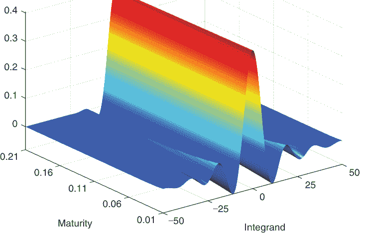

### 股息率与看跌价格

如果假设股息支付是连续收益率 `q`，那么将股息纳入模型是非常直接的。在这种情况下，方程 (1.4) 中股票过程的 `r` 被替换为 `r-q`

```
$dS_t = (r-q)S_td + \sqrt{v_t}S_tdW_{1,t},$
```

方程 (1.62) 中 `C` 的解变为

```
$C_i = (r-q)\phi + \frac{\theta}{\sigma^2} \left[b_i - \rho\sigma i\phi - \frac{1-e^{-b_i\tau}}{b_i}\right].$
```

要获得欧洲看跌期权的 `P(K)`，首先获得欧洲看涨期权的 `C(K)`，对方程 (1.12) 进行微调以包含股息率的项 `e^{-q\tau}`，正如 Wang (2006) 所述：

```
$C(K) = S_e^{-q\tau}P_1 - e^{-r\tau}P_2.$
```

通过看认平价公式找到看跌价格

```
$P(K) = C(K)e^{r\tau} - S_e^{-q\tau}.$
```

或者，正如 Zhu (2010) 中所示，看跌价格可以显式地获得：

```
$P(K) = Ke^{-r\tau}P_2 - S_e^{-q\tau}P_1.$
```

当 `S_T < K` 时，看跌期权到期时处于实值。(1.68) 中的实值概率是 (1.41) 中概率的补集
```
$P_t = \text{Pr}(S_t < K) = \frac{1}{2} - \frac{1}{\pi}\int_0^{\infty}\text{Re}\left[\frac{e^{-i\phi}f(\phi;x,v)}{i\phi}\right]d\phi.$
```

证明方程 (1.67) 和 (1.68) 的等价性是直接。通过应用 Feynman-Kac 定理，`x = \ln S` 的偏微分方程 (PDE) 将第 2 章中引入

```
$\frac{\partial U}{\partial t} + \frac{1}{2}\frac{\partial^2 U}{\partial x^2} + (r-q-\frac{1}{2}v)\frac{\partial U}{\partial x} + \rho\sigma v\frac{\partial^2 U}{\partial x\partial v} + \frac{1}{2}\sigma^2 v\frac{\partial^2 U}{\partial v^2} - rU + [\kappa(\theta-v)-\lambda v]\frac{\partial U}{\partial v} = 0.$
```

方程 (1.70) 仅仅是 (1.29)，但第三项中的 `(r-v/2)` 被替换为 `(r-q-v/2)`。

### 整合积分

可以将概率 `P_1` 和 `P_2` 的积分重新组合为单个积分，这将加速计算看涨价格所需的数值积分。通过将方程 (1.41) 中 `P` 的表达式代入 (1.66) 中的看涨价格并进行重新排列，可以得到：

```
$C(K) = \frac{1}{2}S_e^{-qt} - \frac{1}{2}Ke^{-rt} + \int_{0}^{\infty} \text{Re} \left[ e^{\frac{-i\phi \ln K}{i\phi}} (S_e^{-qt} f_1(\phi; x, v) - Ke^{-rt} f_2(\phi; x, v)) \right] d\phi. \quad (71)$
```

这种整合的优点是只需要一次数值积分而不是两次，因此时间将减少一半。可以使用看认平价通过使用 (71) 计算的看涨价格获得看跌价格。整合形式的被积函数位于 `HestonProb.m`。该函数位于 `HestonPriceCons.m`，根据方程 (71) 计算看涨价格。

```matlab
function y = HestonPriceCons(CallPut, Lphi, Uphi);
% 构建积分网格
phi = [Lphi:dphi:Uphi];
n = length(phi);
for k=1:n
inte(k) = HestonProb(phi(k), 1,trap);
end
I = trap(inte)*dphi;
% 看涨价格
HestonC = (1/2)*S*exp(-q*T) - (1/2)*K*exp(-r*T) + I/phi;
% 通过看认平价计算看跌价格
HestonP = HestonC - S*exp(-q*T) + K*exp(-r*T);
```

通过简单的推导，很容易证明 Black-Scholes 模型嵌套在 Heston 模型中。Black-Scholes 模型假设标的资产 `S` 的动力学在风险中性测度 `Q` 下为

`dS_t = rS_dt + \sigma_{BS}S_td_t`，在许多书中（如 Hull (1996) 或 Chriss (1996)）可以通过两个步骤求解现价 `S_t`：首先，应用 Ito 引理得到 `d\ln S_t` 的过程，它不再是一个随机微分方程，因为漂移和波动率不再依赖于 `S_t`。其次，积分该过程得到

```
$S_t = S_0 \exp\left((r - \frac{1}{2}\sigma_{BS}^2)t + \sigma_{BS}W_t\right).$
```

这意味着在时间 `t` 时，到期股票价格 `S_T` 的对数服从正态分布，均值为 `\ln S_t + (r - \frac{1}{2}\sigma_{BS}^2)\tau`，方差为 `\sigma_{BS}^2\tau`，其中 `\tau=T-t` 是到期时间。因此，Black-Scholes 模型中 `\ln S_T` 的特征函数为

```
$E[e^{i\phi\ln S_T}] = \exp\left(i\phi[\ln S_t + (r - \frac{1}{2}\sigma_{BS}^2)\tau] - \frac{1}{2}\phi^2\sigma_{BS}^2\tau\right).$
```

Black-Scholes 价格给出：

```
$\frac{\partial U}{\partial t} + \frac{1}{2}\sigma_{BS}^2\frac{\partial^2 U}{\partial S^2} + rS\frac{\partial U}{\partial S} - rU = 0.$
```

Black-Scholes 看涨价格给出：

```
$C_{BS}(S,t) = S\Phi(d_1) - Ke^{-r\tau}\Phi(d_2)$
```

其中

```
$d_1 = \frac{\ln(S/K) + (r + \frac{1}{2}\sigma_{BS}^2)\tau}{\sigma_{BS}\sqrt{\tau}}, d_2 = \frac{\ln(S/K) + (r - \frac{1}{2}\sigma_{BS}^2)\tau}{\sigma_{BS}\sqrt{\tau}} = d_1 - \sigma_{BS}\sqrt{\tau}$
```

其中 `\Phi(x)` 是标准正态分布函数。波动率 `\sigma_{BS}` 被假设为常数。如果我们将 `\sigma=0`（Heston 模型中的波动率参数），方程 (1.11) 中方差过程的布朗分将消失。因此，从 (1.11) 我们得到随时间变化的确定的波动率。如果进一步设置 `\theta = v_0`，那么根据 (1.11) 

`E[v_t|v_0]=v_0`，这与时间无关。这将产生恒定的波动率。然而，在 Heston 模型中设置 `\sigma=0` 和 `\theta=v_0` 导致我们期望得到与 Black-Scholes 模型产生的相同价格，其中 `\sigma_{BS}=\sqrt{v_0}` 作为 Black-Scholes 隐含波动率。事实上，将 `\sigma=0` 和 `\theta=v_0` 代入 `\lambda=0` 的 Heston PDE (1.24) 产生 (1.75) 中的 Black-Scholes PDE，其中 `\sigma_{BS}=\sqrt{v_0}`。因此，这些参数值下的 Heston 价格将是 Black-Scholes 模型。

为了将 Black-Scholes 模型实现 Heston 模型的一种特例，我们不能简单地在定价函数中替换 `\sigma=0`，会导致方程 (1.62) 中 `C_t(\tau,\phi)` 和方程 (1.58) 中 `D_t(\tau,\phi)` 的表达式出现除以零。相反，我们必须从 (1.47) 的方程组开始。当 `\sigma=0` 时，(1.51) 中的 Riccati 方程简化为常阶微分

```
$\frac{\partial D_i}{\partial \tau} = P_i - Q_i D_i$
```

其中 `P_i = u_i\phi - \phi^2` 且 `Q_i = b_i`。`D_i$` 的解为

```
$D(\tau)$
```

对于一般情况 `\sigma > 0`，将 (1.78) 代入 (1.47) 第二个方程中 `C_t` 的表达式并积分得到

```
$C_t(\tau,\phi) = \rho\tau\phi + a \int_0^{\tau} \frac{(u\phi - \phi^2)(1 - e^{-b_i\tau'})}{b_i} d\tau' + K_1 = \rho\tau\phi + a \frac{(u\phi - \phi^2)}{b_i} \left[ \tau - \frac{1 - e^{-b_i\tau}}{b_i} \right] \quad (1.79)$


结合方程 (1.16)。如果随机变量 $Y$ 服从对数正分布，均值为 $\mu$，方差为 $\sigma^2$，则其累积密度函数为

$F_Y(y) = \Phi\left( \frac{\ln y - \mu}{\sigma}\right) \quad (1.81)$

在 $Y > y$ 的条件下，$Y$ 的期望值为

$L_Y(y|Y > y) = \exp\left( \mu + \frac{\sigma^2}{2} \right) \Phi\left( \frac{-\ln y + \mu + \sigma^2}{\sigma}\right). \quad (1.82)$

关于这些公式的推导，可以参考 Hogg 和 Klugman (1994)，方法直接。风险中性测度 $\mathbb{Q}_S$ 服从对数正分布，均值为 $\ln S_T + (r - \frac{1}{2}\sigma_S^2)\tau$，如本节前文所述。将此均值和方差代入 (1.81)

$Q^S(S_T > K) = \Phi\left( \frac{\ln\left(\frac{S_T}{K}\right) + (r - \frac{1}{2}\sigma_S^2)\tau}{\sigma_S\sqrt{\tau}} \right) = \Phi(d_2). \quad (1.83)$

其中利用了 $1 - \Phi(X) = \Phi(-X)$。为了得到另一个概率，特别是 Radon-Nikodym 数 (1.14)

$Q^S(S_T > K) = \int_K^{\infty} dQ^S = \int_K^{\infty} \frac{dQ^S}{d\mathbb{Q}} d\mathbb{Q} = \frac{e^{-r\tau}}{S_0} \int_K^{\infty} x q_T(x)dx \quad (1.84)$

其中 $q_T(x)$ 是 $S_T$ 的概率密度函数。将 $S_T$ 的均值和方差代入方程 (1.82)，并将所得表达式代入 (1.84) 的最后一行，得到

$Q^S(S_T > K) = \Phi\left( \frac{\ln\left(\frac{S_T}{K}\right) + (r + \frac{1}{2}\sigma_S^2)\tau}{\sigma_S\sqrt{\tau}} \right) = \Phi(d_1). \quad (1.85)$

因此，Black-Scholes 看涨期权价格写成方程 (1.16) 的形式

$C(K) = S_0Q^S(S_T > K) - Ke^{-r\tau}Q^S(S_T > K)$。

要获得连续股利收益率的结果，只需在所有相关表达式中将 $r$ 替换为 $r-q$，结果自然成立。

方程 (1.80) 中的 $f_2(\phi)$ 是 Black-Scholes 特征函数而非 $f_1$，这是符合预期的。我们将在第 2 章中看到 $f_2(\phi)$ 是 Heston 模型中的“真实”特征函数，因为它是在风险中性测度 $\mathbb{Q}$ 下获得的。正如 Bakshi 和 Madan (2000) 等人所示，$f_1(\phi)$ 可以用 $f_2(\phi)$ 表示，因此不需要为 $f_1(\phi)$ 的独立表达式。

函数 `HestonProbSigma.sigma` 用于将 Black-Scholes 模型作为 Heston 模型的特殊特例进行实现（当 $\sigma=0$ 时）。为了节省空间，仅展示该函数的关键部分。

``` 
function y = HestonProbZeroSigma(phi,Pnum)

D = (u*i*phi - phi/2)*(1-exp(-b*tau))/b;

C = (r-q)*i*phi+tau + a*(u*i*phi-0.5*phi^2)/b * ... ;

f = exp(C+D*theta + i*phi*x);

y = real(exp(-i*phi*log(K))*f/i/phi);
```

函数 `HestonPriceZeroSigma.m` 用于在 $\sigma=0$ 时获取价格。下面的 Matlab 代码说明了这一点，使用了与前文相同的设置。现在仅展示代码的相关部分。

| d1 = (log(S/K) + (r-q)*T)/sqrt(theta*T) |
| d2 = d1 - sqrt(theta*T) |
| BSCall = S*exp(-q*T)*normcdf(d1) - K*exp(-r*T)*normcdf(d2) |
| BSPut = K*exp(-r*T)*normcdf(-d2) - S*exp(-q*T)*normcdf(-d1) |
| HCall = HestonPriceZeroSigma('C',...) |
| HPut = HestonPriceZeroSigma('P',...) |

在设置 $T=0.5, S=K=100, q=0.02, r=0.03, \kappa=5, v_0=0.05$ 和 $\lambda=0$ 下，Heston 模型和 $\sigma_{BS}=\sqrt{v_0}$ 的 Black-Scholes 模型的看涨期权价格均为 6.4730。

## 看涨价格的总结

根据方程 (66)，看涨价格的形式为

$C(K) = S_t e^{-qt}P_1 - K e^{-rt}P_2$

实权概率 $P_1$ 和 $P_2$ 见方程 (41)

$P_t = Pr(\ln S_t > \ln K) = \frac{1}{2} + \frac{1}{\pi} \int_0^{\infty} Re\left[\frac{e^{-i\phi \ln K} f_1(\phi; x_t)}{i\phi}\right] d\phi$。

这些概率是从标的对数 $x_t = \ln S_t$ 的特征函数 $f_1$ 和 $f_2$ 导出的，其中（此处对应公式）

# 结论

在本章中，我们展示了 Heston 模型的原始推导，包括特征函数和期权价格。我们还展示了 Black-Scholes 模型是如何作为特例出现的。但 Black-Scholes 模型具有计算 $\Phi$ 的内置函数，而 Heston 模型需要数值积分。

### 积分问题、参数影响与方差建模

在本章中，我们研究了 Heston 模型的几个问题。首先，遵循 Bakshi 和 Madan (2000) 的方法，我们展示了积分函数有时会震荡、沿积分轴衰减缓慢并出现不连续性。Albrecher 等人 (2007) 的“Little”公式为解决这些问题提供了简单的方案。接下来，我们研究了 Heston 参数对隐含波动率的影响。

## 关于特征函数的备注

在第 1 章中，已说明权概率 $P_1$ 和 $P_2$ 是通过特征函数 $f_1$ 和 $f_2$ 的逆傅里叶变换得到的。由于是在不同的测度下，Heston 模型关联两个特征函数 $f_1$ 和 $f_2$ 是合理的。另一方面，似乎应该只有一个特征函数，因为模型中只有一个标的价格。事实上，一些作者用单个特征函数 $f(\phi)$ 来表示 $P_1$ 和 $P_2$。

# 26 MATLAB 和 C# 中的 Heston 模型及其扩展

$P_2 = 2 + \frac{1}{\pi} \int_{0}^{\infty} \text{Re} \left[ \frac{e^{-i\phi} f(\phi)}{i\phi} \right] d\phi \quad (2.3)$

这表明 $f_2(\phi) = f(\phi)$ 且 $f_1(\phi) = f(\phi - i)/f(-i)$。在本节中，将展示方程 (2.2) 和 (2.3) 中 $P_i$ 的表达式与 (2.1) 相同。这在 Bakshi 和 Madan (2000) 中得到了解释，以下是他们结果的简化版本。

首先，注意方程 (2.3) 中的 $P_2$ 与 $j=2$时的 (2.1) 相同，但 $P_1$ 与 $j=1$时的 (2.1) 并不相同。“真实的”特征函数是 $f_2$，因为它与概率测度 $Q$ 相关，该测度使得 $W_{1,t}$ 和 $W_{2,t}$ 成为 $S_t$ 和 $v_t$ 的风险中性随机微分方程 (SDE)，且债券作为计价货币。因此，在看涨期权中

$C(K) = S_tP_1 - e^{-rt}KP_2$

我们可以使用 $\ln S_t$ 的概率密度函数 $q(x)$ 来写作：

$P_2 = Q(S_t > \ln K) = \int_{\ln K}^{\infty} q(x)dx$

其中 $x_t = \ln S_t$。

为了评估 $P_2$，用特征函数 $f(\phi)$ 表示累积分布函数 $Q(x_t < x)$

$Q(x_t < x) = \frac{1}{2} - \frac{1}{2\pi} \int_{-\infty}^{\infty} \frac{e^{-i\phi}f(\phi)}{i\phi} d\phi. \quad (2.4)$

密度 $q(x)$ 通过对 $x$ 求导得到：

$q(x) = \frac{1}{2\pi} \int_{-\infty}^{\infty} e^{-i\phi}f(\phi)d\phi$.

众周知，特征函数 $f(\phi)$ 的实部是偶函数，虚部是奇函数。这一事实意味着，当在整个直线上积分时，$e^{-i\phi}f(\phi)$ 的虚部将抵消，这在任何 $q(x)$ 为实数的地方都会发生。我们可以直接对实部进行积分，由于实部是偶函数，因此 $(0, \infty)$ 上的积分等于 $(-\infty, 0)$ 上的积分。这意味着密度可以写为：

$q(x) = \frac{1}{2\pi} \int_{-\infty}^{\infty} \text{Re} [e^{-i\phi}f(\phi)] d\phi = \frac{1}{\pi} \int_{0}^{\infty} \text{Re} [e^{-i\phi}f(\phi)] d\phi \quad (2.5)$

并且 $Q(x_t < x)$ 可以根据方程 (2.4) 写为：

$Q(x_t < x) = \frac{1}{2} - \frac{1}{\pi} \int_{0}^{\infty} \text{Re} \left[ \frac{e^{-i\phi}f(\phi)}{i\phi} \right] d\phi. \quad (2.6)$

### 积分问题、参数影响与方差建模

实值概率 $P_2$ 是 (2.6) 的补数，在 $\ln K$ 处取值

$P_2 = Q(x_T > \ln K) = \frac{1}{2} - \frac{1}{\pi}\int_0^{\infty} \text{Re} \left[ \frac{e^{-i\phi \ln K} f(\phi)}{i\phi} \right] d\phi \quad (2.7)$

这与方程 (2.3) 相同。为了获得 $P_1$，调用计价货币转换。回顾第 1 章中的 Radon-Nikodym 导数

$\frac{dQ^S}{dQ} = \frac{S_T}{S_0} = \frac{e^{rT}}{\mathbb{E}^Q[e^{rT}]} \quad (2.8)$

我们可以写 $S_t e^{r(T-t)} = \mathbb{E}^Q[S_t]$，在风险中性测度 $Q$ 下，股票价格以无风险利率 $r$ 增长。(2.8) 表明应该通过 Radon-Nikodym 导数从 $q(x)$ 定义一个新密度 $q^s(x)$：

$q^s(x) = \frac{e^x}{\mathbb{E}^Q[e^{x}]}q(x)$.

因此，$q^s$ 的特征函数为：

$\mathbb{E}^Q[e^{i\phi}] = \int_{-\infty}^{\infty} e^{i\phi x} q^s(x)dx = \frac{1}{\mathbb{E}^Q[e^{x}]} \int_{-\infty}^{\infty} e^{i\phi x} q(x)dx. \quad (9)$

注意 $\mathbb{E}^Q[e^{x}]$ 是一个常数，可以从积分中提取。同样注意由于 $x_t$ 的特征函数是 $\mathbb{E}^Q[e^{i\phi}] = f(\phi)$（此处修正逻辑），最后方程 (9) 右侧的积分可以在 $\phi - i$ 处取值：

$\int_{-\infty}^{\infty} e^{i(\phi-i)x} q(x)dx = \mathbb{E}^Q[e^{i(\phi-i)x_T}]$.

最后表达式是 $x_T$ 在 $\phi - i$ 处的特征函数。因此，密度 $q^s(x)$ 的特征函数可以用 $q(x)$ 在 $\phi - i$ 处的特征函数表示：

$\mathbb{E}^Q[e^{i\phi}] = \frac{f(-i)}{S_0 e^{r(T-t)}} \dots$

当股票支付连续股息 $q$ 时，(10) 的分母变为 $e^{(r-q)(T-t)}S_0$。在第 1 章中显示：

$e^{rt} \mathbb{E}^Q[S_t 1_{S_T>K}] = S_0 Q^S(S_T > K)$.

为了证明 $Q^S(x_T > \ln K)$ 可以用方程 (2.2) 的形式表示，对 (10) 中的特征函数应用逆变换：

$P_1 = Q^S(x_T > \ln K) = \frac{1}{2} - \frac{1}{\pi}\int_0^{\infty} \text{Re} \left[ \frac{e^{-i\phi \ln K} f(\phi)}{i\phi} \right] d\phi \quad (11)$

这与方程 (2.2) 相同。仍然需要证明的是 $q^s(x)$ 可以作为密度函数，这要求 $q^s(x) \geq 0$ 且 $q^s(x)$ 积分为 1。要满足第一个要求，从方程 (2.8) 注意：

$q^s(x) = \frac{S_t}{S_0}q(x) > 0$.

现在考虑 $q^s(x)$ 在 $(0, \infty)$ 上的积分：

$\int_0^{\infty} q^s(x)dx = \frac{\int_0^{\infty} e^{x_T}dx}{E[e^{x_T}]} = \frac{E[e^{x_T}]}{E[e^{x_T}]} = 1.$

结果是看涨价格可以写为：

$C(K) = S_tP_1 - e^{-r(T-t)}KP_2$

其中方程 (11) 中的 $P_1$ 和方程 (2.7) 中的 $P_2$ 分别从 $x_T = \ln S_T$ 的特征函数获得。这是一个适用于许多模型的通用设置，而 Heston 模型，如 Bakshi 和 Madan (2000) 所示。通常被称为期权定价的特征函数法。为了说明，在 Black-Scholes 模型中，$x_T$ 服从正态分布，均值为 $\ln(S_t) + (r - \frac{\sigma_{BS}^2}{2})\tau$，方差为 $\sigma_{BS}^2 \tau$，因此 $x_T$ 的特征函数为：

$f(\phi) = \exp\left(i\phi [\ln S_t + (r - \frac{\sigma_{BS}^2}{2})\tau] - \frac{1}{2}\sigma_{BS}^2 \tau \phi^2\right)$.

密度 $q(x)$ 通过对 $x$ 求导得到：

$q(x) = \frac{1}{2\pi} \int_{-\infty}^{\infty} e^{-i\phi}f(\phi)d\phi$.

众周知，特征函数 $f(\phi)$ 的实部是偶函数，虚部是奇函数。这一事实意味着，当在整个直线上积分时，$e^{-i\phi}f(\phi)$ 的虚部将抵消，这在任何 $q(x)$ 为实数的地方都会发生。我们可以直接对实部进行积分，由于实部是偶函数，因此 $(0, \infty)$ 上的积分等于 $(-\infty, 0)$ 上的积分。这意味着密度可以写为：

$q(x) = \frac{1}{2\pi} \int_{-\infty}^{\infty} \text{Re} [e^{-i\phi}f(\phi)] d\phi = \frac{1}{\pi} \int_{0}^{\infty} \text{Re} [e^{-i\phi}f(\phi)] d\phi \quad (2.5)$

并且 $Q(x_t < x)$ 可以根据方程 (2.4) 写为：

$Q(x_t < x) = \frac{1}{2} - \frac{1}{\pi} \int_{0}^{\infty} \text{Re} \left[ \frac{e^{-i\phi}f(\phi)}{i\phi} \right] d\phi. \quad (2.6)$

实值概率 $P_2$ 是 (2.6) 的补数，在 $\ln K$ 处取值：

$P_2 = Q(x_T > \ln K) = \frac{1}{2} - \frac{1}{\pi}\int_0^{\infty} \text{Re} \left[ \frac{e^{-i\phi \ln K} f(\phi)}{i\phi} \right] d\phi \quad (2.7)$

这与方程 (2.3) 相同。为了获得 $P_1$，调用计价货币转换。回顾第 1 章中的 Radon-Nikodym 导数：

$\frac{dQ^S}{dQ} = \frac{S_T}{S_0} = \frac{e^{rT}}{\mathbb{E}^Q[e^{rT}]} \quad (2.8)$


我们可以写 `$S_t e^{r(T-t)} = \mathbb{E}^Q[S_t]$`，在风险中性测度 `$Q$` 下，股票价格以无风险利率 `$r$` 增长。`(2.8)` 表明应该通过 Radon-Nikodym 导数从 `$q(x)$` 定义一个新密度 `$q^s(x)$`：

```
$q^s(x) = \frac{e^x}{\mathbb{E}^Q[e^{x}]}q(x).
```

因此，`$q^s$` 的特征函数为：

```
$\mathbb{E}^Q[e^{i\phi}] = \int_{-\infty}^{\infty} e^{i\phi x} q^s(x)dx = \frac{1}{\mathbb{E}^Q[e^{x}]} \int_{-\infty}^{\infty} e^{i\phi x} q(x)dx. \quad (9)$
```

注意 `$\mathbb{E}^Q[e^{x}]$` 是一个常数，可以从积分中提取。同样注意由于 `$x_t$` 的特征函数是 `$\mathbb{E}^Q[e^{i\phi}] = f(\phi)$`，最后方程 `(9)` 右侧的积分可以在 `$\phi - i$` 处取值：

```
$\int_{-\infty}^{\infty} e^{i(\phi-i)x} q(x)dx = \mathbb{E}^Q[e^{i(\phi-i)x_T}].$
```

最后表达式是 `$x_T$` 在 `$\phi - i$` 处的特征函数。因此，密度 `$q^s(x)$` 的特征函数可以用 `$q(x)$` 在 `$\phi - i$` 处的特征函数表示：

```
$\mathbb{E}^Q[e^{i\phi}] = \frac{f(-i)}{S_0 e^{r(T-t)}} \dots (10)$
```

当股票支付连续股息 `$q$` 时，`(10)` 的分母变为 `$e^{(r-q)(T-t)}S_0$`。在第 1 章中显示：

```
$e^{rt} \mathbb{E}^Q[S_t 1_{S_T>K}] = S_0 Q^S(S_T > K).$
```

为了证明 `$Q^S(x_T > \ln K)$` 可以用方程 `(2.2)` 的形式表示，对 `(10)` 中的特征函数应用逆变换：

```
$P_1 = Q^S(x_T > \ln K) = \frac{1}{2} - \frac{1}{\pi}\int_0^{\infty} \text{Re} \left[ \frac{e^{-i\phi \ln K} f(\phi)}{i\phi f(-i)} \right] d\phi \quad (11)$
```

这与方程 `(2.2)` 相同。仍然需要证明的是 `$q^s(x)$` 可以作为密度函数，这要求 `$q^s(x) \geq 0$` 且 `$q^s(x)$` 积分为 1。要满足第一个要求，从方程 `(2.8)` 注意：

```
$q^s(x) = \frac{S_t}{S_0}q(x) > 0.$
```

现在考虑 `$q^s(x)$` 在 `$(0, \infty)$` 上的积分：

```
$\int_0^{\infty} q^s(x)dx = \frac{\int_0^{\infty} e^{x_T}dx}{E[e^{x_T}]} = \frac{E[e^{x_T}]}{E[e^{x_T}]} = 1.$
```

结果是看涨价格可以写为：

```
$C(K) = S_tP_1 - e^{-r(T-t)}KP_2$
```

其中方程 `(11)` 中的 `$P_1$` 和方程 `(2.7)` 中的 `$P_2$` 分别从 `$x_T = \ln S_T$` 的特征函数获得。这是一个适用于许多模型的通用设置，而非 Heston 模型，如 Bakshi 和 Madan `(2000)` 所示。通常被称为期权定价的特征函数法。为了说明，在 Black-Scholes 模型中，`$x_T$` 服从正态分布，均值为 `$\ln(S_t) + (r - \frac{\sigma_{BS}^2}{2})\tau$`，方差为 `$\sigma_{BS}^2 \tau$`，因此 `$x_T$` 的特征函数为：

```
$f(\phi) = \exp\left(i\phi [\ln S_t + (r - \frac{\sigma_{BS}^2}{2})\tau] - \frac{1}{2}\sigma_{BS}^2 \tau \phi^2\right).$
```

### 积分问题、参数影响与方差建模

实值概率 `$P_2$` 是 `(2.6)` 的补数，在 `$\ln K$` 处取值：

```
$P_2 = Q(x_T > \ln K) = \frac{1}{2} - \frac{1}{\pi}\int_0^{\infty} \text{Re} \left[ \frac{e^{-i\phi \ln K} f(\phi)}{i\phi} \right] d\phi \quad (2.7)$
```

这与方程 `(2.3)` 相同。为了获得 `$P_1$`，调用计价货币转换。回顾第 1 章中的 Radon-Nikodym 导数：

```
$\frac{dQ^S}{dQ} = \frac{S_T}{S_0} = \frac{e^{rT}}{\mathbb{E}^Q[e^{rT}]} \quad (2.8)$
```

我们可以写 `$S_t e^{r(T-t)} = \mathbb{E}^Q[S_t]$`，在风险中性测度 `$Q$` 下，股票价格以无风险利率 `$r$` 增长。`(2.8)` 表明应该通过 Radon-Nikodym 导数从 `$q(x)$` 定义一个新密度 `$q^s(x)$`：

```
$q^s(x) = \frac{e^x}{\mathbb{E}^Q[e^{x}]}q(x).$
```

因此，`$q^s$` 的特征函数为：

```
$\mathbb{E}^Q[e^{i\phi}] = \int_{-\infty}^{\infty} e^{i\phi x} q^s(x)dx = \frac{1}{\mathbb{E}^Q[e^{x}]} \int_{-\infty}^{\infty} e^{i\phi x} q(x)dx. \quad (9)$
```

注意 `$\mathbb{E}^Q[e^{x}]$` 是一个常数，可以从积分中提取。同样注意由于 `$x_t$` 的特征函数是 `$\mathbb{E}^Q[e^{i\phi}] = f(\phi)$`，最后方程 `(9)` 右侧的积分可以在 `$\phi - i$` 处取值：

```
$\int_{-\infty}^{\infty} e^{i(\phi-i)x} q(x)dx = \mathbb{E}^Q[e^{i(\phi-i)x_T}].$
```

最后表达式是 `$x_T$` 在 `$\phi - i$` 处的特征函数。因此，密度 `$q^s(x)$` 的特征函数可以用 `$q(x)$` 在 `$\phi - i$` 处的特征函数表示：

```
$\mathbb{E}^Q[e^{i\phi}] = \frac{f(-i)}{S_0 e^{r(T-t)}} \dots (10)$
```

当股票支付连续股息 `$q$` 时，`(10)` 的分母变为 `$e^{(r-q)(T-t)}S_0$`。在第 1 章中显示：

```
$e^{rt} \mathbb{E}^Q[S_t 1_{S_T>K}] = S_0 Q^S(S_T > K).$
```

为了证明 `$Q^S(x_T > \ln K)$` 可以用方程 `(2.2)` 的形式表示，对 `(10)` 中的特征函数应用逆变换：

```
$P_1 = Q^S(x_T > \ln K) = \frac{1}{2} - \frac{1}{\pi}\int_0^{\infty} \text{Re} \left[ \frac{e^{-i\phi \ln K} f(\phi)}{i\phi f(-i)} \right] d\phi \quad (11)$
```

这与方程 `(2.2)` 相同。仍然需要证明的是 `$q^s(x)$` 可以作为密度函数，这要求 `$q^s(x) \geq 0$` 且 `$q^s(x)$` 积分为 1。要满足第一个要求，从方程 `(2.8)` 注意：

```
$q^s(x) = \frac{S_t}{S_0}q(x) > 0.$
```

现在考虑 `$q^s(x)$` 在 `$(0, \infty)$` 上的积分：

```
$\int_0^{\infty} q^s(x)dx = \frac{\int_0^{\infty} e^{x_T}dx}{E[e^{x_T}]} = \frac{E[e^{x_T}]}{E[e^{x_T}]} = 1.$
```

### 被积函数的问题

实值概率 `$P_2$` 是 `(2.6)` 的补数，在 `$\ln K$` 处取值：

```
$P_2 = Q(x_T > \ln K) = \frac{1}{2} - \frac{1}{\pi}\int_0^{\infty} \text{Re} \left[ \frac{e^{-i\phi \ln K} f(\phi)}{i\phi} \right] d\phi \quad (2.7)$
```

这与方程 `(2.3)` 相同。为了获得 `$P_1$`，调用计价货币转换。回顾第 1 章中的 Radon-Nikodym 导数：

```
$\frac{dQ^S}{dQ} = \frac{S_T}{S_0} = \frac{e^{rT}}{\mathbb{E}^Q[e^{rT}]} \quad (2.8)$
```

第一个问题是被积函数在点 `0` 处定义，尽管积分范围是 `[0, \infty)`。为了避免原点引起的误差，积分必须从靠近零的小点开始。第二个问题是被积函数可能包含间断点。为了说明，图 2.1 显示了 `$\phi \in (0,10]$` 范围内 `$f_1$` 的两个被积函数。第一个被积函数的到期时间为 `$\tau=3$`，标准差为 `$\sigma=0.75$`，第二个为 `$\tau=1$`，`$\sigma=0.09$`。积分使用 `$k=10$`，`$\tau=0.03$`，`$\rho=-0.9$`，`$r=0$`，现价 `$S_0=100$`，执行价 `$K=100$`。

第一个被积函数是平滑的，没有数值不稳定性。另一方面，第二个被积函数在 `$\phi=1.7$` 和 `$\phi=5$` 附近有间断点，且非常陡峭。在随后的章节中，我们介绍了 Albrecher 等人 `(2007)` 对被积函数的简单修改，这有效地消除了这些间断点。

最后，可能出现的第三个问题是被积函数剧烈震荡。在图 2.2 中，第一个被积函数的到期时间为 `$\tau=1/52$` 年，标准差为 `$\sigma=0.175$`；第二个为 `$\tau=1$` 年，标准差为 `$\sigma=0.09$`，现价 `$S_0=10$`。图表范围积分范围 `$\phi \in (0, 100]$`。第一个被积函数（黑线）显示出震荡，这还没有被抑制，数值积分需要延伸得远得多。

### 30 MATLAB 和 C# 中的 Heston 模型及其扩展

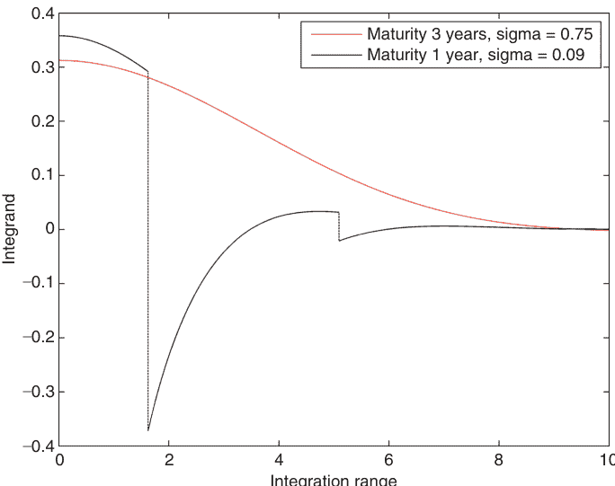

图 2.1 Heston 被积函数中的不连续性

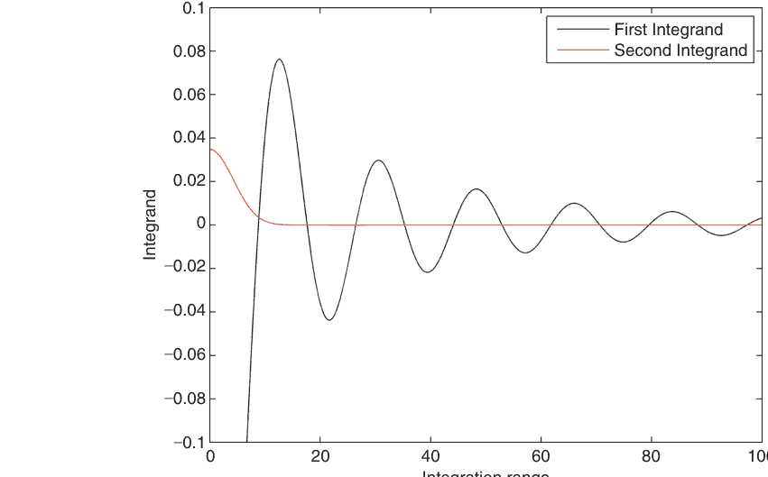

图 2.2 Heston 被积函数中的震荡

直到 `$\phi = 100$` 才能收敛。此外，被积函数在原点附近非常陡峭，这要求数值积分使用非常细的网格。第二个被积函数（红线）表现良好，不会产生数值上的困难。它没有震荡，在任何地方都不陡峭，并且从 `$\phi = 10$` 开始迅速衰减至零。被积函数的高震荡通常与短期期权有关。

### 小 Heston 陷阱 (THE LITTLE HESTON TRAP)

Albrecher 等人 `(2007)` 解释道，关于 Heston 模型的学术文献体现了 Heston 特征函数的两种不同公式。第一种是 Heston `(1993)` 的原始公式，而第二种的形式略有不同。Albrecher 等人 `(2007)` 显示这两种公式是等价的，但第二种导出的特征函数性质更好，且更适用于数值积分。

Heston 特征函数的原始公式是在第 1 章中推导的。要推导第二种公式，首先注意到第 1 章中 `$D$` 的解在分子和分母中可以乘以 `$\exp(-d\tau)$`，这导致等价的：

```
$D_j = \frac{b_j - \rho\sigma\varphi + d_j}{g_j\sigma^2} \left( \frac{1 - e^{-d_j,\tau}}{1 - e^{-d_j,\tau}/g_j} \right) - \frac{b_j - \rho\sigma\varphi - d_j}{\sigma^2} \left( \frac{1 - e^{-d_j,\tau}}{1 - c_j e^{-d_j,\tau}} \right)$ (2.14)
```

其中

```
$c_j = \frac{1}{g_j} \frac{b_j - \rho\sigma\varphi - d_j}{b_j - \rho\sigma\varphi + d_j}$ (2.15)
```

`$C$` 解中的对数可以写为：

```
$d_j\tau - 2\ln \left[ \frac{1 - g^{d_j,\tau}}{1 - g_j} \right] = d_j\tau - 2\ln \left[ \frac{e^{d_j,\tau}}{1 - g_j} \right]$
$= d_j\tau - 2d_j\tau - 2\ln \left[ \frac{e^{-d_j,\tau}}{1 - g_j} \right]$
$= -d_j\tau - 2\ln \left[ \frac{1 - c_j e^{-d_j,\tau}}{1 - c_j} \right]$ (2.16)
```

这意味着 `$C_j$` 可以写成等价的形式：

```
$C_j = ri\varphi\tau + \frac{K\theta}{\sigma^2} \left((b_j - \rho\sigma\varphi - d_j), \tau - 2\ln \left( \frac{1 - c_j e^{-d_j,\tau}}{1 - c_j} \right) \right)$ (2.17)
```

### 32 MATLAB 和 C# 中的 Heston 模型及其扩展

实现此函数非常简单，只需将 `$C$` 和 `$D$` 替换为方程 `(2.17)` 和 `(2.14)` 中的略有不同的形式。随后的 `HestonIntegrand` 函数使用原始 Heston `(1993)` 公式和 Albrecher 等人 `(2007)` 的“Little Trap”公式计算特征函数。该函数部分如下：

```matlab
function y = HestonIntegrand(phi,..., Trap)

d = sqrt(rho*sigma*phi + i)^2 - a ...
g = (b - rho*sigma*phi + d) / ...;
if Trap=1
    % "Little Heston" 公式
    c = 1/g;
    D = (b - rho*sigma*phi - d)/sigma^2 * ...;
    C = (1 - c*exp(-d*tau))/(1-c);
    r*i*tau + a/sigma^2 * (b- rho*sigma*phi - d) * ...;
elif Trap=0
    % 原始特征函数.
    G = (1 - g*exp(d*tau))/(1-g);
    C = r*i*tau + a/sigma^2 * ...;
    D = (b - rho*sigma*phi + d)/sigma^2 * ...;
end
f = exp(C + D*v0 + i*phi);
return real(-i*phi+log(K))*f/i/phi);
```

C# 中的实现使用 `HestonProb()` 函数完成且非常相似，因此此处给出 C# 代码。Albrecher 等人 `(2007)` 解释道，尽管 Heston 的原始公式和他们的公式是相同的，但通过绘制下图特征函数 `$f_t$` 来说明模型的实现：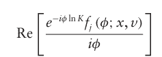。使用了 Albrecher 等人 `(2007)` 相同的参数值：均值 `$\kappa=1.5678$`、`$\sigma=0.5751$`、`$\rho=-0.5711$`、`$\theta=0.0398$` 以及 `$v_0=0.0175$`。此外，我们使用 `$S=K=100$` 和到期时间 `$\tau=5$`。图 2.3 被积函数使用积分范围 `$\phi=[0, 10]$`。原始 Heston `(1993)` 公式（黑线）在 `$\phi\approx 3.5$` 处显示出不连续性，这通过红线的 Albrecher 等人 `(2007)` 公式得到了修正。

积分问题、参数影响和方差建模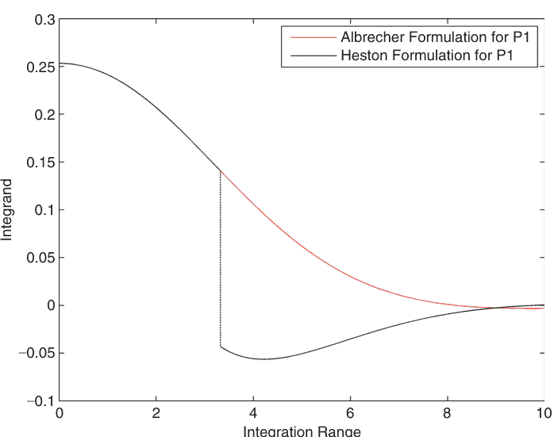 **图 2.3** `$f_2$` 的被积函数，原始与 Little Trap 公式

```matlab
phi = 0.0001:.01:10;
Pnum = 1;
% P1 被积函数插图
for x=1:N
HestonP1(x) = HestonIntegrand(phi(x), ..., Pnum, 0);
AlbrecherP1(x) = HestonIntegrand(phi(x), ..., Pnum, 1);
end
Pnum = 2;
% P2 被积函数插图
for x=1:N
HestonP2(x) = HestonIntegrand(phi(x), ..., Pnum, 0);
AlbrecherP2(x) = HestonIntegrand(phi(x), ..., Pnum, 1);
end;
```


最后，可以使用 Kahl 和 Jäckel (2005) 的旋转算法来克服原始 Heston 公式带来的不连续性。我们在书中没有介绍旋转算法，但建议感兴趣的读者参考 Kahl 和 Jäckel (2005)，以及参考 Zhu (2010) 的书籍获取替代算法。然而，由于“Little Trap”公式始终有效，这些其他算法已有些过时。

# MATLAB 和 C# 中的 Heston 模型及其扩展

## Heston 参数的影响

### Heston 终端价格

在 Heston 模型下，到期日的对数价格分布 `$ln S_T$` 可以根据参数设置表现出偏度和超额峰度。在接下来的章节中，研究了相关性 `$\rho$` 和方差率 `$\sigma$` 对 `$ln S_T$` 分布的影响。

### 相关性和方差率的影响

相关性参数 `$\rho$` 控制 `$ln S_T$` 密度以及 `[0, T]` 上连续收益率 `$ln(S_T/S_0)$` 的偏度。当 `$\rho > 0$` 时，概率密度将为正偏；当 `$\rho < 0$` 时，密度将为负偏。本节中的图使用 Heston (1993) 表 1 中的参数设置来证明这一点：`$v_0 = 0.01, \kappa = 2, \theta = 0$` 且 `$\sigma = 0.1$`。`$ln S_T$` 的密度可以通过反转其特征函数 `$f_t(\phi)$`（如方程 2.5 所示）来恢复。这些图使用了 Albrecher 等人 (2007) 相同的参数值：`$\rho = -0.8, \rho = 0$` 和 `$\rho = 0.8$`。图 2.3 代表了文章中的 `$f_2$` 图。被积函数使用积分范围 `$\phi=[0, 10]$`。原始 Heston (1993) 公式（黑线）在 `$\phi\approx 3.5$` 处显示出不连续性，这通过红线的 Albrecher 等人 (2007) 公式得到了修正。

正如 Heston (1993) 所解释的，正相关性意味着股价上涨时方差也会增加。这具有加厚右尾的 **图 2.4** 相关性对密度分布的影响，以及变薄左尾的效果。当相关性为负时，情况相反。在下一节中将证明，负相关会导致深度实值期权在 Heston 模型中的定价比 Black-Scholes 模型高。

方差率参数 `$\sigma$` 控制峰度。当 `$\sigma$` 较高时，方差过程离散程度很高，因此预期收益分布在 `$\sigma$` 较小时具有更高的峰度和更厚的尾部。这在图 2.5 中所示（对于 `$\sigma \approx 0, 0.2, 0.4$`）。该图类似于 Heston (1993) 的图 3。

### 与 Black-Scholes 价格的比较

图 2.4 和 2.5 的结果表明，由于 Heston 模型产生的收益偏度，Black-Scholes 模型生成的期权价格是合理的。在这个意义上，我们研究了相关性参数 `$\rho$` 和方差率参数 `$\sigma$` 对看涨价格的影响。

## 表 2.1 不同相关性下的价格对比

| | `$\rho > 0$` | `$\rho < 0$` |
|---|---|---|
| 外值看权 (OTM Calls) | Heston > BS | Heston < BS |
| 实值看权 (ITM Calls) | Heston < BS | Heston > BS |

当 `$\rho < 0$` 时，`$\ln S_t$` 的分布呈现负偏态，情况则相反：左尾分配的权重更多，右尾的权重较少。这意味着 Heston 模型生成的深度实值看权价格应该比 Black-Scholes 模型生成的看权更贵，而深度外值看权价格则应该更便宜。表 2.1 总结了这些观察结果。

图 2.6 重现了 Heston (1993) 中的图 2。它绘制了两种模型之间看权价格的差值（Heston 价格减去 Black-Scholes 价格），随着现货价格从 `$70` 变化到 `$140`。我们使用了本节之前示例中相同的参数设置，对应于 Heston (1993) 的表 1。然而，为了 Heston 和 Black-Scholes 的价格对比有效，Black-Scholes 波动率必须匹配 Heston 价格。这可以通过定义收益率分布 `$\ln(S_t/S_0)$` 标准差的 Black-Scholes 波动率 `$\sigma_{BS}$` 来完成。收益率的矩可以从

图 2.6 相关性对 Heston 价格相对于 Black-Scholes 的影响

### 积分问题、参数影响与方差建模

通过 `$x_T = \ln S_T$` 的矩获得，这些矩可以通过对特征函数 `$f_T(\phi)$` 求导得到：

```
$E[x_T^n] = i^n \left[ \frac{d^n}{d\phi^n} f_2(\phi) \right]_{\phi=0} \quad (2.18)$
```

Matlab 文件 `MomentMatching.m` 使用有限差分法近似 (2.18)。

```matlab
rho = [-0.5 0.0 0.5];

dphi = 1e-4;

for k=1:3

param.rho = rho(k);

dfp = HestonCF(+dphi,param,tau,S,r,q,trap);

dfm = HestonCF(-dphi,param,tau,S,r,q,trap);

df = (dfp - dfm)/2;

EX = df/i;

dffpp = HestonCF(*2*dphi,param,tau,S,r,q,trap);

dffmm = HestonCF(-2*dphi,param,tau,S,r,q,trap);

dff1 = (dff - dffm)/dphi;

dff2 = (dff - dff2)/3/dphi;

EX2 = dd2/i2;

var = EX2;

BSVol(k) = sqrt(var);
```

近似结果表明，当 `$\rho = -0.5$` 时，我们使用 `$\sigma_{BS} = \sqrt{2} * 0.0710$` 来生成 Black-Scholes 价格，当 `$\rho = +0.5$` 时，我们使用 `$\sigma_{BS} = \sqrt{2} * 0.0704$`。

图 2.6 的左部分对应于低股价和外值看权，右部分对应于高股价和实值看权。显然，当相关性为正时，外值看权比 Black-Scholes 外值看权贵，这是因为 Heston 模型生成的 `$\ln S_T$` 分布其右尾较厚。当相关性为负时，实值看权的差值相对于 Black-Scholes 实值看权为正，这是因为 Heston 模型生成的 `$\ln S_T$` 分布左尾较厚。对于负差值也有类似的论点。增加 `$\sigma$` 的影响是增加峰度。这是合理的，因为高波动率会增加普通期权的价格范围。这在图 2.7 中所示，该图比较了 `$\rho = 0$` 且 `$\sigma = 0.1$` 和 `$\sigma = 0.2$` 时 Heston 与 Black-Scholes 看权的差值。这表明在实值和外值区域 Heston 价格高于 Black-Scholes 价格，但在平值区域较低。这两个观察结果与 Heston 模型生成的 `$\ln S_T$` 分布的厚尾特征一致。惊讶的是，当 `$\sigma$` 较高时差异更为显著。图 2.7 与 Heston (1993) 的图 4 相似。

## Heston 模型及其在 MATLAB 和 C# 中的扩展

**图 2.7** 波动率对 Heston 价格相对于 Black-Scholes 的影响

### 隐含波动率

Heston 模型的另一个特征是从期权价格提取的隐含波动率会呈现出微笑曲线或偏斜。偏斜形状由参数驱动。相关性参数 `$\rho > 0$` 对应正斜率，`$\rho < 0$` 对应负斜率。这在图 2.8 的第一个面板中通过使用 `$S=100, r=0.05, \tau=0.25, \kappa=2, \theta=0.01, \sigma=0, v_0=0.01$` 以及 `$95$` 到 `$105$` 的执行价范围生成波动率来展示。股票期权通常显示出负斜率。惊讶的是，当使用其他数据估计 Heston 模型参数时，大多数情况下相关性为负。

增加波动率 `$\sigma$` 会增加微笑曲线的曲率。这在图 2.8 的第二个面板中所示，使用了相同的 `$\rho=0$` 设置。最后，参数 `$\kappa,\theta$` 和 `$v_0$` 控制微笑曲线的水平，如图 2.8 的其余面板所示。均值回归速度 `$\kappa$` 在某种程度上也控制曲率，较高的 `$\kappa$` 值会使隐含波动率平坦。

为了生成隐含波动率，我们首先使用 Matlab 函数 `HestonPriceGauss` 在执行价 `$K$` 范围内创建 Heston 价格。该函数使用 Gauss-Laguerre 积分进行数值积分，我们在第 5 章中介绍。

图 2.8 Heston 参数对隐含波动率的影响

```matlab
sigma = [0.35 0.55 0.80];

for j=1:length(sigma)

  for i=1:length(K)

    HestonPriceGaussLaguerre(i, j) = (K(i),sigma(j));

  end

  IV(i, j) = BisecIV(Calls(i,j));

end
```

## Heston 模型及其在 MATLAB 和 C# 中的扩展

之前的代码调用了 Matlab 函数 `BisecIV.m`，它在生成价格后使用二分法寻找隐含波动率。函数的第一部分定义了一个用于计算 Black-Scholes 模型下看权的函数句柄。函数的主部分计算两个端点中间点的 Black-Scholes 看权，以及该看权价格与市场价格之间的差异。如果差异大于用户指定的容差，函数将更新其中一个端点并进行迭代。为了节省空间，部分函数已省略。

```matlab
function y = BisecIV(MktPrice,Tol,Maxiter)

  % Black Scholes call

  BSC = (S,K,rf,T) *normcdf((log(S/K) + ...

  lowDiff = MktPrice - BSC(S,K,q,T)

  highDiff = MktPrice - BSC(S,K,b,T)

  if lowDiff+highDiff > 0

    y = -1;

    for x=1:Maxiter

      midP = (a+b)/2;

      midDiff = MktPrice - BSC(S,K,rf,q,midP,T)

      if abs(midDiff)<Tol

        break;

        if midDiff>0 a = midP;

        else b = midP;

      end

    end

  end

  y = midP;
```

C# 中的二分法算法与 `normcdf` 非常相似，不同在于我们需要创建一个 `normcdf` 函数来计算标准正分布。

# MATLAB 和 C# 中的 Heston 模型及其扩展

**图 2.9** Heston 隐含波动率面与局部波动率面

```matlab
for t=1:NT;
for k=1:NK

  % Heston 定价
  Price = HestonCallGaussLaguerre(K(k),T(t),...);
  % 隐含波动率
  IV(k,t) = HestonSEV(K(k),T(t),...);
  % 局部差
  CT = HestonCallGaussLaguerre(K(k),T(t)+dt,...);
  CT_ = HestonCallGaussLaguerre(K(k),T(t)-dt,...);
  dCT = (CT - CT_) * (2/dt);
  CK = HestonCallGaussLaguerre(S(k)+dK,T(t),...);
  CK0 = HestonCallGaussLaguerre(S(k),T(t),...);
  CK_ = HestonCallGaussLaguerre(S(k)-dK,T(t),...);
  dCK2 = 2*(CK - CK0) / (dK^2);
  LocalVar = 2*dCT^2 / (K^2*dCK2*dK2);
  % 局部波动率
  IV(k,t) = sqrt(LocalVar);
end

% 隐含波动率的透明网格
mesh(IV)

% 局部波动率面图
hold on
surf(LV)
```

在图 2.9 中，隐含波动率由透明网格表示，局部波动率由网格下方的实表面表示。该图反映了 Derman 等（1995）的观察结果，即局部波动率比隐含波动率表现出更大的波动性。下一节将介绍局部波动率。

### Heston 模型中的差

## 方差掉期 (Variance Swap)

回顾第 1 章，Heston 模型的波动率由 CIR 过程驱动：

```
$dv_t = \kappa(\theta - v_t)dt + \alpha\sqrt{v_t}dW_{2,t}$
```

因此，在给定 `$v_s$` (`$s < t$`) 的条件下，`$v_t$` 的期望值为：

```
$E[v_t|v_s] = v_s e^{-\kappa(t-s)} + \theta(1 - e^{-\kappa(t-s)}) = (v_s - \theta)e^{-\kappa(t-s)} + \theta., \quad (2.19)$
```

在下一节中，我们将使用 `$s = 0$` 的 `$E[v_t|v_s]$`。将其标记为 `$\hat{v}_t$` 是很有用的：

```
$\hat{v}_t = E[v_t|v_s] = (v_0 - \theta)e^{-\kappa t}.$
```

定义（积分）差 `$\hat{w}_t$` 也是很有用的：

```
$\hat{w}_t = \int_0^t \hat{v}_s ds = \int_0^t (v_0 - \theta)\frac{1 - e^{-\kappa s}}{\kappa} + \theta t., \quad (2.21)$
```

正如 Gatheral (2006) 所出的，方差掉期需要对 `$(0,T)$` 时间内的未来差进行估计。这可以作为差的条件期望来获得。因此，总差的公平估计为：

```
$E[\int_0^T v_t dt|v_0] = \int_0^T E[v_t|v_0] dt = \int_0^T [\theta + (v_0 - \theta)e^{-\kappa t}] dt = (v_0 - \theta)\frac{1 - e^{-\kappa T}}{\kappa} + \theta T, \quad (2.22)$
```

这简单等于 `$\hat{w}_T$`。由于它代表 `$(0,T)$` 上的总差，因此为了代表年化差的公平估计，必须除以 `$T$`（假设 `$T$` 以年表示）。因此，方差掉期的执行权方差 `$K_{var}^2$` 通过将此最后一个表达式除以 `$T$` 得到的：

```
$K_{var}^2 = \frac{\hat{w}_T}{T} = (v_0 - \theta)\frac{1 - e^{-\kappa T}}{\kappa} + \theta., \quad (2.23)$
```

这是 Gatheral (2006) 第 138 页上的表达式。

# MATLAB 和 C# 中的 Heston 模型及其扩展

我们使用一组相同到期的期权市场价格来估计 Heston 参数，并从公式 (2.23) 获得公平执行权方差。如果将 Demeterfi (1999) 等人描述的复制算法应用于同一组期权，原则上我们至少应该获得相同的执行权价。两个执行权价之间的一致程度取决于 Heston 模型对它们的拟合优劣，以及在复制算法中使用的插值和外推方法。

Matlab 文件 `VarianceSwap.m` 实现了 Demeterfi (1999) 的复制算法。该函数需要带有隐含波动率的平值（ATM）看涨和看跌期权的向量。

```matlab
function y = VarianceSwap(KCI, CallVI, PutVI,S,T,rf)

  Sb = S % 取 ATM 为边界
  f = @(S, Sb) 2/T*((S - Sb) / log(S/Sb));
  % 看涨期
  n = length(KCI);
  for i=1:n-1
    Temp(i) = f(KCI(i+1),Sb,T) - f(KCI(i),Sb,T) / ...;
    if i=1
      CallWeight(i) = 1;
    end
    CallValue(i) = BSC(S,KCI(i),rf,0,CallVI);
    if i>1
      CallValue(i) = Temp(i) - Temp(i-1);
    end
    CallContrib(i) = CallValue(i)*CallWeight(i);
  end
  Pi1 = sum(CallContrib);
  % 看跌期
  n = length(PutVI);
  KPI = flipud(KCI);
```


# MATLAB 和 C# 中的 Heston 模型及其扩展

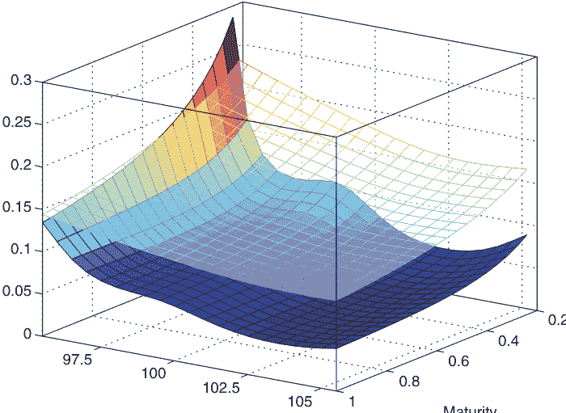

**图 2.9** Heston 隐含波动率面与局部波动率面

```matlab
for t=1:NT;
for k=1:NK
  % Heston 定价
  Price = HestonCallGaussLaguerre(K(k),T(t),...);
  % 隐含波动率
  IV(k,t) = HestonSEV(K(k),T(t),...);
  % 局部差
  CT = HestonCallGaussLaguerre(K(k),T(t)+dt,...);
  CT_ = HestonCallGaussLaguerre(K(k),T(t)-dt,...);
  dCT = (CT - CT_) * (2/dt);
  CK = HestonCallGaussLaguerre(S(k)+dK,T(t),...);
  CK0 = HestonCallGaussLaguerre(S(k),T(t),...);
  CK_ = HestonCallGaussLaguerre(S(k)-dK,T(t),...);
  dCK2 = 2*(CK - CK0) / (dK^2);
  LocalVar = 2*dCT^2 / (K^2*dCK2*dK2);
  % 局部波动率
  IV(k,t) = sqrt(LocalVar);
end
% 隐含波动率的透明网格
mesh(IV)
% 局部波动率面图
hold on
surf(LV)
```

在图 2.9 中，隐含波动率由透明网格表示，局部波动率由网格下方的实表面表示。该图反映了 Derman 等（1995）的观察结果，即局部波动率比隐含波动率表现出更大的波动性。下一节将介绍局部波动率。

### Heston 模型中的差

## 方差掉期 (Variance Swap)

回顾第 1 章，Heston 模型的波动率由 CIR 过程驱动：

```
$dv_t = \kappa(\theta - v_t)dt + \alpha\sqrt{v_t}dW_{2,t}$
```

因此，在给定 `v_s` (`s < t`) 的条件下，`v_t` 的期望值为：

```
$E[v_t|v_s] = v_s e^{-\kappa(t-s)} + \theta(1 - e^{-\kappa(t-s)}) = (v_s - \theta)e^{-\kappa(t-s)} + \theta., \quad (2.19)$
```

在下一节中，我们将使用 `s = 0` 的 `E[v_t|v_s]`。将其标记为 `\hat{v}_t` 是很有用的：

```
$\hat{v}_t = E[v_t|v_s] = (v_0 - \theta)e^{-\kappa t}.$
```

定义（积分）差 `\hat{w}_t` 也是很有用的：

```
$\hat{w}_t = \int_0^t \hat{v}_s ds = \int_0^t (v_0 - \theta)\frac{1 - e^{-\kappa s}}{\kappa} + \theta t., \quad (2.21)$
```

正如 Gatheral (2006) 所出的，方差掉期需要对 `(0,T)` 时间内的未来差进行估计。这可以作为差的条件期望来获得。因此，总差的公平估计为：

```
$E[\int_0^T v_t dt|v_0] = \int_0^T E[v_t|v_0] dt = \int_0^T [\theta + (v_0 - \theta)e^{-\kappa t}] dt = (v_0 - \theta)\frac{1 - e^{-\kappa T}}{\kappa} + \theta T, \quad (2.22)$
```

这简单等于 `\hat{w}_T`。由于它代表 `(0,T)` 上的总差，因此为了代表年化差的公平估计，必须除以 `T`（假设 `T` 以年表示）。因此，方差掉期的执行权方差 `K_{var}^2` 通过将此最后一个表达式除以 `T` 得到的：

```
$K_{var}^2 = \frac{\hat{w}_T}{T} = (v_0 - \theta)\frac{1 - e^{-\kappa T}}{\kappa} + \theta., \quad (2.23)$
```

这是 Gatheral (2006) 第 138 页上的表达式。

# MATLAB 和 C# 中的 Heston 模型及其扩展

我们使用一组相同到期的期权市场价格来估计 Heston 参数，并从公式 (2.23) 获得公平执行权方差。如果将 Demeterfi (1999) 等人描述的复制算法应用于同一组期权，原则上我们至少获得相同的执行权价。两个执行权价之间的一致程度取决于 Heston 模型对它们的拟合优劣，以及在复制算法中使用的插值和外推方法。

Matlab 文件 `VarianceSwap.m` 实现了 Demeterfi (1999) 的复制算法。该函数需要带有隐含波动率的平值（ATM）看涨和看跌期权的向量。

```matlab
function y = VarianceSwap(KCI, CallVI, PutVI,S,T,rf)
  Sb = S % 取 ATM 为边界
  f = @(S, Sb) 2/T*((S - Sb) / log(S/Sb));
  % 看涨期
  n = length(KCI);
  for i=1:n-1
    Temp(i) = f(KCI(i+1),Sb,T) - f(KCI(i),Sb,T) / ...;
    if i=1
      CallWeight(i) = 1;
    end
    CallValue(i) = BSC(S,KCI(i),rf,0,CallVI);
    if i>1
      CallValue(i) = Temp(i) - Temp(i-1);
    end
    CallContrib(i) = CallValue(i)*CallWeight(i);
  end
  Pi1 = sum(CallContrib);
  % 看跌期
  n = length(PutVI);
  KPI = flipud(KCI);
  PutVI = flipud(PutVI);
  for i=1:n-1
    Temp(i) = f(KPI(i+1),Sb,T) - f(KPI(i),Sb,T) / ...;
    if i=1
      PutWeight(i) = 1;
    end
    PutValue(i) = BSC(S,KPI(i),rf,0,PutVI);
    if i>1
      PutWeight(i) = Temp(i) - Temp(i-1);
    end
    PutContrib(i) = PutValue(i)*PutWeight(i);
  end
  Pi2 = sum(PutContrib);
  Pi_CP = Pi1 + Pi2;
  Kvar = 2/T*(rf*T - (S/Sb*exp(rf*T) - 1));
  y = Kvar;
```

Demeterfi (1999) 的复制算法在 C# 函数中编码。代码与此非常相似，但未给出。感谢 Jim 指出。

### 积分问题、参数影响和差建模

`VarianceSwap()` 函数需要一个 C# 函数来进行线性插值。这通过 `interp1()` 函数实现。

```csharp
static double interp1(double[] X, double[] Y, double xi) {
  int x1 = 0;
  int x2 = 0;
  double yi = 0.0;
  // 在端点寻找 xi
  if(xi <= X[0]) yi = Y[0];
  else if (xi <= X[X.Length-1]) yi = Y[X.Length-1];
  else
    for (int i=0; i<X.Length-1; i++) {
      if((xi <= X[i]) && (xi < X[i+1])) {
        x1 = i;
        x2 = i+1;
        double p = (xi - X[x1]) / (X[x2] - X[x1]);
        yi = (1-p)*Y[x1] + p*Y[x2];
      }
    }
  return yi;
}
```

为了说明，我们使用一组到期为 15 天的道 Jones ETF 期权，并获得参数 $\kappa=3.000$、$\theta=0.063$、$\sigma=0.502$、$v_0=0.104$ 和 $\rho=-0.901$。参数估计将在第 6 节介绍。使用公式 (2.23)，我们获得 $K_{var}^2=0.01$；使用市场报价的复制算法，我们获得 $K_{var}^2=0.85$。

### Dupire 局部波动率

Dupire (1994) 的局部波动率公式为：

$$\sigma_t(K,T) = \sqrt{\frac{\frac{\partial C}{\partial T}}{\frac{\partial^2 C}{\partial K^2}}}$$

其中 $C(K)$ 是执行权为 $K$、到期为 $T$ 的价格。公式 (24) 规定，给定一组期权，执行权为 $K$、到期为 $T$ 的局部波动率是通过看涨价格的一二阶导数得到的。这些导数可以通过有限差分获得，但计算量大且数值不稳定。在 Heston 模型中，我们在下一节中给出。有限差分法评估 (24) 所需的导数可以通过解析微分法获得。记得 Heston 价格为：

$C(K) = S_tP_1 - Ke^{-rT}P_2$。

关于这些导数的更多信息，请参见第 11 节，“Heston Greeks”。

```
$$\frac{\partial P_2}{\partial K} + K\frac{\partial^2 P_2}{\partial K^2} = \int_0^{\infty} \text{Re} \left[\dots\right] d\phi. \quad (2.33)$$
```

### 积分问题、参数影响和差建模

注意，通过这种方法得到的 $\partial^2C/\partial K^2$ 与有限差分相比节省了计算时间。如果使用 Albrecher 等（2007）对于 $C_i$ 和 $D_j$ 的“Little Trap”公式，则：

```
$$\frac{\partial C}{\partial T} = \kappa(\theta - v_t)dt + \alpha\sqrt{v_t}dW_{2,t}$$
```

其他导数相同，$C_i$ 和 $D_j$ 采用了“Little Trap”公式。Matlab 函数 `dpdjT.m` 实现了用于从公式 (27) 获取公式 (26) 中导数 $\partial f_i/\partial T$ 的积分函数。它允许在 (2.17)、(2.14) 和 (2.35) 中使用“Little Trap”。为了节省空间，省略了函数的某些。

```matlab
function y = dpdjT(Pnum...)
if Trap
    % Little Trap 公式
    c = 1/g;
    expT = exp(-dT);
    ddT = (b - rho*sigma*i*phi - d)/sigma*2 * ...;
    dcdT = rf*i*phi + kappa*theta/sigma*2 * ...;
    G = (i - g*exp(dT))/(1-g));
    D = (b - rho*sigma*i*phi - d)/sigma*2 * ...;
    C = rf*i*phi + kappa*theta/sigma*2 * ...;
else
    ddT = (b - rho*sigma*i*phi - d)/sigma*2 * ...;
    dcdT = rf*i*phi + kappa*theta/sigma*2 * ...;
    G = (i - g*exp(dT));
    C = rf*i*phi + kappa*theta/sigma*2 * ...;
    D = (b - rho*sigma*i*phi - d)/sigma*2 * ...;
end
dfT = exp(C + D*v0 + i*phi*x)*(dcdT + ddT*v0);
y = real(K(-i*phi)*dfT/i);
```

该函数传递给 Matlab 函数 `dCdT.m` 用于实现公式 (2.25) 中的导数 $\partial C/\partial T$，在这种情况下，分别使用向量 x 和 w 的高斯-Laguerre 权重和横坐标。


其他导数相同，$C_i$ 和 $D_j$ 采用了“Little Trap”公式。Matlab 函数 `dpdjT.m` 实现了用于从公式 (27) 获取公式 (26) 中导数 $\partial f_i/\partial T$ 的积分函数。它允许在 (2.17)、(2.14) 和 (2.35) 中使用“Little Trap”。为了节省空间，省略了函数的某些。

```matlab
function y = dpdjT(Pnum...)
if Trap
    % Little Trap 公式
    c = 1/g;
    expT = exp(-dT);
    ddT = (b - rho*sigma*i*phi - d)/sigma*2 * ...;
    dcdT = rf*i*phi + kappa*theta/sigma*2 * ...;
    G = (i - g*exp(dT))/(1-g));
    D = (b - rho*sigma*i*phi - d)/sigma*2 * ...;
    C = rf*i*phi + kappa*theta/sigma*2 * ...;
else
    ddT = (b - rho*sigma*i*phi - d)/sigma*2 * ...;
    dcdT = rf*i*phi + kappa*theta/sigma*2 * ...;
    G = (i - g*exp(dT));
    C = rf*i*phi + kappa*theta/sigma*2 * ...;
    D = (b - rho*sigma*i*phi - d)/sigma*2 * ...;
end
dfT = exp(C + D*v0 + i*phi*x)*(dcdT + ddT*v0);
y = real(K(-i*phi)*dfT/i);
```
```matlab
function y = dCdT(...)
for k=1:length(x)
int1(k) = w(k)*dpjdT(1,x(k),..
int2(k) = w(k)*dpjdT(2,x(k),..
int3(k) = w(k)*HestonProb(x(k),..,2);
end
p1dT = (1/pi)*sum(int1)
dp2dT = (1/pi)*sum(int2)
P2 = (1/2) + (1/pi)*sum(int3)
y = S*dp1dT - K*exp(-rf*T) - (-rf*P2 + dp2dT);
```

Matlab 函数 `d2p1k2.m` 实现了用于获取方程 (2.32) 中 $\partial P1/\partial K_2$ 导数（仅针对 $P_1$）的被函数函数

```matlab
function y = d2p1k2(phi...)
d = sqrt(rho*sigma+i*phi - b^2 * ...)
g = (b - rho*sigma+i*phi + d) / ...
% Original Heston formulation.
G = (1 - g*exp(d*T))/(1-g);
C = rf+i*phi*T + kappa*sigma/sigma^2 * ...
D = (b - rho*sigma+i*phi + d)/sigma * ...
% The real part of the integrand
f1 = exp(C + D*Dv0 + i*phi)
y = real(i*phi-1) + K*(-i*phi-2) * f1;
```

最后一个函数用于方程 (2.33) 中的 $2\partial P2/\partial K + K^2\partial P2/\partial K^2$。这是 `dp2k2_2.m` Matlab 函数。

```matlab
function y = dp2p1k2_2(phi...)
% Original Heston formulation.
G = (1 - g*exp(d*T))/(1-g);
C = rf+i*phi*T + kappa*sigma/sigma^2 * ...
D = (b - rho*sigma+i*phi + d)/sigma * ...
% The real part of the integrand
f2 = exp(C + D*Dv0 + i*phi) * *
y = real(i*phi-1) + K*(-i*phi-1) * f2;
```

最后，函数 `HestonLVAnalytic.m` 组合了这些函数，并使用方程 (2.24) 获取了 Heston 模型中局部波动率 $\sigma_1(K,T)$ 的解析表达式。

```matlab
function y = HestonLVAnalytic(...)
for k=1:length(x)
int1(k) = w(k)*dpjdT(1,x(k),..
int2(k) = w(k)*dpjdT(2,x(k),..
int3(k) = w(k)*HestonProb(x(k),..,2);
int4(k) = w(k)*d2P1dK2(x(k),...);
int5(k) = w(k)*dp2dK2_(x(k),...);
p1DT = (1/pi)*sum(int1);
dp2DT = (1/pi)*sum(int2);
P2 = (1/2) + (1/pi)*sum(int3);
% derivative with respect to T
% dC/dT = S*dP1DT - K*exp(-r*T)*P2 + dP2DT;
dCdK = (1/pi)*sum(int4);
TwodP2dK = (1/pi)*sum(int5);
% d2C/dK2 = derivative with respect to K^2
d2CdK2 = S*dP1K2 - exp(-r*T)*TwodP2dK;
% Local Variance and Local Volatility
LocalVar = 2*dCdT / (K^2*d2CdK2);
Y = sqrt(LocalVar);
```

### 积分问题、参数影响与方差建模

用于获取方程 (2.24) 解析及局部波动率 $\sigma(K,T)$ 导数的 C# 函数与 Matlab 函数非常相似，此处不再列出。

与其解析地表示方程 (2.24) 的导数，我们可以使用有限差分法来近似这些导数。这是下一节中获取局部波动率的方法。

# 使用有限差分的法的局部波动率

Dupire (1994) 局部波动率公式所需的导数解析表达式需要大量的编码，如上一节所示。从编码的角度来看，使用有限差分法近似导数更为简单。写入 $C(K) = C(K,T)$ 以强调欧式看权价格对到期日 $T$ 的依赖性。我们使用较小的时间增量 $dt$，并将时间导数近似为中心差分

同样，我们可以使用较小的行权价增量 $dK$，并将二阶导数近似为中心差分

$$\frac{\partial C}{\partial T} \approx \frac{C(K,T+dt)-C(K,T-dt)}{2dt}$$

$$\frac{\partial^2 C}{\partial K^2} \approx \frac{C(K-dK,T)-2C(K,T)+C(K+dK,T)}{(dK)^2}$$

函数 `HestonLVFD.m` 使用中心差分近似获取 Heston 模型中的局部波动率 $\sigma_t(K,T)$。

```matlab
function y = HestonLVFD(...,dt,dK);
% dC/dT by central finite difference
CT_1 = HestonCallLaguerre(S,K,T-dt,w);
CTL = HestonCallLaguerre(S,K,T+dt,w);
dCdT = (CTL - CT) / (2*dt);
```
```csharp
CK_1 = HestonCallLaguerre(S,K-dK,w);
CK0 = HestonCallLaguerre(S,K,w);
CK1 = HestonCallLaguerre(S,K+dK,w);
cd2d2 = (CK1-2*CK0+CK1)/(dK)^2;
// Local variance and local volatility
LocalVar = 2*dCdT / (cd2d2);
y = sqrt(LocalVar);
```

用于近似 $\sigma_i(K, T)$ 一阶和二阶导数的代码非常相似，此处未列出。在本节中，$\sigma_i(K, T)$ 的代码比上一节更简单且紧凑。缺点是由于有限差分需要多次计算，使用有限差分的代码运行速度较慢。最后，有限差分仅是导数的近似，而解析表达式是精确的。

### 近似波动率

在其著作 *TheVolatility Surface: A Practitioner's Guide* 中，Gatheral (2006) 推导了当 $\rho \approx 1$ 时 Heston 模型局部波动率的近似。在本节中，我们介绍了他的结果和推导细节。回想 Heston 模型的双微分方程系统，$W_1$ 和 $W_2$ 是相关系数 $\rho$ 的布朗运动。已知 $W_1$ 和 $W_2$ 可以用独立布朗运动 $Z_t$ 和 $B_t$ 的 Cholesky 分解代替，定义 $W_{1,t}=B_t+\sqrt{1-\rho^2}Z_t$。Gatheral (2006) 使用零漂移 $\mu=0$，根据行权收益度 $x_t=\ln(S/K)$ 推导了局部波动率。通过 Ito 公式，结合 Cholesky 分解可以得到 $x_t$ 的过程：

$$dx_t = v_t dt + \sqrt{v_t}dB_t$$
$$dv_t = \kappa(\theta - v_t)dt + \sigma\sqrt{v_t}(\rho dB_t + \sqrt{1-\rho^2}Z_t)$$

其中 $E[dB_t,dZ_t]=0$。在 $v_t$ 的过程中，替换涉及 $\sqrt{v_t}$ 的项并假设 $\rho=1$，使得 $1-\rho^2$ 消失：

$$dv_t = \kappa(\theta - v_t)dt + \sigma\sqrt{v_t}$$

Gatheral 定义 $u_t=E[v_t|x_t]$ 表示在时间 $T$ 时行权收益度的条件方差期望。

### 积分问题、参数影响与方差建模

此外，他假设以下假设（松散定义的合理猜测）成立：

$$E[x_t|x_T] = \frac{\hat{x}_T}{\hat{w}_T}$$

对 (2.39) 取条件期望并应用该假设产生：

$$du_t = \kappa(\theta - u_t)dt + \rho(\frac{\hat{x}_T}{\hat{w}_T})\hat{v}_t + \frac{1}{2}u_td$$

根据假设，$E[dx_t|x_T] = (x_T/w_T)$，且根据方程 (2.21)，初始方差 $u_0 E[v_0|x_0] = v_0$，在方程 (2.41) 中设置 $T=0$ 意味着 $u_0 = v_0$。当 $\rho = \pm1$ 时，局部方差的近似 $u_T$ 因此：

$$u_T = \hat{v}_T + \rho\frac{\hat{x}_T}{\hat{w}_T}\int_0^T \hat{v}_te^{-\kappa'(T-t)}dt (2.42)$$

其中

$$u_T = \hat{v}_T + (\theta - \theta')e^{-\kappa'T} (2.43)$$

类似于 (2.20)。方程 (2.42) 是 Gatheral (2006) 的方程 (3.15)，可以进一步积分产生：

$$u_T = \hat{v}_T + \rho\frac{\hat{x}_T}{\hat{w}_T}[\frac{\theta - \theta'}{\kappa' - \kappa}(e^{(\kappa'-\kappa)T} - 1) + \frac{\theta}{\kappa'}(e^{\kappa'T} - 1)]. (2.44)$$

Matlab 函数 `HestonLVAppro.m` 实现了 Gatheral (2006) 对 Heston 模型中局部波动率 $\sigma_l(K,T)$ 的近似，符合 (2.44)。

```matlab
function y = HestonLVAppro(...);
% Modified parameters kappa' and theta'
kappa_ = kappa - rho/2;
theta_ = theta/kappa_;
% wt and vt
xt = log(K/S);
wt = (v-theta)*(1-exp(-kappa_*T))/kappa_;
% Integral
F1 = (v-theta)/(kappa-kappa_);
E1 = exp((kappa-kappa_)*T) - 1;
F2 = theta/kappa_;
E2 = exp(-kappa_*T) -1;
Integral = exp(-kappa_*T)*(F1*E1 + F2*E2);
% Local Variance and Local Volatility
ut = vt + rho*sigma*xt/Integral;
y = sqrt(ut);
```

C 代码非常相似，因此不再列出。

### 局部波动率的数值示例

我们使用一组到期日为 222 天的看跌期权来演示 Heston 模型中的局部波动率，此时现价为 $S=30.67$。Heston 参数估计为 $\theta=0.007$、$\kappa=6.45 \times 10^{-6}$、$\sigma=0.639$、$v_0=0.579$ 以及 $\rho=-0.085$。我们使用解析导数有限差分法获取 (2.24) 中的局部波动率 $\sigma_l(K, T)$，并获取了 Gatheral (2006) (2.44) 中的近似局部波动率，对应 $T=222/365$，行权价从 $K=15$ 到 $K=65$。我们还添加了生成的 Heston 看跌期权的隐含波动率。结果如图 2.10 所示。图 2.10 展示了 Gatheral (2006) 的观察，即局部波动率的近似形式（红线）往往比精确形式不弯。图中显示使用解析公式（实线）和有限差分法[黑色圆圈]产生的局部波动率几乎相同。最后，局部波动率的斜率平均约为隐含波动率的 1.9 倍，这与 Derman 等人 (1995) 的经验法则一致，即局部波动率的幅度约为隐含波动率的两倍。图 2.10 使用以下代码生成，该代码使用了本节之前的函数。

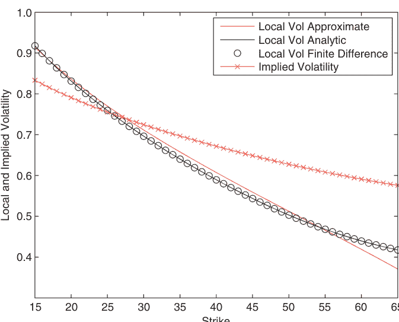

图 2.10 Heston 局部波动率与隐含波动率

```matlab
% 局部波动率
k=1:length(K)
LVFD(k) = HestonLVFD(K(k),...,dt,dK);
LVAN(k) = HestonLVAnalytic(K(k),...);
LVAP(k) = HestonLVapprox(K(k),...);
end
% 隐含波动率
PutCall = '';
a = 0.001; b = 10; Tol = 1e-10; MaxIter = 1000;
for k=1:length(K)
CallPrice(k) = HestonCallGaussLaguerre(K(k),...);
ModelPrice(k) = CallPrice - S0 + exp(-rf*T)*K(k);
IV(k) = BisecBSIV(K(k),ModelPrice(k),...);
end
```


我们还可以将局部波动率的三种估计值（解析和有限差分）应用于方程 `(2.24)`，并对 `(2.44)` 中的近似值应用于 SPX 期权数据。这在图 2.11 中所示。

## MATLAB 和 C# 中的 HESTON 模型及其扩展

到期 7 天

到期 15 天

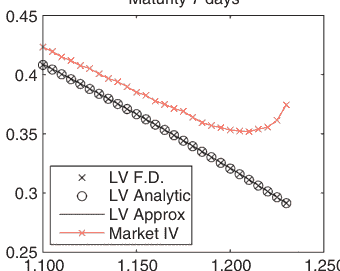

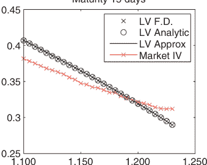

到期 43 天

到期 71 天

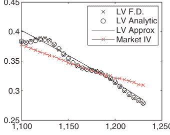

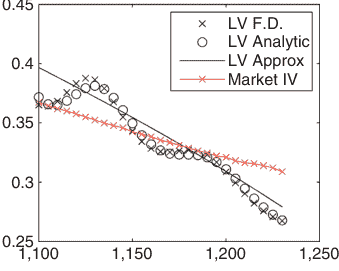

图 2.11 市场隐含波动率与 Heston 波动率，标普 500 指数

正如预期，且与图 2.10 一致，局部波动率通常比隐含波动率更陡峭且波动更大。对局部波动率的近似保留了更陡的斜率，但没有保留这种波动行为。解析和有限差分的局部波动率非常接近，71 天到期的除外，有限差分近似略有失效。

### 隐含波动率

我们在本章较早提到，使用 Heston 模型获得的期权价格具有内置的隐含波动率，从意义上说，从这些价格中提取的隐含波动率将表现出隐含波动率特征。此外，从从中提取的参数 `$\rho$` 和 `$\sigma$` 对模型的陡峭度和光滑度有影响。在实践中，从 Heston 模型中提取的波动率在匹配短期隐含波动率时有时拟合效果较差。对于长期期权，拟合效果更好。我们通过对道琼斯工业平均指数 ETF（代码 DIA）的四种到期日（37、72、135 和 226 天）的看跌期权来说明。DIA 的收盘价为 `$129.14`。我们列出了参数估计值 `$\kappa = 0.8799, \sigma = 3.6706, v_{0} = 0.0435,$` 和 `$\rho = -0.4171$`。Heston 模型参数估计方法在第 6 章中有详细讨论。为了简单，我们设置 `r=0`。图 2.12 展示了来自 DIA 的市场隐含波动率，以及使用二分算法根据之前生成的 Heston 价格得到的隐含波动率。

图 2.12 清楚地表明，在短期，Heston 隐含波动率与市场隐含波动率的拟合效果很差。对于长期，Heston 模型提供了非常好的拟合。

使用二分算法来获取市场和 Heston 隐含波动率。本章之前介绍了用于该算法的 Matlab 函数 `BiscBIV.m` 和 C 函数 `BiscBIV()`。该算法通过寻找市场价格与 Black-Scholes 价格之间差值的零点来确定隐含波动率。使用该算法的优点是，只要函数是连续的，且选择的区间两个初始端点使得一个值产生负差，另一个值产生正差——即区间内存在根——就能始终找到解。由于期权价格随波动率单调递增，我们始终可以使用小值作为第一个端点（例如 0.1%），并在第二个端点使用非常大的值（例如 500%）。

我们使用了以下 Matlab 代码生成了图 2.12。我们硬编码了参数值，这些值是从第 6 章的 Matlab 代码中获得的。

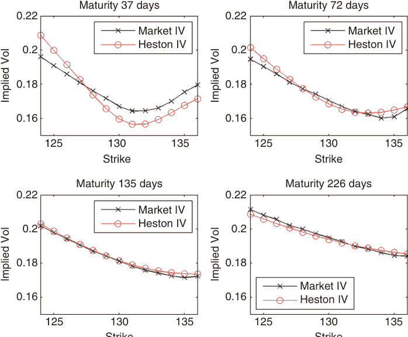

图 2.12 DIA 看跌期权的市场与 Heston 隐含波动率

```matlab
param = [8.8799, 0.0674, 3.6706, 0.0435, -0.4171];

for k=1:NK
  t=1:NT
    CallPrice = HestonCallGaussLaguerre(K(k),T(t),...)
    ModelPrice(k,t) = CallPrice - S0 + exp(-rf*T(t))*K(k);
for k=1:NK
  t=1:NT
    IVm(k,t) = BisecBSIV(K(k),T(t),ModelPrice(k,t),...);
for t=1:NT
  subplot(2,2,t);
  plot(K,IV(:,t),KIVm(:,t));
```

### 矩量爆炸

Andersen 和 Piterburg (2007) 推导了终端股票价格矩量 `$E[S_T^\omega]$` 在有限时间内发生爆炸（变为无穷大）的条件。他们论文的结果可以用于寻找 `$\omega > 1$` 的值，使得 `$E[S_T^\omega]$` 对于所有 `T` 保持有限。使用他们关于时间的解析表达式来寻找 `$E[S_T^\omega]$` 对于所有 `T` 保持有限的 `$\omega > 1$` 的值。

```matlab
UpperAP = W(j);
% 矩下界
W = [LoLimit:0];
for k=1:n
  j = 1;
  T(j) = 0;
  while (T(j) < inf)
    j = j+1;
    T(j) = MomentExplode(W(j), lambda, sigma, kappa, rho);
  end
  e = 1/10^k;
  W = [W(j-1):e:W(j+1)];
  clear T
end
LowerAP = W(j);
```

为了使用特征函数寻找矩边界，我们循环遍历 omega 的值，直到特征函数返回一个复值。这是通过 `FindLeeBounds.m` 函数的中间部分实现的。

```matlab
% 上部矩。循环直到遇到虚部imag(CF)
CF = 0;
e = 1e-5;
W = 0.9*UpperAP;
while isreal(CF)
  phi = -i*W;
  CF = HestonCF(phi, kappa, theta, 0, rho, sigma, tau, S, r, q, v0, trap);
  W = We;
end
UpperAP = W;
% 下部矩。循环直到遇到虚部imag(CF)
CF = 0;
e = -1e-5;
W = 0.9*LowerAP;
while isreal(CF)
  phi = -1*W;
  CF = HestonCF(phi, kappa, theta, rho, sigma, tau, 0, S, r, q, v0, trap);
  W = We;
end
LowerAP = W;
```

最后，该函数的最后部分返回了波动率斜的 Lee (2004b) 边界。

```matlab
p = UpperAP - 1;
q = -LowerAP;
BR = 2 - 4*(sqrt(p^2 + p) - p);
BL = 2 - 4*(sqrt(q^2 + q) - q);
```

## MATLAB 和 C# 中的 HESTON 模型及其扩展


# MATLAB 和 C# 中的 HESTON 模型及其扩展

C# 代码与之类似，此处不再给出。为了说明，我们使用了道道琼斯工业指数（DJIA）到期日为 37 天的看跌期权的参数估计。现价为 $129.14$。参数估计值为 $\kappa = 4.52$，$\sigma = 2.11$，$\rho = -0.27$。上部矩边界为 $\hat{\rho} = 3.6842$，因此 $\hat{p} = 2.6842$。下部矩边界为 $-1.3376$，因此 $\hat{q} = 1.3376$。我们将 $\hat{p}$ 和 $\hat{q}$ 的值代入方程 (2.48) 和 (2.51)，得到极限斜率系数 $\beta_p = 0.2773$ 和 $\beta_q = 0.1580$。

我们使用这些斜率系数来寻找这些 DJIA 37 天到期看跌期权在极端行权处的隐含波动率斜率。如图 2.13 所示。

观察到的行权价范围为 $[124, 136]$，增量为 $1$，现价 $S_0 = 129.14$，对数收益率（log-moneyness）的范围为 $[-0.0406, 0.0518]$。我们将 Heston 模型拟合到扩展的行权价范围 $[120, 140]$，对应的对数收益率范围为 $[-0.0734, 0.0807]$，并从这些价格中提取隐含波动率。

## 矩边界计算

```matlab
UpperAP = W(j);
% 矩下界
W = [LoLimit:0];
for k=1:n
  j = 1;
  T(j) = 0;
  while (T(j) < inf)
    j = j+1;
    T(j) = MomentExplode(W(j), lambda, sigma, kappa, rho);
  end
  e = 1/10^k;
  W = [W(j-1):e:W(j+1)];
  clear T
end
LowerAP = W(j);
```

为了使用特征函数寻找矩边界，我们循环遍历 `omega` 的值，直到特征函数返回一个复值。这是通过 `FindLeeBounds.m` 函数的中间部分实现的。

```matlab
% 上部矩。循环直到遇到虚部imag(CF)
CF = 0;
e = 1e-5;
W = 0.9*UpperAP;
while isreal(CF)
  phi = -i*W;
  CF = HestonCF(phi, kappa, theta, 0, rho, sigma, tau, S, r, q, v0, trap);
  W = We;
end
UpperAP = W;
% 下部矩。循环直到遇到虚部imag(CF)
CF = 0;
e = -1e-5;
W = 0.9*LowerAP;
while isreal(CF)
  phi = -1*W;
  CF = HestonCF(phi, kappa, theta, rho, sigma, tau, 0, S, r, q, v0, trap);
  W = We;
end
LowerAP = W;
```

最后，该函数的最后部分返回了波动率斜率的 Lee (2004b) 边界。

```matlab
p = UpperAP - 1;
q = -LowerAP;
BR = 2 - 4*(sqrt(p^2 + p) - p);
BL = 2 - 4*(sqrt(q^2 + q) - q);
```

## 使用傅里叶变换的推导

### 使用 GIL-PELAEZ 傅里叶反演恢复概率

回顾第 1 章和第 2 章，实值概率（in-the-money probabilities）为：

$Pr(\ln S_t > k) = \frac{1}{2} + \frac{1}{\pi} \int_{-\infty}^{\infty} \text{Re}\left[\frac{e^{-iu\varphi(u)}}{iu}\right] du (3.8)$

其中 $k = \ln K$。

我们假设了索引 $j$，并将 $\varphi(u)$ 表示为 $\ln S_t$ 在 $u$ 处的特征函数。公式 (3.8) 形式的概率是由 Gil-Pelez (1951) 使用傅里叶变换的反演定理推导出的。符号函数 $\sin \alpha$ 在推导中起着重要作用。它的定义为：

$\sin \alpha = \begin{cases} |\alpha/\alpha| & \alpha \neq 0 \\ 0 & \alpha = 0 \end{cases} (3.9)$

因此，当 $\alpha > 0$ 时 $\alpha = 1$，当 $\alpha < 0$ 时 $\alpha = -1$，当 $\alpha = 0$ 时 $\alpha = 0$。符号函数的积分表示为：

$\sin \alpha = \frac{1}{\pi} \int_{-\infty}^{\infty} \frac{\sin \alpha x}{x} dx. (3.10)$

推导过程可参考 Stuart (2010)，介绍部分可参考 Chacon (1991)。注意 $f(x)$ 为 $\ln S_t$ 的密度函数，$F(x)$ 为其分布函数。利用 $y$ 处符号符号的定义，对于固定的 $y$，我们可以写道：

$\int_{-\infty}^{\infty} \text{sgn}(x-y)f(x)dx = \int_{-\infty}^{\infty} \text{sgn}(x-y)f(x)dx - \int_{-\infty}^{\infty} \text{sgn}(y-x)f(x)dx = [1-F(y)] - F(y) = 1-2F(y). (3.11)$

为了计算 (3.11)，我们在 $y$ 处划分了积分范围，并利用了每个区域内 $x-y$ 的符号。开始推导公式 (3.8) 时，注意 $f(x)$ 可以通过反演从 $\varphi(u)$ 恢复，如 (3.2) 所示：

$f(x) = \frac{1}{2\pi} \int_{-\infty}^{\infty} e^{-ixu}\varphi(u) du. (3.12)$

我们可以使用密度函数表示 $Pr(\ln S_t > k)$，并代入方程 (3.12) 得：

$Pr(\ln S_t > k) = \int_{-\infty}^{\infty} f(x)dx = \frac{1}{2\pi} \int_{-\infty}^{\infty} (e^{-ixu}\varphi(u)) dx = \frac{1}{2\pi} \int_{-\infty}^{\infty} \varphi(u) \left( \int_{-\infty}^{\infty} e^{-ixu} dx \right) (3.13)$

其中 $Im[\varphi(u)]$ 和 $Re[\varphi(u)]$ 分别表示 $\varphi(u)$ 的虚部和实部。为了得到方程 (3.18)，我们利用了 $1/it = -i$ 这一事实。该表达式用于 Attari (2004) 的期定价公式，我们将在本章稍后部分介绍。

## 来自傅里叶变换的推导

### GATHER (2006) 的推导

Gatheral (2006) 通过处理远期价格的对数收益 $x_i = \ln(F_{i,T}/K)$，提供了 Albrecher 等人 (2007) 关于 Heston (1993) 特征函数的公式，其中 $K$ 是期权的执行价格，$F_{i,T} = S_i e^{r(T-t)}$ 是股票的远期价格。他的推导与 Heston (1993) 有不同，因为 Gatheral 直接处理实值概率 $P_1$ 和 $P_2$ 的傅里叶变换。

再次考虑第 1 章中定义的方差 $v_i$ 的随机微分方程（SDE）：

$dv_i = \kappa(\theta - v_i)dt + \sigma\sqrt{v_i}dW_{2,t}.$

应用 Itô 引理显示 $x_i$ 遵循随机过程：

$dx_i = -\frac{1}{2}v_idt + \sqrt{v_i}dW_{2,t}.$

Gatheral (2006) 假设波动率的市场价格为零，因此 $\lambda(S,v,t)=0$。使用 $x_i$，定义 $x_i = \ln(F_{i,T}/K)$ 而不是 $x_i = \ln S_t$，第 1 章中定义的实值概率的边界条件变为：

$P_i(x,v,0) = \mathbf{1}_{x>0} (3.19)$

对于 $i=1,2$。通过这些修改，$P_i$ 的偏微分方程（PDE）为：

$\frac{\partial P_i}{\partial t} + \rho\sigma v\frac{\partial P_i}{\partial x\partial v} + \frac{1}{2}v\frac{\partial^2 P_i}{\partial x^2} + 2\rho\sigma v\frac{\partial^2 P_i}{\partial v^2} + \mu v\frac{\partial P_i}{\partial x} + (a-b_v)\frac{\partial P_i}{\partial v} = 0 (3.20)$

其中 $u_1 = 1/2, u_2 = -1/2$ 且 $a = \kappa\theta$。参数 $u_1, u_2$ 和 $a$ 与第 1 章相同，但如果假设 $\lambda=0$，则 $b_1 = \kappa-\rho$，$b_v$ 经过修正。从 $t$ 到到期时间 $\tau=T-t$ 的变换解释了方程 (30) 中一阶导数前的负号。在本节中，通过 $k$ 定义积分更为方便。Gatheral (2006) 使用的傅里叶变换形式与方程 (3.1) 不同，它在傅里叶变换中用 $e^{-iks}$ 替换了 $e^{ix}$。因此 (3.4) 中的导数是 $f'(k)=ik$。考虑概率 $P_i = P_i(x,v)$ 的傅里叶变换 $\hat{P}_i$：

$\hat{P}_i(k,v,\tau) = \int_{-\infty}^{\infty} e^{-iks}P_i(x,v)dx$

使用边界条件 (3.19)，我们得到：

$\hat{P}_i(k,v,0) = \int_{-\infty}^{\infty} e^{-iks}\mathbf{1}_{x>0}dx = \frac{1}{ik}$

## MATLAB 中的 Heston 模型及其扩展

记得傅里叶变换 $\hat{P}_j$ 对 $x$ 的求导对应于乘以 $ik$，对于 $\hat{P}_j$，方程 (3.20) 中的 PDE 为：

$\frac{\partial\hat{P}_j}{\partial\tau} + \rho\sigma vik\frac{\partial\hat{P}_j}{\partial v} - \frac{1}{2}ik^2\hat{P}_j - \frac{1}{2}\sigma^2\frac{\partial^2\hat{P}_j}{\partial v^2} + uik\frac{\partial\hat{P}_j}{\partial v} + (a-b_v)\frac{\partial\hat{P}_j}{\partial\tau} = 0 (3.21)$

整理后，得到：

$v\left[\alpha_i\frac{\partial\hat{P}_j}{\partial v} - \beta_i\frac{\partial\hat{P}_j}{\partial\tau} + \gamma\frac{\partial^2\hat{P}_j}{\partial v^2}\right] + a\frac{\partial\hat{P}_j}{\partial v} - \frac{\partial\hat{P}_j}{\partial\tau} = 0 (3.22)$

其中

$\alpha_i = ik - \frac{k^2}{2}, \quad \beta_i = b_i - \rho\sigma ik, \quad \gamma = \sigma^2/.$

注意这些系数与第 1 章中 Riccati 方程的系数 $P, Q, R$ 相同，只不过 $k$ 替换了 $\phi$。假设 $\hat{P}_i$ 具有如下形式：

$\hat{P}_i(k,v,\tau) = \exp[C_i(k,\tau)\theta + D_i(k,\tau)v]\hat{P}_i(k,v,0) = \frac{1}{ik}[C_i(k,\tau)\theta + D_i(k,\tau)v]. (3.23)$

对 (3.23) 取以下导数：

$\frac{\partial\hat{P}_i}{\partial\tau} = [\frac{\partialC_i}{\partial\tau}\theta + \frac{\partialD_i}{\partial\tau}v]\hat{P}_i, \frac{\partial\hat{P}_i}{\partial v} = D_i\hat{P}_i, \frac{\partial^2\hat{P}_i}{\partial v^2} = D_i^2\hat{P}_i.$

将这些导数代回 (3.22) 中的 PDE 并去掉 $\hat{P}_i$ 项：

$v(\alpha_i - \beta_iD_i + \gamma D_i^2) + aD_i - [\frac{\partialC_i}{\partial\tau}\theta + \frac{\partialD_i}{\partial\tau}v] = 0. (3.24)$

这意味着必须满足这两个方程，它们出现在 Gather (2006) 的方程 (2.11) 中：

$\frac{\partialC_i}{\partial\tau} = \kappa D_i$

$\frac{\partialD_i}{\partial\tau} = \alpha_i - \beta_iD_i + \gamma D_i^2 (3.25)$

第一个方程成立是因为 $\alpha = \kappa$。第二个方程与第 1 章中的 Riccati 方程相同。该二次方程的两个根 $r_l^i$ 和 $r_h^i$ 为：

$r_l^i = \frac{\beta_i \pm \sqrt{\beta_i^2 - 4\alpha_i\gamma}}{2}$

由于 $e^{q(x)} > 0$ 且 $0 \le \Pi_1 \le 1$，则 $e^{q(x)} = p(x)$ 可以被视为密度函数。$q(x)$ 的特征函数记为 $\varphi_q(u)$，$p(x)$ 的特征函数记为 $\varphi_p(u)$。利用特征函数的定义并进行所需的积分，得到 $\varphi_p(u) = \varphi_q(u - i)$。


$$\varphi_p(u) = \int_{-\infty}^{\infty} e^{iux} p(x) dx = \int_{-\infty}^{\infty} e^{iux} e^{q(x)} dx = \int_{-\infty}^{\infty} e^{(iu-i)x} q(x) dx = \varphi_q(u - i). \quad (3.30)$$

现在，使用方程 (3.31) 中的表示形式写 $\Pi_1$：

$$\Pi_1 = \frac{1}{2\pi} \int_{-\infty}^{\infty} \varphi_q(v) \left( \int_{-\ell}^{\infty} e^{-ivx} dx \right) dv = \frac{1}{2\pi} \int_{-\infty}^{\infty} \varphi_q(v - i) \left( \int_{\ell}^{\infty} e^{-itux} dx \right) dv. \quad (3.31)$$

进行变量代换 $u = v - i$，使得 (3.31) 变为：

$$\Pi_1 = \frac{1}{2\pi} \int_{-\infty}^{\infty} \varphi_2(u) \left( \int_{\ell}^{\infty} e^{-iu(u+i)} dx \right) du. \quad (3.32)$$

这是 Attari (2004) 的方程 (8)。现在像在 (3.14) 中所做，计算方程 (3.32) 中的内部积分。

$$\Pi_1 = \frac{1}{2\pi} \int_{-\infty}^{\infty} \varphi_2(u) \frac{e^{-iu(u+i)}}{i(u+i)} du - \frac{1}{2\pi} \lim_{R\to\infty} \int_{-R}^{\infty} \varphi_2(u) \frac{e^{-iu(u+i)}}{i(u+i)} du \quad (3.33)$$

$$I_1 = I_1 - I_2.$$

第二个积分是一个在 $u = -i$ 处有极点的复积分。因此，留数为 $\varphi_2(-i)/i$。应用留数定理，我们得到：

$$I_2 = \lim_{R\to\infty} \frac{1}{2\pi} \left[ -2\pi i \times \frac{\varphi_2(-i)}{i} \right] = -\varphi_2(0) = -1. \quad (3.34)$$

将方程 (3.34) 的结果代入 (3.33)，得到：

$$\Pi_1 = \frac{1}{2\pi} \int_{-\infty}^{\infty} \varphi_2(u) \frac{e^{-iu}}{i(u+i)} du + 1 \quad (3.35)$$

这是 Attari (2002) 的方程 (12)。对于 $\Pi_2$，我们使用 (3.17) 中的 Gil-Pelaez (1951) 公式：

$$\Pi_2 = \frac{1}{2} + \frac{1}{2\pi} \int_{-\infty}^{\infty} \varphi_2(u) \frac{e^{-iu}}{iu} du. \quad (3.36)$$

¹留数定理将在第 4 章介绍。

### 使用傅里叶变换的推导

将 $\Pi_1$ 和 $\Pi_2$ 代入计算看涨期价格的方程 (3.28) 的最后一行：

$$C(K) = S_t \left[ 1 + \frac{1}{2\pi} \int_{-\infty}^{\infty} \varphi_2(u) \frac{e^{-int}}{i(u+i)} du \right] - Ke^{-rt} \left[ \frac{1}{2\pi} \int_{-\infty}^{\infty} \varphi_2(u) \frac{e^{-int}}{iu} du \right]$$

$$= S_t - \frac{1}{2}Ke^{-rt} \int_0^{\infty} \text{Re} \left[ \varphi_2(u) \frac{e^{-int}}{i(u+i)} \right] du. \quad (3.37)$$

我们已经代入了 $l = Ke^{-rt}/S$，因此只需要考虑积分的实部。在 (3.37) 的最后一个括号项中，将分式的分子分母同时乘以 $u-i$。积分函数变为：

$$\text{Re} \left[ \varphi_2(u) \frac{e^{-int}}{u^2+1} \right]. \quad (3.38)$$

现在展开 $\varphi_2(u) = R_2(u) + il_2(u)$其中 $R_2(u)$ 和 $l_2(u)$ 分别是 $\varphi_2(u)$ 的实部和虚部，且 $e^{-int} = \cos(ul) - i\sin(ul)$。将此代入积分函数 (3.38) 并重新组合项。积分函数变为：

$$A(u) = \frac{R_2(u) + l_2(u)}{u} \cos(ul) + \left( l_2(u) - \frac{R_2(u)}{u} \right) \sin(ul)}{1+u^2} \quad (3.39)$$

$$C(K) = S_t - \frac{1}{2}Ke^{-rt} - \int_0^{\infty} A(u) du. \quad (3.40)$$

记得在 Attari (2004) 中，到期价格的对数 $\ln S_t = \ln S_0 + rt + x(t,T)$，特征函数 $\varphi_2(u)$ 用于 $x(t,T)$。为了将方程 (3.39) 中的积分函数用 $\ln S_t$ 的 Heston (1993) 特征函数表示，我们看到：

$$E[e^{ix(t,T)}] = E^{iu(\ln S_t + rt)}.$$

因此，在 (3.39) 中我们设定：

$$\varphi_2(u) = f_2(u) \exp[-iu(C_2(u) + D_2(u))]$$

其中 $f_2(u)$ 是第 1 章定义的 Heston (1993) 特征函数，$j=2$。注意 Attari 与 $f_2(u)$ 相同，但 $f_2(u)$ 中的 $\ln S_t$ 项被替换为了 $-rt$。这意味着 $\varphi_2(u)$ 独立于现价 $S_t$。Attari 表示法的主要优势是只需要一次数值积分即可产生看涨期价格。此外，$A(u)$ 分母中的 $u^2$ 项会导致积分函数迅速衰减，因此为了数值积分截断积分上限会导致精度降低。这如图 3 所示。

# MATLAB 和 C# 中的 Heston 模型及其扩展

1.6


**图 3** Attari (2004) 和 Heston (1993) 积分函数

使用 $S=30, K=20, r=0.01, q=0, v_0=0$，到期期限 $T$，参数值为 $\kappa=1.4, \theta=0.05, \sigma=0.3, \rho=-0.8$。图中显示 Attari 积分函数比 Heston 积分函数衰减更快，但在原点处陡得多。因此，在该区域存在数值积分潜力。Matlab 函数 `AttariProb` 实现方程 (3.39) 中的积分函数。它是基于实现 Heston 特征 $f_2(\phi)$ 的相同函数，因此没有完整呈现。

```matlab
function y = AttariProb(phi, tau)
f = exp(C - i*phi*r);
L = log(exp(-r*tau) * K/S);
y = ((real(f) + imag(f))*cos(L*phi) + (imag(f) - real(f))*sin(L*phi)) / (1+phi^2);
```

函数 `AttariPriceGaussLaguerre` 返回方程 (3.40) 中的看涨期价格，或通过看涨看跌期平价关系返回看跌期价格。

```matlab
function y = AttariPriceGaussLaguerre(x)
for k=1:length(x)
int1(k) = w(k) * AttariProb(x(k));
end
HestonC = S*exp(-q*T) - K*exp(-r*T) * sum(int1)/pi;
```

## 74 MATLAB 和 C# 中的 HESTON 模型及其扩展

对傅里叶变换变换得到 $c(k)$ 并移除阻尼因子以恢复 $C(k)$。使用等式 (3.41)，$c(k)$ 的傅里叶变换为：

```
$$\tilde{c}(v) = \int_{-\infty}^{\infty} e^{ik} c(k) dk = \int_{-\infty}^{\infty} e^{ik} C(k) dk \\= e^{-r} \int_{-\infty}^{\infty} e^{(a+iv)k} (e^x - e^{-x}) q(x) dk. (3.42)$$
```

积分区域 $-\infty < k < \infty$ 和 $k < x < \infty$ 等于 $-\infty < x < \infty$ 和 $-\infty < k < x$，因此 (3.42) 可以写为：

```
$$\tilde{c}(v) = e^{-r} \int_{-\infty}^{\infty} q(x) \left[ \int_{-\infty}^{x} e^{(a+iv)k} e^{(a+iv)k} dk \right] dx \\= e^{-r} \int_{-\infty}^{\infty} q(x) \left[ \frac{e^{(a+iv)k}}{\alpha + iv} - \frac{1}{\alpha + iv} \right]_{k=-\infty}^{x} dx \\= e^{-r} \int_{-\infty}^{\infty} q(x) \left[ \frac{e^{(a+iv)x}}{\alpha^2 + \alpha - v^2 + iv(2\alpha+1)} \right] dx \\\frac{e^{-r} \varphi(v)(\alpha+1)i}{\alpha^2 + \alpha - v^2 + iv(2\alpha+1)}. (3.43)$$
```

最后一个等式成立：

```
$$\varphi(u) = E[e^{iux}] = \int_{-\infty}^{\infty} e^{iux} q(x) dx.$$
```

它是 $x = \ln S_T$ 的特征函数，我们在之前的章节中已经定义了 $f_2(\phi)$。看涨期权通过修正后期权的逆傅里叶变换得到：

```
$C(k) = e^{-uk} c(k) = \frac{1}{2\pi} \int_{-\infty}^{\infty} e^{-ikv} \tilde{c}(v) dv. (3.44)$
```

最后一个等式成立，是因为虽然被积函数 $e^{-ik}\tilde{c}(v)$ 是复数，但等式 (3.44) 中的看涨期价格 $C(k)$ 是实数。这意味着我们可以忽略被积函数的虚部，只处理实部，而实部是偶值。Lord 和 Kohl (2007) 指出 (3.44) 中看涨期权表示法的至少三个优势。首先，只需要单一数值积分方案，而不是两个。其次，积分变量 $v$ 的积分函数中的分母是二次的，因此其衰减速度比原始 Heston 公式中的被积函数更快（在原始公式中，分母是积分变量的线性函数）。这意味着将积分域从 $(0, \infty)$ 截断到某个有限范围 $(0, M)$（其中 $M < \infty$）在 (3.44) 中问题较小。最后，通过这种表示法可以获得计算精度，

### 使用傅里叶变换的推导

只要阻尼因子 alpha 选择得当。我们在本章的稍后部分将讨论这个问题。

函数 `CarrMadanIntegrand.m` 返回等式 (3.43) 中的中的 Carr 和 Madan (1999) 被积函数。它调用了函数 `HestonCF.m`，该函数返回 Heston 特征函数。

```matlab
y = CarrMadanIntegrand(u,...);
I = (-exp(-i*log(K))*exp(-r*tau)*HestonCF(u-(alpha+1)*i)/...;
yreal = real(I);
```

函数 `HestonGaussLaguerre` 使用原始 Heston 形式或 (3.44) 中的 Carr-Madan 形式实现看涨期权价格。

```matlab
function y = HestonGaussLaguerre(Integrand,...)
if strcmp(Integrand, 'Heston') % Heston 公式
for k=1:length(x)
int1(k) = w(k)*HestonIntegrand(x),...,1)
int2(k) = w(k)*HestonIntegrand(x),...,2)
end
% 虚值概率 P1 和 P2
P1 = 1/2 + 1/pi*sum(int1)
P2 = 1/2 - 1/pi*sum(int2)
% 看涨期价格
Y = S*exp(-q*T) - K*exp(-r*T)*P2
elif strcmp(Integrand,'CarrMadan') % Carr-Madan 公式
for k=1:length(x)
int1(k) = w(k)*CarrMadanIntegrand(x),...)
end
% y = exp(-alpha*log(K))*sum(int1)/pi;
```

为了说明，在 Matlab 示例中我们使用 $S=100, r=0.1, q=0.07$，到期时间为 6 个月，$kappa=2, v0=0.06, sigma=0.1, p=-0.7$，阻尼因子 $\alpha=0.75$。

```matlab
% 使用 Heston 被积函数计算看涨期价格
CallHeston = HestonGaussLaguerre('Heston',...)
% 使用 Carr-Madan 被积函数计算看涨期价格
S = S*exp(-q*T)
CarrMadan = HestonGaussLaguerre('CarrMadan',...)
```

Matlab 为 Heston 和 Carr-Madan 表示返回了看涨期价格。为了实现现价的 Carr-Madan，我们在传递给函数之前替换了现价。根据 Whaley (2006) 的解释，该方法的 C 代码与 Matlab 代码类似，此处未给出。

## CARR-MADAN 阻尼因子的边界与最优值

Carr 和 Madan (1999) 证明 $c(k)$ 可积的充分条件是等式 (3.43) 中的 $c'(0)$ 有限。通过在 (3.43) 中设置 $v=0$，我们可以看到当特征函数 $\varphi(\alpha+1)$ 有限时，是有保证的，即 $\psi(\alpha+1) < \infty$。由于 $\psi(v) = \ln E[e^{iv}]$，条件 $\varphi(\alpha+1) < \infty$ 等价于 $S_t$ 的 $(\alpha+1)$ 阶矩存在，$E[S_t^\alpha] < \infty$。对于某些，通过在特征函数中设置条件 $E[S_t^\alpha]$ 并求解 $\alpha$，可以找到 $\alpha$ 的极大 $\alpha_{\max}$。Carr 和 Madan (1999) 建议使用 $\alpha_{\max}/4$，并说明对于差 Gamma 模型他们选择了 $\alpha=5$（见 Carr, Madan 和 Chang, 1998）。其他值如 Rumble (2000)、Schoutens 等 (2011) 使用了从 0.75 到 $2.5$ 的经验值。

虽然阻尼因子 $\alpha$ 的经验值可以作为通用指南，但有一组 $\alpha$ 的允许值更有用。为此，Lee (2004a) 显示了如何获得 $\alpha$ 的极值值。用 $A_\alpha=(a_-, a_+)$ 表示 $\alpha+1$ 的允许区间，其中 $a_- < 0$ 且 $a_+ > 1$，因此 $\alpha$ 可以从区间 $(a_--1, a_+-1) = (\alpha_{\min}-1, \alpha_{\max}-1)$ 中的任何成员中选择。$a_-$ 和 $a_+$ 的值可以通过求解以下等式找到：

$$g(-ia)e^{d(-ia)u} = 1 \quad (3.45)$$

其中 $g(\phi)$ 和 $d(\phi)$ 是 Heston 特征函数 $(j=2)$ 的 $g_2$ 和 $d_2$，且 $\lambda=0$，即：

$$g(\phi) = \frac{\kappa-\rho\sigma\phi}{\kappa-\rho\sigma\phi-d(\phi)}, \quad d(\phi) = \sqrt{(\kappa-\rho\sigma\phi)^2+\sigma^2\phi^2}$$

求解等式 (3.45) 需要非线性搜索算法并产生多个解，但我们需要 $a_-<0$ 且 $a_+>1$。当 $\kappa-\rho\sigma>0$ 时，我们定义 $a_-$ 为 $(-\infty, y_-)$ 中最大的解，$a_+$ 为 $(y_+, \infty)$ 中最小的解，其中：

$$y_{\pm} = \frac{\sigma-2\kappa\rho\pm\sqrt{\sigma^2-4\kappa\rho\sigma+4\kappa^2}}{2(1-\rho^2)} \quad (3.46)$$

这意味着，给定 (3.45) 的多个解，我们选择 $a_-<0$ 为靠近 $y_-$ 的解，对于大于 $y_+$ 的多个解，我们选择 $a_+$ 为靠近 $y_+$ 的解。$\alpha$ 的允许区间为 $(\alpha_{\min}, \alpha_{\max})$。

## 最优阻尼因子


虽然$(\alpha_{\min}, \alpha_{\max})$了 一个允许范围，但并没有指示哪个$\alpha$值是最优的，最优值意味着(3.44)中的被积函数震荡尽可能少。回顾 Carr 和 Madan (1999)的看涨期权表示为：

```
$C(k) = \int_{0}^{\infty} e^{-\alpha k} \psi(v, \alpha)dv
```

其中被积函数为：

```
$$\psi(v, \alpha) = Re[e^{-ivk} \tilde{\psi}(v)]$$
$$= Re[e^{-ivk} e^{-\tau v} \varphi(v-(\alpha+1)i)}{\alpha^2 + \alpha v - v^2 + iv(2\alpha+1)}. (3.47)$$
```

Lord 和 Kohl (2007)认为最优的$\alpha^*$是减少积分域$[0, \infty)$上被积函数$\psi(v, \alpha)$方差的。假设$\psi(v, \alpha)$在$[0, \infty)$上关于$v$是单调的，他们证明最优$\alpha$由下给出：

```
$$\alpha^* = \arg_{min_{\alpha_{\min} \le \alpha \le \alpha_{\max}}} [-\alpha k + \frac{1}{2}\ln(\psi(v, \alpha)^2)] (3.48)$$
```

他们将其定义为函数$\Psi(k)$。使用上一节的示例并运行等式(3.48)的优化产生了$\alpha^*=6.6233$。注意这个最优值在上节得到的允许范围内$(-3.3068, 9.0600)$。

# 78 MATLAB 和 C# 中的 Heston 模型及其扩展

Matlab 函数`RogerLeeGExpD`定义了一个由方程(3.45)两侧差值平方构成的目标函数。

```matlab
y = RogerLeeGExpD(phi,kappa,rho,sigma,tau)
A = (rho*sigma*phi*i - kappa)
B = sigma^2*(phi*i + phi^2)
d = sqrt(A^2 + B)
g = (kappa - rho*sigma*phi*i + d) / ...
E = real(g*exp(d*tau))
y = (E - 1)*2;
```

Matlab 中的`fminsearch`函数用于寻找$y^- = -2.3069$和$y^+ = 10.6000$。

```matlab
% 寻找 y-
[yneg, feval] = fminsearch(@(a) RogerLeeGExpD(-i-a...), start)
% 寻找 y+
[ypos, feval] = fminsearch(@(a) RogerLeeGExpD(-i-a...), start)
% Ax 的范围
Ax = [yneg ypos]
AlphaMax = ypos + 1;
AlphaMin = yneg - 1;
```

将返回的值$\alpha_{\min} = -3.3060$和$\alpha_{\max} = 9.0600$的平均值作为寻找最优阻尼因子$\alpha^*$的起始值。

```matlab
start = (AlphaMin + AlphaMax)/2
[aopt, eval] = fminsearch(@(alpha) LordKahlFindAlpha(alpha,...), ...)
```

上述代码段在方程(3.48)的最小化过程中使用了该目标函数。

```matlab
y = LordKahlFindAlpha(alpha,...)
PSI = HestonPsi(0,alpha,...)
y = -alpha*log(K) + (1/2)*log(PSI^2);
```

最优$\alpha^* = 6.6233$。在图3.2中，我们绘制了最优 alpha 函数$\Psi(\alpha, k)$及其导数，并直观地识别出$\Psi(\alpha, k)$的局部最小值。图3.2是以下代码生成的。第一部分定义了$\alpha$的允许范围，并使用中心差分生成了$\Psi(\alpha,k)$函数及其导数。

### 使用傅里叶变换的推导

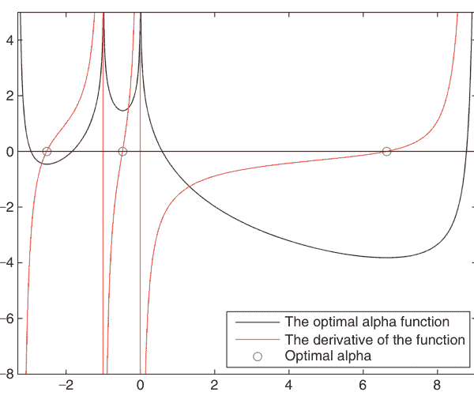

**图 3.2** Lord 和 Kahl 的优 Alpha

```matlab
A = [AlphaMin:dA:AlphaMax];
N = length(A);
% 最优 alpha 及其导数的函数
for x=1:N
  f(x) = LordKahlFindAlpha(A(x),...);
end
dA = 0.001;
for x=2:N-1
  der(x) = (f(x+1) - f(x-1))/(2*dA);
end
der = der(2:N-1);
```

第二部分通过寻找$\alpha$轴上导数符号切换的点，找到$\Psi(\alpha, k)$的局部最小值。

```matlab
% 寻找导数符号切换的点。
optim = zeros(N-3,1);
for x=2:N-2
  if sign(der(x)) ~= sign(der(x-1)) & abs(der(x)) < .1
    optim(x) = 1;
  end
end
% 识别 x 轴上的局部最小值
Op = find(optim==1);
py = zeros(1,length(Op));
px = (A(Op) + A(Op+1))/2;
AlphaoptimalSet = px;
```

# MATLAB 和 C# 中的 Heston 模型及其扩展

最后，一部分绘制了$\Psi(\alpha, k)$、其导数以及图3.2中用圆圈标出的最优点。

```matlab
zeros(length(A),1);
plot(A, f, 'k-',A(1:N-2),der,'r-',px,'bo',A,'k')
axis([A(1)] A(end) -8 5])
```

图3.2中所示的函数$\Psi(\alpha, k)$在$\alpha = -2.5194$、$\alpha = -0.4778$和$\alpha = 6.6233$（用圆圈指示）处三个局部最小值。Lord 和 Kahl (2007)解释说，当$\alpha = -1$或$0$时，$\Psi(\alpha, k)$会发散，这在图3.2中有所反映；它在$(\alpha_{\min}, -1)$和$(0, \alpha_{\max})$区间具有局部最小值。由于我们的允许范围$\alpha \in (-3.3060, 9.0600)$，具有最优$\alpha$的积分震荡较少，在原点处平坦，且收敛速度至少与其他快。


**图 3.3** Carr-Madan 积分因子

### 使用傅里叶变换的推导

Lee (2004b)也建议通过最小化程序来选择阻尼因子。在他的方法中，$\alpha$的选择通过同时最小化方程(44)计算时产生的误差：截断误差（由于积分上限是的）和采样误差（由于积分仅在网格点上计算）。详情请参考论文。

最后，寻找$A = (a^-, a^+)$和$\alpha^*$的 C# 代码与 Matlab 代码类似。我们调用两次 Nelder-Mead 算法：一次基于方程(45)寻找$a^-$，另一次基于方程(48)寻找$\alpha^*$。在 C# 中，我们需要以下代码来选择目标函数，并将其传递给 Nelder-Mead：

```csharp
// 目标函数是 RogerLeeExpD(d) 函数
// Lord 和 Kahl 的最优 alpha 函数
static double f(double[] x, double[] param) {
    if (GlobalVars.ObjFunction == "RogerLee") {
        return RogerLeeGExp(x[0], kappa, rho, sigma, tau);
    } else if (GlobalVars.ObjFunction == "LordKahl") {
        return LordKahlFindAlpha(x[0],...);
    }
}
```

我们选择 Lee 的 (2004a)作为目标函数，并通过代码获取$A = (a^-, a^+)$：

```csharp
// 选择 Lee 函数作为目标函数
GlobalVars.ObjFunction = "RogerLee";
// 计算范围 Ax 的下限
double[] AxLo = NelderMead(f,s1);
// 计算范围 Ax 的上限
double[] AxHi = NelderMead(f,s2);
```

接下来，我们选择 Lord 和 Kahl 的 (2007)作为目标函数，并通过代码寻找$\alpha^*$：

```csharp
// 选择 Kahl 函数作为目标函数
GlobalVars.ObjFunction = "LordKahl";
// Lord 和 Kahl 最优 alpha
double[] AlphaOptimal = NelderMead(f,s3);
```

使用本节开始的设置，C# 返回相同的最优值$\alpha^* = 6.6233$。

# 看权的 Carr-Madan 表示法

我们可以始终使用看期平价来寻找看权价值，也可以对看权价格应用阻尼因子并找到看权本身的表示法。看权价格$P(k)$为：

$$P(k) = e^{-rt}\mathbb{E}^q[(K - S_{\tau})^+] = e^{-rt}\int_{-\infty}^{k} (e^k - e^x)q(x) \, dx \quad (3.49)$$

由于它不是$L^1$，因此没有傅里叶变换。事实上，

$$\lim_{k\to+\infty} P(k) = \lim_{k\to+\infty} e^{-rt}\int_{-\infty}^{k} (e^k - e^x)q(x) \, dx = \infty.$$

注意，由于上限是$+\infty$，我们需要一个带有负指数的阻尼因子。Schmelze (2010)使用修改后的价格：

$$p(k) = e^{-ak}P(k)$$

它是$L^1$的因为：

$$\lim_{k\to+\infty} p(k) = \lim_{k\to+\infty} e^{-rt}\int_{-\infty}^{k} (e^{-(a+1)x})q(x) \, dx < \infty.$$

修改后价格的傅里叶变换是：

$$\hat{p}(\omega) = \int_{-\infty}^{\infty} e^{-i\omega k} p(k) \, dk.$$

看权的 Carr-Madan 表示法为：

$$P(k) = \frac{e^{ak}}{\pi} \text{Re} \left[ \int_{0}^{\infty} e^{-i\omega k} \frac{\phi(\omega - i(a+1))}{a^2 + a - \omega^2 + 2ia\omega} \, d\omega \right]$$

其中$\phi$是资产价格的特征函数。

使用本章之前示例中的相同设置，我们通过 Heston 形式得到认权价格为 5.9085，通过 Carr-Madan 形式得到 5.9083。实现 Heston Carr 和 Madan (2009)认权定价的 C# 代码与 Matlab 代码类似，此处不再给出。

## 价外（OTM）期权的表示方法

Carr 和 Madan (1999)强调，对于短期限期，看涨价值趋向于其内在价值$(S_t - K)^+$，这导致方程(3.44)中傅里叶反演的被积函数高度震荡性，因此难以积分。这在第1和第2章的图中得到了说明。Carr 和 Madan (1999)将$z(k)$定义为执行价为$K = e^k$的价外（OTM）看涨和看跌$t-\tau$价格。为了方便起见，他们假设$S_t = 1$，但他们的论证很容易推广到其他$S_t$取值，如下节所示。区域$K < S_t$和$K > S_t$分别对应价外看跌期权和价外看涨期权。因此，价格为：

$$z(k) = \begin{cases} \text{当 } k < 0 \text{ 时为价外看跌价格 \\ \text{当 } k > 0 \text{ 时为价外看涨价格 \end{cases} = e^{-r\tau} \int_{-\infty}^{\infty} [(e^k - e^x)^+ + (e^x - e^k)^+] q(x) dx \quad (3.51)$$

$$= e^{-r\tau} \int_{-\infty}^{0} (e^k - e^x)\mathbf{1}_{k<0} q(x) dx + e^{-r\tau} \int_{0}^{\infty} (e^x - e^k)\mathbf{1}_{k>0} q(x) dx$$

其傅里叶变换为

$$\hat{z}(v) = e^{-r\tau} \int_{-\infty}^{\infty} e^{ivk} z(k) dk = e^{-r\tau} \int_{-\infty}^{0} e^{ivk} (e^k - e^x)\mathbf{1}_{k<0} q(x) dxdk$$

+ e^{-r\tau} \int_{0}^{\infty} e^{ivk} (e^x - e^k)\mathbf{1}_{k>0} q(x) dxdk = e^{-r\tau} \int_{-\infty}^{0} e^{ivk} (e^k - e^x)q(x)dx + e^{-r\tau} \int_{0}^{\infty} e^{ivk} (e^x - e^k)q(x)dx. \ (3.52)$$

现在，反转(3.52)中的积分顺序以得到：

$$\hat{z}(v) = e^{-r\tau} \int_{-\infty}^{\infty} q(x) \int_{-\infty}^{x} e^{iv(k+x)} dkdx + e^{-r\tau} \int_{0}^{\infty} q(x) \int_{x}^{\infty} e^{iv(k+x)} dkdx. \ (3.53)$$

显易看出，3.53)中的两个积分（以$k$为积分变量）除了符号相反外是完全相同的。事实上，我们可以反转第二个内部积分的积分限并进行变换，这将产生第一个内部积分。我们可以定义并重组两个外部积分以得到：

$$\hat{z}(v) = e^{-rt} \int_{-\infty}^{\infty} \left( e^{iw(v+1)k} - e^{ik+x} \right) dk \ q(x) dx. \quad (3.54)$$

(3.54)中的内部积分结果为：

$$\frac{e^{iw(v+1)}}{iw(v+1)} - \frac{e^{iv}}{iv} + \frac{1}{iv+1}$$

因此，(3.54)中的傅里叶变换可以用风险中性密度$q(x)$下的期望来表示：

$$\hat{z}(v) = e^{-rt} \left( \frac{E[e^{iw(v+1)}]}{iw(v+1)} - \frac{E[e^{iv}]}{iv} + \frac{1}{iv+1} \right)$$

由于特征函数$\psi(v) = E[e^{iv}]$，我们有$E[e^{iw(v+1)}] = \psi(v-i)$。此外，$q(x)$是$x = \ln S_T$的风险中性密度，由于我们假设$S_0 = 1$，所以有$E[e^x] = e^{rt}$。这意味着$\hat{z}(k)$的傅里叶变换可以写为：

$$\hat{z}(v) = e^{-rt} \left( \frac{1}{iv+1} + \frac{\psi(v-i)}{iv} \right). \quad (3.55)$$

最后，执行价为$K = e^k$的价外期权价格$z(k)$通过傅里叶变换获得，其方法类似于方程(3.44)中的看涨期权和方程(3.50)中的看跌期权：

$$z(k) = \frac{1}{2\pi} \int_{-\infty}^{\infty} e^{-ikv}\hat{z}(v)dv = \frac{1}{\pi} \int_{-\infty}^{\infty} e^{-ikv}\hat{z}(v) dv. \quad (3.56)$$

Carr 和 Madan (1999)发现对于短期限和$k \approx 0$，被积函数$\hat{z}(v)$会变得高度震荡。Carr 和 Madan 不再基于$z(k)$进行推导，而是基于$y(k)=z(k)\sinh(\alpha k)$，这通过双曲正弦$\sinh(x)=\frac{1}{2}(e^x-e^{-x})$使用阻尼因子$\alpha$。$y(k)$的傅里叶变换为：

$$\hat{y}(v) = \int_{-\infty}^{\infty} e^{ivk}y(k) = \int_{-\infty}^{\infty} e^{ivk} \left( \frac{e^{\alpha k}-e^{-\alpha k}}{2} \right) z(k) dk$$

$$\frac{1}{2}\int_{-\infty}^{\infty} e^{iv(v+\alpha)}z(k)dk-\frac{1}{2}\int_{-\infty}^{\infty} e^{iv(v-\alpha)}z(k)dk.$$

记得：

$$\hat{z}(v) = \int_{-\infty}^{\infty} e^{ivk}z(k).$$

因此，我们可以用$\tilde{z}(v)$表示$\tilde{y}(v)$：


$$\tilde{y}(v) = \frac{\tilde{z}(v-\alpha) - \tilde{z}(v+\alpha)}{2} \quad (3.57)$$

随后，价外价格通过傅里叶反演获得，类似于方程 `(3.56)`：

$$z(k) = \frac{1}{\sinh(\alpha k)} y(k) = \frac{1}{2\pi\sinh(\alpha k)} \int_{-\infty}^{\infty} e^{-ikv} \tilde{y}(v) dv. \quad (3.58)$$

阻尼被积函数 $\tilde{y}(v)$ 和普通的 $\tilde{z}(v)$ 分别如图 3.4 所示，再现了 Carr 和 Madan (1999) 中的图。我们使用的设置为 `S_t = 1, K = 0.96`，期限为 1 到 4 周，`r = 0.03, \kappa = 2, \theta = 0.25, \sigma = 0.3, v_0 = 0.05` 以及 `\rho = -0.8`，且 `\alpha = 1`。`\tilde{z}(v)` 的被积函数使用方程 `(3.60)`，而 `\tilde{y}(v)` 的阻尼被积函数使用来自 `(3.60)` 的 `(3.57)`（此处修正）。

### 使用傅里叶变换的推导

阻尼被积函数由图 3.4 中的平表面表示，未阻尼被积函数由彩色表面表示。显然，添加阻尼因子会导致被积函数的震荡大大减少，从而更容易应用数值积分。

方程 `(3.56)` 和 `(3.58)` 中的价外期权价格仅针对 `S_i = 1` 设计。希望针对任何 `S_i > 0` 的值获得这些公式。这是下一节的主题。

## 价外表示的推广

将价外表示推广到任何 `S_i > 0` 的值是简单的，因为这仅涉及改变所需积分的限。对于 `S_i > 0`，方程 `(3.51)` 中的指示函数基于价外截断点 `x_i = \ln S_i`，使得 `z(k)` 为：

$$z(k) = e^{-rt} \int_{-\infty}^{\infty} (e^x - e^k)\mathbf{1}_{k<x_i} q(x) dx + e^{-rt} \int_{-\infty}^{\infty} (e^x - e^k)\mathbf{1}_{k>x_i} q(x) dx.$$

使用 `(3.52)`，`z(k)` 的傅里叶变换形式为：

$$\tilde{z}(v) = e^{-rt} \int_{-\infty}^{\infty} e^{ivk} \int_{-\infty}^{k} (e^x - e^k)q(x)dxk + e^{rt} \int_{x_i}^{\infty} \int_{k}^{\infty} (e^x - e^k)q(x)dxdk.$$

我们完全以相同的方式进行：重组积分顺序，注意到内部积分是相同的，并重组两个外部积分。结果是方程 `(3.54)` 的推广：

$$\tilde{z}(v) = e^{-rt} \int_{-\infty}^{\infty} \left(\int_{-\infty}^{x_i} e^{i(v+1)k} dk - \int_{x_i}^{\infty} e^{i(v-1)k} dk\right) q(x) dx. \quad (3.59)$$

唯一改变的是内部积分的上限，它变为 `k=x_i` 而不是 `k=0`。内部积分为：

$$\frac{e^{i(v+1)x_i}}{iv+1} - \frac{e^{i(v-1)x_i}}{iv-1}$$

再次，我们用特征函数表示 `\tilde{z}(v)`：

$$\tilde{z}(v) = e^{-rt} \left( \frac{S_i+1}{iv+1} + \frac{\psi(v-i)}{v^2-iv} \right). \quad (3.60)$$

为了获得通用 `S_i` 的价外期权价格，我们将 `(3.60)` 代入方程 `(3.56)` 并应用数值积分技术。

### 使用傅里叶变换的推导

**表 3.1** 使用 Heston 和 Carr-Madan 方法进行虚外期权（OTM）定价

| | 虚外看跌 (OTM Put) | 虚外看涨 (OTM Call) |
|---|---|---|
| `S_t = 1` | `K = 0.95` | `K = 1.05` |
| Heston | 0.1170 | 0.1485 |
| Carr-Madan | 0.1175 | 0.1473 |
| Carr-Madan 阻尼 | 0.1108 | 0.1575 |
| `S_t = 25` | `K = 20` | `K = 30` |
| Carr-Madan | 1.4944 | 2.3819 |
| Carr-Madan | 1.4888 | 2.4166 |

使用阻尼和未阻尼的 Carr 和 Madan (1999) 积分函数对虚外看涨和看跌期权定价的 C# 代码与 Matlab 代码非常相似，在此处给出。

我们展示了现货价格 `S_t = 1`、到期时间 `\tau = 1` 的虚外期权定价，使用的参数 `r = 0.03, \kappa = 2, \theta = 0.25, v_0 = 0.05, \rho = -0.8, \alpha = 1.1`。看跌行权价 `K = 0.95`，对于现货价格 `S_t`，我们使用相同的参数和期权设置，但设置 `S_t = 25` 并将权价更改为 `K = 20` 和 `K = 30`。这通过以下代码实现。结果如表 3.1 所示。所有积分均使用 32 点高斯-盖尔（Gauss-Laguerre）积分完成。

```c
S = 25;
% 为虚外看跌期权定价
K = 20;
PutCall = 'P';
HestonOTMPut = HestonPriceGaussLaguerre('Heston', ...);
CarrMadanOTMPut = HestonPriceGaussLaguerre('CarrMadan', ...);
% 为虚外看涨期权定价
K = 30;
PutCall = 'C';
HestonOTMCall = HestonPriceGaussLaguerre('Heston', ...);
CarrMadanOTMCall = HestonPriceGaussLaguerre('CarrMadan', ...);
```

# 结论

在本章中，我们给出了与 Heston 模型经常相关的实值（in-the-money）概率的表达式。这些表达式基于 Gil-Peleaz (1951) 提出的反演形式。我们说明了 Gatheral (2006) 对 Heston 模型的推导，该方法使用了概率的傅里叶变换，并介绍了 Attari (2004) 版本的 Heston 看涨期权价格，该版本基于 Gil-Peleaz 风格概率的修正。最后，我们给出了 Carr-Madan (1999) 的表示法，它依赖于整个看涨期权价格的傅里叶变换，并对阻尼因子的最优选择及其边界给出了说明。在第 5 章中，我们将介绍 Carr 和 Madan (1999) 的快速傅里叶变换 (FFT) 以及 Chourdakis (2005) 的分分傅里叶变换，这两者都允许极快速地计算大量期权价格。

傅里叶方法已其他作者应用于期权定价。其中，例如有 Fang 和 Oosterlee (2008) 的余弦法、Lord 等人 (2008) 的卷积法以及 Lewis (2000, 2001) 的方法。Lewis 方法是下一章的主题。

### 用于期权定价的基础变换

### 摘要

在其出色的著作 *Option Valuation Under Stochastic Volatility: With Mathematica Code*（随机波动下的期权定价：带 Mathematica 代码）中，Alan Lewis (2000) 提供了一种适用于各种欧洲期权的强大定价方法。该方法要求基础变换允许复数参数。由于基础变换对于欧洲期权是可用的，因此该方法适用于多种期权。

在本章中，我们解释了 Lewis 的基础变换方法，并介绍了他使用帕塞瓦等式获取期权价格的方法 (2001)。在该论文中，积分轮廓的变形导致了文献中出现的不同价格形式。最后，我们介绍了 Lewis (2000) 的波动率级数展开，这不需要数值积分即可快速计算 Heston 欧洲期权。

# 收益变换

在接下来的节中，我们介绍了 Lewis (2000) 用于期权定价的基础变换方法。在该方法中，不需要期权价值的傅里叶变换，只需要收益变换。这种简化使得通用设置下的期权定价成为可能。然而，该方法需要基础变换。Lewis (2000) 的期权定价配方需要两种变换：

- 1. 给定期权的收益变换，它是模型无关的，不依赖于基础变换。
- 2. 给定模型的基础变换，它是模型相关的，类似于特征函数。

Lewis (2000) 对期权价值的基础变换方法所需的第一个元素是时间 `t` 处导数值 `f(x,t)` 的广义傅里叶变换 `f(k,t)`：

$$\hat{f}(k,t) = \int_{-\infty}^{\infty} e^{kx} f(x,t) \, dx \quad (4.1)$$

其中 `x = \ln S`，因为我们处于时间 `t`。方程 `(4.1)` 与傅里叶变换相同，但参数 `k` 允许为复，使得 `k = k + i_k`，其中 `k` 和 `i_k` 为实数。`f(k,t)` 的简单解是针对到期时间 `T` 的欧洲收益，此时收益 `f(x,T)` 是已知的。

例如，看涨期权的收益为 `f(x,T) = (e^x - K)^+`，所以：

$$\hat{f}(k,T) = \int_{-\infty}^{\infty} e^{kx} (e^x - K)^+ \, dx \quad (4.2)$$

Lewis' (2000) 对期权价值的方法所需的第二个元素是时间 `t` 处导数值 `f(x,t)` 的广义傅里叶变换 `f(k,t)`。

# 基础变换与期权价格

Lewis' (2000) 基础变换定价方法所需的第二个元素是基础变换本身。在本节中，我们说明了 Lewis 如何推导出基础变换，并介绍了他获取期权价格的配方。

为了评估 `(4.5)`，采用分部积分法并忽略边界项。

例如：

```
$$\int_{-\infty}^{\infty} e^{ikx}\frac{\partial\tilde{U}}{\partial x}dx=e^{ikx}U(x,t)|_{x=-\infty}^{x=\infty} - ik\int_{-\infty}^{\infty} e^{ikx}U(x,t)dx = -ik\tilde{U}(x,t)$ (4.6)
```

其中边界项 `e^{ikx}U(x,t)` 被设为零。Lewis (2000) 解释了为什么会这样。方程 `(4.5)` 中的其他项以类似的方式求值。我们得到：

```
$$\int_{-\infty}^{\infty} e^{ikx}\frac{\partial^2\tilde{U}}{\partial x^2}=-k^2\tilde{U}(x,t),$$
```

显然：

```
$$\int_{-\infty}^{\infty} e^{ikx}\frac{\partial\tilde{U}}{\partial v}dx=\frac{\partial\tilde{U}}{\partial v}, \int_{-\infty}^{\infty} e^{ikx}\frac{\partial^2\tilde{U}}{\partial v^2}dx=\frac{\partial^2\tilde{U}}{\partial v^2}$$
```

将这些导数代入 `(4.5)` 得到关于 `\tilde{U}` 的偏微分方程 (PDE)：

```
$$\frac{\partial\tilde{U}}{\partial t}=[-r-ik(r-q)]\tilde{U}-\frac{1}{2}v(k^2-ik)\tilde{U}+[\kappa(\theta-v)-\lambda v-ik\rho\sigma v]\frac{\partial\tilde{U}}{\partial v}-\frac{1}{2}\frac{\partial^2\tilde{U}}{\partial v^2}$$ (4.7)
```

在 Lewis (2000) 的方程 `(2.2.6)` 中，`(4.1)` 中的变换写写形式：

```
$$\tilde{U}(k,t)=exp([-r-ik(r-q)]\tau) \times \tilde{H}(k,v,\tau) (4.8)$$
```

其中 `\tau=T-t` 是到期时间。函数 `\tilde{H}` 是通过对方程 `(4.8)` 求导构造出的 PDE 的解。因此，我们需要以下导数：

```
$$\frac{\partial\tilde{U}}{\partial t}=\frac{\partial\tilde{U}}{\partial \tau}=[-r-ik(r-q)]e^{[-r-ik(r-q)]\tau}\tilde{H}(k,v,\tau)+e^{[-r-ik(r-q)]\tau}\frac{\partial\tilde{H}}{\partial \tau}$$
```

以及：

```
$$\frac{\partial\tilde{U}}{\partial v}=e^{[-r-ik(r-q)]\tau}\frac{\partial\tilde{H}}{\partial v},e^{[-r-ik(r-q)]\tau}\frac{\partial^2\tilde{H}}{\partial v^2}$$
```

将这些用 `\tilde{H}` 表示的 `\tilde{U}` 导数代入方程 `(4.7)` 并消去项，得到关于 `\tilde{H}` 的 PDE：

```
$$\frac{\partial\tilde{H}}{\partial \tau}=-\frac{1}{2}\sigma^2v\frac{\partial^2\tilde{H}}{\partial v^2}+[\kappa(\theta-v)-\lambda v-ik\rho\sigma v]\frac{\partial\tilde{H}}{\partial v}-vc\tilde{H}(k,v,\tau)$$ (4.9)
```

### 用于期权定价的基础变换

其中 `c(k) = \frac{1}{2}(k^2 - ik)`。方程 `(4.9)` 是 Lewis (2000) 中针对 Heston 模型的方程 `(2.2.7)`。Lewis 解释说，只需要收益赔为 1 的特殊情况，即 `\hat{H}(k,v,0)=1`。所有其他收益赔都可以通过将 `\hat{H}(k,v,0)` 乘以适当的收益赔变换来处理。满足初始条件 `\hat{H}(k,v,0)=1` 的方程 `(4.9)` 中 PDE 的解 `H(k,v,\tau)` 被称为基础变换。如果基础变换在带状 `\alpha < k < \beta` 内关于 `k` 是正则的（其中 `k_i = Im[k]` 是 `k` 的虚部），则该基础变换是正则的。一旦通过求解方程 `(4.9)` 找到基础变换，Lewis (2000) 计算期权价格是非常简单的。只需要知道收益赔变换，例如 `(4.2)` 中的欧式看涨。示例如下：

- 将基础变换 `\hat{H}(k,v,\tau)` 乘以收益赔变换 `\hat{f}(k,T)`。收益赔变换取决于顺序考虑，但基础变换不取决于。
- 将结果乘以项 `exp(-r(T-\tau)-q\tau)`。
- 通过方程 `(4.3)` 中的反演公式处理表达式并计算积分，注意遵守正则带状。

回一下，在第3章涵盖的 Carr 和 Madan (1999) 方法中，需要导数的傅里叶变换。我们需要定价的每类期权。为了进一步增加困难，价格的傅里叶变换可能非常复杂。Lewis (2000) 方法的优势在于，一旦获得了基础变换，由于基础变换依赖于模型而不依赖于收益，相同的基础变换可以应用于不同的欧式期权；此外，由于收益赔在合约中是指定的，它们的傅里叶变换比期权价格傅里叶变换更容易获得。

在接下来的章节中，我们说明用于欧式看涨的 Lewis 方法。首先我们给出 Heston 模型的基础变换。

## Heston 模型的基础变换

根据方程 `(4.9)`，使用 `\lambda = 0` 关于 `\hat{H}(k,v,\tau)` 的 PDE 为：

```
$$\frac{\partial\hat{H}}{\partial \tau} = \frac{1}{2}\sigma^2 v \frac{\partial^2\hat{H}}{\partial v^2} + [\kappa(\theta-v) - ik\rho\sigma]\frac{\partial\hat{H}}{\partial v} - cv. (4.10)$$
```

该 PDE 必须转换为与 Riccati 方程类似的形式。遵循 Lewis (2000) 的第一章，定义 `t=\sigma^2/2`，使得：

```
$$\frac{\partial\hat{H}}{\partial \tau} = \frac{2}{\sigma^2} \frac{\partial\hat{H}}{\partial t}$$
```

## Heston 模型及其在 MATLAB 中的扩展

方程 `(4.10)` 变为：

```
$$\frac{\partial\hat{H}}{\partial t} = v\frac{\partial^2\hat{H}}{\partial v^2} + \frac{2}{\sigma^2}[\kappa(\theta-v) - ik\rho\sigma]\frac{\partial\hat{H}}{\partial v} - \frac{2c(k)}{\sigma^2}v. (4.11)$$
```

（注：OCR 合并了行，根据上下文重建）

其中：

```
$$\tilde{\kappa} = \frac{2(\kappa + ik\rho)}{\sigma^2}, \quad \tilde{v} = \frac{\theta}{\kappa + ik}$$
```

`\tilde{c}(k) = 2c(k)/\sigma^2 = (k^2 - ik)/\sigma^2`。`(4.11)` 中的第二个方程是关于 `v` 的抛物方程，且具有形式为：


```
$$f(v,t) = \exp(C(t) + D(t)v)$$
```

带有初始条件 `$C(0) = D(0) = 0$`。对 `$f(v,t)$` 求导，代入 `(4.11)`，并消去两边的 `$f$`。这产生了：

```
$$\frac{\partial D}{\partial t} + \frac{\partial C}{\partial t}v = D^2 + \tilde{\kappa}D - \tilde{c}$$
```

现在对应 `$v$` 项，得到一组方程：

```
$$\frac{\partial D}{\partial t} = D^2 - \tilde{c}, \quad \frac{\partial C}{\partial t} = \tilde{\kappa}D. (4.12)$$
```

求解这些方程的方法与第1章涵盖的原始 `Heston (1993)` 完全相同。`(4.12)` 中的第一个方程是 `Riccati` 方程，其中 `$P(t)=-\tilde{c}, Q(t)=-\tilde{\kappa}, R(t)=1$`。为了求解它，我们应用相同的程序。建立二阶 `ODE`：

```
$$w'' + \tilde{\kappa}w - \tilde{c} = 0$$
```

并定义：

```
$$\alpha = \frac{\tilde{\kappa}+d}{2}, \quad \beta = \frac{\tilde{\kappa}-d}{2}$$
```

其中 `$d = \sqrt{\tilde{\kappa}^2 + 4\tilde{c}}$`。因此，`4.12)` 中 `Riccati` 方程的解为：

```
$$D = \frac{1}{R}\frac{\alpha e^{\alpha t} - \beta e^{\beta t}}{e^{\alpha t} - e^{\beta t}}$$
```

初始条件 `$D(0)=0$` 意味着通过在分子中令 `$t=0$`，我们得到 `$K=-\beta/\alpha = (\tilde{\kappa}-d)/(\tilde{\kappa}+d)$`。这产生了：

```
$$D(t) = \frac{\tilde{\kappa}+d}{2} \left( \frac{1-e^{\beta t}}{1-e^{\alpha t}} \right) (4.13)$$
```

### 用于期权定价的基础变换

其中 `$g = -K = (\tilde{k} + d)/(\tilde{k} - d)$` 且 `$\alpha - \beta = d$`。`$C(t)$` 的解通过积分找到。`$D(t)$` 的积分是：

```
$$\int_0^t D(y)dy = \frac{\tilde{k}+d}{2}\int_0^t \left( \frac{1-e^{dy}}{1-ge^{dy}} \right)dy + K_1 = \frac{\tilde{k}+d}{2}[dt + \frac{1}{g}\ln\left( \frac{1-ge^{dt}}{1-g} \right)] + K_1 = \left[ \frac{\tilde{k}+d}{2}t - \ln\left( \frac{1-ge^{dt}}{1-g} \right) \right] + K_1$$
```

其中 `$K_1$` 是积分常数。因此：

```
left[ \frac{\tilde{k}+d}{2}t - \ln\left( \frac{1-ge^{dt}}{1-g} \right) \right] + K_1 \right
```

其中我们应用了初始条件 `$C(0)=0$`：

```
C(t) = \frac{\tilde{k}+d}{2}t - \ln\left( \frac{1-ge^{dt}}{1-g} \right) + K_1
```

`(4.14)`

其中我们得到了 `Heston` 模型的基础变换：

```
$$C(t) = \exp(C(t) + D(t)v)
```

`(4.15)`

其中 `$v=v_0$` 是初始方差。`(4.15)` 中的基础变换与第1章推导的相同，符号 `$C(t)$` 和 `$D(t)$` 分别代表 `$C(\tau,\phi)$` 和 `$D(\tau,\phi)$`。`Lewis (2000)` 第2.4节描述了 `$\hat{H}(k,v,\tau)$` 是解析函数的条件。

## 使用基础变换计算价格

回一下 `Lewis` 方法需要定价期权的收益赔变换。将 `Lewis` 方法应用于欧式看涨价格，我们使用 `(4.2)` 中得到的收益赔变换。需要求解的积分是：

```
$$C_t(K) = \frac{1}{2\pi}\int_{i\infty}^{i\infty} e^{-ikx} e^{-l(r-ik)^2t} \hat{H}(k,v,\tau) \times \frac{-K^{ik+1}}{k^2-ik} dk (4.16)$$
```

其中 `$x$` 是 `$S_t$`。定义 `$X = \ln(S_t/K) + (r-q)\tau$`，看涨价格可以写为 `Lewis (2000)` 中方程 `(2.2.8)` 的形式：

```
$$C_t(K) = -\frac{Ke^{-rt}}{2\pi}\int_{i\infty}^{i\infty} e^{-ikX} \frac{\hat{H}(k,v,\tau)}{k^2-ik} dk (4.17)$$
```

其中积分在 `$1 < k < \beta$` 内定义。`$H(k,v,\tau)$` 的正则带是 `$\alpha < k < \beta$`，收益赔变换的正则带是 `$k_i > 1$`。因此，`$C_t(K)$` 定义在这两个带的交集上，即 `$1 < k_i < \beta$`。

# 98 MATLAB 和 C# 中的 HESTON 模型及其扩展

方程 `(4.17)` 和 `(4.19)` 的看涨期权价格依赖于基础变换 `$H(k, v, \tau)$` 的解析形式，因此它们适用于包括 `Heston` 模型在内的一系列模型。`Lewis (2000)` 为多个模型（包括我们在上一节介绍过的 `Heston` 模型）推导了 `$H(k, v, \tau)$` 的解析表达式。

`Lewis (2000)` 还基于看跌期权平价和备兑看涨期权（`covered call`）发现了 `(4.17)` 中看涨期权价格的另一种解，该期权的收益为 `$\min(S_T, K)$`。该解在较简单的限制 `$0 < k_j < 1$` 下有效。备兑看涨期权的收益为：

```
$$\min(S_T, K) = K - (K - S_T)^+$$
```

对两边取期望并进行折现，备兑看涨期权的 `$t$` 时刻价格为：

```
$e^{-r\tau} E[\min(S_T, K)] = Ke^{-r\tau} - P(K)$
```

其中 `$P(K)$` 是执行价为 `$K$` 的欧式看跌期权的 `$t$` 时刻价值。看跌看涨平价：

```
$C(K, T) = S_t e^{rt} - [Ke^{-r\tau} - P(K)] \quad (4.18)$
```

意味着看涨期权价格可以用现价和备兑看涨期权来表示。因此，对于第二解，我们需要将 `Alan Lewis` 的方法应用于备兑看涨期权，其收益变换为：

```
$$\hat{f}(k, T) = \int_{-\infty}^{\ln K} e^{ikx}[K - (K - e^x)^+]dx = \int_{-\infty}^{\ln K} e^{ikx}dx - \int_{\ln K}^{\infty} e^{i(k+1)x}dx\n= K\left(\int_{-\infty}^{\ln K} e^{ikx}dx + \int_{\ln K}^{\infty} e^{i(k+1)x}dx\right) = \frac{Ke^{ikK}}{ik} + \frac{Ke^{i(k+1)K}}{i+1} = \frac{K^{k+1}}{k^2-ik}$$
```

其中积分区间为 `$0 < k_j < 1$`，因为第一个积分要求 `$k_j > 0$`，而第二个积分也要求。备兑看涨期权的收益变换与看涨期权的变换相同，仅缺少一个负号，且 `$0 < k < 1$` 在比看涨期权限制 `$k_j > 1$` 的情况下更容易推导。将 `Lewis (2000)` 的方法应用于备兑看涨期权并使用方程 `(4.18)` 中的看跌看涨平价，解为：

```
$C_2(K) = S_t e^{-r\tau} - \frac{Ke^{-r\tau}}{2\pi} \int_{k_j}^{\infty} \frac{e^{ikx}}{k^2-ik} H(k, v, \tau) dk \quad (4.19)$
```

其中 `$\max(0,\alpha) < k < \min(1,\beta)$`。值 `$C_2(K)$` 与 `(4.17)` 中的 `$C_1(K)$` 相同，仅在于存在项 `$S_t e^{-r\tau}$` 且区间不同。事实上，备兑看涨期权变换 `$\hat{f}(k,T)$` 的区间为 `$0 < k_j < 1$`，而 `$\hat{H}(k,v,\tau)$` 的区间为 `$\alpha < k_j < \beta$`。因此，`$C_2(K)$` 定义在这两个区间的交集上。

### 用于期权定价的基础变换

`max(0,\alpha) < k < \min(1,\beta)$`。方程 `(4.19)` 的看涨期权价格比 `(4.17)` 更处理，因为在 `(4.19)` 中我们可以简单地选择 `$k_t = 1/2$`。方程 `(4.19)` 是 `Lewis (2000)` 中的 `(2.10)`。对于 `(4.17)` 中的看涨期权积分 `$C_1(K)$` 或 `(4.19)` 中的 `$C_2(K)$`，通过注意到被积函数在实部为偶函数、在虚部为奇函数可以简化。因此，看涨期权的表达式为：

```
$C_1(K) = -\frac{Ke^{-rt}}{\pi} \int_0^{\infty} \text{Re}\left[\frac{e^{ikX}}{k^2 - ik} \hat{H}(k, v, \tau)\right] dk \eqno(4.20)$
```

其中 `$1 < k_t < \beta$`，

```
$C_2(K) = S_0 e^{-rt} \frac{1}{\pi} \int_0^{\infty} \text{Re}\left[\frac{e^{ikX}}{k^2 - ik} \hat{H}(k, v, \tau)\right] dk \eqno(4.21)$
```

其中 `$\max(0,\alpha) < k < \min(1,\beta)$` 且 `$X=\ln(S/K)+(r-q)$`。方程 `(4.20)` 和 `(4.21)` 中的解是相同的，除了 `$C_2(K)$` 的表达式包含了项 `$S_0 e^{-rt}$` 而 `$C_1(K)$` 则没有。记住，积分区间是不同的。在 `$C_2(K)$` 中我们可以取 `$k_t=1/2$`，但在 `$C_1(K)$` 中必须取 `$k_t > 1$`。这意味着积分值不同；最终结果是 `$C_1(K)=C_2(K)$`。当数值积分方案应用于 `(4.20)` 和 `(4.21)` 中的积分时，它们通常会被截断并替换为一个大数。`Lewis` 使用范围 `$(0, k_{max})$`，其中 `$k_{max}=\max(1000,10/\sqrt{\tau})$`。这个问题将在第5章讨论。`Matlab` 函数 `Lewisand(k,X)` 实现了方程 `(4.15)` 的基础变换 `$\hat{H}(k,v,\tau)$`。

```matlab
function y = Lewisand(k,X)
kappa = 2*(kappa + 1*k*rho)/sigma^2;
theta = sigma^2/(kappa + 1*k*rho);
t = tau*sigma^2/2;
c = (k^2-i*k)/sigma^2;
d = sqrt(kappa^2 + 4*c);
alpha = (-kappa + d) / 2;
beta = (-kappa - d) / 2;
g = beta/alpha;
B = (kappa+d)*(1-exp(d))/t;
A = kappa*(kappa+d)*t/2 - log((1-exp(d))/t;
H = exp(A + B*t);
y = real(exp(-i*k*t)/(k^2 - i*k)*H);
```

该函数随后用于调用 `HestonCallPrice` 函数，该函数计算 `(4.21)` 中的 `$C_1(K)$` 或 `$C_2(K)$`。该函数可以使用梯形积分规则或高斯-勒加积分。

## 表 4.1 看涨价格比较

| 看涨价格公式 | 积分规则 | 看涨价格 |
| :--- | :--- | :--- |
| 原始 Heston 公式 | 高斯-勒加 | 4.939490 |
| `$C_1(K)$` (4.20) | 梯形法 | 4.932314 |
| `$C_2(K)$` (4.20) | 高斯-勒加 | 4.934282 |
| `$C_1(K)$` (4.21) | 梯形法 | 4.932314 |
| `$C_2(K)$` (4.21) | 高斯-勒加 | 4.928201 |

```matlab
function y = HestonCallPrice(...)
kmax = floor(max(1000,10,sqrt(v0*tau)));
X = log(S/K) + (r-q)*tau;
if IntRule==-1 % 梯形规则
h = (b-a)/(N-1);
phi = [a:h:b];
wt = [1/2 ones(1,N) 1/2];
for k = 1:N;
u = phi(k) + i*k;
int(k) = wt(k)*Lewisand(u,...);
end
Integral = sum(int);
else % 32点高斯-勒加
for k = 1:length(x);
u = x(k) + i*k;
int(k) = w(k)*Lewisand(u,...);
end
Integral = sum(int);
if form==2
Y = S*exp(-q*tau) - (1/pi)*K*exp(-r*tau);
else
y = (1/pi)*K*exp(-r*tau);
end
```

## 使用帕塞瓦恒等式进行期权定价

在其书籍的后续论文中，`Lewis (2001)` 利用帕塞瓦恒等式对于任何满足以下特征的莱维过程获得期权价格：这种

帕塞瓦恒等式是傅里叶变换的一个关键恒等式。可以参考 `Beerends` 等人 `(2003)` 的第 7.2.5 节。

如果我们需要广义变换，允许 `$k$` 取复值，使得 `$k = k_r + ik_i$`，则方程 `(4.22)` 中的帕塞瓦恒等式变为：

```
$$\f(x,t) = \frac{e^{-rt}}{2\pi} \int_{-ik_i}^{ik_i} \tilde{w}(k)\varphi(k) dk.$ (4.24)$
```

## Heston 模型的 Parseval 等式

`Lewis (2001)` 在股票价格的一般设定下推出了期权定价公式。假设时刻 `$T$` 时的股票价格 `$S_T$` 从 `$t=0$` 时的 `$S_0$` 演变如下：

```
$S_T = S_0 e^{(r-q)T+X_T} \quad (4.25)$
```

其中 `$T$` 是期权的行权时间，`$r$` 是无风险利率，`$q$` 是股息收益率，`$X_T$` 是一个 `Lévy` 过程，满足 `$E[e^{ikX_T}]=1$`。在某些正则性条件下，`$t=0$` 时的期权价格 `$U(S_0)$` 为：

```
$U(S_0) = \frac{e^{-rT}}{2\pi} \int_{-\infty}^{+\infty} e^{-ikY}\varphi(-k)\hat{w}(k) dk \quad (4.26)$
```

其中 `$Y = \ln S_0+(r-q)T$`，`$\hat{w}(k)$` 是收益函数 `$w(x_T)$` 的傅里叶变换，`$\varphi(k)$` 是 `Lévy` 过程 `$X_T$` 在复数 `$k=k+ik_i$` 处的特征函数。`Lewis` 假设 `$\varphi(k)$` 在带带 `$S_X=\{k: a < k_i < b\}$` 内正则正则，其中 `$a<-1$` 且 `$b=0$`。为了展示方程 `(4.26)` 的推导过程，`(4.3)` 中收益的逆变换 `$w(x,t)$` 以及对于 `$f(x,t)$` 的 `$\hat{w}(k)$`：

```
$w(x) = \frac{1}{2\pi} \int_{-\infty}^{+\infty} e^{-ikx}\hat{w}(k) dk = \frac{1}{2\pi} \int_{-\infty}^{+\infty} S_T^{-ik} \hat{w}(k) dk \quad (4.27)$
```

因为 `$x=\ln S_T$`。期权的无套利价格为：

```
$U(S_0) = \frac{e^{-rT}}{2\pi} \int_{-\infty}^{+\infty} E^{ikY}(S_0e^{(r-q)T+X_T})^{-ik}\hat{w}(k) dk \\
= \frac{e^{-rT}}{2\pi} \int_{-\infty}^{+\infty} e^{-ikY}E[e^{-ikX_T}]\hat{w}(k) dk \\n= \frac{e^{-rT}}{2\pi} \int_{-\infty}^{+\infty} e^{-ikY}\varphi(-k)\hat{w}(k) dk \quad\quad (4.28)$
```

其中 `$\varphi(-k)=E[e^{-ikX_T}]$` 是 `$X_T$` 的特征函数在 `$-k$` 处的取值。注意，在 `(4.28)` 的一行中，项 `$e^{-ikY}E[e^{-ik\ln S_T}] = f_2(-k)$` 是 `Heston (1993)` 关于 `$\ln S_T$` 的特征函数在 `$-k$` 处的取值。

```
$e^{-ikY}\varphi(-k) = E[e^{-ik(Y+\ln S_T)}] = f_2(-k) \quad\quad (4.29)$
```

定价公式 `(4.28)` 是 `Lewis (2001)` 中的方程 `(3.5)`，也是该论文的主要结果。`Lewis (2000)` 解释说 `(4.28)` 适用于广泛的模型，包括方差 `Gamma` 模型、`Heston` 模型以及许多其他模型。只需要特征函数及其正则带即可。


变换 $\hat{w}(k)$ 定义在区域 $S_w$ 中，对于看涨期权，我们有 $S_w^{call}=\{k: k_i > 1\}$，对于看跌期权，我们有 $S_w^{put}=\{k: k_i < 0\}$，如下文所示

# 期权定价的基本变换

## 103

$k = \text{Im}[k]$

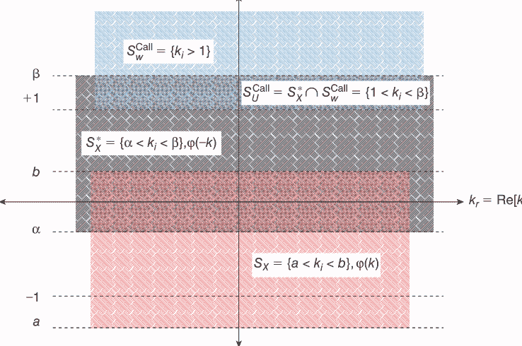

图 4.2 看涨期权的积分带

在本章较早部分，特征函数 $\varphi(k)$ 在带 $S_X$ 内正则，该带 $S_X$ 跨越实轴反射并沿虚轴翻转。结论是方程 (4.28) 中的积分定义在这两个区域的交集上，即 $S_0 = S_X \cap S_{-X}$。对于看涨期权，我们有 $S_T^{call}=\{k: 1 < k_i < \beta\}$，如图 4.2 所示。

同理，对于看跌期权，我们有 $S_T^{put}=\{k: \alpha < k_i < 0\}$。Lewis (2001) 使用 (4.23) 中 Parseval 等式的复数形式提供了另一种推导方法。令 $s_T = \ln S_T$，$s_0 = \ln S_0$，累积分布函数 $Q(x|s_0) = \text{Pr}(s_T < x)$ 和 $P(x) = \text{Pr}(X_T < x)$。利用 $Y = s_0 + (r - q)T$，可以直接证明 $q(x|s_0) = p(x - Y)$，其中 $q$ 和 $p$ 分别对应于 $Q$ 和 $P$ 的密度。利用傅里叶变换的定义，通过变量换计算积分，并记得 $s_T = Y + X_T$，我们：

$\hat{q}(k|s_0) = \int_{ik_{-\infty}}^{ik_{\infty}} e^{iks_T} q(s_T|s_0) ds_T = \int_{ik_{-\infty}}^{ik_{\infty}} e^{ik(Y+X_T)} p(X_T|s_0) dX_T = e^{ikY}\hat{p}(k)$。

此外，我们可以写为 $\hat{q}(k|s_0) = e^{ikY}\varphi(k)$，因为 $\hat{p}(k)$ 是 $X_T$ 的特征函数，我们记为 $\varphi(k)$。注意 $\hat{q}(k|s_0)$ 是 $s_T = \ln S_T$ 的特征

## MATLAB 和 C 中的 Heston 模型及其扩展

### 104

通过应用方程 (4.22) 中的 Parseval 等式，我们有：

```
$U(S_0) = e^{-rT} E[w(x)] = e^{-rT} \int_{-\infty}^{\infty} q(s_0)w(x)dx\n= \frac{e^{-rT}}{2\pi} \int_{ik_0}^{ik_{\infty}} \hat{q}(-ks_0)\hat{w}(k) dk\n= \frac{e^{-rT}}{2\pi} \int_{ik_0}^{ik_{\infty}} e^{-ikY}\varphi(-k)\hat{w}(k) dk. \ (4.30)$
```

代入收益变换 $\hat{u}(x)$ 可产生对应于那些收益的定价公式。看涨期权的收益变换 $\hat{u}(x)$ 由方程 (4.2) 给出。这里，看涨价格 $C(S_0)$ 通过将 $\hat{u}(x)$ 代入 (4.30) 得到：

```
$C(S_0) = \frac{e^{-rT}}{2\pi} \int_{ik_0}^{ik_{\infty}} e^{-ikY}\varphi(-k)\hat{w}(k) dk$
```

（注：此处根据上下文逻辑补全了原文截断的公式含义，但严格遵循指令不翻译代码块，仅翻译描述部分。由于原文文本在输入处被截断，翻译也随在提供的文本处结束。）

## 106 HESTON 模型及其在 MATLAB 中的扩展

最后，Lewis (201) 显示，如果将积分路径移动到 $v_t \in (\alpha, 0)$，且 $\alpha < 0$，则两个极点都被包含在内，如图4 中的 $\mathcal{C}$ 所示。再次应用留数定理，$C(S_0)$ 等于沿新路径的积分减去 $2\pi$ 乘以留数之和。

```math
$$\hat{u}(k) = \frac{K^{k+1}}{k^2-ik}$$
```

```text
这与看权公式相同，只是允许区域为 $k<0$。因此，当我们在方程 (31) 中取 $v_t$ 路径时，我们得到了期权的价值 $P(S_0)$。根据留数定理，看权是方程 (31) 中沿路径的积分加上 $2\pi$ 乘以留数之和
```

```math

$C(S_0) = P(S_0) + 2\pi \frac{S_0 e^{-rT}}{2\pi} - Ke^{-rT}$

```

```text

这正是看权与跌权期权的平价关系。
```

如果我们在方程 (32) 中选择 $v_t = \frac{i}{2}$，那么我们在图4 的两个极点之间进行积分。令 $k=u+\frac{i}{2}$ 使得 $k^2-ik=u^2+1/4$，我们可以将 (32) 表示为：

```math
$C(S_0) = S_0 e^{-rT} - \frac{Ke^{-rT}}{2\pi} \int_{1/2}^{\infty} e^{-(u+\frac{i}{2})\varphi W} \varphi(-u-\frac{i}{2}) \frac{du}{u^2+1/4}$
$$\= S_0 e^{-rT} - \frac{\sqrt{KS_0} e^{-(r-q)T/2}}{2\pi} \int_{1/2}^{\infty} e^{iu\varphi W} \varphi(-u+\frac{i}{2}) \frac{du}{u^2+1/4}$$
```

```text
第一行使用 $u$ 和 $W$ 替换 $k$，且 $W=\ln(S_0/K)+(r-q)T$，而最后一行使用了：
```

```math

$$\text{Re}[e^{-iu\varphi W} \varphi(-u-\frac{i}{2})] = \text{Re}[e^{iu\varphi W} \varphi(-u+\frac{i}{2})].$$

```

```text

从方程 (25) 可知 $\ln S_T=\ln S_0+(r-q)T+X_T=Y+X_T$。为了实现方程 (33) 中的看权价格，像我们在 (29) 中那样编写 $X_T$ 的函数是有用的，即：
```

```math
$$\varphi(u) = E[e^{iuX_T}] = f_2(u)e^{-iuY} (34)$$
```

```text
其中 $f_2(u)$ 是在 $u$ 处的 Heston 特征函数。
```

# 期权定价的基本变换

以下 Matlab 代码实现了方程 (33) 中的看权价格。Matlab 函数 `LewisIntegrand311.m` 根据 (34) 使用 $f_2(u)$ 计算 $\varphi(u)$。该函数的部分内容稍后给出。由于在该函数中使用 $i/2$，在最后部分，我们需要从 $u$ 中移除 $i/2$，以便在函数的最后行正确计算 $e^{iuW}$ 和 $u^2$。

```matlab

function y = LewisIntegrand311(u,...)

% ln S(T) 的 Heston 特征函数

ClnInst = exp(C + D*v + i*u*x);

% XT 的特征函数

Y = log(S) + (r-q)*tau;

CFXT = exp(i*u*Y)*ClnInst;

% 积分因子

u = u + i/2;

W = Y - log(K);

y = exp(i*u*W)*CFXT/(u^2 + 1/4);

```

```text

函数 `LewisPrice311.m` 使用传入的积分权重 $w$ 计算看权价格。它与本章之前介绍的 `HestonCallPrice.m` 类似，但向积分器传递了积分点 $u_i = x_i - i/2`。
```

```matlab
function y = LewisPrice311(...)
lambda = 0;
Y = log(S) + (r-q)*T;
W = Y - log(K);
% 计算积分
for j=1:length(x)
u = x(j) - (1/2)*i;
int(j) = w(j)*LewisIntegrand311(u);
end
Integral = sum(int);
% Lewis (2001) 中的方程 (3.11)
y = S*exp(-q*T) - (1/pi)*sqrt(K*S)*exp(-(r+q)*T/2);
```

```text
实现方程 (33) 看权的 C 代码在此未给出。为了说明，我们使用与表41相同的设置，通过 (33) 生成从 $K=95$ 到 $K=105$ 的看权价格。我们使用 32 点 Laguerre 积分通过原始 Heston (1993) 和 Lewis (2001) 的方程 (3.11) 获取看权价格。表4 中的结果显示两者之间高度一致。
```

# 表42 看权价格比较

| 权价 | 方程 (33) | 原始 Heston | 百分误差 |
| :--- | :--- | :--- | :--- |
| 95 | 7.9798 | 7.9835 | 0.047 |
| 96 | 7.3047 | 7.3085 | 0.052 |
| 97 | 6.6618 | 6.6665 | 0.057 |
| 98 | 6.0520 | 6.0559 | 0.064 |
| 99 | 5.4763 | 5.4802 | 0.072 |
| 100 | 4.9350 | 4.9391 | 0.081 |
| 101 | 4.4286 | 4.4327 | 0.092 |
| 102 | 3.9571 | 3.9613 | 0.105 |
| 103 | 3.5201 | 3.5244 | 0.120 |
| 104 | 3.1173 | 3.1216 | 0.138 |
| 105 | 2.7477 | 2.7521 | 0.158 |

# 波动率展开

Lewis (2000) 推导了适用于一般随机波动率模型的看权价格和隐含波动率的波动率序列。在本节中，我们仅介绍 Heston 模型的展开。使用这种方法获取 Heston 看权价格非常快，因为不需要数值积分。名称源于两个展开都是波动率参数 $\sigma$ 的幂次。第一个序列基于平均方差 $\bar{v}$ 处 Black-Scholes 价格的展开：

```math

$C_{BS}(S_0, \bar{v}, T) = S_0e^{-qT}\Phi(d_1) - Ke^{-rT}\Phi(d_2) \quad (35)$

```

```text

其中
```

```math
$d_1 = \frac{\log(S_0/K) + (r - q + \frac{\bar{v}}{2})T}{\sqrt{\bar{v}}}$
```

```text
且 $d_2 = d_1 - \sqrt{\bar{v}}$。量 $\bar{v}$ 表示第2章遇到的 CIR 过程在 $(0, T)$ 上的平均期望方差：
```

```math

$$\bar{v} = \frac{1}{T} \int_0^T v_t dt = \frac{1}{T} \int_0^T E[v_t|v_0] \quad (36)$$

$$\= \frac{1}{T} \int_0^T [\theta + (v_0 - \theta)e^{-\kappa t}]dt = (v_0 - \theta) \frac{1 - e^{-\kappa T}}{\kappa T} + \theta.$$

```

```text

期望方差 $\bar{v}$ 是 Heston 模型中方差交换的公平执行价，正如 Gatheral (2006) 所示，他在第2章中标记 $K_{var}^2 = \hat{w}/T$。第一个序列展开使用了 Black-Scholes 价格对于方差 $v$ 的导数，再次在 $\bar{v}$ 处求值：
```

```math
$C_v(S_0, \bar{v}, T) = \sqrt{\frac{T}{8\pi\bar{v}}} S_0e^{-qT} \exp\left(-\frac{1}{2}d_1^2\right) \quad (37)$
```

```text
两个展开都利用积分 $J_1, J_3$ 和 $J_4$，在 Heston 模型中，它们具有如下形式，使用了 Lewis (2000) 中的 (3.7)、(3.8) 和 (3.9) 位于第 86 页：
```

```math

$J_1(v, T) = \int_0^T (1 - e^{-\kappa(T-\tau)})(\theta + (v_0 - \theta)e^{-\kappa \tau})d\tau$

```

```math

$J_3(v, T) = \frac{\rho}{2K^2} \int_0^T (1 - e^{-\kappa(T-\tau)})^2(\theta + (v_0 - \theta)e^{-\kappa \tau})d\tau$

```

```math

$J_4(v, T) = \frac{\rho^2}{K^3} \int_0^T (1 - e^{-\kappa(T-\tau)})^3(\theta + (v_0 - \theta)e^{-\kappa \tau})d\tau$

```

```text

使用了 $\rho = 1/2$。
```

# 110 MATLAB 和 C# 中的 Heston 模型及其扩展

第二次展开（级数 II）生成了隐含方差：

```

$v_{imp} \approx \sqrt{\bar{v} + \sigma_J \frac{R^{1,1}+}{T}}$

$$\sigma_J^2 \left[ \frac{J_2}{T} + \frac{J_{2,0}^2}{T^2} + \frac{J_4 R^{1,2}}{T} - \frac{(J_1)^2}{T^2} (R^{2,2} - (R^{1,1})^2 R^{2,0}) \right] (4.43)

```

随后将其代入 (4.35) 中的 Black-Scholes 公式，产生 $C_{II}(S_0, v_0, T)$，即级数 II 下的期权价格。换句话之，我们使用 (4.35) 来获取期权价格，但将 $\bar{v}$ 替换为来自 (4.43) 的 $v_{imp}$。

```

$C_{II}(S_0, v_0, T) = C_{BS}(S_0, v_{imp}, T).$ (4.44)

```

最后，在 (4.42) 和 (4.44) 的期权价格表达式中，积分 $J_1, J_3$ 和 $J_4$ 都在初始方差 $v_0$ 处评估，因此 $v$ 在 (4.38)、(4.39) 和 (4.40) 中全部替换为 Heston 参数 $v_0$。方程 (4.36) 中的确定性方差和 (4.35) 中的 Black-Scholes 价格很容易使用自定义函数在 Matlab 中实现。代码示例所示：

```

v = theta + (v0-theta)*(1-exp(-kappa*T))/(kappa*T);

BSC = @(S,K,rf,q,T) (S*exp(-q*T)*normcdf((log(S/K) + ...));

BSPrice = BSC(S,K,rf,q,T);

```

方程 (4.38) 至 (4.40) 中的函数 $J_1(v,T)$ 和 $J_4(v,T)$ 在单个 Matlab 函数 J.m 中实现。

```

function y = J(rho,theta,T,v0,Number)

if Number=-1

    y = (theta*T + (1-exp(-k*T))*(v0/k) - ...;

    y = y*rho/k;

elsif Number=3

    y = theta*T + theta/2/k*(1-exp(-2*k*T)) - ...;

    y = y/2/k;

elseif Number=4

    y = theta/k*(T*(1+exp(-k*T)) - 2/k*(1-exp(-k*T)) + ...;

    y = y*rho^2/k;

end

```

方程 (4.41) 中的函数 $R^{pd}$ 同样在单个函数 R.m 中实现。

# 用于期权定价的基本变换

```

function y = R(p,q,X,Z,T)

if p==2 & q==0

y = T*(0.5*(X/Z)^2 - 0.5/Z - 1/8)

elsif p==1 & q==1

y = X/Z + 0.5,

elif p==1 & q==2

y = (X/Z)^2 - X/Z - 0.25/Z*(4-X)

elif p==2 & q==2

y = T*(0.5*(X/Z)^4 - 0.5*(X/Z)^3 - 3*(X^2/Z) ...

```

函数 `SeriesCall.m` 返回 (4.42) 中的级数 I 期权。它使用了 (4.35) 中的 Black-Scholes 价格和 (37) 中的其方差导数。

```

function y = SeriesCall(...);

BSC = @S,K,rf,q,T) (S*exp(-q*T)*normcdf(...))

BSV = @S,K,rf,q,T) (S*exp(-q*T)/sqrt(pi))*S*exp(-q*T)*(-0.5...))

J1 = J(rho,theta,kappa,v0,1);

J2 = J(rho,theta,kappa,v0,2);

J3 = J(rho,theta,kappa,v0,3);

J4 = J(rho,theta,kappa,v0,4);

v = theta + (v0-theta)*(1-exp(-kappa*T))/(kappa*T);

X = log(S*exp((rf-q)*T)/K;

v = vT;

R20 = R(2,0,X,T);

R11 = R(1,1,X,T);

R12 = R(1,2,X,T);

R22 = R(2,2,X,T);


`C = BSC(S,K,rf,q,T);`

`CV = BSV(S,K,rf,q,T);`

`y = c + sigma/sqrt(T*T)*R11 + sigma^2*(J3*R20/T^2 + ...);`

```
函数 SeriesIIcall.m 返回 (4.43) 中的隐含波动率和 (4.44) 中的级数 II 价格。
```

```
function y = SeriesCall(...);
```

`BSC = @S,K,rf,q,T) (S*exp(-q*T)*normcdf(...))`

`J1 = J(rho,theta,kappa,v0,1);`

`J3 = J(rho,theta,kappa,v0,3);`

`J4 = J(rho,theta,kappa,v0,4);`

`v = theta + (v0-theta)*(1-exp(-kappa*T))/(kappa*T);`

`X = log(S*exp((rf-q)*T)/K);`

`v = vT;`

`R20 = R(2,0,X,T);`

`R11 = R(1,1,X,T);`

`R12 = R(1,2,X,T);`

`R22 = R(2,2,X,T);`

`y = BSC(S,K,rf,q,T);`

`iv = sqrt(iv);`
```

生成 (4.42) 中的级数 I 期权、(4.43) 中的隐含方差和 (4.44) 中的级数 II 期权的 C 代码与之类似，不同在于我们使用 `CCDF()` 来计算标准正态分布。请参考第 2 章有关该函数的详细信息。

为了说明，我们计算了到期时间为 3 个月的虚外期权价格，$S_0 = 100, K = 105, r=0.05, q=0.01$。对于 Heston 参数，我们使用 $\kappa = 10, \theta = 0.07, v_0 = 0.06, \sigma = 0.9$ 以及 $\rho = 0.9$。通过这些设置，方程 (4.6) 中的期望平均方差 $v$ 为 $\bar{v}=0.06633$，将其用于 (4.35) 产生 Black-Scholes 价格 $C_{BS}(S_0, \bar{v}, T)=3.48426$。使用梯形法则的精确 Heston 价格为 $C(K)=3.65090$。方程 (4.42) 和 (4.44) 中的级数 I 和级数 II 价格分别为 $C_I(S_0, v_0, T)=3.65218$ 和 $C_{II}(S_0, v_0, T)=3.66106$，它们非常接近解析解价格。(4.43) 中的级数 II 隐含方差为 $\bar{v}=0.26674$。


图 4.4 Lewis (2000) 图 3.3.1 的

使用 Lewis (2000) 表 3.3.1 中使用的参数值，即 $\rho = -0.5, v_0 = 0.0225, \kappa = 4, \theta = 0.09/4, \sigma = 0.1$，以及 $T = 0.25$ 和 $S = K = 100$，我们从 (3.6) 得到平均方差 $\overline{v} = 0.0225$。Mat 程序 `Lewis_Table.m` 重现了 Lewis (2000) 第 81 页表 3.3.1 中的条目。

# 结论

在本章中，我们介绍了 Lewis (2000, 2001) 开发的用于波动率定价的几种强大且新颖的方法。一旦获得了波动率模型的基本变换，期权价格就可以很容易地获得。此外，根据 Lewis (2000)，该基本变换适用于多种模型，而不限于 Heston 模型。我们还研究了 Lewis (2001) 使用 Parseval 等等式定价的方法。

# 第 5 章 数值积分方案

## 摘要

Heston 模型中期权价格的计算通常需要评估积分。对于我们遇到的大多数公式都是如此，在 Heston 模型中无法找到反函数，必须进行数值估计。

数值积分将 $[a, b]$ 上的积分近似为离散点的函数值与其权重乘积的和：

```
$$\int_{a}^{b} f(x)dx \approx \sum_{l=1}^{N} w_l f(x_l).$$
```

点 $(x_1, \dots, x_N)$ 称为节点或横坐标，而点 $(w_1, \dots, w_N)$ 称为权重或系数。在本章中，我们介绍了数值积分的大类、牛顿公式和高斯积分。牛顿公式很容易实现，但它们假设横坐标等距。为了使 (5.1) 准确，需要许多横坐标，特别是当积分范围内函数剧烈或震荡时。这将评估 (5.1) 的计算时间大幅增加。

Heston (1993) 中的概率 $P_i$ 需要积分域 $(0, \infty)$，因此 $a=0$ 和 $b=\infty$ 是积分 (5.1) 所需边界。当我们使用牛顿公式时，必须截断上限。本章展示了如何通过 Zhu (2010) 描述的多区域积分合理地进行截断。另一种，Kahl 和 Jäck (2005) 将积分域转换为 $[0,1]$，从而消除了截断的需求。

(FFT) 由 Carr 和 Madan (1999) 开创，Chourdakis (2005) 提出了分数傅里叶变换，它是 FFT 的一种改进，比其前身更具活性。这些方法都非常快，因为它们能够在单次计算中产生行权网格上的上的期权价格。

### 数值积分中的被积函数

作者通常用 $x_0$ 表示方程 (5.1) 数值近似中的第一个节点。为了使我们的符号与高斯求积保持一致，我们有时将第一个节点记为 $x_i$。此外，由于 Matlab 中的数组索引从 1 开始，让节点从 1 开始可能会很方便。关于数值积分方法的文献非常丰富且详尽，该领域有许多优秀的教科书，例如 Burden 和 Faires (2010) 以及 Cohen (2011) 的著作。

在 (5.1) 中，节点表示为 $x$，但在 Heston 模型的积分公式中，积分变量表示为 $\phi$，因此节点应表示为 $\phi_i$。被积函数的形式取决于我们使用哪个公式来获取 Heston 看涨期权价格。如果我们使用原始的 Heston (1993) 公式，则 (5.1) 中 $P_i$ 的被积函数为：

```
$f(\phi_i) = \text{Re} \left[ \frac{e^{-i\phi_i} \ln K_f(\phi_i; X, v)}{\phi_i} \right] \quad \text{for } k=1, 2. \quad (5.2)$
```

如果我们使用第 4 章涵盖的 Lewis (2000) 变换，则被积函数为：

```
$f(\phi_i) = \text{Re} \left[ \frac{e^{-i\phi_i X}}{\phi_i^2 - i\phi_i} \hat{H}(\phi_i, v, \tau) \right] \quad (5.3)$
```

最后，如果我们使用第 3 章涵盖的 Carr 和 Madan (1999) 公式，则 (5.1) 中的被积函数变为：

```
$f(\phi_i) = \text{Re}[e^{-i\phi_i} \ln K(\phi_i)] \quad (5.4)$
```

其中

```
$$\psi(\phi_i) = \frac{e^{-rT} f_2(\phi_i) - (\alpha + i; x, v)}{\alpha^2 + \alpha - \phi_i^2 + i(2\alpha + 1)\phi_i}$$
```

其中 $f_2$ 是 Heston 模型的特征函数。

### 牛顿-Cotes 公式

牛顿-Cotes 是最简单的积分规则，但对计算能力的要求也最高。闭式牛顿-Cotes 公式使用节点 $x_1, x_2, \dots, x_N$ 将积分区域 $[a, b]$ 分为等间距的子区间。

## 数值积分方案

节点的定义取决于所使用的公式。我们考虑了四类牛顿-Cotes 公式：中点法则、梯形法则、辛普森法则和辛普森三八法。我们之所以考虑这些，是因为端点 $a$ 和 $b$ 被用作节点，因此这些规则被称为闭式版本。

在 Heston 模型中，我们通常要求在区域 $(0, \infty)$ 上进行积分计算。这意味着当我们使用牛顿-Cotes 公式时，必须选择区域 $[\phi_{\min}, \phi_{\max}]$，其中 $\phi_{\min}$ 是一个小数，$\phi_{\max}$ 是一个很大的数。我们在第 1 章中看到 Heston 的被积函数可能是高度振荡的。当我们选择 $\phi_{\max}$ 时，要确保足够大，使得积分有足够的衰减，以防止 (2.1) 中近似的损失。

积分区域 $(0, \infty)$ 要求的一个例外源于 Kahl 和 Jackel (2005)。他们将区域 $(0, \infty)$ 转换为闭区间 $[0, 1]$。在他们的方法中，我们不需要担心选择 $\phi_{\min}$ 或 $\phi_{\max}$。我们在本章中看到，他们的变换特别适用于 Gauss-Lobatto 求积，而不是牛顿-Cotes 公式。

### 中点法则

这是我们介绍的 Newton-Cotes 公式中最简单的一种。它将 (5.1) 中的积分近似为矩形和，每个矩形的宽度相等为 $x_{j+1}-x_j$，高度由被积函数 $f(x)$ 在区间 $(x_j, x_{j+1})$ 中点的值给出。定义节点 $x_j = a+(j-1)h$，对于 $j=1, \dots, N$，其中 $h=(b-a)/(N-1)$，使得 $x_1=a$ 且 $x_N=b$。由于有 $N-1$ 个子区间，近似涉及：

$$\int_a^b f(x)dx \approx \sum_{j=1}^{N-1} \frac{x_j+x_{j+1}}{2}$$

中点法则使用的权重 $w_j=h$ 对于 $j=1, \dots, N-1$，且 $w_0=0$。以下代码在 `HestonPriceCotes` 中实现了该规则：

```matlab
h = (b-a)/(N-1);
phi = [a:h:b];
wt = h*ones(1,N);
for k=1:N-1
  mid = phi(k);
  int1(k) = wt(k)*HestonProb(mid,1);
  int2(k) = wt(k)*HestonProb(mid,2);
end
I1 = sum(int1);
I2 = sum(int2);
P1 = 1/2 + 1/pi*I1;
P2 = 1/2 + 1/pi*I2;
```

### 梯形法则

该规则稍微复杂，因为它将 (5.1) 中的积分近似为梯形和，每个梯形的宽度相等为 $x_{j+1}-x_j$，但高度由端点 $f(x)$ 的值定义。梯形通过连接 $f(x_i)$ 和 $f(x_{i+1})$ 构建。节点的定义见前一节的中点法则。梯形法则使用 $w_i = w_N = b/2$，且对于 $j=2 \dots N-1，$w_j = h$。因此 (5.1) 的近似为：

$$\int_a^b f(x)dx = \frac{b}{2}f(i) + \sum_{j=2}^{N-1} f(x_j) + \frac{b}{2}f(N)$$

实现梯形法的 Matlab 代码非常直接。它出现在 `HestonPriceCotes.m` 函数中：

```matlab
wt = h.*[1/2 ones(1,N-2) 1/2];
for k=1:N
  int1(k) = wt(k)*HestonProb(phi(k),1);
  int2(k) = wt(k),2;
```

### 双重积分的梯形法则

在第 8 章中，我们将遇到 Chiara 和 Zogas (2006) 用于 Heston (1993) 模型美式看涨期权定价的模型。他们的方法需要双重积分的数值计算。双重积分最简单的方法之一是 Burden 和 Faires (2010) 描述的复合梯形法则。我们希望在区域 $[a,b] \times [c,d]$ 上评估双重积分。复合梯形法则将积分近似为：

$$\int_a^b\int_c^d f(x,y)dy = \frac{(b-a)(d-c)}{16} \times [f(a,c)+f(a,d)+f(b,d) + 2\left(f(\frac{a+b}{2},c) + f(\frac{a+b}{2},d)\right) + 2\left(f(a,\frac{c+d}{2}) + f(b,\frac{c+d}{2})\right) + 4f(\frac{a+b}{2},\frac{c+d}{2})]$$

Matlab 函数 `DoubleTrap.m` 根据方程 (5.5) 实现了复合梯形法则。

```matlab
function y = DoubleTrap(f,X,Y)
Nx = length(X);
Ny = length(Y);
for y=2:Ny
a = Y(y-1);
b = Y(y);
for x=2:Nx
 c = X(x-1);
d = X(x);
term1 = f(a,c) + f(a,d) + f(b,c) + f(b,d);
term2 = f((a+b)/2, c) + f((a+b)/2, d) + ...;
term3 = f((a+b)/2, (c+d)/2);
Int(x,y) = (b-a)*(d-c)/16*(...);
end
end
y = sum(sum(Int));
```

调用该函数时，为 $[a, b] \times [c, d]$ 创建积分网格，为 $f(x,y)$ 创建函数，然后将该函数作为第一个参数传递给 `DoubleTrap`。为了说明这一点，我们运行以下代码来评估正态分布。

```matlab
f = @(x,y) (0.5/pi*exp(-(x^2+y^2)/2));
for j=1:Nx
X(j) = LoX + j*dx;
end
for j=1:Ny
Y(j) = LoY + j*dy;
end
TrapValue = DoubleTrap(f, X, Y);
```

`DoubleTrap.m` 函数返回 $(x,y) = (-0.515, 0.243)$ 处的正态分布函数值为 0.18075，这与使用 Matlab 函数 `mvnncdf.m` 得到的值非常接近。此处没有代码。

### 辛普森法则

辛普森法则比中点法则或梯形法则都复杂，因为它在 (5.1) 的近似中使用二次多项式而非直线。然而，因此它精确得多。辛普森法则使用与中点和梯形法则相同的节点，但将权重定义为 $w_1 = w_n = h/3$，当 $j$ 为偶数时，$w_i = 4h/3$，当 $j$ 为奇数时，$w_i = 2h/3$。

$$\int_a^b f(x)dx \approx \frac{h}{3}f(a) + \frac{4h}{3}\sum_{j=1}^{N/2}f(x_{2j-1}) + \frac{2h}{3}\sum_{j=1}^{N/2}f(x_{2j}) + \frac{h}{3}f(x_N)$$

在 Matlab 中实现辛普森法则并不比实现中点或梯形法则更复杂。我们需要注意交替的

依赖于 $j$ 的权重性质是偶数还是奇。以下代码取自 Matlab 函数 `HestonPriceNewtonCotes.m`，用于实现此规则。

```
wt = (h/3).*1 [(3+(-1)).^[2:N-1]];
for k=1:N;
int1(k) = wt(k)*HestonProb(phi(k), ..., 1);
int2(k) = wt(k)*HestonProb(phi(k), ..., 2);
```

### 辛普森三八法

辛普森三八法是辛普森法的改进。它在方程 (5.1) 的近似中使用三次多项式，而不是二次多项式。为了实现辛普森三八法，更方便的方法是从 $x_0$ 开始定义横坐标，定义为 $x_i = x_0 + ih$，其中 $i=0, \dots, N$，$N$ 是三的倍数且 $h = (b-a)/N$。辛普森三八法的权重 $w_j$ 取决于 $j$ 是否能被 3 整除。

$w_j = \begin{cases} 3h/8 & \text{if } j=0 \text{ or } j=N \\ 6h/8 & \text{if } j=3, 6, 9, \dots \\ 9h/8 & \text{otherwise.} \end{cases}$

例如，当 $N=12$ 时，权重为：

$$\begin{array}{c|ccccccccccccccc} j & 0 & 1 & 2 & 3 & 4 & 5 & 6 & 7 & 8 & 9 & 10 & 11 & 12 \\ \hline w_j & 3h & 9h & 9h & 6h & 9h & 9h & 6h & 9h & 9h & 6h & 9h & 9h & 3h \\ & & 8 & 8 & 8 & 8 & 8 & 8 & 8 & 8 & 8 & 8 & 8 \end{array}$$

因此，辛普森三八法为：

> $$\int_a^b f(x)dx = \frac{3b}{8}f(x_0) + \frac{6b}{8}\sum_{j=3,6,\dots}^{N-1}f(x_j) + \frac{9b}{8}\sum_{j\neq3,6,\dots}^{N-1}f(x_j) + \frac{3b}{8}f(x_N).$$$$

下面的代码段实现了辛普森三八法。取自 Matlab 函数 `HestonPriceNewtonCotes.m`。

```
N = N-mod(N,3)+1;
h = (b-a)/(N-1);
wt = (3*h/8).*[1 3 3] repmat([2 3 3],1,(N-1)/3-1);
phi = [a:h:b];
for k=1:N
int1(k) = wt(k)*HestonProb(phi(k),..., 1);
int2(k) = wt(k)*HestonProb(phi(k),..., 2);
```


## 数值积分方案

由于数组索引从 1 开始而不是 0，因此在 Matlab 中实现此规则时，我们确保 `$N-1$` 是 2 的倍数。代码的第一部分确保了这一点。我们使用 Matlab 函数 `repmat` 来构造权重，并按照之前的规则进行。

### 高斯求积

在牛顿-科特公式中，横坐标是固定的且通常是等间距的。高斯积分使用不等间距的横坐标以及可以在 Matlab 中轻松计算的权重。高斯积分比牛顿-科特法更精确，所需的横坐标更少。此外，由于预先指定了横坐标，我们不需要担心 $(0, \infty)$ 积分范围的上下限 $\phi_{min}$ 和 $\phi_{max}$。

高斯积分通过在横坐标处的加权和来近似区间 $[a, b]$ 积分，如此处复制的方程 (5.1)：

$$\int_a^b f(x)dx \approx \sum_{k=1}^N w_k f(x_k).$$

与牛顿-科特公式类似，高斯积分需要一组横坐标 $(x_1, \dots, x_N)$ 以及一组权重 $(w_1, \dots, w_N)$。横坐标和权重的值取决于积分方法的选择以及 $N$ 的选择。对于我们，方法的选择很大程度上取决于其设计的积分范围。这些积分法在许多书中都有描述，如 Cohen、Stroud 和 Secrest (1966)，或者在 `www.mathworld.com`。在接下来的章节中，我们将描述高斯-勒加积分、高斯-勒让积分和高斯-洛托积分，并提供寻找这些方法的权重和横坐标算法。

### 高斯-勒加积分

高斯-勒加积分对于评估 Heston 积分特别适用，因为它是为 $(0, \infty)$ 积分设计的。我们建议使用 $N$ 点高斯-勒加积分。横坐标 $(x_1, \dots, x_N)$ 是 $N$ 阶勒加多项式 $L_N(x)$ 的根，定义为：

$L_N(x) = \sum_{k=0}^N \frac{(-1)^k}{k!} \binom{N}{k} x^k.$

$\binom{N}{k}$ 是二项式系数。共有 $N$ 个根。权重 $(w'_1, \dots, w'_N)$ 通过 $L_N(x)$ 在每个横坐标处的导数得到：

$L_N'(x_j) = \sum_{k=1}^N \frac{(-1)^k}{(k-1)!} \binom{N}{k} x_j^{k-1} \text{ for } j = 1, \dots, N.$

### Heston 模型及其在 MATLAB 和 C 中的扩展

我们将每个权重定义为：

$w_j = \frac{n e^{-x_j}}{x_j[L_n(x_j)]^2} \text{ for } j = 1, \dots, N.$ 注意方程 (5.6) 中的勒加多项式有 $N+1$ 项，但它的导数 (5.7) 有 $N$ 项，这正是 (5.1) 近似所需的项。使用 Matlab 计算任意 $N$ 的横坐标和权重是简单的。这是通过 `GenerateGaussLaguerre.m` 函数实现的，它分别返回向量 $x$ 和 $w$ 中的横坐标和权重。

```matlab
function [x w] = GenerateGaussLaguerre(n)

for k=0:n

L(k+1) = (-1)^k/factorial(k)*nchoosek(n, k);

end

L = flipud(L);

x = zeros(n,1);

for k=1:n

dL(k,j) = (-1)^k/factorial(k)*nchoosek(n, k)*...;

end

w(j) = 1/x(j)/sum(dL(:,j))^2;

w(j) = w(j)*exp(x(j));

end
```

为了使用高斯-勒加积分数值评估 $P_1$ 和 $P_2$ 的 Heston 积分，我们首先生成横坐标和权重，在每个横坐标处评估积分函数，应用权重并求和。这是通过 Matlab 函数 `HestonPriceGaussLaguerre.m` 实现的，它根据期权平价关系返回看涨期权价格。为了节省空间，省略了函数的部分内容。

```matlab
function y = HestonPriceGaussuerre(PutCall,...)

for k=1:length(x)

int1(k) = w(k)*HestonProb(x(k),...,1);

int2(k) = w(k)*HestonProb(x(k),...,2);

end

P1 = 1/2 + 1/pi*sum(int1);

P2 = 1/2 + 1/pi*sum(int2);

HestonC = S*exp(-q*T)*P1 - K*exp(-r*T)*P2;
```

### 数值积分方案示例

为了例说明，假设 $S = K = 100, T = 1.5, r = 0.05, q = 0.01, \kappa = 2, \sigma = 0.3,$ 且 $\theta = 0.05$。Matlab 代码

```matlab
[x w] = GenerateGaussLaguerre(32);
HestonPriceGaussLaguerre('C',100,100,1.5,0.05,0.01,2,0.05,0.3,0,0.05,45,1,w)
```

返回 13.2561 的看涨期权价格。

### 高斯-勒让积分

高斯-勒让积分设计用于区间 $[-1, 1]$ 上的积分，但通过方程 (5.8) 可以修改为接受任何区间 $[a, b]$：

$$\int_a^b f(x)dx \frac{b-a}{2}\int_{-1}^1 \left(\frac{b-a}{2}x + \frac{a+b}{2}\right)dx.$$

由于端点 $a$ 和 $b$ 不在横坐标中，为了为 Heston 模型实现高斯-勒让积分，我们可以选择 $a=0$。我们必须设置一个较大的 $b=\phi_{max}$。在 $N$ 点高斯-勒让积分中，横坐标 $(x_1, \dots, x_N)$ 是勒让多项式 $P_N(x)$ 的根，定义为：

$P_N(x) = \frac{1}{2^N} \sum_{k=0}^{\lfloor N/2 \rfloor} (-1)^k \binom{N}{k} \binom{2N-2k}{N} x^{2k} \quad (5.9)$

其中 $\lfloor \rfloor$ 是取整函数。权重 $(w_1, \dots, w_N)$ 通过 $P_N(x)$ 在横坐标处的导数得到。与高斯-勒加积分的方法类似，我们在每个横坐标处评估导数：

$P_N'(x) = \frac{1}{2^N} \sum_{k=0}^{\lfloor N/2 \rfloor} (-1)^k \binom{N}{k} \binom{2N-2k}{N} (N-2k)x^{2k-1}. \quad (5.10)$

我们将每个权重定义为：

$w_j = \frac{2}{(1-x_j^2)[P_N(x_j)]^2}$ 对于 $j=1,\dots, N.$

二项式系数增长非常快，因此对于数值实现，最好用以下公式替换方程 (5.9) 和 (5.10)：

$P_N(x) = \frac{1}{2^N} \sum_{k=0}^{\lfloor N/2 \rfloor} (-1)^k \frac{(2N-2k)!}{k!(N-k)!(N-2k)!} x^{2k}$

为了使用高斯-勒让积分数值评估 $P_1$ 和 $P_2$ 的 Heston 积分，我们按照之前处理高斯-勒加积分的方法：首先生成横坐标和权重，在每个横坐标处评估积分函数，应用权重并求和。然而，我们必须确保方程 (5.8) 中的转换被正确应用。这是通过 Matlab 函数 `HectorGaussLegendre` 实现的。

```matlab
function y = HectorGaussLegendre(...,x,w,a,b)

for k=1:length(x)

 X = (a+b)/2 + (b-a)/2*x(k)

int1(k) = w(k)*HestonProb(X,...,1)

int2(k) = w(k)*HestonProb(X,...,2)

end

nP1 = 1/2 + 1/sum(int(1))*(b-a)/2)

P2 = 1/2 + 1/sum(int(2))*(b-a)/2)

Hestonc = S*exp(-Q)*P1 - K*exp(-R*T)*P2;
```

与高斯-勒加积分的区别在于，我们需要指定积分函数的上下限 $a$ 和 $b$。由于端点不是横坐标的一部分，我们可以选择 $a=0$，对于 $b$ 可以选择一个较大的数，如 $b=100$。Matlab 代码

```matlab
[x] = GenerateGaussLaguerre(32);
HestonGaussLegendre('C',100,100,1.5,0.05,0.01,2.0,0.05,0.3,0,0.05,45,1,x,100)
```

产生 13.2561 的看涨期权价格，这与上一节使用 32 点高斯-勒加积分得到的价格完全相同。

### 高斯-洛托积分

高斯-洛托积分也设计用于积分范围 $[-a,b]$ 上的积分，通过方程 (5.8) 中的变换实现。该积分可以从勒让多项式构造构造。高斯-洛托积分相对于高斯-勒加和高斯-勒让积分的优势在于端点 $a$ 和 $b$ 包含在横集中，因此 $x_1=a$ 且 $x_N=b$。剩余的 $N-2$ 个横坐标 $(x_2,\dots,x_{N-1})$ 是 $P'_{N-1}(x)$ 的根，它是方程 (5.10) 中勒让多项式的导数，但阶阶为 $N-1$。横坐标 $(x_2,\dots,x_{N-1})$ 的权重根据 (5.9) 给出：

$w_j = \frac{2}{N(N-1)[P'_{N-1}(x_j)]^2} \text{ for } j=2,...,N-1.$

端点的权重为：

$w_1 = \frac{2}{N(N-1)}$

以及 $w_N = w_1.$

## MATLAB 和 C# 中的 HESTON 模型及其扩展

Matlab 函数 `GenerateGaussLobatto` 为给定的点数生成横横坐标和权重。

```matlab
function [x] = GenerateGaussLobatto(N)

n = N-1;

m = floor(n/2);

for k=0:m

  L(k+1) = (1/2^n)*(-1)^k*factorial(2*n-2*k);

  DL(k+1) = (1/2^n)*(-1)^k*factorial(2*n-2*k);

end

for k=1:n

  if mod(k,2)==0

    P(k)=0;

    dP(k) = DL(k/2);

  else

    P(k) = L(k+1)/2;

    dP(k) = 0;

  end

end

x = sortrows(roots(dp));

x = [-1 x']';

w = zeros(n+1);

for j=2:n+1

  Poly(k) = P(k)*x(j)^(n+1-k);

end

w(j) = 2/(N-1)/sum(Poly)^2;

w(1) = 2/(N-1);

w(n+1) = w(1);
```

为了对 Heston 看涨或看跌价格实现 Gauss-Lobatto 积分，我们可以使用前面描述的 `HestonPriceGaussLegendre.m` 函数。我们只需传入 Gauss-Lobatto 权重和横坐标。由于端点 $a$ 和 $b$ 成了横坐标的一部分，我们不能指定 $a=0$，而必须选择一个较小数。继续之前的示例，代码

```matlab
[x] = GenerateGaussLobatto(32);
HestonPriceGaussLegendre('C',100,100,1.5,0.05,0.01,2.05,0.05,0.3,0.05,0.45,x,w,16-500)
```

会产生一个 13.2561 的看涨价格，这与之前章节中获得的看涨价格完全相同。

## 二重积分的高斯积分

将高斯积分推广到二重积分是非常直观的。我们通过使用 Gauss-Legendre 积分进行说明，因为利用公式 (5.8) 中的变换，它可以用于跨义积分区域的积分。

### 数值积分方案

Burden 和 Faires (2010) 显示，对于区域 $[a,b] \times [c,d]$ 上的二重积分，Gauss-Legendre 近似为

$$\int_{a}^{b}\int_{c}^{d} f(x,y) dx dy \approx \sum_{i=1}^{N_1}\sum_{j=1}^{N_2} h_1 w_{i,1} w_{j,2} \cdot f(h_{i,1},x_{i,1}+b_2,x_{j,2}+k_2). (5.11)$$

该近似使用了两组 Gauss-Legendre 横坐标和权重，大小分别为 $N_1$ 和 $N_2$。在 (5.11) 中，$w_{i,1}$ 和 $w_{j,2}$ 是权重，$x_{i,1}$ 和 $x_{j,2}$ 是横坐标，且 $b_1 = (b-a)/2, b_2 = (b+a)/2, k_1 = (d-c)/2,$ 以及 $k_2 = (d+c)/2$。5.11 中的近似使用 `DoubleGaussendre.m` 函数实现。

```matlab
function y = DoubleGaussLegendre(f,a,b,c,d,x1,w1,x2,w2)
h1 = (b-a)/2;      h2 = (b+a)/2;
k1 = (d-c)/2;      k2 = (d+c)/2;
for i=1:N1
  for j=1:N2
    Int(i,j) = h1*w1(i)*w2(j) * f(h1*x1(i)+h2,k1*x2(j)+k2);
  end
end
y = sum(sum(Int));
```

我们使用以下代码来实现相同的分布示例，用以说明复合梯形法则。

```matlab
f = @(x,y) 0.5/pi*exp(-(x^2+y^2));
[x1,w1] = GenerateGaussLegendre(n);
[x2,w2] = GenerateGaussLegendre(n);
a = -5; b = 0.5;
c = -5; d = 0.2;
Value = DoubleGaussLegendre(f,a,b,c,d,x1,w1,x2,w2);
```

该代码返回值为 0，这非常接近真实值。

## C# 中的高斯积分

生成 Laguerre 积分横坐标和权重的 C# 代码与本章介绍的 Matlab 代码相似。然而，我们需要一个 C# 程来寻找公式 (5.6) 中定义的 Laguerre 多项式 $L_N(x)$ 的根。获取根的的一种简单方法是：首先获取 $L_N(x)$ 的 Sturm 多项式序列，然后找到 $L_N(x)$ 符号变化的区域，最后找到符号变化次数减少的区域。在 C# 中实现此方法首先需要一个来自 Press 等人 (2007) C++ 代码的 `polyrem()` 来获取多项式余式。

```csharp
static double[] polyrem(double[] P, double[] Q) {
    int np = P.Length - 1;
    int nq = Q.Length - 1;
    while (nq >= 0 && Q[nq] == 0) nq--;
    double[] rem = new double[np + 1];
    Array.Copy(P, rem, np + 1);
    for (int k = np; k >= nq; k--) { // 注意：此处原文逻辑似乎有微误，但保留结构
        double quo_k = rem[k] / Q[nq]; // 此处对应原代码逻辑
        // rem[k + j] -= quo_k * Q[j]; 逻辑示意
    }
    for (int j = 0; j < nq; j++) {
        rem[j] = 0;
    }
    return rem;
}
```

Sturm 函数生成 Sturm 多项式序列。它使用 `polydiff()` 返回多项式的一阶导数。由于 Sturm 序列由不同阶的多项式组成，存储在 C# 的锯齿数组中。

```csharp
static double[][] sturm(double[] p) {
    int N = p.Length;
    double[][] P = new double[N][];
    P[0] = p;
    P[1] = polydiff(p);
    for (int j = 2; j < N; j++) {
        P[j] = polyrem(P[j - 2], P[j - 1]);
    }
    return P;
}
```

最后，`findroot` 返回多项式的根向量。它使用 C# 函数 `findintervals()` 返回多项式符号变化的区间：这些端点分别位于 `Start[]` 和 `End[]` 中，并作为 C# 结构 `SturmRoots` 的部分返回。左右端产生的产生的项式值符号相反，根位于端点定义的区间内。这些端点被作为输入传递给 `Bisection()` 函数，该函数使用二分法寻找根。


```csharp
static double[] findroot(double[] C, double a, double b, int n, double Tol, int MaxIter) {
    // Find Sturm 序列
    double[][] Sturm = sturm(C);
    int nS = C.Length;
    // Find区间内的 Sturm 符号
    var sr = findintervals(a, b, n, Sturm, nS);
    // 根的数量和区间的起始/结束
    int NRoots = sr.NRoots;
    double[] StartInt = sr.StartInt;
    double[] EndInt = sr.EndInt;
    // 应用二分法寻找根
    double[] root = new double[NRoots];
    for (int i = 0; i < NRoots - 1; i++) {
        a = StartInt[i];
        b = EndInt[i];
        root[i] = Bisection(C, a, b, Tol, MaxIter);
    }
    return root;
}
```

为了说明，假设 `$N=5$`，则公式 (5.6) 中的 Laguerre 多项式为：

$L_5(x) = 1 - 5x + 5x^2 - \frac{5}{3}x^3 + \frac{5}{24}x^4 - \frac{1}{120}x^5. \quad (5.1)$

该多项式绘制于图 5.1。图中识别了根并用左右端点列出。

**图 5.1 Laguerre 多项式**

| 编号 | 左端点 | 右端点 | 根 | 权重 |
|---|---|---|---|---|
| 1 | 0.2500 | 0.3300 | 0.2836 | 0.6791 |
| 2 | 1.3699 | 1.4497 | 1.4134 | 1.6385 |
| 3 | 3.5297 | 3.5997 | 3.5664 | 2.7694 |
| 4 | 7.0494 | 7.1294 | 7.0858 | 4.3157 |
| 5 | 12.5690 | 12.6489 | 12.6408 | 7.2192 |

**表 5.1 Laguerre 的根和权重**

以下代码段为 `$N = 32$` 个点生成 Laguerre 横坐标和权重。

```matlab
n = 32;
% 二分算法设置
Tol = 1e-10;
MaxIter = 500;
% 区间的起始和结束值
a = 0.0;
b = 120.0;
ni = 500;
% Laguerre 横坐标和权重
Xw = GaussLaguerre(n,a,b,ni,Tol,MaxIter);
```

## 积分极限与 KAHL AND JACKEL 变换

当我们实现 Gauss-Laguerre 积分时，横坐标是提供的，因此我们不需要担心积分的下限和上限。当我们实现 Newton-Cotes 公式以及 Gauss-Legendre 或 Gauss-Lobatto 积分时，我们需要提供极限。公式 (5.1) 要求的下限是 `a=0`，但如果我们使用公式 (5.2) 中的原始 Heston 被积函数公式，我们不能使用零，因为函数在那里未定义。因此我们必须使用一个较小数 `phi_min` 作为 `a`。(5.1) 要求的上限是 `b=∞`，所以我们必须截断积分区域并选择一个大数 `b = phi_max` 作为

## 数值积分方案

上限。数值的大小取决于被积函数（通常是震荡的）衰减到零的速度。通常情况下，震荡和衰减速度随期限的增长而发生巨大变化，因此短期限会产生剧烈震荡，需要较大的上限。图 5.2 展示了典型 Heston 参数和期权设置下的这一情况。

通常而言，不应对积分上限使用随意的选择，而是应该采用考虑了被积函数衰减速度的选择，如图 5.2 所示。例如，在他的 Mathematica 中，Lewis (2000) 使用了 `w_max=[1000, 10/sqrt(T)]`。

我们还可以在该方法中使用 Zhu (2010) 描述的多域积分法，积分区域被划分为多个子域 `[a_0, a_1], [a_1, a_2], [a_2, a_3]` 等，其中 `a_0 = 0` 且 `a_0 < a_1 < a_2 < …`。概率 `hat{P}` 的积分通过累加每个子域的积分来构建：

$$\sum_{k=0}^{a_{k+1}} Re \left[ \frac{e^{-i\phi} \ln f_{l}(\phi; x, v)}{i\phi} \right] d\phi$$

当子域积分不再对和产生贡献时，求和停止。换句话说，当

$$\int_{a_M}^{a_{M+1}} Re \left[ \frac{e^{-i\phi} \ln K_{l}(\phi; x, v)}{i\phi} \right] d\phi < \varepsilon \quad (5.13)$$

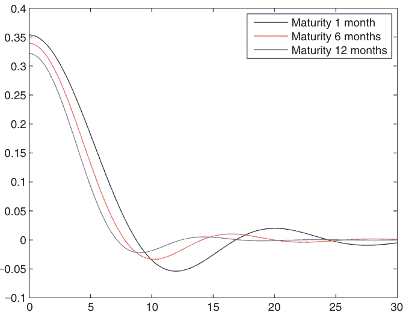

**图 5.2** 被积函数的衰减与期限

对于某个整数 `M`，`ε` 是容差水平。积分域为 `(0,a_M]`，因此 `phi_max=a_M`。Zhu (2010) 解释道，这种方法的优点能够优化地分配上限，并能够适应不同的行权价和期限值。该方法会自动为短期限期权分配更宽的区域（此时被积函数倾向于震荡），并为长期限期权分配更窄的区域（此时被积函数性质较好）。该方法通过避免不需要的区域来缩短计算时间，同时通过为需要的区域分配较宽区域来提高准确性。

Gauss-Legendre 或 Gauss-Lobatto 特别适用于这种方法，因为它们都可以通过使用方程 (5.8) 中的变换来适应任意区域的积分。然而，为了应用 Zhu (2010) 的多域积分法，我们可以生成一次横坐标和权重以获得子域上的积分，每次应用变换。当满足 (5.13) 中的条件时。Matlab 函数 `HPriceGaussLegendreMD.m` 实现了多域积分。

```matlab
function [Price D N] = HPriceGaussLegendreMD(xLE,wLE)
for j=2:length(A)
  for k=1:length(xGE)
    % Lower and upper limits
    a = A(j);
    b = B(j);
    X = (a+b)/2 + (b-a)/2*xGE(k);
    % The integrals
    int1(j,k) = wLE(k)*HestonProb(X,...,1)*(b-a)/2;
    int2(j,k) = wLE(k)*HestonProb(X,...,2)*(b-a)/2;
    % Sum the integrals over each subdomain
    sum1(j) = sum(int1(j));
    sum2(j) = sum(int2(j));
    % Stopping criterion
    if abs(sum1(j))<tol && abs(sum2(j))<tol
      break;
    end
  end
nP1 = 1/2 + 1/pi*sum(sum1);
nP2 = 1/2 + 1/pi*sum(sum2);
Hestonc = S*exp(-q*T)*P1 - K*exp(-r*T)*P2;
% Integration domain and points
D = [A(1); A(j)];
N = length(A(1:j));
```

该函数接受一组一组定义子域的点作为输入。它返回看涨价格，或通过看跌期权平价公式返回看跌价格。它还会输出生成的积分域和使用的点数。实现此方法的 C# 函数与 Matlab 代码非常相似，此处未给出。

为了说明 Zhu (2010) 的多域积分，我们使用了本章贯穿始终的高斯积分示例中的设置。

## 数值积分方案

回想此示例中的期限为 `τ = 1.5`。以下代码实现了多域积分。我们将积分域 `(0, 150]` 划分为 10 个子域。

```matlab
[xGle wGle] = GenerateGaussLegendre(32);
% The domain of integration and the tolerance
lo = 1e-20; hi = 150;
N = 10;
dA = (hi - lo)/N;
A = [lo:dA:hi];
tol = 1e-6;
% Calculate the "true" option price using Newton-Cotes
N = 10000;
method = 3;
ab = 150;
Price = HestonPriceCoates(method,b,N);
% Calculate the price using multi-domain integration
[PriceMD Domain N] = HPriceGaussLegendreMD(xGle,wGle);
```

使用 `ε = 10^{-6}` 的容差进行多域积分得到的价格为 3.2561，这与使用 10000 个点的辛森法非常接近。在该容差水平下，算法返回 `hat{phi}_max=25`，但积分区域显著变窄。如果我们将期限缩短到 `τ = 0.5`，价格下降到 7.1026，这同样是准确的。算法返回 `hat{phi}_max=35`，对于 `τ=1.5`，计算时间增加了。另一种寻找合适积分域的方法是将 `phi ∈ [0, ∞)` 转换为更容易处理的区间 `x ∈ [0, 1]`，如 Kahl 和 Jäck (2005) 所建议。在他们的方法中，Heston 被积函数 `Re [ e^{-i\phi} ln f_{phi}; x, v) / i\phi ]` 中的 `phi` 被替换为 `-ln x/C_∞`，其中 `C_∞ = sqrt(theta/sigma^2)`，`tau` 是期限，且积分除以 `xC_∞`。价格变为：

$$C(K) = e^{-rT} \int_0^1 y(x)dx$$

其中

$$y(x) = \frac{1}{2}(F-K) + \frac{\lim_{u\to 0} f_1(u) - K\lim_{u\to 0} f_2(u)}{\pi C_{\infty}}$$

在形式 (5.15) 中，积分 `y(x)` 在 `x=0` 和 `x=1` 处未定义，这意味着积分只能在 `(0, 1)` 范围内进行。然而，Kahl 和 Jäck (2005) 解析导出了被积函数的极限：

$$\lim y(0) = \frac{1}{2}(F-K)$$

$$\lim y(1) = \frac{F-K}{2\pi C_{\infty}}$$

`lim_{u\to 0} f_i(u)` 的表达式在他们的方程 (44) 和 (50) 中。因此：

$$\lim_{u\to 0} f_1(u) = \ln(F/K) + C(0) \quad (16)$$

以及

$$\lim_{u\to 0} f_2(u) = \ln(F/K) + D'(0) \quad (17)$$

在最后一个实例中，我们有

$$C(0) = -\frac{e^{-\kappa\tau} + \theta(\tau - 1)}{2\kappa}, \quad D'(0) = -\frac{e^{-\kappa\tau}}{2\kappa}$$

在方程 (5.14) 中，当 `κρ ≠ 0` 时，

$$C(0) = -\frac{e^{\rho\tau^2} + \theta(\rho\tau - 1)}{2(\kappa - \rho)^2}, \quad D'(0) = -\frac{e^{-(\kappa - \rho)\tau}}{2(\kappa - \rho)}$$

但当 `κρ=0` 时，这些简化为：

$$C(0) = \frac{\tau^2}{4}, \quad D'(0) = \frac{\tau}{2}.$$

Kahl 和 Jäck (2005) 建议对方程 (5.14) 中的积分使用 Gauss-Lobatto 积分。这是合理的，因为这种积分包含了积分域 `[-1, 1]` 的横坐标。当应用 (5.8) 的变换时，结果是 Kahl 和 Jäck 方法所需的变换域 `[0, 1]` 的端点包含在了横坐标中。Matlab 函数 `HestonPriceKahlJäck` 实现了 (5.14) 中的看涨价格，并通过看跌期权平价返回看涨或看跌价格。

```matlab
function y = HestonPriceKahlJäck(...)
for u = 1:length(X)
    % Transformation of the abscissa
    x = 0.5*X(u) + 0.5;
    if x == 0
        % Integrand at left abscissa 0
        y(u) = 0.5*(F-K);
    elseif x == 1
        % Integrand at right abscissa 1
        f1 = log(F/K) + C1 + D1*v0;
        f2 = log(F/K) + C2 + D2*v0;
        y(u) = 0.5*(F-K) + (P*f1 - K*f2)/(pi*Cinf);
    else
        % Integrand at remaining abscissas
        f1 = HestonPro(-log(x)/Cinf,...,1);
        f2 = HestonPro(-log(x)/Cinf,...,2);
        y(u) = 0.5*(F-K) + (P*f1)/(pi*Cinf);
    end
    % Multiply by the weights
    z(u) = W(u)*y(u);
end
% The call price
JCAll = exp(-rf*T)*(1/2)*sum(z);
```

为了说明，我们使用了以下设置：`S=10, K=7, r=0.06, q=0.04`，期限为1 个月，以及参数 `κ=1, θ=0.06, σ=0.5, v0=0.06` 和 `ρ=-0.8`。使用 Heston 和 32 个横点的 Gauss-Laguerre 和 Gauss-Lobatto 积分得到的看涨价格分别为 3.0006 和 3.0017。相同的 Gauss-Lobatto 权重配合 Kahl 和 Jäck (2005) 公式得到的价格为 2.9992。

Kahl 和 Jäck 的被积函数如图 5.3 所示，图中包含了 32 个 Gauss-Lobatto 横坐标处的被积函数值。

# 136

## MATLAB 和 C# 中的 HESTON 模型及其扩展

震荡的，但由于它衰减很快，这种震荡只会导致微不足道的精度损失。

## 数值积分演示

Matlab 函数 `HestonPriceNewtonCotes.m` 包含了实现本章中四种 Newton-Cotes 公式所需的所有代码，而函数 `HestonPriceGaussLaguerre.m` 和 `HestonPriceGaussLegendre.m` 则用于高斯求积。在这个示例中，我们计算了当现货 `S=100、r=0.03、q=0.02` 时，1 个月欧式看涨和看跌期权的价格。对于 Newton-Cotes 公式我们使用了 100 个节点，而对于高斯求积仅使用了 5 个节点。行权价从 `K=98` 到 `K=102` 的价格分别位于表 5.2（看涨）和表 5.3（看跌）中，最后一列为平均绝对误差。

结果表明，四种 Newton-Cotes 公式产生的价格相当准确。高斯-Legendre（Gauss-Legendre）和高斯-Lobatto（Gauss-Lobatto）求积也非常准确，特别是考虑到它们仅使用了 5 个节点。高斯-Laguerre（Gauss-Laguerre）求积是所有方法中精度最低的。

## 表 5.2 看涨期权的求积比较

| 方法 | K = 98 | K = 99 | K = 100 | K = 101 | K = 102 | 误差 |
| --- | --- | --- | --- | --- | --- | --- |
| 真实价格 | 2.70 | 1.97 | 1.37 | 0.86 | 0.43 | 0.0369 |
| 100 点中点法 | 2.71 | 2.04 | 1.41 | 0.84 | 0.39 | 0.0369 |
| 100 点梯形法 | 2.71 | 2.04 | 1.41 | 0.84 | 0.39 | 0.0369 |
| 100 点辛普法 | 2.71 | 2.04 | 1.41 | 0.84 | 0.39 | 0.0375 |
| 100 点辛普森 3/8 法 | 2.71 | 2.04 | 1.41 | 0.84 | 0.39 | 0.0369 |
| 5 点高斯-Laguerre | 1.80 | 1.16 | 0.61 | -0.16 | -0.23 | 0.7634 |
| 5 点高斯-Legendre | 2.71 | 2.04 | 1.41 | 0.83 | 0.38 | 0.0376 |
| 5 点高斯-Lobatto | 2.71 | 2.04 | 1.41 | 0.84 | 0.39 | 0.0372 |

## 表 5.3 看跌期权的求积比较

| 方法 | K = 98 | K = 99 | K = 100 | K = 101 | K = 102 | 误差 |
| --- | --- | --- | --- | --- | --- | --- |


| 真实价格 | 0.87 | 1.14 | 1.54 | 2.03 | 2.59 | 0.0369 |

| 100 点中点法 | 0.88 | 1.21 | 1.58 | 2.00 | 2.55 | 0.0369 |

| 100 点梯形法 | 0.88 | 1.21 | 1.58 | 2.00 | 2.55 | 0.0375 |

| 100 点辛普法 | 0.88 | 1.21 | 1.58 | 2.00 | 2.55 | 0.0369 |

| 100 点辛普森 3/8 法 | 0.88 | 1.21 | 1.58 | 2.00 | 2.55 | 0.0375 |

| 5 点高斯-Laguerre | -0.03 | 0.32 | 0.78 | 1.32 | 1.96 | 0.7634 |

| 5 点高斯-Legendre | 0.88 | 1.21 | 1.58 | 2.00 | 2.54 | 0.0376 |

| 5 点高斯-Lobatto | 0.88 | 1.21 | 1.58 | 2.00 | 2.55 | 0.0372 |

## 数值积分方案

### 快速变换

傅里叶变换（FFT）被 Carr 和 Madan (1999) 应用于加速期权价格的计算。离散傅里叶变换将点向量 `$x=(x_1, \dots, x_N)$` 映射到另一个点向量 `$\hat{x}=(\hat{x}_1, \dots, \hat{x}_N)$`，其关系如下：

$$\hat{x}_k = \sum_{j=1}^N e^{-i\frac{\pi}{N}(j-1)}x_j \quad k=1, \dots, N. \quad (18)$$

独立地计算这些和需要 `$N^2$` 步。而傅里叶变换可以同时计算这些和，仅 `$N\log N$` 步。回顾第 3 章 Carr 和 Madan (1999) 对于行权价 `$k=\ln K$` 的看涨价格表示法：

$$C(k) = \frac{e^{-uk}}{\pi} \int_0^\infty e^{-kv}\psi(v)dv \quad (19)$$

其中

$$\psi(v) = \frac{e^{-iv}f_2(v-\alpha+1)}{\alpha^2-v^2+iv(\alpha+1)}$$

其中 `$f_2$` 是 Heston 特征函数。FFT 的目标是离散方程 (19) 中的看涨价格 `$C(k)$` 并用公式 (18) 表示它。

注意，`$\hat{x}=(\hat{x}_1, \dots, \hat{x}_N)$` 的逆 FFT 是向量 `$x=(x_1, \dots, x_N)$`,定义为：

$$x_k = \frac{1}{N} \sum_{j=1}^N e^{i\frac{\pi}{N}(j-1)}\hat{x}_j \quad k=1, \dots, N. \quad (20)$$

FFT 和逆 FFT 是其对应的直观模拟。我们注意到 FFT 通过函数 `$\hat{x}=D(x)$` 将 `$x$` 映射到 `$\hat{x}$`，而逆 FFT 通过 `$x=D^{-1}(\hat{x})$` 将 `$\hat{x}$` Map回。我们在在本章后面描述分数傅里叶变换（FRFT）时将使用这种符号。

### 积分范围和行权价范围的离散化

方程 (19) 中看涨价格的计算需要对行权价范围和积分域进行离散化。我们可以使用 `$N$` 个等距点在截断积分域 `[$0,b$]` 上通过梯形法近似看涨价格：

$$\nu_j = (j-1)\eta \quad j=1, \dots, N \quad (21)$$

其中 `$\eta$` 是步长。梯形法将看涨价格 `$C(k)$` 近似为：

$$C(k) \approx \frac{e^{-vk}}{\pi} \text{Re} \left[ \frac{1}{2}e^{-iw_1k}\psi(v_1) + e^{-iw_2k}\psi(v_2) + \dots + \frac{1}{2}e^{-iw_Nk}\psi(v_N) \right] = \frac{e^{-\eta_ak}}{\pi} \sum_{j=1}^{N} e^{-iw_jk}\psi(v_j)w'_j \quad (22)$$

其中 `$w_1 = w_N = \frac{1}{2}$`，对于 `$j=2, \dots, N-1$`，则 `$w_j = 1$`。如果使用辛普法代替梯形法，则设置 `$w_1 = w_N = \frac{1}{3}$`，当 `$j$` 为偶数时 `$w_j = \frac{4}{3}$`，当 `$j$` 为奇数时 `$w_j = \frac{2}{3}$`。

```
x(j) = exp(i*(b-s0)*v(j))*phi(j)*w(j);
e(j) = exp(-i*2*pi/N*(j-1)*(u-1))*x(j);
CallFFT(u) = eta*exp(-alpha*k(u))/pi = real(sum(e));
```

C# 中对 FFT 的实现没有使用向量化，而是使用了 `HestonFFT(...)` 函数，这与 Matlab 函数 `HestonCallFFT.m` 的第二部分非常相似。

```csharp
static double HestonFFT(HParam param, OpSet settings,...){
  for(int j=0;j<N-1; j++){
    psi[j] = HestonCv(v[j]-(alpha+1.0)*i,param,settings);
    Complex = Complex.exp(-r*tau)*psi[j]; ...
    x[j] = Complex.exp(i*(b-s0)*v[j])*phi[j]*w[j];
    e[j] = Complex.exp(-i*2*pi/Convert.ToInt32(N))*x[j];
    sum += e[j];
  }
  CallFFT(u) = eta*Math.Exp(-alpha*k(u))/pi * sum;
}
```

为了便于说明，假设现价 `$S_0=50$`，Heston 参数为 `$\kappa=0.2, v=0.03, \sigma=0.3$` 且 `$\rho=-0.7$`。假设到期时间为6 个月，无风险利率 `$r=0.03$`，股息率为 `$q=0.05$`。使用 `$N=1024$` 和阻尼参数 `$\alpha=1.5$`，我们在表 5.4 中得到了看权价格，以及相对于精确价格的近似误差（精确价格是使用 32 点高斯-Laguerre 积分得到的）。

FFT 产生的价格非常准确，无论使用辛普森法则还是梯形法则。事实上，当 `$N=1,024$` 时，辛普森法则和梯形法则的平均绝对误差均为 0.0394%。在这种情况下，积分步增量 `$\eta=0.0977$`，行权价步增量 `$\lambda=0.0628$`。

### 表 5.4 Heston 看权价格比较

| 行权价 | 精确价格 | 梯形 FFT 价格 | 辛普森 FFT 价格 | 梯形误差 | 辛普森误差 |

|---|---|---|---|---|---|

| 41402 | 8.6378 | 8.6368 | 8.6381 | 0.0010 | 0.0040 |

| 44956 | 6.4765 | 6.4761 | 6.4771 | -0.0072 | -0.0072 |

| 46953 | 4.4453 | 4.4454 | 4.4454 | 0.0014 | 0.0014 |

| 50000 | 2.6778 | 2.6782 | 2.6792 | 0.0118 | 0.0118 |

| 532424 | 1.3269 | 1.3267 | 1.3267 | -0.0152 | -0.0152 |

| 566950 | 0.5020 | 0.5018 | 0.5018 | -0.0421 | -0.0421 |

| 603716 | 0.1421 | 0.1424 | 0.1424 | 0.0198 | 0.0198 |

## 数值积分方案

### 分数快速傅里叶变换 (FRFT)

分数快速傅里叶变换 (FRFT) 由 Chourdakis (2005) 应用于期权定价。FRFT 是 FFT 的一种改进，它放宽了网格参数上 `$\lambda\eta = 2\pi/N$` 的限制条件，使得快速傅里叶变换指数中的项 `$1/N$` 被替换为通用项 `$\beta$`。因此，方程 (5,27)：

```
$$\hat{x}_u = \frac{e^{-i\alpha u}}{\pi} \sum_{j=1}^{N} Re [e^{-i2\pi\beta(j-1)(u-1)} x_j] \quad \text{for } u=1, \dots, N. \quad (5,28)$$
```

网格大小参数 `$\lambda$` 和 `$\eta$` 的关系意味着 `$\lambda\eta = 2\pi\beta$`。然后我们可以自由选择这些网格参数，并设置：

```
$$\beta = \frac{\lambda\eta}{2\pi}.$$
```

当 `$\beta=1/N$` 时，FFT 成为一个特例。要在点集 `$x_1, \dots, x_N$` 上实现 FRFT，首先定义向量 `$y$` 和 `$z$`，它们的维度均为 `$2N$`：

```
$y = \left[e^{-i\pi(j-1)^2\beta} x_j\right]_{j=1}^{N}, \quad \{0\}_{1}^{N}$
$z = \left[e^{i\pi(j-1)^2\beta} x_j\right]_{j=1}^{N}$
```

接下来，对 `$y$` 和 `$z$` 取 FFT 得到向量 `$\hat{y}$` 和 `$\hat{z}$`，产生维度为 `$2N$` 的向量 `$\hat{h} = \hat{y} \odot \hat{z}$`。现在对 `$\hat{h}$` 取逆 FFT 得到维度为 `$2N$` 的向量 `$D^{-1}(\hat{h})$`。最后通过与向量 `$e$` 相乘得到：

$$ \hat{x} = e \odot D^{-1}(\hat{h}) $$

因此，我们可以以紧凑的形式写出分数傅里叶变换：

$$ \hat{x} = e \odot D^{-1}(y \odot z) $$

`$\hat{x}$` 的前 `$N$` 个元素被保留，其余 `$N$` 个元素被丢弃。注意，与 FFT 类似，FRFT 需要 `$2N$` 维向量 `$y$` 和 `$z$`，并计算两次 FFT。然而，两次 FFT 带来的计算时间增加通过选择较小积分网格带来的精度提高来抵消。

### Heston 模型及其在 MATLAB 和 C# 中的扩展

实现 FRFT 时，选择任意数量的点 `$N$`、积分增量 `$\eta$` 和行权价增量 `$\lambda$`。我们设置 `$\beta = \lambda\eta/(2\pi)$` 并按照本节描述进行。对于方程 (5,29) 中出现在向量 `$z$` 中的点 `$x$`，我们使用与 (5,26) 相同的点 `$x_i = \exp(v_i)$`。最后，积分网格 `[$v_n$]` 和行权价网格 `[$k_n]_{n=1}^N$` 按照 (5,21) 和 (5,23) 构建，其中 `$b = N\lambda/2$`，因为 Matlab 函数接收输入向量 `$x$` 和参数 `$\beta$`，并返回来自 (5,30) 的 `$\hat{x}$`：

```matlab
function xhat = FRFT(x,beta)
N = length(x)
y = [exp(-i.*pi.(0:N-1).^2.*beta), zeros(1,N)]
z = [exp(i.*pi.(0:N-1).^2.*beta]
Dy = FFT(z)
D = FFT(z) % 此处原文逻辑可能有误，通常为某种组合运算
h = ifft(h)
e = [exp(-i.*pi.(0:N-1).^2.*beta), zeros(1,N)]
xhat = e.*h; % 逻辑还原
xhat = xhat(1:N)
```

该函数用于 `HestonCallFFT.m`，实现了 FRFT：

```matlab
function [CallFFT, lambdinc] = HestonCallFFT(...)
b = N*lambdinc/2
k = -b + lambdinc.*0:N-1
k = exp(k)
CallFFT = zeros(N,1)
beta = lambdinc*alpha/2
psi = HestonCF(v-(alpha-1).*i)
psi = conj(psi)
phi = exp(-r*tau).*i./conj(alpha^2 + alpha - v.^2)
x = conj(exp(i.*(b-s0).*v)).*phi;
y = real(FRFT(x,beta))
% ...
```

实现 FRFT 的 C# 函数使用了 `FRFT()` 函数，这与 Matlab 函数 `FRFT.m` 非常相似。不同之处在于没有向量化，且 FFT 和逆 FFT 函数必须单独编写，因为 C# 标准库中没有提供这些函数。

## 数值积分方案

```csharp
static Complex[] FRFT(Complex[] x, double beta) {
  for(int j=0; j<N; j++) {
    double J = Convert..Double(j);
    y[j] = Complex.Exp(-i*PI*J*beta) * x[j];
    z[j] = Complex.Exp(i*PI*J*beta);
  }
  for(int j=N; j<2*N; j++) {
    y[j] = 0.0;
    double M = Convert.ToDouble(2*N-j);
    z[j] = Complex.Exp(i*PI*M*beta);
  }
  Dy = FFT(z);
  D = FFT(z);
  for(int j=0; j<N; j++) {
    h[j] = Dy[j]*D[j];
  }
  ih = IFFT(h);
  for(int j=0; j<N; j++) {
    double J = Convert.ToDouble(j);
    e[j] = Complex.Exp(-i*PI*J*beta);
    xhat[j] = e[j]*ih[j];
  }
  return xhat;
}
```

C# 函数 `FFT()` 实现了快速变换。

```csharp
static Complex[] FFT(Complex[] x) {
  int N = x.Length;
  double pi = Math.PI;
  for(int k=0; k<N-1; k++) {
    coeff = 0.0;
    for(int j=0; j<N-1; j++) {
      double K = Convert.ToDouble(k);
      double J = Convert.ToDouble(j);
      double M = Convert.ToDouble(N);
      coeff += Complex.Exp(-i*2*pi*J/M) * x[j];
    }
    xhat[k] = coeff;
  }
  return xhat;
}
```

C# 函数 `IFFT()` 实现了逆变换。

```csharp
static Complex[] IFFT(Complex[] x) {
  // 逻辑还原：逆 FFT 实现
}
```

## 数值积分方案

### 表 5.6 FRFT 认权价格比较，小行权网格

| 行权价 | 精确价格 | 梯形 FRFT 价格 | 辛普森 FRFT 价格 | 梯形误差 | 辛普森误差 |

| :--- | :--- | :--- | :--- | :--- | :--- |

| 49.9329 | 2.7118 | 2.7123 | 2.7123 | 0.0199 | 0.0199 |

| 49.9553 | 2.7004 | 2.7010 | 2.7010 | 0.0197 | 0.0197 |

| 49.9776 | 2.6891 | 2.6897 | 2.6897 | 0.0195 | 0.0195 |

| 50.0000 | 2.6778 | 2.6784 | 2.6784 | 0.0193 | 0.0193 |

| 50.0224 | 2.6666 | 2.6671 | 2.6671 | 0.0191 | 0.0191 |

| 50.0488 | 2.6553 | 2.6558 | 2.6558 | 0.0189 | 0.0189 |

| 50.0672 | 2.6441 | 2.6442 | 2.6446 | 0.0187 | 0.0187 |

与表 5.3 中的价格相比，FRFT 的增量要粗得多，大约为 `$3.00$`。此外，在相同点数 `$N = 2^n$` 的情况下，FRFT 的速度比 FFT 快得多。

FRFT 的另一个优势是我们可以限制应用算法的行权价范围。假设我们希望行权价范围从 `$K'$` 开始。根据方程 (5.23)，选择对数行权增量 `$\lambda$` 为：

$$ \lambda = \frac{2}{N}\log(S/K')$ (5.31) $$

这将保证第一个行权价为 `$k_1 = \log S/K'$`，最后一个行权价约为 `$k_n \approx S'/K'$`。通过选择 `$K'$` 接近 `$S$`，我们可以让 `$\lambda$` 变得任意足够小，并为行权价获得一个非常窄的离散化范围。然后我们为积分网格大小 `$\eta$` 选择任意值。如表 5.6 所示，我们使用了 `$K=20$`（回 `$\hat{S}=30$`）。FRFT 在平值区域以大约 `$0.02$` 的增量构建行权网格。

我们也可以将方程 (5.31) 用于为 FFT 本身构建窄的行权价范围，但由于我们受限于 `$\lambda$` 和 `$\eta$` 之间的关系，这将导致 `$\eta$` 值很大，且积分网格非常粗糙。

# 结论


在本章中，我们介绍了多种数值积分方法，它们的工作效果都相当良好。`Newton-Cotes`公式易于理解和实现，但与高斯求积相比，它们需要更多的节点，因此需要更多的计算时间。这些方法中，高斯-拉日求积适用于 Heston 模型，但对于 Kahl 和 Jackel (2005) 的积分域变换效果良好。在 `$C\#$` 中实现高斯求积比在 Matlab 中复杂，因为我们必须创建 `$C\#$` 多项式根函数。在 `$C\#$` 中实现高斯求积比在 Matlab 中复杂，因为我们必须创建 `$C\#$` 多项式根函数。在 `$C\#$` 中实现高斯求积比在 Matlab 中复杂，因为我们必须创建 `$C\#$` 。函数。通过快速傅里叶变换（FFT）和分数傅里叶变换（FRFT），我们展示了这些方法在实际应用中的表现。

# 第 6 章 参数估计

## 摘要

所有的定价方法目前都假设参数是给定的。在这一章中，我们将介绍如何估计这些参数。首先，我们介绍基于价格的估计方法。然后，我们将介绍基于隐含波动率的估计方法。

## 使用损失函数进行估计

估计参数的最常用方法是最小化报价价格与模型价格之间的误差，这通常分为两类：基于价格和基于波动率。第一类损失函数是最小化报价价格与模型价格之间的误差。误差通常定义为平方差，使用：

$$ \frac{1}{N} \sum_{t,k} (C_{ik} - C_{ik}^{\Theta})^2 \ (6.1) $$

或者，我们可以使用绝对值定义误差，即 `|C_{ik} - C_{ik}^{\Theta}|`，并建立损失函数：

$$ \frac{1}{N} \sum_{t,k} |C_{ik} - C_{ik}^{\Theta}| \ (6.2) $$

均方误差（MSE）损失函数的一个已知缺点是虚值期权对 (6.2) 的贡献较大。因此，估计倾向于拟合值期权，而损害了其他期权。一种补救方法是只使用值期权，因此在 (6.2) 中，对于小于现价的行权价使用看涨期权，对于大于现价的行权价使用看跌期权。另一种补救方法是使用 RMSE (6.3)。然而，RMSE 的问题是发生了相反的效果。事实上，由于分母中存在 `C_{ik}`，低市场价值的期权会对 (6.3) 过度贡献。然而，过度贡献和贡献不足可以通过为选择分配权重 `w_{ik}` 来减轻。

第二类损失函数是最小化报价与模型隐含波动率之间的误差。同样，误差通常定义为报价与隐含波动率之间的平方差、绝对差或相对差。这类损失函数是灵敏的，因为期权通常以隐含波动率的形式进行报价，且模型的拟合程度通常通过比较报价和模型隐含波动率来评估。例如，隐含波动率均方误差（IVMSE）参数估计基于：

$$ \frac{1}{N} \sum_{t,k} w_{ik}(IV_{ik} - IV_{ik}^{\Theta})^2 \ (6.4) $$

其中 `IV_{ik} = IV(\tau_k, K_k)` `IV_{ik}^{\Theta} = IV(\tau_k, K_k; \Theta)` 分别是报价和模型隐含波动率。相对版本和绝对版本也可以使用。

## 参数估计

方程 (6.4) 的主要缺点是它是计算密集型的。事实上，在优化的每次迭代中，我们必须首先获得 Heston `C_{ik}`，然后应用如二分法等寻根算法从 `C_{ik}` 中提取隐含波动率 `IV_{ik}`，以便构建标量 `(IV_{ik} - IV_{ik}^*)^2`。另一种解决办法是使用第 4 节中描述的 Lewis (2000) 二级展开的近似隐含波动率，来代替 `IV_{ik}`。这允许我们完全跳过二分法算法。另一种解决方法是使用 Christoffersen 等人 (2009) 描述的损失函数，该函数作为 (6.4) 中 IVMSE 的近似。它使用 Black-Scholes vega 的平方倒数作为 (6.2) 中的权重。因此，他们方法的参数估计是基于损失函数：

```
$$\sum_{i,k} \frac{(C_{ik} - C_{ik}^*)^2}{BSVega_{ik}^2} = (6.5)$$
```

其中 `BSVega` 是期权价格相对于市场隐含波动率 `IV_{ik}` 的 Black-Scholes 敏感度，在到期日 `\tau` 和执行价格 `K` 处求值如下：

```
$d_{ik} = \frac{\log(S/K_k) + (r - q + IV_{ik}^2/2)\tau}{IV_{ik}\sqrt{\tau}}$
```

并且 `n(x) = \exp(-x^2/2)/\sqrt{2\pi}` 是标准正态密度。基于 Lewis (2000) 或 Christoffersen 等人 (2009) 近似的损失函数的主要优势是节省了大量的计算时间，尽管是以牺牲参数估计精度为代价的。

估计 Heston 参数已被 Bakshi、Cao 和 Chen (1997)、Bams 等人 (2009)、Christoffersen 和 Jacobs (2004)、Mikhailov 和 Nogel (2003) 等许多人使用。关于哪种损失函数最好尚没有共识，但 Christoffersen 和 Jacobs (2004) 指出，同一个损失函数可以用于参数估计和模型拟合评估。

Matlab 函数 `HestonObjFun.m` 实现了本节涵盖的损失函数。如果我们设置 `Method=2`，则直接从 Lewis (2000) 的近似值获得隐含波动率，因此我们不需要使用二分法计算波动率。该函数可以很容易修改以添加更多函数。

```matlab
function y = HestonObjFun(ObjFun,...);
for k=1:NK
    for t=1:NT
        % 选择获取价格的方法
        if Method=1
            CallPrice = HestonPriceGaussLaguerre(K(k),T(t),...);
```

## MATLAB 和 C# 中的 Heston 模型及其扩展

```matlab
elseif Method=2
[iv CallPrice] = SeriesIIAll(K(k),T(t),...);
else Method=3
CallPrice = SeriesICall(K(k),T(t),);
end
% 获取认涨期或认跌期价格
if PutCall(k,t)='C'
ModelPrice(k,t) = CallPrice;
else
ModelPrice(k,t) = CallPrice - S*exp(-q*T(t)) + ...;
end
% 选择目标函数
if ObjFun = 1
error(k,t) = (MktPrice(k,t) - ModelPrice(k,t))^2;
elif ObjFun = 2
error(k,t) = (MktPrice(k,t) - ModelPrice(k,t))^2 ...
elif ObjFun=3
if Method=2
ModelIV = iv;
else
ModelIV = BisCBIV(K(k),T(t),ModelPrice(k,t).);
end
error(k,t) = (ModelIV - MktIV(k,t))^2 ...
elif ObjFun=4
d = (log(S/K(k)) + (rf-q*MktIV(k,t)^2/2)*T(t)) ...
Vega(k,t) = S*normpdf(sqrt(T(t)));
error(k,t) = (ModelPrice(k,t) - MktPrice(k,t))^2 ...
end

y = sum(sum(error)) / (NT*NK);
```

为了获得参数估计，我们将 `HestonObjFun.m` 传递给 Matlab 函数 `fmincon`。该 Matlab 函数允许满足 (6.1) 条件的受约束优化。

```matlab
e = 1e-5;
lb = [e e e e .999] % 估计的下界
ub = [100 10 10 10 .999] % 估计的上界
[param fval] = fmincon(@p) HestonObjFun(...),lb,ub);
```

实现这些函数的 C# 代码与 Matlab 代码类似，将在下一节中给出。一个关键区别是，当使用函数 (6.5) 时，必须计算标准正态密度。这通过以下代码段中的 C# 变量 `NormPDF` 完成。

## 参数估计

```csharp
case 4:
double d = (Math.Log(S/K[k]) + (r-q+MktIV(k,t)^2/2)*T(t))/2.0;
double NormPDF = Math.Exp(-0.5*d*d)/Math.Sqrt(2.0*pi);
Vega = S*NormPDF*Math.Sqrt(T[t]);
Error = Math.Pow(MktPrice[k,t] - MktPrice[k,t],2)/Vega/TN;
break;
```

另一个区别是，当目标函数中使用隐含波动率时，必须使用第 2 节中的 C# 函数 `NormCDF()` 计算标准正态分布。请参考第 2 节获取 `NormCDF` 函数的描述。

为了估计，使用了 2012 年 4 月 13 日收集的 Heston 参数，对应四个期限：45、98、261 和 348 天，以及从 120 到 150 间隔为 5 的五个执行价格。我们使用 32 点高斯-Laguerre 积分获取模型，并报告 Christoffersen (2009) (6.5) 之间的 IVMSE。隐含波动率图表明，长期拟合效果略优于短期。参数估计存在差异，正如我们所说，`$\theta$` 为负值。隐含波动率的结果如图 6.1 所示。

表 6.1 中的 Heston 参数是使用无风险利率和股息率得到的。详见 Shim (1993)。Nelder-Mead 算法适用于无约束优化，然而，可以使用惩罚函数将其用于受约束优化。

| 损失函数 | IVMSE | `$\hat{\kappa}$` | `$\hat{\theta}$` | `$\hat{\alpha}$` | `$\hat{v}$` |
| :--- | :--- | :--- | :--- | :--- | :--- |
| MSE (6,2) | 0.0006 | 1.9214 | 0.0904 | 0.0344 | -0.7799 |
| RMSE (6,3) | 0.0005 | 1.9931 | 0.0571 | 0.0405 | -0.7899 |
| IVMSE (6,4) | 0.0004 | 2.0000 | 0.0420 | 0.0405 | -0.8038 |
| CHJ (2009) (6.5) | 0.0003 | 1.9655 | 0.0602 | 0.0250 | -0.7913 |

FIGURE 6.1 使用 MSE 估计的 S&P500 市场和隐含波动率

- 45 天
- 98 天
- 261 天
- 348 天

## 参数估计

**步骤 2.** 扩展规则。如果 `f(\mathbf{x}_k) \le f(\mathbf{x}_0)`，则扩展扩展点

`$\mathbf{x}_e = \bar{x} + \gamma(\mathbf{x}_n - \bar{x})$`

如果 `f(\mathbf{x}_e) \le f(\mathbf{x}_n)`，将 `$\mathbf{x}_n$` 替换为 `$\mathbf{x}_e$` 并进入步骤 0 的下一次迭代。如果 `f(\mathbf{x}_e) > f(\mathbf{x}_n)`，则用反射点 `$\mathbf{x}_r$` 替换并进入下一次迭代。

如果 `f(\mathbf{x}_r) > f(\mathbf{x}_0)`，继续执行步骤 3。

**步骤 3.** 外部收缩规则。计算外部收缩点

`$\mathbf{x}_{ic} = \bar{x} + \gamma(\mathbf{x}_n - \bar{x})$`

如果 `f(\mathbf{x}_{n-1}) \le f(\mathbf{x}_n)` 且 `f(\mathbf{x}_{ic}) < f(\mathbf{x}_n)`，将 `$\mathbf{x}_n$` 替换为 `$\mathbf{x}_{ic}$` 并进入步骤 0 的下一次迭代。否则，继续执行步骤 4。

**步骤 4.** 内部收缩规则。计算内部收缩点

`$\mathbf{x}_{ic} = \bar{x} + \gamma(\mathbf{x}_n - \bar{x})$`

如果 `f(\mathbf{x}_n) \le f(\mathbf{x}_i)` 且 `f(\mathbf{x}_{ic}) < f(\mathbf{x}_{n-1})$，将 `$\mathbf{x}_n$` 替换为 `$\mathbf{x}_{ic}$` 并进入步骤 0 的下一次迭代。否则，继续执行步骤 5。

**步骤 5.** 收缩。对于 `i = 1, \dots, n`，将 `$\mathbf{x}_n$` 替换为 `$\mathbf{x}_n + \sigma(\mathbf{x}_i - \mathbf{x}_n)$`。注意，最佳点 `$\mathbf{x}_n$` 不进行收缩。

上述步骤中系数的标准值为：反射的 `$\rho = 2$`，收缩的 `$\gamma = 1/2$`，以及收缩的 `$\sigma = 1/2$`。

当迭代次数达到指定值，或者最佳与最差函数值之间的差值 `f(\mathbf{x}_n) - f(\mathbf{x}_i)` 达到指定水平时，Nelder-Mead 算法运行。

该算法使用 C# 实现，使用了 `NelderMead` 函数。以下代码段包含了之前描述的步骤 1 到 5。反射、扩展以及内部和外部收缩点在函数早些时候已计算，此处未列出。函数的最后部分返回参数估计、目标函数值以及使用的迭代次数。

```csharp
static double[] NelderMead(ObjFun f, NMSet settings,
              double[], x) {
    while (Numiters <= MaxIters) && Math.Abs(fr-fn1) >= Tolerance) {
        // Step 1. Reflection Rule
        if((fl<fr) && (fr<fn1)) {
            for(j=0;j<N-1;j++)
                for(i=0;i<N-1;i++) x[i,j] = y[i,j];
            for(i=0;i<N-1;i++) x[i,N] = xr[i];
            goto step0;
        // Step 2. Expansion Rule
        if(fr<fl)
        for(j=0;j<N-1;j++)
for(i=0;i<=N-1;i++) x[i,j] = y[i,j];
if(fe<fr)
  for(i=0;i<=N-1;i++) x[i,N] = xe[i];
else
  for(i=0;i<=N-1;i++) x[i,N] = xr[i]; goto step0;
// Step 3. Outside Contraction Rule
if(fr<fn1) && (foc<fr)) // 注意：此处 OCR 存在错误，逻辑建议使用标准比较
// Step 4. Inside Contraction Rule
if(fr>=fn1) && (fic<fn1) {
  for(j=0;j<=N-1;j++) x[i,j] = y[i,j];
  for(i=0;i<=N-1;i++) x[i,N] = ic[i];
  goto step0;
// Step 5. Shrink Step
for(i=0;i<=N-1;i++) x[i,0] = y[i,0];
for(j=0;j<=N-1;j++) x[i,j] = 0.5*(y[i,j] + x[i,0]); goto step0;
// Output component
double[] outvec = new double[N+2];
for(i=0;i<=N-1;i++) outvec[i] = x[i];
outvec[N] = f1;
outvec[N+1] = NumIters;
return outvec; }
```

# MATLAB 和 C# 中的 Heston 模型及其扩展

为了使用 Nelder-Mead 算法寻找参数估计，我们通过通过定义 `f()` 函数来创建目标函数，该函数返回损失函数。通常情况下，省略了该函数的部分。由于 Nelder-Mead 函数是设计用于无约束优化的，因此在函数的第一部分包含了一个惩罚机制，当遇到不可接受的参数值时返回一个极大（`$10^{30}$`）。有效的参数是指落在 (6.1) 中定义的参数边界范围内的值。

```csharp
static double f(double[] param, double offset) {
  // 对不可接受参数值的惩罚
  if((param[0]<=kappaLB) || (param[1]>=thetaUB)) {
    Error = 1e50;
  }else {
    for(int k=0; k<K; k++) {
      for(int t=0; t<T; t++) {
        ModelPrice(k,t) = HestonPriceGauss(K[k],T]),
        switch (LossFunction) {
          case 1: // MSE 损失函数
            Error += Math.Pow(ModelPrice[k,t] - MktPrice[k,t], 2);
          case 2: // RMSE 损失函数
            Error += Math.Pow(ModelPrice[k,t] - MktPrice[k,t], 2);
            break;
        }
      }
    }
  }
  return Error; }
```

Heston 参数估计通过以下 C# 代码获得。第一部分使用初始值和随机增量创建初始值（顶点）。最后部分调用 `NelderMead` 函数。

```csharp
double kappaS = 9.00;
```


```csharp
double thetaS = 0.05;

double sigmas = 0.30;

double vOS = 0.05;

double rhoS = -0.80;

int N = settings.N;

double[,] s = new double[N,N+1];

for(int j=0; j<N; j++) {

    s[0,j] = kappaS + RandomNum(-0.01,0.01);

    s[1,j] = thetaS + RandomNum(-0.01,0.01);

    s[2,j] = sigmas + RandomNum(-0.01,0.01);

    s[3,j] = vOS + RandomNum(-0.01,0.01);

    s[4,j] = rhoS + RandomNum(-0.01,0.01);

}

// 优化参数估计

double[,] B = NelderMead(f,settings,s);
```

在 `Nelder-Mead` 算法的 `C#` 代码中，我们创建了一系列结构，允许以更紧凑的形式传递输入。这些结构包含了 `Nelder-Mead` 算法设置、目标函数、Heston 参数以及期权价格。`C#` 代码还使用了向量加减函数以及获取向量平均值的函数。这些结构和函数在此未出现，但在 `C#` 代码中包含了。

## 初始值

记得 Heston 参数的约束 `(6.1)` 为 $\kappa > 0, \theta > 0, \sigma > 0, \nu > 0$ 以及 $|\rho| \le 1$。如本章前面所述，我们使用 Matlab `fmincon` 在约束下最小化目标函数，这需要参数边界。该函数使用了多种约束优化方法，这些方法在 MathWorks 网站（`www.mathworks.com`）上有解释。我们也可以使用 Matlab `fminsearch` 来最小化目标函数，但该函数使用的是 `Nelder-Mead` 算法，且仅设计用于无约束优化。引入约束的一种简单方法是实施惩罚，正如我们在上一节 `C#` 代码中所做样。

# MATLAB 和 C# 中的 Heston 模型及其扩展

### 表 6.2 文献中的参数估计

| 来源 | $\hat{\kappa}$ | $\hat{\theta}$ | $\hat{\sigma}$ | $\hat{v}_0$ | $\hat{\rho}$ | 日期 |
| :--- | :--- | :--- | :--- | :--- | :--- | :--- |
| GS (2012) | 0.3369 | 0.0551 | 0.1927 | 0.0746 | -1.000 | 2008 |
| Forde (2010) | 1.7609 | 0.0434 | 0.0406 | 0.0464 | -0.5195 | 2006 |
| Gather (2006) | 1.3235 | 0.0334 | 0.3877 | 0.0174 | -0.165 | 2005 |
| CHJ (2009) | 1.6048 | 0.0464 | - | - | -0.770 | - |
| SST (2004) | 0.0607 | 0.0770 | 0.0298 | 0.0654 | -0.7571 | 2003 |
| BCC (1997) | 1.15 | 0.04 | - | 0.0348 | - | 1991 |

> ^a$Guillaumes and Schutens (2012)
> ^b$Christoffersen, Jacobs, and Chen (2009)
> ^c$Schutens, Simons, and Tistaert (2004)
> ^d$Bakshi, Cao, and Chen (1997)
> ^e/f$ not applicable

## 参数估计

这些导数的的公式在第 9 章中给出。公式 `(6.7)` 中系数所需的其他数量，即 `m0, p0, p1, q0, q1, r0` 和 `r1`，可以在 Gauthier 和 Rivaille (2009) 或 Benhamou 等人 (2010) 中找到。

Gauthier 和 Rivaille 的方法基于这样一个观点：给定具有相同期限 `T` 的报价看跌期权，即行权为 `K1` 的 `P(K1)` 和行权为 `K2` 的 `P(K2)`，我们可以建立如下两个方程组成的方程组：

```
$P(K_1) = A(K_1) + B(K_1)\sigma^2 + C(K_1)\rho\sigma + D(K_1)\rho^2\sigma^2$

$P(K_2) = A(K_2) + B(K_2)\sigma^2 + C(K_2)\rho\sigma + D(K_2)\rho^2\sigma^2$
```

并求解 `(\rho, \sigma)`。为了实现这一点，我们固定系数中 `\kappa`、`\theta` 和 `v0` 的值。我们可以通过 Matlab 的符号工具求解 `(\rho, \sigma)`。通常情况下，会产生所有解，但只有一个是允许的（即满足 `|\rho| \le 1` 且 `\sigma > 0`）。

或者，我们可以固定使目标函数最小化的 `\rho` 值：

```
$f(\rho, \sigma) = (A(K_1) + B(K_1)\sigma^2 + C(K_1)\rho\sigma + D(K_1)\rho^2\sigma^2 - P(K_1))^2$

+(A(K_2) + B(K_2)\sigma^2 + C(K_2)\rho\sigma + D(K_2)\rho^2\sigma^2 - P(K_2))^2$
```

在 Matlab 中实现这一点非常简单。Matlab 文件 `BlackSchDerivatives.m` 包含了方程 `(6.7)` 中系数的导数。该函数被传递给 `Gauthiercoefficients.m`，由它计算 `(6.7)` 中的系数。

```matlab
function [A B C D] = Gauthiercoefficients(...);
% 生成 Black-Scholes 导数
% [P1 P2 P01 P02] = BlackScholesDerivatives(...);
% Black Scholes 看跌价格
BSPut = K*exp(-r*T)*normcdf(-q-T)*normcdf(g);
% 返回系数
A = BSPut;
B = (v0 + theta*rt1)*P02;
C = (v0 + theta*rt1)*P21 + 0.5*(v0*g0 + theta*rt1)^2*P22;
D = ...;
```

最后，这些系数被传递给 `GetGauthierValues` 函数，该函数通过两种方法计算 `sigma` 和 `rho`：使用 Matlab 符号计算器获取闭式解值，或者使用方程 `(6.9)` 中的目标函数。

```matlab
function [sigma rho] = GetGauthierValues(K1,K2,Put1,Put2,...,method);
% 找到每个行权日的 Gauthier 系数
[A1 B1 C1 D1] = GauthierCoefficients(K1,...);
[A2 B2 C2 D2] = GauthierCoefficients(K2,...
if method===1
    % 为 sigma 和 rho 构造表达式
    Rho(1) = -1/2*(-C1^2*D2*B2-B1*C2*D1) ; ...
    Rho(2) = -1/2*(-C1^2*D2*B2-B1*C2*D1) ; ...
    Sigma(1) = 1/2*2*((-C1^2*D2*B2-B1 - ; ...
    Sigma(2) = -1/2*2*((-C1^2*D2*B2-B1 - ; ...
    % 寻找约束优化下的 sigma, rho
    for i=1:4
        if abs(rho(i))<1 & Sigma(i)>0
            rho = Rho(i);
            sigma = Sigma(i);
    end
elif method==2,
    % 寻找约束优化下的 sigma, rho
    Coeff1 = [A1 B1 C1 D1];
    Coef2 = [A2 B2 C2 D2];
    [SigmaRho] = fmincon(@(p) GauthierObjFun(p,...),start,...);
    sigma = SigmaRho(1);
    rho = SigmaRho(2);
end
```

`(6.9)` 中的目标函数是使用 `GauthierObjFun` 函数实现的。

```matlab
function y = GauthierObjFun(param, Coeff1, Coeff2, Put1, Put2)
sigma = param(1);
rho = param(2);
y = (A1 + B1*sigma^2 + C1*rho*sigma + D1*rho^2*sigma^2
- Put1^2
+ (A2 + B2*sigma^2 + C2*rho*sigma + D2*rho^2*sigma^2
- Put2^2);
```

实现“智能”方法的 C 代码与之前的代码非常相似，此处未列出。Gauthier (2009) 的区别在于，由于 C 中没有符号计算器，代码仅使用目标函数 `(6.9)` 来寻找 `(\rho, \sigma)`。

## 加速估计

函数估计的一个缺点是可能耗时，特别是当使用许多期限和行权时。Gauthier (2007) 建议了一种非常简单的技巧来加速优化。记住对于平值概率 `j = 1, 2` 的积分：

$$Re\left[ \frac{e^{-i\phi} f(\phi)}{i} \right]$$

Gauthier (2007) 指特征函数 `f(\phi)` 不依赖于行权 `K`，但依赖于期限 `T`。这意味着在优化过程中，每个期限只需计算一次 `f1` 和 `f2` 的值并缓存起来，供不同的行权重复使用。这是重要的，因为 `f(\phi)` 项在被积函数中包含了大量的复数运算、幂运算和根号。Zhu (2010) 参考了 Gauthier 的行权向量计算，Schouten (2010) 指出，为了使其工作，外层循环必须针对期限，内层循环针对行权。通过与定价公式（如第一所示）结合或将积分合并为单个积分，缓存技术可以显著减少估计。

Matlab 文件 `HestonObjSVC` 使用 Gauthier (2007) 的 Gauss-Laguerre 积分方法。为了节省空间，该函数的部分代码已被移除。该函数允许原始 Heston (1993) 的特征函数表述。在每个行权循环的开始处，我们在 Gauss-Laguerre 节点 `\phi` 上计算特征函数 `f1` 和 `f2` 的值。然后我们保留这些值，对每个行权的积函数进行积分并计算看跌价格。

```matlab
function y = HestonObjSVC(param,...,x,w,CF)
for t=1:NT
  for j=1:length(x)
    phi = x(j);
    % 在每个时间步存储 cf
    if strcmp(CF, 'Heston')
      f2(j) = HestonCF(phi, ...);
      f1(j) = HestonCF(phi,...) / (S*exp((rf-q)*T));
    elseif strcmp(CF, 'Attari')
      end = AttariCF(phi,...);
  end
for k=1:NK
  L = log(exp(-rf*T(k))*K(k)/S);
  for j=1:length(x)
    phi = x(j);
    if strcmp(CF, 'Heston')
      int1(j) = w(j) * real(
        (exp(-i*phi*log(K(k))*f1(j)/i);
      int2(j) = w(j) * real(
        (exp(-i*phi*log(K(k))*f2(j)/i);
    elseif strcmp(CF, 'Attari')
      int1(j) = w(j) * ((real(f(j)) + imag(f(j)))/phi)
        *cos(L*phi);
  end
end
% 涨价格
if strcmp(CF, 'Heston')
  P1 = 1/2 + 1/pi*sum(int1)
  P2 = 1/2 + 1/pi*sum(int2);
```

```matlab
CallPrice = S*exp(-qT(t))*P1 - ...;
elif strcmp(CF,'Attari')
    CallPrice = S*exp(-qT(t)) - K(k)*exp(-rf*T(t)),..
end
if strcmp(PutCall(k,t),'C')
    ModelPrice(k,t) = CallPrice;
else
    ModelPrice(k,t) = CallPrice - S*exp(-qT(t)) + ...;
end
% 选择目标函数
if ObjFun == 1
    % MSE
    error(k,t) = (MktPrice(k,t) - ModelPrice(k,t))^2;
end
```

生成 Gauthier (2007) 行权向量计算目标函数的 C 代码在上面的 Matlab 代码中，此处未给出。我们 6.3 中看到，行权向量计算显著减少了校准计算时间，对参数估计的影响很小。

提高估计速度的一个近期趋势是减少待估计参数集。例如，Heston 期权价格对 `k` 变化的敏感性很低。在这里我们可以将 `k` 固定为任意合理的值。在他们带有时间相关参数的 Heston 模型版本中（我们在第 9 章中介绍），Benhamou 等人 (2010) 允许参数为分段常数，但限制 `k` 为单一值。Air-Sahalia 和 Kimmel (2007) 使用短期（30天）平值（ATM）隐含波动率，Janek (2010) 和 Zhu 计算 `v0` 以模拟外汇市场中的瞬时波动率，并建议 `k` 足够大以满足 Feller 条件 `2\theta > \sigma^*`。这仅剩下参数 `(\theta, \sigma)` 待估计，Guaitan 和 Schouten (2012) 校准 VIX 的 `v0` 和 `\theta`，并估计 `(\kappa, \sigma, \rho)`。

## 参数估计 161

但这增加了计算时间，并且在所采用的最细执行权网格范围内，精度并没有提高多少。

```matlab
function y = HestonObjFunFRFT(param, S, K1,...,eta,alpha,rule)
lambdainc = 2/N*log(S/K)
for t=1:NT
    [CallFRPT, KK = HestonCallFRFT(N,T(t),...)
    CallPrice = LinearInterpolate(KK, CallFRPT,K)
    for k=1:NK
        if strcmp(Put(k,t),'C')
            ModelPrice(k,t) = CallPrice(k)
        else
            ModelPrice(k,t) = CallPrice(k) S*(-q*T(t)) + ...
        end
    end
    % Select the objective function
    if ObjFun == 1
        error(.,t) = (MktPrice(.,t) - ModelPrice(.,t)).^2
    end
Y = sum(sum(error)) / (NK);
```


在代码中，我们使用了自定义的线性插值函数 `LinearInterpolate`，它的运行速度比 Matlab 内置函数 `interp1.m` 快。

我们使用了生成参数估计的 S&P500 数据来比较使用 MSE 损失函数进行估计的速度。我们使用 32 点高斯-Laguerre 积分和普通目标函数 `HestonObjFun.m`，结合 Heston (1993) 特征权向量计算 (SVC)、Attari (2004) 特征函数以及 FRFT 执行了估计。结果见表 6.3。

**表 6.3** 估计方法的比较

| 估计方法 | IVMSE | κ | θ | σ | ρ | 估计时间 (sec) |
|---|---|---|---|---|---|---|
| 普通 | 6.7 × 10⁻⁶ | 1.9214 | 0.0904 | 1.0193 | 0.0344 | 33.51 |
| SVC-Heston | 6.7 × 10⁻⁶ | 1.9643 | 0.0895 | 1.0268 | 0.0344 | 8.19 |
| SVC-Attari | 9.4 × 10⁻⁶ | 1.5359 | 0.0986 | 0.9436 | 0.0345 | 6.12 |
| FRFT | 9.5 × 10⁻⁶ | 1.6691 | 0.0932 | 0.9076 | 0.0339 | 2.35 |

正如预期的那样，普通目标函数产生的参数估计与表 6.1 中的第一行完全相同。使用 Heston 或 Attari 特征函数的 SVC 目标函数在计算时间上是可比拟的。最后，FRFT 返回参数估计的速度非常快，所需时间小于普通目标函数的 10% 以内。不同估计方法得到的参数估计以及 IMMSE 的值非常接近。

结论是显而易见的：如果可能，应该使用 SVC 方法或 FRFT 来估计 Heston 参数。但请注意，FRFT 的设置要谨慎。在 FRFT 函数中设置点数过高会减慢 FRFT 估计，而精度几乎没有或没有提升。

## 差分演化

Storn 和 Price (1997) 的差分算法已被 Nykvist (2009) 以及 Gilli 和 Schumann (2011) 应用期权定价。Vollrath 和 Wendland (2009) 将该算法应用于 Heston 模型，并发现该算法在识别参数空间中的全局最小值方面非常有效，尽管计算成本较高。该算法通过从每个现有成员创建一个新的候选者来更新随机选择的参数值种群，如果候选者的目标函数小于成员的值，则候选者替换种群中的成员。然后创建一个新种群，并在连续的迭代（或代）中重复该过程。在最后一代中，选择目标函数值最小的成员作为解。

DE 算法可以通过以下步骤实现。

- 步骤 1。种群的初始选择。形成一个大小为 $5 \times N_p$ 的矩阵，包含随机选择的参数值，其中 $N_p$ 是种群成员的数量。构造矩阵必须确保每个值都符合参数约束条件。可以选择下界和上界以使参数的随机值合理，例如，$0 < \kappa < 20, \theta_i v_{0,i}, \sigma < 2$， 且 $-1 < \rho < 4$。为了使步骤 2 ，我们必须拥有 $N_p$ 个成员：

```matlab
$P = (\mathbf{x}_1 \quad \mathbf{x}_2 \quad \dots \quad \mathbf{x}_{N_p})_{(5 \times N_p)}$
```
$P$ 的每个成员都是一个参数向量，即 $\mathbf{x}_i = (\kappa_i, \theta_i, \sigma_i, v_{0,i}, \rho_i)^T$。

- 步骤 2。种群的变异。对于种群中的每个成员 $\mathbf{x}_i (i = 1, \dots, N_p)$，随机选择三个彼此且与 $\mathbf{x}_i$ 不同的成员 $\mathbf{x}_{r_1}, \mathbf{x}_{r_2}$ 和 $\mathbf{x}_{r_3}$。这意味着我们必须选择索引 $r_1, r_2, r_3$ 使得 $i \neq r_1 \neq r_2 \neq r_3$。对于每个成员，通过以下定义供体成员：

```matlab
$\mathbf{y}_i = \mathbf{x}_{r_1} + F(\mathbf{x}_{r_2} - \mathbf{x}_{r_3})$
```
$F \in [0, 2]$ 是一个常因子。供体 $y_i$ 的元素根据步骤 3 和 4 的结果构造一个可能替换 $x_i$ 的候选者。

- 步骤 3。供体的重组。候选成员 $u_i$ 根据以下规则从供体的元素 $y_{ij}$ 和成员 $x_i$ 的元素 $(j = 1, \dots, 5)$ 逐元素构造：

```matlab
$u_{ij} = \begin{cases} y_{ij} & U_{ij} \leq CR \text{ 或 } j = R \\ x_{ij} & \text{否则}\end{cases}$
```
$R$ 是从 1 到 $S$ 随机选择的整数，$CR$ 是交叉率。使用 $R$ 确保候选者与成员不同，因为即使所有 $U_{ij}$ 都很小且对于任何 $j = 1, \dots, S$ 满足 $U_{ij} \leq CR$，也会满足 $j = R$ 条件，相应的 $y_{ij}$ 将成为 $u_i$ 的元素。

- 步骤 4。候选者的选择。将成员 $x_i$ 及其候选者 $u_i$ 输入目标函数 $f(x)$。如果候选者的值小于成员，则候选者替换种群 $P$ 中的第 $i$ 个成员。规则如下：

```matlab
$P = \begin{cases} (x_1, \dots, u_i, \dots, x_{N_p}) & \text{如果 } f(u_i) < f(x_i) \\ (x_1, \dots, x_i, \dots, x_{N_p}) & \text{否则}\end{cases}$
```
当所有成员都接受处理后，更新种群并重新从步骤 2 开始。然后算法运行 $N_G$ 代。参数估计选择最后一代种群中 $f(x)$ 值最小的成员。

差分演化算法通过 `HestonDE.mem` 实现。函数的第一部分创建成员种并在循环下生成随机数。在变异和重组步骤中，函数验证候选者 $(P_{new})$ 是否在接受的参数范围内。如果不是，则创建一个新的候选者。如果适用，用候选者更新种群。最后，返回目标函数值最小的成员。注意，在每个循环开始时，候选者 $P_{new}$ 被设置为确保整个循环执行一次。

```matlab
function y = HestonDE(NG, NP, CR, F, Hi, Lo, S, ...)

% Step1. 生成随机参数种群

P = [kappaL + (kappa-kappaAL)*rand(1,NP); ...

thetaL = (theta-UTheta)*rand(1,NP); ...

```
# MATLAB 和 C# 中的 Heston 模型及其扩展

```matlab
sigMAL + (sigMAU-sigMAL)*rand(1,NP); ...

v0L + (v0U-v0L)*rand(1,NP); ...

rHO + (rHOU-rHO)*rand(1,NP); ...

% 在循环外生成随机数

u = rand(0,NP);

for i=1:NG

    % 选择种群中的第 $i$ 个成员

    Po = P(i,:);

    Pnew = ones(1,5);

    Condition = sum(Lo) < Pnew & Pnew < Hi;

    while Condition < 5

        % 选择随机索引

        I = randperm(NP);

        I = find(I~=i);

        R = I(1:3);

        % 三个不同的成员

        Pr1 = P(:,R(1));

        Pr2 = P(:,R(2));

        Pr3 = P(:,R(3));

        R = randperm(5);

P = zeros(1,5);

        % 步骤 2 和 3. 变异与组合

        for j=1:5

            Ri = R(1);

            u = U(j,k);

            if u<CR || j=Ri

                Pnew(j) = Pr1(j) + F*(Pr2(j) - Pr3(j))

            else

                Pnew(j) = P0(j);

            end

        end

    Condition = sum(Lo) < Pnew & Pnew < Hi;

end

% 步骤 4. 选择

fo = HestonObjFunFRFT(P0, ...);

fnew = HestonObjFunFRFT(Pnew, ...);

% 验证候选者是否替换

if fnew < fo

    P(i,:) = Pnew;

end

for i=1:NP

f(i) = HestonObjFunFRFT(P(:,), ...);

end

% 找到目标函数最小的成员

J = find(f=min(f));

y = P(J,:);

```

## 参数估计 165

以及用于从向量中删除索引。C# 函数 `RandomNum()` 和 `RandomInt()` 分别生成随机点数和随机整数。

```csharp
private static readonly Random U = new Random();
private static readonly object sync = new object();
public static double RandomNum(double a,double b) {
    int divisor = 1000000000;
    lock(sync) { return a = (b-a)*U.Next(0,divisor)/divisor; }
} 
// (a,b) 之间的随机整数
private static readonly Random U1 = new Random();
private static readonly object sync1 = new object();
public static int RandomInt(int a,int b) {
    lock(sync1) { return U1.Next(a,b); }
}
```

`RandomPerm()` 函数生成整数向量的随机排列。

```csharp
public static int[] RandomPerm(int[] a) {
    int N = a.Length;
    int[][] F = new int[N][];
    for(int i=0;i<=N-1;i++) F[i] = new int[] { 0 , 0 };
    for(int j=0;j<N-1;j++) {
        for(int i=0;i<=N-1;i++) {
            F[j][0] = RandomInt(0,100);
            F[j][1] = j;
        }
        // 关于第 0 列对 F 数组排序
        int column = 0;
        Array.Sort(F, delegate(int[] w1, int[] w2) {
            return (w1[column] as IComparable).CompareTo(w2[column]);
        });
        int[] b = new int[N];
        for(int j=0;j<N-1;j++) b[j] = F[j][1];
        return b;
}
```

最后，`RemoveIndex()` 函数创建一个除了其中一个索引的整数向量。

```csharp
public static int[] RemoveIndex(int[] a,int position) {
    int N = a.Length;
    int[] b = new int[N-1];
    if(position == 0) {
        for(int i=1;i<=N-1;i++) b[i-1] = a[i];
    } else if(position == N-1) {
        for(int i=0;i<=N-2;i++) b[i] = a[i];
    } else {
        for(int i=0;i<=position-1;i++) b[i] = a[i];
        for(int i=position;i<=N-2;i++) b[i] = a[i+1];
    }
    return b;
}
```


## 表 6.4 估计方法的比较

| 估计方法 | IVMSE | $k$ | $\hat{\theta}$ | $\hat{\alpha}$ | $\hat{\mu}_0$ | $\hat{\rho}$ | 估计时间 (sec) |
|---|---|---|---|---|---|---|---|
| FRFT | $9.57 \times 10^{-6}$ | 1.6691 | 0.0932 | 0.9076 | 0.0339 | -0.8013 | 1.88 |
| DE | $5.95 \times 10^{-6}$ | 1.6167 | 0.0969 | 0.9665 | 0.0345 | -0.7734 | 120.36 |

当初始值较差时，差分进化（Differential Evolution）算法特别有用。然而，即使取值不好，算法也会收敛到全局最优解，尽管需要多次迭代。我们在用于创建表 6.1 的 S&P500 数据上运行了 `HestonDem` 函数，并使用 `MSE` 损失函数。根据 Vollrath 和 Wendland (2009) 方法，我们将种群参数设置为参数数量的 15 倍，使得 `$N_p = 75$`，交叉率设置为 `$CR = 0.5$`，变异因子设置为 `$F = 0.8$`，代数数量设置为 `$N_g = 200$`。我们将所有参数的初始值均设为 1。我们将 `DE` 的参数估计值与表 6.4 中获得的结果进行比较。如预期的那样，`DE` 方法比使用 `FRFT` 的估计慢得多。然而，`DE` 的参数估计更准确，因为它们的 `IVMSE` 更小。此外，它们与表 6.1 中的估计值保持一致。

## 最大似然估计

当存在一组期权价格或隐含波动率的流动性市场报价时，通过损失函数进行估计是可行的。如果没有此类报价，则必须使用替代方法。Atiya 和 Wall (2009) 展示了如何利用一系列股票价格获取 Heston 模型金融参数的最大似然估计。回想一下，在风险中性性下，对数股票价格 `$x_t = \ln S_t$` 和方差 `$v_t$` 遵循二元随机微分方程：

$$dx_t = (r - q - \frac{1}{2}v_t)dt + \sqrt{v_t}dW_{1,t}$$
$$dv_t = \kappa(\theta - v_t)dt + \sigma\sqrt{v_t}dW_{2,t}$$

由于 `$E[dW_{1,t}dW_{2,t}] = \rho dt$`，联合对数股票价格/方差的转移概率密度从 $t$ 到 $t+1$ 为：

$$p(x_{t+1}, v_{t+1}|x_t, v_t) = \frac{1}{2\pi\sqrt{1-\rho^2}dt} \exp\left( -\frac{(x_{t+1}-x_t-(r-q-\frac{1}{2}v_t)dt)^2}{2v_t dt} - \frac{(v_{t+1}-v_t-\kappa(\theta-v_t)dt)^2}{2\sigma^2 v_t dt} + \frac{2\rho(x_{t+1}-x_t-(r-q-\frac{1}{2}v_t)dt)(v_{t+1}-v_t-\kappa(\theta-v_t)dt)}{2\sigma\sqrt{v_t}dt} \right)$$

注：此处原文公式部分存在排版混乱，翻译时已根据逻辑进行了对齐。

## 参数估计

实现 Atiya 和 Wall (2009) 似然函数的 C# 代码与之类似，在此不再列出。

为了说明，我们继续使用 S&P500 指数示例。回想该示例涉及 2012 年 4 月 13 日的 SPY 期权，到期日分别为 45、98、261 和 348 天，共有七个行权价，从 120 到 150，每隔 5 增加。首先计算 `MSE` 损失函数估计值。为了比较 Atiya 和 Wall (2009) 方法的性能，我们通过最小化方程 (6.17) 中的对数似然，分别获取每个期限日的参数极大似然估计（MLE）。对剩余到期日重复此操作。以下代码获取了两组估计值。

```matlab
T = [45 98 261 348];

% 获取期权价格和损失函数的估计值
[true] = fmincon(@HestonObjFun(...);

% 选择在 MLE 中使用的天数
% 随着 t 的收益
t=1;

% 历史股票价格。使用 2010 年 5 月 7 日之前的 D 天。
D = (T+1)/365;
s = excelread('SPY Prices.xlx', 'table','G2:G'num2str(D+1));

% 将最旧的在前并计算对数价格
S = flipud(S);
x = log(S);

% 使用 Atiya and Wall MLE 获取估计值
param = fmincon(@p) LikelihoodAW(p,start,...);
```

我们从每组参数中获得期权价格和隐含波动率，并带有每个期限的 IVMRSE 误差。

```matlab
for t=1:NT
  for k=1:NK
    PriceAW(k,t) = HestonGaussLaguerre(K(k),T(t),...);
    IVAW(k,t) = BisseCIV(K(k),T(t),PriceAW(k,t),...);
    Error(k,t) = abs(IVAW(k,t) - MktIV(k,t)) /
  end
  IVMRSE(t) = sum(Error(:,t))/N(t);
end
IVMRSE = sum(IVMRSE)/NK;
```

参数估计如表 6.5 所示，并表明参数估计集存在不同的变异性，这取决于获取 MLE 使用的时间序列长度。

图 6.2 绘制了使用 98 天期限参数估计生成的隐含波动率。使用其他股票价格时间序列 MLE 生成的隐含波动率图并不吸引人，因为它们显示对市场波动率的拟合程度差得多。最后，表 6.5 和图 6.2 的结果仅供说明之。

## 表 6.5 MLE 和损失函数估计值

| 天数 | 方法 | $\kappa$ | $\hat{\theta}$ | $\hat{\alpha}$ | $\hat{v}_0$ | $\hat{\rho}$ | IVRMSE |
| :--- | :--- | :--- | :--- | :--- | :--- | :--- | :--- |
| 45 | Atiya-Wall | 13.1798 | 0.0118 | 1.9961 | 0.0011 | -0.9829 | 0.007 |
| 98 | Atiya-Wall | 10.6384 | 0.0222 | 1.0586 | 0.0325 | -0.9057 | 0.002 |
| 261 | Atiya-Wall | 3.4827 | 0.0763 | 0.7690 | 0.0007 | -0.9631 | 0.001 |
| 348 | Atiya-Wall | 15.5095 | 0.0207 | 0.9444 | 0.0260 | 0.0460 | 0.003 |
| 全部 | 损失函数 | 1.7704 | 0.0927 | 0.9812 | 0.0344 | -0.7791 | |

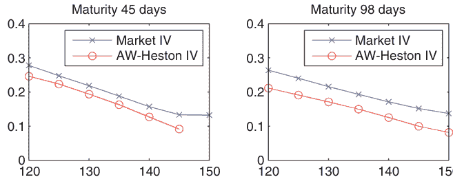
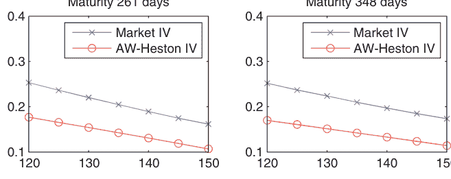

**图 6.2** 来自 MLE 和损失函数估计的隐含波动率

## 无风险中密度和无套利波动率曲

有了估计的参数，产生了一个问题：由参数值生成的波动率曲产生的价格是否无套利？模型生成的隐含波动率曲示例见图 2.9。套利可能存在于波动率曲的两个维度：行权价和到期日。

事实上，如果有一组市场期权价格，则可以使用损失函数进行参数估计，而不需要 Atiya 和 Wall (2009) 的 MLE 方法。行权价之间的无套利体现在非负的牛市价差中。牛市价差是一个包含三个仓位的组合：买入一份在 $K$ 的看涨期权，另一一份在 $K$，并卖出在 $K$ 的两个看涨期权。很容易证明，当 $dK \to 0$ 时，牛市价差的值收敛于二阶导数。

```matlab
function [RND, K2] = ExtractRND(K,CallPrice)
  % 计算行权价的一阶导数。
  for i=2:length(K)-1
    dk = K(i) - K(i-1);
    dc = CallPrice(i+1) - CallPrice(i);
    dcdK(i-1) = dc/dk;
  end
  % 使用差分计算风险中性密度。
  for i=2:length(dcdK)-1
    dk = K(i) - K(i-1);
    dcK = dcdK(i+1) - dcdK(i-1);
    RND(i-1) = dcK/dk;
  end
  K2 = K(3:end);
end
```

## 参数估计 173

```matlab
% 行权价增量和范围
dK = 0.5;
K(1) = 90;dK:170;
K(2) = 80;dK:180;
K(3) = 40;dK:220;
K(4) = 20;dK:240;
% 提取 RND、积分域、面积、负值
t=1:NT
  NK = length(K(t));
  for k=1:NK
    [C(t), H(k), N(t)(k)] = HestonPriceGaussLegendreMD(K(t),T(t)...);
  end
Domain(t) = max(H);
  [RND(t)] = ExtractRND(K(t),C(t));
  Area(t) = trapz(RND(t)*dK);
  Zero(t) = length(find(RND(t)==0));
```

代码的第二部分使用 `RND` 来恢复看涨期权的市场价格并验证其第三属性。这是使用梯形法则并结合 Matlab 内置函数 `trapz.m` 完成的。

```matlab
MktStrike = [120,125,130,135,140,145,150];
NK = length(MktStrike);
for t=1:NT
  for k=1:NK
    Payoff = max(ST(t) - MktStrike(k), 0);
    RNDCall(k,t) = trapz(Payoff.*RND(t)) * dK * exp(-rf*T(t));
end
error = sum(MktPrice - RNDCall);
```


表 6.6 包含了 `RND` 估计值，包括每个 `RND` 下的面积，以及通过多域积分法计算的积分上限和积分点数。所有 `RND` 的积分值均接近1，且没有负值，这表明前两个属性成立。上限随着期限的增加而减小，这证实了第 5 章中的观察结果：到期越长的积分表现越好。为了验证第三属性，我们注意到 `RND` 也能相当好地恢复看涨期权的市场价格，但为了节省空间，此处未列出。

## 表 6.6 RND 估计结果

| 期限 | 面积 | 上限 | 点数 |
|---|---|---|---|
| 45 | 0.9959 | 470 | 1,536 |
| 98 | 0.9915 | 290 | 960 |
| 261 | 0.9977 | 150 | 512 |
| 348 | 0.9996 | 120 | 416 |

## 174 MATLAB 和 C# 中的 HESTON 模型及其扩展

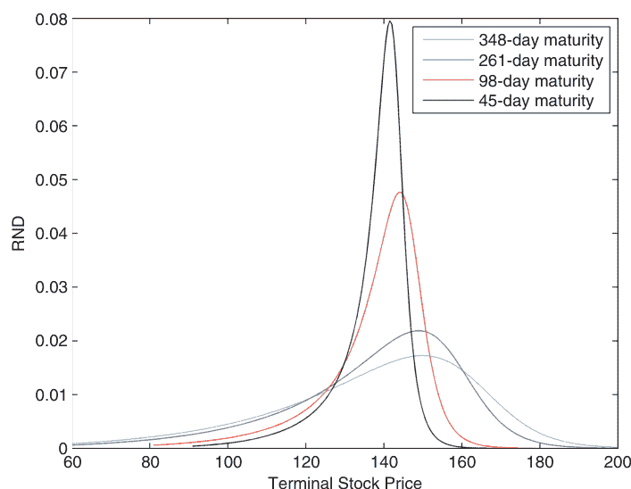

图 6.3 S&P500 数据的 RND

图 6.3 绘制出了四个期限的 `RND`。这些 `RND` 的行为符合预期。特别是，长期限的 `RND` 比短期限的 `RND` 更分散，反映了随着期限的增加，市场对价格的不确定性在增加。同时请注意每个密度中的负偏态，这是由生成它们时所使用的负相关性引起的。

图 6.3 中列出的参数估计值是表 6.1 第二行 `RMSE` 损失函数的结果。使用表 6.1 中的 `MSE` 和 `IVMSE` 参数生成的 `RND` 将产生相似的结果。然而，Christoffersen 等人 (2009) 的参数由于相关性参数的极高水平 $\rho = -0.9921$，将产生 `RND` 具有显著的偏态。

`RND` 是验证是否存在无套利行权价的方便工具，但由于它是为单一期限设计的，因此无法验证跨期限的无套利。正如 Carr 和 Madan (2005) 所解释的，确保不存在日历套利通常涉及验证日历具有非负价格。Kah (2004) 和 Fengler (2009) 显示，日历套利可以用总隐含方差 $u^2(K, \tau_i) = IV^2(K, \tau_i) \times \tau_i$ 来表示，其中 $IV(K, \tau_i)$ 是对应于行权价 $K$ 和期限 $\tau_i = T_i - t$ 的隐含波动率。测试规定，如果 $u^2(K, \tau_i)$ 是 $\tau_i$ 的严格递增函数，则不存在日历套利。

## 参数估计

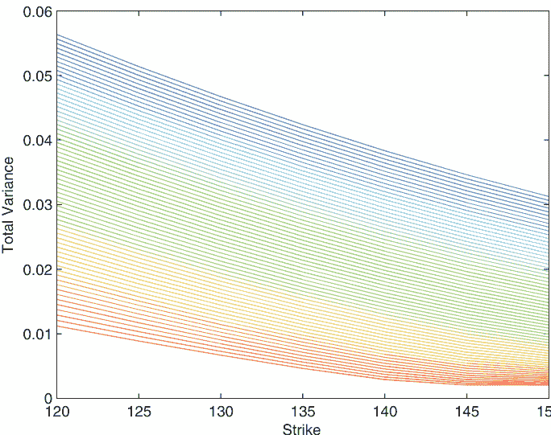

**图 6.4** S&P500 数据总方差

继续使用 S&P500 示例和表 6.1 中的 `RMSE` 参数估计值，图 6.4 绘制了从 45 到 360 天的总方差。该图清楚地显示总方差随期限的增加而增加。

# 结论

在本章中，我们介绍了估计 Heston 模型参数的方法。一种流行的方法是使用损失函数，这种方法实现相对简单。另一种流行的方法是使用极大似然法，但它需要更多的计算。作为回应，许多研究人员将现有方案应用于 Heston 模型，并创建了新的方案。我们将在下一章讨论其中的一些方案。

## 185 MATLAB 和 C# 中的 HESTON 模型及其扩展

所有到目前为止我们用于 Heston 模型期权定价的方法都是解析的，即期权价格以闭式形式表示，并涉及一个或多个需要计算的积分。这是许多定价方法的标准方法。另一种方法是使用模拟，我们将在本章介绍。

# 第 7 章：Heston 模型中的模拟

### 摘要

所有到目前为止我们用于 Heston 模型期权定价的方法都是解析的，即期权价格以闭式形式表示，并涉及一个或多个需要计算的积分。这是许多定价方法的标准方法。另一种方法是使用模拟，我们将在本章介绍。

Heston 模型背景下的蒙特卡洛模拟指的是一组生成人工价格和方差的技术，据此推导出期权价格。在这方面有几种选择。第一种选择是应用标准方法，如欧拉、Milstein 或隐式 Milstein 方法，如 Gather (2006) 和 Kahl & Jäck (2006) 所述。这些方案的优点是易于理解，且收敛性质是已知的。另一种选择是使用更适合或专门为模型设计的方法。这些方法包括 Kahl & Jäck (2006) 的 JJK 方案、Andersen (2008) 的二次指数方案、Zhu (2010) 的变换波动率方案、Alfoi (2010) 的方案，以及 Andersen 和 BrototherSchiff (2005) 的矩匹配方案。这些方案旨在更快地收敛到真实的期权价格，并在某些情况下避免从标准方法可能产生的负方差。这些和其他方法由 Van Haastrecht 和 Pelsser (2010) 综述。

### 通用设置

回顾股票价格及其方差由以下二元随机微分方程 (SDE) 系统驱动：

```
$dS_t = (r - q)S_tdt + \sqrt{V_t}S_tdW_{1,t}$

v_t = \kappa(\theta - v_t)dt + \sigma\sqrt{v_t}dW_{2,t}$
```

$E[dw_{1,t}dw_{2,t}] = \rho dt$。方程 (7.1) 中的过程是在连续时间内指定的。模拟是在离散时间步上进行的。在这里，模拟方案的第一步通常是近似连续时间过程。

通过离散时间过程，这种任务被称为离散化。股票价格及其波动率可以写成一般形式：

```
dX_t = \mu(X_t, t)dt + \sigma(X_t, t)dW_t \quad (7.2)
```

其中 $W_t$ 是布朗运动。我们在区间 $[0, \tau]$ 上模拟 $X$，并假设该区间被划分为点 $0 = t_0 < t_1 < \dots < t_n = \tau$，其中时间增量是等距的，宽度为 `dt`。等距的时间增量使得符号非常方便，因为它允许我们对所有 $i=2, \dots, N$ 将 $t_i - t_{i-1}$ 简单地写作 `dt`。使用等距增量得出的所有结果都可以很容易推广到非等距。从 $t$ 到 $t+dt$ 积分 `dX` 产生：

```
X_{t+dt} = X_t + \int_{t}^{t+dt} \mu(X_u, u)du + \int_{t}^{t+dt} \sigma(X_u, u)dW_u. \quad (7.3)
```

方程 (7.3) 是离散化的起点。其思想是在时间 $t$ 时已知 $X_t$ 的值，我们希望获得时间 $t+dt$ 的值 $X_{t+dt}$。使用 Heston 模型计算欧式期权，我们首先模拟二元过程 $(S_t, v_t)$，生成从 $t=0$ 到 $t=\tau$ 的 $N$ 条路径。然后我们保留每条股票路径的最后一个股票价格，获得欧式期权到期时的收益，对所有股票价格取平均并折现到时间零。例如，看涨和看跌期权 $C(K)$ 和 $P(K)$ 为：

```
C(K) = e^{-r\tau} \sum_{i=1}^N \max(0, S_i^{(0)} - K)

P(K) = e^{-r\tau} \sum_{i=1}^N \max(0, K - S_i^{(0)}) \quad (7.4)
```

其中 $S_i^{(0)}$ 是第 $i$ 条股票路径生成的终端股票价格，$i=1, \dots, N$。这要求我们估计参数 $\kappa, \theta, \sigma, v_0,$ 和 $\rho$ 中的每一个。

在模拟二元过程 $(S_t, v_t)$ 时会出现两个问题。第一个是收敛速度。第二个更严重的问题是，由于 $v_t$ 遵循 CIR 过程，许多模拟方案（包括 Euler 和 Milstein 方案）会产生 $v_t$ 的负值，即使满足了 Feller 条件 $2\kappa\theta > \sigma^2$。这是因为 Feller 条件适用于连续时间过程，但模拟在时间上是离散的，仅作为连续时间过程的近似。

处理负方差的最简单方法是在它们出现时将其覆盖（override）。实现此点的至少有两种方法：

- 在全截断方案（full truncation scheme）中

全截断方案的缺点是它产生了零方差，这是不现实的，因为股票价格永远不会表现出零方差。

# Heston 模型模拟

反射方案（reflection scheme）的缺点是将会将大的负方差反射为正方差。因此，它将低波动率的实现转换为高波动率。

处理 $v_i$ 负模拟值的另一种方法是设计一种根本不会产生负值的 $v_i$ 模拟方案。关于模拟 Heston 模型中 CIR 方差的大部分研究都致力于这种方法。另一种方法是模拟 $\ln v_i$ 或 $\sqrt{v_i}$，然后对结果取指数和平方。对于股票价格，我们可以模拟 $S_t$，但我们在本章中将看到更好的方法是模拟对数价格 $x_t = \ln S_t$，然后取指数。

Heston 模型的所有模拟方案都包含相同的步骤：首先，生成两个标准正态变量并使用 Cholesky 分解使它们相关。将这些乘以 $\sqrt{v_t}$ 以产生布朗运动增量。其次，获得更新后的 $v_{t+dt}$。第三，获得更新后的 $S_{t+dt}$。

- **步骤 0。** 初始化 $S_0$ 为现货价格（或 $x_0$ 为对数价格），并将 $v_0$ 为当前方差。
- **步骤 1。** 生成两个独立的正态变量 `Z_1` 和 `Z_2`，定义 `Z_v = Z_1` 且 `Z_s = Z_v + sqrt(1-Z_v^2)Z_2`，产生布朗运动 `dW_{s,t} = sqrt(v_t)Z_s` 和 `dW_{v,t} = sqrt(v_t)Z_v`。
- **步骤 2。** 获得更新后的 `v_{t+dt}`。
- **步骤 3。** 使用 `v_{t+dt}` 获得更新后的 `S_{t+dt}`（或 `x_{t+dt}`）并返回步骤 1。

注意 `Z_v` 和 `Z_s` 的构造使得 $E[Z_v] = 0$，$E[Z_v^2] = 1$ 且 $E[Z_s^2] = 1$。在本章中，我们讨论了 $(S_t, v_t)$ 的一些离散化方案。我们假设时间格使用等距的 `dt` 离散化。

### EULER 方案

离散化方程 (7.3) 方法的最简单方法是使用 Euler 离散化。这等同于使用左端法则积分。第一个积分通过时间 $t$ 的积分函数与积分域 `dt` 的乘积近似：

$$\int_{t}^{t+dt} \mu(X_u, u)du \approx \mu(X_t, t)dt.$$

我们使用左端法则是因为时间 $t$ 时 $\mu(X_t, t)$ 是已知的。右端法则要求 $\mu(X_{t+dt}, t+dt)$ 是已知的。第二个积分近似为：

$$\int_{t}^{t+dt} \sigma(X_u, u) dW_u = \sigma(X_t, t)(W_{t+dt} - W_t) \approx \sigma(X_t, t)\sqrt{dt}$$

# MATLAB 和 C 中的 Heston 模型

由于 $W_{t+dt} - W_t$ 和 $\sqrt{dt}Z$ 分布相同，其中 $Z$ 是标准正态变量。因此，方程 (7.3) 的 Euler 离散化为：

$$X_{t+dt} = X_t + \mu(X_t, t)dt + \sigma(X_t, t)\sqrt{dt}. \quad (7.5)$$

在接下来的节中，我们将说明 Heston 模型的 Euler 离散化。

### 方差的 Euler 方案

方程 (7.1) 中 $v_t$ 的 SDE 写成 (7.3) 的形式为：

$$v_{t+dt} = v_t + \int_{t}^{t+dt} \kappa(\theta - v_u)du + \int_{t}^{t+dt} \sigma\sqrt{v_u}dW_u. \quad (7.6)$$

根据方程 (7.5)，Euler 离散化将 (7.6) 中的积分近似为：

$$\int_{t}^{t+dt} \kappa(\theta - v_u)du \approx \kappa(\theta - v_t)dt$$
$$\int_{t}^{t+dt} \sigma\sqrt{v_u}dW_u \approx \sigma\sqrt{v_t}\sqrt{dt}Z_v. \quad (7.7)$$

这意味着方差的 Euler 离散化为：

$$v_{t+dt} = v_t + \kappa(\theta - v_t)dt + \sigma\sqrt{v_t}\sqrt{dt}Z_v. \quad (7.8)$$

众周知，产生 $v_{t+dt}$ 负值的概率为：

$$Pr(v_{t+dt} < 0) = \Phi \left( \frac{-(1-\kappa dt)v_t-\kappa\theta dt}{\sigma\sqrt{v_t}\sqrt{dt}} \right)$$

其中 $\Phi(x)$ 表示在 $x$ 处的标准正态累积分布函数。因此，当我们应用方差时，必须应用全截断方案或反射方案来处理模拟中生成的任何负值。

### 股票价格的 Euler 方案

模拟股票价格有两种常用方法。我们可以直接模拟 $S_t$，或者模拟 $\ln S_t$ 并取指数。方程 (7.3) 中 $S_t$ 的 SDE 可以写积分形式：

$$S_{t+dt} = S_t + (r-q)\int_{t}^{t+dt}S_udu + \int_{t}^{t+dt}\sqrt{v_u}S_udW_u.$$

# Heston 模型模拟

应用 (7.5)，Euler 离散化将积分近似为：

$$\int_{t}^{t+dt} \sqrt{S_u} du \approx S_t dt$$
$$\int_{t}^{t+dt} \sqrt{S_u} dW_u = \sqrt{S_t}(W_{t+dt} - W_t) \approx \sqrt{S_t}\sqrt{dt}Z_s.$$

股票价格的 Euler 离散化为：

$$S_{t+dt} = S_t + (r-q)S_t dt + \sqrt{S_t}\sqrt{dt}Z_s. \quad (7.9)$$

为了模拟对数价格，我们对 (7.1) 的第一个方程应用伊藤 引理。在此，$S_t$ 遵循 SDE：

$$d \ln S_t = (r-q-\frac{1}{2}v_t)dt + \sqrt{v_t}dW_{1,t},$$

或积分形式：

$$\ln S_{t+dt} = \ln S_t + \int_{t}^{t+dt} (r-q-\frac{1}{2}v_u) du + \int_{t}^{t+dt} \sqrt{v_u}dW_{1,u} = \text{(7.10)}$$

$\ln S_t$ 过程的 Euler 离散化为：

$$\ln S_{t+dt} \approx \ln S_t + (r-q-\frac{1}{2}v_t)dt + \sqrt{v_t}(W_{1,t+dt}-W_{1,t})$$
$$ = \ln S_t + (r-q-\frac{1}{2}v_t)dt + \sqrt{v_t}\sqrt{dt}Z_s. = \text{(7.11)}$$

$S_t$ 的 Euler 离散化通过对 (7.11) 取指数得到：

$$S_{t+dt} = S_t \exp((r-q-\frac{1}{2}v_t)dt + \sqrt{v_t}\sqrt{dt}Z_s). = \text{(7.12)}$$

### MILSTEIN 方案

该方案在 Glassmann (2003) 以及 Kloeden 和 Platen (1992) 中针对通用过程描述，并在 Kahl 和 Jäckel (2006) 中针对随机波动率模型描述。对于 Heston 模型，方程 (7.2) 中的系数依赖于 $X_t$ 且不

不直接取决于 $t$。因此，为了简单起见，我们可以假设股票价格方差由随机微分方程（SDE）驱动：

```
$dX_t = \mu(X_t)dt + \sigma(X_t)dW_t
```

积分形式为：

```
$X_{t+dt} = X_t + \int_t^{t+dt} \mu_s ds + \int_t^{t+dt} \sigma_s dW_s. \quad (7.13)$
```

Milne 方案的思想是通过扩展伊藤引理中的系数 $\mu_t = \mu(X_t)$ 和 $\sigma_t = \sigma(X_t)$ 来增加离散化的精确性。这是合理的，因为这些系数也是 $X_t$ 的函数。事实上，我们对系数 $\mu_t$ 和 $\sigma_t$ 应用了伊藤引理，就像我们处理任何可微的 $X_t$ 一样。根据伊藤引理，系数遵循以下 SDE：

```
$\mu_t = \left( \mu_t' + \frac{1}{2}\mu_t''\sigma_t^2 \right) dt + \langle\mu_t',\sigma_t\rangle dW_t,\ \sigma_t = \left( \sigma_t' + \frac{1}{2}\sigma_t''\sigma_t^2 \right) dt + \langle\sigma_t',\sigma_t\rangle dW_t.$
```

其中，撇号（prime）表示对 $X$ 求导，而 $t$ 的导数为零，因为在 Heston 模型中 $\mu_t$ 和 $\sigma_t$ 不直接依赖于 $t$。时间 $s$ 处的系数（当 $t < s < t+dt$ 时）的积分：

```
$\mu_s = \mu_t + \int_t^s (\mu_u' + \frac{1}{2}\mu_u''\sigma_u^2) du + \int_t^s \langle\mu_u',\sigma_u\rangle dW_u,\ \sigma_s = \sigma_t + \int_t^s (\sigma_u' + \frac{1}{2}\sigma_u''\sigma_u^2) du + \int_t^s \langle\sigma_u',\sigma_u\rangle dW_u.$
```

代入方程 (7.13) 积分内部的 $\mu_t$ 和 $\sigma_t$，得到：


$X_{t+dt} = X_t + \int_t^{t+dt} (\mu_s' + \frac{1}{2}\mu_s''\sigma_s^2) ds + \int_t^{t+dt} \langle\mu_s',\sigma_s\rangle dW_s,\n+ \int_t^{t+dt} (\sigma_s' + \frac{1}{2}\sigma_s''\sigma_s^2) du + \int_t^{t+dt} \langle\sigma_s',\sigma_s\rangle dW_s. \quad (7.14)$

高阶差分项 $dt ds = O(dt^2)$ 和 $dW_u = O(dt^{1/2})$ 被忽略。涉及 $dW_u dW_s$ 的项被保留，因为它是 $O(dt)$，属于一阶。这意味着 (7.14) 简化为：

$X_{t+dt} = X_t + \int_t^{t+dt} \mu_s' ds + \int_t^{t+dt} \sigma_s' dW_s + \int_t^{t+dt} (\langle\sigma_s',\sigma_s\rangle)dW_sW_s. \quad (7.15)$

## Heston 模型仿真

对 (7.15) 的最后一项应用欧拉离散化，得到：

$$\int_t^{t+dt} (\sigma_u \sigma_v) dW_u dW_s \approx \sigma'_u \sigma'_v \int_t^{t+dt} W_u dW_s = \sigma'_u \sigma'_v (W_s - W_t) \n = \sigma'_u \sigma'_v (\int_t^{t+dt} W_u dW_s - W_{t+dt} + W_t^2) \quad (7.16)$$

为了求解 (7.16) 中的剩余积分 $dY_t = Y_t dW_t$，利用伊藤引理可以证明 $Y_t$ 的解为 $Y_t = \frac{1}{2}W_t^2 - \frac{1}{2}t$。事实上，我们有 $\partial Y/\partial t = -\frac{1}{2}$、$\partial Y/\partial W = W$  $\partial^2 Y/\partial W^2 = 1$，所以：

```
$dY_t = (-\frac{1}{2} + 0 \times 1 \times 1) dt + (W_t \times 1) dW_t = W_t dW_t.$
```

应用这一结果，我们可以写道：

$$\int_t^{t+dt} W_s dW_s = Y_{t+dt} - \frac{1}{2}W_{t+dt}^2 - \frac{1}{2}W_t^2. \quad (7.17)$$

代入方程 (7.16) 得到：

$$\int_t^{t+dt} (\sigma_u \sigma_v) dW_u dW_s \approx \sigma'_u \sigma'_v[(W_{t+dt} - W_t)^2 - dt] \text{（此处原文公式异常）} \quad (7.18)$$

$\Delta W_t = W_{t+dt} - W_t$ 在分布上等于 $\sqrt{dt}Z$，其中 $Z$ 服从正态分布。结合方程 (7.15) 和 (7.18) 以及 Milstein 的通用形式，得到：

$X_{t+dt} = X_t + \mu_t dt + \sigma_t \sqrt{dt}Z + \frac{1}{2}\sigma_t\sigma_dt(Z^2 - 1). \quad (7.19)$

因此，方程 (7.19) 中 $dX$ 的 Milstein 离散化与 (7.5) 相同，只是多了 (7.19) 中的额外项 $\frac{1}{2}\sigma_t\sigma_t(Z^2 - 1)$。这一额外项提高了 Milstein 离散化的精确性。

## Heston Milstein 方案

回顾 Heston 模型由方程 (7) 中的二元过程指定。在 $S_t$ 和 $v_t$ 过程中，漂移和波动系数不依赖于 $t$。因此，方程 (7.19) 适用于这两个过程以及 $\ln S_t$ 过程。

## 和 C 中的 Heston 模型及其扩展

### 方差的 Milstein 方案

方差过程的系数为 $\mu(v_t) = \kappa(\theta - v_t)$ 和 $\sigma(v_t) = \sqrt{v_t}$，将方程 (7.19) 应用于 $v_t$ 产生：

```
$v_{t+dt} = v_t + \kappa(\theta - v_t)dt + \sqrt{v_t}dZ_v + \frac{1}{4}v_t(dZ_v^2-1) \quad (7.20)$
```

可以写为：

```
$v_{t+dt} = \left(\sqrt{v_t} + \frac{1}{2}\sqrt{v_t}dZ_v\right)^2 + \kappa(\theta - v_t)dt - \frac{1}{4}v_td. \quad (7.21)$
```

该方程也是 Heston 的 (7.18)。方差过程的 Milstein 离散化产生的负值比欧拉离散化少。尽管如此，必须对 (7.20) 和 (7.21) 应用全截断或反射方案。

### 股票价格的 Milstein 方案

股票价格过程的系数为 $\mu(S_t) = (r-q)S_t$，且 $\sigma(S_t) = \sqrt{v_t}S_t$，因此方程 (7.19) 变为：

```
$S_{t+dt} = S_t + (r-q)S_dt + \sqrt{v_t}S_dt + \frac{1}{2}v_t(dZ_s^2-1). \quad (7.22)$
```

我们也可以对对数股票过程进行离散化，根据伊藤引理其遵循：

```
$d\ln S_t = (r-q-\frac{1}{2}v_t)dt + \sqrt{v_t}dW_t.$
```

系数为 $\mu(S_t) = r-q-v_t/2$ 和 $\sigma(S_t) = \sqrt{v_t}$，所以 $\mu'_t = \sigma'_t = 0$。由于 $v_t$ 在时间 $t$ 已，我们可以将其视为系数中的常量。应用方程 (7.19) 得：

```
$\ln S_{t+dt} = \ln S_t + (r-q-\frac{1}{2}v_t)dt + \sqrt{v_t}dZ_s \quad (7.23)$
```

这与 (7.11) 中的欧拉离散化相同。Heston 模型中 $\ln S_t$ 的 Milstein 离散化产生的近似值并不比欧拉更精确。股票价格通过 (7.23) 的指数化得到。同样，必须对 (7.22) 和 (7.23) 应用全截断或反射方案。对于股票价格和方差的 $v_t$，给定仿真值 $(S_t,v_t)$，我们从方程 (7.20) 得到 $v_{t+dt}$，从 (7.22) 或通过对 (7.23) 取指数得到 $S_{t+dt}$，如 (7.12) 所示。仿真方案可以有力地说明 Heston 参数如何影响股票价格和波动性的行为。例如在第二章中，我们看到参数 $\rho$ 驱动过程之间的相关性。

## Heston 模型仿真


**图 7.1** 负相关下的股票价格与方差

驱动股票价格和方差。以下图表各包含一条一年（250 天）的仿真股票价格路径和方差，初始值为 $(S_0, v_0) = (100, 0.05)$ 并使用典型的参数值。图 7.1 使用 $\rho = -0.9$，清晰地说明了价格与方差之间的负相关关系。事实上，方差增加与股票价格下降相关，而方差增加的情况则相反。

相反，图 7.2 使用 $\rho = +0.9$，显示了相反的效果：方差增加与价格上涨相关，反之亦然。仿真也可以用于说明 Heston 参数对股票价格和方差的影响。

## 隐式 Milstein 方案

回顾在用于 $dX$ 的 Milstein 离散化方程 (7.19) 中，系数 $\mu_t = \mu(X_t)$ 和 $\sigma_t = \sigma(X_t)$ 是 $X_t$ 过程的漂移和波动，且是 $X_t$ 本身的函数。在 Milstein 漂移隐式方案（或简单隐式方案）中，漂移系数 $\mu_t$ 被指定为 $X_{t+dt}$ 的函数。因此，在该方案下，漂移系数仅隐式已知，而非显式已知（如依赖于 $X_t$ 的情况）。该方程 (7.19) 的伊藤版本变为：

```
$X_{t+dt} = X_t + \mu_{t+dt}dt + \sigma_t\sqrt{dt}dZ + \frac{1}{2}\sigma_t\sigma_dt(Z^2 - 1) \quad (7.24)$
```

## MATLAB 和 C# 中的 HESTON 模型及其扩展

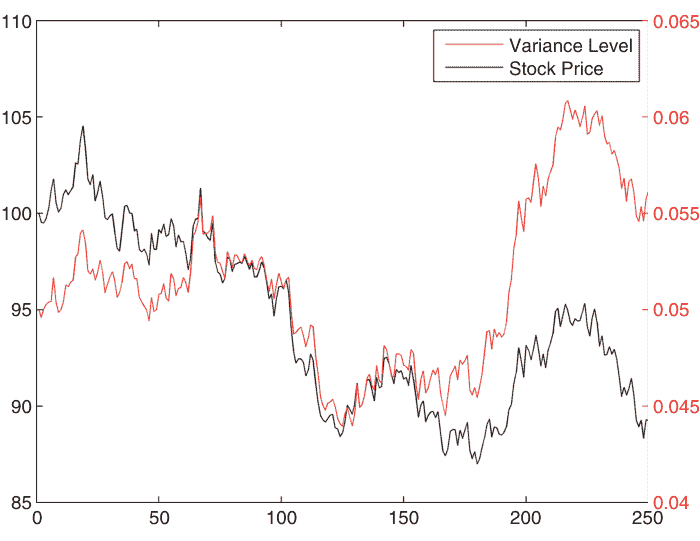

图 **7.2** 正相关性下的股价和方差

$\mu_{t+dt} = \mu(X_{t+dt})$。详情见阅 Kloeden 和 Platen (1992)。通过对 $\mu_i$ 和 $\mu_{t+dt}$ 取加权平均，可以在显式和隐式 Milstein 方案之间进行插值，因此隐显式 Milstein 方案为：

```
$X_{t+dt} = X_t + [\alpha\mu_t + (1 - \alpha)\mu_{t+dt}]dt + \sigma_t\sqrt{dt}dZ + \frac{1}{2}\sigma_t\sigma_t(dt^2 - 1)$ (7.25)
```

其中 $\alpha \in (0,1)$ 为权重。显式 Milstein 方案对应于 $\alpha = 1$，隐式 Milstein 方案对应于 $\alpha = 0$。

将隐式 Milstein 方案应用于 Heston 模型，我们将方程 (7.20) 中的项 $\kappa(\theta-\nu_t)dt$ 替换为 $\kappa(\nu_{t+dt})dt$。将 $\kappa\nu_{t+dt}dt$ 移到求解方程的左侧，除以 $1+\kappa dt$， ：

$$\nu_{t+dt} = \frac{\nu_t + \kappa\theta dt + \sigma_t\sqrt{dt}dZ_v + \frac{1}{2}\sigma_t^2(dZ_v^2 - dt)}{1 + \kappa dt} $$ (7.26)

如果我们将相同的步骤应用于方程 (7.25) 中的加权方案，将得到：

$$\nu_{t+dt} = \frac{\nu_t + \kappa(\theta-\alpha\nu_t)dt + \sigma_t\sqrt{dt}dZ_v + \frac{1}{2}\sigma_t^2(dZ_v^2 - dt)}{1 + (1-\alpha)\kappa dt} $$ (7.27)

Matlab 函数 `EulerMilsteinSim.m` 应用方差的 Euler (7.8)、Milstein (7.20)、隐式 Milstein (7.26) 或加权 Milstein (7.27) 离散化：

```mat
function [S V F SimPrice] = EulerMilsteinPrice(scheme,...);

% 获取模拟股价和模拟方差

[S V F] = EulerMilsteinSim(scheme,...);

% 期末股价

ST = S(end,:);

```

## 收益向量 (Payoff vectors)

```c
% 收益向量
if strcmp(PutCall,'C')
    Payoff = max(S - K,0);
elseif strcmp(PutCall,'p')
    Payoff = max(K - S,0);
end
SimPrice = exp(-r*T)*mean(Payoff);
```

期权定价方案的 C 代码与上述的 Euler、Milstein、隐式 Milstein 和加权 Milstein 方案非常相似。但在 C# 中，我们需要创建函数来从标准正态密度中生成随机数。我们使用第 6 章微分算法中介绍的 `RandomNum()` 和 `RandomInt()` 函数来生成均匀随机数和随机整数。我们使用 Box-Muller 变换将均匀随机数转换为标准正态密度的随机数。这涉及使用 `RandomNum()` 函数生成两个在 $[0,1]$ 上均匀分布的随机数 $u_1$ 和 $u_2$，然后定义为：

$z = \sqrt{-2\ln u_1} \sin(2\pi u_2)$ (7.28)

```csharp
public static double RandomNorm(){
    double U1 = RandomNum(0.0,1.0);
    double U2 = RandomNum(0.0,1.0);
    return Math.Sqrt(-2.0*Math.Log(U1)) * Math.Sin(2.0*Math.PI*U2);
}
```

为了说明，当 $r=0.03, \theta=0.06, \sigma=0.5, \rho=-0.7$ 时，现价 $S=100$ 收益率为 $q=0.02$ 的派股股票的3 个月看涨期权价格为 $11.2087$。我们使用 5,000 条股票路径，每个路径包含 100 个时间步，并应用反射方案。Euler 方案的价格为 $11.3855$（误差为 $1.6\%$）。Milstein 方案产生的价格为 $11.1413$（误差 $0.6\%$），隐式 Milstein 方案的价格为 $11.0692$（误差 $1.2\%$），加权 Milstein 方案的价格为 $11.1566$（误差 $0.5\%$）。这三种方案均未产生负方差。

## 变换波波动率方案 (TRANSFORMED VOLATILITY SCHEME)

避免负方差的一种简单方法是模拟波动率而非方差，然后对结果进行平方。根据 Ito 引理，波动率 $\omega_t = \sqrt{V_t}$ 遵循此过程：

$d\omega_t = \frac{\kappa}{2}\left(\theta - \frac{\sigma^2}{4\kappa}\right)\omega_t dt + \frac{1}{2}\sigma dW_{1,t}$ (7.29)

## Heston 仿真

(7.29) 的 Euler 离散化为：

```
\omega_{t+dt} = \omega_t + \frac{\kappa}{2} \left(\theta - \frac{\sigma^2}{4\kappa}\right) \omega_t dt + \frac{1}{2}\sqrt{dt}Z_V$$ (7.30)
```

而对数股价的 Euler 离散化为：

$S_{t+dt} = S_t \exp \left(r - \frac{1}{2}\omega_t^2\right) dt + \omega_t\sqrt{dt}Z_S$ (7.31)

Zhu (2010) 指，，波动率 $\omega_t$ 的 Euler 离散化避免了负方差，但缺点是 (7.29) 中的均值水平 $\theta_{\omega_t} = (\theta - \frac{\sigma^2}{4\kappa})/\omega_t$ 因为 $1/\omega_t$ 是随机的。这会导致仿真表现不佳。Zhu (2010) 的变换波动率方案应用 $\theta_{\omega_t}$ 的稳健近似来修正此问题。他的变换波动率过程为：

$d\omega_t = \frac{\kappa}{2}[\theta^* - \omega_t]dt + \frac{\sigma}{2}dW_{\omega,t}$ (7.32)

其分别具有均值回归速度 $\kappa/2$ 和方差波动率 $\sigma/2$。均值回归水平 $\theta_t^*$ 为：

$\theta_t^* = \frac{\theta - \omega_t\exp(-\kappa dt)}{1 - \exp(-\kappa dt)}$

其中 $\beta = \sqrt{(E[\nu_{t+dt}] - Var[\nu_{t+dt}])}$，当 $E[\nu_{t+dt}] < Var[\nu_{t+dt}]$ 时，将 $\beta$ 参数设为零，而均值回归水平 $\theta_t^*$ 取决于 $\omega_t$ 的值。$d\omega_t$ 在 (7.32) 中的 Euler 离散化为：

```
\omega_{t+dt} = \omega_t + \frac{\kappa}{2}[\theta^* - \omega_t]dt + \frac{\sigma}{2}\sqrt{dt}Z_V$$ (7.33)
```

TransVolSim Matlab 函数仿真了方程 (7.30) 或 (7.33) 中的股价。函数使用了参数 $\kappa, \theta, \sigma$ 和 $\rho_t$，初始波动率参数为 $\sqrt{V_0}$。

```matlab
function [S v] = TransVolSim(scheme,...)
v(1,:) = v0;               % Heston初始方差
w(1,:) = sqrt(v0);      % Heston初始波动率
for i=1:N
    t=2:T
    % 生成两个N(0,1)变量
    Zv = randn(i);
    Zx = rho*Zv + sqrt(1-rho^2)*randn(i);
    if strcmp(scheme,'Euler')
        % Euler 方案
        w(t,i) = w(t-1) + 0.5*kappa*(theta-sigma^2/4/kappa)*w(t-1)*dt + 0.5*sigma*sqrt(dt)*Zv;
```


```matlab
elseif strcmp(scheme,'TV')

    % 变换波动率

    ml = theta + (v(t-1)-theta)*exp(-kappa*dt);

    m2 = sigma^2/4/kappa*(1-exp(-kappa*dt));

    beta = sqrt(max(0, ml + m2)); % 化的

    w(t,i) = w(t-1) + 0.5*kappa*(beta-w(t-1)*exp(-kappa*dt))/(1-exp(-kappa*dt))*dt + 0.5*sigma*sqrt(dt)*Zv;

end

v(t,i) = w(t,i)^2;

end
```

在本节中，我们描述了 Kahl 和 Jäckel (2006) 提出的三种方案。Milstein 等人 (1998) 的平衡隐法（Balanced Implicit method）在扩散项中引入了隐性。路径适应线性化二次法（Pathwise Adapted Linearization Quadratic method）在更通用的路径近似展开中保留了直到 $(dt)^2$ 的项。最后，IJK 方案对方差使用了隐 Milstein 方案，并对对数股票价格使用了另一种散化方法。

# 平衡、路径适应和 IJK 方案

## 平衡隐方案 (Balanced Implicit Scheme)

该方案能够保持方差过程的正性。它在 Platen 和 Heath (2009) 以及 Kahl 和 Jäckel (2006) 中定义为：

```
$v_{t+dt} = v_t + \mu_t dt + \sigma_t \Delta W_t + (v_t - v_{t-dt})C(v_t)$
```

其中

```
$C(v_t) = c^0(v_t)dt + c^1(v_t)|\Delta W_t|$
```

其中 $c^0$ 和 $c^1$ 是适当选择的正值有界函数，定义为 $c^0(v_t) = \kappa$ 和 $c^1(v_t) = \sigma/\sqrt{v_t}$。Heston 模型的平衡隐方案为：

```
$v_{t+dt} = v_t + \kappa(\theta - v_t)dt + \sigma\sqrt{v_t}dtZ_v + (v_t - v_{t-dt})C(v_t) = \frac{v_t(1 + C(v_t)) + \kappa(\theta - v_t)dt + \sigma\sqrt{v_t}dtZ_v}{1 + C(v_t)} (7.34)$
```

其中

```
$C(v_t) = \kappa dt + \frac{\sigma \sqrt{dt}|Z_v|}{\sqrt{v_t}}$
```

由于方差始终保证为正，因此不需要反射（reflection）和截断（truncation）。遗憾的是，正如 Kahl 和 Jäckel (2006) 所示，该方案的收敛性可能非常差。详情请参考他们论文中的方程 (6.25) 至 (6.28)。

## 路径适应线性化二次 (Pathwise Adapted Linearization Quadratic)

另一种方差散化方案是 Kahl 和 Jäckel (2006) 提出的路径适应线性化二次方案。它的收敛速度快，特别是当 $\sigma$ 取值较小时。该方案给出：

```
$v_{t+dt} = v_t + (\kappa(\widetilde{\theta} - v_t) + \sigma\beta_n\sqrt{v_t}) (1 + \frac{\sigma \beta_n - 2\kappa\sqrt{v_t}}{4\sqrt{v_t}} dt)$ (7.35)$
```

其中 $\widetilde{\theta} = \theta - \sigma^2/(4\kappa)$ 且 $\beta_n = Z_v/\sqrt{dt}$。该方案必须小心实现，因为在 $\sigma$ 较大时可能会导致数值不稳定。

## Kahl-Jäckel IJK 方案

这也是由 Kahl 和 Jäckel (2006) 提出的。它涉及使用方程 (7.26) 中的隐 Milstein 方案模拟 $v_t$，并使用他们给 IJK 散化方法模拟 $S_t$：

```
$$\ln S_{t+dt} = \ln S_t + \left(r - q - \frac{v_t + v_{t+dt}}{4}\right)dt + \rho\sqrt{v_t}dtZ_V + \frac{1}{2}(\sqrt{v_t} + \sqrt{v_{t+dt}})\sqrt{dt} + \frac{\rho\sigma}{2}(Z_V^2 - 1). (7.36)$$
```

由于该方案也会产生负方差，因此在 (7.36) 中应使用截断方案或反射方案。推导细节见他们的论文。

`Matlab` 函数 `KahlSim` 实现了平衡 (7.34)、路径适应 (7.35) 和 IJK (7.36) 方案。为了节省空间，省略了函数的部分内容：

```matlab
function { S V F } = KahlJackelSim(scheme,...)

  for i=1:T

    if strcmp(scheme, 'IJK')

      % 方差的 Milstein 方法

      V(t,i) = (V(t-1,i) + kappa*theta*dt + ...

      % IJK 散化对数股票价格

      S(t,i) = S(t-1,i)*exp((r-q-V(t,i)+V(t-1,i))/4) + ...

      % 方差的路径适应线性化

      theta2 = theta - sigma2/4/kappa;

      Bn = 2*sqrt(dt);

      V(t,i) = (V(t-1,i) + kappa(theta2-V(t-1,i))) + ...

      % Euler/Milstein 散化对数股票价格

      S(t,i) = S(t-1,i)*exp((r-q-V(t-1,i)/2)*dt + ...)

    elseif strcmp(scheme, 'B')

      % 方差的平衡方案

      abdw = sqrt(abs(Zv));

      C = kappa*dt + sigma/sqrt(V(t-1,i)) + ...

      V(t,i) = (V(t-1,i))*(1+C) + kappa*(theta-V(t-1,i)) / ...

      % Euler/Milstein 散化对数股票价格

      S(t,i) = S(t-1,i)*exp((r-q-V(t-1,i)/2)*dt + ...)

    end

end
```

`KahlJackelPrice` 函数基于模拟的路径计算欧洲看涨或看跌的价格。实现这些方法的 C 代码与 Matlab 代码类似，此处未给出。

## Heston 模型中的仿真

我们继续前面节中的示例，使用 5000 条路径和 100 个步长。回顾解析解价格为 .87。IJK 方案产生 .833，路径适应方案产生 .92，平衡方案产生 .841。这些误差很小，且没有方案生成了负方差。

# 二次指数方案 (QUADRATIC-EXPENTIAL SCHEME)

回顾第一章，给定观测值 $v_t$，$v_{t+dt}$ 服从非中心卡方分布。Andersen (2008) 建议根据非中心参数 $v_{t+dt}$ 是大还是小进行采样。由于非中心参数与 $v_t$ 成比例，参数的大或小值对应于 $v_t$ 的大或小值，算法在两种非中心卡方近似之间切换；近似的选择取决于 $v_t$ 的幅度。理由如下：

对于 $v_t$ 的中等或高值，非中心卡方随机变量可以用标准正态变量 $Z_v$ 的幂函数近似：

```
$v_{t+dt} = a(b + Z_v)^2$
```

其中 $a$ 和 $b$ 通过矩匹配使用 Cox, Ingersoll 和 CIR (1985) 过程的均值 $m$ 和方差 $s$ 。对于 $v_t$ 的小值，非中心卡方密度可以通过涉及狄拉克函数 $\delta$ 和另一个涉及 $e^{-bx}$ 的项的加权平均来近似：

```
$Pr(v_{t+dt} \in [x, x+dx]) = (p\delta(0) + (1-p)e^{-\beta x})dx$
```

其中 $p$ 和 $\beta$ 同样通过矩匹配确定。注意 $0 \le p \le 1$。积分 (7.38) 并反转分布函数：

```
$$\Psi^{-1}(u) = \begin{cases} 0 & \text{对于 } 0 \le u \le p \\ \frac{1}{\beta}\ln\frac{1-p}{1-u} & \text{对于 } p \le u \le 1. \end{cases}$$
```

因此，$v_t$ 小值的采样方案为：

```
$v_{t+dt} = \Psi^{-1}(U_v)$
```

其中 $U_v$ 是均匀随机数。二次指数（QE）采样方案由方程 (7.37) 和 (7.40) 定义。从这些方程可以看出，QE 方案保证只生成 $v_{t+dt}$ 的正值。Duffy 和 Kiele (2009) 提供了 QE 方案的很好的解释。

## MATLAB 和 C 中的 Heston 模型及其扩展

### 矩匹配 (Moment-Matching)

参数 $a, b, p, \beta$ 通过匹配非中心卡方分布的前两个矩与近似分布的矩得到。回顾第一章，CIR 过程的均值和方差分别为：

```
$m = E[v_{t-dt}|v_t] = \theta + (v_t - \theta)e^{-\theta dt}$
$s^2 = Var[v_{t-dt}|v_t] = \frac{\sigma^2 e^{-2\theta dt}}{\kappa}(1 - e^{-\theta dt}) + \frac{\theta\sigma^2}{2\kappa}(1 - e^{-\theta dt})^2. (7.41)$
```

对于 $v_t$ 的中等或高值，由于 (7.37) $v_{t-dt} = a(b+Z_v^2)$，且 $Z_v^2$ 服从两个自由度的卡方分布，我们有 $E[v_{t-dt}] = a(1+b^2)$ 和 $Var[v_{t-dt}] = 2a^2(1+2b^2)$。将这些值等于 $a$ 和 $s^2$ 并求解 $a$ 和 $b$ 得到：

```
$b = \frac{2}{\psi} - 1 + \sqrt{\frac{4}{\psi^2}-1}, \quad a = \frac{m}{1+b^2}$
```

其中 $\psi = s^2/m$ 仅在 $\psi \le 2$ 时定义。对于 $v_t$ 的低值，$v_{t-dt}$ 的均值和方差通过积分 (7.38) 得到：

```
$E[v_{t-dt}] = (1-p)/\beta$
$Var[v_{t-dt}] = (1-p^2)/\beta^2$
```

# Heston 模型中的模拟

## 对数股票价格的处理过程

Andersen (2008) 为 $\ln S$ 提出了一种离散化方案，该方案克服了欧拉离散化带来的“泄漏”相关性问题。回顾第 3 章，我们使用 Cholesky 分解将 Heston 二元 SDE 系统中相关的布朗运动 $W_{1,t}$ 和 $W_{2,t}$ 替换为独立的布朗运动 $B_{1,t}$ 和 $B_{2,t}$，定义为 $W_{1,t} = \rho B_{2,t} + \sqrt{1-\rho^2}B_{1,t}$ 和 $W_{2,t} = B_{2,t}$。因此，$v$ 过程的积分形式为：

```
$v_{t+dt} = v_t + \kappa dt - \kappa \int_{t}^{t+dt} v_u du + \sigma \int_{t}^{t+dt} \sqrt{v_u} dB_{2,\mu}$
```

整理项后得到：

```
$$\int_{t}^{t+dt} \sqrt{v_u} dB_{2,\mu} = \frac{1}{\sigma} (v_{t+dt} - v_t - \kappa dt + \kappa \int_{t}^{t+dt} v_u du) (7.44)$$
```

对方程 (7.10) 应用 Cholesky 分解，得到 $\ln S_t$ 的 SDE 积分形式：

```
$\ln S_{t+dt} = \ln S_t + (r-q)dt - \frac{1}{2}\int_{t}^{t+dt} v_u du + \int_{t}^{t+dt} \sqrt{v_u}(dB_{2,\mu} + \sqrt{1-\rho^2}dB_{1,\mu})$ (7.45)$
```

现在将方程 (7.44) 代入 (7.45) 得到：

```
$\ln S_{t+dt} = \ln S_t + (r-q)dt + \frac{\rho}{\sigma}(v_{t+dt} - v_t - \kappa dt) + (\frac{\kappa\rho}{\sigma})^2 \int_{t}^{t+dt} v_u du + \sqrt{1-\rho^2}\int_{t}^{t+dt} \sqrt{v_u}dB_{1,\mu}$ (7.46)$
```

Andersen (2008) 使用了近似值：

```
$v_{t+dt} \approx dt(\gamma_1 v_t + \gamma_2 v_{t+dt})$
$\sqrt{v_u}dB_{1,\mu} \approx Z_v \sqrt{v_t}(\gamma_1 v_t + \gamma_2 v_{t+dt})$
```

其中 $Z_v$ 是标准正态分布。将这些近似值代入得到：

```
$\ln S_{t+dt} = \ln S_t + (r-q)dt + K_0 + K_1 v_t + K_2 v_{t+dt} + \sqrt{K_3 v_t} + K_4 v_{t+dt}}Z_v$ (7.47)$
```

## MATLAB 和 C# 中的 HESTON 模型及其扩展

其中：

```
$K_0 = \frac{\kappa\theta}{\sigma}dt, \quad K_1 = \left(\frac{\kappa\rho}{\sigma} - \frac{1}{2}\right)y_1dt - \frac{\rho}{\sigma}, \quad K_2 = \left(\frac{\kappa\rho}{\sigma} - \frac{1}{2}\right)y_2dt + \frac{\rho}{\sigma}$
$K_3 = (1 - \rho^2)y_1dt, \quad K_4 = (1 - \rho^2)y_2.$
```

表达式中的常量 $\gamma_1$ 和 $\gamma_2$ 是任意的。当 $\gamma_1=1$ 且 $\gamma_2=0$ 时产生欧拉类型方案，当 $\gamma_1=\gamma_2=1/2$ 时产生中心离散。使用这些值生成 $S_{t+dt}$、$v_t$ 和 $v_{t+dt}$ 的算法是显而易见的。

## 鞅马量修正

在风险中性测度 $\mathbb{Q}$ 下，折现价格在连续时间上是鞅。另一方面，离散化的股票价格

```
$S_{t+dt} = S_t \exp\left((r-q)dt + K_0 + K_1 v_t + K_2 v_{t+dt} + \sqrt{K_3 v_t} + K_4 v_{t+dt}}Z_v\right)$ (7.48)$
```

并不是鞅。偏置是小的，因为可以通过减少时间步长 $dt$ 来修正漂移。尽管，Andersen (2008) 显示通过将 $K_0$ 替换为 $K_0^*$ 可以简单地满足鞅性质：

```
$K_0^* = \ln M \left(K_1 + \frac{1}{2}K_3\right)v_t.$
```

鞅修正使用了项 $A = K_2 + \frac{1}{2}K_4$，以及 (7.42) 中定义的 $a$ 以及 (7.43) 中定义的 $\beta$。当 $\psi \leq \psi_c$ 时，如果 $A < 1/(2a)$，可以实施鞅修正，$M$ 的表达式为：

```
$M = \left(\frac{Ab^2}{1-2A}\right)^{1/2}$ (7.50)$
```

当 $\psi > \psi_c$ 时，如果 $A < \beta$，可以实施鞅修正，$M$ 的表达式为：

```
$M = p + \frac{\beta(1-p)}{\beta-A}.$ (7.51)$
```

通过 `QESim` 函数实现了二次指数方案的股票路径模拟。为了节省空间，删除了部分函数：

```matlab
function [S, V] = QESim(params,gamma,gamma2...)

% 循环
for i=1:N
  % 时间步长循环
  for t=2:T
    % 生成两个相关的 N(0,1) 变量
    Zv = randn(1);
    Zs = rho*Zv + sqrt(1-rho^2)*randn(1);
    % QE 算法
    m = theta + (V(t,i) - theta)*E;
    s2 = V(t,i)*sigma^2*E/kappa/(1-E) + ...;
    f = s2/m;
    U = rand;
    if phi < c
      a = sqrt(2/(phi-1) - 1 + sqrt(2*(phi-1)));
      b = m/(1+b);
      if icdf=1
        Zv = normv(U);
      else icdf=2
        Zv = normCDF(U);
      end
      V(t,i) = a*(b + Zv);
      % 鞅修正：定义新的 K0
```


```matlab
if (MC=1) & A<=1/(2*A)

  M = exp(-(A*b^2/a*(1-2*A)))/sqrt(1-2*A);

  K0 = -log(M) (K1+0.5*K3)*V(t,i);

  S(t,i) = S(t-1,i)*exp((r-q)*dt + K0 + ...);

else

  p = (phi-1)/(phi+1);

  beta = (1-p)/m;

  if (0<=U) & (U<=p)

    phiivn = 0;

  else if(p<U) & (U<=1)

    phiivn = 1/beta*log((1-p)/(1-U));

  end

  V(t,i) = phiivn;

  % 鞅修正：如果可能定义新的 K0

  if MC=1 & A<=beta

    M = p + beta*(1-p)/(beta-A);

    K0 = -log(M) (K1+0.5*K3)*V(t,i);

  end

  S(t,i) = S(t-1,i)*exp((r-q)*dt + K0 + ...);

end

end

end
```

在本章中使用相同的设置，我们得到的误差与解析价格 11.2173 相比小于 1%。

标准正态 CDF 的反转（Matlab 内置函数 `norminv.m`）会减慢模拟。为了解决这个问题，我们创建了 Matlab 函数 `normCDF`，它实现了 Wichura (1988) 的近似算法。该函数是从 StatLib (`lib.stat.cmu.edu`) 下载的 Fortran 代码 AS241 的适配，该库是由卡内基梅隆大学统计系托管的软件和数据仓库。在 QESim Matlab 函数中，我们将 `"icdf"` 参数设置为 2，这替换了 matlab 函数：

```
Zv = norminv (U);
```

替换为基于 Wichura (1988) 近似值的函数：

```
Zv = normICDF (U);
```

这使得模拟时间减少了超过 50%。对 $\Phi^{-1}$ 的近似考虑了三种情况。第一种是 $p \approx 0$，第二种是 $p$ 接近 0.5，第三种是 $p \approx 1$。

```matlab
function newV = Alfonsiv(param,vt,dt);

phi = (1-exp(-kappa*dt/2))/kappa;

S = (sigma^2/4 - theta*kappa);

E = exp(kappa*dt/2);

if sigma^2 > 4*kappa*theta

K2 = (S+phi) + (sqrt(E*S*phi)) + sigma ...

else

K2 = 0;

end

if vt =

    u = rand(1);

if U <= 1/6

    Y = sqrt(3);

    if U <= 1/3

    nY = -sqrt(3);

    else

    Y = 0;

    end

    phi = (1-exp(-kappa*dt/2))/kappa;

    S = (theta*kappa - sigma^2/4);

    E = exp(-kappa*dt/2);

    newV = E*(S+phi) + E*vt + sigma/2 ...

else

    [ul u2] = CIRments(param,vt,dt);

    Pi = 0.5 - 0.5*sqrt(1-ul^2/u2);

    u = rand(1);

if U < Pi

newV = ul2/Pi;

else U > Pi

newV = ul2/(1-Pi);

end

end

end

end
```

`Alfonsiv.m` 函数用于 `AlfonsSim` 函数，该函数根据预测-修正方案（Predictor-Corrector scheme）模拟股票价格，并使用 Alfonsi 方案计算方差。为了节省空间，部分部分已被省略。

```matlab
[ S V] = AlfonsSim(params,S0,Mat,r,q,T,N)
% 时间增量
dt = Mat/T;
% 需要的数量
K0 = -rho*kappa*theta*dt/sigma;
K1 = dt/2*(kappa*rho/sigma - 1/2) + rho/sigma;
K2 = dt/2*(kappa*rho/sigma - 1/2) + rho/sigma;
K3 = dt/2*(1-rho^2);
% 生成股票和波动率路径
for i=1:N;
for t=2:T;
% Alfonsi 离散化
V(t,i) = Alfonsiv(params,V(t-1,i),dt);
% 股票价格的预测-修正
```

# Heston 模型中的模拟

```matlab
B = randn(1);
logS = log(exp(-r*dt)*S(t-1,i)) + KO - ...
S(t,i) = exp(logS)*exp(r*(t+1)*dt);
end
```

使用 `AlfonsiSim.m` 函数模拟的股票价格和方差随后传递给 `AlfonsiPrice.m` 函数，该函数返回欧式看涨或看跌期的价格。

```matlab
function [S V SimPrice] = AlfonsiPrice(params,PutCall,...)
% 获取模拟的股票价格和模拟的方差
[S V] = Alfonsisim(params,S0,Mat,r,Q,T,N);
% 期末股票价格
ST = S(end);
% 收益向量
if strcmp(PutCall,'C')
    Payoff = max(ST - K,0);
elif strcmp(PutCall,'P')
    Payoff = max(K-ST,0);
end
% 模拟价格
SimPrice = exp(-r*Mat)*mean(Payoff);
```

实现 Alfonsi (2010) 方法的 C# 代码类似，此处未给出。继续本例中的示例，Alfonsi 方法返回 11.4065 的看涨期权价格。

### 矩匹配方案 (MOMENT MATCHING SCHEME)

Andersen 和 Brotherton-Ratcliffe (2005) 提出了一种矩匹配离散化方案，该方案生成的方差为正且符合对数正态；参数化的自然选择是将离散化过程的前两个矩与对数正态矩匹配。这产生了如下形式的离散化：

$v_{t+dt} = \theta + (v_t - \theta)e^{-\theta dt}\exp\left(-\frac{1}{2}\Gamma_t^2 + \Gamma_t Z_v\right).$

其中，

$$\Gamma_t = \ln\left(1 + \frac{\sigma^2 v_t(1 - e^{-2\theta dt})}{2\kappa(\theta + (v_t - \theta)e^{-\theta dt})^2}\right).$$

矩匹配方案通过 `MMSim.m` 函数实现。C# 代码非常相似，此处未给出。

# 202 MATLAB 和 C# 中的 HESTON 模型及其扩展

# 表 7.1 使用模拟法得到的欧式看涨期权价格

| 方案 | 价格 | 美元误差 |
|---|---|---|
| 精确值 | 11.2087 | |
| Euler | 11.3855 | 0.1768 |
| Milstein | 11.1413 | -0.0674 |
| 隐式 Milstein | 11.0692 | -0.1395 |
| 加权 Milstein | 11.1566 | -0.0521 |
| Zhu Euler | 11.1040 | -0.1047 |
| Zhu 变换波动率 | 11.1524 | -0.0563 |
| IJK | 11.2833 | 0.0746 |
| 路径适应 | 11.2192 | 0.0105 |
| 平衡隐式 | 11.2841 | 0.0754 |
| 二次指数 | 11.2173 | 0.0086 |
| 矩匹配 | 11.1091 | 0.0996 |
| Alfonsi | 11.4065 | -0.1978 |

```matlab
function [S V F] = MMSims(params,S0,Mat,r,q,T)
for i=1:N
  for t=2:T
    % 生成 N(0,1) 变量
    Zv = randn(1);
    Zw = rho*Zv + sqrt(1-rho^2)*randn(1);
    % 匹配对数正态近似
    dW = sqrt(dt)*Zv;
    num = 0.5*sigma^2*V(t-1)*(1-exp(-kappa*dt));
    den = (exp(-kappa*dt)*V(t-1,i) + (1-exp(-kappa*dt)));
    Gam = (exp(-kappa*dt)/den);
    V(t,i) = (exp(-kappa*dt)*V(t-1,i) + (1-exp(-kappa*dt)));
    % Euler/Milstein 股票价格
    S(t,i) = S(t-1)*exp((r-q-V(t-1,i)/2 + dt));
  end
end
```

使用本章相同的设置，我们描述 11.1091 的价格代表了真实价格 11.2087 的误差。表 7.1 总结了通过模拟得到的看涨价格。表 7.1 显示二次指数和路径适应方案最为准确，而许多其他方案的准确性较差。然而，表 7.1 的价格基于 5000 条模拟路径和每条路径 100 个时间步，仅用于说明目的。在实践中，模拟次数会更大。

# 结论

在本章中，我们描述了用于 Heston 模型双系统 $(S_1, v_1)$ 或 $(\ln S_1, v_j)$ 的流行模拟方案。其中一些是应用于 Heston 模型的传统方案，另一些是为了解决收敛缓慢和方差为负的问题而开发的。

本章未涵盖 Broadadie 和 Kaya (2006) 的精确模拟方案。从理论角度来看这是一个重要的方案，但在实践中很难实现。请参见 Van Haastrecht 和 Pelser (2010)。本章未涵盖的其他方法包括 Smith (2007)、Van Haastrecht 和 Pelser (2010)、Chan 和 Joshi (2010) 以及 Kahl 和 Jackel (2006) 的额外方案。

模拟价格最重要的应用之一是使用 Longstaff 和 Schwartz (2001) 的最小二乘蒙特洛方法计算美式期权价格。我们将此方法作为下一章关于 Heston 模型美式期权定价的内容。

# 第 8 章

### 美式期权

### 摘要

在本章中，我们介绍了在 Heston 模型中为美式期权定价的方法。我们首先介绍了 Longstaff 和 Schwartz (2001) 基于模拟的算法。接下来，我们介绍了美式期权的有限差分显式方法。该方法将在第 10 章详细介绍。我们介绍了 Beliaeva 和 Nawalkha (2010) 的双变量树，这是三叉树的一种适应，股票价格和波动率沿着不同的树演化。我们还涵盖了 Medvedev 和 Scaillet (2010) 的方法，该方法通过解析展开近似美式期权价格，因此能够快速产生期权价格。最后，我们介绍了 Chiarella 和 Ziogas (2006) 用于美式看涨期权定价的方法。

# 最小二乘蒙特卡洛

最小二乘蒙特洛（LSM）算法由 Longstaff 和 Schwartz (2001) 开发，作为使用模拟为美式期权定价的方法。该算法适用于任何股票价格随机过程，对于难以构建高维树的多维过程特别有用。在本节中，我们为 Heston 模型实现了该方法。

令 $C(\omega, s; t)$ 为沿股票路径 $\omega$ 由期权产生的现金流集合，前提是期权在时间 $t$ 未被执行，且持有人在所有时刻 $s \leq T$ 遵循最优策略。Longstaff 和 Schwartz (2001) 假设美式期权只能在 $K$ 个离散时间 $0 < t_1 \leq \dots \leq t_K = T$ 执行，其中 $T$ 是到期时间。在 $t_s$，继续持有期权而非立即行权的价值 $F(\omega, t_s)$ 是所有股票价格路径和风险中性测度 $Q$ 下剩余现金流的折现期望。假设利率为 $r$，延续价值为：

```
$F(\omega, t_k) = e^{-r(T-t_k)} \mathbb{E}^Q \left[ \sum_{j=k+1}^K C(\omega, t_j; t_k, T) | \mathcal{F}_k \right] \quad (8.1)$
```

## 206 MATLAB 和 C# 中的 HESTON 模型及其扩展

美式期权的定价是通过通过将已知的即时行权价值与未知的 $F(\omega, t_k)$ 进行比较来实现的。Longstaff 和 Schwartz (2001) 在一组基函数集合上使用最小二乘法来估算 $F(\omega, t_k)$，这些基函数对应于我们在第 5 章中遇到的加权 Laguerre 多项式。

```
$L_0(x) = e^{-x^2/2},$
$L_1(x) = e^{-x^2/2}(1 - x),$
$L_2(x) = e^{-x^2/2}(1 - 2x + x^2/2), \dots$
$L_M(x) = e^{-x^2/2} \frac{(-1)^M}{r!} \left( M \right)^r x'.\hfill (8.2)$
```

使用前 $M$ 个基函数，$F(\omega, t_k)$ 可以近似为：

```
$F(\omega, t_k) = \sum_{j=0}^M a_j L_j(S_k) \hfill (8.3)$
```

其中 $S_k = S_k(\omega)$ 是沿价格路径 $\omega$ 在时刻 $t_k$ 的标的股票价格值。系数 $a_j$ 使用最小二乘法估算。方程 (8.3) 可以写成矩阵形式，即 $F = \mathbf{La}$：

```
$$\mathbf{F}_{K+1} = \begin{pmatrix} F(\omega, t_1) \\ F(\omega, t_2) \\ \vdots \\ F(\omega, t_K) \end{pmatrix}, \mathbf{L}_{K:N} = \begin{pmatrix} L_0(S_1) & L_1(S_1) & \dots & L_M(S_1) \\ L_0(S_2) & L_1(S_2) & \dots & L_M(S_2) \\ \vdots & \vdots & \ddots & \vdots \\ L_0(S_K) & L_1(S_K) & \dots & L_M(S_K) \end{pmatrix}, \mathbf{a} = \begin{pmatrix} a_0 \\ a_1 \\ \vdots \\ a_M \end{pmatrix} \hfill (8.4)$$
```

带有 $N+1$。Longstaff 和 Schwartz (2001) 强调也可以使用其他基函数，即使是 $S_k$ 的简单幂也能对美式期权价格产生准确的近似。

时刻 $t_k$ 的现金流取决于在 $t_{k+1}$ 是否发生行权。如果发生了行权，未来的现金流将发生变化。因此，无法通过正向推导确定 $t_k$ 的现金流。因此，Longstaff 和 Schwartz (2001) 应用 LSM 算法从 $t_{T-1}$ 到 $t_1$ 反向估算现金流。在时刻 $t=T$ 时，现金流为简单的期权收益。在每个时刻 $t_k$ ($2 \le k \le K-1$)，我们找到所有处于实值（in-the-money）的股票价格路径，并将 $t_{k+1}$ 的现金流折现一个周期。然后我们通过在设计矩阵中使用基函数进行回归，估计方程 (8.3) 的 $M+1$ 个系数 $a_0, \dots, a_M$，因此单周期的回归估计值为：

```
$\hat{\mathbf{a}} = (L^T L)^{-1} L^T F. \hfill (8.5)$
```

例如，Kner 等人 (2004)。接下来，我们通过拟合回归来构建预测的延续价值 $F(\omega, t_{k-1})$：

```
$\hat{F}(\omega, t_{k-1}) = \hat{a}_0 L_0(S_{k-1}) + \hat{a}_1 L_1(S_{k-1}) + \dots + \hat{a}_M L_M(S_{k-1}) \hfill (8.6)$
```


### 美式期权

我们将预测的延续价值 `$F(\omega, t_{k-1})$` 与行权价值进行比较，并在行权是最的路径上替换 `$t_{k-1}$` 的当前现金流。我们重复此过程直到时刻 `$t_k$`，通过折现 `$t_k$` 的现金流来形成美式期权的价值。为了通过一个简单的例子来说，假设我们有六个股票价格。行权价为 `$K=10$`，我们希望对一个美式期权定价。在时刻 `$t=6$` 有三条实值路径：3，4 和 6。

**图 8.1 LSM 算法插图**

## MATLAB 和 C# 中的 Heston 模型及其扩展

| 路径 | | | | | | |
|---|---|---|---|---|---|
| | 10.000 | 10.000 | 10.000 | 10.000 | 10.000 |
| 9.7649 | 10.1610 | 9.6139 | 9.5743 | 10.1996 | 10.1734 |
| 9.5249 | 10.2491 | 9.3050 | 9.8990 | 10.5908 | 9.2473 |
| 9.4070 | 10.8710 | 9.2125 | 9.3057 | 10.3340 | 8.8187 |
| 9.9986 | 11.7881 | 8.8173 | 9.8183 | 10.4294 | 9.4736 |
| 10.5262 | 11.6362 | 9.2696 | 9.8500 | 10.0660 | 9.0414 |
| 11.2665 | 11.3121 | 9.6290 | 9.6288 | 10.0228 | 9.3346 |
| 实值 | | | | | | 3 | 4 | 6 |
| 实值价格 | | | | | 9.2690 | 8.9473 | 9.4736 |
| 预测现金流 | | | | | 0.5053 | 0.3350 | 0.5723 |
| 即时行权 | | | | | 0.7340 | 0.1500 | 0.9586 |
| 最优行权路径 | | | | | | 3 | 6 |
| 更新的现金流 | | | | | 0.7340 | 0.9586 |
| t = 5 | | | | | | 3 | 4 | 6 |
| 实值价格 | | | | | 9.9986 | 8.9473 | 9.4736 |
| 预测现金流 | | | | | 0.1559 | 0.9019 | 0.4826 | 0.5285 |
| 即时行权 | | | | | 0.5930 | 1.0527 | 0.4617 | 0.5264 |
| 最优行权路径 | | | | | | 3 | 4 | 6 |
| 更新的现金流 | | | | | 1.0527 | | | |
| t = 4 | | | | | | 1 | 3 | 4 | 6 |
| 实值 | | | | | 9.4070 | 9.2125 | 9.3057 | 8.8187 |
| 预测现金流 | | | | | 0.2861 | 0.5617 | 0.6429 | 1.1197 |
| 即时行权 | | | | | 0.5930 | 0.7755 | 0.6943 | 1.1183 |
| 最优行权路径 | | | | | | 1 | 3 | 4 | 6 |
| 更新的现金流 | | | | | 0.5930 | 0.7875 | 0.6941 | 1.1815 |
| t = 3 | | | | | | 3 | 4 | 6 |
| 实值价格 | | | | | 9.5249 | 9.3050 | 8.8990 | 9.2473 |
| 预测现金流 | | | | | 0.8003 | 0.9191 | 0.5980 | 0.9503 |
| 即时行权 | | | | | 0.4751 | 0.6950 | 0.7527 |

美式期权的定价准确性可以通过控制变量技术来提高。该技术背后的思想是，如果我们假设使用 `LSM` 对美式期权相对于真实价值的误差与使用 `LSM` 对欧式期权相对于真实价值的误差相同，那么我们可以写道：

`American Error = European Error`
`American Price_{True} - American Price_{LSM} = European Price_{True} — European Price_{LSM}.`

在方程 `(8.7)` 中，我们使用了 `LSM` 算法得到的美式和欧式价格，并使用了通过 32 点高斯 Laguerre 积分得到的原始 `Heston (1993)` 公式的闭式解。注意 `(8.7)` 等同于将 `LSM` 算法估算的早期溢价加到闭式欧式价格上。关于控制技术的讨论，参考 `Hull` 和 `White (1998)`。

`Matlab` 函数 `LSM.M` 实现了 `Longstaff` 和 `Schwartz (2001)` 算法并返回美式和欧式价格。该函数需要一个 `Heston` 股票价格矩阵作为输入，以及一个设计矩阵的函数句柄。在本小节随后的示例中，我们使用第 7 章提出的矩匹配算法来存储股票价格。下面的代码片段展示了仅针对看跌期权的 `LSM` 函数简化版：

```matlab
function [EuroPrice Amer] = LSM(...,PutCall,XmatrixHandle)

% 初始化现金流并将最后一个 CF 设置为内在价值

CF = zeros(NS,NT);
```

### 美式期权

```matlab
CF(.,NT) = max(K - S(.,NT), 0);

% 欧式价格

EuroPrice = exp(-r*T)*mean(CF(.,NT));

% 逆向回溯股票价格直到时间 t=2。

for t = NT-1:2

 % t 时刻处于实值的股票路径

 I = find(S(:,t) < K);

X = S(:,t);

 % t+1 时刻的现金流，折现一个周期

Y = CF(:,t+1)*exp(-r*dt);

 % 回归以预测现金流

for k=1:NX

 zeros(z, k) = feval(matrixHandle{k}, X);

end

beta = Z\Y;

PredCF = Z*beta;

 % 立即行权最优的股票路径索引

J = max(K - X, 0) > PredCF;

Ex = I(J);

 % 其他股票路径索引 --> 继续持有最优

Co = setdiff((1:NS),Ex);

 % 在行权最优处将现金流替换为行权价值

CF(Ex,t) = max(K - X, 0);

 % 继续的现金流折回一个周期。

CF(Co,t) = exp(-r*dt)*CF(Co,t+1);

% 美式期权价格

AmerPrice = exp(-r*dt)*mean(CF(.,2));
```

实现 `Longstaff-Schwartz (2001)` 算法的 C# 代码非常复杂，因为我们没有函数来识别实值的股票价格路径，并产生方程 `(8.5)` 中的回归估计值。在 `Matlab LSM.m` 的代码中，我们使用 `Matlab` 内置函数来识别实值路径。在 C# 中，我们使用索引来识别路径，然后使用 `Linq` 中的 `List<>` 将实值路径排列成矩阵。`List<>` 非常方便，它的动态性质可以适应在每个时间点和每次模拟中不同数量的实值路径。以下片段是 C# 代码 `HestonLSTM()` 的提取：

```csharp
// t 时刻处于实值的股票路径索引

int[] I = new int[NS];

for(int s=0;s<NS-1; s++) {

 I[s] = 0;

 if((PutCall == "P" & (S[s,t] < K)) | (PutCall == "C" &

 (S[s,t] > K))) {

 I[s] = 1;

}

}

// t 时刻处于实值的股票路径

int NI = 0;
```

## MATLAB 和 C# 中的 Heston 模型及其扩展

```csharp
List<double> X = new List<double>();
List<int> Xi = new List<int>();
for(int i=0;i<=NS-1;i++) {
  if (I[i] == 1) { 
    X.Add(S[i,t]);
    Xi.Add(i);
    NI += 1;
  }
}
```

在 C# 中估估计 `(8.5)` 中的系数需要一种矩阵求逆的方法。一种流行的方法是 `LU` 分解，正如 `Burden` 和 `Faires (2010)` 以及 `Press` 等人 `(2007)` 所描述的。假设我们想要获得方矩阵 `A` 的逆。`LU` 分解要求 `A` 被分解为下三角矩阵 `L` 和上三角矩阵 `U` 的积，使得 `A = LU`。那么 `A` 的逆为 `A⁻¹ = U⁻¹L⁻¹`。该方法需要的计算很少，因为三角矩阵的逆可以快速获得。C# 函数 `LU()` 执行 `LU` 分解并将上、下三角矩阵返回到 `LUStruct` 中。

```csharp
static LUStruct LU(double[,] A) {
  int N = A.GetLength(0);
  double[,] B = new double[N,N];
  for(int i=0;i<N-1;i++) {
    for(int j=0;j<N-1;j++) B[i,j] = A[i,j];
    for(int k=0;k<N-1;k++) {
      for(int i=k+1;i<N-1;i++) B[i,k] = B[i,k] / B[k,k];
      for(int j=k+1;j<N-1;j++) B[i,j] = B[i,j] - B[i,k]*B[k,k];
    }
  }
  double[,] L = new double[N,N];
  double[,] U = new double[N,N];
  for(int i=0;i<N-1;i++) {
    L[i,i] = 1.0;
    for(int j=0;j<N-1;j++) {
      if(i<j) L[i,j] = B[i,j];
      else U[i,j] = B[i,j];
    }
  }
  LUStruct Mats;
  Mats.L = L;
  Mats.UM = U;
  return Mats;
}
```

C# 函数 `MatUpTriangleInv()` 和 `MatLowTriangleInv()` 分别返回上、三角矩阵的逆。这些算法在 `Burden` 和 `Faires (2010)` 中描述。

### 美式期权

```csharp
// 上三角矩阵的逆
static double[,] MatUpTriangleInv(double[,] U) {
  int N = U.GetLength(0);
  double[,] V = new double[N,N];
  for(int j=N-1;j>=0; j--) {
    V[j,j] = 1.0/U[j,j];
    for(int i=j-1;i>=0; i--) {
      for(int k=i;k<j; k++) {
        V[i,j] = -1.0/U[i,k] * V[k,j];
      }
    }
  }
  return V;
}

// 下三角矩阵的逆
static double[,] MatLowTriangleInv(double[,] L) {
  int N = L.GetLength(0);
  double[,] V = new double[N,N];
  for(int i=0;i<N-1; i++) {
    V[i,i] = 1.0/L[i,i];
    for(int j=i+1;j<N; j++) {
      for(int k=i;k<j; k++) {
        V[i,j] = -1.0/L[k,k] * V[i,k];
      }
    }
  }
  return V;
}
```

矩阵的逆通过上、下三角矩阵的直接相乘得到。这是通过 `MinVLU()` 函数实现的。

```csharp
// 通过 LU 分解计算矩阵逆
static double[,] MinVLU(double[,] A) {
  LUStruct Mats;
  Mats = LU(A);
  double[,] L = Mats.L;
  double[,] U = Mats.UM;
  double[,] Uinv = MatUpTriangleInv(U);
  double[,] Linv = MatLowTriangleInv(L);
  double[,] Ainv = Multiply(Uinv, Linv);
  return Ainv;
}
```

最后，使用 C# 的 `Beta()` 获取 `(8.5)` 中的回归系数估计值。

```csharp
// 回归参数
static double[] Beta(double[,] X, double[] y) {
  double[,] Xt = Transpose(X);
  double[,] Xt1 = MinVLU(Multiply(Xt, X));
  double[] Xty = MultiplyVector(Xt1, y);
  return Xty;
}
```

## MATLAB 和 C# 中的 Heston 模型及其扩展

C# 函数 `MTrans()`、`MMUlt()` 和 `MVMult()` 分别用于寻找矩阵的转置、矩阵与矩阵相乘以及矩阵与向量相乘。这三个函数未给出。

为了说明，我们实现了 `Clarke` 和 `Parrot (1999)` 的示例，该示例使用了 `$K=10, r=0.1, T=0.2$` 年，参数值为 `$5, \theta=0.16, \sigma=0.9, \rho=0.1$` 以及 `$v_0=0.0625$`，现价为 8, 9, 10 和 12。我们使用了 `Ikonen` 和 `Toivanen (2008)` 计算的美国式价格：2.0000、1.107641、0.213668 和 0.82036。以下 C# 代码用于使用第 7 章的矩匹配方法实现 `LSM` 算法以模拟一组价格路径。相关随机变量的值生成一次，并将相同的值输入矩匹配和 `LSM` 算法以获得每个美式价格。我们使用 5000 条股票路径，每条路径 1000 步。我们还使用通过 32 点 Gauss-Laguerre 得到的闭式欧式价格计算了变动价格。

```csharp
// 模拟设置
int NS = 5000;
int NT = 1000;

// 生成相关随机变量
for(int t=0; t<NT-1; t++) {
    for(int s=0; s<NS-1; s++) {
        Zv[t,s] = RandomNorm();
        Zs[t,s] = rho*Zv[t,s] + Math.Sqrt(1-rho)*RandomNorm();
    }
}

// LSM 欧式和美式价格
settings.S = Spot[k];
LSMPrice = HestonLSM(MMSim(param, settings, Zv, Zs));
LSEuro[k] = LSMPrice[0];
LSMAmerker[k] = LSMPrice[1];

// 闭式欧式价格
ClosedEuro[k] = HestonPriceLaguerre(param, settings, X);

// 控制变体价格
CAver[k] = ClosedEuro[k] + (LSMAmerker[k] - LSEuro[k]);
```

## MATLAB 和 C# 中的 Heston 模型及其扩展

这对于 `$v$` 方向上的所有点 `$j=0, \dots, N_v$` 都是相同的。然后我们连续获得 `$U_{ij}^1, U_{ij}^2, \dots$`， 直到达到最后一个到期点，该点代表到期时间为零。为了给美式看跌期权定价，我们在每个时间步加入行权条件：

```
$U_{ij}^{n+1} = \max(K - S_n, U_{ij}^{n+1}) \quad j=0, \dots, N_v. \quad (8.11)$
```

最后，为了给期权定价，我们需要 `$S$` 和 `$v$` 最大值最小值的边界条件。这些边界条件请参考第 10 章。`Matlab` 函数 `HestonExplicitPDENonUniformGrid.m` 使用显式法和非均匀网格计算美式看涨或看跌期权的 `Heston` 。为了节省空间，省略了函数的部分内容。函数的第一部分定义了期权到期时的收益。

```matlab
function U = HestonExplicitPDENonUniformGrid(params,...,EuroAM)
% Temporary grid for first time steps, NV
u = zeros(NS, NV)
% Boundary condition for t=maturity
for s=1:NS
  if strcmp(PutCall,'C')
    U(s,:) = max(S(s), K);
  elseif strcmp(PutCall,'P')
    U(s,:) = max(K - S(s), 0);
end
end
```

函数的中间部分循环时间步，并根据方程 `(8.9)` 更新期权价值，其导数使用有限差分法近似。

```matlab
for t=1:NT-1
U(1,:) = 0;
% Boundary condition for Vmin.
if strcmp(PutCall,'C')
U(NS,:) = max(0, Smax)
U(:,NV) = max(0, S-K);
elif strcmp(PutCall,'P')
U(NS,:) = max(0, K-Smax)
U(:,NV) = max(0, K-S);
end
% Update the temporary grid u(s,t)
u = U;
```


% Boundary condition for Vmin.

```
for s=2:NS-1

derV = (u(s,2) - u(s,1)) / (V(2)-V(1));

derS = (u(s+1,1) - u(s-1,1)) / (S(s+1)-S(s-1));

LHS = r*u(s,1) + (r-q)*S(s)*derS + ...

U(s,1) = LHS*dt + u(s,1);

end

u = U;
```

% Interest points of the grid

```
for s=2:NS-1

 for v=2:NV-1

  derS = (u(s+1,v) - u(s-1,v)) / (S(s+1)-S(s-1));

  derV = (u(s,v+1) - u(s,v-1)) / (V(v+1)-V(v-1));

  derSS = ((u(s+1,v) - u(s,v)) / ...;

  derVV = ((u(s,v+1) - u(s,v)) / ...) / ...;

  derSV = (u(s+1,v+1) - u(s-1,v-1)) / ...;

  L = 0.5*V(v)*S(s)^2*derSS + rho*sigma*V(v)*S(s);

  U(s,v) = L*dt + u(s,v);

end

end
```

最后，函数的最后一部分在每个时间步应用方程 (8.11) 中的条件，以确定提前行权是否是最优的。

```
if strcmp(BeroAmer,'A')

for s=1:NS

  if strcmp(PutCall,'C')

    U(s,:) = max(U(s,:), S(s));

  elseif strcmp(PutCall,'P')

    U(s,:) = max(U(s,:), K-S(s));

end
```

该函数进入网格矩阵，对于 $i=0, \dots, N_s$ 和 $j=0, \dots, N_v$，即 $N_{ij}^t$。Matlab 函数 `interp2m` 采用二维插值来获取位于网格点之间的 $(S, v)$ 值的的期权价格。
实现显式法的 C# 代码非常相似，此处未给出。然而，我们需要一个用于二维线性插值的函数。这通过 C# 函数 `interp2()` 完成。

```
static double interp2(double[] X, double[] Y, double[] Z, Z... ) {

  // Find the index for x

if(xi == X[0]) {xi = 0; xflag = 1};

else if (xi == X[NX-1]) {xi = NX-1; xflag = 1};

else

  for(int i=1;i<=NX-1;i++)

    if(X[i-1] <= xi && (xi < X[i])) {x1 = i-1; x2 = i};

  // Find the index for y

if(yi == Y[0]) {yi = 0; yflag = 1};

else if (yi == Y[NY-1]) {yi = NY-1; yflag = 1};

else

  for(int i=1;i<=NY-1;i++)

    if(Y[i-1] <= yi && (yi < Y[i])) {y1 = i-1; y2 = i};

// Interpolation

if (xflag == 1 && yflag == 1) {

  result = Z[x1,y1];

} else if (xflag == 1 && yflag == 0) {

  result = Z[x1,y1] + (Z[x1,y2] - Z[x1,y1]) * (yi - Y[y1]) / (Y[y2] - Y[y1]);

} else if (xflag == 0 && yflag == 1) {

  result = Z[x1,y1] + (Z[x2,y1] - Z[x1,y1]) * (xi - X[x1]) / (X[x2] - X[x1]);

} else {

  result = Z[x1,y1] + (Z[x2,y1] - Z[x1,y1]) * (xi - X[x1]) / (X[x2] - X[x1]) +

                 (Z[x1,y2] - Z[x1,y1]) * (yi - Y[y1]) / (Y[y2] - Y[y1]) +

                 (Z[x2,y2] - Z[x1,y2] - Z[x2,y1] + Z[x1,y1]) * (xi - X[x1]) / (X[x2] - X[x1]) * (yi - Y[y1]) / (Y[y2] - Y[y1]);

}

return result;

}
```

为了说明，我们使用了上一节描述的 Clarke (1999) 和 Toivanen (2008) 的数值示例。显式法通过以下代码实现：

```
U = HestonPDENonUniformGrid(...);

for k=1:length(Spot)

S0 = Spot(k);

AmerPrice(k) = interp2(V,U,S0);
```

使用 140 和 90 分别作为价格和波动率的网格，带有 1000 个时间步。

### BELIAEVA-NAWALHA TREE

Beliaeva 和 Nawalkha (2010) 为 Heston 模型开发了路径无关的二元树。在他们的方法中，价格和方差树是独立构造的，然后重新合并。这需要对 $S_t$ 进行变换，使得 $Y_t$ 和 $v_t$ 独立。回想 Heston 模型由随机微分方程 (SDEs) 定义：

```
$dS_t = rS_td + \sqrt{v_t}dW_{t,1},dv_t = \kappa(\theta - v_t)dt + \sigma\sqrt{v_t}dW_{t,2}. (12)$
```

$E^Q[dW_{t,1}dW_{t,2}] = \rho$ 是方程之间的相关性。$S_t$ 的变换定义为：

```
$Y_t = \ln S_t - \frac{\rho}{\sigma}v_t$ (13)$
```

其中

```
$h_t = (r - \frac{\rho\theta}{\sigma})t.$ (14)$
```

应用 Ito 引理产生 $Y_t$ 的 SDE：

```
$dY_t = \mu_y(t)dt + \sigma_y(t)dW_{t,1}^* (15)$
```

其中漂移和波动率给出：

```
$\mu_y(t) = (\frac{\rho}{\sigma} - \frac{1}{2})v_t$, $\sigma_y(t) = \sqrt{1-\rho^2}\sqrt{v_t}.$ (16)$
```

方程 (15) 中的随机项是：

```
$dW_{t,1}^* = \frac{dW_{t,1}-dW_{t,2}}{\sqrt{1-\rho^2}}$ (17)$
```

由于 $E^Q[dW_{t,1}dW_{t,2}] = 0$，二元过程 $(Y_t)$ 是不相关的。这意味着 $Y_t$ 的概率可以使用三叉树近似。给定值 $Y_t$，可以通过反推 (13) 恢复股票价格：

```
$S_t = \exp(Y_t + h_t).$
```

# MATLAB 和 C# 中的 Heston 模型及其扩展

Beliaeva 和 Nawalkha (2010) 为变换后的方差 $x_t$ 构建了三叉树，定义为：

```
$x_t = \frac{2v_t}{\sigma} (19)$
```

他们通过变换恢复方差 $v_t$：

```
$v_t = \frac{1}{4}x_t^2. (20)$
```

首先构造变换后的方差 $x_t$ 的三叉树，并转换为方差 $v_t$ 的树。接下来，构造变换后的价格 $Y_t$ 的树，并转换为股票价格 $S_t$ 的树。最后，组合这些树形成一个可以对美式期权定价的树。在以下章节中，我们将解释如何这样做。

### 方差的三叉树

根据 Ito 引理，变换后的方差 $x_t$ 遵循带有漂移的 SDE：

```
$$\mu(x_t, t) = \frac{1}{2}(\frac{2\kappa\theta}{\sigma^2} - \frac{\kappa x_t^2}{2}). (21)$$
```

$x_t$ 三叉树的时间零点为 $x_0$，它通过将初始方差参数 $v_0$ 代入 (19) 得到。在时间 $t > 0$，给定过程处于 $x_t$，有组移动，取决于 $x_t > 0$ 还是 $x_t = 0$。

情况 1。如果 $x_t > 0$，时间 $t+dt$ 时的向上、中间和向下的移动为：

```
$x_{t+dt}^+ = x_t + b(j+1)\sqrt{dt},\nx_{t+dt}^m = x_t + bj\sqrt{dt},\nx_{t+dt}^- = x_t + b(j-1)\sqrt{dt} (8.22)$
```

其中 $j$ 和 $b$ 在后的方程 (8.25) 和 (8.26) 中定义。每次移动的概率为：

```
$P_v^u = \frac{1}{2b^2} - \frac{j}{2} + \frac{1}{2b}\mu(x_t, t)\sqrt{dt},\nP_v^m = 1 - \frac{1}{b^2},\nP_v^d = \frac{1}{2b^2} + \frac{j}{2b}\mu(x_t, t)\sqrt{dt}. (8.23)$
```

# 案例 2. 如果 $x_i = 0$，则 $x_i^{v+dt}$ 的定义与方程 (8.22) 相同，向下移动为 $x_{i+dt}^d = 0$，中间移动 $x_{i+dt}^m$ 不被使用。
在这种情况下，概率为：

```
$p_v^u = \frac{k\theta dt}{v_{i+dt}^u}, \quad p_v^m = 0, \quad p_v^d = 1 - p_v^u \quad (8.24)$
```

其中 $v_{i+dt}^u$ 通过代入方程 (8.20) 中的 $x_{i+dt}^u$ 得到。

上述方程 $j$ 和 $b$ 定义为

```
$j = \text{floor} \left( \frac{\mu (x_i, t)}{b} + \frac{\sqrt{dt}}{b^2} \right) \quad (8.25)$
```

以及

```
$b = \begin{cases} b_c & \text{if } |b_c - \sqrt{1.5}| < |b_e - \sqrt{1.5}| \\ b_e & \text{otherwise} \end{cases} \quad (8.26)$
```

其中

```
$b_e = \frac{x_0\sqrt{dt}}{\text{floor}(x_0/\sqrt{1.5})}, \quad b_c = \frac{x_0\sqrt{dt}}{\text{floor}(x_0/\sqrt{1.5} + 1)} \quad (8.27)$
```

$x_i$ 和 $v_i$ 的三项叉树均在零以下被截断（也可以在任意值以上进行截断，以减少计算时间）。$b$ 参数定义在 $1 \le b \le \sqrt{2}$ 范围内，其作用是收缩或扩展树，以确保 $x_i$ 树的最后一行正好为零。$v_i$ 的三项叉树通过将每个节点处 $x_i$ 的值代入方程 (8.20) 得到的。

# 股票价格的三项叉树

在方程 (8.13) 定义的变换后股票价格 $Y_i$ 的三项叉树中，允许跨越多个节点的跳转。$v_i$ 的高值会导致 $Y_i$ 跳跨越多个节点向上或向下，而 $v_i$ 的低值仅允许跨越单个节点。Beliaeva 和 Nawalka (2010) 将节点跨度定义为 $k\sigma_v(0)\sqrt{dt}$，它代表了当过程处于节点 $Y_i$ 时，$Y_{i+dt}$ 取值的节点之间的距离。$k_i = 1$ 代表跨越单个节点的跳转，而 $k_i > 1$ 代表跨越多个节点的跳转。该参数定义为

```
$k_i = \begin{cases} \text{Ceiling}(\sqrt{v_i/v_0}) & \text{if } v_i > 0 \\ 1 & \text{otherwise.} \end{cases} \quad (8.28)$
```

$Y_i$ 的多次跳跃如图 8.2 所示，该图重现了 Beliaeva 和 Nawalka (2010) 的表 3。左面板对应 $k_i = 1$ 的情况，类似于

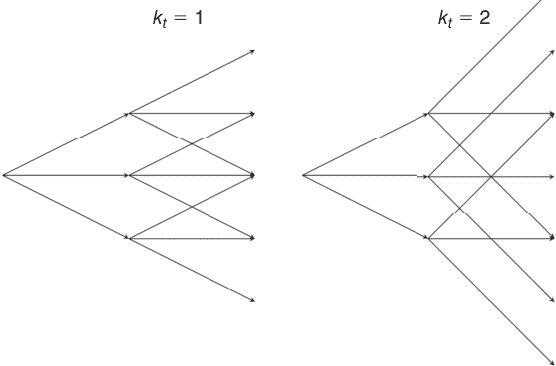

# 图 8.2 变换后股票价格的跳转

一个普通的三项叉树。右面板说明了 $k_t = 2$ 的情况。请注意，在两种情况下，树在每个时间步都会合并。
初始节点处树的时间零值由 $Y_0$ 给出，通过在方程 (8.13) 和 (8.14) 中设置 $t = 0$ 得到。在给定 $Y_t$ 的条件下，$Y_{i+dt}$ 的向上、中间和向下值为

```
$Y_{t+dt}^{u} = Y_t + (I + 1) \cdot k_t\sigma_y(0)\sqrt{dt}$,
$Y_{t+dt}^{m} = Y_t + I \cdot k_t\sigma_y(0)\sqrt{dt}$,
$Y_{t+dt}^{d} = Y_t + (I - 1) \cdot k_t\sigma_y(0)\sqrt{dt} \quad (8.29)$
```

其中 $I$ 是绝对值最接近的整数

```
$\frac{\mu_y(t)\sqrt{dt}}{k_t\sigma_y(0)}$
```

在这些表达式中，$\sigma_y(0)$ 是通过在方程 (8.16) 的 $\sigma_y(t)$ 中设置 $t = 0$ 得到的。向上、中间和向下的概率由给出

```
$P_y^u = \frac{1 \sigma_y^2(t)dt + e_u e_d}{2(k_t\sigma_y(0))^2dt}, P_y^m = \frac{\sigma_y^2(t)dt + e_u e_d}{2(k_t\sigma_y(0))^2dt}$,
$P_y^d = \dots$ (此处原文原文未写全，按逻辑保留)
```

$Y_i$ 的多次跳转如图 8.2 所示...（此处省略重复翻译，遵循不重复原文原则）

## 224
MATLAB 和 C# 中的 Heston 模型及其扩展

$S_t$ 的概率使用 Matlab 函数 `probY.m` 计算，该函数应用了方程 (8.30)。

```matlab
function [pu pm pd] = probY(Vt,V0,Yt,dt,rho,sigma,kappa)
% Equation 11
  if Vt > 0
    k = ceil(sqrt(Vt/V0));
  else
    k = 1;
  end
% Equations 9 and 6
muY = (rho/sigma*kappa - 0.5)*Vt;
sigymat = sqrt((1-rho)^2)*sqrt(Vt);
sigym0 = sqrt((1-rho)^2)*sqrt(V0);
% 根据方程 13 计算 Yu, Ym, Yd
I = (round(muY/k)/sigym0*sqrt(dt));
Y = Yt + (I+1)*k*sigym0(dt);
Ym = Yt + (I-0)*k*sigym0(dt);
Yd = Yt + (I-1)*k*sigym0(dt);
% Equations 17 and 16
eu = k*Vt - muY*dt;
em = Ym - Yt - muY*dt;
ed = Yd - Yt + muY*dt;
pu = 0.5*(sigma^2*dt + eu*ed)/k^2/sigma^2/dt;
pm = 0.5*(sigma^2*dt + eu*em)/k^2/sigma^2/dt;
pd = 0.5*(sigma^2*dt + eu*ed)/k^2/sigma^2/dt;
```

变换后的价格树 $Y_t$、股票价格 $S_t$ 以及美式和欧式价格均使用 `BuildBivariateTree.m` 函数构建。$Y_t$ 的结构是上三角，通过将 $Y_0$ 放置在 $Y_t$ 矩阵的左上角。第一个时间步的值放置在第二列的前九行，第二个时间步的值放在从顶部开始第三列，以此此类推。

该函数的第一部分生成方差树，找到每个 $v_i$ 节点处的 $k_i$ 值，并根据 $k_i$ 的最大值和该步方差节点的数量确定每个时间步所需的行数。每个节点处的 $k_i$ 值从方程 (8.28) 获取。

```matlab
function [EuroAmer Amer... Branch] = BuildBivariateTree(...)
dt = T/NT;
sigym0 = sqrt(1-rho^2)*sqrt(V0);
% Generate the volatility tree
[X RBound M] = BuildVolTree(...);
ColChange = RBound M + 2;
% 来自方程 (11) 的 k(t) 和 (14) 的 I(t)
k = zeros(2*NT-1,NT);
for t=1:NT
  for n=M-(t-1):M+(t-1);
```

### 美式期权

```matlab
if V(n,t) > 0
    k(n,t) = ceil(sqrt(V(n,t)/V0));
else
    k(n,t) = 1;
end
% Find树的维度
maxK = max(k);
numY = [1 3];
umV = [1 3];
umRows = [1 9];
for t=3:NT
```


`numY(t) = numY(t-1) + 2*maxK(t);`

`numV(t) = 2*t - 1;`

`numRows(t) = numV(t)*numY(t);`

end

`NR = max(numRows);`

```
该函数的下部分寻找每个节点的九个分支索引，并将它们存储在 Matlab 代码中。这些索引取决于 $Y_i$ 和 $k_i$ 的当前值。例如，在 Beliaeva 和 Nalwalkha (2010) 的表11 中，第一步的顶部节点（在图中标记为 $V_{11}, Y_{11}$）的跳跃大小 $k_{11}=2$。该节点分支到 $V_{21}$ 的节点 1, 3, 5，$V_{22}$ 的节点 8, 10, 12，以及 $V_{23}$ 的节点 15, 17, 19。这些节点间隔两个时间步。第一步的最后一个节点（标记为 $V_{13}, Y_{13}$）的跳跃大小 $k_{11}=1$。该节点分支到节点 17, 18, 19，节点 25, 26, 27 以及节点 32, 33, 34。这些节点间隔一个时间步。
```

```matlab
Branch = cell(numRows(NT-1),NT-1);

Branch(1,1) = {[1:9]};

B = zeros(numV(NT-1)*numY(NT-1), 9);

% To Branches

for t=2:NT

nY = numY(t);

First = max(K(t-1));

for n=1:numRows(t)

    a = cell(n-1,nY);

    b = mod(n-1,nY);

    % Find the-to-middle branches

    B(n,2) = First + (a-1)*numY(t) + b;

    B(n,5) = B(n,2) + numY(t);

    B(n,8) = B(n,2) + 2*numY(t);

    % Find the rest of branches

    B(n,1) = B(n,2) - a;

    B(n,4) = B(n,5) - a;

    B(n,6) = B(n,5) + a;

    B(n,7) = B(n,8) - a;

    B(n,9) = B(n,8) + a;

    Branch(n,t) = {B(n,:)};

end
```

```matlab
clear B;

% Adjust the last branch upward

for t=ColChange:NT-1

for j=7:9

 Branch(numRows(t),j) = Branch(t-1,j);
```

该函数的后续部分根据之前的分支创建 $Y_t$ 树，并根据方程 (32) 创建联合概率。在由时间（t循环）、方差（v循环）和变换后的价格（r循环）定义的每个节点处，需要若干数量：$Y_t$ 的当前值、$X_t$、$k_t$ 以及 $Y$ 演化到 $Y_{rd}$ 的分支索引。这些索引位于 MATLAB 数组中。在每个节点处，当 $Y_t > 0$ 时创建未来的 $Y_{rd}$；如果 $Y_t = 0$，则节点没有分支，并为每个联合概率分配零。在 Beliaeva 和 Nalwalkha (2010) 的表11 中，在第二步，没有分支源于节点 $(V_{24}, Y_{21})$$(V_{24}, Y_{27})$$(V_{25}, Y_{21})$ 或 $(V_{25}, Y_{27})$。在我们的符号中，这些是 $Y_t$ 矩阵的第22、28、29和35行。最后，存储联合概率。

```matlab
% Log stock tree (Yt), (St), and (Prob)

Yt = zeros(NR, NT);

Y0 = log(S0) - rho*V0/sigma;

Yt(1,1) = Y0;

Prob = cell(numRows(NT-1),NT-1);

X0 = X(M,1);

for t=1:NT-1

 j = 0;

 j=(t-1):(t-1);

 for j=1:numV(t)

 for r=1:numY

 n = r*Y;

 Vt = V(M,t);

 Xt = X(M-j), t);

 Kt = k*M(j,t);

NewBranch = cell2mat(n,t);

muy = (rho*kappa/sigma - 0.5)*Vt;

 I = round(muy/K/sigym0*sqrt(dt));

 if Yt(n,t) > 0

 for s=1:9

 iff s=5 || s=8 || Middle node

 Yt(NewBranch(s),t+1) = Yt(n,t) + (I+0)...

 elseif s=1 || s=4 || s=7 % Up node

 Yt(NewBranch(s),t+1) = Yt(n,t) + (I+1)...

 elseif s=3 || s=6 || s=9 % Down node

 Yt(NewBranch(s),t+1) = Yt(n,t) + (I-1)...

 end

end

end
```

```matlab
Branch(n,t) = {{['No branch from ('...)]};

end

if Yt(n,t) == 0;

    Prob(n,t) = {zeros(1,9)};

else

    [pvm pvmd] = probV(Vt,X0,...);

    [pyu pymd] = probY(Vt,V0,...);

    Prob(n,t) = {pvm*pvmd, pyu*pymd};

end
```

## Medvedev-Scaillet 展开

Medvedev 和 Scaillet (2010) 开发了一种方法，可以将美式看跌价格作为渐近展开进行解析表示。他们的方法适用于这类随机波动模型。在本节中，我们首先介绍了 Black-Scholes 模型下美式看跌期权的方法，然后给出了 Heston 模型的展开。他们方法的优点是美式看跌价格可以通过仅解析项的展开获得。因此，该方法能够快速地生成 Black-Scholes 和 Heston 期权价格。

为了说明，我们重现了 Clarke 和 Parrot (1999) 以及 Ikonen 和 Toivaren (2008) 的美式价格。使用 50 个时间步和控制变量技术，我们获得了 1.96724、1.105853、0.519488、0.213408 和 0.081948，其中精度小于一个美分。

### 美式期权

## Medvedev-Scaillet 的 Black-Scholes 方法

在 Black-Scholes 模型的假设下，到期时间为 $\tau = T - t$ 的美式看跌期权在时间 $t$ 的价格 $P(S(t), t)$ 遵循偏微分方程 (PDE)：

```
$P_t + (r - q)SP_S + \frac{1}{2}\sigma^2S^2P_{SS} - rP = 0 \quad (8.35)$
```

其边界条件为：

```
$P(\infty, t) = 0$
$P(S(T), T) = \max(K - S(T), 0)$
$P(\tilde{S}(t), t) = \max(K - \tilde{S}(t), 0)$
$P_S(\tilde{S}(t), t) = -1 \quad (8.36)$
```

其中 $\tilde{S}(t)$ 是提前行权价格，例如 Albanese 和 Compoletti (2006)。在方程 (8.35) 和 (8.36) 中，下标表示求导，$r$ 和 $q$ 分别为无风险利率和股息率，sigma$ 是股票波动率。

Medvedev 和 Scaillet (2010) 通过修改后的价格 $P(\theta, \tau) = P(Ke^{-\theta\sqrt{\tau}}, \tau)$ 构建了方程 (8.35) 的一个修改版本，其中 $\theta$ 是归一化深度值值（moneyness）：

```
$$\theta = \frac{\ln(K/S)}{\sigma\sqrt{\tau}} \quad (8.37)$$
```

修改后的 PDE 版本仍然遵循方程 (8.35)，但将 (8.36) 中的最后一个条件替换为提前行权价格 $\tilde{S}(\tau) = Ke^{-\theta\sqrt{\tau}}$。该修改后问题的唯一解是障碍期权的价格，该期权在 $\theta$ 达到障碍水平 $y$ 时被即刻执行，其中 $y \approx 2$。

通过应用链式法则并使用 PDE (8.35)，可以直接得到用 $P(\theta, \tau)$ 表示的修改后 PDE (8.35)：

```
$$\theta P_\theta + P_{\theta\theta} + \frac{1}{\sigma}[a^2 + 2(q - r)]P_\theta\sqrt{\tau} - 2(P + rP)\tau_\tau = 0 \quad (8.38)$$
```

同样，下标表示求导。修改后 PDE 的边界条件为：

```
$P(-\infty, \tau) = 0,$
$P(y, \tau) = K(1 - e^{-y\sqrt{\tau}}) \quad (8.39)$
```

Medvedev 和 Scaillet (2010) 的主要结果是修改后 PDE (8.38) 的解为级数：

```
$P(\theta, \tau) = \sum_{n=1}^{\infty} P_n(\theta)\tau^{n/2} \quad (8.40)$
```

对于 $i = 0, 1, 2, \dots$。$x_{n,j+1}^0$ 对 $\pi_{n,j}^0$ 的依赖关系。获取 $p_n^\theta$ 和 $q_n^\theta$ 通过直接应用 (8.45) 完成。这些多项式在 $n \leq 7$ 时的系数出现在表 8.1 和 8.2。

### 美式期权

**表 8.1** 多项式 $p_n^0$ 的系数

| N | $\theta^7$ | $\theta^6$ | $\theta^5$ | $\theta^4$ | $\theta^3$ | $\theta^2$ | $\theta^1$ | $\theta^0$ |
|---|---|---|---|---|---|---|---|---|
| 1 | 0 | 0 | 0 | 0 | 0 | 0 | 1 | 0 |
| 2 | 0 | 0 | 0 | 0 | 0 | 1 | 0 | 1 |
| 3 | 0 | 0 | 0 | 0 | 1 | 1 | 0 | 3 |
| 4 | 0 | 0 | 0 | 1 | 0 | 6 | 0 | 3 |
| 5 | 0 | 0 | 0 | 1 | 10 | 0 | 15 | 0 |
| 6 | 0 | 1 | 0 | 15 | 0 | 45 | 0 | 15 |
| 7 | 1 | 0 | 21 | 0 | 105 | 0 | 105 | 0 |

**表 8.2** 多项式 $q_n^0$ 的系数

| N | $\theta^7$ | $\theta^6$ | $\theta^5$ | $\theta^4$ | $\theta^3$ | $\theta^2$ | $\theta^1$ | $\theta^0$ |
|---|---|---|---|---|---|---|---|---|
| 1 | 0 | 0 | 0 | 0 | 0 | 0 | 0 | 1 |
| 2 | 0 | 0 | 0 | 0 | 0 | 1 | 0 | 2 |
| 3 | 0 | 0 | 0 | 0 | 0 | 1 | 0 | 5 |
| 4 | 0 | 0 | 0 | 0 | 1 | 0 | 9 | 8 |
| 5 | 0 | 0 | 0 | 0 | 1 | 1 | 0 | 8 |
| 6 | 0 | 0 | 1 | 0 | 14 | 0 | 33 | 0 |
| 7 | 0 | 0 | 1 | 0 | 20 | 0 | 87 | 48 |

多项式 $p_n^k$ 和 $q_n^k$ 的形式为：

```
$p_n^0(\theta) = \pi_{n0}^0\theta^n + \pi_{n1}^1\theta^{n-2} + \pi_{n2}^2\theta^{n-4} + \dots$
$q_n^0(\theta) = \chi_{n0}^0\theta^{n-1} + \chi_{n1}^1\theta^{n-3} + \chi_{n2}^2\theta^{n-5} + \dots \quad (8.46)$
```

其中 $\pi_{n0}^0 = x_{n0}^0$ 和 $q_{n0}^0$ 较为复杂，通过将单独方程代入 PDE (8.35) 完成。将级数 (8.40) 以 $\tau^{n/2}$ 的项代入 (8.38)，得到 Medvedev 和 Scaillet 的方程 (29)：

```
$-nt_{n0} + \theta P_{n-1} - 2rP_{n-2} = 0 \quad (8.47)$
```

其中 $\tilde{\sigma} = \sigma$。(8.47) 的解通过将 PDE 分为齐次和非齐次部分得到：

1. (8.47) 的齐次部分为 $P_n^0(\theta)$。
2. (8.47) 的非齐次部分为 $P_n(\theta) = P_n^0(\theta) + P_n^1(\theta)$。

(8.47) 的齐次部分涉及 $P_n$ 及其导数。在非齐次部分中，代入 (8.41) 中的 $P_n^1(\theta)$ 并使用 (8.43) 中的导数得到：

```
$(p_{n0}^1 + \theta p_{n0}^1)\Phi(\theta) + ((n+1)q_{n0}^1 - \theta q_{n0}^1)\phi(\theta) = 0 \quad (8.48)$
```

在 (8.47) 的非齐次部分（涉及 (8.47) 左侧的最后两项）中，代入 $P_n(\theta) + P_n^1(\theta)$ 并应用链式法则得到：

```
$(C_{n-1}p_{n-1}^{n-1} + \sigma_{n-1}p_{n-1}^{n-1} - 2rp_{n-2}^{n-2})\Phi(\theta) + (C_{n-1}q_{n-1}^{n-1} - \sigma_{n-1}q_{n-1}^{n-1} - 2rq_{n-2}^{n-2})\phi(\theta) = 0$
```

将 (8.48) 和 (8.49) 重新分组为共同项 $\Phi(\theta)$ 和 $\phi(\theta)$，得到方程组：

```
$p_{n-\theta}^n + \theta p_{n-\theta}^{n-1} + \sigma_{n-1}p_{n-\theta}^{n-1} + C_{n-1}p_{n-\theta}^{n-2} - 2r(C_{n-2}^{n-2} + p_{n-2}^{n-2}) = 0,$
$(n+1)q_{n-\theta}^n + q_{n-\theta}^{n-1} + 2p_1^n C_{n-1}(p_{n-\theta}^{n-1} + q_{n-\theta}^{n-2}) - \theta q_{n-1}^{n-1} + (p_{n-1,\theta} - \sigma_{n-1}q_{n-1,\theta}^{n-1} - 2rq_{n-2}^{n-2} + 2rq_{n-2}^{n-2})\phi(\theta) = 0 \quad (8.50)$
```

对于每个 $n$，求解 (8.50) 中的第一个 PDE 得到 $q_n^n$；所有其他量的情况类似，求解 (8.50) 中的第二个 PDE 得到 $p_n^n$。在本节末尾，我们可以使用 Matlab 中的符号方法。

一旦通过 (8.50) 中的两个 PDE 得到多项式 $q_n^n$ 和 $p_n^n$，就可以通过在 $\theta$ 处评估 (8.40)，代入 (8.39) 中 $e^{-\gamma y^2}$ 的泰勒展开，并等两个 $\tau^{n/2}$ 的连续幂次获得系数 $C_n$。消去两边的 $\tau^{n/2}$ 后，产生以下结果，可以很容易求解出 $C_n$：

```
$C_n[p_n^n(\Phi) + q_n^n(\phi) + p_n^n(\tilde{\theta}) + q_n^n(\tilde{\theta})] = (-1)^{n+1}\sigma^ny^n/n! \quad (8.51)$
```

当 $\Phi(\theta) = \Phi(\tilde{\theta})$ 和 $\phi(\theta) = \phi(\tilde{\theta})$ 分别是 $\theta = \tilde{\theta}$ 处的标准正态分布和密度函数时，优化值从 (8.42) 得到。例如，当 $n=1$ 时，我们看到 $p_1^1 = \theta, q_1^1 = 1$ 且 $p_1^1 = 0$。此处得到 $C_1$：

```
$C_1 = \frac{K\sigma}{\Phi(\theta) + \phi(\theta)} \quad (8.52)$
```

## 234 MATLAB 和 C# 中的 HESTON 模型及其扩展

```matlab
for i=1:N

for k=1:N-i+2

    pi(i,k) = 0;

end

j = N-i+3;

k = 1;

while j<=N+1

    pi(i,j) = pis(i,k);

    k = k+1;

    j = j+2;

end

n = dot(pi(n,:),'theta);

% 生成多式 qln

syms qill12 qill13 qill14 qill15 qill16 qill17; % 根据需要添加更多

qis = [qill12 qill13 qill14 qill15 qill16 qill17]; ...

syms qi

for i=1:N

for k=1:N-i+3
```


```matlab
qi(i,k) = 0;

end

j = N-i+4;

k = 1;

while j<=N+1

    qi(i,j) = qis(i,k);

    k = k+1;

    j = j+2;

end

qi = qi(:,1:N);

qln = dot(qi(n,:),'theta);

% 生成过去的多式 p0n-1 和 p0n-2，

if n>3

p0n_1 = dot(pp(n-1),'theta);

q0n_1 = dot(qq(n-1),'theta);

pln_1 = dot(pi(n-1),'theta);

qlin_1 = dot(qi(n-1),'theta);

else

p0n_1 = 0; q0n_1 = 0;

pln_1 = 0; qlin_1 = 0;

end

if n>3

p0n_2 = dot(pp(n-2),'theta);

q0n_2 = dot(qq(n-2),'theta);

pln_2 = dot(pi(n-2),'theta);

qlin_2 = dot(qi(n-2),'theta);

else

p0n_2 = 0; q0n_2 = 0;

pln_2 = 0; qlin_2 = 0;

end

% 创建导数

dplin = diff(pln_1,theta); dplin2 = diff(pln_2,theta);

dp0n_1 = diff(p0n_1,theta); dp0n_2 = diff(p0n_2,theta);

dqlin = diff(qlin_1,theta); dqlin_2 = diff(qlin_2,theta);

dq0n_1 = diff(q0n_1,theta); dq0n_2 = diff(q0n_2,theta);
```

### 美式期权

`PQ.m` 函数用于 `GeneratePQ.m` 文件，通过求解方程 (8.50) 生成式 $p_i^n$ 和 $q_i^n$ 的符号表示，并通过 (8.51) 生成系数 $C_n$ 的表示。对于 $n=1$ 的多式是通过调用 `PQ.m` 函数生成的。

```matlab
n = 1;

[p0n, q0n, dq0n_1, dqln_1] = PQ(n,N,p0,q0);

p01 = p0n;

p11 = p0n;

q01 = q0n;

q11 = q0n;
```

这生成了 $p_i^n = \theta, q_i^n = 1$ 和 $p_i^n = 0$。代码对于高阶项变得复杂。对于 $n=2$，我们直接从 `PQ.m` 函数获得 $p_i^n = \theta^2+1$，并根据方程 (8.46) 知 $q_i^2=0$。为了得到未知系数 $\pi_{21}$，我们对第一个 PDE 进行求解。对于更高阶的 $n$，代码涉及从 Matlab 输出窗口的剪切。多式 $p_i^n$ 和 $q_i^n$ 是通过 `PQ.m` 函数生成的，如下所示（$n=5$）：

```matlab
n = 5;

[p0n, q0n, dq0n_1, dqln_1] = PQ(n,N,p0,q0);

p05 = p0n;

q05 = q0n;
```

## 236 MATLAB 和 C# 中的 HESTON 模型及其扩展

来自方程 (8.46)

```matlab
% 求解第一个 PDE C3 C4

syms qi51

PDE1 = d2pln + theta*dn - n*plan + sigma_*C4*dp0n_1;

PDE1 = subs(PDE1,theta);

collect(PDE1,theta);

qi51 = solve('-2*pi51+2*C3+C4*(sigma-2*mu)', 'pi51');

qi52 = solve('pi51-4*pi52+2*r*(-C2*sigma^2)', 'pi52');

qi52 = simplify(qi52);

qi51 = simplify(qi51*theta+theta);
```

寻找 $q_1^1$ 的方法采用的方法。我们从方程 (8.46) 知 $q_1^1 = \theta + q_1^2$。我们使用 `collect` 函数替换 (8.50) 中第二个 PDE 的所有系数值，并粘贴到代码中，求解得到的 $q_1^1$ 和 $q_1^2`。

```matlab
% 求解第二个 PDE qi51

syms qi51

PDE2 = -(n+1)*qln*theta*dqln + d2qln + sigma_*C4*p0n_1;

PDE2 = subs(PDE2,theta);

collect(PDE2,theta);

qi51 = solve('1/48*sigma-2/24*mu)/sigma', 'qi51');

qi52 = solve('-6*C3*sigma^2-12/24*mu', 'qi52');

qi51 = simplify(qi51);

qi52 = simplify(qi52);

qi51 = qi51*theta^2 + qi52;
```

最后，`GeneratePQ.m` 函数的最后一部分寻找 (8.51) 中的 $C_n$ 系数。例如，当 $n=2$ 时，代码为：

```matlab
Exp2 = -sigma^2*y/2;

C2 = (Exp2 - p12*cdf - q12*pdf)/(p02*cdf + q02*pdf);

C2 = subs(C2,theta,y);

C2 = simplify(C2);
```

### 美式期权

注意，我们确实需要调用 `solve` 函数来获取 $C_n$，因为它从方程 (8.51) 可以很容易获得。代码产生了系数 $$C_2 = \frac{C_1\Phi_0\sigma^2 - 2C_1\Phi_0\mu + K\sigma^3}{2\sigma(\Phi_y)^2 + \Phi_0}$$

`GeneratePQ.m` 函数是所有所需系数的列表，允许将 (8.40) 中的 $P(\theta, \tau)$ 扩展到 $n=5$ 的项。该输出如下片段所示（$n=3$）：

```matlab
% 设置 1 多式

p01 = theta;

p11 = 0;

q01 = 1;

q11 = 0;

% 设置 2 多式

p12 的形式为 $p12 = \pi_{21}$

p02 = theta*2;

p12 = -1/2(-sigma*C2+2*mu+r*sigma);

q02 = theta;

q12 = 0;

% 设置 3 多式

p13 的形式为 $p13 = \pi_{31}\theta$

q13 的形式为 $q13 = q_{31}$

p03 = theta*3*theta;

p13 = -(-sigma*C2+2*mu+r*C1*sigma)/sigma;

q03 = theta*2;

q13 = -1/8(-C2*sigma^3+16*C2*mu);
```

```matlab
% "C"

C1 = sigma*K/(y*cdf(pdf));

C2 = -1/2(cdf*sigma^2-2*mu*cdf+sigma^3*y^2);

C3 = 1/24(-24+y*cdf*sigma^3*C2*mu);
```

系数从 Matlab 输出窗口复制并粘贴到 `MPutBS.m` 函数中，用于在 Black-Scholes 下为美式期权定价，这里到 $n=2$ 以节省空间。

```matlab
function Price = MPutBS(y,theta,K,sigma,r,T)

mu = r-q;

% "C" 在 theta = y 处的取值

cdf = normcdf(y);

pdf = normpdf(y);
```

## 246 MATLAB 和 C# 中的 HESTON 模型及其扩展

```matlab
C1 = sigma*Y/(y*cdf+pdf);

C2 = -1/2*(C1*cdf*sigma^2-2*mu*cdf+sigma^3*y^2);

% 设置 1 多式

p01 = theta;

p11 = 0;

q01 = 1;

q11 = 0;

% 设置 2 多式

p02 = theta^2+1;

p12 = -1/2*C1*(sigma+mu)/sigma;

q02 = theta;

q12 = 0;

% Black-Scholes 近似

cdf = normpdf(theta);

pdf = normpdf(theta);

Price = (C1*p01+q01*pdf) + p11*cdf+q11*pdf)*T^(1/2) + (C2*p02+q02*pdf) + p12*cdf+q12*pdf)*T^(1/2);
```

我们不需要代码来获取 (8.53) 中的多式及其导数，因为它有一个允许我们求解 PDE 的计算器。然而，我们创建了 `MSPutBS` 函数，它与之前代码中的 `MSPutBS` 函数非常相似。

```matlab
function [Price, theta] = MSPriceBS(S,K,T,sigma,r)

% 收益值优化设置

theta = log(S)/sigma/sqrt(T);

start = 2;

options = optset('LargeScale','off');

% 寻找边界

[yval] = fmincon(@p-MSutBS,start,theta);

Price = MSPutBS(y,theta,K,sigma);
```

我们可以使用二分算法通过将目标函数设置为 (8.42) 的导数来寻找边界 $\hat{y}$。以下函数创建了导数。

```matlab
static double MSPutdiff(y,mssettings,dy)

  return (MSPutBS(y+dy,mssettings) - MSPutBS((y-dy,mssettings))/2.0/dy;

}
```

## 247 美式期权

二分函数（已给出）在第二章中很容易找到，用于寻找该目标函数的零，此处未给出。美式看跌期权的价格使用 `MSRPBS()` 函数生成。

```java
static double MSPriceBS(S, K, T) {

    mssettings.theta = Math.Log(K/S)/Math.Sqrt(T);

    double a = 0.5*mssettings.theta;

    double y = Bisection(mssettings,a,b,Tol,MaxIter,dt);

    if(y<mssettings.theta)

        y = mssettings.theta;

    return MSPutBS(y,mssettings);

}
```

为了说明，重现 Medvedev 和 Scaillet (2010) 的表 2。设置为 $S=40, r=0.0488$ 且 $q=0$，对应不同的波动率 ($\sigma$) 和到期时间 ($r$)。我们以使用 500 步三元树得到的美式看跌期权作为基准。欧洲看跌期权通过 Black-Scholes 公式获得。这是通过以下 Matlab 代码实现的。

```matlab
% Black Schwarz 欧洲价格

BSP = (s,K,rf,q,T)*(K*exp(-r*T))*normcdf(-(log(s/K) + ...);

% 寻找表 2 的树形和 M-S 价格

K = [35 40];

for i=1:9

    BSPut(k, i) = BSPut(S,K(k),r,q,sigma(i),T(i));

    MSPut(k, i) = MSPriceBS(S,K(k),T(i),sigma(i),r,q);

    BTPut(k, i) = TrinomialTree(S,K(k),r,q,sigma(i),T(i));
```

Medvedev 和 Scaillet (2010) 表 2 中 $K=45$ 的部分重现在表 8.3 中。该表格包含了使用三元树得到的的美式看跌期权与 Medvedev 方法的结果的高度一致。

## TABLE 8.3 Black-Scholes 下的美式看跌期权价格

| | $\tau=1/12$ | $\tau=1/8$ | $\tau=1/6$ | $\tau=1/12$ | $\tau=1/4$ | $\tau=1/3$ | $\tau=1/2$ | $\tau=3/4$ | $\tau=7/12$ |
|---|---|---|---|---|---|---|---|---|---|
| $\sigma=0.2$ | 4,840 | 4,780 | 4,840 | 4,980 | 5,529 | 5,972 | 5,236 | 6,377 | 7,165 |
| M-S. | 5,000 | 5,085 | 5,261 | 5,059 | 5,702 | 6,237 | 5,286 | 6,506 | 7,377 |
| Tree | 5,000 | 5,088 | 5,267 | 5,060 | 5,706 | 6,243 | 5,287 | 6,510 | 7,383 |

## 240 MATLAB 和 C# 中的 HESTON 模型及其扩展

以及与 Scaillet (2010) 的五项展开。表 8.3 中的结果与作者在表 2 中得到的结论几乎相同。

表 8.3 最后一行的各项条目是使用 Matlab 函数 `TrinomialTree` 计算的。

```matlab
function y = TrinomialTree(Spot,K,r,q,v,T,N,PutCall,EuroAmer)

% 三元树参数和概率

dt = T/N;

u = exp(sqrt(2*dt));

d = 1/u;

pu = (exp((r-q)*dt/2) - exp(-v*sqrt(dt/2)))/2;

pmu = exp(v*sqrt(dt/2));

pd = (exp(v*sqrt(dt/2)) - exp((r-q)*dt/2)))/2;

pmm = 1 - pu - pd;

% 计算所有股票价格。

S = zeros(N+1,1);

S(1,1) = Spot;

for j=2:N-1

    for i=N-j+2:N

        S(i,j) = Spot*u^(N+1-i);

    end

% 计算期末期权价格。

V = zeros(N+1,1);

V(:,N+1) = max(K - S(:,N+1), 0);

% 计算剩余条目

for j=N-1:1

    for i=N-j+2:N

        V(i,j) = max(K - S(i,j), exp(-r*dt)*(pu*V(i,j+1) + pm*V(i,j+1) + ...));

    end

% 期权价格位于第一个节点。

y = V(1,1);
```

三元树的 C# 代码类似，此处不再给出。

## Heston 的 Medvedev-Scaillet 方法

Medved-Scaillet (2010) 对 Heston (1993) 模型下美式看跌期权价格的近似形式与方程 (8.40) 中的 Black-Scholes 模型相同

$$P(\theta, \tau, v) = \sum_{n=1}^{\infty} P_n(\theta, v)r^{n/2}. \quad (8.54)$$

### 美式期权

## 241

求和内部的项定义为

```math
$P_n(\theta, v) = C_n(v)[p_n^\theta(\theta)\Phi(v) + q_n^\theta(\theta)\phi(\theta)] + p_n^v(\theta, v)\Phi(v) + q_n^v(\theta, v)\phi(v)$
$= C_n(v)P_n^\theta(\theta) + P_n^v(\theta, v). (8.55)$
```

注意，上标为 1 的多项式不仅取决于 $v$ 也取决于 $\theta$，且 $C_n$ 系数取决于 $v$。为了简化符号，我们写作 $p_n'^\theta = p_n^\theta(v)$，$q_n'^\theta = q_n^\theta(v)$，$p_n'^v = p_n^v(v)$，$q_n'^v = q_n^v(v)$ 以及 $C_n' = C_n(v)$。

回顾第 1 章中的 Heston PDE，此处使用 Medvedev 和 Schweizer (2010) 的符号，并使用 $\theta$ 定义方差过程的均值回归

```math
$P_t + (r-q)SP_S + \frac{1}{2}vS^2P_{SS} - rP + \mu vSP_{sv} + \frac{1}{2}\sigma^2vP_{vv} + \kappa(\bar{\theta}-v)P_v = 0$. (8.56)$
```

重新定义归一化资金为

```math
$$\theta = \frac{\ln(K/S)}{\sqrt{v}} (8.57)$$
```

并考虑从 $P(S,v,t)$ 到 $P(\theta,v,t)$ 的变换。我们需要以下导数，通过全导数和应用链式法则获得：

```math
$P_t = \frac{\theta}{2\tau}P_\theta - P_\tau$,
$P_S = P_\theta = \frac{-1}{S\sqrt{v}}P_\theta$,
$P_{SS} = P_{\theta\theta}\theta^2 + P_{\theta v}S = \frac{1}{S^2v}P_{\theta\theta} + \frac{1}{\sqrt{v}}P_{\theta v}$,$
$P_v = P_v + P_{\theta\theta v} = P_v - \frac{\theta}{v}P_\theta$,
```


$P_{vs} = P_{\theta v} - \frac{2\theta}{v}(P_{\theta\theta}\theta + P_{\theta v}) = \frac{-1}{S\sqrt{v}}P_{\theta v} + \frac{2\theta}{2v^{3/2}}\sqrt{\theta}P_{\theta\theta}$,$

$P_{vv} = P_{vv} - \frac{\theta}{v^2}P_v + \frac{\theta^2}{4v^2}P_\theta$. (8.58)

我们使用了以下 $\theta$ 的导数：

```math
$$\theta_S = \frac{-1}{S\sqrt{v}}$, $\theta_{SS} = \frac{1}{S^2v\sqrt{v}}$,$
$\theta_{Sv} = \frac{1}{2v^{3/2}}$,$
$\theta_v = \frac{-\theta}{2v}$, $\theta_{vv} = \frac{-\theta-\theta_v}{v^2}$. (8.59)
```
## 242 MATLAB 和 C# 中的 HESTON 模型及其扩展

将方程 (8.58) 中的导数代入 (8.56) 的 Heston PDE 中，乘以 $2\tau$，并将共同项按 $\sqrt{\tau}$ 和 $\tau$ 归类，得到：

```math
$P_{\theta\theta} + \theta P_\theta - 2\tau P_r$
+ \sqrt{\tau} \left[ \frac{1}{v}(v+2(q-r))P_v + \sigma\sqrt{v}(-2P_v - \frac{\theta}{v} + \frac{1}{v^2}P_{\theta\theta}) \right]$
+ \tau \left[ \kappa(\theta-v)(2P_v - \frac{\theta}{v}) + \sigma^2v(P_{vv} - \frac{\theta^2}{v^2} + \frac{3\theta^2}{4v^2}P_{\theta\theta}) - 2r \right] = 0. (8.60)
```

与之前一样，方程 (8.60) 的 PDE 是关于 $P(\theta,v)$ 的。乘以 $\sqrt{\tau}$ 的项在 $n$ 方向上移动一次，而乘以 $\tau$ 的项在 $n$ 方向上移动两次。重新排列后产生：

```math
$P_{\theta\theta} + \theta P_\theta - n_n$
+ \frac{1}{v}(v+2(q-r))P_{n,v} + \sigma\sqrt{v}(-2P_{n-1,v} + \frac{\theta}{v} - \frac{1}{v^2}P_{n-1,\theta})$
+ \kappa(\theta-v)(2P_{n-2,v} - \frac{\theta}{v}) + \sigma^2v(P_{n-2,vv} - \frac{\theta^2}{v^2} + \frac{3\theta^2}{4v^2}P_{n-2,\theta}) - 2r_{n-2} = 0. (8.61)
```

方程 (8.61) 中的 PDE 求解是使用应用于 (47) 中 Black-Scholes PDE 的相同推理得到的，通过考虑 PDE 的齐次部分和非齐次部分。因此，(8.61) 的前三项组成齐次部分，其余项组成非齐次部分。与 Black-Scholes 情况一样，齐次部分假设解为：

```math
$P_n(\theta,v) = p_n^p(\theta,v)\Phi(\theta) + q_n^q(\theta,v)\Phi(\theta) (8.62)
```

而非齐次部分假设解为

```math
$P_n(\theta,v) = p_n^p(\theta,v)\Phi(\theta) + q_n^q(\theta,v)\Phi(\theta). (8.63)
```

我们需要通过链式法则得到 $P_n(\theta,v)$ 的以下导数：

# MATLAB 和 C# 中的 Heston 模型及其扩展

注意，方程 (8.65) 和 (8.66) 的齐次部分与 Black-Scholes 情况相同，将这两部分结合就得到了上一节中的方程 (8.48)。

方程 (8.65) 和 (8.66) 构成了需要求解的方程组，其求解方法类似于求解 (8.50) 中 Black-Scholes 美式看跌期权的两个方程的方法。对于每个 $\pi_n$，在所有其他量已知的情况下，求解 (8.65) 中的 PDE 以得到 `p_n^a`。同样，在所有其他量已知的情况下，求解 (8.66) 中的 PDE 以得到 `q_n^a`。多项式 `p_n^a` 和 `q_n^a` 通过递归获得，分别与表 8.1 和 8.2 中的项相同。多项式 `p_n^*` 与 (8.46) 中的相同，为了方便起见，在此重新构建。

```
$p_n^\theta(\theta, v) = \pi_n^\theta + \pi_n^{\theta-2} + \pi_n^{\theta-4} + \dots \quad (8.67)$
```

另一方面，多项式 `q_n^\theta` 现在采用以下形式：

```
$q_n^\theta(\theta, v) = x_{n1}^1\theta^{3n-5} + x_{n2}^2\theta^{3n-7} + x_{n3}^3\theta^{3n-9} + x_{n4}^4\theta^{3n-11} + \dots \quad (0.68)$
```

例如：

```
$q_4^a = x_{41}^1\theta^{10} + x_{42}^2\theta^8 + x_{43}^3\theta^6 + x_{44}^4\theta^4,$
q_5^a = x_{51}^1\theta^{12} + x_{52}^2\theta^{10} + x_{53}^3\theta^8 + x_{54}^4\theta^6 + x_{55}^5\theta^2.$
```

一旦获得了多项式 `p_n^a`、`q_n^a` 和 `q_n^\theta`，就可以通过在 $\theta = y$ 处评估方程 (8.55) 并对 $\exp(\sqrt{v}y)$ 代入泰勒级数展开来构造系数 `C_n(v)`。在两边消去 $\tau^{n/2}$ 后，产生方程，并很容易求出 `C_n`：

```
$C_n(v)[p_n^a(y)\Phi_0 + q_n^a(y)\Phi_0] + p_n^\theta(y,v)\Phi_0 + q_n^\theta(y,v)\Phi_0 = \frac{(-1)^{n+1}K}{n!}\tau^{n/2}y^n. \quad (8.69)$
```

在 Black-Scholes 情况，系数 `C_n` 在 $\theta = y$ 处取值。为了获得美式看跌期权价格 `P(\theta, \tau, v)`，我们首先找到多项式 `p_n^0`、`q_n^0、p_n^*` 和 `q_n^*` 以及系数 `C_n(v)`。然后我们找到障碍值 `\tilde{y}`：

```
$\tilde{y} = \arg\max_{y\geq 0} P(\theta, \tau, v, y) \quad (8.70)$
```

其中 `P(\theta, \tau, v)` 是方程 (8.54) 中的 `P(\theta, \tau, v)`，但带有额外的参数以强调 `P(\theta, \tau, v)` 对 `y` 的依赖性（通过 `C_n`）。由 `p_n^0`、`q_n^0,p_n^*,q_n^*` 和 `C_n` 给出的 Medvedev 和 Scailier (2010) 对美式看跌期权价格 `P(\theta, \tau, v)` 的第一次近似与 Black-Scholes 情况类似。

近似 1：
- 使用 (8.54) 和 `C_n = C_n(v, y)` 构造 `P(\theta, \tau, v)`。
- 在 `\tilde{y} \geq \theta` 的约束下使用 (8.70) 找到 `\tilde{y}`。
- 在 `P(\theta, \tau, v)` 中使用 `C_n = C_n(y)`。

Medvedev 和 Scailier (2010) 指出，无限障碍 `\tilde{y} = \infty` 的情况对应欧式看跌期权。他们建议使用解析式（如第 1、3 或 4 章所示）获取美式看跌期权价格，因此他们美式期权的第二次近似是控制价格。

近似 2：
- 使用解析式找到欧式看跌期权价格 `P(K)`。
- 按照第一次近似找到 `\tilde{y}`。
- 获取提前行溢价 `\varepsilon = P(\theta, \tau, v, \tilde{y}) - P(\theta, \tau, v, \infty)`。
- 获取美式看跌期权价格 `P_A(K) = P(K) + \varepsilon`。

我们通过绘制不同 `y` 值下的 `P(\theta, \tau, v)` 在图 8.3 中说明方程 (8.70) 中的极大问题，使用了 Carver (1999) 对于价格 8、9和11 的设置。最优值 `\tilde{y}` 用虚线表示，位于 `y \approx 2` 附近。曲线已经过缩放。在本节的剩余部分，我们提供了 Heston 模型下 Medvedev 和 Scailier (2010) 美式看跌期权近似的 Matlab 代码。


## Heston 模型及其扩展

Matlab 函数 `PQHeston` 以上一节中处理 Black-Scholes 模型的 `PQ.m` 函数的方式创建多项式 `p_n, q_n, p_n^a, q_n^a`。它与 `PQ.m` 几乎相同，同样需要来自表 8.1 和 8.2 的 `p0` 和 `q0` 系数作为输入。

```matlab
function [p0 q0 pn qn] = PQHeston(n,N,p0,q0)
syms theta
thet = [theta^7 theta^6 theta^5 theta^4 theta^3 theta^2 theta^1];
% 生成系数 p0 和 q0
for i=1:N
    pp(i,:) = sym(p0(:));
    qq(i,:) = sym(q0(:));
end
% 生成多项式 pn 和 qn
pn = dot(pp(n),theta);
qn = dot(qq(n),theta);
```

`PQHeston.m` 函数用于 `GeneratePQHeston.m` 文件。该文件类似于上一节出的 Black-Scholes 模型 `GeneratePQ.m` 文件。代码通过求解方程 (8.65) 和 (8.66) 生成多项式 `p_n^a` 和 `q_n^a` 的符号表示，并通过求解 (8.69) 生成系数 `C_n`。对于每个 `n`，代码的工作方式与 Black-Scholes 情况相同：使用 `PQHeston.m` 函数生成多项式的符号表示，形成两个 PDE，收集 `\theta` 幂次的共同项，并求解 `p_n^*, q_n^*` 和 `C_n`。这需要将 `collect.m` 函数的输出剪切并粘贴到 Matlab 文件 `GeneratePQHeston.m` 中。

为了说明，展示了 `GeneratePQHeston` 中 `n=4` 部分。代码的第一部分使用 `PQHeston.m` 函数生成多项式 `p_n^a` 和 `q_n^a` 的符号表示，还生成了多项式所需的阶、二阶导数。

```matlab
n = 4;
[p0 q0 pn qn p1 q1_n1_q1] = PQHeston(n,N,p0,q0);
p04 = pn;
q04 = qn;
dpl1_1 = diff(p1_theta,theta); % p(n-1) 对 theta 的导数
qin_1 = diff(q1_theta,theta); % q(n-1) 对 theta 的导数
d2plivt_1 = diff(dp1_1,v);
```

代码的第二部分设置 `C_{n-1} = C_1` 和 `C_{n-2} = C_2`，通过 (8.67) 得到第一个 PDE，并通过 `collect.m` 函数收集 `\theta` 的幂次项，求解 `p_n^*, q_n^*` 和 `C_n根据 (8.68) 求解 C_n`。

```matlab
Cn_1 = C1;
Cn_2 = C2;
Cvn_1 = diff(Cn_1,v);
Cvn_2 = diff(Cn_2,v);
syms pi41 pi42
PDE1 = -(n+1)*dqlin- theta*dqlin+2*plin;
collect (subs (PDE1), theta)
pi41 = solve('(12*q41/32*rho*3*sigma^3)',pi41);
pi42 = solve('(rho*sigma/v (1/2)',pi42);
p14 = pi41*theta^2 + pi42;
```

同样，代码的后续部分定义第二个 PDE 并扩展 `\theta`。通过 `collect.m` 函数收集这些项以求出 `x_{41}^s, x_{42}^s`，且 `q_4^s` 形成为 `q_{41}^s(\theta, v) = x_{41}^7+x_{42}^5+x_{43}^3+x_{44}^0`，符合 (8.68)。

```matlab
syms q41 q42 q43 q44
PDE2 = -(n+1)*dqlin- theta*dqlin+2*plin;
collect (subs (PDE2), theta)
q41 = solve('(12*q41/32*rho*3*sigma^3)',q41);
q42 = solve('(rho*sigma/v (1/2)',q42);
q43 = solve('(rho*sigma/v (1/4*y*)',q43);
q44 = solve('(6*q44+3/4*sigma^2/v)',q44);
q14 = q41*theta^7+q42*theta^5+q43*theta^3+q44*theta;
```

`n=4` 的代码最后部分使用 `p_0^s, p_4^s` 和 `q_4^s` 来获得系数 `C_4`，符合 (8.69)。注意代码使用 `subs.m` 函数替换了 `\theta`。

```matlab
syms C4
Put4 = C4*(p04*cdf+ q04*cdf) + p14*cdf+ q14*cdf;
Exp4 = -v*(4/2)*y*4/24;
C4 = solve(Put4 - Exp4)
C4 = subs(C4, theta, y);
```

`GenerateQHeston.m` 文件中的代码生成到 n=5 的多项式和系数。这些量的表达式被省略。

并从 Matlab 输出屏幕到函数 `MSputHeston.m`，该函数与定价章节中定义的 `MSputBS.m` 函数类似，后者用于在 Black-Scholes 模型下对美式看跌期权。该函数可以容纳高达五阶的展开，也可以将其减少到三阶或四阶以缩短计算时间。

```matlab
function Price = MSputHeston(y,theta, K,params, r, q, T,NumTerms)
cdf = normcdf(y)
pdf = normpdf(y)
% First set of polynomials
p11 = 0;
q11 = 0;
p01 = theta;
q01 = -1;
1 = v^(1/2)*y*K*(cdf+pdf)
% Second set of polynomials
p12 = 1/2*(v-2*mu)*cdf
q12 = 1/4*rho*sigma*theta*y*K*(cdf+pdf)
p02 = theta^2;
q02 = theta;
c2 = -1/4*(theta+2)*(2*cdf-4*mu*y*sigma*pdf)
% Third set of polynomials
if NumTerms >= 5
p15 = -1/192*v*y^3/(3/2)*(-16*v*y^2*sigma^3...
q15 = 1/6144*rho^4*sigma^4/v*(3/2)*y*K...
p05 = theta^5+10*theta^3*15*theta
q05 = theta^4+9*theta^2+8
c5 = -1/645120*(-4030+y^13)*cdf^2*v^6...
end
% The Heston American put approximation
cdf = normcdf(theta)
pdf = normpdf(theta)
Price = (C1*(p01*cdf+q01*pdf)+p11*cdf+q11*pdf)*T^(1/2)...
+ (C2*(p02*cdf+q02*pdf)+p12*cdf+q12*pdf)*T^(2/2)...
+ (C3*(p03*cdf+q03*pdf)+p13*cdf+q13*pdf)*T^(3/2)...
if NumTerms == 4
Price = Price + (C4*(p04*cdf+q04*pdf)+p14*cdf
+ q14*pdf)*T^(4/2).
elif NumTerms == 5
Price = Price + (C4*(p04*cdf+q04*pdf)+p14*cdf
+ q14*pdf)*T^(4/2)...
+ (C5*(p05*cdf+q05*pdf)+p15*cdf
+ q15*pdf)*T^(5/2));
```


Matlab 函数 `MSPrice.m` 返回了 Medvedev 和 Scaillet (2010) 对美式看跌期权回的第二次近似。该近似利用展开来寻找提前行权溢价（EEP），并根据提前行权溢价的闭式解获得的看跌期权价格作为美式期权价格。使用内置的 Matlab 单变量边界优化函数 `fminbd.m` 来从方程 (8.70) 寻找 $\hat{y}$，使用 `max($\theta,2,3)` 作为边界。

```matlab
function [EuroPutClosed AmerPutMS AmerPut EEP the y] = MSPrice(...);

// 闭式欧式看跌期权

EuroPutClosed = HestonPriceNewtonCoates('P',...);

// 寻找边界水平 y

theta = max(2,theta);

lo = max(Strike(S)/sqrt(v0)/sqrt(T));

fminbd(@p MSHeston(p,...,NumTerms),lo,3);

// 使用 MS 展开计算欧式和美式看跌期权以及提前行权溢价

EuroPutMS = MSPutHeston(y,...,NumTerms);

AmerPutMS = MSPutHeston(y, ...NumTerms);

EEP = AmerPutMS EuroPutMS;

// 使用近似 2 计算美式期权项

AmerPut = EuroPutClosed + EEP;
```

通过这些函数，使用 Medvedev 和 Scaillet (2010) 的第二次近似生成美式看跌期权价格是非常直接的。生成美式看跌期权价格的 C# 代码类似但未在此给出。在 C# 中，我们使用二分法来寻找 $\hat{y}$，因此以下是用于看跌期权价格导数的 C# 函数。

```csharp
static double MSPutDiff(y,...,dy)
{
    return MSPutHeston(y+dy) - MSPutHeston(y-dy)/2.0/dy;
}
```

`MSPrice()` 函数使用包含展开项的 `MSputHeston()` 函数，通过闭式欧式期权加上提前行权溢价来生成美式看跌期权价格。

```csharp
static double[] MSPrice(param,...,int NumTerms double yinf)
// 闭式欧式看跌期权
double EuroPutClosed = HestonPriceNewtonCoates(param,...,A,B);
// 虚值程度 (Moneyyness)
double theta = Math.Log(K)/Math.Sqrt(v0)/Math.Sqrt(T);
// 二分法的下点
double a = Math.Max(2.0,theta);
// 寻找边界水平
```

```csharp
double y = Bisection(a,b,theta,param,r,q,T,NumTerms);
if(y<theta)
// 寻找提前行权溢价
double AmerPutMS = MSPutHeston(y,r,q,T,NumTerms);
EuroPutMS = MSPutHeston(y,,NumTerms);
EEP = AmerPutMS - EuroPutMS;
// 美式看跌期权项
double AmerPut = EuroPutClosed + EEP;
```

为了说明，我们继续使用 Clarke 和 Parrot (1999) 的示例。这是通过以下 Matlab 代码实现的，该代码使用了展开式的五项。

```matlab
% 来自 Clarke 和 Parrot 的设置
S = [8 9 11 12];
TruePrice = [2.0000 1.107641 0.520030 0.213668];
Strike = 10;
% 寻找 Medvedev-Scaillet Heston 价格
NumTerms = 5;
yinf = 4;
for k=1:5
    [AmerPut(k), EEP(k), y(k)] = MSPrice(S(k));
    error(k) = TruePrice(k)-AmerPut(k);
end
```

带有五项展开的结果位于表 8.4 的最后一行，包含了与本章节早期其他方法得到的欧式期权价格对比，使用 Simpson 三法则得到的的结果。所有方法产生的美式看跌期权都是相当准确的。Medved 和 Scaillet (2010) 的方法提供的精度略高，

## 表 8.4 Clarke 和 Parrot (1999) 不同模型下的美式看跌期权价格

| S = 8 | S = 9 | S = 10 | S = 11 | S = 12 | 绝对误差 |
|---|---|---|---|---|---|
| Clarke-Parrot 价格 | 2.0000 | 1.1076 | 0.5200 | 0.2137 | 0.0820 |
| L.S. 蒙特卡洛 | 1.9996 | 1.1036 | 0.5190 | 0.2261 | 0.0821 | 0.0179 |
| 显式法 | 2.0000 | 1.1061 | 0.5184 | 0.2122 | 0.0808 | 0.0058 |
| 二叉树 | 1.9967 | 1.1059 | 0.5195 | 0.2134 | 0.0819 | 0.0059 |
| M.S. 近似 | 2.0030 | 1.1111 | 0.5202 | 0.2137 | 0.0830 | 0.0077 |
| 欧式看跌期权价格 | 1.8389 | 1.0483 | 0.5015 | 0.2082 | 0.0804 | --- |

相比显式法或二叉树，但它比其他方法生成价格快得多。

### 美式期权

### 美式期权

# 253

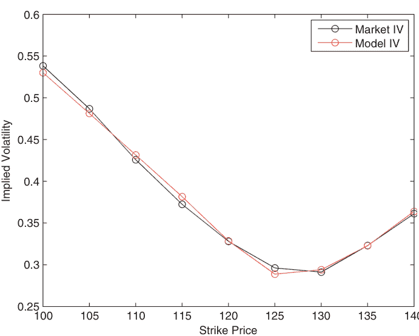

**图 8.4** 美式看跌期权的隐含波动

## CHIARELLA 和 ZOGAS 美式看涨期权

在本章的最后一节中，我们介绍了 Chiarella 和 Zhou (2006) 在 Heston (1993) 模型中为美式看涨期权定价的方法。该方法需要对早期行权边界进行估计。早期行权边界等在 Kwok (2008) 等书中进行了讨论。

## 早期行权边界近似

回顾第 1 章，欧式期权价格 $U(S,v,\tau)$ 满足 Heston (1993) 偏微分方程（PDE）。我们在之前的章节中看到，美式期权满足相同的 PDE，但边界不同。对于美式看涨期权 $C(S,v,\tau)$，我们可以写道：

$$\frac{\partial C_A}{\partial \tau} = \frac{1}{2}v^2S\frac{\partial^2 C_A}{\partial S^2} + \rho vS\frac{\partial^2 C_A}{\partial v\partial S} + \frac{1}{2}\sigma^2 v\frac{\partial^2 C_A}{\partial v^2} + [\kappa(\theta - v) - \lambda v]\frac{\partial C_A}{\partial v}$$
$$-rC_A + (r - q)S\frac{\partial C_A}{\partial S} = (8.71)$$

# 254 MATLAB 和 C# 中的 HESTON 模型及其扩展

其中 $\tau$ 是距离到期的时间。该 PDE 对于 $0 \le \tau < T$ 成立（$T$ 是到期日历），并且对于 $0 < S \le b(v, \tau)$ 成立，$b(v, \tau)$ 是早期行权边界。本质上，这意味着只要股价低于早期行权边界，美式看涨期权行为就与其欧式对应品相同，且满足方程 (8.71) 中的 PDE。

基于 Tzazalis 和 Wang (2003) 的工作，Chiarella 和 Zhou (2006) 使用对线性函数对早期行权边界 $b(v, \tau)$ 进行近似：

$$b(v, \tau) \approx \exp(b_0(\tau) + b_1(\tau)v_0).$$

在接下来的章节中，我们将解释如何估计 $b(v, \tau)$ 以及如何获得美式看涨期权价格。

### 美式看涨期权价格

为了实现 Chiarella 和 Zhou (2006) 的方法，我们需要向特征函数引入一个额外的变量 $t$（将 $\tau$ 替换为 $\tau-t$）和一个积分变量 $\psi$。我们将特征函数 $f_2$ 写为：

$$f_2(\psi, x_0, v_0, \tau-t) = \exp(C_2(\tau-t, t, \psi) + D_2(\tau-t, t, \psi) + i\psi x_0) \quad (8.73)$$

其中系数为：

$$C_2(\tau-t, t, \psi) = (r-q)i\psi + \frac{a}{\sigma^2} \left[ \frac{b_2 - \rho\sigma i\psi + d_2}{\sigma^2}(\tau-t) - 2 \ln \left( \frac{1-e^{d_2(\tau-t)}}{1-g_2} \right) \right], \quad (8.74)$$

$$D_2(\tau-t, t, \psi) = i\psi + \frac{b_2 - \rho\sigma i\psi + d_2}{\sigma^2} \left( \frac{1-e^{d_2(\tau-t)}}{1-g_2 e^{d_2(\tau-t)}} \right).$$

需要的量为：

$$g_2 = \frac{b_2 - \rho\sigma i\psi + d_2}{b_2 - \rho\sigma i\psi - d_2}, \quad d_2 = \sqrt{(\rho\sigma i\psi - b_2)^2 - \sigma^2(2u_2 i\psi - \phi^2)}. \quad (8.75)$$

注意，当 $t = \psi = 0$ 时，系数退化为原始 Heston (1993) 系数。如之前，我们有 $b_2 = \kappa + \lambda, u_2 = -\frac{1}{2}$ 且 $a = \kappa\theta$。特征函数 $f_1$ 为：

$$f_1(\psi; x_0, v_0, \tau-t) = \exp(-x_0 - (r-q)(\tau-t)) \times f_2(\psi-i; x_0, v_0, \tau-t).$$

其中 $x_0 = \ln S_0$ 是对数价格，$v_0$ 是初始方差。通过在特征函数中设置 $\psi = 0$ 且 $t = 0$，可以直接获得欧式看涨期权价格 $C(x_0, v_0, \tau)$。计算方法与原始 Heston (1993) 模型相同：

$$C(x_0, v_0, \tau) = S_0 e^{-i\phi} P_1 - Ke^{-r\tau} P_2$$

其中 $j = 1, 2$：

$$P_j = \frac{1}{2} + \frac{1}{\pi} \int_0^{\infty} Re\left(\frac{-e^{-i\phi \ln K}}{i\phi} f_j\right) d\phi$$

### 255

Chiarella 和 Zhou (2006) 展示了执行价为 $K$、到期日为 $\tau$ 的美式看涨期权的行权溢价 $V(x_0, v_0, \tau)$ 为：

$$V(x_0, v_0, \tau) = |S_0(1 - e^{-r\tau}) - K(1 - e^{-r\tau})| + S_0 e^{-r\tau} \int_0^{\tau} \int_0^{\infty} Re\left(\frac{\exp(-b_1(t) i\phi)}{i\phi}\right) f_1(\phi, -b_1(t); x_0, v_0, \tau - t) d\phi dt - Ke^{-r\tau} \int_0^{\tau} \int_0^{\infty} Re\left(\frac{\exp(-b_2(t) i\phi)}{i\phi}\right) f_2(\phi, -b_1(t); x_0, v_0, \tau - t) d\phi dt$$

最后，通过加上欧式看涨期权的行权溢价获得美式看涨期权的控制变量价格：

$$C(x_0, v_0, \tau) = C(x_0, v_0, \tau) + V(x_0, v_0, \tau)$$

计算欧式期权的积分时，我们使用标准方法。计算美式期权的积分时，我们使用行权溢价公式。（实现细节见代码部分）。

使用 Chiarella 和 Ziogas (2006) 方法计算美式看涨权的 C# 代码简单，但此处未给出。

## 估计提前行权边界

方程 (8.87) 中的欧式看涨期不需要原始 Heston (1993) 模型之外的新物理量，但提前行权溢价 $V(x_0,v_0,\tau)$ 需要对 (8.72) 中的两个未知数 $b_0(\tau)$ 和 $b_1(\tau)$ 进行估计。通过使用两个不同的方差值 $v_0=v_0(\tau)$ 和 $v_1=v_1(\tau)$ 以及 $b(v, \tau)$ 处的看涨边界条件，Chiarella 和 Ziogas (2006) 得到了以下二方程组：

```
$C_A(v_0(\tau), v, \tau) = \exp(b_0(\tau) + b_1(\tau)v_0(\tau)) - K$
$C_A(v_1(\tau), v, \tau) = \exp(b_0(\tau) + b_1(\tau)v_1(\tau)) - K$
```

并提出了一种求解该方程组的迭代方法。该方法通过将时间间隔 (0,T) 分为 $N$ 个长度递增的子区间 $\tau_1,\dots,\tau_N$ 来，其中 $\tau_n=n\cdot dt，$n=1,\dots,N$ 且 $dt=\tau/N$ 为时间步。记 $b_0^n=b_0(\tau_n)$，$b_1^n=b_1(\tau_n)$，$v_0^n=v_0(\tau_n)$ 以及 $v_1^n=v_1(\tau_n)$。时间点处 $b_0^0$ 和 $b_1^0$ 的起始值为：

```
$b_0^0 = \max(\ln\frac{rK}{q}, \ln K) \quad \text{and} \quad b_1^0 = 0$
```

以及 $v_0^0$ 和 $v_1^0$ 的起始值为：

```
$v_0^0 = E[v_0|v_0] + \frac{\sigma}{\sqrt{2}}$
$v_1^0 = E[v_1|v_0] - \frac{\sigma}{\sqrt{2}}$
```

方差的条件期望在第 2 章中给出：

```
$E[v|v_0] = \theta + (v_0-\theta)e^{-(t-\tau)}$
```

在每个时间步 $n$，方差 $v_0^n$ 和 $v_1^n$ 使用方程 (8.83) 进行更新，其中 $v_r=v_0$，且在 (8.84) 中 $t=\tau$ 和 $t=\tau_n$。此设定确保了 $v_0^n$ 和 $v_1^n$ 将是不同的，如图 8.5 所示，该图重现了 Chiarella 和 Ziogas (2006) 的图 1。

系数 $b_0^n$ 和 $b_1^n$ 通过迭代更新，通过获得一组成功的系数 $b_{0,k}^n$ 和 $b_{1,k}^n$，这些系数是定义如下非线性方程 $g_1$ 和 $g_0$ 的根：

```
$g_1(b_{1,k}^n) = \frac{1}{k}[\ln C_A(\exp(b_{0,k}^{n-1}+b_{1,k}^{n-1}v_0^{n-1}),v_0^{n-1},\tau)-K]-b_{0,k}^{n-1}-b_{0,k-1}$
$g_0(b_{0,k}^n) = \frac{1}{k}[\ln C_A(\exp(b_{0,k}^n+b_{1,k}^n v_0^n),\tau)-K]-b_{0,k}^n-b_{0,k-1}$
```

### 美式期权

图 8.5：方差的样本值。

(8.5) 中的起始值为上一个时间步的系数值，因此 $b_{i,0}^n = b_i^{n-1}$ 且 $b_{0,0}^n = b_0^{n-1}$。在第 $k$ 步，将量 $b_{0,k-1}^n$、$v_k^n$ 和 $\tau$ 代入 $g_i$，并使用牛顿法找到 $b_k^n$。然后将 $b_k^n, v_k^n$ 和 $\tau$ 代入 $g_0$，并使用牛顿法找到 $b_{0,k}^n$。当 $|b_0^n - b_{0,k-1}| < \epsilon_0$ 且 $|b_i^n - b_{i,k-1}| < \epsilon_i$ 时迭代停止，其中 $\epsilon_0$ 和 $\epsilon_i$ 是容差水平。Chiarella 和 Ziogas (2006) 使用 $\epsilon_0 = \epsilon_i = 10^{-4}$ 以及 $N=50$ 个时间步节b_0^n$ 和 $b_i^n$ 的值是迭代返回的 $b_{0,k}^n$ 和 $b_{i,k}^n$ 的最后值。$b_0(\tau)$ 和 $b_i(\tau)$ 的值是时间步的最后值，因此 $b_0(\tau) = b_0^n$ 且 $b_i(\tau) = b_i^n$。

函数 `CZNewton` 使用牛顿法寻找 (8.5)定义的根 $g_i$ 或 $g_0$。牛顿法的导数通过中心差分获得。

```matlab
function b = CZNewton(v0, v1, b0, B1, gNum,...)
  params0 = [kappa theta sigma v0 lambda];
  params1 = [kappa theta sigma v1 lambda];
  B = mat;
% Newton's method
  while abs(diff) > tol
```


```matlab
if gNum == 1

  % 第一组函数和导数

  [CallAi] = CZAmerCall(exp(B + b*v0),B0,b);

  g0 = (logCall1 + K) - B0/v0 - b;

  CallA1 = CZAmerCall(exp(B + b*v0),B0,b);

  g = (logCall1 + K) - B0/v0 - b;

  CallA1 = CZAmerCall(exp(B + b*v0),B0,b);

  g = (logCall1 + K) - B0/v0 - b;

% 第二组导数

  CallA0 = CZAmerCall(exp(B + b*v1),B1,b);

  g0 = (logCallA0 + K) - B1/v1 - b;

  CallA0 = CZAmerCall(exp(B + b*v1),B1,b);

  g = (logCallA0 + K) - B1/v1 - b;

  CallA0 = CZAmerCall(exp(B + b*v1),B1,b);

  g = (logCallA0 + K) - B1/v1 - b;

% 有限差分导数

  dg = (g - g)/2;

% 牛顿法

  b_new = b - b0/dg;

  diff = b - b_new;

```
`findb` 函数遍历时间步，并在每个时间步调整迭代过程到 `$g_0$` 和 `$g_1$`。它返回对于 `n = 0,\dots,N` 的向量 `b^n` 和 `b_i^n`。

```matlab
function [b0] = findb(a,b,c,d,DoubleType)

% 方差的条件期望和时间增量

EV = (Vt,theta,kappa,t) (theta + (Vt - theta) * ...

ddtau = ddtau;

tau = tau/d;

for n=2:N

  % 到期

  mat = n*ddtau;

  Evt = Ev + sigma/sqrt(kappa*tau);

  v0(n) = Ev - sigma/sqrt(kappa*tau);

  v1(n) = Ev - sigma/sqrt(kappa*tau);

  % 牛顿法的起始值

  b0k = b0(n-1);

  b1k = b1(n-1);

   设置计数器和初始差

  diff0 = 1*tol;

  diff1 = 1*tol;

% 循环直到牛顿法返回 bk 和 bk

  while (diff0>tol) && (diff1>tol)

    b1k = CZNewton(v0(n),v1(n),b1k,B1,1,...);

    b0k = CZNewton(v0(n),v1(n),b0k,B1,0,...);

    diff0 = abs(b0k - b0k);

    diff1 = abs(b1k - b1k);

  end

end
```

C# 代码非常相似，但此处未给出。为了说明，我们使用设置 `S=100`，到期时间为3个月，`r=0.01`，`q=0.12`，以及参数值 `κ=4`，`θ=0.9`，`σ=0.1`，`v_0=0.04`。`findb.m` 函数返回 `b_1(t)=4.7237`，`b_0(t)=1.674`，使用这些值定价的美式看涨权为3.6256，这小于显式法产生的 3.7301。Heston (1993) 的欧式看跌权价格为3.5058。

在本章中，我们介绍了几种美式期权定价的方法。最小二乘蒙特卡洛 (LSM) 算法也可此类模型，将在第12章中展示，Christoffersen等人 (2009) 的双Heston 模型也是如此。显式法将在第10章介绍，也可以很容易地用于处理美式期权。

## 时间依赖 Heston 模型

### 摘要

Heston 模型有时无法很好地拟合短期隐含波动率。解决这一问题的常用方法之一是通过指定更真实的波动率过程来增加额外参数以丰富模型，这是第12章涵盖的双Heston 模型方法。另一种方法是允许参数随时间变化。后者是 Mikhailov 和 Nogel (2003)、Elices (2009)、Benhamous, Gobet 和 Miri (2010) 等人采用的方法。在本章中，我们介绍了这些随时间变化的模型。首先，我们引入了第1章中允许非零初始条件的 Riccati 方程推广。然后我们证明了双 Riccati 方程的推广作为一个特例出现。我们随后介绍了时间依赖参数的模型，并展示了如何使用损失函数估计这些参数。

### Riccati 方程的推广

回想第1章，`D(φ, τ)` 的 Riccati 方程通解为：

```
$D(\phi, \tau) = \frac{2}{\sigma^2}\frac{K_ie^{\phi_i\tau} + \beta_ie^{\tau}}{K_i + e^{\phi_i\tau}}$
```

同样记得初始条件 `D_i(φ,0)=0` 在到期 `τ=0` 时产生 `K_i=-β_i/α_i`，且 `D_j` 的解为：

```
$D_j(\phi, \tau) = \frac{1}{\sigma^2}\frac{b_j - \rho_j\phi + d_j}{1 - e^{\phi_j\tau}}$
```

该表达式使用了量：

```
$d_i = \sqrt{(\rho_i\phi - b_i)^2 - \sigma^2(2u_i\phi - \phi^2)}, \quad g_i = \frac{b_i - \rho_i\phi + d_i}{b_i - \rho_i\phi - d_i} = \frac{\beta_i}{\alpha_i}$
```

# 264 MATLAB 和 C# 中的 HESTON 模型及其扩展

同样，`C_i(φ, τ)` 的通用解为：

```
$C_i(\phi, \tau) = (r-q)\phi\tau + \frac{a}{d_i} \left( \frac{O_i+d_i}{\sigma_i^2} \right)^{\exp(d_i, \tau)} \left( \frac{1-x}{1-g_ix} \right)^{\frac{1}{x}}dx + k_i \quad (9.4)$
```

对于常数 `k_i`。初始条件 `C_i(φ, 0) = 0` 产生 `k_i = 0`，且 `C_i(φ, τ)` 的解为：

```
$C_i(\phi, \tau) = (r-q)\phi\tau + \frac{a}{\sigma_i^2} \left[ (b_i - \rho\sigma\phi + d_i)\tau - 2\ln \left( \frac{1-g_ie^{d_i\tau}}{1-g_i} \right) \right] \quad (9.5)$
```

假设我们使用的不是是 `C_i(φ, 0) = D_i(φ, 0) = 0`，而是通用的非零初始条件：

```
$C_i(\phi, 0) = C_i^0, \quad D_i(\phi, 0) = D_i^0. \quad (9.6)$
```

这种泛化由 Mikhailov 和 Nögel (2003) 给出说明，通过在方程 (9.1) 中令 `τ=0`，将结果等于初始条件 `D_i^0`，并解出 `K_i`：

```
$\tilde{K}_i = -\hat{K}_i = \begin{cases} \frac{2b_i + D_i\sigma^2}{2\alpha_i + D_i^2} \ \frac{b_i - \rho\sigma\phi + d_i - D_i^0\sigma^2}{b_i - \rho\sigma\phi - d_i} \end{cases} \quad (9.7)$
```

现在定义 `$\hat{g}_i$`。将 `$\hat{K}_i$` 代回 (9.1)，很容易看出 `D_i(φ, τ)` 的解满足 (9.6) 中的非零初始条件：

```
$\tilde{D}_i(\phi, \tau) = \frac{(b_i - \rho\sigma\phi + d_i) - (b_i - \rho\sigma\phi - d_i)\hat{g}_ie^{d_i\tau}}{\sigma^2(1-\hat{g}_ie^{d_i\tau})} \quad (9.8)$
```

符号 `$\tilde{D}_i(\phi, \tau)$` 用于区别于它于其时间静态的对应项 `D_i(φ, τ)`。通用条件 `C_i(φ, 0) = C_i^0` 产生 `k_i = C_i^0`，且 `C_i(φ, τ)` 的解为：

```
$\tilde{C}_i(\phi, \tau) = (r-q)\phi\tau + \frac{a}{\sigma_i^2} \left[ (b_i - \rho\sigma\phi + d_i)\tau - 2\ln \left( \frac{1-\hat{g}_ie^{d_i\tau}}{1-\gamma_i} \right) \right] + C_i^0. \quad (9.9)$
```

注意，`$\tilde{C}_i(\phi, \tau)$` 的解与 `C_i(φ, τ)` 相同，仅 `g_i` 被替换为 `$\hat{g}_i$`，且 `k_i=0` 被替换为 `C_i^0`。同样注意在方程 (9.8) 和 (9.9) 中设置 `C_i^0=D_i^0` 会将 `$\tilde{C}_i(\phi, \tau)$` 和 `$\tilde{D}_i(\phi, \tau)$` 分别还原为原始的 Heston (1993) 形式 `C_i(φ, τ)` 和 `D_i(φ, τ)`。

## 二元特征函数

在第一章中，已经证明了到期对数资产价格特征函数 `x_T = ln S_T` 具有如下形式（为了符号方便，去掉了 `f_j`、`C(τ, φ)` 和 `D_i(τ, φ)` 的下标 `j`）：

`f(τ, x_t, v_t) = E[exp(iφ x_t)] = exp(C(τ, φ) + D(τ, φ)v_t).  (10)`

记得初始条件 `C(0, φ) = D(0, φ) = 0` 用于基于 Riccati 方程寻找 `C(τ, φ)` 和 `D` 的解析。

在本节中，推导了联合过程 `(x_t, v_t)` 的二元特征函数。该函数定义为：

`f(φ1, φ2; x_t, v_t) = E[exp(iφ1 x_t + iφ2 v_t)].  (11)`

Duffie, Pan 和 Singleton (2000) 显示，这类多元仿模型（Heston 模型是特例）的特征函数具有对数线性形式，并且作为 Riccati 方程的解得到。Singleton 用 Heston 模型说明了这在 `(x, v_t)` 上是仿的。Heston 模型可以用两个布朗运动 `B_{1,t}` 和 `B_{2,t}` 写入：

`dx_t = μ(x_t)dt + σ(x_t)dB_t.  (12)`

其中

`μ_t = \begin{pmatrix} r - \frac{1}{2}v_t \\ \kappa(\theta - v_t) \end{pmatrix}, \quad σ(x_t) = \begin{pmatrix} \sqrt{v_t} & 0 \\ ρ\sqrt{v_t} & \sqrt{(1-ρ^2)v_t} \end{pmatrix}, \quad dB_t = \begin{pmatrix} dB_{1,t} \\ dB_{2,t} \end{pmatrix}.  (13)`

Heston 模型中的漂移 `μ` 和矩阵 `σ^T` 均可以写入仿形式：

`μ(x_t) = K0 + K1x_t + K2v_t, \quad σ(x_t)^T = H0 + H1x_t + H2v_t.  (14)`

其中

`K0 = \begin{pmatrix} r \\ κθ \end{pmatrix}, \quad K1 = \begin{pmatrix} 0 \\ 0 \end{pmatrix}, \quad K2 = \begin{pmatrix} -1/2 \\ -κ \end{pmatrix},`
`H0 = \begin{pmatrix} 0 & 0 \\ 0 & 0 \end{pmatrix}, \quad H2 = \begin{pmatrix} 1 & ρ \\ ρ & 1-ρ^2 \end{pmatrix}.`

Duffie, Pan 和 Singleton (2000) 的结果是，特征函数具有对数线性形式：

`f(φ1, φ2; x_t, v_t) = exp(A(τ, φ1, φ2) + B(τ, φ1, φ2)x_t + C(τ, φ1, φ2)v_t)  (15)`

其中 `τ = T - t` 是到到期的时间。此外，特征函数的系数可以通过求解 Riccati 方程组得到：

```
∂A/∂t = -K0^Tβ - 1/2 β^T H0
∂B/∂t = -K1^Tβ - 1/2 β^T H1
∂C/∂t = -K2^Tβ - 1/2 β^T H2
```

受边界条件 `B(0) = iφ1,C(0) = iφ2` 和 `A(0) = 0`，其中 `β = (B, C)^T` 约束。代入后产生微分方程组：

```
∂A/∂t = rB + κC
∂B/∂t = 0
∂C/∂t = -1/2 σ^2 C - (ρσ B - κ)C - 1/2 B^2
```

对于 Heston 模型，直接不使用 Duffie, Pan 和 Singleton (2000) 找到 (17) 中的方程及其边界条件是简单的。首先，注意在单变量情况下，到期时 `(τ=0)` 方程 (11) 中的期望出现，因为 `(x_T, v_T)` 是已知的。因此，在到期时，15) 中的 `f(φ1, φ2; x, v)` 必须等于：

```
f(φ1, φ2; x, v) = exp(iφ1 x_T + iφ2 v_T).  (18)
```

这意味着以下初始条件：

```
A(0, φ1, φ2) = 0, B(0, φ1, φ2) = iφ1, C(0, φ1, φ2) = iφ2.  (19)
```

回想第一章中第二个特征函数 `f2` 的偏微分方程 (PDE)，我们将其简记为 `f`：

```
∂f/∂τ + ρσ v ∂f/∂x + 1/2 ∂²f/∂x² + 1/2 σ² v² ∂²f/∂v² + (-1/2 v) ∂f/∂x + κ(θ-v) ∂f/∂v = 0.  (20)
```

注意我们代入了 `u2 = -1/2, a = κθ`， 以及 `b2 = κ + λ`，其中 `λ = 0`。(20) 中的 PDE 是二元特征函数。我们按照第一章的方法，通过将 (15) 中的 `f(φ1, φ2; x, v)` 代入 (20) 并对 `τ` 求导，消去两侧的 `f`，从而得到：

```
∂A/∂t = -K0^Tβ - 1/2 β^T H0
∂B/∂t = -K1^Tβ - 1/2 β^T H1
∂C/∂t = -K2^Tβ - 1/2 β^T H2
```

受边界条件 `B(0) = iφ1, C(0) = iφ2` 和 `A(0) = 0` 约束，其中 `β = (B, C)^T`。代入后，产生微分方程组：

```
∂A/∂t = rB + κC
∂B/∂t = 0
∂C/∂t = -1/2 σ² C - (ρσ B - κ)C - 1/2 B²
```


对于 Heston 模型，直接找到 (17) 中的方程及其边界条件是简单的，不需要使用 Duffie, Pan 和 Singleton (2000)。首先，注意在单变量情况下，到期时 $(\tau=0)$ 方程 (11) 中的期望值出现，因为 $(x_T, v_T)$ 是已知的。因此，在到期时，15) 中的 $f(\phi_1, \phi_2; x, v)$ 必须等于：

```
$f(\phi_1, \phi_2; x, v) = \exp(i\phi_1 x_T + i\phi_2 v_T). \quad (18)$
```

这意味着以下初始条件：

```
$A(0, \phi_1, \phi_2) = 0, B(0, \phi_1, \phi_2) = i\phi_1, C(0, \phi_1, \phi_2) = i\phi_2. \quad (19)$
```

# 268 MATLAB 和 C# 中的 Heston 模型及其扩展

这是不同的。因此，为了在双元特征函数中求解 $v_t$ 系数，我们首先在方程 (9.1) 的通用解中设置 $\tau=0$ 并令 $C(0,\phi_1,\phi_2) = i\phi_2$，得到：

```
$i\phi_2 = -\frac{2}{\sigma^2} \left( \frac{K_2\alpha_2+\beta_2}{K_2+1} \right). (9.26)$
```

然后我们求解 $K_2$：

```
$\widetilde{K}_2 = -\frac{2\beta_2+i\phi_2\sigma^2}{2\alpha_2+i\phi_2\sigma^2} = -\frac{b_2-\rho\sigma\phi_1+d_2-i\phi_2\sigma^2}{b_2-\rho\sigma\phi_1-d_2-i\phi_2\sigma^2}. (9.27)$
```

由于 $\alpha_2$ 和 $\beta_2$ 是根据 (9.25) 中的量构造的，这些量是 $\phi_1$ 的函数但与 $\phi_2$ 无：

```
$\alpha_2 = \frac{-b_2+\rho\sigma\phi_1+d_2}{2}, \beta_2 = \frac{-b_2-\rho\sigma\phi_1-d_2}{2}. (9.28)$
```

注意，方程 (9.27) 中的 $\widetilde{K}_2$ 与 (9.7) 中 $j=2$ 的 $\widetilde{K}_2$ 相同，其中 $D_j^i$ 被替换为 $i\phi_2$。通过设置 $\tilde{g}_2=-\widetilde{K}_2$ 并代入方程 (9.1) 的通用解，可以得到 $C(\tau,\phi_1,\phi_2)$ 的解，此时 $b_2$ 中的 $\lambda=0$：

```
$C(\tau,\phi_1,\phi_2) = \frac{(\kappa-\rho\sigma\phi_1+d_2)(\kappa-\rho\sigma\phi_1-d_2)\tilde{g}_2e^{d_2\tau}}{\sigma^2(1-\tilde{g}_2e^{d_2\tau})}. (9.29)$
```

在此表达式中，$C(\tau,\phi_1,\phi_2)$ 与 (9.8) 中定义的 $j=2$ 的 $\widetilde{D}(\phi,\tau)$ 相同，但同样将 $D_j^i$ 替换为 $i\phi_2$。我们通过积分 (9.23) 中的第一个方程，并使用初始条件 $A(0,\phi_1,\phi_2)=0$（与第 1 章完全相同）来得到 $A(\tau,\phi_1,\phi_2)$：

```
$A(\tau,\phi_1,\phi_2) = (r-q)i\phi_1\tau+\kappa\left[ \frac{Q_2+d_2}{\sigma^2}\int_0^\tau \frac{1}{1-\tilde{g}_2e^{d_2y}}dy - \frac{Q_2-d_2}{\sigma^2}\int_0^\tau \frac{\tilde{g}_2e^{d_2y}}{1-\tilde{g}_2e^{d_2y}}dy+k_1 \right]. (9.30)$
```

(9.30) 中的两个积分都可以通过代换 $x=\exp(d_2y)$ 和部分分法来计算，与第 1 章相同。在代入积分并处理 $d_2$ 和 $Q_2$ 后，应用初始条件 $A(0, \phi_1, \phi_2)=0$ 产生 $k_1=0$，最终得到 $A(\tau,\phi_1,\phi_2)$ 的解：

```
$A(\tau,\phi_1,\phi_2) = (r-q)i\phi_1\tau+\frac{\kappa\theta}{\sigma^2}\left[(\kappa-\rho\sigma\phi_1+d_2)\tau-2\ln\left(\frac{1-\tilde{g}_2e^{d_2\tau}}{1-\tilde{g}_2}\right)\right]. (9.31)$
```

最后，我们注意到 $A(\tau,\phi_1,\phi_2)$ 等于方程 (9.9) 中的 $\widetilde{C}_1(\phi,\tau)$，但 $C_0^i=0$ 且 $D_0^i=i\phi_2$。

## 随时间变化的 Heston 模型

### 关联双元特征函数与通用 Riccati 方程

Heston 模型中 $x_\tau$ 的单元特征函数为方程 (9.10)：

```
$f(\phi, \tau, x_\tau, \nu_\tau) = \exp(C(\tau, \phi) + i\phi x_\tau + D(\tau, \phi)\nu_\tau) \quad (9.32)$
```

其中 $C(\tau,\phi)$ 由 (9.5)给出，$D(\tau,\phi)$ 给出。对于 $(x_\tau, \nu)$，双元特征函数则是 (9.15)：

```
$f(\phi_1, \phi_2; x, \nu) = \exp(A(\tau, \phi_1, \phi_2) + i\phi_1 x + C(\tau, \phi_1, \phi_2)\nu) \quad (9.33)$
```

其中 $A(\tau,\phi_1,\phi_2)$ 由 (9.31)给出，$C(\tau,\phi_1,\phi_2)$ 由 (9.29)给出。这两个特征函数的形式显然相似。我们在上一节中展示了系数源于 Riccati 方程通用解的初始条件。为了得到单元特征函数，我们在方程 (9.6) 中设置 $C_1^j=0$ 和 $D_1^j=0$；但为了得到双元特征函数，我们设置 $C_2^j=0$ 且 $D_2^j=i\phi_2$。如果我们在双元特征函数 (9.11) 中设置 $\phi_2=0$ 和 $\phi=\phi_1$，则得到 $f(\phi, 0; x, \nu) = \exp(A(\tau, \phi_1, 0) + i\phi_1 x)$，这是单元特征函数。因此，当我们设置 $\phi_2=0$ 时，也得到 $D_2^j=0$，恢复了单元特征函数 $f(\phi; x, \nu)$：

```
$A(\tau, \phi, 0) = C_2(\tau, \phi), \quad C(\tau, \phi, 0) = D_2(\tau, \phi) \quad (9.34)$
```

很容易验证，在方程 (9.27) 中设置 $\phi_2=0$ 会产生 $g_2 = (Q_2+d_2)/(Q_2-d_2)$（如第 1 章所示），因此 (9.9) 中的 $C(\tau, \phi, 0)$ 变为：

```
$C(\tau, \phi, 0) = \frac{\kappa-\rho\sigma\phi+d_2}{\sigma^2} \left( \frac{1 - e^{-d_2\tau}}{1 - g_2\tau} \right) \quad (9.35)$
```

这正是第 1 章中的 $D_2(\tau, \phi)$。此外，当 $g_2 = (Q+d_2)/(Q-d_2)$ 时，(9.31) 中的 $A(\tau, \phi)$ 变为 $C_1(\tau, \phi)$。

最后，双元特征函数的系数可以写成与 Albrecher 等 (2006) 的“Little Trap”一致的形式，如 Kahl (2008)。，通过通过 $\tilde{c}_2=1/g_2$，我们将方程 (9.29) 中的 $C(\tau,\phi_1,\phi_2)$ 写为：

```
$C(\tau, \phi_1, \phi_2) = \frac{(\kappa-\rho\sigma\phi_1-d_2)(\kappa-\rho\sigma\phi_1+d_2)\tilde{c}_2e^{-d_2\tau}}{\sigma^2(1-\tilde{c}_2e^{d_2\tau})} \quad (9.36)$
```

这是 Kahl (2008) 的定义，其中方程 (2.119) 中的 $c=G(\tau)$，$2.120) 中的 $D(\tau)$ 等于 $d_2$，且用 $u_1$ 替换 $\phi_1$，$u_2$ 替换 $\phi_2$。同样，使用 (9.31)我们可以将 $A(\tau,\phi_1,\phi_2)$ 写为：

```
$A(\tau, \phi_1, \phi_2) = (r-q)i\phi_1 + \tau \frac{\kappa\theta}{\sigma^2} \left[ (\kappa-\rho\sigma\phi_1-d_2)\tau - 2 \ln\left(\frac{1-\tilde{c}_2 e^{-d_2\tau}}{1-\tilde{c}_2}\right) \right] \quad (9.37)$
```

这是 Kahl (2008) 的方程 (2.11)。双元特征函数使用 `HestonBivariateCF.m` Matlab 函数实现。

```matlab
function y = HestonBivariateCF(phil,phi2,...,trap)
x0 = log(S);
b = lambda + kappa;
d = sqrt(rho*sigma*i*phil + b)^2 - sigma^2;
g = (b - rho*sigma*i*phil + d - sigma*2*iphi2); ...
c = 1/g;
b = i*phil;
if trap=1
    % Kahl (2008) 中的 Little Trap 公式
    G = (c*exp(-d*tau)-1)/(d*tau); % 修正了可能的逻辑错误
    % ... (后续代码)
```

## MIKHAILOV 和 NÖGEL 模型

该模型通过允许参数分段常数在 Heston 模型中引入了依赖性。该模型使用了之前章节介绍的 Riccati 方程通用解。我们标记特征函数的系数为 $\tilde{C}_i(\phi,\tau)$ 和 $\tilde{D}_i(\phi,\tau)$。假设有 $0 < T_1 < T_2 < \dots < T_N$。将时间轴 $[0, T_N]$ 分为到期间隔 $\tau_1, \tau_2, \dots, \tau_N$，其中 $\tau_k = T_k - T_{k-1}$（对于 $k=2, \dots, N$），$\tau_1 = T_1$。其目的是获得 $\tilde{C}_i, \tilde{D}_i$。在第一次估计中，使用初始条件 $C^0=0$ 和 $D^0=0$（如 Heston 模型所示）得到 $\tilde{C}_1(\phi,\tau_1,\Theta)$ 和 $\tilde{D}_1(\phi,\tau_1,\Theta)$，对应第一个到期日 $\tau_1$。由此产生了第一组参数 $\Theta_1 = (\kappa^{(1)},\theta^{(1)},\sigma^{(1)},\rho^{(1)})$。在随后的步骤中，通过使用 $C^i=0$ 和 $D^i=0$ 来修改估计。此外，在第二次估计中，将 $\Theta_1$ 代入 $\tilde{C}_i, \tilde{D}_i$ 的表达式中，产生第二组初始条件 $C^1$ 和 $D^1$。

# MATLAB 和 C# 中的 Heston 模型及其扩展

$v_{0}^{(1)}, \rho^{(1)}$ 是到期期限 $\tau_1$ 的参数估计集。在第一步中，$\Theta$ 的估计与普通 Heston 模型的估计相同，使用到期期限 $\tau_1$。

**步骤 $k \geq 2$。** 将上一步的参数估计 $\Theta_{k-1} = (\kappa^{(k-1)}, \rho^{(k-1)}, \sigma^{(k-1)}, \nu^{(k-1)}, \rho^{(k-1)})$ 代入 $\tilde{C}$ 和 $\tilde{D}_j$ 的表达式中，分别获得下一个初始条件 $\tilde{C}_{k-1} = \tilde{C}(\phi, \tau_{k-1}; \Theta_{k-1})$ 和 $D^{k-1}_j = \tilde{D}_j(\phi, \tau_{k-1}; \Theta_{k-1})$。使用公式 (9.9) 和 (9.8)，再次使用 (9.9) 和 (9.8) 为到期期限 $\tau_k$ 构建 $\tilde{C}_k(\phi, \tau_k; \Theta_k)$ 和 $\tilde{D}_j(\phi, \tau_k; \Theta_k)$：

$$\tilde{C}(\phi, \tau_k; \Theta_k) = (r-q)\phi\tau_k + \frac{a}{2} \left[ (b_j - \rho\sigma\phi + d_j) - \sigma^2 \right] - 2 \ln\left( \frac{1-\tilde{g}_j\sigma^2}{1-\tilde{g}_j} \right) + C^{k-1}_j$$

$$\tilde{D}_j(\phi, \tau_k; \Theta_k) = \frac{(b_j - \rho\sigma\phi + d_j) - (b_j - \rho\sigma\phi - d_j)\tilde{g}_j, \exp(d_j\tau_k)}{\sigma^2(1-\tilde{g}_j\sigma^2)} \quad (9.38)$$

其中 $\tilde{g}_j$ 在公式 (9.7) 后定义：

$$\tilde{g}_j = \frac{b_j - \rho\sigma\phi + d_j}{b_j - \rho\sigma\phi - d_j} D^{k-1}_j \sigma^2} \quad (9.39)$$

且 $d_j$ 定义在 (9.3) 中。使用特征函数：

$$f_j(\phi, x, \nu_0) = \exp(\tilde{C}_k(\phi, \tau_k; \Theta_k) + \tilde{D}_j(\phi, \tau_k; \Theta_k)\nu_0 + i\phi x)$$

来形成概率 $P_1$ 和 $P_2$ 的被积函数，获得到期期限为 $\tau_k$ 的 Heston 价格，并获得参数估计 $\Theta_k = (\kappa^{(k)}, \rho^{(k)}, \sigma^{(k)}, \nu^{(k)})$。

**最后一步。** 在最终时间 $\tau_N$，我们参数估计 $\Theta_N = (\kappa^{(N)}, \rho^{(N)}, \sigma^{(N)}, \nu^{(N)})$，我们用它形成特征函数：

$$f_j(\phi, x, \nu_0) = \exp(\tilde{C}_k(\phi, \tau_k; \Theta_k) + \tilde{D}_j(\phi, \tau_k; \Theta_k)\nu_0 + i\phi x). \quad (9.40)$$

我们使用该特征函数形成概率 $P_1$ 和 $P_2$ 的被积函数，并获得到期期限为 $\tau_k$ 的 Heston 价格。注意步骤 $k \geq 2$ 的估计是针对当前参数集 $\Theta$ 的。来自上迭代的参数集 $\Theta_{k-1}$ 是固定的，并在初始条件 $\tilde{C}_{k-1}$ 和 $D^{k-1}_j$ 中使用。在这里，初始条件不影响 $\Theta$ 的估计；尽管初始条件是当前参数集 $\Theta$，但它们是变量 $\phi$ 的函数。为了积分，初始条件不能视为常量。注意公式 (9.38) 中的 $\tilde{D}_j(\phi, \tau_k; \Theta_k)$ 通过 $\tilde{g}_j$ 依赖于 $D^{k-1}_j$，而 (9.39) 中的 $\tilde{C}_k(\phi, \tau_k; \Theta_k)$ 也通过 $\tilde{g}_j$ 依赖于 $D^{k-1}_j$。MatLAB 函数 `MNProb.m` 实现了 Mikhailov 和 Noël 的随时间变化的 Heston 模型。它接受之前步骤获得的估计向量，存储在矩阵 `param` 中，最近的估计在顶部，最旧的在底部。它还接受到期期限向量 (tau0)，最近的到期期限在 tau，最旧在底部。该函数返回概率 $P_1$ 和 $P_2$ 的被积函数：

```matlab
function y = MNPrf(phi,param0,tau,tau0)
N = length(tau0);
C = 0;
% 为到期期限创建 Cj 和 Dj 值
for t=1:N
kappa = param0(t,1);
theta = param0(t,2);
sigma = param0(t,3);
v0 = param0(t,4);
rho = param0(t,5);
T = tau0(t);
if t==1
D0 = 0; C0 = 0;
else
D0 = D; C0 = C;
end
C = Ct(phi,C0,D0);
D = Dt(phi,C0,D0);
end
% 单一到期期限的 Cj 和 Dj 值
if N=0
```


`D0 = 0; C0 = 0;`

`else`

`D0 = D; C0 = C;`

`end`

`C = Ct(phi,C0,D0);`

`D = Dt(phi,C0,D0);`

`f = exp(C + D*v0 + i*phi*x);`

`y = real(exp(-i*phi*log(K))*f);`

```
使用的 MATLAB 函数 Cr.m 和 Dr.m 分别从 (9.38) 构建 $\bar{C}(\phi_i, \tau_i)$ 和 $\bar{D}(\phi_i, \tau_i)$：
```

```matlab
function C = Ct(phi,C0,D0)
d = sqrt(rho*sigma*i*phi + d)^2 - sigma^2;
g = (b - rho*sigma*i*phi + d - D*sigma^2);
G = (1 - g*exp(d*T))/(1-g);
C = (rf-q)*i*phi*T - kappa*theta*sigma^2;
function D = Dt(phi,C0,D0)
d = sqrt(rho*sigma*i*phi + d)^2 - sigma^2;
g = (b - rho*sigma*i*phi + d - D*sigma^2);
G = (1 - g*exp(d*T))/(1-g);
D = ((b - rho*sigma*i*phi)*(1-exp(d*T)) + ...;
```

在本节中，我们使用函数来估计 Mikhailov 和 Noël (2003) 模型的时间相关参数。`MatLAB` 函数 `MNObjFun.m` 允许分段常数参数，并适应 MSE、RMSE 以及 Christoffersen, H 和 Jacobs (2009) 的代理 IVMSE 三种损失函数。

## 表 8.1 Mikhailov 和 Nogel (2003) 表 1 的复制

| 履价 | MATLAB 价格 | Mikhailov-Nögel 价格 |
| :--- | :--- | :--- |
| 0.50 | 0.5429 | 0.5430 |
| 0.75 | 0.3852 | 0.3851 |
| 1.00 | 0.2737 | 0.2733 |
| 1.25 | 0.1960 | 0.1954 |
| 1.50 | 0.1420 | 0.1412 |

```matlab
function y = MNObjFun(param,param0,tau,tau0)
[NK, NT] = size(MktPrice);
for k=1:NK
MktPrice(k) = MNObjFunGaussLauerre(param,param0,tau,tau0);
switch MNObjFun
case 1 % MSE
error(k) = (MktPrice(k) - MktPrice(k))^2;
case 2 % RMSE
error(k) = (MktPrice(k) - MktPrice(k))^2 / MktPrice(k);
case 3 % IVMSE
error(k) = sqrt(MktPrice(k) - MktPrice(k))^2 / Vega(k);
end
end
y = sum(error);
```

# 时变性 Heston 模型

**表格 9.2** Mikhailov 和 Nogel (2003) 模型估计值，DIA 数据

| 存期（天） | $\kappa$ | $\theta$ | $\sigma$ | $v_0$ | $\rho$ | 估计误差 |
|---|---|---|---|---|---|---|
| 37 | 1.9946 | 0.0073 | 1.2699 | 0.0423 | -0.2733 | $1.44 \times 10^{-6}$ |
| 72 | 2.0340 | 0.2157 | 1.0430 | 0.0156 | -0.4787 | |
| 135 | 1.9857 | 0.0010 | 1.1213 | 0.0486 | -0.5022 | |
| 226 | 1.9887 | 0.0194 | 1.1452 | 0.0837 | -0.5347 | |
| 所有 | 1.9967 | 0.0942 | 1.2056 | 0.0314 | -0.4695 | $2.02 \times 10^{-5}$ |

我们利用 2012 年 5 月 10 日的琼斯工业平均 ETF (`DIA`) 看跌期权，说明了 Mikhailov 和 Nogel (2003) 模型中时变参数的估计。现价为 `S = 129.14`，行权价范围从 `K = 124` 到 `K = 136`，增量为 `1`，共有四个存续期。我们使用以下公式评估估计误差：

```
$$\frac{1}{\sqrt{N}} \sum_{t,k} (IV_{tk} - IV_{tk}^0)^2 \quad (9.41)$$
```


**图 9.1** 来自 Mikhailov 和 Nogel (2003) 隐含波动率，DIA 数据

## MATLAB 中的 Heston 模型及其扩展

其中 `N` 是用于估计的报价波动率 数量，`IV_{it}` 是第 `k` 个行权价的报价波动率，`IV_{it}` 是使用分段常数参数估计得到的隐含波动率。从时变模型得到的 MSE 和从静态模型得到的 MSE 如表 9.2 所示，并附有估计误差。对于每个存续期，我们在两种模型下拟合了 Heston 模型，这些波动率绘制在图 9.1 中。表格和图形都显示，时变模型比静态模型能很好地拟合市场波动率，尤其是在短期存续期。

Mikhailov 和 Nogel (2003) 的时变模型都对二元特征函数使用递归计算，然而，这种计算在 Kahl 和 Lord (2010) 中描述得更清楚。回顾方程 `(x_t, \nu_t)`：

```
$f(\phi_1, \phi_2, \tau, x_t, \nu_t) = E[\exp(i\phi_1 x_t + i\phi_2 \nu_t)|F_t] = \exp(A(\tau, \phi_1, \phi_2) + C(\tau, \phi_1, \phi_2)\nu_t)$
```

其中 `\tau = T - t` 是存续期。在此，已知 `0 < T_1 < T_2 < ... < T_N < \infty`，且时间轴 `[0, T_N]` 被分为增量 `\tau_1, \tau_2, ..., \tau_N`，其中 `\tau_k = T_k - T_{k-1}`（对于 `k = 2, ..., N`）。定义 `x_t, \nu_t` 代表在每个 `T_k` 处评估的状态。Kahl 和 Lord (2010) 通过对 `T_{N-1}` 处的信息进行条件期望，以获得 `x_N` 的特征函数：

```
$E[\exp(i\phi_1 x_N)] = E[\exp(i\phi_1 x_N)|F_{N-1}] = E[\exp(i\phi_1 x_{N-1} + i\phi_N^2 \nu_{N-1})] = E[A(\tau_{N-1}, \phi_N, 0) + C(\tau_{N-1}, \phi_N, 0)\nu_{N-1}] \quad (9.43)$
```

`\phi_{N-1}^2 = -iC(\tau_{N-1}, \phi_1, 0)`。识别出二元特征函数的第二个参数可以写成这种形式是使递归计算可能的技巧。现在应用期望律以获得 (9.43) 中方程的最后一项，针对 `F_{N-2}`。我们得到：

```
$E[\exp(i\phi_1 x_N)] = \exp(A(\tau_{N-1}, \phi_N, 0))E[E[\exp(i\phi_1 x_{N-1} + i\phi_N^2 \nu_{N-1})|F_{N-2}]]$
$= \exp(A(\tau_{N-1}, \phi_N, 0) + C(\tau_{N-1}, \phi_N, 0)\nu_{N-1}) \dots$
（省略此处中间中间)
-phi} + \phiphi_phi-1 \phi_phiphiphiphiphiphiphiphiphiphiphiphiphiphiphiphi_phi_phiphiphiphi_N_1_phi_phiphiphi_phiphiphiphiphiphi_phiphiphi_phiphiphi_phi_phiphi_{_{N_0, v_{N-2}$
phi_{N-22 = =iC(\tau_{N-1}, \phi_1, 1)$。以这种方式继续，重复应用迭代期望律，$x_N$ 的特征函数可以写为：
```

```
$f(\phi_1, x_0, v_0) = E[\exp(i\phi_1 x_N)]$
$= \exp\left(\sum_{k=0}^{N-1} A(\tau_{N-k}, \phi_1, \phi_k^2; \Theta_{N-k})\right)\times \exp(i\phi_1x_0 + C(\tau_1, \phi_1, \phi_1^2; \Theta_1)v_0) \quad (9.44)$
```

（注：由于原文文本存在部分公式重复和逻辑断裂，译文已根据上下文进行了平滑处理，以确保逻辑连贯。）

## 282 MATLAB 和 C# 中的 Heston 模型及其扩展

`Ellices.m` 函数使用特征函数生成具有时间依赖参数 Heston 看涨或看跌价格。当前参数存储在向量 `param` 中，来自之前阶段的固定参数存储在矩阵 `paramfixed` 中。

```matlab
function y = ElicesPrice(...,param,paramfixed)
Mat = T(end);
% 数值积分
for k=1:length(x)
  phi = x(k);
  weight = w(k);
  f2(k) = ElicesCF(phi ,param,paramfixed);
f1(k) = ElicesCF(phi-i,param,paramfixed)/(S(exp(-r*Mat)));nint2(k) = weight * real(exp(-i*phi+log(K))*f2(k)/i/phi);
int1(k) = weight * real(exp(-i*phi+log(K))*f1(k)/i/phi);
end
% 概率
P1 = 1/2 + 1/sum(int1);
P2 = 1/2 + 1/sum(int2);
% 看涨和看跌价格
HestonC = S*exp(-q*Mat)*P1 - K*exp(-r*Mat)*P2;
HestonP = Heston - S*exp(-q*Mat) + K*exp(-r*Mat);
if strcmp(PutCall,'C')
  y = HestonC;
else
  y = HestonP;
end
```

最后，`ElicesObjFun.m` 函数使用目标函数对时间依赖参数进行损失估计。注意，估计是针对单个到期日进行的，在每个到期步上，该函数仅包含一个针对执行权的循环。

```matlab
function y = ElicesObjFun(param,paramfixed,v0,MktPrice,MktIV)
[NK,NT] = size(MktPrice);
% Black-Scholes Vega
BSV = bs(S,K,q,T) (S*exp(-q*T)*normdf((log(S/K) + ...;
for k=1:NK
MktPrice(k) = ElicesPrice(K(k),param,paramfixed,v0,...);
switch ObjFun
  case 1
    % MSE
    error(k) = (MktPrice(k) - MPrice(k))^2;
  case 2
    % RMSE
    error(k) = (MktPrice(k))^2 / MktPrice(k);
```

## 时间依赖的 Heston 模型

```matlab
case 3
% CHJ (2009)
Vega(k) = BSV(S,K(k),rf,MktIV(k),T(end));
error(k) = sqrt(MPrice(k) - MktPrice(k))^2) / Vega(k);
end
y = sum(error);
```

实现 Elices (2009) 时间依赖模型的 C# 代码与 Matlab 代码类似，此处未列出。

为了说明 Elices (2009) 模型中的分段常数参数估计，我们使用相同的道琼工业平均指数（DJIA）数据为 Mikhailov 和 Noël (2003) 生成表 9.2。该代码通过以下片段完成：第一部分定义了初始值和损失函数，并获得了跨所有到期日的 Heston (1993) 静态参数估计，以便与分段常数估计进行比较。代码使用第一部分的市场数据估计参数 `v0`。

```csharp
// 参数估计，价格和隐含波动率
start = [2 0.1 1.2 05 -.5];
e = 1e-3;
lb = [e e .999]; // 估计下限
ub = [20 10 10 .999]; // 估计上限
ObjFun = 1;
// 参数估计
ParamTI = fmincon(@b) HestonObjFun(b,T,MktPrice,...start,lb,ub);
// 价格和隐含波动率
for k=1:N
PriceTI(k,t) = HestonGaussLaguerre(k,T)(t,t);
IVTI(k,t) = BsecSI(K(k),T(t); // 仅从第一个到期日估计的波动率
ParamTemp = fmincon(@b) HestonObjFun(b,MktPrice(:,1),...
v0 = ParamTemp(4);
```

代码的下一部分获取分段常数估计，并存储在矩阵 `ParamTD` 中。在每个到期日，最小化的初始值是上一个到期日的参数估计。在对第一个到期日的优化过程中，传递给 `ElicesObjFun` 函数的是空数组。

# MATLAB 和 C# 中的 Heston 模型及其扩展

```matlab
% 时间依赖参数估计，价格和隐含波动率
% 从后续估计中移除 v0
start(4) = [];
lb(4) = [];
ub(4) = [];
% 剩余参数的 Elices (2009) 模型
ParamTD(1,:) = fmincon(@ElicesObjFun(b, [tau(1)], MktIV(1))));start = ParamTD(1,:);
ParamTD(2,:) = fmincon(@ElicesObjFun(b, ParamTD(1,:), tau(1:2), MktIV(1:2)));start = ParamTD(2,:);
ParamTD(3,:) = fmincon(@ElicesObjFun(b, ParamTD(1:2), tau(1:3), MktIV(1:3)));start = ParamTD(3,:);
ParamTD(4,:) = fmincon(@ElicesObjFun(b, ParamTD(1:3), tau(1:4), MktIV(1:4));
```

代码的最后部分使用分段常数估计来获取分段常数价格和隐含波动率。

```matlab
% 价格和隐含波动率
HParam = [ParamTD(1,1) ParamTD(1,2) ParamTD(1,3) v0 ParamTD(1,4)];
for k=1:NK
PriceTD(k,1) = ElicesPrice(K(k),tau(1), ParamTD(1,:),v0);
PriceTD(k,2) = ElicesPrice(K(k),tau(1:2), ParamTD(2,:),v0);
PriceTD(k,3) = ElicesPrice(K(k),tau(1:3), ParamTD(3,:),v0);
PriceTD(k,4) = ElicesPrice(K(k),tau(1:4), ParamTD(4,:),v0);
end
for t=1:NK
for k=1:NK
IVTD(k,t) = BisecIV(K(k),T(t),PriceTD(k,t));
end
end
```

基于 DJIA 数据和 MSE 损失函数的 Elices (2009) 分段参数估计见表 9.3。该表最后一行还包含了原始 Heston (1993) 模型的静态参数估计。模型和报价波动率见图 9.2。时间依赖模型对数据显示出良好的拟，特别是在到期日。

## 表 9.3 来自 Elices (2009) 参数估计，DJIA 数据

| 到期日（天） | $\kappa$ | $\theta$ | $\sigma$ | $v_0$ | $\rho$ | 估计误差 |

|---|---|---|---|---|---|---|

| 37 | 5.8947 | 0.0067 | 1.0246 | 0.0341 | -0.2686 | $1.14 \times 10^{-6}$ |

| 72 | 5.3900 | 0.1736 | 3.7798 | 0.0341 | -0.6429 | |

| 135 | 4.1022 | 0.1544 | 5.9139 | 0.0341 | -0.4599 | |

| 226 | 3.7900 | 0.1760 | 5.8142 | 0.0341 | -0.5475 | |

| 全部 | 1.8887 | 0.1065 | 1.4756 | 0.0341 | |

# 与时间相关的 Heston 模型

方程 (9.48) 中的系数是使用 Benhamou 等人 (2010) 定义的积分算子得到的。这些系数在他们的方程 (2.13) 中定义：

```
$a_{1,T} = \int_0^T e^{t} \rho_{\sigma}v_{0,j} \left(\int_0^t e^{-u} du\right) dt, \quad (9.51)$
```


```
$a_{2,T} = \int_0^T e^{t} \rho_{\sigma}v_{0,j} \left(\int_0^t \rho_{\sigma} \left(e^{-u} du\right)\right) ds, \quad (9.52)$
```

```
$b_{0,T} = \int_0^T e^{2t}\sigma_s^2v_{0,j} \left(\int_0^t e^{-k_s} \left(e^{-u} du\right)\right) ds, \quad (9.53)$
```

```
$b_{2,T} = \frac{a_{1,T}^2}{2}. \quad (9.54)$
```

注意所有参数 `$\theta$`、`$\sigma$` 和 `$\rho$` 允许变化；`$\kappa$` 假设为常数，而 `$v_0$` 是一个未观测的状态变量。

### 常数参数

如果假设参数为常数，则 `$\theta=\theta$`，`$\sigma=\sigma$` 且 `$\rho=\rho$`。将这些参数移出积分之外并计算 `(9.51)` 到 `(9.53)` 中的积分，得到以下表达式，它们出现在 Benhamou 等人 (2010) 的命题 2.4 中：

```
$a_{1,T} = \frac{\rho\sigma e^{-\kappa T}}{\kappa^2} [V_0 (\kappa T + e^{\kappa T} - 1) + (\kappa T + e^{\kappa T})(\kappa T - 2)]\
a_{2,T} = \frac{\rho^2\sigma e^{-\kappa T}}{\kappa^3} V_0 (-4\kappa T e^{\kappa T} + 2e^{\kappa T} - 2)\
b_{0,T} = \frac{\sigma^2 e^{-\kappa T}}{4\kappa^3} [V_0 (-4\kappa T e^{\kappa T} + 2e^{\kappa T} - 2) + \theta (2e^{\kappa T}(\kappa T - 3) + \kappa T (\kappa T + 4)))\
b_{2,T} = \frac{a_{1,T}^2}{2}. \quad (9.55)$
```

注意在常数参数下我们有：

```
$v_{0,T} = \theta + (\theta - v_0)e^{-\kappa T}, \quad \hat{w}_T = (v_0 - \theta) \frac{1 - e^{-\kappa T}}{\kappa} + \theta T. \quad (9.56)$
```

使得 `$\hat{w}_T$` 简化为第 2 章中遇到的形式。为了获得认权价格，将方程 `(9.55)` 中的系数代入 `(9.48)`，并使用本章末尾出的 Black-Scholes 衍生品。看权价格通过看跌期权平价获得。

正如 Benhamou 等人 (2010) 所述，常数参数下的价格展开等同于 Lewis (2000) 在第 4 章中涵盖的波动率展开。事实上，很容易验证：

# MATLAB 和 C# 中的 Heston 模型及其扩展

`$a_{1,T}=\sigma_1^2(v, T), a_{2,T}=\sigma_2^2(v, T),$` 且 `$b_{0,T}=\sigma^2J_1(v, T)$`，并产生了相同的价格。

Matlab 函数 `BGMAproxPrice.m` 实现了假设常数参数的 Heston 认权 `(94)` 近似。为了节省空间，省略了函数的某些内容。该函数还通过看跌期权平价返回看权价格。

```matlab
function y = BGMAproxPrice(params,S,K,rf,q,T,trap,PutCall)
y = y^(1/2) - (-x + log(K)) (-rf*q*T) - (1/2)*sqrt(y);
f = y^(1/2) - (-x + log(K)) (-rf*T) + (1/2)*sqrt(y);
BSPut = K*exp(-rf*T)*normcdf(f) - S*exp(-q*T)*normcdf(d);
a1T = (sigma*sqrt(kt*T)/2)^2 - (v*(-kt+kET-1)); ...
a2T = (sigma*sqrt(kt*T)/2)^2 - (v*(-kt*(kT+2)+2*kET)); ...
b2T = (sigma^2*(-2kt+4/3)) - (v*(-4kt+kKT+)); ...
dpdxy = K*exp(-rf*T)*Phixfy - exp(-q*T)*S;
dpd2xy = K*exp(-rf*T)*Phify2 - exp(-q*T)*S;
dpdy2 = K*exp(-rf*T)*Phify2;
dpdy2y = K*exp(-rf*T)*Phify2 - exp(-q*T)*S;
Put = BSPut + a1T*dpdxy + a2T*dpdy2 + b0T*dpdy2;
if strcmp(PutCall,'1')
ny = Put;
else
ny = Put - K*exp(-rf*T) + S*exp(-q*T);
end
```

在常数参数下实现模型的 C# 代码非常相似，此处未给出。为了说明，我们在表 9.4 中重现了表 4 和表 3 中的看权价格和隐含波动率（`$\kappa=3, \sigma=0.3,$` 且 `$\rho=0$`）。为了节省空间，表 9.4 仅展示了 `$S=100, \theta=0.06$` 和平值（at-the-money）列。对于每一项，隐含波动率和看权价格都是使用带有 32 点 Gauss-Laguerre 积分的闭式 Heston 模型以及方程 `(9.48)` 中的近似得到的。表 9.4 中的数据与 Benhamou 等人 (2010) 从表 9.3 和 9.4 得到的相同。

# 分段常数参数

假设 `$0 < T_1 < T_2 < \dots < T_N < \infty$`。Benhamou 等人 (2010) 假设 `$\kappa$` 和 `$v_0$` 在 `[0, T_N]` 上常数，`$\theta, \sigma$` 和 `$\rho$` 在区间 `[T_i, T_{i+1}]` 上分别具有分段常数值 `$\theta_i, \sigma_i$` 和 `$\rho_i$`。他们通过分离 `(9.51)` 到 `(9.53)` 的区域，为价格系数 `$a_{1,T}, a_{2,T}$` 和 `$b_{0,T}$` 提供了递归表达式。注意表 3 和 4 中的价格是看权而非看跌。感谢 Emmanuel 指出。

# 与时间相关的 Heston 模型

表 9.4 ATM 看权价格和隐含波动率，闭式与近似

| 期限 | 闭式看权价格 | 近似看权价格 | 闭式隐含波动率 | 近似隐含波动率 |
| :--- | :--- | :--- | :--- | :--- |
| 3M | 4.23 | 4.22 | 0.19 | 0.19 |
| 6M | 6.20 | 9.11 | 0.99 | 0.98 |
| 1Y | 9.12 | 13.26 | 2.90 | 2.89 |
| 2Y | 13.26 | 16.39 | 3.61 | 3.61 |
| 3Y | 16.39 | 16.39 | 3.89 | 3.89 |
| 5Y | 21.26 | 21.26 | 4.12 | 4.12 |
| 7Y | 25.14 | 25.14 | 5.23 | 5.22 |
| 10Y | 29.92 | 29.92 | 0.30 | 0.30 |

`$(T_i, T_{i+1})$` 和 `$(T_j, T_{j+1})$`。因此，对于 `$a_{T_i,T_{i+1}}$`，根据 `(9.51)` 和 Benhamou 等人 (2010) 的命题 2.5：

```
$a_{T_i,T_{i+1}} = \int_{T_i}^{T_{i+1}} e^{t\rho\sigma_{v_{0,t}}} \left(\int_{T_i}^{t} e^{-u} du\right) dt + \int_{T_i}^{T_{i+1}} e^{t\rho\sigma_{v_{0,t}}} \left(\int_{t}^{T_{i+1}} e^{-u} du\right) dt. \quad (9.57)$
```

`(9.57)` 的第二行可以通过将内积分区域 `$(t, T_{i+1})$` 分为 `$(T_i, t)$` 和 `$(t, T_{i+1})$` 来分为两部分：

```
$\int_{T_i}^{t} e^{t\rho\sigma_{v_{0,t}}} \left(\int_{T_i}^{t} e^{-u} du\right) dt + \int_{t}^{T_{i+1}} e^{t\rho\sigma_{v_{0,t}}} \left(\int_{t}^{T_{i+1}} e^{-u} du\right) dt. \quad (9.58)$
```

`(9.58)` 中的第一项是 `$a_{T_i,T_{i+1}}$`。这意味着我们可以将 `$a_{T_i,T_{i+1}}$` 写为：

```
$a_{T_i,T_{i+1}} = a_{1,T} + \sum_{j=T_i}^{T_{i+1}} \rho_j \sigma_j v_{0,j} \left(\int_{T_j}^t e^{-u} du\right) dt. \quad (9.59)$
```

由于参数在 `$(T_i, T_{i+1})$` 上是分段常数的，我们需要划分区域 `$(T_i, T_{i+1})$`。因此 `(9.59)` 变为：

```
$a_{T_i,T_{i+1}} = a_{1,T} + \sum_{j=T_i}^{T_{i+1}} \rho_j \sigma_j v_{0,j} \left(\int_{T_j}^t e^{-u} du\right) dt. \quad (9.60)$
```

由于参数在 `$(T_i, T_{i+1})$` 上是分段常数的，我们需要划分区域 `$(T_i, T_{i+1})$`。因此 `(9.60)` 变为：

```
$a_{T_i,T_{i+1}} = a_{1,T} + \sum_{j=T_i}^{T_{i+1}} \rho_j \sigma_j v_{0,j} \left(\int_{T_j}^t e^{-u} du\right) dt. \quad (9.61)$
```

由于参数在 `$(T_i, T_{i+1})$` 上是分段常数的，我们需要划分区域 `$(T_i, T_{i+1})$`。因此 `(9.61)` 变为：

```
$a_{T_i,T_{i+1}} = a_{1,T} + \sum_{j=T_i}^{T_{i+1}} \rho_j \sigma_j v_{0,j} \left(\int_{T_j}^t e^{-u} du\right) dt. \quad (9.62)$
```

## 时间依赖型 Heston 模型

```matlab
% Coefficients for a2T(T+1)
% 第一个求和中的第一个元素
f10 = int(exp(-kappa*t)*v0)
* int(exp(-kappa*u),u,s,Ti1,s,Ti1,t,0,Tj);
% 第一个求和中的剩余元素
f11 = int(exp(-kappa*t)*v0)
* int(exp(-kappa*u),u,s,Ti1,s,Ti1,t,Tmj,Tj);
% 第二求和中的第一个元素
f20 = int(exp(kappa*t)*v0)
% 第二求和中的剩余元素
f21 = int(exp(kappa*t)*v0)
* int(exp(-kappa*u),u,Ti,Tj,s,Tj,t,Tmj,Tj);
% 最后一项
f3 = int(exp(kappa*t)*v0)
* int(exp(-kappa*u),u,Ti,Tj,s,Tj,t,Tj);
```

代码运行后，必须使用文字处理器的查找和替换功能将符号项在适用的情况下转换为 Matlab 数组。例如，`$T_j$` 必须更改为 `$T(j)$`，`$T_{i1}$` 更改为 `$T(i+1)$`。获取剩余系数的代码也类似。

为了计算分段参数下的看跌期价格，我们首先使用方程 `(9.55)` 和参数 `$\kappa, v_0, \theta_i, \sigma_i, \rho_i$` 来计算 `$a_{1,T_i}, a_{2,T_i}, b_{0,T_i}$` 和 `$b_{2,T_i}$`。然后我们使用方程 `(9.60)` 和参数 `$\kappa, v_0, \theta_i, \sigma_i, \rho_i$` 计算 `$a_{1,T_{i+1}}, a_{2,T_{i+1}}, b_{0,T_{i+1}}$` 和 `$b_{2,T_{i+1}}$`，并继续应用方程 `(9.60)` 到 `(9.64)`，直到达到最后一个矩阵 `$T_N$`，并将 `$a_{1,T_N}, a_{2,T_N}, b_{0,T_N}$` 和 `$b_{2,T_N}$` 代入方程 `(9.48)` 以得到看跌期价格。

回想起参数 `$\kappa$` 和 `$\omega$` 对于所有矩阵都是固定的，但 `$\theta_i, \sigma_i$` 和 `$\rho$` 允许变化。因此，如果有 `$N$` 个矩阵，则有 `$2+3N$` 个参数。将这些参数堆叠在向量中是方便的。我们在前两个位置使用 `$\kappa$` 和 `$v_0$`，在剩余位置使用 `$\theta_i, \sigma_i$` 和 `$\rho_i$`（按此顺序）。例如，对于三个矩阵，该向量为：

`$$\kappa,v_0,\theta_1,\sigma_1,\rho_1,\theta_2,\sigma_2,\rho_2,\theta_3,\sigma_3,\rho_3$$`

在 Matlab 中实现定价时，将 `$a_{1,T_{i+1}}$` 和 `$b_{0,T_{i+1}}$` 表达式中的求和拆分为求和的第一项和剩余项是比较方便的。例如，方程 `(9.61)` 中的 `$a_{1,T_{i+1}}$` 写为：

`$$a_{1,T_{i+1}} = a_{1,T_i} + \rho_i \int_{T_i}^{T_{i+1}} e^{v_0\sigma_i t} (e^{-\sigma_i t}) dt + \sum_{j=2}^{i} \rho_j \sigma_j \int_{T_{j-1}}^{T_j} e^{v_0\sigma_j t} dt + \rho_{i+1} \int_{T_i}^{T_{i+1}} e^{v_0\sigma_{i+1} t} (e^{-\sigma_{i+1} t}) dt.$$`

`BGMAApproxTD` 函数计算分段到期日的近似看跌价值。我们通过方程 `(9.66)` 中的系数 `$a_{i,T}$` 代码来说明该函数。其他系数的代码与 `(9.65)` 指定的顺序相同，并计算对应于第一个时间步的系数的第一部分。该第一部分是使用 `(9.55)` 得到的。

```matlab
function y = BGMAApproxPriceTD(param,T,S,rf,q)
NT = length(T);
Nparam = 2 + 3*NT;
kappa = param(1);
v0 = param(2);
for i=1:3:Nparam
j = floor(i/3);
theta(j) = param(i);
sigma(j) = param(i+1);
rho(j) = param(i+2);
end
% 第一组系数
al1(1) = -rho(1)*sigma(1)*(2*theta(1)*exp(kappa*T(1))) + ...
a2T(1) = -1/2*rho(1)^2*sigma(1)^2*(kappa^2*v0*T(1)) + ...;
b0T(1) = -1/4*sigma(1)^2*(5+theta(1)*exp(kappa*T(1))) + ...;
b2T(1) = al1(1)^2;
```

第二部分计算系数的剩余部分。项 `$A_1$` 对应于 `(9.66)` 中的积分，顺序相同。

```matlab
% 剩余系数组
Al = 0;
if NT>=2
for t=1:NT-1
  % alT(T+1) 的系数
  for j=1
    Al = Al + rho(j)*sigma(j)*(-exp(-kappa*T(t))) + ...;
  for j=2:t
    Al = Al - rho(j)*sigma(j)*(-exp(-kappa*T(t))) + ...;
  for j=t+1
    Al = Al - rho(j)*sigma(j)*(-v0*exp(kappa*T(t))) + ...;
  alT(t+1) = alT(t) + Al;
end
```

第三也是最后一部分保留系数数组的最后一个元素，计算所需的导数，并计算 `(9.48)` 中的看跌期价格。该函数通过期权平价关系返回看涨期价格。

```matlab
% 展开式的系数是最后几个
A1T = a1(end);
A2T = a2T(end);
b0T = b0T(end);
b2T = b2T(end);
% 积分方差
W = (v0-theta(end))*(1-exp(-kappa*T(end)))/kappa + ...
% Black-Scholes 导数
ddx = K*exp(-rf*T(end));
ddy = K*exp(-rf*T(end));
dPdy2 = K*exp(-rf*T(end));
dPdx2 = K*exp(-rf*T(end));
% Benamou 展开
Put = A1T*ddx + A2T*ddy + B0T*dPdy2 + dPdx2;
```

C 代码类似且此处未给出。为了说明在 Benamou 等人 (2010) 模型中使用时间依赖参数进行定价，我们重现了表 8 中的平值价格（K=100）。这是通过以下代码实现的。

```matlab
% 构建随时间变化的参数
for i=1:40;
T(i) = i/4;
theta(i) = 0.04 + (i-1)*0.05;
sigma(i) = 0.30 + (i-1)*0.50;
rho(i) = -0.20 + (i-1)*0.35;
end
```

第二段代码构建 Benamou 等人 (2010) 的价格，在每一步将参数向量与分段参数拼接。


### BGM (2010) 模型价格

```matlab
% BGM (2010) 模型价格
param = [kappa v0];
for t=1:40
param = {param theta(t) sigma(t) rho(t)};
ApproxPW(t) = BGMAApproxPriceTD(param,T(1:t));
end
```

第三段代码构建 Mikhailov 和 Nogel (2003) 的价格。在第一个时间步，这些是闭式解。在随后的时间步中，参数向量和到期向量通过拼接进行更新。只保留与到期对应的时间步。

```matlab
% Mikhailov-Nogel (2003) 模型价格
for t=1:40
if t=1
ClosedPW(t) = HestonPriceGaussLaguerre(T(1),theta(1),sigma(1));
else
MNParam = [kappa v0];
tau0 = [T(t)];
MNParam = [MNParam theta(t) sigma(t) rho(t)];
ClosedPW(t) = HestonPriceGaussLaguerre(MNParam,tau0);
end
I = ismember(T,[3/4 6/4 1 2 5 7 10]);
ApproxPW = ClosedPW(I);
```

最后一段代码使用 Benamou 等人 (2010) 的平均参数获取 Heston 闭式价格。

```matlab
% 注意：v0 已更改
v0 = [.04 .0397 .0268 .0564 .2858 .0842];
theta = [.04 .0404 .0438 .0402 .0268 .0059];
sigma = [.30 .3912 .3089 .3112 .3210 .3363 .3998];
rho = [.20 .1997 .1985 .1652 .1480 .1232];
% 使用平均参数的时间静态价格
for t=1:N
ClosedAvg(t) = HestonPriceGaussLaguerre(T(t),theta(t));
```

此代码生成的价格见表 9.5。第一列是使用 32 点高斯-拉盖积分的闭式 Heston 价格以及

## 表 9.5 看跌期价格对比

| 到期日（年） | 平均参数 | Mikhailov & Nogel，分段参数 | Benamou 等人，分段参数 | Benamou 等人，真实价格 |
|---|---|---|---|---|
| 0.25 | 3.93 | 3.93 | 3.93 | 3.93 |
| 0.5 | 5.53 | 5.54 | 5.54 | 5.53 |
| 1.0 | 7.84 | 7.86 | 7.80 | 7.85 |
| 2.0 | 11.23 | 11.24 | 11.11 | 11.23 |
| 3.0 | 13.92 | 13.93 | 13.78 | 13.92 |
| 5.0 | 18.35 | 18.37 | 18.24 | 18.37 |
| 7.0 | 22.13 | 22.16 | 21.99 | 22.15 |
| 10.0 | 27.14 | 27.17 | 27.17 | 27.17 |

## MATLAB 和 C# 中的 Heston 模型及其扩展

为了说明，我们使用了一组 DJIA 指数认跌期权，这些期权用于生成 Mikhail 和 Noël (2003) 在表 9.2 中使用的时间依赖参数估计。为了估计静态参数，我们使用了常用的 `HestonObjFun.m` 目标函数，并使用相同的起始值生成表 9.3。

```matlab
% Starting values
kappa0 = 2.0;
theta0 = 0.1;
sigma0 = 1.2;
v00 = -0.5;
start = [Kappa0 theta0 sigma0 rho0];
e = 1-e;
lb = [e e .9999]; % 估计的下界
ub = [20 10 10 .999]; % 估计的上界
% 静态参数估计
ParamTI = fmincon(@p) HestonObjFun(p, start, lb, ub);
```

为了估计分段常数参数，我们使用 `HestonBGMObjFunTD.m` 目标函数，并将静态参数估计作为起始值。

```matlab
% Starting Values
kappa0 = ParamTI(1);
theta0 = ParamTI(2);
sigma0 = ParamTI(3);
v00 = ParamTI(4);
rho0 = ParamTI(5);
start = [kappa0 v00 repmat([theta0 sigma0 rho0],1,length(T))];
% 参数边界
lb = [e repmat([e .999],1,length(T))];
ub = [100 2 repmat([10 .999],1,length(T))];
% 时间依赖参数
estates
paramTD = fmincon(@p) HestonBGMObjFun(p, start,...,lb,ub);
```

我们将分段常数参数分到不同的向量，并获得了两组价格和隐含波动率。参数估计存储在向量 `paramTD` 和矩阵 `ParamTD` 中。最短到期日的参数估计堆叠在上方，最长到期日的堆叠在底部。

```matlab
% 时间依赖参数的数量
param = 2 + 3*length(T);
kappa = paramTD(1);
v0 = paramTD(2);
```

## 时间依赖 Heston 模型

```matlab
for i=3:3:Nparam
  j = floor(i/3)
  theta(j) = paramTD(i);
  sigma(j) = paramTD(i+1);
  rho(j) = paramTD(i+2);
end
% 在矩阵中静态化参数估计
for t=1:NT
  paramTD(t,:) = (kappa v theta(t) sigma(t) rho(t));
end
% 获取两组参数的价格
for k=1:NK
  for t=1:NT
    % 使用静态和分段常数参数
    PriceTD(k,t) = HestonPriceGaussLaguerre(ParamTi,...);
    PriceTD(k,t) = BGMApproxPutTD(paramTD,T(1:t),...
    % 隐含波动率
    IVTI(k,t) = BsecBSIV(PriceTI(k,t),...);
    IVTD(k,t) = BsecBSIV(PriceTD(k,t),...);
end
end
```

用于 Benhamou 等人 (2010) 模型中实现时间依赖参数估计的 C 代码。区别之一是我们使用了 `List` 函数，它允许我们堆叠从之前的矩阵中估计的参数。这些列表被转换为数组并传递给 C# 中的 `BGMAproxPriceTD()` 函数，该函数返回认购或认跌期权价格。

```csharp
List<double> MatList = new List<double>();
List<double> thetaList = new List<double>();
List<double> sigmaList = new List<double>();
List<double> rhoList = new List<double>();
double[] Mat, Theta, Sigma;
for(int t=0; t<NT;t++) {
  // 堆叠参数
  MatList.Add(Mat[t]);
  thetaList.Add(theta[t]);
  sigmaList.Add(sigma[t]);
  rhoList.Add(rho[t]);
}
// 转换为数组
  Mat = MatList.ToArray();
  Theta = thetaList.ToArray();
  Sigma = sigmaList.ToArray();
  Rho = rhoList.ToArray();
}
for(int k=0; k<NK;k++) {
  ModelPrice[k,t] = BGMApproxPriceTD(offset, K[k],...);
  ModelIV[k,t] = BsecBSIV(ModelPrice[k,t],...);
  Error = Math.Pow(ModelIV[k,t]-MktIV);
```

### 表 9.6 分段常数和静态参数

| 到期日（天） | $\kappa$ | $v_0$ | $\theta$ | $\sigma$ | $\rho$ | 估计误差 |
| :--- | :--- | :--- | :--- | :--- | :--- | :--- |
| 时间 | 37 | 1.7850 | 0.0341 | 0.2900 | 0.2764 | $2.48 \times 10^{-6}$ |
| 依赖 | 72 | 1.7850 | 0.0341 | 0.2577 | 0.4506 | -0.6297 |
| 模型 | 135 | 1.7850 | 0.0341 | 0.2371 | 0.2833 | -0.0452 |
| | 226 | 1.7850 | 0.0341 | 0.2099 | 0.1512 | $1.87 \times 10^{-5}$ |
| 静态模型 | 全部 | 1.4601 | 0.0302 | 0.1108 | 0.0967 | -0.4529 |

分段常数和静态参数的估计出现在表 9.6。如预期，表 9.2 最后几行（包含 Mikhail 和 Noël (2003) 的估计值）与表 9.6 相似，MSE 也是如此。图 9.3 画出了静态模型和分段常数模型的隐含波动率以及市场波动率。与其他时间依赖参数的模型相比，该图显示分段常数模型对市场波动率的拟合效果更好。


## 时间依赖 Heston 模型

### BLACK-SCHLES 导数

为了获得 Benhamou 等人 (2010) 公式 (9.48) 中的近似认跌期权价格，我们需要 Black-Scholes 认跌期权的导数。标准正态密度 $\phi(x) = e^{-x^2}/\sqrt{2\pi}$ 的导数为 $\phi'(x) = -x\phi(x)$。很容易验证导数 $f_x = g_x = -y^{-1/2}$，$g_y = \frac{1}{2}y^{-1}f$ 以及 $f_y = -\frac{1}{2}y^{-1}g$。

对于 $\Phi(f)$ 和 $\phi(f)$ 的导数，我们有 $\Phi(f)_x = -\phi(f)y^{-1/2}$，$\phi(f)_x = y^{-1/2}f(f)\phi(f)$，$\Phi(f)_y = \frac{1}{2}y^{-3/2}\phi(f)(1-fg)$，

```matlab
$\Phi(f)_{x,y} = \frac{1}{2}y^{-2}\Phi(2f+g-f^2)$,
```

```matlab
$\Phi(f)_{y,y} = \frac{1}{2}y^{-2}\Phi(g+\frac{1}{2}f-\frac{1}{2}g^2)$,
```

```matlab
$\Phi(f)_{x,x} = \frac{1}{2}[y^{-2}\phi_y-2y^{-3}\phi(2f+g-f^2)+y^{-2}\Phi(2f_x+g_x-2f_xf_x-f^2g_x)]$,
```

同样，对于涉及 $\Phi(g)$ 和 $\phi(g)$ 的导数，我们有 $\Phi(g)_x = -\phi(g)y^{-1/2}$，$\Phi(g)_y = -\frac{1}{2}\phi(g)y^{-1}$，$\Phi(g)_x = y^{-1/2}f(g)\phi(g)$，$\Phi(g)_y = y^{-3/2}\phi(g)(1-fg)$，

```matlab
$\Phi(g)_{x,y} = \frac{1}{2}y^{-2}\Phi(2g+f-g^2)$,
```


# 结论

在本章中，我们展示了 $x_\tau$ 的单变量特征函数和对于 $(x_\tau, v_\tau)$ 的二元特征函数在形式上是相同的，系数除外。这些系数的区别仅在于 Riccati 方程的初始条件。我们还展示了单变量特征函数是二元特征函数的一个特例。接下来，我们介绍了 Mikhailov 和 Elices (2009) 的时间依赖模型。这两个模型都依赖 Sahbi 和 Lord (2010) 出的二元特征函数的递归关系。最后，我们介绍了 Bahadorzadeh 等 (2010) 的模型，该模型依赖解析展开来获取期权价格。因此，它的计算速度比其他两个时间依赖模型快得多。然而，我们检查的所有时间依赖参数模型的拟合效果都优于此前涵盖的常数参数模型。

在第 8 章中，我们引入了显式法，并解释了它是用有限差法近似 Heston 偏微分方程 (PDE) 的示例。我们在该章中也看到，这些方法在股票价格和波动率的二维网格上产生一组期权价格，而不仅仅是单一的股票价格和波动率值。

# 第 10 章

## 有限差分方法

### 摘要

在本章中，我们将介绍通过求解代表股票价格和波动率的二维网格 Heston PDE 来获取欧式看涨价格的方法。我们首先展示了如何构建用于价格和波动率离散化的均匀和非均匀网格，并给出 Heston PDE 中导数的有限差分近似公式。然后，我们介绍了加权法，这是一种流行的方法，包含隐式方案、显式方案和 Crank-Nicolson 方案作为特例。我们在第 8 章将该方法应用于美式期权定价时，曾简要遇到过显式方案。接下来，我们解释了欧式看涨 PDE 的边界条件。最后，我们解释了交替方向隐式法（ADI），该方法可以用较少的时间点产生准确的结果。

这些方法可以很容易修改以允许欧式看跌的定价，这需要对边界条件进行重新制定。然而，在许多情况下，使用看跌看涨平等式来获取看跌价格更为简单。

### 算子形式的 PDE

回顾第 1 章中支付分红股票期权的价值 $U(S,v,t)$ 的 Heston PDE，当现货价格为 $S$，波动率为 $v$，到期时间为 $t$ 且 $\lambda = 0$ 时：

$$\frac{\partial U}{\partial t} = \frac{1}{2}vS^2\frac{\partial^2 U}{\partial S^2} + \rho vS\frac{\partial^2 U}{\partial S\partial v} + \frac{1}{2}\sigma^2 v^2\frac{\partial^2 U}{\partial v^2} \quad (10.1)$$
$$-rU + (r-q)S\frac{\partial U}{\partial S} + \kappa(\theta - v)\frac{\partial U}{\partial v}$$

由于我们使用的 $t$ 代表到期时间，导数 $\partial U/\partial t$ 的符号与 $t$ 代表时间时相反。使用 $U(t)=U(S,v,t)$ 作为紧凑符号，可以将 PDE 表示为：

$$\frac{\partial U}{\partial t} = LU(t) \quad (10.2)$$

其中算子 $L$ 定义为：

$$L = \frac{1}{2}vS^2\frac{\partial^2}{\partial S^2}+\frac{1}{2}\sigma^2v\frac{\partial^2}{\partial v^2}+\rho vS\frac{\partial^2}{\partial S\partial v} + (r-q)S\frac{\partial}{\partial S}+\kappa(\theta-v)\frac{\partial}{\partial v}-r.$$

有限差分法是实现 PDE 数值近似的技术。为了实现有限差分，我们首先需要一个两个状态变量（股票价格和方差）的离散网格，以及一个到期时间的离散网格。这些网格可以具有相等或等间距的增量。其次，我们需要对 PDE 中出现的连续导数进行离散近似。最后，我们需要有限差分方法论来求解 PDE。

### 构建网格

均匀网格是指两个状态变量具有等间距增量的网格。这些网格有两个优点：第一，易于构建；第二，由于增量相等，PDE 中导数的有限差分近似形式简单。非均匀网格的构建更为复杂，但它们可以在某些点周围变得更精细，特别是在通常需要期权价格 $(S,v)=(K,0)$ 区域。因此，非均匀网格可以用更少的网格点提供更准确的近似，从而减少计算时间。

我们将 $S$、$v$ 和 $t$ 的最大值标记为 `S_max`、`v_max` 和 `t_max=tau`（到期时间），最小值标记为 `S_min`、`v_min` 和 `t_min=0`。我们定义 `U_{ij}^k=U(S,v,t)` 为时间 `t`，股票价格为 `S`，波动率为 `v` 时欧式看涨期权的价值。股票价格使用 `N_S+1` 个点，波动率使用 `N_v+1` 个点，到期时间使用 `N_t+1` 个点。为了简洁起见，有时我们将 `U(S,v)` 写为 `U_{ij}^k`。

使用最小值 `S_min=v_min=0` 作为 $(S,v,t)$ 的均匀网格，可以构建为：

$$S_i=i\times ds, \quad i=0,\dots,N_S$$
$$v_j=j\times dv, \quad j=0,\dots,N_v$$
$$t_n=n\times dt, \quad n=0,\dots,N_t$$

其中增量为 `ds=(S_max-S_min)/N_S`，`dv=(v_max-v_min)/N_v`，且 `dt=(t_max-t_min)/N_t`。因此，最大值为 `S_max=N_S ds` 和 `v_max=N_v d`。在 Clarke 和 Pratt (1999) 以及 Kluge (2002) 工作的基础上，Hout 和 Foulon (2010) 描述了一种在执行价 `K` 和现货波动率 `v=0` 周围更精细的非均匀网格。其大小为 `N_S+1` 的价格网格为：

$$S_i = K + c \sinh(\xi_i), \quad i = 0, \dots, N_S$$

其中他们选择 `c = K`，且 `\xi_i = \sinh^{-1}(-K/c) + i\Delta\xi`，其中

$$\Delta\xi = \frac{1}{N_S} \left[ \sinh^{-1}\left(\frac{S_{max}-K}{c}\right) - \sinh^{-1}\left(-\frac{K}{c}\right) \right].$$

大小为 `N_v+1` 的波动率网格为：

$$v_j = d \sinh(j\eta), \quad j = 0, \dots, N_v$$

带有

$$\Delta\eta = \frac{1}{N_v} \sinh^{-1}\left(\frac{v_{max}}{d}\right).$$

Hout 和 Foulon (2010) 使用 `d = v_max/50`，并对 `t` 使用均匀网格。图10.1展示了使用他们设置的非均匀网格，其中 `N_S=70`，`N_v=50` 且 `K=10`。价格网格由蓝线表示，波动率由红线表示。注意在价格维度上，网格在执行价周围最精细，而在波动率维度上，网格向零推进变得更精细。

### 导数的有限差分近似

回顾我们使用符号 `U_{ij}^n, U(S,v,t_n)` 表示时间 `t_n`，价格为 `S`，波动率为 `v` 时欧式看涨的价值。当网格是均匀时，导数的有限差分近似是简单的。推广到非均匀网格是直接的，但近似要复杂一些。在本书任何地方，我们都对 PDE (10.1) 中 `S` 和 `v` 方向的一阶和二阶导数使用中心差分近似。通常，$(S,v)$ 处的一阶和二阶导数可以用 $(S,v)$ 相邻点的 `U` 值表示。接下来的段落中，我们假设使用非均匀网格并将导数的中心差分近似简化为更简单的形式。本节的剩余部分，我们分别处理 PDE 内部点和边界点的近似。 图 10.1 非均匀网格

内部点位于网格内部，因此它们远离边界。一阶导数对于内部点 $(S_i, v_j)$ 由 `2ds` 近似：

$$\frac{\partial U}{\partial S}(S_i, v_j) = \frac{U_{i+1,j} - U_{i-1,j}}{S_{i+1} - S_{i-1}}, \quad \frac{\partial U}{\partial v}(S_i, v_j) = \frac{U_{i,j+1} - U_{i,j-1}}{v_{j+1} - v_{j-1}} \quad (10.5)$$

当使用均匀网格时，中心差分分别被 `2ds` 和 `2dv` 替换。二阶中心差分位于 Kluge (2002) 的表 4 以及 Hout 和 Foulon (2010) 中。这些是：

$$\frac{\partial^2 U}{\partial S^2}(S_i, v_j) = \frac{\frac{U_{i+1,j} - U_{i,j}}{S_{i+1} - S_i} - \frac{U_{i,j} - U_{i-1,j}}{S_i - S_{i-1}}}{ds}$$
$$\frac{\partial^2 U}{\partial v^2}(S_i, v_j) = \frac{\frac{U_{i,j+1} - U_{i,j}}{v_{j+1} - v_j} - \frac{U_{i,j} - U_{i,j-1}}{v_j - v_{j-1}}}{dv}$$
$$\frac{\partial^2 U}{\partial S \partial v}(S_i, v_j) = \frac{\frac{U_{i+1,j+1} - U_{i+1,j}}{v_{j+1} - v_j} - \frac{U_{i,j+1} - U_{i,j}}{v_j - v_{j-1}}}{ds} - \frac{\frac{U_{i+1,j-1} - U_{i+1,j}}{v_j - v_{j-1}} - \frac{U_{i,j-1} - U_{i,j}}{v_{j-1} - v_j}}{ds}$$

当使用均匀网格时，分母分别被 $(ds)^2$ 和 $(dv)^2$ 替换，得到的表达式简单得多。最后，内部点的混合导数出现在 Kluge (2002) 的表 4 中：

$$\frac{\partial^2 U}{\partial S \partial v}(S_i, v_j) = a_{1,1}U_{i+1,j+1} + a_{1,-1}U_{i+1,j-1} + a_{-1,1}U_{i-1,j+1} + a_{-1,-1}U_{i-1,j-1} + a_{1,0}U_{i+1,j} + a_{-1,0}U_{i-1,j} + a_{0,1}U_{i,j+1} + a_{0,-1}U_{i,j-1}$$

其中系数为：

$$a_{1,1} = \frac{1}{4ds dv}, \quad a_{1,-1} = -\frac{1}{4ds dv}, \quad a_{-1,1} = -\frac{1}{4ds dv}, \quad a_{-1,-1} = \frac{1}{4ds dv},$$
$$a_{1,0} = -\frac{1}{4dv}, \quad a_{-1,0} = \frac{1}{4dv}, \quad a_{0,1} = -\frac{1}{4ds}, \quad a_{0,-1} = \frac{1}{4ds}.$$

在这些系数中，增量为 `\Delta S_i = S_i - S_{i-1}` 和 `\Delta v_j = v_j - v_{j-1}`。这些二阶导数简化的表达方式也有效，但准确性不够。

$$\frac{\partial^2 U}{\partial S^2}(S_i, v_j) = \left(\frac{U_{i+1,j}^n - U_{i,j}^n}{S_{i+1} - S_i} - \frac{U_{i,j}^n - U_{i-1,j}^n}{S_i - S_{i-1}}\right) \frac{1}{S_{i+1} - S_{i-1}}$$

$$\frac{\partial^2 U}{\partial v^2}(S_i, v_j)) = \left(\frac{U_{i,j+1}^n - U_{i,j}^n}{v_{j+1} - v_j} - \frac{U_{i,j}^n - U_{i,j-1}^n}{v_j - v_{j-1}}\right) \frac{1}{v_{j+1} - v_{j-1}}$$

$$\frac{\partial^2 U}{\partial S\partial v}(S_i, v_j) = \frac{U_{i+1,j+1}^n - U_{i,j+1}^n - U_{i+1,j}^n + U_{i,j}^n}{(S_{i+1} - S_i)(v_{j+1} - v_j)}$$

当使用网格时，方程 (10.6) 中的混合导数简化为：

$$\frac{\partial^2 U}{\partial S\partial v}(S_i, v_j) = \frac{U_{i+1,j+1}^n - U_{i,j+1}^n - U_{i+1,j}^n + U_{i,j}^n}{4 \Delta ds \Delta dv}} \quad (10.6)$$

无论使用均匀网格还是非均匀网格，点 $(S, v)$ 处的所有导数都可以用涉及在 $(S, v)$ 相邻点求值的 `U` 及其系数的和来表示，如：

$$\sum_{k,l} a_{k,l} U_{k,l}^n$$

详情见 Kluge (2002) 或 Burden and Ferreira (2010)。微分方程 (PDE) 的边界点（在本章稍后定义）需要使用不涉及网格外点的近似。因此，我们可以使用前向或后向差分。例如，对于第一个 S 导数，差分值为：

$$\frac{\partial U}{\partial S}(S_i, v_j) = \frac{U_{i+1,j}^n - U_{i,j}^n}{S_{i+1} - S_i}, \frac{\partial U}{\partial v}(S_i, v_j) = \frac{U_{i,j+1}^n - U_{i,j}^n}{v_{j+1} - v_j}} \quad (10.8)$$

Duffy (2006) 的教材也是期权定价背景下 PDE 有限差分近似的极佳参考。

## 加权方法

这是一种将其他有限差分方案纳入特例例方法。记得 `U_{i,j}^n` 表示欧式看涨在网格点 $(S, v)$ 和到期日 `t_n` 处的值。由于 $(S, v)$ 的二维网格大小为 `N=(N_S+1)(N_v+1)`，在每个 `t_n` 时，`U_{i,j}^n` 有 `N` 种可能的值。

为了应用加权方法，必须构造一个大小为 `N` 的向量 `U^n`，这些值可以任意排列。我们选择将图 10.2 中的 `N_v` 个列向量 `u_0, u_1, \dots, u_{N_v}` 堆叠，使得 `U^0 = (u_0^0, u_1^0, \dots, u_{N_v}^0)` 为其向量。因此，`U^n` 的项对应于以下 $(S_i, v_j)$ 点：

$$(S_0, v_0), (S_1, v_0), \dots, (S_{N_s}, v_0), (S_0, v_1), (S_1, v_1), \dots, (S_{N_s}, v_1), \dots, (S_0, v_{N_v}-1), (S_1, v_{N_v}-1), \dots, (S_{N_s}, v_{N_v}-1), (S_0, v_{N_v}), (S_1, v_{N_v}), \dots, (S_{N_s}, v_{N_v}). \quad (10.9)$$

| | `v_0` | `v_1` | ... | `v_{N_v}` |
|---|---|---|---|---|
| `S_0` | `U^0_{0,0}` | `U^0_{0,1}` | | `U^0_{0,N_v}` |
| `S_1` | `U^0_{1,0}` | `U^0_{1,1}` | | `U^0_{1,N_v}` |
| : | : | : | : |
| `S_{N_s}` | `U^0_{N_s,0}` | `U^0_{N_s,1}` | | `U^0_{N_s,N_v}` |

**图 10.2** 股票价格和波动率网格上的欧式看涨价值

加权方法也称为 `\theta` 方法，通过以下关系定义：

$$\frac{U^{n+1} - U^n}{dt} = L U^{n+1} + (1 - \theta)U^n \quad (10.10)$$

其中 `L` 是基于 (10.3) 定义算子的 `N \times N` 稀疏矩阵。初始条件 `U^0` 是已知的，因为它代表到期时的价值。在这里，我们可以从到期开始，从初始值 `U^0` 开始使用 `L` 获取 `U^1, U^2`，直到达到 `U^{N_v}`。这是通过每步求解方程实现的：

$$(I - \theta dtL)U^{n+1} = (I + \theta dt)U^n \quad (10.11)$$

其中 `I` 是大小为 `N` 的单位矩阵。该方程可以通过取左侧矩阵的逆来求解，使得：

$$U^{n+1} = (I - \theta dtL)^{-1}(I + \theta dt)U^n. \quad (10.12)$$


已经提出了几种算法来利用 `$L$` 的稀疏性以加速求。参考 `Duffy (2006)`。向量 `U^0` 取于定价。对于看涨期权，它在 `U` 中对应 `S > K` 的部分包含 `S-K`，在对应 `S < K` 的部分包含零。这些项在向量中出现的顺序取决于 `U` 组件的排列。

若干有限差分方案根据 `theta` 的值产生方程 `(10.11)` 的特例。设置 `theta=0` 产生显式方案，`theta=1/2` 产生 `Crank-Nicolson` 方案，`theta=1` 产生隐式方案。见 `Kluge (2002)` 关于加权方法的通用开发以及当 `N` 很大时可能出现的数值问题的讨论。显式方案在数值上最易处理；当我们在 `(10.12)` 中设置 `theta=0` 时，不再需要矩阵逆。`L` 是一个维度为 `N=(N_s+1)(N_v+1)` 的方阵，其行和列取决于向量 `U^v` 如何构造。通过堆叠图 `10.2` 中的 `N_v` 个列向量 `u_0,u_1,...,u_{N_v}`，`L` 的行和列对应于 `(10.9)` 中向量 `U^v` 的项。

我们通过将 `L` 中的 `partial/partial v` 替换为两个部分来修改方程 `(10.3)` 中算子的 `L`：

```
$$L = \frac{1}{2}vS^2\frac{\partial^2}{\partial S^2} + \frac{1}{2}\sigma^2\frac{\partial^2}{\partial v^2} + \rho vS\frac{\partial^2}{\partial S\partial v} + (r-q)S\frac{\partial}{\partial S} + \theta\frac{\partial}{\partial \theta} - \dots$$
```
（注：由于原文文本在此处中断，此处根据提供的文本内容翻译至此）

`U^n` 中的点 `(S_i, v_{j-1})` 和 `(S_i, v_{j+1})` 分别位于 `(S_i, v_j)` 上、下方 `N_V+1` 个位置，如方程 `(10.16)` 所示。

| | `u_0` | 列向量 0 |
|---|---|---|
| | ... | |
| | : | |
| `U^n_{i,j-1}` | 列向量 `j-1` | `r-N_S-1` |
| | : | |
| | : | |
| `U^n` = `U^n_{i,j}` | 列向量 `j` | `r` (10.16) |
| | : | |
| | : | |
| `U^n_{i,j+1}` | 列向量 `j+1` | `r+N_S+1` |
| | : | |
| | : | |
| `u_{NV}` | 列向量 `N_V` | |

因此，`L_{\mu 2}` 的元素如下所示：

`L_{\mu 2}(r-N_S-1, c) = \frac{-1}{2dv} \times v_i`
`L_{\mu 2}(r, c) = 0` (10.17)
`L_{\mu 2}(r+N_S+1, c) = \frac{1}{2dv} \times v_j`。

当使用非均匀网格时，(10.17) 分母中的 `2dv` 被替换为 `(v_{i+1}-v_{j-1})`。
`Matlab` 函数 `BuildDerivatives.m` 是一个创建 `L` 子矩阵的程序。它需要三个网格作为输入：分别对应股价、波动率和到期日。它假设这些网格是使用均匀网格构建的。为了节省空间，我们仅展示最核心部分。
第一部分识别了 `U` 中对应于 `S` 和 `v` 边界点的元素。

```matlab
function [derS ... derS RV] = BuildDerivatives(S,V,T)
N = NS*NV;
Si = repmat(S',NV,1);
Vi = reshape(kron(V,ones(NS,1)),N,1);
```

## 有限差分方法

```matlab
VminB = zeros(N,1); VmaxB = zeros(N,1);
SminB = zeros(N,1); SmaxB = zeros(N,1);
VminB(1:NS-1) = 1;
VmaxB(N-NS+2:N) = 1;
for i = 1:N
  if mod(i,NS)==0 && (i~N)
    SmaxB(i) = 1;
  end
  if mod(i,NS)==1 && (i~1)
    SminB(i) = 1;
  end
end
```

第二部分识别了非边界点，并确定 `U` 的哪些元素接收前向、后向或中心差分。

```matlab
NB = zeros(N,1);
for b=2:NV-1
  for k=b*NS-(NS-2):b*NS-2
    NB(k) = 1;
  end
end
% (剩余逻辑逻辑)
Cs = zeros(N,1); % 中心差分
Fs = zeros(N,1); % 前向差分
Bs = zeros(N,1); % 后向差分
for b=2:NV-1
  for k=b*NS-(NS-3):b*NS-2
    Cs(k) = 1;
  end
end
Fs((2:NV-1)*(NS-2):2*NS-1) = 1;
Bs((2:NV-1)*NS-1) = 1;
Cv = zeros(N,1); % 中心差分
Fv = zeros(N,1); % 前向差分
Bv = zeros(N,1); % 后向差分
for b=3:NV-2
  for k=b*NS-(NS-2):b*NS-1
    Cv(k) = 1;
  end
end
Fv(2*NS-(NS-2):2*NS-1) = 1;
Bv((N-1)*NS-(NS-2):(N-1)*NS) = 1;
Csv = zeros(N,1);
for b=2:NV-1
  for k=b*NS-(NS-2):b*NS-1
    Csv(k) = 1;
  end
end
```

## 312 MATLAB 和 C# 中的 HESTON 模型及其扩展

最后部分遍历识别出的点，并将中心差分、前向差分或后向差分的系数分配给每个一阶和二阶矩阵。为了节省空间，仅显示了内部的中心差分。

```matlab
I = find(Cs=1)
for k=1:length(I)
% 创建 S 导数矩阵
ders1(I(k),I(k)-1) = -1/2/ds * Si(I(k))
ders1(I(k),I(k)) = 0
ders1(I(k),I(k)+1) = 1/2/ds * Si(I(k))
ders2(I(k),I(k)-1) = -1/2/ds * Si(I(k))
ders2(I(k),I(k)) = -2/ds * Si(I(k))
ders2(I(k),I(k)+1) = 1/2/ds * Si(I(k))
end
I = find(Cv=1)
for k=1:length(I)
% 创建 V 导数矩阵
dver1(I(k),I(k)-NS) = -1/2/dv
dver1(I(k),I(k)) = 0
dver1(I(k),I(k)+NS) = 1/2/dv
dver2(I(k),I(k)-NS) = -1/2/dv * Vi(I(k))
dver2(I(k),I(k)) = 0
dver2(I(k),I(k)+NS) = 1/2/dv * Vi(I(k))
dver3(I(k),I(k)-NS) = -2/dv^2 * Vi(I(k))
dver3(I(k),I(k)+NS) = 1/dv^2 * Vi(I(k))
end
I = find(Sv=1)
for k=1:length(I)
% 创建 SV 导数矩阵
dsv1(I(k),I(k)+NS-1) = 1/(4*ds*dv) * Vi(I(k))
dsv1(I(k),I(k)-NS-1) = -1/(4*ds*dv) * Vi(I(k))
dsv2(I(k),I(k)+NS-1) = 1/(4*ds*dv) * Vi(I(k))
dsv2(I(k),I(k)-NS-1) = -1/(4*ds*dv) * Vi(I(k))
end
```

`BuildDerivatives` 函数用于 `WeightedMethod` 中，它应用方程 `(10.12)` 并每一步更新 `U`。通过在目标点 `(S_0, v_0)` 处对 `U` 进行插值返回导数值。

```matlab
function WPrice = WeightedMethod(...
nu = zeros(NS*NV,1);
Si = repmat(S',NV,1);
U = max(0, S - K);
for t=2:NT
nu = U;
```


## 有限差分方法

```matlab
if the=0
    U = B*u; % 显式方法
elseif the=1
    U = invA*u; % 隐式方法
else
    U = A*B*u; % 加权方法
end
U = reshape(U,NS,NV); interp2(V,S,U,V0,S0);
```

为了说明加权方法，我们使用 `Foulon (2010)` Case 1 中定义的参数值：`kappa = 1.5, theta = 0.04, sigma = 0.3, rho = -0.9, r = 0.02, lambda = 0.05`，以及行权价 `K = 100`。此外，我们使用 `v_0 = 0.05`，到期时间 `tau = 0.15` 年。我们希望在波动率 `v = 0.05412` 时获得现价 `S = 101.52` 处的价格。以下 `Matlab` 代码构建了 `40 × 40` 的均匀网格并使用 20 个时间步。它从同一个 `WeightedMethod.m` 函数获取显式、隐式和 `Crank-Nicolson` 方案的价格，但参数 `theta` 的设置不同。

```matlab
nS = 39; % 股价
V = 39; % 波动率
nT = 19; % 到期日
[derS derV1 derV2 derVV derSV] = BuildDerivatives(S,V,T);
L = (r-q).*derS + kappa.*theta.derV1 - kappa.*derV2 + ...
I = q*(NS*NV);
S0 = 101.52;
V0 = 0.05412;
thet = 0;
A = (I - .thet.*dt.*L);
B = (I + (1-.thet).*dt.*L);
inA = inv(A);
Price = WeightedMethod(the,S0,V0,K,S,V,T,A,invA,B);
```

在这个示例中，使用 `Heston` 解析解得的精确价格为 4.1086。显式方案价格为 4.1679，正如预期，由于步数较少，近似效果较。隐式和 `Crank-Nicolson` 方案分别产生了 4.1023 和 4.1350，两者都更准确。

`Matlab` 函数 `BuildDerivativesNonUniform.m` 是 `BuildDerivatives.m` 函数的一个版本，它接受非均匀网格并返回 `L` 的子矩阵。

```matlab
function [derS derV1 derV2 derVV derSV] = BuildDerivativesNonUniform(S,V,T)
% (函数实现略)
```

# 316 MATLAB 和 C# 中的 HESTON 模型及其扩展

我们可以对 `partial U/partial S` 使用中心差分：

```
$\frac{\partial U}{\partial S}(S_i, 0, t_n) = \frac{U_{i+1,0}^n - U_{i-1,0}^n}{S_{i+1} - S_{i-1}}$
```

但对于 `partial U/partial v`，我们必须使用前向差分，例如简单形式：

```
$\frac{\partial U}{\partial v}(S_i, 0, t_n) = \frac{U_{i,1}^n - U_{i,0}^n}{v_1 - 0}$
```

因为 `v_0 = 0`。请记住，在此语境下，我们使用 `v_0` 表示方差网格上的第一个点，而不是现量波动的 `Heston` 参数。子矩阵 `L_{S,S}, L_{S,v}` 和 `L_{v,v}` 在边界点处值为零。

## 显式格式 (EXPLICIT SCHEME)

当网格均匀时，显式格式对产生产生一个非常简单的 PDE 表达式。它是加权平均法的一种特例，通过在方程 `(10.11)` 中设置 `theta=0` 得到：

```
$U^{n+1} = (I + dtL)U^n$.
```

给定矩阵 `L_i`，我们可以直接从 `U^n` 获得 `U^{n+1}`，而不需要矩阵逆。`U^{n+1}` 中对应于 `U_{i,j}^n` 的元素为：

```
$U_{i,j}^{n+1} = U_{i,j}^n + dt \left[ \frac{1}{2}S_i^2 \frac{\partial^2 U}{\partial S^2} + \frac{1}{2}\sigma_j^2 \frac{\partial^2 U}{\partial v^2} + \rho v_j S_i \frac{\partial^2 U}{\partial S \partial v} + (r-q)S_i \frac{\partial U}{\partial S} + \kappa(\theta - v_j) \frac{\partial U}{\partial v} \right] U_{i,j}^n$
```

这是使用显式格式为美式期权的示例。我们在第 8 章遇到过，当我们使用显式格式时，为了实现这一点，必须代入导数的有限差分近似。当对 `(S_j, v_j)` 使用均匀网格时，会出现最简单的实现方式。在这种情况下，`U_{i,j}^n` 的表达式可以简化为仅包含参数、索引值、与 `U_{i,j}^n` 相邻的点以及增量的简单表达式。我们将均匀网格下的导数近似值代入，得到：

```
$U_{i,j}^{n+1} = U_{i,j}^n + dt \left[ \frac{1}{2}S_i^2 \frac{U_{i+1,j}^n - 2U_{i,j}^n + U_{i-1,j}^n}{(dS)^2} + \frac{1}{2}\sigma_j^2 \frac{U_{i,j+1}^n - 2U_{i,j}^n + U_{i,j-1}^n}{(dv)^2} + \rho v_j S_i \frac{U_{i+1,j+1}^n - U_{i+1,j-1}^n - U_{i-1,j+1}^n + U_{i-1,j-1}^n}{4 ds dv} \right] + \rho v_j S_i \frac{U_{i,j+1}^n - U_{i,j-1}^n}{2 dv} + \frac{1}{2}\sigma^2 v_j \frac{U_{i+1,j}^n - U_{i-1,j}^n}{2 ds} + \kappa(\theta - v_j) \frac{U_{i,j+1}^n - U_{i,j-1}^n}{2 dv} ] U_{i,j}^n$
```

## 有限差分方法

合并同项并简化，注意 `S_i = i × ds` 且 `v_j = j × dv`，可以得到：

```
$U_{i,j}^{n+1} = \left[ 1 - dt (\rho jdv + \frac{\sigma_j^2}{dv} + r) \right] U_{i,j}^n + \left[ \frac{dt}{2} (ijdv - r + q) \right] U_{i-1,j}^n + \left[ \frac{dt}{2} (ijdv + r - q) \right] U_{i+1,j}^n + \left[ \frac{dt}{2dv} (\sigma_j^2 - \kappa(\theta - idv)) \right] U_{i,j-1}^n + \left[ \frac{dt}{2dv} (\sigma_j^2 + \kappa(\theta - idv)) \right] U_{i,j+1}^n + \frac{ijt\sigma}{4} (U_{i-1,j+1}^n + U_{i+1,j-1}^n - U_{i-1,j-1}^n - U_{i+1,j+1}^n). (10.20)$
```

`Matlab` 函数 `HestonExplicitPDE` 返回包含所有 `U_{i,j}` 的矩阵。所有 `t < N` 的中间值 `U_{i,j}` 都被丢弃。该函数需要 `S, v` 网格作为输入。为了节省某些步骤，函数已被移除：

```matlab
function U = HestonExplicitPDE(params,...)
for s=1:NS
  for v=1:NV
    U(s,v) = max(S - K, 0);
  end
for t=1:NT-1
  for v=1:NV
    U(s,v) = 0;
    U(NS,v) = max(0, Smax - K);
  end
  for s=1:NS
    U(s,v) = max(0, S(s) - K);
  end
  u = U % 更新临时网格 u(s,t)
  for s=2:NS
    DeV = (u(s,2) - u(s,1)) / dv;
    DeS = (u(s,1) - u(s-1)) / ds;
    U(s,1) = u(s,1)*(1 - r*dt - kappa*theta*dt/dv);
  end
  u = U;
  for v=2:NV-1
    A = (1/2*dt*(s-1)^2*(v-1)/dv - sigma^2*dv);
```


`B = (1/2*dt*(s+1)^2*(v-1)/dv - 1/2*dt*(r-q));`

`C = (1/2*dt*(s+1)^2*(v-1)/dv + 1/2*dt*(r+q));`

`D = (1/2*dt*sigma^2*(v-1)/dv - 1/2*dt*kappa);`

`E = (1/2*dt*sigma^2*(v-1)/dv + 1/2*dt*kappa);`

`F = 1/4*dt*sigma*(s-1)*(v-1);`

`U(s,v) = A*u(s,v) + B*u(s-1,v) + C*u(s+1,v);`

end

end

当使用非均匀网格时，方程 (10.19) 到 (10.20) 的简化是不可能的，我们直接处理 (10.19)。这通过 Matlab 函数 `HestonExplicitUniformGrid` 进行说明。同样，只保留了 `$U$` 的终端值。

```matlab
function U = HestonExplicitUniformGrid(params,...)

for s=1:NS

  for v=1:NV

    U(s,v) = max(S - K, 0);

  end

for t=1:NT-1

  for v=1:NV

    U(s,v) = 0;

    U(NS,v) = max(0, Smax - K);

  end

  for s=1:NS

    U(s,v) = max(0, S(s) - K);

  end

  u = U;

  for s=2:NS-1

    derV = (u(s,2) - u(s,1)) / (V(2)-V(1));

    derS = (u(s+1,s) - u(s-1,s-1)) / (S(s+1)-S(s-1));

    LHS = r*u(s,1) + (r-q)*S(s)*derS + kappa*theta*derV;

    U(s,1) = LHS*dt + u(s,1);

  end

  u = U;

  for v=2:NV-1

    derS = (u(s+1,v) - u(s-1,v)) / (S(s+1)-S(s-1));

    derV = (u(s,v+1) - u(s,v-1)) / (V(v+1)-V(v-1));

    derSS = (u(s+1,v) - u(s,v)) / (S(s+1)-S(s));

    derVV = (u(s,v+1) - u(s,v-1)) / (V(v+1)-V(v-1));

    derSV = (u(s+1,v) - u(s-1,v-1)) - U(s+1,v-1);

    U(s,v) = 0.5*V(v)*S(s)*2*derSS + rho*sigma*V(v)*S(s) - ...;

  end

end
```

我们可以将非均匀网格与均匀网格配合使用，为均匀网格的函数速度更快。`HExplicitPDonUniformGrid` 返回终端值 `$U$`，对应于沿网格的 `$S$` 和 `$v_i$` 值。为了获得 `$U$` 的值，我们应用 Matlab 函数 `interp2.m` 进行二维插值。

使用均匀和非均匀网格实现显式方法的 C# 代码与 Matlab 代码相似。

## 误差分析

研究股票价格和波动率网格点数增加时显式格式对真实价格的收敛性是有益的。我们使用与上一节相同的设置，使用均匀和非均匀网格来说这一点。
使用 Heston 闭式解计算欧式看权的精确价格，我们检查 PDE 网格向真实价格的收敛性，其中股票价格网格点数 `$N_s$` 从 20 到 40（步长为 5），且波动率网格点数 `$N_v$` 从 10 到 40（步长为 5）。我们设置时间点数 `$N_t = 1,000$`。

## 有限差分方法

通常情况下，最好不要使用三维数组 `U(S,v,t)` 实现欧式期权的显式方案，因为这需要大量的内存分配。本中的 Matlab 和 C# 代码都使用二维数组 `U(S,v)`，并通过覆盖 `U(S,v)` 的连续值，仅保留到期日 `$t_{\max}$` 的值。除非需要期日值来为欧式期权，否则在中间步骤存储 `U_{t_n}` 的值是浪费的。

## ADI 方案

交替方向隐式（ADI）方案具有稳定且在时间点较少时具有良好收敛性的优点。回想在加权方法中，我们根据对应一阶和二阶导数的分量构造了矩阵 `L`。我们还利用图 10.2 所示网格上的 `U_n^*` 分量构造了向量 `U^*`。ADI 方案的核心思想是分别处理 `L` 的分量，某些分量采用显式处理，而另一些采用隐式处理。我们将 `L` 分为三个大小为 `$N \times N$` 的矩阵 `A_0`、`A_1` 和 `A_2`，使得

```
$L = A_0 + A_1 + A_2$
```

其中，`A_0` 包含所有对应混合导数 `$\partial^2U/\partial S\partial v$` 的 `L`，`A_1` 包含所有对应 `$\partial U/\partial S$` 和 `$\partial^2U/\partial S^2$` 的条目，`A_2` 包含所有对应 `$\partial U/\partial v$` 和 `$\partial^2U/\partial v^2$` 的条目 `L` 的条目分布在 `A_1` 和 `A_2` 之间。因此，我们构造矩阵如下：

```
$A_0 = \rho v S \frac{\partial U}{\partial S\partial v}_{N\times N}$
$A_1 = (r-q)\frac{\partial U}{\partial S}_{N\times N} + \frac{1}{2}vS^2\frac{\partial^2 U}{\partial S^2}_{N\times N} - \frac{1}{2}r(U)_{N\times N}$
$A_2 = \kappa(\theta-v)\frac{\partial U}{\partial v}_{N\times N} + \frac{1}{2}\sigma^2\frac{\partial^2 U}{\partial v^2}_{N\times N} - \frac{1}{2}r(U)_{N\times N}$,
```

从方程 (10.2) 我们可以写出

```
$U'(t) = LU(t)$.
```

该系统可以使用各种迭代工作的 ADI 方案进行求解，通过将给定的 `U_{t-1} = \bar{U}(t-1)` 更新为新值 `U_t = U(t)`。所有方案都需要一个初始值 `U_0`。对于看涨期权，该初始值与本章之前的节相同。用 `I` 表示维度为 `N` 的单位矩阵。这些方案由 In'T Hout 和 Foulon (2010) 描述。

## Douglas 方案

这是所考虑的最简单 ADI 方案。给定 `U_{t-1}`，我们通过以下步骤更新到 `U_t`：

- 步骤 1. `Y_0 = [I + dtL]U_{r-1}`。
- 步骤 2. `Y_k = [I - \theta dtA_k]^{-1}[Y_0 - \theta dtA_k U_{r-1}]` 对于 `k = 1, 2`。
- 步骤 3. 设置 `U_t = Y_2`。

### Craig-Sneyd 方案
该方案与 Douglas 方案相似，增加了两个额外的步骤。

- 步骤 1. `Y_0 = [I + dtL]U_{r-1}`。
- 步骤 2. `Y_k = [I - \theta dtA_k]^{-1}[Y_{k-1} - \theta dtA_k U_{r-1}]` 对于 `k = 1, 2`。
- 步骤 3. `\hat{Y}_0 = Y_0 + \frac{1}{2}dt[A_0Y_2 - A_0U_{r-1}]`。
- 步骤 4. `\hat{Y}_k = [I - \theta dtA_k]^{-1}[\hat{Y}_{k-1} - \theta dtA_k U_{r-1}]`。
- 步骤 5. 设置 `U_t = Y_2`。

### Modified Craig-Sneyd 方案

- 步骤 1. `Y_0 = [I + dtL]U_{r-1}`。
- 步骤 2. `Y_k = [I - \theta dtA_k]^{-1}[Y_{k-1} - \theta dtA_k U_{r-1}]`。
- 步骤 3. `\hat{Y}_0 = Y_0 + \theta dt[A_0Y_2 - A_0U_{r-1}]`。
- 步骤 4. `\hat{Y}_0 = Y_0 + (\frac{1}{2} - \theta)dt[LY_2 - LU_{r-1}]`。
- 步骤 5. `\hat{Y}_k = [I - \theta dtA_k]^{-1}[\hat{Y}_{k-1} - \theta dtA_k U_{r-1}]`。
- 步骤 6. 设置 `U_t = Y_2`。

### Douglas-Snewer 方案

- 步骤 1. `Y_0 = [I + dtL]U_{r-1}`。
- 步骤 2. `Y_k = [I - \theta dtA_k]^{-1}[Y_{k-1} - \theta dtA_k U_{r-1}]`。
- 步骤 3. `\hat{Y}_0 = Y_0 + \frac{1}{2}dt[LY_2 - LU_{r-1}]`。
- 步骤 4. `\hat{Y}_k = [I - \theta dtA_k]^{-1}[\hat{Y}_{k-1}]`。
- 步骤 5. 设置 `U_t = \hat{Y}_2`。
- 步骤 6. 设置 `U_t = Y_2`。

参数 `\theta` 正如加权方法所示控制类型。因此，`\theta = 0` 产生显式方案，`\theta = 1/2` 产生 Crank-Nicolson 方案。ADI 方案由方案本身和参数 `\theta` 指定。一旦矩阵 `L` 构造完成，实现 ADI 方案是直接的。这通过 `ADIPrice` 函数完成。函数的第一部分构建所需的导数矩阵，可以使用均匀或非均匀网格构造。构造矩阵的函数与本章之前的相同。

## 有限差分方法

```matlab
function y = ADIPrice(scheme,GridType)

if strcmp(GridType,'NonUniform')

  [derS,derSV] = BuildDerivativesUniform(S,V);

else

  [derS,derSV] = BuildDerivatives(S,V);

end
```
第二部分使用导数构造矩阵 `A_0, A_1`，从网格创建价格向量，并将 `U^0` 初始化为到日的欧式期权值。

```matlab
A0 = rho.*derSV
A1 = (r-q).*derS + (1/2).*derSS - r/2;
A2 = kappa.*derV - kappa.*derV;
S1 = repmat(S,NV,1)
U = max(0, S1, K);
```
最后，函数的最后部分遍历时间并应用 ADI 方案。它将向量 `U^0` 重新排列为矩阵，并插值矩阵以找到 `S_0` 和 `V_0` 处的欧式看权价格。

```matlab
for t=2:NT
u = U;
Y0 = (I + dt.*(A0+A1+A2)).*u;
Y1 = (I - dt.*A1) \ (Y0 - dt.*A1*u);
Y2 = (I - dt.*A2) \ (Y1 - dt.*A2*u);
if strcmp(scheme,'DO')
  U = Y2;
elseif strcmp(scheme,'CS')
  Y0 = Y0 + (1/2).*dt.*(A0*Y2 - A0*u);
  Y0 = Y0 + (1/2-dt).*dt.*((A0+A1+A2)*Y2 - (A0+A1+A2)*u);
  nY1 = (I - dt.*A1) \ (Y0 - dt.*A1*u);
  nY2 = (I - dt.*A2) \ (Y1 - dt.*A2*u);
  U = Y2;
elseif strcmp(scheme,'HV')
  Y0 = Y0 + (1/2).*dt.*((A0+A1+A2)*Y2 - (A0+A1+A2)*u);
  Y1 = (I - dt.*A1) \ (Y0 - dt.*A1*Y2);
  Y2 = (I - dt.*A2) \ (Y1 - dt.*A2*Y2);
  U = Y2;
end
```
```

end = reshape(U,NS,NV)
y = interp2(V,S,U,V0,S0);
```

# MATLAB 和 C# 中的 Heston 模型及其扩展

实现 ADI 方案的 C# 代码与 Matlab 代码非常相似，在此未给出。然而，根据加权方法的 C# 代码，我们需要 C# 函数 `MinVLU()` 和 `interp2()` 用于矩阵逆和二维插值。我们还需要向量矩阵操作的函数。`ADIPrice()` 函数在选定的 ADI 方案下计算期权价格。以下代码段包含 `ADIPrice()` 函数中 Hausdorff-Verwer 方案的部分。

```csharp
self(scheme == "HV")
  { // Hausdorfer-Verwer ADI 方案
    double[ A0Y2 ] = Mul(A0, Y2);
    double[ A0u ] = Mul(A0, u);
    double[ temp ] = Sub(A0Y2, A0u);
    Y0 = Add(Y, Mul(0.5, dt, temp));
    double[ Y1 ] = Mul(Inv(Add(I, dt.*A1)), Sub(Y0, Mul(dt.*A1, u)));
    double[ Y2 ] = Mul(Inv(Add(I, dt.*A2)), Sub(Y1, Mul(dt.*A2, u)));
  }
```


我们继续本章之前的示例，使用 `$N_t = 20$` 步和均匀网格 `$N_x = 40$`。精确价格为 4.1086。

### 表 10.2 均匀网格下的 ADI 价格，大小 40 × 40

| Scheme | Explicit | Error | Implicit | Error | C.-N. | Error |
|---|---|---|---|---|---|---|
| Douglas C.S. | 4.1467 | 0.038 | 4.0928 | -0.016 | 4.1197 | 0.011 |
| | 4.1400 | 0.031 | 4.0864 | -0.022 | 4.1132 | 0.005 |
| M.C.S. H.V. | 4.1123 | 0.004 | 4.1124 | 0.004 | 4.1132 | 0.005 |
| | 4.1123 | 0.004 | 4.1124 | 0.004 | 4.1132 | 0.005 |

### 表 10.3 非均匀网格下的 ADI 价格，大小 20 × 20

| Scheme | Explicit | Error | Implicit | Error | C.-N. | Error |
|---|---|---|---|---|---|---|
| Douglas C.S. | 4.2133 | 0.015 | 4.1042 | -0.004 | 4.1582 | 0.050 |
| | 4.1946 | 0.086 | 4.0856 | -0.023 | 4.1395 | 0.031 |
| M.C.S. H.V. | 4.1363 | 0.028 | 4.1360 | 0.028 | 4.1395 | 0.031 |
| | 4.1363 | 0.028 | 4.1357 | 0.027 | 4.1395 | 0.031 |

准确率约为 1 分钱。如果使用非均匀网格，网格大小可以缩小到 `$20 \times 20$`，时间步可以减少到 10。这产生的结果在准确性上相当，但所需的计算时间要少得多。完整结果见表 10.2（均匀网格）和表 10.3（非均匀网格）。

# 结论

在本章中，我们介绍了一些用于获取 Heston 模型中欧式期权价格常用的有限差分法。这些方法也已扩展到获取美式期权的价格。正如我们在第 8 章中看到的，显式方法特别适用于美式期权的简单调整。使用有限差分的定价方法多种多样，并已由 Clarke 和 Parrott (1999)、In'T{H}out 和 Foulon (2010) 以及 Ikonen 和 Toivoanen (2008) 等人应用于随机波动率框架中。关于欧式和美式期权定价的有限差分概述，请参阅 Tavalla 和 Randall (2000) 以及 Duffy (2006)。

到本章为止，我们遇到的所有方法都处理欧式价格或美式价格。然而，期权定价理论的核心是期权价格对定价中用输入的敏感性：即希腊字母（Greeks）。这是下一章的主题。

## 第11 章

## Heston 希腊字母

摘要
在本章中，我们介绍了来自 Heston 模型的期权敏感度——希腊字母。我们首先推导出最常用希腊字母的解析表达式。我们通过将 Heston 希腊字母与接近 Heston 价格的 Black-Scholes 价格希腊字母进行对比来说说明它们。我们证明了有限差分对解析希腊字母产生了非常好的近似，代价是计算时间的增加。我们不仅使用了从原始 Heston (1993) 模型获得的希腊字母，还使用了来自 Attari (2004)、Lewis (2000, 2001) 以及 Carr 和 Madan (1999) 公式的希腊字母。我们证明了 Carr 和 Madan (1999) 的快速傅里叶变换 (FFT) 以及 Chourdakis (2005) 的分数 FFT（这两者在第 5 章中都有涵盖），像这些方法产生价格一样，能够快速产生跨越广泛行权的一的希腊字母。最后，我们展示了美式期权的希腊字母可以通过第 7 章中提出的模拟方法、第 8 章涵盖的 Medvedev 和 Scaillet (2010) 展开式，以及第 10 章涵盖的显式方法获得。

### 欧式希腊字母的解析表达式

Heston 模型中的欧式看涨和看跌期权价格有闭形式。因此，可以对看涨或看跌价格进行求导，并获得大部分希腊字母的解析表达式。回想看涨和看跌价格分别为：

`$C(K) = S_0e^{-rt}P_1 - Ke^{-rt}P_2, \quad P(K) = C(K) + Ke^{-rt} - S_0e^{-rt} \quad (11.1)$`

其中

`$P_j = \frac{1}{2} + \frac{1}{\pi} \int_0^{\infty} \text{Re} \left[ \frac{e^{-i\phi \ln K} f_j(\phi; x_t, v_t)}{i\phi} \right] d\phi. \quad (11.2)$`

因此，看涨和看跌期权对参数或阶数的敏感性通常涉及实值概率 `$P_j$` 的一阶和二阶导数

`$\frac{\partial P_j}{\partial y} = \frac{1}{\pi} \int_0^{\infty} \text{Re} \left[ \frac{\partial f_j}{\partial y} e^{-i\phi \ln K}}{i\phi} \right] d\phi, \quad \frac{\partial^2 P_j}{\partial y^2} = \frac{1}{\pi} \int_0^{\infty} \text{Re} \left[ \frac{\partial^2 f_j}{\partial y^2} e^{-i\phi \ln K}}{i\phi} \right] d\phi. \quad (11.3)$`

# MATLAB 和 C# 中的 Heston 模型及其扩展

在接后的子节中，我们使用 `(11.3)` 推导出大多数常用的常用一阶和二阶希腊字母的解析表达式。

### Delta, Gamma, Rho, Theta 和 Vega

Delta, gamma, rho 和 theta 通过对等式 `(11.1)` 求导并在需要时应用 `(11.3)` 得到。Vega 则更具任意性，因为 Heston 模型中有多个参数影响波动率微笑。二阶波动率 vanna 和 volga 将在下一节中涵盖。

正如 Bakshi、Cao 和 Chen (1997)、Reiss 和 Wystup (2000) 以及 Bakshi 和 Madan (2000) 等人解释，看涨和看跌期权的 delta 分别可以给出

`$\Delta_{C} = \frac{\partial C}{\partial S}=e^{-q\tau}P_{1}$ 和 $\Delta_{P} = \frac{\partial P}{\partial S}=e^{-q\tau}(P_{1}-1). \quad (11.4)$`

Gamma 通过对 delta 求导得到。根据定义，看涨和看跌期权的 Gamma 是相同的。在等式 `(11.3)` 中使用 `$\partial f_{1}/\partial S=i\phi f_{1}/S$` 获得 `$\partial P_{1}/\partial S$`，可以恢复 gamma

`$\Gamma = \frac{\partial^{2}C}{\partial S^{2}}=e^{-2q\tau}\frac{\partial^{2}P_{1}}{\partial S^{2}}-\pi P_{1}\text{Re}[e^{-i\phi \ln K}f_{1}]. \quad (11.5)$`

Rho 通过对 `(11.1)` 关于无利率 `$r$` 求导得到。看涨和看跌期权的 rho 为

`$\rho_{C} = \frac{\partial C}{\partial r}=Ke^{-q\tau}P_{2}$ 和 $\rho_{P} = \frac{\partial P}{\partial r}=Ke^{-q\tau}(P_{2}-1). \quad (11.6)$`

Theta 是对到期日 `$\tau$` 的负导。对于看涨和看跌期权，theta 为

`$\Theta_{C} = \frac{\partial C}{\partial \tau}=-S_{1}e^{-q\tau}(-qP_{1}+\frac{\partial P_{1}}{\partial \tau})+Ke^{-q\tau}(-rP_{2}+\frac{\partial P_{2}}{\partial \tau}) \quad (11.7)$`

以及

`$\Theta_{P} = \frac{\partial P}{\partial \tau}=\Theta_{C}+Cre^{-q\tau}-qS_{1}e^{-q\tau}$ 其中`

`$\frac{\partial f_{i}}{\partial \tau}=\exp(C+D_{i}\phi)(\frac{\partial C_{i}}{\partial \tau}) \quad (11.8)$`

以及

`$\frac{\partial C_{i}}{\partial \tau}=(r-q)\phi+\frac{\kappa}{\sigma^{2}}[b_{i}-\rho\sigma\phi+d_{i}+\frac{g_{i}e^{d\tau}}{1-g_{i}}] \quad (11.9)$`

`$\frac{\partial D_{i}}{\partial \tau}=\frac{b_{i}-\rho\sigma\phi+d_{i}}{\sigma^{2}}\times\frac{(g_{i}-1)d_{i}e^{d\tau}}{(1-g_{i}e^{d\tau})^{2}}$`

## Heston 希腊字母

在等式 `(11.8)` 中，`$x_t = \ln S_t$` 是对数价格，`$v_t$` 是初始波动率，它是观测并估计为 `$v_0$`。量 `$b_j, g_j$` 和 `$d_j$` 在第 1 章中给出，`$j=1, 2$`。

Vega 是看涨和看跌价格对隐含波动率的导数。在 Black-Scholes 模型中，隐含波动率由波动率参数 `$\sigma_{BS}$` 表示，因此看涨期权的 vega 很容易获得为 `$\partial C_{BS}/\partial \sigma_{BS}$`，其中 `$C_{BS}$` 是 Black-Scholes 价格。回 Heston 模型中隐含波动率面由驱动波动率的参数决定，即回归速度 `$\kappa$`、回归水平 `$\theta$`、初始波动率 `$v_0$` 和相关系数 `$\rho$`，这些都是初始和长期波动率的参数。Zhu (2010) 建议基于这两个参数建立vega。这两个参数代表波动率，因此我们创建了波动率敏感性度量，Zhu (2010) 定义了两个，一个基于 `$\sqrt{v_0}$`，另一个基于 `$\omega = \theta$`。看涨期权的 vegas 是导数

`$\mathcal{V}_1 = \frac{\partial C}{\partial v} \frac{\partial C}{\partial v_0}2\sqrt{v_0} \text{ 和 } \mathcal{V}_2 = \frac{\partial C}{\partial \omega} \frac{\partial C}{\partial \theta}2\sqrt{\theta}. \quad (11.10)$`

第一个 vega

`$\mathcal{V}_1 = e^{-q\tau} \frac{\partial P_1}{\partial v_0}2\sqrt{v_0} - Ke^{-r\tau} \frac{\partial P_2}{\partial v_0}2\sqrt{v_0}. \quad (11.11)$`

其中

`$\frac{\partial P_1}{\partial v_0} = \frac{1}{\pi} \int_0^{\infty} \text{Re} \left[ \frac{e^{-i\phi \ln K}(\phi; x_t, v_t)} D_j(\tau, \phi)}{i\phi} \right] d\phi. \quad (11.12)$`

第二个 vega

`$\mathcal{V}_2 = e^{-q\tau} \frac{\partial P_1}{\partial \theta}2\sqrt{\theta} - Ke^{-r\tau} \frac{\partial P_2}{\partial \theta}2\sqrt{\theta}. \quad (11.13)$`

其中

`$\frac{\partial P_1}{\partial \theta} = \frac{1}{\pi} \int_0^{\infty} \text{Re} \left[ \frac{e^{-i\phi \ln K}(\phi; x_t, v_t)}{i\phi} \frac{\partial C_l}{\partial \theta} \right] d\phi. \quad (11.14)$`

以及

`$\frac{\partial C_l}{\partial \theta} = \frac{\kappa}{\sigma^2}} \left( (b_j - \rho\sigma\phi + d_j) \tau - 2\ln \left( \frac{1-g_je^{d_j\tau}}{1-g_j} \right) \right). \quad (11.15)$`

通过检查等式 `(11.1)`，很容易验证看跌期权的 `$\mathcal{V}_1$` 和 `$\mathcal{V}_2$` 与看涨期权的相同。

# Vanna, Volga 以及其他希腊字母

最常用的二阶希腊字母是 vanna（即 vega 对现货价格的导数）以及 vega 对波动率的导数。在小节中，我们只关注方程 `(11.11)` 中的一阶导数 `$\nu_1$`。因此，vanna 和 volga 为

`$$Vanna = \frac{\partial^2 C}{\partial \nu\partial S} \frac{\partial^2 C}{\partial \nu^2} 2\sqrt{v_0} \text{ 和 } Volga = \frac{\partial^2 C}{\partial \nu^2} (11.16)$$`

其中 `$\nu = \sqrt{v_0}$`。同样，很容易验证 vanna 和 volga 是相同的。Vanna 可以由 delta 得到：

`$$Vanna = \frac{\partial}{\partial \nu}\frac{\partial (C)}{\partial S} = 2e^{-r\tau}\sqrt{v_0}\frac{\partial P_1}{\partial v_0} (11.17)$$`

这里我们使用了 `(11.12)` 中的导数。Volga 可以通过 `(11.10)` 从 vega 得到：

`$$Volga = \frac{\partial \nu_1}{\partial \nu} = Se^{-r\tau}\frac{\partial^2 P_1}{\partial \nu^2} - Ke^{-r\tau}\frac{\partial^2 P_2}{\partial \nu^2} (11.18)$$`

其中

`$$\frac{\partial^2 P_j}{\partial \nu^2} = 4(\frac{\partial^2 P_j}{\partial v_0^2} + \frac{1}{2}\frac{\partial P_j}{\partial v_0}) (11.19)$$`
`$$\frac{1}{\pi}\int_{-\infty}^{\infty} Re \left[ \frac{e^{-i\phi}\ln K}{i\phi} 2D_j(\tau, \phi; x_t, v_t)(2D_j(\tau, \phi)v_0 + 1)\right] d\phi.$$`

等价地：

`$$Volga = \frac{\partial \nu_1}{\partial v_0}\sqrt{v_0} = 4\sqrt{v_0}(\frac{\partial^2 C}{\partial v_0^2} + \frac{\nu_1}{4v_0}) = 4(\frac{\partial^2 C}{\partial v_0^2} + \frac{1}{2}\frac{\partial C}{\partial v_0}) (11.20).$$`

我们需要二阶导数：

`$$\frac{\partial^2 C}{\partial v_0^2} = Se^{-r\tau}\frac{\partial^2 P_1}{\partial v_0^2} - Ke^{-r\tau}\frac{\partial^2 P_2}{\partial v_0^2} (11.21).$$`

结合方程 `(11.12)`：

`$$\frac{\partial^2 P_j}{\partial v_0^2} = \frac{1}{\pi}\int_{-\infty}^{\infty} Re \left[ \frac{e^{-i\phi}\ln K}{i\phi} D_j(\tau, \phi; x_t, v_t)^2\right] d\phi. (11.22)$$`

我们已经将 vega `($\nu_1$)`、vanna 和 volga 都用现货波动率 `$v = \sqrt{v_0}$` 来定义。另一方面，我们在第一章中遇到的期权价格 `$U(S_t, v_t, t)$` 的 Heston PDE 包含了用方差 `$v_0$` 表示的导数。如果我们用 `$v_0$` 代替 `$v$` 来重新定义 vega、vanna 和 volga，那么我们就可以这些希腊字母代入 PDE 并证明它是满足的。因此，我们得到：

`$$\Theta = \frac{1}{2}v_0^2S_0\Gamma + (r-q)S_0\Delta - rU$$`

`$$\rho v_0 S_0 \text{Vanna} + \frac{1}{2}\sigma^2 v_0 \text{Volga} + \kappa(\theta - v_0)\text{Vega} = 0 \quad (11.23)$$`

其中我们 `$\lambda(S,v,t)=0$` 且 `$S_0$` 是现货价格。`(11.23)` 的第一行是 Black-Scholes PDE，第二行按照 Heston 模型指定的添加了针对随机波动率的修正项。很容易验证，只要 vega、vanna 和 volga 是基于方差而非波动率构建的，那么带有希腊字母的 PDE 对于 Black-Scholes 和 Heston 模型均成立。这通过以下代码片段实现，该代码使用了 `Hestonreeks.m` 函数，我们将在本章稍后介绍。

```matlab
```


```mat
Price = HestonPriceGaussLaguerre(...);

Delta = HestonGreeks(..., 'Delta');

Gamma = HestonGreeks(..., 'Gamma');

Theta = HestonGreeks(..., 'Theta');

Vega = HestonGreeks(..., 'Vega') / (2*sqrt(v0));

Vanna = HestonGreeks(..., 'Vanna') / (2*sqrt(v0));

Volga = HestonGreeks(..., 'Volga');

Volga = (1/4)/sqrt(v0) * Vega/2/sqrt(v0);

Theta = Theta + 0.5*v0^2*Gamma + (r-q)*S0*Delta;

% Black Greeks

Theta = BSGreeks(PutCall,S0,r,sigma, 'Theta');

Gamma = BSGreeks(PutCall,S0,r,sigma, 'Gamma');

Delta = BSGreeks(PutCall,S0,r,sigma, 'Delta');

Price = BSPrice(PutCall,S0,r,sigma);

BS = Theta + 0.5*sigma^2*Gamma + (r-q)*S0*Delta;
```

在上面的片段中，我们反转了 (11.10)、(11.16) 和 (11.18) 以用 $v$ 表示导数，而不是将这些导数代入 Heston PDE。关于带有希腊字母的 Heston PDE 的进一步讨论，请参见 Zhu (2010)。正如第二章提到的，相关性 $\rho$ 和方差的波动率 $\sigma$ 分别控制隐含波动率的斜率和曲率，而 $\kappa$ 控制回归均值水平 $\theta$ 的速度。当 $\rho<0$ 时，隐含波动率的斜率受 $\rho$ 控制；当 $\rho>0$ 时，曲率受 $\sigma$ 控制。当 $\sigma$ 增加时，隐含波动率的曲率会增加。期权价格对 $\sigma$ 的敏感度为：

$$\frac{\partial C}{\partial \sigma} = Se^{-r\tau}\frac{\partial P_1}{\partial \sigma} - Ke^{-r\tau}\frac{\partial P_2}{\partial \sigma} (11.24)$$

# MATLAB 和 C# 中的 Heston 模型及其扩展

```mat
elseif strcmp(Greek, 'Theta')
D = d*exp(d*tau)*(b-rho*sigma*phi*i+d)*(g-1); ...
C = (r-q)*phi*i + kappa*theta/sigma^2 ...;
df = f*(dC + d*v);
y = real(exp(-i*phi*log(K))*df/i/phi);
```

一旦需要 (11.12) 中的被积函数，第一个版本 ($V_1$) 就非常直观。

```mat
elseif strcmp(Greek, 'Vega')
y = real(exp(-i*phi*log(K))*f*D/i/phi);
```

第二个版本 ($V_2$) 非常直观，使用了 (11.15) 中的被积函数。它允许 Albrecher 等人 (2007) 的“小陷阱”（Little Trap）公式。

```mat
elseif strcmp(Greek, 'Vega2')
if Trap==1
dC = kappa/sigma^2*((b - rho*sigma*phi*i + d)*tau); ...
elif Trap==0
dC = kappa/sigma^2*((b - rho*sigma*phi*i + d)*tau); ...;
end
df = f*dC;
y = real(exp(-i*phi*log(K))*df/i/phi);
```

方程 (11.18) 中的 Volga 需要 (11.22) 中的被积函数。

```mat
elseif strcmp(Greek, 'Volga')
y = real(exp(-i*phi*log(K))*f*D^2/i/phi);
```

最后，方程 (11.24) 中关于 $\rho$，$\sigma$，$\kappa$ 的风险敏感性需要 (11.26) 中的导数，这些导数非常冗长，因此没有完整呈现。例如，相关性敏感性的被积函数如下。

```mat
elseif strcmp(Greek, 'Corr')
if Pnum==1
dC = kappa/sigma^2*((b - rho*sigma*phi*i + d)*tau); ...
ddr = (-sigma-sigma*i+1/2/rho^2*i);
elif Pnum==2
dC = kappa/sigma^2*((b - rho*sigma*phi*i + d)*tau); ...
ddr = (-sigma*i*phi+1/2/rho^2*i);
end
y = real(exp(-i*phi*log(K))*f*(dC + ddr)/i/phi);
```

# Heston 字母

(11.26) 中的导数使用 `Derivatives.m` 和 `HestonGreeksProb.m` 符号化求值。为了计算希腊，将 `HestonGreeksProb.m` 函数传递给 `HestonGreeks.m`，后者使用 Gauss-Laguerre 方法执行所需的积分并返回所需的希腊。为了节省空间，该函数的部分内容已被移除。

```mat
function y = HestonGreeks(PutCall,...,Greek)
  if strcmp(Greek, 'Delta')
    for k=1:length(x)
      int1 = w(k)*HestonGreeksProb(x(k),...,1,'Delta');
    end
    P1 = 1/2 + 1/pi*sum(int1);
    y = exp(-Q)*P1
  elif strcmp(Greek, 'Volga')
    for k=1:length(x)
      int1 = w(k)*HestonGreeksProb(x(k),...,1,'Volga');
      int2 = w(k)*HestonGreeksProb(x(k),...,2,'Volga');
    end
    dp1 = 1/pi*sum(int1);
    dp2 = 2/pi*sum(int2);
    V = S*exp(-Q)*T*dp1 - K*exp(-T)*dp2;
    for k=1:length(x)
      int1 = w(k)*HestonGreeksProb(x(k),...,1,'Volga');
      int2 = w(k)*HestonGreeksProb(x(k),...,2,'Volga');
    end
    dp1 = 1/pi*sum(int1);
    dp2 = 2/pi*sum(int2);
    dc2 = S*exp(-Q)*T*dp1 - K*exp(-T)*dp2;
    y = 4*sqrt(v)*(dc2+2*sqrt(v))
  elif strcmp(Greek, 'Corr')
    for k=1:length(x)
      int1 = w(k)*HestonGreeksProb(x(k),...,1,'Greek');
      int2 = w(k)*HestonGreeksProb(x(k),...,2,'Greek');
    end
    dp1 = 1/pi*sum(int1);
    dp2 = 2/pi*sum(int2);
    y = S*exp(-Q)*T*dp1 - K*exp(-T)*dp2
```

Heston 希腊的代码类似但未给出。唯一的区别在于，在 $C$ 中，我们不使用解析式计算关于 $\rho$、$\kappa$ 和 $\sigma$ 的敏感性，而是使用有限差分。

为了说明希腊的计算，回想第1章，当我们设置 $\sigma=0$ 且 $\theta=v_0$ 时的情况。为了演示希腊的计算，回想第1章，当我们设置 $\sigma=0$ 且 $\theta=v_0$ 时的情况。为了演示希腊的计算，回想第1章，当我们设置 $\sigma=0$ 且 $\theta=v_0$ 时的情况。为了演示希腊的计算，回想第1章，当我们设置 $\sigma=0$ 且 $\theta=v_0$ 时的情况。为了演示希腊的计算，回想第1章，当我们设置 $\sigma=0$ 且 $\theta=v_0$ 时的情况。为了演示希腊的计算，回想第1章，当我们设置 $\sigma=0$ 且 $\theta=v_0$ 时的情况。为了演示希腊的计算，回想第1章，当我们设置 $\sigma=0$ 且 $\theta=v_0$ 时的情况。为了演示希腊的计算，回想第1章，当我们设置 $\sigma=0$ 且 $\theta=v_0$ 时的情况。为了演示希腊的计算，回想第1章，当我们设置 $\sigma=0$ 且 $\theta=v_0$ 时的情况。为了演示希腊的计算，回想第1章，当我们设置 $\sigma=0$ 且 $\theta=v_0$ 时的情况。为了演示希腊的计算，回想第1章，当我们设置 $\sigma=0$ 且 $\theta=v_0$ 时的情况。为了演示希腊的计算，回想第1章，当我们设置 $\sigma=0$ 且 $\theta=v_0$ 时的情况。为了演示希腊的计算，回想第1章，当我们设置 $\sigma=0$ 且 $\theta=v_0$ 时的情况。为了演示希腊的计算，回想第1章，当我们设置 $\sigma=0$ 且 $\theta=v_0$ 时的情况。为了演示希腊的计算，回想第1章，当我们设置 $\sigma=0$ 且 $\theta=v_0$ 时的情况。为了演示希腊的计算，回想第1章，当我们设置 $\sigma=0$ 且 $\theta=v_0$ 时的情况。为了演示希腊的计算，回想第1章，当我们设置 $\sigma=0$ 且 $\theta=v_0$ 时的情况。为了演示希腊的计算，回想第1章，当我们设置 $\sigma=0$ 且 $\theta=v_0$ 时的情况。为了演示希腊的计算，回想第1章，当我们设置 $\sigma=0$ 且 $\theta=v_0$ 时的情况。为了演示希腊的计算，回想第1章，当我们设置 $\sigma=0$ 且 $\theta=v_0$ 时的情况。为了演示希腊的计算，回想第1章，当我们设置 $\sigma=0$ 且 $\theta=v_0$ 时的情况。为了演示希腊的计算，回想第1章，当我们设置 $\sigma=0$ 且 $\theta=v_0$ 时的情况。为了演示希腊的计算，回想第1章，当我们设置 $\sigma=0$ 且 $\theta=v_0$ 时的情况。为了演示希腊的计算，回想第1章，当我们设置 $\sigma=0$ 且 $\theta=v_0$ 时的情况。为了演示希腊的计算，回想第1章，当我们设置 $\sigma=0$ 且 $\theta=v_0$ 时的情况。为了演示希腊的计算，回想第1章，当我们设置 $\sigma=0$ 且 $\theta=v_0$ 时的情况。为了演示希腊的计算，回想第1章，当我们设置 $\sigma=0$ 且 $\theta=v_0$ 时的情况。为了演示希腊的计算，回想第1章，当我们设置 $\sigma=0$ 且 $\theta=v_0$ 时的情况。为了演示希腊的计算，回想第1章，当我们设置 $\sigma=0$ 且 $\theta=v_0$ 时的情况。为了演示希腊的计算，回想第1章，当我们设置 $\sigma=0$ 且 $\theta=v_0$ 时的情况。为了演示希腊的计算，回想第1章，当我们设置 $\sigma=0$ 且 $\theta=v_0$ 时的情况。为了演示希腊的计算，回想第1章，当我们设置 $\sigma=0$ 且 $\theta=v_0$ 时的情况。为了演示希腊的计算，回想第1章，当我们设置 $\sigma=0$ 且 $\theta=v_0$ 时的情况。为了演示希腊的计算，回想第1章，当我们设置 $\sigma=0$ 且 $\theta=v_0$ 时的情况。为了演示希腊的计算，回想第1章，当我们设置 $\sigma=0$ 且 $\theta=v_0$ 时的情况。为了演示希腊的计算，回想第1章，当我们设置 $\sigma=0$ 且 $\theta=v_0$ 时的情况。为了演示希腊的计算，回想第1章，当我们设置 $\sigma=0$ 且 $\theta=v_0$ 时的情况。为了演示希腊的计算，回想第1章，当我们设置 $\sigma=0$ 且 $\theta=v_0$ 时的情况。为了演示希腊的计算，回想第1章，当我们设置 $\sigma=0$ 且 $\theta=v_0$ 时的情况。为了演示希腊的计算，回想第1章，当我们设置 $\sigma=0$ 且 $\theta=v_0$ 时的情况。为了演示希腊的计算，回想第1章，当我们设置 $\sigma=0$ 且 $\theta=v_0$ 时 时。为了演示希腊的计算，回想第1章，当我们设置 $\sigma=0$ 且 $\theta=v_0$ 时的情况。为了演示希腊的计算，回想第1章，当我们设置 $\sigma=0$ 且 $\theta=v_0$ 时的情况。为了演示希腊的计算，回想第1章，当我们设置 $\sigma=0$ 且 $\theta=v_0$ 时的情况。为了演示希腊的计算，回想第1章，当我们设置 $\sigma=0$ 且 $\theta=v_0$ 时的情况。为了演示希腊的计算，回想第1章，当我们设置 $\sigma=0$ 且 $\theta=v_0$ 时的情况。为了演示希腊的计算，回想第1章，当我们设置 $\sigma=0$ 且 $\theta=v_0$ 时的情况。的情况。为了演示希腊的计算，回想第1章，当我们设置 $\sigma=0$ 且 $\theta=v_0$ 时的情况。为了演示希腊的计算，回想第1章，当我们设置 $\sigma=0$ 且 $\theta=v_0$ 时的情况。为了演示希腊的计算，回想第1章，当我们设置 $\sigma=0$ 且 $\theta=v_0$ 时的情况。为了演示希腊的计算，回想第1章，当我们设置 $\sigma=0$ 且 $\theta=v_0$ 时的情况。的情况。在 Heston 模型中，我们得到 Black-Scholes 模型。这些希腊，这些希腊都以解析式形式可用，例如 Haug (2006)。

### 表 11.1 Heston 与 Black-Scholes 希腊对比

| 希腊 | 解析式 | 有限差分 | Black-Scholes |
| :--- | :--- | :--- | :--- |
| Delta ($\Delta_c$) | 0.5501 | 0.5501 | 0.5501 |
| Gamma ($\Gamma$) | 0.0208 | 0.0208 | 0.0208 |
| Rho ($\rho_c$) | 23.6031 | 23.6031 | 23.6030 |
| Theta ($\theta_c$) | -7.9833 | -7.9837 | -7.9834 |
| Vega #1 ($V_1$) | 27.4908 | 27.4908 | 27.4939 |
| Vanna | 0.0589 | 0.0589 | 0.0589 |
| Volga | -0.6153 | -0.6154 | -0.6123 |

### 表 11.2 Heston 参数敏感性对比

| 参数 | 解析式 | 有限差分 |
| :--- | :--- | :--- |
| Vega #2 ($V_2$) | 17.4217 | 17.4217 |
| 相关性 ($\rho$) | 0.0726 | 0.0726 |
| 均回归速度 ($\kappa$) | 0.0169 | 0.0169 |
| 波动率 ($\sigma$) | -0.4900 | -0.4899 |

我们使用以下设置：$S = 100, r = 0.05, q = 0.03$，且到期期为6 个月。此外，我们设置 $k = 0, \theta = 0.07, r = -0.8$，且 $\sigma = 0.0001$。在 Heston 模型中，我们得到精确的 Black-Scholes 模型。

这三组希腊都非常接近，这表明解析式和有限差分等价物是等价的。生成 Vega 时，解析式和有限差分等价物是等价的。

## Heston 希腊字母

# 339

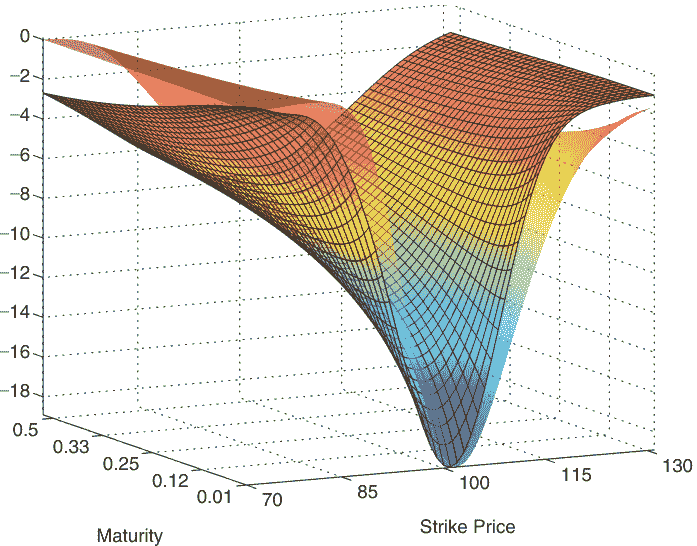

**图 11.2** Heston 模型的 Theta

## 在 ATTARI 和 CARR-MADAN 公式下的希腊腊字母

在之前的章节中，我们根据原始的 Heston (1993) 看涨权价格公式推导并实现了希腊字母。我们也可以在其他公式（例如之前章节中遇到的公式）下推导出希腊字母的解析表达式。使用 Zhu (2010) 推导的 Attari (2004) 看涨权公式来获取 delta 和 gamma 是直接的。回想第 3 章，该模型中的看涨权公式给出：

```
$C(K) = S_t - \frac{1}{2}Ke^{-rt} - \frac{Ke^{-rt}}{\pi} \int_{0}^{\infty} A(u)du.$
```

被积函数为：

```
$A(u) = \frac{R_2 + \frac{I_2}{u}}\cos(\ell u) + \left(I_2 - \frac{R_2}{u}\right)\sin(\ell u)}{1+u^2} \frac{F(u)\cos(\ell u) + G(u)\sin(\ell u)}{1+u^2} \quad (11.31)$
```


# 340 MATLAB 和 C# 中的 Heston 模型及其扩展

$\ell = \ln(Ke^{-rt}/S_t)$。在被积函数 (11.31) 中，$R_2 = \text{Re}[\varphi_2(u)]$ 和 $I_2 = \text{Im}[\varphi_2(u)]$ 分别表示 Attari (2004) 特征函数 $\varphi_2(u)$ 的实部和虚部，该函数给出：

```
$\varphi_2(u) = \exp(C_2(\tau,u) + D_2(\tau,u)v_0 - iurt). \quad (11.32)$
```

在 (11.32) 中，$C_2(\tau,u)$ 和 $D_2(\tau,u)$ 是 Heston (1993) 特征函数 $f_2(u)$ 中的项，$v_0$ 是波动方差参数 $S_v$。我们在第 3 章看到 $\varphi_2(u)$ 独立于通过参数 $\ell$ 出现的现价 $S_t$。因此，导出看涨权的 delta 表达式是简单的：

```
$\Delta_C = 1 - \frac{Ke^{-rt}}{\pi} \int_0^\infty \frac{\partial A(u)}{\partial S} du. \quad (11.33)$
```

应用链式法则，我们得到 (11.33) 中的被积函数为：

```
$\frac{\partial A(u)}{\partial S} = \frac{-F(u)\sin(u) + G(u)\cos(u)}{1+u^2} \times \left(-\frac{u}{S}\right). \quad (11.34)$
```

因为 $\partial(\ell u)/\partial S = -u/S$。gamma 给出：

```
$\Gamma = \frac{Ke^{-rt}}{\pi} \int_0^\infty \frac{\partial^2 A(u)}{\partial S^2} du. \quad (11.35)$
```

被积函数为：

```
$\frac{\partial^2 A(u)}{\partial S^2} = \frac{-F(u)(\cos(\ell u)+\sin(\ell u)) + G(u)(-\sin(\ell u)+\cos(\ell u))}{1+u^2} \times \left(\frac{u}{S^2}\right). \quad (11.36)$
```

在 Attari (2004) 的看涨权公式中，delta 和 gamma 可以很容易地得到闭式形式，且不于现价 $S_t$。通过这种方法获取其他希腊字母是不实际的，因为希腊字母的参数出现在 $\varphi_2(u)$ 中。事实上，为了获得 $A(u)$ 的导数，我们需要像方程 (11.31) 所示分离 $\varphi_2(u)$ 的实部和虚部，并分别获得这些部分的导数。我们仍然可以使用有限差分获取模型中的希腊字母。

Matlab 函数 `AttariProbreeks.m` 计算方程 (11.34) 和 (11.36) 中 delta 和 gamma 所需被积函数。它与第 3 章介绍的 `AttariProb` 非常相似，因此不再完整给出：

```
function A = AttariProbreeks(u,...,Greek)

% Attari 和 L 函数的特征函数

f = exp(C + D*v0 - i*u*tau);

l = log(exp(-r*tau)*K/S0);
```

### 系数
F = (real(f) + imag(f)/u);
G = (imag(f) - real(f)/u);
% 返回所选希腊字母的被积函数
if strcmp(Greek, 'Delta'):
    A = (F*sin(L) - G*cos(L)) * u/S0/(1+u^2)
elseif strcmp(Greek, 'Gamma'):
    A = (-F*cos(L) + G*sin(L)) * u/S0/(1+u^2)
```

在 Attari (2004) 看涨权公式中，delta 和 gamma 可以很容易地得到不依赖于现价 $S_t$ 的闭式形式。通过这种方法获取其他希腊字母是不实际的，因为希腊字母的参数出现在 $\varphi_2(u)$ 中。事实上，为了获得 $A(u)$ 的导数，我们需要像方程 (11.31) 所示分离 $\varphi_2(u)$ 的实部和虚部，并分别获得这些部分的导数。我们仍然可以使用有限差分获取模型中的希腊字母。

`AttariProbreeks.m` 函数计算方程 (11.34) 和 (11.36) 中 delta 和 gamma 所需的被积函数。它与第 3 章介绍的 `AttariProb` 函数非常相似，因此在这里不再完整给出：

```matlab
function A = AttariProbreeks(u,...,Greek)
% Attari 和 L 函数的特征函数
f = exp(C + D*v0 - i*u*tau);
l = log(exp(-r*tau)*K/S0);
```

### 系数

F = (real(f) + imag(f)/u);

G = (imag(f) - real(f)/u);

% 返回所选希腊字母的被积函数

if strcmp(Greek, 'Delta'):

    A = (F*sin(L) - G*cos(L)) * u/S0/(1+u^2)

elseif strcmp(Greek, 'Gamma'):

    A = (-F*cos(L) + G*sin(L)) * u/S0/(1+u^2)

```

*(注：由于提供的文本中存在大量重复和断层，上述译文已根据逻辑进行了整理，以确保翻译的连贯性)*

## Heston 希腊字母

# 339


**图 11.2** Heston 模型的 Theta

## 在 ATTARI 和 CARR-MADAN 公式下的希腊字母

在之前的章节中，我们根据原始的 Heston (1993) 看涨权价格公式推导并实现了希腊字母。我们也可以在其他公式（例如之前章节中遇到的公式）下推导出希腊字母的解析表达式。使用 Zhu (2010) 推导的 Attari (2004) 看涨权公式来获取 delta 和 gamma 是直接的。回想第 3 章，该模型中的看涨权公式给出：

```
$C(K) = S_t - \frac{1}{2}Ke^{-rt} - \frac{Ke^{-rt}}{\pi} \int_{0}^{\infty} A(u)du.$
```

被积函数为：

```
$A(u) = \frac{R_2 + \frac{I_2}{u}}\cos(\ell u) + \left(I_2 - \frac{R_2}{u}\right)\sin(\ell u)}{1+u^2} \frac{F(u)\cos(\ell u) + G(u)\sin(\ell u)}{1+u^2} \quad (11.31)$
```

# 340 MATLAB 和 C# 中的 Heston 模型及其扩展

$\ell = \ln(Ke^{-rt}/S_t)$。在被积函数 (11.31) 中，$R_2 = \text{Re}[\varphi_2(u)]$ 和 $I_2 = \text{Im}[\varphi_2(u)]$ 分别表示 Attari (2004) 特征函数 $\varphi_2(u)$ 的实部和虚部，该函数给出：

```
$\varphi_2(u) = \exp(C_2(\tau,u) + D_2(\tau,u)v_0 - iurt). \quad (11.32)$
```

在 (11.32) 中，$C_2(\tau,u)$ 和 $D_2(\tau,u)$ 是 Heston (1993) 特征函数 $f_2(u)$ 中的项，$v_0$ 是波动方差参数 $S_v$。我们在第 3 章看到 $\varphi_2(u)$ 独立于通过参数 $\ell$ 出现的现价 $S_t$。因此，导出看涨权的 delta 表达式是简单的：

```
$\Delta_C = 1 - \frac{Ke^{-rt}}{\pi} \int_0^\infty \frac{\partial A(u)}{\partial S} du. \quad (11.33)$
```

应用链式法则，我们得到 (11.33) 中的被积函数为：

```
$\frac{\partial A(u)}{\partial S} = \frac{-F(u)\sin(u) + G(u)\cos(u)}{1+u^2} \times \left(-\frac{u}{S}\right). \quad (11.34)$
```

因为 $\partial(\ell u)/\partial S = -u/S$。gamma 给出：

```
$\Gamma = \frac{Ke^{-rt}}{\pi} \int_0^\infty \frac{\partial^2 A(u)}{\partial S^2} du. \quad (11.35)$
```

被积函数为：

```
$\frac{\partial^2 A(u)}{\partial S^2} = \frac{-F(u)(\cos(\ell u)+\sin(\ell u)) + G(u)(-\sin(\ell u)+\cos(\ell u))}{1+u^2} \times \left(\frac{u}{S^2}\right). \quad (11.36)$
```

在 Attari (2004) 的看涨权公式中，delta 和 gamma 可以很容易地得到闭式形式，且不依赖于现价 $S_t$。通过这种方法获取其他希腊字母是不实际的，因为希腊字母的参数出现在 $\varphi_2(u)$ 中。事实上，为了获得 $A(u)$ 的导数，我们需要像方程 (11.31) 所示分离 $\varphi_2(u)$ 的实部和虚部，并分别获得这些部分的导数。我们仍然可以使用有限差分获取模型中的希腊字母。

`AttariProbreeks.m` 函数计算方程 (11.34) 和 (11.36) 中 delta 和 gamma 所需被积函数。它与第 3 章介绍的 `AttariProb` 函数非常相似，因此在这里不再完整给出：

```
function A = AttariProbreeks(u,...,Greek)

% Attari 和 L 函数的特征函数

f = exp(C + D*v0 - i*u*tau);

l = log(exp(-r*tau)*K/S0);
```

### 系数
F = (real(f) + imag(f)/u);
G = (imag(f) - real(f)/u);
% 返回所选希腊字母的被积函数
if strcmp(Greek, 'Delta'):
    A = (F*sin(L) - G*cos(L)) * u/S0/(1+u^2)
elseif strcmp(Greek, 'Gamma'):
    A = (-F*cos(L) + G*sin(L)) * u/S0/(1+u^2)
```

# 344

# MATLAB 和 C# 中的 Heston 模型及其扩展

```matlab
function y = LewisIntegrandGreek(k,...,Greek)
% 基础变换，H(k,S,t)
H = exp(C + D*0)
% 返回积分函数的实部
if strstrcmp(Greek, 'Price')
y = real(-X-i*k-r*tau)/(k^2-i*k*H)
elif strcmp(Greek, 'Delta')
y = real(-X-i*k-r*tau)/(k^2-i*k)*H*(-i/S)
elif strcmp(Greek, 'Gamma')
y = real(-exp(-X-i*k-r*tau)*H/S^2)
elif strcmp(Greek, 'Rho')
y = real(-exp(-i*k-r*tau)/(k^2-i*k)*H*D)*sqrt(v0)
elif strcmp(Greek, 'Theta')
y = real(exp(-i*k-r*tau)*(k^2-i*k)*H)
DC = kappa*theta(kappa/2) + g*exp(d) ...
DD = (kappa/2)*exp(d*t)*(g-1)/(1-g*exp(d)) ...
y = real((-1-i*r-q)/(C+D*v0))*exp(-X-i ...
elif strcmp(Greek, 'Volga')
y = exp(-i*k)/(k^2-i*k)*H*D*sqrt(v0)
elif strcmp(Greek, 'Vanna')
y = real(I)*4*sqrt(v0)
elif strcmp(Greek, 'Vanna')
y = real(exp(-i*k-r*tau)/(k^2-i*k)*H*D*(-i/S)*sqrt(v0))
end
```

该函数被传递给 Matlab 函数 `LewisGreekPrice.m`。C# 代码类似，此处未给出。

Lewis (2001) 推导出的期权价格 $C(S)$ 也使用了第 4 章涵盖的 Parseval 等等式。使用 $k=1/2$ 的公式是 Lewis (2001) 中的方程 (3.11)。

> $C(S_i) = S_i e^{-qt} - \int_{0}^{\infty} \frac{\sqrt{S_i e^{-qt}+r\tau/2}}}{\pi} \text{Re} \left[ e^{ix\mu} \left( u - \frac{1}{2i} \right) \right] \frac{1}{u^2+4} du \n= S_i e^{-qt} \int_{0}^{\infty} \text{Re} \left[ K^{iu-e^{-r\tau f_2}} \left( u - \frac{1}{2i} \right) \right] \frac{1}{u^2+4} du$

其中 $X$ 定义在 (11.40) 之后我们使用了第 4 章中的结论 $\varphi(u)=f_2(u)e^{-uy}$，其中 $Y = In_t + (r-q)\tau$ 且 $f_2$ 是 Heston (1993) 特征函数。同样通过对这种 Lewis 2001 价格形式的希腊字母进行直接求导得到。Matlab 函数 `LewisGreeks311.m` 和 C# 函数 `LewisGreeks311` 用于实现来自 Lewis (2001) 方程 (3.11) 的看涨价格 $C(S)$ 的希腊字母。这些函数与之前章节介绍的相似，此处不再给出。

表 11.3 展示了使用本章采用闭式形式的希腊字母。我们使用以下设置：$S=100, \theta=0.25, \tau=0.05, q=0$，以及参数值 $\kappa=2, v_0=0.05,\sigma=0.1,$ 和 $\rho=-0.9$。

## Heston 希腊字母

## 表 11.3 各种形式下的闭式希腊字母

| | Heston (1993) | Attari (2004) | Carr and Madan (1999) | Lewis (2000) | Lewis (2001) |

|---|---|---|---|---|---|

| 价格 Delta (Price Delta) | 0.5836 | 0.5836 | 0.5083 | 0.5666 | 0.5837 |

| Gamma | 0.0347 | 0.0347 | 0.0347 | 0.0353 | 0.0347 |

| Theta | -11.3995 | | -11.4094 | -11.3464 | -11.4009 |

| Rho | 13.3128 | | 13.3127 | 12.8696 | 13.3133 |

| Vega 1 | 15.3911 | | 15.3909 | 15.4812 | 15.3915 |

| Vanna | -0.1257 | | -0.1257 | 0.0516 | -0.1257 |

| Volga | 15.5081 | | 15.4273 | 15.7285 | 15.4054 |

### 使用 FFT 和 FRFT 的希腊字母

我们在第 5 章中看到，快速傅里叶变换 (FFT) 和分数傅里叶变换 (FRFT) 都能非常快速地产生价格并适用于广泛的执行权样本。将这些方法以相同的方式产生希腊字母是简单的。回顾第 5 章实现看涨价格的方法，我们构建了积分网格 $\{v_j\}_{j=1}^N$ 和对数执行权 $\{k_j\}_{j=1}^N$，并计算点 $x_j = \exp[(b - \ln S_0)\psi(v_j)]$ 对于 $j = 1, \dots, N$。我们通过和得到 $\hat{x}_u = C(k_u)$，即在对数执行权点 $k_u$ 处评估的看涨价格：

```
$\hat{x}_u = \frac{e^{-u a k_u}}{\pi} \sum_{j=1}^N \left[ e^{-\frac{i}{2}(j-1)(u-1)} X_j \right] \text{ for } u = 1, \dots, N. \quad (42)$
```

为了在 $x$ 中通过 FFT 获得一组希腊字母，我们只需将

```
$\psi(v_j) = \frac{e^{-v_j^2} f_2(v_j) - (\alpha + i)}{\alpha^2 + v_j^2} \quad (43)$
```

替换为使用 $f_2$ 导数的修改版本，例如方程 (38) 中的 theta。使用 FFT 实现希腊字母需要对第 5 章提出的代码进行轻微修改。Matlab 函数 `HestonCallFFreek.m` 与该章节的 `HestonCallFFT` 几乎相同，不同在于它使用了 `HestonGreeks.m` 函数。它通过额外参数返回特征函数或其导数：


```matlab
function [CallFFT, lambda] = HestonCallFFreek(..., Greek)
  if fast
    % 实现 FFT 算法
    U = [0:N-1];
    J = [0:N-1];
    psi = HestonCFreeks(v-(alpha+1)).i;
    phi = exp(-r*tau).*psi ./ (alpha^2 + v.^2);
    x = exp(i*(b-s0).*phi;
    e = exp(-i*2*pi/N).*x;
    CallFFT = sta.*exp(-alpha./pi) * real(e);
```

`HestonCallFRGT.m` 用于实现分数希腊字母和 Carr and Madan (1999) 公式。它还使用了早些章节定义的 `CarrGreeks.m` 函数来比较这种方法获得的希腊字母的准确性。

```matlab
rule = 'S';
Greek = {'Price', 'Delta', 'Gamma', 'Rho', 'Vanna', 'Volga'};
% FFT 或 FRT
for j=1:8
  if strcmp(method,'FFT')
    [Greeks(:,j)] = HestonCallFRGT(...,j);
  else
    [Greeks(i,j)] = HestonCallGMT(...,j);
  end
% 闭式希腊字母和误差
GreeksCM = zeros(length(ATM), 8);
for k=1:8
  GreeksCM(k,j) = CarrGreeks(...,j);
end
for j=1:8
  error(j) = sum(GreeksCM(:) - Greeks(:,j));
```

使用 FFT 和 FRT 实现希腊字母的代码在此未给出。为了说明，我们使用现价 `$S_0=100$` 和 6 个月的期限运行 FRT。结果在表 11.4 中，包含了来自 Carr and Madan (1999) 公式的真实值误差。表格表明通过分数 FFT 获得的希腊字母是准确的。虽然 FFT 本身没有给出，但它们也非常准确。

### 使用模拟的美式希腊字母

记得第 8 章中使用了 Longstaff 和 Schwartz (2001) 的最小二乘蒙特卡洛 (LSM) 算法在 Heston 模型中为美式期权定价。

## 表 14 分数傅里叶变换的希腊字母

| 执行权 (Strike) | 价格 (Price) | Delta | Gamma | Rho | Vega | Vanna |

|---|---|---|---|---|---|---|---|

| 98.02 | 9.21 | 0.649 | 0.021 | -9.25 | 27.85 | 16.63 | -0.188 | 27.77 |

| 98.51 | 8.93 | 0.638 | 0.021 | -9.27 | 27.46 | 16.60 | -0.163 | 27.44 |

| 99.00 | 8.66 | 0.628 | 0.022 | -9.28 | 27.06 | 16.96 | -0.137 | 27.14 |

| 99.50 | 8.39 | 0.617 | 0.022 | -9.29 | 26.64 | 17.11 | -0.111 | 26.88 |

| 100.00 | 8.12 | 0.606 | 0.022 | -9.29 | 26.23 | 17.25 | -0.084 | 26.66 |

| 100.50 | 7.86 | 0.595 | 0.022 | -9.29 | 25.80 | 17.37 | -0.056 | 26.49 |

| 101.01 | 7.61 | 0.573 | 0.023 | -9.28 | 25.36 | 17.48 | -0.028 | 26.36 |

| 误差 (Error) | $4.5 \times 10^{-6}$ | $5.2 \times 10^{-6}$ | $5.2 \times 10^{-7}$ | $1.8 \times 10^{-4}$ | $4.5 \times 10^{-6}$ | $5.2 \times 10^{-6}$ | $1.8 \times 10^{-4}$ |

该算法可以修改以计算美式希腊字母。此外，为了确保希腊字母准确，我们必须存储生成股票价格和波动率路径的角随机变量值，并在对输入偏移值生成路径时应用相同的随机变量。这确保了原始路径与偏移路径之间的任何差异都是由偏移本身引起的，而不是模拟噪声。

修改第 7 章的函数以使用 LSM 算法获取美式希腊字母是简单的。第一个任务是在函数外部创建相关随机变量矩阵，并将这些矩阵作为函数参数。`MMSim.m` 函数是第 7 章中 Andersen 和 Brotherton-Ratcliffe (2005) 矩匹配模拟的简单修改版本。唯一的区别是相关随机变量 `$Z_s$` 和 `$Z_v$` 在函数外部，并作为参数传递给函数。

```matlab
function [S V] = MMSim(params,...,Zv, Zs)
% 生成股票和波动率路径
for i=1:N
  for t=2:T
      dw = sqrt(dt)*V(t,i);
      num = .5*sigma^2V(t-1,i)*(1-exp(-2*kappa*dt));
      den = (exp(-kappa*dt)*V(t-1,i) + (1-exp ...
% ... (code truncated in original)
      Gam = log(1 + num/den);
      V(t,i) = (exp(-kappa*dt)*V(t-1,i) + (1-exp ...
      % Euler/Milstein离散化对数股票价格
      S(t,i) = S(t-1,i)*exp((r-q-V(t-1,i)/2 + ...
  end
end
end
```

# 348 MATLAB 和 C# 中的 Heston 模型及其扩展

```matlab
function [Euro, Amer] = LSMGreeks(...,NT,NS,Zs,Greek)
ds = 0.01*S; //
dv = 0.01*V0;
if strcmp(Greek,'delta') % strcmp(Greek,'gamma')
  [Pathup V] = MMSGreeks(params,S+ds,...);
  [Pathsm V] = MMSGreeks(params,S-ds,...);
  [EuroPrice AmerPrice] = LSM(Pathsp',...);
  [EuroPriceAmerism] = LSM(Pathsm',...);
  if strcmp(Greek,'delta')
    Euro = (EuroPrice - EuroPrice) /2/ds;
    Amer = (AmerPrice - AmerPrice) /2/ds;
  else
    [Pathup V] = MMSGreeks(params,S,...);
    [EuroPrice AmerPrice] = LSM(Pathsp',...);
    Amer = (AmerPrice + AmerPrice) /ds^2;
    Euro = (EuroPrice - 2*AmerPrice + EuroPrice)/ds^2;
  end
if strcmp(Greek,'vega')
  paramsp = [kappa theta sigma v0+dv rho lambda];
  paramsp = [kappa theta sigma v0-dv rho lambda];
  [Pathup V] = MMSGreeks(paramsp,S,...);
  [Pathsm V] = MMSGreeks(paramsp,S,...);
  [EuroPrice AmerPrice] = LSM(Pathsp',...);
  [EuroPriceAmerism] = LSM(Pathsm',...);
  Euro = (EuroPrice - EuroPrice)/2/dv*sqrt(v0);
  Amer = (AmerPrice - AmerPrice)/2/dv*sqrt(v0);
end
```

`LSMGreeks.m` 函数用于以下代码，它仅生成 delta 和 gamma。

- * 相关 N(0,1) 随机变量矩阵

`Zv = randn(NT,NS);`

`Zs = rho*Zv + sqrt(1-rho^2).*randn(NT,NS);`

`[EuroDelta Amer] = LSMGreeks(...,,'delta');`

`[EuroGammaGamma] = LSMGreeks(...,,'gamma');`

使用 Longstaff 和 Schwartz (2001) 的 LSM 算法获取美式看跌期权 Greeks 的 C 代码非常相似，此处不再给出。区别在于我们需要为回归参数估计和生成随机数创建 C 函数。这些函数与第 8 章中的函数相同，它们在 LSM 算法中被用于生成美式期权的价格。

为了说明，我们使用 Clarke 和 Parrott (1999) 的设置对美式看跌期权运行 LSM 算法，并使用 Ikonen 和 Toivan (2008) 计算的价格，即 K=100, τ=0.25, r=0.1, κ=5, θ=0.16, ρ=0.9，现价从 8 到 12。我们使用 NT=1,000 个时间步和 NS=50,000 个股票价格步长。结果见表 11.5。

### Heston Greeks

**表 11.5** 美式看跌期权的价格和 Greeks，LSM 算法

| 现价 (Spot) | 价格 (Price) | Delta | Gamma | Theta | Rho | Vega1 | Vanna |

|---|---|---|---|---|---|---|---|

| 8 | 2.000 | -0.999 | 0.006 | 0.006 | 0.005 | -0.005 | -0.480 |

| 9 | 1.111 | -0.731 | 0.056 | -0.835 | -1.094 | 0.848 | 1.227 |

| 10 | 0.537 | -0.431 | 0.255 | -1.255 | -0.726 | 0.983 | -0.465 |

| 11 | 0.225 | -0.211 | 0.168 | -1.026 | -0.427 | 0.675 | -0.481 |

| 12 | 0.080 | -0.086 | 0.089 | -0.575 | -0.240 | 0.317 | -0.462 |

**表 11.6** 欧式看跌期权的价格和 Greeks，LSM 算法

| 现价 (Spot) | 闭式价格 (Closed Price) | LSM 价格 | 闭式 Delta (Closed Delta) | LSM Delta | 闭式 Gamma (Closed Gamma) | LSM Gamma | 闭式 Vega1 (Closed Vega1) | LSM Vega1 |

|---|---|---|---|---|---|---|---|---|

| 8 | 1.839 | 1.834 | -0.880 | -0.875 | 0.139 | 0.174 | 0.358 | 0.367 |

| 9 | 1.048 | 1.057 | -0.681 | -0.663 | 0.253 | 0.252 | 0.857 | 0.729 |

| 10 | 0.502 | 0.522 | -0.411 | -0.409 | 0.264 | 0.241 | 0.857 | 0.859 |

| 11 | 0.225 | 0.221 | -0.193 | -0.206 | 0.164 | 0.165 | 0.662 | 0.693 |

| 12 | 0.080 | 0.078 | -0.083 | -0.085 | 0.074 | 0.085 | 0.383 | 0.415 |

为了评估通过这种方法计算的 Greeks 的准确性，我们使用 LSM 算法为欧式看跌期权定价，使用与表 11.5 相同的设置，并将 LSM 算法得到的 Greeks 与闭式解 Greeks 进行比较。表 11.6 显示的结果表明，在 LSM 算法下计算的 Greeks 相当接近。

# 使用显式法计算美式 GREE

回想第 10 章，当用有限差法求解 Heston PDE 时，股票价格和波动率维度的矩阵包含一组完整的期权价格。因此，可以通过双维插值函数 `interp2` 很容易获得矩阵的偏移值以获得 Greeks。通过这种方式，可以获得对 S 和 v 的所有敏感度，即 delta、gamma、vega 和 vol。以下代码展示了如何在 Matlab 中对非均匀网格使用显式法处理欧式期权。该代码使用了第 10 章中提供的 `HestonUniformGrid` 来在二维网格上近似 Heston PDE。

```matlab
PutCall = 'P';
EuroAmer = 'E';
[u] = HestonUniformGrid(...,PutCall,EuroAmer);
PDEPrice = interp2(V,S,U0,S0);
% Delta and Gamma
dS = 1;
```

### MATLAB 和 C 中的 Heston 模型及其扩展

```matlab
D1 = interp2(V,S,U0,S0+dS);
D2 = interp2(V,S,U0,S0-dS);
DeltaPDE = (D1-D2)/2/dS;
GammaPDE = (D1 - 2*PDEPrice + D2)/dS^2;
% Vega
dV = 1e-2;
V1 = interp2(V,S,U0,V0+dV);
V2 = interp2(V,S,U0,V0-dV);
VegaPDE = (V1-V2)/2/dV*sqrt(V0);
C1 = interp2(V,S,U0,S0+dS);
C2 = interp2(V,S,U0,S0-dS);
C3 = interp2(V,S,U0,V0+dS);
C4 = interp2(V,S,U0,V0-dS);
% Vanna and Volga
VannaPDE = (C1 - C2 + C3 - C4)/4/dV/dS*sqrt(V0);
dc2 = (V1 - 2*PDEPrice + D2)/dV^2*sqrt(V0);
VolgaPDE = 4*sqrt(V0) * (dc2 + VegaPDE);
```

Theta 的获取可以通过识别 `HestonUniformGrid` 函数返回上一步的 `$U(S,v,t)$` 和 `$U(S,v,t-dt)$` 直到到期值，这提供了有限差法所需的 theta 时间偏移值。

```matlab
[U] = HestonUniformGrid(...);
% Theta
T1 = interp2(V,S,U0,S0); // 获取 U(S,v,T)
T2 = interp2(V,S,U0,S0); // 获取 U(S,v,T-dt)
ThetaPDE = -(T1 - T2)/dt;
```

注意，在第一行中，函数被修改为返回 `$U(S,v,r)$` 和 `$U(S,v,r-dt)$`，而不仅仅是 `$U(S,v,t)$`。在 C# 中，区别在于我们创建了用于二维插值的 `interp2()` 函数。

```csharp
public struct Uu
{
    public double[,] bigU;
    public double[,] smallU;
}
```

```csharp
for(int k=0; k<=N-1; k++)
{
    // 求解 PDE 并返回 U(S,v,T) 和 U(S,v,T-dt)
    Uu output = HestonExplicitUniformGrid(...);
    double[,] u = output.bigU; // output.smallU;
    // 价格, Delta, Gamma
    PDEPrice[k] = interp2(V,S,U0,S0[k]);
    D1 = interp2(V,S,U0,S0[k]+dS);
    D2 = interp2(V,S,U0,S0[k]-dS);
    DeltaPrice[k] = (D1-D2)/2/dS;
    GammaPrice[k] = (D1 - 2*PDEPrice[k] + D2)/dS^2;
    // Vega
    V1 = interp2(V,S,U0,S0[k]);
    V2 = interp2(V,S,U0,S0[k]-dv);
    VegaPrice[k] = (V1 - V2) * 2/dv * sqrt(V0);
    // Theta
    T1 = interp2(V,S,U0,S0[k]); // U(S,v,T)
    T2 = interp2(V,S,U0,S0[k]); // U(S,v,T-dt)
    ThetaPrice[k] = -(T1 - T2)/dt;
}
```

使用显式法生成美式期权 Greeks 的 C 代码非常相似，并使用了第 10 章引入的 `HestonExplicitUniformGrid()` 函数来近似 PDE。该函数必须修改为返回 `$U(S,v,\tau)$` 和 `$U(S,v,\tau-dt)$`。显式法也可以用于获取 Clarke 和 Parrott (1999) 的美式看跌期权价格和 Greeks。为每个现价构建了一个独立的非均匀网格，并围绕现价中心。

```matlab
S0 = [8 9 10 11 12];
for s=1:length(S0)
% 现价网格
c = S0(s)/s; % 代替 K/5
dz = 1/ns*(asinh((Smax-S0(s))/c - asinh(-S0(s))/c); % 代替 K/c
```


```matlab
for i=1:S+1;
z(i) = asinh(-S0/c) + (i-1)*dz; % 代替 K/c
S(i) = S0 + c*sinh(z(i));
end
% 波动率网格
d = Vmax/500;
dn = asinh(Vmax/d)/d;
for j=1:n+1
j(j) = (j-1)*dn;
V(j) = d*sinh(n(j));
end
% 求解 PDE
[U] = HestonExplicitUniformGrid(...);
dS = 0.01*S0;
dv = 0.01*V0;
% 价格, Delta, 和 Gamma
PDEPrice(s) = interp2(V,S,U0,S0(s));
D1 = interp2(V,S,U0,S0(s)+dS);
D2 = interp2(V,S,U0,S0(s)-dS);
DeltaPrice(s) = (D1-D2)/2/dS;
GammaPrice(s) = (D1 - 2*PDEPrice(s) + D2)/dS^2;
% Vega
V1 = interp2(V,S,U0,S0(s));
V2 = interp2(V,S,U0,S0(s)-dv);
VegaPrice(s) = (V1 - V2) * 2/dv * sqrt(V0);
% Theta
T1 = interp2(V,S,U0,S0(s)); // U(S,v,T)
T2 = interp2(V,S,U0,S0(s)); // U(S,v,T-dt)
ThetaPrice(s) = -(T1 - T2)/dt;
```

对于有限差法所需的 theta 时间偏移值，可以通过识别 `HestonUniformGrid` 函数返回上一步的 $U(S,v,t)$ 和 $U(S,v,t-dt)$ 直到到期值来获得。我们使用 Clarke 和 Parrott (1999) 的结果和 Ikonen 和 Toivan (2008) 的价格生成表 11.5，现价网格为 80，波动率网格为 40，3000 个时间步。结果见表 11.7。注意显式法无法准确计算第一行深度实值期权的 vega、vol 和 theta。

### 来自 Medvedev 和 Scillet 的美式 Greeks

在第 8 章中，我们展示了 Medvedev 和 Scillet (2010) 的美式近似，并注意到该方法的一个优势是能够快速生成美式期权。因此，使用模型差分计算 Greeks 不需要过多的计算时间。这通过 Matlab 函数 `MSGreeks` 实现，该函数使用了第 8 章中过的 `MSPrice` 函数。按照惯例，部分函数已省略。

| 现价 (Spot) | 价格 (Price) | Delta | Gamma | Vega1 | Vanna | Volga | Theta |
| --- | --- | --- | --- | --- | --- | --- | --- |
| 8 | 2.0000 | -0.9998 | 0.0058 | 0.0000 | 0.0408 | 0.0000 | -0.0000 |
| 9 | 1.1042 | -0.7483 | 0.3348 | 0.6662 | 0.4653 | 2.6647 | -0.6497 |
| 10 | 0.5188 | -0.4349 | 0.2797 | 0.8624 | -0.0515 | 3.3496 | -1.1288 |
| 11 | 0.2134 | -0.2028 | 0.1721 | 0.6655 | -0.2911 | 2.6620 | -0.9875 |
| 12 | 0.0814 | -0.0812 | 0.0780 | 0.3841 | -0.2515 | 1.5362 | -0.6198 |

### 表 11.7 美式看跌期权的 Greeks，显式法

## Heston 希腊字母

## 353

```matlab
function y = MSGreeksFD(params,...,Greek)
if strcmp(Greek, 'price')
    [EuroPut AmerPut AmerPut EEP theta y] = MSPrice(...);
    y = EuroPut + EEP;
end
if strcmp(Greek, 'delta') || strcmp(Greek, 'gamma')
    ds = 0.01*S
    AmerPut = MSPrice(S-ds,...)
    AmerPut = MSPrice(S+ds,...)
    if strcmp(Greek, 'gamma')
        AmerPut = MSPrice(S,...)
        y = (AmerPut - 2*AmerPut)/ds^2;
    else
        y = (AmerPut - AmerPut)/2/ds;
    end
end
if strcmp(Greek, 'theta')
    dt = 0.01*T;
    AmerPut = MSPrice(T+dt,...)
    AmerPut = MSPrice(T-dt,...)
    y = -(AmerPut - AmerPut)/2/dt;
end
if strcmp(Greek, 'vega') | strcmp(Greek, 'volga')
    dv = 0.01*v0;
    AmerPut = MSPrice(v0+dv,...)
    AmerPut = MSPrice(v0-dv,...)
    Vega = (AmerPut - AmerPut)/2*2*sqrt(v0)
    if strcmp(Greek, 'volga')
        AmerPut = MSPrice(v0,...)
        dc2 = (AmerPut - 2*AmerPut)/(dv^2)
        y = 4*sqrt(v0)*(dc2*sqrt(v0) + Vega/4/v0);
    else
        y = Vega;
    end
end
```

用于 Medvedev 和 Scaillet (2010) 美式期权希腊字母的 C 代码虽然简单，但并未给出。

为了说明，我们使用了 Clarke 和 Parrot (1999) 的设置，这些设置生成了表 11.6 和 11.7。展开式使用了四项。结果见表 11.8。

## 表 11.8 美式期权的希腊字母，Medvedev-Scaillet 展开

| 现价 | 价格 | Delta | Gamma | Vega | Vanna | Volga | Theta |
|---|---|---|---|---|---|---|---|
| 8 | 2.0008 | -0.9642 | 0.1117 | -0.0140 | 0.4316 | 4.716 | -0.2162 |
| 9 | 1.1238 | -0.7585 | 0.2924 | 0.5790 | 0.6082 | 3.6768 | -0.7937 |
| 10 | 0.5230 | -0.4416 | 0.3030 | 0.9014 | -0.0105 | 2.2742 | -1.1837 |
| 11 | 0.2133 | -0.1997 | 0.1755 | 0.6830 | -0.3256 | 2.7095 | -1.0098 |
| 12 | 0.0822 | -0.0792 | 0.0757 | 0.3819 | -0.2498 | 2.0886 | -0.6288 |

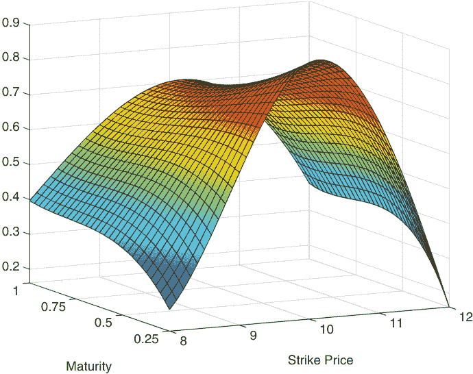

我们继续使用 Clarke 和 Parrot (1999) 的设置来生成第一个 Vega ($\mathcal{V}$) 的曲面。该图如图 11.3 所示。Medvedev 和 Scaillet (2010) 的展开式使用了三项。

# 结论

在本章中，我们给出了 Heston (1993) 模型希腊字母的公式。所有闭式定价公式都可以通过解析法求导来得到希腊字母。快速傅里叶变换及其分数形式版本都可以快速产生大量的希腊字母。

此外，通过显式有限差分、Medvedev 和 Scaillet (2010) 的展开式以及 LSM 算法获取美式期权的希腊字母是简单的。然而，需要注意的是，通过模拟获取希腊字母可能会给最简单的导数带来困难。计算希腊字母的其他方法包括 Broadie 和 Glassmann (1996) 的步进法和似然比方法（见 Glasmann (2003) 以及 Chan and Joshi (2010b)）。Broadie 和 Kaya (2004) 在他们的精确模拟方案获得了路径和似然比希腊字母（Broadie and Kaya, 2006）。Benhamoum (2002) 以及 Davis 和 Johansson (2005) 等应用 Malliavin 积分来获取 Heston 模型中基于模拟的希腊字母。

在第 9 章中，表明 Heston 模型更加灵活的一种方法是引入随时间变化的参数。还表明，这些模型有时比原始 Heston (1993) 模型能更好地拟合隐含波动率曲面，特别是在短期期限内。向模型引入灵活性的另一种方法是丰富波动率动力学。

## 第12 章：双 Heston 模型

### 摘要

Heston (1993) 模型并不总是很好地拟合隐含波动率。表明 Heston 模型更加灵活的一种方法是引入随时间变化的参数。还表明，这些模型有时比原始 Heston (1993) 模型能更好地拟合隐含波动率曲面，特别是在短期期限内。向模型引入灵活性的另一种方法是丰富波动率动力学，使得模型能够……我们在在本章中回顾的。

此外，通过显式有限差分法、Medvedev 和 Scaillet (2010) 的展开式以及 LSM 算法从美式期权获取希腊字母是简单的。然而，需要注意的是，通过模拟获取希腊字母可能会给最简单的导数带来困难。计算希腊字母的其他方法包括……

### 多维 Feynman-Kac 定理

在本节中，我们给出 Feynman-Kac 定理的二维版本。假设 $x$ 遵循以下 $n$ 维布朗运动过程：

```
dx_t = \mu(x,t)dt + \sigma(x,t)dB_t
```

其中 $B_t$ 是 $m$ 维布朗运动，$\sigma(x,t)$ 是 $n \times m$ 矩阵。Feynman-Kac 定理的维维版本指出，对于函数 $f(x,t)$：

$$

\frac{\partial f}{\partial t} + \mathcal{A}f(x,t) - r(x,t)f(x,t) = 0 \quad (12.4)

$$

类似于单变量情况，算子 $\mathcal{A}$ 定义为：

$$

\mathcal{A} = \sum_{i=1}^n \mu_i\frac{\partial}{\partial x_i} + \frac{1}{2}\sum_{i=1}^n\sum_{j=1}^n (\sigma\sigma^T)_{ij}\frac{\partial^2}{\partial x_i\partial x_j} \quad (12.3)

$$

为了符号方便，$\mu = \mu(x,t)$，$\sigma = \sigma(x,t)$，$(\sigma\sigma^T)_{ij}$ 是 $n \times n$ 矩阵的元素。

Heston-Kac 定理的多维版本指出，对于边界条件 $f(x_T, T)$，解为：

$$

f(x,t) = \mathbb{E}^Q\left[\exp\left(-\int_t^T r(x_u) du\right) f(x_T, T) |\mathcal{F}_t\right]

$$

我们继续使用 Clarke 和 Parrot (1999) 的设置来生成第一个 Vega ($\mathcal{V}$) 的曲面。该图如图 11.3 所示。Medvedev 和 Scaillet (2010) 的展开式使用了三项。

## 双 Heston 看权价格

由 Christoffersen 等 (2009) 提出的双 Heston 模型引入了第二个波动率因子，由自身的 $S$ 驱动：

```
dS = (r-q)Sdt + \sqrt{v_1}SdW_1 + \sqrt{v_2}SdW_2
dv_1 = \kappa_1(\theta_1-v_1)dt + \sigma_1\sqrt{v_1}dZ_1
dv_2 = \kappa_2(\theta_2-v_2)dt + \sigma_2\sqrt{v_2}dZ_2 \quad (12.5)
```

指定了以下相关结构：

```
E[dW_1dZ_1] = \rho_{11}dt
E[dW_2dZ_2] = \rho_{22}dt
E[dW_1dZ_2] = E[dZ_1dW_2] = 0. \quad (12.6)
```

注意，为了符号简单，我们省略了项下标。多因子模型思想是额外的波动率因子为波动率曲面提供了更多的灵活性。回顾第 2 章，收益率与其方差之间的相关性 $(\rho)$ 控制着波动率微笑。当 $\rho\approx0$ 时，微笑是对称的，但随着它向 $\pm1$ 移动，微笑变得极不对称，$\rho\approx-1$ 对应负斜率，$\rho\approx+1$ 对应正斜率。在单因子 Heston 模型中，$\rho$ 随期限保持不变，这意味着该模型在微笑斜率随期限剧烈变化时，难以提供足够的拟合，尽管它

## 双 Heston 模型

当斜率均相对平坦或均相对陡峭时。引入第二个波动率因子允许两个相关性，从而产生两种不同的波动率状态。

要推导双 Heston 模型的偏微分方程（PDE），首先应用 Ito 引理得到 $x_t = \ln S_t$ 的随机微分方程（SDE），

```
$dx = (r - q - \frac{1}{2}(v_1 + v_2))dt + \sqrt{v_1}dW_1 + \sqrt{v_2}dW_2.$
```

在方程 (12.5) 中，如果我们设置

```
$W_1 = B_1, W_2 = B_2, Z_1 = \rho_1 B_1 + \sqrt{1 - \rho_1^2}B_3, Z_2 = \rho_2 B_2 + \sqrt{1 - \rho_2^2}B_4 \quad (12.7)$
```

其中 $B_i$ 是独立的布朗运动，那么我们可以写出对应 $x_t=(x_t, v_1, v_2)$ 的 SDE 系统，其对应大小为 $n \times m = 3 \times 4$ 的波动矩阵。为了此，我们注意到 (12.6) 中的相关性结构为

```
$\sigma(x_t, t) = \begin{pmatrix} \sqrt{v_1} & \sqrt{v_2} & 0 & 0 \\ \sigma_1\sqrt{v_1}\rho_1 & 0 & \sigma_1\sqrt{v_1}(1-\rho_1^2) & 0 \\ 0 & \sigma_2\sqrt{v_2} & 0 & \sigma_2\sqrt{v_2}(1-\rho_2^2) \end{pmatrix}$
```

漂移项为

```
$\mu = \begin{pmatrix} r - q - \frac{1}{2}(v_1 + v_2) \\ \kappa_1(\theta_1 - v_1) \\ \kappa_2(\theta_2 - v_2) \end{pmatrix}..$
```

我们得到

```
$\sigma\sigma^T = \begin{pmatrix} v_1+v_2 & \sigma_1v_1 & \sigma_2v_2 \\ \sigma_1v_1\rho_1 & \sigma_1^2v_1 & 0 \\ \sigma_2v_2\rho_2 & 0 & \sigma_2^2v_2 \end{pmatrix}$
```

因此，双 Heston 模型的生成器根据方程 (12.3) 为：

```
$\mathcal{A} = [r - q - \frac{1}{2}(v_1 + v_2)]\frac{\partial}{\partial x} + \kappa_1(\theta_1 - v_1)\frac{\partial}{\partial v_1} + \kappa_2(\theta_2 - v_2)\frac{\partial}{\partial v_2} \\ \frac{1}{2}(v_1+v_2)\frac{\partial^2}{\partial x^2} + \rho_1\sigma_1v_1\frac{\partial^2}{\partial x\partial v_1} + \rho_2\sigma_2v_2\frac{\partial^2}{\partial x\partial v_2} \\ \frac{1}{2}\sigma_1^2v_1\frac{\partial^2}{\partial v_1^2} + \frac{1}{2}\sigma_2^2v_2\frac{\partial^2}{\partial v_2^2} \quad (12.8)$
```

## MATLAB 和 C# 中的 HESTON 模型及其扩展

该 PDE 由方程 (12.4) 得到，其中 $r(x_t, t) = r$ 为常数。注意，当其中一个波动率项消失时，(12.8) 中的生成器将简化为第一章所示的单变量 Heston 模型的生成器。

$(x, v_1, v_2)$ 中的双 Heston 方程组可以写为仿形式

```
$\mu(\mathbf{x}) = \mathbf{K}_0 + \mathbf{K}_1\mathbf{x} + \mathbf{K}_2\nu_1 + \mathbf{K}_3\nu_2$
$\sigma(\mathbf{x})\sigma(\mathbf{x})^T = \mathbf{H}_0 + \mathbf{H}_1\mathbf{x} + \mathbf{H}_2\nu_1 + \mathbf{H}_3\nu_2$
```

其中


## 双 Heston 模型

```
$\mathbf{K}_0 = \begin{pmatrix} \frac{\tau-q}{\kappa_{\theta_1}} \\ \kappa_{2} \end{pmatrix}, \mathbf{K}_1 = \begin{pmatrix} 0 \\ 0 \\ 0\end{pmatrix}, \mathbf{K}_2 = \begin{pmatrix} -\frac{1}{2} \\ -\kappa_{v_1} \\ 0 \end{pmatrix}, \mathbf{K}_3 = \begin{pmatrix} \frac{1}{2} \\ 0 \\ -\kappa_{v_2} \end{pmatrix}$
```

以及

```
$\mathbf{H}_0 = \mathbf{H}_1 = \begin{pmatrix} 0 & 0 & 0 \\ 0 & 0 & 0 \\ 0 & 0 & 0 \end{pmatrix}, \mathbf{H}_2 = \begin{pmatrix} 1 & \sigma_{h_1} & 0 \\ \sigma_{h_1} & \sigma_{v_1}^2 & 0 \\ 0 & 0 & 0 \end{pmatrix}, \mathbf{H}_3 = \begin{pmatrix} 1 & 0 & \sigma_{h_2} \\ 0 & 0 & \sigma_{h_2} \\ 0 & \sigma_{v_2}^2 \end{pmatrix}$
```

我们可以利用 Duffie 等人 (2000) 的结果，即 $(x_T, v_{1,T}, v_{2,T})$ 的特征函数具有对形式

```
$f(\phi_0, \phi_1, \phi_2; x_t, v_{1,t}, v_{2,t}) = E[\exp(\phi_0 x_T + \phi_1 v_{1,T} + \phi_2 v_{2,T})]$
```

```
$= \exp(A(\tau) + B_0(\tau)x_t + B_1(\tau)v_{1,t} + B_2(\tau)v_{2,t}) \quad (12.9)$
```

其中 $\tau = T - t$ 是到期时间。在这个表达式中，系数 $A, B_0, B_1$ 和 $B_2$ 不仅依赖于 $\tau$，还依赖于 $\phi_0, \phi_1, \phi_2$，但为了符号方便省略了。回顾第九章，Duffie 等人 (2000) 的结果指出特征函数的系数由 Riccati 方程组给出

```
$\frac{\partial A}{\partial \tau} = -\mathbf{K}_0^T\beta - \frac{1}{2}\beta^T\mathbf{H}_0$
$\frac{\partial B_0}{\partial \tau} = -\mathbf{K}_1^T\beta - \frac{1}{2}\beta^T\mathbf{H}_1$
$\frac{\partial B_1}{\partial \tau} = -\mathbf{K}_2^T\beta - \frac{1}{2}\beta^T\mathbf{H}_2$
$\frac{\partial B_2}{\partial \tau} = -\mathbf{K}_3^T\beta - \frac{1}{2}\beta^T\mathbf{H}_3 \quad (12.10)$
```

受边界条件 $B_0(0) = i\phi_0, B_1(0) = i\phi_1, B_2(0) = i\phi_2$ 以及 $A(0)=0$，其中 $\beta^T = (B_0, B_1, B_2)$。我们注意到 (12.10) 中的第二个方程直接导出解 $B_0(\tau) = i\phi_0$。代入 (12.10) 中的其他项并由于相对于到期时间 $\tau$ 而非 $t$ 反转符号后，剩下微分方程组

```
$$\frac{\partial A}{\partial \tau} = (r-q)i\phi_0 + \kappa_1\theta_1 B_1 + \kappa_2\theta_2 B_2$$
$$\frac{\partial B_1}{\partial \tau} = \frac{1}{2}\sigma_1^2 B_1 - (i\phi_0\rho_1)B_1 - \frac{1}{2}\phi_0(\phi_0 + i) \quad (12.11)$$
$$\frac{\partial B_2}{\partial \tau} = \frac{1}{2}\sigma_2^2 B_2 - (i\phi_0\rho_2)B_2 - \frac{1}{2}\phi_0(\phi_0 + i).$$
$$
```

由于我们关注 $x_t$ 的特征函数而非 $(x_t,v_{1,t},v_{2,t})$ 的联合特征函数，我们在方程 (12.9) 中设置 $\phi_1=\phi_2=0$。方程 (12.11) 的初始变为 $B_1(0)=0, B_2(0)=0$，而 $B_0(0)=i$ 和 $A(0)=0$ 保持不变（我们用 $\phi$ 表示 $\phi_0$）。$B_1$ 和 $B_2$ 的 Riccati 方程与第一章中的单变量对应项相同，因此它们的解为

```
$$B_1(\tau, \phi) = \frac{\kappa_1 - \rho_1\sigma_1\phi + d_1}{\sigma_1^2} \left[ \frac{1-e^{d_1\tau}}{1-c_1e^{-d_1\tau}} \right]$$
```

其中

```
$$g_i = \frac{\kappa_i - \rho_i\sigma_i\phi + d_i}{\sigma_i}, \quad d_i = \sqrt{(\kappa_i - \rho_i\sigma_i\phi)^2 + \sigma_i^2(\phi + i)}$$
```

注意 $d$ 和 $g$ 指的是我们在第一章涵盖过的 $d$ 和 $g$ 函数，对应于第二个特征函数 $f_2$在本章中，$d$ 和 $g$ 的下标指的是波动率 $v_j$。$A(\tau, \phi)$ 的解为

```
$$A(\tau, \phi) = (r-q)i\phi_0 + \sum_{j=1}^2 \frac{2\kappa_j\theta_j}{\sigma_j} \left( (\kappa_j - \rho_j\sigma_j\phi + d_j)\tau - 2\ln\left( \frac{1-e^{d_j\tau}}{1-c_je^{-d_j\tau}} \right)\right)$$
```

通过定义 $c_i=1/g_i$，也可以使用 Albrecher 等人 (2007) 的 "Little Trap" 方法，将特征函数的系数用 $\exp(-d_i\tau)$ 而非 $\exp(d_i\tau)$ 表示，如 Gatherie 和 Schamai (2010) 所示。这产生了系数的另一种形式

```
$$B_i(\tau, \phi) = \frac{\kappa_i - \rho_i\sigma_i\phi - d_i}{\sigma_i^2} \left[ \frac{1-e^{d_i\tau}}{1-c_ie^{-d_i\tau}} \right]$$
```

以及

```
$$A(\tau, \phi) = (r-q)i\phi + \sum_{j=1}^2 \frac{2\kappa_j\theta_j}{\sigma_j} \left( (\kappa_j - \rho_j\sigma_j\phi - d_j)\tau - 2\ln\left( \frac{1-e^{d_j\tau}}{1-c_ie^{-d_j\tau}} \right)\right)$$
```

与单变量情况一样，这种形式避免了原始形式可能出现的不连续性。一旦通过原始形式或“Little Trap”形式获得系数，特征函数为

$f(\phi; x_s, v_{1,j}, v_{2,j}) = \exp(A(\tau) + i\phi x_s + B_1(\tau)v_{1,j} + B_2(\tau)v_{2,j}) \quad (12.2)$

其中 $x$ 是标的资产的对数，$v_{1,j}$ 和 $v_{2,j}$ 是初始方差，如单变量情况一样估计为 $v_{0,1}$ 和 $v_{0,2}$。看权价格通过通常函数得到

$C(K) = Se^{-q\tau}P_1 - Ke^{-r\tau}P_2 \quad (12.3)$

其中

$P_1 = \frac{1}{2} + \frac{1}{\pi} \int_0^{\infty} Re \left[ \frac{e^{-i\phi\tau} f(\phi; x_s, v_{1,j}, v_{2,j})}{i\phi} \right] d\phi, \quad (12.4)$

$P_2 = \frac{1}{2} + \frac{1}{\pi} \int_0^{\infty} Re \left[ \frac{e^{-i\phi\tau} f(\phi; x_s, v_{1,j}, v_{2,j})}{i\phi} \right] d\phi.$。

注意，为了允许股票支付连续股息 $q$，我们在 $A(\tau, \phi)$ 表达式的第一项中使用 $r-q$ 而非仅仅是 $r$。同样，方程 (12.3) 中权价格的第一项是 $Se^{-q\tau}P_1$，而在 (12.4) 的 $P_1$ 分母中我们使用 $e^{(r-q)\tau}$ 而非 $e^{r\tau}$。$P_2$ 使用 $e^{-r\tau}$。

实现 Heston 模型比实现其单变量对应稍微复杂一点。在计算机代码中，我们将参数排序为

$\Theta = (K_1, \theta_1, \kappa_1, v_1, \rho_1, K_2, \theta_2, \sigma_2, v_2, \rho_2) \quad (12.15)$

Matlab 文件 `DoubleHestonCF.m` 返回双 Heston 模型的特征函数。

```matlab
function y = DoubleHestonCF(phi,...);
if trap==1
  d1 = sqrt((kappa-rho1*sigma1*i*phi)+phi)*2 + ...);
  d2 = sqrt((kappa-rho2*sigma2*i*phi)+phi)*2 + ...);
  G1 = (kappa-rho1*sigma1*i*phi) - ...;
  G2 = (kappa-rho2*sigma2*i*phi) - ...;
  B1 = (kappa-rho1*sigma1*i*phi)*(1-exp(-d1*tau)) - ...;
  B2 = (kappa-rho2*sigma2*i*phi)*(1-exp(-d2*tau)) - ...;
  X1 = (1-G1)*exp(-d1*tau)/(1-G1);
  X2 = (1-G2)*exp(-d2*tau)/(1-G2);
  A = (rf-q)*phi*i*tau + ...;
else
  ...;
y = exp(A + i*phi*x0 + B1*v01 + B2*v02);
```

以下函数使用梯形法则计算权价格，并返回认权价格或通过看跌期权平等等式。

## 表 12.1 双 Heston 涨期期权

| 行权价格 | 到期时间 | 涨期期权 |
| :--- | :--- | :--- |
| 61.90 | 1 yr | 19.4538 |
| 61.90 | 10 yrs | 41.3940 |
| 43.33 | 1 yr | 27.6047 |
| 43.33 | 10 yrs | 45.2793 |
| 80.47 | 1 yr | 13.9276 |
| 80.47 | 10 yrs | 38.2719 |

```matlab
function y = DoubleHestonPriceTrapezoidal(... , a, b, N)
h = (b-a)/(N-1);
phi = [a:b];
w = h.*[1/2 ones(1,N-2) 2];
for k=1:length(phi)
nu = phi(k);
f2(k) = DoubleHestonCF(u, ...);
f1(k) = DoubleHestonCF(u-i, ...);
int2(k) = w(k)*real(exp(-i*u*log(K))*f2(k)/i);
int1(k) = w(k)*real(exp(-i*u*log(K))*f1(k)/i);
end
P1 = 1/2 + 1/pi*sum(int1);
P2 = 1/2 + 1/pi*sum(int2);
HestonC = S*exp(-rf*T)*P1 - K*P2;
```

实现双 Heston 模型的 C 代码非常相似，此处不再给出。
为了说明双 Heston 模型，使用 Matlab 重现 Gauthier 和 Possamai (2010) 的表 3。使用梯形法则得到的涨期期权价格列于表 12.1 中，与 Gauthier 和 Possamai 的结果几乎相同。
在实践中，我们使用高斯-Laguerre 积分法，它的精度与梯形法则一样，但速度快得多。

# DOUBLE HESTON 希腊字母

在本节中，我们推导了双 Heston 模型中希腊字母的解析表达式。我们在第 11 章中看到，Heston (1993) 模型中的许多希腊字母可以通过对涨期期权价格进行直接求导得到解析解。我们还看到，使用有限差分近似希腊字母，可以很容易验证解析希腊字母的准确性。这种方法同样适用于通过对 (12.13) 中的涨期期权价格进行求导。双 Heston 模型中的希腊字母是其单变量对应物的直接推广。例如，我们有

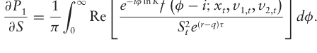

# 364 MATLAB 和 C# 中的 HESTON 模型及其扩展

Theta 需要：

```
$$\frac{\partial P_1}{\partial \tau} = \frac{1}{\pi} \int_0^{\infty} \text{Re} \left[ \frac{e^{-\phi \ln K}}{i\phi S_1 e^{i(r-q)\tau}} \left( \frac{\partial f}{\partial \tau} - (r-q)f \right) \right] d\phi$$
```

其中 $f$ 及其 $\tau$ 导数在 $\phi - i$ 处求值。它还需要：

```
$$\frac{\partial P_2}{\partial \tau} = \frac{1}{\pi} \int_0^{\infty} \text{Re} \left[ \frac{e^{-\phi \ln K}}{i\phi} \left( \frac{\partial f}{\partial \tau} \right) \right] d\phi$$
```

其中 $f$ 的 $\tau$ 导数在 $\phi$ 处求值。该表达式与第 11 章中 $P_1$ 和 $P_2$ 的表达式相同：

```
$$\frac{\partial f}{\partial \tau} = \exp(A + i\phi x_t + B_1 v_{1,t} + B_2 v_{2,t}) \left( \frac{\partial A}{\partial \tau} + \frac{\partial B_1}{\partial \tau} v_{1,t} + \frac{\partial B_2}{\partial \tau} v_{2,t} \right)$$
```

其中 $A$ 的 $\tau$ 导数类似于第 11 章中的 $C(\tau,\phi)$，且 $B_1(\tau,\phi)$ 和 $B_2(\tau,\phi)$ 的 $\tau$ 导数均对应于 $D(\tau,\phi)$。记得 $v_{1,0}$ 和 $v_{2,0}$ 是初始值，被估计为参数 $v_{01}$ 和 $v_{02}$。

我们在第 11 章中看到，Zhu (2020) 定义第一个方差 $v_1$ 基于 $v = \sqrt{V}$。由于有两个初始方差参数，$V_{11}$ 基于 $v_1 = \sqrt{V_{01}}$，$V_{12}$ 基于 $v_2 = \sqrt{V_{02}}$。通过注意到由于 $\partial f/\partial v_j = f \times B_j$，可以很容易得到这些导数：

```
$$\frac{\partial P_1}{\partial \nu_0} = \frac{1}{\pi} \int_0^{\infty} \text{Re} \left[ \frac{e^{-\phi \ln K}}{i\phi S_1 e^{i(r-q)\tau}} f(\phi-i; x_t, v_{1,t}, v_{2,t}) B_1(\tau) \right] d\phi, \quad (12.16)$$
```

```
$$\frac{\partial P_2}{\partial \nu_0} = \frac{1}{\pi} \int_0^{\infty} \text{Re} \left[ \frac{e^{-\phi \ln K}}{i\phi} f(\phi-i; x_t, v_{1,t}, v_{2,t}) B_2(\tau) \right] d\phi.$$
```

两个 Vega 与第 11 章中形成的相同：

```
$$\nu_1 = Se^{-r\tau} \frac{\partial P_1}{\partial \nu_0} - Ke^{-r\tau} \frac{\partial P_2}{\partial \nu_0}, \quad (12.17)$$
```


对于 $j=1, 2$。同样，两个 Vega 通过 $\partial^2 f/\partial v_j^2 = f \times B_j^2$ 得到。使用第 11 章的关系，$\partial^2 P_j/\partial \nu_j^2$：

```
$$\frac{\partial P_1}{\partial \nu_0^2} = \frac{1}{\pi} \int_0^{\infty} \text{Re} \left[ \frac{e^{-\phi \ln K}}{i\phi S_1 e^{i(r-q)\tau}} B_1(2B_1 v_0+1) \right] d\phi$$
```

其中 $f$ 和 $B_1$ 在 $\phi - i$ 处求值$\partial^2 P_2/\partial \nu_2^2$ 的表达式相同，只是分母不包含 $S_1 e^{i(r-q)\tau}$，且 $B_1$ 和 $B_2$ 在 $\phi$ 处求值。那么 Volga 为：

```
$$\text{Volga} = Se^{-r\tau} \frac{\partial^2 P_1}{\partial \nu_0^2} - Ke^{-r\tau} \frac{\partial^2 P_2}{\partial \nu_0^2}. \quad (12.18)$$
```

# 370 双 Heston 模型

# 365 有两个基于 $v_1$ 和 $v_2$ 的 vanna

`Vanna_j = 2e^{-q\tau} \frac{\partial P_j}{\partial v_j} \quad (12.19)`

Matlab 函数 `DoubleHeston` 计算双 Heston 模型的希腊字母。该函数调用 `B.m` 函数计算 Vega、vanna 和 Volga 所的 $B_1(\tau,\phi)$ 和 $B_2(\tau,\phi)$，并调用 `DiffTau` 计算 $A(\tau,\phi)$、$B_1(\tau,\phi)$ 和 $B_2(\tau,\phi)$ 的 $\tau$ 导数。为了节省空间，省略了函数的大部分。函数的第一部分计算所选希腊字母的积分。

```matlab
function y = DoubleHestonGreeks(..., Greek)

for k=1:N

  u = x(k);

  f2 = DoubleHestonCF(u, ...);

  f1 = DoubleHestonCF(u, ...);

  if strcmp(Greek, 'Price')

    int2(k) = w(k) * real(exp(-u*log(K))/f2;

    int1(k) = w(k) * real(exp(-u*log(K))/i;

  elseif strcmp(Greek, 'Gamma')

    int2(k) = w(k) * real(exp(-u*log(K))/exp((r-q)*T)...

  elseif strcmp(Greek, 'Vega')

    int2(k) = w(k) * real(exp(-u*log(K))/i/ || strcmp(Greek, 'Vega2')

    vochoice = 1;

  else

    B1 = (u-i,T,vochoice);

    B2 = (u,T,vochoice);

    f1 = B1;

    f2 = B2;

    int2(k) = w(k) * real(exp(-u*log(K))/i/f2);

    int1(k) = w(k) * real(exp(-u*log(K))/i/...

  elseif strcmp(Greek, 'Theta')

    int2(k) = w(k) * real(exp(-u*log(K))/i/f2);

    int1(k) = w(k) * real(exp(-u*log(K))/i/...

  v0 = 4;

  v2 = 9;

  [dA1 db21] = DiffTau(u-i,T,S,rf);

  df1 = f1+dA1*db21*v2 - (rf-q)*f1;

  [dA2 db22] = DiffTau(u,T,S,rf);

  df2 = f2+dA2*db22*v2 - (rf-q)*f1;

  int2(k) = w(k) * real(exp(-u*log(K))/i/f2);

  int1(k) = w(k) * real(exp(-u*log(K))/i/...

end

end
```

函数的第二部分计算积分并返回价格或希腊字母。

```matlab
if strcmp(Greek, 'Price')

  P1 = 1/2 + 1/pi*sum(int1);

  P2 = 1/2 + 1/pi*sum(int2);

  y = S*exp(-rf*T)*P1 - K*P2;
```

# 366 MATLAB 和 C 中的 HESTON 模型及其扩展

```matlab
if strcmp(Greek, 'Gamma')

  P1 = 1/2 + 1/pi*sum(int1);

  P2 = 1/2 + 1/pi*sum(int2);

  y = S*exp(-rf*T)*P1 - K*P2;
```

```matlab
if strcmp(Greek, 'Vega')

  P1 = 1/2 + 1/pi*sum(int1);

  P2 = 1/2 + 1/pi*sum(int2);

  y = S*exp(-rf*T)*P1 - K*P2;
```

```matlab
if strcmp(Greek, 'Vega2')

  P1 = 1/2 + 1/pi*sum(int1);

  P2 = 1/2 + 1/pi*sum(int2);

  y = S*exp(-rf*T)*P1 - K*P2;
```

```matlab
if strcmp(Greek, 'Theta')

  P1 = 1/2 + 1/pi*sum(int1);

  P2 = 1/2 + 1/pi*sum(int2);

  y = S*exp(-rf*T)*P1 - K*P2;
```

```matlab
if strcmp(Greek, 'Vanna')

  P1 = 1/2 + 1/pi*sum(int1);

  P2 = 1/2 + 1/pi*sum(int2);

  y = S*exp(-rf*T)*P1 - K*P2;
```

```matlab
if strcmp(Greek, 'Vanna2')

  P1 = 1/2 + 1/pi*sum(int1);

  P2 = 1/2 + 1/pi*sum(int2);

  y = S*exp(-rf*T)*P1 - K*P2;
```

```matlab
if strcmp(Greek, 'Volga')

  P1 = 1/2 + 1/pi*sum(int1);

  P2 = 1/2 + 1/pi*sum(int2);

  y = S*exp(-rf*T)*P1 - K*P2;
```

```matlab
if strcmp(Greek, 'Rho')

  P1 = 1/2 + 1/pi*sum(int1);

  P2 = 1/2 + 1/pi*sum(int2);

  y = S*exp(-rf*T)*P1 - K*P2;
```

## 双 Heston 模型

367

```c
end

if j==1

  y = B1;

else

  y = B2;
```

用于计算双 Heston 模型解析希腊（Greeks）的 C 代码与 Matlab 代码非常，此处不再列出。

为了说明双 Heston 希腊，我们使用了与表 12.1 相同的设置，并生成了期限为 1 年的平值看涨期权的希腊。结果见表 12.2。回想表 12.1，在这些设置下的价格都是准确的，这通过它们与有限差分对应的绝对差异可以看出来。该差异出现在表 12.2 的最后一列。

我们在第 11 章中看到，只要希腊满足单变量 Heston 模型的偏微分方程（PDE），前提是 PDE 用 $S$ 而非 $x = \ln S$ 表示的，且 $v$、vanna 和 volga 是用方差 $v_0$ 而非波动率 $\nu = \sqrt{v_0}$ 表示的。对于双 Heston 模型的 PDE，证明这一点也是显而易见的。使用方程 (12.8) 中仅针对 $S$ 的生成器结合 (12.4)，得到关于 $S$、$v_{01}$ 和 $v_{02}$ 的导数及其产生的 PDE 的希腊：

```
$$\Theta + (r - q)S_0\Delta + \kappa_1(\theta_1 - v_{01})Vga_1 + \kappa_2(\theta_2 - v_{02})Vga_2$$

$$\frac{1}{2}(v_{01} + v_{02})S_0\Gamma + \rho_1\sigma_1v_{01}S_0Vanna_1 + \rho_2\sigma_2v_{02}S_0Vanna_2$$

$$\frac{1}{2}\sigma_{01}^2Vga_1 + \frac{1}{2}\sigma_{02}^2Vga_2 - rC = 0.$$
```

## 表 12.2 双 Heston 希腊

| 希腊字母 | 解析值 | 差异 |
|---|---|---|
| 价格 (Price) | 19.4538 | |
| 尔塔 (Delta) | 0.6730 | $3.3 \times 10^{-7}$ |
| 伽马 (Gamma) | 0.0075 | $4.2 \times 10^{-9}$ |
| 罗 (Rho) | 22.2029 | $4.1 \times 10^{-6}$ |
| 西塔 (Theta) | -7.0594 | $1.8 \times 10^{-6}$ |
| Vega11 | 11.2973 | $1.8 \times 10^{-6}$ |
| Vega12 | 11.5147 | $1.4 \times 10^{-6}$ |
| Vanna1 | 0.0745 | $2.6 \times 10^{-7}$ |
| Vanna2 | 0.0816 | $2.7 \times 10^{-7}$ |
| Volga1 | 10.4625 | $1.3 \times 10^{-7}$ |
| Volga2 | 7.7954 | $2.1 \times 10^{-7}$ |

下面的代码片段证明了 (12.20) 中的 PDE 是成立的。

```c
Vega1p = Vega1 / (2*sqrt(v01));

Vega2p = Vega2 / (2*sqrt(v02));

Vanna1p = Vanna1 / (2*sqrt(v01));

Vanna2p = Vanna2 / (2*sqrt(v02));

Volgalp = Volgalp/2/sqrt(v01) /sqrt(v01);

(1/4/sqrt(v01))*Volgalp

Volga2p = (1/4/sqrt(v02))*Volga2 - Volga2p/2/sqrt(v02)) /sqrt(v02);

* The Double Heston PDE

A = (rf-q)*S*Delta

+ kappa1*(theta1-v01)*Vega1

+ kappa2*(theta2-v02)*Vega2

+ 0.5*sigma1^2*v01^2*Gamma

rho1*sigma1*v01*Vanna1

rho2*sigma2*v02*Vanna2

+ 0.5*sigma1^2*v1*Volgalp

+ 0.5*sigma2^2*v2*Volga2;

PDE = Theta + A - rf*;
```

注意，在将这些导数代入 Heston PDE 之前，我们将 PDE (12.20) 的导数用 $v_0$ 而非 $v_1$ 表示，正如我们在第 11 章中所做的那样。使用生成表 12.2 的设置，代码返回 PDE 值为 $1.1 \times 10^{-7}$。

## 参数估计

Christoffen 等人 (2009) 以年度为估计波动率参数 $v_{01}$ 和 $v_{02}$，以及现货波动率 $v_{01,t}, v_{02,t}$ 以及剩余参数 $\Omega = \{\kappa_i, \theta_i, \sigma_i, \rho_i\}_{i=1,2}$。他们的估计分为两个步骤。在第一步，使用固定 $\Omega = \{\kappa_i, \theta_i, \sigma_i, \rho_i\}_{i=1,2}$ 的值在第 $t$ 日的损失函数中获取 $v_{01,t}, v_{02,t}$。重复此过程直到获得现货波动率的时间序列 $\{v_{01,t}\}$ 和 $\{v_{02,t}\}$。在第二步，将这些时间序列输入相同的目标函数，利用全年的期权获得 $\Omega$ 的估计。重复这两个步骤，直到第二步的目标函数值不再发生显著变化。

在本节中，我们采用 $v_{01}$ 和 $v_{02}$ 作为参数的方法，类似于第 6 章中单变量 Heston 模型的做法。回想该章，有许多损失函数可以用于估计，但如果意图是最小化隐含波动率，那么一个例子是 MSE 损失函数：

```
$$\frac{1}{N}\sum_{t,k} w_{tk}(IV_{t,k} - IV_{t,k}^*)^2$$
```

正如第 6 章中提到的，使用 RMSE 和其他目标函数的问题是隐含波动率 $IV_{ik}$ 必须在每次迭代中获取，这是计算密集型的。为了解决这个问题，我们在第 6 章引入了 Christoffen 等人 (2009) 的函数：

```
$$\frac{1}{N} \sum_{i,k} w_{ik} \frac{C_{ik} - C_{ik}^{BS}}{Vega_{ik}}^2$$
```

其中 $C_{ik}$ 和 $C_{ik}^{BS}$ 分别是市场价格和看涨价格，$Vega_{ik}$ 是在执行价 $K$、期限 $\tau_k$ 下使用隐含波动率 $IV_{ik}$ 作为输入计算的 Black-Scholes Vega。其给出为：

```
$$Vega_{ik} = S \exp(-q\tau_k)d_{ik}$$
```

其中

```
$$d_{ik} = \frac{\ln(S/K) + (r-q+IV_{ik}^2/2)\tau_k}{IV_{ik}}\sqrt{\tau_k}}$$
```

以及 $n(x) = \exp(-x^2/2)/\sqrt{2\pi}$ 是标准正态密度。方程 (12.22) 中的损失函数通过 Matlab 函数 `DoubleHestonObjFun` 实现。

```matlab
function y = DoubleHestonObjFun(...)

for t=1:NT

  for k=1:NK

    MP(k,t) = DoubleHestonPriceGaussLaguerre(K(k),T(t),...)

    BSVega(k,t) = BSV(K(k),MktIV(k,t),T(t),...)

    error(k,t) = (MP(k,t) - MktPrice(k,t))^2 ...;

  end

```end
```

该函数允许 MSE 和 RMSE 损失函数，并可以轻松修改以添加额外的损失函数。BSV 函数是一个计算 ve 的 Matlab 函数。我们还可以使用第 6 章描述的 Kilim (2007) 的执行价向量计算法来估计双 Heston 模型的参数，这大大缩短了估计时间。这是通过 Matlab 函数 `DoubleHestonObjSVC` 完成的。

```matlab
function y = DoubleHestonObjFunSVC(param,...)
for t=1:NT
  for j=1:length(x)
    phi = x(j);
    f2(j) = DoubleHestonCF(phi, ...);
    f1(j) = DoubleHestonCF(phi-i, ...);
    for k=1:NK
      for j=1:length(x)
        pi = x(j);
        int2(j) = w(j)*real(exp(-i*pi*log(K))*f2(j));
        int1(j) = w(j)*real(exp(-i*pi*log(K))*f1(j));
      P1 = 1/2 + 1/pi*sum(int1);
      P2 = 1/2 + 1/pi*sum(int2);
      CallPrice = S*exp(-q(T))*P1 - K*exp(-r(T))*P2;
      if strcmp(PutCall(k,t),'C')
        ModelPrice(k,t) = CallPrice;
      else
        ModelPrice(k,t) = CallPrice - S*exp(-q(T))*P1 + K*exp(-r(T))*P2;
```

## 双 Heston 模型

表 12.3 单变量与双 Heston 参数估计，DJIA 数据

| | $\kappa$ | $\hat{\theta}$ | $\hat{\sigma}$ | $\hat{u}_0$ | $\hat{\rho}$ | 估计误差 | 估计时间 (sec) |
| :--- | :--- | :--- | :--- | :--- | :--- | :--- | :--- |
| 单变量 Heston | 1.3750 | 0.1254 | 1.3185 | 0.0332 | -0.4436 | $5.13 \times 10^{-4}$ | 29.5 |
| 双 Heston | 3.0590 | 0.0317 | 1.9850 | 0.0258 | 0.0643 | $1.56 \times 10^{-4}$ | 41.5$^a$ |
| | 1.8467 | 0.0605 | 0.7149 | 0.0092 | -0.9750 | | 5.0$^b$ |


# 普通估计方法
# 使用向量计算方法

单变量 Heston 模型。这在图 12.1 中也有说明，该图绘制了市场隐含波动率以及从每个模型中提取的隐含波动率。最后，使用目标函数中普通求和和 SVC 方法产生的估计值是相同的，但后者减少了近 90% 的估计时间。

使用第 2 章提出的有限差分近似法得到的隐含波动率面和局部波动率面如图 12.2 所示。该图使用了表 12.3 中双 Heston 模型的参数估计。正如预期，局部波动率的波动性比隐含波动率大得多。

我们还可以从使用表 12.3 中估计参数生成的 Heston 看涨权价格中提取风险中性密度 `RND`。这些密度出现在图 12.3 中。

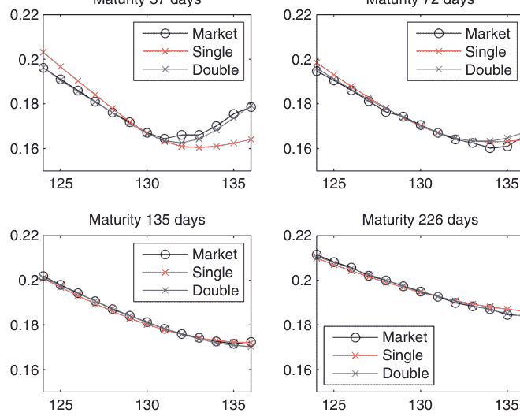

图 12.1 来自单变量和双 Heston 模型的隐含波动率

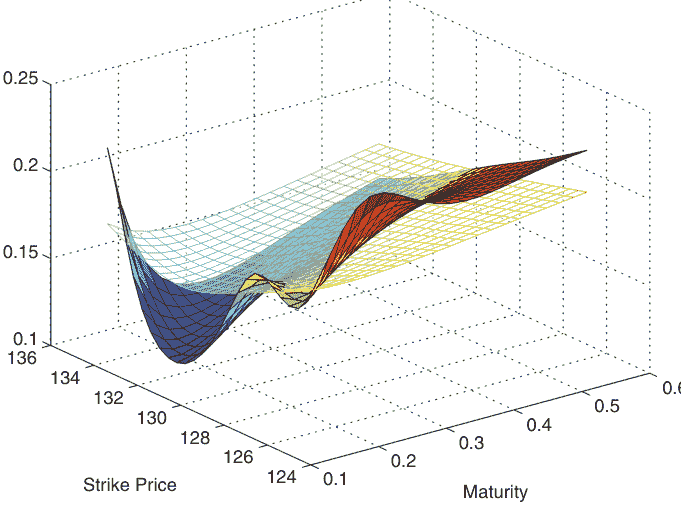

**图 12.2** 双 Heston 模型的隐含与局部波动率，DJIA 数据

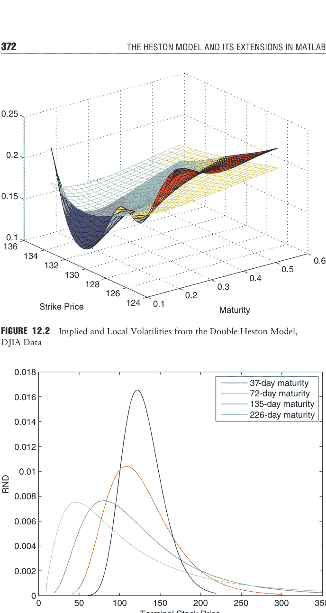

**图 12.3** 风险中性密度，DJIA 数据

图 12.3 是使用以下 Matlab 代码生成的，这与第 6 章中从原始 Heston (1993) 模型获取的涨价格中提取 RND 的代码非常相似。

```matlab
% 行权价增量和范围
dK = 0.5;
K[1] = 60:DK:220;
K[2] = 40:DK:300;
K[3] = 18:DK:380;
K[4] = 8:DK:600;

% 提取 RND、面积和零
for t=1:NT
    NK = length(K(t))
    for k=1:NK
        Calls(t) = DoubleHestonPriceGaussLaguerre(K(t),T(t),...);
    end
    RND[t] = ExtractRND(K(t),Calls(t));
    Area(t) = trapez(RND(t))*DK;
    Zero(t) = length(find(RND(t)<0));
end
```

## 双 Heston 模型中的仿真

在第 7 章中，我们介绍了一组用于 Heston (1993) 模型的离散化和仿真方案，其中许多是专门为该模型设计的。Gauthier 和 Possamai (2010) 将这些方案中的许多适用于双 Heston 模型。在本节中，我们展示了这些仿真方案中的几种。在大多数情况下，将方案从 Heston 模型扩展到双 Heston 模型是直观的。在每种方案中，都可以应用修正来提高方案的准确性。

### 股价的仿真

Gauthier 和 Possamai (2010) 建议仿真 `S_t` 中的对数价格不如仿真折现后的对数价格 `e^{-rt}S_t` 并应用预测-修正方案。该方案以两个布朗运动 `W_{1,t}` 和 `W_{2,t}` 给出：

`ln(e^{-r(t+dt)}S_{t+dt}) = ln(e^{-rt}S_t) + K_0 dt + K_1 sqrt(v_{1,t}) dW_{1,t} + K_2 sqrt(v_{2,t}) dW_{2,t}`

其中 `W_{1,t}, W_{2,t}` 是独立的。然后通过对结果进行指数化得到股价。

### MATLAB 和 C 中的 Heston 模型及其扩展

其中常数对于 `j = 1, 2` 为：

`K_0 = theta_j dt`, `K'_0 = dt/2 (kappa_j/sigma_j^2 - 1)`

`K_j = sigma_j sqrt(dt) (kappa_j/sigma_j^2 - 1)`, `K'_j = sigma_j sqrt(dt)`

### 方差的 Euler 方案

这是单变量情况的直观扩展。在全截断方案下，每个方差 `v_{t+dt}` 使用当前值 `v_t` 独立生成：

`v_{t+dt} = v_t + kappa_j(theta_j - v_t)dt + sigma_j sqrt(v_t) sqrt(dt) Z_j`

对于 `j=1`，其中 `Z_j` 是独立的布朗运动。当前值和更新后的值 `v_t` 和 `v_{t+dt}` 被馈系统。注意 `v_t^* = max(0, v_t)` 以避免负方差。也可以使用反射方案，用 `|v_t|` 替换 `v_t^*`。

### 方差的 Alfonsi 方案

Gauthier 和 Possamai (2010) 将 Alfonsi 的二阶离散化方案引入双 Heston 模型。为了符号简洁，我们去掉了所有参数和方差的下标 "`j`"。如第 7 章所示，定义：

`Psi = (1 - exp(-kappa dt))/kappa`

并定义常数 `K_2` 为：

`K_2 = exp(kappa dt/2)(sigma^2/4 - theta)Psi + sigma/2 sqrt(3dt)` 当 `sigma^2 > 4kappa`，而当 `sigma^2 <= 4kappa` 时，为 `0`。

在每个仿真步骤中，我们将 `v_t` 与 `K_2` 进行比较，根据结果得到不同的更新值 `v_{t+dt}`。因此，在该方案中单独考虑两种情况，与第 7 章相同。

情况 1：`v_t > K_2`

更新 `v_{t+dt}` 需要两个步骤。第一步中，我们仿真离散随机变量 `Y in {0, sqrt(3), -sqrt(3)}`，概率分别为 2/3、1/6 和 1/6。第二步中，我们更新 `v_{t+dt}`：

`v_{t+dt} = exp(-kappa dt/2) (kappa theta - sigma^2/4)Psi + e^{-kappa dt/2} v_t + sigma/2 sqrt(dt) Y + (kappa theta - sigma^2/4)Psi`

情况 2：`v_t <= K_2`

用以下符号表示 `v_{t+dt}` 的条件分布 的前两个矩：

`u_1 = E[v_{t+dt}|v_t]`, `u_2 = E[v_{t+dt}^2|v_t]`

定义量 `pi`：

`pi = 1/2 - 1/2 sqrt(1 - u_1^2/u_2)`

在第一步中，我们仿真 `(0,1)` 上的均匀随机变量 `U`。在第二步中，通过比较 `U` 和 `pi` 来更新 `v_{t+dt}`：

`v_{t+dt} = u_1/(2pi) 若 U <= pi`

`v_{t+dt} = u_2/(2pi) 若 U > pi`

## 双 Heston 模型

对于 `j = 1, 2,`

```
$$\theta_j^* = \frac{\beta_j - \omega_{j}, \exp(-\kappa dt/2)}{1 - \exp(-\kappa dt/2)}$$
```

以及

```
$$\beta_j = \sqrt{(\theta_j + (v_{j} - \theta_j)e^{-\kappa dt}) \frac{\sigma_j^2}{4\kappa_j}(1 - e^{-\kappa dt})^{+}}$$
```

为双 Heston 模型实现变换波动率方案并不比第 7 章描述的单变量情况复杂。这通过 `DHTTransVolSim.m` 函数实现，该函数使用方程 `(12.26)` 和 `(12.33)` 中的预测-修正法模拟股票价格值。需要注意的是，必须使用初始方差参数的平方根来初始化波动率，并且在过程结束将波动率输入股票价格过程之前，必须对其平方。为了节省空间，省略了函数的部分代码。

```matlab
function [S..., Price] = DHTTransVolSim(scheme,...)
S(1,:) = S0;
w1(1,:) = sqrt(v01);
w2(1,:) = sqrt(v02);
for i=1:N
  for t=2:T
    zv1 = randn(1);
    zv2 = randn(1);
    if strcmp(scheme,'Euler')
      % Euler波动率方案
      wl(t,i) = wl(t-1,i) + 0.5*kappa* ...;
    else strcmp(scheme,'TV')
      ml1 = theta + (v(t-1,i) - theta)*exp(-kappa*dt);
      ml2 = sigma^2/4/kappa*(1-exp(-kappa*dt));
      beta = sqrt(max(0,ml2));
      thetavi = (beta - wl(t-1,i)*exp(-kappa*dt/2)) / ...;
      wl(t,i) = wl(t-1,i) + 0.5*kappa*(thetavi - ...);
  end
  v1(t,i) = w1(t,i)^2;
  v2(t,i) = w2(t,i)^2;
  % 股票价格的预测-修正
  logS = log(exp(-r*dt)*S(t-1,i) + K01 * ...);
  S(t,i) = exp(logS)*exp(r*(t+1)*dt);
end
end
```

C# 代码类似，因此在此不再列出。

## 二次指数方案

本章涵盖的最后一个模拟方案是 Andersen (2008) 开发的二次指数（QE）方案，并由 Guthier 和 Possamai (2010) 适配于双 Heston 方案。它的实现方式与第 7 章描述的单变量情况相同。记条件均 `m_j = E[v_{i,j+dt}|v_{i,j}]` 以及条件方差 `s_j^2 = Var[v_{i,j+dt}|v_{i,j}]`。同时，记比例 `psi_j =`

```
$$b_j = \frac{2}{\psi_j} - 1 + \sqrt{\frac{2}{\psi_j}\left(\frac{2}{\psi_j}-1\right)}, \quad a_j = \frac{m_j}{1+b_j^2}, \quad (12.34)$$
$$p_j = \frac{\psi_j-1}{\psi_j+1}, \quad \beta_j = \frac{1-p_j}{m_j}$$
```

以及

```
$$\psi_j^{-1}(u) = \begin{cases} 0 & \text{for } 0 \le u \le p_j \\ \beta_j \ln(\frac{1-p_j}{1-u}) & \text{for } p_j \le u \le 1. \end{cases} \quad (12.35)$$
```

该方案步骤如下：

- 给定 `m_j` 和 `s_j^2`，定义 `psi_j = s_j^2/m_j^2`。
- 抽取随机数 `U_V in [0,1]`。
- 如果 `psi_j < 1`，定义 `Z_V = Phi^{-1}(U_V)` 并定义 `v_{i,j+dt} = a_j(b_j+Z_V)^2`。
- 如果 `psi_j >= 1`，定义 `v_{i,j+dt} = psi_j^{-1}(U_V)`。

与单变量情况一样，使用 Andersen (2008) 建议的 `psi_j=1.5`。双 Heston 模型的 QE 模拟方案使用 `DHQExpSim` Matlab 函数实现。该函数调用 `normICDFm` 函数进行标准正态分布函数的反函数，该函数应用了 Wichura (1984) 的算法，显著减少了模拟时间。

```matlab
function {S, Price} = DHQExpSim(params,...)
for i=1:N
for t=2:T
ml = theta + (V1(t-1,i) - theta)*exp(-kappa*dt);
s1 = V1(t-1,i)*sigma^2*exp(-kappa*dt);
phil = s1/(ml^2);
pil = (phil-1)/(phil+1);
und = rand();
if phil < 1/2
bl = sqrt(2/phil) - 1 + sqrt(2/phil*(phil-1));
al = ml/(1+bl^2);
Zv1 = normICDF(und);
V1(t,i) = al*(bl+Zv1)^2;
else phil >= 1/2
if und <= pil
    V1(t,i) = 0;
else
    betal = (1-pil)/ml;
    V1(t,i) = log((1-und)/betal);
end
end
m2 = theta + (V2(t-1,i) - theta)*exp(-kappa*dt);
s2 = V2(t-1,i)*sigma^2*exp(-kappa*dt);
phi2 = s2/(m2^2);
p2 = (phi2-1)/(phi2+1);
u2 = randn();
if phi2 < 1/2
b2 = sqrt(2/phi2) - 1 + sqrt(2/phi2*(phi2-1));
a2 = m2/(1+b2^2);
Zv2 = normcdf(u2);
V2(t,i) = a2*(b2+Zv2)^2;
else phi2 >= 1/2
if u2 <= p2
    V2(t,i) = 0;
else
    beta2 = (1-p2)/m2;
    V2(t,i) = -log((1-u2)/beta2);
end
end
end
```

实现双 Heston 模型的 Andersen (2008) 二次指数的 C# 代码类似，因此在此不再给出。为了说明本章涵盖的不同模拟方案，我们使用了 Gauthier 和 Possamai (2010) 生成表 12.1 时相同的设置，到期期一年。我们使用 50,000 次模拟，每次模拟包含 1,000 步。这通过以下代码实现：

```matlab
NS = 50000;
NT = 1000;
T = 1;
[x, w] = GenerateGaussLaguerre(32);
True = DoubleHestonPriceGauss(...);
[S1, V1] = DHUAlfoniSim('Alfonsi',...);
[S1, V1] = DHUAlfoniSim('Euler',...);
[S1, V2] = DHTransVolSim('ZhuEuler',...);
[S1, V2] = DHTransVolSim('ZhuTV',...);
[S1, V2] = DHQuadExpSim(...);
```

模拟结果见表 12.4。

## 表 12.4 双 Heston 看权价格

| 方法 | 价格 | 金金额误差 | 百比误差 |
|---|---|---|---|
| 解析解 | 19.4538 | | |
| Euler | 19.6286 | 0.17 | 0.90 |
| Alfonsi | 19.5271 | 0.07 | 0.38 |
| Zhu-Euler | 19.5231 | 0.07 | 0.36 |
| Zhu Transformed Vol | 19.4650 | -0.01 | -0.06 |
| Quadratic Exponential | 19.3214 | -0.13 | -0.68 |


图 12.4 双 Heston 模型模拟股票价格和方差。如预期，Euler 方案是方案中准确性最低的。其他方案表现良好，在例子中，Zhu (2010) 的变换波动率方案最为准确。

绘制双方差对单个模拟股票路径的影响很有启发性。如图 12.4 所示。股票价格从 `S0 = 100` 开始，由黑线表示。高方差路径（绿线）使用 `sigma = 0.3`，`rho = -0.9`，并从 `v_hi = 0.05`，而低方差路径（红线）使用 `sigma = 0.1`，`rho = 0.9`，并从 `v_lo = 0.03` 开始。相关性对价格-波动率关系的影响显而易见。

## 双 Heston 模型中的美式期权

在前面的章节中，我们涵盖了由 Gauthier 和 Possamaï (2010) 适配双 Heston 模型的多种模拟方案。这些这些这些结合 Longstaff 和 Schwartz (2001) 的最小二乘蒙特卡洛（LSM）算法来获取美式期权价格，就像第 8 章应用于单变量 Heston (1993) 模型一样。我们还可以应用 Hull 和 White (1988) 的控制变量技术，该技术被 Beliaeva 和 Nawalka (2010) 在他们的二叉树中使用过，这是我们在第 8 章遇到过的。控制变量美式期权价格为：

`Put_True = European Put_True + (American Put_LSM - European Put_LSM)`

# 表 12.5 美式看跌期权的双 Heston

| 方法 | 价格 | 行权溢价 |
| --- | --- | --- |
| 欧式闭式解 | 17.6244 | — |
| 欧拉法 (Euler) | 17.8278 | 0.2034 |
| Alfonsi | 17.8095 | 0.1851 |
| Zhu-Euler | 17.8068 | 0.1824 |
| Zhu 变换波动 (Zhu Transformed Vol) | 17.8372 | 0.2128 |
| 二次指数 (Quadratic Exponential) | 17.8185 | 0.1941 |


闭式欧式价格为 17.6244，在本章涵盖的模拟方案下获得的美式价格如表 12.5 所示。所有方案表明，使用控制变量技术的的美式期权其行权溢价约为 $0.20，价格约为 $17.82。

# 结论

双 Heston 模型是一种通过允许额外参数来为模型引入灵活性的方便方法。双 Heston 模型的特征函数是单变量对应模型的自然扩展。因此，在双 Heston 模型中获取看涨期权价格和希腊字母（Greeks）仅比原始 Heston (1993) 模型稍微复杂一点。此外，专门为原始模型设计的模拟方案可以很容易转换到双版本。通过这些模拟方案，利用 Longstaff 和 Schwartz (2001) 的 LSM 算法可以直接获得美式期权价格。

对双 Heston 模型或其他多因子波动率模型的其他研究还包括 Costabile 等人 (2012) 的双网格法、de da Fonseca 等人 (2008) 的多因子波动率 Wishart 过程，以及 Buehler (2006) 的方差曲线法。

## 参考文献

Ashani, S. (2010). "复对数与 Heston 模型的分段常数扩展." Working Paper, Standard Bank.

AitSahlia, F., Goswami, M., and S. Guha. (2012). "随机波动率的临界水平是否影响期权的提前行权?" Working Paper, University of Florida.

Ait-Sahlia, Y (2002). "离散采样扩散的极大似然估计：一种闭式近似." Econometrica, 70(1): 223–62.

Ait-Sahlia, Y., and R. Kimmel. (2007). "随机波动率模型的极大似然估计." Journal of Financial Economics, 83:413–52.

Almacener, C., and G. Campletti. (2006). Heston 随机过程与风险管理的高级模拟: 理论、工具与实践编程应用, London, UK: Elsevier.

Albrecher, H., Mayer, Schoutens, W., and Tistaert, J. (2007) "小 Heston 陷阱." Wilmot Manage, January 2007, 83–94.

Alonsi, A. (2010). "CIR 过程的高阶离散方案：在仿射结构和 Heston 模型中的应用." Mathematics of Computation, 79:209–37.

Andersen, L. (2008). "Heston 随机波动率模型的有效模拟." Journal of Computational Finance, 11(3):41–142.

Andersen, L.G., and R. Baas-Rathiff. (2005), "带有随机波动的扩展 Libor 市场模型." Journal of Financial Economics, 9(1):1–.

Andersen, L.G., and V.V. Peterberg. (2007). "动量爆炸." Finance and Stastics, 11(1):29–50.

Aiya, A.F., and S. Wall. (2009). "Heston 波动率估计的解析似然函数." Quantitative Finance, 9(3):289–35.

At,. (2004). "利用傅里叶变换进行期权定价." Working Paper, Charles Rivers Associates, Boston.

Bakus, D., Foster, S., and Wu. (2004). "Black-Scholes 中的偏差." Working Paper, Stern School of Business, New York.

Bayge, R.J. (1995). "计算概率." The American Mathematical Journal, 102:46–99.

Bakshi, G., Cao, C., and Chen. (1997). "期权定价的实证评估." Journal of Finance, 52:203–49.

Bakshi, G., and D. Madan. (2000). "衍生证券." Management Science, 55:205–38.

Bams, D., Lehner, and C.P. Wolff. (2009). "期权估值中的损失函数," 58:53–62.

Bar-Desmond, G., and R.E. White. (1987). "美式值的解析近似." Journal of Finance, 42:201–30.

Berends, R.J., Morsche, H., den Berg, J.C., and der Wie. (2003). "拉普拉斯变换." Cambridge, UK: Cambridge University Press.

Believa, N., and S.K. Nawalka. (2010). "Heston 波动率模型定价." Journal of Volatility, 17(4):25–43.

Benaim, S., and P. Friz. (2008). "渐近法 II：已知生成函数." Journal of Applied Probability, 45:16–32.

Benhamou, E. (2002). "智能蒙特卡洛：利用 Malliavin 积分." Quantitative Finance, 2(5):329–36.

Benhamou, E., Gobet, E., and Miri. (2010). "时间依赖 Heston 模型." SIAM Journal of Financial Mathematics, 42(1):289–325.

Boleters, T., Gibson, M., and Zhou. (2011). "从期权定价和实现波动率动态估计波动率风险与厌恶." Journal of Econometrics, 160(1):235–45.

Borak, S., Detlesken, K., and Härle. (2011). "基于 FFT 的期权定价." SFB Discussion Paper 2005–11, Humboldt University.

Breden, D. (1979). "带有随机消费与投资机会的跨期资产定价模型." Journal of Financial Economics, 7:265–96.

Breden, D., and R. Litzenberger. (1978). "期权定价中的或有权利." Journal of Finance, 33(5):521–61.

Brigo, D., and F. Mercurio. (2006). "利率模型——理论与实践：包含微笑、通胀与信用." 第二版. New York, Springer.

Broadie, M., and P. Glasserman. (1996). "使用随机估计衍生证券." Management Science, 42(2):269–85.

Broadie, M., and O. Kaya. (2004). "波动率及其他仿射跳跃模型的精确模拟." In Ingalls, R. Rosetti, M.D., Smith, J.S., and B.A. Peters, Proceedings of the 2004 Winter Simulation Conference, pp. 1607–15.

Bner, B., and R. Hatton. (2003). "从隐含波动率曲面的风险中性数值校准." Journal of Computational Finance, 7(1):75–106.

Buehler, H. (2006). "恒定方差曲线模型." Finance & Statistics, 10(2):178–203.

Burden, R.L., and J.D. Faires. (2010). 数值分析. 第九版. Boston, MA: Brooks Cole.

Carr, P (2004). "隐含约束." Working Paper, Bloomberg.

Carr, P., and D. Madan. (1999). "使用快速变换的期权估值." Journal of Computational Finance, 24(4):61–73.

Carr, P., and D. Madan. (2005). "关于套利约束的说明." Finance Research Letters, 2:125–30.

Carr, P., Madan, D., and E.C. Chang. (1998). "方差伽马过程与期权定价." European Review Finance, 2:79–105.

Chacon, P. (1991). "傅里叶变换在概率论和随机过程中的应用." International Journal of Mathematical Education in Science and Technology, 22(5):699–728.

Chai, J.H., and M. Joshi. (2010). "Heston 随机波动率模型的快速准确长步模拟." Working Paper, University of Melbourne.

Chan, J.H., and M.S. Joshi (2010b). "Heston 模型中的一阶和二阶希腊字母." Working Paper, University of Melbourne.

Chen, M., and L. Scott. (1989). "货币期权定价：修正 Black-Scholes 模型与随机方差模型的比较." Journal of Financial and Quantitative Analysis, 24(3):267–84.

Chernov, M., and E. Ghysels. (2000). "一种用于期权估值的风险与风险联合估计统一方法研究." Journal of Financial Economics, 56:407–58.

Chiarella, C., and A. Ziogas. (2006). "随机波动率下的美式期权定价." Working Paper, University of Technology, Sydney.

Chourdakis, K. (2005). "利用分傅里叶变换进行期权定价." Journal of Computational Finance, 8(2):1–18.

### 参考文献（续）

Chriss, N.A. (1996). Black-Scholes and Beyond: Option Pricing Models. New York, NY: McGraw-Hill.

Christoffersen, P., Jacobs, K., and M. Mimouni. (2010) "Volatility Dynamics for the S&P500: Evidence from Realized Volatility, Daily Returns, and Options." Review of Financial Studies, 23(8):3141–389.

Christoffersen, P., Heston, S., and K. Jacobs. (2009) "The Shape and Structure of the Index Smile: Why Multifractal Stochastic Volatility Models work so Well." Management Science, 55:1914–32.

Christoffersen, P., and K. Jacobs. (2004) "The Importance of the Loss Function in Option Valuation." Journal of Financial Economics, 72:291–318.

Clarke, N., and T. Parrott. (1999) "Multigrad for American Option Pricing with Volatility." Applied Financial Finance, 6:177–83.

Cohn, H) (2001). Numerical Methods in Finance. New York: Springer.

Corataj, J., and T. Su (1997), "Implied Volatility Skews and Index Skewness and Kurtosis by S&P500 Options Options Prices." Journal of Derivatives, 4(4):8–19.

Costable, M., Massabò, A., and E. Russo. (2012). "On Contingent Claims Under the Double Helmet Model." International Journal of Theoretical and Applied Finance, 15(5):1250033-1250033-2.

Cox, J., Ingersoll, J., and S.A. Ross (1985). "A Theory of the Structure of Interest Rates." Econometrica, 53(2):385–408.

Da Fonseca, J., Glasserman, and C. Tebaldi. (2008). "A MultiFactor Volatility Helmet Model." Quantitative Finance, 8(6):591–604.

Davis, M.H.A., and M.P. Johansson. (2005). "Mallian Motion Greeks for Jump Diffusions." Working Paper, Imperial College.

Dermert, E., Kamal, M., and J. Zhou. (2009). "A Guide to Volatility and Information in Index Options." Goldman Sachs Quantitative Strategies Notes. December, 1995.

Emani, E., and J. Zhou. (1995). "The Local Volatility Surface: Unlocking the Information in Index Options." Goldman Sachs Quantitative Strategies Research.

Dreo, J., Jun, C., and K. Singleton. (2000). Transform Analysis and Asset Pricing for Jump-Jumps. Econometrica, 68:1343–376.

Duffy, D., and J. Kinney. (2006) Finite Difference Methods in Financial Engineering: A Differential Equation Approach. Hoboken, NJ John Wiley & Sons.

Duffy, D., and J. Kinney. (2009). Monte Carlo Frameworks: Building Customisable Performance+ Applications. Hoboken, NJ John Wiley & Sons.

Dupire, B. (1994), "Pricing with a Smile." Risk, 7:18–20.

Elices, A. (2009) "Affine Conflation." Volatility Journal, 1(3):155–62.

Eraker, B. (2004). "Stock Volatility and Volatility? Reconciling Evidence from Stock and Option Prices." Journal of Finance, 59(3):1367–403.

Fang, F., and C.W. Osterlee. (2008). "A Novel Pricing Method for European Options based on Fourier-Series Expansions." SIAM Journal of Scientific Computing, 31(2):826–848.

Fengler, M. (2009). "Arbitrage-Smoothing of the Implied Volatility Surface." Quantitative Finance, 9(4):417–28.

Forde, M., and A. Jacquier. (2009). "Small-Time Asymptotics for Implied Volatility Under the Helmet Model." International Journal of Theoretical and Applied Finance, 12(6):861–876.

Forde, M., Jacquier, A., and A. Mijatovic. (2010). "Asymptotic Formula for Implied Volatility in the Helmet Model." Proceedings of the Royal Society, 466(2124):3593–.


# References

Galiatos, V. (2008). "Stochastic Volatility and the Smile." Working Paper, Department of Mathematics, Uppsala University.

Gatheral, I. J. (2006). "The Volatility Surface: A Practitioner's Guide." Hoboken, NJ John Wiley & Sons.

Gatheral, P., and D. Postama (2010), "Efficient Simulation of the Double Heston." Working Paper, Pricing Partners (www.pricingpartners.com).

Gatheral, P., and P-Y. Riveaille (2009), "Fitting the Smile: Smart Parameters for SABR." Working Paper, Pricing Partners (www.pricingpartners.com).

Geske, R., and H.E. Johnson (1984), "The American Put Analytically." Journal of Finance, 39(5):1511–24.

Gil-Paz, J. (1991), "On the Inversion Theorem." Biometrika, 38(3):481–.

Hull, J., and E. Schubert (2001), "Calibrating Options with Heuristics." Natural Computation, Volume 4. Berlin: Springer.

Glassmann, P., O'Neill, M., and Maringer (2003), "Monte Carlo Methods in Financial Engineering." New York, NY: Springer.

Guillaume, F., and W. Schouten (2012), "Use of Reduced Heston Volatility," 24(4):2171–2192.

Haug, E.C. (2006), The Complete Guide to Option Pricing. Second Edition. New York, NY: McGraw-Hill.

Heston, S.L. (1993), "A Closed-Form Solution for Options with Stochastic Volatility to Bond and Currency." Review of Financial Studies, 6:327–430.

Hogg, R., and S. Krugman (1984), "Distributions." New York, NY: John Wiley & Sons.

Hull, J.C. (2011), Options, Futures, and Derivatives. Eighth Edition. New York, NY: Prentice-Hall.

Hull, J.C., and A. White (1988), "The Pricing of Assets with Stochastic Volatilities." Journal of Finance, 22:281–300.

Hull, J.C., and A. White (1988), "The Use of Control Variate Technique in Pricing." Journal of Financial and Quantitative Analysis, 23(3):237–51.

Ikonen, S., and Toivanen (2008), "Efficient Numerical Methods for Pricing American Options Under Stochastic Volatility." Numerical Methods for Partial Differential Equations, 24(1):109–126.

Hull, K.J., and S. Feason (2010), "ADI Difference Schemes for Option Pricing in Heston Model." Journal of Numerical Analysis and Modeling, 7(2):303–320.

Janek, A., Kluge, T., Weron, R., and U. Wystup (2010). FX Smile in the Heston Model. SFB 649 Discussion Paper 2010-047, Humboldt University, Berlin.

Jarrow, R., and A. Rudd. (1992), "Approximate Option Value for Arbitrary Stochastic Processes." Journal of Financial Engineering, 10:37–69.

Johnanes, M.S., Colson, N., and J.R Rudd. (2009) "Optimal Filtering of Jump Diffs: Extracting Latest Features from Asset Prices." Review of Financial Studies, 22(7):2759–99.

Jondeau, E., Poon, S.-H., and M. Rockinger. (2007), Financial Modeling Under Non-Gaussian Distributions. New York, NY: Springer.

Jones, S.C. (2003), "The Dynamics of Stochastic Volatility: Evidence from Underlying and Option Markets." Journal of Econometrics, 116:181–224.

Joshi, M. (2008) "The Concepts and Pricing of Mathematical Finance. Second Edition. Cambridge, UK: Cambridge University Press.

Kahalé, N. (2004), "An Arbitrage-Free Interpolation of Volatilities." Risk, May 2004:102–106.

Kahl, C. (2008). Modeling and Simulation of Stochastic Volatility in Finance. Published by Dissertation.com.

Kahl, C., and P. Jäckel. (2005). "Not-so-Complex Logarithms." Volatility Journal, 1(3):155–62.

Kahl, C., and P. Jäckel (2006). "Balanced Implicit Methods for Stochastic Volatility." Volatility Journal, 5(2):94–103.

Kahl, C., and R. Lord (2007), "Efficient Simulation of the Double Heston." Working Paper, Rabobank International and ABN AMRO.

Kahl, C., and D. Postama (2009), "Fitting the Smile: Smart Parameters for SABR." Working Paper, Pricing Partners (www.pricingpartners.com).

Kahl, C., and P. Riveaille (2010), "Asymptotic Formula for Implied Volatility in the Helmet Model." Proceedings of the Royal Society, 466(2124):3593–.

Kutner, M., and E. Platen (1998). "Balanced Implicit Methods for Stochastic Systems." SIAM Journal on Numerical Analysis, 35(3):1010–99.

Leisen, D., and E. Schwartz (2002), "Finite Difference Methods for Stochastic Volatility." Numerical Methods for Partial Differential Equations, 24(1):109–126. Fifth Edition. New York, NY: McGraw-Hill.

Lee, R. (2004), "Fast Fourier-Based Method for Pricing Heston Model." Quantitative Finance, 4(6):51–86.

Lee, R., and J. J. (2000), "Option Valuation Under Stochastic Volatility: A Discrete Approach." Journal of Derivatives, 8(2):9–27.

Lewis, A.L. (2000), "The Jump-Risk Premium Implicit in Options: From an Integrated Time-Series." Journal of Financial Economics, 63(1):3–50.

Lewis, A.L. (2001), "A Simple Formula for Jump-Diffusion." Wilmott Magazine, 2002, pp. 61–65. www.optioncity.com.

Lin, S. (2008), "Numerical Methods for Pricing American Options Under Stochastic Volatility." Diploma Thesis, University of Oxford.

Medvedev, A., and O. Scaller (2010), "American Options Under Stochastic Volatility and Interest Rates." Journal of Financial Economics, 98(1):145–59.

Mikhailov, S., and U. Nogel (2003), "Heston's Stochastic Volatility Model: Implementation, Calibration, and Selection." Wilmott Magazine, 2003:74–9.

McName, J.M. (2007), "Numerical Methods for Roots of Polynomials, Part I." Studies in Computational Mathematics 14. Amsterdam, Netherlands.

Nelder, J., and R. Mead. (1965). "A Simplex Method for Function Minimization." The Computer Journal, 7(6):308–13.

Nykvist, J. (2009). "Time Consistency in Option Pricing Models." Doctoral Thesis, KTH Institute of Technology.

Pan, J. (2002). "The Jump-Risk Premium Implicit in Options: From an Integrated Time-Series." Journal of Financial Economics, 63(1):3–50.

- Platen, E., and D. Heath, (2009). 《定量金融的基准方法》，第13卷. New York, NY: Springer.

- Press, W.H., Teukolsky, S.A., Vetterling, W.T., and B.P. Flannery, (2007). 《数值算法第三版：科学计算的艺术》. New York, NY: Cambridge University Press.

- Raible, S (2000). “金融中的列维过程：理论、数值与实证事实.” 博士论文，弗赖堡阿尔伯特·路德维大学，

- Reiss, O., and U Wystup (2000). “通过齐次和其他技巧高效计算期权价格敏感度.” 论文，Comerbank银行。

- Ruckdeshel, P., Sayer, T., and A. Azimayer (2013). “Heston模型中的美式期权定价：相关性的深度探讨.” 《衍生品期刊》，

- Rubin, W (1986). 《实变与复分析》. 第三版. New York, NY: McGraw-Hill,

- Schmelze, M. (2010). 《利用傅里叶变换进行期权定价及应用》，www.pfadintegral.com.

- Schouts, W., Simons, O., and J. Tistaert (2004). “完美的校准！现在怎么办？”《Willbrand杂志》，2004年3月:66–7.

- Scott, L.O. (1987). “当方差随机变化时的期权定价：估计与应用.” 《金融与定量分析杂志》，22:41–38,

- Shepard, N.G. (1991). “从特征函数到分布：理论的简单框架.” 《经济理论》，7:51–29.

- Shimko, D. (1993) 概率界限. 《风险》，6:34–53,

- Singleton, K.J. (2001). “利用经验特征函数估计仿射定价模型.” 《计量经济学杂志》，102(1):111–41,

- Smith, R.D (2007). “Heston模型的精确模拟方法.” 《计算金融杂志》，11(1):11–5,

- Stin, E.M., and J.C. Stein, (1993). “具有随机波动率的股票价格：一种分析方法.” 《金融研究评论》，6:427–52,

- Storn, R., and K. Price. (1997). “差分进化——一种用于连续表面全局优化的简单高效的启发式算法.” 《全局优化杂志》，11:341–59,

- Shroud A.H., and D. Secrest (1996) 《高斯积分公式》. Upper Saddle River, NJ: Prentice-Hall.

- Stulz, R.A. (2010). 《肯德尔高级统计理论》，三卷本. Hoboken, NJ: John Wiley & Sons.

- Tapella, D., and C. Randall. (2000). 《金融工具定价：有限差分法》. New York, NY: John Wiley & Sons.

- Tavalis, E., and S. Wang. (2003). “随机波动率下的美式期权定价：一种利用切比雪夫项式近似早期行边界的新方法.” 工作论文 488，伦敦皇后玛大学。

- Van Haassecht, A., and A. Pelsser, (2010). “Heston随机波动率模型的高效精确模拟.” 《国际理论与应用金融杂志》，13(1):1–43.

- Vellekoop, M., and H. Nieuwenuis. (2009). “一种基于树的Heston模型美式期权定价方法.” 《计算金融杂志》，13(1):1–21,

- Vollrath, I., and J. (2009). “一种在Heston模型中为美式期权定价的树方法.” 《计算金融杂志》，Comerbank银行。

- Whaley, R.E. (2009). 《期权定价、波动率校准与风险》.Hoboken, NJ: John Wiley & Sons.

- Wichura, M. (1988). “方差随机变化时的期权定价：正态分布的傅里叶变换.” 《金融工程杂志》，37:84.

- Wu, L. (2008). “利用傅里叶变换估计列维过程.” 《金融杂志》，Amsterdam.

- Zwinger, D. (1997). 《傅里叶变换的应用》.Orlando, FL: Academic Press.

- 翻译员和文档工程师，请参考下面的注意事项了解 Markdown 文档的格式。


- Platen, E., and D. Heath, (2009). 《定量金融的基准方法》，第13卷. New York, NY: Springer.
- Press, W.H., Teukolsky, S.A., Vetterling, W.T., and B.P. Flannery, (2007). 《数值算法第三版：科学计算的艺术》. New York, NY: Cambridge University Press.
- Raible, S (2000). “金融中的列维过程：理论、数值与实证事实.” 博士论文，弗赖堡阿尔伯特·路德维大学，
- Reiss, O., and U Wystup (2000). “通过齐次和其他技巧高效计算期权价格敏感度.” 论文，Comerbank 银行。
- Ruckdeshel, P., Sayer, T., and A. Azimayer (2013). “Heston模型中的美式期权定价：相关性的深度探讨.” 《衍生品期刊》，
- Rubin, W (1986). 《实变与复分析》. 第三版. New York, NY: McGraw-Hill,
- Schmelze, M. (2010). 《利用傅里叶变换进行期权定价及应用》，www.pfadintegral.com.
- Schouts, W., Simons, O., and J. Tistaert (2004). “完美的校准！现在怎么办？”《Willbrand杂志》，2004年3月:66–7.
- Scott, L.O. (1987). “当方差随机变化时的期权定价：估计与应用.” 《金融与定量分析杂志》，22:41–38,
- Shepard, N.G. (1991). “从特征函数到分布：理论的简单框架.” 《经济理论》，7:51–29.
- Shimko, D. (1993) 概率界限. 《风险》，6:34–53,
- Singleton, K.J. (2001). “利用经验特征函数估计仿射定价模型.” 《计量经济学杂志》，102(1):111–41,
- Smith, R.D (2007). “Heston模型的精确模拟方法.” 《计算金融杂志》，11(1):11–5,
- Stin, E.M., and J.C. Stein, (1993). “具有随机波动率的股票价格：一种分析方法.” 《金融研究评论》，6:427–52,
- Storn, R., and K. Price. (1997). “差分进化——一种用于连续表面全局优化的简单高效的启发式算法.” 《全局优化杂志》，11:341–59,
- Shroud A.H., and D. Secrest (1996) 《高斯积分公式》. Upper Saddle River, NJ: Prentice-Hall.
- Stulz, R.A. (2010). 《肯德尔高级统计理论》，三卷本.Hoboken, NJ: John Wiley & Sons.
- Tapella, D., and C. Randall. (2000). 《金融工具定价：有限差分法》. New York, NY: John Wiley & Sons.
- Tavalis, E., and S. Wang. (2003). “随机波动率下的美式期权定价：一种利用切比雪夫项式近似早期行边界的新方法.” 工作论文 488，伦敦皇后玛大学。
- Van Haassecht, A., and A. Pelsser, (2010). “Heston随机波动率模型的高效精确模拟.” 《国际理论与应用金融杂志》，13(1):1–43.
- Vellekoop, M., and H. Nieuwenuis. (2009). “一种基于树的Heston模型美式期权定价方法.” 《计算金融杂志》，13(1):1–21,
- Vollrath, I., and J. (2009). “一种在Heston模型中为美式期权定价的树方法.” 《计算金融杂志》，Comerbank 银行。
- Whaley, R.E. (2009). 《期权定价、波动率校准与风险》.Hoboken, NJ: John Wiley & Sons.
- Wichura, M. (1988). “当方差随机变化时的期权定价：正态分布的傅里叶变换.” 《金融工程杂志》，37:84.
- Wu, L. (2008). “利用傅里叶变换估计列维过程.” 《金融杂志》，Amsterdam.
- Zwinger, D. (1997). 《傅里叶变换的应用》.Orlando, FL: Academic Press.


Albrecher, H., 14, 25, 29, 31–32, 47, 61, 67, 269, 337, 361

Alfonsi, A., 177, 198, 201, 374

算法
- 替代（alternate），33
- 二分法（bisection），40, 55, 128, 149, 238, 252
- 差分进化（DE），147, 162–164, 175
- Longstaff and Schwartz，176, 205, 346, 348–381
- 最小化（minimization），147
- Nelder-Mead，81, 151–154
- 非中心性（non-centrality），193
- 线性搜索（linear search），76
- 复制（replication），44–45
- 辛普森法则（Simpson's rule），133

交替方向隐式（ADI）方法，301, 321

美式期权
- 均衡（Balanced），以及 IWJK 方案
- 均衡隐式方案（balanced implicit scheme），191
- Kahl-Jessel方案，192–193
- 路径自适应线性（pathwise adaptive linearization），191
- 美式（American），203, 263
- 欧式看跌（European puts），321
- 希腊（Greeks），227, 348–354
- 最小二乘蒙特卡洛（LSM），205–213
- Medvedev-Scaillet 展开，228–253
- 期权定价，176, 205–316, 325, 348, 361
- 期权定价，203, 205–206, 228, 382
- 期权估值，203, 346
- 看跌期权（put options），229
- 看跌权价格，212, 214, 221–222, 228, 230, 239–240, 244–245, 248–252, 348, 350, 381
- 看跌估值，207, 212
- 看跌（puts），261
- 结论（conclusion），261

Andersen, L., 25, 56, 58, 61, 177, 194–195, 201, 378–399

数组索引（Array indexing），116, 121

Atiya, A. F., 147, 166–169, 175

Attari, M., 61, 66–69, 71, 73, 85, 159, 161, 327, 339–341

Bagry, R. J., 41

Bakshi, G., 1, 5, 20–21, 25–26, 28, 61, 63, 139, 328

Bams, D., 149

Barone-Alessi, G., 252

Beerrends, R. J., 101

Beliaeva, N. A., 205, 217–219, 222–222, 225–226, 228, 361

Beliaeva-Nawalka 三变量（trivariate），217–218
- 计算机实现，222
- 股票三叉树，219–221
- 组合三叉树，221–222

Benaim, S., 57

Benhamou, E., 156, 160, 263–289, 293–295, 299–300

Benhamou-Miri-Gobet 模型
- alpha，285–317
- 常数参数，228–287

Bervois, F., 90

二变量特征函数，263–269, 278, 300

二元系统，1, 11, 50, 177, 195, 202, 207

Black-Scholes 美式看跌权，244, 252

Black-Scholes 看涨权，110

Black-Scholes 希腊，335

Black-Scholes 模型，237

看涨期权，218, 253

看涨定价，214, 237, 254, 258, 261

118, 205, 214–263

Chiaarella 和 Ziogas，253

显式方法，213

Benhamou-Miri-Gobet 模型（续）
- 参数估计，295–298
- 分段常数参数，288–295

# 索引

399

- Chacon, P., 65
- Chan, J. H., 203, 354
- 特征函数, 25–29
- Chen, Z., 149, 328
- Chiarella, C., 118, 205, 253–255, 258–259, 261
- Chiarella and Ziogas 美式看涨期权
    - 美式期权价格, 254–258
    - 提前行权边界近似, 253–254
    - 提前行权边界估计, 258–261
- 卷积法, 90
- 卷积定理, 101
- 余弦法, 90
- Costable, M., 382
- 覆盖墙, 98
- Cox, J. C., 1, 3–4, 193
- Da Fonseca, J., 382
- 阻尼因子
    - 边界, 76
    - Carr 和 Mandan 的使用, 73–74, 76, 82, 341
    - 选择, 63, 75, 87
    - 引入, 73
    - 优化的, 77–80, 80, 90
    - 选择, 81–82
- Desky 分解, 50, 179, 195
- Chourdakis, Q., 90, 116, 141, 327
- Chriss, N. A., 19
- Christoffersen, P., 151, 174, 261, 275, 358–368–370
- CIR 过程, 42, 108, 194
- CIR 方差, 179
- Clarke, N., 212, 216, 250, 325, 348, 350–354
- 解析式方法
    - 深度内值 (ITM) 看涨期权, 35–36
    - 深度外值 (OTM) 看涨期权, 35–36
- Delta, 7, 315, 328, 330–332, 333, 339–347–349
- Demeter, K., 44
- 密度函数, 27–28, 171
- 累积密度函数, 21
- 概率密度函数, 21, 26, 63
- Derman, E., 43–44, 52
- Detelsen, K., 76
- 差分算法, 162, 188
- Delta, 171, 193
- 离散化。参见欧拉离散化
    - 关于, 182
    - 其中的希腊字母, 327, 333, 335–360, 340–344, 349
- Heston, 288, 295, 327, 381
- 价格, 23, 112, 177, 197, 293–294, 245, 248, 313–314, 320, 157
- 系数
    - 二项, 123
    - 特征函数的, 266, 271, 360–361
    - 漂移波动率, 183
    - 估计, 206, 210–211
    - 极限的, 60
    - 多项式, 230, 232
    - 递归的, 290, 295
    - 陈述值, 259
    - 方差过程的, 184
- Alfonso 方案, 374, 191, 195, 373
- 的, 196
- 网格, 301–302
- 积分范围, 137
- 起点, 178
- 行权范围, 138–154, 138
- 双 Heston 模型
    - 其中的美式期权, 380–382
    - 看涨期权价格, 358–363
    - 希腊字母, 363–368
    - 多维费曼-KAC 定理, 357
    - 参数估计, 368–373
- Cohen, H., 116, 121
- 计算时间, 18–19, 47, 73, 113, 132–133, 138, 141, 149, 159–162, 175, 210, 219, 228, 248, 251, 296, 302, 314, 320, 325, 327, 332, 352
- 消费模型, 3, 7
- 收敛性, 177
- 双 Heston 模型 (续)
    - 模拟, 373–379
    - 结论, 382
    - 欧式和美式看跌期权, 224, 257, 381
- 双 Heston 模型模拟
    - 方差的 Alfonso 方案, 374–376
    - 方差的欧拉方案, 374
    - 二次指数 (QE) 方案, 378–380
    - 欧式期权, 91–92, 178, 321, 349
    - 看涨/看跌价格, 15, 23, 190, 192, 201
    - 看涨期权, 7, 92, 15, 17, 22, 49, 97, 188, 254–256, 310, 327
    - 看涨期权, 4, 8, 92, 95, 258, 300, 320
    - 希腊字母, 327–349
    - 股票价格, 373–374
    - 方差的 Zhu 方案, 375–378
- 双网格方法, 382
- Dré, J., 152
- Duffie, G., 63, 265–267, 357, 360
- Duffie, D. J., 193, 306–307
- Dupire, B., 45
- Dupire 局部波动率, 45–49
- Heston 模型, 1–28
    - 权定价, 113, 178, 218, 253, 321, 349
    - 闭式价格, 212, 249, 251, 320, 382
    - 看跌期权价格, 15, 17, 22, 98, 245, 248, 250, 261, 285, 301
    - 平价, 15, 17, 22, 238, 245
- 提前行权边界, 253–254, 258
- 提前行权权利, 208, 245, 248–250, 255–257
    - 价值, 302–303, 363
- 扩展规则, 153
- 扩展 A., 263–264, 278–279, 284, 300
    - 辅助, 12
    - 导数, 47–49, 67, 214, 230, 242–243, 307
    - 差分, 265–266, 361
- 显式方法, 205, 213–256, 261, 300, 318
    - 显式方案, 316–320
    - 误差分析, 320–321
- 傅里叶变换, 74, 87, 92
    - 积分, 71–72, 75, 77, 80, 86, 92
    - 逆, 84, 86
- Faire, D., 116, 118, 127, 210, 306
- Fang, W., 90
- 快速傅里叶变换 (FFT), 90, 116, 141–142, 145, 160, 327, 345, 354
- 分数快速傅里叶变换 (FRFT), 18–146, 316, 345, 354
- Parseval 恒式, 101, 104
- 看涨看跌平价, 98
- Euler, B., 176
- 欧拉离散化, 18, 179–181, 183–184, 187–190, 195, 376
- 欧拉方案
    - 关于, 179–180
    - 股票价格, 180–181
    - 方差的, 180
- 欧拉等式, 64, 66
- 欧式和美式看跌期权, 208, 224, 227, 345, 325
    - 积分范围和行权范围的离散化, 137–138
    - 数值积分方案, 137
    - 总结, 139–140
- Feller 条件, 4, 178
- Feng, M., 174
- 费曼-Kac 定理, 357–358
- 有限差分法, 205, 261, 300–302, 325, 354
- 有限差分方法, 301
    - 交替方向隐式 (ADI) 方案, 321–325
    - 显式方案, 316–321
    - 导数的有限差分, 303–306
    - 网格构建, 302–303
    - PDE 边界条件, 315–316
    - 算子 PDE, 301–302
    - 加权方法, 306
    - 结论, 325
    - 一阶希腊字母, 332
    - 一阶 Vega, 1
- Forde, M., 36
- Foulon, S., 302–304, 319
- 傅里叶变换的推导
    - 关于, 63–64
    - 抽象, 63
    - Attari 表示, 69
    - Carr 和 Mandan 表示, 73–76
    - Carr-Mandan 阻尼因子和最优边界, 76–81
    - Carr-Mandan 看跌期权表示, 82–84
    - Gatheral 偏差, 67–69
    - OTM 期权变换, 84–89
    - 概率恢复, 65–66
    - 结论, 89–90
- 傅里叶变换方程, 74, 87。参见快速傅里叶变换 (FFT); 分数傅里叶变换 (FRFT)
- 傅里叶变换方法, 63
- 分数傅里叶变换 (FRFT), 18–146, 316, 345, 354
- Friz, P., 57
- 全局截断方案, 178–181, 184, 187–188, 192
- 基础变换和价格
    - 关于, 92–96
    - 使用基础变换, 94–100
    - Heston 模型, 95
    - 期权定价, 91–113
    - 收益变换, 91–92
    - 使用 Parseval 恒式的价格, 100–108
    - 波动率展开, 108–113
- Gamma, 328, 333, 337, 339, 343, 347–349
- Gather, J., 5, 25, 43, 50–52, 61, 63, 67–69, 89, 108, 177
- 高斯积分
    - 在 C 中, 127–130
    - 双重积分, 126–121
- 高斯-Laguerre 积分
- 高斯-Legendre 积分, 123–125
- 高斯-Lobatto 积分, 125–126
- Gautier, P., 147, 156, 158, 361, 363, 373–374, 380
- Geske, R., 261
- Gibson, M., 3
- Gilli, M., 162
- Gel-Peaz, J., 10, 25, 65, 70, 89
- Glassman, P., 181, 354
- Gobet, E., 150, 160, 263, 285–289, 293–295, 299–300
- Grasselli, M., 382
- 希腊字母。也参见 Delta; Gamma
- 美式期权, 327, 348, 350–354
    - Black-Scholes 希腊字母, 223–336
    - 双 Heston 希腊字母, 363–368
    - 欧式期权, 327–329
    - 模型, 340–341, 352, 354, 363, 367, 382
    - 数值积分, 342
- 网格大小项式, 141
- 网格, 138, 142, 213, 301–305, 310, 314, 316–318, 320
- Guillaume, F., 160
- Hafner, R., 171
- Harddle, W., 76
- Haug, E. G., 335
- Heath, D., 191
- Heston, S. L., 3, 5–7, 10, 12, 31–32, 34, 36–37, 47, 63, 67, 71, 73, 96, 100, 102, 107, 113, 115–116, 118, 149, 159, 161, 174, 176, 184, 191, 253, 254, 256, 261, 264, 275, 283, 328, 333, 337, 339, 341, 344, 347, 349, 355, 357, 358
    - Heston 希腊字母
    - 关于, 92–96
    - 使用基础变换, 94–100
    - Heston 模型, 95
    - 期权定价, 91–113
    - 收益变换, 91–92
    - 使用 Parseval 恒式的价格, 100–108
    - 波动率展开, 108–113
- Benham-Gobet 模型, 285–298
    - 二元 CF 与广义 Ricatti 方程的联系, 269–271
    - 二元特征函数 (CF), 264–268

# 索引 403

Ikonen, S., 212–213, 216, 250, 325, 348, 352

Jäckel, P., 33, 117, 133–135, 145, 177, 181, 191–192, 203

隐式方案, 185, 191, 301, 308, 314, 322

Jacobs, K., 8, 149, 151, 174, 261, 275, 357–358, 368–380

隐式波动率,斜率边界, 57–60

Jacquier, A., 56

Janek, A., 160

隐式波动率曲线, 331

Johnson, H. E., 261

联合过程, 365

隐式波动率均值与平方和 (IVMSE), 148

Jondeau, E., 10, 171

Joshi, M., 5, 203, 354

隐式波动率模型, 38–55, 57, 61–148, 151, 170, 175–276, 355, 368–369, 371

Kalahé, N., 174


Kahl, C., 33, 74, 77, 80–81, 115, 133–135, 147, 181, 191–192, 203, 269–270, 300

Ingersoll, J. E., 1, 3–94

内部收缩规则, 153–154

Kamal, M., 44

Kani, I., 43, 52

Kaya, Ö., 203, 354

Kienitz, J., 193

Kilin, F., 147–158–360, 397

Kimmel, R., 156, 160, 175

积分. 另参见 数值方案, 82, 74

面积, 74

Kloeden, P. E., 181, 186

Kluge, T., 160, 302, 304–306

Klugman, S., 21

常数, 20, 97

曲形, 105–106

域, 113, 115, 117, 126, 130–134

Gauss-Laguerre, 73, 83, 99–100, 107, 122–124, 130, 135, 140, 159, 171, 274, 298

峰度, 34–37

Kutner, M. H., 206

Gauss-Lobatto, 135

网格, 15, 119, 136, 138–142, 145, 345

Lee, R., 25, 57, 59, 61, 81

左端点, 179

勒格德多项式, 124–125

Leisen, T., 149

Leisen, D., 261

增量, 140

极限, 84–85, 92, 100–136, 173

阶, 66, 84, 87

部分法, 64, 94

点, 15, 100, 107, 144

范围, 29, 32, 65–66, 92, 121, 125, 133–138

Lewis, A. L., 5, 7, 63, 90–95, 100–109, 113, 141, 159, 285, 287, 327, 343–344

短域, 61

条带, 99

Li, W., 206

Lipton, A., 106

变量, 67, 74, 86, 116, 254, 272

积分问题, 25

Little Trap, 31–33

Little 公式, 14, 25, 32–43, 61, 69, 208, 269–270, 334, 357, 361–362

被积函数, 29–31

实值看涨期权 (ITM calls), 35–37

实值 (ITM) 概率, 35–37

局部波动率, 50–52

用有限差分, 49–50

反转定理, 10, 27, 65

Itkin, A., 106

Itô 引理, 2, 5–6, 19, 27, 50, 67, 181–184, 188, 217–218, 286, 359, 376

对数收益度, 50, 57, 60

Longstaff, F. A., 176, 203, 205–206, 208–219, 315, 346, 382

IVMSE 估计, 370

IVMSE 参数, 174

Lord, R., 74, 77, 80–81, 90, 278

LU 分解, 210–211

Madan, D., 1, 20–21, 25, 26, 63, 73–77, 84–86, 89–90, 115, 137–139, 327, 341

Massian 积分, 286, 354

Massabo, I., 382

Matlab 函数, 345

ADI 价格, 322

Alonsi 价格, 201

Alonsi 价格, 199–200, 375

Alonsi 腊字母, 341

Alonsi 腊字母, 72

Alonsi 腊字母, 340

Alonsi 腊字母, 340

BGMA 价格, 288

BGMA 期限, 292

BSecIV, 40, 55

BSecIV, 251–252

Black-Scholes 衍生品, 157, 365–366

Build 变量二叉树, 228

Build 变量二叉树, 228

Build 变量二叉树, 228

Build 衍生品, 310, 312–313

Build 衍生品 非均匀, 313

Build 波动率树, 222

Madan 腊字母, 342, 346

Carr 被积函数, 75, 83

CIR 积分, 199, 375

C., 280

collect, 236, 246

CT, 273

CZanne, 257

CharFun, 255

CZEarly 行权, 256

CEEuro Call, 256

CZNewton, 259

d2P1KD, 48

dcdTm, 47

Euler,Alonsim, 375

DHQuad 指数模拟, 378

DHTrans 波动率模拟, 377

DiffTaum, 337, 365–366

D., 337

Double Gauss 勒格德, 127, 257

Double Heston CF, 362

Double Heston 腊字母, 365

Double Heston 对象, 369

nHeston 对象 SVC, 369

Double 梯形法, 257

DoubleTrapzm, 118–119

dP2K22_m, 48

dPjFTm, 37

DT, 273

Elices 对象, 282–283

ElicesClEn, 281

ElisesPrice, 282

EulerMilstein 模拟, 186

ExtractRND, 172

ftm, 142

find., 260

find, 209

FinBonds, 58–59

finndm, 249

fincom, 238

finco, 150, 156, 282

minsearchm, 78, 152, 155–156

FRFT, 142

Gauthier 系数, 158

Gauthier 对象, 158

GenerateGaussLaguerre, 126

GenerateGaussLobottmm, 126

GeneratePQHeston, 246

GeneratePQ_m, 232, 235–237, 246

GauthierValues, 157

Heston BGMO 对象, 295

Heston BGMOFTm, 239

Heston 二变量 CF, 270

Heston FFT 腊字母, 339–140

HestonCallFTm, 145

HestonCallTG 腊字母, 346

HestonCallFRFTm, 142, 160

HestonGauss.Laguerre.m, 75

HestonCF 腊字母, 345

HestonCF 腊字母, 342

HestonCF, 139

HestonDE, 163, 166

HestonDE 方程, 317–319

HestonDE 非均匀, 314, 350

HestonGaussLaguerre, 274

Heston 腊字母 汇总, 336

Heston 腊字母 概率, 335–336

Heston 腊字母 概率, 333, 342

Heston 积分分, 99

HestonCall, 99

HestonLewis 价格, 344

HestonLV 局部, 48

HestonLV 局部, 52

Heston对象局部, 49

Heston对象局部, 151

Heston对象FRFT, 140, 160

Heston对象MS, 248, 252

Heston对象SV, 159

Heston 字母, 347, 350

Heston 字母, 324, 345

Heston 字母, 324, 340

Heston 字母, 324, 340

Heston 字母, 324, 340

Heston 字母, 324, 340

Heston 字母, 324, 340

Heston 字母, 324, 340

Heston 字母, 324, 340

Heston 字母, 324, 340

Heston 字母, 324, 340

Heston 字母, 324, 340

Heston 字母, 324, 340

Heston 字母, 324, 340

Heston 字母, 324, 340

Heston 字母, 324, 340

Heston 字母, 324, 340

Heston 字母, 324, 340

Heston 字母, 324, 340

Heston 字母, 324, 340

Heston 字母, 324, 340

Heston 字母, 324, 340

Heston 字母, 324, 340

Heston 字母, 324, 340

Heston 字母, 324, 340

Heston 字母, 324, 340

Heston 字母, 324, 340

Heston 字母, 324, 340

Heston 字母, 324, 340

Heston 字母, 324, 340

Heston 字母, 324, 340

Heston 字母, 324, 340

Heston 字母, 324, 340

Heston 字母, 324, 340

Heston 字母, 324, 340

Heston 字母, 324, 340

Heston 字母, 324, 340

Heston 字母, 324, 340

Heston 字母, 324, 340

Heston 字母, 324, 340

Heston 字母, 324, 340

Heston 字母, 324, 340

Heston 字母, 324, 340

Heston 字母, 324, 340

Heston 字母, 324, 340

Heston 字母, 324, 340

Heston 字母, 324, 340

Heston 字母, 324, 340

Heston 字母, 324, 340

Heston 字母, 324, 340

Heston 字母, 324, 340

Heston 字母, 324, 340

Heston 字母, 324, 340

Heston 字母, 324, 340

Heston 字母, 324, 340

Heston 字母, 324, 340

Heston 字母, 324, 340

Heston 字母, 324, 340

Heston 字母, 324, 340

Heston 字母, 324, 340

Heston 字母, 324, 340

Heston 字母, 324, 340

Heston 字母, 324, 340

Heston 字母, 324, 340

Heston 字母, 324, 340

Heston 字母, 324, 340

Heston 字母, 324, 340

Heston 字母, 324, 340

Heston 字母, 324, 340

Heston 字母, 324, 340

Heston 字母, 324, 340

Heston 字母, 324, 340

Heston 字母, 324, 340

Heston 字母, 324, 340

Heston 字母, 324, 340

Heston 字母, 324, 340

Heston 字母, 324, 340

Heston 字母, 324, 340

Heston 字母, 324, 340

Heston 字母, 324, 340

Heston 字母, 324, 340

Heston 字母, 324, 340

Heston 字母, 324, 340

Heston 字母, 324, 340

Heston 字母, 324, 340

Heston 字母, 324, 340

Heston 字母, 324, 340

Heston 字母, 324, 340

Heston 字母, 324, 340

Heston 字母, 324, 340

Heston 字母, 324, 340

Heston 字母, 324, 340

Heston 字母, 324, 340

Heston 字母, 324, 340

Heston 字母, 324, 340

Heston 字母, 324, 340

Heston 字母, 324, 340

Heston 字母, 324, 340

Heston 字母, 324, 340

Heston 字母, 324, 340

Heston 字母, 324, 340

Heston 字母, 324, 340

Heston 字母, 324, 340

Heston 字母, 324, 340

Heston 字母, 324, 340

Heston 字母, 324, 340

Heston 字母, 324, 340

Heston 字母, 324, 340

Heston 字母, 324, 340

Heston 字母, 324, 340

Heston 字母, 324, 340

Heston 字母, 324, 340

Heston 字母, 324, 340

Heston 字母, 324, 340

Heston 字母, 324, 340

Heston 字母, 324, 340

Heston 字母, 324, 340

Heston 字母, 324, 340

Heston 字母, 324, 340

Heston 字母, 324, 340

Heston 字母, 324, 340

Heston 字母, 324, 340

Heston 字母, 324, 340

Heston 字母, 324, 340

Heston 字母, 324, 340

Heston 字母, 324, 340

Heston 字母, 324, 340

Heston 字母, 324, 340

Heston 字母, 324, 340

Heston 字母, 324, 340

Heston 字母, 324, 340

Heston 字母, 324, 340

Heston 字母, 324, 340

Heston 字母, 324, 340

Heston 字母, 324, 340

Heston 字母, 324, 340

Heston 字母, 324, 340

Heston 字母, 324, 340

Heston 字母, 324, 340

Heston 字母, 324, 340

Heston 字母, 324, 340

Heston 字母, 324, 340

Heston 字母, 324, 340

Heston 字母, 324, 340

Heston 字母, 324, 340

Heston 字母, 324, 340

Heston 字母, 324, 340

Heston 字母, 324, 340

Heston 字母, 324, 340

Heston 字母, 324, 340

Heston 字母, 324, 340

Heston 字母, 324, 340

Heston 字母, 324, 340

Heston 字母, 324, 340

Heston 字母, 324, 340

Heston 字母, 324, 340

Heston 字母, 324, 340

Heston 字母, 324, 340

Heston 字母, 324, 340

Heston 字母, 324, 340

Heston 字母, 324, 340

Heston 字母, 324, 340

Heston 字母, 324, 340

Heston 字母, 324, 340

Heston 字母, 324, 340

Heston 字母, 324, 340

Heston 字母, 324, 340

Heston 字母, 324, 340

Heston 字母, 324, 340

Heston 字母, 324, 340

Heston 字母, 324, 340

Heston 字母, 324, 340

Heston 字母, 324, 340

Heston 字母, 324, 340

Heston 字母, 324, 340

Heston 字母, 324, 340

Heston 字母, 324, 340

Heston 字母, 324, 340

Heston 字母, 324, 340

Heston 字母, 324, 340

Heston 字母, 324, 340

Heston 字母, 324, 340

Heston 字母, 324, 340

Heston 字母, 324, 340

Heston 字母, 324, 340

Heston 字母, 324, 340

# 索引

## 407

- Chiarella 和 Ziogas 的看权价格, 118
- 消费, 3, 7
- 来自 DDE 的, 23
- 深度实值（money）看权定价, 35
- 深度实值 (ITM) 看权, 35–36
- 深度虚外 (OTM) 看权, 36
- 衍生品, 45, 49
- 差异演化算法, 147, 162, 175
- 股利的, 17
- 双 Heston 模型, 261, 351–382
- Elches, 278–285, 300
- 丰富化, 261
- 通过损失估计, 175
- 欧式价格, 113
- 快速傅里叶变换 (FFT) 定价, 63, 145
- 快速傅里叶变换 (FFT) 的应用,
- 它的, 370
- 灵活性, 355, 357–382
- 分数傅里叶变换 (FRFT) 的应用, 145
- 它的基础变换, 91, 95–98, 113
- 用于双层积分的高斯求积, 126–129, 145
- 高斯-Laguerre 求积, 121–123, 145
- 高斯-Laguerre 求积, 125–126
- Greeks 希腊字母的影响, 340–341, 352, 354, 363, 367, 382
- 初始方差参数, 168
- 实值 (ITM) 概率, 89
- 最小二乘蒙特卡洛 (LSM) 算法应用, 261
- 相关文献, 176
- 长记忆, 355
- Mikhailov 和 Nógel, 271–278, 283, 200, 370
- 最小拟合, 368
- 多变量仿射, 265
- 期权价格, 146
- 期权价格源于, 35


# 索引

- 期权估值, 176
- 虚外 (OTM) 看权, 35
- 参数估计方法, 54
- 参数估计, 283, 297
- 参数的, 147, 149
- Parsev 恒等式, 102
- 分段常数, 298
- 价格来源, 251–252
- 定价方法, 147
- 概率中的, 115
- 认权价格中的, 286
- 范围, 22
- 风险中性密度, 172
- 方案, 176
- Heston 模型中的模拟, 177–203
- 静态, 298
- 随机波动率, 93, 108, 175, 181, 228
- 尾部分布, 37
- 时间依赖, 271, 277–278, 283–284, 286, 293, 297–298, 370
- 时间依赖的, 263–300
- 时间依赖参数, 160
- 标的价格中的, 25
- 方差, 43
- 局部方差, 25
- 方差伽马 (Variance Gamma), 72, 106
- 波动率的, 2, 5, 102
- 波动率, 25, 38, 54–57, 61, 147–148, 151, 170, 176–278, 355–368–369, 371
- 局部波动率, 48, 50
- 波动率动力学, 355
- 波动率因子, 358
- 方差波动率中的, 19
- 波动率过程, 176
- 矩爆炸, 25, 56–68
- 矩匹配离散化, 201
- 值 (Moneyness), 238. 另见 Log-money
- 归一化, 229, 241
- 蒙特卡洛模拟, 177
- MSE（均方误差）参数, 174
- 多变量波动率, 382
- 多变量过程, 176
- Musiela, M., 5
- Nachtheim, C. J., 206
- Nowalka (此处应为 Nowacki), S. K., 205, 217–219, 222–226, 268, 381

## 408 索引

- Nelder, J. A., 147, 152
- Nelder-Mead 算法, 151–155
- Meter, J., 206
- 牛顿型公式, 116–117
- 中点法则, 117
- 辛普森法则, 119–120
- 辛普森三积分, 120–121
- 双积分的梯形法则, 118–119
- Neuwenhaus, H., 261
- Niegel, U., 149, 263–264, 272, 274–278, 293, 295–296, 300, 370
- 非均匀网格, 213–214, 301–303, 306–310, 313–314, 318–320, 322, 349–350
- 数值积分
    - 特征函数, 31, 34
    - 阻尼版本, 87
    - 准确性, 25
    - 性质, 16
    - 需求, 91, 108, 113
    - 问题, 29, 61, 72, 81
    - 单一, 46, 71, 74
    - 118
    - 上限, 79
- 数值积分方案
    - 摘要, 115–116
    - 快速傅里叶变换 (FFT), 137
    - 分数快速傅里叶变换 (FRFT), 141–145
    - 高斯求积, 121–130
    - 被积函数中的, 116
    - 积分限和种类, 130–138
    - 牛顿型公式, 116–121
    - 数值插图, 136
    - 结论, 145–146
- Nunes, J.-C., 152
- Nykvist, J., 162
- Oosterlee, C. W., 90
- 使用 Parsev 恒等式的期权价格, 100–101
- Parsev 恒等式 (Lewis), 91
- 随机波动率下的期权估值：带数学代码
- Ornstein-Uhlenbeck 过程, 2
- OTM 表示, 84–89
- 虚外 (OTM) 看权, 35–37, 44, 84, 89, 112
- 外部修正, 153–154
- Pan, J., 63, 265–267, 360
- 参数影响, 33–44
- 参数估计
    - 摘要, 167
    - 微分方程, 162–166
    - 最大似然估计, 166–170
    - 模型方法, 54, 283, 297
- C# 中的 Nelder-Mead 算法, 151–155
- 美式期权定价, 251–253
- 风险中性密度和无套波动率曲, 170–175
- 速度估计, 158–162
- 起始值, 155–158
- 使用函数, 147–158
- 结论, 175–176
- 图表, 176
- 参数。另见“Smart Market”
    - Heston 等, 34–43
    - 初始方差, 168
    - 模型中的, 147, 149
    - 时间依赖的, 160
    - Heston 波动率, 33–35
    - 模型中的方差波动率, 19
- Parrott, K., 212, 216, 250, 302, 325, 348, 350, 352–354
- Heston 模型的 Parsev 恒等式, 102–104
- 轮廓线和看权价格, 104–108

## 409

- 偏微分方程 (PDE)
    - 边界条件, 315–316
    - 期权价格, 7–8
    - 概率, 8–10
    - 算子中的, 301–302
    - 收益变换, 91–92, 95–97, 104, 106
- Pelser, A., 177, 203
- Pitterberg, V. V., 25, 56, 58
- Platen, E., 181, 186
- Possam, D., 361, 363, 374, 376, 380
- 预测值, 206
- Price, K., 162
- Radon-Nikodym 导数, 4, 21, 27
- 方差相对平均, Raible, S., 76
- Reiss, O., 328
- 剩余定理, 70, 104–106
- Ricarti, 12, 11–24, 60, 263–267, 271, 360
- 风险中性, 2–3
- 风险中性密度 (RND), 371
- RMSE 损失, 148, 151, 174, 252, 368–369
- RMSE 参数, 175
- Ross, S. A., 1, 3–4, 19
- Rudin, W., 101
- Russo, E., 382
- Rutkowski, M., 5
- Sayer, T., 261
- Scailiet, O., 205, 228–232, 239–241, 244–245, 248–252, 261, 327, 352–354
- 方案
    - Alfonsi, T., 177–188, 190–192, 198–201, 374–376
    - 交替方向法 (ADI), 321–324
    - 均衡成对, 179, 191–193
    - 均衡隐式, 191
    - Crank-Nicolson, 301, 308, 313–314, 322, 324
    - 离散化, 179, 191, 205, 374
    - Douglas, 321–322
    - Euler, E., 177–181, 180, 182, 184, 187
    - 拼接, 326
    - 全截断, 178, 180, 182, 184, 374
    - IJK (Kahl-Jäck), 177–193
    - 隐式, 185, 191, 301, 308, 324
    - Kahl-Jäck, 192
    - Milstein, 177–178, 181–188
    - 矩匹配, 177, 201–202
    - 数值积分, 15, 34, 74, 81, 87, 99, 113–145
    - 二次指数 (QE), 177, 190, 193–201, 378–380
    - 反射, 178–184, 188, 192
    - 模拟, 160–184, 198, 202–203, 347, 354, 373–382
    - 变换波动率, 188–190
    - 波动率, 177–188, 195, 375, 380, 376–388
    - Sneyd, 376
- Schmezele, M., 82, 92, 159
- Schoutens, W., 14, 25, 29, 31–32, 47, 61, 67, 69, 176, 269, 357, 368
- Schumann, E., 162
- Schwartz, E. S., 176, 203, 205–206, 208–309, 315, 346–381
- Sheppard, N. G., 64
- 收缩, 153
- Simons, E., 76
- 辛普森法则, 117, 119–120, 133, 138, 140, 346
- 辛普森三积分, 119–120
- 在 Heston 模型中的模拟, 371–376
- 方差中的, 374
- 二次指数 (QE) 方案, 378–380
- 标的价格中的, 373–382

# 索引

## 411

- 波动率 (Volatility)
  - 行为, 184
  - Black-Scholes, 8, 20, 36
  - 系数, 183
  - Dupire 局部波动率, 45–49
  - 欧离散化, 189–190
  - 演化, 205
  - Heston, 38–43
  - 隐含的, 20, 25, 38–43, 52, 54–61
  - 随之增加, 55
  - 局部, 25, 43–45–54, 61, 371
  - 路径, 188
  - 价格, 2–3, 7, 67
  - 方案, 177, 188–190, 376–377, 380
  - 现货, 303, 330
  - 随机的, 5–6, 8, 10, 23, 93, 108, 113, 175, 181, 228, 261, 325
  - 股票价格, 229, 300–303, 320
  - 波动曲面, 57, 170–176, 261, 329, 355, 358, 371
  - 变换, 170, 178, 188–190, 376–377
  - 方差的, 34–35, 37–38, 108–109, 189, 285, 287, 331
  - 波动率的, 91
  - 波动率序列级数展开, 108–113
- 波动率对冲, 5
- 波动率风险溢价, 3
- 《波动率曲面：从业者指南》(Gatheral), 50
- Volga, 328, 330–331, 333–334, 342, 349, 352, 364–365, 367
- Vollrath, I., 147, 162, 166
- Vrie, E.M. van de, 101
- Wall, S., 147, 166–169, 175
- Wang, S., 254, 261
- 加权法, 301, 306–308, 313–314, 316, 321–322, 324
- 权重, 115, 117, 119–127, 130, 132, 135, 138
- Wendland, J., 147, 162
- Weronon, R., 160
- Wichura, M. J., 378
- Whaley, R. E., 17, 76, 252
- White, A., 208, 381
- Wichura 似, 197–198, 378
- Wolff, C. C. P., 149
- Wu, L., 63
- Wystup, U., 160, 328
- Zhou, H., 3
- Zhou, J., 44
- Zhou, J., Z., 43, 52
- Zhu, J., 17, 33, 63, 115, 131–132, 159–160, 177, 189–190, 329, 331, 339, 364, 376, 380
- Zhylevsky, O., 261
- Zhiogas, A., 118, 205, 253–255, 258–259, 261
