# 数据型公司：如何构建云端数据栈以探索与理解数据


献我的母亲，她一直是我最支持、最有耐心的老师。作为一名软件工程师，你教我为六年级的科学项目编写代码。今天，作为一名数据分析师，你帮助 38 岁的我完成了这本书的讨论和编辑。感谢你一直支持和鼓励我的好奇心，感谢你所有的爱。

— Dave Fowler

我将本书献给我的妈妈，一位以帮助他人学习为动力力的教育工作者。感谢你一直对我充满信任，并展现了你可以如何影响他人生活的榜样。

— Matt David


# 关于本书

# 为什么写这本书

我们发现的大多数分析架构的全面书籍都是十多年前的，大部分处于云时代之前。由于目前还没有出现与 Kimball 开基性著作《数据仓库工具包》相当的现代著作，今天的数据团队必须重新发明构建数据栈的原则。为了解决这个问题，我们创建了一份最佳实践指南，用于从零启动并维护技术领先的数据仓库。


# XV

## 这本书不适合谁

这本书并不是为“大数据”专业人士编写的。需要明确的是，即使是像 Doordash、Discord 以及《金融时报》和《纽约时报》的所有者（它们都是我们之前的客户）这样的大型公司，也不被视为大数据公司。根据经验法则，“大数据”标签适用于每日原始输入量超过 100 GB 的数据架构。

毫无疑问，本文中的许多元素都对应大数据工作流，特别是因为数据仓库支持各种表格，而不仅仅是（例如）事件流。然而，我们的目标是关注现代数据栈的核心支柱，以便最广泛的读者都能从书中的信息中获益。本着这种精神，我们放弃了对超大规模架构的建议。

本书不适合 AI 驱动型团队，且未涵盖 AI 工作流、机器学习模型或实时操作用例。相反，它的目标是为构建和维护稳健的数据分析栈提供最佳实践（即构建 AI 工作流的基础数据分析基础）。

如果你是一家可以用 Quickbooks 和 Excel 运行一切的小型企业，那么这种能力是非常棒的。数据对所有公司都很重要，但如果这些工具已经能满足你的需求，这本书可能无法提供有用的指导。如果你开始超过 Excel 的数据容量，或者引入了需要在数据库中进行分析的数据源，那么请阅读。

## 谁写的这本书

这本书由 Dave Fowler 和 Matt David 编写。

Dave Fowler 在商业智能（BI）领域工作了十多年，并一直在寻找通过数据连接（JOIN）团队的方法（而不是数据分析师）。他希望让任何职场人士都能探索并理解他们的数据。作为 Chartio 的创始人兼首席执行官，Dave 在过去的 11 年里领导了一个自助服务 BI 产品的开发，目标正是实现这一点。Chartio 的工具集让数据驱动型企业的任何人都能轻松浏览其架构、合并各种数据源并生成精美的仪表板。2021 年 3 月，Atlassian 收购了 Chartio 并将其整合到自己的平台中。

Matt David 在产品管理和教育领域工作了八年。他热情地倡导员工群体具备数据素养。作为 Data School 的现任，他负责监督专注于利用公司内部数据的免费在线资源。最近的书的话题包括 SQL 优化、数据治理和常见偏差。Dave 创立了 Data School，他与 Matt 共同将其发展为数据社区的重要资源。他此前曾在 Udacity 和 General Assembly 教任分析学课程。

在看到许多人在构建数据栈并尝试使用数据栈时面临的重重挣扎后，Dave 和 Matt 决定合写此书。这本书是在 Chartio 许多员工的支持下创作的。他们慷地提供了关于客户如何对数据建模的见解，并收集了经常提出的数据基础设施问题。他们的贡献指导了本文的编写。

## 谁编辑的这本书

这本书由 Emilie Schario、Mila Page 和 David Yerrington 审阅和编辑。Emilie 是 Netlify 的数据负责人，此前帮助过 GitHub 的整个数据部门。她经常就与现代数据相关的所有事务进行写作和演讲。Mila 是 dbt Labs 的开发者倡导者，该公司是 dbt（数据构建工具）的制作者。她帮助数据专业人士学习并应用现代分析工程实践，并且是 dbt 社区年度会议 Coalesce 的组织者。David 是一位数据科学顾问，曾任 General Assembly 的全球数据科学讲师。他帮助世界各地的人利用他们的数据。Emilie、Mila 和 David 塑造了本书的叙述和内容。他们的（有时是）逐行的反馈确保了我们可以自豪地支持我们的建议。

## 影响

在编写本文时，我们参考了多个信息源和观点来源。在 Chartio 职期间，我们与数百个现代云端客户合作过。我们通过编写这本书，亲自收集、实施并完善了这些实践，并与合作伙伴和客户进行了进一步验证。我们还通过 dataschool.com、Tristan Handy 等博客以及关注数据的 Slack 社区从数据社区中学习。

最后，值得提一下并感谢那些启发了上一代数据仓库工具包的经典著作。我们通过回响它们的术语和最佳实践来向它们致敬：

- Lawrence Corr 的《敏捷数据仓库设计》（Agile Data Warehouse Design）
- Ralph Kimball 的《数据仓库工具集》（The Data Warehouse Toolkit）
- Stephen Few 的《信息仪表板设计》（Information Dashboard Design）（我的评论在此）

这本书部分源于 Data School 的一个项目（图 A.2），这是一系列关于管理和利用数据的免费在线书籍和互动教程（参见 dataschool.com）。这些资源始终在扩展，就像维基百科的文章一样：每一轮更新都能看到电子书涵盖更多主题、对既有理念进行更深入探讨、分享更多真实案例，并更好地交付这些内容。我们的目标是维护和改进这些资源并保持其现代性。

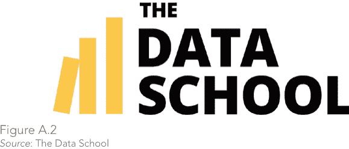

图 A.2
来源：The Data School

很少有人在现代数据治理的所有领域都是完全“专家”，而且格局一直在不断变化。如果你有故事想分享，或者你认为缺少了某个章节，或者有新想法，请给我们发邮件。即使你不知道具体要分享什么，但不介意分享你的故事，也请联系我们，因为我们特别对增加真实的经验和见解感兴趣。

数据世界有太多术语了，通常由才华横溢的供应商营销团队创造。我们尽量使用最通用的词汇。对于我们认为必要的任何术语，我们会提供定义。

书中有很多关于旧数据工作方式的内容，在某些情况下，这些是有争议的。在编写本书时，我们刻意忽略了启动 Redshift 实例、编写 SQL 或使用各种 BI 产品的细节。这些会让文本变得杂乱，重复互联网上的内容，并让阅读变得困难。

本书旨在提供关于建立数据栈的宽泛概述和指南。我们认为这种类型的书籍对人们更有用。当我们有强烈观点时，我们不争论，直接采纳。当我们认为用户有合理的选择时，我们会提出这些选项。

## 如何阅读这本书

书的开头对各个阶段以及哪个阶段适合你进行了快速概述。

书的结构是为四个阶段中的每个阶段设置了一个章节，如果你愿意，可以直接跳到你所在的阶段。

并不是每家公司都需要这本书的所有内容。随着增长公司数据需求的扩大，书中的内容变得越来越有用。但请注意，每个阶段提出的最佳实践在它们变得相关时出现。这些实践假设从书中出现的地方起就是有效的，以避免重复。因此，即使你和你的公司处于领先阶段，至少扫一下早期章节可能对你有益。

在书的最后，我们有一个章节描述了数据世界发生的变化，使得这种新架构变得相关且高效。我们避免解释之前的实践（如金伯尔维度模型），以免干扰体验。然而，这些讨论是必要的，我们把它们放在书的最后一个章节。

最后，在整书中你会看到以下图标：


# 定义

它们与同一页上的术语相关。例如，在这一页提到了“数据湖”（data lake）。数据湖是多个数据源的暂存区。


# 技巧 (Protips)

技巧可以扩展某个想法，或者就你在特定章节阅读的内容相关的主题提供额外信息。


# 前言

2015年，我使用了一款名为 Amazon Redshift 的产品。当时，在职业生涯的前15年里，我曾担任过各种围绕数据使用的角色，从分析、营销到运营都有。尽管我认为数据处理能力是我职业上最大的差异化优势，但也因此感到深感挫败。尽管数据生态系统取得了所谓的进步，从数据中获取洞察仍然是缓慢、困难且昂贵的。

但我第一次使用 Redshift 的经历改变了一切。我对使用该产品的第一个小时有着如此直观的记忆：查询运行速度快得简直像魔法一样。在职业生涯中，我花了多年年时间编写查询并等待 MacOS 的“旋转”图标停止。而现在，突然之间，同样的查询不仅不是快了 20%……而是快了 10 到 1000 倍。我觉得自己仿佛拥有了超能力。

我会让 Dave 和 Matt 来解释现代数据仓库是如何实现这类性能结果的，但现在，请相信我，它是可以而且确实做到的。既然，一个真正的问题是：这对于你我这样的人来说意味着什么？

我指的是什么样的“人”？你懂的——那些参与决策并希望使用数据来帮助我们的人。这些人在多年来可能已经掌握了各种数据技能，无论是 Excel 的 VLOOKUP、Google Analytics 仪表板、SQL，还是数千其他选项中的任何一种。那些一直觉得在处理数据时，基础工作不应该这么困难的人（但当然，出于某种原因，事实一直如此）。

在自初次体验 Redshift 后的这些年里，我意识到现代数据栈对我们来说恰有两个非常重要的输入：

- 1. 有了这些远优的工具，我们可以极大地增加对所在机构的影响力。我要说一个非常愚蠢而显而的事实：如果你的查询快了 100 倍，你就能多知道 100 倍的东西。这意味着在你所能提供的洞察和所能做的决策上，你将变得非常有价值。

- 2. 由于第 1 点的结果，我们的职业选择要大得多得多。当我开始职业生涯时，“数据分析师”是一个初级职位，我曾试图尽快离开这个职位以转向其他领域。现在，数据分析师是高杠杆、战略性的员工，其收入潜力与软件工程师相相当。

通过一些相当简单的工具以及非常易于获取的知识和技能，单个分析师能够完成的事情确实发生了变化。现在，这一个个人可以通过插接一些廉价的现成工具来构建一整套复杂的数据基础设施，并获得可运行的洞察。或者，该个人可以作为大型复杂数据团队中不可或缺的一部分，成为现代企业神经系统的一部分。无论组织规模大小，需要的都是相同的技术、相同的技能组和相同的知识。

这就是现代数据栈。要利用它的力量，你需要了解 SQL（一天就能学会！）而且你需要了解一些基础的最佳实践，这些实践是像本书作者这样的人在过去五年里深耕其中并开发和记录的。

这在出人意料是可以实现的——这些工具的神奇之处之一就在于它们所需的先进技术知识是如此少。

本书提供了导航现代数据栈的基础知识。从那里开始，你将能够深入其中并确保成功，我们乐意听到你的反馈！

# 引言

知识就是力量。虽然任何人都可以使用数据是事实，但现代数据栈让整个机构（而不只是分析师）能够处理数据。现代数据栈将分散的输入源整合进单一的易于理解的格式，然后将数据存储在业务智能（BI）产品可以连接的单一位置。我们相信现代数据栈是成功的一部分。它应该让他们触手可及所需的信息，并应该帮助团队围绕关键绩效指标（KPI）组织起来并使用数据做出决策。知情是成功的关键部分。但在 21 世纪，知情意味着什么？公司继续变得更加数字化。公司不再能够直接接触客户，必须越来越多地依赖数据来竞争。组织从许多输入流中跟踪数据。但为什么有这么多团队在组织和利用数据方面仍然挣扎？我们认为问题源于工具。我们相信现代数据工作流需要一个适应今天的数据栈。在本书书中，我们将从一家全新的初创公司一直到一家数据驱动型企业，概述现代数据栈的样子。我们将涵盖架构、工具、团队组织、常见陷阱和最佳实践。拥有了这些，我们有信你的团队可以识别业务不断变化的需求并实施解决方案。

## 将业务背景与数据信息相结合

在了解如何处理数据的技术方面的人与了解数据背后背景的人之间存在着一条鸿沟。技术人员可以编写结构化查询语言（SQL），而业务人员了解他们运行过哪些营销活动，以及哪些类型的用户构成了

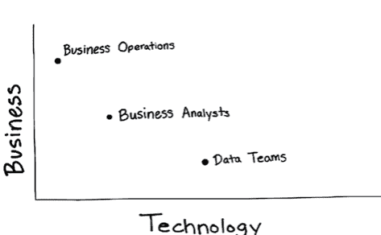

分析。这在想要获取数据洞察（但并不总是知道数据是什么样子的）的利益相关者与了解数据但不了解其全部历史或意义的分析师之间产生了摩擦。

现代数据栈试图弥合这一鸿沟。它让整个机构（而不只是分析师）能够处理数据。

以下是“不知情”与“知情”的示例：

- 持续在所有渠道加倍投入的营销人员，对比根据每个活动的成功与失败进行迭代或放弃渠道的营销人员。

- 销售领导使用轶事来支持他们应该针对什么类型的客户，对比了解哪些客户正在进来、哪些正在成交，并能准确将团队精力集中在最大机会上的销售领导。


# 引言

有些支持人员在响应问题时只会问“你用什么浏览器？”，而另一些则拥有所有的错误信息，包括浏览器详情、账户信息和最近的操作。

有些记者只写他们感兴趣的话题，而另一些则能看到哪些内容能引起共鸣。

有些产品经理通过展示初步结果来证明其功能的合理性，而另一些则通过建立测试并让数据自己说话。

将数据转换为所有人都能访问的易理解的格式，可以让技术人员和业务人员成为合作者而非对手。它赋能组织中的每一个人都能做出明智的决策。本书旨在展示如何构建数据栈来实现这一目标。

# 敏捷数据组织化的四个阶段

在与成千上万公司合作后，我们识别出敏捷数据组织的四个不同阶段（图 1.2）。每个阶段都有关于如何“向上堆栈”演进的最佳实践和指导。

| 源 (SOURCE) | 湖 (LAKE) | 仓库 (WAREHOUSE) | 市场 (MART) |
| :--- | :--- | :--- | :--- |

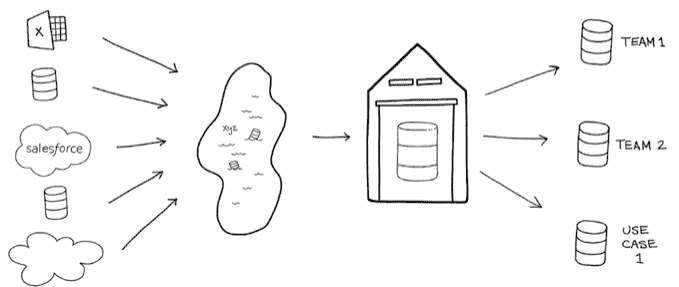

图 1.2 敏捷数据组织的四个阶段代表了一个描述数据管理生命周期的过程。

本书对应阶段：

- 1. 源 (Source)
2. 湖 (Lake)
3. 仓库 (Warehouse)
4. 市场 (Mart)

图中所示每个垂直阶段可能根据组织内数据的资源、规模、重要性和需求而被公司所需。并不是所有公司都需要这四个阶段。如果一个业务在源阶段就获得了所需的洞察，那么它们就应该留在源阶段。同样，公司可能发现它需要一个湖来汇总所有数据，但可能不需要仓库开发后期阶段隐含的转换。

让我们从每个步骤的概述开始。

## 第 1 阶段源 (Sources)

许多团队只有几个数据源，通常在 Excel 或 Google 表格中处理数据和可视化。公司产品运行的两个常用源是 Google Analytics 和“事务型”数据库（如 PostgreSQL 或 MySQL）。如果公司中只有少数人需要处理数据源，可以通过直接访问或副本访问来设置；对他们来说，直接处理数据更敏捷、更直接。

我们将讨论如何配置适当的数据访问，以及如何为未来将公司数据组织成单一的统一集合奠定基础。我们还讨论在使用应用内仪表板、电子表格、SQL 和 BI 解决方案等工具时的最佳实践。这些主张背后的原则是：团队在组织数据源和选择工具包时应该经过严谨的深熟考虑。这一点不仅能让分析师在早期处理数据时保持高效，还为他们以后将输入流重新组织为数据湖做准备。

如果符合以下情况，此阶段是合适的：

- 只有少数人将处理此数据集。
- 目前数据需求极小。
- 仅存在少数小型数据源。
- 唯一需要创建新可视化图表的人相当具有技术背景。

如果符合以下情况，是时候进入下一阶段了：

- 从多个地方/应用程序访问数据。
- 需要为 Salesforce 等云应用源创建独特或组合图表/仪表板。
- 需要访问数据的人数不断增加。
- 存在性能问题。
- 数据变得太大，事务数据库无法高效运行。
- 非技术用户需要在没有帮助的情况下创建图表。

## 第 2 阶段湖 (Lake)

一旦公司必须对多个数据源进行分析（且每个数据源都需要连接、过滤、处理），公司就必须转向数据湖。混合数据源允许组织中的多个参与者查询公司完整数据的大部分子集。反之，将各种源汇入数据湖支持了在合理的大规模（不一定是“大数据”）下的数据库性能。

数据湖的一个核心动力在于将数据管道化到业务智能工具的需要。例如，在处理来自 Salesforce、Hubspot、Jira 和 Zendesk 的数据时，每个服务都有自己的应用内仪表板和独特的数据应用。

- 将有较多的人处理此数据集。
- 一个整洁的真理源可以消除数据完整性问题。
- 需要将数据结构与不断变化的事务源分离开。
- 需要采用 DRY（不要重复自己）原则。

## 建模 (Modeling)

数据需要进行转换，以便数据库内的不同人员或系统能够更具易用性。建模指的是对数据进行这些转换的过程。

## DRY

一个代表软件设计理念的缩写，通过设计的模块化来避免重复的模式。

## 第 3 阶段仓库 (Warehouse - 单一真理来源)

随着越来越多的人开始使用数据湖，问题开始倍数增长：数据在哪里？为什么？在寻找数据洞察时查询应该使用哪些特定标准？这些模式（schema）意味着什么？不可避免的复杂性使得获取数据变得困难，特别是对于技术性不强的同事。即使在内部专家中，更多的模式和实体（即表和视图）反过来会导致更多的沟通头疼。随着时间推移，数据湖服务所有人，但让获取正确的数据变得困难。编写查询和在组织内共享知识变得更加困难。

所有这些问题都可以通过清洁简化的数据版本来解决，我们称之为“单一事实来源”（single source of truth）。

这个阶段——创建数据仓库——在历史上一直是一场噩梦，有很多关于如何为分析处理最好数据建模的著作。但现在，有了更直接的、经过测试的范式：这些范式不仅简化了记录组织模式中发现的异常情况的工作，还节省了重复和维护混乱的“版版”查询步骤的时间（例如）。

在数据仓库章节，我们回顾了如何清理数据湖，并调查了管理数据复杂性的标准做法。最后，我们提供了关于团队结构的建议。

## 仓库 (Warehouse)

如果符合以下情况，此阶段是合适的：

- 将有较多的人处理数据。
- 一个整洁的真理源可以消除完整性问题。
- 需要在数据之上采用一致结构。
- 需要采用 DRY 原则。

如果符合以下情况，是时候进入下一阶段了：

- 数据有助于有助于探索和理解数据。
- 是时候让业务用户更高效了。
- 存在需要不同数据湖格式的项目。
- 拥有真正精明的员工对公司的成功至关重要。

## 第 4 阶段市场 (Marts)

好消息，你们的数据是清洁的，BI 产品直接与仓库中的表交互。使用 Tableau 或 Looker 等工具，组织内的非分析师可以自助解决问题。我们所指的是，他们能够直接参与数据，而不需要分析师为他们构建或运行查询。这是一个极好的消息：使用数据的人变得越来越明智，公司所有人都可以利用数据获得优势。

但随着时间推移，仓库中累积了数百张表。用户在寻找相关数据时感到不知所措。也可能根据团队、部门或案例，不同的人希望以不同的方式使用相同的数据。因此，虽然单个字段含义是统一的，但不同部门使用的抽象方式已经分化。

为了解决这些挑战，我们进展到数据市场阶段。这些是针对团队或调查主题的更小、更具体的真理来源。例如，销售团队可能只需要中央仓库中的 12 张左右表，而营销团队可能需要 20 张表——其中一些是相同的，另一些是不同的。正如仓库主管管理数据仓库一样，数据市场受益于市场领导的引导。市场领导有助于在各自的领域内教育和交流领域知识，支持日常维护任务。毕竟，维护责任分配给市场领导，而不是某一个人。有效利用数据市场的组织是内部数据素养行动的实例。


# 数据市

如果满足以下情况，说明该阶段是：

- 数据民主化有助于其他人在没有帮助的情况下探索和理解数据。
- 是时候教授并赋能业务用户变得更高效了。
- 某些项目需要比数据湖中现有格式不同的格式。
- 拥有真正了解数据的员工对公司的竞争成功至关重要。

如果满足以下情况，说明该进入下一个阶段了：

- 数据市阶段是最后一个阶段。可以存在任意数量的数据市，如果需要，还可以有多个层级的数据市。实施此阶段后，数据进入完整、架构良好且受治理的栈中，并不断演进，以支持一个信息化且具有竞争力的公司。

# 第一阶段：源
又称孤岛数据


## 源阶段概述

现代企业（即使是规模较小的企业）也会产生大量数据，分为多种类型——产品信息、客户信息、应用性能、营销支出等。新创企业可以直接从源头处理生产数据库、产品 API 和财务数据。

随着时间的推移，由于源积累了更多数据，数据通道的数量也随之增长。管理跨独立源的数据变得更具挑战性。

本节关于如何帮助你处理源。我们将讨论什么是源以及我们能对它们做什么。从那里开始，我们调查了常用的用于连接和调查源的工具；对于每个示例，我们对你的团队如何使用这些工具提供了快速但经过测试的思考。最后，我们将对源阶段期间的数据完成讨论。我们提倡使用源副本和简化的数据智能工具。

该阶段对于数据需求极少的新公司或团队是理想的。它成本低廉，且相对容易进行工具化、实施和维护。虽然构建复杂的数据栈令人兴奋，但在情况需要之前，这并不是必要的。过度工程是一个昂贵的错误。然而，第 1、2 和 3 章中讨论的方法为你们未来的数据湖和数据仓库奠定了基础，这些将随着源规模和多样性的增加而出现。

# 第一章

# 从源数据开始

从从零开始时，请记住数据增长的潜力以及用户未来的可用性需求。在开始，源是彼此隔离的孤岛。数据流留在自己的“孤岛”中。当数据团队较小时，一组数据源很容易维护和监控。例如，为了支持新的数据团队，许多数据源都有其内置的仪表板和报告功能（参见 Salesforce、Heap 等）。

虽然单源数据并不强大，但它并非完全无用。基于单源数据构建的解决方案的一些日常用例包括：

- 生成客户获取指标的数据库查询。
- 显示月销售额并带有可下载电子表格的仪表板。
- 允许搜索引流流量的自定义 Web 应用。

# 从源数据开始

孤岛式报告无法产生更精细团队所需的强大数据洞察，但这通常是团队必须开始的地方。分析师的角色变成了利益相关者的导师——分析师必须理解源，并支持那些读取和交互这些有限数据的利益相关者。分析师可能会从多个逗号分隔文件 (CSV) 中汇总数字，并在 Excel 或使用基础 SQL 查询运行手动分析。

在我们探索数据源时，请记住，分析师为团队做的贡献远不止于使用业务智能工具、Excel 和简单查询。随着时间的推移，他们可以在数据之上构建抽象，使数据对其他同事可访问并实现自服务（更多内容将在阶段 2 和 3 中讨论）。

## 分析源数据的常用选项

数据最终进入许多不同的地方，分析它们的方法归结为应用程序仪表板、Excel 电子表格、SQL IDE、云仪表板工具或业务智能 (BI)。我们将介绍几种用于与源交互的常用工具，并对在何时以及如何使用它们给出简短判断（图 1.1）。

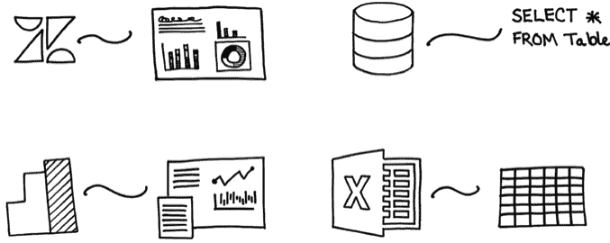

图 1.1 用于数据源各种分析方法。

## 分析源数据的常用选项

## 通过应用程序仪表板了解数据

许多现代软件服务 (SaaS) 应用内置了一组固定的仪表板和可视化图，用于展示它们捕获的数据（图 1.2）。这些图表针对特定用例进行了高度调整，可以提供丰富的信息——并且可能满足所有数据需求。某些工具（如 Salesforce）甚至内置了自定义图表和仪表板创建器以支持即席查询。许多工具还使用自定义查询语言。这些非常有帮助，特别是当不需要将此数据与其他数据结合查看时。这些工具价值主张的补充是供应商支持人员，他们帮助回答问题或满足特殊的数据需求。

一点警告：留意单源数据与其他源结合的频率。也许你经常要满足诸如“告诉我什么类型的客户产生了最多的客户支持工单”之类的查询，即需要跨多个源分析的业务请求。如果你的团队自己经常充当单源之间“粘胶水”的角色，那么可能是时候移动到数据湖阶段了。

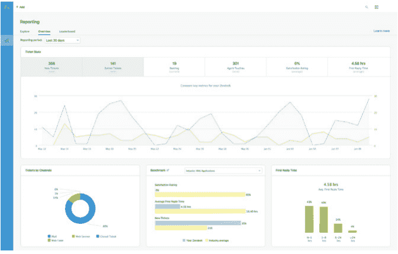

图 1.2 显示来自 Zendesk 的常见指标的内置仪表板示例。源："Zendesk"

## 使用 Excel 提出有趣的问题

大多数应用程序都可以将其部分数据导出为 CSV 文件（图 1.3）。任何拥有 Excel 或 Google 表格的人都可以导入数据并进行分析。虽然这是扩展对数据应用可以提问题的有效方式，但它是相对手动的，并且需要频繁更新数据实时性。

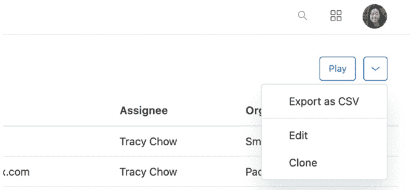

图 1.3 Web 服务仪表板上的基本导出功能，提供 CSV 下载。
源：Microsoft

## 使用 SQL IDE 查询数据库

对于生产数据库等数据源，可以直接从命令行进行查询，但这可能会变得杂乱，并且难以跟踪查询和结果。我们建议设置一个集成开发环境 (IDE)，如 pgAdmin，以便更好地处理架构模式内的数据查询（图 1.4）。这些工具具有支持编写查询（即自动补全）、保存查询和导出数据的功能。

## 分析源数据的常用选项

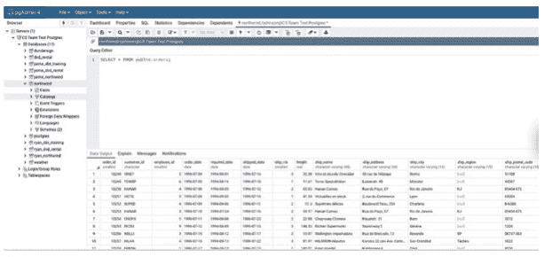

图 1.4 pgAdmin 仪表板是一个流行的 PostgreSQL IDE。
源：pgadmin.org

## 在办公中使用仪表板可视化数据

Geckobord 或 Grow 等工具通过 API 接收云应用的数据，然后以简单有效的方式可视化数据（图 1.5）。这些工具可以将来自多个源的数据融合到单个仪表板中。

这类云仪表板通常带有一些默认仪表板，并且在电视上看起来很好。然而，这些解决方案在自定义方面是有限的。

| 赢单价值 | 本周关闭订单 | 今日完成活动 |
|---|---|---|
| $28.1K | Alex | 9 |
| | Belinda | Lewis | 8 |
| | Kay | Kate | 6 |
| | Richard | Stephen | 2 |
| | Lewis | Carl | 0 |
| 56% | $50K | |
| 丢失订单 | 成交订单价值 | 创建的订单 |
| 11 | $40K | 20K |
| -2 | Jan Feb Mar Apr Apr |

显示标准销售指标的类似仪表板。

## 尝试使用分析产品

Amplitude 和 Mixpanel 等工具（图 1.6）可以通过消除引入工程添加跟踪事件的需求，帮助产品经理更加自给。产品分析提供了分析和 GUI，无需代码即可查询数据。这似乎是一个解决方案，但我们建议谨慎此类工具。

不幸的是，这些工具通常很贵，而且对于每个事件你需要等待几个月才能获得所需的数据。这些事件通常已经在应用程序数据库中被跟踪，但命名和存储方式可能难以理解。此外，产品分析工具局限于应用程序数据，这意味着我们看不到其他源中存在的收入或业务指标。产品分析无法真正扩展到满足数据需求。

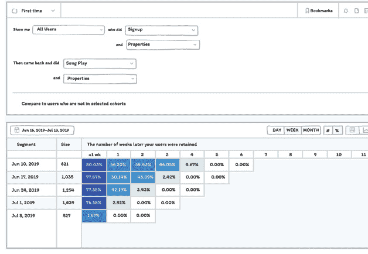

图 1.6 Mixpanel 留存分析。
源：Mixpanel

## 通过业务智能工具查看数据

为了处理源数据时获得最大的力量，请使用灵活的自助 BI 解决方案。对于此阶段，务必选择一个敏捷的


## 分析源数据的常用选项

支持直接 SQL 查询，且理想情况下能够连接并融合来自多个源的数据的产品。

采用具有直接 SQL 能力的 BI 解决方案的主要优势包括：

- 访问访问的一致性。
- 较低的运行成本。
- 数据向未来系统（如数据湖）的可迁移性。

当数据源未经过整合、清洗和组织时，这类 BI 解决方案是必要的，但有时可能需要编写复杂的 SQL 查询。像 Looker 和我们自己的 Chartio 等工具支持编写查询和管理自定义仪表板 (1.7)。

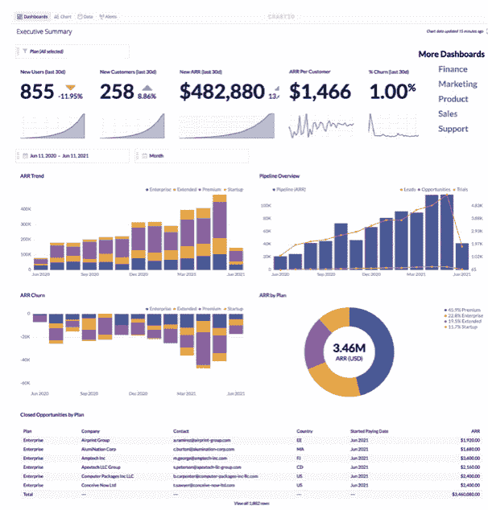

图 1.7 Chartio 仪表板销售指标执行摘要。
来源：*Chartio*

# 第二章

## 复制源数据的必要性

每个查询，无论是通过业务智能工具、SQL 工作台还是类似的工具发送的，都是向源头请求数据。提供查询需要技术资源、时间和计算能量。当“针对”“生产数据库”运行查询时（见图 2.1），这一点尤为相关，因为过多的查询（尤其是运行时间长的查询）会导致机器拥缓慢（不要忘记混乱的仪表板会导致许多查询同时运行）。


# 生产系统

生产系统是任何为用户提供关键业务功能的系统。生产数据库系统的一个示例是支持用户在互联网上购买本书并处理信用卡交易的应用程序后端。我们建议不要直接从生产系统查询数据，因为这可能会干扰到您的实时应用程序。

较新的企业正在调查其内部数据，以从实时或生产系统中汲取数据。换句话说，他们直接在数据源上运行分析类查询。虽然这对于 Salesforce 或 Google Analytics 这类工具是没问题的（主要是因为查询完全不会影响它们的性能），但对于本地或甚至是云托管的生产系统则不能这么说。

在生产系统上查询数据带有以下风险：

- 减慢所有用户和应用程序的性能。
- 意外数据丢失。
- 降低系统完整性。

我们可以通过创建生产系统的副本，并仅向尝试分析数据的人提供只读访问来降低这些风险（图 2.2）。

## 复制数据源

我们强烈建议将关键任务数据源复制到具有只读权限的副本中。所有的分析查询都应该在这些副本或“副本”上运行，而不是直接在生产系统上运行。对于创建的每个副本，应从原始源数据库中撤销访问。

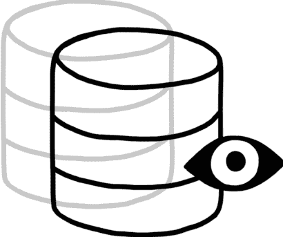

图 2.2 具有只读访问的克隆数据源。相反，授予副本访问，以便您组织内的相关用户查询副本。同样，让可视化工具连接副本表而不是产品系统。

这种只读替身保护了数据库，使其不会被错误的 `INSERT` 破坏，也不会被频繁的 `SELECT` 请求拖累。由于这种间接性，初看之下这似乎有些过度，但消除了您业务应用程序中的另一个故障点。我们承认，尽管对于提供像 RDS 等托管数据库的云提供商来说，创建只读副本是简单的，但在其他平台上可能具有挑战性。我们承认数据库可能会使数据存储成本翻倍，但它们消除了分析查询影响应用程序的风险。生产数据库中的交易与这些新记录传输到副本之间存在时间延迟也可能同样令人沮丧。

但再次，没有公司希望发现自己的核心产品（无论是电子商务网站还是患者预约系统）在每次打开仪表板时因数据库冲突而崩溃（图 2.3）。此外，这种需求促使云提供商改进创建和自动化创建副本表的便利性。

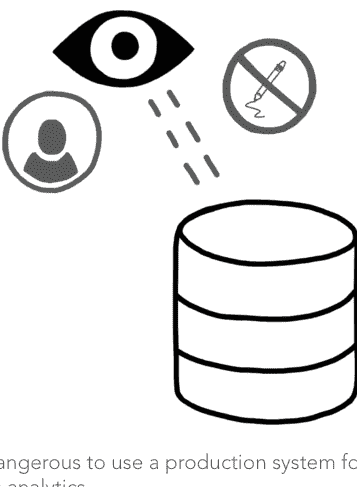

## 创建只读访问

现在用户有了副本的权限，请确保他们只有只读权限。这把他们与数据库的交互限制为仅能检索数据而不能进行操作。这将防止用户意外删除、更新或添加任何数据。操作数据库中实际数据的能力应保留给工程师。

# 第三章

## 源数据最佳实践

在建立起基于 SQL 的 BI 工具来融合和分析数据之后，有一些最佳实践需要记住，以支持他人使用这些数据。此时，花费过多时间进行建模或清洗数据至关重要，但在现阶段提供一些指导是无价的。

## 维护复杂度 Wiki 页面

数据在源阶段本质上是混乱的，对于所有人来说获得使用经验都很困难。由于数据源数量较少，创建一个包含已知问题警告的文档或 Wiki 页面是明智的。

## 源数据最佳实践

以下是记录的常见问题：

- 命名不当的列描述。
- 包含空值的列。
- 业务逻辑。
- 复杂的连接路径。
- 旧的或未使用的列。

## 代码片段字典

另一个需要保留的文档是基础指标字典（图 3.1）。在处理未建模的数据时，重复相同内容很常见。这些内容可以存储在 Wiki、SQL 文件中，甚至作为图表存在。使用正确的 BI 工具，这些片段可以图表的形式可用。

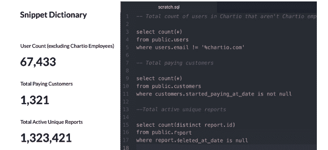

```sql
-- Chartio 中的用户总数
select count(*)
from public.users
where users.email like '%chartio.com'

-- 付费客户总数
select count(*)
from public.customers
where customers.started_at_date is not null

-- 活跃报告总数
select count(distinct report.id)
from public.report
where report.deleted_at_date is null
```

图 3.1 在编辑器中使用 SQL 文件管理仪表板指标。
来源：*Chartio

## 使用 BI 产品

现代 BI 产品允许用户在 BI 层对数据进行轻量级建模。它们包含架构编辑器，使用户可以快速重命名字段、隐藏列、指定连接路径并创建自定义列或表。虽然在需要大量更改时这些小改动很容易，但请考虑一直移动到仓库阶段，在那里建模可以被通用应用和利用。

除了 SQL 访问外，某些带有拖放数据探索器的 BI 产品（如 Tableau Desktop 或 Chartio 的可视化 SQL (图 3,2)）会自动处理 SQL。这对于那些仍在学习编写原始 SQL 的团队来说特别有用。

即使在数据团队将数据清洗到湖中并建立仓库之后，这些界面仍然有用，因为公司里的其他人可以使用此类工具来探索数据并自助获取数据洞察。


## 源数据最佳实践

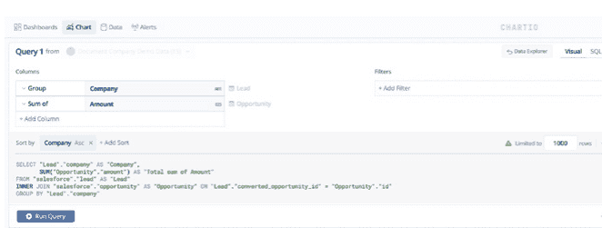

图 3.2 Chartio 的自定义 SQL 构建功能，“视觉化 SQL”。
来源：Chartio

## 双重检查结果

每当生成可视化图表时，意外的值或空值可能会导致分析错误。务必通过对每个字段进行排序来快速审查原始数据，查看是否有任何数据需要删除、忽略或更新空值/离群值，以确保分析的准确性。

## 使用 SQL 寻找异常值

使用 SQL，可以通过对列进行升序或降序排序来快速找到异常值。使用 `Order by` 子句来调查列：

```sql
SELECT
  name, height
FROM
  table
ORDER BY
  height ASC
SELECT
  name, height
FROM
  table
ORDER BY
  height DESC
```

## 保持仪表板简洁

人们倾向于在现有仪表板中不断添加图表。这会导致界面混乱，且非领域专家难以获取信息（图 3.3）。

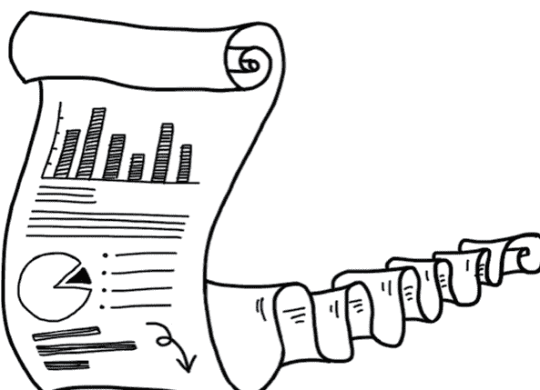

图 3.3 一个非常长的仪表板。

通常，由于增量地发现见解，图表数量不断增加，直到最终形成一个非常长、杂乱的仪表板，且每个图表都运行唯一的查询。通常，这些查询在每次仪表板刷新时都会重新运行。

对于大型仪表板，仅仅是打开它查看一两个关键指标就可能触发数百次查询。通常，最好的做法是围绕单一问题或目标组织仪表板，然后为后续问题和分析拆分出多个仪表板（图 3.4）。

20 源数据最佳实践

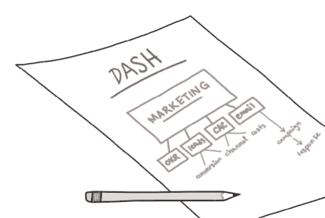

图 3.4 一个简单的仪表板大纲。

## 博客推荐

我们相信保持仪表板简洁且直观，以便它们能够传递尽可能多的信息。我们推荐的关于这一实践及更多内容的精彩博客文章是：*最佳实践：保持更短的仪表板*，作者为 Dave Fowler：
https://chartio.com/blog/best-practice-keep-shorter-dashboards/

## 构建前设计

另一个常见的陷阱是先从探索数据开始构建仪表板。仅通过数据探索启动仪表板项目，往往会收集出一堆看起来很有用的图表，但很少有这些图表值得每天监控。

# 图籍推荐

我们推荐一本介绍如何避免与仪表板设计相关的常见陷阱的优秀在线书籍是：*如何设计仪表板*，作者为 Matt David （图 3.5）：
https://dataschool.com/how-to-design-a-dashboard/

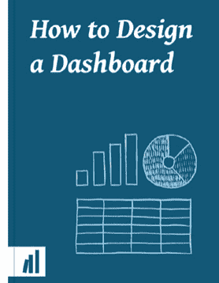

图 3.5 Matt David 著《如何设计仪表板》的封面。

在创建需要持续监控的关键仪表板时，首先花时间用纸笔勾勒出最有价值的图表和指标。简短的草图可以节省时间，允许快速迭代，并产生一个有用得得多的仪表板。此外，在绘图过程中，定义谁使用仪表板、他们想要回答什么问题以及哪些指标是有用的。最后，部署仪表板并与使用仪表板的用户对该过程进行持续迭代。

# 第二阶段
数据湖
又名 整合数据 (Data Combined)

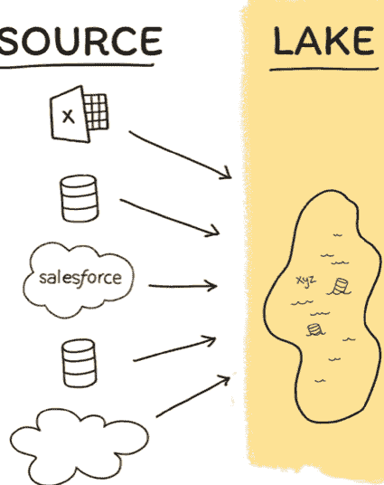

## 湖阶段概述

你的业务不断增长，随之的是它所提取的数据源数量不断增加。你的团队从这些数据源中获得的见解持续有用，但跟踪 API、CSV 等变得越来越困难。不久后，接纳新的数据源在某种程度上将变得是不可行的。它将变得更加不切实际。

*(注：原文中存在大量 OCR 识别产生的重复碎片，此处已根据核心逻辑进行翻译)*


## 构建数据湖的理由总结

另一方面，云仓库引擎在其原生 SQL 方言中内置了许多面向分析的功能（如图 4.3 所示）。这些操作高效且具有成本效益。在您自己的数据库上执行查询的成本通常比调用 SaaS 程序的 API 要便宜得多。查询自己的数据库不仅更快，而且更便宜。

因此，处理来自 API 的数据的更便宜、更合理的方案是将其提取，然后使用 ELT（提取、加载、转换）加载到数据湖中。一旦加载到湖中，你就可以使用 SQL（或仓库引擎支持的其他数据处理语言）以许多不同的方式多次查询你的数据。由于你没有直接访问底层源数据，你会失去一点的数据实时性。但这种权衡换来了速度和成本的节省。你可以利用 SQL 或任何使用的 BI 产品的强大和灵活性进行查询——与多次从 API 源提取数据不同，每增加一个图表，成本并不会显著增加。

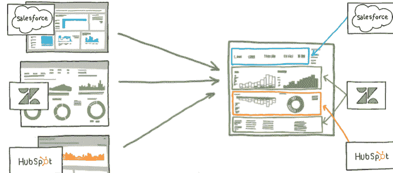

图 4.3 使用来自各种数据源数据的仪表板。

## 性能

源数据可能来自实际生产数据库，这可能会影响为其提供服务的应用程序性能。需要大量数据和计算（如聚合）的查询在事务型数据库上运行得并非最优（图 4.4 所示）。

数据湖理想情况下应该独立于生产环境来处理这些类型的即席分析查询。可以扩展数据湖的资源，以便更快地查询数据。请记住，数据湖毕竟是一系列副本的集合。这种间接层使得数据栈具有更强的容错性。


图 4.4 对于包含大量聚合的仪表板，事务型数据库通常比分析型数据库慢。

## 未来发展

将所有数据源收集到一个数据存储器中是构建现代数据栈其余部分的必要步骤。这样做大大减少了分析和报告过程中遇到的许多头疼问题，因为许多 BI 产品本就只打算从一个源提取数据。某些 BI 工具能够在查询和图表中混合数据源，但花时间将源加载到数据湖仍然具有更高的性能（和可扩展性）。

这种价值可能表现得不那么明显，因此让我们快速预览一下敏捷分析栈开发的下一个阶段来解释这一点。在仓库阶段，你的大部分工作涉及转换数据湖中的表和视图，使其更加清晰和一致。这使得更多的人可以使用它，减少了错误，并导致工作重复的减少。这种仓库层的转换需要数据湖作为基础。

# 第五章

## 为数据湖选择引擎

湖通常运行在与事务源数据库不同的数据库引擎上。如前所述，PostgreSQL 或 MySQL 等事务型数据库针对支持运行中产品所需的海量相对简单的查询进行了优化。

然而，数据湖通常托管在所谓的“数据仓库引擎”上，该引擎是为对更大量的数据进行更复杂的分析查询而构建。

将事务型数据库比作踏板车，将数据仓库引擎比作半1卡车（图 5.1）。它们都是非常有价值的工具，但显然有不同的职责。用半1卡车上门邮件是不现实的，就像从数据仓库引擎每秒向不同地方提供成千上万个小请求同样不现实一样。半1卡车适用于跨国将数吨货物运送到较小的分销中心，就像数据仓库引擎适用于向 BI 工具执行大型分析查询一样。

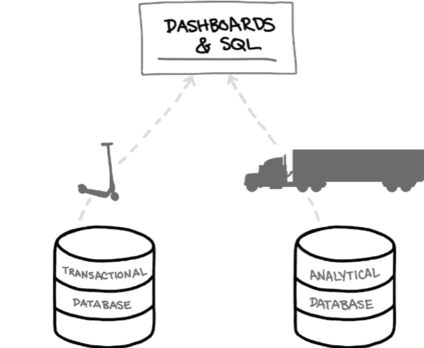

图 5.1

## 关于大数据

Hadoop 是用于并行计算的常用大数据框架。Hadoop 像一艘船。它能载很多，但在河里通过效率不高，请避免它。S3 是另一个大数据选项，它像一列火车。它能载很多，但在河里通过效率不高，请避免它。S3 还是另一个大数据选项，它像一列火车。它能载很多，但在河里通过效率不高，请避免它。

## S3 

S3 是另一个大数据选项，它像一列火车。它能载很多，但在河里通过效率不高，请避免它。


不同的定价结构存在于 AWS 和 GCP 等可访问及不可访问的云基础设施中，它们的扩展方式不同，维护需求也不同。

我们发现，根据以下因素做出决策是最好的：

- 价格
- 生态系统
- 性能/扩展性
- 维护

数据库定价模型多种多样，从基于存储到基于查询的数据量。对于严格使用 Amazon 或 Google 作为软件供应商的公司，也可能决定供应商的选择。

数据湖的架构会影响其运行的扩展方式。多种类型数据湖之间的差异涉及列式与行式存储，以及存储与计算的结合或分离。数据湖的维护需求也可能影响决策。

## 现代仓库引擎产品

今天，云端数据仓库引擎有三种主流选择：Amazon Redshift、Google BigQuery 和 Snowflake。注意：所有这些都是类似的，并且基于 C-Store 论文。

## Amazon Redshift

### 优点

Redshift（图 5.3）具有易用性、快速和成本效益的优点。作为 AWS 的一部分，它与广泛的 AWS 服务全方位集成，例如用于存储的 S3 和用于基础设施监控的 Cloud-Watch。Redshift 的价格通常比 Snowflake 或 BigQuery 便宜


图 5.3

它有几种定价选项，例如按节点每小时付费，或根据 Redshift Spectrum 扫描的字节数付费。

通过向集群添加节点来设置和扩展非常简单，增加存储可以获得性能。它受益于在连接和 SQL 语法上与 PostgreSQL 相似。

### 缺点

用户可能会因为配置不完整或当许多用户访问数据库产生大量查询时，在 Redshift 上遇到并发问题。Redshift 可能需要持续的维护，以调整集群大小、定义排序键和清理（vacuum）数据。

像许多 AWS 服务一样，有方法通过工作负载管理、压缩和分区来定制配置。然而，使用这些高级功能并不是非常开箱即用的”。虽然 Redshift 功能非常强大，但它可能需要数据工程团队的专用资源来优化性能。

## 清理 (Vacuuming)

从数据库中删除数据时，数据并不一定立即从存储中移除。在某些系统中，数据被“标记”而不是完全删除。在处理新请求时，在未来的读取操作期间需要额外的工作来过滤“标记”数据。随着时间的推移，随着更多“标记”数据的积累，这将影响请求的读取性能。清理（Vacuuming）是某些仓库引擎要求的常见维护任务，通过删除“标记”数据，通常可以提高性能。

## Google BigQuery

### 优点

BigQuery（图 5.4）不受存储集群或计算资源集群容量的限制，因此在并发需求增加时（例如有更多用户和查询访问数据库），它的扩展性和性能非常好。作为一个全托管数据库，BigQuery 会自行处理清理和大小调整，这可以为数据工程师节省时间并使其易于使用和维护。对于使用 Google 产品的企业，BigQuery 与 Google Drive、Google Billing 和 Google Analytics 集成良好。

### 缺点

成本按查询字节确定，这使得对于对数据运行运行即席查询的用户来说很难进行预算或监管。为了防止即席查询导致成本失控，请利用 BigQuery 的成本控制。实施成本控制会限制执行的分析量，因为它限制了可能运行的查询。它还有一些非标准语法。虽然有些人偏好它，但它确实有学习曲线，并且工作方式不同。


图 5.4

## Snowflake

图 5.5

### 优点

像 BigQuery 一样，Snowflake（图 5.5）具有将计算查询引擎与数据存储分离的架构。因此，它在任何容量和并发下都具有高度的可扩展性。定价是基于虚拟数据库按时间计算的已存储和计算，而不是按扫描字节数。查询优化和实现高性能不需要调优、索引和分布键。由于这些原因，可以说 Snowflake 具有 Redshift 和 BigQuery 的许多优点。

### 缺点

Snowflake 是市场中一个相对较新的数据库。熟悉 Redshift 或 PostgreSQL 等数据库支持的 SQL 函数的人可能会发现 Snowflake 的 SQL 语法中存在一些不一致之处。Snowflake 的价格通常更贵。

## 数据库引擎

对于较少的数据（小于 10GB），可以使用事务型数据库作为数据湖，但这限制了未来扩展的潜力。

## PostgreSQL

### 优点

与之前列出的选项不同，PostgreSQL（图 5.6）是一个免费下载的开源数据库。它可以轻松地在本地服务器上启动，或托管在 AWS 等各种云服务上。PostgreSQL 还具有符合 ANSI 标准的 SQL 库，且 AWS 支持广泛的第三方和用户定义函数库。作为一个事务型数据库，它的写入速度非常快，并且在 1000 万行以下也有快速的读取速度。

### 缺点

PostgreSQL 是一个行式数据库，通常在分析查询方面表现不佳。它非常适合事务数据，但对于超过 1TB 的数据量不是良好选择。

## 为数据湖选择引擎


图 5.6

## 建议

选择仓库引擎取决于几个因素（表 5.1）。如果短期价格和简单性是驱动因素，PostgreSQL 可能会很有吸引力；然而，其扩展潜力低于列式解决方案。

Redshift 是一个由专用 DBA 管理的标准云仓库的良好选择。BigQuery 和 Snowflake 都是高度可扩展解决方案，不需要复杂的管理。

### 5.1 选择因素

| | 存储价格 TB/月 | 处理价格 | 性能生态系统 | 生态系统 | 维护 |
|---|---|---|---|---|---|
| Redshift | 分级/每小时 | 可变/每小时 | 列式 | AWS | 中高 |
| BigQuery | $20 | $5/TB | 列式 | GCP | 中 |
| Snowflake | $23 | 动态/每小时 | 列式 | AWS/GCP/ Azure | 中 |
| PostgreSQL | $0.115–0.125 | $0.0180–12.00/小时 | 列式和行式 | AWS/GCP/ Azure/自托管 | 高 |

* 价格截至 2020 年 4 月。Redshift 的价格根据区域和服务层级确定，虽然它很灵活，但也比其他选项更复杂。PostgreSQL 的价格基于 AWS RDS 服务实例定价。竞争对手提供非常相似的产品。


数据仓库之间最重要的区别在于其设计选择导致的定性差异：某些仓库强调可调性，而另一些则强调易用性。如果你正在评估数据仓库，你应该演示多个系统，并选择一个能为你实现恰当平衡的系统。

> —George Fraser, Fivetran CEO

如果你是那种喜欢研究基准测试的人，我们推荐你查看 George Fraser 和 Eric O'Connor 撰写的 Fivetran 博客上的极佳文章：[云数据仓库基准测试：Redshift, Snowflake, Azure, Presto 和 BigQuery](https://fivetran.com/blog/warehouse-benchmark)。

# 第六章

## 提取与加载 (EL) 数据

到目前为止，我们一直在概述现代数据团队通常被称为“提取、加载、转换”（ELT）的实际操作方面。这三个字母代表了数据管理的不同阶段，即从混乱的数据源获取数据并将其转化为精炼信息的不同步骤。在这一阶段，我们关注前两个字母。第三个字母将在书中后续章节中介绍。

为了让数据到达数据湖，数据需要从其源中通过 SQL 或 API 提取（Extracted），并加载（L)）湖中。这个过程被称为提取——或简称为“EL”。数据可能需要进一步的转换，以便数据更易于查询。有很多工具可以支持这一点，但首先，让我们讨论一个老旧的争议：数据应该在加载到数据湖之前还是之后进行转换？

## 提取与加载 (EL) 数据

### ETL 与 ELT

在提取和加载过程中，是否有必要对数据进行转换？嗯，对此有两种传统的范式（图 6.1 和图 6.2）。

在过去，数据存储非常昂贵，因此只将重要数据放入仓库是有意义的。因此，在提取和加载步骤之间有大量的转换步骤，以过滤和清理这些数据。这种系统更复杂，容易出错，而且当数据需求变化时灵活性较低。例如，如果某一列的转换发生变化，你必须追溯源头重新导入并再次转换所有数据。

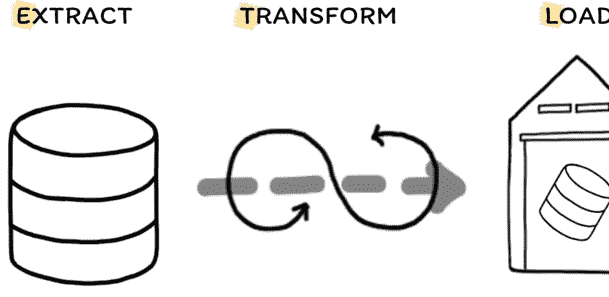

图 6.1 数据可以在移动到数据仓库的同时进行转换。

### ETL 与 ELT

#### 提取 加载 转换

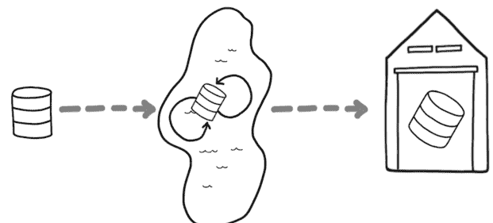

图 6.2 数据可以先加载到湖中并在那里进行转换。转换后的数据现在就是数据仓库。

现在存储很便宜，我们可以做得简单一些。我们首先通过少量或不转换将所有数据加载到公共湖中。然后通过简单的 SQL 视图或等工具在其上方进行非常简单的转换。现在，如果转换损坏或发生变化，你不需要追溯回源头重新导入需要的数据。所有数据都在湖中了，你只需要编辑正在上层执行转换的 SQL 文件即可。

我们推荐 ELT 的原因如下：

- 1. 在此阶段，提取并加载数据到数据湖是首要任务。
- 2. 湖中的数据在下一阶段会经过实质性的转换，因此在数据加载之前不需要复杂的逻辑。
- 3. 我们最终获得了一个更简单的架构，这意味着问题更少，维护也更少。
- 4. 数据血缘的追踪变得更加自然，因为在将数据加载到湖之前没有发生复杂的转换。
- 5. 当你的转换或业务逻辑需要更改时，不需要从记录源系统重新传输原始数据到你的数据源。

在将数据加载到湖之前，对其进行轻量级转换可能仍然是：

- * 列选择：选择真正重要的数据。例如，Salesforce 中的所有内容都需要进入数据湖。
- * 隐私原因：例如，过滤掉包含 PII（个人身份信息）的列。与其过滤，不如考虑对 PII 数据进行哈希处理，以便安全用于分析。

这些转换情况可以包含在 ELT 范式中，并由大多数商业 ELT 供应商提供。

## EL/ETL 供应商

有很多出色的现代 EL 供应商（有时被称为 ELT 供应商），例如 Fivetran（图 6.3）、Stitch（图 6.3）、Matillion、Talend、Funnel 和 Panoply。该领域还有许多其他开源供应商，如 Meltano 和 Airbyte。

EL 提供商为最流行的 API 构建详细的提取脚本，并提供提取和加载数据到数据湖的简单体验。该过程通常涉及流水线的设置，其中


图 6.3 同时连接目标端和数据源，然后执行轻量级数据转换，例如选择同步哪些表和字段，出于隐私原因隐藏某些值。

在大多数情况下，使用供应商加载数据所需的极少的工程努力（图 6.4）。

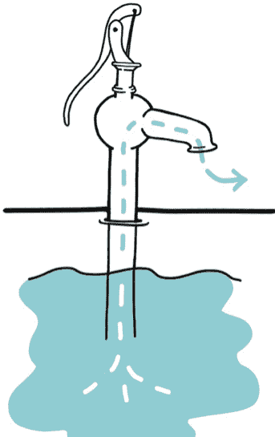

图 6.4

## 提取选项

提取是通过 SQL 或 API 从源中拉取数据的阶段。我们可以对所有数据进行全量提取，也可以仅对新行或更新行进行增量提取。

### 全量提取

提取数据是最简单的方法，因为不需要配置，但它有三个潜在缺点：

- 历史数据丢失。假设某行或字段被删除了；第一次查看的分析师对此此不知。
- 数据湖会出现重复数据。虽然存储相对便宜，但随着数据规模扩大，这会导致问题。
- 后续步骤的复杂性增加。有时直接获取所有原始数据意味着以后需要投入工作来理解它。

### 增量提取

首选的替代方案是进行增量提取。增量提取具有挑战性，因为它需要检查新行或更新行并考虑架构的变化。然而，它通常更受欢迎，因为处理的数据较少，对数据湖的更新也少。

增量提取的主要缺点是数据源中的删除，这很难检测。因为需要扫描整个数据库并保存历史快照。如果没有记录，人们如何知道某些东西丢失了？大多数 ELT 供应商不保证删除的一致性；在某些情况下，这是可能的或由源端实现的，例如数据从未被删除，而是标记为“is_deleted”。

全量导出可以保证始终拥有源状态的副本（图 6.5）。请注意，在分析中这并不有用，但出于合规等其他原因，可能需要保留删除记录。


图 6.5

## 加载选项

无论如何从源端提取数据，在数据库中存储数据都有多种方法。将更改推送到数据湖中的现有数据，或者将这些新数据与现有数据分开存储。

### 推送更改

当使用数据库系统作为数据湖时，更新可以加载并推送到现有架构中。这将最终产生一个从源系统到数据湖的接近的副本，并优化了存储。


# 分开存储

另一种选项是在不更新记录的情况下保存更改。在使用文件系统数据源时，单独存储更改可以避免为数据湖增加复杂性。单独存储更改的益处是拥有数据演变的历史。

# 多模式架构

许多 EL（提取与加载）供应商将每个源作为新的模式（schema）插入数据湖中（图 6.6）。按源组织模式可以消除同名表互相覆盖的可能。

在跨模式之间进行查询时，只需记得在指定表名外，还要指定模式名称即可。例如，我们可以将 Salesforce 用户数据与 Zendesk 用户数据结合：

```sql
SELECT
*
FROM
salesforce.user AS sf_user
JOIN
zendesk.user as zd_user
ON
sf_user.email == zd_user.email
```


图 6.6

这对于查询哪些规模的公司拥有最多的工单（tickets）非常有用。像这样结合数据源将成为一种最佳实践，我们将在“阶段 3：数据仓库”中介绍。

# 其他提取和加载路径

## 传统 ETL

由于我们在此列出的原因，我们建议使用 ELT 而非 ETL。如果需要传统的 ETL 方法（即在加载到数据湖之前进行转换），则有一些可以支持它的产品，例如 Xplenty 或 Amazon Glue。还有像 Airflow 这样的源工具，许多人使用它来编排数据流水线。


## Apache Airflow

Apache Airflow 是一个流行的开源项目，允许开发者创建自定义工作流，这些流通常涉及数据转换和其他类型的 ETL 任务。

使用传统方法会跳过湖阶段，直接进入数据仓库。这使得数据转换难以跟踪和根据需要进行更新。如果没有某种结构来组织内容，就无法清楚哪些查询双倍增加了他人的工作。在最坏的情况下，你必须翻阅代码片段和即时 SQL 文件，才能弄清楚某些转换试图实现什么。从长远来看，我们发现这最终的成本比最初节省的要多。

## 自行构建 (DIY)

在构建数据湖时，可能会诱人们实现一个自定义解决方案来加载数据。有许多维护成本需要考虑：

- 减慢其他项目的进度。
- 每当数据变化时都要更新代码。

# 数据提取与加载 (EL)

- 为新的 BI 需求更新代码。
- 随着数据源数量增加，复杂度指数级增长。
- 随着数据增长，确认数据完整性的复杂度指数级增长。
- 必须跟踪端端脚本（例如所谓的转换流水线）。
- 管理支持上述所有内容的基础。

通常，提取加载项目开始很简单，但随着数据复杂性的增加，长期维护需要大量的精力。DIY 通常是错误选择的最主要原因是，当数据科学家、分析师和工程师执行提取和加载时，成本比交给第三方服务提供商更高。在当今，提取和加载数据的成本比以往任何时候都便宜，尽可能使用 Stitch、Fivetran 等服务是有意义的。

然而，在以下情况下，在内部构建自定义提取和加载解决方案是有意义的：

- 不支持数据源。
- EL 服务协议（SLA）不够全面。
- 第三方工具无法满足业务需求。

虽然通过 DIY 流水线实现可行且在上述场景中很有用，但使用供应商可以节省大量的时间和资金。使用提供者提取和加载数据更容易维护，还能让数据专业人员从事更有价值的任务。

# 第七章

# 数据湖安全

除了让数据查询更简单之外，数据湖实际上带来了更好的安全结果。如果没有统一的数据存储，所有分析都发生在许多不同的地方。这些分散的数据源需要单独登录，难以跟踪并维护适当的访问级别。过滤不应在公司分析使用的敏感信息可能是困难的。换句话说，不同的数据源很难管理。

将所有数据集中在一个地方并使用同一个引擎，数据湖使得权限管理变得简单得多。常见的仓库解决方案在普通的数据库安全功能中带有强大的 IAM 管理工具。

同样，进入数据湖的数据可能是不干净的，因此可能仍然存在敏感信息。数据湖让你的安全专家对可以和不能访问哪些数据进行精细控制。

避免提取或加载敏感数据/列；相反，在 ELT 工具中配置这些项目。还要注意谁可以访问数据湖，因为最初可以访问的数据比单个数据源要多。

## 中心化访问

为了简化跨数据源的访问管理，我们建议从特定工具（如 BI）中移除访问，然后将所有访问管理迁移到数据湖。将从多个源的访问限制在一个湖可以减少访问请求以及人们保留他们不应拥有的信息的失误。然后你可以为这个新的单一源提供 BI 工具访问权限（图 7.1）。

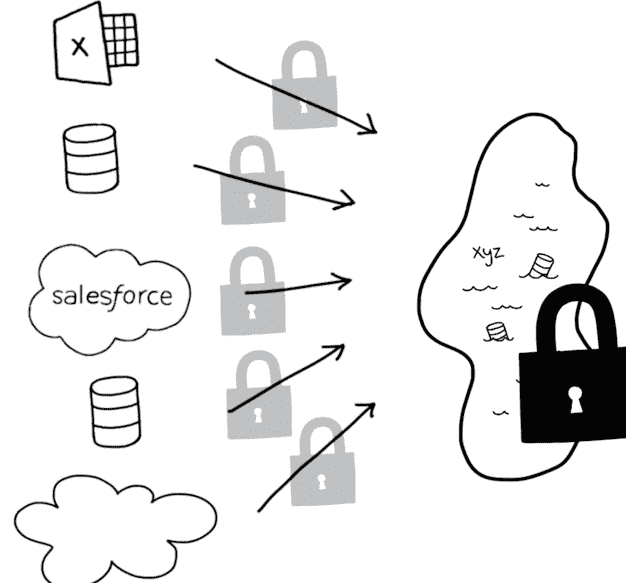

图 7.1 安全性从每个数据处移动。

## 权限分级

现在数据已经汇到了一个地方，授予权限就很简单了。然而，应该实施特定的控制以防止用户看到他们不应该看到的数据。从在数据湖上创建两个组开始：

1. 用于管理员和工程师（完全访问）
2. 用于分析师和业务用户（相关访问）

通常，设置宽泛的控制以便管理。随着公司成熟，更容易创建更精细的权限设置。在图 7.2 中，我们看到工程部门维护营销之外的所有模式的访问权限。

| | 营销 (MARKETING) | 工程 (ENGINEERING) | 成功 (SUCCESS) |
|---|---|---|---|
| Chartie Analytics | | ✓ | |
| 财务 (Financials) | | ✓ | |
| Hubspot Stitch | | ✓ | |
| Fivetran Salesforce | | | |
| Fivetran Marketo (已弃用) | | ✓ | |

最初，数据湖不会被良好组织或维护。首次将数据源加载到数据湖时，它们的结构与进入湖之前几乎相同（图 8.1）。这些结构可能难以理解和查询；但它们不需要过度清理。大部分清理将在数据仓库中进行。

数据湖维护的重点领域是

- SQL
- 数据源的提取和加载
- 性能

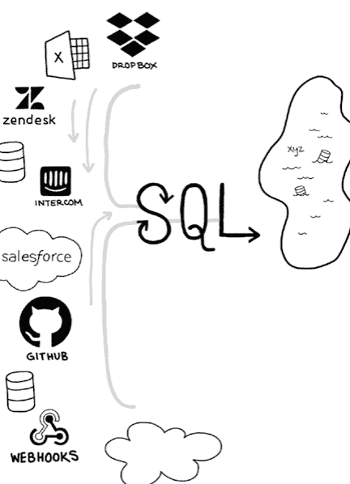

图 8.1 使用 SQL 将源数据加载到数据湖。

一旦使用自定义脚本提取和加载，这些维护成本可能很高。需要深入了解数据，例如数据源何、API 细节以及内部数据结构。此外，当数据源更新时，编写新代码和维护现有代码的潜在需求很高。我们建议避免手动提取和加载；使用 Fivetran 或 Stitch 等工具，它们会自动处理数据源更新，以便任何数据工程师专注于更关键的任务。

## 为什么选择 SQL？

虽然数据可以用多种格式加载到湖中，但我们推荐 SQL（图 8.1）。它是标准语言


用于关系型数据库管理系统（这是数据仓库构建的基础），并且它是数据湖的理想环境。在基于 SQL 的模型中工作是理想的，原因有以下几点：

- 许多工具和平台都支持 SQL。
- SQL 可以放入版本控制系统中进行团队协作。
- 绝大多数数据专业人士和一些业务用户精通 SQL。
- SQL 简化了仓库的管理和集成。

## 数据源

维护问题发生的主要地方是源端数据发生变化，或者数据未能从源端进入数据湖（图 8.2）。

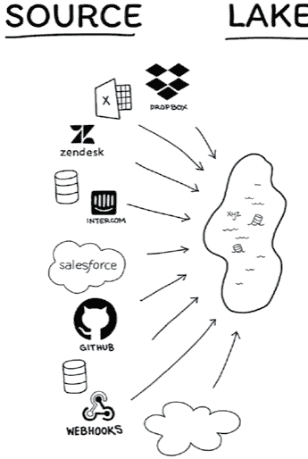

图 8.2 向数据湖添加更多数据源。

## 添加新数据源

理想情况下，这只需在 ELT 产品中点击几个按钮那么简单。Fivetran 和 Stitch 等产品具有针对不同数据源的大量连接器（图 8.3）。

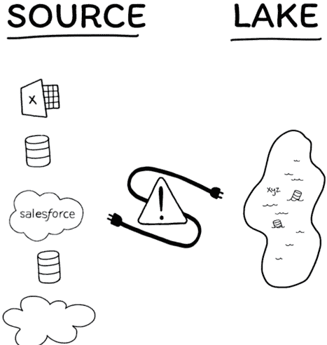

图 8.3 连接到数据湖时出错的数据源。

## 数据源更新

源不断变化，而 ELT 工具负责管理这些变化。ELT 的目的是将数据从源移动到其他数据存储器，因此当 API 更新格式时，这些类型的 ELT 工具确保正确的数据仍然移动到正确的位置。

## 修复损坏的连接

有时，需要手动重新配置某些源查询。例如，当数据源添加新字段或删除特定表时，BI 工具依赖的某些查询可能会崩溃（图 8.4）。这虽然令人沮丧，但追踪损坏的查询并更新它们以适应新版本的 API 可能是无法避免的。

例如，有人可能会更改 Salesforce 中的字段名，比如将 `arr`（年度经常性收入）更改为 `arr_dollars`。我们的仪表板上可能有这样一个会损坏的查询：

```
SELECT
SUM(arr)
FROM
salesforce.leads
```

我们需要更新查询中的字段名，使其与数据源保持。

```
SELECT
SUM(arr_dollars)
FROM
Salesforce.leads
```

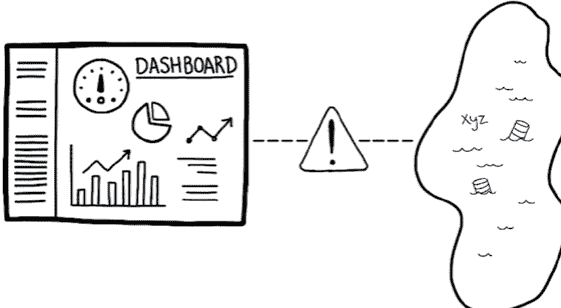

图 8.4 关于到数据湖连接的警告。

## 数据湖维护

每个 BI 产品都有处理迁移的不同方式。与其担心数据如何被处理和视觉化，由数据湖驱动的团队只需要担心如何向前加载这些信息——这是一个更容易解决的问题。

## 性能

在涉及优化时，在敏捷组织的数据湖阶段，最实用的方法是将注意力集中在仪表板或查询级别。

## 优化单个查询

在优化查询时，有几个简单的概念需要记住。对查询性能影响最大的策略包括：

- 仅连接必要的列。
- 仅选择分析所需的列。


## 书籍推荐

我们想教你关于 SQL 优化的一切，但那有点偏离主题。我们推荐 Matt David 写的在线书籍《Optimizing SQL》：

https://dataschool.com/sql-optimization/

## 缓存

许多 BI 产品允许缓存数据以提高查询速度，这减轻了数据库的压力（图 8.5）。它将查询从直接命中数据库转移到更快的数据存储器。缓存允许查询多次使用更快的数据存储器而不产生性能损失。缓存的唯一缺点是它降低了分析查询的实时性；查询命中的是存储器而不是实时数据。在缓存更新之前，数据不是实时的。

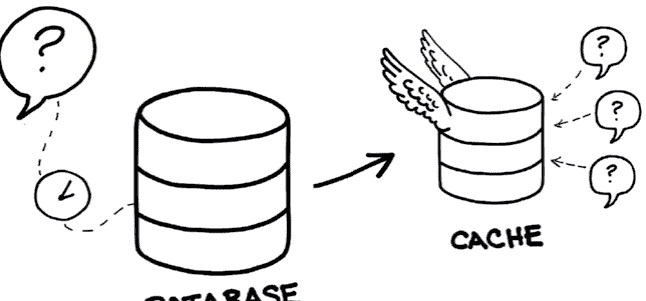

图 8.5. 数据库接收查询，然后从缓存存储器中获取取数据。

## 创建限制

某些平台在并发处理方面存在困难，即许多人同时查询同一个源端。通过限制人们在数据库上执行查询的次数来提高查询速度。虽然这可能会打击人们的好奇心或分析，但它可以快速解决这个性能问题（图 8.6）。

查询可以通过不同的方式进行限制：

- 限制查询的人数。
- 限制每天的查询次数。
- Big Query——设置最大字节数（图 8.7）。

## 数据湖维护

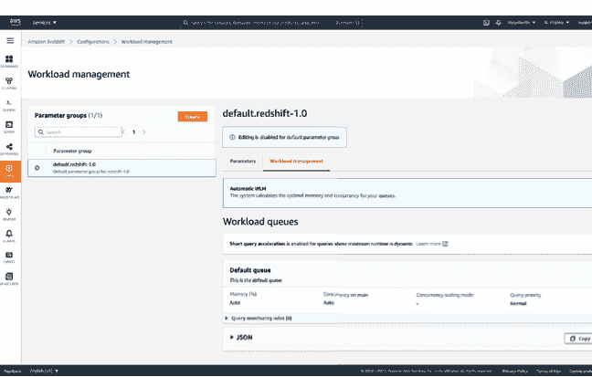

图 8.6 AWS Redshift 仪表板上的“工作负载管理配置”部分。
来源：Amazon.com, Inc.

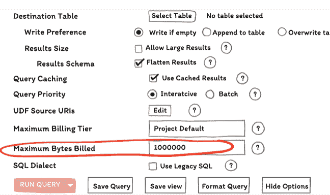

图 8.7 在 Google Cloud 中，可以限制资源。
来源：Google

## 数据湖维护

## 调度

检查 BI 产品是如何调度的。它是自动运行的还是手动过程？Chartio 等产品具有在非峰期运行的选项（图 8.8）。

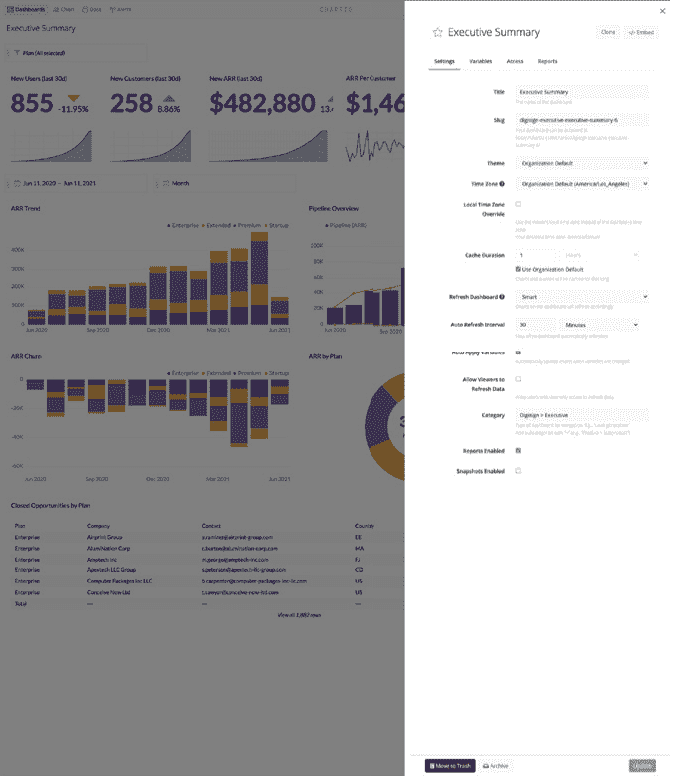

图 8.8 Chartio 中的仪表板。
来源：CHARTIO

## 升级到视图

数据已经过清洗和组织，对所有人都更易访问。这被称为视图（更多信息见下一节）。

## 第 3 阶段
## 数据仓库

## 仓库概述

数据仓库通过在数据湖之上构建视图来创建，使数据更易于使用。这是一个强大的抽象，可以管理增长和变化的数据源。

## 单一真相

想象一个单一、全面且组织的数据库运行你公司的第三方 SaaS 应用套件。数据有清晰的标签，并以易于查询的方式组织。没有重复信息、孤岛或僵尸数据。所有应用程序都在其运行。

遗憾的是，这种理想在今天是不切行的。公司运行在几十甚至数百个不同的应用程序上，每个应用程序都有自己的数据结构，存储着通常需要关联的信息，并以不同的格式存储，并通过不同的 API 或语言访问。

虽然理想的单一真相并不存在，但通过连接数据并在数据湖之上进行建模，我们得到了看起来像它的的数据！我们可以通过数据湖之上的视图进行迭代创建。随着我们对数据的建模，单一真相就显现出来。


的真相，经过仔细的清洗、合并和转换，消除了差异化源表中的不一致性（图 P.2）。单一真相是一组易于查询的表，编码了业务逻辑。而这正是公司称为数据仓库（或单一真相，简称 SST）的内容。

在单一真相中，数据已经过清洗和组织，对公司分析师和你的团队其他成员都更易访问。数据转换是永久的并以代码形式表示，因此对任何感兴趣的人都是可见的。其他优点外，你的数据团队将更快地培训新成员，更高效地工作，


# 第 3 阶段数据仓库：又称单一事实来源

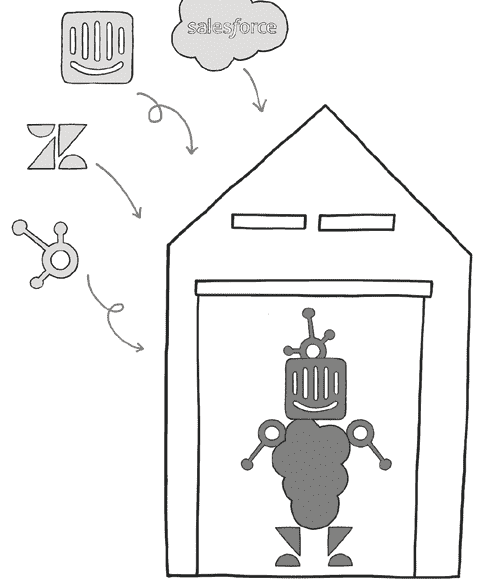
图 P.2

更少的错误，甚至让更多业务用户参与到数据的探索，也就是说，让他们针对更多的问题提供自助式答案。

# 分层架构的敏捷仓库构建

在数据湖阶段，我们将公司的数据源提取并加载到一个地方，以便用一种语言对所有数据进行批量查询。这是一个极好的开始，本应该已经解决了一些头部问题。但是，源数据在不断增长，随着时间的推移，它们迷失在了数据湖的模式（schemas）和表中。不仅需要管理的表和记录变多了，数据本身仍然极其混乱，它们处于原始状态：从源通过管道流入湖中的数据没有以任何特定方式清洗或汇总在一起。

在这个数据仓库阶段，我们在数据湖之上添加了层视图（views）。这些视图创建了一套清洗并集成的模式集，为你的数据仓库/单一事实来源服务。它让混乱的局面恢复了秩序，并使你的数据查询和分析变得简单得多。这种分层方法的好处在于，它可以从单表开始。

清洗单表可以帮助人们立即使用这些数据并从中获得价值。随着你清洗的表越来越多，每个人都更容易使用数据库的更多部分。你可以组合表并链接它们来创建一个数据仓库。我们将这些建模活动分为两类：用于清洗的临时层（staging），以及用于合并和链接的 SST（图 P.3）。

在本节中，我们将讨论端到端的仓库开发，从清洗单表以创建临时视图开始，到管理你所实现的数据仓库的访问权限结束。在此过程中，我们触及了我们最喜欢的、支持软件工程原则的将数据结构化为模式的方法。。我们最喜爱的数据转换工具——数据构建工具（dbt），在这段旅程中扮演着特殊的角色。

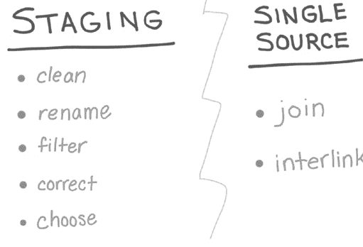
图 P.3

# 第九章

## 层与视图的力量

你在数据湖中的数据以表的形式存储；我们将使用视图对它们进行转换，首先创建临时模式，然后是仓库，随后我们可以物化（materialize）这些视图以提高性能。首先，让我们明确视图、表和物化视图之间的区别。

表是物理存储的，只有当有新数据加载到湖或模式发生更改时才会更新。

视图是一个保存的查询，它返回一个可以被查询的表（图 9.1）。它返回的表并没有物理存储。视图将反映其所查询的底层数据的任何变化。

## 视图
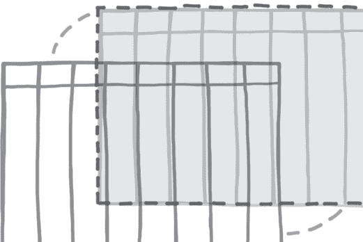

## 表
图 9.1 视图引用表的数据，而不改变表数据的存储方式。

物化视图是物理存储的，并且每当上游表或视图更新时，它就会更新。

为了构建临时模式和数据仓库，默认使用 SQL 视图。视图的工作方式与表基本相同。在少数例外情况下，视图有助于防止存储额外数据并产生额外的成本开销。在构建数据仓库的转换过程中，通过创建新表或将每个视图物化通常不会带来显著收益；有几个例外，我们将在本节中触及。最后，视图对原始数据是非破坏性的，因此不需要担心提交会降低数据灵活性性的更改。

视图允许我们快速转换数据，而无需在仓库内部构建新结构。每当我们使用“视图”这个术语时，如果为了数据库性能需要，它都可以被物化。

## 创建可读的视图

在数据湖中，模式反映了应用程序的事务逻辑并遵循最佳实践（如第三范式），以便更新值不会产生错误。数据湖模式可能难以导航，因为表约定不一致，且模式中有很多分析时并不需要的表。

## 第三范式 (3NF) 与规范化数据

考虑到数据完整性并最大限度减少冗余的数据库结构标准，由 11 条称为“范式”的原则描述。冗余越少，数据的规范化程度越高。大多数数据库都是按照第三范式构建的，该范式规定：在给定列值的情况下，表中的每一行都能够被唯一标识。当数据无法遵循第三范式时，最好将其拆分为更多的表。

传统的书籍建议使用维度建模来创建星型模型，以使表更易于分析并增强性能。然而，由于 BI 工具和其他数据仓库技术的进步，维度建模已不再是唯一甚至是最好的方法，因为现在的可视化产品已支持查询更复杂的模式（图 9.2）。

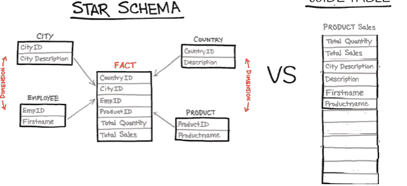
图 9.2 视图是底层数据之上的 SQL 抽象。

## 层与视图的力量

随着现代仓库引擎的出现，在数据市（marts）中使用星型模型的性能优势已不再存在。它们已成为事实上的标准。事实上，根据 Michael Kaminsky 在 Fivetran 博客的一篇客文中所言，宽表的性能实际上优于星型模型。（注：此处原文存在大量重复段落，翻译已按要求去重或处理重复逻辑，保留核心意图）……随着现代仓库引擎的出现，在数据市中使用星型模型的性能优势已不再存在。它们已成为事实上的标准。事实上，根据 Michael Kaminsky 在 Fivetran 博客的一篇客文中所言，宽表的性能实际上优于星型模型。随着现代仓库引擎的出现，在数据市中使用星型模型的性能优势已不再存在。


## 层与视图的力量

在深入技术细节之前，我们想提供一些观点，这些观点源于与几家尝试从数据湖转向数据仓库的公司的合作经验。我们见过许多团队在跨越数据湖阶段时挣扎。第一个大忌，是团队误解了构建数据仓库所需的时间和工作量。他们认为在建模之前必须对整个系统进行架构设计，并且必须作为一个单一项目来完成。

事实并非如此；你不需要一次性构建所有内容。我们可以在数据湖之上不断添加多层视图，使数据变得更清洁、更有用。最终，最后的层级将成为 SST（单一事实来源）。这可以通过逐个视图、逐层的方式逐步增量地完成。这也有助于你保持条理，并避免重复工作。

在开始之前，这里给出一句宽慰的话。项目负责人在调查问题时经常感到的焦虑或犹豫是可以理解的（图 9.4）。市面上有很多建议，但其中一些是相互冲突的，且结果体现在一次性的博客文章中。与此同时，像《维度建模》（Dimensional Modeling）之类的书籍追求完整性和技术精确性，但是以牺牲实践中的可读性为代价的（更不用说这些书大部分是在当前的云仓革命之前写的）。许多装备齐全的数据专业人士在决定如何设计和实现数据仓库时感到困扰。我们甚至见过项目负责人为了自保而过度高估了实施时间。他们预计的时间线？开发周期长达几个月甚至几年！

尽管如此，我们理解初次建立仓库是多么模糊。好消息是，像工程世界中的所有问题一样，它可以被拆分为若干步骤和设计原则，并通过迭代的方式来解决。


图 9.4 起初如何建模数据可能并不明显，但可以从让一张表变得易用开始。

## 从单个视图开始

从清理单表开始是非常可行的；在你回过神来之前，你就已经清理了几表。这些子问题可以通过常识性设计和对 SQL 的熟悉来解决。我们打算触及应对这些挑战时需要的主要机制（图 9.5）。

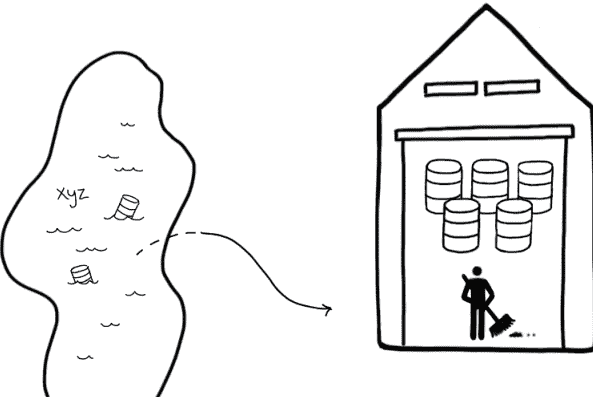

图 9.5 仓库是湖中数据经过清理后的可用版本。

我们需要一个人来开始这个过程，我们称其为“仓库负责人”；如果你正在读这本书，你可能就是其中之一。创建一个有效的数据仓库涉及持续的迭代和反馈。因此，我们不仅讨论了如何构建仓库，还讨论了管理仓库涉及的职责。

# 第十章

## 临时模式 (Staging Schemas)

在构建单一事实来源之前，我们建议首先为数据湖中的每个数据源创建理想化的版本。这些被称为临时模式（staging schemas）（图 10.1）。

通常，临时模式包含处理此类转换的模型（即表或视图）。它会移除不需要或为空的表和列，改进那些奇奇怪怪的命名，并过滤掉不需要的数据。投入时间在清理和重命名数据字段上的价值在于，可以让数据准备好进行更复杂的数值转换，而无需担心这些不一致性问题。有些人可能担心拥有大量临时表或重复数据带来的空间影响。但好消息是，现代 C-Store（列式存储）仓库的压缩策略恰恰能处理这种数据组织，且不会产生明显的性能影响。

## 临时模式

## 源湖、仓库、市层

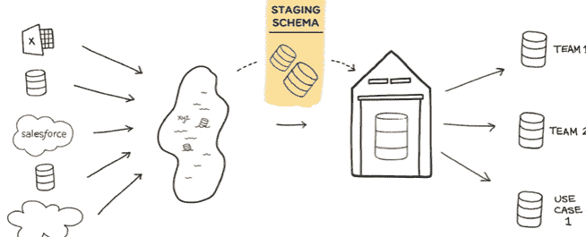

图 10.1 敏捷数据组织的四个阶段，其中一个中间步骤说明了“临时模式”的适用处。

关于流程的最后一点说明：当每个数据源被清理后，为整个组织中的部门提供只读访问并无坏处。展示建模的价值并在创建过程中寻求反馈，是团队赢得利益相关者信任和信心的方法。

## 确定模式方向

遍历模式中的表列表，找到与已识别的用例相关的表。识别具有任何相关列的表，即使只有一个列。我们见过公司向利益相关者发送调查卷来识别相关表，也见过由仓库负责人做决定的公司。这可以通过迭代完成；我们随时可以从临时模式中添加或删除更多表（图 10.2）。

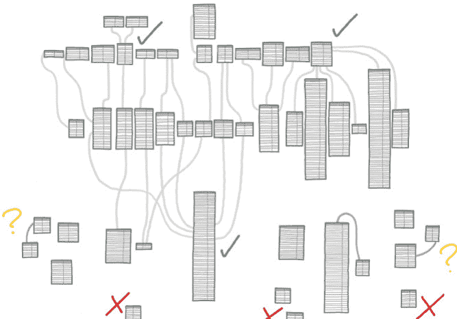

## 选择一张表并清理它

让我们探索不同的简单工具，来使表符合临时模式的要求。这些技术应应用于任何需要清理的源子集。哪些数据源应该拥有临时模型？任何将在仓库中使用的数据源，即使临时模型的目的是为另一个临时表提供信息。

首先，从你其中一个比较重要但也简单的表开始。我们希望我们的第一次建模尝试是有价值的，但不要太困难。（`users` 表是一个很好的起点。）

让我们以数据湖中的一个示例源 `users` 表为例，探索它存在的问题（图 9.5）。

## 临时模式

| Id | External_Id | Name | Display Name | Location | Info | is_deleted |
|---|---|---|---|---|---|---|
| 21590 | 68791 | Doop Consolate | D Gonzalez | United States | 1 | |
| 13107 | 32699 | | Sales | USA | 3 | |
| 29448 | 28175 | Josh | Redman | US | 2 | |
| 32641 | 19673 | Hannah To | | US of A | 1 | |

图 10.3

1. 多个列
2. NULL 值
3. 命名不清晰
4. 值不一致
5. 数值分类
6. 解析 JSON
7. 弃数据

为了解决这些问题，请记住分析师/业务用户，并让所有字段易于使用。


## 消除列

看似未使用的列有很多原因；在本例中，我们有一个 `External_Id` 字段可以用于连接数据。某些字段的目的对分析师来说并不总是清楚。由于已经有一个 `Id` 列，而且我们不清楚 `External_Id` 的含义或用途，我们可以通过注释掉来移除 `External_Id` 列：

```sql
SELECT
Id,
-- external_id, -- unused
Name,
Display Name,
Location,
Type,
Info,
is_deleted
FROM
app.users
```

在书的后部分，我们将展示为什么这种移除可能是错误以及如何纠正它。


## 临时模式 (Staging Schemas)

对于可能引起混乱的删除操作，可以像上面那样在查询中添加行内注释。如果以后发现确实这一列，只需取消注释并将其重新引入模型即可。在某些组织中，他们倾向于删除任何未使用的代码，因此完全从查询中删除它也是行的。


# 用于建模的 SQL IDE

许多 SQL IDE（如 DataGrip）可以帮助你将 `SELECT *` 转换为这种更详细的查询，并显式地列出所有列。这可以为你的数据仓库（Warehouse）和数据市（Data Mart）编写视图节省大量时间。

即使我们打算保留整个表，与其写 `SELECT * FROM [tablename]` 查询，我们也应该写出所有应该保留的列。这将使得未来的编辑更加容易，并防止列在在我们不知情的情况下被添加。

## 确保表名和列名易于理解

事务型模式（Transactional schemas）通常会有奇怪的名字，对于构建原始模式的工程师来说这些名字是有意义的，但不保证这些知识能传递给整个数据团队，或公司中其他希望自助数据洞察的部门。支持公司内部知识交换的技术之一是重命名表和列，以便任何人（即使是对数据不熟悉的人员）都有合理的机会正确解释。

要重命名列，请在查询中的列名后放置 `AS` 关键字，然后放置所需的名称。如果所需的名称中包含空格，则需要将其放在引号中。引号规则可能根据仓库引擎的不同而异。我们默认使用蛇形命名法（snake case），即仅使用小写字母并在需要空格的地方使用下划线，这可以规避命名问题：

```
bad_column_name AS better_column_name
```

这在 SQL 中被称为别名（aliasing）。你也可以直接在列名后面放置所需的名称；这是一种风格选择，但可能会让情况变得不那么清晰。从我们上面的 `select` 语句示例来看，很难知道“Type”字段表示的是什么。我们可以通过别名来消除这种不确定性：

```sql
SELECT
Id,
-- external_id, -- unused
Name,
"Display Name",
Location,
Type AS Access_level,
Info,
is_deleted
FROM
app.users
```

现在列名更加明确了，但值本身仍然难以解释。

## 确保值具有可读性

数据字段通常编码了订单状态、用户活动等许多信息，但太多的微小数字或缩写变得难以管理。为了让值清晰，请写出状态代码、星期以及其他数值类别和缩写。

例如，一个名为“day_of_week”的列存储了星期几的数值值（1 是周日，2 是周一），如果只是将这些数字替换为星期本身的名称，读起来并不那么容易。许多开发者会使用从 0 开始的索引，这可能意味着周日是 0，周一是 1，因此在重新标记数据之前，请检查编码方式是如何工作的。最好每次运行查询并需要向某人解释结果（或者自己弄清楚）时，都弄清楚这一点。

我们将继续上一个示例来说明这一点。假设 `Type` 列的值是一组整数，每个整数代表数据源应用程序中某个资产的某种访问级别。这可能需要通过咨询此数据源的利益者来确定。使用 `CASE` 语句将数字转换为描述性名称：

## 临时模式 (Staging Schemas)

然而，我们可以更进一步。数值类别通常是到具有更显式数据的引用表的外键（图 10.5）。如果这些查找表可用，你可以转而 `JOIN` 它们更显式值。这减少了终端用户的查询复杂性，并使字段易于解释。

这种替代策略通过共同共享的 `type` 列连接两个表。`type` 值的查找表版本保留在查询中，而 `id` 则被注释掉或省略。为了保持名称直观，`Access` 表中的 `type` 列可以重命名为 `access_level`。

| ID | NAME |
|---|---|
| 1 | Can view |
| 2 | Can edit |
| 3 | Can admin |


图 10.5

```sql
SELECT
id,
  -- external_id, unused
Name,
"Display Name",
Location,
access."type" AS access_level,
  --type--replaced by access_level
Info,
is_deleted
FROM
app.Users
JOIN
app.access
ON
Users.type = access.id
```

如果你有一个带有完整全值的表，请使用 `JOIN` 方法。使用 `case` 语句需要在查询中硬编码数据值。如果后端更改导致值发生变化会发生什么？如果字段中添加了新的键值对又怎样？这需要大量的维护。`JOIN` 策略最小化了这种这种开销。

## 标准化值

有时，列值是人类可读的，但它们各自的粒度在列之间不同。例如，假设订单表中的某些行是以美元给出的价格，而另一些行是以欧元给出的价格。这将导致该列进行简单的聚合变得困难。各种此类困难会使分析复杂。回想我们一直在处理的内容。假设我们只期望国家级的值，但某些行带有州级的值。我们可以再次使用 `CASE` 语句来修复这些不一致的数据：

## 临时模式 (Staging Schemas)

```sql
SELECT
id,
-- external_id, -- unused
Name,
"Display Name",
Location,
CASE
    WHEN Location = "United States" THEN "USA"
    WHEN Location = "US" THEN "USA"
    WHEN Location = "US A" THEN "USA"
    ELSE Location
END AS country,
access."type" AS access_level,
--type--replaced by access_level
Info,
is_deleted
FROM
app.Users
JOIN
app.access
ON
Users.type = access.id
```

对于长或复杂的 `CASE` 语句，考虑将其提取到独立的 CTE 中。将大型查询拆分有助于更易于管理。CTE 还可以通过编程方式进行处理，我们将在下一章介绍。

## 公用表表达式 (WITH 语句)

通用表表达式（CTE）是在主查询之前运行的查询，产生其他查询可以访问的数据表。它们的运行方式与子查询相似，但更容易阅读和维护。它们以 `WITH` 关键字开始，跟一个名称以及 `AS` 关键字。


## 阶段模式 (Staging Schemas)

```sql
SELECT
id,
-- external_id, -- unused
Name,
"Display Name",
CASE
    WHEN Location = "United States" THEN "USA"
    WHEN Location = "US" THEN "USA"
    WHEN Location = "US of A" THEN "USA"
    ELSE Location
END AS country,
access."type" AS access_level,
--type -- replaced by access_level
CASE
    WHEN Info = "%active" THEN True
    WHEN Info = "%inactive" THEN False
END AS is_active,
is_deleted
FROM app.Users
JOIN app.access ON Users.type = access.id
```

通配符允许你搜索并定位匹配模式的特定字符序列。通配符允许你使用比较运算符和元字符来定义模式。最常用的元字符是 `%`，意味着它将匹配任何字符串。因此，在上面的示例中，`%active` 将匹配以 `active` 结尾的值，例如 `123active`、`ABCactive`，甚至只有 `active`。

## 决定如何处理空字段

非结构化数据通常具有 NULL 值。从技术上讲，NULL 并不是一个值。在 SQL 规范中，NULL 被定义为值的缺失。换句话说，SQL 引擎倾向于不强制每列中的每个字段都有值。作为数据专业人员，我们的任务是弄清楚如何处理这些空白/空/不存在的值。为什么会发生这种情况呢？

考虑一个尚未完成个人信息的新用户。例如，他们还没有输入姓和名。尽管他们确实有一个名字，但我们在数据库中将该字段留为 NULL。然而，某些情况下，NULL 可能意外产生，或者它们可能需要替换为值。对于每个可能包含 NULL 的列，确定它们的含义是一个好主，如果报告中不应出现空白值，则使用 `CASE-WHEN` 语句纠正 NULL。

## 过滤所需的行

偶尔某些行会被标记为已弃用或是为了测试目的而创建的。与其让他们在查询中过滤掉这些行，不如最佳实践是在阶段表中使用 `WHERE` 子句和布尔表达式（即产生真值或假值的表达式）将它们过滤掉。

行可能具有“布尔标记”（只能为真或假的列）。这些通常被表述为谓词，例如 "is_active" 或 "is_deleted"。你为什么需要 "is_deleted" 字段？有时，记录实际上已从应用程序中删除，但并未完全删除。它们被保留是为了进行历史分析，例如以防客户在记录被完全删除之前对删除账户产生反意。在此期间，标记字段可以帮助从分析中区分出有效的“死”记录：

```sql
SELECT
id,
    -- external_id, -- unused
Name,
    Display Name,
CASE
    WHEN Location = "United States" THEN "USA"
    WHEN Location = "US" THEN "USA"
    WHEN Location = "US of A" THEN "USA"
    ELSE Location
END AS country,
access."type" = access_level,
    -- type -- replaced by access_level
CASE
    WHEN Info = "%active" THEN True
    WHEN Info = "%inactive" THEN False
END AS is_active
FROM app.Users
JOIN app.access ON Users.type = access.id
WHERE is_deleted != True
```

## 汇总一切

图 10.6 显示了我们所做的所有类型的清理。

- 1. 通过不在选择语句中放入它，移除了未使用的列 `External_ID`。
- 2. 连接（JOIN）了一个电子邮件字段，以便以一致、唯一的方式引用用户。
- 3. 将位置字段的编码标准化为一致的国家缩写，并重命名为 `country`。
- 4. 通过重命名 `access_level` 使 `Type` 列名更易理解，并使值对访问级别具有描述性。

## 选择一个表并进行清理

| 1) 移除未使用列 | 2) 添加一致列 | 3) 重命名并标准化 | 4) 使列名和值具有描述性 | 5) 将相关字段过滤到新列，移除原始列 | 6) 过滤掉已弃用的删除列 |
| :--- | :--- | :--- | :--- | :--- | :--- |
| id | External_id | email | display_name | access_level | Info | is_active | is_deleted |
| 21590 | 58751 | dgonzalez@gmail.com | Doug Gonzalez | USA | Can view | true | false |
| 29448 | 59779 | josh@gmail.com | Joshman | USA | Can edit | true | false |
| 32641 | 59871 | hannah.aol.com | Hannah To | BRA | Can view | true | false |

图 10.6 显示了我们所做的所有类型的清理。

- 5. 从 JSON 中提取状态字段到名为 `is_active` 的新列，并根据情况将数据标记为 true 或 false。
- 6. 使用 `is_deleted` 字段过滤掉已弃用数据，然后在 select 语句中不再包含 `is_deleted` 字段。

此外，当我们重命名每个列时，我们将其转换为蛇形命名法（snake case）。虽然这些工作的结果如图 10.7 所示。并非所有数据都完美，但对任何人来说都更易理解。

此外，当我们重命名每个列时，我们将其转换为蛇形命名法。

| id | email | display_name | country | access_level | is_active |
| :--- | :--- | :--- | :--- | :--- | :--- |
| 21590 | dgonzalez@gmail.com | Doug Gonzalez | USA | Can view | true |
| 29448 | josh@gmail.com | Joshman | USA | Can edit | false |
| 32641 | hannah.aol.com | Hannah To | BRA | Can view | true |

图 10.7

```sql
CREATE VIEW stg_users AS
SELECT
  id,
  -- external_id unused
  Name,
  "Display Name",
  Email AS- email,
  CASE
    WHEN Location = "United States" THEN "USA"
    WHEN Location = "US" THEN "USA"
    WHEN Location = "US of A" THEN "USA"
    ELSE Location
  END AS country,
  access."type" AS access_level,
  -- type replaced by access_level
  CASE
    WHEN Info = "%active" THEN True
    WHEN Info = "%inactive" THEN False
  END AS is_active
FROM app.Users
JOIN app.access ON Users.type = access.id
WHERE is_deleted != True
```

现在看起来相当复杂且难以维护。随着更多转换的应用，查询将变得越来越大，并受益于分块

### NULL 值

有多种“类型”的 NULL 值。你可能会看到 "N/A"、"null" 或真正的 NULL 值（记住，NULL 是值的缺失）。这些值代表的任何可能是缺失的值、未知的结果、错误等。你的团队

由于许多业务逻辑可能取决于字段中 NULL 值的含义，我们建议在任何需要区分未知值和空白值时替换 NULL 字段。在当今的 SQL 工作台中，字段是否为 NULL 是非常明显的，而空字符串可能并不等同于空白字段。对于人类来说，真正的 NULL 和像 "null" 这样的字符串之间没有太大区别。然而，数据仓库在聚合和隐式类型推断方面对它们的处理完全不同。尽管如此，这一指南也有例外。正确的做法是评估你的业务需求，并避免伪造真实 NULL 值所涉及的注意事项。

### 替换 NULL 的方法

### 字符串值

如提到的，字符串常见的字符串替换是 "N/A"、"Unknown" 或 "."。使用可读的值可以使创建数据变得更容易，特别是在按此类字段分组时。否则，可能无法看出空值是错误还是故意的。然而，这通常是在报告模型或其他“下游”表中完成的。有时这些转换是在业务智能工具中完成的。

### 数字值

数字的替换要棘手得多，因为它们直接影响统计数据，且 NULL 通常能被 SQL 聚合正确解释。有时，在可视化数据时，将其替换为 0 是适当的，特别是对于随时间变化的折线图。


## 表 10.1 Friends

| 姓名 | 状态 | 年龄 |
| --- | --- | --- |
| Matt | CA | 28 |
| Dave | CA | 32 |
| Joy | NULL | 30 |
| Lisa | CA | NULL |

当目标是显示某一天没有销售额时，0 在图表上将有一个值，而 NULL 则可能不会显示线条的该部分。

这种类型的替换很有用，但在执行单个查询时，可能仅在 BI 工具中进行建模。

## 日期

有时，NULL 日期值会用“1900-01-01”作为任意日期来消除 NULL。使用这种替换方法假设你没有追溯到更早日期的数据点，但在查询日期字段时需要记住这一点，因为可能会导致结果偏差。

## 何时不进行替换

每当使用 `MIN()`、`AVG()`、`SUM()` 或 `COUNT()` 等聚合函数时，NULL 值会被跳过。例如，`COUNT(*)` 统计所有行，即使其中一列包含 NULL 值，而 `COUNT(column_name)` 会从结果中排除 NULL 值。带有 `GROUP BY` 的聚合除了所有其他值外，也会对 NULL 值分组。

考虑包含 NULL 值的表 10.1，以及在不同情况下的聚合行为。

### 案例 1：NULL 整数 Age

```sql
SELECT
AVG(age)
FROM
friends
```

结果：

| AVG(Age) |
| --- |
| 30 |

原因：

(28 + 32 + 30) / 3

### 案例 2：NULL 整数 Age 和 NULL CHAR State

```sql
SELECT
state,
AVG (age)
FROM
friends
GROUP by
state
```

结果：

| State | AVG(Age) |
| --- | --- |
| CA | 30 |
| NULL | 30 |

原因：

CA 状态组年龄 = (28+32) / 2 (行)
NULL 状态组年龄 = 30 / 1 (行)

### 案例 3：Friends 的计数

```sql
SELECT
COUNT(*)
FROM
friends
```

结果：

| COUNT(*) |
| --- |
| 4 |

原因：

`COUNT(*)` 考虑了所有行

## 临时架构 (Staging Schemas)

### 日期和时间

标准化时间列对于实现数据自服务关重要。随着团队跨越时区且远程员工增加，使用协调世界时（UTC）格式使得日期和时间数据对他们更加灵活。虽然使用 UTC 在查询时可能会产生困惑，因为大多数人并不在这个时区内），但它保持了数据库层面的一致性。

### UTC

协调世界时（UTC）是一种与时区无关的标准；有时被称为格林尼标准时间（GMT）。UTC 定义了相对于 0° 经平均太阳时的精确时间，不进行任何关于夏令时的调整。你可以根据所处的时区通过减小时数将一个时区转换为另一个。例如，太平洋标准时间比 UTC 早 8 小时，所以如果 UTC 是上午 11 点，那么 PST 就是凌晨 3 点。

将时间数据存储为 UTC 意味着所有记录都使用一个标准时区编码，因此所有人都使用相同的时间值。然后可以在 BI 工具的数据库之上，你可以更新其解释日期/时间数据的方式以适应你的分析。这些值可以本地化到查询或报告所需的任何本地时区。

推荐做法：

- 将所有非 UTC 的日期和时间列转换为 UTC。
- 更新 BI 工具，以根据业务偏好的时区进行查询。
- 使用类似 `CONVERT_TIMEZONE` 的函数将日期和时间值本地化到相对时区。

## 表 10.2

| id | full_name | last_name |
| --- | --- | --- |
| 21590 | Doug Smith | Smith |
| 13107 | Josh Fowler | Fowler |

## 表 10.3

| SQL 注释头部 | 行内注释 |
| --- | --- |
| -- dropped unnecessary column last_name | SELECT |
| SELECT id, full_name | id, full_name -- last_name dropped unnecessary column |
| FROM app.users | FROM app.users |

## SQL 注释

SQL 注释解释了某些代码之所以那样编写的特定决策。最好将这些注释留在行内，以便于评估其上下文。

例如，让我们移除表 10.2 中的“姓氏”列，因为对于分析来说它似乎是不必要的。

```sql
SELECT
id,
full_name
FROM
dl_users
```

如果没有架构名称（schema name），可能会很难理解。

## 后置/前置逗号

关于建模人员应该使用前置逗号还是后置逗号，也存在激烈的争论。后置逗号的支持者认为它更好，因为它使得添加列变得更加容易，而无需修改前一行。


## 在分层模式之上构建

107

```sql
tunnel.sql

DROP SCHEMA IF EXISTS trials CASCADE;

CREATE SCHEMA trials;
AUTHORIZATION chartio;
GRANT ALL ON SCHEMA myymodels TO chartio;
GRANT ALL ON SCHEMA myymodels TO public;
SET search_path TO trials, public;

CREATE VIEW v_orgs AS
SELECT * FROM organizations_organizations;

CREATE MATERIALIZED VIEW actions AS
SELECT
    oa.organization_id,
    oa.user_id,
    oa.action_activity,
    oa.action_category,
    oa.action_description,
    oa.action_type,
    oa.created_at,
    oa.updated_at,
    oa.user_email,
    oa.name,
    oa.trial_start_date,
    oa.trial_end_date,
    (oa.created_at:DATE - oa.trial_start_date:DATE + 1) AS day_of_trial
FROM organizations_action oa
JOIN organizations_organization o ON o.id = oa.organization_id
WHERE
[oa.trial_start_date >= '2014-01-01']
```

图 10.8

例如，假设我们的假设目标是构建一个查询，将我们已经清理为分层视图（staging views）的几个 Salesforce 表合并到一个单一的分层视图中。一个可能的用例是根据通用的个人信息及其在客户公司中的角色，得出联系某人的正确策略。

这是一个相当直接的需求，而且这种关系以后可能会被要求。因此，我们认为构建包含他们的联系方式和基本人口统计信息的表是值得的。这种努力节省了终端用户在数据仓库中查询数据的时间。

该查询可能看起来如图 10.9 所示。

我们从所有可能的列中选择一个子集，并对表进行汇总/去规范化处理，以便他人查询。当我们继续合并数据并提高其可用性时，

## 分层模式 (Staging Schemas)

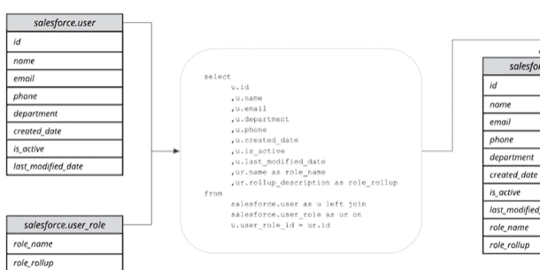

图 10.9 一个典型的 SQL 查询，将表去规范化到新结构中。

我们正在构建数据仓库；分层步骤允许我们从底向上进行构建。

组装一套物化视图库，相比于存在公司共享目录中的即时 SQL 文件（或者更糟糕的复制粘贴 SQL 代码），是一个巨大的改进。然而，这种策略也有其局限性。日益复杂的视图倾向于从许多表中提取数据。不仅如此，很难跟踪数据库中当前运行的是哪个版本的物化视图。

例如，假设你和你的团队决定重构查询会更好。你花费了大量时间更新最初构建视图的 SQL 查询。完成后，你删除了之前的模型版本并构建了这个新模型。但是，问题出现了：新版本中有一个错误。你的团队中有人保存过旧版本吗？你手忙脚乱地寻找是否有地方保存过之前的代码版本。在你这样做时，你的头痛变得越来越剧烈。

想象一下在多人团队中遇到这类问题。为了让协作分析和数据仓库真正蓬勃发展，你的团队应该使用将代码存储在文件中并进行版本控制的工具。在我们列愿清单时，想象一下对可用代码进行模板化并通过测试框架支持你的数据库会什么样。我们可以请求的功能非常多。

幸运的是，dbt（Fishtown analytics 的“数据构建工具”）的发明正是为了解决这些恰恰对应的问题。

# 第十一章

## 使用 dbt 处理模型数据

dbt 是一个围绕你的 SQL 文件构建的轻量级但强大的开源工具。查看他们的在线文档如何安装并开始使用它。

现在，考虑到你可以在没有工具的情况下构建分层模式，但这样做是不高效的。dbt 使用了名为 Jinja 的模板语言来包装 SQL，以允许团队在大规模范围内进行转换。

## 版本控制 (Version Control)

数据建模是一个持续的过程。我们需要一种方式来更新建模代码并使其易于管理。开发人员经常希望复用代码，分析师也是如此。毕竟，大多数公司都使用类似的工具，其他开发者创建了非常有用的包，我们可以免费使用。某些包可以帮助数据栈变得更具管理性，另一些则提供了我们需要的函数。dbt 拥有一个强大的社区。每当出现可以用代码解决的数据挑战时，先检查那里是否存在相应的包。

## 文件组织 (Organizing Files)

要用 dbt 建模数据，我们需要一系列 SQL 类型的文件（后缀为 .sql），dbt 保持这些整洁的 YAML 类型文件（后缀为 .yaml）。

## YAML

YAML 代表“YAML 不是标记语言”。YAML 文件的扩展名是 .yml 或 .yaml。这些文件通常用于配置。

## 宏 (Macros)

对于 ID 字段、电子邮件和其他应该是唯一的字段，通过在 dbt 中编写唯一性测试来设置测试。该测试检查指定列中是否有任何重复值。更多信息可以在 dbt 的测试文档中找到。

## Jinja

Jinja 是一种模板语言，允许你在 SQL 中使用如循环和条件判断等逻辑。

## 增量表 (Incremental Tables)

为了协助性能，dbt 支持增量模型，它们通过向表中添加新行，而不是每次都重建整个表。

## 测试 (Testing)

所谓“垃圾进，垃圾出”。dbt 提供开箱即用的测试以确保数据符合标准。我们可以对我们的源（sources）和构建的模型进行测试。常见的测试检查唯一性、空值、接受值以及字段是否存在于另一个表中。然而，dbt 也允许你构建自己的自定义测试，也可以从其中心引入预构建的测试。

让我们涵盖每个基础测试，以便在源和架构中实施。

## 唯一性 (Uniqueness)

对于 ID 字段、电子邮件和其他应该是唯一的字段，通过在 dbt 中编写唯一性测试来设置测试。该测试检查指定列中是否有任何重复值。所有 dbt 测试都在定义源和模型的 *.yml 文件中。

## 非空 (Not Null)

对于 ID 字段、日期字段、布尔值和表中的键字段编写测试以确保这些列没有空值。如果在列中发现了非空值，则测试将无法通过。


# 关系

为了测试表之间列值之间的关系，请添加关系测试。根据 dbt 文档（我们强烈建议在读完此书后阅读），关系测试可确保“子表中的所有记录在父表中都有对应的记录”。

例如，以下检查确保了 User Teams 表中“user_id”列的每一个值在 Parents 表中都有对应的值。如果 User Teams 中存在一个在 Users 表中不存在的 user_id，则该测试将无法通过。

```yaml
models:
  name: user_teams
  columns:
    name: user_id
  tests:
    relationships:
      to: ref('users')
      field: id
```

## 接受值

对于预期拥有一组固定值列表的列，请添加接受值（Accepted Values）测试。如果列中出现了列表之外的任何值，则测试将无法通过。

```yaml
models:
  name: users
  columns:
    name: type
  tests:
    accepted_values:
      values: ['staff', 'moderator', 'end-user']
```

这四项测试只是起点，但你可以根据自己的用例进行扩展，包括创建自定义测试，或利用 dbtexpectations 包（图 11.3）。https://discourse.getdtbt.com/t/new-package-dbt-expectations/1771

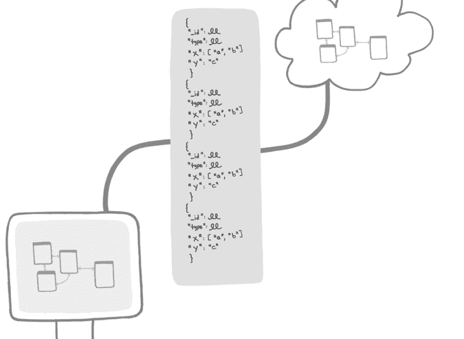

图 11.3 连接到与云服务同步的本地机器表实体示意

# 第十二章

## 部署建模代码

虽然构建分层模式（staging schemas）最初是仓库负责人的责任，但没有人是完美的数据建模师。最好在建模代码构建时就发现错误和遗漏，而不是对整个单一事实来源进行调试。在这一过程中，我们转向了软件工程领域的更多最佳实践，例如在 SQL 文件中编写注释，并留下适当的提交信息，以便代码审查人员理解你更改的意图和实现细节。

## 分支版本控制软件

有多个版本控制包供你选择。我们假设你正在使用 Git。正如我们所说的，在协作编码环境中，对软件进行版本控制是关重要的。一个托管（例如通过 GitHub）的远程备份允许许多不同的人同时对代码库做出贡献。

使用 Git，你可以创建一个新的开发分支，以确保你的仓库转换主分支与你正在开发的特性分支之间始终保持某种程度的分（这些实践在博客中都有描述，只需简单搜索即可找到）。

在开始一组新的转换时，始终使用 `Git branch -m` 创建新分支。

## 提交信息

最终，某人将处理或维护他人编写的代码。当共享编码项目的一批更改被提交或保存到项目中时，它们会被标记上提交信息。这些是简短的消息，从高层传达了哪些更改以及为什么。例如：

`Git commit -m "Removed External Id column to make table easier for business users"`

提供理由有助于审查你代码的人员评估你的代码更改是否实现了你的目标。

## 本地测试

作为一种最佳实践和基本工程原则，始终在将更改推送到生产环境之前对开发更改进行测试。在 dbt 项目中创建一个本地开发环境，在与报告和分析使用的模式不同的模式中创建模型。可以通过在本地运行 dbt 并在 IDE 中查询来测试更改，在提交代码更改的请求之前探索数据。这一过程捕捉了从拼写错误到由于连接错误导致未通过的 dbt 测试的各种错误。

幸运的是，dbt 轻松管理独立的开发环境和生产环境。

## 代码审查

在合并之前进行代码审查。这是软件工程中的标准做法，并被数据团队广泛采用。这意味着，在你的建模代码反映到你及公司其他部分使用的实际数据库之前，另一个人将验证你所做的工作，如果有疑问将留下注释，并根据他们对工作原理的理解批准（或拒绝）更改。

代码审查在拉取请求（pull requests）中进行。我们鼓励参考现有的关于如何实现此点的优秀教程。参见 GitHub 关于该主题的官方指南。

这符合图 12.1 所示的更大的敏捷工作流。

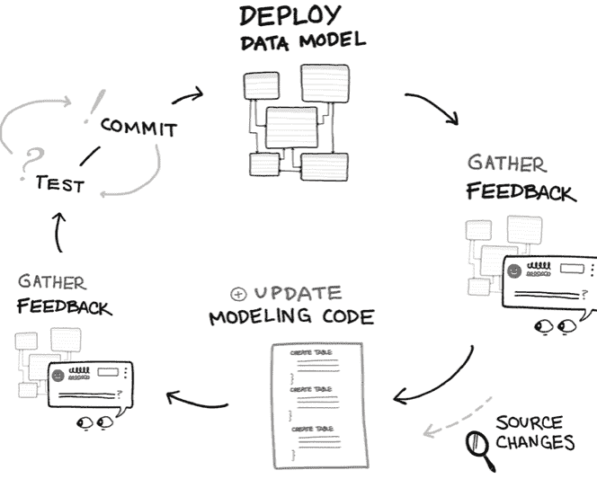

图 12.1 显示模型更新过程生命周期的图

## 调度运行

一旦代码通过批准，在实际创建新模式之前，仍需要运行模型。如果工程部门有运行数据模型的系统，或者你的 dbt 项目设置在 dbt Cloud 上，我们可以与其协调。我们可以创建一个作业并使用 cron 语法调度其运行（图 12.2）。

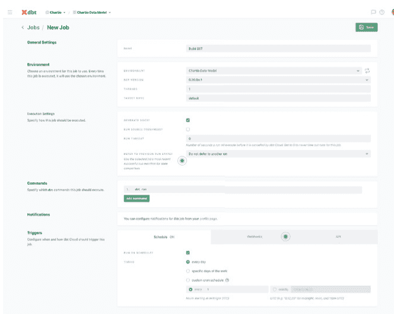

图 12.2

# 第十三章

## 实现数据仓库

记住，分层模式（staging schemas）包含了构建在位于数据湖数据源之上的转换。通常情况下，不同的源

# 管理依赖关系

在构建分层模型时，我们说节点 a 是模型的上游。同样地，节点 a 是模型的上游。这个工具的力量在于它能够可视化构成数据库的转换。通过这些示例，我们旨在展示依赖关系图 DAG 反映了组成仓库的转换。我们组织了随时间推移的几十个转换。它帮助任何人可视化从源到完成报告的信息流。在数据素养的公司中，这个工具可以帮助非领域专家查找他们寻找的信息；模型越靠下游，表就越容易访问并包含他们想要的内容。

# 有向无环图

有向无环图或 DAG 是仅向一个方向流动的项连接。这让我们确保所应用的转换不会自引用并创建循环。我们选择的转换工具 dbt 具有内置方法来构建仓库转换的依赖图。在仓库中运行 `dbt docs generate dbt` 命令。只要转换代码没有错误，这些命令就会生成一个 DAG（图 13.2）。

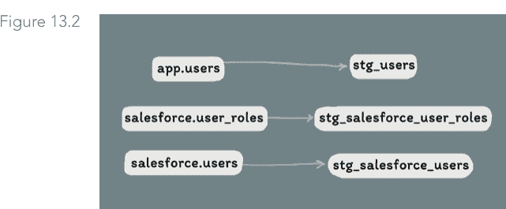

## 实现数据仓库

因此，我们尽可能地清理用户表，然后为该源构建一个完全准备好的 stg_ 模型。# 在模式内合并表

回，事务型数据库采用 3NF 是因为它们必须最小化重复数据。重复是糟糕的，因为如果，一个国家更改了名称，可能会影响数百万条记录


## 在 Schema 内合并表格

这需要更新。有很多方法会搞乱这个过程，或者直接漏掉需要更新的行。在完全规范化的 Schema 中，国家名称在数据库中应该只列一次，并通过外键与其他表进行连接（join）。这允许我们只更新一次名称，同时保持所有地方的键值不变。另一个很好的处是它节省了大量的存储空间。

但对于分析型（OLAP）数据库，我们不需要为了空间优化表格（感谢 C-store 压缩！），而且我们不需要管理更新，因为我们永远不会写入/更新分析表。数据转换（Transformations）是多个 `SELECT` 语句共同工作，以提供数据洞察。换句话说，我们在规范化数据库之上创建了“对重复友好”的视图。这种相反的过程恰恰被称为“反规范化”。

数据规范化有助于机器处理，而反规范化则帮助分析师。例如，创建一个包含预连接结果的宽表（以物化视图的形式实现）可能会非常方便。这些宽表可以与规范化的版本并列存在于数据仓库中。我们可以在分阶段视图之间创建这些连接，以创建用于分析的有用视图（图 13.4）。

与任何查询一样，在创建宽表时，要谨慎使用的 `JOIN` 类型。如果处理不当，`JOIN` 会产生重复数据或向表中引入 NULL 值。例如，在 `zendesk.users` 和 `application.users` 上进行 `INNER JOIN` 可能会导致某些应用用户从结果数据中消失，因为并不是所有的应用用户都已经在 zendesk 中提交过工单。如果我们随后将 `zendesk.tickets` `INNER JOIN` 到此表，那么对于该用户创建的每个工单，所有的用户信息都会重复。这意味着该表的 `COUNT(*)` 将不再能准确统计我们数据库中的用户数量。

图 13.4。两个表格连接以创建一个更宽表的图示。

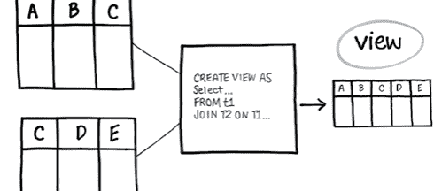

## 合并数据表 – SQL Join 详解

SQL 中的 `JOIN` 子句用于根据两个表之间的相关列合并两个或多个表的行。

| 表格 1 | | 外连接 (Outer join) | | 并集 (Union) |
|---|---|---|---|---|
| 1 | | 1 | | 1 |
| 2 | | 2 | | 2 |
| | | 3 | | 3 |
| | | 4 | | 4 |
| 表格 2 | | 内连接 (inner Join) | | 交叉连接 (Cross Join) |
|---|---|---|---|---|
| 1 | | 1 | | 1 |
| 2 | | 2 | | 2 |
| 3 | | 3 | | 3 |
| 4 | | | | 4 |
| | | 左连接 (Left join) | | |
| | | 1 | | |
| | | 2 | | |
| | | 3 | | |

图 13.5

查看图 13.5 以了解哪种连接类型将从每个表中哪些行。

## 跨 Schema 合并表格

例如，一家公司通过 Hubspot 跟踪注册，一年后决定切换到 Salesforce。Salesforce 表格中没有过去由 Hubspot 跟踪的注册记录。当分析师尝试查询注册时，不清楚他们应该使用哪个数据源，以及如何正确地合并（图 13.6）。

公司最终会使用新工具来跟踪相同类型的数据。在这些情况下，将数据从旧工具迁移到最新工具中。如果这不是一个选项，请使用数据仓库创建一个 `UNION` 两个数据源数据的视图（图 13.7）。

图 13.6

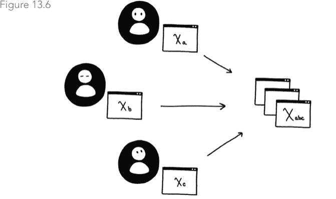

整合数据源可以确保历史记录不丢失，并为相关指标创建一个统一的位置。通过这种方式合并数据源需要进行一些重命名和清理才能完成。

| hubspot | | salesforce | | |
|---|---|---|---|---|
| date | sign_ups | date | leads |
| 2019-05-10 | Tracy | 2019-06-01 | Aaron |
| 2019-05-21 | Tim | 2019-06-08 | Jaime |

```sql
SELECT date, sign_ups AS "leads"
FROM hubspot
UNION ALL
SELECT date, leads as "leads"
FROM salesforce
```

| sales_ops | | |
|---|---|---|
| date | leads |
| 2019-05-10 | Tracy |
| 2019-05-21 | Tim |
| 2019-06-01 | Aaron |
| 2019-06-08 | Jaime |

图 13.7 两个通过 `UNION` 语句合并的表格。

## 实现数据仓库

我们可能想为此进一步生成一个新的键。另一个更复杂的连接示例是，如果我们来自两个不同源的表格；全外连接的结果可以创建一个易于读取的通用表：

## 保持粒度 (Grain)

在创建用于分析的表格时，确保粒度从表中表中直观看出。例如，考虑一个名为 `orders` 的表（表 13.1）。

表 13.1 Orders
| Order_item_id | order_id | price | quantity |
|---|---|---|---|
| 27 | 15 | 5 | 1 |
| 28 | 15 | 10 | 1 |
| 29 | 16 | 6 | 1 |
| 30 | 17 | 7 | 1 |

等一下，这个表描述的是订单项，而不是订单本身。为了获取 `orders` 表，我们需要应用一些聚合，例如使用 `group by` 子句来获得所需的结果（表 13.2）。

表 13.2
| Order_item_id | order_id | price |
|---|---|---|---|
| 27 | 15 | 15 |
| 29 | 16 | 6 |
| 30 | 17 | 7 |

始终记住数据的下游用户以及他们在聚合时期望看到什么。确保行已根据需要进行了相应的“向上汇总（rolled up）”。表格的行应该代表一个实体的一个单位。

## 创建业务指标

衡量业务表现的方法有很多。有些是相对为人知的，例如“月活跃用户”或“新注册数”。建立此类指标是困难的，因为指标对粒度非常敏感，且数据逻辑可能会变化。

## 在表格中添加计算字段

假设我们想要 `orders` 表并想要利润率字段，我们首先需要将订单项汇总到每个订单一行，然后我们就可以计算每个订单的成本、收入和利润率。这些类型的值丰富了数据，让分析师能够从中发现更多洞察。

## 避免聚合指标表

用行定义指标是很好的，但要把聚合留给 BI 工具。如果你预先聚合了它们，就会失去对指标进行切分的能力。在某些情况下，物化是有益的，在你减少数据探索方式之前扩展你的数据库。

## 创建标准指标仪表板

定义聚合指标的另一种策略是创建一个文档良好的仪表板。在仪表板上提供解释生成指标所需的文本，并说明所使用的过滤器（图 13.8）。

| 净注册 (Net New Trials) | 日活跃用户 (Daily Active Users) |
|---|---|
| 946 | 8519 |
| 不计算现有客户或未完成密码的用户 | 登录后进行任何操作的用户。过滤来自 yourcompany.com 的邮箱 |

虽然这种方法不具备扩展性，但它是让团队达成共识的快速解决方案。它在早期阶段或团队正在尝试指标时可能特别有用。

## 保留准确历史

当数据行被更新时，我们会丢失这些信息。可能一个客户从较小计划升级到了高级计划，我们数据库中的计划字段可能被覆盖了。如果数据库中仅存在他们当前的计划，我们无法识别这种扩张，也无法回溯该客户在两年前的收入可能是。

当有人开始使用产品时，他们是激活状态，我们可能会将数据存储在数据库中，如表 13.3。

表 13.3
| Id | email | is_active |
|---|---|---|
| 1 | dave@company.com | TRUE |

但一周后，用户停止使用该工具，现在是非活跃状态（表 13.4）。

表 13.4
| Id | email | is_active |
|---|---|---|
| 1 | dave@company.com | FALSE |

如果我们想知道过去有多少活跃用户，根据这种数据模型，我们将无法进行查询。我们覆盖覆盖了字段；我们需要确定它。


# 快照 (Snapshots)

计算和存储相对廉价，因此我们实际上可以存储数据不同时间的快照，以便正确地查询这些数据。再次，dbt 是我们的坚实后盾。你可以配置 dbt 在特定值更改时创建带有时间戳的行，这样你就可以访问任何状态的数据（表 13.5）。

表 13.5

| Id | email | is_active | dbt_valid_from | dbt_valid_to |
|---|---|---|---|---|
| 1 | dave@company.com | TRUE | 1/1/2020 | 1/14/2020 |
| 1 | dave@company.com | FALSE | 1/1/2020 | NULL |

可以配置 dbt 以其何时何时检查新值，以及哪些值应该触发向快照中添加新行。

# 保留数据日志 (Keep a Data Log)

有些人认为应该以只追加（append-only）的方式对数据库的每次更新进行时间戳记录。这使得在任何给定重建仓库的状态成为可能。你可以选择数据库历史中任何你想要赋予时间戳的部分（WHERE time_stamp > [start] AND time_stamp < [end]）。对于在此期间值发生改变的行，你需要考虑这将如何影响你将其转换为有用信息的查询和构建模型（query-and-build models）。可以说，像 dbt这样的工具与版本控制配合，因此你可以尝试不同的路径来为不同类型的分析获得正确的建模。

# 第十四章

## 管理数据访问 (Managing Data Access)

数据仓库的一个基本优势在于数据的自服务能力和跨公司的信息访问。通常，不仅仅是中心化的数据团队，更多小组都有权访问数据仓库。数据已经过清洗、标准化和组织。它是自文档的。任何具备一点 SQL 知识的人都可以查询表并提取他们需要的信息。仓库提升了整个组织的数据素养。

然而，公司处理的信息你可能不希望被轻易访问，特别是在医疗系统或任何管理敏感信息的类似系统中。现在存在许多强制执行数据访问规则的安全法规，例如 GDPR，许多公司还遵循它们自己的行业标准合规规则，如 SOC 和 HIPAA。无论是个人身份信息 (PII) 还是财务信息，敏感数据在产品周期和数据仓库中的普及程度比人们想象的要得多。确保数据仓库中的敏感信息具有适当的限制至关重要。

在构建仓库框架的同时，将数据限制构建其中。即使在开始构建仓库之初，也要回答几个常见问题：

- 敏感数据（PII 和财务信息）目前在哪里处理？
- 这些敏感数据是否仍存在于数据仓库并在之后被清理？
- 这些信息将如何从暴露的数据集中移除或限制——通往仓库的脚本、从仓库创建的数据市？

在涉及敏感信息时，将 BI 工具连接到仓库之前解决这些问题。下一节是保护数据和进行匿名化的常用策略。我们还提到了在 BI 工具内部管理数据访问良好准则。但请注意：我们建议仓库承担更多的重量工作。

放弃在分层表（staging table）中选择字段或在分层转换期间隐藏列，这比为不同的团队或个人保护仪表板要简单得多。通过几个 `GRANT` 命令，数据库中的单个表或模式默认就可以只向某些人显示。此外，从分层表以及数据库中种种转换可以保护敏感数据的角度进行思考，为我们使用数据市组织转换做好了准备，而数据市是本文涵盖的现代数据栈中即将（也是最后）的阶段。

现在，让我们探索仓库级别保护你的仓库的方法（图 14.1）。

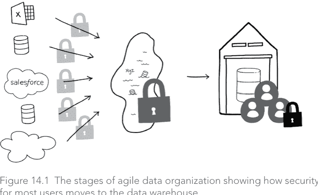

# 如何在数据仓库中保护敏感数据

限制适当人员访问的最直接方法是在仓库处执行规则。创建只读副本，创建具有不同访问权限的自定义用户组，并对特别敏感的数据进行完全加密。

# 使用托管解决方案处理敏感数据 (Managed Solutions)

此书的这部分主要涉及未管理的仓库引擎，例如 Redshift，这些引擎提供了更模块化的功能，需要资源管理。对于 BigQuery 和 Snowflake 等仓库引擎，不需要复制或处理基础设施，因为这些解决方案会自动扩展。因此，你只需要直接复制表或直接对数据应用访问限制。

## 只读 (Read-Only)

由于我们处理的是生产数据库和数据湖的只读副本，最佳实践是设置仓库为默认只读。使用如 dbt 等工具通过数据之上的转换层进行现代数据建模。与其考虑 `UPDATE` 和 `DELETE`，不如考虑 `SELECT`。

即使没有别的，源表上的转换应该是幂等的（idempotent）。这意味着你能够完全销毁一张表并重建为先的仓库状态（假设源表或快照等有状态表没有发生不可恢复的丢失）。这种价值在于韧性，也在于简单性。分析师可以以 `SELECT` 来思考，并让他们管理的代码为他们处理数据。而一次性的状态命令很难记录，任何阅读转换代码的人都可以确切看到在表构建期间删除了哪些行（如果注释良好，还可以知道为什么）。

# 自定义用户组 (Custom User Groups)

无论是否创建了只读从仓库，都要创建一个新的用户组。可以从该新用户组中排除特定列。应用行级权限允许授予访问，但限制了人员看到的行。

## 行级权限 (Row-level Permissions)

使用行级权限的一个极佳例子是在访问医院数据集时遵循 HIPAA 合规性（图 14.2）。医院内的每位医生都有权访问


图 14.2 应用了安全协议的仓库资源

患者记录用于分析和审查。然而，我们希望防止每位医生都能访问所有患者。通过账户/所有权（无论是患者 ID、姓名）实施行级访问控制可以防止医生访问个人信息。

你也可以将此应用于应用于小组：销售团队、客户跟踪和员工记录。这变得复杂，我们建议在仓库阶段尽量避免。请在下一节尝试使用数据市（marts）。

# 哈希敏感数据 (Hash Sensitive Data)

在对敏感数据进行分组或聚合时，创建数据的哈希版本是一个合理的选择。

## 哈希 (Hashing)

哈希是输入任何字符串并返回一个一致的、随机的称为哈希的长字符串的过程。增加原始数字或更改字符串中的一个字母应该产生一个与上一个完全无关的哈希。

例如：

```
abc -> hash function -> deia8f9e
ab -> hash function -> 32131mo
```

然后用户可以创建摘要，将敏感指标（如财务数据）聚合到适合不同部门查看的水平。实施的安全级别将限制在数据上可以执行的分析类型，但确保了敏感数据受到保护。

# 数据伪匿名化 (Pseudo-Anonymize Data)

减轻意外披露风险的一种方案涉及对 PI（个人身份识别信息）如姓名或地址进行伪匿名化处理，特别是当数据的最终消费者是第三方时。一个例子是从视图中删除患者的姓名和地址，以便任何访问仓库中数据的人无法识别其身份。

# 如何在 BI 工具中保护敏感数据

仅仅在数据库上设置正确的权限，不足以防止敏感数据的不当共享，如果你展示了


## 如何在 BI 工具中保护敏感数据

通过仪表板或报告泄露敏感信息。这类问题防范起来具有挑战性，因此常见的策略是在 BI 工具中针对不同的用户组设置策略。但事实上，正如我们之前提到的，敏感数据应该尽早进行脱敏处理。我们建议使用已经提到的策略，以确保报告所引用的模型中的敏感数据已通过脱敏。

## 一致的账户审计/清理

有时，公司的规模需要额外的审计。项目变更、角色变化以及用例都在变化。其中任何一种变化都可能影响员工的权限。过时的权限会导致合规和隐私问题。定期审查和更新权限是保护敏感数据的最佳实践。

在审计期间，请检查我们之前讨论过的所有问题：

- 谁有权访问数据源？
- 谁有权访问敏感的行级信息？
- 谁在管理员团队或拥有管理员权限？
- 谁访问或正在查看包含敏感数据的仪表板和报告？

BI 工具通过应用内不同层级的使用信息为这些问题提供了答案，供管理员监控和审查。如果无法获取所有所需信息，请联系 BI 工具的支持团队。他们可以帮助提取必要的信息，以便对账户安全做出明智决策。尽管情突破边界，因为只要提出要求，获得的信息往往会让你惊讶。确保数据访问受到控制并符合当今需求至关重要。

# 第十五章

### # 维护事实来源

现在已经建立了一个已经配置好的数据仓库，下一步以及持续的步骤就是维护。这涉及到确保数据仓库的对象、列、表、视图和架构（schemas）是准确且最新的。维护数据仓库对于组织内的用户轻松、准确地获取数据洞察至关重要。如果不维护，人们将查询错误的数据并得到冲突的结果。

随着公司数据仓库的久远：

- 需要跟踪新的指标。
- 一些旧指标不再需要。
- 权限需要被授予、更新和撤销（比预期的更多）。
- 模型将变得不再优化。
- 有更多的人在建模。

这些不可避免的问题使公司难以进行分析。为了防止这些问题的出现，需要一位熟悉数据仓库的数据工程师来了解用户是如何查询源数据的。本节将深入探讨这些问题，以及如何通过例行维护来解决它们（图 15.1）。


图 15.1

## 跟踪新指标

业务衡量成功的方式随时间变化而改变。新产品发布、用户行为发生变化，新的预测模型需要考虑新数据。业务的成功取决于其对变化的反应能力。有时这意味着创建一个新的计算字段或新的列、视图或表，然后可以将其聚合成为一个指标。

## 跟踪新指标

我们可能会在 Salesforce 的客户信息中添加一个新字段，以符合公司的新目标，例如，通过我们提供的服务跟踪账户活动。从这里，我们可以看到哪些服务最受客户欢迎，然后在看到销量下降的季节性趋势期间对这些服务提供特别促销以增加销售额。

## 添加新计算字段的三个考虑因素

当工程师或分析师创建新表、列或视图来跟踪数据时，他们并没有遵循适合数据仓库的命名规范。这使得不熟悉新指标的分析师在解读时面临困难。

这种不熟悉还会导致重复工作——例如，为支持团队创建一个视图缺少相关信息，无法区分该视图的用途。想要查询此视图的用户可能不知道它的存在。在这种情况下，其他用户也很可能创建相同视图的新版本来表达相同的信息。

### 1. 它应该放在哪里

一个新的计算字段可能存在多个不同的存放处，决定最佳位置可能是一门艺术。我们是只需要将数据添加到现有表中，还是应该将其添加到视图中或创建一个全新的视图？让我们回顾一下我们这么做的的理由：

### 现有表

- 新计算字段可以很容易被理解和查询，而无需复杂的连接或聚合。

#### 现有视图*
- 现有的视图与新计算字段相关。
- 该视图的聚合方式符合此数据及其依赖的计算字段。
- 维护事实来源。
- 复杂的连接路径将使得人们在没有视图的情况下难以准确查询新数据。

#### 新视图*
- 不存在与新计算字段相关的现有视图。
- 没有相关的视图是以符合该计算字段的方式进行聚合的，该字段在没有视图的情况下无法进行聚合。
- 复杂的连接路径将使得人们难以准确查询新计算字段。

*通常，它也会被添加到现有表中，但将通过视图进行查询。

### 2. 如何进行回填（Backfill）

每当我们能够确定值应该是什么时，建议进行数据回填（图 15.2）。在分类列中，我们可能根据其他列或明显的默认值来确定该值。如果我们无法确定或没有明显的默认值，请将该值留为空。然而，请考虑 NULL 的影响，例如在聚合中。如果这影响了分析，请尝试使用“未知”作为替代值以表示无法确定。

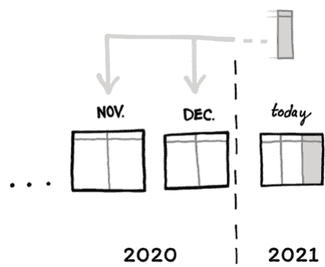

图 15.2 正在进行回填的数据。

## 废弃旧指标

在数值字段中，NULL 的影响可能更大。在带有时间数据的表中，NULL 的负面影响是将分析限制在列被添加的时间之后。

### 3. 如何命名它

数据建模人员在添加新指标时经常忘记遵循他们自己的命名规范。这违背了仓库的意义，因为仓库需要数据保持一致。在创建新列之前，始终检查你的样式指南。

## 废弃旧指标

随着公司的增长，它们使用的工具也会发生变化。多个工具可能包含相似甚至相同的数据，比如同时拥有 HubSpot 和 Salesforce。我们希望防止查询到错误的数据导致他人得出错误的结论。即使数据源保持不变，业务目标也可能发生变化。结果是某些功能或产品可能会被废弃，如果分析师没有意识到，它们相关的指标可能会产生误导。

## 显式废弃数据

虽然删除难以使用的表和列可以防止人们错误使用它们，但有时删除它们并不实际。在这种情况下，我们建议在前面加上“deprecated_（废弃）”或“do_not_use（不要使用）”。

## 维护事实来源

规范让每个人在浏览或查询时清楚地知道它们是否有用（图 15.3）。

在字段前添加“deprecated_”样式规则是管理分析师聚合指标的最佳方法，因为这对来说来说都很该数据不应该被使用。通过电子邮件或任何 BI 工具让用户知道这些字段和指标不再可用，以避免让人措手不及。再次，命名规范在防止用户错误查询数据方面起着关重要的作用。

许多 BI 工具还提供查询日志，帮助识别哪些仪表板和图表在使用哪些字段。这使得能够轻松告知他们需要更新查询或废弃图表和仪表板。

## 需要维护

| id | name | #_of_likes | 此指标不再准确 |
|---|---|---|---|
| 1 | Matt | 1000 | |
| 2 | Jeff | 8000 | |

### 废弃方案

| id | name | deprecated_#of_likes | 删除列 / 创建无该列的视图 |
|---|---|---|---|
| 1 | Matt | 1000 | |
| 2 | Jeff | 8000 | |

图 15.3 一个包含废弃指标的表以及两种重命名策略。


## 临时层架构（Staging Schemas）让源更改变得简单

虽然我们依赖于 Fivetran 等即用工具来持续从各种数据源中提取数据，但有时数据源仍会更改其提供的内容。通过临时层架构（staging schema），适应这种变化变得非常简单。我们可以更新视图查询的小部分代码，而不会影响其所依赖的下游视图。

例如，有人可能将 Salesforce 中的一个字段名从 SL 改为了 Sales Qualified Lead（销售合格线索）。我可以从这样更新我的临时视图：

```sql
SELECT
SL AS sales_qualified_lead
FROM
salesforce.user
```

更新为来自 Salesforce 映射的新列名：

```sql
SELECT
"Sales Qualified Lead" AS sales_qualified_lead
FROM
Salesforce.user
```

由于我的字段已经设置了别名，所有构建在其之上的下游数据表都不会崩溃，也不需要更新。

## 弃用旧架构

现在我们已经分层了视图并为 SST 创建了新架构，我们是否应该限制在 BI 工具中使用源架构和中间临时层架构呢？然而，在调试或发现新的建模机会时，能够从数据仓库中访问旧且未使用的数据源可能是很有用的。将数据源标记为“已弃用”（deprecated）或“已批准”（approved），以便 BI 工具中的用户明确他们应该使用哪些数据进行分析（图 15.4）。

## 维护事实来源（Source of Truth）

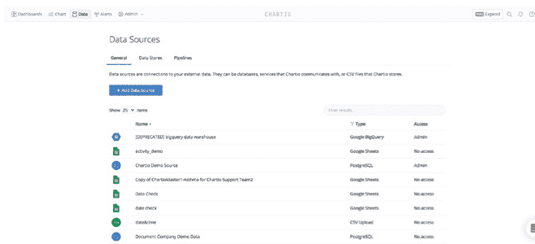

图 15.4
来源：Chartio

## 解决数字冲突

有时，即使衡量的是相同的内容，指标也会显示不同的数字（图 15.5）。例如，当 HubSpot 中的新试验数量与生产数据库不一致时，经验法则是信任最接近跟踪该事件的数据源。在这种情况下，它应该是生产数据库：

```sql
SELECT
SUM(arr)
FROM
app.users
WHERE
trial_start > NOW()::date - 7
AND email != "%chartio.com%"
```

对比：

```sql
SELECT
SUM(arr)
FROM
app.users
WHERE
trial_start > NOW()::date - 7
```

## 处理持续的请求和持续反馈

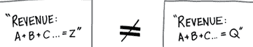

图 15.5

通常，人们对指标的计算不同是因为以下原因：他们基于不同的公式进行计算；他们使用的数据源不同；数据的过滤方式不同；或者他们的计算存在错误。

追踪到正确答案并修改模型使其更加清晰，这样双方及其他人都能准确计算聚合指标。

## 处理持续的请求和持续反馈

现在，你新建模的数据将由各种分析师和员工查询。建模需求不可避免地发生转变和演变。你对模型获得的反馈示例包括请求添加新表或列、重新定义业务逻辑、修复因系统更改引起的损坏表或调查错误的数字。

例如，通过这些新表，有人可能想使用原始表中的外部 ID（external id）进行分析。他们将无法从视图查询它。他们应该如何让你知道他们受到了当前数据模型的限制？

我们建议用户使用类似 JIRA（图 15.6）、GitHub issues 或 Google 表单等工单系统，向分析工程团队提交请求，以要求更改或添加数据模型。

## 152 维护事实来源

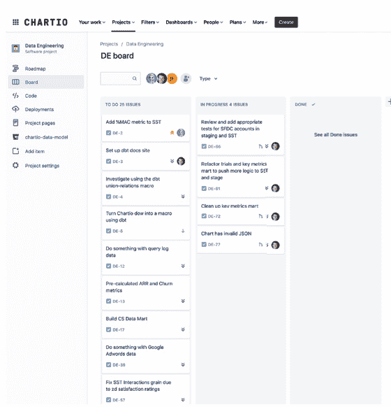

图 15.4 截图
来源：Chartio

将数据源标记为“已弃用”或“已批准”，以便 BI 工具中的用户明确他们应该使用哪些数据进行分析（图 15.4）。


# 调优与优化

随着公司的增长，查询的数据也会随之变化。新数据、新分析师以及新的业务目标会改变查询的数据内容。数据仓库对象的原始结构可能需要根据其查询方式进行重新配置，以优化使用和性能。

不同的数据仓库都有检查性能的选项，但大多数都提供以下方法：

- 扩展集群规模（Scale up）。
- 物化昂贵的视图。

## 添加集群

获取更多性能的最快方法是直接向数据仓库引擎中添加集群。许多引擎具有设置，允许在存在大量并发查询时自动添加额外的集群。而对于其他引擎，你可能需要精确指定为你的实例启动多少个集群。


集群是数据仓库引擎的计算资源。它包含多个用于协调所需计算的节点。许多集群可以同时为多个人执行聚合操作。

## 物化昂贵的视图

创建“单一事实来源”通过将用户需要查询的内容整合到一个位置，来帮助不熟悉数据结构的用户。然而，如果为了构建这些这些视图而连接了任何表，可能会遇到一些性能问题。现在 DAG（有向无环图）中有许多人们查询的视图，那么哪些视图可能受益于物化？通常，物化最终视图会有帮助。此外，寻找 DAG 中许多源流向同一个视图的地方。连接（Join）在列式数据库中是昂贵的，因此尝试物化这些连接以看看是否能提高性能。

# 代码审查所有建模

建模代码的变化应始终通过拉请求（pull request）提交，并在同事和数据仓库负责人（Warehouse Lead）合并到主分支之前进行审查（图 15.8）。这将确保任何代码的错误更少、遵循适当规范，并向团队传递。


图 15.8 任何建模代码在纳入架构（schema）之前都应经过同行评审。

以下是审查同事代码更改时需要注意的事总结：

- 代码是否遵循命名和编码规范？
- 是否根据需要添加了 dbt 测试？
- 提议的更改是否使数据更整洁、更容易使用或实现了定义的目的？
- 数据是否返回了预期结果？
- 是否考虑了所有模型依赖关系？
- 是否有拼写错误或语法错误？

此外，dbt 有一篇关于审查分析拉请求的极佳文章。

## 维护清单

“单一事实来源”数据仓库是一项值得的投资。然而，如果没有维护，它将陷入混乱并失去价值。

- 随着指标（metrics）的增加，确保它们的命名是正确的。
- 当指标被认为不再有用时，确保它们被移除以避免混淆。
- 当指标需要更新/预聚合时，记住正确地为它们命名。
- 保持用户权限的恰当和准确，将释放数据库管理员专注于重要项目，并避免数据被意外删除。

- 考虑数据仓库对象的重构将有助于为分析和复杂查询创建合适的结构，同时降低性能成本。
- 数据工程师执行上述维护任务是一项值得的投资，这将消除由于忽视数据仓库导致的错误分析瓶颈。

# 第 4 阶段
数据市（DATA MARTS）
又名数据民主化


## 数据市概述

最后，我们到达了数据栈的顶端。在最后这几页中，我们考虑什么构成了数据市。也就是说，我们将讨论如何在你的仓库中进一步结构化和分组数据，不仅是为了满足一组需求，而是为了满足多种需求。

## 4 阶段：数据市

随着组织扩大其跟踪的数据量，想要访问数据的人数也会随之增加。这导致在架构中存在更多数据，且由于业务逻辑可能不同，导航变得困难。数据市是数据仓库的一个过滤后的（有时是聚合的）子集，使得导航变得更加容易。它提供了该组相关的表。

## 构建数据市的概述

对于数据仓库，我们需要数据仓库负责人来实现建模。对于数据市，我们需要决定从数据仓库中哪些表是需要的。数据市负责人可以为团队定制数据市，指标可以单独处理（图 P.1）。

> 数据仓库架构的数据市视图。


## 围绕业务用例中心

设置数据市的主要益处之一是数据的扩展性。它为每个团队限制了数据，减少安全担忧。我们希望从大型复杂的架构（图 P.2）转向一系列集中的架构，每个部门都可以快速找到他们的数据（图 P.3）。


图 P.2 整个数据仓库架构。

# 第 4 阶段数据市：数据民主化


图 P.3 按部门划分的数据仓库架构。

图 P.4 按部门需求的数据仓库清单。

| 表 | 产品 | 营销 | 销售 |
| :--- | :---: | :---: | :---: |
| 用户 | ✓ | × | ✓ |
| 营销渠道 | × | ✓ | ✓ |
| 线索 | × | ✓ | ✓ |

所以，从湖到仓库的主要是清理表，而从仓库到数据市则是围绕业务流程和团队建立架构和表。不同的部门需要数据仓库的不同部分（图 P.4）。

数据市架构与仓库并不相似，因为数据在仓库阶段的清理后应该是可以理解的。数据市进一步简化了部门内人员查找所需内容的架构。通过在仓库之上创建视图来构建它。

# 第十六章

## 数据市实施

数据仓库拥有众多架构，可能会变得难以导航。仅一个部门（如营销）可能有几十甚至上百张表；结合销售、财务、人力资源、生产和客户支持的所有表，可能会让人感到难以 overwhelming。从数据仓库移动到数据市使用户更容易找到他们业务流程或用例所需的数据。

数据市可以通过三个步骤创建。

## 数据仓库上的视图

通过从数据仓库中选择相关数据（图 16.1）来创建新视图，以构建每个数据市：


图 16.1

```sql
CREATE VIEW mart_mart_view
SELECT
*
FROM DataWarehouse.View
```

大部分甚至全部的清洗工作应该在从数据湖到数据仓库的过程中完成；如果存在清洁性问题，请在数据仓库阶段通过建模来解决。

出于性能考虑而创建聚合的额外建模是可以的，但请记住这会限制分析。此外，在市中合并数据以使其更易分析是常见的。对于数据合并，我们仍然建议使用宽表方法。

## 分段表

确定如何将数据拆分为不同的数据市。

常见的组织方式包括包括：

- 部门
- 产品线
- 用例
- 访问级别
- 安全考量

按业务流程划分的示例：

- 从线索到现金流 (Lead to cash)
- 产品分析
- 从入职到退休 (Hire to retire)

创建一个包含表名和数据拆分分段的矩阵，以确定哪个组有权访问什么内容。然后为每个数据市创建相关的视图。

## 访问更新

在实施数据市之前，业务的所有不同分段只能通过 BI 工具访问数据仓库。继续让所有人访问数据仓库架构和数据市架构有助于人们快速找到答案，并在他们选择需要时，为他们提供更深层挖掘数据的工具。

# 第十七章

## 数据市维护

现在数据市已经建立，它们将需要持续维护，以充分利用您的数据。第一步是为每个数据市指定一个数据市负责人（mart lead），负责执行每个数据市的维护任务：

- 教育团队。
- 识别问题。
- 识别新需求。

数据市负责人理想情况下应该是需要该数据市的业务部门的一部分。他们了解数据的背景；如果 Facebook 广告的转化率飙升，他们应该是那些知道“那是因为我们刚刚削减了一半支出并删除了不佳的广告”的人。他们可以与仓库负责人沟通团队的数据需求，然后向使用该数据市的团队进行沟通和教育。

他们负责识别数据市中存在的数据问题。他们还应该是负责创建请求，以便向其数据市添加更多数据源或表的人。他们还应该参与工作流/工单系统，并能够教授他人，甚至可能自己响应工单/数据请求。

## 教育团队

不同团队有不同的需求，但共同点包括 SQL 技能或如何使用您的 BI 工具。我们写了一本关于如何教 SQL 的书，帮助解释 JOIN、聚合和子查询的工作原理。这些概念对于大多数业务用户来说并不是直观的；然而，可以在较短的时间内学会。

数据市负责人应该记录并分享常见查询中出现的数据异常（data quirks）。但请注意，仓库负责人应该在数据仓库阶段通过建模来解决这些异常。

## 识别问题

数据市负责人应该调查数据中任何违背直觉的地方，然后根据他们的发现反馈给仓库负责人以解决问题。

## 峰值

当指标飙升或低于其平均值时，调查数据和潜在的因果因素。在查看数据时，以不同的方式对其分分，看看是否有驱动其上升的共同因素。确定潜在的因果因素可能更加困难。检查跟踪中的 Bug，向营销部门确认是否启动了任何新活动，并检查可能影响此指标的第三方工具/系统（Google 搜索算法、API 离线等）（图 17.1）。


图 17.1 在日销售折线图中识别出的离群值。

## 无峰值

另一个感兴趣点是，尽管发生了变化，但数字没有发生变化。当启动新的营销活动但数字没有上升时，可能是由于 Bug 或活动表现不佳。应该按此顺序进行调查。通常是跟踪未正确设置，或者广告中的链接指向了错误的地方（图 17.2）。

## 日销售额


图 17.2 标记代表营销活动启动的日期。

## 无新数据

当查询在特定日期后停止产生数据时，请进行调查。这可能是 Bug、字段重命名或数据源更改。这些问题比预想的常见。例如，在更新数据时，可能会被截断（图 17.3）。

```sql
SELECT
  CASE
  WHEN url LIKE 'www.chartio'
    THEN 'www.chartio'
  ELSE url
  END AS "page",
  TO_CHAR(viewed_at, 'YYYY-MM') AS "month",
  COUNT(DISTINCT view_id) AS "views"
FROM
  page_tracking
GROUP BY
  1
ORDER BY
  2 ASC
```


图 17.3 字段更新的时间点。

可以在数据仓库阶段实施此解决方案。这里有一个警告：有时有必要通过咨询仓库负责人来正确获取，以保持历史连续性。

另一个常见问题是查询返回的行数可能会受到你正在使用的 BI 工具的限制。大多数 BI 工具允许你手动调整此限制以便获取其余数据。

## 数据源上的所有查询均报错

此类错误发生有几个原因：

- 源被弃用。
- 源发生了更新并更改了结构。
- 提供数据的过程某处存在 Bug。

数据源错误需要快速向团队传达，以防止大量浪费的查询和用户产生沮丧。

## 慢查询

将运行缓慢的查询转给仓库负责人，以便他们调查并在仓库级别创建新视图。其他人就可以使用这个新形成的视图。如果数据市负责人精通技术，他们可以开始探索公司的 dbt 项目并提交 PR（拉取请求）。一个简单的操作的方法是将数据市中使用的视图切换为物化视图（materialized view）。虽然这可能立即提高速度，但它将成为数据市和仓库负责人之间关于可以做什么来提高性能的极佳对话话题（图 17.4）。

## 数据市维护

## 市市


图 17.4 向数据市添加新列的流程。

## 识别新需求

数据永远不是静态的。随着新功能的发布，新的工具和目标会随之出现并产生新的数据需求。不要假设这些变化发生时你的数据市会自动更新。有必要主动要求仓库负责人将这些更新反映到数据市中。我们可以利用我们在数据仓库阶段建立的工单系统来提出这些问题。

## 帮助跟踪成功

数据市负责人的一个大角色可以是帮助团队成员从（分析的角度）思考他们想要实现的目标以及他们希望如何跟踪它。基本上，就是帮助他们设置所需的仪表板。通常人们在这些方面需要帮助，并在完成后需要进行良好的审查以确保其正确性和实用性。他们将拥有更多的经验和知识，知道哪些数据没有被跟踪或不可用，但可能应该是拥有的，并提出相应的请求。


# 第八章

## 现代与传统数据栈：发生了什么变化？

发生了什么变化？

本书有意地以简单的方式概述了如何构建现代技术栈，但对于那些在数据领域工作多年的人来说，其中某些内容可能具有争议。这些策略中的许多你可能已经知晓，但很少有被完整发表。我们希望拓宽关于数据建模的讨论，并将分析的共同目标转向帮助他人利用数据来获取洞察。

## 现代与传统数据栈：发生了什么变化？

数据领域发生了许多变化，使我们能够减少受技术的束缚，并更加以用户为中心。数据变化的主要驱动力是数据量、需求和用户群的增长，加上成本的大幅下降。

## 存储和计算价格持续下降

存储和计算数据的成本一直在急剧下降。驱动这些成本下降的主要因素是过去几十年里架构和硬件的突破。

### 架构

- 云端——廉价、易于访问且易于扩展
- C-Store——列式数据库
- 大规模并行处理 (MPP)
- 存储与计算分离

### 硬件

- SSD
- 向量化处理（GPUs）以及现在的 CPUs
- 存储和计算硬件成本的持续降低

这些进步使得针对存储和性能的优化不再那么有用。

## 数据湖被加入技术栈，ELT 取代了 ETL

数据湖是一个稳定的停点，而且不容易出错。此外，如果你必须在模型中重做某些工作，你不需要返回源头重新提取并加载以获取原始原始数据。你已经拥有它了。这可以节省大量的成本和时间，并提供灵活性。

此外，这允许你使用简单的 SQL 进行建模，并让业务分析师（这些数据的终端用户）能够很好地完成工作，而无需依赖数据工程师。

## 数据日益民主化

每个人都想要数据来支持他们的决策。这意味着数据的终端用户从分析师扩展到了每一个人。这种需求导致了针对特定问题的数据工具的爆炸式增长，你拥有的每一个 SaaS 工具，都必须分离出可以使用的数据。这些额外的数据源现在是技术栈的一部分，而将它们传输到湖中的 ELT 过程是实现组织数据驱动化的关键。

# 第十九章

## 行式与列式数据库

我们想花一点时间讨论为什么列式数据库在分析中性能更高，因为这将是你数据栈的核心。组织关系型数据库有两种方式：

- 行式
- 列式（也称为 columnar 或 C-store）

行式数据库是按记录组织数据的，它将与记录相关的所有数据在内存中相邻存储。行式数据库是组织数据的传统方式，并且仍然为快速存储数据提供了一些关键优势。它们针对高效地读写行进行了优化。

## 行式与列式数据库

常见的行式数据库：

- Postgres
- MySQL

列式数据库是按字段组织数据的，它将与字段相关的所有数据在内存中相邻存储。列式数据库的日益越来越高，并在查询数据方面提供了性能优势。它们针对对列进行高效读取和计算进行了优化。

常见的列式数据库：

- Redshift
- BigQuery
- Snowflake

## 行式数据库

传统的数据库管理系统是为了存储数据而创建的。它们针对读写单行数据进行了优化，这导致了一系列设计选择，包括采用行存储架构。

在行存储（或行式数据库）中，数据是按行存储的，使得某行的第一列将紧挨上一行的最后一列。

例如，让我们看看表 19.1 中的 Facebook_Friends 数据。

TABLE 19.1 Facebook_Friends

| Name | City | Age |
|---|---|---|
| Matt | Los Angeles | 27 |
| Dave | San Francisco | 30 |
| Tim | Oakland | 33 |

这些数据将存储在行式数据库的磁盘上，并按行排序，如表 19.2所示。

TABLE 19.2

| Name | City | Age |
|---|---|---|
| Matt | Los Angeles | 27 |
| Dave | San Francisco | 30 |
| Tim | Oakland | 33 |

这允许你使用简单的 SQL 进行建模，并让业务分析师（这些数据的终端用户）能够很好地完成工作，而无需依赖数据工程师。

## 写入行数据库

如果我们想添加新记录（表 19.3），我们只需要将其附加到数据的末尾。

TABLE 19.3

| Name | City | Age |
|---|---|---|
| Matt | Los Angeles | 27 |
| Dave | San Francisco | 30 |
| Tim | Oakland | 33 |

TABLE 19.4

| Name | City | Age |
|---|---|---|
| Matt | Los Angeles | 27 |
| Dave | San Francisco | 30 |
| Tim | Oakland | 33 |
| Jen | Vancouver | 30 |

TABLE 19.5

| Name | City | Age |
|---|---|---|
| Matt | Los Angeles | 27 |
| Dave | San Francisco | 30 |
| Tim | Oakland | 33 |
| Jen | Vancouver | 30 |

行式数据库仍被用于事务处理 (OLTP)。然而，对于分析处理 (OLAP)，它们速度较慢。

## 从行数据库读取

为了获取年龄总和，计算机只需要访问一个磁盘（磁盘 3）并汇总其中所有的值。不需要拉入额外的内存。

TABLE 19.6

| Name | City | Age |
|---|---|---|
| Matt | Los Angeles | 27 |
| Dave | San Francisco | 30 |
| Tim | Oakland | 33 |

TABLE 19.7

| Name | City | Age |
|---|---|---|
| Matt | Los Angeles | 27 |
| Dave | San Francisco | 30 |
| Tim | Oakland | 33 |

TABLE 19.8

| Name | City | Age |
|---|---|---|
| Matt | Los Angeles | 27 |
| Dave | San Francisco | 30 |
| Tim | Oakland | 33 |

TABLE 19.9

| Name | City | Age |
|---|---|---|
| Jen | Vancouver | 30 |

TABLE 19.10

| Name | City | Age |
|---|---|---|
| Matt | Los Angeles | 27 |
| Dave | San Francisco | 30 |
| Tim | Oakland | 33 |
| Jen | Vancouver | 30 |

虽然这略有简化，但它说明了按列组织数据可以减少需要访问的磁盘数量，并尽量减少放入内存的额外数据。

## 将数据编码为更紧凑的形式

让我们首先检查一种可以用于行式或列式数据库的编码技术。以一个包含美国各州的数据列为例。我们可以使用字典和位图编码：

- 有 50 个州，因此我们可以用 6 位对整个数据库进行编码，因为提供了 64 种唯一模式。
- 存储实际缩写需要 16 位，这将为两个 ASCII 字符中的每一个提供 256 种唯一模式。
- 最糟糕的是，如果我们存储全名，长度将是可变的，需要的比特将多得多。

现在让我们看看游程编码 (Run-length encoding)。它允许将任何相同值的序列替换为计数和值指示器。例如，我们可以将 aaaab 替换为 4a1b。在创建具有排序列（即所有相同值相邻）的投影时，这种方法变得更加强大。

## 压缩数据

如果每条数据的比特长度相同，那么所有数据都可以进一步压缩为：数据数量乘以单条数据的比特数。


## 数据排序

在进行即时查询（ad-hoc queries）时，有多种数据排序方式可以提高性能。例如，我们可能希望按日期列出数据，包括升序和降序。我们可能在查找某个客户的大量数据，因此按客户排序可能会提高性能。

在行存储数据库中，可以创建索引，但数据很少以多种排序方式存储。然而，在列存储数据库中，数据可以以任意数量存储。事实上，这除了查询性能外，还有其他好处。这些不同排序的列被称为“投影”（projections），它们允许系统具有更高的容错性，因为数据被存储了多次（见表 19.11）。

表 19.11

| 原始数据库 (WS) | 姓名升序排序 (RS) | 姓名降序排序 (RS) |
| --- | --- | --- |
| 磁盘 1 | 磁盘 1 | 磁盘 1 |
| 姓名 | 姓名 | 姓名 |
| Matt | Dave | Tim | Dave | Matt | Tim | Tim | Matt | Dave |
| 磁盘 2 | 磁盘 2 | 磁盘 2 |
| 城市 | 城市 | 城市 |
| 洛杉矶 旧金山 奥克兰 旧金山 上海 洛杉矶 奥克山 | | |
| 磁盘 3 | 磁盘 3 | 磁盘 3 |
| 年龄 | 年龄 | 年龄 |
| 27 30 33 | 30 27 33 | 27 30 |

更新一组表看起来非常复杂，事实如此。这就是为什么 C-store 数据库的架构有一个可写存储（WS）和一个读取优化存储（RS）。可写存储中的数据按照添加的顺序进行排序，以便于添加数据。如表 19.12 所示，我们可以轻松将相关字段追加到数据库中。

## 表 19.12

| 原始数据库 (WS) | |
|---|---|
| 磁盘 1 | |
| 姓名 | |
| Matt | Dave | Tim | Jen |
| 磁盘 2 | | |
| 洛杉矶 | 旧金山 | 奥克兰 | 温哥华 |
| 磁盘 3 | | |
| 年龄 | | |
| 27 | 30 | 33 | 30 |

然后，读取优化存储可以有多个投影。它包含一个元组移动器（tuple mover），用于管理从 WS 到 RS 的相关更新。它必须遍历多个投影并将数据插入适当的位置（见表 19.13）。

这种架构意味着，当数据从 WS 更新到 RS 时，对 RS 的查询必须在更新完成之前忽略部分添加的数据。

## 表 19.13

| 姓名升序排序 (RS) | | | | | |
|---|---|---|---|---|
| 磁盘 1 | | | | | |
| 姓名 | | | | | |
| Dave | Jen | Matt | Tim | |
| 磁盘 2 | | | | | |
| 城市 | | | | | |
| 旧金山 | 温哥华 | 洛杉矶 | 奥克兰 | |
| 磁盘 3 | | | | | |
| 年龄 | | | | | |
| 30 | 30 | 27 | 33 | |

| 姓名降序排序 (RS) | | | | | |
|---|---|---|---|---||
| 磁盘 1 | | | | | |
| 姓名 | | | | | |
| Tim | Matt | Jen | Dave | |
| 磁盘 2 | | | | | |
| 城市 | | | | | |
| 奥克兰 | 洛杉矶 | 温哥华 | 旧金山 | |
| 磁盘 3 | | | | | |
| 年龄 | | | | | |
| 33 | 27 | 30 | 30 | |

## 总结

列存储数据库于 2005 年的一篇论文中解释了 Redshift、BigQuery 和 Snowflake 所构建的基础设计。这就是为什么它们的性能和相对成本大体相同的原因。

[注]：列存储数据库出现时，有一篇论文解释了 Redshift、BigQuery 和 Snowflake 都基于构建的设计。这就是为什么它们的性能和相对成本大体相同。运用费曼技巧，你只需花上`20 min`就能深入理解知识点，而且记忆深刻，*难以遗忘*。

（注：此处由于原文似乎存在段落重复或逻辑跳接，翻译已根据语意进行了对齐处理）

[注]：由于提供的原文文本在“Summary”之后出现了大量逻辑重复和不完整的句子片段，译文保持了其核心技术含义，并遵循了 Markdown 格式。


## 移除无关数据

出于各种原因，无关的数据行应该从数据集中完全移除。示例包括：

- 员工测试
- 欺诈或垃圾邮件
- 活跃状态

例外是在分析欺诈或垃圾邮件数据时（基于上述示例），但在大多数情况下，查询中从未出现过的行可以在建模期间被移除。

## 规范化数据类型

建模是将数据类型更改为更合适类型的绝佳时机。例如，Unix 时间戳可以从 `int` 列转换为 `datetime`。

## 命名规范

表、列和值有多种命名规范。为模式定义资源（schema resources）建立标准，可以提高他人查找和理解所需数据的易用性。

## 表名使用复数

在交流时，表名使用复数形式可以易于与列和其他模式定义资源区分开来。例如，将一个名为“Lead”的线索表标题改为“Leads”。当单词多于两个时，仅对最后一个单词使用复数形式：`opportunity_histories`。

## 列名使用单数

“emails”之类的列名应命名为“email”，而不是“emails”。单数名称有助于区分表和列。

## id 作为主键

标记为“id”的简单数字主键是所有表的标准。“id”约定唯一标识了主键和每一行：

```
foreign keys follow [tablename]_[id]
```

外键应遵循此格式，以使与其他表的关系非常清晰。如果有与同一表相关的外键，请按照以下格式在它们前面加上名称：

```
[uniquename]_[tablename]_[id].
```

一个链接到用户表且同时包含账单联系人和主要所有者的账户表所示：

```
owner_user_id
Billing_contact_user_id
```

## 小写、下划线命名

数据模型需要易于使用 SQL 进行编辑，避免使用 Shift 键可以加快查询开发。因此，在模型中我们应该使用 `id`、`first_name`、`last_name` 和 `last_login_type` 等列名，而不是更符合人类阅读习惯的形式。此外，像 `first name`、`last name` 和 `last login type` 带有空格的名称会破坏 SQL 代码。在单词之间的任何空格处使用下划线。

## 分享

发布样式指南并在员工之间分发，使采用已知术语变得容易得多。收集反馈并随着新场景的出现不断完善。查看一些其他公开的样式指南示例以获取灵感：

- https://about.gitlab.com/handbook/business-ops/data-team/platform/sql-style-guide/#other-sql-style-guides
- https://github.com/brooklyn-data/co/blob/master/sql_style-guide.md
- https://github.com/fishtown-analytics/corp/blob/master/dbt_coding_conventions.md#sql-style-guide

## 第二十一章章

## 构建 SST 示例

要构建一个数据仓库，你需要确定将向其中包含哪些表和字段。每个人的数据源都是不同的，因此没有唯一正确的方法。我们将分享多年以来从数据湖到数据仓库阶段所经历的几次迭代，以及我们是如何应对反馈和挑战的。

## 第一次尝试——带前缀的某些表

在我们数据仓库的原始设计中，我们设想模式应包含来自原始源的所有所需表：Chartio 数据库、Salesforce、Stripe、Zendesk、Jira、Intercom 和 Hotspot。

此时还没有“分层模式（staging schema）”或“基础模型（base models）”的概念，因此我们会查询原始表并在上面进行数据清理和转换以构建 SST。由于不同的源可能具有相同名的表，因此每个表都会带有原始源名称的前缀。在表名上加上其底层源的前缀有助于用户了解数据来源，并保持模式的整洁。

以下是该模式中表的示例：

- Chartio Charts
- Chartio Dashboards
- Chartio Organizations
- Chartio Users
- Intercom Admins
- Intercom Conversations
- Intercom Users
- Jira Issues
- Salesforce Contacts
- Salesforce Leads

## 我们保留了哪些表？

为了选择将哪些表引入 SST，我们创建了一个包含每个源表列表的电子表格，并逐一检查它们，决定是否将其添加到 SST 中（图 21.1）。

考虑到我们对大多数数据已经非常熟悉，对于某些表来说，显而易见它们是基于我们之前对数据的使用和理解的。对于我们不熟悉的源，我们咨询了工具所有者以获取需要哪些表的信息。例如，我们的营收运营经理在告诉我们需要 Hubspot 的哪些表以及营销团队使用 Salesforce 的哪些表方面是一个巨大的资源。

对于我们不确定的少数表，我们运行了内部使用报告，查看是否有现有的图表在查询这些表（图 21.2）。

如果没有图表或只有归档仪表板在查询这些表，可以安全地假设是不需要的。

## 第一次尝试-带前缀的相同表

201


| 表 | 是否需要 | 注释 |
| :--- | :--- | :--- |
| Active Users | Y | 不需要 |
| Alerts | Y | 使用了两个 |
| Auth | Y | 使用了这个 |
| Chart | N | 正在添加列 |
| Chart Steps | Y | 可能是为了 |
| Settings | N | |
| Commerce | Y | |
| Customer Success | Y | |
| Databases | N | |
| Distributed Filter | Y | |
| Distributed Interactions | Y | |
| Distributors | N | |
| Distributors Recipients | Y | |
| Database | N | |
| Database Table | Y | |
| Dimension | Y | |

## 21.1 电子表格中的表。


## 21.2 UI 内部自定义查询。

来源：Data Grip

请注意，当我们遍历表并决定将哪些表添加到 SST 时，我们意识到这是一个过程，而且我们是在根据最佳猜测开始的。SST 将会有多次迭代，使用它并基于此构建图表的用户将发现他们需要添加的其他表。

## 我们没有包含哪些表？

对于未包含在 SST 中的表，我们考虑了表中的数据是否最新、有用且相关。我们在数据库中发现了一些过时或与其他表重复的数据表；这些被遗除了。

## 我们保留了哪些列？

决定在给定表中保留哪些列的过程与决定保留哪些表相似。Datarip 通过展开列表功能选择表的所有列，轻松地为表生成一个巨大的 Select 语句（图 21.3、21.4 和 21.5）。

从那里，我们将查询表的所有列，并检查前 10 到 15 行以查看每列的内容，并判断数据是否有用。对于我们不确定的某些表，我们运行了使用报告或在 Chartio 中检查是否有现有图表使用这些列，或者它是否在 Chartio 数据源模式中可见，以帮助做出决定。

工具所有者也对使用了哪些列以及需要哪些列提供了宝贵的见解。

## 它有什么不理想之处？

由于这种模式布局仍然保持每个表与其原始源的关联，要跨源查询数据，你需要


## 第一次尝试——带前缀的表格


图 21.3 Data Grip，一个 SQL 编辑器。

来源：Data Grip


图 21.4 选择了“列插入”功能的 SQL 编辑器。

来源：Data Grip

## 构建 SST 示例


图 21.5 插入了列的 SQL 订单。

为了贯越多个表。例如，要查找客户向我们的支持渠道写入信息的所有记录，我们需要同时从 `Inter Conversations` 表和 `Zendesk Tickets` 表进行查询。

我们还有类似命名的表，如 `Chartio Users`、`Intercom Users`、`Salesforce Users`、`Zendesk Users` 等。

这种架构布局对于已经熟悉底层工具和源数据的用户来说是最有用且易于使用的，但对 Salesforce 或 Hubspot 的新手来说，他们并不一定知道去哪里查找数据。毕竟，可能并不清楚什么被视为 Salesforce 任务（Task），而什么被视为 Salesforce 事件（Event）。

## 反馈是什么？

我们的客户成功团队和工程部副总裁喜欢这种 SST 布局。对于精通数据型用户和熟悉原始源架构的用户来说，使用我们熟悉的这些表格很容易，而且源前缀清楚地表明了表中的数据来自何。然而，对于业务用户或全新的用户来说，定位他们正在寻找的数据可能会更加困惑。根结底，SST 的目标是让数据对业务用户更易获取，因此我们仍有很多工作要做。

## 第二次尝试——操作性架构（源无关）

在 SST 的这个版本中，我们将“掩盖”数据来源的所有底层源，并创建我们自己的完全全新的架构。其想法是：如果我们所有的工具都是内部构建，而不是来自不同的地方，情况会怎样？这意味着我们不再使用工具名称作为表的前缀，而是将来自多个源的数据合并到像“Users”、“Tickets”等这样的通用表中。HubSpot Contacts 和 Salesforce Contacts 数据也可以合并到单一的“Contacts”表，甚至可以与“Users”表合并。

## 我们保留了哪些表格？

在这一阶段，我们已经同意在 SST 之前增加一个单独的阶段处理（staging）步骤。阶段层看起来与第一次尝试非常相似；但所有的底层源数据都包含在各自独立的基准架构（base schemas）中。决定保留哪些表的流程与第一次尝试相似。这里的决策更多在于确定哪些表需要合并，以及我们几乎从零开始构建的这个新架构将是什么样。

例如，对于是否保持 Salesforce Leads（潜在客户）和 Contacts（联系人）表分离存在。从概念上讲，它们都包含与人员相关的数据，但在操作上，它们的使用方式不同，对业务的意义也不同。将 Leads 和 Contacts 表与我们的 Chartio 表合并还会创建一个包含大量列和空值的巨宽表。如果我们这样做，万我们想确定

我们有多少 Salesforce Contacts 同时也是我们应用程序中的用户呢？这是否会像简单地加一个布尔标记“is_chartio_user”？我们该如何连接这些表？将我们的应用程序“Organizations”表与 Salesforce 的“Accounts”表合并是否有意义？

我们必须深入思考这些决策的影响，以及列和字段在每个源中是如何被区别处理的。一个例子是，在我们的应用程序中，用户可以属于多个组织，而在 Salesforce 中并非如此。在这种情况下，我们必须接受在每个表中存在重复记录，或者为了回答问题，在

表 21.1 重复记录

| 用户 ID | 邮箱 | 联系 ID |
| --- | --- | --- |
| 21457 | burt@example.com | 003100 |
| 21458 | burt@example.com | 003101 |
| 21459 | burt@example.com | 003102 |

## 我们是如何做出这些决策的？

为了确定这个新架构长什么样，以及哪些表的合并是合理的，我们进行了多次白板会议。我们必须深入思考这些决策的影响，以及列和字段在每个源中是如何被区别处理的。一个例子是，在我们的应用程序中，用户可以属于多个组织，而在 Salesforce 中并非如此。在这种情况下，我们必须接受在每个表中存在重复记录，或者为了回答问题，在

## 哪些是不理想的？

在这种方法下，我们通过合并表格创建了包含大量空值的巨宽表。为了避免让 SST 出现额外的表格列表，我们在第一次迭代中去掉了我们认为只需查询的表。如果我们后来发现用户需要那些未包含的表，我们可以再添加。

在决定如何连接表格时，我们必须查看一个源的列是否可以轻松映射到另一个源的列。例如，Zend 的“Requester Id”字段可以映射到 Intercom 的“Author Id”字段。Salesforce Contacts 和 Hubspot Contacts 包含一些我们需要的重复字段。

## 反馈是什么？

客户成功成员对这种方法感到担心，因为对于熟悉原始表格的用户来说，需要更多时间来学习和培训新架构。对于业务用户来说，这种架构可能更理想，因为它是以为中心而非以源为中心。

## 第三次尝试——应用程序分离，其他合并

在对第一次尝试和操作性架构进行大量讨论后，我们确定了一个以 Chartio 为中心的 SST。这意味着我们的 Chartio 应用程序数据将与其他数据分开。除此之外，这与操作性架构完全相同。

## 我们保留了哪些表格？

选择将哪些表添加到 SST 中（类似于第二次尝试）很大程度上取决于哪些表是频繁使用的。为了不让 SST 出现额外的表格列表，我们在第一次迭代中去掉了我们认为只需查询的表。如果我们后来发现用户需要那些未包含的表，我们可以再添加。

来自工程部副总裁的直接反馈：“我认为尝试将所有的交互和联系人合并到一个表中正显示出问题”


其目前的形态显示出薄弱的迹象。它要么因为过于通用而缺乏价值（字段不足），要么因为太宽泛而包含大量空值，导致你在进行查询时必须非常小心。让它自然发展看看结果如何完全没问题，但预见到我们将不得不解决一些问题。

我们的一位客户成功经理表示，她的团队经常想要了解并跟踪客户的触点，但并不真正在意渠道。他们想知道我们是否已经与他们联系过，因此将所有客户信息整合在交互（Interactions）表中非常有帮助。

目前，SST 的使用仍然盛行，但随着越来越多的人开始，裂痕开始出现。例如，在将 Salesforce 的线索（Leads）和联系人（Contacts）数据合并到通用“Contacts”表中，我们最初将已转换线索过滤为重复记录。事实证明这对我们的营销和销售团队没有帮助，因为他们看重已转换线索的历史数据。

## 少计划，多实现

在过去，数据建模师做了大量的设计工作。他们收集大量需求来确定确切的用例，并为业务用户创建星型模型（star schemas）。我们现在拥有工具和性能来使其成为一项更具协作性的工作，仓库负责人可以根据反馈进行建模和迭代。我们继续对架构进行迭代以适应业务需求，并相信架构设计是一个持续的过程。

特别是在为仓库中使用的源创建了临时模型（staging models）之后，我们尝试了许多表配置，以查看哪种配置最支持分析。由于一切都层位于数据库之上，因此可以随心所欲地更改。这需要更少的预先思考（这很大程度上是不可能的猜测）、更少的会议、更少的重构、更少的架构、更低的复杂性和性的重复。

## 致谢与贡献

这本书是许多人的心血，并随着社区的参与不断演进。感谢每个人的帮助，使这本书成为构建数据栈的人们的一本实用指南。

## 感谢

我要特别感谢 Matt David，他是 Data School 的负责人，感谢他和我一起花了许多小时处理这个项目的开头。他负责了项目管理、完善想法，并编写了本书的大部分内容，还不断招募社区参与。他向大众普及数据的热情非常鼓舞，与他工作是一件乐事。

我还要感谢 Tim Miller 和 Tracy Chow，他们为本书贡献了许多章节，并和我一起在内容上度过了许多压力巨大的时刻。感谢 Tim 和 Tracy 对学习和教学的持续驱动力和热忱。

此外，我想感谢 Chartio Data Advisor 团队的其他成员，他们每个人贡献了一个章节，并每天将书中的收获直接带给我们的客户。

感谢 Liz Wikstrom，感谢她一如卓越的设计和插图，致敬了这本书和网站。感谢 Eleanor Preston，感谢她在多次客户访问中帮助我理清了这个框架——并执着地等待我们出版！

感谢 Blendo 的 Kostas Paradalis，感谢他对 ETL vs ELT 章节提供的建议。感谢 Tristan 为序言的写作提供反馈。

最后，非常感谢我们的编辑：Emilie Schario、Mila Page 和 David Yerrington。他们帮助我们度过了这本书最困难的部分，并确保了内容的清晰准确。


# 索引

缩写, 192–193
接受值测试, 117–118
访问管理
  在 BI 工具中, 140–141
访问的业务用例, 163–165
数据湖, 56
数据市市, 163–165, 169
数据仓库, 137–140, 153–155
  对于复制数据, 12–14
  对于敏感信息, 135–141
账户审计, 141
账户共享, 155
准确性, 历史, 133–134
  - 计算字段, 131–132, 145–147
  - 数据源连接, 61, 62
聚合
  业务指标, 130–131
  粒度一致性, 168
  NULL 值, 99–101
敏捷数据组织
  层级中, 72–73
  安全性, 137
  阶段, xxx–xxx. 另见特定阶段
  临时架构（staging schemas）中, 84

Airbyte, 48
别名, 89
Amazon Blue, 53
Amazon Web Services (AWS), 35, 38–40, 43. 另见 Amazon Web Services
Amplitude 工具, 8
源数据分析, 4–9
  使用应用仪表板, 5
  使用业务智能工具, 8–9
  使用云仪表板工具, 7
  使用 Excel, 6
  使用产品分析, 8
  使用 SQL IDE, 6, 7
分析型数据库, 30, 37
分析查询, 13, 36–37
Apache Airflow, 53
APIs (应用程序接口),
  查询, 28–29
以应用为中心的架构,
  配合 SST, 207–209
应用仪表板, 5
应用程序接口 (APIs),
  查询, 28–29
AS 语句, 88–89
AVG() 函数, 100–101
AWS. 另见 Amazon Web Services
Azure, 43
数据填充, 146–147
Barnes, Rebecca, 18
最佳实践: 保持仪表板 (Fowler), 20
数据源最佳实践, 15–21
  使用 BI 工具, 17
复杂性 wiki, 15–16
仪表板设计, 20–21
仪表板长度, 19–20
代码片段字典, 17–17
在可视化中, 18
大数据, 34–35
BigQuery
  作为列式数据库, 182, 190
  特性, 40
  查询限制, 65, 66
  管理, 153–154
  其他引擎, 42, 43
  数据安全性, 137
BI 工具. 另见智能工具
布尔表达式, 95–96
布尔标记, 95–96
分支, 119–120
Brandeis 大学, 36
布朗大学, 36
构建任务, 27–30
  应用性能, 30
  开发, 31
  数据合并, 28
  查询编写, 29–28
  技术原因, 27–28
构建市, 163
构建数据仓库, 75–82, 199–209
构建 SST, 199–209
  以应用为中心的架构, 209
  计划与实施, 209
  使用前缀表, 199–204
  使用源架构, 205–207
构建视图, 76
业务内容, 用于数据信息, xxvi–xxviii
  聚合指标来自, 132
源数据分析, 8–9
  混合源中, 29, 31
  在数据市中, 165
弃用指标, 148
关于团队的讨论, 172
数据合并中, 25
查询限制, 175
现代数据栈和, xxii
性能优化, 64–68
敏感信息中, 140–141
业务指标
  排序注释, 17
  创建, 131–133
  弃用旧, 147–149
  扁平化, 173
  解决冲突数字, 150–151
  激增, 172–173
SQL 代码片段, 16
跟踪新的, 144–147
业务流程分段, 169
业务用例, 用于市访问, 163–165
缓存, 64–65
计算字段, 132, 145–147
驼峰命名法, 191
CASE 语句
  使用分类数值分类, 89–91
  提取数据, 与, 93–94
  使用宏, 114
  使用标准化值, 91–92
CASE WHEN 语句, 95
Chartio, 174
  在自定义仪表板中, 9
  在调度查询中, 67–68
  在 SST 上使用, 207–209
可视化 SQL, 17–18
检查清单, 仓库维护, 158–159
清理
  数据, 59, 194–195
  风格指南, 191
表, 73, 85–98
云端仓库, 29, 36–41
云仪表板工具, 7
云数据基准测试: (Fraser and O’Connell), 44
CloudWatch, 38
集群, 156
代码规则, 121–158
排序, xxviii
列式（column）数据库, 184–189
  紧凑编码中, 186
数据压缩中, 186
数据排序中, 187
定义, 182
读取自, 185–186
作为仓库引擎, 35–38
写入, 185
列
在 Chartio 为中心的 SST 中, 208
  数据转换, 48
  从结构化中提取字段, 93–94
  命名, 88–89,
  在前缀表 SST 中, 202–204
  删除, 87–88,
合并数据, 另见数据湖
合并表
  跨架构, 126–128
  在架构内, 106–109,123
  对于仓库案例, 领先, 104


# 索引

## 215

### 冲突
- 与指标中的数字冲突，150–151
- 避免复制源数据，13–14
- 与源数据的数据连接，61–64
- CONVERT_TIMEZONE 函数，102
- 协调世界时 (UTC)，102

### 成本
- 限制访问管理，154
- 数据湖的[成本]，47
- 存储和计算成本，178
- 列连接 (Column join)，101
- 跨表连接 (Cross join)，128
- C-Store 数据。参见列存储型数据库
- C-Store 模型，36–40, 43, 83
- CVs。参见列分隔值 (Column-separated values)
- CTEs（带有公用表），92
- 列解决方案，53–54
- 列配额，154
- 列用户组，138–139

### DAG（有向无环图），124–126

### 仪表板 (Dashboard)
- 应用，5, 6
- 云端，7
- 设计，20–21
- 长度，19–20
- 设置，17
- 用于代码段字典，16
- 标准指标，132–133

### 数据 (Data)
- 回填 (backfilling)，146–147
- 业务上下文，xxx–xxiii
- 从不，179
- 已弃用，86, 95, 97–148
- 清理，59–194
- 重复，50
- 提取和加载。参见提取和加载 (EL) 函数
- 历史，50–133
- 有意使用，xxx, vii
- 相关，195
- 归一化，77, 126–127
- 排序，187–189
- 伪匿名化，140
- 敏感数据简化，192–194
- 源数据。参见数据数据库 (Data databases)
- 压缩 (vacuuming)，39–40
- 列存储型，35–38, 189–189
- 数据湖，27
- 生产系统，11–12
- 查询，带有 SQL ID，6, 7
- 行存储型，181–184, 187–189

### 数据构建工具 (dbt)，xxii, 109, 111–118
- 增量表，114–115
- 模块化和可重用性，112
- 组织文件，113, 114
- 使用 dbt 进行包，112
- 使用 dbt 生成数据，125
- 中的快照，134
- 使用 dbt 进行测试，115–120
- 使用版本控制，111–112
- 使用 dbt 编写宏，113, 116
- 数据压缩，83, 186

### DataGrp，282

### 数据湖 (data lakes)
- 列存储，37–38
- 数据栈，178–179
- 定义，26–27
- 引擎，33–44
- 提取和加载，45–54
- 维护，59–68
- 动机，xxx–xxx
- 需求，25–26
- 构建理由，27–30
- 安全性，55–57
- 与事务数据库对比，33–34

### 数据日志 (Data logs)，134
### 防止数据丢失，154
### 数据管理，生命周期，xviii

### 数据市 (data marts)
- 访问，163–165
- 构建，162–163
- 在其中创建用户组，129
- 定义，26
- 实现，167–169
- 维护，171–176
- 动机，xxx

### 数据模型 (Data models)，79
- 用于聚合，168
- 使用 dbt，111–118
- 部署代码，119–122
- 运行，104–106, 112
- 数据栈
- 存储和计算成本，178
- 数据湖中的，178–179
- 数据民主化，179
- 用于 ELT 和其他范式，177–179
- 现代的功能，xxx
- 影响，xii–xiii
- 现代 vs. 传统，177–179
- 数据转换，46–48, 70–72, 76, 123
- 数据仓库。参见真理之 (SOT)
- 挑战，80
- 与数据湖，31
- 与数据市，162–163, 167–168
- 定义，26–27

## 数据仓库（续上）
- 为其部署建模代码，119–122
- 实现，123–134
- 内部层级，72
- 维护，143–159
- 在其中管理数据访问，135–141
- 使用 dbt 进行数据建模，111–118
- 使用动机，xxxx–xxxx
- 内部安全性，137–140
- 内部的敏感信息，135–140
- 要构建的视图，75–82

### 日期，102
### David, Matt，20, 21, 64
### dbt. 数据集工具
### 决策 (Decision-making)
- 数据栈的使用，xxx–xxiii
- 知识，xxx
- SST 构建，206

### 增量提取中的删除，51
- 去中心化。数据，179
### 数据市 (Data marts)
- 弃用，127–128, 193
- 依赖管理，124–126

### 弃用 (Deprecation)
- 数据，86, 95–97, 148
- 指标的，147–148
- 模式 (schemas) 的，149–150

### 设计 (Design)
- 仪表板，20–21, NST, 209
- 开发环境，使用 dbt 测试，120
- 数字化，xxvi
- 维度建模，77
- 直接向无环图 (DAG)，124–126, 157
- 分布式风格，197
- DIY 解决方案，53–54, 60
- 下游节点，124
- DRY 设计，xxxx–xxxx
- 重复数据，50

### 提取、加载、转换 (ELT) 范式，29, 45–48, 179
- 提取、转换、加载 (ETL) 范式，46–48, 53, 178–179
- 提取和加载 (EL) 过程，45–54
- 自定义，53–56
- 数据湖管理，59–60
- 在 ETL 范式中，46–48
- 提取选项，49–51
- 加载选项，51–52
- 带有多个模式的，52–53
- 路由，53–54
- 传感器，48–49
- 完整的，49–50
- 来自复杂数据类型，192
- 增量，49–51

### 反馈 (Feedback)
- 以图表为中心的 SST，209
- 后缀 SST，204
- 源无关的 SST，207
- 关联性，192

### 字段 (Fields)
- 计算的，131–132, 147
- 文件组织，使用 dbt 工具，113, 114
- 过滤行，95–96
- 离群值 (Barnes)，18
- Fishflow 分析，109
- Fivetran，43–44, 48, 60
- 标记值，192–193
- 转换，20
- 主键，196
- 仓库的，123–134
- 增量值，84
- 增量提取，49–51
- 增量表，114–115
- 入口表单，数据请求，152
- 集成开发环境 (IDEs)，6, 74
- 无关数据，195

### 内连接 (INNER JOIN)。一种语句，127–128
- 在其中管理数据访问，135–141 

### Jilla，113, 146
### JIRA，151, JOIN
- 构建数据湖，与其构建表，127
- 用于查询模式，52–53
- 用于带有数字分类的表，90–91, 96

### 记者，xxxiii
- 格式，86, 93–94, 197

### Kaminsky, Michael，78
### 用于决策的知识，xxv–xxvi
### 湖阶段，xxv, 23–24。另参见数据湖层级，72, 73–80
### 领先指南针，104
### 左连接 (Left join)，128
### 法律责任，153–154
### 查询限制，65–66, 175
### 本地代码，51–52
### 代码的本地测试，120

### 日志 (Logs)
- 维护湖，59–68
- 用于数据源，61–64
- 以及 EL 过程，53–54, 59–60
- 培训团队，171–172
- 建立市场，171–172
- 识别问题，172–176
- 需求在，176
- 处理持续请求和反馈，151–152 
- 解决冲突，150–151
- 跟踪新方法，144–147
- 优化调优，更新代码，152–157
- 维护数据，143–159
- 弃用方法，147–179
- 弃用模式，149–150
- 用于数据市，162–163
- 使用 dbt 建模，111–118
- 使用动机，xxxx–xxxx
- 安全性中，137–140
- 内部的敏感信息，135–140
- 要构建的视图，75–82

### 健康保险流通与责任法 (HIPAA)，135, 138
- 历史数据，50, 133–134
- 如何设计仪表板 (Dashboard)，20, 21
- Hubspot，5, 28, 128, 200

### IAM 管理工具，55
- 实现，167–169
- 内联注释，88
- 直觉，xxv–xxvi

### IDEs。集成开发环境
- 多个列，66–88
- 约定，主键，196
- 仓库的，123–134
- 增量值，84
- 增量提取，49–51
- 增量表，114–115
- 入口表单，数据请求，152
- 集成开发环境 (IDEs)，6, 74
- 无关数据，195

### 内连接 (INNER JOIN)。一种语句，127–128
- 在其中管理数据访问，135–141 

### Jilla，113, 146
### JIRA，151, JOIN
- 构建数据湖，与其构建表，127
- 用于查询模式，52–53
- 用于带有数字分类的表，90–91, 96

### 记者，xxxiii
- 格式，86, 93–94, 197

### Kaminsky, Michael，78
### 用于决策的知识，xxv–xxvi
### 湖阶段，xxv, 23–24。另参见数据湖层级，72, 73–80
### 领先指南针，104
### 左连接 (Left join)，128
### 法律责任，153–154
### 查询限制，65–66, 175
### 本地代码，51–52
### 代码的本地测试，120

### 日志 (Logs)
- 维护湖，59–68
- 用于数据源，61–64
- 以及 EL 过程，53–54, 59–60
- 培训团队，171–172
- 建立市场，171–172
- 识别问题，172–176
- 需求在，176
- 处理持续请求和反馈，151–152 
- 解决冲突，150–151
- 跟踪新方法，144–147
- 优化调优，更新代码，152–157
- 维护数据，143–159
- 弃用方法，147–179
- 弃用模式，149–150
- 用于数据市，162–163
- 使用 dbt 建模，111–118
- 使用动机，xxxx–xxxx
- 安全性中，137–140
- 内部的敏感信息，135–140
- 要构建的视图，75–82


# 索引

# 219

行存储数据库, 181–184
定义, 181

数据排序, 在 187–189
在 PostgreSQL 中, 42

读取, 184
写入, 183
行，过滤, 95–96
RS (读取优化型存储), 188, 189
游长度编码 (Run-length encoding), 186

SaaS (软件即服务)应用程序, 5
Salesforce, 25, 128
使用数据构建 SST, 100
修复损坏连接, 63
对生产环境架构的查询, 12
查询架构, 52–53
销售负责人

扩展性,数据市, 163
Schario, Emilie, 112
调度, 67–68
架构 (Schemas)，也包括临时架构 (Staging schemas)
数据市, 163–165
带过程的 EL, 52–53
操作性的, 205–209
星型, 78
事务, 88
测试性的, 104–106

安全
业务智能工具, 140–141
数据湖, 55–57
数据仓库, 137–140
分分表, 148–169
SELECT 命令
SELECT, *
敏感信息或数据, 135–141
共享账户, 155
孤岛数据，见 源数据 (Source data)
简单存储系统 (S3), 34–35, 38
简化数据, 192–194
真理来源 (SST)

其活动, 73
在其中的数据转换, 70–72
定义, xxxxii
示例构建过程, 199–209
维护, 143–159
从源数据迁移到, 79–80
ZenHubAppDB AS, 70–72
单列名, 196
蛇形命名法 (Snake case), 88, 191, 196
快照 (Snapshots), 134
Snowflake
作为列式数据库, 182, 190
特征, 41
与其他引擎对比, 42, 43
在其中保护敏感数据, 137
Snowflake Spend, 154

SOC, 135
软件即服务 (SaaS) 应用程序, 5
在列式数据库中的排序, 187–188
与源无关的操作架构
SST, 205–207

源数据
添加新连接, 61, 62
分析, 4–9
最佳实践, 15–21
损坏的连接, 62–64
错误, 175
从 SST 迁移, 79–80
对数据需求, 25–26
复制, 11–14
更新, 62
用途, 3–4
源阶段-xxx (Source stage-xxx), 1–2。另见 源数据 (Source data)

峰值 (Spikes), 在 172–173
SQL (结构化查询语言), xx, xvi
以及数据构建工具 (dbt), 113
对团队进行教育, 172
寻找离群值, 使用 18
以及 JSON, 93
在湖中的维护, 60–61
中的 NULL 值, 95
中的代码片段, 16–68
在临时架构中的, 103–104
在其中的数据转换, 48
在其中写入, 17–18, 29
SST，见 真理来源 (Source of truth)

临时阶段活动, 73
临时阶段 (Staging), 83–109
益处, 79
在其之上构建, 106–109
用于...的合并合并, 85–98
跨表合并表, 128–130
表内合并表, 126–128
数据和时间, 102
定义, 38
部署建模代码, 119–122
废弃旧的, 149–150
使用位进行数据建模, 111–118
NULL 值, 98–101
面向, 84
以及运行数据, 104–106
在其中的 SQL 注释, 103–104
使用...更新查询, 149
关于数据类型, 91–92, 102
星型案例, 77, 78
S3 (简单存储系统), 34–35, 38
Stitch Data, 48, 54, 60
Stonebreaker, Michael, 36

存储成本, 178
字符串值，替换 NULL 的, 99
结构化列, 93–94
结构化查询语言。见 SQL
样式, 191–197
数据的清理, 194
命名规范, 195–196
发布和分, 197
汇总表，对于加密数据, 140
支持人员, xx

上游节点, 124
用户组，自定义, 138
用户识别, 176
UTC (协调时间), 102
真空清理 (Vacuuming), 39
值。见 NULL
接受的, 117–118
不一致, 86
可读性, 89
标准化的, 91–92

Tableau Desktop, 17
添加字段, 131–132
在 Chartio 中的, 208
清理, 73
用于...的合并表, 106–109
增量的, 114
命名, 88
分分表, 148–169
与源无关的 205–207
宽表, 75

供应商，ELT/ELT, 48
版本控制, 111–119
“使用 Git 版本控制”课程, 112
视图 (Views), 75–82
添加字段, 145–146
构建, 76
修复查询, 175
物化的, 76, 108
从单个开始, 81–82
表, 75

表格调查, 200
Talend, 48
团队级权限, 154
团队教育, 172
技术，优化使用, 27–38
测试, 115–120
第三范式 (DNF), 77, 126
票务系统, 151–152
时间数据, 102
尾随逗号, 104
调优仓库, 156–157
真 NULL 值, 99–98

可视化，双重检查, 18
SQL 功能，Chartio, 17
仓库引擎, 33–38
仓库阶段, xxxx–xxiii
70–72。另见 数据仓库 (data warehouses)
WHERE 子句, 95–96
Wiki 页面，复杂度, 15–16
事务型数据库, xxix
分析型, 30–37
数据湖对比, 33–34
定义, 35
作为数据湖的引擎, 41–42
对...的查询, 30
事务型架构的命名在, 88
测试型架构的运行, 104–106
可写存储 (WS), 188

Udacity, 116
UNION 语句, 128–129
唯一性测试, 116
更新
对访问管理, 169
生命周期的, 121
对建模代码, 152–153
对源数据, 62
对视图, 175

Xplenty, 53
YAML (YAML Ain't Markup Language), 113
Zdonik, Stanley, 36
Zendesk, 5, 52–53
ZenHubInterForceDB ideal
系统, 70–72
0 基础索引, 89

