# iOS 6 开发者秘籍：高级 iOS 6 开发者秘籍配套读；iOS 6、新 Objective-C 特性及更多


`AirPlay`、`AirPort`、`AirPrint`、`AirTunes`、`App Store`、`Apple`、`Apple 标志`、`Apple TV`、`Aqua`、`Bonjour`、`bonjour 标志`、`Cocoa`、`Cocoa Touch`、`Cover Flow`、`Dashcode`、`Fire`、`FireWire`、`iMac`、`Instruments`、`Interface Builder`、`iOS`、`iPad`、`iPhone`、`iPod`、`iPod touch`、`iTunes`、`iTunes 标志`、`Leopard`、`Mac`、`Mac 标志`、`Macintosh`、`Multi-Touch`、`Objective-C`、`Quartz`、`QuickTime`、`Safari`、`Snow Leopard`、`Spotlight` 和 `Xcode` 均是 `Apple, Inc.` 在美国及其他国家注册的商标。`OpenGL` 或 `OpenGL 标志`：`OpenGL` 是 `Silicon Graphics, Inc.` 的注册商标。`YouTube 标志`是 `Google, Inc.` 的商标。`Intel`、`Intel Core` 和 `Xeon` 是 `Intel Corp.` 在美国及其他国家的商标。

# 主编

Mark Taub

# 高级策划编辑

Trina MacDonald

# 高级开发编辑

Chris Zahn

# 执行编辑

Kristy Hart

# 项目编辑

Jovana San Nicolas-Shirley

# 文字编辑

Keith Cline

# 索引员

WordWise Publishing Services

# 校对

Debbie Williams

# 技术编辑

Duncan Champagne

Oliver Drobnik

Rich Wardwell

# 编辑助理

Olivia Basegio

# 封面设计

Chuti Prasertsih

# 排版员

我将这本书倾献给我的丈夫 Alberto，多年来他忍受了太多的设备和 SDK，但在最后始终保持着善良和耐心。

# 内容概览

- 前言
- 1 手势与触摸
- 2 构建与使用控件
- 3 向用户提示
- 4 组合视图与动画
- 5 视图约束
- 6 文本输入
- 7 使用控制器
- 8 常用控制器
- 9 辅助功能
- 10 创建与管理表格
- 11 集合视图
- 12 Core Data 简介
- 13 网络基础
- 附 Objective-C 字面量
- 索引

## 食谱：居中视图

食谱：设置宽高比

对齐视图与灵活尺寸

为什么你不能分发视图

食谱：响应方向变化

约束宏

一致的约束

足够的约束

宏

调试你的约束

总结

## 6 文本输入

食谱：关闭 `UITextField` 键盘

防止键盘关闭

文本特性属性

其他文本字段属性

食谱：使用自定义配件视图关闭文本

食谱：在键盘周围调整视图

食谱：在配件视图周围调整视图

测试硬件键盘

食谱：创建自定义输入视图

食谱：感知文本输入的视图

食谱：为非文本视图添加自定义输入视图

添加输入点击

食谱：构建更好的文本编辑器（部分 I）

食谱：构建更好的文本编辑器（部分 II）

启用富属性文本

控制属性

其他响应者功能

食谱：文本输入过滤

食谱：检测文本模式

- 自定义表达式
- 列举正则表达式
- 数据检测器
- 使用内置的类型检测器
- 有用的网站

食谱：在 `UITextView` 中检测拼写错误

搜索文本字符串

总结

## 7 使用控制器

- 控制器
- `UIViewController` 类
- 导航控制器
- 标签栏控制器
- 分屏控制器
- 页面视图控制器
- 弹出框控制器

使用导航控制器和分屏视图开发

使用导航控制器和堆栈

推送和弹出控制器

栏按钮

食谱：`Navigation Item` 类

标题与返回按钮

宏

食谱：模态呈现

呈现自定义的模态信息视图

食谱：构建分屏控制器

食谱：创建通用的分屏/导航应用

食谱：标签栏

记住标签状态

食谱：页面视图控制器

书籍属性

封装实现

探索食谱

构建一个演示索引

食谱：在页面视图控制器中滚动页面

食谱：自定义容器

添加和移除子控制器

在控制器之间切换

食谱：用场跳转（Segues）

Segues、Interface Builder 与 iOS 6

总结

## 8 常用控制器

图像选择器

图像源

在 iPhone 和 iPad 上显示选择器

食谱：选择图像

如何操作：向模拟器添加照片

Assets Library 框架

显示选择器

处理代理回调

食谱：拍摄照片

设置选择器

显示图像

将图像保存到相册

食谱：录制视频

创建视频录制选择器

保存视频

食谱：使用媒体播放器播放视频

食谱：编辑视频

`AV Foundation` 和 `Core Media`

食谱：选择并编辑视频

食谱：邮件图片

## 创建消息内容

食谱：发送短信

食谱：发布社交动态

食谱：活动控制器

- 创建并呈现控制器
- 添加服务
- 项目与服务

食谱：`Quick Look` 预览控制器

- 实现 `Quick Look`
- 总结

## 9 辅助障碍

- 辅助障碍 101
- Interface Builder 中的辅助障碍
- 启用辅助障碍
- 特性（Traits）
- 标签（Labels）
- 提示（Hints）
- 使用模拟器测试
- 广播更新
- 在 iPhone 上测试辅助障碍
- 总结

## 10 创建和管理表格

- iOS 表格
- 代理
- 创建表格
- 表格样式
- 布局视图
- 分配数据源
- 提供单元格
- 注册单元格类
- 队列单元格

分配代理

## 食谱：实现基础表格

- 数据源方法
- 响应用户触摸

## 表格单元格

- 选择颜色
- 添加自定义选择特性

## 食谱：创建带勾选的表格单元格

- 使用展开配件（Disclosure Accessories）

## 食谱：表格编辑

- 添加撤销支持
- 支持撤销
- 显示移除控制
- 处理删除请求
- 滑动单元格
- 重新排序单元格
- 添加单元格

## 食谱：处理分区

- 构建分区
- 计数分区和行
- 返回单元格
- 创建头部标题
- 自定义头和脚
- 创建分区索引
- 处理分区不匹配
- 分区的代理模式

## 食谱：在表格中搜索

- 创建搜索显示控制器
- 为搜索显示控制器注册单元格
- 构建可搜索的数据源方法
- 代理方法
- 使用感知搜索的索引

食谱：为你的表格添加下拉刷新

食谱：添加操作行

用代码编写一个自定义分组表格

创建分组偏好表格

食谱：构建多轮器表格

创建 `UIPickerView`

数据源和代理方法

在选择器器视图

使用 `UIDatePicker`

创建日期选择器

总结

## 11 集合视图

集合视图对比表格

实际实现差异

建立集合视图

- 控制器
- 视图
- 数据源和代理
- 流布局（Flow Layouts）
- 滚动方向
- 项目尺寸和行间距
- 头和脚的尺寸
- 内边距

食谱：基础集合视图流

食谱：自定义单元格

食谱：滚动水平列表

食谱：引入交互布局效果

食谱：滚动吸附

食谱：创建圆形布局

创建和删除动画

为圆形布局提供动力支持

## 布局

食谱：为布局添加手势

食谱：创建真正的网格布局

食谱：自定义项目菜单

总结

## 12 Core Data 初体验

介绍 Core Data

实体与模型

构建模型文件

属性与关系

构建对象类

创建上下文（Contexts）

添加数据

检查数据文件

查询数据库

设置获取（Fetch）

执行获取

移除对象

食谱：使用 Core Data

分区路径

分区组

分区标题

食谱：添加撤销

表格视图

总结

## 13 网络基础

- 自定义表达式
- 列举正则表达式
- 数据检测器
- 使用内置的类型检测器
- 有用的网站

食谱：在 `UITextView` 中检测拼写错误

搜索文本字符串

总结

（注：由于原文中存在大量重复内容，译文已根据您的要求进行了去重和整理，确保了核心逻辑的完整。）

Lawrence, Evan K. Stone, Kenny Chang Ching-King, Matthias Ringwald, Jeff Tentschert, Marco Fanciulli, Neil Taylor, Sjoerd van Geffen, Absentia, Nonomont, Emerson Malca, Matt Brown, Christopher Foreman, Aron Trimble, Paul Griffin, Paul Robichaux, Nicolas Haunold, Anatol Ulrich (hypocode GmbH), Kristian Glass, Remy “psy” Demarest, Yanik Magnan, ashikake, Shane Zatealo, Ti Ciro, Mahipal Rayatththa, Jonah Williams of Carbon Five, Joshua Weinberg, biappi, Eric Mock, 以及 iPhone 开发者频道中的众多其他人，无法一一列举。他们的技术、建议和反馈让这本书成为可能。如果我遗漏了任何提供帮助的人，请接受我的歉意。

特别感谢我的家人和朋友，他们支持我度过了一个月又一个月的新测试版本发布，并耐心忍受我无法解释的缺席和频繁的绝望哀嚎。感谢你们与我并肩作战。感谢我的孩子们坚韧，即使他们发现弯腰的背和键盘的敲击声并不能替代一个合格的母亲。在过去的几个月里，我的孩子们通过测试应用程序、提供建议以及仅仅作为优秀的人，提供了无价的帮助。我每天都会提醒自己，有这些孩子成为我生活的一部分我是多么幸运。

## 关于作者

Erica Sadun 是一位畅销书作家、合著者和贡献者，参与了数十本关于编程、数字视频与摄影以及网页设计的书籍，其中包括广受欢迎的《iOS 5 开发者教程》。她目前在 `TUAW.com` 撰写博客，过去曾在 `O’Reilly` 的 `Mac Devcenter`、`Lifehacker` 和 `And Ars Technica` 撰过博客。除了是几十 iOS 原生应用程序的作者外，Erica 还拥有佐治亚理工学院图形、可视化与可用性中心的计算机科学博士学位。作为一个极客、程序员和作家，她从未遇到过任何不爱的电子产品。在不写作时，她和她的极客丈夫正在培养三个训练中的极客，当他们不忙于重新布房屋线路或策划全球统治时，他们会带着克制的困惑看着父母。

## 前言

欢迎阅读新的 iOS 教程！

随着 iOS 6 的发布，Apple 的移动设备家族达到了全新的兴奋点和可能性。本教程旨在帮助你开始开发。本修订版引入了最新 WWDC 上宣布的所有新功能，向你展示如何将它们整合到你的应用程序中。

在本版，我的出版团队明智地将教程材料分为易于打印的单卷。这本书《核心 iOS 6 开发者教程》（The Core iOS 6 Developer’s Cookbook）为日常开发的核心提供了解决方案。它涵盖了你使用标准 API 和界面元素创建 iOS 应用程序所需的所有类。它提供了你处理图形、触摸和视图以创建移动应用程序所需的配方。

第二卷《高级 iOS 6 开发者教程》（The Advanced iOS 6 Developer’s Cookbook）侧重于 `Store Kit`、`Game Kit` 和 `Core Location` 等常用框架。它帮助你构建利用这些专用库的应用程序，并超越基础。这一卷适用于那些已经牢掌握 iOS 开发并正在寻找专业领域实用操作方法的人。

最后是《学习 iOS 6：iOS 编程基础实战指南》（Learning iOS 6: A Hands-on Guide to the Fundamentals of iOS Programming），它将涵盖以前构成教程前几章的大教程材料。你将在这里找到从零学习 iOS 6 开发所需的所有基础方法。从 `Objective-C` 到 `Xcode`，从调试到部署，《学习 iOS 6》教你如何开始使用 Apple 的开发工具套。

与过去一样，你可以在 GitHub 上找到示例代码。你可以在此处找到本教程的仓库 `https://github.com/erica/iOS-6-Cookbook`，内容在 WWDC 2012 之后已针对 iOS 6 全部更新。

如果你有建议、错误修复、更正或任何你想为未来版本的内容，请通过 `erica@ericasadun.com` 联系我。预谢大家。我感谢所有帮助让这本书变得更好、更强大的反馈。

—Erica Sadun，2012年9月

## 你需要什么

不言而喻的是，如果你计划构建 iOS 应用程序，你至少需要一台 iOS 设备来测试你的程序，最好是新款的 iPhone 或平板电脑。以下列表涵盖了你开始所需的基础内容：

- Apple 的 iOS SDK——你可以从 Apple 的 iOS 开发 Center (`http://developer.apple.com/ios`) 下载最新版本的 iOS SDK。如果你想通过 App Store 销售应用，请成为付费 iOS 开发者。个人费用为每年 99 美元，企业（即公司）开发者费用为每年 299 美元。注册开发者将获得证书，允许他们“签名”并将其应用程序下载到 iPhone/iPod touch 上进行测试和调试，并获得预发布版本 iOS 的早期访问权限。免费开发者可以在基于 Mac 的模拟器上测试他们的软件，但无法部署到设备或提交到 App Store。

## 大学学生计划

Apple 还为学生和教育工作者提供大学计划。如果你是在大学水平上课的计算机科学学生，请咨询你的教授查看你的学校是否属于大学计划。有关 iPhone 开发者计划的更多要信息，请参阅 `http://developer.apple.com/support/iphone/university`。

- 一台运行 Mac OS Lion (v 10.7) 的现代 Mac，或者最好是 Mac OS Mountain Lion (v 10.8)——你需要尽可能配置你负担得起的内存。
- 一台 iOS 设备——尽管 iOS SDK 包含了模拟器供你测试应用程序，但你确实需要硬件来进行开发。
- 网络连接——这使你能够通过 Wi-Fi 或 3G 服务测试程序。
- 熟悉 `Objective-C`——要为 iPhone 编程，你需要 `Objective-C 2.0`。该语言基于 C 并带有面向对象的扩展，这意味着你也需要了解一点 C。如果你用 Java 或 C++ 编程过并熟悉 C，你应该能够顺利过渡到 `Objective-C`。

## 你的 Mac/iOS 开发路线图

一本书无法满足所有人的需求。尽管我尝试，如果我们把你所需的所有知识都装进这本书，你将无法拿起来。（目前，这本书提供了一个极佳的开发工具。如果拿起时受伤，请不要起诉。）为 Mac 和 iOS 平台开发确实需要很多知识。如果你是刚开始且没有任何编程经验，你的首要行动应该是参加一门大学 C 语言课程。尽管字母表从 A 开始，但大多数编程语言的根源以及你开发者的路径都是 C。一旦学会了 C 以及如何使用编译器（你将在基础 C 课程中学习），剩下的将很容易。从那里开始，你将进入 `Objective-C`，并学习配合 Cocoa 框架进行编程。图 P-1 所示流程图展示了 Pearson 教育提供的关键书籍，这些书籍可以帮助提供成为熟练 iOS 开发者所需的培训。

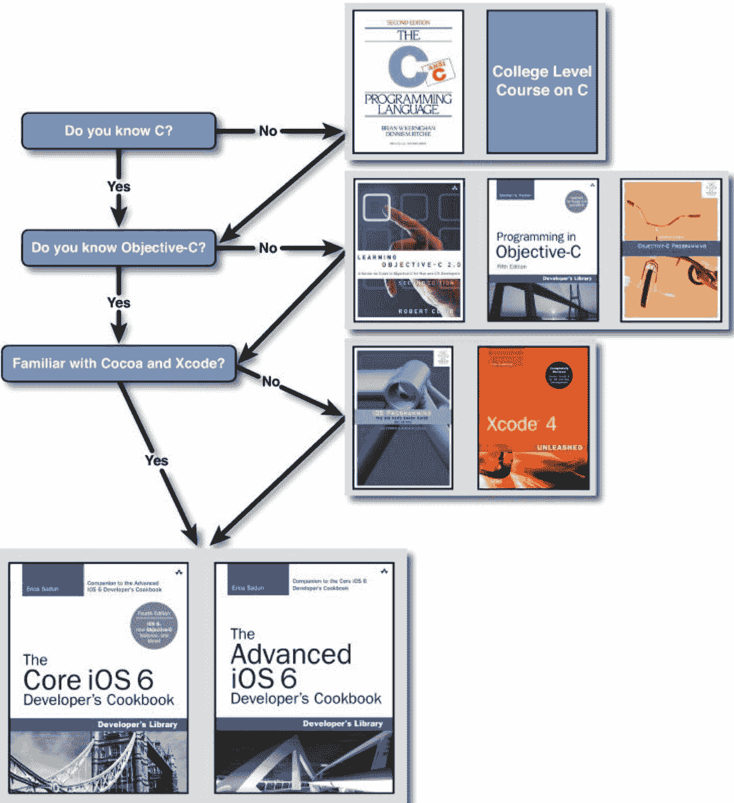

图 P-1. 成为 iOS 开发者的路线图。一旦学会了 C，你有几种方法学习如何使用 `Objective-C` 编程。如果你想深入了解该语言，你可以阅读 Apple 自己的官方文档，或者购买这些关于 `Objective-C` 的书籍：

- `Objective-C Programming: The Big Nerd Ranch Guide`，Aaron Hillegass 著（Big Nerd Ranch, 2012）
- 《Learning Objective-C 2.0: A Hands-on Guide to Objective-C for Mac and iOS Developers》，Robert Clair 著（Addison-Wesley, 2012）
- 《Programming in Objective-C, Fifth Edition》，Stephen Kochan 著（Addison-Wesley, 2012）

掌握了语言之后，接下来是要应对 Cocoa 和开发工具，即所谓的 `Xcode`。对于这一点，你有几种不同的选择。同样，你可以参考 Apple 关于 Cocoa 和 `Xcode` 的官方文档，或者如果你更喜欢书籍，可以向顶尖人士学习。亚特兰大 Big Nerd Ranch 的创始人 Aaron Hillegass 是《iOS Programming: The Big Nerd Ranch, Second Edition》的合著者，也是《Cocoa Programming for Mac OS X》的作者（该书应该是第四版了）。Aaron 的书在 Mac 开发者圈中备受推誉，是你在 cocoa-dev 邮件列表中看到的最推荐的书。想了解更多关于 `Xcode` 的知识，看 Sams Publishing 出版的 Fritz Anderson 的《Xcode 4 Unleashed》就足够。

## 注意


市场上还有许多其他出版社的书籍，包括畅销书由 Dave Mark、Jack Nutting 和 Jeff LaMarche 编写《Beginning iPhone 4 Development》（Apress, 2011）。如果你是编程新手，另一本值得一读的书是 Tim Isted 写的《Beginning Mac Programming》（Pragmatic, 2011）。不要仅仅局限于一本书或一个出版社。就像你可以通过与不同的开发者交流学到很多东西一样，你也会从市场上的其他书籍中学到很多技巧和提示。

要精通 Mac 开发，你需要查看各种资源：书籍、博客、邮件列表、Apple 官方文档，以及最好的——会议。如果你有机会参加 WWDC，你就明白我在说什么了。如果你是一个严肃的开发者，在这些会议上与其他开发者交流（在 WWDC 中，是与 Apple 的工程师交流）所花费的时间绝对物不所值。

## 本书的结构

本书针对 iOS 开发者面临的最常见问题提供了单任务食谱：布局界面元素、响应用户操作、访问本地数据源以及连接互联网。每个章节将相关任务组合在一起，允许你直接跳转到你寻找的解决方案，而无需决定哪个类或框架适合该问题。

《Core iOS 6 Developer’s Cookbook》提供了“剪切粘贴的便利”，意味着你可以自由地将书中食谱的源代码用于自己的应用程序，然后调整代码以满足你应用的需求。以下是书中章节内容的概述：

- 第 1 章，“手势与触摸”——在 iOS 上，触摸是用户向应用程序传达意图最重要的方式。触摸不仅局限于点击按钮和键盘交互。本章引入了直接操作界面、多点触控（`Multi-Touch`）等。你将看到如何创建用户可以拖动屏幕的视图，并阅读如何区分和解释手势，以及如何创建自定义手势识别器。

- 第 2 章，“构建与使用控件”——将你的控件提升到新高度。本章介绍了你关于控件如何工作所需的所有知识。发现如何以各种方式构建和自定义控件。从专业到冷门，本章介绍了一系列你可以在程序中使用的控件食谱。

- 第 3 章，“警报用户”——iOS 许多方式为用户提供提示，从弹出对话框、进度条到本地通知、弹出框（`popovers`）和音频提示。第 3 章展示了如何将这些指示构建到你的应用程序中，并扩展你的用户警报词汇。它引入了处理这些类的标准工作方法，并提供了允许你在在没有显式回调的情况下编写线性程序的解决方案。

- 第 4 章，“组装视图与动画”——`UIKit` 类及其子类填充了 iOS 设备屏幕。本章从底层开始引入视图。本章深入探讨视图食谱，探索检索、动画和操作视图对象的方法。你将学习如何构建、检查和拆解视图层级，并理解视图是如何协同工作的。你将发现几何形状在创建和将视图置于界面中所扮演的角色，并阅读关于如何在视图在屏幕上移动和变换时进行动画处理。

- 第 5 章，“视图约束”——iOS 6 开发工具包彻底改变了视图布局。Apple 的布局能够让你的生活更简单，界面更一致。这在处理具有不同屏幕尺寸同家族设备时（如 iPhone 4S 和 iPhone 5）尤为重要。本章引入了代码级的约束开发。你将发现如何在屏幕对象之间创建关系，并指定 iOS 自动安排视图的方式。结果是一组健壮的规则——适应屏幕几何形状。

- 第 6 章，“文本输入”——第 6 章引入了支持广泛解决方案的文本食谱。你将读到关于控制键盘、让屏幕上的文本“感知化”、扫描文本、格式化文本等内容。从文本字段、视图到 iOS 的内联拼写检查器，本章介绍了在应用中使用 iOS 进行文本工作所需的所有知识。

- 第 7 章，“使用视图控制器”——发现各种视图控制器类，它们让你能够管理和排序用户交互的虚拟空间，从涵盖页面视图控制器、分屏视图控制器、导航控制器等的操作食谱中学习。

- 第 8 章，“常用控制器”——iOS SDK 提供了丰富的系统内置控制器，你可以在日常开发任务中使用。本章介绍了一些你可以在日常开发任务中使用的系统内置控制器。本章介绍了一些。

- 第 9 章，“辅助功能”——本章提供了辅助功能的简要概述，将你的受众扩展到尽可能广泛的范围。你读到关于 `VoiceOver`、标签和提示。

- 第 10 章，“创建与管理表格”——表格提供了一种在较小设备上运行良好的滚动交互。第 10 章介绍了表格。它提供了该技术的体验，为你的应用提供。你将学习表格如何工作，以及如何将其集成到你的代码中。

- 第 11 章，“集合视图”——集合视图使用了表格的许多概念，但提供了更大的功能和活性。本章带你了解基础。你将学习关于创建网格和吸附。

- 第 12 章，“Core Data 初探”——`Core Data` 提供了可以从应用程序查询和更新的数据存储。它提供了一个基于 Cocoa Touch 的界面，将关系数据管理引入 Objective-C 世界。第 12 章介绍了 `Core Data`。你将学习管理数据存储、添加和删除数据。

- 第 13 章，“网络基础”——作为连接互联网的设备，iOS 特别适用于 Web 服务。Apple 为该平台配备了各种网络服务及其支持技术。第 13 章概述了常用的网络技术，并提供了简化日常任务的食谱。你将读到关于网络可达性、同步和异步下载、使用队列、使用 iPhone 安全密钥库维护验证、XML 解析、JSON 序列化等。

- 附录，“Objective-C 字面量”——本附录介绍了数字、数组和字典的 Objective-C 字面量。

## 关于示例代码

为了教学，本书的示例代码使用了单个 `main.m` 文件。这并不是人们开发 iPhone 或 Cocoa 应用的正常方式，坦率地说，也不是他们应该开发的方式，但它提供了一个展示单一思想的好方法。当读者同时查看五个、七或九个独立文件时，很难讲述一个故事。单个 `main.m` 文件集中了这些内容，允许在一个块中获取该思想。

工作。付出的努力可能会超过任何收益。

在书中，你将发现这个“一个故事一个文件”规则的例外：当“食谱”（Recipe）是一个类的实现时，《食谱指南》会提供标准的类文件和头文件。

某些食谱并不是为了强调某项技术，而是提供了这些类和类别（即对预存在类的扩展，而不是新类）。对于这些食谱，除了封装了故事其余部分的骨架 `main.m` 之外，还要寻找独立的 `.m` 和 `.h` 文件。

在大多数情况下，书中的示例使用单一应用程序标识符：`com.sadun.helloworld`。本书使用一个标识符是为了避免几十个示例同时占满你的 iOS 设备。每个示例都会替换上一个示例，确保你的主屏幕保持相对整洁。如果你想同时安装多个示例，只需编辑标识符并添加一个唯一的后缀，例如 `com.sadun.helloworld.table-ed`。你也可以编辑自定义显示名称以使应用程序在视觉上与众不同。你的团队描述文件（Team Provisioning Profile）匹配每个应用程序，包括 `com.sadun.helloworld`。这允许你将编译后的代码安装到设备上，而无需更改标识符；只需确保在每个项目的构建设置中更新你的签名身份即可。

## 获取示例代码

你可以在开源 GitHub 托管网站 `github.com/erica/iOS-6-Cookbook` 找到本书源代码。在那里，你将找到按章节收集的源代码，这些代码提供了书中涵盖材料的示例。

食谱的编号与书中的编号一致。例如，第 5 章的第 6 个食谱出现在 `06` 子文件夹下的 `CO05` 文件夹中。

任何编号为 `00` 或带有后缀（如 `05b` 或 `02c`）的项目都指的是用于创建正文内容和图表的材料。例如，第 10 章的 `00 – Cell Types`（单元类型）项目帮助构建了图10-2，展示了系统提供的表格视图单元格标准样式。通常情况下我会删除这些额外的项目。该手稿的早期读者要求我在本版本中包含它们。你会在仓库中散落在找到大约六个此类额外示例。

## 贡献！

示例代码永远不是固定目标。随着 Apple 更新 SDK 和 Cocoa Touch 库，它将不断进化。参与进来吧。你可以通过建议错误修复和纠正以及扩展现有代码来贡献力量。GitHub 允许你分叉（`fork`）仓库并通过你的调整和新功能使其增长，并将这些更改分享回主仓库。如果你有新的想法或方法，请告诉我们。我和我的团队乐意在仓库以及下一版《食谱指南》中收纳极佳的建议。

## 获取 Git

你可以使用 git 版本控制系统下载本书的源代码。OS X 版本的 git 实现可以在 http://code.google.com/p/git-osx-installer 获取。OS X 的 git 实现包括命令行和图形界面（GUI）解决方案，因此请根据你的开发需求寻找最适合的版本。

## 获取 GitHub

GitHub (http://github.com) 是最大的 git 托管网站，拥有超过 150,000 个公共仓库。它为公共项目提供免费托管，并为私有项目提供付费选项。其自定义的 Web 界面包含了托管、问题跟踪，并强调项目开发者之间的社交网络功能，它是寻找新代码或对现有库进行协作的绝佳场所。你可以在他们的网站注册免费账户，允许你复制和修改《食谱指南》仓库，或创建你自己的开源 iOS 项目与他人分享。

## 联系作者

如果你对本书有任何意见或问题，请发送至 `erica@ericasasun.com` 向我发送电子邮件，或者访问 github 仓库在那里与我联系。

## 尾注

+ 1 在本书的开发和制作过程中，没有任何鱼（无论真实的还是虚构的）受到伤害。对于数罐无糖可乐来说不能如此，它们无私地为本手稿奉献了自己的内容。

+ 2 请参阅《Cocoa 基础指南》(http://developer.apple.com/mac/library/documentation/Cocoa/Conceptual/Cocoa:) 开始了解 Cocoa；对于 Xcode，请参阅《Xcode 导览》。

+ 3 Big Nerd Ranch: www.bignerdranch.com。

## 编辑备注：我们希望听到你的声音！

作为本书的读者，你是我们最重要的批评家和评论员。我们重视你的意见，并想知道我们做得对的地方、哪里可以做得更好、你希望我们出版哪些领域，以及你愿意传给我们的任何智慧建议。

你可以通过电子邮件或直接写信给我，告诉我对对这本书的喜欢或不喜欢之处——以及我们可以做什么来让书更强大。

请注意，我无法帮助你解决与本书主题相关的技术问题，由于我收到的邮件量很大，我可能无法回复每条信息。

写信时，请务必包含本书的书名和作者，以及你的姓名和电话或电子邮件地址。我会仔细审查你的意见，并将其与参与本书的作者和编辑分享。

电子邮件：`trina.macdonald@pearson.com`

邮寄：Trina MacDonald

高级征稿编辑

Addison-Wesley/Pearson Education, Inc.

75 Arlington St., Ste. 300

Boston, MA 02116

## 1. 手势与触摸

触摸代表了 iOS 交互的核心；它提供了用户向应用程序传达意图的核心方式。触摸不仅限于点击和键盘交互。你可以设计并构建与用户手势进行有意义交互的应用程序。本章介绍了超越内置控件的直接操作界面。你将看到如何创建可以在屏幕上移动的视图。你还将发现如何识别和解释手势（触控的一种高层抽象）以及手势识别器类（自动检测如点击、滑动和拖拽等常见交互样式）。当你读完本章时，你已经学习了许多在应用程序中实现手势控制的不同方法。

### 触摸

Cocoa Touch 以最简单实现了直接操作。它将触摸事件发送到你正在工作的视图。作为 iOS 开发者，你告诉视图如何响应。在进入手势和手势识别器之前，你应该对这项底层技术建立坚实的基础。它提供了所有基于触摸交互的基础组件。

每次触摸都会传达信息：触摸发生的位置（当前和之前的地点），触摸处于什么阶段。

触摸具有生命周期。每个触摸都可以经过五个阶段中的任何一个阶段，代表触摸在界面中的进度。这些阶段如下：

- `UITouchPhaseBegan`——当用户触摸屏幕时开始。
- `UITouchPhaseMoved`——意味着触摸在屏幕上移动。
- `UITouchPhaseStationary`——表示触摸留在屏幕表面，但自上一次事件以来没有任何移动。
- `UITouchPhaseEnded`——当用户手指离开屏幕时结束。
- `UITouchPhaseCancelled`——当系统被中断时（例如电话拨入）发生。

`UITouchPhaseEnded`——当手指离开屏幕时触发。

`UITouchPhaseCancelled`——当 iOS 系统停止跟踪特定触摸操作时发生。这通常由系统中断引起，例如应用程序不再活跃，或视图从窗口中移除。

总的来说，这五个阶段构成了触摸事件的交互语言。它们描述了触摸在界面内可能进展或无法进展的所有方式，并为该界面的控制提供了基础。作为开发者，需要你来解释这些阶段并对其做出响应，这通过实现一系列响应者方法来实现。

### 触摸与响应者方法

`UIResponder` 类的所有子类（包括 `UIView` 和 `UIViewController`）都会响应触摸。每个类都会决定是否响应以及如何响应。在选择响应时，它们会在用户触摸视图或窗口中的一个或多个手指时实现自定义行为。

预定义的回调方法处理触摸从屏幕上的开始、移动和释放。与你已经看到的阶段对应，涉及的方法如下。注意，`UITouchPhaseStationary` 不产生回调。

- `touchesBegan:withEvent`——在事件开始阶段被调用，此时用户开始触摸屏幕。
- `touchesMoved:withEvent`——处理手指随时间的移动。
- `touchesEnded:withEvent`——结束触摸过程，此时一个或多个手指释放。它提供了一个清理移动序列期间处理的任何工作的机会。
- `touchesCancelled:withEvent`——当 Cocoa Touch 对正在进行的触摸事件响应系统中断时被调用。

这些每一个都是 `UIResponder` 方法，通常在 `UIView` 或 `ViewController` 子类中实现。它们都继承了方法的这些非功能版本。当你想要为应用程序添加触摸行为时，可以重写这些方法并添加一个提供应用程序所需响应的自定义版本。

你的类可以实现这些方法的全部或部分。对于实际部署，你总是希望添加一个 `touches-cancelled` 事件，以处理用户拖动手指到屏幕外或接到来电话的情况，这两种情况都会取消正在进行的触摸序列。按照惯例，你通常可以将取消的触摸重定向到 `touchesEnded:withEvent` 方法。这允许你的代码完成触摸序列，即使用户的手指尚未离开屏幕。Apple 建议处理触摸时将重写所有四个方法作为最佳实践。

> 注意
>
> 视图有一种名为“独占触摸”（`exclusive touch`）模式，它可以防止触摸传递给同一窗口中的其他视图。当启用此属性时，它会阻止其他视图接收触摸事件。主视图独占处理所有触摸。

### 触摸视图

在处理多个屏幕视图时，iOS 会自动决定用户触摸了哪个视图，并将任何触摸事件传递给适当的视图。这有助于你编写具体的直接操作界面，用户可以在界面上触摸、拖动并与屏幕对象进行交互。

仅仅因为触摸物理上位于某个视图上方并不意味着该视图必须响应。每个视图都可以使用“命中测试”（`hit test`）来选择是处理触摸还是让该触摸穿透下方的视图。正如你在后续方案中看到的，你可以使用巧妙的响应策略来决定你的视图何时应该响应，特别是当你使用具有部分透明度的不规则艺术时。

对于触摸事件，第一个通过命中测试的视图将选择处理或拒绝触摸。如果通过，触摸将继续传递给父视图并沿着响应者链向上移动，直到被处理或到达拥有视图的窗口。如果窗口不处理它，触摸将移动到应用程序实例，并在其中被处理或丢弃。

> 注意
>
> 触摸受限于 `UIView` 及其子类。这包括窗口。在开发针对 iPhone 4S 及更早版本和 iPhone 5 平台的应用程序时，请确保你的视图跨越整个屏幕。最常见的问题出现在 iPhone 5 处于竖屏模式且应用程序无法响应屏幕底部触摸时。这发生在应用程序的主窗口大小为 3.5 英寸屏幕，但用于较大的 4 英寸机型时。如果没有底层窗口视图，触摸将无法被识别。请通过将它们的主 `UIWindow` 扩展到屏幕的全垂直范围，确保你的应用程序支持 3.5 英寸和 4 英寸屏幕。

### 多点触摸

iOS 支持单触摸和多点界面。单触摸 GUI 在任何时候只处理一个触摸。这减轻了你确定正在跟踪哪个触摸的责任。你收到的那个触摸是你唯一需要处理的。当你查看其数据时，对其做出响应并等待下一个事件。

在处理多点触摸时——也就是说，当你同时响应多个屏幕触摸时——你会接收一整组触摸。对该组进行排序和响应由你决定。然而，你可以分别跟踪每个触摸并观察它随时间的变化，从而提供更丰富的可能的用户交互。本章随后将介绍单触摸和多点触摸交互的方案。

### 手势识别器

通过手势识别器，Apple 添加了一种在界面中检测特定手势的强大方式。手势识别器简化了触摸设计。它们封装了触摸方法，因此你不需要自己实现这些方法，并提供了一个隐藏实现细节的目标-动作（`target-action`）反馈机制。它们还标准化了某些移动分类的方式，如拖动或滑动等。

使用手势识别类，当 iOS 感知用户点击、长按、旋转、滑动和使用长按时，你可以触发回调。尽管它们的软件开发包（SDK）实现并不完美，但检测能力简化了基于触摸的界面开发。你可以编写自己的代码以提高可靠性。以下是 SDK 内置的手势类型：

- 点击（`Taps`）——点击对应单个或多个手指。你可以指定想要检测的手指数量。
- 滑动（`Swipes`）——滑动是短的单手指势，向基本方向移动。识别器返回检测到的方向。
- 缩放（`Pinches`）——要收缩或张开，用户必须移动两个手指靠近或分开。识别器返回缩放因子。
- 旋转（`Rotations`）——要旋转，用户同时移动两个手指顺时针或逆时针方向，产生角度旋转。
- 移动（`Pan`）——移动发生在用户在屏幕上拖动手指时。识别器确定该拖动产生的位移变化。
- 长按（`Long press`）——要创建长按，用户触摸屏幕并保持手指（或多个手指）一段时间。你可以在识别器触发之前指定使用的手指数量。

此食谱没有实现 `touches-ended` 或 `touches-cancelled` 方法方法。它的关注点仅在于屏幕上对象的移动。当用户停止与屏幕交互时，该类没有进一步的工作需要完成。


## 食谱 1-1. 创建可拖拽视图

```objc
@interface DragView : UIView {
    CGPoint startLocation;
}
@end

@implementation DragView
-(id) initWith:(UIImage *)anImage {
    if (self = [super initWithImage:anImage])
        self.userInteractionEnabled = YES;
    return self;
}

-(void)touchesBegan:(NSSet *)touches withEvent:(UIEvent *)event {
    // 计算并设置偏移量，并将视图置于顶层
    startLocation = [[touches anyObject] locationInView:self];
    [self.superview addSubviewToFront:self];
}

-(void)touchesMoved:(NSSet *)touches withEvent:(UIEvent *)event {
    // 计算偏移
    CGPoint pt = [[touches anyObject] locationInView:self];
    float dx = pt.x - startLocation.x;
    float dy = pt.y - startLocation.y;
    CGPoint newcenter = CGPointMake(
        self.center.x + dx,
        self.center.y + dy);
    // 设置新位置
    self.center = newcenter;
}
@end
```

## 获取此食谱的代码

要找到此食谱的完整示例项目，请将浏览器指向 `https://github.com/erica/iOS-6-Cookbook` 并进入第1章文件夹。

## 食谱：添加平移手势识别器

通过手势识别器，你可以实现与食谱 1-1 相同的交互效果，而无需直接处理触摸事件。平移手势识别器可以检测拖拽手势。它们允许你分配一个回调，每当 iOS 感应到平移时触发该回调。

食谱 1-2 通过在初始化视图时添加识别器，模拟了食谱 1-1 的行为。当 iOS 检测到在 `DragView` 实例上的拖拽时，`handlePan:` 回调会更新视图的中心以匹配拖拽的距离。

这段代码使用了一种看起来很奇怪的计算距离的方法。它将原始视图位置存储在实例变量（`previousLocation`）中，并在每次视图更新平移手势回调时计算每个点的偏移量。这允许你使用仿射变换或应用 `setTranslation:in:` 方法；你通常不会像这里这样移动视图中心。此食谱创建了一对 `dx/dy` 偏移量并将该偏移量应用到视图中心，从而改变视图的实际框架（frame）。

与偏移量不同，仿射变换允许你同时有意义地处理旋转、缩放和平移。为了支持变换，手势识别器提供的的是绝对坐标变化而不是相对变化。`UIPGestureRecognizer` 不发布偏移向量，而是返回一个单一向量，表示相对于某个视图坐标系（通常是所操作视图的父视图，即父视图视图的坐标系）的平移。该向量便于进行简单的仿射变换计算，并可以在数学上与其他更改相结合，以产生一个同时表示所有更改的统一变换。

以下是使用直接变换且不使用存储状态时，`handlePan:` 方法的写法：

```objc
(void) handlePan:(UIPGestureRecognizer *)uig
{
    if (uig.state == UIGestureRecognizerStateEnded) {
        CGPoint newCenter = CGPoint(
            self.center.x + self.transform.tx,
            self.center.y + self.transform.ty);
        self.center = newCenter;
    }

    CGAffineTransform theTransform = self.transform;
    theTransform.tx = 0.0;
    theTransform.ty = 0.0f;
    self.transform = theTransform;

    return;
}

CGPoint translation = [uig translationInView:self.superview];
CGAffineTransform theTransform = self.transform;
theTransform.tx = translation.x;
theTransform.ty = translation.y;
self.transform = theTransform;
```

注意识别器是如何检查交互结束的，然后更新视图的位置并重置变换的平移的。这种适配不需要本地存储，并且将消除对 `touchesBegan:withEvent:` 方法的需要。如果没有这些修改，食谱 1-2 必须存储之前的状态。

## 食谱 1-2. 使用平移手势识别器拖拽视图

```objc
@interface DragView : UIView
{
    CGPoint previousLocation;
}
@end

@implementation DragView
-(id) initWithImage:(UIImage *)anImage
{
    if (self = [super initWithImage:anImage])
    {
        self.userInteractionEnabled = YES;
        UIPanGestureRecognizer *panRecognizer =
            [[UIPanGestureRecognizer alloc] initWithTarget:self action:@selector(handlePan:)];
        self.gestureRecognizers = @[panRecognizer];
        return self;
    }
}

-(void) touchesBegan:(NSSet *)touches withEvent:(UIEvent *)event
{
    // 将被触摸的视图置于前面
    [self.superview bringSubviewToFront:self];

    // 记住原始位置
    previousLocation = self.center;
}

-(void)handlePan:(UIGestureRecognizer *)uig
{
  CGPoint translation = [uig translationInView:self.superview];
  self.center = CGPointMake(previousLocation.x + translation.x,
  previousLocation.y + translation.y);
}
@end
```

## 获取此食谱的代码

要找到此食谱示例项目，请将浏览器指向 `https://github.com/erica/iOS-6-Cookbook` 并进入第1章文件夹。

## 食谱：使用多个手势识别器

食谱 1-3 构建了食谱 1-2 中提出的想法，但有几处不同。首先，它引入了多个识别器——旋转、缩放和平移——并将它们都添加到 `DragView` 的 `gestureRecognizers` 中。它使用了代理方法 `shouldRecognizeSimultaneouslyWithRecognizer:` 使这些识别器同时工作。

注意：食谱 1-3 扩展了状态以包含缩放和旋转。这些项目跟踪值并允许代码构建复合变换。这些复合变换将平移、旋转和缩放合并为一个结果。

最后，此食谱引入了一种混合手势识别方法。食谱 1-3 并没有向视图的识别器添加数组，而是演示了如何添加食谱 1-1 中使用的触摸方法来捕捉三击。在示例中，三击会将视图重置为标识变换。这撤销了应用于视图的任何操作，并恢复其原始位置、方向和缩放。正如你看到的，`touches`、`moved`、`ended` 和 `cancelled` 方法与手势识别器回调无缝工作，这就是在本文食谱中包含此额外细节的原因。添加点击识别器也同样有效。

```objc
(void) touchesCancelled: (NSSet *) touches withEvent:(UIEvent *) event
{
    [self touchesEnded:touches withEvent:event];
}
```

```objc
(void) updateTransformWithOffset: (CGPoint) translation
{
    // Create a blended transform representing translation
    // rotation, and scaling
    self.transform = CGAffineTransformMakeTranslation(
        translation.x + tx, translation.y + ty);
    self.transform = CGAffineTransformRotate(self.transform, theta);
    self.transform = CGAffineTransformScale(self.transform, scale);
}
```

```objc
(void) handlePan:(UIPanGestureRecognizer *) uig
{
    CGPoint translation = [uig translationInView:self.superview];
    [self updateTransformWithOffset:translation];
}
```

```objc
(void) handleRotation:(UIRotationGestureRecognizer *) uig
{
    theta = uig.rotation;
    [self updateTransformWithOffset:CGPointZero];
}
```

```objc
(void) handlePinch:(UIPinchGestureRecognizer *) uig
{
    scale = uig.scale;
    [self updateTransformWithOffset:CGPointZero];
}
```

```objc
(BOOL) gestureRecognizer:(UIGestureRecognizer *) gestureRecognizer
shouldRecognizeSimultaneouslyWithGestureRecognizer:
    (UIGestureRecognizer *)otherGestureRecognizer
{
    return YES;
}
```

```objc
(id) initWithImage:(UIImage *)image
{
    // Initialize and set as touchable
    if (!self = [super initWithImage:image]) return nil;
    self.userInteractionEnabled = YES;
}
```

```objc
// Reset geometry to identities
self.transform = CGAffineTransformIdentity;
tx = 0.0f; ty = 0.0f; scale = 1.0f; theta = 0.0f;
```

```objc
// Add gesture recognizer suite
UIRotationGestureRecognizer *rot = [[UIRotationGestureRecognizer alloc]
initWithTarget:self action:@selector(handleRotation)];
UIPinchGestureRecognizer *pinch = [[UIPinchGestureRecognizer alloc]
initWithTarget:self action:@selector(handlePinch)];
UIPanGestureRecognizer *pan = [[UIPanGestureRecognizer alloc]
initWithTarget:self action:@selector(handlePan)];
self.gestureRecognizers = @[rot, pinch, pan];
for (UIGestureRecognizer *recognizer in self.gestureRecognizers) {
    recognizer.delegate = self;
}

return self;
}
@end
```

# 解决手势冲突

当你需要同时识别多种类型的手势时，可能会出现手势冲突。例如，当你需要同时识别单击和双击时会发生什么？单击识别器是否应该在第一次点击时就触发，即使用户的意图是双击？或者，你应该等待一下，在确定用户不会再添加第二次点击后再做出响应？iOS SDK 允许你在代码中考虑这些冲突。

你的类可以指定一个手势必须失败，另一个手势才能成功。通过调用 `requireGestureRecognizerToFail:` 可以实现这一点。这是一个手势方法，接收一个参数，即另一个识别器。这在接收此消息的对象与另一个手势对象之间建立了依赖关系。这意味着：为了让第一个手势触发，第二个手势必须失败。如果识别出了第二个手势，则第一个手势将不会触发。

在现实生活中，这通常意味着识别器会承认延迟，直到可以确定被依赖的手势已经失败。它会一直等到第二个手势不再可能。只有那时，第一个识别器才会完成。如果你同时识别单击和双击，应用程序会在第一次点击后稍多等待一会儿。如果没有发生第二次点击，则触发单击；否则，触发双击。你的 GUI 响应将为了适应这些变化而变慢。你的单击响应会变得略微延迟。这是因为在时间流逝之前，无法判断是否会有第二次点击。在即时响应对你的用户体验至关重要的地方，永远不要同时使用这两种识别器。相反，尝试设计点击意味着“立即执行某操作”的情况，并避免在这些模式下需要手势识别。

不要忘记你可以动态地添加、移除和禁用手势识别器。单击可能会让界面进入一个适合进一步区分单击和双击的地方。在离开该模式时，你可以禁用或移除双击识别器，以获得更好的单击识别效果。此类调整可以将界面变慢限制在绝对需要的时候。

## 获取本食谱的代码

要找到此食谱的完整示例项目，请将浏览器指向 `https://github.com/erica/iOS-6-Cookbook` 并进入第 1 章的文件夹。

## 食谱：限制移动

本章早期食谱中简单方法的一个问题是，完全可能将视图拖到屏幕外，导致用户无法看到或轻松恢复它。那些方法使用的是无约束的移动。它们没有检查来测试对象是否留在视图内并且可点击。食谱 1-4 通过将视图的移动限制在其父视图内来解决这个问题。

它通过限制每个方向的移动来实现这一点的，将检查拆分为单独的 x 和 y 约束。这种双检查方法允许视图在某个方向达到最大值时继续移动。例如，如果视图触碰了父视图的最右边缘，它仍然可以向上向下移动。

图 1-1 显示了界面。子视图被限制在父视图内。

```objc
pt.y = (point.y - HALFSIDE) / HALFSIDE;

// x^2 + y^2 = radius^2
float xsquared = pt.x * pt.x;
float ysquared = pt.y * pt.y;

// If the radius <= 1, the point is within the clipped circle
if ((xsquared + ysquared) <= 1.0) return YES;
return NO;

}
```

## 获取本食谱的代码

要找到此食谱的完整示例项目，请将浏览器指向 `https://github.com/erica/iOS-6-Cookbook` 并进入第 1 章文件夹。

## 食谱：针对位图（Bitmap）进行测试

遗憾的是，大多数视图并不属于简单的几何形状，这使得食谱 1-5 中的命中测试（hit test）并不简单。例如，图 1-1 所示的花朵具有不规则的边界和变化的透明度。对于复杂的艺术设计，针对位图进行触摸测试很有帮助。位图提供了关于基于图像视图内容的逐字节信息，允许你测试触摸是否击中了图像的实心部分，或者应该穿透下面的任何视图。

食谱 1-6 从 `UIImageView` 中提取图像位图。它假设图像提供了目标视图的逐像素表示。当你扭曲视图时（通过通常的缩放框架或应用变换），数学计算也会随之调整。`CGPoints` 可以通过 `CGPointApplyAffineTransform` 进行变换，以处理缩放和旋转变化。保持艺术设计与实际像素的 1:1 比例可以简化查找并避免复杂的数学计算。你可以恢复目标像素，测试其 alpha 水平，并判断触摸是否击中了视图的实心部分。

此示例使用了 85 的截断值。这对应于最低 33% 的 alpha 水平（即 85 / 255）。此自定义的 `pointInside:` 方法将任何 alpha 水平低于 33% 的像素视为透明。这是人为设定的。请根据你实际 GUI 的需求使用任何水平（或其它测试方法）。

## 注意事项

除非你需要像素级的触摸检测，否则你可能可以缩小位图以节省内存，并相应地调整检测数学公式。

## 食谱 1-6 针对位图 Alpha 水平的触摸测试


// 返回 RGBA 在 (x,y) 处 alpha 像素的偏移
// 每个像素 4 字节的位图数据
static NSInteger alphaOffset(NSInteger x, NSInteger y, NSInteger w) {
    return y * w * 4 + x * 4;
}

```
// 从提供的图像获取位图
NSData *getBitmapFromImage(UIImage *image)
{
    CGSpaceRef colorSpace = CGColorSpaceCreateDeviceRGB();
    if (colorSpace == NULL)
    {
        fprintf(stderr, "Error allocating color space\n");
        return NULL;
    }

    CGSize size = image.size;
    unsigned char *bitmapData = calloc(size.width * size.height * 4, 1);
    if (bitmapData == NULL)
    {
        fprintf(stderr, "Error: Memory not allocated!");
        CGColorSpaceRelease(colorSpace);
        return NULL;
    }

    CGContextRef context = CGBitmapContextCreate(bitmapData,
        size.width, size.height, 8, size.width * 4, colorSpace,
        kCGSpaceAlphaPremultipliedFirst);
    CGColorSpaceRelease(colorSpace);
    if (context == NULL)
    {
        fprintf(stderr, "Error: Context not created!");
        free(bitmapData);
        return NULL;
    }

    CGRect rect = CGRectMake(0.0f, 0.0f, size.width, size.height);
    CGContextDrawImage(context, rect, image.CGImage);
    unsigned char *data = CGBitmapContextGetData(context);
    CGContextRelease(context);

    NSData *bytes = [NSData dataWithBytes:data length:size.width * size.height * 4];
    free(bitmapData);
    return bytes;
}

// 将位图数据存储到 NSDictionary 实例变量
-(id) initWithImage:(UIImage *)anImage
{
  if (self = [super initWithImage:anImage]) {
    self.userInteractionEnabled = YES;
    data = getBitmapFromImage(anImage);
  }
  return self;
}
```

```
// 这一点是否击中了视图？
(BOOL) pointInside:(CGPoint)point withEvent:(UI *)event
{
  if (!CGRectContainsPoint(self.bounds, point)) return NO;
  Byte *bytes = (Byte *)data.bytes;
  uint offset = alphaOffset(point.x, point.y, self.image.size.width);
  return (bytes[offset] > 85);
}
```

## 获取本食谱的代码

要找到此食谱的完整示例项目，请将浏览器指向 `https://github.com/erica/iOS-6-Cookbook` 并进入第 1 章文件夹。

## 食谱：在屏幕上绘制触摸

`UIView` 托管了直接屏幕绘制领域。它的 `drawRect:` 方法提供了一种底层的直接绘制内容的方法，让你可以使用 Quartz 2D 调用创建并显示任意元素。触摸与绘制结合可以构建出可操作的界面。

食谱 1-7 将手势与 `drawRect` 结合引入了基于触摸的绘画。当用户触摸屏幕时，视图会跟随手指。图 1-3 显示了源于粒度输入的棱角感，以及相反可以应用的平滑处理。

```objc
@interface TouchView : UIView
{
    UIBezierPath *path;
}
@end

@implementation TouchView

-(void) touchesBegan:(NSSet *)touches withEvent:(UI *)event {
    path = [UIBezierPath bezierPath];
    path.lineWidth = 4.0;
    for (UITouch *touch in touches) {
        [path moveToPoint:touch locationInView];
    }
    [self setNeedsDisplay];
}

-(void) touchesMoved:(NSSet *)touches withEvent:(UI *)event {
    for (UITouch *touch in touches) {
        [path addLineToPoint:touch locationInView];
    }
    [self setNeedsDisplay];
}

-(void) touchesEnded:(NSSet *)touches withEvent:(UI *)event {
    [self setNeedsDisplay];
}

-(void) touchesCancelled:(NSSet *)touches withEvent:(UI *)event {
    // handle cancel
}

-(void) drawRect:(CGRect)rect {
    [path stroke];
}

-(id) initWithFrame:(CGRect)frame {
    if (self = [super initWithFrame:frame]) {
        self.userInteractionEnabled = YES;
    }
    return self;
}

@end
```

你可能可以将它们添加到你的应用程序中。计算几何领域中的许多其他算法也可以以此类应用。

## 食谱 1-8. 使用 Catmull-Rom 样条创建平滑 Bezier 路径

```objc
#define VALUE(_INDEX_) [NSValue valueWithCGPoint:points[_INDEX_]]

@implementation UIBezierPath (Points)
void getPointsFromBezier(void *info, const CGPathElement *element)
{
    NSMutableArray *bezierPoints = (__bridge NSMutable *)info;

    // 获取路径元素类型及其点
    CGPathElementType type = element->type;
    CGPoint *points = element->points;

    // 如果可用，则添加点（根据类型）
    if (type != CGPathElementCloseSubpath)
    {
        bezierPoints addObject:VALUE([0]);
        if ((type != CGPathElementAddLineToPoint) &&
            (type != CGPathElementMoveToPoint))
        {
            bezierPoints addObject:VALUE([1]);
        }
    }
    if (type == CGPathElementAddCurveToPoint)
    {
        bezierPoints addObject:VALUE([2]);
    }
}
(NSArray *)points{
    NSMutableArray *points = [NSMutableArray array];
    CGPathApply(self.CGPath, (__bridge *)points);
    getPointsFromBezier;
    return points;
}
@end

#define POINT(_INDEX_) \
[NSValue *][points objectAtIndex:_INDEX_] CGPointValue

@implementation UIBezierPath (Smoothing)
(UIBezierPath *) smoothedPath:(int) granularity
{
    NSMutableArray *points = [self.points mutableCopy];
    if (points.count < 4) return [self copy];

    // 添加控制点以使数学逻辑合理
    // 由 Josh Weinberg 提供
    [points insertObject:[points objectAtIndex:0] atIndex:0];
    [points addObject:[points lastObject]];
    UIBezier smoothedPath = [UIBezier bezierPath];
    // 拷贝特性
    smoothedPath.lineWidth = self.lineWidth;
    // 绘制前 3 个点 (0..2)
    [smoothedPath moveToPoint:POINT(0)];
    for (int index = 1; index < 3; index++)
    [smoothedPath addLineToPoint:POINT(index)];
    for (int index = 4; index < points.count; index++)
    {
        CGPoint p0 = POINT(index - 3);
        CGPoint p1 = POINT(index - 2);
        CGPoint p2 = POINT(index - 1);
        CGPoint p3 = POINT(index);
        // 现在从 pl + dx/dy 开始添加 n 个点
        // 直到 p2，使用 Catmull-Rom 样条
        for (int i = 1; i < granularity; i++)
        {
            float t = (float)i * (1.0f / (float) granularity);
            float tt = t * t;
            float ttt = t * t;
            CGPoint pi; // 中间点
            pi.x = 0.5 * (2*p1.x-p0.x)*t + 
            (2*p0.x-p1.x+4*p2.x-p3.x)*tt + (3*p1.x-p0.x-
            3*p2.x+p3.x)*ttt;
            pi.y = 0.5 * (2*p1.y-p0.y)*t + 
            (2*p0.y-p1.y+4*p2.y-p3.y)*tt + (3*p1.y-p0.y-
            3*p2.y+p3.y)*ttt;
            [smoothedPath addLineToPoint:pi];
        }
        // 现在添加 p2
        [smoothedPath addLineToPoint:p2];
    }
    // 通过添加最后一个点来完成
    [smoothedPath addLineToPoint:POINT(points.count - 1)];

    return smoothedPath;
}
@end

// 使用示例：
// 在绘制完成后将路径替换为平滑版本
// (void) touchesEnded:(NSSet *)touches withEvent:(UIEvent *)event
{
  UITouch *touch = [touches anyObject];
  [path addLineToPoint:[touch locationInView:self]];
  path = [path smoothedPath:4];
  [self setNeedsDisplay];
}
```

## 获取此食谱的代码

要找到此食谱的完整示例项目，请将浏览器指向 `https://github.com/erica/iOS-6-Cookbook` 并进入第 1 章的文件夹。

## 食谱：使用多点触交互

在 `UIView` 实例中启用多点触允许 iOS 同时恢复并响应多一个手指的操作。将 `UIView` 属性 `multipleTouchEnabled` 设置为 YES，或者为你的视图重写 `isMultiTouchEnabled`。启用后，每个触摸回调都会返回一个触摸集合。当该集合的数量超过 1 时，你就在处理多点触。

从理论上，iOS 支持任意数量的触摸。你可以在 iPad 上运行此食谱，通过同时使用尽可能多的手指来探索该限制。实际上限随时间而变化；因此此食谱不会提供一个具体的数字。

当在 iPhone 上首次探索多点触时，开发者们梦想过多点触结合多用户所带来的自由和灵活性。在你的游戏和其他应用程序中添加多点触不仅开启了扩展的手势，还提供了创建令人兴奋的用户体验的新方法，尤其是在 iPad 这样较大的屏幕上。我鼓励你包含多点触支持。

## 食谱 1-9. 复合绘制的用户轨迹积累

```objc
@interface TouchTracker : UIView
{
  NSMutableArray *strokes;
  NSMutableDictionary *touchPaths;
}

(void) clear;
@end

@implementation TouchTracker
// 建立视图并初始化存储
// (id) initWithFrame:(CGRect) frame
{
  if (self = [super initWithFrame:frame]) {
    self.multipleTouchEnabled = YES;
    strokes = [NSMutableArray array];
    touchPaths = [NSMutableDictionary dictionary];
  }
  return self;
}

// 清除时移除所有笔触，但不移除正在绘制
// (void) clear
{
  [strokes removeAllObjects];
  [self setNeedsDisplay];
}

// 开始触摸时向路径字典添加新路径
// (void) touchesBegan:(NSSet *) touches withEvent:(UIEvent *)
{
for (UITouch *touch in touches) {
  NSString *key = [NSString stringWithFormat:@"%d", (int) touch];
  CGPoint pt = [touch locationInView:self];

  UIBezierPath *path = [UIBezierPath path];
  path.lineWidth = IS_IPAD ? 8 : 4;
  path.lineStyle = kLineCapRound;
  [path moveToPoint:pt];

  [touchPaths setObject:path forKey:key];
}
}

// 通过增长和描绘路径追踪触摸移动
// (void) touchesMoved:(NSSet *) touches withEvent:(UIEvent *)
{
for (UITouch *touch in touches) {
  NSString *key = [NSString stringWithFormat:@"%d", (int) touch];
  UIBezierPath *path = [touchPaths objectForKey:key];
  // 绘制绘制实现...
}
}
@end
```

```objc
if (!path) break;

CGPoint pt = [touch locationInView:self];
[path addLineToPoint:pt];
}
```

```objc
[self setNeedsDisplay];
}
```

```objc
// On ending a touch
```


```objc
-(void) touchesCancelled:(NSSet *)touchesWithEvent:(UIEvent *)event
{
    [self touchesEnded:touches initWith:event];
}
```

```objc
// Draw existing strokes in dark purple, in-progress ones in light
-(void) drawRect:(CGRect)rect
{
    [COOKBOOK_PURPLE_COLOR set];
    for (UIBezierPath *path in strokes)
        [path stroke];

    [[COOKBOOK_PURPLE_COLOR colorWithAlphaComponent:0.5f] set];
    for (UIBezierPath *path in [touchPaths allValues])
        [path stroke];
}
@end
```

## 获取此食谱的代码

要找到此食谱的完整示例项目，请将浏览器指向 `https://github.com/erica/iOS-6-Cookbook` 并进入第 1 章的文件夹。

## 注意

Apple 在其开发者网站上提供了许多 Core Graphics/Quartz 2D 资源。虽然这些论坛、邮件列表和源代码示例并不是 iOS 专用的，但它们为扩展你的 iOS Core Graphics 知识提供了价值的资源。

## 食谱：检测圆

在 iOS 这种直接交互界面中，你可以想象大多数人只需指向屏幕上的项目就能完成操作。然而，圆检测仍然是最常请求的手势之一。开发者喜欢人们用手指在屏幕上画圆。本着提供读者请求的解决方案的精神，食谱 1-10 提供了一个相对简单的圆检测器，如图 1-5 所示。

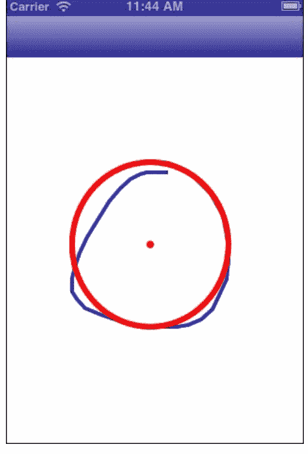

图 1-5。圆点和外椭圆显示了检测出的圆的关键特征。

在此实现中，检测使用了多步测试。时间测试检查笔触是否没有停留。圆手势应该是快速绘制的。转折测试检查触摸方向是否变化过于频繁。一个标准的圆包含四个方向的变化，而本实现允许五个。收敛测试要求圆的起点和终点必须接近，以便点之间存在某种关联。当你没有提供直接的视觉反馈时，需要较大的余地，用户倾向于在起点处画不足或过头。这里使用的像素距离是通用的，大约是视图的三分之一。

最后的测试查看围绕中心点的移动。它累加了经过的弧度，在完美的圆中这应该等于 360 度。此示例允许 45 度以内的移动作为未完全完成的圆，对于继续稍宽的圆允许 180 度，以便手指移动更自然。在通过这些测试后，算法生成一个边界矩形，并将该矩形置于原始手势点的几何平均值上。此结果被赋予圆的实例变量。这不是一个完美的检测系统（你可以在测试示例代码时尝试欺骗它），但它足够健壮，可以为许多 iOS 应用提供合理的圆检查。

## 食谱 1-10. 检测圆

```objc
// 获取矩形中心
CGPoint GEORectGetCenter(CGRect rect)
{
    return CGPointMake(CGRectMidX(rect), CGRectMidY(rect));
}
```

```objc
// 在给定中心周围构建矩形
CGRect GEORectAroundCenter(CGPoint center, float dx, float dy)
{
    return CGRectMake(center.x - dx, center.y - dy, dx * 2, dy * 2);
}
```

```objc
// 将一个矩形居中放在另一个矩形内
CGRect GEORectCenteredIn(CGRect rect, CGRect mainRect)
{
    float dx = CGRectGetMidX(mainRect)-CGRectMidX(rect);
    float dy = CGRectMidY(mainRect)-CGRectMidY(rect);
    return CGRectOffset(rect, dx, dy);
}
```

```objc
// 返回两个归一化向量的点积
CGfloat dotproduct(CGPoint v1, CGPoint v2)
{
    float dot = (v1.x * v2.x) + (v1.y * v2.y);
    float a = ABS(sqrt(v1.x * v1.x + v1.y * v1.y));
    CGFloat b = ABS(sqrt(v2.x * v2.x + v2.y * v2.y));
    dot /= (a * b);
    return dot;
}

// 返回两个点之间的距离
CGFloat distance(CGPoint p1, CGPoint p2)
{
  CGFloat dx = p2.x - p1.x;
  CGFloat dy = p2.y - p1.y;

  return sqrt(dx*dx + dy*dy);
}
```

```objc
// X 轴偏移
CGFloat dx(CGPoint p1, CGPoint p2)
{
  return p2.x - p1.x;
}
```

```objc
// Y 轴偏移
CGFloat dy(CGPoint p1, CGPoint p2)
{
  return p2.y - p1.y;
}
```

```objc
// 数字的符号
NSInteger sign(CGFloat x)
{
  return (x < 0.0f) ? (-1) : 1;
}
```

```objc
// 返回相对于给定原点的点
CGPoint pointWithOrigin(CGPoint pt, CGPoint origin)
{
  return CGPointMake(pt.x - origin, pt.y - origin);
}
```

```objc
// 计算并返回边界矩形

#define POINT(index) [points objectAtIndex:index]

CGRect boundingRect(NSArray *points)

{

  CGRect rect = CGRectZero;

  CGRect rectPt;

  for (int i = 0; i < points.count; i++) {

    CGPoint pt = POINT(i);

    rectPt = CGRectMake(pt.x, pt.y, 0.0f, 0.0f);

    rect = CGRectUnion(rect, rectPt);

  }

  return rect;

}
```

```objc
CGRect testForCircle(NSArray *points, NSDate *firstTouchDate)
{
    if (points.count < 2) {
        NSLog("Too few points (2) for circle");
        return CGRectZero;
    }

    // 测试 1：时长
    float duration = [[NSDate date] timeIntervalSinceDate:firstTouchDate];
    NSLog("Transit duration: %.2f", duration);

    float maxDuration = 2.0f;
    if (duration > maxDuration) {
        NSLog("Excessive duration");
        return CGRectZero;
    }

    // 测试 2：方向变化应限制为 5
    int inflections = 0;
    for (int i = 2; i < points.count - 1; i++) {
        float delx = dx(POINT(i), POINT(i-1));
        float delty = dy(POINT(i), POINT(i-1));
        float px = dx(POINT(i-1), POINT(i-2));
        float py = dy(POINT(i-1), POINT(i-2));

        if ((sign(delx) != sign(px)) || (sign(delty) != sign(py))) {
            inflections++;
        }
    }

    if (inflections > 5) {
        NSLog("Excessive inflections");
        return CGRectZero;
    }

    // 测试 3：起点和终点相互靠近
    float tolerance = [[UIApplication sharedApplication] keyWindow].size.width / 3.0f;
    if (distance(POINT(0), POINT(points.count - 1)) > tolerance) {
        NSLog("@Start far from end");
        return CGRectZero;
    }

    // 测试 4：以角度计算移动距离
    CGRect circle = boundingRect(points);
    CGPoint center = CGRectGetCenter(circle);
    float distance = ABS(dotproduct(pointWithOrigin(POINT(0), center), pointWithOrigin(POINT(1), center)));
    for (int i = 1; i < points.count - 1; i++) {
        distance += ABS(acos(dotproduct(pointWithOrigin(POINT(i), center), pointWithOrigin(POINT(i+1), center))));
    }

    float transitance = distance - 2 * M_PI;

    if (transitance < 0.0f) { // 未达到 2 PI
        if (transitance < (M_PI / 4.0f)) { // 小于 45 度
            NSLog("@Transit too short");
            return CGRectZero;
        }
    }

    if (transitance > M_PI) { // 额外的 180 度
        NSLog("@Transit too long ");
        return CGRectZero;
    }

    return circle;
}
@end
```

## 获取此食谱的代码

要找到此食谱的完整示例项目，请将浏览器指向 `https://github.com/erica/iOS-6-Cookbook` 并进入第 1 章的文件夹。

## 食谱：创建一个手势识别器

将食谱 1-10 所示的代码转换为食谱 1-11 中引入的自定义识别器并不费力。通过子化 `UIGestureRecognizer`，你可以构建自己的圆识别器，并将其添加到应用程序的视图中。

从在你的类中导入 `UIGestRecognizerSubclass.h` 开始。该文件声明了识别器需要覆盖或自定义的所有内容。对于你覆盖的每个方法，请确保在调用你的代码之前通过调用父类方法来调用原始版本。

手势分为两种类型：连续（continuous）和离散（discrete）。圆识别器是离散的。它要么识别圆，要么失败。连续手势包括缩放和平移，识别器在整个生命周期内发送更新。你的识别器通过设置其 `state` 属性来生成更新。

识别器基本上是指尖的状态机。所有识别器都从可能状态 `UIGestRecognizerStatePossible` 开始，然后连续手势通过一系列改变状态（`UIGestRecognizerStateChanged`）。离散识别器要么成功识别手势（`UIGestRecognizerStateRecognized`），要么失败（`UIGestRecognizerStateFailed`），正如食谱 1-11 所示，每当你更新状态时（除非状态设置为可能或失败），系统都会向它发送动作。你在食谱 1-11 中看到的长注释属于 Apple，得益于子类头文件。我在这里包含它们，是因为它们解释了覆盖父类的关键方法的作用。`reset` 方法将识别器返回静止状态，允许其为下一次识别挑战做准备。

`touchesBegan`（等）方法调用的点与 `UIResponder` 类似类类似，允许你在相同的触摸生命周期点执行测试。此示例等待到 `touchesEnded` 回调再检查成功或失败，并使用食谱 1-10 中定义的 `testForCircle` 方法。

> 注意

作为一种覆盖性原则，手势识别器应尽快失败。当它们成功时，你应该在本地属性中存储有关手势的信息。圆手势应该保存任何检测到的圆，以便用户知道手势发生的位置。

## 食谱 1-11. 创建手势识别器子类

```objc
#import <UIKit/UIGestureRecognizerSubclass.h>

@implementation CircleRecognizer
```

```objc
// 运行时在手势状态被
// 设置为 UIGestureRecognizerStateEnded 后自动调用任何内部状态
// 都应该重置，以便准备下一次尝试识别手势
// 收到此状态后，所有剩余的活跃触摸都将被忽略
// （对于已经开始但尚未结束的触摸，
// 将不再接收任何更新）
```

```objc
-(void)reset
{
    [super reset];
    points = nil;
    firstTouch = nil;
    self.state = UIGestureRecognizerStatePossible;
}
```

```objc
// 是 UIResponder 上触摸传递方法的镜像实现
// UIGestureRecognizers 不在响应链中，但它们会观察
// 命中测试到其视图及其子视图的触摸事件
// UIGestureRecognizers 在接收触摸事件的
// 命中测试的视图之前接收触摸
-(void)touchesBegan:(NSSet *)touches withEvent:(UIEvent *)event
```

```objc
-(void)touchesMoved:(NSSet *)touches withEvent:(UIEvent *)event
{
    [super touchesMoved:touches withEvent:event];
    UITouch *touch = *[touches anyObject];
    [points addObject:[NSValue valueWithCGPoint:touch locationInView:self.view]];
}
```

```objc
-(void)touchesEnded:(NSSet *)touches withEvent:(UIEvent *)event
```

```objc
[super touchesEnded:touches withEvent:event];
BOOL detectionSuccess = !CGEqualToRect(CGRectZero, testForCircle(points, touchDate));
if (detectionSuccess)
    self.state = UIGestureRecognizerStateRecognized;
else
    self.state = UIGestureRecognizerStateFailed;
}
@end
```

## 获取此食谱的代码

要找到此食谱的完整示例项目，请将浏览器指向 `https://github.com/erica/iOS-6-Cookbook` 并进入第 1 章文件夹。

## 食谱：从滚动视图中拖拽

iOS 丰富的手势识别器并不能完全实现你想要的功能。这里有一个例子。想象有一个填充了图像视图的水平滚动视图，一个接一个，你可以左右滚动来查看整个集合。现在，想象你想要将项目从该视图中拖出，并将它们添加到滚动区域正下方的空间中。要实现这一点，你需要识别这些子视图上的向下触摸（即与滚动方向垂直的触摸）。

这是我在尝试帮助 Alex Hosgrove 开发应用时遇到的难题，他正试图构建一个大致等同于冰箱磁贴字母组的应用程序。用户可以将这些字母拖入工作区区，然后对所选择的物品进行玩耍和排列。这个场景面临着两个挑战：首先，每个触摸的所有者是谁？其次，在识别出向下触摸后会发生什么？

滚动视图及其子视图对每个触摸都感兴趣。向下的手势应该生成新对象；侧向的手势应该平移滚动视图。触摸事件应该是共享的，以便让滚动视图及其子视图都能对用户交互做出响应。这个问题可以使用手势代理（gesture delegates）来解决。

手势代理允许你添加同步识别，这样两个识别器就可以同时运行。你通过声明一个代理协议（`UIGestureRecognizerDelegate`）并添加一个简单的代理来添加这种行为：

```objc
+ (BOOL)gestureRecognizer:(UIGestureRecognizer *)gestureRecognizer
shouldRecognizeSimultaneouslyWithGestureRecognizer:(UIGestureRecognizer *)otherGestureRecognizer
{
```


## 食谱：从滚动视图中拖拽

iOS 丰富的手势识别器并不能完全实现你想要的功能。这里有一个例子。想象有一个填充了图像视图的水平滚动视图，一个接一个，你可以左右滚动来查看整个集合。现在，想象你想要将项目从该视图中拖出，并将它们添加到滚动区域正下方的空间中。要实现这一点，你需要识别这些子视图上的向下触摸（即与滚动方向垂直的触摸）。

这是我尝试帮助 Alex Hosgrove 开发应用时遇到的难题，他正试图构建一个大致等同于冰箱磁贴字母组的应用程序。用户可以将这些字母拖入工作区，然后对所选择的物品进行玩耍和排列。这个场景面临着两个挑战：首先，每个触摸的所有者是谁？其次，在识别出向下触摸后会发生什么？

滚动视图及其子视图对每个触摸都感兴趣。向下的手势应该生成新对象；侧向的手势应该平移滚动视图。触摸事件应该是共享的，以便让滚动视图及其子视图都能对用户交互做出响应。这个问题可以使用手势代理（`gesture delegates`）来解决。

手势代理允许你添加同步识别，这样两个识别器就可以同时运行。你通过声明一个代理协议（`UIGestureRecognizerDelegate`）并添加一个简单的代理来添加这种行为：

```objc
- (BOOL)gestureRecognizer:(UIGestureRecognizer *)gestureRecognizer
shouldRecognizeSimultaneouslyWithGestureRecognizer:(UIGestureRecognizer *)otherGestureRecognizer
{
    return YES;
}
```

你不能为滚动视图重新分配手势代理，因此你必须在滚动视图子类的实现中添加此代理重写。

第二个问题（将滑动转换为拖拽）是通过考虑整个触摸的生命周期来解决的。每个创建新对象的触摸开始于方向性拖拽，一旦新视图被创建，它就变成了平移（pan）。平移识别器比滑动识别器效果更好，因为后者的生命周期在识别点一点就结束了。

为了实现这一点，食谱 1-12 在内置手势检测之外，手动添加了那种方向性移动检测。最终，这种跳出框框的方法带来了代码编写上的重大胜利。这是因为一旦检测到滑动，底层的平移手势识别器就会继续运行。这允许用户继续移动被滑动的对象，而无需抬起手指并重新触摸该对象。

此实现检测了垂直方向移动至少 16 像素且未向两侧偏移超过 8 像素的滑动。当这段代码检测到向下滑动时，它会在屏幕上添加一个新的 `DragView`（本章稍早使用的相同类），并允许它在平移手势交互的剩余时间内跟随触摸。

在识别点，该类将自己标记为已处理滑动（`gestureWasHandled`），并在平移事件期间禁用滚动视图。这允许子视图对正在进行的平移手势进行完全控制，而滚动视图不会对进一步的触摸移动做出反应。

## 食谱 1-12. 从滚动视图中拖出项目

```objc
@implementation DragView

#define DX(p1, p2) (p2.x - p1.x)
#define DY(p1, p2) (p2.y - p1.y)

#define SWIPE_DRAG_MIN 16
#define DRAGLIMIT_MAX 8

// 分类滑动类型
typedef enum {
    TouchUnknown,
    TouchLeft,
    TouchRight,
    TouchUp,
    TouchDown
} SwipeTypes;

@implementation DragView

// 创建新视图
- (instancetype)initWithFrame:(CGRect)frame {
    self = [super initWithFrame:frame];
    if (self) {
        count = 0;
        gestureHandled = NO;
    }
    return self;
}

// 处理触摸
- (void)touchesBegan:(NSSet *)touches withEvent:(UIEvent *)event {
    [super touchesBegan:touches withEvent:event];
    count++;
    // 触摸位置
}

// 处理平移
- (void)touchesMoved:(NSSet *)touches withEvent:(UIEvent *)event {
    [super touchesMoved:touches withEvent:event];
    UITouch *touch = [touches anyObject];
    [points addObject:[NSValue valueWithCGPoint:[touch locationInView:self.view]]];
}

// 处理触摸结束
- (void)touchesEnded:(NSSet *)touches withEvent:(UIEvent *)event {
    [super touchesEnded:touches withEvent:event];
    // 计算是否发生了滑动
    float dx = DX(points[0], points[count-1]);
    float dy = DY(points[0], points[count-1]);
    BOOL finished = NO;

    // 向下滑动
    if (dy > SWIPE_DRAG_MIN && fabs(dx) < DRAGLIMIT_MAX) {
        finished = YES;
        gestureHandled = YES;
        // 检测后允许继续拖拽
    }

    if (finished) {
        // 新视图
        DragView *dv = [[DragView alloc] initWithFrame:frame];
        dv.center = touchLocation;
        [super addSubview:dv];
        scrollView.isEnabled = NO;
        gestureHandled = YES;
    } else if (gestureHandled) {
        // 返回可滚动
        scrollView.isEnabled = YES;
    }
}

// 允许同步识别
- (BOOL)gestureRecognizer:(UIGestureRecognizer *)gestureRecognizer
shouldRecognizeSimultaneouslyWithGestureRecognizer:(UIGestureRecognizer *)otherGestureRecognizer {
    return YES;
}

// 处理滑动
- (void)handlePan:(UIPanGestureRecognizer *)pan {
    // 提取 superviews
}
```
*(注：提供的代码块 OCR 文本在页面之间混乱且交错。我根据提供的片段和标准的 Objective-C 开发模式重构了逻辑流，以确保代码具有可读性。)*

## 获取此食谱的代码

要找到此食谱的完整示例项目，请将浏览器指向 `https://github.com/erica/iOS-6-Cookbook` 并进入第 1 章文件夹。

## 开启触摸反馈

通过开启 TOUCHkit 功能来添加触摸反馈，而不影响你的正常代码。要启用 TOUCHkit，设置一个标记，编译并使用该构建进行演示，带有触摸叠加层。对于 App Store 部署，你禁用该标记。应用程序将恢复到正常行为，且没有 App Store 不安全调用需要担心：

```objc
#define USES_TOUCHkit 1
```

有一个关键级别的更改你必须做出，但它非常小。在你的应用程序委托类中，你定义一个 `WINDOW_CLASS` 来构建你的 iOS 屏幕：

```objc
#if USES_TOUCHkit
#import "TOUCHkitView.h"
#import "TOUCHOverlayWindow.h"
#define WINDOW_CLASS TOUCHOverlayWindow
#else
#define WINDOW_CLASS UIWindow
#endif
```

与其声明一个 `UIWindow`，你可以使用由开关设置的任何类：

```objc
WINDOW_CLASS *window;
window = [[WINDOW_CLASS alloc] initWithFrame:[[UIScreen mainScreen] bounds]];
```


从这里，你可以正常地看到 `rootViewController`。

## 拦截与转发触摸事件

该覆盖层的关键在于拦截触摸事件，在普通界面上方创建一个浮动演示层，并将这些事件转发给你的应用程序。TOUCHKit 视图位于你的界面之上。自定义窗口类捕获触摸事件并以圆圈的形式在 TOUCHKit 视图中呈现。为了实现这一点，本方案使用了事件转发。

事件转发通过调用次级事件处理器来实现。`TOUCHOverlayWindow` 类重写了 `UIWindow` 的 `sendEvent:` 方法以强制进行绘制，然后调用其子类实现将控制权交给普通响应链。

以下实现摘自 Apple 的《iOS 事件处理指南》。它收集与当前事件相关的所有触摸，允许多点触摸以及单次触摸交互，将它们分发到 TOUCHKit 视图层，并通过正常的 `UIWindow sendEvent:` 实现将它们引导至视图：

```objc
@implementation TOUCHOverlayWindow

(void) sendEvent:(UIEvent *)event
{
    // 收集触摸
    Set *touches = [event allTouches];
    MutableSet *began = nil;
    MutableSet *moved = nil;
    MutableSet *cancelled = nil;
    MutableSet *ended = nil; // 补全缺失变量声明

    // 按阶段对触摸进行排序以分发事件
    for (UITouch *touch in touches) {
        switch ([touch phase]) {
            case UITouchPhaseBegan:
                if (!began) began = [NSMutableSet set];
                [began addObject:touch];
                break;
            case UITouchPhaseMoved:
                if (!moved) moved = [NSMutableSet set];
                [moved addObject:touch];
                break;
            case UITouchPhaseEnded:
                if (!ended) ended = [NSMutableSet set];
                [ended addObject:touch];
                break;
            case UITouchPhaseCancelled:
                if (!cancelled) cancelled = [NSMutableSet set];
                [cancelled addObject:touch];
                break;
            default:
                break;
        }
    }

    // 创建伪事件分发
    if (began)
        [[UIImageView sharedInstance] touchesBegan:began withEvent:event];
    if (moved)
        [[UIImageView sharedInstance] touchesMoved:moved withEvent:event];
    if (ended)
        [[UIImageView sharedInstance] touchesEnded:ended withEvent:event];
    if (cancelled)
        [[UIImageView sharedInstance] touchesCancelled:cancelled withEvent:event];

    // 调用普通处理器处理默认响应链
    [super sendEvent:event];
}
@end
```

## 实现 TOUCHKit 覆盖视图

TOUCHKit 覆盖层是一个单一的透明 `UIView` 单例。它在应用程序首次请求其共享实例时被创建，该调用将其添加到应用程序的窗口中。覆盖层的用户交互标志被禁用，允许触摸在通过标准的 `began/moved/ended/cancelled` 回调处理这些触摸操作后，仍继续在响应链中传递。

触摸处理事件会在每个触摸点绘制一个圆圈，创建一个强烈的...

### 食方 1-13. 创建触摸反馈覆盖视图

```objc
+ (id) sharedInstance
{
    // 如果共享实例不存在，则创建它
    if (!sharedInstance) {
        sharedInstance = [[self alloc] initWithFrame:CGRectZero];
    }

    // 将其添加到主窗口
    if (!sharedInstance.superview) {
        UIWindow *keyWindow = [UIApplication sharedApplication].keyWindow;
        sharedInstance.frame = keyWindow.bounds;
        [keyWindow addSubview:sharedInstance];
    }
    return sharedInstance;
}
```

```objc
- (id) initWithFrame:(CGRect)frame
{
    if (self = [super initWithFrame:frame]) {
        self.backgroundColor = [UIColor clearColor];
        self.userInteractionEnabled = NO;
        self.multipleTouchEnabled = YES;
        touchColor = [[UIColor whiteColor] colorWithAlphaComponent:0.5f];
        touches = nil;
    }
    return self;
}
```

```objc
- (void) touchesBegan:(NSSet *)touches withEvent:(UIEvent *)event
{
    self.touches = touches;
    [self setNeedsDisplay];
}
```

```objc
- (void) touchesMoved:(NSSet *)touches withEvent:(UIEvent *)event
{
    self.touches = touches;
    [self setNeedsDisplay];
}
```

```objc
- (void) touchesEnded:(NSSet *)touches withEvent:(UIEvent *)event
{
    self.touches = nil;
    [self setNeedsDisplay];
}
```

```objc
- (void) drawRect:(CGRect)rect
{
    // 清除
    CGContextRef context = UIGraphicsGetCurrentContext();
    CGContextClearRect(context, self.bounds);

    // 填充透明
    [[UIColor clearColor] set];
    CGContextFillRect(context, self.bounds);

    float size = 25.0f; // 基于 44.0f 标准触摸点

    for (UITouch *touch in touches) {
        // 创建框架
        [[[UIColor whiteColor] colorWithAlphaComponent:0.5f] set];
        CGPoint aPoint = [touch locationInView:self];
        CGContextAddEllipseInRect(context, CGRectMake(aPoint.x - size/2, aPoint.y - size/2, size, size));
    }

    // 重置触摸
    self.touches = nil;
}
```

```objc
UILongPressGestureRecognizer *pressRecognizer = [[UILongPressGestureRecognizer alloc] initWithTarget:self action:@selector(pressed:)];
[self addGestureRecognizer:pressRecognizer];
return self;
```

## 获取此配方的代码

要找到此配方的完整示例项目，请将浏览器指向 `https://github.com/erica/iOS-6-Cookbook` 并进入第 1 章的文件夹。

## 总结

UIView 及其底层图提供了用户在屏幕上看到的显示组件。触摸输入允许用户通过 `UITouch` 类和手势识别器直接与视图进行交互。正如本章所示，即使在最基础的形式下，基于触摸的界面也提供了易于实现的灵活性和强大。你学习了如何在屏幕上移动视图以及如何绑定这种移动。你阅读了关于测试视图是否应该响应这些移动的策略。你见证了如何在视图上“绘画”，以及如何向视图附加识别器以解释并响应手势的。以下是关于本章配方的一些思考，在继续后续学习之前，你可能想要思考这些问题：

- **具体化（Be concrete）**。iOS 设备拥有非常完美的触摸屏。为什么不让用户在屏幕上拖动物品或用手指描勒线条呢？这增加了真实感和平台的交互特性。
- 用户每只手通常五个手指。特别是 iPad，提供了大量的屏幕空间。当屏幕空间允许且在将一个或多个用户的交互扩展到多点触摸领域时，不要将自己限制在单手指界面。
- **在 Quartz 图形和 Core Animation 方面的坚实基础将是你的朋友**。通过使用 `drawRect:`，你可以构建任何你需要的自定义 `UIView` 呈现，包括文本、贝塞尔曲线等等。
- 如果 Cocoa Touch 没有提供你正在寻找的特殊手势识别器，**就编写你自己的**。这并不难，尽管考虑到你的自定义触摸可能会经过的状态，尽可能详尽地考虑这些状态是有帮助的。
- **尽可能使用多点触摸**，特别是当你可以扩展应用程序以允许多一个用户同时触摸屏幕时。当少量的编程就能为多用户使用开启机会之门时，不要限制在单人单次交互。
- **探索！** 本章仅略微提到了你可以在应用程序中使用直接操作的方法。将这些材料作为跳板，去探索 `UITouch` 类的完整词汇。

# 2. 构建与使用控件

`UIControl` 类为许多 iOS 交互元素提供了基础，例如按钮、文本字段、滑块和开关。这些视图对象之间的共同点不仅在于它们继承自祖父类。所有控件都使用相似的布局范式和目标-动作触发机制。学习创建一个单个控件（无论它多么专门）都能教你控件是如何工作的。控件在视觉上可能是独特且特殊的，但它们使用单一的设计模式。本章介绍了控件及其用法。你将发现如何以多种方式构建和自定义控件。从平庸到深奥，本章介绍了一系列你可以在程序中重用的控件配方。

## UIControl 类

在 iOS 中，控件指的是一组为用户交互设计的预构建对象库的成员。控件由按钮、文本字段、滑块、开关以及其他 Apple 提供的对象组成。控件的作用是将用户交互转换为回调。用户通过触摸和操作控件，在此与你的应用程序进行通信。

`UIControl` 类位于控件类树的根部。控件是 `UIView` 的子类，从那里继承了显示和布局的属性。子类添加了响应机制，增强了视图的交互性。

所有控件都实现了当用户与界面交互时分发消息的方法。控件使用目标-动作模式发送消息。当你定义一个新控件时，你告诉它谁接收消息（目标/target）、发送什么消息（动作/action）以及何时发送这些消息（触发条件，例如用户在边界内完成了触摸）。

## 目标-动作

目标-动作设计模式提供了一种响应用户交互的底层方法。你几乎只会在 `UIControl` 类的子类中遇到这种模式。通过目标-动作，你告诉控件在特定用户事件发生时向给定对象发送消息。例如，当用户按下按钮或调整滑块时，你将指定由哪个对象接收选择器。

你提供一个任意的选择器。编译器在运行时不会检查该选择器，因此在准备你的代码时要格外小心。以下代码段设置了目标-动作对，当用户在按钮内部释放触摸时，它会调用 `playSound:` 选择器。如果目标（`self`）没有实现该方法，应用程序将在运行时崩溃。

```objc
[button addTarget:self action:@selector(playSound:)
forControlEvents:UIControlEventTouchUpInside];
```

目标-动作并不像代理那样依赖已建立的方法词。与代理及其要求的协议不同，无法保证 `playSound` 的实现。开发者有责任确保回调引用的是一个存在的方法。一个谨慎的程序员会在分配带有给定选择器的目标-动作对之前先对目标进行测试。这里有一个例子：

```objc
if ([self respondsToSelector:@selector(playSound:)]) {
    [button addTarget:self action:@selector(playSound:)
    forControlEvents:UIControlEventTouchUpInside];
}
```


标准的 `UIControl` 目标-动作对始终传递零、一个或两个参数。这些可选参数提供了交互对象（例如被操作的按钮、滑块或开关）和一个代表用户输入的 `UIEvent` 对象。你的选择器可以选择传递这些参数中的任何一个或全部。在之前的示例中，选择器使用了一个参数，即被点击的 `UIButton` 实例。这种自引用（将触发对象包含在调用中）使你能够构建更通用的动作代码，从而知道是哪个控件产生了回调。

## 控件的种类

系统提供的 `UIControl` 家族包括按钮、分段控件、开关、分页控件和文本字段。这些每一个控件都可以在 Interface Builder 的对象库（View > Utilities > Show Object Library）中找到，如图 2-1 所示。


图 2-1. Interface Builder 提供的可用控件。从左上开始是标签（`UILabel`）、按钮（`UIButton`）、分段控件（`UISegmentedControl`）、文本字段（`UITextField`）、滑块（`UISlider`）、开关（`UISwitch`）、活动指示器和进度条（`UIActivityIndicatorView` 和 `UIProgressView`，这些不是控件）、分页控件（`UIPageControl`）以及步进器（`UIStepper`）。

## 控件事件

控件主要响应三种事件：基于触摸的、基于值的以及基于编辑的事件。表 2-1 列出了控件可用的完整类型范围。

## 表 2-1. UIControl 事件类型

| 事件 | 类型 | 用途 |
| --- | --- | --- |
| `UIControlEventTouchDown` | 触摸 | 在控件边界内的任何按下事件。 |
| `UIControlEventTouchUpInside` | 触摸 | 在控件边界内的任何抬起事件。这是按钮最常用的事件类型。 |
| `UIControlEventTouchUpOutside` | 触摸 | 落在控件边界之外的抬起事件。 |
| `UIControlEventDragEnter` | 触摸 | 对应于进入或离开控件边界的拖拽事件。 |
| `UIControlEventTouchDragInside` | 触摸 | 限制在边界内部或紧邻边界外部的拖拽事件。 |
| `UIControlEventTouchDownRepeat` | 触摸 | 触摸次数大于 1 的重复按下事件（例如双击）。 |
| `UIControlEventTouchCancel` | 触摸 | 系统取消当前触摸。有关触摸阶段和生命周期的更多细节，请参见第 1 章“手势与触摸”。 |
| `UIControlEventAllTouchEvents` | 触摸 | 之前列出的所有触摸事件的掩码，用于捕获任何触摸事件。 |
| `UIControlEventValueChanged` | 值 | 用户启动触发的事件，用于更改控件的值，例如移动滑动块的滑块或切换开关。 |
| `UIControlEventEditingDidBegin` | 编辑 | 在 `UITextField` 内部或外部的触摸。编辑期间的内部触摸。在外部的触摸将结束编辑。 |
| `UIControlEventEditingChanged` | 编辑 | 对 `UITextField` 内容的编辑更改。 |
| `UIControlEventEditingDidEnd` | 编辑 | 结束编辑会话的事件，但不一定是指在边界之外的触摸结束。 |
| `UIControlEventEditingDidEndOnExit` | 编辑 | 结束编辑会话的事件，通常指在边界之外的触摸结束。 |
| `UIControlEventAllEditingEvents` | 编辑 | 所有编辑事件的掩码。 |
| `UIControlEventApplicationReserved` | 应用程序 | 应用程序特定的事件范围（极少或不使用）。 |
| `UIControlEventSystemReserved` | 系统 | 系统特定的事件范围（极少或不使用）。 |
| `UIControlEventAllEvents` | 所有 | 所有触摸、值、编辑、应用程序和系统事件的掩码。 |

在大多数情况下，事件按照以下分类划分。按钮使用触摸事件；单一的 `UIControlEventTouchUpInside` 事件涵盖了几乎所有的按钮交互，并且是 Interface Builder (IB) 连接创建的默认事件。值事件（例如 `UIControlEventValueChanged`）对应于用户对分段控件、开关、滑动块和页控制控件的手动调整。表格的刷新控件也会触发值事件。当用户切换或点击这些对象时，控件的值就会发生变化。`UITextField` 对象触发编辑事件。用户通过点击进入（或退出）文本字段，或通过更改文本内容来使用这些事件。

与 iOS GUI 元素一样，你可以在 Xcode 的 Interface Builder 屏幕中布局控件，也可以在代码中实例化它们。本章讨论了 IB 方法，但更多侧重于基于代码的解决方案。一旦掌握了 IB 布局，无论涉及什么项目，它都基本适用。你将对象放入界面中，使用检查器对其进行自定义，并将其连接到其他 IB 对象。

## Buttons 按钮

`UIButton` 实例提供了简单的按钮。用户可以点击它们来通过目标-动作编程触发回调。你可以指定按钮的外观、它使用的艺术资源以及它显示的内容。

iOS 提供了两种构建类型按钮的方法：使用带有若干预定义样式的按钮，或者从零开始构建自定义按钮。当前的 iOS 软件开发包（SDK）提供了以下预设类型。如你所见，可用的按钮并不是通用的。它们被添加到 SDK 主要是为了 Apple 的方便，而不是你的方便。原则上，Apple 不会添加他们自己并不主要使用的 UI 特性。尽管如此，如果你遵循 Apple 的人机界面指南（HIG），就可以根据需要并在程序中使用它们。图 2-2 显示了每个按钮。

**图 2-2.** iOS SDK 提供五种类型按钮，你可以在 IB 中访问它们或直接在应用程序中构建它们。从左到右，这些是详情披露按钮（Detail Disclosure）、信息亮按钮（Info Light）和信息暗按钮（Info Dark）、联系人添加按钮（Contact Add）以及圆矩形（Rounded Rectangle）。


- **Detail Disclosure（详情披露）**——这是你在表格单元格添加详情披露配件时看到的、带有箭头的相同蓝色圆圈。详情披露用于表格，引导用户跳转到显示当前选中单元格详情的屏幕。
- **Info Light and Info Dark（信息亮和信息暗）**——这两个按钮提供了一个小的圆圈 `i`，就像你在 Macintosh 的 Dashboard 小部件上看到的那样，旨在访问信息或设置界面。它们用于许多基础应用程序中在两个视图之间切换。
- **Contact Add（联系人添加）**——这个蓝色圆圈中心有一个白色的 `+`，可以在 Mail 应用中看到，用于向邮件消息添加新的收件人。
- **Rounded Rectangle（圆矩形）**——此按钮提供了一个围绕按钮文本的简单圆矩形。在默认状态下，它并不是一个特别吸引人的按钮（也就是说，它看起来不像“Apple 风”），但在应用程序中编程和使用非常简单。

严格来说，`UIButtonTypeCustom` 也是一种“预设”按钮，因为它添加了标签。如果它不提供进一步的外观支持，大多数开发者可以将其视为完全自定义的按钮。

要在代码中使用类型按钮，请分配内存、设置其框架（frame）并添加目标。不要担心添加自定义艺术或创建按钮的整体外观。SDK 会处理这一切。例如，以下是构建一个简单的圆矩形按钮的方法：

```objc
UIButton *button = [UIButton buttonWithType:UIButtonTypeRoundedRect];

[button setFrame:CGRect(0.0f, 0.0f, 80.0f, 30.0f)];

[button setCenter:self.view.center];

[button setTitle:@"Button" forState:UIControlStateNormal];

[button addTarget:self action:@selector(playSound) forControlEvents:UIControlEventTouchUpInside];

[contentView addSubview:button];
```

要构建其他标准按钮类型之一，请省略标题行。圆矩形是唯一使用标题的预设按钮类型。

大多数按钮使用“内部触摸”（touch inside）触发器，即用户的触摸在按钮边界内结束。iOS UI 标准允许用户在从屏幕松开手指之前通过将手指移出按钮范围来取消按钮。`UIControlEventTouchUpInside` 事件镜像了这一标准。

在使用预设按钮时，你必须遵守 Apple 的移动端人机界面指南（HIG）关于这些按钮如何使用的。例如，添加一个详情披露来引导至信息页面可能会你的应用程序被 App Store 拒绝。这看起来似乎是对按钮作用的合理推断，但如果不符合 HIG，它可能无法通过。

## Interface Builder 中的按钮

按钮默认以圆矩形（Rounded Rect，见图 2-1）显示。要使用它们，请将它们拖入你的界面。在 IB 中，你还会遇到看起来像视图、用像视图但实际上并不是视图的按钮。栏按钮项（`UIBarButtonItem`）存储工具栏和导航栏的属性，但不是按钮。工具栏和导航栏内部构建按钮来表示这些逻辑实体。

## 将按钮连接到动作

当你从按钮控制拖拽（Control-drag，右键拖）到 IB 对象（例如 XIB 编辑器中的 File's Owner）时，IB 会弹出一个供选择的动作弹出菜单。这些动作是从目标对象的可用 Actions 中提取的。连接到动作会为按钮的内部触摸事件创建一个目标-动作对。你也可以 Control 拖拽按钮到代码中，Xcode 会在你的实现中添加空函数定义。

或者，你可以 Control-点击（右键点击）按钮，滚动到 Touch Inside，然后从空心圆点拖到你想要连接的目标（在本例中为 File's Owner）。会弹出相同的弹出菜单并列出所有可用动作。

配方 2-1 构建了一个可以切换开启/关闭的按钮，展示了构建自定义按钮时的基础细节。当点击按钮时，它会将其美术样式从绿色（开启）切换到红色（关闭），或从红色切换到绿色。这让你的（非色盲）用户能够立即识别当前状态。显示的文本进一步强化了状态设置。图 2-3（左侧）显示了该配方创建的按钮。

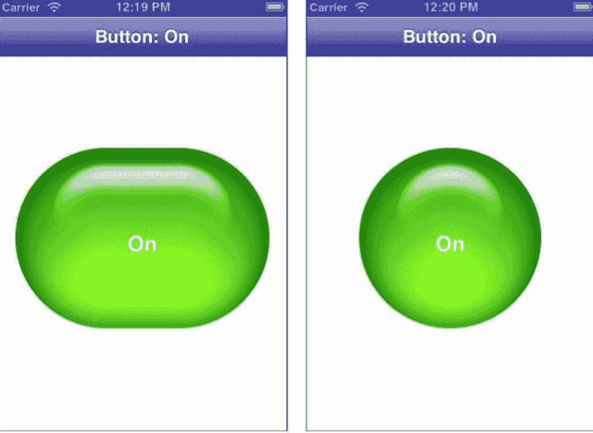

**图 2-3. 使用 UIImage 伸放来调整任意按钮宽度的美术尺寸。设置左侧的边缘宽度以指定伸放发生的位置。**

此配方中的 `UIImage resizable image` 调用在按钮创建中起着重要作用。可伸放图像允许你创建任意宽度的按钮，将圆形美术样式转换为菱形按钮。你指定了边缘（即不应被伸放的美术部分）。在这种情况下，左侧和右侧的边缘宽度 110 像素。如果你更改按钮宽度，按钮将失去中间的伸放，如图 2-3（右侧）所示。

按钮可以根据状态分配图像和背景图像。图像设置按钮的实际内容。背景图像提供可伸放的背景，图像和标题文本可以显示在其上方。配方 2-1 使用了背景图像，让按钮内置的标题字段浮在提供的美术样式之上。

## 注意

你可以通过调整层属性来圆视图和按钮的角以适应特定度数。在项目中添加 Quartz Core 框架可以让你访问视图层，在其中你可以通过代码设置图的 `cornerRadius` 属性。然后将视图的 `clipsToBounds` 属性设置为 YES 以实现 Apple 的视觉风格。

# 配方 2-1. 构建一个切换开启/关闭的 UIButton

```objc
#define CAPWIDTH 110.0f

#define INSETS (UIEdgeInsets){0.0f, CAPWIDTH, 0.0f, CAPWIDTH}

#define BASEGREEN [[UIImage imageNamed:@"green-out.png"] \
    resizableWithCapInsets:INSETS]

#define PUSHGREEN [[UIImage imageNamed:@"green-in.png"] \
    resizableWithCapInsets:INSETS]

#define BASERED [[UIImage imageNamed:@"red-out.png"] \
    resizableWithCapInsets:INSETS]

#define PUSHRED [[UIImage imageNamed:@"red-in.png"] \
    resizableWithCapInsets:INSETS]

- (void) toggleButton:(UIButton *) aButton
{
    if ((isOn = !isOn)) {
        [self setBackgroundImage:BASEGREEN
        forState:UIControlStateNormal];

        [self setBackgroundImage:PUSHRED
        forState:UIControlStateHighlighted];

        [self setTitle:@"On" forState:UIControlStateNormal];

        [self setTitle:@"On" forState:UIControlStateHighlighted];

    } else {

        [self setBackgroundImage:BASERED forState:UIControlStateNormal];

        [self setBackgroundImage:PUSHRED
        forState:UIControlStateHighlighted];

        [self setTitle:@"Off" forState:UIControlStateNormal];

        [self setTitle:@"Off" forState:UIControlStateHighlighted];

    }
}

+ (id) button
{
    PushButton *button = [UIButton buttonWithType:UIButtonTypeCustom];

    button.frame = CGMakeRect(0.0f, 0.0f, 300.0f, 233.0f);

    // 设置按钮对齐属性
    button.contentVerticalAlignment =
    UIControlContentVerticalAlignmentCenter;

    button.contentHorizontalAlignment =
    UIControlContentHorizontalAlignmentCenter;

    // 设置字体和颜色
    [button setTitleColor:
    [UIColor whiteColor] forState:UIControlStateNormal];

    [button setTitleColor:
    [UIColor grayColor] forState:UIControlStateHighlighted];

    button.titleLabel.font = [UIFont boldSystemFontOfSize:24.0f];

    // 设置美术样式
    [button setBackgroundImage:BASEGREEN forState:UIControlStateNormal];

    [button setBackgroundImage:PUSHGREEN
    forState:UIControlStateHighlighted];

    [button setTitle:@"On" forState:UIControlStateNormal];

    [button setTitle:@"On" forState:UIControlStateHighlighted];

    button.isOn = YES;

    // 添加动作。客户端也可以添加一个。
    [button addTarget:self action:@selector(toggleButton:)
    forControlEvents:UIControlEventTouchUpInside];

    return button;
}
```

## 多行按钮文本

按钮的 `titleLabel` 属性允许你修改标题属性，如字体和换行模式。在这里，字体被设置为非常大的值（基本上确保了文本需要正确绘制），并配合自动换行和居中对齐使用：

```objc
button.titleLabel.font = [UIFont boldSystemFontOfSize:36.0f];

[button setTitle:@"Lorem Ipsum Dol Sit" forState:UIControlStateNormal];

button.titleLabel.textAlignment = UITextAlignmentCenter;

button.titleLabel.lineBreakMode = UILineBreakModeWordWrap;
```


默认情况下，按钮标签从一端拉伸到另一端。这意味着文本可能会超出你预期的范围，甚至可能超出按钮美术样式的边缘。要解决这个问题，你可以在换行模式下通过嵌入新的换行符（即 `\n`）来强制执行回车。这允许你控制按钮标题每行显示的多少文本。

## 为按钮添加动画元素

```objectivec
}

else {

    [button setTitle:@"Off" forState:UIControlStateNormal];

    [button setTitle:@"Off"
        forState:UIControlStateHighlighted];

    [button setBackgroundImage:BASERED
        forState:UIControlStateNormal];

    [button setBackgroundImage:PUSHED
        forState:UIControlStateHighlighted];

}

    [self relaxButton:button];

}
```

```objc
+ (id) button {

    PushButton *button = [PushButtonWithType:UIButtonTypeCustom];

    button.frame = CGRectMake(0.0f, 0.0f, 220.0f, 233.0f);

    // Add actions

    [button addTarget:self:@selector(toggleButton)
        forControlEvents:UIControlEventTouchInside];

    [button addTarget:self:@selector(zoomButton)
        forControlEvents:UIControlEventTouchDown |
        UIControlEventTouchDragInside |
        UIControlEventTouchDragEntry];

    [button addTarget:self:@selector(relaxButton)
        forControlEvents:UIControlEventTouchDragExit |
        UIControlEventTouchCancel | UIControlEventTouchDragOutside];

    return button;

}
```

## 获取此食谱的代码

要找到此食谱的完整项目，请将浏览器指向 `https://github.com/erica/iOS-6-Cookbook` 并进入第 2 章文件夹。

## 食谱：添加带有自定义滑块的滑块

`UISlider` 实例提供了一种控件，允许用户通过在左右范围之间滑动滑块（称为 thumb）来选择值。你可能已经在 iPod/Music 应用中见过滑块，在那个应用该类被用于控制音量。
滑块的默认最小值为 0.0，最大值为 1.0，尽管你可以轻松地在 IB 属性中或通过设置 `minimumValue` 和 `maxValue` 属性来自定义这些值。若要样式化控件的端点，可以添加一对相关的图像（`minimumImageView` 和 `maximumImageView`）来强化这些设置。例如，你可以在控制温度设置的滑块的一端显示一个雪人，另一端显示一杯冒着热气的茶。你还可以设置滑块前后的轨道颜色。调整 `minimumTrackTintColor` 和 `maximumTrackTintColor` 属性（iOS 5.0 及更高版本可用）。

滑块的 `continuous` 属性控制滑块在用户拖动滑块时是否持续发送取值更新。当设置为 NO（默认是 YES）时，滑块仅在用户释放滑块时发送动作事件。

## 自定义 UISlider

除了设置最小和最大图像外，`UISlider` 类还允许你直接更新其滑块组件。你可以通过调用 `setThumb:for:` 为滑块设置任何你喜欢的图像。食谱 2-3 利用了这一选项来动态地构建滑块图像，如图 2-4 所示。指示气泡作为自定义构建滑块的一部分，出现在用户的手指上方。这个气泡提供了文本上的即时反馈（气泡内的数字）和图形上的视觉反馈（气泡的颜色深浅反映了滑块值，随着用户的拖动，颜色从黑色变为白色）。

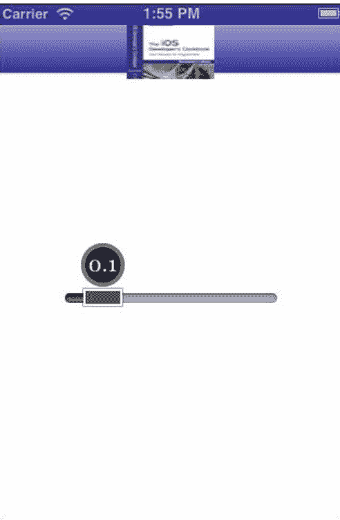

## 注意事项

在组合 `UIView` 时，iOS 会为视图的层创建一个位图。使用自定义视图或自定义生成的位图在性能上大致相同。

这种动态构建的反馈可以基于任何类型的数据。你可以轻松地从板载传感器获取值，或调用互联网，就像使用滑块配合手指移动一样简单。无论你使用哪种实时更新方案，动态更新无疑是图形密集型的——但并没有你想象的那么大。Core Graphics 调用非常快，且滑块大小图像的内存需求极小。

此特定食谱为滑块分配了两个滑块图像。气泡的出现

图 2-4. Core Graphics/Quartz 调用允许此滑块的块图像根据当前的滑块值变暗或变亮。滑块气泡内的文本反映了该值。（当用户滑动时，标题栏视图中的拉伸图标会调整其尺寸以提供额外的反馈，作为食谱示例代码中目标-动作客户端的示例。）且仅在滑块在使用时（即处于 `UIControlStateHighlighted` 状态下）。在正常状态（即 `UIControlStateNormal`）下，只会显示较小的滑块。用户可以点击滑块以查看当前设置。这种特定场景的反馈模拟了标准 iOS 键盘上的高亮效果。

为了适应这些视觉变化，滑块会在每个手势的开始和结束时更新。通过触摸（`UIControlTouchUpInside`），框架的高度会增加 60 像素。这段额外的空间为在交互期间显示扩展后的滑块提供了足够的空间。

当手指离开屏幕（`UIControlTouchEventUpInside` 或 `UIControlTouchEventUpOutside`）时，滑块恢复到之前的尺寸。这为其他对象恢复了空间，确保滑块除非用户触摸，否则不会激活。

## 添加效率

食谱 2-3 为滑块存储了一个之前的值，以尽量减少 iOS 的整体计算负担。当滑块变化至少 0.1（即值的 10%）时，它会用新的自定义图像更新滑块。如果你愿意，可以省略此步骤并在实时更新运行食谱。测试显示，即使在第一代 iPod touch 上，这也提供了相当快的更新。在最近的 iPhone 和 iPad 上，完全没有性能问题。

此食谱还避免了滑块边缘的任何问题——即滑块在 0.9 处卡住且无法正确更新到 1.0。在此食谱中，通过强制处理了这种特殊情况。

## 食谱 2-3 构建动态滑块

```objc
UIImage *thumbWithLevel(float level)
{

    float INSET_AMT = 1.5f;

    CGRect thumbRect = CGRectMake(0.0f, 0.0f, 40.0f, 100.0f);

    UraphicsBeginImageContext(baseRect.size);

    CGContextRef context = UraphicsGetCurrentContext();

    // 创建填充的矩形

    [[UIColor darkColor] setFill];

    UIColor *textColor = (level > 0.5) ? [UIColor black] : [UIColor white];

    NSString *numstring = [NSString stringWith:@"%.1f", level];

    UIFont *font = [UIFont fontWithName:@"Georgia" size:20.0];

    [numstring drawInRect:thumbRect withAttributes:@{

        kFontAttributeName: font,

        kForegroundColorAttributeName: textColor

    } options:0.:Center];

    // 绘制滑块轮廓

    [[UIColor white] setStroke];

    CGContextSetLineWidth(context, 2.0);

    CGContextAddRect(context, thumbRect);

    CGContextStrokePath(context);

    // 获取图像

    UIImage *image = UraphicsGetImageFromCurrentImage();

    UraphicsEndImageContext();

    return image;

}
```

```objc
self.value = 0.0f;

[self setThumbImage:nil forState:UIControlStateNormal];

// 创建触摸、移动和释放的回调

[self addTarget:self action:@selector(startDrag:)
ControlEvents:UIControlEventTouchDown];

[self addTarget:self action:@selector(updateThumb:)
forControlEvents:UIControlEventValueChanged];

[self addTarget:self action:@selector(endDrag:)
forControlEvents:UIControlEventTouchUpInside |
UIControlEventTouchUpOutside];

return self;

}
```

```objc
+ (id) slider
{

CustomSlider *slider = [[CustomSlider alloc]
initWithFrame:(CGRect){.size=CGSizeMake(200.0f, 40.0f)}];

return slider;

}
```

## 获取此食谱的代码

要找到此食谱的完整示例项目，请将浏览器指向 `https://github.com/erica/iOS-6-Cookbook` 并进入第 2 章文件夹。

## 外观代理 (Appearance Proxies)

是否厌倦了手动为应用程序中的每个按钮、导航栏或滑块着色？不要浪费时间去子类化。代理允许你自定义视图类中所有成员（尤其是控件）的默认外观。你不需要更新实例的属性，而是将相同的更新应用于代理。以下调用是针对滑块实例的共享外观设置：

```objc
[[UISlider appearance] setMinimumTrackTintColor:[UIColor black]];

[[UISlider appearance] setMaximumTrackTintColor:[UIColor grayColor]];

```

有时，你可能只想在容器层级应用外观代理。例如，你可能希望所有的导航栏按钮显示为蓝色，但不影响工具栏中的按钮。在这种情况下，你可以使用感知容器的外观代理。

```objc
[[UIButtonItem appearanceWhenContainedIn:
[INavigation class], nil
setTintColor:[UIColor blueColor]];

```

容器列表指定了一个布尔“与”（AND）条件。例如，代理仅适用于出现在弹出控制器中的导航栏：

```objc
[[UIButton appearanceWhenContainedIn:
[INavigation class], UIPoverController class], nil
setTintColor:[UIColor blueColor]];

```

应用到所有实例的属性将“优于”那些从属性继承来的属性。在以下代码中，左侧按钮（Hello）默认为紫色，但右侧按钮（World）覆盖了默认值，显示为：

```objc
UIButtonItem *hello = BARBUTTON(@"Hello", nil);

UIButtonItem *world = BARBUTTON(@"World", nil);

world.tintColor = [UIColor greenColor];

INavigationItem *navigationItem =
[[INavigation alloc] initWithTitle:@""]
navigationItem.leftBarButtonItem = hello;

navigationItem.rightBarButtonItem = world;

```

```objc
[[UIButton appearanceWhenContainedIn:
[INavigation class], nil]
setTintColor:[UIColor purpleColor]];

```

`UI_APPEARANCE_SELECTOR` 标记标记所有可以受外观代理影响的属性。你可以在 UIKit 的头文件中找到它们。这里有一个示例：

```objc
@property (nonatomic,retain) UIColor *tintColor
_OSX_AVAILABLE_STARTING(__MAC, __IPHONE_5_0)
UI_APPEARANCE_SELECTOR;
```

在最新版本的 SDK 中，可以在 Xcode 应用程序包中找到 UIKit 头文件。它们存储在 SDK 文件夹（`/Contents/Developer/Platforms/iPhoneOS.platform/Developer/SDKs/`）下当前操作系统的发布文件夹中（例如，iPhone6.0.sdk/System/Library/Frameworks）。查看特定的 Framework 文件夹（例如 UIKit），以找到适用于你正在使用的 iOS 版本的头文件。

注意不要盲猜。为视图的 `backgroundColor` 属性设置外观代理不会引发编译时或运行时错误，但它可能会严重破坏你应用程序的呈现，让你的屏幕变得错乱。背景颜色未被授权为外观选择器。在本文编写期间，以下类支持外观代理：

- `UIActivityIndicator`
- `UIButton`
- `UIButtonItem`
- `UINavigationItem`
- `UIPageControl`
- `UIProgressView`
- `UIRefreshControl`
- `UISearchBar`
- `UISegmentedControl`
- `UISlider`
- `UISStepper`
- `UISwitch`
- `UITabBar`
- `UITabView`
- `UITableViewHeaderFooter`
- `UIToolbar`

此外，可用于外观代理赋值的项目各不相同。例如，图 5 显示了匹配的开关的外观。（https://images.example.com/ea136b502399e757f6a2378f9c4d5b02.png）

食谱 2-4 使用这种方法在选定文本被点击时将其颜色从白色变为浅灰色，并在交互结束时重置该更改。每当用户点击一个段时，代码都会更新该触摸期间被选中段的文本颜色，提供必要的反馈以获得更好的用户体验。

# 控制与属性

在 iOS 6 中，许多 UIKit 类（包括文本字段、文本视图、标签、按钮和刷新控件）现在都允许你为它们的 text 属性和 title 属性分配富属性（Core Text 风格）字符串：

```objc
[myButton setAttributedTitle:attributedString forState:UIControlStateNormal]
```

此外，iOS 现在提供了一组新的（且很小的）UIKit 特定文本属性，如字体、颜色和阴影。这些属性用于导航栏、分段控件和条目（即条形样式元素）。你通过调用 `setTitleAttributes:(navigation bar)` 和 `setTitleTextAttributes:forState:(segmented control and bar items)` 来设置属性。使用以下键值对传递一个富属性字典。

- **UITextAttributeFont**—提供一个 `UIFont` 实例。
- **UITextAttributeColor**—提供一个 `UIColor` 实例。
- **UITextAttributeShadowColor**—提供一个 `UIColor` 实例。
- **UITextAttributeShadowOffset**—提供一个封装 `UIOffset` 结构体的 `NSValue` 实例。偏移量包括两个浮点数：水平和垂直。使用 `UIOffsetMake()` 从一对浮点数构造该结构体。

例如，这个食谱将分段控件在选中状态下的文本颜色设置为浅灰色。每当控件被选中时，文本颜色就会从白色变为灰色。

## 食谱 2-4. 创建一个响应点击的分段控件子类

```objc
@class DoubleTapSegmentedControl;

@protocol DoubleTapSegmentedControlDelegate <NSObject *> DTSC

- (void) performSegmentAction:(DoubleTapSegmentedControl *) aDTSC;

@end

@interface DoubleTapSegmentedControl : UISegmentedControl

id weak <DoubleTapSegmentedControlDelegate> delegate;

@property (nonatomic, weak) id delegate;

@end
```


@Implementation `DoubleTapSegmentedControl`

```objc
(void) touchesBegan:(NSSet *)touches withEvent:(UIEvent *)event {
    [super touchesBegan:touches withEvent:event];
    if (self.delegate) [self.delegate performSegmentAction:self];
    // 添加一点额外的反馈
    NSDictionary *attributeDictionary = @{UITextAttributeColor : [UIColor lightGrayColor]};
    [self setTitleTextAttributes:attributeDictionary forState:UIControlStateSelected];
}

(void) touchesEnded:(NSSet *)touches withEvent:(UIEvent *)event {
    [self setTitleTextAttributes:nil forState:UIControlStateSelected];
}

(void) touchesCancelled:(NSSet *)touches withEvent:(UIEvent *)event {
    [self touchesEnded:touches withEvent:event];
}
@end
```

## 获取此食谱的代码

要找到此食谱的完整示例，请将浏览器指向 `https://github.com/erica/iOS-6-Cookbook` 并进入第 2 章的文件夹。

## 使用开关（Switches）和步进器（Steppers）

`UISwitch` 对象提供了简单的开关，允许用户选择布尔值（在大多数非英语本地化中，开关会国际化为 1/0）。开关对象包含一个（可设置的）值属性名为 `on`。它根据控件的当前状态返回 `YES` 或 `NO`。你可以通过直接更改属性值或调用 `setOn:animated:` 来编程地更新开关的值，后者提供了一种动画变化的方法：

```objc
- (void) didSwitch:(UISwitch *)theSwitch {
    self.title = [NSString stringWithFormat:@"%\n", theSwitch ? @"On" : @"Off"];
}

-(void) viewWillAppear:(BOOL) animated {
    // 创建开关
    UISwitch *theSwitch = [[UISwitch alloc] init];
    // 触发值变化改变
    [theSwitch addTarget:self action:@selector(didSwitch:) forControlEvents:UIControlValueChanged];
    [self.view addSubview:theSwitch];
    // 初始化为“关闭”
    theSwitch.on = NO;
    self.title = @"Off";
}
```

在示例中，当开关变化时，它会更改视图控制器的标题。IB（Interface Builder）为开关提供的选项较少。你可以启用它并设置它的初始值，但除此之外没有更多可自定义的了。当用户调整开关时，开关会产生一个值改变事件。

> **注意：** 不要将 `UISwitch` 实例命名为 `switch`。记住 `switch` 是 C 语言的保留关键字；用于条件语句。这个简单的疏忽曾让许多 iOS 开发者碰壁。

`UIStepper` 类提供了滑块（Sliders）和开关的替代方案。滑块提供连续的值范围；开关提供简单的布尔开启/关闭选择。步进器介于两者之间。实例呈现出一对按钮，一个没有标记，另一个标记为 `+`。它们迭代地增加或减少其 `value` 属性。你通常希望通过将 `minimumValue` 和 `maximumValue` 设置为合理的边界来为控件分配范围，以便控件与音量、速度和其他可衡量的实际应用功能更紧密地结合。你不必这样做，但在某些情况下，你可能允许用户对无界变量进行输入。你可以通过将 `wraps` 属性设置为 `YES` 来让步进器实现“循环”。当值超过最大值或低于最小值时，值将根据按下的按钮从最小值循环到最大值，或从最大值回到最小值。

默认情况下，步进器会自动重复。也就是说，只要用户按住其中一个按钮，它就会持续。你可以通过将 `autorepeat` 属性设置为 `NO` 来禁用此功能。每次点击的值变化由 `stepValue` 属性控制。不要将 `value` 设置为 0 或负数；否则会抛出运行时异常。

## 食谱：子化 UIControl

UIKit 提供了许多可以直接在应用程序中的预构建控件。有按钮、开关、滑块等。但何止于此呢？你不局限于苹果提供的项目。为什么不创建自己的呢？

食谱 2-5 解释了如何通过子化 UIKit 从头构建新控件。此示例创建一个简单的颜色选择器。它允许用户在控件内触摸或拖动来选择颜色。当用户左右追踪时，颜色改变色调。上下移动调整饱和度。控件的亮度和透明度固定在 100%。这是一个非常容易编写的控件，因为除了获取 x 和 y 坐标外，没有太复杂的交互。它展示了子化 `UIControl` 涉及的大部分开发问题。

那么为什么要构建自定义控件？首先，你可以设置自己的设计样式。放置在界面中的元素应该符合你应用程序的美学。如果 Apple 的预构建开关、滑块和其他 GUI 元素无法自然融入你的界面，自定义构建的控件可以满足你的应用程序需求，而不会牺牲设计的统一性。

其次，你可以创建 Apple 未提供的控件。从通过滑动一系列星星来选择评分，到从弹出的蜡笔集中选择颜色，自定义控件允许你在超出系统提供的按钮和开关之外进行交互。

最后，自定义控件允许你添加无法直接访问或通过子类化访问的功能。通过相对少的工作，你可以从底层构建自己的按钮和步进器，允许你按意愿调整它们的交互方式。

始终保持你的自定义项目与系统提供的项目在视觉上有所区别。避免混淆。当你使用外观相似的项目，在向 App Store 提交应用时可能需要向 Apple 添加说明。明确说明你创建了一个新类，而不是使用私有 API 或以不符合 App Store 安全的方式访问它们的对象。即使如此，你仍可能由于创建可能“困扰”终端用户的项而被拒绝。

## 创建控件

构建控件的过程通常涉及四个不同的步骤。如配方 2-5 所示，你首先通过对 `UIColor` 进行子类化创建一个新的自定义类。在该类中，你在初始化时布局控件的视觉外观。接下来，你构建方法来跟踪和解释触摸，最后通过生成事件和视觉反馈完成。

几乎所有的控件都提供某种值。例如，开关（switch）有 `isOn`，滑动条（slider）有浮点值，而文本字段提供文本。你通过自定义控件提供的值类型是任意的。它们可以是整数、浮点、字符串，或者像配方 2-5 那样是一个颜色。

在配方 2-5 中，控件布局基本上是一个彩色的矩形。更复杂的控件需要更复杂的布局，但即使是这里显示的简单布局，也能为连贯的用户体验提供所有触摸交互和反馈。

## 跟踪触摸

`UIControl` 实例使用一组嵌入的方法来与触摸协作。这些方法允许控件在与控件对象交互的范围内跟踪触摸：

- `beginTrackingWithTouch:withEvent:`——当触摸进入控件边界时调用。
- `continueTrackingWithTouch:withEvent:`——当控件保持在边界内时，通过重复调用来跟踪触摸。
- `endTrackingWithTouch:withEvent:`——处理事件的最后触摸。
- `cancelTrackingWithEvent:`——管理触摸取消。

通过在 `UIControl` 子类中实现这些方法的任何或全部，添加你的自定义逻辑。配方 2-5 使用 `begin` 和 `continue` 方法来定位用户触摸并持续跟踪，直到触摸被抬起或其他离开控件。

## 分发事件

控件使用目标-动作对（target-action pairs）来通信由事件触发的变化。当你构建新控件时，必须决定你的对象将生成什么类型的事件，并添加代码来触发这些事件。

通过调用 `sendActionsForControlEvents:` 为你的自定义控件添加分发功能：

此方法允许你向控件的目标发送事件（例如 `UIControlValueChanged`）。控件通过向 `UIApplication` 单例发送消息来传输这些更新。正如 Apple 指出的，应用程序是所有消息的集中分发点。

尽可能创建完整的控件词汇，无论你的类有多简单。你无法准确预测该类未来将如何被使用。过度设计事件可以为未来的使用提供灵活性。[毕竟，配方 2-5 为一个非常简单的控件分发了广泛的事件。]

在何时分发事件很大程度上取决于你最终构建的控件。例如，开关控件实际上只对触摸事件感兴趣，即值改变的时候。相比之下，滑动控件侧重于触摸移动，并在跟踪手指移动时需要持续更新。请根据此调整你的代码，并注意在触摸周期的所有部分呈现适当的视觉变化。

## 配方 2-5. 构建自定义颜色控件

```objectivec
@implementation ColorControl

- (id)initWithFrame:(CGRect)frame {
    if (!self = [super initWithFrame:frame])) return nil;
    _value = nil;
    self.backgroundColor = [UIColor grayColor];
    return self;
}

(void)updateFromTouch:(UITouch *)touch {
    // 计算色相和饱和度
    CGPoint touchPoint = [touch locationInView:self];
    float hue = touchPoint.x / self.frame.size.width;
    float saturation = touchPoint.y / self.frame.size.height;
    // 更新颜色值并改变背景颜色
    self.value = [UIColor colorWithHue:hue saturation:saturation brightness:1.0f alpha:1.0f];
    self.backgroundColor = self.value;
    [self sendActionsForControlEvents:UIControlControlEventsChanged];
}

// 在控件中继续跟踪触摸
-(BOOL)continueTrackingWithTouch:(UITouch *)touch withEvent:(UIEvent *)event {
    // 测试拖动当前在内部还是外部
    CGPoint touchPoint = [touch locationInView:self];
    if (CGRectContainsPoint(self.frame, touchPoint))
        [self sendActionsForControlEvents:UIControlEventDragInside];
    else
        [self sendActionsForControlEvents:UIControlEventDragOutside];
    // 更新颜色值
    [self updateColorFromTouch:touch];
    return YES;
}

// 在控件中开始跟踪触摸
-(BOOL) beginTrackingWithTouch:(UITouch *) touch withEvent:(UIView *) event {
    // 触摸按下
    [self sendActionsForControlEvents:UIControlEventDown];
    // 更新颜色值
    [self updateColorFromTouch:touch];
    return YES;
}

// 结束跟踪触摸
-(void) endTrackingWithTouch:(UITouch *) touch withEvent:(UIView *) event {
    // 测试触摸结束在内部还是外部
    CGPoint touchPoint = [touch locationInView:self];
    if (CGRectContainsPoint(self.bounds, touchPoint))
        [self sendActionsForControlEvents:UIControlEventTouchUpInside];
    else
        [self sendActionsForControlEvents:UIControlEventTouchUpOutside];
    // 更新颜色值
    [self updateColorFromTouch:touch];
}

// 处理触摸取消
-(void)cancelTrackingWithEvent:(UIView *) event {
    [self sendActionsForControlEvents:UIControlEventTouchCancel];
}

@end
```

## 获取配方代码

要找到此配方的完整示例项目，请将浏览器指向 `https://github.com/erica/iOS-6-Cookbook` 并进入第 2 章文件夹。

## 配方：构建评分滑动条

评分滑动条允许用户通过点击或跨越星星来选择评分。这是一种常见的 UI 模式，但需要细致处理以确保视觉反馈与手指同步。（注：原文此处后存在大量重复段落，已去重）

```objc
if (p.x < eachItem.frame.origin.x)
    eachItem.image = OFF_ART;
else {
    changedValue = eachItem; // last item touched
    eachItem.image = ON_ART;
    newValue++;
}
```

```objc
// Handle value change
if (self.value != newValue) {
    self.value = newValue;
    [self sendActionsForControlEvents:UIControlEventValueChanged];
    // Animate the new value with a zoomed pulse
    [UIView animateWithDuration:0.15f
    animations:^{changedValue.transform = CGAffineTransformMakeScale(1.5f, 1.5f)};
    completion:(BOOL done){
        [UIView animateWithDuration:0.1f
        animations:^{changedValue.transform = CGAffineTransformIdentity}];
    }];
}
```

```objc
(BOOL)beginTrackingWithTouch:(UITouch*)touch withEvent:(UIView*)event {
    // Establish touch down event
    CGPoint touchPoint = [touch locationInView:self];
    [self sendActionsForControlEvents:UIControlTouchUpInside];
    // Calculate value
    [self updateValueAtPoint:touchPoint];
    return YES;
}
```

```objc
(BOOL)continueTrackingWithTouch:(UITouch*)touch withEvent:(UIView*)event {
    // Test if drag is currently inside or outside
    CGPoint touchPoint = [touch locationInView:self];
    if (CGRectContainsPoint(self.frame, touchPoint))
        [self sendActionsForControlEvents:UIControlEventDragInside];
    else
        [self sendActionsForControlEvents:UIControlEventDragOutside];
    // Calculate value
    [self updateValueAtPoint:[touch locationInView:self]];
    return YES;
}
```

```objc
(void) endTrackingWithTouch:(UITouch *)touch withEvent:(UIEvent *)event {
    // Test if touch ended inside or outside
    CGPoint touchPoint = [touch locationInView:self];
    if (CGRectContainsPoint(self.bounds, touchPoint)) {
        [self sendActionsForControlEvents:UIControlEventTouchUpInside];
    } else {
```


## 测试 2-8

食谱 2-8 从两个方面限制了交互。首先，用户必须在丝带内部进行触摸以开始交互。如果不是，触摸将穿透且控件将对其做出响应，即使触摸可能在控件的边界上方已经开始。其次，食谱对丝带位图图进行测试，以确保触摸发生在艺术品的实心（非透明）部分。如图 2-7 所示，艺术作品底部出现了一个缺口。在该区域内的触摸将不会启动跟踪序列。食谱将触摸位置与艺术中的像素进行比较。如果艺术的透明度（alpha 级）低于 85（约 67% 透明），触摸将不会与丝带连接。

为此食谱提供的示例代码没有对拉伸艺术进行测试。它假设艺术与屏幕显示之间是一一对一的关系。由于这种原因，如果你选择以任何方式调整此控件的大小，你将不得不放弃透明度测试，或者针对拉伸艺术对其进行调整。

一旦跟踪开始，就会跟随触摸移动，用手指向上或向下拖动。在这个食谱中，如果这种触摸移动超过 75 点，控件就会触发。它会向客户端发送一个值改变信号。严格来说，控件并没有一个“值”，但在内部抬起的感觉就像是：当到达该点时，`continueTrackingWithTouch:withEvent:` 方法返回 `NO`，表示跟踪已结束，控件也完成了这次特定交互的任务。如果触摸移动未能超过阈值，或者用户在达到该点之前停止了交互，控件将把其艺术品滚动回起始点。这重置了视觉显示，为下一次交互做好准备。

## 食谱 2-8. 构建一个可拖动丝带控件

```objc
- (BOOL)beginTrackingWithTouch:(UITouch *)touch withEvent:(UIEvent *)event {
    CGPoint touchPoint = [touch locationInView:self];
    CGPoint ribbonPoint = [touch locationInView:pullImageView];

    // 查找图像中的数据偏移
    Byte *bytes = (Byte *)ribbonData.bytes;
    uint offset = alphaOffset(ribbonPoint.x, ribbonPoint.y, pullImageView.bounds.size.width);

    // 测试包含性和 alpha 值，以允许丝带外部和缺口区域内部的触摸
    if (CGRectContainsPoint(pullImageView.frame, touchPoint) && (bytes[offset] > 85)) {
        [self sendActionsForControlEvents:UIControlEventTouchDown];
        return YES;
    }
    return NO;
}

- (BOOL)continueTrackingWithTouch:(UITouch *)touch withEvent:(UIEvent *)event {
    // 一旦用户进行了交互，就不再抖动
    wiggleCount = 999;

    // 测试内部/外部触摸
    CGPoint touchPoint = [touch locationInView:self];
    if (CGRectContainsPoint(self.frame, touchPoint)) {
        [self sendActionsForControlEvents:UIControlEventTouchDragInside];
    } else {
        [self sendActionsForControlEvents:UIControlEventTouchDragOutside];
    }

    // 根据拖动程度调整艺术
    CGFloat dy = MAX(touchPoint.y - touchDownPoint.y, 0.0f);
    dy = MIN(dy, self.bounds.size.height - 75.0f);

    pullImageView.frame = CGRectMake(0.0f, dy + 75.0 - ribbonImage.size.height, ribbonImage.size.width, ribbonImage.size.height);

    // 检测移动是否足够触发所有操作
    if (dy > 75.0f) {
        // 已经足够。播放点击声，触发回调并将视图滚回。
        [self playClick];
        [UIView animateWithDuration:0.3f animations:^{
            pullImageView.frame = CGRectMake(0.0f, 75.0 - ribbonImage.size.height, ribbonImage.size.width, ribbonImage.size.height);
        } completion:^(BOOL finished) {
            [self sendActionsForControlEvents:UIControlEventValueChanged];
        }];

        // 不再需要或允许交互
        return NO;
    }

    // 继续交互
    return YES;
}

- (void)endTrackingWithTouch:(UITouch *)touch withEvent:(UIEvent *)event {
    // 测试是在内部还是外部触摸
    CGPoint touchPoint = [touch locationInView:self];
    if (CGRectContainsPoint(self.bounds, touchPoint)) {
        [self sendActionsForControlEvents:UIControlEventTouchUpInside];
    } else {
        [self sendActionsForControlEvents:UIControlEventTouchUpOutside];
    }
}

- (void)cancelTrackingWithEvent:(UIEvent *)event {
    [self sendActionsForControlEvents:UIControlEventTouchCancel];
}
```

```objc
CGPoint touchPoint = [touch locationInView:trackView];
CGFloat trackStart = [self thumbStartPoint].x;
CGFloat trackEnd = trackView.bounds.size.width * 0.97 - thumbView.bounds.size.width;
CGFloat offset = touchPoint.x;
offset = MAX(offset, trackStart);
offset = MIN(offset, trackEnd);

// 更新滑块
[UIView animateWithDuration:0.1f animations:^{
    thumbView.center = CGPointMake(
        CGRectGetMidX(thumbView.bounds) + offset,
        CGRectGetMidY(trackView.bounds)
    );
}];

return YES;

// 检查是否成功解锁（超过 75%）
- (void)endTrackingWithTouch:(UITouch *)touch withEvent:(UIEvent *)event {
    CGPoint touchPoint = [touch locationInView:trackView];
    CGFloat offset = touchPoint.x;
    if (offset > trackView.frame.size.width * 0.75f) {
        // 完成、解锁并淡出
        [self sendActionsForControlEvents:UIControlEventValueChanged];
        self.value = NO;
        [UIView animateWithDuration:0.5f animations:^{
            self.alpha = 0.0f;
        } completion:^(BOOL finished) {
            [self removeFromSuperview];
        }];
    } else {
        // 失败 - 重置
        [UIView animateWithDuration:0.2f animations:^{
            thumbView.center = [self thumbStartPoint];
        }];
    }

    if (CGRectContainsPoint(trackView.bounds, touchPoint))
        [self sendActionsForControlEvents:UIControlEventTouchUpInside];
    else
        [self sendActionsForControlEvents:UIControlEventTouchUpOutside];
}

- (void)cancelTrackingWithEvent:(UIEvent *)event {
    [self sendActionsForControlEvents:UIControlEventTouchCancel];
}
```

## 获取此食谱的代码

要找到此食谱的完整示例项目，请将浏览器指向 `https://github.com/erica/iOS-6-Cook` 并进入第 2 章的文件夹。

## 添加页指示器控件

`UIPageControl` 类提供了一行点，用于指示多页视图当前显示的是哪一个项目。SpringBoard 首页底部的点展示了这种控件的运行示例。遗憾的是，`UIPageControl` 类在实际操作中的表现令人失望。它的实例处理起来很笨拙，难以点击，并且通常会打扰你的用户。在使用时，请确保添加备选的导航选项，以便页指示器更多地作为一个指示器，而不是控件。

图 2-9 显示了一个具有三页的页控件。点击亮色当前页指示器的左侧或右侧会触发 `UIControlEventValueChanged` 事件，启动你设置为控件动作的方法。你可以通过调用 `currentPage` 来查询控件的新值，并通过调整 `numberOfPages` 属性来设置可用的页数。SpringBoard 将代表页面的点数量限制为 9 个，但你的应用程序可以使用更高的数字，特别是在横屏模式下。

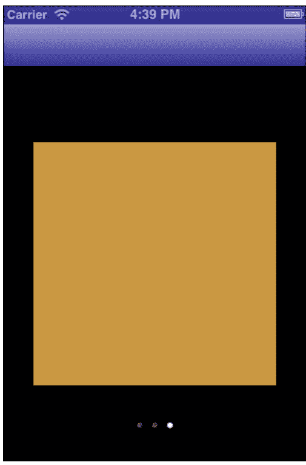

### 列表 2-1. 使用 `UIPageControl` 指示器

```objc
@implementation TestBedViewController

- (void)pageTurn:(UIPageControl *)aPageControl {
    // 动画到新页
    float width = self.view.frame.size.width;
    int whichPage = aPageControl.currentPage;
    [UIView animateWithDuration:0.3f animations:^{
        sv.contentOffset = CGPointMake(width * whichPage, 0.0f);
    }];
}

- (void)scrollViewDidScroll:(UIScrollView *)scrollView {
    // 更新控件以匹配当前的滚动
    CGPoint offset = scrollView.contentOffset;
    float width = self.view.frame.size.width;
    pageControl.currentPage = offset.x / width;
}

- (void)loadView {
    [super loadView];
    float width = self.view.frame.size.width;

    // 创建滚动视图并设置其内容大小和代理
    sv = [[UIScrollView alloc] initWithFrame:CGRectMake(0.0f, 0.0f, width, width)];
    sv.contentSize = CGSizeMake(NPAGES * width, width);
    sv.pagingEnabled = YES;
    sv.delegate = self;

    // 加载所有页面
    for (int i = 0; i < NPAGES; i++) {
        NSString *filename = [NSString stringWithFormat:@"image%d.png", i+1];
        UIImageView *iv = [[UIImageView alloc] initWithImage:[UIImage imageNamed:filename]];
        iv.frame = CGRectMake(i * width, 0.0f, width, width);
        [sv addSubview:iv];
    }

    // 放置滚动视图
    [self.view addSubview:sv];

    // 更新控件并添加目标
    pageControl.numberOfPages = NPAGES;
    [pageControl addTarget:self action:@selector(pageTurn:) forControlEvents:UIControlEventValueChanged];
    [self.view addSubview:pageControl];
}
```


# UIPageControl 类概述

`UIPageControl` 类提供了一行点，用于指示多页视图当前显示的是哪一个项目。Spring 首页底部的点展示了这种控件的运行示例。遗憾的是，`UIPageControl` 类在实际操作中的表现令人失望。它的实例处理起来很笨拙，难以点击，并且通常会打扰你的用户。在使用时，请确保添加备选的导航选项，以便页指示器更多地作为一个指示器，而不是控件。

图 2-9 显示了一个具有三页的页控件。点击亮色当前页指示器的左侧或右侧会触发 `UIControlEventValueChanged` 事件，启动你设置为控件动作的方法。你可以通过调用 `currentPage` 来查询控件的新值，并通过调整 `numberOfPages` 属性来设置可用的页数。SpringBoard 将代表页面的点数量限制为 9 个，但你的应用程序可以使用更高的数字，特别是在横屏模式下。


# 列表 2-1. 使用 UIPageControl 指示器

列表 2-1 使用 `UIScrollView` 实例显示三页图像。用户可以使用滑动来查看图片，页指示器会随之更新。同样，用户可以点击页控件，滚动器会将选定的页面动画到到位。这种双向关系是通过向页控件添加目标-动作回调以及向滚动器添加代理回调实现的。每个回调都会更新另一个对象，在两者之间提供了紧耦合。

```objc
@implementation TestBedViewController

- (void)pageTurn:(UIPageControl *)aPageControl
{
    // 动画到新页
    float width = self.view.frame.size.width;
    int whichPage = aPageControl.currentPage;
    [UIView animateWithDuration:0.3f
                     animations:^{
                         sv.contentOffset = CGPointMake(width * whichPage, 0.0f);
                     }];
}

- (void)scrollViewDidScroll:(UIScrollView *)scrollView
{
    // 更新控件以匹配当前的滚动
    CGPoint offset = scrollView.contentOffset;
    float width = self.view.frame.size.width;
    pageControl.currentPage = offset.x / width;
}

- (void)loadView
{
    [super loadView];
    float width = self.view.frame.size.width;

    // 创建滚动视图并设置其内容大小和代理
    sv = [[UIScrollView alloc] initWithFrame:CGRectMake(0.0f, 0.0f, width, width)];
    sv.contentSize = CGSizeMake(NPAGES * width, sv.frame.size.height);
    sv.pagingEnabled = YES;
    sv.delegate = self;

    // 加载所有页面
    for (int i = 0; i < NPAGES; i++)
    {
        NSString *filename = [NSString stringWithFormat:@"image%d.png", i+1];
        UIImageView *iv = [[UIImageView alloc] initWithImage:[UIImage imageNamed:filename]];
        iv.frame = CGRectMake(i * width, 0.0f, width, width);
        [sv addSubview:iv];
    }

    // 放置滚动视图
    [self.view addSubview:sv];

    // 更新控件并添加目标
    pageControl.numberOfPages = NPAGES;
    [pageControl addTarget:self
                    action:@selector(pageTurn:)
          forControlEvents:UIControlEventValueChanged];
}

@end
```

# 滑动解锁控件实现

以下代码演示了一个自定义的滑动解锁控件实现，包含触摸跟踪、动画反馈及解锁逻辑判断。

```objc
- (BOOL)continueTrackingWithTouch:(UITouch *)touch withEvent:(UIEvent *)event
{
    CGPoint touchPoint = [touch locationInView:trackView];
    CGFloat trackStart = [self thumbStartPoint].x;
    CGFloat trackEnd = trackView.bounds.size.width * 0.97 - thumbView.bounds.size.width;

    CGFloat offset = touchPoint.x;
    offset = MAX(offset, trackStart);
    offset = MIN(offset, trackEnd);

    // 更新滑块
    [UIView animateWithDuration:0.1f animations:^{
        thumbView.center = CGPointMake(CGRectGetMidX(thumbView.bounds) + offset,
                                       CGRectGetMidY(trackView.bounds));
    }];

    return YES;
}

// 检查是否成功解锁（超过 75%）
- (void)endTrackingWithTouch:(UITouch *)touch withEvent:(UIEvent *)event
{
    CGPoint touchPoint = [touch locationInView:trackView];
    CGFloat offset = touchPoint.x;
    if (offset > trackView.frame.size.width * 0.75f)
    {
        // 完成、解锁并淡出
        [self sendActionsForControlEvents:UIControlEventValueChanged];
        self.value = NO;
        [UIView animateWithDuration:0.5f animations:^{
            self.alpha = 0.0f;
        } completion:^(BOOL finished) {
            [self removeFromSuperview];
        }];
    }
    else
    {
        // 失败 - 重置
        [UIView animateWithDuration:0.2f animations:^{
            thumbView.center = [self thumbStartPoint];
        }];
    }
    if (CGRectContainsPoint(trackView.bounds, touchPoint))
        [self sendActionsForControlEvents:UIControlEventTouchUpInside];
    else
        [self sendActionsForControlEvents:UIControlEventTouchUpOutside];
}

- (void)cancelTrackingWithEvent:(UIEvent *)event
{
    [self sendActionsForControlEvents:UIControlEventTouchCancel];
}
```

# 页面管理相关方法

## 删除页面逻辑

```objc
pageControl.numberOfPages = pageControl.numberOfPages - 1;
int i = 0;
for (UIView *eachView in scrollView.subviews)
{
    if ((i == whichPage) && (eachView.tag == 999))
    {
        [eachView removeFromSuperview];
        break;
    }
    if (eachView.tag == 999) i++;
}
[self layoutPages];
```

## 隐藏确认并取消

```objc
- (void)hideConfirmAndCancel
{
    cancelButton.enabled = NO;
    [UIView animateWithDuration:0.3f animations:^{
        confirmButton.center = CGPointMake(deleteButton.center.x - 300.0f, deleteButton.center.y);
    }];
}
```

## 确认删除当前页

```objc
- (void)confirmDelete:(UIButton *)button
{
    [self deletePage];
    addButton.enabled = YES;
    deleteButton.enabled = (pageControl.numberOfPages > 1) ? YES : NO;
    [self pageTurn:pageControl];
    [self hideConfirmAndCancel];
}
```

## 取消删除

```objc
- (void)cancelDelete:(UIButton *)button
{
    [self hideConfirmAndCancel];
}
```

# 获取示例代码

要找到此食谱的完整示例项目，请将浏览器指向 `https://github.com/erica/iOS-6-Cook` 并进入第 2 章的文件夹。


```objc
// 用户请求删除当前页
(void) requestDelete:(UIButton *) button
{
    // 将取消按钮和确认按钮置于顶
    [cancelButton.superview addSubviewToFront:cancelButton];
    [confirmButton.superview addSubviewToFront:confirmButton];
    cancelButton.enabled = YES;
}
```

// 动画确认按钮移动到指定位置
confirmButton.center = CGPointMake(deleteButton.center.x - 300.0f, deleteButton.center.y);

[UIView animateWithDuration:0.3f animations:^(void) {
  confirmButton.center = deleteButton.center;
}];

// 加载时设置分页控件和滚动视图
(void) viewDidLoad {
  // 更新分页控件
  pageControl.numberOfPages = 0;
  [pageControl addTarget:self action:@selector(pageTurn:) ControlEvents:UIControlControlEvents];
  // 创建滚动视图并设置其内容大小和代理
  scrollView = [[UIScrollView alloc] init];
  scrollView.pagingEnabled = YES;
  scrollView.delegate = self;
  [self addSubview:scrollView];
  // 加载页面
  for (int i = 0; i < INITPAGES; i++) {
    [self addPage];
    pageControl.currentPage = i;
  }
  // 增大按钮尺寸以提高点击率
  addButton.frame = CGRectInset(addButton.frame, -20.0f, -20.0f);
}

// 更新视图布局
(void) viewDidWillAppear:(BOOL)animated {
  dimension = MIN(self.view.bounds.width, self.view.bounds.height) * 0.8f;
  [self layoutPages];
}

@end

## 获取本教程的代码

要找到本教程的完整项目，请访问 `https://github.com/erica/iOS-6-Cookbook` 并进入第2章。

## 构建工具栏

只要你自己提供了一些方便的宏定义，在代码中定义和布局工具栏是非常简单的。以下宏返回用于四种可用样式的按钮项。这些宏旨在自动引用计数（`ARC`）使用。如果你使用手动保留/释放（`MRR`）开发，请确保使用 `autorelease` 调用来适配它们：

```objc
#define BARBUTTON(TITLE, SELECTOR) [[UIBarButtonItem alloc] \
initWithTitle:TITLE style:UIBarButtonItemStylePlain\
target:SELECTOR]
#define IMGBUTTON(IMAGE, SELECTOR) [[UIBarButtonItem alloc] \
initWithImage:IMAGE style:UIBarButtonItemStylePlain\
target:SELECTOR]
#define SYSBARBUTTON(ITEM, SELECTOR) [[UIBarButtonItem alloc] \
initWithBarButtonSystemItem:ITEM\
target:SELECTOR]
#define CUSTOMBARBUTTON(VIEW) [[UIBarButtonItem alloc] \
initWithCustomView:VIEW]
```

这些样式适用于图像、项目、系统和自定义视图项。每个宏都提供了一个可以放入工具栏的 `UIBarButtonItem`。列表 2 展示了这些宏用法，演示了如何添加每种样式，包括占位符。你甚至可以为工具栏添加自定义视图，列表 2 将一个 `UISwitch` 实例作为按钮项之一插入，如图 11 所示。

| 标题 | + | 关闭 |
| :--- | :--- | :--- |

图 11. 自定义工具栏可以包含此类开关。

固定空间（按钮项代表了你需要超越这些方便宏的唯一实例。这里有几点提示：

- **固定空间具有宽度。** 所有 `UIBarButtonSystemItemFixedSpace` 项都可以分配宽度。要创建占位符项，设置其宽度并将其添加到 items 数组中。
- **使用单个灵活空间进行左或右对齐。** 在列表开头添加单个 `UIBarButtonSystemItemFlexibleSpace` 可以右对齐剩余项。在末尾添加一个可以左对齐。使用两个（一个开头，一个结尾）可以居中对齐。
- **考虑缺失的项。** 当由于上下文隐藏按钮项时，如果你没有使用布局约束，不要只使用灵活间距。相反，用与项大小匹配的固定宽度空间替换该项。这保留了布局并让其他图标在消失前后保持原位。
- **导航栏现在支持多项。** 从 iOS 5.0 开始，导航栏及其导航项允许你添加按钮项数组。如果你在导航栏上添加工具栏，可能可以通过添加数组（例如 `self.navigationItem.rightBarButtonItems`）来实现。这里的工具栏提示（包括占位符）也适用于导航布局。

## 列表 2-2. 在代码中创建工具栏

```objc
@implementation TestBed
-(void) action
{
    // 无操作
}

-(void) viewLoad
{
    UIToolbar *tb = [[UIToolbar alloc] initWithFrame:CGRectMake(0.0f, 0.0f, 320.0f, 44.0f)];
    tb.center = CGPointMake(160.0f, 200.0f);
    NSMutableArray *titems = [NSMutableArray array];

    // 设置工具栏的项
    [titems addObject:BARBUTTON(@"Title", @selector(action))];
    [titems addObject:SYSBARBUTTON(UIBarButtonSystemItemAdd, @selector(action))];
    [titems addObject:IMGBUTTON(@"back.png", @selector(action))];
    [titems addObject:CUSTOMBARBUTTON([[UISwitch alloc] init])];
    [titems addObject:SYSBARBUTTON(UIBarButtonSystemItemFlexibleSpace, nil)];
    [titems addObject:IMGBUTTON(@"puzzle.png", @selector(action))];

    // 添加固定宽度
    UIBarButtonItem *bbi = [[UIBarButtonItem alloc] initWithBarButtonSystemItem:UIBarButtonSystemItemFixedSpace target:nil action:nil];
    bbi.width = 20.0f;
    [titems addObject:bbi];

    tb.items = titems;
    [self.view addSubview:tb];
}
@end
```

## 总结

本章介绍了许多与应用程序中的控件交互并充分利用它们的方法。仅仅因为一个项属于 `UIColor` 类并不意味着你不能像对待 `UIView` 一样对待它。给它添加子视图、调整大小、制作动画、在屏幕上移动或对其进行标记以备后用。

- Core Graphics 和 Quartz 2D 允许你根据需要构建视觉元素。结合舒适性……

每个字符串代表一个应该显示的单个按钮。

这里的方法片段创建并显示了最简单的警报场景。它显示一条带有单个 OK 按钮的消息。该警报不涉及代理或回调，因此它的生命周期在用户点击按钮时就会结束：

```objc
(void) showAlert:(NSString *)theMessage
{
    UIAlertView *av = [[UIAlertView alloc] initWithTitle:@"Title"
                  message:theMessage
                  delegate:nil
                  cancelButtonTitle:@"OK"
                  otherButtonTitles:nil];
    [av show];
}
```

通过将按钮作为参数引入 `otherButtonTitles` 来添加按钮。请确保你的任意按钮列表以 `nil` 结尾。添加 `nil` 会告诉该方法你的列表已结束。下面的代码片段创建了一个带有三个按钮（Cancel、Option 和 OK）的警报。由于这段代码没有声明代理，因此无法恢复警报并确定按了这些按钮中的哪一个。警报会一直显示，直到用户点击，然后它会自动消失，且不会产生任何进一步的影响：

```objc
(void) showAlert:(NSString *)theMessage
{
    UIAlertView *av = [[UIAlertView alloc] initWithTitle:@"Title"
                  message:theMessage
                  delegate:nil
                  cancelButtonTitle:@"Cancel"
                  otherButtonTitles:@"Option", @"OK", nil];
    [av show];
}
```

在处理警报工作时，空间是非常宝贵的。图 3-1 显示了一对警报，分别描绘了双按钮（并排显示）和三按钮（行显示）的呈现方式。将你随时添加的警报按钮数量限制在三个或四个以内。按钮越少效果越好；一个或两个是最理想。如果你需要使用更多按钮，请考虑使用在本章后面讨论的 action sheet 对象，而不是 alert 视图。

### 标题

#### 测试警报

### 

#### OK

### 标题

#### 测试警报

#### Cancel

#### OK

#### Cancel

**图 3-1。** 警报在一个或两个按钮（左侧）的情况下效果最好。两个以上按钮的警报会堆叠成列表，产生不那么优雅的呈现（右侧）。

`UIAlertView` 对象不提供视觉上的“默认”按钮高亮。唯一的高亮是 Cancel 按钮，如图 3-1 所示。根据原则，Cancel 按钮出现在警报的底部或左侧。

## 警报代理

需要知道用户是点击了 OK 还是 Cancel 吗？警报使用代理在用户通过简单的回调做出选择后恢复这些选择。代理应该声明 `UIAlertViewDelegate` 协议。在通常情况下，你经常将代理设置为你的主（活动）视图控制器对象。

代理方法允许你在不同按钮被按下时做出反应。正如你已经看到的，如果你需要做的只是显示某条带有 OK 按钮的消息，那么可以省略代理支持。

在用户与你的警报交互后，代理会接收 `alertView:clickedButtonAtIndex:` 回调。传递给此方法的第二个参数指示按了哪个按钮。按钮编号从 0 开始。Cancel 按钮默认为 0。尽管它在某些视图中位于左侧，在另一些视图中位于底部，但它的按钮名称保持不变，只需调整 Cancel 按钮索引（可以通过 `cancelButtonIndex` 属性获取）。这对于 action sheets 并不适用，它们将在在本章后面讨论。

这是一个警报呈现和回调的简单示例，它会将选中的按钮编号打印到调试控制台：

```objc
@interface TestViewViewController : UIViewController <UIAlertViewDelegate>
@end
```

```objc
@implementation TestViewViewController
-(void)alertView:(UIAlertView *)alert clickedButtonAtIndex:(NSInteger) index {
    NSLog(@"User selected button %ld\n", (long)index);
}

-(void) showAlert {
    UIAlertView *av = [[UIAlertView alloc] initWithTitle:@"Alert View Sample"
message:@"Select a Button"
delegate:self
cancelButtonTitle:@"Cancel"
otherButtonTitles:@"One", @"Two", @"Three", nil];
    av.tag = MAIN_ALERT;
    [av show];
}
@end
```

如果你的控制器与多个警报工作，标签（tags）可以帮助识别哪个警报产生了特定的回调。与使用 target-action 对的控件不同，所有警报都会触发相同的方法。添加一个基于警报标签的 switch 语句让你区分对每个警报的响应。

## 显示警报

`show` 方法告诉你的警报出现。显示时，警报以模态方式工作。也就是说，它会变暗后面的场景并阻塞用户与你的应用程序的交互，直到用户通过点击按钮确认警报（通常是选择 OK 或 Cancel）。一旦这样做，控制权就会传递给任何警报代理，允许其完成与警报的操作并响应所选的按钮。

警报属性在创建后仍然是可以修改的。你可以通过更新其标题或消息属性来自定义警报。消息是出现在警报标题下方、按钮上方的可选文本。你还可以更改警报的框架（`frame`）并添加子视图。

## 警报的种类

`alertStyle` 属性允许你创建几种警报样式。默认样式 (`UIAlertViewStyleDefault`) 创建一个标准的警报，带有标题、消息文本，然后是按钮，如图 3-1 所示。它是警报世界的基础，允许你像查询 Yes/No、Cancel/Okay 以及其他简单选择一样查询按钮按下情况。

iOS 提供了另外三种样式（从 iOS 5 开始），专门用于输入文本：

- `UIAlertViewStylePlainTextInput`——这种警报样式允许用户输入文本。
- `UIAlertViewStyleSecureTextInput`——当涉及安全问题时，这种警报样式允许用户输入文本。
- `UIAlertViewStyleLoginAndPasswordInput`——这种警报样式允许用户输入登录名和密码。

## “请等待”：向用户显示进度

等待是计算体验固有的部分。作为开发者，你的工作是向用户传达这一点。进度指示有两种形式：旋转轮或进度条。提供这些的类是：

- `UIActivityIndicatorView`——进度指示提供一个圆告诉用户等待，但不提供关于完成程度的具体信息。
- `UIProgressView`——此视图呈现进度条。进度条提供了已完成多少和剩余多少的具体反馈，占用空间较小。它呈现为一个细的水平矩形，随着进度的进行从左到右填充。

注意阻塞。这两个类都应该在主线程上使用，这是 GUI 对象的规则。计算密集型代码可能会阻塞，阻止视图实时更新。如果你的代码被阻塞，你的进度视图可能不会在实际进行时实时更新，而是停留在初始值上。如果你需要显示异步反馈，请使用线程。例如，你可以在主线程上使用 `UIActivityIndicatorView`，并在第二个线程上执行计算。你的线程计算可以在主线程上执行更新，提供稳定的进度通知流，让你的用户与实际的工作同步。

`UIActivityIndicatorView` 实例提供了显示标准旋转进度的轻量级视图。处理这些视图时要记住的关键词是小。所有的活动指示器都很小，当放大超过其自然尺寸时看起来并不自然。

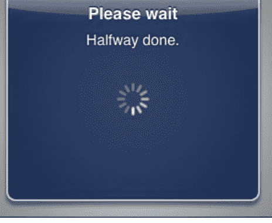

图 3-2. 从警报中移除按钮让你为正在进行的操作创建头部显示。

iOS 为 `UIActivityIndicatorView` 类提供了几种不同的样式。`UIActivityIndicatorViewStyleWhite` 和 `UIActivityIndicatorViewStyleGray` 的大小为 20x20 点。白色版本在黑色背景上效果最好，灰色在白色背景上效果最好。这是一种细而尖锐的样式。

`UIActivityIndicatorViewStyleWhiteLarge` 用于深色背景。它提供尺寸最大、最清晰的指示器，大小为 37-39 点：

```objc
UIActivityIndicatorView *av = [[UIActivityIndicatorView alloc]
initWithActivityIndicatorStyle:UIActivityIndicatorViewStyleWhiteLarge];
```

你可以使用 `color` 属性来调整活动指示器的颜色。当你设置颜色时，它会覆盖视图样式，但会保留视图的大小（普通或大）：

```objc
av.color = [UIColor blueColor];
```

你不需要将指示器居于屏幕中心。将它们放置在任何你认为最合适的地方。作为一个具有透明背景的视图，指示器会融合在它后方的任何背景视图上。背景视图的主色调有助于选择要使用的指示器颜色。

通常情况下，只需将活动指示器作为窗口、视图、工具栏或导航栏的子视图即可。分配指示器并使用框架（`frame`）初始化它，最好将其置于正在使用的任何父视图中心。通过发送 `startAnimating` 来启动指示器。要停止时，调用 `stopAnimating`。Cocoa Touch 会处理其余部分，在不使用时隐藏该视图。

## 使用 ProgressView


# 进度视图

进度视图让用户能够跟踪执行进度，而不是说“请等待”。它们展示随时间填充的条形。这些条形指示了任务完成的程度。进度条在长时间等待的情况下效果最好，此时提供状态反馈能让用户保持控制感。

要创建一个进度视图，分配一个 `ProgressView` 实例并设置其框架。要使用进度条，设置 `setProgress:`。该方法接受一个浮点数，范围从 0% (0.0, 无进度) 到 100% (1.0，已完成)。进度视图有两种样式：基础款的白色或浅灰色。使用 `setStyle` 方法选择你偏好的类型，即 `ProgressViewStyleDefault` 或 `ProgressViewStyleBar`。后者用于工具栏。

# 食谱：无按钮警报

警报视图提供了一种简单的方法来显示不需要用户交互异步消息。你可以创建一个没有按钮的 `UIAlert` 实例，并用它为应用程序中的进行操作创建一个头部显示（HUD）。由于警报是模态的，它们在显示期间会阻止任何其他用户交互。这允许在程序必须暂停处理关键操作时阻止用户触摸屏幕。

你可以构建 HUD 警报，并像显示普通按钮版本一样显示它。无按钮警报是弹出“请等待”消息的极佳方式，如图 3-2 所示。

无按钮警报面临着特殊的挑战，因为它们无法回调代理方法。即使在点击时，它们也不会自动关闭。相反，你必须在显示警报时手动将其关闭它。调用 `dismissWithButtonClickedIndex:animated:` 来执行此操作。

食谱 3-1 构建了一个自定义的 `ActivityAlert` 类，并带有一个静态实例。一次只能有一个警报处于激活状态，因此此实现使用类方法来确保该类是一个单例提供者。

`UIActivityIndicator` 出现在警报标题上方。这创建了你在图 3-2 警报底部看到的进度轮。这为用户提供了视觉反馈，表明某些活动或过程正在运行并阻止了用户交互。

一旦创建了警报，它的工作方式就像其他视图一样，你可以添加子视图或更新它的外观。遗憾的是，Interface Builder 库中没有提供警报，因此所有的自定义必须在代码中完成，如下所示。食谱 3-1 构建了子视图并在首次使用 `show` 显示警报后将其添加到警报中。显示警报允许它构建一个你可以修改和自定义的真实视图。移除按钮可能会导致整体呈现几何形状失平衡。按钮通常占据的空间并不会消失。在食谱 3-1 中，该空间被用于活动指示器。当你只使用文本时，在消息开头添加换行符（`"\n"`）可以帮助底部通常按钮所在的位置与顶部间距达到平衡。

> **注意**：警报显示在独立的窗口中——也就是说，它们不是包含你在示例应用程序中看到的辅助视图、导航栏和条形按钮的同一个窗口。警报视图不是你主窗口层级结构的一部分。

# 食谱 3-1. 显示和关闭无按钮警报

```objc
@implementation ActivityAlert
+ (void) presentWithText:(NSString *) alertText
{
    if (alertView)
    {
        // 如果有现有警报，更新文本并重新显示
        alertView.title = alertText;
        [alertView show];
    }
    else
    {
        // 创建一个留有足够空间的警报
        alertView = [[UIAlert alloc]
            initWithTitle:alertText
            message:@"\n\n\n\n"
            delegate:nil
            cancelTitle:nil
            otherButtonTitles:nil];
        [alertView show];
    }

    // 构建一个新的活动指示器并执行动画
    activity = [[UIActivityIndicatorView alloc]
        initWithActivityStyle:UIActivityIndicatorViewStyleWhiteLarge];
    activity.center = CGPointMake(
        CGRectGetMidX(alertView.bounds),
        CGRectGetMidY(alertView.bounds));
    [activity startAnimating];

    // 将其添加到警报中
    [alertView addSubview: activity];
}

// 更新警报的标题
+ (void) setTitle:(NSString *)aTitle
{
    alertView.title = aTitle;
}

// 更新警报的消息，并确保将其填充
// 到适当的行数。保持消息简短。
+ (void) setMessage:(NSString *)aMessage
{
    NSString *message = aMessage;
    while ([message componentsByString:"\n"].count < 7)
        message = [message stringByAppending:@"\n"];
    alertView.message = message;
}

// 警报并重置
+ (void) dismiss
{
    if (alertView)
    {
        [alertView dismissWithButtonClickedIndex:0 animated:YES];
        [activity removeSuperview];
        activity = nil;
        alertView = nil;
    }
}
@end
```

## 获取此食谱代码

要找到此食谱的完整项目，请参考 `github.com/erica/iOS-Cookbook`。

# 构建悬浮进度

在必须阻塞用户交互的少数情况下，你可能需要添加活动指示器。

> **注意**：Oliver Drobnik 编写了一篇关于使用 block 处理警报和操作表的精彩介绍 (`http://cocoanetics.com/2012/06/block-based-action-sheet`)。让我们希望 Apple 在 iOS 7 对这些类进行重大改新。目前，警报视图和操作表是 iOS 中最老的元素之一。它们最初是 iPhone OS 1.0 中的单个类，其古老体现在方法名中随处可见的 `clicked` 词。Drobnik 基于 block 的刷新有助于将这些老旧的遗迹引入现代。

# 食谱：使用运行循环创建模态警报

警报的间接性质（特别是其代理回调方法）可能会产生不必要的复杂代码。构建一个直接返回按钮选择值的自定义类很容易。考虑以下内容。它向图 3-3 所示的警报请求答案，然后使用类方法返回的答案：

```objc
(void) alertText: (id) sender
{
    // OK = 1, Cancel
    alertView = [[UIAlertView alloc]
        initWithTitle:@"What is your name?"
        message:@"Please enter your name"
        delegate:nil
        cancelButtonTitle:@"Cancel"
        otherButtonTitles:@"Okay", nil];
    alertView.alertViewStyle = UIAlertViewStylePlainTextInput;

    ModalAlertDelegate *delegate = [ModalAlertDelegate delegateWithAlert:alertView];

    response = [NSString stringWithFormat:@"Hello %@", [alertView textFieldAtIndex:0].text];

    // 显示响应
    [[UIAlertView alloc]
        initWithTitle:nil message:response
        delegate:nil cancelButtonTitle:nil
        otherButtonTitles:@"Okay", nil]; show;
}
```

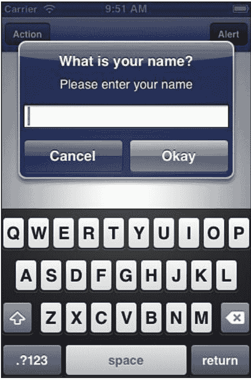

**图 3-3.** 这个模态警框会立即返回答案，因为它它是使用自己的循环构建的。

创建一个可以返回立即结果的警框需要一些技巧。一个名为 `ModalAlertDelegate` 的自定义类可以为你处理这些事务。创建一个实例，传递你想要操作的警告值。它会将自己赋值为警框的代理，并负责显示警框。它实现了自己的版本的 `show` 方法，你通常直接在警框上调用该方法。如食谱 3-2 所示，代码调用了 `CFRLoopRun()`，这使得方法停留在那里，直到用户完成与警框的交互。该方法作为运行循环，不会继续向下执行。

代理在点击按钮时取消该运行循环，并返回所选项目的值。当用户完成交互后，调用方法才能越过运行循环继续执行。

请注意，尽管你可以使用这种方法一个接地运行警框，但有时调用可能会相互拥挤。在显示下一个警框之前，留出足够的时间让上一个警框消失。如果警框未能显示，可能是由于这个重叠问题。在这种情况下，使用延迟选择器来调用下一个警框请求。十分之一秒足够让新警框显示了。推测，未来的 iOS 版本将弃用基于代理的警框，并代之以完成块（completion block）驱动的替代方案。这将消除任何基于运行循环的模态变通方法。

# 食谱 3-2. 创建返回立即结果的警框

```objc
@interface ModalAlertDelegate : NSObject <UIAlertDelegate>
{
    UIView *alertView;
    int index;
}

+ (id) delegateWithAlert:(UIView *) anAlert;
- (int) show;
@end

@implementation ModalAlertDelegate

- (id) initWithAlert:(UIView *) initAlert
{
    if (!self = [super init]) return self;
    alertView = initAlert;
    return self;
}

- (void) alertView:(UIView *) aViewAtIndex:(NSInteger) anIndex
{
    // 存储选中的按钮索引
    index = anIndex;

    // 完成警框处理
    alertView = nil;

    // 停止正在运行的循环并返回控制权
    CFRLoopStop(CFRLoopGetCurrent());
}

- (int) show
{
    // 当警框的代理并显示它
    [alertView setDelegate:self];
    [alertView show];

    // 等待用户交互
    CFRLoopRun();
    return index;
}

+ (id) delegateWithAlert:(UIAlertView *) anAlert
{
    ModalAlertDelegate *mad = [[self alloc] initWithAlert:anAlert];
    return mad;
}
@end
```

## 获取此食谱的代码

要找到此食谱的完整项目，请访问浏览器 `https://github.com/erica/iOS-6-Cookbook` 并进入第 3 章文件夹。

# 食谱：在警框视图中使用变长参数

方法可以接受任意数量的参数，称为变长参数。它们在最后一个参数后面使用省略号 `...` 进行声明。`NSLog` 和 `printf` 都是变长参数。你可以为它们提供一个格式字符串以及任意数量的参数。由于大多数警框都围绕文本，因此构建一个从格式字符串创建警框的方法是非常方便的。食谱 3-3 创建了一个 `say:` 方法，它收集传递给它的参数并用它们构建一个字符串。该字符串被传递给警框视图，然后显示，提供了一种方便的即时分发。

`say:` 方法并不解析或分析其格式字符串。相反，它获取第一个参数，将其用作格式字符串，并将剩余项传递给 `NSString initWithFormat:arguments:` 方法。这构建了一个字符串，然后该字符串作为标题传递给单按钮警框。

使用变长参数定义你的实用方法，可以让你跳过几个步骤，即你原本必须先用格式构建字符串，然后调用方法。通过 `say:`，你可以将这些步骤合并为单个调用，如下：

```objc
[NotificationAlert say: "I am so happy to meet you, %@", yourName];
```

诚然，这个食谱使用了变长参数的一个非常浅的示例。它们可以比仅仅传递给字符串初始化得多。

# 食谱 3-3. 使用变长方法创建 UIAlertView

```objc
(void) say: (id) formatstring, ...
{
    if (!formatstring) return;

    va_list arglist;
    va_start(arglist, formatstring);

    id statement = [[NSString alloc]
        initWithFormat:formatstring arguments:arglist];

    va_end(arglist);

    UIAlert *av = [[UIAlert alloc]
        initWithTitle:statement message:nil
        delegate:nil cancelButtonTitle:@"Okay"
        otherButtonTitles:nil];

    [av show];
}
```

## 获取此食谱的代码

要找到此食谱的完整示例项目，请访问浏览器 `https://github.com/erica/iOS-6-Cookbook` 并进入第 3 章文件夹。

# 显示选项列表

`UIActionSheet` 实例创建简单的 iOS 菜单。在 iPhone 和 iPod touch 上，它们会将选择项（基本上是代表可能操作的按钮列表）滑入屏幕上并等待用户响应。在 iPad 上，它们以弹出框的形式出现。

操作表与警框不同，尽管它们源于相同的历史。操作表更适合引起注意。在 iPad 上，它们会居中显示。

Cocoa Touch 提供了五种显示菜单的方法：

- **showInView**——在 iPhone 和 iPod touch 上，此方法将菜单从底部滑入视图。在 iPad 上，操作表居中显示。
- **showFromToolbar** 和 **showTabBar**——在 iPhone 和 iPod touch 上，当你使用工具栏、标签栏或任何其他类型的栏条时，这些方法会将菜单与顶部对齐。
- **showFromBarButtonItem:animated**——在 iPad 上，此方法从指定的栏项以弹出框形式显示操作表。
- **showFromRect:inView:animated**——从你在视图中指定的矩形显示操作表。

## 注意

不要在带标签的视图控制器中使用 `showInView`。操作表显示正常，但带有取消按钮的底部将失去响应。

以下代码展示了如何初始化并显示一个简单的 `UIActionSheet` 实例。它的初始化方法引入了一个警框中缺失的概念：破坏性按钮。破坏性按钮呈红色，表示一种无法返回的操作，例如永久删除文件（参见图 3-4，左）。请谨慎使用此选项。

**图 3-4.** 在 iPhone 和 iPod touch 上，操作表菜单从底部滑入。尽管破坏性菜单按钮在书中是灰色的（左），但在 iOS 设备上它是红色的，表示会对用户产生负面后果。添加许多菜单项目产生了右侧的滚动列表。

表值按顺序返回。在左侧图 3-4 的示例中，破坏性按钮是 0，取消按钮是 4。这种行为与默认警框值（取消按钮返回 0）相矛盾。在操作表中，取消按钮的位置决定了它的数字。这取决于你如何添加按钮。在某些配置下（没有破坏性按钮），取消默认为第一个项目索引 0。你也可以通过表的 `cancelButtonIndex` 属性检查取消按钮。此代码片段打印了选中的按钮索引：

```objc
- (void) actionSheet:(UIActionSheet *)actionSheet
    didDismissWithButtonIndex:(NSInteger)buttonIndex
{
    self.title = [NSString stringWithFormat:@"Button %d", buttonIndex];
}
```

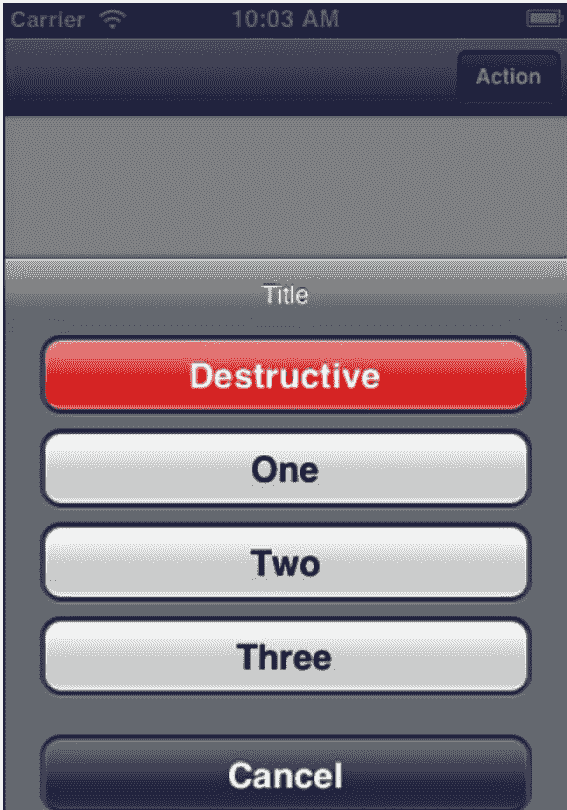
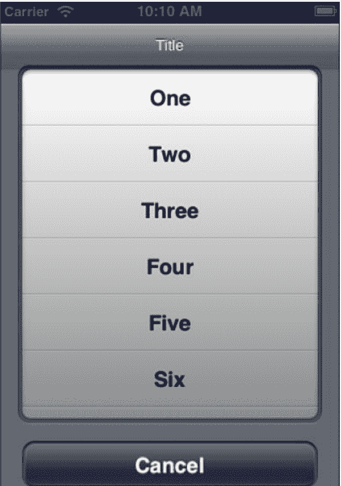

```objc
- (void) action:(UIBarButtonItem *)sender
{
    // Destructive = 0, One = 1, Two = 2, Three = 3, Cancel = 4
    UIActionSheet *actionSheet = [[UIActionSheet alloc]
        initWithTitle:@"Title"
        delegate:self
        cancelButtonTitle:@"Cancel"
        destructiveButtonTitle:@"Destructive"
        otherButtonTitles:@"One", @"Two", @"Three", nil];
    [actionSheet showInView:self.view];
}
```


## 避免在 iPad 上使用按钮

允许用户在弹出 action sheet 后点击其外部区域来取消交互：

```objc
UIActionSheet *actionSheet = [[UIActionSheet alloc]
    initWithTitle:delegate:nil
    cancelButtonTitle:IS_iPad ? nil : @"Cancel"
    destructiveButtonTitle:nil otherButtonTitles:nil];
```

取消 iPad action sheet 会返回一个（默认）值 -1。你可以通过这种方式重写它，但我并不建议这样做。

> **注意**
> 你可以使用 Recipe 3-2 中所示的第二个运行循环方法来像使用 alert views 一样获取 action sheets 的结果。

## 滚动菜单

粗略来说，在 iPhone 和 iPod touch 上，纵向方向最多可以放入七个按钮（包括“取消”），横向方向大约可以放入四个按钮。（iPad 上的空间稍微大一点）。超过这个数量将触发图 3-4（右侧）所示的滚动显示。请注意，取消按钮位于列表下方，尽管这与较短的菜单显示方式一致。取消按钮始终在任何之前的按钮之后编号。如图 3-4 所示，这种显示方式在审美标准上得分较低，应尽可能避免。

> **注意**
> 请注意 iOS 6 的早期 beta 版本包含一个针对滚动 alert sheets 的相当糟糕的 bug，它会干扰运行循环。

## 在 Action Sheets 中显示文本

Action sheets 提供了与 alert views 许多相同的文本显示功能，但它们的画布更大。以下代码段演示了如何使用 `UIActionSheet` 对象显示文本消息。它提供了一种同时显示列表的方便方法：

```objc
(void) show: (id)formatstring,...
{
    if (!formatstring) return;

    va_list arglist;
    va_start(arglist, formatstring);

    id statement = [[NSString alloc]
        initWithFormat:formatstring arguments:arglist];

    va_end(arglist);

    UIActionSheet *actionSheet = [[UIActionSheet alloc]
        initWithTitle:statement
        delegate:nil cancelButtonTitle:nil
        destructiveButtonTitle:nil
        otherButtonTitles:@"OK", nil];

    [actionSheet showInView:self.view];
}
```

## Recipe: 构建自定义覆盖层

尽管 `UIView` 和 `UIActionSheet` 提供了很好的进度指示，但你也可以从零完全编写。Recipe 3-4 使用了一个带有 `UIActivityIndicatorView` 的简单标题 `UIView` 覆盖层。

覆盖层覆盖了整个屏幕。使用整个屏幕可以让覆盖层适应导航栏。这是因为覆盖视图必须添加到应用程序窗口中，而不是你可能认为的那样添加到主 ViewController 的视图中。该视图仅占据导航栏下方的空间（在 `UIScreen` 术语中称为“应用程序帧”），允许继续导航栏中的任何按钮和其他控制项。为了限制用户对屏幕的操作，覆盖层将其 `userInteractionEnabled` 属性设置为 YES。这会捕获任何触摸，防止它们到达底部的 GUI，从而创建一个模态呈现，在警报完成之前交互无法继续。你可以轻松地调整这种方法以通过触摸来关闭覆盖层，但在创建此类警报时要注意，该视图不属于视图控制器。在设备方向变化期间，它不会自我更新。如果你需要与感知横屏/竖屏的系统工作，可以在显示覆盖层之前捕获该值并订阅重定向通知。

## Recipe 3-4. 显示并隐藏自定义覆盖层

```objc
(void) removeOverlay:(id) sender
{
    UIWindow *window = self.window;

    // 创建带颜色的覆盖层
    UIView *overlayView = [[UIView alloc] initWithFrame:window.bounds];
    overlayView.backgroundColor = [UIColor colorWithAlpha:0.5];
    overlayView.userInteractionEnabled = YES;

    // 添加指示器
    UIActivityIndicatorView *aiv = [[UIActivityIndicatorView alloc] initWithStyle:UIActivityIndicatorViewStyleWhite];
    aiv.center = CGPointMake(
        CGRectGetMidX(overlayView.bounds),
        CGRectGetMidY(overlayView.bounds));
    [aiv startAnimating];
    [overlayView addSubview:aiv];

    [window addSubview:overlayView];

    // 使用延迟执行任务
    [self performSelector:@selector(removeOverlay:) withObject:overlayView delay:5.0f];
}
```

### 获取此 Recipe 代码

要找到此 recipe 的完整项目，请访问 `https://github.com/erica/iOS-6-Cookbook` 章节 3。

## 可点击覆盖层

自定义覆盖层可以呈现信息。你可以通过 Recipe 3-4 触摸关闭覆盖层。当点击时，视图会从屏幕移除。

```objc
@interface TappableOverlay
@end

@implementation TappableOverlay

-(void)touchesEnded:(NSSet *)touches withEvent:(UIEvent *)event{
    // 移除视图
    [self removeFromSuperview];
}

@end
```

编写期间，popovers 仍然是 iPad 特有的功能。随着 Apple 推出新模型情况可能会发生。

- **始终提供 iPhone 选项。** 不要在更改平台时牺牲功能。相反，提供 iPhone 的替代方案，使用模态呈现控制器而不是 popover。
- **始终检查并关闭现有 popovers。** 如果你创建了 popovers，这一点尤为重要。
- **始终设置内容大小。** 默认的 popover 长而细，可能不符合你的设计。
- **仔细考虑允许的箭头方向。** 如果你在左侧有一个主控制器且 popover 向右延伸，请使用左箭头。当空间拥挤时可以将箭头方向进行 OR 操作以选择最佳解决方案。Popover 将根据它们指向的矩形尝试确定理想方向。

## Recipe 3-5. Basic Pop

```objc
(void) popoverControllerDidDismissPopover:(UIPopoverController *)
{
    // 停止持有 popover
    popover = nil;
}
```

```objc
(void) action:(id) sender
{
    // 始终检查是否存在 popover
    if (popover)
        [popover dismissPopoverAnimated:YES];

    // 从 storyboard 检索导航控制器
    UIStoryboard *storyboard =
        [UIStoryboard storyboardWithName:@"Storyboard"
            bundle:[NSBundle mainBundle]];

    UINavigationController *controller =
        [storyboard instantiateInitialViewController];

    // 以模态或作为 popover 呈现
    if (IS_IPHONE)
        [self.navigationController presentViewController:controller
            animated:YES completion:nil];
    else
    {
        // iPad 上没有按钮
        UIViewController *vc = controller.topViewController;
        vc.navigationItem.rightBarButtonItem = nil;

        // 设置内容大小为 iPhone 大小
        vc.contentSizeForViewInPopover =
            CGSizeMake(320.0f, 480.0f - 44.0f);

        // 创建并部署弹出框
        popover = [[UIPopoverController alloc]
            initWithContentViewController:controller];

        [popover presentPopoverFromBarButtonItem:sender
            permittedArrowDirections:UIPopoverArrowDirectionUp
            animated:YES];
    }
}
```

### 获取此配谱的代码

要找到此配谱的完整示例项目，请将浏览器指向 `https://github.com/erica/iOS-6-Cookbook` 并进入第 3 章的文件夹。

## 配谱：本地通知

本地通知在你的应用程序未运行时提醒用户。它们提供了一种简单的方法，可以调度在特定日期和时间显示的警报。与推送通知不同，本地通知不需要任何网络访问，也不与远程服务器通信。正如其名，它们完全在本地级别处理。

本地通知旨在与计划一起使用，例如日历和待办事项列表。你还可以将它们与多任务处理结合，在应用程序未以前台运行时提供更新。例如，一个基于位置的应用程序可能会弹出一个通知，让用户知道应用检测到用户就在当地图书馆附近，书籍已准备好取出。

系统在应用程序活动时不会显示本地通知，仅在它挂起或在后台运行时显示。配谱 3-6 强制应用退出，因为它调度了未来 5 秒后的通知，以允许通知能够正常出现。在 App Store 应用程序中千万不要这样做，如果你在这里不这样做，你将会错过通知。

与推送通知一样，点击操作按钮将重新启动应用程序，并将控制权交回 `didFinishLaunchingWithOptions:` 方法。如果你获取了 options 字典，可以通过 `UIApplicationLaunchOptionsLocalNotificationKey` 找到通知对象。

一些开发者已使用这种重新启动能力为通知中心添加功能，但效果各异。这种方法的原理是：通过添加本地通知，点击将启动应用以执行某些任务（如发布推文）。因此，你本质上是在“通过”通知中心提供功能。Apple 并不总是响应那些以低于标准使用其中心的人；随着它调整政策以应对这些聪明但未经许可的用法，你的成功率无疑会有所不同。

## 最佳实践

不要骚扰你的用户。仅仅因为本地通知不需要许可加入，并不意味着你应该为了营销而滥用它们。这里有一个经验法则：如果你的通知没有提供用户特别请求的信息，就不要发送它。（这也适用于推送通知。当用户选择加入时，他们并不是为了垃圾信息而加入的。）

未经请求的通知并不是你应该追求的用户体验。当你的通知在晚餐期间或凌晨 3 点到达时，你将赢得用户的心心、好评和客户。

过多的通知是错误的，无论用户是否可以开启“请勿扰”功能。Apple 定期拒绝通过推送通知发送广告的应用程序；对于本地通知也应该这样做。

而且，最后一点，确保对你的通知进行拼写检查。

## 配谱 3-6. 调度本地通知

```objc
(void) action: (id) sender
{
    UIApplication *app = [UIApplication sharedApplication];

    // 移除之前所有的通知
    NSArray *scheduled = [app scheduledLocalNotifications];
    if (scheduled.count)
        [app cancelAllLocalNotifications];

    // 创建新通知
    UILocalNotification* alarm = [[UILocalNotification alloc] init];
    if (alarm)
    {
        alarm.fireDate = [NSDate dateWithTimeIntervalSinceNow:5.0f];
        alarm.timeZone = [NSTimeZone defaultTimeZone];
        alarm.repeatInterval = 0;
        alarm.alertBody = @"五秒钟已过";
        [app scheduleLocalNotification:alarm];

        // 强制退出。不要在 App Store 代码中这样做。
        exit(0);
    }
}
```

### 获取此配谱的代码

要找到此配谱的完整示例项目，请将浏览器指向 `https://github.com/erica/iOS-6-Cookbook` 并进入第 3 章的文件夹。

## 警示指示

当你的应用程序在后台访问互联网时，让用户知道发生的情况是礼貌的。与其创建一个全屏警报，Cocoa Touch 提供了一个简单的应用程序属性用于控制状态栏中旋转的网络活动指示器。图 3-5 显示了该指示器的工作，位于 Wi-Fi 指示器的右侧和当前时间显示的左侧。

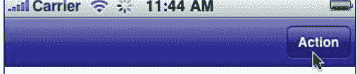

图 3-5。网络活动指示器由一个 `UIApplication` 属性控制。

以下代码段演示了如何访问此属性，仅仅是切换指示器的开启或关闭。在实际使用中，你可能会在辅助线程上执行此属性的网络活动。确保在主线程上执行此更改，以便 GUI 能够正确更新自己：

```objc
(void) action:(id) sender
{
    // 切换网络活动指示器
    UIApplication *app = [UIApplication sharedApplication];
    app.networkActivityIndicatorVisible = !app.networkActivityIndicatorVisible;
}
```

你可能希望在应用程序中记录网络操作，并仅在至少有一个操作活动时启用指示器。

## 应用程序标记

如果你出于任何原因使用过 iOS，你就见过主屏幕上应用图标上的红色标记。这些标记指示未读邮件、未接来电或其他通知的数量。要设置这些标记，你可以使用系统服务。

```objc
// Vibrate仅在 iPhone 上有效
AudioServicesPlaySystemSound(kSystemSoundID_Vibrate);
```

## 警报

Audio Services 提供了一种名为警报声的振动/声音混合体，可以通过以下方式调用：

`AudioServicesPlayAlertSound(mySound);`

此调用在食谱 3-7 中也有演示，它播放请求的声音，并可能振动或播放第二个警报。在 iPhone 上，当用户设置“设置 > 声音 > 响铃 > 振动”为开启时，手机会振动。第二代及之后的 iPod touch 通过内置扬声器播放声音振动（这些设备不支持振动）。第一代 iPod touch（如果你现在还能找到它们的话！）会在耳机播放请求音频的同时，在设备扬声器上播放简短的警报旋律代替声音。iOS 会在警报播放期间降低正在播放的音乐量。

不要完全通过警报来实现应用程序的音频播放。我能想到至少有两款游戏这样做，这导致这些产品完全无法响应用户的音量调节。这些游戏可能很好玩，但在医生办公室或图书馆里是无法使用的。

## 延迟

在 iOS 上第一次播放系统声音时，你可能会遇到延迟。你可能想在应用程序初始化时播放一段静音声音，以避免后续播放时的延迟。

> **注意**：在 iPhone 上测试时，请确保没有开启设备左侧的静音开关。这一疏忽让很多 iPhone 开发者掉过坑。如果你的警报必须始终播放，请考虑使用 `AVAudioPlayer` 类。

# 释放系统声音

不要忘记释放系统声音。你的 `dealloc` 方法提供了一种在对象生命周期结束时工作的自然方式。始终考虑声音的生命周期，并找到一种管理何时释放声音的方法。对于许多应用程序来说，几个声音可以在整个对象（甚至整个应用程序）的生命周期内持续存在，而不会造成内存负担。对于其他应用，你需要在声音播放后立即进行清理。确保在你的应用程序中设计了释放机制，并确保在完成资源使用后释放了它们。

要听到声音，请确保在设备上运行此食谱，而不是在模拟器中测试。

# 食谱 3-7. 使用 Audio Services 播放声音、警报和振动

```objc
```


@implementation TestBedViewController

// 完成后释放声音

void _systemSoundDidComplete(SystemSoundID ssID, void *clientData)
{
    AudioServicesDisposeSoundID(ssID);
}

- (void)playDispose
{
    // 加载声音
    NSString *sndpath = [CFBundle bundle pathResource:@"knock3" type:@"wav"];
    CFURLRef baseURL = CFBridgingRetain([NSURL fileWithPath:sndpath]);
    SystemSoundID sysSound;
    AudioServicesCreateSoundID(baseURL, &sysSound);
    CFRelease(baseURL);

    // 添加完成回调
    AudioServicesAddSystemSoundCompletion(sysSound, NULL, NULL, _systemSoundDidComplete, NULL);

    // 决定如何播放播放声音
    if ([MPMusicController iPodMusicPlayer].playbackState == MPMusicPlaybackPlaying(sysSound))
        AudioServicesPlayAlertSound(sysSound);
    else
        AudioServicesPlaySound(sysSound);
}

- (void)loadView
{
    [super loadView];
    self.view.backgroundColor = [UIColor whiteColor];
    self.navigationItem.rightBarButtonItem = BARBUTTON("Knock", @selector(playAndDispose));
}

@end

## 获取此食谱的代码

要找到此食谱的完整示例项目，请将浏览器指向 `https://github.com/erica/iOS-6-Cookbook` 并进入第 3 章文件夹。

## 总结

本章介绍了应用程序如何直接与用户进行交互，而不是相反。你学习了如何构建——视觉、听觉和触觉的反馈，来吸引用户的注意力并请求即时反馈。使用这些示例来增强程序的交互吸引力，并利用一些 iPhone 特有的功能。以下是本章中可以记住的几点想法：

- 当任何任务需要花费相当的时间时，请对用户保持礼貌并显示某种进度反馈。iOS 提供了许多方法来实现这一点，从 HUD 到状态栏指示器等。你可能需要将用户的非 GUI 元素转移到新线程以避免阻塞。如果可能，为用户提供取消操作的方法也是很有礼貌的。

- 警报让用户进入状态。它们的设计初衷是在传递信息的同时引发响应。正如你在本章中看到的，它们几乎是可定制且灵活的。围绕简单的 `UIAlert` 构建整个应用程序是可能的。

- 不要害怕运行循环（`run loop`）。警报或操作单的模态响应让你能够轮询选择，而无需依赖异步回调。除非你极力推广，否则使用循环可能会让你的某些同事感到惊讶。如果你自己经营公司，你可能拥有更多的自由来做出包含运行循环实现的执行决策。

- 谨慎使用本地通知。除非有令人信服的理由说明用户*想要*显示它们，否则永远不要显示它们。过度使用本地通知警报很容易疏远用户，并导致你的 App 从设备上被卸载。

- 蓝色的系统提供功能并不也不应该匹配每个应用程序的设计需求。尽可能构建自定义视图以匹配你的 App。音频反馈（包括振动）可以增强你的程序。

# 4. 组装视图和动画

`UIView` 类及其子类填充了屏幕。本章介绍了视图和动画。你学习了如何构建、检查和拆解视图，以便它们在界面上移动和转换。

## 视图层次结构

基于树的层次结构决定了你在屏幕上看到的顺序。从主窗口开始，视图经过了特定的布局。所有视图都可能有子项，称为子视图（`subviews`）。每个视图（包括窗口）都拥有这些子视图的有序列表。子视图按顺序显示，始终从后到前。这就像一叠纸。只有纸张上涂涂过的部分会显示出来。

图 4-1 显示了典型窗口的层级。在这里，窗口拥有一个层次结构。窗口（由最右侧元素表示）拥有一个导航栏，导航栏又拥有两个子视图按钮（一个左一个右）。窗口还拥有一个带有子视图的表格。这些项目堆叠在一起构建了 GUI。


**图 4-1.** 子视图层次结构组合构建了 GUI。

列表 4-1 显示了图 4-1 中窗口的视图层次结构。树从顶部的 `UIWindow` 开始，显示了每个子视图的类。如果你沿着树向下追踪，你可以看到导航栏（在第 2 层）及其按钮（每个在第 3 层）以及表格视图（第 4 层）及其单元（每个在第 5 层）。列表中的某些项目是私有类，是 SDK 在布局视图时自动添加的。例如，`UIContainerView` 开发者从未直接使用。它是 SDK `UIWindow` 的一部分。此列表中缺失的部分仅是表格的几十条分割线，为了空间考虑而省略了。每个分割线都是 `UITableViewSeparator` 实例。它们属于 `UITableView`，通常显示在深度 5 处。

**列表 4-1.** 待事项列表视图层次结构

```
-- [ 1 ] UIILayoutContainer
--- [ 2 ] UINavigationTransitionView
------ [ 3 ] UIViewControllerWrapperView
-------- [ 4 ] UITableView
---------- [ 5 ] UITableViewCellCell
------------ [ 6 ] UITableViewCellContentView
---------- [ 7 ] UILabel
---------- [ 6 ] UIButton
---------- [ 7 ] UIImageView
---------- [ 6 ] UIView
---------- [ 5 ] UITableViewCell
---------- [ 6 ] UITableViewCellContent
---------- [ 7 ] UILabel
---------- [ 6 ] UIButton
---------- [ 7 ] UIImageView
---------- [ 6 ] UIView
---------- [ 5 ] UIImageView
---------- [ 5 ] UIImageView
-- [ 2 ] UINavigationBar
-- [ 3 ] UINavigationBackgroundColor
-- [ 3 ] UINavigationItemView
-- [ 3 ] UINavigationButton
-- [ 4 ] UIImageView
-- [ 4 ] UIButtonLabel
-- [ 3 ] UINavigationButton
-- [ 4 ] UIImageView
-- [ 4 ] UIButtonLabel
```

## 食谱：恢复视图层次结构

每个视图都知道它的父视图（`a.superview`）和子视图（`a.subviews`）。通过递归遍历视图的子视图，可以构建视图树，如列表 4-1 所示。食谱 4-1 通过记录每个视图的类名，并在每次从父视图移动到子视图时增加缩进级别，从而构建一个视觉树。结果存储在一个可变字符串中。

食谱 4-1 所示的代码用于创建列表 4-1 所示的树。你可以使用此方法复制列表 4-1 的结果，或者将其复制到其他应用程序中以查看它们的层次结构。

## 食谱 4-1. 提取视图层次结构树

```objc
// 递归向下遍历视图树，
// 子视图的缩进级别
- (void)dumpView:(UIView *)view atIndent:(int)indent into:(NSMutableString *)outstring
{
    // 添加缩进横线
    for (int i = 0; i < indent; i++)
        [outstring appendString:@"---"];

    // 紧随其类描述
    [outstring appendFormat:@"[%2d] %@\n", indent, [[aView class] description]];

    // 递归遍历每个子视图
    for (UIView *view in aView.subviews)
        [self dumpView:view at:indent + 1 into:outstring];
}

// 从根视图在级别 0 开始树的递归
- (NSString *)displayViews:(UIView *)aView
{
    NSMutableString *outstring = [NSMutableString string];
    [self dumpView:aView objectAtIndex:0 into:outstring];
    return outstring;
}
```

## 获取此食谱的代码

要找到此食谱的示例项目，请将浏览器指向 `https://github.com/erica/iOS-6-Cookbook` 并进入第 4 章文件夹。

## 探索 XIB 和 Storyboard

许多用户使用 storyboards 和 XIB 文件在 Interface Builder (IB) 中创建视图和控制器，而不是直接在代码中构建它们。以下片段演示了如何使用食谱 4-1 从这些资源中解构视图。此食谱的示例代码包含了示例 XIB 和 storyboard 视图。你可以自己编辑它们并测试视图转储代码，查看底层结构如何与你在 IB 中创建的呈现匹配：

有时你可能想要获取更详尽的子视图列表，包括子视图的子视图。食谱 4-2 引入了 `allSubviews()`，这是一个简单的递归函数，可返回任何视图的完整子视图列表。该函数带有视图的窗口（通过 `view.window`），返回托管该视图的 UI 中出现的完整视图集。当你想要搜索特定视图（例如特定的分割线或边框）时，这非常有用。

尽管并不常见，但 iOS 应用程序可能包含多个窗口，每个窗口可以包含许多视图，其中某些视图可能显示在外部屏幕上。通过遍历每个可用窗口可以恢复所有应用程序视图的详尽列表。食谱 4-2 中的 `allApplicationSubviews()` 函数正是这么做的。调用 `[[UIApplication sharedApplication] windows]` 返回应用程序窗口数组。该函数进行遍历，并将子视图添加到集合中。

除了知道子视图外，每个视图还知道它所属的窗口。视图的 `window` 属性指向它拥有的窗口。食谱 4-2 还包含一个名为 `pathToView()` 的简单函数，它返回一个父视图数组，从窗口一直到目标视图。它通过反复调用 `superview` 直到到达窗口实例。

视图可以通过另一种方式检查祖先关系。`isDescendant:` 方法返回一个布尔值，表示视图是否位于另一个视图内部。

## 食谱 4-2. 子视图实用函数

```objc
// 返回子视图
NSArray *allSubviews(UIView *aView)
{
    NSMutableArray *results = [NSMutableArray array];
    for (UIView *view in aView.subviews) {
        [results addObject:view];
    }
    return results;
}
```

```objc
// 返回所有应用程序视图
NSArray *allApplicationSubviews()
{
    NSMutableArray *results = [NSMutableArray array];
    for (UIWindow *window in [[UIApplication sharedApplication] windows]) {
        for (UIView *view in window.subviews) {
            [results addObject:view];
        }
    }
    return results;
}
```

```objc
// 从窗口到视图的父视图数组
NSArray *pathToView(UIView *aView)
{
    NSMutableArray *array = [NSMutableArray array];
    UIView *view = aView;
    UIWindow *window = aView.window;
    while (view != window) {
        [array addObject:view];
        view = view.superview;
    }
    return array;
}
```


## 获取此食谱的代码

要找到此食谱的示例项目，请将浏览器指向 `https://github.com/erica/iOS-6-Cookbook` 并进入第 4 章文件夹。

## 管理子视图

`UIView` 类提供了许多方法来帮助构建和管理视图。这些方法允许你添加、排序、删除和查询视图层次结构。因为层次结构控制着你看到的内容，更新视图的关系也会改变你看到的内容。

## 添加子视图

调用 `[parentView addSubview:child]` 将新视图添加到父视图。该方法将视图添加到父视图的最前端，位于任何现有视图之上。要在视图层次结构中的特定位置插入子视图，SDK 提供了一组实用方法：

- `insertSubviewAtIndex:`
- `insertSubview:aboveSubview:`
- `insertSubview:belowSubview:`

这些方法控制视图插入的位置。这种插入可以相对于另一个视图进行，也可以移动到子视图数组的特定索引。`above` 和 `below` 方法分别将子视图添加到指定视图的前后。插入会将其他视图推，而不会替换已存在的视图。

## 重排序和移除子视图

应用程序经常在与屏幕交互时重新排序和移除视图。iOS SDK 提供了简单的方法来实现，允许你更改视图顺序和内容：

- 使用 `[parentView exchangeSubviewAtIndex:i withSubviewAtIndex:j]` 交换两个视图的位置。
- 使用 `bringSubviewToFront:` 和 `sendSubviewToBack` 将子视图移动到最前或最后面。
- 要从父视图移除子视图，使用 `[childView removeFromSuperview]`。如果该视图之前在屏幕上，它就会消失。

当你重新排序、添加或移除视图时，屏幕会自动重绘以显示新的视图呈现。

## 视图回调

当视图层次结构发生变化时，会向视图发送回调。iOS SDK 提供了六个回调方法。这些回调可能帮助你应用程序跟踪正在移动和更改父视图的视图：

- `didAddSubview:`：在视图通过 `addSubview:` 成功添加子视图（即前文列出的其他子视图插入方法之一）后，发送给父视图。它允许 `UIView` 的子类在添加新视图时执行额外操作。
- `didMoveToSuperview`：通知视图它们已重新父类化到一个新的父视图。当视图从其父视图中移除时，新的父视图为 `nil`。
- `willMoveToSuperview:`：在移动发生之前发送。
- `didMoveToWindow`：当视图移动到新的层级而非仅仅移动到新的父视图时，提供与 `didMoveToSuperview` 等效的回调。你通常在配合 AirPlay 使用外部显示器时使用它。
- `willMoveToWindow:`：同样在移动发生之前发送。
- `willRemoveSubview:`：通知父视图子视图即将被移除。

我很少使用这些方法，但当我使用它们时，它们总是能够救命稻草，允许我在不知道提前正在使用哪种子视图或父视图类的情况下添加行为。窗口回调主要用于在次要窗口中显示叠加视图，例如警报（alerts）和输入视图（如键盘）。

## 标记与检索视图

iOS SDK 提供了一个内置搜索功能，允许你通过标记（tag）来检索子视图。标记是数字（通常是正整数），用于标识视图。使用视图的 `tag` 属性分配标记：例如，`tag = 101`。在 IB 中，你可以在属性检查器中设置视图的标记。如图 4-2 所示，你在 View 部分中指定标记。

| 视图 |
| :--- |
| 填充缩放模式 (Mode Scale To Fill) |
| 标记 10 |

图 4-2. 在 IB 的属性检查器中为任何视图设置标记。

标记是任意的。唯一的“预留”标记是 0，它是所有新创建视图的默认属性设置。由你决定如何标记你的视图以及使用哪些值。你可以对任何作为 `UIView`、窗口和控件子项的实例进行标记。因此，如果你有许多按钮和开关，添加标记有助于在用户触发它们时区分它们。你可以在你的回调方法中添加一个简单的 `switch` 语句，查看标记并决定如何做出。。苹果很少标记子视图。我发现的他们标记视图的唯一实例是在 `UIAlert` 中，其中的按钮使用了 1、2 及往后的标记，而那已经是好几年以前了（我很大程度上认为苹果把这些标记留在那里面是个失误）。如果你担心与苹果的标记冲突，请从 10 或 100 开始编号，或者任何大于苹果可能使用的任何值的数字。

## 使用标记查找视图

标记允许你通过从任何父视图直接访问用户界面元素，从而避免在程序中到处传递这些元素。`viewWithTag:` 方法从子项层级结构中恢复被标记的视图。该搜索是递归的，被标记的项不需要是所指视图的直接子项。你可以通过 `[window viewWithTag:101]` 从窗口搜索，并找到位于层级树下几个分支的视图。当多个视图使用相同标记时，`viewWithTag:` 返回它找到的第一个项。

使用 `viewWithTag:` 的唯一挑战在于它返回的是一个 `UIView` 对象。这意味着在使用它之前，你通常需要将其强制转换为正确的类型。例如，你可以检索一个 label 并设置其文本，如下所示：

## 食谱：通过对象关联命名视图

虽然标记提供了一种标识视图的方便方法，但某些开发者可能更倾向于使用名称而不是数字。使用名称为你的视图识别方案增加了额外层次的含义。与其引用“标记为 101 的视图”，切换过的 Ignition 描述了它的角色，并增加了一层纯数字所缺失的自文档功能：

```objc
// 切换开关
UISwitch *s = (UISwitch *)[self.view viewNamed:@"Ignition Switch"];
[s setIs:s.isOn];
```

扩展 `UIView` 以添加名称属性并通过名称检索视图很容易的。秘诀在于 Objective-C 的运行时关联对象函数。如果你曾经写过类分类（categories），你可能会想：“但如果我添加存储，我不是需要创建子类吗？”关联对象不需要新的实例变量。相反，它们提供了一种在对象直接存储之外使用键值对的方法，将该对象与存储在其他处的信息关联。

食谱 4-3 创建了一个 `UIView` 标记分类。它由一个属性（`nametag`）组成，由关联对象支持，以及一个方法（`viewNamed:`），该方法可以按名称查找任何子视图。该方法通过递归深度优先搜索进入视图层级，并返回名称与搜索字符串匹配的子视图。

## 在 Interface Builder 中命名视图

使用命名视图方法允许你检索子视图，而无需声明 `IBOutlet` 实例变量。（这对于代码的可读性和维护性是否有益是一个处于在本节范围之外的问题）。考虑你在在本节稍早看到的从界面切换开关的代码。你可以在 IB 中将名称添加到 (Ignition Switch) 作为一个自定义属性。

图 4-3 显示了你如何操作。选择任何视图并打开 Identity 检查器（View > Utilities > Show Identity Inspector）属性，点击 + 添加新属性。Key Path 为 `nametag`（以匹配食谱 4-3 中 `UIView` 分类中定义的属性），类型为 `String`，值为该视图的新名称。保存你的更改。

图 4-3. 在 IB 的属性检查器中为任何视图设置标记。

图 4-3 显示了你如何操作。选择任何视图并打开 Identity 检查器（View > Utilities > Show Identity Inspector）属性，点击 + 添加新属性。Key Path 为 `nametag`（以匹配食谱 4-3 中 `UIView` 分类中定义的属性），类型为 `String`，值为该视图的新名称。保存你的更改。

```objc
#import <objc/runtime.h>

@implementation UIView (Name)

static char const nametag_key;

- (id)nametag {
    return objc_getAssociatedObject(self, &nametag_key);
}

- (void)setNametag:(NSString *)theetag {
    objc_setAssociatedObject(self, &nametag_key, theetag, OBJC_ASSOCIATION_RETAIN_NONOMIC);
}

- (UIView *)viewNamed:(NSString *)aName {
    if (!aName) return nil;
    for (UIView *subview in self.subviews) {
        if ([subview.nametag isEqualToString:aName]) {
            return subview;
        }
    }
    return nil;
}

@end
```

获取此食谱代码
要找到示例项目，请指向 `https://github.com/erica/iOS-6-Cookbook` 并查看第 4 章。

## 视图几何结构

几何在处理视图时起着基础作用。几何属性定义了每个视图出现在何处、它们的大小以及它们的取向。当你使用新的布局机制时，某些问题变得不再关键。其他问题仍然基本，特别是在构建动态视图系统时。布局允许你通过定义约束系统来构建视觉界面。约束是指定你的视图如何相互关联的基本规则。它们用于计算子视图应该位于父视图的位置。当你处理动态视图、跨度短以及在演示期间变化的视图时，你需要离开约束，专注于处理每个视图相关的属性。`UIView` 提供了定义这些布局方面的两个内置属性。每个视图都使用 `frame` 来定义其边界。`frame` 指定了视图在父坐标系中的边界、位置、宽度和高度。`bounds` 和 `center` 属性分别定义了自身坐标系内的框架矩形以及框架在父坐标系中的几何中心。这三个属性紧密集成。如果你更改了视图的 `frame`，视图将匹配新的 `frame`。宽度增大，视图拉伸。使用新的位置，视图移动。

## Frames

框架矩形是指相对于父视图的视图轮廓系统。帧使用 `CGRect` 结构，如其 `CG` 前缀所示，该结构定义为 Core Graphics 框架的一部分。`CGRect` 由原点 (`CGPoint`) 和大小 (`CGSize`，宽度和高度) 组成。当你创建视图时，通常会通过帧（frame）来分配并初始化它们。这是一个示例：

```
CGRect rect = CGRect(0.0f, 0.0f, 320.0f, 416.0f);
myView = [[UIView alloc] initWithFrame:rect];
```

视图提供两个 `CGRect` 属性，它们紧密相联：帧（frame）和边界（bounds）。帧与 bounds 的不同在于它们的坐标系。帧是相对于父视图的坐标系定义的；而 bounds 是相对于视图自身的坐标系定义的。因此，视图的 bounds 通常使用零原点。它的坐标系通常从其左上角开始。对于某些视图（如滚动视图），bounds 可能会超出其视觉帧的范围。

## 矩形实用函数

如你所见，`makeRect()` 使用四个参数创建一个新矩形：原点的 x 和 y 位置、矩形的宽度及其高度。此方法为创建帧提供了关键工具。除了 `makeRect()`，你可能还想了解其他几个方便函数，它们可以帮助处理矩形和帧：

- `NSStringFromCGRect(aCGRect)` 将 `CGRect` 结构转换为格式化字符串。此函数使得你在调试时可以轻松记录视图的帧。
- `CGRectFromString(aString)` 从其字符串表示恢复矩形。当你将视图的帧作为字符串存储在用户默认（user defaults）中并想要将其转换回 `CGRect` 时它非常有用。
- 虽然不是一个函数，但 `[NSValue valueCGRect:rect]` 返回一个新的 Objective-C 值，用于存储传递的矩形。你可以根据需要将对象添加到字典和数组中。`CGRectValue` 从 `NSValue` 对象检索矩形结构。大多数 CG 类型（包括点、尺寸和仿射变换）都有这种方法的变体。
- `CGInset(aRect, xinset, yinset)` 允许你创建一个与源矩形中心相同的更小或更大的矩形。使用正内边（inset）创建较小的矩形，使用负内边创建更大的矩形。
- `CGRectOffset(aRect, xoffset, yoffset)` 返回一个相对于原始矩形按指定的 x 和 y 偏移的矩形。这在屏幕上移动帧以及创建简单的阴影效果时非常方便。
- `CGRectGetMidX(aRect)` 和 `CGRectGetMidY(aRect)` 恢复矩形中心的 x 和 y 坐标。这些函数使得恢复 bounds 和帧的中点变得非常方便。
- `CGRectIntersectsRect(rect1, rect2)` 让你知道矩形结构何时交叉。使用此函数可以两个矩形结构何时重叠。你可以通过 `CGRectIntersection(rect1, rect2)` 获取实际的交集。如果两个矩形不相交，则返回空矩形。（使用 `CGIsNull(rect)` 进行检查。） 相关的 `CGRectContainsPoint(point, rect)` 在提供的点位于（非空）矩形内时返回真。
- 使用 `CGRectEqualToRect(rect1, rect2)` 比较矩形。此函数检查两个矩形的大小和位置是否相等。类似的方法包括 `CGSizeEqualToSize(size1, size2)` 和 `CGPointEqualToPoint(point1, point2)`，它们允许你比较 `CGSize` 和 `CGPoint` 实例。
- 其他实用程序包括 `CGRectDivide(rect)`，它将源矩形拆分为两个部分；以及 `CGApplyAffineTransform(rect, transform)`，它将仿射变换应用于矩形并返回包含结果的最小矩形。
- `CGRectZero` 是一个位于 (0,0) 的矩形常量，其宽度和高度为零。当你需要创建一个帧但不确定创建时该帧的大小或位置时，就会使用此常量。类似的还有 `CGPointZero` 和 `CGSizeZero`。

## 点与尺寸

`CGRect` 结构由两个子结构组成：定义矩形原点的 `CGPoint` 以及定义边界的 `CGSize`。点通过 x 和 y 坐标定义位置；尺寸具有宽度和高度。使用 `CGPointMake(x, y)` 创建点。使用 `CGSizeMake(width, height)` 创建尺寸。尽管这两个结构看起来相同（都是浮点值），但 iOS 在语义上区分了它们。点指的是位置。尺寸指的是范围。你不能将 `myFrame.origin` 设置为尺寸。

像处理矩形一样，你可以将它们与字符串之间进行转换：`NSStringFromCGPoint()`、`NSStringFromCGSize()`、`CGSizeToString()` 和 `CGPointFromString()` 执行这些操作。你还可以将点和尺寸与字典之间进行转换。

## 变换

iOS SDK 仿射变换作为其实现的一部分。仿射变换允许从一个坐标系变换到另一个坐标系。这些函数在 2D 和 3D 动画中被广泛使用。UIKit 使用 3x3 矩阵来定义变换，这是一种 2D 解决方案。3D 变换使用 4x4 矩阵，并且图层的默认值。通过仿射变换你可以缩放、位移和旋转视图。通过设置视图的 `transform` 属性来实现。这是一个示例：

```
float angle = theta * (PI / 100);
GAffineTransform transform = CGAffineTransformMakeRotation(angle);
myView.transform = transform;
```

变换始终相对于视图的中心应用。在这种情况下，视图会绕其中心旋转。

正如前面提到的，视图生活在两个世界中。它们的帧和中心是在它们自己的坐标系中定义的。iOS SDK 提供了几个实用程序在坐标系之间移动。在 iOS 上，y 从顶部开始。要将一个点转换为另一个视图，使用 `convertPoint:to:`：

```
myPoint = [top convertPoint:somePoint fromView];
```

## 食谱：处理视图帧

当你更改视图的帧时，你更新了它的尺寸（即宽度和高度）和位置。例如，你可能会如下移动视图。这段代码创建一个位于 (0.0, 0.0) 的子视图，然后将其移动到 (0.0, 30.0)：

```
CGRect initialRect = CGRectMake(0.0f, 0.0f, 100.0f, 100.0f);
myView = [[UIView alloc] initWithFrame:initialRect];
[top addSubview:myView];
myView.frame = CGRectMake(0.0f, 30.0f, 100.0f, 100.0f);
```

这种移动视图的方法并不常见。iOS SDK 不期望你通过更改帧来移动视图。相反，它关注视图的位置。此此事的优方法是设置视图的中心（center）。

## 注意

`UIScreen` 类提供了一个名为 `scale` 的属性，定义了显示器像素密度与其点系统之间的关系。屏幕的 `scale` 用于从视图系统的逻辑坐标空间（以点为单位，等于 1/160 英寸）转换为物理像素坐标。Retina 显示器使用 2.0 的缩放，非 Retina 显示器使用 1.0 的缩放。

```
myView.center = CGPointMake(160.0, 55.0);
```

尽管你可能希望 SDK 提供一种通过更新原点（origin）来移动视图的方法，但并没有这样的选项。你可以轻松地构建自己的视图类分类（category）。获取视图的帧（frame），将原点设置为请求的点，并根据该更改更新帧。这段代码片段创建了一个新的 `origin` 属性，允许你获取并更改视图的原点：

```objc
```


## 设置原点

```objc
(void) setOrigin:(CGPoint) aPoint
{
    CGRect newframe = self.frame;
    newframe.origin = aPoint;
    self.frame = newframe;
}
```

由于这个扩展使用了如此直观的属性名称，如果 Apple 最终实现了此处显示的功能，你的代码可能会因为名称重叠而崩溃。在本书的示例中，我广泛使用了直观的名称。这使得代码段更易读，并减少了识别我所演示内容时的任何认知负担。在生产代码中请避免这样做。使用你个人或公司的首字母作为前缀有助于区分内部材料。

当你移动视图时，不需要担心像已暴露或隐藏的矩形区域等问题。iOS 会处理重绘。这让你可以将视图视为实体对象，并将渲染问题委托给 Cocoa Touch 处理。

## 调整大小

在最简单的使用模式下，视图的帧（`frame`）和边界（`bounds`）控制着其大小。正如你已经看到的，帧定义了视图在父视图坐标系中的位置。如果帧的原点被设置为 `(0.0, 30.0)`，则视图将出现在父视图中，与视图的左侧对齐，并从顶部偏移 30 个点。在较旧的显示器上，这对应于向下 30 像素；在 Retina 显示器上，则是向下 60 像素。

边界（`bounds`）定义了视图自身坐标系内的区域。这意味着视图边界的原点通常是固定的（即 `myView.bounds` 通常是 `(0.0, 0.0)`）。对于大多数视图来说，大小与其正常范围一致，即帧的 `size` 属性。（这对于 `UIScrollView` 等类并不总是成立，它们的范围可能会超过其视觉显示区域）。

你可以通过调整帧或边界来更改视图的大小。在实践中，你正在更新这些结构中的视图组件。与移动原点一样，创建一个自己的视图工具方法来直接执行此操作非常方便：

```objc
(void) setSize:(CGSize) aSize
{
    CGRect newbounds = self.bounds;
    newbounds.size = aSize;
    self.bounds = newbounds;
}
```

当显示的视图大小发生变化时，视图本身会实时更新。取决于视图内元素的定义方式以及视图本身的类型，子视图可能会缩小或移动以适应，或者可能会被裁剪，这取决于多个标志以及哪些视图参与了新的自动布局（`autolayout`）系统（见第 5 章）：

- `autoresizingSubviews` 属性决定了视图在更新边界时是否会自动调整其子视图的大小。
- 视图的 `autoresizingMask` 定义了视图如何响应其父视图边界的变化。如果视图参与了约束系统，则该设置被忽略，视图将由 iOS 的自动布局系统进行调整。
- `clipsToBounds` 标志决定视图在视图边界之外是否可见。当被裁剪时，仅显示父视图边界内的内容。你可以让视图执行 `sizeToFit`，以便其调整大小以包含所有子视图。
- `contentMode` 与其他缩放属性相关，但它指定了视图层（其内容位图）在边界更新时如何调整。由于该属性可以设置为多种缩放、居中和适应选择，在处理图像视图时查看效果最佳。

## 注意事项

边界（`bounds`）会受到视图变换（`transform`）的影响，变换是一种改变视图外观方式的数学组件。在处理变换时，不要操作视图的帧（`frame`），因为可能无法产生预期的结果。（本章后面将提供一些变通。）例如，在变换之后，帧的原点可能在数学上不再对应于边界的原点。更新视图的正常顺序是先设置其帧或边界，然后设置中心点（`center`），最后如果适用则设置其变换。

有时，你需要在将视图添加到新的父视图之前调整大小。例如，你可能有一个图像视图要放入警报视图（`alert view`）中。为了在不改变比例的情况下将该视图放入到位，你可能使用如下方法来确保高度和宽度都适当缩放：

```objc
(void) fitInSize: (CGSize) aSize
{
    CGFloat scale;
    CGRect newframe = self.frame;
    if (newframe.size.height > aSize.height) {
        scale = aSize.height / newframe.size.height;
        newframe.size.width *= scale;
        newframe.size.height *= scale;
    }
    if (newframe.size.width >= aSize.width) {
        scale = aSize.width / newframe.size.width;
        newframe.size.width *= scale;
        newframe.size.height *= scale;
    }
    self.frame = newframe;
}
```

## 矩形与中心点

正如你看到的，`UIView` 实例使用由原点（`origin`）和大小（`size`）组成的 `CGRect` 结构来定义它们的帧。该结构不包含对中心点的引用。同时，`UIView` 依赖于其 `center` 属性在将视图移动到新点时更新视图的位置。遗憾的是，Core Graphics 没有将中心点作为主要概念。你可以通过构建实际上暴露中点的函数来弥补这一差距：

```objc
CGPoint CGRectCenter(CGRect rect)
{
    CGPoint pt;
    pt.x = CGRectGetMidX(rect);
    pt.y = CGRectGetMidY(rect);
    return pt;
}
```

通过中心点移动矩形是另一个可能很有用的函数，它模拟了视图的工作方式。假设你需要将一个视图移动到一个新位置，但需要它保持在父视图内部。在移动之前，你可以使用如下函数来偏移帧：

```objc
CGRect CGRectMoveToCenter(CGRect rect, CGPoint center)
{
    CGRect newrect = CGRectZero;
    newrect.origin.x = center.x - CGRectGetMidX(rect);
    newrect.origin.y = center.y - CGRectGetMidY(rect);
    newrect.size = rect.size;
    return newrect;
}
```

通常你需要在一个视图中查看视图。以下是在将视图添加到外部父视图时，获取对应的居中矩形帧（坐标系从 `0,0` 开始）的方法：

```objc
CGRect CGRectCentered(CGRect rect, CGRect mainRect)
{
    CGFloat xOffset = CGRectGetMidX(mainRect) - CGRectGetMidX(rect);
    CGFloat yOffset = CGRectGetMidY(mainRect) - CGRectGetMidY(rect);
    return CGRectOffset(rect, xOffset, yOffset);
}
```

## 其他几何元素

正如你所看到的，将视图的原点和大小作为其 `center` 属性是方便的，这允许你更原生地使用 Core Graphics 调用。你可以基于此想法继续扩展，暴露视图的其他属性，包括左、右、顶、底部点。在某些方面，这打破了 Apple 的设计哲学。这暴露了通常属于结构中的项，但没有反映这些结构。同时，也可以认为这些元素是真正的视图属性。它们反映了基础的视图特征，值得作为属性暴露出来。

Recipe 4-4 为 `UIView` 提供了一套完整的视图帧工具分类，允许你决定是否暴露这些属性。这些属性没有考虑到变换。

# Recipe 4-4. UIView 帧几何分类

```objc
@interface UIView (ViewFrameGeometry)

@property CGPoint origin;
@property CGSize size;

@property (readonly) CGPoint midpoint;
// topLeft 是 origin 的同义词，因此未包含
@property (readonly) CGPoint bottomLeft;
@property (readonly) CGPoint bottomRight;
@property (readonly) CGPoint topRight;

@property CGFloat height;
@property CGFloat width;
@property CGFloat top;
@property CGFloat left;
@property CGFloat bottom;
@property CGFloat right;

- (void) moveBy:(CGPoint)delta;
- (void) scaleBy:(CGFloat) scaleFactor;
- (void) fitSize:(CGSize) aSize;
@end

@implementation UIView
// 获取并设置 origin
- (CGPoint) origin
{
    return self.frame.origin;
}

(void) setOrigin:(CGPoint) aPoint
{
    CGRect newframe = self.frame;
    newframe.origin = aPoint;
    self.frame = newframe;
}

// 获取并设置 size
- (CGSize) size
{
    return self.frame.size;
}

(void) setSize:(CGSize) aSize
{
    CGRect newframe = self.frame;
    newframe.size = aSize;
    self.frame = newframe;
}

// 查询其他 frame 位置
- (CGPoint) midpoint
{
    // midpoint 是相对于视图自身的坐标系的
    // 而其 x 则是相对于其父视图的
    CGFloat x = CGRectGetMidX(self.bounds);
    CGFloat y = CGRectGetMidY(self.bounds);
    return CGPointMake(x, y);
}

(CGPoint) bottomRight
{
    CGFloat x = self.frame.origin.x + self.frame.size.width;
    CGFloat y = self.frame.origin.y + self.frame.size.height;
    return CGPointMake(x, y);
}

(CGPoint) bottomLeft
{
    CGFloat x = self.frame.origin.x;
    CGFloat y = self.frame.origin.y + self.frame.size.height;
    return CGPointMake(x, y);
}

(CGPoint) topRight
{
    CGFloat x = self.frame.origin.x + self.frame.size.width;
    CGFloat y = self.frame.origin.y;
    return CGPointMake(x, y);
}

// 获取并设置高度，宽度，顶部，底部，左，右
-(CGFloat) height
{
    return self.frame.size.height;
}

(void) setHeight:(CGFloat) newheight
{
    CGRect newframe = self.frame;
    newframe.size.height = newheight;
    self.frame = newframe;
}

-(CGFloat) width
{
    return self.frame.size.width;
}

(void) setWidth:(CGFloat) newwidth
{
    CGRect newframe = self.frame;
    newframe.size.width = newwidth;
    self.frame = newframe;
}

-(CGFloat) top
{
    return self.frame.origin.y;
}

-(void) setTop: (CGFloat) newtop
{
    CGRect newframe = self.frame;
    newframe.origin.y = newtop;
    self.frame = newframe;
}

-(CGFloat) left
{
    return self.frame.origin.x;
}

-(void) setLeft: (CGFloat) newleft
{
    CGRect newframe = self.frame;
    newframe.origin.x = newleft;
    self.frame = newframe;
}

-(CGFloat) bottom
{
    return self.frame.origin.y + self.frame.size.height;
}

-(void) setBottom: (CGFloat) newbottom
{
    CGRect newframe = self.frame;
    newframe.origin.y = newbottom - self.frame.size.height;
    self.frame = newframe;
}

-(CGFloat) right
{
    return self.frame.origin.x + self.frame.size.width;
}

-(void) setRight: (CGFloat) newright
{
    CGFloat delta = newright -
    (self.frame.origin.x + self.frame.size.width);
    CGRect newframe = self.frame;
    newframe.origin.x += delta;
    self.frame = newframe;
}
@end
```

## 获取本食谱的代码

要找到本食谱的完整示例项目，请将浏览器指向 `https://github.com/erica/iOS-6-Cookbook` 并进入第 4 章的文件夹。

# 食谱：获取变换信息

仿射变换允许你通过将对象从一个视图坐标系映射到另一个坐标系来改变其几何结构。iOS SDK 完全支持标准的 2D 变换。通过它们，你可以根据心意和应用需求缩放、平移、旋转和倾斜你的视图。

变换定义在 Core Graphics 中，由 `CGAffineTransformMakeRotation()` 和 `CGAffineTransformTransformScale()` 等调用组成。这些调用构建并修改 3x3 变换矩阵。在使用这些之后，使用 `UIView` 的属性将 2D 仿射变换赋值给 `UIView` 对象。

例如，你可能直接应用旋转变换。这将移除任何现有的变换并将其替换为简单的旋转。名称中包含 `make` 的函数会创建新的变换：

```objc
theView.transform = CGAffineTransformMakeRotation(radians);
```

或者，你可能对视图应用缩放。名称中包含 `make` 的函数接受变换作为第一个参数并返回：

```objc
theView.transform = CGAffineTransformScale(transform, scale);
```

## 获取变换属性

当处理变换时，iOS 可以提供变换后的 `frame`。这是因为一旦应用了变换，`frame` 属性可能无法反映真实的几何结构。食谱 4-5 引入了几个返回变换角的方法：左上、右上、左下和右下。这些在图 4-4 所示，在应用了变换的情况下。

食谱还提供了 `originalFrame` 方法，它可以返回图 4-4 所示的原始 `frame`，即使应用了变换也是如此。它的实现方式比较简单但有效。

# 测试视图交叉

根据读者请求，食谱 4-5 增加了检查两个视图是否相交的代码。该代码适用于未变换的视图，因此你可以对任何视图使用它（简单的 `frame` 可以 `CGRectIntersectsRect()` 函数）。这种自定义交叉方法最适用于 `frame` 不表示底层几何结构的视图，如图4 所示。

`intersects:` 方法对凸多形应用轴分离算法。对于视图的每条边，它测试一个视图的所有点是否都在边的一侧，并且另一个视图的所有点是否都在边的另一侧。此测试基于半平面函数，该函数返回点在边的左侧还是右侧。

一旦发现满足该条件的边，`intersects:` 方法将返回 `NO`。如果存在一条线可以将一个对象中的所有点与另一个对象中的所有点分开，则视图在几何上不可能交叉。

如果所有测试均失败（第一个视图四条边，第二个视图四条边），该方法得出两个视图相交的结论。它返回 `YES`。

```objc
(CGFloat) tx
{
    CGAffineTransform t = self.transform;
    return t.tx;
}
```

```objc
(CGFloat) ty
{
    CGAffineTransform t = self.transform;
    return t.ty;
}
```

// 以下三个方法将点移动到变换坐标系，
// 该坐标系的原点位于视图中心

```objc
- (CGPoint) offsetPointToParentCoordinates: (CGPoint) aPoint
{
    return CGPointMake(aPoint.x + self.center.x,
                       aPoint.y + self.center.y);
}
```


## 几何变换与视图交集检测

### 坐标转换方法

```objc
- (CGPoint)pointInViewCenterTerms:(CGPoint)aPoint
{
    return CGPointMake(aPoint.x - self.center.x, aPoint.y - self.center.y);
}
```

```objc
- (CGPoint)pointInformedView:(CGPoint)aPoint
{
    CGPoint offsetItem = [self pointInViewCenterTerms:aPoint];
    CGPoint updatedItem = CGPointApplyAffineTransform(offsetItem, self.transform);
    CGPoint finalItem = [self offsetPointToParentCoordinates:updatedItem];
    return finalItem;
}
```

### 原始 Frame 获取

```objc
- (CGRect)originalFrame
{
    CGAffineTransform currentTransform = self.transform;
    self.transform = CGAffineTransformIdentity;
    CGRect originalFrame = self.frame;
    self.transform = currentTransform;
    return originalFrame;
}
```

### 变换后的角点计算

```objc
- (CGPoint)transformedTopLeft
{
    CGRect frame = self.originalFrame;
    CGPoint point = frame.origin;
    return [self pointInformedView:point];
}
```

```objc
- (CGPoint)transformedTopRight
{
    CGRect frame = self.originalFrame;
    CGPoint point = frame.origin;
    point.x += frame.size.width;
    return [self pointInformedView:point];
}
```

```objc
- (CGPoint)transformedBottomRight
{
    CGRect frame = self.originalFrame;
    CGPoint point = frame.origin;
    point.x += frame.size.width;
    point.y += frame.size.height;
    return [self pointInformedView:point];
}
```

```objc
- (CGPoint)transformedBottomLeft
{
    CGRect frame = self.originalFrame;
    CGPoint point = frame.origin;
    point.y += frame.size.height;
    return [self pointInformedView:point];
}
```

### 半平面测试与交集检测

```objc
BOOL halfPlane(CGPoint p1, CGPoint p2, CGPoint testPoint)
{
    CGPoint base = CGPointMake(p2.x - p1.x, p2.y - p1.y);
    CGPoint orthog = CGPointMake(-base.y, base.x);
    return ((orthog.x * (testPoint.x - p1.x)) + (orthog.y * (testPoint.y - p1.y))) >= 0;
}
```

```objc
BOOL intersectionTest(CGPoint p1, CGPoint p2, UIView *view)
{
    BOOL tlTest = halfPlane(p1, p2, view.transformedTopLeft);
    BOOL trTest = halfPlane(p1, p2, view.transformedTopRight);
    if (tlTest != trTest) return YES;

    BOOL brTest = halfPlane(p1, p2, view.transformedBottomRight);
    if (tlTest != brTest) return YES;

    BOOL blTest = halfPlane(p1, p2, view.transformedBottomLeft);
    if (tlTest != blTest) return YES;

    return NO;
}
```

### 视图交集判断

```objc
- (BOOL)intersectsView:(UIView *)aView
{
    if (!CGRectIntersectsRect(self.frame, aView.frame)) return NO;

    CGPoint A = self.transformedTopLeft;
    CGPoint B = self.transformedTopRight;
    CGPoint C = self.transformedBottomRight;
    CGPoint D = self.transformedBottomLeft;

    if (!intersectionTest(A, B, aView)) {
        BOOL test = halfPlane(A, B, aView.transformedTopLeft);
        BOOL t1 = halfPlane(A, B, C);
        BOOL t2 = halfPlane(A, B, D);
        if ((t1 != test) && (t2 != test)) return NO;
    }

    if (!intersectionTest(B, C, aView)) {
        BOOL test = halfPlane(B, C, aView.transformedTopLeft);
        BOOL t1 = halfPlane(B, C, A);
        BOOL t2 = halfPlane(B, C, D);
        if ((t1 != test) && (t2 != test)) return NO;
    }

    if (!intersectionTest(C, D, aView)) {
        BOOL test = halfPlane(C, D, aView.transformedTopLeft);
        BOOL t1 = halfPlane(C, D, A);
        BOOL t2 = halfPlane(C, D, B);
        if ((t1 != test) && (t2 != test)) return NO;
    }

    if (!intersectionTest(D, A, aView)) {
        BOOL test = halfPlane(D, A, aView.transformedTopLeft);
        BOOL t1 = halfPlane(D, A, B);
        BOOL t2 = halfPlane(D, A, C);
        if ((t1 != test) && (t2 != test)) return NO;
    }

    return YES;
}
```

## 用户交互与动画概述

...你的应用程序。要创建一个“等待中”的阻塞器，请确保为你的覆盖层启用用户交互。这可以捕获用户的点击，并防止用户访问该覆盖层背后的主界面。

你可能还会在过渡期间禁用该属性，以确保在视图执行动画时用户点击不会触发操作。意外的触摸对于游戏和益智游戏来说可能是一个问题。

## UIView 动画

`UIView` 动画提供了作为 iOS 开发平台的一个奇特但美妙的优势之一。它允许你在更新视图时创建视觉效果的移动表达式，产生平滑的动画结果，增强用户体验。最棒的是，这不需要你做太多工作。

`UIView` 动画非常适合在视图的当前状态和变化状态之间建立视觉桥梁。通过它们，你可以强调视觉变化并创建一个将这些变化连接在一起的动画。可动画化的变化包括：

- **位置变化**——通过更新中心点（`center`）让视图在屏幕上移动
- **大小变化**——更新视图的帧（`frame`）和边界（`bounds`）
- **拉伸变化**——更新视图的内容拉伸区域（`stretch regions`）
- **透明度变化**——改变视图的 `alpha` 值
- **颜色变化**——更新视图的背景颜色
- **旋转、缩放和平移变化**——基本上是你应用到视图的任何仿射变换（`affine transforms`）

动画在 3.x 和 4.x SDK 之间经历了深刻的重新设计。从 4.x SDK 开始，开发者获得了一种使用新的 Objective-C blocks 范式来简化动画任务的方法。尽管仍然可以使用原始的动画事务技术，但新的替代方案提供了一种更简单的方法，且 Apple 文档明确不建议使用旧方法。

> **注意**
>
> 大多数 Apple 原生动画持续大约三分之一或半秒钟。在处理辅助视图（扮演类似于 Apple 键盘或警框的辅助角色）时，你可能需要将你的动画时长参考这些时间。调用 `[UIApplication statusBarOrientationAnimationDuration]` 来获取标准时间间隔。

## 使用 Blocks 构建动画

Blocks 在你的代码中构建了基础动画效果的构建。考虑以下代码段。它通过嵌入块中的单个语句为视图产生淡出效果：

```objc
[UIView animateWithDuration:1.0f animations:^{contentView.alpha = 0.0f}];
```

添加完成回调块（`completion block`）可以让你在动画完成后进行清理。以下代码段会淡出内容视图并在动画完成后将其从其父视图中移除：

```objc
[UIView animateWithDuration:1.0f
                 animations:^{contentView.alpha = 0.0f;}
                 completion:^(BOOL done){[contentView removeFromSuperview];}];
```

如果你已经从旧方法迁移过来，你将识别出新实现的简单优雅。你可能需要为你的动画添加更多选项，一个全功能的基于 blocks 的方法（`animateWithDuration:delay:options:animations:completion:`）既提供了传递动画选项的方法，也提供了延迟动画的方法（允许实现简单的动画“链式调用”）。

在处理动画常量时，请确保使用现代的 `UIViewAnimationOptions` 变体，它们的名称中带有 "option" 字样。旧的常量如 `UIViewAnimationCurveEaseInOut` 将无法用于 iOS 4.x 之后的调用。

## 食谱：淡入和淡出

有时，你想在屏幕上添加信息，这些信息覆盖了你的视图，但本身并没有用途。例如，你显示高分列表或指令以提供上下文相关的工具提示。食谱 4-6 展示了如何使用 `UIView` 动画块让视图淡入和淡出。此食谱遵循最基础的动画方法。它创建一个设置 `alpha` 属性的视图动画块。

注意这段代码如何控制右栏按钮项的行为。当点击时，它会立即被禁用，直到动画结束。动画完成后会启用按钮，并将按钮文本和回调选择器切换到相反状态。这允许按钮将动画从开启到关闭，再从关闭切换到开启。

### 食谱 4-6. 视图 Alpha 属性透明度变化的动画

```objc
- (void)fadeOut:(id)sender
{
    self.navigationItem.rightBarButtonItem.enabled = NO;

    [UIView animateWithDuration:1.0
                     animations:^{
                         // 这里是实际发生淡出的地方
                         imageView.alpha = 0.0f;
                     }
                     completion:^(BOOL done){
                         self.navigationItem.rightBarButtonItem.enabled = YES;
                         self.navigationItem.rightBarButtonItem = BARBUTTON(@"Fade In", @selector(fadeIn:));
                     }];
}
```

```objc
- (void)fadeIn:(id)sender
{
    self.navigationItem.rightBarButtonItem.enabled = NO;

    [UIView animateWithDuration:1.0
                     animations:^{
                         // 这里是发生淡入的地方
                         imageView.alpha = 1.0f;
                     }
                     completion:^(BOOL done){
                         self.navigationItem.rightBarButtonItem.enabled = YES;
                         self.navigationItem.rightBarButtonItem = BARBUTTON(@"Fade Out", @selector(fadeOut:));
                     }];
}
```

### 获取此食谱的代码

要找到此食谱的完整示例项目，请将浏览器指向 `https://github.com/erica/iOS-6-Cookbook` 并进入第 4 章文件夹。

## 食谱：切换视图

`UIView` 动画块并不限制你进行单一变化。在 `animations` 块中根据需要放置任何动画差异。食谱 4-7 将变换与透明度变化相结合，创建一个更具吸引力的动画。

## 食谱：翻转视图

过渡（`Transitions`）扩展了 `UIView` 块以增加更多色彩。几种过渡样式的作用顾如其名。你可以将视图翻转到背面，并像 Maps 应用程序一样将视图向上和向下卷曲。食谱 4-10 展示了如何在界面中包含这些过渡。以下是截至 iOS 6.0 的当前过渡集列表，包括四个翻转、两个卷曲、一个交叉淡入和一个“无操作”的空操作选择：

- `UIViewAnimationOptionTransitionNone`
- `UIViewAnimationOptionTransitionFromLeft`
- `UIViewAnimationOptionTransitionFromRight`
- `UIViewAnimationOptionTransitionCurlUp`
- `UIViewAnimationOptionTransitionCurlDown`
- `UIViewAnimationOptionTransitionCrossDissolve`
- `UIViewAnimationOptionTransitionFromTop`
- `UIViewAnimationOptionTransitionFromBottom`

食谱 4-8 使用基于块的 API `transitionFromView:toView:duration:options:completion:`。此方法通过将视图从父视图移除并将新视图添加到初始视图的父视图来替换视图。它使用选项标志中的过渡规范来动画指定的持续时间。食谱 4-8 使用从左侧翻转的过渡，尽管根据需要可以使用任何其他过渡。

```objc
completion:^(BOOL done) {
    self.navigationItem.rightBarButtonItem.enabled = YES;
    fromPurple = !fromPurple;
}];
```


## 获取此食谱的代码

要找到此食谱的完整示例项目，请将浏览器指向 `https://github.com/erica/iOS-6-Cookbook` 并进入第 4 章文件夹。

## 食谱：使用 Core Animation 过渡效果

除了 `UIView` 动画外，iOS 还支持作为 Quartz 框架一部分的 Core Animation。Core Animation API 为你的 iOS 应用提供了高度灵活的动画解决方案。具体来说，它提供了内置的过渡效果，能够提供与你在前一个食谱中读过的类似的视图到视图的变化，还提供了许多超出本章范围的其它基础动画可能性。

Core Animation 过渡效果通过实现方式上的细微差异，扩展了你的动画词汇。`CATransform` 作用于层而不是视图。层是与每个 `UIView` 的 Core Animation 渲染表面。在使用 Core Animation 时，你将 `CATransitions` 应用到视图的默认层（`my.layer`）而不是视图本身。

通过这些过渡效果，你设置参数的方式与使用 `UIView` 动画时不同。创建一个 Core Animation 对象，设置它的参数，然后将参数化的过渡效果添加到层中：

```objc
CATransition *animation = [CATransition animation];

animation.delegate = self;

animation.duration = 1.0f;

animation.type = kCATransitionMoveIn;

animation.subtype = kCATransitionFromTop;
```

```objc
// 在此处执行某种视图交换或移除
```

```objc
[my.layer addAnimation:animation forKey:@"move in"];
```

动画同时使用类型（`type`）和子类型（`subtype`）。类型指定了所使用的过渡种类。类型和子类型共同决定了当将动画应用于视图时视图的行为。

Core Animation 过渡效果与之前的食谱中讨论的 `UIViewAnimationTransition` 不同。Cocoa Touch 提供了四种 Core Animation 过渡，并在食谱 4-9 中进行了重点介绍。这些可用类型包括交叉淡、推入（一个视图推到屏幕外）、显示（一个视图滑过另一个视图）和覆盖（一个视图滑到另一个视图上）。最后三种类型允许你使用它们的子类型指定过渡的运动方向。由于显而易见的原因，交叉淡没有方向且不使用子类型。因为 Core Animation 是 Quartz Core 框架的一部分，在使用这些功能时，你必须向项目中添加 Quartz Core 框架并在代码中导入 `<QuartzCore/QuartzCore.h>`。

## 注意

Apple 的 Core Animation 特性提供了围绕 Objective-C 类构建的 2D 和 3D 程序。这些类为你的 iOS 和 Macintosh 应用提供图形渲染和动画。Core Animation 避免了许多与例如直接使用 OpenGL 相关的低级开发细节，同时保留了处理分级视图层的简单性。

## 食谱 4-9. 使用 Core Animation 制作过渡动画

```objc
(void) animate: (id) sender
{
    // 设置动画
    CATransition *animation = [CATransition animation];

    animation.delegate = self;

    animation.duration = 1.0f;

    switch ([UISegmentedControl *)self.navigationItem.titleView selectedSegmentIndex])
    {
        case 0:
            animation.type = kCATransitionFade;
            break;

        case 1:
            animation.type = kCATransitionMoveIn;
            break;

        case 2:
            animation.type = kCATransitionPush;
            break;

        case 3:
            animation.type = kCATransitionReveal;
        default:
            break;

        animation.subtype = kCATransitionFromLeft;

        // 执行动画
        [self.view exchangeSubviewAtIndex:0 withSubviewAtIndex:1];

        [self.view.layer addAnimation:animation forKey:@"animation"];
    }
}
```

## 获取此食谱的代码

要找到此食谱的完整示例项目，请将浏览器指向 `https://github.com/erica/iOS-6-Cookbook` 并进入第 4 章文件夹。

## 食谱：视图出现时的弹跳效果

Apple 使用两个动画块（在上一个动画完成后调用另一个）来为动画添加弹跳效果。例如，它们可能会比预期的更放大一个视图，并使用第二个动画将放大的视图缩小到最终尺寸。弹跳为你的动画序列增添了更多活力，提供了额外的物理触感。

在一个接一个调用动画时，请确保动画不会重叠。本书的前一个版本涵盖了阻塞模态动画；然而，自从 iOS 引入了回调块支持后，现在在回调块中使用嵌套的动画块进行链式动画变得简单得多了。食谱 4-10 使用这种方法让视图以比结束尺寸稍大一点弹跳，然后收缩回预期的帧。

此食谱使用了两个简单的 `typedef` 来简化每个动画和回调块的声明。注意，执行缩放目标视图任务的动画块是按顺序定义的。第一个块缩小视图，第二个块将其额外放大，第三个块将其恢复到原始尺寸。

回调块的执行方向是相反的。由于每个块都依赖于前一个，你必须按反序创建它们。从最终的副作用开始，一直回到原始。食谱 4-10 中的 `bounceLarge` 依赖于 `shrinkBack`，而后者又依赖于 `reenable`。这种定义处理起来可能很棘手，但它比将代码布局在嵌套块中好得多。

此食谱的示例项目包含一个额外的辅助类（`AnimationHelper`），它将食谱 4-10 中看到的行为封装在一个略显笨拙的包中。辅助类构建了序列，因此食谱 4-10 中的 `bounceLarge` 依赖于 `shrinkBack`，而后者又依赖于 `reenable`。

## 食谱 4-10. 视图弹跳

```objc
typedef void (^AnimationBlock)(void);

typedef void (^CompletionBlock)(BOOL);

-(void) bounce: (id) sender
{
    // 设置动画
    CATransition *animation = [CATransition animation];

    animation.delegate = self;

    animation.duration = 1.0f;

    // 正序定义动画的阶段
    AnimationBlock Small = ^(void){
        bounceView.transform = CGAffineTransformMakeScale(0.01f);};

    AnimationBlock Large = ^(void){
        bounceView.transform = CGAffineTransformMakeScale(1.15f);};

    AnimationBlock restoreOriginal = ^(void){
        bounceView.transform = CGAffineTransformIdentity;};

    // 反序创建回调块
    CompletionBlock reenable = ^(BOOL) {
        [UIView animateWithDuration:0.5f animations:restoreOriginal];};

    CompletionBlock shrinkBack = ^(BOOL) {
        [UIView animateWithDuration:0.2f animations:Large];};

    CompletionBlock bounceLarge = ^(BOOL) {
        [UIView animateWithDuration:0.2f animations:Small];};

    // 开始动画
    [UIView animateWithDuration:0.1f animations:Small];
}
```

## 注意

Apple 的 Core Animation 特性提供了围绕 Objective-C 类构建的 2D 和 3D 程序。这些类为你的 iOS 和 Macintosh 应用提供图形渲染和动画。Core Animation 避免了许多与例如直接使用 OpenGL 相关的低级开发细节，同时保留了处理分级视图层的简单性。

## 食谱：图像视图动画

除了显示静态图片，`ImageView` 类还支持内置动画序列。在加载图像数组后，你可以告诉实例执行动画。食谱 4-11 展示了如何操作。

首先创建一个从文件加载的图像数组，并将此数组赋值 `UIImageView` 实例的 `animationImages` 属性。将 `animationDuration` 设置为显示数组中所有图像的总时间。最后，通过调用 `startAnimating` 开始动画。（相应的 `stopAnimating` 方法可用）。

当你将动画视图添加到界面后，可以将其放置在固定位置，也可以像动画任何其他 `UIView` 实例一样动画它。

## 食谱 4-11. 使用 UIImageView 动画

```objc
NSMutableArray *butterflies = [NSMutableArray array];

// 加载蝴蝶图像
for (int i = 1; i < 17; i++)
[butterflies addObject:[UIImageView imageWithContentsFile:
  [NSBundle mainBundle]
pathForResource:[NSString stringWithFormat:@"bf_%d", i]
type:@"png"]]];

// 创建视图
UIImageView *butterflyView = [[UIImageView alloc]
initWithFrame:CGRect(40.0, 30.0, 60.0, 60.0)]];

// 设置动画单元和持续时间
butterflyView.animationImages = butterflies;

butterflyView.animationDuration = 0.75f;
```

```swift
[butterflyView startAnimating];

// 将视图添加到父视图
[self.view addSubview:butterflyView];
```


## 获取此食谱的代码

要找到此食谱的完整示例项目，请将浏览器指向 `https://github.com/erica/iOS-6-Cookbook` 并进入第 4 章的文件夹。

## 总结

视图提供了用户看到并交互的组件。正如本章所示，即使在最基础的形式下，它们也提供了惊人的灵活性和威力。你学习了如何使用视图来构建元素、通过标签或名称检索视图，以及引入引人注目的动画。以下是对本章中看到的食谱的一些思考，在继续学习之前你可能想要思考一下：

- 当你处理多个视图时，层级结构应该始终留在脑海中。使用你的层级词汇来管理你的视图，并始终向用户呈现正确的视觉内容。
- 不要让 Core Graphics 框架/UIKit 的二元对立阻碍了你。使用帮助你在这些结构之间进行切换的函数来产生你所需的结果，特别是当你处理不使用变换的简单视图时。
- 与标签成为朋友，无论是数字还是自定义名称标签。它们提供的对视图的即时访问，就像程序的符号表对变量的访问一样。它们并不是有害或错误的，可以在你的开发词汇中发挥很有用的作用。
- 掌控变换。它们只是数学。变换不应阻止你获取有关视图的信息、确定当前的旋转或缩放值，或视图角的位置。变换在许多 iOS 开发领域中提供了惊人的威力，而本章中的食谱增加了微调，确保在你需要时所需的信息和控制力已准备就绪。
- Blocks 是极佳的。使用它们来简化你的生活、代码和动画。
- 动画一切。动画不需要是响亮的、华丽的或设计糟糕的。iOS SDK 强大的动画支持允许你在用户任务之间添加平滑的过渡。iOS 体验的本质是微妙、平滑的过渡。短促、平滑、专注的变化是 iOS 的核心。
- 本章侧重于直接的视图层级和放置，以便在你自己负责视图布局时使用。阅读第 5 章中关于系统驱动的约束和自动布局。

# 5. 视图约束

iOS 6 软件开发包彻底改变了视图布局。尺寸掩码、支撑结构和弹簧的时代结束了。如果你不熟悉，不要担心。如果你熟悉它们，你即将学习一些奇妙、新鲜且全新的东西。Apple 的布局功能将让你的生活更容易，界面更加一致，无论设备的几何形状和方向如何。本章介绍了代码层面的约束开发。你将发现如何创建屏幕对象之间的关系，并指定 iOS 自动安排视图的方式。结果是一组适应屏幕几何形状的健壮规则。

## 什么是约束？

约束是允许你向 iOS 描述布局的规则。约束仅由 iOS 6 及更高版本支持，它限制了事物之间的关系方式，限制了它们可能布局的方式。通过约束，你可以说“这些项目始终排列成水平行”或“此项目调整大小以匹配该项目的高度”。约束提供了一种布局语言，你可以将其添加到视图中以描述视觉关系。

iOS 通过约束满足系统负责满足这些需求。规则必须符合逻辑。一个视图不能既在另一个视图的左侧又在右侧。因此，在使用约束时的主要挑战之一是确保规则的严格一致性。当你的规则失败时，它们会以响亮的方式报错。Xcode 提供了详细的更新，解释可能出了什么问题。另一个关键挑战是让你的规则足够具体。不受约束的界面在面对许多可能的布局解决方案时会产生随机结果。你可能要求一个视图位于另一个视图的右侧，但除非你告诉系统，否则你可能会导致右侧在屏幕顶部而左侧视图在底部。那条规则没有关于垂直方向的任何内容。

约束允许你设计与分辨率无关的应用程序。在 iOS 5 发布之前，我开发过一个基于约束的 iOS 6 应用。该程序在设备上运行时无需更新代码。我只需要添加一个 `Default-568h@2x.png` 文件，我的程序就可以在所有设备上发布了。约束确保了我的视图在 4 英寸屏幕上的布局与在 3.5 英寸屏幕上一样良好。如果你是 iPhone 5 开发的新手，请确保你的窗口延伸到所有侧，特别是如果你使用 Interface Builder (IB) 时。

iOS 6.x SDK 允许你既可以在 Interface Builder 中通过视觉方式布局约束，也可以在应用程序源代码中通过编程方式布局约束。IB 方法简单易用且易于布局。本章侧重于代码。它提供了以代码为中心的示例，帮助你用 Objective-C 编写视图约束。

## 注意事项

约束是 iOS 6 的功能。如果你尝试在更早的 iOS 版本上运行它们，将会遇到异常。要编写利用约束的向后兼容应用程序，请确保为你的布局例程实现两个版本：一个用于 iOS 6 及更高版本，另一个用于早期部署的自动调整大小版本。iOS 6 仍然支持自动调整大小布局。如果你专门使用这些，你的代码将在较早的系统上运行，但你将错过约束的威力。随着 Apple 不断引入新的硬件配置和宽高比例，你很快就会意识到为什么约束是布局的未来。

## 对齐矩形

与框架说再见，至少目前如此。约束的世界并不关注框架，即第 4 章“组装视图和动画”中引入的布局矩形。框架说明了在何处放置视图。相反，约束使用一种被称为对齐矩形的几何元素来描述视图本身将有多大。

当构建装饰性视图时，你有责任向自动布局报告几何细节。实现 `alignmentRectFrame:` 方法允许你的视图在使用阴影或反射等装饰时声明准确的对齐矩形。

此方法接受一个参数，一个框架。该参数指的是视图将占据的目标框架；即图 5-1 中右侧的矩形。该框架将包含整个视图，包括任何装饰。你有责任相对于目标框架和你的视图嵌入元素提供对齐矩形的准确表示。

你的方法返回一个 `CGRect` 值，指定你的视图视觉几何的矩形，正如图 5-1 中的中心矩形所示。这是主视觉对象的框架，排除了任何装饰视图。

当计划任意变换时，请确保也实现 `frameForAlignmentRect:` 方法。此方法描述反向关系，在传递到受约束的对齐矩形（例如图 5-1 中的中心图像）时产生结果帧。你扩展边界以包含视图中的任何装饰项，将它们缩放到传递给此方法的对齐矩形中。


**图 5-1.** 视图的对齐矩形（中心）严格指的是核心视觉，不包含装饰。

中心图像指示了对齐矩形。这个矩形排除了所有装饰，包括位于底部和右侧的投影阴影。将其与 5-1 右侧的视图框架进行对比。该框架包含了整个视图，包括阴影。因此，框架比开关本身大得多。阴影偏移了视图的特征（例如它的中心、底部和右侧）。右边缘和底部也是如此，它们没有接触核心开关。通过处理框架的对齐矩形，iOS 的约束系统确保在布局期间正确考虑了视图的边缘和中心。

## 约束属性

约束使用有限的几何词汇。属性是约束系统的“名词”，描述视图对齐矩形内的位置。

关系是“动词”，规定了属性之间如何相互比较。属性名词则描述了物理几何结构。iOS 约束提供了以下视图属性词汇：

- `left`、`right`、`top` 和 `bottom`——视图对齐矩形在视图左侧、右侧、顶部和底部的边缘。
- `leading` 和 `trailing`——视图对齐矩形的起始和结束边缘。在从左到右（类英语）的系统中，这些对应于“左”（leading）和“右”（trailing）。在阿拉伯语或希伯来语等从右向左的语言环境中，这些角色会反转：右侧是结束（trailing），左侧是起始（leading）。
- `width` 和 `height`——视图对齐矩形的宽度和高度。
- `centerX` 和 `centerY`——视图对齐矩形的 x 轴和 y 轴中心。
- `baseline`——对齐矩形的基线，通常是相对于其底部属性的一组偏移量。

关系动词比较值。约束数学仅限于三种关系：设置相等，或为比较设置下界和上限。你可以使用的布局关系有：

- 小于不等式——`NSLayoutRelationLessThanOrEqual`
- 等于——`NSLayoutRelationEqual`
- 大于不等式——`NSLayoutRelationGreaterThanOrEqual`

这在表达上听起来可能并不多。然而，考虑到你正在构建的数学模型时，这三种关系涵盖了相等和不等式关系所需的所有领域。

## 约束数学

所有的约束，无论如何创建，本质上都是如下形式的方程：

`y (relation) m * x + b`

如果你有数学背景，可能见过更像这样的形式，其中 `R` 代表 `y` 与右侧计算值之间的关系：

`y R m * x + b`

`y` 和 `x` 是你刚刚读到的视图属性，例如 `width` 或 `centerY` 或 `top`。`m` 是常数缩放因子，`b` 是常数偏移量。例如，你可以说：“视图 2 的左侧应该放在视图 1 右侧右 15 磅的地方。”产生的关系方程类似于这样：

`View 2’s left = View 1’s right + 15`

在这里，关系是相等，常数偏移 (`b`) 是 15，缩放因子或乘数 (`m`) 是 1。我在这里特意处理了一下，以免上面的方程看起来像代码，因为正如你所看到的，这不是你在 Objective-C 中声明约束的方式。

约束并不非使用严格相等。你也可以使用不等式关系。例如，你可能会说：“视图 2 的左侧应该至少放在视图 1 右侧右 15 磅的地方”：

`View 2’s left >= View 1’s right + 15`

偏移量允许你在项目之间留出固定间隙，而乘器允许你进行缩放。在布局网格模式时，证明尤为有用，它让你根据视图的高度进行缩放，而不仅仅是向下一个视图添加固定距离。

## 约束规则

尽管你可以将约束看作硬性的“数学”，但它们实际上只是偏好。iOS 会找到最匹配你约束的布局；这种解决方案可能不是唯一的。以下是关于约束的一些基本事实：

- 约束是关系，而不是方向性的。你不需要通过求解右侧来计算左侧。
- 约束具有优先级。优先级的数值范围从 0 到 1000 不等。高优先级始终在低优先级之前被满足。你可以分配的最高优先级是“要求的”（即 `UILayoutPriorityRequired(value: 1000)`），这是默认值。

要求的优先级应该被精确满足；例如，这个按钮的大小恰好是这个尺寸。因此，当你分配不同的优先级时，你实际上是在降低该约束在整个布局系统中的影响力。

即使是要求的优先级在约束冲突时也可能被覆盖。如果你的约束没有完美平衡，你的 100x100 视图最终以 102x107 呈现，请不要感到惊讶。表 5-1 详细列出了几个优先级预设及其值。

### 表 5-1. 优先级约束

| 类型 | 数值 |
| --- | --- |
| `UILayoutPriorityRequired` (默认) | 1000 |
| `UILayoutPriorityDefaultHigh` | 750 |
| `UILayoutPriorityDefaultLow` | 250 |
| `UILayoutPriorityFittingSizeLevel` | 50 |

自动布局系统使用优先级对约束进行排序。优先级 99 总是被考虑在优先级 100 之后。在布局期间，系统会遍历你添加的任何约束，并尝试满足所有约束。在决定哪种约束的影响较小时，优先级就会发挥作用。如果两个优先级发生冲突，99 优先级的约束将为了 100 优先级的约束而被打破。

- 约束在优先级之外没有任何天然的“顺序”。所有相同优先级的约束都是同时考虑的。如果你需要某些约束优先优先，请为它们分配更高的优先级。
- 约束是可以近似的。可选约束会尝试优化其结果。考虑约束“视图 2 的顶部边缘与视图 1 的底部边缘处于相同位置”。系统尝试通过最小化它们之间的距离将它们紧挤在一起。如果其他约束阻止了它们接触，系统会将它们放置得尽可能靠近，最小化两个属性之间的绝对距离。
- 约束可以存在循环。只要所有项目都得到满足，无论哪些元素引用其他元素并不重要。
- 约束不是可动画的。在 iOS 6 发布中，在父视图或窗口上调用 `CallIfNeeded`。这种支持尚未普及。某些受约束的元素会跳转而不是动画。
- 约束可以跨越层级。只要它们属于同一个父级，你通常可以将一个视图的中心点与另一个的中心点对齐。例如，你可能会创建一个文本输入，将其右侧按钮的右属性与嵌入视图的右属性对齐。
- 约束不能跨越边界系统。如果某个具有自己的边界系统的内容视图，你无法跳出完全不同的边界系统滚动视图和表格视图。

所有约束，都会产生 `y = mx + b` 的结果。无论你如何创建，所有的约束都是 `NSLayoutConstraint` 类的成员。

## 基础约束声明

`NSLayoutConstraint` 的类方法 `constraintWithItem:attribute:relatedBy:toItem:attribute:multiplier:constant:` 一次创建一个约束。该方法产生一个严格的关系，其中 `R` 是等于 (`=`)、大于等于 (`>=`) 或 小于等于 (`<=`) 关系之一。

考虑以下示例：

```objc
[self.view addConstraint:[NSLayoutConstraint
    constraintWithItem:self.view
    attribute:NSLayoutAttributeCenterX
    relatedBy:NSLayoutRelationEqual
    toItem:textField
    attribute:NSLayoutAttributeCenterX
    multiplier:1.0f
    constant:0.0f]];
```

这为视图控制器的视图（`self.view`）调用了一个新约束。它将该视图中的一个字段进行水平居中对齐。这是通过在两个视图的水平中心（`NSLayoutAttributeCenterX` 属性）之间设置相等关系（`NSLayoutRelationEqual`）来实现的。这里的倍数为 1，偏移量为 0。这对应于方程：

```objc
[self.view].centerX = ({textField}.centerX * 1) + 0;
```

基本上，就是请确保我的视图中心和文本字段的中心在 X 轴上对齐。

`UIView` 的 `addConstraint:` 方法将该约束添加到视图中，并与视图的 `constraints` 属性中的任何其他约束存储在一起。

## 视觉格式约束

前一节展示了你如何创建单个约束关系。第二个 `NSLayoutConstraint` 类方法使用基于文本的视觉格式语言来构建约束。你可以把它想象成 Objective-C 痴迷者的 ASCII Art。这里有一个简单的示例：

```objc
[self.view addConstraints:[NSLayoutConstraint
    constraintsWithVisualFormat:@"V:[leftLabel]-15-[rightLabel]"
    options:0
    metrics:nil
    views:NSDictionaryOfVariableBindings(leftLabel, rightLabel)]];
```


此请求创建了所有满足视觉字符串中指定的关系或多个关系的约束。这些字符串（你将在后续章节的许多示例中看到）描述了视图如何沿水平（`H`）或垂直（`V`）轴相互关联。这个示例基本上是说：“确保右标签出现在左标签下方 15 磅。”

你需要注意关于此约束格式示例是如何创建的几点：

- 坐标轴首先作为前缀指定，可以是 `H:` 或 `V:`。
- 视图的变量名出现在字符串的方括号中。
- 固定间距以数字常数的形式出现在两者之间，即 `-15-`。
- 此示例没有使用任何格式选项（`options` 参数），但在此处你可以指定对齐是对左还是对右、从右到左，或者根据本章之前讨论的针对特定区域设置的起始/尾部（leading-trailing）方向。
- `metrics` 字典（此示例中也未使用）允许你向约束中提供常量数字，而无需创建自定义格式。例如，如果你想更改这两个标签之间的间距，可以将 `15` 替换为指标名称（例如 `labeloffset` 或类似的名称），并在字典中传递该指标的值。将名称设为键，值设为 `NSNumber`。传递字典（例如 `@@labeloffset, @15`）证明比为你可能使用的每个宽度创建新的格式 `NSString` 实例要容易得多。
- `views:` 参数尽管名字如此，但它并不是视图数组。它传递的是一个变量绑定字典。该字典将变量名字符串与它们代表的视图关联。这种间接引用允许你在格式字符串中使用如 `leftLabel` 和 `rightLabel` 等具有开发者含义的符号。

使用格式字符串构建约束总是创建一个结果数组。某些格式字符串非常复杂，另一些则简单。并不总是知道每个字符串会生成多少个约束。请注意，你需要添加整个约束集合来满足你的格式字符串。

## 变量绑定

在处理视觉约束时，布局系统需要能够将如 `leftLabel` 和 `rightLabel` 等视图名称与它们代表的实际视图关联起来。通过 `NSLayoutConstraint.h`（UIKit 头文件的一部分）中定义的一个方便宏来启用变量绑定。

`NSDictionaryOfVariableBindings()` 宏接受任意数量的本地参数。正如你在早期的示例所示，这些参数不需要以 `nil` 结尾。该宏使用传递的变量构建字典，使用变量名作为键，使用实际变量作为值。例如，函数调用

```objc
NSDictionaryOfVariableBindings(leftLabel, rightLabel)
```

构建了此字典：
`@("leftLabel":leftLabel, @"rightLabel":rightLabel)`。

如果你不想使用变量绑定宏，可以轻松创建一个字典并将其传递给视觉格式约束构建器。

## 格式字符串

你用于创建约束的格式字符串遵循基本语法，指定如下。问号表示可选项目，星号表示可能出现零或多次的项目：
`(<orientation>:)? (<superview><<connection>)? <view>(<connection><<view>)*<connection><<superview>)?`

尽管看起来很令畏，但它们实际上很容易构造。接下来的章节将介绍格式字符串元素，并提供大量其用法示例。

## 方向

你从可选的方向开始，水平的 `H:` 或垂直的 `V:`。这表示约束所应用的坐标轴。如果你省略了它，系统默认为水平。

字符串的下一部分是视图名，位于方括号内。这指的是你正在约束的视图的变量名。

连接是被约束的视图之间的关系。例如，`-` 表示小于，`+` 表示大于，`==` 表示等于，`>=` 表示大于等于，`<=` 表示小于等于

字符串的最后部分是约束所关联的视图。可以是另一个视图，也可以是视图的父视图。

这是一个垂直格式字符串的示例：

```objc
"V:[leftLabel]-15-[rightLabel]"
```

这意味着 `leftLabel` 的顶部等于 `rightLabel` 的底部加 15 磅。

这是一个水平格式字符串的示例：

```objc
"H:[leftLabel]-15-[rightLabel]"
```

这意味着 `leftLabel` 的左边缘等于 `rightLabel` 的左边缘减 15 磅。

你可以使用 `metrics` 字典为约束定义常量。这允许你在多个格式字符串中重用同一个值。

```objc
NSDictionary *metrics = @{ @"labeloffset": @15.0f };
```

你可以在格式字符串中使用指标名称：

```objc
"V:[leftLabel]-labeloffset-[rightLabel]"
```

你还可以使用 `options` 参数指定如何满足约束。例如，`NSLayoutConstraintOptionFirstLeading` 意味着通过视图的起始边缘满足约束。

```objc
[self.view addConstraints:[NSLayoutConstraint
constraintsWithVisualFormat:"V:[leftLabel]-15-[rightLabel]"
options:NSLayoutConstraintOptionFirstLeading
metrics:metrics
views:NSDictionaryOfVariableBindings(leftLabel, rightLabel)]];
```

```objc
(UIView *view in viewArray)
{
  NSString *viewName = [NSString stringWithFormat:@"view%0d", i++];
  [formatString appendFormat:@[%@]", viewName];
  [viewDictionary setObject:view forKey:viewName];
}
```

## 连接 (Connections)

在视图名称之间放置连接以指定布局流。空连接（换句话说，即被省略的连接）意味着“直接跟随”。
你在图 5-2 中看到的第一个约束“`H:[view1][view2]`”使用了空连接。在 View 1 的方括号和 View 2 的方括号之间，没有指定任何内容。这告诉约束将 View 2 直接放置在 View 1 的右侧。图 5-3 显示了这种关系可能是什么样子。

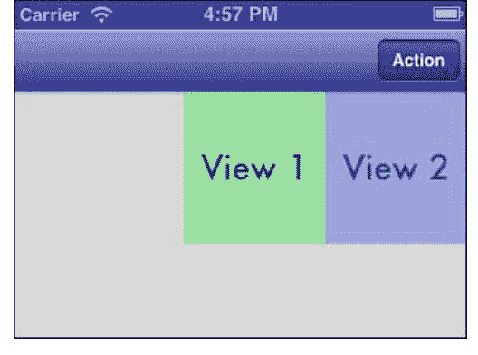

图 5-3. “`H:[view1][view2]`”使用了空连接，将两个视图直接挨着放置。

连字符 (`-`) 代表一个较小的固定空间。约束“`H:[view1]-[view2]`”使用了连字符连接。该约束在 View 1 和 View 2 之间留了一个小间隙，如图 5-4 所示。

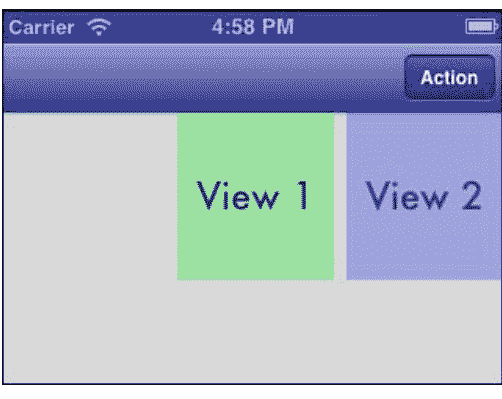

在连字符之间放置数字常量可以设置精确的间隙大小。约束“`H:[view1]-30-[view2]`”在两个视图之间增加了 30 点的间隙，如[图 5-5](5-5) 所示。这明显比连字符产生的默认小间隙要宽。

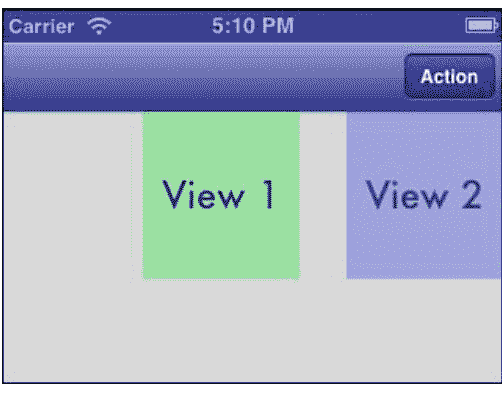

在约束规范中，管道符 (`|`) 始终指代父视图（superview）。管道符可以出现在格式字符串的开头或结尾。下面的示例同时使用了两者。

格式“`H:|-[view1]-[view2]|`”指定了一个从父视图开始的水平布局。父视图紧接着是第一个视图，然后是一个间距符、第二个视图，最后是父视图，你可以在[图 5-6](5-6) 中看到这一点。

图 5-6. “`H:|-[view1]-[view2]|`”告诉两个视图都紧贴其父视图的边缘。由于它们之间有固定大小的间隙，至少有一个视图必须调整大小以满足约束。

该约束使 View 1 与父视图左对齐，使 View 2 与父视图右对齐。为了实现这一点，必须有所妥协。要么左视图或右视图必须调整大小以满足这些约束。当我运行测试应用时，恰好是 View 2 进行了调整，这就是你在图 5-6 中看到的。它同样也可以是 View 1。

通常情况下，你不希望视图紧贴父视图的边缘。类似的约束“`H:|-[view1]-[view2]|`”在父视图边缘与 View 1 起点及 View 2 终点之间留了一个边缘内边（inset）（见图 5-7）。

图 5-7. “`H:|-[view1]-[view2]|`”在视图与其父视图之间引入了边缘内边。

这些遵循标准的 Interface Builder/Cocoa Touch 布局规则，尚未通过 iOS API 具体地暴露出来。边缘的内边间隙通常比默认的视图间间隙略大。你可以在以下由此约束创建的布局中看到这一点。

如果你的目标是允许视图之间留有灵活的空间，也有方法可以做到。在两个视图之间添加一条关系规则（例如，"`H:|-[view1]-(>=0)-[view2]-|`”），允许两个视图在保持自身尺寸并分离的同时，保持与父视图边缘的间距，如图 5-8 所示。该规则等同于“距离至少 0 点”，为让视图散开提供了一种更灵活的方法。我建议在这里使用一个较小的数字，以免无意中干扰到视图的其他几何规则。

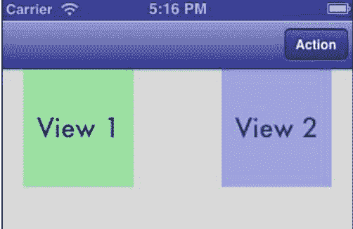

**图 5-8.** "`H:|-[view1]-(>=0)-[view2]-|`”在两个视图之间使用了灵活的空间，允许它们分离，同时保持它们的尺寸。

当然，这些约束不仅限于一个或两个视图。你可以轻松插入第三个、第四个或更多。考虑这个约束：“`H:|-[view1]-[view2]-(>=5)-[view3]-|`”添加了第三个视图，它通过灵活的空间与其他两个视图隔开。图 5-9 显示了它可能的样子。

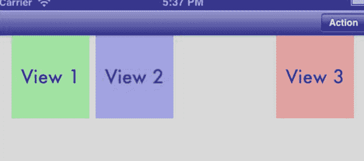

**图 5-9.** "`H:|-[view1]-[view2]-(>=5)-[view3]-|` 展示了一个包含三个视图的规则。

## 谓词 (Predicates)

上一部分的最后两个示例使用了带有比较的关系规则。这些也被称为*谓词*（predicates），是对关系方式的一种肯定（断言）。

谓词（Predicates）允许你使用比较运算符来定义关系。例如，使用 `[view1(>=50)]` 可以指定视图至少为 50 点。

- 固定内边距 `[view1]-[view2]`: 在视图之间留出微小的固定空间。
- 固定宽度/高度 `[item(size)]` `[view1(50)]`
- 最小和最大宽度/高度 `[item(>=size)]` `[view1(>=50)]`
- 最小和最大宽度/高度 `[item(<=size)]` `[view1(<=50)]`
- 匹配另一个视图的宽度/高度 `[item(==item)]` `[view1(==view2)]`
- 匹配另一个视图的宽度/高度 `[item(<=item)]`
- 匹配另一个视图的宽度/高度 `[item(>=item)]`
- 对齐父视图 `[item]` `H:|[view1]`
- 对齐父视图 `[item]|` 视图左侧与父视图左侧对齐。
- 从父视图内缩 `|-[item]` `H:-[view1]`: 视图从父视图左边缘内缩。
- 自父视图自定义内边距 `-amt-[item]` `|-15-[view1]`
- 自父视图自定义内边距 `[item]-amt-|` 视图在起始侧（leading side）相对于父视图内缩 15 点。
- 优先级 `@amt` `H:(view1<=50@20)`: (范围 0 到 1000) 最小宽度 50，优先级 20。

## 存储与更新约束

所有到 `NSLayoutConstraint` 类的约束，无论它们是如何创建的。在处理约束时，你可以通过以下方式将它们添加到视图中：要么逐个添加（如前一节所示使用 `addConstraint:`），要么通过数组添加（使用 `addConstraints:` 实例方法，注意名称末尾有 `s`）。在日常工作中，你经常会处理存储在数组中的约束集合。

可以随时添加或移除约束。`removeConstraint:` 和 `removeConstraints:` 这两个方法允许你从给定视图中移除一个或一组约束。由于这些方法作用于对象，当你尝试移除某些约束时，其结果可能不符合你的预期。

例如，假设你构建了一个中心对齐约束并将其添加到视图中。你不能再构建一个具有相同规则的第二个版本的约束，并期望通过标准的 `removeConstraint:` 调用将其移除。它们是等效的约束，但它们并不是同一个约束。以下是这一困境的示例：

```objc
[self.view addConstraint:[NSLayoutConstraint constraintWithItem:textField attribute:NSLayoutAttributeCenter relatedBy:NSLayoutRelationEqual toItem:self.view attribute:NSLayoutAttributeCenter multiplier:1.0 constant:0.0f]];

[self.view removeConstraint:[NSLayoutConstraint constraintWithItem:textField attribute:NSLayoutAttributeCenter relatedBy:NSLayoutRelationEqual toItem:self.view attribute:NSLayoutAttributeCenter multiplier:1.0 constant:0.0f]];
```

按照如下方式执行这两个方法调用：`self.view` 实例包含原始约束，而移除第二个约束的尝试会被忽略。移除一个视图未持有的约束将不会产生任何影响。

解决这个问题你有两个选择。首先，你可以在第一次添加约束时将其存储在局部变量中以保留它。代码看起来大如下所示：

```objc
NSLayoutConstraint *myConstraint = [NSLayoutConstraint constraintWithItem:textField attribute:NSLayoutAttributeCenter relatedBy:NSLayoutRelationEqual toItem:self.view attribute:NSLayoutAttributeCenter multiplier:1.0 constant:0.0f];

[self.view addConstraint:myConstraint];

// 稍后

[self.view removeConstraint:myConstraint];
```


或者，你可以使用一种方法（食谱 5-1）比较约束并移除数值上与你传递的约束匹配的一个。

了解你的约束是静态的（用于视图的整个周期）还是动态的（根据需要更新），有助于你决定需要哪种方法。如果你认为未来可能需要移除某个约束，请将其保留在局部变量中，以便稍后从视图中移除它，或使用食谱 5-1 中详细说明的替代方案。

以下是管理约束时需要了解的一些基本点：

- 你可以向视图实例添加约束和移除约束。核心方法是 `addConstraint:`、`addConstraints:`、`removeConstraint:`、`removeConstraints:` 和 `constraints`。最后一个方法返回一个由视图存储的约束数组。
- 约束不仅限于容器视图。几乎任何视图都可以存储约束。（类方法 `requiresConstraintBasedLayout` 指定了约束是否依赖于其他约束来运行。）
- 如果你想用约束来编写子视图，请关闭子视图的 `translatesMaskIntoConstraints` 属性。你将在本章示例代码中看到这一点，并在本章末尾的“调试你的约束”部分中进一步讨论。

## 食谱：比较约束

所有约束都使用以下格式的固定结构，以及关联的优先级：
`view1.attribute (relation) view2.attribute * multiplier + constant`

该方程的每个元素通过约束对象的属性暴露，即 `priority`、`firstItem`、`firstAttribute`、`relation`、`secondItem`、`secondAttribute`、`multiplier` 和 `constant`。这些属性使得比较两个约束变得简单。

视图将对象存储并移除约束。如果约束存储在不同的内存位置，即使它们描述相同的条件，也被认为是不相等的。为了允许你在不本地存储这些项目的情况下动态添加和移除约束，请使用比较。

食谱 5-1 引入三个方法。`matches:` 方法比较两个约束中的属性，判断它们是否匹配。注意，它只考虑方程，不考虑优先级（尽管如果你需要，可以很容易地添加）。

```objc
@implementation UIView (BasicConstraints)

// 检查两个约束是否匹配，忽略优先级

(BOOL)matches:(NSLayoutConstraint *)constraint1 to:(NSLayoutConstraint *)constraint2 {

    if (constraint1.firstItem != constraint2.firstItem) return NO;

    if (constraint1.secondItem != constraint2.secondItem) return NO;

    if (constraint1.firstAttribute != constraint2.firstAttribute) return NO;

    if (constraint1.secondAttribute != constraint2.secondAttribute) return NO;

    if (constraint1.relation != constraint2.relation) return NO;

    if (constraint1.multiplier != constraint2.multiplier) return NO;

    if (constraint1.constant != constraint2.constant) return NO;

    return YES;

}

// 在视图内查找匹配的约束

-(NSLayoutConstraint *)matchingConstraint:(NSLayoutConstraint *)constraint {

    for (NSLayoutConstraint *c in self.constraints) {

        if ([c matches:constraint to:constraint]) return c;

    }

    return nil;

}

// 移除匹配的约束

-(void)removeMatchingConstraint:(NSLayoutConstraint *)constraint {

    NSLayoutConstraint *match = [self matchingConstraint:constraint];

    if (match) {

        [self removeConstraint:match];

        [self.superview removeConstraint:match];

    }

}

@end
```

## 食谱：描述约束

在开发和调试约束时，你可能会发现为任意 `NSLayoutConstraint` 生成人类可读的描述是非常有用的。食谱 5-2 构建了简洁的字符串，如下所示描述约束：

- `* [UILabel:6632a0].right <= [self].right;`
- `* [self].width == ([self].height * 1.778);`
- `* [UILabel:6632a0].leading == ((UILabel:6ed2e70].trailing + 60)`

此食谱将约束实例转换为文本表示。它是在描述约束的视图上下文中进行的（因此，除了对 self 的引用外，还有类和内存地址列出的特定子视图的引用）。

```objc
default: return "@not-an-attribute";

}

// 返回描述布局关系的名称

(NSString *) nameForLayoutRelation: (NSLayoutRelation) aRelation

{

  switch (aRelation) {

    case NSLayoutRelationLessThanOrEqual: return "@=";

    case NSLayoutRelationEqual: return "@=";

    case NSLayoutRelationGreaterThanOrEqual: return ">=";

    default: return "@not-a-relation";

  }

}
```

```objc
// 在其所属的语境中描述视图

(NSString *) nameForItem: (id) anItem

{

  if (!anItem) return "@nil";

  if (anItem == self) return "@[self]";

  if (anItem == self.superview) return "@[superview]";

  return [NSString stringFormat:@"@[%d]", (int)anItem];

}
```

```objc
// 将约束转换为字符串表示

(NSString *) constraintRepresentation: (NSLayoutConstraint *) aConstraint

{

  NSString *item1 = [self nameForItem:aConstraint.first];

  NSString *item2 = [self nameForItem:aConstraint.second];

  NSString *relation = [self nameForLayoutRelation:aConstraint.relation];

  NSString *attr1 = [self nameForLayoutAttribute:aConstraint.firstAttribute];

  NSString *attr2 = [self nameForLayoutAttribute:aConstraint.secondAttribute];

  NSString *result;

  if (!aConstraint.secondItem) {

    result = [NSString stringFormat:@"@(%0.4f) %@%% %@@ %%0.3f", aConstraint.priority, item1, attr1, relation, aConstraint.constraint];

  } else if (aConstraint.multiplier == 1.0f) {

    if (aConstraint.constant == 0.0f) {

      result = [NSString stringWithFormat:@"%.4f %@ %@ %@ %@", aConstraint.priority, item1, attr1, relation, item2];

    } else {

      result = [NSString stringWithFormat:@"%.4f %@ %@ (%%@ + %+0.3f)", aConstraint.priority, item1, attr1, relation, item2, aConstraint.constant];

    }

  } else {

    if (aConstraint.constant == 0.0f) {

      result = [NSString stringWithFormat:@"%.4f %@ %@ (%%@ * %+0.3f)", aConstraint.priority, item1, attr1, relation, item2, attr2, aConstraint.multiplier];

    } else {

      result = [NSString stringWithFormat:@"%.4f %@ %@ ((%%@ * %+0.3f) + %+0.3f)", aConstraint.priority, item1, attr1, relation, item2, attr2, aConstraint.multiplier, aConstraint.constant];

    }

  }

  return result;

}

@end
```

## 获取此食谱的代码

要找到此食谱的完整示例项目，请将浏览器指向 https://github.com/erica/iOS-6-Cookbook 并进入第5章文件夹。

# 食谱：创建固定大小的约束视图

在处理约束时，开始以全新的方式思考视图。你不再仅仅设置一个帧（frame）并期望视图留在你留下的位置和大小。约束布局使用了一套完全不同的假设。以下是你在 iOS 6 之前可能编写的一个小方法来创建标签：

```objc
- (UILabel *)createLabelTheOldWay:(NSString *)aTitle {
  UILabel *label = [[UILabel alloc] initWithFrame:CGRect(0.0f, 0.0f, 100.0f, 100.0f)];
  label.textAlignment = NSTextAlignmentCenter;
  label.text = aTitle;
  return label;
}
```

通过 Cocoa Touch 新的自动布局系统，你以全新的方式处理代码级的视图创建。你的代码添加了约束来调整项目的大小和位置，而不是构建一个固定的帧并设置它的中心。

## 禁用自动调整大小约束

当你进入约束世界时，首先要禁用一个自动将自动调整标记（autosizing masks）转换为约束的视图属性。按照规则，你要么启用它（允许视图通过其自动调整标记参与约束系统），要么完全禁用它并手动添加自己的约束。自动调整大小是指 IB 中使用的字符串和弹簧布局工具（strings and springs layout），以及代码中使用的如 `UIViewAutosizingFlexibleWidth` 这样的自动调整标记。当你使用这些方法布局视图的调整行为时，不应该在你的任何约束中引用该视图。

涉及的特定属性是 `translatesAutosizingMaskIntoConstraints`。将其设置为 `NO` 可以确保你可以添加约束而不会与自动化系统冲突。这非常重要。如果没有禁用该属性就开始使用，就会产生冲突。自动调整约束不会与你直接编写的约束和平共存。这是一个会导致运行时错误消息示例：

```
2012-06-24 15:34:54.839 HelloWorld[64834:c07] Unable to simultaneously satisfy constraints.
Probably least one of the constraints in the following list is one you don't
try this: (1) look at each constraint and try to figure out which you don't
expect; (2) find the code that added the unwanted constraint or constraints and
fix. (If you're seeing NSAutosizingMaskLayoutConstraints that you don't
```

```objc
toItem:self.superview attribute:NSLayoutAttributeBottom
multiplier:1.0f constant:0.0f];
}
```

```objc
(void) constrainSize:(CGSize)aSize
{
    NSMutableArray *array = [NSMutableArray array];

    // 固定宽度
    [array addObjectsFromArray:[NSLayoutConstraint 
    constraintsWithVisualFormat:@"H: [self(theWidth(750))]" 
    options:0.0 metrics:@("theWidth":(aSize.width))
    views:NSDictionaryOfVariableBindings(self)]];

    // 固定高度
    [array addObjectsFromArray:[NSLayoutConstraint 
    constraintsWithVisualFormat:@"V:[self(theHeight(750))]" 
    options:0.0 metrics:@("theHeight":(aSize.height))
    views:NSDictionaryOfVariableBindings(self)]];

    self addConstraints:array;
}
```

```objc
(void) constrainPosition:(CGPoint)aPoint
{
    if (!self.superview) return;

    NSMutableArray *array = [NSMutableArray array];

    // X 位置
    [array addObject:[NSLayoutConstraint constraintWithItem:self 
    attribute:NSLayoutAttributeLeft relatedBy:NSLayoutRelationEqual
    toItem:self attribute:NSLayoutAttributeLeft
    multiplier:1.0f constant:aPoint.x]];

    // Y 位置
    [array addObject:[NSLayoutConstraint constraintWithItem:self 
    attribute:NSLayoutAttributeTop relatedBy:NSLayoutRelationEqual
    toItem:self attribute:NSLayoutAttributeTop
    multiplier:1.0f constant:aPoint.y]];

    self.superview addConstraints:array];
}

@end
```

## 获取此食谱的代码

要找到此食谱的完整示例项目，请将浏览器指向 https://github.com/erica/iOS-6-Cookbook 并进入第 5 章节的文件夹。

# 食谱：视图居中

要让视图居中，请将它们的中心属性（`centerX` 和 `centerY`）与其容器中相应的属性相关联。食谱 5-4 引入了一对方法，用于获取视图的父视图，并在它们的中心之间应用相等关系。

注意这些约束是添加到父视图而不是子视图中的。这是因为约束不能引用到其自身子树之外的视图。如果你尝试这样做，将会生成以下错误：

```
2012-06-24 16:09:14.736 HelloWorld[65437:c07] *** Terminating app due to uncaught exception 'NSGenericException', reason: 'Unable to install constraint on view.
Does the constraint reference something outside the subtree of the view?
```


That's illegal. constraint:`<NSLayoutConstraint:0x6b6ebf0 UILabel:0x6b8e40.centerY UIView:0x6b64a0.centerY view:ILabel:0x6b8e40; frame = (0; 0; 0); text = 'View 1'; clipsToBounds = YES; userInteractionEnabled = NO; layer = CALayer; 0x6b7220>'`

`libc+abi.dylib: terminate called throwing an exception`

这里有几个简单的规则：

- 在创建约束时，当父视图被提及为第一个或第二个项目时，请将约束添加到父视图。
- 在处理格式化字符串时，当字符串任何位置包含垂直管道符号（`|`）时，将其添加到父视图。

## 食谱 5-4. 使用约束使视图居中

```objc
@implementation UIView (BasicConstraints)

-(void) centerHorizontallyInSuperview
{
    if (!self.superview) return;
    [self.superview addConstraint:[NSLayoutConstraint
    constraintWithItem:self attribute:NSLayoutAttributeCenterX
    relatedBy:NSLayoutRelationEqual
    toItem:self.superview attribute:NSLayoutAttributeCenterX
    multiplier:1.0f constant:0.0f]];
}

-(void) centerVerticallyInSuperview
{
    if (!self.superview) return;
    [self.superview addConstraint:[NSLayoutConstraint 
    constraintWithItem:self attribute:NSLayoutAttributeCenterY
    relatedBy:NSLayoutRelationEqual
    toItem:self.superview attribute:NSLayoutAttributeCenterY
    multiplier:1.0f constant:0.0f]];
}

@end
```

## 获取此食谱的代码

要找到此食谱的完整示例项目，请将浏览器指向 `https://github.com/erica/iOS-6-Cookbook` 并进入第 5 章节的文件夹。

## 食谱：设置宽高比例

约束乘数（即方程 $y = m * x + b$ 中的 $m$）可以帮助设置视图的宽高比例。食谱 5-5 展示了如何通过将视图的高度 ($y$) 与其宽度 ($x$) 相关联，并将 $m$ 值设置为比例值来实现这一点。该方程翻译为 `constraintWithItem:attribute:relatedBy:toItem:multiplier:constant` 方法。食谱 5-5 使用宽高比例作为乘数，在视图的宽度和高度之间建立 `NSLayoutRelationEqual` 关系。

该食谱通过管理一个固定约束来应用比例更新，该约束本地存储在名为 `aspectConstraint` 的 `NSLayoutConstraint` 变量中。每当用户将比例从 16:9 切换到 4:3 或反之时，都会移除之前的约束并创建另一个。它通过设置相应的乘数来构建此新约束并将其添加到视图。

为了在保持视图足够大的同时允许一定的活性，此食谱中的 `createLabel:` 方法做了两件事。首先，它使用了宽度和高度偏。

## 食谱 5-5. 创建宽高比例

```objc
- (UILabel *) createLabel:(NSString *)aTitle
{
    UILabel *label = [[UILabel alloc] initWithFrame:CGRectZero];
    label.font = [UIFont fontName:"Futura" size:24];
    label.textColor = [UIColor darkColor];
    label.textAlignment = NSTextAlignmentCenter;
    label.translatesAutoresizingConstraints = NO;
    label.text = aTitle;
    [self.superview addSubview:label];
    [self.superview addConstraint:[NSLayoutConstraint
    constraintWithItem:label attribute:NSLayoutAttributeCenterX
    relatedBy:NSLayoutRelationEqual
    toItem:self.superview attribute:NSLayoutAttributeCenterX
    multiplier:1.0f constant:0.0f]];
    [self.superview addConstraint:[NSLayoutConstraint
    constraintWithItem:label attribute:NSLayoutAttributeCenterY
    relatedBy:NSLayoutRelationEqual
    toItem:self.superview attribute:NSLayoutAttributeCenterY
    multiplier:1.0f constant:0.0f]];
    [self.superview addConstraint:[NSLayoutConstraint
    constraintWithItem:label attribute:NSLayoutAttributeWidth
    relatedBy:NSLayoutRelationGreaterThanOrEqual
    toItem:self attribute:NSLayoutAttributeWidth
    multiplier:1.0f constant:300]];
    [self.superview addConstraint:[NSLayoutConstraint
    constraintWithItem:label attribute:NSLayoutAttributeHeight
    relatedBy:NSLayoutRelationGreaterThanOrEqual
    toItem:self attribute:NSLayoutAttributeHeight
    multiplier:1.0f constant:750]];
    return label;
}

-(void) toggleAspect:(id)sender
{
  if (aspectConstraint)
    [self.view removeConstraint:aspectConstraint];
  if (useFourThree)
    aspectConstraint = [NSLayoutConstraint constraintWithItem:self
      attribute:NSLayoutAttributeWidth
      relatedBy:NSLayoutRelationEqual
      toItem:self attribute:NSLayoutAttributeHeight
      multiplier:(4.0f / 3.0f) constant:0.0f];
  else
    aspectConstraint = [NSLayoutConstraint constraintWithItem:self
      attribute:NSLayoutAttributeWidth
      relatedBy:NSLayoutRelationEqual
      toItem:self attribute:NSLayoutAttributeHeight
      multiplier:(16.0f / 9.0f) constant:0.0f];
  [self.view addConstraint:aspectConstraint];
  useFourThree = !useFourThree;
}
```

约束系统，其中 b 偏移量必须已知，且关系仅存在视图属性之间。在当前系统中，无论是同步方程

```
A. center == B. center + spacer1;
B. center == C. center + spacer2;
spacer1 == spacer2
```

还是格式字符串方法

`[A]-spacer-[B]-spacer-[C]`

都是不法的。Autolayout 无法处理由这种分布产生的方程。你所做的最好就是确定每个项目之间想要的间距，并使用倍数和偏移量手动撑开每个视图的位置。

如果你只有三个视图可以处理，可以将两个视图固定在父视图的左侧和右侧，并在它们之间居中第三视图。引入第四个子视图时，这种方法就失效了。

# 食谱：响应方向变化

设备的屏幕几何宽高比可能会影响你布局界面的方式。例如，横屏宽高比可能无法提供足够的垂直空间来容纳所有内容。考虑图 5-11。竖屏布局将 iTunes 专辑封面放在专辑名称、艺术家名称以及带有专辑价格的购买按钮上方。横屏则将专辑封面移动到左侧并垂直居中，并将专辑名称、艺术家和购买按钮放在右下角。

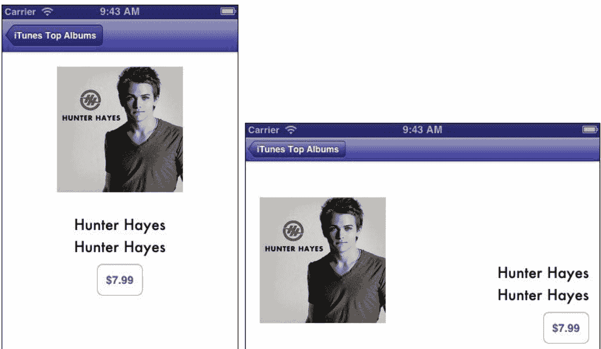

图 5-11 竖屏和横屏布局中的相同内容

为了实现这一点，你的布局约束必须感知方向。视图控制器提供了一个执行此操作特定位置。`updateConstraints` 方法允许你在运行时更改约束。在设备准备好旋转但尚未旋转之前，在 `willRotateToInterfaceOrientation:duration:` 中调用该方法。这通过在新方向出现之前调整约束，实现了最平滑的视觉更新。本食谱在方向变化发生之前调用了更新方法。这意味着食谱必须将新方向存储在局部变量（`newOrientation`）中，以便知道如何布局更新后的演示。遗憾的是，Apple 并没有提供像 `updateConstraintsForOrientation:` 这样更感知方向的方法。在添加你的特殊化代码之前，始终调用父类的 `updateConstraints` 实现。跳过这一步是程序运行时崩溃的极佳方法。

食谱 5-6 使用了一些约束宏，将在下一节中详细介绍。

# 食谱 5-6. 更新视图约束

```objc
(void) updateViewConstraints
{
    [super updateViewConstraints];
    [self.view removeConstraints:self.view.constraints];
    NSDictionary *bindings = NSDictionaryOfVariableBindings(
        imageView, titleLabel, artistLabel, button);
    if (IS_IPAD || UIDeviceOrientationIsPortrait(newOrientation) ||
        newOrientation == UIDeviceOrientationUnknown) {
        for (UIView *view in [imageView,
            titleLabel, artistLabel, button])
            CENTER_H(self.view, view);
        STRAIN_VIEWS(self.view, view, @"V|-[imageView]-30-
            [titleLabel-(>=0)|-[artistLabel]-15-[button]-(>=0)||",
            bindings);
    } else {
        // 图像左侧居中
        CENTER_V(self.view, imageView);
        // 布局剩余视图
        STRAIN(self.view, imageView, @"H|-[imageView]");
        STRAIN(self.view, titleLabel, @"H:[titleLabel]-15-[-");
        STRAIN(self.view, artistLabel, @"H:[artistLabel]-15-[-");
        STRAIN(self.view, button, @"H:[button]-15-[-");
        STRAIN_VIEWS(self.view, view, @"V|-(>=0)-[titleLabel](>=0)]\-
            -[artistLabel]-15-[button]-",
            bindings);
        // 确保 titleLabel 不重叠
        STRAIN_VIEWS(self.view,
            @"H:[imageView]-(>=0)-[titleLabel]", bindings);
    }
}

// 捕捉旋转变化
(void) willRotateToInterfaceOrientation:(UIInterfaceOrientation)toInterfaceOrientation
    duration:(NSTimeInterval)duration {
    newOrientation = toInterfaceOrientation;
    [self updateViewConstraints];
}

// 存储初始方向
(void) viewWillAppear:(BOOL)animated {
    newOrientation = self.interfaceOrientation;
}
```

## 获取此食谱的代码

要找到此食谱的完整示例项目，请访问浏览器 `https://github.com/erica/iOS-6-Cookbook` 第 5 章。

## 约束宏

在编写这本书期间，我变得越来越依赖使用约束。约束为视图布局提供了可靠的组件，我喜欢它们的工作方式。然而，原生形式的约束既冗长又冗余。我经常在反复实现那些难以阅读的代码。调试约束是一件痛苦。简单的拼写错误花费了太多精力。我很快发现预定义的宏节省了我的时间并增加了视图布局的可读性。与其每次都手动在一个视图内部居中并调试布局，一个 `CENTER_VIEW` 宏就能完成工作。

如列表 5-1 所示，创建宏将工作从产生精确的定义转移到确保约束的一致性和充分性。这些应该是布局工作的重点。

## 一致的约束

一致的约束确保自动布局系统不会破坏任何约束。不一致的约束示例可能使用列表 5-1 中的宏：

```objc
for (UIView *subview in self.view.subviews)
    ALIGN_TOP(self.view, subview);
```
等待，我在文中看到了错误。此代码片段将每个视图固定到父视图的顶部。这些约束是不一致的，因为视图 2 无法在位于视图 1 下方的同时与父视图对齐。

## 充分的约束

充分的约束防止视图随机放置。以下代码片段定义了视图 2 的约束：

```objc
ALIGN_LEFT(self.view, view);
ALIGN_TOP(self.view, view);
```
等等，列表 5-1 显示了宏定义的当前状态。尽管视图 1 固定在左上角，视图 2 可能出现在任何位置并在视图 1 的右侧。遗憾的是，Apple 没有提供一个测试来确定视图何时已约束。我根据时间测试了这些内容，它们仍在进行中。我仍在根据需要调整它们。如果你发现任何错误或认为有用的扩展，请告诉我我会更新仓库。

# 列表 5-1 约束宏

```objc
// 准备约束
#define PRECONSTRAINTS(VIEW) \
[VIEW setTranslatesAutoresizingConstraints:NO]

// 添加视觉约束
#define CONSTRAINT(PARENT, VIEW, FORMAT) \
[PARENT addConstraints:[NSLayoutConstraint \
    constraintsWithVisualFormat:(FORMAT) options:0 \
    views:NSDictionaryOfVariableBindings(VIEW)]]

#define CONSTRAINT_VIEWS(PARENT, FORMAT, BINDINGS) \
[PARENT addConstraints:[NSLayoutConstraint \
    constraintsWithVisualFormat:(FORMAT) options:0 \
    views:BINDINGS]]

// 跨轴伸
#define STRETCH_VIEW(PARENT, VIEW, @"H") \
[CONSTRAINT(PARENT, VIEW, @"H:[VIEW](>=0)")]

#define STRETCH_VIEW(PARENT, VIEW, @"V") \
[CONSTRAINT(PARENT, VIEW, @"V:[VIEW](>=0)")]
```


{STRETCH_VIEW(PARENT, VIEW, @"H"); STRETCH_VIEW(PARENT, VIEW, @"V")}

// 沿轴居中

#define CENTER_VIEW_H(PARENT, VIEW) \

[PARENT addConstraint:[NSLayoutConstraint \

constraintItem:VIEW attribute:NSLayoutAttributeCenterX \

relatedBy:NSLayoutRelationEqual \

toItem:PARENT attribute:NSLayoutAttributeCenterX \

multiplier:1.0 constant:0.0]]

#define CENTER_VIEW_V(PARENT, VIEW) \

[PARENT addConstraint:[NSLayoutConstraint \

constraintItem:VIEW attribute:NSLayoutAttributeCenterY \

relatedBy:NSLayoutRelationEqual \

toItem:PARENT attribute:NSLayoutAttributeCenterY \

multiplier:1.0 constant:0.0]]

#define CENTER_VIEW_PAREN(PARENT, VIEW) \

[CENTER_VIEW_H(PARENT, VIEW); CENTER_VIEW_V(PARENT, VIEW)];

// 对齐父视图

#define ALIGN_VIEW_LEFT(PARENT, VIEW) \

[PARENT addConstraint:[NSLayoutConstraint \

constraintItem:VIEW attribute:NSLayoutAttributeLeft \

relatedBy:NSLayoutRelationEqual \

toItem:PARENT attribute:NSLayoutAttributeLeft \

multiplier:1.0 constant:0.0]]

#define ALIGN_VIEW_RIGHT(PARENT, VIEW) \

[PARENT addConstraint:[NSLayoutConstraint \

constraintItem:VIEW attribute:NSLayoutAttributeRight \

relatedBy:NSLayoutRelationEqual \

toItem:PARENT attribute:NSLayoutAttributeRight \

multiplier:1.0 constant:0.0]]

#define ALIGN_VIEW_TOP(PARENT, VIEW) \

[PARENT addConstraint:[NSLayoutConstraint \

constraintItem:VIEW attribute:NSLayoutAttributeTop \

relatedBy:NSLayoutRelationEqual \

toItem:PARENT attribute:NSLayoutAttributeTop \

multiplier:1.0 constant:0.0]]

#define ALIGN_VIEW_BOTTOM(PARENT, VIEW) \

[PARENT addConstraint:[NSLayoutConstraint \

constraintItem:VIEW attribute:NSLayoutAttributeBottom \

relatedBy:NSLayoutRelationEqual \

toItem:PARENT attribute:NSLayoutAttributeBottom \

multiplier:1.0 constant:0.0]]

// 设置大小

#define CONSTRAIN_WIDTH(VIEW, WIDTH) \

[CONSTRAIN(VIEW, VIEW, @"H:[#VIEW width==#WIDTH])")]

#define CONSTRAIN_HEIGHT(VIEW, HEIGHT) \

[CONSTRAIN(VIEW, VIEW, @"V:[#VIEW height==#HEIGHT])")]

#define CONSTRAIN_SIZE(VIEW, HEIGHT, WIDTH) \

```

CONSTRAIN_WIDTH(VIEW, WIDTH); CONSTRAIN_HEIGHT(VIEW, HEIGHT);

// 设置比例

#define CONSTRA_ASPECT(VIEW, ASPECT) \

[NSLayoutConstraint \

constraintWithItem:VIEW attribute:NSLayoutAttributeWidth \

relatedBy:NSLayoutRelationEqual \

toItem:VIEW attribute:NSLayoutAttributeHeight \

multiplier:(ASPECT) constant:0.0f];

// 元素间排序

#define CONSTRA_ORDER_H(PARENT, VIEW1, VIEW2) \

[PARENT addConstraints:[NSLayoutConstraint \

constraintsWithVisualFormat:@"H:[[\"VIEW1\"]->=0-[\"VIEW2\"]]" \

options:0 metrics:nil \

views:DictionaryOfVariableBindings(VIEW1, VIEW2)]];

#define CONSTRA_ORDER_V(PARENT, VIEW1, VIEW2) \

[PARENT addConstraints:[NSLayoutConstraint \

constraintsWithVisualFormat:@"V:[[\"VIEW1\"]->=0-[\"VIEW2\"]]" \

options:0 metrics:nil \

views:DictionaryOfVariableBindings(VIEW1, VIEW2)]];

```

## 调试你的约束

在通过代码添加约束时，遇到的最常见问题是布局歧义和无法满足。在 Xcode 调试控制台中会花费大量时间，当你看到一堆以“无法同时满足约束（Unable to simultaneously satisfy constraints）”这句话开头的大量信息 dump 时，不要感到意外。

iOS 在运行时执行此操作是为了让你知道哪些约束无法满足，以及它为了继续执行必须破坏哪些约束。通常，它会列出约束列表，你应该评估这些约束以确定是哪个元素导致了问题。通常看起来如下：

+ 以下列表中至少有一个约束是你需要的
- 尝试：(1) 查看每个约束，并尝试找出哪一个是不需要的。
- (2) 找到添加了该不需要的约束或约束的代码并修复它。（注意：如果你看到了你不理解 `NSAutoresizingMaskLayoutConstraints`，请参考 UIView 属性 `translatesAutoresizingMaskIntoConstraints` 的文档）
- "NSAutoresizingMaskLayoutConstraint:0x6e5bc90h-=-v--"

```
UIViewContainerView:0x6e54f0.height == UIWindow:0x6e528a0.height>

<NSAutoresizingMaskConstraint:0x6e5a50 h--= v---

INavigationTransitionView:0x6e55650.height =

UIViewContainerView:0x6e54f0.height>

<NSAutoresizingMaskConstraint:0x6e592f0 h--= v---

UIViewControllerWrapperView:0x66b90d0.height =

INavigationTransitionView:0x6e55650.height - 64>>

<NSAutoresizingMaskConstraint:0x6e57b90 h--= v---

UIView:0x6baef20.height =

UIViewControllerWrapperView:0x66b90d0.height>

<NSAutoresizingMaskConstraint:0x6e5cd40 h--= v---

V:[UIWindow:0x6e528a0(480)]>,

<NSAutoresizingMaskConstraint:0x6bbe890 h--= v---

ULabel:0x6bb3730.midY ==

<NSLayoutConstraint:0x6bb8cc0 ULabel:0x6bb3730.centerY =

UIView:0x6baef20.centerY>
```

很有可能，你忘记了为其中一个视图进行切换。如果你看到列出了 `NSAutoresizingMaskConstraint`，并且它与例如你正在布局的 `UILabel` 关联（如此处所示），那就是关于你问题所在位置的提示。我已经高亮了导致问题的两个约束。

在其他情况下，你可能要求的约束之间相互冲突，因为它们的内容与彼此的内容相矛盾。在接下来的 dump 中，我要求一个视图既要居中对齐，又要左对齐。为了能够继续运行，布局系统必须做出选择。它决定取消 y 轴居中的要求，允许我通过将视图与其父视图的顶部对齐来尝试恢复。

```
<NSLayoutConstraint:0x6e94250 ULabel:0x6b90e00.centerY ==

UIView:0x6b8ca50.centerY>
```

虽然约束可能很吓人，但某些策略可以提供帮助。首先，在代码中工作时，一点一点地开发你的约束。当事情开始出现问题时，这对你有帮助。其次，考虑使用列表 5-1 中的宏。没有必要在代码中反复编写“与视图对齐”和“设置尺寸为 n 乘 m”。最后，如果你不需要在代码中设置约束，请考虑使用提供的 IB 工具来让视觉布局变得简单。

## 总结

本章介绍了 iOS 的自动布局（autolayout）功能。在进入下一章之前，这里有几点可以借鉴的想法：

IB 提供了一套极好的布局工具。然而，不要觉得你不能在代码中创建基于约束的界面。无论你是视觉化还是通过编程方式指定约束，布局系统都能对你的视图提供极佳的控制。

+ 使用约束的一个大优点是，你摆脱了针对界面的特定分辨率解决方案。是的，你在平板电脑上的用户体验可能与 iPhone 系列成员上的不同，但同时，这些新工具允许你在同一个移动设备家族内为不同的窗口（以及可能的屏幕）尺寸进行设计。

# 6. 文字输入

有些人可能轻视文本在触摸设备上的用处。毕竟，用户可以通过简单的手势传达大量信息。然而，文本起着重要作用，特别是在用户交互时。本章介绍了关于控制键盘、文本格式等内容。本章为你可能遇到的问题提供了实用的食谱。

## 食谱：消除 UITextField 键盘

关于小型设备的一个常见问题是：“用户完成后如何消除键盘？”没有内置方法可以自动检测用户完成输入。然而，iPad 提供了键盘消除按钮，但 iPhone 没有。幸运的是，无论平台如何，响应文本结束只需要很少的工作。通过允许用户点击完成（Done）来实现。以下是关于实现这种方法的几点：

- **将返回类型设置为 Done** 会将“返回”替换为“完成”。你可以在 Interface Builder 的属性检查器中通过赋值 `return` 属性来实现。使用 Done 样式的返回键告诉用户如何完成编辑。
- **成为代理**。通过代码或 Interface Builder 将文本字段的代理属性设置为你的视图（在可以通过右键点击文本字段进行赋值）。确保你的视图控制器声明并实现了 `UITextFieldDelegate` 协议。
- **实现 `textFieldShouldReturn:` 方法**。该方法会捕获返回键按下，无论如何使用。使用此方法释放第一响应者以隐藏键盘，直到用户触摸另一个文本字段或文本视图。

> 注意
> 你也可以在按下返回键时使用 `textFieldShouldReturn:` 执行操作，除了消除键盘之外。


**图 6-1。** 将返回键设置为 Done（左侧）告诉你的用户如何完成编辑。

## 防止消除键盘

正如你可以接管键盘消除一样，你的代码也可以阻止该操作。视图控制器可以在当前响应不支持文本时强制键盘保持在屏幕上。要做到这一点，重写 `disablesAutomaticKeyboardDismissal` 方法。该方法返回一个布尔值，允许或禁止键盘收起。

## 文本特性属性

字段实现了 `UITextInputTraits` 协议。该协议提供了八个属性，通过设置这些属性可以定义字段处理文本输入的方式这些特性如下：

- **autocapitalizationType**—定义文本自动大写样式。可用样式包括句首大写、单词首字母大写、全大写和不大写。在输入用户名和密码时请避免大写。对于专有名词和地址输入字段使用单词首字母大写。

- **autocorrectionType**—指定文本是否受 iOS 自动纠正功能的影响。当此属性启用（设置为 `UITextAutocorrectionYes`）时，iOS 会向用户建议替换词。大多数开发者会禁用用户名和密码字段的自动纠正，以免 iOS 意外将 `myFacebookAccount` 纠正为：`myofacial`。

- **spellCheckingType**—确定在用户输入时是否启用拼写检查。使用 `UITextSpellCheckingYes` 启用，或使用 `UITextSpellCheckingNo` 禁用。拼写检查与自动纠正不同，后者会在用户输入时直接更新项目。拼写检查会检测并在文本视图中为拼写错误的项目下划，为纠正替换提供视觉提示。默认情况下，只要自动纠正激活，拼写检查就会启用。

- **keyboardAppearance**—提供两种键盘呈现样式：默认样式和用于警报面板的样式。

- **keyboardType**—允许你指定用户与字段或文本视图交互时出现的键盘。iOS 提供了近十种类型。这些类型包括标准 ASCII、数字和标点符号、基于 PIN 的输入（0–9）、电话号码输入（0–9, #, *）、小数输入（0–9 和 `.`）、URL 优化型（突出显示 `.` 和 `.com`）、电子邮件优化型（突出显示 `@` 和 `.`）以及 Twitter 优化型（突出显示 `@` 和 `#`）。

每个键盘在其呈现的字符组合上各有优缺点。例如，e 键盘是为了支持地址输入的，它包含了 `@` 符号以及 `.`。Twitter 键盘提供了方便访问的标签 (#) 符号和用户 ID (@) 符号的入口。

- **enablesReturnAutomatically**—帮助控制当输入字段或视图中没有文本时是否禁用 Return（返回）键。如果你将此属性设置为 `YES`，则在用户输入至少一个字符后，Return 键将变为可用。

- **returnKeyType**—指定键盘上 Return 键的文本。你可以从默认（Return）、Go、Google、Join、Next、Route、Search（搜索）、Send（发送）、Yahoo、Done（完成）和 Emergency Call（紧急电话）中选择。选择一个与用户完成任务时执行的操作相匹配的值。

- **secureTextEntry**—切换文本隐藏功能以提供更安全的文本输入。当此属性启用时，你可以看到最后输入的字符，但所有其他字符都将显示为一系列点。对于密码文本字段请开启此功能。

## 其他文本字段属性

除了标准文本特性，文本字段还提供了其他控制字段呈现方式的属性。以下是你应该了解的属性：

- **Placeholder** 显示占位符文本。当文本字段为空时，该文本以浅灰色显示。它提供了一个用户提示，描述了该字段的目标内容。使用占位符提供用法提示，例如“用户名”或“电子邮件地址”，如图 6-2 所示。

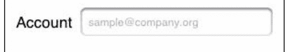

**图 6-2.** 当字段为空时，占位符文本以浅灰色显示在文本字段内部。任何添加到字段的文本都会遮挡占位符。你可以使用 IB 的文本字段属性检查器或通过编辑字段对象的 `placeholder` 属性来设置此文本。

- **Border style**—文本字段允许你控制显示在文本区域的 `borderStyle` 类型。你可以从简单线条、斜角（用于 IB 图 6-2）和圆矩形呈现中进行选择。这些在 IB 中均可见，属性检查器允许你在每个样式之间切换。

- **Clear button**—文本字段清除按钮以输入区域右侧的“X”形式出现。设置 `clearButtonMode` 来指定此按钮是否以及何时出现：始终、从不、编辑时或除非正在编辑时。“始终”选项能给用户提供最大的控制权。

# 食谱 6-1. 使用 Done 键收起文本字段键盘

```
// 当用户点击 Done 时收起键盘

- (BOOL)textFieldShouldReturn:(UITextField *)textField

{

  [textField resignFirstResponder];

  return YES;

}

-(void)viewDidLoad

{

  // 更新所有文本字段，包括在 IB 中定义的

  // 设置代理、返回键类型和其他实用的特性

  for (UIView *view in self.view.subviews) {

    if (view isKindOfClass:[UITextField class]) {

      UITextField *textField = (UITextField *)view;

      textField.delegate = self;
```


textField.returnKeyType = `UIReturnKeyDone`;

textField.clearButtonMode = `UITextextViewModeWhileEditing`;

textField.borderStyle = `UITextBorderStyleRoundedRect`;

textField.contentVerticalAlignment = `UIControlContentVerticalAlignmentCenter`;

textField.autocorrectionType = `UITextAutocorrectionTypeNo`;

textField.font = `[UIFont fontWithName:@"Future" size:12.0]`;

textField.placeholder = `@"Placeholder"`;

}

}

}

```

获取此食谱的代码

要找到此食谱的完整示例，请访问 `https://github.com/erica/Cookbook Chapter 6`。

# 使用辅助视图收起文本视图

自定义辅助视图允许向标准键盘呈现自定义元素。每个辅助视图都与给定的响应器（`UIResponder` 类的子类），如文本字段或文本视图关联。通过设置视图的 `inputAccessoryView` 属性添加辅助视图。食谱 6-2 使用了一个简单的工具栏。

本书的一位技术评审员写道他永远记不住哪个是文本视图哪个是文本字段。对此，我回答：“视图是双，字段是封。”文本视图可以使用任意行数（包括两行或更多）。文本字段是单行文本输入控件，受边界限制。

始终意识到 Apple 可能会引入新的 iOS 设备形态，为用户提供更多或更少的空间，因此要根据此编写代码，特别是在处理辅助视图等占用屏幕的功能时。根据目前的惯用法（iPhone 和 iPad），实际上并没有什么能做的，但值得在未来可能变化的代码中插入注释。

## 食谱 6-2. 为键盘添加自定义按钮

```objc
@interface TestBedViewController : UIViewController
{
    UITextView *textView;
    UIToolbar *toolbar;
}
@end
```

```objc
@implementation TestBedViewController

// 移除文本视图中的文本
-(void) clearText
{
    [textField setText:@""];
}

// 通过放弃第一响应者离开键盘模式
-(void) leaveKeyboardMode
{
    [textField resignFirstResponder];
}

-(UIToolbar *) accessoryView
{
    // 创建带有 Clear 和 Done 的工具栏
    toolbar = [[UIToolbar alloc] initWithWithFrame:
CGRectMake(0.0f, 0.0f, self.view.size.width, 44.0f);
    toolBar.tintColor = [UIColor darkGrayColor];

    // Set up items as Clear - flexspace
    NSMutableArray *items = [NSMutableArray array];
    [items addObject:UIBARBUTTON(@"Clear", @selector(clear))];
    [items addObject:UIBARBUTTON(UIButtonSystemItemFlexibleSpace nil)];
    [items addObject:UIBARBUTTON(@"Done", @selector(leaveKeyboard))];
    toolBar.items = items;

    return toolbar;
}

// Create text and add the custom accessory view
textView = [[UITextView alloc] initWithFrame:self.view.bounds];
textView.font = [UIFontWithName:@"Georgia" 
size:[IS_IPAD] ? 24.0f : 14.0f];
textView.inputAccessoryView = [self accessoryView];

// Use constraints to fill application bounds
[self.view addSubviewWithConstrainToBounds:textView];
[textView fitToHeightWithInset:0.0f];
[textView fitToWidthWithInset:0.0f];
```

## 获取此食谱的代码

要找到此食谱的完整示例项目，请将浏览器指向 `https://github.com/erica/iOS-6-Cookbook` 并进入第 6 章文件夹。

## 食谱：调整键盘周围的视图

由于需要，iOS 键盘很大。每当它们被使用时，会占据屏幕很大一部分。因此，你希望调整文本字段和文本视图，以便键盘在屏幕上出现时不会遮挡它们。图 6-4 展示了这个问题。

eu cuiam. In hendrerisl non nec convallis purus rhuncus. Donec feugiat enim quis neque condimentum ut iaculis velit tristie.

Integer fingilla sollicitudin nulla ut interdum. Nunc blandit ultrices Fusce sit arcu non mollis volutpat. Morbi tempus Integer laoreet pretium facil. Suspendisse at diam felis, eu porta ligula. Maecenas ac justo ut libero bibendum sagittis quis sed erat. In imperdiet magna in risus digniss gravida. Vivamus ut nibh ac augue luctus venenatis et id purus. Nunc libero, placerat eu consequat at ac, pellentesque in libero.

## 此文本位于底部

dignism pellentesque. Integer laoreet pretium facilisis. Suspendisse at diam felis, eu porta ligula. Maecenas ac justo ut libero bibendum sagittis quis sed erat. In imperdiet magna in risus digniss gravida. Vivamus ut nibh ac augue luctus venenatis et id purus. Nunc libero, placerat eu consequat at ac, pellentesque in.

## 此文本位于底部

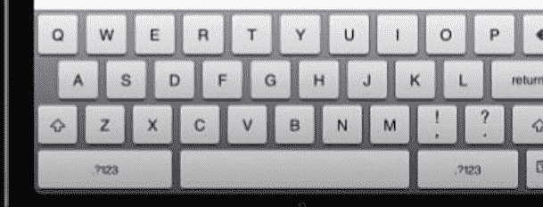

et, egestas in lorem. Pellentesque sed elit in libero mattis lobortis vel eu diam. Proin interdum nisl non leo convallis et porttitor porttitor ligula rhuncus. Donec feugiat enim quis neque condimentum ut iaculis velit tristie.

Integer fingilla sollicitudin nulla ut interdum. Nunc blandit ultrices

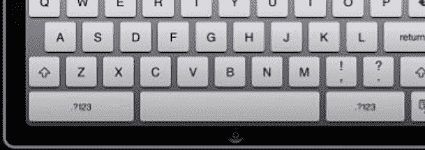

图 6-4。键盘占据了 iOS 设备屏幕的大部分。如果你不强制视图在键盘出现时自动调整大小和/或在屏幕上移动，键盘将遮挡本应可见的内容。你无法看到最后一张图像底部的文本，因为文本视图延伸到键盘后面并一直到达屏幕底部。

顶部的图像显示了源文本视图在成为响应者之前的状态。中间的图像演示了用户期望发生的情况——即即使在键盘出现在屏幕上时，整个视图仍然可以通过触摸访问。底部的图像演示了如果你不调整视图大小会发生什么。在这种情况下，大约三分之一的文本视图内容变得无法访问。用户无法看到最后一行文本，也无法进行任何有意义的编辑。键盘阻止了任何触摸传递到最后一段或文字。通过允许视图在键盘周围调整大小来缓解键盘的存在。当键盘出现时，继续需要交互的视图会自动调整位置以避开键盘，防止重叠。要实现这一点，你的应用程序必须订阅键盘通知。

iOS 提供了几个使用标准 `NSNotificationCenter` 传输的通知，如下：

- `UIImageViewWillShowNotification`
- `UIKeyboardDidShowNotification`
- `UIKeyboardWillChangeFrameNotification`
- `UIKeyboardWillHideNotification`
- `UIKeyboardDidHideNotification`

通过将你的类加入观察者来监听这些通知。下面的代码段列出了“将隐藏”（will hide）通知，并使用了目标-选择器回调。你也可以通过新的基于块 API 处理通知更新：

```objc
[[NotificationCenter defaultCenter] addObserver:self
selector:@Selector(KeyboardWillHide:)
object:UIKeyboardWillHideNotification nil]
```

你通常想要监听的两个通知是“已显示”（did show）和“将隐藏”（will hide），它们为你响应键盘在屏幕上的出现或准备离开提供了时机。每个通知都提供一个 `userInfo` 字典，使用 `UIKeyboardBoundsUserInfoKey` 提供键盘的边界。遗憾的是，通知中没有传递任何对象。你没有获得键盘本身的访问权限。

获取边界让你能够调整视图以适应键盘的存在。食谱 6-3 调整了键盘时文本视图的高度。这个特定问题在食谱 6-4 中得到了解决。

当文本处理视图成为第一响应者（first responder）时，输入辅助视图始终显示在屏幕上。无论是否在使用硬件键盘，这种情况都会发生。图 6-5 显示了在不使用硬件键盘的情况下，带有辅助视图的 Recipe 6-2。

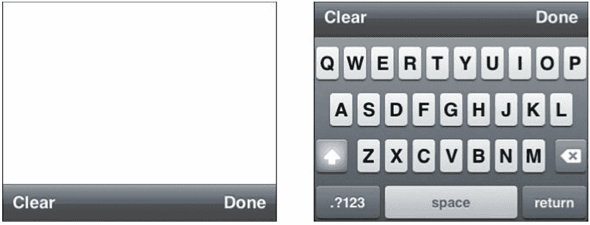

**图 6-5。** 当 iOS 使用硬件键盘时，它会关闭键盘但不会关闭辅助视图，辅助视图在其所有视图作为第一响应者的期间内都会一直显示在屏幕上。

在早期 iOS 对硬件键盘的支持和通知更新方面，经验法则是：有时有效，有时无效。从 iOS 6 开始，情况稍微好了一点点，但并不完美。基础键盘（即没有辅助视图的键盘）在用户使用屏幕上键盘、硬件键盘或两者混合使用时功能运行正常。正确地拔出硬件键盘会发送一个键盘关闭通知。

问题出现在自定义辅助视图上，例如 Recipe 6-2。取决于具体情况（即键盘的出现或消失，或者连接或移除硬件键盘），通知和尺寸信息可能会变得非常诡异。当辅助视图留在屏幕上、键盘的其他部分隐藏且状态更改通知没有被正确发送时，就会发生糟糕的情况。这为在应用程序中实现内容调整的人带来了无休止的麻烦。

Apple 在 iOS 5.0 中引入了监听屏幕上键盘和硬件键盘之间切换的方法。`UIKitDidChangeFrameNotification` 在屏幕键盘几何形状发生变化时触发。Recipe 6-4 监听此通知以捕获帧变化。作为响应，它更新文本约束并将其与辅助视图的顶部对齐。

这种方法仍然不如你希望的那样整洁（代码检查了工具栏的 superb），重定向设备，可能会顺序错乱，或者简单就是错误的。

## 测试硬件键盘

以下方法测试你的 iOS 设备是否正在使用硬件键盘。它检查辅助视图的起始位置。传递由任何键盘通知返回的边界矩形：

```objc
- (BOOL) isUsingHardwareKeyboard: (CCCGRect) kbounds {
  // 检查工具栏父框架的起点
  CGFloat startPoint = toolbar.superview.frame.origin.y;
  // 检查边界的结束位置
  CGFloat endHeight = startPoint + kbounds.size.height;
  // 窗口帧的高度
  CGFloat viewHeight = self.view.window.frame.size.height;
  // 如果键盘边界超过了视图高度，
  // 则键盘当前在屏幕外
  BOOL usingHardwareKeyboard = endHeight > viewHeight;
  return usingHardwareKeyboard;
}
```

此方法在多次固件更新中一直可靠运行，但请注意这是一个黑科技（hack）。

## Recipe 6-4. 通过可缩放文本视图处理硬件键盘变化

```objc
- (void) adjustToBottomInset: (CGFloat) offset {
  // 移除任何现有的垂直约束
  if (currentVerticalConstraints)
    [self.view removeConstraints:currentVerticalConstraints];
  // 使用新的底部边缘创建垂直约束
  currentVerticalConstraints = [NSLayoutConstraint 
    constraintsWithVisualFormat:"%V|[textView(>=0)]-bottomMargin-"
    options:0 metrics:@(@(bottomMargin):offset)) 
    views:@(@(textView):textView)];
  [self.view addConstraints:currentVerticalConstraints];
}

// 通过更新文本视图来响应键盘帧更新通知
(void) updateTextViewBounds:(NSNotification *) notification {
if (![textViewFirstResponder]) // 没有键盘
    [self adjustToBottomInset:0.0f];
    return;
}

// 获取键盘的边界
CGRect kbounds;
([NSValue *)notification.userinfo objectForKey:@"UIKeyboardBoundsInfoKey"] getValue:&kbounds];

// 根据硬件使用情况调整底部偏移
BOOL isUsingHardware=[self isUsingHardwareKeyboard:kbounds];
[self adjustToBottomInset:(isUsingHardware) ? 
    toolbar.bounds.size.height: kbounds.size.height];

-(void)loadView {
    [super loadView];
    self.view.backgroundColor = [UIColor whiteColor];

// 创建全文本视图实例
    textView = [[UITextView alloc] initWithFrame:self.view.bounds];
    textView.inputAccessoryView = [self accessoryView];
    [self.view addSubviewAndConstrainToBounds:textView];
    [textView fitToWidthWithInset:0.0f];

// 设置初始全高约束
    [self adjustToBottomInset:0.0f];

// 开始监听（仅）帧变化
    [NSNotificationCenter defaultCenter 
        addObserver:self selector:@selector(updateTextViewBounds) 
        name:UIKeyboardDidChangeFrameNotification object:nil];
}
```

## 获取此 Recipe 的代码

要找到此 Recipe 的完整示例项目，请将浏览器指向 `https://github.com/erica/iOS-6-Cookbook` 并进入第 6 章文件夹。

## Recipe: 创建自定义输入视图

每当文本视图或文本字段成为第一响应者时，自定义输入视图都会用你设计的视图替换键盘。你也可以为非文本视图以及文本视图添加自定义输入视图。[Recipe 6-5](https://example.com) 侧重于文本场景。当你设置响应者的 `inputAccessoryView` 属性时，系统键盘将由你的自定义视图补充。然而，如果你想完全替换键盘，则使用 `inputView` 属性。


大多数情况下，自定义输入视图并不用于文本输入。尽管输入视图在其他设计（尤其是游戏）中起着重要作用，但它们对于文本的用途相当有限。这是因为 `inputAccessView` 扩展了键盘选项。此外，现在的键盘选项范围包含了数字和小进制输入（在 iOS 4.1 中添加）。这些代表了设计自定义键盘的主要需求。

在处理文本时，自定义输入视图在何处有意义？对于任何愿意花费精力开发自己的键盘并考虑到各种平台和方向（更不用说 Shift 修饰键）的人来说，输入视图提供了对用户体验的完全控制。你创建一个完全自定义的文本输入元素，用独特适合你设计的视觉和感觉替换系统键盘。这在许多层面上需要大量工作。

Recipe 6-5 提供了一个自定义文本输入视图的骨架示例。它提供的不是字符输入，而是两个按钮：一个输入 Hello，另一个输入 World（见图 6-7）。当点击时，每个按钮都会将单词插入到其附带的文本视图中。

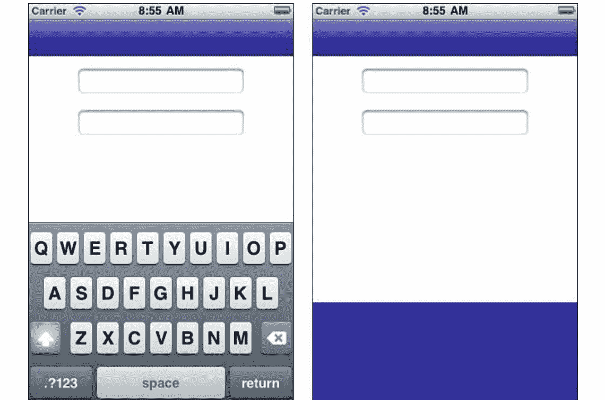

**图 6-7。** 作为此文本视图输入视图的自定义键盘允许用户输入 Hello 和 World，仅此而已。

创建这种自定义文本输入视图的挑战在于文本变化如何回传给第一响应者。iOS 没有提供直接的链接或属性告诉自定义输入视图它的所有者是谁，你可以使用简单的监督属性（supervise properties）。由于这个挑战，你可能想为 `UIView` 实现一个简单的类扩展来恢复当前的第一响应者。

> 注意
>
> 在此代码段中，类方法 `currentResponder` 被命名为 `currentResponder` 以尽量避免与私有 API 发生冲突。`firstResponder` 是一个实际上未公开的方法。在生产代码中为 Apple 的类添加分类方法（而不是示例代码）时，一个很好的准则是让所有方法名都以你的首字母缩写、你公司的缩写或其他唯一的标识符作为前缀。这可以确保你的方法名不会与 Apple 的方法或（重要的是）不会与 Apple 未来可能添加的任何方法重叠。本书并没有遵循它所宣扬的建议。这种选择增强了示例中方法名的可读性和辨识度。

```objc
@interface UIResponderUtility
+(UIView *) currentResponder;
@end

@implementation UIView (FirstResponder)
-(UIView *) findFirstResponder
{
    if ([self isResponder]) return self;

    for (UIView *view in self.subviews) {
        UIView *responder = [view findFirstResponder];
        if (responder) return responder;
    }

    return nil;
}

+(UIView *) currentResponder
{
    return [[[UIApplication sharedApplication] keyWindow] findFirstResponder];
}
@end
```

**食谱 6-5** 构建了一个作为输入视图的自定义工具栏。它显示了两个选项（Hello 和 World）。当点击时，工具栏会将字符串插入到第一个响应者的文本中。如果尚未设置第一个响应者，它会获取第一个响应者。它会检查响应者是否是 `UITextView` 的一种。只有在这种情况下，它才会插入文本。

关于输入视图有公认的真理：呈现的输入视图的所有者总是第一个响应者。其次，它是应用程序主窗口的另一个子视图。你可以在代码中利用这些事实，尽管你可能希望对**食谱 6-5**中显示的最小错误条件进行扩展，特别是关于响应者实例变量的重用。

## 食谱 6-5. 创建自定义输入视图

```objc
@interface InputToolbar : UIToolbar
{
    UIView *responderView;
}
@end

@implementation InputToolbar
-(void) insertString:(NSString *) string {
    if (!responderView || ![responderView isFirstResponder]) {
        responderView = [UIView currentResponder];
        if (!responderView) return;
    }
    if ([responderView isKindOfClass:[UITextView class]]) {
        UITextView *textView = (UITextView *) responderView;
        NSMutableString *text = [NSMutableString stringWithString:textView.text];
        NSRange range = textView.selectedRange;
        [text replaceCharactersInRange:range withString:string];
        textView.text = text;
        textView.selectedRange = NSMakeRange(range.location + string.length, 0);
    } else {
        NSLog(@"无法在未知类类型 (%@) 中插入 %@", string, [responderView class]);
    }
}

// 执行两次插入
-(void) hello:(id) sender {[self insertString:@"Hello"];}
-(void) world:(id) sender {[self insertString:@"World"];}

// 在工具栏上初始化条按钮
-(id) initWithFrame:(CGRect) aFrame {
    if (!self = [super initWithFrame:aFrame]) return self;
    NSMutableArray *theItems = [NSMutableArray array];
    [theItems addObject:[[UIBarButtonItem alloc] initWithBarButtonSystemItem:UIBarButtonSystemItemFlexibleSpace target:nil action:nil]];
    [theItems addObject:[[UIBarButtonItem alloc] initWithTitle:@"Hello" style:UIBarButtonItemStylePlain target:self action:@selector(hello:)]];
    [theItems addObject:[[UIBarButtonItem alloc] initWithBarButtonSystemItem:UIBarButtonSystemItemFlexibleSpace target:nil action:nil]];
    [theItems addObject:[[UIBarButtonItem alloc] initWithTitle:@"World" style:UIBarButtonItemStylePlain target:self action:@selector(world:)]];
    [theItems addObject:[[UIBarButtonItem alloc] initWithBarButtonSystemItem:UIBarButtonSystemItemFlexibleSpace target:nil action:nil]];
    self.items = theItems;

    return self;
}
@end
```

## 获取此食谱的代码

要找到此食谱的完整示例项目，请在浏览器访问 https://github.com/erica/iOS-6-Cookbook 并进入第 6 章文件夹。

## 食谱：制作文本输入感知的视图

几个月前，我花了一些时间更新开源的 iOS BOCHS 模拟器，使其能够支持键盘输入。默认代码允许基于触摸的“鼠标”交互，但没有提供任何键盘支持。经过一番研究，我发现并随后实现了 `UIKeyInput` 协议。这个简单的协议在配合对第一个响应者的操作后，允许你更新任何视图以提供文本输入。

食谱 6-6 展示了如何将标准的 `UIToolbar` 转换为可以接受键盘输入的视图，允许用户直接在工具栏中输入文本，如图 6-8 所示。当用户输入字时，工具栏文本会更新，甚至能正确处理删除键。

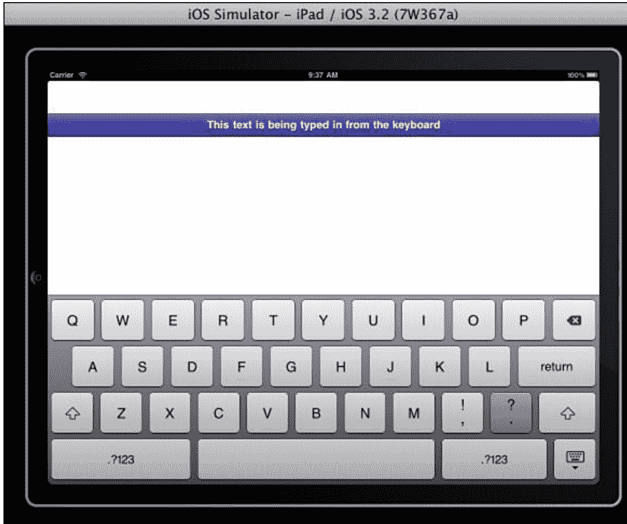

此食谱需要几项功能。首先，工具栏必须声明 `UIKeyInput` 协议。该协议宣布视图实现了简单的文本输入，并在成为第一个响应者时可以显示系统键盘（如果需要，也可以显示自定义键盘）。

其次，工具栏必须保留状态——它当前存储的字符串。将字符串保存为保留的可变属性，允许工具栏知道它当前正在处理哪些文本，并将其显示给用户。

接下来，工具栏必须能够成为第一个响应者。它通过两种方式实现：实现 `canBecomeFirstResponder`（返回 `YES`）以及捕获触摸事件以检测何时应该承担该角色。添加触摸处理器允许[食谱 6-6]()在用户触摸视图时成为第一个响应者。

最后，它必须实现 `UIKeyInput` 协议要求的三个方法，即 `hasText`、`insertText` 和 `deleteBackward`。

虽然自定义输入视图（input views）可以应用于文本视图（text views）和文本字段（text fields），但它们比其他用例更有价值。输入并不限于文本。事实上，通过跳过系统键盘，自定义输入视图可以适用于你需要的任何场景。

将输入视图视为一种上下文敏感的图形菜单，它们只在特定视图类成为第一响应者（first responder）时才出现。当你点击一个战士时，屏幕上可能会滚动出一组武器，包括弓、长锤和剑。用户可以选择战士应该执行的攻击类型。或者考虑一个图形布局程序。当点击圆形、正方形或折线时，屏幕上会显示调色板，让用户选择描笔宽度、描笔颜色和填充颜色。自定义输入实用性的唯一限制仅在于你的想象力。

食谱 6-7 演示了自定义输入视图如何影响一个不存在的视图。它结合了食谱 6-5 和 6-6 中的代码，创建了一个感知输入的视图（`LayerView`，可以通过触摸成为第一响应者）以及一个影响该主视图显示的输入视图（`InputToolbar`）。在例示例中，基础视图的作用限于显示颜色。工具栏则控制显示的颜色。

由于没有其他方式来转移第一响应者的控制权，输入视图还提供“完成”按钮，允许用户关闭键盘，并从大颜色视图中放弃第一响应者身份。

## 添加输入点击

使用 `UIView` 类为你的自定义输入辅助视图添加输入点击。`playInputClick` 方法执行标准的系统键盘点击声，并在你必须响应用户输入点击时调用它。

在辅助输入类中采用 `UIViewAudioFeedback` 协议，并添加一个始终返回 `YES` 的 `enableInputClicksWhenVisible` 委托方法。这会将音频播放遵循用户的偏好（该偏好在“设置 > 声音”中设置）。若要听到这些点击声，用户必须启用键盘反馈。如果用户没有这样做，你对 `playInputClick` 的调用将被直接忽略。

# 食谱 6-7. 为非文本视图创建自定义输入控制器

```objc
@interface ColorView : UIView <UIKeyInput>
@property (retain) UIView *inputView;
@end

#pragma mark Key Input Aware View
@implementation ColorView
```

```objc
@synthesize inputView;
```

```objc
// UITextInput协议骨架
-(BOOL)hasText { return NO; }
-(void)insertText:(NSString *)text {}
-(void)deleteBackward {}
```

```objc
// 第一响应者支持
-(BOOL)canBecomeFirstResponder {return YES; }
-(void)touchesBegan:(NSSet *)touches withEvent:(UIEvent *)event {[self becomeFirstResponder];}
```

```objc
// 允许用户交互初始化
-(id)initWithFrame:(CGRect)aFrame
{
  if (!self = [super initWithFrame:aFrame]) return self;
  self.backgroundColor = COOKBOOK_PURPLE_COLOR;
  self.userInteractionEnabled = YES;
  return self;
}
@end
```

```objc
#pragma mark Color Input Toolbar
@interface InputToolbar : UIToolbar <UIViewAudioFeedback>
@end
```

```objc
@implementation InputToolbar
-(BOOL)enableInputClicksWhenVisible
{
  return YES;
}
```

```objc
-(void)updateColor:(UIColor *)aColor
{
  [[UIView currentResponder] setBackgroundColor:aColor];
  [[UIDevice currentDevice] playInputClick];
}
```

```objc
// 颜色更新
-(void)light:(id)sender {
  [self updateColor:[COOKBOOK_PURPLE_COLOR colorWithAlphaComponent:0.33f]];
}
-(void)medium:(id)sender {
  [self updateColor:[COOKBOOK_PURPLE_COLOR colorWithAlphaComponent:0.66f]];
}
-(void)dark:(id)sender {
  [self updateColor:COOKBOOK_PURPLE_COLOR];
}
```

```objc
// 点击完成时放弃第一响应者
-(void)done:(id)sender
{
    [[UIView currentResponder] resignFirstResponder];
}
```

```objc
// 创建一个包含每个选项的工具栏
-(id)initWithFrame:(CGRect) aFrame
{
    if (!self = [super initWithFrame:aFrame]) return self;
    NSMutableArray *theItems = [NSMutableArray array];
    [theItems addObject:[[UIBarButtonItem alloc] initWithBarButtonSystemItem:UIBarButtonSystemItemFlexibleSpace target:nil action:nil]];
    [theItems addObject:[[UIBarButtonItem alloc] initWithTitle:@"Light" style:UIBarButtonItemStylePlain target:self action:@selector(light:)]];
    [theItems addObject:[[UIBarButtonItem alloc] initWithBarButtonSystemItem:UIBarButtonSystemItemFlexibleSpace target:nil action:nil]];
    [theItems addObject:[[UIBarButtonItem alloc] initWithTitle:@"Medium" style:UIBarButtonItemStylePlain target:self action:@selector(medium:)]];
    [theItems addObject:[[UIBarButtonItem alloc] initWithBarButtonSystemItem:UIBarButtonSystemItemFlexibleSpace target:nil action:nil]];
    [theItems addObject:[[UIBarButtonItem alloc] initWithTitle:@"Dark" style:UIBarButtonItemStylePlain target:self action:@selector(dark:)]];
    [theItems addObject:[[UIBarButtonItem alloc] initWithBarButtonSystemItem:UIBarButtonSystemItemFlexibleSpace target:nil action:nil]];
    [theItems addObject:[[UIBarButtonItem alloc] initWithTitle:@"Done" style:UIBarButtonItemStylePlain target:self action:@selector(done:)]];
    self.items = theItems;

    return self;
}
@end
```

## 获取此食谱的代码

要找到此食谱的完整示例项目，请将浏览器指向 https://github.com/erica/iOS-6-Cookbook 并进入第 6 章文件夹。

# 食谱：构建更好的文本编辑器（第一部分）

撤销支持和持久化有助于在你的应用程序中创建更好的文本编辑器。这些功能确保你的用户可以撤销错误，并从上次停止的地方继续工作。

## 获取此食谱的代码

要找到此食谱的完整项目，请将浏览器指向 https://github.com/erica/iOS-6-Cookbook 并进入第 6 章文件夹。

# 食谱：构建一个更好的文本编辑器（第二部分）


# 从 iOS 6 开始，文本视图和文本字段支持属性文本

从 iOS 6 开始，文本视图（`text views`）和文本字段（`text fields`）现在可以处理属性文本字符串（即支持样式的字符串，而不仅仅是纯文本字符串）。这允许你创建具有多种字体、样式和颜色的富功能文本视图和字段。这类样式功能（例如使用颜色）很大程度上涉及《The Advanced iOS 6 Developer’s Cookbook》中的 CoreText。对于简单的文本编辑器，添加对基本样式（粗体、斜体和下划线）的支持非常简单。

## 启用属性文本

为了处理样式请求，你必须更改一个标志，让你的文本视图处理属性（换句话说就是样式化）文本。将 `allowsEditingTextAttributes` 属性设置为 `YES`。这样做之后，会发生几件事：

- 视图开始更新其属性属性。该属性允许你以属性字符串的形式检索文本视图的内容。
- 视图开始响应一系列特殊的 `UIResponder` 方法，用于切换所选文本的粗体、斜体、下划线。这些方法将在下一节中详细介绍。
- 视图的交互式用户界面开始显示新选项，允许用户使用粗体、斜体和下划线对当前选择进行样式设置。

## 控制属性

在 iOS 6 中，`NSObject` 提供了新方法来控制若干文本属性。这些方法供 `UIResponder` 的子类使用，是 `UIResponderStandardEditActions` 非正式协议的一部分。该协议声明了 iOS 用户界面的编辑方法。

感兴趣的方法包括 `toggleBoldFace:`、`toggleItalics:` 和 `toggleUnderline:`。这三个方法用于对当前选中的文本应用样式，或者如果样式已经应用，则将其移除。

为了允许这些更新，你只需要告诉响应者（在本例中为文本视图）启用文本属性编辑。涉及的文本视图或文本字段会实现底层的繁重工作。你可以使用多个工具栏按钮（`bar buttons`）来实现这些调用。

食谱 6-9 演示了如何在你的 iOS 应用程序中构建这些功能。

图 6-9 显示了该食谱构建的界面。

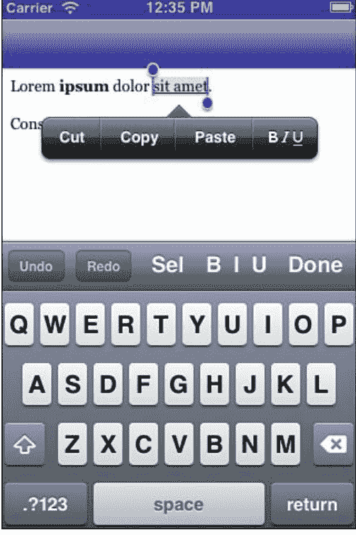

图 6-9。`UIResponderStandardEditActions` 协议定义了常用的文本编辑命令，你将其封装到用户界面中。键盘辅助视图除了系统菜单中自动出现的 BIU 选项外，还提供了一键访问。辅助视图允许你选择全选（`Sel`），或应用（移除）粗体（`B`）、斜体（`I`）和下划线（`U`）。

## 其他响应者功能

注意辅助栏上的 `Sel` 选项，它位于 B/I/U 粗体、斜体和下划线选择的左侧。该工具栏按钮通过相同的 `UIResponderStandardEditActions` 协议添加了“全选”功能。编辑方法包括：

- `copy:`、`cut:`、`delete:` 和 `paste:` 用于基础编辑
- `select:` 和 `selectAll:` 用于选择
- `toggleBoldFace:`、`toggleItalics:`、`toggleUnderline:` 用于样式更新

该协议还允许你通过 `makeTextWritingDirectionLeftToRight:` 和 `makeTextWritingDirectionRightToLeft:` 方法控制文字方向。

## 食谱 6-9. 增强型文本编辑器

```objc
// Handy button macros
#define BARBUTTONTON(TITLE, SELECTOR) [[UIButton alloc] \
initWithTitle:TITLE style:UIButtonItemStyle \
target:self action:SELECTOR]
#define BARBUTTONTON_TARGET(TARGET, TITLE, SELECTOR) [[
[UIButton alloc] initWithTitle:TITLE \
style:UIBarButtonItemStyle target:TARGET action:SELECTOR]
#define SYSBARBUTTON(ITEM, SELECTOR) [[UIButton alloc] \
initWithButtonSystemItem:ITEM target:self action:SELECTOR]

// 选择工具栏上启用和禁用的项目
(void)loadAccessibility
{
    NSMutableArray *items = [NSMutableArray array];
    UIButtonItem *spacer =
    SYBSARBUTTON(UIButtonSystemItemFixedSpace, nil);
    spacer.width = 20.0f;

    BOOL canUndo = [textView.undoManager canUndo];
    UIButtonItem *undoItem = SYBSARBUTTON_TARGET(
    UIButtonSystemItemUndo, textView.undoManager,
    @selector(undo));
    undoItem.enabled = canUndo;
    [items addObject:undoItem];

    BOOL canRedo = [textView.undoManager canRedo];
    UIButtonItem *redoItem = SYBSARBUTTON_TARGET(
    UIButtonSystemItemRedo, textView.undoManager,
    @selector(redo));
    redoItem.enabled = canRedo;
    [items addObject:redoItem];

    // 添加全选
    [items addObject:SYSBARBUTTON(UIButtonSystemItemFlexibleSpace, nil)];
    [items addObject:BARBUTTON_TARGET(textView, "Sel", @selector(selectAll))];

    // 添加样式按钮
    [items addObject:SYSBARBUTTON(UIButtonSystemItemFlexibleSpace, nil)];
    [items addObject:BARBUTTON_TARGET(textView, @"B", @selector(toggleBold))];
    [items addObject:BARBUTTON_TARGET(textView, @"I", @selector(toggleItics))];
    [items addObject:BARBUTTON_TARGET(textView, @"U", @selector(toggleUnderline))];

    [items addObject:SYSBARBUTTON(UIButtonSystemItemFlexibleSpace, nil)];

    toolbar.items = items;
}
```

```objc
NSMutableCharacterSet *cs = [NSMutableCharacterSet characterSetWithCharactersFromString:@""];

switch (segmentedControl.selectedSegmentIndex)
{
    case 0:
        [cs addCharactersFromString:ALPHA];
        break;
    case 1:
        [cs formUnionWithCharacterSet:[NSCharacterSet decimalDigitCharacterSet]];
        break;
    case 2:
        [cs formUnionWithCharacterSet:[NSCharacterSet decimalDigitCharacterSet]];
        // 允许仅一个小数点
        if ([textField.text rangeOfString:@"."].location == NSNotFound)
            [cs addCharactersFromString:@"."];
        break;
    case 3:
        [cs addCharactersFromString:ALPHA];
        [cs formUnionWithCharacterSet:[NSCharacterSet decimalDigitCharacterSet]];
        break;
    default:
        break;
}

NSString *filtered = [string componentsSeparatedByCharactersInSet:[cs invertedSet]] componentsJoinedByString:@""];

BOOL basicTest = [string isEqualToString:filtered];
return basicTest;
```

```objc
(void) segmentChanged:(UISegmentedControl *) seg
{
    // 在分段切换时重置文本
    textField.text = @"";
}
```

```objc
(void) viewWillAppear:(BOOL) animated
{
    // 创建文本字段进行操作
    textField = [[UITextField alloc] initWithFrame:CGRectMake(0.0f, 0.0f, 200.0f, 30.0f)];
    textField.delegate = self;
    [self.view addSubview:textField];
}

// 带有输入选项的分段控件
segmentedControl = [[UISegmentedControl alloc] initWithItems:[@"ABC 123 2.3 A2C" componentsSeparatedByString:@" "]];
[segmentedControl addTarget:self action:@selector(segmentChanged:) forControlEvents:UIControlEventValueChanged];
self.navigationItem.titleView = segmentedControl;
}
@end
```

## 获取此食谱的代码

要找到此食谱的完整示例项目，请将浏览器指向 `https://github.com/erica/iOS-6-Cookbook` 并进入第 6 章的文件夹。

## 食谱 6-10 检测文本模式

食谱 6-10 引入了限制用户输入合法字符的方法。从那里开始，只需一步即可将用户输入与各种合法模式进行匹配。考虑一个浮点数。它可能被描述为一个可选的符号，后跟一个整数部分，接着是一个可选的小数点，然后是小数部分。或者整数部分可以是可选的，但小数点是强制的。

遗憾的是，描述事物有很多方法，当你从简单的数字扩展到电话号码、电子邮件地址和 URL 时，这些方法会呈指数级增长。Apple 已经通过内置的数据检测器类为你处理了其中许多问题，但了解如何自己编写实现通常很有帮助。

## 编写你自己的表达式

一些标准组织已经发布了关于合法值组成的精确描述，进取的开发者已经将其中许多描述转换为了相当的正则表达式。考虑以下浮点数的正则表达式：

```
^[-+]?[0-9]*[\.]?[0-9]*$
```

这不是一个完美的定义，但对于许多用途来说，它是一个很不错且灵活的定义。它接受范围很广的浮点数，开头带有可选符号。诚然，如呈现所示，它不会接受 `-.75`，但也不会接受 `-`，我认为这提供了一个公平的折中，因为对于用户来说，猜测 `-0.75` 并不难。或者，可以使用一组正则表达式检查，并接受该集合中出现的任何正结果——例如，添加不需要整数部分但需要小数点后跟一个或多个数字的浮点数：

```
^[+-]+\.[0-9]+$
```

`NSPredicate` 实例可以将 `NSString` 文本与正则表达式进行比较，检测用户何时评估了一个有效的浮点数。这里有一个例子：

```
NSPredicate *fpPredicate = [NSPredicate predicateWithFormat:@"SELF MATCHES '[+]?[0-9]+\.?[0-9]*'"];
BOOL match = [fpPredicate evaluateWithObject:string];
```

正如已经提到的，检测电话号码、电子邮件和其他更复杂的类型要困难一些。在这里我们使用美国号码讨论电话号码问题。

（注：原文中存在大量重复的段落，此处已根据提供的内容结构进行了逻辑清理。）

```objc
[self updateStatus:newString];
return YES;
```

```objc
NSMutableCharacterSet *cs = [NSMutableCharacterSet characterSetWithCharactersInString:@""];
[cs formUnionWithCharacterSet:[NSCharacterSet decimalDigitCharacterSet]];
[cs addCharactersInString:@"().-. "];
```

```objc
// 字符检查
NSString *filtered = [[string componentsSeparatedByCharactersInSet:invertedSet] componentsJoinedByString:@""];
BOOL basicTest = [string isEqualToString:filtered];
```

```objc
// 测试手机号码
[self updateStatus:basicTest ? newString : textField.text];
```

```objc
return basicTest;
```

```objc
(void) loadView
{
    [super loadView];

    tf = [[UITextField alloc] initWithFrame:CGRectMake(0.0f, 0.0f, 200.0f, 30.0f)];
    tf.center = CGPointMake(self.view.frame.size.width / 2.0f, 40.0f);
    tf.borderStyle = UITextBorderStyleRoundedRect;
    tf.autocorrectionType = UITextAutocorrectionTypeNo;
    tf.clearButtonMode = UITextFieldViewModeAlways;
    tf.delegate = self;
    [self.view addSubview:tf];
}
@end
```

---

### 第二部分：教程文本翻译

## 获取此食谱的代码

要找到此食谱的完整项目，请将浏览器指向 `https://github.com/erica/iOS-6-Cookbook` 并进入第 6 章文件夹。

## 食谱：在 UITextView 中检测拼写错误

`UITextChecker` 类提供了一种自动扫描文本错误的方法。要使用此功能，你必须先设置目标语言——例如对于英语，可以使用代表美国英语的 `en_US` 或加拿大法语的 `fr_CA`。语言代码使用了 ISO 639-1 和可选的 ISO 3166-1 地区组合。因此，虽然你可以选择使用通用英语字典 (`en`)，但你也可以区分美国 (`en_US`)、澳大利亚 (`en_AU`) 和英国 (`en_GB`) 的用法。查询 `UITextChecker` 以获取一个 `availableLanguages` 数组并从中选择。

该类还允许你学习单词（`learnWord:`）和忘记单词（`unlearnWord:`），以根据用户需求自定义内置字典。已学习的单词是跨语言通用的；因此，当你添加一个姓名时，该名字在任何地方都可用。`Checker` 对象还可以使用实例方法设置忽略的单词。

食谱 6-12 展示了如何通过迭代选择每个拼写错误的单词，将文本检查器整合到应用程序中。要实现这一点，你需要控制文本的范围选择。要在 `UITextView` 中选择文本，它必须首先成为第一响应者（`first responder`）。检查响应状态并在需要时更新视图：

```objc
if (![textView isFirstResponder])
    [textView becomeFirstResponder];
```

然后计算你想要选择的范围，确保考虑了内容长度并使用文本视图的 `selectedRange` 属性：

```objc
textView.selectedRange = NSMakeRange(offset, length);
```

由于文本视图必须是可编辑的且作为第一响应者，因此当你执行任何范围选择时，键盘会出现在屏幕上。由于用户可以编辑屏幕上的任何内容，因此需要考虑用户编辑可能会破坏你的应用程序的情况。

## 食谱 6-12. 搜索拼写错误

```objc
@implementation TestBedViewController
- (void) nextMisspelling:(id) sender
{
    // 从当前偏移开始扫描新单词
    NSRange range = [textChecker rangeOfMisspelledWordInString:textView.text
        range:NSMakeRange(0, textView.text.length) startingAt:textOffset
        wrap:YES language:@"en"];

    // 每当发现新的拼写错误时向后跳
    if (range.location != NSNotFound)
        textOffset = range.location + range.length;
}
```


```objc
textOffset = 0;

// 选择单词
if (![view isFirstResponder])
    [view becomeFirstResponder];
if (range.location != NSNotFound)
    view.selectedRange = range;

(void) viewDidWillAppear:(BOOL)animated
{
    self.navigationItem.rightBarButton =
        BARBUTTON("@Next Misspelling", @selector(nextMisspelling));

    textView = [[UITextView alloc] initWithFrame:self.view.bounds];
    [self addSubview:textView];
    textView.editable = YES;

    textChecker = [[UITextChecker alloc] init];
}
```

## 获取此食谱的代码

要找到此食谱的完整示例项目，请将浏览器指向 `https://github.com/erica/iOS-6-Cookbook` 并进入第 6 章文件夹。

## 搜索文本字符串

将食谱 6-12 适配用于搜索文本简单。要实现搜索，请在导航栏中添加一个文本字段并将栏更改为“查找”（Find）。使用 `NSString rangeOfString:options:range:` 方法来定位所需的字符串。注意，你搜索的字符串不能为 `nil`。在找到目标文本的范围并假设位置不是 `NSNotFound` 后，你就可以调用 `scrollRangeToVisible:` 将文本视图滚动到正确位置。传递字符串方法返回的范围即可。

## 注意事项

`NSNotFound` 是一个常量，用于指示未成功找到范围。搜索后检查 `location` 字段以确保设置了有效值。

## 总结

本章介绍了许多在 iOS 应用程序中创造性地使用文本的方法。在本章中，你学习了如何控制键盘并发现了如何创建自定义视图。在离开本章之前，这里有几点最后的想法：

- 本章介绍了许多在 iOS 应用程序中创造性地使用文本的方法。在本章中，你学习了如何控制键盘并发现了如何创建自定义视图。在离开本章之前，这里有几点最后的想法：

# 7. 使用 ViewController

ViewController 简化了视图的管理。每个 ViewController 拥有一个视图层次结构，呈现出单一的用户界面组件。本章探讨了如何使用 ViewController 类以及如何将它们应用于现实场景。

## ViewController

正如其名所示，ViewController 提供了 iOS 模型-视图-控制器（MVC）设计模式中的控制器部分。每个 ViewController 管理一组视图，构成一个单一界面组件。ViewController 协调视图的加载和显示、响应用户交互并更新应用程序语义。

`UIViewController` 是视图控制器的父类，也是你用来管理主视图的类。它是视图控制器的核心工作负载。你可能会花费大量时间来定制该类的子类。基本的 `UIViewController` 负责从开始到结束管理每个主视图的生命周期，并考虑视图在此过程中必须做出的变化。

`UIViewController` 实例负责设置视图的外观及其显示的内容。它们通常依赖于从 storyboard 文件加载这些信息。实例方法允许你自定义视图布局（使用 `loadView`）或在视图加载完成后添加行为（使用 `viewDidLoad`）。

响应视图的显示或消失是视图控制器处理的另一个工作。这是属于大型应用程序的常态。诸如 `viewWillAppear:` 和 `viewWillDisappear:` 等方法可以让你完成与视图管理相关的任何簿记工作。你可以在预期视图即将被呈现时预加载数据，或者在视图不再显示在屏幕上时进行清理。

这里提到的每项任务都指定了视图如何适配到整个应用程序中。ViewController 在视图与这些外部需求之间起到调解作用，允许视图在需要时改变自身。

## 导航控制器 (Navigation Controllers)

顾名思义，导航控制器允许你在基于树的视图层级结构中上下钻取，这是 iOS 设备家族中较小设备上重要的界面设计策略，也是平板电脑上的辅助性策略。导航控制器创建了许多标准 iOS 应用程序顶部的实色导航栏。

导航控制器允许将新视图推入存储的堆栈中，并自动生成显示调用视图控制器标题的返回（Back）按钮。所有导航控制器都使用一个“根”（root）视图控制器来建立导航树的顶端，让这些返回按钮带你回到主视图。在平板电脑上，你可以使用基于导航控制器的界面与基于栏按钮的菜单项配合、呈现弹出框（popover），或与 `UISplitViewController` 实例集成以实现主从详情（master-detail）呈现体验。

将责任交给导航控制器可以让你将设计工作集中在创建单个视图控制器屏幕上。你不需要担心具体的导航细节，只需告诉导航控制器下一个移动到哪个视图即可。历史栈和导航按钮由系统为你处理。

## 标签栏控制器 (Tab Bar Controllers)

`UITabBarController` 类允许你控制应用程序中的并行呈现。它们就像收音机上的电台。标签栏帮助用户选择要“调到”哪个视图控制器，而不存在特定的导航层级。每个并行视图独立运行，且每个视图都可以拥有自己的导航层级。你构建存在于每个标签的视图控制器或导航控制器，而 Cocoa Touch 会处理多视图的细节。

例如，当标签实例一次提供的视图控制器超过特定数量时（iPhone 系列设备为 5 个，平板电脑则更多），用户可以通过“更多 > 编辑”（More > Edit）屏幕对其进行自定义。“更多 > 编辑”允许用户将喜欢的控制器拖到屏幕底部的按钮栏。这不需要额外的编程。你免费获得了可编辑的标签。你所做的只是通过 `customizableViewControllers` 属性请求它们。

## 分屏视图控制器 (Split View Controllers)

`UISplitViewController` 类为平板电脑应用程序设计，提供了一种封装持久数据集（通常是表格）并将该数据与详情呈现关联的方法。你可以在 iPad 的邮件应用程序中看到分屏视图的实际应用。在横屏模式下，左侧显示消息列表；右侧显示单个消息内容。右侧的详情视图（邮件中的消息内容）取决于左侧的主视图（邮件消息列表）。点击消息会用其内容更新右侧视图。

在竖屏模式下，主视图通常是隐藏的。它通过弹出框访问，通过点击分屏视图顶部栏的左侧按钮或滑动手势（在 iOS 5.1 及更高版本中）到达。

## 分页视图控制器 (Page View Controller)

与导航控制器、标签视图控制器和分屏视图控制器一样，分页视图控制器是视图控制器的容器。它们创建了一种像书一样的呈现方式，你可以设置书的“书脊”，通常位于视图的左侧或顶部。通过添加单个内容控制器来构建你的“书”。每一“页”使用翻页或平移过渡到下一页。

## 弹出框控制器 (Popover Controllers)

弹出框专为平板电脑设计，创建弹出在现有界面内容之上的临时视图。这些控制器呈现信息而不占据整个屏幕（像模态视图 modal views 通常做的那样）。弹出框通常通过点击界面中的栏目触发（尽管可以使用其他交互技术创建），并可以通过显示其呈现的内容或点击其主视图外部来关闭。

弹出框由视图控制器实例填充。在呈现弹出框之前，构建视图控制器并将其分配给弹出框的 `viewController` 属性。这允许弹出框呈现任何你可以设计成标准视图控制器的材料，提供了卓越的编程灵活性。

## 注意 (Note)

从 iOS 5 开始，你可以对 `UINavigationBar` 进行子类化，并将自定义呈现整合到应用程序的导航界面中。使用 `initWithBarClass:` 初始化方法。

## 使用导航控制器和分屏视图开发

`UINavigationController` 类提供了在屏幕空间有限的设备上管理界面的重要方式之一。它创建了一种让用户在界面呈现层级中上下导航的方法，创建一个比设备大得多的虚拟 GUI。导航控制器将其 GUI 折叠成整洁的基于树的方案。用户通过带跳转的按钮和选择在该方案中穿行。你可以在“联系人”（Contacts）应用和“设置”（Settings）中看到导航控制器，其中选择引导进入新屏幕，返回按钮则移动回之前的屏幕。

几个标准 GUI 元素可以识别应用程序中导航控制器的使用，如图 7-1（左）所示。这些包括出现在每个屏幕顶部的大型导航栏、当用户钻入层级时出现在左上角的指向左的按钮，以及位于右上角的提供应用程序功能的选项按钮。许多导航控制器应用程序都是围绕滚动列表构建的，列表中的元素引导至新屏幕，由单元格右侧的灰色和蓝色箭头指示。

7-1. iPhone 的导航控制器使用箭头指示在选择父项时将推送新视图。在 iPad 上，分屏控制器使用整个屏幕，将导航元素与详情分离。

iPad 凭借其大屏幕不需要导航控制器在 iPhone 系列设备上利用的这种节省空间的快捷方法。平板电脑可以使用导航控制器，但图 7-1（右）所示的 `UISplitViewController` 提供了一种更适合此类设备的呈现方式。

注意图 7-1 左侧的 iPhone 实现和右侧的 iPad 实现之间的差异。iPad 的分屏控制器不包含箭头。点击项目时，数据通过右侧详情区域显示在同一屏幕上。iPhone 缺乏这种空间，通过箭头指示推送新视图。每种方法在呈现时都考虑了特定设备的设计。

iPhone 系列和平板的收箱视图都使用类似的导航控制器元素。这些包括返回按钮（iPad 书籍/Gmail）、选项按钮（例如编辑）以及标题栏中的状态（带有未读消息）。每个元素都是使用导航控制器应用程序编程接口（API）创建的，用于呈现电子邮件帐户和邮箱的层级。区别位于导航树的底部，即构成数据结构叶子的单个消息层级。iPhone 标准使用

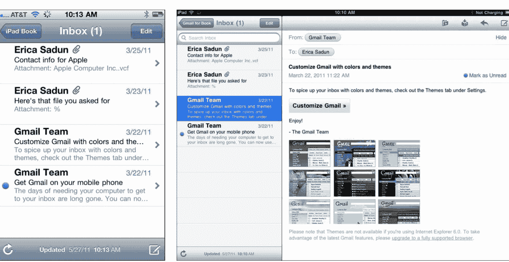

使用箭头（chevrons）指示叶视图。当选中时，这些叶视图控制器会被推送到导航栈中。它们与其他追踪用户在界面中进的控制器结合在一起。iPad 不会推送它的叶视图。它会在一个独立的视图中呈现它们，并省略了通常指示用户已到达层级遍历终点的箭头。

iPhone 风格的导航控制器在 iPad 上同样起着作用。当 iPad 应用使用标准的（iPhone 风格）导航控制器时，通常是在狭窄的上下文中作为瞬态弹出框（popover）呈现，其中控制器以具有有限生命周期的小视图显示在屏幕上。其他情况下，鼓励 iPad 应用使用占据整个屏幕的分屏视图（split view）方法。

## 使用导航控制器和栈

每个导航控制器都拥有一个根控制器（root view controller）。该控制器构成了栈的基础。当用户在导航模型树时做出选择时，你可以通过编程方式将其他控制器推入栈中。虽然树本身可能是多维的，但用户的路径（本质上是他的历史）始终是一条直线，代表到目前为止已做的选择。移动到新选择会扩展面包屑轨迹，并且当新的视图控制器进入栈时，会自动构建一个“返回”（Back）按钮。

用户可以点击“返回”按钮从栈中弹出控制器。每个按钮的名字代表最近的视图控制器的标题。当你通过之前的视图控制器栈返回时，每个“返回”按钮都指示可以返回的视图控制器。用户可以一直回溯直到到达根。然后他们就无法再后走了。根就是根，你无法弹出该根之外的内容。

这种基于栈的设计即使在你计划只使用一个控制器时也依然存在。你可能想利用 `UINavigationController` 的导航栏来构建一个简单的工具，例如使用一个双按钮菜单。这会忽略栈的任何导航优势。你仍然需要通过 `initWithRootViewController:` 设置一个控制器为根控制器。

## 推入和弹出视图控制器

通过 `pushViewController:animated:` 推送新控制器来向导航栈添加新项目。每个视图控制器都为该控制器所参与的导航控制器提供一个 `navigationController` 属性。如果控制器没有被推送到导航栈上，则该属性为 `nil`。

使用 `navigationController` 属性调用导航控制器的 `push` 方法将新的视图控制器推送到导航栈上。推入时，新控制器将从右侧滑入（假设你将 `animated` 设置为 YES）。会出现一个指向左的“返回”按钮，引导你在栈上回退一步。“返回”按钮使用导航栈上上一个视图控制器的标题。

你会出于很多原因推入新视图。通常，这些涉及导航到作为详情视图的特殊视图，或者钻取文件结构或偏好设置层级。你可以在用户点击按钮、标签项或披露辅助控件（disclosure accessory）后将控制器推入导航控制器栈。

几乎没有理由去子类 `UINavigationController`。在 `UIView` 子类内部执行推送请求和导航栏自定义（例如设置栏的标题或按钮）。自定义会从子类向上导航控制器。

在大多数情况下，你不会直接访问导航控制器。此规则的例外包括管理导航栏按钮、更改栏的外观或使用自定义导航栏类进行初始化。你可以通过赋值属性来更改栏样式或着色，如下：

```
self.navigationController.navigationBar.BarStyle = UIBarStyleBlackTranslucent;
```

或者可以使用外观代理（appearance proxy，iOS 5 及更高版本）影响应用程序中的所有实例：

```
[[UINavigationBar appearance] tintColor:[UIColor purpleColor]];
```

## 栏按钮

要添加新按钮，你需要修改 `navigationItem`，它提供了一个表示类，用于描述在导航栏上显示的内容，包括其左侧和右侧栏按钮以及标题视图。以下是你可以给栏分配按钮的方法。要移除按钮，请将其赋值为 `nil`：

```
self.navigationItem.rightBarButtonItem = [[UIBarButtonItem alloc] initWithTitle:@"Action" style:UIBarButtonItemStylePlain target:self action:@selector(performAction)];
```

栏项（Bar items）不是视图。它们是包含标题、样式和回调信息的类，这些信息被导航项和工具栏用于在界面中构建实际按钮。iOS 不提供访问由栏按钮项及其导航项构建的视图的。

从 iOS 5 开始，你可以向左和右添加多个栏按钮。为导航项的 `rightBarButtonItems`（注意有 s）或 `leftBarButtonItems` 属性分配一个数组：

```
self.navigationItem.rightBarButtonItems = barButtonArray;
```

## 菜谱：导航项类

填充导航栏的对象使用 `UINavigationItem` 类放置，该类是存储这些对象信息的类。导航项属性包括左侧和右侧按钮项、栏上显示的标题、用于显示标题的视图以及用于从当前视图返回的任何“返回”按钮。

此类允许你将按钮、文本和其他 UI 对象附加到导航栏的三个关键位置：左侧、中间和右侧。通常情况下，这表现为右侧的一个普通按钮，中间的某些文本（通常是视图控制器的标题）以及左侧的带返回样式的按钮。但你并不限于这种布局。你可以向三个位置的任何一个位置添加自定义控件：左侧、中间（标题区域）和右侧。你可能会构建一个中间带有搜索字段的导航栏，或者带有分段控件（segment controls）、工具栏、图片等。此外，你还可以在左侧和右侧按钮数组中添加多个项。这些都很容易修改。

## 标题和返回按钮

中央标题区域特别易于自定义。你可以为导航项分配一个标题：

```
self.navigationItem.title = @"标题"
```

这等同于直接为导航项设置标题。自定义实际标题的最简单方法是使用视图控制器的标题而不是导航项，尽管一些开发者认为这并不是最佳实践：当赋值时，导航控制器使用标题来建立“返回”按钮的文本。如果你在一个标题为“Hello”的控制器上推入一个新控制器，“返回”按钮将指向“Hello”。

你也可以用自定义视图（如控件）来替换文本标题。此代码添加了一个分段控件，但可以是图像视图、步进器或其他任何内容：

```
self.navigationItem.titleView =
    [[UISegmentedControl alloc] initWithItems:items];
```

## 宏

在构建栏按钮时，宏可以简化你的工作。下面的宏创建一个基础按钮项：

```
#define BARBUTTON(TITLE, SELECTOR) [[UIBarButtonItem alloc] initWithTitle:TITLE style:UIBarButtonItemStylePlain target:self action:SELECTOR]
```

你为它提供一个标题和一个选择器。每次调用此宏都会指定标题和选择器，增强了代码的可读性。

## 目标宏

此版本的宏假设目标是 `self`，这是常见的，但你可以轻松进行调整。下面的宏添加了你指定的 target：


#define BARBUTTON_TARGET(TITLE, TARGET, SELECTOR) \
[[UBarButtonItem alloc] initWithTitle:TITLE style:UIBarButtonItemStylePlain target:TARGET action:SELECTOR]

你使用的栏按钮词汇取决于你的特定需求。为苹果提供的系统项、从资源创建的图像项以及自定义视图项（可以嵌入控件和非按钮元素）创建宏是非常简单的。

Recipe 7-1 结合了这些功能，演示了控制器标题和导航项在钻取过程中如何协作。它提供了一个超级简单的界面：选择想要推入导航栈的下一个项目的标题，并将其推入。这允许你看到导航控制器栈是如何使用默认行为增长的。

### Recipe 7-1. 基本导航驱动

```objectivec
// 向栈中推入新控制器
-(void) push:(id) sender
{
    NSString *newTitle = [@"Foo*Bar*Baz*Qux"
        componentsSeparatedByString:@"*"] [sender selectedSegmentIndex];

    UIViewController *newController = [[TestViewController alloc]
        init];
    newController.title = newTitle;

    [self.navigationController pushViewController:newController animated:YES];
}
```

```objectivec
pushViewController:newController animated:YES;

- (void) loadView
{
    // 创建一个按钮以推送新的控制器
    self.navigationItem.rightBarButtonItem =
        BARBUTTON("Push", @selector(push));

    // 创建一个分段控件来选择新标题
    seg = [[UISegmentedControl alloc] initWithItems:
        [@"Foo*Bar*Qux" componentsSeparatedBy:@"**"]];
    seg.selectedSegmentIndex = 0;
    self.view addSubview(seg);
}
```

## 获取此食谱的代码

要找到此食谱完整的示例项目，请将浏览器指向 `https://github.com/erica/iOS-6-Cookbook` 并进入第 7 章的文件夹。

## 菜谱：模态呈现 (Modal Presentation)

在普通的导航控制器中，你沿着视图进行推送（push），偶尔停止并弹出（pop）返回之前的视图。这种方法假设你正在上下挖掘数据，这些数据与你正在使用的树形视图结构匹配。模态呈现（Modal presentation）提供了另一种显示视图控制器的方法。

当你向视图控制器发送 `presentViewController:animated:completion:` 消息后，一个新的控制器将出现在屏幕上并接管控制，直到它被 `dismissViewControllerAnimated:completion:` 移除。这允许你在应用程序中添加超出视图范围的特殊用途对话框。通常，模态控制器会提示用户选择数据（例如从通讯录选择联系人或从库中选择照片），或者执行短时间的任务（如发送电子邮件或设置偏好设置）。在任何适合执行活动视图控制器正常范围之外的限时任务的场景中，模态控制器都是意义的。

模态呈现可以使用四种过渡样式：

-   **滑入（Slide）**——这种过渡样式将新视图滑到旧视图上方。
-   **淡入（Fade）**——这种过渡样式让新视图逐渐溶解并变为可见。
-   **翻转（Flip）**——这种过渡样式将视图翻转到呈现的“背面”。
-   **卷曲（Curl）**——这种过渡样式让主视图卷起并让位，以露出下方的新视图。

这些样式通过呈现视图控制器的 `modalTransitionStyle` 属性进行设置。标准的 `UIModalTransitionStyleCoverVertical` 会将模态视图向上覆盖当前控制器。在移除时，它会向下滑动。`UIModalTransitionStyleFlipHorizontal` 执行从右到左的前后翻转。它看起来就像你正在揭示当前呈现视图的背面。移除时，它会翻转回左侧。`UIModalTransitionStyleCrossDissolve` 让新视图在旧视图上方淡入。使用 `UIModalTransitionStylePartialCurl` 可以卷曲内容（类似于地图 应用程序的方式），在主视图控制器“下方”显示出一个模态视图。

在 iPhone 和 iPod touch 上，模态控制器始终接管整个屏幕。iPad 提供了更细致的呈现方式。iPad 提供了三种呈现样式：

-   **全屏（Full Screen）**——全屏呈现是 iPhone 默认方式，新视图完全覆盖屏幕和任何现有内容。这是唯一允许卷曲（curls）的呈现样式；任何其他呈现样式都会引发运行时异常，导致应用程序崩溃。
-   **页面页（Page Sheet）**——在页面页中，覆盖默认为纵向宽高比，模态控制器在竖屏模式下完全覆盖屏幕，在横屏模式下部分覆盖屏幕，就像在显示器上添加了一张纵向对齐的纸。
-   **表单页（Form Sheet）**——表单页覆盖屏幕中心的一小区域，允许你在保留主应用程序视图最大可见性的同时，将焦点转移到模态元素。

除了全屏样式（`UIModalPresentationFullScreen`），还可以使用 `UIModalPresentationFormSheet` 在屏幕中心呈现一个小覆盖层，或使用 `UIModalPresentationPageSheet` 在屏幕中间滑动出一个页。这些样式在横屏模式下体验最佳，可以在视觉上将页面页呈现与全屏呈现区分开。

## 呈现自定义模态信息视图

呈现模态控制器会偏离你的主导航路径，引入一个新的界面，该界面将接管，直到用户显式地将其移除。

你可以像这样呈现一个模态控制器：

```objectivec
[self presentViewController:someControllerInstance animated:YES
completion:nil];
```

呈现的控制器可以是任何类型的视图控制器子类。在导航控制器的中，模态呈现可以拥有自己的导航层级结构，构建为一系列交互链。使用完成块（completion block）在视图控制器动画到位后完成你需要执行的任何任务。

始终提供某种形式的“完成（Done）”选项以允许用户移除控制器。实现此点的简单方法是呈现一个导航控制器，并向其导航项添加一个栏按钮。

```objectivec
- (IBAction)done: (id) sender
{
  [self dismissViewControllerAnimated:YES completion:nil];
}
```

Storyboard 简化了模态控制器的创建。拖入导航控制器实例及其视图控制器，在提供的导航栏上添加“完成”。将视图控制器的类设置为你的自定义模态类型，并将“完成”按钮连接到 `done:` 方法。在属性检查器中命名你的导航控制器，以便使用它来识别标识。

你可以将组件添加到主 Storyboard 中，也可以在单独的文件创建它们。食谱 7-2 加载了一个自定义文件（`Modal~DeviceType.storyboard`），但也可以在 `MainStoryboard_Device` 文件中添加元素。食谱 7-2 提供了创建模态元素的关键。呈现应用程序的主视图控制器层级中执行的。在这里，用户从分段控件选择过渡和呈现样式，但这些通常由开发者预先选择，并在代码或 Interface Builder (IB) 中设置。此食谱提供了一个工具箱，你可以在每个平台上进行测试，并使用每种方向进行探索。

（让分屏视图在竖屏模式下显示两个部分）

图 7-2 展示了在横屏和竖屏模式下最基础的分屏视图控制器。该控制器通过从根视图中的列表中选择项目来设置详情视图的颜色。在横屏模式下，两个视图同时显示。在竖屏模式下，用户必须点击详情视图左上角的按钮，以弹出框的形式或通过可选的滑动手势来访问根视图。在针对此方向方向进行编程时，请注意弹出框可能会干扰详情视图，因为它显示在在该视图之上；请据此进行设计。

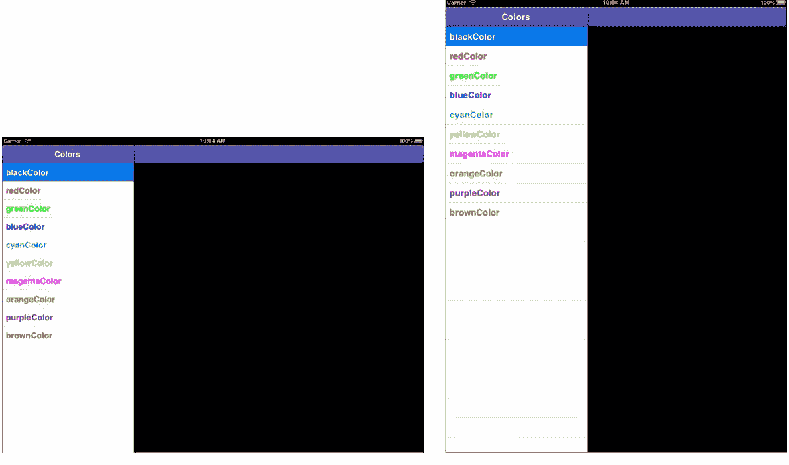

图 7-2。在简单的情况下，分屏视图控制器由一个组织面板（organizing pane）和一个详情视图面板组成。图中看到的组织面板在竖屏模式下通常是隐藏的。用户通过导航栏按钮访问的弹出框查看它，或通过滑动手势调用它。

你的代码构建了三个单独的对象：主视图控制器、详情视图控制器，以及分屏视图控制器（后者拥有前两个）。分屏视图控制器始终包含两个子控制器：索引为 0 的主视图索引为 1 的详情。

你可能将主控制器和详情控制器添加到导航控制器外壳中，以提供一致的界面。对于详情控制器来说，这为竖屏模式下的条栏按钮提供了一个宿主。以下方法构建了两个子视图，将它们嵌入导航控制器中，将它们添加到视图控制器数组中，并返回一个托管这些视图的新分屏视图控制器：

```objectivec
(UISSplitViewController *) splitViewController
{
    // 创建导航根视图（主视图）
    UITableViewController *rootVC = [[UITableViewController alloc] init];
    rootVC.title = @"Colors"; // 确保设置了标题
    UINavigationController *rootNav = [[UINavigationController alloc] initWithRootViewController:rootVC];

    // 创建导航详情视图
    DetailViewController *detailVC = [DetailViewController alloc];
    UINavigationController *detailNav = [[UINavigationController alloc] initWithRootViewController:detailVC];

    // 将两者都添加到分屏视图控制器
    UISSplitViewController *svc = [[UISSplitViewController alloc] init];
    svc.viewControllers = @[rootNav, detailNav];
    svc.delegate = detailVC;

    return svc;
}
```

主视图控制器通常是某种表格视图控制器，如食谱 7-3 所示。你看到的几乎是表格最原始的形式。它是一个颜色项目列表（具体为 `UIColor` 名称），每个项目都有一个着色以匹配该颜色的单元格。

当项目被选中时，控制器使用其内置的 `splitViewController` 属性向详情视图发送请求。该属性返回拥有根视图的分屏控制器。从那里开始，控制器可以获取分屏视图的代理（delegate），该代理已分配给详情视图。通过将代理强制转换为详情视图控制器的类，根视图可以更具意义地影响详情视图。在这个极其简单的示例中，所选单元格的文本颜色被应用到详情视图的背景颜色上。

> **注意**
>
> 请确保你设置了根视图控制器的 `title` 属性。它被用于设置竖屏模式下详情视图中出现的按钮文本。

食谱 7-3 的 `DetailViewController` 类是你能获得的最精简的实现。它提供了在你在使用分屏视图控制器提供详情视图实现时所需的基础功能。这由 `willHide/willShow` 方法对组成，该方法为详情视图添加和隐藏至关重要的条栏按钮。

当分屏视图控制器在竖屏模式下将主视图控制器转换为弹出控制器（popover controller）时，它会将该控制器传递给详情控制器。详情控制器负责保留并持有该弹出框，直到界面返回横屏模式。在这个精简的类定义中，一个强属性在竖屏交互期间持有该弹出框。

## 食谱 7-3. 为分屏视图控制器构建详情和主视图

```objectivec
@interface DetailViewController : UIViewController
<UIPopoverControllerDelegate, UISplitViewControllerDelegate>
{
    UIPopoverController *popoverController;
}
@property (nonatomic, strong) UIPopoverController *popoverController;
@end

@implementation DetailViewController
+(id)controller
{
    controller = [[DetailViewController alloc] init];
    controller.view.backgroundColor = [UIColor blackColor];
    return controller;
}
// 进入竖屏模式时调用，隐藏普通的表格视图
-(void)splitViewController:(UISplitViewController*)svc
willHideViewController:(UIViewController*)aViewController
withBarButtonItem:(UIBarButtonItem*)barButtonItem
forPopoverController:(UIPopoverController*)aPopoverController
{
    barButtonItem.title = aViewController.title;
    self.navigationItem.leftBarButtonItem = barButtonItem;
    self.popoverController = aPopoverController;
}

// 进入横屏模式时调用。
-(void)splitViewController:(UISplitViewController*)svc
willShowViewController:(UIViewController*)aViewController
invalidatingBarButtonItem:(UIBarButtonItem*)barButtonItem
{
    self.navigationItem.leftBarButtonItem = nil;
    self.popoverController = nil;
}
```

```objectivec
// 使用此项避免弹出框在竖屏下隐藏。
// 如果省略，将获得默认行为。
/*
 * (BOOL) splitViewController:(UISplitViewController *) svc
  shouldHideViewController:(UIViewController *) vc
  inOrientation:(UIInterfaceOrientation)orientation
{
    return NO;
}
*/
```

```objectivec
@interface ColorViewController : UIViewController
@end

@implementation ColorViewController

+ (id)controller
{
    controller = [[ColorViewController alloc] init];
    controller.title = @"Colors";
    return controller;
}

-(NSInteger)numberOfSections:(UIView *)tableView
{
    return 1;
}

-(NSArray *)selectors
{
    return @["blackColor", @"redColor", @"greenColor", @"blueColor", @"cyanColor", @"yellowColor", @"magentaColor", @"orangeColor", @"purpleColor", @"brownColor"];
}

-(NSInteger)numberOfInSection:(NSInteger)section
{
    return [self selectors].count;
}

-(UITableViewCell *)tableView:(UITableView *)tableView
cellForRowAtIndexPath:(NSIndexPath)indexPath
{
    UITableViewCell *cell = [tableView dequeueReusableCellWithIdentifier:@"generic"];
    if (!cell) cell = [[UITableViewCell alloc]
        initWithStyle:UITableViewStyleDefault
        reuseIdentifier:@"generic"];
    // 设置标题和颜色
    NSString *item = [self selectors][indexPath.row];
    cell.textLabel.text = item;
    cell.textLabel.textColor = [UIColor performSelector:NSFromString(item) withObject:nil];
    return cell;
}

-(void)tableView:(UITableView *)tableView
```


# Recipe 7-3. 为分屏视图替代方案添加通用支持

## 代码示例

```objectivec
- (void)tableView:(UITableView *)tableView didSelectRowAtIndexPath:(NSIndexPath *)indexPath
{
    // 在选择时，更新主视图背景颜色
    UINavigationController *nav = [self.splitViewController.viewControllers lastObject];
    UIViewController *controller = [nav topViewController];
    UITableViewCell *cell = [tableView cellForRowAtIndexPath:indexPath];
    controller.view.backgroundColor = cell.textLabel.textColor;
}

@end
```

在 iPhone 部署中，详情视图控制器的代码与 Recipe 7-3 完全相同，但为了显示它，它必须被推送到导航栈上，而不是在分屏视图中并排显示。导航控制器被设置为应用程序窗口的主视图，而不是分屏视图。在应用程序启动时进行简单的检查即可让你的代码选择：

```objectivec
- (UINavigationController *)navWithColorTableViewViewController
{
    ColorTableViewViewController *rootVC = [[ColorTableViewViewController alloc] init];
    rootVC.title = @"Colors";
    UINavigationController *nav = [[UINavigationController alloc] initWithRootViewController:rootVC];
    return nav;
}
```

```objectivec
- (void)applicationDidFinishLaunching:(UIApplication *)application
{
    window = [[UIWindow alloc] initWithFrame:[UIScreen mainScreen].bounds];
    if (IS_IPAD)
        window.rootViewController = self.splitViewController;
    else
        window.rootViewController = [self navWithColorTableViewViewController];
    [window makeKeyAndVisible];
}
```

故事的其余部分在于 Recipe 7-4 的两个方法中，位于颜色选择表格视图控制器内部。两个关键检查决定了是否显示披露配件（disclosure）以及如何响应点击：

- 在 iPad 上，在详情展示的最后一层不应使用披露指示器。在 iPhone 上，它们指示选择后将推送新视图。检查部署平台可以让你的代码决定是否在单元格中包含这些配件。
- 当你在 iPhone 上工作时，没有使用分屏视图的选项，因此你的代码必须将新的详情视图推送到导航器栈。相比之下，iPad 代码只需要访问现有的视图并更新其背景颜色。

在真实世界的部署中，这两个检查的复杂性可能会超出此简单食谱所示的细节。你可能需要向你的模型添加一个检查，以确定在抑制披露配件之前你是否确实处于树层次结构的最底层。类似地，你可能需要更新或替换视图控制器中的呈现。

## Recipe 7-4. 为分屏视图替代方案添加通用支持

```objectivec
- (UITableViewCell *)tableView:(UITableView *)tableView cellForRowAtIndexPath:(NSIndexPath *)indexPath
{
    static NSString *CellIdentifier = @"generic";
    UITableViewCell *cell = [tableView dequeueReusableCellWithIdentifier:CellIdentifier];
    if (!cell) {
        cell = [[UITableViewCell alloc] initWithStyle:UITableViewCellStyleDefault reuseIdentifier:CellIdentifier];
    }
    NSString *item = self.selectors[indexPath.row];
    cell.textLabel.text = item;
    cell.textLabel.textColor = [UIColor performSelector:NSSelectorFromString(item) withObject:nil];
    cell.accessoryType = IS_IPAD ? UITableViewCellAccessoryNone : UITableViewCellAccessoryDisclosureIndicator;
    return cell;
}

- (void)tableView:(UITableView *)tableView didSelectRowAtIndexPath:(NSIndexPath *)indexPath
{
    UITableViewCell *cell = [tableView cellForRowAtIndexPath:indexPath];
    if (IS_IPAD) {
        UINavigationController *nav = [self.splitViewController.viewControllers lastObject];
        UIViewController *controller = [nav topViewController];
        controller.view.backgroundColor = cell.textLabel.textColor;
    } else {
        DetailViewController *controller = [DetailViewController new];
        controller.view.backgroundColor = cell.textLabel.textColor;
        controller.title = cell.textLabel.text;
        [self.navigationController pushViewController:controller animated:YES];
    }
}
```

## 获取此食谱的代码

要找到此食谱的完整示例项目，请将浏览器指向 `https://github.com/erica/iOS-6-Cookbook` 并进入第 7 章文件夹。

# Recipe：标签栏（Tab Bars）

在类 iPhone 设备上，`UITabBarController` 类允许用户在多个视图控制器之间移动，并自定义底部的栏。这在音乐应用程序中体现得最为明显。它提供了一键访问不同视图的功能以及一个“更多”按钮用于用户对底部栏的选择和编辑。iPad 不建议将标签栏作为主要的设计模式，尽管 Apple 在需要时支持它们，特别是在分屏视图和弹出框（popovers）中。使用标签栏，你不需要像导航栏那样推送视图。相反，你组合了一个控制器集合（它们可以是独立的 ViewModel、`UINavigationController` 或任何其他视图控制器），并通过设置栏的 `viewControllers` 属性将它们添加到标签栏中。Cocoa Touch 会为你完成其余的所有工作。

Recipe 7-5 创建了 11 个 `BrightnessController` 类的视图控制器。该类将其背景设置为指定的灰色——在这种情况下，是从 0% 到 100%，步长为 10%。图 7-3（左侧）显示了默认模式下的界面，显示了前四个项目和一个“更多”按钮。

用户可以通过选择“更多”选项并点击“编辑”来重新排列标签。这会打开图 7-3（右侧）所示的配置面板。这 11 个控制器提供了用户可以导航和选择的选项。本书早期版本的读者可能会注意到，配置标题栏的调色与界面的其他部分匹配。Apple 引入了 `UIAppearance` 协议，允许你自定义给定类的所有实例。Recipe 7-5 使用此功能将它的导航栏染成黑色：

```objectivec
[[UINavigationBar appearance] setTintColor:[UIColor blackColor]];
```

### Recipe 7-5. 创建标签视图

```objectivec
@interface BrightnessController : UIViewController
{
    int brightness;
}
@end

@implementation BrightnessController

// 使用 Quartz 和 UIKit 调用创建标签图标
- (UIImage *)buildSwatch:(int)brightness
{
    CGRect rect = CGRectMake(0.0f, 0.0f, 30.0f, 30.0f);
    UIGraphicsBeginImageContext(rect.size);
    UIBezierPath *path = [UIBezierPath bezierPathWithRoundedRect:rect cornerRadius:4.0f];
    [[[UIColor blackColor] colorWithAlphaComponent:(float)brightness / 10.0f] set];
    [path fill];
    UIImage *image = UIGraphicsGetImageFromCurrentImageContext();
    UIGraphicsEndImageContext();
    return image;
}

// 视图控制器由背景颜色组成
- (instancetype)initWithBrightness:(int)aBrightness
{
    self = [super init];
    if (self) {
        brightness = aBrightness;
        self.title = [NSString stringWithFormat:@"%d%%", brightness];
    }
    return self;
}

// 着背景
- (void)viewDidLoad
{
    [super viewDidLoad];
    self.view.backgroundColor = [UIColor colorWithWhite:(brightness / 10.0f) alpha:1.0f];
}

+ (instancetype)controllerWithBrightness:(int)brightness
{
    BrightnessController *controller = [[BrightnessController alloc] initWithBrightness:brightness];
    return controller;
}

@end
```

```objectivec
for (int i = 0; i <= 10; i++) {
    BrightnessController *controller = [BrightnessController controllerWithBrightness:i];
    UINavigationController *nav = [[UINavigationController alloc] initWithRootViewController:controller];
    nav.navigationBar.barStyle = UIBarStyleBlackTranslucent;
    [controllers addObject:nav];
}
```

```objectivec
tabController = [[UITabBarController alloc] init];
tabController.viewControllers = controllers;
tabController.customizableViewControllers = controllers;
tabController.delegate = self;
```

```objectivec
window.rootViewController = tabController;
[window makeKeyAndVisible];
return YES;
```

# 获取此章节的代码

要找到此章节的完整示例项目，请访问浏览器 `https://github.com/erica/iOS-6-Cookbook` 并进入第 7 章文件夹。

# 记住 Tab 状态

在 iOS 上，持久化是非常重要的。当从终止或中断启动或恢复你的应用程序时，始终让用户返回到与其离开时尽可能匹配的状态。这让用户能够继续完成他们正在参与的任务，并提供一个与之前的会话相匹配的用户界面。

对 Recipe 7-5 的此更新存储了当前的 Tab 顺序和当前选中的 Tab，并在项发生更新时执行此操作。当用户启动应用程序时，代码会搜索之前的设置，并在找到它们时应用它们。

为了响应这一操作，tab bar 必须声明 `UITabBarControllerDelegate` 协议。这里使用的方法取决于两个代理方法。第一个方法 `tabBarController:didEndCustomizingViewControllers:changed:` 在用户通过“更多 > 编辑”界面自定义了视图控制器后，提供了当前的视图控制器数组。

这段代码捕获了它们的标题（10%、20% 等），并使用这些信息为每个视图控制器关联一个名称。

第二个代理方法是 `tabBarController:didSelectViewController:`：当用户每次选择新 Tab 时，tab 控制器都会发送此方法。通过捕获 `selectedIndex`，这段代码存储了相对于当前数组的控制器编号。

在此示例中，这些值的设置依赖于 iOS 内置的用户默认系统 `NSUserDefaults`。这个偏好系统的工作方式就像一个大型的可变字典。你可以使用 `setObject:forKey:` 为键设置值，如下：

```objectivec
[[NSUserDefaults standardUserDefaults] setObject:titles forKey:@"tabOrder"];
```

然后你可以使用 `objectForKey:` 检索它们，如下所示：

```objectivec
NSArray *titles = [[NSUserDefaults standardUserDefaults] objectForKey:@"tabOrder"];
```

同步你的设置可以确保存储的默认字典与你的更改一致。

当应用程序启动时，它会检查上次选中的 Tab 顺序和选中 Tab 的之前的设置。如果找到，它将使用这些设置设置 Tabs 并选择一个 Tab 处于激活状态。因为标题包含了关于要显示的亮度值的信息，这段代码将存储的标题从文本转换为数字并除以十，发送给初始化函数。

大多数应用程序基于这种简单的数字系统。你应该使用标题来存储你的 tab bar 顺序，确保为你的视图控制器命名具有意义，并且能够让你将视图控制器与 Tab 排序相匹配。

> **注意**
> 你也可以将 view tags 数组存储为 `NSNumber`，或者更好的是，使用 `NSKeyedArchiver` 类或 iOS 新的可恢复状态编码（restoreable state coding）。
> 归档允许你使用终止时存储的状态信息进行重新构建。

# 列表 7-1. 将 Tab 状态存储到 User Defaults

```objectivec
@implementation TestAppDelegate

- (void)tabBarController:(UITabBarController *)tabBarController didEndCustomizingViewControllers:(NSArray *)viewControllers changed:(BOOL)changed
{
    // 收集视图控制器顺序
    NSMutableArray *titles = [NSMutableArray array];
    for (UIViewController *vc in viewControllers)
        [titles addObject:vc.title];
    [[NSUserDefaults standardUserDefaults] setObject:titles forKey:@"tabOrder"];
    [[NSUserDefaults standardUserDefaults] synchronize];
}

- (void)tabBarController:(UITabBarController *)controller didSelectViewController:(UIViewController *)viewController
{
    // 存储选中的 tab
    NSNumber *tabNumber = [NSNumber numberWithInt:controller.selectedIndex];
    [[NSUserDefaults standardUserDefaults] setObject:tabNumber forKey:@"selectedTab"];
    [[NSUserDefaults standardUserDefaults] synchronize];
}

- (BOOL)application:(UIApplication *)application didFinishLaunchingWithOptions:(NSDictionary *)launchOptions
{
    // ... 启动代码
    return YES;
}

@end
```


## 代码示例

```objc
- (BOOL)application:(UIApplication *)application didFinishLaunchingWithOptions:(NSDictionary *)launchOptions {
    [application setStatusHidden:YES];

    window = [[UIWindow alloc] initWithFrame:[[UIScreen mainScreen] bounds]];

    // 全局为 nav bars 使用着色
    [INavigationAppearance setTintColor:[UIColor blackColor]];

    NSMutableArray *controllers = [NSMutableArray array];

    NSArray *titles = [[NSUserDefaults standardUserDefaults] objectForKey:@"tabOrder"];

    if (titles) {
        // 从 user defaults 获取的标题
        for (NSString *theTitle in titles) {
            BrightnessController *controller = [BrightnessController controllerWithBrightness:([theTitle intValue] / 10)];
            INavigationController *nav = [[INavigationController alloc] initWithRootViewController:controller];
            nav.navigationBar.barStyle = UIBarStyleBlackTranslucent;
            [controllers addObject:nav];
        }
    } else {
        // 生成所有新控制器
        for (int i = 0; i <= 10; i++) {
            BrightnessController *controller = [BrightnessController controllerWithBrightness:i];
            INavigationController *nav = [[INavigationController alloc] initWithRootViewController:controller];
            nav.navigationBar.barStyle = UIBarStyleBlackTranslucent;
            [controllers addObject:nav];
        }
    }

    RotatingTabController *tabController = [[RotatingTabController alloc] init];
    tabController.viewControllers = controllers;
    tabController.customizableControllers = controllers;
    tabController.delegate = self;

    // 恢复之前选中的 tab
    NSNumber *tabNumber = [[NSUserDefaults standardUserDefaults] objectForKey:@"selectedTab"];
    if (tabNumber) {
        tabController.selectedIndex = [tabNumber intValue];
    }

    window.rootViewController = tabController;
    [window makeKeyAndVisible];
    return YES;
}
```

## 封装页面视图控制器

将这些项目封装在一个自定义类中是最简单的，这样可以从我的应用程序中隐藏它们的细节。Apple 指出我不建议子类化页面视图控制器（page view controllers）；但我在这里礼貌地坚持我的方法。发现支持页面视图实现所需的代码相当奇特——但具有可重用性。包装器可以让你将注意力从琐碎的编码细节转移开，关注特定的内容处理问题。

在标准实现中，数据源（`data source`）负责根据需要提供页面控制器。它返回与给定控制器相关的下一个和上一个视图控制器。代理（`delegate`）处理重定向事件和动画回调，设置页面视图控制器的数组，该数组始终包含一个或两个控制器，取决于视图布局。正如食谱 7-5 所示，它的实现起来有点乱，但一旦实现完成，你真的就不需要再花时间回头处理它了。

食谱 7-6 创建了一个 `BookController`。该类处理每个页面，隐藏了上/上一个页的实现细节，并处理所有的重定向事件。自定义代理协议（`BookDelegate`）在接收 `viewControllerForPage:` 消息时，负责为指定的页码返回控制器。这简化了实现过程，使得调用应用程序只需要处理单个方法，它可以通过手动构建控制器或从它们中拉取来完成。

要使用食谱 7-6 中定义的类，你需要建立控制器，将其作为子类添加，并将其声明为子视图控制器，以确保它获取取向和内存事件。代码可能如下所示：

```objc
- (void)viewWillAppear:(BOOL)animated {
    if (!bookController) {
        bookController = [BookController bookWithDelegate:style:BookLayoutStyle];
        bookController.view.frame = self.view.bounds;

        [self addChildViewController:bookController];
        [self.view addSubview:bookController.view];
        [bookController didMoveToParentViewController:self];

        [bookController moveToPage:0];
    }
}
```

注意在 `viewWillAppear:` 方法中，新控制器是如何作为父控制器的子控制器添加的，以及如何设置它的初始页码的。在本版中，创建书籍的便利方法还接受第二个参数：样式（`style`）。我更新了食谱 7-6，允许开发者构建四种风格的书籍：传统书籍、竖排书籍以及两种滚动样式：

```objc
typedef enum {
    BookLayoutStyleBook,       // 横屏时并排显示
    BookLayoutStyleFlipBook,   // 竖屏时并排显示
    BookLayoutStyleHorizontalScroll,
    BookLayoutStyleVerticalScroll,
} BookLayoutStyle;
```

标准书籍在竖屏模式下显示一页（书脊在左侧垂直），在横屏模式下进行并排展示（书脊在中间垂直）。这对应于标准的西方风格书籍，页面移动从左向右。

“翻页式（flip-style）”的书籍使用水平书脊。在横屏模式下，书脊位于顶部，一次显示一页。在竖屏模式下，我将其扩展为两页，水平书脊位于中间，处于顶部和底部的正中间。

这两种滚动布局允许你水平或垂直方向滚动查看单个页面。你不能在滚动模式下使用多页（并排）布局。

此过程的反向操作如下，允许书籍控制器从其父视图中退役：

```objc
- (void)viewWillDisappear:(BOOL)animated {
    [bookController willMoveToParentViewController:nil];
    [bookController.view removeFromSuperview];
    [bookController removeFromParentViewController];
}
```

## 探索食谱

食谱 7-6 通过为每个视图控制器的视图标记页码来处理其代理和数据源的职责。它使用这个数字来确切知道任何时候显示哪一页，并委托另一个类（即 `BookDelegate`）通过索引产生视图控制器。

页面控制器本身在其视图控制器数组中存储零、一个或两个页面。页码 0 意味着控制器尚未被正确设置。一页用于屏幕边缘的书脊位置，两页用于中央书脊。如果页数与页面设置不完全匹配，你将遇到运行时崩溃。

存储在这些页面中的控制器是由两个数据源方法产生的，这两个方法实现了执行前和之后的回调。在页面控制器的原生实现中，控制器是严格根据它们相互之间的关系定义的，而不是根据索引。这个食谱用简单的数字替换了这些关系，请求代理返回指定索引的页面。

在这里，`useSideBySide:` 方法决定了放置书脊的位置，从而决定了有多少个控制器同时显示。这种实现将横屏设置为并排，竖屏设置为单页。例如，在 iPhone 上，无论方向如何，你可能只使用一页，以增强文本的可读性。

食谱 7-6 允许基于用户和基于应用程序的页数控制。用户可以滑动和点击新页面，或者应用程序可以发送 `moveToPage:` 请求。这允许你在页面视图控制器的手势识别器之外添加外部控制。

页面翻页的方向通过对比新旧页码和旧页码来设置。这个食谱使用了西方风格的翻页，数字较大的在右侧，页面向左翻页。你可能需要根据中东和远东国家的情况对此进行调整。

此食谱所示，持续将当前页存储到系统默认设置中，这样当应用程序重新启动时就可以恢复。它还会在用户转到给定页面时通知其代理，这如果你如食谱 7-7 所示添加了页面滑动将会有用。

## 构建演示索引

iOS 6 的新滚动布局允许你添加一个可选索引（通过页数）。任何使用滚动样式（`UIViewControllerTransitionStyleScroll`）的书籍都可以实现以下两个数据源方法。当 iOS 使用这些方法来构建你在图 7-4 中看到的滚动书籍底部指示器时。

如你所见，早期 iOS 6 测试版的实现并不稳定。为演示索引返回 0 并为演示计数返回页数产生了最稳定的指示器。这里使用的页数被推给了书籍的代理，通过一个可选方法 `numberOfPages` 调用：

```objc
- (NSInteger)presentationIndexForPageViewController:(UIPageViewController *)pageViewController {
    // 在 iOS 6 测试版中有点问题
    // return [self currentPage];
    return 0;
}

- (NSInteger)presentationCountForPageViewController:(UIPageViewController *)pageViewController {
    if (bookDelegate && [bookDelegate respondsToSelector:@selector(numberOfPages)]) {
        return [bookDelegate numberOfPages];
    }
    return 0;
}
```

注意，你并不局限于索引与页数以及当前页码之间的一对一对应关系。对于一本大书，你可以想象将这个数字进行缩小，使得每一页对应五页或十页，从而显示阅读书籍的进度而不需要精确的页码对应。

## `BookController` 实现细节

```objc
@implementation BookController

#pragma mark 使用标签标记控制器编号
// 当前页面
- (NSInteger)currentPage {
    int pageCheck = ((UIViewController *)[self.viewControllers objectAtIndex:0]).view.tag;
    return pageCheck;
}

#pragma mark 页面处理
// 如果你倾向于使用其他决策样式，请更新此处
- (BOOL)useSideBySide:(UIInterfaceOrientation)orientation {
    BOOL isLandscape = UIInterfaceOrientationIsLandscape(orientation);

    // 每个布局样式都控制是否并排显示
    switch (layoutStyle) {
        case BookLayoutStyleHorizontalScroll: return NO;
        case BookLayoutStyleVerticalScroll: return !isLandscape;
        case BookLayoutStyleFlipBook: return isLandscape;
        case BookLayoutStyleBook: return isLandscape;
    }
    return NO;
}

@end
```


```objc
// 更新当前页面，设置默认值，调用代理方法
-(void) updatePageTo: (uint) newPageNumber
{
    int pageNumber = newPageNumber;

    [UserDefaults standardDefaults 
        setInteger:pageNumber forKey:DEFAULTS_BOOKPAGE];
    [UserDefaults standardDefaults synchronize];

    SAFE_PERFORM_WITH_ARG(bookDelegate,
        @selector(bookControllerDidTurnToPage:),
        [NSNumber withInt:pageNumber]);
}

// 从代理请求控制器
-(UIView*) controllerAt: (int) aPageNumber
{
    if (bookDelegate && [bookDelegate respondsToSelector:
        @selector(viewControllerForPage)]) {
        UIViewController *controller = 
            [bookDelegate viewControllerForPage:aPageNumber];
        controller.view.tag = aPageNumber;
        return controller.view;
    }
}

// 更新界面到指定的页面
(void) fetchControllersForPage: (uint) requestedPage
    orientation: (UIInterfaceOrientation) orientation
{
    BOOL sideBySide = [self useSideBy:orientation];
    int numberOfNeeded = sideBySide ? 2 : 1;
    int currentCount = self.viewControllers.count;

    uint leftPage = requestedPage;
    if (sideBySide && (leftPage % 2)) leftPage--;

    // 仅在数量合适时才与当前页面进行对比
    if (currentCount && numberOfOfPagesNeeded)
    {
        if (pageNumber == requestedPage) return;
        if (pageNumber == leftPage) return;
    }

    // 决定主方向，将新页面与旧页面对比
    UINavigationControllerNavigationDirection direction =
    (requestedPage > pageNumber) ?
    UINavigationControllerNavigationDirectionForward :
    UINavigationControllerNavigationDirectionReverse;
    [self updateTo:requestedPage];

    // 更新控制器，绝不添加 nil 结果
    NSMutableArray *controllers = [NSMutableArray array];
    SAFE_ADD(pageControllers, [self controllerAtPage:leftPage]);
    if (sideBySide) {
        SAFE_ADD(pageControllers, [self controllerAtPage:leftPage + 1]);
    }
    [self setControllers:pageControllers direction:direction animated:YES completion:nil];
}

// 移动请求的入口
(void) moveToPage: (uint) requestedPage
{
    // 感谢 Dino Lupo
    [self fetchControllersForPage:requestedPage
        orientation:(UIInterfaceOrientation)self.interfaceOrientation];
}

#pragma mark 源
(UIViewController*)viewControllerAfterViewController:(UIViewController *)viewController
{
  [self updateTo:pageNumber + 1];
  return [self controllerAtPage:(viewController.view.tag + 1)];
}

(UIViewController *)viewControllerBeforeViewController:(UIPageViewController *)viewBeforeViewController:(UIViewController *)viewController
{
  [self updateTo:pageNumber - 1];
  return [self controllerAtPage:(viewController.view.tag - 1)];
}

#pragma mark 代理方法

(UIPageViewControllerSpineLocation)pageViewController:(UIPageViewController *) pageViewController
spineLocationForInterfaceOrientation:(orientation)
{
  // 始终从左侧或单页开始
  NSUInteger indexOfCurrentViewController = 0;
  if (self.viewControllers.count)
    indexOfCurrentViewController = 
      ((UIViewController *)[self.viewControllers
      objectAtIndex:0]).view.tag;
  [self fetchControllersForPage:indexOfCurrentViewController
    orientation:orientation];
}

// 决定是否并排显示
BOOL sideSide = [self useSideBy:orientation];
if (sideSide)
    return UIPageViewControllerSpineLocationMid;
else
    return UIPageViewControllerSpineLocationMin;

// 返回一本新书
+ (id)bookWithDelegate:(id)delegate style:(LayoutStyle)aStyle
{
    // 确定方向
    UIPageViewControllerNavigationOrientation orientation = UIPageViewControllerOrientationHorizontal;
    if (aStyle == LayoutStyleFlipBook || (aStyle == LayoutStyleVerticalScroll))
        orientation = UIPageViewControllerOrientationVertical;

    // 确定过渡样式
    UIViewControllerTransitionStyle transitionStyle = UIViewControllerTransitionStylePage;
    if (aStyle == LayoutStyleHorizontalScroll || (aStyle == LayoutStyleVerticalScroll))
        transitionStyle = UIViewControllerTransitionStyleScroll;

    // 将选项作为字典传递
    BookController *bc = [[BookController alloc]
        initWithTransitionStyle:transitionStyle
        navigationOrientation:orientation
        options:nil];
    bc.layoutStyle = aStyle;
    bc.dataSource = delegate;
    bc.delegate = delegate;
    return bc;
}
```

访问 `https://github.com/erica/iOS-6-Cookbook` 并进入第 7 章文件夹。

# 食谱：在页面控制器中滚动页面

手动逐页翻动非常乏味，尤其是当你处理几十或数百个虚拟页面时。为了解决这个问题，你可以为你的书籍添加一个滑动块（slider）。食谱 7-7 创建了一个在点击背景时出现、并在几秒未使用后消失的滑动块。自定义手势识别器启动计时器，每当用户与滑动块交互时，它就会重置。当计时器触发时，滑动块动画消失，用户将看到全屏显示。这种基于点击的叠加方法在 Apple 的许多应用程序（如照片）中很常见。这种方法也有缺点：iOS 快速翻页的能力必须与新的开始/结束过渡开销之间进行权衡。你可能会像我在 iOS 6 早期测试版中的那样，因为快速页面变化导致许多不平衡的调用。

# 食谱 7-7 在页面控制器中添加自动隐藏的滑动块

```objc
// 滑动块回调重置计时器，移动到新页面
(void) moveToPage:(UISider *)slider
{
    [hiderTimer invalidate];
    hiderTimer = [NSTimer scheduledTimerWithTimeInterval:3.0f
        target:self selector:@selector(hideSlider:)
        userInfo:nil repeats:NO];
    [bookController moveToPage:(int)slider.value];
}

// BookController 代理方法允许更新滑动块值
(void) bookControllerDidToPage:(NSNumber *) pageNumber
{
    pageSlider.value = pageNumber.intValue;
}

// 计时器触发后隐藏滑动块
(void) hideSlider:(NSTimer *) aTimer
{
    [UIView animateWithDuration:0.3f animations:(void) {
        pageSlider.alpha = 0.0f;
    }];
    [hiderTimer invalidate];
    hiderTimer = nil;
}

// 点击时显示滑动块
(void) handleTap:(UIGestRecognizer *) recognizer
{
    [UIView animateWithDuration:0.3f animations:(void) {
        pageSlider.alpha = 1.0f;
    }];
    [hiderTimer invalidate];
    hiderTimer = [NSTimer scheduledTimerWithTimeInterval:3.0f
        target:self selector:@selector(hideSlider:)
        userInfo:nil repeats:NO];
}

// 将 book controller 设置为子控制器
(void) viewWillAppear:(BOOL) animated
{
    if (!bookController) {
        bookController = [BookController bookWithDelegate:self
            style:BookLayoutStyleBook];
    }
    RESIZABLE(bookController.view);
    [self addChildViewController:bookController];
    [self.view addSubview:bookController.view];
    [bookController moveToParentViewController:self];

    [bookController moveToPage:0];
    [self.view bringSubviewToFront:pageSlider];
}

// 关闭子控制器
-(void) viewWillappear:(BOOL) animated
{
    [bookController moveToParentViewController:nil];
    [bookController.view removeFromSuperview];
    [bookController removeFromParentViewController];
}
```

# 食谱：自定义容器

Apple 的 split view 之突破在于引入了多个控制器同时存在屏幕上的概念。在分屏视图之前，规则是一个控制器对应多个视图。有了分屏视图，多个控制器共存在屏幕上，它们都独立地响应方向和内存事件。

Apple 在 iOS 5 SDK 向开发者暴露了这种多控制器范式。你现在可以设计一个父控制器并向其添加子控制器。根据需要，事件从父控制器传递到子控制器。这允许你构建标签栏和导航控制器等 Apple 标准容器之外的自定义容器。

食谱 7-8 构建了一个包含一个或两个子节点的可用容器。当加载两个子视图控制器时，它允许你在两者之间翻页。它内置了许多条件判断。这是因为它需要处理作为独立视图控制器、子控制器以及模态控制器的使用情况。想象以下场景：

## 获取此食谱的代码

要找到此食谱的完整示例项目，请将浏览器指向 `https://github.com/erica/iOS-6-Cookbook` 并进入第 7 章文件夹。

就像导航控制器一样，你可以直接创建这个翻转视图控制器（flip view controller）并将其设置为主窗口的根视图。在这种情况下，它与任何层级都没有进一步的关系。你也可以将其作为某些其他容器的子视图，例如在标签栏控制器（tab bar controller）、分割视图控制器（split view controller）等中。当这样使用时，它作为其子视图的父，并作为持有它的控制器的子。最后，你可以直接呈现该控制器。翻转视图容器在所有这些情况下都必须表现得像一个合格的。

做到这一点，控制器有两项任务。首先，它必须使用标准的 UIKit 调用来管理子视图。其次，它必须意识到自己是如何参与视图层级的。在被呈现时，此配方会添加一个导航栏，以便最终用户可以使用“完成（Done）”按钮。

## 添加和移除子视图控制器

在最简单的情况下，容器控制器通过三个步骤来正确添加子视图。它必须执行以下操作：

1. 在父视图上调用 `addChildViewController:`，并将子视图作为参数传递（例如 `[self addChildViewController:childvc]`）。
2. 将子控制器的视图添加为子视图（例如 `[self addSubview:childvc.view]`）。
3. 在子视图上调用 `didMoveToParent:`，并将父视图作为其参数（例如 `[childvc didMoveToParent:self]`）。

要移除子视图控制器，步骤几乎（但并不完全相同）是镜像的：

1. 在子视图上调用 `moveToToParentViewController:`，并将 `nil` 作为参数传递（例如 `[childvc moveToToParentViewController:nil]`）。
2. 移除子控制器的视图（例如 `[childvc.view removeFromSuperview]`）。
3. 在子视图上调用 `removeParentViewController`（例如 `[childvc removeParentViewController]`）。

## 在视图控制器之间切换

UIKit 提供了一种简单的方法，当从一个子控制器移动到另一个控制器时对视图特征进行动画处理。你提供一个源视图控制器、目标以及动画过渡的持续时间。你可以在 `options` 中指定过渡的类型。支持的过渡包括页卷效果（page curls）、溶解（dissolves）和翻转（flips）。此方法创建从一个视图到下一个视图的简单卷曲：

```objc
- (void) action: (id) sender
{
    [redController willMoveToParentViewController:nil];

    [self addChildViewController:blueController];

    [self transitionFromViewController:redController
                      toViewController:blueController
                              duration:1.0f
                               options:UIViewAnimationOptionLayoutSubviews | 
                                       UIViewAnimationOptionTransitionCurlUp
                            animations:^(void) {
                            }
                            completion:nil];
}
```


## 视图控制器转场动画

```objc
completion:(BOOL finished) {
    [redController removeFromSuperview];
    [self.view addSubview:blueController.view];
    [redController removeFromParentViewController];
    [blueController didMoveToParentViewController:self];
}
```

你可以使用相同的方法在没有内置过渡的情况下对 `UIView` 属性进行动画处理。例如，此方法在淡入蓝色控制器的同时，重新居中并淡出红色控制器。这些都是可动画的 `UIView` 特性，并通过 `animations` 块进行更改：

```objc
(void)action:(id)sender {
    [redController willMoveToParentViewController:nil];
    [self addChildViewController:blueController];
    blueController.view.alpha = 0.0f;
    [self transitionFromViewController:redController
                      toViewController:blueController
                              duration:2.0f
                               options:UIViewAnimationOptionLayoutSubviews
                            animations:^(void) {
                                redController.view.center = CGPointMake(0.0f, 0.0f);
                                redController.view.alpha = 0.0f;
                                blueController.view.alpha = 1.0f;
                            }
                            completion:^(BOOL finished) {
                                [redController removeFromSuperview];
                                [self.view addSubview:blueController.view];
                                [redController removeFromParentViewController];
                                [blueController didMoveToParentViewController:self];
                            }];
}
```

使用过渡和视图动画是二选一的。要么设置过渡选项，要么在 `animations` 块中更改视图特征。否则会产生冲突，你可以很容易地亲自证实这一点。使用 `completion` 块移除旧视图并将新视图移动到到位。

尽管实现简单，但这种过渡并不是为了配合 Core Animation 设计的。如果你想在从视图控制器到视图控制器的切换中添加 Core Animation 效果，请尝试使用自定义的 `segue`。

## 7-8. 创建视图容器

```objc
(void)viewWillAppear:(BOOL)animated {
    if (count < 2) {
        NSLog(@"Error: No root controller");
        return;
    }

    // 如果重用则清理实例
    if (navbar || infoButton) {
        [navbar removeFromSuperview];
        [infoButton removeFromSuperview];
        navbar = nil;
        infoButton = nil;
    }
}
```

```objc
// 检查是否呈现和可翻转
BOOL isPresented = self.isBeingPresented;

// 呈现时，添加自定义导航栏
if (isPresented) {
    navbar = [[UINavigationBar alloc] initWithFrame:CGRectZero];
    navbar.autoresizingMask = UIViewAutoresizingWidth;
    navbar.frame = CGRectMake(0.0f, 0.0f, self.view.frame.size.width, 44.0f);
    [self.view addSubview:navbar];
}

// 当 VC 呈现时，右按钮为完成
self.navigationItem.leftBarButtonItem = nil;
self.navigationItem.rightBarButtonItem = isPresented ? SYSBARBUTTON(UIButton) : nil;

// 设置导航项
[self.navigationItem setItems:@[self.navigationItem] animated:NO];

// 调整视图位置
CGFloat verticalOffset = (navbar == nil) ? 44.0f : 0.0f;
self.view.frame.origin.y = verticalOffset;

// 如果数量小于 2，则工作完成
if (count < 2) return;

// 创建 "i" 按钮
infoButton = [[UIButton alloc] initWithFrame:CGRectMake(0, 0, 44, 44)];
[infoButton setTitle:@"i" forState:UIControlStateNormal];
[infoButton addTarget:self action:@selector(flip:) forControlEvents:UIControlTouchUpInside];

// 将 "i" 放在视图右下角
CGSize frameSize = self.view.frame.size;
infoButton.frame = CGRectMake(frameSize.width - 44.0f, frameSize.height - 44.0f, 44.0f, 44.0f);
[self.view addSubview:infoButton];

// 检查是否呈现
if (isPresented) {
    // 呈现时，调整视图
    self.view.frame.origin.y = verticalOffset;
}

// 移除导航栏
if (navbar) {
    // 移除导航栏并调整视图
    self.view.frame.origin.y = 0;
    [navbar removeFromSuperview];
}
```

## 食谱：转场动画 (Segues)

随着自定义容器的出现，它们的小兄弟——自定义转场动画也随之而来。正如标签控制器和导航控制器提供了子控制器之间切换的独特方式一样，你可以构建自定义转场动画来定义你类中特有的动画。目前，Interface Builder 对带有自定义转场的场景的自定义容器支持有限，因此目前最好在代码中开发你的演示效果。以下是你可能实现将控制器移动到新视图的代码：

```objc
// 非正式的自定义代理方法
-(void)segueDidComplete {
    // 获取两个控制器
    UIViewController *source = [childControllers objectAtIndex:vcIndex];
    UIViewController *destination = [childControllers objectAtIndex:nextIndex];

    // 根据需要重新父化
    [destination didMoveToParentViewController:self];
    [source removeFromParentViewController];

    // 更新计数记录
    vcIndex = nextIndex;
    pageControl.currentPage = vcIndex;
}
```

```objc
// 使用自定义转场切换到新视图
-(void)switchToView:(int)newIndex goingForward:(BOOL)goesForward {
    if (vcIndex == newIndex) return;

    // 转场到新控制器
    UIViewController *source = [childControllers objectAtIndex:vcIndex];
    UIViewController *destination = [childControllers objectAtIndex:newIndex];

    // 开始重新父化过程
    [source willMoveToParentViewController:nil];
    [self addChildViewController:destination];

    RotatingSegue *segue = [[RotatingSegue alloc]
        initWithIdentifier:@"segue"
        source:source destination:destination];
    segue.goesForward = goesForward;
    segue.delegate = self;
    [segue perform];

    vcIndex = newIndex;
}
```

在这里，代码识别了源控制器和目标控制器，构建了一个转场，设置了它的参数并让它执行。自定义转场会在完成后回调一个非正式的代理方法。食谱 7-9 展示了如何构建该转场。在这个示例中，它创建了一个从一个视图移动到下一个视图的旋转立方体效果。图 7-5 显示了该转场的运行情况。

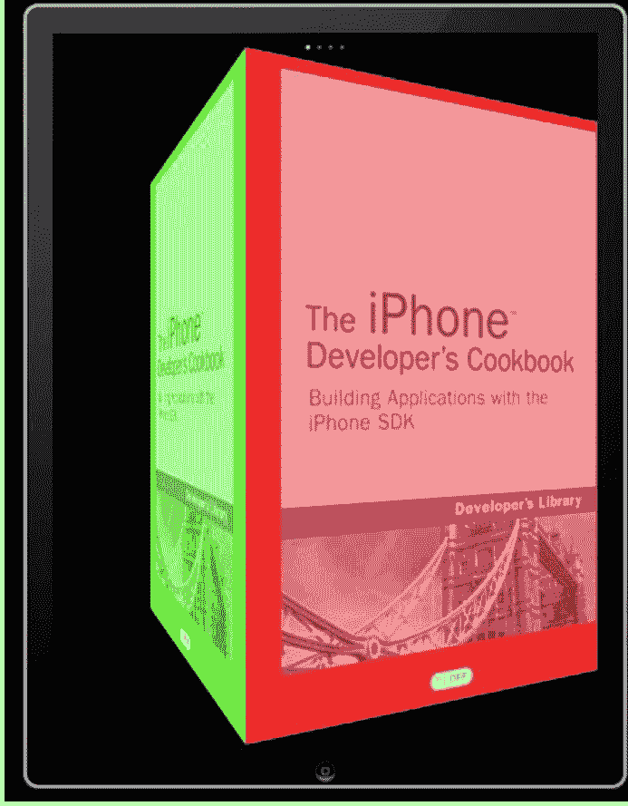

图 7-5. 自定义转场允许你为自定义容器创建视觉隐喻。食谱 7-9 构建了一个视图控制器的“立方体”，它可以从一个旋转到下一个。每个控制器上的开关会更新 alpha 值，使其从半透明变为不透明，反之亦然。

转场的 `goesForward` 属性决定了旋转是绕虚拟立方体向右还是向左移动。虽然这个示例使用了四个控制器，但正如你在布局子控制器的代码中看到的，那是隐喻的局限性，而不是代码本身的局限，代码可以适用于任何数量的子控制器。你同样可以轻松地构建三到七面的演示效果，尽管你这样做会违背与用户之间一个隐含的“现实”契约。要添加更多（或更少）的侧，你应该调整转场中的动画几何结构，将立方体调整为适应你的虚拟 n 边体。

## 食谱 7-9. 创建自定义视图转场

```objc
#define SAFE_PERFORM_WITH_ARG(THE_OBJECT, THE_SELECTOR, THE_ARG) \
    (([THE_OBJECT respondsToSelector:THE_SELECTOR]) ? \
    [THE_OBJECT performSelector:THE_SELECTOR withObject:THE_ARG] : \
    nil)

@implementation RotatingSegue

// 返回给定视图的截图
-(UIImage *)screenshot:(UIView *)aView {
    UIGraphicsBeginImageContext(hostView.frame.size);
    [aView.layer renderInContext:UIGraphicsGetCurrentContext()];
    UIImage *image = UIGraphicsGetImageFromCurrentContext();
    CGContextSetRGBFillColor(UIGraphicsGetCurrentContext(), 0, 0, 0, 0.4f);
    CGContextFillRect(UIGraphicsGetCurrentContext(), hostView.frame);
    UIGraphicsEndImageContext();
    return image;
}

// 返回一个带有视图内容的图层
-(CALayer *)createLayerFromView:(UIView *)aView transform:(CATransform3D)transform {
    CALayer *imageLayer = [CALayer layer];
    imageLayer.anchorPoint = CGPointMake(1.0f, 1.0f);
    imageLayer.frame = (CGRect){.size = hostView.frame.size};
    imageLayer.transform = transform;
    UIImage *shot = [self screenshot:aView];
    imageLayer.contents = (__bridge id)shot.CGImage;
    return imageLayer;
}

// 在动画开始时，移除源视图
-(void)animationDidStart:(CAAnimation *)animation {
    UIViewController *source = (UIViewController *)super.sourceViewController;
    [source.view removeFromSuperview];
}

// 在动画完成后，添加目标视图，移除代理
- (void)animationDidStop:(CAAnimation *)animation finished:(BOOL)finished {
    UIViewController *dest = (UIViewController *)super.destinationViewController;
    [hostView addSubview:dest.view];
    [transformationLayer removeFromSuperlayer];
    if (delegate)
        SAFE_PERFORM_WITH_ARG(delegate, @selector(segueDidComplete), nil);
}

// 执行动画
-(void)animateWithDuration:(CGFloat)aDuration {
    CAAnimationGroup *group = [CAAnimationGroup animation];
    group.delegate = self;
    group.duration = aDuration;

    CABasicAnimation *translationX = [CABasicAnimation animation];
    translationX.keyPath = @"affineTransform.x";
    translationX.toValue = [NSNumber numberWithFloat:halfWidth];

    CABasicAnimation *translationZ = [CABasicAnimation animation];
    translationZ.keyPath = @"affineTransform.z";
    translationZ.toValue = [NSNumber numberWithFloat:halfWidth];

    CABasicAnimation *rotationY = [CABasicAnimation animation];
    rotationY.keyPath = @"affineTransform.rotation.y";
    rotationY.toValue = [NSNumber numberWithFloat:multiplier * M_PI/2];

    group.animations = @[rotationY, translationX, translationZ];

    CATransaction begin];
    [transformationLayer addAnimation:group forKey:kAnimation];
    CATransaction commit];
}

CGFloat halfWidth = hostView.frame.size.width / 2.0;
float multiplier = goesForward ? -1.0f : 1.0f;

@end
```


```objc
(void)constructLayer
{
    UIViewController *source =
        (UIViewController *)super.sourceViewController;
    UIViewController *dest =
        (UIViewController *)super.destinationViewController;
    hostView = source.superview;

    transformationLayer = [CALayer layer];
    transformationLayer.anchorPoint = CGPointMake(0.5f, 0.5f);
    transformationLayer.frame = hostView.bounds;

    UIImage *shot = [self screenshot:dest.view];
    transformationLayer.contents = (__bridge id) shot.CGImage;

    [hostView addSubview:dest.view];
    [hostView.layer addSublayer:transformationLayer];
}

// // 标准 UIStoryboardSegue perform
-(void)
{
    [self constructLayer];
    [self animateWithDuration:0.5f];
}
@end
```

### `segueForUnwindingToViewController:fromViewController:identifier:`

通常情况下，你希望返回（unwind）的动画方向与原始跳转（segue）的方向相反。

最后，你可以通过实现 `shouldPerformSegueWithIdentifier:sender` 来拒绝或允许任何跳转。返回 `YES` 或 `NO`，取决于你是否允许该标识的跳转继续。

## 总结

本章展示了许多视图控制器类的实际应用。你学习了如何使用它们来处理各种设备部署选择的视图呈现和用户导航。通过这些类，你发现了如何根据应用程序的需求扩展虚拟交互空间和多页面界面，同时遵循相关平台的人机界面指南。在进入下一章之前，关于视图控制器有几点需要考虑：

- **使用导航树构建分级界面。** 它们非常适合查看文件结构或构建设置树。当你考虑“披露视图（disclosure-view）”或“偏好设置”时，请考虑将新的控制器推送到导航栈上，或使用拆分视图（split view）直接呈现它们。

- 只要尊重 Apple 人机界面指南，不要在使用非常规的方式使用常规 UI 元素。你可以对 `UINavigationController` 应用不涉及任何导航的创新方法。工具是用来使用的。

- **保持持久性。** 让用户返回到他们离开时的同一个 GUI 状态。`UserDefaults` 提供了一个跨 App 存储信息的内置系统。使用这些默认值来重建之前的界面状态。

- **实现通用化。** 让你的代码适应各种设备部署，而不是将你的应用强行转换为 on-iPhone 或 on-iPad 的设计。本章涉及了一些简单的运行时设备检测和界面更新，你可以轻松地将其扩展到更具挑战性的场景。通用部署不仅仅是拉伸视图和使用替代资源及 XIB 文件，它还关于检测设备何时影响了你的交互方式，而不仅仅是界面的外观。

- 在处理自定义容器时，不要害怕直接使用 Storyboard。你不需要同时构建并保留所有控制器的数组。Storyboard 提供了直接访问所有元素的方法。就像新的页视图控制器类一样，在需要的时候加载所需的控制器。

# 8. 常用控制器

iOS 软件开发包（SDK）提供了丰富的系统内置控制器，你可以在日常开发任务中使用它们。本章介绍了一些最流行的控制器。你阅读了如何从设备库中选择图像、拍摄照片以及录制和编辑视频。你发现了如何允许用户撰写电子邮件和短信，以及如何向 Twitter 和 Facebook 等社交服务发布更新。每个控制器都提供了一种利用预包 iOS 系统功能的方法。以下是你开始使用它们所需的知识。

## 图像选择器控制器

`UIImagePickerController` 类允许用户从设备的媒体库中选择图像，并使用其相机拍摄照片。它有点像是一个活化石；其系统提供的接口创建于 iPhone OS 早期。随着 Apple 随时间推出带有视频录制功能（iOS 3.1）以及前后摄像头（iOS 4）的设备，该类不断演变。它引入了照片和视频编辑、自定义相机视图覆盖层等功能。

## 图像源

图像选择器与以下三个源配合。尽管人们可能希望对 iCloud 以及共享和个人照片流进行精细化访问，但目前你只能访问整个库、仅限相机卷或仅限相机。请将你的改进建议提交至 `http://bugreport.apple.com`：

- **`UIImagePickerControllerSourceTypePhotoLibrary`**——这包含所有同步到 iOS 的图像。此源中的内容包括用户拍摄的照片（相机卷）、照片流、从计算机同步的相册、通过相机连接套件拷贝的图像等。

- **`UIImagePickerControllerSourceTypeSavedPhotosAlbum`**——此源仅引用相机卷（由用户在带有摄像机的设备上拍摄的照片和视频组成），或者对于无摄像用户的“已保存照片”相册。在其他设备上捕捉的照片流项目也会同步到此卷中。

- **`UIImagePickerControllerSourceTypeCamera`**——此源允许用户使用 iPhone 内置相机拍摄照片。该源支持前后摄像头的选择，以及静态图像和视频捕捉。

## 在 iPhone 和 iPad 上呈现选择器

图 8-1 显示了使用库源在 iPhone 和 iPad 上呈现的图像选择器。UIKit 类设计为在 iPhone 类设备上（左）以模态呈现方式运行，或在平板电脑上（右）以弹出框形式运行。

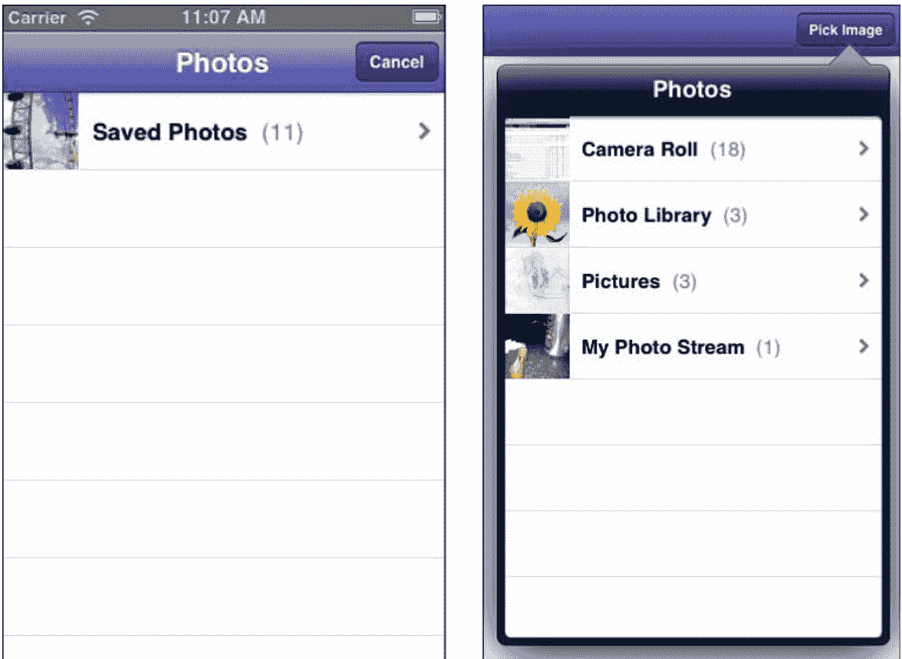

图 8-1。核心图像选择器允许用户从存储在媒体库的照片中选择图像。

在 iPhone 类设备上，以模态方式呈现图像选择器。在 iPad 上，你可以将选择器嵌入到弹出框中。永远不要将图像选择器推送到现有的导航栈上。在旧版本的 iOS 上，这会在主导航栏下方创建一个第二个导航栏。在现代 iOS 版本上，这会抛出一个糟糕的异常：“图像选择器不支持推送导航控制器。”

## 菜谱：选择图像

在最简单的角色中，图像选择器允许用户浏览其库并选择一张存储的照片。菜谱 8-1 展示了如何创建并呈现选择器，并获取用户选择的图像。在继续通用的操作之前，让我为你介绍适用于本节的两个关键技巧。

### 技巧：向模拟器添加照片

在 Mac 上运行此菜谱之前，你可能想要导航到模拟器的照片集合。你可以通过两种方式实现此。首先，你可以从 Finder 将图像拖入到模拟器。每张图像都会在 Mobile Safari 中打开，你可以在长按并点击“保存图像”将图像拷贝到你的照片库中。

一旦你设置了喜意的照片集合，导航到 Mac 上的 Application Support 文件夹。打开模拟器，然后进入你正在使用的 iOS 版本文件夹（例如 6.0）。在内部找到一个 `Media` 文件夹。Media 文件夹的路径看起来像这样：`/Users/(Your Account)/Library/Application Support/iPhone Simulator/(OS)/Media`。

将此新填充的 Media 文件夹备份到方便的地方。创建备份允许你在以后恢复它，而无需重新添加照片。每次重置模拟器的内容和设置时，这些材料都会被删除。手头准备一个可以放入测试的文件夹将节省大量时间。

或者，购买一份 Ecamm 的 PhoneView (`http://ecamm.com`)。PhoneView 通过 Apple 文件连接 (AFC) 提供了设备的 Media 文件夹访问。连接 iPhone，启动应用程序，然后你就可以将文件夹从 PhoneView 拖到 Mac。确保在 PhoneView 偏好设置中勾选“显示磁盘”以查看所有相关文件夹。

使用 PhoneView，从设备将 DCIM、PhotoData 和 Photos 文件夹拷贝到 Mac 上的文件夹。拷贝完成后，退出模拟器并将拷贝的文件夹添加到 `~/Library/Application Support/iPhone Simulator/(OS)/Media` 目标路径。下次启动模拟器时，你的新媒体将会在照片应用中等待你。

### 资源库框架

此菜谱使用了 assets library 框架。要添加框架，请使用 Targets > Build Phases > Link Binary with Libraries 设置。点击 + 号选择框架进行添加。在项目导航器中，将新添加的框架拖入 Libraries 组。

使用 assets library 听起来可能复杂，但这是处理图像选择器的最佳实践的深层原因。在 iOS 6 中，图像选择器可能会返回资产 URL，而不是直接提供可使用的图像。

食谱 8-1 假设以下代码提供了一种从资源库加载图像的方法（`loadImageFromURL:into:`）。一个典型的 URL 如下所示：

```
assets-library://assets/asset.JPG?id=53F6592-43C9-45A0-B851-28A72627436&e=JPG
```

该 URL 提供了对媒体的直接访问。

幸运的是，Apple 现在已经解决了一个极其烦人的资源库问题。从历史角度看，iOS 会向用户请求使用或其位置的权限——而用户通常会拒绝这些请求。这会导致 Apple 应用卡死，因为它们无法强制系统再次询问。相反，iOS 6 现在会正确地声明该 App 想要访问用户的照片而非位置，希望这能带来更好的用户成功率。通过查询类的属性 `authorizationStatus` 状态可以确定你的授权情况。你可以通过打开“设置 > 隐私”来重置这些已授予的权限，并按 App 更新基于服务的权限（如位置和照片访问）。

既然过程性的操作方法已经得到了解决，下一节将介绍图片选择器本身。

## 选择器

通过分配和初始化来创建一个图片选择器。接下来，将其源设置为资源库（所有图像）或相机册（Camera Roll，已拍摄的图像）。食谱 8-1 选择了照片库作为图像源，允许用户浏览所有图像。

```objc
UIImagePickerController *picker = [[UIImagePickerController alloc] init];
picker.sourceType = UIImagePickerControllerSourceTypePhotoLibrary;
```

可选的编辑（`allowsEditing`）为交互式选择过程增加了一个步骤。当启用时，它允许用户在完成选择之前对选定的图像进行缩放和裁剪。当禁用时，任何媒体选择都会立即将控制权转移到选择器生命周期的下一个阶段。

务必设置选择器的 `delegate` 属性。该代理遵守 `UINavigationControllerDelegate` 和 `UIImagePickerControllerDelegate` 协议，它在用户选择图像或取消选择后接收回调。在使用带有弹出框（popovers）的图片选择器控制器时，请声明 `UIPopoverControllerDelegate` 协议。

在类 iPhone 设备上开发时，请始终以模态方式显示选择器；在运行时检查活动设备。以下测试（iOS 3.2 及更高版本）在 iPhone 上运行时返回 true，在 iPad 上返回 false：

```objc
#define IS_IPHONE (UI_USER_INTERFACE_IDIOM) == UIUserInterfaceIdiomPhone
```

此代码段显示了图片选择器的典型展示模式：

```objc
if (IS_IPHONE)
    [self presentViewController:picker animated:YES completion:nil];
} else {
    if (popover) [popover dismissPopoverAnimated:NO];
    popover = [[UIPopoverController alloc] initWithContentViewController:picker];
    popover.delegate = self;
    [popover presentPopoverFromBarButtonItem:self.navigationItem.rightBarButtonItem permittedArrowDirections:UIPopoverArrowDirectionAny animated:YES];
}
```

## 处理代理回调

食谱 8-1 考虑了三种可能的图片选择器回调场景：

- 用户成功选择了一个图像。
- 用户点击了“取消”（Cancel）（仅在模态演示时可用）。
- 用户通过点击选择器外部关闭了嵌入选择器的弹出框。

后两种情况非常简单。对于模态演示，关闭控制器。对于弹出框，移除任何持有该实例的本地引用。处理选择需要稍多工作。

选择器在结束生命周期时会向其分配的代理返回一个自定义信息字典。此信息字典包含与用户选择相关的键值对。根据选择器的设置以及用户选择的媒体类型，字典可能包含这些中的少数或许多键。例如，当在模拟器上处理拖入 Safari 的图像时，预计只会看到媒体类型和引用的 URL。在设备上拍摄并通过选择器编辑的图像可能包含此处列出的所有六个键：

- `UIImagePickerControllerMediaType` 定义用户选择的媒体类型——通常是公共的。

```objc
// 创建并初始化选择器
UIImagePickerController *picker = [[UIImagePickerController alloc]
init];
picker.sourceType = UIImagePickerControllerSourcePhotoLibrary;
picker.allowsEditing = editSwitch.isOn;
picker.delegate = self;

[self presentViewController:picker];
```

### 获取食谱的代码

要找到此食谱的完整示例项目，请将浏览器指向 `https://github.com/erica/iOS-6-Cookbook` 并进入第 8 章文件夹。

## 菜谱：拍摄照片

除了选择图片外，图像选择器（image picker controller）还允许你使用设备的内置摄像头拍摄照片。由于并非所有的 iOS 设备都配备摄像头（特别是较旧的 iPod touch 和 iPad 设备），请先检查运行应用程序的系统是否支持相机功能：

```objc
if ([UIImagePickerController isSourceAvailable:UIImagePickerControllerSourceTypeCamera])
```

规则是：永远为没有摄像头的设备提供相机功能。尽管 iOS 6 仅部署在带有摄像头的设备上，但 Apple 尚未承诺坚持这一政策。尽管听起来是如此，他们仍可能引入没有摄像头的新型号。在 Apple 另有说明之前，请假设在现代 iOS 版本中，非摄像头系统也存在这种可能性。此外，假设该方法对于通过某些未来系统设置禁用了源的摄像头设备能够准确报告其状态。

### 设置选择器

你实例化相机版本的图像选择器的方法与创建选择版本相同。只需将源类型从库（library）或相机卷（Camera Roll）更改为相机即可：

```objc
picker.sourceType = UIImagePickerControllerSourceTypeCamera;
```

在其他模式下，你可以通过设置 `allowsEditing` 属性在拍摄过程中允许或禁用图像编辑。虽然设置方法相同，但用户体验略有不同（见图 8-2）。

相机选择器在用户点击相机图标拍摄照片后会显示一个预览。此预览允许用户“重拍照片”或“直接使用照片”。一旦他们点击“使用”，控制权将移到下一个阶段。如果你启用了图像编辑，用户接下来将进行编辑。如果没有启用，控制权将移动到代理中标准的“完成选取”（did finish picking）方法。

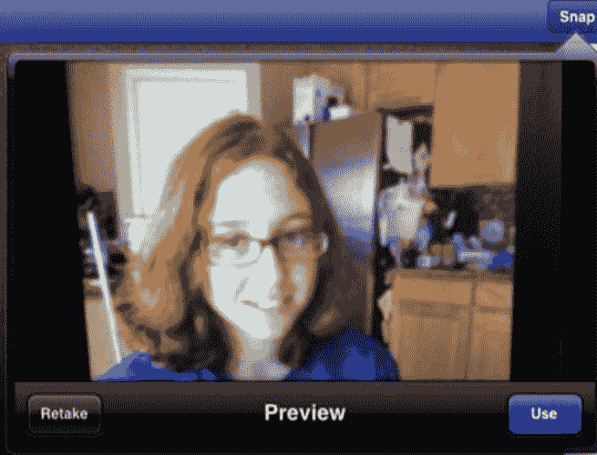

**图 8-2. 相机版本的图像选择器控制器为拍摄照片提供了独特的用户体验。**

现代设备配备了多个摄像头。iPhone 3GS 作为最后一个 iOS 6 “恐龙”设备并没有多个摄像头。通过分配 `cameraDevice` 属性来选择你想使用的摄像头。后置摄像头始终是默认选择。

`isCameraDeviceAvailable:` 类方法用于查询相机设备是否可用。此代码段检查前摄像头是否可用，如果是，则选择：

```objc
if ([UIImagePickerController isCameraDeviceAvailable:UIImagePickerControllerCameraDeviceFront]) {
    picker.cameraDevice = UIImagePickerControllerCameraDeviceFront;
}
```

关于你可以通过 `UIImagePickerController` 类访问的相机或摄像头的其他几点：

- 你可以使用 `isFlashAvailableForCameraDevice:` 类方法查询设备使用闪光灯的能力。提供前置或后置设备常量。该方法在闪光可用时返回 `YES`，否则返回 `NO`。
- 当相机支持闪光灯时，你可以直接将 `cameraFlashMode` 属性设置为自动（`UIImagePickerControllerCameraFlashModeAuto`，默认值）、始终开启（`UIImagePickerControllerCameraFlashModeOn`）或始终关闭（`UIImagePickerControllerCameraFlashModeOff`）。选择关闭将无论环境光线如何都会禁用闪光灯。


- 通过设置 `cameraCaptureMode` 属性在照片和视频拍摄之间进行选择。选择器默认为照片模式。你可以使用 `availableCaptureModesForCameraDevice:` 测试设备支持哪些模式：它返回一个 `NSNumber` 对象数组，每个对象都编码了一个有效的捕获模式，即照片（`UIImagePickerControllerCameraCaptureModePhoto`）或视频（`UIImagePickerControllerCameraCaptureModeVideo`）。

# 显示图像

在处理照片时，请注意图像大小。即使在 Retina 显示屏时代，拍摄的照片（尤其是高分辨率摄像头拍摄的照片）也可能很大。前置摄像头捕捉的照片使用较低质量的传感器，要小得多。

内容模式为显示大图像提供了应用内解决方案。它们允许图像视图将其嵌入的图像缩放到可用屏幕尺寸。请考虑以下之一：

- `UIViewContentScaleAspectFit` 模式确保在保持宽高比例的同时显示整个图像。图像的侧边或顶部底部可能会留有空白矩形以保持比例。
- `UIViewContentScaleAspectFill` 模式尽可能显示图像，填充整个视图。某些内容可能会被裁剪以填充视图。

# 将图像保存到相册

通过调用 `UIImageWriteToSavedPhotosAlbum()` 将拍摄图像（实际上是任何 `UIImage` 实例）保存到相册。此函数接受四个参数。第一个是要保存的图像。第二个和第三个参数指定回调目标选择器，通常是你的视图控制器和 `image:didFinishSavingWithError:contextInfo:`。第四个参数是一个可选的上下文指针。无论你使用什么选择器，它必须接受三个参数：图像、错误以及指向所传递的上下文信息的指针。

食谱 8-2 使用此函数来演示如何拍摄新图像、允许用户编辑，然后将其保存到相册。

# 食谱 8-2 拍摄照片

```objc
// "保存完成"回调
- (void)image:(UIImage *)image didFinishSavingWithError:(NSError *)error contextInfo:(void *)contextInfo {
    // 处理写入过程的结束
    if (!error) {
        NSLog(@"Image written to photo album");
    } else {
        NSLog(@"Error writing to photo album: %@", error.localizedDescription);
    }
}

// 保存图像
- (void)imagePickerController:(UIImagePickerController *)picker didFinishPickingWithInfo:(NSDictionary *)info {
    // 使用可用的编辑图像
    UIImage *image = info[UIImagePickerControllerEditedImage];

    // 如果没有，获取原始图像
    if (!image) image = info[UIImagePickerControllerOriginalImage];

    NSURL *assetURL = info[UIImagePickerControllerReferenceURL];
    if (image && !assetURL) {
        NSLog(@"Cannot retrieve an image from selected item.");
    } else if (image) {
        NSLog(@"Retrieving from Assets");
        [self loadImageFromURL:assetURL into:&image];
    }

    if (image) {
        // 保存图像
        UIImageWriteToSavedPhotosAlbum(image, self, @selector(image:didFinishSavingWithError:contextInfo:), NULL);
        imageView.image = image;
    }

    [self dismiss];
}
```

此方法在可用媒体查询的结果中搜索电影类型（`kUTTypeMovie`，又称为 `public.movie`）。统一类型标识符（UTIs）是用于识别图像、视频和数据等常见文件格式抽象类型的字符串。这些类型定义在 Mobile Core Services 框架中。请务必在你的项目中包含它们：

```objc
#import <MobileCoreServices/MobileCoreServices.h>
```

## 创建视频录制选择器

录制视频与使用相机捕捉静态图像几乎相同。你分配并初始化一个新的图像选择器，设置其代理，并将其显示出来：

```objc
UIImagePickerController *picker = [[UIImagePickerController alloc] init];
picker.sourceType = UIImagePickerControllerSourceTypeCamera;
picker.videoQuality = UIImagePickerControllerQualityTypeMedium;
picker.mediaTypes = @[kUTTypeMovie]; // public.movie
picker.delegate = self;
```

选择你想要录制的质量。质量越高，每秒存储的数据就越多。你可以从高（`UIImagePickerControllerQualityTypeHigh`）、中（`UIImagePickerControllerQualityTypeMedium`）、低（`UIImagePickerControllerQualityTypeLow`）或 VGA（`UIImagePickerControllerQualityType640x480`）之间选择。

与选择类似，视频版本允许你设置 `allowsEditing` 属性，如食谱 8-5 所示。

## 保存视频

视频选择器返回的信息字典包含 `UIImagePickerControllerMediaURL` 键。此媒体 URL 指捕捉到的视频，它存储在沙盒内的临时文件夹中。使用 `UISaveVideoAtPathToSavedPhotosAlbum()` 方法将视频存储到你的库中。该保存方法接受四个参数：要添加到库的视频路径、回调目标、一个带有三个参数的选择器（基本上与图像保存回调期间使用的选择器相同）以及一个可选的上下文。保存方法在完成工作后会使用该选择器调用目标，由你在此处检查是否成功。

## 食谱 8-3. 录制视频

```objc
- (void)video:(NSString *)videoPath didFinishSavingWithError:(NSError *)error contextInfo:(void *)contextInfo {
    if (!error) {
        self.title = @"Saved!";
    } else {
        NSLog(@"Error saving video: %@", error.localizedFailureReason);
    }
}

- (void)saveVideo:(NSURL *)mediaURL {
    // 检查视频是否与相册兼容
    BOOL compatible = UIVideoAtPathIsCompatibleWithSavedPhotosAlbum(mediaURL.path);

    // 保存
    if (compatible) {
        UISaveVideoAtPathToSavedPhotosAlbum(mediaURL.path, self, @selector(video:didFinishSavingWithError:contextInfo:), NULL);
    }
}

- (void)imagePickerController:(UIImagePickerController *)picker didFinishPickingMediaWithInfo:(NSDictionary *)info {
    [self performDismiss];

    // 保存视频
    NSURL *mediaURL = [info objectForKey:UIImagePickerControllerMediaURLKey];
    [self saveVideo:mediaURL];
}

- (void)recordVideo {
    if (popover) return;
    self.title = nil;

    // 创建并初始化选择器
    UIImagePickerController *picker = [[UIImagePickerController alloc] init];
    picker.sourceType = UIImagePickerControllerSourceTypeCamera;
    picker.videoQuality = UIImagePickerControllerQualityTypeMedium;
    picker.mediaTypes = @[kUTTypeMovie];
    picker.delegate = self;

    [self presentViewController:picker animated:YES];
}
```

## 获取此食谱的代码

要找到此食谱的完整示例项目，请将浏览器指向 https://github.com/erica/iOS-6-Cookbook 并进入第 8 章文件夹。

## 食谱：使用 Media Player 视频

`MPMoviePlayerViewController` 和 `MPMoviePlayerController` 类简化了应用程序中的视频显示。这些类作为 Media Player 框架的一部分，允许你将视频嵌入视图中或全屏播放电影。通过提供图 8-3 所示的内置全功能视频播放器，你只需要提供一个内容 URL。播放器提供了“完成”按钮、时间进度条、宽高比例控制和播放控制控件，以及底层的视频呈现。


**图 8-3. MPMoviePlayerViewController 和 MPMoviePlayerController 类简化了视频显示...**

## 食谱 8-4. 播放

```objc
- (void)playMovie {
    // 播放
    MPMoviePlayerViewController *player = [[MPMoviePlayerViewController alloc] initWithContentURL:mediaURL];
    player.moviePlayer.allowsAirPlay = YES;
    player.moviePlayer.controlStyle = MPMovieControlStyleFullscreen;

    [self presentMoviePlayerViewControllerAnimated:player];

    // 处理播放结束
    [[NSNotificationCenter defaultCenter] addObserverForName:MPMoviePlayerPlaybackDidFinishNotification
                                                      object:player.moviePlayer
                                                       queue:[NSOperationQueue mainQueue]
                                                  usingBlock:^(NSNotification *notification) {
        // 返回录制模式
        self.navigationItem.rightBarButtonItem = [UIBarButtonItem barButtonSystemItem:UIBarButtonSystemItemCamera target:self action:@selector(recordVideo)];
    }];

    // 停止监听通知
    [[NSNotificationCenter defaultCenter] removeObserver:self];

    // 等待视频加载并可播放
    [[NSNotificationCenter defaultCenter] addObserverForName:MPMoviePlayerLoadStateDidChangeNotification
                                                      object:player.moviePlayer
                                                       queue:[NSOperationQueue mainQueue]
                                                  usingBlock:^(NSNotification *notification) {
        // 当视频设置可播放标志时，开始播放
        if ((player.moviePlayer.loadState & MPMovieLoadStatePlayable) != 0) {
            [player.moviePlayer performSelector:@selector(play) withObject:nil afterDelay:1.0f];
        }
    }];
}
```

## 获取此食谱的代码

要找到此食谱的完整示例项目，请将浏览器指向 https://github.com/erica/iOS-6-Cookbook 并进入第 8 章文件夹。

## 食谱：编辑视频

为视频源启用图像选择器的 `allowsEditing` 属性将激活你在内置照片应用中看到的黄色编辑条。（拖动两侧的握手以查看其效果。）在捕获过程的编辑步骤中，用户通过拖动调节轨道的末端来选择想要使用的视频范围。

令人惊讶的是，选择器本身不会剪辑视频。相反，它会在 info 字典中返回四个项目：

- `UIImagePickerControllerMediaURL`
- `UIImagePickerControllerMediaType`
- `_UIImagePickerControllerVideoEditingStart`
- `_UIImagePickerControllerVideoEditingEnd`

# AV Foundation 和 Core Media

此食谱需要访问两个非常专业的框架。AV Foundation 框架提供了一个支持媒体处理的 Objective-C 接口。Core Media 使用低级 C 接口来描述媒体属性。它们共同提供了 iOS 版本的 Mac QuickTime 媒体体验。请在项目的构建中包含这两个框架，并为此食谱的源代码添加头文件。

食谱 8-5 首先从图像选择器的 info 字典中恢复媒体 URL。该 URL 指向图像选择器在沙盒中创建的临时文件。食谱根据它创建一个新的 AV asset URL。接下来，它导出导出范围，即视频中应该保存到库中的时间段。它使用 Core Media 的 `CMTimeRange` 结构来实现，并根据 info 字典中的开始和结束时间构建它。`CMTimeMakeWithSeconds()` 接受两个参数：时间和为 1 的比例因子，从而保留了精确的时间。

导出会话允许你的应用将数据保存到文件系统。该会话不会将视频保存到库；这是一个独立的步骤。会话会将剪辑后的视频导出到沙盒 tmp 文件夹中的本地文件中，与原始捕获的视频放在一起。要创建导出会话，为其分配并设置其 asset 和质量。

食谱 8-5 使用路径进行保存。该路径与其读取的路径相同，但在核心文件名后添加了“trimmed”字样。导出会话使用路径设置输出 URL，使用导出范围指定要包含的时间范围，并选择 QuickTime 电影输出文件类型。一旦建立，它就准备好处理视频了。导出会话使用传递的 asset 的属性和内容异步执行文件导出。

完成后，就可以将剪辑后的视频保存到中央媒体库了。食谱 8-5 在导出会话的完成回调块中执行此操作。

# 食谱 8-5. 使用 AV Foundation 剪辑视频

```objc
- (void)trimVideo:(NSDictionary *)info {
    // 恢复视频 URL
    NSURL *mediaURL = [info objectForKey:UIImagePickerControllerMediaURL];
    AVAsset *asset = [AVAsset assetWithURL:mediaURL];

    // 创建导出范围
    CGFloat editingStart = [info[@"_UIImagePickerControllerVideoEditingStart"] floatValue];
    CGFloat editingEnd = [info[@"_UIImagePickerControllerVideoEditingEnd"] floatValue];
    CMTime startTime = CMTimeMakeWithSeconds(editingStart, 1);
    CMTime endTime = CMTimeMakeWithSeconds(editingEnd, 1);
    CMTimeRange exportRange = CMTimeRangeFromTimeTo(startTime, endTime);

    // 创建剪辑后的版本 URL: file:original-trimmed.mov
}
```


# 食谱：选择和编辑视频

你可以使用图像选择器来选择视频以及图像，如食谱 8-6 所示。这只需要对 `mediaTypes` 属性进行少量的编辑。将选择器的源类型设置为正常的手机库或已保存的照片相册，但限制 `mediaTypes` 属性。以下代码段显示了如何设置媒体类型以请求仅显示视频的请求选择器：

```objc
picker.sourceType = UIImagePickerControllerSourceTypePhoneLibrary;
picker.mediaTypes = @[ (NSString *)kUTTypeMovie ];
```

一旦用户选择了视频，食谱 8-6 将进入编辑模式。始终检查视频 asset 是否可以被修改。调用 `UIVideoEditorController` 类方法 `canEditVideoAtPath:`。它返回一个布尔值，指示视频是否与 `UIVideoEditorController` 兼容。

# 食谱 8-6. 使用视频编辑器

```objc
// 保存编辑后的路径
- (void)videoEditorController:(UIVideoEditorController *)editor
        didSaveEditedPath:(NSString *)editedPath
{
    [self performDismiss];
    // 更新 URL 并保存
    mediaURL = [NSURL fileURLWithPath:editedPath];
    self.navigationItem.leftBarButtonItem = BARBUTTON(@"保存", @selector(saveVideo));
    self.navigationItem.rightBarButtonItem = BARBUTTON(@"选择", @selector(pickVideo));
}
```

```objc
// 处理编辑失败
- (void)videoEditorController:(UIVideoEditorController *)editor
        didFailWithError:(NSError *)error
{
    [self performDismiss];
    mediaURL = nil;
    self.navigationItem.rightBarButtonItem = BARBUTTON(@"选择", @selector(pickVideo));
    self.navigationItem.leftBarButtonItem = nil;
    NSLog(@"视频编辑失败: %@", error.localizedDescription);
}
```

```objc
// 处理取消并返回选择状态
- (void)videoEditorControllerDidCancel:(UIVideoEditorController *)editor
{
    [self performDismiss];
    mediaURL = nil;
    self.navigationItem.rightBarButtonItem = BARBUTTON(@"选择", @selector(pickVideo));
    self.navigationItem.leftBarButtonItem = nil;
}
```

```objc
// 允许用户使用视频编辑器编辑媒体
- (void)editMedia
{
    if (![UIVideoEditorController canEditVideoAtPath:mediaURL.path]) {
        self.title = @"无法编辑视频";
        self.navigationItem.rightBarButtonItem = BARBUTTON(@"选择", @selector(pickVideo));
        return;
    }
    UIVideoEditorController *editor = [[UIVideoEditorController alloc] init];
    editor.videoPath = mediaURL.path;
    editor.delegate = self;
    [self presentViewController:editor animated:YES completion:nil];
}
```

```objc
// 用户选择了视频。提供编辑按钮
- (void)imagePickerController:(UIImagePickerController *)picker
        didFinishPickingMediaWithInfo:(NSDictionary *)info
{
    [self performDismiss];
    // 获取视频 URL 并显示编辑按钮
    mediaURL = [info objectForKey:UIImagePickerControllerMediaURL];
    self.navigationItem.rightBarButtonItem = BARBUTTON(@"编辑", @selector(editMedia));
}
```

## 获取此食谱的代码

要找到此食谱的完整示例项目，请将浏览器指向 `https://github.com/erica/iOS-6-Cookbook` 并进入第 8 章文件夹。

# 食谱：通过电子邮件发送图片

Message UI 框架允许用户在应用程序内编写电子邮件和短信。与访问摄像头权限和图片选择器一样，请检查用户的设备是否已启用了这些服务。通过一个简单的测试，你可以判断邮件功能何时可用：

```
[MFMailComposeViewController canSendMail]
```

当功能被启用时，用户可以通过 `MFMailComposeViewController` 实例发送他们的照片。短信则通过 `MFMessageComposeViewController` 实例发送。

食谱 8-7 使用此组合类来创建一个新的邮件项目，其中填充了用户拍摄的照片。邮件编写功能在 iPhone 系列和 iPad 上作为一个轻量级客户端显示效果最佳。你的主视图控制器展示它，并通过代理回调等待结果。

## 创建消息内容

组合器的属性允许你通过代码构建消息，包括收件人、抄送者和附件。食谱 8-7 演示了如何创建一个带有附件的简单 HTML 消息。这些属性几乎是通用的。通过 `setSubject:` 和 `setMessageBody:` 定义主题和主体内容。每个方法都接受一个字符串作为参数。

保持收件人未分配状态，将用一个未分配的消息欢迎视图。在以下情况下你可能需要重新填充此字段：添加诸如“报告 Bug”或“向开发者发送反馈”等回拨功能，或者当你在设置中允许用户选择收藏的收件人时。

创建附件需要稍多一些工作。要添加附件，你需要提供邮件客户端预期的所有文件组件。你需要提供数据（通过一个 `NSData` 对象）、MIME 类型（一个字符串）和文件名（另一个字符串）。使用 `UIImageJPEGRepresentation()` 函数获取图像数据。该函数的运行可能需要一些时间。因此，预计在消息视图出现之前会有延迟。

此食谱使用了硬编码的 `image/jpeg` MIME 类型。如果你想发送其他数据类型，可以通过典型的文件扩展名查询 iOS 的 MIME 类型。使用如下方法所示 `UTTypePreferredTagWithClass()`，它定义在 CoreServices 框架中：

```objc
#import <MobileCoreServices/UTType.h>

- (NSString *)mimeTypeForExtension:(NSString *)ext
{
    // 通过文件扩展名请求 UTI
    CFStringRef UTI = UTTypeCreatePreferredIdentifierForTag(kUTTagClassFilenameExtension, (__bridge CFStringRef)ext, NULL);
    if (!UTI) return nil;

    // 通过 UTI 请求 MIME 类型，
    // 对于未知的 MIME 类型可能返回 nil
    NSString *mimeType = (__bridge_transfer NSString *)UTTypeCopyPreferredTagWithClass(UTI, kUTTagClassMIMEType);
    CFRelease(UTI);
    return mimeType;
}
```

此方法根据传递给它的文件扩展名返回标准的 MIME 类型，例如 `.jpg`、`.png`、`.txt`、`.html` 等。始终测试是否返回 `nil`，因为 iOS 内置的扩展名-MIME 类型匹配知识库是有限的。或者，你可以在互联网上搜索正确的 MIME 表示，并手动将它们添加到你的项目中。

电子邮件使用你指定的文件名传输你发送的数据。可以使用你喜欢的任何名称。在这里名称被设置为 `picker.jpg`。由于你正在发送数据，内容与你分配的名称之间没有真实的联系：

```objc
[mvc addAttachmentData:UIImageJPEGRepresentation(image, 1.0f) mimeType:@"image/jpeg" fileName:@"pickerimage.jpg"];
```

> **注意**
> 当使用 iOS 组合器时，附件会出现在发送邮件的末尾。Apple 没有提供将图像嵌入 HTML 文本流的方法。这是由于 Apple 和微软表示方式之间的差异。

# 食谱 8-7. 通过电子邮件发送图片

```objc
- (void)mailComposeController:(MFMailComposeViewController *)controller
        didFinishWithResult:(MFMailComposeResult)result
                        error:(NSError *)error
{
    // 整理组合器详情
    [self performDismiss];

    switch (result) {
        case MFMailComposeResultCancelled:
            NSLog(@"Mail was cancelled");
            break;
        case MFMailComposeResultFailed:
            NSLog(@"Mail failed");
            break;
        case MFMailComposeResultSaved:
            NSLog(@"Mail was saved");
            break;
        case MFMailComposeResultSent:
            NSLog(@"Mail was sent");
            break;
        default:
            break;
    }
}

- (void)sendImage
{
    UIImage *image = imageView.image;
    if (!image) return;

    // 自定义电子邮件
    MFMailComposeViewController *mcvc = [[MFMailComposeViewController alloc] init];
    mcvc.mailComposeDelegate = self;

    // 设置主题
    [mcvc setSubject:@"Here's a great photo!"];

    // 创建预填充正文
    NSString *body = @"<html>Check this out</html>\n<p>I snapped this image <b><code>UIImagePickerController</code></b>.</p>";
    [mcvc setMessageBody:body isHTML:YES];

    // 添加附件
    [mcvc addAttachmentData:UIImageJPEGRepresentation(image, 1.0) mimeType:@"image/jpeg" fileName:@"pickerimage.jpg"];

    // 展示邮件组合控制器
    [self presentViewController:mcvc animated:YES completion:nil];
}
```

## 获取此食谱的代码

要找到此食谱的完整示例项目，请将浏览器指向 `https://github.com/erica/iOS-6-Cookbook` 并进入第 8 章文件夹。

# 食谱：发送短信

在应用程序中发送短信比发送电子邮件更简单。这个特定的控制器如图 8-4 所示。与邮件一样，首先确保你的设备上存在该功能：

```
[MFMessageComposeViewController canSendText]
```

短信的可用性随时间变化，可以通过 `MFMessageComposeViewControllerTextMessageAvailabilityDidChangeNotification` 通知来监控。食谱 8-8 创建了新的控制器及其代理和正文。如果你知道目标收件人，可以通过填充电话字符串数组来预填充。以你喜欢的方式展示控制器，并等待代理回调，在回调中关闭它。

## 食谱 8-8. 发送短信

```objc
- (void)messageComposeViewController:(MFMessageComposeViewController *)controller
                 didFinishWithResult:(MessageComposeResult)result
{
    [self performDismiss];

    switch (result) {
        case MessageComposeResultCancelled:
            NSLog(@"Message was cancelled");
            break;
        case MessageComposeResultFailed:
            NSLog(@"Message failed");
            break;
        case MessageComposeResultSent:
            NSLog(@"Message was sent");
            break;
        default:
            break;
    }
}

- (void)sendMessage
{
    MFMessageComposeViewController *mcvc = [[MFMessageComposeViewController alloc] init];
    mcvc.messageComposeDelegate = self;
    mcvc.body = @"I'm reading the iOS Developer's Cookbook";
    [self presentViewController:mcvc animated:YES completion:nil];
}
```


```objc
[super loadView];
self.backgroundColor = [UIColor whiteColor];
if ([MFMessageComposeViewController canText]) {
    self.navigationBar.rightBarButtonItem = BUTTON[@"Send", @selector(sendMessage)];
} else {
    self.title = @"Cannot send texts";
}
```

## 获取此食谱的代码

要找到此食谱的完整示例项目，请将浏览器指向 `https://github.com/erica/iOS-6-Cookbook` 并进入第 8 章文件夹。

# 食谱：社交更新

Social 框架提供了一个统一的 API 用于应用程序与社交网络服务。该框架目前支持 Facebook、Twitter 以及中国的微博。与邮件和短信一样，首先测试你想支持的服务类型是否可用：

```
[SLComposeViewController isAvailableForServiceType:SLServiceFacebook]
```

如果是，你可以为该服务创建一个组合视图控制器：

```objc
SLComposeViewController *fbController = [SLComposeViewController composeViewControllerForServiceType:SLServiceFacebook];
```

你可以使用图像、URL 和初始文本来自定义控制器。食谱 8-9 演示了创建图 8-5 所示界的步骤。

# 推文

我正在阅读《iOS Developer's Cookbook》

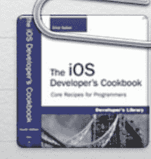

添加位置

## 图 8-5. 组合推文消息

`TweetComposeViewController` 最初在 iOS 5 中引入，提供的界面与 iOS 6 的 Social 相同。然而，它不能在弹出框（popover）中显示。此外，你无法将其用法推广到其他社交服务。在尽可能部署 iOS 6 的情况下，请将你使用的 TW 类替换为 Social 框架版本。其 API 是相同的。

## 食谱 8-9. 发布社交更新

```objectivec
(void) postSocial:(NSString *) serviceType
{
// 建立控制器
SLComposeViewController *controller = [SLComposeViewController composeViewControllerForServiceType:serviceType];

// 添加文本和图像
[controller addImage:[UIImage imageNamed:@"Icon.png"]];
[controller setInitialText:@"I'm reading the iOS Developer's Cookbook"];

// 定义回调处理器
controller.completionHandler = ^SLComposeViewControllerResult result) {
 switch (result) {
    case SLComposeViewControllerResultCancelled:
     NSLog(@"Cancelled");
    break;
    case SLComposeViewControllerResultDone:
     NSLog(@"Posted");
    break;
    default:
    break;
 };
// 显示控制器
[self presentViewController:controller];
}
```

```objectivec
(void) postToFacebook
{
[self postSocial:SLServiceTypeFacebook];
}
```

```objectivec
(void) postToTwitter
{
[self postSocial:SLServiceTypeTwitter];
}

-(void)loadView {
  [super loadView];
  self.view.backgroundColor = [UIColor whiteColor];
  if ([UIViewController isAvailableForStateType:SLServiceTypeFacebook]) {
    self.navigationItem.leftBarButton =
      [UIBarButtonItem buttonWithTitle:@"Facebook" target:self action:@selector(postToFacebook)];
  }
  if ([UIViewController isAvailableForStateType:SLServiceTypeTwitter]) {
    self.navigationItem.rightBarButtonItem = 
      [UIBarButtonItem buttonWithTitle:@"Twitter" target:self action:@selector(postToTwitter)];
  }
}
```

## 获取此食谱的代码

要找到此食谱的完整示例项目，请将浏览器指向 `https://github.com/erica/iOS-6-Cookbook` 并进入第 8 章文件夹。

## 食谱：活动控制器 (Activity View Controller)

iOS 6 新引入的活动控制器将数据活动集成到图 8-6 所示的界面中。在你的开发成本极低的情况下，这个新控制器允许用户将项目复制到剪贴板、社交媒体、通过电子邮件和短信分享等。内置活动包括 Facebook、Twitter、微博、短信、邮件、打印、复制到剪贴板以及将数据分配给联系人。应用程序也可以定义自己的自定义服务，你将在本节稍后部分读到这些：

- `UIActivityTypePostToFacebook`
- `UIActivityTypePostToTwitter`
- `UIActivityTypePostToWeibo`
- `UIActivityTypeMessage`
- `UIActivityTypeMail`
- `UIActivityTypePrint`
- `UIActivityTypeCopyToPasteboard`
- `UIActivityTypeAssignToContact`


图 8-6. `UIActivityViewController` 类提供了系统和自定义服务。

你如何根据设备显示控制器。在 iPhone 系列设备上以模态形式显示，在平板电脑上以弹出框（popover）显示。`UIButtonSystemAction` 图标提供了填充链接到该控制器的栏按钮的完美方式。最重要的是，你几乎不需要进行任何工作。用户选择活动后，控制器将处理所有后续交互，例如显示邮件或 Twitter 组合界面、向内置库添加图片，或将其分配给联系人。该类为本章中已涵盖的许多技术提供了一站式的实用程序。

## 创建并显示控制器

如食谱 8-10 所示，从代码中创建并显示视图控制器。此实现让其主类采用 `UIActivityItemSource` 协议，并在传递给控制器的项目数组中使用 `self`。这代表了创建和显示控制器的两种方法中的第一种。

该协议的两个强制方法提供了要处理的项目以及该项目的占位符。项目对应于特定活动类型的适当项目。

该项目的占位符通常是同一个项目，除非你正在处理必须处理或创建的对象。在这种情况下，你可以创建一个不带真实数据的占位符。两个回调都在主线程上运行，因此要保持你的数据很小。如果你需要处理数据，请考虑使用提供者（provider）。

## 注意

传回 `item` 方法的控制器实际上是正在处理的项目类型的组合控制器。对于电子邮件活动，它是 `MailComposeViewController`；对于 Twitter，它是 `TWTweetComposeViewController`，以此此类推。你可以相应地强制转换控制器并执行任何进一步的更新，添加主题行。在本书编写期间，Apple 尚未完全记录此行为，它未来可能会发生变化。但是，你可以轻松地检查（这也是合理的）`item-activity-type` 回调中的第一个参数确实是该活动的组合控制器，而不是你显示的初始 `UIViewController`。

`UIActivityProvider` 类允许你传递数据。

```objc
}
// 返回该项目的缩略图版本
// (id)activityViewControllerPlaceholderItem:
  (UIViewController *)activityController
{
  return imageView.image;
}
// 创建并展示控制器
// (void) action
{
  UIViewController *activity =
  [[UIViewController alloc] initWithActivityItems:[self] applicationActivities:nil];
  [self presentViewController:activity];
}
```

## 获取此食谱的代码

要找到此食谱的完整示例项目，请将浏览器指向 `https://github.com/erica/iOS-6-Cookbook` 并进入第 8 章的文件夹。

# 添加服务

每个应用都可以通过子化 `UIApplication` 类并展示自定义的视图控制器来提供应用程序特定的服务。该视图控制器允许用户以某种方式处理传递的数据。列表 8-1 引入了一个骨架活动，它显示了一个简单的文本视图。此视图列出了由活动控制器传递的项。它显示了每个项的类和描述。

此列表包含了两个不同类的详细信息。第一个类实现了一个简单的文本控制器，旨在供导航层次结构中使用。它包含一个用于显示文本的视图，以及一个在用户点击“完成（Done）”时通过发送 `activityDidFinish:` 来更新 `UIApplication` 实例的处理程序。

为你的活动添加完成机制是非常重要的，特别是当你的控制器没有自然终点时。当你的操作将数据上传到 FTP 服务器时，你知道它何时完成。如果它发推文，你知道贴文的状态。在这个例子中，由用户来决定此活动何时结束。确保你的视图控制器包含一个指向回活动的弱引用（weak）属性，这样你就可以在工作结束后发送 `did-finish` 方法。

活动类包含许多强制性和可选的条目。我建议实现此列表中显示的所有方法。支持自定义活动的方法包括：

- **activityType**—返回一个描述活动类型的唯一字符串。该字符串在系统提供的活动中的对等项是 `UIActivityTypePostToFacebook`。使用类似的命名方案。此字符串识别特定的活动及其功能。在这些列表中，我返回了 "CustomActivityTypeListItemsAndTypes"，它描述了该活动。

- **activityTitle**—提供你希望在活动控制器中显示的文本。图 8-7 中的自定义文本即由此方法返回的。在设计自定义操作时，使用主动性描述。遵循 Apple 的做法；例如：保存到相机卷（Save to Camera Roll）、打印（Print）、拷贝（Copy）。你的标题应该完成“我想……”（I want to...）”这个短语。例如，“我想打印”、“我想拷贝”或在本例中，“我想列出项目”。使用标题大小写（header case），除了 to 或 and 等微小词外，将每个单词的首字母大写。

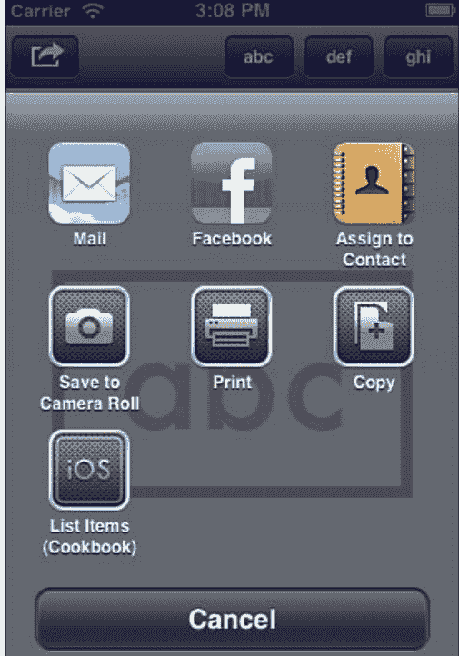

图 8-7。添加你自己的自定义应用程序活动。

- **activityImage**—返回一个供控制器使用的图像。控制器会添加一个反斜杠并将你的图像转换为单值位图，将其层叠在上方。使用在透明背景上的简单艺术设计来构建你的图标图像内容。

- **canPerformWithActivityItems**:—扫描传递的项并决定你的控制器是否可以处理它们。如果是，返回 YES。

- **prepareWithActivityItems**:存储传递的项以供稍后使用（在这里，它们被赋值给本地实例变量）并执行任何必要的预处理。

- **activityViewController**—使用之前传递给你的活动项返回一个完全初始化且可展示的视图。该控制器会自动展示给用户，他或她可以在执行承诺的操作之前对选项进行自定义定制。

添加自定义活动允许你的应用扩展其数据处理能力，同时将功能集成到一致的系统级界面中。这是一个强大的 iOS 特性。最强大的活动选择将与系统服务集成（如拷贝到剪贴板或共享到相册），或提供与离线设备 API 的连接，如 Facebook、Twitter、Dropbox 或 FTP。

这个例子简单地列出了项目，代表了我们使用的用例。没有理由认为该功能不能作为一个普通的应用内屏幕提供。当你考虑操作时，尝试将其扩展到应用之外。通过扩展超出正常图形用户界面（GUI）的共享和处理功能连接你用户的数据。

# 列表 8-1 应用程序活动

```objc
// 所有活动都展示一个视图控制器。这个自定义控制器
// 提供了一个全尺寸文本视图。
@interface UITextViewController : UI
@property (nonatomic, readonly) UITextView *textView;
@property (nonatomic, weak) UIActivity *activity;
@end
```

```objc
@implementation UITextViewController

// 确保你提供了某种形式的完成处理程序，比如这样的
// 或者一个集成的按钮来完成并结束
-(void) done {
    [_activity activityDidFinish:YES];
}

// 一个非常基础的文本视图控制器
-(id) init
{
```

```objc
if (!super = [UIView init])) return nil;
_textView.font = [UIView fontWithName:@"Futura" size:16.0];
_textView.editable = NO;
```

```objc
[self.view addSubview:textView];
PRECONSTRAINTS(_textView);
STRETCH_VIEW(self.view, textView);
```

```objc
// 准备一个完成按钮
self.navigationItem.rightBarBarButtonItem = 
BARBARBUTTON(@"Done", @selector(done));
```

```objc
return self;
}
@end
```

```objc
@interface UITextViewController : UIActivity
@end
@implementation UITextViewController

```objc

(NSString)activityType

{

return @"CustomActivityTypeListItemsAndTypes";

}

```

```objc

(NSString)activityTitle

{

return @"List Items";

}

```

```objc

(UIImage *)activityImage

{

    CGRect rect = CGRectMake(0, 0, 75, 75);

    UIGraphicsBeginContextWithOptions(rect.size, NO);

    [UIColor whiteColor setFill];

    UIIRectFill(rect);

    [UIColor blackColor setStroke];

    UIBezierPath *path = [UIBezierPath pathWithRect:CGRect(10, 10, 55, 55)];

    path.lineWidth=2;

    [path stroke];

    UIImage *image = UIGraphicsGetImageFromCurrentImage();

    UIGraphicsEndContext();

    return image;

}

```

```objc

-(BOOL)canPerformWithActivityItems:(NSArray *)items

{

// 扫描传递的项并决定你的控制器是否可以处理它们。

// 如果是，返回 YES。

return YES;

}

```

```objc

-(void)prepareWithActivityItems:(NSArray *)items

{

// 存储传递的项以供稍后使用（在这里，它们被赋值给本地

// 变量）并执行任何必要的预处理。

items = items;

}

```

```objc

-(UIViewController *)activityViewController

{

// 使用之前传递给你的活动项返回一个完全初始化

// 可展示的视图。该控制器会自动展示给用户，

// 他或她可以在执行承诺的操作之前对选项进行定制。

UITextViewController *tvc = [[UITextViewController alloc] init];

tvc.activity = self;

tvc.textView = self.view;

NSMutableString *string = [NSMutableString string];
```


```objc
for (id item in items) {
    [string stringFormat:@":%:", [item class], [item description]];
}
tvc.textView.text = string;
UINavigationController *nav = [[UINavigationController alloc] initWithRootViewController:tvc];
return nav;
}
```

# 添加服务

每个应用都可以通过子类化 `UIApplication` 类并展示自定义的视图控制器来提供应用程序特定的服务。该视图控制器允许用户以某种方式处理传递的数据。列表 8-1 引入了一个骨架活动，它显示了一个简单的文本视图。此视图列出了由活动控制器传递的项。它显示了每个项的类和描述。

此列表包含了两个不同类的详细信息。第一个类实现了一个简单的文本控制器，旨在供导航层次结构中使用。它包含一个用于显示文本的视图，以及一个在用户点击“完成（Done）”时通过发送 `activityDidFinish:` 来更新 `UIApplication` 实例的处理程序。

为你的活动添加完成机制是非常重要的，特别是当你的控制器没有自然终点时。当你的操作将数据上传到 FTP 服务器时，你知道它何时完成。如果它发推文，你知道贴文的状态。在这个例子中，由用户来决定此活动何时结束。确保你的视图控制器包含一个指向回活动的弱引用（`weak`）属性，这样你就可以在工作结束后发送 `did-finish` 方法。

活动类包含许多强制性和可选的条目。我建议实现此列表中显示的所有方法。支持自定义活动的方法包括：

- **activityType**—返回一个描述活动类型的唯一字符串。该字符串在系统提供的活动中的对等项是 `UIActivityTypePostToFacebook`。使用类似的命名方案。此字符串识别特定的活动及其功能。在这些列表中，我返回了 `CustomActivityTypeListItemsAndTypes`，它描述了该活动。
- **activityTitle**—提供你希望在活动控制器中显示的文本。图 8-7 中的自定义文本即由此方法返回的。在设计自定义操作时，使用主动性描述。遵循 Apple 的做法；例如：保存到相机卷（Save to Camera Roll）、打印（Print）、拷贝（Copy）。你的标题应该完成“我想……”（I want to...）”这个短语。例如，“我想打印”、“我想拷贝”或在本例中，“我想列出项目”。使用标题大小写（header case），除了 to 或 and 等微小词外，将每个单词的首字母大写。


图 8-7。添加你自己的自定义应用程序活动。

- **activityImage**—返回一个供控制器使用的图像。控制器会添加一个反斜杠并将你的图像转换为单值位图，将其层叠在上方。使用在透明背景上的简单艺术设计来构建你的图标图像内容。
- **canPerformWithActivityItems:**—扫描传递的项并决定你的控制器是否可以处理它们。如果是，返回 YES。
- **prepareWithActivityItems:**—存储传递的项以供稍后使用（在这里，它们被赋值给本地实例变量）并执行任何必要的预处理。
- **activityViewController**—使用之前传递给你的活动项返回一个完全初始化且可展示的视图。该控制器会自动展示给用户，他或她可以在执行承诺的操作之前对选项进行自定义定制。

添加自定义活动允许你的应用扩展其数据处理能力，同时将功能集成到一致的系统级界面中。这是一个强大的 iOS 特性。最强大的活动选择将与系统服务集成（如拷贝到剪贴板或共享到相册），或提供与离线设备 API 的连接，如 Facebook、Twitter、Dropbox 或 FTP。

这个例子简单地列出了项目，代表了我们使用的用例。没有理由认为该功能不能作为一个普通的应用内屏幕提供。当你考虑操作时，尝试将其扩展到应用之外。通过扩展超出正常图形用户界面（GUI）的共享和处理功能连接你用户的数据。

# 列表 8-1 应用程序活动

```objc
// 所有活动都展示一个视图控制器。这个自定义控制器
// 提供了一个全尺寸文本视图。

@interface UITextViewController : UI

@property (nonatomic, readonly) UITextView *textView;
@property (nonatomic, weak) UIActivity *activity;

@end
```

```objc
@implementation UITextViewController

// 确保你提供了某种形式的完成处理程序，比如这样的
// 或者一个集成的按钮来完成并结束
-(void) done {
    [_activity activityDidFinish:YES];
}

// 一个非常基础的文本视图控制器
-(id) init {
    if (!super = [UIView init])) return nil;
    _textView.font = [UIView fontWithName:@"Futura" size:16.0];
    _textView.editable = NO;
    [self.view addSubview:textView];
    PRECONSTRAINTS(_textView);
    STRETCH_VIEW(self.view, textView);
    // 准备一个完成按钮
    self.navigationItem.rightBarBarButtonItem = BARBARBUTTON(@"Done", @selector(done));
    return self;
}
@end
```

```objc
@interface UITextViewController : UIActivity
@end

@implementation UITextViewController

(NSString *)activityType {
    return @"CustomActivityTypeListItemsAndTypes";
}

(NSString *)activityTitle {
    return @"List Items";
}

(UIImage *)activityImage {
    CGRect rect = CGRectMake(0, 0, 75, 75);
    UIGraphicsBeginContextWithOptions(rect.size, NO);
    [UIColor whiteColor setFill];
    UIIRectFill(rect);
    [UIColor blackColor setStroke];
    UIBezierPath *path = [UIBezierPath pathWithRect:CGRect(10, 10, 55, 55)];
    path.lineWidth = 2;
    [path stroke];
    UIImage *image = UIGraphicsGetImageFromCurrentImage();
    UIGraphicsEndContext();
    return image;
}

-(BOOL)canPerformWithActivityItems:(NSArray *)items {
    // 扫描传递的项并决定你的控制器是否可以处理它们。
    // 如果是，返回 YES。
    return YES;
}

-(void)prepareWithActivityItems:(NSArray *)items {
    // 存储传递的项以供稍后使用（在这里，它们被赋值给本地
    // 变量）并执行任何必要的预处理。
    items = items;
}

-(UIViewController *)activityViewController {
    // 使用之前传递给你的活动项返回一个完全初始化
    // 可展示的视图。该控制器会自动展示给用户，
    // 他或她可以在执行承诺的操作之前对选项进行定制。
    UITextViewController *tvc = [[UITextViewController alloc] init];
    tvc.activity = self;
    tvc.textView = self.view;
    NSMutableString *string = [NSMutableString string];
    for (id item in items) {
        [string stringFormat:@":%:", [item class], [item description]];
    }
    tvc.textView.text = string;
    UINavigationController *nav = [[UINavigationController alloc] initWithRootViewController:tvc];
    return nav;
}
@end
```

# 项和服务

每个项提供的服务根据数据类型而异。表 8-1 按类型列出了活动。正如你从随后的食谱中看到的，预览器的支持扩展到了这些类型。iOS 提供的活动控制器可以打印和发送邮件各种文档。

# Table 8-1. Activity Types for Data Types

| Source | Offered Activity |
| --- | --- |
| `NSString` | Mail, Message, Twitter, Facebook, Weibo, Copy. |
| String, single or multiple | |
| `NSAttributedString` | Message, Facebook, Weibo. |
| Attributed string | |
| `UIImage` | Mail, Twitter, Facebook, Weibo, Assign to Contact, Save to Camera Roll, Print, Copy. |
| Image, single | |
| `UIImage` | Mail, Facebook, Assign to Contact, Save to Camera Roll, Copy. |
| Image, multiple | |
| `AVAsset` | Facebook, Weibo. |
| Audio visual media including video and sounds | |
| `UIColor` | Copy. |
| Colors | |
| `NSURL` | Mail, Message, Twitter, Facebook, Weibo, Copy. URLs using the `assets-library:` scheme can be used with Facebook and Weibo. The `mailto:` scheme is valid with Mail activities, `sms:` with Message. |
| URLs | |
| `UIPagePageRenderer`, `UIPrintFormatter`, and `UIPrintInfo` | Print. |
| `NSDictionary` | If objects are supported, the activities for these objects. Sadly, the same does not hold true for arrays, which are unsupported. |
| Dictionaries | |
| Unsupported items | For example, `NSData`, `NSArray`, `NSDate`, or `NSNumber`: Nothing, a blank view controller. |
| Various items | Union of all supported types (for example, string + image, you get Mail, Message, Twitter, Facebook, Weibo, Assign to Contact, Save to Camera Roll, Print Copy.) |

`Quick Look` 控制器为用户显示内容。集成的系统提供的活动控制器有助于共享呈现的文档，如图 8-8 所示。

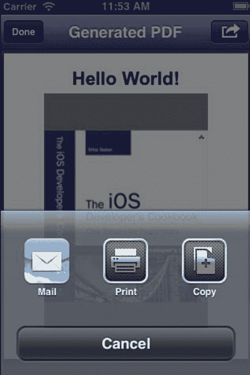

**图 8-8.** 此 `Quick Look` 控制器以模态形式呈现，显示了用户点击操作按钮后的屏幕。`Quick Look` 处理多种类型的文档，允许用户在决定执行什么操作之前查看文件内容。大多数 `Quick Look` 控制器支持邮件和打印。许多支持拷贝，图像文件甚至提供了更多选项。

通过 `push`（推送）或 `present`（呈现）你的视图控制器。控制器会适应不同的情况，与导航栈以及模态呈现配合工作。Recipe 8-11 展示了两种方法。

## 实现 Quick Look

支持 `Quick Look` 只需几个简单的步骤：

1. 在你的主类中声明 `QLPreviewControllerDataSource` 协议。
2. 实现 `numberOfPreviewItemsInViewController:` 和 `previewController:previewItemAtIndex:` 数据源方法。第一个返回要预览的项目计数。第二个返回由索引指定的预览项。
3. 预览项目必须符合 `QLPreviewItem` 协议。该协议包含两个强制属性：预览标题和项目 URL。Recipe 8-11 创建了一个简单的 `QuickItem` 类。该类实现了一种极简的方法来支持数据源。

如果满足了这些要求，你的代码就可以准备创建一个新的预览控制器，设置其数据源并进行 push 或 present。

## Recipe 8-11. Quick Look

```objc
@interface QuickItem : NSObject <QLPreviewItem>
@property (nonatomic, strong) NSString *path;
@property (readonly) NSString *previewTitle;
@property (readonly) NSURL *previewItemURL;
@end

@implementation QuickItem

// Title for preview item
- (NSString *) previewTitle {
    return @"Generated PDF";
}

// URL for preview item
- (NSURL *) previewItemURL {
    return [NSURL fileWithPath:_path];
}
@end

#define FILE_PATH \
    stringByAppendingPathComponent:@"Documents/PDFSample.pdf"

@interface TestBedViewController : UIView <QLPreviewControllerDataSource>
@end

@implementation TestBedViewController
- (NSInteger) numberOfOfPreviewItemsInPreviewController:
    (QLPreviewController *) controller {
    return 1;
}

- (id <QLPreviewItem>) previewController:
    (QLPreviewController *) controller
    previewItemAtIndex:(NSInteger) index {
    QuickItem *item = [[QuickItem alloc] init];
    item.path = FILE_PATH;
    return item;
}

// Push onto navigation stack
-(void) push {
    QLPreviewController *controller =
    [[QLPreviewController alloc] init];
    controller.dataSource = self;
    [self.navigationController
    pushViewController:controller animated:YES];
}

// Use modal presentation
-(void) present {
    QLPreviewController *controller =
    [[QLPreviewController alloc] init];
    controller.dataSource = self;
    [self presentViewController:controller
    animated:YES completion:nil];
}
@end
```


```
(void) loadView
{
    [super loadView];
    self.view.backgroundColor = [UIColor whiteColor];

    self.navigationItem.rightBarButtonItem =
    BARBUTTON("Push", @selector(push));
    self.navigationItem.leftBarButtonItem =
    BARBUTTON("Present", @selector(present));
}
@end
```

## 获取此 Recipe 的代码

要找到此 recipe 的完整示例项目，请将浏览器指向 `https://github.com/erica/iOS-6-Cookbook` 并进入第 8 章文件夹。

## 总结

本章介绍了许多现即用的控制器，你可以很好地准备并呈现它们。系统提供的控制器简化了如发推特和发送电子邮件等常见任务的编程。关于你刚刚遇到的 recipe，这里有一些最后的想法：

- 尽管你可以为这些控制器中的几个编写自己的版本，但何费此举？系统提供的控制器代表了少数情况，在这些情况下，强制执行你的设计将次于跨应用程序的用户体验一致性。当用户发送电子邮件时，她期望邮件编写界面无论使用什么应用程序，看起来都基本相同。你可以利用 Apple 系统服务来发送邮件、发推特以及与系统媒体库进行交互。

- 图像选择器已经变得有点像“弗兰肯斯坦类”（杂烩类）。它早就需要一次彻底的刷新和重新设计了。从细粒度控制源到减少其内存开销，该类需要 Apple 的关注。现在既然这么多优秀的媒体处理类已经迁移到 iOS，我希望看到它们与 `AV Foundation`、`Core Media` 以及其他关键技术的更好的集成——而不仅仅是通过一个视觉控制器。虽然保护用户隐私至关重要，但如果库能开放更灵活的 API（当然，是带有用户引导的权限），那就太好了。

- `Social` 框架可以做比发布 Facebook 更新和推特更多。该类允许你使用适当的安全机制提交经过验证和未验证的服务请求。使用 `Accounts` 框架配合 `Social` 来检索登录信息以进行凭据请求。

- 当你寻找数据文件共享的一站式解决方案时，你会发现很难找到比活动视图控制器更优的方案。这个控制器易于使用且呈现简单，完成了一军队的工作，将你的应用与 iOS 集成……

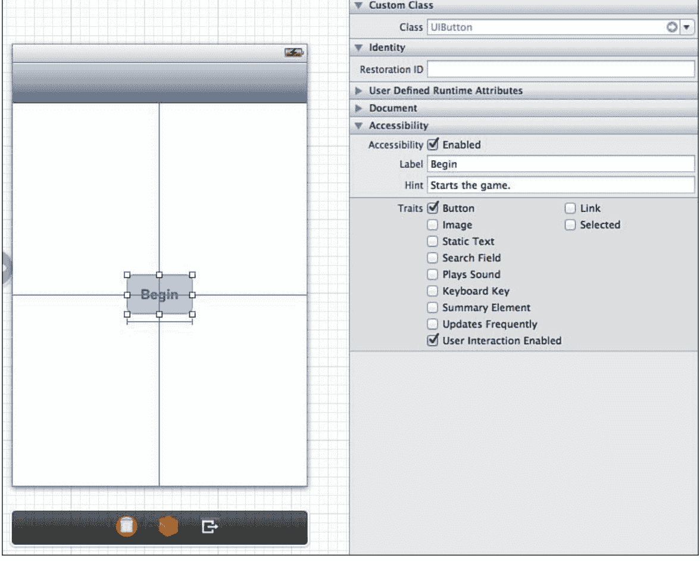

图 9-1. IB 的标识检查器（Identity Inspector）允许你指定对象的访问信息。

# 启用辅助功能

`Enabled` 复选框控制 `UIKit` 视图是否与 `VoiceOver` 工作。要声明辅助支持，将 `isAccessibilityElement` 属性赋值为 `YES`，或在 IB 中勾选 `Accessibility Enabled`。（你可以在图 9-1 中看到此选框）。此布尔属性允许 GUI 元素参与辅助功能系统。默认情况下，所有 `UIControl` 都继承 `YES` 值。根据原则，除非视图是一个子视图需要被可访问的容器，否则应启用辅助功能。仅包含处于最直接交互或展示层级的视图。组织其他视图的视图在语音朗读中没有重要作用，请排除它们。

表格视图单元格是辅助容器（即包含其他对象的对象）的一个良好示例。表格单元格的规则如下：

- 未嵌入控件的表格单元格应该是可访问的。
- 嵌入控件的表格单元格不应是可访问的。它的子控件应该是可访问的。

不可访问的容器负责报告它们包含多少个可访问子元素以及哪些视图。请参考 Apple《iPhone 辅助功能编程指南》获取更多关于为辅助功能编程容器详情。

# 特性 (Traits)

特性描述了 `UIKit` 的行为。`VoiceOver` 在描述界面时会使用这些特性。如图 9-1 所示，你可以为视图分配许多可能的特性。选择适用于所选视图的特性，记住你始终可以通过代码更新这些选择。

特性有助于向 `VoiceOver` 系统刻画界面中的元素。它们指定了元素如何行为以及应该被 `VoiceOver` 如何处理。你通过 `accessibilityTraits` 属性或对一个或多个标记进行或运算来设置它们。正如你在图 9-1 中看到的，你也可以在 IB 中设置它们。这些特性的运行方式以及 `VoiceOver` 使用它们各不相同。

在最基础的默认级别，有一个“无特性”标记：

- `UIAccessibilityTraitNone`——元素没有任何特性。
- `UIAccessibilityTraitButton`——元素是一个按钮。
- `UIAccessibilityTraitLink`——元素是一个超链接。
- `UIAccessibilityTraitSearch`——元素是一个搜索字段。
- `UIAccessibilityTraitImage`——元素是一张图片。
- `UIAccessibilityTraitKeyboardKey`——元素充当键盘键。
- `UIAccessibilityTraitStaticText`——元素是不改变的文本。

Apple 的辅助功能文档要求你在任何时候仅勾选以下互斥项目之一之一：按钮（Button）、链接（Link）、静态文本（Static Text）或搜索字段（Search Field）。如果一个按钮兼具链接功能，请选择特性或链接特性，但不要两者都选。由你选择最刻画该按钮用途方式的特性。同时，按钮在点击时可能会显示图像并播放声音，你可以自由地添加这些特性。

有几个基本的状态标记，用于讨论对象的选择状态、可调整状态和交互状态：

- `UIAccessibilityTraitSelected`——元素当前处于选中状态，例如分段控件或表格中的行。
- `UIAccessibilityTraitNotEnabled`——元素通过用户交互禁用。
- `UIAccessibilityTraitAdjustable`——元素可以设置为多个值，如滑块或选择器。你通过 `accessibilityIncrement` 和 `accessibilityDecrement` 方法指定每次交互对当前值的调整幅度。
- `UIAccessibilityTraitAllowsDirectInteraction`——用户可以触摸并与元素进行交互。

如果元素在交互时会播放声音，也有一个相应的标记：

- `UIAccessibilityTraitPlaysSound`——元素在被激活时将播放声音。

最后，有一些状态用于告警并描述元素如何行为以及如何与更广泛的世界交互：

- `UIAccessibilityTraitUpdatesFrequently`——元素变化足够频繁，至于你不希望让其状态变化增加用户的负担，例如秒表的读数。
- `UIAccessibilityTraitStartsMediaSession`——元素启动一个媒体会话。用此限制在播放或录制音频视频时 `VoiceOver` 的中断。
- `UIAccessibilityTraitSummaryElement`——应用程序启动时元素提供摘要信息，例如当前设置或状态。
- `UIAccessibilityTraitCausesPageTurn`——一旦 `VoiceOver` 完成文本朗读，该元素应自动翻页。

如图 9-1 所示，这些特性大部分（但不是全部）都可以通过 IB 标识检查器面板开启或关闭。如果你需要更细粒度的控制，请在代码中设置标记。

# 标签 (Labels)

你通过为 `accessibilityLabel` 属性赋值来设置元素的标签。一个好的标签用一个单词告诉用户该项是什么。为像按钮这样的辅助 GUI 元素标记文本。编辑（Edit）、删除（Delete）等等描述了对象的功能。它们是优秀的按钮文本和辅助标签文本。

但辅助功能不仅仅关于按钮。反馈（Feedback）、用户照片（User Photo）和用户名（User Name）可能描述文本视图、图像视图和文本标签的内容和功能。如果一个对象在你的界面中扮演视觉角色，它在 `VoiceOver` 中也应该扮演听觉角色。以下是设计标签的一些建议：

- **不要将视图类型添加到标签中。** 例如，不要使用“删除按钮（Delete button）”、“反馈文本视图（Feedback text view）”。
- **标签字母大写，但不要加句号。**
- **汇总信息。**
- **仅在最低层级进行标签。**
- **本地化。**

# 提示 (Hints)

分配 `accessibilityHint` 属性来设置元素的提示。提示告诉用户可以预期什么。特别是，它们描述了结果。例如，考虑一个界面，点击姓名（例如 John Smith）会尝试拨打该个人。以下是构建更好提示的建议：

- **使用描述元素行为的动词，而不是描述用户做什么。**
- **避免描述动作本身。**
- **详细描述。**
- **使用句子格式。**
- **本地化。**

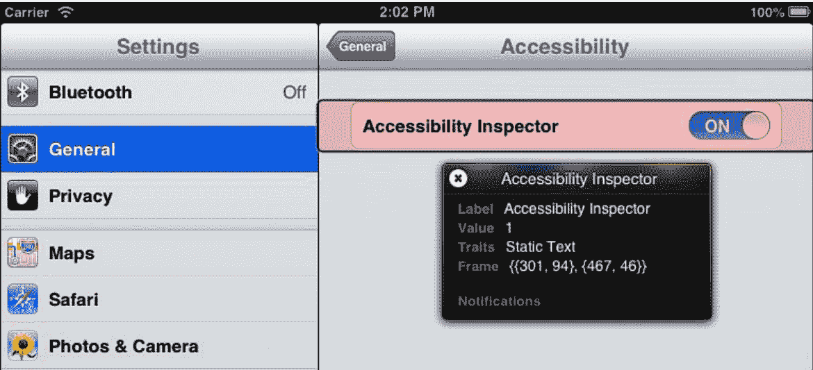

**图 9-2. iPhone 模拟器的辅助检查器（Accessibility Inspector）高亮当前选中的 GUI 特性，显示其标签、提示和其他辅助功能属性。**

了解如何启用和禁用检查器：检查器左上角的圆圈 X 控制该行为。点击一次可将检查器缩小为禁用的单行。再次点击，可将检查器恢复到激活模式。在大多数情况下，在实际需要检查 GUI 项目之前，请保持检查器禁用状态。[图 9-3] 显示了辅助检查器中描述的按钮界面。

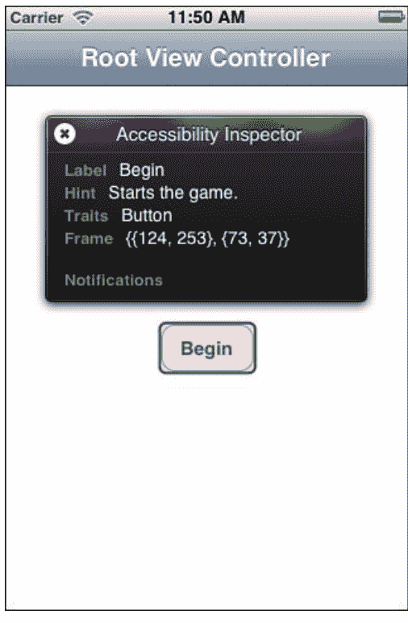

与 `VoiceOver` 一样，检查器会干扰应用程序的手势。它会减慢你的工作，因此请节节使用（通常在你准备好测试时使用）。你希望在禁用但可用的状态下启动应用程序。导航到你想操作的屏幕，然后启用检查器。当你在代码中更新辅助提示时，检查器会实时更新以匹配这些更改。激活检查器允许你在这些更改发生时查看当前提示，确保屏幕上的提示和标签反映了最新的界面。

# 广播更新

你的应用程序应该发布通知，让 `VoiceOver` 辅助系统知道直接用户交互之外的屏幕元素发生变化：

- 当你添加或移除 GUI 元素时。`UIAccessibilityLayoutChangedNotification` 会通知 `VoiceOver` 系统这些更改。
- 应用程序可以在完成滚动操作后发布 `UIAccessibilityPageScrolledNotification`。通知对象应包含新滚动位置的描述（例如，“第 17 页的第 5 页”或“第 4 页的第 2 页”）。
- 当缩放帧发生变化时，发送 `UIAccessibilityZoomChanged` 通知。包含一个带有 type、frame 和 view 参数的用户字典。这些参数指定了已发生的缩放类型、当前缩放帧（在屏幕坐标系中）以及包含该缩放帧的视图。

除了这些更改更新外，你还可以通过辅助功能 `VoiceOver` 系统广播通用公告。`UIAccessibilityAnnouncementNotification` 接受一个参数，即包含公告内容的字符串。使用它在 GUI 发生变化、仅在屏幕上短暂出现的变化或不直接影响用户界面的变化时通知用户。

# 在 iPhone 上测试辅助功能

在 iPhone 上进行测试允许你使用真实的 `VoiceOver` 工具，而不是基于窗口的检查器。你将听到用户会听到的声音，并用手指和耳朵而不是眼睛来测试你的 GUI。

像模拟器一样，iPhone 提供了一种即时启用和禁用 `VoiceOver` 的方法。虽然你可以在“设置”中开启 `VoiceOver` 并在其运行的情况下测试应用程序，但你会发现使用特殊的切换开关要方便得多。该开关可以让你避免使用 `VoiceOver` 手势从“设置”导航到你的应用程序的麻烦。你可以关闭 `VoiceOver`，使用普通的 iPhone 交互启动应用程序，然后在准备好测试时重新开启 `VoiceOver`。

要启用切换开关，请遵循以下步骤：

1. 进入辅助功能设置面板。导航至“设置 > 通用用 > 辅助功能”。
2. 找到“三击 Home 键”。三击 Home 键为辅助功能选择提供了一个可设置的快捷键。轻点“三击 Home 键”打开主屏幕面板。
3. 选择“切换 VoiceOver”。选择“切换 VoiceOver”将其设置为你的三击操作。一旦选中（右侧会出现勾选），你就可以通过三击 iPhone 底部的物理 Home 键来启用和禁用 `VoiceOver`。语音提示会确认当前的 `VoiceOver` 设置。

此 `VoiceOver` 切换功能让你能够跳过许多涉及三指拖动和多阶段按钮点击导航到应用程序的繁琐细节。同时，你应该熟练 `VoiceOver` 手势和交互。表 9-1 总结了你测试应用程序时需要了解的 `VoiceOver` 手势。

# 表 9-1. 应用程序常用 VoiceOver 手势

| 任务 | VoiceOver 等效操作 |
|---|---|
| 切换 VoiceOver | 三击物理 Home 键。 |
| 切换屏幕遮罩 (ScreenCurtain) | 在屏幕上连续轻点三次（即用三指轻点三次）。 |
| 切换 VoiceOver 语音 | 通过在屏幕上连续轻点两次（即用三指轻点两次）来完全切换 `VoiceOver` 语音（而不只是针对单个描述）。这两个选项都不会禁用音频播放的停止和恢复。 |
| 停止朗读当前项目 | 在屏幕上连续轻点两次（即用两指轻点两次）。再次双击以恢复描述。在主屏幕上，当 `VoiceOver` 未激活时，此手势会停止和恢复音频播放。 |
| 点击按钮 | 方法 1：用单指按住按钮。用另一只手指轻点屏幕。\n方法 2：轻点按钮以选择它。在屏幕上双击以激活按钮。 |
| 滚动文本视图 | 方法 1：用单指按住文本视图。用第二只手指滚动到文本滚动器的顶部或底部。\n方法 2：轻点文本视图以选择它。在屏幕上双击以滚动到文本滚动器的顶部或底部。 |
| 调整插入点 | 选中缩放帧后，向上或向下滑动。这将在字符移动和单词移动之间进行选择。（该手势正式称为“转盘 rotor”，应通过双指拖动执行。） |
| 访问语音菜单 | 轻点并按文本视图。向左或向右滑动。这使用了转盘。 |
| 选择文本 | 方法 1：用单指按住按钮。用另一只手指轻点屏幕。\n方法 2：轻点按钮以选择它。在屏幕上双击以激活按钮。 |
| 移动滑块 | 选择滑块并用单指向上或向下滑动以调整滑块值。 |
| 滚动列表 | 用三指向上或向下滑动。 |
| 翻页主页 | 用三指向左或向右滑动。 |
| 选择并朗读项目 | 轻点该项目。 |
| 逐字符或单词拼读项目 | 用单指向上或向下滑动。这使用了转盘。 |
| 读下一个或上一个项目 | 用单指向左或向右滑动。 |
| 读取整个屏幕 | 双指向上滑动。这的效果并不十分稳定。或者，可以使用以下方法：反复滑动到屏幕上的第一个项目。然后，双指下滑。 |
| 解锁 iPhone | 选择滑块。双击屏幕。特别注意屏幕遮罩 (ScreenCurtain)，它可以让你的 iPhone 屏幕变为空，为基于音频的界面提供真正的测试。在启用屏幕遮罩的情况下尝试 iPhone 计算器应用程序，以真实感受无视使用 iPhone 应用程序的挑战。 |

# 10. 创建与管理表格视图

表格提供了一种基于列表的滚动交互类，特别适用于小型 GUI 元素。许多 iPhone 和 iPod touch 预装的应用程序都以表格导航为中心，包括联系人（Contacts）、设置（Settings）和音乐（iPod）。在这些尺寸较小的 iOS 设备上，有限的屏幕尺寸使得表格凭借其滚动和单个项目选择功能，成为以简单、易于操作的形式传递信息和内容的理想方式。在较大的 iPad 上，表格与详细演示集成在一起，在分屏视图控制器（split view controllers）中发挥着重要作用。在本章中，你将发现 iOS 表格是如何运作的，作为开发者可以使用哪些类型的表格，以及你如何在自己的程序中使用表格功能。

## iOS 表格

标准的 iOS 表格由由单个单元格组成的简单垂直滚动列表组成。用户可以向上向下滚动或滑动，直到找到他们想要交互的项。在 iOS 上，表格无处不在的。几个内置的 iOS 应用完全基于表格视图，并且它们构成了许多第三方应用程序的核心。你在 iOS 中会看到的几乎所有表格都是使用 `UITableView` 构建的，并通过其提供的代理（delegate）和数据源（data source）协议进行自定义。除了提供最通用的表格实现的标准单元格滚动列表外，你还可以创建具有自定义艺术设计、背景、标签等的特殊表格。

特殊表格包括你在“偏好设置”（Preferences）应用程序中看到的表格，它们具有蓝灰色的背景和圆角的单元格边缘；带有分段和索引的表格，例如“联系人”应用程序中使用的表格；以及相关的轮轴表格类，例如用于设置预约日期和闹钟的表格。当你需要超越表格及其滚动列表，转向更像网格的展示时，可以使用相关的集合视图（collection views）类，它们将在第 11 节中介绍。

无论你使用哪种类型的表格，它们的工作方式都是大一样的。表格是围绕模型-视图-控制器（MVC）范式构建的。它们展示来自数据源的单元格，并通过调用定义良好的代理方法来响应用户交互。

数据源为类提供有关表格内容的按需信息。它代表了底层数据模型，并在该模型与表格视图之间进行调解。数据源告诉表格其结构。例如，它指定了要使用多少个分段以及每个分段包含多少个项目。数据源按需提供单个表格单元格，并用模型数据填充这些单元格，数据与每个单元格在表格中的位置和所有权匹配。

数据源表达表格的模型；代理充当控制器。代理管理用户交互，让应用程序响应表格选择的变化和用户引导的编辑。例如，用户可能会点击一个新的单元格来选择它，将一个单元格重新排序到新位置，或添加或删除单元格。代理监控这些用户交互请求，并通过允许或拒绝这些请求来做出反应，并在操作成功后更新数据模型。

视图、数据源和代理共同工作，以表达这种 MVC 开发模式。这种模式不仅限于视图。你在许多关键的 iOS 类中都看到了这种视图/数据源/代理方法。选择器视图（Picker views）、集合视图（collection views）和页视图控制器（page view controllers）都使用了数据源和代理。

## 代理

表格视图数据源和代理是代理（delegation）的示例，将特定活动和信息的责任分配给辅助对象。`UIKit` 类使用代理来响应用户交互并提供内容。例如，当你设置表格的代理时，你告诉它传递任何交互消息并让代理对这些消息负责。


表格视图是代理模式的一个很好的例子。当用户点击表格行时，`UITableView` 实例没有内置方式来响应该点击。该类是通用的，它没有为任务提供原生语义。相反，它会咨询它的代理（通常是控制器）并传递选择的变化。你在 Apple 创建表格类之后完全不同的时间点为该点击添加了意义。代理机制允许类在不具有特定含义的情况下被创建，同时确保在稍后的时间添加特定于应用程序的句处理程序。

`UITableView` 的方法 `tableViewSelectRowAtIndexPath` 提供了一个典型的代理示例。代理对象定义了此方法并指定了应用程序应如何响应由用户引起的变化。你可能会显示一个菜单、导航到子视图或在被点击的行上放置勾选标记。响应完全取决于你如何实现被代理的选取变化方法。在实现表格类时，这些内容完全是未知的。

要设置对象的代理或数据源，请为其分配其 `delegate` 或 `dataSource` 属性。这指示你的应用程序将交互回调重定向到分配的对象。你通过该对象在类声明中实现的协议（或多个协议）让 Objective-C 知道你的对象实现了代理调用。此声明出现在角括号中，位于类继承的右侧（例如，`<UITableViewDelegate>` 或 `<UITableViewDataSource>`）。在声明多个协议时，在一组角括号内用逗号将它们分开（例如，`<UITableViewDelegate, UITableViewDataSource>`）。声明协议的类负责实现与该协议相关的所有强制方法，也可以实现任何可选方法。

## 创建表格

iOS 包含两个主要的表格类：一个预构建的控制器类（`UITableViewController`）和一个直接视图（`UITableView`）。控制器提供了一个为表格自定义的视图子类。它包含一个已建立的表格视图，占据整个控制器视图，并消除了处理表格实例所需的重复性任务。具体而言，它声明了所有必要的协议，并将自己定义为其表格的代理和数据源。在控制器类之外使用表格视图时，你需要手动执行这些任务。表格视图控制器会为你处理好这些任务。

## 表格样式

在 iPhone 上，表格有两种格式：分组表格（grouped tables）和普通表格列表（plain table lists）。iOS 的“设置”（Settings）应用程序使用了分组样式。

## 布局视图

`UITableView` 实例顾如其名，是提供滚动能力的视图。`UITableView` 类继承自 `UIScrollView`。`UITableViewControllers` 会为你处理布局工作。

## 分配数据源

表格的 `dataSource` 属性设置一个对象作为表格单元格的源。该对象必须实现 `UITableViewDataSource` 协议。

## 提供单元格

表格的数据源通过实现 `tableView:cellForRowAtIndexPath:` 方法为表格填充单元格。每当调用表格的 `reloadData` 方法时，表格都会查询其数据源以加载屏幕上的单元格。

## 注册单元格类

你会在创建表格的早期注册任何你使用的单元格类型。

注册（Registration）允许单元格队列方法自动为你创建新单元格。通常，你会在 `load` 或 `viewDidLoad` 方法中注册单元格。确保该注册在你第一次尝试加载其数据之前完成。每个表格视图（table view）都会注册自己的类型。你提供一个任意字符串标识符，并在注册新单元格时将其作为键使用。

你可以通过类（从 iOS 6 开始）或通过 nib（iOS 5 及更高版本）进行注册。以下是这两种方法的示例：

根据需要注册任意数量的单元格。你不限于一种类型的表格。可以根据设计需求在表格内混合使用单元格。

## 队列单元格 (Dequeue Cells)

你的数据源通过代码构建单元格来响应单元格请求，也可以从 Interface Builder 源加载单元格。这是一个简单的数据源方法，它在请求的索引处返回一个单元格，并使用源自数据模型的文本对其标记：

```objectivec
- (UITableView *) tableView:(UITableView*)tableView
  cellForRowAtIndexPath:(NSIndexPath*)indexPath
  {
    UITableView *cell = [self.tableView
      dequeueReusableCellWithIdentifier:@"cell"
      indexPath:indexPath];
    cell.label.text = [dataModel objectForKeyPath:indexPath].text;
    return cell;
  }
```

如果你是经验丰富的 iOS 开发者，请注意你不再需要检查队列是否已经存在你请求的类型的单元格。队列现在会根据需要透明地创建并初始化新实例。

使用队列机制来请求单元格。当单元格滚出视图范围时，表格会将它们缓存到队列中以备复用。该机制会返回队列中存储的任何可用表格单元格；当队列枯竭时，它会创建并返回新实例。

注册单元格以便复用为每个实例提供了一个标识符标记。表格根据需要搜索类型并从队列中弹出它们。这节省了内存，并在用户快速滚动浏览表格时，提供了一种快速、高效的方式来提供单元格。

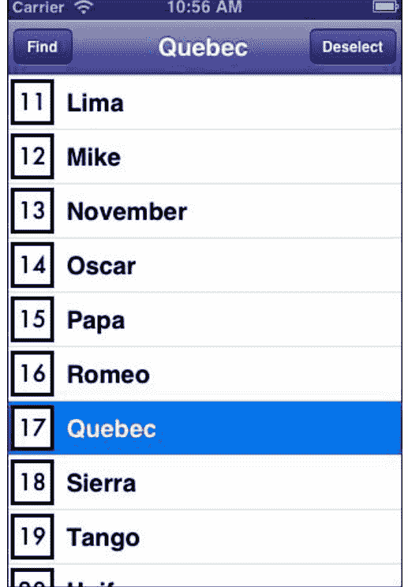

# 图 10-1。此表格视图是由食谱 10-1 构建的。

用户可以点击单元格。当点击时，控制器的视图会更新以匹配所选项目。一个取消（DSelect）按钮告诉表格移除当前选择并重置标题；一个查找（Find）按钮将选择移动到视图中，即使它已经滚出屏幕。

此实现尝试在空间允许的情况下将“找到”的选中项滚动到顶部（`UITableViewScrollPositionTop`）。Zulu 是此表格中的最后一项，它无法比视图底部更高，因为在它的单元格之后表格就没有更多内容了。

## 数据源方法 (Data Source Methods)

要显示表格（即使是像食谱 10-1 这样简单的扁坦列表），每个数据源都要实现三个核心实例方法。这些方法定义了表格的结构并为表格提供内容：

- `numberOfSectionsInTableView`——表格可以分节或作为单个列表显示其数据。对于扁坦表格，返回 1。这表示整个表格应该作为单个列表呈现。对于分节列表，返回 2 或更大的值。

- `tableView:numberOfRowsInSection`——食谱 10-1 的扁坦列表返回每个节的行数。对于更复杂的列表，你希望提供一种报告每个节的方法。Core Data 提供了特殊的分节表格集成，你将在第 12 章“Core Data 简介”中读到。与 iOS 中的所有计数一样，节的顺序从第一个节 0 开始。

- `tableView:cellForRowAtIndexPath`——此方法向调用的表格返回一个单元格。使用索引的行和节属性来确定提供哪个单元格，并确保尽可能利用可复用单元格以最小化内存开销。

## 响应用户触摸 (Responding to User Touches)

食谱 10-1 在 `tableView:didSelectRowAtIndexPath` 代理方法中响应用户。该食谱的实现更新了视图控制器的标题，并启用了搜索和取消栏。只要有有效的选择，这些按钮就会保持启用状态。如果用户选择取消选项，此代码将调用 `deselectRowAtIndexPath:animated:` 并禁用两个按钮。

> **注意**
>
> 当你想让表格忽略触摸时，将单元格的 `selectionStyle` 属性设置为 `UITableViewSelectionStyleNone`。这将禁用显示被选中单元格的蓝色或灰色覆盖层。单元格仍被选中，但在选择时不会以任何方式高亮。如果选择你的单元格产生了显示信息之外的副作用，那么这不是处理此类问题的最佳方法。

## 示例 10-1. 构建基础表格

```objectivec
@implementation TestBedViewController

// 节的数量
(NSInteger) numberOfSectionsInTableView:(UITableView *)tableView
{
    return 1;
}

// 每节的数
(NSInteger) tableView:(UITableView *)tableView
    numberOfRowsInSection:(NSInteger)section
{
    return items.count;
}

// 为索引路径返回单元格
(UITableViewCell *) tableView:(UITableView *)tableView
    cellForRowAtIndexPath:(NSIndexPath *)indexPath
{
    UITableViewCell *cell = [self.tableView
        dequeueCellWithIdentifier:@""
        indexPath:indexPath];

    // 单元格标签
    cell.textLabel.text = [items objectAtIndexAt:indexPath.row];

    // 单元格图像
    NSString *indexString = [NSString stringWithFormat:"%02d", indexPath.row];
    cell.imageView.image = stringImage(indexString, imageFont, 6.0f);

    return cell;
}

// 在选择时，更新标题并启用查找/取消
(void) tableView:(UITableView *)tableView
    didSelectRowAtIndexPath:(NSIndexPath *)indexPath
{
    UITableViewCell *cell = [self.tableView
        dequeueCellWithIdentifier:@"cell"
        indexPath:indexPath];
    cell.label.text = [dataModel objectForKeyPath:indexPath].text;
    return cell;
}

// 取消当前选择
(void) deselect
{
    NSArray *paths = [self.tableView indexPathForSelectedRows];
    if (!paths.count) return;

    NSIndexPath *path = paths[0];
    [self.tableView deselectAt:path animated:YES];
    self.title = nil;
}

// 移动到选择
(void) find
{
    [self.tableView scrollToNearestRowAtPosition:UITableViewScrollPositionTop animated:YES];
}

// 设置表格
(void) loadView
{
    [super loadView];

    self.navigationItem.rightBarButtonItem = BUTTON(@"deselect", @selector(deselect));
    self.navigationItem.leftBarButtonItem = BUTTON(@"find", @selector(find));
    self.navigationItem.rightBarButtonItem.enabled = NO;
    self.navigationItem.leftBarButtonItem.enabled = NO;

    imageFont = [UIFont fontName:"Futura" size:18.0];
}

[self.tableView registerClass:[UITableViewCell class]
  forCellReuseIdentifier:@"cell"];
items = [@"Alpha Bravo Charlie Delchie Echo Foxtrot Hotel India Juliet Kilo November Oscar Quebec Sierra Tango Uniform Xray Zulu"
componentsSeparatedByString:@" "];
```

图 10-2。Cocoa Touch 四种标准的单元格类型，其中几种支持可选图像。

## 选择颜色

表格允许你通过在蓝色或灰色之间选择设置选中单元格的颜色。将 `selectionStyle` 属性设置为 `UITableViewSelectionStyleBlue` 或 `UITableViewSelectionStyleGray`。如果你不想显示选中效果，可以使用 `UITableViewSelectionStyleNone`。单元格仍然可以被选中，但不会显示覆盖颜色。

## 添加自定义选择特征

当用户选择单元格时，Cocoa Touch 会帮助你突出显示该单元格。通过更新单元格的特征（traits），使其与其他单元格脱颖而出。有两种方法可以。

`selectedView` 属性允许你仅为选中的单元格添加控件和其他视图。其工作方式与键盘显示时出现的辅助视图（accessory views）类似。你可能会使用选中背景视图为选中的单元格添加预览按钮或购买选项。

单元格标签的 `highlightedTextColor` 属性允许你在单元格被选中时选择另一种文本颜色。

## 食谱：创建带勾选的表格单元格

辅助视图（Accessory views）扩展了 `UITableView` 的功能。勾选标记创建了交互式的“多选一”或“多选多”选择，如图 10-3 所示。通过此类选择，你可以要求用户挑选晚餐想吃什么，或者选择他们想要更新哪些项目。

# 3 已勾选

Alpha

Bravo ✓

Charlie ✓

Delta

Echo

Foxtrot ✓

Golf

Hotel

India

Juliet

Kilo

# 图 10-3。勾选辅助视图提供了从列表中进行多选一或多选多的便利方式。

要勾选某个项目，请使用 `UITableViewCellCellAccessoryCheckmark` 辅助类型。未勾选的项目使用 `UITableViewCellCellAccessoryNone` 变体。通过分配单元格的 `accessoryType` 属性来设置这些。

单元格本身没有任何“记忆”。它们不知道应用程序上次如何使用它们。它们仅仅是视图。这意味着如果你在复用单元格时不将这些单元格绑定到某种数据模型，可能会导致意外和无意产生的结果。这是 MVC 设计范式的自然结果。

考虑以下场景。假设你创建了一系列单元格，每个单元格都有一个切换开关。用户与开关交互并更改其值。因此，一个单元格在滚动出屏幕并进入复用队列后，可能会为一个尚未触碰的表格元素显示已切换的状态。

要解决这个问题，请务始终根据存储的模型检查你的单元格状态，并在 `cellForRowAtIndexPath::` 中完全配置你的单元格。这保持了视图与你的应用程序语义的一致，并避免了单元格上次使用时残留的“脏”状态。复用的单元格在下次使用时可能保持勾选或未勾选，因此你始终设置辅助项以匹配模型状态，而不是单元格状态。

食谱 10-2 构建了一个简单的状态字典来存储每个索引路径的开启/关闭状态。你可以轻松扩展此食谱，将其状态存储到默认值中，以便在运行之间持久化。这个易于添加的增强留给读者作为练习。

# 食谱 10-2 辅助视图与存储状态

```objectivec
// 为索引路径返回单元格
- (UITableView *)tableView:(UITableView *)tableView
cellForRowAtIndexPath:(NSIndexPath *)indexPath
{
  UITableView *cell = [self.tableView
    dequeueReusableCellWithIdentifier:"@cell"
    forIndexPath:indexPath];
}
```

```objectivec
// 单元格标签
cell.textLabel.text = [items objectAtIndex:indexPath.row];
BOOL isChecked = ((NSNumber *)dictionary[indexPath.indexPath]).boolValue;
cell.accessoryType = isChecked ?
    UITableViewCellAccessoryCheckmark :
    UITableViewCellAccessoryNone;
```


```
return cell;
}

// 在选中时，更新标题
(void)tableView:(UITableView *)tableView didSelectRowAtPath:(NSIndexPath *)indexPath indexPath {
    UITableViewCell *cell =
        [self.tableView cellForRowAtIndexPath:indexPath];

    // 切换勾选状态
    BOOL isChecked =
        !((NSNumber *)stateDictionary[indexPath]).boolValue;
    stateDictionary[indexPath] = @(isChecked);
    cell.accessoryType = isChecked ? UITableViewCellAccessoryCheckmark : UITableViewCellAccessoryNone;

    // 计数勾选项目
    int numChecked = 0;
    for (int row = 0; row < items.count; row++) {
        NSIndexPath *path = indexPath(0, row);
        isChecked = ((NSNumber *)stateDictionary[path]).boolValue;
        if (isChecked) numChecked++;
    }

    self.title = [[[@(numChecked)].stringValue, @" Checked"] componentsJoinedString:@" "];
}
```

## 获取此食谱的代码

要找到此食谱的完整示例项目，请将浏览器指向 https://github.com/erica/iOS-6-Cookbook 并进入第 10 章文件夹。

# 使用披露辅助项（Disclosure Accessories）

披露项（Disclosures）是指表格单元格右侧的小型蓝色或灰色向右箭头。披露项帮助你从单元格链接到支持该单元格的视图。在 iPhone 和 iPod touch 的联系人和日历应用程序中，这些箭头连接到帮助你自定义联系人信息和设置预约的屏幕。图 10-4 显示了一个表格视图示例，每个单元格都显示一个披露控件，展示了两种可用类型。


**图 10-4。** 向右箭头表示披露控件，允许你进入另一个视图。

在 iPad 上，你应该考虑使用分割视图而非辅助项。更大的空间允许你展示蓝色和灰色的箭头：

你可以在“设置”中看到这两个辅助项。在 Wi-Fi 网络屏幕中，披露项指向特定的 Wi-Fi 网络：IP 地址、子网掩码、路由器、域名系统 (DNS) 等。披露项允许你通过向上滚动添加新网络。

灰色披露项使用不同的方法。因为这些辅助项不是按钮，它们响应于单元格选择而非辅助按钮点击。在 `tableView:didSelectRow:` 中添加你的逻辑，将披露视图推入导航堆栈，或通过弹出模态视图控制器或警报视图。

哪种披露项都不会改变单元格其余的工作方式。即使有辅助项，你也可以选择单元格、编辑单元格等。辅助项增加了额外的交互模式；它们不会替换你已有的功能。

蓝色的 DisclosureButton 版本是真实的按钮。

遗憾的是，Apple 自身使用这些方式并不一致。在 Wi-Fi 设置中，“其他”选项的披露项会打开一个输入信息的详细设置模态。新网络会出现它自己的披露项。

以下代码片段将每个单元格的 `accessoryType` 设置为 `UITableViewCellButton`。更重要的是，它还将 `editingAccessType` 设置为 `UITableViewAccessNone`。当删除或录制控件出现时，你的披露箭头将隐藏，让你的用户完全控制他们的编辑：

```
(UITableViewCell*)view:(UITableView*)tableView
forRowAtIndexPath:(NSIndexPath*)indexPath
{
  UITableViewCell *cell =
    [tableView dequeueReusableCellWithIdentifier:@"CustomCell"];
  cell.accessoryType = UITableViewCellAccessDisclosureButton;
  cell.editingAccessType = UITableViewCellAccessNone;

  return cell;
}
```

```
// 响应辅助按钮点击
-(void)view:(UITableView*)tableView
ccessoryButtonTappedForRowAtIndexPath:(NSIndexPath*)indexPath
```

在处理子菜单时，请坚持使用灰色箭头。法则是：子菜单使用灰色箭头，而对象自定义使用蓝色箭头。

通过添加编辑功能让你的表格焕发生机。表格编辑将静态信息转换为交互式滚动控件，引导用户添加和删除数据。虽然处理表格编辑的簿记工作相当复杂，但相同的技术可以很容易从一个应用转移到另一个应用。为了撤销（undo），你可以反复使用这些项目。一旦你掌握了进入和退出编辑模式的基本元素，食谱 10-3 将引入了一个对表格编辑做出有意义的响应的表格。此示例创建了一个随机图像的滚动列表。用户通过点击“Add”创建新单元格，并可以通过滑动或进入编辑模式（点击“Edit”）并使用红色删除控件来移除单元格（图 10-5）。

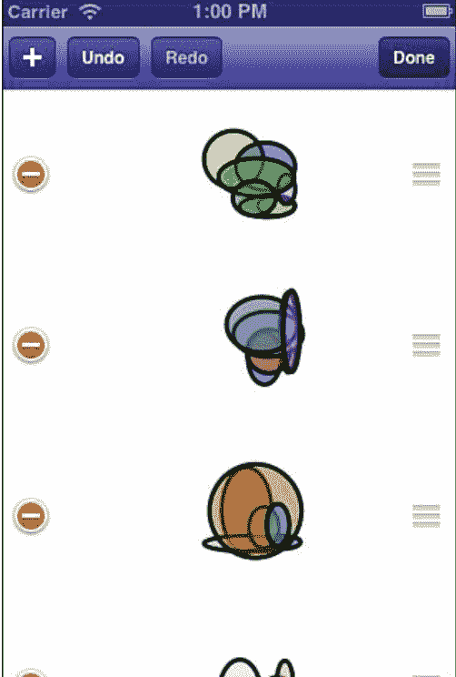

图 10-5。红色删除控件允许你的用户交互式地删除表格中的项目。

在日常使用中，每个 iOS 用户都能很快熟悉删除表格单元格的小红圆圈。许多用户还学会了基本的滑动删除功能。本食谱还添加了移动控制控件（三条细灰色水平线），允许用户将项目拖到新位置。用户通过点击“Done”退出编辑模式。

# 添加撤销支持

管理器可以存储任意数量的撤销操作。你可能希望指定该栈的深度有多深。栈越大，占用的内存就越多。当内存紧张时，许多应用程序允许三级、五级或十级的撤销。每个操作可能是复杂的，涉及一组撤销活动，而操作也可以像本食谱所示的示例一样简单。

本食谱使用撤销管理器（undo manager）来支持用户对添加、删除和移动单元格的撤销和重做（redo）操作。这些撤销和重做选项允许用户在他们的编辑历史中移动。在本食谱中，当撤销管理器提供支持你使用的操作时，这些按钮就会被启用。

# 支持撤销

食谱 10-3 中的添加和删除项目都由同一个方法 `updateAtIndexPath:withObject:` 处理。该方法的工作原理如下：它在索引路径处插入任何非空对象。当传递的对象为 nil 时，它会删除索引路径上的项目。

这看起来像是一个处理请求的奇特方法，因为涉及额外的方法和额外的步骤，但其有内在的。这种方法为撤销支持提供了一个统一的基础，允许与撤销管理器进行简单集成。因此，该方法有两个任务要执行。首先，它准备一个撤销调用。然后，它告诉撤销管理器如何反转它即将应用的编辑。其次，它应用实际的编辑，对项目数组进行更改并更新表格和按钮。

`setBarButtonItemItems` 方法控制撤销和重做按钮的状态。该方法检查激活的撤销管理器，查看撤销栈是否提供了撤销和重做操作。如果是，它将启用相应的按钮。

尽管我不喜欢摇一撤销（shake-to-undo），但本食谱确实支持它。`loadView` 方法设置了应用程序代理的 `applicationSupportsToEdit` 属性。还要注意添加第一响应者（first responder）调用是为了提供撤销支持。表格视图在出现时成为第一响应者，并在消失时放弃响应。

# 显示删除控件

iOS 软件开发包（SDK）通过单个调用即可显示基于表格的删除控件：`[self.tableView setEditing:YES animated:YES]`。这会更新表格的编辑属性，并防止图 10-5 所示的删除控件在每个单元显示。`animated` 参数是可选的但建议使用。按照原则，iOS 界面中的动画引导用户从一个状态过渡到另一个状态，以便他们为屏幕上发生的模式变化做好准备。

食谱 10-3 使用系统提供的编辑/完成按钮（`self.editButtonItem`）并实现 `setEditing:animated:` 来将表格进入和退出编辑状态。当用户点击“Edit”或“Done”按钮（它来回切换）时，该方法会更新编辑状态和导航栏按钮。

# 处理删除请求

在删除时，表格通过发布 `tableView:commit:EditingStyle:forRowAtIndexPath:` 回调与你的应用程序通信。表格删除会将项目从视觉表格中移除，但不会更改被删除的数据。除非你从数据源中管理项目的移除，否则“被删除”的项目将在下次表格刷新时重新出现。该方法为你提供了与数据源协调并响应你刚刚执行删除的地方。

从提供数据源方法的数据结构（在本食谱中，通过图像项目的 `NSMutableArray`）中删除项目，并处理任何由于用户编辑而导致的真实世界操作，如删除文件、移除联系人等。

食谱 10-3 对单元格删除进行了动画处理。`beginUpdates` 和 `endUpdates` 方法对允许表格操作（如添加和删除行）进行同步动画。

# 滑动单元格

滑动为从 `UITableView` 实例移除项目提供了一种简洁的方法。要启用滑动，只需提供 `commitEditingStyle` 方法即可。表格会处理其余部分。

要滑动，用户从单元格的一侧快速拖到另一侧。矩形删除确认出现在单元格右侧，但单元格不会在左侧显示圆形删除控件。

用户滑动并确认后，`tableView:commitEditingStyle:forRowIndexPath` 方法应用数据更新，就像删除发生在编辑模式一样。

# 重新排序单元格

当你允许用户直接重新排列表格单元格时，你就赋予了他们能力。

像滑动删除一样，单元格重排序取决于单个方法的存在。`tableView:moveRow:toIndexPath:` 方法将你的数据源与屏幕变化同步。

# 添加单元格

食谱 10-3 使用“Add”按钮创建新内容。该按钮的形式为加号。食谱 10-3 中的添加方法将随机图像追加到 `items` 数组的末尾。

(void) updateItemAtIndexPath: (NSPath *) indexPath withObject:

(id) object

```
// Prepare for undo
undoObject = object ? nil : [items objectAtIndex:indexPath.row];
[[self.undoManager prepareWithInvocationTarget:self]
updateItemAtIndexPath:indexPath withObject:undoObject];
```

```
// 你不能插入 nil 对象。传递 nil 则表示一个删除请求
[self.tableView beginUpdates];
if (!object)
{
    [items removeObjectAtIndex:indexPath.row];
    [self.tableView deleteRowsAtIndexPaths:@indexPath]
           withAnimation:UITableViewRowAnimationTop];
}
```

```
else
{
    [items insertObject:object atIndex:indexPath.row];
    [self.tableView insertRowsAtIndexPaths:@indexPath]
           withAnimation:UITableViewRowAnimationTop];
}
[self.tableView endUpdates];
```

```
[self performSelector:@selector(setBarButtonItems)
withObject:nil afterDelay:0.1f];
```

(void) addItem: (id) sender

```
// add a new item
NSIndexPath *newPath =
[NSIndexPath indexPathForRows:items.count inSection:0];
UIImage *image = blockImage(IMAGE_SIZE);
[self updateItemAtIndexPath:newPath withObject:image];
```

(void) tableView:(UITableView *)tableView commitEditingStyle:(UITableViewCellEditingStyle)editingStyle

forRowAtIndexPath:(NSIndexPath *)indexPath

```
// delete item
[self updateItemAtIndexPath:indexPathPath withObject:nil];
```

提供重排序支持

-(void) tableView:(UITableView *)tableView

```
moveRowAtPath:(NSIndexPath*) oldPath
toIndexPath:(NSIndexPath*) newPath
```

```
{
    if (oldPath.row == newPath.row) return;
```

```
[[self.undoManager prepareInvocationTarget:self
tableView.tableView moveRowAtPath:oldPath
toIndexPath:newPath];
```

```
id item = [items objectAtIndex:oldPath.row];
[items removeAtIndex:oldPath.row];
[items insertObject:item at:newPath.row];
```

```
if (self.undoManager.isUndoing || self.undoManager.isRedoing)
{
```

```
[self.tableView beginUpdates];
[self.tableView deleteRowsAtPaths:@[oldPath]
withRowAnimation:UITableViewRowAnimationLeft];
[self.tableView insertRowsAtPaths:@[newPath]
withRowAnimation:UITableViewRowAnimationLeft];
[self.tableView endUpdates];
```

```
[self performSelector:@setBarButtonItems
withObject:nil afterDelay:0.1f];
```

#pragma mark 用于撤销支持的第一响应者

-(BOOL)canBecomeFirstResponder

```
{
    return YES;
}
```

```
(void)viewDidAppear:(BOOL) animated
{
    super viewDidAppear:animated;
    [self becomeFirstResponder];
}
```

```
(void)viewWillDisappear:(BOOL) animated
{
    super viewWillDisappear:animated;
    [self resignFirstResponder];
}
```

#pragma mark 视图设置

-(void) loadView

```
{
    super loadView];
    [self.tableView registerClass:[UITableViewCell class];
```

```
forCellReuseIdentifier:"@";
self.tableView.rowHeight = IMAGE_SIZE + 20.0;
self.tableView.separatorStyle = UITableViewCellCellSeparatorStyleNone;
self.navigationItem.rightButtonItem = self.editButtonItem;

items = [NSMutableArray array];

// 提供撤销支持
[UIApplication sharedApplication].applicationSupportsShakeToEdit =
YES;
[self setButtonItems:];
}
@end
```

## 获取此食谱的代码

要找到此食谱的完整示例项目，请将浏览器指向 https://github.com/erica/iOS-6-Cookbook 并进入到第 10 章文件夹。

# 食谱：使用分区（Sections）

许多 iOS 应用同时使用分区（sections）和行。分区为列表提供了另一层级的结构，将项目分组到逻辑单元中。最常用的分区方案是字母顺序，尽管你完全不局限于这种方式组织数据。你可以使用任何符合应用程序逻辑的分区方案。

图 10-6 显示了一个使用分区显示分组名称的表格。每个分区显示一个单独的头部（例如，“以...开头的蜡笔名称”），并且右侧的索引可以快速访问每个分区。注意，该索引中没有列出 K、Q、X 和 Z 的分区。你通常希望从索引中省略空分区。

图 10-6。分区的表格通过头部和索引尽可能快速地提供更好的信息。

# 构建分区


在处理组和分区时，要进行二维思考。你存储的分区数组以逐分区的结构来存储和访问数据中的成员。通过创建一个数组的数组来实现这种方法。分区数组可以为每个分区存储一个数组，而该数组反过来包含每个单元格的标题。

谓词（`Predicates`）可以帮助你从字符串列表中构建分区。以下方法按字母顺序从扁平数组检索项。`beginwith` 谓词匹配每个以给定字母开头的字符串：

```objc
((NSArray *)itemsInSection: (NSInteger) section {
    NSPredicate *predicate = [NSPredicate predicateWithFormat:
"@SELF [cd] %@", [self firstLetter:section];
    return [[crayonColors allKeys]
filteredArrayUsingPredicate:predicate];
}
```

要构建分区，创建一个可变数组并迭代添加结果：

```objc
sectionArray = [NSMutableArray];
for (int i = 0; i < 26; i++)
    [sectionArray addObject:[self itemsInSection:i]];
```

要处理此内容，你需要两个要素：首先是数组数组，其次是分区和行。

# 计数分区和行

分区表格需要两个关键数据源方法：

- `numberOfSectionsInTableView`：该方法指定表格中有多少分区。当分区数量提前已知时，返回计数：

```objc
return sectionArray.count;
```

- `numberOfRowsInSection`：该方法通过分区号进行调用。指定该分区有多少行。使用推荐的数据结构，返回项的计数：

```objc
[[sectionArray objectAtIndex:sectionNumber] count]
```

## 返回单元格

分区表格使用行和分区信息来查找单元格数据。本章之前的章节使用扁平数组和行索引。分区必须使用整个索引路径来定位分区和行索引。此方法来自辅助类，首先检索当前分区的项，然后根据行提取项目。食谱 10-4 详细介绍了处理数组数组数据的辅助类方法：

```objc
// 根据索引路径颜色名称
(NSString *) colorNameIndexPath: (NSIndexPath *) path
{
  if (path.section >= sectionArray.count)
    return nil;
  NSArray *currentItems = sectionArray[path.section];

  if (path.row >= currentItems.count)
    return nil;
  NSString *crayon = currentItems[path.row];

  return crayon;
}
```

类似的方法检索颜色本身：

```objc
// 根据索引路径获取颜色
(UIColor *) colorAtPath: (NSIndexPath *) path
{
  NSString *crayon = [self colorNameAtPath:path];
  if (crayon)
    return crayonColors[crayon];
  return nil;
}
```

这里使用这些调用以返回正确颜色和名称单元格的数据源方法：

```objc
// 根据索引路径返回单元格
(UITableViewCell *)tableView:(UITableView *)tableView
cellForRowAtIndexPath:(NSIndexPath *)indexPath
{
  // 稳定性解决方案
  [tableView registerClass:[UITableViewCell class] forCellReuseIdentifier:@"cell"];
  UITableViewCell *cell = [tableView dequeueReusableCellWithIdentifier:@"cell" forIndexPath:indexPath];

  // 从正确的数据源检索蜡笔名称
  NSString *crayonName;
  if (tableView == self.tableView) {
    crayonName = [crayons colorNameToIndexPath:indexPath];
  } else {
    if (indexPath.row < crayons.filteredArray.count)
        crayonName = crayons.filteredArray[indexPath.row];
  }

  // 稳定性辅助措施
  if (!crayonName) {
    NSLog(@"Unexpected error retrieving cell: {%d, %d} table: %@",
        indexPath.section, indexPath.row, aTableView);
    return nil;
  }

  // 更新单元格
  cell.textLabel.text = crayonName;
  cell.textLabel.textColor = [crayons colorNamed:crayonName];

  // 着色标题
  if ([crayonName hasPrefix:@"White"]) {
    cell.textLabel.textColor = [UIColor blackColor];
  } else {
    cell.textLabel.textColor = [crayons colorAtToIndexPath:indexPath];
  }

  return cell;
}
```

## 创建标题

为分组表格添加头部并不困难。可选的 `tableView:titleForHeaderInSection:` 方法提供了每个节的标题。它接收一个索引，并返回对应的标题：

```objc
// 返回节的头部标题
(NSString*)tableView:(UITableView*)aTableView
titleForHeaderInSection:(NSInteger)section {
    NSString *sectionName = [crayons nameForSection:section];
    if (!sectionName) return nil;
    return [NSString stringWithFormat:@"Crayon names starting with: %@", sectionName];
}
```

如果你不想使用标题，也可以返回自定义的头部视图（`views`）。

## 自定义头部和页脚

分节表格视图具有极高的自定义性。`tableView` 属性和相关的 `tableFooterView` 属性都可以赋值给任何类型的视图，每个视图都有自己的子视图。因此，你可以添加标签、文本字段、按钮和其他控件来扩展表格的功能。

头部和页脚并不是每个表格只有一个。每个节都提供了一个可自定义的头部和页脚视图。可选的 `tableView:heightForHeaderInSection:`（或者通过设置 `sectionHeight` 属性）和 `tableViewView:viewForHeaderInSection:` 方法允许你为每个节添加单独的头部。页脚和头部都有对应的方法。

## 创建节索引

表格实现 `sectionIndexTitlesForTableView:` 方法来展示图 10-6 右侧所示的那种索引视图。该方法在表格创建时被调用，返回的数组决定了显示哪些项目。返回 `nil` 则跳过索引。Apple 建议仅对普通视图（plain views）添加节索引——即使用 `UITableViewStyle` 默认样式创建的视图，而不是分组表格：

```objc
// 返回索引的字符串数组
(NSArray *)sectionIndexTitlesForTableView:(UITableView *)tableView
{
    NSMutableArray *indices = [NSMutableArray array];
    for (int i = 0; i < crayons.numberOfSections; i++) {
        NSString *name = [crayons nameForSection:i];
        if (name) [indices addObject:name];
    }
    return indices;
}
```

虽然这个示例使用了单字母标题，但你并不局限于这些项目。你可以使用单词，或者如果你愿意计算 Unicode 等效值，也可以使用 iOS 字符库中的符号（包括 emoji 项目）。以下是添加添加一个小黄色黄色节的方法：

```objc
[indices addObject:@"\u0057"];
```

## 处理节不匹配

索引根据用户的触摸偏移量在表格中移动用户。正如本节前面提到的，此特定表格不显示 K、Q、X 和 Z 节。这些缺失的字母会导致用户选择与表格显示的的结果之间出现不匹配。

要解决这个问题，请实现可选的 `tableView:sectionForSectionTitle:` 方法。该方法的作用是将节索引标题（即 `sectionIndexTitlesForTableView:` 方法返回的标题）与节数字连接起来。这覆盖了任何顺序不匹配的情况，并在用户索引选择与显示的节之间提供了精确的一一对应关系：

```objc
#define ALPHA @"ABCDEFGHIQRSTUVWXYZ"
(NSInteger) deatableViewView:(UITableView*)tableView
sectionForSectionIndexTitle:(NSString *)title
atIndex:(NSInteger)index
{
    return [ALPHA rangeOfString:title].location;
}
```

## 分节的代理

与数据源方法一样，在分节表格中实现代理方法的诀窍在于使用索引路径（`index path`）和行（`row`）属性。这些属性提供了所需的双重访问，以找到正确的节数组，然后找到该数组中的项目，例如：

```objc
// 在选择某行时，更新导航栏的着色
(void)tableView:(UITableView*)tableView
didSelectRowAtIndexPath:(NSIndexPath*)indexPath
{
    UIColor *color = [crayons colorAtPath:indexPath];
    self.navigationController.navigationBar.tintColor = color;
}
```

## 食谱 10-4. 支持基于节的表格

```objc
// 返回在每个节中显示的项目数组
(NSArray *)itemsInSection:(NSInteger) section
{
    NSPredicate *predicate = [NSPredicate predicateWithFormat:
"%SELF beginsWith:[cd] %@", [self firstLetter:section]];
    return [crayonColors allKeys]
filteredArrayUsingPredicate:predicate];
}

// 活跃节的数量
(NSInteger) numberOfSections
{
    return sectionArray.count;
}

// 节内的项目数量
(NSInteger) countInSection: (NSInteger) section
{
    return [sectionArray[section] count];
}
```

```objc
// 每个成员文本开的字母
-(NSString *) firstLetter:(NSInteger) section
{
    return [ALPHA substringFrom:section];
}
```

```objc
// 单字母节
-(NSString *) nameForSection:(NSInteger) section
{
    if (![self countInSection:section])
        return nil;
    return [self countInSection:section];
}
```

```objc
// 按索引颜色
-(UIColor *) colorAtPath:(NSIndexPath) path
{
    NSString *crayon = [self colorAtPath:path];
    if (crayon)
        return crayonColors[crayon];
    return nil;
}
```

```objc
// 颜色名称索引
-(NSString *) colorNameAtPath:(NSIndexPath) path
{
    NSString *crayon = [self colorNameAtPath:path];
    if (crayon)
        return crayon;
    return nil;
}
```

## 获取此食谱代码

要找到此食谱的完整示例项目，请将浏览器指向 `https://github.com/erica/iOS-Cookbook` 并进入第10章文件夹。

## 食谱：搜索表格

搜索显示控制器是一种允许用户驱动搜索的控制器。它们允许用户实时过滤表格内容，对用户驱动的查询提供即时响应。这是一个非常棒的功能，让用户以交互方式找到他们想要的内容，并随着每个新字符的输入更新结果。

你通过通过搜索栏实例和一个内容控制器（通常是表格视图，其数据源将被搜索）来创建这些控制器。食谱 10-5 展示了在应用程序中创建和使用搜索控制器的步骤。

搜索最好围绕谓词（`predicates`）构建，以便你通过简单的方法调用过滤数组以检索匹配的项目。以下是如何搜索扁字符串数组以检索匹配搜索栏文本的方法。`contains` 之后的 `[cd]` 指不区分大小且不区分变音符号。变音符号是随字母的小标记，例如变音符号点（’）或西班牙语 n 上方的波浪号（~）：

```objc
NSPredicate *predicate =
[NSPredicate predicateWithFormat:@"SELF contains[cd] %@@"
searchBar.text];
filteredArray = [CrayColors allKeys]
filteredArrayUsingPredicate:predicate];
```

相关的搜索栏应该作为其头部视图出现在表格顶部，如图 10-7（左）所示。同一个搜索栏被分配给搜索控制器，如下代码段所示。一旦用户点击搜索框，视图将移动且搜索栏移动到导航栏区域，如图 10-7（右）所示。在用户点击取消之前一直保持原样，返回用户回到未过滤的表格显示：

```objc
self.tableView.tableHeaderView = searchBar;
searchController = [[UISearchController alloc]
initWithSearchBar:searchBar contentsController:self];
```

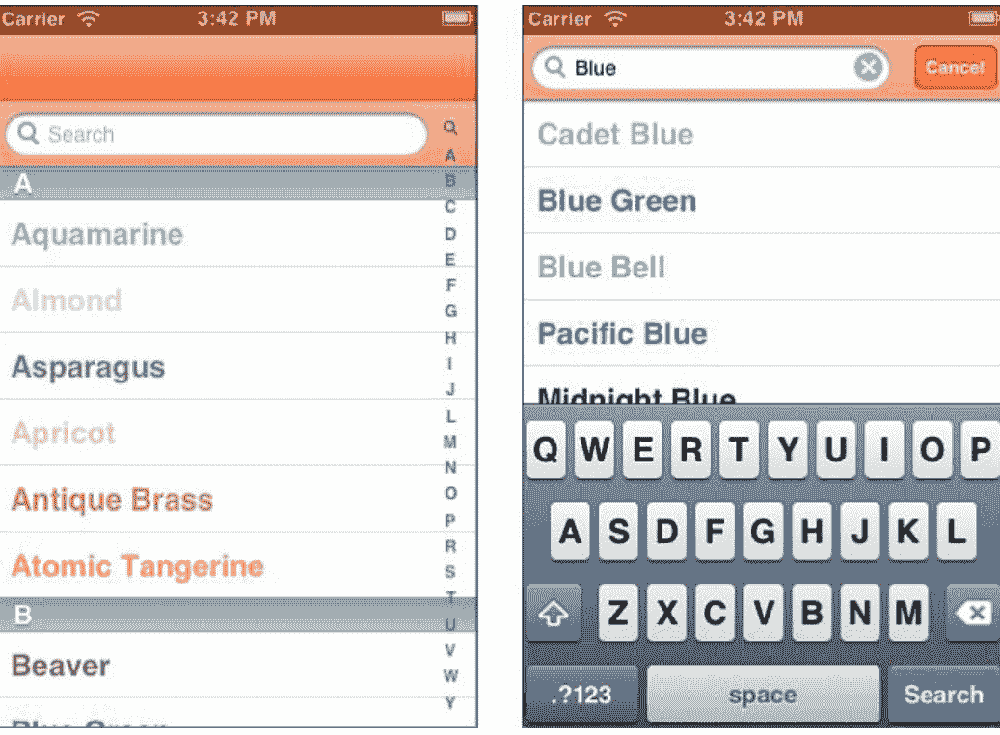

# 创建搜索显示控制器 (Search Display Controller)

搜索显示控制器帮助管理由另一个控制器（在本例中为标准的 `UIViewController`）拥的数据。搜索显示控制器呈现数据的子集，通常通过谓词（`predicate`）过滤该数据源来实现。你通过提供一个搜索栏（`search bar`）和一个内容控制器（`contents controller`）来初始化搜索显示控制器。

像往常一样设置搜索栏的文本特征，但不要设置代理（`delegate`）。搜索栏可以在不需要你显式设置代理的情况下与搜索显示控制器协同工作。

在设置搜索显示控制器时，请确保如处所示设置它的结果数据源和代理。这些通常指向主表格视图控制器（`table view controller`）子类，在该类中，你可以调整常规的数据源和代理方法，以适应可搜索的表格：

## 创建搜索栏

```objc
searchBar = [[UISearchBar alloc]
initWithFrame:CGRectMake(0.0f, 0.0f, width, 44.0f)];
searchBar.autocorrectionType = UITextAutocorrectionTypeNo;
searchBar.autocapitalizationType = UITextAutocapitalizationTypeNone;
searchBar.keyboardType = UIKeyboardAlphabet;
self.tableView.tableHeaderView = searchBar;
```

// 创建搜索显示控制器

```objc
searchController = [[UISearchController alloc]
initWithSearchBar:searchBar contentsController:self];
searchController.searchResultsDataSource = self;
searchController.searchResultsDelegate = self;
```

## 为搜索显示控制器注册单元

在 iOS 6 新的简易解用（`easy dequeuing`）机制下，为应用程序中的每个视图注册单元类型。这包括搜索显示控制器的内置表格。如果忘记这一点并假设你可以直接从 `self.tableView` 解用单元，会导致程序严重崩溃。以下是你可能为两个表格注册单元类的方法：

- // 注册单元类


[self.tableView registerClass:[UITableViewCell class] forCellReuseIdentifier:@"cell"];

[searchController.searchResultsTableView registerClass:[UITableViewCell class] forCellReuseIdentifier:@"cell"];

- (forCellReuse forCellReuseIdentifier:@"cell"];

正如示例代码所示，此种配方针对 iOS 混淆其请求单元的表格的情况使用了一些变通方案（即你在本节中看到的变通方案注释）。

## 构建可搜索数据源方法

表格中显示的项目数量会随着用户的搜索而变化。通常情况下，较短的搜索字符串比长字符串匹配更多项目。你报告每个表格的当前行数。当用户更新搜索字段中的文本时，行数会发生变化。要检测当前是控制器还是搜索显示控制器负责，请检查传递的表格参数。相应地调整行数：

```objc
- (NSInteger)tableView:(UITableView*)tableView
numberOfRowsInSection:(NSInteger)section
{
    if (tableView == searchController.searchResultsTableView)
        return [crayons filterWithString:searchBar.text];
    return *self;
}
```

使用谓词来报告匹配搜索框中文本的项目计数。谓词提供了一种极其简单的方法过滤数组并仅返回匹配搜索字符串的项目。这里使用的谓词执行的是不区分大小写的计数。每个包含搜索字段文本的字符串都会返回正匹配，允许该字符串留在过滤后的数组中。

或者，你可能想使用 `beginsWith` 来避免匹配不以该文本开头的项目。以下方法执行过滤、存储结果并返回找到的项目计数：

```objc
- (NSInteger) filterWithString:(NSString *) filter
{
    NSPredicate *predicate = [NSPredicate predicateWithFormat:
        "SELF contains [cd] %@", filter];
    filteredArray = [[crayonColors allKeys]
        filteredArrayUsingPredicate:predicate];
    return filteredArray.count;
}
```

在提供单元时，同一个表格视图变得更加关键。单元注册直接发生在它们使用的表格上。使用表格视图检查来确定如何解包和初始化单元。以下方法返回从标准集或过滤集中检索的单元：

```objc
- (UITableViewCell *) tableView:(UITableView *)tableView
    cellForRowAtIndexPath:(NSIndexPath *)indexPath
{
    UITableViewCell *cell = [tableView dequeueReusableCellWithIdentifier:@"cell"
        forIndexPath:indexPath];

    NSString *crayonName;
    if (tableView == self.tableView) {
        crayonName = [crayons colorNameAtIndexPath:indexPath];
    } else {
        if (indexPath.row < crayons.filteredArray.count)
            crayonName = crayons.filteredArray[indexPath.row];
    }

    cell.textLabel.text = crayonName;
    cell.textLabel.textColor = [crayons colorNamed:crayonName];
    if ([crayonName hasPrefix:@"White"])
        cell.textLabel.textColor = [UIColor blackColor];

    return cell;
}
```

## 代理方法

搜索感知不仅限于数据源。确定用户点击的上下文对于在代理方法中提供正确的响应至关重要。与之前的数据源方法一样，此代理方法检查回调的表格参数。根据此比较，它选择一种颜色来为搜索栏和导航栏染色：

```objc
// 通过更新调色板响应用户选择
-(void)tableView:(UITableView*)tableView
    didSelectRowAtIndexPath:(NSIndexPath*)indexPath
{
    UIColor *color = nil;
    if (tableView == self.tableView)
        color = [crayons colorAtIndexPath:indexPath];
    self.navigationController.navigationBar.tintColor = color;
    searchBar.tintColor = color;
}
```

使用搜索感知索引：当你支持搜索时，添加到表格索引的第一个项应该是 `UITableViewIndexSearch`。该选项仅用于表格索引，且作为索引中的第一个项，它添加了指示表格支持搜索的小放大镜图标。

配方 10-5 强调了你可能需要调整分节表格以适应搜索的其他方式。

使用它可以快速跳转到列表开头。此配方中的 `scrollRectToVisible:animated:` 调用在用户点击放大镜时手动移动搜索栏位置。否则，用户将不得不从字母 A 所在的节 0 回滚。

在 `viewDidLoad:` 中添加调用以将搜索栏移出视野，准备好首次加载。如果你希望表格在首次加载时搜索栏是隐藏或按用户意愿跳转的。

最后，通过主动清除栏中的文本来响应取消搜索。

# 配方 10-5. 使用搜索功能

```objc
// 将搜索添加到索引
- (NSArray *) sectionIndexTitlesForTableView:(UITableView *)tableView
{
    if (tableView == viewController.searchResultsTableView) return nil;

    NSMutableArray *indices = [NSMutableArray arrayWithObject:UITableViewIndexSearch];

    for (int i = 0; i < crayons.numberOfSections; i++)
    {
        NSString *name = [crayons nameForSection:i];
        if (name) [indices addObject:name];
    }
    return indices;
}

// 同时处理搜索索引项和常规节
-(NSInteger)tableView:(UITableView *)tableView
sectionForSectionIndexTitle:(NSString *)title
atIndex:(NSInteger)index
{
    if (title == UITableViewIndexSearch)
    {
        [self.tableView scrollRectToVisible:searchBar.frame animated:NO];
        return -1;
    }
    return [ALPHA rangeOfString:title].location;
}

// 处理取消按钮并重置搜索文本
-(void)searchBarCancelled:(UISearchBar *)aSearchBar
{
    [searchBar setText:@""];
}
```

```objc
- (NSString *)tableView:(UITableView *)tableView
titleHeaderInSection:(NSInteger) section
{
    if (tableView == searchController.searchResultsTableView)
        return nil;
    return [crayons nameForSection:section];
}
```

// 在出现时，滚动搜索栏

```objc
- (void) viewWillAppear:(BOOL)animated
{
    NSIndexPath *path = [NSIndexPath indexPathForRow:0 inSection:0];
    [self.tableView scrollToRowAtIndexPath:path
        atScrollPosition:UITableViewScrollPositionTop animated:NO];
}
```

## 获取此食谱的代码

要找到此食谱的完整示例项目，请将浏览器指向 `https://github.com/erica/iOS-6-Cookbook` 并进入第 10 章的文件夹。

## 食谱：为你的表格添加“下拉刷新”功能

下拉刷新是一项广泛使用的应用程序功能，在过去的几年里它在 App Store 中变得非常流行。它允许用户通过向下拖动表格顶部直到足以指示请求，来刷新表格。它的使用非常直观，以至于许多人疑问 Apple 为什么没有在 `UITableViewController` 类中添加这一功能。从 iOS 6 开始，他们确实添加了（见图 10-8）。

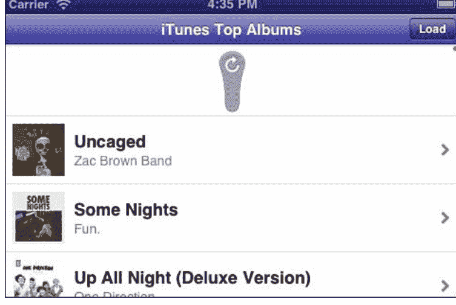

### 图 10-8。你可以轻松地为表格添加下拉刷新选项。用户通过下拉来请求更新后的数据。

新的 `UIRefreshControl` 类提供了一个非常方便的控件，用于启动表格视图的刷新。食谱 10-6 展示了如何将其添加到表格视图的 `refreshControl` 属性中。创建一个新实例并将其分配给表格控制器。控件会直接出现在表格视图中，无需任何额外工作。

在接收到下拉事件回调后，开始刷新事件（`startRefreshing`）。下拉控件将变成进度圈。当新数据准备就绪后，结束刷新（`endRefreshing`）并重新加载表格视图。

继承自 `UIControl`，使用目标-动作（target-action）机制在激活时向客户端发送控件选择器。出于某种原因，它会通过值改变事件进行更新。无疑，Apple 早就应该为这种无状态的控件触发器引入 `UIControlEventTriggered` 事件了。

使用下拉刷新允许你的应用程序延迟执行昂贵的例程。例如，你可以推迟从互联网获取新信息或计算新的表格元素，直到用户触发了这些操作的请求。下拉刷新让用户对刷新操作拥有了控制权，并在按需获取信息和计算开销之间提供了极佳的平衡。

食谱 10-6 中提到的 `DataManager` 类使用操作队列异步加载数据：

```objc
- (void) loadData
{
    NSString *rss = @"http://itunes.apple.com/us/topalbums/limit=30/xml";

    NSOperationQueue *queue = [[NSOperationQueue alloc] init];

    [queue addOperationWithBlock:^{
        root = [[XMLParser sharedInstance] parseXMLFromURL:[NSURL URLWithString:rss]];

        [[NSOperationQueue currentQueue] addOperationWithBlock:^{
            [self handleData];
        }];
    }];
}
```

这种方法确保了数据加载不会阻塞主线程。刷新控件的进度圈不会受到干扰，用户可以自由地与应用程序中的其他 UI 元素交互。获取完成后，将控制交回主线程：

```objc
if (delegate &&
    [delegate respondsToSelector:@selector(dataIsReady)])
{
    [delegate performSelectorOnMainThread:@selector(dataIsReady:)
        withObject:self waitUntilDone:YES];
}
```

食谱 10-6 提供了一个可以添加到其刷新控件中的按钮。绝大多数应用程序会跳过这个冗余操作。我包含它是为了展示它将如何与刷新控件交互。点击时，你仍然需要执行表格的 `startRefreshing` 和 `endRefreshing` 方法。这确保了刷新控件的操作与手动重载同步进行。

## 食谱 10-6. 在你的表格中构建下拉刷新

```objc
- (void) dataIsReady: (id) sender
{
    // 更新标题
    self.title = @"iTunes Albums";

    // 重新启用导航按钮项
    self.navigationItem.rightBarButtonItem.enabled = YES;

    // 结束刷新并更新表格
    [self.refreshControl endRefreshing];
    [self.tableView reloadData];
}

- (void) loadData
{
    // ... (如上所述的实现)
}

- (void) loadView
{
    // ... (如上所述的实现)
}
```

```objc
- (UITableViewCell *)tableView:(UITableView *)tableView
    cellForRowAtIndexPath:(NSIndexPath *)indexPath
{
    UITableViewCell *cell = [tableView dequeueReusableCellWithIdentifier:@"cell"
        forIndexPath:indexPath];

    cell.textLabel.textColor = [UIColor whiteColor];
    cell.selectionStyle = UITableViewCellSelectionStyleGray;

    return cell;
}
```

```objc
- (NSIndexPath *)tableView:(UITableView *)tableView
    willSelectRowAtIndexPath:(NSIndexPath *)indexPath
{
    // 只选择普通单元
    if([indexPath isEqual:self.actionRowPath]) return nil;
    return indexPath;
}
```

```objc
// 取消当前任何选择
- (void)deselect
{
    NSArray *paths = [self.tableView indexPathsForSelectedRows];
    if (!paths.count) return;

    NSIndexPath *path = paths[0];
    [self.tableView deselectRowAtIndexPath:path animated:YES];
}
```

```objc
// 选择时，更新标题并查找/取消
- (void)tableView:(UITableView *)tableView
    didSelectRowAtIndexPath:(NSIndexPath *)indexPath
{
```

```objc
    NSArray *pathsToAdd;
    NSArray *pathsToDelete;

    if ([self.actionRowPath.previous isEqual:indexPath])
    {
        // 隐藏动作单元格
        pathsToDelete = @[self.actionRowPath];
        self.actionRowPath = nil;
        [self deselect];
    } else if (self.actionRowPath)
    {
```

```objc
        // 移动动作单元格
        BOOL before = [indexPath before:self.actionRowPath];
        pathsToDelete = @[self.actionRowPath];
        self.actionRowPath = before ? indexPath.next : indexPath;
        pathsToAdd = @[self.actionRowPath];
    }
    else
    {
        // 新的动作单元格
        pathsToAdd = @[indexPath.next];
```

```objc
        self.actionRowPath = indexPath.next;
    }

    // 动画删除和插入
    [self.tableView beginUpdates];
    if (pathsToDelete.count) {
        [self.tableView deleteRowsAtIndexPaths:pathsToDelete
            withRowAnimation:UITableViewRowAnimationNone];
    }

    if (pathsToAdd.count) {
        [self.tableView insertRowsAtIndexPaths:pathsToAdd
            withRowAnimation:UITableViewRowAnimationNone];
    }
    [self.tableView endUpdates];
}
```

```objc
// 设置表格
- (void) loadView
{
    [super loadView];

    [self.tableView registerClass:[UITableViewCell class]
        forCellReuseIdentifier:@"cell"];

    [self.tableView registerClass:[CustomCell class]
        forCellReuseIdentifier:@"action"];
}
```


## 获取此食谱的代码

要找到此食谱的完整示例项目，请将浏览器指向 `https://github.com/erica/iOS-6-Cookbook` 并进入第 10 章文件夹。

## 编写分组表格

如果说字母顺序的分段列表表格是 iPhone 表格世界中的埃舍（M. C. Escher）——每个分段区块都精确地契合列表中其他区块提供的负留空间——那么自由分组表格就是马克·夏加（Marc Chagall）。每一个部分都像是一件自由形式的手工艺术品。

在掌握了技巧后，编写你在本章中见过的所有表格相对容易。但完善分组表格的代码（信徒们通常称为“偏好表格”，因为这是“设置”应用中使用那种表格）仍然是一个难以触及的目标。

在代码中构建分组表格完全在于拼贴。它们关乎逐部分地手工打造一种外观。在代码中创建这样的演示效果涉及大量的细节工作。

## 创建分组偏好表格

在布局一个用于偏好表格的新 `UITViewController` 方面，并没有特别的。你只需分配它，并用分组表格样式初始化它。这基本上就结束了。挑战在于数据源和代理方法。以下是你需要定义方法：

- `numberOfSectionsTableView`——所有偏好表格都包含一组组项目。每个组在视觉上都包含在一个圆矩形中。返回一个整数，表示你将定义的组数。
- `tableView:titleForHeaderInSection`——在此可选方法中添加每个分区的标题。返回一个带有请求名称的 `NSString`。
- `tableView:numberOfRowsInInSection`——每个分区可以包含任意数量的单元格。此方法返回一个整数，表示该组的行（即单元格）数。
- `tableView:heightRowsAtIndexPath`——使用灵活行的表格在计算强度上成本较高。如果你需要使用可变高度，请实现此可选方法来指定高度。按分区和按行返回值。
- `tableView:cellForRowAtPath`——这是你在本章中看到的标准单元格-行方法。它的不同之处在于实现。你可能不想使用一种单元格，而是为每种单元格类型创建不同类型的复用单元格（带有不同的复用标签）。确保你仔细管理你的复用队列，并尽可能使用与 Interface Builder (IB) 集成的元素。
- `tableView:didSelectRowAtPath`——在此可选代理方法中，根据所选的单元格类型对单元格选择提供具体的反应。

> **注意**
>
> Google Code 上的开源 `llamasettings` 项目 (`http://llamasettings.google.com`) 可以根据 iPhone 设置包的属性列表（plist）自动生成分组表格。它允许你将设置引入应用程序中，而无需强制用户离开应用。该项目可以免费添加到商业 iOS SDK 应用程序中，无需许可费用。

## 食谱：构建多轮表格

有时，你希望用户从长列表或同时从多个列表中进行选择。这就是 `UIPickerView` 实例擅长之处。


而不是有一个起点和终点。注意其组件的数量之多，达到了一百万。这个高数字的原因是为了模拟真实的圆柱体。通常，选择器（picker）有一个第一个元素最后一个元素，这就是它们结束的地方。这个配方采用了另一种方法，询问：“如果组件是真实的圆柱体，让最后一个元素连接到第一个元素呢？”

为了模拟这种效果，选择器使用的组件数量远高于用户任何能访问的数量。它通过调用 `selectRow:in:animated:` 将选择器初始化为该数字的中间。每个组件“行”都是通过实际报告的行号与要显示的元素数量（在本例中为 `%4`）的模运算得出的。尽管代码知道选择器每个轮实际上有一百万行，但用户体验提供的只是只有四行的圆柱轮。

## 配方 10-8. 创建重复圆柱的幻觉

```objc
(NSInteger)numberOfComponentsInPicker:(UIPickerView*)picker
{
    return 3; // 三列
}

(NSInteger)picker:(UIPickerView*)picker numberOfRowsInComponent:(NSInteger)component
{
    return 1000000; // 任意且巨大的数值
}

(CGFloat)picker:(UIPickerView*)picker rowHeightForComponent:(NSInteger)component
{
    return 120.0f;
}

(UIView*)picker:(UIPickerView*)picker viewHolderForRow:(NSInteger)rowForComponent:(NSInteger)component reusingView:(UIView*)view
{
    // 加载相应的行图像
    NSArray *names = [@"club.png", @"diamond.png", "@heart.png", @"spade.png"];
    UIImageView *image = [UIImage named:names[row]];

    // 如果没有提供图像，则创建一个图像
    UIImageView*imageView = (UIImageView*)view;
    imageView.image = image;

    if (!imageView)
        imageView = [[UIView alloc] initWithImage:image];

    return imageView;
}

(void)picker:(UIPickerView *)picker rowInComponent:(NSInteger)component
{
    // 通过设置视图控制器的标题来响应选择
    NSArray *names = @[@"C"
}

(void)viewDidAppear:(BOOL)animated
{
    // 在视图出现时设置随机选择
    [picker selectRow:50000 + (rand() % 4) inComponent:0 animated:YES];
    [picker selectRow:50000 + (rand() % 4) inComponent:1 animated:YES];
    [picker selectRow:50000 + (rand() % 4) inComponent:2 animated:YES];
}

(void)viewDidLoad
{
    [super load];
    // 创建选择器并将其居中
    picker = [[UIPickerView alloc] initWithFrame:CGRectZero];
    [self.view addSubview:picker];
    PRECONSTRAINTS(picker);
    CENTERH(self.view, picker);
    CENTERV(self.view, picker);

    // 初始化选择器属性
    picker.delegate = self;
    picker.dataSource = self;
    picker.showsSelectionIndicator = YES;
}
```

## 获取此配方的代码

要找到此配方的完整项目，请将浏览器指向 `https://github.com/erica/iOS-6-Cookbook` 并进入第 10 章文件夹。

## 使用 UIDatePicker

当你想让用户输入日期信息时，Apple 提供了一个整洁的 `UIPickerView` 子类来处理各种时间输入。图 10-11 显示了你可以选择的 `UIDatePicker` 的四内置样式。这些包括选择时间、选择日期、选择两者的组合以及倒计时器。

### 图 10-11. iPhone 提供了四种日期选择器模型

| 时间 | 日期 | DT | 动作 |
| :--- | :--- | :--- | :--- |
| | 2 | 12 | |
| | 3 | 13 | AM |
| | 4 | 14 | |
| | 5 | 15 | |
| | 6 | 16 | |

设置

| 时间 | 日期 | DT | 动作 |
| :--- | :--- | :--- | :--- |
| May | 14 | 2007 | |
| June | 15 | 2008 | |
| July | 16 | 2009 | |
| August | 17 | 2010 | |
| September | 18 | 2011 | |

设置

| 时间 | 日期 | DT | 动作 |
| :--- | :--- | :--- | :--- |
| Tue Jul 14 | 2 | 13 | |
| Wed Jul 15 | 3 | 14 | AM |
| Today | 4 | 15 | PM |
| Fri Jul 17 | 5 | 16 | |
| Sat Jul 18 | 6 | 17 | |

设置

| 时间 | 日期 | DT | 动作 |
| :--- | :--- | :--- | :--- |
| 0 | 48 | | |
| 1 | 49 | | |
| 2 hours | 50 mins | | |
| 3 | 51 | | |
| 4 | 52 | | |

使用 `datePickerMode` 属性选择你在应用程序中使用的选择器。

## 创建日期选择器

以 `UIPickerView` 的方式布局日期选择器。图 10-11 显示了你可以选择的 `UIDatePicker` 的内置样式。这些包括选择时间、选择日期、选择两者的组合以及倒计时器。

## 项目 | 集合视图 (Collection Views) | 表格 (Tables) |

| --- | --- | --- |
| 主类 | `UICollectionView` | `UITableView` |
| 内容 | Cells、补充视图（例如头部和页脚）、装饰视图（背景和视觉修饰） | Cells、头部和页脚 |
| 用户引导的重载 | 不适用。流更新到当前数据 | 刷新控件 (`UIRefreshControl`) |
| 程序化重载 | `reloadData` | `reloadData` |
| 可复用 Cells | `UICollectionViewCell-dequeueReusableCellIdentifier:forIndexPath:` | `UITableViewCell-dequeueReusableCellIdentifier:forIndexPath:` |
| 注册 | 为 Cell、补充视图或装饰视图注册类或 nib | 为 Cell 使用注册类或 nib |
| 头部页脚 | `UICollectionViewReusableView` | `UITableViewHeaderFooter` |
| 布局 | `UICollectionViewLayout` 和 `UICollectionViewFlowLayout` | 不适用 |
| 数据源 | `UICollectionViewDataSource` | `UITableViewDataSource` |
| 代理 | `UICollectionViewDelegate` | `UITableViewDelegate` |
| 布局代理 | `UICollectionViewDelegate-FlowLayout` | 不适用 |
| 索引 | 分组 (Sections) 和项目 (Items) | 分组 (Sections) 和 行 (Rows) |
| 滚动方向 | 水平或垂直 | 垂直 |
| 视觉效果 | 通过自定义布局设置 | 不适用 |

它们之间存在一些根本性的区别，从基础的路径开始。这两个类都以分组（section）作为主要的分组方式，每个分组都索引单个 cell。由于集合视图可以沿水平或垂直任意方向滚动，因此术语发生了变化。表格视图使用分组和行；而集合视图使用分组和项目。`NSIndexPath` 类在 iOS 6 中进行了更新，以反映这种新方案。

集合视图引入了一种名为“装饰”（decoration）视图的新类型内容，它们提供了如背景之类的视觉增强。这个新类理解到 cell 和滚动仅仅是该类的起点。你可能希望自定义整个外观，使用你所想象的任何比喻来创建连贯的展示。

集合视图还重新思考了头部和页脚，将它们转换为补充视图，具有比表格中发现更高的 API 灵活性。

## 实际实现差异

在构建表格视图和集合视图之间，预计会有一些实际上的差异。集合视图对懒性数据加载的容忍度较低。按照原则，当你创建一个集合视图时，请确保驱动该视图的数据源已准备就绪——即使在应用程序的其他地方加载数据时，它也只准备了一组最小或空的 cell 集合。

你不能等到初始化、`loadView` 或 `viewDidLoad` 方法才准备内容。先准备好并让它们运行，无论是在你的应用程序代理中，还是在实例化你的集合视图或推入新的子视图控制器之前。如果你的数据未准备就绪，你的应用将会崩溃；这并不是你应该追求的用户体验。

在展示集合之前，确保你已完全建立了集合视图的布局对象。正如你在本章食谱中看到的，你设置了所有的布局细节，包括滚动方向和任何不依赖代理回调的属性。只有那时，才创建并初始化你的集合视图，如下所示：

```objc
MyCollectionView *mcc = [[MyCollectionView alloc] initWithCollectionViewLayout:layout];
```


传递 `nil` 布局会产生异常。

## 建立集合视图

对于表格，集合有两种形式：视图和预构建的控制器。你可以构建一个单独的集合视图实例并将其添加到你的展示中，或者使用 `UICollectionViewController` 对象，该对象提供了一个预装了集合视图的视图控制器。该控制器会自动将视图的数据源、代理和布局代理设置为自己，并声明所有三个协议。将集合视图控制器嵌入任何容器（如导航控制器、标签栏控制器、分屏视图控制器、页视图控制器等）的子视图，或单独展示它。

> **注意**
>
> 像表格视图一样，集合视图也有 `delegate` 和 `dataSource` 属性。布局代理协议（`UICollectionViewDelegateFlowLayout`）使用赋值给 `delegate` 属性的对象。

## 控制器

要构建一个控制器，请创建并设置布局，分配新实例，并使用准备好的布局进行初始化：

```objc
UICollectionViewFlowLayout *layout = [[UICollectionViewFlowLayout alloc] init];
layout.scrollDirection = UICollectionViewScrollDirectionHorizontal;
```

```objc
MyCollectionController *mcc = [[MyCollectionController alloc] initWithCollectionViewLayout:layout];
```

此代码段使用了默认形式的集合视图，仅设置了滚动方向。正如你在本章中看到的，你可以在布局上做更多事情。通常，你会设置额外的属性或对系统提供的布局进行子类化并添加你自己的行为。

按照原则，你使用 `UICollectionViewFlowLayout` 类。它是集合视图的布局骨干。用它来构建任何基础展示。在默认形式下，每个分组都会封装项目以适应屏幕，你可以指定分组之间、行与行之间、项目与项目之间出现多少空间。它是极其可定制的，正如你将在下一节中看到的，下一节详细说明了你可以应用于布局的许多微调。

它的父类 `UICollectionViewLayout` 为子类化提供了一个抽象基类（你通常不需要这样做；几乎每次你都会想要子类化流布局版本），并且不是用于直接使用的。

> **注意**
>
> 查看子类化布局，请参考 `UICollectionViewFlowLayout`。`UICollectionViewFlowLayout` 类的父类，其文档提供了可定制方法的标准列表。

## 视图

要创建一个嵌入到另一个视图的集合视图，请建立布局，使用该布局创建视图并设置数据源和代理。流布局代理默认设置为你设为 `delegate` 属性设置的对象：

```objc
UICollectionViewFlowLayout *layout = [[UICollectionViewFlowLayout alloc] init];
layout.scrollDirection = UICollectionViewScrollDirectionHorizontal;
```

```objc
collectionView = [[UICollectionView alloc] initWithFrame:CGRectZero collectionViewLayout:layout];
```

```objc
collectionView.dataSource = self;
collectionView.delegate = self;
```

## 数据源与代理

协调视图的控制器声明 `UICollectionViewDataSource` 和 `UICollectionViewDelegate`。与表格视图不同，软件开发（SDK）为集合视图引入了第三种协议，即 `UICollectionViewDelegateFlowLayout`。

布局代理协议通过一系列回调与你的布局实例协调布局信息。你的集合视图代理采用了此协议——也就是说，你不需要指定像 `delegateFlowLayout` 之类的第三方属性。

与表格视图一样，数据源提供分组项目信息并按需要返回 cell 以及集合视图项目。代理处理用户交互并对用户更改提供有意义的响应。布局代理引入了分组布局细节，并且大部分是完全可选的。你将在下一节学习流布局及其代理回调。

## 流布局

`UICollectionViewFlowLayout` 类提供的流布局在应用程序中创建组织的网格展示。它们提供了你可以直接编辑或通过代理回调建立的属性。这些属性指定了流如何放置项目。

## 滚动方向

`scrollDirection` 属性控制分组是水平排列（`UICollectionViewScrollDirectionHorizontal`）还是垂直排列（`UICollectionViewScrollDirectionVertical`）。图 11-1 展示了原本相同的布局，具有水平（左）和垂直（右）流。每个分组的成员根据当前流封装到可用空间。由于在 iPhone 竖屏展示中，垂直空间比水平空间多，因此水平流中的分组比垂直流中的更长且更窄。

图 11-1。水平（左侧）和垂直（右侧）流决定了集合视图的整体滚动方向。左图沿左右滚动。右图沿上下滚动。对于每个示例，流布局会自动处理每行末尾的换行工作。每个部分包含 12 个项目。

## 项目尺寸与行间距

使用 `itemSize` 来指定每个屏幕项目的默认尺寸，例如图 11-1 中的小正方形所示。`minimumLineSpacing` 和 `minimumInterItemSpacing` 属性指定了每个部分内对象之间换行时所需的空间。行间距始终位于流方向上每两行之间。例如，行间距指的是图 11-1（左侧）中 S(0) 和 S(6) 之间的空间，或图 11-1 中 S(0) 和 S(4) 之间的空间。项目间距与行正交（直角），指定了每个项目之间的间隙，例如 S(0) 和 S(1) 之间、S(1) 和 S(2) 之间。图 11-2 显示了这些属性的用法，在此情况下使用了垂直流。左图显示了一致的 10 点间距。中间图将间距扩大到 30 点。此空间出现在项目行之间，即流从一行换到下一行的地方。右图将项目间距扩大到 30 点。项目间距出现在每行中，在每个对象之间添加分隔符。

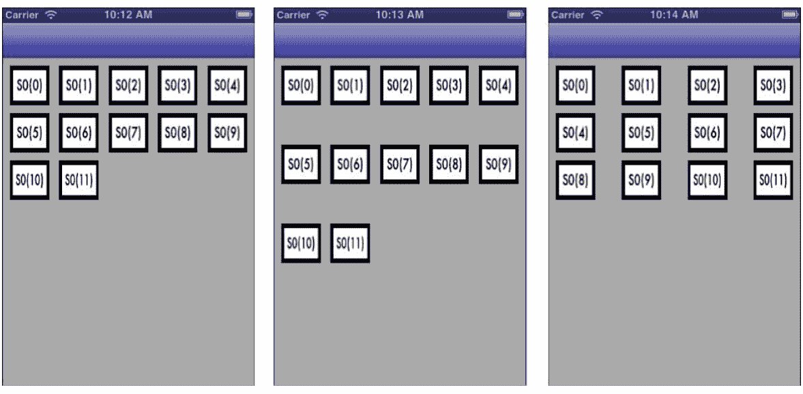

图 11-2。最小行间距和项目间距控制项目在每个部分内的换行方式。项目尺寸指定了每个单元格的维度。左图使用默认间距。中间图将行间距增加到 50 点。右图将项目间距增加到 30 点。

与 iOS 6 中的许多新布局项目一样，这些设置是“请求”。具体来说，间距可能会超过你指定的任何值，但布局会尝试遵守你分配的最小值。

你可以直接设置上述布局属性来为整个集合分配默认值。你也可以使用流布局代理回调方法从代码中指定值。在运行时设置这些值比默认设置提供了更细微的差别，因为它们是按部分和逐项目应用的，而不是全局生效的。以下方法处理项目尺寸和最小间距：

- `collectionView:layout:sizeForItemAtIndexPath:` 对应 `itemSize` 属性，以每个项目为单位进行。
- `collectionView:layout:minimumLineSpacingForSectionAtIndex:` 对应 `minimumLineSpacing` 属性，按部分为单位进行控制。
- `collectionView:layout:minimumInterItemSpacingForSectionAtIndex:` 对应 `minimumInterItemSpacing` 属性，同样是按部分为单位进行。

在这些方法中，第一个项目尺寸的方法提供了 iOS 开发中最常用的适配方式。它允许你构建项目尺寸与图 11-2 所示不同且变异的集合。本章稍后出现的图 11-4 显示了一个能够自动调整多尺寸内容的流布局。

## 页眉和页脚尺寸

`headerReferenceSize` 和 `footerReferenceSize` 属性定义了页眉和页脚项目的宽度或高度。注意图 11-3 顶部两个和底部两个截图中这些项目范围的差异。顶部的水平流为这两个项目使用了 60 点宽的间距。底部的垂直流使用了 30 点高的间距。尽管你向这些属性提供了完整的 `CGSize`，但布局根据流的方向每次只使用一个字段。对于水平流，使用宽度字段；对于垂直流，使用高度字段。

图 11-3。部分内边距控制领先和离开项目的空间。顶部图像显示水平流，底部图像使用垂直流。所有图像都使用了顶部 50 点和底部 30 点的间距，以及左右各 10 点的间距。

以下是用于生成图 11-3 布局的两个回调。它们返回完整的尺寸结构，尽管每次只使用其中一个字段。流类中没有这些方法对应的属性：

```objc
- (CGSize)collectionView:(UICollectionView *)collectionView layout:(UICollectionViewLayout *)collectionViewLayout referenceSizeForHeaderInSection:(NSInteger)section {
    return CGSizeMake(60.0f, 30.0f);
}
```

```objc
- (CGSize)collectionView:(UICollectionView *)collectionView layout:(UICollectionViewLayout *)collectionViewLayout referenceSizeForFooterInSection:(NSInteger)section {
    return CGSizeMake(60.0f, 30.0f);
}
```

## 内边距

两个最小间距属性定义了部分内每个项目与其他部分内项目的关系。相比之下，`sectionInset` 属性描述了部分的边缘如何添加填充间距。这种填充间距会影响部分与其可选页眉和页脚的关系，以及部分之间通常如何相互分离。

`UIEdgeInsets` 由一组 {top, left, bottom, right} 值组成。图 11-3 显示了这在集合视图中的工作原理。图 11-3 的每个截图都展示了使用相同的边缘边距：顶部 50 点，底部 30 点，左右各 10 点：

```objc
UIEdgeInsetsMake(50.0f, 10.0f, 30.0f, 10.0f)
```

```objc
- (UICollectionReusableView *)collectionView:(UICollectionView *)collectionView viewForSupplementaryElementOfKind:(NSString *)kind atIndexPath:(NSIndexPath *)indexPath {
    if (kind == UICollectionElementKindSectionHeader) {
        UICollectionReusableView *header = [self.collectionView dequeueReusableSupplementaryViewOfKind:UICollectionElementKindSectionHeader withReuseIdentifier:@"header" forIndexPath:indexPath];
        header.backgroundColor = [UIColor lightGrayColor];
        return header;
    } else if (kind == UICollectionElementKindSectionFooter) {
        UICollectionReusableView *footer = [self.collectionView dequeueReusableSupplementaryViewOfKind:UICollectionElementKindSectionFooter withReuseIdentifier:@"footer" forIndexPath:indexPath];
        footer.backgroundColor = [UIColor darkGrayColor];
        return footer;
    }
    return nil;
}
```

```objc
#pragma mark 代理方法
- (void)collectionView:(UICollectionView *)collectionView didSelectItemAtIndexPath:(NSIndexPath *)indexPath {
    NSLog(@"Selected %@", indexPath);
}
```

```objc
- (void)collectionView:(UICollectionView *)collectionView deselectItemAtIndexPath:(NSIndexPath *)indexPath {
    NSLog(@"Deselected %@", indexPath);
}
```

```objc
#pragma mark 设置
- (void)viewDidLoad {
    [super viewDidLoad];
    // 注册任何 cell 和头部/页脚类用于复用队列
    [self.collectionView registerClass:[UICollectionViewCell class] forCellWithReuseIdentifier:@"cell"];
    [self.collectionView registerClass:[UICollectionReusableView class] forSupplementaryViewOfKind:UICollectionElementKindSectionHeader withReuseIdentifier:@"header"];
    [self.collectionView registerClass:[UICollectionReusableView class] forSupplementaryViewOfKind:UICollectionElementKindSectionFooter withReuseIdentifier:@"footer"];
    self.collectionView.backgroundColor = [UIColor lightGrayColor];
    // 允许用户通过点击选择/取消项目
    self.collectionView.allowsMultipleSelection = YES;
}
@end
```

```objc
// 来自 application delegate
- (BOOL)application:(UIApplication *)application didFinishLaunchingWithOptions:(NSDictionary *)launchOptions {
    UICollectionViewFlowLayout *layout = [[UICollectionViewFlowLayout alloc] init];
    layout.sectionInset = UIEdgeInsetsMake(10.0, 10.0, 50.0, 50.0);
    layout.minimumLineSpacing = 10.0;
    layout.minimumInteritemSpacing = 10.0;
    layout.itemSize = CGSizeMake(50.0, 50.0);
    layout.scrollDirection = UICollectionViewScrollDirectionVertical;

    TestBedViewController *tvc = [[TestBedViewController alloc] initWithCollectionViewLayout:layout];
    UINavigationController *nav = [[UINavigationController alloc] initWithRootViewController:tvc];
    window.rootViewController = nav;
    [window makeKeyAndVisible];
    return YES;
}
```

## 获取此配方代码

要找到此配方的完整示例项目，请将浏览器指向 `https://github.com/erica/iOS-6-Cookbook` 并进入第 11 章文件夹。

## 配方：自定义单元

配方 11-1 创建了统一大小的对象，但没有理由你的集合视图不能填充任何尺寸的项目。流式布局允许你创建出更细致的展示效果，如图 11-4 所示。配方 11-2 通过创建自定义单元调整其集合视图，以提供这种增强的展示效果。这些单元添加了图像视图，并且图像的大小驱动了集合视图数据源的“索引路径处的项目大小”回调函数：

```objc
- (CGSize)collectionView:(UICollectionView *)collectionView layout:(UICollectionViewLayout *)collectionViewLayout sizeForItemAtIndexPath:(NSIndexPath *)indexPath {
    UIImage *image = artDictionary[indexPath];
    return image.size;
}
```

图 11-4。流式布局适用于具有不同高度和宽度的项目，而不仅仅是基础网格。

要创建自定义单元，请子类化 `UICollectionViewCell` 并在单元的 `contentView` 中添加任何新视图。此配方添加了一个单个图像视图子视图，并通过 `imageView` 属性暴露它。在提供单元时，代理会向图像视图添加自定义图像，而布局代理会指定它们的大小。

## 配方 11-2. 自定义集合视图单元

```objc
@interface ImageCell : UICollectionViewCell
@property (nonatomic, strong) UIImageView *imageView;
@end

@implementation ImageCell

- (id)initWithFrame:(CGRect)frame {
    if (![super initWithFrame:frame]) return nil;
    _imageView = [[UIImageView alloc] initWithFrame:CGRectInset(frame, 4.0f, 4.0f)];
    _imageView.autoresizingMask = UIViewAutoresizingFlexibleWidth | UIViewAutoresizingFlexibleHeight;
    [self.contentView addSubview:_imageView];
    return self;
}
@end
```


## 获取此配方代码

要找到此配方的完整示例项目，请将浏览器指向 `https://github.com/erica/iOS-Cookbook` 并进入第 11 章文件夹。

## 配方：滚动列表

集合视图提供了创建水平列表的能力。要实现这一点，你需要考虑几件事，主要是流式布局在默认状态下自然会换行分区。考虑图 11-5。它展示了两个集合视图，两者都水平滚动。顶部包含一个有 100 个项目的单分区；底部有 100 个每个只包含一个项目的分区。

图 11-5。顶部：包含 100 个项目的单分区。底部：100 个每个只包含一个项目的分区。你可以通过添加大的左和右边距来强制分区布局换行，但要让这些正常工作会非常混乱；边距取决于设备和方向。每个分区分配一个项目要简单得多，并且可以确保在任何尺寸下都只有单行项目。配方 11-3 创建了一个水平滚动的集合，作为一个视图而不是控制器。这种方法允许视图整齐地内缩，从而避免屏幕底部的空白区域。此配方将集合视图作为一个嵌入式滚动列表提供。配方 11-3 类在后续章节中出现，提供了自定义的布局。

可自定义的布局属性包括标准布局元素（`frame`、`center`、`size`）、透明度（`alpha` 和 `hidden`）、z 轴上的位置（`zIndex`）以及变换（`transformd`）。当流式布局请求元素属性时，你会对这些进行调整，如食谱 11-4 所示。

此食谱创建了一个流布局，它会让项目在屏幕中心向用户放大，并在它们向左侧或右侧移动时缩小。它计算了每个项目到屏幕水平中心的距离。它根据余弦函数（即一个随着与中心点距离的减小而达到最大值的函数）来应用缩放。

图 11-7 显示了这种效果，尽管最好亲自运行该食谱并观察实际发生的变化。

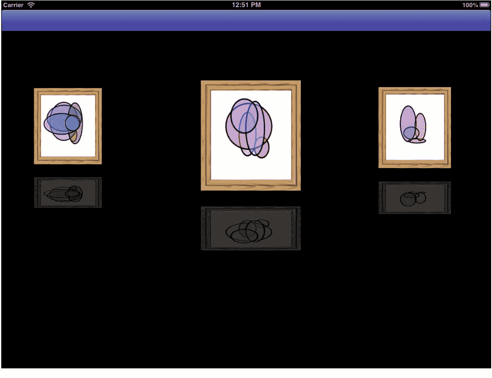

图 11-7。由食谱 11-4 定义的自定义布局在向屏幕水平中心移动时会缩放项目。

## 食谱 11-4 交互式布局效果

```objectivec
@interface PunchedLayout : UICollectionViewFlowLayout

@end

@implementation PunchedLayout

// 允许演示根据需要调整大小
- (BOOL)shouldInvalidateLayoutForBoundsChange:(CGRect)oldBounds {
    return YES;
}

// 布局元素
- (NSArray *)layoutAttributesForElementsInRect:(CGRect)rect {
    // 获取默认布局
    NSArray *array = [super layoutAttributesForElementsInRect:rect];
    for (UICollectionViewLayoutAttributes *attributes in array) {
        // 只处理可见项目的布局
        if (!CGRectIntersectsRect(attributes.frame, rect)) continue;

        // 计算距离视图中心的距离
        CGSize boundsSize = self.collectionView.bounds.size;
        CGFloat midX = boundsSize.width / 2.0f;
        CGPoint contentOffset = self.collectionView.contentOffset;
        CGPoint itemCenter = CGPointMake(
            attributes.center.x - contentOffset.x,
            attributes.center.y - contentOffset.y);

        CGFloat distance = fabsf(midX - itemCenter.x);

        // 归一化距离并计算缩放因子
        CGFloat normalized = distance / midX;
        normalized = MIN(1.0f, normalized);
        CGFloat zoom = cos(normalized * M_PI_4);

        // 设置变换
        attributes.transform3D = CATransform3DMakeScale(zoom, zoom, 1.0);
    }
    return array;
}

@end
```

## 获取此食谱的代码

要找到此食谱的示例项目，请将浏览器指向 `https://github.com/erica/iOS-6-Cookbook` 并进入第 11 文件夹。

## 食谱：滚动吸附 (Scroll Snapping)

由于食谱 11-4 将用户的注意力集中在屏幕中心，为什么不确保中心对象移动到最理想的位置呢？你可以通过实现一个吸附到特定边界的布局方法来实现。食谱 11-5 展示了如何操作。

这个 `targetContentOffsetForProposedContentOffset:withScrollingVelocity:` 方法在滚动期间被调用，确定滚动自然停止的位置。它遍历所有屏幕上的对象，找到距离视图水平中心最近的一个，并调整偏移量使该项目的中心与视图中心对齐。

## 食谱 11-5 自定义目标内容偏移量

```objectivec
- (CGPoint)targetContentOffsetForProposedContentOffset:(CGPoint)proposedContentOffset
                                   withScrollingVelocity:(CGPoint)velocity {
    CGFloat offsetAdjustment = MAXFLOAT;
    CGSize boundsSize = self.collectionView.bounds.size;
    CGFloat midX = boundsSize.width / 2.0f;

    // 获取建议起始点处的所有屏幕内项目
    CGRect targetRect = CGRectMake(proposedContentOffset.x, 0.0, boundsSize.width, boundsSize.height);
    NSArray *array = [super layoutAttributesForElementsInRect:targetRect];

    // 确定建议的中心 x 坐标
    CGFloat proposedCenterX = proposedContentOffset.x + midX;

    // 搜索最小偏移量调整
    for (UICollectionViewLayoutAttributes *layoutAttributes in array) {
        CGFloat distance = layoutAttributes.center.x - proposedCenterX;
        if (fabsf(distance) < fabsf(offsetAdjustment)) {
            offsetAdjustment = distance;
        }
    }

    // 通过最小居中量偏移内容
    return CGPointMake(proposedContentOffset.x + offsetAdjustment, proposedContentOffset.y);
}
```

## 获取此食谱的代码

要找到此食谱的完整示例项目，请将浏览器指向 `https://github.com/erica/iOS-6-Cookbook` 并进入第 11 文件夹。

## 食谱：创建圆形布局

圆形布局提供了一种在中心区域周围排列视图的吸睛方式。食谱 11-6 基于 Apple 的示例代码，该代码最初在 WWDC 2012 上介绍。此布局为项目在创建和删除时的动画方式提供了极佳的介绍。

食谱 11-6 的布局通过 `collectionViewContentSize` 方法使用固定内容尺寸。这防止了集合视图的滚动，因为它创建了一个几何结构清晰的布局区域。代码进一步将其布局限制在一个在 `prepareLayout` 方法中计算的内边距（`inset`）内。屏幕的高度和宽度较小的那一个决定了圆的半径。无论设备方向如何，半径始终保持固定。

该布局通过其索引路径计算每个项目的位置。这种演示使用单个分区（`section`），以及项目在该分区内的排列顺序。

### 创建和删除动画

11-6 中特别感兴趣的是为新插入项目指定初始属性以及为删除项目指定最终属性的方法。在食谱中，与 Apple 的原始示例一样，新项目从中心开始是透明的，并在移动到指定位置时淡入。

在 iOS 6 beta 中，起始和结束属性请求是针对所有项目的，而不仅仅是添加和删除的项目。因此，食谱 11-6 将项目分为添加和删除路径。

这种机制为所有项目提供了动画属性的方法，允许你根据需要添加额外的动画。例如，当插入新项目时，你可能会让对象从第 3 行移动到第 4 行开头。这种方法允许单元格从旧位置移动到新位置。

遗憾的是，此食谱可能会变化；看起来 Apple 尚未完成布局类。

## 实现圆形布局

在制作此食谱时，我对 Apple 的原始示例做了许多更改。其中，食谱 11-6 使用添加和删除栏按钮而不是手势。此外，每个视图都是独特的，并且可以通过颜色进行识别。不是删除“任何项目”或添加“某个项目”，食谱 11-6 使用了选择。用户选择一个要关注的项目。该选择控制了删除哪个项目（被选项目）或新项目应该添加的位置（被选中项目之后）。

以下是删除代码。它获取被选项目，将其删除，并选择下一个项目。然后根据当前屏幕外项目的数量启用或禁用添加和删除按钮：

```objectivec
- (void)delete {
    if (!count) return;

    // 减少计数
    count -= 1;

    // 确定要删除的项目
    NSArray *selectedItems = [self.collectionView indexPathsForSelectedItems];
    NSInteger itemNumber = selectedItems.count ?
        ((NSIndexPath *)selectedItems[0]).item : 0;
    NSIndexPath *itemPath = [NSIndexPath indexPathForItem:itemNumber inSection:0];

    // 执行删除
    [self.collectionView performBatchUpdates:^{
        [self.collectionView deleteItemsAtIndexPaths:@[itemPath]];
    } completion:^(BOOL done) {
        [self.collectionView selectItemAtIndexPath:[NSIndexPath indexPathForItem:MAX(0, itemNumber - 1) inSection:0]
                                scrollPosition:UICollectionViewScrollPositionNone];
        self.navigationItem.rightBarButtonItem.enabled = (count > 0);
        self.navigationItem.leftBarButtonItem.enabled = (count < (IS_IPAD ? 20 : 8));
    }];
}
```

在现实世界中，添加和删除可交换视图的用例很少，但对于具有特定含义的视图，这种用例有很多。这些更改为将此配方扩展到实际应用提供了一个更坚实的切入点。

## 布局

图 11-8 显示了由配方 11-6 构建的布局。随着用户添加新项目，圆形变得越来越拥挤，在 iPad 上最多有 20 个项目，在 iPhone 上最多有 8 个。你可以轻松地在添加和删除方法中修改这些限制，以匹配你特定应用程序的视图尺寸。

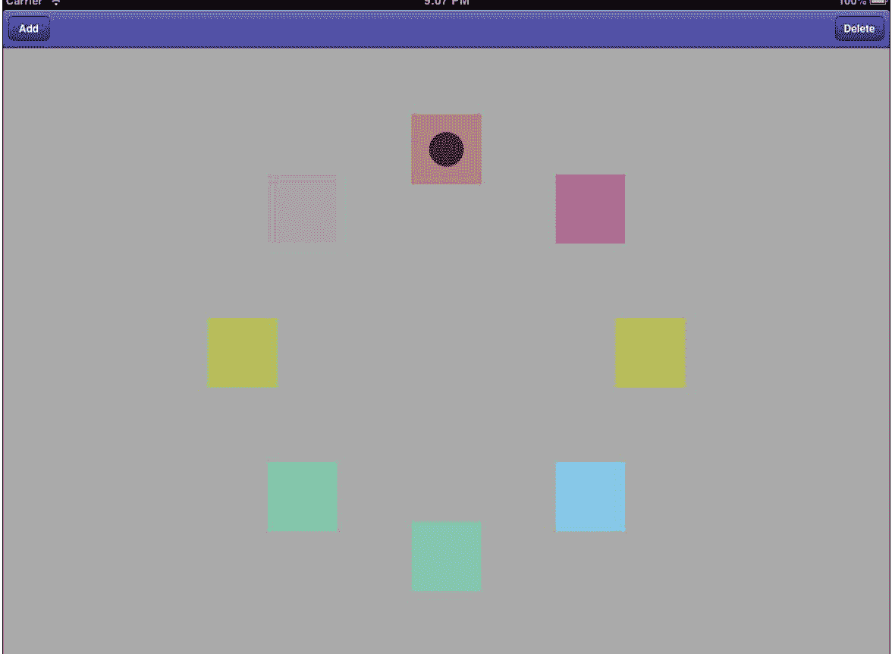

图 11-8。这种圆形布局流灵感来自 Apple 提供的示例代码，并受到了开发者 Greg Hartstein 努力的鼓励。

## 配方 11-6. 在圆中布局视图

```objectivec
@implementation CircleLayout

- (void)prepareLayout {
    [super prepareLayout];
    CGSize size = self.collectionView.frame.size;
    numberOfItems = [self.collectionView numberOfItemsInSection:0];
    centerPoint = CGPointMake(size.width / 2.0f, size.height / 2.0f);
    radius = MIN(size.width, size.height) / 3.0f;
}

// 将内容大小固定为帧大小
- (CGSize)collectionViewContentSize {
    return self.collectionView.frame.size;
}

// 计算每个项目的位置
- (UICollectionViewLayoutAttributes *)layoutAttributesForItemAtIndexPath:(NSIndexPath *)path {
    UICollectionViewLayoutAttributes *attributes = [
        [UICollectionViewLayoutAttributes alloc]
        layoutAttributesForCellWithIndexPath:path];

    CGFloat progress = (float)path.item / (float)numberOfItems;
    CGFloat theta = 2.0f * M_PI * progress;
    CGFloat xPosition = centerPoint.x + radius * cos(theta);
    CGFloat yPosition = centerPoint.y + radius * sin(theta);

    attributes.size = [self itemSize];
    attributes.center = CGPointMake(xPosition, yPosition);
    return attributes;
}

// 计算所有项目的布局
- (NSArray *)layoutAttributesForElementsInRect:(CGRect)rect {
    NSMutableArray *attributes = [NSMutableArray array];
    for (NSInteger index = 0; index < numberOfItems; index++) {
        NSIndexPath *indexPath = [NSIndexPath indexPathForItem:index inSection:0];
        [attributes addObject:[self layoutAttributesForItemAtIndexPath:indexPath]];
    }
    return attributes;
}

```

```objectivec
// 从更新构建插入和删除集合
- (void)prepareForCollectionViewUpdates:(NSArray *)updates {
    [super prepareForCollectionViewUpdates:updates];
    for (UICollectionViewUpdateItem *updateItem in updates) {
        if (updateItem.updateAction == UICollectionViewUpdateActionInsert) {
            [insertedIndexPaths addObject:updateItem.indexPathAfterUpdate];
        } else if (updateItem.updateAction == UICollectionViewUpdateActionDelete) {
            [deletedIndexPaths addObject:updateItem.indexPathBeforeUpdate];
        }
    }
}

// 为添加的项目建立起始属性
- (UICollectionViewLayoutAttributes *)initialLayoutAttributesForAppearingItemAtIndexPath:(NSIndexPath *)itemPath {
    UICollectionViewLayoutAttributes *attributes = [self layoutAttributesForItemAtIndexPath:itemPath];
    attributes.alpha = 0.0;
    attributes.center = centerPoint;
    return attributes;
}

// 为删除的项目建立结束属性
- (UICollectionViewLayoutAttributes *)finalLayoutAttributesForDisappearingItemAtIndexPath:(NSIndexPath *)itemPath {
    UICollectionViewLayoutAttributes *attributes = [self layoutAttributesForItemAtIndexPath:itemPath];
    return attributes;
}

@end
```


```objectivec
attributes.alpha = 0.0;

attributes.center = centerPoint;

attributes.transform3D = CATransform3DMakeScale(0.1, 0.1, 1.0);

return attributes;

}

// 处理所有项目的插入动画

-(UICollectionViewLayoutAttributes *)
initialLayoutAttributesForAppearingItemAtPath:(NSIndexPath *)indexPath
{
    return [insertedIndexPaths containsObject:indexPath] ?
    [self insertionAttributesForItemIndexPath:indexPath] :
    [super initialLayoutAttributesForAppearingItemAtIndexPath:indexPath];
}

// 处理所有项目的删除动画

-(CollectionViewLayoutAttributes *)
finalLayoutAttributesForDisappearingItemAtPath:(NSIndexPath *)indexPath
{
    return [deletedIndexPaths containsObject:indexPath] ?
    [self deletionAttributesForItemIndexPath:indexPath] :
    [super finalLayoutAttributesForDisappearingItemAtPath:indexPath];
}

@end
```

## 获取此配方的代码

要找到此配方的完整示例项目，请将浏览器指向 `https://github.com/erica/iOS-6-Cookbook` 并进入第 11 章的文件夹。

## 配方：在布局中添加手势

配方 11-7 通过添加调整演示布局的交互式手势来构建配方 11-6。配方 11-7 通过调整半径（它从原始大小的最小 0.5 倍缩放到最大 1.3 倍）和起始角度（初始为 0）来计算用户手势对布局的影响。注意，每次旋转更新时都会失效布局，以便实时更新演示。由于图形负载，此配方最好在设备上测试。

# 配方 11-7. 为集合视图布局添加手势

```objectivec
// 中间旋转

-(void) rotateBy:(CGFloat)theta { currentRotation = theta; }

// 最终旋转

-(void) rotateTo:(CGFloat) theta
{
    rotation += theta;
    currentRotation = 0.0f;
}

// 缩放

-(void) scaleTo: (CGFloat) factor
{
    scale = factor;
}

// 计算每个项目的位置

-(UICollectionViewLayoutAttributes *)
layoutAttributesForItemIndexPath:(NSIndexPath *)path
{
    UICollectionViewLayoutAttributes *attributes =
        [UICollectionViewLayoutAttributes layoutAttributesForCellWithIndexPath:path];

    CGFloat progress = (float)path.item / (float)numberOfItems;
    CGFloat theta = 2.0f * M_PI * progress;

    // 根据当前手势更新缩放和旋转

    CGFloat scaledRadius = MIN(MAX(scale, 0.5f), 1.3f) * radius;
    CGFloat rotatedTheta = theta + rotation + currentRotation;

    // 计算新位置

    CGFloat xPosition =
        centerPoint.x + scaledRadius * cos(rotatedTheta);
    CGFloat yPosition =
        centerPoint.y + scaledRadius * sin(rotatedTheta);

    attributes.size = [self itemSize];
    attributes.center = CGPointMake(xPosition, yPosition);

    return attributes;
}
```

```objectivec
-(void) pinch:(UIPinchGestureRecognizer *) pinchRecognizer
{
    CircleLayout *layout = (CircleLayout *)self.collectionViewLayout;

    if (pinchRecognizer.state == UIGestureRecognizerStateEnded)
        [layout scaleTo:pinchRecognizer.scale];
    else
        [layout scaleBy:pinchRecognizer.scale];
}

-(void) rotate:(UIRotationGestureRecognizer *) rotationRecognizer
{
    CircleLayout *layout = (CircleLayout *)self.collectionViewLayout;

    if (rotationRecognizer.state == UIGestureRecognizerStateEnded)
        [layout rotateTo:rotationRecognizer.rotation];
    else
        [layout rotateBy:rotationRecognizer.rotation];
}
```

### 创建真正的网格布局

默认的流布局将行封装以适应在单方向移动的滚动视图。如果你愿意进行数学计算（我警告你，计算量很大，而且我不完全确定自己是否完全处理正确），你可以创建一个自定义布局子类，该布局可以在双方向滚动且不换行。图 11-9 显示了这种布局。

图 11-9. 此自定义布局网格允许用户在两个方向上滚动。

配方 11-8 完全自定义了其布局子类，通过重写 `collectionViewContentSize` 和 `layoutAttributesForItem:` 来手动放置每个项目。这种实现完全遵循了所有的间距请求和代理回调。相比之下，普通的流式布局尝试在满足各种最小值的同时拟合项目。而此布局则精确地使用了这些值，而是通过调整底层滚动视图的内容尺寸来精确匹配缩放需求。

此配方的工作原理是详尽地计算每个布局元素。然而，它没有使用描述如何换行的 `line-spacing`（行间）属性。这种网格展示从不换行任何行，因此它完全忽略了该属性。

它还添加了一个新的自定义布局属性 `alignment`。该属性控制每行是在顶部、居中还是底部对齐。它通过查看整行的总高度，然后可选地对小于该高度的项目进行偏移来实现这一点。

我包含了整个布局代码，以便让你直观感受到一个完整的自定义子类需要投入多少精力。当然，诀窍在于细节。尽可能在广泛的源对象上彻底地测试布局。

## 配方 11-8. 网格布局自定义

```objc
@implementation GridLayout

#pragma mark Items

// 代理是否提供了单个项目的尺寸设置？

- (BOOL) usesIndividualSizing
{
    return [self.collectionView.delegate respondsToSelector:
    @selector(collectionView:layout:sizeForItemAtIndexPath:)];
}

// 返回项目的 cell 尺寸

- (CGSize) sizeForItemAtIndexPath: (NSIndexPath *) indexPath
{
    BOOL individuallySized = [self usesIndividualSizing];
    CGSize itemSize = self.itemSize;

    if (individuallySized)
        itemSize = [(id<UICollectionViewDelegateFlowLayout>)
        self.collectionView.delegate
        collectionView:self.collectionView
        layout:self sizeForItemAtIndexPath:indexPath];

    return itemSize;
}

#pragma mark Insets

// 单独的间距？

- (BOOL) usesIndividualInsets
{
    return [self.collectionView.delegate respondsToSelector:
    @selector(collectionView:layout:insetInSection:)];
}

// 返回 section 的间距

- (UIEdgeInsets) insetsInSection:(NSInteger) section
{
    UIEdgeInsets insets = self.sectionInset;

    if ([self usesIndividualInsets])
        insets = [(id<UICollectionViewDelegateFlowLayout>)
        self.collectionView.delegate
        collectionView:self.collectionView
        layout:self insetForSectionAtIndex:section];

    return insets;
}

#pragma mark Item Spacing

// 单独的项间距？

- (BOOL) usesIndividualItemSpacing
{
    return [self.collectionView.delegate respondsToSelector:
      @selector(collectionView:layout:minimumInteritemSpacingForSectionAtIndex:)];
}

// 返回 section 的间距

- (CGFloat) itemSpacingForSection: (NSInteger) section
{
    CGFloat spacing = self.minimumInteritemSpacing;

    if ([self usesIndividualItemSpacing])
        spacing = [(id<UICollectionViewDelegateFlowLayout>)
            self.collectionView.delegate
            collectionView:self.collectionView
            layout:self
            minimumInteritemSpacingForSectionAtIndex:section];

    return spacing;
}

#pragma mark Layout Geometry

// 找到最高的子视图

- (CGFloat) maxHeightForSection: (NSInteger) section
{
    CGFloat maxHeight = 0.0f;

    NSInteger numberOfItems = [self.collectionView numberOfItemsInSection:section];

    for (int i = 0; i < numberOfItems; i++) {
        NSIndexPath *indexPath = [NSIndexPath indexPathForItem:i inSection:section];
        CGSize itemSize = [self sizeForItemAtIndexPath:indexPath];
        maxHeight = MAX(maxHeight, itemSize.height);
    }

    return maxHeight;
}

// 从 section 开始到结束的“水平”行基跨度

- (CGFloat) fullWidthForSection: (NSInteger) section
{
    UIEdgeInsets insets = [self insetsInSection:section];
    CGFloat horizontalExtent = insets.left + insets.right;
    CGFloat collectiveWidth = horizontalExtent;

    NSInteger numberOfItems = [self.collectionView numberOfItemsInSection:section];

    for (int i = 0; i < numberOfItems; i++) {
        NSIndexPath *indexPath = [NSIndexPath indexPathForItem:i inSection:section];
        CGSize itemSize = [self sizeForItemAtIndexPath:indexPath];
        collectiveWidth += itemSize.width;
        collectiveWidth += [self itemSpacingForSection:section];
    }

    // 减去一个间隔，n-1 个栅栏
    collectiveWidth -= [self itemSpacingForSection:section];

    return collectiveWidth;
}

// 每个 section 的边界尺寸

- (CGSize) fullSizeForSection: (NSInteger) section
{
    CGFloat headerExtent = (self.scrollDirection ==
    UICollectionViewScrollDirectionHorizontal) ?
    self.headerReferenceSize.width:
    self.headerReferenceSize.height;

    CGFloat footerExtent = (self.scrollDirection ==
    UICollectionViewScrollDirectionHorizontal) ?
    self.footerReferenceSize.width:
    self.footerReferenceSize.height;

    UIEdgeInsets insets = [self insetsInSection:section];
    CGFloat verticalInsetExtent = insets.top + insets.bottom;
    CGFloat maxHeight = [self maxHeightForSection:section];

    CGFloat fullHeight = headerExtent + footerExtent +
    verticalInsetExtent + maxHeight;

    CGFloat fullWidth = [self fullWidthForSection:section];

    return CGSizeMake(fullWidth, fullHeight);
}

// 每个项目向下偏移多远

- (CGFloat) verticalInsetAtIndexPath: (NSIndexPath *) indexPath
{
    UIEdgeInsets insets = [self insetsInSection:indexPath.section];
    CGFloat verticalOffset = insets.top;

    // 之前的 sections
    if (indexPath.section > 0) {
        for (int i = 0; i < indexPath.section; i++) {
            verticalOffset += [self fullSizeForSection:i].height;
        }
    }

    // Header
    CGFloat headerExtent = self.scrollDirection ==
    UICollectionViewScrollDirectionHorizontal ?
    self.headerReferenceSize.width:
    self.headerReferenceSize.height;

    verticalOffset += headerExtent;

    // 顶部 inset
    verticalOffset += insets.top;

    // 垂直居中
    CGFloat maxHeight = [self maxHeightForSection:indexPath.section];
```


```objc
CGFloat fullHeight = maxHeight - thisSize.height;

CGFloat midHeight = fullHeight / 2.0f;

switch (self.alignment) {

  case GridAlignmentNone:

  case GridAlignmentTop:

    break;

  case GridAlignmentCenter:

    verticalOffset += midHeight;

    break;

  case GridAlignmentBottom:

    verticalOffset += fullHeight;

    break;

  default:

    break;

}

return verticalOffset;

}

// 项目在 section 内水平偏移多远

(CGFloat) horizontalInsetAtIndexPath: (NSIndexPath *) indexPath
{

    UIEdgeInsets insets = [self insetsForSection:section];

    CGFloat horizontalOffset = insets.left;

    if (indexPath.item > 0) {

      for (int i = 0; i < indexPath.item; i++) {

        horizontalOffset += [self sizeForItemAtIndexPath:indexPath].width + [self itemSpacingForSection:section];

      }

    }

    return horizontalOffset;

}

#pragma mark Layout Attributes

// 提供项目的放置属性

-(UICollectionViewLayoutAttributes*)
layoutAttributesForItemPath:(NSIndexPath *)indexPath
{

    UICollectionViewLayoutAttributes *attributes =

        [UICollectionViewLayoutAttributes layoutAttributesForCellWithIndexPath:indexPath];

    CGSize thisSize = [self sizeForItemAtIndexPath:indexPath];

    float verticalOffset =

        [self verticalInsetAtIndexPath:indexPath];

    float horizontalOffset =

        [self horizontalInsetAtIndexPath:indexPath];

    if (self.scrollDirection == UICollectionViewScrollDirectionVertical)
        attributes.frame = CGRect(horizontalOffset,
            verticalOffset, thisSize.width, thisSize.height);
    else
        attributes.frame = CGRect(verticalOffset,
            horizontalOffset, thisSize.width, thisSize.height);

    return attributes;

}

// 返回完整尺寸

-(CGSize)collectionViewContentSize
{

    NSInteger sections = self.collectionView.numberOfOfSections;

    CGFloat maxWidth = 0.0f;

    CGFloat maxHeight = 0.0f;

    for (int i = 0; i < sections; i++) {

        CGSize sectionSize = [self fullSizeForSection:i];

        maxHeight += sectionSize.height;

        maxWidth = MAX(maxWidth, sectionSize.width);

    }

    if (self.scrollDirection == UICollectionViewScrollDirectionVertical)
        return CGSizeMake(maxWidth, maxHeight);
    else
        return CGSizeMake(maxHeight, maxWidth);

}

@end
```

```objc
// Provide grid layout attributes (NSArray *) layoutAttributesForElementsInRect: (CGRect) rect
{
    NSMutableArray *attributes = [NSMutableArray array];

    for (NSInteger section = 0; section < [self.collectionView numberOfOfSections]; section++) {
        for (NSInteger item = 0; item < [self.collectionView numberOfOfItemsInSection:section]; item++) {
            UICollectionViewLayoutAttributes *layout = 
                [self layoutAttributesForItemAtIndexPath:[NSIndexPath indexPath(item:item, section:section)]];
            [attributes addObject:layout];
        }
    }

    return [attributes copyArray];
}

-(BOOL) shouldInvalidateLayoutForBoundsChange: (CGRect) oldBounds
{
    return YES;
}

@end
```

# 获取此章节的代码

要找到此食谱的完整示例项目，请将浏览器指向 `https://github.com/erica/iOS-6-Cookbook` 并进入第 11 章文件夹。

# 食谱：自定义项目菜单

我非常确定有一种方法可以处理非标准的集合视图菜单，如图 11-10 所示的那种。遗憾的是，我尝试使用代理方法 `collectionView:shouldShowMenuForItemAtIndexPath:` 来实现它们，但并没有产生任何结果。相反，我创建了一个自定义单元格类并添加了一个双击手势识别器。

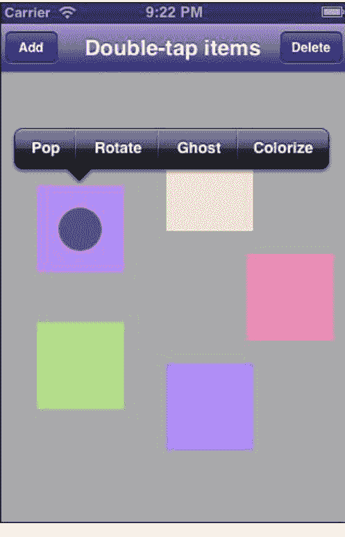

图 11-10。这些自定义的逐项目菜单需要单元格成为第一响应者（first responder）。

激活时，回调会将单元格设置为第一响应者（通常会伴随着对不知道集合视图响应者类型的抱怨），并显示标准菜单。

食谱 11-9 显示了相关细节。单元格子类声明了它可以成为第一响应者，这是显示菜单的必要前提条件。它设置了想要处理的菜单项，然后添加了 `canPerformAction:withSender:` 支持以确认每项的显示。图 11-10 显示了此代码创建的菜单。

# 食谱 11-9。自定义集合视图单元格菜单

```objc
- (BOOL) canBecomeFirstResponder
{
    return YES;
}

- (BOOL) canPerformAction:(SEL) action withSender:(id) sender
{
    if (action == @selector(ghostSelf)) return YES;
    if (action == @selector(popSelf)) return YES;
    if (action == @selector(rotateSelf)) return YES;
    if (action == @selector(colorize)) return YES;
    return NO;
}

(void) tapped:(UIGestureRecognizer *) uigr {
    if (uigr.state == UIGestureRecognizerStateRecognized) return;
    [[MenuController sharedMenuController] setVisible:NO animated:YES];
    [self becomeFirstResponder];
    *menu = [[UIMenuController sharedMenuController];
    UIMenuItem *pop = [[UIMenuItem alloc] initWithTitle:"Pop" action:@selector(popSelf)];
    UIMenuItem *rotate = [[UIMenuItem alloc] initWithTitle:"Rotate" action:@selector(rotateSelf)];
    UIMenuItem *ghost = [[UIMenuItem alloc] initWithTitle:"Ghost" action:@selector(ghostSelf)];
    UIMenuItem *colorize = [[UIMenuItem alloc] initWithTitle:"Colorize" action:@selector(colorize)];
    [menu setItems:@[pop, rotate, colorize]];
    [menu update];
    [menu setRect:self.bounds inView:self];
    [menu setVisible:YES animated:YES];
}
```

# 获取此章节的代码

要找到此食谱的完整示例项目，请将浏览器指向 `https://github.com/erica/iOS-6-Cookbook` 并进入第 11 章文件夹。

## 总结

本章引入了集合视图以及它们的自定义布局流。你学习了如何同时创建集合视图控制器以及它们的独立视图。你发现了如何设置关键的布局属性。你学习了创建实时效果反馈的插入和删除的动态效果。在进入下一章之前，关于集合视图有以下几点需要考虑：

- 集合视图提供了惊人的功能，而不需要大量的代码。许多在表格视图中令人抓狂且几乎不可能实现的功能，现在通过一组更强大的 API 就可以实现了。
- 本章几乎没有触头部和页脚视图，而且完全没有使用装饰视图。本章附的示例代码包含了更多关于创建补充视图类的细节说明。
- 基于变换（Transform）的更新有助于让你的集合视图生栩起来。不要害怕让界面动画以响应用户交互。同时，避免仅仅为了添加效果而添加效果。一点点动画就能产生很好的效果。
- 说起动画，本章用于项目的相同插入和删除属性方法也适用于补充元素。此功能允许你为集合中新扇节的到达和离开制作动画。
- 同样地，有意义地整合手势。如果用户不太可能发现你的长按或三击的添加或删除请求，请跳过它。相反，使用弹出窗口、菜单、浮动覆盖层或简单的按钮来告知如何管理和更改项目。
- 在探索布局时，不要依赖流布局文档。相反，请查看 `UICollectionViewLayout` 抽象父类。它详细说明了你覆盖的所有核心方法。
- 最后，始终测试你的数据。

# 12. Core Data 初体验

Core Data 简化了数据管理。在 Core Data 框架出现之前，数据访问完全依赖底层库。Core Data 提供了一个灵活的架构。

# 介绍 Core Data

Core Data 简化了数据管理。在 Core Data 框架出现之前，数据访问完全依赖底层库。Core Data 提供了一个灵活的架构。

# 实体与模型

实体位于 Core Data 层次结构的顶层。它们描述存储在数据库中的对象。实体提供了创建每个对象的规范。当你构建新对象时，实体详细说明组成每个对象的属性。每个实体都有名称，Core Data 用它检索实体描述。

你在模型文件中构建实体。每个使用 Core Data 的项目包含一个或多个模型文件。这些 `.xdata` 文件定义了实体、属性及其关系。

# 构建模型文件

通过布局新的模型文件来创建模型。某些 iOS 模板允许将 Core Data 作为项目的一部分。否则，你可以通过 `File` > `New` > `File` > `iOS` > `Core Data` > `Model` > `Next` 创建这些 Xcode 模型。为新文件命名（本例使用 Person），检查项目的 Target，点击 Save。Xcode 会创建并将新模型添加到项目中（例如，`Person.xcdatamodel`）。在文件导航器中点击 `xcdatamodel` 文件，即可在图 12-1 所示的编辑器窗口中打开它。

图 12-1. Xcode 编辑器允许你为 Core Data 应用构建托管对象定义。

编辑器的中间部分允许你自定义属性和关系，这些是实体在数据库中相互关联的可选方式。右侧的右侧提供了特定上下文的设置。在这里，它显示了 Person 实体 emailaddress 属性的详细信息。

实体编辑器（Entity editor）提供两种布局样式。通过点击编辑器面板右下角的按钮，可以在表格视图和对象图之间进行切换。

图 12-1 所示的详细表格样式提供了模型中定义的每个实体、属性和关系的列表。对象图提供了你所定义的实体的基于网格的可视化，允许你可视化并编辑实体关系以及实体之间的相互关系。例如，一个父级可以有多个孩子和一个配偶。一个部门可能包含成员，一个经理可能在多个委员会任职。

## 属性与关系

每个实体都可能包含属性，属性用于存储名称、出生日期、头衔等信息。与该实体对应的 Objective-C 对象表示了由这些属性定义的属性。

每个实体还可以定义关系，即一个对象与另一个对象之间的链接。这些关系可以是单的，即使用一对一关系（配偶、雇主），也可以是多个的（孩子、信用卡账户），即使用一对多关系。此外，关系应该是互惠的，即提供一个反向关系（如我的孩子，他的父母）。

选择一个实体开始添加属性。选中实体后，点击编辑器面板右下角的“添加属性”（Add Attribute）按钮。（长按此按钮可以在添加属性、添加关系和添加获取属性（Add Fetched Property）之间选择。）每个属性都有名称和数据类型，就像你需要定义实例变量一样。关系提供了指向其他对象的指针。在运行图形编辑器工作时，你可以通过 Control-拖动来创建它们。箭头表示你项目中不同类型实体之间的关系。

在最简单的层级，你可以只处理一个没有关系的单一实体，尽管 Core Data 提供了一个功能全的关系型数据库。大多数 iOS 应用并不需要复杂的结构。一个带有分段属性的扁平数据库就足以驱动表格视图（table views）和集合视图（collection views）。

要构建图 12-1 中的模型，请创建一个 Person 实体并添加七个属性：email-address、gender、middleinitial、occupation、surname 和 section。将每个类型都设置为 String。

## 构建对象类

创建实体定义后，将更改保存到数据模型文件中。然后从左侧列中选择该实体，并选择“编辑器”（Editor）、创建 NSManagedObject 子类”（Create NSManagedObject Subclass）。将其保存到你的项目文件夹，选择你想要将类所在的组，并点击“创建”（Create）。Xcode 根据你的实体描述生成类文件。以下是自动生成的 Person 类的内容：

```objc
@interface Person : NSManagedObject

@property (nonatomic, retain) NSString * section;

@property (nonatomic, retain) NSString * email;

@property (nonatomic, retain) NSString * gender;

@property (nonatomic, retain) NSString * givenname;

@property (nonatomic, retain) NSString * middleinitial;

@property (nonatomic, retain) NSString * occupation;

@property (nonatomic, retain) NSString * surname;

@end

@implementation Person

@dynamic section;

@dynamic emailaddress;

@dynamic gender;

@dynamic givenname;

@dynamic middleinitial;

@dynamic occupation;

@dynamic surname;

@end
```


每个属性对应一个字符串属性。当你使用其他属性类型时，它们的属性将相应对应（例如 `NSDate`、`NSNumber`、`NSData`）。如果你添加了一个一对多的关系，你将看到一个集合（set）。`@dynamic` 指令在运行时创建属性访问器。

## 创建上下文

在 Core Data 中，实体提供描述。对象是根据实体规范创建的实际类实例。这些实例继承自 `NSManagedObject` 类并代表数据库中的条目。

Core Data 对象位于托管对象上下文（managed object context）中。这些上下文是 `NSManagedObjectContext` 的实例，代表应用程序中的对象空间。本章使用的是对象上下文，尽管你可以在自己的应用中创建复杂的实现。

你在启动应用程序时建立上下文，并使用该上下文对存储数据执行所有对象获取请求。上下文的故事从应用程序包加载你创建的任何模型开始。你不需要指定任何名称。Core Data 会为你完成这些工作：

```objc
// 初始化模型
NSManagedObject *managedObjectModel = [NSManagedObject mergedFromBundles:nil];
```

接下来，创建一个存储协调器（store coordinator）并将其连接到应用沙盒中的文件（存储）。协调器管理应用程序中的托管对象模型与本地文件之间的关系。你提供一个优选保存数据的文件的 URL。此代码段使用了 `NSSQLiteStoreType`，它使用标准的 SQLite 二进制格式创建文件：

```objc
// 创建存储协调器
NSPersistentStoreCoordinator *persistentStoreCoordinator = [[NSPersistentStoreCoordinator alloc] initWithManagedObjectModel:managedObjectModel];

// 连接到数据存储（磁盘上）
NSURL *url = [NSURL fileWithPath:dataPath];
if (![persistentStoreCoordinator addPersistentStoreWithType:NSSQLiteStoreType configuration:nil url:url options:&error]) {
    NSLog(@"Error creating persistent store coordinator: %@ %@", error.localizedFailureReason);
    return;
}
```

最后，你创建实际的上下文并将一个属性设置为你刚刚创建的协调器：

```objc
// 创建并建立上下文
context = [[NSManagedObjectContext alloc] init];
context.persistentStoreCoordinator = persistentStoreCoordinator;
```

## 添加数据

`NSEntityDescription` 类允许你向上下文中插入新对象。它允许你添加新的数据条目以填充文件。提供一个实体名称，上下文会返回一个新的托管对象供你操作：

```objc
NSManagedObject *object = [NSEntityDescription insertObjectForEntityName:@"Person" inObject:context];
```

在收到新对象后，自定义其属性并进行保存：

```objc
[context save:&error];
if (error) {
    NSLog(@"Error saving context: %@", error.localizedFailureReason);
}
```

一个典型的模式可以是这样的：你创建一个或多个对象，设置它们的属性，然后保存。Core Data 处理将它们插入数据库的复杂操作。

# 查询数据库

通过执行获取请求（fetch requests）从数据库中检索对象。获取请求描述了你用于选择对象的搜索标准。它被传递并用于初始化一个结果对象，该对象包含一个符合这些标准的已检索对象数组。这里是一个示例方法，其返回类型为 void。它避免了将获取结果直接加载到与辅助类属性关联的本地实例变量（`_searchResultsController`）中：

```objc
(void) fetchItemsMatching:(NSString*) searchString
forAttribute: (NSString*) attribute
sortingBy: (NSString*) sortAttribute
{
    // 构建实体描述
    NSEntityDescription *entity = [NSEntityDescription entityName:entityName inManagedContext:_context];

    // 初始化获取请求
    NSFetchRequest *fetchRequest = [[NSFetchRequest alloc] init];
    fetchRequest.entity = entity;
    [fetchRequest setBatchSize:0];

    // 对项目进行升序排序
    NSString *sortKey = sortAttribute ? defaultSortAttribute : nil;
    NSortDescriptor *sortDescriptor = [[NSortDescriptor alloc] initWithKey:sortKey ascending:YES selector:nil];
    NSArray *descriptors = @[sortDescriptor];
    fetchRequest.descriptors = descriptors;

    // 可选谓词设置
    if (searchString && attribute) fetchRequest.predicate = [NSString predicateFormat:"%K contains[cd] %@", attribute, searchString];

    // 执行获取
    NSError *_autoreleasing *error;
    _fetchedResultsController = [[NSFetchedResultsController alloc] initWithFetchRequest:fetchRequest managedObjectContext:context entityKeyPath:@"section" cacheName:nil];
    if (!_fetchedResultsController performFetch:&error) {
        NSLog(@"Error fetching data: %@", error.localizedDescription);
    }
}
```

## 设置获取请求

获取请求描述了你想要如何搜索数据。此过程从根据给定的实体名称检索一个实体开始。对于 Person 实体，名称为 `@"Person"`。该描述指定了你想要搜索的数据类型。

创建一个新的获取请求，并使用你刚刚检索的实体描述和批处理大小（batch size）对其初始化。批处理大小为 0 对应无限结果。如果你想限制返回结果的数量，将批处理大小设置为正数。

每个请求必须至少包含一个排序描述符（sort descriptor）。此方法使用排序键按升序（`ascending:YES`）工作。排序键是一个字符串（例如，`@"surname"`）。获取请求的 `sortDescriptors` 接收一个描述符数组。

获取请求使用可选的描述符来将结果缩小到符合某些规则的条目。当调用者提供相应的 `searchString` 和 `attribute` 参数时，此方法会创建一个形式为 `contains[cd] string` 的谓词。这创建了一个不区分大小写的测试匹配；`[cd]` 指的是不区分大小写且对重音敏感的匹配。重音（Diacritics）是伴随字母的小标记，例如变音符号上的点或 n 上方的波浪号。

`%@` 格式将一个项直接包含在谓词中，例如使用的搜索字符串。`%K` 格式指定一个属性。如果你没有使用它，谓词 `@'surname' contains[cd] %u` 将返回 true，因为 surname 的第二个字母是 u。使用 `%K` 来匹配属性名（property），而不是属性的名称（name）。

对于更复杂的查询，你可以分配一个复合谓词（compound predicate）。复合谓词允许你使用标准逻辑操作（如 AND、OR 和 NOT）组合简单谓词。`NSCompoundPredicate` 类根据组件谓词构建谓词。你也可以跳过复合谓词类，直接在简单的 `NSPredicate` 文本中包含 AND、OR 和 NOT。

## 执行获取

为每个查询创建一个新的获取结果控制器（fetched results controller）。使用获取请求、上下文（context）和分段名称键路径（section name key path）对其初始化。对于我的应用，我直接使用 `@section` 并确保为我的对象定义了段属性；我的需求并不复杂。

控制器还使用一个缓存参数（cache parameter）。缓存可以减少与带段和索引结构化数据相关的开销。


## 设置获取请求

获取请求描述了你想要如何搜索数据。此过程从根据给定的实体名称检索一个实体开始。对于 `Person` 实体，名称为 `@"Person"`。该描述指定了你想要搜索的数据类型。

创建一个新的获取请求，并使用你刚刚检索的实体描述和批处理大小（batch size）对其初始化。批处理大小为 0 对应无限结果。如果你想限制返回结果的数量，将批处理大小设置为正数。

每个请求必须至少包含一个排序描述符（sort descriptor）。此方法使用排序键按升序（`ascending:YES`）工作。排序键是一个字符串（例如，`@"surname"`）。获取请求的 `sortDescriptors` 接收一个描述符数组。

获取请求使用可选的描述符来将结果缩小到符合某些规则的项。当调用者提供相应的 `searchString` 和 `attribute` 参数时，此方法会创建一个形式为 `contains[cd] string` 的谓词。这创建了一个不区分大小写的测试匹配；`[cd]` 指的是不区分大小写且对重音敏感的匹配。重音（Diacritics）是伴随字母的小标记，例如变音符号上的点或 `n` 上方的波浪号。

`%@` 格式将一个项直接包含在谓词中，例如使用的搜索字符串。`%K` 格式指定一个属性。如果你没有使用它，谓词 `@'surname' contains[cd] %u` 将返回 true，因为 surname 的第二个字母是 u。使用 `%K` 来匹配属性名（property），而不是属性的名称（name）。

对于更复杂的查询，你可以分配一个复合谓词（compound predicate）。复合谓词允许你使用标准逻辑操作（如 `AND`、`OR` 和 `NOT`）组合简单谓词。`NSCompoundPredicate` 类根据组件谓词构建谓词。你也可以跳过复合谓词类，直接在简单的 `NSPredicate` 文本中包含 `AND`、`OR` 和 `NOT`。

## 执行获取

为每个查询创建一个新的获取结果控制器（fetched results controller）。使用获取请求、上下文（context）和分段名称键路径（section name key path）对其初始化。对于我的应用，我直接使用 `@section` 并确保为我的对象定义了段属性；我的需求并不复杂。

控制器还使用一个缓存参数（cache parameter）。缓存可以减少与带段和索引结构化数据相关的开销。

## 表格准备工作

正如这些属性和方法所示，获取到的结果实例（fetched results instances）已经准备好用于表格。食谱 12-1 展示了所有的标准表格方法，并针对 Core Data 获取结果控制器进行了适配。如你所见，用于创建和管理分区的每个方法都非常短。Core Data 内置的访问功能将这些方法缩减到每个一两行。

这是因为创建和访问分区的工作都直接交给了 Core Data。初始化每个获取数据请求的调用指定了用于分区的的数据属性。随后，Core Data 会接管并完成剩余的工作。

图 12-2 显示了食谱 12-1 构建的接口。它提供了一个功能完整的表格，包含分区头部和浮动索引。

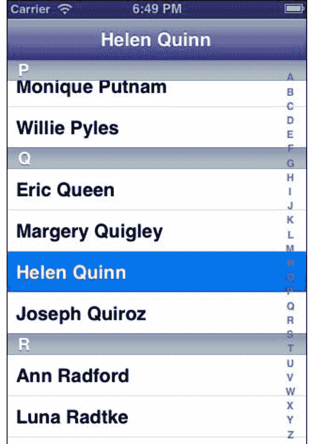

图 12-2。食谱 12-1 以最少的编程工作创建了一个功能完整的表格。Core Data 驱动了所有这些功能，从单元格内容到分区头部再到索引。

> **注意**
> 你可能需要重置模拟器或删除本章设备中的 Hello World 应用，因为它们都使用同一个数据库文件（`Person.sqlite`），该文件会持久化在 Documents 文件夹中。

# 食谱 12-1. 使用 Core Data 构建分区表格

```objc
#pragma mark Data Source

// 分区数量
- (NSInteger)numberOfSectionsInTableView:(UITableView *)tableView
{
    return dataHelper.fetchedResultsController.sections.count;
}

// 每个分区的行数
- (NSInteger)tableView:(UITableView *)tableView numberOfRowsInSection:(NSInteger)section
{
    id <NSFetchedResultsSectionInfo> sectionInfo = dataHelper.fetchedResultsController.sections[section];
    return sectionInfo.numberOfObjects;
}

// 为给定分区返回标题
- (NSString *)tableView:(UITableView *)tableView titleForHeaderInSection:(NSInteger)section
{
    NSArray *titles = [dataHelper.fetchedResultsController sectionIndexTitles];
    if (titles.count <= section)
        return @"Error";
    return titles[section];
}

// 分区索引标题
- (NSArray *)sectionIndexTitlesForTableView:(UITableView *)tableView
{
    return [dataHelper.fetchedResultsController sectionIndexTitles];
}

// 为索引路径填充单元格
- (UITableViewCell *)tableView:(UITableView *)tableView cellForRowAtIndexPath:(NSIndexPath *)indexPath
{
    UITableViewCell *cell = [tableView dequeueReusableCellWithIdentifier:@"cell" forIndexPath:indexPath];
    Person *person = (Person *)[dataHelper.fetchedResultsController objectAtIndexPath:indexPath];
    cell.textLabel.text = person.fullname;
    return cell;
}

#pragma mark Delegate

- (void)tableView:(UITableView *)tableView didSelectRowAtIndexPath:(NSIndexPath *)indexPath
{
    // 当选中某行时，相应更新表格标题
    Person *person = (Person *)[dataHelper.fetchedResultsController objectAtIndexPath:indexPath];
    self.title = person.fullname;
}
```

## 获取此食谱的代码

要找到此食谱的完整示例，请将浏览器指向 `https://github.com/erica/iOS-6-Cookbook` 并进入第 12 章的文件夹。

# 食谱：搜索表格与 Core Data

数据存储的设计是为了与 `NSPredicate` 高效地工作。谓词（Predicates）允许你创建获取请求，仅选择符合谓词规则或规则的托管对象。在获取请求中添加谓词会将获取结果限制为匹配的对象。食谱 12-2 利用了本章早期引入的谓词，为表格视图添加了搜索功能。

用户可以搜索姓氏与其输入的字符串匹配的条目。当表格顶部搜索栏中的文字变化时，搜索栏代理会接收 `searchBar:textDidChange:` 回调。随后，该回调方法会以该内容为基础执行新的获取操作。

对食谱的更改如下：

- `loadView` 方法添加了一个搜索控制器；`viewWillAppear` 将搜索字段移出视线。
- 搜索索引扩展到包含一个搜索图标，而“索引的分区（section for index）”方法通过将搜索控制器的框架滚动到视图中来尊重该图标。
- 搜索栏代理方法会在搜索字段内容发生变化时每次获取新结果。它们提交一个新的 Core Data 获取请求，并使用这些结果来填充表格视图。

这几处更改共同创建了一个由搜索字段驱动的表格，能够响应用户驱动查询。正如食谱 12-1 和 12-2 所示，让表格视图与 Core Data 配合所需的工作少得惊人。

# 食谱 12-2. 使用带谓词的获取请求

```objc
// 分区标题加搜索
- (NSArray *)sectionIndexTitlesForTableView:(UITableView *)tableView
{
    if (tableView == controller.searchResultsTableView) return nil;
    return [[NSArray arrayWithObject:UITableViewIndexSearch]
        arrayByAddingObjectsFromArray:
        [dataHelper.fetchedResultsController sectionIndexTitles]];
}

// 允许滚动到搜索栏
- (NSInteger)tableView:(UITableView *)tableView sectionForSectionIndexTitle:(NSString *)title atIndex:(NSInteger)index
{
    if ([title isEqualToString:UITableViewIndexSearch])
    {
        [self.tableView scrollRectToVisible:searchController.searchBar.frame animated:NO];
        return -1;
    }
    return [dataHelper.fetchedResultsController.sectionIndexTitles indexOfObject:title];
}

// 为显示的表格返回特定单元格
- (UITableViewCell *)tableView:(UITableView *)tableView cellForRowAtIndexPath:(NSIndexPath *)indexPath
{
    // ...（上下文中的实现细节）
    // （注意：OCR 文字在此处突然中断并跨页合并）
}
```

```objc
- (BOOL)searchDisplayController:(UISearchDisplayController *)controller shouldReloadTableForSearchString:(NSString *)searchString
{
    [dataHelper fetchItemsMatching:searchString forAttribute:@"surname"];
    return YES;
}
```

```objc
- (void)viewDidAppear:(BOOL)animated
{
    [super viewDidAppear:animated];
    [self becomeFirstResponder];
    if (dataHelper.numberOfEntities == 0) return;
    // 隐藏搜索栏
    NSIndexPath *path = [NSIndexPath indexPathForRow:0 inSection:0];
    [self.tableView scrollToRowAtIndexPath:path
        atScrollPosition:UITableViewScrollPositionTop animated:NO];
}

- (void)viewWillDisappear:(BOOL)animated
{
    [super viewWillDisappear:animated];
    [self resignFirstResponder];
}
```

请注意，如果表格包含至少一个条目，此搜索栏就会滚动出视图。这种变通方法在 Recipe 12-2 中是不需要的。在一个用户可以通过添加和删除条目来直接控制内容的表格上，完全可能在展示时完全没有任何数据。

## 创建撤销事务

通过将 Core Data 更新封装在撤销分组（undo groupings）中，可以将它们构建成撤销事务。`beginUndoGrouping` 和 `endUndoGrouping` 调用出现在上下文更新之前和之后。指定一个描述所发生操作的操作名称。此操作名称主要用于摇摇撤销支持（例如，“撤销删除？”）。它有助于记录你所表达的操作。在以下撤销分组示例中的大括号纯粹是为了视觉效果。你不需要在代码中包含它们。我添加它们是为了突出分组底层的事务性质：

```objc
// 删除请求
if (editingStyle == UITableViewCellEditingStyleDelete)
{
    NSManagedObject *object = [dataHelper.fetchedResultsController
        objectAtIndexPath:indexPath];
    NSUndoManager *manager = dataHelper.context.undoManager;
    [manager beginUndoGrouping];
    [manager setActionName:@"Delete"];
    [dataHelper.context deleteObject:object];
    [manager endUndoGrouping];
    [dataHelper save];
}
```

这三个调用（开始、结束和设置操作名称）确保了 Core Data 可以反转其操作。通过这极微的努力，你的应用程序得益于 Core Data 获得了一个完整的撤销管理系统。请注意，任何撤销/重做历史在退出应用程序后都不会保留。堆栈在每次应用启动时都会重置。

## 重新思考编辑

在使用由 Core Data 驱动的表格时，此食谱（recipe）不允许用户重新排序行。这是因为它的获取请求（fetch requests）对数据进行排序，而不是用户。Recipe 12-3 的 `tableView:canMoveRowAtIndexPath:` 将结果硬编码为 `NO`。是的，你可以通过引入自定义行位置属性来绕过此限制。但在大多数情况下，你可能不想这样做。Recipe 12-3 代表了一个常见的用例。

与此类似，确保你对数据源的任何数据库编辑都进行协调处理。在由 Core Data 驱动的表格中，这些更改可能来自用户的请求（滑动、按下 + 等），也可能来自撤销管理器。通过订阅获取结果控制器（fetched results controller）作为其代理，你将知道数据何时通过撤销操作更新。每当数据发生变化时，使用获取结果代理的回调重新加载你的数据。

# 食谱 12-3. 将表格编辑适配到 Core Data

```objc
// 更新导航栏中的项目
- (void)setButtonItems
{
    // 结束任何正在进行的操作
    if (dataHelper.context.undoManager.isUndoing ||
        dataHelper.context.undoManager.isRedoing)
    {
        [self performSelector:@selector(setButtonItems)
            withObject:nil afterDelay:0.1f];
        return;
    }

    UIBarButtonItem *undo = SYSUBUTTON_TARGET(
        UIButtonSystemItemUndo,
        dataHelper.context.undoManager, @selector(undo));
    undo.enabled = dataHelper.context.undoManager.canUndo;

    UIBarButtonItem *redo = SYSUBUTTON_TARGET(
        UIButtonSystemItemRedo,
        dataHelper.context.undoManager, @selector(redo));
    redo.enabled = dataHelper.context.undoManager.canRedo;

    UIBarButtonItem *add = SYSystemBarButtonItem(
        UIBarButtonSystemItemAdd, self, @selector(addItem));

    self.navigationItem.leftBarButtonItems = @[add, undo, redo];
}

// 获取数据
- (void)refresh
{
    // 如果正在搜索，获取搜索结果，否则获取所有数据
    if (searchController.searchBar.text.length > 0)
        [dataHelper fetchItemsMatching:searchController.searchBar.text
            forAttribute:@"surname"];
    else
        [dataHelper fetchData];

    dataHelper.fetchedResultsController.delegate = self;

    // 刷新表格
    [self.tableView reloadData];
    [searchController.resultsTableView reloadData];

    // 更新状态栏按钮项
    [self setButtonItems];
}

// 响应分区变化
- (void)controller:(NSFetchedResultsController *)controller
    didChangeSection:(id <NSFetchedResultsSectionInfo>)sectionInfo
    atIndex:(NSInteger)sectionIndex
    forChangeType:(NSFetchedResultsChangeType)type
{
    // 实现细节...
}
```


## 代码示例

```objc
if (type == NSFetchedResultsChangeDelete)
    [self.tableView deleteSections:[NSIndexSet indexSetWithIndex:sectionIndex]
              withRowAnimation:UITableViewRowAnimationAutomatic];
```

```objc
if (type == NSFetchedResultsChangeInsert)
    [self.tableView insertSections:[NSIndexSet indexSetWithIndex:sectionIndex]
              withRowAnimation:UITableViewRowAnimationAutomatic];
```

`sectionHeadersAffected = YES;`

// 响应项目的变化
```objc
- (void)controller:(NSFetchedResultsController *)controller
   didChangeObject:(id)anObject
     atIndexPath:(NSIndexPath *)indexPath
   forChangeType:(NSFetchedResultsChangeType)type
    newIndexPath:(NSIndexPath *)newIndexPath
{
    UITableView *tableView = self.tableView;
    if (type == NSFetchedResultsChangeInsert)
        [tableView insertSections:[NSIndexSet indexSetWithIndex:sectionIndex]
                  withRowAnimation:UITableViewRowAnimationAutomatic];
    if (type == NSFetchedResultsChangeDelete)
        [tableView deleteSections:[NSIndexSet indexSetWithIndex:sectionIndex]
                  withRowAnimation:UITableViewRowAnimationAutomatic];
    sectionHeadersAffected = YES;
}
```

// 准备更新
```objc
- (void)controllerWillChangeContent:(NSFetchedResultsController *)controller {
    sectionHeadersAffected = NO;
    [self.tableView beginUpdates];
}
```

// 应用更新
```objc
- (void)controllerDidChangeContent:(NSFetchedResultsController *)controller {
    [self.tableView endUpdates];
    // 如果需要，刷新分区头
    if (sectionHeadersAffected)
        [self.tableView reloadSections:[NSIndexSet indexSetWithIndexesInRange:NSMakeRange(0, self.tableView.numberOfSections)]
                          withRowAnimation:UITableViewRowAnimationAutomatic];
    [self setButtonItems];
}
```

// 仅在主表格上编辑
```objc
- (BOOL)tableView:(UITableView *)tableView canEditRowAtIndexPath:(NSIndexPath *)indexPath {
    if (tableView == searchController.searchResultsTableView) return NO;
    return YES;
}
```

// 不允许重新排序
```objc
- (BOOL)tableView:(UITableView *)tableView canMoveRowAtIndexPath:(NSIndexPath *)indexPath {
    return NO;
}
```

```objc
- (void)addItem {
    // 将“添加”功能与撤销分组
    NSUndoManager *manager = dataHelper.context.undoManager;
    [manager beginGrouping];
    Person *person = (Person *)[dataHelper newObject];
    [self setupNewPerson:person];
    [manager endGrouping];
    [manager setActionName:@"Add"];
    [dataHelper save];
}
```

```objc
// 处理删除
- (void)tableView:(UITableView *)tableView
commitEditingStyle:(UITableViewCellEditingStyle)editingStyle
 forRowAtIndexPath:(NSIndexPath *)indexPath {
    // 删除请求
    if (editingStyle == UITableViewCellEditingStyleDelete) {
        NSObject *object = [dataHelper.fetchedResultsController objectAtIndexPath:indexPath];
        NSUndoManager *manager = dataHelper.context.undoManager;
        [manager beginGrouping];
        [dataHelper.context deleteObject:object];
        [manager endGrouping];
        [manager setActionName:@"Delete"];
        [dataHelper save];
    }
}
```

```objc
// 切换编辑模式
- (void)setEditing:(BOOL)isEditing animated:(BOOL)animated {
    [super setEditing:isEditing animated:animated];
    [self.tableView setEditing:isEditing animated:animated];
    NSIndexPath *path = [self.tableView indexPathForSelectedRow];
    if (path) {
        [self.tableView deselectRowAtIndexPath:path animated:YES];
    }
    [self setButtonItems];
}
```

---

图 12-3。食谱 12-4 构建了一个由 Core Data 驱动的集合视图（collection view）。

重构故事从数据模型开始。这个食谱添加了一个名为 `imageData` 的新二进制数据属性。图像由每个人的姓和名构建并以二进制格式保存。这个额外的属性允许集合视图将每个数据条目作为可重用的图像展示，其大小能够适应每个名称。

数据源方法全部从表格视图（table view）更新为集合视图版本。某些方法的工作量很小。`section count` 和 `items-per-section` 方法切换到了对应的集合视图方法，而它们的内部实现基本上保持不变。

另一些方法则经历了更大的改版。`cell-for-path` 方法得到了完全刷新，因为单元格现在被构建用于显示图像而不是标题文本。我完全删除了搜索控制器（search controller）、索引视图以及页眉回调。最后，食谱 12-4 添加了一个自定义的单元格大小布局方法，以使每个大小与其嵌入的图像匹配。该布局是集合视图中的重要组件，但在表格视图中并不需要。

编辑操作也受到了影响，且不再围绕单元格动画展开。食谱 12-4 不再通过基于表格的“提交编辑”方法提供删除支持，而是添加了 `deleteItem` 方法，该方法对应食谱 12-3 中使用的 `addItem` 方法。

右侧原本用于进入和退出编辑模式的栏现在变成了“删除”按钮，每当集合视图中的任何项目被选中时激活。导航栏中剩余的项目提供了撤销（undo）和重做（redo）支持，支持这些的方法使得从表格到集合视图的跳转保持不变。

没有其他太大变化，这正是你在模型-视图-控制器（MVC）开发中的预期。Core Data 模型方法与食谱 12-3 中使用的相同。UIKit 提供的视图仍然是项目。只有控制器部分需要或接收更新，这简化了这次重构练习。

## 食谱 12-4. 核心集合视图

```objc
#pragma mark Data Source

// 返回段数
- (NSInteger)numberOfSectionsInCollectionView:(UICollectionView *)collectionView {
    if (dataHelper.fetchedResultsController.sections == 0) return 0;
    return dataHelper.fetchedResultsController.sections.count;
}

// 返回每个段的项目数
- (NSInteger)collectionView:(UICollectionView *)collectionView
     numberOfItemsInSection:(NSInteger)section {
    id <NSFetchedResultsSectionInfo> sectionInfo =
        dataHelper.fetchedResultsController.sections[section];
    return sectionInfo.numberOfObjects;
}

// 此方法将图像构建到集合视图单元格中
- (UICollectionViewCell *)collectionView:(UICollectionView *)aCollectionView
          cellForItemAtIndexPath:(NSIndexPath *)indexPath {
    UICollectionViewCell *cell = [self.collectionView
        dequeueReusableCellWithReuseIdentifier:@"cell"
        forIndexPath:indexPath];
    Person *person = [dataHelper.fetchedResultsController objectAtIndexPath:indexPath];
    UIImage *image = [UIImage imageWithData:person.imageData];

    cell.backgroundColor = [UIColor clearColor];
    if (![cell.contentView viewWithTag:IMAGEVIEWTAG]) {
        UIImageView *imageView = [[UIImageView alloc] init];
        imageView.tag = IMAGEVIEWTAG;
        [cell.contentView addSubview:imageView];
    }
    UIImageView *imageView = (UIImageView *)[cell.contentView viewWithTag:IMAGEVIEWTAG];
    imageView.frame = CGRectMake(0.0f, 10.0f, image.size.width, image.size.height);
    imageView.image = image;
    cell.selectedBackgroundView = [[UIView alloc] init];
    cell.selectedBackgroundView.backgroundColor = [UIColor redColor];
    return cell;
}

// 返回布局尺寸
- (CGSize)collectionView:(UICollectionView *)collectionView
                  layout:(UICollectionViewLayout *)collectionLayout
  sizeForItemAtIndexPath:(NSIndexPath *)indexPath {
    Person *person = [dataHelper.fetchedResultsController objectAtIndexPath:indexPath];
    UIImage *image = [UIImage imageWithData:person.imageData];
    return CGSizeMake(image.size.width, image.size.height + 20.0);
}

#pragma mark Delegate methods

- (void)collectionView:(UICollectionView *)collectionView didSelectItemAtIndexPath:(NSIndexPath *)indexPath {
    [self setBarButtonItems];
}

#pragma mark Editing and Undo

- (void)setBarButtonItems {
    // 删除需要选中的项目
    self.navigationItem.rightBarButtonItem.enabled = (self.collectionView.indexPathsForSelectedItems.count != 0);

    // 通过上下文的撤销管理器设置撤销/重做项目
    NSMutableArray *undoRedos = [NSMutableArray array];
    NSUndoManager *manager = dataHelper.context.undoManager;
    if (manager.canUndo)
        [undoRedos addObject:[UIBarButtonItem barButtonSystemItem:UIBarButtonSystemItemUndo target:manager action:@selector(undo)]];
    [undoRedos addObject:[UIBarButtonItem barButtonSystemItem:UIBarButtonSystemItemFlexibleSpace target:nil action:nil]];
    if (manager.canRedo)
        [undoRedos addObject:[UIBarButtonItem barButtonSystemItem:UIBarButtonSystemItemRedo target:manager action:@selector(redo)]];

    UIToolbar *toolbar = [[UIToolbar alloc] initWithFrame:CGRectMake(0.0, 0.0, 100.0, 30.0)];
    toolbar.items = undoRedos;
    self.navigationItem.titleView = toolbar;
}

// 刷新数据，更新视图
- (void)refresh {
    [dataHelper fetchData];
    dataHelper.fetchedResultsController.delegate = self;
    [self.collectionView reloadData];
}

- (void)controllerDidChangeContent:(NSFetchedResultsController *)controller {
    [self.collectionView reloadData];
}

// 添加新项目
- (void)addItem {
    NSUndoManager *manager = dataHelper.context.undoManager;
    [manager beginGrouping];
    Person *person = (Person *)[dataHelper newObject];
    [self setupNewPerson:person];
    [manager endGrouping];
    [dataHelper save];
}

// 删除选中的项目
- (void)deleteItem {
    if (!self.collectionView.indexPathsForSelectedItems.count) return;

    NSIndexPath *indexPath = self.collectionView.indexPathsForSelectedItems[0];
    NSManagedObject *object = [dataHelper.fetchedResultsController objectAtIndexPath:indexPath];
    NSUndoManager *manager = dataHelper.context.undoManager;
    [manager beginGrouping];
    [dataHelper.context deleteObject:object];
    [manager endGrouping];
    [dataHelper save];
}
```


```objc
#pragma mark Setup
-(void) viewDidLoad {
  [self.collectionView registerClass:[UICollectionViewCell class] forCellWithReuseIdentifier:"cell"];

  self.collectionView.backgroundColor = [UIColor lightGray];
  self.collectionView.allowsMultipleSelection = NO;
  self.collectionView.allowsSelection = YES;

  self.navigationItem.leftBarButtonItem = UIBarButtonItem(nil, @selector(addItem));
  self.navigationItem.rightBarButtonItem = UIBarButtonItem("Delete", @selector(deleteItem));
  self.navigationItem.rightBarButtonItem.enabled = NO;
}
```

# 13. 网络基础

作为连接互联网的设备，iPhone 及其其他 iOS 家族成员特别适用于检索远程数据和访问基于 Web 的服务。Apple 为该平台在各种网络计算及其支持技术方面打下了坚实的基础。本章概述了网络计算和计算的基本技术，并提供了可以简化日常任务的菜谱。

## 菜谱：检查你的网络状态

网络化应用程序需要实时连接来与互联网或其他附近的设备进行通信。在尝试发送发送或检索数据之前，应用程序应该先知道该连接是否存在。检查网络状态可以让应用程序与用户进行通信，并解释为什么某些功能可能被禁用。

Apple 会拒绝那些在为用户提供下载选项之前检查网络状态的应用程序。Apple 的审核人员经过了培训，会检查你是否正确地通知了用户，特别是在发生网络错误的情况下。请始终验证你的网络状态并据此提醒用户。

Apple 还可能因为“过度使用数据”而拒绝应用程序。如果你计划在应用程序中流传输大量数据（例如语音或数据），你可能想要测试当前的连接类型。为使用蜂窝网络连接的用户提供低质量的数据流，为使用 Wi-Fi 连接的用户提供更高质量的数据。Apple 对蜂窝网络数据有高要求的应用程序容忍度很低。请记住，在美国，无限流量已让位于流量账户。你可能会疏远你的用户，也会疏远 Apple。

iOS 测试以下配置状态：某些（即任何）网络连接可用、Wi-Fi 可用以及蜂窝服务可用。目前没有任何适用于 App Store 的应用程序接口 (API) 允许 iPhone 测试蓝牙连接（尽管你可以限制应用程序仅在支持蓝牙的设备上运行），你无法在提供数据访问之前检查用户是否处于漫游状态。

`System Configuration` 框架提供了网络检查函数。其中，`SCNetworkReachabilityCreateWithAddress` 测试 IP 地址是否可达。菜谱 13-1 显示了此测试的一个简单示例。

此调用决定你的设备是否具有出站连接（其定义为具有访问权限的实时连接）。该方法基于 Apple 示例代码，在网络可用时返回 `YES`，否则返回 `NO`。这里使用的标志表示网络是可达的（`kSCNetworkFlagsReachable`）且不需要进一步连接（`kSCNetworkFlagsConnectionRequired`）。你可能使用的其他标志如下：

- `kSCNetworkReachabilityFlagsIsWWAN`——测试你的用户使用的是运营商网络还是本地 Wi-Fi。当可用时，可以通过 EDGE、GPRS 或其他蜂窝连接访问网络。这意味着由于连接带宽限制，你可能希望使用资源的轻量级版本（例如较小版本的图像）。
- `kSCNetworkReachabilityFlagsConnectionOnTraffic`——指定可以使用当前网络配置访问该地址，但必须先建立连接。任何实际流量都将启动连接。
- `kSCNetworkReachabilityFlagsIsDirect`——告诉你网络流量是经过网关还是直接到达。

为了确认连接工作正常，最好在多种设备上进行评估。iPhone 和 3G iPad 提供了最多的选择。这些设备同时提供蜂窝和 Wi-Fi 支持，使你能够确认在使用蜂窝（无线局域网 [WWAN]）连接时网络保持可达。

通过在 iPhone 的“设置”应用中切换 Wi-Fi 和蜂窝数据的开启来测试数据。请注意，在检查网络可达性时会出现轻微延迟，并据此设计你的应用程序。在检查期间让用户知道你的代码正在做什么。

`SCNetworkReachabilityGetFlags` 是一个同步调用，在没有连接的情况下，特别是在域名系统 (DNS) 查找时可能会阻塞长时间。由于这有时足以让 iOS 门狗进程启动你的应用，因此请谨慎使用此方法。通过为共享应用程序实例设置 `networkActivityIndicatorVisible` 属性来指示你的应用程序是否正在使用网络。状态栏中的旋转指示器显示网络活动正在进行。

## 菜谱 13-1. 测试网络连接

```objc
(void) pingReachabilityInternal
{
    if (!reachability)
    {
        BOOL ignoresAdHocWiFi = NO;
        struct sockaddr_in ipAddress;
        bzero(&ipAddress, sizeof(ipAddress));
        ipAddress.sin_len = sizeof(ipAddress);
        ipAddress.sin_family = AF_INET;
        ipAddress.sin_addr.s_addr = htonl(zeroAddrHocWFi ? INADDR_ANY : INADDR_LINKLOCAL_NUM);

        /* 如果需要也可以创建零地址
        struct sockaddr zeroAddress;
        bzero(&zeroAddress, sizeof(zeroAddress));
        zeroAddress.sin_len = sizeof(zeroAddress);
        zeroAddress.sin_family = AF_INET; */

        reachability = SCNetworkReachabilityCreateWithAddress(kCCFAllocatorDefault, (struct sockaddr *)&ipAddress);
        CFRetain(reachability);
    }

    // 获取可达性标志
    BOOL didRetrieveFlags = SCNetworkReachabilityGetFlags(reachability, &connectionFlags);
    if (!didRetrieveFlags)
        NSLog("Error. Could not recover network reachability flags");
}

(BOOL) networkAvailable
{
    [[UIApplication sharedApplication] setNetworkActivityIndicatorVisible:YES];
    [self pingReachabilityInternal];
    BOOL isReachable = (connectionFlags & kSCNetworkFlagsReachable) != 0;
    BOOL needsConnection = ((connectionFlags & kSCNetworkFlagsConnectionRequired) != 0);
    [[UIApplication sharedApplication] setNetworkActivityIndicatorVisible:NO];
    return (isReachable && !needsConnection) ? YES : NO;
}
```

## 获取此菜谱的代码

要找到此菜谱的完整项目，请访问 `https://github.com/erica/iOS-6-Cookbook` 并查看第 13 章。

## 扫描连接变化

连接状态在应用程序运行时可能会发生变化。在启动时检查一次对于依赖数据连接的应用程序来说通常是不够的。在连接丢失——或终于可以建立连接时提醒用户。

列表 13-1 通过扩展 reachability 类别来解决这一挑战。它提供了一对方法，允许你调度和取消调度观察者，以便在状态变化时通知。它构建了一个回调，在状态变化时消息观察对象。监控被调度在当前运行循环上并异步运行。当检测到变化时，回调函数会触发。

列表 13-1 的回调函数重定向到自定义代理方法 `reachabilityChanged`，该方法必须由其观察者实现。该对象随后查询网络状态。

查询调度的方法将代理作为其参数。这是使用列表 13-1 实现的一种情况。在实际部署中，你可能希望更新功能以匹配网络功能的可用性（或不可用）。当连接变化时通知用户并更新界面以反映当前状态。当访问消失时，你可能希望禁用依赖网络访问的按钮或菜单项。提供某种提示可以让用户知道为什么 GUI 更新了。

请准备好处理多个回调。你的应用程序通常会在每种状态变化（即当蜂窝数据连接建立或释放时）或 Wi-Fi 建立或丢失时接收到一个回调。用户的连接设置（特别是记住和登录已知 Wi-Fi 网络）会影响你可能需要处理的回调类型和数量。

# 列表 13-1. 监控连接变化

```objc
@protocol ReachabilityWatcher <NSObject>
  -(void) reachabilityChanged;
@end

// 对于每个回调，通知观察者
static void reachabilityCallback(
  SCNetworkReachabilityRef target,
  SCNetworkConnectionFlags flags, void* info)
{
  autoreleasepool {
    id watcher = (__bridge id) info;
    if ([watcher respondsToSelector:@selector(reachabilityChanged)])
      [watcher performSelector:@selector(reachabilityChanged)];
  }
}

// 将 watcher 添加到 run loop
(BOOL) scheduleReachabilityWatcher: (id <ReachabilityWatcher>) watcher
{
    [self pingReachabilityInternal];

    SCNetworkReachabilityContext context = {0, (__bridge void*)watcher, NULL, NULL, NULL};
    if (SCNetworkReachabilitySetCallback(reachability, reachabilityCallback, &context))
    {
        if (!SCNetworkReachabilityScheduleWithRunLoop(reachability, CFRunLoopGetCurrent(), kCFRunLoopCommonModes)) {
            NSLog("@@Error: Could not schedule reachability");
            SCNetworkReachabilitySetCallback(reachability, NULL, NULL);
            return NO;
        }
    } else {
        NSLog("@@Error: Could not set reachability callback");
        return NO;
    }
    return YES;
}

// 移除 watcher
(void) unscheduleReachabilityWatcher
{
    SCNetworkReachabilitySetCallback(reachability, NULL, NULL);
    if (SCNetworkReachabilityUnscheduleFromRunLoop(reachability, CFRunLoopGetCurrent(), kCFRunLoopCommonModes)) {
        NSLog("@@Success. Unscheduled reachability");
    } else {
        NSLog("@@Error: Could not unsubscribe reachability");
    }

    CFRelease(reachability);
    reachability = nil;
}
```

# 菜谱：同步下载

同步下载允许你从互联网请求数据，并等待该片段同时处于同步且阻塞状态，然后继续到应用程序的下一步。该方法在接收到所有数据之前不会返回。如果连接挂起，你的应用也会随之挂起。如果 iOS 门狗进程阻塞主线程过长时间，它会立即终止你的应用——它不会永远挂起下去：

```objc
(UIImage *) imageFromURL:(NSString *) urlstring
  // 这是一个阻塞调用
  return [UIImage initWithData:[NSData dataWithContentsOfURL:[NSURL URLWithString:urlstring]]];
```

`NSURLConnection` 类提供了比特定类初始化更通用的下载方法。它同时提供了同步下载和异步下载，后者通过的一系列代理回调提供。食谱 13-2 关注于更简单的同步方法。通过创建一个带有所选 URL 的 `NSMutableURLRequest`。该请求使用 `NSURLConnection` 类同步发送：

```objc
NSMutableURLRequest *theRequest = [NSMutableURLRequest requestURL:url];
NSData* result = [NSURLConnection sendSynchronousRequest:theRequest returningResponse:&response error:&error];
```

此块会持续调用，直到请求失败（返回 `nil` 并产生错误）或数据完成下载。食谱 13-2 使用操作队列执行同步请求。这允许主线程继续执行而不产生阻塞。当下载完成时，它会在主线程上执行回调以接管执行。

此示例允许使用三个预定义的 URL 进行测试。其中一个下载一部短电影（3MB），另一个下载一部较大的电影（35MB），最后一个用于测试错误的虚假 URL。这些电影来源于互联网档案馆（Internet Archive (`http://archive.org`)），它提供了丰富的公有领域数据。

一些互联网提供商在收到完全虚假的 URL 时也会生成一个有效的 Web 页面。响应中返回的数据可以帮助你判断这种情况何时发生。此参数指向一个 `NSURLResponse` 对象。它存储了有关 URL 连接返回的数据的信息。这些参数包括预期的内容长度和建议的文件名。如果预期的内容长度小于零，这是一个提供者返回的数据与你的预期请求不匹配的良好线索：

```objc
NSLog("@Response expects %d bytes", response.expectedContentLength);
```

如你在食谱 13-2 中所示，将大型下载集成到主应用程序 GUI 中是杂乱的，需要一个辅助线程。它也没有提供下载下载之间的反馈。食谱 13-3 通过带代理回调的异步下载解决了这两个问题。

# 菜谱 13-2. 同步下载

```objc
// 大电影 (35MB)
#define LARGE_MOVIE @"http://www.archive.org/download/\
BettyBoopCartoons/Betty_Boop_Pep_1936_512kb.mp4"

// 小电影 (3MB)
#define SMALL_MOVIE @"http://www.archive.org/download/\
Drive-inSave/"

// 虚假 URL
#define FAKE_URL @"http://example.com"
```

```objc
@interface MovieViewController : UIViewController <NSURLConnectionDelegate>

@property (nonatomic, strong) NSURLResponse *response;
@property (nonatomic, strong) NSError *error;
@property (nonatomic, strong) NSMutableData *data;
@property (nonatomic, strong) NSDate *startTime;

@end

@implementation MovieViewController

- (void)viewDidLoad {
    [super viewDidLoad];

    NSURL *url = [NSURL URLWithString:SMALL_MOVIE];
    NSURLRequest *request = [NSURLRequest requestWithURL:url];
    [self startDownloadWithRequest:request];
}

- (void)startDownloadWithRequest:(NSURLRequest *)request {
    self.startTime = [NSDate date];
    NSURLConnection *connection = [[NSURLConnection alloc] initWithRequest:request delegate:self];
    [connection start];
}

@end
```


# 食谱 13-3. 下载助手

## 代理回调

回调会在内部下载成功（`connection:didFinishLoading:`）、失败（`connection:didFailWithError:`）、文件名和预期大小确定（`connection:didReceiveResponse:`）以及每块数据到达时（`connection:didReceiveData:`）触发。

## 进度属性

- 数据消费者可以通过查询只读属性 `bytesRead` 和 `expectedLength` 来更新进度视图，向用户显示下载的进展。将前者除以后者即可得到下载完成的百分比。`isDownloading` 布尔属性表示助手对象是否正在下载。
- `urlconnection` 存储了 `NSURLConnection` 对象。保留它是为了允许 `DownloadHelper` 类的 `cancel` 方法停止正在进行的下载。

## 协议与接口定义

```objc
@protocol DownloadHelperDelegate <NSObject>

@optional

- (void) downloadFinished;

- (void) downloadReceivedData;

- (void) dataDownloadFailed:(NSString *) reason;

@end
```

```objc
@interface DownloadHelper : NSObject

@property (strong) NSString *urlString;
@property (strong) NSString *targetPath;
@property (weak) id <DownloadHelperDelegate> delegate;
@property (readonly) BOOL isDownloading;
@property (readonly) int bytesRead;
@property (readonly) int expectedLength;

+ (id) download:(NSString *) aString
      withTargetPath:(NSString *) aPath
      withDelegate:(id <DownloadHelperDelegate>) aDelegate;

- (void) cancel;

@end
```

客户端通过调用类方法 `download:withTargetPath:withDelegate:` 来启动下载。这会启动一个新的下载并返回新的 `DownloadHelper` 对象，客户端应该一直持有该对象，直到下载完成或客户端明确要求取消。

> **注意**
> 食谱 13-3 假设你能够从数据提供者获得预期的内容长度。当服务器端使用分块数据（chunked data，即 `Transfer-Encoding:chunked`）返回响应时，响应中没有指定内容长度。食谱 13-3 不处理分块数据，因为它会检查内容长度，如果预期长度未知（`NSURLConnectionUnknownLength`）则会失败。

## 实现代码

```objc
#define SAFE_PERFORM_WITH_ARG(THE_OBJECT, THE_SELECTOR, THE_ARG) \
    ([THE_OBJECT respondsToSelector:THE_SELECTOR]) ? \
    [THE_OBJECT performSelector:THE_SELECTOR withObject:THE_ARG] : nil

@implementation DownloadHelper
{
    NSOutputStream *outputStream;
    NSURLConnection *urlconnection;
}

- (void) start
{
    _isDownloading = NO;

    if (!urlString) {
        NSLog(@"@@URL string required but not set");
        return;
    }

    // 构建 URL
    NSURL *url = [NSURL URLWithString:urlString];
    if (!url) {
        NSString *reason = [NSString stringWithFormat:
            @"无法从字符串 %@ 创建 URL", _urlString];
        SAFE_PERFORM_WITH_ARG(delegate,
            @selector(dataDownloadFailed:), reason);
        return;
    }

    // 构建请求
    NSMutableURLRequest *request = \
        [NSMutableURLRequest requestWithURL:url];
    if (!request) {
        NSString *reason = [NSString stringWithFormat:
            @"无法从字符串 %@ 创建 URL 请求", _urlString];
        SAFE_PERFORM_WITH_ARG(delegate,
            @selector(dataDownloadFailed:), reason);
        return;
    }

    // 创建新连接
    urlconnection = [[NSURLConnection alloc]
        initWithRequest:request delegate:self];
    if (!urlconnection) {
        NSString *reason = [NSString stringWithFormat:
            @"字符串 %@ 的 URL 连接失败", _urlString];
        SAFE_PERFORM_WITH_ARG(delegate,
            @selector(dataDownloadFailed:), reason);
        return;
    }

    // 建立输出流
    outputStream = [[NSOutputStream alloc]
        initToFileAtPath:targetPath append:NO];
    if (!outputStream) {
        NSString *reason = [NSString stringWithFormat:
            @"在路径 %@ 处无法创建输出流", _targetPath];
        SAFE_PERFORM_WITH_ARG(delegate,
            @selector(dataDownloadFailed:), reason);
        return;
    }
    [outputStream open];

    _isDownloading = YES;
    _bytesRead = 0;

    // 调度下载
    NSLog(@"开始下载");
    [urlconnection scheduleInRunLoop:[NSRunLoop currentRunLoop] forMode:NSRunLoopCommonModes];
    [urlconnection start];
}

- (void) cleanup
{
    _isDownloading = NO;
    if (urlconnection) {
        [urlconnection cancel];
        urlconnection = nil;
    }
    if (outputStream) {
        [outputStream close];
        outputStream = nil;
    }
    self.urlString = nil;
    self.targetPath = nil;
}

// 处理取消请求
- (void) cancel
{
    [self cleanup];
}

- (void)connection:(NSURLConnection *)connection
    didReceiveResponse:(NSURLResponse *)aResponse
{
    // 检查异常连接
    _expectedLength = [aResponse expectedContentLength];
    if (_expectedLength == NSURLConnectionUnknownLength) {
        NSString *reason = [NSString stringWithFormat:
            @"无效的 URL [%@]", _urlString];
        SAFE_PERFORM_WITH_ARG(delegate,
            @selector(dataDownloadFailed:), reason);
        return;
    }
}

// 处理新数据
- (void)connection:(NSURLConnection *)connection
    didReceiveData:(NSData *)data
{
    // 写入数据
    _bytesRead += data.length;
    if (_bytesRead > 0) {
        [outputStream write:data.bytes maxLength:data.length];
        if (_bytesRead >= _expectedLength) {
            [self finish];
        }
    }
}

// 检查异常连接
- (void)connection:(NSURLConnection *)connection
    didFailWithError:(NSError *)error
{
    _isDownloading = NO;
    NSLog(@"失败: %@", error);
    SAFE_PERFORM_WITH_ARG(delegate,
        @selector(dataDownloadFailed:), error.localizedDescription);
}

// 完成下载
- (void)connectionDidFinishLoading:(NSURLConnection *)connection
{
    // 完成下载，清理工作
    [outputStream close];
    SAFE_PERFORM_WITH_ARG(delegate,
        @selector(downloadFinished), nil);
}

- (void) finish
{
    [self cleanup];
    SAFE_PERFORM_WITH_ARG(delegate,
        @selector(downloadFinished), nil);
    _isDownloading = NO;
}

@end
```

## 异步下载示例

```objc
NSURLRequest *request = [NSURLRequest requestWithURL:[NSURL URLWithString:MOVIE_PATH]];
[NSURLConnection sendAsynchronousRequest:request
                                   queue:[[NSOperationQueue alloc] init]
                       completionHandler:^(NSURLResponse *response, NSData *data, NSError *error) {
    if (!data) {
        NSLog(@"Error downloading data: %@", error.localizedFailureReason);
        return;
    }
    // 保存数据并在主线程上完成操作
    [data writeToFile:DEST_PATH atomically:YES];
    [self performSelectorOnMainThread:@selector(readyToLaunch) withObject:nil waitUntilDone:NO];
}];
```

# 食谱：使用 JSON 序列化

`JSONSerialization` 类（iOS 5 中引入）在处理 Web 服务时被证明非常有用。你只需要一个有效的 JSON 容器（即数组或字典），其组件也必须是有效的 JSON 对象，包括字符串、数字、数组、字典和 `NSNull`。使用 `isValidJSONObject` 测试对象的有效性，如果该对象可以安全地转换为 JSON 格式，它将返回 `YES`：

```objc
// 构建一个基础 JSON 对象
NSArray *array = @[@"Val1", @"Val2", @"Val3"];
NSDictionary *dict = @{@"Key 1":array, @"Key 2":array, @"Key 3":array};

// 将其转换为 JSON
if ([JSONSerialization isValidJSONObject:dict]) {
    NSData *data = [JSONSerialization dataWithJSONObject:dict options:0 error:nil];
    NSString *result = [[NSString alloc] initWithData:data encoding:NSUTF8StringEncoding];
    NSLog(@"Result: %@", result);
}
```

代码方法产生以下 JSON。注意，字典输出不保证按字母顺序：

```json
Result: {"Key 2":["Val1", "Val2", "Val3"], "Key 1":["Val1", "Val2", "Val3"]}
```

从 JSON 转换为符合的对象同样简单。食谱 13-4 使用 `JSONObjectWithData:options:error` 将代表 JSON 对象的 `NSData` 转换为 Objective-C 表示。该食谱从 Twitter 下载 JSON 搜索结果，从返回的字典中提取数组，并使用它填充标准的表格视图。

# 食谱 13-4. JSON 数据

```objc
// 为 index path 返回一个 cell
- (UITableViewCell *)tableView:(UITableView *)tableView
    cellForRowAtIndexPath:(NSIndexPath *)indexPath
{
    UITableViewCell *cell = [self.tableView dequeueReusableCellWithIdentifier:@"cell"
                                                              forIndexPath:indexPath];

    // 设置 cell 样式
    cell = [[cell alloc] initWithStyle:UITableViewCellStyleSubtitle
                             reuseIdentifier:@"cell"];

    cell.textLabel.numberOfLines = 3;
    cell.textLabel.lineBreakMode = NSLineBreakByWordWrapping;

    // 根据 Twitter JSON 数据结构设置文本
    cell.textLabel.text = [items objectAtIndex:indexPath.row][@"text"];
    cell.detailTextLabel.text = [items objectAtIndex:indexPath.row][@"from_user_name"];

    return cell;
}

- (void) downloadFinished {
}
```


[self.refreshControl endRefreshing];

// 获取 JSON 数据并转换为项目数组

NSData *jsonData = [NSData dataWithContentsFile:DEST_PATH];

NSDictionary *json = [JSONSerialization jsonObjectWithData:jsonData options:0 error:nil];

items = json[@"results"];

[self.tableView reloadData];

}

#define TWITTERSEARCH "http://twitter.com/search.json?q=ericasadun%20OR%20sadun&rpp=25&include_entities=true&result_type=mixed"

// 下载 Twitter JSON

```objc
(void) reloadData
{
  self.title = nil;
  [self.refreshControl beginRefreshing];
  helper = [DownloadHelper download:TWITTERSEARCH withTargetPath:DEST_PATH withDelegate:self];
}
```

## 获取此食谱的代码

要找到此食谱的完整示例项目，请将浏览器指向 `https://github.com/erica/iOS-6-Cookbook` 并进入第 13 章文件夹。

## 食谱：将 XML 转换为树形

iOS 的 `NSXMLParser` 扫描 XML，在处理和完成新元素时创建回调（即使用典型的 SAX 解析器逻辑）。该类对于你下载简单的数据馈和抓取少量相关信息非常棒。但当你进行依赖于错误检查、状态信息和往返交互的生产级工作时，它可能不是那么理想。

食谱 13-5 获取“atom”源而非“json”源，并使用 XML 解析器来填充其状态：

### 树

树形数据结构提供了表示 XML 数据的一种极方式。它们允许你通过数据创建搜索路径，以便找到正你正在寻找的数据。你可以检索所有“项目”、搜索成功值等。树将基于文本的 XML 转换为多维结构。

为了弥补 `NSXMLParser` 与基于树的解析结果之间的差距，你可以使用基于 `NSXMLParser` 的辅助类来返回更标准的树形数据。这需要这里显示的简单树节点类型。节点使用双向链接访问其父节点和子节点，允许在树中进行双向遍历。只保留父子值，允许树在不显式拆解的情况下释放内存：

```objc
@interface TreeNode : NSObject
@property (nonatomic, weak) TreeNode *parent;
@property (nonatomic, strong) NSArray *children;
@property (nonatomic, assign) NSString *key;
@property (nonatomic, assign) NSString *leafvalue;
@end
```

### 构建树

为了弥补 `NSXMLParser` 与基于树的解析结果之间的差距，你可以使用基于 `NSXMLParser` 的辅助类来返回更标准的树形数据。这需要这里显示的简单节点类型。节点使用双向链接访问其父节点和子节点，允许在树中进行双向遍历。只保留父子值，允许树在不显式拆解的情况下释放内存：

```objc
@interface XMLParser
@property (nonatomic, strong) NSMutableArray *stack;
@property (nonatomic, strong) TreeNode *root;
@end

@implementation XMLParser

- (instancetype)initWithURL:(NSURL *)url {
    self = [super initWithWithURL:url];
    if (self) {
        _stack = [NSMutableArray array];
        _root = [TreeNode new];
    }
    return self;
}
// ...
（注：由于提供的 OCR 文本存在大量碎片和重复，已根据代码片段重构了逻辑结构，以确保文档可读性。）
```

它们。

- 关于从设备连接到网络，最重要的教训是这样的：它可能会失败。请据此设计你的应用。检查网络连接性，测试下载被中止的情况，假设数据可能会损坏。其他所有问题都源于一个基本事实：你无法依赖数据会在你想要的时间、以你预想的方式以及你要求的方式到达。

- 在处理网络问题时，始终要考虑“线程化”因素。在为网络化应用程序创建良好的用户体验时，块（blocks）和队列（queues）是你新的好朋友。

- 这一章介绍了 iOS 网络工具的概要。《Advanced iOS 6 Developer’s Cookbook》对这一主题提供了更深入的讲解。

# 附录 Objective-C 字面量

想想你在代码中有多频繁使用像 `[NSNumberWithInteger:5]` 这样的刻板模板来生成数字对象。也许你已经定义了宏来简化代码。Objective-C 字面量引入了特性，可以将像 `NSNumber` 和 `NSArray` 实例创建这种笨拙的构造转换为易读且简洁的表达式。

作为一个曾为 `NSNumber` 声明创建/使用过宏定义的人，我喜欢这些字面量提供的更具读性、更简洁的代码。它们节省了大量的输入工作，并提供了自然、连贯的呈现。

现在，与其建立无尽的系列声明，你可以使用简单的字面量如 `@5`。这个数字字面量就像你多年使用的字符串一样。对于字符串，符号后紧跟一个字符串常量（例如 `@"hello"`）；对于数字，符号后紧跟一个数字值。类似的字面量简化了 `NSDictionary` 和 `NSArray` 的创建和索引。

这一新进展将以前冗长的构造结合在一起，创建了更简单、简洁的表示。

## 数字

通过 LLVM clang 编译器的魔法，Xcode 的数字字面量允许你将整数和浮点数等标量封装到对象容器中。只需在标量前添加 `@` 前缀。例如，你可以将 `3.141592635` 转换为符合要求的 `NSNumber` 对象：

```objc
NSNumber *eDouble = @2.7182818;
```

这个数字字面量在功能上等同于以下代码：

```objc
NSNumber *eDouble = [NSNumber numberWithDouble: 2.7182818];
```

区别在于编译器为你承担了繁重的工作。你不需要使用类调用，也不需要写出完整的方法、括号等。相反，你在数字前加上 `@` 前缀，让 Clang 完成剩余工作。

标准后缀允许你指定数字是浮点数 (F)、长整型 (L)、长长整型 (LL) 还是无符号 (U)。以下是一些你可以操作的示例。注意每个声明是如何实现的，无需使用许多特殊的方法调用：

```objc
NSNumber *two = @2; // [NSNumber numberToInt:2];

NSNumber *twoUnsigned = @2; // [NSNumber numberWithUnsignedInt:2];

NSNumber *twoLong = @2L; // [NSNumber numberWithLong:2L];

NSNumber *twoLongLong = @2LL; // [NSNumber numberWithLongLong:2LL];

NSNumber *eDouble = @2.71828188; // [NSNumber numberWithDouble: 2.71828188];

NSNumber *eFloat = @2.7182818F; // [NSNumber numberWithFloat: 2.7182818F]
```

遗憾的是，根据 Clang 规范你无法封装 `long double` 数字。请注意以下语句会导致编译器报错。（Apple 的运行时也不支持 long doubles）

```objc
NSNumber *eLongDouble = @2.71828188L // 将无法编译
```

布尔常量 `@YES` 和 `@NO` 生成等同于 `[NSNumber numberWithBool:YES]` 和 `[NSNumber numberWithBool:NO]` 的数字对象。

最后，注意 `@-5` 在 Xcode 4.5 及更高版本中有效。你不需要将值包含在括号内。

## 装箱

在 2012 年初，Xcode 4.4 只支持 @ 之后的常量常量。如果你想解释一个值并将其转换为数字对象，必须使用传统方法：

```objc
NSNumber *two = [NSNumber numberWithInt:(1+1)];
```

Xcode 4.5 引入了箱表达式支持，避免了这种笨拙的方法。箱表达式是被解释并转换为数字对象的值。箱表达式被包含在括号中，告诉编译器求值并转换为对象。例如：

```objc
NSNumber *two = @(1+1);
```

以及

```objc
int foo = ...; // 值
NSNumber *another = @(foo);
```

## 枚举

在处理封装时，你还需要考虑其他因素。以枚举为例。尽管你认为应该能够定义一个枚举然后直接使用它，但允许以 @ 开头并继续文本的用户自定义序列可能会导致问题。观察以下选择不当的枚举：

```objc
enum {interface, implementation, protocol};
```

你可能想象可以通过定义以下内容来创建一个值为 2 的 `NSNumber`：

```objc
NSNumber *which = @protocol;
```

那显然是糟糕的。封装防止了与当前和未来 @ 分隔的字面量发生任何冲突：

```objc
NSNumber *which = @(protocol); // [NSNumber numberWithInt:2];
```

箱表达式不仅限于数字。它们也适用于字符串。以下赋值评估了 `strstr()` 的结果并根据结果形成一个 `NSString`（即 `@"World!"`）。

```objc
NSString *results = @(strstr("Hello World!", "W"));
```

## 容器字面量

这一新进展将以前冗长的构造结合在一起，创建了更简单、简洁的表示。

### 数组

你可以选择是按顺序（数组样式索引）还是按关键字（字典样式键）进行访问，这种访问可以更新值（可变样式）。只需实现你想要支持的方法，让编译器为你处理其余的所有工作即可。

### 特性测试

最后一点点，请注意你可以创建依赖于特性的代码。只需使用 Clang 的 `__has_feature` 测试来查看当前编译器是否可用字面量。特性测试包括数组字面量 (`objc_array_literals`)、字典字面量 (`objc_dictionary_literals`)、对象下标 (`objc_subscripting`)、数字字面量 (`objc_bool`) 和装箱表达式 (`objc_boxed_expressions`)：

```objc
#if __has_feature(objc_array_literals)
  // ...
#else
  // ...
#endif
```


# 索引

## 符号

- `,` (逗号), 183
- `-` (连字符), 180
- `@` (at符号), 184
- `|` (管道线字符), 179
- `~` (波号), 382
- `"` (变音符号), 382

## A

- 以上方法, 135
- 可访问性 (accessibility), 341
- 广播 (broadcasting), 348
- 启用 (enabling), 343
- 提示 (hints), 346
- IB, 342
- 索引路径 (index paths), 451
- 标签 (labels), 345-346
- 概述, 341-342
- 模拟器, 测试, 347
- 测试, 349-350
- 特性 (traits), 344-345
- 更新 (updating), 347
- 可访问性检查器 (Accessibility Inspector), 347
- `accessibilityFrame` 属性, 341-342
- `accessibilityHint` 属性, 346
- `accessibilityLabel` 属性, 342, 345
- `accessibilityTraits` 属性, 342, 344
- `accessibilityValue` 属性, 342
- 附件, 展开, 365-367
- 附件视图, 另见视图
- 定制, 消除文本视图, 213-216
- 文字, 修改周围, 220-222
- 累积用户轨迹, 26
- 动作表单 (actions sheets), 101
- 警报 (alerts), 114-117
- 在其中显示文本, 117
- 对象, 103
- 按钮, 连接, 55
- 交互, 添加, 44
- 正在进行的, 显示, 52
- 行, 添加, 391-394
- `UIProgressView` 类, 107

## activities (活动)

- 定制, 添加, 333
- 数据类型, 335-336
- 服务, 项目, 335-336
- `ActivityAlert` 类, 107
- `activityImage` 方法, 333
- `activityTitle` 方法, 332
- `activityType` 方法, 332
- `activityViewController` 方法, 333
- 活动视图控制器, 328-336
- 添加属性按钮, 443
- `addConstraints:` 方法, 186

## adding (添加)

- 附件, 216
- 动作行, 391-394
- 动画按钮, 58-59
- 附件, 321
- 自动隐藏滑块, 285
- 反斜杠, 16
- 按钮, 102, 104, 215, 254-255
- 单元, 370
- 复合谓词, 183
- 445-448
- 延迟, 13
- 直接操作界面, 5-7
- 向表格添加编辑功能, 367
- 对 Core data 视图的编辑, 457-463
- 效率, 63
- 实体, 443
- 视图之间的灵活的空间, 301-302
- 框架,
- 手势
- 布局, 429-430
- 识别器, 301, 415
- 输入点击, 231
- 交互动作, 44
- 菜单, 视图, 44-46
- 模态控制器, 259
- 多点触交互, 25
- `ametag` 属性, 137
- 页面, 94
- 拖动手势识别器, 7-9
- 持久化, 234
- 下拉刷新选项, 388-391
- 服务, 331-332
- 状态到按钮, 134-135
- 子视图, 136
- 标签, 26
- 变换, 缩放, 151
- 撤销支持, 458
- 分屏视图的通用支持, 267
- 视图
- 控制器, 287
- 类型到标签, 345
- AFC (Apple文件连接), 301
- 仿射矩阵, 151
- Ahmad, Bilal Sayed, 391
- AIFF 文件, 124
- AirPlay, 启用, 314
- 相册, 图像, 299. 另见图像
- 保存的照片, 299
- 保存到, 309
- 警报, 101
- 动作表单, 114-117
- 音频, 124-128
- 构建, 102
- 定制, 107
- 代理, 103-104
- 显示, 104
- 交互, 限制, 118
- 本地通知, 121-123
- 模态, 创建循环, 110-113
- 修改, 107
- 无按钮, 107
- 覆盖层, 定制, 117-119
- 概述, 101-105
- 请等待, 显示进度, 105-107
- 弹出框, 119-121
- 声音, 126
- 类型, 104-105
- `UIViewController` 类, 106
- 视图, 可变参数, 113-114
- `alertView` 属性, 104
- 算法, 平滑处理, 22

## aligning (对齐)

- `alignment` 属性, 431
- 对齐矩形, 170-171
- 指示, 106
- 视图, 约束, 199-200
- `alignmentFrame:` 方法, 171
- `allSubviews()` 函数, 133
- `allowsEditingProperty`, 302, 307
- alpha 级, 测试, 17
- `Alpha` 属性, 160
- 数字字母字符, 239
- AND 条件,
- `animationImageProperty`, 167
- 动画, 129
- 块, 多个视图变化, 161
- 按钮, 响应, 59-61
- 创建/删除, 424
- 元素, 添加到按钮, 58-59
- 星型滑块, 77
- 转换, 164
- `UIView` 类, 158-159
- 视图
- 块, 159
- 弹跳, 165-133
- Core Animation 转换, 163-165
- 淡入淡出, 159-160
- 翻转, 162-163
- 图像动画, 166-167
- 交换, 161
- APIs (应用程序编程接口), 253
- 蓝牙连接, 471
- 外观, 66-68
- Apple
- iPhone 可访问性指南, 343
- 手势, 检测, 5
- Apple File Connection. 另见 AFC
- 应用程序编程接口. 另见 APIs
- Application Support 文件夹, 301
- `application:didFinishLaunching:` 方法, 122
- `applicationIconBadge` 属性, 124
- 应用, 5
- 活动, 333
- 徽标, 124
- 约束, 执行, 174
- 上下文, 创建, 445
- 手势, 故障排除, 347
- 本地通知, 121-123
- 网络, 检查状态, 471
- Reflection, 314
- 通用视图/导航, 266-268
- 视图, 129. 另见视图
- VoiceOver 手势, 350. 另见 VoiceOver
- 窗口, 133

- `applicationSupportsShakeToEdit` 属性, 369

- 应用
- 内置检测器, 244
- 展开, 365-367
- 请求, 449-450
- JSON 序列化, 487-489
- 同时使用多个手势识别器, 9-13
- `UIActivityIndicatorView` 类, 106
- `UIDPicker` 类, 399-400
- `UIProgressView` 类, 107
- alert 视图的可变参数, 113-114
- 视图, 选择器, 397-398

## ARC (自动引用计数), 98

- 数组, 497
- 章节, 375-376
- 窗口, 返回, 133
- 箭头, 格式, 120
- 宽高比, 格式, 197-199
- 资源库, 301-302

## assigning (赋值)

- 颜色到背景, 157
- 数据源到表格, 356
- 代理, 357
- 图像到按钮, 56
- 范围到控件, 73
- 标题, 255
- 用户定义运行时属性, 137

## associating (关联)

- `own` 属性, 196
- 对象, 命名视图, 137-139

## asynchronous downloads (异步下载)

- 网络, 480-486
- 单次调用无反馈, 486-487

## asynchronous feedback (异步反馈), 105

- 符号 (`@`), 184
- 附件, 321. 另见邮件发送图像
- 属性文本, 启用, 236

## attributes (属性), 443

- 基线, 172
- 底部, 171
- `centerX`, 172
- `centerY`, 172
- 约束, 171-173
- 控件, 70-72
- 定制, 443
- 高, 172
- 起侧 (leading), 172
- 左侧 (left), 171
- 右侧 (right), 171
- 文字, 管理, 236
- 顶部, 171
- 尾侧 (trailing), 172
- 用户定义运行时属性, 143
- 宽度, 172

## audio (音频)

- 警报, 124-128
- 块, 126
- 处置, 126-127
- Audio Queue, 124
- `AudioServicesAddSound`, 125
- `AudioServicesPlaySound`, 124
- 自动隐藏滑块, 285
- 自动类型, 211
- 自动尺寸属性, 211
- 自动布局约束, 173
- 自动子视图, 144
- 自动调整属性, 144
- 可用, Wi-Fi, 471
- `AVAudioPlayer` 类, 124
- AVFoundation, 316
- 轴, 176
- 约束, 184

## B

- 后退按钮, 250, 254
- 反斜杠, 16
- 徽标, 应用, 124
- 按钮, 254-255
- 基线, 172
- 基础流程, 集合视图, 411-414
- 背景, 56
- 颜色, 157
- 布尔值, 310
- 边界, 212
- 底部, 171
- 弹跳视图, 165-133
- `beginUpdates` 方法, 392
- `beginTrackingWithTouch:withEvent` 方法, 74
- 以下, 135
- 最佳实践, 本地通知, 122-123
- Bezier 路径, 19, 22
- 绑定, 变量, 177
- 位图图像, 测试, 17-19. 另见图像
- 块
- 动画, 组合多个视图变化, 161
- 代码, 105
- 交互, 109
- 视图动画, 159
- 蓝色展开, 367
- 蓝牙连接, 471
- 书籍属性, 276-277
- 布尔值, 310
- 边界, 212
- 底部, 171
- 弹跳视图, 165-133
- 边界, 定义, 140
- `bounds`
- 约束, 174, 193
- 移动, 14
- 属性, 140, 144
- 矩形, 29
- 视图, 15
- 动态滑块滑块, 63
- 实体, 442
- 浮动进度条器, 109-110
- 模型文件, 442-443
- 多轮表格, 396-399
- 对象，类, 444
- 页码指示控件, 90-92
- 分页滚动条，自定义, 93
- 演示文索引, 279
- 拉动控件, 83-87
- 表格中的下拉刷新刷新, 389
- 节, 375-376, 453
- 声音, 124-125
- 分屏视图控制器, 261-266
- 星形滑块, 77-80
- 表格, 359
- 文本编辑器, 233-239
- 工具栏, 99
- 触摸控轮, 80-83
- 变换, 33
- 树解析器, 490
- 视图, 134-136
- XIB, 132
- 内置相机, iPhones, 300
- 内置检测器，应用, 244
- 按钮, 49, 53-54. *参见* 控件
- 动作，连接, 55
- 添加属性 (Add Attribute), 443
- 添加, 102, 104, 254-255
- 动画，添加到, 58-59
- 外观代理, 66-68
- 返回 (Back), 250, 254, 256
- 栏条, 254-255, 256
- 构建, 55-59
- 相机 (Camera), 314
- 取消 (Cancel), 102
- 警报, 110
- 避免使用 iPads, 116
- 视频, 319
- 清除, 212
- 联系联系 (Contact Add), 53
- 自定义锁控件, 87-90
- 删除, 106, 108
- 详情披露 (Detail Disclosure), 53
- 完成 (Done), 120, 213
- 深色信息 (Info Dark), 53
- 浅色信息 (Info Light), 53
- 接口生成器 (Interface Builder), 54-55
- 键盘，添加, 215
- 无按钮警报, 107-110
- 页码指示控件, 90-92
- 分页滚动条，自定义, 93
- 播放 (Play), 314
- 拉动控件, 83-87
- 重做 (Redo), 233
- 移除, 255
- 响应，动画化, 59-61
- 圆矩形 (Rounded Rectangle), 53, 54
- 使用自定义滑块添加圆角, 61-66
- 星形滑块, 77-80
- 状态，添加到, 59
- 开关/计数器 (switches/steppers), 72-73
- 文本，多行, 58
- 工具栏, 99
- 触摸控轮, 80-83
- 双击可的分段控件, 69-72
- `UIControl` 类，子类化, 73-77
- 销 (Undo), 233

## C

- 缓存，执行获取请求, 449
- CAF 文件, 124
- 计算距离, 7. 另见数学
- 日历 (Calendar), 365
- 回调, 3
- 警报, 103
- 图像选择器控制器, 303-304
- 视频, 319
- 视图, 135-136
- 调用视图, 250
- 相机按钮, 314
- `cameraCaptureMode` 属性, 308
- `cameraDevice` 属性, 307
- `cameraFlashMode` 属性, 308
- 相册 (Camera Roll), 299, 302
- 活动视图控制器, 330
- 相机 (cameras)
  - 图像，拍摄, 306–310
  - iPhones, 300
  - 视频，录制, 310–313
- 取消按钮, 102
- 警报, 110
- iPads，避免避免, 116
- 视频, 319
- `cancelButtonIndex` 属性, 103, 115
- `cancelTrackingWithEvent:` 方法, 74
- `canEditVideoAtPath:` 方法, 318
- `canPerformAction:withSender:` 方法, 45, 239
- `canPerformWithActivityItems:` 方法, 333
- 标签大写化, 344
- 捕捉视频, 300
- Catmull-Rom 平滑, 22
- `cellForRowIndexPath:` 方法, 364
- 单元格 (cells)
  - 添加, 370
  - 注册, 356-357
  - 颜色, 362
  - 自定义, 415-416
  - 出队, 357, 384
  - 重新排序, 370
  - 返回, 377-378
  - 搜索控制器, 384
  - 滑动, 370
- 表格 (tables)
  - 创建的, 363-365
  - 视图, 343, 361
- `center` 属性, 140
- 居中, 145
- `CGRect` 结构, 146
- 指示器, 106
- 视图, 6, 196-197
- `centerX` 属性, 172
- `centerY` 属性, 172
- `CFRunLoop`(方法), 112
- `CGAffineTransformRotation()` 方法, 151
- `CGAffineTransformScale()` 方法, 151
- `CGPointAffineTransform()` 方法, 52
- `CGRect` 结构, 146
- `CGRectContainsRect()` 方法, 146
- `CGRectDivide()` 方法, 141
- `CGRectEqualToRect()` 方法, 141
- `CGRectToString()` 方法, 140
- `CGRectGetMidX()` 方法, 141
- `CGRectInset()` 方法, 141
- `CGRectIntersectsRect()` 方法, 141, 152
- `CGRectMake()` 方法, 140
- `CGRectOffset()` 方法, 141
- `CGRectZero()` 方法, 141
- 调用 (Calls), 395
- 响应链 (chains), 1
- 字符 (characters)
  - 字母数字, 239
  - `,` (逗号), 183
  - `-` (连字符), 180
  - `|` (管道), 179
  - `@` 符号, 184
  - 拼写, 350
  - `~` 符号, 382
  - 状态, 471-473
- 查斯 (Charles), 85
- 圆形 (circles)
  - 检测, 28–33
  - 布局, 423–429
  - 圆形点击测试, 16. 参见 点击测试
- 类 (classes)
  - `ActivityAlert`, 107
  - `AudioServices`, 124
  - `AVAudioPlayer`, 124, 126
  - `BrightnessController`, 269
  - 单元格, 注册, 356-357
  - 自定义, 498
  - `DataManager`, 389
  - `DetailViewController`, 263
  - `DownloadHelper`, 480
  - `InCollectionView`, 417
  - `ModalAlertDelegate`, 112
  - `NSCompoundPredicate`, 445
  - `NSDescription`, 445
  - `indexPath`, 404
  - `NSJSONSerialization`, 487
  - `NSLayoutConstraint`, 175
  - `NSManagedObject`, 444
  - `NSManagedContext`, 444
  - `NSPredicate`, 239
  - `NSRegularExpression`, 243
  - `NSTextResult`, 244
  - `NSURLConnection`, 476, 486
  - `NSXMLParser`, 489
  - 对象, 构建, 444
  - 外观代理, 67
- 触摸, 19
  - `UIActionSheet`, 101, 114, 117
  - `UIIndicatorView`, 105-106
  - `UIIndicatorStyleGray`, 106
  - `UIIndicatorStyleWhite`, 106
  - `UIActivityViewController`, 329
  - `UIAlertView`, 101, 102
  - `UIButton`, 53-54. *参见* 按钮
  - `UICollectionView`, 403
  - `UICollectionViewCell`, 415
  - `UICollectionViewController`, 405
  - `UICollectionViewFlowLayout`, 406-407, 420
  - `UIColor`, 158
  - `UIControl`, 49-53. *参见* 控件
  - 事件, 51-53
  - 子类化, 73-77
  - `UIDatePicker`, 399-400
  - `UIDevice`, 231, 474
  - `UIImage`, 55
  - `UIPickerController`, 299-300, 308, 318
  - `ImageView`, 167
  - `UIKeyboardFrameEndForKey`, 218
  - `UILayoutContainerView`, 130
  - `UIController`, 44
  - `UINavigationBar`, 252
  - `UINavigationController`, 254
  - `UINavigationItem`, 255-257
  - `UIPageControl`, 90
  - `UIPicker`, 396
  - `UIProgressView`, 105, 107
  - `UIResponder`, 3, 213
  - `UIScreen`, 143
  - `UISegmentedControl`, 69
  - `UISlider`, 62-63, 77
  - `UISplitViewController`, 250-252
  - `UIStepper`, 68, 73
  - `UISwitch`, 72. *参见* 开关
  - `UITabViewController`, 251, 268
  - `UITableView`, 353
  - `UITViewController`, 388
  - `UITextAttributeFont`, 70
  - `UITextAttributeShadowColor`, 71
  - `UITextAttributeColor`, 70
  - `UITextAttributeShadowOffset`, 71
  - `UITextChecker`, 246
  - `UITextField`, 209-213, 239
  - `UITextView`, 246-247
  - `UIToolbar`, 98. *参见* 工具栏
  - `UIVideoEditorController`, 318
  - `UIView`, 2-3, 129
  - 添加动画块, 60
  - 动画, 158-159
  - 帧几何类别, 147
  - `UIViewController`, 3, 250
  - `UIWindow`, 130
  - `XMLParser`, 490
- 清除按钮, 212
- 点击，添加输入, 231
- `clipsToBounds` 标记, 145
- `CMTimeMarkWithSeconds()` 方法, 317
- Cocoa Touch, 105
- 单元格, 361
- Core Animation
  - 动画, 158-159
  - 帧几何类别, 147
- Core Data
  - 单元格, 361
  - 布局, 171-173
  - 视图, 250
- Core Graphics
  - 动画, 158-159
  - 帧几何类别, 147
- Core Text
  - 动画, 158-159
  - 帧几何类别, 147
- UI
  - 动画, 158-159
  - 帧几何类别, 147
- UIKit
  - 动画, 158-159
  - 帧几何类别, 147
- `UIViewController`
  - 动画, 158-159
  - 帧几何类别, 147
- 访问性, 343
- 自定义, 286-292
- Objective-C 字面量, 497-498

## 内容

- 消息, 创建, 321-322
- 模式, 查看图像, 308
- 尺寸, 120
- 表格, 354
- 目标偏移, 自定义, 422
- `contentSizeForViewInPopover` 属性, 120
- `ViewController` 属性, 252
- 上下文, 创建, 444
- `continueTrackingWithTouch:withEvent:` 方法, 74
- 控制器, 299
- 集合视图, 405-406
- 图像
  - 邮件邮件, 321-323
  - 选择器, 299-300
  - 选择图像, 300-306
  - 磁吸, 306-310
- 菜单, 45
- 消息组合视图, 323-325
- 模态, 自定义, 258-259
- 导航, 250, 252-255
- 页面视图, 251
- 弹出框, 251-252
- 快速查看 (Quick Look) 预览, 336-339
- 搜索显示, 383
- 社交更新, 发布, 325-328
- 分屏视图, 251-255, 365
- 标签栏, 251
- 视频
  - 编辑, 316-318
  - 播放, 313-316
  - 录制, 310-313
- 选择, 318-320
- 视图, 249
- 活动, 328-336
- 构建分屏视图控制器, 261-266
- 自定义容器, 286-292
- 开发导航控制器/分屏控制器, 252-255
- 消息视图, 323-325
- 模态呈现, 257-261
- 概述, 249-252
- 页面视图控制器, 275-284
- 推入/弹出, 254
- 在页面视图控制器中滚动页面, 285-286
- 这里的杉树 (sequoias), 292-297
- 标签栏, 268-272
- 标签状态内存, 272-275
- 过渡, 288-289
- `UINavigationItem` 类, 255-257
- 通用分屏视图/导航应用, 266-268

## 控件, 49

- 属性, 70-72
- 按钮
  - 添加带有自定义滑块的滑块, 61-66
  - 响应动画, 59-61
  - 外观代理, 66-68
- 构建, 55-59
- 自定义锁控件, 87-90
- 自定义分页滚动器, 93
- Interface Builder, 54-55
- 概述, 53-54
- 页面指示器控件, 90-92
- 拉动控件, 83-87
- 星级滑块, 77-80
- 开关/步进器, 72-73
- 工具栏, 99
- 触摸轮, 80-83
- 双击可点击的分段控件, 69-72
- 事件, 51-53
- 范围, 分配, 73
- 移除, 显示, 369
- 卷带 (ribbon), 拖拽, 85
- 类型, 50
- `UIControl` 类, 49-53, 73-77

## 转换

- 滑变为拖动, 36
- 将 XML 转换为树, 489-492

## 坐标系, 142-143

- 协调器, 连接存储, 445

## 复制命令, 45

- `copy:` 方法, 237

## Core Animation 过渡, 163-165

## Core Data, 441

- 集合视图, 464-468
- 上下文, 创建, 444
- 数据库, 查询, 448-450
- 实体, 442-444
- 模型, 442-444
- 对象, 移除, 450-451
- 概述, 441

## 表格

- 数据源, 451-454
- 编辑, 457-463
- 搜索, 455-457

## Core Graphics

- Quartz 调用, 62
- 变换, 142

## Core Media, 316-318

- `countDownDuration` 属性, 401
- 计数行/节, 376
- `createLabel:` 方法, 197
- 创建/删除动画, 424
- 交叉引用, 451
- CSV (逗号分隔值), 337
- CURL 风格, 258
- `currentMMode` 属性, 145
- `currentResponder` 方法, 225
- `customizableViewControllers` 属性, 251

## 自定义

- 辅助视图, 移除, 213-216
- 动作表, 114-117
- 活动, 添加, 333
- 警报, 107, 119
- 属性, 443
- 按钮, 添加到键盘, 215
- 单元格, 415-416
- 类, 订阅, 498
- 容器, 286-292
- 控件, 构建, 73-77
- 默认外观, 66
- 手势, 识别器, 33-35
- 分组表格, 代码, 394-395
- 输入视图, 223-227
- 菜单, 337-439
- 模态控制器, 258-259
- 导航控制器, 254
- 对象, 446
- 分页滚动, 93
- 关系, 444
- 序列 (segues), 292-297
- 星级滑块, 77
- 标签栏, 269
- 目标偏移, 422
- 滑块, 添加, 61-66
- 特性, 363
- `UISider` 类, 62-63

## 数据

- 添加, 445-448
- 视图, 446-448
- Core, 作为, 451-454
- 数据源
- 对象, 移除, 450-451
- 查询, 448-450
- SQLite, 447

- `DataManager` 类, 389
- `datePicker` 属性, 400

## 数据源

- 集合视图, 406
- 页头/页脚, 411
- 方法, 359, 384
- 多视图表格, 256
- 对象, 配置, 355
- 节, 380
- 表格, 354
- 视图, 354-355

## 数据类型, 335-336

- `dealloc` 方法, 126
- 调试约束, 189, 205-207
- 小数点, 进入, 239

## 声明

- 对齐矩形, 171
- 约束, 175

## 装饰性视图, 404

## 默认值

- 成员外观, 自定义, 66
- 标签状态, 存储, 273

## 定义

- 边界, 140
- 约束, 139, 194

## 延迟

- 添加, 13
- 声音, 126

- `delegate` 属性, 210, 302
- 视频, 编辑, 318

## 代理

- 警报, 103-104
- 添加, 357
- 集合视图, 406
- 手势, 36
- 方法, 385
- 多视图表格, 256
- 对象, 配置, 355
- 节, 380
- 表格, 354
- 视图, 354-355

- `delete:` 方法, 237
- `deleteBackwards` 方法, 228

## 删除

- 徽标记, 124
- 按钮, 106, 108, 255
- 创建/删除动画, 424
- 手势, 识别器, 13
- 对象, 450-451
- 页面, 94
- 请求, 369-370
- 文本模式, 242-246
- 视图, 287
- 部署 iPhone, 266
- 队列单元格, 357, 384

## 描述约束, 189-191

## 设计

- 约束, 170. 另见约束
- 目标-动作模式, 50, 74

## 详情披露按钮, 53

- `DetailViewController` 类, 263
- 检测
  - 圆形, 28-33
  - 手势, 15
  - 非互惠关系, 451
  - 双击反馈, 70
  - 滑动, 36
  - 触摸, 数学, 16

## 检测器

- 内置, 244
- 数据, 243
- 开发约束, 189
- 设备, 63
- 变音, 382, 449
- 字典, 497
- 信息, 316
- 指标, 176
- `did-save` 方法, 319
- `didAddSubview:` 方法, 135
- `didMoveToSuperview:` 方法, 135
- `didMoveToWindow:` 方法, 135
- 直接操作界面
  - 添加, 5-7
  - 触摸, 测试, 15
- 方向, 滚动, 407, 431

## 禁用

- 约束, 192-193
- 手势, 识别器, 13
- 模式匹配, 244
- 属性, 过渡, 158
- VoiceOver, 349

## 现有的弹出框, 119. 另见弹出框

## 导出视频, 317

## 表达式

- 盒模型, 497
- 正则, 242-243
- 举举, 243
- 网站, 244

## 为按钮添加额外状态, 59

## 提取视图层级树, 131

## F

- F (浮点型), 496
- Facebook, 299
- 活动视图控制器, 328-336
- 社交更新, 发布, 325-328
- 淡入样式, 258
- 视图淡入, 159-160
- 失败, 运行时, 174
- 功能测试, Objective-C 字面量, 499
- 反馈, 62
- 异步, 105
- 非阻塞, 109
- 无回调且无反馈的异步下载, 486-487
- 二次点击, 70
- 触摸, 39-44
- 获取请求, 448
- 应用, 449-450
- 计算, 449
- 谓词, 455
- 字段
  - 位置, 248
  - 文本, 49, 212-213. 另见控制控件

## 文件

- AFC, 301
- CSV, 337
- 数据, 查看, 446-448
- UIKit, 67
- 模型, 442-443
- SQLite, 447
- 存储协调器, 连接, 445
- 类型, 124, 337
- xcdamodel, 442
- XIB, 132
- `fileURLWithPath:` 方法, 314
- 文本输入过滤, 239-241
- 查找视图, 136-137

## 手指, 支持, 25

- `firstAttribute` 属性, 187
- `firstItem` 属性, 187
- `firstResponder` 方法, 225
- 拟合, 145
- 固定尺寸视图, 创建约束, 192-196
- 标记
  - 自动调整, 192
  - `clipsToBounds`, 145
  - `kSCNetworkReachabilityFlagsConnectionOnTraffic`, 472
  - `kSCNetworkReachabilityFlagsIsDirect`, 472
  - `kSCNetworkReachabilityFlagsIsWWAN`, 472
  - `kSCNetworkReachabilityGetFlags`, 472
- 特质, 344
- 灵活尺寸, 199-200
- 翻转视图, 162-163
- Flip 样式, 258
- 浮点 (F), 496
- 浮点数, 242
- 浮动进度器, 构建, 109-110
- 流布局, 集合视图, 407-414

## 文件夹

- Application Support, 301
- Media, 301

- `footerReferenceSize` 属性, 409
- 数据源, 411
- 页眉, 格式化, 378
- 尺寸, 409-410
- Form Sheet 样式, 258

## 格式化字符串, 约束, 177-182, 184-185

## 格式化

- 箭头, 120
- 宽高比, 197-199
- Autolayout, 139
- 选中的表格单元格, 363-365
- 约束, 175-177
- 上文, 444
- 控制控件, 74
- 页眉/页脚, 378
- 消息内容, 321-322
- 进度视图, 107
- 重复, 398
- 章节, 索引, 379-380
- 表格视图, 355-358
- 文本, 237
- 文本输入感知视图, 227-230
- 真实网格布局, 431-437
- 撤销事务, 459
- 视频录制选择器, 311
- 视图, 拖拽, 6
- 传递触摸事件, 40-41
- `frameAlignmentRect:` 方法, 171
- 帧, 140
- 对齐矩形, 171
- 点击, 感知, 15
- 视图, 140, 143-150

## 框架

- 添加, 301-302
- AVFoundation, 316-318
- Core Data, 441. 另见 Core Data
- Media, 播放, 313-316
- Message UI, 321
- Quick Look, 336
- 社交更新, 发布, 325-328
- System Configuration, 472
- 全屏样式, 258
- 功能性, 响应者, 237

## 函数

- `ApplicationSubviews()`, 133
- `CGAffineTransformMakeRotation()`, 151
- `CGAffineTransformScale()`, 151
- `CGRectContainsRect()`, 146
- `CGRectDivide()`, 141
- `CGRectFromString()`, 140
- `CGRectGetMidX()`, 141
- `CGRectInset()`, 141
- `CGRectIntersectsRect()`, 141, 152
- `CGRectMake()`, 140
- `CGRectOffset()`, 141
- `CGRectZero`, 141
- `CMTimeWithSeconds()`, 317
- `NSDictionaryOfBindings()`, 177
- `NSStringFromCGRect()`, 140
- 子视图工具, 133
- `UIImageWriteToSavedAlbum()`, 309
- 矩形, 140-141

## G

- 间隙, 视图到视图, 181
- 约束, 171
- 布局, 409
- 方向, 修改, 200-202
- 规则, 181
- 测试, 17
- `gestureRecognizers` 属性, 9
- 手势, 1
- 冲突, 解决, 12-13
- 向下的, 36
- 布局, 添加, 429-430
- 多个识别器, 同时应用, 9-13
- 平移识别器, 添加, 7-9
- 重新分配, 36
- 识别器, 5, 33-35
- `gestureWasHandled`, 36
- `goesForward` 属性, 294
- 图形用户界面. GUIs
- 灰色展开, 367
- 大于, 172
- 章节, 452
- 自定义, 394-395
- 撤销, 459
- 交互指南
  - 按钮, 53
  - 导航控制器, 252
  - 视图层级, 129

## H

- 淡入显示, 264
- `handleTouch:` 方法, 7-8
- 处理视图中的触摸, 220
- 另见键盘
- 数据源, 411
- UIKit, 67
- 页脚, 格式化, 378
- 尺寸, 409-410
- 头部显示. HUD
- 高度属性, 172
- 另见 Helper
- 类, `XMLParser`, 490
- 下载, 482
- 隐藏属性, 157
- 徽章, 124
- 层级
  - 约束, 174
  - Core Data, 442
  - 视图, 129-131
- 控制器, 259
- 恢复, 131-132
- 交互指南
  - 按钮, 53
  - 辅助功能, 346
- 命中测试, 4, 16
- Hollemans, Matthijs, 84
- 水平轴, 176
- 水平流, 407
- 水平列表, 416-420
- 字符 (`-`), 180

## I

- Interface Builder. 另见 XIB
- 辅助功能, 342
- 约束, 170
- 布局规则, 181
- 模态控制器, 259
- 视图命名, 137-139
- iCloud, 图片选择器, 299
- Identity Inspector, 打开, 137
- IMA 音频, 124
- `image:didSavingWithError:contextInfo:` 方法, 309

## 图片

- 添加, 415
- 专辑, 保存到, 309
- 动画, 166-167
- 位图, 测试, 17-19
- 按钮, 56
- 显示, 308
- 编辑, 302
- 选择器
  - 配置, 307-308
  - 控制器, 299-300
  - 邮件发送图片, 321-323
  - iPad/iPhone, 300
  - 选择图片, 300-306
  - 吸附图片, 306-310
  - 重拍, 307
  - 保存照片册, 299
- 选择, 300
- 阴影, 171
- 模拟器, 301
- 吸附, 309
- 同步, 299
- `imageView` 属性, 415

## 实现集合视图, 405

- Quick Look, 336-339
- 表格, 355-358
- 搜索, 381
- 路径, 451
- 居中, 444
- 点击, 363
- 对齐, 444
- 视图, 327-330
- 插入, 451
- 外观, 312
- 视图, 221-222
- 按钮, 添加, 215
- 输入, 添加至非文本视图, 229
- 替换, 223
- 测试, 221-222
- 文本
- 消失, 209-213
- 修改周围, 216-220
- `keyboardType` 属性, 211
- 键, 路径, 451
- 关键词, 498

## L (long), 496

## 标签

- 可访问性, 345-346
- 检索, 137
- 布局, 200

## 法律, 约束, 173-174

## 层, 视图, 129

## 布局

- Autolayout, 139
- 圆形, 423-429
- 约束, 169. 另参见 constraints
- 效果, 交互式, 420-422
- 流, 集合视图, 407-414
- 生成, 409
- 手势, 添加, 429-430
- nil, 405
- 演示, 429
- 规则, 181
- 表格视图, 355
- 真网格, 格式化, 431-437
- `leading` 属性, 172
- `left` 属性, 171
- 小于不等式, 172

## 库

- 资产, 框架, 301-302
- 图片, 299
- Interface Builder, 按钮, 54-55
- 正则表达式库, 244
- 保存到库功能, 319

## 周期

- 警报, 102
- `UIViewController` 类, 250

## 限制

- 移动, 13
- 触摸, 25

## 行, 间距, 407-408

## 列表, 水平滚动, 416-420

## 字面量, Objective-C, 495

- 装箱, 496-497
- 容器, 497-498
- 功能测试, 499
- 数字, 495-496
- 订阅, 498

## 实时反馈, 触摸, 39-436

## LL (longlong), 496

## LLVM Clang 编译器, 495, 497

## loadView 方法, 392, 405, 455

## 本地化, 可访问性, 346

## 本地通知, 警报, 121-123

## 位置字段, 248

## 锁控制器, 87-90

## long (L), 496

## 长按, 5

## longlong (LL), 496

## 查找, 498

## 循环, 使用 run 创建模态警报, 110-113

## M

- 宏, 495
- 约束, 202-205
- `NSDictionaryOfVariableBindings()` 函数, 177
- 控制器, 256

## managing

- 约束, 187
- 控制器, 249. 另参见 controllers
- 子视图, 134-136
- 文本, 属性, 236
- 视图, 134-136

## 手动保留-释放. 另参见 MRR

## 主视图控制器, 263. 另参见控制器

## MATCH 运算符, 239

## 匹配

- 输入, 242
- 模式, 禁用, 244

## 数学

- 约束, 172-173
- 触摸, 检测, 16

## 矩阵, 仿射, 151

- `maximumDate` 属性, 401
- 媒体. 另参见图片; 视频
- QuickTime, 316
- 选择, 303
- Media 文件夹, 301
- Media Player, 313-316
- 成员, 自定义外观, 66
- 内存
  - 标签状态, 272-275
  - 控制器, 249

## 菜单

- 项目, 自定义, 437-439
- 滚动, 117
- `showFromTabBar`, 115
- `showFromToolBar`, 115
- `showInView`, 215
- 语音文本, 访问, 350
- 查看, 114
- 视图, 添加, 44-46

## Message UI 框架, 321

## 消息. 另参见邮件

- 控制器, 223-325
- 内容, 创建, 321-322
- 文本, 发送, 223-325

## 元数据, 图片, 303

## 方法

- 上方, 135
- 活动图像, 333
- `activityTitle`, 332
- `activityType`, 332
- `activityViewController`, 333
- `addConstraints:`, 186
- `alignmentRect:`, 171
- `application:didFinishLaunchingWithOptions:`, 122
- `AudioServicesAddsSoundCompletion()`, 125
- `beginTrackingTouch:withEvent:`, 74
- `beginUpdates`, 392
- 下方, 135
- 回调
  - 图像选择器, 303-304
  - 视频, 319
- 回调, 3, 135-136
- `cancelTrackingWithEvent:`, 74
- `canEditVideoAtPath:`, 318
- `canPerformAction:withSender:`, 45, 239
- `canPerformWithActivityItems:`, 333
- `cellForRowIndexPath:`, 364
- `CFRunLoop()`, 112
- `CGPointApplyTransform()`, 177
- `constraint:matches:`, 188
- `constraintMatchingConstraint:`, 188
- `constraintPosition:`, 194
- `constraintsAffectingLayoutForAxis:`, 179
- `constraintSize:`, 184-185
- `constraintWithinSuperview`, 193
- `continueTrackingTouch:withEvent:`, 74
- `copy.`, 237
- `createLabel:`, 197
- `currentResponder`, 225
- `cut:`, 237
- 数据源, 359, 384
- `dealloc`, 126
- 代理, 103, 385
- `delete:`, 237
- `反向`, 228
- `did-save`, 319
- `didAddSubview:`, 135
- `didMoveToSuperview:`, 135
- `didMoveToWindow:`, 135
- `dismissViewControllerAnimated:`, 257
- `drawRect:`, 2, 19
- `enableInputWhenVisible`, 231
- `endRefreshing`, 389
- `endTrackingTouch:withEvent:`, 74
- `endUpdates`, 392
- `fileWithPath:`, 314
- `firstResponder`, 225
- `frameForResult:`, 171
- `handlePan:`, 7
- `hasText`, 228
- `image:didSaving:contextInfo`, 309
- `indexPathForObject:`, 451
- `initFormat:arguments:`, 113
- `insertText`, 228
- `intersectsView:`, 152
- `isCameraDevice:`, 308
- `isDescendantOfView:`, 133
- `isFlashAvailableForCameraDevice:`, 308
- `loadView`, 392, 405, 455
- `multiwheel tables`, 356
- `numberOfSectionsInTableView`, 359, 376
- `objectAtPath:`, 451
- `paste:`, 237
- `performerArchive`, 234
- `playInput`, 231
- `pointInside:withEvent:`, 16
- `prepareLayout:`, 423
- `prepareWithActivityItems:`, 333
- `presentViewController:animated:completion:`, 257
- `pushViewController:animated:`, 254
- `reachabilityChanged:`, 474
- `reloadData:`, 356
- `removeMatchingConstraint:`, 188
- 响应者, 触摸; 3-4
- `say:`, 113
- `scrollRangeVisible:`, 248
- `sectionForSectionTitle:atIndex:`, 452
- `sectionTitleForName:`, 452
- `select:`, 237
- `selectAll:`, 237
- `sendActionsForControlEvents:`, 75
- `setBarButtonItems:`, 369
- `setMessageBody:`, 321
- `setOn: animated:`, 72
- `setSubject:`, 321
- `setTitleTextAttributes:forState:`, 70
- `setTranslation:inView:`, 7
- `showFromBarButtonItem: animated:`, 115
- `showFromRect:inView:animated:`, 115
- `startRefreshing:`, 389
- `stopAnimating:`, 167
- `swap:`, 161
- `tableView:canMoveRowAtIndexPath:`, 459
- `tableView:cellForRowAtIndexPath:`, 356, 359
- `tableView:didSelectRowAtIndexPath:`, 354, 392
- `tableView:numberOfRowsInSection:`, 359, 377
- `tableView:willSelectRowAtIndexPath:`, 392
- `targetContentOffsetForContentOffset:`, 422
- `textFieldAtIndex;`, 105
- `textFieldShouldReturn;`, 210
- `toggleBoldFace:`, 237
- `toggleItics:`, 237
- `toggleUnderline:`, 237
- `touchesBegan: withEvent:`, 6, 8, 25
- `touchesEnded: withEvent:`, 3
- `touchesMoved:withEvent:`, 19
- `updateItemAtIndexPath:withObject:`, 369
- `updateTransformWithOffset:`, 10
- `updateViewConstraints:`, 200
- `URLWithString:`, 314
- `viewDidAppear:`, 193, 455
- `viewDidDidLoad:`, 405, 411
- `views:`, 176
- `viewWillWillAppear:`, 250, 386
- `viewWillDisappear:`, 250
- `viewWithTag:`, 136
- `will-hide/will-show` 方法对, 263
- `willMoveToSuperview:`, 135
- `willRemoveSubview:`, 136

## metrics

- constraints, 194
- dictionaries, 176
- predicates, 183-184

## midpoints, x 轴/y 轴, 171

## MIME 类型, 321

- `minimumDate` 属性, 401
- `minimumInterval` 属性, 401
- mismatches, sections, 380

## modal alerts, 使用 run loops 创建, 110-113

## modal presentation, 257-261

## ModalAlertDelegate 类, 112

## modalTransitionStyle 属性, 258

## models

- Core Data, 442-444
- files, 构建, 442-443
- Model-View-Controller. 另参见 MVC

## modes

- content, 查看图片, 308
- editing, 300
- `UICollectionViewContentModeAspectFill`, 308
- `UICollectionViewContentModeAspectFit`, 308

## modifying

- alerts, 107
- orientation, 200-202
- text
  - 辅助视图, 220-222
  - 插入, 350
  - 键盘, 216-220
- 透明度, 160
- views
  - frames, 143
  - sizes, 144-145

## monitoring connectivity changes, 474

## monitors, 构建进度, 109

## movement, 约束, 13-14

## movies, 314. 另参见 视频

## moving

- 框架, 301
- 指示, 106
- 滑块, 350
- 子视图, 135
- 视图, 143

## MPEG-4 Part 2 视频 (Simple Profile), 313

## keyboards, 216

## video, 播放, 314

## NSCompoundPredicate 类, 449

## NSDictionaryOfVariableBindings() 函数, 177

## NSEntityDescription 类, 445

## NSIndexPath 类, 404

## NSJSONSerialization 类, 487

## NSLayoutConstraint 类, 175

## NSManagedObject 类, 444

## NSManagedObjectContext 类, 444

## NSPredicate 类, 239

## NSRegularExpression 类, 243

## NSStringFromCGRect 函数, 140

## NSTextCheckingResult 类, 244

## NSURLConnection 类, 476, 486

## NSXMLParser 类, 489

## numberOfPages, 91

## numberOfSectionsInTableView 方法, 359, 376

## numbers

- 输入, 239
- 浮点, 242
- Objective-C 字面量, 495-496

## O

## objectAtIndexPath: 方法, 451

## Objective-C

- AVFoundation, 316
- 字面量, 495
  - 封装 (boxing), 496-497
  - 容器 (containers), 497-498
  - 功能测试, 499
  - 数字, 495-496
  - 订阅 (subscribing), 498
  - 正则表达式, 243

## objects

- 动作表 (action sheets), 103
- 关联，命名视图, 137-139
- 类 (classes), 构建, 444
- 自定义, 446
- 代理 (delegates), 配置, 355
- 抓取请求 (fetch requests), 448
- JSON 序列化, 487-489
- 移除, 450-451
- `UIActionSheet` 类, 117
- `UIAlertView` 类, 102
- `UICollectionView` 类, 405
- `UIEvent`, 2
- `UPickerView`, 396
- `UITouch`, 2, 10
- 偏移量，自定义目标内容, 422
- 旧项目，删除, 26
- 即时，添加/删除页面, 94
- 单次调用无反馈异步下载, 486-487
- 正在进行的动作，显示, 52
- 屏幕视图, 4. 另见 views
- 不透明因子 (opaque factors), 157
- Open GL, 164
- 打开身份检查器 (Identity Inspector), 137
- 运算符, MATCH, 239
- 选项
  - 动作表, 114-117
  - 下拉刷新，添加, 388-391
  - 撤销 (Undo)，添加支持, 368-369
- 方向
  - 约束, 177-179, 200-202
  - 分分屏视图控制器, 251
- 覆盖层 (overlays)
  - 警框，自定义, 117-119
- 点击, 119
- TOUCHKit, 实现, 41

## P

- 页面工作样式 (Page Sheet style), 258
- 分页滚动器，自定义, 93
- 页面 (pages)
  - 添加, 94
  - 删除, 94
  - 指示器控件, 90-92
  - 视图控制器, 251, 275-284
- 绘制, 19. 另见 drawing
- 平移 (panning), 5
- 手势识别器，添加, 7-9
- 并行手势，识别, 10
- 参数，视图: 方法, 176
- 解析 (parsing)
  - SAX 解析器, 489
  - 树，构建, 490
- `paste:` 方法, 237, 239
- 粘贴活动视图控制器, 328-336
- 路径 (paths)
  - 贝塞尔 (Bezier), 19, 22
  - 索引访问, 451
  - 关键部分, 451
- `pathView()` 方法, 133
- 模式 (patterns)
  - 匹配，禁用, 244
  - 呈现，图片选择器, 302
  - 目标-动作机制 (target-action), 50, 74
  - 文本，删除, 242-246
- PCM 音频, 124
- `performArchive` 方法, 234
- 持久化 (persistence), 272
- 添加, 234
- 阶段，触摸, 2-3
- PhoneView (Ecamm), 301

## 选择器 (pickers)

- 图片
  - 配置, 307-308
  - 控制器, 299-300
  - 电子邮件, 321-323
  - 选择, 300-306
  - 吸附效果 (snapping), 306-310
- `UIDatePicker` 类, 399-400
- 视频录制，创建, 311
- 视图，应用, 397-398
- 捏指缩 (pinches), 5
- `pipe` () 字符, 179
- 占位符，文本, 212
- 播放按钮, 314
- 播放视频, 313-316
- `playInputClick` 方法, 231
- `playSound:` 选择器, 50
- 等待 (Please)，进度, 105-107
- `pointInside:` 方法, 16
- 尺寸, 141
- 触摸, 另. 见 touches
- 弹出菜单 (popovers), 另. 见 menus
- 警框 (alerts), 119
- 控制器, 251-252
- 弹出 (popping) 填充 (populating) 集合, 301
- 布局, 200
- 位置, 106
- 谓词 (predicates)
  - 约束, 173-184
  - 抓取请求, 455
  - 指标 (metrics), 183-184
  - 视图到视图, 184
- 呈现 (presentations)
  - 活动控制器, 328-330
  - 图片选择器, 302-303
  - 索引, 279
  - 模式，图片选择器, 302
- `呈现ViewController:` 方法, 257
- 优先级 (priority)
- 属性 (properties)
  - 可障碍性 (accessibility) 更新, 342
  - 可障碍性 (accessibility) 框架, 311
  - 可障碍性 (accessibility) 标签, 343
  - 可障碍性 (accessibility) 警框, 119
  - 可障碍性 (accessibility) 字体, 342
  - 可障碍性 (accessibility) 帧框, 344
  - 可障碍性 (accessibility) 提示, 346
  - 可障碍性 (accessibility) 元素, 343
  - 可障碍性 (accessibility) 字体, 345
  - 可障碍性 (accessibility) 视图, 397
  - 可障碍性 (accessibility) 布局, 398
  - 可障碍性 (accessibility) 文本, 212
  - 可障碍性 (accessibility) 字段, 213
  - 可障碍性 (accessibility) 键盘, 211
  - 可障碍性 (accessibility) 模式, 244
  - 可障碍性 (accessibility) 视图, 307
  - 可障碍性 (accessibility) 视图, 308
  - 可障碍性 (accessibility) 视图, 306
  - 可障碍性 (accessibility) 视图, 300
  - 可障碍性 (accessibility) 视图, 305
  - 可障碍性 (accessibility) 视图, 300
  - 可障碍性 (accessibility) 视图, 311
  - 可障碍性 (accessibility) 视图, 318
  - 可障碍性 (accessibility) 视图, 321
  - 可障碍性 (accessibility) 视图, 323
  - 可障碍性 (accessibility) 视图, 328
  - 可障碍性 (accessibility) 视图, 336
  - 可障碍性 (accessibility) 视图, 330
  - 可障碍性 (accessibility) 视图, 339
  - 可障碍性 (accessibility) 视图, 342
  - 可障碍性 (accessibility) 视图, 341
  - 可障碍性 (accessibility) 视图, 345
  - 可障碍性 (accessibility) 视图, 346
- 处理 (processing), 104
- 编程 (programming), 211
- 项目导航 (Project Navigator), 9
- 属性 (properties)

## table views

- 操作行 (action rows), 391-394
- 添加下拉刷新选项, 388-391
- 创建勾选状态 (checked), 363-365
- 编辑, 367-375
- 多视图表格 (multiview tables), 396-399
- 搜索, 382-388
- 节 (sections), 375-382
- 实现表格 (tables), 358-361
- 针对位图图像的测试, 17-193

## text

- 在 nextviews 中添加自定义输入视图, 230-233
- 构建文本编辑器, 233-239
- 自定义输入视图, 223-227
- 删除模式, 242-246
- 在 `UITextView` 中检测拼写错误, 246-247
- 消除 `UITextField` 键盘, 209-213
- 消除视图, 213-216
- 格式化感知文本输入的视图, 227-230
- 在辅助视图周围修改视图, 220-222
- 在键盘周围修改视图, 216-220
- 文本输入过滤, 239-241

## touches

- 在视图中添加菜单, 44-46
- 自定义手势识别器, 33-35
- 检测圆形, 28-33
- 从...拖动滚动视图, 35-39
- 绘制, 19-21
- 实时反馈, 39-44
- 多触控交互 (Multi-Touch interaction), 24-28
- 平滑绘制, 21-24
- 测试, 15-17

## UIControl 类，子化, 73-77

## video

- 编辑, 316-318
- 播放, 313-316
- 录制, 310-313
- 选择, 318-320

## view controllers

- 构建分屏视图控制器, 261-266
- 自定义容器, 286-292
- 模态呈现 (modal presentation), 257-261
- 分页视图控制器 (page view controllers), 275-284
- 分页视图控制器中的页面滚动, 285-286
- 切换 (segues), 292-297
- 标签栏 (tab bars), 268-297
- `UINavigationItem` 类, 255-257
- 通用分屏/导航应用, 266-268

## views

- 弹性效果 (bouncing), 165-133
- Core Animation 转换, 163-165
- 淡入淡出, 159-160
- 翻转 (flipping), 162-163
- 帧 (frames), 143-150
- 动画, 166-167
- 按对象关联命名, 137-139
- 获取变换信息, 151-157
- 交换 (swapping), 161

## recognizers

- 5 个手势, 5, 33-35
- 多手势，同时应用, 9-13
- 滚动手势录制视频, 310-313
- 恢复视图，层级, 131-132

## rectangles

- 对齐 (alignment), 170-171
- 边界 (bounding), 29
- 工具函数, 140-141

## 重做按钮 (Redo buttons), 233

## 反射 (Reflection), 314

## 刷新 (refreshing), 388-391

## Regex Pal, 244

## registering cells

- 类, 356-357
- 用于搜索显示控制器, 384

## 正则表达式库 (Regular Expression Library), 244

- 正则表达式, 242-243
- 枚举, 243
- 网站, 244

## relation 属性, 187

## relationships, 443

- 约束 (constraints), 173. 另参见 constraints

## reloadData 方法, 356

## 显示移除控件, 369

## removeMatchingConstraint: 方法, 188

## removing

- 徽标 (badges), 124
- 按钮, 106, 108, 255
- 手势，识别器, 13
- 对象, 450-451
- 子视图, 135
- 视图控制器, 287

## reordering

- 单元格, 370
- 子视图, 135

## repeating

- 格式化, 398
- 步进器 (steppers), 73
- 替换键盘, 223

## requests

- 删除, 369-370
- 获取 (fetch), 448
- 应用, 449-450
- 配置, 449
- 谓词 (predicates), 455
- 同步下载, 476-480
- 调整视图大小, 183, 216
- 解决冲突手势, 12-13
- 资源，正则表达式, 244
- 响应者链 (responders chains), 1 功能性, 237
- 方法，触摸, 3-4
- 表格中的响应触摸, 359
- 响应，动画化按钮, 59-61
- 限制警报，交互, 118
- 重新拍摄图像, 307
- 点击 (tapping), 69. 另参见 taps
- 获取键盘板, 218
- 标签, 137
- 变换属性, 151-152
- 视图, 136-137

## returning

- 单元格, 377-378
- 数值，操作表, 115
- `return` 属性, 211
- 丝带控件 (ribbon controls), 85
- 右属性, 171
- 正则表达式, 243
- 旋转器, 429
- 旋转 (rotations), 5
- 圆角按钮 (Rounded button), 53-54
- 圆角按钮, 56
- 行, 354. 另参见 actions, 391
- 计数, 376
- 属性, 380
- 规则, 169. 另参见 geometry, 181
- 布局, 181
- 居中 (centering), 196

## run loops

- 创建模态警报, 110-113
- 模态警报, 110-113

## runtime

- 约束, 174
- 错误, 192

## User Defined Attributes

- 分配, 137

## save-to-library 功能, 319

## Saved Photos, 299

## saving

- 方法, 319
- 保存到专辑, 309
- 视频, 311

## SAX 解析器, 489

- `say` 方法, 113
- `scale` 属性, 143
- 缩放 (scaling), 145, 173
- 连接性, 474-475
- 本地通知, 122
- NetworkReachability 标记, 472
- ScreenCurtain, 350
- 屏幕，感知触摸, 15
- 从...滚动视图, 35-39
- `scrollDirection` 属性, 407
- 滚动器 (scrollers), 分页, 93
- 水平列表, 416-420
- 菜单, 117
- 吸附 (snapping), 422-423
- 文本, 350
- `scrollRangeToVisible:` 方法, 248
- 分页视图控制器中的滚动, 285-286

## SDKs (软件开发包), 5

- 按钮, 53
- 集合视图, 406
- 约束, 170
- 控制器, 299. 另参见 controllers
- 手势，解决, 12
- 显示移除控件, 369
- UIKit 头文件, 67
- `UIWindow` 类, 130

## controllers, 250

- 移动, 143

## searching

- Core Data, 455-457
- 数据源方法, 384-385
- 索引, 386
- 表格, 382-388
- 文本字符串, 247-248
- 视图, 136-137
- 双击反馈, 70
- `secondAttribute` 属性, 187
- `secondItem` 属性, 187
- `section` 属性, 446
- `sectionCreateIndex:at` 方法, 452
- `sectionTitleForSectionName:` 方法, 452
- `sectionTitles` 属性, 452
- `sectionInset` 属性, 410
- `sectionNameKeyPath` 属性, 451

## sections

- 计数, 376
- 代理, 380
- 组, 452
- 索引, 379-380, 455
- 间距 (insets), 410
- 键，路径, 451
- 不匹配, 380
- 属性, 380
- 表格, 375-382, 453

## secureTextEntry 属性, 211

## 段，可选分段控件, 69-72

## 切换 (segues), 292-297

## select: 方法, 237

## selectAll: 方法, 237

## selectedBackgroundColor 属性, 363

## selecting

- 颜色，单元格, 362
- 图像, 300-306
- 项目, 350
- 媒体, 303
- 文本, 350
- 视频, 318-320
- `playSound`, 50
- `self.view` 实例, 186
- `sendActionsForControlEvents:` 方法, 75

## sending

- 图像，发送邮件, 321-323
- 短信, 323-325
- 感知触摸, 15
- 分离规则, 183

## services

- 添加, 331-332
- 项目，活动, 335-336
- `setBarButtonItem` 方法, 369
- `setMessageBody` 方法, 321
- `setOn:` 动画方法, 72
- `setSubject:` 方法, 321
- `setTitleTextAttributes:forState:` 方法, 70
- `setTranslation:inView` 方法, 7
- 阴影，图像, 171
- 共享菜单控制器, 35
- `showFromBarButtonItem:` 动画方法, 115
- `showFromRect:inView:animated` 方法, 115
- `showFromTabBar` 菜单, 115
- `showFromToolBar` 菜单, 115
- `showInView` 菜单, 115

## simulators

- 图像，添加, 301
- 测试, 147

## Sina

- 视图控制器, 328-336
- 社交更新, 325-328

## Siri Assistant, 341

## sizing

- 警报, 102
- 约束, 186-187
- 内容, 120
- 创建固定大小的视图, 193-196
- 灵活视图, 199-200
- 页脚, 409-410
- 帧, 143
- 页头, 409-410
- 项目, 407-408
- 点, 141
- 视图，修改, 144-145

## skinnable input, 创建, 224

## Slide style, 258

## sliders, 49. 另参见 controls

- 自动隐藏 (Auto-Hide), 添加, 285
- 滑块 (thumbs), 自定义, 61-66

## 子类化，UIControl 类，[73-77]

## 订阅 Objective-C 字面量 [498]

## 子视图，[129]。*另需参* [views]

- 添加，[134-135]
- 管理，[134-136]
- 查询，[133-134]
- 移除，[135]
- 重新排序，[135]
- 标记，[136]

## 足够的约束，[203]

## 监视器，[183]

## 支持

- Application Support 文件夹，[301]
- 类，外观代理，[67]

## 手指，[25]

## 基于 section 的表格，[380]

## 撤销，添加，[234, 368-369, 458]

## swap: 方法，[161]

## 交换视图，[161]

## 滑动。[52]

## 单元格，[370]

## 检测，[36]

## 拖拽，转换，[36]

## 开关，[49, 72-73]。*另需参* [controls]

## 同步图像，[299]

## 同步下载，[476-480]

## 系统音频，[124]

## 系统配置框架，[472]

## 系统声音

- 构建，[124-125]
- 废弃，[126-127]

## T

## tableFooterView 属性，[379]

## 表格

- 构建，[359]
- 集合视图，比较，403-405
- Core Data
  - 作为数据源，451-454
  - 编辑，457-463
  - 搜索，455-457
- 编辑，371
- 实现，358-361
- iOS，353-354
- 就绪，452
- section，构建，453
- SQL，448
- 样式，355
- 触摸，响应，359
- 视图，353
- 操作行，391-394
- 添加下拉刷新选项，388-391
- 单元格，343, 361-363
- 编码自定义组，394-395
- 创建已勾选，363-365
- 代理，354-355
- 披露配件，365-367
- 编辑，367-375
- 格式化，355-358
- 多轮轮表格，396-399
- 搜索，382-388
- section，375-382
- `UIDatePicker` 类，399-400

- `tableView:canMoveRowAtIndexPath` 方法，459
- `tableView:cellForRowAtIndexPath` 方法，356, 359
- `tableView:didSelectRowAtAtIndexPath` 方法，354, 392
- `tableView:numberOfRowsInSection` 方法，359, 377
- `tableView:willSelectRowAtIndexPath` 方法，392

## 栏，251, 268-272

## 状态，272-275

## UI_APPEARANCE_SELECTOR, 67

## 视图，136-137

## 点击，5

## 覆盖层，119

## 二次点击反馈，70

## 感应，15

## 可双击的分段控制控件，69-72

## 目标-动作设计模式，50, 74

## 目标内容偏移，自定义，422

## targetContentOffsetProposedContentOffset: 方法，422

## 模板，Core Data，442

## 测试

- 无障碍，349-350
- 针对位图图像，17-19
- 蓝牙连接，471
- 特性，Objective-C 字面量，499
- 点击，4
- 键盘，221-222

## 网络

- 检查状态，471
- 连接，472
- 下拉控件，85
- 正则表达式，244
- 模拟器，347
- 触摸，15-17
- 视图，交叉，152

## 文本

- 无障碍，345
- 操作表，显示，117
- 警报，113。*另需参* alerts
- 属性，启用，236
- 属性，管理，236
- 多行按钮，58
- 编辑器，233-339
- 条，构建，209
- 字段，49, 212-213。*另需参* controls
- 文件类型，337
- 格式化，237
- 插入，修改，350
- 键盘，移除，209
- 消息，发送，223-325
- 删除，242-246
- 滚动，350
- 选择，350
- 语音文本菜单，350
- 字符串，搜索，247-248
- 文本过滤，239-241
- 标题，分配，255
- 特性，211
- `UITView` 类，检测错误，246-347
- 添加非文本视图，230
- 自定义输入，227-233
- 编辑，246
- 修改配件视图，220-222
- 修改键盘，216
- `textFieldAtIndex:` 方法，105
- `textFieldShouldReturn:` 方法，210
- 撤销，添加，61-66
- 滑块，动态，63
- 波浪线 (`~`)，382
- `titleLabel` 属性，58
- 标题，分配，255
- 后退按钮，256
- 索引，452
- 属性，263
- 切换样式按钮，55。*另需参* buttons
- `toggleBold:` 方法，237
- `toggleitalic:` 方法，237
- 切换，VoiceOver，349-350
- `toggleline:` 方法，237
- 工具栏，构建，99
- 工具，绘制，19。*另需参* drawing
- 顶部属性，171

## 触摸，1-55

- 针对位图 alpha，测试，17
- 圆形，检测，28-33
- 直接操作，添加，5-7
- 绘制，19-21
- 手势。*另需参* gestures
- 自定义识别器，33-35
- 识别器，5
- 限制，25
- 实时反馈，39-44
- 数学，检测，16
- 移动，约束，13-14
- 多触摸交互，2, 4, 24-28
- 阶段，2-3
- 下拉控件，85
- 响应方法，3-4
- 从滚动视图拖拽，35-39
- 平滑绘制，21-24
- 表格，响应，359
- 测试，15-17
- 触摸轮，80-83
- 追踪，3, 74
- 视图，4
- 添加菜单，44-46
- 处理，2
- `touchesBegan:withEvent` 方法，6, 8, 25
- `touchesEnded:withEvent` 方法，3
- `touchesMoved:withEvent` 方法，19
- TOUCHkit，实现，39
- 覆盖层，41
- `TouchTrackView` 类，19
- 轨迹，添加，26
- 追踪触摸，3, 74
- 尾对齐属性，172

## 特性

- 无障碍，344-345
- 自定义，363
- 文本，211
- 事务，创建撤销，459

## 变换

- 构建，33
- 属性，140
- 检索，151-152
- 视图，142, 151-157

## 过渡

- 动画，164
- Core Animation，164
- core animation，163-165
- 模态呈现，258
- 属性，禁用，158
- `UIView` 类动画，162
- 视图控制器，288-289
- `translatesAutoResizingMaskToConstraints` 属性，192
- 透明度，修改，160
- 基于树的层次结构，129-131
- 恢复，131-132

## 树

- 解析，构建，490
- 将 XML 转换为，489-492
- 剪辑视频，317-318
- 故障排除。*另需参* (errors); (testing)

## 手势应用程序，347

## 冲突，12-13

## 网络连接丢失，474

## 真实网格布局，格式化，431-437

## Tweetbot，391

## 双可拖拽的分段控制控件，69-72

## Twitter，299

## 活动视图控制器，328-336

## 社交更新，发布

## 目标内容偏移，自定义，422

## targetContentOffsetProposedContentOffset: 方法，422

## 模板，Core Data，442

## 测试

- 无障碍，349-350
- 针对位图图像，17-19
- 蓝牙连接，471
- 特性，Objective-C 字面量，499
- 点击，4
- 键盘，221-222

## 网络

- 检查状态，471
- 连接，472
- 下拉控件，85
- 正则表达式，244
- 模拟器，347
- 触摸，15-17
- 视图，交叉，152

## 文本

- 无障碍，345
- 自定义，363
- 文本，211
- 事务，创建撤销，459

## 变换

- 构建，33
- 属性，140
- 检索，151-152
- 视图，142, 151-157

## 过渡

- 动画，164
- Core Animation，164
- core animation，163-165
- 模态呈现，258
- 属性，禁用，158
- `UIView` 类动画，162
- 视图控制器，288-289
- `translatesAutoResizingMaskToConstraints` 属性，192
- 透明度，修改，160
- 基于树的层次结构，129-131
- 恢复，131-132

## 树

- 解析，构建，490
- 将 XML 转换为，489-492
- 剪辑视频，317-318
- 故障排除。*另需参* (errors); (testing)

## 手势应用程序，347

## 冲突，12-13

## 网络连接丢失，474

## 真实网格布局，格式化，431-437

## Tweetbot，391

## 双可拖拽的分段控制控件，69-72

## Twitter，299

## 活动视图控制器，328-336

## 社交更新，发布

## 目标内容偏移，自定义，422

## targetContentOffsetProposedContentOffset: 方法，422

## 模板，Core Data，442

## UIView class, 2, 3, 129

- animation blocks, adding, 60
- animations, 158-159
- frame geometry categories, 147

## UIViewContentModeScaleAspectFill mode, 308

## UIViewContentModeScaleAspectFit, 308

## UIViewController class, 3, 250

## UIWindow class, 130

## umlaut (), 382

## undo

- support (Core Data), adding, 458
- transactions, creating, 459

## Undo buttons, 233

- support, adding, 368-369

## undoManager property, 368

## unlocking iPhones, 350

## unsigned (U), 496

## updateItemAtAtIndexPath:withObject: method, 369

## updateTransformWithOffset: method, 10

## updateViewConstraints method, 200

## updating

- accessibility, 342, 347
- broadcasting, 348
- constraints, 186-187
- responding to, 272
- size components, 144
- social updates, posting, 325-328

## views

- centers, 6
- constraints (uniform resource locators)
- asset libraries, moving, 301
- video, editing, 316

## urlconnection property, 481

## URLWithString: method, 314

## User Defined Runtime Attributes, assigning, 137

## userInteractionEnabled property, 118, 158

## users

- alerts, 101. See also alerts
- defaults, storing tab state, 273
- interaction, blocking, 109

## utilities

- functions, rectangles, 140-141
- subview functions, 133

## V

## values

- action sheets, returning, 115
- Boolean, 310
- transforms, retrieving, 153
- variables, bindings, 177

## versions

- constraints, 170
- macros, 256

## vertical axis, 176

## vertical flow, 407

## vibration, 125-126

## video

- capturing, 300
- editing, 316-320
- exporting, 317
- playing, 313-316
- recording, 310-313
- saving, 311
- selecting, 318-320
- trimming, 317-318

## videoPath property, 318

## viewDidAppear: method, 193, 455

## viewDidLoad method, 405, 411

## viewing

- alerts, 104
- data, 446-448
- HUD, 107
- images, 308
- menus, 114
- text in action sheets, 117
- views, 129

## views

- accessory, 364
- alerts, applying variadic arguments, 113-114
- animations, 158-159
- bouncing, 165-133
- bounds, 15, 193
- callbacks, 135-136
- centers, updating, 6
- collections, 403
  - adding gestures to layouts, 429-430
  - basic flows, 411-414
  - Core Data, 464-468
  - creating circle layouts, 423-429
  - custom cells, 415-416
  - customizing item menus, 437-439
  - establishing, 405-407
  - flow layouts, 407-410
  - forming true grid layouts, 431-437
  - interactive layout effects, 420-422
  - overview of, 403-405
  - scroll snapping, 422-423
  - scrolling horizontal lists, 416-420
- connecting, 179-182, 183
- constraints, 169. See also constraints
  - aligning, 199-200
  - centering, 196-197
  - creating fixed-size, 192-196
  - updating, 201
- controllers, 249
  - activity, 328-336
  - building split view controllers, 261-266
  - custom containers, 286-292
  - developing navigation controllers/split views, 252-255
  - message, 323-325
  - modal presentation, 257-261
  - overview of, 249-252
  - page view controllers, 275-284
  - pushing/popping, 254
  - scrubbing pages in view controllers, 285-286
  - segues, 292-297
  - tab bars, 268-272
  - tab state memory, 272-275
  - transitions, 288-289
  - `UINavigationItem` class, 255-257
  - universal split view/navigation apps, 266-268
- Core Animation transitions, 163-165
- decoration, 404
- displaying, 157-158
