# SQL 语言（第 2 版）


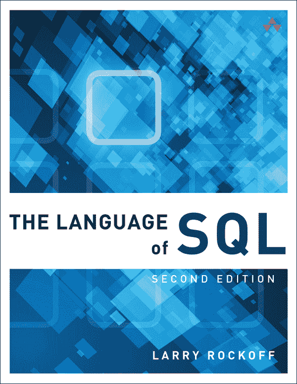


# 关于本电子书

EPUB 是一种开放的行业标准电子书格式。然而，不同阅读设备和应用程序对 EPUB 及其许多功能的支持程度各不相同。请使用您的设备或应用设置来根据您的喜好自定义显示效果。您通常可以自定义的设置包括：字体、字号、单栏或双栏、横屏或竖屏模式，以及可以点击或轻触以放大的图片。有关您的阅读设备或应用上关于设置和功能的更多信息，请访问设备制造商的网站。

许多书籍包含编程代码或配置示例。为了优化这些元素的显示效果，请在单栏横屏模式下查看电子书，并将字体大小调整为最小设置。除了以重流文本格式显示代码和配置外，我们还包含了代码图像，以模仿书籍中的显示效果；因此，当重流格式可能会影响代码列表的显示时，您将看到“点击此处查看代码图像”的链接。点击该链接查看高保真代码图像。要返回之前过的页面，请点击设备或应用上的“返回”按钮。


新霍泽肯，NJ • 波士顿 • 印安纳波利斯 • 旧金山

纽约 • 多伦多 • 蒙特利尔 • 伦敦 • 慕尼黑 • 巴黎 • 马德

开普敦 • 悉尼 • 东京 • 新加坡 • 墨西哥城


- 什么是 SQL?
- Microsoft SQL Server, MySQL 和 Oracle
- 关系型数据库
- 主键与外键
- 数据类型
- NULL 值
- SQL 的意义
- 展望

- SELECT
- 语法
- 注释
- 列明列
- 带空格的列
- 完整的 SELECT
- 字面量
- 计算
- 连接字段
- 别名
- 表别名
- 什么是函数?
- 字符函数
- 复合函数
- 日期/时间函数
- 数字函数
- 转换函数
- 升序排序
- 降序排序
- 多列排序
- 按计算字段排序
- 排序序列
- 应用选择标准
- WHERE 子运算符
- 限制行
- 带排序的限制
- 模式匹配
- 通配符
- 复杂逻辑条件
- AND 运算符
- OR 运算符
- 使用括号
- NOT 运算符
- BETWEEN 运算符
- IN 运算符
- 布尔逻辑与 NULL 值
- CASE 表达式


### ORDER BY 子句中的条件逻辑
### WHERE 子句中的条件逻辑
### 展望

### 消除重复
### 聚合函数
### COUNT 函数
### 数据分组
### 多列与排序
### 针对聚合结果的筛选标准
### HAVING 子句中的条件逻辑
### 排名函数
### 分区
### 展望

# 10 小计与交叉表
#### 使用 ROLLUP 添加小计
### 使用 CUBE 添加小计
### 创建交叉表布局
### 展望

### 关联两个表
### 内连接详解
### 内连接中的表顺序
### 内连接的另一种指定方式
### 重新复习表别名

### 外连接
### 左连接
### 测试 NULL 值
### 右连接
### 全连接
### 交叉内连接
### 展望

### 自连接
### 创建视图
### 引用视图
### 视图的优势
### 修改与删除视图

### 子查询类型
### 将子查询作为数据源
### 在筛选标准中使用子查询
### 相关子查询
### EXISTS 运算符
### 将子查询作为计算列
### 公用表表达式 (CTE)
### 展望

### 使用 UNION 运算符
### 唯一与非合并
### 交叉查询
### 展望
# 16 存储过程与参数
### 创建存储过程
### 存储过程中的参数
### 执行存储过程
### 修改与删除存储过程
### 展望

# 17 修改数据
### 修改策略
### 删除数据
### 更新数据
### 相关子查询更新
### 展望
# 18 数据维护
### 数据语言
### 属性
### 列
### 主键
### 创建表
### 索引
### 展望

### 如何规范化
### 规范化的替代方案
### 设计艺术
### 应该规范化什么
### 展望
# 20 显示数据
### 交叉表布局
### Excel 与数据
### 透视表
### 展望
## A 入门 Microsoft Server
### 安装 SQL Server 2016
### 安装 SQL Server 2016 管理语句
### 使用 SQL Server 2016 管理语句

### 在 Windows 上安装 MySQL
### 在 Mac 上安装 MySQL
### MySQL Workbench

### 安装 Oracle 数据库版
### 使用 Oracle 数据库版

### 索引

**Larry Rockoff** 从事 SQL 和商业智能开发多年。他拥有芝加哥大学的 MBA 学位，专攻管理科学。目前在一家大型药企负责数据仓库和报告应用程序。

除了编写关于 SQL 的书籍，他还出版了关于 Microsoft Access 和 Excel 的书籍。他还维护着一个网站 [larryrockoff.com](http://larryrockoff.com)，该网站上有关于技术主题和社会问题的书籍评测。

欢迎随时访问该网站与作者联系并提供任何意见。我们也鼓励您关注他的 Facebook 页面或 Twitter 账号：[facebook.com/larrockoff](http://facebook.com/larrockoff) 和 [twitter.com/larrockoff](http://twitter.com/larrockoff)

非常感谢 Pearson 所有协助本书编写的同仁。我想特别感谢 Mark Taber，他在将这本书从我之前的出版社引入 Pearson 起了至关重要的作用。我还要感谢项目编辑和文字校对 Dan Foster，以及负责页面布局的 Danielle Foster。Siddhartha Singh 在技术审查方面做得非常出色。Chuti Prasertsith 提供了充满活力的封面设计。最后，我必须提到书中那些通常不具名但至关重要的任务执行者：索引员 Valerie Haynes Perry 和校对员 Scout Festa。

由于这是第二版，我还要感谢第一版的所有读者，特别是那些通过 [larryrockoff.com](http://larryrockoff.com) 与我联系并对这本书在他们生活中的用处给出慷慨评价的个人。意识到你对一个相对平凡的话题的思考可以帮助到地球另一端的人，这既令人谦虚又令人兴奋。

作为本书的读者，*你*是我们最重要的评论家和意见领。我们非常重视你的意见，并想知道我们哪些地方做得对，哪些可以做得更好，你希望看到我们出版哪些领域，以及任何其他愿意分享给我们的智慧。

我们欢迎你的评论。你可以通过电子邮件或直接写信告诉我们你对这本书的喜欢或不喜欢的地方——以及我们可以如何做才能让我们的书籍更好。


在您写信时，请务必包含本书的书名和作者，以及您的姓名和电话号码或电子邮件地址。

邮箱：feedback@developers-library.info
Addison-Wesley Developer’s Library
800 East 96th Street
Indianapolis, IN 46240 USA


访问我们的网站并在 [www.informit.com/register](http://www.informit.com/register) 注册本书，以便方便地获取本书可能提供的任何更新、下载或勘误。

# 引言


在另一个平行宇宙中，这本书的标题可能是*SQL 逻辑学*。这是因为像所有计算机语言一样，SQL 语言更多是关于冷酷的逻辑的，而不是英语词汇。尽管如此，出于多种原因，标题中仍保留了“语言”一词。首先，SQL 中某种基于语言的语法使其与其他计算机语言区分开来。与其他语言不同，SQL 在其语法中使用许多普通单词（如 `WHERE` 和 `FROM`）作为关键字。

本着 SQL 中嵌入的语言精神，我们在主题序列中强调了“语言”的重要性。通过本书，你将像学习英语一样学习 SQL。SQL 关键字按照逻辑顺序呈现，从简单到复杂。从本质上说，这是同时处理语言和逻辑的尝试。

要学习任何语言，必须从听取和记忆构成其发音基础的实际单词开始。同时，这些词具有必须理解的特定含义。在 SQL 的情况下，其含义与逻辑有极大的关系。

坚持使用*SQL 语言*而非*SQL 逻辑学*作为标题的最后一个原因是，它它听起来更好听。虽然在计算机语言书籍中可能不会有太多的文学辞藻，但希望“语言”一词的出现能为这个毕竟是非常有趣的领域的主题增添一些额外的热情。
## 主题与特性

即使你还不熟悉 SQL，也可以说它是一种带有许多组件和特性的复杂语言。在本书中，我们将关注一个主要主题：

- 如何使用 SQL 从数据库中检索数据
在较小范围内，我们还将涵盖：

- 如何更新数据库中的数据
- 如何构建和维护数据库
- 如何设计关系型数据库
- 获取数据后显示数据的策略


- **在阅读文本时，你不需要下载软件或坐在电脑前。**
我们的意图是提供只需通过阅读书籍即可理解的 SQL 使用示例。文中包含了小型数据样本，让你能够清楚地看到 SQL 语句是如何工作的。

- **采用基于语言的方法，使你能够像学习英语一样学习 SQL。**

- **本书涵盖了三个广泛使用的数据库的语法：Microsoft SQL Server、MySQL 和 Oracle。**
如果这些数据库之间存在任何差异，Microsoft SQL Server 的语法将显示在正文中。特殊的“数据库差异”边栏将显示并解释 MySQL 或 Oracle 语法的任何变化。

这种方法对于那些只需要配合报告工具使用 SQL 的人员非常有用。在最后一章中，我们将超越纯 SQL，涵盖获取数据后显示数据的策略，包括关于如何使用交叉报告和透视表的想法。在现实世界中，这类工具可以大幅减轻 SQL 开发人员的负担，并为用户提供更大的灵活性。

### 注意
访问我们的网站并在 [informit.com/register](http://informit.com/register) 注册本书，以便方便地获取本书可能提供的下载、更新或勘误。


以下是第二版的一些新特性：

- **对最新数据库版本的涵盖**
所有语法和示例均取自本书涵盖的主要数据库的最新版本：Microsoft SQL Server 2016、MySQL 5.7 和 Oracle 12c。

我们增加了一个关于小计和交叉表的新章节，为数据汇总提供了更多可能性。这些材料允许用户在他们的查询中添加小计和运行总计。此外，对 SQL 交叉查询的接触使人们能够更好地理解透视表的价值，透视表将在书的最后介绍。

- **对排名函数的涵盖**
我们添加了关于排名函数的新材料。这一类重要的函数允许用户生成行号并计算百分比。一个相关能力是在应用排名函数之前将数据划分为分区。

我们的第一版包含了一些关于 `CASE` 表达式和条件逻辑的基础材料。这个主题通常被排除在入门书籍之外，但对任何 SQL 开发人员来说都具有巨大的实用价值。第二版在第 8 章和第 9 章中增加了许多新示例，说明如何使用 `CASE` 表达式。

- **更新且一致的数据集**
与第一版一样，每个章节都有自己的示例小型数据集。然而，与以前不同，本版现在所有章节都使用一致的数据集。一个章节引用的 Customers 表将与其他章节中的 Customers 表相同。如果你想为测试加载数据，现在可以运行单个脚本来加载所有数据。之前的版本每个章节都需要单独的脚本。

增加了其他值得关注的主题，包括公表表达式和注释。全书术语都进行了修改，以增强一致性并符合标准用法。最后，在第 2 章早期增加了 `SELECT` 语句的概述，让你对后续主题有较好的了解。

### 书籍计划

本书以独特的顺序介绍主题。大多数 SQL 书籍的主题顺序假设你是一个需要从头创建和设计数据库，向数据库加载数据，然后开始检索数据的数据库管理员。在本书中，我们直接从数据检索开始，然后在最后的章节回到数据库设计。这样做是一种激励策略，让你在处理索引和外键等深奥的主题之前，快速进入与数据检索相关的有趣主题。


- 第 1 章 介绍了关系型数据库的介绍性材料，在接触 `SELECT` 语句之前理解这些内容是必要的。

- 第 2 章 到 5 章 开始探索 `SELECT` 语句，涵盖了计算、函数和排序的基础知识。


- 第 6 章到第 8 章讨论了选择标准，从简单的布尔逻辑到条件逻辑。
- 第 9 章和第 10 章探索了数据汇总的方法，从简单的计数到复杂的聚合和小计。
- 第 11 章到第 15 章讨论了如何通过连接、子查询、视图和集合逻辑从多个表中检索数据的方法。
- 第 16 章到第 18 章超越了`SELECT`语句，专注于关注与关系型数据库相关的更广泛的话题，例如存储过程、更新和表维护。
- 最后，第 19 章和第 20 章、B 和 C 提供了如何开始使用书中涵盖的三种数据库：Microsoft SQL Server、Oracle 和 MySQL 的信息。
### 伴随网站

书中所有 SQL 语句的列表可以在此网站找到：

- **[www.informit.com/store/language-of-sql-9780134658254](http://www.informit.com/store/language-of-sql-9780134658254)**


- 针对 Microsoft SQL Server 的 SQL 语句
- 针对 MySQL 的 SQL 语句
- 针对 Oracle 的 SQL 语句

这三个文件列出了书中针对每个数据库的所有 SQL 语句。此外，这些文件还包含一个 SQL 脚本，允许你创建书中使用的所有数据。运行设置脚本后，你就可以执行书中的语句并看到相同的输出。

关于如何执行设置脚本的说明包含在每个文件中。
## 1. 关系型数据库与 SQL

正如引言中提到的，SQL 是与存储在关系型数据库中的数据通信的最广泛软件工具。在这一过程中，SQL 利用了语言和逻辑两种元素。作为一种语言，SQL 采用了一种独特的语法，包含许多英语单词，例如 `WHERE`、`FROM` 和 `HAVING`。作为逻辑的表达式，它规定了如何检索或更新关系型数据库中数据的详细信息。

考虑到这种双重性，我们在本书中尝试在介绍构成 SQL 的的话题时，同时强调语言组件和逻辑组件。在所有语言中，无论是计算机语言还是口语语言，都有需要学习和记忆的实际单词。因此，我们将按照逻辑顺序逐一介绍 SQL 中存在的各种关键字。随着每个章节的深入，你将在之前学到的词汇的基础上学习新的关键字以及与数据库交互的令人兴奋的可能性。

除了词汇本身，还有需要考虑的逻辑。SQL 使用的单词具有独特的逻辑含义和意图。SQL 的逻辑与语言一样重要。与所有计算机语言一样，通常有多种方法来指定任何设实现目标。可能性的细微差别涵盖了所涉及的语言和逻辑。
让我们从语言开始。一旦你熟悉了 SQL 的语法，你可能会发现自己将 SQL 命令类比为英语句子并具有特定的表达含义。

例如，比较这句话：

点击此处查看代码图像

我要一个汉堡和薯条，从你们的超值菜单里，并且带走。


```sql
Select city, state
from Customers
order by state
```

我们稍后会细节，但这条 SQL 语句意味着我们从数据库中名为 `Customers` 的表中获取 `city` 和 `state` 字段，并且我们希望按 `state` 对结果进行排序。
在这两种情况下，我们都指定了我们想要的项目（汉堡/薯条或城市/州）、我们想从哪里获取（超值菜单或 `Customers` 表）以及一些额外的指令（带走，或按州对结果进行排序）。

在我们开始之前，让我们来解决一个微小的点：如何读 SQL 这个词。事实证明有两种选择。一种选择是简单地按字母逐读，像“S-Q-L”。另一种可能性（作者更倾向于）是将其读作单词“sequel”。这少了一个音节，读起来更容易。然而，对于这个问题并没有真正的共识。这基本上是个人喜好的问题。

至于 S-Q-L 字母的含义，大多数人认为它们代表“结构化查询语言”（Structured Query Language）。在这里也没有完全一致。有些人会认为 SQL 完全没有代表什么，因为这种语言源于 IBM 的一种旧语言 `sequel`，而它实际上并不代表结构化查询语言。

### 什么是 SQL？
那么 SQL 是什么？简而言之，SQL 是一种用于维护和利用关系型数据库数据的标准计算机语言。简单来说，SQL 是一种让用户与关系型数据库交互的语言。它拥有悠久的发展历史，可以追溯到 20 世纪 70 年代的各种组织。1986 年，美国国家标准学会（ANSI）发布了第一套语言标准，之后经历了多次修订。

通常情况下，SQL 有三个主要组件。第一个被称为 `DML`（数据操纵语言）。该语言模块允许你检索、更新、添加或删除数据库中的数据。第二个是 `DDL`（数据定义语言）。DDL 允许你创建和修改数据库本身。例如，DDL 提供了 `ALTER` 语句来修改表。最后，第三个组件 `DCL`（数据控制语言）维护数据库的安全性。

主要的软件供应商（如微软和 Oracle）为了自己的目的调整了标准，并对语言增加了许多扩展和修改。但尽管每个供应商对 SQL 都有独特的解释，仍然有一个相同的基础语言。这种基础语言正是我们在书中涵盖的内容。

作为一种计算机语言，SQL 与你熟悉的其他语言（如 Basic 或 C++）不同。这些语言通常是过程性的，这意味着它们允许你指定特定的过程来实现所需的目标。SQL 更多的是一种声明式语言。在 SQL 中，所需的目标通常通过单个语句声明。SQL 结构简单是因为它只关注关系数据库，而不是整个计算机系统。
关于 SQL 语言的另一个说明是，它经常与特定的 SQL 数据库混淆。许多软件公司销售数据库管理系统（DBMS）软件。在习惯中，这类软件包中的数据库通常被称为 *SQL 数据库*，因为 SQL 语言是管理和访问这些数据库的主要手段。某些供应商将 SQL 作为数据库名称的一部分。例如，微软将其数据库命名为 `SQL Server 2016`。但事实上，SQL 更多是一种语言而非数据库。我们在书中的重点是 SQL 语言，而不是任何特定的数据库。

### Microsoft SQL Server、MySQL 和 Oracle

尽管我们的目标是涵盖适用于所有实现的 SQL 核心语言，但我们最终必须提供 SQL 语法的特定示例。由于语法在供应商之间确实存在差异，我们决定专注于这三个流行数据库所使用的 SQL 语法：

- Microsoft SQL Server
- Oracle


在大多数情况下，这些数据库具有相同的语法。然而，它们偶尔存在差异。如果这些数据库之间存在任何差异，`Microsoft SQL Server` 的语法将呈在本本书的正文中。对于 `MySQL` 或 `Oracle` 的任何差异将在标题为 `数据库差异` 的侧边栏中指出，如下所示：
***

### 数据库差异

每当 `MySQL` 或 `Oracle` 存在语法差异时，就会出现这样的侧边栏。`Microsoft SQL Server` 的语法将出现在正文中。

***
`Microsoft SQL Server` 提供多个版本和版本。最新版本被称为 `Microsoft SQL Server 2016`。可用的版本从基础的 Express 版到功能完备的 Enterprise（企业）版。Express 版是免费的，但仍然拥有丰富的功能，允许用户开始真正的数据库开发。Enterprise 版包含了许多复杂的数据库管理功能，以及强大的商业智能组件。

尽管 `MySQL` 归 `Oracle` 所有，但它是开源数据库，这意味着没有单一组织可以控制它的开发。`MySQL` 可用于 Windows 之外的许多平台，例如 Mac OS X 和 Linux。`MySQL` 提供社区版（Community Edition）免费下载。最新版本是 `MySQL 5.7`。

`Oracle` 数据库提供多个版本。最新版本被称为 `Oracle Database 12c`。该数据库的免费版本被称为 Express 版。

在开始时，下载你选择的数据库有时是有用的，这样你就有东西可以实验。然而，本书并不要求你这样做。书中的内容编写方式允许你仅通过阅读文本来学习 `SQL`。我们将在文中提供足够的数据，让你能够理解各种 `SQL` 语句的结果，而无需下载软件并亲自输入语句。

尽管如此，如果你想下载这些数据库的任何一个免费版本，我们包含了三个附录，提供了关于如何操作的有用说明和提示。`附录 A` 提供了关于如何开始使用 `Microsoft SQL Server` 的完整信息。说明包含了如何安装软件和执行 `SQL` 命令的细节。同样，`附录 B` 和 `附录 C` 涵盖了 `MySQL` 和 `Oracle`。
如引言所述，我们的辅助网站提供了补充材料，列出了书中所有三个数据库中显示的所有 `SQL` 语句。然而，你可能会发现下载或查看辅助网站上的额外材料是没有必要的。贯穿书中所示的示例是自其义的，不需要你做任何其他事情就能理解这些内容。但是，如果你有此意，请尽管利用这些额外功能。

还应该提到，除了 `SQL Server`、`MySQL` 和 `Oracle` 之外，其他流行的关系型数据库也值得考虑。例如：

- 来自 `IBM` 的 `DB2`
- 来自 `IBM` 的 `Informix`
- `PostgreSQL`，一个开源数据库
- 来自 `Microsoft` 的 `Microsoft Access`

在这些数据库中，`Microsoft Access` 的独特之处在于具有图形元素。从本质上说，`Access` 是关系型数据库的图形界面。换句话说，`Access` 允许你完全通过图形手段对关系型数据库创建查询。对于初学者来说，`Access` 的优势之处是你可以轻松地以视觉方式创建查询，然后切换到 `SQL` 视图查看你刚刚创建的 `SQL` 语句。`Access` 的另一个不同在于它主要是一个桌面数据库。因此，你可以用它创建一个完全存储在 PC 单一文件中的数据库，但也允许你连接到使用其他工具（如 `Microsoft SQL Server`）创建的数据库。


完成这些准备后，让我们来看关系型数据库的基础，看看它们是如何工作的。关系型数据库是数据集合，存储在任意数量的表中。在通常情况下，“关系”（relational）一词可以表示表通常以某种方式相互关联。然而，在更精确的术语中，“关系”指的是关系理论，与控制表关联方式的逻辑属性有关。

例如，让我们取一个仅包含两个表的简单情况：`Customers`（客户）和 `Orders`（订单）。`Customers` 表包含每个下过订单的客户的记录。`Orders` 表包含每个订单的记录。每个表可以包含任意数量的字段，用于存储与每条记录相关的各种属性。例如，`Customers` 表可能包含 `FirstName`（名字）和 `LastName`（姓氏）等字段。

此时，将某些表及其包含的数据视觉化是很有用的。通常的做法是将表显示为行和列组成的网格。每一行代表表中的一条记录。每一列代表表中的一个字段。顶部的标题行通常包含字段名。其余行显示实际数据。


让我们来看一个简单的关系型数据库示例。该数据库只包含两个表：`Customers` 和 `Orders`。`Customers` 表可能像这样：

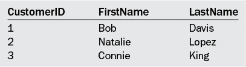

`Orders` 表可能显示为：

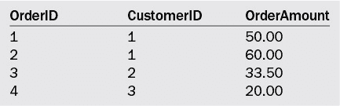
在这个示例中，`Customers` 表包含三列：`CustomerID`（客户 ID）、`FirstName` 和 `LastName`。表中目前有三行，代表 Bob Davis、Natalie Lopez 和 Connie King。每一行代表一个不同的客户，每一列代表关于客户的另一个不同信息。同样，`Orders` 表有三列和四行。这表明数据库中有四个订单，这些订单有三个属性。

当然，这个示例是非常简化的，只暗示了实际数据库中可能存储的数据类型。例如，`Customers` 表通常会包含许多描述客户其他属性的列，如 `city`（城市）、`state`（州）、`zip`（邮编）和 `phone number`（电话）。同样，`Orders` 表通常会有描述订单附加属性的列，例如 `order date`（订单日期）、`sales tax`（销售税）和接订单的销售人员。

### 主键和外键

注意每个表中的第一列：`Customers` 表中的 `CustomerID` 以及 `Orders` 表中的 `OrderID`。这些列通常被称为 `primary keys`（主键）。主键有用且必要有两个原因。首先，它们允许我们唯一地识别表中的某行。例如，如果我们想检索 Bob Davis 的行，只需使用 `CustomerID` 列即可获取数据。主键还确保了唯一性。将 `CustomerID` 列设计为主键，可以确保该列在表的每行中都具有唯一的值。即使我们在数据库中拥有两个名为 Bob Davis 的不同男人，这些行的 `CustomerID` 列中的值也是不同的。


在这个示例中，主键列中的值没有任何特定的含义。在 `Customers` 表中，`CustomerID` 列为表中的三行分别包含了 1、2 和 3 这三个值。数据库表的设计通常设计为：在向表中添加新行时，自动为主键列生成连续的数字。这种设计特征通常被称为 `auto-increment`（自动递增）。

主键的第二个原因是，它们允许我们轻松地将一个表与另一个表关联起来。在这个示例中，`Orders` 表中的 `CustomerID` 列指向 `Customers` 表中对应的行。观察 `Orders` 表的第四行，可以发现 `CustomerID` 列的值为 3。这意味着该订单属于 `CustomerID` 为 3 的客户，而该客户恰好是 Connie King。在表之间使用公共列是关系型数据库设计中的一个核心元素。


### 数据类型 (Datatypes)

主键和外键为数据库表增加了结构。它们确保数据库中的所有表都是可访问的，并且彼此正确关联。表中每列的另一个重要属性是其数据类型。

数据类型只是定义该列可以包含的数据类型的一种方式。每个表中的每一列都必须指定数据类型。遗憾的是，不同关系型数据库在允许哪些数据类型及其含义方面存在很大差异。例如，Microsoft SQL Server、MySQL 和 Oracle 均拥有超过 30 种不同的允许数据类型。
即使仅针对这三个数据库，也不可能涵盖每种可用数据类型的细节和细微差别。然而，我们将做的是通过讨论大多数数据库通用的数据类型主要类别来总结现状。一旦你理解了这些类别中重要的数据类型，处理可能遇到的其他数据类型就不会有太大困难。通常，数据类型有三种重要类型：数值型、字符型和日期/时间型。

数值数据类型有多种格式，包括位（bits）、整数（integers）、小数（decimals）和实数（real numbers）。位是仅允许两个值（0 和 1）的数值数据类型。位数据类型通常用于定义属性具有简单的“真”或“假”值。整数是不带小数的数字。小数数据类型可以包含小数。与位、整数和小数不同，实数是指那些精确值在内部仅通过近似定义的数字。所有数值数据类型的共同特征是它们可以包含在算术计算中。以下是来自 Microsoft SQL Server、MySQL 和 Oracle 的数值数据类型的代表性示例。

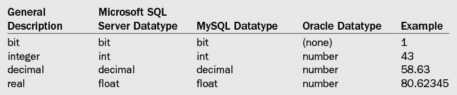

字符数据类型有时被称为 `string`（字符串）或 `character string`（字符字符串）类型。与数值数据类型不同，字符数据类型不仅限于数字。它们可以包含任何字母或数字，甚至可以包含特殊字符（如星号）。在 SQL 语句中为字符数据类型提供值时，值必须始终用单引号括。相比之下，数值数据类型永远不使用引号。以下是字符数据类型的代表性示例：


第二个示例（60601）可能是一个邮政编码。乍一看，它看起来像是一个数值数据类型，因为它由数字组成。这种情况并不罕见。尽管邮政编码只包含数字，但它们通常被定义为字符数据类型，因为不需要对邮政编码进行算术计算。

日期/时间数据类型用于表示日期和时间。与字符数据类型一样，日期/时间数据类型必须包含在单引号中。这些数据类型允许涉及日期的特殊计算。例如，可以使用特殊函数计算任意两个日期/时间之间的天数。以下是日期/时间数据类型的示例：

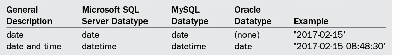


表中列的另一个重要属性是该列是否允许包含 NULL 值。NULL 值意味着该特定数据元素没有数据。它字面上不包含任何数据。然而，NULL 值不等同于空格或空白。从逻辑上讲，NULL 值和空白的处理方式是不同的。获取包含 NULL 数据的细微差别将在第 7 章“布尔逻辑”中详细讨论。

许多数据库在显示带有空值的数据时会用全大字母显示 `NULL` 单词。这样做是为了让用户判断数据包含的是空值而不仅仅是空格。我们将遵循这一惯例，在书中到处显示 `NULL` 字，以强调它代表那种特殊的值。

数据库中的主键永远不能包含 `NULL` 值。这是因为根据定义，主键必须包含唯一值。


在离开关系型数据库这一通用主题之前，让我们来看一个简短的历史回顾，以便理解关系型数据库的用处以及 SQL 的重要性。

在 20 世纪 60 年代计算的早期，数据通常存储在磁带或磁盘驱动器上的文件中。用 `FORTRAN` 和 `COBOL` 等语言编写的计算机程序通常读取输入文件并逐条处理记录，最终将数据移动到输出文件。处理过程必然是复杂的，因为程序需要分解为许多单独步骤，涉及临时表、排序和多次遍历数据，直到产生预期的输出。

在 20 世纪 70 年代，随着层次数据库和网络数据库的发明和利用，技术取得了进展。这些新数据库通过复杂的内部指针系统，使得读取数据变得更加容易。例如，程序可以读取一个客户记录，自动指向该客户的所有订单，然后指向每个订单的所有细节。但基本上，这些数据仍然需要逐条记录进行处理。


与早期的数据检索方法不同，`SQL` 允许用户一次访问一组大量数据。通过一个语句，`SQL` 命令就可以从多个表中检索或更新数千条记录。这消除了大量的复杂性。计算机程序不再需要按照特殊顺序逐条读取记录，同时决定对每条记录要做什么。过去需要数百行编程代码的任务，现在只需要几行逻辑即可完成。

### 展望未来


第一章提供了有关关系型数据库的一些背景信息，使我们能够进入从数据库检索数据的主题。我们讨论了关系型数据库的许多重要特性，例如主键、外键和数据类型。我们还讨论了数据中可能存在 NULL 值。我们将在第 7 章中的“布尔逻辑”中补充对 NULL 值的讨论，并在第 18 章”中回到数据库维护的通用话题，最后在第 19 章中的“数据库设计原则”中讨论数据库设计。

为什么要把数据库设计这个重要主题推迟到书的后后部分？简而言之，采取这种方法是为了让你能够投入使用 SQL，而不必在开始时担心设计的细节。事实上，数据库设计既是一门科学，也是一门艺术。希望在你对通过 SQL 检索某些数据的细节和细微差别有了更深入的认识，数据库设计的原则将会更有意义。因此，我们将暂时忽略如何设计数据库的问题，并在下一章开始学习数据检索。

## 2. 基础数据检索

### 介绍的关键字
`SELECT` • `FROM`

在本章中，我们将开始探索 SQL 中最重要的的话题——即如何从数据库中检索数据。无论你的组织规模如何，对 SQL 开发人员提出的最常见请求就是生成报告。当然，将数据存入数据库是一项非易事的工作，但一旦数据到达那里，业务分析师的精力就会转到他们所拥有的丰富数据上，以及从所有这些数据中提取有用信息的愿望。

本书对数据检索的强调对应于这些现实世界的需求。你对 SQL 的知识将极大地帮助你的组织解锁存储在数据库数据中隐藏的秘密。

### 简单的 SELECT
在 SQL 中，检索数据的能力通过一种被称为 `SELECT` 语句的东西来实现。在没有任何预先解释的情况下，这里是最简单的 `SELECT` 语句示例：

```sql
SELECT * FROM Customers
```

在 SQL 语言中，与所有计算机语言一样，某些单词是`keywords`（关键字）。这些单词具有特殊含义并且必须以特定的方式使用。在句条语句中，单词 `SELECT` 和 `FROM` 是关键字。`SELECT` 关键字表示 `SELECT` 语句的开始。`FROM` 关键字用于指定要从中检索数据的表。表名紧随 `FROM` 之后。在本例中，表名为 `Customers`。示例中的星号（`*`）是一个特殊符号，表示“所有列”。
按照惯例，我们将用全大写字母打印关键字。这样做是为了确保它们显而可见。总而言之，这条语句的意思是：从 `Customers` 表中选择所有列。

如果 `Customers` 表看起来所示：

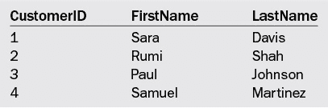

那么 `SELECT` 将返回以下数据：
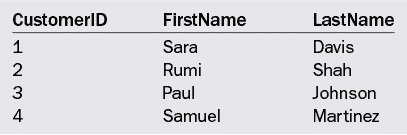

换句话说，它带回了表中的所有内容。

在上一章中，我们提到过为所有表指定主键是一种常见做法。在这个示例中，`CustomerID` 列就是这样一列。我们还提到过，主键有时被设置为在向表中添加行时，自动生成数字序列中的顺序数字。在本例中正是如此。事实上，我们在全书中展示的大部分样本数据都包含一个类似的列，它既是主键又定义为自动递增。根据惯例，这通常是表中的第一列。

### 语法说明


其次，SQL 语句可以写在任意数量的行，单词之间可以有任意数量的空格。例如，SQL 语句：

```sql
SELECT * FROM Customers
```


```sql
SELECT *
FROM Customers
```

通常将每个重要的关键字另起一行开始是一个好主意。当我们遇到更复杂的 SQL 语句时，这将有助于快速理解语句的含义。
最后，当我们在这书中介绍不同的 SQL 语句时，我们经常会展示一个具体的示例和一个更通用的格式。例如，上一个语句的通用格式将显示为：

```sql
SELECT *
FROM table
```

斜体用于表示通用表达式。斜体单词 `table` 意味着你可以在该位置替换任何表名。当你在书中任何 SQL 语句中看到斜体单词时，这只是表示在该位置可以替换任何有效的单词或短语。
***

### 数据库差异：MySQL 和 Oracle

许多 SQL 实现要求在每个语句末尾加分号。MySQL 和 Oracle 都是如此，但 Microsoft SQL Server 则不是。然而，如果需要，可以在 SQL Server 中指定分号。为了简单起见，我们在书中将显示不带分号的 SQL 语句。如果你使用 MySQL 或 Oracle，则需要在每个语句的末尾添加分号。上一个语句将变为：

```sql
FROM Customers;
```

***

### 注释


点击查看图像

```sql
SELECT
-- this is a comment
FirstName,

FROM Customers
```

第二种格式借自 C 编程语言，由位于 `/*` 和 `*/` 之间的文本组成。`/*` 和 `*/` 之间的注释可以写在多行。这里是这种格式的示例：

点击查看图像

SELECT
/* this is the first comment */
FirstName,

LastName /* this is a second comment
this is still part of the second comment
this is the end of the second comment */

```

***

### 数据库差异：MySQL

MySQL 支持双横线和 C 格式（/* 和 */），但有一个小区别。使用双横线格式时，MySQL 要求在第二个横线之后有一个空格或特殊字符。
此外，MySQL 还允许第三种插入注释的方法，类似于双横线。在 MySQL 中，你可以在行的任意位置放置数字符号（`#`）来表示注释。该行中 `#` 符号之后的所有文本都被注释。这里是这种格式的示例：

```sql
SELECT FirstName
# this is a comment
FROM Customers;
```


### 指定列

到目前，我们仅仅是显示了表中的所有数据。但如果我们只想选择某些列呢？从同一个表开始，例如我们可能只想显示客户的姓氏。那么 `SELECT` 语句将看起来像：

```sql
SELECT LastName
```

结果数据将是：

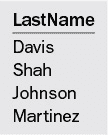

如果我们想选择多个列但不是所有列，`SELECT` 可能看起来像这样：

SELECT
FirstName,

LastName
FROM Customers
```


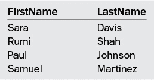

该语句的通用格式是：

```sql
SELECT columnlist
FROM table


需要记住的一点是，如果你需要在 `columnlist` 中指定多个一个列，那么这些列之间必须用逗号隔开。另外注意，我们将每个列（`FirstName`、`LastName`）分别放在 `columnlist` 的不同行中。这样做是为了提高可读性。

### 带有嵌入空格的列名
如果列的名称中包含空格怎么办？例如，假设 `LastName` 列被指定为 `Last Name`（两个单词之间有一个空格）。显然，以下代码将无法运行：

```sql
SELECT
Last Name
FROM Customers
```


```sql
SELECT
[Last Name]
FROM Customers
```

额外的语法说明：正如关键字不区分大小写一样，表名列名也不区分大小写。因此，上一个示例与以下代码等同：
```sql
select
[last name]
from customers
```

为了清晰起见，我们会将所有的关键字大大写打印，并在书中也将表名和列名大写，但这并非绝对必要。
***

### 数据库差异：MySQL 和 Oracle

对于 MySQL，在包含空格的列名周围使用的字符是反引号（`` ` ``）。上述示例的 MySQL 语法为：

```sql
SELECT
FROM Customers;
```

对于 Oracle，在包含空格的列名周围使用的字符是双引号（`"`）。示例的 Oracle 语法为：

```sql
SELECT
"Last Name"
```

此外，与 Microsoft SQL Server 和 MySQL 不同，Oracle 中由双引号括的列名区分大小写。这意味着之前的语句不等同于：

```sql
SELECT
"LAST NAME"
```

***

### Full SELECT 预览

本书的大部分内容与本章介绍的 `SELECT` 语句有关。在第 3 章到第 15 章 中，我们将扩展该语句，引入新功能，直到充分利用并理解 `SELECT` 的全部潜力和能力。到目前，我们只引入了 `SELECT` 语句的部分：

SELECT columnlist
FROM table
```

为了消除任何剩下的悬念，让我们看看完整 `SELECT` 语句的预览，并对其各个组件进行简要注释。包含所有子句的完整 `SELECT` 语句如下

```sql
FROM tablelist
WHERE condition
GROUP BY columnlist
HAVING condition
ORDER BY columnlist
```

我们已经介绍了 `SELECT` 和 `FROM` 子句。让我们稍微扩展一下这些子句并谈谈其他的。`SELECT` 子句启动语句并列出任何将显示的列。正如在后面的章节所示，`columnlist` 不仅可以包含指定表的实际列，还可以包含计算列（通常源自表中的一个或多个列）。`columnlist` 中的列还可以包括函数，它们代表了添加转换数据常用方法的特殊方式。
`FROM` 子句指定提取数据的源。在大多数情况下，这些数据源是表。在随后的章节中，我们将学习这些数据源也可以是其他的 `SELECT` 语句，它们代表数据的某种虚拟 `view`（视图）。在本章中，我们的 `tablelist` 是单个表。稍后章节将讨论的 SQL 关键特性之一是通过被称为 `JOIN` 的机制通过单个 `SELECT` 语句将多个表组合在一起。因此，我们将看到许多示例，`FROM` 子句中的 `tablelist` 由多行组成，表示连接在一起的表。

`WHERE` 子句用于指定选择逻辑。在这里你可以精确指定要检索哪些行数据。`WHERE` 子句可以使用基本的算术运算符，如等号（`=`）和大于（`>`），以及 `OR` 和 `AND` 等布尔运算符。

`GROUP BY` 子句在汇总数据方面起着关键作用。通过将数据组织成小组，分析师不仅能够对数据分组，还可以通过使用各种统计（如数据的和或计数）来汇总每组数据。

当数据被分组后，选择标准变得有些复杂。人们必须询问选择标准适用于单行还是整个组。例如，在按州对客户分组时，可能只想查看单个客户的行，且该州所有客户的总购买金额超过了某个金额。这就是 `HAVING` 子句派上用场的地方。`HAVING` 子句用于为整组数据指定选择逻辑。


正如在后面的章节将会明确的，`SELECT` 语句中的各种子句（如果存在）必须按照之前通用语句所示的顺序指定。例如，如果 `SELECT` 语句中有 `GROUP BY` 子句，它必须出现在 `WHERE` 子句之后、`HAVING` 子句之前。

除了上述所有子句外，我们还将讨论组织 `SELECT` 语句的若干种额外方法，包括子查询和集合逻辑。


当从表中选择数据时，你并不局限于表中恰好存在的列。计算字段的概念允许了许多其他可能性。通过计算字段，你可以执行以下操作：

• 显示特定的单词或值
• 对单列或多列进行计算
• 将列与特定的单词或值组合在一起

让我们来看几个示例，所有示例都源自这张 `Sales`（销售）表：


### 字面量 (Literal Values)

我们的第一个计算字段示例实际上根本不是一种计算。我们将选择一个特定值作为列，尽管该值与表中的数据没有任何关系。这种类型的表达式被称为 `literal value`（字面量）。这里有一个示例：

```sql
SELECT
FirstName
FROM Sales
```

这条语句将返回此项数据：

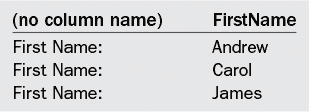


首先注意，字面量 `'First Name:'` 在每一行都会重复。其次，第一列没有表头信息。当在 Microsoft SQL Server 中运行时，列头显示为 `(no column name)`。没有表头的原因仅仅是因为这是一个计算字段。没有可以与此信息关联的列名。

### 数据库差异：MySQL 和 Oracle

MySQL 和 Oracle 都会在表头行中字面量返回一个值。在 MySQL 中，上一个示例中第一列的表头将显示为：


在 Oracle 中，第一列的表头将显示为：

`'FIRSTNAME:'`

一个可能会被问到的是，为什么表头很重要。如果我们仅使用 `SELECT` 语句来检索某些数据，那么表头本身似乎并不重要，只有数据本身重要。然而，如果我们使用 `SELECT` 语句是为了获取显示给用户的报告（无论是在纸质上还是在计算机屏幕上）的数据，那么表头可能非常相关。列头通常在报告环境中显示。当用户查看报告中的某列数据时，他们通常想知道该列的含义，并通过查看列头来获取这些信息。对于字面量来说，该列确实没有意义，因此表头并不是真正必要的。但在其他类型的计算字段中，可能会有一个可以应用于列的有意义的标签。在本章的后面部分，我们将讨论列别名（column aliases）的概念，它代表了在这种情况下提供表头的方法。

关于字面量的另一点。你可能从上一个示例推断出所有的字面量都需要引号，但情况并非如此。例如，以下语句：
```sql
SELECT
5,
FirstName
FROM Sales
```


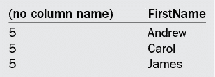

字面量值 `5` 是一个有效值，即使它完全没有意义。因为它没有引号，`5` 被解释为一个数值值。

### 算术计算 (Arithmetic Calculations)

让我们进入一个更典型的计算字段示例。算术计算允许我们对表中的一个或多个列进行计算。例如：
点击此处查看代码图像

```sql
SELECT
SalesID,
QuantityPurchased,
PricePerItem,
FROM Sales
```

这条语句将返回此项数据：

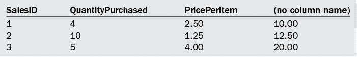

与字面量一样，第四列没有表头，因为它不是从单列派生出来的。上述 `SELECT` 的前三列与之前看到的并无区别。第四列是一个计算列，其算术表达式如下：
点击此处查看代码图像

`QuantityPurchased * PricePerItem`

在这种情况下，，星号符号 `*` 表示乘法。它并不像上一章看到的那样表示“所有列”。除了星号，计算字段中还允许几种其他算术运算符。最常见的有：

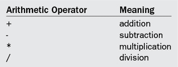
一个在 Microsoft SQL Server 或 MySQL 中不可用的常用算术运算符是幂。为了在 SQL 中使用指数，你必须使用 `POWER()` 函数。将在下一章中进行演示。

### 数据库差异：Oracle

与 SQL Server 和 MySQL 不同，Oracle 提供了一个用于幂的算术运算符。它由两个星号 `**` 表示。

### 字段连接 (Concatenating Fields)


```sql
SELECT
SalesID,
FirstName,
LastName,
FirstName + ' ' + LastName
FROM Sales

检索的数据是：

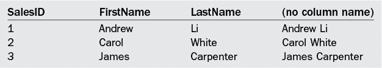

再次，前三列没有新内容。第四列派生自 SQL 语句中的此表达式：


加号 `+` 表示连接。由于该操作涉及字符数据，因此 SQL 知道这是连接而不是加法。

### 数据库差异：MySQL 和 Oracle

MySQL 不使用符号（如加号 `+`）来表示连接。相反，它要求使用一个名为 `CONCAT` 的函数。我们将在下一章介绍函数，现在来看相同语句在 MySQL 中的形式：

点击此处查看代码图像
```sql
SELECT
SalesID,
FirstName,
LastName,
CONCAT(FirstName, ' ', LastName)
FROM Sales
```
本质上，`CONCAT` 指定了组合括号内提到的三个项。Oracle 使用两个竖线 `||` 而不是加号 `+` 来表示连接。Oracle 的等语句为：

```sql
SELECT
SalesID,
FirstName,
LastName,
FROM Sales
```

### 列别名 (Column Aliases)

在本章之前的所有示例中，计算字段都是以无描述性的表头显示的。Microsoft SQL Server 在遇到计算字段时会显示 `(no column name)`。我们现在讨论如何为这些列指定描述性表头。简而言之，解决方案是使用列别名。`alias` 一词意味着替代名称。这里有一个上一个 SELECT 语句指定列别名的示例：

点击此处查看代码图像
```sql
SELECT
SalesID,
FirstName,
LastName,
FirstName + ' ' + LastName AS 'Name'
FROM Sales

关键字 `AS` 用于指示列别名，它紧跟在关键字之后。注意列别名被单引号包围。输出是：

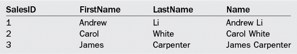

第四列现在有了表头。在这个示例中，我们将列别名放在了单引号内。这些引号并不是严格必要的，除非列别名包含空格。此外，`AS` 关键字并不是必要的。然而，在本书书中我们将坚持使用 `AS` 关键字，以明确这是一个列别名。如果没有单引号或 AS 关键字，上一个 SELECT 语句将写如下，结果相同：

```sql
SalesID,
```


`FirstName`,
`LastName`,

`FirstName + ' ' + LastName Name`
`FROM Sales`

除了为计算字段提供表头外，当表中的列名含义晦涩且你想更改它时，列别名通常也非常有用。例如，如果一个表有一个名为“Qty”的列，你可以执行此语句将该列显示为“Quantity Purchased”（购买数量）：

```sql
Qty AS 'Quantity Purchased'
FROM table
```

***

### 数据库差异：Oracle
Oracle 使用双引号来界定列别名。上述语句在 Oracle 中的写法将如下：

点击此处查看代码图片

```sql
SELECT
SalesID,
LastName,
FirstName || ' ' || LastName AS "Name"
FROM Sales;
```

***

### 表别名
除了为列提供备用名称外，还可以使用相同的 `AS` 关键字为表指定别名。使用表别名通常有三个原因。第一个原因与名称模糊或复杂的表有关。例如，如果一个表名为 `Sales123`，你可以使用以下 `SELECT` 给该表一个别名 `Sales`。

```sql
SELECT
LastName
FROM Sales123 AS Sales
```
与列别名一样，`AS` 关键字是可选的。但与列别名不同，表别名不包含在引号内。使用表别名的第二个原因是允许你将该别名用作任何所选列的前缀。例如，上面的代码也可以写成：

```sql
SELECT
Sales.LastName
FROM Sales123 AS Sales
```
单词 `Sales` 现在已作为前缀添加到 `LastName` 列中，并使用句号将前缀与列名分隔。在这种情况下，使用前缀是完全可选的，且有些冗余。由于此查询中只有的一张表，因此没有必要将表名作为列的前缀。然而，当从多个表中选择数据时，前缀通常很有帮助，而且有时是必须的。当涉及多个表时，添加表名作为前缀可以帮助查看查询的人快速理解每列数据来自哪张表。此外，当多个表中的列名相同时，实际上必须使用表别名。这种列别名的用法将在第 11 章“内连接 (#ch11.html_ch11)”中进行说明。

使用表别名的第三个原因与子查询中使用表有关这将在第 14 章“子查询 (#ch14.html_ch14)”中讨论。

***

### 数据库差异：Oracle
虽然列别名可以使用 `AS` 关键字，但 Oracle 不允许使用 `AS` 关键字表示表别名。上述 `SELECT` 语句在 Oracle 中的写法为：

```sql
SELECT
Sales.LastName
FROM Sales123 Sales;
```
***

### 展望

在本章，我们讨论了在 `SELECT` 语句中创建计算字段的三种通用方法。首先，可以使用字面量来选择特定的单词或值。其次，可以在单个表达式中对一个多个列应用算术计算。第三，可以使用拼接将列和字面量组合在一起。我们还讨论了列别名的相关主题，这在使用计算字段时经常用到。最后，我们对表别名进行了预览，该主题将在后面的章节中进行更详细的介绍。

在下一章中，我们将转向函数主题，函数提供了更复杂、更有趣的方法来执行计算。如前所述，我们还没有到可以将选择条件应用于 SQL 语句的程度。我们仍在基于 `SELECT` 中 `columnlist` 可以执行的基础进行构建。你对这种有条理的方法的耐心将在第 6 章获得回报，那时我们将讨论选择逻辑主题。
## 4. 使用函数

### 引入的关键字

`LEFT` • `RIGHT` • `SUBSTRING` • `LTRIM` • `RTRIM` • `UPPER` • `LOWER` • `GETDATE` • `DATEPART` • `DATEDIFF` • `ROUND` • `PI` • `POWER` • `ISNULL`

任何熟悉 Microsoft Excel 的人可能都知道函数为典型的电子表格用户提供了巨大的功能。如果没有函数的能力，电子表格中大部分可用数据将价值有限。在 SQL 世界中也是如此。熟悉 SQL 函数将极大地增强你为任何查看数据或 SQL 生成报告的人生成动态结果的能力。
本章涵盖了四个不同类别中的许多常用函数：字符函数、日期/时间函数、数值函数和转换函数。此外，我们还将讨论复合函数——一种将多个函数组合成单个表达式的方法。

### 什么是函数？

与上一章涵盖的计算类似，函数提供了处理数据的另一种方式。如所见，计算可以涉及多个字段，通过如乘法等算术运算符，或者通过拼接来实现。同样，函数可以涉及来自多个值的数据，但函数的最终结果始终是一个值。

什么是函数？函数仅仅是用于任意数量输入值转换为一个输出值的规则。该规则定义在函数内部且无法更改。然而，函数用户允许为输入指定任何所需的值。某些函数可能允许某些输入是可选的。这意味着特定输入的指定并不是必须的。函数也可以设计为没有输入。然而，无论输入的类型或数量，函数始终返回一个输出值。
函数有两种类型：标量和聚合。“标量”一词源于数学，指的是对单个数字的操作。在计算机使用中，这意味着函数在单行数据上执行。例如，`LTRIM` 函数删除值的左空格。

相反，聚合函数旨在用于更大的数据集。例如，`SUM` 函数可以计算某列所有值的和。由于聚合函数适用于更大的集合或组，我们将这类函数的讨论留到第 9 章“汇总数据 (#ch09.html_ch09)。”

每个 SQL 数据库都提供许多标量函数。实际函数在名称和工作方式上之间差异很大。因此，我们仅涵盖一些常用函数的代表性示例。

最常见的标量函数可以归分为三类：字符、日期/时间和数值。这些是允许你操作字符、日期/时间或数值数据类型的函数。此外，我们将讨论一些实用的转换函数，可以将数据从一种数据类型转换为另一种。
### 字符函数

字符函数是能够处理字符数据的函数。正如字符数据类型有时被称为字符串数据类型，字符函数有时被称为字符串函数。我们将涵盖这七个字符函数示例：`LEFT`、`RIGHT`、`SUBSTRING`、`LTRIM`、`RTRIM`、`UPPER` 和 `LOWER`。

在本章中，我们不是从特定表中检索数据，而是简单地使用带有字面量值的 `SELECT` 语句。将没有用于指示表的 `FROM` 子句。让我们从 `LEFT` 函数的示例开始。当执行此 SQL 命令时：

```sql
LEFT('sunlight',3) AS 'The Answer'
```

返回此数据：


在此 SQL 语句中包含列别名允许输出将“The Answer”显示为列标题。注意，`SELECT` 语句中没有 `FROM` 子句。我们并不是从表中检索数据，而是从一个单一字面量（即‘sunlight’）中选择数据。在许多 SQL 实现中（包括 SQL Server 和 MySQL）中，`SELECT` 语句并不严格需要 `FROM` 子句，尽管在实践中很少会写这样的 `SELECT` 语句。我们使用这种不带 `FROM` 子句的格式，是为了更方便地说明函数的工作原理。

现在让我们详细查看该函数的格式。`LEFT` 函数的一般格式为：


```
LEFT(CharacterValue, NumberOfCharacters)
```

所有函数在括号内都有任意数量的参数。例如，`LEFT` 函数有两个参数：`CharacterValue` 和 `NumberOfCharacters`。*argument*（参数）一词是一个常用的数学术语，用于描述函数的组成部分，与任何不悦或或不愉快的事无关。为每个函数定义的各种参数真正定义了函数的含义。在 `LEFT` 函数的情况下，`CharacterValue` 和 `NumberOfCharacters` 参数都是必要的，用于定义调用 `LEFT` 函数时会发生什么。

`LEFT` 函数有两个参数，且两个都是必须的。正如前面提到的，其他函数可能有更多或更少的参数。函数甚至允许没有参数。但无论参数数量多少（即使为零），所有函数在函数名后都有一组括号。括号的存在告诉你是该表达式是一个函数而不是其他东西。
`LEFT` 函数的公式是：获取指定的 `CharacterValue`，查看左侧指定的 `NumberOfCharacters`，并返回结果。在之前的例中，它查看了 `CharacterValue` ‘sunlight’ 并返回左侧三个字符。结果是“sun”。

需要记住的主要点是，对于你任何想要使用的函数，你都需要在数据库参考指南中查找该函数，并确定需要多少参数以及它们的含义是什么。

我们将涵盖的第二个字符函数是 `RIGHT` 函数。这与 `LEFT` 函数相同，不同在于现在指定输入值右侧的字符。`RIGHT` 函数的一般格式为：

点击此处查看代码图像
```
RIGHT(CharacterValue, NumberOfCharacters)
```

例如：

点击此处查看代码图像
```
SELECT

RIGHT('sunlight',5) AS 'The Answer'
```

返回：


在这种情况下，`NumberOfCharacters` 参数需要值为 5 才能返回值“light”。如果值为 3，则只会返回“ght”。

使用 `RIGHT` 函数时经常出现的一个问题是，字符数据通常在右侧包含空格。让我们来看一个示例，一个仅有一行数据的表包含一个名为 `President` 的列，该列被定义为长度 20 个字符。表所示：


如果我们对该表执行此 `SELECT` 语句：

点击此处查看代码图像

```
SELECT


FROM table1
```

我们得到了这些数据：


我们预期得到“Washington”，但只得到了“hington”。问题是整个列的长度为 20 个字符。在这个示例中，值“George Washington”右侧有三个空格。因此，当我们请求最右侧的 10 个字符时，SQL 将取三个空格，加上原始表达式中的另外七字符。正如很快看到的，在使用 `RIGHT` 函数之前，必须使用 `RTRIM` 函数来删除末尾空格。

你可能会好奇如何从表达式的中间选择数据。这是通过使用 `SUBSTRING` 函数实现的。该函数的一般格式为：

点击此处查看代码图像

```
```

例如：

点击此处查看代码图像

```
SELECT
SUBSTRING('thewhitegoat',4,5) AS 'The Answer'
```

返回此数据：


***

### 数据库差异：MySQL 和 Oracle

MySQL 有时要求函数名和左括号之间不能有空格。这取决于所使用的特定函数。例如，MySQL 中的上一个语句必须完全按照所示编写。与 Microsoft SQL Server 不同，你不能在 `SUBSTRING` 之后输入额外的空格。


如所述，Oracle 不允许编写不带 `FROM` 子句的 `SELECT` 语句。然而，Oracle 提供了一个名为 `DUAL` 的虚拟表用于这种情况。带有 `SUBSTRING` 函数的 `SELECT` 的 Oracle 等效语句为：

点击此处查看代码图像

```
SELECT
SUBSTR('thewhitegoat',4,5) AS "The Answer"

FROM DUAL;
```

***


点击此处查看代码图像

```
SELECT

LTRIM('   apple') AS 'The Answer'

返回此数据：

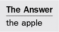

注意 `LTRIM` 足够聪明不会消除短语中间的空格。它只移除字符最左侧的空格。与 `LTRIM` 类似，`RTRIM` 函数移除字符值右侧的任何空格。下一节将在复合函数部分给出一个示例。


点击此处查看代码图像

```
SELECT

UPPER('Abraham Lincoln') AS 'Convert to Uppercase',
LOWER('ABRAHAM LINCOLN') AS 'Convert to Lowercase'
```

输出是：

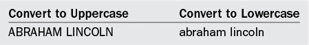


函数的一个重要特性（无论是字符、数学还是日期/时间函数）是两个或多个函数可以组合以创建复合函数。两个函数的复合函数可以被认为是函数的函数。让我们回到 George Washington 的查询来说明。再次，我们根据这些数据操作：


记得 `President` 列的长度为 20 个字符。换句话说，值“George Washington”右侧有三个空格。除了说明复合函数，接下来的示例还将涵盖上一节提到的 `RTRIM` 函数。语句：


```
SELECT

RIGHT(RTRIM (President),10) AS 'Last Name'

FROM table1

返回此数据：

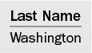


为什么现在它会产生正确的值？让我们检查这个复合函数是如何工作的。这里涉及两个函数：`RIGHT` 和 `RTRIM`。在评估复合函数时，你总是从内部开始向外处理。在这个示例中，最内层的函数是：

```
RTRIM(President)
```

该函数获取 `President` 列中的值并删除所有右侧的空格。完成后，将 `RIGHT` 函数应用于结果，以取回所需的值。由于 `RTRIM(President)` 等于“George Washington”，我们可以说：
```sql
SELECT
RIGHT(RTRIM (President), 10)
```

等同于：


```sql
SELECT
RIGHT('George Washington', 10)
```

换句话说，我们可以通过先对输入数据应用 `RTRIM` 函数，然后在表达式中添加 `RIGHT` 函数来获得所需的结果。
### 日期/时间函数

日期/时间函数允许对日期和时间值进行操作。这些函数的名称取决于所使用的数据库。在 Microsoft SQL Server 中，我们将涵盖的函数称为 `GETDATE`、`DATEPART` 和 `DATEDIFF`。

日期/时间函数中最简单的是返回当前日期和时间的函数。在 Microsoft SQL Server 中，该函数名为 `GETDATE`。此函数没有参数。它仅仅返回当前的日期和时间。例如：

```sql
```

返回一个带有当前日期和时间的表达式。由于 `GETDATE` 函数没有参数，因此括号之间没有指定内容。记住，日期/时间字段是一种特殊的数据类型，在单个字段中同时包含日期和时间。此类值的示例是：

`2017-05-15 08:48:30`

该值指的是 2017 年 5 月 15 日，上午 8 点过 48 分 30 秒。
### 数据库差异：MySQL 和 Oracle

在 MySQL 中，`GETDATE` 的等价物是 `NOW`。上面的语句将写为：

```sql
SELECT NOW()
```


```sql
SELECT CURRENT_DATE
```

下一个日期/时间函数允许我们分析任何指定的日期并返回一个表示此类元素（如日期的日或周）的值。同样，此函数的名称取决于数据库。在 Microsoft SQL Server 中，此函数称为 `DATEPART`。其通用格式为：

DATEPART(DatePart, DateValue)
```

`DateValue` 参数可以是任何日期。`DatePart` 参数可以许多不同的值，包括年、季度、月、年中的第、日、周、星期、小时、分钟和秒。

下表显示了 `DATEPART` 函数如何评估日期 '5/6/2017$，带有不同的 `DatePart` 参数值：


查看上一个表中的值，你可以看到 5/6/2017 的月份是 5（5 月）。日期是 2（星期一）。周是 18，因为 5/6/2017 处于该年的第 18 周。星期是 7，因为 5/6/2017 落在星期六，这是一周的第七天。

### 数据库差异：MySQL 和 Oracle

在 MySQL 中，`DATEPART` 函数的等价物名为 `DATE_FORMAT`，它对 `DateValue` 参数使用不同的值。例如，要返回日期 ‘5/6/2017’的日，你将在 MySQL 中执行此 `SELECT` 语句：


```sql
SELECT DATE_FORMAT('2017-05-06', '%d');
```

Oracle 没有与 `DATEPART` 的函数。


点击此处查看代码图像

```
DATEDIFF (DatePart, StartDate, EndDate)
```

该函数 `DatePart` 参数的有效值包括年、季度、月、年中的第、日、月、小时、分钟和秒。以下图表显示了 `DATEDIFF` 函数如何评估日期 7/8/2017 和 8/14/2017 之间的差异，带有不同的 `DatePart` 参数值：

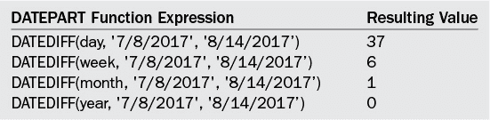

上表表明，两个日期之间有 37 天、6 周、1 个月或 0 年。

### 数据库差异：MySQL 和 Oracle

在 MySQL 中，`DATEDIFF` 函数仅允许你计算两个日期之间的天数，且结束日期必须先列出，以返回正值。通用格式为：
点击此处查看代码图像

```sql
DATEDIFF(EndDate, StartDate)
```


`CAST(Expression AS DataType)`

此函数的格式与之前看到的其他函数略有不同，因为它使用单词 `AS` 来分隔两个参数，而不是逗号。观察该函数的用法，可以发现在大多数情况下，`CAST` 函数并不是必需的。让我们来看在想要执行以下语句时的情况，此时 `Quantity` 列被定义为字符数据类型：

```sql
SELECT
FROM table
```

你的第一印象可能是该语句会执行失败，因为 `Quantity` 没有被定义为数值列。然而，大多数 SQL 数据库都足够智能，能够自动将 `Quantity` 列转换为数值，以便能够乘以 2。

这里有一个 `CAST` 函数变得必需的示例。假设我们有一个存储在字符数据类型列中的日期。我们希望将这些日期转换为真正的日期/时间列。这条语句阐述说明了 `CAST` 函数如何处理这种转换：


```sql
SELECT
'2017-04-11' AS 'Original Date',
CAST('2017-04-11' AS DATETIME) AS 'Converted Date'
```


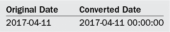

`Original Date` 列看起来像是一个日期，但它实际上只是字符数据。相比之下，`Converted Date` 列是一个真正的日期/时间列，现在显示的时间值就证明了这一点。

另一个有用的转换函数是将 `NULL` 值转换为有意义的值。在 Microsoft SQL Server 中，该函数被称为 `ISNULL`。正如在第 1 章中提到的，“关系数据库与 SQL”，`NULL` 值是指那些缺失数据的值。`NULL` 值不等同于空格或零。假设我们有这样的一张产品表：


注意打印机 A 在 `Weight` 列中的值为 `NULL`。这表示尚未提供该打印机的重量。假设我们想要生成所有产品的列表。当执行此 `SELECT` 语句时：

```sql
SELECT
Description,
Weight
```

它将显示：

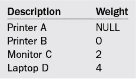

这种显示并没有不准确之处。然而，用户可能更喜欢看到缺失值看到“Unknown”（未知）而不是 `NULL`。以下是解决方案：
点击此处查看代码图片

```sql
SELECT
Description,
ISNULL(CAST(Weight AS VARCHAR),'Unknown') AS Weight
FROM Products

显示出以下数据：

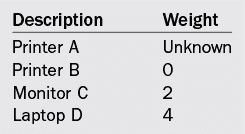

注意，该解决方案需要同时使用 `ISNULL` 和 `CAST` 函数。当遇到 `NULL` 值时，`ISNULL` 函数负责将重量显示为“Unknown”。假设 `Weight` 列被定义为整数，则需要 `CAST` 函数将重量转换为 `Varchar` 数据类型，这样就可以在单列中同时显示整数值和字符值了。


### 数据库差异：MySQL 和 Oracle

`ISNULL` 函数在 MySQL 中被称为 `IFNULL`。此外，MySQL 在此示例中并不需要使用 `CAST` 函数。上述语句在 MySQL 中的等效写法为：

点击此处查看代码图片

SELECT
Description,
IFNULL(Weight,'Unknown') AS Weight
FROM Products;
```

`ISNULL` 函数在 Oracle 中被称为 `NVL`（Null Value）。Oracle 的等效语句为：
点击此处查看代码图片

```sql
SELECT
Description,
NVL(CAST(Weight AS CHAR),'Unknown') AS Weight
FROM Products;

此外，与 Microsoft SQL Server 和 MySQL 不同，Oracle 在遇到 `NULL` 值时会显示一个折号而不是 `NULL` 单词。

***

### 展望


由于可用的函数非常多且可能性各异，无法讨论每一个可用函数的每一个细微差别。需要记住的是，当需要使用函数时，可以很容易地在数据库的帮助系统或参考指南中查找。在线参考资料将提供每个函数具体如何工作以及正确语法的详细信息。

在下一章中，我们将暂缓 `columnlist` 问题，讨论一些更有趣的内容：如何对数据进行排序。排序可以有很多用途，并满足用户以某种顺序查看数据的基本需求。通过排序，我们将开始考虑信息呈现的整体方式，而不仅仅是单个数据项的碎片信息。

## 5. 数据排序

`ORDER BY` • `ASC` • `DESC`

以排序方式呈现数据的能力对于许多任务至关重要。`ORDER BY` 用于指定排序，而 `ASC`（升序）和 `DESC`（降序）用于指定排序的方向。

排序的想法适用于许多场景，即使数据是按字母排列的，也能快速找到特定的客户。从小到大排序，即使数据是按日期顺序排列的。

### 升序排序

这是带有 `ORDER BY` 子句的 `SELECT` 语句的通用格式：

```sql
SELECT columnlist
FROM tablelist
ORDER BY columnlist

`ORDER BY` 子句始终位于 `FROM` 子句之后，而 `FROM` 子句又位于 `SELECT` 关键字之后。`columnlist` 表示 `SELECT` 中可以列出多个列。`columnlist` 中的列可以是单个列，也可以是复杂的表达式。此外，`SELECT` 和 `ORDER BY` 中指定的列可以是完全不同的列。`tablelist` 表示在 `FROM` 子句中可以列出多个表。列出多个表的语法将在第 11 章“内连接”以及以及第 12 章“外连接”中介绍。

对于接下来的几个排序示例，我们将从此 Salespeople 表中的数据开始：

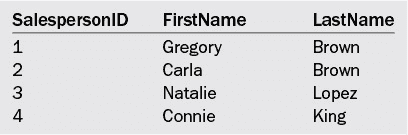


```sql
SELECT
FirstName,
LastName
FROM Salespeople
ORDER BY LastName

带回以下数据：

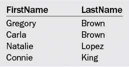

因为有两个 Brown（Carla 和 Gregory），我们无法预测哪一个会先列出来。这是因为我们只对 `LastName` 进行排序，而有多个行的姓氏相同。


```sql
SELECT
FirstName,
LastName
FROM Salespeople
ORDER BY FirstName

那么检索到以下数据：

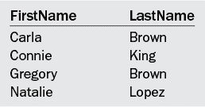

现在的顺序完全不同了，因为排序是根据名字而不是姓氏。


SQL 提供了一个名为 `ASC` 的特殊关键字，代表 `ascending`（升序）。该关键字是完全可选的，而且很大程度上是没有必要的，因为默认情况下所有排序都按升序排列。以下使用 `ASC` 关键字的 `SELECT` 语句返回与之前相同的数据。

```sql
SELECT
LastName
FROM Salespeople
ORDER BY FirstName ASC
```

从本质上说，关键字 `ASC` 可以强调排序是升序而非降序。


`DESC` 关键字按与 `ASC` 相反的顺序进行排序。这种排序的顺序不是升序，而是降序。例如：

```sql
SELECT
FirstName,
LastName
ORDER BY FirstName DESC
```

检索到：

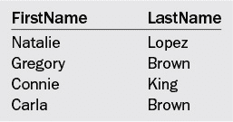


### 按多列排序

我们现在回到如何处理 Brown 家族的问题。当有多个姓相同的相同的时，为了按姓氏排序，我们必须添加按名字的次要排序，如下：

```sql
SELECT
LastName
FROM Salespeople
ORDER BY LastName, FirstName
```

这返回了：


由于现在指定了第二个排序列，我们可以确定 Carla Brown 将出现在 Gregory Brown 之前。注意，在 `ORDER BY` 子句中，`LastName` 必须列在 `FirstName` 之前。列的顺序很重要。第一个第一个列始终具有主排序值。任何列出的额外列将成为次级、三级，此类推。

### 按计算字段排序

我们现在把从第 3 章中中学的计算字段和别名的知识应用于说明排序的一些进一步可能性。此语句：


```sql
SELECT
LastName + ', ' + FirstName AS 'Name'
FROM Salespeople
ORDER BY Name
```
返回此数据：

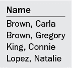

如所示，我们利用字符串拼接创建了一个别名为 `Name` 的计算字段。我们可以在 `ORDER BY` 子句中引用同一个列别名。这很好地说明了使用列别名的另一个好处。此外，注意计算字段本身的设计。我们在姓氏列和名字列之间插入了一个列和一个空格以将它们分开，并以常用的格式显示名称。方便的是，这种格式也非常适合排序。以这种格式显示名称（用逗号分隔姓和名）是一个值得记住的实用技巧。用户经常希望看到按这种方式排列的名称。

在 `ORDER BY` 子句中直接使用计算字段而不将其用作列别名也是也是可以的。与上述方法类似，我们还可以指定：
```sql
SELECT
FirstName,
LastName
FROM Salespeople
ORDER BY LastName + FirstName
```
这将显示：

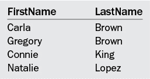

数据的排序方式与前一个示例相同（此处原文逻辑可能有误，应为与前一个示例相同）。唯一的区别是我们现在在 `ORDER BY` 子句中指定了一个计算字段，而没有使用列别名。这产生的结果与将 `LastName` 和 `FirstName` 指定为主、次排序列的结果相同。

### 排序序列
在之前的示例中，所有数据都是字符数据，由从 A 到 Z 的字母组成。没有数字或特殊字符。此外，还没有考虑大写和小字母。

每个数据库都允许用户指定或自定义排序规则（collation）设置，这些设置提供了数据如何排序的详细信息。设置在数据库之间有所异，但通常有三个事实。首先，当数据按升序排序时，任何带有 `NULL` 值的数据都会首先出现。正如之前讨论的，`NULL` 值是指缺失的数据。在任何 `NULL` 之后，数字将出现在字符之前。对于降序排序的数据，字符数据将首先显示，然后是数字，最后是 `NULL`。

其次，对于字符数据，通常不区分大小写。`e` 的处理方式与 `E` 相同。第三，对于字符数据，组成值的单个字符是从左到右评估的。如果是字母，那么 `AB` 将在 `AC` 之前。让我们看一个来自表的示例，我们将其称为 `TableForSort`：

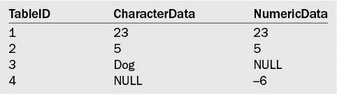
在该表中，`CharacterData` 列被定义为字符列，例如 `VARCHAR`（变长数据类型）。同样，`NumericData` 列被定义为数值列，例如 `INT`（整数数据类型）。没有数据的值显示为 `NULL`。当对 `TableForSort` 表执行此 `SELECT` 语句时：

```sql
SELECT
NumericData
FROM TableForSort
ORDER BY NumericData

它将显示：

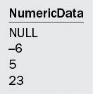

注意 `NULL` 首先出现，然后按数字顺序排列数字。如果我们想让 `NULL` 值假设默认值为 0，我们可以使用上一章讨论的 `ISNULL` 函数并执行此 `SELECT` 语句：


```sql
SELECT
ISNULL(NumericData,0) AS 'NumericData'
FROM TableForSort
ORDER BY ISNULL(NumericData,0)
```
现在的结果是：

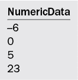

`ISNULL` 函数将 `NULL` 值转换为 0，导致了不同的排序顺序。

将 `NULL` 值显示为 `NULL` 还是 0 取决于具体情况。如果用户认为 `NULL` 是数据的缺失，那么显示 `NULL` 是恰当的。对同一表转向另一个 `ORDER BY` 子句，如果我们执行此 `SELECT`：
```sql
SELECT
CharacterData
FROM TableForSort
ORDER BY CharacterData
```


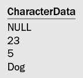

如预期的，`NULL` 首先出现，然后是带有数字的值，然后是字母字符。注意 23 在 5 之前。这是因为 23 和 5 的值被评估为字符而不是数字。因为字符数据是从左到右评估的，且 2 小于 5，所以 23 在前。

### 展望


在本章的开头，我们提到了排序的一些通用用途。主要用途是将数据放置在易理解的顺序中，从而允许用户快速找到所需的信息。另一种有趣的排序用法将在第 6 章中的“选择标准”中介绍。在该章中，我们将引入 `TOP` 关键字以及与之结合使用的另一种排序方法。这种技术被称为 Top N 排序，允许我们执行诸如显示特定时间范围内订单前五个客户的操作。


到此为止，我们看到的 `SELECT` 语句总是会返回表中的每一行。在现实世界中，这种情况很少见。通常我们只对检索符合特定标准的数据感兴趣。例如，如果你在查询订单，你可能只想查看符合某些条件的订单。在查看产品时，你通常只想查看某些类型的产品。很少有人想简单地查看所有内容。你对数据的兴趣通常指向这些数据中的一小部分集，以便分析或查看某个特定方面。
## 应用选择标准

SQL 中的选择标准从 `WHERE` 子句开始。`WHERE` 关键字完成了选择行子集的任务。这是 `SELECT` 语句的通用格式，包含了 `WHERE` 子句以及之前讨论过的其他子句：

```sql
SELECT columnlist
FROM tablelist
ORDER BY columnlist
```

可见，`WHERE` 子句必须位于 `FROM` 和 `ORDER BY` 子句之间。事实上，如果使用了任何子句，它们必须按照上述所示顺序出现。

让我们来看一个示例，取自此 `Sales` 表中的数据：


我们将从一个带有简单 `WHERE` 子句的语句开始：

```sql
SELECT
FirstName,
LastName,
FROM Sales
WHERE LastName = 'Carpenter'
```

输出结果：


因为 `WHERE` 子句规定选择 `LastName` 等于‘Carpenter’的行，因此表中的三行中只返回了一行。注意，`LastName` 列的预期值被括在引号中，是因为 `LastName` 是一个字符列。对于数值字段，不需要引号。例如，以下 `SELECT` 同样有效并返回相同的数据：

```sql
SELECT
FirstName,
LastName,
QuantityPurchased
WHERE QuantityPurchased = 5
```

### WHERE 子句运算符

在之前的语句中，等号（`=`）被用作 `WHERE` 子句中的运算符。等号表示相等性测试。上述所示的通用格式要求 `WHERE` 子句后跟着一个 `condition`。该条件由一个运算符以及两侧的表达式组成。


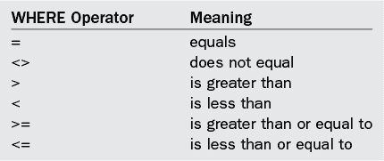

更高级的运算符将在下一章中介绍。

等号（`=`）和不等（`<>`）运算符的含义应该是显而易见的。这里有一个带有“大于”运算符的 `WHERE` 子句示例，取自同一个 `Sales` 表：

SELECT
FirstName,
LastName,
QuantityPurchased
FROM Sales
WHERE QuantityPurchased > 6
```
结果是：


在这个示例中，只有一行符合 `QuantityPurchased` 列大于 6 的条件。虽然不像数值字段那么常用，但在文本列上使用“大于”运算符也是可能的。这个示例：

```sql
FirstName,
LastName
FROM Sales
WHERE LastName > 'K'
```

返回了：


因为测试的是大于 K 的姓氏，所以它只返回了 Li 和 White，而没有返回 Carpenter。当应用于文本字段时，大于和小于运算符表示按值的字母顺序进行选择。在这种情况下，返回了 Li 和 White，因为在字母表中 L 和 W 排在 K 之后。

## 限制行数

我们有时可能想选择表中的一小部分行，但不在乎返回的是哪些行。假设我们有一张有 50,000 行的表，只想看几行数据来看看它长什么样。为了这个目的使用 `WHERE` 子句是没有意义的，因为我们不在乎返回的是哪些特定的行。
对于这种情况，解决方案是使用一个特殊的关键字来指定返回行数的数量限制。这是数据库之间语法不同的另一个实例。在 Microsoft SQL Server 中，实现此限制的关键字是 `TOP`。通用格式为：

```sql
SELECT
TOP number columnlist
FROM tablelist
```
***

### 数据库差异：MySQL 和 Oracle

MySQL 使用关键字 `LIMIT` 而不是 `TOP`。通用格式为：

```sql
FROM tablelist
LIMIT number
```

Oracle 使用关键字 `ROWNUM` 而不是 `TOP`。`ROWNUM` 关键字必须在 `WHERE` 子句中指定，如下：

```sql
FROM tablelist
WHERE ROWNUM <= number
```

***

假设我们想查看表的前 10 行。实现此点的 `SELECT` 语句如下：
```sql
SELECT
TOP 10 *
FROM table
```

该语句返回表中的前 10 行的所有列。与任何不带 `ORDER BY` 子句的 `SELECT` 语句一样，没有办法预测将返回哪 10 行。这取决于数据在表中的物理存储方式。
同样，我们可以列出要返回的特定列：

```sql
SELECT
TOP 10
column1,
column2
```

本质上，`TOP` 关键字实现了与 `WHERE` 子句类似的功能，因为它返回了一个行的行子集。然而，请记住，使用 `TOP` 关键字返回的行并不是统计意义上的随机样本，取决于数据的物理存储。

### 结合排序限制行

`TOP` 关键字的另一个用法是结合 `ORDER BY` 子句使用，以获取指定数量的最大值。这种数据选择通常被称为 Top N 选择。这里有一个示例，取自 `Books` 表：
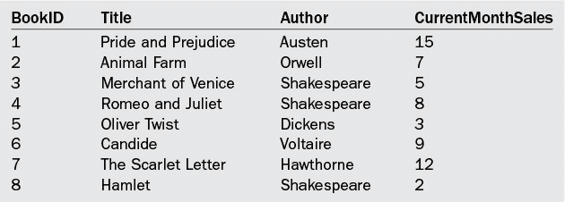

假设我们想看本月销量最多的三本书。实现此点的 `SELECT` 语句是：

```sql
SELECT
TOP 3
QuantitySold AS 'Quantity Sold'
FROM Books
ORDER BY QuantitySold DESC
```

输出是：


让我们详细检查此语句。第二行的 `TOP 3` 表示只返回三行数据。主要问题是它是如何确定哪三行的。答案在 `ORDER BY` 子句中。如果没有 `ORDER BY` 子句，那么 `SELECT` 将简单地返回任意三行。然而，这并不是我们想要的。我们正在寻找销量最高三行。为了实现这一点，我们需要按 `QuantitySold` 列对行进行降序排序。为什么要降序？当数据按降序排序时，最大的数字在前。如果我们按升序排序，我们将得到销量最低的书，而不是最多的。

现在让我们为这个场景再增加一个转折。假设我们只想看莎士的哪本书销量最多。为了实现这一点，我们需要添加一个 `WHERE` 子句，如下：

```sql
SELECT
Title AS 'Book Title',
QuantitySold AS 'Quantity Sold'
FROM Books
WHERE Author = 'Shakespeare'
ORDER BY QuantitySold DESC
```


`WHERE` 子句增加了仅查看莎士比亚作品的限定。我们还修改了 `TOP` 关键字以指定 `TOP 1`，表示只想看一行数据。

### 模式匹配


现在我们想转向一种待检索数据没有精确定义的情况。我们经常希望根据对单词或短语的不精确匹配来查看数据。例如，你可能感兴趣寻找名称中包含“bank”（银行）单词的公司。通过短语内的不精确匹配选择数据通常被称为 `pattern matching`（模式匹配）。在 SQL 中，`LIKE` 运算符用于 `WHERE` 子句，使我们能够对列值的部分内容进行匹配查找。`LIKE` 运算符要求使用特殊的通配符字符来指定匹配的具体工作方式。让我们从下面 Movies 表格中的一个示例开始。

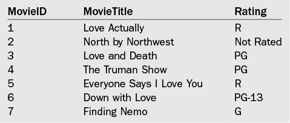

我们使用 `LIKE` 运算符的第一个示例是：
点击此处查看代码图片

```
SELECT
MovieTitle AS 'Movie'
FROM Movies
WHERE MovieTitle LIKE '%LOVE%'

在这个示例中，百分号（%）被用作通配符。百分号（%）通配符意味着 `any characters`（任何字符）。任何字符包括了没有字符的情况。`LOVE` 之前的百分号（%）意味着我们将接受 `LOVE` 之前有任何（或没有）字符的短语。同样，`LOVE` 之后的百分号（%）意味着我们将接受 `LOVE` 之后有任何（或没有）字符的短语。换句话说，我们正在寻找任何包含 `LOVE` 单词的电影标题。这里是来自 `SELECT` 返回的数据：

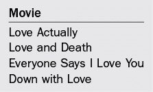

注意，`LOVE` 作为第一个单词、最后一个单词，有时出现在电影标题的中间。


### 数据库差异：Oracle

与 Microsoft SQL Server 和 MySQL 不同，Oracle 在确定字面量值的匹配时是区分大小写的。在 Oracle 中，`LOVE` 不等于 `Love`。Oracle 中的等效语句是：

点击此处查看代码图片

SELECT
MovieTitle AS Movie
FROM Movies
WHERE MovieTitle LIKE '%LOVE%';
```

这将不会返回任何数据，因为没有一个电影标题包含全大写的 `LOVE` 单词。Oracle 中的一种解决方案是使用 `UPPER` 函数将数据转换为大写，如下所示：
点击此处查看代码图片

```
SELECT
MovieTitle AS Movie
FROM Movies
WHERE UPPER(MovieTitle) LIKE '%LOVE%';

***

现在让我们尝试只查找以 `LOVE` 开头的电影。如果我们发布：

点击此处查看代码图片

SELECT
MovieTitle AS 'Movie'
FROM Movies
WHERE MovieTitle LIKE 'LOVE%'
```

我们将只检索到这些数据：
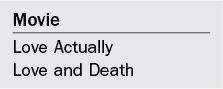

因为我们现在只在 `LOVE` 单词之后指定百分号（%）通配符，所以我们只得到以 `LOVE` 开头的电影。同样，如果我们发布：

```
SELECT
MovieTitle AS 'Movie'
WHERE MovieTitle LIKE '%LOVE'
```

我们只得到这些数据：

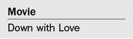


人们可能会问如何安排通配符，以便只看到在标题中间包含 `LOVE` 单词的电影，而不看到 `LOVE` 在开头或结尾的电影。解决方案是指定：

```
SELECT
MovieTitle AS 'Movie'
FROM Movies
```

注意，在 `LOVE` 单词和两侧的百分号（%）通配符之间插入了一个空格。这确保了该单词的两侧至少有一个空格。从该语句带的数据是：

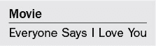

### 通配符
百分号（%）符号是与 `LIKE` 运算符最常用的通配符，但还有其他几种可能性。这些包括下划线字符（`_`）、方括号括起来的 `characterlist`（字符列表），以及脱符号（`^`）加上方括号括起来的 `characterlist`。下表列出了这些通配符及其含义：

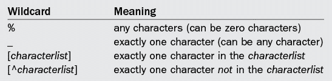

我们将使用下面的 Actors 表格来说说明这些通配符的语句。

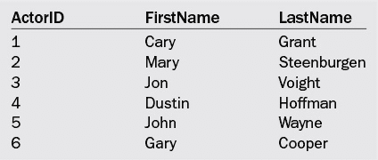
这里是下划线（`_`）通配符字符如何使用的示例：

```
SELECT
FirstName,
LastName
FROM Actors
```

此 `SELECT` 的输出是：

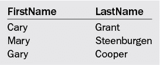

该语句检索了这三个演员，因为他们的 First 名字都由恰好一个字符后接短语 `ARY` 组成。
同样，如果我们发布这条语句：

```
SELECT
FirstName,
LastName
FROM Actors
```

它产生了：

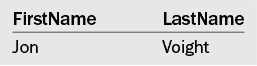

演员 John Wayne 没有被选中，因为 John 不符合 `J_N` 模式。下划线代表仅一个字符。
我们将讨论的最后通配符 `[characterlist]` 和 `[^*characterlist]` 允许你在单一个位置上指定多个通配符值。

***

### 数据库差异：MySQL 和 Oracle

`[characterlist]` 和 `[^*characterlist]` 通配符在 MySQL 或 Oracle 中不可用。
***

以下展示了 `[characterlist]` 通配符：

点击此处查看代码图片

```
FirstName,
LastName
FROM Actors
WHERE FirstName LIKE '[CM]ARY'
```

这检索了任何 `FirstName` 以 `C` 或 `M` 开头并以 `ARY` 结尾的行。结果是：


此 `WHERE` 子句中表达的条件非常基础。它仅仅指定返回所有 `QuantityPurchased` 列值为 5 的行。在现实世界中，数据的筛选远没有这那么简单。因此，现在让我们将注意力转向在选择标准中指定更复杂逻辑条件的方法。

设计复杂逻辑条件的能力被称为*布尔逻辑*（Boolean logic*）。这个术语源于数学，指的是构建复杂条件的能力，这些条件可以被评估为真（true）或假（false）。在上述示例中，表中的每一行条件 `QuantityPurchased = 5` 都会被评估为真或假。显然，我们只想看到条件被评估为真的行。
用于创建复杂布尔逻辑的原则关键字是 `AND`、`OR` 和 `NOT`。这三个运算符用于为 `WHERE` 子句提供额外的功能。通过适当的组合，`AND`、`OR` 和 `NOT` 运算符配合括号，可以指定几乎能够想象到的任何逻辑表达式。

### AND 运算符

以下示例均取自此 Purchases（购买明细）表：

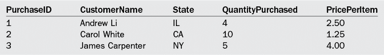
这是一个使用 `AND` 运算符的 `WHERE` 子句示例：

```
SELECT
CustomerName,
QuantityPurchased
FROM Purchases
AND QuantityPurchased < 7
```

`AND` 子句意味着所有条件都评估为真，该行才会被选中。此 `SELECT` 指定要检索的唯一行是 `QuantityPurchased` 既大于 3 且小于 7 的行。因此，只返回了这两行：

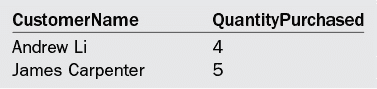


### OR 运算符

现在让我们来看 `OR` 运算符。`AND` 运算符意味着所有条件都评估为真，该行才能被选中。`OR` 运算符意味着如果*任何*一个条件被确定为真，该行就会被选中。

这是一个从同一张表中取出的示例：

SELECT
CustomerName,
QuantityPurchased,
PricePerItem
FROM Purchases
WHERE QuantityPurchased > 8
OR PricePerItem > 3

此 `SELECT` 返回了这些数据：

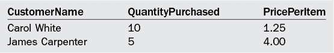

为什么显示了 Carol White 和 James Carpenter 的行，而没有 Andrew Li 的行？Carol White 的行被选中是因为它满足了第一个条件的要求（`QuantityPurchased > 8`）。第二个条件（PricePricePerItem > 3`）不真没有关系，因为 `OR` 条件只需要一个条件为真即可。


### 使用括号

假设我们对来自伊利诺伊州（Illinois）或加利福尼亚州（California）客户的订单感兴趣。此外，我们只想查看数量大于 8 的订单。为了尝试满足这一请求，我们组合了此 `SELECT` 语句：

```
SELECT
State,
QuantityPurchased
FROM Purchases
WHERE State = 'IL'
OR State = 'CA'
AND QuantityPurchased > 8
```
我们期望此语句只返回一行数据，即 Carol White 的。虽然我们在伊利诺伊州或加利福尼亚州有两个客户（Li 和 White），但只有其中一个（White）购买数量大于 8。然而，当执行此语句时，我们得到了：

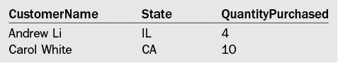

我们看到了两行而不是预期的一行。哪里出了问题？答案在于 SQL 如何解释 `WHERE` 子句，而该子句恰好包含了 `AND` 和 `OR` 运算符。和其他计算机语言一样，SQL 有预定的评估顺序，规定了各种运算符被解释的顺序。除非另有说明，否则 SQL 始终在 `OR` 运算符之前处理 `AND` 运算符。因此，在之前的语句中，它首先查看 `AND` 并评估条件：

```
AND QuantityPurchased > 8
```

该条件的行是 Carol White。SQL 随后评估 `OR` 运算符，允许 State 等于 IL 的行通过。这增加了 Andrew Li 的行。结果是 SQL 确定 Andrew Li 和 Carol White 的行都符合条件。

显然，这并不是本意。这种问题在当 `AND` 和 `OR` 运算符组合在单个 `WHERE` 子句中经常出现。解决这种歧义的方法是使用括号来指定所需的评估顺序。括号中的任何内容始终会被首先评估。


```
SELECT
CustomerName,
State,
QuantityPurchased
FROM Purchases
OR State = 'CA')
AND QuantityPurchased > 8
```

执行此语句时，我们看到了这些数据：


执行此时，括号强制 `OR` 表达式（`State = 'IL' OR State = 'CA'`）先进行评估。产生了预期的结果。

### 多重括号

假设我们要从 Purchases 表中选择两组行：首先是纽约州的客户，其次是伊利诺伊州且购买数量在 3 到 10 之间的客户。下述 `SELECT` 实现了这一点：

```
CustomerName,
State,
QuantityPurchased
FROM Purchases
WHERE State = 'NY'
OR (State = 'IL'
AND (QuantityPurchased >= 3
```

结果是：


注意此语句中有两组括号，一组在另一组内部。这种括号的使用类似于数学中的复合函数。当有多组括号时，最内层的总是先评估。布尔表达式中的括号也是如此。在这个示例中，最内层的括号包含：
```
QuantityPurchased >= 3
AND QuantityPurchased <= 10
```

在对每行评估此条件后，逻辑移动到第二组括号：

State = 'IL'
AND (QuantityPurchased >= 3
AND QuantityPurchased <= 10)
```

最后，逻辑处理 `WHERE` 子句中最后（未在括号内）关于纽约州的行：

WHERE State = 'NY'
OR (State = 'IL'
AND (QuantityPurchased >= 3
AND QuantityPurchased <= 10))
```

本质上，SQL 逻辑首先评估最内层括号中的表达式，然后是外部括号，最后是所有剩余表达式。
### NOT 运算符

除了 `AND` 和 `OR` 运算符外，`NOT` 运算符通常用于表达复杂的逻辑条件。`NOT` 表达 `NOT` 之后任何内容的否定或反面。这是一个简单的示例：

```
SELECT
CustomerName,
QuantityPurchased
FROM Purchases
WHERE NOT State = 'NY'
```

结果是：


这指定了状态不等于 NY 的行。在这种简单的情况下，`NOT` 运算符并不是真正必要的。之前语句的逻辑也可以通过以下等效语句来实现：

```
SELECT
CustomerName,
State,
FROM Purchases
WHERE State <> 'NY'
```

在这里，不等于运算符（`<>`）实现了与 `NOT` 运算符相同的功能。有一个使用 `NOT` 运算符更复杂的示例：

```
CustomerName,
State,
QuantityPurchased
FROM Purchases
WHERE NOT (State = 'IL'
```


OR State = 'NY')

结果是：


当 `NOT` 运算符用于一组括号之前时，它会否定括号内的所有内容。在这个示例中，我们正在寻找状态既不是 `not` 伊利诺伊州又不是纽约州的所有行。

再次注意，在这个示例中，`NOT` 运算符并不是严格必须的。上一个查询的逻辑也可以通过以下等效语句来实现：

```sql
SELECT
CustomerName,
QuantityPurchased
FROM Purchases
WHERE State <> 'IL'
AND State <> 'NY'
```

可能需要花一点时间思考为什么上述两个语句是等效的。第一条语句使用了 `NOT` 运算符以及一个带有 `OR` 运算符的逻辑表达式。第二个语句则将逻辑转换为一个带有 `AND` 运算符的表达式。
这里是 `NOT` 运算符在复杂语句中使用的示例：

```sql
SELECT
CustomerName,
State,
QuantityPurchased
WHERE NOT (State = 'IL'
AND QuantityPurchased > 3)
```

此查询的意思是：选择那些“状态等于伊利诺伊州且 `QuantityPurchased` 大于 3”的情况不成立的客户。`NOT` 运算符应用于整个逻辑表达式（即状态等于伊利诺伊州且 `QuantityPurchased` 大于 3）。结果是：

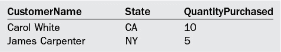
这两行被选中，是因为伊利诺伊州唯一一个 `QuantityPurchased` 大于 3 的客户是 Andrew Li。由于我们对这整个逻辑应用了 `NOT`，最终结果是显示另外两个客户。

再次，此查询可以使用不使用 `NOT` 的另一种方式表示：

```sql
SELECT
CustomerName,
QuantityPurchased
FROM Purchases
WHERE State <> 'IL'
OR QuantityPurchased <= 3
```

正如这些示例所示，在包含等于（`=`）或小于（`<`）等算术运算符的复杂表达式中，逻辑上可能并不需要使用 `NOT` 运算符。然而，将 `NOT` 放在逻辑表达式前面通常比尝试将该表达式转换为不使用 `NOT` 的表达式要直观得多。换句话说，`NOT` 运算符可以为人们表达逻辑思维提供一种方便且实用的方法。
### BETWEEN 运算符

现在让我们来看两个特殊运算符：`BETWEEN` 和 `IN`，它们可以简化通常需要 `OR` 或 `AND` 运算符的表达式。`BETWEEN` 运算符允许我们在包含单个运算符的表达式中，将带有大于等于（`>=`）和小于等于（`<=`）运算符的 `AND` 表达式简化。

这里有一个示例。假设我们要选择所有购买数量在 5 到 20 之间的行。实现这一点的方法是使用以下 `SELECT` 语句：

```sql
CustomerName,
QuantityPurchased
FROM Purchases
WHERE QuantityPurchased >= 5
AND QuantityPurchased <= 20
```


点击此处查看代码图片

```sql
SELECT
CustomerName,
QuantityPurchased
WHERE QuantityPurchased BETWEEN 5 AND 20
```

在两种情况下，`SELECT` 都返回这些数据：

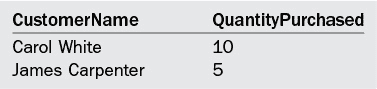


注意 `BETWEEN` 运算符的相对简单性。同时请注意 `BETWEEN` 包含指定的数字。在这个示例中，`BETWEEN 5 AND 20` 包含了数字 5 和 20。因此，`BETWEEN` 仅等效于大于等于（`>=`）和小于等于（`<=`）运算符。它不能用于简单地表示大于（`>`）或小于（`<`）某范围内的数字。James Carpenter 的那行被选中，是因为购买数量等于 5，因此在 5 到 20 之间。

`NOT` 运算符可以与 `BETWEEN` 结合使用。例如，这个 `SELECT`：

点击此处查看代码图片

SELECT
CustomerName,
QuantityPurchased
FROM Purchases
WHERE QuantityPurchased NOT BETWEEN 5 AND 20
```


### IN 运算符

正如 `BETWEEN` 是 `AND` 运算符的特例一样，`IN` 运算符允许 `OR` 运算符的特例。假设我们要查看状态为伊利诺伊州或纽约州的行。如果不使用 `IN` 运算符，可以通过此语句实现：

SELECT
CustomerName,
State
FROM Purchases
WHERE State = 'IL'
OR State = 'NY'
```
这是一个使用 `IN` 运算符的等效语句：

```sql
SELECT
CustomerName,
State
FROM Purchases
```

在任何一种情况下，检索的数据都是：

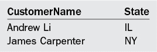

`IN` 运算符要求在后面列出括在括号内的值列表。必须使用逗号分隔所有值。
`IN` 运算符的用处在某些情况下并不显而易见，但在本示例中，它可以极大减少工作量。`IN` 运算符的用处在某些情况下并不显而易见，但在本示例中，它可以极大减少工作量。`IN` 运算符的用处在某些情况下并不显而易见，但在本示例中，它可以极大减少工作量。`IN` 运算符的用处在某些情况下并不显而易见，但在本示例中，它可以极大减少工作量。`IN` 运算符的用处在某些情况下并不显而易见，但在本示例中，它可以极大减少工作量。`IN` 运算符的用处在某些情况下并不显而易见，但在本示例中，它可以极大减少工作量。`IN` 运算符的用处在某些情况下并不显而易见，但在本示例中，它可以极大减少工作量。

正如 `BETWEEN` 运算符所示，`NOT` 运算符可以与 `BETWEEN` 结合使用。例如，这个 `SELECT`：

点击此处查看代码图片

```sql
CustomerName,
State
FROM Purchases
WHERE State <> 'IL'
OR State = 'NY')
```


关于 `IN` 运算符的最后一点说明。正如 `BETWEEN` 运算符所示，`NOT` 运算符可以与 `BETWEEN` 结合使用。例如，这个 `SELECT`：

点击此处查看代码图片

SELECT
CustomerName,
State
FROM Purchases
WHERE State <> 'IL'
OR State = 'NY')
```
结果是：


关于 `IN` 运算符的最后一点说明。正如 `BETWEEN` 运算符所示，`NOT` 运算符可以与 `BETWEEN` 结合使用。例如，这个 `SELECT`：

点击此处查看代码图片
```sql
SELECT
CustomerName,
State
FROM Purchases
WHERE State <> 'IL'
OR State = 'NY')
```

结果是：


关于 `IN` 运算符的最后一点说明。正如 `BETWEEN` 运算符所示，`NOT` 运算符可以与 `BETWEEN` 结合使用。例如，这个 `SELECT`：
点击此处查看代码图片

```sql
SELECT
CustomerName,
State
FROM Purchases
OR State = 'NY')

```

结果是：


（注：由于原文文本中存在大量重复和截断的片段，译文已根据逻辑结构进行了整合，确保语义通顺。）

### 布尔逻辑与 NULL 值

在本章开始时，我们声明 SQL 中的布尔逻辑评估表达式为真或假。这一断言是不完全准确的。在评估 `WHERE` 子句中的条件时，实际上有三种可能性：真、假和未知。这种情况源于 SQL 数据库中的列允许具有 `NULL` 值。正如在第 1 章中提到的，`NULL` 值数据的缺失。

SQL 提供了一个特殊的关键字来测试 `WHERE` 子句中 `NULL` 值的存在。关键字是 `IS NULL`。让我们来看之前看到的 Products 表的一个示例：


在这个示例中，我们假设当行添加到 Products 表时，最初没有赋予重量。`Weight` 列最初被赋予 `NULL` 值，随后用户为该产品分配了重量。

假设我们尝试使用以下 `SELECT` 来查找缺失重量的商品：

```sql
Description,
Weight
FROM Purchases
WHERE Weight = 0
```

这将返回：


这并不是我们想要的。重量为零不等同于具有 `NULL` 值的重量。为了纠正这一点，我们需要执行：

```sql
SELECT
Description,
FROM Purchases
WHERE Weight = 0
OR Weight IS NULL
```

这将返回：


`IS NULL` 关键字也可以被否定为 `IS NOT NULL`，这允许检索指定列没有 `NULL` 值的行。

注意，在第 4 章中讨论过的 `ISNULL` 函数可以作为 `IS NULL` 关键字的替代方案。之前的 `SELECT` 语句使用 `ISNULL` 函数的等效语句为：

```sql
SELECT
Weight
FROM Purchases
WHERE Weight = 0
```


WHERE ISNULL(Weight, 0) = 0

此 `SELECT` 检索了相同的两行。`ISNULL` 函数将 `Weight` 列中所有值为 `NULL` 的值转换为 0。这与之前的语句产生了相同的结果，之前的语句测试的是值是否为 0 或 `NULL`。

`ISNULL` 函数和 `IS NULL` 关键字也可以结合使用，如下语句所示：

SELECT
Description,
ISNULL(Weight, 0) AS 'Weight'
FROM Products
WHERE Weight = 0
OR Weight IS NULL
```
这产生了以下数据：


### 展望

本章涵盖了如何创建复杂选择逻辑表达式的重要主题。在这项工作中，使用的基础布尔运算符有 `AND`、`OR` 和 `NOT`。我们还讨论了 `BETWEEN` 和 `IN` 运算符，它们允许在某些情况下更简洁地表示 `AND` 和 `OR` 运算符。括号是构建复杂表达式的另一个基本工具。通过使用括号，你可以创建几乎所有想象到的逻辑条件。最后，我们讨论了在选择数据时如何处理 `NULL` 值。
在下一章中，我们将重新访问 `columnlist` 并探索一个重要的构造结构，该结构允许我们将逻辑注入到 `columnlist` 中的单个列。这被称为`条件逻辑`。通过使用本章讨论的相同布尔逻辑运算符以及一些额外的关键字，我们能够指定决定 `columnlist` 中单个列如何显示的的逻辑。

## 8. 条件逻辑

### 引入的关键字

`CASE` • `WHEN` • `THEN` • `ELSE` • `END`
本章的主体内容是`条件逻辑`。该术语指的是将逻辑注入到 `columnlist` 中特定列或 SQL 语句其他表达式中的值的能力。根据 SQL 语句执行时逻辑评估的方式，列可以出现不同的值。因此，出现的值取决于指定的逻辑（即条件）。更具体地说，条件逻辑由一个以 `CASE` 关键字开头的表达式表示。这通常被称为 `CASE` 表达式。本质上，`CASE` 表达式允许你根据应用于特定列或数据元素评估的逻辑条件，更改呈现给用户的输出。`CASE` 一词的使用与大小写无关。它的意义是以条件的方式指定特定的情况或一组逻辑。

作为一名初级 SQL 开发者，你应该意识到 `CASE` 表达式是一个相对高级的概念。你可以在不使用 `CASE` 表达式的情况下工作，并编写一些非常有用的查询。然而，理解和使用条件逻辑的能力可以将原始查询转换为更具升华感的内容。因此，这是读完整本书后，可能值得额外复习的主题之一，以提醒你使用这种技术可以实现一些有趣的事情。

### CASE 表达式

SQL 中的 `CASE` 表达式允许将逻辑应用于 `columnlist` 或表达式中的单个元素。正如 第 2 章 所示，`SELECT` 语句的完整格式如下：
```sql
SELECT columnlist
FROM tablelist
WHERE condition
GROUP BY columnlist
HAVING condition
ORDER BY columnlist

`CASE` 表达式可以出现在 `SELECT` 语句的多个区域。它可以出现在紧随 `SELECT` 关键字之后的 `columnlist` 中，也可以出现在 `GROUP BY` 或 `ORDER BY` 子句中。它还可以作为 `WHERE` 或 `HAVING` 子句条件中的元素出现。在本章中，我们将首先说明如何在 `SELECT` `columnlist` 中使用 `CASE` 表达式。这是它最典型的用法。随后，还将展示如何在 `WHERE` 和 `ORDER BY` 子句中使用它。

`CASE` 表达式替换 `columnlist` 中的任何单个列，或者 `WHERE` 或 `HAVING` 子句条件中引用的表达式。专注于其在 `columnlist` 中的用法，一个同时包含列和 `CASE` 表达式的 `SELECT` 语句可能如下：

```sql
SELECT
column2,
CaseExpression
FROM table
```

`CASE` 表达式本身包含了嵌入在传统的 `IF-THEN-ELSE` 结构中的逻辑。`IF-THEN-ELSE` 一术是指过程化编程语言中常用的逻辑结构。泛而言之，这种逻辑看起来如下：

IF some condition is true
THEN do this
ELSE do that
```

`IF-THEN-ELSE` 中表示的条件可以包含上一章讨论的全范围布尔逻辑。因此，该表达式可以包含 `AND`、`OR`、`NOT`、`BETWEEN` 和 `IN` 运算符，以及括号。


`CASE` 表达式有两种基本格式，通常称为 `simple`（简单）和 `searched`（搜索）。简单格式是：

点击此处查看代码图像

```sql
CASE ColumnOrExpression
WHEN value2 THEN result2
(repeat WHEN-THEN any number of times)
[ELSE DefaultResult]
END
```

如你所见，这个 `CASE` 表达式除了 `CASE` 外使用了多个关键字；它还包含了 `WHEN`、`THEN`、`ELSE` 和 `END`。这些额外的关键字用于完整定义 `CASE` 表达式的逻辑。`WHEN` 和 `THEN` 关键字定义了一个被评估的条件。如果 `WHEN` 之后的值为真，则使用 `THEN` 之后的结果。`WHEN` 和 `THEN` 关键字可以重复任意次数。当有 `WHEN` 时，必须有一个对应的 `THEN`。`ELSE` 关键字用于定义在没有任何 `WHEN-THEN` 都不为真时使用的默认值。如括号所示，`ELSE` 关键字不是必须的。但是，在每个 `CASE` 表达式中包含 `ELSE` 关键字通常是一个好习惯。`END` 关键字终止 `CASE` 表达式。
让我们通过这个 `Groceries` 表来看一个具体的例子：


在该数据中，`CategoryCode` 列旨在具有以下含义：F 代表水果，S 代表香料，V 代表蔬菜，B 代表饮料。针对此表带有 `CASE` 表达式的 `SELECT` 可能如下所示：

```sql
CASE CategoryCode
WHEN 'F' THEN 'Fruit'
WHEN 'V' THEN 'Vegetable'
ELSE 'Other'
END AS 'Category',
Description
FROM Groceries

并产生以下输出：


让我们详细检查 `SELECT` 语句。第一行包含 `SELECT` 关键字。第二行带有 `CASE` 关键字指定要分析的 `CategoryCode` 列。第三行引入了第一个 `WHEN-THEN` 条件。该行说明如果 `CategoryCode` 列等于 F，则显示“Fruit”。下一行说明如果 `CategoryCode` 是 V，则显示“Vegetable”。`ELSE` 行提供了一个在没有任何 `WHEN-THEN` 为真时使用的默认值“Other”。换句话说，如果类别不是水果或蔬菜，则可以归类为“Other”。`END` 终止了 `CASE` 表达式，并包含一个 `AS` 关键字以分配列别名。下一行 `Description` 只是另一个列，与 `CASE` 表达式无关。


### 搜索 CASE 格式

`searched` `CASE` 表达式的通用格式为：

点击此处查看代码图像

CASE
WHEN condition1 THEN result1
WHEN condition2 THEN result2
(repeat WHEN-THEN any number of times)
[ELSE DefaultResult]
END
```
使用此第二种格式上述 `SELECT` 语句的等效语句为：

点击此处查看代码图像

```sql
SELECT
CASE
```


```sql
ELSE 'Other'
END AS 'Category',
Description
FROM Groceries
```

从此语句检索出的数据与第一个简单的 CASE 格式相同。然而，请注意其细微的。在简单格式中，要评估的列名放在 `CASE` 关键字之后，而 `WHEN` 之后的表达式是一个简单的字面量值。在搜索格式中，要评估的列名并没有紧放在 `CASE` 关键字旁边。相反，这种格式允许在 `WHEN` 关键字之后指定更复杂的条件表达式。
在上一个示例中，`CASE` 子句的两种格式都可以可以使用，并且会产生相同的结果。现在让我们来看另一个示例，只有搜索 CASE 格式才能产生预期的结果。这个示例将来自以下数据：


在这种情况下，表并不是包含单一的 `CategoryCode` 列，而是有多个列来指示产品类型。例如，`Fruit` 列中的值 `X` 表示该产品是水果。因此，无法使用 `CASE` 表达式的简单格式来评估这些数据。简单格式仅适用于对单列的分析。使用搜索格式，处理此类数据的 `CASE` 表达式如下：

点击此处查看代码图片
```sql
SELECT
CASE
WHEN Fruit = 'X' THEN 'Fruit'
WHEN Vegetable = 'X' THEN 'Vegetable'
ELSE 'Other'
END AS 'Category',
FROM GroceryCategories
```

再次，结果如下：


`CASE` 表达式可以用于 `SELECT` 语句中 `columnlist` 的许多情况。`CASE` 表达式用处的另一个常见例子是涉及除以零的情况。在制定一个可能出现除以零的计算时，你必须小心在分母为 0 时提供一些替代方案。与所有其他计算机语言一样，SQL 在尝试除以零时会产生错误。为了解决这个问题，可以使用 `CASE` 表达式，如下面的通用示例所示：

```sql
SELECT
CASE
WHEN Denominator = 0 THEN 0
END
FROM table
```

在这个示例中，我们正在测试 `denominator` 值以检查它是否等于零。如果是，计算结果将设置为零。如果不是，则允许进行正常计算。因此，如果计算中的 `denominator` 恰好为 0，我们将跳过本会发生的“除以零”错误。

### ORDER BY 子句中的条件逻辑
正如本章开头提到的，`CASE` 表达式可以用于 `SELECT` 语句中的许多地方。为了说明它在 `ORDER BY` 子句中的用法，让我们假设我们有一个包含美国和加拿大城市的表。在这种情况下，有独立的美国州（State）和加拿大省（Province）列。这些数据可能如下：


此示例的目标是先按国家排序，然后按州或省排序，最后按城市排序。实现此目的的语句是：

```sql
FROM NorthAmerica
ORDER BY
Country,
CASE Country
WHEN 'US' THEN State
WHEN 'CA' THEN Province
ELSE State
City
```

该语句的输出是：


### WHERE 子句中的条件逻辑

正如 `CASE` 表达式可以放置在 `columnlist` 中一样，它也可以放在 `WHERE` 条件的表达式中。在这个示例中，我们假设有如下所示的客户数据：


点击此处查看代码图片

```sql
SELECT *
FROM CustomerList
WHERE Income >
WHEN Sex = 'M' AND Age >= 50 THEN 75000
WHEN Sex = 'F' AND Age >= 35 THEN 60000
ELSE 50000
END
```

注意，整个 `CASE` 表达式替换了 `WHERE` 子句中表达条件的某一部分。一般形式下，`WHERE` 子句为：
点击此处查看代码图片

```sql
WHERE Income > CASE_Expression
```

`CASE` 表达式提供了在选择逻辑中与 `Income` 进行比较的值。执行此语句时，检索的数据是：


### 展望

`CASE` 表达式是一个强大的工具，允许你将逻辑注入到各种语句的各种元素中。在本章，我们看到 `CASE` 表达式被用于 `columnlist`，以及 `ORDER BY` 和 `WHERE` 子句。`CASE` 表达式有两种基本变体：`simple`（简单）和 `searched`（搜索）。简单变体的一种典型用法是为数据项提供翻译。搜索格式允许更复杂的陈述。

在我们的下一章“汇总数据”中，我们将注意力转向将数据分组并汇总值的方法。在回第 4 章”中，我们讨论了标量函数。下一章将引入另一类型的函数，称为聚合函数。这些聚合函数允许我们以许多方式汇总数据。例如，我们将查看任何订单组并确定订单数量、订单总金额和平均订单大小。这些技术将允许你超越详细数据的展示，开始真正地为你的用户增加价值。
## 9. 汇总数据

引入的关键字

`DISTINCT` •  `SUM`  •  `AVG`  •  `MIN`  •  `MAX`  •  `COUNT`  •  `GROUP BY`  •  `HAVING`  •  `ROW_NUMBER`  •  `RANK`  •  `DENSE RANK`  •  `NTILE`  •  `OVER`  •  `PARTITION BY`

为止，我们用过的所有计算、函数和 `CASE` 表达式只更改了单个列的值。我们检索的行对应于底层数据库表中的行。我们现在转向汇总数据的方法，通过组合多行中的值。
### 消除重复

尽管它没有提供真正的聚合，但汇总数据最基本的方法是消除重复。SQL 的 `DISTINCT` 关键字为从输出中删除重复值提供了一种简单的方法。这里是 `DISTINCT` 关键字的一个示例，用于以下 `SongTitles` 表：


假设我们想在表格中查看艺术家列表。可以通过以下方式实现：

```sql
SELECT
DISTINCT
FROM SongTitles
ORDER BY Artist
```

结果是：


`DISTINCT` 关键字始终跟在 `SELECT` 关键字之后。`DISTINCT` 关键字指定仅返回后续 `columnlist`（列列表）中的唯一值。在这种情况下，只有三个艺术家，因此只返回了三行数据。如果我们想查看艺术家和专辑的唯一组合，可以执行：

```sql
SELECT
DISTINCT
Artist,
Album
ORDER BY Artist, Album
```

结果将是：


### 聚合函数

在第 4 章 的“使用函数””中讨论的函数都是*标量函数*。这些函数都是针对单个数字或值执行的。相比之下，*聚合函数*用于与数据组配合。最常用的聚合函数是 `COUNT`、`SUM`、`AVG`、`MIN` 和 `MAX`。这些函数为数据组提供了计数、总和、平均值以及最小值和最大值。

所有的聚合函数示例将来自以下两个包含学生学费和成绩数据的表。`Fees` 表包含：


这是 `Grades` 表：


从 `SUM` 函数开始，假设我们想查看所有学生支付的健身费用总额。可以通过语句实现：

SELECT
SUM(Fee) AS 'Total Gym Fees'
FROM Fees
WHERE FeeType = 'Gym'
```

结果的数据是：


如你所见，`SUM` 函数根据 `WHERE` 子句指定的选择逻辑对 `Fee` 列的总值求和。由于 `columnlist` 中唯一的表达式是聚合函数，因此查询只返回包含聚合金额的一列一行数据。

`AVG`、`MIN` 和 `MAX` 函数与 `SUM` 函数非常相似。这里是 `AVG` 函数的示例。在这种情况下，我们寻求获取 `Grades` 表中所有测验的平均分：

点击此处查看代码图片
```sql
SELECT
AVG(Grade) AS 'Average Quiz Score'
FROM Grades
WHERE GradeType = 'Quiz'
```


一个语句可以使用多个聚合函数。这里有一个 `SELECT` 演示了如何在同一语句中利用 `AVG`、`MIN` 和 `MAX`：

点击此处查看代码图片

SELECT
AVG(Grade) AS 'Average Quiz Score',
MIN(Grade) AS 'Minimum Quiz Score',
MAX(Grade) AS 'Maximum Quiz Score'
FROM Grades
WHERE GradeType = 'Quiz'
```
结果是：


### COUNT 函数

`COUNT` 函数比之前讨论的聚合函数稍复杂一些，因为它可以用三种不同的方式使用。首先，`COUNT` 函数可以用于返回所有选中行的计数，而不考虑任何特定列中的值。例如，以下语句返回了所有具有作业成绩的行计数：

点击此处查看代码图片

```sql
SELECT
COUNT(*) AS 'Count of Homework Rows'
FROM Grades
WHERE GradeType = 'Homework'
```

结果是：


括号内的星号 `*` 意味着“所有列”。在后台，SQL 实际上会检索所选行所有列的数据，然后返回行数计数。

在 `COUNT` 函数的第二种格式中，括号内指定了一个特定的列。这里有一个示例：

点击此处查看代码图片

```sql
SELECT
COUNT(Grade) AS 'Count of Homework Scores'
FROM Grades
WHERE GradeType = 'Homework'
```

结果是：


注意上述两个 `SELECT` 语句之间的细微区别。在第一个语句中，我们仅仅统计 `GradeType` 等于 `Homework` 的行。有三行这样的数据。在第二个语句中，我们统计当 `GradeType` 列值为 `Homework` 时 `Grade` 列的出现次数。在这种情况下，三行中有一行在 `Grade` 列中的值为 `NULL`，SQL 足够智能，不会统计这样的行。如之前所述，`NULL` 意味着数据不存在。

`COUNT` 函数的第三种变体允许在使用列的同时使用 `DISTINCT` 关键字。这是一个示例：

点击此处查看代码图片

```sql
SELECT
COUNT(DISTINCT FeeType) AS 'Number of Types'
FROM Fees
```

注意 `DISTINCT` 关键字被放在括号内。`DISTINCT` 关键字表示我们只包含 `FeeType` 的唯一值。该语句的结果是：


### 数据分组

之前的聚合函数示例很有趣，但价值有限。在我们引入数据分组概念后，聚合函数的威力将变得显而易见。

`GROUP BY` 关键字用于将 `SELECT` 语句返回的数据进行分组。例如，在查看 `Grades` 表时，我们可能感兴趣根据成绩类型分析分数。换句话说，我们想将数据分为两个组：测验和作业。让我们通过引入 `GROUP BY` 关键字的示例：

```sql
SELECT
GradeType AS 'Grade Type',
AVG(Grade) AS 'Average Grade'
FROM Grades
GROUP BY GradeType
ORDER BY GradeType
```

该语句的结果是：


在这个示例中，`GROUP BY` 关键字指定根据 `GradeType` 的值创建分组。`SELECT` 列表中的两个列是 `GradeType` 和一个使用 `AVG` 函数的计算字段。`GradeType` 列被包含在列表中，是因为在创建分组时，最好包含分组依据的列。“平均分”计算字段根据每个组的行进行聚合。注意作业平均分计算为 86。与之前一样，尽管作业 `GradeType` 有一行 `NULL` 值，SQL 足够智能可以忽略带有 `NULL` 值的行。如果我们想让 `NULL` 值被计为 0，那么可以使用 `ISNULL` 函数将 `NULL` 转换为 0，如下：

```sql
AVG(ISNULL(Grade, 0)) AS 'Average Grade'
```

需要注意的是，当使用 `GROUP BY` 关键字时，`columnlist` 中的所有列要么必须在 `GROUP BY` 子句中列出，要么必须在聚合函数中使用。其他方式都不符合逻辑。例如，以下 `SELECT` 将产生语法错误：

点击此处查看代码图片

```sql
SELECT
GradeType AS 'Grade Type',
AVG(Grade) AS 'Average Grade',
Student AS 'Student'
FROM Grades
GROUP BY GradeType
ORDER BY GradeType
```

该语句的问题在于 `Student` 列既不在 `GROUP BY` 中，也没有以任何方式聚合。由于所有内容都以汇总分组的形式呈现，SQL 不知道如何处理上述语句中的 `Student` 列。因此，该语句无法执行。


### 数据库差异：MySQL

与 Microsoft SQL Server 和 Oracle 不同，之前的语句在 MySQL 中不会产生错误。尽管如此，它会产生错误的结果。

### 多列与排序

分组的概念可以扩展，使得分组基于多个列。让我们回到上一个 `SELECT` 语句，并在 `GROUP BY` 子句和列列表（columnlist）中都添加 `Student` 列。它现在看起来是：

```sql
SELECT
GradeType AS 'Grade Type',
Student AS 'Student',
AVG(Grade) AS 'Average Grade'
FROM Grades
GROUP BY GradeType, Student
ORDER BY GradeType, Student
```

得到的数据如下：


我们现在看到的不仅是按成绩类型的细分，还有学生的细分。平均分是在每个组上计算的。注意，Hailey 的 `Homework` 行显示为 `NULL` 值，因为她只有一行作业记录，而该行的 `Grade`值为 `NULL`。

在 `GROUP BY` 子句中列出列的顺序没有意义。如果子句是以下内容，结果将是相同的：

```sql
GROUP BY Student, GradeType
```

然而，如既往一样，在 `ORDER BY` 子句中列出列的顺序是有意义的。我们将 `ORDER BY` 子句切换为：

```sql
ORDER BY Student, GradeType
```

得到的数据如下：


这看起来有点奇怪，因为很难一眼看出数据实际上是按 `Student` 然后再按 `GradeType` 排序的。作为一个通用的规则，如果列从左到右列出的顺序与列排序的顺序一致，通常会有帮助。一个更易于理解的 `SELECT` 语句应该是：

```sql
SELECT
Student AS 'Student',
GradeType AS 'Grade Type',
AVG(Grade) AS 'Average Grade'
FROM Grades
GROUP BY GradeType, Student
ORDER BY Student, GradeType
```

现在数据看起来是：


这更易理解，因为列的顺序与排序顺序相对应。

`GROUP BY` 和 `ORDER BY` 子句之间的区别有时会引起困惑。需要记住的主要点是，`GROUP BY` 仅仅创建组。`ORDER BY` 仍然必须用于按有意义的顺序列出行。

### 聚合结果的筛选标准

在通过 `GROUP BY` 子句将数据分组成后，筛选标准变得稍微复杂了。在带有 `GROUP BY` 的 `SELECT` 中应用任何类型的筛选标准时，你必须询问这些标准是适用于单行还是适用于整个组。虽然 `WHERE` 子句处理单行的筛选标准，但 SQL 提供了一个名为 `HAVING` 的关键字，允许在组级别上应用筛选逻辑。

回到 `Grades` 表，假设我们只想查看 70 分或以上的测验（quiz）成绩。我们想要查看的成绩是单个成绩，因此可以像往常一样 `WHERE` 子句。这样的 `SELECT` 语句可能如下：

```sql
SELECT
Student AS 'Student',
GradeType AS 'Grade Type',
Grade AS 'Grade'
FROM Grades
WHERE GradeType = 'Quiz'
AND Grade >= 70
ORDER BY Student, Grade
```

得到的数据如下：


注意，分数低于 70 分的测验没有显示。例如，我们可以看到 Peter 的 74 分测验成绩，但没有看到他的 58 分测验成绩。

为了引入 `HAVING` 子句的使用，假设我们想显示*平均*测验成绩为 70 分或以上的学生。在这种情况下，我们想根据平均值进行筛选，而不是根据单行。这就是 `HAVING` 子句出现的地方。我们需要先按学生对成绩进行分组，然后对基于整个组的聚合统计应用筛选标准。以下语句产生了所需的结果：

点击此处查看代码图像

```sql
SELECT
Student AS 'Student',
AVG(Grade) AS 'Average Quiz Grade'
FROM Grades
WHERE GradeType = 'Quiz'
GROUP BY Student
HAVING AVG(Grade) >= 70
ORDER BY Student
```

输出结果：


这个 `SELECT` 同时包含一个 `WHERE` 和 `HAVING` 子句。`WHERE` 确保我们只选择 `GradeType` 为“Quiz”的行。`HAVING` 则保证我们只选择平均分至少为 70 分的学生。

将这个例子更进一步，如果我们想添加一个带有 `GradeType` 值的列怎么办？如果我们尝试将 `GradeType` 添加到 `SELECT` *列列表*中，语句将报错。这是因为所有列要么列在 `GROUP BY` 中，要么参与了聚合。因此，如果我们想显示 `GradeType` 列，就必须将其添加到 `GROUP BY` 子句中，如下：

```sql
SELECT
Student AS 'Student',
GradeType AS 'Grade Type',
AVG(Grade) AS 'Average Grade'
FROM Grades
WHERE GradeType = 'Quiz'
GROUP BY Student, GradeType
HAVING AVG(Grade) >= 70
ORDER BY Student
```

得到的数据如下：


```sql
GradeType AS 'Grade Type',
AVG(Grade) AS 'Average Grade',
FROM Grades
WHERE GradeType = 'Quiz'
GROUP BY Student, YearInSchool, GradeType
HAVING AVG(Grade) >=
CASE
WHEN YearInSchool = 7 THEN 70
WHEN YearInSchool = 8 THEN 75
ELSE 80
END
ORDER BY Student
```

`HAVING` 子句规定平均分必须大于 `CASE` 表达式返回的值。`CASE` 表达式将根据 `YearInSchool` 列的值，提供 70、75 或 80 中的一个值。结果如下：


Isabella 是现在列出的唯一学生，因为她是唯一符合新标准的人。

### 排名函数

除了本章之前讨论的分组技术外，SQL 还提供了许多特殊的*排名*函数，允许通过顺序分类的方法对行进行分类类。共有四种基本的排名函数：

- `Row_Number`
- `Rank`
- `Dense_Rank`
- `NTile`

`ROW_NUMBER` 函数根据与函数相关的另一列或表达式的指定顺序创建行号。在行按指定顺序排列后，生成的行号将从 1 开始，按顺序递增到 2、3、4 等类推。`ROW_NUMBER` 函数不需要任何参数。

`RANK` 函数与 `ROW_NUMBER` 相同，不同在于如果两个或多行的指定列或表达式具有相同的值，则它们被赋予相同的数字。例如，如果第二行和第三行的值相同，生成的排名将是 1, 2, 2, 4 等类推。由于两个值为 2 的行值相同，SQL 会跳过数字 3。

`DENSE_RANK` 函数与 `RANK` 函数相同，不同之处在于即使存在重复值，它也不会不会跳过任何数字。在前面的示例中，稠密排名将是 1, 2, 2, 3 等类推。没有跳过数字 3。

最后，`NTILE` 函数允许根据另一列或表达式的指定顺序生成百分比位数或任何其他 n 分位数。与 `RANK`、`ROW_NUMBER` 和 `DENSE_RANK` 不同，`NTILE` 需要一个参数。例如，函数 `NTILE(100)` 将分配百分位数。百分位数是从 1 到 100 的数字，代表该值的相对排名。然而，任何其他数字都可以作为函数的参数。因此，函数 `NTILE(10)` 将创建十分分位数，而 `NTILE(4)` 将产生四分位数。

让我们通过几个示例来说说明排名，所有示例都基于下表：


此表列出了一些股票，显示了它们的代码、名称、交易交易所以及市盈率（PE 比例）。例如，苹果公司（AAPL）在纳斯达克交易，市盈率为 14。

在第一个示例中，我们将按市盈率对所有行进行排序，并使用 `ROW_NUMBER` 函数为每行生成一个行号。我们希望按市盈率从低到高对行进行排序。我们先显示低 PE 的行，因为通常情况下低 PE 比比高 PE 好。实现此目的的语句是：

点击此处查看代码图像

```sql
SELECT
ROW_NUMBER() OVER (ORDER BY PriceEarningsRatio) AS 'Row',
StockSymbol AS 'Symbol',
StockName AS 'Name',
Exchange AS 'Exchange',
PriceEarningsRatio AS 'PE Ratio'
FROM Stocks
ORDER BY PriceEarningsRatio
```

该语句的输出是：


让我们检查它是如何工作的。首先，注意此语句中没有选择标准或分组。除了 `columnlist` 之外，只有一个 `FROM` 子句和一个 `ORDER BY` 子句。`ORDER BY` 子句（语句的最后一行）对于按市盈率所需顺序列行是必要的。该语句中主要的复杂之处在于 `columnlist` 中的第一个项目，它使用了 `ROW_NUMBER` 排名函数。注意，此值包含一个 `OVER` 关键字以及括号中的另一个 `ORDER BY`。包含排名函数的 `columnlist` 元素的通用格式为：

点击此处查看代码图像

```sql
Rank_Function() OVER (ORDER BY expression [[ASC]|DESC])
```

`Rank_Function` 可以是之前提到的四个函数中的任何一个。需要 `OVER` 关键字。它的目的是指定如何应用排名函数。括号中的 `expression` 表示要应用排名的列或表达式。`ORDER BY` 关键字表示该表达式将按升序或降序进行评估。如果顺序是升序，则不需要 `ASC` 关键字。

在我们的示例中，我们根据对 `PriceEarningsRatio` 列的评估来分配行号。`PriceEarningsRatio` 的值按升序评估。第一行（卡宝食品，Kraft Foods）被赋予行号 1，因为它是序列中的第一位。注意，`ROW_NUMBER` 函数仅分配行号。我们仍然需要在 `SELECT` 语句中使用 `ORDER BY` 子句，以便实际按所需的顺序显示输出。

为了说明 `RANK` 和 `DENSE_RANK` 函数的使用，我们将它们作为列添加到之前的语句中。我们不费力显示股票名称或交易所。新语句是：

点击此处查看代码图像

```sql
SELECT
ROW_NUMBER() OVER (ORDER BY PriceEarningsRatio) AS 'Row',
RANK() OVER (ORDER BY PriceEarningsRatio) AS 'Rank',
DENSE_RANK() OVER (ORDER BY PriceEarningsRatio) AS 'Dense Rank',
StockSymbol AS 'Symbol',
PriceEarningsRatio AS 'PE Ratio'
FROM Stocks
ORDER BY PriceEarningsRatio
```

输出是：


在这个示例中，MSFT 和 WMT 具有相同的 PE。结果是它们的 `RANK` 和 `DENSE_RANK` 被赋予了相同的值。对于 `RANK`，MSFT 和 WMT 之后的下一行跳过了数字并赋予了值 5。对于 `DENSE_RANK`，没有跳过数字，ORCL 被赋予了值 4。

对于 `NTILE` 函数，我们将提供 `NTILE(4)` 和 `NTILE(10)` 的示例。如所述，`NTILE` 对行进行排名并将其分配到一个组。在这种情况下，数据分为四组。这通常被称为四分位数。`NTILE(10)` 将数据分为十组，也称为十分分位数。为了说明，以下语句按市盈率排名股票并显示 `NTILE(4)` 和 `NTILE(10)`：

点击此处查看代码图像

```sql
SELECT
NTILE(4) OVER (ORDER BY PriceEarningsRatio) AS 'Quartile',
NTILE(10) OVER (ORDER BY PriceEarningsRatio) AS 'Decile',
StockSymbol AS 'Symbol',
PriceEarningsRatio AS 'PE Ratio'
FROM Stocks
ORDER BY PriceEarningsRatio
```

产生的输出是：


Quartile 列根据市盈率的排名将数据分为四组。所示，1-4 行属于第一四分位数，5-8 行属于第二四分位数，依此类推。Decile 列以类似将数据分为十组。对于较大的数据集，通常会包含一个 `NTILE(100)` 函数将数据分为 100 组。这 100 组中的每一个通常被称为百分位数。

### 数据库差异：MySQL

与 Microsoft SQL Server 和 Oracle 不同，MySQL 不提供本节讨论的 `OVER` 关键字和排名函数。同样，它也不提供后续节讨论的 `PARTITION BY` 关键字。

### 分区

上一节讨论的排名函数的一种实用变体是可以在应用排名函数之前将数据划分为不同的*分区*（partitions）。


数据分区涉及 `PARTITION BY` 关键字。通过分区，包含排名函数的 `columnlist` 元素的通用格式如下：

点击此处查看代码图片

```
Rank_Function() OVER (PARTITION BY expression_1
ORDER BY expression_2 [[ASC]|DESC])
```

在之前的示例中，我们忽略了 `Exchange` 列的值。通过数据分区，我们能够根据 `Exchange` 列的值（其值可能是 `NYSE` 或 `NASDAQ`）将数据分离为两个独立的组，或者说对数据进行`分区`（`partition`）。在数据被分离后，将像之前的那样应用排名函数。

为了说明这一点，让我们修改上一节中的第一个查询，该查询使用了 `ROW_NUMBER` 函数对数据进行排名，并根据 `PE` 比例为每行分配一个行号。原始 SQL 语句为：

点击此处查看代码图片

```sql
SELECT
ROW_NUMBER() OVER (ORDER BY PriceEarningsRatio) AS 'Row',
StockSymbol AS 'Symbol',
StockName AS 'Name',
Exchange AS 'Exchange',
PriceEarningsRatio AS 'PE Ratio'
FROM Stocks
ORDER BY PriceEarningsRatio
```

在修订中，我们将包含 `ROW_NUMBER` 函数的 `columnlist` 元素添加了 `PARTITION BY` 关键字。我们还重新排列了列的顺序和 `ORDER BY` 子句，使数据的布局更易于理解。新语句是：

点击此处查看代码图片

```sql
SELECT
Exchange AS 'Exchange',
ROW_NUMBER() OVER (PARTITION BY Exchange ORDER BY PriceEarningsRatio)
AS 'Exchange Rank',
StockSymbol AS 'Symbol',
PriceEarningsRatio AS 'PE Ratio'
FROM Stocks
ORDER BY Exchange, PriceEarningsRatio
```

结果如下：


注意，我们还将 `ROW_NUMBER` 函数的列别名从“Row”更改为“Exchange Rank”（交易所排名）。这样做是因为我们现在有了两组数据。将此列称为行号是没有意义的，因为我们有两组连续的数字。注意，`ORDER BY` 子句必须与排名函数中的 `PARTITION BY` 和 `RANKING BY` 表达式对应。如果数据以一种方式分区和排名，却以另一种方式排序，结果可能难以理解。

请记住，分区与本章之前看到的 `GROUP BY` 子句不同。`GROUP BY` 子句的通常用途是对数据进行分组，然后对每个组应用聚合函数。例如，人们可能希望按 `Exchange` 列分组，然后获取每个组的平均 `PE`。这将提供 `NASDAQ` 和 `NYSE` 交易所的平均 `PE`。相比之下，分区的概念保持了详细数据的完整性。创建分区的仅仅是为了对每个分区内的单独行进行排名。虽然为了排名目的将数据分成了组，但细节被保留，并且不涉及任何聚合。

前面的示例说明了 `ROW_NUMBER` 排名函数与分区的使用。分区应用于其他三个排名函数的方法方法完全相同。例如，如果我们想根据 `Exchange` 对数据进行分区，然后显示每个分区的四分位数，语句将是：

点击此处查看代码图片

```sql
SELECT
Exchange AS 'Exchange',
NTILE(4) OVER (PARTITION BY Exchange ORDER BY PriceEarningsRatio)
AS 'Quartile',
StockSymbol AS 'Symbol',
PriceEarningsRatio AS 'PE Ratio'
FROM Stocks
ORDER BY Exchange, PriceEarningsRatio
```

该语句的输出为：


如预期所示，数据现在显示了 `NASDAQ` 和 `NYSE` 股票按四分位划分的排名。

目前为止的排名函数和分区示例非常有趣，但这些技术更有用的应用将在 第 14 章 “子查询”。将数据划分为分区并对每个分区应用排名的能力意味着我们可以为数据集中的每个分区指定 `top n` 类型的选择。例如，假设我们想为每个客户选择最大的订单。我们可以根据 `customer number` 对数据进行分区，然后根据 `order amount` 对每行进行排名。最终，我们只想每个客户选择一个订单。这可以通过在查询中包含如下行来实现：

点击此处查看代码图片

```sql
ROW_NUMBER() OVER
(PARTITION BY CustomerNumber ORDER BY OrderAmount) AS TheRow
```

这将产生一个名为 `TheRow` 的计算字段，它根据 `OrderAmount` 对每个客户的订单进行排名。值最高的订单将被分配值为 1。正如你在 第 14 章 中看到的，随后可以从初始查询的结果中选择，只选择 `TheRow` 等于 1 的行。这将为每个客户提供最大的订单。这种技术可以应用于许多类似的情况。例如，我们可能想查看每个客户最近的订单，或者可能是每个城市利润最丰的客户。

### 展望

在本章中，我们涵盖了多种形式的聚合，从最简单的——消除重复开始。然后，我们引入了一些聚合函数，这些函数与 第 4 章 中看到的标量函数是不同类型的函数。当聚合函数与 `GROUP BY` 结合使用时，其真实威力变得显而易见，因为它允许将数据分成组。我们还查看了 `HAVING` 子句，它允许组级选择标准。

我们用两个与求和相关的额外主题结束了本章。在 `GROUP BY` 和 `HAVING` 子句中使用 `CASE` 表达式允许你应用条件逻辑分组和组选择标准。最后，我们涵盖了排名函数和分区，这些是组织详细数据的有用方法。通过使用 `PARTITION BY` 关键字，数据可以结合排名函数被分成组。

我们的下一章关于小计（subtotals）和交叉表（crosstabs），将为聚合值提供额外的格式支持。小计允许你在详细数据的演示中添加摘要信息。交叉表提供了一种新的数据布局方法，更有利于清晰显示聚合数据。


本章将涵盖的第二个主题与如何向用户显示汇总后的数据有关。在前一章中，数据被分组在一起并显示给用户。每行数据都表示被分组的值以及汇总后的值。这通常是显示数据的一种有效方法。但有时用户更倾向于以交叉表（crosstab）格式显示数据。交叉表格式是将组拆分为多个列的格式。这样做的效果是减少用户需要查看的行数。许多报表工具都采用交叉表布局。交叉表布局的一个典型例子是 Excel 透视表，它允许你同时在行和列上列出数据。在本章中，我们将展示如何使用 SQL 命令创建这种效果。

#### 使用 ROLLUP 添加小计

在前一章中，我们展示了如何使用 `GROUP BY` 子句将数据分组。通常当数据被分组在一起时，某些列可能会进行聚合，以提供该列数值的和。为了重新回顾这一场景，让我们从以下数据开始，它显示了少量产品的当前库存。


在这个示例中，每个产品都按类别和子类别细分。例如，家具（Furniture）类别包含椅子（Chair）和桌子（Desk）子类别。接下来的 `SELECT` 语句按 `Category` 和 `Subcategory` 对这些数据进行分组，并对每个组的数量求和。

点击此处查看代码图片

```sql
SELECT
Category,
Subcategory,
SUM(Quantity) AS 'Quantity'
FROM Inventory
GROUP BY Category, Subcategory
ORDER BY Category, Subcategory
```

生成的输出是：


到为止，一切正常。但如果我们还想查看每个类别的小计并在最后显示一个最终总计呢？换句话说，除了分组数据外，我们希望在每次类别变化时都有一行小计，并在最后有一行汇总所有数量的总计。这可以通过在 `GROUP BY` 子句中使用 `ROLLUP` 关键字来实现，如下：

点击此处查看代码图片

```sql
SELECT
Category,
Subcategory,
SUM(Quantity) AS 'Quantity'
FROM Inventory
GROUP BY ROLLUP(Category, Subcategory)
```

关键字 `ROLLUP` 是 `GROUP BY` 子句的扩展，用于创建小计行和总计行。上述语句的输出是：


如所示，原始的四行基础上增加了三行小计和总计行。这些行在 `Category` 或 `Subcategory` 列中包含关键字 `NULL`。第一行小计行是第三行，它显示家具（Furniture）类别的数量为 9。`Subcategory` 显示为 `NULL`，因为我们只显示了该类别的小计。第二个小计行是第六行，它汇总了纸张（Paper）类别，表示有 11 件纸质物品。最后一行是总计列，汇总了所有类别的所有物品，表明库存中总共有 20 件物品。

注意，输出中出现的 `NULL` 与我们之前看到的 `NULL` 值略有不同。在这种情况下，`NULL` 仅仅是一个表示已应用 `ROLLUP` 的占位符。

上一个语句没有包含 `ORDER BY` 子句。没有 `ORDER BY`，小计行和总计行始终出现在每个类别之后。现在让我们为语句添加一个 `ORDER BY` 来查看差异：

点击此处查看代码图片

```sql
SELECT
Category,
Subcategory,
SUM(Quantity) AS 'Quantity'
FROM Inventory
GROUP BY ROLLUP(Category, Subcategory)
ORDER BY Category, Subcategory
```

输出是：


如你所见，`ORDER BY` 子句改变了小计行和总计行的位置。它们现在出现在每个类别之前而不是之后。这是因为 `NULL` 值是可能的最低值，所以它们在排序序列中首先出现。

显而易见，在上述示例中使用 `NULL` 值有些晦涩且难以解释。我们现在展示如何将这些 `NULL` 值转换为更具意义的内容。这是通过一个名为 `GROUPING` 的函数实现的。这是一个与 `ROLLUP` 关键字配合使用的特殊聚合函数。正如下一节所示，`GROUPING` 也可以与 `CUBE` 关键字配合使用。接下来的示例添加了两个使用了 `GROUPING` 函数的列。为了简单起见，我们将删掉 `ORDER BY` 子句。

点击此处查看代码图片

```sql
SELECT
Category,
Subcategory,
SUM(Quantity) AS 'Quantity',
GROUPING(Category) AS 'Category Grouping',
GROUPING(Subcategory) AS 'Subcategory Grouping'
FROM Inventory
GROUP BY ROLLUP(Category, Subcategory)
```

输出是：


让我们检查输出以看看 `GROUPING` 函数实现了什么。该函数有一个参数，即要检查的列名，它返回 0 或 1。1 表示该行包含了 `GROUP BY` 子句中 `ROLLUP` 指定的列的小计或总计。在示例中，`ROLLUP` 作用于 `Category` 和 `Subcategory`。因此，对于 `Subcategory` 的 `GROUPING` 函数如果该行包含小计或总计，则返回 1。`Subcategory` 显示为 `NULL` 是因为我们只显示了类别的小计。第二个小计行是第六行，它汇总了纸张（Paper）类别，表示有 11 件纸质物品。最后一行是总计列，汇总了所有类别的所有物品，表明库存中总共有 20 件物品。

注意，输出中出现的 `NULL` 与我们之前看到的 `NULL` 值有所不同。在这种情况下，`NULL` 仅仅是表示已应用 `ROLLUP` 的占位符。上一个语句没有包含 `ORDER BY` 子句。没有 `ORDER BY`，小计和总计行始终出现在每个类别之后。现在为语句添加 `ORDER BY` 来查看差异：

点击此处查看代码图片

```sql
SELECT
Category,
Subcategory,
SUM(Quantity) AS 'Quantity'
FROM Inventory
GROUP BY ROLLUP(Category, Subcategory)
ORDER BY Category, Subcategory
```

输出是：


如你所见，`ORDER BY` 子句改变了小计行和总计行的位置。它们现在出现在每个类别之前而不是之后。这是因为 `NULL` 值是可能的最低值，所以它们在排序序列中首先出现。

显而易见，在上述示例中使用 `NULL` 值有些晦涩且难以解释。我们现在展示如何将这些 `NULL` 值转换为更具意义的内容。这是通过一个名为 `GROUPING` 的函数实现的。这是一个与 `ROLLUP` 关键字配合使用的特殊聚合函数。正如下一节所示，`GROUPING` 也可以与 `CUBE` 关键字配合使用。接下来的示例添加了两个使用了 `GROUPING` 函数的列。为了简化，我们将移除 `ORDER BY` 子句。

点击此处查看代码图片

```sql
SELECT
Category,
Subcategory,
SUM(Quantity) AS 'Quantity',
GROUPING(Category) AS 'Category Grouping',
GROUPING(Subcategory) AS 'Subcategory Grouping'
FROM Inventory
GROUP BY ROLLUP(Category, Subcategory)
```

输出是：


让我们检查输出以看看 `GROUPING` 函数实现了什么。该函数有一个参数，即要检查的列名，它返回 0 或 1。1 表示该行包含了 `GROUP BY` 子句中 `ROLLUP` 指定列的小计或总计。在示例中，`ROLLUP` 作用于 `Category` 和 `Subcategory`。因此，对于 `Subcategory` 的 `GROUPING` 函数如果该行包含小计或总计，则返回 1。`Subcategory` 显示为 `NULL` 是因为我们只显示了类别的小计。第二个小计行是第六行，它汇总了纸张（Paper）类别，表示有 11 件纸质物品。最后一行是总计列，汇总了所有类别的所有物品，表明库存中总共有 20 件物品。

现在我们已经知道了 `GROUPING` 函数的作用，让我们充分利用它吧。在下一个示例中，我们将引入 `CASE` 语句将 `GROUPING` 函数的结果转换为更具意义的标签。

点击此处查看代码图片

```sql
SELECT
ISNULL(Category,'') AS 'Category',
ISNULL(Subcategory, '') AS 'Subcategory',
SUM(Quantity) AS 'Quantity',
CASE
WHEN GROUPING(Category) = 1 THEN 'Grand Total'
WHEN GROUPING(Subcategory) = 1 THEN 'Subtotal'
ELSE ' ' END AS 'Subtotal/Total'
FROM Inventory
GROUP BY ROLLUP(Category, Subcategory)
```

产生如下输出：


`Category` 和 `Subcategory` 列中的 `ISNULL` 函数抑制了 `NULL` 单词的打印。新 `Subtotal/Total` 列中的 `CASE` 语句使用 `GROUPING` 函数，如果数量是小计或总计，则打印“Subtotal”或“Grand Total”。

还有更多方法可以使显示更易理解。在下面的示例中，我们将 `CASE` 语句移动到了第一列。

点击此处查看代码图片

```sql
SELECT
CASE
WHEN GROUPING(Category) = 1 THEN 'GRAND TOTAL'
WHEN GROUPING(Subcategory) = 1 THEN 'SUBTOTAL'
ELSE ISNULL(Category,'') END AS 'Category',
ISNULL(Subcategory, '') AS 'Subcategory',
SUM(Quantity) AS 'Quantity'
FROM Inventory
GROUP BY ROLLUP(Category, Subcategory)
```

现在的输出是：


如你所见，`ORDER BY` 子句改变了小计行和总计行的位置。它们现在出现在每个类别之前而不是之后。这是因为 `NULL` 值是可能的最低值，所以它们在排序序列中首先出现。

显而易见，在上述示例中使用 `NULL` 值有些晦涩且难以解释。我们现在展示如何将这些 `NULL` 值转换为更具意义的内容。这是通过一个名为 `GROUPING` 的函数实现的。这是一个与 `ROLLUP` 关键字配合使用的特殊聚合函数。正如下一节所示，`GROUPING` 也可以与 `CUBE` 关键字配合使用。接下来的示例添加了两个使用了 `GROUPING` 函数的列。为了简化，我们将移除 `ORDER BY` 子句。

### 数据库差异：MySQL

MySQL 对 `ROLLUP` 关键字的格式略有不同。此 SQL Server 代码在 MySQL 中的等效语句为：

点击此处查看代码图片

```sql
GROUP BY ROLLUP(Category, Subcategory)
```

点击此处查看代码图片

```sql
GROUP BY Category, Subcategory WITH ROLLUP
```

如果使用了 `WITH ROLLUP`，MySQL 不允许使用 `ORDER BY` 子句。此外，MySQL 不支持 `GROUPING` 函数。


Rollups 在数据具有层级结构的情况下效果良好。在之前的示例中，存在一个从类别到子类别的自然层次结构。因此，你可以将其为从类别到子类别的下钻。`ROLLUP` 关键字提供了每个类别的小计，并在末尾提供了一个总计。

然而，在其他某些情况下，数据并不是层级的，但我们仍然想要添加小计行。为了说明这种场景，让我们来看以下数据。


这些数据显示了按客户和日期划分的销售额，指示了销售的状态和渠道。在这个例子中，只有两个状态（NY 和 VT）和两个渠道（Internet 和 retail）。假设我们对学习按州和渠道的总销售额感兴趣。尽管我们有多个客户在多个日期的销售记录，但目前我们不需要按客户或日期进行聚合。我们可以通过此语句查看按州和渠道划分的总销售额：

点击此处查看代码图片

```sql
SELECT
  State,
  Channel,
  SUM(SalesAmount) AS 'Sales Amount'
FROM SalesSummary
GROUP BY State, Channel
ORDER BY State, Channel
```

生成的输出是：


到目前为止，我们只应用了简单的 `GROUP BY` 来获取每个州和渠道组合的聚合销售额。现在，假设我们想看到小计和总计行，类似于我们之前处理家具库存数据时所做的。我们面临的问题是，州和渠道之间不存在像类别和子类别那样的自然层次结构。如果我们使用小计，没有明显的方法来指示如何计算这些小计。事实上，我们希望同时看到州和渠道的小计，且它们是相互独立的。

为了实现这一点，我们将使用一个新的关键字 `CUBE`，类似于我们之前使用 `ROLLUP` 的方式。以下语句产生了所需的结果：

点击此处查看代码图片

```sql
SELECT
  State,
  Channel,
  SUM(SalesAmount) AS 'Sales Amount'
FROM SalesSummary
GROUP BY CUBE(State, Channel)
ORDER BY State, Channel
```

输出是：


与之前的示例一样，`State` 和 `Channel` 列中的 `NULL` 值表示小计或总计。第一行（`State` 和 `Channel` 均为 `NULL`）是所有数据的总计。第二行和第三行（`State` 列为 `NULL`）显示 `Channel` 列的小计。例如，第二行表示 Internet 销售额总计为 820。第四行和第七行（`Channel` 列为 `NULL`）具有 `State` 列的小计。所示，NY 的销售额总计为 980，VT 的销售额为 340。

使用关键字 `CUBE` 是为了以一种多维度的方式查看数据。`ROLLUP` 关键字让你以层级化的方式下钻数据，而 `CUBE` 关键字允许多个维度。在这个例子中，我们可以按 `State` 或按 `Channel` 查看小计。

和以前一样，识别小计和总计是比较困难的。理想情况下，你希望消除所有的 `NULL` 值，并更精确地指示哪些行是小计，哪些行是总计。与 rollups 一样，我们可以使用 `GROUPING` 函数来确定哪些行是小计。以下查询添加了带有 `GROUPING` 信息的列。

点击此处查看代码图片

```sql
SELECT
  State,
  Channel,
  SUM(SalesAmount) AS 'Sales Amount',
  GROUPING(State) AS 'State Grouping',
  GROUPING(Channel) AS 'Channel Grouping'
FROM SalesSummary
GROUP BY CUBE(State, Channel)
ORDER BY State, Channel
```

此的输出是：


我们还没有达到输出结果上有意义的程度，但现在我们将耍点花筋，使用 `GROUPING` 函数以及其他一些技巧来让这个输出更具可读性。我们将执行以下语句，并在看到输出后进行解释。

点击此处查看代码图片

```sql
SELECT
  ISNULL(State,' ') AS 'State',
  ISNULL(Channel, ' ') AS 'Channel',
  SUM(SalesAmount) AS 'Sales Amount',
  CASE 
    WHEN GROUPING(State) = 1 AND GROUPING(Channel) = 1 THEN 'Grand Total'
    WHEN GROUPING(State) = 1 AND GROUPING(Channel) = 0 THEN 'Channel Subtotal'
    WHEN GROUPING(State) = 0 AND GROUPING(Channel) = 1 THEN 'State Subtotal'
    ELSE ' ' END AS 'Subtotal/Total'
FROM SalesSummary
GROUP BY CUBE(State, Channel)
ORDER BY
  CASE
    WHEN GROUPING(State) = 0 AND GROUPING(Channel) = 0 THEN 1
    WHEN GROUPING(State) = 0 AND GROUPING(Channel) = 1 THEN 2
    WHEN GROUPING(State) = 1 AND GROUPING(Channel) = 0 THEN 3
    ELSE 4
  END
```

输出是：


让我们现在停一下，讨论这个输出是如何产生的。第一列使用 `CASE` 语句，仅在行不是小计或总计时才打印 State 标签。同样，第二列对 Channel 标签执行相同的操作。第三列使用 `SUM` 函数打印该行的销售额。第四列使用 `CASE` 语句产生 Subtotal/Total 标签。如你所示，它判断是 State 小计、Channel 小计还是总计。

### 数据库差异：MySQL

MySQL 不支持 `CUBE` 关键字。

### 创建交叉布局

通过 `ROLLUP` 和 `CUBE` 添加的小计行为你的查询提供了更多的聚合可能性。通过显示额外的小计行，我们可以在查看详细的同时查看摘要信息。我们现在转向摘要数据的典型呈现方式。


交叉表的优点在于它更加紧凑，并且易于在数据中进行导航。例如，如果我们感兴趣查找 VT 州的零售销售额，只需找到 `Retail` 行和 `VT` 列，然后找到它们的交点即可。使用传统的聚合摘要表，我们需要扫描各个行，直到找到具有所需 `Channel` 和 `State` 值的行。

现在让我们来看看是如何实现上述交叉表输出的。创建此输出的查询语句如下：

点击此处查看代码图片

```sql
SELECT * FROM
(SELECT Channel, State, SalesAmount FROM SalesSummary) AS mainquery
PIVOT (SUM(SalesAmount) FOR State IN ([NY], [VT])) AS pivotquery
```

这比我们之前见过的任何内容都要复杂得多。在某种程度上，这就像是将两个查询组合在一起——这个主题将在第 13 章 和第 14 章 中进行讨论。为了破解这个语句，我们需要将它拆解为各个组成部分。查询第二行中括号内的部分是：

```sql
SELECT
Channel,
State,
SalesAmount
FROM SalesSummary
```

此查询选择了 `SalesSummary` 表中感兴趣的三个列的所有数据。紧随其后的 `AS` 关键字用于为整个查询提供别名。在这种情况下，我们将其命名为 `mainquery`，这是一个任意的名称；我们可以给它起任何名字。

第三行引入了 `PIVOT` 运算符。该关键字表示我们将对随后的数据项进行透视（pivot）。这意味着我们希望数据以交叉表的形式出现。列出的第一个始终始终聚合函数。在这个例子中，它是：

`SUM(SalesAmount)`

这表示我们想要对 `SalesAmount` 列中的值求和。随其后的 `FOR` 关键字将聚合函数与我们希望在透视表中作为单独列显示的字段隔开。在这个例子中，我们希望 `State` 的值作为单独列出现。`IN` 关键字将列名与我们希望作为列标题的值隔开。`PIVOT` 运算符要求我们显式列出想要作为列标题的值。在这个例子中，这些值是 `NY` 和 `VT`。注意，SQL Server 要求这些枚举值必须括在括号中，而不是普通的单引号。最后，我们为整个 `PIVOT` 表达式分配一个别名，在本例中为 `pivotquery`。和 `mainquery` 别名一样，这完全是一个任意的名称。

总结一下，我们看到该语句具有如下通用结构：

点击此处查看代码图片

```sql
SELECT * FROM
(a SELECT query that produces the data) AS alias_for_source_query
PIVOT (aggregation_function(column)
FOR column_for_column_headers
IN pivot_column_values)
AS alias_for_pivot_table
```

起初看起来，为了产生一个并不比原始输出显著更有用的结果，似乎付出了许多不必要的额外工作。为了更好地说明 `PIVOT` 运算符的价值，让我们现在向组合中添加另一层聚合，即销售日期。回到非交叉表查询，我们可以运行原始查询的这个变体：

点击此处查看代码图片

```sql
SELECT
SalesDate,
State,
Channel,
SUM(SalesAmount) AS Total
FROM SalesSummary
GROUP BY SalesDate, State, Channel
ORDER BY SalesDate, State, Channel
```

如你所见，我们在 `GROUP BY` 和 `ORDER BY` 子句中添加了 `SalesDate`。输出如下：


随着行的增加，这变得稍微难以解释了。例如，如果我们想找到 2017 年 4/2 `NY` 的零售销售额，我们必须扫描这些行，直到发现第五行提供了这些信息。此外，如果我们想找到 2017 年 4/1 `VT` 的零售销售额，可能需要一些时间才能发现没有包含该信息的行。这是因为我们的底层数据在 2017 年 4/1 确实没有来自 `VT` 的零售销售额。

使用 `PIVOT` 运算符，我们可以以交叉表布局产生相同的数据，从而更容易定位所需的数据点。我们的目标是产生这种格式的数据：


可以通过以下 `PIVOT` 语句实现：

点击此处查看代码图片

```sql
SELECT * FROM
(SELECT SalesDate, Channel, State, SalesAmount FROM SalesSummary)
AS mainquery
PIVOT (SUM(SalesAmount) FOR State IN ([NY], [VT])) AS pivotquery
ORDER BY SalesDate
```

我们对之前的 `PIVOT` 语句只做了两处更改。首先，我们将 `SalesDate` 作为语句中 `mainquery` 部分的被选列。其次，我们添加了 `ORDER BY` 子句，这使得行按日期排序。与以前不同，我们现在在交叉表中按日期对行进行排序。`SalesDate` 和 `Channel` 字段现在都在行区域。注意，对于 2017 年 4/1 `VT` 的销售额我们看到了 `NULL` 值。这显式地告诉我们没有这样的销售额。请注意 `mainquery` 中的字段顺序是重要的。在查询中，我们在 `Channel` 之前列出了 `SalesDate`。我们可以轻松地切换这两个列的顺序，如下所示：

```sql
SELECT * FROM
(SELECT SalesDate, State, SalesAmount FROM SalesSummary) AS mainquery
PIVOT (SUM(SalesAmount) FOR State IN ([NY], [VT])) AS pivotquery
ORDER BY Channel
```

如你所见，输出有所不同，但包含的信息相同。![113tab01]

一旦交叉表查询中有多个数据元素，就有许多安排数据的方法。例如，我们可以选择将 `Channel` 放在列区域而不是 `State`。这将是：


产生这种布局的语句是：

点击此处查看代码图片

```sql
SELECT * FROM
(SELECT SalesDate, Channel, State, SalesAmount FROM SalesSummary)
PIVOT (SUM(SalesAmount) FOR Channel IN ([Internet], [Retail])) AS pivotquery
ORDER BY SalesDate
```

此查询中的主要更改是我们在语句的 `pivotquery` 部分指定了 `Channel` 值。这使得 `Channel` 值（`Internet` 和 `Retail`）在显示中被拆分为单独的列。

记住，使用 `PIVOT` 命令的一个主要困难是所有列值都必须显式列出。如果你在查询数据，你必须在编写查询之前知道这些值。对于小的分类数据项，这可能不是问题。但对于随时间变化的许多可能值的数据，可能会出现问题。在第 20 章 “显示数据的策略”，我们将讨论 PIVOT 交叉查询的替代方案——即 Excel 透视表。与交叉查询不同，透视表不需要用户预先知道哪些值。透视表根据出现的值动态地显示行和列。因此，给用户原始数据并让他们通过 Excel 透视表创建交叉布局通常更为快捷。

### 数据库差异：MySQL 和 Oracle

MySQL 不支持 `PIVOT` 关键字。

Oracle 的 `PIVOT` 关键字语法略有不同。此 SQL Server 语句的等语句为：

点击此处查看代码图片

```sql
SELECT * FROM
(SELECT Channel, State, SalesAmount FROM SalesSummary) AS mainquery
PIVOT (SUM(SalesAmount) FOR State IN ([NY], [VT])) AS pivotquery
```


Oracle 中的语法为：

点击此处查看代码图像

```sql
SELECT * FROM
(SELECT Channel, State, SalesAmount FROM SalesSummary)
PIVOT (SUM(SalesAmount) FOR State IN ('NY', 'VT'));
```

与 SQL Server 不同，Oracle 在枚举值中使用引号而不是方括号，并且不使用别名（此示例中的 mainquery 和 pivotquery）。

***

### 展望

本章在布局问题上进行了略微的转场。`ROLLUP` 和 `CUBE` 关键字允许 `GROUPING` 子句在任意数量的列上生成额外的的小计行。`ROLLUP` 关键字对于列之间具有清晰层级关系的数据效果最好。在示例中，`Inventory` 表的 `Category` 和 `Subcategory` 列之间存在层级关系。相比之下，`CUBE` 关键字会生成指定列的所有小计组合。正如立方体结构一样，可以从任何角度查看小计。我们还讨论了 `GROUPING` 函数，它提供了一种增加小计显示清晰度的方法。

我们在本章的第二个主题是交叉表（crosstabs），使用了 `PIVOT` 操作符来生成实用的交叉表布局数据。虽然 `PIVOT` 查询创建起来相当复杂，但它们有时可以为终端用户生成易于理解的格式数据。在第 20 章中，我们将讨论 Excel 透视表，这通常是以交叉方式显示数据的更简单的方法。

在下一章“内连接”中，我们将从这次转场回到本书的核心关注点。到目前为止，我们所有的查询都涉及一次从一个表中检索数据。接下来的几章将探索一次性从多个表中组合数据的方法。在计算机的现实世界中，所需的数据来自单个表。因此，学习如何在单个查询中关联并组合来自多个一个表的数据至关重要。

## 11. 内连接

### 引入的关键字
`INNER JOIN` • `ON`

回到第 1 章，我们讨论过关系型数据库较于其前任的巨大进步。关系型数据库的重大成就是它们能够将数据组织在任意数量的表中，这些表相互相关但同时又是相互独立的。在关系型数据库出现之前，传统数据库利用内部指针链来显式定义表与表之间的关系。例如，你可能从 `Customers` 表开始，然后沿着指针找到特定客户的首笔订单，然后是下一个订单，以此此类推，直到检索到该客户的所有订单。相比之下，关系型数据库允许通过表共有的列来推断关系。这些关系有时通过主键和外键的定义被形式化，但这并不总是必要的。

对于关系型数据库，SQL 开发人员有责任确定并定义表与表之间的关系。这为不同数据元素的组合方式提供了极大的灵活性。关系型数据库的巨大优点在于，人们可以以满足即时业务需求的方式从各种表中抓取数据。

让我们从一个常见的示例开始。大多数组织都有一个名为“客户”（customer）的业务实体。因此，数据库通常包含一个 `Customers` 表来定义每个客户。这样的表通常会包含一个主键来唯一标识每个客户，以及任意数量带有进一步定义客户属性的列。常见属性可能包括电话号码、地址、城市、州等。

核心思想是关于客户的所有信息都存储在单个表中，且仅存储在那个表中。这简化了数据更新的任务。当客户更改电话号码时，只需要更新一个表。然而，这种设置的缺点是，每当有人需要客户的任何信息时，他们必须访问 `Customers` 表来检索数据。

这引出了“连接（join）”的概念。假设有人正在分析已购买的产品。除了产品信息外，可能还需要提供购买每种产品的客户信息。例如，分析师可能希望为了地理分析获取客户的邮政编码。虽然产品信息可以在 `Products` 表中找到，但邮政编码仅存储在 `Customers` 表中。为了获取有关客户和产品的信息，分析师必须将两张表连接起来，使数据正确匹配。

本质上，关系型数据库的承诺是通过以任何所需方式将表连接在一起的能力实现的。这是正常情况。通过本章，我们将离开那些仅从单个表中检索数据的、有些人工的示例，遇到涉及多个表数据的更真实的场景。

### 连接两个表

为了开始对连接过程的探索，让我们回顾一下之前在第 3 章和第 6 章中遇到的 `Sales` 表：


在某种程度上，在前面的章节中使用该表具有某种误导性。事实上，一个胜任的数据库设计人员很少创建这样的表。问题在于它包含了关于两个独立实体——客户和订单的信息。在现实世界中，这些信息将被分成至少两个独立的表。`Customers` 表看起来可能像下面的表，该表之前在第 2 章“基础数据检索”中出现过：


一个 `Orders` 表可能如下：


在这个 `Orders` 表中，我们选择包含 `OrderDate` 和 `OrderAmount` 列，而不是第一个 `Sales` 表中的 `QuantityPurchased` 和 `PricePerItem` 列。注意，`Sales` 表中的数据现在已拆分成两个独立的表。`Customers` 表仅包含关于客户的信息。`Orders` 表仅包含关于购买物品的信息。`Orders` 表包含一个 `CustomerID` 列以指示哪个客户下了订单。正如你可能从第 1 章“关系型数据库与 SQL”中记得的那样，这被称为外键。

尽管 `Customers` 表和 `Orders` 表都有四行，但这是某种巧合。`Customers` 表中有一个客户没有下订单。正如你可以看到的，`CustomerID` 4 的 Samuel Martinez 没有出现在 `Orders` 表中。相反，Rumi Shah 下了两个不同的订单，正如 `Orders` 表中 `CustomerID` 为 2 的两行所证明的。


在我们进入 `SELECT` 语句本身之前，我们需要处理另一个额外问题，即如何在视觉上表示这两个表以及它们之间存在的隐含关系。之前，我们通过行来显示每个表，在顶行显示列名，在后续行显示对应的数据。现在我们有多个表需要处理，我们将引入另一种视觉表示方式。图 11.1 显示了一个包含两个表的图表，顶行显示表名，随后的每行显示列名。此图是通常被称为 `entity-relationship`（实体-关系）关系图的简化版。`entity`（实体）一词指的是表，而 `relationship`（关系）指的是在这些表的数据元素之间绘制的线条。该图没有显示详细数据，而是指示数据的整体结构。


图 11.1 实体关系图

需要注意的重要点是，我们从 `Customers` 表中的 `CustomerID` 连线到 `Orders` 表中的 `CustomerID`。这表示这两个表之间存在关系——即这两个表共享存储在 `CustomerID` 列中的值。

### 内连接 (Inner Join)

我们现在准备好展示一个带有 `inner join`（内连接）的 `SELECT` 语句：

点击此处查看代码图像

```sql
SELECT *
FROM Customers
INNER JOIN Orders
ON Customers.CustomerID = Orders.CustomerID
```

让我们逐行检查此语句。第一行的 `SELECT` 关键字仅表示我们想要两个表的所有（`*`）列。第二行带有 `FROM` 子句，表示我们想要指定的第一个表是 `Customers` 表。第三行引入了新的 `INNER JOIN` 关键字。该关键字用于指定我们想要包含在查询中的另一个表。在这种情况下，我们想要添加 `Orders` 表。

最后，第四行引入了 `ON` 关键字。这个 `ON` 与 `INNER JOIN` 结合工作，并精确指定了两个表如何如何连接。在这种情况下，我们将 `Customers` 表的 `CustomerID` 列（`Customers.CustomerID`）连接到 `Orders` 表的 `CustomerID` 列（`Orders.CustomerID`）。由于 `CustomerID` 列在 `Customers` 和 `Orders` 表中具有相同的名称，我们需要将表名作为 `CustomerID` 列名的以前缀。该前缀允许我们区分两个独立表中的这些列。

之前的 `SELECT` 语句产生了此数据：


让我们分析一下结果。`Customers` 表和 `Orders` 表都有四行。查看 `OrderID` 列，你可以发现我们拥有来自 `Orders` 表所有四行的数据。然而，查看 `CustomerID` 列，你可能会注意到只显示了三个客户。为什么这是？答案是 `CustomerID` 为 4 的客户在 `Orders` 表中不存在。由于我们根据 `CustomerID` 字段将两个表连接在一起，`Orders` 表中没有行可以匹配 `Customers` 表中 `CustomerID` 为 4。

这让我们引出了一个重要的观察：`inner join`（内连接）只返回两个被连接的表之间存在匹配项的数据。在下一章中，我们将讨论另一种连接表的方法，该方法允许即使该客户没有订单也能显示 `CustomerID` 为 4 的客户信息。

这里是第二个重要的观察：注意 Rumi Shah 的客户数据重复两次。她在 `Customers` 表中只存在一次，因此人们可能会奇怪她为什么出现在两行中。答案是 `INNER JOIN` 导致所有可能的匹配项都被显示出来。因为 Rumi 在 `Orders` 表中有两行，这两行都与她在 `Customers` 表中的行相匹配，导致她的客户信息被显示了两次。

最后，你可能想知道为什么这种连接被称为内连接。事实上，连接有两种主要的变体：`inner join`（内连接）和 `outer join`（外连接）。外连接将在下一章中介绍。

### 内连接中的表顺序

`inner join`（内连接）带回两个指定表之间存在匹配的数据。在之前的 `SELECT` 中，我们在 `FROM` 子句中指定了 `Customers` 表，在 `INNER JOIN` 子句中指定了 `Orders` 表。我们可能会问先指定哪个表是否重要。事实证明，对于内连接，列出表的顺序可以反转，而结果没有区别。以下两个 `SELECT` 语句在逻辑上是等同的并返回相同的数据：

点击此处查看代码图像

```sql
SELECT *
FROM Customers
INNER JOIN Orders
ON Customers.CustomerID = Orders.CustomerID

SELECT *
FROM Orders
INNER JOIN Customers
ON Orders.CustomerID = Customers.CustomerID
```

唯一的区别是第一个语句会先显示 `Customers` 表的列，后显示 `Orders` 表的列。第二个语句会先显示 `Orders` 表的列，后显示 `Customers` 表的列。尽管列的顺序不同，两个语句返回相同的数据。

记住 SQL 不是一种过程化语言。它不指定如何完成任务。SQL 只指示所需的逻辑，并留给数据库内部来决定具体如何执行所需任务。因此，SQL 并不决定数据库如何物理地检索数据。它没有定义物理上先查看哪个表。相反，数据库软件决定获取数据的最佳方法。

### 内连接的另一种指定方式

在之前的示例中，我们使用 `INNER JOIN` 和 `ON` 关键字来指定内连接。也可以仅通过 `FROM` 和 `WHERE` 子句来指定内连接。我们已经看过了这个连接 `Customers` 和 `Orders` 表的语句：

点击此处查看代码图像

```sql
SELECT *
FROM Customers
INNER JOIN Orders
ON Customers.CustomerID = Orders.CustomerID
```

在不使用 `INNER JOIN` 和 `ON` 关键字的情况下指定相同内连接的另一种方式是：

点击此处查看代码图像

```sql
SELECT *
FROM Customers, Orders
WHERE Customers.CustomerID = Orders.CustomerID
```

在这种另一种指定方式中，不再使用 `INNER JOIN` 关键字来定义要连接的新表，而是简单地在 `FROM` 子句中列出所有要连接的表。我们没有使用 `ON` 子句来说表之间的关系，而是使用 `WHERE` 子句来指定关系。

尽管这种替代格式运行良好并产生相同的结果，但不建议使用它。`INNER JOIN` 和 `ON` 关键字的优势在于它们显式地展示了连接逻辑。那是它们唯一的用途。虽然可以在 `WHERE` 子句中指定关系，但当 `WHERE` 子句用于选择标准同时也指示多个表之间的关系时，SQL 语句的含义就不那么明显。

### 重新回顾表别名现在让我们查看之前的 `SELECT` 语句返回的列。因为我们指定了所有（`*`）列，所以看到了两个表的所有列。`CustomerID` 列出现了两次，因为该列在两个表中都存在。实践中，我们不希望这些数据重复。这里是 `SELECT` 的另一种版本，现在指定了我们想要看到的列。在这个变体中，我们采用了表别名，`C` 代表 `Customers`，`O` 代表 `Orders`，通过插入 `AS` 关键字将它们放在 `FROM` 和 `INNER JOIN` 关键字之后。语句如下：

点击此处查看代码图像

```sql
SELECT
C.CustomerID AS 'Cust ID',
C.FirstName AS 'First Name',
C.LastName AS 'Last Name',
O.OrderID AS 'Order ID',
O.OrderDate AS 'Date',
O.OrderAmount AS 'Amount'
```


```sql
FROM Customers AS C
INNER JOIN Orders AS O
ON C.CustomerID = O.CustomerID
```
结果如下：


在此条语句中，我们只显示了 `Customers` 表中的 `CustomerID`，而不是 `Orders` 表中的。请注意，我们使用了 `AS` 关键字来指定列别名和表别名。请注意，`AS` 关键字是完全可选的。可以从此 `SELECT` 中移除所有的 `AS` 关键字，该语句仍然有效并返回相同的的结果。然而，为了清晰起见，我们建议使用 `AS` 关键字。

***

### 数据库差异：Oracle

正如第 3 章中提到的“计算字段和别名”所示，在 Oracle 中指定表别名时不使用 `AS` 关键字。Oracle 中等效语句的语法如下：

点击此处查看代码图像

```sql
SELECT
  C.CustomerID AS "Cust ID",
  C.FirstName AS "First Name",
  C.LastName AS "Last Name",
  O.OrderID AS "Order ID",
  O.OrderDate AS "Date",
  O.OrderAmount AS "Amount"
FROM Customers C
INNER JOIN Orders O
ON C.CustomerID = O.CustomerID;
```

虽然我们看到列别名使用了 `AS` 关键字，但在 Oracle 中，表别名并不使用 `AS` 关键字。

***

### 展望

在查询中连接表的能力是 SQL 的一项基本功能。如果没有连接，关系型数据库将几乎毫无用处。本章重点关注了内连接（inner join）的构建。内连接会返回在两个连接表之间存在匹配的数据。我们还讨论了指定内连接的另一种方法，以及使用表别名的用处。

在下一章中，我们将转向另一种重要的连接类型：外连接（outer join）。正如提到的，内连接仅允许我们查看被连接表之间存在匹配的数据。因此，如果你有一个没有订单的客户，那么在对 `Customers` 表和 `Orders` 表之间进行内连接时，你将看不到任何客户信息。外连接将允许你查看该客户信息，即使该客户没有订单。换句话说，外连接让我们能够看到其他通过内连接无法获取的数据。此外，下一章将开始介绍涉及两个以上表连接的场景。

## 12. 外连接

### 引入的关键字

`LEFT JOIN` • `RIGHT JOIN` • `FULL JOIN` • `CROSS JOIN`

我们现在从内连接进到外连接。内连接的主要限制是，它们要求所有连接的表中都存在匹配才能显示任何结果。如果你正在将 `Customers` 表与 `Orders` 表连接，如果该客户尚未下过订单，则不会显示该客户的任何数据。这似乎是一个相对不重要的问题，但在处理不同类型的数据时，它往往会变得很重要。

换另一个例子来说，假设我们有一个 `Orders` 表和一个 `Refunds` 表。`Refunds` 表通过 `OrderID` 与 `Orders` 表关联。换句话说，所有的退款都与特定的订单绑定。除非订单存在，否则退款不存在。当我们想在单个查询中同时查看订单和退款时，问题就出现了。如果我们用内连接连接这两个表，如果该订单没有签发任何退款，我们将看不到任何订单。推测，这应该是订单的大多数情况。外连接允许我们在即使没有匹配的退款的情况下也查看订单，因此它是理解和使用的一项基本技术。

### 外连接

在上一章中看到的所有连接都是内连接。由于内连接是最常见的连接类型，SQL 将它们视为默认连接。你只需要使用关键字 `JOIN` 就可以指定内连接；没有必要声明 `INNER JOIN`。

与内连接相反，外连接有三种类型：`LEFT OUTER JOIN`、`RIGHT OUTER JOIN` 和 `FULL OUTER JOIN`。这些可以简单地简称为为 `LEFT JOIN`、`RIGHT JOIN` 和 `FULL JOIN`。在这种情况下，`OUTER` 一词是不必要的。总而言之，我们的建议将这四种连接类型称为：

- `INNER JOIN`
- `LEFT JOIN`
- `RIGHT JOIN`
- `FULL JOIN`

这保持了语法的简单和一致性。在本章的结束处，我们还将简要说明一种名为 `CROSS JOIN` 的连接，但该连接既不是内连接也不是外连接，而且很少使用。

我们将在外连接的示例中使用三个表。第一个是包含每个客户信息的 `Customers` 表。第二个是包含每个已订单数据的 `Orders` 表。我们将使用与上一章相同的数据来引用 `Customers` 和 `Orders` 表。最后，我们将添加一个包含已向客户签发的任何退款信息的 `Refunds` 表。

图 12.1 显示了这三个表是如何关联的。


图 12.1 三表的实体关系图

与上一章看到的图形相比，连接表的线现在显示为箭头。例如，从 `Customers` 表的 `CustomerID` 字段指向 `Orders` 表的 `CustomerID` 字段的箭头所示。这种单向关系意味着，可能某些客户没有订单。同样，`Orders` 表和 `Refunds` 表之间的箭头表示，可能某些订单没有退款。`Customers` 表和 `Orders` 表之间的连接通过 `CustomerID` 列进行，因为这是这两个表之间的共同字段。而 `Orders` 表和 `Refunds` 表之间的连接通过 `OrderID` 列进行，因为这是这两个表之间的共同字段。换句话说，`Refunds` 表与 `Customers` 表没有直接关联；这两个表没有共同字段。然而，通过连接所有表，我们将能够确定某个退款属于哪个客户。必须有订单才能退款。

让我们现在检查每个表的内容。`Customers` 表有这些值：


`Orders` 表有这些值：


`Refunds` 表有这些值：


注意四个客户中只有三个下了订单。同样，四个订单中只有两个签发了退款。

### 左连接

让我们现在创建一个使用 `LEFT JOIN` 连接三个表的 `SELECT` 语句：

点击此处查看代码图像

```sql
SELECT
  Customers.FirstName AS 'First Name',
  Customers.LastName AS 'Last Name',
  Orders.OrderDate AS 'Order Date',
  Orders.OrderAmount AS 'Order Amt',
  Refunds.RefundDate AS 'Refund Date',
  Refunds.RefundAmount AS 'Refund Amt'
FROM Customers
LEFT JOIN Orders
ON Customers.CustomerID = Orders.CustomerID
LEFT JOIN Refunds
ON Orders.OrderID = Refunds.OrderID
ORDER BY Customers.LastName, Customers.FirstName, Orders.OrderDate;
```

结果数据如下：


在分析之前的 `SELECT` 语句之前，注意数据中两个有趣的方面。首先，Samuel Martinez 除了名字外没有显示任何其他数据。数据缺失的原因是 `Orders` 表中没有与该客户关联的行。外连接（outer join）的威力从这一点显而易见：即使 Samuel 没有订单，我们仍然可以看到他的某些数据。如果我们指定的是 `INNER JOIN` 而不是 `LEFT JOIN`，我们将完全看不到关于 Samuel 的任何行。

同样，Rumi Shah 的 2016 年 9 月 2 日订单以及 Paul Johnson 的订单都没有退款数据。这是因为 `Refunds` 表中没有与这些订单关联的行。如果我们指定的是 `INNER JOIN` 而不是 `LEFT JOIN`，那么这两个订单也将完全无法看到任何行。

现在让我们来检查 `SELECT` 语句本身。指定列的前几行并不是我们以前没见过的。注意，我们没有使用表别名，而是选择使用完全限定名列出所有列，包括将表名作为前缀。

列出的第一个表是 `Customers` 表。该表显示在 `FROM` 关键字之后。第二个表是 `Orders` 表，它出现在第一个 `LEFT JOIN` 关键字之后。随后的 `ON` 子句指定了 `Orders` 表如何链接到 `Customers` 表。显示的第三个表是 `Refunds` 表，它出现在第二个 `LEFT JOIN` 关键字之后。随后的 `ON` 子句说明了 `Refunds` 表是如何连接到 `Orders` 表的。

至关重要的一点是，相对于 `LEFT JOIN` 关键字列出表的顺序具有意义。在指定 `LEFT JOIN` 时，`LEFT JOIN` 左侧的表始终是主表（primary）。`LEFT JOIN` 右侧的表是次级表（secondary）。在将从表连接到主表时，我们希望保留主表中的所有行，即使它们与从表中的任何行都没有匹配。

在第一个指定的 `LEFT JOIN` 中，`Customers` 表位于 `LEFT JOIN` 的左侧，`Orders` 表位于右侧。这意味着 `Customers` 是主表，`Orders` 是从表。换句话说，我们希望看到 `Customers` 表中的所有数据，即使该行在从表中没有对应的项。

同样，在第二个 `LEFT JOIN` 中，`Orders` 表位于 `LEFT JOIN` 关键字的左侧，`Refunds` 表位于右侧。这意味着在这次连接中我们指定 `Orders` 为主表，`Refunds` 为从表。我们想要所有的订单，即使某些订单没有匹配的退款。

与内连接（inner joins）一样，如果一个表与其连接的表之间存在多个匹配行，则来自该表的数据可能会重复。在这个示例中，Rumi Shah 有多个订单，因此 Rumi Shah 的客户信息在两个单独的行中重复。

最后，我们包含了一个 `ORDER BY` 子句。这仅仅是为了以易于理解的顺序呈现数据。

### 测试 NULL 值

在之前的 `SELECT` 中，我们有一个没有订单的客户和有两个没有关联退款的订单。与 `INNER JOIN` 不同，`LEFT JOIN` 允许这些带有缺失值的行出现。

为了测试我们对 `LEFT JOIN` 的理解，现在让我们看看如何只列出那些*没有*发行退款的订单。解决方案涉及添加一个测试 `NULL` 值的 `WHERE` 子句如下：

点击此处查看代码图像

```sql
SELECT
Customers.FirstName AS 'First Name',
Customers.LastName AS 'Last Name',
Orders.OrderDate AS 'Order Date',
Orders.OrderAmount AS 'Order Amt'
FROM Customers
LEFT JOIN Orders
ON Customers.CustomerID = Orders.CustomerID
LEFT JOIN Refunds
ON Orders.OrderID = Refunds.OrderID
WHERE Orders.OrderID IS NOT NULL
AND Refunds.RefundID IS NULL
ORDER BY Customers.LastName, Customers.FirstName, Orders.OrderDate
```

结果数据是：


`WHERE` 子句首先测试 `Orders.OrderID` 以确保它不是 `NULL`。这样做确保了我们不会看到从未下过订单的客户。`WHERE` 子句的第二行测试 `Refunds.RefundID` 以确保它是 `NULL`。这保证了我们只看到那些没有匹配退款的订单。

注意，在这次 `SELECT` 中我们没有费力显示 `Refund Date` 或 `Refund Amount` 列。这是因为根据我们的选择标准，我们知道这些列始终具有 `NULL` 值。

### 右连接 (Right Joins)

之前的 `SELECT` 语句使用了 `LEFT JOIN` 关键字。右连接的好处是，它们在概念上与左连接是相同的。左连接和右连接之间的唯一区别是连接中两个表列出的顺序。

在左连接中，主表列在 `LEFT JOIN` 关键字的左侧。从表（可能包含也可能不包含匹配行）列在 `LEFT JOIN` 关键字的右侧。

在右连接中，主表列在 `RIGHT JOIN` 关键字的右侧。从表列在 `RIGHT JOIN` 关键字的左侧。这是唯一的区别。

之前 `SELECT` 语句中的 `FROM` 子句和连接为：

点击此处查看代码图像

```sql
FROM Customers
LEFT JOIN Orders
ON Customers.CustomerID = Orders.CustomerID
LEFT JOIN Refunds
ON Orders.OrderID = Refunds.OrderID
```

使用 `RIGHT JOIN` 关键字等等逻辑为：

点击此处查看代码图像

```sql
FROM Refunds
RIGHT JOIN Orders
ON Orders.OrderID = Refunds.OrderID
RIGHT JOIN Customers
ON Customers.CustomerID = Orders.CustomerID
```

注意，只有在 `RIGHT JOIN` 前列出表的顺序是有意义的。`ON` 关键字之后的列顺序没有意义。因此，上述等同于：

点击此处查看代码图像

```sql
FROM Refunds
RIGHT JOIN Orders
ON Orders.OrderID = Refunds.OrderID
```

本质上，如果你习惯 `LEFT JOIN`，完全没有必要使用 `RIGHT JOIN`。任何可以使用 `RIGHT JOIN` 指定的内容都可以用 `LEFT JOIN` 来。因此，我们的建议是坚持 `LEFT JOIN`，因为从左到右阅读的习惯让我们自然地先列出更重要的（即主要的）表。


```sql
ON Orders.OrderID = Refunds.OrderID)
ON Customers.CustomerID = Orders.CustomerID
```

原本相当简单的语句现在变得了不必要的复杂。我们展示这种逻辑是为了说明**不应该**怎么做，而且因为这是你在审查代码时可能会遇到的某些情况。我们的建议是在设计包含多个表的复杂 `FROM` 子句时，坚持使用 `LEFT JOIN` 关键字，并避免使用括号。

### 全连接 (Full Joins)

除了左连接（left joins）和右连接（right joins）之外，还有一种外连接类型，被称为 `full join`（全连接）。我们已经看到在左连接和右连接中，一张表是主要的，另一张是从属的。或者你可以说一张表是必须的，另一张是可选的，这意味着在匹配两个表时，从表（或可选表）中的行并不一定存在。

在内连接（inner join）中，两张表都是主要的（或必须的）。在匹配两个表时，两个表之间必须存在匹配项，才能选中某行数据。

在全连接中，两张表都是从表的（或可选的）。在这种情况下，如果我们匹配 `Table A` 和 `Table B` 中的行，那么我们将显示 1) `Table A` 中的所有行，即使 `Table B` 中没有匹配行；以及 2) `Table B` 中的所有行，即使 `Table A` 中没有匹配行。

***

### 数据库差异：MySQL

与 SQL Server 和 Oracle 不同，MySQL 不允许全连接。

***

让我们来看一个匹配这两个表中的行的示例。首先，我们有这样一张 `Movies` 表：


其次，这里是 `Ratings` 表，包含了来自美国电影制作协会（MPAA）的评级描述：


`Movies` 表包含数据库中的电影列表，并包含了每部电影的 MPAA 评级。`Ratings` 表包含评级列表及其描述。假设我们想找到这两个表之间所有的匹配项。我们将使用 `FULL JOIN` 来显示 `Movies` 表的所有行以及 `Ratings` 表的所有行。全连接将显示所有行，即使在另一个表中没有找到匹配项。`SELECT` 语句看起来如下：

点击此处查看代码图像

```sql
SELECT
RatingDescription AS 'Rating Description',
MovieTitle AS 'Movie'
FROM Movies
FULL JOIN Ratings
ON Movies.Rating = Ratings.Rating
ORDER BY RatingDescription, MovieTitle
```

该语句的输出是：


注意数据中有两个 `NULL` 单元格，这是使用 `FULL JOIN` 的直接结果。在第一情况下，`North by Northwest`（《西北风云》）没有显示评级，因为在 `Ratings` 表中没有该电影的匹配行。在第二种情况下，对于“Under 17 Not Admitted”（17 岁以下不予入内）评级描述没有显示电影，因为在 `Movies` 表中没有该评级的匹配行。

顺便提一下，注意我们选择没有在 `columnlist`（列列表）中使用表别名或指定表名。例如，我们直接列出了列 `MovieTitle` 而没有完全限定名（`Movies.MovieTitle`）。这是因为这些列仅存在于一个表中，所以即使不指定表名，指定列名也不会产生混淆。

`FULL JOIN` 在实践中很少使用，简单原因是这种表与表之间的关系相对较不常见。本质上，全连接显示了两个表之间在两个方向都不存在匹配的数据。我们通常只对两个表之间存在完全匹配的数据（内连接），或者可能是单侧匹配（左连接或右连接）。

### 交叉连接 (Cross Joins)

本章讨论的最后一种连接类型是交叉连接，既不是内连接也不是外连接。本质上，交叉连接是在在不指定表之间任何关系的情况下连接两个表的方法。由于没有说明关系，交叉连接会产生表之间所有行的组合。在技术术语中，这被称为 `Cartesian product`（笛卡尔积）。如果一张表有三行，另一表有四行，并且对它们进行交叉连接，结果将有 12 行。由于这种连接的冷门性质，它在实践中很少使用。

考虑到这一点，让我们两个交叉连接的示例。在第一个示例中，想象我们是衬衫制造商，生产三种尺寸和四种颜色的衬衫。`SizeInventory` 表持有可用尺寸，如下所示：


`ColorInventory` 表列出了可用颜色，包含了这些数据：


我们想要确定可以生产的衬衫尺寸和颜色的所有可能组合。可以通过以下使用交叉连接的 `SELECT` 语句来实现：

```sql
SELECT
Size,
Color
FROM SizeInventory
CROSS JOIN ColorInventory
```

结果的输出是：


如你所见，交叉连接产生了两个表中所有行的组合。注意交叉连接中没有 `ON` 关键字。这是因为没有指定表之间的关系。这些表没有共同的列。两个表中的数据是相互独立的。

有趣的是，交叉连接也可以用上一章讨论的“替代”格式进行指定。也就是说，可以通过在 `FROM` 子句中列出两个表来指示交叉连接，而无需使用 `CROSS JOIN` 关键字。以下 `SELECT` 语句与之前的 `CROSS JOIN` 语句等效，并产生相同的输出：

点击此处查看代码图像

```sql
SELECT
Size,
Color
FROM SizeInventory, ColorInventory
```

之前的交叉连接示例代表的情况并不太现实。然而，第二个示例展示了交叉连接的一种相当常见的用法。在这个示例中，我们将我们有一个仅一行数据的特殊表，包含某些关键信息。由于该表只有一行，我们可以对其进行交叉连接而不会增加结果中的行数。为了说明，我们将使用这张 `SpecialDates` 表，它包含了与组织相关的日期：


在这种情况下，我们想从 `Orders` 表中选择数据。但是，我们只想查看 `SpecialDates` 表中的 `LastProcessDate`。`LastProcessDate` 是经常变化的日期，给出系统最后处理的一组数据的日期。假设存在某些延迟，所以这可能不是当前日期。这个利用交叉连接的语句实现了这一目标。

```sql
SELECT
OrderID AS 'Order ID',
OrderDate AS 'Date',
OrderAmount AS 'Amount'
FROM Orders
CROSS JOIN SpecialDates
WHERE OrderDate = LastProcessDate
```

结果的输出是：


从 `Orders` 表中只显示了一行数据。这是因为我们使用了 `SpecialDates` 表中的 `LastProcessDate` 作为选择逻辑的一部分。注意，由于 `SpecialDates` 表只有一行，对其进行交叉连接没有坏处。它不会影响显示的行数。

### 展望


本章将对连接的讨论扩展到外连接。`left join`（左连接）允许分析师将主表和从表连接在一起，即使从表中没有匹配项也会显示主表中的所有行。`right join`（右连接）仅仅是 `left join`的反向，交换了主表和从表的顺序。最后，`full join`（全连接）允许两个表都成为从表。`full join` 显示任意一个表中的所有行，即使另一张表中没有匹配项。我们还讨论了 `cross join`（交叉连接），这是一种很少使用的连接类型，用于显示被连接的两个表中行的所有组合。在 `cross join` 中，表之间的关系（如果存在的话）是不说明的。

在下一章“自连接与视图””中，我们将对两个相关主题进行稍作转折。首先，我们将讨论 `self joins`（自连接），这允许我们将表与其自身连接的特殊技术。这创建了表的虚拟视图，从某种意义上说，我们现在可以从两个不同的视角查看此表。下一章的第二个主要主题将 `self joins` 的概念扩展到创建多个表虚拟视图的更通用方法。

## 13. 自连接与视图

### 引入的关键字
`CREATE VIEW` • `ALTER VIEW` • `DROP VIEW`

前两章的内连接和外连接处理了从多个表中组合数据的各种方式。假设始终是数据存在于数据库的物理表中。现在我们将转向两种技术，它们将让我们以更虚拟的方式查看数据。第一种技术 `self join`（自连接）允许分析师将表与其自身连接，多次引用同一张表，就像它是两个独立的表一样。因此，`self join` 创建了表的虚拟视图，使其可以被多次使用。其次我们将学习数据库视图，这是一个非常有用的概念，允许我们随心所欲地创建新的虚拟表。

### 自连接

`self join` 允许你将表与其自身连接。`self join` 最常用的用途是处理自引用表。这些表包含一列，该列引用同一张表中的另一个列。这种关系的常见例子是包含员工信息的表。

在接下来的示例中，`Personnel`（人员）表中的每行都有一个指向同一表内另一行的列，代表员工的经理。在某种程度上，这类似于外键的概念。主要区别在于，外键指向另一个表中的列，而我们现在的情况是一个列指向同一张表内的另一个列。

让我们看看这个 `Personnel` 表中的数据：


该表每个员工有一行。`ManagerID` 列指出了员工向哪个经理汇报。该列中的 `ID` 对应于 `EmployeeID` 列中的一个值。例如，李华的 `ManagerID` 为 `1`。这意味着李华的经理是 Susan Carter，她的 `EmployeeID` 为 `1`。

我们可以看到向 Susan Carter 汇报的三个个人是李华、Robert Baker 和 Scott Fielding。注意 Susan Carter 在 `ManagerID` 列中没有值。这表明她是公司的负责人，因此没有经理。

现在，假设我们想列出所有员工，并显示每个员工汇报的经理名称。为了实现这一点，我们将创建 `Personnel` 表到其自身的自连接。在自连接时，必须始终使用表别名，以便我们有方法区分表的每个实例。我们将 `Personnel` 表的第一个实例命名为表别名 `Employees`，将第二个实例命名为表别名 `Managers`。语句如下：

点击此处查看代码图片

```sql
SELECT
Employees.EmployeeName AS 'Employee Name',
Managers.EmployeeName AS 'Manager Name'
FROM Personnel AS Employees
INNER JOIN Personnel AS Managers
ON Employees.ManagerID = Managers.EmployeeID
ORDER BY Employees.EmployeeName
```

结果数据为：


此 `SELECT` 查询中最复杂的部分是连接中的 `ON` 子句。为了让自连接正常工作，我们必须使用 `ON` 在 `Personnel` 表的 `Employees` 视图的 `ManagerID` 列与该表 `Managers` 视图的 `EmployeeID` 列之间建立关系。换句话说，指定的经理也是一名员工。

注意，在之前的数据中，Susan Carter 没有作为员工显示出来。这是因为我们在语句中使用了 `inner join`（内连接）。因为 Susan Carter 没有经理，因此在表的 `Managers` 视图中没有匹配项。如果我们想包含 Susan Carter，只需将 `inner join` 改为 `outer join`（外连接）。新语句为：

点击此处查看代码图片

```sql
SELECT
Employees.EmployeeName AS 'Employee Name',
Managers.EmployeeName AS 'Manager Name'
FROM Personnel AS Employees
LEFT JOIN Personnel AS Managers
ON Employees.ManagerID = Managers.EmployeeID
ORDER BY Employees.EmployeeName
```

检索到的数据如下：


### 创建视图

`self join` 允许你将表与其自身连接，创建同一表的多个视图。现在我们将扩展这一概念，允许我们创建任何表或表组合的新视图。

视图只是保存在数据库中的 `SELECT` 语句。一旦保存，就可以像表一样被引用。数据库表包含数据；视图不包含数据，但允许你像真实表一样进行。因此，视图可以认为是虚拟表。此外，视图是持久的，不是暂时的。一旦创建，视图将一直被引用直到被删除。

你可能会问为什么需要视图。我们将在本章后面讨论的优势，但简而言之，视图为数据访问提供了额外的灵活性。无论数据库存在了几天还是多年，该数据库中的数据都是以特定的方式存储在表中。随着时间的推移，访问这些数据的需求发生了变化，但重新组织表以满足新需求并非易事。视图的巨大优势在于它们允许分析师对数据库现有数据创建新视图。视图允许你在无需物理重新排列数据的情况下创建等效的新表。因此，视图通过保持数据新鲜，为数据库设计增加了动态元素。

视图是如何存储在数据库中的？所有关系型数据库由许多不同的对象类型组成。最重要的对象类型是表。然而，大多数数据库管理软件允许保存许多其他对象类型。最常见的是视图和存储过程。SQL 提供了 `CREATE VIEW` 关键字允许用户创建视图。通用语法如下：

```sql
CREATE VIEW ViewName AS
SelectStatement
```

创建视图后，使用 `ViewName` 来引用视图中 `SelectStatement` 返回的数据。这里有一个示例。在上一章中，我们查看了这个 `SELECT` 语句：

点击此处查看代码图片

```sql
SELECT
Customers.FirstName AS 'First Name',
Customers.LastName AS 'Last Name',
Orders.OrderDate AS 'Order Date',
Orders.OrderAmount AS 'Order Amt',
Refunds.RefundDate AS 'Refund Date',
Refunds.RefundAmount AS 'Refund Amt'
FROM Customers
LEFT JOIN Orders
ON Customers.CustomerID = Orders.CustomerID
LEFT JOIN Refunds
ON Orders.OrderID = Refunds.OrderID
ORDER BY Customers.LastName, Customers.FirstName, Orders.OrderDate
```

该语句返回了此数据：


要将此 `SELECT` 语句设置为视图，我们只需将整个 `SELECT` 语句放入 `CREATE VIEW` 语句中，如下：

点击此处查看代码图片

```sql
CREATE VIEW CustomersOrdersRefunds AS

SELECT
Customers.FirstName AS 'First Name',
Customers.LastName AS 'Last Name',
Orders.OrderDate AS 'Order Date',
Orders.OrderAmount AS 'Order Amt',
Refunds.RefundDate AS 'Refund Date',
Refunds.RefundAmount AS 'Refund Amt'
FROM Customers
LEFT JOIN Orders
ON Customers.CustomerID = Orders.CustomerID
LEFT JOIN Refunds
ON Orders.OrderID = Refunds.OrderID
```

上述 `CREATE VIEW` 唯一缺失的内容是原始 `SELECT` 语句中的 `ORDER BY` 子句。由于视图并不存储为物理数据，因此永远没有理由为视图包含 `ORDER BY` 子句。

### 引用视图

当我们执行上述 `CREATE VIEW` 语句时，它会创建一个名为 `CustomersOrdersRefunds` 的视图。创建视图不会返回任何数据，它只是为了以后的使用定义该视图。要像以前一样使用视图来获取数据，你需要执行此 `SELECT` 语句：

```sql
SELECT *
FROM CustomersOrdersRefunds
```

这检索了：


请注意，这些数据的行顺序与最初检索的顺序不同。这是因为视图不包含 `ORDER BY` 子句。结果是数据按照它们在数据库中物理存储的顺序返回的。可以通过在 `SELECT` 中添加 `ORDER BY` 子句轻松地修正这一点，如下：

点击此处查看代码图片

```sql
SELECT *
FROM CustomersOrdersRefunds
ORDER BY [Last Name], [First Name], [Order Date]
```

现在按预期的顺序返回数据。记住，视图中的列必须通过创建视图时指定的列别名来引用。我们不能再引用原始列名。在这个示例中，`CustomersOrdersRefunds` 视图对 `Customers` 表中的 `LastName` 列应用了列列别名“Last Name”。因此，我们需要在 `ORDER BY` 子句中引用该列别名。正如第 2 章 提到的，我们需要在 `ORDER BY` 子句中为这些列名中的每一个加上括号，以便对嵌入的空格进行正确解释。

***

### 数据库差异：MySQL 和 Oracle

MySQL 和 Oracle 在包含空格的列周围使用不同的字符。MySQL 使用反引号（`` ` ``）。Oracle 使用双引号（`"`）。

***

一旦创建了视图，就可以像任何其他表一样引用和利用。例如，我们可能只想从视图中查看几列，并只选择一个特定的客户。要做到这一点，我们可以发布如下 `SELECT` 语句：

```sql
SELECT
[First Name],
[Last Name],
[Order Date]
FROM CustomersOrdersRefunds
WHERE [Last Name] = 'Shah'
```

输出是：


与之前一样，我们需要在每个列名周围加上方括号，因为它们包含嵌入的空格。

### 视图的优势

之前的示例说明了使用视图的重要优势之一。一旦创建了视图，该视图就可以像表一样被引用。即使视图引用了多个连接的表，它现在在逻辑上看起来也只是一个表。

让我们总结一下使用视图的优势：

- **视图可以降低复杂性。**首先，视图可以简化特别复杂的 `SELECT` 语句。例如，如果你有一个连接了六张表的 `SELECT` 语句，那么创建每个包含二三张表的视图可能是很有用的。然后你可以在一个比原始语句简单的 `SELECT` 语句中引用这些视图。
- **视图可以增加可重用性。**在三个表总是连接在一起的情况下，你可以创建一个包含这三个表的视图。这样，你就不需要每次查询数据时都必须连接这三个表，只需简单引用预定义的视图即可。
- **视图可以正确地格式化数据。**如果数据库中的列格式不正确，你可以使用 `CAST` 或函数按照所需的格式格式化该列。例如，你可能有一个日期列在数据库中被存储为整数数据类型，格式为 YYYYMMDD。将此数据作为日期/时间列查看是有益的，这样它就可以作为真正的日期进行展示和操作。为了实现这一点，你可以在表上创建一个视图，将该列转换为正确的格式。此后对表的所有引用都可以引用新视图而不是表。
- **视图可以创建计算列。**假设表中的两列包含 `Quantity` 和 `PricePerItem`。最终用户通常对总价感兴趣，总价是通过将两列相乘计算出的。你可以为原始表创建一个视图，并包含一个带有此计算公式的新计算列。用户随后可以引用视图并始终可以使用该计算结果。
- **视图可以用于重命名列名。**如果数据库包含晦涩的列名，你可以创建带有列别名的视图，将这些名称翻译成更有意义的内容。
- **视图可以创建数据子集。**假设数据库包含一张包含你所有客户的表。你的绝大多数用户只需要查看在过去一年下过订单的客户。你可以轻松地创建此表的视图，包含这个有用的数据子集。
- **视图可以用于实施安全限制。**通常，你希望某些用户能够访问给定表中的某些列。为了实现这一点，你可以为这些用户创建该表的视图。然后可以使用数据库的安全功能授予对新视图的访问权限，同时限制他们访问底层表。

### 修改和删除视图

创建视图后，可以使用 `ALTER VIEW` 语句轻松地修改。以下是通用语法：

```sql
ALTER VIEW ViewName AS
SelectStatement
```

在修改视图时，你必须指定视图中包含的整个 `SELECT` 语句。原始的 `SELECT` 被新的 `SELECT` 替换。假设我们最初用此语句创建了一个视图：

```sql
CREATE VIEW CustomersView AS
SELECT
FirstName AS 'First Name',
LastName as 'Last Name'
FROM Customers
```

为了为此视图添加一个 `CustomerID` 新列，我们将发布如下的语句：

```sql
ALTER VIEW CustomersView AS
SELECT
FirstName AS 'First Name',
LastName AS 'Last Name',
CustomerID AS 'Cust ID'
FROM Customers
```

再次，创建或修改视图都不会返回数据。它只是创建或修改视图的定义。

***

### 数据库差异：Oracle

与 SQL Server 和 MySQL 不同，Oracle 中的 `ALTER VIEW` 命令更具限制性。要在 Oracle 中完成之前的 `ALTER VIEW`，你需要执行 `DROP VIEW` 然后执行带有新定义的 `CREATE VIEW`。

***

`DROP VIEW` 语句用于删除之前创建视图。语法为：

```sql
DROP VIEW ViewName
```

要删除之前创建的 `CustomersView`，我们可以发布此语句：

```sql
DROP VIEW CustomersView
```

### 展望

自连接和视图是两种虚拟化查看数据的方法。自连接允许分析师将表与其自身连接。自连接对于自引用数据非常有用，即表中的一列可以与同一表中的另一列连接。

数据库视图灵活得多。本质上，任何 `SELECT` 语句都可以保存为视图，然后可以像物理表一样被引用。视图本身不包含任何数据。它们仅仅定义了现有数据的新虚拟视图。因此，视图服务了多种功能，从降低复杂性到格式化数据。


在下一章“[子查询]”中，我们将回到与之前讨论的如何连接表更直接相关的主题。子查询提供了一种关联表与表的方法，而无需显式地使用内连接或外连接。由于子查询的结构和使用方式非常多样，这可能是本书中最困难的主题了。然而，理解子查询将带来巨大的丰报。实际上，子查询的使用非常有灵活性。因此，这为你的查询设计提供了一定的创意空间。

## 14. 子查询

### 介绍的关键字
`EXISTS` • `WITH`

在`第 4 章`中，我们讨论了复合函数：包含其他函数的函数。同样，SQL 查询也可以包含其他查询。嵌套在另一个查询内部的查询被称为`子查询`。

子查询的主题相当复杂，主要是因为有许多不同的使用方式。子查询可以出现在 `SELECT` 语句的许多部分，每个部分都有不同的细微差别和要求。作为嵌套在另一个查询中的查询，子查询可以与主查询相关并依赖于主查询，也可以完全独立于主查询。同样，这种区别导致了它们在使用上的不同要求。

无论如何使用子查询，它们都为你编写 SQL 查询的方式增加了极大的灵活性。通常情况下，子查询提供了可以通过其他手段实现的功能。在这种情况下，当你决定是否利用子查询解决方案时，个人偏好将会发挥作用。然而，正如你将看到的，在某些情况下，子查询对于当前任务是绝对必不可少的。

话虽如此，让我们从子查询基本类型的概述开始讨论。

### 子查询的类型

子查询不仅可以用于 `SELECT` 语句，还可以用于 `INSERT`、`UPDATE` 和 `DELETE` 语句，这些内容将在`第 17 章`中的“修改数据”中涵盖。然而，在本章中，我们将子查询的讨论限制在 `SELECT` 语句上。

以下是我们之前看到的通用 `SELECT` 语句：

```sql
SELECT columnlist
FROM tablelist
WHERE condition
GROUP BY columnlist
HAVING condition
ORDER BY columnlist
```

子查询可以插入到 `SELECT` 语句的几乎任何子句中。然而，子查询的陈述和使用方式略有不同，取决于它是被用于 `columnlist`、`tablelist` 还是 `condition`。

但子查询到底是什么？子查询仅仅是插入到另一个 SQL 语句内部的 `SELECT` 语句。从子查询返回的结果在整个 SQL 查询的上下文中使用。此外，一个 SQL 语句中可以有多个子查询。总之，子查询可以通过三种主要方式指定：

*   当子查询是 `tablelist` 的部分时，它指定了一个数据源。这适用于子查询作为 `FROM` 子句一部分的情况。
*   当子查询是 `condition` 的部分时，它成为选择标准的一部分。这适用于子查询作为 `WHERE` 或 `HAVING` 子句一部分的情况。
*   当子查询是 `columnlist` 的部分时，它创建了一个单一的计算列。这适用于子查询作为 `SELECT`、`GROUP BY` 或 `ORDER BY` 子句一部分的情况。

本章的剩余部分将详细解释这三种场景。

### 将子查询作为数据源

当子查询被指定为 `FROM` 子句的一部分时，它会立即创建一个新的数据源。这类似于创建一个视图并在 `SELECT` 中引用该视图的概念。唯一的区别是视图是永久保存在数据库中的，而作为数据源使用的子查询不会被保存。它只临时存在，作为 `SELECT` 语句的一部分。尽管如此，你完全可以将 `FROM` 子句中的子查询视为一种虚拟视图。

让我们先考虑一个说明如何将子查询用数据源的示例。假设我们有如下的 `Users` 表：


我们还有这个 `Transactions` 表：


这些数据实际上与我们在之前的章节中看到的 `Customers` 和 `Orders` 表非常相似。`Users` 表类似于 `Customers` 表，除了我们将名和姓合并到了单列中。`Transactions` 表具有与订单类似的条目，但我们添加了一个 `TransactionType` 列，用指示交易是现金还是信用卡。我们还省略了通常会存在的日期列。

我们想要看到用户列表，以及他们所进行的现金交易的总和。接下来的 `SELECT` 语句完成了该任务：

点击此处查看代码图像

```sql
SELECT
  UserName AS 'User Name',
  ISNULL(CashTransactions.TotalCash, 0) AS 'Total Cash'
FROM Users
LEFT JOIN
  (SELECT
    UserID,
    SUM(TransactionAmount) AS 'TotalCash'
  FROM Transactions
  WHERE TransactionType = 'Cash'
  GROUP BY UserID) AS CashTransactions
ON Users.UserID = CashTransactions.UserID
ORDER BY Users.UserID
```


我们不再看到 Rakesh Gupta 或 April Waters 的行了，因为针对现金订单的 `WHERE` 子句排除现在位于主查询中，而不是子查询中。结果是，我们看不到那些没有下过现金订单的人的数据。

### 在选择标准中使用子查询

在第 7 章中，我们引入了 `IN` 运算符的第一种格式。我们使用的示例是：

```
WHERE State IN ('IL', 'NY')
```

在这种格式下，`IN` 运算符仅在括号内列出若干值。`IN` 还有第二种格式，在括号内插入了整个 `SELECT` 语句。例如，可以这样指定一个州列表：

```sql
WHERE State IN
(SELECT
States
FROM StateTable
WHERE Region = 'Midwest')
```

这种格式不是列出单个州，而是允许我们通过更复杂的逻辑生成动态的州列表。

让我们通过使用 `Users` 和 `Transactions` 表的示例来说明。在这种场景下，我们想要检索一个曾经对任何交易支付过现金的用户列表。实现此目的的 `SELECT` 语句如下：

点击此处查看代码图像

```sql
SELECT UserName AS 'User Name'
FROM Users
WHERE UserID IN
(SELECT UserID
FROM Transactions
WHERE TransactionType = 'Cash')
```

结果数据是：


Rakesh Gupta 没有包含在列表中，尽管他有交易，但其中没有任何一笔是现金交易。注意子查询 `SELECT` 被完全放置在 `IN` 关键字的括号内。子查询的 `columnlist`（列列表）中只有 `UserID` 这一列。这是一项要求，因为我们希望子查询仅产生单列的等效值列表。此外请注意，`UserID` 列用于连接两个查询。虽然我们显示的是 `UserName`，但我们使用的是 `UserID` 来定义 `Users` 表和 `Transactions` 表之间的关系。

再次，我们可以询问是否有必要使用子查询，这一次的答案是否定的。这里有一个返回相同数据的等效查询。

点击此处查看代码图像

```sql
SELECT UserName AS 'User Name'
FROM Users
INNER JOIN Transactions
ON Users.UserID = Transactions.UserID
WHERE TransactionType = 'Cash'
GROUP BY Users.UserName
```

在不使用子查询的情况下，我们可以直接连接 `Users` 表和 `Transactions` 表。然而，现在需要 `GROUP BY` 子句来确保我们每个用户只返回一行。

### 相关子查询

到目前为止我们看到的子查询都是非相关子查询。通常来说，所有子查询都可以分类为`uncorrelated`（非相关）或`correlated`（相关）。这些术语描述了子查询与其包含的查询（外部查询）之间是否存在关联。非相关子查询是无关的。当子查询与之无关时，意味着它完全独立于外部查询。非相关子查询仅作为整个 `SELECT` 语句的一部分被评估和执行一次。此外，非相关子查询可以独立存在。如果你愿意，可以将非相关子查询作为一个单独查询来执行。

与此相反，相关子查询与外部查询特定相关。由于这种显式关系，相关子查询必须针对返回的每一行进行评估，并且在每次执行子查询时可能产生不同的结果。相关子查询不能独立执行，因为查询中的某些元素使其依赖于外部查询。

最好的解释方法是使用一个示例。回到 `Users` 和 `Transactions` 表，假设我们想要生成一个总交易金额小于 20 美元的用户列表。以下是实现该请求的语句：

点击此处查看代码图像

```sql
SELECT
UserName AS 'User Name'
FROM Users
WHERE
(SELECT
SUM(TransactionAmount)
FROM Transactions
WHERE Users.UserID = Transactions.UserID)
< 20
```

结果是：


什么使得这个子查询是相关的而非非相关的？通过查看子查询本身可以看到答案：

点击此处查看代码图像

```sql
SELECT
SUM(TransactionAmount)
FROM Transactions
WHERE Users.UserID = Transactions.UserID
```

这个子查询之所以是相关的，因为它不能独立执行。如果单独运行，该子查询将产生错误，因为 `WHERE` 子句中的 `Users.UserID` 列在子查询的上下文中并不存在。为了理解发生了什么，从更通的角度来看整个 `SELECT` 语句会有帮助：

```sql
SELECT
UserName AS 'User Name'
FROM Users
WHERE
SubqueryResult < 20
```

子查询返回一个带有单值的 `columnlist`，我们称其为 `SubqueryResult`。作为一个相关子查询，该子查询必须对每个用户进行评估。此外请注意，这种类型的子查询要求它只返回一行和一个单值。如果涉及多行或多个值，则 `SubqueryResult` 将无法被评估。

和之前一样，你可能会询问是否有必要子查询，答案再次是否定的。这里有一个产生相同结果的等效语句：

点击此处查看代码图像

```sql
SELECT
UserName AS 'User Name'
FROM Users
LEFT JOIN Transactions
ON Users.UserID = Transactions.UserID
GROUP BY Users.UserID, Users.UserName
HAVING SUM(TransactionAmount) < 20
```

但请注意，在不使用子查询的情况下，等效语句现在需要 `GROUP BY` 和 `HAVING` 子句。`GROUP BY` 子句创建了用户组，而 `HAVING` 子句强制每个组必须小于 20 美元。

### EXISTS 运算符

与相关子查询相关的另一种技术使用了一个特殊运算符 `EXISTS`。该运算符允许你确定相关子查询中的数据是否存在。假设我们想要发现哪些用户进行过交易。这可以通过在该语句中使用 `EXISTS` 运算符来实现：

点击此处查看代码图像

```sql
SELECT UserName AS 'User Name'
FROM Users
WHERE EXISTS
(SELECT *
FROM Transactions
WHERE Users.UserID = Transactions.UserID)
```

该语句返回：


这是一个相关子查询，因为它在没有引用主查询的情况下无法执行。语句中的 `EXISTS` 关键字在子查询返回任何数据时被评估为真。注意子查询选择了所有列（`SELECT *`）。因为在子查询中选择哪些列并不重要，我们使用星号返回所有列。我们只感兴趣子查询中是否存在数据。结果是查询返回了除 April Waters 之外的所有用户。她没有出现是因为她没有进行过交易。

和之前一样，此语句中的逻辑可以用其他方式表达。这里有一个使用 `IN` 运算符配合子查询获取相同的语句：

```sql
SELECT UserName AS 'User Name'
FROM Users
WHERE UserID IN
(SELECT UserID
FROM Transactions)
```

这个语句可能更容易理解。

这里是另一个不使用子查询即可检索相同数据的语句：

点击此处查看代码图像

```sql
SELECT UserName AS 'User Name'
FROM Users
INNER JOIN Transactions
ON Users.UserID = Transactions.UserID
GROUP BY UserName
```

在该语句中，`INNER JOIN` 强制要求用户也必须存在于 `Transactions` 表中。此外请注意，此查询需要使用 `GROUP BY` 子句以避免每个用户返回多行。

### 使用子查询作为计算列


子查询的最后一个通用用途是作为计算列。假设我们想要查看用户列表，以及他们下过的交易数量。可以使用以下语句在不使用子查询的情况下完成

点击此处查看代码图像

```sql
SELECT
UserName AS 'User Name',
COUNT(TransactionID) AS 'Number of Transactions'
FROM Users
LEFT JOIN Transactions
ON Users.UserID = Transactions.UserID
GROUP BY Users.UserID, Users.UserName
ORDER BY Users.UserID
```

输出结果：


注意，我们使用了 `LEFT JOIN` 来兼容可能没有进行过任何交易的用户。`GROUP BY` 强制执行了每个用户只保留一行的结果。`COUNT` 函数产生了 `Transactions` 表中行数的计数。

另一种获得相同结果的方法是使用子查询作为计算列。它看起来如下：

点击此处查看代码图像

```sql
SELECT
UserName AS 'User Name',
(SELECT
COUNT(TransactionID)
FROM Transactions
WHERE Users.UserID = Transactions.UserID)
AS 'Number of Transactions'
FROM Users
ORDER BY Users.UserID
```

在这个示例中，子查询是一个相关子查询。该查询无法独立执行，因为它在 `WHERE` 子句中引用了 `Users` 表中的一列。此子查询为 `SELECT` *columnlist* 返回一个计算列。换句话说，在子查询求值后，它返回一个单一值，然后该值被包含在 *columnlist* 中。以下是上述语句的通用格式：

点击此处查看代码图像

```sql
SELECT
UserName AS 'User Name',
SubqueryResult AS 'Number of Transactions'
FROM Users
ORDER BY Users.UserID
```

如所示，整个子查询返回一个单一值，用于 `Number of Transactions` 列。

### 公用表表达式 (Common Table Expressions)

另一种子查询语法允许在执行主查询之前显式地定义它。这被称为*公用表表达式*。在这种语法中，整个子查询从其正常位置移除，并位于查询的顶部。使用 `WITH` 关键字来指示公用表表达式的存在。虽然它们可以与相关子查询一起使用，但公用表表达式对于不相关子查询要有用得多。为了说明，让我们回到本章介绍第一个子查询：

点击此处查看代码图像

```sql
SELECT
UserName AS 'User Name',
ISNULL(CashTransactions.TotalCash, 0) AS 'Total Cash'
FROM Users
LEFT JOIN
(SELECT
UserID,
SUM(TransactionAmount) AS 'TotalCash'
FROM Transactions
WHERE TransactionType = 'Cash'
GROUP BY UserID) AS CashTransactions
ON Users.UserID = CashTransactions.UserID
ORDER BY Users.UserID
```

如所示，上述语句中的子查询被赋予了别名 `CashTransactions`，并在 `UserID` 列上与 `Users` 表连接。子查询的目的是为每个用户提供现金交易的总额。该查询的输出为：


现在我们将展示使用公用表表达式表达相同逻辑的另一种方法。查询看起来如下：

点击此处查看代码图像

```sql
WITH CashTransactions AS
(SELECT
UserID,
SUM(TransactionAmount) as TotalCash
FROM Transactions
WHERE TransactionType = 'Cash'
GROUP BY UserID)
SELECT
UserName AS 'User Name',
ISNULL(CashTransactions.TotalCash, 0) AS 'Total Cash'
FROM Users
LEFT JOIN CashTransactions
ON Users.UserID = CashTransactions.UserID
ORDER BY Users.UserID
```

在另一种替代表达式中，整个子查询已移动到顶部，位于主 `SELECT` 查询之前。`WITH` 关键字指示后面有一个公用表表达式。第一行表示 `CashTransactions` 是公用表表达式的别名。公用表表达式紧随 `AS` 关键字并包含在括号内。

我们插入了一个空行来将公用表表达式与主查询分开。主查询中的下一行：

`LEFT JOIN CashTransactions`

启动了到公用表表达式的外连接，通过 `CashTransactions` 别名对其进行引用。公用表表达式最大的优点是它的简单性。主查询变得更容易理解了，因为子查询的细节现在作为主查询之前的独立实体出现。使用公用表表达式的查询输出与使用子查询的原始查询完全相同。

简而言之，这取决于个人的喜好，即你是否喜欢在查询中使用公用表表达式。子查询是嵌入在较大的查询中的，而公用表表达式则是预先声明子查询。

### 数据库差异：MySQL

与 SQL Server 和 Oracle 不同，MySQL 不支持公用表表达式。

### 展望

在本章中，我们看到了子查询的三种不同用法：作为数据源、选择标准中以及作为计算列。此外，我们还看到了相关子查询和不相关子查询的示例。最后，我们简要演示了使用公用表表达式表达子查询的替代方法。因此，我们实际上只触及了子查询的一些用途。使问题变得复杂的是，子查询可以用其他方式表达。

## 15. 集合逻辑 (Set Logic)

引入的关键字

- `UNION`
- `UNION ALL`
- `INTERSECT`
- `EXCEPT`

与 SQL Server 和 Oracle 不同，MySQL 不支持公用表表达式。

之前章节中的各种连接和子查询处理了从多个表组合数据的不同方式。然而，结果始终是一个单一的 SELECT 语句。现在，我们将在多个表中组合数据的概念扩展到组合多个查询可能上。换句话说，我们将查看一种编写包含多个数据检索查询的单个 SQL 语句的方法。与子查询一样，集合逻辑技术为你的 SQL 语句提供了额外的灵活性和逻辑可能性。

### 使用 `UNION` 运算符

SQL 中的 `UNION` 运算符用于处理从集合 A 或集合 B 中选择数据的逻辑。这是到目前为止最常见的情况。我们从一个示例开始。假设我们的数据库中有两个表。第一个是 `Orders` 表，包含客户下达订单的数据。


第二个表名为 `Returns`（退货），包含了客户退货商品的数据。它可能像这样：


请注意，与第 12 章和第 13 章中的`Refunds`表不同，这个`Returns`表与`Orders`表没有直接关联。换句话说，退货没有绑定特定的订单。在这种情况下，客户可能会一次退款交易中退回多个订单的商品。

我们想创建一个某个特定客户的所有订单和退货的报告。我们希望结果按照订单日期（如果是订单）或退货日期（如果是退货）排序。以下是一个可以实现此目的的语句。我们在语句中插入了几行额外的空行，以强调它包含两个完全独立的 `SELECT` 语句，通过 `UNION` 运算符组合：

```sql
SELECT
OrderDate AS 'Date',
'Order' AS 'Type',
OrderAmount AS 'Amount'
FROM Orders
WHERE CustomerID = 2
UNION
SELECT
ReturnDate as 'Date',
'Return' AS 'Type',
ReturnAmount AS 'Amount'
FROM Returns
WHERE CustomerID = 2
ORDER BY Date
```

结果的数据是：


如你所示，`UNION`运算符分隔了两个 `SELECT` 语句。这些 `SELECT` 语句中的每一个都可以单独运行。最后还有一个 `ORDER BY` 子句，它适用于两个 `SELECT` 语句的结果。前一个语句的通用格式为：

```
SelectStatementOne
UNION
SelectStatementTwo
ORDER BY columnlist
```

为了使 `UNION` 起作用，必须遵循以下三个规则：

- 所有与 `UNION` 组合的 `SELECT` 语句在 `SELECT *columnlist` 中必须具有相同数量的列。
- 每个 `SELECT *columnlist` 中的所有列的顺序必须相同。
- 每个 `SELECT` columnlist 中的所有对应列必须具有相同或兼容的数据类型。

参考这些规则，请注意查询中的两个 `SELECT` 语句都有三列。这三列中的数据顺序相同，数据类型也相同。

在使用 `UNION` 时，你应该使用列别名为所有对应列提供相同的列名。在我们的示例中，第一个 `SELECT` 的第一列原始名为 `OrderDate`。第二个 `SELECT` 的第一列原始名为 `ReturnDate`。为了确保最终结果的第一列具有所需的名称，`OrderDate` 和 `ReturnDate` 都被赋予了列别名 `Date`。这也允许在 `ORDER BY` `columnlist` 中引用该列。

此外注意每个 `SELECT` 的第二列都使用了字面量。我们创建了一个名为 `Type` 的计算列，其值为 `Order` 或 `Return`。这允许我们确定每一行来自哪张表。

最后，请注意 `ORDER BY` 子句适用于两个查询合并后的最终结果。这应该是这样的，因为对单个查询进行排序没有意义。

到此时，退一步考虑一下为什么有使用 `UNION` 运算符而不是简单地在单个 `SELECT` 语句中将 `Orders` 和 `Returns` 表连接起来是有用的。由于两张表都有 `CustomerID` 列，为什么我们不根据这一列将两个表连接起来呢？这种方法的问题在于，这两个表之间实际上只是间接关联的。客户可以下单，客户也可以发起退货，但订单和退货之间没有直接连接。

此外，即使两个表之间有直接连接，连接（join）也无法实现目标。通过适当连接，可以将相关信息放在同一行。但在情况下，我们感兴趣的是分开显示订单和退货。必须使用 `UNION` 运算符以此方式显示数据。

本质上，`UNION`允许我们在单个语句中检索不相关或部分相关的数据。

### 去重与非去重并

实际上，`UNION` 运算符有两种变体：`UNION` 和 `UNION ALL`。两者之间只有细微的区别。`UNION` 运算符消除所有重复行。`UNION ALL` 运算符指定将包含所有行，即使它们是重复的。

`UNION` 运算符消除重复的方式与之前看到的 `DISTINCT` 关键字类似。`DISTINCT` 应用于单个 `SELECT`，而 `UNION` 消除的是通过 `UNION` 组合的所有 `SELECT` 语句中的重复项。

在之前关于 `Orders` 和 `Returns` 表的示例中，不存在重复的可能性，因此使用哪种 `UNION` 变体并不重要。这里有一个说明区别的例子。假设我们只对发布任何订单或退货的日期感兴趣。我们不想为同一个日期看到多行数据。以下语句完成了此任务。

```sql
SELECT
OrderDate AS 'Date'
FROM Orders
UNION
SELECT
ReturnDate as 'Date'
FROM Returns
ORDER BY Date
```

结果的数据是：


注意，日期为 `2016-09-15` 的只有一行。尽管 `Orders` 表中有一个 `2016-09-15`，`Returns` 表中也有一个 `2016-09-15`，但 `UNION` 运算符确保了 `2016-09-15` 只出现一次。

如果由于某种原因，我们希望看到两次 `2016-09-15`，我们可以使用 `UNION ALL` 运算符来实现：

```sql
SELECT
OrderDate AS 'Date'
FROM Orders
UNION ALL
SELECT
ReturnDate as 'Date'
FROM Returns
```

输出是：


`UNION ALL` 允许显示重复行。

### 交查询查询`UNION` 和 `UNION ALL` 运算符返回指定集合中的任何数据。这就像使用 OR 运算符组合两个逻辑集。

SQL 提供了一个名为 `INTERSECT` 的运算符，它只提取两个集合共有的数据。`INTERSECT` 类似于 `AND` 运算符，处理章节开头提到的第二种场景：

- 同时位于集合 A 和 B 中的数据

### 数据库差异：MySQL

MySQL 不 `INTERSECT` 运算符。

使用相同的 `Orders` 和 `Returns` 表，假设我们想看到既有订单又有退货的日期。实现此目的语句是：

```sql
SELECT
OrderDate AS 'Date'
FROM Orders
INTERSECT
SELECT
ReturnDate as 'Date'
FROM Returns
ORDER BY Date
```

结果是：


只显示一行，因为这是 `Orders` 和 `Returns` 表中共同日期。

`INTERSECT` 运算符还有一个变体，是由 `EXCEPT` 运算符提供的。`INTERSECT` 返回两个集合中的数据，而 `EXCEPT` 返回在一个集合中但在另一个集合中的数据。相应地，这处理了章节开头提到的第三和第四种场景：

- 位于集合 A 但不在集合 B 中的数据
- 位于集合 B 但不在集合 A 中的数据

`EXCEPT` 的通用格式为：

```
SelectStatementOne
EXCEPT
SelectStatementTwo
ORDER BY columnlist
```

该语句将显示位于 `SelectStatementOne` 但不在 `SelectStatementTwo` 中的数据。这是一个示例：

```sql
SELECT
OrderDate AS 'Date'
FROM Orders
EXCEPT
SELECT
ReturnDate as 'Date'
FROM Returns
ORDER BY Date
```

结果是：


这些数据显示了发布订单但在同一日期没有退货的日期。注意 `2016-09-15` 没有出现，因为在该日期发生了退货。

### 数据库差异：MySQL 和 Oracle

MySQL 不支持 `EXCEPT` 运算符。

Oracle 中 `EXCEPT` 运算符的等效物是 `MINUS`。


[content]
本章阐述了使用集合逻辑将多个 SELECT 语句组合为单个语句的各种方法。常用的运算符是 `UNION`，它允许你合并两个不同集合中的任一数据。因此，`UNION` 类似于 `OR` 运算符。`UNION ALL` 是 `UNION` 的变体，允许显示重复行。同样，`INTERCEPT` 运算符在数据同时存在于正在合并的两个数据集时允许显示该数据。`INTERCEPT` 类似于 `AND` 运算符。最后，`EXCEPT` 运算符允许选择存在于一个集合但不在另一个集合中的数据。

我们的下一章“存储过程与参数”将展示你如何在存储过程中保存多个 SQL 语句，并在这些过程中利用参数来为 SQL 命令增加某种程度的通用性。我们还将讨论创建自己的自定义函数的可能，并解释函数与存储过程之间的区别。与第 13 章中讨论的视图类似，“自连接与视图”一样，存储过程和自定义函数是很有用的对象，你可以将其创建并存储在数据库中，以提供额外的润色和功能。

## 16. 存储过程与参数

### 引入的关键字

`CREATE PROCEDURE` • `BEGIN` • `EXEC/CALL` • `ALTER PROCEDURE` • `DROP PROCEDURE`

在此之前，我们所有的数据检索都是通过单个 SQL 语句完成的。即使是上一章看到的集合逻辑也涉及将多个 SELECT 组合成单个语句。现在我们将讨论一个新的场景，在该场景中，多个语句可以保存到一个名为`存储过程`（stored procedure）的单个对象中。

广泛来说，使用存储过程有两个主要原因：

-   在单个过程中保存多个 SQL 语句
-   与 SQL 语句结合使用参数

事实上，存储过程可以只包含单个 SQL 语句且不包含任何参数。但当存储过程包含多个语句或参数时，它的真实价值就会显现出来。

存储过程的主题相当复杂。在对主题的简要回顾中，我们将重点关注第二个原因的概述，即使用参数。这直接关系到如何从数据库中检索检索数据。正如我们所看到的，在 SELECT 语句中添加参数的能力在日常使用中是一个非常实用的特性。

使用存储过程包含多个语句超出了本书的讨论范围。基本上，在过程中存储多个语句的能力意味着你可以创建复杂的逻辑并在单个事务中一次性执行所有逻辑。例如，你可能有一个业务需求，接收客户的进来订单，并在其进入系统之前对其进行快速评估。该过程可能涉及检查商品是否有货、验证客户是否有良好的信用记录，以及获取商品何时可以发货的初步估计。这种情况需要多个 SQL 语句，并带有一些额外的逻辑，以确定如果订单出现任何问题应返回什么种的消息。所有这些逻辑都可以放在一个单一存储过程中。这增强了整个系统的模块化。由于所有内容都在一个存储过程中，该逻辑可以从任何调用程序中执行并返回相同的结果。

### 创建存储过程

在深入介绍如何使用存储过程的细节之前，让我们先涵盖它们如何创建和维护的机制。语法在不同的数据库之间差异很大。对于 Microsoft SQL Server，创建存储过程的通用格式如下：

点击此处查看代码图像

```sql
CREATE PROCEDURE ProcedureName
AS
OptionalParameterDeclarations
BEGIN
SQLStatements
END
```

`CREATE PROCEDURE` 关键字允许你发布单个命令来创建该过程。过程本身可以包含任意数量的 SQL 语句，还可以包含参数声明。我们将将讨论参数声明语法。SQL 语句列在 `BEGIN` 和 `END` 关键字之间。

### 数据库差异：MySQL 和 Oracle

在 MySQL 中创建存储过程的通用格式稍微复杂一些。MySQL 的格式为：

点击此处查看代码图像

```sql
DELIMITER $$

CREATE PROCEDURE ProcedureName ()
BEGIN
SQLStatements
END$$

DELIMITER ;
```

MySQL 在执行多个语句时需要分隔符。普通分隔符是分号。上述代码的第一行临时将标准分隔符从分号改为两个美元符号。任何需要的参数都指定在 `CREATE PROCEDURE` 行的括号之间。然后，`BEGIN` 和 `END` 关键字之间列出的每个 SQL 语句最后必须有一个分号。美元符号写在 `END` 关键字之后，表示 `CREATE PROCEDURE` 命令已完成。最后，在末尾放置另一个 `DELIMITER` 语句将分隔符改回分号。

在 Oracle 中创建存储过程的过程要复杂得多，并且超出了本书的讨论范围。要在 Oracle 中为 SELECT 语句创建存储过程，你必须先创建一个名为包（package）的对象。包将包含两个基本组件：规范（specification）和体（body）。规范部分指定了如何与体部分通信。体部分包含 SQL 语句，这些语句是存储过程的核心。更多细节请参阅 Oracle 的在线文档。

这是一个可以用于执行此单个 SELECT 语句的存储过程创建示例：

```sql
SELECT *
FROM Customers
```

该过程将命名为 `ProcedureOne`。在 Microsoft SQL Server 中，创建该过程的语句为：

```sql
CREATE PROCEDURE ProcedureOne
AS
BEGIN
SELECT *
FROM Customers
END
```

### 数据库差异：MySQL

在 MySQL 中，之前的示例看起来如下：

点击此处查看代码图像

```sql
DELIMITER $$

CREATE PROCEDURE ProcedureName ()
BEGIN
SELECT *
FROM Customers;
END$$

DELIMITER ;
```

记住，创建存储过程不会执行任何操作。它只是创建了过程以便以后后执行。与表和视图一样，该过程将在数据库管理工具中可见，你可以查看其内容。

### 存储过程中的参数

到目前为止看到的所有 SELECT 语句都有某种静态特性，因为它们是为了按特定方式检索数据而编写的。在 SELECT 语句中添加参数的能力提供了更大的灵活性。

SQL 语句中的参数（parameter）术语与其他计算机语言中使用的变量（variable）术语相似。参数基本上是调用程序传递给 SQL 语句的值。它可以是调用时用户指定的任何值。

从一个简单的示例开始，假设我们有一个从 Customers 表中检索数据的 SELECT 语句。与其选择所有客户，我们希望 SELECT 只检索一个特定 CustomerID 的数据。然而，我们不想将数字直接硬编码在 SELECT 语句中。我们希望 SELECT 足够通用，能够接受任何提供的 CustomerID 数字并使用该值执行。不带任何参数的 SELECT 语句简单如下：

```sql
SELECT *
FROM Customers
```

我们的目标是添加一个 WHERE 子句，以便选择特定客户的数据。在通用形式下，我们希望 SELECT 语句为：

点击此处查看代码图像

```sql
SELECT *
FROM Customers
```

[/content]


`WHERE CustomerID = ParameterValue`

在 Microsoft SQL Server 中，可以通过以下方式创建此类存储过程：

点击此处查看代码图片

```sql
CREATE PROCEDURE CustomerProcedure
(@CustID INT)
AS
BEGIN
SELECT *
FROM Customers
WHERE CustomerID = @CustID
END
```

注意添加的第二行，它指定了存储过程中的 `CustID` 参数。在 Microsoft SQL Server 中，使用 `@` 符号表示参数。`INT` 关键字放在参数之后，表示该参数将具有一个整数值。`WHERE` 子句中使用了相同的参数名。

***

### 数据库差异：MySQL

在 MySQL 中，创建等效存储过程的命令是：

点击此处查看代码图片

```sql
DELIMITER $$

CREATE PROCEDURE CustomerProcedure
(CustID INT)
BEGIN

SELECT *
FROM Customers
WHERE CustomerID = CustID;
END$$

DELIMITER ;
```

注意 MySQL 不需要使用 `@` 符号来表示参数。

***

当执行存储过程时，调用程序会传递一个参数值，SQL 语句的执行就像该值是语句的一部分一样。

另请注意，之前讨论的参数是输入参数。因此，它们包含了传递到存储过程的值。存储过程还可以包含输出参数，输出参数可以包含传回调用程序的值。关于如何在存储过程中指定输入参数和输出参数的各种细微差别超出了本书的范围。

### 执行存储过程

存储过程创建后，如何执行它们？语法在不同数据库之间有所。Microsoft SQL Server 提供 `EXEC` 关键字来运行存储过程。

在 Microsoft SQL Server 中，以下语句将执行 `ProcedureOne` 存储过程：

```sql
EXEC ProcedureOne
```

执行此语句时，它将返回存储过程中包含的 `SELECT` 语句的结果。

`ProcedureOne` 没有任何参数，因此语法非常简单。为了说明运行带输入参数的存储过程，以下代码为 `CustID` 值为 2 执行 `CustomerProcedure` 存储过程：

```sql
EXEC CustomerProcedure
@CustID = 2
```

***

### 数据库差异：MySQL

MySQL 使用 `CALL` 关键字而不是 `EXEC` 来执行存储过程，且带参数的存储过程语法略有不同。MySQL 中与上述两个 `EXEC` 语句等效的语句是：

```sql
CALL ProcedureOne:
CALL CustomerProcedure (2);
```

***

### 修改和删除存储过程

一旦创建存储过程，就可以对其进行修改。就像使用 `ALTER` 关键字修改视图一样，`ALTER PROCEDURE` 关键字被用于修改存储过程。其语法与 `CREATE PROCEDURE` 命令相同，只是用 `ALTER` 替换了 `CREATE`。由于 `CREATE PROCEDURE` 在每个数据库中的语法略有不同，`ALTER PROCEDURE` 也是如此。

我们已经看到过使用 Microsoft SQL Server 创建存储过程的这个示例：

点击此处查看代码图片

```sql
CREATE PROCEDURE CustomerProcedure
(@CustID INT)
AS
BEGIN
SELECT *
FROM Customers
WHERE CustomerID = @CustID
END
```

在创建此过程后，如果你想修改该过程以仅选择 `CustomerID` 和：

```sql
ALTER PROCEDURE CustomerProcedure
(@CustID INT)
AS
BEGIN
SELECT CustomerID
FROM Customers
WHERE CustomerID = @CustID
END
```

***

### 数据库差异：MySQL

在 MySQL 中，创建等效存储过程的命令是：

点击此处查看代码图片

```sql
CREATE PROCEDURE CustomerProcedure
(@CustID INT)
AS
BEGIN
SELECT *
FROM Customers
WHERE CustomerID = @CustID
END
```

***

### 函数

当执行存储过程时，调用程序会传递一个参数值，SQL 语句的执行就像该值是语句的一部分一样。

在 Microsoft SQL Server 中，以下语句将执行 `ProcedureOne` 存储过程：

```sql
EXEC ProcedureOne
```

执行此语句时，它将返回存储过程中包含的 `SELECT` 语句的结果。

`ProcedureOne` 没有任何参数，因此语法非常简单。为了说明运行带输入参数的存储过程，以下代码为 `CustID` 值为 2 执行 `CustomerProcedure` 存储过程：

```sql
EXEC CustomerProcedure
@CustID = 2
```

***

### 数据库差异：MySQL

MySQL 使用 `CALL` 关键字而不是 `EXEC` 来执行存储过程，且带参数的存储过程语法略有不同。MySQL 中与上述两个 `EXEC` 语句等效的语句是：

```sql
CALL ProcedureOne:
CALL CustomerProcedure (2);
```

***

### 修改和删除存储过程

一旦创建存储过程，就可以对其进行修改。就像使用 `ALTER` 关键字修改视图一样，`ALTER PROCEDURE` 关键字被用于修改存储过程。其语法与 `CREATE PROCEDURE` 命令相同，只是用 `ALTER` 替换了 `CREATE`。由于 `CREATE PROCEDURE` 在每个数据库中的语法略有不同，`ALTER PROCEDURE` 也是如此。

我们已经看到过使用 Microsoft SQL Server 创建存储过程的这个示例：

点击此处查看代码图片

```sql
CREATE PROCEDURE CustomerProcedure
(@CustID INT)
AS
BEGIN
SELECT *
FROM Customers
WHERE CustomerID = @CustID
END
```

在创建此过程后，如果你想修改该过程以仅选择 `CustomerID` 和：

```sql
ALTER PROCEDURE CustomerProcedure
(@CustID INT)
AS
BEGIN
SELECT CustomerID
FROM Customers
WHERE CustomerID = @CustID
END
```

***

### 函数

当执行存储过程时，调用程序会传递一个参数值，SQL 语句的执行就像该值是语句的一部分一样。


正如推测的那样，插入和删除行相对简单。然而，更新现有数据是一项更复杂的任务，因为它涉及识别要更新的行以及这些行中的特定列。我们将从插入和删除开始，然后转向更新。

### 修改策略

修改数据的机制相当直观。然而，该过程的性质意味着这是一个充满风险的领域。由于是人来操作，难免会犯错。只需一个命令，你就可能会错误地删除成千上万行，或者应用可能难以撤销的错误更新。

在实际操作中，可以采用各种策略来帮助防止灾难性的失误。例如，从表中删除行时，你可以使用 `soft delete`（软删除）技术。这意味着你并不是实际上删除行，而是在表中指定一个特殊列，将每行标记为“活跃”或“非活跃”。与其删除某行，你只需将其标记为非活跃。这样，如果误删了，可以通过更改活跃/非活跃状态列的值来轻松撤销。

在进行插入时也可以使用类似的技术。在添加行时，你可以在特殊列中标记插入的确切日期和时间。如果后来确定该行是错误添加的，你可以找到所有在指定时间范围内添加的行并将其删除。

涉及更新数据时，问题变得更加复杂。通常，建议维护一个单独的表来存储预期更新事务的数据。如果发生了任何种的错误，你可以回到事务表查找被修改数据之前和之后的值，并利用这些值撤销之前的任何错误。

上述策略只是你可以采取的众多方法中的少数。这个主题已超出现本书的范围。底线原则是：在更新数据时要谨慎。与许多用户友好的桌面应用程序不同，SQL 没有 `undo` 命令。

## 插入数据

SQL 提供了 `INSERT` 关键字来向表中添加数据。执行 `INSERT` 有两种基本方式：

*   插入 `INSERT` 语句中列出的特定数据
*   从 `SELECT` 语句获取数据

让我们从一个示例开始，它展示了如何插入数据，其中数据值是在 `INSERT` 语句中指定的。假设我们有一个 `Clients` 表，其中已经有了这些数据：


让我们假设第一列 `ClientID` 是表的主键。在第 1 章和第 2 章中，我们讨论过主键强制要求表中的每行必须是唯一标识的。我们还提到主键列通常被指定为自增列。这意味着在向表中添加行时，它们会自动被分配一个数字。

假设 `ClientID` 被定义为自增列，这意味着当我们向 `Clients` 表添加行时，我们不需要为 `ClientID` 列指定值。它将在每当有被添加到表时自动确定。我们只需要为其他三列指定值即可。

让我们继续执行一个向表中添加两个新客户的程序：来自俄亥俄州的 Claudia Davis 和来自加利福尼亚州的 Ingrid Krause。该语句执行插入：

```sql
INSERT INTO Clients
(FirstName, LastName, State)
VALUES ('Claudia', 'Davis', 'Ohio'), ('Ingrid', 'Krause', 'California')
```

插入后，`Clients` 表包含：

| ClientID | FirstName | LastName | State |
| :--- | :--- | :--- | :--- |
| 1 | Claudia | Davis | Ohio |
| 2 | Ingrid | Krause | California |

```sql
INSERT INTO Clients (FirstName, LastName, State)
VALUES ('Claudia', 'Davis', 'Ohio'), ('Ingrid', 'Krause', 'California')
```

### 数据库差异：Oracle

Oracle 不以相同的方式支持自增列。使用 Oracle 时，你可能需要手动指定值或使用序列。`INSERT` 语句可能如下：

```sql
INSERT INTO Clients (FirstName, LastName, State)
VALUES ('Claudia', 'Davis', 'Ohio'), ('Ingrid', 'Krause', 'California')
```

此外，请注意列出的列顺序不需要与表中的顺序一致。

```sql
INSERT INTO Clients (State, LastName, FirstName)
VALUES ('Ohio', 'Davis', 'Claudia'), ('California', 'Krause', 'Ingrid')
```

### 删除数据

删除数据比添加数据要简单得多。`DELETE` 语句用于处理删除。通用格式为：

```sql
DELETE FROM table WHERE condition
```


`WHERE State = 'RI'`

就是这些了。如果你想在执行之前的 `DELETE` 之前测试其结果，可以简单地将 `DELETE` 替换为 `SELECT`，如下：

```sql
SELECT
COUNT(*)
FROM Clients
WHERE State = 'RI'
```

这将提供即将被删除的行数，从而为删除操作提供某种程度的验证。

删除数据还有另一种值得值得一提的方法。如果你想删除单列中的所有数据，可以使用 `TRUNCATE TABLE` 语句来删除所有内容。`TRUNCATE TABLE` 相比于 `DELETE` 语句的优势在于它的速度快得多。与 `DELETE` 不同，`TRUNCATE TABLE` 不记录事务的结果。我们还没有讨论过数据日志进程，但这是大多数数据库都提供的一个功能，允许数据库管理员在系统崩溃或其他类似问题发生时恢复数据库。

如果你想删除 `Clients` 表中的所有行，可以执行此语句：

```sql
TRUNCATE TABLE Clients
```

这与以下语句的效果相同：

```sql
DELETE
FROM Clients
```

`DELETE` 和 `TRUNCATE TABLE` 之间的另一个细微差别是，`TRUNCATE TABLE` 会重置自增列使用的值。而 `DELETE` 则不会影响这些值。

### 更新数据

更新数据的过程涉及指定要更新的列，以及用于选择行的逻辑。`UPDATE` 语句的通用格式为：

```sql
UPDATE table
SET Column1 = Expression1,
Column2 = Expression2
[重复任意次数]
WHERE condition
```

此语句与基本的 `SELECT` 类似，不同之处在于 `SET` 关键字用于为指定的列分配新值。`WHERE` 条件指定了要更新哪些行，但 `UPDATE` 语句可以同时更新多个列。如果更新了多个列，`SET` 关键字只需列出一次，但必须用逗号分隔所有的更新表达式。

从一个简单的例子开始，假设我们想将 Joyce Bentley 的姓改为 Barrow，并将她所在的州份从田纳西州 (TN) 更改为威斯康星州 (WI)。她在 `Clients` 表中的行目前看起来如下：


用于完成此修改的 `UPDATE` 语句为：

```sql
UPDATE Clients
SET LastName = 'Barrow',
State = 'WI'
WHERE ClientID = 1
```

执行此语句后，`Clients` 表中的这一行已变为：


注意，`FirstName` 列的值没有变化，因为该列没有包含在 `UPDATE` 语句中。另外请注意，`WHERE` 子句是至关重要的。如果没有 `WHERE`，此更改将应用到表中的每一行。

### 相关子查询更新

之前的 `UPDATE` 示例足够简单，但并不完全符合实际情况。`UPDATE` 更常见的用法是涉及根据另一个表中的数据来更新一个表中的数据。假设我们有如下所示 `Vendors` 表：


此 `VendorTransactions` 表包含了现有供应商的近期更改：


`Vendors` 表是供应商的主要数据源。要从 `VendorTransactions` 表更新 `Vendors` 表，我们需要使用在第 14 章 中讨论过的子查询技术。之所以需要相关子查询，是因为 `UPDATE` 语句只能指定一个表进行更新。我们不能简单地将多个表连接起来让其工作。我们需要在 `SET` 关键字之后使用相关子查询来指示数据的来源。

以下语句可以根据 `VendorTransactions` 表中的事务更新 `Vendors` 表中的 `State` 和 `Zip` 列。由于此语句相当复杂，我们插入了几个空行，以便随后讨论该语句的四个部分。

点击此处查看代码图像

```sql
UPDATE Vendors
SET Vendors.State =
(SELECT VendorTransactions.State
FROM VendorTransactions
WHERE Vendors.VendorID = VendorTransactions.VendorID),
Vendors.Zip =
(SELECT VendorTransactions.Zip
FROM VendorTransactions
WHERE Vendors.VendorID = VendorTransactions.VendorID)
WHERE EXISTS
(SELECT *
FROM VendorTransactions
WHERE Vendors.VendorID = VendorTransactions.VendorID)
```

让我们详细分析一下这个 `UPDATE` 语句。语句的第一部分（由第一行组成）表示更新将在 `Vendors` 表上进行。

语句的第二部分指定了如何更新 `State` 列。更新基于此相关子查询：

点击此处查看代码图像

```sql
SELECT VendorTransactions.State
FROM VendorTransactions
WHERE Vendors.VendorID = VendorTransactions.VendorID
```

我们可以判断出这是一个相关子查询，因为如果我们尝试单独执行此 `SELECT`，它将产生错误。子查询从 `VendorTransactions` 表获取数据，并通过 `VendorID` 在两个表之间进行匹配。

语句的第三部分与第二部分相同，不同在于这些行关注的是 `Zip` 列的更新。此外注意 `SET` 关键字仅在第二部分列出过，在第三部分中不需要。

最后部分包含了整个 `UPDATE` 语句的 `WHERE` 子句逻辑。`EXISTS` 运算符配合另一个子查询，用于确定 `Vendors` 表中的每个 `VendorID` 是否于 `VendorTransactions` 表。如果没有这个 `WHERE` 子句，更新会将供应商 3 和 4 的 `State` 和 `Zip` 列更改为 `NULL`，因为这些供应商在 `VendorTransactions` 表中没有行。`WHERE` 子句中的相关子查询确保了我们仅对那些在 `VendorTransactions` 表中确实数据的供应商进行更新。

正如你所推的，使用相关子查询进行更新的操作非常复杂。因此，该主题超出了本书的范围。我们包含这个示例只是为了让你了解数据更新涉及的一些复杂性。此外，请注意相关子查询对于删除操作也同样有用。

### 展望


在本章中，我们将关注点从数据检索和修改转向设计。到目前为止，我们一直假设表已经存在，并且可以供任何感兴趣的用户使用。然而，在正常情况下，在访问表中的数据之前，必须由某人创建表。我们现在转向如何创建和维护表的问题。

我们之前简要提到了将处理的一些主题，例如主键和外键，但现在我们想更深入地探讨这些领域，并引入相关的表索引主题。

## 数据定义语言 (Data Definition Language)

在早前的第 1 章中，我们提到了 SQL 语言的三个主要部分：`DML`（数据操作语言）、`DDL`（数据定义语言）和 `DCL`（数据控制语言）。直到现在，我们讨论的大部分都是 `DML`。`DML` 语句允许你通过检索、插入、删除或更新来操作关系型数据库中的数据。这是通过 `SELECT`、`INSERT`、`DELETE` 和 `UPDATE` 语句来实现的。

尽管重点一直是 `DML`，但我们已经看到过几次 `DDL`（数据定义语言）的实例。我们在第 13 章和第 16 章中遇到的 `CREATE VIEW` 和 `CREATE PROCEDURE` 语句就是 `DDL`，相关的 `ALTER` 和 `DROP` 版本也是如此。

`CREATE VIEW` 和 `CREATE PROCEDURE` 语句是 `DDL`是因为它们只允许你操作数据库的结构。它们与数据库中的数据无关。

在本章中，我们将要概述一些额外的 `DDL` 语句，这些语句用于创建和修改表以及索引。

每个数据库组织对象的方式都不同，因此可用的 `DDL` 语句也不同。例如，MySQL 对于这些类型的对象有 11 种不同的 `CREATE` 语句：数据库、事件、函数、索引、日志文件组、存储过程、服务器、表、表空间、触发器和视图。

Oracle 对其数据库中的对象类型有 30 多种不同的 `CREATE` 命令。Microsoft SQL Server 对其对象类型有 40 多种不同的 `CREATE` 命令。

事实上，对数据库对象（如视图和表）的大多数修改都可以通过每个软件供应商提供的用于管理软件的可视 GUI（图形用户界面）完成。通常不需要学习任何 `DDL`，因为这些通常可以通过软件 GUI 处理。

然而，至少意识到用于操作数据对象的几个关键语句的存在是有帮助的。我们已经看到了一些允许我们修改视图和存储过程的语句。在本章中，我们将涵盖通过 `DDL` 修改表和索引的某些可能性。

## 表属性 (Table Attributes)

在前两个章节中，我们简要讨论了数据库表的的一些属性，例如主键、外键、数据类型和自增列。如前所述，SQL `DDL` 为许多类型的数据库对象提供了 `CREATE` 语句。在第 13 章和第 16 章中，我们谈讨论了处理存储过程和视图的 `CREATE PROCEDURE` 和 `CREATE VIEW` 语句。

现在我们将把注意力重新回到表上。表也许是数据库中最主要、最核心的对象类型。没有表，其他任何东西都不真的重要。数据库中的所有数据物理上都存储在表中。大多数其他对象类型都以某种方式与表相关。视图提供了表的虚拟视图。存储过程通常作用于表中的数据。函数允许对表中的数据操作设置特殊规则。

我们在这里将关注如何初始创建表。表定义可以关联大量的属性。我们将对一些更重要的属性进行概述，并讨论它们的含义。

表属性的主题还与数据库设计这一更大的主题相关，它将在下一章中讨论。现在，我们想关注对表本身可以进行的操作机制。

Microsoft SQL Server、MySQL 和 Oracle 在如何设计和更改表方面的具体细节差异很大。我们将主要讨论这三个数据库中表中通用的属性。

## 表列 (Table Columns)

表被定义为包含任意数量的列。每列都有多种特定该列的属性。第一个最显而易见的属性是列名。每列都必须给出一个在该表中唯一的名称。

列的第二个属性是数据类型，这个主题在第 1 章中讨论过。我们已经描述了三个主要类中的一些显著数据类型：数值、字符和日期/时间。数据类型是决定每列可以包含什么类型数据的关键因素。

列的第三个属性是它是否可以被定义为自增列。我们在第 1 章和第 2 章中简要介绍了这种属性类型，并在之前的关于修改数据的章节中进行了进一步讨论。基本上，自增列意味着在向表中添加每行时，该列会自动分配一个递增的数值。自增列通常与主键一起使用，也可以分配给普通列。

注意 `auto-increment` 术语是 MySQL 特有的。Microsoft 使用 `identity` 指代相同类型的属性。

* *

### 数据库差异：Oracle

Oracle 没有自增类型的属性。相反，Oracle 要求你定义一个 `sequence`（序列），然后创建一个 `trigger`（触发器）来填充该列的值。这一过程超出了本书的范围。

* *

第四个列属性是列是否允许包含 NULL 值。默认是允许 NULL 值。如果你不想允许列包含 NULL，通常通过 `NOT NULL` 关键字来指定。

我们将提到的最后一个列属性是该列是否被分配了默认值。如果在添加行时没有提供该列的值，则会自动为该列分配默认值。例如，如果你的大多数客户都在美国，你可能希望指定包含国家代码的列的默认值为 US。

## 主键与索引 (Primary Keys and Indexes)

让我们转向主键主题，并解释该属性与表索引的关系。

索引是可以添加到数据库表中的任意列的物理结构。索引的作用的作用是在当该列参与 SQL 语句时，加速数据检索。索引中的实际数据是隐藏的，但基本上索引涉及一个维护列的排序顺序信息的结构，从而在请求特定值时允许更快的检索。

对列索引的一个缺点是它需要数据库更多的磁盘存储。第二个负面影响是索引通常会减慢涉及该列的数据更新。这是因为每当插入或修改行时，索引都必须重新计算该列值的正确排序顺序。

任何列都可以被索引，但只能有一个列可以被指定为主键。将列指定为主键意味着两点：该列将被索引，且该列将保证包含唯一值。

正如在第 1 章中讨论过的，主键为数据库用户实现了两个主要优势。它们允许你唯一地标识表中的某行，并允许你轻松地将表相互联结。现在，可以增加第三个优势——即通过索引，主键能够更快地检索涉及该列的行。


设置主键的主要目的是保证表中所有行的值都是唯一的。必须总有一种方法来标识用于更新或删除的单行，而主键确保了这种操作可以实现。

此外，主键实际上可以跨多个列，并由两个或三列组成。如果主键包含多个列，仅意味着所有这些列组合在一起将包含一个唯一值。这种主键通常被称为`复合主键`（composite primary key）。举例说明何时会使用复合主键：假设你有一个 `Movies`（电影）表。你希望有一个键能唯一标识表中的每部电影。你不想使用 `MovieID` 整数值作为键，而是想使用电影标题作为键。然而，问题是，可能存在多个相同标题的电影。为了解决这个问题，你可能想使用两列——电影标题和发行日期——组成一个复合主键，以唯一定义每部电影。

由于主键必须包含唯一值，因此永远不允许包含 `NULL` 值。必须为该列指定某个值。

最后，主键通常被指定为自动递增列。通过将主键设置为自增，数据库开发人员无需担心为该列分配唯一值。自动递增功能会处理这一需求。

### 外键

SQL 数据库也可以将特定列指定为外键。外键简单来说是从一个表中的列到另一个表中的列的引用。在设置外键时，系统会被你指定两个列。正在配置的表中的外键通常称为位于`子表`（child table）。另一个表中的被引用列则称为位于`父表`（parent table）。

例如，假设你有一个 `Customers`（客户）表，其中 `CustomerID` 列被设置为主键。你还有一个 `Orders`（订单）表，其中 `OrderID` 列被设置为主键，并有一个 `CustomerID` 列。在这种情况下，你可以将 `Orders` 表中的 `CustomerID` 列设置为外键，引用 `Customers` 表中的 `CustomerID` 列。在这种情况下，`Orders` 表是子表，而 `Customers` 表是父表。外键的想法是确保 `Orders` 表中的 `CustomerID` 指向 `Customers` 表中存在的客户，并将两个表中的 `CustomerID` 列作为共同元素。

当设置了外键后，可以针对父表中行的更新和删除设置某些特定操作。最常见的三个操作是：

*   不操作 (No Action)
*   级联 (Cascade)
*   置空 (Set Null)

这三个操作可以指定用于更新或删除。继续使用 `Customers` 和 `Orders` 表的示例，最可能的指定操作是 `No Action`。在未指定操作的情况下，这通常是默认操作。如果 `Orders` 表中的 `CustomerID` 列在更新时设置为 `No Action`，这意味着每每当尝试对父表中的 `CustomerID` 列进行更新时，都会进行检查。如果 SQL 尝试对 `CustomerID` 执行更新，导致子表中的任何行指向一个已不存在的值，它将阻止该操作的发生。如果对删除指定了 `No Action`，情况也是如此。这确保了在任一幅表中使用 `CustomerID` 列时，`Orders` 表中的所有行都正确指向 `Customers` 表中存在的行。

外键指定操作的另一个可选方案是 `Cascade`（级联）。这意味着当父表中的值更新且该值影响到子表中的行时，SQL 将自动更新子表中的所有行，以反映父表中的新值。同样，如果删除了父表中的某行，且它影响了子表中的行，SQL 将自动删除子表中的受影响行。

外键指定操作的第三种可选方案是 `Set Null`（置空），有时用于删除。这意味着当父表中的某个值被删除，且该值影响到子表中的行时，SQL 将自动更新子表中的所有受影响行，使外键包含一个 `NULL` 值，表示相应的父表行不存在。

### 创建表

`CREATE TABLE` 语句用于在数据库中创建新表。语法和可用功能在不同数据库之间有所不同。我们将通过一个简单的示例来说说明，创建一个具有以下属性的表：

*   表名为 `MyTable`。
*   表中的第一列名为 `ColumnOne`，并定义为主键。该列将被定义为 `INT`（整数）数据类型，并定义为自动递增列。
*   表中的第二列名为 `ColumnTwo`，定义为 `INT` 数据类型。该列不允许 `NULL` 值。该列还将被定义为外键，并在删除时指定为 `Set Null`，与名为 `RelatedTable` 的另一个表中的 `FirstColumn` 列相关。
*   第三列名为 `ColumnThree`，定义为长度为 25 个字符的 `VARCHAR` 数据类型。该列允许 `NULL` 值。
*   第四列名为 `ColumnFour`，定义为 `FLOAT` 数据类型，并允许 `NULL` 值。它将被赋予默认值 10。

以下是在 Microsoft SQL Server 中创建此类表的 `CREATE TABLE` 语句：

点击此处查看代码图片

```sql
CREATE TABLE MyTable
(
ColumnOne INT IDENTITY(1,1) PRIMARY KEY NOT NULL,
ColumnTwo INT NULL
REFERENCES RelatedTable (FirstColumn)
ON DELETE SET NULL,
ColumnThree VARCHAR(25) NULL,
ColumnFour FLOAT NULL DEFAULT (10))
```

### 数据库差异：MySQL 和 Oracle

在 MySQL 中，相同的 `CREATE TABLE` 语句如下：

点击此处查看代码图片

```sql
CREATE TABLE MyTable
(
ColumnOne INT AUTO_INCREMENT PRIMARY KEY NOT NULL,
ColumnTwo INT NULL,
ColumnThree VARCHAR(25) NULL,
ColumnFour FLOAT NULL DEFAULT 10,
CONSTRAINT FOREIGN KEY(ColumnTwo)
REFERENCES RelatedTable (FirstColumn)
ON DELETE SET NULL);
```

在 Oracle 中相同的语句是：

点击此处查看代码图片

```sql
CREATE TABLE MyTable
(ColumnOne INT PRIMARY KEY NOT NULL,
ColumnTwo INT NULL,
ColumnThree VARCHAR(25) NULL,
ColumnFour FLOAT DEFAULT 10 NULL,
CONSTRAINT "ForeignKey" FOREIGN KEY (ColumnTwo)
REFERENCES RelatedTable (FirstColumn)
ON DELETE SET NULL);
```

如前所述，Oracle 不允许自动递增列。


添加或修改表和索引的 SQL 语句虽然复杂，但详细学习它们并不重要。数据库软件通常提供图形化工具来修改表结构，而无需发布 SQL 语句。本章需要掌握的重要概念是了解各种表属性，包括理解索引、主键和外键之间是如何相互关联的。

在下一章“数据库设计原则”中，我们将从创建表这一相对枯燥的任务转向更广泛的数据库设计主题。正如同在访问数据之前必须创建表一样，数据库的整体结构通常在创建表之前就已经设计。因此，从某种意义上说，我们正在反向学习那些通常在尝试检索数据之前就会介绍的主题。当然，数据库的特定设计是你通过 SQL 交付高质量结果的能力的核心组成。如果数据库设计得糟糕，任何访问该数据库数据的人在检索数据时都会受到阻碍。下一章将讨论的数据库设计原则的基础知识，对于确保高质量的数据检索体验非常有帮助。

## 19. 数据库设计原则

在第一章中，我们引入了关系型数据库是数据的集合并存储在任意数量表中的概念。假设这些表以某种方式相互关联。在上一章关于维护表的章节，我们明确了数据库设计人员如果他们选择，可以分配外键以确保表之间的某些关系得到适当维护。

然而，即使我们了解了主键和外键，但仍然没有解决从根本上如何设计数据库的基本问题。要解决的主要问题如下：

- 应该如何将数据组织成一组相关的表？
- 每个表中应该放置哪些数据元素？

一旦定义了表及其数据元素，数据库管理员就可以开始创建外键、索引、适当的数据类型等工作。

对于上述两个问题，永远没有一个唯一的正确答案。除了每个组织或企业都是独特性之外，任何特定情况也很少有确定的解决方案。这在很大程度上取决于业务希望数据设计具有多大的灵活性。另一个因素是现有数据的存在以及与这些数据保持连续性的需求。很少有组织能够在不考虑现有内容的情况下，在真空中设计他们的数据库。

尽管有这些规定，某些数据库设计原则随着时间的推移而演变，指导我们追求最优的设计结构。许多设计原则源于关系型数据库设计领域最具影响力的架构师 E.F. Codd，他于 1979 年发表了开创性的论文《大型共享数据库的关系数据模型》。这篇文章为我们现在所说的`relational model`和`normalization`的概念奠定了基础。

### 规范化的目标

`normalization` 一术语指的是一个特定的过程，该过程允许数据库架构师将非结构化数据转换为设计良好的表和数据元素集合。

理解规范化的最佳方法是说明它不是什么。为了做到，我们将从展示一个设计糟糕且存在许多明显问题的表开始。以下是一个名为 `Grades` 的表，它尝试展示学生参加考试后获得的所有成绩信息。每一行代表一个特定学生的成绩。


让我们先简要描述此表中的每一列旨在提供的信息。这些列是：

- **Test**: 对所提供的考试或测验的描述
- **Student**: 参加考试的学生
- **Date**: 考试的日期
- **TotalPoints**: 考试的可能总分
- **Grade**: 学生得到的分
- **TestFormat**: 考试格式：论述、多选择或两者兼有
- **Teacher**: 组织考试的老师
- **Assistant**: 被指派协助老师的人员

我们假设该表的主键是一个由 `Test` 和 `Student` 列组成的复合主键。表中的每一行都表示某个特定考试和特定学生的成绩。

该表有两个明显的问题。首先，某些数据被不必要的重复。例如，我们可以看到在 `2017-03-02` 进行的 `Pronoun Quiz` 总分为 10 分。问题是，这些信息必须在该测验的每一行中重复。如果我们可以简单地只需查看一次特定测验的总分，会更好。

第二个问题是数据在某些单个单元格内存在重复。在第六行中，`TestFormat` 既是 `Multiple Choice` 又是 `Essay`。这种情况的存在是因为这次考试同时包含这两种题目。这使得数据难以使用。如果我们想检索所有带有论述题的考试，我们该如何做呢？

更广泛地说，该表的主要问题是它试图将所有已知信息都放在一个表中。将此表中的信息拆分为独立的实体（如学生、成绩和老师），并将每个实体表示为单独的表将要好得多。然后可以使用 SQL 的功能来根据需要将表连接起来，以检索任何所需的信息。

考虑到这些讨论，让我们现在正式明确规范化过程希望实现的目标。主要有两个两个目标：

- **消除冗余数据**: 上面的例子清楚地说明了数据冗余的问题。但为什么这很重要？在多行中列出相同的数据到底有什么问题？嗯，除了不必要的精力重复之外，冗余还降低了灵活性。当数据被重复时，对特定值的任何更改都会影响多行，而不仅仅是一行。
- **消除插入、删除和更新异常**: 冗余数据问题也与第二个目标有关，即消除插入、删除和更新异常。例如，假设某个老师结婚并更改了姓。由于我们希望数据反映新姓，现在必须更新包含该姓名的所有行。然而，由于数据是冗余存储的，我们需要更新大量数据，而不是仅仅一行。

还有插入和删除异常。例如，假设我们刚刚聘请了一位教音乐的新老师。我们希望在数据库的某处记录这些信息。然而，由于该老师还没有组织考试，因此没有地方放置这些信息，因为我们没有专门针对老师实体的表。

同样，删除异常会发生在我们想删除某一行，但这样做就会消除某些相关信息。用另一个例子来说，如果我们有一个书籍数据库，并想删除 `George Orwell` 的某本书的行，如果那是数据库中 `George Orwell` 的唯一一本书，那么该行的删除不仅消除了这本书，还消除了 `George Orwell` 是未来可能获取的其他书籍的作者这一事实。

### 如何规范化数据

`normalization` 具体是指什么？


该术语本身源于 E.F. Codd，指的是为了消除数据库设计中的冗余和更新异常而的一系列推荐步骤。规范化过程中涉及的步骤通常被称为`第一范式`、`第二范式`、`第三范式`等。尽管有些人描述了一直到第六阶范式的步骤，但通常的做法是只经过第一、第二和第三范式。当数据达到第三范式时，通常认为它已经经过了充分的规范化。

我们不会详细阐述将数据转换为第一、第二、第三范式的全部规则和程序。其他文本将对这一过程进行非常详尽的阐述，展示如何将数据转换为`第一范式`，然后转换为`第二范式`，最后转换为`第三范式`。

相反，我们将总结将数据转换为第三范式的规则。在实践中，经验丰富的数据库管理员可以直接从非结构化数据跳跃到第三范式，而无需遵循每一步中间程序。我们在这里也将这样做。

数据规范化的三个主要规则如下：

- **消除重复数据。** 这一规则意味着不允许存在多值属性。在上一个例子中，我们不允许在单个数据单元格中存在如“单选题、申答”这样的值。单个单元格中存在多个值会给通过任何给特定值检索数据带来明显的困难。

该规则的推论是不允许存在重复列。在我们的示例中，数据库的设计可能是这样的：不是使用一个名为`TestFormat`的单列，而是使用两个名为`TestFormat1`和`TestFormat2`的独立列。通过这种替代方法，我们可能会将“单选题”放在 `TestFormat1`列中，将“申答”放在 `TestFormat2`列中。这是不允许的。我们不希望出现重复数据，无论它是表现为单列中的多个值，还是表现为多个列。

- **消除部分依赖。** 这一规则主要指表的主键是复合键的情况，即由多个列组成的键。该规则规定，表中的任何列都不能只与主键的部分相关。

让我们用一个例子来说说明。如所述，`Grades` 表中的主键是一个由 `Student` 和 `Test` 列组成的复合键。问题出现在如 `TotalPoints` 等列上。`TotalPoints` 列实际上是测试的属性，与学生无关。该规则强制表中的所有非键列都引用整个键，而不仅仅是键的一部分。本质上，部分依赖意味着表中的数据与多个实体相关。

- **消除传递性依赖。** 这一规则指表中的某列引用的不是主键，而是同一表中的另一个非键列的情况。在我们的示例中，`Assistant` 列实际上是 `Teacher` 列的属性。助理与教师相关而不是与主键中的任何内容（测试或学生）相关的，这一事实表明该信息不属于这张表。

我们现在已经看到了问题并讨论了修复数据的规则，但如何实际确定正确的数据库设计变更呢？这就是经验发挥作用的地方。而且，对于任何给定的问题，通常没有单一的解决方案。

尽管如此，以下是解决该设计问题的一种方案。在这个新设计中，从原始的一个表创建了几个新表，现在所有数据都处于规范化形式。图 19.1 使用实体关系图展示了新设计中的表。


图 19.1 规范化设计

如第 11 章所示，实体关系图不显示详细数据。相反，它们指示了数据的整体结构。每个表中的主键用粗体显示。表中添加了若干具有自动增加值的 `ID` 列，允许定义表与表之间的关系。所有其他列与之前看到的相同。

需要注意的主要点是，此示例中讨论的每个实体都被拆分成了独立的表。`Students` 表包含了关于每个学生的信息。该表中的唯一属性是学生姓名。

`Grades` 表包含了每个成绩的信息。它有一个由 `StudentID` 和 `TestID` 组成的复合主键，因为每个成绩都与一个学生和一个特定的测试绑定。

`Tests` 表包含了每个测试的信息，例如日期、`TeacherID`、测试描述以及测试总分。

`Formats` 表包含了测试格式的信息。对于每个测试，都会向该表添加多行，以指示该测试是单选题、申答还是两者兼有。

`Teachers` 表包含了每个老师的信息，包括老师的助理（如果存在）。

以下是这些新表中包含的数据，对应原始 `Grades` 表中的数据。

Students 表：


Teachers 表：


Tests 表：


Formats 表：


Grades 表：


你的第一印象可能是我们不必要地复杂了情况，而不是改进了它。例如，`Grades` 表现在是一大堆数字，其含义在快速检查时并不显而易见。

然而，考虑到 `SQL` 能够轻松连接表的能力，你也可以发现这种新设计现在具有更大的灵活性。我们不仅可以自由地连接任何分析所需的表，现在还可以很方便地为这些表添加新列。

我们的信息变得更加模块化了。现在，如果我们决定捕获有关每个学生的额外信息（例如地址和电话号码），我们只需向 `Students` 表中添加新列即可。而且，当我们以后想修改学生的学生的地址或电话号码时，该更改将只影响一行。

### 数据库设计的艺术

根结底，设计数据库远比仅仅通过规范化程序要复杂。数据库设计实际上更多是一门艺术而非科学，它需要询问并思考相关的业务问题。在成绩示例中，我们提供了一种可能的数据库设计，作为如何规范化数据的说明。事实上，设计这个数据库有很多可能性。很大取决于数据如何被访问和修改的现实。可以提出许多问题来确定设计是否足够灵活且有意义。例如：

- **是否还需要向数据库添加其他表？** 一个明显的选择是添加一个允许按科目（如英语或数学）选择测试的 `Subjects` 表。如果添加了表，就可以询问是否希望将科目与测试相关，还是与执行测试的老师相关。
- **成绩可能对多个科目计数吗？** 英语和社会科学老师可能正在进行联合教学，并希望某些测试对两个科目计数。我们该如何考虑这种情况？
- **如果一个孩子某次成绩不及格，现在第二次参加相同的测试怎么办？** 我们需要确定如何区分学生每次考试的成绩。
- **我们如何允许老师可能实施的特殊规则？** 例如，老师可能想去掉特定时间段内的最低测验分数。


- **数据是否有特殊的分析要求？** 如果同一门课程有多个老师时，我们是否希望能够比较每位老师学生的平均分，以确保不会有某位老师在放高分数？

可能问题的列表几乎是无尽的。点在于数据并非存在于真空之中。数据设计与现实需求之间存在着必要的交互。数据库的设计必须考虑到灵活性和易用性。然而，也存在一种危险，即数据库可能被过度设计，以至于数据变得难以理解。一个过度热的数据管理员可能会决定创建 20 张表以涵盖每可能的情况。这同样是不明智的。数据库设计在寻找一种既足够灵活，又能让系统用户直观且易于理解的设计时，在某种程度上是一场平衡的艺术。

### 规范化的替代方案

我们一直强调，规范化是设计数据库时应该遵循的首要原则。然而，在某些情况下，可行的替代方案可能更有意义。

例如，在数据仓库系统和软件领域，许多从业者主张使用 `star schema`（星型模型）设计而非规范化。在星型模型中，允许并鼓励某种程度的冗余。重点在于创建一个能够更直观反映业务现实的数据结构，并且一种允许特殊分析软件快速处理数据的结构。

简述星型模型设计，其核心思想是创建一个中心事实表（fact table），它关联到任意数量的维度表（dimension tables）。事实表包含所有本质上可相加的定量数字。在我们之前的示例中，`Grade` 列就是这样一个数字，因为我们可以相加分数以获得一个有意义的总分。维度表包含与中心事实相关的所有实体信息，如科目、时间、老师、学生等。

作为另一种可能性，可以采用特殊的分析软件，允许数据库开发人员从星型模型数据库中创建立方体（cubes）。这些立方体扩展了分析能力，允许用户通过各种维度中预定义的层级进行钻取（drill down）。例如，此类系统的用户能够从查看学生整个学期的成绩钻取到查看具体某一周的分数。

图 19.2 显示了我们的成绩示例中采用星型模型设计的数据库可能的样子。


图 19.2 星型模型设计

在这种设计中，`Grades` 表是中心事实表。所有其他表都是维度表。

`Grades` 表的前四列（`Date`、`TestID`、`StudentID` 和 `TeacherID`）允许事实表中的每一行与维度表中对应的行关联。例如，`Grades` 表中的 `StudentID` 列可以与 `Students` 表中的 `StudentID` 值连接。`Grades` 表中的另外两列具有可相加的数值。请注意 `TotalPoints` 现在位于 `Grades` 表中。在我们的规范化设计中，`TotalPoints` 是 `Tests` 表的一个属性，而分数在 `Grades` 表中。通过在这一星型模型设计中将 `Grade` 和 `TotalPoints` 放在单张表中，我们可以更容易地对任何数据集求分数的总和并计算平均值（`Grade` 除以 `TotalPoints`）。

当然，这只是对数据仓库应用数据库设计这一主题的简要介绍。然而，它说明了这样一点：设计数据库有许多不同的方法，而最好的方法通常与与数据使用的软件类型有关。

### 展望

本章涵盖了数据库设计的原则。我们讨论了规范化过程的基础知识，展示了单表数据库如何转换为具有多个表并通过额外的键列关联的更灵活结构。我们还强调，数据库设计不仅仅是一项技术练习。必须关注组织的现实情况以及对数据如何被访问和利用的考虑。最后，我们简要描述了星型模型作为传统规范化设计的替代方案，以强调通常有不止一种可行的方法。

在我们的最后一个章节“显示显示数据的策略”中，我们将讨论使用电子表格来补充我们对 `SQL` 知识的一些有趣可能。在追求 `SQL` 技能的道路上，我们不能忘记 `SQL` 之外还有一个世界。当底层目标可以通过其他手段更有效地实现时，我们不应该将精力耗费在 `SQL` 上。

## 20. 显示数据的策略

在最后一个章节中，我们将回到本书的主题——即从关系型数据库中检索数据的方法。在之前的几几章中，我们离开了数据检索，转而径了讨论了更新数据、维护表和设计数据库等相关话题。现在，我们想再次关注 `SQL` 在检索数据中的作用。具体来说，我们将比较 `SQL` 的能力与其他终端用户可用的报告工具，并讨论为当前工作聘用最合适工具的策略。

在广泛的商业和企业世界中，`Microsoft Excel` 是终端用户可用且无处不在的报告工具。很难找到一个不使用或以某种方式与 `Excel` 交互的业务分析师。在本章中，我们将研究如何使用 `Excel` 来扩展 `SQL` 的数据检索能力，以进一步处理数据并以 `SQL` 难以实现的格式呈现数据。

### 回顾交叉表布局（Crosstab Layouts）

回到第 10 章，我们查看了使用 `PIVOT` 运算符创建交叉表格式输出的方法。在该章中，我们从如下 `SalesSummary` 表开始：


使用 `PIVOT` 运算符，我们创建了如下交叉表格式的输出：


交叉表布局的关键特征是通道值的列显示。虽然数据按 `SalesDate`、`State` 和 `Channel` 分组，但在行中我们只看到 `SalesDate` 和 `State` 的组合。我们将两个通道值移动到了它们自己的列中：`Internet` 和 `Retail`。

这一切都很好，但产生交叉表格式的输出存在内在困难。正如第 10 章所示，产生上述输出的 `SQL` 语句为：

点击此处查看代码图像

```
SELECT * FROM

(SELECT SalesDate, State, Channel, SalesAmount FROM SalesSummary) AS mainquery
PIVOT (SUM(SalesAmount) FOR Channel IN ([Internet], [Retail])) AS pivotquery

ORDER BY SalesDate
```

注意在该 `SQL` 语句中，我们需要在语句中指定 `Channel` 列的值 `Internet` 和 `Retail`。换句话说，我们需要预先知道通道的所有可能值并将其放入语句中，以便为它们创建列。从实际操作来看，这是一个笨拙的解决方案。在这个简单的示例中，只有两个通道值，看起来并不那么困难。但在现实世界中，我们很容易遇到列可能有几十个潜在值的情况，而我们无法预先知道这些值是什么。


出于这个原因，`PIVOT` 关键字在实践中很少使用。一种简单得多且强大的解决方案是依赖报表软件自动生成交叉表（crosstab）格式的报告。大多数报告工具都提供某种形式的交叉功能。在 Microsoft Excel 中，这是通过透视表实现的。其他报告工具提供类似的功能，但名称不同。例如，Microsoft Reporting Services 提供了 `Matrix Report`（矩阵报告），允许用户以交叉表格式列出数据。在 SAP Crystal Reports 中，交叉表报告类型被称为 `Cross-Tab`。

有趣的是，Reporting Services 等报告工具中的报表布局独立于用于检索数据的底层 SQL 查询。例如，在 Reporting Services 中，你可以从一个不带 `GROUP BY` 子句的简单 SQL 查询开始，并将其放在 `Table Report`（表格报告）或 `Matrix Report`（矩阵报告）中。如果放在 `Table Report` 中，输出将是简单的数据列表。如果放在 `Matrix Report` 中，数据可以组织成行和列，然后报告将自动执行所有所需的分组并生成任何需要的列。

### Excel 和外部数据

在本章中，我们将关注 Microsoft Excel 透视表，因为该软件应用广泛，且产生的结果与 Reporting Services 以及其他专业报告工具类似。然而，在检查 Excel 透视表的功能之前，我们需要暂时离题一下在 Excel 中连接数据的某些可能性。由于 Excel 在商业世界无处不在，大多数查询和报告工具都提供了将数据从其工具直接导出到 Excel 的机制。在使用 SQL 查询工具时，你通常只需要使用 `Export to Excel`（导出到 Excel）选项将数据移动到 Excel 中。

在 Excel 内部从外部源导入数据也有多种选项。我们将关注从关系型数据库获取数据，但我们也会顺带提到 Excel 也可以从文本文件中导入数据并直接连接到 OLAP 数据库。文本文件通常通过向导直接导入 Excel 工作簿中，该向导允许用户指定文本文件的布局、使用什么类型分隔符、每列的属性等。Excel 还提供了直接连接到 OLAP 数据库（有时称为立方体）的能力。


### 图 20.6 带有透视表字段列表的透视表

此时，我们看到一个空的透视表和一个 `PivotTable` 列表，该列表显示了可以移入透视表的可用字段。将数据移动到透视表简单的方法是从列表中将字段拖到字段列表中透视表四个区域之一：`Filters`（筛选）、`Rows`（行）、`Columns`（列）或 `Values`（值）。让我们首先将 `Customer State`（客户州）移动到 `Filters`区域，将 `Sales Month`（销售月份）移动到 `Rows`区域，将 `Product Category`（产品类别）移动到 `Columns`区域，并将 `Total Sales`（销售总额）移动到 `Values`区域。结果如图 20.7 所示。


### 图 20.7 四区域都包含字段的透视表

让我们看看数据发生了什么变化。透视表会汇总连接到该透视表的所有详细数据。透视表显示的行和列数取决于显示这些数据所需的数量。数据以交叉表显示，其中 `Rows` 或 `Columns` 区域包含字段，而定量值在 `Values` 区域中进行汇总。`Filter` 区域可用于对透视表中的所有内容应用筛选。在示例中，我们将 `Customer State` 放置在了 `Filters` 区域，但尚未对该州应用任何筛选。

当字段移动到四个区域的任何一个区域时，透视表会立即更新为与新布局相应的对应值。这是一个高度交互的设备，允许你随心所欲地操作数据。

与 SQL 语句不同，你不需要在透视表中指定分组。Excel 假设你想对放置在 `Rows` 或 `Columns` 区域的任何字段分组。在这个示例中，透视表已根据 `Sales Month` 和 `Product Category` 对所有数据进行了分组。因此，我们看到 2017 年 2 月的 `Tea`（茶叶）销售额总计为 86。系统会自动添加 `Grand Total`（总计）行和列，尽管这些 `Grand Totals` 也可以很容易地关闭。

如果我们想以稍微不同的方式对数据或修改演示，可以轻松实现。在下一次迭代中，我们将把 `Sales Month` 移动到 `Columns` 区域，将 `Product Category` 移动到 `Rows`，在 `Rows` 区域添加 `Product`（产品），并调整 `Customer State` 筛选器以仅选择来自伊利诺州（IL）和田纳西州（TN）的数据。结果数据如图 20.8 所示。


### 图 20.8 应用了筛选的重新排列透视表

注意，我们现在行区域看到了字段的层级结构。在每个产品类别中，我们看到了属于该类的各种产品。`Sales Month` 值现在被分成了不同的列。由于我们按州应用了筛选，现在看到的 `Grand Total` 销售额仅为 75 美元，而不是之前的 321 美元。

除了允许汇总值外，透视表还允许其他选项，例如计数、平均值等。然而，请理解，只有可汇总的定量值才能放置在透视表的 `Values` 区域。从这个意义上说，透视表是 19 章中讨论的星型架构维度设计的密切亲戚。维度数据可以放在 `Rows`、`Columns` 或 `Filters` 区域，而可汇总的数量属于 `Values` 区域。透视表的 `Values` 区域类似于星型架构设计中事实表（Fact table）中的数据。

除了允许你在透视表的区域之间随心所欲移动字段外，Excel 还提供了一些有趣的报告布局（Report Layout）选项。透视表有三种基本的布局选项：

*   紧凑形式（Compact Form）
*   大纲形式（Outline Form）
*   表格形式（Tabular Form）

选中透视表时，这些选项出现在功能带的 `Design`（设计）选项卡下。图 20.7 和 20.8 中的布局是紧凑形式。将图 20.8 的布局切换为大纲形式后，透视表看起来如图 20.9 所示。


### 图 20.9 大纲形式的透视表

在大纲形式中，我们现在看到单独的列中的 `Product Category` 和 `Product`，标题区域的每个字段都有标签。这种格式清晰地列出了显示中的所有字段名称。

透视表还有许多其他有用功能，但我们将说明的最后一个优点是能够从透视表上的汇总值钻取回原始数据。这被称为 `drillthrough`（下钻）。在例示例中，我们将双击值为 40 的单元格，该值显示为 2017 年 3 月份销售额的 `Grand Total`。当我们这样做时，会出现一个新工作表，看起来像图 20.10 所示。


### 图 20.10 钻取结果

此数据表显示了计算透视表中 40 之值的详细数据。表中显示了三行，代表我们之前在图 20.5 中看到的三个行。如果我们对 `Total Sales` 列求和，就可以验证 2015 年 3 月的 `Total Sales` 确实是 40。

### 展望

本章研究了报告工具汇总数据的方法，这些方法仅通过 SQL 语句很难实现。Excel 中的透视表使用了交叉表的基本概念并扩展了额外的灵活性功能。通过意识到报告和分析工具，SQL 开发人员可以专注于检索数据，让终端用户处理更多的显示问题。

如果你还没有这样做，可能想查看附录 A、B 和 C，获取 SQL Server、MySQL 或 Oracle 的提示。这些附录提供了安装免费数据库的说明，还提供了有关如何使用软件执行 SQL 命令的基本信息。


# 安装 SQL Server 2016 Express

安装 SQL Server 2016 Express 的步骤如下。

1. 访问 [microsoft.com/en-us/server-cloud/products/sql-server-editions](http://microsoft.com/en-us/server-cloud/products/sql-server-editions)。
2. 在 `EXPRESS` 下，选择 `DOWNLOAD`。
3. 登录您的 Microsoft 账户。如果没有账户，请创建一个。
4. 选择您的语言，然后点击 `DOWNLOAD`。
5. 下载完成后，运行已下载的文件。接受建议的下载位置，然后点击 `OK`。
6. 选择安装类型 `BASIC`。
7. 选择 `ACCEPT` 以接受许可条款。
8. 接受安装位置并点击 `NEXT`。
9. 下载完成后，安装将自动开始。
10. 安装完成后，选择 `CLOSE`。

完成此操作后，您将安装 SQL Server 2016 安装中心（Installation Center）。

# 安装 SQL Server 2016 Management Studio Express

安装 SQL Server 2016 Management Studio Express 的步骤如下：

1. 打开随 SQL Server 2016 Express 安装的 `SQL SERVER 2016 INSTALLATION CENTER` 。
2. 在左窗格中选择 `INSTALLATION`，然后选择 `INSTALL SQL SERVER MANAGEMENT TOOLS`。
3. 选择 `DOWNLOAD SQL SERVER MANAGEMENT STUDIO (SSMS)`。
4. 下载完成后，点击 `RUN` 然后点击 `INSTALL`。
5. 安装完成后，点击 `CLOSE`。

完成此操作后，您将安装多个新的软件程序，包括 SQL Server 2016 Management Studio。

# 使用 SQL Server 2016 Management Studio Express

当您打开 SQL Server 2016 Management Studio 应用程序时，首先会看到一个 `Connect to Server`窗口。此窗口允许您与已安装的 SQL Server 2016 Express 实例建立连接。

`Server Name` 将显示您安装的 `SQLEXPRESS` 实例，`Authentication` 将显示 `Windows Authentication`。`Server Type` 为 `Database Engine`。

点击 `CONNECT` 按钮。

连接后，您需要创建一个数据库进行操作。要执行此操作，请在窗口左侧找到 `Object Explorer` 格，右键点击 `DATABASES` 行，然后选择 `NEW DATABASE`。在 `New Database` 窗口中，在 `Database Name` 框中输入名称（例如，`FirstDatabase`）。点击 `OK` 按钮。现在您将会在 `Databases` 下看到您的新数据库。

要执行任何所需的 SQL 代码，突出显示您的数据库，然后点击 `NEW QUERY` 按钮。将打开一个新的查询窗口。您可以输入任何 SQL 代码，然后点击 `EXECUTE` 按钮。如果您在查询窗口中输入了多条 SQL 语句，可以突出显示任意数量的单独语句并仅执行突出显示的部分。查询执行后，结果将显示在 `Results` 格或 `Message` 格中。如果有数据要显示，它将出现在 `Results` 格中；否则，状态消息将出现在 `Message` 格中。

# B. 开始使用 MySQL

以下描述了在 Windows 或 Mac 计算机上安装 MySQL 免费版的的程序。请注意，该程序可能取决于您的计算机上已安装的内容。主要有两个软件部分需要安装：

1. 安装 `MySQL Community Server`。
2. 安装 `MySQL Workbench`，版本 5.2 或更高版本。

`MySQL Community Server` 允许您创建数据库。`MySQL Workbench` 是一个图形界面，允许您发布 SQL 命令以与服务器以及您创建的任何进行交互。在本文编写时，`MySQL Community Server` 版本为 5.7。`MySQL Workbench` 版本为 6.3。

### 在 Windows 上安装 MySQL

此程序将在 Windows 计算机上安装 `MySQL Community Server` 和 `MySQL Workbench`。

安装步骤如下：

1. 访问 [dev.mysql.com/downloads](http://dev.mysql.com/downloads)。
2. 在 `MySQL Community Server` 标题下，点击 `DOWNLOAD`。
3. 选择 `MICROSOFT WINDOWS` 平台，点击 `WINDOWS MYSQL INSTALLER MSI` 旁的 `DOWNLOAD` 按钮，然后再次点击 `DOWNLOAD`。
4. 如果需要，登录 Oracle 网页账户或创建一个新账户。否则，点击 `JUST START MY DOWNLOAD`。下载完成后，选择 `RUN` 按钮。安装向导将启动。
5. 在 `License Agreement` 格中，接受条款并点击 `NEXT`。
6. 在 `Choosing a Setup Type` 格中，选择 `DEVELOPER DEFAULT` 选项，然后点击 `NEXT`。这将同时安装 `MySQL Server` 和 `MySQL Workbench`。点击 `NEXT`。
7. 如果出现 `Check Requirements` 格，它可能会注明为了满足要求需要额外安装的内容。点击 `EXECUTE` 安装缺失的软件。当任何缺失软件安装完成后，点击 `NEXT`。
8. 在 `Installation` 格中，点击 `EXECUTE`。当所有软件安装完成后，点击 `NEXT`。
9. 在 `Product Configuration` 格中，点击 `NEXT`。
10. 在 `Type and Networking` 格中，接受所有默认值并点击 `NEXT`。
11. 在 `Accounts and Roles` 格中，输入密码，然后点击 `NEXT`。
12. 在 `Windows Service` 格中，接受所有默认值并点击 `NEXT`。
13. 在 `Plugins and Extensions` 格中，接受所有默认值并点击 `NEXT`。
14. 在 `Service Configuration` 格中，点击 `EXECUTE`。配置完成后，点击 `NEXT`。
15. 在 `Product Configuration` 格中，点击 `NEXT`。
16. 在 `Connect to Server` 窗口中，点击 `CHECK` 验证用户密码，然后点击 `NEXT`。
17. 在 `Apply Configuration` 格中，点击 `EXECUTE`。配置完成后，点击 `NEXT`。
18. 在 `Product Configuration` 格中，点击 `NEXT`。
19. 在 `Installation Complete` 格中，点击 `FINISH`。

完成上述操作，您将拥有 `MySQL Community Server` 和 `MySQL Workbench`。

### 在 Mac 上安装 MySQL

此程序将在 Mac 计算机上安装 `MySQL Community Server` 和 `MySQL Workbench`。

1. 访问 [dev.mysql.com/downloads](http://dev.mysql.com/downloads)。
2. 在 `MySQL Community Server` 标题下，点击 `DOWNLOAD`。
3. 选择 `MAC OS X` 平台，点击 `DMG ARCHIVE` 旁的 `DOWNLOAD` 按钮。
4. 如果需要，登录 Oracle 网页账户或创建一个新账户。否则，点击 `JUST START MY DOWNLOAD`。下载完成后，打开下载的 `DMG` 文件，然后打开它创建的 `PKG` 文件。`MySQL Server` 的安装向导将启动。在 `Introduction` 格中，点击 `CONTINUE`。
5. 在 `License` 格中，点击 `CONTINUE`，然后点击 `AGREE`。
6. 在 `Installation Type` 格中，点击 `INSTALL`。记下给您的临时密码。
7. 在 `Summary` 格中，您将看到安装完成的消息。`MySQL Server` 现在已安装。点击 `Close`。如果需要，可以通过选择 Mac 系统偏好设置中的 `MySQL` 图标随时停止或重启此服务。
8. 返回 [dev.mysql.com/downloads](http://dev.mysql.com/downloads)。
9. 在 `MySQL Workbench` 标题下，点击 `DOWNLOAD`。
10. 选择 `MAC OS X` 平台，然后点击 `DMG ARCHIVE` 旁的 `DOWNLOAD` 按钮。再次点击开始下载。下载完成后，打开下载的 `DMG` 文件。在弹出的窗口中，将 `MySQLWorkbench.app` 图标拖入 `Applications` 文件夹。等待拷贝完成。
11. 打开 Mac 系统偏好设置并点击 `MySQL` 图标。如果 `MySQL Server` 尚未运行，点击按钮启动它。

### 使用 MySQL Workbench

当您在初始安装首次打开 `MySQL Workbench` 时，您需要与已安装的 `MySQL Server` 实例建立连接。

要创建连接，选择 `Database` 菜单下的 `Connect to Database`。在 `Stored Connection` 下拉菜单中，选择您安装的实例，然后输入您之前为用户创建的密码。


创建连接后，您需要创建一个数据库进行操作。要执行此操作，点击菜单栏下方显示 `CREATE A NEW SCHEMA IN THE CONNECTED SERVER` 的图标。输入所需的数据库名称，然后点击 `APPLY`。这将生成一个创建新模式的脚本。点击 `APPLY` 运行该脚本。随后，您将会在导航器（Navigator）面板的模式列表中看到您的新数据库。此时，您应该返回到数据库（Database）菜单下的 `Manage Connections`（管理连接），并将您刚刚创建的数据库设置为默认模式。之后，您可以突出该数据库并创建一个新查询，以对该数据库运行任何所需的 SQL 语句。

在查询（Query）窗格中输入 SQL 语句后，点击看起来像闪电的 `EXECUTE`（执行）按钮。如果您在窗口中输入了多个语句，可以突出显示其中一个语句并仅执行高亮部分。

查询执行后，结果将显示在 `Output`（输出）或 `Result`（结果）窗格下。如果有数据需要显示，将出现在 `Result` 窗格中；否则，`Output` 窗格将显示一条状态消息。

# C. 开始使用 Oracle

以下说明了在运行 Windows 的计算机上安装免费版 Oracle 的步骤。除了 Windows 外，该数据库还适用于 Linux，但不适用于 Mac。请注意，操作步骤可能会根据您的计算机上已安装的内容而异。安装只有一步：

* 安装 Oracle Database Express Edition（Oracle 数据库快速版）。

此安装将创建一个数据库，并提供一个基于 Web 的图形界面，允许您对数据库执行 SQL 命令。

## 安装 Oracle Database Express Edition

此过程将安装 Oracle Database Express Edition。安装步骤如下：

1. 访问 [oracle.com/database](http://oracle.com/database)。
2. 在 `DOWNLOADS`（下载）选项卡下，选择 `Oracle Database 11g Express Edition`。
3. 接受许可协议，然后选择适用于您计算机的适当下载版本（例如 `Windows x64`、`Windows x32` 或 `Linux x64`）。
4. 创建 `Oracle` 账户或使用现有账户登录。
5. 下载完成后，点击 `OPEN`（打开）查看文件。
6. 双击 `SETUP` 应用程序开始安装。
7. 在安装向导的 `Welcome`（欢迎）面板上，点击 `NEXT`（下一步）。
8. 在 `License Agreement`（许可协议）面板上，接受条款，然后点击 `NEXT`。
9. 在 `Choose Destination Location`（选择目标位置）面板上，接受默认位置并点击 `NEXT`。
10. 在 `Specify Database Passwords`（指定数据库密码）面板上，输入密码，然后点击 `NEXT`。
11. 在 `Summary`（摘要）面板上，点击 `INSTALL`（安装）。
12. 安装完成后，点击 `FINISH`（完成）。

完成这些步骤后，在 Windows 开始菜单的 `Oracle Database 11g Express Edition` 目录下将安装好软件，您可以通过 Web 界面访问各种功能。您在该目录下使用的主要程序是 `Get Started`（开始使用）。

## 使用 Oracle Database Express Edition

要访问 Oracle 数据库，请运行开始菜单中 `Oracle Database 11g Express Edition` 目录下的 `GET STARTED` 程序。这将打开一个基于 Web 的应用程序，允许您与数据库进行交互。如果出现未找到 URL 的错误消息，请检查安装 Oracle 目录中 `Get_Started` 文件中的 URL 属性，并访问到该 URL。

点击 `APPLICATION EXPRESS` 按钮。

登录时，输入用户名 `SYSTEM`，输入在安装期间指定的密码，然后点击 `LOGIN`（登录）按钮。

在 `CREATE APPLICATION EXPRESS WORKSPACE`（创建 Application Express 工作空间）页面上，输入数据库用户名和密码。`Application Express Username`（Application Express 用户名）应为 `SYSTEM`。

然后登录您创建的新工作空间。

您将看到四个代表不同功能的图标：`Application Builder`（应用生成）、`SQL Workshop`（SQL 工作室）、`Team Development`（团队开发）和 `Administration`（管理）。要执行 SQL，点击 `SQL Workshop` 图标。

随后您将看到五个图标：`Object Browser`（对象浏览器）、`SQL Commands`（SQL 命令）、`SQL Scripts`（SQL 脚本）、`Query Builder`（查询生成）和 `Utilities`（工具）。

要执行单个 SQL 语句，可以使用 `SQL Commands` 图标。这将允许您执行单个命令并查看结果。如果您输入了多个 SQL 语句，可以突出显示其中一个语句并仅执行高亮部分。要在 `SQL Commands` 窗口中执行 SQL 语句，请点击 `RUN`（运行）按钮。

如果您想执行多个 SQL 语句但不需要查看输出，可以使用 `SQL Scripts` 图标。选择此图标后，您可以创建新脚本或编辑现有脚本。要创建新脚本，点击 `CREATE`（创建）按钮，然后命名脚本并输入您要在脚本中编写语句。要执行，点击 `RUN` 按钮。在输入请求后，系统会要求确认运行。再次点击 `RUN` 按钮。随后可以通过点击 `VIEW RESULTS`（查看结果）列下的图标查看脚本执行的摘要。

### 索引

### 符号

* `-- 注释，使用，13`
* Oracle 中的 `"`，24
* 列名配合 `using`，16, 140
* `'` 与字面值配合 `using`，20–21
* `' ,'`，22
* `/` 运算符，22
* `/*` 注释，14
* `;` 分号，13
* `_` 通配符，56–57
* `` ` 标识名，16, 140
* `||` 连接运算符，22
* `=` 等号，50
* `#` 注释，14
* `%` 通配符，55–56
* `*` 符号，11–21
* `[]` 用于函数，84–85
* `^` 符号，56
* `<` 运算符配合 `AND`，68
* `<` 运算符配合 `WHERE`，50
* `<=` 运算符配合 `WHERE`，50
* `<>` 运算符配合 `WHERE`，50
* `>` 运算符配合 `AND`，68
* `>` 运算符配合 `WHERE`，50
* `>=` 运算符配合 `WHERE`，50

### A

* `accent` 重音，配合列名，16, 140
* `Access` 访问，4
* `Actors` 表，通配符，57
* 配合 `CUBE` 关键字的汇总，106–109
* 配合 `ROLLUP` 关键字的汇总，102–106
* 加法运算符，22
* 聚合函数，解释，28，筛选条件，89–90，使用，83–84
* 别名，23–25
* 字母顺序，数据排序，42, 47
* `ALTER FUNCTION` 关键字，168
* `ALTER PROCEDURE` 关键字，167–168
* `ALTER TABLE` 语句，186–187
* `ALTER VIEW` 语句，141–142


# AND 表达式和运算符，62, 68, 159

# 括号，在 WHERE 子句中使用，50

# 参数
- 用于函数，29
- 分隔，36

# 算术计算，21–22。 *另参见 计算字段*

# AS 关键字
- 与列别名，121
- 用于列，23–25
- 与交叉表布局，111
- 与表别名，120
- 用于表，24–25
- 用于分隔参数，36

# ASC 关键字，43

# 升序，排序方式，41–43, 45

# 星号
- 含义，11, 21–22
- 与 COUNT 函数一起，84–85

# 自增，6, 183

# AVG 函数，84

## B
# BEGIN 关键字和存储过程，164

# BETWEEN 运算符，68–69

# 布尔逻辑
- 解释，61
- NOT 运算符，66–67
- 与 NULL 值，70–72
- AND 运算符，62
- OR 运算符，62–63
- BETWEEN 运算符，68–69
- IN 运算符，69–70
- 括号，63–65

## C
# C++，与 SQL 的比较，2

# 计算列
- 通过视图创建，141
- 作为子查询，151–152

# 计算字段。*另参见 算术计算*
- 解释，19
- 与字面值，20
- 排序，44–45

# CALL 关键字，167

# 插入符号 (^)，影响，56

# 级联外键，185

### CASE 表达式
- 影响，74
- 格式，74–75
- 关键字，74
- 位置，74
- 搜索格式，76–77

# CASE 语句
- 与 CUBE 关键字，109
- 与 GROUPING 函数，104–106
- 用于 GROUP BY 子句，91

# CAST 函数，影响，36–38

# 字符数据，22

# 字符类型，7

### 字符函数
- 解释，28
- LEFT，28–29
- LOWER，31
- LTRIM，31
- RIGHT，29–30
- RTRIM，31
- 排序，45
- SUBSTRING，30
- UPPER，31

# 字符通配符，影响，56

# 排序规则设置，45

# Inventory 表与 CROSS JOIN，132

# 列别名，23–24, 28

# 列名，大小写敏感，15

# 列。*另参见 行, 表*
- 添加索引，183–184
- 作为外键，184–185
- 解释，5, 183
- 带空格的名称，15–16
- 与 PIVOT 运算符，114
- 重命名，14
- 排序，87–88
- 排序，43–44
- 指定，14–15, 52
- 指定值，184

# 注释，使用语句，13–14

# 公用表表达式，152–153

# 紧凑透视表，206

# 复合函数，32

# 计算机语言，过程化的，2

# 字段连接，22

# 字符串拼接，使用计算字段，44

# 条件条件逻辑
- CASE 表达式，73–77
- 解释，73
- 在 GROUP BY 子句中，91
- 在 HAVING 子句中，92
- 在 ORDER BY 子句中，78
- 在 WHERE 子句中，79

# 转换函数，36–38

# 关联子查询，148–149

# EXISTS 运算符，150–151

# 更新，77–79

# COUNT 函数，84–85, 151

# CREATE 关键字，38

# INDEX 语句，187

# PROCEDURE 关键字，164, 170, 181

# CREATE TABLE 语句，185–187

# CREATE VIEW 关键字，138–139, 181

# 连接，131–133

# 交叉表布局，110, 114, 199–200

# CUBE 关键字，106–109

# CURRENT_DATE 函数，33

# Customers 表
- 列中的，5
- 在外部连接中，124
- SELECT，12
- 值，124

## D
# 数据。*另参见 显示, 排序*
- 创建子集，141
- 删除，77–79
- 消除冗余，191–192
- 导出到 Excel，201
- 通过视图格式化，141
- 分组，86–88
- 插入，172–175
- 修改策略，171–172
- 规范化，191–195
- 从关系型数据库获取，201
- 分区，97–99
- 从表达式选择，30
- 总结，17
- 更新，77–79

# 数据源，作为子查询，144–147

# 公用表表达式，152–153

# 紧凑透视表，206

# 复合函数，32

# 计算机语言，过程化的，2

# 字段连接，22

# 字符串拼接，使用计算字段，44

# 条件逻辑
- CASE 表达式，73–77
- 解释，73
- 在 GROUP BY 子句中，91
- 在 HAVING 子句中，92
- 在 ORDER BY 子句中，78
- 在 WHERE 子句中，79

# 转换函数，36–38

# 关联子查询，148–149

# EXISTS 运算符，150–151

# 更新，77–79

# COUNT 函数，84–85, 151

# CREATE 关键字，38

# INDEX 语句，187

# PROCEDURE 关键字，164, 170, 181

# CREATE TABLE 语句，185–187

# CREATE VIEW 关键字，138–139, 181

# 连接，131–133


规范化，190–195

## 数据类型

列的，6–8

转换，36

`DATE_FORMAT` 函数，34

`DATEDIFF` 函数，影响，34

`DATEPART` 函数，影响，33

日期/时间函数和数据类型，7–8, 33–34

DBMS（数据库管理系统），3

DCL（数据控制语言），2, 181

DDL（数据定义语言），2, 181–182

声明式语言，解释，2

删除异常，消除，191

## 删除

数据，175–176

行，171, 175–176

存储过程，167–168

视图，141–142

分母值，测试，77

`DENSE_RANK` 函数，93, 95

依赖，消除，192

降序，排序，43

显示数据。*另见* 数据

交叉表布局，199–200

Excel 和外部数据，200–203

Excel 透视表，203–207

`DISTINCT` 关键字，85

除法运算符，22

DML（数据操语言），2, 181

不等于运算符，在 `WHERE` 子句中使用，50

双连字符符注释，使用，13

双引号，在列名中使用，16, 140

透视表中的钻取分析，解释，207

`DROP FUNCTION` 关键字，168

`DROP INDEX` 语句，187

`DROP PROCEDURE` 语句，168

`DROP VIEW` 语句，142

重复项，消除，81–82, 190

## E

`ELSE` 关键字，在 `CASE` 表达式中使用，74–75

`END` 关键字

以及存储过程，164

在 `CASE` 表达式中使用，74–75

英语句子，比较 SQL 语法，1

实体关系图，解释，117

等号，在 `WHERE` 子句中使用，50

Excel 透视表中的钻取分析，207

DSN（数据源）文件，202

导出数据到，201

以及外部数据，200–203

数据连接，201

导入数据，201

Microsoft Query 窗口，202–203

透视表，203–207

`EXCEPT` 运算符，格式，160–161

`EXEC` 关键字和存储过程，167

`EXISTS` 运算符

以及子查询，150–151

以及更新数据，178

幂运算符，22

导出数据到 Excel，201

表达式

从...选择数据，30

使用斜体，13

## F

假条件，评估，61

字段，连接，22

第一式，191

按 FirstName 排序，42–43

外键

设计列为，184–185

以及连接表，117

以及主键，6

格式表，规范化，193–194

`FROM` 子句

解释，17

以及 `ORDER BY` 子句，41–42

指定内连接，119–120

以及子查询，144

以及表别名，120

全连接，129–131。*另见* 连接

函数

参数，29

创建，168–169

解释，27–28

与过程对比，169

保存，168

标量和聚合，28

## G

`GETDATE` 函数，影响，33

Grades 表

规范化，193–195

星形架构，196–197

大于运算符

与 `AND` 表达式使用，68

在 `WHERE` 子句中使用，50–51

`GROUP BY` 子句

以及计算列，151

以及 `CASE` 语句，91

条件逻辑，91

以及交叉表，12

解释，17

与 `ORDER BY` 对比，88

分区

`ROLLUP` 关键字，102–103

以及子查询，149

使用，86–90

分组数据，86–90

`GROUPING` 关键字，109

影响，104

## H

`HAVING` 子句

条件逻辑，92

解释，17

以及子查询，149

使用，86–90

与 `WHERE` 子句对比，50

表头和字面量值，20

## I

`IFNULL` 函数，38

将数据导入 Excel，201–202

`IN` 运算符，69–70, 147, 150

索引

添加和修改，187

创建，187

以及主键，183–184

内连接。*另见* 连接

以及 `ON`，120

替代规范，119–120

影响，118–119

与 `LEFT JOIN` 对比，126

以及子查询，150–151


Oracle Database Express Edition, 215–216

SQL Server 2016 Express, 209

SQL Server 2016 Management Studio Express, 210

`INTERSECT` 运算符, 159–161

`IS NOT NULL` 关键字, 71

`IS NULL` 关键字, 71–72

`ISNULL` 函数，影响, 37–38, 46, 71–72, 86, 105

斜体，在表达式中使用, 13

### J

`JOIN` 关键字，影响, 17, 116, 123

连接。*另参见* 交叉连接; 全连接; 内连接; 左连接; 外连接; 右连接; 自连接

字符数据, 22

表, 116–117

### K

键。*参见* 外键; 主键

### 关键字

解释, 11

不区分大小写性, 15

处理方式, 15

### L

语言

逻辑逻辑, 1

过程化对比 声明式, 2

`LastName`，排序, 42–43

`LEFT` 函数

参数, 29

影响, 28

格式, 29

公式, 29

`left joins`。*另参见* 连接

与计算列, 151

影响, 125–127

对比 `INNER JOIN` 关键字, 126

对比 `RIGHT JOIN`, 128

与子查询, 146

与右连接切换, 129

`NULL` 值的测试, 127

小于运算符

与 `AND` 表达式一起使用, 68

在 `WHERE` 子句中使用, 50

`LIKE` 运算符

与百分号通配符, 56

在 `WHERE` 子句中使用, 54

`LIMIT` 关键字, 52

字面量空格，指示, 22

字面量值

与计算字段, 20–21

表头, 20

逻辑条件

解释, 61

`NOT` 运算符, 66–67

与 `NULL` 值, 70–72

`AND` 运算符, 62

`OR` 运算符, 62–63

`BETWEEN` 运算符, 68–69

`IN` 运算符, 69–70

括号, 63–65

`LOWER` 函数，影响, 31

`LTRIM` 函数，影响, 28, 31

### M

在 Mac 上安装 MySQL, 212–213

数学计算, 21–22。*另参见* 计算字段

`MAX` 函数, 84

`Microsoft Access`, 4

`Microsoft Query` 窗口, 202–203

`Microsoft SQL Server`

连接字段, 22

数据, 7–8

下载免费版本, 4

版本和版本, 3

`MIN` 函数, 84

`MINUS` 运算符, 161

`Movies` 表

与 `FULL JOIN`s, 130–131

模式匹配示例, 54–56

乘法运算符, 22

MySQL 开源数据库

与语句使用, 13

和列名, 16

`ALTER PROCEDURE` 命令, 168

`CALL` 关键字, 167

注释, 14

`CONCAT` 函数, 23

`CREATE` 语句, 182

`CREATE TABLE` 语句, 186

数据类型, 7–8

`DATE_FORMAT` 函数, 34

`DATEDIFF` 函数, 34

下载免费版本, 4

`IFNULL` 函数, 38

安装, 211–213

`LIMIT` 关键字, 52

字面量值, 20

`NOW` 函数, 33

存储过程中的参数, 166

平台和版本, 3

`ROLLUP` 关键字, 106

空格和函数, 31

存储过程, 164–165

`MySQL Workbench`,使用, 213

### N

`No Action` 外键, 185

`规范`

替代方案, 196–197

数据的, 191–195

目标的, 190–191

成绩示例, 195

`NOT NULL` 关键字, 183

`NOT` 运算符, 66–67

`NOW` 函数, 33

`NTILE` 排名函数, 93, 96

`NULL` 值

允许, 183

与布尔逻辑, 70–72

转换, 37–38

以及交叉表布局, 113

与 `CUBE` 关键字, 108

解释, 8

在 Grade 列中, 85

对于 Homework GradeType, 86

在 Homework 行中, 87

与 `ROLLUP` 关键字, 103–104

排序顺序, 45–47

在 `LEFT JOIN` 中测试, 127

`NULL` 字，打印的, 105

数值数据类型, 7

数值函数, 35–36

数值值，排序顺序, 47

`NVL` 函数, 38

### O

`ON` 子句，在自连接中, 137

`ON` 关键字与 `INNER JOIN`, 120

`OR` 表达式和运算符, 62–64, 68

**Oracle 数据库**

; 与语句使用, 13

和列名, 16

大小写敏感性, 55

别名, 24

列序列, 183

数据类型, 7–8

日期显示格式, 126

下载免费版本, 4

`DROP INDEX` 语句, 187

`DROP VIEW`, 142

版本, 3

幂运算符, 22

字面量值, 20


- `MINUS` 运算符，161
- `NVL` 函数，38
- `PIVOT` 关键字，114
- `ROWNUM` 关键字，52
- 存储过程，164
- `SUBSTR` 函数，31
- 表别名，25, 121

## `Oracle Database Express Edition，安装与使用`,215–216

## `ORDER BY` 子句
- 条件逻辑输入，78
- 以及交叉表布局，112–113
- 以及 `CUBE` 关键字，109
- 影响，41, 43–44, 47
- 解释，17
- 与 `GROUP BY` 对比，88
- 以及 `ROLLUP` 关键字，103–104
- 切换，88
- 以及 `TOP` 关键字，53–54
- 以及 `UNION` 运算符，157
- 以及视图，139

## `Orders 表`
- 表中的列，5
- `INTERSECT` 运算符，160
- 关联，116–117
- 在外连接示例中，124
- `UNION` 运算符，156
- 值，125
- `外连接，表中的顺序`，129。*另参见* `关联`

## `大纲形式透视表`,206–207

## `OVER` 关键字，与排名函数配合`,94–95

### P
- `存储过程中的参数`，165–166
- `父表，解释`，184
- `布尔逻辑中的括号`，63–65
- `分区`，97–99
- `模式匹配`，54–56
- `PE 比率列`，94–95
- `百分比通配符，影响`，55–56
- `Personnel 表与自连接`，136
- `PI 函数，影响`，35
- `PIVOT 运算符，与交叉表布局配合`，111–112, 114, 200
- `透视表，在 Excel 中使用`，203–207
- `POWER 函数，影响`，35–36
- `主键`，8
- `和外键`，6
- `和索引`，183–184
- `和规范化`，190
- `指定`，12
- `过程化语言，解释`，2
- `过程与函数对比`，169
- `Products 表，布尔逻辑`，70–71
- `Purchases 表`
- `AND 运算符`，62
- `OR 运算符`，63

### Q
- `分位数列`，96
- `查询。`*另参见* `子查询`
- `组合`，155
- `相交`，159–161
- `引号 (')，使用字面量值`，20–21

### R
- `RANK 函数`，93, 95
- `排名函数`，93–99
- `记录。`*另参见* `列; 表`
- `Refunds 表`
- 在外连接示例中，124
- 值，125
- `关联表`，6
- `关系型数据库`
- `可用性`，4
- `特征`，4–5
- `从表中获取`，201
- `Returns 表`
- `INTERSECT 运算符`，160
- `UNION 运算符`，156
- `RIGHT 函数`，32
- 影响，29, 32
- 空格问题，30
- `右连接`，128–129。*另参见* `关联`
- `ROLLUP 关键字`，102–108
- `ROUND 函数，影响`，35
- `ROW_NUMBER 排名函数`，93–94, 98
- `ROWNUM 关键字`，52
- `行。`*另参见* `列; 表`
- 计数，84–85
- 删除，175–176
- 从表中删除，171
- 解释，5
- 通过主键识别，6
- 插入，172
- 用选择标准限制，51–52
- 排序限制，53–54
- 使用括号，65
- 使用 `NOT` 运算符的，66
- `RTRIM 函数`，30–32

### S
- `Sales 表`
- 计算字段，19
- 关联，116–117
- `people 表，排序示例`，42
- `存储过程和函数`，168
- `标量函数，解释`，28
- `第二形式`，191
- `通过视图的安全限制`，14
- `SELECT 子句，解释`，12
- `SELECT 主查询，字段顺序`，113
- `SELECT 查询和集`，155
- `SELECT 语句`
- `ALTER VIEW`，14–42
- `ASC 关键字`，43
- `布尔逻辑`，63
- `CASE 表达式`，73–74
- `INNER JOIN`，118
- `引入`，12
- `用于表`，117
- `LEFT 函数`，28
- `LEFT JOIN`，126
- `LOWER 函数`，31
- `ORDER BY 子句`，41
- `存储过程中的参数`，165–166
- `括号`，65
- `RIGHT 函数`，30, 32
- `RTRIM 函数`，32
- `自连接`，137
- `用 `UNION` 运算符分离`，157
- `在子句指定`，17
- `指定列`，14–15
- `存储过程`，165
- `子查询`，144, 146
- `SUBSTRING 函数`，30
- `FROM TableForSort`，46
- `UPPER 函数`，31
- `与 Customers 表使用`，12
- `作为视图`，139
- `视图作为`，137
- `WHERE 子句`，49

## `选择标准`
- 聚合函数上，89–90
- 应用，49–50
- 限制行数，51–52
- 带排序限制行数，53–54


### 模式匹配
pattern matching, 54–56

# 子查询中的
subqueries in, 147–148

# TOP 关键字
TOP keyword, 52

# 选择逻辑，指示
selection logic, indicating, 17

# 自连接，的影响
self joins, effect of, 135–137. 另另 连接; 视图

# 分号 (；)，在语句中使用
semicolon (`;`), using with statements, 13

# 集合 A 和 B，在选择数据中
SET A and B, selecting data in, 156

# SET 关键字，用于更新数据
SET keyword, using to update data, 176–178

# 集合逻辑
去重并集, distinct unions, 158–159
解释, 155
交叉查询, intersecting queries, 159–161
非去重并集, non-distinct unions, 158–159
UNION 运算符, UNION operator, 156–158

# 设置外键为 Null
Set Null foreign key, 185

# 莎士比亚示例
Shakespeare example, 53–54

# 软删除技术
soft delete technique, 171

# 排序
sorting. 另另 数据
升序, in ascending order, 41–43
通过计算字段, by calculated field, 44–45
通过列, by columns, 43–44
列, columns, 87–88
降序, in descending order, 43
序列, sequences, 45–47

# 空格
包含在列中, including in columns, 15–16
RIGHT 函数中的问题, problem in RIGHT function, 30

# SQL (结构查询语言)
组件, components, 2
解释, explained, 2
发音, pronunciation, 2
意义, significance, 8–9
与 Visual Basic 和 C++ 对, versus Visual Basic and C++, 2

# SQL 数据库，解释
SQL database, explained, 3

# SQL Server
字段拼接, concatenating fields, 22
数据类型, datatypes, 7–8
下载免费版本, downloading free versions, 4
版本与版本, versions and editions, 3

# SQL Server 2016
Express 安装, Express installation, 209
Management Studio Express 安装, Management Studio Express installation, 210

# SQL 语句
SQL statements, 13–14

# SQL 语法
与英语句子相关, relating to English sentences, 1–3
用于编写语句, for writing statements, 12–13

# 方括号，在通配符中使用
square brackets, using with wildcards, square brackets, 56, 58

# 平方，确定
square root, determining, 36

# 星型模型
star schema, 196–197

# 语句
statements, 13–14

# 存储过程
创建, creating, 164–165
删除, deleting, 167–168
执行, executing, 167, 169
解释, explained, 163–164
参数, parameters, 169
在语句中的参数, parameters in, 165–166
保存, saving, 168
字符串数据类型, string datatypes, 7
字符串函数, string functions. 另另 字符

# Students 表，规范化
Students table, normalizing, 193

# 子查询。
subqueries. 另另 查询
分析, analyzing, 146
作为计算列, as columns, 151–152
相关与不相关, correlated and uncorrelated, 148–151
作为数据源, as data sources, 144–147
`EXISTS` 运算符, `EXISTS` operator, 150–151
解释, explained, 70, 143
在选择标准中, in selection criteria, 147–148
指定, specifying, 144
类型, types of, 143–144
`SUBSTR` 函数, `SUBSTR` function, 31
`SUBSTRING` 函数，的影响, `SUBSTRING` function, effect of, 30

# 小计
通过 `CUBE` 关键字添加, adding with `CUBE` keyword, 106–109
通过 `ROLLUP` 添加, adding with `ROLLUP`, 102–106

# 减法运算符
subtraction operator, subtraction operator, 22

# SUM 函数
SUM 函数与 `CUBE` 关键字, SUM function and `CUBE` keyword, 109
的影响, effect of, 28, 84

# 汇总数据
summarizing data, 17

# 在透视表中值求和
summing values in pivot tables, 206

# 语法
与英语句子相关, relating to English sentences, 1–3
用于编写语句, for writing statements, 12–13

# T
表别名, table aliases, 24–25
表表达式, table expressions, 152–153
表名，不区分大小写, table names, lack of case sensitivity, 15
表. 另另 列; 行
属性, attributes, 182
创建, creating, 185–177
DDL (数据定义语言), DDL (Data Definition Language), 181–182
显示, displaying, 5
连接, joining, 116–117, 125
`INNER JOIN` 中的顺序, order in `INNER JOINs`, 19
相关, relating, 6

# 规范化形式透视表
Tabular Form pivot tables, Tabular Form pivot tables, 206

# Teachers 表，规范化
Teachers table, normalizing, 193–194

# Tests 表，规范化
Tests table, normalizing, 193–194

# THEN 关键字，在 CASE 表达式中使用
THEN keyword, using with CASE expression, 74

# 第三范式
third normal form, 191

# 时间. 另另 日期/时间函数和数据类型

# TOP 关键字，的影响
TOP keyword, effect of, 52–54

# Transactions 表，子查询
Transactions table, subqueries, 145, 147–149

# 真条件，评估
true condition, evaluating, 61

# TRUNCATE TABLE 语句
TRUNCATE TABLE statement, 176

# U
不相关子查询
uncorrelated subqueries, 148–149
下划线通配符，的影响, underscore wildcard, effect of, 56–57
UNION 和 UNION ALL, UNION and UNION ALL, 156–159
唯一性，通过主键确保, uniqueness, ensuring with primary keys, 6
更新异常, eliminating, update anomalies, 191
更新数据, updating data, 176–179
UPPER 函数，的影响, UPPER function, effect of, 31

# Users 表，子查询
Users table, subqueries, 144, 147–149

# V
值，在透视表中的求和, values, summation in pivot tables, 206
VALUES 关键字, VALUES keyword, 173–174
VARCHAR，的影响, VARCHAR, effect of, 46
Vendors 表，更新, Vendors table, updating, 178

# 视图。另另 自连接
优势, benefits, 140–141
创建, creating, 137–139
修改和删除, modifying and deleting, 141–142
引用, referencing, 139–140
作为 SELECT 语句, as SELECT statements, 137, 139
存储, storing, 138

# Visual Basic，与 SQL 对
Visual Basic, comparing to SQL, 2

# W
WHEN 关键字，在 CASE 表达式中使用, WHEN keyword, using with CASE expression, 74–75


# WHERE 子句

- `AND` 运算符，62
- 应用选择标准，49–50
- 中的条件逻辑，79
- 以及关联子查询，179
- ...的影响，17,50
- 示例，58
- 与 `HAVING` 子句的对比，90
- 在布尔逻辑中的解释，64
- 带有 NULL 值的 `LEFT JOIN`，127
- `LIKE` 运算符，54
- 运算符，50–51
- 存储过程中的参数，166
- 放置，49
- 示例输出，50
- 使用...指定内连接，119–120
- 子查询，146
- `TOP` 关键字，54

## 通配符，排列，56–58

## Windows，在 Windows 上安装 MySQL，211–212

## WITH 关键字，的影响，152–153

## 代码片段


