# 图书员编程语言入门指南：LITA 指南

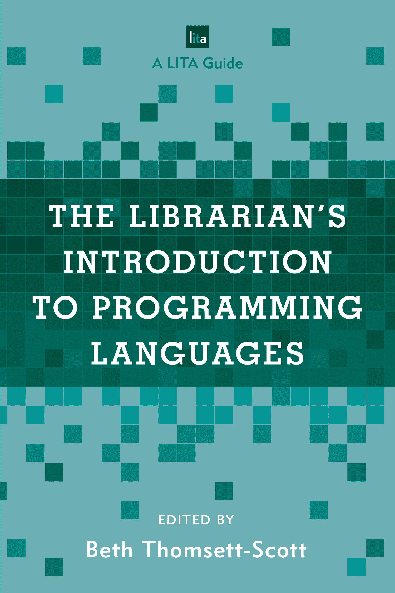

Marta Mestrovic Deyrup 博士，采编编辑，图书馆信息与技术协会（美国图书馆协会分会）

图书馆信息与技术协会（LITA）指南为图书馆和 IT 专家提供与前沿技术相关的信息和指导。

这些指南由技术领域的顶尖人士撰写，深受渴望学习新技能或紧跟今日最佳实践的图书员的推崇。

系列中的每本书从构思之初就由 LITA 进行编辑监督，并由对书籍专业领域具有特殊专业知识的 LITA 成员进行评审。

图书馆与信息技术协会成立于 1966 年，是美国图书馆协会（ALA）的分支，为其成员以及整个图书馆和信息科学社区提供了一个讨论论坛、一个学习环境以及一项关于图书馆和信息科学领域自动化和技术系统设计、开发和实施的行动计划。

2007 年至 2015 年间，Neal-Schuman 和 ALA 出版了约 25 份 LITA 指南。Rowman & Littlefield 从 2015 年底开始接手该系列的出版。由 Rowman & Littlefield 出版的系列书籍包括：

- 平面媒体的数字化：原理与实践

Beth Thomsett-Scott 编辑

Rowman & Littlefield

Lanham • Boulder • 纽约 • 伦敦

由 Rowman & Littlefield 出版

Rowman & Littlefield Publishing Group, Inc. 全资子公司

4501 Forbes Boulevard, Suite 200, Lanham, Maryland 20706

[www.rowman.com](http://www.rowman.com)

Unit A, Whitacre Mews, 26-34 Stannary Street, London SE11 4AB

《图书员编程语言入门》献给所有想要学习编程但认为自己缺乏基础知识无法开始的图书员。我希望这本书能填补这一空白。

我也将它献给我了不起的女儿 Carol Scott，她在生活的起起伏中坚持不懈；以及 David Scott，我是这个世界带给我们的旅程中最好的朋友。

愿大家平安。

## 致谢

这本书的诞生是通过一些曲折的事件实现的。原编辑需要退出，而 LITA 指南系列的编辑 Marta Deyrup 将我与 Ron T. Brown 结了联系，我们同意共同担任编辑。在书籍的最初构思获得批准后，Ron 获得了一份行业工作并接受了。这个新职位让 Ron 忙得无法继续参与书籍。此时，几位原作者有其他安排，我不得不招募替代者。

在介绍上述之后，我想感谢 Marta Deyrup 对我的信任，感谢 Ron 对书籍构思的指导，感谢在近两年时间里坚持的所有原作者。非常感谢在最后时刻加入并提供精彩章节的作者。

## 前言

《图书员编程语言入门》概述了图书馆中使用的流行的编程语言，包括实际示例，帮助图书员度过“我不行”的阶段。我们从 `Python`、`Ruby` 和 `JavaScript` 开始，它们被认为可读性最高，因此相对容易学习。接下来是 `Perl`、`PHP` 和 `SQL`，因为它们稍微复杂，但非常有用。`C`、`C#` 和 `Java` 完成了本书，作为编译型语言，它们有自己的优缺点，但在图书馆中有许多用途。

虽然有很多致力于教授编程的书籍和网站，但很少有作品涉及多种语言或提供图书馆特定的示例。本书的读者群体包括管理员、从业人员、学生、教育者以及对计算机编程感兴趣的终身学习者。

本书旨在提供每种语言的基础工作知识、图书馆中的应用示例、图书员何时发现每种语言实用的想法，以及用于实践的小示例。还提供了供额外阅读的推荐资源。贡献的形式允许通过更丰富的经验涵盖更广泛的语言。

我代表全体贡献者，愿所有读者在个人和专业领域创建新程序，或与程序员合作实施新的或重新设计的技术时一切好运。

## 1 引言

Dean Walton

### 历史与发展

编程从起源到今天已经走了很远的路。我第一次接触编程是使用孔带，即用于传输变化的股票价格的纸带。对于熟悉 60 年代经典情景剧《亚当斯家族》的人来说，Gomez 总是盯着他的纸带看。下一个重大进展是孔卡和 `Fortran`。随着个人电脑的出现，编程成为大众大众的一种爱好。

计算机现在是图书员工作中不可或缺的一部分。由于许多计算机程序允许用户自定义并运行短小的程序段落（称为“脚本”），如果图书员不学习一些基础编程，他们可能会错过图书馆世界的一个巨大领域。例如，如果你有预算数据，可以进行重复分析以计算各种场景。有了借阅数据，你可以进行重复分析，以检查特定人群对物品的使用情况、与学期相关的索号范围使用情况以及其他重要的关系。编程允许人们快速地完成复杂的重复性任务，并允许在参数变化时快速修改。

那么，没有编程经验的图书员应该从何开始呢？首先，让我们理解“程序”（program）和“程序代码”（program code）这两个术语是相当互换的。程序是一套完整的独立程序代码。程序代码通常指泛指的代码，而不是一个完整的程序。编程是创建程序的动作，本质上是编写组成程序的代码。代码是我们人类使用的类英语的指令，用于告诉计算机要做什么。你可能听过程序员（programmers）或代码编写员（coders）。这些本质上是一回事：即编写（或编码）程序的人。有人可能会说，现在学习编程是小孩子的游戏。有大量的书籍、在线视频和面向游戏的网站可以提供帮助。其中，`Code.org` 是一个基础教学的绝佳网站；它无论使用何种编程语言，都教授编程逻辑。`Code.org` 为小学生提供了教程和内容，让他们学习编程的构建块。当然，成人也可以从该网站学习，并以有趣的方式进行。如果你想学习更高级的内容，YouTube 只需点击一下即可，那里有丰富的分步操作视频。不过，必须留意以确保教学质量。本书章节作者提供的资源以及本书的“附加资源”部分将引导你在通往编程之旅的途中找到优质资源。

### 基础知识

区分“与计算机交互”和“在计算机上编程”是非常重要的。对于许多包括图书员在内的成年人来说，第一步是练习交互技能。一个很好的入门方法是找出一台旧的台式机电脑或笔记本电脑，并在上面加载 `Linux`。操作系统的 `Ubuntu Linux` 的最新版本在加载后将类似于 Windows 或 Apple 操作系统。然而，在 `Linux` 中，仍然可以使用鼠标驱动的图形用户界面，并进入 `Terminal`（`X-terminal`），在那里运行计算机是命令行驱动的。我的意思是，用户可以在计算机上相应的行上输入命令，因此名为“命令行”。鼠标和它的光标消失了。为了在计算机上移动，用户使用方向键。在 Windows 机器上，你可以同时按住 `Windows` 键（通常在键盘的左下角）并按住 `X` 键。这将弹出一个命令行菜单，以及具有管理员权限的命令行。

命令行中有几个重要的任务需要学习。为了在这个环境中运行，用户必须学会如何在不同的文件夹或目录之间来回移动；在文件夹或目录内移动、复制或删除内容；以及从其他来源查找、下载并解压程序。掌握这一系列任务将对图书员大有益。一旦实现了这些目标，加载特定编程语言所需的脚本集或库将变得容易得多。

这一切的起点是路径（图 1.1）。这让用户能够知道所有内容在操作系统文件结构中的位置。路径遵循一种类比于“树”的术语。将树与大地连接、将树干与树连接起来的结构是“根”。路径的核心是根目录。根结构包含了允许计算机运行的命令。在根目录中删除任何文件都将不起作用；因此，根目录通常受到保护。在这种情况下，保护意味着需要密码来更改根目录的部分。如果你是计算机的管理员（也就是说，它是你的电脑或你负责它），那么你应该知道根密码。根密码的创建通常发生在向你的计算机加载操作系统时。

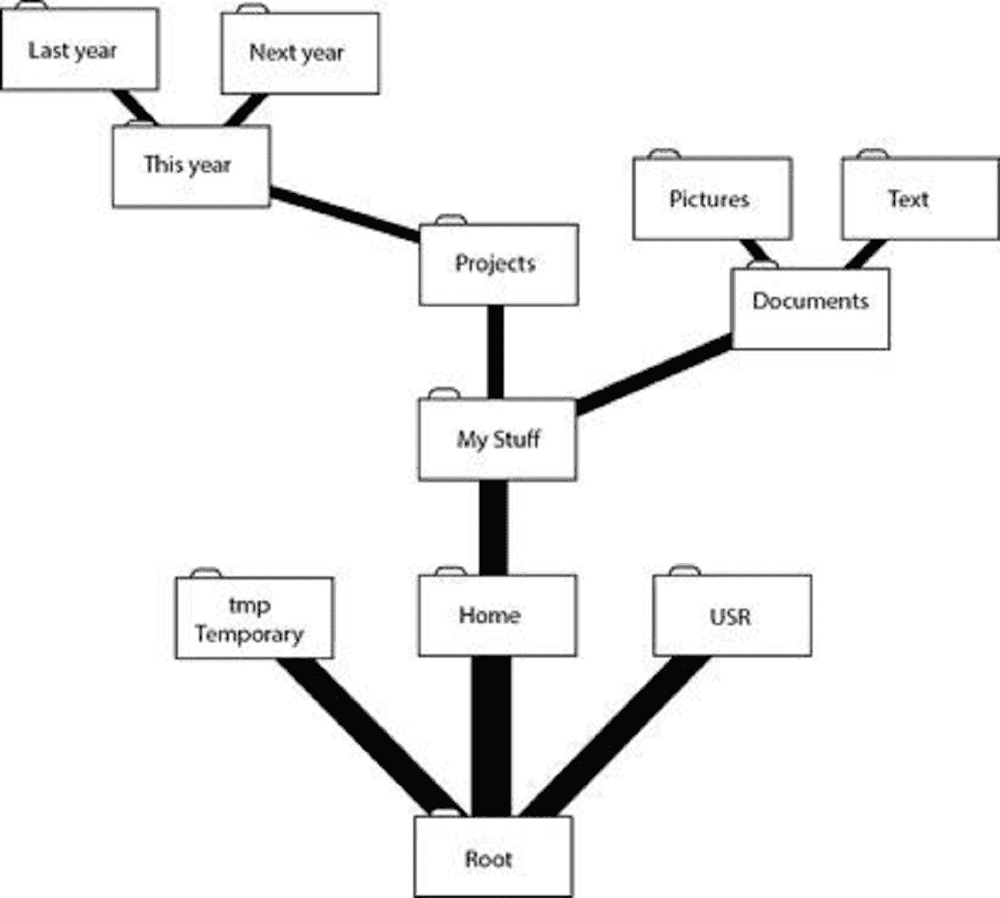

图 1.1. 计算机操作系统中文件夹或目录的通用路径结构。

用户可以直接从根目录添加或删除文件夹，就像树可以长出新树枝，或者园丁可以修剪掉树枝一样。但请记住，如果你剪掉了根，树就会死。一个很好的问题是，你如何知道你的树路径路径哪些分支？你可以在命令行中输入 `dir`，并看到你所在位置包含的文件夹列表。要进入其中一个文件夹，你输入 `cd`（“change directory”的缩写）以及目录名称。甚至有一种更简单的方法回到你刚才所在地。通过在命令行输入单个点 `.` 并按回车，你请求计算机带你回到上一个文件夹。如果你输入两个点 `..`，你请求计算机带你回到所有目录的起点，回到根目录。

许多这些命令还有一些额外功能。一个很好的例子是你如何在 Windows 中查看文件夹的内容。你可以以列表形式查看，或以带有大小和创建日期详细信息的列表形式查看。新用户将遇到如 `tar`、`grep` 和 `bash` 等术语。其中某些概念对于习惯 Windows 或 Mac OS 的人来说是容易理解的。例如，`.tar` 文件是一个压缩文件，类似于压缩过的 Windows 文件夹。它需要被解压缩，并将文件夹中的文件移动到适当的文件夹或目录中才能生效。某些文件需要放在现有的文件夹中，而另一些则需要放在用户可能需要创建的新文件夹中。

同样重要的是了解 `Linux` 设计为执行某些任务时无需询问，而对另一些任务进行提问。这防止用户意外破坏计算机的内容。在许多 Linux 系统中，这被定义为 `SUDO` 用户或超级用户（super user）。实际上发生的是操作系统要求用户验证其确实是计算机管理员，并且这些更改是实际所需的。这有助于防止未经授权的用户进行更改。在 `Linux` 中，用户有能力查看操作系统并几乎可以进行他们要求的任何更改，无论这些更改是否会导致计算机停止。这意味着管理员拥有巨大的权力，而且在搞乱事情方面比 Windows 用户拥有更大的权力。

一个简单而有趣的编程挑战示例是类似于相扑机器人比赛。在这种比赛中，两个配备了运动检测器和线条追踪传感器的小型机器人相互竞争，试图将对方推出一个直径三英尺的圆环。这些机器人配有驱动两个轮子的电机，当开启并放置在场地上时，它们会寻找彼此并尝试将对方推出环外。程序员需要编写一个脚本，根据检测到另一个机器人的情况，命令机器人何时执行什么操作。这种编程可以非常简单，它是观察应用编程问题——以及机器人技术的一种方法。再次，定义任务的逻辑对于任何计算机语言来说可能都是相同的，只是表达方式不同。

### 入门

今天，花费二十到八十美元购买一本关于 Arduino、树莓派（Raspberry Pi）、Edison 或 BeagleBone（[`beagleboard.org/bone`](http://beagleboard.org/bone)）的项目书籍以及配套电脑板，是兼顾乐趣和学习编程的极佳方式。这些都是类型的微控制器。其中一些比较先进，运行起来更像现在的计算机。微控制器是一组可编程的开关，你可以根据需要和时间告诉控制器开启或关闭。你可以打开灯光、电机或功率传感器，并收集和保存数据。通过其中任何一种，你都可以制作有趣的项目，例如一个挂墙电子日历，它可以随着人员更新自己的个人日历而自动更新（Chee 2014），或者制作你自己的机器人。

大多数程序可以在文本编辑器中编写，如果你是 Windows 用户，可以使用 `NotePad`。像 Word 这样的程序将无法工作，因为它会添加许多作者不可见的隐藏文本内容，导致程序无法运行。相比之下，`NotePad` 不添加这些内容。然而，并不是所有的文本编辑器都是相同的，有些比其他的有用得多。某些文本编辑器可以为程序的不同部分添加颜色编码。`Sublime Text` 和 `NotePad++` 是两种被广泛认可和使用的编辑器，前者适用于 Windows 和 Linux 操作系统。它们都为用户提供了行号，以便跟踪程序的各个部分。

几乎任何新用户都会遇到一种“Hello World”脚本。无论某人使用的是 `Perl` 还是 `Python`，大多数教程都从这里开始。学生定义一个变量，例如 `X = “Hello World.”`。下一步只是命令计算机在屏幕上显示变量（`Print X`）。结果是学生将在他们的电脑屏幕上看到“Hello World”。

随着越来越多的程序变得开源（这意味着编程脚本（代码）公开可用），图书馆员利用编程的力量日益增长。一个极佳的例子是 `R` 程序。`R` 是一个统计包。它由全球的用户编写和修改，他们不断对其进行添加和改进。如果你有一个想让程序执行的任务但没有运行该任务的脚本，你可以编写该脚本，然后使用程序的其他功能（例如对结果绘图）。一旦你写好了脚本，就可以与其他人分享，以便他们从你的工作中获益。在此过程中，可能会有人将你的脚本与其他一系列相关脚本一起打包，作为库添加到程序中。对于 `QGIS` 这样的程序也是如此，它是一个可以执行复杂空间分析的高级映射程序。用户可以编写短程序，为整个 `QGIS` 程序提供更强大的功能。

### 面向对象

这引入了面向对象编程的概念。面向对象编程编写脚本或短程序的过程，这些程序可以插入或从较大的程序中提取，而不会导致大程序或脚本本身出现任何故障。通过面向对象编程，你可以编写一个脚本来执行某个任务。这个脚本就是对象。其他人可以使用你的对象（`script`）并将其插入完全不同的程序中，以执行你为你的程序编写的相同任务。例如，你可以编写一个脚本来获取某些传感器数据，例如来自自动检票传送带的书籍计数数据，然后每天对数据进行汇总，并提供图书馆还书周平均数。另一个人可以复制你的脚本，用于不同的传感器，以提供进入图书馆的周平均人数。无论你是在数书还是数人，创建周平均数的任务是相同的。正是这种“分块编程”导致了非常强大的程序的开发，并允许普通人也做出贡献。其目标是避免因为想添加一个新任务就得重写整个程序（如果想了解更多，请查阅 PC 杂志对该定义：[`http://www.pcmag.com/encyclopedia/term/48238/object`](http://www.pcmag.com/encyclopedia/term/48238/object)-oriented-programming）。

开始编程的一种有趣方式是研究谜题，让读者被要求通过编写脚本来解决任务。任何人都可以在网上搜索这些示例。也有关于编程谜题的书籍。然而，其中一些书籍包含复杂的谜题，这些谜题似乎被用于公司招聘新程序员的面试过程中。对于初学者来说，不要避开为孩子写的书。Jason Briggs 的《Python for Kids》是一个很好的起点，他的网站（[`jasonrbriggs.com/python-for-kids/puzzles.html`](http://jasonrbriggs.com/python-for-kids/puzzles.html)）发布了针对初者的简单编程挑战。

无论如何，初学者学习编程最简单的方法之一就是通过在项目中获得乐趣，让失败成为学习经验而不是问题。再次，Arduino 项目非常适合这种活动。我的最佳建议是在旧笔记本电脑上安装 `Linux`（它是免费的），买一个二十元的 Arduino，并在 [Code.org](http://Code.org) 上花些时间。

### 图书馆编程

最后，为什么图书馆员应该学习编程？为了收集数据并解决问题，例如在过去十年中，索号范围 `x–y` 内的书籍每年被借阅超过一次的情况；确定借阅与学生成功是否相关；研究图书馆教学的效果——以及许多其他原因。

这引导我们决定学习哪种语言。通常，这取决于学习背后的原因。如果目标是特定任务，语言的选择将受到影响。对于许多图书馆员来说，编写最简洁的代码可能没有编写他人能读懂的代码重要。这就是为什么如 `Ruby` 和 `Python` 等语言很受欢迎的原因。它们相当简洁，但重要的是，阅读脚本的人可以很容易看出脚本想要做什么。

《计算机协会通讯》杂志上的一份最新报告（Guo 2014）指出，`Python` 是 2014 年最受欢迎的语言。这是基于对大学计算机系近期教学课程的分析，表明许多程序现在是用 `Python` 编写的。因此，除非有使用其他语言的理由，否则它可能是入门语言之一。`Python` 简单而强大，你可以相当容易地编写有趣的脚本。如果你主要参与网页设计，那么 `Java` 可能是更好的选择。没有必要学习太多的语言。一旦你学会了一种语言并良好掌握了基础编程术语和概念，在需要或想要时学习另一种语言将变得更容易。

2015 年，来自电气电子工程师学会（IEEE）的 Stephen Cass 发布了一份他认为的去年最重要的编程语言列表（Cass 2015）。列出的大多数语言也适用于任何对编程感兴趣的图书馆员，但其重要性顺序可能有所不同。该列表的内容也与本书的内容非常吻合。为了方便面向图书馆员的读者群体，下文对列表进行了重新排序，并参考了作者与程序员的个人交流。这些语言以及其他计算机编程语言的定义可以在堪萨斯大学由 Bill Kinnersley 维护的网站找到，名为“语言列表”（[`people.ku.edu/~nkinners/LangList/Extras/langlist.htm`](http://people.ku.edu/~nkinners/LangList/Extras/langlist.htm)）。

- `Python`——一种易于解释的面向对象的语言，因此非常流行。
- `Ruby`——一种非常易于解释的编程语言。`Ruby on Rails` 提供了一套协议和结构，允许人们使用 `Ruby` 来创建响应式和动态网站。
- `PHP`——一种允许从 Web 服务器调用数据并使其在网络浏览器中可见的语言。它是提供基于 Web 信息（如商店商品目录内容）的主要工具之一。
- `Java`——一种面向服务器的语言，同时也是面向对象的，可以在多个平台或计算机类型上运行。它与 `C` 和 `C++` 共享一些类似的语法。在不同操作系统上运行的能力使其成为一种实用的语言。
- `Perl`——最广泛的对象对象编程语言之一。该语言拥有良好的支持。它的主要竞争对手可能是较新的 `Python`，后者的优势是更容易解释。
- `JavaScript`——一种基于客户端（在本地计算机上运行）的语言，在网络浏览器中运行，由浏览器从网上拉取数据。它是网络浏览器功能的内核。`JavaScript` 对于任何创建 Web 应用程序的人来说都是一种重要语言。
- `SQL`——一种允许对大型数据集进行组织和深度数据挖掘的语言。
- `R`——一种为统计分析设计的编程语言。这种语言提供了基础和高级分析，对数据格式具有灵活性，并且相关的脚本可以实现多功能的数据可视化。


其余的流行语言也非常强大，允许程序员用最少的行数编写高效代码。对于无畏者或考虑将编程视为主要工作职责的图书馆员来说，每一种语言都值得学习。然而，对于刚学习编程或仅将编程作为工作一小部分的人来说，这些语言是最难的：`C`、`C++`、`C#` 和 `Objective-C`。

## 学习编程的步骤

1. 访问 [Code.org](http://Code.org) 并开始尝试。任何人都可以从这里开始，只需要连接互联网。然而，这只能让人的大脑开始处理编程的抽象概念，并没有提供实现程序的实用部分。

2. 访问 Ubuntu Linux 网站（[`www.ubuntu.com/download`](http://www.ubuntu.com/download)）并下载最新版本的 `Ubuntu` `ISO` 文件。这需要一些时间，因为文件可能在 1GB 左右。`ISO` 文件是可启动的，计算机会在启动时加载它。现在，将此文件刻录到 DVD 或闪存盘。Windows（[`windows.microsoft.com/en-us/windows7/burn-a-cd-or-dvd-from-an-iso-file`](http://windows.microsoft.com/en-us/windows7/burn-a-cd-or-dvd-from-an-iso-file)）或开源程序 `7-Zip` 可以提供此功能。`7-Zip` 可以从 [http://www.7-zip.org/download](http://www.7-zip.org/download) 下载。

3. 找到一台旧电脑并安装 `Ubuntu`。在计算机启动时加载 `ISO` 文件。

4. 安装 `Ubuntu`。

5. 安装好 `Ubuntu` 后，使用 `Ctrl+Alt+T` 进入终端命令行。

6. 这一步骤的第三部分是从 [Amazon.com](http://Amazon.com) 购买 `Arduino` 套件。你现在可以在 Windows、Apple 或 `Linux` 机器上安装并运行 `Arduino` 程序看到结果。

7. 在 `Linux` 上开始阅读、编写和练习，并享受其中。

本书的章节将帮助读者决定从哪种语言开始，并判断何时学习其他语言。实践示例将带你了解每种语言的基础知识。我希望所有读者都能找到自己喜爱的语言，并实现成为熟练程序员的目标。欢迎来到编程的世界！

## 参考文献

- Cass, S. 2015. “The 2015 Top Ten Programming Languages.” IEEE Spectrum, July 20. [`spectrum.ieee.org/computing/software/the-2015-top-ten-languages`](http://spectrum.ieee.org/computing/software/the-2015-top-ten-languages).

- Chee, Brian. 2014. “Hero Hacks: 14 Raspberry Pi Projects Primed for IT.” InfoWorld, July 10. [`www.infoworld.com/article/2606860/consumer-electronics/158674-hero-hacks-14-raspberry-pi-projects-primed-for-it.html`](http://www.infoworld.com/article/2606860/consumer-electronics/158674-hero-hacks-14-raspberry-pi-projects-primed-for-it.html).

- Guo, Philip. 2014. “Python Is Now the Most Popular Introductory Teaching Language at Top U.S. Universities.” Communications of the Association for Computing Machinery, July 7. [`cacm.acm.org/blogs/blog-cacm/176450-python-is-now-the-most-popular-introductory-teaching-language-at-top-us-universities/fulltext`](http://cacm.acm.org/blogs/blog-cacm/176450-python-is-now-the-most-popular-introductory-teaching-language-at-top-us-universities/fulltext).

## Python 概述

Python 是一种开源的高级脚本语言，用于各种目的，从快速、小型的分析程序到大型应用程序。虽然很难衡量一个开源项目有多少用户，但据估计 Python 拥有大约一百万用户，并位列世界上最常用编程语言的前五或前十（Lutz 2013）。这种受欢迎的原因之一是 Python 的灵活性；它可以支持面向对象、函数式或传统的过程化（先做这个再做那个）编程范式。更重要的是，Python 的一些显式设计特征使其成为一种关注代码质量、开发者生产力、操作系统之间的可移植性，以及与 Python 工具和其他语言集成的语言。换句话说，你可以快速编写出强大、易读阅读、在 Mac OS、Windows 和 Linux 上无需更改即可运行、并轻松与各种工具接的 Python 代码。这种设计哲学在 Tim Peters (2004) 的《Python 之禅》（The Zen of Python）中得到了明确体现，其中包含了“可读性非常重要”和“简单胜于复杂”等陈述。如果你安装了 Python，打开 Python 解释器并输入 `import this`，就可以阅读完整的《Python 之禅》了。这些思想使得 Python 不仅是一种能够适应各种需求的健壮、强大的语言，而且是一种易于学习的语言、极的入门语言，以及优化库工作流的优秀工具。

### 历史

Python 由 Guido van Rossum 在 1989 年于荷兰研究机构 CWI（一个荷兰语缩写，翻译为数学和计算机科学中心）工作期间创建。二十年后，他写了一系列博客文章，详细介绍了它的历史和发展（Van Rossum 2009–2013）。该语言以蒙提·派恩剧团（Monty Python）命名，该协会在文档中一直以 `spam` 变量和几个幽默的俏词的形式存在。它最初大部分是在圣诞期间编写的，旨在作为 C 语言和 shell 之间“架接桥梁”的侧项目，以加速系统管理工具的开发。Van Rossum 将语言的许多方面基于 ABC（这是他最近作为开发者工作过的一种语言），同时从 C 和其他更晦涩的语言中获取灵感。他采用了一种显式设计策略，强调开发速度、易用性、可读性、尽可能借鉴他人成果，并使 Python 易于扩展。

在 Van Rossum 和他的同事完成初步开发后，Python 于 1991 年 2 月 20 日在 [alt.sources](http://alt.sources) 新闻组以 MIT 许可证发布。在社区的鼓励下，Van Rossum 继续更新该语言，并于 1993 年启动了持续至今的 [comp.lang.python](http://comp.lang.python) 新闻组。1994 年，列表上的一个热门话题被恰地命名为“如果 Guido 被公车撞了”，其中社区成员担心，考虑到 Van Rossum 继续亲自进行许多更新，该语言的命运将如何。部分由于这个帖子的，Van Rossum 在 1994 年被邀请到美国与国家标准与技术研究所工作。在这些关于他那可能不会降临的终结以及来到美国的讨论中，Python 1.0 发布了，1995 年 Van Rossum 开始在国家研究倡议组织公司工作，那里又发布了几个主要版本。与此同时，在尝试通过建立一个半官方小组来监督开发以实现 Python 开发多样化的过程中，Van Rossum 被授予了“终身仁慈独裁者”的称号，标志着他对 Python 所有事务的持续最终决定权（Lutz 2013）。

在 Python 团队于 [BeOpen.com](http://BeOpen.com)（一家在互联网泡沫破失败的初创公司）和 Digital Creations 工作了一段时间后，Python 2.0 于 2000 年 10 月发布。2001 年，创建了 Python 基金会以监督和协调 Python 语言的进一步开发，该基金一直维护该语言至今。2008 年，发布了 Python 3.0，这是一个重大的、不后兼容的版本。然而，考虑到 Python 2 的流行，版本 2.7 正与 3.0 并行维护，尽管仅 `print` 命令的更改就确保了几乎所有的 2.x 程序无法在 3.x 上运行，但社区已付出了巨大努力让其正常工作。3.x 中的功能可以使用 `from __future__ import name_of_function` 移植到 2.x，这样你就可以在无需完全重构代码的情况下利用新功能。秉持 Python 的精神，开发者正专注于灵活性和扩展性，而不是统治世界。

从 Van Rossum 在地下室捣凑代码为了让他的另一份工作更方便，Python 现在由一大开发者作为开源项目进行维护（这些人以及任何特别擅长的 Python 编码员被亲切地称为 Pythonistas；同时，按照 Python 社区通用风格编写的代码被称为 Pythonic/Python 式），并具有大量的专门实现。该语言现在用于从电影到 Web 开发、到科学计算以及专门针对这项工作的库的应用程序。这一切构成了一个充满活力的社区，拥有适用于各种用途的工具。

## 环境与设置

在本地机器上设置 Python 取决于所使用的操作系统类型。虽然 Python 可以在十多个操作系统上安装和运行（[`www.python.org/download/other`](https://www.python.org/download/other)），但下面包含了三个最常见操作系统——Linux、Macintosh 和 Windows——的初始说明。

### Linux

某些某些版本的 Python（通常是 Python 2.7）已经包含在许多流行的 Linux 发行版中，包括 Debian、Fedora 和 Gentoo。然而，并不是每个安装都会包含完整的功能 set。如果你想使用 Python 3.0 或更高版本，你可能需要从操作系统的软件包存储中获取；在 Ubuntu 上，那可能看起来 `sudo apt-get install python3`。

### Macintosh

从 Mac OS X Yosemite 开始，Python 2.7 是开箱即用的。从终端（Terminal）开始编写命令行提示非常简单，因为 Python 命令可以从任何目录输入。如果你想要不同的版本或未安装 Python，请访问 [`www.python.org/downloads/mac-osx/`](https://www.python.org/downloads/mac-osx/) 并下载你需要的 Python 版本的安装程序。

### Windows

与其基于 UNIX 的同类产品不同，Windows 并不预带安装好的 Python 版本。然而，安装通常是快速且无痛的。只需前往 [Python.org](http://Python.org)（[`www.python.org/downloads`](https://www.python.org/downloads)），决定你偏好哪个版本（通常建议采用 2.7 或 3 系列中的最新发布，除非你有特定的理由不这样做），然后运行 `.exe` 文件。这将安装 Python、被称为 Python 标准库的模块集合以及基础 Python 文本编辑器 IDLE。

你可以在 [pypi.python.org](http://pypi.python.org)（`PyPI`，Python 包索引）上搜索超过七万个免费提供的包——这些包涵盖了从数据解析、数据库操作到针对特定终端用户的各种范围。这些包在安装方式上通常是标准化的。作为一个一般规则，为某个版本的 Python 安装的包可能无法被另一个版本的 Python 识别。简而言之，如果你正在使用 `Python 2.7`，请确保下载适用于该版本的包而不是 `3.x` 版本；如果你运行了多个版本的 Python，同一个包可能无法在两个版本上共同工作。在大多数情况下，像 `pip`（下文介绍）这样的工具会为你处理这些问题，但这是一个需要记住的重要方面。

Python 包可以通过多种方式下载和使用，但到目前为止最简单、最常用的方法是使用一个名为 `pip` 的 Python 工具程序。`pip` 是 `Python 2.7.9` 和 `3.4` 及之后版本自带的包管理器；对于早期版本，可以很容易地下载并安装（[`pip.pypa.io/en/latest/installing.html`](https://pip.pypa.io/en/latest/installing.html)）。按照安装说明后，添加新模块通常就像打开命令行并执行命令 `pip install my_package` 一样简单。你可以使用 `PyPI` 来查找包（这是 `pip` 获取内容的来源），但你也经常会在 StackOverflow 或其他讨论 Python 的地方听到关于包的消息。要使用包，只需在 Python 文件的顶部加上 `import my_package`，你就可以访问提供的所有功能。我们将在下面看到这几个示例，因为导入包是 Python 中最常见的任务之一。

为了真正看到包的力量，让我们从 `Requests`（Reitz 2011）的文档中取一个例子，它是最受欢迎的 Python 包之一。`Requests` 允许我们发送 HTTP 请求，抽象了大部分细节，使我们只需专注于我们来此要做的事。使用 Python 内置的 `urllib2` 功能，向 GitHub 发起网络请求可能看起来这样：

```
import urllib2

gh_url = 'https://api.github.com'

req = urllib2.Request(gh_url)

password_manager = urllib2.HTTPPasswordMgrWithDefaultRealm()

password_manager.add_password(None, gh_url, 'user', 'pass')

auth_manager = urllib2.HTTPBasicAuthHandler(password_manager)

opener = urllib2.build_opener(auth_manager)

urllib2.install_opener(opener)

handler = urllib2.urlopen(req)

print handler.getcode()

print handler.headers.getheader('content-type')
```

如果这段代码对你来说没有任何意义，请不要担心，因为它存在的意义就是为了展示如果你仅使用标准工具向 GitHub 发起一个简单的 HTTP 请求，然后检查返回的状态码和内容类型时必须编写的复杂代码。它本该让你感到头疼，尤其是如果你是初学者。为了让我们的生活更好，让我们安装 `Requests`。打开你的命令提示符并输入 `pip install requests`。现在我们可以编写代码：

```python
import requests

r = requests.get('https://api.github.com', auth=('user', 'pass'))

print r.status_code

print r.headers['content-type']
```

如果你从未见过过 Python 代码，你可能也能猜出这段代码的作用。它导入了一个名为 `requests` 的东西，然后用它从 [api.github.com](http://api.github.com) 获取信息，使用了用户名和密码（在这里被称为虚拟变量“user”和“pass”）。然后它打印状态码和部分头部信息。感谢 Kenneth Reitz 制作并免费发布了这个库，我们可以在极短的时间内编写易于理解且更容易使用的代码。

### Python 2 对比 Python 3

2008 年底，`Python 3` 发布了。这个新版本与之前的 `Python` 版本不兼容（之前的版本到 `2.7` 结束）。`Python 3.0` 的发布包含了对语言的许多改进，包括更好的 Unicode 支持、清理过去的弃用功能，以及内置了帮助初学该语言的开发者更好地学习的工具。

在发布时，`Python 3` 被宣布为该语言的未来；然而，因为它与之前的版本不兼容，许多依赖 `2.7` 版本的人发现他们需要升级应用程序。另则接受并在所有新开发中使用较新的 `Python 3`。不过，在同一台机器上运行多个版本是可能的。由于 `Python 2.7` 在许多机器上是原生安装的（见上一节），可能需要单独安装 `Python 3`。这两个版本可以独立运行，但包也需要单独安装——一个包无法在两个平台上同时工作。对于 `pip` 也是如此。但是，通过简单的配置，你可以轻松通过使用如 `pip2` 或 `python3` 等命令，在你想要运行特定版本时进行跟踪。

### 用途

Python 的灵活性使其适用于各种用途。像 Google、YouTube 和 Dropbox 等热门服务使用它为 Web 和桌面环境编写大型项目。在更贴近生活的库领域中，Evergreen 开源图书馆管理系统（ILS）虽然主要用 Perl 编写，但仍使用 Python 进行某些开发任务。然而，Python 的低门槛使其特别适合小型项目来自动化常见任务。


# 使用 Python 处理 MARC 数据

Python 在库中非常有用的应用之一，专门针对编目员或技术服务工作流，是使用 `PyMARC`——这是一个为了访问、创建和处理原始二进制 MARC 数据而编写的 Python 库。

这个 `PyMARC` 库允许用户读取 `.mrc` 格式的 MARC 记录文件，从记录中提取字段或子字段，通过更改或删除它们来修改字段和子字段，并向记录中添加新字段。根据指定的标准和字段数据，你可以分析 MARC 数据并将报告写入文本文件中，这些报告可以用于批量清理项目的统计或错误分析。

这种通过编程方式处理数据的能力可以节省大量时间。虽然像 `MarcEdit` 这样的工具可以进行大量的批处理，但学习 `PyMARC` 既能提供更大的自由度，正如前面提到的，还允许在批处理脚本中调用，因此它可以成为你自动化流程中的众多工具之一。

## 优缺点

如所述，选择 Python 作为首选编程语言有许多优势。Python 通常预装在大多数当前的操作系统中（Windows 除外），因此运行你的第一个脚本不需要太多的设置。对于在命令行界面工作的绝对初学者来说，起初可能不在 GUI（图形用户界面）环境中工作会让他们感到无畏，但这对任何语言都是如此，只要稍微接触一下基本操作所需的命令，这些恐惧很快就会消失。

虽然 Python 可用于执行非常复杂的工作流或构建复杂的框架，但它也允许初学者编写短而简单的脚本来产生强大的结果。通常手动执行需要几个小时的重复性、单调的任务可以在几秒钟内完成。此外，Python 社区非常强大，他们创建了包并提供帮助，使得你可能遇到的任何问题可能已经有了答案，并附带了代码示例、语法说明以及一两个冷笑话。

Python 的一个既是帮助也是阻碍的方面是它对大量空白的使用。换句话说，你缩进代码的方式改变了它的运行方式（`http://www.secnetix.de/olli/Python/block_indentation.hawk`）。Python 不使用大括号或其他语法来表示嵌套代码块，而是使用行首的制表符或空格来区分代码块的开始和结束。

例如，一组 `if/else` 语句可能看起来像这样：

```python
if x == 1:
    print "x is odd"
elif x == 2:
    print "x is even"
else:
    print "I don't know what x is"
```

这与其他许多编程语言不同，但 Python 高度重视可读性和让事情更易于人类。因此，虽然这需要一些适应时间并可能让你对着屏幕大叫，但从长远来看，语言的这一特性使得你的代码更具可读性且更容易维护。

初学者有时会遇到的另一个困惑是：在 Python shell 中直接运行 Python 命令（即提示符以 `>>>` 开头）与在提示符中使用 `python` 命令和脚本文件名调用并运行完整的 Python 脚本之间的区别（此处为 Windows DOS 提示符）：`C:\> python myPythonScript.py`。

Python shell 允许在使用之前检查函数的运行情况，或者在交互式环境中解决一些棘手代码。这是一个很有用的功能，但你的任何精妙代码都不会被保存，因此一旦你使用提示符解决了某个问题，务必将其移动到 `.py` 文件并保存，以便以后像上面所示使用。

## 示例

### 使用 Python 对馆品

Python 擅长的一个领域是编写较短的脚本来自动化日常任务。例如，如果我们有一份来自供应商的馆品列表，并想将其与我们目录中的馆品进行比对，即使馆品数量较少，这项任务也会变得繁重。然而，通过 Python 我们可以快速编写一个脚本来自动化我们的任务，腾出时间去喝杯咖啡。

```python
from_vendor = ['1234-5678', '2345-6789', '3456-7890']
from_catalog = ['1234-5678', '2345-6789', '3456-7890', '1111-2222']

for issn in from_catalog:
    if issn not in from_vendor:
        print issn
```

这个示例演示了处理此任务的一种非常简单的方法。我们创建了两个变量 `from_vendor` 和 `from_catalog`，并将 ISSN 数字列表放入这些变量中（在 Python 中，方括号通常表示列表，直白来说就是一个用逗号分隔的数据点列表；此外，这些数据点可以是任何内容，因此 `['a', 'number', 3]` 是一个完全有效的列表）。之后我们使用 `for` 循环比较这两个列表。Python 的编写方式有时被称为“可执行伪代码”，因为该语言的语法比大多数编程语言更接近英语，这段代码可以给你一些思路。

当我们拥有这两个 ISSN 数字列表后，只需说：“对于 `from_catalog` 列表中的每一个 `issn`，检查它是否不在 `from_vendor` 列表中，并将它们打印到屏幕上。”这个示例演示了处理此事的非常简单的方法。我们创建了两个名为 `from_vendor` 和 `from_catalog` 的变量，并将 ISSN 数字列表放入这些变量中（在 Python 中，方括号通常表示列表，直白来说就是一个用逗号分隔的数据点列表；此外，这些数据点可以是任何内容，因此 `['a', 'number', 3]` 是一个完全有效的列表）。之后我们使用 `for` 循环比较这两个列表。Python 的编写方式有时被称为“可执行伪代码”，因为该语言的语法比大多数编程语言更接近英语，这段代码可以给你一些思路。

当我们拥有这两个 ISSN 数字列表后，只需说：“对于 `from_catalog` 列表中的每一个 `issn`，检查它是否不在 `from_vendor` 列表中，并将它们打印到屏幕上。”这个示例演示了处理此事的非常简单的方法。我们创建了两个名为 `from_vendor` 和 `from_catalog` 的变量，并将 ISSN 数字列表放入这些变量中（在 Python 中，方括号通常表示列表，直白来说就是一个用逗号分隔的数据点列表；此外，这些数据点可以是任何内容，因此 `['a', 'number', 3]` 是一个完全有效的列表）。之后我们使用 `for` 循环比较这两个列表。Python 的编写方式有时被称为“可执行伪代码”，因为该语言的语法比大多数编程语言更接近英语，这段代码可以给你一些思路。

当我们拥有这两个 ISSN 数字列表后，只需说：“对于 `from_catalog` 列表中的每一个 `issn`，检查它是否不在 `from_vendor` 列表中，并将它们打印到屏幕上。”这个示例演示了处理此事的非常简单的方法。我们创建了两个名为 `from_vendor` 和 `from_catalog` 的变量，并将 ISSN 数字列表放入这些变量中（在 Python 中，方括号通常表示列表，直白来说就是一个用逗号分隔的数据点列表；此外，这些数据点可以是任何内容，因此 `['a', 'number', 3]` 是一个完全有效的列表）。之后我们使用 `for` 循环比较这两个列表。Python 的编写方式有时被称为“可执行伪代码”，因为该语言的语法比大多数编程语言更接近英语，这段代码可以给你一些思路。

当我们拥有这两个 ISSN 数字列表后，只需说：“对于 `from_catalog` 列表中的每一个 `issn`，检查它是否不在 `from_vendor` 列表中，并将它们打印到屏幕上。”这个示例演示了处理此事的非常简单的方法。我们创建了两个名为 `from_vendor` 和 `from_catalog` 的变量，并将 ISSN 数字列表放入这些变量中（在 Python 中，方括号通常表示列表，直白来说就是一个用逗号分隔的数据点列表；此外，这些数据点可以是任何内容，因此 `['a', 'number', 3]` 是一个完全有效的列表）。之后我们使用 `for` 循环比较这两个列表。Python 的编写方式有时被称为“可执行伪代码”，因为该语言的语法比大多数编程语言更接近英语，这段代码可以给你一些思路。

当我们拥有这两个 ISSN 数字列表后，只需说：“对于 `from_catalog` 列表中的每一个 `issn`，检查它是否不在 `from_vendor` 列表中，并将它们打印到屏幕上。”这个示例演示了处理此事的非常简单的方法。我们创建了两个名为 `from_vendor` 和 `from_catalog` 的变量，并将 ISSN 数字列表放入这些变量中（在 Python 中，方括号通常表示列表，直白来说就是一个用逗号分隔的数据点列表；此外，这些数据点可以是任何内容，因此 `['a', 'number', 3]` 是一个完全有效的列表）。之后我们使用 `for` 循环比较这两个列表。Python 的编写方式有时被称为“可执行伪代码”，因为该语言的语法比大多数编程语言更接近英语，这段代码可以给你一些思路。

当我们拥有这两个 ISSN 数字列表后，只需说：“对于 `from_catalog` 列表中的每一个 `issn`，检查它是否不在 `from_vendor` 列表中，并将它们打印到屏幕上。”这个示例演示了处理此事的非常简单的方法。我们创建了两个名为 `from_vendor` 和 `from_catalog` 的变量，并将 ISSN 数字列表放入这些变量中（在 Python 中，方括号通常表示列表，直白来说就是一个用逗号分隔的数据点列表；此外，这些数据点可以是任何内容，因此 `['a', 'number', 3]` 是一个完全有效的列表）。之后我们使用 `for` 循环比较这两个列表。Python 的编写方式有时被称为“可执行伪代码”，因为该语言的语法比大多数编程语言更接近英语，这段代码可以给你一些思路。

当我们拥有这两个 ISSN 数字列表后，只需说：“对于 `from_catalog` 列表中的每一个 `issn`，检查它是否不在 `from_vendor` 列表中，并将它们打印到屏幕上。”这个示例演示了处理此事的非常简单的方法。我们创建了两个名为 `from_vendor` 和 `from_catalog` 的变量，并将 ISSN 数字列表放入这些变量中（在 Python 中，方括号通常表示列表，直白来说就是一个用逗号分隔的数据点列表；此外，这些数据点可以是任何内容，因此 `['a', 'number', 3]` 是一个完全有效的列表）。之后我们使用 `for` 循环比较这两个列表。Python 的编写方式有时被称为“可执行伪代码”，因为该语言的语法比大多数编程语言更接近英语，这段代码可以给你一些思路。

当我们拥有这两个 ISSN 数字列表后，只需说：“对于 `from_catalog` 列表中的每一个 `issn`，检查它是否不在 `from_vendor` 列表中，并将它们打印到屏幕上。”这个示例演示了处理此事的非常简单的方法。我们创建了两个名为 `from_vendor` 和 `from_catalog` 的变量，并将 ISSN 数字列表放入这些变量中（在 Python 中，方括号通常表示列表，直白来说就是一个用逗号分隔的数据点列表；此外，这些数据点可以是任何内容，因此 `['a', 'number', 3]` 是一个完全有效的列表）。之后我们使用 `for` 循环比较这两个列表。Python 的编写方式有时被称为“可执行伪代码”，因为该语言的语法比大多数编程语言更接近英语，这段代码可以给你一些思路。

当我们拥有这两个 ISSN 数字列表后，只需说：“对于 `from_catalog` 列表中的每一个 `issn`，检查它是否不在 `from_vendor` 列表中，并将它们打印到屏幕上。”这个示例演示了处理此事的非常简单的方法。我们创建了两个名为 `from_vendor` 和 `from_catalog` 的变量，并将 ISSN 数字列表放入这些变量中（在 Python 中，方括号通常表示列表，直白来说就是一个用逗号分隔的数据点列表；此外，这些数据点可以是任何内容，因此 `['a', 'number', 3]` 是一个完全有效的列表）。之后我们使用 `for` 循环比较这两个列表。Python 的编写方式有时被称为“可执行伪代码”，因为该语言的语法比大多数编程语言更接近英语，这段代码可以给你一些思路。

当我们拥有这两个 ISSN 数字列表后，只需说：“对于 `from_catalog` 列表中的每一个 `issn`，检查它是否不在 `from_vendor` 列表中，并将它们打印到屏幕上。”这个示例演示了处理此事的非常简单的方法。我们创建了两个名为 `from_vendor` 和 `from_catalog` 的变量，并将 ISSN 数字列表放入这些变量中（在 Python 中，方括号通常表示列表，直白来说就是一个用逗号分隔的数据点列表；此外，这些数据点可以是任何内容，因此 `['a', 'number', 3]` 是一个完全有效的列表）。之后我们使用 `for` 循环比较这两个列表。Python 的编写方式有时被称为“可执行伪代码”，因为该语言的语法比大多数编程语言更接近英语，这段代码可以给你一些思路。

当我们拥有这两个 ISSN 数字列表后，只需说：“对于 `from_catalog` 列表中的每一个 `issn`，检查它是否不在 `from_vendor` 列表中，并将它们打印到屏幕上。”这个示例演示了处理此事的非常简单的方法。我们创建了两个名为 `from_vendor` 和 `from_catalog` 的变量，并将 ISSN 数字列表放入这些变量中（在 Python 中，方括号通常表示列表，直白来说就是一个用逗号分隔的数据点列表；此外，这些数据点可以是任何内容，因此 `['a', 'number', 3]` 是一个完全有效的列表）。之后我们使用 `for` 循环比较这两个列表。Python 的编写方式有时被称为“可执行伪代码”，因为该语言的语法比大多数编程语言更接近英语，这段代码可以给你一些思路。

当我们拥有这两个 ISSN 数字列表后，只需说：“对于 `from_catalog` 列表中的每一个 `issn`，检查它是否不在 `from_vendor` 列表中，并将它们打印到屏幕上。”这个示例演示了处理此事的非常简单的方法。我们创建了两个名为 `from_vendor` 和 `from_catalog` 的变量，并将 ISSN 数字列表放入这些变量中（在 Python 中，方括号通常表示列表，直白来说就是一个用逗号分隔的数据点列表；此外，这些数据点可以是任何内容，因此 `['a', 'number', 3]` 是一个完全有效的列表）。之后我们使用 `for` 循环比较这两个列表。Python 的编写方式有时被称为“可执行伪代码”，因为该语言的语法比大多数编程语言更接近英语，这段代码可以给你一些思路。

当我们拥有这两个 ISSN 数字列表后，只需说：“对于 `from_catalog` 列表中的每一个 `issn`，检查它是否不在 `from_vendor` 列表中，并将它们打印到屏幕上。”这个示例演示了处理此事的非常简单的方法。我们创建了两个名为 `from_vendor` 和 `from_catalog` 的变量，并将 ISSN 数字列表放入这些变量中（在 Python 中，方括号通常表示列表，直白来说就是一个用逗号分隔的数据点列表；此外，这些数据点可以是任何内容，因此 `['a', 'number', 3]` 是一个完全有效的列表）。之后我们使用 `for` 循环比较这两个列表。Python 的编写方式有时被称为“可执行伪代码”，因为该语言的语法比大多数编程语言更接近英语，这段代码可以给你一些思路。

当我们拥有这两个 ISSN 数字列表后，只需说：“对于 `from_catalog` 列表中的每一个 `issn`，检查它是否不在 `from_vendor` 列表中，并将它们打印到屏幕上。”这个示例演示了处理此事的非常简单的方法。我们创建了两个名为 `from_vendor` 和 `from_catalog` 的变量，并将 ISSN 数字列表放入这些变量中（在 Python 中，方括号通常表示列表，直白来说就是一个用逗号分隔的数据点列表；此外，这些数据点可以是任何内容，因此 `['a', 'number', 3]` 是一个完全有效的列表）。之后我们使用 `for` 循环比较这两个列表。Python 的编写方式有时被称为“可执行伪代码”，因为该语言的语法比大多数编程语言更接近英语，这段代码可以给你一些思路。

当我们拥有这两个 ISSN 数字列表后，只需说：“对于 `from_catalog` 列表中的每一个 `issn`，检查它是否不在 `from_vendor` 列表中，并将它们打印到屏幕上。”这个示例演示了处理此事的非常简单的方法。我们创建了两个名为 `from_vendor` 和 `from_catalog` 的变量，并将 ISSN 数字列表放入这些变量中（在 Python 中，方括号通常表示列表，直白来说就是一个用逗号分隔的数据点列表；此外，这些数据点可以是任何内容，因此 `['a', 'number', 3]` 是一个完全有效的列表）。之后我们使用 `for` 循环比较这两个列表。Python 的编写方式有时被称为“可执行伪代码”，因为该语言的语法比大多数编程语言更接近英语，这段代码可以给你一些思路。

当我们拥有这两个 ISSN 数字列表后，只需说：“对于 `from_catalog` 列表中的每一个 `issn`，检查它是否不在 `from_vendor` 列表中，并将它们打印到屏幕上。”这个示例演示了处理此事的非常简单的方法。我们创建了两个名为 `from_vendor` 和 `from_catalog` 的变量，并将 ISSN 数字列表放入这些变量中（在 Python 中，方括号通常表示列表，直白来说就是一个用逗号分隔的数据点列表；此外，这些数据点可以是任何内容，因此 `['a', 'number', 3]` 是一个完全有效的列表）。之后我们使用 `for` 循环比较这两个列表。Python 的编写方式有时被称为“可执行伪代码”，因为该语言的语法比大多数编程语言更接近英语，这段代码可以给你一些思路。

当我们拥有这两个 ISSN 数字列表后，只需说：“对于 `from_catalog` 列表中的每一个 `issn`，检查它是否不在 `from_vendor` 列表中，并将它们打印到屏幕上。”这个示例演示了处理此事的非常简单的方法。我们创建了两个名为 `from_vendor` 和 `from_catalog` 的变量，并将 ISSN 数字列表放入这些变量中（在 Python 中，方括号通常表示列表，直白来说就是一个用逗号分隔的数据点列表；此外，这些数据点可以是任何内容，因此 `['a', 'number', 3]` 是一个完全有效的列表）。之后我们使用 `for` 循环比较这两个列表。Python 的编写方式有时被称为“可执行伪代码”，因为该语言的语法比大多数编程语言更接近英语，这段代码可以给你一些思路。

当我们拥有这两个 ISSN 数字列表后，只需说：“对于 `from_catalog` 列表中的每一个 `issn`，检查它是否不在 `from_vendor` 列表中，并将它们打印到屏幕上。”这个示例演示了处理此事的非常简单的方法。我们创建了两个名为 `from_vendor` 和 `from_catalog` 的变量，并将 ISSN 数字列表放入这些变量中（在 Python 中，方括号通常表示列表，直白来说就是一个用逗号分隔的数据点列表；此外，这些数据点可以是任何内容，因此 `['a', 'number', 3]` 是一个完全有效的列表）。之后我们使用 `for` 循环比较这两个列表。Python 的编写方式有时被称为“可执行伪代码”，因为该语言的语法比大多数编程语言更接近英语，这段代码可以给你一些思路。

当我们拥有这两个 ISSN 数字列表后，只需说：“对于 `from_catalog` 列表中的每一个 `issn`，检查它是否不在 `from_vendor` 列表中，并将它们打印到屏幕上。”这个示例演示了处理此事的非常简单的方法。我们创建了两个名为 `from_vendor` 和 `from_catalog` 的变量，并将 ISSN 数字列表放入这些变量中（在 Python 中，方括号通常表示列表，直白来说就是一个用逗号分隔的数据点列表；此外，这些数据点可以是任何内容，因此 `['a', 'number', 3]` 是一个完全有效的列表）。之后我们使用 `for` 循环比较这两个列表。Python 的编写方式有时被称为“可执行伪代码”，因为该语言的语法比大多数编程语言更接近英语，这段代码可以给你一些思路。

当我们拥有这两个 ISSN 数字列表后，只需说：“对于 `from_catalog` 列表中的每一个 `issn`，检查它是否不在 `from_vendor` 列表中，并将它们打印到屏幕上。”这个示例演示了处理此事的非常简单的方法。我们创建了两个名为 `from_vendor` 和 `from_catalog` 的变量，并将 ISSN 数字列表放入这些变量中（在 Python 中，方括号通常表示列表，直白来说就是一个用逗号分隔的数据点列表；此外，这些数据点可以是任何内容，因此 `['a', 'number', 3]` 是一个完全有效的列表）。之后我们使用 `for` 循环比较这两个列表。Python 的编写方式有时被称为“可执行伪代码”，因为该语言的语法比大多数编程语言更接近英语，这段代码可以给你一些思路。

当我们拥有这两个 ISSN 数字列表后，只需说：“对于 `from_catalog` 列表中的每一个 `issn`，检查它是否不在 `from_vendor` 列表中，并将它们打印到屏幕上。”这个示例演示了处理此事的非常简单的方法。我们创建了两个名为 `from_vendor` 和 `from_catalog` 的变量，并将 ISSN 数字列表放入这些变量中（在 Python 中，方括号通常表示列表，直白来说就是一个用逗号分隔的数据点列表；此外，这些数据点可以是任何内容，因此 `['a', 'number', 3]` 是一个完全有效的列表）。之后我们使用 `for` 循环比较这两个列表。Python 的编写方式有时被称为“可执行伪代码”，因为该语言的语法比大多数编程语言更接近英语，这段代码可以给你一些思路。

当我们拥有这两个 ISSN 数字列表后，只需说：“对于 `from_catalog` 列表中的每一个 `issn`，检查它是否不在 `from_vendor` 列表中，并将它们打印到屏幕上。”这个示例演示了处理此事的非常简单的方法。我们创建了两个名为 `from_vendor` 和 `from_catalog` 的变量，并将 ISSN 数字列表放入这些变量中（在 Python 中，方括号通常表示列表，直白来说就是一个用逗号分隔的数据点列表；此外，这些数据点可以是任何内容，因此 `['a', 'number', 3]` 是一个完全有效的列表）。之后我们使用 `for` 循环比较这两个列表。Python 的编写方式有时被称为“可执行伪代码”，因为该语言的语法比大多数编程语言更接近英语，这段代码可以给你一些思路。

[content]

要处理 CSV 数据，我们首先导入 `csv` 包，这只是一个预定义的包，是 Python 基础安装的一部分。然后我们使用相同的代码两次打开 `issns_from_catalog.csv` 和 `issns_from_vendor.csv` 文件，分别使用 `'r'` 参数指定只读，并将每个文件命名为 `f`（在此时我们可以给它们任何名称；`f` 只是打开文件时的常用变量命名惯例）。

Once we have our two lists, we simply say, “for every `issn` in the `from_catalog` list, check if it is not in the `from_vendor` list, and print those to the screen.” This example demonstrates one very simple way to go about this.

Next,我们可以对上面的比较代码进行微调：

```python
not_in_both = []

for issn in from_catalog:
    if issn not in from_vendor:
        not_in_both.append(issn)
```

如你所见，这段代码的工作原理与上面的代码非常相似。现在我们只是先通过空括号创建一个名为 `not_in_both` 的空列表（在 `Python` 以及许多其他语言中，你可以通过空括号或空大括号来创建一个容器的空版本；当你想要一个列表但希望在过程中填充它，而不是一次性填满时，这些非常有用），我们将在处理过程中将存在于 `from_catalog` 中但不在 `from_vendor` 中的 ISSN 填充该列表。一旦完成检查，我们就使用 `.append` 将这些 ISSN 放入 `not_in_both` 中，该方法的作用是将一个项添加到列表的末尾。

为了更直观地理解 `.append()`，请想象一个物理例子：假设我们有一个名为 `numbers` 的列表，其中包含 1, 2 和 3，例如 `numbers = [1,2,3]`。如果我们想向该列表添加 4，使用 `numbers.append(4)` 就会得到列表 `[1,2,3,4]`。

因此，当这段代码执行结束时，我们已经处理了数千个期刊的 ISSN，并列出了那些我们的目录声称拥有访问权限但供应商未列出的 ISSN。对于大约十一行代码来说，这很不错了。

我们可能想要做的最后一个改进是创建一个新文件列出所有这些 ISSN，这样我们就可以将它们发送给目录员或供应商，以从根源解决差异问题。为了做到，我们将像之前打开 CSV 文件一样打开另一个文件，但有一个关键区别。


```python
with open('compared_lists.txt', 'w') as f:
    for issn in not_in_both:
        f.write(issn+'\n')
```

我们的起始方式与上面打开 CSV 文件非常相似，使用 `with open` 和文件名来实际打开文件，但这次我们使用参数 `'w'` 告诉 `Python` 我们要向该文件写入，而不是使用 `'r'` 读取（请注意：每当你使用 `'w'` 打开文件时，文件中当前的所有内容都会在添加任何新内容之前被删除，因此请小心不要覆盖重要信息）。然后，我们使用 `for` 遍历刚刚创建的 `not_in_both` 列表中的所有内容。对于该列表中的每一项，我们告诉 `Python` 将 ISSN 写入我们称为 `f` 的文件，并添加换行符（`\n`），以便每个 ISSN 独占一行。作为一个额外奖励，你甚至不需要担心在打开之前是否存在一个名为 `compared_lists.txt` 的文件；如果它不存在，`Python` 将自动为你创建。

我们可以将所有部分组合在一起，得到一个小型程序，可以自动完成人类视觉需要花费数小时的任务。如果一切还没有完全理解，请坚持下去，并知道列表、文件操作、包、函数等细节将随着你的学习和实践而变得清晰。即使现在还不清楚，我们也希望你能看到 `Python` 是编写这些可以自动化常用任务的简短实用程序的优秀语言，而且只需要大约十四行代码，我们就打开了两个文件，从中获取了数条信息，对它们进行了比较，并创建了一个列出结果的新文件。

这是我们刚刚创建的完整程序：

```python
import csv

with open('issns_from_catalog.cvs', 'r') as f:
    catalog_reader = csv.reader(f, delimiter=',')
    from_catalog = list(catalog_reader)

with open('issns_from_vendor.csv', 'r') as f:
    vendor_reader = csv.reader(f, delimiter=',')
    from_vendor = list(vendor_reader)

not_in_both = []

for issn in from_catalog:
    if issn not in from_vendor:
        not_in_both.append(issn)

with open('compared_lists.txt', 'w') as f:
    for issn in not_in_both:
        f.write(issn+'\n')
```

### 用于批量处理 MARC 记录的 PyMARC

对于编目员来说，`PyMARC` 模块对于批量处理 MARC 记录集和自动化技术服务工作流特别有用。可以通过运行命令 `pip install pymarc` 下载 `PyMARC`。你可以在 `PyMARC` 的 GitHub 页面 [`github.com/edsu/pymarc`](https://github.com/edsu/pymarc) 找到文档。`PyMARC` 包含了许多核心函数，允许你从原始二进制 MARC 记录数据中提取、分析、添加或删除字段和子字段。这些核心函数根据操作级别分为不同的类，例如文件级、记录级或字段级。

例如，有一些文件级函数允许你读取或写入 `.mrc` 格式的二进制 MARC 记录文件——`MARCReader()` 和 `MARCWriter()` 函数。这两个函数都需要将 `.mrc` 文件的文件名作为参数传递给函数，如下：

```python
marc_recs_in = pymarc.MARCReader(file('marc_input.mrc'))
```

```python
marc_recs_out = pymarc.MARCWriter(file('marc_output.mrc'), 'w')
```

注意 `MARCWriter()` 函数也需要 `'w'` 以确保文件是可写的。还有额外的可选参数可以配合 `MARCReader` 使用来处理 Unicode 和 UTF8：

```python
marc_recs_in = pymarc.MARCReader(file('marc_input.mrc'), to_unicode=True, force_utf8=True)
```

在记录级，常用的函数涉及三个任务：

1. 使用 `record.get_fields()` 从记录获取字段。
2. 使用 `record.remove_field()` 从记录中删除字段。
3. 使用 `record.add_field()` 向记录中添加字段。

`get_fields()` 函数接受一个或多个由逗号分隔的字段标记，并返回这些字段的实例。`remove_field()` 函数接收字段对象并将其移除。`add_field()` 函数接收你要构建的字段对象。

字段级函数的工作与记录级函数非常相似，只是你是在字段而不是记录上获取、设置或删除：

1. 使用 `field.get_subfields()` 从字段获取子字段。
2. 使用 `field.delete_subfield()` 从字段中删除子字段。
3. 使用 `field.add_subfield()` 向字段添加子字段。

现在假设你想为这本书创建一个占位记录，直到你有机会对其进行完整的编目。你首先将导入所需的模块，在本例中为 `pymarc`，然后创建一个新记录。它将作为一个空白“记录对象”开始，向其添加字段。

```python
import pymarc

new_record = pymarc.Record()
```

首先，将其命名为 `new_record` 没什么。你可以命名为 `gryffindor` 程序同样可以运行，但良好的做法是用描述其内容的方式来命名。注意，由于 `Record()` 函数来自 `pymarc` 模块，我们必须告诉 `Python` 从那里获取 `Record()`，因此在前面加上 `pymarc`。

接下来，我们将使用 `Field()` 函数为我们的记录创建一个新字段：

```python
new_field_245 = pymarc.Field(
    tag = '245',
    indicators = ['0','0'],
    subfields = [
        'a', 'Programming for librarians /',
        'c', 'edited by Beth Thomsett-Scott.'
    ]
)
```

在这里我们只是告诉 `Python` 这是一个字段。然后我们提供有关该字段的信息，包括 MARC 标签号、指示值以及子字段及其内容的列表。与大多数编程语言一样，文本字符串是非常字面的，所以注意标点必须包含在字段内容值中，以便按照标准的 AACR 规则（[`www.aacr2.org`](http://www.aacr2.org)/）创建子字段。上面的 `Field()` 命令创建了以下 245 标题字段，并将其赋值给变量 `new_field_245`：

`# 245 0 0 $aProgramming for librarians / $cedited by Beth Thomsett-Scott.`

我们可以对任何数量的字段执行操作。例如，由于我们知道编辑者，我们可以为她创建一个 700 个人名字段：

```python
new_field_700 = pymarc.Field(
    tag = '700',
    indicators = ['1',' '],
    subfields = ['a', 'Thomsett-Scott, Beth C.']
)
```

最后，我们想将这两个字段都添加到我们的记录中，并将该记录写入文件（正如本章提供的第一个示例所示）。

```python
new_record.add_ordered_field(new_field_245)
new_record.add_ordered_field(new_field_700)
with open('output.mrc', 'w') as f:
    f.write(new_record.as_marc())
```

这告诉 Python 使用 `add_ordered_field()` 函数按照字段编号将我们创建的两个字段添加到记录中，通过运行 `as_marc()` 确保其格式正确，然后将记录写入名为 `output.mrc` 的文件。这样，我们就可以通过脚本程序化地创建一个 MARC 记录，该脚本可以快速升级，通过从 CSV 文件或其他数据源提取字段数据（即标题和作者），一次性创建数百条记录。创建此新简短记录的完整脚本汇总如下。

```python
import pymarc

new_record = pymarc.Record()

new_field_245 = pymarc.Field(
    tag = '245',
    indicators = ['0','0'],
    subfields = ['a', 'Programming for librarians /',
    'c', 'edited by Beth Thomsett-Scott.']
)

new_field_700 = pymarc.Field(
    tag = '700',
    indicators = ['1',' '],
    subfields = ['a', 'Thomsett-Scott, Beth C.']
)

new_record.add_ordered_field(new_field_245)
new_record.add_ordered_field(new_field_700)
with open('output.mrc', 'w') as f:
    f.write(new_record.as_marc())
```

## 总结

`Python` 是一种开源、简单、灵活的编程语言，用于从系统开发到 Web 开发的各个领域。这种语言以及使用它的充满活力的活跃社区非常看重代码的可读性和尽可能的直观性；清晰优于巧妙，开放优于隐藏。这促使社区发布了大量的开源代码，包括像 `PyMARC` 这样针对特定库的包，使得人们可以轻松完成任务，而不是重复造轮子。这些清晰的元素（它强烈鼓励你从一开始就编写编写良好、易读的代码）以及深度，使其成为非常适合学习的第一门编程语言，同时也成为用于大型复杂项目的一种强大且可扩展的语言。

## 参考文献

Lutz, Mark. 2013\. *Learning Python*. 5th ed. Sebastopol, CA: O’Reilly Media.

Peters, Tim. 2004\. “The Zen of Python.” August 19. [`www.python.org/dev/peps/pep-0020/`](https://www.python.org/dev/peps/pep-0020/).

Reitz, Kenneth. 2011\. “[0_urllib2.py](http://0_urllib2.py).” GitHub Gist. [`gist.github.com/kennethreitz/973705`](https://gist.github.com/kennethreitz/973705).

Van Rossum, Guido. 2009–2013\. The History of Python. [`python-history.blogspot.com`](http://python-history.blogspot.com)/.

## 推荐资源

Code Academy. [`www.codecademy.com`](https://www.codecademy.com)/。许多自学编程者的首选起点，Code Academy 的 Python 课程将向你介绍该语言的主要要点。此外，你可以查看它的 API 课程，了解 `Python` 如何与网络交互。

Hitchhiker’s Guide to Python. [`docs.python-guide.org/en/latest/`](http://docs.python-guide.org/en/latest)/。这是一本自认为的带有偏好的学习 `Python` 的方法，该指南不仅关注学习语言，还关注如何编写 Pythonic 代码。利用官方的 `Python` 风格指南，这是像 Pythonista 一样编写整洁、复用代码的绝佳资源。

Learning Python the Hard Way. [`learnpythonthehardway.org`](http://learnpythonthehardway.org)/。可购买或免费在线阅读，它提供了一种学习 `Python` 的实用方法，以深思熟虑的节奏巩固概念。这是熟悉语法和编程原则的极佳方法。

Library Juice（`Python` 课程）。图书馆专业人员职业发展服务定期提供入门课程。

# 第三章：Ruby

Ashley Blewer 和 Jessica Rudder

## 历史与发展

### 什么是 Ruby，它与其他语言有何不同？

既然我们已经定义了 `Ruby`，让我们快速回顾一下它的历史。在 20 世纪 90 年代初，存在多种编程语言，从 `C`（一种广泛用于系统编程的低级语言）到 `Python`（功能与 `Ruby` 相似的语言）。与许多仅为了满足特定编程需求而开发的语言不同，`Ruby` 的创建同时兼顾了功能性和美学目的。

`Ruby` 是由松本裕（俗称 `Matz`）在 20 世纪 90 年代中期设计的。尽管他熟悉 `Perl`，但 `Matz` 不认为它能够在生产环境中创建可靠、可维护的程序。他也了解 `Python`，但不认为它是真正的面向对象语言，这对他来说是一个非常重要的特性。据松本所说，“作为一个 15 年的语言狂热爱好者和[面向对象的粉丝]，我真的想要一种真正的面向对象、易用的脚本语言。我寻找过但没有找到。所以我决定自己做一个” (Matsumoto 1999)。

松本还想创造一种编程起来令人愉悦的美语言。他认为大多数计算机语言为了减轻计算机的负担，而在编写代码的人施加了负担。这导致了编程变得异常困难。松本认为重点应该放在人而不是机器上，因此他的目标是创建一种让无论是初学者还是编程多年的人员都能享受编程的语言。为了实现这一目标，他根据以下三个原则设计了 `Ruby`：

## 简洁原则

松本（Matsumoto）认为计算机应该能够通过非常少的指令完成大量工作。通过要求计算机承担更多繁重的工作（例如推断变量类型和处理内存管理），并减少程序员编写的指令，从而减轻了编写代码时的内存和时间负担。为了直观感受，你可以对比流行的面向对象语言 `Java` 和 `Ruby` 的“Hello, World”代码。在 `Java` 中，代码看起来如下：

```java
class HelloWorld {
    public static void main(String[] args) {
        System.out.println("Hello World!");
    }
}
```

在 `Ruby` 中：

```ruby
puts "Hello, World!"
```

这两组代码产生相同的结果。屏幕上会打印出文本 Hello, World!。`Ruby` 的代码短得多，对程序员来说编写和理解都更加容易。

## 一致性原则

`Ruby` 被认为遵循“最小惊讶原则”（POLA），这意味着它的行为应该尽可能地减少编写该语言的人的困惑。`Ruby` 旨在保持深度的同时尽可能简单，以最大地提高易用性。`Ruby` 的意义不仅仅是简单——`Ruby` 旨在读起来是自然的，就像非计算机语言应该是自然的一样。

```ruby
5.times do
    puts "Hello, World!"
end
```

即使是没有编程经验的人，也可以阅读上面的代码，并很好地感知这段代码在运行时会做什么。

## 灵活性原则

松本认为语言（包括计算机语言）是为了表达思想的。语言不应该限制人类思维，而应该促进它。因此，`Ruby` 在创建时拥有一个小小的、不可更改的核心语法，并能够在整个库中根据需要和意愿扩展语言的能力。与强调完成任务有“唯一正确方法”的 `Python` 相比，`Ruby` 尝试提供许多方法，以便开发者可以找到最适合自己的一种。执行多次某项的任务代码就是一个极佳的例子：

1. ```ruby
   10.times do
       puts "Ruby is flexible!"
   end
   ```

2. ```ruby
   (1..10).each { puts "Ruby is flexible!"}
   ```

3. ```ruby
   for i in 1..10 do
       puts "Ruby is flexible!"
   end
   ```

4. ```ruby
   1.upto(10) { puts "Ruby is flexible!"}
   ```

上述四个示例的结果是相同的。在每种情况下，短句 Ruby is flexible! 均出现了十次。这种灵活性对于新接触 `Ruby` 的人来说特别有用，因为它允许他们从多个角度来处理同一个问题。

除了语言开发背后的理论，`Ruby` 还受到 `Perl`、`Smalltalk`、`Eiffel`、`Ada` 和 `Lisp` 等其他面向对象编程语言的影响。它的语法类似于 `Perl`，语义则类似于 `Smalltalk`。

## 环境与安装

`Ruby` 默认内置在 Mac 机器上。可以使用 `HomeBrew`（[`brew.sh`](http://brew.sh)/）——一个 Mac 系统的包管理器来安装其他版本的 `Ruby` 和其他相关程序。这个包管理器是用 `Ruby` 构建的！如果你使用的是 Windows 机器，你将必须安装 `Ruby`，因为它不是原生内置的。有一个名为 `RubyInstaller` 的项目可以帮助（[`rubyinstaller.org`](http://rubyinstaller.org)/）完成这种安装。


要立即开始使用`Ruby`，你可以打开交互式`Ruby`终端，即`IRB`。`IRB`随`Ruby`一起内置，因此它在安装`Ruby`时会被安装。在安装语言后快速开始并立即编写代码的能力是`Ruby`的优势之一。

`IRB`是一个“壳”，允许你在计算机的`Terminal`中安全地编写和测试`Ruby`代码。在 Mac 上，输入`irb`会会在屏幕上打开它。输入`quit`会退出程序并回到普通的`Terminal`屏幕。`Ctrl-D`也会退出程序。在 Windows 机器上打开`IRB`，你可以点击“开始”并在菜单中选择 Interactive Ruby。

你可以通过打开`IRB`并输入以下代码来尝试`Ruby`编程：

```ruby
name = "Ruby programmer"
puts "Hello, #{name}!"
```

在这个小型程序中，`name`是一个“变量”，一种存储位置，现在它包含了短语“Ruby programmer”。第二行代码告诉`Ruby`将变量`name`的内容插入到短语“Hello, _____!”中，并将最终短语“Hello, Ruby programmer!”输出到屏幕。

当你退出`IRB`时，你的代码也会消失。除了使用`IRB`，你还可以编写`Ruby`程序。在文本编辑器（如`SublimeText`、`Atom`或`TextWrangler`）中编写`Ruby`并将其保存为`.rb`文件将创建一个`Ruby`脚本文件。然后可以在命令行中通过输入`ruby [filename.rb]`并回车来运行该文件。使用上述`IRB`部分的代码来尝试一下。在运行文件后，你应该会在终端中看到“Hello, Ruby programmer!”。注意，在这种情况下，Microsoft Word 不能作为文本编辑器，因为它会在文件中存额外信息，导致程序无法运行。

`Ruby`是一门奇妙的语言，允许你快速高效地编写程序。`Ruby`的另一个优秀特性是`gems`概念。`gems`是`Ruby`代码的库，易于安装和使用。即使是大型框架如`Ruby on Rails`也被封装为`Ruby gem`，只需一行代码即可下载并安装：`gem install rails`。任何人都可以通过 RubyGems.org](http://RubyGems.org)（Ruby 托管服务）创建并共享 gem。

### 用途

Ruby 最常用于 Web 开发，`Ruby on Rails`框架基于 Ruby 语言。较小的框架包括`Sinatra`和`Middleman`，它们允许轻松创建网站并由`Ruby`驱动。`Ruby`在网站后端非常高效，允许你的计算机连接到提供数据的服务器。

由于`Ruby`原生内置于 Mac 并在 Windows 上容易安装，对于解析小型数据集非常有用。例如，如果你有一千包含读者数据的记录，但只需要他们的电子邮件地址，你可以编写一个小型脚本将这些数据导出到新文件中供通讯稿使用。

几个用于图书馆科学的大框架都基于 Ruby。`Blacklight`、`Hydra`和`Avalon`项目都是用`Ruby`构建的；因此，对`Ruby`工作原理的基本知识有助于这些框架的安装、开发和维护。

创建了一些更小的脚本和 gem 来优化以库为中心的工作。例如：`ruby-oai`，一个用于构建 OAI-PMH 客户端和服务器的 Ruby 库 ([`github.com/code4lib/ruby`](https://github.com/code4lib/ruby)-oai)；`nypl-collections`，一个用于轻松访问纽约公共图书馆数字收藏的 gem ([`rubygems.org/gems/nypl`](https://rubygems.org/gems/nypl)-collections)；以及`marc`，一个用于（你猜得懂的）处理 MARC 目录记录的 gem ([`rubygems.org/gems/marc/versions`](https://rubygems.org/gems/marc/versions)/1.0.0)。

## 优点与缺点

Ruby 语言追求人类可读性，这可能是它最大的优势。Ruby 的目标不仅仅是简单，而是要像英语母语者阅读英语一样自然。Ruby 易于理解，但要理解它的全部潜力时却非常复杂。

```ruby
5.times do
  puts "I love Ruby!"
end
```

有了像这样简单的脚本，即使你没有之前的编程经验，也能猜出将发生什么。这段代码将在屏幕上打印五次`I love Ruby!`。

安装非常简单，无论是这门语言还是你可能想要安装的任何语言库都是。Ruby 在 Mac 上是原生打包的，并为 Windows 或 Linux 机器提供了安装说明。代码库（称为 gems）可以使用命令行上的`gem install`命令轻松安装。考虑到上述注释，Ruby 是一门非常适合初者的语言，因为初可以学习编程的核心概念，而不会被困难的语法或环境设置错误所困扰。

除了代码本身，Ruby 还拥有一个强大且专注的用户和开发者社区。由于 Ruby 是开源的，任何人都可以改进这种语言，或者创建让其他人更容易使用该语言的库。

对于初学者来说，Ruby 是一个很好的选择，但取决于学习编程语言的原因，长期来看可能不是最佳选择。例如，Ruby 非常适合开发面向 Web 的代码，但`JavaScript`是一种为 Web 构建并运行在 Web 之上的强大语言。因此，如果你学习编程的主要目的是制作网站，那么`JavaScript`可能是更有效的长期选择。

当涉及到将 Web 扩展到 Facebook 级别的规模时，取决于部署的数据类型以及是否在更新时需要实时运行，Ruby 的速度比所需的要“慢”。然而，Codecademy、AirBNB 以及其他主要网站运行在 Ruby on Rails 上。Ruby 中的每个操作——即使是整数加法——都是通过调用方法完成的，因此搜索和调用方法的成本不忽视，特别是对于简单的程序而言。然而，当程序变得更大更复杂时，不会因为方法产生显著的性能差异 (Matsumoto 2000)。

`JavaScript`围绕数据可视化构建了更好的库。Ruby 仍然缺乏编写创建复杂可视化代码的能力。这并不是因为 Ruby 语言本身出了问题，而是遗憾的是，Ruby 程序员还没有构建所需的库。

Ruby 和`Python`是非常相似的编程语言。如果主要重点是基于科学的学习，`Python`可能比 Ruby 更合适。`Python`更频繁地用于研究和数据科学，`Python`社区也支持了这些需求。

## 示例

### 解析 JSON 数据

JSON 代表 JavaScript 对象表示法（JavaScript Object Notation）。它的构建是为了作为数据从一个系统传输到另一个系统的轻量级方式。其设计目标是便于人类读写，并便于计算机解析和创建。它是基于文本且与语言无关的，这意味着你的 JSON 可以用于用 Ruby、`Python`、`C++`和其他语言编写的程序。

以下是从 Twitter API 文档提取的一些 JSON 示例 ([`dev.twitter.com/rest/reference/get/statuses/show`](https://dev.twitter.com/rest/reference/get/statuses/show)/:id)：

```json
{
  "coordinates": null,
  "favorited": false,
  "truncated": false,
  "created_at": "Wed Jun 06 20:07:10 +0000 2012",
  "id_str": "210462857140252672",
  "entities": {
    "urls": [
      {
        "expanded_url": "https://dev.twitter.com/terms/display-guidelines",
        "url": "https://t.co/Ed4omjYs",
        "indices": [
          76,
          97
        ],
        "display_url": "dev.twitter.com/terms/display-\u2026"
      }
    ],
    "hashtags": [],
    "text": "Twitterbird",
    "indices": [
      19,
      31
    ]
    ],
    "user_mentions": []
  },
  "in_reply_to_user_id_str": null,
  "contributors": [
    14927800
  ],
  "text": "Along with our new #Twitterbird, we've also updated our Display Guidelines: https://t.co/Ed4omjYs ^JC",
  "retweet_count": 66,
  "in_reply_to_status_id_str": null,
  "id": 210462857140252672,
  "geo": null,
  "retweeted": true,
  "possibly_sensitive": false,
  "in_reply_to": {
    "user": {
      "id": 210462857140252672,
      "id_str": "210462857140252672",
      "name": "Twitter API",
      "screen_name": "twitterapi",
      "location": "San Francisco, CA",
      "description": "The Real Twitter API. I tweet about API changes, service issues and happily answer questions about Twitter. Don't get an answer? It's on my website.",
      "profile_image_url": null,
      "profile_image_url_https": null,
      "followers_count": 12163,
      "friends_count": 31,
      "following": true,
      "statuses_count": 3333,
      "protected": false,
      "verified": true,
      "verified_ true",
      "time_zone": "
 Time

"utc_offset": -28800,
      "geo_enabled": true,
      "background_image_url": null,
      "background_image_url_https": null,
      "background_color": "DEEF6",
      "border_color": "C0ED",
      "text_color": "333333",
      "lang": "en",
      "profile_use_background": true,
      "listed_count": 10774
    },
    "in_reply_to_status_id": null,
    "in_reply_to_status": null
  },
  "source": "web"
}
```

记住，以上是与一条推文相关的所有元数据。想象一下，如果不仅仅是一个 JSON 块，而是成千上万个，每个都包含不同的数据。如果可以获取所有所需的信息而不需要翻阅上万行大括号，将会简单得多，不是吗？Ruby 可以帮助你做到。

在开始处理 JSON 之前，你需要安装一个为 Ruby 创建的 JSON 库。如果你还没有安装过，你需要运行`gem install 'json'`。然后，在你的文本文档顶部，包含`require 'json'`。用 Ruby 打开一个有效的 JSON 文件：

```ruby
file = open('test.json')
json = file.read
data = JSON.parse(json)
```

上述内容依赖于`JSON`库以必要的方式修改数据，使其能够被 Ruby 读取。现在数据已经过修改，可以对其进行组织了。这里是我们可以做的一些简单操作：

```ruby
data[0]

### 这将返回系列中的第一条推文

data[2]["text"]

### 这将返回系列中第三条推文的内容
```

如果我们想一次查看不仅仅是一条推文呢？我们可以遍历整个文本来提取出所需的信息。

```ruby
data.each do |tweet|
  p tweet["text"]
end
```

这将返回每个`JSON`对象的文本（即推文的“tweet”部分）。每条推文都包含大量的关联元数据，使用这种类似的方法可以收集到更有趣的信息，例如转发次数、地理数据、使用的标签或作者描述。

### 使用 Nokogiri 爬取网页

什么是网络爬虫？网络爬虫是通过通过程序化地从互联网抓取数据，以便你可以在自己的应用程序中使用这些数据。`Nokogiri`是一个 Ruby 库，它可以让你轻松地从网页上爬取数据。它也是一种从各种来源持续获取数据并将其整合在一个处进行分析的简单方法。`Nokogiri`（源自日语单词“鋸”，锯子）是一个 HTML、XML、SAX 和 Reader 解析器。在`Nokogiri`的众多功能中，包含了通过`XPath`或`CSS3`选择器搜索文档的能力（[`www.nokogiri.org`](http://www.nokogiri.org)）。

要使用`Nokogiri`，我们还需要`Open-URI`。`Open-URI`是 Ruby 中的一个模块，允许我们程序化地发送 http 请求。它允许我们通过命令行轻松地打开并解析 HTML 页的内容。

你可以编写一个一次性执行所有操作的文件，也可以通过教程配合`IRB`逐步进行——记住，你可以通过 Mac 终端输入`IRB`或在 Windows 机器的开始菜单中选择它来访问。在你的文件顶部，你需要`require`这两个库，以便你的程序知道它需要它们。这只需要在文本文档顶部添加以下代码行即可：

```ruby
require 'nokogiri'
require 'open-uri'
```

选择一个感兴趣的网站。在这个示例中，我们将使用美国国会的“访问图书馆”页面（图 3.1）。一旦选定了页面，使用`Open-URI`打开该网站。我们这样操作：

```ruby
html = open([`www.loc.gov/visit`](http://www.loc.gov/visit))
```

屏幕上应该打印出一个临时对象。要用`Nokogiri`解析该数据，我们可以运行以下代码：

```ruby
nokogiri = Nokogiri::HTML(html)
```

这将该网站的内容显示在屏幕上。你看到我们在做什么了吗？我们正在声明一个变量并命名为`nokogiri`（尽管你可以给它任何名字，就像上面的`html`变量一样）。


图 3.1，“访问图书馆”（美国国会）。

检查网页的 HTML，我们可以看到 Tours（行程）、Exhibitions（展览）和其他其他标题使用了`h2`标签。如果你想在不访问网站的情况下快速提取此列表，可以使用`Nokogiri`。

现在我们已经将网站加载到变量`nokogiri`中，我们可以从网站中提取内容。这一行`title = nokogiri.css('h2').text`将提取页面上所有的`h2`标签。由于代码中额外的空格，文本看起来会有些杂乱。Ruby 会清理这些数据。

```ruby
title = nokogiri.css('h2').collect do |titles|
  titles.text.strip!
end
```

现在我们不仅拥有了想要的标题，还拥有许多`nil`标题。这是由于网站上杂乱的数据，这些标签内部没有任何内容。所有这些空白标签都返回了`nil`。

```text
[nil, nil, nil, nil, nil, nil, nil, nil, nil, nil, nil, nil, nil, nil, nil, nil, nil, nil, nil, nil, nil, nil, "Visiting the Library", "Tours", "Maps & Floor Plans", "Dining", "Shopping", "Volunteer Opportunities", "Contact Visitor Services", nil, nil, nil, nil]
```

我们也可以通过运行`compact!`方法用 Ruby 快速清理。

```ruby
title.compact!
```

现在我们有了一个包含所有所需选项的数组：

```text
["Visiting the Library", "Tours", "Maps & Floor Plans", "Dining", "Shopping", "Volunteer Opportunities", "Contact Visitor Services"]


这是一个非常简单的示例，但有很多方法可以使用 `Nokogiri` 爬取网页，然后用 Ruby 轻松地处理数据。你只需要将上面的示例和 `CSS` 替换为你自己的网站和你想要爬取的对象，就可以在你自己的网站上测试。网络爬虫对于不同页面具有重复数据结构的网站非常有用，类似于美国国会主题分类权威页面（[`authorities.loc.gov`](http://authorities.loc.gov)）。即使你更改在 `Open-URI` 中设置的 URL，你仍然可以使用它。

## 总结

Ruby 是一种动态的、面向对象的开源编程语言，其目标是让编程变得简单愉悦。Ruby 遵循的三个原则是简洁性、一致性和灵活性。

## 参考文献

Matsumoto, Yuki. 1999. “ruby-talk:0382.” 6 月 4 日。[`marc.info/?l=ruby-talk&m=9639833724637&w=2`](http://marc.info/?l=ruby-talk&m=9639833724637&w=2)。

———. 2000. “The Ruby Language.” InformIT，6 月 12 日。[`www.informit.com/articles.aspx?p=18225&seqNum=2`](http://www.informit.com/articles.aspx?p=18225&seqNum=2)。

## 推荐资源

### 在线资源

[HacketyHack.com](http://HacketyHack.com): [`www.hackety.com`](http://www.hackety.com)

[Learn.co](http://Learn.co): [`learn.co`](https://learn.co)

Learn Ruby with the Neo Ruby Koans: [`rubykoans.com`](http://rubykoans.com)

Try Ruby: [`tryruby.org`](http://tryruby.org)

Why’s (Poignant) Guide to Ruby: [`mislav.uniqpath.com/poignant-guide/`](http://mislav.uniqpath.com/poignant-guide/)

### 书籍

Black, David A. 2014. *The Well-Grounded Rubyist*. Greenwich, CT: Manning.

Cooper, Peter. 2011. *Beginning Ruby: From Novice to Professional*. New York: Apress.

Fernandez, Obie, and Kevin Faustino. 2014. *The Rails 4 Way*. Boston: Addison-Wesley Professional.

Metz, Sandy. 2012. *Practical Object-Oriented Design in Ruby: An Agile Primer*. Boston: Addison-Wesley Professional.

Olsen, Russ. 2011. *Eloquent Ruby*. Boston: Addison-Wesley Professional.

Shaughnessy, Pat. 2013. *Ruby under a Microscope: An Illustrated Guide to Ruby Internals*. San Francisco: No Starch Press.

理解 JavaScript 的历史是理解该语言本质的重要一步。它由 Netscape Communications 公司于 1995 年作为一种网络浏览器的脚本语言开发出来。臭名昭彰的是，原始开发者仅给了十天时间来设计并编写整门语言，而这种语言还面临着必须嵌入超文本标记语言（HTML）中的技术挑战（Wood et al. 2014）。为了理解这种复杂性，请考虑 HTML 依赖于标签周围的角括号，例如 `<body>`，因此即使是用于比较的大、小于号等常用数学符号，也为新语言的设计带来了困难。鉴于其仓促的发展和面临的挑战，JavaScript 出现一些怪异和显而易见的错误并不意外。尽管如此，JavaScript 成功了，并且实际上是地球范围内最使用的编程语言之一，其表达能力创新特性备受某些人的赞誉。

当 Netscape 开发者们开始为浏览器设计一种脚本语言时，他们希望它是易于上手的，特别是对于初学者而言（Wood et al. 2014）。该语言的设计目标集中于简单性，使其能够通过少量代码完成任务，且不需要编译。编译是将计算机代码传递给产生二进制执行文件的“编译器”程序的过程。JavaScript 的灵感源自现有语言，如 `Scheme`、`HyperTalk` 和 `Smalltalk`，而不是当时更复杂的编译型语言（包括 `C` 和 `Java`）。这个名称本身通常是困惑的源源：JavaScript 与 `Java` 之间没有任何正式关系。相反，JavaScript 这个名字是一种营销噱头，旨在将这种新的脚本语言与流行的 `Java` 语言联系起来（Wood et al. 2014）。虽然两者在表面上确实有一些相似之处，但在哲学思想和用例方面实际上非常不同。事实上，虽然 JavaScript 是一个广为人知的名称，但该语言由主持该标准的 Ecma 国际组织标准化为 `ECMAScript`。

JavaScript 的命运与网络浏览器的命运紧密相连，无论好坏。自从 JavaScript 在发布后不久就开始被全球范围的网站使用以来，纠正这门语言最初的缺陷变得困难。虽然其他编程语言可以发布新的编译器或解释器程序来移除存在问题的功能或彻底改变其语法，但 JavaScript 基于 Web 的特性使其演进变得艰辛。随着时间的推移，网络浏览器对该语言开发了不一致、竞争性且偶尔有缺陷的实现。由于浏览是该语言的主要用途，很难区分语言本身的缺陷与设计不当浏览器功能。在经历了以 1999 年发布第三版 `ECMAScript` 为结束的一系列初始更新后，该语言陷入了停滞。第四版曾开始启动，但由于编写委员会内部的分歧，从未完成（Wood et al. 2014）。然而，浏览器也推动了 JavaScript 的流行及其一些最具创新的用途。

微软的 Internet Explorer 在 20 世纪 90 年代后期引入了后来变成 `XMLHttpRequest` 功能（Flanagan 2011, 491–94）。这一浏览器功能是所谓 `AJAX`（Asynchronous JavaScript 和 XML 的缩写，尽管可以使用非 XML 数据格式）编程的基础，这是一种无需刷新整个页面即可将数据抓取到网页中的轻量级技术。`AJAX` 最终催生了大量用 JavaScript 编写的创新型 Web 应用程序，如 `Outlook Web App`、`Gmail` 和 `Google Maps`。这些动态应用程序不断刷新其数据并智能地响应用户输入，这与 20 世纪 90 年代早期 Web 特有的相互连接但静态的文档集有巨大差异。

随着复杂的 Web 应用程序的普及以及互联网公司实现盈利，JavaScript 变成了一门极其重要的语言。它的停滞面临着阻碍 Web 开发的风险。各大科技公司注意到了并开始推动该语言的发展。`Apple`、`Ebay`、`Google`、`Intel`、`Microsoft` 和 `Mozilla` 的员工代表负责 `ECMAScript` 标准的 `TC39` 委员会（ECMAScript Wiki n.d.）。Web 领域的新一波投资导致了 2009 年改进后的第五版 `ECMAScript` 以及松散归类在 `HTML5` 术语下的大量浏览器功能。`HTML5` 让 Web 进一步从一个基于文档的超文本系统转向可能成为跨平台应用开发的首选平台。JavaScript 获取了存储和数据库、地理位置信息、高级几何绘图和图形能力、音频和视频，以及麦克风和摄像头等用户硬件，而这些曾是 `Adobe Flash` 等浏览器插件的专属领域。今天，JavaScript 是一门强健且繁荣的语言。针对网络浏览器和语言本身的新特性正在被快速开发。这门语言开始在网络浏览器之外生根，并在下文中讨论了令人兴奋的新用途。

### 用途

JavaScript 主要因一特性而闻名：让网站具有交互性。虽然其他框架也尝试过这一点——特别是 `Java applets` 和 `Adobe Flash`——但它们通过用户必须安装的浏览器插件实现，而 JavaScript 包含在每个常用的网络浏览器中。`Apple` 决定不在 iPhone 的 `Mobile Safari` 浏览器上允许 `Adobe Flash`，这给了 JavaScript 巨大的优势。人们广泛认为使用 JavaScript 是编写跨平台交互网站的最佳方式，这也是该语言的主要区别。

创建一个多标签搜索框是 JavaScript 能力的一个良好例子。多标签搜索框是图书馆网站的常见功能，因为许多图书馆提供多个搜索引擎：书籍和媒体目录、包含期刊文章的发现层、跨多个独立搜索引擎的联邦搜索、期刊搜索、`LibGuides`、特藏、档案。这些这些每项都为用户提供不同的维度和指令，而在你的网站上一个一个放置搜索表单会占用大量的空间。一次显示一个搜索表单的标签式搜索节省了空间，但通过其他标签为用户提供了访问各种搜索引擎的机会。这些接口是用 JavaScript 实现的，当点击标签时，它会显示相应的搜索表单。

另一个改进搜索体验的 JavaScript 用途是在网络浏览器中过滤和排序搜索结果。复杂的搜索引擎提供了多个不同的维度来控制返回的结果类型。例如，人们可以在图书馆目录中搜索作者 `Toni Morrison`，然后选择过滤仅显示带有“文学——历史与批评”（Literature—History and criticism）美国图书馆主题分类的结果。或者人们可能希望先看到最新发布的结果，而不是根据与搜索查询的相关性排序的结果。现代搜索引擎通过向用户提供复选框或下拉菜单来实现这些过滤和排序功能，在选择后更新结果。没有 JavaScript，更新显示的唯一方法是重新加载整个 Web 页面，这是一个缓慢且令用户困惑的过程。通过 JavaScript，可以动态更新显示的结果，甚至可以在不刷新网页的情况下整合来自 Web 服务器的新信息。

许多图书馆使用 JavaScript 来记录其网络属性的流量。虽然这本身并不需要具备编程知识，因为大多数分析解决方案都会提供一段简单的代码段供你粘贴到网站的标记中，但 JavaScript 也可以记录由用户定义的自定义事件。这些事件可以是 JavaScript 可以访问的任何内容，包括用户点击了页面的哪些部分、他们如何与标签页搜索界面交互、是否播放了嵌入视频等。有许多库利用这种能力来发现用户行为，而这些行为反过来可以用于改进用户界面或证明特定服务的受欢迎程度。仅举两个例子：Kirk Hess 使用通过 JavaScript 跟踪和广受欢迎的 Google Analytics 服务服务的自定义事件，来了解访问者是如何与伊利诺伊大学厄巴纳-香槟分校的数字图书馆交互的（Hess 2012）；而 JavaScript 则被用于记录 Summon 发现层的使用数据（Pattern 2012; Reidsma 2012）。

Summon 并没有报告馆员感兴趣的统计数据，因此需要诉诸于 JavaScript。图书馆通常会订阅供应商的 Web 产品，这些产品虽然提供了一些自定义选项，但并未对其所有功能提供细粒度的控制。管理员可能可以在网站的特定部分插入自定义 HTML，但无法关闭某些功能或构建新功能。幸运的是，如果供应商网站允许插入 JavaScript（通常通过在自定义 HTML 头部或页脚中使用 `<script>` 标签），那么自定义的可能性是非常巨大的。由于 JavaScript 专为为修改网页而设计的，可以以许多方式对供应商网站进行修改：可以删除元素、更改页面上的文本、覆盖供应商 JavaScript 指定的交互，并插入自定义功能。值得注意的是，所有的自定义都存在与原始功能冲突的风险，或者在供应商对其网站引入更改时导致崩溃的风险。

多标签页搜索框、无需刷新页面即可过滤搜索结果、记录自定义分析以及自定义供应商网站，这些只是 JavaScript 在图书馆中常见的用途之几。数据可视化、使用来自第三方的数据、使用存储在 cookie 中的信息进行个性化等许多功能都可以实现。JavaScript 是 Web 的编程语言，Web 的无处不在使其成为处理几乎任何任务的强大工具。

尽管在历史上 JavaScript 几乎仅用于 Web 浏览器环境，但最近的项目开始为 JavaScript 增加创建动态 HTML 文档之外的能力。Mozilla 的 Rhino 项目提供了在 Java 中嵌入 JavaScript 的手段（Mozilla Developer Network 2014）。例如，Rhino 被用于使 EQUELLA 数字存储库中的某些函数具有脚本化。尽管 Rhino 是将 JavaScript 引入浏览器之外的早期项目之一，但 Ryan Dahl 在 2009 年引入的 `Node.js` 在扩展该语言的用途方面发挥了重要作用（Dahl 2009）。`Node.js` 增加了执行 Web 服务器和文件系统操作的能力，允许程序员编写快速的 Web 应用程序和命令行工具。还有诸如 Apache Cordova 等项目，允许人们使用传统的 Web 技术（HTML、CSS 和 JavaScript）而不是典型的 Objective C 或 Java 来编写原生应用（Apache Software Foundation n.d.）。最近，Apple 将其 OS X 桌面操作系统中的程序自动化手段从仅支持其专有的 AppleScript 语言扩展到包含了 JavaScript（Apple 2014）。虽然 JavaScript 曾经仅在浏览器中使用，但它现在可以创建服务器端应用程序、原生移动应用和桌面软件。这种灵活性意味着该语言是 Python 和 Ruby 等流行多用途解释型语言的竞争者。

### 优缺点

JavaScript 的极受欢迎是一项幸事，特别是对初学者而言。由于在编写 JavaScript 时几乎每个问题都已经被遇到过，因此网上存在大量的答案、教程和文档。此外，还有许多流行的 JavaScript 库可以解决常见问题。这些库可以用来帮助你用极少的自有代码快速开发复杂的应用程序。虽然许多编程语言都拥有一套强大的库和在线帮助，但 JavaScript 是其中最好的之一。

JavaScript 是一种灵活且宽容的语言。像许多高级脚本语言一样，它抽象了处理计算机硬件和担心内存分配的复杂细节。人们可以在不理解底层机器必须如何处理代码的情况下编写代码。总的来说，JavaScript 倾向于宽限。当其他语言抛出错误并停止程序运行时，JavaScript 会继续运行，同时提供关于某些地方出现问题的线索。这种仁慈的一个极佳例子是访问尚不存在的对象属性；在一种情况下，许多其他语言会抛出引用错误（reference error），但 JavaScript 会返回 `"undefined"`。因此，人们不需要复杂的错误处理模式，只需进行简单的测试来检查属性是否存在。该语言还具有灵活的类型系统。类型是编程语言对不同数据分类的方式，例如整数、文本字符串或具有一组特殊属性的复杂对象。JavaScript 不强制要求在创建变量时声明其类型，允许变量在其生命周期内更改类型，并且不强制要求声明允许传递给函数的数据类型。

关于强类型或弱类型编程语言哪个更优的争论已经持续了几十年。这一段文字无法解决这一争论。尽管如此，弱类型系统有利于初学者。初学者不需要在在使用语言之前首先积累关于该语言数据结构的详尽知识。此外，用弱类型语言编写的代码可以创建出优雅的界面，接受多种数据类型，并根据给定的内容执行直观的操作。极其受欢迎的 jQuery 库（将在后文中介绍）极好地利用了这一机会。例如，一旦你用 jQuery 选择了一个 HTML 元素，你就可以用 `css` 方法更改它的外观。该方法可以接受一对字符串——第一个是属性名，第二个是它的值——以便将用层叠样式表（CSS）语言编写的样式应用到该元素。但 `css` 方法也接受一个属性-值对的对象，允许程序员一次性设置多个样式。如果 JavaScript 是强类型的，`css` 将只能接受两个字符串或一个对象，使得这种直观的界面变得不可能。

JavaScript 对函数的实现特别强大。该语言将函数视为一等对象，这意味着本质上函数可以被动态创建、作为参数传递，或者在其他语言限制程序员只能使用文本字符串或数字等静态数据类型的地方使用。

为了展示 JavaScript 函数的强大，让我们来看看如何将函数作为参数。由于函数具有一等公民的地位，可以将一个函数作为参数传递给另一个函数。例如，考虑一个执行某些数据处理的函数，它可能会成功完成，也可能会遇到错误（可能是因为最初传递了格式错误的数据）。你可以编写一个 `processData` 函数，它接受两个函数作为参数：一个在处理成功时调用，并将处理后的数据作为参数传递给它；另一个在发生错误时调用，并将错误作为参数传递给它。这提供了极大的灵活性，因为不需要在处理函数内部指定错误或成功行为，而是可以将这些情况抽离到单独的函数，这些函数在程序运行过程中可以有所不同。你可以在一个上下文中调用 `processData` 并传入一个非常严格的错误处理函数，导致整个程序停止；然后在另一个上下文中再次调用它，此时用户会被通知错误并有机会纠正其输入。

将函数作为参数传递给其他函数是异步编程的常见特性。异步程序并不是按照编写顺序从上到下执行的；相反，某些“事件”可能会任何时间发生并触发相应的代码。异步编程模式在 Web 和界面设计中很常见。在 JavaScript 中，事件包括从另一个 Web 服务器接收数据或用户交互（如鼠标移动）。例如，每当信息在不刷新的情况下突然出现在网页上时（例如社交网络加载新帖子），都是异步 JavaScript 代码在起作用。

遗憾的是，JavaScript 并不是一种完美的编程语言。与其他语言不同（其他语言的设计选择可能不符合所有人的口味，但通常有其逻辑依据），JavaScript 存在甚至其创建者也承认的缺陷。JavaScript 中最明显的缺陷可能是，所有变量默认都是全局的（Crockford 2008）。全局变量的特点是它在程序的任何地方都可访问，而局部变量的值仅在有限的作用范围内可用。过度使用全局变量会导致 Bug，因为程序互不连接的各个可能会使用相同的变量名，却期望不同的值。在 JavaScript 中，任何没有使用 `var` 关键字声明的变量都是全局变量。当来自多个作者的多个脚本组合时，全局变量会迅速导致冲突，这在即使是简单的网站上也经常发生。例如，`jQuery` 和 `Prototype` 库都创建名为 `$` 的全局变量；如果想在一个页面上同时使用这两个库，必须小心避免冲突，例如使用 `jQuery` 的 `noConflict` 方法（jQuery Foundation n.d.-e）。

JavaScript 的类型系统虽然灵活，但也包含一些难以处理的细微差别。JavaScript 的比较运算符可以分为双等号和三等号。双等号比较两个变量的值，而三等号同时比较它们的值和类型。如果这听起来很晦涩，那它确实很如此。`==` 和 `===`（以及它们的伴侣 `!=` 和 `!==`）之间的区别是混乱的根源。编程中另一个由于 JavaScript 类型系统而变得复杂的常见任务是确定特定变量中存储的是什么数据类型。在 JavaScript 中，变量获取当前值的方式会影响语言的 `typeof` 运算符报告的结果。例如，像 `var s = 'hi'` 这样声明的字符串字面量 `typeof === 'string'`，而使用 `String` 函数创建的字符串如 `var s = String('hi')` 则 `typeof === 'object'`，尽管在几乎所有的用途和目的上这两个变量是等价的。出于原因，对于字符串、数字和正则表达式，最好使用字面量，而不是 JavaScript 对应的 `String`、`Number` 和 `RegExp` 构造函数。在此问题之上，`typeof` 对数组报告为 `object`，无论它们是用 `Array` 构造函数还是字面量初始化的，这使得检测该数据类型变得困难。

由于 JavaScript 的缺陷相对为人所知，出现了一些实用的程序通过“代码检查”（lint）你的代码来寻找常见问题。这些问题从显而易见的语法错误到技术上正确但可能产生误导或导致意外副作用的代码不一。例如，上述两种缺陷都可以通过代码检查工具缓解，这些工具会警告不要使用双等号或内置构造函数。虽然 Douglas Crockford 的 `JSLint` 是最初让 JavaScript 检查工具流行的程序，但现如今 `JSHint` 是一个更好的选择。`JSHint` 是开源的，拥有大量的配置选项，并有多种版本，如代码编辑器插件和命令行工具（JSHint n.d.）。语言本身也在尝试通过引入新功能来解决其设计中的缺陷，这些功能要么替换旧的、有缺陷的功能，要么帮助程序员编写更安全的代码。2009 年在 ECMAScript 5 中引入的严格模式（Strict Mode）通过将不良的实践转换为错误来强制更严格的编码标准，而像 `Array.isArray` 这样的特性纠正了上述确定变量类型的问题（ECMA International 2011, 51, 123; Mozilla Developer Network n.d.）。

## 环境与设置

文档对象模型（DOM）是一种可视化和描述网页及应用的方式。换句话说，它是网页的抽象。这是文献中用于描述网页和应用的抽象，更重要的是，当浏览器“解释”开发者编写的 Web 代码时，会使用这种抽象的细节。Web 浏览器的这种功能被称为 DOM 应用程序编程接口（API）（World Wide Web Consortium n.d.）。通过 DOM API，JavaScript 等脚本语言可以访问 Web 文的内容。简单来说，DOM 描述了一个树形结构，网页中的所有内容形成一个对象（或节点）的层次结构。Web 文档中的一切，无论是标题、按钮还是图像，都构成了文档中的一个对象。某些对象属于其他对象。例如，一段文本可能位于表格单元格下方，因为该单元格是文本所在。对于 DOM API 而言，一个对象以 HTML 标记开始并结束。

网页或应用看起来像一个单一单元，但它通常是由许多协作工作的部分构建的。用户看到的网站是由这些语言构建并在浏览器中运行的。在某种意义上，Web 浏览器就像计算机中的计算机。这被称为 Web 代码的“客户端”（client side），因为源代码本身实际上运行在用户的计算机上（“客户端”）。构建客户端 Web 代码的三种主要语言是 HTML、CSS 和 JavaScript。每种语言都应该在客户端执行特定的工作。由于技术的限制、这些语言引入的时间跨度以及粗糙的 Web 代码，这些语言允许在某种程度上相互交叉。然而，通过将它们限制在本文描述的角色或范围内，开发者将更有机会构建更可靠的页面和应用。

HTML 是这些语言中最古老的，旨在告诉 Web 浏览器网页中的对象是什么。HTML 标记告诉浏览器页面中什么是标题、什么是段落，以及页面如何划分为逻辑部分。

另一方面，CSS 的目的是告诉浏览器网页中的对象看起来什么样。CSS 非常强大且粒度极细，允许开发者根据对象的任意属性设置颜色、字体、大小甚至可见性。CSS 也可以是可变的，可以根据条件（伪类）设置不同的颜色，例如鼠标指针是否悬停在目标对象上。

本章的主题 `JavaScript` 从根本上与 HTML 和 CSS 有所不同。JavaScript 的目的是告诉浏览器网页中的对象做什么。与 HTML（它仅仅是用于标记对象的语言）或 CSS（它仅仅是用于描述这些对象外观的语言）不同，JavaScript 是一门真正的编程语言。使用强大的 `DOM API`，JavaScript 可以操作网页文档中的任何节点。在 `DOM` 中，发生在网页文档内部或作用于网页文档的事务（事件）也是对象。正如前面提到的，由于它采用了异步编程范式，JavaScript 可以监听这些事件并对它们做出响应，甚至以多种方式修改事件本身。近年来，HTML5 和 CSS3 为 JavaScript 与 `DOM` 的交互提供了许多令人兴奋的新方法，创造了新的机会，但也要求更灵活的 JavaScript 技能方法（Bengtson 2013）。

在它的范围内，JavaScript 极其强大；然而，出于安全考虑，JavaScript 有许多事情是不允许做的。例如，JavaScript 不允许从你的本地计算机保存、修改，在大多数情况下甚至加载文件。JavaScript 无法直接发送电子邮件。JavaScript 不能从其所在文档域之外的任何域名加载数据文件（如 `XML`）（Ruderman 2014）。最后一条规则有两个例外，但一个必须在服务器上激活，另一个是称为 `JSON-P` 的高级技术，它仅适用于 JavaScript 对象表示法（`JSON`）数据文件。`JSON-P` 的水平略超出了本章脚本的范围。你需要理解的是，有很多操作超出了 JavaScript 的范围，但可以使用使用端脚本脚本语言（如 `PHP`、`Python` 或 `Perl`）有效地完成，这些语言在其他章节中都会讨论。

## 向网页文档添加 JavaScript

将 JavaScript 添加到网页文档有三种基本方法。最快最简单的两种方法也是最草率的：`内部 JavaScript`（internal JavaScript）和 `内联 JavaScript`（inline JavaScript）。这两种方法都有使用的时间和场合，特别是当你由于时间限制而不得不稍微草率时，但它们产生的 Web 代码质量较低，并可能为应用程序或页面引入意外问题。第三种也是最好的方法是使用外部 JavaScript 文件。除了让 JavaScript 与 HTML 和 CSS 的分离更加清晰外，外部 JavaScript 文件像外部 CSS 文件一样可以被多个网页轻松复用。此外，正如我们后面看到的，使用外部 JavaScript 文件强制开发者采用更健康的技术来处理 `DOM` 中的事件。

### 内部 JavaScript

网页文档中的内部 JavaScript 看起来非常内部 CSS。脚本放在 `<script>` 标签内部，如下：

```html


```html
<script>
document.getElementById('container').innerHTML = "<p>这是一个段落</p>";
</script>
```

### 内联 JavaScript

内联 JavaScript 利用特殊的标签属性，允许将 JavaScript 直接放入 HTML 标签中，以便标签定义的 HTML 对象根据事件执行。寻找事件的 JavaScript 被称为`事件监听器`（event listener），而在检测到事件时响应的 JavaScript 被称为`处理器`（event handler）。这里有一些简单的内联 JavaScript 示例：

```html
<a href="#" onclick="changeColor();">点击此链接更改背景颜色</a></a>></a>
```

如果点击链接，`onclick`属性将调用`changeColor()`函数。链接的默认行为通过在`href`属性中使用`#`来处理。本质上，我们告诉链接在用户点击它时不要去任何地方。这可能看起来非常简单直观。然而，正如稍后描述`jQuery`事件处理器时将进一步讨论的，内联 JavaScript 有一些固有问题。

### 外部 JavaScript

向网页文档添加外部 JavaScript 文件很容易。本质上，它只需要一个包含`src`属性的`script`标签，该属性指向一个 JavaScript 文件，如下：

```html
<script type="text/JavaScript" src="js/combined.js"></script>
```

## jQuery

正如前面提到的，在它的范围内，JavaScript 极其强大。然而，对于简单任务，它也可能异常地难以处理。考虑到 JavaScript 本质上是允许网页中的元素实际执行有用操作的“接线”，而且在大多数情况下，你希望网页代码执行的操作将由用户的操作（事件）驱动，因此将你的 JavaScript “挂载”到网页中的对象上是关重要的。这种挂载会在用户对这些元素执行操作时触发 JavaScript，例如用户点击按钮或尝试拖动图像时。

然而，使用纯 JavaScript 为网页中的元素构建这些事件处理器往往很笨拙。假设我们有一个`id`为`push_this`的按钮，我们希望在用户点击时激活函数`doSomething()`。要在 JavaScript 中为它挂载点击事件，我们的代码看起来如下：

```javascript
document.getElementById('push_this').addEventListener('click', function() {
    doSomething();
});
```

我们也可以直接将函数添加到按钮元素本身的`onclick`属性中（内联 JavaScript），如下：

```html
<button id="push_this" onclick="doSomething();"></button>
```

然而，这种事件处理方式是草率的，并且会导致难以排错和重写的 Web 代码。最好的总是避免混合脚本和标记语言，因为正如前面提到的，以这种方式运行的所有 JavaScript 都在所谓的“全局”作用域中。换句话说，你可能会遇到多个 JavaScript 操作之间相互干扰的问题，因为它们处于同一个作用域。

使用名为`jQuery`的 JavaScript 库可以改进整个过程。`jQuery`扩展了 JavaScript 的功能，使客户端脚本更容易编写。`jQuery`库是免费的，可以从网上下载到你的网站。`jQuery`与其他外部 JavaScript 文件一样，使用`script`标签加载到你的页面：

```html
<script type="text/JavaScript" src="jquery.js"></script>
```

网上还有 jQuery 的托管副本供你引用，而不是使用本地副本。优点是如果这些托管副本位于内容分发网络（CDN），它们加载到用户页面的速度可能比位于你的服务器上更快。缺点是你无法对这些托管副本或其运行的服务器进行控制。这可能会导致意外停机或内容服务器受到攻击引起的问题。我建议使用`jQuery`等库的本地副本。

`jQuery`增强了 JavaScript 的力量，使客户端脚本变得简单。让我们使用`jQuery`为之前看到的按钮添加事件处理器：

```javascript
$("#push_this").click(function() {
    doSomething();
});
```

`jQuery`灵活且精确地选择网页中对象的能力，以及轻松地为它们添加事件处理程序，这仅仅是其真实实力的一角。jQuery 在处理跨浏览器兼容性问题方面也表现出色（jQuery Foundation n.d.-c）。也就是说，并不是所有浏览器对 JavaScript 的解释方式都是相同的。它们在导航文档对象模型（DOM）中的节点的方式，或者允许 JavaScript 与 DOM 交互的方式，可能存在细微差异。jQuery 的设计初衷是为了处理浏览器之间的细微差别，以便你的脚本的最终结果对用户来说保持相对的一致。

就像 jQuery 为选择对象提供了简写一样，jQuery 提供了提供了多种函数和方法（在网页元素上执行的命令），供 Web 开发人员使用，以便更快速地完成常见和复杂的任务。例如，在 Web 文档中可以通过设置位置或更改外边距设置来移动对象。然而，使用 jQuery，你可以直接使用`.animate()`方法（jQuery Foundation n.d.-b）。对于 AJAX，jQuery 拥有一系列函数可以平滑浏览器支持差异并简化整个过程，如表 4.1 所示（jQuery Foundation n.d.-a）。从更改元素属性到让网页文档对象出现或消失，一切操作都可以使用 jQuery 方法快速高效地处理。表 4.1 显示了许多 jQuery 方法中的几种。

### 表 4.1 jQuery 方法示例

| 方法 | 描述 |
| :--- | :--- |
| `.hide()` | 将 HTML 元素设置为`display:none`，使其消失 |
| `.show()` | 让隐藏的 HTML 元素显示 |
| `.attr()` | 查找或更改 HTML 元素属性的值 |
| `.css()` | 查找或更改 HTML 元素的 CSS 属性 |
| `.each()` | 遍历匹配的元素集合 |
| `.val()` | 用于查找或更改 HTML 元素的值 |
| `.html()` | 设置 HTML 元素的`innerHTML`值（允许你重写元素的 HTML） |
| `.wrap()` | 使用另一个元素包裹所选的 HTML 元素 |
| `.bind()` | 为 HTML 元素添加事件处理程序 |

感谢 jQuery Foundation 提供

使用这些方法，我们可以简化 JavaScript。以以下使用原生 JavaScript 为识别出的 HTML 对象添加类的方法为例：

```javascript
document.getElementById("topHeader").setAttribute("class", "green");
```

通过采用 jQuery，我们可以使用 jQuery 选择器和方法实现相同的功能：

```javascript
$("#topHeader").attr("class", "green");
```

为了进一步简化，我们不直接使用通用的`.attr`方法，而是使用专门的`addClass`方法，如下：

```javascript
$("#topHeader").addClass("green");
```

同样，这个让 div 消失的繁琐语句：

```javascript
document.getElementById("hideThis").setAttribute("style", "display:none");
```

可以重写为：

```javascript
$("#hideThis").hide();
```

要为网页文档中的对象附加事件处理程序，或使用方法影响对象，该对象必须存在于网页文档中。这种语句听起来像是一个显而易见的观察，但事实上，它具有重大的影响，因为浏览器是从上到下读取网页文档的。换句话说，你需要在引用的对象之后将 JavaScript 方法引入网页文档中。这就是为什么一些开发者长期坚持认为，虽然大多数像 jQuery 这样的库应该添加到网页文档的`head`中，但其他 JavaScript 应该在关闭`body`标签之前添加。然而，jQuery 有一种更好的方法来处理这个问题，即使用`.ready()`函数（jQuery Foundation n.d.-f）。

你可以将网页文档的所有事件处理程序和方法封装在`.ready()`函数中（该函数作为事件处理程序附加到文档对象上），如下：

```javascript
$(document).ready(function() {
    $("#push_this").click(function() {
        doSomething();
    });
});
```

现在，在文档框架就绪之前，事件处理器不会被引用，确保了事件处理程序有可以挂钩的内容。这是一种使用封装函数（称为闭包）来控制 JavaScript 作用域的通用方法（Johns n.d.）。闭包是一个比这里能提供的更多讨论的话题，但通过控制作用域而不是让脚本处于默认的全局作用域，编写整洁的 JavaScript 将变得更容易。闭包是处理 JavaScript 中存在的默认全局作用域的一种技术。

jQuery 让编写 JavaScript 变得更容易，改进了跨浏览器兼容性，并使高质量的客户端脚本成为可能。对于任何希望尽可能无痛地编写高质量 JavaScript 的人来说，jQuery 库都是一个强大的工具。

## 示例

这里有几个简单的脚本供读者入门。为了提供可以直接输入到读者文本编辑器并在浏览器中测试的示例，JavaScript 在此处显示为内部（在`script`标签之间），而不是单独的文件。读者可以通过将这些示例键入到简单的文本编辑器（如记事本），将其保存为`.html`扩展的文件，并在浏览器中打开它们来轻松进行测试。不要使用 Word 或 Pages 等文字处理程序，因为它们会向网页代码添加特殊字符，可能会导致代码无法运行。读者可以根据自己的意愿复制和使用这些脚本。

### 加两个数

此脚本创建了两个提示框，每个框接受一个数字。在答案输出到警示框之前，会将数字相加。在调用提示框时使用`parseFloat`将它们通常捕取的字符串（纯文本字符）转换为浮点数，以便可以进行加法。

```html
<!DOCTYPE html>
<html>
<head>
<meta http-equiv="Content-Type" content="text/html; charset=UTF-8">
<title>Add Two Numbers</title>
</head>
<body>
<script>
function addThem(first, second)
{
    var answer = first + second;
    alert("the answer is: " + answer);
}

var first = parseFloat(prompt("Enter Your First Number", 0));
var second = parseFloat(prompt("Enter Your Second Number", 0));

addThem(first, second);
</script>
</body>
</html>
```

### 说出我的名字

以下示例使用提示框接受用户名，然后向警示框中输出个性化消息。再次，脚本块使用函数，它接收提示框中的名称作为参数。然而，在这个示例中，我们将用户输入的“字符串”视为文本字符串，因此不需要像上一个示例那样将此输入转换为数值。

```html
<!DOCTYPE html>
<html>
<head>
<meta http-equiv="Content-Type" content="text/html; charset=UTF-8">
<title>Say My Name</title>
</head>
<body>
<script>
function myName(name)
{
    var message = "Hello " + name + ". We are sending you this message from earth orbit. Do not adjust your television!";
    alert(message);
}

var name = prompt("Please Enter Your Name: ");

myName(name);
</script>
</body>
</html>
```

### 根据像素大小重定向到移动站点

这个简单的脚本结合了屏幕像素宽度和浏览器信息，当检测到移动设备访问网站时，将用户重定向到移动端站点。必须将`http://www.google.com`替换为真实的移动端站点 URL。此脚本包含了一些有趣的特性。`screen.width`提供`screen`对象以像素为单位的“宽度”属性。`window.location.assign()`是从指定 URL 加载新网页文档的方法之一。`navigator.userAgent`是传递给浏览器的关于设备信息的字符串。在脚本中，我们正在这个“用户代理字符串”中搜索“mob”，以查看字符串中是否有指示设备为移动设备的标识，作为测试屏幕尺寸的补充（这对于高分辨率设备尤为重要）。

```html
<!DOCTYPE html>
<html>
<head>
<meta http-equiv="Content-Type" content="text/html; charset=UTF-8">
<title>Mobile Redirect</title>
</head>
<body>
<h1>This is the desktop Site</h1>
<p>Here is a paragraph of scintillating information</p>
<script>
if (screen.width <= 799 || navigator.userAgent.indexOf('Mob') != -1)
{
    window.location.assign("http://www.google.com");
}
</script>
</body>
</html>
```

(Bengtson 2012b)

## 为移动设备更改链接目标

此脚本使用了与上述类似的机制。对于分配了`mobile`类并且在 HTML 中通过`data-mobile`属性添加了移动端友好备用目标 URL 的链接，当脚本检测到移动设备访问网站时，链接目标将发生切换。此脚本需要`jQuery`。你应该会注意到这段网页代码的两个有趣之处。首先，我们通过第一个`script`标签从内容分发网络（CDN）向网页文档加载`jQuery`。这是一个加载外部 JavaScript 文件的示例，它仅在连接互联网的计算机上有效。其次，与我们的其他示例不同，在这里我们将 JavaScript 添加到网页文档的头部部分中。正如之前讨论的，我们可以使用`jQuery` ready 函数让事件处理程序在网页文档填充完成后后再绑定。

```html
<!DOCTYPE html>
<html>
<head>
<meta http-equiv="Content-Type" content="text/html; charset=UTF-8">
<title>Smartlinks Document</title>
<script src="https://code.jquery.com/jquery-2.1.4.min.js"></script>
<script>
$(document).ready(function() {
    $("a.mobilev").click(function(e) {
        e.preventDefault();

        var linkm = $(this).attr("data-mobile");
        var linkr = $(this).attr("href");

        mobileswitch(linkm, linkr);
    });

    function mobileswitch(linkm, linkr)
    {
        if ((screen.width <= 799) | (navigator.userAgent.indexOf('Mobile') != -1))
        {
            window.location = linkm;
        }
        else
        {
            window.location = linkr;
        }
    }
});
</script>
</head>
<body>
<h1>This is the desktop Site</h1>
<p>Here is a paragraph of scintillating information</p>
<a class="mobilev" href="http://thenormaldestination.com" data-mobile="http://themobiledestination.com">Here Is My Link</a>
</body>
</html>
```


(Bengtson 2012a)

## 总结

JavaScript 是赋予 Web 许多活力的语言，使其对于图书馆来说不可或缺的。无论你是想为网站增添色彩、创建满足各种需求的复杂 Web 应用，还是构建能够与数据源通信的 Web 工具，JavaScript 都能为你提供灵活的工具箱来帮助实现目标。当你在本章基础的基础上进行构建时，请记住，JavaScript 中发现的编程结构和（随着你对它的日益熟悉）面向对象的方法也会出现在其他语言中，包括本书涵盖的许多其他语言。JavaScript 为学习这些技能提供了一种实用的方法。

## 参考文献

- Apache Software Foundation. n.d. “Apache Cordova.” `https://cordova.apache.org`.
- Apple. 2014. “JavaScript for Automation Release Notes.” October 17 日. `https://developer.apple.com/library/mac/reasenotes/Interapplication/RN_JavaScriptAutomation/index.html`.
- Bengtson, J. 2012a. “The Art of Redirection: One Library’s Experiences from the Deployment of Mobile Script.” `Journal of Librarianship` 12:191–98.
- Bengtson, J. 2012b. “Scaling into the Future. Smartlinks.” `Journal of Librarianship` 12:378–83.
- Bengtson, J. 2013. “What Is HTML5 and Do You Need to Know about?” `Journal of Librarianship` 13:392–98.
- Crockford, D. 2008. `JavaScript: The Good Parts.` 1st ed. Farnham: O’Reilly Media.
- Dahl, R. 2009. “Ryan Dahl: Node.js Presentation.” November 8 日. `https://www.youtube.com/watch?v=ztspIY`.
- ECMA International. 2011. `ECMAScript Language.` Edition 5.1. Geneva: ECMA International. `http://www.ecma-international.org/publications/Ecma-262`.
- ECMAScript Wiki. n.d. “People Working on39.” `http://tc39wiki.org/about/people`.
- Flanagan, D. 2011. `JavaScript: The Definitive Guide.` 6th ed. Farnham: O’Reilly Media.
- Hess, K. 2012. “Discovering Digital User Behavior with Google Analytics.” `CodeLib` 17. `http://journal.code4lib.org/articles/6942`.
- Johns, M. n.d. “JavaScript Closures 101—They’re Magic.” `http://www.javascriptkit.com/javatutors/closures`.
- jQuery Foundation. n.d.-a. “Ajax.” `http://api.jquery.com/category/ajax`.
- jQuery Foundation. n.d.-b. `animate()`. `http://api.jquery.com/animate`.
- jQuery Foundation. n.d.-c. “Browser Support.” `http://jquery.com/browser-support/`.
- jQuery Foundation. n.d.-d. “jQuery API.” `http://api.jquery.com`.
- jQuery Foundation. n.d.-e. `jQuery.noConflict()`. `http://api.jquery.com/jQuery.noConflict`.
- jQuery Foundation. n.d.-f. `.ready()`. `http://api.jquery.com/ready`.
- JSHint. n.d. “Documentation.” `http://jshint.com/docs`.
- Mozilla Developer Network. n.d. “Strict Mode.” `https://developer.mozilla.org/en-US/docs/Web/JavaScript/Reference/Strict_mode`.
- Mozilla Developer Network. 2014. “Rhino.” April 14 日. `https://developer.mozilla.org/en-US/docs/Mozilla/Projects/Rhino`.
- Pattern, D. 2012. “A Week on Summon.” Self Plagiarism Is Style. May 12 日. `http://www.daveyp.com/?p=1802`.
- Reidsma, M. 2012. “Guerrilla Analytics.” July 30 日. `http://matthew.reidsrow.com/articles/24`.
- Ruderman, J. 2014. “Same-Origin Policy.” December 9 日. `https://developer.mozilla.org/en-US/docs/Web/Security/Same-origin_policy`.
- World Wide Web Consortium. n.d. “文档对象模型 (DOM).” [`www.w3.org/DOM`](http://www.w3.org/DOM)/。

## 推荐资源

**GitHub phette23/js-chapter**: [`github.com/phette23/js-chapter`](https://github.com/phette23/js-chapter)。一个由其中一名作者编写的短脚本仓库，演示了本章讨论的各种概念。通过简单且文档良好的代码展示了该语言的一些优势特性。

**HTML5 Rocks Tutorials**: [`www.html5rocks.com/en/tutorials/?page=1.`](http://www.html5rocks.com/en/tutorials/?page=1.)。这是一系列关于正在引入的新型 JavaScript API 的中高级教程。HTML5 Rocks 不仅是学习现代网络最新功能的好去处，还可以立即应用它们。

**JavaScript Mozilla Developer Network**: [`developer.mozilla.org/en-US/docs/Web/JavaScript`](https://developer.mozilla.org/en-US/docs/Web/JavaScript)。Mozilla 开发者网络 (MDN) 可能是 JavaScript 语言可读性文档的最佳来源。MDN 是网络技术的维基百科：易于获取、全面且充满示例。

**JavaScript Track, Codecademy**: [`www.codecademy.com/learn/javascript`](https://www.codecademy.com/learn/javascript)。Codecademy 提供了可以在网页浏览器中完成的在线教程。你将被分配一个任务，编写代码来完成它，然后验证你的代码是否有效。这里有与许多重要主要主题相关的课程，例如 jQuery 和面向对象编程。

**jQuery API Documentation**: [`api.jquery.com`](http://api.jquery.com)/。在经常查询的文档方面，这是一个几乎与 MDN 等重要的资源。jQuery 是一个强大且无处不在工具，幸运的是它的文档非常完善且充满了示例。

**Tizag JavaScript Tutorial**: [`www.tizag.com/javascriptT`](http://www.tizag.com/javascriptT)/。一个扩展教程，引导你了解 JavaScript 在 Web 中的许多常见应用。涵盖了语言的所有主要结构方面，从在 HTML 中嵌入脚本到操作动态网页。

# 第五章：Perl

Roy Zimmer

## 历史与发展

Perl 由 Larry Wall 在 1987 年创建。Perl 的设计深受 Larry 语言学背景的影响，这导致了 Perl 极大的灵活性。与 Perl 相关的有两个缩写：PERL 本身，代表可编程提取与报告语言（Programmable Extraction and Reporting Language），反映了它最初的用途；以及 TMTOWTDI：不止有一种种方法可以实现某事。Perl 有时被称为编程语言的瑞士军刀。

Perl 最初编写是为了从系统管理员必须查看的计算机日志文件中提取详细信息。系统管理员是维护计算机及其程序良好运行的人。日志文件包含了计算机在任何给定时刻发生的许多事情的详细记录。

1987 年后的几年里，Perl 发布了几个版本，并在 1994 年以版本 5 “结束”。版本 5 仍在更新中，使用类似 `[5.NN](http://5.NN).n` 的版本号，更主要的更新会增加 `NN` 部分。Perl 有一个版本 6，相关工作于 2000 年开始。从设计上讲，版本 6 与 Perl 5 有显著不同且相互独立，尽管你可以使用，但它仍处于进行工作中。本章仅关注 Perl 5，因为那通常被人们认为是 Perl。指代 Perl 的正确方式仅将首字母 P 大写。

在 Web 早期阶段，Perl 在编写网页交互方面非常流行，那时编写了一些糟糕的 Perl 代码。这导致了 Perl 是一门应该避免的语言的误解。编写良好的 Perl 代码，就像用几乎任何语言编写的代码一样，可以是运行高效的“优美代码”。

## 用途

Perl 的广泛采用和持续更新让你几乎可以在运行几乎任何操作系统的任何类型的计算机上执行任何事情。Perl 足够应对大型且密集的计算需求，早期就被用于基因测序工作（[`web.stanford.edu/class/gene211/handouts/How_Perl_HGP.html`](https://web.stanford.edu/class/gene211/handouts/How_Perl_HGP.html)）。BBC 创建了一个包含追溯到 1920 年代的超过 400 万个广播电视节目的在线数据库，并在其他软件中，在 Web 服务器（[`genome.ch.bbc.co.uk`](http://genome.ch.bbc.co.uk)）上 Perl。至少有一个主要的 ILS 在后台使用 Perl 并在产品中安装它。

你可以用 Perl 做什么？与数据库（如 Oracle、MySQL 和 Access）交互。自定义 Web 服务器处理用户与网页之间交互的方式。更改文件中存储的数据类型，例如从逗号分隔值 (CSV) 变为制表符分隔。处理图像（图片），操作并转换文件，从中提取数据。这些都是你在图书馆环境中可能想用 Perl 完成的一些示例。

## 优缺点

Perl 是一种脚本语言，因此创建和运行程序的过程相对简单快速。鉴于 Perl 中通常有多种方法来实现某事，你可能会遇到难以阅读的代码。在这种情况下，查阅 Perl 书以获得必要的理解。编写良好的 Perl 代码，就像用几乎任何语言编写的代码一样，可以是运行高效的“优美代码”。

Perl 是一种脚本语言，因此创建和运行程序的过程相对简单快速。鉴于 Perl 中通常有多种方法来实现某事，你可能会遇到难以阅读的代码。在这种情况下，查阅 Perl 书以获得必要的理解。编写良好的 Perl 代码，就像用几乎任何语言编写的代码一样，可以是运行高效的“优美代码”。

Perl 的强项之一是使用 `regex`。这个奇怪的词是正则表达式的缩写。使用 `regex`，你可以搜索特定的单词、字符序列或（最强大的）字符模式。`regexes` 还可以用于替换或删除。正则表达式的起源可以追溯到 1940 年代和 1950 年代的神经科学、逻辑和计算机科学。Perl 的出现是正则表达式在程序员中被广泛理解的主要力量之一。

## 示例

Josie 有一个问题。她的图书馆有一组分类良好的书籍。搜索这些书籍并不总是显示结果。她想修复这个问题，但不知道如何。由于对计算机感兴趣不仅限于使用，Josie 在她的旧笔记本电脑上尝试了 Linux。她发现了如何提取和加载 MARC 记录文件，与她的图书馆 ILS 一起工作，但到此为止了。她没有找到为每个条目添加字段的方法以使集合可搜索。她的一个朋友 Lisa 职业是写软件，曾提到过她有多喜欢使用 Perl，所以 Josie 认为可以尝试一下。在 Lisa 乐意帮助和 Josie 解释 MARC 记录结构之间，他们觉得可以解决这个问题。由于任何运行 Linux 的计算机通常都带有 Perl，而 Josie 的笔记本电脑也有，这消除了一个障碍。

CPAN，综合档案网络。

在 Josie 的 Linux 机器上，Lisa 让她到达命令提示符。在本章中，命令提示符显示为 `>>`（你的提示符可能不同）。然后，为了检查 Perl 是否安装，让 Josie 输入命令 `perl`。由于结果是 `/usr/bin/perl`，他们就准备好了。否则，如果结果只是命令行提示符，Lisa 就必须为 Josie 安装 Perl。

Lisa 决定让 Josie 开始编写一个简单的“你好，世界”的程序。她让 Josie 使用文本编辑器，输入以下两行，并将其保存为 `hello.pl`：

```perl
#!/usr/bin/perl
```

```perl
print "Hello, world\n";
```

Josie 学到的一点是，默认情况下，你创建的任何文件或程序只有读取权限。必须显式地赋予文件执行权限才能运行它。然而，在 Windows 上并非如此。Lisa 向她展示了实现这一点的方法：

```bash
chmod 755 hello.pl
```

并让 Josie 运行了程序：

```bash
perl hello.pl
```

它成功了！这就是他们看到的内容：

```text
Hello, world
```

让我们检查一下 `hello.pl`。第 1 行告诉 Linux Perl 的安装位置。为什么呢？因为系统中可能安装了多个版本的 Perl（或其他程序），而这一行明确地指示了去哪里找到它。整行代码对于 Perl 来说都是一个注释，所以 Perl 会忽略它。在这种情况下，操作系统（即 Linux）会“查看”这个注释。第一行（或其变体）在 `Perl` 程序中是必须的。如果你使用 `Windows`，则可以省略这一行。第 2 行以 `print` 函数开始，后面是包围你想要打印的字符的双引号。末尾的 `\n` 是什么？它告诉 `print` 函数“移动”到下一行的开头。你看到第 2 行末尾的分号了吗？它告诉 `Perl` 第 2 行已完成。有时，当你有一行很长的代码时，将其拆分成多行会更具可读性。`Perl` 在遇到分号时才知道那才是该行的真正结束。请注意，运行 `Perl` 程序有多种方法：`perl program.pl` 或者使用 `./program.pl`。

### 从文件中读取数据

Lisa 告诉 Josie，她现在将向她展示如何使用 `Perl` 读取文件，于是 Lisa 先让她创建了一个名为 `testinput.file` 的文件，并在其中放入了若干行文本。新程序名为 `fileio.pl`，如下所示。左侧的行号仅供参考，不要在程序中输入它们。

```perl
1 #!/usr/bin/perl
2 # fileio.pl
3 use strict;
4 use autodie;
5 my $infile = "testinput.file";
6 my $record;
7 open(INFILE, "<", $infile);
8 while ($record = <INFILE>)
9 {
10     print $record;
11 }
12 close(INFILE);
```


Josie 创建了程序，Lisa 解释了它的工作原理。我们已经知道第 1 行了——这是一个标准。第 2 行是一个包含程序名的注释。将程序名作为前几行之一是一个良好的习惯，通常还会带有对程序功能的简短说明。`#` 字符之后行内的任何内容都会被视为注释并被 `Perl` 忽略。稍后我们会来看第 3 行和第 4 行的作用。第 5 行定义了要读取的文件名；它将双引号内的文件名放入变量 `$infile` 中。在 `Perl` 中，简单变量被称为标量（scalars），它们始终以 `$` 作为变量名的开头。第 6 行声明了一个变量但保持其为空，也就是说，初始没有没有存储任何数据。第 7 行准备读取文件。`INFILE` 是文件句柄（将其想象为程序和文件之间的连接器），应该始终全部大写。

接下来的部分 `<` 指定了我们想对这个文件做什么。把它想象成一个箭头，指示文件数据移动的方向；在这种情况下，由于我们正在读取文件，数据从文件名流向文件句柄。在第 8 行，我们开始了文件读取活动的循环。`$record = <INFILE>` 读取输入文件的一行并将该数据放入变量 `$record` 中。文件句柄必须在 `< >` 尖括号内。这一行以 `while` 单词开头，它需要一个条件语句，且该语句必须括在括号中。这看起来不像条件（比如 `if` 这样 . . . ），确实如此，但它是隐含的。当 `$record` 接收到数据时，`($record = <INFILE>)` 被求值为真。因此，第 8 行的意思是：只要（或当）`$record` 获取数据的条件为真，就执行后续大括号 `{ }` 中的任何内容。大括号内可以包含任意数量要运行的代码。只要我们成功读取了数据，这些代码就会执行。当我们到达结束的 `}` 时，我们返回 `while` 部分并尝试从文件中读取另一行。当整个文件都被读取完毕——该 `while` 条件求值为假（没有更多数据）——我们就退出循环，并跳转到结束的 `}` 之后的程序行，即第 12 行。现在我们完成了并关闭输入文件。`while` 循环内部的代码是一行将我们的输入记录打印到屏幕上的代码。

但等一下，我们忘记了一些什么……真的吗？记得在 `hello.pl` 的 `print` 语句中，我们在打印内容末尾有一个 `\n` 吗？为什么我们在这里没有呢？当 `Perl` 读取一行时，`\n` 已经包含在文件中了。因此，我们不需要在 `print` 语句中添加它。

现在我们来看第 3 行和第 4 行。每当我们看到 `use some_module` 这种结构时，我们就在调用或包含位于你计算机其他处的指定模块代码。这些模块包含了我们可以在程序中使用（包含）的大量代码，但我们实际上不需要看到它们。这让我们的程序保持简单。那么 `use strict` 是什么？把它想象成程序的校对。它无法捕捉所有问题，但如果你有语法错误或使用了未定义的变量，它会报错。`use strict` 是可选的，但我建议你始终使用它，因为它会让你的生活更轻松。如果你输入了程序并运行它且没有任何错误，那太好了。编辑你的程序，通过在开头注释掉第 5 行。现在再次运行程序。`use strict` 会注意到有一个未定义的变量并不允许运行程序。现在也注释掉第 3 行，消除该检查，再次尝试运行程序。

`use autodie` 不是强制要求的，但也非常建议。如果没有它，当与文件交互（`open`、`read`、`write`、`close`）出现问题时，你会得到比更有用的错误信息。注意：如果你尝试运行此程序时在第 4 行报错，说明你使用的是内置 `autodie` 的旧版本 `Perl`。在这种情况下，注释掉第 4 行程序即可正常工作。

## 从一个文件读取并写入另一个文件

Lisa 让 Josie 修改了 `fileio.pl` 程序。更改如下：

```perl
1 #!/usr/bin/perl
2 # fileio.pl
3 use strict;
4 use autodie;
5 my $infile = "testinput.file";
6 my $outfile = "testoutput.file"; # 新增
7 my ($record, $linectr, $message); # 新增
8 open(OUTFILE, ">", $outfile); # 新增
9 open(INFILE, "<", $infile);
10 while ($record = <INFILE>)
11 {
12     print OUTFILE $record; # 修改
13     $linectr++; # 新增
14 }
15 close(INFILE);
16 close(OUTFILE); # 新增
17 print "Copied $linectr". # 另外两个新行
18 "records from $infile to $outfile \n";
```

第 6 行没有给我们展示任何新内容，因为它和第 5 行非常相似。第 7 行定义了三个变量。它们被分组在括号内，形成了一个列表。之前只有一个项目时，是不需要括号的。这种方式声明多个变量更加紧凑，而且仍然易于阅读。第 8 行是新的，而且和我们之前知道的第 9 行很像。注意，角括号 `>` 现在指向右侧。这表示我们的程序将把内容写入由 `$outfile` 指向的文件。

第 12 行发生了变化。当你使用 `print “this text”` 时，这两个单词将回显到你的屏幕上。这是因为你没有指定打印到哪里，所以屏幕是默认输出地。我们把文件句柄 `OUTFILE` 放在了那里，因此此输出将只会发送到输出文件 `$outfile`。第 13 行是新的。`++` 是自增运算符；每当我们到达这一行时，`$linectr` 就会加 1。这是 `$linectr = $linectr + 1` 的简写。记得，像 `$record` 一样，我们定义了 `$linectr` 但没有提供初始值。因此，`$record` 初始为空字符串 `""`，而 `$linectr` 初始为 0。为什么呢？取决于上下文。当 Perl 看到我们第一次使用 `$record` 是为了字符串值时，它会确保我们从 `$record = “”` 开始。Perl 看到我们第一次使用 `$linectr` 是数值，因此在程序使用它之前，它给它了一个值 0。虽然这看起来可能很困惑，但它非常像口语。我们经常在不意识地根据上下文确定一个单词的用法或含义——这只是自然发生的。这是 Perl 让使用变得更易用的方面之一。如果你想确保一个变量是特定类型，请用预期的类型值初始化它。

为什么第 12 行和第 13 行有缩进？这让我们更容易看到这两行被包含在 `while` 循环中。在像这样简单的程序中，缩进可能并不重要，但在更大更复杂的程序中，这确实是一个巨大的帮助。Perl 并不不在乎行是否缩进，但这是我们应该在程序中养成的习惯。

第 16 行没有给我们展示任何新内容。第 17 行和第 18 行对于 Perl 来说是同一行。它被拆分开是为了展示你可以这样做，这通常是为了让长代码行更具可读性。当然，你可以忽略第 17 行的注释——那里的代码以字符 `.` 结尾。这是字符串连接运算符。它将它之前的字符串和随后的字符串连接在一起。你会发现变量名在字符串内部。由于我们在字符串周围使用了双引号，变量的值会被替换到该字符串中。如果我们相反在字符串周围使用单引号，那么该值替换就不会发生；相反，我们得到的将完全是 `$somevariable` 本身，连美元符号在内。

当 Josie 运行程序时，它显示复制的行数与输入文件中的一样。Lisa 让她对输入和输出文件运行了 `cat` 命令，他们看到两个文件是完全相同的。成功了！

## 一个简单的正则表达式示例

Lisa 想给给 Josie 展示一个使用正则表达式的简单示例，所以她让她在 `testinput.file` 中添加了这一行，如下所示：`Floyd was a loyal`。然后她让 Josie 修改 `fileio.pl` 中 `while` 循环内部的代码，使其看起来像这样：

```perl
{
  if ($record =~ m/loyal/) {
    print OUTFILE $record;
    $linectr++;
  }
}
```

这里有一行新代码显示了 `if` 语句：`if (condition)`。当括号 `()` 内的条件求值为真（true）时，执行后续大括号 `{}` 中的代码。这看起来很正常，但那里有一些奇怪的字符。`=~` 表示正则表达式，或正则。`/` 字符包围着正则表达式；前面的 `m` 表示我们正尝试用 `$record` 中的内容匹配该正则表达式。在这种情况下，这是一个简单的正则，用于检查单词 `loyal` 是否在 `$record` 中。Josie 运行程序，看到复制到输出文件的唯一行是带有单词的 `Floyd is a loyal` 这一行。

“还有一件事要给你看的是正则替换，”Lisa 说，并让 Josie 在 `fileio.pl` 的 `print` 语句之前添加一行：

```perl
$record =~ s/loy/FAP/;

print OUTFILE $record;
```

当 Josie 现在再次运行程序时，`testoutput.file` 中再次有一行输出，但它看起来不同了：`FFAPd a loyal`。Josie 得出正则表达式开头的 `s` 意味着替换，将 `loy` 替换为 `FAP`。但她问为什么 `loyal` 还是 `loyal`。Lisa 解释说，除非在正则表达式最后有 `g`（全局或所有匹配替换），否则第一个匹配项会被替换；在这种情况下，正则表达式看起来像这样：`s/loy/FAP/g`。

## 读取 MARC 文件

根据 Josie 告诉 Lisa 关于 MARC 文件的信息，Lisa 设计了一个程序来读取 MARC 文件并以人类可读的格式显示数据。创建一个名为 `marcread.pl` 的文件，如下：

```perl
#!/usr/bin/perl

### marcread.pl 为 MARC 文件提供人类可读输出

use strict;

use warnings;

$/ = "\x1d"; # 这个字符表示 MARC 记录的结束

my ($baseaddr, $strptr);

my @marines;

my $marcfile = "test..";

open(MARCFILE, "<", $marcfile) or die $!;

my $recnum = 0;

while ($record = <MARCFILE>) {

  chomp($record);

  my $tagid = substr($record, 0, 3);

  my $taglen = substr($record, 3, 2);

  my $offset = substr($record, 5, 4);

  my $tagdata = substr($record, 9);

  printf("%s%s:%s:%s\n", $tagid, $taglen, $offset, $tagdata);

  $recnum++;

}

close(MARCFILE);

print "读取了 $recnum 条记录\n";
```

“记住，数组是变量的组，”Lisa 说道，“变量的名字总是以 `$` 符号开头的；这样我们才知道它是一个变量。所以，我们通过 `$encyclopedia[n]` 来指代数组中的第 n 个变量（在这个例子中是第 n 卷），实际上是 `nth + 1` 卷，而 `@encyclopedia` 则将整个数组作为一个整体，即整本百科全书。”

在思考了一会儿后，Josie 示意 Lisa 继续说下去。

“好的。第 10 行是将值放入这个数组的行，我觉得这非常酷，”Lisa 继续说道，“这与我们之前看到的 `while` 循环不同，我们可以一次性读取整个文件。数组中的每个变量（或元素）都保存着我们读取的文件中的某行。除非你正在读取一个非常大的文件，否则这种方法非常好用！在第 12 行，我们设置了 `$recnum`，以便使用它来引用数组 `@marclines` 中的每条元素记录，并且我们在第 13 行的 `while` 循环中设置了它。”

“等等，这太奇怪了，”Josie 打断道，“我们怎么能把数值变量和一个数组进行比较呢？这就像拿苹果比橘子。”

“啊，”Lisa 回答道上下文。Perl 知道 `$recnum` 是数字，所以它会以数值的方式来看数组 `@marclines`。它是如何做到的？它知道 `@marclines` 中元素（或变量）的数量。所以 `while` 循环从 `$recnum` 为 0 开始，并不断访问 `@marclines` 中的变量，直到达到第 n 个元素。然而，第 n 个元素并不存在，因为数组元素是从 0 到 `n – 1`！在那个点上，我们完成了 `while` 循环；没有更多数据需要处理了。”

第 15–16 行大部分非常相似。看第 16 行，我们看到 `substr` 是子字符串函数，奇奇的是，它会复制字符串（字符）的一部分。从数组 `@marclines` 中由当前 `$recnum` 值所指的记录中，提取从位置 12 开始、总共 5 个字符的字符副本。由于我们提取的是数字字符，并对其进行数学运算（即 `– 1` 部分），Perl 将这五个数字转换为一个数字并减去 1，然后将该值放入 `$baseaddr`。第 15 行使用 `print-with-formatting` 函数输出 MARC 记录的引导部分。`printf` 函数在双引号内指定了格式。你也可以在里面放入字面文本，比如 `LDR:`，并使用像 `\n` 这样的字符。双引号内以 `%` 开头的某些字符组合表示一种格式。在这种情况下，它是非常基础的 `%s`，意味着它将处理一个未指定长度的字符串而不进行任何额外的格式化。双引号后面是一个逗号，后面是左格式中要替换的变量/值列表。这里我们有一个值，即该子字符串操作的结果，当 `printf` 执行时，它会替换 `%s`。

下一行感兴趣的行是第 `25\.` 行。哎呀！让我们逐个查看这个正则表达式。我们知道会发生替换，因为它以 `s` 开头。它首先查找的是十六进制数。它实际上是用于指示或分隔 MARC 格式中子字段的不可打印字符。然后我们查看方括号 `[ ]` 内部的内容，这表示我们正在寻找任何小写字母或任何单个数字。由于子字段是这样标识的，我们知道这个正则表达式在寻找子字段的开头。现在我们到了 `/` 正则表达式分隔符，所以后面的是我们要替换的内容。这是一个空格、`|` 字符、`$&` 和另一个空格。`|` 字符控制正则表达式的行为（我们稍后会展示），而我们想要那个字符本身，所以通过在它前面加上 `\` 字符对其进行转义。`$&` 是那些保留的 Perl 变量之一，它包含了匹配到的内容（如果有的话）。这就是我们在 `s(ubstitution)` 正则表达式的第一部分所做的：寻找或匹配某些内容。上面的插图有助于理解这一点。在这个例子中，让我们使用 `!` 使情况更清晰地显示那个子字段分隔符字符 `\x1f`。示例输入：`!cPutnams`。示例输出：`|!c Putnams`。这种格式应用于所有子字段，因为正则表达式以 `g` 结尾。

第 27 行看起来可能更容易理解。在这里，我们正在寻找子字段和字段分隔符并移除所有它们。正则表达式第一部分中的 `|` 匹配 `\x1f` 或 `\x1e` 字符，并在遇到时将其移除。示例输入：`\|!c Putnams`。示例输出：`|c Putnams`。显然更易读了。

第 29 行仅当行首的空格后面跟着 `|` 字符时才删除它。我们知道这一行是在进行替换，因为那个 `s` 是它的开头。脱字符符号 `^`（或帽子）表示从开头开始匹配。它寻找开头的任意两个字符（由 `..` 表示），然后是一个空格，然后是 `|` 字符。由于我们寻找的是真正的 `|` 字符，我们通过在它前面加上 `\` 来进行转义。

Josie 感到很困惑，“看起来就像任何字符部分都进入了 `$tagdata`，但我不确定是否正确。而且那个 `$1` 是从哪里来的？它不是程序的一部分。”

“好问题，”Lisa 回答道，“任何 `$n` 变量（n 是单个数字）都是正则表达式的内部变量或保留变量，并且在该语境下使用。”

## `marcunread.pl` 仅适用于 BIB 记录

```perl
use strict;

use autodie;

my $infile = "test.read";

my $outfile = "test.unread";

my ($line, $leader, $tag, $tagsize, $tagcontents, $newrec);

my $recctr = 0;

my (@tags, @tagdata, @taglen);

my $subfdelim = "\x1f"; # MARC 子字段分隔符字符

my $fdelim = "\x1e"; # MARC 字段分隔符字符

my $recdelim = "\x1d"; # MARC 记录结束字符

open(OUTFILE, ">", $outfile);

open(INFILE, "<", $infile);

while ($line = <INFILE>)
{
    handledataline();

    # marcread 格式的最后一行显示: MARC records read: N

    if (($line ne '') and ($line !~ /^MARC/))
    {
        $leader = substr($line, 4);

        $line = <INFILE>;

        handledataline();
    }

    # 导领之后，获取记录的剩余部分

    while (($line ne '') and ($line !~ /^MARC/))
    {
        ($tag, $tagcontents) = ($line =~ /^(\d{3}).{12}(.+)/);

        # 取消子字段的可读性格式化；同时进行指示检查

        if ($tag ge '010')
        {


```perl
$tagcontents = substr($tagcontents, 0, 2) . $subfdelim .
    substr($tagcontents, 3, 1) . substr($tagcontents, 5);

$tagcontents =~ s/ \|(.) /$subfdelim$1/g;
}

$tagsize = length($tagcontents) + 1;

# 累积此记录的数据
push @tags, $tag;
push @tagdata, $tagcontents;
push @taglen, $tagsize;

$line = <INFILE>;
handledataline();
}

# 如果到达逻辑 MARC 记录结束，则输出
if ($line eq '') {
    $newrec = createnewrec($leader, \@tags, \@taglen, \@tagdata);
    print OUTFILE $newrec;

    @tags = @taglen = @tagdata = ();
}

if ($line =~ /^MARC/) { last; } # 我们已经完成

close(INFILE);
close(OUTFILE);

sub handledataline() {
    chomp $line;

    $line =~ s/\t|\n|\f|\r//g; # 移除问题字符
    $recctr++;
}

sub createnewrec() {
    my ($leader, $tagid_array, $taglen_array, $tagdata_array) = @_;

    my @tagids = @$tagid_array;
    my @taglens = @$taglen_array;
    my @tagdata = @$tagdata_array;

    my @offsets;
    my ($newmarcrec, $directory, $baseaddress, $idx, $reclen);
    my $offset = 0;

    # 数据从导领和标签目录之后开始
    $baseaddress = 24 + (scalar(@tagids) * 12) + 1;

    # 创建数据目录和记录；获取记录长度
    for ($idx = 0; $idx < @tagids; $idx++) {
        $offset += $taglens[$idx - 1] unless ($idx == 0);
        $directory .= sprintf(
            "%3.3d%4.4d%5.5d",
            $tagids[$idx],
            $taglens[$idx],
            $offset
        );
    }

    $newmarcrec = $leader . $directory;

    for ($idx = 0; $idx < @tagids; $idx++) {
        $newmarcrec .= $fdelim . $tagdata[$idx];
    }

    $newmarcrec .= $fdelim . $recdelim;
    $reclen = length($newmarcrec);

    # 更新导领；退出并返回新构建的 MARC 记录
    substr($newmarcrec, 0, 5) = sprintf("%5.5d", $reclen);
    substr($newmarcrec, 12, 5) = sprintf("%5.5d", $baseaddress);

    return $newmarcrec;
}
```

“哇，这里有很多新花样！”Josie 评论道。

Lisa 开始解释道。在第 17 行，我们正在从输入文件中读取一行。由于程序中执行操作的逻辑顺序，我们会在多个地方从文件中读取一行。在每次读取行时，我们都会执行几项操作。为了保持程序更短且更易读，这些步骤被移动到了子程序 `handledataline()` 中。

那么 `handledataline()` 是做什么的呢？第 63 行有 `chomp`，这对我们来说是新的。它通常被使用，就像这里一样，用于移除行尾的 `\n`。此外，在第 64 行中，该字符和其他几个字符从 `$line` 可能出现的任何地方被移除。这些是制表符 `\t`、我们的朋友换行符 `\n`、分页符 `\f` 以及回车符 `\r`。这些都是我们不希望出现在 MARC 记录中的字符。

“等一下！”Josie 打断道，“我以为那些是变量。”

Lisa 微笑道：“看看这些变量：`$infile`、`$outfile`、`$line`、`$leader`、`$tag`、`$tagsize`、`$tagcontents`、`$newrec`、`$recctr`、`$subfdelim`、`$fdelim` 以及 `$recdelim`。在第 21 行的 `if` 语句中，我们使用了 `$line`。在第 23 行，我们赋值给 `$leader`。在第 35 行，`$tagcontents` 被更新。在第 42 到 44 行，我们将值推入 `@tags`、`@tagdata` 和 `@taglen`。在第 52 行，`$newrec` 被 `createnewrec($leader, \@tags, \@taglen, \@tagdata)` 的结果赋值。”

“`createnewrec` 函数呢？”Josie 问道，“它接收 `$leader`、`$tagid_array`、`$taglen_array` 和 `$tagdata_array` 作为参数。在内部，它创建了局部数组 `@tagids`、`@taglens` 和 `@tagdata`。它还使用了像 `$offsets`、`$newmarcrec`、`$directory`、`$baseaddress`、`$idx`、`$reclen` 和 `$offset` 这样的变量。”

在第 79 行，`baseaddress` 被计算。在第 81 行的循环中，`$offset` 被更新并构建了 `$directory`。在第 86 行，`newmarcrec` 由 `$leader` 和 `$directory` 创建。在第 87 行，`newmarcrec` 被扩展。在第 89 行，`reclen` 被设置。最后，第 91 和 92 行使用 `substr` 更新 `$newmarcrec`，然后它被 `return`。

现在让我们回到第 52 行并解释它的功能。这里调用了子程序 `createnewrec`；同时，向它发送了一些数据，它也回传了一些数据。具体来说，它接收了领域数据、所有的字段标识符（如 245 等）、每个字段的长度以及每个字段的数据。`createnewrec` 将这些数据组装成 `MARC` 记录，并将其发送（或返回）到调用它的地方。为了让子程序能够正确接收数组，在调用子程序时，数组名称前面应该有一个 `\`。

在第 70 行中，我们接收了发送给 `createnewrec` 的数据项。当子程序接收到数据项时，它们都包含在一个名为 `@_` 的单一特殊变量中，并且必须将它们分离出来。

Josie 不得不打断：“数组是传入的，但现在它们变成变量了吗？”

“某种程度上是，”Lisa 解释道，“把它想象成某种文件句柄。注意在第 71–73 行中，我们确保可以像往常一样作为数组来引用它们。这是处理这种情况的一种方法，可以让工作变得更简单。”

第 83 行对于程序代码来说有点像英语。只要 `unless` 单词右侧的部分求值为“假”，就执行左侧的操作。`+=` 运算符将其右侧的内容加到左侧变量上。如你所见，你可以将表达式放在方括号 `[ ]` 中，这用于引用数组元素 `n`，只要该表达式的结果是一个整数即可。

Lisa 向 Josie 展示了如何在运行 Perl 程序之前检查其句法情况：`perl –cw program.pl`。

Josie 这样做了，并按照指示纠正了几处拼写错误。然后她编辑了 `test.read` 文件，插入了一个 650 字段以获得更好的搜索结果。由于这是 `marcread` 格式，Lisa 让她这样操作：

`650:1111:11111: 0|aFreddie the Pig (Fictitious character) |v Fiction.`

那些在 650 之后的数字是带有无意义值的占位符；`marcunread.pl` 在将数据转换回 `MARC` 格式时，会计算该字段的长度和偏移量。Josie 运行了 `marcunread.pl` 并导入了生成的 `MARC` 文件。她尝试了搜索并成功了！她现在可以通过一次搜索找到所有这些书。有人看到我在这个程序中犯的错误了吗？它并没有阻止程序的正常运行。提示：这涉及到 `$recctr`。

### 结语

为了简单且紧凑地展示这些程序，它们以精简的形式呈现。我们鼓励使用更多的空行来划分代码区域，以便于理解。此外，还省略了错误检查，特别是 `marcunread.pl`。该程序及其他程序的更完整版本可以在作者的网页上找到（[`homepages.wmich.edu/~zimmer/marc_index.html`](http://homepages.wmich.edu/~zimmer/marc_index.html)）。下方显示的所有链接均于 2015 年 12 月。

## 总结

从简单的 Perl 程序开始，随着你技能的增长，按照自己的速度逐渐转向更复杂的程序。Perl 可以为你隐式地处理编程细节，让你专注于正尝试实现的任务。程序可以用功能性直观且易读的风格编写，也可以用紧凑且凑的风格编写。本章的示例展示了如何处理 `MARC` 数据，由你自己完成所有的“重活”。或者，你可以从 CPAN 上几十个与 `MARC` 相关的模块中让任务变得更容易。使用 Perl 你可以做任何事情。很有可能已经有人写好了能让你的任务变得简单的模块。

## 推荐资源

### 网站

- Get Perl，命令行版本：[`www.activestate.com/activeperl/downloads`](http://www.activestate.com/activeperl/downloads)；[`strawberryperl.com`](http://strawberryperl.com)/。
- Get Perl，图形用户界面：[`sourceforge.net/projects/citrusperl/files`](https://sourceforge.net/projects/citrusperl/files)/。
- 模块库 CPAN：[`www.cpan.org`](http://www.cpan.org)/。

### 书籍

- Christiansen, Tom, Brian D. Foy, Larry Wall, and Jon Orwant. 2012. *Programming Perl: Unmatched Power for Text Processing and Scripting*. 第 4 版. Sebastopol, CA: O’Reilly Media.
- Christiansen, Tom, and Nathan Torkington. 2003. *Perl Cookbook*. 第 2 版. Sebastopol, CA: O’Reilly Media.
- Schwartz, Randal L., and Brian D. Foy. 2011. *Learning Perl*. 第 6 版. Sebastopol, CA: O’Reilly Media.
- Siever, Ellen, Stephen Spainhour, and Nathan Patwardhan. 2002. *Perl in a Nutshell: A Desktop Quick Reference*. 第 2 版. Sebastopol, CA: O’Reilly Media.

### 作者链接

- MARC 程序：[`homepages.wmich.edu/~zimmer/marc_index.html`](http://homepages.wmich.edu/~zimmer/marc_index.html)。
- Perl Stuff：[`homepages.wmich.edu/~zimmer/links/proglang.html#perl`](http://homepages.wmich.edu/~zimmer/links/proglang.html#perl)。

## 六章

### PHP

Jason Steelman

### 历史与发展

PHP 是一种优美且简单的语言。它的优势在于无处不在、平台兼容性、易用性以及任何编程语言中最丰富的开源社区。通常情况下，PHP 在服务器内部工作，连接网页与数据库并执行网页处理的重活；然而，PHP 也可以独立运行。找到让 PHP 处理视频、进行网络爬虫或作为网站内容管理系统骨的免费扩展并不罕见。大多数关于获取新软件的图书馆讨论底线是成本。PHP 的无处不在和开源许可意味着该语言几乎总是出现在选项之列。考虑 PHP 的一个重要因素是该语言开发者群体对项目提供的长期支持。寻找新开发者在很大程度上取决于应用程序语言的复杂度。PHP 开发者通常比其他强大的语言开发者更便宜，也更容易签约或雇佣。如果项目涉及复杂的程序，使用 PHP 可能会增加额外的时间和初始成本。只要截止日期灵活，且 PHP 能够解决问题，图书馆就可以利用 PHP 开发成本较低的优势。

PHP 在库网站中的作用可能很难被界定，因为它可能被归咎为承担了应用程序中某些它并未执行的任务。PHP 通常不负责数据的字面存储，通常也不负责网页的视觉显示。PHP 在网站上的通常职责是从数据库或文件系统中查找数据，对这些数据运行某些计算，并将数据发送给用户。PHP 被要求执行的计算逻辑由程序员编写的 PHP 脚本定义。这种计算可以简单到“计算此笔订单的税费”，也可以复杂到“判断此用户是否有权访问我们的机密文件”。PHP 并不负责了解税率，也不负责了解订单详情。它必须从数据库请求订单详情和税率，以完成请求的计算。PHP 不控制订单摘要在用户面前的视觉呈现，因为那是用户浏览器结合 HTML、CSS、图像和 JavaScript 完成的工作。由于 PHP 拥有定义良好的脚本来获取数据、对数据运行计算并返回结果，因此 PHP 往往是网站显示原始数据（如书籍零售价格列表）的一种简单方式。无论显示原始数据还是处理后的数据，需要向用户展示数据库信息的网站通常都依赖 PHP。

Web 的演进与 PHP 的演进密切相关。PHP 的第一个版本被用作更新个人“个人主页”的工具，这也是 PHP 名称的由来。作为一种旨在运行单个页面的服务器语言，PHP 的健壮性是恰当的，因为当时的网站包含了闪烁的跑灯和动画 GIF 火炬。早期的 Web 不需要处理大数据或移动端电子商务的复杂流水线，PHP 没有理由提供这些功能。随着 Web 开发者开始扩展对网站的期望，PHP 也随着 Web 的进步而发展。PHP 被重命名为代表 PHP: Hypertext Preprocessor（超文本预处理器），并开始支持现代 Web 程序员所渴望的功能。

这种缓慢的演进给 PHP 语言留下了伤痕，包括不一致的命名规范、奇怪的代码顺序要求以及遗留支持问题。考虑询问变量是否已定义（`isset`）、是否为整数（`is_int`）或是否为公共变量（`isPublic`）的函数名。由于 PHP 对大小敏感，开发者必须记住所有函数的正确拼写，或者随时准备好 PHP 手册。现代编码工具通过代码补全来缓解这个问题，代码补全就像是程序员的自动拼写检查，但函数名可能会让 PHP 的入门变得异常烦恼。PHP 文档的最佳来源是 [php.net](http://php.net)。

这种缓慢演进的优势在于 PHP 周全地包含了丰富的功能和各种开发环境。程序员还可以访问 PECL（PHP 扩展社区库），其中包含免费的 PHP 插件，用于扩展对缓存、压缩、数据库连接、图像处理、电子邮件、调试、加密、国际化等的支持。

## 环境与设置

在开始使用某种编程语言之前所需的物理组件（硬件）和程序（软件）被称为开发环境；然而，你的家用和工作电脑可能完全有能力开发 PHP 程序。任何网站在运行实时 Web 应用时都需要显著更高的硬件，但 PHP 程序员可以在任何普通的工作站上开发和测试应用程序。运行实时 PHP 程序所需的功率取决于观众的规模。

生产环境中最常见的 PHP 安装使用了一系列普通电脑用户会感到陌生的程序；然而，这在服务器管理中非常常见，以至于获得了一个缩写 LAMP。LAMP 中的每个字母都代表一个程序：Linux、Apache、MySQL 和 PHP。我们为编写 PHP 建立的测试环境与假设的生产环境之间最重要的区别在于 Linux。Linux 是 Windows 和 Apple OS 系统的服务器版本。作为运行个人电脑的软件，Windows 和 Apple OS 旨在提供一种视觉化的使用和维护电脑的方法，并在某些程序需要用户注意时提供视觉警报。Web 服务器不需要视觉警报环境，因为服务器的设计是为了在不需要持续监控的情况下运行。Linux 刻意排除了那些让个人电脑变得具有个性化的软件，以换取额外的动力、稳定性和。

为了以模拟 Web 服务器上可能发生的情况来测试脚本，程序员会尝试在测试计算机上尽可能地复制生产环境。在学习 PHP 期间，并不强调创建一个完美、甚至是良好的测试环境。只要 PHP 可以处理开发者所需的脚本并忽略非脚本内容，该环境就可以用于教程。指定某个文件或文件的某部分为 PHP 脚本最简单的方法是使用封装标签，就像 HTML 本身一样：

```php
<?php echo "Hello World!"; ?>
```


在这个示例中，发送到 PHP 的唯一代码部分是命令 `echo` “Hello World!”。当浏览器查看此页面时，它将看到类似 `<p>Hello World!</p>` 的内容。还有其他区分 HTML 和 PHP 的方法，例如排除字母 php（`<?php echo “I'm missing the php letters, but why?”; ?>`），这在技术上是允许的，但与今天的最佳实践不符。

PHP 本质上是不一致的，在某些领域，开发者可以通过同意在存在多种方法的情况下使用一种方法来提供帮助。这些约定总和被称为最佳实践或编码标准。大多数最佳实践是常识性的指南，但某些内容管理系统（包括 Drupal 和 WordPress）在操作这些系统时会增加额外的最佳实践。使用 PHP 构建的项目通常对该系统有经过深思熟的最佳实践。Drupal 作为这些项目最大的一个，已经建立了渗透到通用 PHP 开发者世界中的指南。关于文档的指南是 Drupal 影响的一个重要最佳实践，但它们并非诞生于 Drupal，而是被标准化的。代码组织、文件组织和文件夹结构与编码本身关系不大，但统一的项目组织方式使得团队工作变得容易得多。以符合最佳实践的方式组织代码和文件，可以确保同事、社区开发者和未来的开发者能够快速理解你的代码。非框架特定的标准代表了创建互操作 PHP 最佳实践的努力。最著名的非框架标准是 `PSR-1`，它来自 PHP-FIG 的 PHP 标准建议（[`www.php-fig.org/psr/psr`](http://www.php-fig.org/psr/psr))-1，这是一套经过民主批准并自愿采用的标准。

图书馆软件中使用的主要编程语言是 `PHP`。Drupal、ContentDM、Joomla、ResourceSpace、WordPress、LibGuides、MediaWiki 和 PHPMyAdmin 完全或部分使用 `PHP` 编写。`PHP` 通常包含 HTML、`CSS` 和 `JavaScript` 以构建视觉效果美观的网站，这是很常见的。如果图书馆需要对这些系统进行任何未包含在初始安装或支持合同范围内的定制化处理，都必须由 `PHP` 开发人员完成。Drupal、WordPress、Joomla 和 MediaWiki 是专注于可扩展性的开源项目，拥有由开发者社区贡献的模块化扩展。模块化扩展背后的灵感观点是：没有任何一个机构或图书馆是孤岛；同样，图书员为了帮助读者而编写的任何功能，都可以帮助其他许多图书馆的读者。在机构内部工作的员工应该检查确保其机构的知识产权政策与他们参与开源项目的职位一致。

## 现代网站

现代网站已经引入了为移动端站点开发的特性，这些特性使其更像具有高度响应式设计的 Web 应用。这通常通过 `JavaScript` 调用由 `PHP` 驱动的应用程序接口（`API`）来实现。当其他机制不可行时，`API` 为浏览器提供了与服务器通信的方法。当用户请求页面时，`PHP` 可以生成发送到浏览器的数据；然而，一旦页面加载，`PHP` 就无法更改页面的任何部分。相反，页面包含了 `JavaScript`，它通过向 `API` 请求更新用新数据更新页面的某些部分。用户无需刷新页面即可找到实时天气更新、选举结果、物流状态和更新的社交媒体帖子。需要注意的是，`PHP` 并不是创建 `API` 的唯一语言；然而，它是图书馆环境中广流行的选择。

`PHP` 是 `API` 编程语言的常用选择，因为 `PHP` 具有记录良好的易于数据库通信性。`PHP` 可以与 `CUBRID`、`DB++`、`dBase`、`filePro`、`Firebird/InterBase`、`FrontBase`、`IMB DB2`、`Informix`、`Ingres`、`MaxDB`、`MongoDB`、`mSQL`、`Mssql`、`MySQL`、`Oracle OCI8`、`Paradox`、`PostgreSQL`、`SQLite`、`SQLite3`、`SQLSRV`、`Sybase` 以及 `tokyo_tyrant` 进行通信 ([`php.net/manual/en/refs/database.vendors.php`](http://php.net/manual/en/refs/database.vendors.php))。`PHP` 对高级数据库功能的支持最终取决于应用程序中使用的特定数据库。如果所选数据库缺乏对某些功能的支持，`PHP` 有时可以进行适配。

## PHP 基础

处理进入数据库和从数据库返回的信息是变量的作用。变量是任何编程语言的核心，而 `PHP` 处理变量的方式是其历史中削弱的领域之一。其他语言显式将变量定义为数字或单词时，`PHP` 中的变量没有严格的数据类型。从一个资深 `PHP` 开发者的角度来看，要求的数据类型定义似乎是一个烦人的障碍。缺乏说明的数据类型可能会在学习语言时产生问题，特别是在提高应用程序效率方面。如果你的应用程序有一系列真/假变量，以存储整本教科书的方式将其存储在内存中将浪费宝贵的内存。`PHP` 尝试为每块数据分配足够的内存，而不会让系统过载。考虑到大多数数据库都显式定义了每条数据，与数据库一起工作带来了有趣的问题。在发送数据到数据库进行存储时，需要仔细考虑。从数据库检索数据则没那么痛苦，因为将数据从一个更具体的容器移动到一个不那么具体的容器更容易。同样，将一个开启/关闭开关转换为单词，比将单词转换为开关的开启或关闭更容易。

图书馆和特殊收藏品对编码档案文档的兴趣日益增加。电子论文或学位（ETD）的性质决定了每个字段都应该针对特定类型的数据进行仔细考虑。如果不在应用程序本身内部进行保留，这种精确性可能会丢失。支持数据类型的语言需要变量类型（数字、字符串、真/假、日期及类似类型），这在处理 ETD 时具有明显优势。`PHP` 开发人员可能会认为这些数据类型考虑是有些没必要的，仅仅因为 `PHP` 语言中没有清晰的方法来跟踪变量类型。

### 数据类型

字符串、整数、浮点数、数组、`Boolean`、对象和资源是 `PHP` 可以存储为变量的七种数据类型。在 `PHP` 中，使用美元符号后跟想要创建或更改的变量名称来定义变量。例如，`$my_variable = 123`。

- 字符串是数字或字符的序列。字母、单词、句子、段落和书籍都可以存储为字符串：`$my_variable = “Go Gamecocks!”`。
- 整数是一个全整数：`$my_variable = 2`。
- 浮点数（有时称为双精度数或 float）是一个小数：`$my_variable = 3.14159`。
- 数组是一个包含其他变量合集的变量。它的形式第一次看时可能有点困惑，其真实用处超出了本介绍的范围，但像所有 `PHP` 主题一样，免费教程并不匮乏：`$my_variable = array(“Cat”, “Dog”, 2, 4, 6, 8)`。
- `Boolean` 变量持有 `true` 或 `false` 的二值值。这种数据类型有非常广泛的用途，例如开启/关闭、是/否、狗/不是狗：`$book_checked_out = true`。
- 对象是一种变量类型，类似于子程序可以在内部持有自己的代码和变量。对象将在 `PHP` 的面向对象编程章节中讨论：`$my_object = new my_object()`。
- 资源是连接 `PHP` 到额外资源的对象：`$my_connection = new database_connection()`。

### 变量规则

变量有一些小规则和最佳实践。这些禁止规则看起来过于严格，但在实践中使变量更易于识别：

- 变量名只能包含大小写字母、数字和下划线：`$this!0lid`。
- 不能以数字开头：`$2bad`。
- （最佳实践）名称应该描述它们的功能：`$time_event_starts = “2020-05-29”`。
- （最佳实践）名称不应以下划线开头：`$_generally_bad`。

- 默认情况下，你现在应该能够在你喜喜浏览器中访问 `http://localhost`。如果你收到关于连接服务器的错误，说明 WampServer 安装存在问题。
- 从 [`netbeans.org/downloads`](https://netbeans.org/downloads) 下载带有 HTML5 和 PHP 的 NetBeans。
- 安装 NetBeans。NetBeans 安装过程中没有哪些选项会影响本教程。

要创建一个可以在 NetBeans 中编写并由 WampServer 测试的项目，需要将这些程序设置为在相同的文件上操作。WampServer 的默认文件夹位置是 `C:\Wamp\www\`，此时此处应该是空的。测试项目将命名为 `my_project`。

- 在 `C:\Wamp\www` 中创建一个名为 `my_project` 的文件夹。
  - 选择 `Start` > `Computer`。
  - 选择 `Local Disk (C:\)`。
  - 选择 `Wamp` 文件夹。
- 点击屏幕顶部的 `New Folder`（新建文件夹）。
- 输入 `my_project` 作为文件夹名。
- 启动 NetBeans。
- 选择 `File` > `New Project`（文件 > 新项目）。
- 在项目类别部分下，选择 `PHP`，然后在 `Projects` 下选择 `PHP Application`（图 6.1）。
- 点击 `Next`（下一步）。
- 将项目命名为 `my_project`（项目名称可以包含空格，但保持一致总无坏），并通过浏览到 `C:\Wamp\www\my_project\` 新创建的文件夹来设置 `Sources` 文件夹（图 6.2）。
- 将 `PHP Version`、`Default Encoding` 和 `Metadata` 文件夹保持默认值，并点击 `Next`。
- `Run Configuration`（运行配置）窗口定义了如何部署项目。在服务器上测试项目时，远程设置允许 NetBeans 直接从服务器上传和下载。对于测试、调试和离线开发，请选择 `Run As Local Web Site`（作为本地网站运行）。如果尚未输入，请使用 `http://localhost/my_project/` 作为 `Project URL`（图 6.3）。
- 框架和 Composer 的包含超出了本教程的范围。选择 `Finish`（完成）。

`my_project` 项目现在应该出现在 `Projects Pane`（项目面板）中（图 6.4）。NetBeans 划分为多个面板，可以根据你的屏幕和偏好重新排列。本教程中提到的面板包括 `Projects`、`Files` 和 `Editor` 面板。如果其中任何面板难以识别，请选择 `Window`（窗口）然后选择面板名称来切换面板的显示。

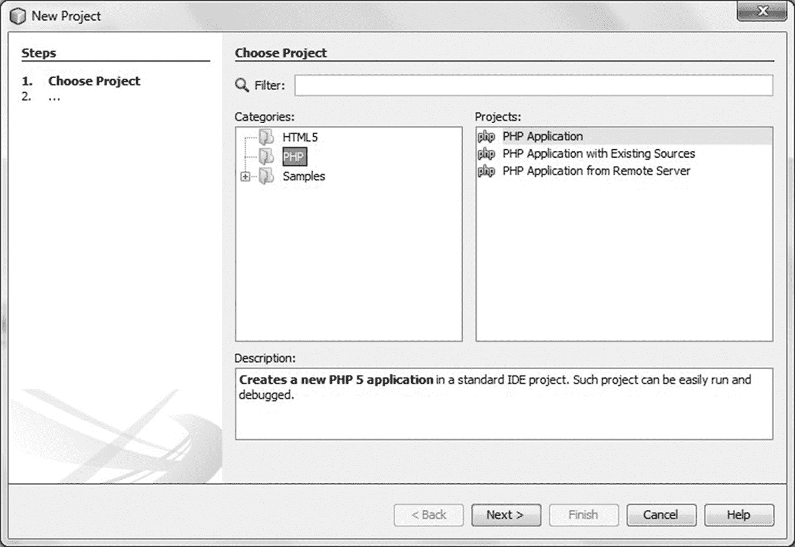

图 6.1. 初始化新项目。

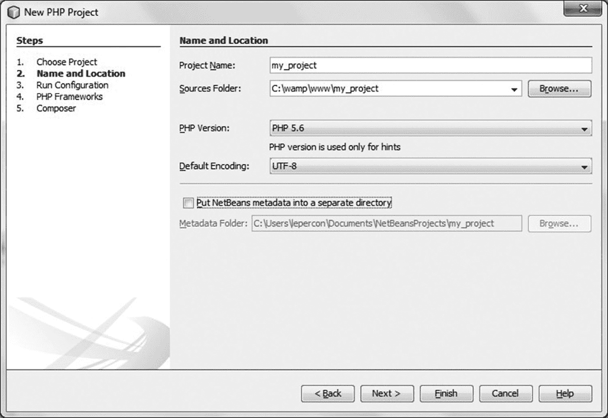

图 6.2. 新项目设置。

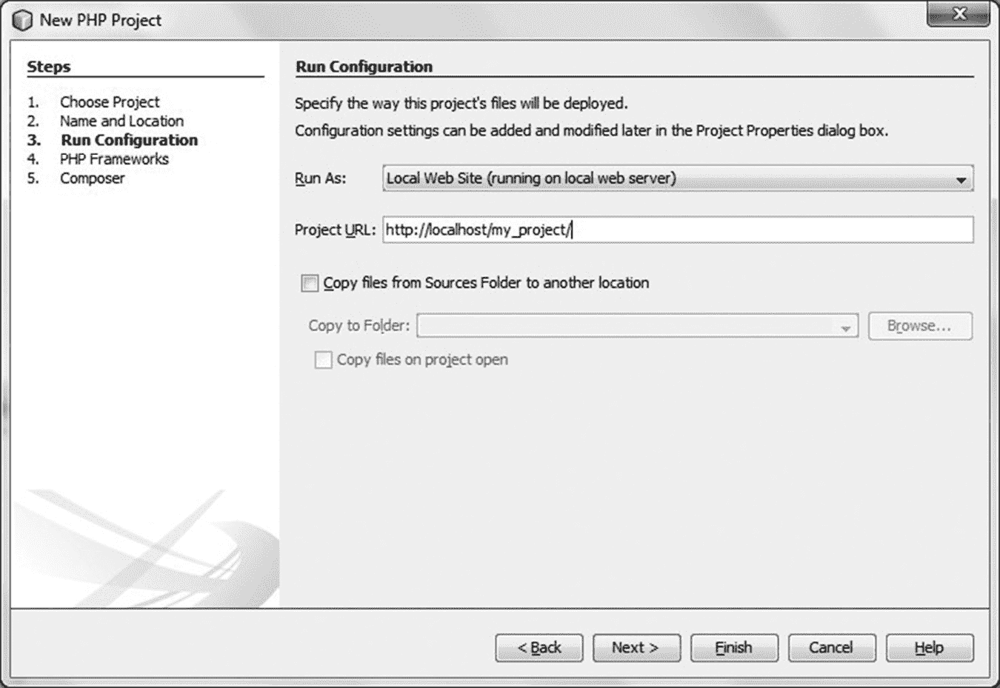

图 6.3. 新项目运行配置。

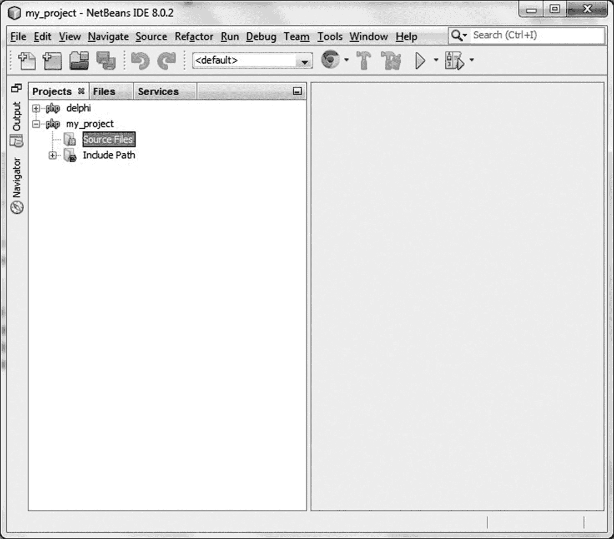

图 6.4. NetBeans 完成设置。

为了测试 NetBeans 和 WampServer 是否协同工作，在 `my_project` 中创建一个名为 `index.php` 的新文件。

- 选择 `File` > `New File`（文件 > 新文件）。
- 在 `File Types`（文件类型）下选择 `PHP File`，然后点击 `Next`。
- 使用 `index` 作为文件名。NetBeans 将自动添加 `.php` 扩展名。
- 选择 `Finish`（完成）。

如果 NetBeans 和 WampServer 配置正确，访问 `http://localhost/my_project` 应该得到一个没有任何错误的空白页面，如图 6.5 所示。

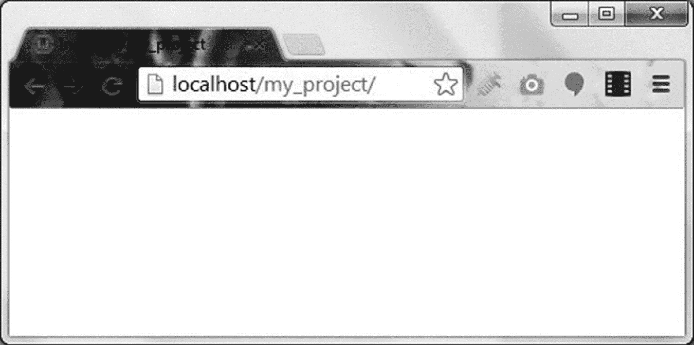

图 6.5. 配置界面。

与传统的编程语言不同，PHP 的预览速度与开发环境保存文件的速度一样。换句话说，PHP 不需要可以在服务器接受文件之前编译脚本。缺点是，每当请求脚本时，与请求页面相关的文件都必须拉入内存并进行“实时”编译。这导致了一个主要的考虑因素：需要大量内存密集型资源的项目使用 Java 等编译型语言可能会运行得更快。不适合作为 PHP 候选的应用程序是那些索引大量文档的程序。“大”无法准确指定，因为它取决于实际生产环境和文档的大小；然而，考虑到库作为数据聚合器的角色，这一考虑是非常重要的。更复杂的是，PECL 中存在缓存扩展，可以减少服务器重新编译脚本的频率。

### 谈论 PHP

如果将 PHP 视为一种语言，可以将其视为类似于学习一种外语。任何语言的基础构建块都是名词和动词。如果 PHP 是一门书面语言，变量就是名词。变量存储了关于谁、什么、何时、何地和为什么的信息。函数、语句和运算符是 PHP 的动词，而运算符也可以充当形容词的角色。这种比较不应理解得太字面，但它可能有意想不到的帮助。此外，类似于书面语言，PHP 语法同样是任意的，只是词序在说话者（代码）和听话者（WampServer）之间已协商好，以避免混淆。示例见表 6.1。

表 6.1. PHP 与英语的对比

| 英语 | PHP |
| :--- | :--- |
| John 十岁。 | `$john = 10;` |
| Mary 比 John 大两岁。 | `$mary = 2 + $john;` |
| 用你的脚关门。 | `close ("door", "foot");` |
| 你对不起。 | `echo "You're sorry";` |
| 你对 Mary 有什么了解？ | `$raw_results = $mysql_connection->query("SELECT age FROM people WHERE name = 'Mary'");` |

- 每条语句以分号（`;`）结束。
- 字符串应该封装在单引号（`'`）或双引号（`"`）中，例如。
- 双斜杠（`//`）之后的字符被 PHP 解析器忽略，可以作为行内注释：`$a_complicated_variable; //注释`。
- 注释也可以通过将其放在 `/*` 和 `*/` 之间创建：

```
/* 这种风格的注释

可以跨行并包含任何内容 */
```


函数和语句可以执行大量的动作。函数的语法通常需要它作用的对象，这位于括号中。例如，`sort($vegetables)` 将对蔬菜数组进行排序，按字母顺序。运算符是简单的动作动词。有一些运算符与其算术对应相同：

- `+` 加、组合或连接
- `-` 减
- `*` 乘
- `/` 除
- `%` 取模或取余数。`7%3` 结果为 `1`，因为 `3` 除 `7` 两次余 `1`。
- `.`（点）连接字符串。`echo $x . "pesos";` 将输出类似 30pesos。
- `=` 赋值。`$mary = 12` 将数字 12 赋值给变量 `$mary`。
- `==` 比较运算符。`3 == 1+2` 返回 `true`。这种比较被认为是“宽松”的，因为 PHP 会检查值是否相等，所以 `"3" == 3` 返回 `true`。
- `===` 严格比较运算符。`3 === 1+2` 返回 `true`。这种比较被认为是“严格”的，因为 PHP 会检查值是否相同，所以 `"3" === 3` 返回 `false`，因为 `"3"` 是字符串而 3 是数字。如果开发者使用宽松比较而不是严格比较，NetBeans 将警告他们，因为在大多数情况下，严格比较更稳定且运行更快。与宽松比较相比，倾向严格比较也是最佳实践，因为它减少了某些安全问题的可能性。PHP 缺乏严格的数据类型，如果开发者丢失对使用的变量类型的跟踪，可能会难以预测运算符。
- `>`, `<`, `>=`, `<=` 分别大于、小于、大于等于、小于等于。

### 运算符

- `! Not !=` 不等于（松散比较）。`!==` 严格不等于。例如，`$josh !== “human”` 等同于 `!($josh === “human”)`。

这里还有特殊情况和额外的运算符，包括此处未包含的位运算符。有关所有运算符的权威列表和描述，请访问[`php.net/manual/en/language.operators.php`](http://php.net/manual/en/language.operators.php)。PHP 拥有与 C 语言相似的控制语句结构（见表 6.2）。

### 表 6.2 常见 PHP 控制语句

| 语句 | 描述 | 示例 |
| :--- | :--- | :--- |
| `if` | 经典的编程“分支”结构。它通常通过比较两个变量形成。 | `if($mary > $frank) { echo "Mary is old";}}` |
| `else` | 用在 `if` 语句之后，为开发者提供一种方法，定义当 `if` 语句为假时应该执行的代码。 | `if($mary > $frank) { echo "Mary is old";} else { echo "Frank is as old or older";}}` |
| `while` | 一种基础循环，重复执行直到某个条件为假。 | `$x = 0;while($x < 5) { echo $x . ", "; $x = $x + 1;}` 这将输出 0, 1, 2, 3, 4, |
| `for` | 编写 `while` 循环的快捷方法，旨在运行 `$x` 次。 | `for($x =0; $x < 5; $x = $x + 1) {echo $x . ", ";}` 这将输出 0, 1, 2, 3, 4, . 与上一个示例相同，但少了两行。 |
| `for each` | 编写 `for` 循环的快捷方法，旨在处理数组或对象中的每个元素。 | `$fruits = array("A", "B", "C");foreach($fruits as $item) {echo $item " ";}` 这将输出 A B C |

### PHP 5 OOP

PHP 的面向对象编程（OOP）风格允许开发者利用高级编程技术，包括设计模式。其他编程语言引领技术世界进入了面向对象时代，导致 PHP 在这一领域起步稍晚。正如其名称所示的那样，面向对象编程关注作为变量的对象。对象可以执行 PHP 代码并存储其他变量。

在编程语境下，有很多比喻可以帮助理解对象。如果对象并不是显而易见的，请不要气馁，因为从定义上来说它们是抽象的。对象基于易于复用的代码部分。用我们的比喻来来说，鱼先生（Mr. Fish）是鱼群的一部分，鱼群中的所有成员除了年龄和在海中的物理位置外，都是相同的。每条鱼都根据其 `DNA` 知道如何游泳、进食和吐泡泡。如果我们能肉眼看到每条鱼，就能判断它是在游泳、进食还是吐泡泡。如果我们改变了鱼先生游泳的方式，鱼群中所有的鱼都会根据这些新的 DNA 变化而改变。通过对这个比喻进行几个单词替换，我们就可以描述 PHP 中的对象。鱼是对象，`DNA` 是代码，鱼群是类（表 6.3）。

### 表 6.3 英语到 PHP 语法

| 英语 | PHP |
| :--- | :--- |
| 鱼先生是魭群的一部分。他四岁，在水下十英尺处。 | `$mrFish = new Mackerel(4);$mrFish->position = -10;` |
| 鱼先生游向水面。 | `$mrFish->swim(0);` |
| 如果鱼先生正在吐泡泡，他应该吃饭。 | `if($mrFish->is_blowing_bubbles) { $mrFish->eat();}` |

开发者将属性（properties）和方法（methods）称为对象的描述和对象可以执行的操作。`Position` 和 `age` 是鱼先生的属性。`Swim`、`eat` 和吐泡泡是鱼先生的方法。

自习室预订系统是图书馆面向对象编程的一个良好示例。房间需要定义方法来预订房间、查看房间何时可用以及提供房间的路线。每个房间都需要定义名称、位置和房间号的属性。预订本身也可以是对象。预订的属性包括房间、日期、时间和读者；方法包括创建、取消、批准、移动房间、更改时间等。总之，一个预订系统可以包含预订、房间、读者和建筑的类。

使用 PHP 进行面向对象编程还提供了急需的代码和文件组织。在应用程序中，为每个类创建一个新的 PHP 文件是最佳实践。对于房间预订系统，每个类都是一个以其包含的类命名的独立文件。预订系统将结构化类似于以下的文件：

- [`index.php`](http://index.php)
- `[folder]` 共享
  - [`shared.configuration.php`](http://shared.configuration.php)
  - [`shared.database.php`](http://shared.database.php)
- `[folder]` 预订
  - [`reservations.buildings.php`](http://reservations.buildings.php)
  - [`reservations.patrons.php`](http://reservations.patrons.php)
  - [`reservations.reservations.php`](http://reservations.reservations.php)
  - [`reservations.rooms.php`](http://reservations.rooms.php)

## 使用设计模式在库中维护复杂的程序

设计模式有详尽的文档，是任何面向对象语言开发者的必修课。这些模式解决了 PHP 中常见的复杂问题。并不是说没有设计模式或没有对象就无法解决复杂问题。特别是图书馆，需要意识到它们的程序将如何适应未来需求，或者可能如何与其他机构共享。毫无疑问，有才华的程序员可以发明解决设计模式可以解决的问题的方法；但这会让后续或团队程序员的代码变得难以理解。此外，设计模式在开源项目中日益增长的趋势表明，随着越来越多的图书馆软件转向社区开发，开发者需要更稳固地掌握设计模式。虽然设计模式不在介绍范围内，但应用程序设计为解决常见的开发挑战提供了一个有趣的介绍。关于“软件设计模式”的维基百科文章是一个极佳的概述（[`en.wikipedia.org/wiki/Software_design_pattern`](https://en.wikipedia.org/wiki/Software_design_pattern)）。

## 示例

此示例将处理将用户输入发送到数据库的表单提交。常见任务充满了安全问题。

### 配置

`C:\Wamp\www\my_project\configuration.php`

```php
<?php

$db_host = "localhost";

$db_type = "mysql";

$db_user = "me";

$db_pass = "my_password";

$db_database = "my_data";

?>
```

### 索引页

索引文件向用户展示一个表单。尽管该文件使用了 `.php` 扩展，但文件中并没有声明 PHP 代码。

`C:\Wamp\www\my_project\index.php`

```html
<!DOCTYPE html>

<html>

<head>

    <meta charset="UTF-8">

    <title>A sample form</title>

</head>

<body>

    <form action="sumbit.php" method="POST">

        <label for="user_name">Your name</label>

        <input type="text" id="user_name" name="user_name">

        <label for="user_number">Your number</label>

        <input type="text" id="user_number" name="user_number">

        <label for="user_message">Your message</label>

        <input type="text" id="user_msg" name="user_msg" >

        <button type="submit">Submit</button>

    </form>

</body>

</html>
```

### 提交逻辑

该文件接收来自提交表单的数据，然后将这些数据发送到数据库进行存储。

`C:\Wamp\www\my_project\submit.php`

```php
<!DOCTYPE html>

<html>

<head>

    <meta charset="UTF-8">

    <title>Submission page</title>

</head>

<body>

<?php

    require_once('configuration.php');

    $connection = new PDO( $db_type . ":host=" . $db_host . ";dbname=" . $db_database,

        $db_user,

        $db_pass);

    /*
    传统上，通过 $_POST['var_name'] 访问输入，但 filter_input 允许更多的过滤以减少注入访问。user_name, user_number, user_msg 是上一个页面输入的值。
    */

    $str_user_name = filter_input(INPUT_POST, 'user_name');

    $str_user_number = filter_input(INPUT_POST, 'user_number');

    $str_user_msg = filter_input(INPUT_POST, 'user_msg');

    //这将会测试浏览器是否发送了数据

    if($str_user_name !== null) {

        //quote 方法为数据库输入对字符串进行消毒处理

        $connection->exec("INSERT INTO user_messages SET user_name=".$connection->quote($str_user_name).",

            user_number=".$connection->quote($str_user_number).",

            user_msg=".$connection->quote($str_user_msg).");

        echo "Thank you for your message";

    } else {

        echo "There was an error.";

    }

?>

</body>

</html>
```


上面的示例演示了 PHP 如何运行。在现实中，一个提交页会包含 CSS、图像以及用于库品牌展示的额外 HTML。如果这个示例演变成一个包含更多素材的更完整的网站，PHP 行数与 HTML 行数之间的比例可能会减少其表面的影响。考虑到 PHP 编写和阅读的便利性，PHP 的重要性可能是误导性的。可以关注围绕 PHP、Joomla 和 MediaWiki 构建的会议来寻找持不同意见的群体。由于 PHP 易于集成到网站中，它可能会被忽视一种重要的语言。

## 总结

PHP 是一种广泛使用的开源脚本语言。PHP 常用于生成动态页面内容，兼容大多数服务器和平台。总的来说，PHP 易于学习，有大量的支持，并用于许多任务。

## 参考文献

- `php.net`. 2015a. “PHP Manual.” `php.net/manual/en/index.php`.
- —— 2015b. “Vendor Specific Extensions.” `php.net/manual/en/refs.database.php`.

## 推荐资源

- **Drupal**：Drupal 是一个强大的开源内容管理系统，能够管理从简单的博客到整个大学的网站呈现的内容。`https://www.drupal.org/`。
- **Laravel Framework**：Laravel 是一个健壮的框架，能够快速交付机构级的 Web 应用程序。这不是一个入门级框架；然而，它为复杂的应用场景提供了预构建的解决方案。`https://laravel.com/`。
- **PHP Extension Community Library**：`https://pecl.php.net/`。
- **PHP-FIG**：一组自愿的最佳实践，关注 PHP 程序的互操作性。`http://www.php-fig.org/`。
- **php.net**：`php.net` 是 PHP 的权威，提供完全可搜索的免费文档。`http://www.php.net`。
- **WordPress**：WordPress 是一个开源内容管理系统，最初围绕博客构建，但已发展到支持各种其他网站结构。`https://wordpress.org/`。

## 第七：SQL

Emily R. Mitchell 和 Lauren Magnuson

### 历史与发展

结构化查询语言（`SQL`）是一种用于与存储应用程序数据交互的基本编程语言，这些数据是即使在你关闭程序或重启计算机时一直存在的持久性数据。它主要是一种声明性语言，这与用于编写应用程序的过程性语言（如 `PHP` 或 `Ruby`）区分开来。`SQL` 的基本语法用于创建、查询、更新和删除存储在数据库中的数据。`SQL` 用于各种图书馆背景，理解它的工作原理可以让图书馆员更好地理解图书馆数据存储、检索、分析的方式，并可能将其扩展到新的应用程序和服务中。要理解为什么 `SQL` 如此重要，你需要了解 `SQL` 出现之前的生活是什么样的。在 `SQL` 之前，如果你想让程序使用持久数据，你必须告诉程序具体如何获取这些信息。

如果你能想象在一个没有索书号的图书馆里工作，并试图为需要找书的非常胆小且按字面意思的读者提供逐步指示，那么你的思路是正确的。你必须告诉该读者转身，走上两层楼梯，右转，穿过门，走到右侧的第三架书架，并选择从顶部数起第二层的第四本书。如果图书馆购买了更多排在书架上该书之前的书，你必须知道这一点并更改你的指示，这样下一次有人要求这本书时，你可以让他们去拿第六本书而不是第四本。

上面的例子说明了在 `SQL` 时代之前处理持久数据的一个情况。1970 年，E. F. Codd 发表了一篇论文，第一行写道：“未来大型数据库的用户必须保护他们不必知道数据在机器中是如何组织的（内部表示）”（Codd 1970, 377）。

Codd 的论文非常有理论性，并没有实际上创造出一种能够实现他所描述功能的编程语言。他拥有开创性的想法，但许多人怀疑这些想法是否能够可行，更不用说能够高效地运行了（Anthes 2010）。过了几年之后，Codd 的雇主 IBM 才重新组织了其数据库研究团队，并安排他们投入开发 `System R`——这是一个基于 Codd 想法的新型数据库系统（Biancuzzi and Warden 2009）。在那之后又几年，Patricia Selinger 发表了一篇论文，展示了使用 Codd 关系模型的系统如何达到足够高的效率，足以与竞争对手竞争（Anthes 2010）。

`System R` 是一个永远改变数据库的项目。Selinger 是 `System R` 团队的成员之一，另外两位是 Donald Chamberlin 和 Ray Boyce。Chamberlin 和 Boyce 被分配开发查询语言，以将 Codd 的想法变为现实。这两位研究人员对他们的新语言有很多目标，包括它应该具备以下功能：

- 使用易于理解的英语关键词；
- 允许用户创建数据库；控制谁有访问权限；并允许用户添加、删减和查询信息；
- 能够独立运行，但也能与其他编程语言良好协作（Biancuzzi and Warden 2009）。

Chamberlin 和 Boyce 将他们的语言命名为 `SQL` 并发表了关于它的论文，向世界分享了这种语言。这使得其他小组能够向前推进，在 IBM 实现 `SQL` 的同时进行实现。事实上，市场上首个基于 `SQL` 的商业产品并非来自 IBM——而是来自 Relational Software Inc. 的产品 `Oracle`，它后来变成了 Oracle 公司。`Oracle` 版本二（第一个面向公众的版本）于 1979 年推出（Preger 2012）。如今 `Oracle` 是数据库领域的主要参与者。

由于有许多小组都在基于 `SQL` 创建自己的系统，`SQL` 在 1986 年成为了创建和管理关系数据库的国际标准。多年来，这些标准得到了更新和改进，增加了新功能并解决了许多问题（Preger 2012）。然而，由于每个实现 `SQL` 的小组方式各不相同，超出基础标准的合规性一直是一个存在的问题（Sheldon and Moes 2005）。

因此，如今数据库开发人员可以使用许多不同的 `SQL` 方言。在图书馆世界，最常用的两种 `SQL` 类型是 `MySQL` 和 `PostgreSQL`。就像人类语言的方言一样，这些方言足够相似，使得开发者可以能够毫不费力地理解不熟悉的方言中的大部分内容。然而，要在特定方言中达到真正的精通需要一些努力。这意味着所有的 `SQL` 数据库都将以表格的形式存储信息，表中的每行代表一个独立的条目，但用于向表中添加信息、从表中提取信息以及其他过程的准确措辞在不同方言之间会有不同。本章中的示例将以 `MySQL` 为例。

值得注意的是，近年来数据库系统领域取得了进一步进展。各种类型的 `NoSQL`（或“不仅是 SQL”）在扩展规模以处理大数据集方面正逐渐增长增长势头（Vaish 2013）。`NoSQL` 世界中目前的一些知名品牌包括 `MongoDB`、`CouchDB` 和 `Hadoop` 等。

这并不是说 `SQL` 数据库不值得花时间去学习。图书馆在 `SQL` 数据库投入了大量精力。我们的大多数系统都运行在上面，任何想在图书馆世界进行任何编程的人都可能迟早会遇到某种形式的 `SQL`。

## 环境与设置

`SQL` 语言是一种在各种关系型数据库管理系统（或 `RDBMSs`）中广泛实现的标准。为了使用 `SQL`，你需要访问一个 `RDBMS`。对于那些想要尝试使用 `SQL` 查询但并不一定想在服务器或其他计算机上安装本地 `RDBMS` 环境的人来说，华盛顿大学开发了一个名为 `SQLShare` 的创新项目，它允许用户通过 `SQLShare` 接口自由地上传数据并运行 `SQL` 查询。本章中使用的几个示例可以利用 `SQLShare` 平台运行。

不过，如果你想真正深入学习并应用 `SQL`，你可能想要安装本地的 `RDBMS` 环境。这些环境的示例包括 `MySQL`、`SQLite` 或 `PostgreSQL`。这三者都是流行的开源 `RDBMSs`，可以免费下载并安装在服务器或其他计算机上。

`MySQL` 是常用服务器设置（或技术栈）`LAMP`（Linux Apache MySQL PHP）中不可或缺的一部分。`LAMP` 服务器利用 Linux 操作系统、Apache Web 服务器通过浏览器浏览器内容、`MySQL` `RDBMS` 以及用于编写应用的 `PHP`。因此，如果你有一台 `LAMP` 服务器，它已经安装了 `MySQL` 并已准备就绪。

可以安装在 OS X 或 Windows 计算机上的类似软件包包括 `MAMP`（用于 Mac OS X）或 `WAMP/XAMPP`（用于 Windows）。此类技术栈通常用于在你自己的计算机上开发软件，而不是服务器上。如果你安装了 `MAMP` 或 `WAMP`，你可以用它开启托管在你自己机器上的 Web 服务器，这允许你在自己的计算机（称为“localhost”）上“托管”网页和 Web 应用程序。

当你使用 `MySQL` 时，最好记住 `MySQL` 本身是为命令行交互设计的，没有原生的图形用户界面（GUI）。不过，存在工具可以防止 `MySQL` 用户使用命令行。例如，`phpMyAdmin` 是一个随 `LAMP` 栈的常用的 `MySQL` 交互界面。可以使用 `phpMyAdmin` 创建和删除（drop）`MySQL` 数据库和表。

尽管如此，在处理自定义应用程序时，了解 `MySQL` 命令行是有用的。关于与 `MySQL` 命令行交互的详尽文档可以在此处找到：[`dev.mysql.com/doc/refman/5.5/en/mysql.html`](http://dev.mysql.com/doc/refman/5.5/en/mysql.html)。本章的“示例”部分提供了使用 `MySQL` 的命令行操作示例。

### 用途

`SQL` 环境存在于图书馆各种应用程序中，包括集成图书馆系统（ILS）和资源共享系统、网站内容管理系统（CMS）、数字资产管理系统（DAMS）等。

### 集成图书馆和发现系统

`SQL` 存在多个集成图书馆和发现系统中，包括：

- `Koha` 开源 `ILS`（`MySQL`）
- `Evergreen` 开源 `ILS`（`PostgreSQL`）
- `Sierra` Innovative Interfaces Inc. `ILS`（`PostgreSQL`）
- `Intota` ProQuest `ILS`（Microsoft SQL）
- `VuFind` 开源发现界面（`MySQL`）

在 `ILS` 和发现应用中，理解 `SQL` 语法对于从这些系统中自定义数据收集变得越来越有用。`SQL` 语法知识使图书馆能够收集没有作为“预设”报告直接构建在软件中的数据。

例如，存储在 Koha 开源集成管理系统（ILS）中的数据可以直接被查询，Koha 用户已经收集了大量关于编写自定义查询的文档（[`wiki.koha-community.org/wiki/SQL_Reports_Library`](http://wiki.koha-community.org/wiki/SQL_Reports_Library)）。报告通常涉及从数据库中提取数据，或者用 SQL 用户的话说，即选择（selecting）这些数据。Koha 中的查询与简单的 SQL 请求有所不同，但随着你对 SQL 的了解，你会很快熟悉其基本语法。下面的 Koha 示例从 Koha 的 `biblioitems` 表中检索特定的 MARC 标签（存储为 `MARCXML`）（[`wiki.koha-community.org/wiki/SQL_Reports_Library`](http://wiki.koha-community.org/wiki/SQL_Reports_Library)#Query_MARC）：

```sql
SELECT
    ExtractValue((
        SELECT marcxml
        FROM biblioitems
        WHERE biblionumber = 14
    ), '//datafield[@tag="952"]/subfield[@code>="a"]') AS ITEM;
```


Innovative Interfaces 的 Sierra ILS 允许图书馆创建自定义应用程序，直接查询图书馆的 PostgreSQL 数据库，以创建新的服务或报告机制。例如，参见此支持 Sierra PostgreSQL 数据库中记录模型的 Ruby on Rails 应用程序：[`github.com/uclibs/active_sierra`](https://github.com/uclibs/active_sierra)。Sierra 客户的文档（需要身份验证）可以在此处查阅：[`techdocs.iii.com/sierradna/app`](http://techdocs.iii.com/sierradna/app)。掌握 SQL 后，图书馆可以例如“编写一个脚本或应用程序，将采购事务数据提取出来并加载到外部会计系统中”([`blog.sierra.iii.com/feature`](http://blog.sierra.iii.com/feature)-spotlight-sierradna-application)。

## 内容管理与数字资产管理系统

许多图书馆使用的最流行的内容管理系统（Connell 2013）都使用了 `MySQL`，包括：

- `WordPress`
- `Drupal`（也可以使用 `PostgreSQL` 或 `SQLite`）
- `LibGuides`
- 基于 Fedora Commons 的数字资产管理系统，包括 `DSpace`、`Hydra` 和 `Islandora`（后者也使用了 `Drupal`）。这些仓库可以使用多种关系型数据库（RDBMS），包括 `MySQL`、`PostgreSQL`、`SQLite`、`Oracle` 和 `MS SQL server`。访问 [`wiki.duraspace.org/display/FEDORA37/Installation`](https://wiki.duraspace.org/display/FEDORA37/Installation)+and+Configuration#InstallationandConfiguration-PrepareDatabase。

对于图书馆 CMS 管理员来说，SQL 语法和架构（schemas）对于排除应用程序中的故障、备份和恢复 CMS 数据库数据，以及编写额外的自定义功能（例如在现有 CMS 数据库中存储和访问额外数据的 `Drupal` 模块或 `WordPress` 插件）至关重要。图书馆中心的 Drupal 模块列表请参见 [`groups.drupal.org/libraries/modules`](https://groups.drupal.org/libraries/modules)。

其他图书馆应用还包括：

- Guide on the Side，这是一个由亚利桑那大学开发的教程应用程序，它利用 `MySQL` 存储教程数据、元数据和用户信息（[`code.library.arizona.edu/gots`](http://code.library.arizona.edu/gots)/）。
- Illiad、Odyssey 和 Ares（OCLC/Atlas Systems）资源共享系统均使用 `Microsoft SQL (MS SQL)` 服务器。
- SFX（ExLibris）链接解析软件利用 `MySQL`。

### 优缺点

SQL 的存在是为了处理持久化数据，但当然也有其他替代方案。例如，如果你只需要一个较短的名字和地址列表，那么文字处理文档中的字母顺序列表（平面文件）就足够了。在这种情况下，没有必要费力建立 SQL 数据库。然而，一旦你的需求超出此范围，SQL 就会显现威力。

想象你图书馆的 ILS 是由平面文件组成的。这对于基本的借阅任务意味着什么？你可能有一份列出所有有效读者的文档，按证号排序。当有人来到借还台并出示卡时，你打开该文档并扫描，直到在文档中找到对应的条目。然后你输入那个人想要借的书的所有信息，包括还书日期。

这可能很慢，但真的有那么糟吗？对于这种非常基础的任务，它看起来可能不坏，但现实生活很快就会变得复杂。例如，如果有几个人同时在借还台工作怎么办？普通的文字处理文档无法同时处理来自不同计算机的几名工作人员的输入。

此外，考虑一下你想知道现在有多少视频逾期时会发生什么。你可以手动检查文档并统计逾期视频，但那花费的时间远超任何人的空闲时间。你可以尝试写一个程序来判断这一点，但编写一个能处理此类查询的程序将是一项复杂的工程。

与使用 SQL 解决相同问题相比，使用 SQL 的初始设置确实会比直接打开文档更复杂。你首先需要安装 SQL，然后确定数据架构（data schema），这是一致表示你想要捕获的数据的方法。在这种情况下，你的架构应该包含一个关于读者的表（姓名、证号和地址）。你还需要一个材料的表（包括物品类型、标题、作者等信息）。你还需要第三张表，显示什么被借走了、谁借的、以及什么时候还。你可以画出你的架构图，如图 7.1 所示。


每个框中的字段在 SQL 中实现时将成为表中的列。每个读者的信息将是读者表中的行；每本书或视频将是材料表中的行；每个被借出的物品将在借出表中获得一行，并在归还时移除。

然而，一旦你完成了 SQL 数据库的设置，你的速度将比使用文字处理文件快得多。想按证号查找某人？查询数据库并选择 `cardnumber` 匹配的条目。想运行一个告诉你哪些视频逾期的报告？连接 `materials` 和 `checkedout` 表，并选择所有 `duedate` 已过的视频。

简而言之，平面文件是：

- 容易设置和理解
- 难以保持更新和准确
- 几乎无法运行报告

SQL 是：

- 设置较复杂
- 易于更新和准确
- 易于运行报告

NoSQL 数据库共享 SQL 的基本优点。然而，与 SQL 相比，它们的优缺点更为微妙，部分是因为有许多类型的 NoSQL 数据库。不同类型的 NoSQL 都有自己的优劣。要说明在什么情况下你可能会考虑研究某种 NoSQL 是更容易的。如果出现以下情况，你可能对 NoSQL 感兴趣：

- 你将处理海量信息（许多 TB），并分布在许多不同的服务器/计算机上；你预计需要将你的数据库与另一个数据库合并，后者的设置与你的不同。

相反，如果出现以下情况，你可能仍然希望坚持使用 SQL：

- 你需要数据库中的每个事务在移动下一个事务之前都必须成功。
- 你需要表示不同类型/份数据之间的关系。
- 你希望尽可能多的开发者在你离开后仍能理解你的代码。

## 示例

### 在 Drupal 内容管理系统中使用 MySQL

此示例演示了如何创建一个 `MySQL` 数据库，以便在安装 Drupal 内容管理系统时使用。Drupal 是一种广泛使用的 CMS，被图书馆网站使用，也被用作 Islandora 数字资产管理系统的前端用户界面。本节中使用的命令可以用于各种需要 `MySQL` 的应用程序，用于创建新用户、创建新数据库以及设置用户权限。

此示例假设运行了如适用于 Mac OS X 的 MAMP 本地服务器，并使用 Mac 内置的终端（Terminal）应用程序（位于“实用工具 > 终端”下）。第一步需要使用终端进入 `MySQL` 的交互模式，这允许使用 `MySQL` 的命令行语法来执行 `MySQL` 操作。要进入交互模式，首先确保你的本地 `MySQL` 服务器正在运行（点击 MAMP 应用程序菜单中的“Start Servers”）。然后打开终端并输入以下内容：

```bash
/Applications/MAMP/Library/bin/mysql --host=localhost -uroot –proot
```

此命令的各个部分包括以下内容：

- `/Applications/MAMP/Library/bin/mysql`——进入 `MySQL` 软件应用程序的位置
- `--host=localhost`——将 `MySQL` 数据库的主机定义为本地机器或 localhost
- `-uroot -proot`——这些元素（`-u` 和 `-p`）分别引用用户名和密码。在这种情况下，用户名和密码相同（`root`）。注意，在本地开发中使用这种容易猜到的用户名和密码组合是可以的，但不能用于生产环境应用程序。在生产环境中使用 `MySQL` 时，建议将 root `MySQL` 密码改为难以猜测的内容。

终端进入 `MySQL` 交互模式，每行都将显示 `mysql>` 提示符，表示预期输入 `MySQL` 语句。在交互模式下，可以输入 `MySQL` 命令来创建用户和设置权限、创建和删除（drop）数据库等。例如，在 `MySQL` 交互模式下，以下命令创建一个名为 `mydatabase` 的数据库：

```sql
mysql> CREATE DATABASE mydatabase;
```

输入此命令后，`MySQL` 服务器将报告：

```text
Query OK, 1 row affected (0.01 sec)
```

每当你在 `MySQL` 交互模式下输入命令时，请确保每个语句都以分号（`;`）结束，否则命令行将认为后续输入是同一条记录的一部分。

Web 服务器利用“端口”为服务器应用程序提供不同的访问点。应用程序可以通过连接到服务器端口 `3306` 并传递身份凭据来访问 `MySQL` 数据。这些身份凭据通常存储在应用程序的配置设置中。例如，在安装 Drupal 等 CMS 时，安装过程的一个步骤是输入凭据以允许应用程序连接到 `MySQL` 数据库（图 7.2）。详细说明可以从 [`www.drupal.org/documentation/install/run`](https://www.drupal.org/documentation/install/run)-脚本找到。

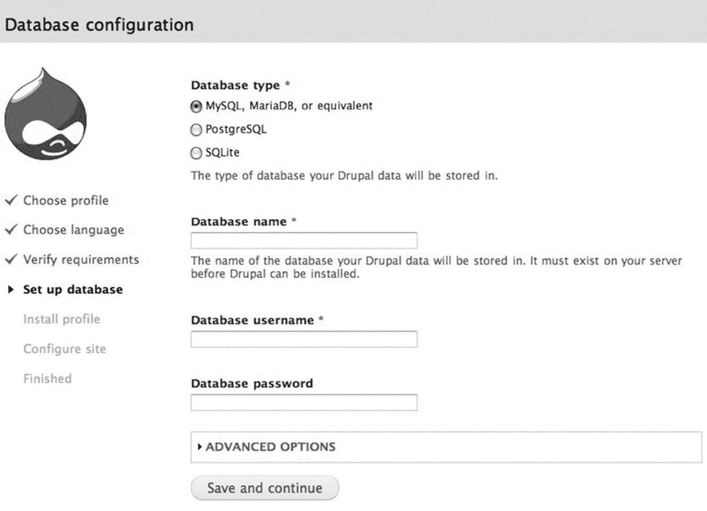

在这一步中，数据库名称是你运行 `CREATE DATABASE` 命令时指定的名称（在上面的示例中，数据库名为 `mydatabase`）。数据库名称、用户名和密码是区分大小写的。虽然在开发过程中，你可以使用访问 `MySQL` 命令行时相同的 root 凭据，但建议针对应用程序需要访问的数据库创建具有特定权限的唯一用户名和密码。这样，如果一组数据库凭据被泄露或黑客，潜在的损害可能限于创建这些凭据的特定数据库和权限。如果凭据受到限制，例如，黑客无法轻易使用被破解的凭据删除或更改你 `MySQL` 安装中的所有数据库。数据库用户名和密码也可以在命令行中使用以下语法进行创建，其中 `myuser` 是用户名，`mypass` 是与该用户名关联的密码：

```sql
mysql> CREATE USER 'myuser'@'localhost' IDENTIFIED BY 'mypass';
```

为特定数据库创建数据库用户名和密码时，必须设置指示这些凭据有权执行的操作权限。权限根据应用程序的要求而异。例如，Drupal 需要一个具有以下权限的用户：

```sql
mysql> GRANT SELECT, INSERT, UPDATE, DELETE, CREATE, DROP, INDEX, ALTER, CREATE TEMPORARY TABLES ON mydatabase.* TO 'username'@'localhost' IDENTIFIED BY 'password';
```

这意味着为 Drupal 创建的用户需要：

- 从此数据库的表中选择数据
- 向这些表中插入新数据
- 更新（更改）已存在的数据
- 删除数据
- 创建新表
- 删除（删除）表
- 为表建立索引
- 更改表的列
- 创建临时表（这在你学习高级 SQL 时很有用）

如果你出于某些原因需要删除 `MySQL` 数据库或表，你可以使用 `DROP` 命令来实现。例如，如果你想完全删除所有 Drupal 数据并从头重新安装整个 CMS，将输入此命令：

```sql
mysql> DROP DATABASE <db_name>;
```

除非你的数据库已经备份，否则数据库一旦删除就无法撤销，因此请务必谨慎使用 `DROP` 命令，并确保这是你真正想要的操作。备份和导出 `MySQL` 数据库的一种简单方法是使用 `mysqldump` 方法，如位于 [`www.lampdev.org/tutorial/mysql/backup_restore/mysqldump_tutorial.html`](http://www.lampdev.org/tutorial/mysql/backup_restore/mysqldump_tutorial.html) 教程所示。

### 使用 SQLShare 进行 SQL 查询

此示例不需要使用 RDBMS；相反，你可以利用华盛顿大学的 `SQLShare` 环境来运行 SQL 查询并返回数据，而无需本地安装任何软件。

开始之前，请从 GitHub 下载以下文件（[`github.com/lpmagnuson/sqlshare`](http://github.com/lpmagnuson/sqlshare)）：

- `books.csv`
- `users.csv`
- `checkouts.csv`

在华盛顿大学的 `SQLShare` 网上创建一个账户，创建一个唯一账户或使用 Google 账户登录。将所有三个文件上传到 `SQLShare` 网站。

在以下示例中，将 `youraccount` 替换为你实际创建的账户标识符。通过帐户引用数据的结构是 `SQLShare` 模型特有的，在大多数 RDBMS 环境中并不适用。

#### 获取所有英语专业学生

此查询非常直观：`user` 表中哪些是英语专业的？为了只查看用户名和专业，我们可以使用此查询从 `users` 表中选择这两列：

```sql
SELECT [youraccount].[table_users.csv].username, [youraccount].[table_users.csv].major FROM [youraccount].[table_users.csv]
WHERE major = 'English'
```

输出如图 7.3 所示。

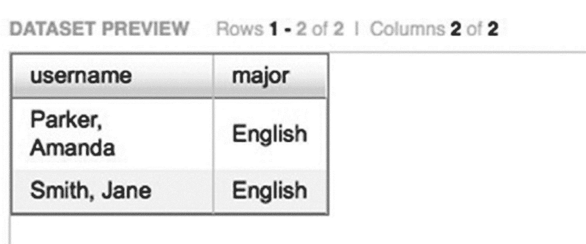

#### 按专业统计用户人数

SQL 最有用的功能之一是累加值并报告它们。`COUNT` 函数可以查看列的值并统计所有唯一值。注意，`COUNT` 函数需要一个相应的 `GROUP BY` 语句，以便 SQL 输出知道如何显示结果：

```sql
SELECT [youraccount].[table_users.csv].major, count([youraccount].[table_users.csv].major) as number
FROM [youraccount].[table_users.csv]
GROUP BY [youraccount].[table_users.csv].major
```

输出如图 7.4 所示。


#### 查找此集合中最流行的书籍

在此查询中，我们将再次使用 `COUNT`，但这次我们统计的是借阅次数。我们将按照标题对输出进行分组，并按降序排列书籍，这样流行的书籍就会出现在列表顶部。

为了显示书名（这在输出中比项目编号更具可读性），我们可以使用 `JOIN` 函数。这允许我们利用数据内部的关系。每本书在 `checkouts` 表中通过一个唯一标识符列出，该标识符在 `books` 表的对应记录中也能找到，使我们能够将两个表连接起来。只要两个表中都存在我们预期的匹配值，我们就可以创建一个语句，为 `checkouts.csv` 表中列出的每本书从 `books.csv` 中查找标题。恰好，`books.csv` 中的 `record_number` 与 `checkouts.csv` 中 `item_number` 列中的数值集是相同的，因此我们可以根据该维度进行 `JOIN`：

```sql
SELECT [youraccount].[table_books.csv].title, COUNT([youraccount].[table_checkouts.csv].item_number) as checkouts
FROM [youraccount].[table_books.csv] JOIN [youraccount].[table_checkouts.csv]
ON [youraccount].[table_books.csv].record_number = [youraccount].[table_checkouts.csv].item_number
GROUP BY [youraccount].[table_books.csv].title
ORDER BY checkouts DESC
```


输出请见图 7.5。

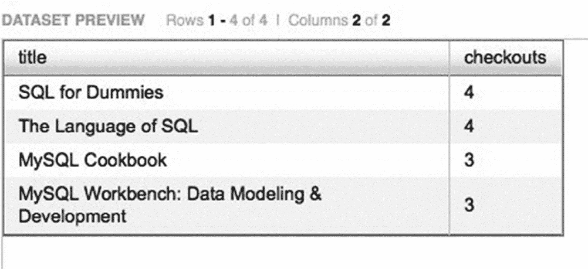

图 7.5. `JOIN` 函数的输出。

## 总结

SQL 是一种广泛应用于各种关系型数据库管理系统的标准。SQL 有许多不同的版本，包括 `MySQL`、`PostgreSQL` 和 `SQLite`。所有 SQL 版本的设计旨在允许与存储在数据库中的持久化数据进行交互。由于如此，SQL 通常与其他编程语言配合使用，这些语言通常有非常不同的优势。SQL 直观且易学习的语法使其在图书馆领域的业余和专业程序员中都广受欢迎。

## 参考文献

Anthes, G. 2010. “Happy Birthday, RDBMS!” Communications of the ACM 53:16–17.

Biancuzzi, F., and S. Warden. 2009. Masterminds of Programming. Sebastopol, CA: O’Reilly Media.

Chamberlin, D. D. 2012. “Early History of SQL.” IEEE Annals of the History of Computing 34 (4): 78–82.

Codd, E. F. 1970. “A Relational Model of Data for Large Shared Data Banks.” Communications of the ACM 13 (6): 377–87.

Connell, R. S. 2013. “Content Management Systems: Trends in Academic Libraries.” Information Technology & Libraries 32 (2): 42–55.

Howe, Bill, Garret Cole, Emad Souroush, Paraschos Koutris, Alicia Key, Nodira Khoussainova, and Leilani Battle. 2011. “Database-as-a-Service for Long-Tail Science.” In Proceedings of the 23rd International Conference on Scientific and Statistical Database Management (SSDBM ’11), ed. Judith Bayard Cushing, James French, and Shawn Bowers, 480–89. Berlin: Springer-Verlag.

Preger, R. 2012. “The Oracle Story, Part 1: 1977–1986.” IEEE Annals of the History of Computing 34 (4): 51–57.

Sheldon, Robert, and Geoff Moes. 2005. Beginning `MySQL`. Hoboken, NJ: John Wiley & Sons.

Vaish, Gaurav. 2013. Getting Started with NoSQL. Olton, UK: Packt.

## 推荐资源

Kriegel, Alex. 2011. Discovering SQL: A Hands-On Guide for Beginners. Indianapolis, IN: Wiley.

`MySQL 5.6 Reference Manual`. [`dev.mysql.com/doc/refman/5.6/en/index.html`](http://dev.mysql.com/doc/refman/5.6/en/index.html).

Oppel, Andrew, and Robert Sheldon. 2009. SQL: A Beginner’s Guide. New York: McGraw-Hill.

Shaw, Zed A. 2010. Learn SQL the Hard Way. [`sql.learncodethehardway.org/book`](http://sql.learncodethehardway.org/book)/.

Silberschatz, A., H. Korth, and S. Sudarshan. 2010. Database System Concepts. Boston: McGraw-Hill.

W3Schools PHP MySQL Database. [`www.w3schools.com/php/php_mysql_intro.asp`](http://www.w3schools.com/php/php_mysql_intro.asp)。

## 第八章

## C Tim Ribaric

### 历史与发展

`C` 是最持久的计算机编程语言之一。与其他在 20 世纪 70 年代创建的语言不同，`C` 仍被活跃地用于许多应用程序。对比这种寿命，例如用 `FORTRAN` 编写的代码。许多拥有遗留系统的机构也拥有遗留系统。

### C 的演变

`C` 是 `Ken Thompson` 和 `Dennis Ritchie` 工作成果，他们就职于 `AT&T 贝尔实验室`。在 1969 年至 1973 年期间，`Thompson` 和 `Ritchie` 致力于开发一种重新实现 `UNIX` 操作系统的语言，这项工作最初使用一种名为 `B` 的语言。结果是巨大的成功，因为它允许 `UNIX` 使用硬件无关的语言 `C` 来编写。

- `ANSI C`——于 1989 年正式诞生，是首次尝试创建一个更完整、更标准的 C 语言版本，以便开始用于新兴的微型计算机家用市场。在此之前，C 主要用于大型机。
- `C99`——首次于 1999 年定稿，其目标是引入一系列新功能，允许如内联函数和变长数组等特性。
- `C11`——该版本的工作始于 2007 年，但第一份官方规范于 2011 年发布。与 C99 的迭代类似，这个版本的 C 试图为语言添加更多特性。

引人注目的是，在四十之后，C 仍然被积极地扩展和改进。这证明了该语言的无处不在和实用性。那么 C 的后代又是呢？既然 C 是一种用于实现 UNIX 的通用语言，它的后代是什么？它们又是何时开始的？全面的回顾将耗费数卷书的内容，但这里是一些亮点：

- `C++`——C 的扩展，引入了一种名为面向对象编程的编程范式；其规范首次发布于 1983 年。
- `C#`——读音类似于音符：C-sharp。它可以被看作 C 和 C++ 的演进，由微软开发，用于在其专有的 `.NET` 平台上。它于 2000 年首次发布。
- `Objective-C`——C 语言的微扩展，Apple 广泛用于 OS X 和 iOS 操作系统，也最早出现在 1983 年。
- `Python`——Python 经常是对编程感兴趣者的首选语言，尤其是在过去的几年里。它是一种构建在 C 之上的语言，其主要目标是创建人类可读的代码，并用简短的代码片段封装非常复杂的操作。Python 首次于 1991 年引入。深入理解 C 让编码者能够真正欣赏 Python 程序所能的美感和复杂性。

### 用途

如上述，C 的最初用途是实现 `UNIX` 操作系统。随着时间的推移，C 证明了对于编写各种应用程序非常有用（Klemens 2014）。C 要求使用它的程序员有大量的理解能力。该语言没有提供一个完全结构化的环境，在需要时交互式地包含所有模块/库。然而，并非所有的 C 用法都是晦涩或特定于操作系统的。C 知识非常有用处的一个有趣领域是 `Arduino` 微控制器（Purdum 2006）。`Arduino` 是一块信用卡大小的微型电路板，它是近期创客空间趋势的关键组件之一。

图 8.1 显示了一块名为 `Yun` 的现代 `Arduino` 板。它的定义特征是内置了 `Wi-Fi`。回形针是为了展示比例。`Arduino` 是一种设备，让你能够通过连接在板上的各种不同组件制造与计算机接口的硬件设备（Purdum 2006）。将开关、按钮、`LCD` 显示器和红外发射器视为可能的组件。这些传感器插入一系列黑色插头中。你为 `Arduino` 编写代码多或是 C 的变体。

`OpenWrt` 是一种流行的家用路由器第三方操作系统，它是附带了用 C 编写的工具的 `UNIX` 版本（Kernighan and Ritchie 1978）。`OpenWrt` 是驱动 `LibraryBox` 的操作系统，`LibraryBox` 是一个独立的 `Wi-Fi` 供电文件共享哨站。

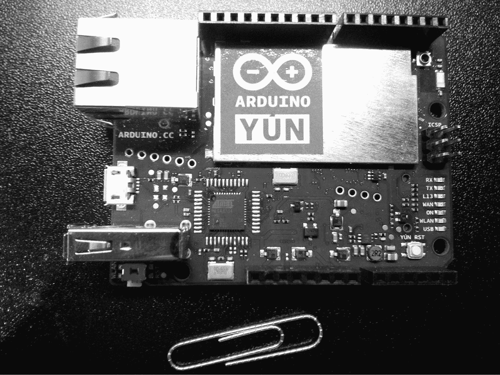

图 8.1. `Yun`，一块 `Arduino` 板。

### 优缺点

一种编程语言如果没有一些迷人的品质，是无法真正拥有四十年的历史的。从缺点来说，这些优点相当特殊。

### 优点

#### 快速且充分利用硬件

使用 C 的主要且明显的优势是它能非常好地利用其正在运行的计算机/机器。因此，你可以在运行 `UNIX` 或其变体（如 `Linux`）的嵌入式系统中找到 C 程序。你家中的路由器很可能在低功耗处理器上运行某个版本的 `Linux`。通过 `Wi-Fi` 天线发送无线电波可能是通过某种 C 代码实现的。`OpenWrt` 是一种流行的家用路由器第三方操作系统，它是附带了用 C 编写的工具的 `UNIX` 版本。

#### 广泛的支持和现有产品

由于 C 已经存在了很久，很有可能已经有一个你的程序可以使用的现成库。例如，如果你正在编写某些使用加密算法的软件，你可以利用一个名为 `cryptlib` 的库，该库用 C 编写，并可以执行你可能需要的所有复杂数学。事实上，许多开源应用都是编译后的 C 产品。例如，用于保护网络浏览器中 `HTTPS` 流量的软件包 `OpenSSL` 就是一个 C 程序。

#### C 无处不在

尽管你可能使用其他语言编写和创建程序，但该语言使用的底层编译器实际上可能是用 C 编写的。如前所述，Python 编程语言本身就是 C 的分支。通过一点努力，可以将 Python 程序编译为相应的 C 程序，这通常是为了让代码运行得更快。同样还有极其流行且无处不在的 `Web` 语言 `PHP`。用于解释该语言的底层软件名为 `Zend Engine` 的平台，它是用 C 编写的。

### 缺点

#### 集成到 Web 环境中

今天大多数初学编码的人对创建基于 Web 的服务感兴趣。因此，目前最流行的开发形式似乎是制作通过浏览器访问的应用。遗憾的是，C 并不擅长此。如果迫于，你可以利用通用网关接口（`CGI`）程序，Web 服务器可以渲染网页并将 C 程序的输出包含在最终的 `HTML` 中（Oliphant 1997）。虽然在 `CGI` 编程中使用 C 是可行的，但 `Perl` 通常是这种设置的首选语言。再加上考虑到 `CGI` Web 编程通常从不认为是 Web 开发者的首选（Dowling 2005）。

#### 基于 GUI 的应用程序

由于 C 诞生于 `UNIX` 命令行，它大多只能创建命令行程序。如果你想创建一个运行在 `GUI` 中的桌面应用程序，你需要花时间学习如何使用在界面中渲染窗口的外部库。这可能是类似于 `GTK+` 之类的东西。对比 `Visual Basic`，例如，它允许你交互式地绘制控件和表单并添加代码，过程是流畅且交互的。

## 环境与设置

搭建一个用于编写和编译 C 程序的环境对于每个操作系统来说略有不同。在 `Linux` 或 `Mac OS` 环境中，基础工具是开箱即用的，而在 `Windows` 环境中，则需要在计算机上安装一些额外的工具。这种差异源于这两类操作系统的血缘。`UNIX` 及其后代被称为 `POSIX` 兼容系统。该缩写代表“可移植操作系统接口”（Portable Operating System Interface），它是 IEEE 编写的一项标准，概述了操作系统必须具备的某些要素。这些前提条件大部分与 C 语言的实现细节以及特定的 `Linux` 实用程序。`Windows` 的演进路径与 `UNIX` 是独立且不同的，因此 `POSIX` 兼容性从未是该操作系统的驱动因素。

重要的的一点是，`POSIX` 标准的主要目标是确保系统之间的兼容性（Isaak 1990）。这与之前提到的 C 语言的原始目标是一致的，即作为一种可以通过编译 C 代码来构建 `UNIX` 的语言。符合 `POSIX` 标准的操作系统隐式地包含了编写 C 代码所需的所有工具。相反，`Windows` 并不是 `POSIX` 兼容操作系统，获取基础工具需要安装一个软件，让你的 `Windows` 计算机表现得更像基于 `UNIX` 的机器（Daintith and Wright 2008）。然而，在按照下面描述的方法配置计算机后，你可能不想开始编写企业级代码；本章严格来说是一个入门课程，将为你提供关于 C 语言是什么以及它与其他语言区别的初步体验。

### Linux 和 Mac OS

正如刚才提到的，工具是开箱即用的。我们的研究将使用两个工具。首先是 `GCC`，代表 GNU C 编译器（GNU C Compiler）。如果你打开 `Terminal` 窗口并输入 `gcc` 然后按回车，你可能会看到一些错误和如 `compilation terminated` 的消息，这实际上意味着编译已完成。太棒了，这很简单。其次，使用任何文本编辑器输入代码。我们将使用 `nano`。在 `Linux`（在此情况下为 `Ubuntu`）和 `Mac OS` 中，`nano` 都是预装的。要进行验证，打开 `Terminal` 并输入 `nano`。你将看到屏幕上画出一个原始的界面。按 `Ctrl + X` 退出。完成。现在将此与 `Windows` 的说明进行对比。

### Windows

你需要的 C 工具版本并未随 `Windows` 发行。然而，如果你安装了某个版本的微软 `Visual Studio`，它将带有所需的工具。但在我们的案例中，我们将采取一些不同的做法。我们将安装一个名为 `Cygwin` 的工具。`Cygwin` 本质上是一个帮助你在 `Windows` 中重现 `Linux` 环境的软件。`Cygwin` 的额外好处是它允许你运行其他有趣且非常有用的 `UNIX shell` 命令，例如 `more` 和 `echo`。稍后会详细介绍。

首先，从 `http://cygwin.com/install.html` 下载正确版本的 `Cygwin`。为了方便起见，先尝试 64 位版本，如果不起作用再尝试 32 位。一旦运行下载的文件，系统将提示你进行多次点击。你需要选择一个下载站点（图 8.2）；任何站点都可以。


图 8.2. 选择下载站点界面。

你也可以选择地理位置较的站点以加速下载。只需寻找与你的所在地匹配的域名即可。一旦安装了基础系统，将提示你安装你需要的包。这里有很多选项，但我们要做的只是展开 `Devel` 复选框并点击双向箭头，这样所有内容都会被安装。它看起来应该像图 8.3 所示。

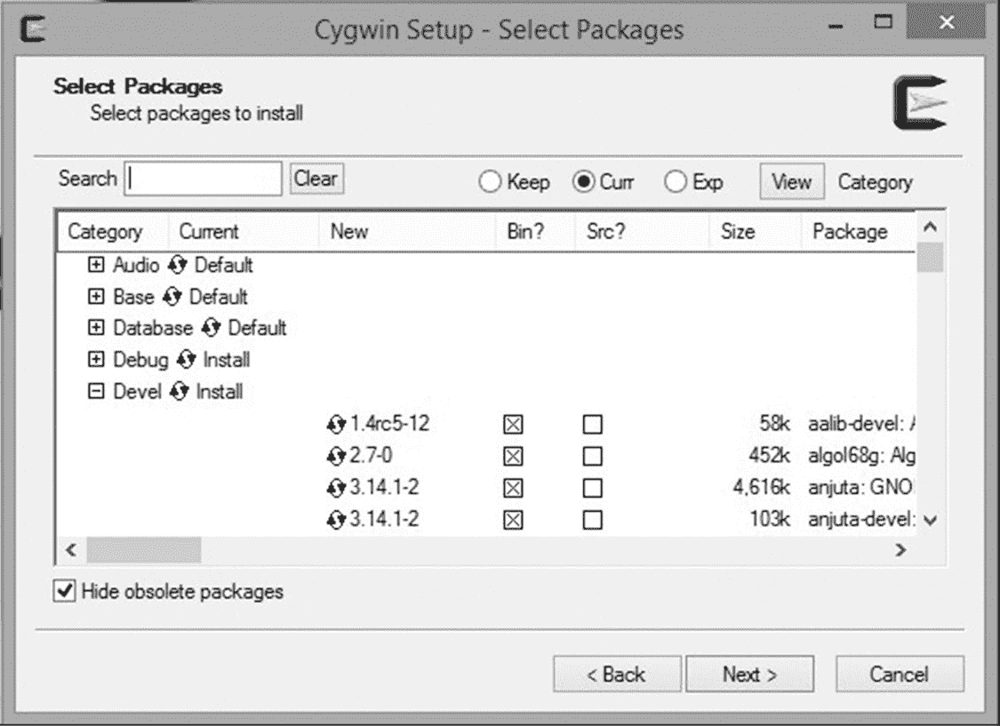

图 8.3. `Cygwin` 设置 `Devel` 安装。

“Bin?” 下方的框将从空方框变为带钩的方框。现在搜索 “nano”，展开 `Editors`，点击 `Skip` 将其切换为带钩方框（图 8.4）。

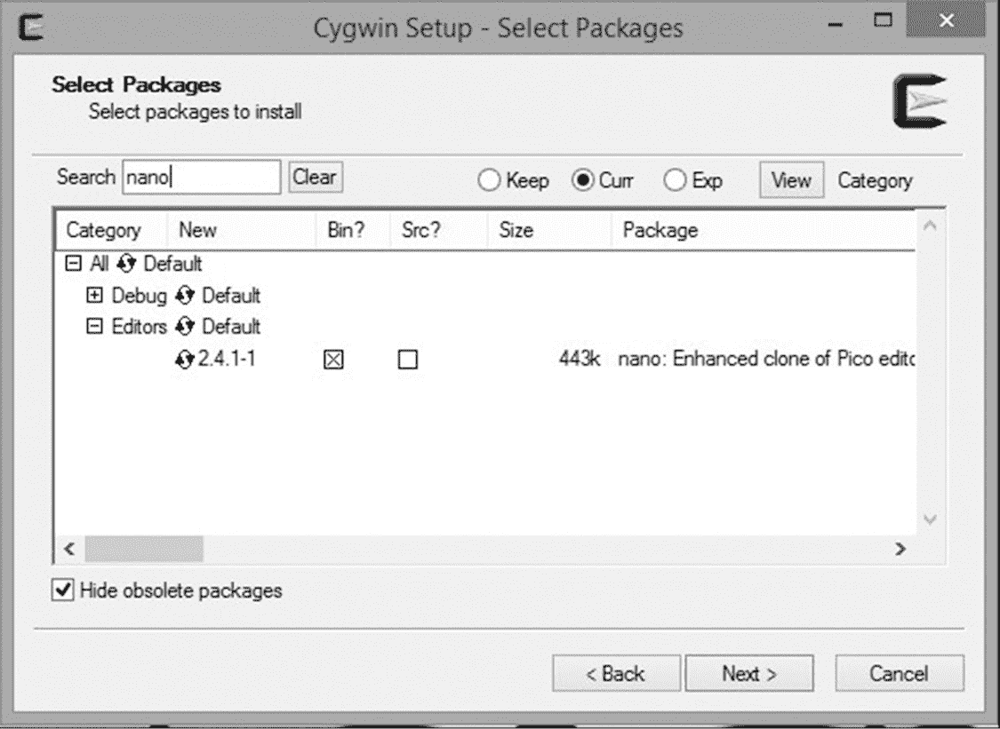

图 8.4. 选择 `Editors` 界面。

点击几次 `Next`，等待下载并安装。在最后一步点击 `Finish` 完成过程。在开始菜单中寻找 `Cygwin Terminal` 或类似的内容。结果是一个带有闪烁光标的框，准备让你输入。

## 示例

在开始一些实际示例之前，我们需要对创建 C 程序所涉及的步骤进行通俗概述：

- 编写应用程序的源代码。源代码扩展名为 `.c`。
- 将源代码编译成中间“对象文件”，该文件介于人类可读代码和计算机将运行的二进制指令之间。
- 将新生成的对象文件与额外的对象文件链接，这些额外的文件引入了应用程序所需的内置库函数。例如，如果你的程序包含了处理文件的代码，你将链接到提供此功能的对象文件。这些内置函数的人类可读版本保存在扩展名为 `.h` 的头文件中。
- 最后一步是创建一个可以在 `Terminal` 命令行上独立运行的可执行文件。

在我们的检查中，我们将对这些步骤进行简写，以便理解。

### Hello World

打开 `Terminal` 窗口（取决于你的系统为 `Cygwin`）并输入：

```bash
nano helloworld.c
```

你将看到一个原始的文本编辑器界面。输入以下内容：

```c
/* Hello World program */

#include<stdio.h>

main() {
    printf("Hello World\n");
}
```

按 `Control + O` 保存文件。然后按 `Control + X` 退出。一旦回到命令行，输入以下：

```bash
gcc helloworld.c
```

这会将你的程序编译并链接成可执行文件。

```bash
ls
```

这将显示当前文件夹/目录的内容。

```bash
./a.out
```

这将运行你的程序。`a.out` 是 `gcc` 编译出的默认程序名称。我们在命令开头加上 `./` 是因为我们正在指示先查看当前目录。`.` 是一个引用当前目录的快捷操作符。当我们想要引用目录中的某个内容时，我们使用 `/` 字符。

在经过这些魔法操作后，只完成了最基础的任务。这是遵循所有步骤后命令行终端的输出：

```text
> nano helloworld.c
> gcc helloworld.c
> ls
a.out helloworld.c
> ./a.out
Hello World
```


第 4 行是主函数的左大括号。每当你在 C 中定义函数时，你都需要左、右大括号字符。棒的一点是 C 并不不在乎缩进或空格。这些仅仅是为了阅读代码的人而存在的。

第 5 行是该程序的有效负载。这个 `printf` 语句是一个函数，它接收提供的参数（在我们的例子中，是每个程序员都不情愿学习的那句经典的介绍性语句），并将其打印到标准输出。在大多数情况下，输出将是屏幕。字符串末尾的 `\n` 部分是一个转义字符，会在字符串末尾添加一个新行。`printf` 之后是一个分号。C 中的每行代码都需要以分号结束，`include` 行除外。在处理完这个强制性的示例之后，让我们深入研究一些特别具有 C 语言风格的内容。

### 值的地址

回到命令行提示符，尝试使用 `nano` 启动一个名为 `address.c` 的文件，然后输入以下文本并保存文档：

```c
/* 查看变量的地址 */

#include <stdio.h>

main() {

    int x;

    int y;

    x = 3;

    y = 7;

    printf("Value of x is: %d and located: %p\n",x,&x);

    printf("Value of y is: %d and located: %p\n",y,&y);

}
```

此示例的命令行工作流应该是这样的：

```bash
>nano address.c

>gcc address.c

>ls

address.c a.out a.helloworld.c

>./a.out

Value of x is: 3 and located: 0x7ffe28fd9a08

Value of y is: 7 and located: 0x7ffe28fd9a0c
```

你的输出将与图片中的不同，我们将逐行分析，跳过我们在第一个代码中看过的部分。第 4 行和第 5 行声明了两个整数。作为任何语言的基础数据类型，值在第 6 行和第 7 行被赋值给新创建的整数。

第 8 行和第 9 行是我们看到 C 运行的地方。我们再次使用 `printf` 将一些值打印到屏幕上。`printf` 是一个非常多功能的函数，它的功能比你想象的要多。如果你给它一个嵌入了 `%` 字符的文本字符串，它会将提供的其他变量填充到 `%` 所在的位置。在我们的第一个示例中，我们使用 `%d` 序列打印 `x`。这是另一个 C 语言特性：C 并不真正知道任何内存地址中是什么，所以通过 `%d`，你是在告诉解释器打印该内存地址的内容，就像它是整数一样。如果你想在序列中放入字符串，可以使用 `%s`，对于浮点数使用 `%f`，以此此类推。第二部分是 `%p`，代表指针。`printf` 的第三个参数是 `&x`，它是 `x` 所在的内存地址。`&` 运算符告诉 C 你想要你正在查看的实的地址，而不是该实体的值。

这个示例的目的是向你展示 C 代码可以低到什么种程度。当我们打印两个整数时，首先打印它们的值。然后我们做了一件非常模糊的事：打印存储该值的内存位地址（对于 `x` 来说，这是 `0x7ffe28fd9a08`）。这种查看某个所在地地址的能力是 C 语言的一个基础部分，这种机制被称为指针。理解指针是一项终身追求，任何声称对它们有深入理解的人可能并没有。由于 C 没有面面向对象的特征，也没有像 Python 等其他语言那样高度抽象的数据结构，当你想要执行复杂操作时，通常会传递一个指向你复杂对象起始部分的指针。例如，一个包含 `n` 个整数的数组实际上只是内存中 `n` 个连续的位置，每个位置的大小与整数相同。当你想要引用数组中的第三项时，你基本上引用的是位于数组中第一项内存地址偏移加二 处的内存内容。回想之前提到的关于糟糕的 C 代码会产生问题。如果你直接访问内存内容，你极有可能会写入或读取一个你不该访问的值。

在移动到下一个示例之前，查看两个整数变量的内存地址之间的区别是值得的。这些数字是用一种叫做十六进制的表示法写的。所以从 0 计数到 9，然后是 A 到 F，最后再添加占位符。例如，当你用十进制（我们通常的方法）计数时，当我们从 9 变到 10 时，我们开始新的一一列（`1`），后面跟着 `0`。在十六进制中，在 F 之后开始新的一列。为了防止事情变得更加混乱，我们每次写十六进制数时都使用前缀 `0x`。在我们的代码中，我们有两个整数，它们很可能被放在计算机内存的连续位置。这两个地址之间的差异是 `0x4`。因此，一个整数占用四个字节的内存。是的，C 全都是关于这类事情的。太了，我们为什么要关心这个？下一个示例试图说明这种重要性。

### 哎

再次使用 `nano` 编辑文件 `oops.c`：

```c
/* 访问一段内存 */

#include <stdio.h>

main () {

    int oops;

    oops = 8;

    printf("Address of oops is: %p\n",oops);

    printf("Contents of oops is: %d\n",oops);

}
```

程序运行后终端的输出应该是这样的：

```bash
>nano oops.c

>gcc oops.c

>ls

address.c a.out oops.c

>./a.out

Address of oops is: 0x7ffe28fd9a08

Contents of oops is: 8
```

为了演示访问你不该访问的内存，尝试这段代码并保存为 `overflow.c`：

### 溢出

```c
/* 缓冲区溢出 */

#include <stdio.h>

#include <string.h>

int main()

{

    int super_user = 0;

    char login[10];

    printf("Enter username: ");

    gets(login);

    if (strcmp("bob",login) == 0 )

    {

        super_user = 1;

    }

    if(super_user)

    {

        printf("Super Access granted!\n");

    }

    else

    {

        printf("Sorry, you are not a super user\n");

    }

    /* 做一些只有超级用户才能做的事 */

    return 0;

}
```

让我们逐行分析。3 行（忽略空行）包含了 `string.h`，以便我们稍后调用 `strcmp`。在第 4 行中，我们声明 `main` 函数返回一个 `int`，或整数值。这是为了让示例按预期工作。第 7 行声明了一个长度为 10 的字符数组，这是 C 语言（无论好坏）表示字符串的方式。第 9 行让我们使用内置的 `gets` 函数获取直到用户按下回车的输入。

以下显示了代码编写-保存-编译循环以及最终产品的几次运行输出。注意我们必须通过命令行参数向 `GCC` 传递一些额外信息，以关闭编译器通常使用的某些保护。

```bash
>nano overflow.c

>gcc -wall -fno-stack-protector overflow.c

>ls

address.c a.out helloworld.c oops.c overflow.c

>./overflow.out

Enter username: bob

Super Access granted!

>./overflow.out

Enter username: peter

Sorry, you are not a super user

>./overflow.out

Enter username: joe

Sorry, you are not a super user

>./overflow.out

Enter username: abcdefghijklmno

Super Access granted!
```

第 12 行将用户输入的值与神奇的超级用户账户名进行比较。`C` 以标准方式（逐字符地）对字符串进行比较，并返回整数形式的差异值。因此，两个相同字符串的差异为 `0`。在这种情况下，它会检查 `super_user` 是否被设置为 `1` 或 `true`。第 16 行表示，如果 `super_user` 为 `true`，我们就知道用户具有特殊权限，因此我们使用 `printf` 语句告知用户。第 22 行允许我们通过返回任意整数 `0`（第 23 行）在不产生编译错误的情况下结束 `main` 函数。与字符串比较类似，我们在这里使用 `0` 表示成功，这与检查 `super_user` 的情况不同，在后者中非零数字表示成功。没错，又一个“C 语言特性”在发挥作用。

这个例子是一个刻意设计的示例，用于展示 `C` 创造所谓的“缓冲区溢出”的能力。当你将过多的数据挤入一系列内存位置时，并导致了奇怪的结果，就会发生缓冲区溢出。这个简单的程序首先要求某人输入用户名。如果该用户名是 `bob`，它就会授予该用户超级权限。然而，这个程序是可以被利用的。软件作者认为用户名只会有十个字符。但是，如果你是一个进取的个人，你可能会发现如果你输入一个超过十个字符的用户，程序会尝试将所有这些字符挤进十个位置，导致它们溢出到相邻内存中，并引起各种问题。在这种情况下，它跳过了将输入的用户名与“bob”进行比较的尝试，如果是这种情况，则会将 `super_user` 设置为 `1`。为了让你更透彻地理解这个例子，用于编译程序的 `GCC` 行与我们目前看到的略有不同。在这种情况下，我们显式地告诉编译器不要检查缓冲区溢出。

## 神秘代码

如果你觉得 `C` 看起来很困惑，那是因为它确实很复杂。如之前所示，在 `C` 中访问一切内容都是在非常低的机器层面完成的，甚至到了直接查看内存位置的地步。给你的数据结构非常简陋，基本上是一块你需要非常小心地引用的连续内存。这些低级规范创建了运行良好的代码，但代价是代码可能完全不可读。这种不协调性在 `C` 语言程序员参与的一系列事件中达到了惊人的极端。例如，“阴险 C 竞赛”（Underhanded C Contest）是一项比赛，参赛者必须创建一段看似无害但实际上执行了某些可疑功能的代码。在之前一年的比赛中，目标是创建一个模拟航空公司行李处理系统的软件，如果记录中应用了某个特定的自由文本注释，该系统必须秘密地重路由某些行李。代码的编写方式还必须让看到它的人无法推断其意图。

另一个珍宝是“国际混淆 C 代码大赛”（International Obfuscated C Code Contest）。例如，这段代码块是对 `1990` 年提交的某些代码的轻微修改。在名为 `mystery.c` 的文件中输入以下内容：

```c
#include<stdio.h>

v,i,j,k,l,s,a[99];

main()

{

for(scanf("%d",&s);*a-s;v=a[j*=v]-a[i],k=i<s,j+=(v=j<s&&(!k&&!!printf(2+"\n\n%c"-(!l<<!j)," #Q"[l^v?(l^j)&1:2])&&++l||a[i]<s&&v&&v-i+j&&v+i-j))&&!(l%=s),v||(i==j?a[i+=k]=0:++a[i])>=s*k&&++a[--i])

    ;

}
```

如果没有清晰的提示、图表和礼貌的描述，可能无法推断这段代码的意思。比赛组织者提供了关于如何运行它以及结果应该是什么样的提示。这里显示了输入和编译步骤：

```bash
nano mystery.c

gcc matery.c
```

```text
mystery.c:2:1: warning: data definition has no type

      or storage class [enabled default]

echo 8 | ./a.out
```

你可能会收到一些错误信息，但忽略它是安全的。在描述和最终结果之前，让我们来看最后一行：

```bash
echo 8 | ./a.out
```

这是另一个完美的例子，展示了 `C` 与 `UNIX` 结合得有多紧密。如果我们从左到右读这一行，`echo` 是 `UNIX` 工具的名称，它会将后面的任何内容回显到屏幕。`8` 是你预期的，数字 `8`。接下来是 `|` 符号。在 `UNIX` 中，这是一个命令行参数，本质上是取左侧程序的输出（显示在屏幕上的数字 `8`），并将其作为下一个程序的输入，在我们的例子中就是我们刚刚编译的神秘代码。这个过程被称为“管道”。你可以将几乎任何 `UNIX` 命令的输出管道到任何其他 `UNIX` 命令，这使得在短时间内对计算机执行非常复杂的操作变得可能。看看我们的示例生成的输出。在阅读描述之前，你能通过观察这个判断代码在做什么吗？

```text
 # #Q# #

 # Q # #

Q# # # #

# # # Q

 # Q # #

# # #Q#

 # # # Q

# Q # #

Q# # # #

# # #Q#

 Q # # #

# # # #

# # #

# # #
```


Oliphant, Zan. 1997\. “用 C 编程 CGI.” PC Magazine 16 (5): 235.

Purdum, Jack J. 2006\. Arduino C 入门。柏林: Springer.

Rajaraman, V. 2012\. “Dennis M Ritchie.” Resonance: 科学教育期刊 17 (8): 721–23.

Stackhouse, Jim. 1996\. “C 语言语言.” [`www.csc.villanova.edu`](http://www.csc.villanova.edu)/~lab/C/.

Vine, Michael A. 2002\. 初学者 C 语言编程：趣味编程的方法。辛辛那提: Premier Press.

## 推荐资源

### 网站

- cryptlib: [`www.cs.auckland.ac.nz/~pgut001/cryptlib`](https://www.cs.auckland.ac.nz/~pgut001/cryptlib)/。
- Cygwin: [`www.cygwin.com`](https://www.cygwin.com)/。
- Evans, Jon. 2015\. “杀死 C 语言.” Crunch Network, 5 月 2 日。[`techcrunch.com/2015/05/02/and-c-plus-plus-too/`](http://techcrunch.com/2015/05/02/and-c-plus-plus-too/)。 （探讨为什么 C 语言中的糟糕代码会导致问题。）
- GTK+ 项目: [`www.gtk.org`](http://www.gtk.org)/。
- LibraryBox 项目: [`librarybox.us`](http://librarybox.us)/。
- OpenSSL: [`www.openssl.org`](https://www.openssl.org)/。
- OpenWrt Wiki: [`wiki.openwrt.org`](http://wiki.openwrt.org)/。
- 第七届国际混淆 C 代码大赛: [`www.ioccc.org/years.html`](http://www.ioccc.org/years.html)#1990。
- 劣劣 C 大赛: [`www.underhanded-c.org`](http://www.underhanded-c.org)/。
- Zend 引擎与 PHP: [`www.zend.com/en/community/php`](https://www.zend.com/en/community/php)。

### 图书与论文

- Burch, Carl. 2011\. Python 程序员的 C 语言。 [`www.toves.org/books/cpy`](http://www.toves.org/books/cpy)/。Python 的流行使其成为许多想要学习编程的人的首选。这本在线教程/书籍旨在向熟悉 Python 的人介绍 C 语言。
- Klemens, Ben. 2014\. 21 世纪的 C：新流派的 C 技巧。第 2 版。加州塞巴斯托波尔: O’Reilly Media。这是一本现代论著，讨论了 C 在当今语言格局中的作用。它是为已经具有一定编程知识并希望学习 C 语言的读者写的，特别关注仍然具有意义的内容。
- 硬核方法学 C。 [`c.learncodethehardway.org/book`](http://c.learncodethehardway.org/book)/。不要被标题误导。这本在线书籍介绍了一种现代 C 语言学习课程，并提供了五十多个教程，展示了 C 语言的现代用途以及它作为一种语言仍然重要的原因。
- Miller, Evan. 2014\. “你不能向上挖掘.” [`www.evanmiller.org/you-cant-dig-upwards.html`](http://www.evanmiller.org/you-cant-dig-upwards.html)。虽然这篇随笔并不是关于 C 语言的教程，但它确实为为什么 C 是一门值得花学习的重要语言提供了思考。Miller 在编写良好、安全且高效的代码与 C 知识如何为实现这一点提供见解之间建立了类比。
- Purdum, Jack J. 2012\. Arduino C 入门：为 Arduino 及兼容微控制器学习 C 语言编程。纽约: Springer E-Books。这本书介绍了 Arduino 微控制器，并专门查看了与其配合的编程语言在外观和功能上如何像 C。它是为没有任何编程经验或 Arduino 实验经验的初级读者设计的。

## 第九章：C#

Peter Tyrrell

### 历史与发展

C#（读作 See Sharp）是微软开发的一种用于 `.NET` 框架编程的语言。`.NET` 是由指令、方法和库组成的庞大体系，反映了你在 Windows 环境中要求计算设备执行的所有可能任务。`.NET` 是 Windows 本身的核心，也是微软在过去十年中几乎所有产品的核心：SQL Server 数据库平台、MS Office、Windows 手机和平板、Windows 服务器和桌面版、网站和 Web 应用程序等。关键点在于，C# 与 `.NET` 不可分，极很少在没有它的情况下单独使用。作为一名管理员，你可能会使用 C# 创建动态网站、移动端应用程序、命令行工具、Office 插件或为 Windows 设计的软件应用程序。

C# 的历史与微软 `.NET` 框架的诞生和成熟紧密相关（Hasan 2012）。`.NET` 取代了早期为不同目的而独立开发的框架，这些框架因此像是孤岛一样。例如，在 20 世纪 90 年代末 `.NET` 发明左右，网络的重要性日益增加，因此微软自然地发布了一个框架来利用这一点——它被称为 ASP，或活动服务器页面（Active Server Pages），它是脚本引擎的早期尝试。也就是说，你可以创建根据用户输入做出反应的网页，或者与数据库通信并提供结果，而不像仅限于 HTML 的静态网页那样简单。

虽然 ASP 在网页功能上迈出了一大步，但它在与主机服务器交互方面存在许多局限性。服务器端函数是脆弱的，因为 Windows 上的多个应用程序可能依赖于一组被称为 COM 对象的函数。在任何时刻，只允许一个 COM 对象的特定版本处于激活，因此程序员很容易对 COM 对象进行微小的更改，从而破坏许多应用程序。这在口语中被称为 `DLL 地狱`（DLL hell），我亲眼看到过由于这种直接结果，程序员大声咒着非常难听的话。

`.NET` 的创建是为了解决兼容性问题，并消除 Windows 环境下编程领域那种杂乱无章的本质。它为“微软的一切的事物”提供了一个全面且一致的接口——大部分情况下如此。当然，关于它的细微之处存在争论，但总体来说，人们在 `.NET` 的驾驶舱内编写 Windows 桌面软件、ASP.NET 网站或手机 App 会感到很自如。`.NET` 是你进入微软广阔领域必须携带的瑞士军刀。

那么，回到 C#。发明 C# 的原因并不完全清楚。微软有一种名为 Visual Basic 的首选语言，你今天在为 `.NET` 编程时仍然可以使用。目前 `.NET` 演进的主流方向是向一个更通用的平台发展，你可以在选择的操作系统（甚至是 Mac 和 Linux）上带来你选择的语言。但在 2000 年，人们认为有必要发明能够以最小失真反映 `.NET` 哲学和本质的语言，从而最大限地发挥 `.NET` 带来的优势和变化。企业自尊可能也起了作用，但我们在这里不对一个组织设定基调并引导使用其工具的人的想法意愿做出评判。

C# 曾与 Java 进行过比较，它在该竞争语言/框架出现仅六年后被发明。它们在语法和表达上有着表面上的相似之处，甚至在对于组织代码的假设（例如，面向对象的方法）上也是如此。面向对象的语言使用“类”，即经过封装的代码模块，这些模块具有功能上的统一性，并暴露方法和属性，这些类可以被其他类扩展、继承或与其进行交互。然而，对 C# 诞生产生最大影响的可能是 `C` 语言及其派生语言 `C++`：`C#` 这个名字正反映了这一点。`C` 和 `C++` 被“严肃”的程序员广泛使用，而 C# 旨在为这一群体提供通往 `.NET` 的桥梁，但 C# 的发明者们也想解决他们认为这些早期语言存在的缺陷（Hasan 2012）。

尽管 C# 与其他 C 类语言共享语法特征，但它的受托管程度要得多。这意味着它在后台做了大量工作，以确保一个“安全”的环境，从而缓解或消除了常见的编程失误。一个例子就是它的自动内存管理和垃圾回收（清理未使用的内存）。`C` 或 `C++` 的程序员需要为其代码运行分配内存，然后确保代码在执行后自行清理，以避免内存泄漏，这可能是一项非常繁琐的操作。多少内存才足以避免内存溢出异常？多少内存又太多，导致其他组件饥饿？在使用后应该多频繁、多激进地回收内存，考虑到垃圾回收本身会产生性能开销？尽管 `C` 和 `C++` 程序员可以构建出等同于老虎般低哮的方程式 1 赛车，并针对它们前方的道路进行高度优化，但所需的极高专业知识和细致入微的努力是大众广泛普及编程的障碍。

微软意识到，其 `.NET` 框架成功的关键在于开发者的采纳——尽可能多的开发者——因此 C# 语言必须在表达能力、对编程环境的控制以及易用性之间取得平衡。你可以很容易地找到那段流传视频，那是当时的微软首席执行官史夫·鲍尔默在一次会议上大汗淋漓，沙哑地对着一群可能感到惊讶但很快变得热情的观众大道：“开发者！开发者！开发者！开发者们！”（Know Your Meme 2012）。微软真的——真的想吸引开发者使用 `.NET` 和 C#，而他们成功了。正如 20 世纪 90 年代后期和 21 世纪初，视频、摄影、新闻、观点和内容创作的负担从专门专家转向业余人员和爱好者，编程和开发也找到了更庞大的创作者群体，他们将产生下一代软件，特别是在网络上。这些开发者甚至对 `.NET` 本身及其辅助语言 C# 的方向施加了巨大的影响。如今，C# 已经非常成熟，尽管有几十种语言被适配用于 `.NET`，但 C# 仍然是最流行的。

### 用途

C# 允许你操作 `.NET` 框架，它是微软工具、服务和技术的表示，因此 C# 的实际用途与该框架一样广泛。

## Web 应用

`ASP.NET` 是 `.NET` 的 Web 开发部分。它依赖于 `.NET` 框架的存在并大量使用它，但它也包含了其他与 `.NET` 本身无关的组件和技术。这些其他组件都与生成网页有关，因为 `ASP.NET` 可以被定义为创建一个提供动态内容的网页的工具箱。如果你打算提供的网页在显示内容时必须做出决策、必须验证用户身份、或必须从搜索引擎或远程 API 获取内容，或者必须与数据库通信、记录页面的操作等，那么你需要一种编程语言。这就是 C# 的用用场。

明确的是，C# 是一种服务端或后端语言，这意味着它在服务器上执行，而不是像 `JavaScript` 那样在客户端浏览器上执行。网络是一个无状态的环境；浏览器与服务器之间没有实时且持续的连接。一个很好的类比是邮政系统：浏览器将请求寄给服务器，服务器处理请求并发送响应。在这些短暂的活动爆发之间，服务器和浏览器被动地坐在那里，彼此都不知道对方在做什么，甚至不知道对方是否在此期间被熊拖离线。C# 契合了场景中的“服务器处理请求”部分。

在服务器上，每个响应都有一个生命周期。为了方便起见，我们称响应为网页，尽管它同样可以是编码为 `XML` 或 `JSON`（JavaScript 对象表示法）的原始信息，或者是文件，而不是 HTML 文档。`ASP.NET` 提供了响应生命周期中事件的程序化访问，在这些点上，你可以干预并做出决策或以某种方式修改输出。从实践上说，你的大部分代码倾向于位于同一个事件点，即你可以获取有关客户端请求的所有信息的地方，以及关于当前服务器状态的大量信息。

让我们来看典型的响应生命周期。首先，验证客户端请求。在用户尚未登录时，他们会被引导到登录页面的这一点。通常情况下，身份验证是 `ASP.NET` 中的一个配置问题，你不需要代码来专门检查每次请求的身份验证。

### 登录示例

```csharp
public class AuthenticationController : BaseController
{
    private readonly IAuthenticateService _authService;

    public AuthenticationController(IAuthenticateService authService, ILogger logger)
        : base(logger)
    {
        _authService = authService;
    }

    [AllowAnonymous]
    public ActionResult Login(string returnUrl)
    {
        return View("Login");
    }
}

/*
声明式属性（如 [HttpPost]）是对其修饰的方法的元编程。[HttpPost] 声明这个登录方法重载（而不是上面那个）将处理 POST 请求（即用户提交登录表单时）。[AllowAnonymous] 声明允许未验证的用户访问——否则他们如何登录？
*/

[HttpPost]
[AllowAnonymous]

/*
LoginViewModel 包含了用户在登录表单中输入的值。returnUrl 是用户在重定向到登录之前尝试访问的地方，也是登录成功后用户将被返回的地方。
*/

public ActionResult Login(LoginViewModel login, string returnUrl)
{
    if (!ModelState.IsValid)
    {
        ViewBag.Error = "表单无效；请检查并重试。";
        return View("Login");
    }

    /*
    身份验证服务如何检查凭据在这里被隐藏了（可能它会与数据库通信），但这正是关键所在。我们在此级别不需要知道。这使得更改身份验证服务内部的工作方式变得容易，而不破坏依赖它的代码。
    */

    if (_authService.Authenticate(login.User, login.Password))
    {
        /*
        FormsAuthentication 是内置于 .NET 的。SetAuthCookie() 方法将 Cookie 形式的加密身份令牌添加到响应中。从以后，Cookie 将每次请求/响应中往返传递，并每次由内置的 ASP.NET 检查器进行检查，因此我们不需要手动操作。
        */
    }
}
```

```csharp
FormsAuthentication.SetAuthCookie(login.Username, false);

if (_authService.ValidateReturnUrl(returnUrl))
{
    return Redirect(returnUrl);
}
else
{
    return RedirectToAction("Index", "Home");
}
}

ViewBag.Error = "Credentials invalid. Please try again.";
return View("Login");
}

public ActionResult Logout()
{
    Session.Clear();
    FormsAuthentication.SignOut();
    return RedirectToAction("Index", "Home");
}
```

如果请求已经过身份验证，你可能仍然需要检查用户是否有权获取响应。例如，如果页面仅供管理员访问，则你需要检查他们是否属于管理员角色。

### 授权示例

```csharp
[Authorize(Roles = "Administrator, Super User")]
public ActionResult Admin()
{
    return View();
}
```

接下来，检查客户端请求以获取如何操作的信号。这些信号可能编码在请求的 URL 路径中，或者在查询字符串中以键值对的形式参数化，或者是随请求包中提交的与 URL 值完全无关的任意数据（包括 cookie）。还可以查看请求头——这些头通常包含关于请求和请求者的元信息。然后，获取满足客户端请求所需的任何内容。这可能需要查询数据库或其他数据源。

### 永久链接示例

```csharp
public class HomeController : BaseController
{
    private readonly ISearchService _searchService;
    private readonly ILogger _logger;

    public HomeController(ISearchService searchService, ILogger logger)
        : base(logger)
    {
        _searchService = searchService;
        _logger = logger;
    }

    /*
    永久链接 URL 可能是 http://example.andornot.com/permalink/123，但除非我们显式检查，否则我们在这一层并不知道。URL 在早的路由代码中经过检查，如果匹配到永久链接模式，则会将 ID 部分发送到这里。这意味着你可以有多个模式路由到此 Permalink 方法。
    */

    public ActionResult Permalink(string id)
    {
        if (string.IsNullOrEmpty(id))
        {
            /*


不向视图传递模型等同于传递 `null`。视图可以检查模型是否为空并显示“无此类永久链接”的内容。

```csharp
return View("Permalink");
```

`ISearchResults` 是我们在别处定义的代码，用于存储搜索引擎返回的搜索结果信息。搜索服务也是我们编写的与搜索引擎通信的代码。因此，“模型”将封装有关搜索引擎查询的所有信息，包括如果搜索成功时对应 ID 的结果。

```csharp
ISearchResults model = _searchService.Single(id);
```

视图负责样式和渲染模型中持有的原始搜索结果数据。这是你看到 HTML 的地方。

```csharp
return View("Permalink", model);
```

将原始信息传递给视图，在视图中将其绑定到 HTML 或用于做出如何构建 HTML 的决策。

### 永久链接视图示例

```razor
@model ISearchResultModel // 注意：原文中此处应为模型定义

/*
此视图包含在通用布局视图的 HTML 包装中。
*/
```

此处根据原文代码块翻译：

```razor
@model ISearchResultModel

@{
    /*
    此视图包含在通用布局视图的 HTML 包装中。
    */

    Layout = "~/Views/Shared/_Layout.cshtml";

    /*
    模型包含作为强类型文档集合的搜索结果。Model.Documents 的类型为 List<Document>。
    */

    var doc = Model.Documents.SingleOrDefault();

    string title = doc == null ? "Bad Permalink" : doc.Title;

    /*
    ViewBag 是内置于视图的动态集合（“袋”）。它提供了一种在视图与视图之间传递任意信息的方便方法。这里的标题将被分配给布局中的 HTML 标签。
    */

    ViewBag.Title = title;
}

@if (doc == null)
{
    <ul>
        <li>
            <h2><span class="text-found">未找到</span>该 ID 的文档。<span class="divider"> </span></h2>
        </li>
        <li>
            那里是拼写错误吗？请重试，或者尝试改用 @Html.ActionLink("新搜索", "Index", "Home")。
        </li>
    </ul>
}
else
{
    <div class="permalink-view">
        @{
            /*
            在这里我们将模型传递给共享视图，在共享视图中，如果单个搜索结果是搜索结果集的一部分，它将以相同的方式布局。我们不需要仅为永久链接视图重新创建布局，并且保持了 DRY（不要重复自己）。
            */

            Html.RenderPartial("_List", Model);
        }
    </div>
}
```

### 优缺点

有两组 C# 的优缺点需要考虑：与其他编程框架相比的 C# 和 .NET，以及与 .NET 框架内其他语言相比的 C#。

### C# 和 .NET 与其他框架的对比

选择与何种编程框架或环境一起工作是基础性的：这一决定将影响你从今以后做的一切，从编写软件时使用的工具到它可以部署的操作系统。框架将影响你的设计、你解决问题的方法，甚至你可能遇到的问题类型。框架对思维的影响是微妙但深远的，这就是为什么框架倾向于产生编程文化的原因。

Java 国家与 .NET 王国隔着一个海洋，尽管它们都距离那片由 Ruby on Rails 土地、PHP 霸权和 Python 公国组成的人类大陆有万里之遥。这些国家和其他少数国家都有自己独特的边界、死忠的爱国者和无休止的竞争。必须以审慎的态度对待其他者对框架的任何批评。反之，建议可能带有真信者的热情，必须以怀疑的态度来看。我认为人们习惯于为自己选择的群体激烈辩护其优点，但在编程问题上，事实是它们都绰绰有余。

合理的做法是选择你容易获取、运行在你熟悉的操作系统上运行、并且在需要帮助时可以寻求的支持和理解的编程框架和语言。更不用说你可能会在这一决定上投入多年的人生——中途换马是不明智的。在做出框架决定时，你应该问自己以下问题：

- 你是否可以轻松地在计算机上设置所需的编辑工具？
- 或者更好，是否可以使用你已经拥有并喜欢的编辑器？
- 调试你编写的代码有多容易？
- 你是否需要将代码编译成程序集或可执行文件，还是它作为脚本直接运行？
- 你将你制作的东西部署在何处，目标机器运行需要什么？例如，Web 需要复杂的 Web 服务器堆栈，而命令行工具只是谦虚地需要几个基础要求。

### C# 和 .NET 的优点

- 文档齐全，有官方和非官方来源的广泛报道。
- 拥有庞大的从业者群体可以共同交流和分享信息。
- 成熟：十五年的迭代发布意味着 `C#` 功能完备，且充满了许多省力的快捷表达式。
- Windows 环境下的强有力选择：`.NET` 嵌入在每个 Windows 操作系统中。
- 可以通过 Microsoft Azure 使用云服务器架构。
- `.NET Core Framework`、用于构建 Web 的 `ASP.NET 5` 以及 `C#` 编译器 `Roslyn` 已于 2014 年 11 月开源（Landwerth 2014）。
- 由微软支持。
- 微软拥有巨大的资源，并且对其编程框架的成功和采用有着深切的利益。
- 在过去的十年里，微软的开发者部门变得日益开放，并对从业者的响应更加迅速。

在使用 `C#` 时，与某些完全由社区引导的开源框架相比，在解决问题时可选的方案和工具较少。初看这可能是一个缺点，但实际上是塞翁得福。通常情况下，这意味着对于某事有一种“正确”或至少是“最佳”的方法，而且这种方法通常由微软专业人士认证，而不是在无数意见以及重叠或冗余的工具中进行筛选和选择。民主是一件好事，但并不一定像仁慈的独裁那样高效。

### C# 和 .NET 的缺点

- 在历史上与 Windows 绑定，尽管即将发布的版本将扩大对 MacOS、iOS、Linux 和 Android 的支持。
- 开发环境的复杂性以及初始设置的相对困难。

## Visual Studio

你的编程环境几乎不可避免地依赖于 `Visual Studio`，这是由微软提供的集成开发环境（IDE）。它是一个强大的工具包，但其强大和复杂性可能会令人望而生畏。微软喜欢将 `Visual Studio` 和 `.NET` 称为开发者“生态系统”，这应该让你对其巨大的规模和多样性有个概念。`Visual Studio` 是一个代码编辑器，对其包含的所有语言提供语法高亮和代码补全，此外支持 `CSS`、`XML`、`JavaScript` 以及其他资源。

你编写的代码需要编译成程序集或可执行文件，这意味着你需要一个编译器。`Visual Studio` 既是代码编辑器也是编译器。在技术上，没有 `Visual Studio` 编译代码是可能的，但那是一项相当高级的。

一旦你的代码达到一定的复杂程度，调试（即通过步进当前运行的程序集或可执行文件的源代码，以观察正在发生的情况）就变得必要的。调试需要调试器，并需要投入一些时间学习如何有效地进行调试。`Visual Studio` 是 `.NET` 代码作为调试器的唯一实际选择。

`Visual Studio` 的好消息是，虽然专业版 `Visual Studio` 每个许可证花费数百美元，但有一个名为 `Visual Studio Community Edition`（以前称为 `Visual Studio Express`）的免费版本。`Community Edition` 可供个人开发者或为“非企业组织”工作的人员开发免费或付费应用。`Community Edition` 不像它的祖先 `Visual Studio Express` 那样有功能限制，而且许可条款非常慷慨，因为“企业”被定义为拥有超过 250 台电脑或年收入超过百万美元的组织。即使在企业内部，`Community Edition` 也可以用于贡献开源项目、学术研究或教学场景。

## C# 与 .NET 内的其他语言的比较

可以使用三十种语言来为 `.NET`（[`en.wikipedia.org/wiki/List_of_CLI_languages`](https://en.wikipedia.org/wiki/List_of_CLI_languages)）编程。除了使用最广泛的 `C#` 之外，著名的示例还包括以 `Managed JScript`、`IronRuby` 和 `IronPython` 形式存在的 `Javascript`、`Ruby` 和 `Python`。

`C#` 有许多技术特性比我们这里提供的空间更多，而且它们与其他语言相比是优点还是缺点在很大程度上取决于你个人的观点。可以说，`C#` 拥有许多技巧和省力设备，可以帮助你简洁地表达意图，并有旨在防止你犯错的安全网。以下是一些功能列表，学习这些功能将使你进一步了解它们的努力有所回报：

- 强类型、匿名类型、类型安全
- 面向对象，通过接口实现多重继承
- `LINQ`
- 泛型（`Generics`）
- Lambda 表达式和函数式编程
- 可空类型
- 通过特性（attributes）进行元编程

## 示例

### LINQ

`LINQ` 代表语言集成查询（Language-Integrated Query）。它提供了一套查询和更新的模式，这些模式平滑并抽象了所处理的数据存储的特殊性。`LINQ to Objects`、`LINQ to XML` 和 `LINQ to SQL` 是 `.NET` 框架默认提供的程序（Microsoft Developer Network n.d.），例如 `LINQ to JSON` 和 `LINQ to ODATA`。

`LINQ` 的优势在于这些模式相对容易学习，一旦掌握，就能为你提供一种处理各种数据源的标准方法。没有 `LINQ`，你被迫编写许多行辅助代码来支持你真正感兴趣的操作，并且你需要更深入地理解底层数据存储的反复。此外，`LINQ` 能够极大地简化原始语言中复杂混乱的语句——这对于 `SQL` 尤为如此（Albahari nd）。`LINQ` 节省了大量的时间脑脑。

提到 `SQL`，你可能会发现 `LINQ` 运算符让你联想起 `SQL` 语法。这并不是因为我们一定在查询 `SQL` 数据库，而是因为了趋同演化：这些运算符是高效的表达式。尽管 `LINQ` 语法受到 `SQL` 语言的影响，但无论底层数据源性质如何，它看起来都一样。

### 需要的工具

你需要 `LINQpad`（[`www.linqpad.net`](http://www.linqpad.net)）或 `Visual Studio` IDE（[`www.visualstudio.com`](https://www.visualstudio.com)）。

### LINQ to Objects

`.NET` 框架中任何可枚举的对象都可以用 `LINQ` 进行操作。所有内置集合类都继承自 `IEnumerable` 或 `IEnumerable<T>` 接口，任何人都可以编写一个具有相同功能的新集合。接口是一个模板，强制你向代码中添加其命名的方法或属性。例如，`IEnumerable` 强制你添加一个 `GetEnumerator()` 方法。至于你如何编写该方法并让它像预期的那样返回 `IEnumerator` 对象，取决于你。接口只强制方法签名。

数组和列表是常用枚举集合的示例。我们通常使用 `foreach` 运算符来枚举它们，但我们也可以使用 `LINQ`，特别是当我们打算返回一个子集时。

```csharp
string[] array = new string[] {"Chupacabra", "Sasquatch", "Honest Politician"};

// 通过 foreach 加载 'rarities'

var rarities = new List<string>();

foreach (string item in array) {
  if (item.StartsWith("Honest")) {
    rarities.Add(item);
  }
}

// 通过 LINQ 加载 'rarities'

var rarities =
  from item in array
  where item.StartsWith("Honest")
  select item;
```

`LINQ` 版本的优势可能并非显而易见，但：

- 它在一个语句中声明并设置了 `rarities` 变量，这在阅读代码时消除了对 `rarities` 用途的任何歧义。
- 片段的整体目的更容易理解。`foreach` 循环只告诉你将进行迭代，而没有告诉你迭代将实现什么，而 `LINQ` 的 `select` 运算符清晰地信号了语句的意图。

### LINQ to XML

该 XML 示例有一个根节点 `Catalog`，其中包含多个 `Book` 节点。每个 `Book` 包含一些基本元数据作为子节点，但 `id` 除外（它是 `Book` 的一个属性）。多个作者通过重复的 `Author` 节点表示。

XPath 可用于查询 XML，但在 .NET 中实现起来非常笨拙。在示例中，功能性但复杂的 XPath 方法与 LINQ 版本的简洁性之间存在相当差异。

```csharp
var rawXml = @"
<Catalog>
    <Book id='book001'>
        <Author>Pilkey, David</Author>
        <Title>The Adventures of Captain Underpants</Title>
        <Genre>YA Fiction</Genre>
        <PublishDate>2013-04-30</PublishDate>
        <Description>George and Harold have created the greatest superhero in the history of their elementary school—and now they're going to bring him to life!</Description>
    </Book>
    <Book id='book002'>
        <Author>Albahari, Joseph</Author>
        <Author>Albahari, Ben</Author>
        <Title>LINQ Pocket Reference</Title>
        <Genre>Nonfiction</Genre>
        <PublishDate>2008-03-07</PublishDate>
        <Description>This guide has the detail you need to grasp Microsoft's new querying technology, and concise explanations to help you learn it quickly.</Description>
    </Book>
</Catalog>";

// 通过 XPath 获取作者

var xml = new XmlDocument();

doc.LoadXml(rawXml);

XPathNavigator navigator = xml.CreateNavigator();

XPathExpression authorQuery = avigator.Compile("/Catalog/Book/Author");

XPathNodeIterator iterator = navigator.Select(authorQuery);

var authors = new List<string>();

while (iterator.MoveNext()) {
    authors.Add(navigator.Value);
}

// 通过 LINQ 获取作者

var xml = XElement.Parse(rawXml);

var authors =
    from e in xml.Descendants("Author")
    select e.Value;
```


LINQ 版本要简单得多！编写更快，阅读更易。XPATHPATH 版本受困于过多的变量和复杂的多个步骤过程。当我阅读它时眼睛都看直了，而这还是我自己写的。XPATH 表达式本身没有问题，实际上确实有在 LINQ to XML 中处理 XPATH 的方法，但在大多数情况下你甚至不需要它。

## SQL 示例

两个表分别代表书籍（表 9.1）和作者（表 9.2），中间有一个连接表，以便为每本书分配多个作者（表 9.3）。表 9.4 显示了 BooksToAuthor 的结果。

### 表 9.1. 书籍信息

| BookId | Title | Genre | PublishDate | Description |
| :--- | :--- | :--- | :--- | :--- |
| book001 | The Adventures of Captain Underpants | YA Fiction | April 30, 2013 | George and Harold have created the greatest superhero in the history of their elementary school—and now they’re going to bring him to life! |
| book002 | LINQ Pocket Reference | Nonfiction | March 7, 2008 | This guide has the detail you need to grasp Microsoft’s new querying technology, and concise explanations to help you learn it quickly. |

### 表 9.2. 作者信息

| AuthorId | Name |
| :--- | :--- |
| 1 | Pilkey, David |
| 2 | Albahari, Ben |
| 3 | Albahari, Joseph |

### 表 9.3. 书籍、作者与书籍作者关系

| Books | BooksToAuthors | Authors |
| :--- | :--- | :--- |
| BookId | Id | AuthorId |
| Title | BookId | Name |
| Genre | AuthorId | |
| PublishDate | | |
| Description | | |

### 表 9.4. 书籍作者关系

| Id | BookId | AuthorId |
| :--- | :--- | :--- |
| 1 | book001 | 1 |
| 2 | book002 | 2 |
| 3 | book002 | 3 |

## SQL 查询对比：原生 SQL

以下是 Transact-SQL (T-SQL) 中的 `select` 语句：

```sql
SELECT
    b.BookId,
    b.Title,
    b.Genre,
    a.Name AS Author
FROM Books b
INNER JOIN BooksToAuthors b2a ON b2a.BookId = b.BookId
INNER JOIN Authors a ON a.AuthorId = b2a.AuthorId
WHERE b.Title LIKE "LINQ%"
```

`select` 查询的结果如表 9.5 所示。

### 表 9.5. 查询结果

| BookId | Title | Genre | Author |
| :--- | :--- | :--- | :--- |
| book002 | LINQ Pocket Reference | Nonfiction | Albahari, Ben |
| book002 | LINQ Pocket Reference | Nonfiction | Albahari, Joseph |

尽管有一本书符合查询条件，但结果被去规范化为两行，每个作者各占一行。可以使用 SQL 将作者合并为单行，但这需要一些技巧。即使将作者连接（concatenate）到同一列中，它们也会变成一个单一值，例如 `Albahari, Ben|Albahari, Joseph`。人类肉眼可以很容易地理解该值是两个合并的子值，但除非被告知要分割，否则计算机并不知道它们是独立的实体。这并非不可能的任务，只是不符合理想。另一种方案是获取这两行并编写代码根据 `id` 手动将它们合并，以准确反映数据作为单一标题的真实本质。如果查询结果已经反映了这一点难道不是更好吗？

## SQL 查询对比：LINQ

下面的 LINQ 语句与上面的 SQL 内部连接（inner join）基本等，但在这种情况下实际上不需要显式的连接语法即可获取所需。变量 `db` 代表 SQL 数据库对象，并假设在配置 LINQ 作为对象关系映射（ORM）过程的一部分时已经定义。因此，它了解 SQL 表、列类型和关系。简而言之，这就是 LINQ to SQL 强大之处的大部分：我们不需要在每次编写查询时都定义连接，而是提前解释这些关系，并从更简洁的代码中获益。

我们动态创建一个作者集合，以便将多个作者分组在一起，并过滤出有作者的书籍。

```csharp
var books =
    from b2a in db.BooksToAuthor
    where b2a.Books.Title.StartsWith("LINQ")
    let authors = b2a.Authors.Name
    where authors.Any()
    select new CatalogBook
    {
        Id = b2a.BookId,
        Title = b2a.Books.Title,
        Genre = b2a.Books.Genre,
        Authors = authors
    };
```

查询的结果始终是一个 `enumerable` 集合。在这种情况下，变量 `books` 包含了每个匹配项的 `CatalogBook` 对象。我们本可以为每个创建一个匿名对象，省去在某处定义 `CatalogBook` 类型的麻烦，但使用强类型类如 `CatalogBook` 替代匿名对象的优势是，我们在处理它时总是知道会有什么。`CatalogBook` 的实例将具有一个值数组属性 `Authors`，而不是有时是数组有时是单一值。预知是 . . . er，力量：我们可以在代码的其他地方继续使用 `CatalogBook`，且始终保持相同的预期，而无需手动解释或转换数据库查询的结果。

将数据库结果立即映射到强类型对象还有另一个更细微的好处，即如果数据库结果不符合对象的预期，将在该点发生错误。错误！没错——而且这是好事。“尽早失败，经常失败”这一建议听起来违背直觉，但由于错误可以在代码中被捕获和处理，因此越早知道问题在何时、何地以及是如何发生的就越好。被放任的问题会在以后引起问题，那时将更难诊断并追溯到其实的源头。“Enumerable”意味着该集合可以进行循环，如下所示的 `foreach` 结构：

```csharp
foreach (var book in books) {
    Console.WriteLine(string.Format("{0}, {1}, {2}, {3}",
        book.BookId,
        book.Title,
        book.Genre,
        string.Join("; ", book.Authors));
}
```


```markdown
# C#

`C#` 是一种无处不在的服务端语言，与 `.NET` 紧密相连。这使得 `C#` 在 Windows 环境能够完美胜各种任务。在微软的有力支持下，`C#` 拥有完善的文档并广泛讨论。除了相当容易学习之外，它还提供了一些安全保障，让初学者保持“安全”。

## 参考文献

- Albahari, Joseph. n.d. “为什么 LINQ 优于 SQL.” LINQPad. [`www.linqpad.net/WhyLINQBeatsSQL.aspx`](http://www.linqpad.net/WhyLINQBeatsSQL.aspx).
- Hasan, Nourul. 2012\. “C# 编程历史.” All About C# Programming, 9 月 27. [`aboutcsharpprogramming.blogspot.com/2012/09/history-of-c-programming.html`](http://aboutcsharpprogramming.blogspot.com/2012/09/history-of-c-programming.html).
- Know Your Meme. 2012\. “史蒂夫·鲍尔的猴子舞.” [`knowyourmeme.com/memes/steve-ballmer-monkey-dance`](http://knowyourmeme.com/memes/steve-ballmer-monkey-dance).
- Landwerth, Immo. 2014\. “NET Core 是开源的.” .NET Blog, 11 月 12. [`blogs.msdn.com/b/dotnet/archive/2014/11/12/net-core-is-open-source.aspx`](http://blogs.msdn.com/b/dotnet/archive/2014/11/12/net-core-is-open-source.aspx).
- Microsoft Developer Network. n.d. “LINQ（语言集成查询）.” [`msdn.microsoft.com/en-us/library/bb397926.aspx`](https://msdn.microsoft.com/en-us/library/bb397926.aspx).

## 推荐资源

- Albahari, Joseph, and Ben Albahari. 2012\. `C#` 5.0 快速入门：权威参考. 第 5 版. Sebastopol, CA: O’Reilly Media. 这是一本内容非常密集的参考书。不需要从头读到尾，而是应该像难喝的药一样，在需要时一小口地阅读。
- Allen, Scott. 2014. “基于 C# 5.0 的 C# 基础.” Pluralsight. [`www.pluralsight.com/courses/csharp-fundamentals-csharp5`](http://www.pluralsight.com/courses/csharp-fundamentals-csharp5). 一门关于 `C#` 的六小时初学者视频课程。Scott Allen 是 `.NET` 社区中备受推崇的声音。可以在 [`odetocode.com`](http://odetocode.com) 找到他的博客、培训课程和播客。
- [ASP.NET](http://ASP.NET). n.d. “开始使用 [ASP.NET](http://ASP.NET).” [`www.asp.net/get-started`](http://www.asp.net/get-started). 微软关于 `ASP.NET` 的介绍页面。并非专门针对 `C#`，但对理解大局非常有帮助。
- LINQPad. [`www.linqpad.net`](http://www.linqpad.net)/.
- Microsoft Developer Network. n.d. “.NET Framework 类库.” [`msdn.microsoft.com/en-us/library/gg145045(v=VS.110).aspx`](https://msdn.microsoft.com/en-us/library/gg145045(v=VS.110).aspx). `.NET` 框架中所有类的官方文档。枯燥如骨，但它描述了每个 `.NET` 类预期的使用方式，并带有简洁的示例。你会经常访问的。
- Visual Studio. [`www.visualstudio.com`](https://www.visualstudio.com)/.
- Wikibooks. n.d. `C#` 编程. [`en.wikibooks.org/wiki/C_Sharp_Programming`](https://en.wikibooks.org/wiki/C_Sharp_Programming).

## 第十章：Java

Amanda Cowell

### 历史与发展

`Java` 是一种基于类的面向对象编程语言，其口号是“一次编写，随运行”（WORA），这意味着它是平台无关的，代码可以编译一次并运行在任何平台上。其他类似的语言（如 `C++`）则每个平台都需要特定的编译器。`Java` 的设计还考虑了简单性，并可以自动管理内存的创建和删除，从而减少了编码错误。虽然 `Java` 被广泛用于应用程序，但实际上它在创建之初并不是为了在线应用程序设计的。`Java` 最初是为家用电器内部的嵌入式应用程序设计的，例如微波炉和洗碗机。许多不同品牌的设备需要相同的软件功能但使用的硬件不同。这就是为什么平台无关性变得如此重要的原因。随着互联网的普及，人们发现 `Java` 的移植性对于在线环境同样理想。今天，尽管是一门老牌语言，`Java` 仍然保持着人气，并且是开发 Android 移动设备应用的主要平台。

`Java` 最初名为 `Oak`，由太阳系统公司（Sun Microsystems）于 1991 年开发。它是作为名为“绿色项目”（Green Project）的一部分而创建的。太阳绿色项目的目标是创建一种可以在多个操作系统上运行而无需重新编译的可移植编程语言。在 `Java` 开发期间，大部分程序都是用 `C++` 开发的，而 `C++` 为每个平台都需要编译器。当时需要一种可以嵌入消费电子设备的软件解决方案（Schildt 2011）。`Java` 开发有五个主要目标：

- 简单、面向对象且熟悉
- 健壮且安全
- 架构中立且可移植
- 高性能
- 解释型、多线程且动态

（Oracle 1997）。

`Java` 于 1995 年面向公众发布，当时互联网正在发展。人们很快发现，困扰嵌入式代码的跨平台问题也会出现在互联网代码中，由于硬件、浏览器和操作系统的不兼容。`Java` 自然成为了最用于互联网应用程序的编程语言（Schildt 2011）。

1999 年，太阳系统公司发布了 Java 2 微型平台（J2ME），作为手机和其他类似设备的平台。当时对这些设备的消费应用兴趣并不大，手机硬件也没有准备好支持这些类型的应用程序。随着手机和其他移动设备的普及以及这些设备能力的提升，`Java` 创建设备内容的能力也随之提高。2008 年，第一代安卓手机发布，到 2013 年，安卓占了全球智能手机市场的 81.3%（Deitel, Deitel, and Deitel 2014）。`Java` 运行在所有这些设备上的所有应用程序，证明了尽管历史悠久，它仍然是一门强大且重要的编程语言。

### 用途

虽然 `Java` 代码可以移植到任何类似的应用程序，但部署 Java 应用程序的打包取决于你创建的应用程序类型（Gassner 2011）。例如，你打包移动应用程序的方式与桌面应用程序或 应用程序不同。大多数情况下，可执行文件仍然是 `.jar` 文件，但它们的创建和运行方式不同。这意味着为某种类型的微波炉编写的代码可以在具有不同硬件的微波炉上运行，但不太可能运行在浏览器中；同样，安卓应用也不可能运行在微波炉上。

同样地，开发不同类型的应用程序需要不同的工具。例如，如果你计划开发一个 Android 应用程序，你将需要安装 `Android SDK/ADT Bundle` 以获取开发 Android 应用程序所需的类和工具。你可以在 [`developer.android.com/sdk/index.html`](http://developer.android.com/sdk/index.html) 下载此包。不同的 Java 库和开发环境并不会让事情变得复杂，但它们是必要的，以便开发者能够利用其所开发设备的特定功能。例如，Android 移动设备具有多点屏，而为这些设备开发的 Java 应用程序需要利用各种触摸手势（Deitel, Deitel, and Deitel 2014）。

如果你用 Java 开发 Web 应用程序，创建一个 `Java applet` 可能比创建一个 `Java console-based application`（控制台应用程序）更有价值。`Java applet` 是一个可以嵌入网页的小型应用程序。Applets 是 Web 应用程序的理想选择，因为它们对本地资源的访问有限，这避免了计算机病毒的传播并有助于保护用户隐私。为了构建 applet，用户需要包含 `Abstract Window Toolkit (AWT)` 和包含 `Applet` 类的 `applet` 包。创建的每个 applet 都必须 `Applet` 的子类（Schildt 2011）。由于其他工具经常可以更快地执行这些相同的任务，Applets 的人气有所下降，且 Java applets 在过去面临过一些安全问题，但 Java applets 仍然是 Web 上强大且频繁使用的工具。

由于 Java 的悠久、流行程度和开源设计，有数百种免费和付费的工具可以帮助 Java 开发者完成任何项目。有用于 Java 开发的工具，例如集成开发环境（`IDEs`），它们将在本章后面的部分进行讨论。广泛存在用于调试和测试代码的工具。还有辅助图形开发的工具。在 Java 使用的二十年里，开发者在每个方向上测试并扩展了它的局限，寻找 Java 工具来协助任何项目总是值得的。

### 优缺点

尽管 Java 是一门较老的语言，但它在不断演进，并有许多当前应用。它简单、面向对象、架构中立，并且可以移植到几乎任何平台。Java 是原生 Android 应用程序中使用的语言，也是创建动态 Web 应用程序的语言。如果你想为你的库开发移动应用程序，学习 Java 是必不可少的。

Java 的历史也增加了一些优势，因为它在过去的二十年里得到了很好的使用和记录。对于 Java 初学者可能想要进行的几乎每项任务，都开发了工具。还有一个庞大的开发者社区为其他用户提供支持。在网上找到操作说明或解决开发过程中遇到的大多数问题的解决方案并不困难。

虽然脚本语言多年来变得越来越流行，例如 `JavaScript`（与 Java 无关）、`Perl`、`Python` 和 `Ruby` 等，但它们并不适用于大规模编程。脚本语言之所以流行是因为它们使用的结构更容易学习，并允许更快速地开发代码。虽然许多脚本语言正在开发能够增强其能力的改进方案，但用于构建大型应用程序时，它们的可用性仍然显著低得多（Niemeyer and Leuck 2013）。

此外，尽管 Java 设计简单，但它可能是一门难以学习的复杂语言，因为它要求开发者理解面向对象的编程。要真正成为一名 Java 开发者并获得成功，仅仅知道 Java 语法是不够的；还需要对对象、类和继承有良好的理解。这可能让学习 Java 变成一项比用户最初预期的更大的任务。好消息是，Java 将此变得尽可能简单，许多 `IDEs` 可以让初学者的开发更容易。

此外，虽然 Java 是一种开发的可移植语言，但已不能说 Java 可以运行在任何平台上了。`Apple IOS` 不允许 Java 在 iPhone 和 iPad 等 Apple 设备上运行。这需要为移动端创建非 Java 版本的站点，因为大量的移动用户通过 Apple 设备连接。此外，任何为 Android 设备用 Java 开发的移动应用程序都需要为 `IOS` 环境重新创建。这对 Java 语言流行程度的影响目前尚不清楚，但显然，Java 的兼容性不再影响产品的使用或流行度。没有 Java，Web 开发仍将继续。

## 环境与设置

Java 开发的第一步是确保你的机器上安装了 Java。Microsoft Windows 机器已经安装了 Java，Windows 用户可以跳过本段的剩余部分。如果你使用的是 Mac，你的机器上可能安装了也可能没有安装，取决于你使用的操作系统。测试你是否在 Mac 上运行 Java 的最佳方法是打开 `Terminal` 并输入 `java -version`。你可能会得到没有 Java 的错误信息，也可能会看到一个指示 Java 版本的数字字符串。例如，如果终端输出 Java 版本 `1.8.0_45`，则你的机器上运行的是 Java 8。如果你发现没有安装 Java 或版本过旧，请访问此处获取在你的机器上下载最新版本 Java 的指令：[`www.java.com/en/download/help/mac_install.xml`](https://www.java.com/en/download/help/mac_install.xml)。

Mac 和 Windows 用户的下一步都是安装 `Java Development Kit (JDK)`。`JDK` 是 Java 开发中最广泛使用的软件开发包（`SDK`），由 Oracle 免费提供。在本书编写时，`Java SE`（标准版）的最新版本 `JDK` 可以在这里找到：[`www.oracle.com/technetwork/java/downloads/index.html`](http://www.oracle.com/technetwork/java/downloads/index.html)。下载 `JDK` 将安装开发 Java 需要的所有内容，包括 `Java Virtual Machine`。

安装完成后，Java 准备就绪，但在开始编程之前，你需要选择一个文本编辑器。虽然 Java 软件文件只是文本文件，可以在任何文本编辑器中编辑，但有很多选项供选择。如果你已经是一个经验丰富的程序员，可以继续使用过去使用的文本编辑工具。另一种，`IDEs` 在入门阶段非常有用，特别是如果你对软件开发不太熟悉，因为它们可以帮助你构建、编辑、调试和编译应用程序。

有很多非常适合入门的 IDE 选项。有些 `IDEs` 只在 Mac 上运行，有些只在 Windows 上运行，许多是跨平台的。既有免费的 `IDEs`，也有通过许可费用提供更复杂功能的付费 IDE。有些 `IDEs` 适用于小型程序，而另一些则更适合更大更复杂的项目。有许多需要考虑的因素，每个工具都有其优缺点。

一个很好的入门 IDE 是 `Eclipse`。`Eclipse` 并不一定适合每个人的环境，但 `Eclipse` 有许多优势。`Eclipse` 可以在 Windows 或 Mac 上使用，是开源免费的，并且内置了 Android 开发工具，这可以使其成为初级 Android 开发者的很好的工具。它也是开发本章示例代码所使用的工具。

## 示例

### Hello World

这是一个基础 Hello World 应用程序。它是测试 Java 运行环境的好方法，可以确保你可以成功编译并运行代码。

```java
public class HelloWorld {

    public static void main(String[] args) {

        System.out.println("Hello World!!!!");

    }

}
```

如果运行成功，这段代码将简单地打印出 Hello World!!!! 行。尽管它非常简单，但值得逐行查看这段代码，以更好地理解它的作用。

```java
public class HelloWorld {
```

第一行创建了一个名为 `HelloWorld` 的类。每个 Java 应用程序都构建在类内部。这使得它与其他编程环境非常不同。在 Java 中，一切都是对象，而对象是由类创建的。在类内部，代码被封装在函数中。

```java
public static void main(String[] args)
```

简单 World 程序中上面的函数被称为 `main`，因为它是我们代码执行的地方。任何应用程序中都只有一个 `main` 函数，它必须始终被声明为 `public static void` 并接受一个 `String`，传统上命名为 `args`。该函数由 Java 虚拟机自动调用，如果没有它，你的代码将无法运行。

```java
System.out.println("Hello World!!!!");
```

代码的最后一行是打印我们想要显示的文本的代码。

### 扩展的 Hello World

下面的程序输出与上面的程序完全相同。为了进一步解释“一切都是对象”的意思，创建了第二个名为 `Welcomer` 的类。

```java
public class HelloWorld {

    public static void main(String[] args) {

        Welcomer welcomer = new Welcomer();

        welcomer.sayHello();

    }

}
```

```java
public class Welcomer {

    private String welcome = "Hello World!!!!";

    public void sayHello() {

        System.out.println(welcome);

    }

}
```

初始类 `HelloWorld` 仍然存在，并包含 Java 运行所需的强制 `main` 函数。

```java
public class HelloWorld {

    public static void main(String[] args) {
```


```java
Welcomer welcomer = new Welcomer();
```

`main` 函数做的第一件事是创建一个 `Welcomer`。对于这个程序而言，`Welcomer` 可以被认为一个在被要求说话时会大喊“Hello World!!!!”的对象。你可以想象你创建了一个实际的对象，比如一个机器人，它可以执行任务。现在我们只需要告诉它说就行。

```java
welcomer.sayHello();
```

但是，为了让它工作，需要定义第二个类 `Welcomer`。

```java
public class Welcomer {

    private String welcome = "Hello World!!!!";

    public void sayHello() {
        System.out.println(welcome);
    }

}
```

这个类创建了 `welcome` 并包含了所有的属性。`welcome` 可以执行的每个函数都在这个类中。在这个类内部，我们创建了一个带有 hello 文本的字符串。然后我们创建了一个新函数来打印我们的 hello 文本字符串。这段代码显然让一个打印 Hello World 的非常简单的函数变得显著复杂得多。这主要是为了展示 Java 中的一切都是对象。

有许多理由你想要创建具有不同行为的类。创建多个类仍然是一个有用的实践，因为它简化了扩展程序的过程。例如，如果程序员决定为 `Welcomer` 添加任务，例如要求程序用户填写调查卷，可以通过在 `Welcomer` 类内部创建新函数，并在 `main` 函数中调用它们，而只对现有代码进行有限的修改。

### 不只有正确的方法

在 Java 中，像许多许多其他编程语言一样，通常有多种方法来完成同一个类。一种方法并不比另一种更好。有时选择取决于代码如何被使用。在其他情况下，它取决于开发者的喜好。下面的示例显示了遍历简单数组的四种方法。每种循环类型产生相同的输出。

```java
public class Main {

    static private String[] numbers = {"one", "two", "three", "four", "five"};

    public static void main(String[] args) {

        for (String number : numbers) { // for loop
            System.out.println(number);
        }

        for (int number = 0; number < numbers.length; number++) { // for loop
            System.out.println(numbers[number]);
        }

        int number = 0;

        while (number < numbers.length) { // while loop
            System.out.println(numbers[number]);
            number++;
        }

        number = 0;

        do { // do while loop
            System.out.println(numbers[number]);
            number++;
        } while (number < numbers.length);

    }

}
```

上面使用的循环是 `for`、`for each`、`while` 和 `do while`，如注释所示。这些选择没有对错之分，也没有哪一个效率比另一个更高或更低。在 Java 中，经常会有关于如何执行程序的选择，可能五位经验丰富的程序员会提出五个不同的解决方案，而它们都是正确的。

在开发 Java 或任何编程语言时，对于开发者来说，保持开放的心态、富有创造力并找到适合自己的风格是非常重要的。这并不是说在很多情况下没有正确和错误的选择，但也有很大的创意和个人风格空间。

### 使用内置类

Java 的优点之一是有很多内置类，它们已经包含了完成你可能想要执行的任务的函数。在 Java 中编写程序之前，查看是否已经有可以完成操作的 Java 类是值得的。

这是一个使用 Java 内置类类的示例。下面的程序读取你的出生月份、日期和年份，并返回你出生星期几。例如，如果你在 1977 年 7 月 25 日出生，程序将返回 Monday（星期一）。

```java
import java.util.Calendar;
import java.util.GregorianCalendar;
import java.util.Scanner;

public class Main {

    public static void main(String[] args) {

        Scanner input = new Scanner(System.in);

        System.out.println("Enter the month of your birth");
        int month = input.nextInt(); // Read in month

        System.out.println("Enter the day of your birth");
        int day = input.nextInt(); // Read in day

        System.out.println("Enter the year of your birth");
        int year = input.nextInt(); // Read in year

        month = month - 1; // Java 中的月份是 0-11 而不是 1-12

        GregorianCalendar birthday = new GregorianCalendar(year, month, day);

        String namesOfDays[] = {
            "Sunday",
            "Monday",
            "Tuesday",
            "Wednesday",
            "Thursday",
            "Friday",
            "Saturday"
        };

        String weekday = namesOfDays[(birthday.get(Calendar.DAY_OF_WEEK)) - 1];

        System.out.println(weekday);

        input.close();

    }

}
```

`java.util.Calendar` 类是一个抽象类，它提供了方法用于在特定时间与 `YEAR`、`MONTH` 等日历字段之间进行转换，并对日历字段进行操作，例如获取下周的日期。

`java.util.GregorianCalendar` 是 `Calendar` 的一个具体子类，提供了世界上大多数地区使用的标准日历系统。`GregorianCalendar` 类允许程序员以熟悉的格式（月份、日期、年份等）输入日期，并轻松地将其转换为 Java 能够理解的日期。`GregorianCalendar` 类还提供了数学函数，使你可以通过对日期进行加减时间来操作日期（Oracle 2015）。

`java.util.Scanner` 类是将数据读入 Java 的众多方法之一。它是一个简单的文本扫描器，可以使用正则表达式解析基本数据类型和字符串（Oracle 2015）。

使用现有的 Java 类时，需要记住的一个重要点是，它的工作方式可能与你预期的完全不同。在使用类类的函数之前，理解其功能是非常重要的，否则你可能会得到意外的结果。例如，在上面的代码读取了一个月份整数后，它减了 1。

```java
month = month - 1; // Calendar 类中的月份是 0-11，而不是 1-12

GregorianCalendar birthday = new GregorianCalendar(year, month, day);
```

这是因为正如注释所指出的，日历类中的月份是从 0 到 11，而不是 1 到 12。如果该程序的用户出生在 1 月，当被提示时他可能会输入 1 作为出生月份，但 Java 会将其解释为 2 月。确保数据被正确解释是程序开发者的责任。

这个特定的例子可能永远不会出现，但很多时候，类或函数的行为并不完全按照不熟悉的用户可能预期的方式运行。在使用新事物时，阅读文档始终是一个好主意。

有许多这类内置类可以帮助各种操作，例如 `File`（`java.io.File`），允许用户编辑文件；`Math`（`java.io.Math`），用于复杂的数学方程；或者 `NumberFormat`（`java.io.NumberFormat`），它允许用户指定数字数字格式，甚至精确到货币类型（包括欧元和美元）。

Java 8 包含的所有类列表可以在此处找到：[`docs.oracle.com/javase/8/docs/api/allclasses-noframe.html`](http://docs.oracle.com/javase/8/docs/api/allclasses-noframe.html)。

如果你想查看某个类包含哪些方法或如何使用某个特定方法，查询该类的文档是值得的。此外，如果你尝试使用某些东西但它运行不像你的预期，在互联网上搜索 Java 论坛总是很有用。很有可能有人遇到过和你同样的困惑。

## Java Applet

这是一个生成可以嵌入网页浏览器的 Java applet 代码示例。与基于控制台的应用程序不同，applet 代码运行不需要 `static void main` 函数。此函数对 `graphic` 类的使用非常少，但它可以用于进行更复杂的绘制。还有一个 3D 图形类，可以实现三维图形，以及许多其他的图形类。

```java
import java.applet.Applet;
import java.awt.Graphics;
import java.awt.Color;

public class Main extends Applet {

    public void paint(Graphics g) {
        Color color = Color.RED;

        g.setColor(color);
        g.drawString("This is a Java Applet", 25, 25);
    }

}
```


这使用 `Color` 类来设置文本颜色。在这种情况下，示例使用了内置常量 `RED`，但代码也允许使用颜色十六进制代码来获取用户想要的精确颜色。

## 总结

Java 是一种健壮、可移植、面向对象且熟悉的语言。它是所有 Android 应用程序使用的语言，也可以用于许多其他类型的项目，包括从开发 Web 应用程序到为 SIM 卡和其他微设备的一切。虽然 Java 的学习可能比一些较新的语言复杂，但它是一门拥有深厚历史、庞大用户群可用工具集的成熟语言，可以帮助新手和老手。Java 的可移植性、易用性和成熟性使其成为各种各种大小编程项目的强大工具。

## 参考文献

- Deitel, P., H. Deitel, and A. Deitel. 2014. *Android for Programmers: An App-Driven Approach*. Upper Saddle River, NJ: Prentice Hall.
- Gassner, D. 2011. “Java Essential Training.” [Lynda.com](http://Lynda.com). [`www.lynda.com/Java-tutorials/Java-Essential-Training/377484-2.html`](http://www.lynda.com/Java-tutorials/Java-Essential-Training/377484-2.html).
- Murach, J. 2011. *Java Programming*. 4th ed. Fresno, CA: Mike Murach & Associates.
- Niemeyer, P., and D. Leuck. 2013. *Learning Java*. Beijing: O’Reilly Media.
- Oh, H. S., B. J. Kim, H. K. Choi, and S. M. Moon. 2012. “Evaluation of Android Dalvik Virtual Machine.”
- Schildt, H. 2014. *Java: A Beginner’s Guide*. New York: McGraw-Hill Education.

### 基于类的编程（class-based programming）

一种面向对象的编程风格，通过定义对象类来实现继承，而不是对象本身。

### 编译器/编译型语言（compiler/compiled language）

一种接受源代码并产生二进制可执行程序的计算机程序（或一组程序）；换句话说，它是执行代码中所含指令的另一个程序。编译型语言是在执行任何代码之前先通过编译器的语言。与解释器/解释型语言相比。

### 控制台应用（console-based application）

一种设计用于纯文本计算机界面的计算机程序。

### 数据库结构（database structure）

数据库结构定义了组织和存储数据的格式。结构类型有很多，但大多数会指定文件、数组、记录和表。结构类型包括平面文件（内部的记录之间没有任何关系）、关系型（多个相互相关的数据库）和面向对象型（数据被视为对象）。

### 数据类型（data type）

数据类型是指定对象能够持有的数据类型的属性。这种数据类型规范会影响值、操作、值的存储方式以及数据的含义。数据类型包括文本、字节、整数、货币等。

### 声明式语言（declarative language）

用于描述高级编程语言的术语，这类语言可以在程序员不知道具体步骤的情况下，用于解决问题。

### 嵌入式应用（embedded application）

一种永久驻留在工业或消费级设备中的软件应用程序。

### 环境（environment）

通常情况下，编程环境是执行编程的基础。这包括完成编程功能所需的软件和硬件。

### 文件句柄（filehandle / file handle）

操作系统在文件打开后立即分配给文件的数字。

### 函数（function）

在编程语言的语境下，函数是一种接收输入、执行某些操作并可能返回输出值的构造结构。与数学函数不同，编程函数可以对非数值输入进行操作。例如，`toUppercase` 函数可能会接收一段文本并返回相同的文本，但将所有小写字母转换为其对应的大写字母。

### Gem（gem）

Gem 是 Ruby 程序和库的自包含容器。`RubyGems` 是用于分发 gem 的包管理器。

### 哈希表（hash）

哈希表类似于数组，但它不要求值是整数，而是允许任何对象类型。

### HTML

超文本标记语言（HyperText Markup Language）的缩写，是驱动网页的标记语言。HTML 具有角括号包裹的“标签”，例如 `<title>`，它们告诉浏览器不同文本字符串的含义和功能。

### HTML5

一组松散的网页浏览器功能和标准，旨在将万维网从静态文档转变为功能全应用程序开发平台，能够与移动和桌面操作系统竞争。HTML5 特性的示例包括地理定位、客户端数据存储以及 `<video>` 和 `<audio>` HTML 标签。

### 继承（inheritance）

当一个对象或类基于另一个对象或类时，使用相同的实现来保持相同的行为。

### 集成开发环境（IDE）

一种为计算机程序员提供软件开发全方位设施的软件应用程序。IDE 通常由源代码编辑器、构建自动化工具和调试器组成。

### 解释器/解释型语言（interpreter/interpreted language）

一种接受源代码并立即执行其指令的计算机程序，在执行期间不创建另一个可执行程序。解释型编程语言是一种使用解释器执行其代码的语言。与编译器/编译型语言相比。

### 库（library）

在计算机编程中，库是存储用于不频繁使用的的相似对象集合，通常用于开发软件。这些可能包括配置数据、文档、帮助数据、消息模板、预写代码和子程序、类、值或类型规范。

### 循环（loop）

循环是重复的编码指令序列。该序列不断重复，直到满足特定条件。

### 对象/面向对象编程（object/object-oriented programming / OOP）

一种将数据结构与函数结合的编程语言，用于创建可重用的对象。这些对象具有数据字段（描述对象的属性）和称为方法的关联过程。例如，在程序中，一个书籍对象可能既有一个文本字符串格式的 `title` 属性，又有一个 `get_cover_image` 方法，该方法在调用时会返回一个从第三方服务获取的封面图像。大多数编程语言都支持某种形式的 OOP。

### 解析（parse）

解析文本或代码意味着将文本字符串（可以将其想象为文学中的句子）拆分成它的组成部分。

### 可移植的（portable）

同一种软件在不同环境下的可用性。

### 私有变量（private variable）

仅对所属的类可见的变量。

### 过程化编程（procedural programming）

过程化语言是指按步骤过程运行的语言，在移动到下一个步骤之前建立需要完成的每个过程。通常，这些是较旧的语言，如 `C`。

### 保护变量（protected variable）

仅对所属的类及其任何子类可见的变量。

### 公共变量（public variable）

对所有类可见的变量。

### 正则表达式（regex）

`Regex`（正则表达式）用于描述搜索模式的字符串或文本或代码序列。Regex 用于搜索代码以找到特定的序列或模式进行更新或修改。

### 运行时（runtime environment）

运行时环境本质上是支持程序所需的软件和硬件配置。环境支持包括 CPU 类型、操作系统以及执行任务所需的其他程序或插件。

### 脚本（script）

脚本是由另一个程序读取并执行的指令或程序序列，而不是由计算机本身或人类操作员。这增强了所执行功能的自动化程度。

### 脚本语言（scripting language）

脚本语言支持脚本的使用。

### 软件开发工具包（SDK）

一组软件开发工具，允许为特定的软件软件包创建应用程序。

### 强类型或弱类型语言（strongly or weakly typed language）

这些术语根据个人的观点，通常具有主观性。但通常，强类型语言是指每个变量或值都需要分配数据类型的语言。弱类型语言则更灵活，不需要显式分配数据类型。

### 终端（terminal）

终端允许你与计算机或网页通信。通信是双向的——发送和接收信息。通常，终端涉及显示器和键盘，尽管也有更复杂的终端。

### XHR/XmlHttpRequest

参见 AJAX。

### 类型/类型系统（type/type system）

一种编程语言，其内部将每个数据结构关联到一个枚举类型（程序员通常可以添加这些类型），每种类型具有不同的行为，并且可能只能参与某些操作。例如，这种类型系统会坚持认为文本字符串 `hello` 不能乘以浮点数 `1.23`。

在阅读文本时，以下网站可能对有所帮助：

- <http://www.computerhope.com/jargon.htm>
- <http://www.math.utah.edu/~wisnia/glossary.html>
- <http://www.csci.csusb.edu/dick/cs202/glossary.html>
- <http://www.cs.kent.ac.uk/people/staff/djb/oop/glossary.html>

[`whatis.techtarget.com/glossary/Programming`](http://whatis.techtarget.com/glossary/Programming)

# 额外资源

编辑者注：由于有很多可选项目，还有大量的在线选项，选择起来非常困难。以下项目源于个人经验、对评价持保留态度的审视，以及编写代码的同事的推荐。还有其他资源，例如常见的《傻傻 way》（For Dummies）、O’Reilly 系列和 Head Start 系列，它们可能同样适用。视频（包括 YouTube 上的视频）提供了很好的技巧和编程示例，在线论坛和培训网站也是如此。然而，作为管理员，我们都知道要评估来源的质量。

## 通用资源

- **Codecademy**：[`codeacademy.com`](http://codeacademy.com)。免费的交互式课程（尽管基于文本），用于学习 `Python`、`Ruby`、`JavaScript`、`PHP`、`SQL` 和 `Java` 的基础知识。
- **Code School**：[`www.codeschool.com/free`](https://www.codeschool.com/free)。学习 `Ruby`、`JavaScript` 和 `SQL` 基础的免费课程。
- **Coding Bat**：[`codingbat.com`](http://codingbat.com)/。`Java` 和 `Python` 的编程练习。与其说是教程，不如说是查看示例并确定其背后逻辑的地方。提供文本和视频指导。一旦你理解了它的设计，就是一个很好的来源。
- **W3Schools**：[`www.w3schools.com`](http://www.w3schools.com)/。针对 `JavaScript`、`SQL` 和 `PHP` 的免费教程和代码示例。

## 书

### 通用编程与编码

- **Abraham, Nikhil. 2015. Coding For Dummies. New York: For Dummies.**：专注于基于 Web 的语言（`JavaScript`、`Ruby` 和 `Python`），这本书帮助读者理解语言之间协作时的互动以及各语言的特性。读者将构建一个真实的 Web 应用程序。包含通过浏览器工具检查代码。需要基础术语知识，但它很好地解释了入门主题。提供了一个用于尝试教程、练习编程并接收输出的环境，并包含了“章末”挑战。`Codecademy` 开发的在线练习有助于在练习时磨练编码技能并演示结果。
- **Farrell, Mary E. 2007. Computer Programming for Teens. Boston: Cengage Learning.**：推荐用于对概念和基础编程主题进行有效解释。拥有良好的背景以及对概念和术语的理解将使得学习编程语言语法变得更容易。
- **Martin, Robert C. 2008. Clean Code: A Handbook of Agile Software Craftsmanship. Upper Saddle River, NJ: Prentice Hall.**：介绍了编码的最佳实践，包括有意义的命名、相关的注释、针对遵循者的格式化等项目。`Java` 是示例中使用的语言，但这些指南适用于大多数语言。建议尽早阅读以遵循最佳实践。
- **Sande, Warren, and Carter Sande. 2013. Hello World! Computer Programming for Kids and Other Beginners. 2nd ed. Greenwich, CT: Manning.**：不仅仅是给孩子看的。指令易于遵循。虽然是为青少年编写的，但图像、类比和语言让读者专注于内容而非复杂的术语。将复杂的想法（如 `variable nested loops` 嵌套循环）转化为通俗易懂的语言。作者并不假设读者具备基本的技术知识。有用的功能是注释和附录，提供了 `Python 2.x` 和 `Python 3.x` 之间的一些关键区别。章末提供练习。软件容易安装和访问。包含了对游戏开发的关注。提供了“测试你的知识”和“尝试一下”章节。
- **Wang, Wallace. 2008. Beginning Programming All-in-One Desk Reference for Dummies. New York: For Dummies.**：对计算机科学的良好概述，但本身并不教编程。它确实提供了多种语言的编程基础。由于书籍年代久远，示例将无法正常运行。讨论了重要的概念，包括编译、算法、调试、最佳实践等。进阶概念包括生物信息学、计算机安全和人工智能。
- **Yelton, Andromeda. 2015. Coding for Librarians: Learning by Example. Chicago: American Library Association.**：汇编了对管理员的采访，收集了如今图书馆中真实的可学习程序示例，这得益于那些学习编码来解决问题的管理员。
- **Zelle, John. 2010. Python Programming: An Introduction to Computer Science. 2nd ed. Portland, OR: Franklin, Beedle & Associates.**：对通用理论计算机科学概念非常好的介绍，重点关注使用 `Python 3` 作为首选语言解决问题。被评认为是对普通编程和特定的 `Python` 来说都是初者的优秀教材。示例较具有数学性，因此可能较学，但提供了关于可以实现的坚实示例。它没有一步步教 `Python`。其他书籍提供了更好的 `Python` 编程。

### Python

- **Severance, Charles R. 2013. Python for Informatics: Exploring Information. Seattle: CreateSpace.**：免费且最好结合他的 Coursera（[`coursera.com`](http://coursera.com)）课程一起使用。尽管标题如此，但它是以真实世界数据示例为背景的 `Python` 介绍。一本简洁且引人入胜的入门书。适用于 `Python 2.x`。
- **Shaw, Zed A. 2015. Learn Python the Hard Way. [`learnpythonthehardway.org/book`](http://learnpythonthehardway.org/book)/.**：初学者的 `Python` 坚实概述。并不总是易于遵循，但提供了综合教程风格。
- **Sweigart, Al. 2015. Automate the Boring Stuff with Python: Practical Programming for Total Beginners. San Francisco: No Starch Press.**：针对 `Python` 编程新手的技能和概念，但不一定是绝对初学者。提供了通用编程概念的坚实背景。将内容拆成小块以便记忆。构建日常使用的工具。涵盖 `Python 3`。

### Ruby

- **Metz, Sandi. 2012. Practical Object-Oriented Design in Ruby: An Agile Primer. Boston: Addison-Wesley.**：关于对象设计的坚实论述。以 `Ruby` 为背景，但内容可以扩展到其他对象语言。对于绝对初学者来说可能太多，但一旦掌握了 `Ruby` 的基础，非常值得读。
- **Pine, Chris. Learn to Program. 2nd ed. Frisco, TX: Pragmatic Bookshelf.**：`Ruby` 编程的良好介绍。

### JavaScript

- **Free Code Camp**：[`www.freecodecamp.com`](http://www.freecode.com)/。练习 `JavaScript` 的免费在线资源。
- **Myers, Mark. 2014. A Smarter Way to Learn JavaScript: The New Approach That Uses Technology to Cut Your Effort in Half. Seattle: CreateSpace.**：为 `JavaScript` 基础提供了坚实的基础，特别是许多“初级”书籍忽略的最基础内容。用易于遵循的语言编写，设计良好。提供了一个沙盒环境来练习示例。互动性极强。示例非常多。
- **Zakas, Nicholas C. 2014. The Principles of Object-Oriented JavaScript. San Francisco: No Starch Press.**：在某些基础的基础上构建，因为它完全适用于 `JavaScript` 的对象特性。解释非常清晰。

## Perl

- **Christiansen, Tom, Brian D. Foy, Larry Wall, and Jon Orwant. 2012. Programming Perl: Unmatched Power for Text Processing and Scripting. 4th ed. Sebastopol, CA: O’Reilly Media.**：被认为是 `Perl` 之书。不作为初学者书籍，但在具有编程经验后是第二阶教材。
- Schwartz, Randal L., Brian D. Foy, and Tom Phoenix. 2011. *Learning Perl*. 6th ed. Sebastopol, CA: O’Reilly Media. 该书为 `Perl` 的机制提供了一种非常实用的方法，侧重于随着章节推进而不断积累的知识。它是学习 `Perl` 的极佳入门。可能需要旁边放一本通用的编程书籍，因为这本书本身并不介绍编程概念。

### PHP

- [C4Learn.com](http://C4Learn.com)。[`www.c4learn.com/php/php-syntax/`](http://www.c4learn.com/php/php-syntax/)。一个设计良好的网站，左侧始终可见目录。它通过易于遵循的示例引导用户从基础转向更复杂的编程。
- PHP The Right Way。[`www.phptherightway.com`](http://www.phptherightway.com)/。涵盖了从基础到高级的信息，包括模板、错误与异常、服务器与部署以及额外资源。

## SQL

Forta, Ben. 2012. *SQL in 10 Minutes*. 4th ed. Indianapolis: Sams. 为初学者使用 `SQL` 提供了坚实的背景。包含了最常见的语句和子句。对术语定义清晰。在结尾介绍了一些高级主题，以展示 `SQL` 的功能。通过主要的 DBMS：`MYSQL`、`SQL Server`、`Oracle` 和 `DB2` 进行示例教学。可下载的材料结合分步骤说明以及两个免费数据库工具，有助于巩固信息。

## C

Perry, Greg, and Dean Miller. 2013. *C Programming Absolute Beginner’s Guide*. 3rd ed. Indianapolis: Que. 这是一本非常适合初学者的书，从基础开始引导用户进入更高级的话题。作者将主题分成短章节，提供了强大且多样化的示例。内容专为非技术人员编写。

## C#

Miles, Rob. 2015. *The C# Programming Yellow Book*. [`www.robmiles.com/c-yellow-book/`](http://www.robmiles.com/c-yellow-book/)。同样提供 Amazon Kindle 电子书版本。提供了关于 `C#` 语言的细节，并为专业编程的推荐实践提供了良好的背景。文编写良好且易于理解。

Using the Visual C# Development Environment。[`msdn.microsoft.com/en-us/library/ms173063.aspx`](https://msdn.microsoft.com/en-us/library/ms173063.aspx)。良好涵盖了 `Visual Studio 2015` 与 `C#` 之间的相互作用。

## Java

Eck, David J. *Introduction to Programming Using Java*. 7th ed. [`math.hws.edu/javanotes`](http://math.hws.edu/javanotes)/。免费提供，定期更新。专为初学者开发。提供了编程概念的妥当概述，并介绍了使用 `Java` 进行编程。

Sedgewick, Robert, and Kevin Wayne. 2007. *Introduction to Programming in Java: An Interdisciplinary Approach*. New York: Pearson. 一本设计非常优秀的书，针对初学者。包含了对编程术语和概念的扎实解释。代码示例具有实用性，并说明特定的观点或技术以巩固文本内容。

## 关于编辑和贡献者

Beth Thomsett-Scott 拥有近二十年的科学图书馆经验，目前担任北德克萨斯州大学（UNT）的工程图书。她自 2001 年从加拿大搬来后一直任职于 UNT。她热于让图书馆用户能够发现、访问和利用他们所需的信息。她的研究兴趣包括网站可用性、用户需求与满意度研究，以及图书馆员工的培训/指导。Thomsett-Scott 曾在美国图书馆协会科学与技术分会、德克萨斯图书馆协会以及其他几个地区和国家组织中广泛服务，包括担任分部/部门主席、秘书以及各类委员会的主席。她目前的服务重点是特殊图书馆协会（Special Libraries Association）的工程与科学技术分部，她在其中担任多个角色。她编辑过两本书，并拥有多项出版和演讲的记录。

Jason Bengtson 是德克萨斯州德克萨斯州休斯顿的德克萨斯医疗中心图书馆的创新架构师。他分别拥有爱荷华大学和新墨西哥州立大学的图书馆信息硕士（MLIS）和文学硕士（MA）。他曾担任过多个以技术为中心的图书馆职位，包括新墨西哥州立大学健康科学图书馆和信息中心的新兴技术/研发图书员，以及俄克拉荷马大学 Robert M. Bird 图书馆的计算与信息系统主管。他发表过多个不同主题，包括一个将复杂科学概念应用于元数据的理论模型。Bengtson 使用了大量语言和框架进行构建，包括 `JavaScript`、`jQuery`、`jQuery UI`、`Bootstrap`、`AngularJS`、`HTML5`、`CSS3`、`PHP`、`XSLT`、`MySQL`、`ColdFusion` 和 `Python`。

Ashley Blewer 是一名 Web 开发人员和档案员。她拥有南卡罗莱纳大学的 MLIS 以及美术设计文学。她是 Flatiron School Web 沉浸式学习项目的毕业生，担任数字档案和档案材料访问的独立顾问，侧重于视听格式。她此前曾在私营部门担任过集成工程师，并在南卡罗莱纳大学的移动影像收藏集担任过编目经理。她是湾区视频联盟（BAC）`QC Tools`（一种开源视频质量控制软件）以及 PREFORMA 的视频文件合规性检查项目 `MediaConch` 的贡献者。

Amanda Cowell 是新泽西学院的新兴技术图书员。她拥有史文斯理工学院的计算机科学学士学位，以及鲁格斯大学的 MLIS 和 MBA。Cowell 此前曾在布鲁克林公共图书馆担任布鲁克林遗产项目的技术负责人，并在鲁格斯大学担任数字档案员。在成为图书员之前，她在洛马丁当了多年的软件设计与开发工程师。

Heidi Frank 是纽约大学的电子资源与特殊格式编目图书员。她从事编目工作已十五多年，主要在传统部门使用领先的编目标准——`MARC`、`AACR2` 和 `LCSH`。过去的三年里，Python 脚本成为她处理 `MARC` 数据的主要工具，用于改进质量控制、批量处理并创建更高效的工作流。她曾就 `PyMARC` 和 `Python` 作为编目工具发表过演讲。她还担任相关的专业委员会。

Charles Ed Hill 是马萨诸塞州韦斯特菲尔德韦斯特州立大学的系统与数字服务图书员。自从 2012 年在印第安纳大学获得图书馆硕士（MLS）以来，Hill 花了大量时间研究如何通过代码节省时间，并逐个导航栏提升用户体验和无障碍。他目前正在探索使用 `Python` 构建工具和娱乐，以及 `JavaScript` 和 `PHP`。

Lauren Magnuson 是加州州立大学诺亚亚奇分校的系统与新兴技术图书员。她拥有密苏里大学的信息科学硕士和教育技术硕士（MEd），以及杜勒南大学的哲学学士学位。她的兴趣包括 `PHP`、`Python`、数据分析和数据可视化，以及在学术图书馆中推广开源技术。

Emily R. Mitchell 拥有印第安纳大学的图书馆硕士（MLS）和中央密歇根大学的教育技术硕士。她目前是州立大学奥威戈 Penfield 图书馆的网站管理员图书员，此前曾在 Marick Learning 担任程序员，并在费里斯州立大学担任过图书员。她的研究重点是图书馆网站的用户体验。

Eric Phetteplace 是加州艺术学院的系统图书管理员，他的主要职责是维护和开发网站、机构存储库以及 `ILS`。在此之前，他曾在切萨皮克学院担任过兴技术图书管理员。他拥有斯坦福大学的英语和数学文学理学双学士学位，以及伊利诺伊大学厄尔巴纳-香槟分分校的 `MLIS` 学位。2015 年，他曾由知识共享（Creative Commons）组织的首届开放领导力学院的研究员。在空闲时间里，他喜欢玩 Netrunner 卡牌游戏，并会在 `GitHub` 上钻研代码。

Tim Ribaric 自 2006 年以来一直是布鲁克大学的数字服务图书管理员。除了拥有 `MLIS` 学位外，他还有计算机科学本科学位，目前正在完成计算机科学硕士学位。他的大部分工作在 `Python` 中完成，但他对自己起步的 `C` 语言有独钟。

Jessica Rudder 是 Flatiron School 的一名开发者，她专注于构建 Web 应用程序，帮助成年人和高中生学习 `Ruby` 和 `Objective-C` 编程。她是 Flatiron School Web Immersive 项目的毕业生。除了技术培训外，她还拥有纽约大学蒂晓艺术学院的美术学士学位。她曾为多个品牌从事数字营销工作，包括迪士尼以及比利时、葡萄牙和瑞典的主要欧洲黄页公司。

Jason Steelman 拥有南加利尼亚大学（USC）的媒体艺术学士学位，目前在爱荷华州迪梅因的 Robert Half Technology 担任顾问。他是企业、学术机构和非营利机构的开发者和技术领袖。他的图书馆经验包括在南卡罗来纳大学从事 William Gilmore Simms 计划、影像研究收藏、Thomas Cooper 图书馆以及 Ernest F. Hollings 特别收藏图书馆的工作。最近的领导经历包括南卡罗来纳大学的交互式富媒体教育环境计划，他是该项目的负责人。

Peter Tyrrell 是位于不列颠省哥华 Andornot Consulting 的董事兼首席开发人员（`http://andornot.com`）。他于 1998 年毕业于维多利亚大学，获得古典和英语文学学士学位，并于 2003 年获得英属哥伦伦比亚大学的 `MLIS` 学位。他于 2001 年受雇于 Andornot，并在 2010 年成为股东董事。他喜欢编程，并认为研究如何让程序运行是最有趣的事情。Tyrrell 认为自己能通过修理问题很幸运。他为各种图书馆、档案馆和博物馆提供咨询，每天都会编写代码，通常使用 `.NET` 和 `C#`。

Dean Walton 是俄勒冈大学的科学技术推广图书管理员。他是生物、地质和环境研究领域的学科专家，并致力于与图书馆及其学科领域相关的体验学习计划。他的其他兴趣还包括灾害信息学、生态制图和环境传感器系统。他拥有生物科学博士学位，曾是自然保护会以及弗吉尼亚和西弗吉尼亚自然遗产计划的植被生态学家。

Roy Zimmer 在西密根州大学图书馆系统办公室工作。他曾使用过 `NOTIS`、`Voyager` 以及现在的 `Alma+Primo` 图书系统。他编写了许多供任何人使用的 `MARC` 工具。他开发了一个用于良好索书号排序的规范化程序。在图书馆使用 `Voyager` 期间，他实现了许多供应商记录数据加载，并编写了提取程序以供 `MeLCat`（密歇根州电子目录，一个州际馆际借关系）使用。随后，他将这些提取程序适配于图书馆使用的发现服务：开源 `VuFind` 和商业产品 `Summon`。他在多次用户小组会议上做过报告。

