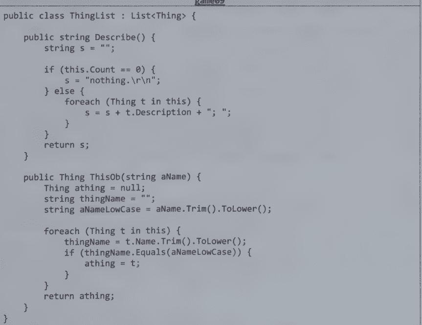
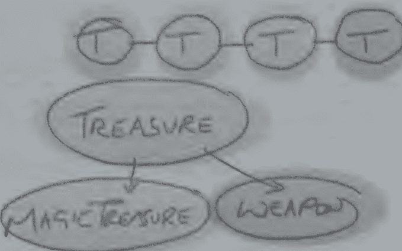
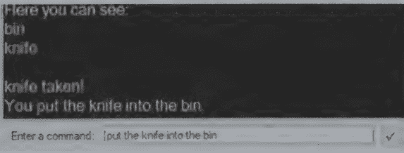
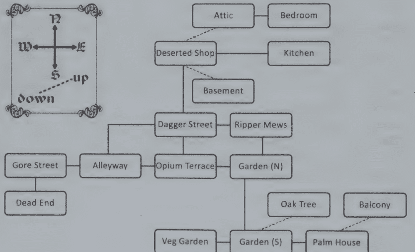
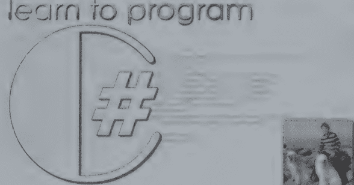
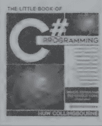
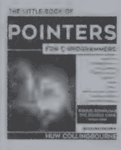
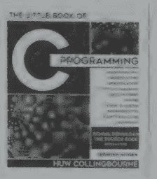
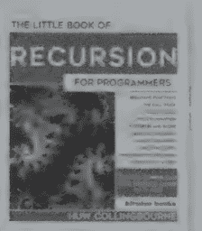
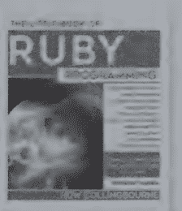

# 冒险游戏编程入门指南：用 C#（及语言）编写复古文本冒险游戏

HUW COLLINGBOURNE

作者：Huw Collingbourne

关于技术编辑.................................................................................................. 11

## 引言

书中包含了哪些内容？入门需要准备什么？请继续阅读……

## 书中包含什么？

本书提供了一个创建基于文本的冒险游戏的逐步指南。书中使用的主要语言是 C#，它是 Windows 上最重要的语言之一，也适用于 macOS 和 Linux。然而，书中解释的编程原理和技术也可以用于 Java、Ruby 或 Object Pascal 等其他语言编写冒险游戏。我们将在通过创建下面的游戏结束结束，该游戏包含一个连接地点的地图，并接受英语指令以允许用户移动并与物体交互。

虽然书中的主要项目都是用 C# 编写的，但附录提供了从 C# 翻译到其他语言的简单帮助。此外，你可以访问 Bitwise Books 网站下载用不同编程语言编写的简单冒险游戏代码示例。

除了专门教授冒险游戏，本书还可以作为编写 C# 程序的教程。它涵盖了 C# 语言所有最重要的特性。如果你更倾向于用“传统”方法学习 C#，由同一作者（Huw Colbourne）编写的《C# 编程入门》（The Little Book Of C# Programming）是本书的完美伴侣。Little Colbourne 系列中的每本书都旨在为你提供真正需要的内容，让你直击问题核心，而没有任何废话和填充。

## 谁应该读这本书？

本书适合对对编写像《Zork》和《Colossal Cave》（巨型洞穴）等经典游戏传统的文本冒险游戏感兴趣。它还提供了 C# 教程，使其适用于初学者（他们可能已经在使用更传统的教程学习 C#）以及寻找有趣且具有挑战性的项目来提高编程技能的经验丰富的程序员。

## 理解文本

在《冒险游戏编程入门》中，任何源代码的编写方式如下：

```c
private void Greet(string aName) {
    textBox1.AppendText("Hello, " + aName + "!");
}
```

某些代码之前可能会有一个如下所示的项目名称：

| HelloWorld |

| :--- |

| private void Greet(string aName) {

    textBox1.AppendText("Hello, " + aName + "!");

} |

这表明该代码可以在源代码存档中的 HelloWorld 项目中找到。为了跟随教程，你可以将命名的项目或解决方案加载到你的编辑器或 IDE 中（对于 C# 项目，假设你将使用 Visual Studio）。运行程序时，你可能在屏幕上看到的任何输出显示如下：

Hello, Fred!

解释性注释（通常提供一些提示或对文中提到的某些点提供更深入的解释）显示如下：

### 这是一个注释

这是一个解释性注释。如果你愿意的话，可以跳过它——但如果你真的这样做，你可能会错过一些有趣的内容……！

## 使用代码存档

书中描述的大多数程序都是用 C# 语言编写的，旨在加载到 Microsoft Visual Studio 中。你可以逐一从源代码存档加载项目（通过选择包含每个项目的子目录中的解决方案或项目文件），或者像我建议的那样，你可以加载一个分组所有示例项目的解决方案。

源代码存档中提供的此解决方案名为 `CSharpAdventureGames.sln`。它包含多个项目，这些项目在解决方案管理器中显示为“节点”（`game01`, `game02` 等）。在编译或运行特定项目之前，你需要先激活它。你可以通过右键点击项目节点并从菜单中选择“设为启动项目”来实现。

## 编译项目

在运行 C# 程序之前，你需要先对其进行编译。C# 编译器是一个工具，它将你编写的代码翻译成“中间代码”，以提供可以由 C# “运行时”系统执行的指令。中间代码被称为 CIL（通用中间语言）。

当你的程序运行时，此 CIL 将由名为 CLR（通用语言运行时）的“运行时环境”执行。这就是为什么在运行程序之前必须始终“生成”或“编译”程序。在 Visual Studio 中编译非常简单。一旦项目被设置为启动项目，你只需从菜单中选择“生成”。

## 命令行游戏

书中描述的大多数程序都是用 C# 语言编写的，旨在加载到 Microsoft Visual Studio 中。这使得创建按钮、文本字段、菜单等用户界面成为可能。然而，如果你想在不支持 Windows Forms 的操作系统上部署游戏，你可以创建一个类似于附录所示的命令行游戏。

```
sack dropped!
look at the sack
这是一个臭旧袋子
在袋子里你可以看到：
acorn

take the acorn
acorn taken!
put the acorn into the slot
你把橡果放入了槽中。
pull the lever
当你拉杆时杆轻微移动。
look at the lever
杆在墙上
down
温室。这是一个由玻璃窗制成的高大优雅结构，位于铁框架中。空气中炎热潮湿。上方长着高大的棕榈树。一个精细的铁梯通向阳台。
在这里你可以看到：
无

你空无
```

## 作者介绍

**Huw Colbourne** 是邪典游戏《Wombat Of Destiny》的作者。Huw 编程已有 30 年。他是一位在线编程讲师，拥有 C、C#、Object Pascal、Ruby 和 JavaScript 等其他语言和主题的成功课程。访问课程网站获取完整列表：http://bitwisourses.com/

Huw 是 Bitwise Books 出版的《Ruby 入门》、《C 入门》、《指针入门》和《递归入门》的作者。他是英国知名的技术作家，曾在 Computer Shopper、PC Pro 和 PC Plus 等许多计算机杂志上写过大量的评论和编程专栏。Huw 曾担任杂志出版商、编辑和电视节目主持人。他在剑桥大学获得英语文学硕士学位，并拥有合气道二段黑带，目前在英国北德文郡教授这种武术。

## 技术编辑介绍

**Dermot Hogan 博士** 是一位软件开发人员，领导过使用汇编语言、C、C# 以及其他多种语言的大型项目。作为实时交易技术的专家，他为国际和金融机构管理并开发了全球风险管理系统。他是独立软件公司 SapphireSteel Software 的首席开发人员。他在剑桥大学获得物理学博士学位。他目前的领域领域致力于机器人控制和成像系统。

## 引言

作者仅仅凭借他多年来玩过的几款经典 Infocom 冒险游戏！

# I – 冒险游戏简教程

房屋之西（West of House）。你站在一栋白色房子西侧的空旷地上，前门封着木板。这里有一个小信箱。

我对计算机编程的兴趣真正始于此。那是 20 世纪 80 年代初。我用过文字处理器，用过电子表格软件，但都没有激发我的想象力。当我玩 Infocom 的 Zork 冒险游戏时，我才真正对计算机到底是如何工作的产生好奇。

在上面的截图中，我正在 DOSBox 操作系统模拟器（可从 https://www.dosbox.com/ 获取）中运行 Zork 1（Zork 三部曲的第一部分）。我在 `>` 提示符后输入了如“read the leaflet”（阅读说明）之类的命令。其余文本由游戏显示。

# – 冒险游戏简教程

## 什么是冒险游戏？

冒险游戏——特别是文本冒险游戏——发生在由相互连接的地点组成的复杂世界中。世界、地点以及其中包含的所有生物和宝藏都是用文字描述的，而不是图像。有些冒险游戏也提供图形，但该类型的真正经典之作（如 Zork）完全是文字性的。

当我第一次玩 Zork 时，令我着迷的是它的世界如此广阔却在内部保持一致。你可以把一盏提灯放进袋子里，然后沿着穿过森林的小径游荡，爬树，开门，并探索构成“大大的地下帝国”的巨大洞穴网络。在探索了几个小时后，你最终会回到房子看到那个袋子。袋子里有那盏灯——正如我离开它时的一样。

游戏是如何“记得”我几小时前把灯放进袋子的呢，即使我已经忘记了做过那件事？当时我真的完全不知道计算机是如何运作的。在 Zork 中，我收集宝藏，将物体放入容器中，解决谜题，并探索看似广阔的 Zork 世界。虽然没有图形，但描述非常生动，就像读小说一样，世界变成了一种沉浸式的现实。我甚至可以通过输入英文命令与游戏对话：“Take the sword”（拿剑）、“Light the lantern”（点灯）、“Climb the tree”（爬树）、“Put the magic ring into the sack”（把魔戒指放入袋子里）等等。

## 交互式小说

文本冒险有时被称为“交互式小说”或简称“IF”。这强调了这类游戏的叙事 aspects。有些冒险游戏提供长段描述文字，玩家可以输入文本获取更多信息、查看物体并以其他方式与游戏交互。

我很快被 Zork 吸引，并决定编写一个自己的游戏。在那个年代，没有全球网，没有 Wikipedia，没有 YouTube，没有亚马逊，也没有（我能找到）书籍解释如何做。我必须通过试错来学习。

# I - 冒险游戏简教程

上面的照片显示了《命运之黄金土鼠》（The Golden Wombat Of Destiny）的部分游戏。就像 Zork 一样，玩家可以输入相当复杂的命令，如“Put the coin in the kennel!（把硬币放在圈里！）”，游戏会做出相应的响应。

回顾，对于一个新手程序员来说，通过编写一个那种复杂的游戏来学习编程是非常愚蠢自自的行为。当我开始时，我对编程一无所知。当我写完《黄金土鼠》时，我已经成了一个具有中等经验的程序员，所以当我看到自己在还是新手时期写下的所有丑陋代码（现在已经牢固地焊接在游戏里）时，我感到非常震惊。可以说，这是一个巨大的学习经历！

编写那个游戏时面临的另一个大局限是，我使用的语言——Pascal 对该项目来说远非理想。面向对象编程（OOP）在当时并不常见，而且 Pascal 完全没有面向对象的特征。Turbo Pascal 的现代版本（Object Pascal 和 Delphi）拥有 OOP。许多其他主流语言如 Ruby、Python、Java 和 C# 也有。面向对象非常适合编写冒险游戏，因为房间和纹理自然地被表示为对象。

今天，我仍然认为编写冒险游戏是提高编程技能的一种极佳方式。与现代快速动作图形游戏不同，文本冒险游戏可以由单个程序员从头到尾编写，而不需要使用复杂的第三方“游戏框架”。在编写冒险游戏的过程中，你需要使用非常广泛的编程技术——创建层次结构、将对象序列化（保存）到磁盘、处理错误处理，甚至将用户输入解析为有意义的人类语言命令。

当我写我的第一个游戏时，我必须自己想办法完成一切。现在你有这本书来引导你。我将解释关于编写冒险游戏你需要的一切知识，从你的第一个简单“房间”到一个包含众多宝藏的巨大连接房间地图复杂游戏。我大部分时间将使用 C# 语言，附录也提供了一些将 C# 翻译到其他语言的帮助。所有的源代码（C# 和其他语言）都可以免费下载。我相信这本书是编写文本冒险游戏最全面的指南。我希望你玩得开心！

虽然无法知道是谁写了第一款冒险游戏，但第一个引起计算机用户兴趣的作品几乎无疑是 Will Crowther 的《Colossal Cave》（巨型洞穴），它有时被称为“原始冒险”。除了编程外，Crowther 还是一个洞穴爱好者，这解释了为什么他的冒险游戏发生在一个巨大的洞穴系统中。《Colossal Cave》开发于 1975 年到 1977 年之间，并在另一位程序员 Don Woods 的帮助下完成。他们的游戏是用 FORTRAN 写的，运行在 PDP-10 主机计算机上。

冒险游戏演变的下一个大步随着 Zork 的发布而来的。这个游戏对 Colossal Cave 有巨大的借鉴，包括构成了 Zork 世界大部分部分的地下网络。Zork 是由 Dave Lebling 领导的 MIT 程序员团队开发的。

关于 Zork 的更多信息，请务必阅读附录中我对 Dave Lebling 的采访。

# I — 冒险游戏简教程

Zork 最初是用 MDL 编程语言编写的，同样是在 PDP-10 上。MDL 是一种基于 LISP 列表处理的语言。后来游戏重写了几次，最著名的实现是用 ZIL（Zork 实现语言）编写的，这是另一种专为编写游戏而开发的类 LISP 语言。当 Infocom 游戏于 1979 年成立时，Zork 最终发布了一个可以在个人计算机上运行的版本。

Infocom 以《星交叉》、《银河系漫游》和《三位》等作品统治了冒险游戏领域。Infocom 对早期 Colossal Cave 游戏做的改进之一是更好的“解析器”，以解释简单的人类语言命令。Colossal Cave 限于两个单词命令，如“Take sword”。Infocom 游戏允许更长的命令，如“Put the Elvish sword into the sack”。

## 编程概念和术语

我不会在书中详细解释编程术语。我还有其他从零开始教编程的书。例如，《C# 小书》提供了 C# 编程的逐步引导指南。本书的附录提供了一些常用编程术语的简短定义。

## 冒险开始 ...

好了，现在你有了对冒险游戏的背景了解，是时候开始编程了。在玩家探索游戏之前，我们需要创建一个游戏“世界”。我们的世界以链接连接地点的形式存在。我们需要做的第一件事是创建一些地点并将它们放在地图上……

# 2 – 创建地图

在冒险游戏中，玩家需要能够在游戏世界中移动，探索游戏世界中的各个地点。为了实现这一点，我们需要创建一个地图。

在规划游戏时，先为游戏的“世界”绘制一张地图是一个好主主意。地图是相互连接的地点或“房间”的集合。这里是我设计的包含四个房间的地图：巨人房、森林、洞穴和地牢。线条表示连接一个房间到另一个房间的出口。没有连接线的地方表示没有出口。

## 房间还是地点？

传统上，冒险游戏将地点称为“房间”，无论这些地点是否真的是建筑内部的房间。在本书中，当我谈到房间时，指的是任何独特的地点，即使它恰好位于“外外世界”的某个地方，比如街道或森林。同样，当我谈到“出口”时，指的是通往特定“方向”另一个房间或地点的连接。

## -- 创建地图

### 创建房间

在创建地图之前，显然我必须有一种创建房间的方法。虽然我将只从一个房间开始，但我需要记住，游戏将有很多房间。每个房间都与其他任何房间都不同——例如，森林里的房间与洞穴里的房间会非常不同。但房间对象也具有许多相似的特征。

从我的这张小地图中看到，房间有一个名称和一些通往其他房间的出口。由于每个房间都具有这些特征，我需要写一个“蓝图”，根据这个蓝图可以创建房间“对象”。在面向对象的术语中，对象的蓝图就是它的类（class）。

我需要一个 `Room` 类，包含一个名称和四个出口。名称将是一个字符串（string）（一段文本，如“巨人房”）。出口应该是什么类型的数据？你可能会认为，如果一个房间进入了另一个房间，那么出口本身应该是一个 `Room` —— 也就是说，如果我这样做，我的 `Room` 类（伪代码）看起来可能像这样：

```
(pseudocode)
class Room
name: string
n: Room
s: Room
w: Room
e: Room
end class
```

### 伪代码

伪代码不是真实的编程代码。它是数据、结构或技术的简化表示。伪代码可以使用你正在使用的任何语言的语法重写为“真实的”程序代码。

我曾写过一个游戏，完全以这种方式实现房间——每个出口都是一个 `Room` 对象。然而，我很快发现缺点大于优点。首先，创建地图需要两个步骤：首先你必须创建所有的 `Room` 对象；然后你必须通过将 `Room` 对象分配给变量来初始化 `n`、`s`、`w` 和 `e`。

# 2 – 创建地图

但最糟糕的是，当你创建一个包含 `Room` 对象的复杂网络时，你的代码会迅速变得难以理解（尤其是从磁盘保存和加载地图时）、难以维护且调试存在问题。

因此，我决定让事情变得简单得多——我也建议你这样做。起初，我将假设地图上的每个 `Room` 都用一个整数（integer）来标识。出口是整数变量，指示在四个方位方向上可以找到房间编号，如下所示：

### (pseudocode)

```
class Room
name: string
n: integer
s: integer
w: integer
e: integer
end class
```

这是我在 C# 中定义 `Room` 类的方式：

### game01

```csharp
public class Room {
    public string name;
    public int n;
    public int s;
    public int w;
    public int e;
}
```

`Room` 仅仅是对象的蓝图。为了有一个可用的房间，我需要创建一个带有出口和名称字段的实际整数和字符串值的房间。在 C# 中，我可以这样这样做：

```csharp
Room r = new Room();
r.name = "Troll Room";
r.n = 1;
r.s = 2;
r.w = 3;
r.e = 4;
```

这创建了一个新的 `Room` 对象并将其分配给变量 `r`。然后，我为对象的每个字段分配值：一个字符串名称和四个用于“方向”变量的整数：`n`、`s`、`w` 和 `e`。

## 2 — 创建地图

### 创建多个房间

一个只有一个地点——“房间”的冒险游戏将将不好玩。我需要许多不同的房间来探索。在面向对象的术语中，一个对象可以说是类的“实例”（instance）。

你只需要定义一次类，然后就可以创建该类的许多实例。我可以通过为每个 `Room` 对象声明一个新的 `Room` 变量来实现。`Room` 类定义了房间是什么。`Room` 对象代表单个房间。在 `game02` 项目中我有四个房间 `room0`、`room1`、`room2` 和 `room3`：

| game02 |

| :--- |

| room0; |

| room1; |

| room2; |

| room3; |

我通过调用 `Room` 构造函数创建一个新的 `Room` 对象，并将其分配给我的变量之一：


```csharp
room0 = new Room();
room1 = new Room();
room2 = new Room();
room3 = new Room();
```

## 构造函数

在 C# 中，与类同名的函数方法称为“构造函数”（constructor）。构造函数可以接受参数。在这里，构造函数没有参数：

```csharp
room0 = new Room();
```

## 2 - 创建地图

### 字符串插值

你可能注意到，我有时会将实际的代码（如 `room0.name`）嵌入到字符串中，如下所示：

```csharp
outputTB.Text = $"You are in {room0.name}";
```

在 C# 中，前带 `$` 的字符串被称为“插值字符串”（interpolated string）。这种字符串允许你在大括号之间嵌入代码。它会计算代码并将结果放入字符串。某些其他语言提供类似的功能。

### 连接房间

为了连接房间，我需要一张地图。房间的方向变量 `n`、`s`、`w` 和 `e` 整数指示每个方向应该“连接”到哪个房间。因此，我需要能够使用这些数字来查找房间。一种简单的方法是将所有房间放入数组中，并使用数组索引来定位房间。

### 连接房间的其他方法

整数出口的优点是简单。但它们没有描述性，因为你被迫记住 1 代表巨人房，2 是森林，以此此类推。在书的后面，我将解释其他以及我认为更好的“连接”房间的方法。

早些时候我画了一张地图来显示房间是如何连接的。你可以在纸上这样做。但（至少对于较小的地图来说）在代码注释中显示地图的图也是很有用的，这就是我在 `game03` 项目中所做的：

```csharp
/* game03
* Troll Room -- Forest
* |
* Cave ----- Dungeon
* */
```

## 2 — 创建地图

这张地图包含四个房间。巨魔房（Troll Room）通往东边的森林（当然，森林也通往西边的巨魔房）。巨魔房还向南通往洞穴（Cave），而洞穴向东通往地下地牢（Dungeon）。在没有显示连接的地方意味着没有“出口”。例如，巨魔房北方没有出口，南方也没有出口。在我的程序中，我的地图结构将是一个数组。

## 数组

数组是一个顺序列表。你可以将其将其看作一组槽位，可以在其中存储固定数量特定类型的项目。

## 创建地图

我通过输入类名 `Room`，后跟一对方括号以及数组变量名 `map` 来声明一个用于持有`Room`对象的数组：

```
Room[] map;
```

这仅仅是数组对象的声明。和其他对象（在 C# 中）一样，我必须先使用 `new` 关键字创建数组对象后才能使用它。我想存储四个 `Room` 对象，所以我写了 `Room`、另一对方括号，以及在括号之间的数组长度 `4`：

```
map = new Room[4];
```

当我想向此数组添加 `Room` 对象时，我将它们放在数组的特定索引处。数组的第一个索引是 `0`。因此，我将数组变量名 `room0` 放在方括号之间，然后是赋值运算符 `=`，最后是 `Room` 变量名 `room0` 后跟分号：

```
map[0] = room0;
```

现在该房间对象被放在数组索引为 `0` 的第一个槽位中。我将剩下的三个房间对象放在索引为 `1`、`2` 和 `3` 的数组索引中：

```
map[1] = room1;
map[2] = room2;
map[3] = room3;
```

## 2 — 创建地图

由于 `Room` 对象位于 `map` 数组的索引 0、1、2 和 3 处，我可以使用每个房间对象的整数出口值（分配给房间 `n`、`s`、`w` 和 `e` 变量的值）来查找特定索引处的房间。这告诉我在我的游戏世界中，哪个房间与当前房间在任何方向上相邻。当我需要从地图上的一个房间移动到另一个房间时，这将至关重要。

# 3 – 在地图上移动

如果玩家无法从一个位置移动到另一个位置，那么在游戏中拥有复杂的地点网络是没有用的。

我们将在本章中查看如何实现。

在 `game04` 项目中，我设计了一个带有 N、S、W 和 E 按钮的简单用户界面，用户可以点击这些按钮在四个指南针方向上移动。左侧的 Visual Studio 事件面板允许我浏览这些按钮的点击事件处理器（event-handler）方法。在这里，我可以看到当用户点击 `S` 按钮时，名为 `s8tn_Click()` 的方法将运行。

我还做了一些其他更改。首先，我更改了 `Room` 变量的“作用域（scope）”。在之前的项目中，它们被声明在 `button1_click()` 事件处理器方法内部，该方法在用户点击按钮时运行。

问题是，方法内部的变量是该方法的“局部”变量。一旦函数停止运行，所有房间都会消失！这对我的游戏没有好处。因此，在 `game04` 中，我将 `Room` 变量声明在函数外部，以便它们具有“全局”作用域（实际上，它们的作用域在 `Form1` 内部），这样它们在整个游戏中持续存在。我还稍微修改了 `Room` 类，添加了一个新的字符串字段 `description`，它在需要时提供房间的描述。

## 3 — 在地图上移动

## 方法（Methods）

在面向对象的术语中，“函数（function）”和“方法（method）”的意思大体相同。函数是一个命名的代码块，它可能不接收参数也不返回结果。方法是声明在类内部的函数，并且“属于”一个对象。在大多数现代面向对象的语言（如 C#、Java 和 Ruby）中，所有函数都属于对象，可以认为是这些对象的方法。在本书中，每当我使用“方法”一词时，我简单指的是与对象关联的函数。

`Form1` 有它自己的构造函数方法 `Form1()`，它在表单创建时（当我的程序启动时）运行。Visual Studio 会自动添加对 `InitializeComponent()` 方法的调用。该方法设置表单、创建按钮等。之后，我想运行我编写的两个新方法：`InitGame()` 和 `StartGame()`。我在构造函数中调用了它们：

```go
public Form1() {
    InitializeComponent();
    InitGame();
    StartGame();
}
```

`InitGame()` 方法包含了我之前编写的用于初始化 `Room` 对象并将它们添加到地图中的代码。`StartGame()` 方法在游戏开始时打印欢迎消息和指令：

```go
private void StartGame() {
    outputTB.Text = "Welcome to the Great Adventure!";
    outputTB.AppendText("You are in " + map[position].name + ".");
    outputTB.AppendText("Where do you want to go?");
    outputTB.AppendText("Click a direction: N, S or E.");
}
```

`InitGame()` 代码中还有另一个重要的添加。我为变量 `position` 赋值了一个值。这是一个新变量，我全局声明了它。我使用它来保存当前房间。

## 3 — 在地图上移动

由于 `Room` 对象位于 `map` 数组的索引 0, 1, 2 和 3 处，我可以使用每个房间对象的整数出口值（分配给房间 `n`、`s`、`w` 和 `e` 变量的值）来查找特定索引处的房间。这告诉我在我的游戏世界中，哪个房间与当前房间在任何方向上相邻。当我需要从地图上的一个房间移动到另一个房间时，这将至关重要。

一旦 `position` 变量的值为 0，我再次通过数组索引使用该对象：

```go
position = 0;
```

假设 `position` 为 0，这将会显示：

- 你在巨魔房。
- 这是一个潮湿、黑暗且有巨魔气味的房间

要移动到一个新房间，我要做的是检查指定方向的房间并相应地更新 `position` 变量。例如，当我点击 `S` 按钮向南时，`SBtn_Click()` 方法运行：

```go
private void SBtn_Click(object sender, EventArgs e) {
    MovePlayer(map[position].s);
}
```

## 在地图移动

如果 `newpos` 数字为 `-1`，则意味着该方向没有房间，因此我显示“该方向没有出口”。否则，我通过将 `newpos` 的值赋值给 `position` 来更新它，并显示新房间。这个数字被传递给 `MovePlayer()` 函数：

```go
private void MovePlayer(int newpos) {
    if (newpos == -1) {
        outputTB.Text = "There is no exit in that direction";
    } else {
        position = newpos;
        outputTB.Text = "You are now in " + map[position].name + ".";
    }
}
```

## 添加玩家

到目前为止，我一直用于在地图上移动的技术并不是面向对象的。玩家的位置只是一个整数。如果能有一个玩家*对象*来包含所有与游戏玩家相关的数据（变量）和行为（方法），将会好得多。让我们来看看如何实现这一点。

我决定创建一个名为 `Actor` 的类。它可以用于定义任何交互式角色——一个可以在地图上移动、拾取和放下宝藏的角色。目前，我只需要一个 `Actor` 来表示玩家。在更复杂的游戏中，你还可以创建其他的交互式角色。

和我游戏中的其他所有对象一样，`Actor` 对象应该有一个名称和描述。我选择像这样写一个 `Actor` 类：

```csharp
public class Actor {
  public string name;
  public string description;
}
```

但由于 `Room` 类也定义了名称和描述，如果我通过创建一个另一个带有名称和描述的类来避免这种不必要的重复，让 `Room` 类和 `Actor` 类就可以*继承*这些特性。

这是面向对象编程的基本原则：首先创建一个简单的类，然后创建更复杂的类，它们继承简单类的特性并根据需要添加额外的功能。

在 `game05` 项目中，我创建了一个名为 `Thing` 的类。`Thing` 类有一个名称和描述，它将是我游戏中所有其他类的祖先。到为止，我将对象内部的字段设置为公共，这样我创建的任何对象都可以获取这些字段或为它们分配新值。这很容易做到，但这是一种坏习惯。

对象内部的字段（实际数据）应该是隐藏的。它们应该只能通过访问器方法访问——即为变量提供公共“接口”的方法。出于这个原因，`Thing` 以及我游戏中其他类的字段（变量）现在被设为私有：

```csharp
public class Thing {
  private string _name;
  private string _description;
}
```

## 私有字段名称

为了清晰起见，我选择在私有字段名称 `_name` 和 `_description` 前加下划线。这是许多编程语言中的通用惯例。然而，一些程序员倾向于对字段和访问方法使用相同的名称，但字段以小字母开头（例如 `name`），而属性以大字母开头（例如 `Name`）。

`_name` 和 `_description` 现在是私有的，代码无法在对象外部引用它们。我需要添加公共的访问器方法来获取和设置这些变量的值。在 C# 中，我可以使用 `=>` 运算符来返回字段的值。我可以使用 `set` 配合 `=>` 运算符来赋值（由关键字 `value` 表示），如下所示：

```csharp
public string Name {
    get => _name;
    set => _name = value;
}

public string Description {
    get => _description;
    set => _description = value;
}
```

## 属性

在 C# 和 .NET 中，当你提供 `get` 和 `set` 访问器来分配和返回对象变量的值时（正如我对 `Name` 和 `Description` 所做的那样），这些被称为“属性”。一些其他语言提供了类似的功能。例如，在 Ruby 中，它们被称为“attributes”。

现在我有了一个 `Thing` 类，可以将 `Room` 类重写为它的后代。在 C# 中，实现这一点的方法是在类名后加上冒号，然后是它的祖先类名，正如我做的那样：

```csharp
public class Room : Thing {
```

# 3 在地图上移动

这显示 `Room` 是 `Thing` 的类型，因此它将继承 `Thing` 的特性。在这种情况下，任何 `Room` 对象将将有一个名称和描述，因为它们继承自 `Thing` 类。因此我不需要在 `Room` 类中定义名称和描述字段或任何访问方法。

由于 `Room` 继承自 `Thing`，它会自动继承 `Name` 和 `Description` 属性。这意味着我现在需要的是为 `Room` 添加任何额外功能；这里是四个出口：北、南、东、西。我将这些变量设为私有并带有公共访问器：

```csharp
private int _n;
private int _s;
private int _w;
private int _e;

public int N {
    get => _n;
    set => _n = value;
}

public int S {
    get => _s;
    set => _s = value;
}

public int W {
    get => _w;
    set => _w = value;
}

public int E {
    get => _e;
    set => _e = value;
}
```

## 封装与数据隐藏

将数据——内部字段和变量——以及作用于数据的函数或方法封装被称为“封装”。当你将数据设为私有时（正如我对类字段做的那样），这被称为“数据隐藏”。从现在起，我的所有类将使用封装和数据隐藏。

# 3 在地图上移动

`Actor` 类也继承自 `Thing` 类，因此它自动有一个名称和描述。它还需要一个项目——`Actor` 对象的当前位置。位置是一个 `Room`。所以我给它了一个 `Room` 字段，私有变量 `_location`，以及一个公共访问方法：

```csharp
public class Actor : Thing {
    private Room _location; // Actor 所在的位置

    public Actor(string aName, string aDescription, Room aRoom) {
        base(aName, aDescription);
        _location = aRoom;
    }

    public Room Location {
        get => _location;
        set => _location = value;
    }
}
```

## Thing Hierarchy


上面的图显示了类层次。`Room` 和 `Actor` 类继承自 `Thing`。

# 3 在地图上移动

这显示 `Room` 是 `Thing` 的类型，因此它将继承 `Thing` 的特性。在这种情况下，任何 `Room` 对象将自动有一个名称和描述，因为它们继承自 `Thing` 类。因此我不需要在 `Room` 类中定义名称和描述字段或任何访问方法。

由于 `Room` 继承自 `Thing`，它会自动继承 `Name` 和 `Description` 属性。这意味着我现在需要的是为 `Room` 添加任何额外功能；这里是四个出口：北、南、东、西。我将这些变量设为私有并带有公共访问器：

```csharp
private int _n;
private int _s;
private int _w;
private int _e;

public int N {
    get => _n;
    set => _n = value;
}

public int S {
    get => _s;
    set => _s = value;
}

public int W {
    get => _w;
    set => _w = value;
}

public int E {
    get => _e;
    set => _e = value;
}
```

## 构造函数

我之前提到过，当你想要创建一个新对象时调用它的构造函数。如果构造函数不需要参数，你可以这样调用默认构造函数：

```csharp
room = new Room();
```

事实上，当我想在 `game05` 中初始化一些变量时，我创建了这个 `Room` 构造函数：

```csharp
public Room(string aName, string aDescription, int aN, int aS, int aW, int aE) {
    base(aName, aDescription);
    _n = aN;
    _s = aS;
    _w = aW;
    _e = aE;
}
```

`Room` 和 `Actor` 构造函数将字符串 `aName` 和 `aDescription` 传递给基类 `Thing`。这是 `Thing` 的构造函数：

```csharp
public Thing(string aName, string aDescription) {
    _name = aName;
    _description = aDescription;
}
```

我还为 `Actor` 创建了此构造函数：


```csharp
public Actor(string aName, string aDescription, Room aRoom) {
    base(aName, aDescription);
    _location = aRoom;
}
```

## 移动玩家

现在有了玩家对象，我删之前用于存储当前房间索引的 `position` 变量。在 `game04` 中，当我想移动玩家时，我为整数位置分配了一个新值。

在 `game05` 中，当我想移动玩家时，我更新 `_player` 对象的 `Location` 属性，它不是一个整数而是一个 `Room`。在我的 C# 项目中，我有一个带有四个按钮的用户界面，用于向北、南、西、东移动。点击这些按钮之一时，我想更新相关的 `Room` 属性为 `N` 或 `S`，以便将玩家移动到方向的新房间。

让我们来看一个例子。当我点击向南移动按钮时，我获取当前位置的 `Room`——这就是存储在 `_player` `Location` 属性中的 `Room`。然后我获取该 `Room` 的 `S` 属性值。`S` 属性是地图数组中的一个整数索引：

```csharp
_player.Location.S
```

我将其传递给 `MovePlayer()` 方法：

```csharp
private void SBtn_Click(object sender, EventArgs e) {
    MovePlayer(_player.Location.S);
}
```

# 3 — 在地图上移动

这是 `MovePlayer` 方法：

```csharp
private void MovePlayer(int newpos) {
    if (newpos == -1) {
        outputTB.Text = "There is no exit in that direction\r\n";
    } else {
        _player.Location = map[newpos];
        outputTB.Text = $"You are now in the {_player.Location.Name}\r\n";
    }
}
```

如果整数（`newpos` 参数）为 -1，意味着该方向没有出口，因此我会显示一条消息告知用户。但如果 `newpos` 是地图数组的有效索引（`map[newpos]`），我就会通过将该地图索引处的 `Room` 赋值给 `_player` 对象的 `Location` 属性来更新玩家的位置：

```csharp
_player.Location = map[newpos];
```

然后，我会显示一条消息来展示新房间名称：

```csharp
outputTB.Text = $"You are now in the {_player.Location.Name}\r\n";
```

# 4 – 字典中的房间

到目前为止，我一直使用数组来存储房间地图。数组是一个固定长度的元素列表。现在，让我们来看另一种被称为“字典”（dictionary）的列表类型。

我一直用于地图的数组可以通过数值索引来找到房间。例如，我可以通过在名为 `map` 的数组中将索引放在方括号内 `map[2]`，来找到索引为 2 的房间。

许多语言（如 C#、Java、Ruby 以及许多其他语言）也提供了可以使用非数值数据类型进行索引的列表。这种列表被称为字典。在我的游戏中，我认为使用描述性名称（如 `Troll` 巨魔或 `Forest` 森林）来对列表中的房间进行索引，比使用 1 或 2 等整数要有用得多。因此，我将使用字典来重新实现我的地图。

## 字典、关联数组和哈希表

字典有时被称为“哈希表”（hashes）或“关联数组”（associative arrays）。通常这些术语的意思大体相同。然而，某些语言具有“特殊用途”的字典类型，可能会使用不同的名称。在书中，我将宽泛地使用“字典”一词来描述任何形式键值对（key-value pairs）的列表。

## 键值对

字典以元素对的形式存在。在 C# 中，第一个元素是“键”（key）。关联的元素是“值”（value）。在 C# 中，键可以是整数、字符串或其它类型的对象。你使用键来查找与其关联的值。

从这个意义上说，它有点像现实世界的字典。字典中每个条目的名称是键，定义是值。如果键是“dog”，那么这个词就可以定位字典中“dog”的条目，并带给我它的值（定义），该定义是“一种会汪汪叫的四足动物！”

# 4 – 字典中的房间

## RoomList – 字典的子类

在 `game06` 项目中，你会看到我创建了一个名为 `RoomList` 的新类。这个类将定义新版本的地图。它是 `Dictionary` 类的后类：

```csharp
game06
public class RoomList : Dictionary<Rm, Room> {
    public RoomList() {
    }

    public Room RoomAt(Rm id) {
        return this[id];
    }

    public string Describe() {
        string s = "";
        if (this.Count == 0) {
            s = "Nothing in RoomList";
        } else {
            foreach (KeyValuePair<Rm, Room> kv in this) {
                s = s + kv.Value.Describe() + "\r\n";
            }
        }
        return s;
    }
}
```

注意我是如何声明 `RoomList` 类的与之前的示例一样，它的基类显示在冒号右侧。但在这里，基类名 `Dictionary` 后面跟着两个用逗号分隔的角度项目：

```csharp
<Rm, Room>
```

这些是我计划用作键和值的对象类型。键是 `Rm`（我稍后会解释）。值是 `Room`。

我本可以直接创建一个 `Dictionary` 类实例的实例来构建地图。然而，通过创建一个子类，我为自己提供了添加 `Dictionary` 类中不存在的功能选项。我的 `RoomList` 继承了 `Dictionary` 的特性，并增加了 `RoomAt()` 和 `Describe()` 方法。

`RoomAt()` 方法根据给键返回一个 `Room`（`return this[id]`）。这里的语法看起来像是对数组进行索引，但我并不是。我是在获取当前（`this`）字典中由 `Rm` 键指示的条目。那么 `Rm` 数据类型到底是什么？让我们接下来来看。

# 4 – 字典中的房间

## 唯一房间标识符 – 枚举

对于我的地图，我本可以使用字符串作为字典的键。如果我这样做，字符串 "Cave" 可以作为一个键，而包含洞穴描述和出口的 `room2` 对象可以作为其关联的值。

问题是，我可能有多个名为 "Cave" 的房间——也许我有一个整个地下帝国，里面有成百个洞穴。但我需要地图字典中的每个键都是唯一的，这样当我需要寻找特定的洞穴时，我能确定知道要去的是哪一个。

因此，我决定使用常量而不是字符串。枚举（enum）提供了一种对常量进行分组的方法。例如，在我的游戏中，我可能会有一个如下枚举：

```csharp
public enum Rm {
    Troll,
    Forest,
    Cave,
    Dungeon,
    NOEXIT
}
```

在 `game06` 中，我使用枚举来分组标识符。在 C# 即 `Form1.cs` 中，我可能会有一个这样的变量：

```csharp
Rm selectedRoom;
```

## 重构游戏

请注意，我提供的代码允许 `Form1` 访问（或“获取”）*player object*，但不能修改它。换句话说，`Player` 是一个只读属性。我在 `Adventure` 中添加了 `MovePlayerTo()` 函数。该函数返回一个字符串，指示新的位置，或者说明没有出口。此外，在 `Form1` 中，我添加了一个 `Adventure` 对象 `adv`：

```csharp
Adventure adv;
```

当我运行程序时，`InitGame()` 方法像以前一样执行。但这次它创建了 `adv` 对象。这会调用 `Adventure` 构造函数，来初始化地图和玩家：

```csharp
private void InitGame() {
    adv = new Adventure();
}
```

## 简化地图构建

由于地图现在是一个 `RoomList`（它是 `Dictionary` 的类型），因此没有任何 `Room` 对象会“独立”存在——它将作为 `RoomList` 的元素之一被存储。这意味着我不再需要像 `room0`、`room1` 等单独的 `Room` 变量了。

在 `game07` 中，每当我向 `_map` 添加一个元素（键和值）时，我都会创建一个新的 `Room` 对象。记住，一个 `Rm` 枚举常量提供了键，而 `Room` 对象是其关联的值：

```csharp
game07
_map.Add(Rm.RoomList,
new Room("Troll Room", "a dank, dark room that smells of troll",
Rm.NOEXIT, Rm.Cave, Rm.NOEXIT, Rm.Forest));
```

由于我不再拥有任何 `Room` 变量，当我使用键进入 `_map` 并调用 `Actor` 构造函数时，我还需要初始化玩家的位置。起始位置是“Troll Room”，因此我通过地图的 `RoomAt()` 方法访问该房间，以返回与 `Rm.TrollRoom` 键关联的 `Room` 对象：

```csharp
_player = new Actor("You", "The Player", _map.RoomAt(Rm.TrollRoom));
```

## 移动玩家

我在 `game08` 中继续重构我的代码。我决定我不喜欢按钮的事件处理器去钻探 `Player` 内部寻找当前位置的出口：

```csharp
game07
private void NBtn_Click(object sender, EventArgs e) {
    MovePlayer(adv.Player.Location.N);
}
```

按钮事件处理器不应该干涉 `Player` 的内部细节。它们应该只请求玩家向某个方向移动。这是我现在实现事件处理器的示例：

```csharp
game08
private void NBtn_Click(object sender, EventArgs e) {
    MovePlayer(Dir.NORTH);
}
```

每个针对 N、S、E、W 按钮的事件处理器都会将一个方向常量传递给 `MovePlayer()` 方法；该方法会将此常量继续传递给 `adv` 对象的 `MovePlayer()` 方法。我在 `AdvConsists.cs` 中定义了方向常量。就像 `Rm` 常量一样，`Dir` 是一个具有固定标识符集合的枚举：NORTH、SOUTH、EAST、WEST：

```csharp
public enum Dir {
NORTH,
SOUTH,
EAST,
WEST
}
```

我重写了 `MovePlayer()` 函数，使其接收一个 `Dir` 常量而不是以前的 `Rm`。这是旧版本：

```csharp
game07
private void MovePlayer(Rm newpos) {
    outputTB.Text = adv.MovePlayerTo(newpos);
}
```

# 5 – 重构游戏

这是新版本：

```csharp
game08
private void MovePlayer(Dir direction) {
    outputTB.Text = adv.MovePlayerTo(direction);
}
```

和以前一样，`MovePlayer()` 调用 `Adventure` 类的 `MovePlayerTo()` 方法。我重写了 `MovePlayerTo()`。它现在调用一个名为 `MoveTo()` 的私有方法。该方法使用 `switch...case` 语句测试方向的值，并返回赋值给玩家 `Location` 对应方向的 N、S 或 E 属性的 `Rm` 常量：

```csharp
private Rm MoveTo(Actor anActor, Dir direction) {
    Room r = anActor.Location;
    Rm exit;
    switch (direction) {
        case Dir.NORTH:
            exit = r.N;
            break;
        case Dir.SOUTH:
            exit = r.S;
            break;
        case Dir.EAST:
            exit = r.E;
            break;
        case Dir.WEST:
            exit = r.W;
            break;
        default:
            exit = Rm.NOEXIT;
            break;
    }
    if (exit != Rm.NOEXIT) {
        MoveActorTo(anActor, _map.RoomAt(exit));
    }
    return exit;
}
public string MovePlayerTo(Dir direction) {
    string s;
    if (MoveTo(_player, direction) == Rm.NOEXIT) {
        s = "There is no exit in that direction\r\n";
    } else {
        s = $"You are now in the {_player.Location.Name}\r\n";
    }
    return s;
}
```

## 5 — 重构游戏

`MoveTo()` 方法将“当前房间”（`anActor.Location`）赋值给一个本地 `Room` 变量。它通过测试 `Dir` 方向常量与该出口的值来寻找从 `Room r` 的出口。如果该方向没有房间，则常量为 `Rm.NOEXIT`。如果该方向有房间，则调用 `MoveActorTo()` 方法将演员移动到该房间。

```csharp
private void MoveTo(Actor anActor, Dir direction) {
    Room r = anActor.Location;
    Rm exit;
    switch (direction) {
        case Dir.NORTH:
            exit = r.N;
            break;
        case Dir.SOUTH:
            exit = r.S;
            break;
        case Dir.EAST:
            exit = r.E;
            break;
        case Dir.WEST:
            exit = r.W;
            break;
        default:
            exit = Rm.NOEXIT;
            break;
    }
    if (exit != Rm.NOEXIT) {
        MoveActorTo(anActor, _map.RoomAt(exit));
    }
    return exit;
}
```

`MoveTo()` 方法将“当前房间”（`anActor.Location`）赋值给一个本地 `Room` 变量。它通过测试 `Dir` 方向常量与该出口的值来寻找从 `Room r` 的出口。如果该方向没有房间，则常量为 `Rm.NOEXIT`。如果该方向有房间，则调用 `MoveActorTo()` 方法将演员移动到该房间。

最后，`MoveTo()` 返回出口常量，该常量被 `MovePlayerTo()` 使用。

## 逐步示例

让我们考虑玩家在 Troll Room 并点击北（North）按钮的情况。地图初始化如下：

```csharp
_map.Add(Rm.RoomList,
new Room("Troll Room", "a dank, dark room that smells of troll",
Rm.NOEXIT, Rm.Cave, Rm.NOEXIT, Rm.Forest));
```

Troll Room 向北没有出口，因此 `MoveTo()` 返回 `Rm.NOEXIT`。`MovePlayerTo()` 然后返回“There is no exit in that direction”。

然而，如果玩家点击南（South）按钮，`MoveTo()` 返回 `Rm.Cave`。调用了 `MoveActorTo()`，玩家被移动到 Cave。`MovePlayerTo()` 返回“You are now in the Cave”。

# 5 — 重构游戏结构

## 使用 Visual Studio 调试

如果你正在使用 Visual Studio 尝试运行书中提供的 C# 代码，请在调试器中运行 `game08`。在各种按钮事件处理程序上设置断点，同时也（至少）在 `MoveTo()` 和 `MovePlayerTo()` 方法的最后几行代码上设置断点。然后按 F5 运行直到断点，或使用 F11（逐入）和 F10（逐过程），然后在调试器的“本地”（Locals）或“监视”（Watch）窗口中观察变量的值。


顺便提一下，由于`MovePlayerTo()`是这三个移动方法中唯一的公共（public）方法，它是唯一可以从`Form1.cs`代码调用的方法。我将`MoveTo()`和`MoveActorTo()`方法设置为私有（private），因为在游戏的未来版本中，我可能想要调用它们来移动其他的`Actor`对象（交互式角色）。

现在我已经整理好了游戏代码，准备好添加一些宝藏了。宝藏是位于各种房间中的对象。有时玩家可能想要收集宝藏，那时事情就变得真正有趣了。

# 6 – 宝藏集合

现在我们已经有了地图和玩家，需要添加一些宝藏，玩家可以将宝藏从一个房间捡走并掉在另一个房间。

游戏的基础部分已经就绪。我们在地图中存储了房间，玩家可以在房间之间移动。我们还没有让玩家收集宝藏的能力。在做此之前，我们需要能够向房间中添加宝藏列表。

玩家也需要能够存储宝藏列表。并且需要某种方式将宝藏从一个列表传输到另一个列表——当玩家捡起宝藏时，从房间传输到玩家的背包；当玩家丢掉宝藏时，从背包传输到房间。我已经在`game09`项目中添加了这些功能。

## 宝藏列表

由于玩家和房间都需要持有对象列表，因此将列表不是单独添加到`Room`和`Actor`类中，而是添加到一个公共祖先类中是合理的。这样，`Room`和`Actor`类就可以从它们的祖先类继承同一套列表管理功能，而不需要实现两次列表。

到目前为止，`Room`和`Actor`都直接继承自`Thing`类。`Thing`类是一个非常简单的类，我想保持它的简单！将基类保持得小巧且“通用”，并将更专门的功能（如列表管理）放在后代类中是良好的面向对象设计。如果我将列表管理添加到`Thing`类，那么所有其他类都将继承列表。这不是我想要的。

所以，既然我想让`Room`和`Actor`的祖先包含一个列表，但目前它们的祖先还没有列表，我该怎么办？我的解决方案是创建一个中间类——一个位于基类`Thing`和更专门的类`Actor`/`Room`之间的类。在`game09`中，我创建了一个名为`ThingHolder`的类来维护一个thing列表。它可以使用`AddThing()`或`AddThings()`方法向列表中添加一个或多个thing，并且它有一个名为`Things`的属性可以返回列表：

```csharp
public class ThingHolder : Thing {
    private ThingList _things = new ThingList();

    public ThingHolder(string aName
```

`ThingHolder`是`Thing`的后代。为了将`ThingHolder`类的功能同时添加到`Actor`和`Room`类中，我需要做的只是重新定义这些类的祖先。之前`Room`和`Actor`直接继承自`Thing`。现在让它们继承自`ThingHolder`。当然，它们最终仍然继承自`Thing`，因为`ThingHolder`本身继承自`Thing`。但它们的直接祖先现在是`ThingHolder`，所以它们继承了类的`ThingList`。我还更改了`Room`和`Actor`的构造函数，使其接受一个新的参数，即一个`ThingList`对象：

```csharp
public Room(string aName, string aDescription, Rm aN, Rm aS, Rm aW, Rm aE,
    ThingList tl)

public Actor(string aName, string aDescription, Room aRoom, ThingList tl);
```

## ThingList 类

我的`Room`和`Actor`类都维护一个存储在`ThingList`中的对象列表。看我对这个类的声明：

```csharp
public class ThingList : List<Thing>
```

这显示`ThingList`是泛型列表，是一个强类型集合。`List`类可以持有对象集合，并带有许多实用的方法，用于添加、删除和定位集合中的对象。存储在列表中的对象的实际类型位于尖括号之间，正如我在这里做的那样：`<Thing>`

只有`Thing`对象及其后代可以存储在此列表中。我的`ThingList`类现在可以使用由`List`类定义的方法（如`Add()`和`AddRange()`）向`ThingList`集合中添加一个或多个定义类型（`Thing`对象）的对象：



```csharp
public class ThingList : List<Thing> {
  public string Describe() {
    string s = "";
    if (this.Count == 0) {
      s = "nothing.\r\n";
    } else {
      foreach (Thing t in this) {
        s = s + t.Description + "";
      }
    }
    return s;
  }

  public Thing IsOb(string aName) {
    Thing athing = null;
    string thingName = "";
    string aLowerCase = aName.ToLower();

    foreach (Thing t in this) {
      if (t.Name.Equals(aLowerCase)) {
        athing = t;
      }
    }
    return athing;
  }
}
```

# 6 — 宝藏集合

当然，由于该类派生自`List`，我可以添加其他方法——正如我在这里这样做——返回匹配字符串的对象。

```csharp
public class RoomList : Dictionary<Rm, Room>
```

我的`RoomList`是泛型的，就像我的`ThingList`一样。在强类型语言（如C#和Java）中，泛型集合提供了类型安全（因为它们指定了在列表中可以使用哪些类型），而不需要强制你继承自特定的基类。总之，`ThingList`实现了对象的列表。`ThingHolder`类定义了一个包含`ThingList`的对象。`Room`和`Actor`对象都是`ThingHolder`的后代，因此它们各包含`ThingList`。房间中的任何宝藏存储在`ThingList`中。玩家等`Actor`可以收集宝藏并丢弃。

## 泛型字典

你可能记得在第4章见过过类似的语法。`Dictionary`是键值对的集合。当我想要一个类型为`Rm`作为键、`Room`对象作为值的字典时，我这样定义`RoomList`：

## 向房间添加宝藏

现在我准备好创建一些`Thing`对象列表并将它们添加到某些房间中。你可以在`game09`的`Adventure`类中看到我是如何做的。我创建了两个`ThingList`对象：`trollroomlist`和`forestlist`：

```csharp
game09
ThingList trollroomlist = new ThingList();
ThingList forestlist = new ThingList();
```

向它们添加了一些`Thing`对象。注意，我没有为每个`Thing`对象创建单独变量，因为这些对象永远不存在列表之外：

- `trollroomlist.Add(new Thing("carrot", "这是一个很脆的胡萝卜"));`

- `forestlist.Add(new Thing("sausage", "这是一根肥满的猪肉肠"));`

- `trollroomlist.Add(new Thing("tree", "这是一棵巨大的橡树", false));`

当我创建房间并将它们添加到地图时，我将`trollroomlist`添加到巨鬼房间（Troll Room），将`forestlist`添加到森林（Forest）房间：

```csharp
_map.Add(Rm.TrollRoom, new Room("巨鬼房间",
"一个黑暗、潮湿且闻着巨鬼味的房间",
Rm.NOEXIT, Rm.Cave, Rm.NOEXIT, Rm.Forest,
trollroomlist));
map.Add(Rm.Forest, new Room("森林",
"一个阳光明媚、空气流通的森林",
Rm.NOEXIT, Rm.NOEXIT, Rm.TrollRoom, Rm.NOEXIT,
forestlist));
```

对于那些不包含任何对象的房间，我创建一个新的空`ThingList`作为`Room`构造函数的最后一个参数。每个房间都需要一个`ThingList`，即使它里面什么都没有，玩家可能在那些房间里丢掉对象。丢掉的对象会被添加到`ThingList`中。

## ThingHolder 构造函数

`Room`和`Actor`构造函数都接受`ThingList`作为最后一个参数，并且它们调用其祖类`ThingHolder`的构造函数来初始化该列表：

```
game09
public Room(string aName, string aDescription, Rm aN, Rm aS, Rm aW, Rm aE, ThingList tl)
: base(aName, aDescription, tl)

public Actor(string aName, string aDescription, Room aRoom, ThingList tl) :
base(aName, aDescription, tl)
```

在`Adventure`类中，我用一个空的`ThingList`初始化了`_player`。在游戏过程中，每当玩家从房间中拿走物品时，该物品就会添加到这个列表中：

```
_player = new Actor("You", "The Player", _map.RoomAt(Rm.TrollRoom),
new ThingList());
```

由于我打算让玩家从房间里拿宝藏，所以我还有一件事需要做。我需要确保只有那些在逻辑上足够小可以被捡取的物品才能被捡取。例如，`forestlist`包含了一棵巨大的橡树：

```
new Thing("tree", "It is a gigantic oak tree", false)
```

如果玩家进入森林并拿走了那棵树，那就太蠢了。我需要某种方法来确保某些物品可以捡，而某些不能。这就是第三个参数的作用。通过将其设置为`false`，我确保了这棵树不能被捡走。不过，你可能注意到胡萝卜和香肠并没有第三个参数：

```
new Thing("carrot", "It is a very crunchy carrot")
new Thing("sausage", "It is a plump pork sausage")
```

构造函数如何能有时需要三个参数而有时只需要两个？事实证明我重写的`Thing`类现在有两个构造函数。第一个构造函数需要两个字符串参数；第二个构造函数需要两个字符串后跟一个`bool`（true或false）参数：

## 方法重载

```csharp
public Thing(string aName, string aDescription) {
    _name = aName;
    _description = aDescription;
    _cantake = true; // 将 cantake 设置为默认值
}

public Thing(string aName, string aDescription, bool aCantake) {
    _name = aName;
    _description = aDescription;
    _cantake = aCantake;
}
```

当你有两个方法（构造函数方法或其他方法）具有相同的名称但不同的参数集合时，它们被称为重载。当你调用一个重载方法时，你传递给该方法的参数数量和类型决定了实际上将运行该方法的哪种实现。

当我调用`Thing`构造函数并传递两个字符串参数时，运行的是上面显示的第一个构造函数。但如果我带两个字符串和一个`bool`来调用`Thing`构造函数，则会运行第二个构造函数。

当然，我可以完全省略第一个构造函数。但如果我这样做了，那么每当我想要构造一个可捡取的对象时，都需要将`true`作为第三个参数传递。由于游戏中的大多数对象都是可捡取的，我决定保留旧的构造函数（只有两个参数的），这样通常当我创建一个`Thing`对象时，只需要传递一个名称和一个描述即可。第一个构造函数为以这种方式构造的所有对象将`_cantake`字段设置为`true`。第二个构造函数则留给特殊情况，即我想显式设置`bool`值的时候。

# 7 – 捡取、丢弃和描述

如果玩家不能捡取和丢弃宝藏，任何冒险游戏都是完整的。让我们看看如何实现……

我准备好添加允许玩家捡取和丢弃物品的代码。我的`TransferOb()`方法就是这么做的。它接受三个参数：一个`Thing t`和两个`ThingList`集合：`fromlist`和`tolist`。代码使用`Remove()`方法将`t`从`fromlist`中移除，并使用`Add()`方法将其添加到`tolist`。`Remove()`和`Add()`是`List`类的标准方法。你可能记得`ThingList`派自`List`类，因此它会自动继承这些方法：

```c
private void TransferOb(Thing t, ThingList fromlist, ThingList tolist) {
    fromlist.Remove(t);
    tolist.Add(t);
}
```

在调用`TransferOb()`之前，我必须确定需要转移哪个`Thing`，并且必须完全确定指定的`Thing`位于我想从中取的列表中。

## 捡取和丢弃物品

在我的C#项目`game09`中，如你所见，我添加了两个新按钮：Take（捡取）和Drop（丢弃），以及一个名为`InputTB`的文本框。当我点击Take按钮时，会调用此事件处理器：

```csharp
private void TakeBtn_Click(object sender, EventArgs e) {
    WriteLine(adv.TakeOb(InputTB.Text));
}
```

# 7 — 捡取、丢弃和描述

顺带一下，`WrLn()`只是我写的一个工具方法。它接受一个字符串并添加回车符和换行符。然后它调用另一个简单的方法`Wr()`，将字符串追加到`outputTB`框中：

```csharp
private void Wr(String s) {
    OutputTB.AppendText(s);
}

private void WrLn(String s) {
    Wr(s+"\r\n");
}
```

`TakeBtn_Click()`事件处理器使用用户在`InputTB`框中输入的字符串调用`adv.TakeOb()`。这是通过将`obname`给`_player.Location.Things`的`ThisOb()`方法实现的，该列表是对象的`ThingList`：

```csharp
Thing t = _player.Location.Things.ThisOb(obname);
```

`TakeBtn_Click()`事件处理器使用用户在`InputTB`框中输入的字符串调用`adv.TakeOb()`。

# 7 — 捡取、丢弃和描述

在`TransferOb()`中，房间中的对象列表赋值给`fromlist`参数，玩家的背包被赋值给`tolist`参数。`TransferOb()`从列表中移除它并将其添加到背包。

这很简单。但`TakeOb()`中的所有其他代码在做什么？让我们仔细观察。首先，代码尝试寻找与输入文本框的字符串匹配的对象。这是通过将`obname`传递给`_player.Location.Things`的`ThisOb()`方法实现的：

```
game09
```

# 捡取、丢弃和描述

`ThisOb()`尝试匹配名称。首先使用`Trim()`和`ToLower()`方法去除两端空格并将整个字符串转换为小写，将结果赋值给`aNameLowerCase`。然后，在`foreach`循环中，它尝试将`aNameLowerCase`与列表中对象的名称进行匹配。再次，它对列表中所有对象的名称进行小写处理，以便使用字符串`Equals()`方法进行比较。如果匹配，则返回该名称的`Thing`。如果没有匹配，则返回`null`：

```csharp
public Thing ThisOb(string aName) {
  Thing thing;
  string thingName = "";
  string aNameLowerCase = aName.Trim().ToLower();

  foreach (Thing t in this) {
    thingName = t.Name.Trim().ToLower();
    if (thingName.Equals(aNameLowerCase)) {
      thing = t;
    }
  }
  return thing;
}
```


现在，如果你回顾`Adventure.cs`中`TakeOb()`的代码，你会发现它有两个测试。首先它测试`obname`是否为空字符串（因为用户没有输入名称）。然后它测试`Thing t`是否为`null`（如果在当前房间没有找到匹配的`Thing`对象）。

只有当这两个条件都不满足时，代码才会尝试将对象从`_player.Location.Things`（当前房间的`ThingList`）转移到`_player.Things`（玩家的背包）。

# 7 拾取、丢弃与描述

```csharp
if (t.CanTake) {
    TransferOb(t, _player.Things, _player.Things);
    s = t.Name + " taken!";
} else {
    s = "You can't take the " + t.Name + "!";
}
```

在这里，物品只有在它的`CanTake`属性为`true`时才会被拾取（所以玩家无法拿起我之前提到的那棵橡树）。`DropOb()`方法与`TakeOb()`本质相同，只是我没有去测试`CanTake`属性。因为如果一个对象已经在玩家的背包里，那么它显然是可以被拾取的。而且，这次`fromlist`和`tolist`的顺序是反过来的，我想将其从玩家的列表转移到当前房间的列表：

```csharp
public string DropOb(string name) {
    Thing t = _player.Things.ThisOb(name);
    string s = "";
    if (t == null) {
        s = "You haven't got one!";
    } else {
        TransferOb(t, _player.Things, _player.Location.Things);
        s = t.Name + " dropped";
    }
    return s;
}
```

## 描述对象

如果你仔细观察过game09项目中的代码，你可能会注意到`Room`类中的`Describe()`方法在Visual Studio中被标记了绿色的波浪线。当我悬停在该行上时，我看到了这个警告提示：

> 'Room.Describe()' 隐藏了继承成员 'ThingHolder.Describe()'。

> 如果确实想要隐藏，请使用 new 关键字。

这是因为我在`Room`的祖类中已经有了一个`Describe()`方法。通常情况下，子类会自动继承祖类的方法。但在这种情况下，祖类（`ThingHolder`）和子类（`Room`）都定义了一个`Describe()`方法。当这种情况发生时，默认情况下子类中的方法会替换祖类中的方法。这里就是如此。当我从一个`Room`对象调用该方法时，`Room`的`Describe()`方法实际上替换了`ThingHolder`的`Describe()`方法。如果这就是我想要的效果，那么为了清晰起见，我真的应该在`Describe`方法声明中使用`new`关键字，如下：

```csharp
public new string Describe()
```

如果我这样做，波浪线就消失了。但在这里并不是我想要的结果。让我解释一下原因。假设我有一个`Treasure`对象的集合——每个对象都可能是不同类型的宝藏：`Treasure`、`MagicTreasure`、`Weapon`等。如果我遍历该列表来描述每个`Treasure`对象，我希望调用为每个特定宝藏类型定义的`Describe()`版本。



上方你可以看到一张显示`Treasure`对象简单层级结构的图。该层级结构的基类是`Treasure`。`Treasure`类有两个子类：`MagicTreasure`和`Weapon`。

图中标记为`T`的项是存储在列表中的`Treasure`对象。每个`T`可能是`Treasure`、`MagicTreasure`或`Weapon`。这是因为一个`Treasure`对象的列表可能包含从基类`Treasure`创建的对象，也可能包含从该类子类创建的对象。我在重写项目中创建了这种`Treasure`对象层级结构。

假设我创建了三个宝藏，每个类一个，并将它们添加到我名为`enlist`的`Treasure`对象列表中。这是重写项目中的代码：

| overriding (重写) |
| :--- |
| `Treasure treasureob = new Treasure("Diamond ring");` |
| `MagicTreasure magictreasureob = new MagicTreasure("Elvish Shield");` |
| `Weapon weaponob = new Weapon("Battle Axe");` |

```csharp
List<Treasure> oblist = new List<Treasure>();
oblist.Add(treasureob);
oblist.Add(magictreasureob);
oblist.Add(weaponob);
```

现在我想显示每个宝藏的描述。因此，我写了一个`foreach`循环来遍历宝藏列表——即一个`Treasure`类或其任何子类的对象列表。

```csharp
foreach (Treasure a in oblist) {
  // 调用每个对象的 Describe() 方法
}
```

在我的`foreach`循环中，我需要为这些对象中的每一个调用`Describe()`方法。但这可能不会产生我想要的结果。为了理解这一点，我编写了三个不同版本的`Describe()`，仅用于测试。我将它们命名为`Describe1()`、`Describe2()`和`Describe3()`。带有这些名称的方法出现在基类`Treasure`以及它的每个子类`MagicTreasure`和`Weapon`中：

| overriding (重写) |
| :--- |
| `class Treasure {`<br>`  private string _name;`<br>`  public string Name { get => _name; set => _name = value; };`<br>`  public Treasure(string aName) {`<br>`    _name = aName;`<br>`  }`<br>`  public String Describe1() {`<br>`    return "";`<br>`  }` |

```csharp
class MagicTreasure : Treasure {
    public MagicTreasure(string aName) : base(aName) { }

    public String Describe1() {
        return "";
    }
}
```

`Describe1()`与我在game09项目中写的`Describe()`版本相似。基类有一个`Describe1()`方法。两个子类也是如此。在Visual Studio中，我得到了相同的波浪线，建议使用`new`。

`Describe2()`与`Describe1()`相同，除了我使用了`new`关键字。

`Describe3()`是最有趣的方法。由于我使用了`new`关键字……


```csharp
List<Treasure> oblist = new List<Treasure>();
oblist.Add(treasureob);
oblist.Add(magictreasureob);
oblist.Add(weaponob);
```

现在我想显示每个宝藏的描述。因此，我写了一个 `foreach` 循环来遍历宝藏列表——即一个 `Treasure` 类或其任何子类的对象列表。

```csharp
foreach (Treasure a in oblist) {
  // 调用每个对象的 Describe() 方法
}
```

在我的 `foreach` 循环中，我需要为这些对象中的每一个调用 `Describe()` 方法。但这可能不会产生我想要的结果。为了理解这一点，我编写了三个不同版本的 `Describe()`，仅用于测试。我将它们命名为 `Describe1()`、`Describe2()` 和 `Describe3()`。带有这些名称的方法出现在基类 `Treasure` 及其它的每个子类 `MagicTreasure` 和 `Weapon` 中：

| overriding (重写) |
| :--- |
| `class Treasure {`<br>`  private string _name;`<br>`  public string Name { get => _name; set => _name = value; };`<br>`  public Treasure(string aName) {`<br>`    _name = aName;`<br>`  }`<br>`  public String Describe1() {`<br>`    return "";`<br>`  }`<br>`}` |

```csharp
class MagicTreasure : Treasure {
    public MagicTreasure(string aName) : base(aName) { }

    public String Describe1() {
        return "";
    }
}
```

`Describe1()` 与我在 `game09` 项目中写的 `Describe()` 版本相似。基类有一个 `Describe1()` 方法。两个子类也是如此。在 Visual Studio 中，我得到了相同的波浪线，建议使用 `new`。

`Describe2()` 与 `Describe1()` 相同，除了我使用了 `new` 关键字。

`Describe3()` 是最有趣的方法。由于我使用了 `new` 关键字……（注：原文后续部分存在大量重复，此处已按要求去重）。

# 7 – 获取、丢弃与描述

## 重写方法 (Overridden Methods)

因此，你可以看到，在遍历列表时，唯一符合我预期的 `Describe()` 版本是 `Describe3()`。这是我的三个方法中唯一一个执行了针对特定对象类型定义的对应版本。这是因为 `Describe3()` 在基类 `Treasure` 中被声明为虚方法（virtual）：

```csharp
public virtual String Describe3()
```

子类随后“重写”（override）了这个虚方法。为了实现这一点，我在 `MagicTreasure` 和 `Weapon` 两个子类中在 `Describe3()` 方法名之前添加了 `override` 关键字，如下：

```csharp
public override String Describe3()
```

对于像这样被重写的虚方法，C# 在调用指定方法之前会确定正在处理的对象的精确类型。因此，即使循环变量是一个 `treasure` 对象，C# 也会确定列表每个每个对象的实际类。然后它会检查该方法是否被重写，如果是，它将使用子类定义的方法。这就是为什么我决定在我的 `game10` 中将 `Describe()` 设为一个重写方法。它在基类 `Thing` 中的写法如下：

```csharp
public virtual string Describe() {
    return Name + " " + Description;
}
```

这是在子类 `ThingHolder` 中 `Describe()` 的重写方法：

```csharp
public override string Describe() {
    return $"
}
```

`Room` 类继承自 `ThingHolder`，它也重写了该方法：

```csharp
public override string Describe() {
    return $"[{Name}] This is {Description}" + Things.Describe();
}
```

# 7 — 获取、丢弃与描述

`Actor` 类也是 `ThingHolder` 的子类。`Actor` 的 `Describe()` 方法被重写了，它调用 `Room` 的 `Describe()` 方法来获取当前位置的描述：

因此，每个重写的 `Describe()` 方法为每种类型的对象提供不同的描述，即使当我遍历通用列表时，也会使用该描述。顺便一下，定义我地图的 `RoomList` 类也有一个 `Describe()` 方法，但它没有被重写，因为 `RoomList` 类没有继承自 `ThingHolder`，所以它的没有任何祖先类拥有 `Describe()` 方法。

## 查看物体 (Looking at Things)

在 `game10` 中，我在用户界面上添加了一个“查看”（LookAt）按钮。这允许你在文本框中输入一个名称以检索对象的描述。这是通过 `Adventure` 类中的 `LookAtOb()` 方法实现的：

```csharp
public string LookAtOb(string obname) {
    Thing t;
    string s = "";
    if (obname != "") {
        s = "You'll have to say what you want to look at!";
    } else {
        t = _player.Location.Things.ThisOb(obname);
        if (t != null) {
            t = _player.Things.ThisOb(obname);
        }
        if (t == null) {
            s = "There is no " + obname + " here!";
        } else {
            s = t.Description + ".";
        }
    }
    return s;
}
```

为了让我能够查看某个对象，该对象必须在这里，在当前位置。这意味着，我要么在背包里拥有它，要么它在当前房间里。`ThingList` 的 `ThisOb()` 方法（见第 6 章）如果在列表对象中找到匹配的字符串名称，则返回一个匹配名称的 `Thing` 对象。因此，我首先尝试从当前 `Room` 列表中获取一个 `Thing` 对象：

```csharp
t = _player.Location.Things.ThisOb(obname);
```

如果返回 `null`，则在该列表中没有找到该对象，我会在玩家的背包中查找：

```csharp
t = _player.Things.ThisOb(obname);
```

如果 `t` 仍然为 `null`，说明这里没有该名称的 `Thing`，我会显示一条消息说明情况。否则，从两个列表之一（玩家列表或当前房间列表）中返回了一个 `Thing`，我会显示它的描述。

# 8 – 保存游戏 (Saving Games)

如何保存和加载一个复杂的房间和宝藏网络？让我为你介绍一下序列化（serialization）！

在玩游戏时，你通常希望能够保存游戏，以便以后加载并从上次离开的地方继续。要做到这一点，你需要存储游戏中所有对象的内部状态——玩家的位置、玩家背包中的宝藏以及每个房间中的宝藏。

当你想要恢复已保存的游戏时，你需要重构地图、房间及其内容、玩家背包、玩家位置等。好消息是，.NET 为我们提供了一种非常简单的方法来完成这一切。这被称为序列化。

序列化描述了保存对象数据（其所有的公共和私有字段）的过程，通过将数据转换为字节的序列或“流”（stream）。这个字节流可以写入某些设备，例如你的硬盘。稍后，你可以读取这些字节并对它们进行反序列化（deserialize），以重构你之前序列化的对象。

你可能认为这听起来极其复杂。毕竟，一个游戏可能包含成百甚至上千个不同的对象。这意味着我们必须逐个地序列化地图、地图中的每个房间以及一号房间中的每个宝藏吗？

事实上并非如此。我说过当你序列化一个对象时，你保存了它的所有数据。

```csharp
protected RoomList(SerializationInfo info, StreamingContext context)
: base(info, context) {
```

此构造函数接收两个参数。第一个是 `SerializationInfo` 对象。第二个是 `StreamingContext` 结构体。根据微软技术文档，`SerializationInfo` 存储序列化或反序列化对象所需的所有数据。`StreamingContext` 则描述了给定序列化流的源和目的。

我在 `RoomList` 中添加此构造函数后，就可以没有任何问题地保存和加载游戏了。

## 重构代码

无论你编写多长长度的程序，经常回头并查看代码是否可以简化、清晰并并进行整清理都是一个好主意。在 `game1` 中，我整理了多处的代码。例如，`Room` 对象现在在 `Adventure.cs` 中被创建时会直接添加到 `_map` 中。同样地，我在创建房间时也创建了 `ThingList` 对象，而不是像之前的项目那样先创建列表并将它们赋值给局部变量如 `trollroomlist` 和 `forestroomlist`：

```csharp
{ 
    Rm.Forest, new Room("Forest",
    "a light, airy forest shimmering with sunlight",
    Rm.NOEXIT, Rm.NOEXIT, Rm.TrollRoom, Rm.NOEXIT, own    new ThingList {
        new Thing("sausage", "It is a plump pork sausage"),
        new Thing("tree", "It is a gigantic oak tree", false)
    }) 
},
```

但这种做法的缺点是，由于有这么多层的嵌套对象——房间内的物品列表以及地图内的房间列表——这已经开始让地图的初始化代码变得相当复杂了。在我的最终游戏中，你将在下一章看到我再次更改了代码，通过单独的步骤将 `ThingList` 对象添加到房间中以提高清晰度。这种渐进的、迭代的代码精炼方式是我开发项目的典型方式。我的目标是将代码的效果与代码的清晰度结合。如果代码不清晰——即简单易于理解和修改——那么我通常会尝试重构它使其清晰。

# 9 – 命令解析器

“拿起灯笼”、“看向哥布林”——原始的文本冒险游戏理解玩家输入的这类命令。我们的游戏也是如此！

20 世纪 70 年代和 80 年代的所有经典冒险游戏都接受自然语言命令——用户在提示符处输入的单词：如“拿起剑”、“爬上树”等。这适用于所有经典冒险游戏，包括《巨洞穴》（Colossal Cave）、Infocom 的游戏（如《Zork》）以及我的游戏《命运的黄金土鼠》（The Golden Wombat Of Destiny）。

这些游戏中都没有非常复杂的解析器——此处我指的是程序中将单词分析为有意义命令的部分。事实上，《巨洞穴》只允许一两个单词的命令，如“take sword”（拿剑）或“drop lamp”（丢掉灯）。Infocom 的解析器以及《命运的黄金土鼠》中的解析器可以处理更复杂的命令，如“把硬币放入插槽中”。因此，它们“理解”英语的能力是非常有限的。游戏理解的内容仅足以让玩家使用基础指令进行交流。在本节中，我们将查看创建简单解析器的方法，以便玩家输入简短的英语命令。

## 单单词和多单词命令

在简单的情况下，我们的解析器将能够处理单单词甚至单字母的命令，如“N”、“S”、“W”、“E”，用于在指南针方向（北、南、西、东）移动玩家。它还需要理解两个单词的命令，如“Take sword”（拿起剑）和“Drop lantern”（丢掉灯笼），三个单词命令如“Look at sword”（看剑）以及四个单词命令如“Put lantern in box”（把灯笼放在盒子里）。

此外，我想允许确定词或“冠词”，例如定冠词“the”以及不定冠词“a”和“an”，这样玩家就可以输入“Put the lantern into the box”（把灯笼放入盒子）等命令。我不会进行任何复杂的语法分析。我将允许冠词的使用，然后完全忽略它们。在我长期玩冒险游戏的经验中，我注意到游戏玩家不太可能写长而困难的句子。他们通常习惯于使用短而简单的命令，因此尝试写一个超级复杂的解析器真的没有意义，因为几乎没有人会尝试超过五或六个单词的命令。

现在是时候查看一个更完整的游戏了，你可以在源码存档的 `darkneon` 项目中找到它。这仍然不是一个现就可以玩的游戏，因为我还没有实现任何非常重大的谜题，也没有创建一个连贯的“故事”。

我希望到这里，你可能已经有足够的兴趣将我编写的基础游戏作为框架，来完成一个属于你自己的完整冒险游戏。`darkneon` 项目包含了继续开发游戏所需的所有功能，包括更大的地图、更广泛的命令范围和一个解析器。


## C# 部分类


由于我的游戏里只有一个解析器，我不需要创建任何解析器对象。因此，我决定将解析器程序放在`Adventure`类中。这使得该类的代码比在单个代码文件中处理要长一些。因此，我将`Adventure`类的代码分到了多个源文件中。

在 C# 中，我可以通过创建部分类（partial class）来跨多个文件共享类。这是通过在类名之前放置`partial`关键字实现的。我在`Adventure.cs`和`puzzles.cs`中都是这样做的。

```csharp
partial class Adventure
```

通过将代码留在这些文件中，我可以轻松地编写新游戏，这意味着它是通用的而非特定的。

## 解析器

正如我之前提到的，负责读取命令的解析器实际上非常简单。事实上，尽管它包含许多行代码，但它并不复杂也不难解释。

## 词汇

代码开始初始化一个名为`vocab`的字典（键值对）。键是字符串。这些是游戏识别的单词。例如，"bed"和"bin"是名词，而"take"和"drop"是动词，"a"、"an"和"the"是冠词，而"in"和"at"是介词：

```csharp
voc.Add("bed", WT.NOUN);
voc.Add("bin", WT.NOUN);
voc.Add("take", WT.VERB);
voc.Add("drop", WT.VERB);
voc.Add("a", WT.ARTICLE);
voc.Add("an", WT.ARTICLE);
voc.Add("the", WT.ARTICLE);
voc.Add("in", WT.PREPOSITION);
voc.Add("into", WT.PREPOSITION);
voc.Add("at", WT.PREPOSITION);
```

这些单词类型定义在`WT.cs`的枚举中：

```csharp
public enum WT {
  NOUN,
  VERB,
  ADJECTIVE,
  CONJUNCTION,
  ARTICLE,
  PREPOSITION,
  UNKNOWN,
  ERROR
}
```

## darkneon (Adventure.parser.cs)

```csharp
public string RunCommand(string inputstr) {
    char[] delims = { ' ', ',', '\t', ';' };
    List<string> strlist;
    string s = "";

    string lowstr = inputstr.Trim().ToLower();
    if (lowstr == "") {
        s = "You must enter a command";
    } else {
        strlist = new List<string>(inputstr.Split(delims, StringSplitOptions.RemoveEmptyEntries));
        s = ParseCommand(strlist);
    }
    return s;
}
```

如果输入了一些单词（即输入字符串不空`""`），`RunCommand()`会调用另一个方法`ParseCommand()`，并传入单词列表`strlist`。由`ParseCommand()`方法尝试解析这些单词的含义。

## 解析命令

以下是`ParseCommand()`方法：

## darkneon (Adventure.parser.cs)

```csharp
private string ParseCommand(List<string> wordlist) {
    List<WordType> command = new List<WordType>();
    WT wordtype;
    string errmsg = "";
    string s = "";

    foreach (string k in wordlist) {
        // 检查是否为键
```

# 9 – 命令解析器

```csharp
darkneon (Adventure.parser.cs) (续)
if (errrmsg != "") {
    s = errrmsg;
}
else {
    s = ProcessCommand(command);
}
return s;
}
}
```

该方法检查`wordlist`中的每个单词，并检查它是否在游戏的词汇表中（即是否为`vocab`字典中的一个键）。如果是，则将其关联的值赋值给`WT`变量`wordtype`。请记住，`vocab`字典中的值定义了每个单词的语法类型，例如`WT.NOUN`或`WT.VERB`，其中`WT`正这些单词类型的枚举，正如我之前解释的那样。

如果单词是冠词（如 "the"、a" 或 "an"），我的代码会忽略它。如果是某些类型的单词（如名词或动词），它会将该类型添加到`command`列表中，这是一个`WordType`对象的列表。我将`WordType`类定义为一个键值对：

```csharp
darkneon (WordType.cs)
public class WordAndType {
    string _word;
    WT _wordtype;

    public WordAndType(string wd, WT wt) {
        _word = wd;
        _wordtype = wt;
    }

    public string Word {
        get {
            return _word;
        }
        set {
            _word = value;
        }
    }

    public WT Type {
        get {
            return _wordtype;
        }
        set {
            _wordtype = value;
        }
    }
}
```

在我的`WordAndType`对象列表中，每个键都是单词本身（例如 "take"），每个值都是一个`WT`类型（例如`WT.VERB`）。如果`ParseCommand()`未找到单词`k`（即`vocab.ContainsKey(k)`返回`false`），则这是一个错误（`WT.ERROR`），因此命令处理停止并显示错误信息。如果没有错误，则将`WordAndType`列表`command`传递给`ProcessCommand()`方法。

## 键值列表

你可能会奇怪为什么我创建了自己的`WordAndType`键值对`List`类型，而不是使用`Dictionary`：

| `List<WordAndType> command = new List<WordAndType>();` |

原因是`Dictionary`中的每个键必须是唯一的。但这里的列表包含了用户输入的单词，同一个单词可能被输入多次，使用`Dictionary`并不合适。

`ProcessCommand()`方法首先检查命令中的单词数量。目前它接受最多四个单词，考虑到诸如 "the" 和 "a" 等冠词已经被移除，因此它们不计入内：

```csharp
if (command.Count == 0) {
  s = "You must write a command!";
} else if (command.Count > 4) {
  s = "That command is too long";
}
```

如果命令长度有效（在 1 到 4 个单词之间），`switch`语句将其传递给其他处理特定长度命令的方法：

```csharp
switch (command.Count) {
  case 1:
    s = ProcessVerb(command);
    break;
  case 2:
    s = ProcessVerbNoun(command);
    break;
  case 3:
    s = ProcessVerbPrepositionNoun(command);
    break;
}
```

# 9 – 命令解析器

```csharp
darkneon (Adventure.parser.cs) (续)
case 4:
    s = ProcessVerbNounPrepositionNoun(command);
    break;
default:
    s = "Unable to process command";
    break;
```

- 单单词命令可能是一个祈使句动词（执行某操作的指令），例如 "look" 或 "N"（在冒险游戏中，N" 是 "Go North" 的简写）。这些由`ProcessVerb()`方法处理。

- 双单词命令是动词后跟名词，如 "Take sword"。这些由`ProcessVerbNoun()`方法处理。

- 三单词命令是动词、介词、后名词，如 "Look at sword"。这些由`ProcessVerbPrepositionNoun()`方法处理。

- 四单词命令是动词、名词、介词和另一个名词，如 "Put sword in chest"。这些由`ProcessVerbNounPrepositionNoun()`方法处理。

其他命令处理方法的工作方式非常相似。让我们来看看这些方法中最复杂的的一个：`ProcessVerbNounPrepositionNoun()`，它处理四单词命令。

目前识别的四单词命令类型只有 "put" 将第一个对象 "in" 或 "into" 第二个对象。当然，如果你喜欢，可以轻松添加其他命令，例如将第一个对象放在 "onto" 或 "under" 之下。与所有其他命令处理方法一样，此方法首先检查单词是否有意义。它只接受动词、名词、介词和名词——且顺序固定。

如果命令通过了该测试，第一个单词和第三个单词将组合（即动词和介词）。如果生成的字符串是 "putin" 或 "putinto"，则被视为单个命令，并调用`PutObContainer()`方法执行实际操作：

```csharp
darkneon (Adventure.parser.cs)
switch (wt1.Word + wt3.Word) {
    case "putin":
    case "putinto": // 允许 "put in" 或 "put into..."
        s = PutObInContainer(wt2.Word, wt4.Word);
        break;
    default:
        s = "$I don't know how to {wt1.Word} {wt2.Word} {wt3.Word} {wt4.Word}!";
        break;
}
```

例如，如果玩家输入 "put sword in chest"，命令列表现在将包含四个`WordType`键值对，我的代码将它们赋值给变量：

```csharp
WordAndType wt1 = command[0];
WordAndType wt2 = command[1];
WordAndType wt3 = command[2];
WordAndType wt4 = command[3];
```

等等，我需要重新检查`wt.Type`的值为`NOUN`。`switch`语句使用`wt.Word`作为选择器，将`wt2.Word` ("sword") 传递给`DropOb()`方法（其工作方式与直接输入文本相同）：

```csharp
case "drop":
  s = DropOb(wt2);
  break;
```

关于这个解析器就这些了。它非常简单，但工作良好，足以让玩家可以使用各种短英语命令与游戏交互。但是关于我上面显示的那个新命令——将一个对象放入另一个对象？这比把它们丢进房间要复杂一点。在下一章，我将解释为了实现这种行为需要做什么。

# 10 – 将物品放入容器

如果你的游戏中有宝箱箱、袋子、橱柜和箱子，玩家应该能够将物品放入其中。在本章中，我们将学习如何实现这一功能。

在我游戏之前的版本中，宝物对象只能存在于房间内或玩家的背包中。当物品被拾起时，它会被添加到背包中；当它被丢弃时，它会被添加到当前房间的对象列表中。但你可能希望游戏拥有宝箱箱、包、口袋或橱柜等物体。所有这些物体都应该包含其他物体。这意味着我们需要一种方法将一个物体放入另一个物体。但我们还希望确保某些物体可以充当容器。例如，让玩家“把灯笼放入剑里”会是非常愚蠢的。



## ContainerThing 类

在 darken 项目中，我有一个`ContainerThing`类，用于创建容器对象。你可以在下一页看到该类的完整代码列表。`ContainerThing`是`ThingHolder`的后代，而`ThingHolder`是处理可以包含其他对象列表的类。`ContainerThing`类有两个新属性：`Openable`和`IsOpen`。我不允许物品放入未打开的容器中。`ContainerThing`拥有`Open()`和`Close()`方法，用于改变`_isopen`数据字段的状态。

## 将物品放入容器

```
darkneon (ContainerThing.cs)
public class ContainerThing : ThingHolder {
    private bool _openable;
    private bool _isopen;

    public ContainerThing(string aName, string aDescription, ThingList tl) : base(aName, aDescription, tl) {
        _openable = false;
        _isopen = true;
    }

    public ContainerThing(string aName, string aDescription, bool isTakable, bool isMovable, bool isOpen, bool tl) : base(aName, aDescription, isTakable, isMovable, tl) {
        _openable = isOpenable;
        _isopen = open;
    }

    public void Open() {
        _isopen = true;
    }

    public void Close() {
        _isopen = false;
    }

    public override string Describe() {
        string desc = "";
        string thingsdesc = "";
        desc = $"This is {Description}";
        thingsdesc = Things.Describe();
        if (thingsdesc == "") {
            desc += thingsdesc;
```

当玩家想要将物品放入容器时，`PutObInContainer()`会检查玩家是否拥有该物品（在玩家背包中）以及容器是否在此处——或者它在玩家背包中或在当前房间内：

```
Thing t = _player.Things.GetOb(obname);
Thing container = ObHere(containername);
```

它会检查容器是否真的是容器（`Container Thing`类的实例）以及它是否打开的。如果它确实是一个打开的容器，代码将调用`TransferOb()`方法将物品放入容器：

```
darkneon (Adventure.cs)
public string PutObInContainer(string obname
```

我还重写了`TakeOb()`方法，以便物品可以从容器中取出：

```
darkneon (Adventure.cs)
if (t == null) {
    kv = ObContainerHere(obname);
    t = kv.Key;
    tl = kv.Value;
}
```

这里，`kv`是一个`KeyValuePair`，其中`Thing`是键，`ThingList`对象是值。我将键赋值给`Thing`变量`t`，将值赋值给`ThingList`变量`tl`。因此，如果在当前位置的打开容器中找到了`obname`指定物品，`kv`将用物品（`kv.Key`）和容器的`ThingList`——即发现物品的列表（`kv.Value`）初始化。当调用`TransferOb()`时，物品将按通常的方式从容器列表转移到玩家背包：

```
TransferOb(t, t1, _player.Things);
```

现在让我们`ObInContainerHere()`方法如何找到恰好在容器内的物品。它检查指定的物品是否可以在当前位置的打开容器中找到。它是通过遍历房间中找到的所有对象（`player.Location.Things`）来实现此点的。如果一个对象是`ContainerThing`，它会被赋值给变量`ct`。

如果容器是打开的，那么容器的列表（`ct.Things`）会被赋值给`tl`（它成为返回的`KeyValuePair`的值），而对象本身会被赋值给`t`（返回的`KeyValuePair`的键）：


# 10 – 将物品放入容器

如果你的游戏中有宝箱、袋子、橱柜和箱子，玩家应该能够将物品放入其中。在本章中，我们将学习如何实现这一功能。

在我游戏之前的版本中，宝物对象只能存在于房间内或玩家的背包中。当物品被拾起时，它会被添加到背包中；当它被丢弃时，它会被添加到当前房间的对象列表中。但你可能希望游戏拥有宝箱、包、口袋或橱柜等物体。所有这些物体都应该包含其他物体。这意味着我们需要一种方法将一个物体放入另一个物体。但我们还希望确保某些物体可以充当容器。例如，让玩家“把灯笼放入剑里”会是非常愚蠢的。

## ContainerThing 类

在 `darkneon` 项目中，我有一个 `ContainerThing` 类，用于创建容器对象。你可以在下一页看到该类的完整代码列表。`ContainerThing` 是 `ThingHolder` 的后代，而 `ThingHolder` 是处理可以包含其他对象列表的类。`ContainerThing` 类有两个新属性：`Openable` 和 `IsOpen`。我不允许物品放入未打开的容器中。`ContainerThing` 拥有 `Open()` 和 `Close()` 方法，用于改变 `_isopen` 数据字段的状态。

## 移动物体

拾取和丢弃可能是玩家执行的最频繁的操作，你需要提供其他可以操作物体的方法。在 `darkneon` 项目中，你会看到我添加了 `PullOb()` 和 `PushOb()` 方法，以便杠杆和按钮这样的移动物体可以被拉或推。

```
private bool _movable;
public bool Movable {
    get => _movable;
    set => _movable = value;
}
```

`PullOb()` 方法展示了我如何使用 `Movable` 属性：

```
public String PullOb(string obname) {
    Thing t;
    string s = "";
    t = ObHere(obname);
    if (t == null) {
        s = "${obname} is no here!";
    } else {
        s = PullSpecial(t);
        if (s == "") {
            if (t.Movable) {
                s = "${obname} moves slightly when you pull it.";
            } else {
                s = "You try to pull the {obname} but nothing happens.";
            }
        }
    }
    return s;
}
```

## darkneon 类层次结构

| 实体 | 描述 |
| --- | --- |
| 名称 | 可拾取的 (`Takable`) 可移动的 (`Movable`) |
| `ThingHolder` | `Things` |
| `Actor` | 房间 | 容器实体 (`ContainerThing`) |
| --- | --- | --- |
| 位置 | 南 西 东 上下 | 可开启 (`Openable`) 已开启 (`IsOpen`) |

这是 `darkneon` 游戏的主类层次结构。它仅显示了类名和属性（但不包含方法）。请记住，我还创建了另外两个类 `ThingList` 和 `RoomList` 来管理列表。

`ThingList` 类是 `Thing` 对象的列表。`ThingHolder` 及其后代类定义的 `Things` 属性（用于访问私有字段 `_things`）是 `ThingList` 的实例。地图是一个 `RoomList`。我的 `RoomList` 类是一个键值对字典，其类型定义为接受 `Rm` 常量作为键并接受 `Room` 对象作为值。

## 接下来做什么？

`darkneon` 游戏现在已经拥有了完整文本冒险游戏的所有核心功能。它包含一个地图，地图中各个房间，房间有通往四个方位方向以及“上”和“下”的出口。它有一个可以在地图上自由移动的玩家。它可以在房间内找到并由玩家拾取或丢弃宝藏。它还有可以放置宝藏的容器，这些容器可以被打开或关闭。

它还有一个简单的英语语言解析器，因此可以通过编写如“拿起剑”或“将戒指放入袋子”之类的短命令与游戏进行交互。那么，剩下的工作是什么呢？

事实上，你可以做很多事情来将这个实质上是“游戏框架”——即编写游戏所需的一组类和方法——的东西转化为你自己的冒险游戏。让我们先考虑一些可以进行的技术改进：对代码的基础功能进行一些增补。

## 拾取容器对象

目前，游戏中的所有容器都是固定在位置的（也就是说它们是不可拾取的）。但如果有一个可以被拾取的容器对象会发生什么呢？第一个房间里的袋子是可以拾取的，所以试着这样做吧。拿起袋子，拿起传单，然后将传单放入袋子。

到目前为止一切正常。但现在尝试再次拿起传单。这是做不到的，因为根据目前的代码逻辑，传单“不在这里”。只有当它在房间里、在玩家的背包中，或在当前房间的开启容器内时，它才在这里。然而，传单现在在玩家背包中的一个开启容器里。我的代码没有处理这种情况。但如果你丢掉袋子然后再拿起传单，你就可以做到了！

你需要重写 `others()` 方法来处理这种情况，并检查所有作用于对象的方法（拾取、丢弃、推、拉、查看等）是否继续正确处理玩家背包中容器内的对象。

实现此功能所需的所有列表管理技术都可以在你现有的代码中找到。毕竟，玩家背包中容器内的对象与房间内容器内的对象并没有多大区别。尝试扩展游戏来正确处理这个问题。

## 添加形容词和连词

从语法上说，我的游戏解析器只处理名词（“sword”、“coin”等）、动词（“take”、“drop”等）、冠词（“a”、“an”、“the”）和介词（“in”、“into”、“at”）。然而，如果你看一眼列出所有有效单词类型的 `WT enum` 的定义，你会发现它还包含了常量 `CONSTANTS` 和连词 `CONJUNCTION`。

形容词是描述名词的词，如“金色的”或“魔法的”。如果将形容词加入游戏的词汇中，玩家就能描述不同类型的宝藏对象。与其输入“拿起戒指”，如果当前房间里有几枚戒指，而你写下“拿起戒指”，游戏可以回答：“你是指金戒指、银戒指还是钻石戒指吗？”你需要在 `Adventure.parser` 中向游戏词汇添加形容词，并添加适当的字段（以区分金戒指和钻石戒指等）来扩展 `Adventure.cs` 中的命令处理方法，以便处理形容词。

如果你想添加连词“and”（和），玩家就可以链式执行命令，例如“拿起剑并将其放入箱子”。连词会让命令处理变得稍微复杂一些，只要你只允许单词顺序（由 `Adventure.parser` 中的方法处理），你就可以尝试将单个完整的命令识别为“拿起剑”，然后当发现连词“and”时，寻找另一个完整的命令，如“将其放入箱子”。在这个示例中，我们已经有一个方法 `ProcessVerbNoun()` 来处理“拿起剑”，以及另一个方法 `ProcessVerbNounPrepositionNoun()` 来处理“将其放入箱子”。唯一的额外复杂之处在于识别“它”指的是哪一个。这不是一个难题，但在使用连词时，你需要记住这一点。

## 更多介词

你还可以添加更多介词，如“with”（用）、“onto”（在……之上）和“under”（在……之下）。这将允许诸如“用枪射龙”、“把剑放在桌子上”等命令。如果你不确定哪些单词是介词，可以查看在线字典，它们会列出最常见的例子。添加介词并不困难，但你需要意识到它们经常会改变一个对象相对于另一个对象的关系——一个在地毯*下面*的对象就像在容器*内部*的对象：多个对象可能“在这里”但不可见；所以你需要扩展代码来处理这种情况。简而言之，对游戏词汇的小幅更改可能需要代码的大改。

## 编写谜题

现在我们已经为完整的游戏奠定了坚实的基础，是时候开始编写谜题了。这才是乐趣所在。我无法告诉你添加哪些谜题——可能性是无限的，仅限于你的想象。如果你玩过一些冒险游戏，你可能对想添加的谜题类型已经有了想法。你可能想从零开始编写自己的游戏——它可能是一个带有龙和武士的奇幻游戏；它可能是一个设定在太空的科幻游戏；也可能是一个设定在 1930 年代纽约的侦探游戏。任何可以写下的都可以程序化为冒险游戏。

我创建的 `darkneon` 示例游戏是一个“蒸汽朋克”式的未来维多利亚背景。把它想象成某种“杰杰·大破手遇上银翼杀手”的场景。它发生在一个充满巷弄和嘶嘶气灯的黑暗、蜿蜒城市里。在一个地方有一个大型公共公园，有一个由铸铁和玻璃制成的华丽棕榈房。有一棵可以爬的橡树和一个可以进入的废弃商店。周围散落着各种物体，包括被啃过的骨头、硬币、灯和橡果。有一个可以拉的杠杆，一个可以按的按钮，还有一个袋子、垃圾桶和一个箱子——它们都是可以放置对象的容器。

如果你想继续将其开发成一个完成的游戏（非常欢迎这样做——我只要求你在 `Adventure.cs` 代码文件开头的注释中包含我的版权声明）。让我给你一些关于你如何扩展示例游戏的想法。

显然，你可能想做的第一件事是添加新的房间和新的宝藏。原则上，地图可以包含数百个链接的房间。只需确保通过绘制地图并检查由 `Room` 对象定义的出口指向“相邻”房间来跟踪所有的连接即可。

然后，思考由发生的事件所启发的谜题。例如，当玩家进入花园时，一只松鼠拿着珍珠跑出来然后逃了。如果你能得到珍珠，它将是一个很好的宝藏。但每当你看到它时它都逃跑，该怎么得到它呢？也许如果你发现了一个橡果——松鼠可能会拿走橡果，因为现在手满了，就会掉下珍珠？

# 10 — 将对象放入容器

你会在哪里发现橡果呢？

噢，看！在花园的另一部分有一棵橡树。当你爬上树时，你会发现里面有一颗橡果。也许你可以取下橡果，回到花园，把它丢在地上，然后看看松鼠会不会把它拿走（当然，你可能需要为松鼠在有橡果时表现出不同的行为程序）。

死胡同（Dead End）墙上的那个按钮是什么的？也许它与另一个房间的某个物体有关？也许它能打开卧室里的木箱？箱子里有一把钥匙。哪里需要用到它呢？也许棕榈房（Palm House）应该有一扇锁着的门，用钥匙打开？

阁楼上有老鼠——厨房里有一块奶酪。如果我把奶酪给了老鼠会发生什么？现在想一想所有其他可能用于特殊用途的东西。那里有一个硬币和一个投币口。如果你把硬币投入投币口会发生什么？阳台上有一个杠杆。拉动它时一定会发生某些事情。至于骨头、垃圾桶和带血的刀——它们都是可能暗示玩家去解决的谜题的对象。当你弄清楚它们如何组合在一起创造你的游戏剧情时，让你的想象尽情飞驰吧。

## 轮到你了！


就是这样。你现在已经知道了编写经典风格文本冒险游戏所需的一切。我希望你喜欢探索 C# 和 .NET 的功能，并希望你受到启发，尝试创建一个属于你自己的游戏。正如你可能发现的，编写文本冒险游戏是一个非常有挑战性的项目。但它也非常有趣！

如果你喜欢这本书，能在亚马逊上留一个简短的评论，我将不胜感激。评论对作者来说至关重要，如果你能花一两分钟留个评论，对我来说意义重大。

# 附录

## 冒险游戏与编程语言

实际上，这里有一些与通用编程以及冒险游戏编程相关的重要术语，贯穿全本书。你不需要理解这里所有的术语就能读懂。不过，如果你遇到不熟悉的术语，这个列表可能会有所帮助。

- **参数 (Argument)** – 传递给函数或方法的数据项。参数通常在函数的定义中声明。当其他代码调用该函数时，程序员通常必须向函数发送与函数头中声明相同（通常也是相同数据类型）的参数。

- **数组 (Array)** – 元素的顺序列表。每个元素可以通过其在列表中的数字位置进行索引。

- **字符 (Character)** – 单个字符，如 `'h'`，在 C# 中用单引号界定。多个连续的字符形成一个字符串。参见“string”的条目。

- **类 (Class)** – 对象的定义。参见“面向对象”。

- **类层次结构 (Class Hierarchy)** – 在面向对象编程中，一个类可以继承自另一个类，继承其祖先类的行为和数据。这使得在层次结构中创建越来越专门的类成为可能，类似于家族树。例如，你可以创建一个 `Car`（汽车）类，并有两个后类：`SportsCar`（跑车）和 `SaloonCar`（轿车）。这两个后类都将拥有祖先类 `Car` 的特征，但会增加新的行为来定义赛车或普通轿车的特殊功能。

- **常量 (Constant)** – 一个命名的项，可以存储某些数据作为其值。常量的值在程序执行过程中可能改变。与“变量”对比。

- **双 (Double)** – 参见 *Float (浮点型)*。

- **封装 (Encapsulation)** – 这是一个面向对象的术语，描述对象内部对数据及其作用于数据的方法进行“封装”。一些（但不是所有！）程序员还认为“数据隐藏”是适当封装的一个基本特征。

然而，许多程序员倾向于忽略数据隐藏，这（在我看来）是一个相当不好的坏习惯！

- **浮点型 (Float)** – 浮点数，例如 `1.36`。根据该数据类型的变量可以存储的数字的大小或“精度”，有几种浮点数数据类型（例如 `double`）。

- **IDE** – 集成开发环境。一套工具，通常包括代码编辑器、编译器和调试器（有时还作为用户界面设计器），用于开发程序。本书中用于 C# 编程的 IDE 是 Microsoft Visual Studio（适用于 Windows）。

- **整数 (Integer)** – 不带“浮点”的“整数”。例如 `102`。

- **交互式小说 (Interactive Fiction, 或简写为 IF)** – 一种玩家可以使用人类语言词汇与故事进行交互的游戏。大多数冒险游戏都是交互式小说。

- **关键字 (Keyword)** – 编程语言中“内置”的特殊语法。例如，`if` 和 `while` 单词内置于许多编程语言中。

- **LISP** – 列表处理语言。一种源于 1958 年的老旧计算机语言，被早期冒险游戏程序员广泛使用。参见 `MDL` 和 `ZIL`。

- **MDL** – MIT 设计语言（读作“muddle”），麻省理工学院（MIT）开发的一种 LISP。`Zork` 的早期版本是用 `MDL` 编写的。后来使用了 `ZIL`。

- **方法 (Method)** – 在 C#、Ruby 等面向对象的语言中定义在类内部函数（或过程）。

- **对象 (Object)** – 在面向对象编程中，对象是一个包含数据（变量）和操作所需函数（方法）的结构。

- **面向对象 (Object Orientation)** – 一种对象构成基本单元的编程风格。C++、Object Pascal、Smalltalk、Ruby 和 Java 都是示例。

- **OOP** – 面向对象编程。参见面向对象。

- **运算符 (Operator)** – 用于指示某些操作的一个或多个字符。例如，大多数语言使用算术运算符 `+`, `-`, `*`, `/` 来进行加、减、乘、除。

- **参数 (Parameter)** – 大致与“argument”同义。计算机科学家可能会区分“命名参数”（named parameter，即函数声明的变量名，位于函数名后的括号内）和“参数”（argument，即传递给函数的数据）。

- **返回值 (Return value)** – 函数返回的数据项。在许多语言中，数据的类型必须在函数头中声明。例如，在 C# 中，你可以声明一个返回字符串的函数：`string someFunction()`。某些语言允许函数返回未指定的类型。例如，一个 Ruby 函数可以返回字符串、整数、其他数据类型或什么都不返回。

- **字符串 (String)** – 字符序列，如“Hello world”。大多数编程语言用单引号或双引号界定字符串。C# 使用双引号。

- **文本冒险游戏 (Text Adventure)** – 一种通过文字描述并以单词输入命令的探索型游戏。经典的文本冒险游戏没有图形（而像 Dave Lebeling 访谈中提到的 Magnetic Scrolls 游戏则除了文本外还会显示图像）。

- **变量 (Variable)** – 一个命名的项，可以存储某些数据作为其值。变量的值在程序执行过程中可能会。与“常量”对比。

- **ZIL** – Zork 实现语言：一种 Inforcom 用编写其冒险游戏时使用的类 L 语言。

# darkneon 游戏地图

代码存档提供的 `darkneon` 示例项目包含一张下方所示的位置（房间）的地图。房间通过指南针方向 `N`、`S`、`W` 和 `E` 的出口连接。请注意，短剑街（Dagger Street）西侧的出口通向巷（Alleyway）北侧的出口。只要出口是一致的（两个方向上以相同方式连接相同的房间），这种“扭曲”连接在游戏中是可以接受的（特别是在迷宫中）。地图下方的虚线表示上下连接。在这里，废弃商店（Deserted Shop）向上到达阁楼（Attic），向下到达地下室（Basement）。花园（Garden）的南端向上到达橡树（Oak Tree）。棕榈房（Palm House）向上到达阳台（Balcony）。



## 用其他语言编写冒险游戏

虽然我使用 C# 语言编写了书中描述的游戏，但我编写文本冒险游戏的方法几乎可以适用于任何主流编程语言。事实上，在不同的时期，我曾用 Ruby、Java、ActionScript、Objective-C、Pascal、Object Pascal 和 Smalltalk 编写过游戏（有些非常小，另一些则复杂）。我将就如何用任何编程语言编写游戏向你提供一些建议。

## 下载代码

请务必下载本书的源代码压缩包（可从 `http://www.bitwisebooks.com` (bitwisebooks.com 获取），其中包含了多种编程语言的示例代码。

## 首先，规划你的房间

在进行任何其他操作之前，你需要创建你游戏的“世界”。这个世界将以存储在地图（map）中的房间（Rooms）的形式存在。地图很可能是某种列表——从数组到字典的任何形式。因此，从定义 `Room` 类开始吧。

## Ruby 示例

这是一个用 Ruby 编写的简单 `Room` 示例（但你可以在其他编程语言中采用类似的方法）：

```ruby
class Room
  accessor(:n, :s, :w, :e)

  def initialize(aName, aDescription, dirN, dirS, dirW, dirE)
    @name = aName
    @description = aDescription
    @n = dirN
    @s = dirS
    @w = dirW
    @e = dirE
  end
end
```

附录

在这里 `attr_accessor` 为变量 `n`、`w` 和 `e` 创建了属性（Ruby 中相当于 C# 的属性）。`initialize()` 方法在创建新的 `Room` 对象后被调用，接受参数以为 `name`、`description` 和方向变量赋值。然后你可能决定创建一个类层次结构，就像我在 C# 项目中做的那样，使得 `Room` 是 `ThingHolder` 的类型（它包含物品对象的列表），而 `ThingHolder` 是 `Thing` 的类型。这些是我的 Ruby 类：

```ruby
class Thing
attr_accessor(:name, :description)

def initialize(aName, aDescription)
  @name = aName
  @description = aDescription
end
class ThingHolder < Thing
attr_accessor(:aName, aDescription, someThings)

def initialize(aName, aDescription, someThings)
  super(aName, aDescription)
  @things = someThings
end
#:arg: aThing => Thing
def addThing(aThing)
  @things << aThing
end
#:arg: someThings => Array
def addThings(someThings)
  @things.concat(someThings)
end
# find 是 Enumerable 模块的一个方法，
# 它被混入了 Array 类
def objInThings(aName)
  @things.find {
    |t|
    t.name == aName
  }
end
#:arg: aThing => Thing
#:arg: someThings => Array
def takeThingFrom(aThing, someThings)
  addThing(someThings.delete(aThing))
end
```

## Ruby 示例（继续）

```ruby
class Room < ThingHolder
  attr_accessor(:n, :s, :w, :e)

  def initialize(aName, aDescription, someThings, dirN, dirW, dirE)
    super(aName, aDescription, someThings)
    @n = dirN
    @s = dirS
    @w = dirW
    @e = dirE
  end
end
```

房间将存储在地图中，地图是一个房间列表。你可以选择不同的列表类型，这取决于你正在使用的语言。在我的 Ruby 示例中，我简单地将 `Room` 添加到一个数组 `someRooms` 中：

```ruby
someRooms = [
  Room.new("Treasure Room", "a fabulous golden chamber", r1obs, -1, 2, -1, 1),
  Room.new("Dragon's Lair", "a huge and glittering lair", [], -1, -1, 0, -1),
  Room.new("Troll Cave", "a dank and gloomy cave", [], -1, 0, -1, 3),
  Room.new("Crystal Dome", "a vast dome of glass", [], -1, -1, 2, -1)
]
```

附录

## Java 示例

在 Java 中，你可能会这样创建一个 `Room` 类：

```java
public class Room extends ThingHolder implements java.io.Serializable {
    private int n, s, w, e;

    public Room(String aName, int aS, int aW, int aE, List tl) {
        super(aName, aDescription, tl); // 初始化父类
        this.n = aN;
        this.s = aS;
        this.w = aW;
        this.e = aE;
    }

    public int getN() {
        return n;
    }

    public void setN(int aN) {
        this.n = aN;
    }

    public int getS() {
        return s;
    }

    public void setS(int aS) {
        this.s = aS;
    }

    public int getE() {
        return e;
    }

    public void setE(int aE) {
        this.e = aE;
    }

    public int getW() {
        return w;
    }

    void setW(int aW) {
        this.w = aW;
    }
```

## Java 示例（继续）

```java
public String describe() {
    return String.format("%s\n",
        getName(), getDescription())
        + "Things: " + getThings());
}
```

注意：许多面向对象的语言都支持序列化（serialization），这可以让你保存并加载游戏状态。在 Java 中，需要序列化的类必须实现 `java.io.Serializable`。

在 Java 中，你可能会这样保存游戏：

```java
private void saveGame() {
    try {
        FileOutputStream fos = new FileOutputStream("game.sav");
        ObjectOutputStream oos = new ObjectOutputStream(fos);
        oos.writeObject(game);
        oos.flush();
        oos.close();
        outputTA.append("Game saved");
    } catch (Exception e) {
        outputTA.append("Serialization Error: " + e.getMessage());
    }
}
```

```java
private void loadGame() {
  try {
    FileInputStream fis = new FileInputStream("game.sav");
    ObjectInputStream ois = new ObjectInputStream(fis);
    game = (Game) ois.readObject();
    ois.close();
    outputTA.append("\n---Game loaded--\n");
  } catch (Exception e) {
    outputTA.append("Serialization Error! Can't load data.\n");
    outputTA.append(e.getClass() + " : " + e.getMessage() + "\n");
  }
}
```

在 Ruby 中，我可以使用各种方式保存数据——例如使用 YAML 格式或 Marshal。这是使用 Marshal 的示例：

```ruby
File.open("game.sav", "w") do |f|
  Marshal.dump(ymap, f)
end

ymap = Map.new([]) # 保存后的空地图
puts("Game saved. before reloading...")
File.open("game.sav") do |f|
  ymap = Marshal.load(f)
end
```

# 附录

在反序列化对象时，你需要另一个例程来读取你之前保存的大小和数据，然后在初始化每个数据字段时读取正确的字节数。

我用 Object Pascal (Delphi) 编写了一个简单的游戏，其中每个类都包含两个名为 `WriteToStream()` 和 `ReadFrom()` 的虚方法来执行此操作。与这里提到的其他示例一样，所有代码都可以在源码存档中找到，你可以从 Bitwise 网站下载。

在我的 Delphi 项目中，`Thing` 对象是这样保存和加载其数据的：


```pascal
procedure Thing.WriteToStream(fs: TFileStream)
var
  currentClassName: string;
begin
  currentClassName := self.classname;
  fs.WriteBuffer(currentClassName, sizeof(currentClassName));
  fs.WriteBuffer(_name, sizeof(_name));
  fs.WriteBuffer(_description, sizeof(_description));
end;

procedure Thing.ReadFromStream(fs: TFileStream)
begin
  fs.ReadBuffer(_name, sizeof(_name));
  fs.ReadBuffer(_description, sizeof(_description));
end;
```

显然，这需要一些仔细的编码，因为每个对象都必须将正确数量的数据写入流（字节序列）。当重新加载保存的数据时，每个对象都必须被重新创建并使用保存的数据进行初始化。编写这种程序相当棘手（且容易出错）。正如我所说，许多 OOP 语言都“内置”了序列化功能，因此在大多数情况下，你不需要编写自己的序列化方法。但我的 Object Pascal 示例表明，如果你绝对需要，这是可以实现的。

## 添加更多交互

一旦你有了地图、一个可以移动、拾取和丢弃物品的玩家，以及一个保存和恢复所有对象数据的能力，你游戏的“核心”就基本完全完成了。从这里开始，只需要通过添加更多命令来完善游戏——“look（看）”、“look at（看一眼）”、“pull（拉）”、“push（推）”等。处理我的 C# 代码应该是很容易的。然后是时候添加更多谜题了。而这些谜题仅限于你的想象力。祝你好运！

## 编写命令行游戏

在本书描述的 C# 项目中，我利用了 Windows Forms 的可视化界面能力来设计并编写了一个具有下拉菜单、按钮、文本框等的游戏。但如果你想创建一个真正的复古游戏，就像 20 世纪 80 年代的 Infocom 游戏那样，从命令行运行，只有一个命令提示符作为用户界面，该怎么办？

将你的 Windows Forms 游戏转换为命令行游戏是非常简单的。当我编写我的游戏最终版本（`darkneon` 项目）时，我花了一些时间“整理”程序，以确保 `Form1.cs` 中的代码除了用户界面控件的方法处理器外，只包含极少的代码。然后我就可以轻松地从项目删除删除 `Form1.cs`，并用与命令行交互的代码替换它。这就是我在代码存档中提供的 `darkneonconsole` 项目中所做的。

## C# 控制台应用程序

要在 Visual Studio 中创建命令行程序，请选择文件（File）、新建项目（New Project），然后转到 C# 控制台应用（C# Console App）。

与其使用 `Form1.cs`，我的游戏用户界面被放在一个名为 `GameRunner` 的新类中，位于 `GameRunner.cs` 代码文件中。程序启动时运行的 `Program.cs` 文件在 `Main()` 函数中简单创建一个 `GameRunner` 对象：

```csharp
static void Main(string[] args) {
    GameRunner gr = new GameRunner();
}
```

`GameRunner` 构造函数调用了 `InitGame()`，它像在之前的项目一样创建了 `Adventure` 对象 `adv`。然后它调用 `StartGame()`，该方法首先显示一些欢迎玩家进入游戏的文本，然后运行循环。这是关键部分：

```csharp
do {
    Console.Write("> ");
    input = Console.ReadLine().ToLower();
    output = save_or_load(input);
    if (output == "") {
        output = adv.RunCommand(input);
    }
    Console.WriteLine(output);
} while (output != "q");
```

此循环中的代码提示玩家在 `> ` 提示符后输入命令。它使用 `Console.ReadLine()` 读取一行文本并将其设置为小写。然后它检查命令是否为保存或加载游戏（稍后会详细介绍）。如果不是（即 `output` 变量为空字符串），它将将用户输入传递给 `adv.RunCommand()` 方法。该方法返回一个字符串并赋值给 `output` 变量，然后显示该字符串。

只要游戏在进行，这里的循环就一直运行——读取命令、将其传递给 `adv.RunCommand()` 方法进行处理并在屏幕上显示任何输出。当然，我们需要一种结束游戏的方法，在这里，结束条件是玩家输入 "q" 退出。只要没有输入 "q"，循环就会运行：

```csharp
while (output != "q");
```

我有了保存和加载游戏的例程，因为之前的版本使用文件对话框来选择文件并返回流。然而，序列化的工作原理与之前基本无异。要在此程序中保存或加载游戏，你必须在命令提示符处输入“save”或“load”，然后当要求文件名时，输入游戏文件的名称：


注意，我没有做很多错误检查，如果你计划进一步开发此游戏，应该添加代码验证名称是否正确以及文件是否存在。注释提供了如何让这些例程更健壮的想法：

```csharp
public string SaveGame() {
    FileStream fs;
    BinaryFormatter binfmt;
    string filename;
    string msg = "saved";
    Console.Write("Enter filename to save: ");
    filename = Console.ReadLine();
    fs = new FileStream(filename, FileMode.Create);
    binfmt = new BinaryFormatter();
    try {
        binfmt.Serialize(fs, adv);
    } catch (SerializationException e) {
        msg = "Save failed: " + e.Message;
    } finally {
        fs.Close();
    }
    return msg;
}

public string LoadGame() {
    FileStream fs;
    BinaryFormatter binfmt;
    string filename;
    string msg = "loaded";
    Console.Write("Enter filename to load: ");
    filename = Console.ReadLine();
    fs = new FileStream(filename, FileMode.Open);
    binfmt = new BinaryFormatter();
    try {
        adv = (Adventure)binfmt.Deserialize(fs);
    } catch (SerializationException e) {
        msg = "Load failed: " + e.Message;
    } finally {
        fs.Close();
    }
    return msg;
}
```

我还添加了“inventory（库存）”或“i”命令，该命令以前是由玩家拥有的对象上的按钮调用的。关于它。和之前一样，`RunCommand()` 方法是理解所输入命令的起点：

```csharp
public string RunCommand(string inputstr) {
    char[] delims = { ' ', '.' };
    List<string> strlist;
    string s = "";

    string lowstr = inputstr.Trim().ToLower();
    if(lowstr == "") {
        s = "You must enter a command";
    } else {
        strlist = new List<string>(inputstr.Split(delims, StringSplitOptions.RemoveEmptyEntries));
        s = ParseCommand(strlist);
    }
    return s;
}
```

一旦字符串传递给 `RunCommand()`，代码就会执行与 `darkneon` 项目相同的解析字符串并处理各种类型命令的过程。

因此，通过将所有的用户界面代码放在一个地方，我能够以极小的努力将我的 Windows Forms 游戏转换为命令行游戏。这证明了保持代码“模块化”的优势之一！渐进地，该命令行游戏现在可以相当容易地在支持 .NET Core 但不支持 Windows Forms 的其他操作系统（如 Linux 和 macOS）上。

## Dave Lebling 采访

Dave Lebling 是 Infocom 的创始人之一，该公司创作的游戏了从著名的《魔王王国》（Zork）三部曲到根据道格拉斯·亚当斯的《银河系漫游指南》改编的各种作品。我在 1988 年采访了 Lebling。你可以在这里阅读当时的采访。


我们当时并不知道，但 80 年代末是冒险游戏“黄金时代”终结的开始。那时，Lebling 还是我对游戏行业在未来三十年左右将如何发展都没有任何真实的想法。《魔王王国》以及其他基于文本的 Infocom 游戏在仅有 512K 内存的 PC 上就能运行良好。今天，为了玩现代的快速动作游戏，你可能需要一台除了 16 Gigabytes PC 系统内存外，显卡本身就拥有 6 Gigabytes（或更多）内存的 PC。在 1988 年，几兆字节的内存看起来就像一个未来的梦想。任何人的显卡上拥有 GB 内存的想法在当时是荒谬的。这次采访最初出现在英国版《计算机购物者》杂志第 7 期（1988 年 9 月）。我的问题以斜体形式显示。Dave Lebling 的回答用标准字体打印。

*当你第一次编写《魔王王国》的主机版本时，你想过你可能会从中赚到钱吗？*

哦，没有。我们在 1976/77 年出于兴趣之于随手写了《魔王王国》。在麻省理工学院（MIT），这类事情是有历史的——很多人做过那种“深夜编程项目”——你懂的，就是那种你不会在正常工作时间内做的事情。当时有很多现在被称为视频游戏的东西和很多益智游戏——有很多让你娱乐的东西。而《魔王王国》只是其中又一个……

*所以你是说，你和 Marc Blank 只是在还是学生的时候利用空余时间随手写出来的吗？*

不，不完全是。我们有四个人参与。我们中有些人是学生，有些人则不是。我是一名工作人员，一名研究员。Marc Blank 是学生，Tim Anderson 是研究生，Bruce Daniels 也是研究生——他们是《魔王王国》主机版的另外三位作者。


## 魔王王国团队

Marc Blank, Tim Anderson, Bruce Daniels 和 Dave Lebling 是 MIT 动态建模小组的成员。他们都为《魔王王国》的编程做出了贡献。

*《魔王王国》最初是用什么编写的？*

它是用一种名为 Muddle (MDL) 的语言编写的——这是一种在 MIT 开发的“人工智能”语言。它像 LISP——是一种递归结构导向、用户可扩展的语言。熟悉 LISP 的人可以看到 Muddle 并大致弄清楚他们在做什么。

*既然它和 LISP 如此相似，为什么你们不直接用 LISP 呢？*

因为 Muddle 是我们研究小组使用的语言。当我们加入 Infocom 时，我们又编写了另一种语言专门用于实现《魔王王国》——那是 ZIL——它非常像 Muddle 本身，但专门针对处理冒险游戏进行了适配。

*ZIL 和更标准的 LISP 版本（如 Common LISP）之间的区别是什么？*

最明显的区别是它没有圆括号，而是使用角括号。这是 LISP 用户感到奇怪的第一点。另一个是，ZIL 包含了一些对冒险游戏非常有用的操作——将对象从一个地方移动到另一个地方，并非常快速地检查某个对象是否具有特定属性。但其中没有任何东西是良好的 LISP 系统无法轻松实现的。

*ZIL 在这些年是如何发展的？据我所知，你们有几个不同的版本。*

哦，绝对是。在第一个版本中，实际游戏体的大小为 128K，最多有 256 个对象——这包括房间以及宝藏等。在 ZIL 中，房间和对象是以相同的方式表示的。但目前游戏的最大大小为 256K，而且房间和对象的数量实际上没有限制。还有其他变化。到目前为止，我们的开发系统一直在 DEC 20 上运行，但现在我们正将其迁移到 Mac II。Dec 20 尽管我们非常喜欢它并希望它永远存在下去，但遗憾的是它过时了。它是一台巨大、昂贵的主机计算机。维护成本很高。它确实非常消耗资源，我们认为 Mac 应该容易管理得多。

*当游戏发布时，它们是什么形式的？你们似乎有某种读取数据的基本程序。当我们玩这些游戏时，它是以某种方式被解释的吗？*

是的，它是一个解释器。ZIL 本身是一个虚拟机。这意味着是一个模拟特定的不存在的计算机行为的计算机程序。这有点像 IBM 所做的。他们以模拟其计算机的早期型号而闻名。你这一点的方法是编写一段像 CPU 的软件。我们的不是在模拟现有的机器，而是在模拟一台不存在的机器。

Meretzky 完成了所有的编程工作。我们的很多撰稿人以前并不是专业程序员，所以这个系统学习起来并不本质困难。转向 Mac 的原因之一是为了让它对非程序员来说更易用。

你们从哪里寻找新的游戏剧本作者？

在各种地方。通常是他们主动找我们。绝大多数作者都是内部提拔的——就是我们已经认识的人，他们在小项目上尝试过过。Steve Meretzky 基本上就是这样加入的——他曾是一名测试员。Brian Moriarty 曾在我们的系统组——他是 6502 芯片的专家。Amy Briggs 是另外一个通过测试进入的。我们偶尔也会从外部聘用人员。

Infocom 有什么样的组织架构？你提到了测试员等等。是否存在一种游戏剧本作者的精英群体，而有数百万的人仅仅在测试漏洞？

有一个所谓的“软件开发组”（Software Development Group）。它分为三个部分。其中一部分广为人知的“小精”（Imps），即游戏剧本作者；第二部分是测试员（Testers）。第三组被称为“系统组”（Systems Group），这些人是维护 ZIL 和各种电脑的人。我必须说，“小精”是一种精英。

## 小精（The Imps）？

“Imp”是 Implementers（执行者）的缩写。按照传统，冒险游戏剧本作者被称为“Implementers”。有些游戏甚至还包含了关于他们的笑话！

你们 Infocom 程序员典型的一天是怎样的？是像普通工作一样来上班然后投入工作吗？还是会有那种大脑完全空白、无法产出任何东西的时候？

这实际上取决于你处于游戏的哪个阶段。如果你还处于设计阶段，你可能经常来这里抓头挠腮。后期，一旦游戏基本完成，你会花费大量时间阅读测试员玩游戏的脚本，看看他们尝试了什么，并对游戏进行适当修改。并且仅仅修复漏洞。

测试员到底在做什么？他们只是发现漏洞，还是会建议新的谜题？

他们什么都做，从通过猛击程序来测试是否能将其弄坏，到实际上在进行文学批评。内容从挑结某个单词是否应该有连字符，到对程序在故事方面的进展进行深度分析等等。

为游戏寻找不断新颖的想法是个大问题吗？有这么多 Infocom 的游戏，你们已经涵盖了这么多领域……

嗯，我构思想法一点也不困难。如果你看看我们推出的频谱——我们有科幻、奇幻、神秘和浪漫——当你做一个新东西时，你的目标是对准其中某一个点。你心中有观众。你想满足那些粉丝。狂热粉丝总是要求更难的谜题。如果这样一款游戏只花了两周就完成，他们会抱怨。另一方面，你不想让它们对于没有太多游戏经验的人来说难以触及。

当你卡没有灵感时，你会去哪里？是去图书馆翻遍书籍，玩其他游戏，还是直接互相问问？


这些都做了。对于他目前的游戏，Steve Meretzky 一直在收集逻辑谜集。总来说，我们都从书中获得灵感。我有一个巨大的图书馆。《潜伏的恐怖》（Lurking Horror，Lebling 编写的游戏）显然是读了太多 H.P. 洛夫克拉的结果。

现在你们为卡住的人提供屏幕提示。这些提示会出现在未来的所有发行中吗？

目前，这是我们的计划。我们已经收到了反馈。有些人喜欢这个主意，有些人讨厌它。我们以后甚至可能推出在线地图。这仍在考虑中。我们在《Beyond Zork》中尝试过这个想法。但《Beyond Zork》只显示了总地图的一个很小部分。如果能看到更多一点就好了。

我不久读到你们收到来自基督教基本基主义者的问题，他们反对你们的故事？


这真的是一个非常细微的问题。某些宗教基本基主义者对任何关于魔法的引用都有某种反感。我们大多数奇幻游戏都有魔法，引起投诉最多的事情是我们为《破咒者》（Spellbreaker）刊登了广告，上面显示了一个巫师的照片。


我们在《童军生活》（Boy's Life）杂志上刊登了广告，那是童子军的杂志。美国的童子军在那些可能成为宗教基主义者的人群中非常兴盛。所以父母看到了这个广告并感到恼火。

我必须说，我们收到的信比关于性问题的还要多。我们对《波福斯的皮质女神》（The Leather Goddesses of Phobos）提过几次投诉，但没有我们想象的那么多。我觉得《波福斯的皮质女神》的包装足够明显，以至于大多数购买它的人并没有感到惊讶。它并没有冒犯他们。

## 波福斯的皮质女神（Leather Goddesses Of Phobos）

这是一部由`Steve Meretzky`编写的 1986 年喜剧类“性冒险”游戏。它允许玩家选择从“温和”到“淫秽”不等的色情程度。

在镶嵌宝石的蛋里面。有人在玩这个游戏时说：“这真的让我很困扰。而且这很令人沮丧，因为一旦你拿到了金丝雀，我就完全知道你该做什么。”我们说：“噢，真的吗？”——我们完全不知道你本该做什么。他说：“你应该把它带到森林里，并上发条来吸引鸟类。”我们说：“噢，当然了。是的，没错……呃，但在明天之前，务必不要再玩这个游戏了！”

你们在游戏发布后会回去修改它们吗？

当我们制作新的光盘母带（`disk masters`）时，通常会发布修复了漏洞的版本。我能想到的唯一真正修改过谜题的情况，是我们更改了《Zork I》中的“大声房间（Loude Room）”。在大型机《Zork》中那个谜题更难，但也更不符合逻辑。我们只是对它感到非常恼火。按今天的标准，那个谜题非常糟糕。但当我们写它时，我们觉得它很不错。

你认为会有某一天你会说：“够了，我这辈子再也不做任何游戏了？”

我总是在游戏发售前两周左右这么说。我怀疑在某个时刻，我可能真的会用尽创意。

这仍然有趣吗？还是仅仅是一份工作？

噢，它仍然很有趣。如果不有趣，它就不值得做了。

# 附录

## 在线冒险游戏

有许多你可以下载或在线玩的冒险游戏。

`Infocom`的游戏可以从互联网上的几个位置免费下载，例如`http://www.infocom-if.org`。

我的游戏《命运之黄金袋鼠》（The Golden Wombat Of Destiny）可以在线玩或从此处下载：`https://archive.org/details/TheGoldenWombatOfDestiny`。

其他老旧冒险游戏可以在`http://www.abandonia.com`获取。

你可能需要一个 DOS 模拟器，如`DOSBox http://www.dosbox.com/`来运行其中一些游戏。

## Bitwise 书籍与课程

获取我们的全纸质书、电子书以及免费下载，请务必访问 Bitwise Books 网站：`http://www.bitwisebooks.com`

获取视频编程教程，请访问 Bitwise Courses 网站：`http://www.bitwisecourses.com`

访问 Bitwise Books & Courses 的 Facebook 页面：`https://www.facebook.com/BitwiseCourses`

订阅我们的 Twitter 馈：`https://twitter.com/bitwisecourses`

## 冒险游戏编程课程（以及更多……）

如果你喜欢通过视频课程学习，你可能感兴趣，《冒险游戏编程入门书》（The Little Book Of Adventure Game Programming）的作者教授系列在线编程课程，包括一门与本书互补的课程《C# 编程中的冒险》（Adventure in C# Programming）。


`Huw`还教授一门更传统的 C# 课程——《学习编程 C#》（Learn To Program C#），其中包含超过 115 节课的 7 多小时视频教学。



本书的读者可以通过访问这里获取这些课程的特别优惠：`http://www.bitwisebooks.com/specials`

# …… 入门书系列

《冒险游戏编程入门书》是为程序员编写的“……入门书”系列之一。在每本入门书中，我们的目标是只提供你真正需要的内容，让你直击核心，而没有任何废话和填充。

我们知道网上关于标准代码库的信息非常多，因此我们不会通过重复信息来填充这些书籍的内容。相反，我们的目标是解释你为了对每个主题建立良好理解并尽可能快开始实践编程所需的真正细节。

其他“……入门书”书籍还有：



## C# 入门书

C# 语言初学者指南：

- 对象导向

- 类与方法

- 方法与参数

- 数组与字符串

- 异常处理

- 列表与泛型



## 指针入门书

C 语言指针的深度指南：

- 归纳

- 指针算术

- 数据对齐

- 链表（单链/双链）

- 栈与队列

- 函数指针

- 常见指针问题

## C 入门书

C 语言初学者指南：

- C 语言基础

- 变量与类型

- 运算符与测试

- 函数与参数

- 数组与字符串

- 用户自定义类型



## 递归入门书

理解 C 语言递归技术：

- 递归函数

- 调用栈

- 栈帧

- 栈损坏

- 递归与作用域

- 树结构

- 磁盘目录递归



## Ruby 入门书

Ruby 语言初学者指南：

- 入门 Ruby

- 对象导向

- 类与超类

- 模块与混入

- 方法与参数

- 类变量与实例变量

- 运算符与测试

- 数组与哈希

- 文件操作

- 异常处理



你还可以从 Bitwise 网站下载许多实用免费资源：`http://www.bitwisebooks.com`

美国制造

德克萨斯州，科帕尔

2023年4月4日


