# 主持人生存指南：处理用户研究中的常见、棘手及棘手情况

# 献辞

**Donna：**

给妈妈爸爸，带着爱

**Fiona：**

给Justin 和 Alison，感谢你们从未停止相信

# 致谢

本书是一部真正的心血之作，我们对每一位帮助我们完成这一切的每都表示感谢。

首先，我们要感谢 Morgan Kaufmann 的 Meg Dunker 和 Heather Scherer 的辛勤工作、指导和耐心。我们特别感谢评审员 Beth Rettger、Whitney Quesenberry 和 Chauncecy Wilson 提供的极佳反馈。感谢你们用专业的眼光彻底审阅了手稿，并以如此敏锐的幽默感提供了有帮助的反馈。

感谢我们“生存故事”的贡献者，他们为我们和读者提供了一些有趣且有趣的外部视角，点缀在全书中。

得益于波士顿 Codesign 的 Karen LeDuc 和 Matt Karanacus 的疯狂才华，我们的书封面和书脊看起来非常完美。感谢 Mark Ainscow 卓越的摄影技术和快速响应。

我们的书封面和书脊看起来非常完美 http://www.elsevier.com/permissions. (注：此处由于原文逻辑可能重复链接，已按要求处理)

*(注：由于原文中多处存在逻辑重复或占位符，译文已严格遵循“不重复输出原文”的原则，对核心内容进行了准确翻译。)*

所有视频均可在我们的网站 http://www.modsurvivalguide.org/videos 上找到。你也可以使用二维码 扫描器扫描每个视频的代码。

|---|---|---|

| 6.1 | 参与者不愿意说出任何负面意见 |

| 12.3 | 参与者显然受到外部情况干扰 |

# 作者简介

**Donna Tedesco** 是一位拥有 10 多年经验的高级用户研究员。她曾在地方、国家和国际会议上发表过论文并演讲，是 *Beyond the Usability Lab: Conducting Large-Scale User Studies* 一书的合著者。Donna 在特夫斯大学工程学院获得工程/人体工程学士学位，并在彭特利大学获得人机工程信息设计硕士学位。

**Fiona Tranquada** 是一位拥有 10 多年经验的高级可用性顾问。她曾在地方和国家会议上发表过论文并演讲，是用户体验专业人员协会（UXPA）的活跃董事成员。Fiona 在卡内基·梅隆大学获得专业写作和创意写作学士学位，并在彭特利大学获得人体工程硕士学位。

# 引言

# 为什么我们写这本书

在我们相识的多年里，我们花了很多时间思考主持工作面临的独特挑战。在测试环节的间隙、往返实地考察的途中、专业会议期间以及当地的咖啡馆里，我们经常交流想法。

当我们开始指导新研究员时，我们发现自己分享的技巧不仅不仅限于如何主持，还包括如何处理测试过程中出现的任何问题。即使是最经验丰富的研究员也难以平衡测试中相互竞争且不断变化的需求，这意味着经验较少的研究员往往会被意外情况搞得措手不及。

关于如何规划研究和如何成为优秀主持人的资源有很多，但关于如何处理测试过程中发生的意外、棘手或尴尬情况的记载却寥寥几。尽管我们在文献中见过这些指南的暗示，并在与同事的对话中听过它们，但我们几乎没有发现将这一主题系统化的著作。Loring 和 Patel (2001) 写过一篇关于处理尴尬测试情况的精彩论文，但我们希望有一本更详细且涵盖其他类型研究的内容。我们写这本书是作为应对你遇到的任何情况的生存指南。我们的重点是你可以采取的可操作的、具体的步骤——包括大量的话术示例——以及如何决定最适合你情况的方案。我们也希望就这些话题引发讨论，并帮助鼓励更有意识的主持。

# 本书的适用读者

这本书对于任何进行一对一用户研究的人都是最有用的。这些角色通常包括用户研究员，或其他参与系统或体验设计与评估的相关人员或学生。

我们假设你已经掌握了主持和开展用户研究会议的基础知识。你还应该熟悉一些后勤方面的职责，例如招募参与者、创建清晰且知情的同意同意书，以及在参与者到达参加会议时欢迎他们。如果你需要复习基础知识，附录 B 列出了一些帮助你快速上手的有用资源。

除此之外，无论你是新手主持人还是经验丰富的老兵，并不重要；我们相信，书中每个人都能找到智慧的结晶和值得深思的内容。

# 你将学到什么

我们的目标是让你在读完这本书后，能够获得灵感并被赋能，以便为你自己、参与者以及你的研究做出最佳决定。在很多情况下，你的决定将取决于“视情况而定”（研究中的许多事情都是如此），但我们将帮助你在各种情况下思考透彻并兼顾影响决定的因素。这本书应该能成为你的一份快速、实用的资源——把它看作是你你可以使用的瑞士军刀。

你将学习到做出这些决策并采取相应行动的步骤，包括：

- 每当你遇到常见、意外、棘手或棘胶的局面时，需要考虑什么。
- 如何处理这种情况，并根据研究类型、研究目标和参与者的舒适度必要地调整你的应对。
- 你可以说哪些话来帮助解决这种情况。

你可以在第二部分看到这些原则的具体示例。在这些章节中，我们描述了你可能会遇到的各种情况，范围从非常常见到非常罕见不等。请注意，我们只关注在研究期间发生的情况，排除任何可能发生在研究计划阶段、会议之间或会后/研究后回顾中可能发生的互动。（这些素材已经足够写另一本书了！）显然，我们无法提供你可能遇到的每种情况的完整列表。同时，这里列出的某些情况在你的职业生涯中可能永远不会发生。基本上，选择这些情况是为了突出你的应对如何根据你周围发生的情况而进行调整。

通过这些示例，你可以想象自己在类似情况下会做什么。即使你从没有在会议期间遇到过（比如）地震（我们希望你不会遇到），阅读在这种情况下该怎么做，希望将能增加你对处理其他类型紧急情况的意识和考量。

# 一对一用户研究方法

本书侧重于主持人与单个参与者互动的用户研究方法，通常是对产品进行评估或关于产品的对话。我们涵盖了面对面会议（参与者和主持人位于同一地点）和远程会议（参与者和主持人位于不同地点）期间发生的情况。

我们提到的三种方法：

- *可用性研究*。在可用性研究期间，你观察参与者尝试使用产品（或产品原型）完成任务。可用性研究的目标是评估该产品易用或难用的程度如何。
- *情境调查*。在情境调查期间，你在参与者的原生环境中观察他，并要求他展示他是如何做某事的。参与者引导会议，但你通过提问来澄清和验证他的观察。情境调查的目标通常是为了更深入地理解用户的流程，包括用户认为重要且必要的。
- *访谈*。在访谈期间，你向参与者提出一系列问题。访谈的目标是从参与者处收集关于特定主题或一组主题的详细信息。用户研究访谈与市场研究访谈不同，通常关注参与者使用产品的体验，其目的是收集需求和反馈以改进产品或体验。

# 本书使用的语言

为了简单起见，我们在书中做了以下术语选择，你将在书中看到：

- *产品 (Product)*。作为用户研究的一部分被评估的产品、原型或服务。它可以是计算机系统、移动设备接口、实体产品或流程。在可用性研究中，产品可以是低保真或高保真的形式。
- *用户研究员 (User researcher)*。指负责执行用户研究工作的人员。
- *组织 (Organization)*。指开展研究的机构或公司。
- *研究 (Study)*。指研究过程或研究项目。
- *主持人 (Moderator)*。负责引导研究会议的人。
- *参与者 (Participant)*。参加用户研究的人员。
- *观察者 (Observers)*。在研究过程中观察的人。
- *会议 (Session)*。指用户研究的具体活动或环节。
- *方法 (Methods)*。研究中使用的具体手段。
- *情况 (Situations)*。研究过程中遇到的各种特定状况。
- *模式 (Patterns)*。应对特定情况的策略或方法。
- *决策 (Decisions)*。在研究过程中需要做出的选择。

第 7 章：让它运行：处理技术障碍。本章涵盖了你在技术设置上遇到挑战的情况，包括原型和远程会议的困难。

第 8 章：这对吗？应对不确定的参与者。本章涵盖了参与者对自己的反馈表现犹豫或不确定的情况。

第 9 章：发生了什么？从外部中断中恢复。本章涵盖了你的会议被观察者或其他人中断的情况。

第 10 章：回到正轨：克服动力阻碍。本章涵盖了可能会减慢你的会议进度或使其偏离轨道的情况。

第 11 章：掌握主导：引导不道的参与者。本章涵盖了参与者变得具有防御性或攻击你或产品的情况。

第 12 章：细腻处理：应对敏感情况。本章涵盖了参与者或其行为中需要谨慎处理的情况。

第 13 章：不适的互动：应对尴尬局面。本章涵盖了参与者说或做了某些让你感到不舒服的事情。

第 14 章：安全第一：最小化情绪和身体痛苦。本章涵盖了对你和参与者的情绪或身体健康构成风险的情况。

# 第三部分：提升你的技能

第 15 章：防胜于未然：避免和缓解状况。本章重点介绍了你可以在会议之前采取的步骤，以增加一切顺畅运行的概率。

第 16 章：磨砺技巧：如何提高你的技能并帮助他人。本章提供了关于如何提高你的主持技巧的可操作建议。

# 侧边栏与生存故事

在书中各处你会发现侧边栏和生存故事：

- 侧边栏将详细介绍与主持相关的特定议题，以及你在整个会议过程中可能遇到的挑战。
- 生存故事由其他用户研究员编写，他们慷慨地分享了自己在主持会议期间经历的经验。我们对这些故事的多样性以及他们遇到的有趣情况感到非常兴奋，并希望你像我们一样，发现它们既有趣又能引发深思。

# 辅助网站与视频

我们的网站 http://www.modsurvivalguide.org 提供了额外的材料、视频以及其他精点内容。

我们制作了七段视频，每段视频都展示了不同的情况或情况的组合。视频并没有显示完整的会议；每段视频都显示了发生某种情况以及主持人做出反应的会议片段。为了达到戏剧效果，我们展示了会议的几个片段，以显示情况的潜在进展以及主持人反应的变化。

这些视频都列在我们网站的此页面上：http://www.modsurvivalguide.org/videos。你也会在书中某些特定情况下看到这些视频的引用。每个视频引用都将包含简短描述、URL 和一个二维码。如果你愿意，可以使用移动设备用二维码 扫描器扫描代码。这将直接带你进入托管并详细讨论该视频的页面。

如果你是正在课堂上使用这本书的教育者，请查看我们网站的对应页面：http://www.modsurvivalguide.org/educators。

当然，我们总是欢迎你的反馈和问题，你可以通过访问我们的联系页面提交：http://www.modsurvivalguide.org/contact。你也可以在推特 Twitter 上关注并与我们交流：@ModSurvivalUX。

# 第 1 章

# 主持非常重要：权力、责任与风格

- 1.1 “他们是在笑我吗？” 11
- 1.2 权力与责任 11
- 1.3 会议的司仪 13
- 1.4 科学与艺术光谱 15
- 1.5 你的主持风格 17
- 1.6 有效的适应 17

## 1.1 “他们是在笑我吗？”

我以前在一家高等教育机构工作。我们进行大量的可用性测试，每年多达 120 项研究。某一天，我们有一个客户想要测试一个网站，但他们希望整个部门的员工观察测试。我们的观察室可以坐 12 人，当时几乎坐满了。由于是傍晚，在反复看到用户识别相同的可用性问题后，观察者们变得很粗心。那是我们当天的最后一场会议，我们遇到了一位比比常稍微古怪的参与者。

当她在描述任务时，她的反馈中有些地方非常滑稽，你可以通过观察室隔壁的墙听到墙壁传来的模糊评论声变得越来越大。我立即即时消息给房间里的同事，让观察者安静点，但等她看到笔记时已经太晚了。我的参与者的怪癖通过一个绝对歇诞的时刻表现出来，作为主持人的我不得不字面上咬住舌头不笑。当我控制住自己的反应时，墙那头传来了爆发般的笑声。当我的参与者听到后，她的脸立刻变了，紧接着问道：“他们是在笑我吗？”

我不再想笑了。我被“我该怎么办”搞瘫了。我撒了谎。告诉她，他们不是在笑她，而是今天房间里的每个人面对这项任务时都有过类似的经历，所以我们必须重新设计这个网站。这是我当时能做的最好的，但不确定她是否相信了我。在接下来的几项任务中，观察室里没有发出任何声音；他们像她一样保持了沉默。活动结束后，她走出去并代表观察者们道了。

> Michael Dutton

## 1.2 权力与责任

Michael 的故事强调了你作为研究会议主持人所起的角色有多重要。你在会议前线的地位意味着，当出现棘手、粘胶和意想不到的情况时，你是唯一一个决定该做什么并采取行动的人。

当你与朋友或其他认识的人遇到尴尬或不适的情况时，你可以根据你对那个人的了解进行报告。当同样的情况在研究会议期间发生时，你几乎没有任何额外的知识来帮助你。而且，你当然有更多的困难需要考虑。

## 主持生存指南

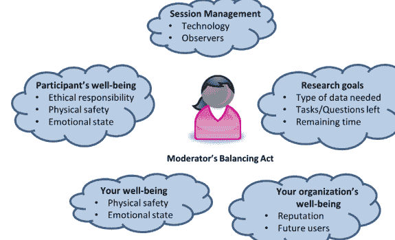

**图 1.1** 作为主持人，你在会议期间正在平衡许多相互竞争的需求。

在会议期间，你作为主持人的反应必须平衡以下竞争需求（图 1.1）：

- 参与者的情绪和身体状态。她是紧张还是不适吗？她看起来身体不适或正在经历身体不适吗？
- 你的情绪和身体状态。你对会议中发生的任何事情感到不适吗？你对环境中的某种过敏原有反应吗？是否发生了可能威胁你或参与者身体安全的外部情况？
- 研究目标。你是在衡量一种体验，寻找需要修复的问题，还是在试图理解参与者的过程？
- 一般会议管理需求。你的远程会议技术和设备运行正常吗？你的观察者表现良好吗，特别是如果他们和你坐在同一个房间里？
- 对你机构的保护。你是否确保参与者带着良好的体验离开，以免她在社交媒体上发表关于你机构的言论？你是否正在尽力获取参与者的反馈，以帮助改进未来用户对机构产品或服务的体验？

在整个会议过程中，这种平衡可能会发生变化，作为主持人的你需要相应进行调整。你在会议开始处理某种情况的方式与之后处理相同情况的方式可能非常不同，即使是同一个参与者。

以 Michael 故事中的可用性研究会议为例。在会议开始时，他作为主持人的职责主要是获取满足

研究过程中，可能需要对参与者进行微小的鼓励以保持他们的投入度，但但他更关注的是保持中立，并让观察者参与到会议中。但当参与者听到隔壁房间传来的笑声时，她变得感到不适、尴尬，并清楚地意识到自己的表现正被注视着。

此时，各种竞争需求之间的平衡已经偏离了会议目标，更多地转向参与者的情感舒适。由于参与者的舒适度面临风险，迈克尔作为主持人，他的注意力必须集中在收集反馈上，并确保她一切正常，并且在离开会议时感到舒适（而不是让他或他所在的组织感到不悦）。在正常情况下，告诉参与者其他人在执行该任务时有同样的经历可能会产生偏见。但迈克尔为了帮助参与者并避免损害其组织的声誉，牺牲了这种数据的完整性。此外，他也需要缓解自己与参与者之间的紧张关系，以获得他自己的情感舒适。

找到这些需求之间的正确平衡可能是困难且充满压力的，特别是当你是新手新手时。有些时候，你会感到想要帮助参与者的压力——看着他们挣扎是很痛苦的——但你必须克制这种冲动并保持中立，以确保你收集的数据不受影响。反之，你会感受到来自利益相关者的压力，要求你坚持计划，但你又需要偏离计划来安慰情绪低落的参与者。

这种回应可能会强化参与者对产品的感受，从而产生偏见，并可能改变他在会议剩余时间里的反馈和行为。

这种责任正是你作为主持人之所以至关重要的原因。你有能力影响研究结果和参与者的情感状态。比起研究中的其他任何人，你的人际技巧和解决问题的能力可能决定了一场会议是成功还是一场灾难。但是，正如我们从无数电影中学到的那样，这种力量伴随着巨大的责任。你必须掌握这种力量，并在各种常见、棘手和尴尬的局面下明智地使用它。我们希望这本书能成为你主持时的“瑞士军刀”：一套正确的工具，帮助你应对用户研究会议期间遇到的任何问题。

## 1.3 会议现场大师

同理心。灵活性。创造力。幽默感。权威气场。要在主持会议时成功处理棘手和尴尬的局面，你必须体现并平衡所有的特质。你可能会发现这些技能类似于马戏团团长的技能。团长积极倾听并监控她周围发生的一切，引导观众的注意力，并控制整个演出的节奏和流程。

# 主持人生存指南

让我们详细讨论一下这些特质：

- 同理心帮助你识别参与者的感受。请记住，无论你在会议之外在处理什么——争论不休的利益相关者、不稳定的技术、旅行问题等——参与者都是都是人，而不仅仅是你获取反馈的工具。把自己置于她的位置，想一想如果位置互换，你希望自己被如何对待。真诚地产生兴趣，以识别她何时感到心心或沮丧，并以一种真诚、同情的方式做出回应，帮助她再次感到舒适。
- 灵活性是必要的，因为这些情况会发生——参与者生病或生气、观察者说脏话、或者技术故障——你不能按部就班地执行研究计划。固守原始计划可能只会加剧局面，导致参与者失控和结果偏差。

新手主持人往往在灵活性这一原则上遇到最大的困难。参见侧边栏“给新手主持人的建议”。
- 创造力或即兴发挥对于出现意外情况至关重要。事实上，我们认识几位是非常优秀主持人的即兴演员。一个被称为“Yes, and ...”（是的，而且……的简单公式是即兴表演的基础。“Yes, and...”背后的原理是承认并接受你必须处理的内容，并在此基础上构建，而不是对抗它。这个概念非常适合用户研究活动。如果出现棘手情况，拥抱它（灵活性，即“Yes”），并快速思考如何处理它（创造力，即“and...”）。创造力不是一种容易学会的东西，对某些人来说它比其他人更自然。你可以通过转变自己的心态来建立一个有利于创造力的框架。当使用得当时，克制的幽默可以缓解尴尬局面的紧张感。“谨慎”是关键词。在适当的情况下使用幽默，并且要让参与者没有办法觉得你在嘲笑她。
- 幽默感在不可预测的情况下非常重要。当会议期间一切感觉都快崩溃时，你笑比哭要好！我们不是说你必须表现得讨厌或对参与者做出不当的判断——当然，你需要保持专业。我们的意思是针对你自己。如果事情没有按计划进行，尽量不要感到生气或紧张。深呼吸，提醒自己你有处理这种情况的工具。在最坏的情况下，你有一个很棒可以和同事分享（当然，要删除任何机密信息）。

权威气场意味着，作为主持人，你必须向参与者和观察者建立你是会议的控制者。记住，你对这里发生的一切负最终责任！你的身体语言和语调对于建立这种权威至关重要。你还必须保持会议处于正轨。例如，如果参与者在复杂的查询过程中向你展示的时间比你预期的要长，而在会议结束之前你需要额外的反馈，你必须礼貌而坚定地继续。记住要平衡你的权威与同理心，让参与者在分享反馈时感到舒适和自信。

虽然你控制着会议，但参与者应该感觉是她在引导对话（即由她“说话”）。更多信息请参阅 Dumas 和 Loring (2008)。虽然你控制着会议，但参与者应该感觉是她在引导对话（即由她“说话”）。参见 Dumas 和 Loring (2008) 了解更多。虽然你控制着会议，但参与者应该感觉是她在引导对话（即由她“说话”）。

## Yes, ...

“`Yes, and ...`”原则是即兴表演的核心。让我们想象你开始一个场景：“生日快乐，我为你做了蛋糕，”而我的回答是：“那不是蛋糕。那是恐龙，而且我的生日是上个月。”这种回应让构建场景变得困难。你说：“生日快乐，我为你做了蛋糕。”现在我的回答是：“太感谢了！嗯，这个蛋糕奶油霜是我最喜欢的部分。”再次，目标是在现有基础上进行构建，而不是对抗它。与其说：“不，那不是奶油霜！是黄油，”你可能会说：“是的。它和芥末馅很配。”这就是在说——是的，而且！”你接受了奇异的情况并让它变得更奇怪——这产生了一个有趣的（可能是可能的）场景。

## 1.4 科学与艺术的光谱

你正在进行一项可用性研究。参与者正在尝试一项要求她在旅游网站上预订机票的任务。她进入一个考虑价格的页面并说：“我通常不只订机票。我通常会探索机票加酒店的套餐并购买其中一个。”

引导者建议仅在绝对必要时才在任务期间中断参与者，并将他们的中断限制在极短的短语中，或者像 Dumas 和 Loring (2008) 所说的“确认标记”，例如“如此”或“嗯嗯”。即使参与者感到不悦或困扰，他们与她的互动方式也不会改变。

科学派的某些用户研究人员认为思维出声法（`think-al-protocol`）是可用性研究中的偏差因素，引用了 Boren 和 Ramsey (2000) 等研究。相反，他们会静地观察参与者，稍后再提出详细的问题。

我们并不将科学方法和艺术方法视为二元对立的选择，而是将其视为光谱的两个端。根据研究目标和引导方式，你的方法可能落在该光谱的任何位置。

由于我们进行的大多数研究都是形成性的（目标是改进和学习，而非测量），因此我们的方法倾向于引导的“艺术”。这种方法允许与参与者进行更自然的互动，而且根据我们的经验，当意外发生且简单的确认标记不足以解决问题时，它能让你做出更敏锐的响应。在可用性研究以外的研究类型中，对总结性（`summative`）方法的需求更为强烈。灵活性是引导这些方法至关重要的。例如，受访者可能会提出与你的研究目标相关但你未计划讨论的话题，而你想进行跟进。在情境调查中，你可能无法预判参与者将如何完成某些工作，因此你可能需要对她正在做的事情提出即时问题。

我们发现，科学方法对于总结性研究（目标是衡量或验证产品）以及使用生物识别或眼动追踪设备时工作效果最好。然而，对于总结性研究，需要优先考虑参与者的福祉，即使这意味着要牺牲数据的完整性。例如，如果参与者在你的总结性可用性研究期间流泪，你应该立即做出反应，而不是保持中立的确认。这可能意味着你的时间测量或其他指标可能会受到影响，但你的伦理优先事项是参与者。

你的方法在科学/艺术光谱上应该处于什么位置取决于不同的语境，例如：

- 研究的类型和性质——是可用性研究、情境调查还是访谈？虽然偏差对于所有方法来说都是需要考虑的问题，但在可用性研究或情境调查中影响参与者的行为，可能比影响非结构化访谈中陈述的态度更令人担心。
- 如果是可用性研究，它是形成性的吗？总结性研究需要严格的评估，通常通过任务完成时间和任务成功率等指标来衡量用户体验。中断和探索性问题可能会以数据质量为代价。形成性测试旨在更具探索性和轶事性，因此通常留有空间进行更多对话和创造性的跟进任务/问题。

当我们本书的后半部分介绍具体情况和建议时，我们会明确说明对研究类型及其目标所做的任何假设。我们还将解释你必须考虑的权衡以及你的选择可能产生的结果。请根据你自己的哲学和情况随时调整你的风格，并用它指导你做出更明智的决策。

## 1.5 你的引导风格

引导不仅关于控制会议进程和应对任何发生的情况。它还关乎你所采取的方法以及在与参与者互动时使用的人际技巧。我们将这种方法定义为你的“引导风格”。就像人有各种形状、大小和品质组合一样，我们的引导人格（`personas`）也是如此。

你与参与者的互动风格是你核心人格特质与你在引导时采取的倾向的结合。你的风格可能涉及两个或更多特征的组合，例如：社交的、友好的、放松的、快乐的、冷静的、事务性的、安静的、好奇的、警觉的、热情的、尊重的、克制的或抑制。也许你自然的引导风格是友好且事务的。或者是放松但好奇的。

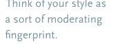

思考你的引导风格是什么样的。在理想的会议中，你会传递出什么样的“氛围”？一旦你确定了自己的风格，你就能识别出你的行为可能会影响到不同类型的参与者。

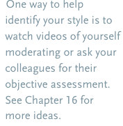

表 1.1 列出了我们过去见过的一些引导风格，定义了它们的特征，并警示了可能影响它们的潜在偏差和陷阱。当然，这些是每种风格的变体和程度差异，但它们触及了核心。

正如从表 1.1 中所示，每种引导风格都有优缺点。没有单一的理想引导风格——这种风格你可以也应该根据每项研究、每场会议，甚至在场会议过程中进行改变。此外，这些风格并不是互斥的。找出在特定研究中哪种风格（或哪几种风格）最符合你的研究目标，并在参与者或情况需要时保持灵活性。

## 1.6 有效的适应

为了超越自然风格并成为一个真正卓越的引导者，你必须学习在需要时调整你的风格。就像孙子的《兵法》(n.d.d.) 一样，引导的艺术需要识别并应对不断变化的状况。“是的，而且……”

| 引导风格 | 描述 | 适用场景 | 可能的陷阱 | 建议 |
| --- | --- | --- | --- | --- |
| 友好的面孔 (Friendly Face) | ➤ 重点在于对参与者表示安慰和鼓励。 | ➤ 参与者胆小且自责。 | ➤ 话得太多或让随意的氛围占据主导。 | ➤ 保持真诚。如果你的风格过于随意，参与者可能会关闭心扉。 |
| | | ➤ 以轻松、愉快的方式引导参与者。 | | | |
| 事务性型 (Down to Business) | ➤ 以严肃、专业的语气对待会议。 | ➤ 参与者需要结构。 | ➤ 避免傲慢。如果你的语气过于学术，参与者可能会感到紧张。 | ➤ 注意你的语气。 |
| | | ➤ 参与者感到被忽视。 | | | |
| 好奇心型 (Inquisitive Mind) | ➤ 关注所给反馈，并通过问题和活动尽可能多地学习。 | ➤ 参与者知识渊博但需要细节。 | ➤ 引导者容易“脱缰”，松散地执行计划。 | ➤ 管理你的研究计划。 |
| | | ➤ 参与者是因为义务压力才参与。 | | | |
| | | | | | 持续提问可能会让参与者偏离思路或自然互动。 |
| | | | | | ➤ 可能会让参与者感到被测试。 |
| 照规办事型 (By the Book) | ➤ 花费精力创建一个遵循规定顺序和目的的计划，并努力不偏离计划。如果你没有制定计划但正在主持会议，你可能会严格遵守计划。 | ➤ 参与者是高度技术领域的专家，而你不是。 | ➤ 引导者往往缺乏好奇心风格，这通常是新手引导者的固有特征。 | ➤ 你的研究使用的是更多定性方法（如访谈）。 |
| | | ➤ 你的研究使用的是定量方法，顺序和时机很重要。 | | | |
| | | ➤ 你的计划复杂且深思熟虑，灵活性有限，任务或问题之间存在大量依赖关系。 | | | |

表 1.1：引导风格的示例、其优缺点。

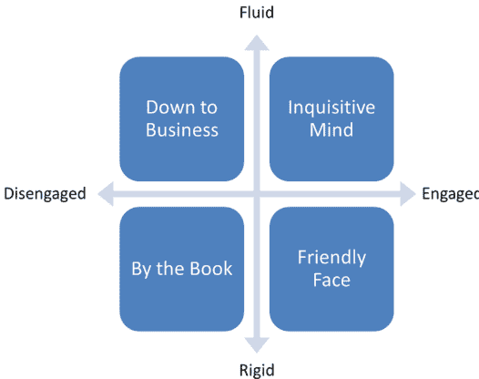

图 1.2 不同的引导风格取决于你的研究目标、研究计划的预设程度（从灵活到僵化）以及你希望如何与参与者互动（投入与疏离）。

这要求你能够随灵活应变。同样地，你偏好的引导风格可能不适用于特定的研究类型、参与者或情况，你可能需要进行现场调整。这正是你的灵活性受到现实考验的时刻！

最合适的风格取决于你如何需要与参与者互动（如表 1.1 所示），以及你的研究目标位于图 1.2 所示象限的什么种位置。每种风格都处于“僵化-灵活”（基于你的研究目标以及你需要在多大程度上遵循研究计划的预设结构）与“投入-疏离”（你在任何给定时间需要如何与参与者互动）之间的范围之内。

你可能已经在表 1.1 中了解了引导风格之间的差异，但让我们在这里看一个更详细的例子。考虑一次情境访谈（`contextual inquiry`），你有一个正试图让他们专注于演示你的工作流的参与者。情境访谈通常相当灵活，而且你是一个亲切且随意的引导者，因此你开始采用了一种类似于“好奇心脑”（`Inquisitive Mind`）的风格。然而，参与者的话多可能非常非正式且离题，将她带离你试图观察的自然工作流。该环节可能会迅速演变成一场访谈或对话。最好的适应方法是转变为“直奔主题”（`Down to Business`）风格，目标是稍微与参与者保持疏离。你不希望疏离到让参与者感到不舒服的程度，只需恰好让她知道你出现在那里是为了严肃地观察她的工作即可。

我们即将在第 3.6 节中详细讨论与参与者保持疏离引导模式。

相反，其他情况需要你引导参与者出来并建立参与感。考虑一个非常有脚本的访谈，参与者安静且内敛。她看起来要么是害羞，要么对访谈感到紧张。如果你更像是一个“按公办事”（`By the Book`）的引导者，你可能需要开启“友好面孔”（`Friendly Face`）来帮助她感到更舒适。真诚的微笑和诚实的语气可以帮助参与者走出社交壳，而不会偏颇她的反馈。

目前没有精确的方法来确定参与者或引导者的性格，这使得为引导提供一律不变的建议变得困难。但我们希望已经让你意识到了不同的引导风格以及这些风格如何影响一个场次。要真正做到有效，你需要根据需要进行调整并切换到其他风格。意识到引导风格及其相对优劣势将帮助你塑造和完善自己的自己的方法。

### 给新引导者的贴士

当你刚开始引导时，你可能会对在整个环节中需要跟踪的所有事情感到无所从心。引导者在这些考量上需要做到**非常按公办事**（Very By the Book）。你可能会紧紧抓住一份脚本化的研究计划，担心会漏掉某个问题或问了错误的问题。虽然这些是合理的担心，但执着于脚本意味着你可能会错过参与者肢体语言或语气的变化，可能在问题已经晚到无法成功解决时才发现问题。

以下是我们给新引导者的一些建议，以帮助他们平衡注意力，使参与者不被忽视：

- 如果你有一份脚本化的研究计划，请在引导环节之前仔细检查它。如果可能，在你的第一次环节之前，看一位使用相同脚本的团队成员操作，这样你就能对整体流程有一个真实的感受。这种熟悉感会让你更容易地关注参与者，而不是专注于脚本。
- 在你研究计划的每一页底部添加注释，提醒自己抬头看看参与者。
- 限制记笔记的时间，以便你投入更多注意力给参与者。在过问题/任务时，用笔勾选它们，这样你就能通过视觉指示器快速知道你已经涵盖了哪些，还剩下什么。

关于提高你的引导技巧的额外提示，请参阅第 16 章。

### 幸存故事：“椅子的扶手太固定且太窄了”

NICOLLE DIVER

几年前，我正在传统的实验室环境下对一个金融服务网站进行可用性研究。实验室里设置了两把并排在一起的转椅办公椅，面对一台电脑，电脑上显示着我们正在测试的网站原型。参与者格雷格（Greg）是一个体型很大的人。格雷格进入房间，试图在一个转椅上感到舒适。不幸的是，椅子的扶手是固定的，且太窄，以至于格雷格无法坐回椅子上。格雷格尴尬地坐在椅子的前缘，向单向镜后的观察者团队挥手好。

格雷格提供了很有帮助的反馈，但在整个访谈过程中似乎很紧张。我们怀疑他提供的反馈是否有帮助，并对他的某些回答产生了怀疑。当我们进入他环节的最后三分之一时，格雷格用手臂作为支撑点抵住桌子上以调整姿势。

# 主持者生存指南

配合你的问题。同时，考虑一个可用性研究参与者变得困惑或沮丧的例子。额外的几秒钟的延迟通常足够让参与者找到方向并在无需你干预的情况下继续。这段延迟也可能是一个分心分散的参与者重新投入任务或问题所需的全部时间。

- 如果情况持续，多等几秒可以防止参与者看到你流出冷汗（在远程会话中，听到你试图思考该怎么办时的支支吾吾）。请记住，作为主持人，你建立了自己的场会议的氛围。利用这个时刻深思熟虑你的方案，并准备好如果你的情况持续下去，你将要做什么、说什么。

这一刻对你来说可能像过了一辈子那么，但对参与者来说并不一定是这种感觉！即使在潜在的生命威胁情况下（例如，火灾警报响了），在继续之前也要花时间收集尽可能多的信息。你的需求应该超过你立即反应的本能。记住，你不仅对参与者的安全负责，也要对自己负责。

将这一刻想象成在帮助其他乘客之前先戴好自己的氧气具。

如果情况特别紧张，或者你不确定发生了什么，你可能想去另一个房间待一会，离开参与者。休息是一个极其强大的工具，我们将在 3.7 节中详细讨论。休息让你有机会在没有监控一切的压力下，思考研究会话中发生的情况。如果你有观察者，你可以利用这段休息与他们确认，并对你认为正在发生的情况以及原因进行“直觉检查”。参与者可能也会从几分钟的冷静时间或处理他们的分心中受益。

表 2.2 显示了当你需要休息时可以说的话示例。注意，即使这些短语并非完全真实，你也可以使用——为了大局可以考虑轻微的欺骗。借口将在侧边栏“使用借口”中进一步讨论。

| 针对多用户设置的可用性研究 |
| :--- |
| “我们现在到了很好的停止点。让我们短暂休息一下，五分钟后恢复会话。”（如果根据你的设置合适，你可以加上：“你可以离开房间去喝水或上洗手间”） |
| 针对现场和远程会话： |
| “抱歉，你介意我快速休息几分钟去喝水吗？” |
| “这似乎是一个很好的停止点。我们为什么不快速休息几分钟呢？” |

表 2.2：该说什么：关于休息。

# 第 2 章

## 使用借口

虽然你应该避免误导参与者，但在某些情况下，真相是有害的。例如，如果你发现参与者不具备你需要的特征，并且想向利益相关者（在另一个房间里）咨询该怎么办，你不应该直接向参与者表达你对他的顾虑。诚实可能会伤害他的面子，或者让他对参与此次活动感到紧张。相反，请找个借口离开房间。

技术可以被归咎于很多问题，而且当你需要离开房间或结束会话时，它提供了一个方便的借口。只需确保你有一个真实的理由可以归咎，这样你离开的原因就不会太显眼。如果你说：“电脑运行不正常”，参与者可能会意识到你在撒谎，因为他可以看到它实际上在正常工作。但如果你说：“我们的原型没有按照预期的方式工作”，他就没有理由知道这是一个借口。

你可能说的话示例包括：

-- “看起来我们的录音设备可能出现了技术问题。让我们短暂休息五分钟，我去隔壁查看一下。”
- “非常抱歉，我刚刚注意到我们的原型出了点问题。请原谅我几分钟，我去另一个房间看看我们团队中是否有人知道是怎么回事。”
- “很不起，看起来我想要听取你反馈的产品运行正常了。我还有几个问题要问你，但在之后我们将提前结束会话。你仍然会获得全额报酬！”

如果你不方便归咎于技术或者技术不适用（例如，在没有使用任何设备的面试中），你可以将研究本身作为借口：

- “我本打算在会议开始时就给你报酬的。让我现在去拿。我们休息几分钟。”
- “我刚刚发现我漏掉了一个问题。让我们快速休息一下，我可以去隔壁把它指出来。”
- “剩下的任务/问题对你/你的角色不适用，所以我们将跳过它们。这意味着我们可能会比预期早结束，但别担心，你仍然会收到全额报酬！”

## 2.2 解决任何对物理安全的威胁

在情境访谈的过程中，你听到一种低沉的轰隆声。你花一点时间评估情况，并很快意识到你正在经历地震。接下来你会做什么？

有关如何处理地震和其他自然灾害的更多信息，请参见第 14.2 节。

当情况涉及物理威胁时，在花几秒理解发生了什么后，你需要应对并处理该威胁。即使无法继续会话，也要快速且适当地做出反应。和你参与者的安全优先于你的需求！

请记住，参与者可能不知道该，特别是当他在你的设施内时。你必须对他的安全以及自己的安全负责。例如，如果火警报响了或建筑被疏散，请按照标准的疏散程序操作。

在发生地震的情况下，你应该指示参与者去哪里（例如，桌子下或门框）。如果你在隔房间主持可用性研究，并且认为花几秒钟使用麦克风是安全的，告诉参与者正在发生地震，并让他们立即去桌子下或门框。

参与者对自身安全的感知同样重要，即使你认为他是安全的。例如，我们听说过主持人会在地震或消防演习期间什么都不说就中断会话。要注意参与者的舒适度，并随时告知他们。

如果你在参与者的空间内，请听从他们的引导安全离开建筑，或遵循你正在经历的事件的适当安全规程。

根据情况的严重程度和环境的安全性，你可能想要取消或结束会话，而不是让参与者等待情况解决。如果这样做，给予他们全额报酬并感谢他们提供的反馈。如果环境安全，且参与者没有明显震惊并愿意继续，在恢复之前提供短暂休息，以便你们重新集中注意力。

## 2.3 验证你没有导致或放大情况

在面试期间，参与者在你提出的每个问题后都会发表评论。你不确定他为什么那样回答。这个问题不会自动解决，休息也没有什么帮助。如果你担心参与者的态度以及它对他所提供的反馈的影响，那么并没有物理危险需要解决。你应该做什么（如果有的话）？

让我们进入一些尴尬的领域一会儿，但我们保证，这对你有好处！有时候，情况的放大，甚至创造是由你所做的事情造成的。作为

一个良好的引导者应该能够不断评估并反思你与参与者的互动方式。在对参与者为何表现出某种行为下结论之前，请尝试检测你是否可能做了任何触发这种行为的行为。

表 2.3 显示了我们观察到的某些问题引导行为示例、可能导致这种行为的引导风格（如表 1.1 所示），以及这些行为如何影响参与者的舒适度。

正如第 1 节所讨论的，你的研究目标与方法、参与者类型、你当前的情绪状态以及适用的引导风格之间存在着一种微妙的平衡。特别是这两个元素，在整个访谈过程中可能会多次变化。

| 引导行为（引导风格） | 参与者的反应 |
|---|---|---|
| 过度虚假（亲切面孔） | 你正试图对参与者表现得非常友好尊重，同时保持友好的语气。你没有意识到自己表现得是在高高临下或不诚实。 | 参与者的反馈变得变得不耐烦且简短。他可能觉得你没有认真对待他的回答。 |

| 哥们们儿（亲切面孔） | 你想让参与者感到舒适，所以你开始表现得像你们是老朋友一样。你们一起大、开笑话。他试图逗你笑，并向你寻求认可，就像自然的友好交流一样。 | 参与者开始试图讨好你，在无意中反映了你的态度和偏见。他讨好的努力让他偏离了互动轨迹，并让他无法完整、诚实地回答问题。 |
| 无意识的粗鲁（公事公办） | 你在提问时保持严肃、期待的语气。然而，你的语气显得冷冰冰。你还让参与者看起来紧张并眨眼睛。关于这种表现的示例，请参见图 2.1。 | 如果参与者天生健谈且外向，他可能会因为你严肃的语气感到被侮或反感。如果他开始紧张，你的语气只会增加他的不适。强烈的注视可能会让他感到不安，甚至要求离开。 |
| 死亡沉默（公事公办，按部就） | 你正尽可能保持中立，因此采取了极简的引导方式。大部分时间你完全沉默，尽管参与者显然对沉默感到紧张和不适。 | 参与者开始自责并为“表现不好”道歉。因为你没有回应，他变得更加不适。 |
| 盯表者（按部就班） | 你正试图遵守进度，在最不恰当的时候看表或手表。你根据研究计划提问，当参与者回答时，你看着表、提前看研究计划，或者显然没有注意参与者的回答。 | 参与者会感到沮丧，并发表讽刺或刻薄的话，因为他觉得你没有在听他说话。 |

表 2.3：问题引导行为及其影响。

**图 2.1** 引导行为示例。无意识的粗鲁（左））和哥们们儿（右）。© 2013 Mark Ainscow，经许可使用。

### 学会享受沉默

大多数引导者对研究过程中的沉默感到不适，尤其是新手引导者！如果你正在使用出声思考法（think-aloud protocol），你可能会感到特别不适，因为看起来参与者忘记了你让他分享他正在寻找或期望看到的指令。

然而，沉默可以是一项有价值的工具。有时，让参与者静静地处理然后回答问题或恢复出声思考，比每当他沉默时立即追问他的想法更有价值。例如，人们在阅读大段内容时很难进行出声思考；当参与者显然在阅读时，请先不要提问。同样，立即回答参与者的问题可能会引导他自己回答。然而，如果他转向你，或者提高声音重复问题，那就是该你说话了。

习惯这种方法需要练习，但当参与者不会感到被催促或被你提醒说话所困扰时，一切都是值得的。

要发现你是否正在制造或导致问题：

- 检查你的肢体语言：
  - 你离参与者太近还是太远？
  - 你是在保持眼神交流，还是眼神过度？
  - 你是否在打哈欠或看表？
  - 你是直坐，还是窝在椅子里？
  - 你是否在皱眉或做脸，而不是保持友好中立的表情？

2. 回顾你在过程中说的话：
- 你是否忽略了向参与者保证你正在听他说话？你是否偶尔用“嗯”来鼓励他继续说话？
- 你是否话得太多，没有让参与者说话？
- 如果使用出声思考法进行可用性研究，你在提醒他出声思考之前是否给予了足够的回答时间？（更多信息请参见侧边栏“学会享受沉默”。）
- 你是否在使用闭式问题或引导性问题？
- 你是否在和参与者一起笑？

3. 评估你的语气：
- 你对参与者的语气是否带有审判？
- 你的语言是否虚伪？

4. 评估你的笔记记录：
- 你是否在参与者执行任务时记录笔记？
- 你是否记录了意外之外的内容？

5. 检查房间的物理设置：
- 温度太热还是太冷？
- 显示器对参与者来说是否太远了？

我们将进一步讨论如何避免这些行为。

### 第二章

作为一名用户研究员，要符合伦理道德。作为一份快速备查表，以下是在与参与者互动时需要记住的关键点：

- 不要造成任何伤害，并尽可能提供益处。正如第一章所讨论的，参与用户研究总会有某种程度的压力。然而，作为引导员，你的责任是确保这种压力（无论是身体、心理还是情感上的）不会达到不合理的水平。
- 诚实守。无论参与者是谁或在做什么，都要对他们保持尊重。
- 尊重参与者的隐私、机密性和匿名性。确保他们已获得知情同意，并知道你将采取哪些步骤来避免暴露他们的个人信息。

确保参与者的身体舒适相对容易实现。让他们知道他们随时可以休息休息，并在可能的情况下，为他们提供饮料。如果他们在研究空间内感到不适（例如，椅子的高度或尺寸他们不合适，或者空调噪音太大），请尽你所能进行任何调整，以保持环境尽可能友好且无压力。

维持参与者的心理舒适可能更有挑战性，特别是当他们被要求与具有重大可用性问题的产品交互，或者被问及敏感或私人的情况时。然而，请记住，如果参与者在可用性研究任务中感到挣扎或日益沮丧，他们的舒适并不一定受到了威胁。事实上，挣扎通常符合研究的一个共同目标，即识别问题区域。参与者的挣扎是为了为未来的用户提供更好的服务目的。

如果参与者责备自己愚蠢或无法解决某些问题，或者表现出多一种不适参与者的迹象（表 2.4），你需要缓解他的不适感。一个在环节结束时心存不满或不愉快的参与者是一个不快的客户（潜在客户）。鉴于通过社交媒体分享负面评价和体验非常容易，你必须避免对你的研究或组织的信誉造成任何潜在损害。

如果参与者看起来不舒服，要不要将任何责任归咎他们。记住，他们处于一个陌生的环境中（家），或者可能因为舒适环境中有一个陌生人（你）而感到压力。他们可能面临许多与环节无关的压力，例如育儿问题或紧迫的工作期限。即使没有外部因素导致他们的不适，无论你如何努力避免，研究环节本身都会产生一些压力。

在评估参与者的舒适度时，要注意背景情况。他可能是因为紧张而流汗，也可能是因为环境温度太高。但如果他在流汗且你叫他愚蠢，他很可能是不舒服了。

### 引导员生存指南

- 他增加了与评估对象之间的物理距离（例如，将椅子推离桌面，或将实体产品保持在手臂之外）。
- 他交叉双臂。
- 他责备自己，或为自己“愚蠢”或缺乏经验而道歉。
- 他说话不清晰。
- 他表现出情感痛苦的迹象，如颤抖、哭泣或过度出汗。
- 他不断环顾四周或看向摄像头。
- 他要求提前结束环节。
- 他过度关注分心事项（例如，他的邮箱在后台打开着，他一直在查看）。

表 2.4：参与者可能不舒服的迹象。

| 迹象 |
| :--- |
| 他增加了与评估对象之间的物理距离（例如，将椅子推离桌面，或将实体产品保持在手臂之外）。 |
| 他交叉双臂。 |
| 他责备自己，或为自己“愚蠢”或缺乏经验而道歉。 |
| 他说话不清晰。 |
| 他表现出情感痛苦的迹象，如颤抖、哭泣或过度出汗。 |
| 他不断环顾四周或看向摄像头。 |
| 他要求提前结束环节。 |
| 他过度关注分心事项（例如，他的邮箱在后台打开着，他一直在查看）。 |

观看视频 1 以查看引导员在可用性研究期间与一个自责型参与者互动的示例。该参与者对环节感到非常紧张，并寻求认可。

访问我们的网站 (`http://www.modsurvivalguide.org/videos`) 或使用您的二维码阅读器扫描此代码。

为了帮助参与者感到更舒适，

- 向他保证他没有被测试，任何让他感到沮丧的内容对产品团队来说都是价值的信息。提醒他，他的反馈将使未来用户更容易使用。对于情境查询或访谈，你可以保证他的反馈是保密的，最终将用于改善他自己的生活/工作。
- 如果你正在进行可用性研究，避免在提到研究时使用“测试 (test)”一词。测试是有失败可能的，可能会给参与者带来额外压力。他可能不理解你是在测试产品而不是他。相反，使用“研究 (study)”、“环节 (session)”或对 <product> 的“评估 (evaluation)”。同样，你可以考虑将每个可用性任务称为“场景 (scenario)”而不是“任务 (task)”。
- 如果参与者交叉手臂或远离你（被评估的产品），请他告诉你是如何感受来代表引导最佳实践的。这些记忆对于与参与者互动非常有价值。通过记住至少这些短语并在研究前回顾列表，可以节省在现场即兴做出恰当回答的认知努力。我们最常用的短语包括：
- 你预期会什么？
- 你现在正尝试做什么？
- 你现在在想什么？
- 这与你的预期相比如何？
- 你对这个操作有什么想法？
- 这个链接在今天的环节中不起作用。如果你点击它它是正常的，你预计会发生什么？

更多关于这些短语的示例，请参见附录 A。

说“很有帮助 (helpful to know)”通常被视为对反馈超出形式的谢意，而“好”或“棒”可能被感知为对参与者的反馈进行评价。由于你需要谨慎地向参与者提供正面反馈，我们发现这些短语相对中性。当明智地使用时，这些短语能够认可你已经听到了他们的反馈，并给予他们少量安慰，表明反馈是有帮助的：

- 好的。
- 好的，谢谢，或者“好的，谢谢。”
- 了解这些很有帮助，或者“了解这些对我们很有帮助。”

谨慎使用这些短语将解决你在研究期间看到的大多数典型问题。与不该说什么同样重要的是，我们提供了侧边栏“不要说什么”的示例。当然，你会遇到一些这些中性的[此处未完]

短语可能并不足够，或者参与者的行为没有符合其中某个短语的预期。在这种情况下，请记住以下三条准则：

- 1. **在回答时尽可能保持无偏且不加判断。** 无论情况有多煽动性或挑衅性，无论你多地认同（或反对）参与者的话，保持中都是你的责任。记住，这不仅取决于你说了什么，还取决于你怎么说，包括语气和肢体语言。例如，如果参与者在描述一种你认为多余或不当的个人或文化信仰，请尝试在回答他们的下一个问题时，保持面部表情和声音处于中性的语调。
- 2. **基于参与者说的话，而不是否定它。** 如第1章所述，即兴表演的基本原则之一是永远不同意所说的话，而是说“是的，而且……（Yes, and....）”。这一原则意味着你总是在他人所做的基础上构建，而不是否定它。在研究环节，你的“是的，而且……”与其说是认同参与者说的话，不如说是承认他已经被你听到了。例如，如果参与者问他是否正确执行了某项任务，请使用预设的短语回答，而不是忽略问题。例如，“所以我其实要把这个问题转个弯：你觉得你找到正在寻找的信息了吗？”
- 3. **在引导或做出反应时尽可能得体。** 当参与者偏离轨道或不再提供对你的研究目标有用的反馈时，你的副语言将为你的反应奠定基调。你不想暗示他做错了。这里有一个我们看到的一个主持人与参与者之间交流的示例，它展示了你的词汇选择和语调如何产生负面影响：

主持人：你会如何完成 <task> 任务

参与者：噢，我会这样做 <this>。

主持人：（停顿，语调上扬）噢。你会这样做啊。

语调上扬意味着对参与者的质疑，可能会让他感到被审判，或者认为他应该重新考虑答案。相反，得体的反应是用中性的语调说“好的”并继续，或者询问他如果第一次尝试没有效果是否还会尝试其他什么。如果他正在与原型交互，你也可以让他尝试该任务，询问结果与预期相比如何，并询问他是否有其他可能尝试同样事情的方法。

> 我们在第 13.1 节讨论了参与者发表不当评论的这种情况。

不要说什么

有些短语需要你谨慎使用，因为它们的内涵可能对参与者产生意想不到的后果。表 2.5 列出了这些短语以及它们通常效果不佳的原因。

## 主持生存指南

| 不要说什么 | 原因 |
| :--- | :--- |
| “让我给你个提示。” | 强化了参与者需要帮助的观点。 |
| “你为什么想去那里？”或“是什么让你那样做的的？” | 暗示参与者想去那里（或那样做）是不正确的。 |
| “跟我聊聊……” | 取决于说话的方式或过度使用的程度，听起来可能像是在命令或居高临下。 |
| “不，不要那样做。” | 强化了参与者正在做不该做的事。 |
| “嗯，他们这样做是因为 <发生了特殊情况或特殊限制限制了我们>” | 暗示你是设计团队的一员，并且/或在为选择辩护。 |
| “那是很好的反馈，”或“那是不错的反馈。” | 暗示其他反馈并不好。 |

表 2.5：主持过程中不应说的话的示例

## 2.6 重新控制以将会议引导回正轨

希望你目前为止已经启动了会议。然而，如果参与者感到失去控制，或者继续朝着对你的研究目标没有用的方向进行，你的工作就是引导他回来。作为主持人，你始终负责维持会议的控制。这包括接受改变语气或提供任何必要的支持以将会议引导回正轨。

记住，你不是参与者的哥们。你安排这次不是为了让他发牢或进行心理治疗。你的工作是防止他那样对待它。同时，主持的艺术包括重新引导会议，并以得体尊重的方式对待参与者的反馈。

你如何重新建立对会议的控制？对于大多数一对一方法，对任务或问题进行特定的重述或重新聚焦足以让参与者回到轨道：

- “谢谢你的分享，引导参与者的模式在第... 节有更详细的解释，但为了时间考虑，我希望你回到 <尝试/回答任务/问题>……”
- “谢谢你的解释，这对我们来说很有帮助。我们时间有点紧，我想把你的注意力转向……”

如果你认为参与者可能被困住或纠结于某事，你也可以引导参与者进入不同的任务或问题。

引导参与者的模式在第 3.3 节有更详细的解释。

如果你第一次重新控制的尝试无效，你可能需要使用更强硬的语言将参与者拉回来：

- 抱歉打断一下，但真的非常重要……
- 3.10 为你的情况选择最佳模式 55

当我们开始描述你可能会遇到的情况（在第2部分）时，你会发现我们在反复重复某些建议的行动。你可以将这些行动视为可以应用于任何情况的“引导模式”，并在需要时进行修改。表 3.1 列出了我们在本章中将讨论的所有模式。其中某些模式对你来说可能是显而易见的，特别是如果你已经具有引导经验的话。尽管如此，我们的目标是帮助你根据会议情况和你的预期结果，思考在何时使用每种模式最为恰当。

这些模式大部分并不是互斥的——你可以在同一个会议中同时使用一种或多种。鉴于你可能会遇到相互衔接的情况（例如，当模式已经因为外部情况分心时，又遇到了技术问题），你可能需要在短时间内应用多种模式。

在第2部分每个情况的开始，你会看到一个标题为“要应用的模式”的标题，随后跟着是任何相关的模式。

- 承担责任
- 明确任务/问题
- 重定向参与者
- 安抚参与者
- 建立参与感
- 与参与者脱离
- 休息
- 转移焦点
- 提前结束会议

## 3.1 承担责任

承担责任意味着承认作为引导者（moderator），你正负责整个会议，然后明智地运用权力。

### 何时使用

当会议期间发生参与者可能不知道如何反应的事情，或者当遇到误解时，你应该站出来承担责任。

- 为了防止参与者对她所做的事情感到难过。
- 如果参与者似乎误解了你问她的某些内容，或问题。
- 如果参与者正接近情绪或身体上的不适或物理危险。
- 如果发生紧急情况，你必须协助参与者以确保她的安全。

### 做什么

这种模式意味着，你对从参与者的角度来看会议期间发生的任何意外情况负责。例如，如果你需要因为参与者的行为而跳过任务或结束会议（例如，她带孩子来参加会议或对问题的陈述有误），你可以归咎于自己没有准备好支持她处境的环境，或者没有选择最合适的措辞。将责任揽在自己身上可以防止参与者自己感到难过。

这种模式还意味着，如果会议中的某些事情看起来不对，你应该承担或吸收这方面的责任。如果参与者正在抱怨，不要赞同或不同意她的意见——只需吸收并接受她的反馈即可。如果出了什么差错，不要指怪玩家、开发者、招聘人员或参与者——即使某些问题在客观上是他们的错。对于参与者来说，责任由你来承担。

承担责任是一种可以用于几乎任何类型会议的模式。当出现意外情况时，这是一个值得铭记的良好原则。

当涉及到参与者的身体舒适和安全时，你也需要对她承担责任，特别是在火灾或地震等威胁生命的情况下。特别是如果她是在你的设施内，那么你的工作就是看护并引导她，直到她安全回家。

请记住，你可能还需要对观察者使用这种模式，如果你的观察者和你以及参与者在同一个房间里。如果观察者分散了注意力或引起了问题，你必须承担责任并解决局面，以确保参与者的舒适。

### 模式应用示例

你可以在以下情况下看到这种模式的应用：

## 3.2 明确任务/问题

通过明确你对任务/问题的定义，或者要求参与者重述他们对你所要求的理解，你可以减少误解并增加获得你所需反馈的概率。

### 何时使用

当你想要确保参与者清楚你的要求时，使用这种模式。这种模式在以下情况下可能恰当：

- 如果参与者显然没有理解任务/问题。
- 如果你认为参与者可能没有理解任务/问题。
- 如果参与者似乎在逃避某个任务/问题。

### 做什么

首先，通过让参与者用自己的话告诉她正在做什么或描述什么，来验证她是否误解了任务/问题。例如，如果你在面试中要求参与者讲述她上次购买电脑的情况，而她正在谈论最近去过的一家餐厅，你可以说：“所以请告诉我你为什么在描述你的餐厅体验。”你可能会发现她没有听清你的问题，或者她在去商店购买电脑之前去过那家餐厅。

如果参与者误解了你的提问，请重新组织语言或表述任务/问题，以确保她理解她被要求做什么。你可能需要引导参与者重述，以确保她理解了你所要求的任务。当参与者对你的要求时，这种模式非常有用，引导引导者偏离了。虽然这种模式非常简单，但它可以用在广泛的范围内。

你可以在以下情况下看到这种模式的应用：

- 10.2 参与者对问题偏离了注意力

## 3.3 重定向参与者

有时参与者会追求一个对你没用的路径，或者他们发出的能量与目标不符。重定向是为了引导参与者符合你的目标。

### 何时使用

当你需要将参与者的注意力引回到你的目标上时，使用这种模式。这种模式在以下情况下可能恰当：

- 如果参与者纠结于你需求之外的事情。
- 如果参与者似乎在一条对你没有帮助的路径上。
- 如果你需要给参与者提供某种帮助以便她继续进行任务。
- 如果参与者对产品显然不满意，并且你可以看出她的情绪会影响你的反馈。
- 如果参与者对产品过度热情并失去了焦点。

你将在书中多次看到重定向，但在参与者不确定时尤为关键。这些情况列在第8章。

### 做什么

这种模式将参与者引导向合适的结果。这种模式最常见的应用是将问题抛回给参与者。例如，如果她问：“我要去哪里做这个？”你回答道：“你认为应该去哪里？”如果参与者问了一个较难测试的问题，这种模式可以让你提供一个模糊的回答，将她引导向更相关的话题。

你可能还需要参与者在某个任务上遇到困难时提供帮助，或者她无法完成后续任务。在这种情况下，你是将参与者从目前所处的路径引导到你需要的路径，以便你完成研究目标。

帮助可以意味着从温和的提示到指出参与者自己没有注意到的事情。关于不同类型的帮助，请参见6.2节和侧边栏“分散式的帮助”。

过去的网站

### 查看模式的使用情况

你可以在以下情况下看到此模式被使用：

- 11.7 参与者变得具有侮辱性或带有意图

- 8.1 参与者寻求认可

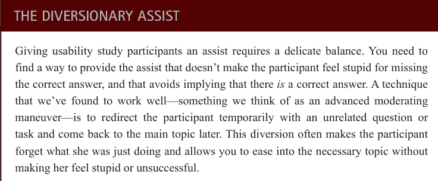

为可用性研究参与者提供帮助需要一种微妙的平衡。你需要找到一种提供帮助的方法，既不会让参与者因为没有找到正确答案而显得愚蠢，又能避免暗示存在某个标准答案。我们发现的一种有效技巧——我们认为这是一种高级的引导策略——是通过一个无关的问题或任务暂时转移参与者的注意力，稍后再回到主话题。这种分注意力的方式通常会让参与者忘记她刚才正在做什么，并让你能够平滑地引向必要的话题，而不会让她觉得自己很笨或很失败。

例如，假设参与者正在某个电子商务网站上寻找与客服代表聊天的方法，但在“关于我们”部分没有找到。相反，她一直在探索所有其他区域。你需要让她最终对聊天部分给出反馈，因为你可能先说类似“我们现在继续吧。我想回到你刚才做的事情上……””，然后花几分钟讨论另一个话题。另一个话题可以是参与者之前做过的事情、另一个可以独立于之前任务完成的任务，或者关于网站整体的更广泛的问题。在这次引导之后，你就可以准备引导她进入聊天功能了。你可以引导她点击“关于我们”链接并问道：“你期望在这个区域看到什么？”如果你没有时间了，直接告诉她：“我们为什么不点击这个区域呢？”参与者可能会察觉，你可能会对参与者经常不察觉感到惊讶，但如果她察觉到了，她通常会付之一笑——噢，那正是我刚才在找的东西”——

## 3.4 安慰参与者

有时参与者会感到情绪低落或需要安慰，可能是因为测试期间发生的事情，或者是她生活中发生的其他事情。安慰她可以把她的情绪状态回到更舒适的水平，以便你继续测试。

### 主持者生存指南

#### 何时使用

参与者可能会对测试期间的表现感到压力或紧张，需要一些温柔的安慰。这种模式可能适用于：

- 如果参与者自备自己或自嘲。
- 如果参与者看起来很紧张、不自在或犹豫。
- 如果参与者询问她是否正确执行了任务。

#### 做什么

提醒参与者，你并没有以任何方式测试她，你是一个中立的观察者，希望得到她的反馈，无论是正面还是负面的。如果你不是产品的设计者，可以告诉她这一点。在访谈或情境调查期间，你可以提供类似的保证，以确保参与者你是一个对她的体验感兴趣的中立方。如果参与者需要安慰，告诉她她所提供的反馈非常有帮助，将帮助团队制作出更好的产品。

这种模式还包括安慰参与者，她可以随自己的需要休息和离开。你的安慰应该让她觉得你正尽力让她感到舒适并保持舒适，即使你没有明确说出来。记住你对参与者的伦理义务，并尽力确保她在离开测试时感觉不会比来的时候时更糟糕——理想情况下是更好。

关于提供何种反馈是合适的更多信息，请参阅侧边栏“告诉参与者她的反馈是有帮助的”。

#### 查看模式的使用情况

你可以在以下情况下看到此模式被使用：

> 你应该告诉参与者她的反馈是有帮助的吗？

你可以告诉参与者，她的反馈是你正在寻找的反馈，或者是有帮助的。我们认为提供这种安慰是有用的，因为它能让你更主动地、有针对性地去安慰她。

遗憾的是，这种方法有几个常见的陷阱：

- 假装兴趣：如果你的语气听起来粗鲁或像机器，告诉参与者她的反馈很好或很有帮助可能会显得不真诚。
- 频率：如果你每当参与者说或做某事时都告诉她反馈很好或很有帮助，你听起来就会像坏掉的胶片，可能会失去你的信任。同样，在错误的时间提供这种反馈可能会惹恼她并可能偏偏研究。例如，如果你只在她说或做某些特定事情时才告诉她反馈很有用，她可能会看穿你。
- 措辞：说“那是非常棒的反馈”或“那是很好的反馈”是对参与者的反馈进行定性，这可能再次让她注意到你何时或何时在“赞扬”她的反馈。

在提供任何形式的肯定时要谨慎且有条理。不要回应参与者所说或所做的每一，而是在完成若干任务或问题后定期停顿，告诉她：“你听到这些很有帮助，这正是我们希望得到的反馈类型。让我们继续到……”你只需要在整个测试期间这样做一或两次，理想情况下是在测试开始时，那时参与者最戒备，并能从这种反馈中获益。

在向参与者提供任何其他反馈时，保持中立，使用诸如“好的”或“好的，谢谢”等回复。

## 3.5 建立参与感

有时参与者对你要求她做或谈论的事情没有投入，需要建立个人联系。通过建立参与感，你可以帮助她投入测试。这种情感上的投入可能会让她更愿意提供反馈。

#### 何时使用

使用这种模式来帮助没有参与感的参与者进入测试。如果可能可能适用：

- 参与者对提供反馈感到紧张或犹豫。
- 参与者对研究的产品不参与。
- 参与者看起来分心或不感兴趣。

#### 做什么

建立参与感的一种方法是调整你的身体语言，确保你处于积极且感兴趣的倾听状态，见图3.1。坐直，身体略向参与者倾斜。如果你和她在房间里，调整座椅以保持舒适的眼神交流，让她不需要抬头或俯视你。

图3.1 建立参与感。中立的主持位置，左，以及尝试参与，右。

©2013 Mark Ainsow，经许可使用。

保持你的面部表情友好中立。偶尔的微笑是可以的，你可能会发现参与者回笑！检查你的语气，记得对她所说的话表现感兴趣。

如果参与者对正在使用的产品没有参与，尝试在参与者和她正在做之间建立个人联系。鼓励她谈论自己或她的经历，并将她的回复与任务的重新表述或重新聚焦。例如，如果你正在对一个参与者觉得无趣的移动设备进行可用性研究，让她告诉你她喜欢的手机游戏。在听到她的回复后，让她比较她喜欢的游戏和正在使用的。

建立个人联系的好处是参与者可能会忘记最初的情绪反应，紧张等。但要确保你的参与努力与测试挂钩。在与参与者进行这种对话时，你可能会发现缺乏参与感的其他原因，例如识字率或计算机技能低或与你的筛选标准不符。如果是这种情况，你可能决定转移测试重心以适应她意外的技能水平或标准不符，你可能需要提前结束测试。

在第二章中讨论的友好面孔和好奇思维主持风格在此时模式期间最合适。

#### 模式的使用情况

你可以在以下情况下看到此模式被使用：

生存故事“他的挫败感增加”展示了一个主持人发现他的参与者有阅读困难的案例。

### 3.6 与参与者脱离

有时，参与者在与你互动时可能会过于私人或过度热情。脱离可以让你从这种关注中抽身，并为会议建立一个更中性的基调。

#### 使用时机

这种模式适用于以下情况：

- 如果参与者过于话多或在过度分享个人信息。
- 如果参与者通过其态度、言语或所作，以任何方式让你感到不适。

如果你觉得参与者的行为构成了任何危险，请勿使用此模式。相反，如果你觉得可以离开房间，请休息一下并尽早结束会议。

#### 做法

这种模式可以让你在与参与者之间保持一定的情感距离，见图 3.2。改用更中性的说话语气，并将身体稍微移开她。尽量避免与她有过多的眼神交流，更多地直接关注产品或你的笔记。如果你正在进行情境访谈或可用性研究，你也可以移动到参与者后面。这个位置让她更难与你直接互动，并迫使她关注产品。如果你在多房间的可用性实验室中，你也可以在另一个房间主持。如果你决定换到另一个房间，只需说：“对于接下来的任务，我将在另一个房间。”

你会发现这种模式在第 13 章描述的许多尴尬情况下都特别有用。

这种模式的变体是让任务或问题变得不那么私人化。如果你觉得问题的私人化性质导致了参与者的不适，这种方法非常有用。例如，如果你正在采访一位参与者关于她如何为父亲寻找养老院，但她对所经历的过程感到很痛苦，可以问她

图 3.2 与参与者脱离。中性的主持位置，左侧和尝试脱离，右侧。©2013 Mark Ainscow，经许可使用。

改为让她描述她上一次不得不为自己寻找新医生的经历。在她聊了一会儿中性话题并看起来更放松后，你可以将她的回答引回你原本的私人问题上。例如：“你说过个人推荐对你寻找皮肤科医生时非常重要。请告诉我，个人推荐在你决定为父亲选择养老院的过程中起了什么作用，以及是如何起的？”

“直奔主题”，Down to Business 和“按规矩办事”，By the Book 主持风格在应用此模式时最合适。

#### 模式应用

你可以在以下情况下看到此模式：

- 12.1 参与者非常风趣且友好
- 13.4 参与者对你调情

### 3.7 休息

休息可以让你按下会议的“暂停”键。这种暂停可以重置会议的流程，并和你参与者提供一些时间和空间。

当你需要为自己或参与者留时间时使用此模式。这种模式适用于：

- 如果参与者感到压力或难过，似乎需要一些空间。
- 如果你对会议发生的任何事情感到压力或难过。
- 如果你需要观察者对参与者提供第二意见，以便你决定如何进行会议的剩余部分。
- 如果你需要提醒观察者他们声音太大或有干扰。
- 如果你的技术设置中有某些内容需要更改或修复。

> 记住，你的情绪健康与参与者同样重要！

#### 做法

让参与者知道你正要短时间休息。如果是因为难过或冒犯了参与者而需要休息，你可以以此作为理由。例如：“你的录音笔电池似乎没电了。我们休息几分钟，我去换一下电池。”或者，你可以让理由模糊化，在必要时稍微夸张。例如：“我需要检查一下关于原型的一些事情。”

关于使用便利借口来休息或尽早结束会议的想法，在章节的侧边栏“使用借口”，Using a Pretext 中有所讨论。

如果你休息是为了给参与者留出空间，可以提议向她展示洗手间在哪里或给她拿点喝的。如果你让她留在房间而录音设备仍在运行，请提醒她，以免她认为自己有隐私并开始打私人电话。同样，如果参与者是远程的且正在共享屏幕，让她先关闭屏幕共享，或提醒她她的屏幕仍然可见。

如果可能，准备一份与研究相关的备份调查或问卷，以便在你需要休息时给参与者，让她有正有用的事做。第 15.2 节更详细地描述了这个想法。拥有这种备份的优点还可以让参与者感到很有成就感且有用——这比让她坐在单向镜前紧张地盯着自己看要好得多！

#### 模式应用

你可以在以下情况下看到此模式：

- 7.1 你的设置和或设备出现技术问题
- 14.4 你在主持会议期间感到不适

### 3.8 转移焦点

转移焦点可以让你调整研究计划和研究方法，使其转向更符合参与者资质或情绪状态的内容。

#### 使用时机

如果你意识到研究计划不适用于该参与者，请使用此模式。这可能发生在：

- 参与者对你让她感到更舒适的努力没有反应，或者外部环境使得继续变得困难或不可能。
- 参与者是招募错误的，没有办法调整会议来获取她的反馈。
- 参与者不符合你的标准，而你有一个可以替换的备份/机动参与者。

#### 做法

一旦你意识到研究计划不起作用，请决定是否可以将方法调整为更符合参与者资质的研究形式。例如，如果你正在对银行的开户流程进行可用性研究，而参与者说他们只会在网点开户，你可以调整问题和任务，转变为访谈的形式，以了解她以前是否在网点开过户，体验如何，以及如何改进。或者，如果你正在采访一位护士关于她与患者的互动，但发现她主要处理行政任务，你可以将焦点从向她提问转移到她完成任务时必须遵循的工作流上。

有时将此模式与休息结合使用会有帮助，这样你就有与利益相关者讨论你的修订计划。

要成功运用此模式，你必须对研究目标以及你的发现如何被使用有充分的理解。这种理解对于判断此模式是否适用，以及如何最好地转移会议焦点以产生有效的反馈是关键。

#### 模式应用

你可以在以下情况下看到此模式：

- 4.2 参与者拒绝或无法完成关键任务
- 7.3 设施失去网络连接

### 3.9 尽早结束会议

结束会议是在其他策略失败，或本可以成功时的最后手段。

#### 使用时机

如果参与者对你让她感到更舒适的努力没有反应，或者外部环境使得继续变得困难或不可能，你可能需要结束会议及时止。这种模式适用于：

- 如果参与者是招募错误的，没有办法调整会议来获取她的反馈。
- 如果参与者看起来情绪过度激动，或无法、不愿继续。
- 如果你担心自己或参与者的安全。
- 如果技术或环境问题使得继续变得困难或不可能。

#### 如何做

在遇到技术或环境问题时，你有一个结束会话的正当理由。例如，如果你必须因为火灾而疏散设施，局势的严重程度和不稳定的环境意味着你应该让参与者离开。

出于任何其他原因提前结束会话需要技巧的沟通技巧，因为你不希望参与者认为你结束是因为她做错了某事。如果你没有提前向他们提供任务或问题列表，你可以直接跳过未完成的项目并直接结束会话，无需任何额外解释。如果她看得出来你跳过了某些内容，你可以使用预设用语，例如：“剩下的这些任务/问题不适用于你的角色，所以我们将跳过它们。”其他可能有助于解释提前会话的模式包括：

- “你完成所有内容的速度比预想要快”
- “我们遇到了一些技术困难，与其让你在那里等，我们将提前结束，这样你就能腾出时间来。”

你决定一个会话不值得挽救的时刻——你的崩溃点——会根据每天和每项研究而不同，并取决于研究成功的关键因素。提前考虑这一点并与你的利益相关者讨论：哪些“否决因素”会让你选择结束会话而不是继续？

#### 模式应用示例

你可以看到这种模式被用于以下情况：

- 4.1 参与者似乎不符合关键招募标准
- 14.6 参与者似乎醉酒或吸毒了

### 13.0 为你的情况选择最佳模式

正如第 2 章讨论，你应该始终记住你的道德义务，以确保参与者、你的组织、你的团队以及你自己的舒适和安全。除了这些义务之外，在决定会话期间要做什么时，请考虑以下因素：

| 1. 在采取行动前花点评估情况 | 2. 解决任何对身体安全的威胁 | 3. 验证你没有导致或放大局势 | 4. 检查参与者的舒适度 | 5. 使用谨慎的语言和语气探测情况并开始解决它 | 6. 重新控制以使会话回到正轨 |
|---|---|---|---|---|---|---|
| 休息一下 | X | | | | | |
| 转移焦点 | | | X | X | | X |
| 建立参与感 | | | | X | X | X |
| 澄清任务/问题 | | | | | X | X |
| 引导参与者 | | | | | X | X |
| 安抚参与者 | | X | | X | X | |
| 与参与者分离 | | | X | | X | X | |
| 提前结束会话 | | X | | X | | | |
| 承担责任 | X | X | X | X | X | X |

表 3.2：处理情况时在每个步骤可使用的模式。

主持人生存指南

具体来说，你为了将会话带回正轨而不是提前结束而付出了多大努力：

- 1. **你的研究项目目标。** 思考你的利益相关者试图从你的研究中学习什么，他们需要从谁那里学习，以及什么能帮助他们获得所需的答案。例如，目标是发现问题，还是验证产品？特定的参与者标准有多重要？明确这些目标，并知道你和利益相关者在这些目标上达成共识，将使你做出更高效的决策。
- 2. **维护数据质量。** 根据你的研究目标，你需要多大的样本量？你已经运行了多少个参与者？参与者之间，招募标准和任务/问题之间需要多大的一致性？例如，如果你正在进行一项定性可用性研究并招募了十二名参与者，假设会有两个缺席，那么对于让第 12 名参与者探索研究计划之外的产品的其他领域，你可能比运行第二个参与者时更有意愿。

由于所有这些因素，无法准确列出每种情况下最适合使用哪种模式。相反，请使用这些问题来确定最适合你情况的方法。

我们希望这一章让你了解你主持的“瑞士军刀”中可用的工具，以及可能影响你如何、何时以及为何使用每种工具的关键考虑因素。在第 2 部分，你将看到这些工具被应用于各种情况中。

## 生存故事：“地面动了”

COLIN BAY

早些我在一家世界 500 强公司工作时，我在我们的一个实验室里进行一项可用性研究，结果遇到了一个真正的大惊喜。参与者在测试室里，我在镜子的观察侧，那儿可能距离参与者有 20 码路，通过对讲系统说话一边做笔记。在一个任务进行过程中，地面开始移动并迅速达到了峰值。这是一次 3.9 级地震，震中在大约 10 英里外。

我应该解释一下，我经历过很多中小型地震，并且非常清楚我工作的公司极其谨慎，他们按照最严格的安全标准建造了工厂和办公楼。事实上，我们最近进行过一次地震检查，其中一些细小项目，例如一个通常有人的走廊里已经正确固定在墙上的书架，被标记为需要注意。

如果她看得出来你跳过了某些内容，你可以使用预设用语，例如：“剩下的这些任务/问题不适用于你的角色，所以我们将跳过它们。”其他可能有助于解释提前会话的模式包括：

- “你完成所有内容的速度比预想要快”
- “我们遇到了一些技术困难，与其让你在那里等，我们将提前结束，这样你就能腾出时间来。”

你决定一个会话不值得挽救的时刻——你的崩溃点——会根据每天和每项研究而不同，并取决于研究成功的关键因素。提前考虑这一点并与你的利益相关者讨论：哪些“否决因素”会让你选择结束会话而不是继续？

# 第四章

## 招募失误：意料之外的参与者

尽管你付出了最大的努力，招募失误仍可能发生。参与者不符合你的标准或具有其他意外的特质，这意味着你的会议可能立即需要做出“继续”或“停止”的决定。这些情况要求你对是否以及如何继续进行会议做出快速决定，并对任何意外的参与者特征做出任何必要的调整。

- 4.1 参与者似乎不符合关键招募标准 63
- 4.2 参与者拒绝或无法完成某关键任务 66
- 4.3 参与者具有意外的身体特征 68
- 4.4 参与者不熟悉设备 70
- 4.5 参与者阅读困难 72
- 4.6 参与者或他人要求你帮助 74

### 4.1 参与者似乎不符合关键招募标准

你的招募标准对参与者应具备的某些资质非常具体。然而，当参与者到达时，他似乎并没有实际上符合这些资质。

**方法：** 任意

**频率：** 频繁

**适用模式：** 承担责任；安抚参与者；转移焦点

#### 做法

- 首先，核实参与者是否真的符合预期标准。一种方法是让参与者知道，你关于他的信息显示他具有某特定资质，并直接询问他是否正确。如果你正在寻找执行某类任务的参与者，请参与者描述他的角色，特别是他在该任务中做了什么。另一种方法是你的提问方式要委婉，使其听起来很正常。这样，如果你立即中断休息或结束会议，参与者就不会觉得是他的资质导致了问题。
- 请记住，当参与者到达时，你有义务向其提供补偿，除非有其他约定；详见第 15 节，你可能会查看是否有办法调整会议以包含参与者的反馈，或者将焦点完全转移到另一种方法上。要决定这一点，请看参与者的实际资质对你的研究是否有用。例如，根据你的研究目标，你可能知道即使在利益相关者在观察的情况下，与新手交谈也能提供有用且有效的数据。如果你的项目有时间或预算限制，你可能没有机会用符合要求的人替换参与者。
- 如果你需要让参与者离开且不继续会议，请考虑诚实地说明原因。例如，“抱歉，这是我的误解。出于这项研究的目的，我们需要与……的经理交谈……”

### 主持者生存指南

#### 4.1 参与者不符合关键招募标准，续

然而，如果原因可能具有敏感性，可以以“技术困难”为借口，对参与者表示适当的歉意（特别是当他对提供反馈感到兴奋时），并为其提供补偿。

如果参与者是重要人物（VIP）或客户，或者是你项目团队的同事，你可能无法用技术故障为由敷之。请咨询利益相关者关于处理这一特定参与者的最佳方式。他们可能会鼓励你继续进行，让参与者觉得他有机会提供将会被认真对待的反馈，即使这不符合你的研究目标。获得这种反馈的一种方法是调整你的研究计划，以了解更多关于参与者所做或感兴趣的内容。

### 应该怎么说

“在我们继续之前，我想核实一下关于你的经验/角色的几点。根据我们招募人员提供的信息……”

“抱歉，<参与者姓名>，但出于这项研究的目的，我们需要与 <标准> 的人交谈。感谢你今天愿意来，这是我们约定的补偿。”

提早结束：

“抱歉，看起来我想听取你反馈的原型无法工作。我有几个问题要问你，但在之后，我们将提前结束会议。你仍然会获得补偿！”

### 不应该做或说的话

不要对参与者的资质（或缺乏资质）进行指责。他可能会认为人身攻击。在核实参与者标准时，要用委婉且不评判的方式进行。

不要假设参与者在资质上撒了谎。筛选表可能措辞不当，或者你的招募人员可能比应该要求的宽松。会议结束后，与招募人员一起回顾要求。

同样，不要假设是招募人员搞砸了。如果你能够调查发生了什么，你将不知道情况真相。在与参与者互动时，始终自己对误解承担责任，即使你非常确定错在招募人员。

### 如何避免

确保招募人员拥有关于你每个预期标准的详细信息，以及知道如何评估参与者是否符合标准。避免在招募筛选中使用“揭底式”问题，受访者可以猜到正确答案。例如，不要问“你用 iPad 吗？”这类是非选择题，而是问更具开放性的：“你使用任何移动设备或平板电脑吗？如果是，是哪些？”

在会议开始时核实参与者的资质，特别是如果你的任何标准是那种要求你结束会议的否决性因素。

考虑准备好备选或机动参与者。这样，如果参与者不符合你的要求，你仍然可以在会议时间内从他人那里获得反馈。有关更多备选和机动参与者，请参阅第 15.1 节。

与招募人员交流，确保他们拥有关于你每个预期标准的详细信息，以及知道如何评估参与者是否符合标准。避免在招募筛选中使用“揭底式”问题，受访者可以猜到正确答案。例如，不要问“你用 iPad 吗？”这类是非选择题，而是问更具开放性的：“你使用任何移动设备或平板电脑吗？如果是，是哪些？”

在会议开始时核实参与者的资质，特别是如果你的任何标准是那种要求你结束会议的否决性因素。

考虑准备好备选或机动参与者。这样，如果参与者不符合你的要求，你仍然可以在会议时间内从他人那里获得反馈。有关更多备选和机动参与者，请参阅第 15.1 节。

## 4.2 参与者拒绝或无法完成关键任务（续）

### 不应做或说的话

不要假设参与者在招募时对其实执行该任务的意愿撒了谎。筛选问题的措辞可能不当，或者你的招募人员可能比应该要求的更加宽松。为任何误解承担责任。

### 如何避免

如果你将参与者的报酬与其尝试关键任务的能力挂钩，请在测试环节开始前多次确认此任务。尽可能明确地说明他可能需要为测试准备的物品，特别是当这涉及访问潜在的敏感信息时。一旦测试开始，在参与者签署知情同意书（即在被他人记录或观察之前），请核实他能够尝试关键任务。

或者，你可以完全避免冲突，并为所有参加测试的参与者提供补偿，无论他们是否意愿或能够继续进行。

尽管你付出了最大努力，也要接受可能会有此类类别的参与者到来。你的备份计划可能包括准备备用参与者或机动人员、将重点转移到其他类型的研究，或者设置一个参与者可以独立尝试任务的测试账户。有关备用参与者、机动人员和备份计划的更多讨论，请参见第 15.1 和 15.2 节。

### 另另

4.1 参与者似乎符合关键招募标准

4.4 参与者不熟悉设备

6.4 参与者无法完成必要的任务

11.3 参与者坚持永远不做某事

## 4.3 参与者具有意外的身体特征

你的物理和技术设置运行良好，直到你遇到一个需要调整身体特征的参与者。例如，参与者可能是左手者、手臂受伤打着石膏，或者身材非常高大。

**方法：** 任何面对面的方法

**频率：** 偶尔

**适用模式：** 承担责任；安慰参与者

### 应该这样做

如果该特征是你自己注意到的（例如非常高、左手者），请尽快对你的设施进行调整。例如，向参与者演示如何降低椅子，或将鼠标从右侧移到左侧。当你进行调整时，请将所有责任归于你或你的设施设置不当。

如果参与者体型很大且难以坐在你的椅子上，主动为他们换另一把，而不要大惊小怪。一把没有扶手的椅子效果很好。虽然大多数参与者不会接受你的提议，但接受的人会心存感激的。

如果参与者为给你带来不便而道歉，请安慰他这并不不便，并且你非常期待他的反馈。

### 应该说的话

“抱歉，我们的准备得不够完善。让我给你演示一下如何将椅子调整到更舒适的高度。”

“有什么我可以做的可以让你感觉更舒服吗？”

“抱歉，在我们继续之前，我要帮你调低/调高椅子，以便我们的录制设备可以捕捉到你。”

### 不应做或说的话

不要对参与者的身体特征引起不必要的关注。

偶尔，参与者会主动提到自己的特征以示承认。如果他这样做，尝试不要追问个人问题。将问题重点放在理解你如何更好地配合他上。如果参与者对某些敏感特征开自己的玩笑，不要跟着一起笑。礼貌地微笑，然后继续你的研究计划。

不要抱怨为参与者提供便利而产生的任何额外工作。

### 4.3 参与者具有意外的身体特征（续）

### 如何避免

熟悉你的设施和设备可以支持的调整。例如，大多数椅子和桌子都可以升降，其他类型的椅子通常可以在某处找到，而鼠标（及其控制面板设置）可以从右侧移到左侧。

### 另另

10.6 参与者难以听清或理解

12.5 参与者具有令人不安或分心的身体特征

12.8 参与者有意外的残障或服务动物

幸存故事：“椅子的扶手太固定且太窄”见第1章

# 主持员生存指南

## 4.4 参与者不熟悉设备

你的测试要求参与者与电脑、移动设备或类似的设备进行交互。当要求使用这些设备时，参与者表示或演示出他们缺乏基本的熟悉程度。你可以看出，除非花些时间让他们熟悉设备的基础知识，否则继续进行是不可能的。

**方法：** 可用性研究

**频率：** 罕见

**适用模式：** 安慰参与者；转移焦点；早早结束测试

### 应该这样做

首先，弄清楚参与者只是不熟悉正在使用的平台。例如，习惯了旧款苹果电脑的参与者可能不懂如何使用 Windows 双键鼠标，但理解鼠标应该如何工作。如果是这种情况，请对设备在该平台上如何工作提供简要说明，或者在可能的情况下，切换到他熟悉的设备（例如，如果你在 Android 操作系统上测试应用程序，而他只知道如何使用 iPhone，你可能想要切换设备）。

如果参与者确实不熟悉设备，尝试进行五分钟的短演示，告诉他如何操作，让他达到可以继续的水平。

让参与者尝试第一个任务，并在必要时提供技术支持。要求他大声思考，以便你可以跟踪他遇到的任何问题是基于界面的，还是参与者持续挣扎；如果是后者，将测试焦点转移到限制对该设备的使用并尽早结束。尽可能优雅地处理这种情况。有关应对挣扎参与者的额外提示，请参见第 10.8 节。

如果在任何时刻，参与者看起来感到不悦或能力不足，请安慰他们他们正在接受测试，而且他们提供的反馈是有帮助的。

### 4.4 参与者不熟悉设备（续）

### 应该说的话

“你似乎对设备有些不习惯。你以前用过类似的东西吗？”

“我要花几分钟时间帮你设置一下，因为我们稍后在测试中会用到它。”

### 不应说的话

不要对参与者的经验水平表现出任何惊讶或震惊。记住，你对参与者的背景一无所知，做假设是危险的。

### 如何避免

考虑在你的招募标准中加入一些基础设备经验。我们发现，招募每周至少使用五小时互联网进行各种活动（例如，不仅是检查电子邮件，还有在线阅读、电子商务网站购物等）的参与者，通常可以确保他们可以使用电脑和鼠标。

根据你的研究目标，这种情况可能不是你想要避免的。新用户或缺乏经验的用户提供的观点可能非常有价值。然而，对于典型的可用性研究，帮助缺乏经验的参与者花费的额外时间减少了获取所需反馈的时间，因此你需要根据具体研究进行权衡。

### 另另

4.1 参与者似乎符合关键招募标准

4.2 参与者拒绝或无法完成关键任务

4.5 参与者有阅读困难

幸存故事：“她看起来很焦虑”见第8章

## 4.5 参与者遇到困难

该参与者符合研究的招募标准，但当你交给他阅读任务时，他表现出犹豫、缓慢，并且在词汇上挣扎。他在尝试与产品交互时也面临类似的困难，特别是当文本较多时。你可能会注意到，他一直在谈论预期，而不是使用产品，即使你明确要求他这样做也是如此。看起来他可能识字能力较低、不是英语母语者，抑或患有某种阅读障碍。随着参与者的挣扎，他可能会变得越来越紧张和不适，或者显得很尴尬。

- 方法：可用性研究

- 频率：罕见

- 可适用的模式：安慰参与者；转移焦点；尽早结束环节

### 如何做

如果参与者在朗读时遇到困难或看起来很紧张，可以亲自为他读任务任务，或者要求他静音阅读，然后口头重复一遍任务。你可能会发现，尽管他在执行任务时遇到问题，但他操作产品时却毫无问题。

如果参与者继续在任务中挣扎，并变得越来越紧张或沮丧，请转移环节的焦点以减少所需的阅读量。例如，如果他的口头交流良好，可以将环节转变为访谈。如有必要，使用一个借口来解释这种转变（例如，告诉参与者原型没有按预期运行，因此你需要更改格式）。

无论你是否将环节焦点转移到其他方法，都要尽早结束。如果可能，尝试用让参与者察觉不到你在提前结束的方式（例如，说进度比预想要快）。

### 怎么说

向参与者切换到阅读任务：

“假设你的下一个任务是……”

“很抱歉——我对这个任务的表述不太好。让我重新表述一下……”

将焦点转为访谈：

“看起来我们的原型运行得不像我们计划的那样，所以如果你介意的话，我想问你几个问题。”

### 4.5 参与者阅读有困难（续）

尽早结束环节：

在环节开始时：“很抱歉……”

在环节中稍后：“这其实我今天全部的内容了，所以你可以节省一些时间了！非常感谢你的反馈，这是你的报酬。”

### 不要做什么或说什么

不要对参与者的识字水平表现出任何惊讶或震惊。

避免任何可能让参与者对其表现感到更加紧张或尴尬的行为，例如指出他似乎阅读起来有困难。

### 如何避免

在招募期间，让参与者知道他们将与产品交互，而不仅仅是回答问题。

如果识字能力低的参与者是你的目标招募对象，务必妥善安排研究计划以适应他们的能力。例如，你不应该要求他们阅读任务。

### 参见

4.4 参与者不熟悉设备

10.8 参与者在任务中过度挣扎

幸存故事：第3章“他的挫败感明显在增加”

## 4.6 参与者或其他人请求你帮助

你正在现场进行情境查询。因为他们把你视作多的一只手，参与者或其他你在现场的其他联系人会要求你协助他们工作、提供培训或帮助处理其他事情。他们的请求起初可能只是一个小忙，但随着环节的开始，他们会继续依赖你的帮助。

方法：情境查询

频率：罕见

可适用的模式：明确任务/问题；与参与者分离

### 如何做

明确你到现场的目的，以及你想从情境查询中获得什么。强调你通常不会在那里提供帮助，因此你更倾向于看到参与者如何独立处理。

参与者和你的其他联系人可能认为你的环节是非正式的，特别是当你和他们有预先的工作关系时。如果是这种情况，请稍微抽离，并适应更正式的建模风格。例如，你可能需要采取不那么社交的语气，并让他们你需要开始/继续你计划的环节目标。

如果你有可用资源，可以在环节结束后提供帮助（如果时间允许），和/或帮助他们寻找更多帮助。

### 怎么说

“很抱歉，我想帮忙——这看起来很有趣/有趣。但我在这里的角色是当一个中立的外部观察者。否则我无法专注于我需要的所有事情。”

“如果我帮忙了，你们就会根据惯常的工作进行分工，这样我就无法获得你日常工作的准确描述。我更愿意看到在我不参与的情况下你会怎么做。”

“我希望能提供帮助，但我真的无法离开去 <被要求的帮助>我的角色是坐在这里观察 <参与者> 完成端到端的工作流。不过，结束后我很乐意帮忙。”

如果被要求培训：

“很抱歉，我的角色不是培训。恰恰相反——我不想向你展示怎么做！我在这里是坐在一旁观察你如何自然地处理事情。如果我们在结束时有时间，我可以尝试在那里回答你的任何问题。”

### 4.6 参与者或其他人请求你帮助（续）。

### 不要做什么或说什么

不要对不提供帮助表现出冒犯或居人临下。保持专业，只需解释你的观点即可。

避免帮助参与者完成工作，特别是在商务环境中。如果你给他们提供了错误的建议并导致他们丢失或损坏了数据，可能会产生法律责任问题。如果你是参与者所用系统的专家，可以在环节结束提供一些基础技巧，如快捷键或提高效率的方法。然而，请记住，你并不了解他们系统的所有细节，因此将参与者引导向更合适的人可能更好。

### 如何避免

在准备实地访问期间，让参与者知道他们将与产品交互，而不仅仅是回答问题。在环节开始时向参与者重申这一点。

### 参见

5.1 参与者认为自己正在参加焦点小组

5.5 参与者将情境查询视为访谈

### 幸存故事

### 幸存故事：“一个意想不到的画面开始出现”匿名

2012年中，我是一名用户体验研究员，负责一项基于访谈的研究，旨在完善我们正在构建的新画像。这项研究的主要目标是确定客户对金钱的情感关系。

当天进展顺利；我正在远程查看环节并为协调员记录。在下一个环节开始时，进入的男性参与者看起来很正常——30岁，穿着休闲但整洁，表达清晰。当我同事在背景访谈中引导他时，一个意想不到的画面开始出现。

“你刚才告诉我经济衰退使你回到家里，对吗？”（遗憾的是，这不是一个罕见的事实——更糟糕的是有些参与者没有“家”可以回去，他们正处于失去房屋的边缘，坦诚地说他们不知道该去哪里寻求帮助。）

“是的，但我厌倦了那种生活。所以我几个月后搬走了。搬进了……车里。”

我的同事无法更优雅地处理这个令人震惊的消息了。参与者详细描述了他的护理仪式，包括使用湿巾、漱口水和粉。

对于我们正在构建的画像

令我惊讶并印象深刻的是协调员的反应，一旦她确定该参与者不再符合条件，她花了一些时间来冷静下来并决定下一步该做什么。她在关键时刻等待了足够长的时间，消除了我的怀疑，尤其是考虑到她在听他说话时没有反应。

# 第 5 章

参与者的误区：

并非参与者所预期的

当参与者对环节的预期与你的计划不匹配时，你需要在继续之前阐清你的预期。如果参与者带了某人或某物参加环节，你还需要委婉且快速地确定是否以及如何继续进行。这些情况要求你立即对任何误解负责，并找到向前推进的最佳方式。

- 5.1 参与者认为自己正在参加焦点小组 79

- 5.2 参与者不希望被录音，或有其他顾虑 81

- 5.3 参与者对报酬有不同的预期 84

- 5.4 参与者带你来到会议室或其他空间 86

- 5.5 参与者将情境分析调查视为面试 88

- 5.6 参与者带了其他人一起参加 90

- 5.7 参与者认为该环节是一场工作面试 93

- 5.8 参与者带着孩子或宠物参加环节 96

## 5.1 参与者认为自己正在参加焦点小组

当参与者到达时，很明显地看出她期待与其他人一起参加焦点小组。她可能会询问其他人是谁，或者谈论她之前参加焦点小组的经验。或者，她可能会迟到，因为她假设小组不会因为某人的缺席而推迟或受影响。

方法：面对面可用性测试

频率：频繁

要应用的模式：明确任务/问题；安抚参与者；建立参与感

### 怎么做

大多数人熟悉焦点小组，但不熟悉可用性测试，因此这是一个常见的误区。让参与者知道她将要做的事情类似于焦点小组，但房间里只有你和她两个人，你会要求她与产品进行交互，而不是进行小组讨论。

询问参与者之前是否参加过焦点小组。这种方法提供了一种轻量的方式让她开口，并可能揭示参与者实际上是否真的参加过任何研究，或者她只是听过焦点小组。

如果参与者报名参加的是一个可以躲在人群中的焦点小组，她可能会对执行任务和出声思考法感到害羞。她可能不是那种会报名可用性测试的性格类型。因此，你可能需要调整自己的风格，使其变得舒适且具有吸引力，直到她感到更自在。你可能还需要重申你在整个环节中希望收到的反馈类型。

### 怎么说

“你今天将要帮助我们做的事情类似于焦点小组，但房间里只有你和我，你将与产品一起工作。我会要求你尝试使用该产品完成一些任务，同时思考你的体验。这将为我们提供产品运行情况的反馈——包括哪些运行良好以及哪些应该改进。让我再详细介绍一下我们的环节是如何运作的……”

“听起来你对焦点小组很熟悉。你之前参加过任何研究吗，比如焦点小组或可用性测试？”

### 5.1 参与者认为自己正在参加焦点小组（续）

### 不要做什么做或不要说什么

不要贬低焦点小组。许多用户体验从业者认为焦点小组是一种会产生误导性结果的技术，但一个参加过焦点小组并度过愉快时光的人不需要听你谈论方法论。相反（这并非双关语），要谈论你今天的研究与焦点小组相比在实际操作方面的不同。例如，该环节是一一的，参与者将与产品进行交互。

### 如何避免

在你的招募筛选和确认信中，明确说明你正在进行的研究类型，以及环节将是参与者与主持人（你）之间的一一互动。然而，请注意，无论你在招募过程中表现得多么明确，仍然会遇到认为自己是来参加焦点小组的参与者。

### 另另

4.6 参与者或其他请求帮助

5.4 参与者带你来到会议室或其他空间

5.5 参与者将情境分析调查视为面试

5.7 参与者认为该环节是一场工作面试

## 5.2 参与者不希望被录音，或有其他顾虑

参与者被招募时理解环节将被录音。然而，一旦她到达并阅读了同意书，她决定对录音感到不舒服，除非停止录音否则她不会继续。如果她是远程参加，她在进入环节后可能会改变主意，即使她已经向你发送了签署的同意书副本。或者，参与者可能对同意书有其他顾虑，除非你进行修改否则她拒绝签署。

- 方法：任何

- 频率：偶尔

- 要应用的模式：安抚参与者

### 怎么做

- 查看是否有参与者可以接受的录音程度。例如，与其录制画中画模式，不如提供移除参与者脸部捕捉但仍录制场景和音频。然而，不要强求这一点。如果参与者不想被录音，她没有义务被录音，而且录音通常是环节的补充而非必需品。

- 如果参与者对视频/音频完全有意见，询问你只做详细笔记或让房间里的其他人帮助做笔记是否可以。如果她同意让别人做笔记，请你的同事加入你们并安静地坐在她身后，拿着笔记本或记录设备。

- 如果你正在向利益相关者提供录音片段，请明确他们的故事处理责任和删除责任。如果参与者对录音如何被使用感到紧张，你可以与她分担这些责任，并向她保证视频不会出现在 YouTube 上！

- 如果参与者担心同意书中的任何其他条款，让她解释她的顾虑。尽力解决她的顾虑，但如果她仍然感到不舒服，请取消环节并让她带着全额报酬离开。

- 确保参与者在环节开始前签署同意书。如果她拒绝被录音但愿意继续，请在同意书上标记以反映更改。根据法律建议（“如何避免”），使用不同颜色的永久性笔或马克笔进行使参与者继续进行所需的编辑。确保编辑是显而易见的。例如，如果参与者不想被录音，划掉关于录音的行，并在底部用大字写下“不录音”。为了识别起，在更改旁边写上你的缩写可能有帮助，并让参与者在旁边写上她的缩写。

### 5.2 参与者不希望被录音，或有其他顾虑（续）

#### 怎么说
- “我知道你对录音感到担心。让我解释一下如果你同意的话，实际上会录制什么。录音是一个画中画，显示窗口中的电脑屏幕，以及角落你脸部的小插图。如果你愿意，我们可以设置成不捕捉你的脸部，只捕捉你的声音。录音将仅用于确保我们对你的反馈有准确记录。它将仅与负责该项目的团队共享，用于该项目——而不是用于任何其他目的。这样说合理吗？”
- “如果我们调整录制的内容可以吗？我们只捕捉*被录制的内容，例如，只是你的声音和你正在交互的内容，而不捕捉你的脸部？”
- “如果你不介意，告诉我你担心的是什么，”

#### 不要说什么
- 不要忽视参与者的顾虑。YouTube 和 Vimeo 等平台的流行已经表明分享视频是多么容易，因此参与者对录音的担心是有根据的。

#### 如何避免
- 明确说明录音及将如何被使用。负责招募的人应在招募过程中和确认信中向参与者分享这些信息。确保参与者知道录音是可选的，这通常也应该是可选的。还将你的同意书分享给招募人员，以便他们提前回答问题。如果你与同一位招募人员合作多次，强调你的研究同意书中包含的任何与之前表格不同的独特或特殊之处。
- 当参与者到达时，解释同意书，而不是直接交给她。如果你事先用通俗的语言解释条款，她在尝试阅读和解释上面的上的文本时可能会恐慌。
- 确保你的同意书使用简单的语言编写，清楚地解释环节期间将发生什么以及录音如何处理。这在商业环境中通常具有挑战性，但非常值得。记住，同意是一份法律合同，要与你的法律团队合作起草一份既合法又清晰的文件。详参附录 C，其中用户方法书中详细说明了同意书。
- 如果你可以联系到组织的法律代表，请与他们讨论你在现场调整同意书方面有多大的权限。例如，你可能被允许用笔对表格进行更改，在更改旁边写上你的缩写，并让参与者在你的旁边写上她的缩写。

### 5.2 参与者不希望被录音或其他顾虑（续）
- 预计某些参与者可能希望不被录音，请此制定计划。安排一名记录员来支持你的会议，或者随身携带材料以便自己记录。

#### 另见
- 5.3 参与者对报酬有不同的预期

## 5.3 参与者对报酬有不同的预期

参与者认为她收到的报酬金额不同（例如，100 美元而非75 美元）或格式不同（例如，现金而非礼品卡）。她可能会因为这种误解感到非常不悦，并觉得被骗了。

**方法(s)：** 任意

频率：偶尔

**要运用的模式(s)：** 承担责任

### 怎么做
- 在问题出现时即刻处理。理想情况下，参与者会在会议开始签署同意情书时就注意到差异（情情书中应明确说明参与活动将获得的报酬）。但如果问题在会议后期出现，请立即处理，而不是等活动结束。
- 如果可以以不同的格式提供报酬，且参与者坚持要收到该格式，只要你能做到，请直接进行调整（前提是从你组织的法律角度没有问题——某些组织要求报酬处理必须遵循特定方式）。
- 如果参与者坚持招募人员曾向她承诺过不同的金额，请为这种误解道歉，并询问她是否有关于该金额的证明，如确认信、电子邮件或语音邮件。如果确实存在错误的承诺，请设办法给予她承诺的金额，即使这与你给他人的补偿不同。随后立即跟进招募人员（如果适用），查看是否其他参与者也遭遇了同样的错误。遵循之前的建议来处理。
- 如果参与者因为知道其他参与者收到了该金额而预期不同的金额，如果这种不一致是你的疏忽，请直接进行调整。如果其他参与者参加的是与本次会议不同的活动（例如，时长为 1.5 小时而非 1 小时），请向参与者道歉并解释差异。
- 准备好解释参与者可能不熟悉的任何报酬格式。例如，如果我们为参与者提供了美国运通，我们应该花几分钟解释这些卡片的工作原理以及如何使用。

### 5.3 参与者对报酬有不同的预期（续）

#### 怎么说
如果你正试图理解误解的来源：
- 您有确认信的副本吗，或者来自 <招募人员> 的语音邮件吗？我相信她在里面详细说明了您的报酬金额。

如果你能够满足不同的金额或格式：
- “很抱歉产生了误解。请给我几分钟额外时间，我来为您做这项调整。”

如果你无法满足不同的预期：
- “对于由此造成的任何困扰我深表歉意。您的活动确认信中注明了我们能提供的金额和可以提供的格式。如果您不愿意继续了，请告诉我。”
- “对此我很抱歉。由于公司规定，我们无法提供不同格式的报酬。”

#### 不要怎么做或不要怎么说
- 不要在参与者面前批评或指责你的招募人员，即使你发现她向参与者提供了错误信息。要保持专业并对错误表示歉意，记住参与者可能无法区分你的组织和招募她的组织（如果它们不是同一个的话）。
- 尽量保持参与者之间报酬金额的一，因为参与者有时会相遇并交流，如果发现别人在相同时间内拿了不同的报酬，他们可能会不开心。

#### 如何避免
- 在确认信中明确承诺的报酬、交付机制以及提供的任何其他报销费用（例如，如果你将报销最高限额内的停车/交通费用）。

#### 另见
- 5.2 参与者不希望被录音或其他顾虑
- 幸存者故事：“他拒绝离开”

## 5.4 参与者带你进入会议室或其他空间

你在参与者的工作场所安排了一次情境调查（contextual inquiry），目标是在她自己的环境中观察她。然而，当你到达那里时，参与者却带你去了一个会议室，解释说那里更安静，更容易交谈。

**方法(s)：** 情境调查

频率：偶尔

**要运用的模式(s)：** 承担责任

### 怎么做
- 参与者可能不理解你为什么想在她的工作空间看她，并认为提供会议室或其他空间是在提供帮助。感谢她预留空间，但要解释你的目标之一是理解在你不在时她是如何工作的，在她的环境中观察以及她在该环境中做了什么将提供你所需的信息。
- 参与者可能觉得她的工作空间没有足够的空间让别人加入，或者觉得她的空间太乱了不方便访客。告诉她你不需要很大的空间，看起来什么样并不重要——你感兴趣的是她的日常现实，而不是经过修饰的工作版本。
- 如果参与者的工作空间拥挤或开放，提议在会议结束时与她私下交谈。这次私下对话可能是她提供任何不希望其同事或经理在工作环境中听到的反馈的机会。

#### 怎么说
- “我意识到我可能在 <确认信中/我们之前谈话时> 没有说明得清楚。对我们来说，处于你平时工作的环境中非常重要。我们可以换个地方吗？那里嘈杂或拥挤也没关系。我们可以在会议结束回到这个会议室进行总结。”
- “我想在你的原生环境中工作，这样我就可以见证你的日常任务。之后，我们可以在会议室进行简报。你觉得这样行吗？”

#### 不要怎么做或不要怎么说
- 不要因为参与者的误解而指责她——要对自己没有清楚说明你要做什么或你需要什么承担责任。

### 5.4 参与者带你进入会议室或其他空间（续）

#### 如何避免
- 在安排会议时，明确说明你想和参与者待在她的工作空间，即使那里很嘈杂。解释你的重点是看她实际上是如何工作的，处于她自己的环境中很重要。如果参与者似乎不愿意让你进入那个空间（例如，因为她就坐在经理旁边），提议将会议分在她的空间和会议室之间，以便兼顾双方优点。

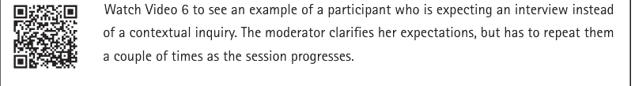

访问我们的网站 (http://www.modsurvivalguide.org/videos) 或使用您的二维码扫描器扫描此代码。

#### 另见
- 5.1 参与者认为她正在参加焦点小组
- 5.5 参与者将情境调查视为面试

## 5.5 参与者将情境调查视为面试

你到达现场进行情境调查，但参与者预期她只需要告诉她她是如何使用某款产品以及她对该产品的看法。例如，一个热线代表预期会是一个面试，并从她的电话队列中抽出特殊时间和你聊天。而你的目标实际上是接听她的电话并向她提问。如果你是远程进行会议，参与者可能只是通过软件工作。

**方法(s)：** 情境调查

频率： 偶尔

**要运用的模式(s)：** 承担责任；明确任务/问题；转移焦点

### 怎么做
这种情况的发生可能是参与者在招募参加研究时得到的细节模糊，或者在被要求参加时做出了错误的假设。大多数人熟悉面试的概念，但情境调查并不是一种非常常见的方法。
- 一旦意识到发生了这种情况，就立即明确你的预期，并为之前没有说明清楚表示歉意。希望参与者能够适应，你可以按照原计划继续会议。如果无法继续，看看是否可以重新安排或转移焦点。
- 如果她显得很尴尬或对混乱感到不安，为沟通不畅承担责任（即使不是）。
- 为无法观察参与者工作的情况准备一份问题列表。可能会在没有误解的情况下发生。例如，参与者的系统崩溃了，或者她提前完成了一个项目，没有什么可以给你看的。

#### 怎么说
- “我今天其实想做的是观察你在平时我不在时的工作方式。期间我会向你提一些问题，或者要求你向我展示某些东西，但总的来说，你应该工作，我的角色大多是作为一个安静的旁观者。”
- “你方便进入好状态，让我快速观察一下你的工作吗？”
- “很抱歉产生了误会——我可能没有清楚说明这次会议的意图。如果不麻烦的话，你能向我展示一下你描述的内容吗？”

### 5.5 参与者将情境调查误认为访谈（续）

#### 不要要做或不要说的话
- 如果可能，不要结束会话。尝试找到一种让参与者开始工作的方法。如果这不可行，如果变成访谈可以提供一些有用信息，则转移研究重心。作为最后手段，如果可能，找个时间重新安排并结束会话。实地访问通常需要大量的精力和时间进行计划，你应该尽力从会话中获得一些反馈。

#### 如何避免
- 在招募期间，明确会话的具体安排和包含的内容。例如，在招募脚本和确认信中注明，你需要观察参与者在她的工作电脑上使用特定应用程序的情况。

查看视频 6，以了解一个预期是访谈而非情境调查的参与者示例。主持人澄清了她的预期，但随着会话的进行，不得不重复好几次。

访问我们的网站（http://www.modsurvivalguide.org/videos）或使用您的二维码扫描器扫描此代码。

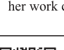

#### 另请
- 4.6 参与者或其他人请求帮助
- 5.1 参与者认为她正在参加焦点小组
- 5.4 参与者带你来到会议室或其他空间
- 6.6 参与者没有自然地进入工作流

## 5.6 参与者带着其他人一起她参与

> 你为一名参与者安排了面对面的会话。然而，当她到达时（或者如果她是远程的，你给她打电话时），她带了一个或多个额外的人一起参加。这些人可能是同事、她的经理，或者一个认为自己也会感兴趣的朋友。

方法：任何

频率：罕见

应应用的模式：承担责任

### 应该做什么
当你在组织内部进行研究时，可能会出现这种误解：参与者（或招募参与者的人）不理解你研究的目的，并假设这是一个培训或销售会议。或者，参会者可能对你正在做的事情感兴趣，想获得机会提供自己的反馈。在这种情况下，最好的做法取决于其他参会者是谁。

如果其他参会者与参与者具有相似的角色/职责（或符合原始招募标准）：
- 安排额外的会话与其他参会者交谈，并与原始参与者继续一对一进行。如果你有额外的空档，这种技术可能是合适的。
- 将会话变成一个发现会话。如果只有一个额外参会者无法安排单独的会话，且会话是可用性研究或访谈，这种技术可能是合适的。
- 分别与每个参会者一对一交谈，时间短一些。
- 确保向额外参与者提供或发送同意书，并让他们在继续会话之前查看并签署表格。

如果其他参会者具有不同的角色/职责（且不符合原始招募标准），或者是参与者的经理、家人或朋友：
- 向其他参会者解释，你的目标是与原始参与者一对一交谈，虽然你很高兴他们如此感兴趣提供反馈，但你需要离开房间。如果他们误认为自己会错过什么，请澄清你并不会提供任何形式的培训。

## 5.6 参与者带着其他人一起她参与（续）
- 如果他们坚持要在会话期间静坐，请礼貌地拒绝。他们的出现可能会改变参与者的行为。相反，解释说会话确实设计为与参与者一对一进行，没有其他人在场。如果你最终决定让他们留下，请尽快给他们发送同意书。这份表格甚至可能对额外参会者的留下起到阻止作用，因为它可能强调会话的正式程度。
- 对没有清楚说明会话的目的以及需要一对一进行这一点承担责任。

#### 应该说什么
- “你们两个对参与都这么热情，太棒了。能告诉我你们为什么想参加吗？”

如果其他参会者正试图不错过 <获取用户对设计的早期反馈 / 观察产品当前的体验> 而：
- 我为了避免这方面的任何误解，才在这里和我们一起进行这个。我不会提供任何形式的培训，只是观察 <参与者> 使用系统。

如果需要辞退其他人/其他几人：
- “因为这次会话是为一对一反馈设计的，遗憾的是我不能让你待在我们房间里。对于这方面的任何误解我表示歉意。但如果你愿意留在我们的接待区等待 <参与者>，我们可以为你提供饮料。”

#### 不要要做
- 如果参与者的经理在房间里或观察会话，不要让参与者继续会话，因为你不希望任何权力关系问题干扰你的反馈。
- 如果你需要要求额外参会者离开，不要粗鲁。要坚定但友善。你接触的每一个人都代表了你的组织，即使他们最终没有成为参与者。你不希望与组织中很有权力的经理或重要的客户产生任何不满。

#### 如何避免
- 这种情况的发生通常是因为参与者对会话期间将发生什么不清楚。在她在到达之前向她解释会话的安排（例如，在招募期间和确认信中），并确保一对一的方面是明确的。然而，即使你非常明确，也可以预计仍会遇到这种情况，并据此做好计划。

#### 另请
- 5.8 参与者带着孩子或宠物参加会话

## 5.7 参与者认为会话是工作面试

参与者穿着整洁的西装出现，并给出正面的反馈。会话结束时，她把简历交给你，并问什么时候能听到工作的回复！

方法：面对面可用性研究；面对面访谈

频率：罕见

应应用的模式：承担责任；转移重心；尽早结束会话

### 应该做什么
如果你在为一家知名机构进行研究，可能会发生这种误解。如果某人失业并期待面试电话，她很可能将研究招募电话误认为是另一种类型的招募电话。如果你有一个供许多不同人的候客区——访客、工作面试候选人、客户和用户研究人员——这也可能意外发生。很容易带错人，相信我们，在那之后情况可能会变得混乱且有趣。
- 在会话开始时非常清楚且明确地告知参与者为什么在这里以及她将要做什么。希望任何误解在此时显现。
- 如果在任何时候你怀疑参与者是来参加面试的，尝试问几个通用问题。例如，问她今天在这里发现了什么，或者她是否参加过用户研究会话，并重新确认招募标准。如果还不清楚，你可能需要直接询问她是否是为了会话来的。
- 如果误解在会话开始时变得清楚（例如在询问背景问题时），让可怜的参与者避免进一步尴尬，解释会话的真实目的。对误解承担责任，并在取消会话的同时提供全额补偿。如果你意识到从候补区带错了人，尽快找到参与者！
- 如果你已经提议结束会话，但参与者真的想参加，考虑让他们继续（除非你的实际参与者在等你）。如果她不完全符合招募标准，你可以看看是否有方法让她留下来并感到有用，而不是让她觉得浪费了路途时间和和一个完美的面试机会。你可能想要：
- 如果她能够完成任务和问题而不需要专业知识或技能，尽管继续进行会话。只需在你的发现中记录该参与者如何偏离招募标准的即可。

### 5.7 参与者认为环节是一场工作面试（续）。
- 如果参与者在缺乏关键技能的情况下无法继续任务，请将环节重心转移到更适合她的事情。例如，将可用性研究转换为访谈，或将访谈问题重新聚焦在你仍然可以利用并理解的话题上。
- 如果参与者要求你联系组织内的某个特定人员，或者希望你把她的研究结果“转交给他们”，请做让你感到舒服的事情。不要出于义务而做任何事，或仅仅为了安抚她。如果你不想答应，尝试用一种温和的方式拒绝她，并向一个更有帮助的方向引导。例如，你可以说你是一名顾问（如果是事实的话），所以你与组织的其他部门没有实际联系，但知道公司网站上有一个针对应聘者的板块。

#### 怎么说
如果不清楚参与者为什么来这里：
- 从通用的问题开始：“是什么让你决定今天参加的？”
- 更具体一点：“你是 <name>，对吧？你来这里是为了参加研究活动。”

在环节开始时，如果你意识到存在误解：
- “如果你想离开，我完全理解，但如果你对这项研究仍然感兴趣，我可以为你介绍一下。”

如果参与者要求建立联系或面试，而你不想参与：
- “抱歉。我很想帮忙，但我今天在这里只是负责主持环节。如果你需要，我可以为你提供职业主页的链接。”
- “我其实只负责用户研究，所以我无法在这方面为你提供帮助。如果你愿意，我可以带你去前台，他们可能可以帮你联系上资源部门的人。”

#### 不要做什么或说什么
- 不要让参与者在离开时还认为该环节是一场工作面试。

#### 如何避免
- 为你的招募人员提供明确说明是招募研究环节的脚本。如果组织内部有人在为你招募，请向她提供关于该环节的解释，并将其与潜在参与者分享以消除任何困惑。我们建议也与招募人员讨论此事，让她让她非常清楚该环节是为了研究，而不是面试。
- 在欢迎参与者时，用她的名字称称呼，并在带她进入研究空间之前确认她是正确的人。

#### 另请
- 5.1 参与者认为她正在参加焦点小组
- 幸存故事：“她急需工作”

## 5.8 参与者带着孩子或宠物参加环节

参与者带着一个孩子（或多个孩子！）或动物到达。该动物不是服务性，而只是宠物。参与者可能期望你或你的团队提供孩子照顾，或者暗示孩子或宠物可以“安静地”待在你们所在的房间里。

方法：任何面对面的方法

频率：罕见

适用的模式：承担责任；早点结束环节

## 要做什么

- 确认参与者了解环节将持续多久以及你将要求她做什么。你也可以向她展示你们所在的空间，因为这可能会改变她继续的意愿（如果是这样，你可以提议重新安排时间，或者直接提供来访的补偿）。

- 如果参与者带了孩子，理想情况下她已经准备好了在环节期间让孩子玩玩的物品。如果没有，深吸一口气并发挥创意！根据孩子的年龄，你可以主动提出为她准备一些纸和马克笔让她使用，或者为宠物准备一些其他（安全的！）材料让它玩，如扑克牌或平板电脑。

- 虽然我们还没有见过参与者在可用性测试中带狗以外的东西（除非是服务动物），但我们相信自己可以应对。在这种情况下，处理宠物在场带来的任何潜在担忧。例如，你可能需要限制参与者接触过敏原，并确保宠物的行为和“生理需求”可以被控制，而不干扰你的环节。

- 如果孩子或宠物在最初一段时间后变得异常吵闹/持续干扰，如果参与者看起来很想继续，请尝试保持耐心和理解。但如果存在持续干扰，你可能想要早点结束环节。这样做要委婉，不要指责孩子或宠物。如果你需要一个借口，可以归咎于技术困难，或解释你完成所有问题比预想要快。再次提供重新安排一个她可以独自来的时间。如果她无法重新安排，我们建议仍然给予她全额补偿。

### 怎么说

当参与者到达时：

- “这应该是一个专注的一对一环节。你的 <孩子/宠物> 和我们待在一起会好吗？我们的环境可能对 <孩子/宠物> 不舒服，所以我们乐意为你重新安排一个独自来的时间。”

如果担心宠物，以过敏为借口：

- “抱歉，我们努力保持这个房间无过敏原，因为这里有很多人会进出。你能重新安排一个独自来的时间吗？”

如果孩子/宠物干扰过大且你需要早点结束：

- “看起来我们完成所有内容比我预期的要快，所以你今天会多出一点时间。感谢你的反馈，这是你的补偿。”

### 不要做什么或说什么

- 不要允许团队成员在环节期间照顾孩子或宠物，即使是在研究室内也不行。这样做如果孩子或宠物在参与者视线外发生意外，可能会让你的组织面临风险。此外，你也不想冒同事被咬（被孩子或宠物！）的风险。如果参与者请求这项服务，告诉她你无法做到，并提议重新安排一个更方便的时间让她独自来。

### 如何避免

在参与者到达之前向她解释环节的设置（例如在招募期间和确认信中），并确保一对一的属性是明确。

### 另请

- 5.6 参与者带着其他人一起参加
- 12.8 参与者有意外残障或服务动物
- 第二章中的幸存故事：“我知道她需要什么”

## 幸存故事

### 幸存故事：“她急需工作”

ADRIAN HOWARD

我当时正在主持面对面的可用性测试，比较了几个为求职者设计的网站。

测试环节在客户现场进行，我们有很多参与者。我帮助设置了筛选参数，但参与者的招募是由客户管理的。

我们最终组织了一条测试生产线。当我主持一个环节时，另一位参与者正由同事在另一个房间做准备。负责招募的人员在参与者到达时负责接待。

在漫长的一天结束时，一位参与者在巨大的误解下进入了测试室。环节开始几分钟后，很明显地看出她认为这是一场真正的工作面试。

天哪。

显然，我立即停止了环节。继续下去是不符合伦理的。一旦我解释，参与者变得非常激动，几乎要流泪。她急需工作，花费了她负担不起浪费的时间和金钱来参加。这一切都是因为她认为这可以让她获得全职工作。

我们去一间私人办公室进行安慰，并强调情况不是她的错，而是我们的错。我立即向她保证她当天不会损失，并在她取咖啡时让她调整情绪。

我们最终为她提供了回家的出租，以及一些额外的补偿来涵盖她参加的费用。如果她理解这只是一个可用性测试，她永远不会参加的。

当我们寻找这一失败的根本原因时，我们发现了三个主要因素：沟通不畅、筛选不良和时间压力。

沟通缺失是最大的问题。招募人员没有提出他们在人员到达时遇到的问题。引导参与者的人假设

#### 幸存故事（续）

他们已经向参与者解释了流程。我假设该参与者已经准备好进行测试。我们那个无辜的受害者掉在了缝隙中。

更好的沟通有助于我们发现糟糕的筛选问题。所使用的语言可能会在求职背景下被某些人误解（例如，“面试”一词）。显然，我们的参与者在筛选和简报阶段虽然口头同意了某些内容，但她并没有完全理解这些内容，只是虚幻地希望这个相当奇怪的面试流程很快就能变得合理！我本应该更深入地参与招聘人员的工作，并确保筛选问题的运行良好。

最后，在漫长的一天结束时，每个参与的人都精疲力竭，没有像应该那样投入注意力。紧迫的时间限制会导致问题。我们需要给自己留出时间，全神贯注对待每一位参与者。如果我们不是像运行流水线一样试图在紧凑的日程中挤进尽可能多的环节，我们早早就能发现这个参与者了。

### 幸存故事：“他不肯离开”

克里夫·安德森 (CLIFF ANDERSON)

我坐在办公桌前，接到了实验室的电话（那周另一位可用性工程师正在进行一项研究）。电话是实验室助理打来的，她听起来非常兴奋——克里夫，这里有个男人，他不肯离开，他还在威胁我们，我们不知道该怎么办。”完电话后，我了解到他希望以现金形式获得 100 美元的补偿，但他很沮丧因为我们提供的是 Visa 礼品卡——这对我们以及我们经常合作的招聘机构来说新鲜。

我告诉她“我马上到”，然后冲下楼梯去实验室。当我到达那里时，我发现了助理、正在运行测试的可用性工程师以及那位用户。情况似乎还在控制范围内，但我注意到该用户似乎有些不安。

我直接走向他，介绍了自己的身份，与他握手，并询问发生了什么事。他开始了他的故事，我尽力进行积极且富有同心的倾听，运用了我多年与用户交流和进行研究中学会的所有技巧和套路。

我看出他正在冷静下来，但我还没有想出解决他问题的方法。于是，我手托下巴，皱眉头，灵光一闪！“你不把那张礼品卡给他吗？我们可以去楼下大厅的 ATM 机，我可以帮你提取那 100 美元。”

他同意了，我们提取了 100 美元，握手并友好告别。我回到楼上，摇着头，赞赏自己在压力下保持了冷静（通常情况下，这是可用性工程师可以具备的最佳技能之一），并确保我们的筛选人员（以及招聘机构）确保提前提到了这种新的补偿形式。

# 第 6 章

需要指导的情况：

需要引导的参与者

有时，你需要给参与者推一把。这种推可能表现为在可用性研究中的协助，或者让他们他们，如果他们提供诚实的反馈，就不会遇到麻烦或伤害任何人的感受。要审慎且温和地处理这种情况，避免让参与者感到尴尬，同时鼓励他提供你需要的反馈。

- 6.1 参与者不愿说任何负面意见 103
- 6.2 参与者做了你不理解的行为 105
- 6.3 参与者在撒谎，你可能能够看穿他的客套话。但较少的参与者会撒谎或回避问题，这通常是因为他们知道自己正被观察，或者担心他们的反馈可能无法保密。

如果怀疑参与者为了顾及别人的感受而在撒谎或回避问题，尝试温柔地引导他说出真相。提醒他他的反馈将造福未来的用户并帮助改进产品。例如，你可以说：“我想确保你提供的任何反馈都将用于改进产品，从而帮助其他用户。你的名字不会与我们的任何结果相关联。”

如果你知道某个问题对参与者来说特别有争议或敏感，可以考虑在提问前加一些话，让他坦诚时感觉更好。例如，如果你正在采访一位呼叫中心代表关于他的通话，并感觉到他担心因为没有遵循流程而惹麻烦，可以考虑说：“我知道你接受过相关操作的培训，我想更多地了解当你做一些与培训不同的事情的情况。请记住，你分享的任何反馈将被保密。”

测试结束后与观察员交谈，提醒他们尊重参与者的反馈和匿名性，即使（尤其是当）他的反馈具有争议性时。

《主持人幸存指南》http://dx.doi.org/10.1016/B978-0-12-404700-6.00006-7

Copyright © 2014 Elsevier Inc. 版权所有。

## 6.1 参与者不愿说任何负面意见（续）

### 该说什么

对参与者说：

- “我知道这是你工作中要求使用的产品，但请坦诚地告诉我……”
- “请知道，你的诚实是受感激的。你说的任何话都不会伤害任何人的感受。你来这里是为了帮助我们为你和未来的用户把产品做得更好。”

对观察员说：

- “我感觉到这个参与者担心他的反馈会得罪某人。所以我提醒一下大家，为了他以及我们的其他参与者，请尊重参与者的隐私和反馈。不要去找该参与者讨论他的参与情况，或向他人谈论他，因为他是这里的员工。”

### 不要做什么或说什么

- 避免让参与者觉得你不相信他们。如果你怀疑参与者没有完全诚实，不要说“没关系，你可以说实话”，或“你能告诉我你的真实感受吗？”

### 如何避免

- 6.7 参与者没有任何负面意见
- 8.3 参与者看起来或听起来不舒服且紧张
- 10.5 参与者对问题给出模糊的回答

与参与者建立预期：他的数据将保密，他的上级或团队成员没有观察测试过程，并且无法访问研究中的原始可识别数据。

### 另见

## 6.2 参与者做了你不理解的行为

参与者开始分享在你不完全理解的领域具有专业性的反馈。也许你是一个对该内容陌生的顾问，或者参与者是一个你不熟悉的领域的专家。结果就是你无法理解他所说的全部，或者无法判断哪些反馈是有用的或相关的。同样，在情境访谈中，你可能会观察到参与者做了你无法理解的事情。

| 方法 | 任何 |
| :--- | :--- |
| 频率 | 频繁 |
| 适的模式 | 澄清任务/问题 |

### 应该做什么

如果参与者说了一些你不理解的内容：或者如果测试正在录制，你可以

- 如果你有领域专家背景的观察员，或者你记录了反馈并继续你的研究计划。测试结束后，向观察员核实参与者讨论的内容。这会让测试顺利进行，但你可能会错过立即跟进的机会。
- 如果你对该领域足够了解，且参与者的话在你的理解范围内，请让他澄清他的意思。诚实一点——告诉他你不是领域专家，希望听到用更通俗的语言表达的想法。
- 在某些情况下，让现场观察员（远程测试则为电话观察员）既是领域专家，又懂得如何与用户交流并了解基本规则会有帮助

如果参与者正在做你不理解的事情：

- 如果参与者的工作流允许中断，请让他用通俗易懂的语言解释他在做什么以及为什么要这样做。
- 如果要求澄清会太干扰他的工作流，请确保用你的笔记和/或录制设备捕捉确切的过程/步骤。如果可能，让领域

## 6.4 参与者无法完成必要的任务

> 你正在进行一项可用性测试，其中任务是相互依赖——也就是说，在继续其他任务之前必须完成某个任务。或者，在特定任务中，参与者必须找到或执行某些操作才能到达你需要反馈的其他区域。参与者在其中一个依赖部分没有成功，这意味着你需要提供一种引导他们到达区域的方法。

方法：可用性测试

频率：频繁

适用模式：澄清任务/问题；重定向参与者

### 做法

- 决定何时以及如何为参与者提供帮助。在允许的情况下，尝试让参与者自己操作一会儿，看看他们是否能自我纠正。如果参与者没有自我纠正，给他一个宽泛或模糊的帮助，必要时提供更具体的提示。将其想象成漏斗，如果他无法自行到达那里，就逐渐引导他到达目标位置。例如，参与者正在使用移动设备查找更改电子邮件帐户设置的地方。他一直忽略“设置”，并导航到其他地方进行操作。例如，你可以说：“如果我不放弃，我告诉你从‘设置’那里可以完成可以吗？”这给了他方向性的指导，但没有指向具体的位置。
- 如果他仍然无法找到，你可能需要指向具体的区域。最终，你可能会指向他需要点击的特定链接。
- 在这种情况下，我们也喜欢使用一种更隐蔽的策略。详细描述请参阅第 3 章侧边栏“分心式协助”。
- 另一个选项是在参与者没看时，由你自己将产品设置为所需状态。例如，你可以与远程参与者一起进行屏幕共享，或者让现场参与者短暂移开视线，以便你完成任何需要的操作。这避免了直接协助带来的复杂性，因为直接协助可能会很尴尬，尤其是当你需要参与者移开视线时。温和的幽默和微笑可以让这种情况变得不那么尴尬，例如：“这听起来很奇怪，但在我为你下一个任务重置原型之前，我需要你离开几秒钟。”

### 应该说什么

对于最初的模糊协助：

- “如果我告诉你……怎么样？”
- “我只是让你知道，这里有一种方法可以实现这一点……”

对于直接协助：

- “请注意一下这个区域。你觉得把它放在这里有什么想法？”
- “我想指出一下你可以找到某项功能。跟我谈谈这与你的预期有什么不同。”
- “看到你这样做时的思考过程很好。我只是想让你知道，实际上完成这项任务有另一种方法。我很奇奇你是怎么想的”<指给他正确的方法>。

作为分心协助的一部分进行重定向：

- “我们现在继续下一个吧。我想问问你之前做过的事情。”
- “我们不要在这里停一下，因为我想问问你关于……”
- “我们先在这里停下，稍后再回来。请看下一个场景……”

### 不应该做什么或说什么

- 尝试避免在参与者明显没有注意到的情况下问：“你注意到这个链接了吗？”虽然在无话可说的窘境下这可以作为应急之策，但它通常会让参与者感到有些不舒服。
- 避免说任何暗示存在正确答案的话。例如，“你正在找的东西在这里”或“这是正确答案。”

### 如何避免

可用性研究的本质是发现可用性问题，因此，遗憾的是，没有办法可以避免这一点。只需做好准备吧！

### 参见

- 4.2 参与者拒绝或无法完成关键任务
- 6.8 参与者认为自己已成功完成任务
- 第 3 章侧边栏：“分心式协助”

## 6.5 参与者忽略或假装听懂你的问题

参与者似乎在假装听懂你的问题，并给出了模糊（例如“大概吧”或“我不知道”）复杂的回答。或者，参与者可能会公然忽略你的问题并开始谈论其他话题。如果你让他向你展示某些特定内容或尝试某项任务，他可能会忽略你让他关注的内容，转而向你展示他显然擅长或熟悉的其他内容。

方法方法：任何

频率：偶尔

适用的模式：承担责任；澄清任务/问题；重定向参与者

### 应该做什么

- 归怪自己作为主持人没有把问题/任务解释得清楚。例如：“抱歉，我没有解释得很清楚。我想听听你的意见……”这种技术能让参与者放心，他并没有被评估，也没有因为没懂你的问题而愚蠢。
- 重新表述问题/任务，让参与者更容易理解，或者将你的问题分解为一系列引导你实现目标的较小问题。
- 如果参与者紧紧擦嘴唇或歪头靠近你，他可能是听不清你的话。把椅子稍微向他挪一点，说话大声一点，并使用短而直接的句子。
- 如果参与者仍然不理解你或仍然很模糊，请进入下一个任务或问题。

### 应该说什么

- “如果我说的哪里听起来不通，请告诉我。”
- “我知道这可能不是你通常工作的内容，所以如果我对要求你<做/谈论>方面说清楚，请告诉我。”
- “抱歉，我认为我的问题表述不够清楚。让我重新表述一下……”
- “如果我重新表述一下会有帮助吗？”
- “让我回溯一下，首先问问你……”

### 不应该做什么或说什么

- 不要反反复地问同一个问题以期望获得不同的回答。这会加剧问题并让参与者感到更加挫败。
- 尝试不要说任何可能被视为指责参与者的话。例如：“你没有听懂我的问题吗？”

### 如何避免

- 在环节开始时，让参与者放心他是研究中的重要部分。例如：“在本次过程中我会问你问题，但如果有任何要求不清楚，请尽管告诉我。”另一个例子可能是：“我不是这个领域的专家，所以如果我的问题不合逻辑，请告诉我。”
- 如果参与者是内部员工，提供关于他的反馈将如何使用的保证，以缓解他对在同事面前表现不佳的担忧。更多信息请参见第 15.1 节。

### 参见

- 6.3 参与者不回答问题
- 第 11 章生存故事：“我本该相信直觉的”

## 6.6 参与者没有自然执行工作流

参与者展示了执行工作流的“正确”方式。也许他强调了完成工作流最快的方法，展示了他的能力而非他通常完成工作的方式。

方法方法：可用性研究；情境查询

频率：偶尔

适用的模式：澄清任务/问题；让参与者放心

### 应该做什么

由于正在被观察，参与者可能会觉得正在被评估，即使你向他保证没有。他可能想表现得干练、快速或聪明。他可能不想因为没有遵守程序而惹麻烦。这些因素可能会阻止参与者表现得自然。

- 由于很难判断参与者是否自然地执行某事，请寻找这些迹象：
  - 他对那些声称经常做的事情似乎很吃力。
  - 他使用“我们这样做……”或“我们然后必须做……”之类的描述，而不是“我做……”
  - 他看起来很紧张，经常看你，和/或者表现得像在被评估。例如，他说：“你要给我打分吗？”
  - 他没有向你展示工作流，而是在描述过程，即使在你提示他之后也是。

当你注意到这些情况发生时，向参与者澄清你想看到他实际是如何做的，即使那不是正式程序或最高效的方法。

如果参与者表示担心因为他展示或告诉你的内容而惹麻烦，请告诉他收集的数据将如何被使用（例如，数据在与项目团队共享之前会进行保密和汇总）。让他放心他没有以任何方式被评估。

### 应该说什么

- “在一个正常的工作周里，你多久做一次这个？”
- “这是你每天完成这项任务的方式吗？”
- “你认为大约百分之几的时间你是这样做的？”
- 你尝试过的处理任务的其他方法还有哪些？
- 我在这里是观察你的工作方式，以便我了解什么对你有效，哪些不适用。然后我们会采取这些信息并用它设计更好的体验。说明一下，我不是来评估你的技能或你工作方式的。
- 请知道，你说的任何话都不会与你的名字关联。

### 不应该做什么或说什么

- 不要就评估参与者开玩笑。
- 不要告诉参与者他做得好或不好。
- 不要表现出理所当然要观察参与者工作，特别是如果是别人报名的话。相反，要对他能够被观察表示感谢

### 如何避免

- 在与参与者的招募沟通中，尽可能明确你的角色是什么、你为什么在那里以及信息将如何被共享/使用。
- 如果你在现场进行情境查询，尝试在到达时对所有要交谈的参与者提供简短的通用通报。这种简报可以为我们将要做什么、如何收集数据以及我们将如何处理结果设定背景。

### 参见

- 5.5 参与者将情境查询当成面试

## 6.7 参与者没有提供任何负面反馈

参与者似乎是一个“好人”，具有以下一个或多个特征：

- 似乎在试图讨好你或观察者。
- 对设计中的一切都喜欢，没有一个不喜欢的地方。
- 在可用性研究中，完成了所有任务，且没有遇到任何问题。

方法：可用性研究

频率：偶尔发生

适用的模式：承担责任；安抚参与者

### 做什么

如果可用性研究的参与者在没有遇到任何困难的情况下完成了任务，不要恐慌！收到全部或正面反馈虽然不常见，但并非没有先例。不要强迫参与者提供负面反馈。记住，了解设计中哪些部分运作良好是有用的，你可以确保这些优点不被忽略。

- 如果参与者表现出矛盾的反应（例如，在任务或产品使用上非常吃力，但又喜欢设计的一切），思考一下可能存在的因素：

  - 你是否忘记在测试开始时提醒参与者应该坦诚并提供正面和负面反馈？如果是这样，找个方法将此带入讨论，即使你需要承担责任并承认自己忘记说了。
  - 参与者是否认为或知道设计中做了哪些改进，或者知道设计产品的团队正在观察？如果是这样，明确表示每个人都希望听到正面和负面反馈，以便他们可以保留有效部分并修复不佳部分。
- 参与者是否是该产品的忠实粉丝或早期采用者，并觉得它无懈可击？如果很有可能，要引导他说出对产品不喜欢的地方，因为他可能不会主动提到这些点。例如，“如果你能挥一挥魔棒来改变这个产品的任何一点，你想改变什么？”

### 怎么说

如果参与者似乎有了真正正面的体验：

- “如果你能挥一挥魔棒来改进这个产品的任何一点，你想改进什么？为什么？”

## 6.7 参与者没有提供任何负面反馈（续）

如果你怀疑他是不情意提供负面反馈：

- “感谢你的这些反馈——听到这些建议都非常有帮助。项目团队非常期待获得所有的反馈——包括正面和负面的。所以请继续告诉我你看到的任何情况，无论好坏。我们继续来看……”
- “这些反馈非常有用，谢谢。让我们花时间思考一下这个<任务/话题/领域>。你最喜欢它的哪一点？最不喜欢的是哪一点？如果你在工作或家里使用它，你想改进什么？”

## 不要做什么或不要说什么

- 尝试不要指责参与者只给出正面反馈，或强迫他想出负面反馈。这样做可能会自然地偏斜参与者在测试期间对产品的态度，并可能疏远你的利益相关者。

### 如何避免

- 确保参与者从一开始就知道你希望他们提供正面和负面反馈。

## 另另

- 6.1 参与者不说任何负面意见

## 6.8 参与者认为自己已成功完成任务

> 参与者认为自己成功完成了一个任务，而且很容易。然而，你知道他并没有成功。

方法：可用性研究

频率：偶尔发生

适用的模式：明确任务/问题；引导参与者；安抚参与者

### 做什么

这种情况与第 6.4 节描述的情况密切相关，但在这种情况下，参与者没有意识到自己没有成功。在这种情况下该做什么取决于：

- 参与者是否真的需要知道他没有完成任务？作为引导员，你不应该告诉他任务何时是“成功”的，相反，让参与者自己决定何时完成。如果他恰好在做错误操作，你通常不需要指出任何问题，只需继续即可。记住，如果他给出主观反馈或评分，他的表现可能与他评分的体验并不相关。由于他不知道自己没有成功，参与者可能认为一切良好并给他的体验打高分。
- 如果参与者需要知道他没有成功（例如，如果任务之间存在相互依赖，必须在尝试下一个任务之前完成当前任务，或者参与者不应进入研究关注的区域），请遵循第 6.4 节的建议提供协助。

### 怎么说

如果参与者不需要知道或看到正确路径：

- “好的，我们不要进入下一个任务吧？”

## 不要做什么或不要说什么

- 不要让参与者觉得他做错了或正在被测试。避免说类似“这个任务还没有完成”或“让我给你演示正确的方法”之的话。

## 6.8 参与者认为自己已成功完成任务（续）

### 如何避免

- 参与者偶尔会这样做，所以没办法避免！记住，这种反馈的价值与看到参与者挣扎完成任务一样价值。

## 另另

- 6.4 参与者无法完成必要的任务

## 6.9 观察者没有参与测试

观察者显然没有参与你正在主持的测试。他们可能在检查邮件、处理其他项目，或在私下聊天。当你向房间外征求反馈时，他们太不投入了，无法提供任何帮助的信息。

方法：任何

频率：偶尔发生

适用的模式：承担责任

### 做什么

- 如果观察者和你参与者在同一个房间里，你可能需要休息一下，以便让他们关注测试。提醒他们他们的反馈是有价值的，他们需要感到舒适才能提供反馈。房间里不投入的观察者会分散注意力。
- 为观察者提供对测试结果负责的方法。让他们在测试期间跟踪看到的问题，并在每次结束后与他们进行回顾。发布他们创建的列表，使其持续可见。
- 鼓励远程观察者参与更具挑战性。但你可以采取类似的方法，要求每位观察者跟踪他们看到的问题，并在每次测试后进行快速的简报。如果某些远程观察者在同一个地点，建议他们找一个会议室这样他们可以一起观看测试。

### 怎么说

- “你们认为目前测试进展如何？你们有看到或听到什么令人惊讶的事吗？”
- “在接下来的测试中……”

## 不要做什么或不要说什么

- 不要对观察者发火。虽然知道工作没有被观察（或积极欣赏）可能会令人沮丧，但要意识到大多数人都很忙，很难抽出足够的时间投入整个测试。相反，要尽可能让观察者容易进入并保持投入。

### 如何避免

- 如果观察者将和你参与者在同一个房间里，请在测试前为他们提供一份行为准则。参见第 15.4 节了解更多关于此类以及向观察者提供通用规则的内容。例如，你可能希望让观察者跟踪测试期间看到的问题，以鼓励他们关注，然后你可以与他们一起并汇总结果。

# 主持人生存指南

## 生存故事

## 生存故事：“她非常感激不已”

KAYCEE A. COLLINS

我当时正在对一个新构思的投资工具进行面对面的可用性研究。对于面向客户的设计，我使用了一个第三方供应商来完成招募流程。我会提供一份筛选表和客户名单供招募人员使用，他们则会提供安排好的参与者。当时，我并没有仔细地双检已安排的参与者，以验证他们是否符合我正在寻找的用户类型。走进大堂时，我遇到了当天的第一位参与者并开始闲聊，没什么异常，只是一些像“你觉得这里还好吗？”和“你今天过得怎么样？”这样简单的问题。这时我发现招募人员安排了两个人连续参加场次，他们虽然没有住在同一个家里，但刚刚申请了离婚。

那个女人继续讲述着她的准丈夫以及她所遭受的情感虐待。在听了她大约10分钟并充当了伪心理学家后，我们能够把注意力回到故事上。在剩余的时间里，她对有人倾听她的想法非常感激，并作为报答，她专注于原型，没有被脑中不断出现的压力情况所干扰。每一个问题都得到了诚实且毫不犹豫的回答。最后，由于她的开放，我收到了极好的反馈，这对设计产生了积极影响。有时，需要先让参与者吐露心底的话，然后才能专注于眼前的任务。当参与者心里有其他想法时，由于他们心心神闲，很难专注于对设计提供反馈。我总是带着温暖的微笑和简单的闲聊来打破冰冰，希望让他们进入提供反馈的正确心态。在这种情况下，参与者和我在开始场次之前就已经建立了联系和信任。

至于他，当我课程结束后送他的妻子走到门口时，他正在等候。我感谢他的到来，并告诉我压力很大，不是因为我和和他妻的对话，而是为了避免每个家庭出现超过一个人以消除样本误差，特别是在仅有少数用户测试的情况下。然后我接了下一场的替补人员。

我从这次经历中中学了很多。首先，双检我的参与者安排表，以确保我拥有正确的用户。其次，与供应商建立良好的关系。与我合作的供应商并不知道同一家庭的两个参与者会对研究产生什么负面影响；他们非常乐意在未来留意这种情况。第三，当参与者需要说话时，让他们倾诉心声。这最终将是有益的。

需要指导的建议：需要引导的参与者

# 第 7 章

## 让它运行起来：处理技术障碍

技术问题可能会让你的场次陷入停滞。无论你是遇到设备故障，还是远程场次设置遇到困难，你都需要让参与者相信问题不是她的错，并找到解决问题的方法，以便你可以回到研究计划。

- 7.1 你的设置和/或设备出现技术问题 (125)
- 7.2 远程参与者加入时遇到困难 (127)
- 7.3 设施丢失网络连接 (129)
- 7.4 远程参与者掉线 (131)
- 7.5 原型或产品发生意外变化 (133)

## 7.1 你的设置和/或设备出现技术问题

你的技术设置出了问题或停止工作。你的音频录音机可能停止工作，你的摄像头可能电量耗尽，或者你的录屏软件可能决定停止录制。你用于研究的移动设备在场次中可能会接到一个（无关的）电话，或者产品在参与者使用时坏了。

- 方法：任何
- 频率：频繁
- 要运的模式：承担责任；休息一下；转移焦点

### 应该做什么

- 弄清楚问题是否可以轻松解决。电池可以更换或充电，电缆可以拧紧，设备音量可以调低，电脑可以重启（重启电脑通常解决很多问题）。
- 如果问题无法解决，决定你是否能够继续。在大多数情况下，你应该能够通过微调来继续（例如，你可能无法录制场次，但仍然可以详细记录参与者说的话和做的）。
- 如果你有可以帮助修复产品更复杂问题的观察员，你可以询问他们估计修复需要多长时间。基于此，在修复期间，你可以引导参与者将场次转向另一个方向（例如，进行一系列访谈），或结束场次。
- 如果你计划在可用性研究期间在参与者面前修复产品的技术问题，首先考虑参与者可能会看到什么。如果通过修复产品，参与者将发现你尚未打算让他们看到的设计的局部，或者可能会对随后的任务产生偏差，考虑让他们转过身去或休息片刻。如果参与者是远程的，先暂停或停止屏幕共享应用程序，让参与者看不到你在做什么。
- 如果有人需要进入你的研究空间来修复技术问题，要求他们不要与参与者进行不必要的互动。然后警告参与者并让她确切知道是谁进入空间以及为什么。提议让参与者离开房间去水或上厕所，或者坐在椅子上使用手机或移动设备。确保在工作进行期间录音设备已关闭，并在场次恢复时将其开启。

### 7.1 你的设置和/或设备出现技术问题（续）

### 应该说什么

- “请稍等一下，我刚刚发现我们的设备出了问题。让我们休息一下，我来把它修好。”
- “请多包涵，我尝试让它恢复工作。抱歉！”
- “我们遇到了技术问题，我需要让我们的一位技术专家进来。她需要使用*产品*，这可能需要几分钟，所以让我们休息一下。技术专家，请进来。”

不要 不要做的或说的话

- 不要发疯或恐慌！
- 尽量不要说你使用的设备或软件的制造商。虽然你可能对这种情况感到沮丧，但在参与者面前要保持职业姿态。
- 不要指责参与者，即使技术问题是由她造成的。

### 如何避免

- 提前测试技术设置。如果设置很复杂，使用一个需要发生的事清单。这样，如果你需要在场次中重启或更改某些内容，可以参考清单以确保没有漏掉任何内容。
- 在场次开始验证所有设备的状态。确保任何设备和充电电池都已充满电。此外，确保你有额外的电池或电池宝。
- 在设备或软件问题需要时间解决的情况下，准备一份通用的问卷给参与者会有帮助。例如，你可以编写一份调查，询问参与者关于她使用产品的情况和体验的其他问题。
- 如果你使用屏幕共享应用程序供观察员观看场次，考虑准备一个不同服务的备用账户，这样如果某个服务出现技术问题，你可以快速使用备用服务建立一个新会议。确保将此备用服务的信息包含在你的清单中。

## 7.2 远程参与者加入时遇到困难

> 当你尝试为远程参与者设置会话时，你会遇到许多技术困难。最常见的是难以访问屏幕共享软件（例如，下载软件或任何必要的扩展程序出现问题）。

方法：任何远程方法

频率：频繁

适用的模式：承担责任；转移焦点；早结束会话

### 应该做什么

由于屏幕共享软件通常对于任何类型的远程研究都至关重要，这些困难可能会减少你实际获取研究所需反馈的时间。如果你有观察者，你可能会感到额外的压力，因为花在排除故障上的时间少了，花在他们关注的事情上的时间也少了。

- 让参与者描述她的电脑上正在发生什么。如果你已经创建了分步指南（参见“如何避免”章节），请将该指南放在手边，这样你就可以将参与者看到的内容与她应该看到的内容进行对比。
- 让参与者确认她使用的是什么种电脑（例如 Mac 或 PC）以及网络浏览器（例如 Internet Explorer 或 Chrome）。然后你可以根据屏幕共享软件的系统要求核实这些信息。请记住，如果浏览器符合官方要求，旧版本的浏览器可能存在功能缺失或下降的情况。尝试另一个浏览器（如果参与者安装了多个浏览器或可以安装另一个），看看是否能解决问题。如果参与者的设置无法与屏幕共享软件配合，请问她是否有权限访问另一台符合要求的电脑。
- 如果可能，尝试使用与参与者相同的浏览器跟进她的操作（例如，如果你已经通过 Firefox 连接了屏幕共享，请打开 Internet Explorer）。通过这种方式，你可以准确检查参与者在过程的各个阶段看到了什么以及应该看到什么，即使你没有分步指南。
- 如果你有可以访问的另一个屏幕共享应用程序，考虑改用它。如果你有团队成员可以提供帮助，请让她将新的观察信息发送给任何远程观察者，而你则尝试让参与者在新应用程序上设置好。
- 如果这些解决方案无一都不起作用，且你原本打算进行可用性研究或情境查询，请考虑将研究重心转向更像访谈的方法，这种方法只需要视频会议。
- 作为最后手段，询问参与者是否可以重新安排她的会话，并单独与她跟进以解决任何故障排除问题。

### 7.2 远程参与者加入遇到困难（续）

### 不应该做什么或说什么

- 在向参与者提供故障排除指导时，避免使用用户界面术语（例如，状态栏、对话框），因为他们可能不懂你在说什么。相反，请根据位置和物理特征引用屏幕的区域。
- 非常小心不要建议任何可能对参与者电脑造成伤害的操作。例如，你可能不想让他们进入 Windows 注册表删除文件或禁用功能或设备。

### 应该说什么

- “你能准确告诉我现在在屏幕上看到了什么吗？我会尽力为你解决这个问题。”
- “在我尝试跟进时，请稍等。感谢你的耐心！”

### 如何避免

- 在安排的会话之前与参与者会面，进行五分钟的技术演练。这次演练将让你验证参与者具有支持你屏幕共享软件的正确系统要求，并给你充足的时间来排除出现的任何问题。
- 调查你的组织或参与者组织（如果她在工作）对网络有任何限制。我们过去发现过由于防火墙/安全设置、私有虚拟网络 (VPN) 访问、平台和浏览器支持或这些者的结合，屏幕共享应用程序出现过非常奇怪的问题。例如，我们发现过某些案例，公司内部员工尝试通过其 VPN 使用 WebEx 时，只有使用 PC 上的 Chrome 浏览器或 Mac 上的 Safari 浏览器才能加入。我们可不是在编造！
- 为加入你的屏幕共享应用程序创建一个带有屏幕截图的分步指南指南，并在参与者加入会话时将其打印在你面前。你也可以创建一个简短版本提前发送给参与者。
- 如果你的观察者只在特定时间有空，考虑安排备用或机动参与者，以防你因技术困难需要取消参与者。有关做出此决定，请参见第 15.1 节。

### 另

- 7.1 你的设置和或设备出现问题
- 7.4 远程参与者掉线
- 第 15 章侧边栏：“排除故障技巧是救命稻草”

## 7.3 设施丢失互联网连接

在研究的某个时刻，你所在的设施失去了互联网连接。你的研究需要互联网，要么是因为你研究的目标产品需要访问权限，要么是因为你有远程观察者或参与者。这种情况可能发生在你所在的所在地、参与者的所在地或实地任何地方。

方法：任何

频率：偶尔

适用的模式：承担责任；休息一下；转移焦点

### 应该做什么

- 如果你正在使用会议电话与观察者共享会话音频，告诉他们你正在遇到互联网问题并正尝试解决。在你尝试弄清楚时，让他们挂机或静音。
- 验证（或如果你在她的环境中，则让参与者验证）互联网连接已断开，且这不是产品或原型的问题。检查的快速方法是打开网络浏览器并尝试打开任何内容。如果你在一个有内网的组织中，尝试同时访问内网和外部网站以缩小问题范围。如果你能看到内部和外部网站，你就知道问题可能特定存在于你的产品或原型，而不是内部或外部网络的问题。
- 如果你在设施内，检查确保你的网线是否仍插好（如果使用有线连接）或无线网络是否仍然可见。如果机器是无线的且无线网络不可见，请确保无线已开启并连接到正确的接入点。如果这没有帮助，请重启电脑并保持关注。如果你在遇到互联网困难之前是屏幕共享会议的主持，主持人角色可能会分配给你所在区域的其他人。你可能需要在返回会议后重新夺回该角色，这可能自动发生，也可能需要从会议内部手动进行（取决于你使用的工具）。
- 如果几分钟后仍无法使用互联网，请转到会话中不涉及互联网的部分。例如，你可以转向基于访谈的问题，或要求参与者完成纸质调查卷（如 15.2 节所述）。

### 应该说什么

- “看起来我们丢失了互联网连接。请稍等，我会尝试尽快让连接恢复正常。”

## 7.3 设施丢失互联网连接（续）

### 不应该做什么或说什么

- 不要指责你使用的设施或网络团队。尽管你可能只是在表达你的挫败感，参与者和观察者可能会产生误会。

### 如何避免

- 如果你使用原型，尝试将其安装在用于研究的电脑本地，而不是网络上。另一个选项是将原型存储在优存盘或其他移动存储设备上。如果你要求参与者使用她的电脑（例如，因为你在她的所在地），你可以请求她的许可安装原型，但在会话结束后将其卸载。
- 大多数屏幕共享应用程序都提供一个拨入号码，可以使用“使用计算机通话”（IP 语音，即 VoIP）选项。如果在互联网问题期间屏幕共享部分中断，将此拨入号码提供给观察者，他们仍然可以听到会话期间发生的情况。
- 确定一个在遇到问题时可以联系的技术支持人员。理想情况下，你可以在进行研究时告诉她，以便她通知你可能影响你会话的计划维护或升级。如果你在测试参与者的设施或远程站点，可以要求你的主持人介绍你认识可以在紧急情况下提供帮助的技术支持人员。

# 7.4 远程参会者退出通话

你正在使用屏幕共享和音频会议技术（如 WebEx）进行远程会议。突然你发现你再也听不到参会者的声音了。她可能再也没有出现在屏幕共享应用程序的参会者列表中。

- 方法：任何远程会议
- 频率：偶尔发生
- 适用的模式：休息一下

## 该怎么办

- 首先检查你是否有一个音频会议参会人员的视觉化显示，通过你的屏幕共享应用程序（如果使用 VoIP）或你的电话界面。如果是，检查参会者是否还在那里。如果她在列表中，你可能可以从应用程序内部向她发送聊天消息，确认她是否仍在通话中。
- 如果你没有会议上所有人员的视觉指示，请先核实参会者是真的离开了，还是只是不小心开启了静音。询问她是否仍在通话中，并让她检查一下确保没有不小心开启了静音。
- 假设参会者真的离开了，最好的做法取决于她是如何进入会议的。如果她是自己拨进去的，请等几分钟看她重新拨进来。如果你是拨打给她或推荐她加入的（即她没有重新加入会议的号码），你需要重复初始步骤将她带入会议的音频部分。
- 如果你难以联系上参会者，或者她还没有重新拨进来，请休息片刻，向观察者提供更新。告诉他们你将继续尝试联系参会者。
- 给参会者发送一封邮件，附上你的联系方式，这样如果她遇到了导致无法重新加入会议的技术问题，就可以联系你。

## 该说什么

对参会者说：

<参会者姓名>，我听不到你的声音了。你还在吗？如果你能听到我的声音，请检查一下确保你没有开启静音。

对通话中的观察者说：

- 我认为我们丢失了参会者。请留在线上，我会尝试与她联系。

# 7.4 远程参会者退出通话（续）

## 不该做什么或不能说什么

- 不要对参会者发表任何负面言论，因为她可能并没有真的掉线（例如，她只是遇到了音频问题），或者可能正在拨回来。出于同样的原因，你可能不想让观察者在通话中发言。

### 如何避免

- 提前向参会者提供说明，如果她掉线了该怎么办。例如，“我会再次通过这个号码打给你。”

- 此外……（注：此处原文似乎有缺失或重复，按逻辑翻译翻译）……坚持在会议期间不对原型进行任何更改也很重要。通常，“快速”修改会产生意外的后果。更多信息请参见第 15.3 节。

- 7.1 你的设置和/或设备出现技术问题

- 7.2 远程参会者遇到加入困难

- 第 15 章侧边栏：“排除故障技巧是救命星”

# 7.5 原型或产品发生意外变化

在可用性研究期间，你注意到原型中的某些内容自上一次会议甚至同一会议更早些时候之后发生了变化。这种变化可能是链接或按钮的新标签、更新的内容，或者图形元素的不同颜色选择。如果你要求参会者使用真实产品，也可能发生类似的混乱。如果产品开发在你的研究期间没有被冻结，你可能会注意到微妙或不细微的设计变化！

- 方法：可用性研究

- 频率：偶尔发生

- 适用的模式：承担责任；休息一下

## 该怎么办

- 保持冷静。记住你才是场会议的负责人，如果你对参会者正在提供反馈的内容感到惊慌或惊讶，对她没有帮助。

- 如果你看到一个或多个变化（或者对你看到的某一个变化非常担心），请离开房间与设计师/开发者交谈，识别更改了哪些内容以及为什么。解释说你需要了解这些，因为你研究计划中的问题经过仔细计算，以确保不具有引导性或不使用产品用户界面中的任何术语，你可能需要相应地调整你的研究计划。

- 如果你觉得所做的更改没有帮助或没有必要，询问是否有办法“回滚”到原型或产品的早期版本。如果研究的目标是收集衡量体验的总结（定量数据），那么在研究中进行更改可能会破坏你数据的完整性。但是，如果出现以下情况，你也可能认为更改没有帮助或没有必要：

    - 更改仅基于一或两个参会者的反馈（假设你测试的人数多于此）

    - 更改违反了设计和可用性的最佳实践。

## 该说什么

如果参会者注意到了变化（因为变化发生在她已经与产品交互之后）：

- “是的，看起来团队急于根据你的反馈开始调整设计。你对这个变化怎么看？”

# 7.5 原型或产品发生意外变化（续）

如果你需要离开房间与设计师/开发者交谈：

- “抱歉……”

如果你正在使用真实产品且无法保证设计冻结：

- “你今天将对一个真实的<产品>提供反馈。因为它是实时的……”

## 不该做什么或不能说什么

- 不要指出参会者是否没有自己注意到它。

- 避免为了做出更改而骚扰设计师/开发者。

### 如何避免

- 提前与设计师/开发者讨论你的规则。我们通常要求团队在不提前咨询的情况下不要对原型或产品进行任何更改（即使这样，我们可能可能不同意应该进行该更改）。坚持在会议期间不对原型进行任何更改也很重要。

- 如果使用网站进行研究，请了解该网站是否进行了任何 A/B 测试，如果是，查看是否有方法让你在研究期间关闭该功能，或者一致地看到相同版本的页面（例如，始终看到 A 设计）。

- 作为简要介绍的一部分，让参会者知道她将使用真实产品，这样她在进行会议过程中可能会注意到变化。这种警告在你无法保证设计冻结时尤为有用。

### 另见

- 7.1 你的设置和/或设备出现技术问题

- 第 15 章侧边栏：“排除故障技巧是救命星”

# 幸存故事：“灯光看起来比平时要暗”

CAROL SMITH

可用性研究一直面临挑战，但我面临的最大挑战出现在我进行研究的建筑停电了！

我当时正在为一家位于郊区办公园区的大公司提供服务。开车过去，尽管天气不好，一切似乎都很正常，但当我进入建筑时，我灯光看起来比平时要暗。我冲向测试实验室，发现灯光不工作了。幸运的是，房间一侧的大窗户提供了大量的自然光。

此时联系参会者已经太晚了，因为这是一个相对大城市，参会者大多在路上或很快就会到达。

幸运的是，所有的同意书和其他支持文档都已就绪。这项研究是为了测试运行 Morae 的桌面电脑上的可点击原型。有人可能预到了这种情况，或者我们非常幸运，因为所有的测试机器都插在连接备用发电机的插座上。

当参会者到达时，我向他们解释了情况，并告诉他们如果感到不舒服，我们可以尝试重新安排。我特别担心，因为我需要带他们穿过一段非常暗的走廊进入测试室。如果你对黑暗感到紧张，没有比这更有压力进入研究的方式了。

这种情况只影响了少数参会者，他们非常理解。我确保在每次会议开始前参会者感到安全。到了第三位参会者那里，电力恢复了，我在没有问题的情况下继续了研究。

提前准备好必要的文件是救命之星。尽可能，我都会尝试在前一天规划每一天的测试。无论如何，在没有电力的情况下能做这么多事情真是令人意外惊喜！

# 第8章

# 这样对吗？

应对不确定的参与者

用户研究创造的人造环境可能会让参与者感到紧张，或担心自己不是一个“好”参与者。即使你告诉参与者他并没有在接受测试，可用性实验室的设置或录制设备、观察者的存在也可能让他们感到畏惧。你需要一套应对方案和安慰步骤，帮助缓解参与者的焦虑并并他在测试过程中感到更加自在。

- 8.1 参与者寻求认可 137

- 8.2 参与者询问你的意见 139

- 8.3 参与者看起来或听起来不适和/或紧张 141

- 8.4 参与者自责 144

- 8.5 参与者问：“其他人在这里遇到过困难吗？” 146

- 8.6 参与者不意愿或不确定 148

## 8.1 参与者寻求认可

> 参与者似乎对他所说或所做的事情不确定，向你寻求认可。他可能会问直接的问题（例如，“我这样做对吗？”），或使用被动陈述（例如，“我希望这有帮助”）。

方法：任何

频率：频繁

适用的模式：引导参与者；安慰参与者

### 怎么做

这种情况与参与者自责并道歉的情况相似（见第 8.4 节），不同的是，在这种情况下他们更明确地在寻求你的反馈来引导他们。

- 确保参与者提供了你需要的反馈（这与向他保证他做的某事是“正确”的不同），并强调他所做或所说的任何事情对研究团队都有帮助。

- 检查你的肢体语言，看看在测试过程中是否有任何行为可能让参与者认为自己做错了。例如，如果你在做笔记，请确保你在参与者操作成功和不成功时都在记录，而不仅仅是在参与者遇到问题时才记录。

- 不要让参与者沉溺于对认可的渴望，在给予安慰后，立即引导他们转向另一个与研究目标相关的后续问题或任务。例如，你可以说：“这就是我们想听的反馈。现在，刚才提到的……”

### 怎么说

- “这就是我们想听的这种反馈。”

- “听到和看到这些都非常有帮助。感谢你的持续反馈。”

- “别担心你表现得如何——我们不是那样看问题的。我们只是在这里看你你是如何处理的，并获取你对过程的反馈。”

### 不要怎么说

- 避免对参与者的反馈表示赞同（或反对）。例如，不要说“是的，这显然是我们考虑过的其中一个大问题。”

### 8.1 参与者寻求认可（续）

- 在可用性研究中，要避免让参与者知道他是否正确地完成了任务。

- 避免使用“你已经完成了这项任务”或“这项任务已完成”之类的短语，因为这暗示了完成任务有错的方法。同样，避免可能暗示或建议预期答案的引导性问题。例如，“所以你每天都这样做，对吧？”

### 如何避免

- 在整个测试过程中保持肢体语言一致，这样参与者（他们可能对观察格外敏感）就不会觉得受到你表现的影响。例如，如果在可用性研究期间参与者采取了意料之外的路径，而你在其他时间都是向后靠的，那么请不要前倾。同样，如果你对面试期间提供的反馈表示不同意，请避免皱眉或摇头。

- 定期告诉参与者他们的反馈是有用的，以此鼓励他们。如果你采取这种方法，请确保不仅是在参与者提供特定类型的反馈后提供这种鼓励（有关这种技术的更多信息，请参见第 3 章侧栏“你应该告诉参与者她的反馈很有帮助吗？”）。

观看视频 1 以查看主持人在可用性研究期间与自责参与者交互的示例。该参与者对测试非常紧张，并在寻求认可。

访问我们的网站（http://www.modsurvivalguide.org/videos）或使用你的二维码扫描器扫描此代码。

### 另请

- 8.2 参与者询问你的意见

- 8.4 参与者自责

- 8.5 参与者问：“其他人在这里遇到过困难吗？”

## 8.2 参与者询问你的意见

> 参与者回答问题或完成任务，然后向你征求意见。这种提问可能非常有针对性（例如，“你认为哪个品牌最好”），也更通用（例如，“你觉得这个如何？”）。

方法：任何

频率：频繁

适用的模式：引导参与者；与参与者保持距离

### 怎么做

参与者可能在使用这些问题引导你进入对话，就像在更非正式的场合聊天一样。对他来说，这种对话可能比被要求回答你的问题更自然。

- 通过提醒参与者你感兴趣的是他们的想法来引导该问题。解释你想保持中立。

- 如果你发现参与者对你过度友好或乐于聊天，并且他的友好导致了这类问题，请调整你的引导风格（正如我们在 1.5 节和 1.6 节讨论过的），远离更加非正式的倾向。例如，如果你的风格类似于“亲切面孔”，你可以转向更正式的“公事公办”。配合这一变化，你可能需要通过微妙地改变语气和肢体语言/位置（如第 3.6 节所示）与参与者稍微保持距离。

### 怎么说

- “我很想听听你的想法。你怎么看？”

- “我想保持中立。你对此怎么看？”

### 不要怎么说

- 不要对参与者的问题给出意见！

- 不要忽略参与者的提问，因为你的回避可能显得无礼。

- 同样，不要通过这种方式让他们感到糟糕！

### 8.2 参与者询问你的意见（续）

### 如何避免

- 在测试开始时使用语言让参与者知道你在努力保持中立，尽管这不能防止问题的出现，但如果参与者继续追问，你可以回到这一点。

### 另请

- 8.1 参与者寻求认可

## 8.3 参与者看起来或听起来不适和/或紧张

> 参与者看起来不适或紧张。如果你在可用性实验室中，你可能会注意到他环顾四周和摄像头，双臂交叉，并且非常安静。

方法：任何

频率：频繁

适用的模式：安慰参与者；建立参与；休息

### 怎么做

可用性测试的参与者在测试开始时通常很紧张和不适。他们可能对这种一对一的环境而不是焦点小组感到惊讶，或者对被观察感到紧张。而且，无论我们如何告诉他们没有在接受测试，有时他们仍然觉得……同样，由于你的存在，参与者可能会尴尬或紧张。

- 如果参与者在测试开始时感到紧张，尝试缓解他的不适，以免让他变得更加紧张。花几分钟询问他的情况、到达地是否困难（如适用），以及/或一些闲谈，如天气或（无争议的）新闻。询问他是否参加过任何研究，以了解他的以往经验。然后进行你正常的参与者说明。

- 如果参与者对被观察感到紧张，从高层次解释观察者是谁以及他们为什么要观察。你可以安慰他，被观察可能感觉很奇怪，你是唯一与他互动的人，之后他就会忘记观察者。

- 记得检查是否有你可以影响情况的情况，如 2.3 节所示。检查你的肢体语言，你在测试过程中做的任何行为都可能加剧参与者的紧张。例如，确保你没有坐得参与者太近，或者做像盯着他这样不舒服的事情。

- 语气对于缓解参与者的紧张很有帮助。对他所说的保持真正的兴趣，这有助于保持你的语气温柔，同时保持中立且不傲慢。这是一个很难达到的平衡，但非常有效。

- 定期告诉参与者他们的反馈是有用的。有关如何提供这种安慰的更多信息，请参见第 3 章侧栏“你应该告诉参与者她的反馈很有帮助吗？”。

# 主持者生存指南

## 8.3 参与者看起来或听起来不适和/或紧张（续）

- 如果参与者看起来非常紧张或不适，并且对之前的建议没有反应，请进行简短休息。在参与者独自待几分钟后，你可以私下询问他（例如，在研究室外）他是否可以继续进行测试。

### 应该说什么

在环节开始前：

- “请记住，我们不是在测试你或你的能力；你来这里是为了帮助我们<评估产品/进一步了解你的流程>。”

- “你所做的或说的任何事情对我们都是有用的；没有错误的答案。”

如果需要告知观察者的存在：

- “任何可能观看的观察者都是该项目的团队成员，他们希望看到来自<当前/潜在>用户的反馈——无论是正面的还是负面的。”

- “尽管可能有观察者，你只会与我互动。过了一会儿，你可能会忘记还有其他人在看。”

在环节期间：

- “这正是我们想要听到的这类反馈。”

- “听到和看到这些对我们非常有帮助。感谢你的持续反馈。”

### 不应该做什么或说什么

- 如果你的引导风格与 1.5 节描述的“开门公办”（Down to Business）风格相似，你可能会发现不介入的方法会让参与者自然的紧张加剧。相反，应调整你的风格，在提问和指示时变得更加安抚和温柔。

- 不要忽视参与者的紧张，因为这可能会让他更加紧张或不适。

### 如何避免

- 紧张通常无法避免，但可以通过所讨论的一些技巧来缓解——适应更温和的风格，预先确保参与者他没有被测试，并在整个过程中向他保证他所做的是有帮助的。此外，遵循 2.3 节中描述的提示，确保你不会增加参与者的紧张。

## 8.3 参与者看起来或听起来不适和/或紧张（续）

观看视频 1 以查看主持者在可用性研究期间与一名自责型参与者互动的示例。该参与者对环节感到非常紧张，并寻求认可。

访问我们的网站 (http://www.modsurvivalguide.org/videos) 或使用你的二维码 扫描器扫描此代码。

### 另另

- 6.1 参与者不愿说负面意见

- 8.4 参与者自责

- 8.6 参与者不愿意或不确定

- 第 3 章侧边：“你是否应该告诉参与者她的反馈是有用的？”

- 生存故事：“她看起来很焦躁”

## 8.4 参与者自责

参与者埋怪自己没有理解某些内容或错误执行了任务。他可能会为他认为的表现不佳或缺乏知识而道歉，解释说如果他不紧张，就会做得更好。在情境调查中，参与者可能会贬低自己的能力，并说你可能观察受过更好培训或经验更丰富的人更好。

**方法：** 可用性研究；情境调查

**频次：** 频繁

**应运用的模式：** 引导参与者；安抚参与者

### 应该做什么

- 回想你在环节开始时的简要介绍中告诉参与者的话——他没有被测试，他的反馈很受重视。

- 如果参与者认为自己不具备必要的水平或在其他方面不合格，请向他保证你有兴趣听取各种经验用户的意见。

- 与其让参与者纠结于他的自责，不如在安抚之后立即引导到另一个与研究目标相关的后续问题或任务。例如，你可以说：“记住我之前说的——如果发现看不到哪些地方做得好，哪些地方不好，我们就什么也学不到。告诉我更多关于你预期的……”……”

### 应该说什么

- “请不要难过。记住，我们在评估的是产品，而不是你。”

- “如果我们看不到你觉得哪些地方做得好或不好，我们就什么也学不到。”

- “你来这里是与用户合作评估设计，所以这一切对我们看到和听到这些真的非常有帮助。”

- “这里没有错误；你来这里是为了帮助我们。”

- “邀请各种水平和类型经验的用户对我们来说很重要，因为我们希望这个产品对所有人都易用。”

### 不应该做什么或说什么

- 不要通过说“没关系”或“没问题”之类来回避参与者的评论，因为这可能被理解为确认他表现得不好。

### 8.4 参与者自责（续）

- 尽量避免使用诸如“大家都没能搞定那个”或“你不是唯一遇到这种困难的人”之的话语，因为 (a) 你承认了他正在做错事，(b) 通过说明其他人也有过问题，你太感同情了，没有保持中立。

### 如何避免

- 在环节开始时让参与者感到尽可能舒服会有避免这种情况。作为参与者简介绍的一部分，让参与者知道他所说的或将说的任何事情对团队都是用的，他经历的问题反映的是产品的问题，而不是他本人；这些问题是改进的机会。尽可能真诚且富有同情地说说这些；我们发现，只是匆忙完成研究计划中的这部分通常会导致信息左耳进右手。

> 观看视频 1 以查看主持者在可用性研究期间与一名自责型参与者互动的示例。该参与者对环节感到非常紧张，并寻求认可。

访问我们的网站 (http://www.modsurvivalguide.org/videos) 或使用你的二维码 扫描器扫描此代码。

### 另另

- 8.1 参与者寻求认可

- 8.3 参与者看起来或听起来不适和/紧张

## 8.5 参与者问：“其他人也遇到过这个困难吗？”

参与者在使用产品时遇到困难，并询问你其他人是否也遇到了困难。或者，他可能会就他的表现或你其他参与者的经历问类似的问题。

方法：可用性研究

频次：频繁

应运用的模式：引导参与者；安抚参与者

### 应该做什么

参与者通常想知道他们是否是不理解某些内容的唯一的人。如果参与者知道其他人也有，他认为这样会对他对遇到的任何问题感到好受。因为问题是直接问出的，你可能会感到必须回答或处理它的压力。

- 避免回答该问题，即使你想说“是”来让参与者感觉好受。

- 尝试将该问题转化为一种肯定，即他的个人方法和反馈才是真正重要的，然后将对话引回核心主题。

 如果 如果觉得太不虚假且你想给出的某种回答，告诉参与者你不记得或不确定，并快速引导到另一个问题或任务。

### 应该说什么

- “重要的是你的体验，我们可以从中学习。告诉我更多你在这里的经历……”

- “我不确定，但告诉我你在这里在想什么……”

### 不应该做什么或说什么

- 不要回答“是”或“否”。对参与者说“是”具有固有的偏见，因为考虑到新的信息，他可能会改变他对产品的方法和反应。说“是”也可能听像是同意他的观点，这破坏了你的中立性。说“否”可能会让他感到能力不足或对自己的能力感到不安全。

### 如何避免

- 没有什么好办法可以防止这个问题出现。然而，你可以通过在环节开始时告诉参与者你正努力保持中立来降低这种概率。

## 8.5 参与者问：“其他人也遇到过这个问题吗？（续）”

观察者，这意味着你可能不需要回答他的问题。虽然这无法防止该问题的出现，但在开始时设定预期是重要的，这样如果参与者一直追问你要答案，你可以引用你之前说过的话。

### 另见

- 8.1 参与者寻求认可

## 主持生存指南

## 8.6 参与者不意愿或不确定

当你询问参与者：“你觉得体验如何？”或“你预计那里会发生什么？”时，他回答道：“我不知道”。他可能只给出一两个词的回答——例如：“好吧”或“我猜”——并且对你跟进或让他提供更多细节的努力毫无。

方法：任何

频率：偶尔

适用模式：安慰参与者；建立参与感

### 做法

虽然参与者可能真的*不知道*，但如果他们反复给出一两个词的回答，通常表明存在问题。常见的两种原因是：参与者不愿意投入精力，或者不确定如何表达自己的想法。前者往往是那些被迫参加测试的人（例如受经理要求）或仅仅为了报酬而参加的人。后者可以是任何人，但你可以告诉他们他们正在努力寻找词。第 2.4 节中描述的紧张/不适参与者的迹象也可能解释这些回答。

- 在会议的最开始，或者当这种情况在后期出现时，一旦你注意到，就处理一下。感谢参与者参加会议，并告诉他需要多少方面的反馈。
- 在整个会议期间不断鼓励参与者。在不干扰他们工作流或思路的情况下，不断征求参与者的反馈，让他知道他的意见是重要的。
- 如果参与者似乎在表达想法方面有困难，小心不要催促他。有时候，只需要多给一点时间。如果时间似乎没有帮助，你可以换一种方式提问，或者缩小可能答案的范围。例如，与其问“你使用吸尘器的体验如何？”，不如问“你使用这个吸尘器的体验与其他使用过的吸尘器相比相同、更好还是更差？”
- 如果不配合源于紧张，使用 8.3 节中概述的一些技巧来缓解他的紧张。
- 如果你的会议是远程进行的，参与者可能会分心做其他事情，这可能让他看起来不愿意投入任何精力。关于此情况的更多讨论请参见第 11.1 节。
- 尽管你尽了努力，参与者似乎仍然很发呆且不愿意努力，请不要放弃希望。不要对他人生气，而是改变观点，将这种情况视为一种挑战。尝试通过让你的任务/问题更加个性化来让他参与会议。

## 8.6 参与者不意愿或不确定（续）

对于主持人来说，最令人满意的事情之一就是看着参与者在会议过程中从情绪化或烦躁变得冷静且投入。

### 话术

会议开始前：

- 非常感谢你的参与。我知道这占用了你忙碌一天的时间，但我想让你知道你的反馈对我们来说至关重要。你正在帮助我们把产品做得更好。
- 希望这次会议能是你典型工作之余有趣的休息。

会议期间：

- 这正是我们想听到的反馈。
- 听到和看到这些都非常有帮助。感谢你的持续反馈。
- 尝试个性化：“你以前尝试过做这个，或者任何类似的事情吗？请告诉我你的经历。”

### 不要做的或要说的话

- 尽量不要对参与者感到沮丧，因为这可能导致他更加封闭和产生怨恨。

### 如何避免

- 参与者绝不应该被强制参加。有时我们将招募工作交给其他接触到合适人的人，例如呼叫中心经理或目标组织的代表。他们并不总是了解研究的内部情况，也不知道他们的决定对研究质量可能产生的连锁反应。如果他们没有将研究定位为有价值的，或者更糟，强迫参与者参加，你最终将得到可能不想投入努力的参与者。
- 我们建议与招募人员密切合作，确保你找到的是自愿参加的人，并让参与者提前知道将面临什么。更多讨论请参见 15.1。

### 另见

- 6.3 参与者不对问题做出回应
- 11.1 远程参与者明显分心

## 主持生存指南

## 生存故事

### 生存故事：“她看起来很焦虑”

CAROL PETERSON

我的同事和我我正在对一种基于 Windows 的搜索和检索软件进行现场测试，我们并非所有人都有 20 世纪 90 年代初的 Windows 经验。我们的用户是管理员，许多目录仍然位于基于文本的主机系统上。我们告诉招募人员，我们想要有某些 Windows 经验的参与者。

我们的参与者到了，我欢迎了她并向她解释她正在尝试在我们带的电脑上执行一些搜索任务……我告诉她可以开始第一个任务，于是她转向电脑……就坐在那里，什么也不说，什么也不做。过了一，我问她在想什么。她没有回答我，看起来很焦虑。在又一段似乎永无止境的沉默之后，她突然站起来，“对不起，”然后迅速离开了房间。

我的同事（担任观察者）和我彼此困惑地面面相觑。几分钟过去了，在此期间，我们想发生了什么，以及她是否会回来——我们完全不知道她去哪里了或为什么去。

最后，在大约 10 分钟后她回来了，看起来仍然很紧张。她告诉我她从一开始就对测试非常焦虑，当她看到电脑屏幕时，她不知道该做什么，因为她从未用过鼠标——她需要离开来冷静一下。

当然，我立即安慰了她，为她的焦虑等表示道歉，同时我的脑子里在疯狂地思考可以挽救这项研究的方法。幸运的是，那时的 Windows 还足够新，它包含了关于如何使用鼠标和操作桌面的微型教程。更幸运的是，我实际上记起了她。我问她是否想尝试其中一个教程来学习鼠标，她是愿意的。完成教程后，她冷静了下来，觉得有足够的信心尝试一些任务。

我们没有获得关于软件的反馈，但我学了一些宝贵的教训：

- 确保你的招募人员理解哪些标准是“决定性的”——他们不仅必须理解什么符合参与者资格，还要理解什么会导致参与者失效。
- 了解参与者。当参与者刚到达时，在我们谈论我想让他们执行的任务之前，我让他们简要描述他们的背景和目前的工作。讨论熟悉的话题有助于放松参与者，同时也让我有机会判断他们是否存在可能影响测试的知识漏洞。
- 在测试期间保持灵活。如果我当时不能适应，我们不仅错过了获得数据的机会，还会让参与者感到非常糟糕，在我看来，这更糟糕。

## 9.1 参与者迟到

会议原定在 20 分钟前开始。你的房间里坐满了观察者，其中一些人为了观察你的研究特意来到这个城市。你完全不知道参与者是堵在交通路上，还是决定不来了。你需要在管理观察者或利益相关者的同时，追踪参与者，并针对缩短后的会议优先安排研究计划，同时为可能缺席做好准备。

**方法(s)：** 任何方法

频率：频繁

适用的模式(s)：承担责任；转移焦点

### 怎么做

由于其不可预测性，这种情况格外的具有挑战性。你可能不知道参与者是稍微迟到、严重迟到，还是根本不来。如果你的研究在城市地区，参与者可能会堵在交通中或遇到火车故障——有时是最尽职的参与者也会成为城市交通风险的受害者。

- 如果你使用了招募人员，请联系她看看参与者是否联系过她。如果参与者没有联系，请招募人员拨给参与者电话（或给你参与者的电话号码）检查她的状态——她是迟了，还是不来了？
- 在等待参与者时，确定如何根据她的到达情况调整研究计划或方法。例如，如果你正在进行的是总结性研究，你可能会让一位非常迟到的参与者尝试几项任务以获得更多数据；而对于更形成性的研究，你可能会决定进行产品演示，即引导参与者进入特定区域，而不是让她自己去那里。
- 考虑准备一份快速调查或你的背景问题的书面版本，让参与者快速填写。有关此更多信息，请参阅 15.2。
- 如果你有候补人员（floater）或备用参与者，可以考虑先从她开始。如果约定的参与者到达了，你可以出去感谢她的到来，为其提供报酬，并告诉她可以提前离开。
- 告知所有观察者会议的状态，特别是如果你有远程观察者，当你在与现场观察者交谈时，他们可能会纳闷发生了什么。如果适用，一个很好的解决方案是在与观察者共享的电脑或设备上输入文字，让他们知道参与者尚未到达（或任何必要的状态更新）。

### 9.1 参与者迟到（续）

- 如果你有试图联系的远程参与者，请给观察者留下一条状态信息。例如，“上午 9:05：尝试给参与者打电话但无人接。五分钟后重试。”我们建议不要使用屏幕共享程序的聊天功能，因为参与者之后可能会看到整个对话。使用文档或文本文件之类的更好。如果你联系上了参与者，在带她进入远程会议之前请关闭文档。
- 如果参与者迟到，要表现得并真诚地感谢她的到来。
- 如果参与者迟得非常晚，即使只有一点反馈也会有帮助，考虑运行简短会议。
- 如果她留下来，且你的日程允许超时，可以在原定结束时间之后继续会议。只需确保不要超过承诺给参与者补偿的总分钟数。
- 如果她不愿意或无法留下来弥补最后的时间，在时间允许的情况下，让她完成会议中尽可能优先的部分。
- 如果她迟得太晚无法留下来，告诉她你无法与她进行会议。如果她索要报酬，请提供给她，除非你规定过会议是以在特定时间内到达为前提的。有关更多信息，请考虑第 15.2 节。

### 怎么说

对观察者说（在将会议焦点转移到产品演示的示例中）：

- “我想利用和参与者在一起的 20 分钟时间对设计进行快速演示。所以仅限本次会议，将由我来展示并征求反馈，而不是让她在我们这儿尝试任务。我认为这是在短时间内获得设计所有重要部分反馈的最好方式。你们听起来可以吗？”

当参与者到达/开始时：

- “因为我们开始得比计划晚，你可以在你的预定时间之后留下来吗，以便我们尽可能多获得你的反馈？你大约能留多久？”

如果你需要遣送参与者离开：

- “抱歉，<我们没有足够的时间进行会议/我们已经和另一参与者开始了会议>。我知道你来这里已经尽力了，我们仍然想补偿你，并为你留出一些时间。”

### 9.1 参与者迟到（续）

### 不该做或不能说的

- 无论你感到多么沮丧或愤怒，都不要指责参与者迟到。
- 避免发表含蓄的评论，如果参与者准时到达你本打算完成多少内容。

### 如何避免

- 要求招募人员确保参与者提前 15 分钟到达填写表格或“签到”。如果某个区域通常有交通或停车问题，或者有已知的活动或施工，招募人员应提醒参与者预留额外的旅行时间，并建议替代的交通工具。
- 获取参与者的手机号码，以便在他们迟到时你可以直接打给他们。确保参与者也有你和你招募人员的联系电话，以防他们迟到。
- 如果预算是个问题，考虑与招募人员达成安排，如果参与者在几分钟内未到达现场，她将无法获得报酬。在向管理预算的利益相关者的提案中考虑加入候补人员。

### 参见

- 9.4 参与者取消或缺席

## 9.2 观察者大声且干扰

> 你有很多观察者，他们都在你和参与者工作的房间里观察。你（以及参与者）能听到观察者大笑、大叫或大声说话。参与者可能会问你观察者大笑是因为她做了什么。

**方法(s)：** 任何现场方法

频率：频繁

适用的模式(s)：承担责任；安抚参与者；休息

### 怎么做

正如我们在章节开头故事中看到的，听到观察者大笑、窃笑、叹气或其他反应对你和参与者来说都是一种尴尬和羞辱的经历。

- 如果观察者声音很大但没有笑，为他们的无礼承担责任，并向参与者道歉。要求观察者在剩余会议时间内保持安静。
- 如果观察者在另一个房间，提醒他们你能隔着墙听到声音，参与者也能听到。
- 如果观察者在你们所在的房间内并产生干扰，带他们离开房间进行简短交流，并在剩余会议时间内保持安静。
- 如果观察者在大笑，向参与者保证他们不是在笑她，即使你认为那是观察者所做的。努力让她感到舒服，即使你不得不为观察者的行为找一个借口，例如：
- （如果不确定声音来源）“隔壁有另一个会议，可能正在开会。”
- “观察者经常会对产品进行激烈讨论并停止关注会议，所以你只是听到了他们讨论的一部分。”

### 9.2 观察者声音大且分散注意力（续）

### 应该说什么

为了让自己抽身并要求观察者保持安静：

- «参与者》，我很抱歉这里很吵。请稍等一下，我去要求隔壁的人安静下来。

对观察者说：

- “我想告诉你们，参与者和我都能听到你们的声音。这让参与者感到非常不舒服，而这是我的首要任务，所以请原谅我的直率——如果你们在这里无法保持安静，请去建筑的其他区域。请记住，我们的参与者是在把时间给我们，她应该得到尊重。”

如果参与者问起她是否在被取笑：

- “没有，观察者绝对没有在笑你。他们现在可能是在讨论解决你今天发现的问题的最佳方法。我会提醒他们小声说话的。”
- “没有，绝对没有。每一位观察者都对你的反馈非常感激。你只是有时会停止观察环节，被其他对话分散了注意力，然后进入了状态。我会和他们谈，确保他们保持注意力！”
- “我觉得那个声音实际上是从这个区域另一边的会议室传来的，他们可能不知道我们正在进行一项研究。请稍等片刻，我去告诉他们。”

### 不应该做什么或说什么

- 不要让参与者认为她正在被取笑，或者认为隔壁房间传来的噪音与她或她的行为有关。

### 如何避免

- 提前为观察者提供基本规则，包括在环节期间保持安静，并让他们知道必须认真遵守。关于这些基本规则更多更多请参见第 15.4 节。

### 9.2 观察者声音大且分散注意力（续）

### 另

- 6.9 观察者未参与环节
- 9.5 观察者意外与参与者互动
- 9.6 环节意外被观察者或其他人中断
- 幸存故事：第 1 章开头的“他们在笑我吗？”

## 9.3 参与者在环节期间接到电话

在你的环节期间，参与者的手机接响了电话。理想情况下，参与者会立即关闭手机或铃声，以防这种情况再次发生。然而，有时参与者会接听电话并与来者通话。她可能会忘记环节正在录制以及她正被观察。

- 方法：任何
- 频率：频繁
- 应应用的模式：休息一下

### 应该做什么

- 让参与者聊几秒钟，因为她可能会立即告诉来者稍后会回电。

如果参与者电话通话时间超过 15 或 20 秒，采取以下步骤：

- 提醒她仍在被录制，或者如果她方便操作，直接暂停/关闭录制。这种提醒可能会鼓励她尽快结束通话。
- 如果参与者是远程的（例如，她正通过办公室的扬音电话和你通话，但你听到她接了手机电话）：
- 要求参与者静音，并在她空闲时取消静音。
- 如果参与者离开了了很长时间，在电话中说话以引起她的注意，或者通过屏幕共享聊天功能或电子邮件联系她，以判断她何时能恢复环节。
- 如果参与者是在现场的：
- 将观察者的音频静音。如果你没有快速方便的方法中断声音（例如，因为你的观察者在可用性测试设置的观察室内），请提醒参与者她的声音在另一个房间仍然能听到。
- 如果参与者继续交谈且对话似乎不会很快结束，停止录制并休息一下。
- 如果看起来是一个重要的电话，你也可以提议带参与者去私密房间。
- 休息后，在五分钟左右回访参与者，询问她还需要多久，以便你做出相应的计划。

### 9.3 参与者在环节期间接到电话（续）

- 当你恢复环节时，考虑要求参与者在剩余环节中静音或将手机设置为静音模式。如果参与者说她需要手机手机或说她正在处理重要情况，表示理解，但要为随后的中断做好准备。
- 如果看起来参与者因为电话分心和/或情绪波动，你可能需要采取额外的照顾让参与者感到舒适，并重新评估环节计划。关于此情况的额外提示请参见第 12.3 节。

### 应该说什么

- “抱歉打扰，但我只想提醒你你仍在被录制。需要我暂停录制吗？”
- “让我们休息休息一下，以便完成这段对话。我会关掉声音/你可能需要出去一下/让我带你去另一个房间，因为现在别人能听到你的声音。”

如果参与者是远程的：

- “<参与者>，线上有一些观察者，我们想尊重你的隐私。你现在可以静音这个会议电话，结束后取消静音吗？”

### 不应该做什么或说什么

- 即使你想这么做，也不要对参与者发火。给予她信任——即使你认为她正在处理某些问题。

### 如何避免

- 要求参与者关闭或。

### 另

- 9.7 环节被他人中断

## 9.4 参与者取消或未到场

你的环节开始时间到了，你发现约定的参与者无法参加。

- 方法：任何
- 频率：偶尔
- 应应用的模式：承担责任，转移焦点

### 应该做什么

- 如果参与者取消了，告诉所有观察者该情况。如果观察者感到不悦，尝试尽可能承担责任，而不是指备招聘人员，这可能显得不专业。如果你有备选或机动参与者（在 15.1 节中讨论），你可以和她开始环节。
- 如果你没有安排好的备选或机动参与者，决定在现场寻找符合条件的人是否合适。这种技术在你拥有一组非常普通的标准时最合适。

### 应该说什么

让观察者了解取消或未到场的情况：

- “看起来参与者不来了。你想让我在这个办公室找一个替代者作为替代用户吗？这不是真实的用户，所以我们必须仔细权衡结果，但我们有时间段，可能会获得一些有见地的反馈。”

如果观察者对未到场感到不悦：

- “我知道你特意<飞过来这里/在忙碌中抽出时间/等>来看这些环节的！我很抱歉我们无法为这个环节找到参与者；我们会确保再次确认其他参与者。让我们谈谈如何最有效地利用这段时间。”

### 9.4 参与者取消或未到场（续）

### 不应该做什么或说什么

- 不要诋坏或以此贬低未到场或取消的参与者，即使你对这种情况感到沮丧。记住保持专业。

### 如何避免

- 确保招聘人员向约定的参与者明确他们将参加一对一环节。如果参与者假设自己是在参加小组讨论且会有其他人覆盖，他们可能会对取消而感到内疚。
- 告知观察者未到场和取消是常有的，并与他们合作建立合适的备选计划，以便在发生时能最好利用时间。
- 为迟到或未到场参与者极其重要的环节安排备选或机动参与者（例如，如果你有观察者从外地飞来观察你的研究，或者知道重要的利益相关者将观看特定的环节）。

### 另

- 9.1 参与者迟到

## 9.5 观察者意外与参与者互动

在环节开始之前，你要求了一位观察者与你一起坐在房间里，安静地观察全程。如果是远程环节，你可能会有一位观察者和你一起听电话。你要求观察者在结束前不要提任何问题。然而，当你正在主持时，她打断了并开始直接与参与者互动。或者，如果观察者在另一个房间（例如可用性研究的控制室或观察室），她可能会进入研究室与参与者交谈（或对着参与者说话）。

| 方法：任意 |

| :--- |

| 频率：偶尔 |

| 适用模式：承担责任；安慰参与者 |

### 应该做什么

- 首先，快速尝试弄清楚观察者为什么觉得需要中断，以及她对参与者采取什么样的语气。她是在根据参与者所说或所做的事情探听更多细节吗？还是她对正在讨论的产品或话题持有防御心理，并试图澄清某个假设或限制？或者，她是否在因为参与者没有理解某个概念或做了她不同意的事情而对其进行言语攻击？
- 如果观察者是在跟进参与者说的某些内容，且没有情绪化或争论，你可以让参与者回答问题，只要这不会让你太偏离研究计划和研究目标。然而，你可能也需要要求观察者回到安静观察的状态（如果她是远程的，请让她手机静音），并在约定的时间之前不要再提额外的问题。
- 如果观察者提出的问题带有防御性，请委婉地为参与者重述她的问题，使其听起来更中立。
- 如果观察者是远程的：
    - 提醒所有收听人员保持手机静音。如果是观察者的提问，也提醒他们这一点。
    - 如果你的远程观察者言辞争论或指责，且你正在使用屏幕应用程序，请使用任何可静音参与者音频选项（例如，在 WebEx 中，右键点击/上下文点击观察者的姓名将其静音）。虽然这样做很极端，但请记住，你的首要责任是为参与者提供一个安全舒适的环境，而观察者违反了这条规则。
- 如果观察者在现场并进入了你的研究空间，让观察者回到观察空间，并在环节剩余的时间内留在那里。你可能需要起身并带她离开房间。

### 9.5 观察者意外与参与者互动（续）

- 如果观察者继续争论或制造问题，稍作休息，以便你与她私下交谈。密切关注参与者对中断的反应，并进行相应调整。如果参与者看起来紧张或心神不定，请调整你的语气，变得冷静、专注且令人安心。重置中断之前的工作背景。例如，你可以要求参与者重新阅读任务，或总结一下参与者一直在说的内容。如果参与者看起来特别心慌，请让他们休息一下。

### 怎么说

在远程环节开始时、叫参与者之前对观察者说：

- “我准备叫参与者了。提醒大家在整个环节期间请保持手机静音。请检查确认您已开启静音。”

如果观察者正在提问：

- “<观察者姓名>，我很欣赏你的观点。<参与者姓名>，让我们知道你的想法，为了时间考虑，我想回到计划的问题上。如果环节结束时有时间，我们可以进一步讨论这个话题。”

- “我想把这个问题引回到<任务>问题。让我们在环节结束时再回来这个问题，”

- “（针对远程环节）提醒所有观察者保持手机静音。环节结束后可能有提额外问题的机会，但现在我们需要回到计划的问题上。”

如果观察者提出了无意中引导性或指责性的无害问题：

- “<参与者姓名>，<观察者姓名>想问的是<中性表述内容>。”

- “<观察者姓名>，请记住，<参与者姓名>来这里是为了帮助我们改进产品。看到她如何思考这些方法和这件事对我们很有帮助。这里没有错误答案。现在，我想回到<任务>问题……”

- “<观察者姓名>，我们去外面稍待一下。”（在室外后）：这个环节旨在让我与参与者一对一进行。你与参与者的互动似乎让她感到不舒服。我不希望她觉得自己正在被评估，我担心如果你继续这样做，我们可能无法完成本次环节的目标。如果你能在接下来的环节中只做观察并保持沉默，将会有帮助。你听起来这样可以吗？”

### 9.5 观察者意外与参与者互动（续）

### 不应该做什么或说的话

- 不要让观察者接管环节。
- 不要在参与者面前与观察者发生言语冲突。如果对话变得激烈，请将观察者带出研究空间，离开参与者的听力范围。

### 如何避免

- 提前为观察者提供明确规则，提醒他们尊重参与者和研究目标（更多信息见第 15.4 节）。这些规则还应指定他们允许与参与者进行什么样的互动（如果有）。强调维持环节控制权，让参与者始终知道该和谁说话。这里有一些观察者向你提交问题的示例：
    - 要求观察者写下问题，由你在环节结束时提问（或者如果你觉得让他们问也可以由让他们问）。我们推荐这种方法，因为它容易实施且干扰最小。
    - 当观察者在房间里时，让他们通过纸条传问题给你。提前告知参与者这样做，以免她感到意外或分心。
    - 当观察者是远程或位于另一个房间时，让他们使用即时消息程序在环节中与你沟通。
    - 如果你的环节是远程的：
        - 在环节开始、参与者进入通话之前，让远程观察者知道环节即将开始并静音手机。
        - 利用研究测试应用程序和/或会议系统中的任何可用选项自动静音所有观察者。提前告诉观察者他们在加入通话时应静音手机——谨慎再无时！

> 观看视频 5，查看主持人在情境访谈期间处理中断环节的观察者的示例。主持人将观察者带出房间，以重申环节的线规则。

访问我们的网站 (`http://www.modsurvivalguide.org/videos`) 使用您的扫描器扫描此代码。

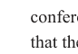

### 9.5 观察者意外与参与者互动（续）

### 另见

- 9.2 观察者声音大且分散注意力
- 9.6 环节被观察者或其他人意外中断
- 9.7 环节被参与者认识的人中断
- 幸存故事：“‘太笨’而无法产生有意义的结果”

## 9.6 环节被观察者或其他人意外中断

> 在环节期间的某一点，有人不小心闯入了研究空间。这种干扰可能是实体的（例如，有人在没意识到空间被占用的情况下进入了研究空间），或者是远程的（例如，观察者没有意识到她的手机没有静音，或者把你和其他观察者挂起，现在大家都听到了音乐）。

| 方法：任意 |
| :--- |
| 频率：偶尔 |
| 适用模式：承担责任，安慰参与者 |

### 应该做什么

对于实体中断：

- 尽快让闯入者离开房间。如果闯入者迷路或在寻找特定物品，请花些时间帮助她或指引给可以的人。
- 为参与者就中断道歉，并告诉她预计之后不会再有中断（最好如此）。

如果中断是发生在远程环节：

- 提醒所有观察者将手机静音。
- 如果你正在使用屏幕共享软件（例如，在 `WebEx` 中，通过右键点击/上下文点击观察者的姓名并选择静音）。如果你找不到此功能，你应该能够将观察者踢出会议，这将断开她的音频。会议系统有类似的静音所有人或排除某些参与者的功能。
- 如果你还能听到观察者（例如，如果她离开了手机而你能听到她的背景对话），请同事发一封邮件提醒所有观察者将手机静音。你可能需要暂停环节几分钟，特别是当噪音很大时。这次暂停可能会给干扰观察者一个机会回到办公桌并意识到发生了什么。
- 如果你有另一个会议电话号码，你可以要求任何人加入新的通话。如果参与者是远程的，请确保将新信息提供给她，或者告诉她你将直接打给她把她接入会议（取决于你的设置）。

## 9.6 会话被观察者或其他他人中断（续）

- 如果你没有时间或手段再次安排电话会议，你可以直接拨打参与者的电话，不让任何远程观察者听会话的剩余部分。如果你这样做了，请向观察者发送消息（或让别人代你发送），以便他们理解你做出这一更改的原因，并提议分享任何录制视频。
- 如果这些选项对你来说都不是可行方案，你可以尝试继续会话并忍受这些干扰噪音。如果干扰观察者的噪音太大，以至于这不再是一个可行的方案，请让参与者等待噪音问题得到解决。虽然这可能意味着你将比计划提早结束会话，但希望你在此期间采取的步骤能防止这种情况再次发生——至少对于这组观察者来说是如此。

### 怎么说

如果发生了现场中断，对中断者的人说：

- “抱歉，这个房间正在进行研究会话。它将在 <晚些时候/X时间> 空出来。”

如果是在电话中：

- <参与者姓名>，请稍等；我们听到了一些背景噪音。请通话中的每个人确保您的手机已静音？

如果你无法引起一个正在打字或无意中发出大量噪音的远程观察者的注意：

- <参与者姓名>，请稍等，我正与我的团队尝试联系发出噪音的人。我会将您的手机静音并离开几分钟。请不要挂断电话。

## 不要做什么或不要说什么

- 如果你知道那个引起事源的远程观察者是谁，尽量不要指名道姓他们，除非这是引起注意的最后手段。发布一条通用公告，要求大家静音手机，并尝试通过其他方式（如电子邮件、即时消息或通过屏幕共享应用程序中的私聊消息）联系该观察者。

### 如何避免

- 如果你的会话是线下的，请在学习空间的门上贴一张告示，让路人知道他们不应该进入该空间。

## 9.6 会话被观察者或其他他人意外中断（续）

- 如果你的会话有远程观察者，请利用屏幕共享应用程序或电话会议系统中的选项，从开始就自动静音所有参与者（参与者除外；如果她是远程的，你可能需要单独与她联系）。此外，提前告诉观察者他们在加入通话时应静音手机——这种谨慎再无一失。

### 参见

- 9.2 观察者声音大且分散注意力
- 9.5 观察者意外与参与者互动
- 9.7 会话被参与者认识的人中断

# 主持者生存指南

## 9.7 会话被参与者认识的人中断

在现场会话期间，被参与者认识的人中断。如果你在家里，这种中断可能来自参与者的配偶或孩子；如果你在她的办公室，则可能来自同事或经理。参与者可能会告诉中断者她正在忙某事，但中断者坚持认为她立即需要参与者的关注。

- 方法：任何现场方法
- 频率：偶尔发生
- 可采用的模式：承担责任；休息一下；提早结束会话

### 怎么做

- 如果你正在与参与者进行某个关键或时间紧迫的任务，让中断者和参与者知道你需要多长时间才能结束该关键流程，并看看她是否能等一会儿。
- 如果不能，提议休息一下，让参与者能够立即处理中断。为休息设定一个时间限制，尽管要接受参与者可能需要比你预期的更长时间。
- 如果中断者对参与者表现出愤怒或强硬的态度，尽量减少你的存在感并尽可能避开现场。如果你的存在让情况变得更糟并引发了冲突，请道歉，感谢参与者的反馈，给予她约定的补偿，并提早结束会话。

### 怎么说

## 不要做什么或不要说什么

- 不要太死板，坚持让参与者与你继续会话。让参与者自己处理这种情况可以避免她分心和/或感到愤怒。

### 如何避免

- 在参与者的环境中，这些情况是很难避免的，你可能并不想避免它们。中断可能是参与者生活中的常态，你可以了解到很多关于这些中断是否是典型的，以及她的工作流或处理任务的方法受到了影响。你可能会就中断与参与者进行跟进，并收集你可能错过的反馈。
- 然而，如果你对参与者的环境细节不太感兴趣（例如，你只是在进行采访），请在安排会话时询问参与者是否可以安排一个会议室或其他私人空间，以最大限度地减少潜在的中断。

### 参见

- 9.3 参与者在会话期间接到电话
- 9.5 观察者意外与参与者互动
- 9.6 会话被观察者或其他他人意外中断

# 主持者生存指南

## 生存故事

### 生存故事：“太笨而无法产生有意义的结果”

CHARLOTTE SCHWENDEMAN

在我主持的第一次可用性研究结束时，一名在观察室观看会话的开发人员以一种略带对抗性的方式向我走来。他叉着腰，跺着脚，问道：“你从哪里找来这些笨用户？”我没预料到在职业生涯中再次听到有人称参与者为“笨”，但我确实听到了。

当时我的团队正在为一个新概念的网页解决方案原型进行迭代可用性测试。公司本身是新的，它的生存取决于这项研究的成功。当时我在一家小型咨询公司工作，客户是一群构思该概念的高级营销人员。

我向他们推销了观察会话的价值，我们都飞到了进行第一轮可用性研究的城市。由于我们的客户从未见过可用性测试，我坐在观察室和他们一起解释正在发生什么以及为什么，而我团队的另一成员主持了会话。会话开始 20 分钟后，客户开始叫着参与者不“正常”。几分钟后，客户变得愤怒并大声说出来，称参与者“太笨了”，无法产生（sic: to yield）有效的结果。客户要求我提前结束会话并转向下一个参与者，因为他们认为没有从中“获得足够的内容”。我试图安抚客户，并尽力各种方式解释该参与者是匹配的，他们看到的现象是典型的。客户非常固执，最终实现了他们的愿望。

现在很久以后写下这些时，这似乎与可用性研究中发生的其他意外没有什么不同；但在那时，客户对此非常愤怒，导致了非常紧张的局面。这改变了未来客户与我们团队之间的关系。他们担心他们的概念会失败，并担心我们的营销团队在剩下的项目中坚持挑选参与者，从而使我们的可用性研究毫无用处。如果我有机会重来，我认为我会花更多时间向客户解释，符合特征的参与者范围其实很大。我学到的最大教训是在测试之前，向利益相关者详细解释他们将看到什么以及为什么，以及可以预期的结果类型。

# 章节

# 回到正轨：

克服动力阻碍

动力阻碍会减慢访谈的进度，有时会导致完全停滞。无论你是难以理解参与者的意思，还是没有足够的时间完成任务，本章将帮助你找到前进的最佳方式，并将访谈带回正轨。

- 10.1 受参与者开始离题 175
- 10.2 受参与者持续关注无关的细节 178
- 10.3 受参与者做出了非常出乎意料的行为 180
- 10.4 受参与者操作缓慢或过于细致 182
- 10.5 受参与者对问题给出模糊的回答 184
- 10.6 受参与者难以听清或理解 186
- 10.7 你没有时间完成所有内容 188
- 10.8 受参与者在某项任务上感到异常困难 190

# 10.1 受参与者开始离题

在回答问题时，参与者进入了一个与你正在进行的研究没有直接联系或不相关的离题。同样，如果你正在进行可用性研究或情境查询，他可能会开始探索产品中超出你研究计划范围的区域。

方法：任何

频率：经常发生

要运的模式：澄清任务/问题；引导参与者回到主题

### 应该做什么

参与者的离题可能出于各种原因与你的研究无关。也许他正在使用或讨论的功能或流程超出了范围，你已经有了关于该主题足够的数据，或者这与你正在研究的内容没有关系。然而，参与者并不知道这一点，他提供的信息可能对他来说是重要的。

- 让参与者用自己的话告诉他正尝试做什么。他的回答将帮助你判断他是否误解了你，或者出于其他原因在离题。如果他确实误解了你，请重复任务内容，或要求他重新阅读任务。
- 如果访谈还有时间，考虑让参与者继续他的离题。这有助于让他们感到被倾听，特别是当这是一个他被要求谈论的话题时。你可能会对让他这样做时可能浮现的相关反馈感到惊讶。
- 设置一个时间限制，在引导其回到主题之前允许参与者离题多久。时间限制取决于访谈的长度、你需要涵盖的内容，以及该离题是否似乎可以与你研究相关的内容建立联系。例如，假设你正在进行一个关于用户如何看待退休的一小时访谈。如果访谈才刚开始几个问题，参与者就因为有过负面经历而开始离题谈论移动应用程序，你可能想礼貌地在几分钟内拉回来。然而，如果在访谈进行 45 分钟后，当你只剩下一两个问题时，他又开始同样的离题，就让他持续五分钟。如果你发现可以将该离题与你的研究目标联系起来——例如，你的研究目标是理解用户与平板电脑相比使用智能手机——你可以让他持续得久一点，并询问关于为什么这些操作令人挫败的细节。
- 如果你正在进行可用性研究：
    - 请记住，如果你阻止参与者从离题回到某个特定区域（该区域是你的研究目标），你本质上是在告诉他其他方法是“错误”的。

# 10.1 受参与者开始离题（续）

“错误”。这既让他暗示了“正确”的路径，也可能让他觉得正在被测试并且失败了。使用抱歉的语气并承认他正在尝试做什么可以消除这种感觉。例如，“知道你想要查看这个区域以及你想从中发现什么，这很有帮助。我也想听听你对另一个区域的反馈。”

- 如果参与者真的感兴趣探索产品中不属于你研究计划的某，如果时间允许，告诉他你会在访谈结束时让他回到那个区域。

# 如何表达

在访谈开始时：

- “我们有很多内容要完成，所以我有时可能会温和地推动进度，以确保我们涵盖所有内容。”
- “如果我们在任何一个主题上花费了太多时间，如果我要求你继续，请不要介意，这只是为了保持在正轨。”

在访谈期间：

- “这些看到和听到的都非常有帮助。为了时间考虑，我将要求你进入<下一个任务/回到……>”
- “我很兴趣听更多关于这个。我确实想确保我们涵盖了计划的所有内容。所以如果有时间，我们将在访谈结束时回到这个话题。”

如果你需要中断并重新引导：

- “抱歉，我想打断你一下。为了时间考虑，我希望你回到<任务/问题>，但如果时间允许，我们可以在访谈结束时重新讨论这个话题。”

# 不要做什么或不要说什么

- 当参与者谈论你不感兴趣的话题时，不要走神。我们见过有些引导员在那时保持距离、抓头、看表，并使用手机设备或电脑。这种行为对参与者是不尊的。你应该始终给出全神贯注的印象，无论你认为他们的反馈有多无关或离题。如果你状态不佳需要一些帮助来集中注意力，请记录参与者说的话以让他们感到被倾听。然而，要保持耳朵敏锐，因为你不知道参与者何时会转到与你的研究相关的内容——你不想漏掉它！

# 10.1 受参与者开始离题（续）

### 如何避免

- 在访谈开始时提醒参与者，如果你需要保持任务或完成所有问题，你可能会引导他们。在可用性研究中，你也可以设定预期，根据时间，你可能无法完成每个任务。

### 参见

- 10.2 受参与者持续关注无关的细节
- 10.3 受参与者做出了非常出乎意料的行为

# 10.2 受参与者持续关注无关的细节

参与者不断专注于与你试图研究的内容无关的事情，即使在你已经多次要求他不要这样做之后。这可能以轻微的形式出现，例如关注设计的颜色而不是功能。例如，参与者可能会反复强调他有多讨厌所使用的绿色。或者，这可能更具破坏性，例如继续使用搜索引擎来尝试你要求他在网站上执行的任务。

- 方法：任何
频率：偶尔发生
要运的模式：澄清任务/问题；引导参与者回到主题

### 应该做什么

- 验证参与者提供的反馈是否真的无关。参与者在访谈中反复的行为可能代表了他们的自然行为，可以作为研究项目的宝贵数据。如果有办法获取这种行为，只要你的研究计划允许，就让他继续。
- 让参与者用自己的话告诉他正尝试做什么。他的回答将帮助你判断他是否误解了你，或者是否有其他因素。如果他误解了，重复你的问题，或要求他重新阅读任务。
- 如果你发现自己不断要求参与者重新阅读任务或重复问题，请承认他正在尝试，并解释你想要关注的内容。例如，如果参与者一直尝试使用搜索引擎而不是你正在评估的网站，让他知道你理解他通常会使用搜索引擎来尝试这些任务，但你需要留在网站上，以便找到实现目标的方法。
- 如果参与者对于他想提供的反馈似乎有自己的主张，考虑让他发泄几分钟，然后按照 11.7 中的描述引导他回到任务。

# 如何表达

- “你提到了<对设计无关方面的反馈>。你对<设计的相关方面>怎么看？”
- “我注意到对<相关主题>有很多反馈。由于时间限制，我们遗憾无法在今天的访谈中关注这一点。但是，你想在我们转到其他话题之前，花一两分钟时间告诉我你的想法吗？”

## 10.2 受访者持续关注无关细节（续）

在一次可用性研究中：

- “知道你会在 <area> 处寻找很多这类信息很有帮助。虽然那里可能是找到这些信息的一个地方，但我们今天不想关注它。相反，我请你尝试用另一种方式完成这些任务。”

### 不应该做或说的事

- 在引导受访者时，尽量不要表现得粗鲁或突兀。很容易让受访者感到被冒犯或尴尬，尤其是当你告诉他没有对错之分，却一直引导他转向特定话题时。认可他正在尝试做的事情非常有帮助。

### 如何避免

### 另见

- 10.1 受访者开始离题大谈

## 10.3 受访者做出了非常出乎意料的事

在尝试任务或回答问题时，受访者做了或说了一些非常出乎意料的事。这可能是其他受访者没有做过或提到过的，或者与你预期的截然不同。例如，你在访谈中询问一位受访者如何使用移动应用程序，他却开始谈论他车里的音响系统。

方法：任何

频率：偶尔发生

要运的模式：承担责任；澄清任务/问题；引导受访者

### 应该这样做

- 让受访者继续沿着他的思路走几分钟。如果你正在进行可用性研究，提醒受访者大声思考。通过获取更多信息，你应该能够判断受访者是误解了你的意思，还是揭示了关于用户及其潜在行为的有趣之处。以询问受访者关于移动应用程序为例，他可能认为“移动”指的是他在车里交互的系统，而不是智能手机。

- 如果你仍然不确定受访者为什么要这样做这种出乎意料的事，请重复问题或确认他是否没有听错你的话，但要注意语气，不要让他听起来像是在责备他（参见附录 A 中的示例）。你也可以尝试重新表述或稍微调整问题或任务，看看他是否会做同样的事。例如，如果你要求受访者在电子商务网站上更改邮寄地址，而他进入了一个看起来不合逻辑的地方，可以问问他想在哪里更改账单地址。
- 同样，让受访者用自己的话说明他试图回答什么、试图做什么或在寻找什么。
- 确认你没有在问题和任务中使用行业术语或表现得过于啰嗦，必要时给予奖励。
- 如果受访者紧盯着你的嘴唇或歪头靠近，他可能听不清你的话。把椅子挪得他近一点，说话大声一点，并使用简单直接的句子。
- 如果你正在进行可用性研究，并认为受访者做出出乎意料的事是因为他错过了正确路径，而由于后续任务的依赖关系你需要他回到正确路径，请带他回到分歧发生，并就该屏幕的目的或可用选项提一个通用问题。然后，如果有必要，可以使用第 3 章侧边栏“分散辅助”中描述的方法引导他去你需要去的地方。

## 10.3 受访者做出了非常出乎意料的事（续）

### 可以说什么

适用于任何方法：
- “请告诉我你对问题的看法”

受访者用模糊的答案回答问题。你可能不确定是不理解问题、不善言辞、害羞，还是只是想获得报酬。

### 应该这样做
- 尝试澄清或重新排列你的问题，以防受访者没有理解。必要时，尝试回到更宽泛、更容易的问题，一旦建立起基础，再引导到更难的问题。如果他看起来很沮丧或无所谓，请承担自己没有说明清楚的责任。
- 询问“为什么？”来促使受访者深入他的回答。例如，如果你询问受访者关于使用遥控器的体验，他说“还可以”，你可以追问：“多多说一点——你为什么说它‘还可以’？”你可以多次询问“为什么？”，直到你认为已经达到了所需的详细程度。
- 如果受访者之所以模糊是因为他不熟悉主题内容，请跳到不涉及该主题的下一个任务/问题。对主题的熟悉程度是决定因素，见第 4.1 节。
- 如果受访者害羞且不愿分享反馈，尝试按照第 1.5 节讨论过的，将你的主持风格调整为更加非正式和亲切的，例如“友好面孔”或“好奇心态”。
- 如果受访者似乎对主题不感兴趣或看起来渴望尽快结束环节，请参考 8.6 节关于如何激发其兴趣的建议。

## 10.5 受访者对问题的回答很模糊（续）

“你以前尝试过做这个吗？告诉我你的经验。”

### 不该做或说的话
- 不要对受访者感到沮丧，因为这导致他变得封闭并产生怨恨。

### 如何避免
- 设计你的问题以诱发深思且详细的回答。措辞不当或可以用简单的“是/否”回答的问题可能会产生模糊且无兴趣的答案。例如，受访者对“你觉得当地的公交服务如何？”可能会给出笼统的回答，但被询问“描述你上一次使用当地公交的情况”时，会表现得更具体。

### 参见
- 6.1 受访者不愿说负面意见
- 6.5 受访者忽略或假装理解你的问题
- 8.6 受访者不愿意或不确定
- 10.3 受访者做了非常出意料的事

## 10.6 受访者难以听清或理解

> 当受访者说话时，你很难听清或理解他。他的声音可能很小、说话很快，或者有很重的口音。如果是远程会议，低质量的电话连接可能会让听清或理解变得困难。

方法：任何

频率：偶尔

要运的模式：承担责任

### 应该做的事
- 确保会议已录制，这样你就可以返回并仔细审阅受访者的反馈。
- 如果你正在进行可用性研究，请受访者使用鼠标（如果产品没有屏幕，则使用手指）指示他正在提供反馈的区域。这也可以提供至关重要的背景信息，帮助你理解他的反馈。
- 如果你很难听清受访者：
  - 要求受访者大声说话。如果受访者声音太小或电话连接断断，这种情况是利用“录音设备难以捕捉声音”作为借口的好机会。
  - 如果受访者是远程的，请他靠近电话或麦克风。同时检查你手机扬声器或屏幕共享软件的音量，确保已调到最大。
- 如果你很难理解受访者：
  - 如果是面对面会议，在受访者说话时看着他的脸并保持眼神交流，即使这意味着你需要做非常详细的笔记。有时，保持眼神交流并看到受访者的面部表情有助于你理解他在说什么。
  - 如果受访者是远程的，请他重复刚才说的话，并以电话连接困难作为借口。然而，如果受访者持续难以理解，这可能并不实际。在这些情况下，你可以偶尔使用这个技巧，但要接受你之后需要查看记录。
  - 要求受访者大声读任务。这可能有助于“校准”受访者的说话方式，因为他读的是你所熟悉的内容。

## 10.6 受访者难以听清或理解（续）

### 应该说的话
- “可以请你再大声一点吗？我想确保我们的录音设备能够捕捉到你的声音。”
- “你介意为我重复一遍吗，慢一点，方便我记下来？”
- “你能用鼠标在屏幕上指一下你正在谈论哪个区域吗？”

如果受访者是远程的：
- “你能靠近电话一点吗？我听你的声音有点困难。”
- “很抱歉，我想你的电话线断了一会儿，我错过了你说的一部分内容。你介意为我重复一遍吗？”

### 不该做或说的话
- 不要告诉受访者你无法理解他，因为他的口音太重、说话太小，或者他说话的方式很奇怪。

### 如何避免
- 要求负责招募的人员筛选掉难以理解的潜在受访者。然而，如果你是在内部招募或访谈非常有针对性的用户，你可能没有足够的灵活性因此原因筛掉某人。
- 记住，即使受访者难以理解，他仍然提供了有价值的反馈！

### 参见
-- 4.3 受访者具有意想不到的身体特征

# 主持者生存指南

## 10.7 你没有时间完成所有内容

> 在某个时刻，你意识到时间不够用了，无法完成原计划的所有内容。受访者可能比计划时间来得晚，或者在任务和问题上花费了比预想更多的时间。你可能在研究计划中对于完成会议的内容非常积极。无论原因如何，你都需要确定该做什么以及你能涵盖哪些内容。

方法：任何

频率：偶尔

要运的模式：承担责任；引导受访者；从受访者身上抽离

### 应该做的事
- 进入优先级模式。思考你所有的问题或任务，考虑哪些可以放弃和跳过。决定完成你的任务或问题，并让会议在结束的地方结束。
- 如果你的优先目标是广度而非深度（即对每个剩余任务/问题获取少量的反馈，而不是尝试完成几个完整的任务），考虑将剩余会议变成一个“直觉反应”游戏，让受访者展示或告诉他对任务或问题的第一个反应倾向。

### 应该说的话

温柔地告诉受访者：
- “可以请你再大声一点吗？我想确保我们的录音设备能够捕捉到你的声音。”
- “你介意为我重复一遍吗，慢一点，方便我记下来？”
- “你能用鼠标在屏幕上指一下你正在谈论哪个区域吗？”

如果受访者是远程的：
- “你能靠近电话一点吗？我听你的声音有点困难。”
- “很抱歉，我想你的电话线断了一会儿，我错过了你说的一部分内容。你介意为我重复一遍吗？”

### 不该做或说的话
- 不要告诉受访者你无法理解他，因为他的口音太重、说话太小，或者他说话的方式很奇怪。

### 如何避免
- 要求负责招募的人员筛选掉难以理解的潜在受访者。然而，如果你是在内部招募或访谈非常有针对性的用户，你可能没有足够的灵活性因此原因筛掉某人。
- 记住，即使受访者难以理解，他仍然提供了有价值的反馈！

### 参见
-- 4.3 受访者具有意想不到的身体特征

## 进入正轨：克服动力障碍

## 10.7 你没有时间完成所有内容（续）
- “我想听听更多。我想确保我们涵盖计划的所有内容，所以如果有时间，我们再回到这里。”

如果你知道你需要快速进行：
- “我刚刚检查了时间，我们的时间有点紧。我们有很多任务我想获取你的反馈，所以我可能会催促一下，以便尽可能涵盖内容。”
- “对于剩下的任务，我们会比之前快一点。对于以下任务，请展示你会点击哪里。”

如果受访者在会议结束时对没有完成任务感到内疚：
- “别担心那个；我并没有预料我们能完成所有内容。你的反馈非常且有用。我很高兴我们投入了这些时间。”

### 不该做或说的话
- 不要为了完成所有工作而催促受访者完成任务或问题。根据可用时间调整并优先考虑你需要做的，以免他们在离开会议时感到被催。
- 不要恐慌。如果你担心时间，尽量不要表现出来。这需要练习，但要注意这一点。

### 如何避免
- 与受访者进行一次会议，以确保你对时间有准确的感觉。当然，你总会遇到时间紧迫的情况，但至少你可以调整你能控制的内容。
- 在制定研究计划时，识别优先级最高的问题/任务。如果必要（如第 15.2 节所述），这将帮助你调整会议。

### 参见
- 10.4 受访者缓慢或详尽

## 10.8 参与者在任务中陷入过度困难

> 参与者在某任务上花费的时间比预期长，甚至比其他参与者更长。他可能表现出明显的沮丧、挫败和/或烦躁。

**方法：** 可用性研究

**频率：** 偶尔

**适用模式：** 承担责任；澄清任务/问题；引导参与者；安抚参与者；休息；结束会话

### 做法

观察参与者在何时以及为何遇到困难，是进行可用性研究的主要目的之一。发现这些点有助于为未来的用户改进产品（Dumas and Loring, 2008）。然而，过度的困难可能会对参与者的情绪健康产生影响，或者消耗可以用于其他研究问题的宝贵测试时间。
- 如果参与者陷入过度困难，以至于花费太多时间，或者不再提供与你的研究目标相关的数据，且参与者*没有*表现出情绪极其崩溃的迹象，请让他停止手头的工作，进入下一个问题或任务。如果继续进行需要你提供协助（如第 6.4 节所述），请尽管去做。
- 如果参与者表现出更多情绪上的不适，例如对产品感到挫败或恼怒，或者看起来对自己正在做的事情投入减少，请进行简短休息。在他留几分钟时间后，私下询问他以确保他可以继续继续。休息结束后，安抚参与者他的反馈非常有帮助，并转到不同的任务或问题。如果他变得更加不悦，请参阅第 12.7 节，并在必要时提前结束会话。

### 话术

继续当前任务：
- “这个任务我们到这里就可以了。我们不需要了……”
- “考虑到时间关系，我想请你……”

进行休息：
- “这看起来像是个很好的停顿点。我们要不要快快休息五分钟？”
- “我要关掉录音设备，给你一个短时间的休息。我会出去一下，但很快就会回来。”

在私下交谈时：
- “如果你感到不舒服，我不希望你继续会话。你已经提供了非常有帮助的反馈。有什么我可以帮你的吗，或者你想就此结束？”

如果结束会话，且参与者感到很抱歉：
- “别担心那个；我没预料我们能完成所有内容。你的所有反馈都非常重要且有用。我很高兴我们能这样度过这段。”

### 不要要做或不要说的话
- 避免说任何暗示参与者花费时间比你预期的长，或他没有完成某项任务。

### 如何避免
- 这种情况通常无法避免，但你在会话开始时定的基调可以影响困难对参与者的情绪影响。如果他在会话开始时显得特别敏感或紧张，你可能需要调整你的引导风格，使其更加平易近人且令人安心，如第 1.6 节所述。

## 另另
- 4.5 参与者阅读困难
- 11.8 参与者因产品的可用性问题变得烦躁

## 幸存故事：“这个请求让我措手不及”

DANA DOUGLAS

我们当时正在为一个合作研究网站与国际研究人员进行可用性研究。会话是在我们位于马里兰州的实验室远程进行的，参与者遍布全球。其中一次会话的对象是一个来自印度尼西亚的、非常友善的男性。在会话开始我介绍研究时，他听到了伊斯兰教的宣礼声，请求休息几分钟，他预计在我们的会话期间会听到。虽然这个请求让我措手不及，但我知道我想尊重他并确保他在我面前自在，于是我大方地同意了并继续会话。然后，在会话中间他正在完成一项任务时，我们听到了宣礼声。在那一刻，他立即请辞，在接下来的几分钟里，我在线上等他回来。当他回来时，他感谢我，我们从刚才离开的地方准确继续。

由于研究的目标更多是定性的而非定量的，中断对结果的影响微乎其微。虽然休息具有了一定的干扰性，并导致会话比计划长了几分钟，但我们都能顺利地进入和退出，通过这样做，我尊重了他的日常习惯。这种特殊情况让我明白，为了获得最有价值的反馈，最重要的是创建一个（即使在远程情况下）让参与者感到舒适的环境。

## 第 11 章

掌握主导：引导迷途的参与者

如果参与者变得烦躁、恼怒或对你或你的组织产生贬低，那么是你时候接管会话的时候了。这些情况需要你缓解参与者的挫败感，然后监控后续会话，以确保她的剩余体验不受负面影响。
- 11.1 远程参与者明显分心 195
- 11.2 参与者因个人问题感到困扰 197
- 11.3 参与者坚持她绝不会做某事 199
- 11.4 参与者对原型功能限制感到挫败 201
- 11.5 参与者似乎对你的中立感到恼怒 203
- 11.6 参与者似乎不尊重你或不认真对待你 205
- 11.7 参与者变得侮性或带有目的 207
- 11.8 参与者因产品的可用性问题变得烦躁 210

## 11.1 远程参与者明显分心

在远程会话期间，你会听到参与者在做明显超出本研究范围的事情。也许你可以听到他们在一个未共享的窗口或另一个显示器上打字。背景中可能有模糊的交谈声或噪音，参与者的反应可能缓慢或完全忽略了你的问题。

**方法：** 任何远程方法

**频率：** 频繁

**适用模式：** 澄清任务/问题；建立参与感；休息；提前结束会话

### 做法
- 首先，给参与者一个微妙的暗示，让你知道发生了其他事情。询问诸如“现在对你来说方便吗？”可以给她一个台阶，以防她真的有更重要的事情要处理但觉得太礼貌而不说。这也给了参与者一个分享其环境中任何复杂情况的机会。例如，公司环境中的参与者（如果你正在与在公司工作的员工交谈）经常发现无法为你的研究尝试世界的其他部分，并可能在你说话时正在同时处理多个任务。参与者可能会告诉你她必须在会话期间开启邮箱，或者现在非常忙，她可能需要停下来和同事谈。在这种情况下，你可以提议重新安排时间，但你可能需要接受即便如此她可能仍然经历类似的干扰。
- 如果参与者愿意继续并似乎对接收反馈感兴趣，但正在处理其控制之外的干扰，请专注于最重要的任务/问题，以便让她有限的反馈产生价值最大化。
- 如果参与者对你的暗示没有回应，或者你感觉到她分心了，请对是否继续会话做出判断，如果你继续，可以适应这些情况。如果你认为会话还可以挽救，考虑问参与者一些更直接针对她正在做的事情的问题（例如，她的流程是如何运作的或经常使用的产品部分），而不是继续你计划的任务。让她谈论她自己可能会增加她对会话的参与度。如果这有效，你可以回到你的研究计划，利用你获得的知识来定制接下来的内容。然而，如果她看起来很分心，告诉参与者你已经涵盖了计划的所有内容，然后提前结束。

### 11.1 远程参与者明显分心（续）

### 可以说什么
- “<参与者>，请问你现在方便吗？”
- “听起来你那边有其他事情在处理。在我们继续 <任务/问题> 之前，你需要先简短休息一下吗？”
- “现在似乎有很多事情在竞争分散你的注意力。你还能继续这项研究吗？如果不能，没关系，我们可以重新安排时间。”
- “我知道你非常忙，感谢你抽时间向我们提供反馈。”

### 不应做什么或说什么
- 不要隐藏你对参与者的挫败感或烦躁情绪。保持礼貌和尊重。

### 如何避免
- 坦诚说明你对本次会议的预期，以便参与者可以重新安排冲突的优先事项并相应计划。但要意识到，这可能还不够，干扰仍然可能发生。
- 在招募过程中，询问参与者进行会议的“最佳”时间，并在该时间安排她的会议。在前一天与她确认，以确保安排的时间仍然适用。

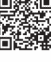

观看视频 3 以查看主持员在远程可用性研究期间与分心参与者交互的示例。参与者最终分享的内容超过了她的本意图。

访问我们的网站 (http://www.modsurvivalguide.org/videos) 或使用您的 QR 阅读器扫描此代码。

### 另见
- 8.6 参与者不愿意或不确定
- 12.2 显示了个人、不当或机密信息
- 12.3 参与者明显被外部情况分心

## 11.2 参与者因个人化提问感到困扰

你不得不向参与者询问一些比较私的问题，而她开始变得不舒服和紧张。她的语调发生了变化，声音变大或变小，回答变得变得简短而生硬。你可以直接告诉她不方便回答某些问题。你提出的问题是研究计划的一部分，并可能是特定领域的，例如作为交友网站可用性研究一部分的在线约会行为，或者在关于一次性剃须刀的采访中她使用的频率。或者，你可能在询问关于她工作的特定问题（例如，工厂工人如何打破规则以更安全、更容易或更高效地完成工作）。

方法（类）：任何

频率：偶尔

要应用的模式：安慰参与者；休息一下

### 应该做什么
- 考虑参与者的预期。如果参与者预期只泛泛谈论网站，而对你关于遗产规划的问题感到困扰，请尝试让你的问题更宽泛、更少私化，以符合她的预期。如果这无法实现，即使意味着失去一个数据点，最好也放弃该话题。如果参与者是报名参加关于在线约会的采访的，那么你可以淡化你所问问题的个人性质，但她不应该对你正在探索的话题感到太惊讶。
- 告诉参与者，如果有任何她不方便回答的问题，应该告诉你。
- 安慰参与者她的答案将如何被使用。例如，告诉她反馈将与其他参与者的答案汇总，她的名字不会与此相关联。这种安慰会让参与者感到尽可能舒适地分享她愿意透露的内容。
- 如果参与者似乎担心因为她的回答而惹麻烦（例如，因为她是内部员工，且研究是针对其组织的），在安慰时提醒她，你不会以任何方式对她处理工作或生活的其他任何方面进行评估。
- 如果参与者对你的问题感到特别不舒服或激动，提议与她私下交，关闭所有录制。如果她看起来心神不宁，请休息一下，当会议恢复时，淡化个人问题或转向研究计划的另一个领域。如果参与者仍然看起来难过或激动，则提前结束会议。

### 11.2 参与者因个人化提问感到困扰（续）

### 可以说什么
- “如果你不方便回答我的任何问题，请告诉我。虽然我们希望从你那里尽可能学习，但也想尊重你的隐私和舒适度。”
- “抱歉，我并不想通过那个问题打听隐私。让我换种说法……”
- “请知道，你说的任何话都将保密。”
- “感谢你一直提供的反馈。我知道这些话题可能很难讨论，但你的反馈将帮助我们理解如何为你和你像你这样的人把产品做得。”

### 不应做什么或说什么
- 不要忽略参与者激动或不舒服的迹象！即使意味着要调整计划的任务或问题，也要对参与者产生同理心，并尽力让她感到更舒服。

### 如何避免

在招募过程中和会议开始时，都对会议期间将涵盖的话题类型设定预期，特别是当你的任何话题涉及个人时。这种预警应该减少参与者对你问题的惊讶。

### 另见

- `8.3` 参与者看起来或听起来不舒服和/或紧张

## 11.3 参与者坚持她永远不会做某事

当你要求参与者向你展示如何做某事或完成某任务时，她告诉你那不是她永远会做的事。或者，她告诉你该任务不符合她目前的角色或职责。

方法（类）：可用性研究；情境查询

频率：偶尔

要应用的模式：澄清任务/问题

### 应该做什么

- 虽然这与不能或不愿完成招募关键条件的参与者类似（见第 `4.2` 节），但该参与者符合你的招募标准。
- 利用这个机会更多地了解为什么这出了参与者的行为或预期范围。你可能会学到对你的团队关于用户非常有价值的东西，特别是如果这是产品的关键组成部分。要求她澄清（如果可能的话演示）她目前对该任务或流程的参与。她采取了哪些步骤，使用了哪些工具？如果通常执行该任务的人不在，她会怎么做？
- 在情境查询中，如果你专门需要此任务或流程的反馈，询问参与者是否可以引导你指向实际执行感兴趣任务的人，并看看你是否可以与他们预约时间。你可能调整研究计划以从参与者那里获得其他相关信息——特别是实地访问很难协调——但即使你不能，也要确保在无法做到时打破这种僵局！
- 解释你理解这可能不是她要做的事，但你仍然希望她尝试，以便从新用户的角度获取反馈。
- 如果参与者拒绝（例如，因为她比通常执行该任务的人级别更高或更低），让她知道你理解，但她的反馈对改进产品仍然很有帮助。
- 如果她继续固执，请直接跳到下一个任务。如果时间允许，你可以询问参与者是否愿意返回此任务，以便获得一些反馈。

## 11.3 参与者坚持她永远不会做某事（续）

### 可以说什么

- “你参与 <任务/流程> 吗？如果是，可以向我演示你是如何做的吗？使用了哪些工具？可以随时调出你在过程中使用的任何工具。”
- “我理解你通常不做这一点。但是，为了今天的研究，我希望你扮演执行 <任务/流程> 的人，以便我们了解新用户的体验是怎样的。”
- “好的，既然如此，让我们进入下一个任务……”

### 不应做什么或说什么

- 不要立即跳到另一个任务。利用这个机会更多地了解参与者的角色，以及任务/流程是如何执行的（由谁执行）。
- 如果参与者不愿意扮演新用户的角色，不要推得太紧。有些参与者扮演角色比其他人更困难，并且可能有政治因素影响了他们的意愿。

### 如何避免

- 在招募期间，确保你的标准关于参与者必须具备的职责和角色足够详细，特别是对于你的关键任务（更多信息请见第 `15.1` 节）。此外，在与已预约参与者的沟通中强化这些标准，让他们知道你预期他们承担什么样的职责。在开始研究之前发现用户类型与任务不匹配要好！

### 另见

- `4.1` 参与者似乎不符合关键招募标准
- `4.2` 参与者拒绝或无法完成关键任务

## 11.4 参与者对原型的受限功能感到沮丧

参与者正在使用一个尚未完全构建的原型。当她尝试完成任务时，你不得不反复告诉她正在尝试使用的功能无法工作。她对此感到不耐烦，甚至可能会说一些尖锐的话，例如：“噢，我打赌这根本不能用，”或者“你让你给我提供反馈，但这东西根本就不能用。你让我怎么评论呢？”

- 方法：可用性研究
- 频率：偶尔
- 采用的模式：引导参与者；安慰参与者

### 应该做什么

- 回到你在简要介绍中告诉参与者的内容，即她正在交互的是一个功能受限的原型，而不是成品产品。承认这些局限性可能会让她感到沮丧，即使她对某些部分非常感兴趣或希望能在那些部分提供反馈。收集她对那些缺失区域的预期；即使这超出了你的研究范围，也能让参与者感到被重视，并可能减轻她的挫败感。
- 如果参与者似乎担心功能的缺失或损坏意味着产品存在质量问题，请向她保证原型并不等同于最终产品。原型只是展示了一组有限的功能，以便你获得这些特定区域的反馈。
- 让参与者知道，尽管功能不可用，但看到她想要去往哪里是有帮助的。强调了解她对原型某些区域工作方式的预期是有用的的，并请她详细说明她希望那些特定区域如何运行。
- 对参与者保持耐心，即使她多次抱怨缺乏功能。使用感激、真诚的语气。

### 应该说什么

- “很抱歉，我们今天没能在这个原型中把所有内容都构建出来。但你对它应该如何运行的预期同样重要。知道你预期事情发生在哪里，以及你预期看到这些区域如何工作，对我们来说非常有帮助。”
- “正如你所看到的，今天原型中没有太多功能可用。但感谢你的耐心，请继续向我展示为了完成这些任务你会去哪里，并描述你的预期。”

## 11.4 参与者对原型的受限功能感到沮丧（续）

### 不应该做什么或说什么

- 无论你多想回回击参与者，都不要！归根结底，参与者是“永远对的”，你需要尝试化解她对实验设置产生的任何负面情绪。

### 如何避免

- 在现有的时间和资源范围内，尽可能让你的原型功能完备。有关如何构建成功原型的更多讨论，请参见第 `15.3` 节。
- 在会话开始时向参与者明确她将要使用的内容。预期一个全功能产品的参与者可能会对一个具有她感知为“损坏”功能的中等保真原型感到惊恐。当参与者尝试做一些原型不支持的操作时，通过快速承认该区域目前尚未构建，并表示想听听她预期看到/发生什么，来强化这些预期。通过主动出击并引导她的能量，你可以限制参与者花在怀疑原型是否损坏上的。

### 另见

- `11.8` 参与者因产品的可用性问题而变得焦虑

## 11.5 参与者对你的中立态度感到反感

参与者在整个过程中问了大量问题，而你通过将问题推回给她并询问她的预期来回应。她似乎对你的推回行为变得越来越反感，甚至可能变得言辞犀利。例如，她可能会说：“你不会告诉我的，对吧？”

- 方法：可用性研究
- 频率：偶尔
- 采用的模式：承担责任；安慰参与者；建立参与

### 应该做什么

这种反感通常发生在第一次参加可用性测试的参与者身上，他们可能不理解你引导方法后的逻辑。参与者可能会感到反感，因为他们真的在寻找答案或帮助，却没有得到。或者，他们可能会因为认为你在逃避他们的问题而感到被轻视。
- 用友好且理解的语气承认参与者的挫败感以及这种情况的人为性。
- 下次被问到问题时：
  - 在回答之前仔细考虑你的措辞，而不是立即用“你怎么想？”或“你预期什么？”把它反过来。
  - 每次回答时，微妙地改变你的回应方式。例如，一次：“这样——我又要把问题推回给你了。在你的研究计划中，你提前考虑了相似但用词不同的……”
  - 使用非语言符号（如语调）来表现你对答案真的感兴趣。如果你觉得合适，可以在回答中加入一点幽默。例如：“我知道我听起来像个坏的复读机！我真的想理解你的预期，”

- 如果参与者非常反感，执行以下一项或两个操作：
  - 安慰参与者，听到她的问题对你来说非常有价值。提醒她，她是在独立尝试这些任务的，而你不会坐在她旁边，所以你想看看如果不在那里她会怎么做。

## 11.5 参与者对你的中立态度感到反感（续）

通过对你持续中立的回应道歉一次来承担责任。但不要道歉超过一次，因为这可能会导致尴尬并可能对参与者的反馈产生偏差。

### 应该说什么

- “你提供的反馈对我们团队来说非常有价值。我们需要知道人们在使用它时会产生什么问题，这样产品就能更好地工作并提供这些答案。”
- “我知道我一直把问题推回给你看起来很奇怪，但我真的想在这里扮演一个中立的角色并理解你的预期。感谢你对我耐心。”
- “如果你是你自己做这个，而我没有坐在你旁边，你会怎么？”

### 不应该做什么或说什么

- 不要对自己的中立立场进行辩解，或对你的回答道歉超过一次。

### 如何避免

- 在会话开始时，设定预期：你可能无法在会话期间回答问题，你可能会将任何问题推回给参与者以衡量她的预期。强调即使你这样做，你也真的很有兴趣听她的持续反馈以及她在使用产品时产生的任何问题。

### 另见

- `11.6` 参与者似乎不尊重你或不认真对待
- `11.7` 参与者变得具有侮辱性或带有目的

## 11.6 参与者似乎不尊重你或不认真对待

参与者似乎没有把你当回事。她似乎认为你太年轻或缺乏经验、老老且脱节，或者处于比她更低的水平。在工作中拥有权威的参与者（例如医生、投资者、高管）会有这种表现，特别是当他们觉得会话浪费时间时。他们的情绪表现为傲慢（例如：“你不知道我经历过”）或粗鲁（例如：“你那时候可能还没出生”）

- 方法：任何
- 频率：罕见
- 采用的模式：引导参与者；建立参与

### 应该做什么

- 保持礼貌。将其视为一种挑战，让参与者在离开会话时产生新的尊重（或至少是勉强的接受）。
- 如果参与者指出你的年龄或任何关于你的个人信息，尝试避免回答问题。例如，如果她问你多大，你可以说你不回答，并快速引导到另一个话题。提供个人信息会让会话的平衡离开你的控制，并可能让参与者进一步偏离主题。然而，如果不回答被视为粗鲁的问题，你应该通过快速引导回当前任务来立即回答。如果你觉得合适，也可以尝试使用幽默。例如，如果参与者问你出生在某一年，你可以说：“我是一个无关紧要的婴儿潮！你能告诉我……”

- 考虑扮演参与者似乎为你分配的角色，通过要求参与者向你解释事情。例如，参与者似乎认为你太年轻或缺乏经验，无法理解她面临的退休问题，立即回应并让她告诉你更多关于她的情况和面临的挑战。这种方法的优点是满足了她的自尊心，并可能帮助她“投入”会话。

### 应该说什么

- “我现在不想回答，但我想多介绍一下关于我……”
- “你提到了一些在做这个决定时认为重要的因素。请详细告诉我这些因素，以及它们将如何影响你做出的选择。”

# 11.6 参与者似乎不尊重你或不把你当自己（续）

对于 对我们来说，从像你这样具有经验和专业知识的人那里获得观点非常重要，因此非常感谢你抽空参加。我们希望确保该产品的设计能够满足你的需求。

## 不该做或不该说的

- 不要觉得有义务向参与者分享个人信息。

### 如何避免

- 在会议开始时建立你的身份和角色。让参与者知道你是一个中立的观察者，而不是领域的专家。
- 使用对方的头衔（例如，Smith 博士）来尊重参与者，直到她告诉你换一种说法。
- 如果参与者在工作中担任高层职位或拥有很大权限，请承认她在组织中所扮演的角色是至关重要的，并让她知道你会妥善利用她的时间。

### 参见

- `11.7` 参与者变得具有侮辱性或带有意图
- 生存故事：“我本该听从直觉的”

# 11.7 参与者变得具有侮辱性或带有意图

在会议期间，参与者说了针对你、你的利益相关者或你组织的侮辱性或贬低的话。如果评论是针对你组织的，她可能是在根据她在会议之外的经历在发泄情绪。她可能带着某种意图来参加，或者为了催促某位护士，想要确保自己的意见被听到。这种行为可能发生在组织的内部员工身上，也可能发生在客户身上。

**方法：** 任何

**频率：** 罕见

**使用的模式：** 重新引导参与者；休息；早早结束会议

### 应该这样做

- 如果参与者似乎在对你的利益相关者或你的组织发泄，请为她提供一个集中的发出口。例如，你可以承认她似乎对所经历的某些感到不快，并建议用接几分钟让她喘息一下发生的事情，然后继续会议的其他部分。
- 如果参与者直接侮辱你（例如，“你在这方面做得真差”），在回答之前先留出片刻时间。你可能处于震惊中，但需要仔细考虑下一步，以避免局势升级。尝试忽略该评论并在不予回应的情况下继续进行，或者将该主题设为超出讨论范围（例如，“这与我们今天的会议无关”），然后快速转向另一个讨论领域。
- 尽量不要做出反应，并保持中立的表情和语气。这可能很难，尤其是当你感到受到人身攻击时，但请尽力而为。深呼吸，控制面部表情，想象参与者的评论像水滴落在鸭背上一样滑落——不要让它们附着在你身上。
- 如果必要，进行短时间休息，这样你就可以恢复并在参与者面前保持中立。利用休息时间考虑你可以做什么来改进你所挽救的会议。
- 如果参与者的侮辱是基于你为研究所做的工作（例如，当你要求她使用一个她喜欢的网站时发表了贬义言论），请澄清你作为中立观察者的身份和职责，以及你对其行为的预期。对任何误解道歉，并询问她对会议如何运作是否有任何疑问。
- 如果参与者的评论似乎是由你要求她做或讨论的事情引发的（例如，“只有傻瓜才会去那样”），请改变话题或将参与者重新引导到研究计划的下一个任务或章节。

# 11.7 参与者变得具有侮辱性或带有意图（续）

- 如果参与者继续对你进行侮辱或贬低，或变得具有对抗性，请早结束会议并支付她承诺的报酬。记住，你需要照顾好心理健康，坚持完成会议所获得的额外数据点是不值得的。

### 应该说的话

对于正在发泄情绪的参与者：
- 你一直在提到与<组织>的某些非常糟糕的经历。我们为什么不利用接下来的几分钟分享一下你的经历呢？不过，五分钟后，我们需要回到我的问题列表。听起来这样可以吗？
- 感谢你分享那段经历。进行这项研究的原因之一是为了改进用户的体验，所以你的反馈希望能够让其他人避免经历糟糕的经历。那么，让我问问你 <回到你的研究计划>。

对于故意侮辱你的参与者：
- 这个话题与我们今天的会议无关。让我们回到问题/任务上，除非你想先进行简短的休息？

对于重新引导参与者：
- 我想现在请你注意<此处应将注意力转移到><下一个任务或问题>。

## 不该做或不该说的

- 不要被参与者的意图所带偏。
- 不要侮辱参与者或与其发生争论，即使你真的很想这样做！记住保持专业。
- 如果参与者侮辱了一群你强烈认同的群体，不要提出你自己来反驳参与者所说的任何话语。

### 如何避免

- 向参与者坦诚地说明会议的目的。这可能无法过滤掉所有带有意图的人，但可能会降低这种概率。
- 在整个会议过程中注意参与者的情绪状态，并在不适升级为侮辱或贬低之前消除早期的不适。

# 11.7 参与者变得具有侮辱性或带有意图（续）。

参见

- `10.2` 参与者持续关注无关细节
- `11.6` 参与者似乎不尊重你或不把你当自己
- `13.1` 参与者咒骂或发表不当评论
- `13.3` 参与者对你了解得出乎预期

## 11.8 参与者因产品使用问题变得激动

参与者对她正在使用的产品感到非常愤怒。她可能因为无法完成某项任务或回答问题而沮丧，并将愤怒发泄在产品或产品的人身上。虽然有些激动，长时间的愤怒会失去效率并可能偏离会议。

**方法：** 用性研究；情境查询

**频率：** 罕见

**应用的模式：** 承担责任；重新引导参与者；休息

- 保持冷静中立的神态，即使你对参与者的激动感到惊讶或紧张。保持语气冷静，避免肢体语言的突然变化。避免任何可能增加激动程度的行为。
- 承认参与者的挫败感，并感谢她的反馈。调整姿势面向她并进行眼神交流。向她保证，尽管你很不安，听到这些问题对改进产品是有帮助的。
- 引导引起极端激动的问题。例如，如果她因为无法完成任务而感到沮丧，请按照第 `6.4` 节的建议给予参与者协助以帮助她继续，或者转向涵盖产品其他区域的任务/问题。
- 如果参与者继续保持激动，进行短时间休息，让她有机会冷静下来。恢复会议时，转向涵盖产品其他区域的任务/问题。

### 应该说的话

- “听到哪些领域令人困惑或沮丧对我们非常有帮助，这样我们可以在未来的版本中进行改进。所以，非常感谢你和我们一起完成这些！”
- “感谢你之前的反馈。让我们快速休息五分钟，让我看看我们的观察员是否有任何向你提的问题。”

## 不该做或不该说的

- 不要对参与者表现出不耐烦或对产品产生防御心理。记住，研究的目标是理解产品的可用性问题，这正是参与者所发现的。

## 11.8 参与者因产品可用性问题而烦躁（续）

### 如何避免

- 在会议开始时，告诉参与者，如果她发现任何让她困惑或沮丧的地方，你希望听到这些意见，这样就可以改进产品，让其他人不再遇到同样的问题。确保参与者感到她有权分享她的挫败感，可能会减少她在后续过程中可能产生的烦躁。

### 另见

- `10.8` 参与者在任务中遇到异常困难
- `11.4` 参与者对原型功能受限感到沮丧

# 主持者生存指南

## 生存故事

## 生存故事：“我本该听从直觉的”

### 克里斯蒂娜·约克 (CHRISTINA YORK)

当我第一次让一个不合格的参与者混过我的筛选时，我还非常稚。当时我正在我们的实验室进行面对面的可用性研究。参与者会在我们的办公室与我们汇合，并在空办公室里的一个一个小实验室里进行可用性评估。我既是主持人又是记录员，只用录音机作为备份。

参与者的标准非常具体。参与者不需要熟悉我们的产品，但他们至少要上过一学期的大学，并且目前就读学位课程。

当鲍比（Bobby）进入房间的那一刻，我直觉他欺骗了我们的筛选。他走进来时显得过于自信，但从不直视我的眼睛。他身上没有任何那种看起来像“我是个学生！”的装备——没有包，没有电脑，没有笔记本，没有大学颜色的衣服，也没有满脸青春痘。我没有足够的经验来相信自己的直觉并确认他是否真的是学生，所以我继续了测试。当我问他通常使用什么种浏览器时，他避开了话题：“哦，你们现有的任何一个旧浏览器[sic]都行。”那时我知道我遇到麻烦了。

鲍比在执行任务时很困难。他会忽略我要求他做的事，投入到测试中，对着屏幕比手划脚，批判性地移动鼠标（有时在半空中移动），同时解释为什么我们的网站不起作用。他摆出了一副老师的姿态，开始向我解释搜索是如何工作的，或者“如何用电脑看书”。他自信地盖过了自己所犯的任何错误或产生的任何困惑。他甚至向我解释，鼠标需要为“真正的人”重新设计。我拼命想获得他行为的见解，并用问题提示他：“告诉我这个网站的哪些地方让这个任务变得困难。”我不知怎么办。我记了笔记，问了问题，感谢了他，并付了他报。

如果我有我现在的所知，我本该听从直觉，在测试开始之前就结束它。我学到了不能依赖任何筛选工具，确认参与者的资质是必要的。我还学会了对每项研究进行回顾，并检查自己在面对此类情况时的不适感，以便我规划如何处理未来的不适感。此外，从那次测试开始，我安排了一个“备份”——一个在附近工作的同事，收到我的信号后进入实验室提供协助。这样，我就再也不会觉得在进行一对一研究时是“孤军奋战”。

# 第12 章

## 细腻的手：处理敏感情况

敏感情况涉及个人、尴尬或情绪化的事务。这些复杂性意味着你在处理方法上需要格外细腻，以避免事态恶化。这些情况挑战着你的同理心，以及你得体、优雅回应的能力。请将这些视为你人际技巧的真正测试。

- `12.1` | 参与者非常幽默且友好 | `215`
- `12.2` | 暴露了个人、不当或机密内容 | `217`

- 12.3 | 参与者显然被外部情况分了心 | 220
- 12.4 | 参与者告诉了你个人信息 | 222
- 12.5 | 参与者具有令人心不安或分心的外貌特征 | 225
- 12.6 | 你必须指出某些可能令人尴尬的事 | 227
- 12.7 | 参与者看起来很难过 | 228
- 12.8 | 参与者有意外的残障或服务动物 | 231

## 12.1 参与者非常幽默且友好

> 参与者似乎很享受测试过程和你的陪伴。他可能正试图让你大笑，或进行随意的闲闲聊天。这些努力分散了你要求他完成任务的注意力。你可能发现自己因为太有趣而也分心，或者发现自己开始回应他友好的对话了。

方法：任何方法
频率：频繁
适用的模式：重新引导参与者；与参与者拉开距离；休息一下

### 做法

- 记住，你正处于一个研究环境中，而不是咖啡馆！虽然你想要做一个友好的东主并让参与者感到轻松，但从友好的调侃到书中的其他某些情况只有一线之隔——比如参与者向你调情，或开始征求你的意见。此外，持续的友善对话会分散参与者自然进入其工作流的注意力，从而导致你的结果产生潜在偏差。
- 调整你的主持风格，以为测试建立更正式的基调。如果你在措辞、语气和肢体语言上过于友好，尝试与参与者拉开距离，转向公事公办的风格（如第1.5节所述）。减少肢眼神接触，避免过多的大笑或微笑，有意识地倾听而不是以对话的方式回应。
- 作为与参与者拉开距离的一部分，考虑改变你的主持方式。如果你正在进行可用性研究或情境查询，且正坐在参与者旁边，可以稍微移动到他后面，让他更难转身看你。或者如果你在一个带有麦克风的独立控制室的实验室里，考虑从那个房间进行主持。
- 尽量严格遵守你的研究计划，当参与者试图表现友好时，用温和的重新引导回到问题或任务中。

### 怎么说

- “请记住，我们现在是在做研究，而不是咖啡馆！虽然我想要做一个友好的东主并让参与者感到轻松，但从友好的调侃到书中的某些情况只有一线之隔——比如参与者向你调情，或开始征求你的意见。此外，持续的友善对话会分散参与者自然进入其工作流的注意力，从而导致你的结果产生潜在偏差。”
- “调整你的主持风格，以为测试建立更正式的基调。如果你在措辞、语气和肢体语言上过于友好，尝试与参与者拉开距离，转向公事公办的风格（如第1.5节所述）。减少眼神接触，避免过多的大笑或微笑，有意识地倾听而不是以对话的方式回应。”
- “作为与参与者拉开距离的一部分，考虑改变你的主持方式。如果你正在进行可用性研究或情境查询，且正坐在参与者旁边，可以稍微移动到他后面，让他更难转身看你。或者如果你在一个带有麦克风的独立控制的实验室里，考虑从那个房间进行主持。”
- “尽量严格遵守你的研究计划，当参与者试图表现友好时，用温和的重新引导回到问题或任务中。”

- 12.1 参与者非常幽默且友好（续）
- “听起来很有趣！但为了让我们不离题，我们先回到……”
- a wider audience to see.”
- the participant to make sure he closes on his computer that he doesn't want a wider audience to see.

- 12.4 参与者告诉了你个人信息
- 13.2 你知道参与者正在共享
- 13.4 参与者向你调情

## 12.2 暴露了个人、不当或机密内容

### 另见

- 12.4 参与者告诉了你个人信息
- 13.2 你知道参与者正在共享
- 13.4 参与者向你调情

## 12.2 显示了个人、不恰当或机密信息（续）

- 每当你提醒参与者关闭敏感材料时，请尝试用非责备或不让他感到尴尬的方式进行。承担起自己在会议开始前对这些预防措施说明不足的责任，并提醒他这是为了保护他的隐私。
- 提醒你的观察者维护参与者的保密性。要求他们不要对看到的内容笑，不要与其他观察者或测试之外的任何人讨论他们看到的内容。

### 话术

- «参与者”，我只是想提醒您，您的屏幕目前正在共享中，请确保您已经关闭了任何不想显示的内容。我可以把您的注意力回到……吗？
- 在我们继续之前，您介意关闭电脑上打开的其他应用程序和窗口吗（那些与 <task>research> 无相关的窗口）？由于您正在共享屏幕，我需要注意您的隐私，并确保您只分享您打算向我们分享的内容。如果您需要一点时间关闭不想看到的内容，可以点击“停止共享”，等准备好后点击“重新开始”。
- «参与者”，我打算先停止一下共享。请稍等。我停止共享是因为我注意到您的屏幕上可能存在个人信息。我本应该提前提醒您的，抱歉。我们尊重您的隐私，所以我请您关闭或隐藏任何不想让更广泛的观众看到的内容。

为了刷新研究：

- «很抱歉让您开始共享后又突然停止。我们现在要做的是轻微切换模式。我将先开始问您一些问题。

对观察者：

- «这本可以是一个很有趣的故事，但我们非常重视参与者的保密和舒适。因此，我要求你们不要取参与者的玩笑或讨论你们看到的内容，无论是在房间内还是房间外。感谢理解。”

### 不要要做或不要说的话

- 不要根据你看到的内容指责或指控参与者的任何事情。最好假装什么都没有发生过。
- 不要根据你看到的内容表现出居高临下或判断的态度。例如，如果参与者的电脑壁纸你认为不符合办公安全标准，请他隐藏不想让大家看到的内容；或者如果他需要更多指导，请他将壁纸更换为不那么分心的内容。多用指令少用描述——例如，说“您的壁纸不恰当”。
- 避免冷嘲热讽。尽管参与者对你的研究目标缺乏关注可能会让你感到受挫，但请放过去，努力让参与者回到会议中。

### 如何避免

- 在让参与者共享屏幕之前，提醒他会议将被录制和/或由他人观察。要求他关闭或隐藏任何不想让更广泛观众看到的的内容。
- 探索你的屏幕共享工具的功能，以便在你可能需要停止参与者共享，或将其（或某个观察者）移出会议时，知道你有哪些可用选项。

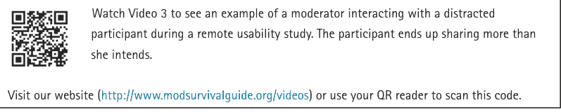

### 另见

- 11.1 远程参与者显然被分心了
- 12.6 你必须指出某些可能令人尴尬的事情
- 14.8 参与者的环境包含危险物品

# 主持者生存指南

## 12.3 参与者显然被外部情况分心

参与者似乎对会议外的某些事情感到眼花缭乱或恼恼。这可能是分散他注意力的小事（例如，他今天有很多事要做，或者在你的地点找不到停车位），也可能是规模大得多的（例如，他刚刚发生了车祸）。

方法：任何
频率：偶尔
要应用的模式：责任承担；澄清任务/问题；安抚参与者；休息；早早结束会议

### 做法

想要知道为什么参与者看起来很分心是不容易的。有时，参与者会告诉你他精疲力竭的原因（例如，“呃，我需要放松一下。我刚收到了一张巨额超速罚单！”），而其他时候你可能需要委婉地询问更多信息，以便做出恰当的回。

- 如果参与者诚实地说明他是如何分心的，请根据问题的严重程度做出判断。我们要强调，舒适度是你的首要任务。
- 如果发生了非常的事情（例如，他出了事故、家庭成员生病、他似乎对某些私事感到心心等），提供补偿并让他离开去处理情况。
- 如果他坚持继续会议，请稍作休息让他有机会冷静一下，然后开始会议。然而，要密切监控他并随时准备好结束，特别是当他看起来心烦意乱时。在参与者显然处于情绪困扰时让他们完成整个会议是不符合伦理的。
- 如果原因是规模较小的（例如，他为了准时一路飞奔过来、他刚参加完压力巨大的会议等），提议在开始会议前进行简短休息。如果他拒绝了但显然能从几分钟中受益，考虑由你来，告诉他可以使用更多时间来准备好。为他提供饮料和一个舒适的地方进行放松，避开观察者。在会议开始时让他放松，这样他就准备好倾听和专注了。
- 一旦参与者开始会议，你可能需要说话得更慢、更有条理。

参与者显然被外部情况分心时（续）

### 话术

在会议开始前：

- 我很抱歉听到这个。
- 好的，我们现在可以重新开始吗。
- 对不起，您需要休息一下休息吗？
- 听到这个我很抱歉。
- 我很抱歉让你开始共享后又突然停止了。
- 没关系。
- 我们可以继续进行吗？
- 我完全理解。
- 尊重您的隐私，请。

### 不要要做或不要说的话

在会议期间：

- 不要根据你看到的内容，随意透露参与者的个人信息。
- 不要当参与者分享私事时，继续追问细节。

### 如何避免

- 我们经历过参与者分享个人信息的情况。有时参与者分享是因为他知道自己情绪化，并提前向你打个招呼。

### 另见

- 11.1 远程参与者显然被分心了
- 12.4 参与者讲述了个人隐私
- 12.7 参与者感到心心
- 幸存故事：“她非常感谢”

# 主持者生存指南

## 12.4 参与者讲述了个人隐私

参与者向你讲述了关于他自己或情况的私事。也许他为自己的分心道歉并告诉你他正在经历非常痛苦的离婚。或者，他开始讲述他的健康问题并看起来处于流泪的边缘。参与者分享的信息可能需要保密，例如社会安全号码和财务细节。

方法：任何
频率：偶尔
要应用的模式：引导参与者；安抚参与者；休息

### 做法

我们经历过参与者分享信息的情况。有时参与者分享是因为他知道自己情绪化，并提前向你打个招呼。其他时候，这可能是作为你某个标准问题的答案意外出现的。或者，你可能在开始会议时就预期会听到参与者的个人故事，因为某个敏感问题是你研究的焦点。

- 如果参与者因为认为对研究是必要的而无意提供个人信息（例如，在与财务应用程序交互时），请他不要分享任何个人数据。回到记录中并确保任何信息都被删除或掩码。
- 如果你正在对敏感主题领域进行研究，你应该预期听到参与者的个人故事。记住在回答他的问题时保持同理心，如果你探测他的答案或追问，要保持敏感。诚挚地感谢他的反馈。
- 如果参与者提供的反馈从个人层面对你产生了很大影响（例如，因为你有类似的经历），请记住将焦点放在参与者身上，而不是分享你的故事。你希望参与者感到安全和受尊重，你的介入会削弱他反馈的重要性。
- 如果参与者开始讲述一个似乎影响了他情绪的故事，让他让他讲完，然后引导他回到任务上。例如，如果你问参与者他什么时候开通银行账户，而他回答关于他和他已故妻子如何共同选择的故事，请尊重地听他讲完这个故事。感谢他的回答，并询问他是否可以继续下一部分，或者他是否想要简短休息。

### 12.4 参与者向你透露个人隐私（续）

- 有时生活确实会出状况，参与者可能会因为个人情况而分心或情绪波动。处理这种情况需要在安慰参与者与中断环节倾听其诉说之间取得微妙平衡。在这种情况下，先从进行简短休息开始。如果参与者状态良好，请带他离开观察/录制研究区域，给他留时间恢复。
- 如果参与者在向你透露个人隐私，但情绪看起来并不脆弱，请考虑语境以及这是否成为一个反复出现的问题。例如，在被问及网站使用情况时，参与者可能会回答：“我经常看色情”。虽然这可能被视为社会禁忌，但参与者只是在回答问题，而且这是他提供的唯一一个过量信息（TMI！）！在这种情况下，尝试不要做出反应并继续环节。相反，如果参与者开始讲述一个较长的个人故事或提供过量的细节，请考虑提醒他正在被录音，或将其引导回到讨论的话题。

### 应该说什么

- “<参与者>，请在这里使用虚假信息而不是您的真实信息。我们希望尊重您的隐私。”

针对参与者似乎未受情绪影响的个人评论的回复：

- “好的。我们继续……” 或 “让我问问您关于……”

针对参与者情绪受影响且回答较长的个人问题的回复：

- “好的，谢谢您的分享。您方便继续进行下一个<任务/问题>吗？”

针对参与者似乎未受情绪影响但回答较长的个人问题的回复：

- “抱歉打断一下。我只是想提醒一下，我们正在录制环节，可能有人在听，所以请让我们专注于原始话题。如果您还有其他想知道的什么，我们现在吧到……”

- “我们要不要稍微休息一下，去外面呆几分钟？”
- （私下里）：“如果您感到不舒服，我不希望您继续这个环节。我们今天就结束到这里好吗？”

## 不应该做什么或说什么

- 不要忽略参与者表现出的任何情绪困扰迹象。
- 即使你感兴趣，也要避免对涉及非常私人信息的故事表达兴趣，除非该故事与你的研究目标相关。参与者可能会认为你的兴趣是他们分享更多内容的许可，将他们拉回你的脚本问题可能更好。

### 12.4 参与者向你透露个人隐私（续）

### 如何避免

- 对于涉及敏感话题的研究（例如使用关于癌症的网站），考虑你是否需要招募对该话题有直接经验的参与者。在某些情况下这样做是有意义的，但在其他情况下你可能希望主动筛选掉可能因主题内容而产生痛苦的参与者（例如癌症患者的家属）。

### 另

- 12.1 参与者非常风趣且友好
- 12.3 参与者显然被外部情况分心

## 12.5 参与者具有令人局不安或分心的身体特征

参与者拥有某种让你感到分心或局不安的身体特征。这些特征中的许多可能是相对无意识或无法控制的（例如，参与者大汗淋漓、不断眨眼或有一块大斑斑）。或者，该特征可能是你认为令人厌恶或不卫生的坏习惯（例如，过度抠鼻）。

方法：任何面对面的方法
频率：偶尔
适用的模式：休息

### 应该怎么做

- 如果参与者具有你认为分心的身体特征（例如，斑斑或大痣），请避免盯着看。记住要与他保持眼神交流！
- 对于表现出流汗或抠鼻等行为的参与者，可以提供一些东西来缓解他的状况，而不要直接关注他正在做什么。例如，如果参与者正在抠鼻，给他一张纸巾。如果你觉得连这样做都很尴尬，尝试自己也用一张纸巾并用它吹鼻子。在那种情况下，人们有时会模仿行为。如果你的参与者流汗，问问他房间温度是否舒适——如果他说他热，提议开门或降低恒温器温度（如果可能），并给他拿水喝。
- 参与者可能会为他的特征提供理由（例如，他可能有某种疾病，或者女性参与者可能会说她正在经历潮热）。当参与者向你提供这些信息时，保持中立的表情和语气，并尽所能地配合。
- 对于你感到反感的行为，尽力避免观看。如果你对此感到非常不适，请以技术故障为借口提前结束环节。
- 如果参与者看起来仍不舒服，即使你已经尽力配合他，也休息一下看看是否有帮助。如果休息没有帮助，且参与者仍然感到太不舒服而无法提供有用的反馈，请委婉地提前结束环节。

### 应该说什么

- “你需要纸巾吗？”
- “这里有点热。你觉得温度怎么样？我想确保你很舒服。”

## 12.5 参与者具有令人局不安或分心的身体特征（续）

## 不应该做什么或说什么

- 不要直接指出参与者身上让你感到分心的地方。

### 如何避免

- 没有办法避免这一点。相反，无论参与者看起来如何或行为如何，都要做好尊重和共情的准备。

### 另

- 4.3 参与者具有意外身体特征
- 12.6 你必须指出某些可能尴尬的事情

## 12.6 你必须指出某些可能尴尬的事情

> 你注意到参与者正在做的事情，或发生在他身上的某件事，可能是尴尬的，特别是如果他以后自己发现的话！例如，女性参与者衬衫上的纽扣可能掉掉了，或者参与者从洗手间回来时裤子没拉链。

方法：任何面对面的方法
频率：罕见
适用的模式：休息

### 应该怎么做

- 关闭你的录制设备，如果你有任何观察者，请带参与者进入私密空间。
- 进入你和参与者不会被听见的私密空间后，委婉地告诉他尴尬的情况。然后，留给他私人时间处理这种情况，或者如果他可能需要更多，引导他去最近的洗手间。
- 如果参与者看起来仍不舒服，即使你已经尽力配合他，也休息一下看看是否有帮助。
- 如果参与者感到尴尬且愿意，确保他在感到舒服后再继续。

### 应该说什么

- “抱歉，<参与者>，我要暂停一下录制。”进入私密空间后：
- “如果您感到不舒服，我不希望您继续环节。我们今天就结束到这里好吗？”

## 不应该做什么或说什么

- 不要当着面指出该物品。

### 如何避免

- 虽然没有办法避免，但尝试在开始前自己检查。

### 另

- 12.2 个人、不当或隐私的内容

## 12.7 参与者看起来情绪不对

参与者在环节开始时很紧张，但现在看起来更加痛苦，处于流泪的边缘。你一直很敏感并试图提供，但他的情绪升级了。

方法：任何方法
频率：罕见
适用的模式：承担责任；安慰参与者；休息；提前结束环节

### 应该怎么做

- 立即停止环节录制，并告知参与者你正在暂停。例如，“我已经关了设备——我们休息一下。”

- 如果你有房内观察者，请让他们离开房间。

- 如果有纸巾可用，为参与者提供——你可以不说话，只需把纸巾推给他。如果有私密房间可用，提议带参与者过去。

- 委婉地询问参与者是否想提前结束环节。告诉他他有义务继续，感谢他目前提供的反馈，并且他将获得全额报酬。如果他说想继续，就继续提前结束环节的计划。

- 如果参与者因你的问题感到痛苦并离开了建筑，不要跟随他。相反，确保他能够进入建筑（例如，根据你的设置你可能需要通知保安台他可能会回来）。如果他再也没有回来，联系你的招聘人员寻找向参与者提供报酬的方法，并感谢他提供的反馈。

- 如果参与者提供的痛苦原因与环节设置有关（例如，他担心被另一个房间的人观察），立即提议解决这些问题，并询问如果解决了这些问题，他是否愿意继续。例如，你可能会关闭该环节的观察设备。然而，正如之前提到的，提醒参与者他有义务继续，如果他更倾向于离开环节，可以自由这样做。

- 如果参与者解释他的痛苦源于环节之外的事情（例如，家庭情况），提议另约时间安排环节。

### 12.7 参与者似乎情绪波动（续）

### 应该说什么

在私下交谈时：

- “`<Participant>`”

- “我已经关闭了我们的录音设备，现在没有人能看到或听见我们。让我们先休息几分钟吧。”

在私下交谈期间：

- “我只是想提醒你，你没有义务继续本次测试。到目前为止，你为我们提供了非常有用的反馈。”

- “如果你感到情绪不好或不舒服，我不想继续进行测试了。你可以随时停止测试，只要告诉我就好。有什么我可以做的能让你感觉更舒服吗？” ”

### 不应该做或说的

- 不要忽略参与者的情绪状态！

- 不要触碰参与者，即使你认为拍拍肩膀或拥抱可以提供安慰！触碰参与者违反了伦理边界，并可能让情况变得恶化，因为你不知道陌生人对被触碰会有什么反应。

- 不要直接问“你为什么不开心？”，即使你很好奇。这可能会让参与者觉得你在拆穿他，从而使情况进一步恶化。

- 尽量不要让参与者在观察者面前做出是否继续测试的决定。

### 如何避免

- 这种情况很少凭空出现。如果参与者的顾虑没有得到考虑，紧张或不舒服的参与者在整个过程中可能会变成这样。在整个过程中要关注并感知参与者的情绪状态，对任何情绪痛苦的迹象做出快速反应。这种意识和快速行动将防止情况恶化到流泪。

- 在测试开始时，真诚地向参与者保证他并没有被测试。对于那些被外部环境分心的参与者，这种安慰也是有效的。

### 另请

- 8.3 参与者看起来或听起来不舒服和/或紧张

- 12.3 参与者明显被外部环境分心

- 12.4 参与者告诉了你一些私事

## 12.8 参与者有意外残疾或服务动物

参与者有意外的身体残疾，例如视觉或听力障碍。他可能还带了一只服务动物。由于这种情况是意外的，你的设施可能没有配备接待这类参与者。

- 方法：任何面对面的方法

- 频率：罕见

- 适用模式：承担责任；转移焦点

### 应该做什么

- 首先，评估参与者的局限性是否阻止了他按计划参与。对于某些类型的视觉障碍，用户可以调整电脑显示器的设置（例如字体大小和对比度）来适应他的视力。有听力障碍的参与者可能带了某种助听设备，或者会通过读口交流。然而，依赖屏幕阅读器的合法盲参与者无法使用没有安装屏幕阅读器（如 `Jaws`）或放大器（如 `ZoomText`）的电脑。

- 如果你觉得无法按计划与参与者继续，请决定将研究重点转移是否合适以便从测试中获得价值。例如，改为采访而不是原型可用性研究。这种转变在形成性研究中最最为，取决于你的客户和研究目标，它也适用于其他类型的研究。有时，只需深入你的背景问题就能产生有价值的结果。

- 如果参与者没有带来他的局限性，但你注意到他在眯着眼睛看屏幕或靠近屏幕，告诉他你注意了他的调整，并询问是否有我可以做的可以让他更容易看清屏幕。

- 如果你的参与者带了服务动物，询问是否有特定的事情是你应该对该动物做或不要做的。大多数动物都经过良好训练，在测试期间会安静地坐在参与者身边。

- 同样，询问参与者是否有任何你应该做或不应该做的事情来适应他的需求。例如，盲人参与者和其他有行走困难的人有时当有人在行走时提供一条手臂让他们扶着时会很胜感激，而其他人则更倾向于依靠自己的拐杖或服务动物。

- 请记住，视觉障碍用户通常更难招募（成本更高），所以请尽力利用这种情况为你的客户团队提供他们可能从其他地方获得的反馈。

- 如果你无法与参与者继续并必须让他离开（或结束测试），请确保为他提供全部报酬。

## 主持生存指南

## 12.8 参与者有意外残疾或服务动物（续）

### 应该说什么

- 如果我看到你带了一只服务动物。在我们的测试期间，有什么事情是你需要我为你的动物做或不要做的吗？

- 你提到你的视力方面有些问题。告诉我你面临的问题，以及你在家里为了适应这些问题所做的的设置。

- 我注意到你似乎在眯着眼睛看屏幕。有什么我可以调整的让你更容易看吗？如果有帮助，尽管把椅子移近屏幕也可以。

- 我想体贴并尊重你的视力。在你在这里期间，有什么特别的事情是你希望我提供帮助或不要帮助的吗？

### 不应该做或说

- 不要未先询问参与者就对你的设置进行任何调整。你只是在对什么对他们有效做出假设。

- 同样，不要对参与者在身体协助方面的需求做出假设。你不想表现得居高临下或让事情变得更困难。诚实地问他他的偏好以及你如何能提供帮助。

- 不要抚摸或试图和动物玩耍。

### 如何避免

- 在没有先询问参与者的情况下不要对你的设置进行调整。你只是在对什么对他们有效做出假设。

- 同样，告知他们。大多数有任何局限性的参与者在筛选过程中会提到它。然而，如果参与者没有提前提到，他很有可能属于你的目标受众，这可能是你想避免的情况。例如，对于眼动追踪研究，我们在筛选中询问受访者是否使用双焦镜、三焦镜或硬性接触眼镜——如果是，他不符合条件。我们建议由机构审查委员会（`IRB`）审查你的筛选方案，以确保你的措辞没有歧视。

- 要了解更多信息，建议阅读 `Dumas` 和 `Loring (2008)` 的《与多元化群体互动》。

### 另请

- 4.3 参与者有意外身体特征

- 5.8 参与者带着孩子或宠物参加测试

## 生存故事：“最好的选择是微笑”

### DORIENNE ROSENBERG

我最早的测试之一中，参与者对我们测试的网站的态度非常开朗且坦率。她提供的反馈非常好，我觉得研究团队很好，因为客户将从她那里学到很多。在单独测试进行三四之三时，她对我们测试网站的用户开了一个种族不当且冒犯的玩笑。我对她的话感到非常不舒服，但担心如果我做出反应，就会失去与参与者建立的关系感和信任。我进一步担心，如果我不表达不适感，客户和观察我的同事会怎么想。我想我最好的选择是微笑，以承认参与者的幽默尝试并让她感到舒服，而不是在口头上表示支持或反对她的观点。参与者似乎对我的反应没有影响，测试的其余部分非常顺利。

我怀疑我微笑的选择是否给参与者留下了我同意她的印象，以及我是否可以采取不同的反应来保持测试正轨，例如改变话题。回想，我意识到我的选择是正确的，因为如果我公开对那个参与者的笑话表示反感，可能会损害测试，丢失数据点，并浪费客户的时间和金钱。我很高兴我的选择没有在我们参与者之间制造紧张，但意识到压抑信念的代价可能是后悔和不愉快。

## 主持生存指南

### 幸存故事

# 幸存故事：“你可真漂亮”

LORIE WHITAKER

我当时正在对一个医院网站进行一对一的可用性测试。为了确保我们正在测试的是下一个目标群体，我与同事前往了德克萨斯州服务该医院区的三个不同城市。前两个城市的情况非常顺利——所有参与者都准时到达，并能够尝试/完成我们要求的任务。然而，其中一件事我至今仍记忆如新。

我们当时在德克萨斯州奥斯汀郊外的罗德罗克（Round Rock），轮到我来主持。我们在酒店的会议室里布置了场地，我的同事和客户在另一个房间里，通过投影仪、笔记本电脑和扬声器观察测试过程。我们依靠接待人员来迎接参与者，但他们并没有义务拒绝任何人——相反地，他们只需要在下一个人到达时通知我们即可。

我收到了下一个参与者已到的通知，于是出去迎接他。我迎接的那个男人年纪较大、体态肥胖，手里还拿着一个 44 盎的大马克杯。这在德克萨斯州并不稀奇，所以我没有多想。我带他回测试室，在他走路时，看起来看起来像是个醉汉。事实证明，我只对了一点点。当他坐好，我开始进行自我介绍时，他一直对我微笑。这并不寻常。然而，当我向他提任何问题时，情况发生了转折，他从“你单身吗？”这类问题开始提问。我试图通过一些冒犯性或引起争议的话题来转移话题，尽管你让你觉得参与者似乎在等着你做出某种回应。

# 13.1 参与者咒骂或发表不当言（续）

- 不要责备参与者，因为这可能导致她在测试的剩余时间里保持沉默，并限制你能够引导出的的反馈。

- 避免表达你的观点或与参与者进行争论讨论。

### 如何避免

确保在招募时，留意参与者表现出特别乐于提供不当或无关信息的迹象，并将其筛选掉。例如，如果你正在为一家金融服务网站招募人员，而参与者对当前的白宫政府进行了一长时间的政治抨控，那么该参与者在测试期间很可能会做出类似甚至更糟的事情！

### 另见

- 11.7 参与者变得侮辱性或带有目的

- 13.5 参与者做出尴尬或不适的行为

- 第 12 章中的生存故事：“我最好的选择是微笑”

# 13.2 你认识参与者，或参与者认识你

> 参与者可能是你社交圈中认识的人、约过会的人，或者是你在工作之外认识的人。她甚至可能是你的朋友，或者是你通过个人或职业圈听过但从未实际见过面的人。

方法：任何

频率：偶尔

应适的模式：承担责任；与参与者脱离关系

### 怎么做

- 承认你与参与者的熟识关系并做你自己，但要将任何闲谈保持在最低限。

- 无论是前伴侣、老友、亲戚还是远远相识，尽力让关于参与者的外部信息不要进入测试环节，除非这些信息与她不符合研究标准有关。

- 如果你了解关于参与者的某些使其无法参与的信息（例如，你的招募标准是 HR 经理，但你知道该参与者属于另一个群体），请以问题的形式提出你的已知以确认其是否准确。如果准确且她不符合条件，请让她离开，或者像第 3.8 节讨论的那样，看看是否有调整测试的方法。

- 如果你担心无法中立地对待参与者（或反之），如果可能，请团队的另一位成员为你主持测试；请密切遵循你的研究计划，并尽力放下顾虑，像对待其他其他人一样对待参与者。

- 在测试开始之前，让你的观察者知道参与者是你认识的人。你不需要详细说明你是如何认识她的，但提前让观察者知道更好，这样当参与者看起来像认识你时，他们就不会感到惊讶或担心。

- 如果参与者对你过度友好或提到了你不想听的个人细节，提醒她你希望作为测试的一部分获得她的反馈，并且可以在测试结束后再叙旧。你也可以提醒她她正在被观察和录音。

### 说什么

- “很高兴再次见到你。在接下来的 `<number>` 分钟内，我们需要完成很多内容。”

- “抱歉，但我真的很想听听你对 `<topic>` 的反馈。如果你愿意多留几分钟，我们可以在完成任务后再叙旧。”

### 不要做什么或说什么

- 不要假装不认识这个参与者——这可能会让她感到沮丧和困惑，并阻碍她提供价值的反馈。

- 不要利用测试时间与参与者叙旧。保持专业并专注于你的研究目标。

### 如何避免

- 监控招募人员提供的参与者姓名名单，如果你发现你认识的人，提前计划让其他人主持测试（如果可能的话）。

### 另见

- 12.1 参与者非常有风趣且友好

# 13.3 参与者对你的了解程度超出意料

> 你向参与者打招呼，她说：“那么，你喜欢你的新车吗？”我看到你喜欢爵士乐。”也许她开始列举你所代表组织中的人物。或者她是一个远程参与者，在你运行测试时她在 Facebook 上查了你并分享了她的发现。无论如何，该参与者手中显然有很多个人信息。

- 方法：任何

- 频率：稀有

- 应适的模式：引导参与者；与参与者脱离关系；提前结束测试

### 怎么做

- 尝试理解参与者行为背后的动力。例如，也许她是从用于预约她的招募机构得到了你的名字，并查询了你以确保你确实在该机构工作。如果参与者提到了一个相对无害的理由，那么我们将称之为“大量信息收集”，尝试忽略任何奇怪的评论并继续测试。

- 如果参与者开始打探你的私人生活，请将对话引回测试以避免任何尴尬的讨论。同时，利用你的语气和语言，通过稍微移开并使用更正式的语气来与参与者脱离关系，同时保持和蔼和专业。

- 如果参与者在和你远程测试期间似乎在研究你或你的同事，请礼貌地让她停止正在做并将注意力放在测试上。

- 如果参与者刻意列举名字并可能挖掘关于该组织或你同事的更多信息，请装作不知道。即使你认识她谈论的那个人，也要假装不知道并采取回避，至少直到测试结束。使用引导让参与者回到正轨。

- 如果参与者说的话和说话的方式超出了尴尬变得令人不安，你有权保护自己并提前结束测试。同样，如果测试开始时很好，但参与者的行为、言语或对你的了解让你极度不适，请休息一下调整。让你的同事接手主持或提前结束测试。如果提前结束，找一个借口（例如归咎于技术问题），以免是因为参与者的行为而结束测试。

# 13.3 参与者对你的了解程度超出意料（续）

### 说什么

如果参与者了解你的事情：

- “噢，你从哪里听说的？”

- “噢，是的，我很喜欢我的新车 <或其他简短回答>。那么让我们开始吧……”

如果远程参与者在测试期间研究：

- “`<Participant>`我对你的多任务处理能力印象深刻！如果你不介意，请关闭窗口和程序，以便我们专注于测试。”

如果参与者了解关于你所代表组织的事情：

- “我只是一个顾问/该组织很大，所以我并不真正认识那个人。那么让我们回到……”

如果用借口结束测试：

- “抱歉，由于技术问题，我们不得不取消测试。感谢你的光临，这是你的报酬。我送你去出口。”或者，“我的同事 `<name>` 会送你出门。”

# 不要做什么或避免

- 不要责备参与者查你的资料，即使你感到不适或愤怒。以尊重、专业的方式对待她。

- 避免陷入关于你生活的私人对话。留留给朋友吧！

- 同样，避免提供同事的个人或职业信息。

### 如何避免

- 检查 LinkedIn、Facebook 和其他网站的社交网络设置，确保你对显示的信息水平感到放心。

- 对于远程测试会议，在测试开始时要求参与者关闭所有无关的窗口和应用程序，以便她专注于测试。

### 另见

- 11.7 参与者变得侮辱性或带有目的

## 13.4 参与者向你调情

> 参与者似乎对对你微笑比对实际上关注环节更感兴趣。她可能会使用微妙的暗示，如微笑或打量，或者可能是更强烈的暗示，如约你约会或向你提出要求。这让你感到尴尬或不适，更不用说如果你正被观察和录像的话，还会有些丢脸！

方法：任何方法

频率：罕见

适用的模式：重新引导参与者；与参与者脱钩；休息

### 怎么做

- 如果调情是微妙的（例如微笑或打量），请忽略它，而不是通过回应来引起对参与者行为的关注。

- 如果参与者在整个过程中变得越来越调情，请尝试通过将注意力引回研究内容来表达你的专业意图，并在身体上轻轻地拉开距离。调整你的身体稍微背对着参与者，并使用中立、正式的语气。不要为了表现友好或迎合而屈从她的调情。

- 如果情况进一步升级（例如变为直接提问或提议），使用更明确的语言将参与者引导回测试目标。如果你觉得使用幽默可以，可以使用坚定而幽默的语气进行重新引导，特别是当参与者也带有开玩笑语气时。这种方法的用处在于，通过以类似的语气回答，你可以避免参与者感到尴尬同时重新获得对测试的控制。如果这种情况持续，让她知道她的问题是不恰当或与研究无关的，并且你想重新回到任务上。

- 如果直接拒绝没有帮助，请考虑使用另一个理由提前结束测试，例如完成材料的速度比预期快，或遇到技术困难。或者，如果你有其他人可以管理剩余环节，你可以告诉参与者，测试的下一部分她将与那个人交谈。离开房间，让同事进来接手。

- 如果测试结束后参与者仍然坚持任何调情行为，请礼貌地告知她你有义务保持与参与者的专业关系，并再次感谢她的参与。

### 13.4 参与者向你调情（续）

### 怎么说

如果被以一种让你觉得不得不看那个区域的方式夸奖……

- “谢谢。你为什么不回到……<任务/问题>呢。”

- “好的。让我们回到……<任务/问题>。”

如果你需要重新引导一个调情的参与者：

- “如果可以的话，我想坚持测试的议程，因为我们有很多内容要完成。让我把你的注意力回到……”

如果你正让同事接手测试主持工作：

- “好的 <参与者姓名>，接下来的部分，我要做的是让我的同事进来和你一起进行。她很快就来。”

如果参与者在测试前或测试后问你：

- “很高兴认识你。但我义务将我们的互动保持在专业水平。”

### 不要要做或不要说的话

- 不要屈从调情，或不要表现出你欢迎这种行为的迹！划清界限并保持测试专业性非常重要，特别是当你是在别人家中进行实地访问，或者参与者在下班后、人迹稀少来到你的设施时。过度友好或调情的行为可能导致糟糕的结果——身体危险或法律责任。

- 不要让参与者尴尬！

### 如何避免

- 没有简单的方法可以避免调情的参与者，但如果你注意到参与者变得越来越友好或开始调情，请立即调整你的风格，变为更加疏远（不那么友好）的态度，以免在情况升级为更尴尬的情况之前。

观看视频 4 以查看主持人在可用性测试期间处理调情参与者的示例。参与者起初很友好，但随着测试的进行变得越来越大胆。

访问我们的网站 (`http://www.modsurvivalguide.org/videos`) 或使用你的二维码 扫描此代码。

### 13.4 参与者向你调情（续）

### 另见

- 12.1 参与者极具趣味且友好

- 14.7 参与者触碰你

- 生存故事：第 12 章中的“你真漂亮”

# 13.5 参与者做了某些尴尬或不适的事

在测试过程的某个时刻，参与者说或做了一些让你感到不适的事情。她可能会要求你摸摸她隆起的肚子，或者问她是否可以脱鞋子。又她可能会躺在研究空间的沙发上。这些只是我们遇到和听说的无数次“刚才发生了什么？”的时刻的几个现实生活案例。这些行为和要求某种程度上无害的——并不算危险或疯狂——但仍然很尴尬和不适。

- 方法：任何面对的方法

- 频率：罕见

- 适用的模式：承担责任

### 怎么做

- 如果请求或行为很奇怪但不会阻碍测试（例如脱鞋），让参与者这样做，以避免关于此事的进一步尴尬互动。

- 如果是奇怪的个人请求或更具破坏性的事情，请礼貌地拒绝。尝试将归咎放在你自己、你的研究设置、设施、政策或任何身上，这样参与者就不会因为提问而感到难过或愚蠢。这可能是对事实的稍微夸大，但有助于维持与参与者的联系。例如，如果参与者要求你摸她隆起的肚子，告诉她你的机构有禁止触摸的政策。如果参与者开始向你展示带有服装走光的庆祝活动照片，提醒她测试和屏幕正在录像，并且剩余部分还有很多内容要涵盖。

- 如果你觉得合适，你也可以将幽默作为解释的一部分使用。记住要保持得体，并确保幽默不会被误解为在取笑参与者。例如，如果参与者躺在沙发上，你可以轻地说：“如果这是在睡觉的话，我会给你带毯子和枕头，但现在，我实际上需要你坐在电脑前，这样我们就可以开始了！”

### 怎么说

- “对不起；我们的政策是不让客人<这样做>。你方便继续测试吗？”

- “为了今天研究的设置，我实际上需要你<描述你需要你做的事的事>。”

- “对不起，但我们通常不让任何人<这样做>。让我们回到……”

# 13.5 参与者做了某些尴尬或不适的事（续）

### 不要要做或不要说的话

- 不要护着参与者或让她觉得自己能力不足。

- 不要大笑或取笑参与者，即使看起来确实是那样。

### 如何避免

- 很难预见到这些情况！请用幽默感对待每一种情况。

### 另见

- 13.1 参与者说脏话或发表评论
- 13.4 参与者向你调情
- 13.6 参与者提出了奇怪的要求
- 生存故事：“她给了我小费”

## 13.6 参与者提出了奇怪的要求

参与者要求你做一些特定且不寻常的事情。例如，当你开始测试并提供饮料时，她说：“你能给我来一杯半糖、脱因咖啡，加甜味剂吗？”或者你被要求擦眼镜、擦她的鞋、给她哥哥打电话、陪她抽烟，或帮她找指甲剪。

- 方法：任何面对的方法
- 频率：罕见
- 适用的模式：承担责任

### 怎么做

由于请求的形式各异，对于这类问题没有标准答案。我们建议使用以下指南：

- 如果请求不是耗费精力的、不可管理的或具有侮辱性的，请满足请求。如果你没有参与者要求的准确物品，请询问是否有可用的替代品。
- 如果你必须花费额外时间来满足他们，或者你以任何方式感到不适，请礼貌地告知参与者你没有相应的（如果是请求物品）或你无法提供帮助（如果是请求服务），并尽可能提供替代方案。
- 记住你的专业精神和机构的政策。例如，虽然被要求有点奇怪，但擦别人的眼镜（我们遇到过这种情况）或为她提供所需的材料是可以的，但这不是你的工作，对你和你的机构来说并不专业的。

### 怎么说

- “我不确定能否满足这个请求，但我可以帮你查询一下。”
- “对不起，根据我们的政策，我无法为你做这件事。”
- “由于我们负责这项研究的人手时间有限，所以今天我们没有时间做<request>。”

## 13.6 参与者提出了极其具体的请求（续）

### 不应做或或说的话

- 避免给人一种你随叫随到的错觉。保持友善、做一个良好的主人并礼貌地倾听，但要保持控制并表现得专业。

### 如何避免

- 在招募参与者时，确保她知道自己是作为具有特定目标的用户调研会议参与者（而不是作为客人的访问或参观），以及将提供哪些设施（如果有的话）。
- 如果你的设施设有等候区，请提供阅读材料并准备一些常用饮品（如水、咖啡、茶）。

### 另见

- 13.5 参与者表现出尴尬或不适的行为
- 13.7 参与者在实地访问期间提出请求
- 第 10 章中的生存故事：“这个请求让我措措手不及”

## 13.7 参与者在实地访问期间提出请求

> 你正在一位参与者的家中进行研究，她礼貌地问你是否想喝点饮料，或者是否可以为你准备些食物。也许请求更具私人性质（例如要求你脱鞋），或者只是完全出乎意料（例如要求你出去倒垃圾）。

方法：任何面对面的方法

频率：偶尔

应运的模式：承担责任；与参与者保持距离

### 应该做的事

当你访问参与者家时，请记住你是一个客人，需要保持礼貌和体贴。建立一种友好且专业的关系将为富有成效的反馈奠定基调。然而，从礼貌到与参与者过度接触或过于友好只有一线之隔（这是一个滑坡效应）。这样做可能会导致你的研究结果产生偏差，或让你陷入尴尬或危险的境地。

- 如果参与者问你要不要喝饮料，只要是非酒精饮料、不会给房主增加负担，且不会占用太多会议时间，尽管接受。表现得礼貌并感谢她的提议，并记住参与者这样做是在遵循款待访客的社交礼仪。
- 无论你是接受参与者提供的饮料，还是自带一瓶水，都要注意放置的位置。有些人人对电脑桌上或没有杯垫的桌子上的饮料很挑剔。问问参与者她希望你把饮料放在哪里。
- 如果参与者问你想不想吃某种食物，尽量避免让她离开视线，除非她真的非常兴奋或正准备为你服务，且拒绝她看起来会很不礼貌。感谢她的提议。然而，要意识到，如果参与者正在为你做西牛排晚餐，这为更亲密的关系埋下了先例，在会议期间保持中立和控制局面可能会变得更加困难。
- 如果参与者有特定的习俗或规定（如脱鞋），请体谅并遵循她的规则。按照经验，上门访问时穿着袜子和鞋总是不穿袜子要好。确保你的袜子可以大方展示，没有破洞或不恰当的图案。
- 如果参与者有非常具体的请求，请尽力配合，但要避免拒绝她的一些任务。例如，出于尊重，你可以为她的宗教仪式（如祈祷）留几分钟安静时间，但你不需要作为回馈去帮她倒垃圾、接电话或修理她的洗碗机！

## 13.7 参与者在实地访问期间提出请求（续）

- 也要尝试拒绝任何与你研究的主题无关的活动。例如，如果参与者试图给你看旧家庭录像带，告诉他们你想开始会议。如有必要，承担责任说你的研究计划中安排了大量内容，或者用一些提前离开的借口来帮助她保持专注。
- 如果参与者似乎过于友好或试图与你建立联系，请使用“与她保持距离”的模式。调整你的举止和风格，变得不那么亲切、更具商务感，并提醒她你参加会议的目的。

### 应该说什么

礼貌地拒绝请求：

- “噢，不用了，我刚吃过，非常感谢你的好。”
- “谢谢你的提议，但我这里有一瓶水。如果可以的话，我想直接开始吧。”

如果被要求参加某些尴尬的活动：

- “没关系，我这里其实有一些准备工作要做，所以如果可以的话，我就在这里安静地工作了。”
- “实际上，如果可以的话，我希望能直接开始我有很多内容要处理，我会提前几分钟离开。”

### 不应做或或说的话

- 不要做任何可能被视为不尊重参与者空间的事情，比如碰碰她的东西、打开她的冰箱或坐在她的床上（即使是在单身公寓里），除非你获得了明确的许可。
- 不要同意任何可能让你处于危险中的事情，例如与参与者单独进入卧室或地下室，除非该地点与你正在的研究有关。基本上，不要做任何恐怖片里那些无辜受害者会做的事——运用你的常识。

### 如何避免

- 你永远不知道在实地访问时会被要求什么或提议什么。但了解参与者性格的一种方法是亲自给她打电话，并和她聊几分钟。

### 另见

- 13.6 参与者提出了极其具体的请求

### 生存故事

# 生存故事：“她给了我大小费！”

Michael ROBBINS

起初只是一次常规的可用性研究。在单向镜后观察时，我的总监、老板、几位操作员以及客户都在场。参与者和我坐在一间狭窄空旷房间的一台电脑前。她是一位五十岁的开泼女性，我是一个三十岁的家伙。

在持续一小时的会议途中，我意识到她可能在调情。她变得越来越赞美、越来越热情。从镜子后面看，我感觉到人们的笑容越发变。一切都很顺利，直到她结束。她开始疯狂地赞美我做得多好、多专业等等。当我向她交付报酬（一封现金）时，我感谢她的美言。还没等反应，她把20美元塞进我的手里，并给了我如海啸般的赞美。她给了我……大小费！

我的第一个想法是：“噢不！我现在该怎么办？”接着，脑海中闪过我们正无形注视着这场快速上演的现场剧。我迅速打断了她，把钱推了，让她留着。她拒绝了。我把钱放在她面前的桌子上，合理解释这是她应得的属于她。她不想要。我坚持。来回回。改变策略后，我把那20美元深插进她打开的包里，凑近她，用一种诚恳且让人防备的耳语解释道，就像建筑师一样，作为一名专业人士接受她的钱会觉得不好意思，我想让她留着……真的。而且，由于一个小失误，我还向她保证我在钱方面过得很好……真的。起效了！她离开时可能比来还要愉快。呼！我很感激总监在走出观察室时露出的会心微笑，以及同事们善意的调侃。

### 生存故事（续）

回想起来，用持续的友好来回应她善意的调情，是保持研究顺利进行的最佳机会。任何“纠正”无论多么和，都可能危及参与者的配合意愿。

至于小费，除了能预知哪种方法第一次就有效之外，我不确定在这里是否会改变其他做法，除非是把钱塞进她的包里。那可能会搞得很糟，但正如俗语所说，重要的不是你做了，而是你如何做的。

# 第 14 章

## 安全第一：将情感和身体痛苦降至最低

当你不或参与者经历情感或身体不适时，你需要迅速处理这种不适。请记住你对参与者的伦理义务，以及保护你自身和所属组织安全的必要。如果你觉得继续下去不舒服或不安全，不要害怕结束会话。

- 14.1 火灾警报响了或设施需要疏散 257
- 14.2 发生自然灾害（例如地震、龙卷风） 259
- 14.3 参与者开始看起来生病或其他不适 261
- 14.4 你在主持会话期间感到身体不适 263
- 14.5 你闻到异味味或发生过敏反应 265
- 14.6 参与者看起来醉了或吸毒了 267
- 14.7 参与者触碰了你 269
- 14.8 参与者的环境中含有危险物品 271
- 14.9 参与者正在进行违法或威胁性行为 273

## 14.1 火灾警报响了或设施需要疏散

在会话期间的某个时刻，火灾警报响了，或者发生了其他需要所有人疏散的紧急情况。这可能发生在线下会话期间，也可能在你远程主持会话时。

方法：任何

频率：罕见

适用的模式：承担责任；尽早结束会话

### 怎么做

- 如果会话在你的设施（或你租赁的设施）举行，那么将参与者带往安全区域是你的责任。确保他带上所有物品（如果时间允许），并带他去建筑外外的安全地点。
- 如果你的观察者对该设施不熟悉，带上参与者一起，并确保观察者也安全离开。在路途中通过让参与者做好准备，告诉他你需要确保你的利益相关者安全。这会让参与者心中有预，，让他们知道他们接下来见到的人在会话期间一直在观察他们。
- 如果你正在录制会话且情况看起来并不严重，尝试在离开之前暂停录制。这不会花费太长时间，并且可以避免你以后需要编辑录像。当然，如果你正处于直接危险中，不要停下来担心录像！
- 如果可能，带上参与者的报酬。如果你无法及时回到室内，你仍然可以为参与者提供承诺的奖励。
- 到室外后，留在参与者身边，直到可以安全进入室内。你可以进行闲聊来打时间，但要保持专业性。
- 如果参与者看起来被这种情况吓到了、情况持续时间很长或者天气恶劣，请让参与者离开。感谢他的反馈，如果你带了报酬，请为他提供全额补偿。如果你没带，告诉他你将与招募人员协调把报酬送给他。也留给你的联系方式，以便他在没有收到报酬时可以联系你。
- 如果会话是在参与者的设施举行的，请遵循他疏散建筑的指示。请确保拿上你的物品，以防你以后无法进入设施。
- 如果会话是远程举行的，让参与者（以及观察者）知道你遇到了紧急情况，需要挂断。要求参与者断开屏幕共享应用程序和任何相关的会议电话，并告诉他在安全返回建筑后会与他联系。如果时间允许，在屏幕共享应用程序中添加备注，让任何在你室外时加入的观察者知道发生了什么。

### 怎么说

对于线下情况：

- “<参与者>，火灾警报响了，我们需要疏散建筑。请收拾好你的物品，我们去外面。”

对于远程会话：

- “<参与者>，我们的警报响了，我需要离开建筑。请先退出屏幕共享应用程序并挂断。等我能返回建筑后会联系你。”

### 不要做什么或应避免

- 不要遗弃参与者。记住他可能处于一个不熟悉的环境中且不知道该怎么办。此外，到室外后，不要让他独自呆着。陪伴他，进行非正式但专业的聊天，让他保持参与感并分散对发生状况的注意力。

### 如何避免

- 这种情况是没有办法避免的。但是，你可以通过熟悉设施的应急处理程序来做好准备。如果你对空间的进入有控制权，请确保打印一份应急处理程序副本并存放在易于获取的地方。至少每年与团队审查一次这些程序，并考虑进行模拟演练，以找出在紧急情况下安置参与者的最佳方式。
- 如果你为研究租赁了设施，请提前询问在紧急情况下是否有需要遵循的特殊程序。

### 另

- 14.2 发生自然灾害（例如地震、龙卷风）

## 14.2 发生自然灾害（例如地震、龙卷风）

> 你的会话被地震、龙卷风或恶劣天气中断。这可能发生在线下会话期间或你主持主持会期间。

方法：任何

频率：罕见

适用的模式：承担责任；尽早结束会话

### 怎么做

- 如果你在恶劣天气前收到警告，让参与者知道。提供许多细节，告知天气有多糟糕，他们可能想立即离开。帮助他们做出决定，但告诉他们可以留下来等天气过去。
- 如果会话是远程举行的，让参与者（以及观察者）知道你遇到了紧急情况，需要挂断。要求参与者断开屏幕共享应用程序和任何相关的会议电话，并告诉他在安全返回建筑后会与他联系。如果时间允许，在屏幕共享应用程序中添加备注，让任何在你室外时加入的观察者知道发生了什么。
- 如果你在恶劣天气前收到警告，让参与者知道。提供许多细节，告知天气有多糟糕，他们可能想立即离开。帮助他们做出决定，但告诉他们可以留下来等天气过去。

## 14.3 受参与者开始看起来不适或其他不舒服

虽然参与者在会议开始时看起来还好，但随后开始显得生病或不适。他可能会变得非常苍白、开始无法控制地喷嚏/咳嗽、出现运动控制困难，或昏厥/倒地。

方法：任何方法

频率：罕见

适用的模式：休息；提前结束会议

### 应该做的

- 对于咳嗽或喷嚏等轻微症状，可以提议让参与者休息一下（以防他可能正在经历过敏反应或临时状况），或提前结束会议。如果他正在咳嗽，还提议为他提供水。
- 如果参与者倒地或出现之前没有的运动控制困难迹，请立即寻求帮助。
- 对于昏厥或倒地，找一个人带水陪同参与者。当参与者清醒过来后，提议叫人来接他，或提供其他方式确保他安全到达（例如，安排出租车）。
- 对于抽搐或其他运动控制问题，拨打 911。在某些公司大楼内，你可能需要先给大楼安保打电话，让他们拨打 911。你的首要任务是让参与者获得所需的护理。不要试图束缚参与者，但要移除他可能撞到的尖锐物体。
- 如果参与者突然离开会议（例如，乘坐救护车），事后联系招募人员以确认他是否无事，并在符合你的研究要求和他身体状况的情况下，询问他是否愿意重新安排。你也可以安排一种获取其报酬的方式。

### 应该说什么

如果参与者看起来苍白或正在喷嚏/咳嗽：

- <参与者>，你还好吗？如果你想休息一下、需要提前结束会议，或者我能提供任何什么帮助，请告诉我。

如果参与者开始出现严重的运动控制困难或昏厥，立即为他寻求帮助：

- <参与者>，我要拨打 911（或联系大楼安保），并一直在这里陪着你直到帮助到达。

## 14.3 受参与者开始看起来不适或其他不舒服（续）

### 不应该做或说的话

- 不要忽略参与者的状况。记住你有保护参与者免受伤害的伦理责任。

### 如何避免

- 遗憾的是，这些情况是很难完全避免的。在你的测试环境中，务必使用杀菌清洁剂并准备好洗手消毒液，以减少生病参与者将细菌传染给你（或其他参与者）的机会。
- 此外，如果你的机构有安保人员，询问他们是否有某些提供广泛安全服务的设施要求你先联系他们，以便他们可以直接与 911 协调。

### 参见

- 14.4 你在主持会议时开始感到不适
- 14.6 参与者看起来醉了或幻幻了

## 14.4 你在主持会议时开始感到不适

虽然你在会议开始时感觉良好，但随后你开始感到生病或不适。你的症状严重到让你开始难以关注参与者身上。

方法：任何方法

频率：罕见

适用的模式：承担责任；休息；提前结束会议

### 应该做的

- 如果你正在经历类似咳嗽或喷嚏发作，请离开房间去下一个洗手间直到结束。在回到研究室之前，用冷水洗脸并洗手。
- 快速休息一下。如果可能的话，喝口凉水并呼吸新鲜空气。如果你还没吃东西，吃点小食以保持血糖。这些微小的改变可能足以让你感觉好些。
- 如果你感到非常严重，或由于传染性而无法继续，你可以采取两件事之一：
  - 如果有其他可用的主持员，让他/她为你继续进行会议。
  - 尽快结束会议，为了你和参与者的考虑。如果你不方便分享你感受的细节，请使用预设的话术（preset）。即使提前结束会议，也要务必给他/她全额报酬。

### 应该说什么

- “我们稍休息一下，五分钟后再次开始。在你等待时，我可以去给你拿杯水吗？”
- “我觉得要打喷嚏了，<咳嗽发作——请原谅我离开几分钟”
- “抱歉，<参与者>，由于我们设备的技术问题，我们需要比计划早一点结束会议。非常感谢你今天的反馈——你提供的信息我们非常有帮助。这是你的报酬。”

### 不应该做或说的话

- 如果你觉得无法继续，不要强迫自己继续会议。在参与者面前倒下，总比提前结束会议要好！

## 14.4 你在主持会议时开始感到不适（续）

### 如何避免

- 遗憾的是，这些情况是无法避免的。在你的测试环境中，务必使用杀菌清洁剂并准备好洗手消毒液，以减少生病参与者将细菌传染给你（或其他参与者）的机会。
- 如果你有需要快速离开房间的持续健康问题，给你的团队打个招呼（不需要细节！）。如果团队中的其他人可以替你担任主持并观察你的会议，考虑在你必须匆忙离开房间时，让他们立即或几分钟后接替你的工作。

### 参见

- 14.3 受参与者开始看起来不适或其他不舒服
- 14.5 你察觉到异味或发生过敏反应

## 14.5 你察觉到异味或发生过敏反应

一种非常难闻的味道在会议期间分散了你的注意力。味道可能来自参与者，或者如果你在参与者所在地，可能来自环境本身。如果你在参与者的家里，气味可能还伴随着不卫的生活条件，如老鼠、蟑螂和未洗的碗筷。同样，参与者穿着的或环境中存在的某些物品可能导致你产生过敏反应。

方法：任何面对面的方法

频率：罕见

适用的模式：休息；提前结束会议

### 应该做的

- 尝试移动到房间内的另一个位置（例如，从参与者的右侧移到左侧）。几英寸的距离可能对你受过敏原或气味的影响产生巨大差异。
- 如果你在参与者的家里且变换房间位置没有帮助，请询问是否有另一个房间可以用于会议。这个问题可以表述得很清楚，以免让参与者感到被冒犯，理想情况下是将这种移动与会议的原因联系起来。例如，你可以要求参与者向你展示你们正在讨论的内容。
- 如果你觉得无法结束会议（例如因为你真的需要这个参与者的反馈），请休息一下并呼吸新鲜空气。

- 如果你所在的地点异味是不可避免的（例如，动物测试设施、某些制造工厂），考虑对参与者诚实，告诉他你很难受这种气味。他可能会带你去一个通风更好且气味较小的地方。
- 如果气味让你感到不适且无法继续，请直接结束会议。如果你仍然想获得参与者的反馈，可以询问他是否愿意通过电话与你交谈。

### 应该说什么
- “对不起，我想我可能对<房间里的某物>过敏。我们能换个地方说话吗？”
- “我们稍休息一下，五分钟后再次开始。在你等待时，我可以去给你拿杯水吗？”

## 14.5 你察觉到异味或发生过敏反应（续）

### 不应该做或说的话
- “我知道你提前提醒过我了，我很难处理这种气味。我们可以换个地方待一会吗？”（注：此处语境修正为 - 尽量不要指出异味，除非那是你所在地预期的那种气味（例如，工厂或制造设施）。这样做会礼貌且可能具有冒犯性。）

### 如何避免
- 我们希望有一种方法可以避免这种情况，特别是在进行情境调查时，我们能做的是有限的。对于实地访问，你可以询问预期的环境类型，但这类嗅觉问题可能会出现。
- 如果你有已知的过敏（例如对猫或狗过敏），请做好准备并随身携带药物。

### 参见
- 12.5 参与者具有令人不安或分心的身体特征
- 14.4 你在主持会议时开始感到不适
- 幸存故事：“我知道那种感觉”

# 14.6 受访者看起来醉了或吸毒了

当受访者到达时，你注意到他的状态似乎有些不对。他的眼睛可能是浑浊或发红的，身上可能有浓浓的酒味，且说话含不清或走路困难。

方法：任何面对面的方法
频率：罕见
适用模式：尽早结束环节

### 应该怎么办
- 尽早结束环节，为受访者提供补偿。
- 询问受访者是如何到达现场的。如果他是自己开车来的来的，而你认为让他上开车不安全，请鼓励他乘坐其他交通工具（例如：出租车、叫朋友），并提议为他安排。记住你对受访者安全的责任。
- 如果你有现场大安保，联系他们寻求协助。他们可以与受访者一起等待并提供额外的帮助。
- 如果受访者拒绝你的建议并坚持要开车，而你没有现场安全团队，获取他的车钥匙和型号，并立即联系警察。
- 如果受访者以任何方式让你感到不适，请相信你的直觉并尽快结束环节。如果你担心自己或你所在地其他人的安全，请联系安保和当局（处理此类情况请见第 14.9 节）。

### 应该说什么
- “感谢你今天过来。你看起来有些心不在焉，我们要不要重新安排一个你方便的时间？”
- “我可以给某人打电话来接你回家吗，或者我可以帮你叫一辆出租车？”
- “抱歉，由于一些技术问题，我们不得不取消这次环节。非常感谢你的光临，这是你的补偿。我送你到出口。你今天是怎么过来的？”

## 不要说什么或做什么
- 不要与你认为在身体上无法提供准确且有用反馈的受访者进行测试。让受影响的受访者安全地回家。

# 14.6 受访者看起来醉了或吸毒了（续）
- 确保有另外一个人（例如观察者或你团队的成员）观察你与受访者的互动，特别是在结束环节时。

### 如何避免
- 这种情况几乎无从避免。请确保你不是独自运行环节，并随随备好现场安保的电话以备万一。

### 参见
- 14.3 受访者开始看起来不舒服或有不适
- 幸存故事：第 12 章中的“你真漂亮”

# 14.7 受访者碰了你

在环节的某个时刻，受访者故意碰了你。这种触碰可能是短暂地触碰你的手臂或手。或者，当你们都倾身看某东西时，他的肩膀碰到了你的肩膀却没有移开。或者他并不那么短暂地碰了你的腿或背部。

方法：任何面对面的方法
频率：罕见
适用模式：引导受访者注意力；与受访者分离；休息

### 应该怎么办
- 如果受访者的触碰更像是抓取或威胁性动作，或者他故意无视你不希望被触碰的要求，请尽快结束环节。如果你已经对他感到不适，且这种触碰让你感到更加不适，也同样处理。相信你的直觉！如果你在受访者面前感到不安全，请离开房间找一名团队成员替你延长环节。
- 如果受访者非常有表现力，他的手臂动作导致偶尔碰触你的手臂（无论是有意的还是无意的，例如把你的脚误认为是桌腿），请继续环节。你也可以重新调整自己或受访者的位置，让他们离远一点。例如，在可用性测试或情境调查中，你可以坐在他后面的椅子上，或者如果设备允许，去另一个房间通过麦克风进行主持。如果物理位置移动显得太突兀，你可以先休息一下。等恢复开始时，换一个位置。
- 如果触碰是无意但微妙的（例如虚构的受访者碰了你的手或腿），稳稳地后退以表示这是不妥的。转身并将身体稍微偏离受访者，减少眼神交流，并使用更正式的语气。你也可以要求受访者调整位置（例如移动到房间里的另一把椅子）。
- 如果你继续与受访者交流感到不适，如果有其他人可用，请切换主持人，或尽早结束环节。

### 应该说什么
重新调整自己或受访者的位置：
- “坐在你旁边我很难看清你在做什么，所以我去你后面观察你的操作吧。”
- “我发现你坐的这把椅子是我们这里最不舒服的椅子之一——我很抱歉！剩下的访谈时间你要不要换到那把椅子坐？”

# 14.7 受访者碰了你（续）
进行休息：
- “在环节的下部分之前我需要检查一些东西，让我们简短休息一下。”

### 不要做什么或说什么
- 尝试不要在触碰发生后立即抽身。如果是尴尬的触碰，请缓慢平稳地后退。但你不需要立刻跳到房间其他地方坐下或休息。这会让情况变得更尴尬。然而，在极少数情况下，继续你正在的任务、问题或想法是有帮助的，然后找到下一个自然的断点来移动位置、休息或切换动作。

### 如何避免
- 虽然你几乎无能可以避免这种情况。请确保你不是独自运行环节，并随手准备好现场安保的电话以防万一。尽管我们通常建议有观察者，在环节开始时，确保与受访者保持安全的距离。在涉及电脑的研究中，确保你有自己的键盘和鼠标控制权，这样就不需要受访者操作。- 永远不要独自进行研究，特别是在晚上和家中。始终确保至少有一人在观察，如果你要去现场，请带上伙伴！

### 参见
- 13.4 受访者向你调情

# 14.8 受访者的环境包含危险物品

在进入受访者的家或工作空间时——无论是面对面还是通过网络摄像头——你注意到存在危险物品（例如枪支或武器）或可能冒犯的物品（例如色情或种族宣传）。

方法：情境调查；访谈
频率：罕见
适用模式：承担责任

### 应该怎么办
- 如果你感到不适或觉得有一丝危险，请相信你的直觉并尽快结束环节。我们强烈建议在面对警告信号时相信直觉——再次，你的安全比获取额外数据点更重要。
- 如果你进行环节，为了你的安全，用微妙的方式结束环节，不要让明显看出是因为受访者的环境。例如，等几分钟并使用忘记研究材料作为借口，或者查看手机假装有紧急情况需要离开。
- 如果你觉得可以继续环节（再次我们建议你谨慎，但请根据你的判断——例如，如果受访者收藏在箱里的中世纪武器，且你没有在他身上感觉到任何异样），询问他是否可以将危险物品移动到房屋的其他区域，或者我们可以在另一个地方交谈。如果他无法提供让你感到舒适的配合，请结束环节。无论你对这些问题物品持什么态度，在引起这些注意时都要保持尊重。
- 如果物品是冒犯性的但不危险，尝试不要提到它们。这可能很困难，请记住你外外是为了了解用户环境的现实，而现实并不总是如你所预期的。
- 如果你对环节录像或拍照，在开始前提醒受访者。受访者可能会意识到他有一些不希望被广泛观众看到的物品，并自行移动这些物品。

## 不要说什么或做什么
- 除非受访者主动提起且该物品与你的研究有关，否则避免与受访者就危险/冒犯物品进行讨论。

### 14.8 参与者的环境包含危险物品（续）
……目标。例如，如果你在与参与者谈论他如何度过空闲时间，他提到了他的古董枪支收藏，你可以像对待任何其他回答一样向他提后续问题。

### 应该说什么
- “非常感谢你今天抽空和我聊天。在我们开始之前，我可以请你在这儿聊天时，把那个 <危险物品> 移到另一个房间吗？非常感谢配合。”
- “在我拍这张照片之前，我想提醒你，这张照片将与项目团队的其他成员共享。我继续可以吗？”

### 如何避免
- 这种情况你没什么做什么可以避免的——理想情况下，知道自己有访客的参与者会让环境变得安全。然而，事实并非如此。请记住，实地研究的魅力在于它能让你看到用户环境的真实状况，而环境可能并不是你预期的那样。

### 另请
- 12.2 看见了个人、不恰或机密信息
- 14.9 参与者正在从事非法或威胁性行为
- 幸存故事：“我们对他们并不了解”

## 14.9 参与者正在从事非法或威胁性行为

> 在环节期间的某个时刻，你意识到参与者对你以及你所在地其他人的安全构成了某种威胁。你可能会注意到参与者正在从你的设施中偷取物品。或者，参与者看起来不稳定或可能具有暴力倾向，你不再觉得继续访谈很舒服。

方法(s)：任何面对面的方法
频率：罕见
适用的模式(s)：与参与者脱钩；休息；尽早结束访谈

### 应该做什么
- 如果你觉得参与者可能不稳定，或对你或他人构成危险（例如：偏执、暴力、极度的情绪波动），请相信你的直觉并尽可能快地结束访谈。我们强烈建议你在面对潜在的警示信号时依靠直觉——再次强调，你的安全比获取额外数据点更重要。
- 如果你确实立即结束了访谈，为了安全，尝试用一种微妙的方式进行，不要让对方明显看出是因为他的行为。例如，等几分钟，并以产品技术故障或没有合适的研究材料为借口。
- 如果参与者正在从事非法活动，请尽快休息，再次以同事或观察者的借口提醒相关部门（警察、安保等）注意此情况。根据参与者正在做（或已经做）的事，你可以要求执法人员在参与者离开设施时留意，或者要求他们确认参与者的身份（以追回被盗物品）。
- 一旦你有了某种后盾，就结束与参与者的访谈。给他提供补偿，以确保从他的角度来看访谈尽可能尽可能正常进行。
- 与参与者互动时，尽力保持表情和声音中立，即使你感到害怕或紧张。
- 记住你需要照顾自己的舒适度和安全，所以如果你出于任何原因感到不适，请结束访谈。

### 应该说什么
对参与者结束访谈：
- “抱歉，由于我们设备的一些问题，我们必须提前结束访谈。非常感谢你的到来——这是你的补偿。我送你出去。”

### 14.9 参与者正在从事非法或威胁性行为（续）
对警察或安保：
- “我是 <location> 的 <name>。我正在和一名参与者进行一项研究，因为参与者的行为，我担心我的安全。<描述参与者的动作或行为> 我将结束这项研究，但我希望你们了解正在发生的情况。对于我应该怎么做，你们有什么建议吗？”

### 不要做什么或说什么
- 如果可能的话，尽量自己避开这种情况（例如：通过质问参与者他所做的）。这些罕见的情况是我们建议永远不要独自进行研究的主要原因之一。

### 如何避免
- 张贴所有紧急电话号码，并确保任何观察者和团队成员都知道这些号码的位置。
- 如果你进行研究的设施有现场安保，提前告知他们你正在进行一项研究。这样一来，如果你在紧急情况下需要联系他们，他们已经对你是谁以及你在做什么有了初步了解。
- 咨询你大楼安保团队关于武器的任何政策，因为如果你发现有武装的参与者，他们可能有特定的程序要遵循。

### 另请
- 14.8 参与者的环境包含危险物品

## 幸存故事：“我们对他们并不了解”

BOB VIRZI

我们当时正在对一些家庭网络设备进行可用性评估。我们已经完成了一系列实验室研究，但客户仍在反映现场安装中存在的问题。为此，我们启动了一项实地研究，观察客户尝试在家里安装这些设备。

当我们联系人们参与研究时，我们解释说采访将在他们家中进行，使用他们的设备，并预计他们在我们在观察时尝试安装网络设备。我们从他们那那里收集了一些信息，比如他们的年龄和设备类型，但除此之外，我们对他们并不了解。出于安全和责任考虑，我们总是派两个人去现场，通常是两名可用性专家。但在这种情况下，只有一名可用性专家（一名二十多岁的男性）和一个业务伙伴（一位五十多岁的女性）。

他们到达了参与者的家，那是一个三十多岁的男人，并被带到了他放电脑的书书房。除了房间普遍比较凌乱之外，令研究人员感到震惊的另一点是，墙壁和电脑屏幕上满了色情内容。当两名研究人员对这种随意的性暴露内容展示感到大目口口时，我们的受访者却完全不在意，似乎认为一切都很正常。经过简短的私下商量，研究人员决定该参与者似乎真的对参加研究感兴趣，而且除了对墙面装饰内容的适当性感到敏感外，他看起来是一个合理的测试参与者。因此，他们继续进行了访谈。

从从中可以得出几点体会：(1) 这就是为什么我们成对派人入户；(2) 进入陌生人的家时，你需要对任何情况做好准备；(3) 相信你的直觉——如果感觉不对，尽快离开。

## 主持者的指南

### 幸存故事

### 14.9 参与者正在从事非法或威胁性行为（续）

对警察或安保：

- “我是 `<location>` 的 `<name>`。我正在和一名参与者进行一项研究，因为参与者的行为，我担心我的安全。`<描述参与者的动作或行为>` 我将结束这项研究，但我希望你们了解正在发生的情况。对于我应该怎么做，你们有什么建议吗？”

### 不要做什么或说什么

- 如果可能的话，尽量自己避开这种情况（例如：通过质问参与者他所做的）。这些罕见的情况是我们建议永远不要独自进行研究的主要原因之一。

### 如何避免

- 张贴所有紧急电话号码，并确保任何观察者和团队成员都知道这些号码的位置。

- 如果你进行研究的设施有现场安保，提前告知他们你正在进行一项研究。这样一来，如果你在紧急情况下需要联系他们，他们已经对你是谁以及你在做什么有了初步了解。

- 咨询你大楼安保团队关于武器的任何政策，因为如果你发现有武装的参与者，他们可能有特定的程序要遵循。

### 另请

- 14.8 参与者的环境包含危险物品

## 幸存故事：“我们对他们并不了解”

BOB VIRZI

我们当时正在对一些家庭网络设备进行可用性评估。我们已经完成了一系列实验室研究，但我们的客户仍在反映现场安装中存在的问题。为此，我们启动了一项实地研究，观察客户尝试在家里安装这些设备。

当我们联系人们参与研究时，我们解释说采访将在他们家中进行，使用他们的设备，并预计他们在我们在观察时尝试安装网络设备。我们从他们那那里收集了一些信息，比如他们的年龄和设备类型，但除此之外，我们对他们并不了解。出于安全和责任考虑，我们总是派两个人去现场，通常是两名可用性专家。但在这种情况下，只有一名可用性专家（一名二十多岁的男性）和一个业务伙伴（一位五十多岁的女性）。

他们到达了参与者的家，那是一个三十多岁的男人，并被带到了他放电脑的书房。除了房间普遍比较凌乱之外，令研究人员感到震惊的另一点是，墙壁和电脑屏幕上满了色情内容。当两名研究人员对这种随意的性暴露内容展示感到大目口口时，我们的受访者却完全不在意，似乎认为一切都很正常。经过简短的私下商量，研究人员决定该参与者似乎真的对参加研究感兴趣，除了对墙面装饰内容的适当性感到敏感外，他看起来是一个合理的测试参与者。因此，他们继续进行了访谈。

从从中可以得出几点体会：(1) 这种就是为什么我们成对派人入户；(2) 进入陌生人的家时，你需要对任何情况做好准备；(3) 相信你的直觉——如果感觉不对，尽快离开。

## 主持者的指南

### 幸存故事

## 幸存故事：“我知道那种感觉”

JACQUELINE STETSON

我们当时正在对一些家庭网络设备进行可用性评估。我们已经完成了一系列实验室研究，但我们的客户仍在反映现场安装中存在的问题。为此，我们启动了一项实地研究，观察客户尝试在家里安装这些设备。

*(注：由于提供的文本中后半部分出现了大量的重复内容，根据“不要重复输出原文/内容”的原则，我仅翻译了唯一的文本部分。)*

# 第 15 章

## 防患于未然：避免和缓解情况

- 15.1 招募流程 281
- 15.2 你的学习计划 284
- 15.3 产品、空间与技术 287
- 15.4 你的观察者 291
- 15.5 你的技巧 293

第 2 部分中描述的许多情况可以在环节更早的时候得到缓解，或者在提前完全避免。本章汇总了我们在每种情况的“如何避免”部分中提供的技巧，帮助你减少遇到之前讨论过的许多情况的概率，或者让你更容易处理这些情况，特别是那些偶然和罕见的情况。这并不是为了列出一份成功学习所需准备的所有事项清单，而是重点介绍关键主题——从设定预期到技术调试，再到练习和准备你的空间。

## 15.1 招募流程

当你意识到参与者对你的测试环节有完全不同的预期，或者发现房间里满了由于参与者迟到而表现糟糕的高级观察者时，你会感到那种糟糕的感觉。这些技巧可以帮助你与参与者设定预期，并为那些绝对不能接受参与者迟到或缺席的情况提前计划。

附录总结了本章的步骤，附录 C 列出了关于规划用户研究更详细的书籍。

### 明确你的招募标准

如果参与者不符合必要的标准，无论你把学习计划设计得多么精细，或者你的激励技巧有多敏锐，都是没有意义的。在你准备招募人员时，仔细考虑参与者提供理想反馈所需的**必须具备的条件**（must-haves）。要仔细制定你的标准列表，以避免任何否决性因素。

潜在的必要条件可能包括参与者：

- **拥有所需的经验或角色。** 你不能仅仅通过职位加入来判断参与者是否是你正在寻找的人。相反，思考你需要从他们获得的特定任务或属性。例如，如果你需要对新的工时单审批获得反馈，仅仅招募经理是不够的——你需要验证参与者确实拥有需要审批工时单的直接下属。
- **代表性用户。** 当你要求组织内部的人招募内部员工时，往往会招募到缺乏响应的用户。例如，如果你需要访谈销售经理，安排参与者的人可能只为你找到表现最好的经理。传达出你想要真正具有代表性的用户——一个平均样本。
- **安排好展示你需求的内容。** 例如，如果你去访问参与者家中观察他们洗衣服的过程，请确保在安排的环节期间他们有脏衣物。

关于如何构建招募筛选器和寻找合格参与者的额外技巧，请参阅 Rubin 和 Chisnell (2008)。

通过提前明确这些标准，你希望在环节开始后避免任何不必要的惊喜！

### 通过招募设定参与者的预期

为了避免你的预期与参与者的预期之间不匹配，在招募时明确告知参与者在环节期间要做什么是非常重要的。需要强调的重点元素包括：

- 研究类型（例如，可用性研究、访谈），以及对其含义的简单描述。当参与者发现自己要在可用性研究中完成任务，而他们以为只是在访谈中聊天时，有时会感到压力。
- 环节时长和地点。如果环节在参与者所在地进行，请确认她的联系方式和地址，并询问关于停车、进入建筑或任何可能不被带入建筑的物品（例如摄像或其他设备）的任何你需要了解的特殊情况。
- 环节将一对一进行，因此只有另外一个人（你）与参与者互动。如果参与者预期参加焦点小组，他们可能会错误地认为自己可以躲在别人后面或在不通知的情况下取消。
- 环节是否会被录制，以及录制什么（例如，显示产品的屏幕和参与者的面部捕捉）。
- 提供的补偿金额和类型，以及他们如何和何时收到。例如，有些组织会在环节之后或之前立即支付现金，而另一些则使用招募机构，并让机构在环节完成后通过邮寄发送支票。

务必通过邮件或电子邮件向参与者发送确认信，以便他们有书面形式的测试细节。信中还应包括你在安排环节当天的联系方式（如果参与者迟到或无法来，应该联系谁）。如果可能，在环节前一天拨给参与者电话以确认细节并回答他们可能有的任何最后时刻的问题。

### 如果参与者是内部员工，请采取额外措施

当使用组织的内部员工进行研究时，你可能会遇到与你的项目几乎无关的政治旋涡。选择内部员工可能是因为他们内部产品的目标用户，或者作为替代用户（可以扮演你目标用户的角色）。他们可能是作为便利样本的一部分被招募的——他们是由管理招募的人选出的（很容易找到），而不是因为他们代表了多样化的用户样本。通常，他们是由经理招募的，经理没有告诉他们任何关于项目的信息。结果是，他们没有预期或有错误的预期（例如，这是一个培训课程）。这些参与者可能会感到或实际上是被迫参加，因此他们进入环节时可能会带着不满情绪。此外，许多组织禁止内部员工因参与获得报酬，参与者可能在没有任何额外激励的情况下完成你的研究。

为了帮助在有内部员工作为参与者时确保环节顺利：

- 如果是某人为你招募了参与者，请在她环节开始时多花一点时间解释研究的目的以及反馈将如何被使用。强调你将对她的信息保密，不会使用她的名字或任何其他特定的识别信息，并且她没有要求参加。参与者可能没有告诉你太多关于研究的任何信息。
- 避免让参与者的直接经理、与参与者同一团队的人或人力资源部的员工观察环节。这会让参与者感到更加紧张，或认为她正在被评估。
- 说明你是否有观察者，并说明他们中的任何人都可能认出她，但强调他们都是为了获取她提供的任何反馈，她完全没有被评估。强调没有观察者来自她的团队。还要确保向你的观察者简述如何以尊重参与者并维护其保密性的方式行为（更多观察者指南请见第 15.4 节）。
- 真诚地感谢参与者的时间，并告诉她的反馈非常有价值。

此外，对于内部员工也要记住适用于普通参与者的相同准则！你仍然有责任关注他们的身体和情感安全。

### 考虑安排备选或机动参与者（floater）

有时，在研究期间不出现空档是至关重要的。利益相关者可能会旅行来观察环节，或者项目限制非常大，没有办法安排补充环节。在这些情况下，考虑以下方案：

- **备选参与者**。备选参与者在某个时间段被重复预订，因此实际上在同一时间安排了两个人。如果备选参与者没有出现或迟到，而正规参与者出现了，则补偿备选者并让她离开。
- **机动参与者**。机动参与者在跨越多个时段的时间内作为备用可用，并且通常为此获得补偿。如果你有机动参与者但最后不需要他们，你仍然可以让同事同事进行访谈以获取一些有用数据，或者给他们一份问卷、一项无引导研究或其他可以从从中收集反馈的独立活动。

> 如果你安排了备选参与者，我们建议不要告诉她她是备选的。如果她认为自己没有被需要，她更有可能错过环节。

在与利益相关者和其他研究人员讨论备用（backup）和替补席（floater）参与者时，请务必明确你的具体含义。有时这些术语会被互换使用。

此外，与利益相关者讨论哪些组织内部员工可以作为合适的替补或备用人员（以防参与者缺席）也会很有帮助。如果你没有替补或备用人员，那么就要接受缺席是常态，并据此制定计划（例如，招募十名参与者以确保至少有八人参加）。

## 15.2 你的研究计划

有时，你必须在场次中进行一些创造性的调整。也许由于你的产品遇到了技术故障，你必须调整研究重点。或者，参与者在回答你的前几个问题和任务上花费的时间比预期长，你意识到自己还没有完成计划中的其他内容。你还需要考虑如何向参与者进行简报、如何展示你的问题或任务，以及何时提供报酬。

## 优先考虑研究计划并创建备用计划

在制定研究计划时，对方案进行架构，使其易于识别高优先级任务和问题。与利益相关者合作，确定在必要时可以方便地删除哪些材料。这样，如果你知道由于某种原因需要提前结束场次，你就可以灵活调整，确保涵盖所有必要领域。

关于转移重点的模式说明了你可能何时以及为何要调整场次。更多信息请参阅第 3.8 节。

一旦确定了研究计划，还要考虑准备一些作为备用的额外问题或任务。当你需要转移场次重点或进行长时间休息时，可以使用这些备用内容，你将继续获得与你的研究相关的反馈。根据研究计划的长度，你可能已经有了几个低优先的任务和问题。例如，如果你正计划进行可用性研究或情境调查，请检查你的研究计划并考虑如果你需要将重点转向访谈，可以问哪些额外问题。这些技术都是利用可能浪费的场次的方法。

另一种你可以创建的备用方案是纸质或在线问卷。问卷可以包含与项目相关的问题（例如人口统计数据和产品使用情况）或任何有助于了解参与者的内容。如果合适，你可以在场次结束时将问卷交给所有参与者，但要准备好提前，以防发生意外情况你必须进行长时间休息。

如果你要求参与者与产品交互，请考虑任何可以留作“后备”的额外任务。这些可能是与项目相关的低优先级任务，或者是始终适用于任何参与者的通用任务。如果产品在场次途中损坏，或者你发现参与者不符合你的标准，无法对你的预定任务提供正确的反馈，这些任务可能就会派上用场。

### 准备你的场前简报

当参与者到达场次时，热情地迎接她并进行一些闲聊以帮助她感到舒适。当你到达研究空间后，转入场前简报。简报应该：

- 解释你对场次的目标。
- 为场次时间的使用设定明确的预期。
- 让参与者知道她可以随时休息或结束场次。
- 重申同意书中强调的重点，包括正在进行的任何记录以及这项研究的结果将如何被使用。

以最易你阅读且不会遗漏任何关键元素的格式设置简报。一些研究人员倾向于使用项目符号列表，而另一些人则把一切写下来——找到最适合你的方式。即使你已经背住了要点，也要确保参考列表，以免遗忘重要要点；忘记一个重要要点可能会导致棘手或尴尬情况的发生。为了让气氛不那么尴尬，你可以在简报开始前：“我会参考我的笔记，以确保不遗漏任何内容。”

如果你有一份详细的脚本，请提前练习，以便你能以舒适的语气进行表达，同时与参与者保持眼神交流。如果你逐字朗读，只盯着写字板且语调单调，参与者会心不在焉、感到烦躁或紧张。觉得直接从脚本上阅读更舒服的新手主持人可能倾向于让参与者也这样做，但他们可能想在每隔几行后写下提醒自己的“抬头！”。

如果你在简报中有一份要涵盖的要点列表，找一种方法保持它的连贯并引人入胜。例如，在一组简报要点中询问一些背景问题，定期停下来询问目前是否都理解，以及参与者有什么问题，并利用你的语调和表达让参与者仔细听。有时可以说：“我有许多观点要介绍，先向你道歉，我要给你提供大量信息！我只是想确保你清晰了解我们今天在这里要做什么。”

### 考虑将任务“保留在手中”

提前让可用性研究参与者知道你将让他们尝试的任务数量可能会导致复杂问题。如果参与者看到了任务数量，他们可能会开始自己计时，并匆忙完成某些任务或其他任务，而不是自然地处理。另一个挑战是，在某些情况下（如 10.4 节和 10.7 节所述），你可能无法完成计划的所有内容。她随后可能会因为无法提供你所需的反馈而感到抱歉。

逐一公布任务是缓解这些问题的有效方法。在参与者完成一项任务后，你可以交给她下一个任务，或者转向研究的其他部分。然而，这种方法也有自己的挑战：无法提前向参与者发送任务、需要向参与者朗读任务，或者需要与参与者在一起交付任务。根据研究的需求做出选择。如果参与者提前拥有了任务，在她开始时，鼓励她按照自己的节奏来，不要为了你而加快或减慢（将此写进研究计划中以免忘记）。告诉她，为了时间你有时可能会催促，但你不预计能完成所有任务（即使你确实预计），这样即使场次在完成任务之前结束，她也不会感到难过。

### 决定何时提供报酬

你会发现，很多情况下，我们建议即使参与者没有参加整个场次或不符合你的招聘标准，也向其提供全额报酬。我们发现，无论如何提供报酬要比定义不适用报酬的具体情况容易得多。弄清一个不符合招聘标准或迟到的参与者的责任是非常困难的，与其与未获补偿的参与者争执，我们宁愿多支付报酬。

> 补偿参与者与尽可能承担责任的模式一致——正如 3.1 节所述。

显然，这项建议的灵活活性可能不同。然而，如果你实施了一项可能阻止参与者获得报酬的政策，请在招聘过程中向她明确说明其他情况，并允许一些余地。例如，如果你告诉参与者迟到超过 15 分钟将无法获得报酬，而参与者迟到了 17 分钟，她仍然应该获得报酬。要通情且理解。

## 15.3 产品、空间与技术

如果你计划在会议期间让参与者与产品（无论是已发布/上线版本还是原型）进行交互，请遵循以下提示以减少技术或产品相关情况发生的可能性。

### 准备上线网站或应用程序

如果你正在对一个上线的网站或应用程序获取反馈，请与你的开发团队沟通，确保在研究期间不应用任何更新。向他们解释你需要让他们对同一版本的产品提供所有反馈。如果更新是每周一次的且正在进行任何 A/B 测试，查看是否有方法让你在研究期间关闭该功能，或者让你看到相同版本的页面（例如，始终显示 A 设计）。如果无法提供这些保证，查看你是否可以从开发者沙箱、质量保证链接或或其他具有上线产品广泛功能的分阶段区域运行你的研究。

如果你正在对已发布的面向公众的应用程序或软件产品获取反馈，请检查是否计划在现在或你的研究期间发布任何更新。对于大多数研究，你都希望获得最新版本的反馈，因此你可能获得即将发布的版本测试版或 Beta 版本的权限，以便提前计划。

如果你无法与开发团队沟通（例如，因为你正在进行竞争性研究，且无法联系团队），请在研究前的几周内每天检查产品，看看是否有任何变化。这种严谨的态度将帮助你对研究当天可能出现的情况有一个直觉。然而，请记住，你可能会发现一个全新的设计已经发布。确保你的利益相关者知晓这一潜在的复杂情况。

### 准备原型

原型中需要的功能（通常用于可用性研究）根据领域、产品类型和研究目标而异很大。然而，以下提示将帮助你的原型（即超出静态图像之外的交互式环境）在研究期间取得成功：

- *让原型尽可能具有功能性。* 11.4 节描述的情况就是一个很好的例子：参与者可能会因为功能低的原型而感到沮丧。新接触研究的开发者或原型制作人员经常误地将研究视为一个以非常结构化和线性的方式进行的演示。这种心态可能会导致他们创建一个只有正确路径运行的原型，而且有时按特定顺序运行。参与者会察觉到哪些区域是有效的，哪些是无效的，可能会导致挫败感和偏差。它可能会影响他们思考设计的方式以及他们采取的行动。
- *如果原型可以完全功能化，请让其功能充分。* 在现实世界，参与者会尝试通往答案的许多疯狂路径，有时你无法预测所有路径。因此，“功能充分”意味着原型包含不仅仅是点击或步骤的线性流，而不仅仅是正确路径在运行。原型应该提供参与者可以探索和尝试的替代及预期的路径或步骤。
- *我们意识到大多数团队都面临时间和资源限制。* 如果你无法让正确路径或步骤之外的功能运行，请提供原型具有功能的*幻象*。这方面的一个例子是，在网站中，让所有链接看起来都是可点击的，即使它们只是不通往任何地方的空链接（null links）。这样做可以防止鼠标的“路过扫描”，即参与者可以根据悬停图标出现的位置来判断哪些地方是有效的。

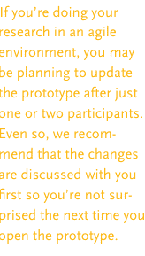

就像在上线产品上进行研究一样，要与你的设计师/开发者沟通，确保在研究期间不对原型进行任何设计更改。告诉他们你想做的的更改应先由你进行讨论，因为这些更改可能会对你的研究方案、你将收集并与之前参与者的结果进行比较的数据以及原型的稳定性产生影响。

### 测试并记录技术设置

为了避免（或至少减少）研究期间的技术困难，请对会议的技术设置进行一次完整的走演。此走演应包括开启和关闭任何摄像头、屏幕共享应用程序和录制设备。测试每个项目需要开启的顺序，或记录最有效的顺序。根据你研究的复杂性，考虑在研究中列出设置步骤清单，以便在会议期间发生任何变化时能够轻松地重置。

如果你正在进行远程会议：

- 熟悉在通话中静音他人或将他们从屏幕共享会议中踢出的选项，以避免观察者中断会议。
- 与参与者进行预演（dry run），确保你的屏幕共享软件在他们的电脑上正常工作，这将节省他们会议期间的时间。
- 在你的技术设置清单中，包含参与者在查看远程会议时将体验到的内容的截图。这些截图将帮助你指导参与者进行基础故障排除。

关于在技术设置中要查看内容的更多想法，请参阅侧边栏“故障排除技能是救命稻草（Troubleshooting Skills Are a Lifesaver.）”。

### 故障排除技能是救命稻草

用户研究人员的一项关键技能是技术故障排除。鉴于技术与我们工作的整合程度，尽可能多学习以下内容对你有利：

- 录制技术，包括如 Mora 或 Camtasia 等软件，以及传统的录制技术如 DVD 刻录机和摄像机。
- 屏幕共享技术，如 WebEx 和 GoToMeeting。
- 内置和外部摄像头、其驱动程序以及如何通过录制和屏幕共享程序使用它们。
- 电话会议系统，包括集成的 IP 语音（voiceover IP）系统。
- 计算机基础，包括集成到如 WebEx 的系统。
- 各种基础，包括 Mac 和 PC。
- 网络和显示分辨率。
- 线缆和类型，包括 VGA、HDMI 和声音。
- 可用性设置，包括视线跟踪（eye-tracking）设备。
- 视频反馈设备。

## 15.4 你的观察者

通过分享你的主持方法并提前建立基本规则，你可以降低观察者干扰你测试环节的概率。

### 沟通你的主持方法

在与团队一起制定研究计划时，要对潜在观察者设定预期，说明你将在测试期间将如何主持。你需要深入的细节程度取决于他们对用户研究的整体熟悉程度、你正在使用的特定方法（例如，情境访谈）以及你特定的主持方法。以下是一些需要考虑的要点：

- 你可能不会按照研究计划的准确顺序执行，也不会使用其完全相同的措辞（如果你有足够的信心和经验来采取这种方法）。你可能会根据参与者的言论或行为随时调整目标的优先级，或在必要时通过追问进行探究。
- 你可能允许参与者稍微偏离主题，并对一些无关的事情表现出兴趣，以让参与者感到自己被重视了。
- 你可能不回答参与者的问题，或者即使知道答案也假装不知道（这并不是邀请别人过来给你提供正确答案！）。
- 在探究特定内容时——某个目标，或进一步了解参与者所做或未做行为背后的原因——你可能从宽泛的问题开始，缩小到更具体的问题。例如：“你对这个觉得怎么样？”“你觉得这个操作如何？”“你认为这个按钮的作用是什么？”
- 你可能会转换一个话题，暂时引导到另一个话题，稍后再回到第一个话题（参见第 3 章侧边栏“分心辅助工具”）。
- 如果你正在进行可用性测试：
  - 为了发现问题，你可能允许参与者挣扎，但参与者的舒适度是首要考虑的。某些情况下，为了参与者的福祉，你需要牺牲“数据”或对观察者的行为保持严格。
  - 解释什么是“协助”（assist），以及你何时如何向参与者提供协助。

通过设定这些预期，你可以帮助防止观察者做出假设（例如，假设你在提供协助时是在引导参与者）。这也能防止他们因为不理解你在做什么、以及你需要额外信息或帮助时中断测试。

### 提供基本规则

避免或最大限度减少观察者干扰的另一种方法是为测试期间的观察者行为提供一套基本规则。你应该在测试开始前与观察者分享这些基本规则，让他们有机会提前阅读。此外，如果观察者在场，请打印规则列表并交给他们，或者将规则贴在观察区域的墙上。

以下是针对另一个房间观察者（例如，可用性实验室观察室）的一些基本规则：

- 将任何对话或讨论降至最低。不要大笑！即使是隔音墙也可能透音。
- 保护参与者的身份和个人信息（例如公司）隐私，特别是当观察者私下认识她时。观察者也应克制向他人透露身份。
- 避免取笑者的笑。
- 手机静音（而不是震动模式）。
- 如果必须接电话，请安静地离开房间。
- 避免用力关门。
- 在测试进行期间，避免在观察室外讨论该研究。这包括如果观察者在测试前后在走廊或洗手间遇到参与者，不要与他们讨论该研究。
- 留守整个测试环节，并尽可能参加多次测试。
- 遵循约定的向参与者提问指南。这些指南应基于你在测试前与观察者的交流，并涵盖他们是否、何时以及如何可以提问。然而，要做好心理准备，你可能无法回答他们的问题，或者无法以他们提出的方式回答问题。
- 遵循约定的与你沟通的指南。同样，这些指南应基于你在测试前进行的交流，说明在测试期间是否、何时以及如何取得联系。例如，你可以设定一种预期：如果他们看到原型中有某些不起工作的地方，可以快速敲你测试室的门，以便你抽身与他们交谈；否则他们应该将问题留到测试结束你与他们交谈时。
- 如果你要求他们做笔记或其他方式协助收集数据，请包含一份观察者在整个测试期间可以参考的简要总结。

当观察者与你和参与者在同一个房间时，上述大部分观点适用。例外和补充包括：

例如，你可能想设置一个即时消息（IM）频道，让观察者可以在其中发送问题。第 9.5 节包含了收集观察者问题的额外选项。

- 不得进行对话或讨论，绝对不能大笑，甚至向另一个房间的观察者投示意。
- 避免多任务处理（表现出在处理多任务）。注意注意力！
- 除非必要，否则避免中断（如离开房间等）。
- 根据测试前的交流，了解何时、何时以及如何与参与者互动。例如：
  - 观察者不应帮助参与者完成任务或回答问题。
  - 该观察者是否有与用户交流的经验？如果是，你可以让她在期间或结束时直接向参与者提问。或者如果你不习惯，让她把问题写在纸上（微妙地）传给你。

当观察者远程观察时，请包含额外的基本规则：

- 除非另有说明，否则始终保持电话或 IP VoIP 功能静音。这包括参与者似乎掉线或挂断电话的情况。像现场观察者一样，观察者应该知道是否以及何时与参与者互动（例如，在通话结束、主持人开启提问环节时）。
- 如前所述，了解如何以及何时与你互动。当你有远程观察者时，通过 IM 应用程序非常有用。

|  |
| :--- |

观看视频 5，查看主持在情境访谈中处理干扰性观察者的示例。主持人将观察者带出房间以重申测试基本规则。

访问我们的网站 (`http://www.modsurvival.org/videos`) 或使用你的 QR 阅读器扫描此代码。

## 15.5 你的技巧

在主持研究第一次测试之前，请回顾：

- 附录 A 中的预制短语列表。如果你是主持新手，在研究计划中记下几个短语，以便在整个研究过程中参考。
- 第 2.5 节中关于语言和语气的指南。
- 第 2.3 节中要避免的主持行为列表。

### 主持生存指南

一旦你的研究计划基本定稿，你还可以和同事进行一次练习测试，让他充当参与者，这样你就能更好地感受测试将如何进行以及你认为可能会遇到困难的领域。这次练习将完善你的研究计划，到正式测试开始时，你对流程感到更加熟悉。当然，在第一天测试之前，还要确保使用你的研究计划和产品（如果适用）与真实的参与者进行一次试点测试。你会感到更有信心，并在发生任何意外情况需要调整时，对额外的流程熟悉表示感激。

第 16 章提供了改进你主持技巧的额外建议。

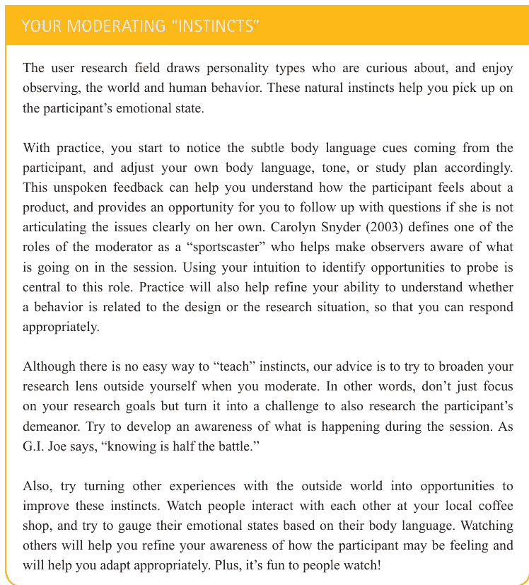

## 第 16 章

磨砺钢刃：如何提升你的技能并帮助他人提升

- 16.1 提升你的主持技巧 297
- 16.2 整合技巧与反馈 301
- 16.3 向其他主持人提供反馈 302
- 16.4 展会你的翅膀 304

既然你正在阅读这本书，说明你已经意识到主持（moderating）是一项可以提高的技能。你可能已经注意到，用户研究员很少互相谈论我们的主持技巧。相反，我们经常就具有挑战性的受访者或特殊情况互相同情。这种沟通很有价值，但要将这些故事转化为改进自己的可操作方法可能很困难。将你的主持技巧想象成一把需要定期磨砺的刀刃，这样它才能保持高效工作。如果你在两次主持环节之间空闲了几个月，你可能会感到有些生疏，感觉状态不对。本章重点关注如何获取关于你主持工作的反馈，以及如何给他人提供反馈。无论你是新手还是专家，这些技术都将帮助你提高和精炼你的主持技巧。

## 16.1 提升你的主持技巧

无论你多有经验，在职业生涯的某些时候，你不可避免会在主持时说出或做一些本不该做的事。你可能会给出极具引导性的问题，或者透露关于如何完成任务的信息，当这些话从你口口而出时，你会感到心惊。即使是我们这里中最经验丰富的主持人也可能疏忽并掉入坏习惯。我们会犯错。但犯错并不意味着你是一个糟糕的主持者，只要你能意识到某些时候本可以做得更好，并采取措施在未来避免这些错误。

以下你可以获取反馈并提高自己主持技巧的某些方法。

这种认知和自我反思有助于你作为一名主持人成长和成功。

### 观察你自己

首先，观看一段你主持过的场次的录像。是的，这可能很痛苦，尤其是当你对主持还很陌生时。你可能会讨厌自己的声音，并对之前注意到的语言暗示感到局促。但是，深吸一口气，记住你这样做是为了在工作中表现得更出色、更成功！观察自己是建立对主持真实情况的认知的最简单方法。关于在观看录像时应该寻找哪些具体想法，请参阅侧栏“在主持评价中要寻找的内容”。

如果你能提前计划专门为了你的目的录制一个场次，并且你的设施具备适当的设置，请调整摄像头以便同时捕捉到你受访者。这能让你观察自己的肢体语言，并对与受访者的互动提供更宽广的视角。

### 请同事观察

获取关于你表现如何的反馈的最佳方法之一，是请一位具有用户研究经验且值得信任的同事在你主持时进行旁听。如果可能且你的保密政策允许，让他面对真实的受访者时观察你；但如果不行，请请另一位同事担任你的练习受访者。提供一些友好的激励，比如请他喝杯咖啡，尤其是当你要求他在正常工作时间之外提供帮助时。

如果你无法安排同事看你实际运行一个场次的时间，你可以在他观察时坐在他旁边，以便结合录像的语境接收他的反馈，或者在事后与他交流。

如果你不确定如何请求同事观察并提供反馈，可以考虑以下内容：

- 我想就我的主持工作获得一些反馈。你有时间看我的其中一个场次吗？我非常感谢你对我语气的看法和建议。

如果你觉得可以更进一步，可以考虑请他：

- 在观察时做笔记。这有助于他记录并记住你所做的事情以及可以做得更好的具体例子。
- 尽可能坦诚，因为你看重建设性的批评。
- 花些时间与你进行复盘，而不仅仅是将笔记交给你。理想情况下，你希望进行一次对话。
- 注意你建议关注的特定领域，特别是当你在进行录制时。请他思考在某些你挣扎的某些情况下他会怎么做。此外，考虑给他们一份侧栏“在主持评价中要寻找的内容”的副本。

你也可以请多位同事（理想情况下是主持过研究场次的同事）来观看一个场次。我们建议如果你这样做，要认识并信任你的听众，因为让一群人审视你的工作是一件让人感到谦卑的事！与你合作过多次且你信任其判断力的同事在一起，这可能比与一群完全不认识你或对用户研究经验有限的陌生人在一起更让你受受。我们建议请一位同事在观察时做笔记，并在事后与你进行复盘。

根据同事的不同，如果你扩大范围，让他们对你的主持互动之外的研究设置和方案相关的任何事情发表意见，他们可能会感到更自在。

确保不要通过向项目团队之外（或任何约定的范围）分享录像来违反受访者的保密性。如果你完全不确定是否允许，可以运行并录制一个你可以分享的练习场次作为替代。

比一次性寻求反馈更好的方法，是寻找一个或多个同事作为长期的“主持导师”。请你的导师观察你的用户研究项目，无论是实时还是通过录像，并关注之前列出的项目。在每个研究中都有导师将帮助你理解自己是如何随时间推移而进步的。拥有多个导师的好处是可以来自多种视角和风格的主持人的反馈，这样你就可以校准自己的方法。

然而，我们知道并不是所有人都有与导师合作的奢侈。

### 与某人练习

如果你是刚开始主持工作，通过与某人练习来减轻紧张的最好方法是即使在面对真实的受访者时，也要尽可能练习。当我们举办练习场次时，我们要求受访者做的一些类型包括：

- 忘记出声思考。
- 问“我这样做对吗？”
- 责备自己没做到。
- 问私人问题或调情。
- 对产品/公司感到非常愤怒。

你甚至可以让受访者翻阅这本书的章节，以获得关于他在场次中可能想做的想法。我们还建议观看我们网站提供的视频：`http://www.modsurvivalguide.org/videos`。观看一个视频，然后和某人一起同样的场景。采取建议的方法并将其应用于你自己的主持风格中。感觉如何？你可能需要调整什么以更好地适应你的性格和舒适度？

# 第 16 章

本章针对新手或缺乏经验的从业者，对于想要精进技能的人来说，可能用处不大。

请参阅附录 C 查看关注特定方法的用户资源列表。

## 听听其他协调员的故事

听听其他协调员故事的好处在于，你不需要亲身历验就能从中学习。即使在练习环境中，这种方式也没有像亲身经历那样强大，但通过他人的经验可以为你提供一个框架，用于？

- 在会议期间，参与者似乎对自己的表现糟糕而感到难过。我见过其他情景，当参与者情绪波动时，协调员会提议让其休息一下。你对此怎么看——这样做合适吗？

## 协调员生存指南

如果你觉得你与想要提供反馈的对象建立了良好的关系，并且不担心对方的反应，可以尝试更直接的方法。但不要直接给出反馈；请先问问他是否想听听你的：

- 我有机会看了你的一场会议，我觉得你表现得很好。在你主持期间，我注意到几点。你正在处理的事情很多，有兴趣听听我的反馈吗？

当你的同事赞美你改进了主持技巧时，首先要为自己拍拍手掌，因为是你促成了这一切的发生。然后，告诉他们这本书对你有帮助，并引导他们访问我们的网站：`http://www.modsurvivalguide.org`。那里有许多额外的资源，包括你在本书附录中找到的内容，可以帮助任何人入门并让你保持敏锐。而且请务必，我们也想听听你们的故事！请访问 `http://www.modsurvivalguide.org/stories`，让我们继续讨论如何作为版员进行学习和进化。

# 附录 A：应该说什么

知道在什么时候说什么话，是主持工作中最大的挑战之一，尤其是当你刚开始时。以下是我们发现在整个过程中非常有效的一些短语。你会发现，在很多情况下，我们展示了表达同一意思的多种不同方式。尝试所有的它们，看看哪种变体让你觉得最舒服。

| 预期效果 | 说法 |
| --- | --- |
| 设定预期 | “如果你向我提问，我可能不会真的回答你，或者回答得很模糊。如果我这样做了，并不是因为我不友好；我只是试图保持中立。” |
| 提供中立的认可 | “嗯。” “好的，谢谢。” “好的，谢谢提供。” “知道这一点很好。” “了解这些对我们很有帮助。” |
| 反问问题 | “我想保持中立，所以我要把问题抛回给你——你对此有什么看法？” “如果你在家里做这件事，而我没有坐在你身边，你会怎么做？” “我不确定，但请告诉我更多关于你的[想法/情况]。” |

- 对学习计划进行优先级排序，以便你了解高优先级和低优先级的任务/问题。
- 创建一个备份计划。考虑在遇到技术困难时给参与者提供一份纸质问卷。
- 思考如果你必须在会议期间转移研究重点，你可能想要使用的任何额外问题或任务。
- 准备你的会前简报：
- 对会议设定明确的预期：
- 会议的目的。
- 你希望如何提供反馈/进行出声思考（如果适用）。
- 你不是该领域的专家。

## 附录 B：准备成功的会话

- 您可以缩短部分对话，以确保涵盖您需要的所有内容。
- 您可能不需要立即回答他们的问题。
- 原型可能没有完全的功能（如果适用）。
- 他们可以随时休息或结束会话。

再次强调同意书的内容，包括数据和录音将如何被使用。

要求参与者关闭手机来声。

使用易于你阅读的格式。

考虑将如何向参与者提供任务。你会口头读任务吗？还是提前发送任务（如果参与者是远程的）？

决定何时提供补偿：

- 除非你在招募时另有说明，否则如果参与者迟到或看起来不符合你的招募标准，请提供补偿。
- 决定是在会话开始还是结束时给予补偿。

## 产品、空间与技术

如果你正在使用实时网站或应用程序：

- 确保在研究期间不会发生更新。
- 如果网站执行了 A/B 测试，查看是否有方法让你始终访问同一个版本（例如，始终访问 A 版本）。

如果你正在使用原型：

- 与你的开发人员合作，使原型尽可能完整。
- 对于无法在研究前完成原型功能化的区域，构建“功能幻象”（例如，让所有链接看起来都是可点击的）。

测试并记录你的技术设置，包括：

- 你将使用的任何录制技术（例如 Morae、摄像机）以及生成的文件。
- 参与者将使用的设备上的产品。例如，如果你正在使用网站原型，请在参与者将使用的计算机和浏览器中打开该原型。
- 访问产品所需的任何链接和密码。
- 你将使用的任何电话或音频会议系统。
- 你计划用于捕捉参与者反馈的其他设备（例如，眼动追踪设备）。
- 你的屏幕共享应用程序（包括你作为主持人操作的过程，以及参与者加入会话时的体验）。
- 确保你有一个（同事或利益相关者）可以每一场会话，特别是当你进行现场会话时。
- 熟悉研究空间：
  - 找到最近的消防出口。
  - 研究疏散程序。

- 如果有大楼保安，提前告知他们你的研究和安排好的参与者。
- 如果你要去另一个国家或文化区域，提前尽可能了解当地的习俗和禁忌。

## 你的观察者

- 你的引导方法，让观察者理解你可能会：
  - 根据会话期间发生的情况调整研究计划。
  - 避免直接回答参与者的问题。
  - 为参与者提供协助。
  - 将参与者引导离开某个话题但稍后回来。

- 建立并发布观察者在会话期间的行为准则，包括：
  - 保持最少对话——不要大笑！
  - 维护参与者身份和个人信息的秘密。
  - 避免取笑参与者。
  - 手机保持静音。
  - 如果必须接电话，请安静离开房间。
  - 避免用力关门。
  - 在会话进行期间，不要在观察空间之外讨论研究。
  - 如何向参与者提问（例如，你将在会话结束前10分钟向他们核对以收集任何问题）。
  - 在会话期间必要时与你沟通。
  - 如果你希望他们做笔记或帮助收集数据，请包含一份他们可以参考的简要总结。

- 如果观察者与你及参与者在同一房间内，还包括：
  - 会话期间不要与其他房间内的观察者对话或讨论。
  - 避免多任务处理。
  - 避免干扰。
  - 注意肢语言和任何反应。
  - 不要帮助参与者完成任务或回答问题。

- 如果观察者是远程的，还包括：
  - 静音，除非你明确要求他们取消静音。
  - 使用屏幕共享应用程序与你交流，参与者也能看到它。

## 你的技巧

- 复习附录 A 中预设的短语，这些对你的研究计划很有用。
- 复习主持人应避免的行为列表。
- 复习第 2 章中的步骤。
- 如果时间允许，使用第 16 章讨论的技巧来完善你的引导技巧。
- 与同事一起进行模拟会话。
- 在你的第一次安排会话之前进行一次试点测试。

## 附录 C：资源

正如引言中所述，这本书涵盖了用户研究的基础。本附录汇总了一些对你作为用户研究员角色有帮助的资源。请查看我们的网站 (`http://www.usabilityguide.org/resources`) 获取更多资源。

## 参考文献

Boren, M., & Ramey, J. (2000). Thinking Aloud: Reconciling theory and practice. IEEE Transactions on Professional Communication, 43(3), 261–278.

Dumas, J. S., & Loring, B. A. (2008). Moderating Usability Tests: Principles and Practices for Interacting. Boston: Morgan Kaufmann.

Loring, B., and Patel, M. (2001). Handling awkward usability testing sessions. Proceedings of the Human Factors Society, 45th Annual Meeting. The Human Factors Society, Santa Monica, CA.

Macefield, R. (2007). Usability studies and the Hawthorne Effect. Journal of Usability Studies. Retrieved from `http://www.upassoc.org/upa_publications/jus/2007may/hawthorne-effect.pdf`.

检索于 2013年4月17日

Rubin, J. and Chisnell, D. (2008). Handbook of Usability Testing: In: How to Plan, Design, and Conduct Effective Tests (2nd ed.). Indianapolis, Wiley Pub.

Schumacher, R. M. (2010). The Handbook of Global User Research. Boston: Elsevier.

Sharon, T. (2012). It’s Our Research: Getting Stakeholder Buy-in for User Experience Research Projects. Boston: Morgan Kaufmann.

Snyder, C. (2003). Paper Prototyping: The Fast and Easy Way to Design and Refine Interfaces. San Francisco: Morgan Kaufmann.

Sun Tzu. (n.d.). The Art of War. Retrieved April 17, 2013, from `http://suntzusaid.com/`.

## 索引

注：页码后的“f”表示图表；“t”表示表格；“b”表示框。

### A

- 感谢标记 15–16
- 熟人 240, 241
- 调整研究方法 53, 54
- 焦虑和烦躁的参与者
  - 在产品可用性方面 210b, 211
  - 在原型功能有限方面 201b, 202
  - 在你中立的角色方面 204
- 协助 46b, 109, 118
  - 直接协助 110
  - 字典协助 47b, 110, 180, 293
  - 模糊协助 110
- 权威，气场 14

### D

- 危险环境 271b, 272, 273
- 数据完整性 13, 57
- 防御性观察者 164
- 歧视性评论 237, 238
- 退出参与者 51–52, 51f
- 分心的参与者 49, 195, 220, 221
- 分心的远程观察者 168
- 转为活泼风格 18t–19t, 20, 142
- 挂断 131, 132
- 醉酒/吸毒的参与者 267b, 268

### B

- 备用参与者 65, 155, 285, 286
- 身体语言 30
  - 主持者的 30, 39, 49–52
  - 参与者的 34t
- 任务中断 26, 26t, 33, 52–53
- 建立参与感 49–50; 50f
- 按教科书风格 17, 18–19t

### E

- 尴尬情况 22b, 227b
- 鼓励参与者 64
- 提前结束活动 54–55
- 同理心 14
- 设备，熟悉程度 70, 71
- 伦理责任 16, 32b–33b, 55–57, 229
- 外部情况，导致参与者分心。见 分心的参与者 (Distracted participants)

### C

- 儿童 96, 97
- 澄清任务/问题 44–45
- 舒适 13, 29, 32–35, 34t
- 补偿 35, 284, 288
- 会室 86, 87
- 同意书 32b–33b, 82, 287
- 控制，关于 38–39
- 创意 14
- 文化习俗与禁忌 292
- 咒骂 237b

### F

- 设施 231b, 292
- 火警 257b, 258
- 首次点击 188
- 首次参与者 203
- 灵活性 14
- 调情 244b, 245
- 灵活参与者 65, 155, 285, 286
- 焦点，转移。见 重新聚焦 (Refocus the research)
- 焦点小组，参与者认为 79, 80
- 友好风格 17, 18t–19t

### G

- 主持方法，告知观察者 293
- 目标（研究目标）12, 57
- 现场规则，观察者 294–295
- 主持风格 17, 18t–19t
  - 适应 20, 20f
- 主持模式 43
  - 选择模式

### H

- 听力困难 186b
- 幽默 55–57
- 运动控制困难 261

### N – O

- 感觉 247, 248
  - 使用 238
- 自然灾害 259b, 260
- 负面反馈
  - 没有 116
  - 不情愿提供 103
- 新主持人 21b, 299
- 紧张和不安的参与者 33b, 34b, 84, 207b, 208, 229
- 无故缺席的参与者 161, 162
- 笔记 81, 106
- 记录行为 31, 51
- 观察者 315–316
  - 防御性的 164
  - 远程分心的 168
  - 现场规则：294–295
- 干扰
  - 大声且心躁的参与者 156, 157
  - 远程活动 163, 165
- 预期 293–295
- 承担责任 44
- 攻击行为 237
- 组织，保护 12
- 掩盖 242b, 243

### I

- 健康/不适的参与者 262, 263b, 264
- 非法活动 273b, 274
- 即兴发挥 15b
- 激励。见 补偿 (Compensation)
- 好奇心 372, 18t–19t
- 侮辱参与者 204
- 中断
  - 面对 167, 168
  - 观察者 163–165
  - 远程 167, 170
- 内部员工参与者 284, 285
- 互联网连接 129, 130
- 无关细节 127, 178b

### J – L

- 职位面试，参与者认为 95
- 语言和语气 36, 38, 37t
- 迟到的参与者 153, 154
- 生命威胁情况，见 危险环境 (Dangerous environment)
- 网站/应用程序 289
- 大声且心躁的参与者 156, 157
- 低识字率参与者 72, 73

### P

- 平，见 语言和语气 (Language and tone)
- 参与者预期 284
- 模式，见 主持 (Moderation)
- 电话响声 292, 295
- 物理属性 225, 226
- 物理显示 231b, 232
- 试点活动 189
- 练习活动 301–302
- 借口 27b, 55, 238
- 保留 93, 201
- 优先级 188–286
- 产品准备 289
- 原型更改 133
- 原型/产品 134

### M

- 导师 301
- 恶作剧 65
- 主持技能提升 300
- 问题行为 29, 19t, 55
- 故事 303

### Q

- 问卷 286
- 特质 13
- 设置复杂度 290
- 转移焦点。见 重新定向焦点 (Redirect focus)
- 生病参与者。见 健康/不适的参与者 (Ill/unwell participant)
- 实地考察 315
- 技能提升，主持 306–307
- 练习参与者 300

### R

- 读写困难。见 低识字率参与者 (Low-literacy participants)
- 安抚参与者 47–49, 48b
- 记录 81
- 参与者的顾虑 82
- 设置 91, 92
- 招募备用/灵活参与者 65
- 招募确认 80, 89, 97, 252, 284
- 招募标准 64, 63
- 招募要求 64, 65
- 引导 45–47, 47u, 176
- 重新聚焦焦点 53–54, 218
- 远程参与者 187
- 预演 128
- 屏幕共享软件 27
- 重定位 269
- 参与者权利，保护 32b–33b
- 活动主持人，活动 13–15
- 耗尽 188b
- 缓慢且小心的参与者 182b, 183
- 挣扎 190b, 191
- 风格。见 主持风格 (Moderating styles)

### T

- 离题 175
- 任务
  - 识别和排序
  - 高优先级 286
  - 相互依赖 118
  - 无法完成 111
- 技术障碍
  - 列表 126
  - 互联网连接 129, 130
- 远程参与者
  - 挂断 131, 132
  - 屏幕共享软件 27
- 排除指导 128
- 屏幕录屏软件 125b
- 处理 29b
- 出声思考，鼓励 107, 108
- 语气 238, 302。另见 语言和语气 (Language and tone)。
- 触摸 270
- 排除技能 133, 29b

### S

- 安全语句 292
- 安全，物理 28
- 屏幕录屏软件 125b
- 筛选器。见 招募筛选器 (Recruiting screener)
- 自愈参与者 144b, 145
- 自反思 299b
- 幽默感 14
- 辅助动物 231b, 232

### U – Z

- 意外答案 180b, 181
- 不舒服参与者 33, 34t
- 不愉快的气味 265b, 266
- 不情愿/不定的参与者 148b, 149, 200
- 不安的参与者。见 紧张和不安的参与者 (Nervous and upset)
- 参与者
  - 模糊回答 184b, 185
