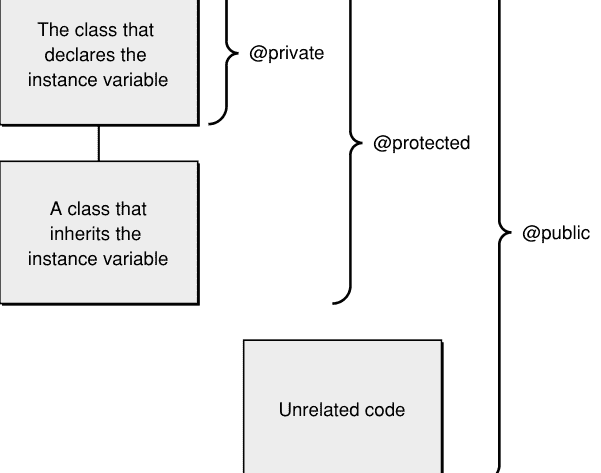
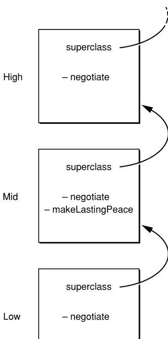
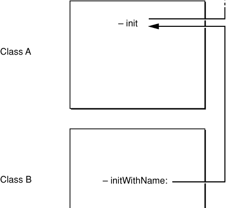
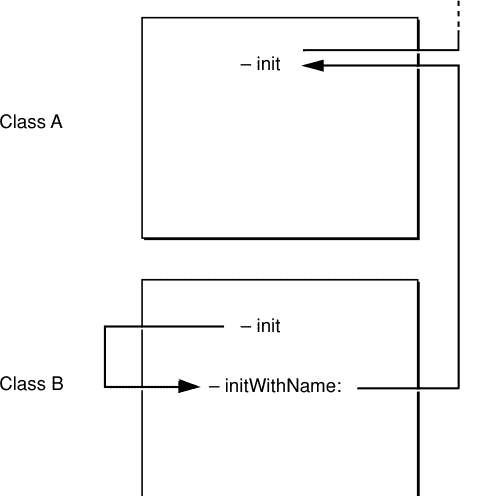
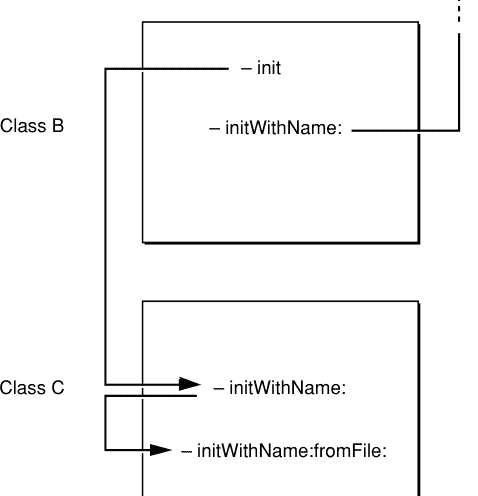
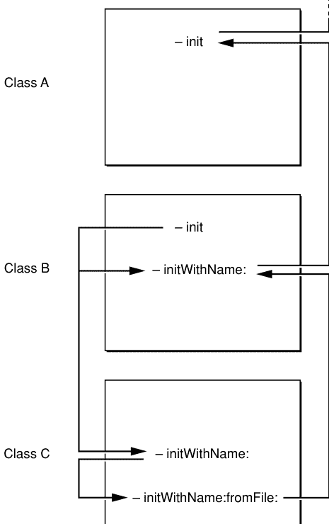

# Objective-C 语言入门指南

## 引言

- "对象、类与消息"（第 13 页）
- "定义类"（第 35 页）
- "分配与初始化对象"（第 49 页）
- "协议"（第 59 页）
- "声明属性"（第 69 页）
- "分类与扩展"（第 81 页）
- "关联引用"（第 87 页）
- "快速枚举"（第 91 页）
- "启用静态行为"（第 95 页）
- "选择器"（第 99 页）
- "异常处理"（第 103 页）
- "多线程"（第 107 页）

文档末尾的术语表提供了针对 Objective-C 和面向对象编程的术语定义。

## 规范

本文档特别使用了计算机等宽字体（computer voice）和斜体字体。计算机等宽字体表示字面意思上的单词或字符（按照其出现的形式进行输入）。斜体字体表示代表其他事物或可以变化的内容。例如，以下语法：

```
@interface ClassName CategoryName ()
```

意味着 `@interface` 和两个括号是必须的，但你可以选择类名和分类名。

在显示代码的地方，省略号表示被省略的部分（通常是实质性的部分）：

```
(void)encodeWithCoder:(NSCoder *)coder
{
    [super encodeWithCoder:coder];
    ...
}
```

## 延伸阅读

如果你从未用过面向对象编程来创建应用程序，你应该阅读《Objective-C 面向对象编程》。如果你使用过 C++ 和 Java 等其他面向对象的开发环境，也应该考虑阅读它，因为它们有很多预期和惯例与 Objective-C 不同。《Objective-C 面向对象编程》的设计旨在帮助你从 Objective-C 开发者的视角熟悉面向对象的开发。它详细阐述了面向对象设计的一些影响，并让你体验编写面向对象程序的真实感受。

## 运行时系统

《Objective-C 运行时编程指南》描述了 Objective-C 运行时的各个方面以及如何使用它。

《Objective-C 运行时参考》描述了 Objective-C 运行时支持库的数据结构和函数。你的程序可以使用接口与 Objective-C 运行时系统交互。例如，你可以添加类或方法，或者获取已加载类的所有定义列表。

## 内存管理

Objective-C 支持两种内存管理机制：自动垃圾回收和引用计数：

- 《垃圾回收编程指南》描述了 Mac OS X 使用的垃圾回收系统（iOS 不可用——你无法通过 iOS 开发者中心访问此文档）。
- 《内存管理编程指南》描述了 iOS 和 Mac OS X 使用的引用计数系统。

# 第一章 对象、类与消息

本章描述了 Objective-C 语言中使用和实现的对象、类和消息的基础知识。它还介绍了 Objective-C 运行时。

## 运行时系统

Objective-C 语言尽可能将许多决策从编译时间和链接时间推迟到运行时。只要可能，它都会动态地执行操作，例如创建对象和确定调用哪种方法。因此，该语言不仅需要编译器，还需要运行时来执行编译后的代码。运行时系统充当 Objective-C 语言的一种操作系统；它是该语言正常运行的核心。通常，你不需要直接与运行时交互。不过，要了解更多它提供的功能，请参阅《Objective-C 运行时编程指南》。

## 对象

顾名思义，面向对象的程序是围绕对象构建的。对象与可以使用或影响该数据的特定操作相关联。Objective-C 提供了一种数据类型来识别对象变量，而无需指定对象的特定类。

### 对象基础

对象与可以使用或影响该数据的特定操作相关联。在 Objective-C 中，这些操作被称为对象的方法；它们影响的数据是实例变量（在某些环境中，它们可能被称为 `ivar` 或成员变量）。从本质上说，对象将数据结构（实例变量）和一组过程封装成一个自包含的编程单元。

在 Objective-C 中，对象的实例变量是对象内部的；通常情况下，你只能通过对象的方法访问它们（你可以通过作用域选择器来指定哪些子类或其他对象可以直接访问实例变量，请参见“实例变量的作用域”（第 40 页））。要让其他人发现有关对象的任何信息，必须有一个方法来提供这些信息。例如，矩形会显示它的尺寸和位置。

此外，对象只能看到为它设计的方法；它不会错误地执行针对其他类型对象的方法。就像 C 函数保护其局部变量并将其从程序的其余部分隐藏一样，对象也隐藏了它的实例变量和方法实现。

## `id`

在 Objective-C 中，对象标识符的数据类型是 `id`。这种类型是任何类型对象的通用类型，无论类如何，都可以用于类的实例，也可以用于类对象本身。

```
id anObject;
```

对于 Objective-C 的面向对象构造（例如方法返回值），`id` 替代 `int` 成为默认类型。（对于严格的 C，例如函数值，`int` 仍然是默认类型。）

关键字 `nil` 是一个空对象，一个值为 0 的 `id`。

## 动态类型

`id` 类型完全是非限制性的。通过它，你可以获得对象的任何信息，但编译器无法验证对象是否支持特定方法。不过，每个对象在运行时都能识别自己的类。`Class` 类型用于类对象，所有对象都能通过 `isa` 指针访问其类对象。这被称为动态类型，它允许在运行时进行类型检查和动态绑定。

## 消息语法

要让对象执行某事，你向它发送消息，告诉它应用某个方法。在 Objective-C 中，消息表达式包含在括号内：

```
[receiver message]
```

### 对象消息

对于具有多个参数的方法，Objective-C 的方法名与参数是交替的，使得方法名自然地描述了该方法预期的参数。下方的虚构消息告诉 `myRectangle` 将原点设置为坐标 (30.0, 50.0)：

```
[myRectangle setOrigin:30.0 y:50.0]; // 这是一个多参数的良好范例
```

一个选择器（selector）包含了名称的所有部分，包括冒号。上一个示例中的选择器名称为 `setOrigin:y:`；它有两个冒号，因为它接收两个参数。然而，选择器并不包含任何其他内容，例如返回类型或参数类型。

> **重要：** Objective-C 选择器的子部分不是可选的，也无法更改。在某些语言中，“命名参数”（named parameters）和“关键字参数”（keyword parameters）这些术语意味着参数可以在运行时变化、可以有默认值、顺序可以不同，并且可能添加额外的命名参数。这些关于参数的特性在 Objective-C 中均不成立。

从所有意义上来说，一个 Objective-C 方法声明是一个优先带有两个额外参数的 C 函数（参见《Objective-C 运行时编程指南》中的“消息传递”）。因此，Objective-C 方法声明的结构与 Python 等语言中使用命名或关键字参数的方法结构不同，如下例所示：

```
def func(a, b=SuperNext, Thing=DefaultThing):
    pass
```

在这个 Python 示例中，调用时 `Thing` 和 `NextMode` 可能被省略或具有不同的值。

从原则上讲，Rectangle 类不能将对第二个参数没有标签的方法 `setOrigin::` 进行交替，其调用方式将是：

```
[myRectangle setOrigin:30.0 :50.0]; // 这是一个多参数的糟糕范例
```

虽然在语法上是合法的，但 `setOrigin::` 并没有将方法名与参数交替。因此，第二个参数实际上是无标签的，读者很难判断该方法参数的类型或目的。

也可以接收变数量参数的方法，尽管它们并不多见。额外的参数在方法名结束后通过逗号分隔（与此不同，逗号不被视为名称的一部分）。在以下示例中，虚构的 `makeGroup:` 传递了一个必选参数和三个可选参数：

```
[receiver makeGroup:group, memberOne, memberTwo, memberThree];
```

像 C 函数一样，方法可以返回值。接下来的示例如果 `myRectangle` 被绘制为实心矩形，则将变量 `isFilled` 设置 `YES`；如果以轮廓格式绘制，则设置为 `NO`。

```
BOOL isFilled;
isFilled = [myRectangle isFilled];
```

注意，变量和方法可以同名。

一个消息表达式可以嵌套在另一个表达式内部。将一个矩形的颜色设置为另一个矩形的颜色：

```
[myRectangle setPrimaryColor:[other primaryColor]];
```

### 点语法

Objective-C 还提供了点（`.`）运算符，为调用对象的访问方法提供了一种简洁方便的语法。点运算符通常与声明属性功能结合使用（“声明属性”，见第 69 页）。

### 向 `nil` 发送消息

在 Objective-C 中，向 `nil` 发送消息是有效的——只是在运行时没有任何影响。Cocoa 中有几种模式利用了这一事实。向 `nil` 发送消息的返回值也可能是有效的：

- 如果方法返回对象，向 `nil` 发送的消息返回 0 (`nil`)。例如：
  `Person *motherInLaw = [[a spouse] mother];`
  如果 `spouse` 对象为 `nil`，则 `mother` 将被发送给 `nil`，方法返回 `nil`。
- 如果方法返回任何指针类型、小于或等于 `sizeof(void*)` 的任何整数标量、浮点数（`float`）、双精度浮点数（`double`）、长双精度（`long double`）或 `long long`，则向 `nil` 发送的消息返回 0。
- 如果方法返回一个结构体（如 Mac OS ABI 函数调用指南中定义），则对结构体中的每个字段都返回 0.0。其他结构体数据类型不会被填充零。
- 如果方法返回上述以外的任何值，则向 `nil` 发送消息的返回值是未定义的。

以下代码片段说明了向 `nil` 发送消息的有效用法：

```
id anObjectMaybeNil = nil;

// 这是有效的
if ([anObjectMaybeNil methodDouble] == 0.0)
{
    // 继续实现...
}
```

注意：向 `nil` 发送消息的行为在 Mac OS X 10.5 中发生了微变化。在 Mac OS X 10.4 及之前的版本中，向 `nil` 发送消息也是有效的，只要该消息返回对象、任何指针类型或小于或等于 `sizeof(void)` 的任何整数标量；如果是，向 `nil` 发送的消息将返回上述值（任何结构体、浮点数或向量）。

### 接收者的实例变量

方法可以自动访问接收者的实例变量。你不需要将它们作为参数传递。例如，上面实现的 `primaryColor` 方法没有接收任何参数，但它可以找到颜色并返回它。这种约定简化了 Objective-C 源代码。它也支持程序员思考对象和消息。发送给接收者的消息会传递给自身。

方法只能访问接收者的实例变量。如果它需要另一个对象中变量的信息，它必须向该对象发送消息。早期显示的 `primaryColor` 和 `isFilled` 方法正是为此目的。关于实例变量的更多信息，请参见“定义类”（第 35 页）。

## 多态

正如前面的示例所示，Objective-C 中的消息在语法位置上与函数调用相同。但由于消息“属于”一个对象，它们的行为与函数调用不同。特别是，一个对象只能通过为它定义的方法进行操作。如果另一个对象有一个同名的方法，它也不会混淆为为其他类型对象定义的方法。因此，两个对象可以响应相同的消息。例如，每种接收消息的对象类型都可以以独特的方式显示自己。

这种特征被称为多态（polymorphism），它在面向对象程序的设计中起着重要作用。通过动态绑定（dynamic binding），它允许你编写可能适用于任意数量不同类型对象的代码，而不需要在编写时决定它们是什么类型的对象。它们以后可以通过其他项目进行开发。如果你编写了向 `id` 变量发送消息的代码，那么任何具有该方法的对象都是潜在的接收者。

## 动态绑定

函数调用和消息之间的一个关键区别在于，函数及其参数在编译代码中连接在一起，而消息和接收对象直到程序运行并发送消息时才结合在一起。因此，响应消息的精确方法可以在运行时确定，而不是在代码编译时确定。

当发送消息时，运行时消息处理程序会查看接收者和消息中命名的方法。它找到接收者中匹配的方法实现，“调用”该方法，并传递一个指向接收者实例变量的指针（有关此处理程序的更多信息，请参见《Objective-C 运行时编程指南》中的“消息传递”）。

这种方法的动态绑定与多态协作工作，赋予了面向对象编程大量的活性和力量。由于每个对象都可以有自己的方法版本，Objective-C 语句可以产生多种结果，这并不是通过绑定消息，而是通过接收消息的对象。接收者可以在程序运行时定义；接收者的选择可以取决于用户操作等因素。

例如，在执行基于 Application Kit (AppKit) 代码时，用户决定哪些对象接收来自“剪切”（Cut）、“复制”（Copy）和“粘贴”（Paste）等命令的消息。消息发送到控制选择的对象。显示文本的对象复制方式与显示图像的对象不同。表示一组形状的对象对复制消息的响应不同。因为消息在运行时才选择方法（从另一个角度看，方法的绑定直到运行时才发生），这些差异被隔离在对象本身。发送消息的代码不需要考虑它们；它不需要枚举所有可能性。应用程序对象可以以自己的方式响应复制消息。


Objective-C 将动态绑定更进一步，允许发送的消息（方法选择器）是运行时确定的变量。这种机制在《Objective-C 运行时编程指南》的“消息传递”章节中讨论。

## 动态方法解析

你可以在运行时使用动态方法解析提供类和实例方法的实现。更多详情请参阅《Objective-C 运行时编程指南》中的“动态方法解析”。

## 点语法

Objective-C 提供了一个点（.）运算符，作为方括号符号 `[]` 调用访问方法的替代方案。点语法的使用与访问 C 结构体元素的模式相同：

```
myInstance.value = 10;
printf("myInstance.value: %d", myInstance.value);
```

当与对象一起使用时，点语法充当“语法糖”——它被编译器转换为访问方法的调用。点语法并不直接获取或设置实例变量。上面的代码示例完全等同于以下代码：

```objc
[myInstance setValue:10];
printf("myInstance.value: %d", [myInstance value]);
```

# 第一章 对象、类与消息

类推，如果你想使用访问器方法（accessor methods）访问对象的实例变量，必须显式地调用 `self`，例如：

```objc
self.age = 10;
```

或者等效的：

```objc
[self setAge:10];
```

如果你不使用 `self.`，则直接访问实例变量。在下面的示例中，并没有调用 `age` 的 set 访问器方法：

```objc
age = 10;
```

点语法的优势在于，它的表示形式比对应的方括号符号更紧凑、更具可读性，特别是当你访问或修改另一个对象的属性（即另一个对象的属性，以此类推）时。另一个优势是，当编译器检测到尝试写入只读属性时，可以发出错误。如果你使用方括号语法访问变量，编译器——在最好的情况下——也只会生成一个关于未声明方法的警告，提示你调用了一个不存在的 setter，而代码会在运行时失败。

## 通用用法

当你使用点语法获取值时，系统会调用相关的 getter 访问器方法。默认情况下，getter 方法的语法与设置值的 setter 访问器方法对应。默认情况下，setter 方法的命名是将属性名首字母大写并在其前面加上 `set`。如果你不使用访问器方法，可以通过声明属性功能（“Declared Properties”，见第 69 页）来更改它们。

**列表 1-1** 使用点语法访问属性

```objc
Graphic *graphic = [[Graphic alloc] init];

NSColor *color = graphic.color;
CGFloat xloc = graphic.xloc;
BOOL hidden = graphic.hidden;
int textLength = graphic.text.length;

if (graphic.textHidden == YES) {
    graphic.text = @"Hello"; // @"Hello" 是一个常量 NSString
}
graphic.bounds = NSMakeRect(10.0, 10.0, 20.0, 120.0);
```

**列表 1-2** 使用方括号语法访问属性

```objc
Graphic *graphic = [[Graphic alloc] init];

NSColor *color = [graphic color];
CGFloat xloc = [graphic xloc];
BOOL hidden = [graphic hidden];
int textLength = [[graphic text] length];

if ([graphic isTextHidden] == YES) {
    [graphic setText:@"Hello"];
}
[graphic setBounds:NSMakeRect(10.0, 10.0, 20.0, 120.0)];
```

对于 C 类型的属性，复合赋值的含义是有明确定义的。例如 `NSMutableData` 类：

```objc
NSMutableData *data = [NSMutableData dataWithLength:1024];
```

你可以使用点语法和复合赋值更新实例的 `length` 属性：

```objc
data.length += 1024;
data.length *= 2;
data.length /= 4;
```

这等效于以下方括号语句：

```objc
[data setLength:[data length] + 1024];
[data setLength:[data length] * 2];
[data setLength:[data length] / 4];
```

## nil 值

如果在属性遍历过程中遇到 `nil` 值，其结果与向 `nil` 发送等效消息相同。例如，以下组合都是等效的：

```objc
// 路径中的每个成员都是对象。
x = person.address.street.name;
x = [[[person address] street] name];
```

```objc
// 路径包含一个 C 结构体。
// 如果 window 为 nil 或 contentView 返回 nil，这里将会崩溃。
y = window.contentView.bounds.origin.y;
y = [[window contentView] bounds].origin.y;
```

```objc
// setter 的示例。
person.address.street.name = @"Oxford Road";
[[[person address] street] setName:@"Oxford Road"];
```

## 性能与多线程

无论你使用点语法还是方括号语法调用访问器方法，编译器生成的代码都是等价的。因此，两种编码技巧产生的性能完全相同。因为使用点语法是调用的一种简单方法……

## 消息

消息是对象之间通信的机制。当你向一个对象发送消息时，你实际上是在请求它执行某些操作。

## 类

面向对象的程序通常由各种对象构建。一个基于 Cocoa 框架的程序可能会使用 `NSMatrix` 对象、`NSWindow` 对象、`NSDictionary` 对象、`NSFont` 对象、`NSText` 对象以及许多其他对象。程序会使用多个同种类型的对象——例如，多个 `NSArray` 对象或多个 `NSWindow` 对象。

## 继承

类的定义是累加的；你定义的每个新类都基于另一个类，并从该类继承方法和实例变量。新类添加或修改了它继承的内容。它不需要重复代码。

### NSObject 类

`NSObject` 是一个根类，它没有父类。它定义了 Objective-C 对象和交互的基本框架。对于类及其类的实例来说，让它们继承在运行时表现行为和操作的能力，这一点是至关重要的。

即使一个类不需要从另一个类继承任何特殊行为，它也应该是 `NSObject` 类的子类。该类的实例至少具备在运行时表现得像 Objective-C 对象的能力。从 `NSObject` 类继承这种能力，比在一个新的类定义中重新发明它要简单得多，可靠得多。

> **注意**：实现一个新的根类是一项细致的任务，带有许多隐藏的危险。该类必须复制 `NSObject` 类的大部分功能，例如分配实例、将它们连接到所属类以及向运行时系统标识它们。出于这个原因，你通常应该使用 Cocoa 提供的 `NSObject` 类作为根类。更多信息，请参阅 `NSObject` 类参考和 `NSObject` 协议。

### 继承实例变量

当一个类创建一个新实例时，该实例不仅包含为该类定义的实例变量，还包含其父类的变量，一直追溯到根类。因此，`NSObject` 类中定义的 `isa` 实例变量将每个对象与其类连接起来。

**图 1-2** Rectangle 实例变量

| 类 | 实例变量 | 声明于 |
|---|---|---|
| NSObject | `isa` | in NSObject |
| Graphic | `origin`; `*colorPrimary`; `linePattern` | in Graphic |
| Shape | `width`; `height`; `filled` | in Shape |
| Rectangle | `*fillColor` | in Rectangle |

类并不需要声明实例变量。如果它需要任何实例变量，它可以仅定义新方法并依赖于它继承的实例变量。例如，`Square` 可能不会声明任何属于自己的实例变量。

### 继承方法

对象不仅可以访问为其类定义的方法，还可以访问其父类以及其超父类定义的方法，一直追溯到层次结构的根部。例如，`Square` 对象可以使用 `Rectangle`、`Shape`、`Graphic` 和 `NSObject` 类中定义的方法，也可以使用在其自己的类中定义的方法。

你在程序中定义的任何新类都可以利用为上述层次结构中其上方所有类编写的代码。这种继承类型是面向对象编程的一大优势。当你使用 Cocoa 提供的面向对象框架之一时，你的程序可以利用编码在框架类中的基本功能。你只需要将自定义标准功能的代码添加到你的程序中。

类对象也继承自它们在层次结构中上方的类。但因为它们没有实例变量（只有实例才有），所以它们继承的是方法。

### 用一个方法覆盖另一个方法

继承有一个非常有用的例外：当你定义一个新类时，可以实现一个与层次结构中更高级类定义的方法同名的新方法。新方法会覆盖原始方法，新类的实例将执行新方法而不是原始方法，而新类的子类也将继承新方法而不是原始方法。

例如，`Graphic` 定义了一个 `display` 方法，`Rectangle` 通过定义自己的 `display` 版本覆盖了它。`Graphic` 方法适用于所有继承 `Graphic` 类的对象——但不适用于 `Rectangle` 对象，后者执行的是 `Rectangle` 版本的 `display`。

虽然覆盖方法会阻止原始定义被继承，但新类中定义的其他方法可以跳过重定义的方法并找到原始方法（“发送给自己和父类的消息”，第 43 页）。

重新定义的类也可以包含它所覆盖的方法。当这样做时，新方法仅用于精炼或修改它，而不是直接替换。当层次结构中的多个类定义相同的方法时，如果每个新版本都覆盖它，那么该方法的实现实际上分布在所有类中。

虽然子类可以覆盖继承的方法，但它不能覆盖实例变量。因为对象为它继承的每个实例变量分配了内存，所以它不能通过声明一个同名的新变量来覆盖继承的变量。如果你尝试这样做，编译器将会报错。

### 抽象类

某些类的设计初衷是为了让其他类能够继承它们。这些抽象类将方法和实例变量由许多子类定义到一个公共定义中。抽象类本身通常是不完整的，但包含了用于定义其子类实现的有用代码。（因为抽象类必须有子类才有用，所以它们有时被称为**抽象子类**）。

与其他某些语言不同，Objective-C 没有将类标记为抽象的语法，也不会阻止你创建抽象类的实例。

`NSObject` 类是 Cocoa 中抽象类的经典示例。你永远不会在应用程序中使用 `NSObject` 实例——它没什么用；它只是一个没有任何特殊能力的通用对象。

另一方面，`UIView` 类提供了一个抽象类的示例，你有时会直接使用它的实例。

抽象类通常包含有助于定义应用程序结构的代码。当你创建这些类的子类时，你新类的实例可以轻松地契合到应用程序结构中，并与其他对象协作工作。

### 类类型

类定义是对某种对象的规范。类实际上定义了一个数据类型。该类型不仅取决于类定义的数据结构（实例变量），还取决于定义中包含的行为（方法）。

类名可以出现在 C 语言中任何允许使用类型说明符的地方——例如作为 `sizeof` 运算符的参数：

```c
int i = sizeof(Rectangle);
```

#### 静态类型

你可以使用类名来代替 `id` 以指定对象的类型：

```objc
Rectangle *myRectangle;
```

由于声明对象类型会向编译器提供关于该对象种类的信息，因此这被称为**静态类型**。由于 `id` 实际上是一个指针，因此对象被静态类型化为指向某个类的指针。对象总是通过指针进行类型化的。静态类型让指针更具显式；而 `id` 则隐藏了它。

静态类型允许编译器执行一些类型检查——例如，如果一个对象将接收到一条它似乎无法响应的消息——或者可以放宽适用于泛型类型 `id` 的某些限制。此外，它可以让阅读你源代码的人更清楚地理解你的意图；然而，它并不能防止动态绑定或在运行时更改接收者类的动态特性。

对象可以被静态类型化为它所属的类或它所继承的任何类。例如，由于继承意味着 `Rectangle` 对象是一个 `Graphic` 对象（如图 1-1 中的类层次所示），`Rectangle` 实例可以被静态类型化为 `Graphic` 类：

```objc
Graphic *myRectangle;
```

访问[启用静态行为](page 95)了解更多关于静态类型及其优势。

#### 类型内省

实例在运行时揭示它们的类型。在 `NSObject` 类中定义的 `isMemberOfClass:` 方法检查接收者是否是特定类的实例：

```objc
if ([anObject isMemberOfClass:someClass])
```

`isKindOfClass:` 方法同样定义在 `NSObject` 类中，它更通用地检查接收者是否继承自特定类或是否是该类的成员（即其继承路径中是否包含该类）：

```objc
if ([anObject isKindOfClass:someClass])
```

`isKindOfClass:` 返回 `YES` 的类集合与接收者可以被静态类型化的类集合是相同的。

内省限于类型信息。本章的后续章节将讨论返回类对象的方法、对象是否能响应消息，以及提供其他信息。

访问 `NSObject Class Reference` 了解更多关于 `isKindOfClass:`、`isMemberOfClass:` 以及相关方法的信息。

### 类对象

类定义包含各种信息，其中大部分关于类的实例：

- 类的名称及其所属的类
- 描述一组实例变量的模板
- 方法名的声明及其返回值和参数类型
- 方法的实现

这些信息被编译并记录在运行时系统可用的数据结构中。编译器只创建一个对象，即**类对象**，来表示该类。类对象可以访问关于该类的所有信息，这意味着主要是关于该类的实例是什么的信息。它能够根据类定义中提出的方案产生新实例。

虽然类对象保留了类的原型，但它本身并不是一个实例。它没有自己的变量，也无法执行为该类实例设计的方法。然而，类定义可以包含为类对象设计的方法——即类方法，区别于实例方法。类对象从其层次结构中上方的类继承方法，就像实例继承实例方法一样。

在源代码中，类对象由名称表示。在接下来的示例中，`Rectangle` 类使用一个继承自 `NSObject` 类的方法返回类版本号：

```objc
int versionNumber = [Rectangle version];
```

然而，类仅在消息表达式中作为接收者时才代表类对象。在其他地方，你需要请求实例或类来返回类 id。它们都响应 `class` 消息：

```objc
id aClass = [anObject class];
id rectClass = [Rectangle class];
```

如这些示例所示，类对象像所有其他对象一样可以被类型为 `id`。但类对象也可以被更具体地类型为 `Class` 数据类型：

```objc
Class aClass = [anObject class];
Class rectClass = [Rectangle class];
```

所有类对象都是 `Class` 类型。对类使用此名称等同于使用类名对实例进行静态类型化。

类对象是功能完全的对象，可以进行动态类型、接收消息并从其他类继承方法。它们的特殊之处在于它们是由编译器创建的，除了根据类定义构建的之外没有自己的数据结构（实例变量），并且是运行时产生实例的代理。

> **注意**：编译器还会为每个类构建一个元类对象（metaclass object）。它描述类对象的方式就像类对象描述实例一样。但你可以向实例和类对象发送消息；元类对象由运行时系统内部使用。

### 创建实例


# 类对象的基本功能

类对象的一个基本功能是创建新实例。这段代码告诉 `Rectangle` 类创建一个新的 `Rectangle` 实例并将其赋值给 `myRectangle` 变量：

```objectivec
id myRectangle;
myRectangle = [[Rectangle alloc] init];
```

`alloc` 为新对象的实例变量动态分配内存并将其初始化为 0–nil，即除了连接新实例与其类的 `isa` 变量外。为了让一个对象有用，它通常需要更完整的初始化。`init` 方法的功能通常如下：

```objectivec
myRectangle = [[Rectangle alloc] init];
```

## 使用类对象进行自定义

当矩阵创建 `NSCell` 对象时，它们应该被初始化为某种单元格。`NSMatrix` 在初始化以及每当调整大小包含更多单元格时，都会使用类对象产生新单元格。`NSMatrix` 还定义了 `setCellClass` 方法，用于传递矩阵应用于填充空槽的 `NSCell` 类的类对象。

```objectivec
[matrix setCellClass:[NSButtonCell class]];
```

# 第一章 对象、类与消息

```objectivec
@implementation MyClass
// 实现继续
```

在更复杂的实现中，你可以声明一个变量为静态的（`static`），并提供类方法来管理它。声明静态变量会将其作用域限制在类内部——并且仅限于该类在文件中实现的部分。（与实例变量不同，静态变量无法被继承，也无法被子类直接操作。）这种模式通常用于定义类的共享实例（例如单例）；请参阅《Cocoa基础指南》中的“创建单例实例”。

```objectivec
static MyClass *MCLASSSharedInstance;
```

```objectivec
@implementation MyClass

+ (MyClass *)sharedInstance
{
    // 检查共享实例是否存在
    // 如果必要则创建
    return MCLASSSharedInstance;
}
// 实现继续
```

静态变量为类对象提供了比仅仅作为产生实例的工厂更丰富的功能；它可以趋成为一个功能完全且多用途的对象。一个合适的类可以用于协调它创建的实例，从已创建的对象列表中分发实例，或者管理应用程序的其他部分。当你只需要某个特定类的一个对象时，你可以将对象的状态放入静态变量中并仅使用类方法。这节省了分配和初始化实例的步骤。

> **注意**：也可以使用未声明为静态的外部变量，但静态变量有限的作用域实现了将数据封装到独立对象中的目的。

## 初始化类对象

如果你想将类对象用于分配实例之外的任何用途，你可能需要像初始化实例一样对其进行初始化。虽然程序不分配对象，但 Objective-C 提供了一种程序初始化它们的方法。

如果一个类使用了静态或全局变量，`initialize` 方法是设置它们初始值的好地方。例如，如果一个类维护一个实例数组，`initialize` 方法可以设置该数组，甚至准备好一两个默认实例。

运行时系统在接收任何其他消息之前、在其父类接收到 `initialize` 消息之后，向类对象发送 `initialize` 消息。这个序列使得类可以在被使用之前设置好它的运行时环境。如果不需要初始化，你就不需要写 `initialize` 方法来响应该消息。

由于继承机制，发送给没有实现该方法的 `initialize` 消息会被转发给父类，即使父类已经收到了 `initialize` 消息。例如，假设类 A 实现了 `initialize` 方法，而类 B 继承自类 A 但没有实现 `initialize` 方法。在类 B 接收第一条消息之前，运行时系统向它发送 `initialize`。但由于类 B 没有实现 `initialize`，因此执行的是类 A。因此，类 A 应该确保其初始化逻辑只执行一次，并且针对正确的类。

为了避免多次执行初始化逻辑，在实现 `initialize` 方法时，请使用列表 1-3 中的模板。

## 列表 1-3：initialize 方法的实现

```objectivec
+ (void)initialize
{
  if (self == [ThisClass class]) {
    // 在此处执行初始化
  }
}
```

> **注意**：记住，运行时会单独向每个类发送 `initialize`。因此，在类 `initialize` 方法的实现中，你不能向其父类发送 `initialize` 消息。

## 根类的方法

所有对象、类和实例都需要一个与运行时系统的接口。类对象和实例都应该能够检查它们的属性并报告它们在继承层次结构中的位置。提供这一接口是 `NSObject` 类的职责。

为了让 `NSObject` 方法不需要实现两次（一次为实例提供运行时接口，再次为类重复该操作），对象被赋予了特殊许可来执行在根类中定义的方法。当一个类接收到它无法响应的消息时，运行时会确定是否存在它可以响应的根实例方法。类对象可以执行的唯一实例方法是定义在根类中的，并且当没有类方法可以完成工作时。

更多关于类对象执行根实例方法这一奇特现象的细节，请参阅 `NSObject` 类参考。

## 源代码中的类名

在源代码中，类名只能用于两种不同的语境。这些语境反映了类作为数据类型和作为对象的双重角色：

- 类名可以用作某种对象的类型名。例如：

```objectivec
Rectangle *anObject;
```

在这里，`anObject` 被静态绑定到指向 `Rectangle` 对象的指针。编译器期望它具有 `Rectangle` 实例的数据结构，并拥有由 `Rectangle` 类定义和继承的方法。静态绑定允许编译器进行更好的类型检查，并使源代码具有自文档性。详细信息请参见“启用静态行为”（第 95 页）。

- 作为消息表达式中的接收者

```objectivec
if ( [anObject isKindOfClass:[Rectangle class]] )
```

仅仅使用 "Rectangle" 名称作为参数将是非法的。类名只能作为接收者。

如果你在编译时不知道该类，但在运行时拥有其字符串形式的类，你可以使用 `NSClassFromString` 返回类对象：

```objectivec
NSString *className = ...;
```

```objectivec
if ( [anObject isKindOfClass:[NSClassFromString(className) class]] )
```

如果字符串不是有效的类名，该函数返回 `nil`。

类与全局变量和函数名处于相同的命名空间中。类和全局变量可以有相同的名称。类名是 Objective-C 中唯一具有全局可见性的名称。

## 测试类的等效性

你可以使用直接指针比较来测试两个类对象的相等性。获取正确的类很重要。Cocoa 框架中有几个功能可以动态且透明地扩展类以增强其功能（例如，键值观察和 Core Data 分别参见《键值编程指南》和《编程指南》）。在动态创建的子类中，类方法通常会被重写，以便伪装成它所替换的类。测试类的相等性时，你应该比较由方法返回的值，而不是低级函数返回的值。

```objectivec
[object class] != object_getClass(object) != *((Class*)object)
```

因此，你应该这样测试两个类是否相等：

```objectivec
if ([objectA class] == [objectB class])
```

# 第二章 定义类

面向对象编程的大部分是编写新对象的代码——定义新类。在 Objective-C 中，类的定义分为两个部分：

- 接口：声明方法和实例变量并命名其父类
- 实现：实际定义类（包含方法的代码）

这些部分通常在一个文件中。然而，有时类定义通过使用名为“分类”（Category）的特性跨文件存在。分类可以对类定义进行模块化或扩展现有类。参见“分类与扩展”（第 81 页）。

## 源文件

尽管编译器并不要求，但类的接口和实现通常位于两个不同的文件中。接口文件必须对任何使用该类的人可用。

一个文件可以声明或实现多个类。尽管如此，习惯上为每个类准备一个单独的接口文件，至少是实现文件。保持类接口分离反映它们作为独立实体的状态。

接口文件和实现文件通常根据类命名。实现文件的扩展名为 `.m`，表示它包含 Objective-C 源代码。接口文件可以分配任何扩展名。因为它包含在其他源文件中，所以接口文件名通常具有头文件的 `.h`。例如，`Rectangle` 类会在 `Rectangle.h` 中声明，在 `Rectangle.m` 中定义。

将对象与其实现分离符合面向对象程序的设计。对象是一个自包含的实体，从外部看可以是一个黑盒。一旦你确定了对象与程序与其他元素的交互方式——一旦你声明了接口——你就可以自由地更改实现而不影响应用程序的任何部分。

## 类接口

类接口的声明以编译器指令 `@interface` 开始，以 `@end` 结束。（所有 Objective-C 指令都以 `@` 开头）

```objectivec
@interface ClassName : ItsSuperclass
{
    // 实例变量声明
}
// 方法声明
@end
```

声明的第一行给出了新类的名称，并链接到它的父类。父类定义了新类在继承层次结构中的位置，正如在“继承”（第 23 页）中讨论的那样。如果省略了冒号和父类，则新类被声明为根类，与 `NSObject` 类平级。

紧接类声明的第一部分之后，大括号包围了实例变量，这些是类的每个实例所包含的数据结构。以下是 `Rectangle` 类中可能声明的实例变量部分列表：

```objectivec
float width;
float height;
BOOL filled;
NSColor *fillColor;
```

接下来声明该类的方法，它们位于包围实例变量的大括号之后，类声明的结束之前。类对象可以使用的方法（即**类方法**）其名称前有一个加号：

```objectivec
+ alloc;
```

类的实例可以使用的方法（即**实例方法**）用一个减号标记：

```objectivec
- (void)display;
```

虽然这不是常见做法，但你可以声明一个同名的类方法和实例方法。方法名也可以与实例变量相同，这种情况更为常见，特别是当方法返回变量中的值时。例如，`Circle` 有一个 `radius` 方法，它可以匹配一个 `radius` 实例变量。

方法的返回类型使用标准的 C 语法从一种类型到另一种类型声明：

```objectivec
- (float)radius;
```

参数类型以相同的方式声明：

```objectivec
- (void)setRadius:(float)radius;
```

如果没有显式声明返回值或参数，则被假设为方法和消息的默认类型——`id`。之前示例的 `alloc` 方法返回 `id`。

当有多个参数时，参数声明在方法名后的冒号之后。参数在声明中将名称拆分，正如同在消息中一样。例如：

```objectivec
- (void)setWidth:(float)width height:(float)height;
```

接收可变参数的方法使用逗号和省略号来声明它们，就像函数一样：

```objectivec
- makeGroup:group, ...;
```

## 导入到接口

接口文件必须包含在任何依赖该类接口的源模块中——这包括任何创建该类实例、向类发送消息以调用为类声明的方法、或提到类中声明的实例变量的模块。接口通常通过 `#import` 包含：

```objectivec
#import "Rectangle.h"
```

此指令是 `#include` 的理想选择，因为它确保了同一个文件永远不会被包含多次。因此，在整个基于 Objective-C 的文档代码示例中，它是首选并替代 `#include` 的。

为了反映类构建在继承类的定义之上，接口文件开头导入其父类的接口：

```objectivec
#import "ItsSuperClass.h"

@interface ClassName : ItsSuperclass
{
    // Instance variable declarations
    // method declarations
}
@end
```

这种约定意味着每个接口文件都间接地包含了所有继承类的接口文件。当源模块导入类接口时，它获取了该类所构建的整个继承层次结构的接口。

注意，如果有一个支持父类的预编译头文件（precompiled-header），你可能倾向于导入该预编译文件。

## 引用其他类

接口文件声明一个类，并通过导入其父类，隐含地包含了从 `NSObject` 直到其父类的所有继承类的声明。如果接口提到了不在此层次结构中的类，它必须显式导入或使用 `@class` 指令声明它们：

```objectivec
@class Rectangle, Circle;
```

此指令告诉编译器“Rectangle”和“Circle”是类名。它不会导入它们的接口文件。

接口文件在通常使用实例变量、返回值和参数时会提到名称。例如，此项声明

```objectivec
- (void)setPrimaryColor:(NSColor *)aColor;
```

提到了 `NSColor` 类。

由于此类声明将类作为类型使用且不依赖于任何类接口（方法和实例变量），`@class` 指令为编译器提供了关于预期的足够预警。然而，当实际使用类接口时（创建实例、发送消息），必须导入类接口。通常，接口文件使用 `@class` 来声明类，而相应的实现文件则导入它们的接口（如果它需要创建这些类的实例或向它们发送消息）。

`@class` 指令最小化了编译器和链接器看到的代码量，因此是为类名提供前向声明的最简单方法。由于其简单，它避免了导入包含其他文件的时可能出现的问题。例如，如果一个类声明了另一个类的静态类型实例变量，而它们的两个接口文件互相导入，那么其中一个类都无法正确编译。

## 接口的作用

接口文件的目的是向其他源模块（以及其他程序员）声明新类。它包含了他们处理该类时所需的信息（程序员可能会喜欢一点文档）。

- 接口文件告诉用户该类是如何连接到继承层次结构的，以及需要哪些其他类（继承的或仅在类某处提到的类）。
- 接口还告诉编译器对象包含哪些实例变量，并告诉程序员子类继承了什么。尽管实例变量最多被视为类的实现问题而非类本身的问题，但它们绝不能在接口文件中声明。这种声明是必要的，因为编译器必须了解在被使用时该对象的结构。
- 最后，通过其方法声明列表，接口让其他人知道可以向类发送哪些消息。

## 类实现

类的定义结构与其声明非常相似。它以 `@implementation` 指令开始，以 `@end` 结束。

```objectivec
@implementation ClassName : ItsSuperclass
{
    // instance variable declarations
}
// method definitions
@end
```

然而，每个实现文件必须导入自己的接口。例如，`Rectangle.m` 导入 `Rectangle.h`。由于实现不需要重复它导入的任何声明，因此它可以安全地省略：

- 父类的名称
- 实例变量的声明

导入接口简化了实现，使其主要致力于方法定义：

```objectivec
#import "ClassName.h"

@implementation ClassName
// method definitions
@end
```

类的方法像 C 函数一样，在大括号内进行定义。在大括号之前，它们以与接口文件中相同的方式进行声明，但没有分号。例如：

接收可变参数的方法处理它们就像函数一样：

```objectivec
#import <stdarg.h>
...
- getGroup:group, ... {
    va_list ap;
    va_start(ap, group);
    ...
}
```

## 引用实例变量

默认情况下，实例方法的定义在所有实例变量的作用域内。可以直接通过名称引用。尽管编译器创建了相当于 C 结构来存储实例变量，但结构的精确性质是隐藏的。你不需要任何结构运算符（`.` 或 `->`）来引用对象的数据。例如，此方法定义引用了接收者的 `filled` 实例变量：

```objectivec
- (void)setFilled:(BOOL)flag
{
    filled = flag;
}
```

接收者本身或其 `filled` 实例变量都没有声明为该方法的参数，但该实例变量落在它的作用域内。这种方法语法的简化是编写 Objective-C 代码的一项重要简写。

当实例变量属于一个非接收者（receiver）的对象时，必须通过静态类型向编译器显式指定该对象的类型。在引用静态类型对象的实例变量时，使用指针运算符 (`->`)。

例如，假设 `Sibling` 类声明了一个静态类型的对象 `twin` 作为其实例变量：

```objectivec
@interface Sibling : NSObject
{
    Sibling *twin;
    int gender;
    struct features *appearance;
}
@end
```

只要静态类型对象的实例变量在类的作用范围内（在此处，当 `twin` 被类型为同一类时，它们如此），`Sibling` 方法就可以直接设置它们：

```objectivec
- makidenticalTwin
{
    if (!twin) {
        twin = [[Sibling alloc] init];
        twin->gender = gender;
        twin->appearance = appearance;
        return twin;
    }
    return nil;
}
```

## 实例变量的作用范围

尽管实例变量在类的接口中声明，但它们更多地关乎类的实现方式，而不是其使用方式。对象的接口存在于方法中，而不是存在其内部数据结构中。

通常情况下，方法和实例变量之间存在一种一一对应的关系，如下例所示：

```objectivec
- (BOOL)isFilled
{
    return filled;
}
```


# 第 2 章 定义类

## 实例变量的作用范围

但事实并非如此。某些方法可能返回未存储在实例变量中的信息，而某些实例变量可能存储对象不愿公开的信息。

结果随着时间的推移，实例变量的选择可能会发生变化，即使方法名称保持不变。只要它是与类实例进行交互的载体，这些更改就不会影响其接口。

为了强制对象隐藏数据的能力，编译器限制了实例变量的作用范围——即它们在程序中的可见性。但为了提供灵活性，它还显式设置了四个级别的作用范围。每个级别都由一个编译器指令标记：

| 指令 | 含义 |
| --- | --- |
| `@private` | 实例变量仅在声明它的类内部可访问。 |
| `@protected` | 实例变量在声明它的类以及继承它的类内部可访问。所有没有显式作用范围指令的实例变量都具有 `@protected` 作用范围。 |
| `@public` | 实例变量随处可访问。 |
| `@package` | 使用现代运行时，`@package` 实例变量在实现该类的可执行镜像内部具有 `@public` 作用范围，但在外部表现类似于 `@private`。Objective-C 实例变量的 `@package` 作用范围类似于 C 变量和函数的 `private_extern`。类实现镜像之外任何尝试使用该变量的代码都会获得链接错误。这种作用范围对于框架类中的实例变量最有用，在这些类中，`@private` 可能过于严格，而 `@protected` 或 `@public` 又过于宽松。 |

图 2-1 展示了作用范围的级别。

### 图 2-1 实例变量的作用范围（未显示 @package 作用范围）



作用范围指令适用于其列出的所有实例变量，直到下一个指令或列表结束。在示例中，`age` 和 `evaluation` 实例变量是私有的；`name`、`job` 和 `wage` 是受保护的；`boss` 是公共的。

```objc
@interface Worker : NSObject
{
  char *name;

  @private
  int age;
  char *evaluation;

  @protected
  id job;
  float wage;

  @public
  id boss;
}
@end
```

默认情况下，所有未标记的实例变量（如 `name`）都是 `@protected`。

一个类声明的所有实例变量，无论怎么标记，都在类定义的作用范围内。例如，声明了 `job` 实例变量的类（如上面的 `Worker` 类）可以在方法定义中引用它：

```objc
- (id)promoteTo:(id)newPosition
{
    id old = job;
    job = newPosition;
    return old;
}
```

显然，如果一个类无法访问自己的实例变量，那么这些实例变量将毫无用处。

通常，一个类还可以访问它继承的实例变量。引用实例变量的能力通常随着变量一起继承。如果你认为类定义仅仅是对其所继承类的详细阐述，那么对于那些其整个数据结构都在其作用范围内的类来说，这样做是合理的。之前说明的 `promoteTo:` 方法也可以定义在任何从 `Worker` 类继承 `job` 变量的类中。

然而，你可能想限制继承类直接访问实例变量，原因如下：

- 一旦子类访问了继承的变量，声明该变量的类就与该实现的某部分绑定。在后续版本中，它无法在不意外破坏子类的情况下消除该变量或更改其扮演的角色。
- 此外，如果子类访问了继承的实例变量并更改了它的值，可能会意外在声明该变量的类中引入错误，特别是当变量涉及类内部细节时。

要将实例变量的作用范围限制为声明它的类，你必须标记为 `@private`。标记为 `@private` 的实例变量仅可以通过调用公共访问器方法（如果存在的话）供子类使用。

在另一个极端，将变量标记为 `@public` 会使其变为可用，甚至在继承或声明该变量的类之外。通常，为了获取存储在实例变量中的信息，其他对象必须发送消息请求它。公共实例变量可以在任何地方访问，就像它是 C 结构中的字段一样。

```objc
Worker *ceo = [[Worker alloc] init];
ceo->boss = nil;
```

注意对象必须是静态类型。将变量标记为 `@public` 破坏了对象隐藏数据的能力。因此，应在特殊情况下避免公共实例变量。这违背了面向对象编程的基本原则——数据的封装。

## 向 self 和 super 发送消息

Objective-C 提供了两种可以在方法定义内部引用执行该方法的对象——`self` 和 `super`。

例如，假设你定义了一个 `reposition` 方法，需要更改它所作用对象的坐标。调用 `setOrigin::` 方法来更改。它只需要向接收消息的对象发送 `setOrigin::`。当你编写 `reposition` 代码时，可以使用 `self` 或 `super` 来引用该对象。`reposition` 方法可以这样：

```objc
- (void)reposition
{
    [self setOrigin:someX :someY];
}
```

或者：

```objc
- (void)reposition
{
    [super setOrigin:someX :someY];
}
```

在这里，`self` 和 `super` 都指向接收消息的对象。然而，这两个消息大不相同。`self` 是消息例程传递给每个方法的隐藏参数之一；它是方法实现内部可以自由使用的局部变量，就像实例变量名一样。`super` 是仅在消息表达式作为接收者时替换 `self` 的术语。作为接收者，这两个术语影响消息过程的方式不同：

- `self` 以通常方式搜索方法实现，从接收对象类的分发表开始。在上面的示例中，它将从接收消息对象的类开始。
- `super` 在非常不同的地方搜索方法实现。它从出现 `super` 的方法的父类开始。在示例中，它将从定义 `reposition` 的类的父类开始。

在任何 `super` 接收消息的地方，编译器都会用另一个消息例程替换 `objc_msgSend` 函数。替换例程直接查找定义类的父类——即发送消息给 `super` 的类的父类——而不是接收消息对象的类。

### 示例：使用 self 和 super

当使用三个类的层级结构时，`self` 和 `super` 之间的区别变得清晰了。例如，假设我们创建一个 `Low` 类的对象。`Low` 的子类是 `Mid`；`Mid` 的子类是 `High`。这三个类都定义了一个名为 `negotiate` 的方法，每个类都根据自己的目的使用该方法。此外，`Mid` 还定义了一个名为 `makeLastingPeace` 的野心勃勃的方法，该方法本身调用了 `negotiate` 方法。这些类和方法如图 2-2 所示。

#### 图 2-2 High、Mid 和 Low 的层级结构



假设 `makeLastingPeace`（在 `Mid` 类中）的实现使用 `self` 来指示向其发送 `negotiate` 消息的对象：

```objc
- (void)makeLastingPeace
{
    [self negotiate];
}
```

当向一个 `Low` 对象发送消息执行 `makeLastingPeace` 方法时，`makeLastingPeace` 会向同一个 `Low` 对象发送 `negotiate` 消息。消息传递例程会找到 `Low`（即 `self` 的类）中定义的 `negotiate` 版本。

然而，如果 `makeLastingPeace` 的实现改为使用 `super` 作为接收者：

```objc
- (void)makeLastingPeace
{
    [super negotiate];
}
```

消息传递例程会找到 `High` 中定义的 `negotiate` 版本。它忽略了接收 `makeLastingPeace` 消息的对象的类（`Low`），并跳到 `Mid` 的父类，即定义 `makeLastingPeace` 的 `Mid` 类的父类。这两种实现都没有找到 `Mid` 版本的 `negotiate`。

如示例所示，`super` 提供了一种跳过覆盖了另一个方法的方法。在这里，`super` 的使用使得 `makeLastingPeace` 能够跳过重定义了 `High` 方法版本的 `Mid` 版本的 `negotiate`。

如上述描述，无法到达 `Mid` 版本的 `negotiate` 似乎是一个缺陷，但在这种情况下是有意的：

- `Low` 类的作者刻意覆盖了 `Mid` 版本的 `negotiate`，以便 `Low` 的实例（及其子类）能够调用该方法的其他版本。`Low` 的设计者不希望 `Low` 对象执行继承的方法。
- `Mid` 方法 `makeLastingPeace` 通过向 `super` 发送 `negotiate` 消息（如第二个实现所示），刻意跳过了 `Mid` 版本的 `negotiate`（以及在继承 `Mid` 的 `Low` 等类中定义的任何版本），以执行在 `High` 类中定义的版本。`makeLastingPeace` 第二种实现的设计者想要使用 `High` 版本的 `negotiate` 而非其他版本。

`Mid` 版本的 `negotiate` 仍然可以使用，但需要向 `Mid` 实例发送直接消息才能做到。

## 使用 super

向 `super` 发送消息允许将方法的实现分布在多个类中。你可以覆盖一个现有的方法来修改它，或者在修改中仍然保留原始方法：

```objc
- (id)negotiate
{
    return [super negotiate];
}
```

对于某些任务，继承层级结构中的每个类都可以实现一个执行部分工作的方法并将剩余部分传递给 `super`。初始化新分配实例的 `init` 方法被设计为这样工作。每个 `init` 方法都负责初始化其内部定义的实例变量。但在这样做之前，它会调用 `super` 的 `init` 方法，让它继承的类也初始化它们的实例变量。每个 `init` 版本都遵循这一过程，因此类按照以下顺序初始化它们的实例变量：

```objc
- (id)init
{
    self = [super init];
    if (self) {
        ...
    }
    return self;
}
```

初始化方法具有额外的限制；它们在“分配和初始化对象”中有更详细的描述。

也可以将核心功能集中在父类定义的一个方法中，子类通过向 `super` 发送消息合并该方法。例如，每个创建实例的类方法都必须为新对象分配存储，并将 `isa` 变量初始化为类结构。分配通常留给 `NSObject` 类定义的 `alloc` 和 `allocWithZone:` 方法处理。如果另一个类覆盖了这些方法（罕见情况），它仍然可以通过向 `super` 发送消息来获取基本功能。

## 重定义 self

`super` 是编译器的一个标志，告诉它从哪里开始搜索要执行的方法；它仅用作消息的接收者。但 `self` 是一个变量名，可以用任意方式使用，甚至可以赋予新值。

在类方法的定义中，存在这种做法的倾向。类方法通常关注的不是对象，而是类的实例。例如，许多类方法结合了实例的分配和初始化，通常同时设置实例变量。在这样的方法中，可能会尝试向新分配的实例发送消息并像实例方法一样调用实例的 `self`。但那将是一个错误。`self` 和 `super` 都指向接收者——对象；在类方法内部，`self` 指的是类对象。这是一个不应该这么做的示例：

```objc
+ (Rectangle *)rectangleOfColor:(NSColor *)color
{
    self = [[Rectangle alloc] init]; // 错误
    [self setColor:color];
    return [self autorelease];
}
```

为了避免混淆，在类内部使用变量（如 `newInstance`）来引用实例更好：

```objc
+ (id)rectangleOfColor:(NSColor *)color
{
    id newInstance = [[Rectangle alloc] init]; // 正确
    [newInstance setColor:color];
    return [newInstance autorelease];
}
```

事实上，与其向类发送 `alloc` 消息，通常向 `self` 发送 `alloc` 更好。这样，如果类被子类化，返回的实例将与类的类型相同（例如，`NSArray` 的数组方法）。

# 第 3 章 分配和初始化对象

在某些情况下，这种责任可能意味着从接收者返回一个不同的对象。例如，如果一个类需要一个对象列表，它可能会提供一个 `initWithName:` 方法来初始化新实例。如果每个名称只能有一个对象，那么 `initWithName:` 可能会拒绝为新实例分配相同的名称；如果该名称已被另一个对象使用，它可能会释放新分配的实例并返回另一个对象——从而在确保名称唯一性的同时，在实例层面上提供了所请求的内容（在另一个实例中）。

在少数情况下，`init...` 方法可能无法完成其要求的任务。例如，`initFromFile:` 方法可能会从作为参数传递的文件中获取数据。如果传递的文件名与实际文件不对应，它将无法完成初始化。在这种情况下，`init...` 方法可以释放接收者并返回 `nil`，表示无法创建请求的对象。

由于 `init` 方法返回的可能不是新分配的实例，甚至可能返回 `nil`，因此让程序使用初始化方法的返回值，而不仅仅是使用 `alloc` 或 `allocWithZone:` 的返回值，是非常关键的。以下代码非常危险，因为它忽略了 `init` 的返回值。

```objc
id anObject = [[SomeClass alloc];
[anObject init];
[anObject someOtherMessage];
```

要初始化一个对象，你应该将分配和初始化消息合并在一行：

```objc
id anObject = [[SomeClass alloc] init];
[anObject someOtherMessage];
```

如果存在 `init...` 方法可能返回 `nil` 的情况（参见“处理初始化失败”），你应该在继续操作之前检查返回值：

```objc
id anObject = [[SomeClass alloc] init];
if (anObject)
    [anObject someOtherMessage];
else
    // 处理错误
```

## 实现初始化器

当对象被创建时，所有的内存位（除 `isa` 外）以及所有实例变量的值都会被设置为 0。在某些情况下，这可能就是你初始化对象时所需要的全部内容；在许多情况下，你希望为对象的实例变量提供默认值，或者你想将值作为参数传递给初始化器。在这些其他情况下，你需要编写自定义初始化器。在 Objective-C 中，自定义初始化器受到的约束和约定比大多数其他方法都要多。

### 约束与约定

有若干适用于初始化方法的约束和约定，但这些并不适用于其他方法：

- 按照约定，自定义初始化方法的名称以 `init` 开头。Foundation 框架的示例包括 `initWith...`、`initWithObjects` 以及 `initWithObjectsAndKeys`。
- 初始化方法的返回类型应该是 `id`。返回类型应该是 `id`，因为 `id` 表示有意地不考虑具体的类——该类是未指定的，并根据调用上下文而改变。例如，`NSString` 提供了 `initWithFormat:` 方法，当你向 `NSMutableString` 实例（`NSString` 的子类）发送该消息时，该消息返回一个 `NSMutableString` 实例。（另见“结合分配与初始化”中的单例示例）。
- 在自定义初始化器的实现中，你必须调用一个指定初始化器。指定初始化器在“指定初始化器”中有所描述；其完整解释在“协调类”中。简而言之，如果你正在实现一个指定初始化器，它必须调用其父类的指定初始化器。如果你正在实现任何其他初始化器，它应该调用其所属类的指定初始化器，或者调用它的另一个最终调用指定初始化器的初始化器。默认情况下，指定初始化器是 `init`。
- 你应该将 `self` 赋值给初始化器的返回值，因为初始化器返回的对象可能与接收者返回的对象不同。
- 如果你设置了实例变量的值，你通常使用直接赋值而不是使用访问器方法。直接赋值避免了触发访问器中意外副作用的可能性。
- 在初始化器的末尾处，你必须返回 `self`，除非初始化器失败，在这种情况下你返回 `nil`。失败的初始化器在“处理初始化失败”中进行了更详细的讨论。

下面的示例说明了继承自 `NSObject` 的自定义初始化器的实现，它有一个实例变量 `creationDate`，代表对象被创建的时间：

```objc
- (id)init
{
    // 将 self 赋值给父类指定初始化器的返回值
    // NSObject 的指定初始化器是 init
    self = [super init];
    if (self) {
        creationDate = [[NSDate alloc] init];
    }
    return self;
}
```

（使用 `if (self)` 模式的原因在“处理初始化失败”中进行了讨论。）

初始化器不需要为每个变量提供参数。例如，如果一个类要求实例具有一个名称和一个数据源，它可能会提供一个 `initWithName:fromURL:` 方法，但将非本质的实例变量设置为任意值，或者允许它们具有默认设置的空值。它可以依赖于 `setEnabled:`、`setFriend:` 和 `setDimensions:` 等方法在初始化阶段完成后修改默认值。

下一个示例说明了带有单个参数的自定义初始化器的实现。在这种情况下，它继承自 `UIView`。它展示了在调用父类指定初始化器之前你可以做些什么。


## 处理初始化失败

通常情况下，如果初始化过程中出现问题，你应该调用 `release` 方法并返回 `nil`。

这种策略有两个后果：

- 任何（无论是你的类、子类还是外部调用者）从初始化器接收到 `nil` 应该处理它。
- 你必须确保在部分初始化对象的情况下 `dealloc` 方法是安全的。

> 如果你在调用父类初始化器时得到 `nil` 返回，你不应该再次调用 `release` 方法。你应该清理你已使用的任何引用，如如下示例所示：

```objc
- (id)init {
    self = [super init];
    if (self) {
        creationDate = [[NSDate alloc] init];
    }
    return self;
}
```

## 第 3 章：分配与初始化对象

向 `super` 发送的消息会将所有继承类中的初始化方法链联起来。由于它是第一个执行的，确保了父类变量在子类声明的变量之前完成初始化。例如，一个 `Rectangle` 对象在初始化为 `Rectangle` 对象之前，必须先初始化为 `NSObject`、`Graphic` 对象和 `Shape` 对象。

图 3-1 展示了上述 `initWithName:` 方法与继承自父的 `init` 方法之间的关系。

### 图 3-1 结合继承的初始化方法



类还必须确保所有继承的初始化方法都能正常工作。例如，如果类 A 定义了一个 `init` 方法，而其子类 B 定义了 `initWithName:` 方法（如图 3-1 所示），则 B 必须确保 `init` 消息能够成功初始化 B 的实例。实现这一点的最简单方法是将继承的 `init` 方法替换为调用 `initWithName:` 的版本：

```objc
- (id)init {
    return [self initWithName:@"default"];
}
```

相反，`initWithName:` 方法会调用继承的方法，如前所示。图 3-2 包含了 B 版本的 `init`。

### 图 3-2 覆盖继承的初始化方法



覆盖继承的初始化方法可以使你定义的类在其他应用程序中更具移植性。如果你没有对继承的方法进行覆盖，其他人可能会使用它来产生初始化错误的你的类实例。

### 指定初始化器

在“协调类”（第 53 页）提供的示例中，`initWithName:` 将是其类（B）的指定初始化器。指定初始化器是每个类中保证实例变量已初始化的方法（通过向 `super` 发送消息来执行继承的方法）。它也是执行大部分工作的方法，并且是同类中其他初始化方法所调用的方法。Cocoa 的惯例是指定初始化器始终是参数最多的方法，但决定新实例特征的自由是自由的（通常是参数最多的那个，但并非总是如此）。

在定义子类时，了解指定初始化器非常重要。例如，类 B 的子类 C 实现了 `initWithName:fromFile:`。此外，你必须确保类 B 继承的 `init` 和 `initWithName:` 方法对于 C 的实例有效，你可以通过将 B 类的 `initWithName:` 覆盖为调用 `initWithName:fromFile:` 的版本来实现：

```objc
- (id)initWithName:(char *)string {
    return [self initWithName:string fromFile:NULL];
}
```

对于类 C 的实例，继承的 `init` 方法会调用 `initWithName:`，以及 `initWithName:fromFile:`。这些方法之间的关系如图 3-3 所示。

### 图 3-3 覆盖指定初始化器



此图省略了一个重要的细节。`initWithName:fromFile:` 方法作为 C 类的指定初始化器，会向 `super` 发送消息以调用继承的初始化方法。但它会调用 B 的哪一个方法，是 `init` 还是 `initWithName:`？它不能调用 `init`，原因有两个：

- 会导致循环（`init` 调用 C 的 `initWithName:`，后者调用 `initWithName:fromFile:`，进而再次调用 `init`）。
- 它无法更改 B 版本的 `initWithName:` 中的初始化代码。

因此，`initWithName:fromFile:` 必须调用 `initWithName:`：

```objc
- (id)initWithName:(char*)string fromFile:(char*)pathname {
    self = [self initWithName:string];
    if (self) {
    }
    return self;
}
```

> 通用原则：类中的指定初始化器必须通过向 `super` 发送消息来调用父类中的指定初始化器。

指定初始化器通过向 `super` 发送消息相互连接，而其他初始化方法通过向 `self` 发送消息连接指定初始化器。

图 3-4 显示了类 A、B 和 C 中的所有初始化方法是如何关联的。向 `self` 发送的消息显示在左侧，向 `super` 发送的消息显示在右侧。

### 图 3-4 初始化链



注意 B 版本的 `init` 向 `super` 发送 `initWithName:` 消息（文中说 B 版本的 `init` 向 `initWithName:` 发送消息）。

### 结合分配与初始化

在 Cocoa 中，某些类定义了结合分配和初始化这两个步骤的方法，以返回新的已初始化类实例。这些方法通常被称为便利构造函数，通常形式为 `+ className...`，其中 `className` 是类名。例如，`NSString` 拥有以下方法（其他还有）：

- `+ (id)stringWithCString:(const char *)string encoding:(NSStringEncoding)enc;`
- `+ (id)stringWithFormat:(NSString *)format, ...;`

同样，`NSArray` 定义了以下结合分配和初始化的类方法：

- `+ (id)array;`

## 第 4 章：协议

### 其他人实现的方法

如果你知道一个对象的类，就可以查看它的接口声明（以及它所继承的类的接口声明），以找到它响应的消息。这些声明宣告了它能够接收的消息。协议提供了一种方式，让它也能宣告它发送的消息。

通信是双向的：对象既可以发送消息，也可以接收消息。例如，一个对象可能会将某些操作的委托给另一个对象，或者在某些情况下只需向另一个对象询问信息。在某些情况下，对象可能希望通知其他对象它的行为，以便它们采取可能需要的任何附带措施。

如果你在同一个项目中开发了发送者类和接收者类（或者有人向你提供了接收者及其接口），那么这种通信是很容易协调的。发送者导入接收者的接口。导入的文件决定了发送者在发送的消息中使用的方法。

然而，如果你开发的对象会发送消息，但这些消息尚未定义——即你正把它们留给他人实现——那么你就没有接收者的接口文件。你需要另一种方法来定义你使用但未实现的方法。协议就具有此目的。它告诉编译器类所使用的方法，并通知其他实现者他们需要定义哪些方法才能使他们的对象与之协作。

例如，你开发了一个对象，通过发送 `helpOut:` 等其他消息来请求另一个对象的协助。你使用一个 `assistant` 实例变量来记录其他出口，并定义一个辅助方法来设置该实例变量。此方法允许其他对象注册为你的对象消息的接收者：

- `- setAssistant:anObject`
- `- assistant:anObject`

然后，当向助手发送消息时，会进行检查，以确保接收者实现了一个可以响应的方法：

```objc
- (BOOL)doWork {
    if ([assistant respondsToSelector:@selector(helpOut:)]) {
        [assistant helpOut:self];
        return YES;
    }
    return NO;
}
```

因为在你编写这段代码时，你无法知道会有什么种对象将自己注册为助手，你只能为 `helpOut:` 方法声明一个协议；你无法导入实现它的类的接口。

### 为匿名对象声明接口

协议可以用于声明匿名对象（即类未知的对象）的方法。匿名对象可以代表某种服务或处理一组有限的函数，特别是当仅需要一个此类类型的对象时。（在定义应用程序架构中起基础性作用的对象，以及在使用之前不是匿名的对象，是匿名化的良好候选者。）

当然，对象对开发者来说不是匿名的，但当开发者将它们提供给他人时，它们就是匿名的。例如，考虑以下情况：

- 有人为他人提供一个框架或对象 set，而这些对象没有通过类名或接口文件标识。由于缺少名称和类接口，用户没有办法创建它的实例。相反，提供者必须提供一个现成的实例。通常，另一个类中的方法返回一个可用的对象：

```objc
id formatter = [receiver formattingService];
```

方法返回的对象是一个没有类标识的对象，至少不是提供者愿意公开的标识。为了让它产生任何作用，提供者必须识别出它能够响应的一些消息。这些消息通过将对象与协议中声明的方法列表关联来标识。

- 你可以向远程对象发送 Objective-C 消息——在其他应用程序中（《Objective-C 运行时编程指南》中更详细地讨论了这一点）。

每个应用程序都有自己的结构、类和内部逻辑。但你不需要知道另一个应用程序是如何工作的，也不需要它与哪些组件进行通信。作为局外人，你只需要知道你发送什么消息（协议）以及将它们发送到哪里（接收者）。

发布其一个对象作为远程消息潜在接收者的应用程序还必须发布一个协议，声明该对象将用于响应消息的方法。它不需要披露关于对象的任何内容。发送应用程序不需要知道该对象的类或其自身设计中的类。这些就足够了。

协议使得匿名对象成为可能。没有协议，就无法在不标识其类的情况下声明对象的接口。

> 注意：尽管匿名对象的提供者没有暴露它的类，但对象本身在运行时会揭露它。然而，发现这些额外信息通常没有意义；协议中的信息已经足够了。

### 非层次结构的相似性

如果多个类实现一组方法，这些类通常被归类在一个抽象类下，该抽象类声明了它们共同的方法。每个子类都可以以自己的方式重新实现方法，但继承层次结构和抽象类中的共同声明捕捉了子类之间的相似性。

然而，有时无法在抽象类中对共同方法进行归类。在大多数方面无关的类可能仍然需要实现某些方法。这种有限的相似性可能不足以建立层次关系。例如，你可能希望在你的应用程序中添加创建对象的 XML 表示的支持，以及从 XML 表示初始化对象的功能：

- `- (NSXMLElement *)XMLRepresentation;`
- `- initFromXMLRepresentation:(NSXMLElement *)xmlString;`

这些方法可以组在协议中，实现类之间的相似性可以通过遵循或通过注意到它们都遵循相同的协议来体现。

对象可以通过这种相似性（它们遵循的协议）而不是通过它们的类来确定类型。例如，一个 `NSMatrix` 实例必须与……通信。

### 正式协议

Objective-C 提供了一种正式声明方法（包括属性）的方法。正式协议受到语言和运行时系统的支持。例如，编译器可以在编译时检查，或者在运行时检查一个对象是否符合该协议。

### 声明协议

你使用 `@protocol` 指令声明协议：

```objc
@protocol ProtocolName
  method declarations
@end
```

例如，你可以这样声明一个 XML 表示：

```objc
@protocol XMLSupport
  - initFromXMLRepresentation:(NSXMLElement *)element;
  - (NSXMLElement *)XMLRepresentation;
@end
```

与类不同，协议名称没有全局可见性。它们存在于自己的命名空间中。

### 可选协议方法

可以使用 `@optional` 关键字将协议方法标记为可选。与 `@optional` 关键字对应的是 `@required`，用于正式表示默认的语义。你可以使用 `@optional` 和 `@required` 将你的协议划分为你认为合适的部分。如果不指定任何，默认是 `@required`。

```objc
@protocol MyProtocol

- (void)requiredMethod;

@optional
- (void)anOptionalMethod;
- (void)anotherOptionalMethod;

@required
- (void)anotherRequiredMethod;

@end
```

> 注意：在 Mac OS X 10.5 中，协议不能包含可选属性。这一限制是在 Mac OS X 10.6 中引入的。

### 非正式协议

除了正式协议，你还可以通过在分类声明中分组方法来定义非正式协议：

```objc
@interface NSObject (XMLSupport)
  - initFromXMLRepresentation:(NSXMLElement *)element;
  - (NSXMLElement *)XMLRepresentation;
@end
```

非正式协议通常声明为 `NSObject` 的分类，因为这将方法名与任何继承自 `NSObject` 的类广泛关联。由于所有类都继承自根类，这些方法不受限制在继承层次结构的任何部分。（也可以将非正式协议声明为另一个类的分类，以限制其在继承层次结构的分支中，但没有理由这样做。）

当用于声明协议时，分类接口没有相应的实现。相反，实现协议的类在它们自己的接口文件中再次声明这些方法，并在它们的实现文件中与其他方法一起定义它们。

非正式协议绑定分类声明的规则来列出一组方法，但不与任何特定的类或实现关联。

在分类中声明的非正式协议没有得到太多语言支持。没有编译时检查，也没有运行时检查来查看对象是否符合该协议。要获得这些优势，你必须使用正式协议。非正式协议在所有方法都是可选的情况下可能有用（例如对于代理），但（在 Mac OS X 10.5 及更高版本中）通常使用带有可选方法的正式协议更好。

### 协议对象

正如类在运行时由类对象表示、方法由选择器表示一样，正式协议由一种特殊数据类型表示——`Protocol` 类的实例。处理协议的源代码（除用于在类型规范中使用它除外）必须引用相应的协议对象。

在许多方面，协议与类定义相似。它们都声明了方法，并且在运行时都由类表示——即通过 `Class` 的实例和 `Protocol` 的实例。像类对象一样，协议是根据源代码中的声明和定义自动创建的，它们不会在程序代码中被分配和初始化。

源代码可以使用 `@protocol()` 指令引用协议——该指令与声明协议的指令相同，区别在于它有一组尾随的括号。括号内包含了协议的名称：

```objc
Protocol *myXMLSupportProtocol = @protocol(MyXMLSupport);
```

这是源代码创建协议对象的唯一方法。与类名不同，协议名并不指定具体对象——在 `@protocol()` 内部除外。

编译器会为它遇到的每个协议声明创建一个适配器，但仅当该协议满足以下条件时：

- 被类采纳，或
- 在源代码某处被引用（使用 `@protocol()`）

已声明但未使用的协议（下文提到的类型检查除外）在运行时不会由协议对象表示。

### 采纳协议

采纳协议与声明子类在某些方面是相似的。两种方法都将方法分配给类。超类声明分配了协议列表中声明的方法。如果一个类的声明在超类之后的角括号内列出了协议，则称该类采纳了某个正式协议：

```objc
@interface ClassName : Superclass < protocol list >
```

分类以相同的方式采纳协议：

```objc
@interface ClassName (CategoryName) < protocol list >
```

一个类可以采纳多个协议；协议列表中的名称用逗号分隔。

```objc
@interface Formatter : NSObject < Formatting, Prettifying >
```


# 第 4 章

## 协议

采纳协议的类或分类必须实现该协议声明的所有要求方法，否则编译器会发出警告。上面的 `Formatter` 类将定义它采纳的两个协议中声明的所有方法，加上它可能自己声明的任何方法。

采纳协议的类或分类必须导入声明协议所在的头文件。采纳的协议中声明的方法在类或分类的接口的其他地方没有声明。

一个类可以采纳协议但不声明任何其他方法。例如，以下类声明采纳了 `Formatting` 和 `Pettifying` 协议，但没有声明它自己的任何实例变量或方法：

```objc
@interface Formatter : NSObject <Formatting, Pettifying>
@end
```

### 符合协议

如果一个类采纳了某个协议，或者继承自任何采纳该协议的类，则称该类符合该正式协议。类的实例被认为符合其类所符合的相同协议 set。

由于类必须实现其采纳的协议中声明的所有要求方法，因此说一个类或实例符合某个协议，等同于说它在功能库中包含了所有声明的方法。

可以通过发送 `conformsToProtocol:` 消息来检查对象是否符合某个协议：

```objc
if ([receiver conformsToProtocol:@protocol(MyXMLSupport)]) {
    // 对象不符合 MyXMLSupport 协议
    // 如果你期望 receiver 实现 conformsProtocol 中声明的方法，
    // 这可能是一个错误
}
```

（注意，还有一个同名的方法——`conformsToSelector:`）

`conformsToSelector:` 测试也是针对单个方法的，区别在于它测试的是协议是否已被采纳（假设所有声明的方法都已存在），而不仅仅是实现。它检查协议中的所有方法，相比之下 `conformsTo:` 可以比 `respondsToSelector:` 更高效。

`conformsToProtocol:` 测试也类似于 `isKindOfClass:` 测试，区别在于它是基于协议进行类型测试，而不是基于继承层级。

### 类型检查

对象的类型声明可以扩展以包含正式协议。因此，协议为编译器提供了编译器的另一层类型检查的可能性，这种检查更加抽象，因为它没有绑定到具体的实现。

在类型声明中，协议名列在类型名称之后的角括号内：

```objc
(id <Formatting>)formattingService;
id <MyXMLSupport> anObject;
```

正如静态类型允许编译器根据类层级测试类型一样，这种语法允许编译器根据对协议的符合性测试类型。

例如，如果 `Formatter` 是一个抽象类，则声明：

```objc
Formatter *anObject;
```

将继承自 `Formatter` 的对象分到一个类型中，并允许编译器根据类型检查赋值。

同样，声明：

```objc
id <Formatting> anObject;
```

将符合 `Formatting` 协议的对象分到一个类型中，无论它们在类层级中的位置如何。编译器可以确保只有符合协议的对象被分配给该类型。

在每情况下，类型组了相似的对象——要么是因为它们共享共同的继承关系，要么是因为它们收敛于共同的方法集。

这两种类型可以在同一个声明中组合：

```objc
Formatter <Formatting> *anObject;
```

协议不能用于类对象的类型化。只有实例可以被静态类型为协议，正如只有实例可以被静态类型为类一样。（然而，在运行时，类和实例都会响应 `conformsTo:` 消息。）

### 协议中的协议

一个协议可以使用类采纳协议的相同语法来包含其他协议：

```objc
@protocol ProtocolName < protocol list >
```

角括号之间列出的所有协议都被视为 `ProtocolName` 的一部分。例如，如果 `Paging` 协议包含了 `Formatting` 协议：

```objc
@protocol Paging < Formatting >
```

任何符合 `Paging` 协议的对象也符合 `Formatting`。如下类型声明：

```objc
id <Paging> someObject;
```

以及 `conformsToProtocol:` 消息如：

```objc
if ([anotherObject conformsToProtocol:@protocol(Paging)])
```

只需要提到 `Paging` 协议即可测试符合 `Formatting`。

当一个类采纳协议时，它必须实现该协议声明的方法，如前。此外，它必须符合所采纳协议包含的任何协议。如果包含协议包含了包含了协议，该类也必须符合这些协议。类可以使用以下技术之一符合包含协议：

- 实现协议声明的方法
- 继承采纳该协议并实现方法的类

假设，`Pager` 类采纳了 `Paging` 协议。如果 `Pager` 是 `NSObject` 的子类，如下：

```objc
@interface Pager : NSObject <Paging>
```

它必须实现所有的 `Paging` 方法，包括包含协议中声明的方法。它连同 `Formatting` 协议一起采纳。

另一方面，如果 `Pager` 是 `Formatter`（独立采纳 `Formatting` 协议的类）的子类，如下：

```objc
@interface Pager : Formatter <Paging>
```

它必须实现 `Paging` 协议本身声明的方法，但不包含 `Formatting` 中定义的。`Pager` 继承了对 `Formatting` 协议的符合性。

注意，类可以通过实现协议中声明的方法来符合协议而不采纳它。

### 引用其他协议

在开发复杂的应用程序时，你偶尔会发现自己在编写如下代码：

```objc
#import "B.h"
@protocol A
- foo:(id <B>)anObject;
@end
```

其中协议 B 的声明如下：

```objc
#import "A.h"
@protocol B
- bar:(id <A>)anObject;
@end
```

在这种情况下，会导致循环，两个文件都无法正确编译。为了打破这种递归循环，你必须使用 `@protocol` 指令对所需的协议进行前向引用，而不是导入定义协议的接口文件：

```objc
@protocol B;
@protocol A;

- foo:(id <B>)anObject;
@end
```

注意，以这种方式使用 `@protocol` 指令只是告诉编译器 `B` 是一个稍后定义的协议。它并没有导入定义协议 `B` 的接口文件。

# 第 5 章

## 声明属性

Objective-C 的声明属性特性提供了一种简单的方法，用于声明和实现对象的访问器方法。

### 概览

该语言特性包含两个方面：你用于指定并可选地合成声明属性的语法元素，以及在“点点语法”（第 19 页）中描述的相关的语法元素。

你通常通过一对访问器方法（getter/setter 方法）来访问对象的属性（即其属性和关系）。通过使用访问器方法，你遵循了封装原则（在 *Object-Oriented Programming with Objective-C* 一书中被称为“抽象的机制”）。你可以对 getter/setter 对以及底层状态管理进行严密控制，而 API 的调用者可以不受实现细节更改的影响。

尽管使用访问器方法具有显著优势，但编写访问器方法仍然是一个枯燥的过程——当你必须编写代码来支持垃圾回收和引用计数元素时尤其如此。此外，属性的一些对 API 消费者可能重要的方面被隐藏了——例如访问器方法是否是线程安全的，或者在设置时是否拷贝了新值。

声明属性通过提供以下功能解决了标准访问器方法的问题：

- *属性声明为访问器方法的行为提供了清晰、显式的规范。*
- 编译器可以根据你在声明中提供的规范为你合成访问器方法。这意味着你需要编写和维护的代码更少了。
- 属性在语法上表示为标识符并具有作用域，因此编译器可以检测到对未声明属性的使用。

### 属性声明与实现

声明属性包含两个部分：它的声明和实现。

#### 属性声明

属性声明以 `@property` 关键字开始。`@property` 可以出现在 `@interface` 块中类中方法声明列表的任何位置。`@property` 也可以出现在协议或分类的声明中。

```objc
@property(attributes) type name;
```

`@property` 声明了一个指令。一组可选的属性参数集提供了关于属性存储机制和行为的额外详细信息——可能值参见“属性声明属性”（第 70 页）。像任何其他 Objective-C 类型一样，每个属性都有类型规范和名称。

列表 5-1 演示了一个简单属性的声明。

##### 列表 5-1 声明一个简单属性

```objc
@interface MyClass : NSObject
{
    float value;
}
@property float value;
@end
```

你可以认为属性声明等同于声明两个访问器方法。因此：

`@property float value;`

等同于：

- `- (float)value;`
- `- (void)setValue:(float)newValue;`

属性声明提供了关于访问器方法实现的额外信息（如“属性声明属性”第 70 页所示）。

#### 属性声明属性

你可以使用 `@property(attribute1, attribute2, ...)` 的形式用属性修饰属性。方法和属性的作用域限于它们所属的接口声明。对于使用逗号分隔的变量名列表的属性声明，属性属性适用于所有命名的属性。

如果你使用 `@synthesize` 指令告诉编译器创建访问器方法：

##### 访问器方法名称

`getter=getterName`

指定该属性的访问器名称。`getter` 必须返回与属性类型匹配的类型且不接受任何参数。

`setter=setterName`

指定该属性的访问器名称。`setter` 方法必须接受一个类型匹配的参数并返回 `void`。

如果你指定属性为只读（`readonly`）且指定了带 `-` 开头的 `setter`，你将得到编译器警告。

它们都是可选的，并且可以与任何其他属性一起出现（对于 `setter` 来说，`readonly` 除外）。

通常，你应该指定符合键值编码（参见《键值编码编程指南》[Key-Value Coding Programming Guide]）的方法名——使用 `getter` 装饰器以遵循布尔值 `isProperty` 惯例的常见原因。

##### 可写性

这些属性指定属性是否有关联 `setter`。它们是互斥的。

`readwrite`

表示该属性应被处理为读/写。该属性是默认值。

在 `@implementation` 块中需要一个 `getter` 和 `setter` 方法。如果你在实现块中使用 `@synthesize` 指令，则会合成 `getter` 和 `setter` 方法。

`readonly`

表示属性是只读的。

如果你指定了 `readonly`，则 `@implementation` 块中只需要一个 `getter` 方法。如果你在实现块中使用 `@synthesize` 指令，则只会合成 `getter` 方法。

此外，如果你尝试使用 Objective-C 语法赋值，你将得到编译器错误。

##### Setter 语义

这些属性指定 `set` 访问器的语义。它们是互斥的。

`assign`

指定 `setter` 使用简单赋值。该属性是默认值。

你通常将其用于标量类型，如 `NSInteger` 和 `CGRect`（或者在引用计数环境中，用于你不拥有的对象，如代理对象 `delegates`）。

在垃圾回收环境中，`retain` 和 `assign` 实际上是相同的。

`retain`

指定在对象赋值时调用 `retain`。（默认是 `assign`）。

向旧值发送 `release` 消息。

在 Mac OS X v10.6 之前，这仅对对象类型有效——参见 Core Foundation（第 77 页）。

在 Mac OS X v10.6 及更高版本中，你可以使用 `__attribute__` 关键字指定 Core Foundation 属性处理为 Objective-C 对象：

```objc
@property(retain) __attribute__((NSObject)) myDictionary;
```

`copy`

指定赋值时应使用对象的拷贝。（默认是 `assign`）。

向旧值发送 `release` 消息。

拷贝是通过调用 `copy` 方法完成的。该属性仅对实现 `NSCopying` 的对象类型有效。更多讨论，请参见“Copy”（第 75 页）。

具体取决于你是否使用垃圾回收：

- 如果你不使用垃圾回收，对于对象属性，你必须指定 `assign`、`retain`、`copy` 之一——否则你会收到警告。
- 如果你使用垃圾回收，使用默认值（如果你不指定 `assign`、`retain`、`copy` 中的任何一个）将不会收到警告，除非属性类型是符合 `NSCopying` 的类。默认值是你想要的；然而，如果属性类型可以拷贝，为了保持封装，你通常会创建对象的私有拷贝。

要决定选择哪一个，你需要了解 Cocoa 内存管理策略（参见内存编程指南 `Memory Programming Guide`）。

##### 原子性

你可以使用此属性指定访问器方法是非原子的（没有表示原子的关键字）。

`nonatomic`

指定访问器是非原子的。默认情况下，访问器是原子的。

属性默认是原子的，以便合成的访问器在多线程环境中提供稳健的访问——也就是说，`getter` 或 `setter` 返回的值总是被检索或设置。更多细节，请参见“性能与线程”（第 79 页）。

如果你 `retain` 或 `copy` 且没有指定 `nonatomic`，那么在引用计数环境中，对象属性的合成访问器将使用锁、释放并返回结果——实现将类似于：

```objc
[internal lock]; // 使用对象级锁
id result = [[value retain] autorelease];
[internal unlock];
return result;
```

如果你指定了 `nonatomic`，对象属性的合成访问器将直接返回值。

##### 标记与弃用

属性支持全范围的 C 风格装饰。属性可以被弃用并支持 `__attribute__`：

```objc
@property CGFloat x AVAILABLE_MAC_OS_X_VERSION_10_AND_LATER_BUT_DEPRECATED_IN_MAC_OS_X_VERSION_10_4;
@property CGFloat y __attribute__((deprecated));
```

如果你想指定某个属性是一个接口输出，可以使用 `IBOutlet` 标识符：

```objc
@property (nonatomic, retain) IBOutlet UIButton *myButton;
```

`IBOutlet` 并不是属性列表的正式部分。

如果你使用垃圾回收，可以在属性声明中使用 `__weak` 和 `__strong` 存储修饰符：

```objc
@property (nonatomic, retain) __weak Link *parent;
```

但同样，存储修饰符并不是属性列表的正式部分。

#### 属性实现指令

你可以在 `@implementation` 块中使用 `@synthesize` 和 `@dynamic` 指令来触发特定操作。请注意，对于给定的 `@property` 声明，这两个都不是必需的。

> **重要：** 如果你没有对某个属性使用 `@synthesize` 或 `@dynamic`，你必须为该属性提供 `getter` 和 `setter`（或仅只读属性）方法实现。如果没有这样做，编译器会生成一个警告。

##### @synthesize

你使用 `@synthesize` 指令告诉编译器，如果你没有在 `@implementation` 块中提供它们，它应该为该属性合成 `setter` 和/或 `getter` 方法。

###### 列表 5-2 使用 @synthesize

```objc
@interface MyClass : NSObject
{
    NSString *value;
}
@property (copy, readwrite) NSString *value;
@end

@implementation MyClass
@synthesize value;
@end
```

你可以使用属性-实例变量来指示特定的实例变量应该用于该属性，例如：

```objc
@synthesize firstName, lastName, age = yearsOld;
```

这指定了 `firstName`、`lastName` 和 `age` 的访问器将被合成，并且属性 `age` 由实例变量 `yearsOld` 表示。合成方法的其他方面由最优属性决定（参见“属性声明属性”（第 70 页））。

无论你是否对实例变量名称进行 `@synthesize`，`@synthesize` 指令只能使用来自当前类的实例变量，而不能来自父类。

访问器合成的行为存在差异，取决于运行时（另见“运行时差异”（第 80 页））。

- 对于旧版运行时，实例变量必须在当前类的 `@interface` 块中声明。如果存在一个与属性同名的实例变量，且其类型与属性的类型兼容，则会使用它——否则，你将得到编译器错误。
- 对于现代运行时（见 Objective-C Runtime 中的“运行时版本和平台”），实例变量是合成的。如果已经存在同名的实例变量，则使用它。

##### @dynamic


# 你使用 @dynamic 关键字告诉编译器

你使用 `@dynamic` 关键字告诉编译器，你将通过直接提供方法实现或在运行时使用其他机制（如代码的动态加载或动态方法解析）来履行属性隐含的 API 合约。它抑制编译器在找不到实现时会生成的警告。只有当你确定方法在运行时可用时才应该使用它。

## 列表 5-3 中的示例说明了 NSManagedObject 子类中的 @dynamic

```
@interface MyClass : NSManagedObject
    @property(nonatomic, retain) NSString *value;
@end

@implementation MyClass
    @dynamic value;
@end
```

`NSManagedObject` 由 Core Data 框架提供。管理对象类有一个定义类属性和关系的模式（schema）；在运行时，Core Data 框架会根据需要为这些内容生成访问方法。因此，你通常为属性和关系声明属性，但你不需要自己实现访问方法，也不应该要求编译器这样做。然而，如果你只是声明了属性而没有任何任何实现，编译器将生成一个警告。使用 `@dynamic` 可以抑制该警告。

# 使用属性

## 支持的类型

你可以为 Objective-C 类、Core Foundation 数据类型或“纯旧数据”（POD）类型（参见 C++ 语言备注：POD 类型）声明属性。但是，关于使用 Core Foundation 类型的限制，请参见“Core Foundation”（第 77 页）。

## 属性重声明

你可以在子类中重新声明属性，但（除只读与读写除外）你必须在子类中重复它的属性。对于在分类（category）或协议（protocol）中声明的属性也是如此——属性可以在分类或协议中重声明，但必须重复该属性的属性。

如果你在某处将属性声明为只读，你可以在类扩展中（参见“扩展”（第 83 页））、协议中或子类中（参见“带属性的子类化”（第 79 页））将其重声明为可读写。在类重声明的情况下，在任何 `@synthesize` 语句之前重声明属性的这一事实会导致 setter 被合成。这种将只读属性重声明为可读/写的能力实现了两种常见的实现模式：不可变类的可变子类（`NSString`、`NSArray` 和 `NSDictionary` 都是如此）以及一个具有只读公共 API 但对类内部具有私有可读写实现的属性。以下示例显示了使用类扩展提供一个在公共头文件中声明为只读但在私有部分重声明的属性：

```
// 公共头文件
@interface NSObject {
    NSString *language;
}
@property(readonly, copy) NSString *language;
@end
```

```
// 私有实现文件
@interface NSObject ()
@property(readwrite, copy) NSString *language;
@end
```

```
@implementation MyObject
@synthesize language;
@end
```

## Copy

如果你使用 `copy` 声明属性，你指定在赋值时会复制值。如果你合成了相应的访问器，合成的方法将使用 `copy` 方法。复制对于诸如字符串对象等属性非常有用，因为传入 setter 的新值可能是可变的（例如，`NSMutableString` 的实例，你想确保你的对象拥有自己的不可变副本）。例如，如果你将属性声明为：

`@property(atomic, copy) NSString *string;`

那么合成的 setter 方法类似于：

```
-(void)setString:(NSString *)newString {
    if (string != newString) {
        [string release];
        string = [newString copy];
    }
}
```

这种模式对于字符串效果良好，但如果属性是集合（如数组或集合），可能会出现问题。通常你希望此类集合是可变的，而 `copy` 方法返回集合的不可变版本。在这种情况下，你必须为 setter 方法提供自己的实现，如下例所示。

```
@interface MyClass : NSObject
    NSMutableArray *myArray;
    @property (nonatomic, copy) NSMutableArray *myArray;
@end
```

```
@implementation MyClass

    @synthesize myArray;

    -(void)setArray:(NSMutableArray*)newArray {
        if (myArray != newArray) {
            [myArray release];
            myArray = [newArray mutableCopy];
        }
    }

@end
```

## dealloc

属性声明以及合成指令取代了访问方法的声明；当你合成属性时，编译器按需要创建访问方法。然而，属性声明与 `dealloc` 方法之间没有直接交互——属性不会自动为你释放。但是，属性声明确实提供了一种交叉检查 `dealloc` 方法实现的有用方法：你可以查看头文件中所有的属性声明，并确保未标记为 `assign` 的属性没有被释放。

> 注意：在 `dealloc` 方法中，你应该直接释放实例变量（而不是调用 setter 并传递 nil 参数），如下例所示：

```
(void)dealloc {
    [property release];
    [super dealloc];
}
```

但是，如果你使用的是现代运行时并合成了实例变量，你无法直接访问实例变量，因此你必须调用访问方法：

```
(void)dealloc {
    [self setProperty:nil];
    [super dealloc];
}
```

# 第 5 章 声明属性

## 核心基础

正如“属性声明特性”（第 70 页）所示，在 Mac OS X v10.6 之前，你不能为非对象类型指定 `retain`。因此，如果你声明了一个类型为 `CFType` 的属性，且合成器按照如下例所示了这些属性：

```
@interface MyClass : NSObject
    CGImageRef myImage;
    @property(readwrite) CGImageRef myImage;
@end

@implementation MyClass
    @synthesize myImage;
@end
```

那么在引用计数的环境中，合成的 setter 仅仅是将新值赋值给实例变量（新值不会被 `retain`，旧值也不会被 `release`）。对于 Core Foundation 对象，简单的赋值通常是不正确的；你不应该合成这些方法，而应该自己实现。

在垃圾回收的环境中，如果图像变量被声明为 `__strong`：

```
...
__strong CGImageRef myImage;
@property CGImageRef myImage;
```

那么访问器就会被适当地合成——例中的图像不会被 `CFRetain` 保留，但合成的 setter 方法会触发写屏障（writer barrier）。

## 示例：声明属性和合成访问器

列表 5-4 中的示例展示了以不同方式使用属性：

- `Link` 协议声明了一个属性 `next`。
- `MyClass` 采用了 `Link` 协议，因此它隐式地声明了 `next`。`MyClass` 还声明了其他属性。
- `creationTimestamp` 和 `next` 是合成的，但使用了不同名称的实例变量。
- `name` 是合成的并使用了实例合成（回想，旧版运行时不支持实例变量合成——请参阅“属性实现指令”（第 73 页）和“运行时差异”（第 80 页））。
- `gratuitFloat` 有一个动态指令——它通过直接方法支持；它是默认值；它通过直接方法实现支持（因为它是只读的，所以只需要一个 getter），并带有指定的名称（`nameAndAgeString`）。

### 声明属性

列表 5-4 为类声明属性

```
@protocol Link
    @property id <Link> next;
@end
```

```
@interface MyClass : NSObject <Link>
    NSTimeInterval intervalSinceReferenceDate;
    CGFloat gratuitFloat;
    id <Link> nextLink;
    @property(readonly) NSTimeInterval creationTimestamp;
    @property(copy) NSString *name;
    @property CGFloat gratuitFloat;
    @property(readonly, getter=nameAndAgeString) NSString *nameAndAge;
@end
```

```
@implementation MyClass
```

```
@synthesize creationTimestamp = intervalSinceReferenceDate;
// 在旧版运行时中合成 "name" 是错误；
// 在现代运行时中，会合成实例变量。
@synthesize next = nextLink;
// 使用实例变量 "nextLink" 进行存储。
@dynamic gratuitFloat;
// 此指令并非严格必须。
-(CGFloat)gratuitousFloat {
    return gratuitFloat;
}
-(void)setGratuitousFloat:(CGFloat)value {
    gratuitousFloat = value;
}
-(NSString*)nameAndAgeString {
    return [NSString stringWithFormat:@"%@ %f", self.name, [NSDate timeIntervalSinceReferenceDate]];
}
```

```
-(id)init {
    self = [super init];
    if (self) {
        intervalSinceReferenceDate = [NSDate timeIntervalSinceReferenceDate];
    }
    return self;
}
```

```
-(void)dealloc {
    [nextLink release];
    [name release];
    [super dealloc];
}
@end
```

## 属性子类化

你可以重写一个只读属性使其变为可写。例如，你可以定义一个类 `MyInteger`，其中包含一个只读属性 `value`：

```
@interface MyInteger : NSObject
{
    NSInteger value;
}
@property(readonly) NSInteger value;
@end
```

```
@implementation MyInteger
    @synthesize value;
@end
```

你可以实现一个子类 `MyMutableInteger`，它重新定义了属性以使其可写：

```
@interface MyMutableInteger : MyInteger
    @property(readwrite) NSInteger value;
@end
```

```
@implementation MyMutableInteger
    @dynamic value;

    -(void)setValue:(NSInteger)newX {
        value = newX;
    }
@end
```

## 性能与线程

如果你提供了自己的访问器方法实现，那么声明属性的这一事实对方法的效率或线程安全没有影响。

如果你使用合成的访问器，编译器生成的方法实现取决于你在属性声明中提供的规范。影响性能和线程的属性有 `retain`、`assign`、`copy` 和 `nonatomic`。这前三个属性仅影响 `set` 方法赋值部分的实现，如下所示实现所示：

```
// assign
property = newValue;

// retain
if (property != newValue) {
    [property release];
    property = [newValue retain];
}

// copy
if (property != newValue) {
    [property release];
    property = [newValue copy];
}
```

`atomic` 属性的效果取决于环境。默认情况下，在引用计数的环境中，合成的访问器是原子的。

# 第 6 章 分类（Categories）与扩展（Extensions）

注意，分类**不能**为类声明额外的实例变量；它仅包含方法。然而，类的作用范围内的所有实例变量也是分类的作用范围内。这包括类声明的所有实例变量，即使是标记为 `@private` 的变量。

你可以向类中添加的分类数量没有限制，但每个分类的名称必须是唯一的，且每个分类应该声明并定义一组不同的方法。

## 你如何使用分类

你有几种方法可以使用分类：

- **扩展由其他实现者定义的类**

  例如，你可以为 Cocoa 框架中定义的类添加方法。新添加的方法会被子类继承，并且在运行时与该类的原始方法无法区分。

- **作为子类的替代方案**

  与其通过定义子类来扩展一个类，不如说你可以通过分类直接向该类添加方法。例如，你可以为 `NSArray` 和其他 Cocoa 类添加分类。与子类的情况一样，你不需要被扩展类的类的源代码。

- **将新类的实现分布到多个源文件中**

  例如，你可以将一个大类的方法分组到几个分类中，并将每个分类存放在它自己的文件中。使用这种方法时，分类可以在许多方面有利于开发过程——

  - 提供了一种对相关方法进行分组的方法。不同类中相似的方法可以保持在同一个源文件中。
  - 当多个开发者参与类定义时，可以简化对大类的管理。
  - 让你对许多常用方法实现更高的**引用局部性**（locality of reference）。
  - 允许你为不同的应用程序对类进行不同的配置，而无需维护不同版本的源代码。

- **声明非正式协议（informal protocols）**

  请参见“非正式协议”（第 63 页），在“为他人实现声明接口”（第 59 页）下讨论的内容。

尽管 Objective-C 语言允许你使用分类来覆盖类继承的方法，甚至可以覆盖在类接口中声明的方法，但强烈建议不要这样做。分类不是子类的快捷方式。使用分类来覆盖方法有几个显著的捷径风险：

- 当分类覆盖一个继承的方法时，分类中的方法可以像往常一样通过向 `super` 发送消息来调用继承的实现。然而，如果分类覆盖了该类中已存在的方法，则没有办法调用原始实现。
- 分类无法可靠地覆盖同类中另一个分类里声明的方法。

  这个问题具有特别的意义，因为许多 Cocoa 类是使用分类实现的。你尝试覆盖的框架定义方法本身可能是在一个分类中实现的，因此哪种实现具有优先级并未定义。

- 某些分类的存在本身可能会导致所有框架的行为变化。例如，如果你在 `NSObject` 的分类中使用了 `windowWillClose` 代理，那么你程序中的所有窗口代理在使用分类方法时都会响应；`NSString` 所有实例的行为可能会发生变化。在框架类上添加的分类可能会导致奇怪的行为变化并引发崩溃。

## 根类的分类

分类可以为任何类添加方法，包括根类。添加到 `NSObject` 的方法对所有链接到你代码的类可见。使用分类为根类添加方法有时有用，但也可能是危险的。虽然分类所做的修改似乎是明确的且影响有限，但继承赋予了它们作用域。你可能对应用程序中不可见的类造成了无意的更改；你可能不知道你所做事情的所有后果。此外，开发你程序的其他人如果不知道你的更改，将无法理解这些更改是什么。

此外，在为根类实现方法时，还有两个点需要考虑：

- 向 `super` 发送的消息是无效的（没有 `NSObject` 的超类）。
- 类对象可以执行根类中定义的实例方法。

通常情况下，类只能执行类方法。但在根类中定义的实例方法是一个特例。它们为运行时定义了一个所有对象继承的接口。类对象是功能完整的对象并共享相同的接口。

这一特性意味着你需要考虑一种可能性：你在 `NSObject` 类的分类中定义的实例方法可能不仅被实例执行，还被类对象执行。例如，在方法内部，`self` 可能既代表一个类对象，也代表一个实例。有关类访问根方法的更多信息，请参阅 `NSObject Class Reference`。

## 扩展（Extensions）

类扩展就像匿名分类，不同之处在于它们声明的方法必须在对应类的主 `@implementation` 块中实现。

一个类具有公开声明的 API，并声明私有的额外方法仅供该类所属的框架使用，这是很常见的。如上所述，你可以在私有头文件或实现文件中通过分类（或多个分类）来声明此类方法。这种方法行得通，但编译器无法验证所有方法都已实现。

例如，以下声明和实现可以无错误编译，尽管 `setNumber:` 方法没有实现：

```
@interface MyObject : NSObject
    NSNumber *number;
    -(NSNumber *)number;
@end
```

```
@implementation MyObject
    -(NSNumber *)number {
        return number;
    }
@end
```

然而，调用 `setNumber:` 将生成错误。

类扩展允许你在主类接口块之外的位置为类声明额外的必需方法，如下例所示：

```
@interface MyObject : NSObject
    NSNumber *number;
    -(NSNumber *)number;
@end
```


```objc
@interface MyObject ()
-(void)setNumber:(NSNumber *)newNumber;
@end
```

```objc
@implementation MyObject
-(NSNumber *)number {
    return number;
}
-(void)setNumber:(NSNumber *)newNumber {
    number = newNumber;
}
@end
```

注意，在这种情况下：

- 在第二个 `@interface` 块中没有给出名称。
- `setNumber:` 方法的实现**必须**出现在类的主 `@implementation` 块中（不能在分类中实现）。如果找不到 `setNumber:` 方法定义，编译器将发出警告。

## 关联引用（Associative References）

使用关联引用模拟向现有类添加实例变量。关联引用仅适用于 iOS 和 Mac OS 10.6 及更高版本。

## 在类定义之外添加存储

使用关联引用，你可以在不修改类的情况下为对象添加存储。如果你无法访问类的源代码，或者由于二进制兼容性原因无法更改对象的布局，这可能有用。

关联基于键，因此对于任何对象你可以添加多个关联，每个关联使用不同的键。关联还可以确保对象在源对象的范围内有效（而不会在垃圾回收环境中引入未保留循环）。

## 创建关联

你使用 Objective-C 运行时函数 `objc_setAssociatedObject` 在对象之间建立关联。该函数接受四个参数：源对象、键、值和关联策略。其中，键和关联策略值得进一步讨论。

- 键是一个空指针。每个关联必须是唯一的。典型的模式是使用静态变量。
- 策略指定了对象是被赋值、保留还是拷贝，以及关联是以原子还是非原子方式创建的。这种模式与声明属性的属性相似（“属性声明属性”，第70页）。你使用常量来指定关系的策略（`objc_AssociationPolicy` 和 `Associative Object Behaviors`）。

列表 7-1 显示了你如何在数组和字符串之间建立关联。

### 列表 7-1 在数组和字符串之间建立关联

```objc
NSArray *array = [[NSArray alloc] initWithObjects:@"One", @"Two", @"Three", nil];
// 为了演示，使用 initWithFormat: 
// 字符串可以被释放
NSString *overview = [[NSString alloc] initWithFormat:@"%", @"First three numbers"];
```

# 第 7 章

## 关联引用

```objc
objc_setAssociatedObject (
    array,
    &overviewKey,
    overview,
    OBJC_ASSOCIATION_RETAIN
);

[overview release];
// (1) overview 有效
[array release];
// (2) overview 无效
```

在点 1 处，字符串 `overview` 仍然有效，因为 `OBJC_ASSOCIATION_RETAIN` 策略规定数组保留该关联对象。然而，当数组被释放时（在点 2 处），`overview` 被释放，因此该情况也会被释放。如果你尝试（例如）打印 `overview` 的值，将产生一个运行时异常。

## 获取关联对象

你使用 Objective-C 运行时的 `objc_getAssociatedObject` 获取了关联对象。继续列表 7-1（第 87 页）中的示例，你可以使用以下代码行从数组中获取概览：

```objc
NSString *associatedObject = (NSString*)objc_getAssociatedObject(array, &overviewKey);
```

## 断开关联

要断开关联，你通常会调用 `objc_setAssociatedObject` 并将值设为 `nil`。继续列表 7-1（第 87 页）中的示例，你可以断开数组与字符串 `&overviewKey` 之间的关联。

```objc
objc_setAssociatedObject(array, &overviewKey, nil, OBJC_ASSOCIATION_ASSIGN);
```

鉴于关联被设置为 `nil`，该策略实际上并不重要。

要断开对象的所有关联，可以调用 `objc_removeAssociatedObjects`。通常情况下，不建议使用此函数，因为它会破坏所有客户端的所有关联。只有在你需要将对象恢复到“原始状态”时才使用此函数。

## 完整示例

以下程序结合了之前几个节的代码。

```objc
#import <Foundation.h>
#import <objc/runtime.h>
```

```objc
int main (int argc, const char * argv[]) {
    NSAutoreleasePool *pool = [[NSAutoreleasePool alloc] init];

    static char overviewKey;
    NSArray *array = [[NSArray alloc]
        initWithObjects:@"One", @"Two", @"Three", nil];
    // 为了说明，使用 initWithFormat: 以确保
    // 我们获得一个可以释放的字符串
    NSString *overview = [[NSString alloc]
        initWithFormat:@"@", @"First three numbers"];

    objc_setAssociatedObject(
        array,
        &overviewKey,
        overview,
        OBJC_ASSOCIATION_RETAIN
    );
    [overview release];

    NSString *associatedObject =
        (NSString *)objc_getAssociatedObject(array, &overviewKey);
    NSLog(@"associatedObject: %@", associatedObject);

    objc_setAssociatedObject(
        array,
        &overviewKey,
        nil,
        OBJC_ASSOCIATION_ASSIGN
    );

    [array release];

    [pool drain];
    return 0;
}
```

完整示例

2010-12-08 | © 2010 Apple Inc. 版权所有。

## 快速枚举

快速枚举是一种语言特性，允许你使用简洁的语法高效且安全地枚举集合的内容。

## for...in 语法

快速枚举的语法定义如下：

```objc
for ( Type newVariable in expression ) { statements }
```

或者

```objc
for ( existingItem in expression ) { statements }
```

在某些情况下，`expression` 会产生一个符合 `NSFastEnumeration` 协议的对象（参见“采用快速枚举”（第 91 页））。迭代变量将逐个设置为返回对象中的每个项，当循环因耗尽源对象池而结束时，由 `statements` 定义的代码将被设置为 `nil`。如果循环提前终止，迭代变量将指向最后一个项。

使用快速枚举有几个优点：

- 枚举的效率远比其他方法（例如直接使用 `NSEnumerator`）高得多。
- 语法简洁。
- 枚举是“安全”的——枚举器带有一个变异保护器，因此如果你在迭代期间尝试修改集合，将抛出异常。

由于禁止在迭代期间修改对象，你可以并发执行多次枚举。

## 采用快速枚举

任何提供访问其他对象集合的类都可以采用 `NSFastEnumeration` 协议。Foundation 框架中的集合类——`NSArray`、`NSDictionary` 和 `NSSet` 采用了该协议并使用 `NSEnumerator`。显而易见，在 `NSArray` 和 `NSSet` 的情况下，枚举是针对它们的内容进行的。对于其他类，相应的文档应该说明枚举的是哪个属性——例如，`NSDictionary` 和 Core Data 类 `NSManagedObjectModel` 支持快速枚举；`NSDictionary` 枚举其键，而 `NSManagedObjectModel` 枚举其实体。

## 快速枚举示例

下面的代码示例说明了 `NSArray` 和 `NSDictionary` 的快速枚举。

```objc
NSArray *array = [NSArray arrayWithObjects:
    @"One", @"Two", @"Three", @"Four", nil];

for (NSString *element in array) {
    NSLog(@"element: %@", element);
}

NSDictionary *dictionary = [NSDictionary dictionaryWithObjectsAndKeys:
    @"quattor", @"four", @"quinque", @"five", @"sex", @"six", nil];

NSString *key;
for (key in dictionary) {
    NSLog(@"English: %@, Latin: %@", key, [dictionary objectForKey:key]);
}
```

你也可以像此示例所示配合快速枚举使用 `NSArray` 对象：

对于具有良好定义的集合或枚举器——例如 `NSArray` 或 `NSEnumerator` 实例——会按该顺序进行，因此如果你需要，只需计算迭代次数即可获得集合内部的索引。

```objc
NSArray *array = [NSArray arrayWithObjects:
    @"One", @"Two", @"Three", @"Four", nil];

for (NSString *element in array) {
    NSLog(@"element: %@", element);
}
```

由于迭代期间修改对象是不允许的，你可以并发执行多次枚举。对于具有良好定义的集合或枚举器，它会按该顺序进行。

```objc
NSArray *array = /* 假设这里 */;
NSUInteger index = 0;

for (id element in array) {
    NSLog(@"Element at index %u: %@", index, element);
}
```

在其他方面，该功能的行为类似于标准循环。你可以使用 `break` 中断迭代；如果你想跳过元素，可以使用条件语句：

```objc
NSArray *array = /* assume this */

for (id element in array) {
    if (/* some test element */) {
        // 应用通过测试元素的语句
    }
}
```

如果你想跳过第一个元素并处理最多五个后续元素，可以如下所示：

```objc
NSArray *array = /* assume this */;
NSUInteger index = 0;

for (id element in array) {
    if (index != 0) {
        NSLog(@"Element at index %u: %@", index, element);
    }

    if (++index >= 6) {
        break;
    }
}
```

## 启用静态行为

本章解释了静态类型如何工作，并讨论了其他克服其动态性的特性。

## 默认动态行为

根据设计，Objective-C 对象是动态实体。关于它们的许多决策从编译时推到了运行时：

- 对象的内存由创建实例的方法在运行时**动态分配**。
- 对象是**动态类型**的。在源码（编译时），无论类是什么，任何对象变量都可以是 `id`。`id` 变量的精确类型（以及其数据结构）直到运行时确定。
- 消息和方法是**动态绑定**的，正如“动态绑定”（第 19 页）所述。运行时过程会将消息中的选择器与属于接收者的实现匹配。

这些特性为面向对象的程序提供了巨大的活性和力量，但需要代价。特别是，编译器无法检查 `id` 变量的类型。为了允许更好的编译时检查并使代码更自证明性，Objective-C 允许使用类名进行静态类型，而不是泛泛类型为 `id`。Objective-C 让你可以关闭某些面向对象的特性，以便将操作从运行时转移到编译时。

> 注意：消息比函数调用慢，但与实际执行的工作相比，其开销通常忽略不计。极少数需要绕过 Objective-C 动态性的情况，可以通过使用 Shark 或 Instruments 等分析工具来证明。

## 静态类型

如果在对象声明中使用类名指针代替 `id`，例如：

`Rectangle *thisObject;`

编译器将限制所声明变量的值为声明中命名的类的实例，或者继承自该命名类的类的实例。在上面的示例中，`thisObject` 只能是某种类型的 `Rectangle` 对象。

# 第 9 章

## 启用静态行为

静态类型对象与声明为 `id` 的对象具有相同的内部数据结构。类型不会影响效果；它只影响给编译器的对象信息量，以及阅读源代码的人员可见的信息量。

静态类型不影响对象在运行时的处理方式。静态类型对象通过创建 `id` 类型实例相同的方法进行动态分配。如果 `Square` 是 `Rectangle` 的子类，以下代码仍然产生一个具有 `Square` 对象所有实例变量的对象，而不仅仅是 `Rectangle` 的变量：

```objc
Rectangle *thisObject = [[Square alloc] init];
```

发送给静态类型对象的消息是动态绑定的，就像给类型 `id` 的消息一样。静态类型接收者的确切类型在运行时作为消息处理的一部分被确定。向 `thisObject` 发送显示消息：

```objc
[thisObject display];
```

执行的是 `Square` 类中定义的方法版本，而不是 `Rectangle` 超类中的。

通过向编译器提供更多关于对象的信息，静态类型开启了 `id` 不具备的可能性：

- 在某些情况下，它允许编译时类型检查。
- 它可以将对象从“同名方法必须具有相同的返回和参数类型”的限制中释放出来。
- 它允许你使用结构指针直接访问对象的实例变量。

前两种可能性将在随后的章节中讨论。第三点将在“定义类”（第35页）中介绍。

## 类型检查

有了静态类型提供的额外信息，编译器可以在两种情况下提供更好的类型检查：

- 当向静态类型接收者发送消息时，编译器可以确保接收者能够做出响应。如果接收者没有访问消息中命名方法的权限，则会发出警告。
- 当将一个静态类型对象赋值给静态类型变量时，编译器确保类型是兼容的。如果不兼容，则会发出警告。

只要被赋值对象的类与赋值变量的类相同或继承自该类，就可以无警告进行赋值。以下示例说明了这一点：

```objc
Shape *aShape;
Rectangle *aRect;
aRect = [[Rectangle alloc] init];
aShape = aRect;
```

在这里，`aRect` 可以赋值给 `aShape`，因为 `aShape` 是一种形状——`Rectangle` 类继承自 `Shape`。然而，如果两个变量的角色反过来，将 `aShape` 赋值给 `aRect`，编译器会生成警告：并不是每个形状都是矩形。参考请参见图1-2（第25页），该图显示了 `Shape` 和 `Rectangle` 的类层次结构。

当赋值运算符两边的表达式都是 `id` 类型时，没有任何检查。静态类型对象可以自由地赋值给 `id` 对象，或将对象赋值给静态类型对象。`alloc` 和 `init` 等方法返回 `id` 类型的对象，编译器不确保返回一个兼容的对象给静态类型变量。以下代码容易出错，但仍然被允许：

```objc
Rectangle *aRect;
aRect = [[Shape alloc] init];
```

## 返回和参数类型

通常，不同类中具有相同选择器（相同名称）的方法必须共享相同的返回和参数类型。这种约束是由编译器实施的，以便允许动态绑定。由于消息接收者的类（以及关于其要求执行方法的类特定细节）在编译时不可知，编译器必须以相同的方式对待所有同名的方法。当它为运行时系统准备方法返回和参数类型的信息时，它为每个选择器创建一个方法描述。

然而，当向静态类型对象发送消息时，编译器知道接收者的类。编译器拥有关于方法的类特定信息。因此，消息不再受其返回和参数类型的限制。

## 继承类的静态类型

实例可以被静态类型为它自己的类或它继承自的任何类。例如，所有实例都可以被静态类型为 `NSObject`。

然而，编译器仅通过类型标记中的类名理解静态类型对象的类，并据此进行类型检查。因此，对继承类进行类型标记可能会导致编译器在时的想法与实际情况之间产生差异。

例如，如果你如下所示将 `Rectangle` 实例类型标记为 `Shape`：

```objc
Shape *myRect = [[Rectangle alloc] init];
```

编译器将其视为 `Shape` 实例。如果你向该对象发送一个执行 `Rectangle` 方法的消息：

```objc
BOOL solid = [myRect isFilled];
```

编译器会报错。`isFilled` 方法定义在 `Rectangle` 类中，而不是 `Shape` 中。

然而，如果你向它发送一个执行 `Shape` 类已知方法的消息，例如：


```
[myRectangle display];
```

编译器不会报错，即使 `Rectangle` 覆盖了该方法。在运行时，执行的是 `Rectangle` 版本的方法。

同样，假设 `Upper` 类声明了一个返回 `double` 的 `worry` 方法，如下：

- (double)worry;

而 `Middle` 的子类覆盖了该方法并声明了新的返回类型：

- (Int)worry;

如果一个实例被静态类型为 `Upper` 类，编译器认为它的 `worry` 方法返回 `Int`。如果 `Middle` 实例被类型标记为 `Upper` 类就会出错：编译器告知运行时系统发送给对象的 `worry` 消息返回 `double`，但在运行时它实际上返回 `int` 并产生错误。

静态类型可以从“必须具有相同返回和参数类型”的限制中自由识别命名方法，但只有当方法声明在类层次结构的不同分支中时，才能可靠地这样做。

## 选择器 (Selectors)

在 Objective-C 中，selector有两个含义。在源代码的对象消息中，它可以仅指向方法的名称。它也指的是编译时替换名称的唯一标识符。编译后的选择器是 `SEL` 类型。所有同名的方法具有相同的选择器。你可以使用选择器调用对象上的方法——这为 Cocoa 中目标-动作（target-action）设计模式的实现提供了基础。

## 方法和选择器

为了效率，所有 ASCII 名称在编译代码中均不作为方法选择器。相反，编译器将每个方法名写入一个表，然后将名称与代表运行时方法的唯一标识符配对。运行时系统确保每个标识符都是唯一的：没有两个选择器是相同的，所有同名的方法具有相同的选择器。

## SEL 和 @selector

编译后的选择器被赋值给特殊类型 `SEL`，以与其他数据区分来。有效的选择器从不为 0。你必须让系统为方法分配 SEL 标识符；任意分配它们是徒劳的。

`@selector` 指令允许你引用编译后的选择器，而不是完整的方法名。在这里，`initWith:height` 的选择器被赋值给变量 `setWidthHeight`。

```
SEL setWidthHeight;
setWidthHeight = @selector(setWidth:);
```

编译时使用 `@selector()` 指令为 SEL 赋值是最有效的。然而，在某些情况下，你可能需要在运行时将字符串转换为选择器。你可以使用 `NSStringFromString` 函数来实现：

```
setWidthHeight = NSNSStringFromString(aBuffer);
```

反方向的转换也是可能的。`NSStringFromSelector` 函数为选择器返回方法名。

```
NSString *method;
method = NSStringFromSelector(setWidthHeight);
```

# 方法与选择器

编译后的选择器（selectors）标识的是名称，而不是方法的实现。例如，一个类的 `display` 方法与其他类中定义的 `display` 方法具有相同的选择器。这对于多态和动态绑定至关重要；它允许你向属于不同类的接收者发送消息。如果每个方法实现都对应一个选择器，那么消息将与函数类有所不同。

同名的类方法和实例方法被分配相同的选择器。然而，由于它们属于不同的领域，两者之间不会产生混淆。一个类可以在定义 `display` 实例方法的同时，再定义一个 `display` 类方法。

## 方法返回值与参数类型

消息传递例程仅通过选择器访问方法实现，因此它对具有相同选择器的方法一视为同仁。它从选择器中发现方法的返回类型及其参数的数据类型。然而，除了发送给强类型接收者的消息外，动态绑定要求所有同名方法的实现必须具有相同的返回类型和相同的参数类型（静态类型接收者是这一规则的例外，因为编译器可以从类类型中获取有关方法实现的信息）。

尽管同名的类方法和实例方法由同一个选择器表示，但它们可以具有不同的参数类型和返回类型。

## 在运行时更改消息

在 `NSObject` 协议中定义的 `performSelector:performSelector:withObject:` 和 `performSelector:withObject:with` 方法将 `SEL` 作为它们的初始参数。这三个方法都直接映射到消息传递函数。对于：

```
[friend performSelector:@selector(gossipAbout:)
withObject:aNeighbor];
```

等于：

```
[friend gossipAbout:aNeighbor];
```

这些方法使得在运行时更改消息成为，就像更改接收消息的对象一样。变量名可以用消息表达式的两个部分：

```
id helper = getTheReceiver();
SEL request = getSelector();
[helper performSelector:request];
```

在这个示例中，接收者（helper）是在运行时选择的（通过虚构的 `getReceiver` 函数），而要求接收者执行的方法（request）也是在运行时确定的（通过同样虚构的 `getSelector` 函数）。

# 第 10 章 选择器

## 选择器

> 注意：`performSelector:` 及其同类方法返回 `id` 类型的对象。如果执行的方法返回不同的类型，则应将其转换为适当类型。（然而，强制转换并不适用于所有类型；该方法应返回指针或与指针兼容的类型。）

## 目标-动作设计模式

AppKit 在处理用户界面控件时，很好地利用了在向应用程序发送指令时更改指令的能力。大多数消息在运行时。

`NSControl` 对象是可用于向应用程序发送指令的图形设备。大多数设备类似于现实世界的控制设备，如按钮、开关、旋钮、文本字段、拨盘、菜单项和文本。在软件中，这些设备介于应用程序和用户之间。它们解释来自键盘等硬件设备的事件，并将其翻译为特定于应用程序指令。例如，一个标记为“查找”的按钮会将鼠标点击转换为让应用程序开始搜索的指令。

AppKit 定义了创建控制设备的模板，并定义了一些现成的设备。例如，`NSButton` 定义了一个可以赋值给 `NS` 实例并用大小、标签、字体和键盘快捷键初始的对象。当用户点击按钮（或使用快捷键）时，`NSButton` 发送消息指示应用程序执行某些操作。为了做到，`NSButton` 对象不仅要用图像、大小和标签初始化，还要用要发送的消息以及发送给谁来初始化。相应的，`NSButton` 是为了动作消息（它在消息中选择的方法）和一个目标（应该接收消息的对象）而初始化的。

```
[myButton action:@selector(theReap:)]
[myButton target:anObject];
```

当用户点击相应的按钮时，该按钮使用 `NSObject` 协议方法 `performSelector:with:` 发送消息。所有消息都接受一个参数，即发送消息的控制器的 `id`。

如果 Objective-C 不允许更改消息，所有 `NS` 对象都必须发送相同的消息；消息的名称将冻结在 `NSButtoncell` 的代码中。与其为所有控件实现一种与用户交互的机制，按钮和其他控件将必须包含消息的内容。受限的消息传递将使任何对象难以响应多个一个按钮。要么是为每个按钮设置一个目标，要么目标对象必须发现消息源于哪个按钮并据此做出反应。每当你重新排列用户界面时，你都必须重新实现响应动作消息的方法。动态消息的缺失将产生一个 Objective-C 乐意规避的非必要复杂性。

## 避免消息错误

如果对象接收到执行一个不在其范围内的消息，则会导致错误。这与调用不存在的函数错误相同。但由于消息传递发生在运行时，错误通常在程序执行时才显现出来。

# 第 10 章 选择器

## 选择器

当消息选择器是常量且接收对象的类是已知时，避免这种错误是相对的。在编写程序时，你可以确保接收者能够响应。如果接收者是静态类型类型，编译器会替你执行此测试。

然而，如果消息选择器或接收者的类发生变化，则可能需要将此测试推到运行时。在 `NSObject` 类中定义的 `respondsToSelector:` 方法测试接收者是否能响应某个消息。它将方法选择器作为参数，并返回接收者是否有权访问与选择器匹配的方法：

```
if ([object respondsToSelector:@selector(setOrigin:])
    [anObject setObjectOrigin:0.0 0.0];
else
    fprintf(stderr,"%s can't be placed\n",
    [NSString stringWithClass((anObject class)) UTF8String]);
```

当你向你无法控制其设置变量的表示的对象发送消息时，`respondsToSelector:` 运行时测试尤为重要。例如，如果你编写代码向由他人可以设置的变量表示的对象发送消息，你应该确保接收者实现了一个可以响应该消息的方法。

> 注意：如果一个对象不直接响应它收到的消息，也可以安排将其收到的消息转发给其他对象。在这种情况下，从调用者的角度来看，该对象似乎直接处理了消息，尽管它是通过将消息转发给另一个对象来间接处理的。更多信息请参阅《Objective-C 运行时编程指南》中的“消息转发”。

## 异常处理

Objective-C 语言具有与 Java 和 C++ 类似的异常处理语法。通过结合 `Exception`、`NSError` 或自定义类使用这种语法，你可以为程序添加健壮的错误处理。本章提供了异常语法和处理的总结；更多细节请参阅“异常主题”。

## 启用异常处理

使用 GNU编译器 (GCC) 3.3 及以后版本，Objective-C 提供了语言级的异常处理支持。要开启这些功能，请使用 GNU编译器 (GCC) 3.3 及以后版本的 `-fobjc-exceptions` 开关。（注意这使得应用程序可以在 Mac OS X10.3 及更高版本上运行，早期版本的软件不存在异常处理和同步支持。）

## 异常处理

异常是一种中断正常执行流的特殊情况。有多种原因产生异常（异常通常被称为引发或抛出），来自硬件或软件。示例包括算术错误（如除零）、下溢出、调用未定义的指令（例如尝试调用未实现的方法）以及访问越界集合。

Objective-C 异常使用四个控制器：@try、@catch、@throw 和 @finally：

- 可能抛出异常的代码被封装在 @try 块中。

- @catch 块包含对 @try 块中抛出的异常的处理逻辑。你可以针对不同类型的异常设置多个 @catch 块。代码示例请参见“捕获不同类型的异常”（104页）。

- 你使用 @throw 来抛出异常，异常本质上是一个 Objective-C 对象。你通常使用 `NSException` 对象，但不是要求的。

- @finally 块包含无论是否抛出异常都必须执行的代码。

此示例描述了一个简单的异常处理算法：

```
Cup cup = [[Cup alloc] init];
@try {
  [cup fill];
}
```

# 第 11 章

## 异常处理

```objc
@catch (NSException *exception) {
    NSLog(@main: Caught %@:%@", [exception name], [exception reason]);
}
finally {
    [cup release];
}
```

## 捕获不同类型的异常

要捕获在 @try[] 块中抛出的异常，可以在 @try 块之后使用一个或多个 @catch[] 块。@catch[] 块应该按照从最具体到最通用的顺序进行排列。这样你就可以对异常组进行定制化处理，如列表 11-1 所示。

**列表 11-1** 异常处理器

```objc
@try {
    @catch (CustomException *ce) {
        // 1
    }
    @catch (NSException *ne) {
        // 2
        // 执行此级别上必要的处理
    }
    @catch (id ue) {
    }
finally {
    // 3
    // 无论是否发生异常，都必须执行的清理工作。
}
```

以下列表描述了编号的代码行：

- 1. 捕获最具体的异常类型。

- 2. 捕获更通用的异常类型。

- 3. 执行无论是否发生异常都必须执行的任何清理处理。

## 抛出异常

要抛出异常，你必须实例化一个带有适当信息的对象，例如异常名称和抛出的原因。

```objc
NSException *exception = [NSException exceptionWithName:@"HotTeaException" reason:@"The tea is too hot"]
```

```objc
@throw exception;
userInfo: nil];
```

> **重要：** 在许多环境中，异常的使用是非常常见的。例如，你可能会抛出一个异常来指示例程没有正常执行——例如文件缺失或数据无法正确解析时。在 Objective-C 中，异常是资源密集型的。你不应该将异常用于常规流程控制，或仅仅为了表示错误。相反，你应该使用方法或函数的返回值来指示发生了错误，并在错误对象中提供有关问题的信息。更多信息，请参见*错误处理编程指南。*

在 @catch| 块内部，你可以使用 @throw 指令在不提供参数的情况下抛出异常。在这种情况下保留参数有助于提高代码的可读性。

你并不限于抛出 `NSException` 对象。你可以抛出任何 Objective-C 对象作为异常对象。`NSException` 类提供了帮助处理异常的方法，但如果你愿意，也可以实现自己的。你也可以通过子类 `NSException` 来实现特殊类型的异常，例如文件系统异常或通信异常。

# 第 12 章

## 多线程

Objective-C 提供了线程同步和异常处理的支持，这些将在本章以及“异常处理”（第 103 页）中解释。要启用这些功能，请使用 GNU 编译器集合 (GCC) 3.3 及更高版本的 `-fobjc-exceptions` 选项。

注意：在程序中使用这些功能中的任何一个将使应用程序只能在 Mac OS v10.3 上运行，因为较早版本的软件中不存在对异常处理的运行时支持。

Objective-C 支持应用程序中的多线程。因此，两个线程可能会同时尝试修改同一个对象，这种情况可能会在程序中引起严重问题。为了保护代码段不被超过一个线程同时执行，Objective-C 提供了 `@synchronized()` 指令。

`@synchronized` 指令锁定一段代码供单个线程使用。其他线程将被阻塞，直到该线程退出受保护的代码——即执行到 `@synchronized` 块中的最后语句之后。

`@synchronized` 指令接受任何 Objective-对象作为参数，锁定 `self`。该对象被称为互斥锁（mutex）。它允许线程锁定一段代码以防止他人使用。你应该使用分隔符来保护程序中不同的关键区域。在应用程序变为多线程之前创建所有互斥锁对象是最安全的，以避免竞态条件。

列表 12-1 显示了如何使用 `self` 作为互斥锁来同步当前对象实例方法的访问。你可以采取类似的方法，使用 `self` 的类对象来同步关联类的类方法。在后的情况下，一次允许一个线程执行类方法，因为所有调用者共享同一个类。

**列表 12-1 使用 self 锁定方法**

```objc
(void)criticalMethod {
    @synchronized(self) {
        // 关键代码
    }
}
```

列表 12-2 显示了一种通用方法。在执行关键进程之前，代码从 `Account` 类获取一个信号量并使用它来锁定关键区域。`Account` 类可以在其 `initialize` 方法中创建该信号量。

**列表 12-2 使用自定义信号量锁定方法**

```objc
Account *account = [Account accountFromString:[account string]];
// 获取信号量。
```

```objc
id accountSemaphore = [Account semaphore];
@synchronized(accountSemaphore) {
  // 关键代码。
}
```

Objective-C 同步功能支持递归和重入代码。线程可以以递归的方式多次使用单个信号量；其他线程将被阻塞，直到该线程退出受保护的代码——即执行到 @synchronized 块中的最后语句之后。

# 文档修订历史

| 日期 | 备注 |
|---|---|
| 2003-01-01 | 记录了声明常量字符串的语言支持。修复了多处拼写错误。添加了索引。 |
| 2002-05-01 | Mac OS X 10.1 引入了 Objective-C++ 编译器，允许从 Objective-C 类调用 C++ 构造函数，反之亦然。<br>添加了运行时库参考资料。<br>修复了 Objective-C 语言语法中关于实例变量声明描述的一个逻辑错误。<br>更新了全书的语法和章节名称，以减少歧义、被动语态和陈旧的语气。<br>重构了部分章节以提高连贯性。<br>书名从《面向对象编程与 Objective-C 语言》重命名为《Mac OS X 内部详解：Objective-C 编程语言》。 |

## 修订历史

文档修订历史

# 术语表

**抽象类 (abstract class)** 一种仅为了其他类继承自它而定义的类。程序不使用抽象类的实例；它们只使用其子类的实例。

**抽象父类 (abstract superclass)** 与抽象类相同。

**类方法 (class method)** 在 Objective-C 语言中，一种可以对类对象而非类实例操作的方法。

**采纳 (adopt)** 指未知类类型的对象，如果一个类声明它实现了协议中的所有方法，则称该类采纳了该协议。通过在类或分类（category）声明中使用括号列出协议名称来采纳协议。


# Objective-C 核心术语

## 类对象 (class object)
在 Objective-C 语言中，代表类并知道如何创建其实例的对象。类对象由编译器创建，但在其他情况下表现得像实例变量，并且像所有其他对象一样。作为消息表达式中的接收者时，类对象由类名表示。

## 匿名对象 (anonymous object)
一个未知类类型的对象。其接口是通过协议声明实现的。

## Cocoa
一种用于 Mac OS 的面向对象开发平台。Cocoa 是一系列框架，其主要的编程接口是 Objective-C 的。

## AppKit
有时被称为 *应用程序工具包 (Application Kit)* 框架，用于实现用户界面。AppKit 为在屏幕上绘图并响应事件的应用程序提供了基本的程序结构。

## 编译时 (compile time)
代码被编译的时间。在编译时做出的决策受源文件中包含的内容和信息的限制。

## 异步消息 (asynchronous message)
一种立即返回的消息，无需等待消息的响应。发送应用程序和接收应用程序独立运行，彼此不同步。

## 遵循 (conform)
在 Objective-C 语言中，如果一个类（或其子类）实现了协议中声明的方法，则称该类遵循该协议。如果一个实例的类遵循协议，则该实例也遵循该协议。因此，遵循协议的实例可以执行协议中声明的任何实例方法。

## 分类 (category)
在 Objective-C 语言中，一组与类定义的其他部分分离的方法定义。分类用于将一个类拆分为若干部分，或向现有类添加方法。

## 代理 (delegate)
代表另一个对象执行操作的对象。

## 类 (class)
在 Objective-C 语言中，特定类型对象的原型。类定义声明了实例变量，并为类的所有成员定义了方法。

## 指定初始化 (designated initializer)
负责初始化类新实例的 `init...` 方法。每个类都定义或继承了它的指定初始化器。通过向 `self` 发送消息，同一类中的其他 `init...` 方法直接或间接地调用该指定初始化器；指定初始化器通过向 `super` 发送消息调用其父类的指定初始化器。

## id
在 Objective-C 语言中，不分类别的任何对象的通用类型。`id` 被定义为指向对象数据结构的指针。它可以同时用于类和类的实例。

## 分发表 (dispatch table)
Objective-C 运行时表包含条目，将选择器（selectors）与它们识别的方法的类特定地址关联起来。

## 实现 (implementation)
Objective-C 规范中定义公有方法（在类接口中声明）以及私有方法（未在类接口中声明）的部分。

## 分布式对象 (distributed objects)
一种促进不同地址空间中的对象进行通信的架构。

## 非正式协议 (informal protocol)
在 Objective-C 语言中，声明为分类的协议是 `NSObject` 类的一个分类。语言对协议提供显式支持，但不支持非正式的协议。

## 动态分配 (dynamic allocation)
一种用于基于 C 语言的技术，操作系统在运行程序需要时提供内存，而不是在启动时提供。

## 继承 (Inheritance)
在面向对象编程中，子类继承其特性（方法和实例变量）到其子类中的能力。

## 继承层次结构 (inheritance hierarchy)
在面向对象编程中，通过子类和类的排列定义的类层级结构。每个类（除 `NSObject` 等根类外）都有一个父类，并可能有无限数量的子类。通过其子类，类继承自其层次结构上方的内容。

## 动态绑定 (dynamic binding)
在运行时对消息绑定——即在运行时查找用于响应消息的方法实现，而不是在编译时。

## 动态类型 (dynamic typing)
在运行时发现对象的类，而不是在编译时。

## 实例 (instance)
在 Objective-C 语言中，属于特定类（是该类的成员）的对象。实例在运行时使用类定义中的规范进行创建。

## 封装 (encapsulation)
一种编程技术，通过抽象接口向用户隐藏操作的实现。它允许在不影响对象用户的情况下更新或更改实现。

## 实例方法 (instance method)
在 Objective-C 语言中，任何可以由类的实例而非类本身调用的方法。

## 事件 (event)
对外部活动的直接或间接报告，特别是键盘和鼠标上的用户活动。

## 实例变量 (instance variable)
在 Objective-C 语言中，一种由类执行的变量。

## 工厂 (factory)
与对象相同，类可以发送消息的对象。

## 方法 (method)
与对象相同。在 Objective-C 语言中，一个方法。

## 接口 (interface)
Objective-C 规范中定义公有方法（在类接口中声明）以及私有方法（未在类接口中声明）的部分。

## 正式协议 (formal protocol)
Objective-C 语言中，作为分类声明的一组不属于任何类的方法声明。每个类都可以遵循其声明的协议。类也可以遵循*正式协议*、*非正式协议*。

## 接收者 (receiver)
在面向对象编程中，接收消息的对象。

## 引用计数 (reference counting)
一种内存管理技术，每个声称拥有对象的实体增加其引用计数，释放时减少。当对象的计数归零时，它会被释放。这种技术允许在对象之间安全地共享一个实例。

## 远程消息 (remote message)
从一个应用程序发送到另一个应用程序中对象的消息。

## 远程对象 (remote object)
另一个应用程序中的对象，是远程消息的潜在接收者。

## 运行时 (runtime)
程序启动后运行期间的时间。在运行时做出的决策可以受所选的影响。

## 选择器 (selector)
在 Objective-C 语言中，在向对象发送消息时的方法名称，或者在源代码编译时替换名称的标识符。`SEL`。

## 静态 (static)
在 Objective-C 语言中，通过将其类型为指向类的指针为编译器提供对象实例类型的信息。

## 子类 (subclass)
在 Objective-C 语言中，继承层次结构中位于另一个下方的类。有时泛指任何继承自另一个类的类。也可以作为动词使用，指定义另一个类的子类的过程。

## 父类 (superclass)
在 Objective-C 语言中，继承层次结构中位于上方的类；子类从中继承方法和实例变量的类。

## 同步消息
是一种在接收应用程序完成对消息的响应之前不会返回的远程消息。由于发送消息的应用程序会等待接收应用程序的确认或返回信息，因此这两个应用程序将保持同步状态。请对比异步消息。
