# 机器学习实战程序员指南：工程分析与数据科学解决方案


机器学习重新定义了我们处理数据的方式，并日益成为日常生活中不可或缺的一部分。本书讨论了现代软件工程实践如何从概念和实际应用两个方面成为这场革命的一部分。

本书涵盖了关于如何设计机器学习流水线的广义概述，并介绍了我们用于构建这些流水线时采用的最先进软件工具，提供了一个多学科的视角，展示了如何将传统的软件工程适配并集成到领域专家和概率模型的工作流中。

从选择合适的硬件到设计有效的流水线架构，再到采用软件开发的最佳实践，本指南将吸引机器学习和数据科学专家，同时也将以一种计算机科学学生和准职业程序员易于理解的方式，阐述关键的高层原则。


封面设计：Carlo Sandonà

# 图编目数据

作者：Scutari, Marco / Malvestio, Mauro

描述：Boca Raton - CRC Press, (2023) / 系列：机器学习与模式识别

总结：本书为数据科学家和分析师提供了一个指南，讨论了如何规划、实施和改进机器学习的现代软件工程。本书还探索了如何在计算环境中使用最佳实践以获得可重复的结果，并包含了真实世界的案例研究。

出版者：publisher

LC 主题：机器学习软件工程—数据处理

由 MerriamWebster KnowledgeWorks Global Ltd 排版

出版者注：本书根据作者提供的摄影稿准备。

给我的 M.Sc. 学生们：这是我本想教你们的统计编程书籍。抱歉写这本书花了我一些时间！

给我童年最好的朋友 C64。


# 序言

在如此多的视角下，机器学习竟然能达成粗略的共识，真是令人惊叹！（我们个人的红线是不将深度学习等同于机器学习！）

在这个思想的熔炉中，我们认为软件工程与其他学科相比，其角色微乎其微。毕竟，机器学习是一种“允许计算机系统通过经验和数据进行改进的技术”[122]。因此，人们假设会与计算机系统交互，而这种交互是通过工程手段来实现软件应功能的。这种工程的质量在学术界和工业界都至关重要。在学术界，软件质量问题是“可重复性危机”[234, 340]的潜在原因之一。在工业界，糟糕的工程会导致实际和计算性能下降[177]，导致技术债迅速积累[313]，有时会导致数百万美元的灾难性失败[317, 319, 368, 394]。

# 前言

赋予它们应有的重视。我们希望让本书读者相信，任何分析数据的软件（无论你称之为机器学习、数据科学还是业务分析），其可行性都关键取决于对这些工程实践进行审慎的思考。我们并不打算提供指令性的建议：我们所讨论的各个实践在不同场景下的相关性或或不相同，并且可以使用多种软件工具来实现。相反，我们希望读者能够根据自己的经验来思考我们所写的内容，并找出哪些部分适用，哪些部分不适用！

本书从对机器学习和软件工程的简要介绍开始，以阐述我们如何看待这两者，以及我们认为它们在实际应用中应该如何相互作用。其余部分分为四个部分，从基础到实践：

1. **科学计算的基础**：涵盖作为机器学习软件*规划、分析和设计*基础的关键主题，例如：使用不同硬件配置的权衡；合适数据结构的权衡；以及通过算法分析来确定其计算复杂度。

2. **机器学习与数据科学的最佳实践**：从机器学习工程师的角度重新审视软件工程的最佳实践，从代码编写、*排除故障和部署*到生产环境（即提供模型服务），再到编写技术文档。

3. **工具与技术**：讨论塑造我们对“机器学习流水线可行性”思考的宽类工具，并结合最前沿技术的示例以及它们所做的权衡。

4. **案例研究**：通过讨论和原型化来自 Lipizzi 等人 [195] 工作中用于自然语言理解的机器学习流水线，之前章节中的建议付诸实践。

书中的所有材料（包括本书本身）均可在网上获取：

https://ppml.dev

并在我们发现各种拼写错误和代码问题时，将对其进行更新。

最后，我们要感谢所有支持我们并使这本书成为可能的人。首先，感谢那些忍受了我们长时间工作的家人。感谢对本书初稿提供反馈的同事：Vincenzo Manzoni、Fabio Stella 和 Ron Kenett。最后，同样重要的是，感谢我们的编辑 Randi Cohen，她在新冠肺炎期间本书遭遇多次延迟时包容了我们。

瑞士，卢加诺

意大利，米兰

## 这本书是关于什么的？

现代数据分析实践是由许多学科的汇聚塑造的，每个学科都有自己的历史：其中包括信息论、计算机科学、优化、概率和统计学。机器学习和数据科学可以认为是这些学科的最新体现，继承了曾被称为“数据分析”的领域。软件工程应该被认为是列表中至关重要的补充。为什么我们需要它来高效有效地实现现代数据分析呢？

### 1.1 机器学习

机器学习有许多定义。广义来说，这是一门旨在创建计算机系统和算法的学科，这些系统能够在没有（或较少）人类监督的情况下学习现实的结构化表示，并与之交互 [305]。在光谱的一端，我们可以将其视为人工智能的一种狭义版本，我们希望像人类一样泛化到新情况。在另一端，我们将机器学习视为从数据点中学习的能力 [305]，即有监督学习。

在这些极端之间存在着无监督学习和生成式模型 [60]，其目标是在没有任何标签的情况下发现数据中的模式。广义来说，为了做到这一点：

1. 我们需要一个运行的世界模型，并以计算机可以理解的方式表示出来。
2. 我们需要一个目标：如何衡量模型的性能？
3. 我们需要利用数据的信息将我们对世界的知识编码到模型中。
4. 这些模型的确切形式将取决于可用数据以及执行任务的需求。

| 来自数据的信息 | | |
|---|---|---|
| 高 | 机器学习 | 贝叶统计 |
| 低 | 数据科学 | 经典统计学 |
| | 低 | 高 |

图 1.1 按信息来源分类的不同数据分析方法：

其结果是强调闭式解、低阶近似和渐近性，这些特征是统计学早期阶段的特点。由于缺乏计算能力，这种方法将估计参数的所有负担都放在了建模者身上。

然而，许多现象无法通过这种方式进行可行的研究。首先，人类建模者在手动构建模型时，编码复杂行为的能力是有限的。其次，可能没有足够的信息来尝试构建概率模型。第三，将模型选择限制在那些可以用闭式形式编写的模型（以便建模者能够手动拟合、解释和使用它们而无需大量使用计算能力），这并不一定确保这些模型是易于解释的。例如，解释逻辑回归 [226, 287] 时有很多有记录的陷阱，而这可以说是实现分类最简单的方法。

贝叶斯统计的经典应用（图 1.1，右上角）解决了这些局限性。建模者仍然必须构建一个涵盖数据以及对这些行为任何先验信念的模型，但可以使用`MCMC`算法对后验进行算法估计。

相比之下 [54]，算法方法将负担从建模者转移到了数据收集和计算机软件（图 1.1，左上）。建模者在构建概率模型中的作用是有限的，很大程度上被筛选大量数据的计算机系统所取代：因此被称为“机器学习”。模型的结构是从数据中学习的，对其外观几乎没有限制。例如，神经网络和高斯过程就是通用近似器。几乎所有信息都来自数据，而不是由建模者介的先验信息。

### 1.2 数据科学

数据科学同样是数据驱动的（图 1.1，左上），但侧重于从原始数据中提取洞察，并以图形化的方式呈现，以支持基于原则的决策。Kenett 和 Redman [179] 对其描述如下：“数据科学家的实际工作涉及帮助人们在短期重要问题上做出更好的决策”。这要求数据科学家深度参与业务的所有领域，将关注点从计算机系统转移到人。尽管如此，数据科学家仍然使用统计模型和机器学习模型作为获取这些洞察的手段。

与经典统计学相比，当数据非常充裕时（大数据！[178]），我们并不真的需要从先验知识中构建其生成过程。数据包含了足够的信息，让我们能够“让数据自己说话”，并获得有用的洞察，而这正是我们主要感兴趣的。在过程中，来自专家的先验信息仍然有用：结合了这些信息的模型往往能产生更具操作性的洞察。

因此，数据科学非常关注数据质量，而在处理来自多个源聚合的数据（数据融合）或非表格化数据（自然语言处理和计算机视觉）时，数据质量往往会存在问题。通常，数据定义不明确、根本是错误的，或者最终与其收集的目的完全无关。专家知识对于评估数据、整合数据以及在可能的情况下修复数据至关重要。机器学习也被广泛应用于文本和图像，但直到之前主要侧重于对其隐藏结构的建模，直到最近，“可解释性”成为一个热门话题[例如 191, 325]。

计算机系统是数据科学的关键，尽管其角色与机器学习中不同。存储和访问海量数据、交互式探索数据、构建分析这些数据的软件流水线、处理产生的突发性负载：这些都是

### 1.3 软件工程

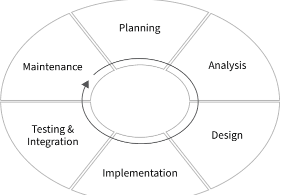

图 1.2 软件开发生命周期阶段的示意图。

软件工程的早期定义建议，我们应该像对待传统的工程学科（例如土木工程）一样对待它。结果就是瀑布模型 [300]，它将软件开发描述为一系列步骤，从收集需求开始，到完成产品的部署结束。然而，现代实践认为，这种模型在多个方面存在缺陷。首先，土木工程产生于并受限于物理定律，而我们在开发软件时是在根据自己的规则创造自己的世界。这些规则会随着我们对问题空间理解的演变而改变；物理定律则不会。其次，软件旨在执行的任务会随着时间而改变，我们对该任务的工作定义也会随之改变。土木工程主要处理定义良好的问题，这些问题在整个项目期间都保持定义良好。最后，在建筑完成后修改一栋大楼非常困难，但我们经常对软件这样做。软件整个生命周期中的大部分精力通常在维护和演进上。

目前的软件工程实践采取相反的观点，认为软件开发是一个开放的（“软件永远永完完”）、迭代的（“软件生命周期”）过程：这是“敏捷宣言” [36] 的核心。在高级层次上，它如图 1.2 所示的方式组织：一个规划、分析、设计、实现、测试和维护的持续循环。软件的设计深受其运行所在领域的影响[领域驱动开发, 96]。它及时地使用测试 [测试驱动开发, 35]、重构 [105] 和持续集成来引入新功能，并修复代码“形状”上更糟糕的 Bug。诚然，所有这些方法都被吹捧为“万灵药”，以至于它们变成了术语，它们的实际实施往往被扭曲到让软件开发变得更糟的地步。然而，敏捷的核心思想是有价值的，我们将在书中适度地讨论和应用它们。它们非常适合构建机器学习流水线的开发，而这些流水线是永远完好的。

### 1.4 它们是如何结合的？

计算机系统是数据科学的关键，尽管其角色与机器学习中不同。存储和访问海量数据、交互式探索数据、构建分析这些数据的软件流水线、处理产生的突发性负载：机器学习对计算的中心性使得软件工程在数据科学中至关重要，通过系统编码数据、高效地检索数据、将它们整合，这些任务都需要良好的实践来确保整体的正确性。正如 Kenett 和 Redman [179] 的类比所言：

> “如果数据是新石油，技术就是新引擎。如果没有技术的进步，转型是不可能的。引擎由数据库、通信系统和数据驱动汽车。”

在学术界，存在一种广泛观点，认为机器学习实现可以被视为一次性的脚本，“我们不需要重构它。”这是一种令人沮丧的普遍，“当原始作者提供协助时，85% 的结果被成功复制，而作者不回复时仅为 4%” [261]，表明存在改进空间。幸运的是，近年来科学家们广泛接受了这个问题 [234]，机器学习社区对于如何解决它达成了一些共识 [340]。

在工业界，糟糕的工程会导致实践和计算上的技术债积累 [313，见 5.2]。工程化糟糕的数据可能不以我们寻找的形式存在；未封装良好的模型部署缓慢且难以回滚；数据可能包含偏见，或随着时间推移而导致模型失效；或者机器学习软件可能变成一个无法解释的黑盒，使得故障排除变得不可能。如果我们不完全理解数据和模型，发现软件中的问题将变得非常困难，软件 Bug 引起的意外行为可能误认为是模型本身的特性：

模型本身通常是无法完全理解的黑盒（见 9.2）。

- 数据足够复杂，以至于来自领域的专家也难以完全解释它们（见 9.1）。

# 第一部分 科学计算基础


# 2 硬件架构

构建一个运行机器学习软件的计算系统需要周密的规划。它的性能优劣取决于选择合适的硬件；一组能够高效有效地处理我们想要执行的任务的机器学习算法；以及如何表示我们将要使用的数据、模型及其输出。为了本书的目的，我们将“计算系统”定义为计算机系统（不一定是服务器级），它将执行学习或使用机器学习模型所需的一项或多个任务。我们经常也将其称为“机器学习系统”，以强调其目的。其他类型的系统，例如关注存储的（数据库服务器、数据湖、对象存储）或交付的（人类可读的仪表板、计算机可读的 `API` 端点），将简带提及。

在本章中，我们关注硬件，并在第 3 章讨论数据，在第 4 章讨论算法。在涵盖计算系统的关键方面（第 2.1 节）后，我们将讨论如何充分利用其潜力使用它（第 2.2 节）、集成远程系统涉及的权衡（第 2.3 节）以及如何根据我们的需求对其设计（第 2.4 节）。现代机器学习库试图为我们做这些决策，但它们在许多现实应用中是有局限性的：在这些情况下，能够对硬件进行推理是一项宝贵的技能。

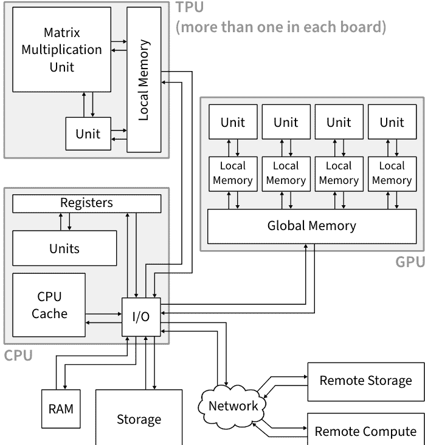

图 2.1 现代计算系统中可能出现的关键组件示意图（不一定同时出现）。尺寸和距离并非按比例绘制。

## 2.1 硬件类型

计算系统有各种配置，其组件总结在图 2.1 中。广而言之，我们可以说它们在三个轴上有所变化：

这些维度承认具有某种任意性，但它们非常适合讨论我们在书中将要涵盖的主题。在这种背景下，选择合适的硬件意味着在计算、内存和连接之间选择一种权衡，使机器学习系统能够在符合可用预算的同时实现其设计目标。引用 RFC 1925 [55] 中的一个普遍真理之一：

> (7a) 好、快、便宜：任选其二（你不能三兼得。）

### 2.1.1 计算

我们在机器学习系统中常见的三类处理器是：

1. 中央处理单元 (`CPUs`)，通常是来自 AMD 或 Intel 的 `x86–64` 处理器或 `ARM` 处理器。
2. 来自 NVIDIA 或 AMD 的图形处理单元 (`GPUs`)。
3. 张量处理单元 (`TPUs`)，通常来自 Google。确实存在其他用于加速机器学习的专用硬件 [295]，但从实际用途来说，它们履行着与 `TPUs` 相同的角色。

`CPUs`、`GPUs` 和 `TPUs` 在速度、功能和通用性方面代表了不同的权衡。它们之间的相互取舍是不可避免的：摩尔定律（每个芯片上的晶体管数量每一或两年翻倍）和丹纳德定律（随着晶体管变小，功率密度不变，也就是说我们获得了更多晶体管）所带来的“容易”性能提升已经终结，这意味着我们不能期望通用处理器以我们所习惯的速度变快。晶体管在不违反物理定律的情况下无法变得更小。在保持晶体管可靠的同时，电流和电压无法进一步下降，我们无法再次轻松让每个芯片的晶体管数量增加一倍。解决这一困境的唯一方法是领域特定架构，它们将其晶体管和功率预算充分用于特定类型的操作 [168]。因此，`GPU` 在机器学习应用中的兴起，以及最近 `TPU` 的出现。

`CPUs` 是最通用的计算类型：它们可以通过其实现的指令执行广泛的操作；它们在一定程度上可以并行并行执行多个操作（在不同的核心上或同一核心的不同线程上）；并且它们可以高效地处理任何类型的数据。同时，`CPUs` 包含实现特殊单指令多数据 (`SIMD`) 指集的逻辑单元，例如流 `SIMD` 扩展（`x86` 上的 `SSE1` 到 `SSE4`，`ARM` 上的 `Neon`）和高级扩展（`x86` 上的 `AVX`、`AVX2`、`AVX512`，`ARM` 上的 `SVM`），对变量进行高效且同时的数值计算。使用它们可以获得的加速是巨大的，范围从 10-15% 到 10 倍不等 [参见，例如]。`SIMD` 指令的主要局限性是它们只能在寄存器内容上操作，这是通过其实现的指令所最小且最快的实际上。

`GPUs` 包括一个单一、极其简单的核心处理器；将计算能力集中在一个大型的二维矩阵乘法单元中；将内存组织在网格网络（mesh network）中，允许核心之间进行异步、无锁通信；实现有限精度整数和浮点数的硬件支持；舍弃所有对于深度神经网络工作并非严格需要的功能。


这种对深度学习的单一专注使得 TPU 成为处理此类模型的最佳硬件，在每瓦特性能方面，其记录的提升是 GPU 的 20–30 倍 [168]。特别是，[167] 报告称，TPU 在推理方面的每瓦特速度是 GPU 的 50 倍，训练速度则快 5 到 10 倍。这些改进很大程度上归功于 TPU 核心比 GPU 或 CPU 核心小得多（面积小 38 倍），因此它们消耗的能量更少（少 13 倍），并为矩阵乘法单元留了更多可用晶管份额。另一个重要因素是内存布局，它允许 TPU 核心之间以 500Gb/s 的速度进行无锁通信，并消除了周期同步的需求。直观上，我们可以预期性能的将延伸到其他需要类似数学操作模式的机器学习模型中，特别是那些可以完全用矩阵操作公式化的模型。

我们为这种水平的性能付出的代价是 TPU 灵活性和通用性的完全缺失，它们只擅长矩阵乘法。TPU 核心无法执行任何指令调度，不支持多线程，且通常不具备我们在 CPU 和 GPU 中能找到的任何复杂功能。它们完全由其所连接的计算系统的 CPU 驱动，因为在本文撰写时，这是唯一在机器学习中被广泛使用的 TPU。为了弥补这一点，代码可以使用 Google 的 XLA 编译器 [343] 进行编译，以达到不需要动态调度，并最大限度地利用数据级和指令级并行性，通过组合操作来使用 SIMD/FMA 指令，并确保矩阵乘法单元始终忙碌。XLA 对 Tensorflow 和 PyTorch 模型的结构具有完全可见性，优化能力远于传统的编译器或 CPU/GPU 调度器。它非常有效，甚至可以实现持续 70% 的峰值性能 [167]。TPU 还针对单一变量类型进行了深度优化，即 Google 的“脑”浮点格式（“bfloat”），而在处理行业标准 IEEE 754 浮点格式的变量时速度较慢 [253]。（详见 3.1.2 节。）此外，它们专门设计用于 16 位（“bfloat16”）浮点操作而非 32 位操作。这两种格式在经验上对于处理深度神经网络已经足够，且操作 IEEE 格式的效率是其八倍 [167]。

### 2.1.2 内存

CPU、GPU 和 TPU 的实际性能受限于我们需要为它们提供可操作数据这一事实。每个处理器只能访问其直接连接的内存：CPU 的寄存器和内部缓存；GPU 和 TPU 的板载全局内存和局部内存（见图 2.1）。这意味着需要将输入数据从系统 RAM 传输到它们的专用内存，并将产生的输出拷贝回系统 RAM 以进行进一步处理。

在不同的内存之间移动数据需要时间，在每种内存类型内部移动数据也是如此，尽管后者较小。理想情况下，我们希望尽可能让更多数据靠近处理它的处理器。此外，我们希望该处理器能够尽可能长时间地对这些数据进行原地处理，以在大量操作中分摊移动数据的成本。这种愿望受到三个因素的限制：

- 每种类型处理器的访问范围；
- 访问不同类型内存的延迟；
- 以及我们到不同类型内存连接的带宽，它决定了数据在访问后传输有多快。

换句话说，延迟是等待最大量内存启动的时间，而带宽是我们每秒内可以拷贝的最大内存量。显然，每种类型的处理器访问其专用内存时速度最快，因为物理上位于其内部或其位置。距离在决定内存访问延迟方面起着关键作用：电信号的传播速度限制了我们访问该内存的速度。途中处理这些信号的需求（例如，翻译不同格式的内存位置地址）可能会进一步延迟访问。CPU 寄存器、GPU 单元的局部内存和 TPU 的局部内存直接连接到相应的处理器，以缩短距离并使其能够直接寻址。这使得延迟从微秒（$10^{-6}$ 秒）或几十微秒（$10^{-5}$ 秒）减少到几百或几十微秒（$10^{-9}$ 到 $10^{-7}$ 秒）。再次引用 RFC 1925：

> “(2) 无论你如何努力推动，无论优先级如何。”

访问特定内存的延迟通常与其大小成反比，如表 2.2 所示：

| 内存类型 | 延迟 |
| :--- | :--- |
| 寄存器 | < 1ns |
| CPU 缓存 | 2ns-15ns |
| RAM (GPU) | 50ns-250ns |
| RAM (TPU) | 70ns-120ns |
| 热存储 | 60-200µs |
| 冷存储 | 较长时间 |

传输本身的耗时是相同的，因为它仅取决于 CPU 和 RAM 之间 PCIe 连接的带宽：在 64GB/s 的速度下，10MB 需要 216s。然而，在第一情况下，内存传输引入的延迟是可以忽略不计的，而在第二种情况下，它会让总时间增加约 20%。这就是为什么 GPU 和 TPU 都是通过一次性从系统 RAM 拷贝所有数据来初始化的，这使得内存传输（通常称为“内核启动”）成为一种固定的开销成本，并可以分摊到整个计算过程中。

在存储层次的底端，我们有热存储和冷存储。热存储用于存放我们需要频繁且即时访问的数据，它由本地连接到计算系统的硬盘（主要是固态硬盘）组成。冷存储用于我们访问频率较低且对快速访问没有要求的数据。它由磁带、较慢的硬盘和网络附属存储（NAS）组成。热存储的大小通常为几十太字节（TB），冗余较少；冷存储可能扩展到数拍字节（PB），且通常具有更多冗余，因为它包含了需要长期保存的数据。热存储是局部的，因此受到 PCIe 延迟和带宽的限制；冷存储可能是远程的，因此受到网络延迟和带宽的限制。存储介质很少是限制因素：它的带宽通常高于我们访问它时使用的连接带宽，而连接才成为了瓶颈。

### 2.1.3 连接

计算系统的最后一个也是至关重要的部分是允许数据在不同处理器和内存类型之间移动的连接。内存性能不可避免地限于它与各种处理器连接的方式。直接连接到特定处理器的内存（CPU 缓存和寄存器、GPU 和 TPU 板上的内置内存）对于该特定处理器来说访问速度是最快的，因为它以其全速原生速度运行。这意味着延迟最小化，且带宽最大化。例如，TPU 内存的吞吐量为 500GB/s [167]，GPU 内存的吞吐量为 500-1000GB/s（Nvidia Quadro 卡 [227]）。两者的延迟都可以忽略不计。

然而，GPU 无法直接访问系统 RAM，CPU 也无法访问 GPU 板载内存。这意味着任何传输的数据都必须从系统 RAM 拷贝到板载内存。速度随后限于连接 GPU 和系统的 PCIe 总线带宽，且延迟增加到表 2.2 所示的水平。TPU 也是如此。

这就是为什么数据局部性，即将数据保持在处理它的处理器“附近”至关重要的原因：直接连接具有最好的延迟和带宽，而间接连接则受到 PCIe 总线的限制。此外，在不同类型的内存之间传输数据涉及将其拷贝到系统 RAM 作为中间步骤，这会进一步降低性能。

热存储和冷存储在几个方面与其它类型的内存不同。首先，它们不具备任何计算能力，因此我们无法避免将它们包含的数据传输到系统 RAM 进行处理。其次，这两种存储类型都不一定会使其与系统 RAM 的连接达到饱和：连接本身不会引入任何瓶颈。热存储通常通过 PCIe 连接到计算系统，但其持续读写速度（SATA 3 为 8GB/s，NVMe 为 4GB/s）远小于 PCIe。冷存储更慢，或者仅通过 100Gb/s 以太网等网络连接可用。

## 2.2 硬件类型

所有硬件类型都以其独特的方式拥有强大的能力，但为了有效使用它们，我们要么需要可以利用它们的编译器（如果从源码编译软件），要么需要已经构建以实现这些功能的库（如果我们无法做到这一点）。这意味着需要使用理解系统内存布局以及可用特种硬件指令的编译器，或者构建在优化过的库（如 CUDA [244]（用于 NVidia GPU）或 Intel 的数学内核库 (MKL) [156]（用于 CPU））之上的软件。一些流行的机器学习框架和库（如 PyTorch [259]）更进一步，它们抽象了所有与硬件相关的优化，自动适应其运行的硬件的特性。

从现代计算机系统中获得最佳可能性能的关键，在于认识到它们拥有许多处理器（无论是专门的还是其他的），并且我们希望尽可能让所有这些处理器处于忙碌状态。换句话说，我们需要并行性：

- 在指令层面，我们希望软件使用可以同时执行的硬件指令。
- 在数据层面，我们希望任务具有模块化的输入和输出，这样我们就可以独立地对它们的每个元素进行操作，而无需等待其他操作完成。
- 在线程层面，我们希望机器学习软件的不同部分对彼此输出的依赖尽可能少，这样我们就可以跨不同的核心、处理器甚至系统在单独的线程或进程中运行它们。

线程级并行性的可能大程度上取决于我们正在使用的算法以及它们是如何实现的（见第 4.6 节）。数据级并行性也是如此：数据点和随机变量是否可以被认为是独立的、参数是否可以独立估计、以及预测是否可以独立计算，取决于我们使用什么机器学习模型以及我们如何学习它。另一方面，指令级并行性关键取决于软件。

## 2.3 本地与远程硬件

在降低成本的同时提供更好的性能。我们可以像图 2.1 所示的那样将它们视为远程存储和远程计算，它们通过本地网络或地理网络连接。

处于同一局域网内的远程系统通常通过高速以太网连接。对于 Facebook 的运营规模而言，50Gb 以太网 [148] 已经足够，因此吞吐量对于较小的机器学习系统来说不是限制因素。延迟是一个更大的问题：在网络中路由流量的网络设备在建立新连接时可能会引入几微秒的延迟。

对于位于不同地理位置的远程系统，延迟和带宽都是限制因素。一个例子是云实例，即我们可以快速创建（“配置”）或销毁（“退役”）虚拟服务器，并将它们运行在我们拥有的硬件（私有云）或从 Amazon Web Services (AWS)、Microsoft Azure 或 Google Cloud Computing Services (GCP) 等公共供应商处租用的硬件上。延迟源于信号穿过多层网络设备到达可能在另一个国家的系统所需的物理时间。例如，如果我们位于美国西海岸，连接到东岸的延迟为 40ms，连接到英国为 81ms，连接到澳大利亚为 183ms [135]。如果远程系统是按需激活的，我们必须等待它启动后才能开始处理数据：这取决于实例底层的虚拟化类型，在 15 到 40 秒之间（第 7.1.3 节和 7.1.4 节）。与表 2.2 中的延迟相比，访问远程系统上的数据因此比本地系统的存储慢 3-6 个数量级。例如，AWS 竞价实例就是这种情况：虽然它们的运行成本更低，但每次使用时都必须启动，并且可能在没有警告的情况下被关闭。

## 2.4 为任务选择合适的硬件

没有任何一种单一的计算系统配置是最好的：实际性能是算法类型、模型和硬件类型之间复杂相互作用的结果。实现最佳性能应从定义机器学习系统的目标（第 5.3.1 节）开始，然后选择实现这些目标所需的软件和硬件。关于这个主题的全面讨论可以在 [135] 中找到，该文献探讨了硬件、操作系统、协议、基准测试和性能分析的所有方面。在下文中，我们将关注机器学习模型、底层软件栈与硬件之间的交互。如 BLAS [41]、LAPACK [17] 和 GSL [106] 等数值库，以及 TensorFlow [341] 和 PyTorch 等框架，本质上是模型的编译器，将其翻译为最适合处理器的可用硬件指令集。


某些任务更适合特定类型的硬件。例如深度神经网络。训练和推理之间存在重要的计算差异：后者的并行性较低，内存要求更高，并且需要更宽的数据来保持精度并避免最终模型出现灾难性错误 [167]。因此，训练最好在配备了 `GPU` 和 `TPU` 的计算系统上进行，而推理即使在 `CPU` 上也运行良好 [148]。毕竟，`GPU` 和 `TPU` 并不是神奇的“加速”设备！它们只对某些高度并行且主要由向量（`GPU`）或矩阵（`TPU`）操作组成的问题类有益。我们应该买多少每个？这取决于我们执行每个任务的相对规模和频率。通常，模型训练每几天执行一次，而推理是实时运行的，每天可能数百万次。例如，亚马逊总计算成本的 90% 是推理 [14]：在这种规模下，使用 `GPU` 再次成为必要。但由于 `GPU` 不适合推理，因此需要一种特殊的软件调度器 [162] 来高效使用它们并获得一致、可预测的性能。在较小范围内，具有许多 `CPU` 核心的计算系统将足够且设置更简单。

特定的机器学习模型可能仅在某些类型的硬件上可行。矩阵操作的密集使用自然在 `GPU` 和 `TPU` 上运行得更好，但它们的大小受内存限制。整个模型必须在 `GPU` 和 `TPU` 能够访问的内存范围内，并且要有足够的内存来存储。此外，我们希望尽可能大批次操作以提高利用率：如果我们被迫按小批次处理数据，性能可能会令人失望。这种问题无法通过在同一计算系统中放置多个 `GPU` 或 `TPU` 来缓解，因为它们之间是不共享的。如果内存需求超过了 `GPU` 和 `TPU` 的能力，容量更大但速度较慢的 `CPU` 对于不那么并行的模型或任务表现更好。

最后，来自我们未来的建议：我们应该规划比目前严格需要的更多的硬件，以适应可能增长的计算、内存和存储需求（容量规划）。从 2012 年到 2018 年，机器学习模型的计算需求增长了 10 倍 [167]。此外，自动模型选择技术（称为某些类型的“超参数调优”）例如 `AutoML` [149] 变得越来越常见，它们使用的计算能力是学习数据所需的 [178] 的 50 倍，模型的大小 [66, 421] 同样随时间不断增长，需要热存储和更多的内存（所有类型）来存储和使用它们 [34]。

云计算可能减少对容量规划的需求：如果实例相对廉价且可以快速创建和销毁，我们就可以预先购买较少的硬件并根据需要进行扩展。事实上，动态伸缩算法在大多数云服务中可以自动做到。


# 3 变量类型与数据结构

在探索机器学习系统构建基础的组件时，我们强调了不同类型的硬件都针对存储在特定格式中的数据和模型进行了优化。这两者都是复杂的实体，由各种元素组成，这些元素被组织成数据结构，如数据帧（表示表格数据）或标准模型格式如 `ONNX` [247]。这些数据结构内部的单个元素是特定类型的变量，例如整数、浮点数和字符串。

在本章中，我们将重新回顾在第 2 章中提到的变量类型，以及字符串表示法，并讨论了对于不同类别的数据选择一种类型而非类型的可能原因（第 3.1 节）。然后，我们将给出一些变量在数据结构中组织的显著示例，例如向量和列表（第 3.2.1 节）、数据帧（第 3.2.2 节）和矩阵（第 3.2.3 节）。变量类型（第 3.3 节）和数据结构（第 3.4 节）的不同选择代表了在硬件支持方面（我们在第 2 章中看到的）以及运行在这些数据上的机器学习算法的计算复杂度方面（我们将在第 4 章中讨论）的不同权衡。

## 3.1 变量类型

机器学习软件主要处理数字，这些数字是我们正在建模的数据数学表示。图像可以使用每个像素的颜色通道值来表示；文本可以编码为字符串，然后转换为特定单词的频率；传感器数据被记录为时间序列。我们可以用不同类型的变量存储其中每一种，每种类型都有优缺点，我们将在第 3.3 节中讨论。

### 3.1.1 整数

整数变量可以表示自然数（N）或整数（Z）。它们通常用作*指示器*（也称为哑变量）来表示布尔变量，如下：

| | |
|---|---|
| TRUE | 1 |
| FALSE | 0 |
| TRUE | 1 |
| FALSE | 0 |
| FALSE | 0 |

更通俗地说，它们可以通过将每个元素映射到不同的整数来为有限集提供数值表示。

| | |
|---|---|
| "red" | |
| "blue" | 3 |
| "green" | 2 |
| "red" | 1 |
| "green" | 2 |

`C` 中的枚举或 `R` 中的因子正是以这种方式构建的，以最大限度地减少内存消耗。然而，这种数值表示不适用于离散变量，因为它使得参数估计取决于元素与整数之间的特定映射。相反，我们将离散变量映射到它们的独热编码（one-hot encoding）：集合中的每个元素都被分配一个指示变量，如果该元素被观测到，则取值为 1，否则为 0。

| | | | |
|---|---|---|---|
| "red" | 1 | 0 | 0 |
| "blue" | 0 | 1 | 0 |
| "green" | 0 | 0 | 1 |
| "red" | 1 | 0 | 0 |
| "green" | 0 | 1 | 0 |

> 如果我们在回归模型中使用颜色，那么“绿色”对响应的影响将是“红色”的两倍，这显然是没有意义的，因为与颜色关联的数字是任意的。

> 独热编码是统计学中所谓的“对比”（contrasts）的一种特殊情况。由于它们是共线的，我们通常在将它们用于模型之前丢弃其中一个。

尽管如此，布尔值在实践中通常至少存储 1 字节。一个具有 $k$ 个元素的有限集可以用 $\log_2 k$ 位表示：独热编码通过使用指示变量规避了这一限制，代价是使用更多的内存。

自然数和整数无法由整数变量完全表示：那需要无限数量位。由于硬件原因，编程语言提供了不同大小的整数变量，例如 8、16、32 和 64 位。这些大小都是 8 位的倍数，因为处理器针对字节进行了优化。整数变量的大小决定了它所能表示的最大数字。例如，我们可以在 32 位中表示的最大（无符号）自然数是 $2^{32} - 1 \approx 4.29 \times 10^9$，而最大的（符号）整数是 $\pm 2^{31} - 1 \approx 2.14 \times 10^9$，因为预留了 1 位用于编码符号。（如果该位被设置为零，则该数字被视为正数。）超出此范围的数字被称为溢出，这意味着位表示大于整数变量的大小，从而溢出了为该变量预留的内存。为了说明，考虑表示为 16 位无符号整数的自然数 3134。

| $2^{15}$ | $2^{14}$ | $2^{13}$ | $2^{12}$ | $2^{11}$ | $2^{10}$ | $2^9$ | $2^8$ | $2^7$ | $2^6$ | $2^5$ | $2^4$ | $2^3$ | $2^2$ | $2^1$ | $2^0$ |
|---|---|---|---|---|---|---|---|---|---|---|---|---|---|---|---|
| 0 | 0 | 0 | 0 | 1 | 1 | 0 | 0 | 0 | 0 | 1 | 1 | 1 | 1 | 0 | 0 |

很容易检查出这种表示等同于“自然”表示法，它们使用不同的基：$2^1 + 2^2 + 2^3 + 2^4 + 2^5 + 2^{10} + 2^{11} = 3134$。16 位中可以表示的最大数字是 $2^{16} - 1 = 65535$，而 3134 小于它：我们可以很容易看到 4 个最高有效位（$2^{15}, 2^{14}, 2^{13}$ 和 $2^{12}$）均为零。现在考虑一个大得多的数字：27586。

| $2^{17}$ | $2^{16}$ | $2^{15}$ | $2^{14}$ | $2^{13}$ | $2^{12}$ | $2^{11}$ | $2^{10}$ | $2^9$ | $2^8$ | $2^7$ | $2^6$ | $2^5$ | $2^4$ | $2^3$ | $2^2$ | $2^1$ | $2^0$ |
|---|---|---|---|---|---|---|---|---|---|---|---|---|---|---|---|---|---|
| 0 | 0 | 0 | 0 | 1 | 1 | 0 | 0 | 0 | 0 | 1 | 1 | 1 | 1 | 1 | 0 | 0 | 0 |

很容易检查出这种表示等同于“自然”表示法，它们使用不同的基：$2^1 + 2^2 + 2^3 + 2^4 + 2^5 + 2^{10} + 2^{11} = 3134$。16 位中可以表示的最大数字是 $2^{16} - 1 = 65535$，而 3134 小于它：我们可以很容易看到 4 个最高有效位（$2^{15}, 2^{14}, 2^{13}$ 和 $2^{12}$）均为零。（*注：此处原文示例逻辑似乎有重复，已按要求翻译*）

### 3.1.2 浮点数

浮点变量主要用于表示实数（R）和复数（C），前者用一个变量表示，后者用两个表示（一个实部，一个虚部）。每个变量由四个部分组成：符号 S、偏置或偏移 O、指数 E 和尾数 M。实数的浮点表示法为：

```
x = (-1)^S * (1 + M)2^{E+O}
```

变量的整体位位数通常为 16、32 和 64 位，通常称为半精度、单精度和双精度。分配给指数（加上偏移后）和尾数的位数取决于使用哪种编码；符号始终存储在单比特中。IEEE 754 标准 [253] 保留了：

| 精度 | 指数 | 尾数 |
|---|---|---|
| 半精度 (16 位) | 5 位 | 10 位 |
| 单精度 (32 位) | 8 位 | 23 位 |
| 双精度 (64 位) | 11 位 | 52 位 |

偏移量的值确定方式为 $O = 2^{|E|-1} - 1$，其中 $|E|$ 是指数的位宽。

`Google` 在开发 `TPU` 的过程中设计的另一种“大脑”（brain）格式（见第 2.1.1 节）通常大小为 16 位，被称为 `bfloat16`。它的工作原理与 IEEE 754 浮点数相同，我们不再对其进行讨论；唯一的区别是它分配了 8 位给指数，7 位给尾数。

这在二进制表示法中意味着什么？考虑数字 435.25。在通常的 10 进制科学计数法中，我们可以将其写为 $4.325 \times 10^2$。如果在 2 中进行相同的操作，科学计数法将变为 $1.7001953125 \times 2^8$。指数是 8，尾数是 $0.7001953125$。作为一个半精度浮点变量，435.25 具有如下二进制表示：

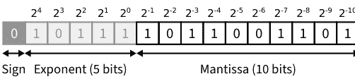

指数在偏移量之后加上：

$8 + (2^{5-1} - 1) = 23 = 2^0 + 2^1 + 2^2 + 2^4$。

结果被视为无符号的，无论原始数字是正是负。如果符号存储在变量的最高位，指数通过偏移量进行调整，而尾数存储在最低位，我们就可以通过对它们的二进制表示排序来比较浮点数，这可以通过硬件指令高效完成。

尾数是：

```
$2^{-1} + 2^{-3} + 2^{-4} + 2^{-7} + 2^{-8} + 2^{-10} = 0.7001953$,
```

这与 0.7001953125 相差 $1.25 \times 10^{-8}$。这种差异被称为浮点误差，它是由于尾数位数限制了所能达到的精度。能够精确表示的数字只有那些可以分解为指数和尾数中可用 2 的幂的数字。这显然排除了所有无限位数的数字，例如 $\pi$、$e$ 或 $1/3$。

浮点数的范围是多少？我们能表示的最大数字（正或负）受限于指数的大小：使用 $|E|$ 位可以表示多达 $2^{|E|}$ 个指数。偏移量确保了可以避免的指数被平均分配在正负数之间，范围从 $-2^{|E|-1}-2$ 到 $2^{|E|-1}-1$。

| | 最小指数 | 最大指数 |
|---|---|---|
| 半精度 (half) | $-(2^4 - 2) = -14$ | $2^4 - 1 = 15$ |
| 单精度 (single) | $-(2^7 - 2) = -126$ | $2^7 - 1 = 127$ |
| 双精度 (double) | $-(2^{10} - 2) = -1022$ | $2^{10} - 1 = 1023$ |

该范围小于理论上可能包含的 $2^{|E|}$ 个，因为某些位组合被保留给特殊类别的数字：

- 零：通过指数字段和填充为 0 的尾数来编码。
- 正无穷和负无穷 (+Inf, -Inf)：通过指数字段全 1 且尾数填充为 0 来编码。
- 不可表示的数字（通常表示为 NaN）：通过指数字段全 1 且尾数中至少有一位非零位来编码。尾数中不同的位模式用于不同类型的不可表示数字：最常见的是缺失值标识符 NaN。通常由于将一个数除以零，或尝试对定义域之外的值应用数学函数（例如对负数取对数）。
- 下规格化数（Subnormal numbers），即由于太小而无法用可用的指数以二进制科学计数法表示的数字。换句话说，它们的领先指数小于最小可用指数。它们通过指数字段全 0 来编码。这些数字的精度会降低，因为它们实际上只使用了尾数的一部分。例如，$2^{-10} \times 2^{-14} \approx 5.96 \times 10^{-8}$ 在半精度中的表示如下：

| $2^4$ | $2^3$ | $2^2$ | $2^1$ | $2^0$ | $2^{-1}$ | $2^{-2}$ | $2^{-3}$ | $2^{-4}$ | $2^{-5}$ | $2^{-6}$ | $2^{-7}$ | $2^{-8}$ | $2^{-9}$ | $2^{-10}$ |
|---|---|---|---|---|---|---|---|---|---|---|---|---|---|---|
| 0 | 0 | 0 | 0 | 0 | 0 | 0 | 0 | 0 | 0 | 0 | 0 | 0 | 0 | 1 |

| 符号 | 指数 (5位) | 尾数 (10位) | | | | | | | | | | |

舍入有多粗？对于任何给定的精度，取决于数字的大小。如我们在上面的示例所示，尾数可以编码许多有效位：$\log_{10}(2^{10}) \approx 3$（半精度），$\log_{10}(2^{51}) \approx 16$（双精度）。这实际上形成了一个可以精确表示的数值网格，其他数字都会舍入到最近的数字或 +Inf。从绝对值来说，随着指数增大，网格变得更粗。考虑一个像 0.0002 这样的数字，对于半精度来说是很小的：

| $2^4$ | $2^3$ | $2^2$ | $2^1$ | $2^0$ | $2^{-1}$ | $2^{-2}$ | $2^{-3}$ | $2^{-4}$ | $2^{-5}$ | $2^{-6}$ | $2^{-7}$ | $2^{-8}$ | $2^{-9}$ | $2^{-10}$ |
|---|---|---|---|---|---|---|---|---|---|---|---|---|---|---|
| 0 | 0 | 0 | 0 | 1 | 0 | 1 | 0 | 0 | 0 | 0 | 1 | 1 | 1 | 0 |

| 符号 | 指数 (5位) | 尾数 (10位) | | | | | | | | | | |

指数是 $13 + (2^{5-1} - 1) = 18 = 2^2 + 2^3 + 2^4$，而尾数是 $2^{-1} + 2^{-3} + 2^{-7} + 2^{-8} + 2^{-9} = 0.638175$，得到 $0.638175 \times 2^{-13} \approx 0.00020033$。通过增加最小可能的数量 $2^{-10}$，可以看到半精度可以表示的最近数字为 $\pm 1.9 \times 10^{-7}$。现在考虑一个较大的数字（对于半精度而言）是 10002：

| $2^4$ | $2^3$ | $2^2$ | $2^1$ | $2^0$ | $2^{-1}$ | $2^{-2}$ | $2^{-3}$ | $2^{-4}$ | $2^{-5}$ | $2^{-6}$ | $2^{-7}$ | $2^{-8}$ | $2^{-9}$ | $2^{-10}$ |
|---|---|---|---|---|---|---|---|---|---|---|---|---|---|---|
| 0 | 1 | 1 | 1 | 0 | 0 | 0 | 0 | 1 | 1 | 0 | 0 | 0 | 1 | 0 |

| 符号 (5位) | 尾数 (10位) | | | | | | | | | | | |

指数是 $13 + (2^5 - 1) = 44 = 2^2 + 2^3 + 2^5$，尾数是 $2^{-3} + 2^{-4} + 2^{-5} + 2^{-9} = 0.220703125$，得到 $0.220703125 \times 2^{13} = 10000$。半精度的最近数字是 9992 和 10008：之间所有的数字都被舍入。这在 10000 周围留下了 $\pm8$ 的区间。对于足够大的数字，浮点变量甚至无法在不舍入的情况下表示整数！我们如何控制点舍入引入的误差？误差会在操作中累积，机器学习模型执行的操作次数相对于其输入规模通常非常大（详见第 4 章）。幸运的是，概率论和统计学历史上将计算标准化在对数尺度上，以使闭式数学推导更容易。使用对数变换减少了大数字溢出到 +Inf 或小数字被舍入为零的概率。对于下规格化浮点表示数字，我们也保留了更好的精度，因为它们的对数不会下规格化。这在累加大量对数概率的情况下尤为重要。处理同一数量级的数字（即具有相似指数）有助于避免精度的灾难性损失。当操作涉及差异巨大的数字时，浮点舍入的粒度差异可能会导致结果产生不可接受的大误差，即使操作数是准确的。作为一个极端例子，考虑加上 10002 和 0.0002：结果将是 10000，这是半精度中最近的浮点数！类似的问题是灾难性抵消，它发生在减两个非常接近的浮点数时。


与整数算术不同，浮点运算是不精确的，因为有浮点舍入的影响。涉及浮点变量的操作结果在许多方式上可能与它们实现的数学操作不同，即使在常见场景下也是。使用简单的递归很容易演示：

```
x_0 = 4, x_1 = 4.25, x_{n+1} = 108 - \left(815 - \frac{1500}{x_{n-1}}\right)\frac{1}{x_n}
```

它在双精度中收敛到 100，尽管在 $\mathbb{R}$ 中的真实极限是 5 [304]。即使所有操作数都是精确表示的，这种情况也会发生，如 [303] 证明。这种差异的影响包括：

# 3 变量类型与数据结构

- 理论上相等的数字并不相等。应该始终使用容差（tolerance）来比较数字，该容差取决于我们所使用的浮点精度。R 中的默认值为最小可表示数字的平方根，可以通过 `sqrt(.Machine$double.eps)` 获取。

```
sqrt(2) * sqrt(2) == 2
# [ FALSE
all.equal(sqrt(2) * sqrt(2), 2, tol = sqrt(.Machine$double.eps))
# [ TRUE]
```

- 理论上不相等的数字可能会相等。

```
1e9 == 1e9
# [ TRUE]
1 - 1e-20 == 1
# [ TRUE]
```

- 操作的执行顺序非常重要，即使它们在实现上满足交换律和/或结合律。通过组织代码，使得关键计算只实现一次，从而确保操作始终按照相同的顺序执行，是防止此类问题的最佳方法。

```
print(0.6 + 0.7 + 0.8, digits = 20)
# [1] 2.099999999999996447
print(0.8 + 0.7 + 0.6, digits = 20)
# [1] 2.1000000000000000888
```

- 操作的执行顺序同样重要，因为除非我们重新排列操作以防止其发生，否则中间结果可能会下溢为零或溢出为 +Inf/-Inf。

- 在处理通常由多变量分布或大量数据点产生的极小概率时，在对数尺度（log-scale）上进行是最佳选择。否则，结果可能会下溢为零。

```
probs = runif(10^2, min = 10^-6, max = 10^-3)
sqrt(prod(probs))
## [1] 0
exp(0.5 * sum(log(probs)))
## [1] 1.27e-170
```

## 3.1 变量类型

### 3.1.3 字符串

字符串是以二进制形式编码并存储在变量中的字符序列。它们的二进制格式各异，但在 Linux 和 MacOS X 上通常是 UTF-8，在 Windows 上通常是 UTF-16。两者都是 Unicode 标准 [378]，使用 1 到 4 个字节编码每个字符，并支持许多字母、数学符号和如 emoji 等的形文字。

在机器学习软件中，字符字符串通常只作为自然语言处理（NLP）应用中的输入数据出现。在其他设置中，它们被用作集合项目的可读标签，正如我们在 3.1.1 节中看到的，它们可以用整数表示。事实上，即使在 NLP 中，它们最终也会被赋予数值表示，以便输入到 `wordvec` [299]、`GLOVE` [260] 和 `BERT` [78] 等算法。在 NLP 中，字符串还会根据其含义以及语法和句法属性进行预处理，以便于后续分析。例如：

- 移除对句子没有贡献的常用词（通常称为停用词，stopwords），以减少数据维度数。
- 对单词可能进行词干提取（stemmed），即在移除后缀和前缀后，将不同的单词还原为共同的根，以识别它们实际上是否是同一个词。
- 对单词进行句法角色标记。
- 通过将所有字符转换为小写，有时还删除变音符号，来对单词进行归一化。复杂的复合字符在 UTF-8 和 UTF-16 中可以以不同的方式编码，将它们转换为规范形式（canonical form）对于正确识别唯一单词至关重要。
- 移除标点、连字符和数字等无关字符，将其视为非信息。缩写和首字母词可以展开，以明确它们对应的单词。同样，emoji 可以被文本描述所取代。

对这些主题的详细讨论超出了本书的范围，我们建议读者参考如 [2] 等专著，以及相关软件库 `Spacy` [97] 和 `NLTK` [240] 的文档。

## 3.2 数据结构

数据结构是组织一种或多种类型变量的特定方法，以便进行有效高效的处理。不同的数据结构对于不同的操作或算法将最为有效。我们将在 3.4 节和后的第 4 章进一步讨论这两个方面，从空间和时间复杂度的角度刻画内存和计算效率。在这里，我们仅涵盖机器学习软件基础的数据结构，并建议读者参考其他优秀资源 [50, 68] 以获取该主题更广泛的内容。

为什么要使用数据结构？首先，它们允许我们抽象出基础变量操作，从而使代码更加紧凑，否则这些操作将在不同地方被重复实现。结果是我们的代码将更清晰，并且可能错误更少。其次，


图 3.1 向量（左）和列表（右）的逻辑结构和内存布局。数据结构告诉软件特定的变量组在内存布局上以及我们如何操作它们方面是关联的。这使得我们编写的代码可以编译或解释（见第 6.1 节以便高效操作数据结构中的变量）。第三，变量组关联的信息对于编写代码的人是有用的。这些变量可能描述单个数学对象或真实世界实体，它们可能具有相同的含义，也可能带有用于解释和调试的元数据。

机器学习软件中最基础的数据结构是向量和列表。它们都可以包含任何类型的变量，并由长度（包含的元素数量）定义。它们的概念结构如图 3.1 所示。

向量是同质数据结构，持有相同类型的变量序列。变量顺序存储在单个内存块中，因此可以使用指向第一个元素的指针访问向量。（指针本身是一个包含地址的变量。）读取存储在向量中的变量是非常，因为所有元素在内存中占据相同的字节数：第 $i$ 个元素位于第一个元素地址加上变量大小的内存位置。复制整个向量也是容易的，因为它是单个内存块。向量内部相邻的变量子集也是如此。

另一方面，列表是异质数据结构，可以包含不同类型的元素。它们本质上充当指向任意数据结构或变量类型的向量。因此，列表中的每个元素可以是任何内容：某种类型的单个变量、任意长度的向量、另一个列表、矩阵等。这意味着访问列表元素并不简单，因为我们需要定位每个元素并单独访问。然而，复制和划分列表可能是容易的：如果我们不需要修改其元素的内容，只需复制（全部或部分）元素的指针即可创建一个新列表。这被称为浅拷贝（shallow copy），可以显著减少内存使用。但是，如果我们稍后在新列表中修改它们，则必须也复制元素，以避免更改它们所属的原始列表。同时复制列表及其元素被称为深拷贝（deep copy）。相比之下，在通常情况下，对向量进行划分需要深拷贝。浅拷贝仅在复制整个向量或划分相邻元素的切片时可能。

将变量存储在向量中使得向量化计算成为可能：函数可以独立地应用于向量的每个元素，可能像我们在 2.2 节中讨论过的样，利用硬件的 SIMD 和 FMA 指令来实现指令级和数据级并行。

## 3.2 数据结构

如果函数的返回值是一个标量，则结果可以存储在另一个长度相同的向量中。否则，结果可以存储在稠密矩阵（第 3.2.3 节）或数据框（第 3.2.2 节）中，其中每行或每列包含单个输入元素的返回值。对于列表也可以使用线程级并行进行向量化计算，前提是函数能够处理存储在列表中的所有类型的变量。此时，无论每个输出是否为标量，其结果都将存储在第二个列表中。

### 3.2.2 使用数据框表示数据

数据框（Data frame）是一种异构的二维数据结构，具有可能不同类型的列。它的主要任务是存储表格数据以及相关的元数据，例如列名和行名。Julia (`DataFrame.jl`) 和 Python (`Pandas` 和 `Scikit-Learn` [311]) 中的实现深受 R 数据框的启发：它们在语义上仅有细微差别。最显著的区别是，对两个数据框的操作在 R 和 Julia 中是按位置匹配单元格（忽略行名和列名），而在 Python 中是按行名和列名匹配（忽略单元格位置）。

数据框的基础结构类似于列表：数据框中的每一列都是一个带有其自身元数据的向量，如图 3.2 所示。因此，每一列都存储在独立的内存块中，并且对不同列中可以存储的变量类型没有限制。此外，数据框通常包含其维度以及行和列标签作为元数据，使得我们能够像访问表格一样访问其内容。维度是数据框的行数和列数。数据框其他元数据（维度等）的标签

| 值 | **粗体** | *斜体* | 颜色 |
|---|---|---|---|
| 1 | 5.25 | TRUE | "red" |
| 2 | 4.10 | FALSE | "blue" |
| 3 | 7.11 | TRUE | "green" |
| 4 | 0.38 | FALSE | "blue" |
| 5 | 7.03 | FALSE | "red" |
| 6 | 1.09 | FALSE | "green" |

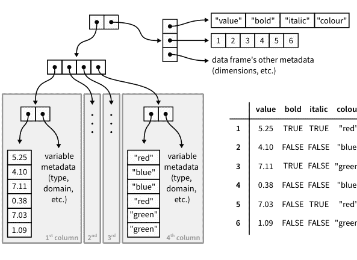

图 3.2 编码为数据框（左侧、上方）的表格数据（右下角）示意图。

在 R 中，列（称为“列名”）可以通过其名称而不是其在数据框中的位置来访问，这提高了代码的可读性，从而增强了我们对代码调试的能力。它也使代码对数据布局具有不变性。行标签（R 中称为“行名”）具有相同的功能，但使用频率没有列名那么高：在假设数据点独立同同分布的常见情况下，它们通常没有实际用途。

数据框使得对列进行操作非常高效。创建一个包含子集列的新数据框类似于对列表进行取子操作，额外的额外步骤是根据需要执行行标签和列标签。可以通过浅拷贝（shallow copy）高效地完成复制。向数据框中添加列也类似：我们执行浅拷贝到一个新的数据框中，其中预留一个空槽，我们可以在其中插入存储列值的向量。对数据框的每列应用函数可以是向量化的并并行执行，对于泛型函数，可以为每列调用适当的方法。然而，在大多数情况下，对行进行操作并不是高效的。添加或删除数据点涉及修改每列的长度，这可能涉及将选定的数据点复制到新分配的相应长度向量中。

### 3.2.3 稠密矩阵与稀疏矩阵

矩阵是一种同构的二维数据结构，包含按行列排列的相同类型变量网格。它是表示线性代数中研究的同名数学对象的编程结构。矩阵可以是稠密的，也可以是稀疏的。稠密矩阵的大部分元素是包含信息的（即非零单元格），因此必须存储在数据结构中。另一方面，稀疏矩阵的大部分元素等于零，因此我们可以通过存储少数非零元素的位置和值来节省大量的内存。我们将在第 4.5.2 节讨论计算复杂度时，涵盖这类矩阵在速度和内存使用之间的平衡。

在 Python 中，稠密矩阵在 NumPy 中被实现为沿向量的多维数组的特例 [141]。R 中也是如此。在这两种情况下，数据结构编码了数组的第一个元素；元素的变量类型；以及决定其形状的数组维度如图 3.3 所示。维度和元素的变量类型决定了步长（strides）：在内存中移动到给定维度的下一个元素时跳过的字节数。它们在 NumPy 中被预计算并存储，但在 R 中没有。

| | 3 | 8 | 1 | 9 | 4 | 0 |
|---|---|---|---|---|---|---|
| | 第一列 | 第二列 | | | | |
| 类型 | "32位有符号整数" | | | | | |
| | 3 | 2 | 维度 | | | | |
| | 元数据（行名和列名、步长等） | | | | | |

**图 3.3 稠密矩阵（左侧）编码为以列主序格式存储变量的多维数组（右侧）的示意图。**

另一方面，R 数组包含其维度的标签（矩阵情况下例为行名和列名）。元素以向量的形式存储，通常是*列主序（column-major order）*：矩阵的列从最左侧的列开始拼接。

将稠密矩阵存储为列列表或行列表在 C 和 C++ 中很典型，但在高级语言中并不常见，在这些语言中，可以使用数据框来实现相同的目的。

多维数组将维度存储为元数据的特性允许对其元素进行三种操作。第一种是向量化操作，将函数单独应用于每个元素。第二种是所谓的*广播（broadcasting）*：当函数在两个维度不同的数组上操作时，较短的数组会被重复（即使操作数的形状相匹配）。第三种是边缘化或归约：跨越一个或多个维度聚合元素，以产生一个维度较少的数组。

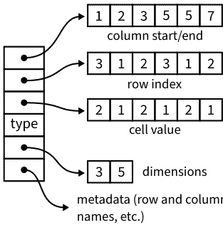

图 3.4 稀疏矩阵（左侧）及其压缩列格式（右侧）的示意图。

## 3.3 为任务选择合适的变量类型

当变量溢出时，它们会被替换为 NaN 或转换为双精度浮点数变量。在 Python 中，整数以任意精度存储：其大小会根据需要扩展以防止溢出。`Pandas` [207] 整数变量的大小为 64 位，而 `NumPy` [14] 提供了 8、16 和 32 位的整数变量：两者都会溢出，且与 R 不同，它们不会被替换为 NaN。考虑 R 中的以下向量：

```r
library(microbenchmark)
floats.vec1 = rnorm(2 * 10^7)
floats.vec2 = rnorm(2 * 10^7)
integers.vec1 = sample(10, 2 * 10^7, replace = TRUE)
integers.vec2 = sample(10, 2 * 10^7, replace = TRUE)
```

```r
microbenchmark(integers.vec1 %%% integers.vec2, floats.vec1 %%% floats.vec2, times = 200)
```

在第 7 代 Intel Core 处理器上，平均而言，整数向量的内积耗时比双精度浮点向量长了 196.7%。下方 Python 和 NumPy 中的相同基准测试所示，结果相似：整数向量的内积耗时长了 40.5%。

```python
import timeit
import numpy as np

ITERATION = 200

float_vector1 = np.random.normal(0, 1, 2 * pow(10, 7))
float_vector2 = np.random.normal(0, 1, 2 * pow(10, 7))

int_vector1 = np.random.choice(10, size=2 * pow(10, 7))
int_vector2 = np.random.choice(10, size=2 * pow(10, 7))

def product_int():
    np.dot(int_vector1, int_vector2)
```

```python
def product_float():
    np.dot(float_vector1, float_vector2)
```

```python
print("Inner product with int by", ITERATION, "iteration, avg:",
np.mean(timeit.repeat(
repeat=ITERATION,
st=product_int,
number=1)))
```

```python
print("Inner product with float by", ITERATION, "iteration, avg:",
np.mean(timeit.repeat(
repeat=ITERATION,
st=product_float,
number=1)))
```

其次，从第 2.1.1 节显而易见，近年来人们投入了大量精力来改进浮点数硬件。CPU、GPU 和 TPU 都经过了优化，可以使用 SIMD 和 FMA 指令来处理单精度和双精度浮点变量，就像它们针对整数变量进行优化一样（这取决于可用硬件且不再更多）。因此，取决于编译器利用这些指令的能力，在使用低级语言时使用浮点变量可能会产生更代码。然而，对于特定的机器软件是否如此，取决于硬件和软件的精确组合，只能通过基准测试来确定。软件与硬件的匹配是第 2.2 节和第 2.4 节的关键点。

变量的大小同样重要：我们在第 2.1.2 节中看到更快的内存形式更小，以及在不同类型的内存之间拷贝数据如何影响计算强度。我们应该始终选择可以使用 SIMD 和 FMA 硬件指令处理的最小整数或浮点变量大小，并且其范围足够大表示我们正在处理的数字。即使在上述简单的 Python 基准测试中，对性能的影响也是可见的：将向量中浮点和整数变量的大小从 64 位（默认）减少到 32 位和 16 位，会在归一化运行时间中产生有趣的模式。

| 变量类型 | 64 位 | 32 位 | 16 位 |
| --- | --- | --- | --- |
| 浮点 | 100% | 54.1% | 88.7%* |
| 整数 | 100% | 62.2% | 61.6% |

正如我们预期的那样，将浮点和整数变量的大小都从 64 位减少到 32 位，内积速度提升了 1.5–2 倍。将变量大小进一步缩小到 16 位对整数变量仅有微乎其微的收益，但惊讶的是，它让浮点变量变慢了近 9 倍。这强烈表明，我们无法像处理相同大小整数那样利用 SIMD 和 FMA 指令！

在浮点变量的情况下，大小更为重要。正如我们在第 3.1.2 节提到的，精度越低，浮点误差可能越大。它们还会随着每次操作传播并相互叠加。对于参与算法大多数步骤的变量，这可能变成关键问题，例如用于计算一系列值之和或积的累加变量，以及与其他计算量重新缩放到预定义范围的变量。经典统计学中的例子是计算两个向量之间的经验相关性：

- 1. 我们计算每个向量的平均值。
- 2. 我们汇总与平均值的平方和。
- 3. 我们计算差值的乘积，产生大于 1 或小于 -1 的相关性。
- 4. 将协方差除以方差的平方根。


这些每一步都可能积累足够影响最终除法的误差：我们使用双精度存储。使用 `FMA` 指令也可能有帮助，正如我们在 2.1.1 节中提到的，它们以更高的精度运行，并且只对结果进行舍入。选择数字的尺度可能也有帮助，通过将所有变量保持在一个不容易发生溢出或下溢的范围内。这就是为什么许多数值软件使用对数尺度工作：大数字的幅度减小，不会溢出或丢失精度，而小数字变成很大的负数，而不是下溢或丢失精度。最后，由于法律原因，在某些应用（特别是金融和会计）中，浮点舍入可能是不可接受的。可以使用定点整数代替，规定将最小的货币金额（例如，£0.01 的 1/100）作为单位值。商业世界中这种方法的一个罕见开源例子是 Oanda 的 [245] 库。

> **注意**：数据结构的影响可能比变量类型更大，因为它决定了内存访问模式。计算强度关键取决于高效的内存使用和访问，正如我们在第 2.1.2 节和 2.2 节中所述的那样。如果我们需要反复对它们进行子集划分，列表可能比向量更节省内存，例如我们需要处理它们值的组合或排列。如果接受浅拷贝，列表的复制也更快，因为我们不需要为它们的元素分配内存并进行拷贝。如果不能接受浅拷贝，向量的拷贝更快，因为它们的所有元素都存储在单个内存块中，可以通过单个操作进行拷贝。而且它们并没有浪费内存，因为它们的大小是由长度决定的。事实上，列表使用的内存比向量多，因为除了元素本身，还包含指向每个元素的指针：如果元素总体上很小，这种差异可能是显著的。

## 62.3 变量与数据结构

我们可以对数据框（`data frames`）和矩阵（`matrices`）进行类似的考虑，因为数据框本质上表现为列表，其元素是存储表格数据中变量的列。

理想情况下，我们在选择代码中使用的数据结构时，应该考虑到库以及机器学习流水线中其他软件所用的是哪些数据结构。如果流水线的不同部分以不同的方式编码数据和模型，我们将被迫在它们之间进行转换，这不仅效率低下而且会增加内存消耗。例如，`R` 通常以数据框的形式导入数据。然而，驱动模型（包括所有线性回归）的底层 `BLAS` 和 `LAPACK` 代码要求数据以列优先格式（`column-major format`）存储为稠密矩阵（`dense matrices`）。将数据框转换为矩阵需要按列逐个将所有数据复制到单一的内存块中，这会导致内存占用增加一倍并浪费处理器时间。

我们还应该根据算法使用内容的方式来选择数据结构。为了一起处理的数据应该存储在一起，以便算法能够尽可能地减少独立的内存访问。例如，如果我们主要处理表格数据中的整列，那么数据框是理想的，因为它可以作为单一内存块高效地从内存中读取。然而，如果我们需要以各种组合处理单个行，数据框会使内存访问变得非常低效，因为行中的每个变量都存储在单独的内存块中，而且为了读取每行我们需要访问所有变量。如果数据是同质的，将它们存储在行优先（`row-major order`）存储单元的稠密矩阵中是更好的选择。

# 4 算法分析

在之前的章节中，我们讨论了我们使用的硬件架构（第 2 章）、我们分析的数据性质以及我们如何用数据结构表示数据（第 3 章）是如何影响机器学习流水线性能的。这个拼图的最后大部分部分是驱动机器学习模型的算法的算法复杂度。

算法复杂度在抽象上被定义为算法完成任务所需的资源量。在用伪代码对我们想要实现的机器学习算法编写高层级描述（第 4.1 节）之后，我们可以确定其组件的复杂度以及它们如何影响整个算法的复杂度。大 O 表示法（第 4.2 节）。对其进行量化（第 4.3 节）存在几个机器学习特定的问题（第 4.4 节），我们将通过三个示例进行说明（第 4.5 节）。

## 4.1 编写伪代码

推理算法的第一步是使用伪代码将其写下来，结合自然语言的易读性和代码的精确性，以便于我们的分析以及随后的软件实现。自然语言更容易读，但它具有歧义性。相反，代码又太具体了：它迫使我们考虑实现细节和编程语言规范，从而让我们难以关注整体视图。

伪代码旨在弥补自然语言和代码的缺点，同时保留它们的优点。理想情况下，它通过使每一步的意图清晰，同时抑制那些对理解算法无关的细节，为算法和实现提供高层级的描述。关于如何编写伪代码没有通用的标准，尽管存在一些通用指南（例如，参见《代码完备》（`Code Complete`）[206]）中的第 9 章）。通常接受的三项关键指南是：

- 算法的每一步都应该是枚举列表中一个独立的、自包含的条目。
- 伪代码应在某种程度上结合良好的代码和良好的自然语言的风格。例如，它可能不是完整的句子。它应该避免任何特定编程语言的习语和惯例，对代码语句使用松散的语法。出于同样的原因，变量名应该来自算法试图解决的问题领域，而不是它们将如何实现（例如，在数据结构方面）。我们将在第 6.2 节中回到这一点。
- 伪代码应该忽略不必要的细节，并尽可能使用简写符号，将上下文留给更深入的文档形式。细节的程度取决于对算法整体意图的描述。

## 4.2 计算复杂度与大 O 符号法

计算复杂度是计算机科学的一个分支，侧重于根据三个不同的维度对计算问题进行分类：

- 作为输入规模的函数（例如，样本量或变量数量）；
- 将使用多少资源，特别是时间（例如，花费的 `CPU` 时间）和空间（内存或存储使用）；
- 平均而言（通常需要多久）、在最好情况下或最坏情况下（可能需要多久）。

换句话说，我们希望从算法的规范中推导出它将使用多少资源：这被称为算法分析。通常，规范以伪代码的形式呈现。对于资源，我们必须首先选择测量单位。在空间复杂度的情况下，选择通常显而易见：要么是绝对内存单位（如 `MB`、`GB`），要么是单位（如双精度浮点数的数量），用于各种类型的内存（`RAM`、`GPU` 内存、存储）。在时间复杂度的情况下，我们必须选择一组基础操作。

我们考虑理论复杂度为 `O(1)`。这类操作的范围可以从简单（算术运算）到复杂（已训练的模型）不等，取决于我们希望所的抽象层级。一方面，抽象层次越低，我们越需要了解算法具体的实现细节。这在某种程度上是可行的，但因为伪代码会省略此类细节。这在某种程度上也是不尽理想的，因为它使得分析的普适性降低了：相同算法的不同实现可能落入不同的复杂度类别，尽管它们在实践中表现出几乎相同的行为。另一方面，抽象层次越高，获得的复杂度估计与现实的联系越疏远的可能性就越大。操作越复杂，它们具有相同复杂度以及其复杂度可以被视为常数的概率就越低。

算法分析产生的计算复杂度估计使用大 O 符号法及相关符号表示，这些符号定义了输入规模在极限情况下的复杂度 [183, 184]。（对于小输入，所有算法都是快速的）。详细如下：

- 我们使用大 O 符号法描述最坏情况。形式上，如果一个输入规模为 $N \to \infty$ 的算法具有复杂度 $f(N) = O(g(N))$，则存在一个 $c_0 > 0$ 使得 $f(N) \leqslant c_0g(N)$。它代表复杂度的上界。
- 我们使用大 Ω 符号法描述最优情况：$f(N) = \Omega(g(N))$，$f(N) \geqslant c_1g(N)$ 其中 $c_1 > 0$。它代表复杂度的下界。
- 我们使用大 Θ 符号法描述平均情况：$f(N) = \Theta(g(N))$，$c_2g(N) \leqslant f(N) \leqslant c_3g(N)$ 其中 $c_2, c_3 > 0$。它代表平均复杂度。

在实践中，我们通常只写类似“平均情况下是 $O(g(N))$，最坏情况下是 $O(h(N))$”，并在所有三种情况下都使用大 O 符号。如果我们考虑的是用不同尺寸组合组合描述的输入（例如，`{M, N, P}`），大 O 符号将是一个多元函数，如 $O(g(M, N, P))$。

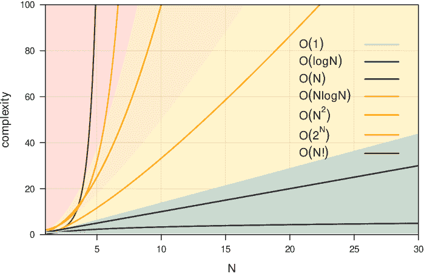

图 4.1 计算复杂度类别的图形比较。

图 4.1 显示了常用的不同复杂度类别。属于 `O(1)`、`O(log N)` 和 `O(N log N)` 的算法被认为是高效的，而属于 `O(N^2)` 或更高复杂度类别的算法则要求更高。从某种意义上说，这种分类反映了计算系统的经济性：每当 `N` 翻倍时，我们的硬件需求翻倍可能是行的，但将其增加 2 倍或更多几乎是不可能的！

我们如何使用大 O 符号？如果我们正在比较不同复杂度类别的算法，我们可以只关注领先项：`O(3 * 2^N + 3.42(N^2)) >> O(2N^3 + 3N^2)` 在功能上等同于 `O(2^N) >> O(N^3)`，因为低阶项的阶差异甚至领先项的系数差异都是无关要的。如果我们正在比较相同复杂度类别的算法，我们只报告领先项及其系数：`O(1.2N^2 + 3N) >> O(0.9N^2 + 2 log N)` 变为 `O(1.2N^2) >> O(0.9N^2)`。在一种情况下，我们可以说随着输入规模的增长，算法以根本上不同的方式进行扩展。在后一种情况下，我们可以说算法扩展方式相似，但仍然对它们进行排序。

然而，在大多数实际环境中，由于其内在局限性，解释大 O 符号需要更细致的方法。

- 大 O 符号并不一定包含常数项，因此它可能无法很好地映射到现实世界的性能。具有复杂初始化阶段且不随输入规模缩放的算法，即使在中等输入规模下，也可能比复杂度更高的算法更慢。这对于某些缓存部分结果或充分统计量的算法可能是这种情况，当缓存这些值的成本比按需要从头重新计算它们要贵时。
- 同样，大 O 符号中的系数通常是不现实的：例如，时间复杂度 `O(2N)` 并不保证 `N` 翻倍运行时间翻倍。算法在硬件上的实现方式等可能不会影响复杂度类别，但它们总是对相关的系数产生强烈影响。因此，我们应该根据经验运行时间估计这些系数以获得真实的性能曲线，并使用后者来比较相同复杂度类中的算法。
- 空间复杂度和时间复杂度之间存在权衡：我们用一个换取另一个。可以说，空间复杂度比时间复杂度更重要。原则上，我们可以多等一会儿获得结果，但如果我们的程序耗尽内存，它就会崩溃，我们什么结果也得不到。

## 4.3 大 O 符号与基准测试

为计算复杂度的所有维度产生经验性能曲线与其他形式的基准测试有几点不同。首先，如果我们知道算法所属的理论复杂度类别，一个简单的模型即可估计其大 O 符号的系数。如果我们在单个维度上测量复杂度，应该对每个输入规模收集多次测量。每个输入规模的平均性能将提供比单次测量更稳定的估计，我们可以利用性能分布围绕平均值建立置信区间。基于经验分数的区间（例如 `[5%, 95%]` 分位数）通常优于基于正态分布的区间（例如平均性能 ± 标准差乘以分位数），因为后者关于平均值对称，且未能考虑到性能自然受限于零、平均值可能接近零导致区间底部为负的情况！

如果我们在多个维度上测量复杂度，最好使用涉及所有维度的单一实验设计，以便将每个维度的主效应与其相互作用分开。大 O 符号可能不包含包含多个维度的项，在这种情况下，检查在实践中是否也是如此很有趣。大 O 符号可能包含此类项，此时估计这些系数的唯一方法是同时改变所有输入。

如果我们正在比较相同复杂度类中的两个算法，应该对相同输入集生成的性能差异进行比较，以增加比较的精度。如果我们使用不同的输入，为每个输入规模收集的性能测量在算法之间是独立的：如果这些算法分别是 `O(f(N))` 和 `O(g(N))`，

> VAR(f(N) - g(N)) = VAR(f(N)) + VAR(g(N))

然而，如果我们对两个算法使用相同的输入，性能测量不再独立：

> VAR(f(N) - g(N)) = VAR(f(N)) + VAR(g(N)) - 2 COV(f(N), g(N))

由于 `COV(f(N), g(N)) > 0`，经验性能差异的变异更小，因此精度更高。

其次，我们应该仔细选择使用的计算系统。在我们进行性能测量时，系统应该保持“静止”：如果有其他任务同时运行，它们可能会尝试访问我们性能测量的共享资源。这产生了两个负面影响：它使得性能测量的噪声更大，并且通过使平均性能变差而增加了估计系数。

第三，我们在使用性能曲线来预测我们实际测量的输入尺寸范围（或输入尺寸组合）时应该非常小心。在任何资源有限的计算系统中，随着系统达到饱和，资源竞争将会增加。因此，我们应该使用具有足够资源的计算系统，以处理我们考虑的任何接近容量极限的输入尺寸。我们感兴趣的是算法的性能，而不是计算系统的性能，因此我们应该对前者施加压力，而不是后者。

最后，请注意，大多数实验设计方法都假设性能测量是独立的。因此，我们应该努力在每次运行之前重置计算系统的状态，使我们的经验测量尽可能独立：例如，我们应该移除所有临时对象。

## 4.4 机器学习算法分析

在机器学习软件领域，算法分析面临一些额外的复杂性。

第一类复杂性与输入尺寸的定义有关。机器学习通常有许多不同的输入，每个输入尺寸都有多个维度（例如样本量和变量数量）。因此，算法在不同维度上属于不同的复杂度类别，而且不太可能某个算法在所有维度上都占据主导。有时我们可以通过考虑以下方式来减少维度：通过假设某些维度由于输入的内在属性是有边界的，或者通过将一个维度表示为另一个维度的函数（例如，变量数量 $p \approx \sqrt{n}$，其中 $n$ 是样本量）。

此外，计算复杂度很大程度上取决于我们对输入分布所做的假设，而不仅仅取决于它们的大小。更多的假设通常允许我们使用性能更好的算法，并使得使用闭式解成为可能：我们以假设形式投入知识越多，我们需要学习的经验测量就越少。假设某种形式的稀疏性或正则性，或在学习过程中主动强制这些特性，将机器学习模型的复杂度降低到可处理的程度。在大多数情况下，不作任何此类假设将意味着指数级或组合的最坏情况复杂度。这是另一种权衡：假设与复杂度之间。

对于随机算法，我们只能对平均情况进行有意义的推理。考虑贝叶斯模型中的马尔可夫链蒙特卡洛（`MCMC`）后验推理，或用于深度神经网络的随机梯度下降（`SGD`）。每次运行它们时，它们都会经过不同的步骤，并可能产生不同的后验分布或模型。结果是，每次运行所需的时间不同，使用的内存也不同。此类算法的构建提供了收敛性保证和收敛速度，因此我们对平均复杂度有一定的预期，但始终存在某种程度的不确定性。

## 4.5 算法分析的一些示例

现在我们通过研究估计线性回归模型 $X\beta = y$ 公式的时间复杂度来应用我们刚刚介绍的概念，我们执行以下步骤：

> ¹这假设 `X` 的每一行对应一个数据点，每一列对应一个变量。在文献中，维度有时会反过来（变量在行，数据点在列）。

- 1. 计算 $\mathbf{X}$ 的 `QR` 分解（`Q` 是 $n \times p$，$\mathbf{R}$ 是 $p \times p$）；
- 2. 将问题重写为 $\mathbf{R}\beta = \mathbf{Q}^Ty$；
- 3. 计算 $\mathbf{Q}^Ty$；
- 4. 解得到的（三角）线性方程组得到 $\beta$。

我们将这个估计器称为 $\hat{\beta}_{QR}$。如果我们忽略病态 $\mathbf{X}$ 带来的数值问题，$\hat{\beta}_{QR}$ 和 $\hat{\beta}_{EX}$ 给出的 $\beta$ 估计相同：它们在统计特性上是相同的，且都没有对 $\mathbf{X}$ 的分布做出任何假设。然而，由于时间复杂度的原因，我们可能仍然倾向于其中一个。

首先，计算 $\hat{\beta}_{EX}$ 的时间复杂度是多少？如果我们手动估计它，将执行的步骤是：

- 1. 计算 $\mathbf{X}^T\mathbf{X}$；
- 2. 求其逆并计算 $(\mathbf{X}^T\mathbf{X})^{-1}$；
- 3. 计算 $\mathbf{X}^Ty$；
- 4. 将步骤 2 和步骤 3 的结果相乘。

鉴于 $\hat{\beta}_{EX}$ 的简单性，该描述足以作为我们分析的伪代码。从容易获取的来源（例如维基百科），我们可以找到每一步操作的时间复杂度：

- 一个 $r \times s$ 矩阵和一个 $s \times t$ 矩阵需要 $O(rst)$ 次操作 [408]；
- 使用 `Cholesky` 分解计算 $r \times r$ 矩阵的逆是 $O(r^3)$ [407] 或 [409]。

这些时间复杂度使用算术运算作为基本操作，这是自然的，因为矩阵只是通过这些运算进行组合和转换的数字集合。`X` 和 `y` 的实际内容无关：两个矩阵在大 O 符号法中仅以它们的维度形式出现。

因此，步骤 1 是 `O(np^2)`，步骤 2 是 `O(p^3)`，步骤 3 是 `O(np)`，步骤 4 是 `O(p^2)`。总复杂度为 `O(np^2 + p^3) = O((n+1)p^2)`，这使得 $\hat{\beta}_{EX}$ 对于参数数量是二次的，而对于样本量是线性的。我们可以做得更好，但提升有限：结合 `Gram-Schmidt` 正交化和 `Householder` 变换可以得到 `O(rs^2)`。

因此，哪种算法最好取决于我们预期处理的数据：

- 如果 $n \to \infty$ 但 $p$ 是有界的，$\hat{\beta}_{EX}$ 和 $\hat{\beta}_{QR}$ 性能相似；
- 如果 $p \to \infty$，$\hat{\beta}_{QR}$ 将更快。

(4.1) 和 (4.2) 中的时间复杂度与真实运行时间的映射关系如何？我们可以通过像 4.3 节讨论那样对 $\hat{\beta}_{EX}$ 和 $\hat{\beta}_{QR}$ 进行基准测试来回答这个问题吗？

```r
y = X %*% rnorm(ncol(X))
}
```

```r
# ... 并保存结果以供后续分析。
time[timen = n & timep = p, c("lq", "mean", "ug") =
    summaryBy(time ~ expr, data = bench,
FUN = c(lq, mean, uq))[-1]
```

```
}FOR
#}
```

我们在图 4.2 中绘制了结果。顶部的面板证实了我们之前得出的结论：$\hat{B}_{EX}$ 和 $\hat{B}_{QR}$ 的时间复杂度对于 $n$ 都是线性的，因此它们的扩展性相似；但 $\hat{B}_{EX}$ 在 $p$ 上具有立方复杂度，这使得随着 $p$ 的增加，它比 $\hat{B}_{QR}$ 慢得多。底部的水平分图显示 $n$ 和 $p$ 共同影响运行时间，正如我们预期的，公式 (4.1) 和 (4.2) 都包含了同时出现 $n$ 和 $p$ 的混合项。


## 4.5 算法分析的一些示例

考虑到我们测得的运行时间噪声很小，我们可以使用简单的线性回归来可靠地估计 (4.1) 和 (4.2) 中项系数。

```r
# 缩放系数以便解释。
timemean = timemean * 10^(-9)
timen = timen / 1000
big0.EX = lm(mean ~ I(p^3) + I((n + 1) * p^2) + I(n * p),
    data = subset(time, betahat == "EX")
coefficients(big0.EX)
## (Intercept) I(p^3) + I((n + 1) * p^2)
## -0.0120329302 -0.0000000025 0.0000017156
## (n * p)
## 0.0000242271
big0.QR = lm(mean ~ I((n + 1) * p^2) + I(n * p),
    data = subset(time, betahat == "QR")
coefficients(big0.QR)
## (Intercept) I(n + 1) * p^2)   I(n * p)
## -0.110315 0.0000013 0.0000502
```

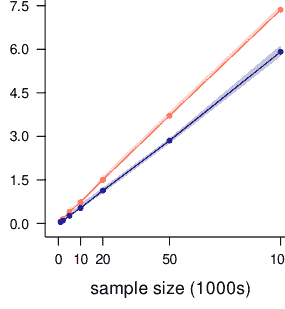
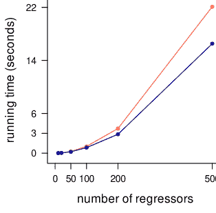
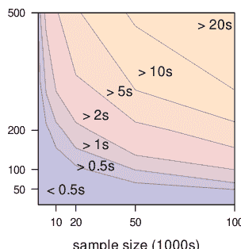
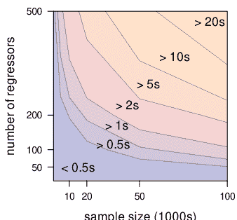

**图 4.2** 运行时间随 $n$（当 $p=200$，左上）和 $p$（当 $n=50000$，右上）变化的边际分布图；闭式公式用橙色表示，QR 估计器用蓝色表示，每个都带有 90% 的置信区间。$(n, p)$ 的联合运行时间分别在左下和右下面板中显示闭式公式和 QR 估计器。

`big0.EX` 和 `big0.QR` 中的模型允许我们预测任何 $n$ 和 $p$ 组合的运行时间。我们还可以用它们来检查其编码的经验复杂度曲线与相应的经验运行时间之间的重叠程度，并检查异常值。

最后一点，在选择使用的算法之前，我们还有应该考虑的几个额外因素：$\hat{\beta}_{EX}$ 中的矩阵逆在在数值上是不稳定的，这就是为什么科学软件更倾向于使用 $\beta_{QR}$。R 和 Julia 中的 `ln()` 以及 MATLAB 中的 `fitlm()` 都是基于 QR 实现的，但有趣的是，Scikit-learn [311] 中的 `LinearRegression()` 并不是。

### 4.5.2 矩阵表示

大多数单元格为零的矩阵被称为稀疏矩阵，而大多数或所有元素非零的矩阵被称为稠密矩阵。对于稠密 $(m \times n)$ 矩阵我们需要在内存中存储所有单元的值，这意味着它们的复杂度是 $O(mn)$。然而，对于稀疏矩阵，我们只需要存储非零值及其坐标，并假设所有其他单元均为零。

R 在 `Matrix` 包 [30] 中提供了几种表示方法，Python 在 `scipy` [388] 中也是如此：默认是 3.2.3 节描述的列式压缩格式。考虑图 3.4 所示的矩阵，15 个单元格中有 9 个是零。

```r
library(Matrix)
m = Matrix(c(0, 0, 2:0), 3, 5)
m
## 3 x 5 类为 "dgCMatrix" 的稀疏矩阵
## [1,] 1 . 2
## [2,] 2 . 1
## [3,] 2 . 1
```

$m$ 的元素是如何存储在内存中的？

```r
str(m)
## 'dgCMatrix' 类，包 "Matrix"，包含 6 个插槽:
  @ i: int [1:6] 0 1 1 2 2 2
  @ p: int [1:5] 0 2 3 4 5
  @ Dim: int 3 5
  @ Dimnames: NULL
  @ x: num [1:6] 2 2 1 1 2 1
```

- `i` 包含矩阵中非零单元的行坐标向量；
- `p` 包含列的起始结束索引向量；
- `x` 包含非零单元的值。

注意 `i` 和 `p` 都是从 0 开始的索引，以便 `Matrix` 包内部使用，而 R 使用从 1 开始的索引。这种稀疏矩阵的整体复杂度为 $O(3z)$，其中 $z$ 是非零单元的数量。R 将实数存储为双精度（64 位），并将索引存储为 32 位整数，这意味着每个非零单元占用 128 位（16 字节）。因此，稠密矩阵使用 $mn$ 字节，而稀疏矩阵使用 $16z$ 字节；如果 $z \ll mn$，我们可以节省大部分内存。症结在于稀疏矩阵的操作复杂度比稠密矩阵高。即使是最简单的操作：查找单元 $(i, j)$ 的值在稠密矩阵中复杂度为 $O(1)$，但对于稀疏矩阵 `m`，我们需要：

- 通过读取 `p` 的元素查找第 $j$ 列的第一和最后一个值；
- 在 `i` 中定位该值的行，并读取后续数字直到找到行 $j$ 或到达列尾；
- 从 `x` 中读取位于 `i` 位置的值；或者如果到达列尾则返回零。

这三个步骤的整体复杂度为 $O(1) + O(z/n) + O(1) = O(2 + z/n)$，假设每列平均 $z/n$ 个非零元素。因此，从矩阵读取单元似乎比从稠密矩阵更贵。在稀疏矩阵单元中赋值非零值也更贵。对于 `i` 和 `x` 的每一次操作，都需要：

- 分配一个长度为 $z+1$ 的新数组；
- 从旧数组拷贝 $z$ 个值；
- 加上新单元的值；
- 用新数组替换旧数组。

因此，时间和空间复杂度均为 $O(z)$。处理 `p` 也是 $O(z)$，并且更复杂，因为平均我们需要重新计算一半的值。

这令人困扰，因为我们无法通过输入大小来预测平均时间和空间复杂度：只能对单元中值的分布做出假设。此外，在我们为稀疏矩阵分配新的非零值时，这种分布可能会改变。然而，我们可以比较稠密矩阵和稀疏矩阵的读写操作运行时间，以实际理解它们的差异，正如我们在上一节中使用 $\beta_{EX}$ 和 $\beta_{QR}$ 所做的那样。

考虑一个分配为稀疏或稠密矩阵的方阵，$n=1000$，非零单元比例 $z/n = \{0.01, 0.02, 0.05, 0.20, 0.50, 1\}$。随着 $z$（下方代码中的 `zz`）的增加，我们可以测量读取（使用 `read10()` 函数）或写入（使用 `write10()` 函数）两种类型矩阵 10 个随机单元值所需的时间。

```r
read10 = function(m) m[sample(length(m), 10)]
write10 = function(m) m[sample(length(m), 10)] = 1
...
for (z in zz) {
  bench = read10(sparse), read10(dense),
  write10(sparse), write10(dense),
  times = 200,
  control = list(warmup = 10),
  setup = {
    sparse = Matrix(0, n, n)
    sparse[sample(length(sparse), round(z))] = 1
    dense = matrix(0, n, n)
  }
}
...
```

结果运行时间如图 4.3 所示。正如我们预期的，对稠密矩阵的读取和写入都是 $O(1)$：运行时间随 $z$ 的增加而变化。这在稀疏矩阵的情况下并非如此。`write10()` 的运行时间随 $z/n$ 线性增加，`read10()` 也是如此，直到 $z/n = 0.5$。对于 $z/n = 1$，读取运行时间不再增加：事实上，它们略有减少。我们可以将其解释为 $O(2 + z/n)$ 在 $z/n \to 1$ 时收敛到常数 $O(3)$，这使得（不再稀疏的）矩阵只需要额外查找的高效稠密矩阵。

最后，我们将运行时间（秒）对 $O(z/n)$ 进行回归，以确定我们在稀疏矩阵中看到的线性趋势斜率，即图 4.3 两个面板中的橙色线。对于写入性能，斜率数值为 0.09；当我们仅考虑 $z/n \le 0.5$ 时，读取性能为 0.03。因此，矩阵中每增加百万个单元格，写入时间大约增加 10%，读取时间增加 3%。这对于包含数百万个元素的大矩阵显然是真实的；对于只有几十个元素的较小矩阵，性能可能会大不相同。

### 4.5.3 有向无环图的均匀模拟

许多概率模型可以以图的形式表示为有向无环图（DAG），其中每个节点与一个随机变量相关，弧表示这些变量之间的依赖关系：著名的例子包括贝叶斯网络 [314]、神经网络 [122]、贝叶斯层次模型 [109] 和向量自回归（VAR）时间序列 [375]。DAG 使得将大型多元分布分解为较小的分布成为可能，其中每个变量仅取决于其父节点。

在评估这些模型的各个方面时，能够生成随机 DAG 用于模拟研究可能会很有用。特别地，我们可能希望生成具有均匀概率分布的 DAG，因为这被认为是可能模型结构空间上的无信息先验分布。实现此目的的一种简单 MCMC 算法在 [209] 中给出过。我们以伪代码的形式在算法 1 中写下了它。为了简单起见，我们省略了热身（burn-in，丢弃初始迭代中生成的 DAG，以便算法有足够收敛到 DAG 的均匀分布）和抽样（thinning，每隔几个生成的 DAG 只返回一个，以返回一个更独立的 DAG 集合，尽管这两者在文献中都是标准做法）。

#### Algorithm 1 随机 DAG 生成

**输入：** 节点集 V（可能带有相关标签），要生成的图的数量 N。

**输出：** 包含 N 个有向无环图的集合 G。

1. 初始化一个具有节点 V 的空图且 $A_0 = {\varnothing}$。
2. 初始化一个空图集 **G**。
3. 对于大量的迭代 $n = 1, \dots, N$：
   (a) 采样两个随机节点 $v_i$ 和 $v_j \in V$，且 $v_i \neq v_j$。
   (b) 如果 $\{v_i \to v_j\} \in A_{n-1}$，则 $A_n \leftarrow A_{n-1} \setminus \{v_i \to v_j\}$。
   (c) 如果 $\{v_i \to v_j\} \notin A_{n-1}$，检查在添加 $\{v_i \to v_j\}$ 后图是否仍然无环。
      i. 如果图仍然是无环的，$A_n \leftarrow A_{n-1} \cup \{v_i \to v_j\}$。
      ii. 如果图不再无环的，则不做任何操作。

我们如何在这个算法中表示 DAG？任何图都可以通过其节点 V 和其弧 A 唯一标识。例如，考虑一个节点为 V = $\{v_1, v_2, v_3, v_4\}$ 弧为 $\{\{v_1 \to v_3\}, \{v_2 \to v_3\}, \{v_3 \to v_4\}\}$ 的图。它的邻接矩阵是一个方矩阵，如果 DAG 中存在弧 $v_i \to v_j$，则 $(i, j)$ 单元格等于 1，否则则为 0：

$$

\begin{pmatrix} 0 & 0 & 1 & 0 \\ 0 & 0 & 1 & 0 \\ 0 & 0 & 0 & 1 \\ 0 & 0 & 0 & 0 \end{pmatrix}

$$

我们可以用大小为 $|V|$ 的密集或稀疏矩阵存储邻接矩阵：取决于我们期望在 DAG 中看到的弧数量，正如 4.5.2 节所述，空间复杂度和时间复杂度之间的权衡是可以接受的。图的邻接列表是包含每个节点子节点的集合：

- $v_1 = \{v_3\}, v_2 = \{v_3\}, v_3 = \{v_4\}, v_4 = \varnothing$。

这种表示法在空间复杂度上与稀疏邻接矩阵竞争：两者都是 $O(|A|)$，其中 $|A|$ 是 DAG 弧集的大小（即它包含的弧的数量）。如果我们假设 DAG 包含很少的弧使得 $O(|A|) = O(|V|)$，那么空间复杂度将比邻接矩阵的 $O(|V|^2)$ 更好。对于时间复杂度，邻接列表中路径查找是 $O(|V| + |A|)$，而邻接矩阵中是 $O(|V|^2)$。相反，邻接矩阵允许 $O(1)$ 级别的弧插入、删除以及查找弧是否存在于 DAG 中。所有这些操作在邻接列表中要么是 $O(|V|)$ 要么是 $O(|A|)$。

目前，让我们用密集矩阵表示 DAG。我们可以这样确定算法 1 中 MCMC 步骤的时间复杂度：

- 对于每次迭代，添加和删除弧是 $O(1)$，因为我们只是读取或写入邻接矩阵中的特定单元格。
- 随机选择一对节点也可以被认为是 $O(1)$，因为我们无论 $|V|$ 还是 $|A_n|$ 都选择两个节点。
- 深度优先和广度搜索的时间复杂度为 $O(|V|^2)$，因为我们需要扫描整个邻接矩阵来查找每个节点的子节点。只有当采样不存在的弧时才执行此类搜索，因为为了包含弧 $v_i \to v_j$，必须确保从 $v_j$ 到 $v_i$ 没有路径以保持 DAG 无环。这种情况发生的概率为 $O(|A_n|/|V|^2)$。

$N$ 次迭代算法 1 的总时间复杂度为：

$O\left(N\left(1 + 1 + \frac{|A_n|}{|V|^2}\right)\right) \approx O(N|A|)$。

然而，我们假设所有 DAG 服从均匀分布：[209] 报告 $O(|A_n|) \approx O(|V|^2/4)$，使得算法 1 为 $O(N|V|^2/4)$。如果假设 DAG 有不同的分布，即使 $V$ 和 $N$ 保持不变，算法复杂度也会改变，因为 $|A_n|$ 会不同。此外，注意算法 1 单个步骤的整体复杂度乘以 $N$ 意味着我们假设所有 MCMC 步骤具有相同的复杂度。$O(|A_n|/|V|^2)$ 项在早期 MCMC 步骤中（当 $|A_n|$ 受步骤数 $n$ 限制时）较低，而在后期步骤中（当 $|A_n| \approx |V|^2/4$ 且算法 1 收敛到均匀分布时）是合理的，如果 $N$ 足够大。

对于生成的每个 DAG，我们还需要考虑将其保存在数据结构中的代价。将邻接矩阵转换为另一种数据结构必然是 $O(|V|^2)$，因为我们需要读取邻接矩阵中的每个单元格来确定哪些弧在 DAG 中。我们并不总是执行转换，因为我们可能会拒绝一个新的 DAG，评估这种情况很难。一个合理的猜测是我们总是保存稀疏图，因为通常 $v_j$ 和 $v_i$ 之间没有路径（这是我们拒绝当前 DAG 的唯一情况，且不需要转换）。随着 $|A_n| \to |V|$，该条件将变得更容易满足，因此我们可以说对于大多数迭代，$O(|V|^2) = O(1)$。

对于空间复杂度，邻接矩阵使用 $O(|V|^2)$ 空间：它是表示图的最浪费方式。我们将 DAG 保存到任何其他数据结构都可能使用更少的空间。

我们可以像 4.5.1 和 4.5.2 节一样研究上述所有语句。

```r
library(bnlearn)
melancon = function(nodes, n) {
  # step (1)
  dag = empty.graph(nodes)
  adjmat = matrix(@, row = length(nodes), ncol = length(nodes),
  dimnames = list(nodes, nodes))
  # step (2)
  ret = vector(n, mode = "list")
  for (i in seq(n)) {
    # step (3a)
    candidate.arc = sample(nodes, 2, replace = FALSE)
    # step (3b)
    if (admat[candidate.arc[1], candidate.arc[2]] == 1) {
      adjmat[candidate.arc[1], candidate.arc[2]] = 0
      amat(dag) = adjmat
    }
    else {
      # step (3c)
      if (!path.exists(dag, from = candidate.arc[2],
          to = candidate.arc[1])) {
        adjmat[candidate.arc[1], candidate.arc[2]] = 1
        amat(dag) = adjmat
      }
    }
    # ELSE
    # step (3d)
    ret[[i]] = dag
  }
  # FOR
  return(ret)
}
# MELANCON
```

### 4.5.4 邻接列表表示下的复杂度分析

如果我们用邻接列表表示 DAG，时间复杂空间复杂度会如何变化？对于邻接列表，路径查找（例如通过深度优先搜索）和将 DAG 保存到不同的数据结构的时间复杂度均为 $O(|V| + |A_n|)$。然而，每次 MCMC 迭代的总体复杂度仍然是二次的：

$O\left(N\left(1 + 1 + (|V| + |A_n|)\frac{|A_n|}{|V|^2}\right)\right) \approx O\left(N\left(1 + 1 + (|V| + |V|^2)\frac{|V|^2}{|V|^2}\right)\right) \approx O(N|V|^2)$，

再次假设 $O(|A_n|) \approx O(|V|^2/4)$。邻接列表的空间复杂度为 $O(|V| + |A_n|)$。在相同假设下，平均而言变为 $O(|V|^2)$。

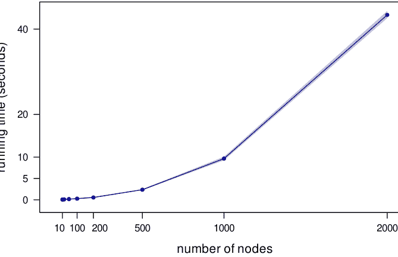

## 4.6 大 O 符号与真实世界的性能


# 大 O 符号与机器学习软件性能评估

大 O 符号是评估可扩展性的有用工具，它通常与真实机器学习软件的实际性能相关。然而，由于以下原因，随着此类软件变得日益复杂，这种评估变得越来越困难：

- 机器学习流水线中的软件由异构部分组成，通常用不同的编程语言编写，并构建在不同的库之上。即使它们属于相同的复杂度类别，每个部分的速度也可能比另一部分更快或更慢。更多内容请见第 6.1 节。软件升级可能会改变流水线不同部分的相对速度，并引入新的瓶颈。

- 在其他条件相等的情况下，相同的算法取决于存储输入和输出的数据结构，其速度可能更快或更慢。我们在 4.5.2 节中看到了这一点，并在 3.4 节中也提到了这一点。变量类型也是如此，正如 3.3 节所讨论的。高级语言在很大程度上抽象了这些细节，这在对软件进行基准测试时可能会带来惊喜。

- 硬件差异的影响可能足以在实际输入尺寸范围内完全掩盖不同算法复杂度类别的差异。相反，它们也可能引入性能差异。当输入尺寸足够小以至于相邻复杂度类别具有可比性时，这种情况可能会真实发生：对于 N ≤ 100，CPU 核心上的 `O(N²)` 算法将比具有数百个空闲单元的 GPU 上的 `O(N³)` 算法慢。导出计算复杂度时忽略的固定成本也可能因为不同类型的内存而变得相关（第 2.1.2 节）。

- 如果使用任何远程系统（第 2.3 节），我们运行机器学习流水线的硬件可能在我们不知情的情况下发生变化，无论是在配置还是整体负载上。此外，准确地对远程系统进行基准测试本质上更困难，排除故障也是如此。

- 流水线某些部分的性能可能会受到提供机器学习模型输入或消耗其输出的外部系统的人为限制。同一系统的各个部分在消耗彼此的输出时，也可能相互减慢。

总结来说，对于运行在简单硬件配置上的机器学习流水线的单个组件，我们可能能够将计算复杂度映射到真实世界的性能。但当系统变得更大并包含更多的软件和硬件组件时，我们无法以任何程度的准确性做到这一点。导致性能不可靠，很容易让我们的预期和直觉也变得不可靠。在这种情况下，识别性能问题需要测量每个组件的当前性能作为基准，识别哪些组件执行最频繁（这些有时被称为“关键路径”或“热点路径”），并尝试重新设计它们以使其更高效。

# 第二部分：机器学习流水线的最佳实践


# 5 流水线的设计与结构化

当我们开始编写新软件时，我们的首要挑战之一是识别它的逻辑组件以及它们如何相互作用。然后，我们可以将软件结构化为一系列模块（无论是类、库还是完全独立的程序），以这种方式实现这些逻辑组件，使得对软件的推理尽可能容易。换句话说，设计软件是为了通过分治法的方法处理复杂度，这样我们在任何给定时间都只需要面对一小部分复杂度 [252]。未能这样做将导致软件变得无法理解和维护（第 6 章），这反过来又使其难以部署（第 7 章）、编写文档（第 8 章）、测试或排除故障（第 9 章），并且在通常情况下难以保持持续运行。

在本章中，我们讨论了定义机器学习软件设计的独特挑战：数据的作用（第 5.1 节）、技术债的本质（第 5.2 节）以及机器学习流水线的解析（第 5.3 节）。

## 5.1 数据即代码

机器学习软件在一个重要方面与许多其他软件有本质不同：它与数据紧密结合 [25]。传统软件¹的结构和行为源于从领域专家处收集的流程组合、对预期输出的规范，以及我们可以用于支持其操作的技术栈（图 5.1，左侧）。我们负责设计产生预期行为的软件架构。例如，我们结构化 Web 服务，通过针对不同任务的既定程序引导用户导航模式，从某些数据库或各种供应商 API 检索信息，并产生供某些仪表板（人类使用）或 API（其他计算机系统使用）使用的输出。桌面应用程序通过窗口和对话框执行相同的操作。显然，我们在设计软件架构方面的自由是受到限制的，既有充分的理由（包括性能需求、良好实践和可维护性），也有不恰当的理由（不理想的需求、所选技术栈的局限性以及不明确的需求），但这仍然为我们留存了相当数量的控制权。

另一方面，机器学习软件的行为在很大程度上取决于我们训练模型的数据，也取决于我们的设计选择。我们可能决定如何衡量模型性能，但最佳表现者将由数据决定：数据中变量的分布及其概率结构将被某些模型比其他模型更好地捕捉。

> ¹所谓“传统软件”，是指任何与分析、数据科学或机器学习无关的软件。

| 程序 | 传统编程 | 输出 | 机器学习 | 程序 |
|---|---|---|---|---|

**图 5.1** 机器学习软件中角色（右侧）与其他软件（左侧）相比的角色反转。

因此，我们可能选择尝试，例如，随机森林、深度神经网络和某些分层贝叶斯模型，但最终，我们将使用数据认为最好的模型，无论我们的个人偏好如何。数据中的信息通过模型编译到软件中，由模型自动编写软件：开发者并没有在代码中完全编码其行为（图 5.1，右侧）。

这种认识导致了范式的转变：我们应该将数据视为代码，因为数据在功能上取代了我们源代码的部分，而且数据的变化可能会改变软件的行为。我们应该测试数据以确保它们的特征不会随时间而改变（第 5.2.1 节）。毕竟，如果数据发生变化，我们的模型可能不再适用，我们可能需要重新训练以保持适当的性能水平。对于离线数据，这意味着应该与代码一起进行版本控制，其中任何一的变化都应触发持续集成工具的测试。对于在线数据，我们还应该对新数据的特征和部署模型的性能进行实时监控和日志记录（第 5.3 节）。一旦我们确认数据如我们预期的那样，就可以使用它们来测试我们的软件（实现）运行是否正确，并确保模型本身的定义是正确的（在它们的数学和概率公式方面）。我们将在下一节和第 9 章更详细地讨论数据和机器学习模型的故障排除与测试。

## 5.2 技术债

将数据视为代码意味着我们应该将数据视为潜在的技术债来源。模型也因为其对数据的依赖以及其本身而可能成为技术债的来源。在实践中，数据和模型是我们机器学习代码的依赖项：就像所有依赖项一样，它们是潜在的负债，应该按这种方式处理。

“技术债”一词自首次引入以来 [73, 74] 通常带有负面含义：它强调了草率的设计选择如何导致意想不到的成本，不仅体现在纯经济角度上，还通过引入潜在的复杂性，使得软件随着时间的推移变得难以维护。技术债允许我们通过牺牲质量换取速度来更快产生结果，但就像贷款一样，我们最终必须加上（复利）偿还。当紧迫的截止日期减少了用于分析和设计的时间 [96] 时，技术债是不可避免的，导致功能、代码质量或技术实现方面的方案并非最优。建立并遵循我们在书中第二部分中提倡的实践，是控制技术债并足够快速偿还以随时间减少债务的好方法。

机器学习模型以及底层的训练、测试和服务软件基础设施（我们将在 5.3 节中作为机器学习流水线介绍），结合了传统软件开发的所有复杂性与数据分析实验性产生的问题。（更多内容见第 6 章。）因此，我们认为以统一、全面的方式重新思考机器学习软件中技术债的本质是有用的。我们将其分为四个广泛领域：数据、模型、架构（设计）和代码债。这些领域跨越了机器学习实践的不同部分，例如数据收集、数据验证、特征提取、数据可视化和可观测性；以及我们用于与机器学习模型交互的软件，例如监控、配置、训练和推理基础设施。驱动模型本身的库，如 `PyTorch` [259] 或 `Scikit-learn` [311]，通常非常稳定，我们很少发现它们是技术债的来源。

### 5.2.1 数据层面

第 5.1 节指出数据可能成为负债的原因有三个。首先，它们可能源自不可信的来源，无论是内部系统还是第三方系统。我们无法控制或没有严格质量标准的数据源应被视为未知数：数据可能会随时间推移在形状（原始数据结构或类型变化）、总体质量（数据重复、缺失数据、空数据或归一化错误的数据）或相关性和统计属性（数据漂移或概念漂移）上发生意外变化。对于以事件流形式进入或通过聚合多个源数据生成的在线数据来说尤为如此。（更多内容见第 9.1 和第 9.4.3 节。）为了防止此类异常影响模型训练及其后续使用，我们应该只允许经过我们的一套软件测试（第 9.4 节）版本化和验证的数据进入机器学习流水线。系统测试充当了质量关，数据在进入处理阶段之前必须通过。数据漂移会使模型过时：随着模型进行推理的数据与其训练时的数据变得越来越不同，其准确性将会下降 [107]，这是对该主题的广泛回顾。如果数据的总体质量随时间退化，可能会发生同样的情况。除非这些变化足够突然且尖锐，否则在没有测试套件的情况下很难检测到其影响。这似乎发生在在线房地产公司 Zillow [319] 身上：他们用于房产定价的机器学习模型是基于自报告的数据训练的，而这些数据是不可信且难以验证的，导致在市场冷却时，模型在长时间内都高估了价格。到 2021 年模型退役时，Zillow 必须以亏损或免费的方式出售其买入的 60% 到 85% 的房产。

其次，数据可能源自未追踪的来源：我们应该始终考虑到第三方来源可能是多变的，并且可能突然不可用。如果我们未意识到的某个依赖的数据源发生这种情况，排除由此产生的问题可能具有挑战性。此外，未追踪的来源通常也是不可信的，与受追踪的来源不同（后者经过了系统的版本化和验证）：它们的任何问题都可能被长时间忽视而不察觉。在这种背景下，数据的来源及其产生方式被称为数据溯源或数据血缘 [63]。

最后，当我们为许多应用准备数据时，可能会在数据中引入问题：我们只能收集未标记的数据并必须进行手动标注：这是一个昂贵、耗时且容易出错的过程，需要一个领域专家团队。使用机器学习模型进行自动标注是一个糟糕的替代方案，因为已知它在自然语言处理和计算机视觉任务中的准确率仅为 0.15–0.20 [413]。缺乏真实值使得发现这些错误非常困难，反过来影响了数据质量和模型过时性。因此，这个问题可以在不同层面上产生技术债。

### 5.2.2 模型层面

模型性能问题（由数据或其他原因引起）不太限于单个模型。再次考虑数据漂移：如果机器学习模型 A 的任何输出被用作模型 B 的输入，模型 A 的准确性下降将传播到模型 B 并可能被放大。正如数据的情况，我们可以通过使用集成测试作为质量关来检测此类问题，以确保每个模型的输入和输出符合预期。只有当我们跟踪模型之间的依赖关系时（例如在编排器配置（第 7.1.4 节）中记录它们，或为模型访问建立身份验证和授权机制 [95]）才是可能的。

因此，我们可以说模型层面的技术债主要源于特征和模型的纠缠：任何影响推理能力的问题将传播到所有直接或间接依赖它的下游模型，这被称为修正级联（第 9.1.2 节）。特征之间、模型之间以及特征之间的纠缠在实际应用中是不可避免的：“改变任何事物都会影响一切” [312]。特征之间很少完全独立，而且像深度神经网络这样的黑盒模型（第 9.2.2 节）故意以难以理解的方式将它们纠缠。模型之间也是纠缠的，因为它们消耗彼此的输出（第 9.1.2 节）。这种复杂的相互作用不幸地意味着，即使当我们发现了出现问题的迹象（第 9.3 节）时，找到我们正在排除的问题根因也可能是困难的。

（在在此过程中是否最大化了某些抽象的参与度指标？）机器学习模型通过外生事件直接相互影响而产生的隐性反馈循环也是可能的，且更难被察觉。诸如拒绝推断 [71] 和上下文老虎机 [79, 80] 等技术，通过从用户和领域专家收集反馈（第 5.3.4 和 5.3.5 节）并包含额外特征，可以通过探索新模型并建议是否应该重新训练当前模型来帮助打破此类循环。

最后，当我们取一个预训练模型并针对不同任务对其进行微调时，模型之间可能会相互纠缠。这种做法减少了计算需求并加速了模型开发：我们购买一个用于通用任务（例如，目标检测）的预训练模型 A，然后使用紧密针对特定的数据集将其专门化为模型 B、C 等，用于特定任务（例如，检测工业过程中半成品中的杂质）。然而，模型 B、C 等很可能会从 A 处继承相似的失败模式，从而在模型之间引入了没有跟踪依赖的耦合，并在机器学习流水线中产生意料之外的修正级联。此外，模型 B、C 等变得更难以独立演进，因为我们在模型 B 中修复的任何 bug 都应该在模型 A、C 等中同样修复（或确认不影响它们），并且所有模型的软件测试都应该同时更新。同样，任何对模型 B、C 有意义的增强，我们可以使用配置管理平台来管理这些问题（正如我们在第 5.1 节中指出的），以跟踪模型之间以及模型与数据之间的依赖，对它们进行版本控制并实现系统化测试（第 9.4.2 节）。

### 5.2.3 架构（设计）层面

机器学习流水线的架构指导了数据和模型如何交互以实现其目标：它实现为一个编排系统，调度并协调各种任务，如数据摄取、数据验证、特征工程、模型训练与验证、生产系统上的模型部署以及服务。我们将在第 5.3 节详细讨论这些内容。

机器学习流水线本质上是复杂的系统，具有许多活动部件，很容易隐藏架构（设计）债。控制这种技术债的关键在于使用如 XML、YAML 或 JSON 等人类可读数据序列化语言的文件，对其所有配置代码的方面提供可见性。这些文件应该在配置管理解决方案中与数据（第 5.1 节）和模型（第 5.2.2 节）一起受版本控制，原因也是类似的。设计中的每种更改可以通过这些配置文件或使用环境变量来表示。配置文件应用于我们需要在迭代中进行完全版本控制的参数、选项和设置，例如数据集位置、训练超参数和模型参数。这些文件还可以链接到并补充架构文档，该文档使用更易理解的通用语言描述流水线（第 8.3 节）。环境变量应用于存储运行时配置，如日志级别（第 5.3.6 节）、功能标志（第 6.5 节）以及目标测试环境或生产用环境的标签。环境变量也常用于密钥管理，即存储凭据、证书和其他敏感信息。所有

> ²语言的选择通常由编排软件决定。然而，由于其可读性、可移植性和成熟度，YAML 正在成为事实上的标准。

所有构建机器学习流水线的现代软件解决方案都提供了配置、覆盖和暴露环境变量（包括密钥）的机制。只有对流水线及其所有组件进行全面的正式描述，我们才可能在时间的推移中进行演进和扩展，而不会意外积累架构债。对架构以及数据和模型的跟踪和版本控制可以减少故障排除和调试的时间，并使实施高效部署策略（第 7.2 节）和回滚问题模型（第 7.6 节）成为可能。另一种方法是手动执行这些操作，这既耗时又容易出错：Knight Capital [317] 向世界证明了这一点，由于其手动部署失误，在 45 分钟内烧毁了 4.6 亿美元。

不幸的是，我们无法控制并跟踪由于自行训练而引入的第三方库。这些依赖项通常使用 glue code 集成，因为包管理器和其他自动化工具无法感知它们的存在。

代码债的另一个来源是创建模型涉及的大量探索和实验。它很容易产生死代码路径，这些路径通常没有良好的注释说明（第 8.1 节），并在我们尝试实现代码覆盖率（第 9.4.6 节）时导致精力浪费。它还可能限制我们从原型到生产阶段改进代码质量的时间。作为代码债，我们应该避免在机器学习流水线中混合不同版本的解释器、编程语言和框架。不幸的是，这是一个常见问题，原因有两个：首先，机器学习专家和数据科学家通常在孤立状态下工作，缺乏共享开发环境。其次，微服务类似的架构有利于在同一应用程序中使用多种编程语言（即他们所谓的异构编程），这会导致技能水平分布不均（例如，只有一个开发者精通某种框架）以及知识传递不足。从实用角度来看，一种折中方案是用少量、最新的技术构建任何机器学习流水线，并在引入新技术时让所有开发者参与。后者应谨慎。

相关问题是库的代码，即将特定版本的软件包含在代码库中，而不是通过包管理器作为外部库进行管理。这些变成了未跟踪的依赖，通常使用 glue code 集成，由于包管理器无法感知而难以更新。

### 5.2.4 代码层面

作为代码债，我们应该避免在流水线中混合不同版本的接口和数据结构（第 8.2 节）。我们只有在严格需要它们时才使用 glue code，例如：为了调试目的对函数进行实例化；为了暴露流水线的不同版本或功能；或者为了集成我们在其他情况下无法使用的库或 API。

glue code 也常用于包装并暴露公共 API，因为它允许我们以快速方式集成它们。虽然这种做法看起来很方便，但它会将 glue code 紧密耦合，并在 API 变化时导致崩溃（如果是在流水线中）。

## 5.3 机器学习流水线

现代软件开发流派如 Agile [36] 和 DevOps [153] 从 21 世纪初以来就开始推动测试、发布管理和部署过程的自动化，导致了持续集成/持续交付和持续部署（CI/CD）解决方案 [86] 来管理软件开发生命周期。持续集成是通过频繁向版本控制仓库提交小更改来开发代码的做法。每次更改都通过自动化软件测试解决方案进行验证、人工评审，然后集成到创建生产构建的主干分支。结果是主干分支始终处于工作状态，代码更改对所有开发者都是可见的。（更多内容见第 6 章。）持续交付和持续部署侧重于随时发布可工作的软件版本，并部署在生产系统上运行。（相关内容将在第 7 章详细介绍。）在这两种情况下，重点都在于使用自动化流程、版本控制、配置管理、软件测试和代码审查，以实现轻松、快速且可靠的软件开发生命周期。

如今，我们有许多集成的 CI/CD 解决方案来构建机器学习流水线（称为“MLOps”）。然而，当流水线的开发从开发者本地环境运行的简单概念验证演变为由团队管理并运行在多个系统上的大型软件时，全面理解其工作原理变得至关重要。（大多数现实世界中的流水线都复杂到需要团队来管理。）最初，我们探索一些示例数据并尝试不同的模型来评估它们的性能，在软件测试上花费很少或不花费时间。随后，开发流水线变成了图 5.2 所示的迭代且日益复杂的过程：

### 5.3.1 数据摄取与验证

输入数据以及所有模型训练和推理实例的输出。（包括我们用于探索数据的数据。）我们可以像在传统软件工程环境中做的那样，对每个开发和生产环境中所使用的所有组件进行精确的版本标记。反过来，这意味着我们可以（重新）创建所需的任何此类环境，这使得自动化部署成为可能（见第 7 章），并极大地促进了故障排除。鉴于大多数机器学习模型（本质上是黑盒）具有有限的解释性和可理解性，只有接近“可重现构建设置”[153]的解决方案才可能实现深度调试和根因分析。

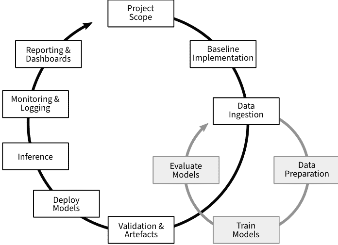

图 5.2 机器学习流水线的生命周期。


# 5 设计与构建流水线

## 5.3 机器学习流水线

将摄取阶段的新数据馈送到现有模型中以进行验证、监控和故障排除；随着数据变化生成新模型；部署模型并持续为下游模型或用户访问的应用程序或服务提供服务。这就是我们所说的机器学习流水线：将这些步骤编码为独立的、可重用的、模块化的部分，并将这些部分串联起来，以编排数据流入和流出机器学习模型。MLOps 实践标准化并自动化了流水线的开发方式，为我们带来了 CI/CD 为传统软件工程带来的所有优势，并建立在相同的基础之上：有效利用版本控制、配置管理、自动化测试、代码审查和自动化部署。持续集成除了代码的测试和验证外，现在还涵盖了数据和模型的测试与验证。持续交付和持续部署扩展到整个机器学习流水线的生产和部署，同样包含了模型。这种对 CI/CD 的扩展定义让我们专注于机器学习模型的开发、测试和验证，用基于行业标准的系统解决方案替代基于胶水代码（`glue code`）的自建解决方案。

图 5.2 引用了图 1.2 中的软件开发周期表示法并填充了具体内容。它展示了可重复机器学习的关键逻辑步骤：我们应该注意构建一个稳健且可维护的流水线。某些框代表开发阶段，某些是将来成为我们流水线中模块的实际软件，另一些则二者兼备。

> ³在软件工程中，“流水线（pipeline）”是指开发和交付软件的过程：CI/CD 就是一条流水线。在书中，我们用它指代开发和使用机器学习模型的软件基础设施，并泛指构建和运行它的过程。

广义来说，我们可以将流水线中的模块分为四个阶段：数据摄取与准备；模型训练、评估与验证；模型部署与服务；以及监控、日志记录与报告。每个阶段提供的功能如何划分取决于我们如何定义流水线的范围；随后我们就可以产生一个基线实现，以对其规模和结构建立直觉。然而，软件工程中成熟的设计原则同样适用 [252, 369]。每个模块应该只做一件事并彻底完成（“单一职责原则”），尽可能地封装复杂性并将其抽象在简单的接口之后（即“深度模块”）。因此，我们可以通过避免变更放大（使一个简单的更改需要修改许多不同的位置）和减少认知负荷（开发者为了成功完成更改需要知道多少知识）以及减少不确定性（不清楚应该触碰代码哪些部分）来控制流水线的复杂性。简单接口较不容易改变；如果我们限制依赖数量并避免常见的反模式，如隐式约束（例如，函数应该按特定顺序排列）和包含各种无关信息的透传变量（例如，上下文对象中的所有状态），它们还可以减少模块之间的耦合。简单接口还应该通过暴露具有领域含义的方法和数据结构来反映领域知识，名称取自通用语言 [第 8 章]，并带有使常见情况易于实现的默认设置。这种方法可能会产生一种模仿领域专家工作流模式的流水线架构，允许他们在“人机交互”设置中帮助验证模型和推理输出 [413, 416]。此外，模块化的流水线可以由编排器轻松管理，编排器可以部署模块（第 7 章）、将其分配到具有适当硬件资源的系统（第 2 章）并控制它们的执行。

### 5.3.1 项目范围

从图 5.2 的顶部开始，构建机器学习流水线的第一步是理解它应该解决的问题、可以使用什么数据来解决、它应该产生什么输出，以及最终用户是谁。为了澄清这些点，我们应该首先确定谁将参与流水线的开发或与之交互（利益相关者）：软件开发人员、机器学习专家、领域专家和用户的组合。他们共同拥有定义流水线范围所需的所有信息。

界定机器学习流水线及其底层系统（第 2 章）的过程涉及以下步骤：

1.  **识别我们想要解决的问题**：利益相关者应该共同努力，显式地定义流水线应该解决的问题并评估其影响。领域专家应该有一个具体的业务或学术需求来解决，并与其他利益相关者一起决定该问题是否值得解决，以及解决它是否对足够多的人有价值。如果领域专家对机器学习可以有效处理的问题类有一定的熟悉，这个过程将会顺畅得多。
2.  **识别我们想要优化的目标**：利益相关者应该决定解决问题意味着什么。为此，领域专家应该设定可衡量的领域指标和可实现的阈值来定义“成功”。这些指标应该是：
    - 跨数据、模型和技术解决方案具有可比性，以便对比不同的流水线实现；
    - 易于理解和解释；
    - 足够简单以便实时收集用于日志记录和监控（5.3.6 节）；
    - 可操作的。
3.  **识别我们需要的数据**：数据是机器学习流水线的关键组件，因为它们决定了性能（5.1 节）。因此，识别所有我们想要使用的数据源、其所有者，以及数据存储（文件、数据库或数据湖）和结构（数据模式）的技术细节至关重要。这允许我们跟踪数据血缘并减少技术债（5.2.1 节）。特别是，我们要警惕提供重叠信息的数据源，因为它们会在流水线中引入隐藏依赖。它们很容易因为模式差异导致不一致（例如，同一个变量以不同的方式进行缩放或离散化），即使一致，随着推推移产生差异（例如，一个数据源更改了模式而其他没有）。……数据始终应源自存储在同一个版本库中。此外，我们应该遵循在调查抽样和实验设计中长达数十年的实践中积累的最佳实践来收集数据，以确保我们用于训练机器学习模型（第 5.3.4 节）代表了我们将进行推理的数据模型（第 5.3.5 节）。采样偏差可能会对流水线的性能产生不可预测的影响。
4.  **分析**：我们应该评估可以收集多少数据以及这些数据将包含哪些变量类型。有了这些信息，我们可以根据样本量需求、概率假设以及它们支持的推理类型（预测、分类等）开始评估不同的模型。作为一个一般原则，从简单的模型开始总是优的，因为它们能够实现快速的反馈循环：如果简单模型无法实现目标，我们可以转向更复杂的模型，并将简单模型作为基准。此外，我们还应该考虑：
    - 模型对数据噪声、模型误设定以及对抗性攻击的鲁棒性。
    - 可解释性和可说明性，即我们能在多大程度上理解模型的行为和输出。某些模型具有内在的可解释性，要么是因为它们的结构简单（例如回归模型），要么是因为它们的构建方式（例如贝叶斯网络 [314]）。对于其他模型（例如深度神经网络），我们可以引入辅助模型来提供事后解释：其中一些是模型无关的 [193]，而另一些专门用于自然语言处理 [191] 或计算机视觉 [325]。
    - 模型输出的公平性，它不应导致机器学习流水线根据性别、种族或年龄等敏感属性对个人或群体产生歧视。虽然关于这个主题有很多文献 [208]，但对于如何衡量公平性尚未达成共识。共识的是，机器学习模型很容易整合其训练数据中存在的偏差。因此，我们应该仔细考虑数据收集的方式，并约束模型以限制或忽略已知敏感属性的歧视性。未能做到这一点往往会登上新闻：亚马逊的性别歧视招聘工具 [31]、Facebook 将黑人识别为灵长类的标签 [32] 以及 Twitter 的种族歧视视图预览裁剪 [33] 只是几个例子。
    - 敏感数据的隐私和安全问题 [258]。机器学习模型擅长从数据中提取有用信息，但同时它们应该通过不披露个人身份信息来保护隐私。如何实现这一点是一个开放问题，研究人员正在调查诸如差分隐私 [121]、对抗性攻击防御和数据重识别 [232]，以及分布式学习实现（如联邦学习 [181]）（第 2.3 节）。

机器学习流水线通常跨越多个数据源和多个模型：因此，根据项目性质和执行机构，我们将对这些步骤迭代几次。最后，我们将获得所需的信息来编写任务声明文档（第 8.4 节），并勾勒架构布局（第 8.3 节）和软件测试套件布局（第 9.4.1 节）。架构通常用有向无环图（DAG）表示：示例见图 8.2。每个节点将对应流水线中的一个模块，输入和输出弧分别显示其输入和输出。因此，DAG 映射了流水线的执行路径以及从数据摄取到训练、推理和报告的数据与信息流。对于特别复杂的流水线，DAG 可能会非常大：将其分为对应流水线不同部分的较小 DAG 并独立地处理它们可能会更方便。

### 5.3.2 生成基准实现

数据验证、模型开发、调优、训练和验证最初由个人开发者和机器学习专家在本地硬件上探索（如果有可用硬件的话）。在实验之后，他们最终将产生流水线某些部分的最小化、可运行的原型。这通常被称为基准实现或概念验证，它仅涉及尽可能少的代码，允许我们检查是否可以实现目标。

这种对问题开发工作流的初步探索通常不涉及上述和第 6 章中讨论的所有 CI/CD 工作流：在这一阶段，代码和模型太不稳定。然而，开发者和机器学习专家至少应该就一个通用的、统一的开发环境（软件依赖管理、构建过程和配置）达成一致。该环境应该能够以可重现且可靠的方式构建，这需要配置管理，并且应该尽可能接近我们的目标生产环境。

为了方便起见，开发环境应该像流水线一样是模块化的，这样我们就可以只运行正在处理的模块：在开发者工作站上运行整个流水线通常是不可能的。

在检查我们的概念验证实现了所有目标后，我们然后：

1.  构建一套软件测试用例（第 9.4.2 节）并将两者都推送到我们的版本控制仓库，以利用持续集成的优势。我们随后可以通过逐步重构（第 6.7 节）并在代码审查（第 6.6 节）的帮助下编写文档（第 8 章），将概念验证转换为生产级代码。
2.  提高可扩展性。概念验证通常使用可用数据的一小部分构建，因此我们必须确保其计算复杂度（第 4 章）足够小，以便在生产中使用所有数据时学习和推理是可行的。时间复杂度对于及时模型重训练以及在延迟限制下的推理非常重要；空间复杂度必须适应我们现有的机器学习系统（第 2 章）。如果我们的开发系统与生产系统相似，我们可以预期计算复杂度以类似的方式转化为实际性能，并可靠地预测后者。

### 5.3.3 数据摄取与准备

在确定了流水线范围并生成其部分的基准实现后，我们可以开始以更有结构化的方式设计并实现其模块。机器学习流水线是数据处理工作流的形式化。因此，流水线的第一部分由一个或多个数据摄取模块组成，我们在这些模块中从关系型数据库、旧 OLTP/OLAP 系统以及现代内部或云数据湖等来源收集数据。这些模块的设计取决于流水线运行的机器学习系统：它们的设计将深受数据本地性（第 2.2 和第 2.3 节）、数据溯源（第 5.2.1 节）、不同类型存储的可用性（第 2.1.2 节）以及对美国 HIPAA 和 FCRA 或欧洲 GDPR（第 5.3.1 节）等隐私框架合规性的因素的影响。

数据摄取之后是数据准备。准备和清洗数据是一个困难但至关重要的步骤，涉及数据科学家、领域专家和机器学习专家 [179]。数据准备模块建立在用于生成模型基准实现的探索性分析的基础上，这种分析通常限于对汇总统计的高级分析、图形可视化和一些基本的特征选择。它们的目的是以尽可能自动、可重现且更可靠的方式清洗并提高数据质量。除了验证每个特征的类型、接受值和统计分布外，数据准备模块应该解决第 9.1 节中讨论的问题。它们还可以自动化特征选择和特征工程（即将现有特征转换为更适合模型训练或在领域术语中更具意义的新特征）。当前的数据和机器学习流水线解决方案通过配置参数接收一个处理函数和一个检查清洗后数据的验证函数，来灵活地处理这些任务。后者可以例如作为质量门（第 5.2.1 节）以及基于属性的软件测试的核心（第 9.4.2 节）。

最后，数据被分为多个集合，供后续作为训练集、验证集和测试集。（确保避免数据泄露，第 9.3 节。）每个数据集都标记了其来源的信息以及用于提取和清理它的代码版本，以便跟踪数据溯源。这些标签成为我们配置管理的一部分，数据在版本化后作为制品（artefact）存储以备后续使用。

### 5.3.4 模型训练、评估与验证

在摄取和准备之后，机器学习流水线会将数据传递给模型训练模块或推理模块（我们将在第 5.3.5 节中讨论）。随后，使用软件测试和人类专家判断对训练后的模型进行评估（基于统计性能）和验证（基于领域术语），以确保它们是高效的、可复现的且可扩展的。只有在统计和领域方面表现都足够好的模型才会被认为适用于部署和服务提供。

训练机器学习模型包括通过迭代应用特征工程、超参数调优和参数优化的组合，在某些模型类（神经网络、随机森林等）中识别出最优实例。这就是“机器学习”中“学习”的含义：训练一个计算机系统，从数据中所包含的信息中学习现实世界某些部分的工作模型。用于此目的的概率技术特定于每个模型类，并且超出了本书的范围：请参考 Kuhn 和 Johnson [188] 中关于该主题的易懂处理。训练是一项计算密集型任务，特别是在深度学习的情况下。

流水线的作用是在具有适当硬件能力的计算系统上（如第 2.4 节所述）调度训练工作负载并监控其进度。它还应该简化具有预定义的、规则超参数模式的模型的并行训练；并且应该自动化实现对模型概率属性进行基于属性测试的软件测试（第 9.4.2 节）。

训练的形式可能取决于数据的性质（第 9.4.3 节）。在静态学习中，模型在冷（离线）数据上从零开始训练，这些数据被选择为当前生产环境中观测数据的代表。随后，针对一组单独的冷数据或一小段生产数据流对其统计性能进行评估。在任何情况下，数据都应该在第 5.2.1 节由领域专家进行标记或验证，以最大化模型质量。在动态学习中，模型在实时收集的（在线）数据流上进行持续训练和评估。这需要建立细粒度的监控（第 5.3.6 节）。如果数据漂移是逐渐发生的，我们可能通过微调模型 [107] 来防止模型老化。相反，如果数据漂移是突然的，最好使用一组近期数据从零重新训练模型。

模型评估模块检查刚刚训练的模型流水线的预测准确性在统计学上是否优于当前生产中的相应模型。为了同时评估这两者，我们可以进行金丝雀部署：在相同数据上并行运行当前模型和新模型以进行直接比较（更多内容见第 7 章）。对于流数据，此的标准做法是使用 A/B 测试 [7, 425]，将新数据点随机分配给其中一个模型。同时，我们可以使用我们决定优化的指标（第 5.3.1 节）检查新模型在领域术语上是否优于当前模型。我们将此称为模型验证，以区别于纯统计术语意义上的模型评估。两者可能存在联系，因为统计属性较差的模型通常无法很好地编码领域以供实际使用。然而，具有良好统计属性的模型并不总是具有实用价值：特别是当模型训练要最小化的损失函数与业务或领域术语中预测错误的成本差异巨大时。通常情况下，选择匹配良好的领域指标和统计准确性衡量标准以保持一致性更好。

与可以通过软件测试和持续集成很大程度上自动化的模型评估不同，模型验证应该涉及领域专家。即使我们实践领域驱动开发 [96] 并让他们参与流水线的设计，并在实现它（第 6 章）和编写其文档（第 8 章）时，总会有一些他们无法传达给开发者和机器学习专家的领域知识或直觉。尽管听起来可能不科学，但确实有些知识本质上是无法数字化的。因此，会有一些我们无法编写测试的问题，但专家可以“肉眼观察”并在模型输出中标记这些问题，因为它们“看起来不对”且“不太符合逻辑”。这种方法在文献中被称为“人机回环”（human-in-the-loop），众多研究表明它可以提高跨任务和应用领域的机器学习质量 [413, 416]。

当最终发现一个模型在统计和领域方面都表现良好时，流水线应该触发 CI/CD 过程，生成一个包含模型以及训练过程中所有相关信息的制品。制品可以是从简单到复杂的：

- 一个标准格式的（通常是二进制）文件，它将存储在通用制品仓库中并进行版本化。该格式可以是与模型无关的，如 ONNX [247]，也可以是特定于训练时使用的机器学习框架的。
- 一个（通常是 Docker [82]）容器，它嵌入了模型并用应用代码将其封装，提供健康检查和监控的 API。该容器随后存储在容器仓库中并进行版本化。
- 上传到模型仓库的注释文件，除了版本化外还提供实验跟踪、模型和服务。

GitHub 和 GitLab 等平台集成了模型仓库 [112] 和容器仓库 [113]，像 TensorFlow Extended (TFX) [342] 等 MLOps 平台也是如此，它们实现了机器学习特定的功能。无论形式如何，制品都应该是不可变的；一旦生成就无法更改，以便作为模型的单一事实来源。数据制品 [5.3.3]、代码 [6.5] 以及其他软件制品也以不可变的方式存储。当它们的版本相互链接时，我们就拥有一套完整的配置管理解决方案，允许开发、测试或生产环境的可复现构建。

### 5.3.5 部署、服务与推理

并不是产生的所有制品都会立即部署，或者根本部署：持续交付仅确保我们随时准备部署最新的模型。

在学术界，我们不能在实验中途对流水线进行任何更改，否则可能会引入结果混杂。在商业领域，我们可能与客户签服务水平协议，这使得在没有充分理由的情况下部署新模型具有风险。制品还可能因为安全原因被发现不适用于部署：例如，我们发现容器包含漏洞依赖项或配置错误（第 7.1.4 节）。

### 5.3.6 监控、日志与报告

监控模块收集在范围确定阶段（第 5.3.1 节）确定的指标，以便随时跟踪流水线是否达到了所需的统计和领域性能水平。这些指标应该同时描述整个流水线和单个模块，以便我们准确定位可能需要排除的任何问题源。特别是：

- **数据摄取和准备模块（第 5.3.3 节）**：我们应该监控与在基于属性的软件测试中检查相同的数据指标，以防止数据漂移和数据下降。
- **训练模块（第 5.3.4 节）**：我们应该在流水线中的所有模型中一致地监控用于模型验证和评估的相同指标，以便将单个模型的问题与数据引起的问题隔离开。特别是在使用在线数据时。
- **服务与推理模块（第 5.3.5 节）**：我们应该监控与训练期间相同的指标，以确保性能没有随时间推移而退化（即所谓的“训练-推理偏差”）。我们应该对所有推理请求（可能是小批量）进行此类监控，以保证输出始终符合我们的目标。这对于领域专家对黑盒模型进行人工回路验证至关重要，因为这些模型的失败模式大多是未知且难以测试的。

监控设施的覆盖范围与测试覆盖重要的原因相同：两者都负责以足够的精度识别来自数据（第 9.1 节）、模型（第 9.2 节）以及流水线（第 9.2.4 节）的广泛问题，以便进行根因分析。软件测试在开发和部署时执行此功能；监控则在运行时执行。


在实践中，我们可以使用如 Prometheus [275] 等客户端-服务器软件来实现监控。流水线中的每个模块都在内部生成所有相关指标，对它们进行标记以跟踪溯源（哪个模块，如果并行运行多个副本，则是该模块的哪个实例），并通过客户端接口以结构化格式提供出来。监控模块随后提供相应的服务器，从所有客户端拉取指标并保存到事件存储数据库中。它们还将过滤指标、对其进行清洗并运行频繁的异常检查。如果发现任何异常，监控模块可以触发警报并使用 Alertmanager（Prometheus 的一部分）或 PagerDuty [255] 等工具向相应人员发送失败报告。如果我们的流水线足够自动化，我们还可以同时自动触发重新训练。这是及时处理异常并保证流水线输出质量的唯一途径。将事件存储中的信息与我们配置管理系统中的信息进行交叉引用，对于比较当前生产环境与过去（现已不可用）环境的性能具有极高价值。相同的指标可能有助于排除基础设施问题，例如计算资源、内存和 I/O 的过度消耗，以及影响下游服务和模型的服务问题，例如就绪性（特定 API 是否准备好接受请求）和过度的推理延迟（API 响应所需的时间）。

日志模块通过记录单个模块内部或流水线编排内发生的事件信息来补充监控，捕获异常和错误。通常，机器学习流水线的至少部分运行在远程系统上：由于我们无法直接访问它们，特别是在云实例的情况下（第 2.3 节），我们调试和排错问题的能力受到限制。日志通过记录一系列带有时间戳的日志消息记录每个模块的操作，缓解了这一问题，这些消息从简单的纯文本消息（我们可能自己生成）到更结构化的 JSON 或二进制对象（来自框架或语言解释器）。每条日志消息都有一个“级别”，决定了其严重性并允许我们控制为每个模块记录多少内容：例如，一组如 `DEBUG`、`INFO`、`WARNING`、`ERROR` 和 `CRITICAL` 的标签。每条日志消息还标记了其溯源，允许我们能够区分：

- 系统日志，提供有关机器学习系统负载、运行环境和相关依赖项版本的信息；
- 训练日志，描述模型结构、模型对数据的拟合程度，以及每次训练迭代中其参数和超参数的值；
- 推理日志，描述每个请求和每个 API 的输入、输出、准确性和延迟。

因此，当我们在其他情况下没有任何手段时，日志提供了一种可观测性的衡量：所有模块实现日志记录的程度与监控相同。然而，我们生成的消息越多，日志所需的资源就越多：这对我们能够负担得起的日志量施加了实际限制，特别是在生产系统上。在开发环境中，我们可能只需将日志消息追加到文件中。在生产环境中，我们应该将整个流水线的日志消息聚合到远程收集器，而不是在本地。日志收集器规范化日志消息，使其易于浏览，并可能将不同模块之间发生的事件相关起来。

与监控模块类似，日志模块使用如 Fluentd [359] 等客户端-服务器软件实现，并辅以搜索引擎如

报告模块实现了图形化界面，显示监控和日志模块收集的信息。基于数据科学的最佳实践 [179]，它们提供了具有直观、交互式仪表板的 Web 界面，开发者、机器学习专家和领域专家均可以使用。常用的图形显示包括：

- 数据摄取和准备模块（第 5.3.3 节）：
  - 单个特征以及特征对的经验分布图，例如直方图、箱线图、热力图和两散点图（针对连续特征）或条形图和瓦片图（针对离散特征）。
  - 来自最小模型（如简单线性回归）的关键摘要图表，以评估特征之间关系的大小和符号，并探索潜在的公平性问题。

- 训练模块（第 5.3.4 节）：
  - 训练过程中和结束时的模型性能图，例如深度神经网络损失函数随 epoch 变化的曲线图，以及分类模型生成的混淆矩阵热力图。
  - 有助于解释模型行为的图表，显示其参数或 LIME [296] 和 SHAP [201] 等可解释方法的输出。
  - 对于计算密集程度较低的模型，可以触发模型训练的交互式仪表板，带有用于现场选择超参数的滑动条。

- 服务与推理模块（第 5.3.5 节）：
  - 输入数据的经验分布与历史数据的对比，以检测数据漂移。
  - 用于模型验证的准确性衡量标准和用于评估的指标的时间序列图，以检测模型何时过期。
  - 延迟和就绪性的时间序列图。

在合理的情况下，所有图表都应包含置信区间，以传达其所显示的每个数量的可能值范围。

自然语言处理和计算机视觉等领域除了上述内容外，可能还需要特殊的图形界面；例如，可视化自然语言处理中的词相关性 [191] 和计算机视觉中的像素相关性 [325]，或将图像分割为具有语义的层 [296]。此类界面对于让领域专家验证模型训练和推理模块的输出非常有用。对于未正确分类或预测的实例，随后可以进行视觉化检查、标记，并用于重新训练机器学习模型。

# 6 编写机器学习代码

编程在许多方面都是与计算机的对话，但它也是与其他开发者的对话 [105]。尽管这听起来很模糊，但我们应该努力编写易于阅读且意义显而易见的代码 [252]。代码被阅读的频率远高于编写的频率：软件的大部分成本在于其维护，而维护通常是由编写代码以外的人员来完成的。

实现清晰度需要在多个方面投入努力。清晰度、一致性、开发速度以及有用库的存在之间不同的权衡，可能会促使我们在不同模块中使用特定的编程语言（第 6.1 节）。命名应当恰当（第 6.2 节），代码应该保持一致的格式化和布局（第 6.3 节），函数和模块应该在文件和目录中有序地组织（第 6.4 节）。

最后，让多人检查并审查代码（第 6.6 节）有助于识别改进方法。我们可以通过重构（第 6.7 节）逐渐更改代码，这是确保我们不引入任何新 bug 的安全方法。这两项活动都需要高效使用源码版本控制（第 6.5 节），这对于部署（第 7 章）、文档化（第 8 章）和测试（第 9 章）我们的机器学习流水线也将是关键。作为一个示例，我们将重构一段用于学术教学的示例代码（第 6.8 节）。

## 6.1 选择语言和库

使用何种编程语言来编写机器学习软件主要取决于它们的性能、可观测性、我们可以使用的功能库的可用性以及编程的易用性。

编程语言的性能主要取决于它是被编译的（如 C、C++ 和 Rust）还是解释的（如 R 和 Python）。编译会将一个程序并生成机器指令，这些指令存储在二进制可执行文件或库中，然后可以反复运行。编译后的代码通常是高性能的，因为它们在运行时不需要进一步处理：寻找最效效机器指令序列的所有工作都在运行之前已完成。这包括决定哪些指令适用于利用程序运行的系统中的 CPU、GPU 和 TPU。相比之下，解释型语言通过在运行时将代码翻译为机器指令来执行程序。因此，解释代码并不一定表现出高性能，但通常层级更高（意味着它与硬件规范更加抽象，例如内存管理），并且更容易编程，因为我们可以在 REPL 中以交互方式进行工作。在实践中，用于机器学习的编程语言存在于这两个之间的光谱上。尽管 R 和 Python 都是解释型语言，但它们拥有包，这些包只是对以下内容的稀薄封装

> REPL（“读取-评估-打印循环”）是一个交互式编程环境，用户可以在其中编写代码语句，这些语句会被立即求值，并将输出返回给用户。它们对于分段运行软件和理解其组件的行为具有极价值。

用编译代码编写的 BLAS、LAPACK、TensorFlow 或 Torch 等高性能库。取决于我们在机器学习代码中使用哪些包，我们可以实现与编译代码相当的性能，同时不牺牲那些计算密集型代码片段的编程易用性。另一方面，Julia 使用即时编译（just-in-time compilation）在运行时调用每个模块或函数之前对代码进行编译和优化。结果是开始执行 Julia 代码的时间相当慢，但一旦运行，开销就很小。

编译型和解释型语言在可观测性方面也非常不同。我们可以通过性能分析（在定期间隔记录相关指标）或在系统级进行追踪（在记录特定事件时记录程序和计算系统状态）来轻松观察编译代码的行为，因为它们每次执行时都运行完全相同的指令序列。另一方面，解释代码是由解释器在软件运行时动态映射到机器指令的。除非解释器在运行程序时向性能分析器暴露其内部状态，否则将性能映射到特定的代码块更为困难。因此，解释代码通常通过简单地添加打印语句和时间戳来研究。另一种更严谨的方案是对代码本身进行插桩，即要求解释器在预定的间隔或事件处记录其状态。然而，大多数类型的插桩都会大幅增加执行时间，并且在调试时难以使用。对于 `Rprof()` 和 `Rprofmem()` 来说，这是众所周知的。

在编程易用性方面，所有常用的编译语言都是低级语言：我们在它们中编写的代码没有与其将运行的计算系统抽象化。手动内存管理、依赖管理、对数据结构实现细节（第 3 章）的过度关注、为了利用特定硬件能力而构建代码结构（第 2 章），都是使用 C 或 C++ 等语言工作时的日常关注的事题。相比之下，常用的解释型语言允许我们编写在许多方面类似于伪代码的代码，并可以在更大程度上关注我们正在实现的模型和算法。结果，这使得跟踪机器学习流水线的整体设计和结构变得更加容易。高级语言如 R、Python 和 Julia 还带有包仓库和依赖管理 [70, 171, 280]。再次，这表明权衡是：对于机器学习流水线中性能关键的少数部分使用低级编译语言，而对其他所有部分使用高级语言。前者将包括模型训练和推理；后者可能包括数据清洗、可视化和性能监控。协调流水线的不同部分可能不是性能关键的，取决于其规模和复杂性。

最后，我们可以构建在其基础上的库的可用性也很重要。理想情况下，我们希望将精力集中在实现、优化和运行我们的机器学习系统上，而不是重新发明已经存在的功能。即使我们乐意重复造轮子，也不可能达到大多数流行库的设计质量和性能优化。各种语言提供的机器学习模型有很大重叠，但在某些情况下某些模型的实现更好。Python 可能是神经网络、概率编程以及计算机视觉和自然语言处理应用的最佳选择。R 拥有最广泛的经典和现代统计模型，包括流行的混合效应模型和弹性网惩罚回归的参考实现。在后台，两种语言（以及 Julia）都使用相同的标准数值库，因此它们通常具有相似的性能。

最后，再次考虑第 5.3 节中关于机器学习软件模块化特性的讨论。当软件中的模块具有定义良好的接口以指定它们的输入和输出，且输入输出都使用标准格式序列化时，我们可以使用不同的语言来实现它们。模型训练和推理模型（第 5.3.4 和 5.3.5 节）计算密集程度更高，因此应该用 C 或 C++ 等编译语言实现。不需要大量资源的模块，如用户界面、仪表板（第 5.3.6 节）以及通常的数据摄取（第 5.3.3 节），可以使用 R 或 Python 等解释语言实现。编排、模型部署和服务和服务（第 5.3-5 节）、日志和监控（第 5.3.6 节）通常由第三方系统提供；补充它们的任何代码可以是完全无关的系统或脚本语言。模块之间以及模块与底层计算系统之间的隔离，使得每个模块内部使用的语言选择与其他所有模块无关。然而，编程语言和模块结构的某种程度的同性是理想的，以便让不同人员共同处理代码（第 5.2.4 节）。

## 6.2 命名

仔细命名变量、函数、模型和模块对于向他人传达其意义至关重要

# 134 编写机器学习代码

人们会阅读代码 [252, 369]。但在机器学习软件的情况下，这些人到底是指谁呢？他们将是最终用户、开发者、机器学习专家和领域专家的组合。每个群体对哪些名称对他们有意义会有不同的看法。同样，我们将在第 8 章中论证，我们应该从不同的角度编写文档来补充软件，以确保所有参与其工作的人都能理解它。

对用户和领域专家最有用的名称是描述了函数预期要做什么、变量包含什么或应该如何被使用、某个模块实现了什么种模型等。他们可以通过利用软件所在所属领域的命名规范来实现这一点。这些名称并不描述函数内部是如何运作的、变量的类型或其他实现细节：大多数用户和领域专家本身并不是开发者，因此这类信息对他们来说将没有用。他们主要感兴趣的是为了自己的目的使用函数、模块等，而不需要理解他们所调用的每段代码的实现细节。这样做会增加处理任何复杂软件时的认知负荷，使其超出合理范围。出于相同的原因，我们在伪代码中（第 4.1 节）建议使用来自领域的名称。

描述其所指内容实现细节的名称对工作同一模块的其他开发者可能是有用的。同样，直接映射到科学文献中使用的数学符号的短名称对机器学习专家最有用。这两类名称都假设读者熟悉数学、模型和算法，并假设任何阅读代码的人都会查阅文献来理解代码在做什么以及为什么要这样做。

## 6.2 命名 135

以那种方式。此类名称通常很短，使得代码非常简洁。用户和领域专家可能不熟悉符号，在不投入大量精力且不借助详尽注释（第 8.1 节）的帮助的情况下，他们会发现这种代码无法理解的。另一方面，对于熟悉数学符号的人来说，如果命名规范与文献相同，他们就能更快地理解代码。这在编写仅供在研究相似课题的合作者之间共享的研究代码时是有优势的。然而，使用数学符号也可能成为误解的源头，因为相同的概念用不同的符号表示，反之亦然，相同的符号在机器学习的不同子领域中被用来表示非常不同的概念。

因此，在实践中，要在整个机器学习流水线上建立一种单一的合适的命名规范是不可能的：它包含的代码太多样了，与之交互的人也是如此。（这对于任何类型的编码规范来说大体如此，我们将在下一节中看到。）然而，Kernigham 和 Pike [180] 的通用指南适用于各种命名规范。对全局变量使用描述性名称，对局部变量使用短名称：在实现机器学习模型和算法的模块内部遵循数学符号可能是可以的，因为只有开发者和机器学习专家可能会接触此类代码。模块作用范围及其包含的注释将缩小上下文（第 8.1 节），使短名称变得像长名称一样易懂（但读取更快）。另一方面，从模块外部访问的变量和函数最好按照它们的领域含义来命名，因为它们可能被最终用户和领域专家使用。公共接口文档（第 8.2 节）可以帮助完善它们与模型和数据的关系及其含义。保持一致：相同类型的代码在机器学习流水线的所有模块中应遵循相同的命名规范，练习在注释、接口和架构文档中使用的相同的通用语言（第 8.3 节），或在技术文档中建立的相同的数学符号（第 8.4 节）。准确准确：避免模糊的名称以及可能被不同背景的人误解为不同含义的名称。²

## 6.3 编码风格与编码标准

代码的清晰度也取决于其可读性。在低层次，我们可以通过采用标准化代码格式（缩进、括号的使用、名称大小写、行长度等）的代码风格来提高可读性，并使其在整个机器学习软件具有统一的外观。这种想法是，一致地使用相同的风格使得代码对于编写者和他人都更容易阅读和理解。因此，遵循编码风格可以降低错误风险，并使开发者团队内部以及团队之间的协作变得更容易。所有常用的机器学习的编程语言，包括 Python [128, 384]、R [400] 和 Julia [38] 都有行业标准的代码风格，这些风格在此背景下非常适用。然而，一个机器学习流水线将由不同的编程语言编写（第 6.1 节）：我们可能想要考虑对风格进行微调，以使它们彼此更加相似，并减少同时处理多种语言时的摩擦。

> ² 许多技术术语在软件工程中具有完全不同的含义：考虑“测试”（统计学检验 vs. 单元测试）、“回归”（统计模型 vs. 对现有软件功能的产生不利影响）或“特征”（数据集中的变量 vs. 软件的区分性特征）。其他领域的术语也可能发生类似的冲突。

在更高层次上，我们可能想要采用编码标准，以限制哪些编程结构被认为是安全的，并列出在局部级别组织代码的最佳实践（例如，函数内部的块或模块内部的函数）。此类标准与语言无关，并且是补充而非取代代码风格：例如，它们可能描述如何处理异常、输入输出应该如何结构化、如何跟踪依赖关系、如何对代码进行可观测性插桩，以及为了性能应该避免哪些代码模式。Lopes [199] 显示了这些选择可以带来多大的差异。在更高的水平上，代码标准还可以解决安全问题。与代码风格不同，没有通用的标准：它们的广度使得它们必然是特定特定的。将两者与模块化设计（第 5.3 节）相结合，允许我们对代码的行为做出假设，反过来使得代码更容易阅读、部署、维护和集成以及更容易测试（第 6.7 节和 9.4 节）。通过使用自动化工具检查合规性并强制代码审查（第 6.6 节），可以系统地采用这些标准。改进机器学习软件的一个得手易得的成果是 Jupyter 笔记本 [274] 作为开发平台的盛行，因为它鼓励了不遵循任何规范的临时代码，这些代码不与其他软件交互，且与用户交互的方式有限。结果是，在

138 编写机器学习代码

Jupyter 笔记本没有良好地组织成函数（与普通软件的耦合增加了 1.5 倍），其依赖关系管理不当（声明、间接或未使用的导入多了两倍），而且通常代码的质量问题更多（多 1.3 倍）[136]。即使排除 Jupyter 笔记本，对开源机器学习代码的所有系统分析都发现了显著且广泛的问题。在控制了年龄和流行程度后，机器学习软件的复杂性和工单数量与其他类型的软件相似。然而，单个项目的贡献者似乎较少，分支更多，这表明代码可能没有经过充分审查 [324]。可复现性和维护性存在问题，因为软件依赖通常没有被妥善跟踪 [383]：要么没有列出，要么嵌入（第 5.2.4 节），未锁定版本，或者因为自动检测且未经验证而无法解决。Pylint 无法可靠地检查本地导入以及带有 C/C++ 后端的包（即包括 TensorFlow、NumPy 和 PyTorch 在内的基础包）的导入，这让 Python 项目变得糟糕。此外，用户通常不知道他们使用的机器学习软件中记录的问题和陷阱 [423]，部分是因为这些问题仅记录在特定库的独立博客中。

这些通用问题由于某些机器学习代码特有的气味而变得严重，这些气味源于此类代码开发的方式。我们引用的许多来源 [313, 324, 339, 383, 423] 都指模块接口和函数参数过多的问题（因为它们与底层模型的数学符号映射得太紧密）；重复代码（因为通过复制粘贴进行实验且没有修剪死代码）；函数过长，变量过多以及过多的

## 6.4 文件系统结构

分支（因为它们执行了多个任务且从未被重构为更小的函数）；以及缺乏配置管理（例如我们在第 5 章中主张的实验跟踪和基础设施即代码方法）。这些问题中的某些在机器学习代码中是可以接受的固有特性：我们之前讨论过（第 6.2 节），即使变量名称不具有描述性，用数学符号命名局部变量也是可以的。然而，大多数情况下不应该这样做。公平起见，我们承认这些问题中的许多是无法从纯技术层面解决的，因为它们源于错误的激励机制。在学术界，代码被视为一次性的抛弃品 [234, 340]，因为工作表现衡量标准是论文发表数量（不发表就会灭！”），而不是代码本身的质量。产生的软件通常既不进行维护，也不部署到生产系统。在工业界，许多从事机器学习流水线的专业人士很少或没有软件工程背景 [313]，公司已经开始接受从头重新实现机器学习代码以用于生产是不可避免的。要让采用代码风格和代码标准（以及模块化流水线设计）等最佳实践成为常态，需要进行文化变革。


# 组织代码文件与目录

将代码组织在文件和目录中，通过更容易找到任何特定代码片段来提高清晰度。这对于机器学习流水线和其他类型的软件来说都是如此：执行相关任务的函数应该存储在一起，执行正交任务的函数应该存储在文件系统的不同部分（单一职责原则 [369] 应用于文件层级）。每个模块都应该存储在单独的目录，并将功能一致地拆分为多个文件。从模块导出的方法和变量应该存储在与内部代码不同的文件中，以便用户更容易检查它们并将其与接口文档关联（第 8.2 节）。模块的单元测试（第 9.4.4 节）应该放在单独的子目录中，但与代码同步进行版本控制。

## 机器学习流水线模块的最佳文件系统结构

目前没有单一的通用标准：既有与语言无关 [186] 的提案，也有针对 Python [3, 134]、R [42] 和 Go [284] 的特定语言提案，并且已应用于真实的软件中。它们有很大重叠，广泛认同以下子目录和文件：

- `src` 目录：用于模块的源代码，可能进一步细分为子目录。
- `build` 或 `dist` 目录：用于存储构建过程中创建的产物，例如机器学习模型以及用于测试、部署和 CI/CD 的文件。
- 一个目录：用于 CI/CD 中使用的任何容器的规范文件，例如 `Dockerfiles` [82]。为了方便起见，控制容器如何部署和管理的进一步配置文件（如 `Kubernetes` [364] YAML 配置）也可以放在同一个目录中。
- `config` 目录：包含构建和开发模块所需的配置文件，包括一份完整的版本化软件依赖项列表（例如 Python 模块的 `requirements.txt`）和 IDE 设置。
- `test` 目录：用于单元测试及其参考输出。
- `docs` 目录：包含模块文档，可以是源代码形式，也可以是最终形式。正如第 8.2 节讨论的，接口文档也可以存储在其所引的代码旁边作为替代方案。
- `vendor` 目录：用于存储第三方代码和构建模块的软件工具。
- `tools` 目录：用于存储从 `src` 构建的可执行文件。
- `examples` 目录：用于存储示例用法模式和其他描述算法和知识的文档，如第 8.4 和 8.5 节中讨论的内容。通常以 Jupyter notebooks 的形式存在。
- `secrets` 目录：用于凭据、证书、身份令牌和其他应以加密形式存储的特权信息（例如使用 `git-crypt` [288]）。
- 生成产物（存储在 `build` 目录中）并运行测试（在 `test` 中）的构建系统配置文件。例如 `.Makefile`。
- `README` 文件：对模块的简要描述。
- `LICENSE` 文件：如果模块可以作为自包含的独立软件发布，则包含版权声明和许可文本。

## 单体仓库与多仓库策略

考虑这些目录和文件应该如何存储在源码控制系统中（第 6.5 节）也很有趣。

### 单体仓库

一方面，我们可以遵循 Google 的“单体仓库”（monorepo）方法 [269]，将所有内容（流水线代码）存储在单个仓库中。这种选择提供了统一的真理来源，简化了依赖管理，便于跨越多个模块的大规模重构，并通过让不同开发团队之间的协作变得更容易而增加了可见性。集成、系统和验收测试（第 9.4.4 节）也变得更易于实现和运行。然而，由于仓库规模巨大，单体仓库需要更多的硬件资源和高质量的工具来导航代码、修改代码并保持其组织良好。

### 多仓库

另一方面，我们可以将每个模块存储在独立的仓库中。跨模块代码和配置存储在单独“父级”仓库中，使用 `git-repo` [129] 或 `meta git` [395] 等工具对模块的“子”仓库实现编排和部署。换句话说，这些“父级”仓库克隆、设置并管理“子”仓库（例如使用 `docker-compose`），从而产生一种在单体仓库中工作的错觉。单个“子”仓库会更小，需要的硬件资源更少，且开发模块不需要任何特定工具。然而，跟踪模块之间的依赖无法像在单体仓库中那样容易自动化：这是仓库中技术债的重要来源。由于许多其他设计选择，没有最优解决方案，只有具有不同权衡的选择：哪种对于特定的流水线最好取决于它的规模、包含多少模块，以及模型是如何训练和分服务的。

# 6.5 有效的版本控制

将代码存储在版本控制系统中（简称为“版本控制”）已成为软件工程中的标准做法 [86, 105]，它对机器学习流水线的益处与传统软件一样。我们可以随时间跟踪代码的演进，浏览其历史，并在崩溃时将其恢复到可工作状态。正如第 5.2.3 节所述，我们还可以与代码一起跟踪数据、模型和流水线配置。多个开发者可以同时处理代码，在专用工具的帮助下合并更改、解决可能出现的任何冲突，并产生带有语义化版本标记 [271] 的发布版本。版本控制还确保代码的所有更改都得到了跟踪（为了代码完整性和开发者问责），并通过将它们附加到只读的提交账中应用（以获得不可变的发布和快照）。因此，版本控制为我们的代码提供了“单一真理来源”，实现了 MLOps 的自动化工作流（第 5.3 节）、持续部署（第 7 章）、软件测试（第 9.4 节）和重构（第 6.7 节）。

## 开发-生产对齐与基于主干开发

在开发机器学习流水线时，如何最好利用版本控制？现代软件工程中的两个实践尤为相关。

首先，尽可能减小开发与生产代码之间的差距（通常称为“开发-生产对齐”）[406]，以充分利用 CI/CD 开发工作流（第 5.3 节）。以较小的、自包含的提交集引入更改，使其易于审查（第 6.6 节）、易于进行持续集成测试（因为只有一部分测试是相关的），并能够频繁地将其合并到主分支（例如每日）。因此，代码的更改对所有开发者都是可见的，允许他们有效地协作。将代码划分为存储在单独目录中的模块，并将实现函数存储在单独的文件（第 6.4 节），可以大幅减少冲突的概率：任何两个处理不同功能的开发者都不可能修改同一个文件。然而，这无法完全防止更高级的问题，例如修正级联（第 5.2.2 和 9.1.2 节），这些问题可能由流水线中各个部分的行为引起。减少冲突并尽早发现此类问题的最佳方法是使用短生命分支，并将其合并到用于生产发布的主干分支。不完全的更改应该隐藏在功能标记（feature flags）之后，这些标记可以防止新代码默认运行，并可以使用环境变量轻松切换。换句话说：

- 将我们使用的现有代码放置在功能标记之后，由该标记控制其是否运行，开启标记以保持代码运行。
- 将新代码引入到同一个标记之后，并将其配置为标记关闭时运行。
- 在标记关闭的情况下，使用现有的单元测试、集成测试和系统测试对机器学习软件进行测试，检查是否存在任何回归，以及新代码是否比现有代码有所改进。
- 如果新代码合适，则删除现有代码和功能标记。当标记过时，有工具可以自动完成操作 [376]。

这种做法被称为“基于主干开发”（trunk-based development）[138]（“trunk”是主干分支的传统名称，类似于“master”）。我们应该将这种方法扩展到数据和模型。

## 代码与模型的版本控制

将代码与模型一起进行版本控制对于减少技术债（第 5.1 节）至关重要，因为它允许实验跟踪和可复现的模型训练。它还允许我们通过匹配模型及其输入和输出（第 9.4.2 节），在非平凡的情况下构建基于属性的测试。同样的原因，排除流水线问题以及在更新失败时回滚到已良好版本（第 7.6 节）也变得可行。

## 提交信息规范

其次，编写信息丰富且遵循既有惯例的提交信息非常重要：Linux 内核 [194] 和 Git [360] 是如何良好完成此点的绝佳示例。提交信息应该为其所描述的更改提供足够的上下文，以便理解做了哪些更改、为什么要进行更改，以及为什么以特定的方式（而不是如何）进行这些更改 [370]。非代码更改通常跨越多个文件，通常没有一个单一的地方适合放置解释其原理的注释。在所有修改过的地方重复该注释会增加过时注释（第 8.1 节）的概率，因为我们每当我们重新审视修改过的代码时，都必须记住同时更新所有注释的副本。放置此类信息的自然位置是提交信息，因为提交引用了所有已更改的文件 [252]。在任何长期运行的代码库中，提交信息可能是未来开发者在原始开发者离开后理解代码更改的唯一信息源。如果实践基于主干开发，在我们的短生命开发分支中，我们只在代码合并到主干分支时编写有意义的提交信息。此外，我们应该写一个总结更改的短标题（例如 50–60 个字符），随后附带详细描述。导航代码历史将变得容易得多，因为我们现在可以浏览提交标题，并只对与我们相关的提交阅读详细的提交信息。如果我们使用现代的代码审查实践（第 6.6 节），我们可能还能阅读审查该提交的开发者注释：当代码合并时，这些注释在提交版本控制系统中会被链接或包含在内。最后，我们可能可能想要包含结构化信息：执行代码审查的开发者的签名行、标识该提交为系列一部分的标签、工单编号及其状态。这些信息可以由 CI/CD 工具处理，以在云端自动合并和部署代码。作为参考，Tian 等人 [370] 详细讨论了“良好”提交信息的特征及其针对不同类型提交的内容。

# 6.6 代码审查

代码质量对于机器学习流水线的有效性至关重要：编码风格和标准（第 6.3 节）、版本控制（第 6.5 节）、重构（第 6.7 节）、测试（第 9.4 节）、MLOps（第 5.3 节）和持续部署（第 7 章）都旨在最大限度地减少缺陷。由于数据、模型和代码之间的相互作用以及它们的易变性（第 9.1 和 9.2 节），技术债风险的增加（第 5.2 节）使得代码质量变得更加重要。

然而，书中描述的实践和自动化工作流本身是不够的：虽然它们可以显著减少缺陷数量，但仍有一类问题只能由开发者自己发现并解决。这就是代码审查 [298] 的原因。编写某特定代码的开发者之外，其他开发者应该检查这些代码并共同工作以确保：

- 它实现了所需的功能。
- 它是高效的，并配有软件测试。
- 它遵循编码风格、编码标准和命名规范的精神和字面规定。
- 它组织良好且文档完备。

其益处多方面：

- 我们确保每个开发者编写的代码都是其他开发者能够理解。
- 交换建设性意见是教初级开发者的有效方式。
- 更多参与机器学习流水线的人将对其设计有实用的理解，使其更有可能找到改进方法。
- 我们鼓励对代码产生集体所有感。

显然，每个模块都将有一个主要的“所有者”，他最终负责并控制合并到主干分支的更改。该开发者将是理想的审查者，因为他最了解自己的代码和设计。然而，其他人应该能够放心地贡献、修复并提供反馈。同时，没人可以在没有监督的情况下提交代码，而代码审查提供了这一点。

## 代码审查方式

审查代码通常通过两种互补的方式进行：

### 基于工具的代码审查

利用代码审查工具 [306, 372]：提出代码更改的开发者准备一个提交并将其提交给测试并分配给一个或多个审查人员。这本身是异步且非正式的，开发者和审查人员通过工具交换意见并完善代码，直到对提交满意。然后工具将提交合并到主干分支，链接提交信息中的注释。

### 结对/结组编程

在开发软件时实践结对（移动）编程 [267, 335]：两个（或多个）开发者一起编写、调试或探索代码。一名开发者（“驱动员”）负责实现，专注于编写高质量无错误的代码。其他开发者（“导航员”）关注更广泛的问题范围并保持流程正轨。在实践中，审查者在代码编写时就在现场。在相当短的时间间隔（例如 30 分钟），当前的“驱动员”提交其正在工作的代码并将角色交给另一个开发者，后者拉取代码并成为下一个“导航员”。

在基于工具的代码审查设置中，编写代码的开发者应该先进行个人代码审查，以免浪费审查人员的时间。在发送审查之前，让代码检查器、静态代码分析工具和我们的软件套件对代码进行自动测试，也将加快代码审查的迭代：审查者将展示输出以帮助检查提交。出于同样的原因，开发者应该对代码添加注释（第 8.1 节），并编写描述性的提交信息（第 6.5 节），涵盖建议更改的原因、潜在影响以及任何相关的设计决策。

通过结对编程和结组编程，不断轮换“驱动员”和“导航员”的角色，可以有效确保代码经过审查，并帮助更多开发者参与到代码。领域专家也可以参与进来：即使他们对编程仅略有了解，当他们担任“驱动员”时也可以由开发者进行引导；当他们担任“导航员”时，他们可以为编写代码的开发者贡献自己的知识。然而，只有当开发环境可以快速搭建，并且角色的推拉切换对于保持每个人的参与和相互讨论至关重要时，这种方法才能顺畅运行，这正是该方法的核心点。特别是硬编码任务，从更多眼睛观察问题以及在代码的高层和低层设计上协作中受益最多。

这两种代码审查方法都需要投入精力和初始成本来建立标准规范，但它们将通过提高开发者的效率来获得回报。而且，可能与其他实践不同，绝大多数程序员都喜欢它们 [306, 411]！基于工具的审查过程需要维护良好且可扩展的适当工具。结对编程和结组编程要求开发者进行协调，并花时间共同处理同一段代码。但这并不意味着参与者的效率会降低。

## 代码审查的效率与收益

在基于工具的代码审查的情况下，一个或两个开发者就足以审查一个提交，如果该提交只涉及一个或两个文件，审查人员可以很容易在几小时内或最多一天内提供反馈 [298, 306]。随着时间的推移，开发者将产生越来越好的代码，从而导致审查速度更快，每个提交的注释也更少。错误和架构问题将很快被识别出来，因此更容易修复 [371]。结果，我们将减少对大规模重构和完全代码重写的需求，留出更多时间编写更好的代码、测试和文档。（根据定义，这意味着效率将随时间推移而增加，因为我们的进展会比原地踏步快。）此外，高级开发者在审查不同模块的代码时，将扩大他们对机器学习流水线的理解。此外，审查补丁对审查者来说并不一定耗时：在 Google，开发者每周花费 2.6 小时（中位数）审查约 4 个提交，每个提交花费约 40 分钟 [306]；在 Microsoft，开发者平均每天花费 20 分钟（每周 1.6 小时）进行代码审查 [161]。

我们可以对结对和结组编程进行类似的考虑：过去 30 年的若干研究 [77, 321, 411]，包括一些机器学习软件和数据科学应用的研究 [307]，发现它们提高了生产力和代码质量。为了使其最有效，我们需要复杂的任务来引起多人的注意力（简单任务的容错空间很小），并且有足够的经验在结对中（一个高级开发者和一个初级开发者，或两个“中级”开发者）或在小组中有效地处理它们 [24, 267]。

# 6.7 重构

形式上，*重构*是改变一段代码而不改变其外部行为，但改进其内部结构并明确其意图和假设的过程 [105]。遵循第 6.5 节，我们通过一系列微小的增量变化来这样做，这些变化通过使用持续集成工具运行我们的测试套件（第 9.4 节）进行单独验证。在过程结束时，我们将所有提交合并并像处理其他代码更改那样提交它们进行审查（第 6.6 节）。我们在添加新功能时进行重构，以更改现有代码的设计并适应它。我们在修复 bug 时进行重构，以修复它们并适应执行这些 bug 的测试（并确保它们保持修复）。我们重构是为了提高对命名规范的遵循情况（第 6.3 节）。重构可以让我们确信每个提交都从正确的代码开始，便于跟踪我们引入的任何错误，并确保代码不会花费大量时间（如果有的话）处于损坏状态。

Fowler [105] 提供了详尽的重构方法目录。根据编程语言的不同，某些方法可以是自动化的：例如，`PyCharm` [166] 和 `Visual Studio Code` [220] 都有 Python 代码的“重构”按钮。这是我们在选择编程语言时，除了第 6.1 节讨论的内容之外，可能想要考虑的另一个因素。其中只有少数几种常用于机器学习代码，而且还有专门针对机器学习的重构方法：Tang 等人 [339] 通过对机器学习软件的大型调查，构建了这两者的分类法。机器学习代码只是典型流水线的一小部分，因此掌握 Fowler [105] 的重构方法对于解决我们在第 6.3 节中讨论的代码异味仍然很有价值。另一方面，专门机器学习代码的重构方法控制了我们在第 5.2.4 节中涵盖的各种类型技术债。Tang 等人 [339] 特别指出：使用继承来减少重复配置和模型代码；更改变量类型和数据结构以允许性能优化（第 3.3 和 3.4 节）；以及隐藏原始参数并暴露具有领域意义的自定义类型，以实现训练和推理之间更好的分离。

## 机器学习模型重构的特殊性

然而，还有一个额外的点使得实现模型的代码在重构方面与其他代码有本质不同：我们无法像所愿的那样对其切分。某些模型执行单一任务（例如平滑或预测）并与其他代码良好组合，但其他模型是集成多个任务（例如特征提取和预测）的黑盒，使其无法拆分。神经网络就是一个典型的例子。即使我们可以将模型和相关代码重构为分离良好的子模型，也不保证我们可以像所愿的那样更改它们。每个子模型的概率属性继承自我们开始的模型；我们应该确保引入的任何新子模型的概率属性与其兼容。未能这样做将产生偏差的输出，这种偏差难以诊断且无法纠正，因为它们缺乏我们通常认为所当然的属性（流水线中的整个模型也是如此）。一个可能的例子：我们应该将使用二次损失函数的模型（大多数线性回归）与基于方差和线性相关的特征选择和提取，以及在验证集上使用相同损失函数的模型选择策略相结合。如果我们以不一定线性依赖的方式提取特征，可能会丢失模型可以从数据中捕捉的信息。如果我们使用与优化时不同的损失函数来评估模型，可能会得到一个脆弱的模型，它在新数据上很容易出错。换句话说，重构机器学习模型是同时重构实现它的代码和其数学公式。我们希望保留代码的外部行为以及模型输入输出的概率行为。基于属性的测试可以帮助后者，正如我们在第 9.4.2 节中讨论的那样。

# 6.8 重构学术代码：示例

考虑以下在 QS 排名前 10 的大学教研究生机器学习时使用的代码 [283]。它相当代表了我们在许多 GitHub 仓库以及 Stack Overflow 的许多答案中发现的内容，这些代码最终被导入或复制到机器学习代码库中。

```r
f <- function(x, mu1, mu2, S1i, S2i, p1 = 0.5) {
  # 正态分布混合，密度取决于常数因子
  c1 <- exp(-t(x - mu1) %*% S1i %*% (x - mu1))
  c2 <- exp(-t(x - mu2) %*% S2i %*% (x - mu2))
  return(p1 * c1 + (1 - p1) * c2)
}
```

```r
a <- 3
n <- 2000
mu1 <- c(1, 1)
mu2 <- c(4, 4)
S <- diag(2)
Si <- S2i <- solve(S)
X <- matrix(NA, 2, n)
X[, 1] <- mu1
for (t in 1:(n)) {
  y <- x + (2 * runif(2) - 1) * a
  MHR <- f(y, mu1, S1i, S2i) / f(x, mu2, S1i, S2i)
  if (runif(1) < MHR)
    x <- y
}
```


# 6.8 重构学术代码：一个示例

猜测这段代码旨在实现什么比想象的要困难，因为函数和变量使用了无描述性的名称，镜像了某些数学符号。这本身并没有帮助，因为代码中没有提供可以用来查阅这些符号含义的文献注释。我们拥有的唯一线索是一个提到正态分布混合（mixtures of normals）的注释以及一个名为 `MHR` 的变量。

参加过演示这段代码的讲座会告诉我们，这段代码实现了从正态分布混合中采样的 Metropolis–Hastings 算法。通过此，我们可以为函数和变量提供更具描述性的名称：根据变量的事实标准符号（例如，来自书书第 204 页）进行命名，是简洁与清晰之间的一种可以接受的权衡。我们现在可以推测 `MHR` 是接受或拒绝混合分布中新随机样本的 Metropolis–Hastings 比例。同时，我们可以添加空格和缩进以使代码更易读。

```r
dmix2norm = function(x, mu, Sigma, pi, log = FALSE) {

  Omega1 = MASS::ginv(Sigma[1:2, 1:2])
  Omega2 = MASS::ginv(Sigma[3:4, 3:4])

  elem1 = exp(-t(x - mu[1])) %*% Omega1 %*% (x - mu[1])
  elem2 = exp(-t(x - mu[2])) %*% Omega2 %*% (x - mu[2]))

  return(pi[1] * elem1 + pi[2] * elem2)
}
```

```r
#DMIX2NORM
metropolis.hastings = function(mu, Sigma, pi, iter) {

  X = matrix(NA, 2, iter)
  X[, 1] = old = mu[1:2]
  for (t in seq(iter - 1)) {

    new = old + (2 * runif(2) - 1) * a
    acceptance.probability =
      dmix2norm(new, mu = mu, Sigma = Sigma, pi = pi) /
      dmix2norm(old, mu = mu, Sigma = Sigma, pi = pi)

    if (runif(1) < acceptance.probability)
      old = new
    else
      old = old

    X[, t + 1] = old
  }

  return(X)
}
#METROPOLIS.HASTINGS
```

```r
mu = c(c(1, 1), c(4, 4))
Sigma = diag(rep(1, 4))
pi = c(0.5, 0.5)
metropolis.hastings(mu = mu, Sigma = Sigma, pi = pi, iter = 2000)
```

我们通过创建一个临时的（本地）提交并进行测试来完成第一个重构步骤。虽然组织得更好且更易读，但这段代码在实现目标方面仍有两个不足：混合分布中的组件数量被硬编码为二，且密度函数本身被硬编码为正态分布。现在我们已经将代码组织成函数，可以进入下一个重构步骤：为 `metropolis.hastings()` 添加两个参数，允许用户控制混合分布的定义。我们可以将其命名为 `density`（用于为混合分布的每个组件调用的密度函数）和 `density.args`（该函数的额外参数列表）。为了保持代码现有行为，我们更新了 `dmix2norm()` 使其能够处理两个以上的组件，同时确保当混合分布只有两个组件时，其返回值保持不变。此外，我们对生成新随机样本的提议函数（proposal function）做了同样的操作，在 `metropolis.hastings()` 中增加了两个额外的参数 `proposal.args`。

这些更改使得代码更加灵活且更易读。我们采用的函数式编程方法允许我们重写 `metropolis.hastings()`，使其看起来几乎就像伪代码（第 4.1 节）。结果，除了引用某些教科书之外，不再需要对代码在做什么进行注释（我们可以从教科书中找到 Metropolis–Hastings 的伪代码以及关于其工作原理和方式的深度解释）。当然，关于代码为何这样结构的注释可能仍然有用，因为它们包含了特定于此特定实现的信息，而这些信息在任何其他地方都找不到。

```r
dmix2norm = function(x, mu, Sigma, pi, log = FALSE) {
  nmix = length(mu)
  mixture.component.density = function(x, mu, Sigma)
    exp(-t(x - mu[1])) %*% MASS::ginv(Sigma) %*% (x - mu[1])

  comp = sapply(seq(nmix), function(i)
    mixture.component.density(x, mu[[i]], Sigma[[i]]))

  return(sum(pi * comp))
}
#DMIXNORM
```

```r
proposal.update = function(dim = 2, a) {
  return((2 * runif(dim) - 1) * a)
}
#PROPOSAL.UPDATE
```

```r
metropolis.hastings = function(density, density.args, proposal, proposal.args, pi, start, iter) {
  X = matrix(NA, length(start), iter)
  X[, 1] = old = start
  for (t in seq(iter - 1)) {
    new = old + do.call(proposal, proposal.args)
    update.threshold =
      do.call(density, x = new, pi = pi, density.args) /
      do.call(density, x = old, pi = pi, density.args)
    if (runif(1) < update.threshold) {
      old = new
    else
      old = old
    X[, t + 1] = old
  }
  return(X)
}
#METROPOLIS.HASTINGS
```

```r
mu = list(c(1, 1), c(4, 4))
Sigma = list(diag(2), diag(2))
pi = c(0.5, 0.5)
metropolis.hastings(density = dmix2norm, density.args = list(), proposal = update, proposal.args = list(a = 3), pi = pi, start = c(2, 2), iter = 2000)
```

我们创建一个临时提交并测试代码是否仍然工作。最后，我们想让代码更具重用性。为了这一点，我们将 `metropolis.hastings()` 中运行的 Metropolis–Hastings 仿真存储到一个数据结构中，该结构包含通过 `density` 和 `proposal` 参数传递的以及相应的参数集 `density.args` 和 `proposal.args`。为了方便起见，我们为这个数据结构分配了名称 `"metropolis-hastings"` 以为其编写方法。

```r
metropolis.hastings = function(density, density.args, proposal, proposal.args, pi, start, iter) {
  ...
}
```

```r
return(structure(list(values = X, call = match.call(
  density = density, density.args = density.args,
  proposal = proposal, proposal.args = proposal.args,
  start = start)), class = "metropolis.hastings")
)
```

如果我们对目前代码满意（或我们还有其他事情要做），可以创建一个最后的提交并与之前的两个合并。新提交的合适提交信息可以是：

重构 Metropolis-Hastings 混合分布。

- 遵循 Bayesian Essentials with R (2014) 明确函数和变量名。
- 切换到接受任意密度函数的函数实现，并带有独立的可选参数。
- 将仿真存储在 S3 对象中以便使用方法。

在提交此提交进行代码审查之前，我们应该编写一些单元来测试 `metropolis.hastings()` 的新函数接口。我们将在第 9 章详细讨论这个话题：目前，假设确保 `metropolis.hastings()` 只接受所有参数的有效值。为了此，我们添加了代码来清理它们并产生类似的错误信息：

```r
if (missing(density))
  stop("missing a 'density' function, with no default.")
if (!is.function(density))
  stop("the 'density' argument must be a density function.")
```

然后我们添加测试来检查有效值被接受而无效值被拒绝。

```r
error = try(metropolis.hastings(density = dmix2norm, [...]))
stopifnot(!is(error, "try-error"))
```

```r
error = try(metropolis.hastings(density = "not.a.function", [...]))
stopifnot(is(error, "try-error"))
```

我们应对通过 `proposal` 参数传递的函数执行同样的操作。此外，我们应该用可选参数列表 `density.args` 和 `proposal.args` 调用这两个函数，以确保它们执行成功：单个参数值在孤立时可能看起来良好，但一起传递会导致 `metropolis.hastings()` 失败。

```r
if (missing(proposal.args))
  proposal.args = list()
if (!is.list(proposal.args))
  stop("the 'proposal.args' argument must be a list.")
```

其中如果用户未提供，我们将 `proposal.args` 设置为空列表作为备选。清理 `proposal` 和 `proposal.args` 的代码随后可以检查提议函数是否运行以及输出是否有正确的类型和维度。

```r
try.proposal = try(do.call(proposal, proposal.args))
if (is(try.proposal, "try-error"))
  stop("the 'proposal' function fails to run with "
    "arguments in 'proposal.args'")
if (!is.numeric(try.proposal) ||
  (length(try.proposal) != length(start))
  stop("the 'proposal' function returns invalid samples.")
```

执行这段代码的测试应该在带有和不带有效提议函数的情况下调用 `metropolis.hastings()`，以及带有有效和无效可选参数集的提议函数。

```r
if (missing(iter))
  iter = 10
if (!is.numeric(iter)) || ((x % 1) == x)
  stop('iter' argument must be a non-negative integer.)
```

随后，相应的软件测试可以尝试边界值 (0)、有效值 (10)、无效值 (Inf) 和特殊值 (NaN)，以确认清洗代码按预期工作。

```r
error = try(metropolis.hastings([...], iter = 0)
stopifnot(!is(error, "try-error"))
error = try(metropolis.hastings([...], iter = 10)
stopifnot(!is(error, "try-error"))
error = try(metropolis.hastings([...], iter = Inf)
stopifnot(is(error, "try-error"))
error = try(metropolis.hastings([...], iter = NaN)
stopifnot(is(error, "try-error"))
```

清洗代码应该包含在一个提交（commit）中，而测试包含在另一个提交中：它们位于不同的文件中并具有不同的目的，因此将它们一起提交是不恰当的。完成这些后，我们 Metropolis–Hastings 的新实现就可以准备提交代码审查了。


# 7 流水线的封装与部署

将机器学习模型封装成制品件（artefacts）是使流水线具有可复现性的重要步骤。它还让模型更容易部署，即将它们带入生产环境（或其他目标）系统并投入使用。选择正确的封装格式和部署策略组合，可以确保我们能够基于 CI/CD [86] 高效且有效地完成这一工作。我们的最终目标是充满信心地发布流水线，因为我们已经对其进行了良好的设计（第 5 章）、实现（第 6 章）、文档化（第 8 章）和测试（第 9 章）。

模型与代码一样是机器学习流水线的一部分，并以与传统软件类似的方式进行封装（第 7.1 节）和部署（第 7.2 和 7.3 节）。然而，它们的行为较不可预测（第 5.2 和 9.2 节）：我们在它们部署以及在生产环境中运行时应该对其进行监控（第 7.4 节）。我们还应该为它们的失败的情况制定应急预案（第 7.5 节），以便将流水线恢复到功能正常状态（第 7.6 节）。

## 7.1 模型封装

模型可以存储在不同类型的制品中，正如我们在第 5.3.4 节中简要讨论的那样。模型制品有多种方式集成到流水线，与底层机器学习系统的抽象程度各不相同。

### 7.1.1 独立封装

最极简的封装形式仅是由用于训练模型的机器学习框架所产生的制品：例如来自 TensorFlow [341] 的 SavedModel 文件或 ONNX [247] 文件。此类文件很容易提供给第三方，并方便地嵌入库或带有如 Apple Core ML [21] 等框架的（桌面或移动）应用程序中。它们也可以通过通用注册库（如 GitHub [113]、GitLab [115] 或 Nexus [328] 提供的）作为独立包发布。跟踪训练模型版本、配置及其依赖项被委托给了支持流水线的配置管理平台（第 5.3.5 节）。

### 7.1.2 编程语言包管理器

由于存在成熟且多功能的框架，如 TensorFlow [341] 和 PyTorch [259]（第 6.1 节），Python 已成为机器学习应用中最流行的编程语言。因此，将模型封装为使模型依赖特定版本的 Python 解释器和这些框架变得越来越常见。在整个流水线这样做可以避免由于多语言编程带来的技术债（第 5.2.4 节）。在实践中，这涉及按照 Python 标准（称为“发行包”）分发包、模块和资源文件，使用 Setuptools [278] 和 Pip [280] 等工具安装，并可能将其上传到中央 Python 索引索引以便于访问。

### 7.1.3 虚拟机

所有现代 CPU（第 2.1.1 节）都实现了支持硬件虚拟化的指令集：例如，Intel CPU 具有虚拟化技术 (VT-x)，AMD CPU 具有 AMD-V。这使得虚拟机（VMs，也称为“客户操作系统”）成为本地硬件上的便利选择，并导致了云实例的广泛可用。虚拟机运行在虚拟机器（hypervisor）之上，这是一种特殊的软件允许多个客户系统共享单个计算系统（主机硬件）。虚拟机就像普通的计算系统：主要区别在于它的 CPU、内存、存储和网络接口通过虚拟机器与底层硬件共享，虚拟机器根据需要将它们分配给客户。vSphere [389]、KVM [249] 和 HyperV [219] 是 1 型虚拟机器的一些示例（图 7.1，左侧面板）：它们直接运行在主机硬件上，要么作为独立的软件部分，要么集成在主机操作系统中。另一方面，2 型虚拟机器（图 7.1，右侧面板）如 VirtualBox [251] 和 VMware Workstation [390] 运行在主机操作系统之上。两种类型都限于执行为同一类型 CPU 编译的应用程序。受益于硬件虚拟化，虚拟机可以在相同类型的 CPU 上运行，并通过虚拟机器访问主机硬件，受限于开销。通过从完全虚拟化转向半虚拟化（paravirtualization），可以进一步减少开销，虚拟机现在意识到运行在虚拟化环境中，并可以使用特殊的调用（hypercalls）和 I/O 驱动程序（特别是存储和网络）与虚拟机器通信。

虚拟机是 5.3.4 节中提到的第二种类型。我们可以从头开始创建安装并配置所需的操作系统，或者从预制镜像开始。对于前者，我们有 Hashicorp Packer [143] 或 Vagrant [146] 等工具，并使用如 Ansible [18] 的配置管理软件；对于后者，云提供者提供了大量的预制镜像：例如亚马逊机器镜像 (AMIs) [13]。

### 7.1.4 容器


# 虚拟化与容器

相比之下，容器更轻量级 [93]，因为它们虚拟化的是运行在操作系统之上的库和应用程序，而不是整个机器学习系统（图 7.2）。它们不是虚拟机器，而是由容器运行时（有时称为“容器引擎”）如 `Docker` [82] 管理，后者控制对硬件和主机操作系统的访问。

容器运行时通常构建在 `Linux` 内核能力 [297] 之上：

- **命名空间**：一种隔离层，允许进程只能看到和访问那些绑定到其运行所在相同命名空间的宿主机系统资源。
- **Cgroups (控制组)**：一种资源管理层，用于为一组进程设置和限制 `CPU`、内存和网络带宽。
- **Seccomp (安全计算)**：一种安全层，将容器限制在系统调用（内核 `API`）的受限子集中。

与虚拟机（`VM`）一样，容器可以将机器学习应用程序及其所有相关的库、依赖项和工具封装成单一的自包含制品：容器镜像，它在设计上是不可变的、无状态的且瞬态的¹（在 `Docker` 的情况下，我们通常将其称为 `Docker` 镜像）。

> ¹ 容器是瞬态的，意义在于构建它们时应预期它们可能会任何时间停止。因此，它们应该是易于（重新）创建和销毁的，并且应该是无状态；当被销毁时，它们包含的任何价值信息将不可挽回地丢失。这些特性使它们成为“十二要素应用” [406] 以及其他现代软件工程实践的关键工具。

## 7.1 模型打包

镜像由声明式配置文件创建，也称为 `Dockerfile`，这些文件定义了所有必要的命令。每个命令都会产生一个不可变层，反映该命令本身为镜像引入的更改，从而允许增量更改并最大限度地减少磁盘空间占用。此过程的起点是基础镜像，它们提供了一个精简的环境（不是完整的操作系统，如预先构建的 `VM` 镜像），我们在此基础上添加模型以及补充这些模型的库、工具和应用程序。

下面是一个 `Dockerfile` 示例，用于为 `FastAPI` `RESTful` 应用程序（一种用于创建 Web 服务和 `API` 的框架）创建一个镜像。为了可复现性，`Dockerfile` 和其引用的 `requirements.txt` 文件都应该存储在配置管理平台的版本系统中（第 6.4 节）。

```
FROM python:3.10.6-bullseye

WORKDIR /app

COPY requirements.txt .
RUN pip3 install --no-cache-dir -r requirements.txt

COPY .

CMD ["uvicorn", "main:app", "--host=0.0.0.0"]
```

首先，`Dockerfile` 明确识别了其生成的镜像的系统依赖项。第一行 `FROM python:3.10.5-bullseye` 识别了一个带有 `Debian GNU/Linux` 稳定版本（代号为“Bullseye”）和 3.10.5 版本 `Python` 解释器的基础镜像。其次，它识别了我们依赖的包。第三和第四行 `COPY requirements.txt` 和 `RUN pip3 install -r requirements.txt` 将列有 `Python` 依赖项的 `requirements.txt` 文件复制到镜像中并使用 `Python` 包管理器 (`pip`) 安装它们。重要的是将所有依赖项列出并锁定到我们测试过的精确版本，以避免产生技术债（第 5.2.4 和 6.3 节）。如果我们升级了一个或多个依赖项，相应的容器层将失效。`Docker` 在创建层时会进行缓存：未受我们更改影响的层将从缓存中获取，而不是从头重新构建。第二行 `WORKDIR /app` 将工作目录更改为应用程序所在目录，第五行 `COPY ...` 将它们复制到容器镜像中，最后一行定义了容器启动时运行的命令。

构建成功后，我们可以将容器存储在容器仓库（[83] 或 `Harbour` [140]）中。容器仓库是服务器应用程序，为上传（`push`）、版本标记（`tag`）和下载（`pull`）容器镜像提供标准的 `API`。仓库结构组织为存储库（`repositories`，类似于 `Git` [360]），每个存储库持有特定容器的所有版本。容器的运行时、注册表和镜像规范基于开放容器倡议（`OCI`）[248]，这是 `Linux` 基金会的一项开放标准，因此在不同平台和供应商之间具有高度的可移植性。

与任何其他软件制品一样，容器镜像可能继承自过旧基础镜像中的漏洞库、不可信容器仓库中的流氓镜像或脆弱的 `Dockerfile` 的安全漏洞 [39]。为了识别这些漏洞，我们应该使用 `Hadolint` [361] 等工具强制执行合的安全检查，并使用静态分析和镜像扫描工具如 `Triv` [22] 对镜像进行检查。`Amazon AWS` [316] 和 `Google Cloud` [126] 等云供应商拥有具有安全且测试过的基础镜像的公共容器仓库。

## 7.2 模型部署：策略

范围从原生操作系统安装到基于 `TensorFlow` [341] 和 `PyTorch` [259] 构建的预配置机器学习堆栈。

容器运行时与编排器（`orchestrators`）集成，以允许无缝使用容器镜像。编排器负责在部署、扩展、网络和安全策略方面管理容器集群。容器负责作为模块化和解耦的服务提供不同的功能部分，这些服务通过网络进行通信并具有高度的可观测性。这本质上就是微服务架构 [239]。此外，容器运行时与 `CI` 集成以实现可复现的软件测试：基础容器镜像提供了一个干净的环境，确保测试结果不会受到外部因素的污染（第 9.4 和 10.3 节）。

`Kubernetes` [364] 是编排器中的事实标准。专注于机器学习流水线的编排器将 `Kubernetes` 与实验跟踪和模型推理相结合，提供完整的 `MLOps` 解决方案：两个例子是 `Kubeflow` [363]（更集成）和 `MLflow` [420]（更具编程化）。容器运行时通过实现从物理主机到容器的 `GPU` 透传来增强它们（在 `Docker` 的情况下使用 `--gpu` 参数）。`Kubernetes` 可以利用此功能为每个容器应用标签选择器 [365]，并在具有适当硬件的机器学习系统中调度训练和推理工作负载（第 2.1.1 节）。

> 在 `Kubernetes` 文档中，封装应用程序的一个或多个容器组被称为“pod”。

### 模型部署策略

部署策略或部署模式是在环境中替换或升级制品或服务的技术，同时最大限度地减少停机时间和对用户的影响。在这里，我们将关注如何在部署机器学习模型（第 5.3.5 节）而不影响其消费者，即最终用户以及依赖模型输出的线模块。显然，这与传统软件的部署有相似之处：我们希望通过 `CI/CD` 实现自动化和可复现的发布，在大多数情况下使用容器作为制品（第 7.1.4 节）。此外，机器学习流水线的某些实际上是传统软件并以此部署。

模型部署可以利用渐进式交付的现代软件部署策略。流水线通常包含模型的多个实例（例如，版本 A），以便并行处理多个推理请求和数据准备队列。因此，我们最初可以用新模型（例如，版本 B）替换这些实例的一部分。如果没有出现问题，我们再逐渐替换剩余实例：新模型实际上已经通过了验收测试（第 9.4.4 节）。如果出现任何问题，我们的日志和监控设施（第 5.3.6 节）将记录故障排除所需的信息。我们还可以同时部署多个模型，以比较它们在准确性、吞吐量和延迟方面的性能。结果，渐进式交付加速了模型部署（通过减少部署前的测试），并降低了部署风险（因为大多数消费者不会受到可能出现的问题的影响）。

（在初始部署中）并使回滚变得简单（第 7.6 节）。

我们可以通过多种相关的部署策略实现渐进式交付 [373]：

- **蓝绿部署模式** [153] 假设我们使用路由器（通常是负载均衡器）将请求分发到一组提供版本 A 机器学习模型的实例池中（图 7.3，左侧）。当我们部署新版本 B 模型时，我们会创建第二个实例池，用于服务并将一部分新入的请求发送到该池。如果没有出现任何问题，路由器将逐渐将越来越多的请求发送到提供模型 B 的池，而不是提供模型 A。由模型 A 处理的现有请求将允许继续执行以避免中断。提供模型 A 的池最终将不再被分配任何请求，并可能被移除。如果出现任何问题，回滚非常简单：我们可以将所有请求重新发送到提供模型 A 的池。将两个池保持在独立的环境中，甚至是不同的机器学习系统中将进一步降低部署风险。

- **金丝雀部署模式** [153]：与蓝绿模式的主要区别在于，我们在已经在提供模型 A 的同一个池中部署带有模型 B 的实例（图 7.3，右上角）。路由器会将一小部分请求重定向到带有模型 B 的实例，并处理会话亲和性。³ 其他请求作为我们的控制组：我们在没有任何偏见的情况下检查并比较两个模型的性能，它们运行在相同的环境中。同样，如果没有出现任何问题，我们就可以逐步停用带有模型 A 的实例。

> ³ 每个消费者或用户始终被提供相同版本的模型。这在蓝绿部署模式中是隐式发生的，因为每个消费者或用户被分配到一个池，而每个池中的所有实例都提供相同的模型。

金丝雀部署通常比其他部署模式慢，因为通过少量实例收集足够的关于模型 B 性能的数据需要时间。然而，它们提供了一种在生产环境中使用真实数据并在与现有模型相同的环境中测试新模型的简单方法。

- **影子部署** [218]：新模型 B 与模型 A 并行部署，每个请求都会同时发送给两个模型（图 7.3，右下角）。我们可以根据它们对相同输入产生的输出来比较它们的准确性，以及我们通过日志记录和监控收集的任何其他指标。事实上，我们可以并行部署多个模型以测试不同的方法，并仅保留性能最好的模型。因此，影子部署要求我们为测试的每个模型设置不同的 `API` 端点，并分配足够的硬件资源来处理增加的推理负载。然而，它允许在不打扰操作的情况下测试新模型。

- **滚动或阶进部署模式**：我们只需按照预设的计划批量替换带有模型 A 的实例，直到所有运行的实例都提供模型 B 为止。滚动部署很容易调度和回滚。

- **A/B 测试** [7, 425]：路由器将请求按 50%–50% 的比例随机拆分为两个模型 A 和 B，我们评估每个模型的相关指标，并且仅当模型 B 优于模型 A 时才推广模型 B。与金丝雀部署的关键区别在于，后者只有一小部分请求被发送到带有模型 B 的实例以降低部署风险：拆分比例为 90%–10% 或之（图 7.3，右上角）。

- **销毁并重建**：最基础的部署策略：我们停止所有带有模型 A 的实例，并从头创建一组带有模型 B 的新实例来替换它们。

### 图 7.3 蓝绿（左侧）、金丝雀和 A/B 测试（右上角）以及影子（右下角）部署策略

#### 蓝绿部署策略

**部署前：**

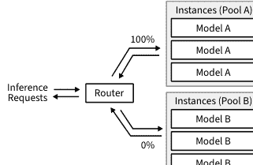

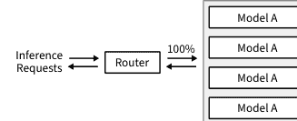

**期间：**

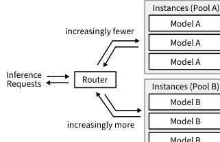

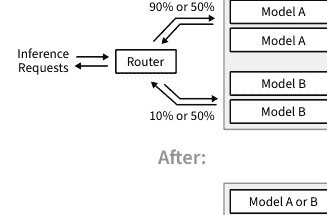

逐渐减少 90% 或 50% | 逐渐增加 10% 或 50%

**部署后：**

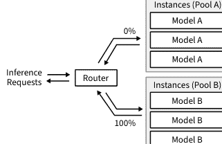

#### 金丝雀与 A/B 测试部署策略

**期间：**

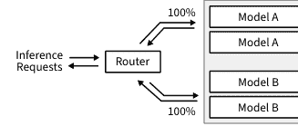

#### 影子部署策略

## 7.3 模型部署：基础设施

在机器学习流水线中，模型部署是流水线编排的一部分，使模型能够在开发、测试和生产环境中部署（第 5.3 节）。理想情况下，它应该通过 `CI/CD` 完全自动化，以避免像我们在第 5.2.3 节中提到的 `Knight Capital` [317] 那样的灾难性失败。

`CI/CD` 中持续部署部分的性质取决于产物的类型（第 7.1 节）以及我们部署到的计算系统类型（第 2.4 节）。我们的制品可能是容器镜像，通过手动调用 `Docker` 在本地封装并提供服务，或者通过指示 `Kubernetes` 调用自动脚本进行远程调用。在两种情况下，如果镜像在部署时不可用，将从注册表获取。我们的制品也可能是虚拟机：此时持续部署可以利用 `Ansible` [18] 等配置管理工具来部署和升级它们。在这两种情况下，`CI/CD` 流水线都标准化了部署过程，隐藏了本地环境和云环境之间的差异（第 2.3 节），并将复杂性从胶水代码转移到声明式配置文件（第 5.2 节）。这使得部署过程变得标准化，以至于对于 `Kubernetes` [364] 等目标编排平台以及 `Amazon ECS` 等商业提供商来说基本上是相同的。

我们还可以在集成的 `MLOps` 平台之上运行机器学习流水线：此时，模型部署完全取决于平台的特定主张工作流。例如，像 `Databricks` [76] 这样的 `MLOps` 平台通过 `MLflow` [420] 集成了许多开源组件，并用支持多个部署目标的 `API` 对其进行封装。这些 `API` 提供了类似于 `Docker` 和 `Kubernetes` 的标准化接口，无论我们选择什么。来自云服务商的机器学习平台（“机器学习即服务”）如 `Azure ML` [214] 或 `Amazon AWS SageMaker` [11] 提供了更高层次的抽象。一方面，它们对流水线的实现方式和模型的部署方式的控制很小；另一方面，它们对于没有技能或预算管理自己的 `CI/CD`、监控和日志基础设施的团队来说是可以使用的。它们还提供了实验跟踪 Web 界面（带有用于编程调用的 `API`）来测试新模型，并带有参数和性能指标对其进行可视化。

我们可以通过在模型中添加特征标志（第 6.5 节）来整合这些部署模式：这样我们就可以通过切换不同的标志组合来轻松创建新模型，模型 B 应该与模型 A 完全兼容。

## 7.4 模型部署：监控与日志记录

我们应该通过日志记录和监控，跟踪自动化模型部署的所有阶段，为了实现诊断可能遇到的任何问题所需的观测性基础设施（第 5.3.6 节）。所有持续部署平台都支持这一点：`MLFlow` [420] 拥有 `MLflow` 跟踪，`Airflow` [348] 可以使用 `Fluent` [359]，`GitLab` 等通用 `CI/CD` 解决方案也内置了发布指标和日志事件的机制，并支持 `Prometheus` [275]。记录每个模块的每个入口和出口点，以及流水线的所有的重试和所有任务的成功完成至关重要：我们应该能够构建包含完整堆栈跟踪的描述性活动报告。机器学习流水线有很多组成部分，可能会在许多不同的地方以多种方式失败，即使有这么多信息也很难以诊断（第 9.1、9.2 和 9.3 节）。此外，日志应该自动触发外部通知系统（如 `PagerDuty` [255]），以便尽早察觉部署期间的任何问题。

模型部署后，我们应该检查它是否正在运行、它是否已准备好接受推理请求（就绪性 `readiness`）以及它是否产生了正确的结果（存活性 `liveness`）。我们用于提供服务的软件可能会暴露健康检查 `API`（如 `Kubernetes` [364] 中的就绪和存活探针），编排器可以使用它仅将推理请求路由到可以处理这些请求的模型。模型内部的监控客户端也可以通过暴露指标来实现相同的目的，以检查性能是否随时间推移而下降。正如我们在第 5.3.6 节中所讨论的，我们应该将日志和监控服务器位于专用系统上，以确保它们不受由模型引起或影响模型的任何问题的影响，并可以使用它们对发生错误进行根因分析。

## 7.5 可能会出现什么问题？

当我们部署新模型时，由于不同的原因可能会出现各种类型的问题：对部署过程或其目标缺乏控制或观测性（第 2.4 节）；手动执行部署前或部署后的操作（第 5.2.3 节）；或者模型或模块中的关键缺陷逃过了我们的软件测试套件（第 9.4 节）。我们可以通过利用 `CI/CD`（第 5 章）并遵循现代开发实践（第 6 章）来最小化部署风险，但某些问题无法完全解决，也无法自动检测。

**硬件资源可能不可用。** 我们正在部署的环境可能运行在资源不充分的机器学习系统上（例如，存储空间或内存不足）、硬件故障或网络连接问题（例如，系统本身无法访问，或者它们无法访问模型所需的远程第三方资源）。这些问题既可能发生在本地（机房）环境中，也发生在远程（云）环境中；后者，调度新部署通常会解决这些问题，因为底层硬件将发生变化（第 2.3 节）。

**硬件资源可能无法访问。** 机器学习系统本身可能没问题，但存在访问限制阻止了我们使用它们。防火墙可能阻止我们跨网络连接到它们；文件权限可能阻止我们从它们的存储器中读取数据和配置。这是云实例和托管服务的常见问题。

> 由于网络设备或网络连接故障导致计算系统、集群或数据中心之间的连接性问题也称为“网络分层”或“网络分区” [5]。

因为它们的身份和访问管理 (`IAM`) 策略难以编写和理解。事实上，通常只能通过交互式测试来控制这些服务的验证和授权的配置，这使得很容易意外破坏它们。因此，出现过许多机器学习工程师删除了过多的限制，导致 `AWS` 上的个人数据 `S3` 桶公开可见（`Twilio` [368] 和 `Switch` [394] 是近年的两个显著案例）。这显然也是不理想的，但可以通过根据最小权限原则编写 `IAM` 策略、通过配置管理工具对其进行跟踪（第 11.1 节）并在应用之前将其纳入代码审查（第 6.6 节）来防止。


# 部署挑战

## 人员缺乏沟通

人们之间不交流。模型部署是我们真正投入使用训练的模型和支持它们的代码的时候。因此，这也是由于领域专家、机器学习专家、软件工程师和用户之间缺乏沟通而产生的缺陷可能显现的时候。流水线的范围和设计（第 5.3 节）、验证机器学习模型（第 5.3.4 节）和推理输出（第 5.3.6 节）、设计模块及其参数命名（第 6.2 节）、代码审查（第 6.6 节）以及编写各种形式的文档（第 8 章）都应该是涉及所有工作和使用流水线的人员协作努力。当协作不有效时，不同的人将负责流水线的不同部分，导致缺乏协调可能会在不同责任领域的边界处产生问题。机器学习工程师在开发模型时可能没有考虑领域专家（“模型有意义吗？我们有正确的数据来训练它们吗？”）或软件工程师（模型可以在可用系统上运行并产生足够低延迟的推理吗）。领域专家可能未能将他们的专业知识传给机器学习工程师（“这个模型无法表达某些相关的领域事实！”）

## 缺少依赖项

模块的部署可能会因为其一个或多个依赖项（流水线内部或外部）缺失或无法运行而失败。例如，如果模块 A 要求在部署模块 A 之前模块 B 的输出必须处于工作状态。在实践中，这需要协调部署这两个模块，这是我们努力使模块相互解耦的反模式。当然，我们也可以在模块 A 中实现适当的重试策略，使其对 B 的临时离具有韧性。在 `Kubernetes` [364] 中，我们可以使用存活和就绪探针（第 7.4 节）结合“初始化容器”（在 pod 中应用容器之前运行的特殊容器）来实现此目的。

## 不完整或错误的配置管理

配置管理工具（第 10.1 节和 11.1 节）促进并自动化模板、环境变量和配置文件的重用。然而，这意味着我们应该仔细地存储对应不同环境的内容，并始终保持它们的清洁和完整。在一个具有许多模块和环境的复杂流水线，很容易错误地使用与我们意图不同的环境配置。在最好的情况下，我们尝试执行的操作将失败并记录异常。在最坏的情况下，我们成功完成了尝试执行的操作，但结果将是静默错误的，因为我们访问的资源与我们认为的不同。例如，我们可能会在无意中访问训练数据而非验证数据而导致信息泄漏。类似的误配置问题可能涉及流水线的任何部分（训练、软件测试、推理等）以及由配置管理跟踪的任何实体（数据库引用、密钥、模型参数、特征等）。

# 7.6 回滚

当部署在生产环境中的模型未能达到预期的性能和质量标准时（第 8.3 节），我们有两个选择：要么用上一个仍然适用的旧模型来替换它（回滚），要么用一个专门训练的用于解决当前模型失败原因的新模型来替换（向前滚动）。在接下来，我们将重点关注回滚，但我们的讨论对于模型向前滚动具有参考价值。

模型回滚只有在模型 API 在版本之间向后兼容时才是可能的。这样，我们的每个版本的模型都可以在任何时刻恢复到之前的任何版本，而不会中断流水线的其他部分，因为我们可以保证模型提供相同的功能、相同的协议规范和相同的签名。

在软件工程方面，后兼容需要大量的规划和努力。除了将模型封装在容器中以抽象和标准化其接口，封装它们的特殊性和实现之外，我们还需要一个实验管理平台来对流水线模块、模型以及相应的配置进行版本控制。至少，这种设置涉及到一个模型注册表（第 5.3.4 节）和一个代码版本控制系统（第 6.5 节）。

有时维持后兼容性是不可能的：如果我们用另一个完全不同类的模型替换现有模型，或者模型训练的任务发生了变化，API 应该改变以反映新模型的能力和用途。我们可以通过对 API 进行版本控制在两组不同的 API 之间切换。例如，旧的 API 可以通过 URL 路径 `https://api.mlmodel.local/v1/` 提供，而新的 API 可以通过 `https://api.mlmodel.local/v2/` 提供，且旧的 API 可以抛出警告以指示它们已弃用（`OpenAPI` 支持弃用 API“操作”）。随后，我们可以使用第 7.2 节中讨论的策略部署新的不兼容模型，流水线模块将能够同时访问两组 API，且不会对它们使用的版本产生任何歧义。这反过来使得在有序过渡中更新单个模块成为可能。

如果模型发布时带有与其 API 一起版本控制的内置配置，那么加载它的函数应该支持旧版本。同样，如果模型是有状态的并且需要访问数据库来检索资产和配置，那么访问这些资源的函数应该能够处理不同的数据库模式。我们执行回滚的能力将取决于我们执行数据库迁移的能力。

回滚应该是手动的（即由领域专家在人类回路中触发）还是自动的（即根据监控基础设施收集的指标由流水线编排器触发），这并不是一个简单的决策。从技术角度来看，我们应该评估计划使用的部署策略的影响，即将流水线恢复到完全功能状态需要多久。从业务角度来看，领域专家在要求回滚之前可能想要更充分的证据：在他们获取更多数据点并更好地理解模型不再准确的根本原因时，他们可能接受性能不佳的模型。机器学习专家可以在此期间通过金丝雀部署或影子部署策略部署替代模型，以研究它们的性能并与失败模型的性能进行比较。只有在一种情况下，模型的性能差不是由数据或推理请求的变化引起的，而是由于流水线底层的硬件和软件基础设施的问题（例如，新部署的模型占用过多内存或变得无响应）。即使在这种情况下，回滚的决策也应该得到监控和日志证据的支持（第 5.3.6 节）。

# 流水线文档

理想情况下，我们编写的代码应该是自解释其义的：每个人都应该通过阅读代码就能理解它是如何工作的，以及为什么要这样实现。在实践中，即使我们努力让代码尽可能清晰（第 6 章），对于任何相当规模的现实代码库，这种愿望也是无法实现的。因此，我们需要文档：一种活的、自然语言的对机器学习系统和流水线的解释，并随这些系统共同演进。文档不是单一实体，而是具有不同范围、详细程度、技术水平和受众的信息集合：解释不同代码块的“是什么”（what）特别是“为什么”（why）的注释（第 8.1 节）；描述每个模块公共接口以及如何使用它的文档（第 8.2 节）；对流水线结构及其各个部分如何结合的整体性描述（第 8.3 节）；详细说明实现了哪些机器学习模型及其原因，以及它们解决了哪些业务或学术需求的白皮书（第 8.4 节）。为了补充这些信息，我们应该展示我们设想机器学习流水线如何在实际日常操作中使用的（第 8.5 节）。

## 8.1 注释

软件工程师对于是否需要在代码中包含注释，以及注释的频率和内容，并没有共识。有些人认为“注释充其量只是一种必要的恶…………用以弥补我们在代码中表达自我的失败” [205]；有些人认为“许多注释和少写注释一样糟糕，你可以达到一个折中方案” [205]；还有人认为“良好的代码有很多注释，将低级知识保留在代码中，并将注释留给其他高层次的解释” [369]。每个人都同意的唯一点是，随着代码随时间变化，注释很容易过时，而且没有提供代码之外任何额外信息的注释是冗余的。机器学习流水线可以从三个视角进行推理（5.3）：它们运行的领域，例如产生数据的业务或学术领域；软件架构，即将软件组织成具有明确用途的模块的工程努力；以及驱动它们的模型，它们的属性必须同时协调表示抽象数学概念和现实领域概念的冲突目标。

因此，注释侧重于通过说明“为什么”来补充代码（例如，特定设计决策的理由，以及非显见的低级优化是如何运作的以及为什么需要它们），而它们应该让代码本身来说明“是什么”（例如，产生函数输出的步骤序列），这种想法比在企业级或学术软件中的想法要微妙得多。在这些设置中，现代开发实践确保了领域专家和软件工程师对关键领域概念具有共享的概念模型，并通这种方式建立了一套通用语言（ubiquitous language [96]）来识别和讨论它们。这种语言贯穿于所有文档和代码中（类名、方法和变量），以便所有参与者对代码正在执行的操作的“是什么”和“为什么”有共同的理解。然而，在机器学习软件 6.2 的语境下，建立这样的通用语言是困难的，因为参与者的背景更加多样化：很难一个人拥有足够广泛的背景，能够在任何时候从领域、软件和机器学习视角很好地理解机器学习系统和软件。领域（数据）分析师（领域+机器学习）和机器学习工程师（软件工程+机器学习）等专业人物的兴起，从两个不同视角处理流水线工作，部分是对这一问题的反应。

因此，我们认为在代码中使用注释来描述其“是什么”和“为什么”是有价值的，这些注释是从与代码编写视角不同的视角来进行。实现模型的代码（第 5.3.4 节）其结构应足够良好，以便机器学习工程师清晰地理解其行为：注释应侧重于模型参数及其输出如何映射到领域概念，并且还可以说明针对计算系统的硬件优化模型如何导致了特定数据结构的使用。预处理机器学习流水线输入的代码（第 5.3.3 节）以及供第三方消费的输出后处理代码（第 5.3.5 节和 5.3.6 节）对于领域专家来说应该是清晰易懂的，因为它们是将领域概念编码为数据结构反反之；但对我们期望这些输入和输出具有的统计属性进行注释，并将它们与其产生或馈地的机器学习模型联系起来，是值得的。最后，编排流水线中模块的代码（无论是直接编排还是通过配置第三方 MLOps 解决方案，见第 5.3 节）从领域和机器学习的角度来看都应该是清晰的，因为它连接了数据处理流水线中的不同模型，而基于特定模型的算法复杂度以及模型运行的计算系统的硬件特性，可能会影响代码如何组织成模块，以及模块之间如何连接，这些方式应该被记录，因为它们可能并不显而易见。

除此之外，[96, 105, 252, 369] 中关于如何编写注释的建议适用于机器学习软件。注释的目标是确保软件结构和行为对读者是显而易见的：其他开发者，以便他们能够快速且自信地修改代码；用户，以便他们能够理解并适当使用它。读者最终可以通过阅读代码推导出此类信息，但这个过程将是耗时且容易错误的：特别是当他们从与代码编写时不同的视角来接触代码时。

## 8.2 公共接口的文档化

注释应该简洁并尽可能靠近代码：例如，在执行特定任务的代码块之前，描述所考虑的实现问题和塑造该实现的概率结果。（这可能有助于将测试与代码联系起来，见第 9.4.2 节。不属于代码中任何位置的额外信息可以在提交消息中找到，如第 6.5 节所述。）它们应该在编写代码之前或同时编写代码，以确保它们首先被编写，并且任何设计问题在开发者的脑海中仍然新鲜。出于相同的原因，每当代码修改时，也应随代码更新注释。这种方法可能也有助于早期完善代码架构（第 5.3.1 节和 5.3.2 节），因为它更容易讨论不同设计的优缺点，并允许领域专家在某种程度上查看关键领域概念的实现。最后，在代码和注释中从不同角度两次表达同一个想法，可以产生类似于代码审查（第 6.6 节）的益处，因为这迫使开发者从软件用户的角度重新思考他们正在做的事情。

除了增强函数和模块内部的代码块外，我们还应该使用注释来记录模块接口、其方法及其通用行为。特别是，每个模块都应该包含一个高层级描述，说明它的功能以及在什么种情况下使用它是有意义的。两者都应该从潜在用户的角度编写：本着抽象复杂性和减轻认知负荷的精神，用户应该能够在不阅读实现代码的情况下使用该模块 [252]。正如之前讨论的，从事和使用机器学习流水线的人将来自各种背景，许多人可能难以从远离自己熟悉的视角阅读代码。因此，位于模块接口之前的注释应该像其他注释一样以易于理解的方式描述它们（第 8.1 节）。这些描述结合方法签名，应该提供关于模块的所有基本信息：方法及其参数的含义，以及它们可能具有的任何约束、副作用和先置条件。如果我们发现很难以清晰简洁的方式书面形式记录此类信息，那么可能是该接口不是一个良好的抽象，该模块应该进行重构（第 6.7 节）以使其具有更好的目标感。描述它的文档也应同时更改，以保持最新状态。

以类似的方式对单个函数进行文档化，对于少数未完全封装在单个模块内部的函数来说是有意义的。其他函数要么对模块用户不可见，因此它们只需要按照该模块开发者要求的程度进行文档化；要么对模块用户可见，那么它们应该在方法之间被文档化。

为了使这种类型的文档与其引用的代码保持接近，以便保持两者同步，我们可以为每个模块添加一个涵盖上述信息的长格式注释。这些注释应该以标准格式结构化，可能带有额外的公司内部惯例，以确保一致性并使编写它们更加直观。诸如 `Doxygen` [382] 等工具可以对机器学习流水线中典型的所有编程语言（即 C、C++、R 和 Python）强制执行注释格式，这非常方便，因为不同的模块可能用不同的语言实现（第 6.1 节）。它们还可以从注释生成 HTML、PDF 和 DOCX 等常见格式的文档。这对于随着接口变化而保持文档更新特别方便，因为我们只需要随代码更新注释并重新生成这些文档。

在实践中，我们在这些长格式注释中应该写什么？

- 我们对模块的期望：方法的签名、其语义以及在成功和失败场景下的行为。这些包括导出变量的含义和数据类型，以及所有可能的错误列表及其处理方式。
- 模块解决的问题，以及关于为何这样设计它的简要总结。这可能包括对已评估并丢弃的替代方案的讨论（第 5.3.1 节），以避免在我们更改模块时重新评估它们。然而，此类决策通常跨越模块边界，在架构文档（第 8.3 节）中记录更好。
- 使用该模块的简短示例，可能与其他模块结合。
- 指向技术文档（第 8.4 节）相关章节以及描述模块中所算法的书籍或论文的链接。

流行的开源机器学习软件提供了许多良好完成此工作的示例。以 `Scikit-learn` 为例。我们可以通过其网站主页 [311] 的“API”链接访问其模块接口的文档。所有模块按字母顺序列出，从 `sklearn.base` 到 `sklearn.utils`。对于每个模块，我们都有一个短描述，总结它实现了哪些算法、模型或通用功能，指向提供细节并显示典型用法模式的长格式文档链接，以及它导出的所有属性和函数列表。每个类的页面详细说明了它的方法和参数以及它导出的任何变量。这些文档是由 `Sphinx` 从 `Scikit-learn` 代码中的注释生成的。注释所在的源文件从每个页面链接，方便探索代码。

## 8.2 聚类算法文档记录

### `sklearn.cluster.DBSCAN`

```python
from sklearn.cluster import DBSCAN
scan = DBSCAN(eps=0.5, min_samples=5)
scan.fit(X)
```

**DBSCAN** - 基于噪声的密度空间聚类算法。寻找高密度的核心样本以连接高密区域，并将低密度的样本标记为离群值。

在用户指南中阅读更多。

#### 方法

```
fit(X, sample_weight=None)
```

从聚类或从距离执行 DBSCAN。

```
fit_predict(X, sample_weight=None)
```

从数据矩阵或距离矩阵计算聚类并预测。

```
get_params()
```

获取此估计器的参数。

```
set_params(**params)
```

设置此估计器的参数。

```
score(X, sample_weight=None)
```

从聚类或从距离执行 DBSCAN。

#### 参数

- **eps** : 形状为 `(n_features,)` 的数组类或浮点数，默认=0.5
  两个样本被视为处于邻域的最大距离。

- **min_samples** : 整数，默认=5
  一个点被视为核心点时，邻域内的样本数量。

如果提供了稀疏矩阵（`sparse`），它将被转换为 `sparse_csr`。

未使用，为了与转换的 API 兼容性而存在。

#### 返回

- **labels_** : 形状为 `(n_samples,)` 的 `ndarray`
  训练中每个点的聚类标签。噪声样本被标记为 -1。

- **components_** : 形状为 `(n_core_samples, n_features)` 的 `ndarray`
  所有核心样本的中心点。

返回自身的已拟合实例。

#### 参数（续）

- **eps** : 形状为 `(n_features,)` 的数组类或浮点数，默认=0.5
  两个样本被视为处于邻域的最大距离。

- **min_samples** : 整数，默认=5
  一个点被视为核心点时，邻域内的样本数量。

用于计算特征数组中实例之间距离的指标。该指标是一个接受两个距离数组并返回距离矩阵的可调用对象，或者

有关指标的更多信息，请查看 `sklearn.metrics.distances`。

在 0.17 版本中，指标可以计算稀疏矩阵。

```python
from sklearn.cluster import DBSCAN
scan = DBSCAN(eps=0.5, min_samples=5)
scan.fit(X)
```

#### 属性

- **labels_** : 形状为 `(n_samples,)` 的 `ndarray`
  训练中每个点的聚类标签。噪声样本被标记为 -1。

- **components_** : 形状为 `(n_core_samples, n_features)` 的 `ndarray`
  所有核心样本的中心点。

版本 1.0

```python
>>> from sklearn.cluster import DBSCAN
>>> scan = DBSCAN(eps=0.5, min_samples=5)
>>> scan.fit_predict(X)
```

#### 注意事项

对于此示例，DBSCAN 构建了所有的邻域查询，这增加了内存消耗。如果使用树结构，在查询大型邻域时效率会高得多，取决于索引。

#### 参考文献

#### 示例


密度。

在 `ref:User Guide <dbscan>` 中阅读更多。

#### 参数

eps : 浮点数，默认=0.5

```
[...]
```

#### 属性

```
core_sample_indices_ : 形状为 (n_core_samples,
...]
```

#### 另见

`OPTICS` : 在多个 eps 值下进行相似的聚类。我们的实现针对内存使用进行了优化。

#### 注意事项

```
[...]
```

#### 参考文献

```
[...]
```

#### 示例

```
[...]
```


# 8.2 聚类算法文档记录

## sklearn.cluster.DBSCAN

```python
from sklearn.cluster import DBSCAN
scan = DBSCAN(eps=0.5, min_samples=5)
scan.fit(X)
```

**DBSCAN** - 基于噪声的密度空间聚类算法。寻找高密度的核心样本以连接密集区域，并将低密度的样本标记为离群值。

在用户指南中阅读更多。

## 方法

```
fit(X, sample_weight=None)
```

从聚类或从距离执行 DBSCAN。

```
fit_predict(X, sample_weight=None)
```

从数据矩阵或距离矩阵计算聚类并预测。

```
get_params()
```

获取此估计器的参数。

```
set_params(**params)
```

设置此估计器的参数。

```
score(X, sample_weight=None)
```

从聚类或从距离执行 DBSCAN。

## 参数

- **eps** : 形状为 `(n_features,)` 的数组类或浮点数，默认=0.5
  两个样本被视为处于邻域的最大距离。

- **min_samples** : 整数，默认=5
  一个点被视为核心点时，邻域内的样本数量。

如果提供了稀疏矩阵（`sparse`），它将被转换为 `sparse_csr`。

未使用，为了与转换的 API 兼容性而存在。

## 返回

- **labels_** : 形状为 `(n_samples,)` 的 `ndarray`
  训练中每个点的聚类标签。噪声样本被标记为 -1。

- **components_** : 形状为 `(n_core_samples, n_features)` 的 `ndarray`
  所有核心样本的中心点。

返回自身的已拟合实例。

## 参数（补充）

- **eps** : 形状为 `(n_features,)` 的数组类或浮点数，默认=0.5
  两个样本被视为处于邻域的最大距离。

- **min_samples** : 整数，默认=5
  一个点被视为核心点时，邻域内的样本数量。

用于计算特征数组中实例之间距离的指标。该指标是一个接受两个距离数组并返回距离矩阵的可调用对象，或者有关指标的更多信息，请查看 `sklearn.metrics.distances`。

在 0.17 版本中，指标可以计算稀疏矩阵。

```python
from sklearn.cluster import DBSCAN
scan = DBSCAN(eps=0.5, min_samples=5)
scan.fit(X)
```

## 属性

- **labels_** : 形状为 `(n_samples,)` 的 `ndarray`
  训练中每个点的聚类标签。噪声样本被标记为 -1。

- **components_** : 形状为 `(n_core_samples, n_features)` 的 `ndarray`
  所有核心样本的中心点。

## 版本 1.0

```python
>>> from sklearn.cluster import DBSCAN
>>> scan = DBSCAN(eps=0.5, min_samples=5)
>>> scan.fit_predict(X)
```

## 注意事项

对于此示例，DBSCAN 构建了所有的邻域查询，这增加了内存消耗。如果使用树结构，在查询大型邻域时效率会高得多，取决于索引。

## 参考文献

## 示例


密度。

在 `ref:User Guide <dbscan>` 中阅读更多。

## 参数（示例）

**eps** : 浮点数，默认=0.5

```
[...]
```

## 属性（示例）

```
core_sample_indices_ : 形状为 (n_core_samples,
...]
```

## 另见

**OPTICS** : 在多个 eps 值下进行相似的聚类。我们的实现针对内存使用进行了优化。

## 注意事项（示例）

```
[...]
```

## 参考文献（示例）

```
[...]
```

## 示例（示例）

```
[...]
```

“Notes”部分链接了进一步的示例，并说明了 DBSCAN 的计算复杂度（第 4 章），补充了 OPTICS 模块中类似功能的指向，以及用户指南中对 DBSCAN 工作原理的通俗解释。此外，DBSCAN 的文档提供了所有导出的方法列表，以及关于每个方法实现内容的简短描述、其参数（包括其类型和默认值）以及其返回值。例如，生成 `fit()` 方法文档的注释如下：

```python
def fit(self, X, y=None, sample_weight=None):
    """从特征或距离矩阵执行 DBSCAN 聚类。
```

## 8.2 公共接口的文档记录

### 参数

```
X : {数组类, 稀疏矩阵} 形状为 (n_samples, \
n_features), 或 (n_samples, n_samples)
待聚类的训练实例，或者如果 `metric='precomputed'` 则实例之间的距离。如果提供了稀疏矩阵，
它将转换为稀疏的 ``csr_matrix``。
```

```
y : 忽略
未使用，此处存在是为了按照惯例保持 API 的一致性。
sample_weight : 形状为 (n_samples,) 的数组类，默认=None
每个样本的权重，使得权重至少为 `min_samples` 的样本本身就是其核心样本；负权重样本可能会抑制其 eps 邻居成为核心。注意权重是绝对值，默认值为 1。
```

### 返回

```
self : 对象
返回自身的已拟合实例。
```

遗憾的是，文档将方法与参数混淆了，这对于静态类型语言中的 Python 来说是不理想的。

# 8 文档化管道

```python
# @seealso \code{\link{stan_glmer}}, \code{\link{stan_jm}}, [...]
#
```

```python
# @examples
# [...]
```

Doxygen 注释的特征是每行都以一个单引号开头。第一段给出了该函数在参考手册中条目的标题，该函数通过 `@export` 声明为公共的。第二段是“描述（Description）”，`@params` 是“参数（Arguments）”，而 `@return` 描述了函数的返回值。`@details` 之后的文本最终将进入“细节（Details）”部分，而 `@examples` 之后的代码提供了简短的示例。

较长的示例和由于无法放入参考手册而显得过于冗杂的技术讨论将以“指南（vignettes）”的形式发布，在 rstanarn 的情况下，这些指南是 R Markdown 文档。与参考手册不同，vignettes 可以包含使用 LaTeX 排版的插图和数学方程，并且可以使用 `knitr` 包 [414] 轻松地转换为 PDF、HTML 和 DOCX 文档。R Markdown 格式与纯 Markdown 的区别仅在于其 YAML 头部，它告诉 `knitr` 该文件应该编译成的文档类型及其某些元数据。例如，在 `glimmer.Rmd` 中：

```yaml
---
title: "Estimating Generalized (Non-)Linear Models with Group-Specific Terms with rstanarn"
author: "Jonah Gabry and Ben Goodrich"
date: "`r Sys.Date()`"

output:
  html_vignette:
    toc: yes
---
```

## 8.3 文档化架构与设计

代码块由三个反引号界定，后面跟着语言标签（在此情况下为 R）以及一组将在 `knitr` 编译文档时评估的选项列表。

```r
{r, results = "hide"}
post1 <- stan_nlmer(circumference ~ SSlogis(age, Asym, xmid, scal), Asym|Tree,
  data = Orange, cores = 2, seed = 12345, init_r = 0.5)
```

请注意，默认情况下，`knitr` 按照代码出现的顺序执行每段代码。因此，我们不会遇到影响 Jupyter notebooks [274]（第 10.2.2 节）的执行顺序混乱和状态不一致的问题。

## 8.3 架构与设计文档

架构文档将各个模块的公共接口文档结合在一起，以提供机器学习系统和管道作为一个整体是如何结构的全局视图。它总结了设计它们时做出决策的原理、其（硬件和软件）组件的属性及其相互作用，以及它们如何与管道的需求相关 [64]（第 5.3.1 节）。所有这些都应该用注释和模块文档相同的“通用语言（ubiquitous language）”编写，原因也相同：架构是评估管道和底层系统工作原理、它们是否可以以特定方式进行修改，以及它们是否满足我们当前或可能的新需求的主要手段。这些活动不可避免地涉及领域专家、软件工程师和机器学习专家之间的讨论，这些讨论极大受益于通用语言带来的清晰性。特别是，架构文档应该记录所有不属于任何单一模块接口文档的跨模块设计决策：一个典型的例子是胶水代码（glue code）的设计和运作（第 5.2.3 和 9.2.4 节），它通常是机器学习管道中文档化最少的部分。

记录机器学习管道架构和设计的一个自然起点是描述其执行路径的 DAG（第 5.3 节）。DAG 中的节点代表实现数据经过的不同处理阶段的模块，对它们在管道中角色的解释应该链接到相应接口的文档。连接节点的弧的存在意味着相应的模块被设计为具有互操作性，并且使其成为可能的设计决策也应该被记录。此外，弧决定了时间顺序，并可能与事件触发（例如，模型可用时更新模型）、调度任务（例如，新数据可用后重新训练模型）或人工输入（例如，模型验证）相关。在 DAG 中尚未明确的未来需求也应该被记录。

然而，这只是描述机器学习管道架构和设计的一种可能的视角。管道的设计很可能受到本地和远程系统的影响，因为各个模块会有不同的需求（第 2.4 节）。管道的整体功能组织成模块可能会受到其所处领域的影响。例如，使用计算机视觉辅助临床医生诊断疾病的机器学习管道（如第 8.5 节中的用例），可能会根据专家执行的任务和诊断过程进行建模。或者在业务背景下，机器学习管道的不同部分可能处于不同部门的监督下，以避免人员和预算方面的重叠。在概率层面，各种算法和模型之间的相互作用为机器学习管道提供了更多视图，这取决于代码如何组织成模块。

对架构以及机器学习管道和底层系统的详尽文档化将由一组从不同视角编写的文档组成。在所有文档中使用通用语言有助于它们的相互引用，并方便工作或使用模块的人员访问。文档之间的相互引用以及与每个模块接口文档的引用将允许读者在不同文档之间跳转。

总的来说，DAG 可以为机器学习管道的整个文档提供一个合适的大纲，并作为导航地图。像图 2.1 这样的系统图可以为记录机器学习系统提供类似的作用。领域概念随后可以用某种形式的图进行非正式组织；使用 UML 等形式图形规范 [104] 通常是不值得的。理想情况下，这些图形表示将具有某些相似之处，并对所有领域专家、机器学习专家和软件工程师都有意义。如果领域专家不系统的架构，那么它可能存在问题：他们可以使用通用语言交流可能任何问题，并在我们迭代项目范围（第 5.3.1 节）和原型设计（第 5.3.2 节）时进行讨论，直到大家对设计感到满意。

出于显而易见的原因，很难找到设计文档的公开详细示例，因为公司将机器学习管道视为提供竞争优势的宝贵资产。然而，许多此类信息可以在 Uber [377] 和 Spotify [330] 等公司的工程博客上找到。我们将它们作为来源，概述一个关于设计文档和使命声明（第 8.4 节）应该如何组织的示例。

考虑 Uber [422] 用于早期欺诈检测的机器学习管道。在简要描述管道解决的业务问题后，博客文章从领域、机器学习和软件架构每个视角阐述了管道。我们在图 8.2 中展示了它们的每一个：

- **领域视角（顶部面板）**：Uber 从客户处接收不断的订单流，订单将最初由机器学习模型进行欺诈筛选。如果发现可疑，将将其交给人工专家进行手动验证，并批准或拒绝（第 5.3.6 节）。人工专家做出的决策随后反馈给执行自动筛选的机器学习模型，以随着时间的推移提高性能并防止数据漂移问题（见第 5.2.1 和 9.1.3 节）。

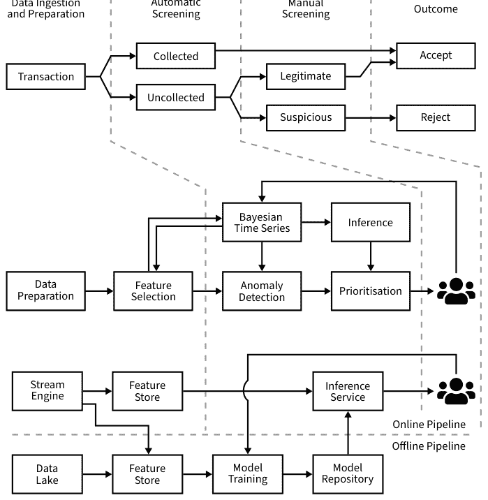

图 8.2 Uber 用于欺诈检测的机器学习流水线，基于 [422]：领域 DAG（顶部）、机器学习 DAG（中间）和软件架构 DAG（底部）。

- **机器学习视角（中间面板）**：数据流经不同的预处理算法（包括特征选择），然后进入负责检测可疑交易的模型中。相同的模型将对此类交易进行优先级排序，并将它们安排进行人工审核。


# 软件架构视角（底部面板）

DAG 中的每个节点都是一个软件（可能运行在特定的硬件上），用于实现前一个流水线中找到的算法和模型、存储数据或在处移动信息。

对于具有不同背景的人员来说，这些流水线中的每一个都更容易进行推理，并且可以用来提供指向数据处理步骤、模型或与单个节点相关的模块的详细信息的引导。所有流水线都跨越了四个阶段（数据摄取和准备、自动筛选、人工筛选、结果），但对欺诈检测的实现提供了非常不同的视角和洞察。例如，第二和第三条流水线强调了将模型重训练与人工审核相结合的反馈循环（后者同时也兼作数据标注步骤），并与数据中相关特征的统计分布相结合。然而，通过对比观察这些流水线，可以将它们所属的不同视角，以及出现在同一阶段但位于不同 DAG 中的节点之间的关系联系起来。在某种意义上，DAG 提供了通用语言背后概念模型的视觉表示。它们的主要局限性是无法有效描述弧的语义含义，就像 UML 的情况：这些信息是由架构文档中的各种文档提供的，补充了我们从 DAG 中能看到的内容。

## 8.4 算法与业务用例文档

单个模块以及它们在机器学习流水线中如何协同工作的文档，应该由另外两个文档进行补充：

- 一份技术报告，详细说明了机器学习模型相关的概率和统计属性；以及
- 一份使命声明（mission statement），从领域或业务角度高层层面描述了机器学习流水线的目标是什么。

准备一份涵盖涵盖算法和模型相关事实的技术报告有几个原因。首先，我们可以建立一套与通用语言（第 8.1 节）以及我们模块使用的变量命名方案（第 6.2 节）一致的连贯数学符号，并将其与我们可能使用的任何外部库的符号联系起来。科学文献的不同部分有不同的符号规范：相同的概念可能用不同的符号表示，或有不同的定义，或者相同的符号可能具有不同的含义。由于真实世界的机器学习流水线涉及多种方法，这可能会导致一些困惑。其次，技术报告将减少对学术文献访问的需求，随着时间的推移，访问文献可能会变得困难，因为期刊论文、会议论文及其补充材料可能会被锁定在付费墙后，或者在作者更换工作单位后直接从互联网上消失。第三，我们可以限制在与我们相关的模型和算法属性上，并专注于以良好且易于理解的方式记录这些属性。（模型的权威引用通常不是其最清晰的插图，这并不常见，特别是在机器学习领域，8 页的会议论文占据了文献的很大比例！）特别是，我们可以专注于我们评估的、用于流水线的任何模型和算法相对于我们相关的特定字段的优缺点。这比大多数基于文献中参考数据集的基准测试更具信息量。最后，我们可以轻松将技术报告与模块接口（第 8.2 节）和设计文档（第 8.3 节）进行交叉引用。

使命声明 [64] 称为“领域愿景声明”，是一份 1-2 页的简短文档，在项目范围确定（第 5.3.1 节）期间确定了机器学习流水线的核心领域及其目标。它有两个目的：评估流水线是否符合预期用途，以及在战略层面引导其演进。通过陈述其目的，使命声明告诉我们应该判断什么样的结果。反过来，这允许我们根据流水线实现其目的的有效性和效率，定义一个从“性能糟糕”到“性能良好”的衡量标准。同时，它也可以作为其演进的高层指南。计算系统、机器学习模型和流水线所基于的领域概念不可避免地随着时间的推移而变化。每次变化，我们可以在战略层面计划如何演进，明确我们需要更新哪些组件以及如何更新。然而，所有这些局部更改应该与长期策略一致，以确保流水线随着预期用途的变化作为一个整体贯彻地演进。换句话说，使命声明是技术设计文档（第 8.3 节）和更实用的用例（第 8.5 节）的“愿景型”对应物。

例如，考虑驱动 Spotify 主页的机器学习流水线的使命声明 [90]。首先：

> “在 Spotify，我们的目标是连接听众与创作者，我们实现这一目标的一种方法是在主页上推荐高质量的音乐和播客。机器学习是我们个性化主页用户体验并连接听众与创作者的核心。”

该流水线是一个匹配用户与内容的推荐系统。这需要跟踪用户数据以及 Spotify 的音乐和播客目录，这在硬件和数据处理能力方面有影响。用户数据和目录随着时间的推移而变化，它们的特征也是如此：因此，预测用户可能喜欢哪些音乐和播客的模型应该定期更新。目录变化的频率、用户数据增长的速度以及我们将使用哪些模型，这些是不恰当的，也不可能安排计划。同样的原因，使用哪些数据特征来提供推荐也未写明。其次，流水线的两个最终输出是以领域术语引入的：

> “阶段 1：候选生成：为每个听众选择最佳专辑、播放列表、艺术家和播客。阶段 2：排序：为每个听众对候选者进行最佳排序。”

流水线预期以（预测的）偏好向用户展示推荐。诸如推荐多少项目以及如何排序等细节是实现细节，注定随时间改变，因此不属于使命声明。然后更详细地描述了输出：

- 播客模型：预测听众可能在“你喜欢的节目”架上收听的播客。
- 快捷模型：预测听众在快捷功能中的下一次熟悉收听。
- 播放列表模型：预测新听众可能在“尝试其他”中收听的播放列表。

声明没有指定将使用哪些模型、多少个。它甚至没有说明它们将是机器学习模型：事实上，它说“某些内容通过启发式方法和规则生成，某些内容由编辑手动策划。”哪些模型或启发式方法是合适的将取决于数据将提供哪些特征、文献将提供哪些先进模型，以及提供实时推荐需要哪些软件和硬件。

第三，流水线的输出如何呈现给用户：

> “主页由卡片组成（代表专辑、播放列表等的矩形项目）和架组成（包含多个卡片的水平行）。”

注意该声明如何引入用户界面将基于的隐喻，但没有描述任何实现细节。在这里这样做是不恰当的：我们将希望根据可用性测试和遥测收集的使用模式的任何洞察，随时间更改界面。此外，不同的平台和操作系统将具有不同的能力，并需要至少一些层

## 8.5 阐述定制的实际用例

例如，在移动端和桌面系统上同时设计出具有良好人体工程学的用户界面往往是不可能的。

但重要的是，展示机器学习流水线实际运行的专题示例是非常有价值的。流水线的构建是为了解决某些需求，例如自动化和加速分析，或改进产品：激励这些工具开发、使用和维护的最佳方法，是证明它们在潜在用户的领域或业务线背景下，能够有效且高效地满足这些需求。用户将能够对机器学习流水线所解决的问题产生共鸣，并能够体会它的优势。前几节介绍的文档类型对于这一目的来说，要么太技术化，要么太抽象，要么过于关注流水线的内部工作机制。

一个非常有效的用例示例是来自微软剑桥研究中心（英国）的 InnerEye 项目 [222]，该项目旨在为医学影像开发机器学习流水线。引用中链接的视频讨论了对接受放射疗法治疗的癌症患者的 3D 医学图像进行分割的具体应用。

1. 它用临床术语阐述了需求：在保持足够准确性的同时，加速磁共振（MR）和计算机断层扫描（CT）扫描的分割。
2. 它以潜在用户能够理解的方式阐述了问题：放射科医生手动进行分割，使用视觉工具在几十张横截面图像上勾勒肿瘤轮廓以获取 3D 轮廓。这是一个缓慢的过程，且轮廓的精度非常有限。对于前者，将肿瘤和健康组织映射到目标治疗，以及对于后者，限制暴露量，需要数小时的准备工作。
3. 它从用户的角度阐述了机器学习流水线如何满足需求：自动或人工辅助的分割。视频展示了放射科医生将使用的用户界面，让他们感受到该工具将如何融入他们的日常工作。这使得能够实时对比手动、自动和人工辅助分割所需的时间，以及分割的详细程度和精度。
4. 它向用户阐述了解决方案的价值：只需几分钟到几小时即可以所需的准确性为患者准备治疗计划。此外，相同的工具还可以用于跟踪癌症对治疗的反应。这些改进将带来更好的治疗效果和结果。

请注意，视频没有对运行时间或分割的统计准确性做出任何定量陈述，因为这些对放射科医生来说都不易于解释。相反，InnerEye 项目有一个网页，链接了所有科学出版物，我们可以在那里找到这些数字。机器学习工程师可以从他们自身学科的角度来评估流水线。此外，InnerEye 项目的新闻页面强调，机器学习流水线已经部署，并目前正在剑桥的 Addenbrooke 医院用于实际患者。暗示其已获得监管批准且放射科部门认为其很有价值，这些都是强有力的信号，表明机器学习流水线并非一项学术尝试，而是能够在真实临床实践中提供价值的东西。

最后，我们想指出，实际案例可能对于收集潜在用户的反馈也很有帮助。阐述这些案例将为用户提供一个自然的平台，讨论机器学习流水线是否有用（或无用），以及从他们的角度来看其强项（弱项）在哪里。


## 9 流水线的故障排除与测试

由于几个原因，机器学习软件的故障排除非常复杂：数据可能是巨大的（第 9.1.1 节），可能汇自由不同流水线提供的多个不同来源（第 9.1.2 节），或者可能随时间而变化（第 9.1.3 节）。模型可能太大，以至于人类无法解释其参数并肉眼观察错误的行为模式（第 9.2.1 节），特别是在黑箱模型（第 9.2.2 节）的情况下。训练它们的时间成本可能会限制我们调查任何需要更新模型的能力（第 9.2.3 节），特别是当我们结合流水线中使用多个模型时（第 9.2.4 节）。

软件测试是故障排除的自然补充：一旦我们知道问题所在之处（第 9.1 和 9.2 节），我们可以通过“定义错误以使其不存在” [252] 来主动防止它，或者建立测试以在错误显著损害我们的软件性能之前检测到它。虽然每个 Bug 都是独特的，但某些行为模式表明有些不对劲，我们应该注意（第 9.3 节）。当预期行为与观察行为有显著差异时，值得调查！我们应该测试什么（第 9.4.2 节）取决于数据（第 9.4.3 节），但它应该涵盖局部和全局行为（第 9.4.4 节）以及概念和实现错误（第 9.4.5 节和 9.4.6 节）。

### 9.1 数据是问题所在

机器学习模型有效地将数据编译成代码，并在很大程度上决定了其嵌入的软件的行为（第 5.1 节）。因此，数据中的问题会通过影响模型训练和预测来影响软件，这是逻辑合理的。在做任何其他事情之前，我们应该确保数据记录正确、标记妥当且没有重复：数据产生的技术债是一个常见问题（第 5.2.1 节）。

数据的形状和收集方式可能导致非常不同类型的问题。对于前者，我们可能有高瘦数据（样本量大，变量少）、宽型数据（样本量小，变量多；也称为“小 n，大 p”）以及大数据（样本量大，变量多，随时间变化 [178]）。对于后者，我们应该区分实验数据和观测数据。实验数据按照某些实验设计 [225] 收集，设计涉及识别一组感兴趣的变量（领域专家、文献、小型实验等）以及我们希望干预的少量变量（如提供建议或进行治疗）。合格的数据点根据其特征选择，以确保我们得出的结论适用于人群，并随机分配不同的干预。随机化确保观察到不同类型的干预，并在某种程度上防止了混杂（后文将介绍）。相比之下，观测数据随其产生而收集，通常不考虑其特征。再加上我们没有进行随机干预，这会导致我们学习的模型产生偏差：要么没有观察某些特征的数据点（足够的数量，或完全没有），要么我们没有在足够广泛的情况下观察到它们。这种问题被称为采样偏差（第 5.3.1 节），影响了许多机器学习的应用。例如，2009 年全基因组研究中 96% 的参与者是欧洲裔；虽然针对亚洲人群的新研究到 2016 年将该数字降至约 80%，其他族裔长期缺乏代表 [266]。这种差异的实际后果是，目前正在开发的个性化医疗方案无法让这些背景的人受益。

#### 9.1.1 大数据

考虑上述三个可能的数据维度：样本量、变量数量和时间点数量。数据在至少一个维度上越大，排除我们学习的模型的故障就越困难。

如果数据是宽的，一个变量的变化可能会导致其他变量对模型贡献的变化：这种现象被称为纠缠 [312, 313]。随着变量数量的增加（为什么不再加一个输入呢），多个变量以不同方式表达相同信息的可能性越来越大。模型中编码信息的参数由这些变量共同决定。如果其中一个变量的分布发生变化，使其成为不再重要的旧特征，使得模型，其他变量的影响将会增加以进行补偿。即使它仍然保留了某种程度的统计显著性，它也可能变成一个边缘特征（epsilon feature），其对模型的贡献微乎其微，以至于最初就不值得精力将其包含进去。（原则上，遗留特征和边缘特征都应该从模型中剔除，但当它们与实际有用的特征一起包含时，通常不会被剔除。）换句话说，“改变任何地方都会改变一切”，正如我们在 5.2.2 节中讨论技术债时提到的那样。这对于时间序列数据来说更为如此，除了不同变量之间相互纠缠外，每个变量与其自身之前的时间点也相互纠缠（第 9.1.3 节）。

作为副作用，纠缠使得我们很难在一组相关特征中识别因果特征。这导致了问题，因为它阻止了我们在不进行大量特征工程的情况下保持模型的简单和精简。

处理大数据时故障排查的另一个问题是延迟：访问数据需要时间和计算资源，这反过来减慢了我们的迭代速度。对于像需要 GPU 和 TPU 的深度神经网络这样的模型来说尤为如此，因为这些设备的带宽和内存有限（第 2.2 节）。一种可能的解决方案是选择高质量、具有代表性的数据子集并开展工作（更多请见第 9.1.2 节），同时记住（重复）下采样也是有成本的。另一种是获取模型的最后一个已知良好快照，并使用近期数据的子集进行处理，就像我们在进行在线训练一样。

> 也就是说，特征构建在一个对感兴趣的目标变量具有（直接）因果影响的变量之上。

#### 9.1.2 异构数据

此外，我们必须考虑数据可能是异构的，由编码为不同数据类型和复杂数据结构的变量组成。数据接入和准备（第 5.3.3 节）因此需要几种算法和辅助模型来过滤低质量数据点、填充缺失数据并提取相关特征。可能还需要额外的模型来处理核心机器学习模型的输出。如果一个输入变量发生变化，它注定会影响 5.2.1 节中所谓的修正级联反应 [312] 中的一个或多个模型。在某种意义上，我们可以将其视为跨越多个模型的纠缠形式（第 9.1.1 节）；或者视为模型之间的耦合形式，它们相互输出的（某种未声明）消费者，有效地使它们像一个单一的大模型一样工作（第 9.2.1 节）。

异构数据点很难进行随机采样，不太可能产生一个代表整个数据集的子集。在不平衡数据中，属于低频率类别的观测值不太可能在随机子集中以足够的数量出现，或者根本不出现：即使机器学习模型被持续地误导，我们对它们预测准确性的估计仍可能保持在高位。子集可能与整体数据具有不同的分布（通过总结统计量捕捉），这可能会触发校准问题。原始数据中可能引起麻烦的离群值可能会被丢弃，导致难以复制我们正在故障排查的问题（无论是否可靠或是否存在）。随着原始数据与子集之间差异的增大，所有这些问题都会变得越来越明显。

#### 9.1.3 动态数据

数据、模型、代码和架构都可以是机器学习流水线中技术债的来源（第 5.2 节）。特别是我们用于输入机器学习模型的数据源，往往在我们的控制之外。因此，数据依赖比代码依赖更昂贵 [313]：排查它们的行为以及量化并缓解它们对我们流水线性能的潜在影响需要更多精力。

数据可能会随时间缓慢变化，要么遵循中长期趋势，要么遵循周期性模式。（前者被称为数据漂移，后者被称为季节性。）这都会在机器学习模型中编码，增加复杂性。然而，模型适应变化需要时间：如果变化是突然或剧烈的，预测将会出现校准问题。定期更新动态阈值允许模型调整，但可能会引入额外的延迟。设置此类阈值（无论是隐式的还是显式的）都需要持续监控（第 5.3 节）输入和输出，可能会导致更长的延迟。我们在不同地方提到的人类参与方法。

一种特别难以识别的变化类型是，当特征在模型中与因果特征失去相关性时。如果我们错误地将前者而非后者包含进来（第 9.1.1 节），我们突然失去了该特征为模型提供的信息。恢复这些信息可能需要重新评估我们的数据源和数据准备模块。

### 9.2 模型问题

而且可能难以理解发生了什么：如果两个特征在模型训练时显示出显著关联，但随着时间推移逐渐分离，我们包含的边缘特征可能突然变得无关。

#### 9.2.1 大型模型

首先，将模型行为或数据的任何变化映射到单个参数是困难的，因为参数之间相互作用。为了从数据中捕捉复杂的模式，机器学习模型以许多（线性和非线性）方式混合单个变量中的信息。结果，即使是单个变量的变化也会以难以理解的方式同时影响多个参数。以局部改进模型部分的方式更改某些参数的值会对模型的其他部分产生副作用。这些效应在模型之间复合，正如我们在 5.2.2 节和 9.1.2 节中所讨论。

其次，处理大量的参数使得逐个调查它们是不现实的。每个参数本身可能很少或没有现实意义。正如我们刚刚讨论的，它的行为与其他参数的行为交织在一起：它们应该被分组，并将每个组作为一个有意义的整体进行调查。因此，我们不得不依靠为我们调查参数的辅助模型：它可能是基于总结统计量的简单诊断图，也可能是更复杂的独立机器学习模型。然而，总结统计量从本质上会丢失信息，导致错误难以被检测到，增加第二个机器学习模型可能不值得确保该模型也正常运行所带来的额外复杂性。从底到上都需要故障排查！

#### 9.2.2 黑箱模型

第三，大多数大型机器学习模型实际上是黑箱。单个参数是数学构件，即使在成组考虑时通常也没有现实意义。一个整个关注解释性和可解释性的研究领域应运而生，试图将模型输入的变化与模型输出的变化联系起来。理想情况下，我们希望以一种对领域专家具有意义的方式来做到这一点：例如，视觉化自然语言处理中的词汇相关性 [191] 和计算机视觉中的像素相关性 [325]，或将图像分割为具有语义意义的层 [296]。通过 LIME [296] 和 SHAP [201] 等局部方法观察模型周围输入值的行为可以提供见解：这两种方法都通过扰动输入并检查输出是否稳定，并将任何不稳定性映射到特定的参数子集。

#### 9.2.3 昂贵的模型


## 9 故障排除与测试流水线

### 9.2.4 多个模型

正如第 9.1.2 节所述，处理复杂数据可能需要复杂的机器学习流水线，其中多个模型通过编排器（`orchestrator`）以及某种程度上通过胶水代码（`glue code`）连接起来。一方面，此类代码有助于隔离不同模型以及实现这些模型的数据的特性。另一方面，胶水代码可能会在模型交互中引入 bug。如果没有进行广泛的集成测试，这些 bug 很难被检测到，并且我们在第 5.2.3 节讨论的“流水线丛林”中非常常见。单元测试可以涵盖单个模型的正确性，但无法涵盖它们连接方式的正确性。我们在流水线中包含的模型越多，排除它们交互的故障就越困难，因为随着模型数量的增加，可能的流水线配置数量会呈组合爆炸式增长。存在对机器学习模型功能至关重要的死代码和实验代码路径可能会加剧这种情况（第 5.2.4 节）。

另一个我们在第 5.2.2 节涵盖的问题是，流水线中的模型越多，它们越可能产生反馈循环或修正级联。

### 9.3 出现异常的常见迹象

我们如何判断上述讨论的一个或多个问题是否影响了我们机器学习流水线的性能？有许多（组合）情况可能出错，很难列出一份详尽的异常信号清单。然而，有一些常见的行为模式应该被视为可疑。

**预测准确率非常糟糕。** 模型可能无法从训练数据中获取足够的相关信息来预测新的数据点。数据本身可能就不包含此类相关信息。如果不进一步投入精力来工程合适的特征集，这些信息可能无法使用。或者信息确实存在，但由于计算问题或模型对数据分布做了错误的假设，模型未能捕捉到它们。如果其中任何一点成立，我们应该将故障排除的精力放在数据准备（第 5.3.3 节）和模型训练（第 5.3.4 节）模块上。我们还应该评估数据源：是否发生了变化导致（某些数据）不再有用？

**预测准确率非常好。** 如果我们实现的模型适用于它们被要求解决的问题，并且数据包含了训练它们的相关信息，我们就会期望它们表现“良好”。“良好”到什么种程度取决于这两个因素的结合，取决于我们如何选择问题以及我们定义成功的指标（第 5.3.1 节）。定义狭窄的任务更容易转化为精确的数学术语，使其更容易进行优化。另一方面，定义宽泛的任务通常会将具有不同要求和目标的多个子任务混为一谈，而这些目标可能相互冲突。然而，如果一个任务是非凡的，我们将极高的性能（例如，99% 以上的分类准确率）视为一个潜在的红旗。不平衡的数据集（我们尝试预测的所有类别都没有得到充分表示），如果模型总是预测最常见的类别而遗漏其他类别，就会导致不切实际的高准确率。我们在第 5.2.2 节讨论的不同类型的反馈循环可能会产生类似的影响。最后，高准确率可能表明我们尝试预测的内容与用于训练的数据之间存在信息泄漏。此外，当训练集隐式用于测试集或验证集时也会发生数据泄漏。这可能涉及源自同一个个体的数据点。在任何这些情况下，与其通过对生产环境的真实模拟来验证机器学习模型，它们在某种程度上是可以工作的。因此，我们的评估将对模型的预测准确率产生偏差估计，并对其能力过度自信。这是因为一个或多个变量以不同形式带有预测目标相同的信息。

**预测准确率突然变化。** 现实的数学模型（包括机器学习模型）做了各种正则假设，编码了现实是平滑变化的观点：输入的微小变化应该产生输出的小小变化；输入的变化越大，潜在的变化也越大。模型行为任何无法立即链接到已知现实事件的显著变化，可能表明一个偶然运行但最终崩溃的错误模型，失去了与训练数据和未观测特征的因果关系（如第 9.1.1 和 9.1.3 节所示）。可能是某些输入发生了根本性的变化（变量类型或含义的变化、反馈循环等）或变得不可用（第 5.2.1 和 5.2.2 节）。解决此类问题的唯一方法是为流水线中的所有模块建立全面的监控设施，并将所有指标聚合到监控服务器中，在那里进行时间关联和交叉引用（第 5.3.6 节）。

**训练模型或使用机器学习流水线进行预测所需的资源，与其实现的算法的计算复杂度是不一致的。** 正如我们在第 4.6 节讨论的，现实世界的资源使用并不是大 O 表示法的完美反映：它没有考虑常数因子和不同的硬件能力（并行执行、缓存大小等），也无法整合现代编译器和语言解释器所执行的所有优化。然而，两者之间应该存在某种可识别的关系。巨大的差异表明训练数据或输入特征可能打破了对模型的假设错误，或者数据点太少。在任何情况下，模型训练和超参数调优都难以识别最优模型，耗时比预期更长。相关变量的大簇（第 9.1.1 节）可能会产生类似的影响，因为模型训练将难以分离它们的（重叠）影响。相比之下，预测出现问题的概率较小。和一样，我们应该能够通过跨模块的监控和日志记录，指出资源使用中的任何异常情况。

> ² 数据泄漏发生在当训练集之外的信息被用于学习模型时，通常是因为一个或多个变量带有与预测目标相同的信息。在线性回归的背景下，此类变量有时被称为别名（`aliases`）。

### 9.4 测试是解决方案

软件工程的当前实践强烈表明，识别软件缺陷最可靠的方法是测试。关于这个主题，经典书籍如《实战程序员》[369]和《测试驱动开发》[35]中已有大量论述。很少有资源涉及机器学习软件的测试这一题：其中包括 Alice Zheng 的《评估机器学习模型》[425]、Google Research 提供的“ML 测试得分”（`ML Test Score`）评分标准[51]，以及学术文献中的几篇综述论文[48, 424]。我们将尽力对机器学习流水线测试的各个方面进行概述，以补充我们在第 5 节和第 6 节对软件测试的讨论。我们还将严重依赖第 7 节中讨论的自动化和可重复部署实践：我们应该在清洁环境中运行每个测试，以确保其结果不受外部因素（包括其他测试）的影响。这通常通过在持续集成设置中使用我们生产系统基础基础容器镜像来实现。

#### 9.4.1 我们想要实现什么？

遵循 [424]，我们可以将我们的目标总结为：

- **模型正确性**：如果输入数据遵循我们预期的分布，则输出应该是正确的，且预测在高度概率上应该是准确的。
- **实证正确性**：对于新的数据点，输出应该是正确的，预测应该是准确的，也就是说，模型的实证性能应该可靠地高于我们为指标设置的阈值（第 5.3.1 节）。
- **模型相关性**：模型应该能够表示数据的分布并进行拟合而不产生过拟合。
- **稳健性**：模型应该能够优雅地处理无效或极端输入。
- **对抗稳健性**：模型还应该能够处理那些精心设计、难以检测并产生特定输出的恶意输入。
- **效率**：模型训练和推理应该使用尽可能少的计算资源和内存，以产生所需的预测准确率。
- **可解释性、公平性和隐私性**：如第 5.3.1 节所述。

测试应该努力通过调查单个模型以及整个机器学习流水线的各种有效和无效输入输出，来确保这些目标的实现。它们应该让我们有信心流水线能够对于常见输入良好地执行其分配的任务，并在其他情况下能够优雅地降级。

#### 9.4.2 我们应该测试什么？

原则上，一个全面的测试套件应该涵盖：

- **原始数据**，涵盖无效或缺失值、变量表示（缩放、独热编码等）、几乎或完全没用的变量，以及由于编码相同信息而冗余的变量（遗留变量和 epsilon 变量）。
- **处理后的数据和推理输出**，以发现出现问题或不值得保留的特征，并确保预测足够准确以符合用途。我们还应该对以下内容进行离线和在线测试：
- **任何用于封装模型的胶水代码**，帮助访问其推理能力或对其进行编排（第 5.2.3 节和第 5.2.4 节）。

当然，这对于对于确保底层基础设施工作、向流水线输入数据以及将其输出投入使用的任何测试来说都是额外的。为了实现这一点，我们必须能够通过版本控制下的配置管理跟踪数据、模型、预测、超参数和参数（参见第 5.1 节和 5.2 节）。

即使我们可以有效地测试上述所有内容，一个关键问题仍然存在：我们如何确定一个测试应该通过还是失败？为了做到这一点，我们必须确定整个流水线中每个单个模型的预期行为，在处理机器学习模型的随机性时，这是困难的。通常，我们无法预知“正确行为”应该是什么，否则我们从根本就不知道这些模型！模型通过其假设及其数学和概率属性为我们提供了一些线索：前者决定了什么是有效输入，后者建议了对于给定输入我们会得到什么输出。模型不变性（即输入的变化不应改变输出）提供了更多应该在实证上满足的理论属性。这是一种基于属性的测试，其中要测试的属性是我们可以从模型定义中导出的数学陈述。

> 测试先言（`Test oracle`）是一种用于判断测试是否通过或失败的机制；它与统计学文献中的先言属性（`oracle properties`）没有关系。

如果我们使用的模型具有多个实现，我们也可以比较我们正在使用的实现与其他实现之间的输出。如果它们在某些容差阈值内保持一致，并且我们信任其他实现是正确的，我们可以将它们作为伪先言并验证我们的模型。这种做法被称为差异测试（`differential testing`），可以补充黑盒模型等模型的基于属性的测试（第 9.2.2 节）。

#### 9.4.3 离线和在线数据

基于离线和在线数据的测试非常不同。离线数据主要用于调超参数和训练模型，收集直到其规模足够大（第 5.3.4 节）。这些数据将通过标记来获得真值（`ground truth`）。图像将根据显示的内容进行标记；句子将根据主旨进行标记；样本将被标记以检测我们喜欢的现象。（注意，在许多情况下，标签是一个离散的分类变量，但它不必如此。它可以是一个序数变量，如年龄段，或者一个数值。）标记过程充当了伪先言：它是昂贵且耗时的，并且是我们能获取的最接近真值的东西。从某种意义上说，它允许我们训练模型与人类性能进行比较（参见第 5.2.1 节）。

因此，使用离线数据测试模型训练和超参数调优是相对简单的。我们拥有大量的样本，允许我们测试原始数据的预处理和特征工程，确保它们为模型产生合适的输入。本着属性测试的精神，我们可以测试模型在被喂满足其假设的特征时是否表现正常；否则它们报告错误或优雅地降级。从数据的实证分布和模型假设，我们可以识别出边界情况（`corner cases`）以及在样本空间中分布良好且涵盖各种典型行为的情况。益于标签，我们可以通过某种训练-测试-验证数据划分来估计模型的预测性能，使得进行超参数调优和对不同选择进行排序成为可能。训练期间观察到的准确率也将作为监控环境中模型性能的基准（第 5.3.6 节）。

在线数据以数据点或小批量的形式从外部源持续生成。因此，测试以在线监控、A/B 测试（在 [425] 中有深入介绍）或第 7.2 节概述的其他策略的形式存在。在线数据通常没有标签，因此我们无法直接评估模型是否正确处理了它们。我们可以通过在短时间内收集点并测试它们的实证分布是否与我们预期的不同，来测试生产环境中看到的数据是否遵循与训练数据相同的分布。如果数据未标记，我们在此方面的工作将受限于领域专家在短时间内进行标记的可用性，或者由于机器学习模型有限的准确率。然后我们可以设置动态阈值来检测准确率的突然或逐渐下降。同样，我们可以测试输入特征分布的变化。在任何情况下，我们可以标记

## 232 故障排除与测试流水线

应由领域专家审查测试，或者假设模型现在已经过且必须自动重新训练。在实践中，此类测试可能会由于多种原因以无害的方式失败，因此保留人工参与（`human-in-the-loop`）来检查测试失败的原因更为理想（第 5.3.4 节）。

如果我们没有足够的数据来训练和测试模型，可以通过重采样或随机模拟来生成更多数据。自助采样法（`bootstrap`）和交叉验证（`cross-validation`）都可以通过对离线数据集进行重采样来创建新的数据集（例如参见 [188] 的简要介绍和若干示例）。它们都源于这样一个想法：数据是从感兴趣的总体中抽样的，因此数据中变量的分布是它们在总体中分布的经验近似。可以通过对数据进行再次采样来实现，使得自助采样和交叉验证划分保留这一属性。生成的数据集是原始数据的扰动版本，包含其部分数据点：自助采样的情况下为 63.2%，在交叉验证的情况下则与折（`fold`）结构成比例。剩余的数据点随后可以用于构建测试集和验证集，正如随机森林 [52, 53] 中那样。

在重采样时保留变量的经验分布如果所有数据点都是独立的是非常简单的尝试，但当数据具有空间和时间依赖等结构时，可能会很快变得非常复杂。在这种情况下，使用随机模拟可能更加直接。一种方法是用随机噪声或随机选择的确定性变换（加法、减法、乘法等）扰动数据点。如果模型对于实际使用足够稳健，那么微小的扰动不应改变模型的输出。它们通过像岭回归 [40] 那样有效地平滑数据，降低过拟合的可能性，这有助于我们识别模型是否过拟合或在某些地方是奇异的。另一方面，使用确定性变换有助于测试模型的不变性和某些类型的模型属性。如果变换是不变量的，模型及其输出就不应该改变：原始数据和变换后的数据属于同一个等价类，这意味着它们产生了等效的模型⁴。如果变换是不变的，我们仍然可能根据模型的属性将变换后的输入映射到相应的参数估计和预测。例如，使用数据线性函数构建的模型（如回归模型）对于线性变换是封闭的：将变量乘以常数会导致相关回归系数发生等效变化；给变量加上常数不会改变相关的回归系数（该系数表示变量单位变化时响应变化的变化）；而给所有变量加上常数将使模型的截距偏移相同的量。这些都是易于测试的且我们的模型实现必须满足的属性。如果我们把包含和排除数据点视为数据的确定性变换，那么我们可以将自助采样和交叉验证本身视为随机模拟！考虑到它们分别使用了有放回和无放回的随机采样，这在直觉上是合理的。

随机模拟的一种更复杂的方法是在数据上训练一个生成模型，并将其作为辅助模型，生成新的数据点以构建测试。如果生成模型很好地捕获了数据的分布，它生成的数据点应该遵循相同的分布，从而成为有效的替代。生成对抗网络 (`GANs`) [123] 是一种流行的选择，但图模型 [314] 提供了另一种更易学习且训练所需更少的方案。这种方法的优点是比上述讨论的方法更灵活：它可以被调整以生成异常值、对抗数据点以及符合预期分布的数据点。我们还可以确保生成的数据集之间足够不同，以便在各种场景下测试模型。然而，训练生成模型需要大量数据，并且增加了机器学习流水线的复杂性（见第 9.2.1 节和 9.2.4 节）。至少，这意味着有更多模型需要测试。一种廉价的替代方案可能是像 SMOTE [100] 这样的插值算法，它的计算效率更高，代价是它可以生成的数据点较少。

> ⁴ 可能存在我们这种方式识别之外的其他等价类：关于数据的领域知识可能有助于识别它们。

### 9.4.4 测试与全局测试

我们只能通过将机器学习流水线视为整体来理解它的涌属性，这意味着测试整个流水线与测试其编排的单个模型一样重要。因此，所有测试类的实现都同等重要：

- **单元测试 (`Unit tests`)**：测试单个模型是否显示出我们已知的理论属性，包括基于大 O 表示法的其资源使用情况。
- **集成测试 (`Integration tests`)**：测试所有模型是否都接受有效输入、拒绝无效输入、产生有效输出，并生成错误而不是错误的输出。我们希望确保如果模型连接正确，它们就不会互相干扰。
- **系统测试 (`System tests`)**：向流水线输入原始数据，并测试最终输出是否正确（只要我们能从理论考虑中确定，如第 5.3.4 节的模型评估）。
- **验收测试 (`Acceptance tests`)**：检查流水线的最终输出质量是否足以满足其预期用途（如第 5.3.4 节中的模型验证）。

此列表大致遵循了《Code Complete》[206] 中建立的不同类型测试的标准命名规范，但在机器学习的背景下需要一些解释才能有意义。首先，什么是“单元”？传统的定义是“由单个程序员或团队编写的类、例程的小程序”。在我们的情况下，我们认为执行分配任务的单个模型或模块是单元（第 5.3 节或第 5.3.5 节推理）。如果我们自己实现任何机器学习模型，应该测试它们的输出对于消耗它们的模块是否是有效的。涉及数据接入和数据的集成测试是“多个程序员创建的类、组件或子系统的组合执行”。由于我们将每个机器学习模型和模块视为一个单元，我们确保了质量门是有效的。通常这些测试只能非常基础，因为对于基于属性的测试，我们可能对模块的输入和输出只有一些通用了解。对于机器学习模型来说，它们的样本和参数空间都很大，难以以全面的方式测试。


这留下了系统测试，即“软件以最终形式的执行”，重点是“安全、性能、资源损失、时序问题以及其他无法测试的问题”。理想情况下，我们可以通过从有限的代表性数据集开始，跟踪数据如何被流水线中的所有模块处理，从数据接入（第 5.3.3 节）一直到报告（第 5.3.6 节）。或者我们可以使用随机生成的数据做同样的事。系统测试为流水线的正确性和性能提供了最真实的评估，特别是当我们使用真实世界数据引导测试时。它允许我们测试误差的传播，这意味着编程错误（如代码错误和浮点错误）和随机错误（作为其他模型输入的中间输出的分布错误）。即使在没有的情况下，我们通常也不知道模型输出的分布是什么样的，因此很难模拟它来构建集成测试。

如果一个机器学习流水线通过了单元、集成和系统测试，我们可能在某种程度上相信它按预期工作。然而，这并不意味着它将证明对设计它的人有用，无论是试图弄清自然规律的科学家，还是试图让人们点击广告的营销人员。这正是验收测试的用途：检查流水线是否解决了在范围界定（第 5.3.1 节）期间驱动其开发的问题，以及它是否满足了所有目标。软件可能太慢，而用户需要实时反馈；它可能资源过于密集，因此在未来数据集上的扩展性不佳；或者它的预测不够准确，无法满足要求。

## 9.4 测试是解决方案

服务水平协议或相关法规。技术上的正确与实际有用之间的差异，从某种意义上说，反映了统计显著性与实际意义性之间的差异。即使一个机器学习模型的性能优于另一个模型，即使这种差异在统计学上是显著的，也并不意味着我们应该选择该模型而非其他替代方案。我们所衡量的指标可能与我们尝试建模的任务高度相关；两者之间的差异可能是真实的，但微小到在实践中无关紧要；或者更好的模型具有某些不理想的特性，导致难以部署。这些问题本身都不是单元测试、集成测试或系统测试关注的问题。然而，对于机器学习流水的用户来说，它们是真实存在，因此我们应该对其给予认真考虑。

### 9.4.5 概念错误与实现错误

我们期望通过测试捕获哪些类型的错误？如果排除基础设施和输入数据的问题，我们可以将其分为概念错误和实现错误两类来考虑。

具有闭式公式的机器学习模型，从通过`[147]`实现的简单逻辑回归和岭回归，到通过变分推断`[43]`实现的分层贝叶斯模型，通常对其参数、相应的分布（对于给定的超参数选择）以及损失函数和关键统计检验都有闭式估计器。在构建这些模型时涉及的代数推导容易产生人为错误。其中某些错误是错误的代数运算，尽管识别起来很困难，但可以通过机器学习专家或用于数学表达式符号处理的软件检测出来。涉及建模选择的错误更难捕获：例如，对模型输入的错误假设、被证明过于粗糙的近似、不起作用的渐近考虑，或者无法捕获变量之间特定的依赖模式。这类概念错误可能需要一或几位经验丰富的机器学习专家并通过大量的肉眼观察来识别，而且当模型使用随机优化进行超参数调优或推理时，这些错误变得尤为难以检测，因为随机噪声往往会掩盖幅度较小的错误。

另一方面，许多机器学习模型具有隐式表述，依赖于数值或随机优化来学习在某些损失函数下具有特定属性的模型。这类模型受概念错误的影响较少，这仅是因为它们的数学表述不是显式的，需要进一步的代数推导或概率假设。然而，隐式模型更容易受到实现问题的影响。为了使优化在计算上可行，或者能够使用商业求解器，它们的实现往往与其理论规范完全不同。例如，在过去的20年里，许多机器学习模型在`CUDA` `[244]`之上重新实现，以利用`GPU`线性代数运算的并行性。为了受益于并行性，模型训练必须重构为尽可能独立的操作。此外，数学运算被限制在`GPU`和`TPU`硅上实现的运算，这些运算大部分是对向量和矩阵的线性操作。`GPU`和`TPU`的内存有限，

> 5 这种限制并没有看起来那么严重。非线性模型在数学上更难处理，因此大多数模型具有线性表述，对转换后的输入运行以编码非线性关系。一个常见的例子是基于核的方法`[176]`。

这促使人们使用单精度浮点数而非更常见的双精度，并使得浮点误差和舍入成为一个迫待考虑的问题。它们的带宽也有限，因此它们运行的代码设计为不需要频繁与运行在`CPU`上主程序进行交互。鉴于内存和带宽有限，模型还需要在有限的数据子集上运行并汇总结果，而不是将所有数据加载到内存中。另一个示例是在廉价计算实例上将机器学习模型实现为分布式模型。（第2章有更多介绍。）

### 9.4.6 代码覆盖率与测试优先级排序

那么，测试越多越好吗？并非完全如此。每项测试都有成本。软件测试本身也是软件：它们涉及编写代码、故障排除并确保其正确性。我们还应该保持测试与代码的同步，每当我们引入新模型、删除或修改模块时，每当我们更新代码配置时，都应该审查测试。换句话说，对于机器学习流水线的测试，我们应该只测试相关的部分。5.1 代码覆盖率不是一个有用的指标。此外，通过运行测试来检查是否通过可能会花费大量时间。我们在拥有足够的测试以确保良好的运行与尽可能减少重复测试之间走着一条微妙的界线。在资源有限的情况下，我们如何对测试进行优先级排序以实现最佳覆盖？对于传统软件，答案是代码覆盖率`[231]`：目标是确保尽可能多的函数、条件分支和代码路径被执行，使得错误难以被漏掉。隐式地，我们所说的是算法和逻辑在代码中的执行情况，因此测试越多，我们越能确保软件的预期符合预期。同时，我们希望测试在覆盖方面尽可能少重叠。

机器学习软件与传统软件的不同之处在于，其行为很大程度上取决于数据而非代码（见5.1）。使用不同的数据进行训练或预测与预期显著不同的数据点，可能会执行相同的代码路径。因此，对于机器学习流水线的测试，输入输出的样本空间、参数空间和模型空间覆盖是更有意义的指标。这并不是说代码覆盖率没有用：但它与基于数据、模型和参数的指标是正交的。无论如何，我们应该测试代码路径符合规范，如果是死代码则将其删除。在选择和优先级排序测试方面这意味着什么？样本空间、参数空间和模型空间在大小上是无限的，因此我们无法完全覆盖。然而，我们可以确保测试一组良好的边界值、典型值和无效值`[369]`。在非常有限的情况下，这就是我们在6.8节的重构示例中所做的。

## 2429 故障排除与流水线测试

随机对其进行采样；如果典型值空间是高维的，或者我们对典型值的分布做出假设（例如，参数的先验分布），后者可能更容易实现。这种方法的一个实际示例是用于神经网络的`TensorFuzz`调试库`[246]`。`TensorFuzz`实现了覆盖率引导的模糊测试（fuzzing）：它从测试数据语料中为神经网络采样输入，通过一组可能的转换对输入进行更改创建新输入，并检查哪些神经元被转换后的输入激活。如果转换后的输入产生的激活模式与语料库已有的输入模式（通过辅助近邻模型`[147]`确定）过于相似，则它们会被丢弃，因为它们被认为没有增加覆盖率。相反，如果激活模式与我们已经观察到的模式足够不同，则会将转换后的输入添加到语料库中。因此，`TensorFuzz`逐渐构建一个包含所有变量典型值数据点的输入语料库，并使神经网络处于各种状态，增加了发现原始测试数据无法捕获的错误行为实例的概率。

最后，无效值位于模型可接受输入或输出的边界之外。有效值被限于一个区间，这意味着该区间之外的值。类型错误的值（例如在期望数字时为字符字符串）以及特殊值如`NaN`、`+Inf`或`-Inf`（第 3.1 节）也应被考虑。`NA`可能无效也取决于上下文：对于机器学习模型来说，能够处理缺失数据无疑是理想的，如果它们能够这样做，`NA`应该被视为边界值。否则，我们应该确保如果任何输入为`NA`，则输出为`NA`，即我们正确地传播了缺失值；或者模型应该报错失败。通常，我们测试无效值是为了验证模型性能是否平稳下降，并确保在无法产生有意义的输出时生成错误。

测试一组良好的边界值、典型值和无效值将为我们机器学习软件的行为提供见解。通过同时测试典型值和边界或无效值，我们可以确保模型是健壮的并显示出预期的理论属性。

对数据和参数的值对进行测试（除了单独测试单个值）可以将发现 bug 的概率从 67% 提高到 93%`[187]`；测试高阶组合产生的收益迅速递减，在非生命攸关的应用中可能不值得投入精力。作为一个副作用，我们还可以实现某种程度的代码覆盖：如果不同的代码路径映射到样本和参数空间的不同区域，同时测试两者将执行许多代码路径。


# 第三部分

# 工具与技术


# 10

## 开发流水线的工具

在第二部分中，我们讨论了如何将软件工程实践应用于机器学习流水线的开发。这些实践取决于我们为了实施它们而采用的工具，而这些正是第三部分的重点。

在本章中，我们介绍了用于数据探索、实验跟踪（第 10.1 节）、代码开发（第 10.2 节）以及构建、测试和文档化（第 10.3 节）的最新工具。这些工具共同提供了一个适用于创建机器学习流水线的开发环境。随后，我们将转向用于在生产环境中管理和维护流水线的工具（第 11 章）。我们完全预计，本文编写时的可用工具会随着时间的推移而整合，正如软件工程和系统管理中其他类型的工具发生的那样。

## 10.1 数据探索与实验跟踪

机器学习流水线中的许多问题可以追溯到数据不够干净或结构不佳，因此不适合训练或推理。早期的探索性分析结合领域专家将提高我们对数据的理解，并帮助我们提高其质量，直到解决我们在第 5.2.1 节和 9.1 节中讨论的问题。我们在这些探索中编写的代码是初始原型，经过多次完善和重构，将成为流水线的数据接入和准备模块（第 5.3.3 节）。使用程序化的方法进行数据探索、清洗和转换总是优的，因为它产生了可重复的结果并允许代码版本控制（第 6.5 节）。我们产生的代码应该使用基于属性测试（第 9.4.2 节）结合样本数据进行测试，以检查其运行是否正确；这些测试在流水线的生命周期内与自然保持一致。我们将在第 10.2 节中建议编写此类代码的不同工具：如`Jupyter` `[274]`等笔记本；如`RStudio` `[301]`等 IDE；Python 库如`NumPy` `[141]`、`tidyr`和`Pandas` `[207]`；R 包如`dplyr` `[402]`、`tiditor` `[403]`和`janitor` `[101]`只是一些例子。此外，大多数集成 MLOps 包含实验跟踪，因此我们可以将这些探索保存在通用仓库中，然后根据为模型评估和验证选择的指标（第 5.3.1 节）来比较不同的方法。

此外，用于探索和清洗数据的高级可视化工具可能有助于引入不擅长编程的领域专家。一些示例包括：

- `Openrefine` `[250]`: 一个开源客户端-服务器解决方案，提供了一个处理数据的协作 Web界面，以及使用服务器暴露的 API 自动化任务的客户端库。

- `Trinidad` `[374]`: 一种商业解决方案，提供了易用的界面来处理数据质量、数据转换和通用数据流水线。它为非技术用户设计并在主要的云提供商上部署。

- `Tableau Prep Builder` `[337]`: 提供了一个直观的界面来交互式地从不同源清洗、格式化和可视化数据。它既提供本地图形应用程序，也提供 Web 应用。

- Web 解决方案如`Airtable` `[102]`，它结合了数据库的功能和电子表格的特性，可能适用于处理小数据集的方式

数据探索是一个迭代过程：交互式地可视化其变化的输出至关重要。如果我们使用`Jupyter`或`RMarkdown` `[415]`，可以直接从用于探索数据的 Python 和 R 代码实现这一点。作为替代方案，我们可以从 Python、R、Julia 或`Bokeh` `[46]`代码的`Jupyter Notebook`使用`Dash` `[262]`等可视化工具生成专门的仪表板。我们将在第 11.3 节讨论更多工具。

如果数据量大到上述工具无法处理，我们使用构建在`Hadoop` `[350]`之上的“大数据”框架如`Cloudera` `[65]`进行存储。然后我们可以使用`Apache Pig` `[352]`、`Apache Hive` `[351]`、`Apache Impala` `[20]`和`Apache Spark` `[353]`等工具来操作它们并实现我们的数据接入和清洗；或者我们可以使用集成的云端解决方案`Snowflake` `[327]`和`Databricks Lakehouse` `[76]`。这些集成解决方案的优势在于它们处理了数据管理的所有方面，以及机器学习应用程序的开发和交付，支持与数据工程、数据科学和机器学习开源项目的集成。

例如，`Databricks`包含了许多开源组件。其中之一是`Delta Lake` `[355]`：现有数据湖和像`S3`这样的对象存储的抽象层，与`Apache Spark`完全兼容，并支持 ACID 事务、模式架构

## 开发流水线的 10 工具

我们将在第 11.2 节中详细介绍。

`DVC`（数据版本控制）`[158]`是一种开源工具，它将 GitOps 原则应用于数据.¹`DVC`通过存储在文本文件中的元数据管理数据和机器学习模型，并使用`Git` `[360]`对它们进行版本控制并追踪其来源。`DVC`既是命令行工具也是一个库，且与特定语言和框架。

`DVC`和`MLflow` `[420]`以两种不同的方式实现实验跟踪。`DVC`在`Git`项目中通过提交（commits）、分支（branches）和标签（tags）来组织实验。它会自动跟踪数据依赖、机器学习代码、参数和模型制品，我们可以使用其命令行或网络界面来比较不同的实验。相比之下，`MLflow`提供了一个跟踪服务器和客户端库，可以如[第 5.3.6 节]()所示集成到 Python、R 和 Java 代码中。跟踪服务器将客户端为每次实验运行收集的元数据、参数、指标和标签存储在文件或数据库中。较大的输出（如数据文件、图像和模型制品）则单独保存，例如保存在对象存储中。

此外，还有具有实验跟踪和模型注册功能的私有 SaaS 产品，例如几个：`Neptune` `[238]`、`Comet` `[67]`和`Weights & Biases` `[397]`；关于此类软件的更多细节请参见[第 11.2 节]()。

> ¹GitOps 是 DevOps 实践（如版本控制、协作、合规性和 CI/CD）的一种应用，并将其应用于自动化基础设施管理`[118]`。

## 10.2 代码开发

现代软件开发是一项基于知识共享、不断迭代和持续反馈的协作工作。特别是分布式版本控制系统和`Git` `[360]`，通过为代码版本控制和协作开发制定标准，并为`GitHub`和`GitLab`等流行平台提供支持，使得这一切成为可能。我们利用 DevOps 交付和部署软件的能力很大程度上依赖`Git`以及语义版本控制`[271]`和提交标签（commit tags）。因此，`Git`是每个软件工程师都应该熟悉的工具。机器学习和数据科学专业人员也应该熟悉它，因为它被用于像`DVC`这样处理流水线的软件中，并影响着它们的设计。

选择合适的代码编写工具集取决于对特定工具的以往经验和个人喜好。这可能是由个人开发者做出的，也可能是团队、研究小组或公司层面的决定，以便对预定义的软件集进行标准化。无论何种情况，为了在机器学习流水线上进行高效工作，我们需要：

- 我们将使用的编程语言（第 6.3 节）；

- 强制执行编码标准（第 6.3 节）；

- 自动重构（第 6.7 节）；

- 与源码版本控制集成（第 6.5 节）；

- 运行软件测试并总结结果（第 9.4 节）；

- 交互式调试（第 9.4 节）；

- 管理封装开发环境的容器（第 7.1.4 节），以及在其中远程工作的能力。

确保所有开发者使用相似的工具对于合规、简化新开发者培训以及提高可复性非常有帮助。（出于相同的原因，我们应该避免第 5.2.4 节中讨论的多语言编程）。有很多工具可选择，分为以下几类：

- 现代且相对轻量级的代码编辑器，例如`Atom` `[27]`和`Visual Studio Code` `[215]`（也称为`VS Code`），它们可以通过第三方扩展扩展以提供上述功能；

- 集成开发环境（IDE），例如`Eclipse` `[88]`和`JetBrains IntelliJ IDEA` `[165]`；

- 交互式计算平台，例如`Jupyter notebooks` `[274]`。

### 10.2.1 代码编辑器和 IDE

IDE 和代码编辑器之间的主要区别在于内置并配置了合理默认值的函数数量。一方面，IDE 开箱即用在单一编程语言上集成了大部分功能。例如，`PyCharm` `[166]`提供了代码检查、代码补全、语法高亮、版本控制、调试、重构、测试执行和容器集成等功能，与其他主流 IDE 类似，但它还支持 Python REPL，并对由`NumPy`和`Pandas`等科学计算库创建的对象提供内省支持。R 语言的参考 IDE 是`RStudio` `[301]`，它集成了控制台、直接代码执行、绘图和检查 R 对象的工具以及历史记录、调试和工作空间管理。

另一方面，代码编辑器的开箱即用功能较少，但通过安装和配置第三方扩展，它们可以达到与 IDE 相当的功能。例如，`VS Code`通过使用符合语言服务器协议`[217]`的`Python Language Server` `[256]`等语言服务器提供与`PyCharm`类似的功能。其他替代方案包括`Mypy` `[367]`、`Pylance` `[212]`（基于微软的`Pyright` `[277]`静态类型器）、`Pytype` `[29]`（来自 Google）和`Py` `[210]`（来自 Facebook）。对于 R，可以通过`languageserver`包`[189]`和`VS Code R`扩展`[291]`实现相同水平的集成；对于 Julia，则可以通过`LanguageServer.jl` `[169]`和`VS Code Julia`扩展`[170]`实现。


# 10 开发流水线工具

## 10.2 代码开发

### 10.2.1 编辑器和 IDE

编辑器和 IDE 还可以作为 Web 应用程序运行：浏览器会话连接到云实例，复制一个通用统一的开发环境。这种方法有两个优势：它减少了由于多语言编程（第 5.2.4 节）产生的技术债，并使得在过于复杂或资源密集型的环境中开发成为可能。像 `VS Code` 这样的代码编辑器提供了 Web 界面，用于导航文件和仓库并提交小型代码更改，而 `GitHub Codespaces` [111] 和 `AWS Cloud9` [10] 等 IDE 则提供了由虚拟机支持的完整开发环境（第 7.1.3 节）。我们还可以使用 `Docker` [82] 和 `Kubernetes` [364] 自行托管它们：`Eclipse` [87]、`Eclipse Theia` [89] 和 `GitPod` 都提供了基础镜像。对于 R，`RStudio Server` [302] 通过连接到远程服务器的浏览器界面提供了与 `RStudio IDE` 相同的功能。我们还想指出 `DagsHub` [75] 是数据科学和机器学习项目的共享工作环境平台，遵循书中介绍的模式和实践。它与 `GitHub`、`DVC`、`MLFlow`、`Jenkins` [164] 以及许多开源工具集成。

最后，我们想提到最后一组代码编辑器：`Neovim` [237] 和 `Emacs` [120]。它们被能够创建符合特定需求的模块化开发环境的开发者所青睐。这两个编辑器通过插件对 R、Julia 和 Python 提供完整支持。虽然最初的学习曲线很陡，但从长远来看，它们允许对任何代码库进行无与伦比的操作。

### 10.2.2 Notebook

近年来，Notebook 在机器学习项目中得到了广泛应用，更广泛地说，是在科学研究中。它们通常实现为 `Jupyter notebooks` [274，支持 Julia、Python 和 R 语言]，这是一种交互式开发工具，是构建概念验证的理想选择。`Jupyter notebooks` 设计用于快速测试、评估不同方案的权衡，并与 Markdown 格式的文档混合共享代码、结果和图形。它们可以直接从 `GitHub` 和 `GitLab` 执行，也可以从专门的协作平台（如 `Google Colaboratory` [131]，也称为 `Colab`）或从 MLOps 平台（如 `Amazon SageMaker` [11] 或 `Azure Machine Learning` [214]）执行。

尽管有大量的编程语言支持并在科学社区被广泛采用，但在现代开发实践的背景下（第 6 章，特别是第 6.3 节），使用 Notebook 有一些缺点。`Jupyter notebook` 文件将代码、输出、图像和 Markdown 文本存储在一个巨大的 JSON 对象中，以产生一个自包含、便携的制品。这种架构选择有四个主要的缺点：

- 正确对 Notebook 进行版本控制是一项挑战性工作，因为随机输出在每次运行时都会变化。
- 将代码以“单元格”形式表示并允许按任何顺序执行，这与机器学习软件中所用编程语言的命令式本质是冲突的。
- 将代码划分为单元格以交替输出结果和周围文本，会影响代码的模块化和代码重用，削弱了我们产生良好抽象的能力。我们可以接受单元格之间存在某种程度的耦合（因为它们在共享的隐藏的全局环境中运行代码），并添加胶水代码来使其运行，但这会导致技术债的增加（第 5.2.3 和 5.2.4 节）。
- Notebook 没有对自动化测试（第 9.4 节）或部署（第 7 章）任何内置支持。虽然这对于数据探索和模型原型（第 5.3.2 节）是可以接受的，但它使其不适用于开发生产级软件。

特别是以非线性顺序执行单元格会导致结果不一致，因为单元格会相互影响环境，实际上创建了一个非常难以追踪的“隐藏状态”。实现复现的唯一方法是始终在干净环境中从头开始执行 Notebook 中的所有代码。由于这些原因，我们无法使用 Notebook 直接为生产环境提供机器学习模型。然而，未来可能会发生变化：目前正在努力开发用于差异和合并（`nbtime` [4] 和 `nbstripout` [289]）、自动测试（`testbook` [242] 和 `nbval` [69]）、自动化（`Papermill` [241]）和质量保证（`nbQA` [235]）。

`RMarkdown` 和 `Julia notebooks` 是完全可复现的，因为它们默认在干净环境中从头执行 notebook 中的所有代码，因此在我们更改单元格中的代码并重新运行时，不存在状态不一致的问题。此外，由于 `Jupyter notebooks` 更容易进行版本控制和比较，因为它们在编译时会将文本、输出和图形存储在单独的 Markdown、PDF 或 HTML 文件中。`RStudio` 良好支持 `RMarkdown`，提供了代码自动补全、检查和建议，但也可以用任何文本编辑器进行编辑并通过命令行进行编译。我们还可以通过工作流 R 包 [44] 增强它们，该包结合了文学化编程（配合 `knitr` [414]）和版本控制（配合 `git2r` [405]）来生成包含时间戳、版本化代码块和输出的可共享 HTML 页面。为了复现性，每次分析都在新的 S 会话中运行。

考虑到 `Jupyter notebooks` 面向于原型设计，我们建议将其按如下方式集成到现代开发工作流中：

1. 使用 notebooks 实验并构建代码原型。
2. 当原型完成后，将代码移动到新的 `Git` 仓库，并使用 IDE 或代码编辑器对其进行重构，使其模块化和可扩展化。同时，添加软件测试。
3. 以 `Jupyter Markdown` 中的文本为基础为代码添加 `docstrings` [124]。
4. 使用 `pip` [280] 和 `setuptool` [278]（第 7.1.2 节）打包你的产物，以便后续作为机器学习流水线中的模块，并供其他 `Jupyter notebooks` 导入。

### 10.2.3 访问数据和文档

在处理复杂的代码库时，开发期间快速访问文档是无价的。我们可以使用离线文档浏览器，如 `Velocity` [323] 或 `Dash`，或者开源的 `Zeal` [356]。这三者都可以自动下载主流编程语言和机器学习框架的文档集（离线使用的 HTML 文档存档），并与领先的 IDE 和代码编辑器集成。总体来说，它们在功能上是可以替换的。

至于访问数据，像 `AWS Amazon S3` 这样的对象存储正成为数据科学和机器学习数据交换的事实标准。因此，将代码编辑器和 IDE 与能够抽象跨多个云供应商的对象存储桶中的数据列表、下载和上传的库集成起来是非常有用的。一个流行的例子是 `MinIO` [223]，它完全兼容 `S3 API`，并为多种语言提供了开源 SDK。

## 10.3 构建、测试和文档工具

使用适当的工具进行构建、测试和软件质量保证对于提高人体工程学和减少错误概率非常重要。此外，我们可能希望在所有环境（开发者工作站、测试和生产环境）以及所有开发阶段中使用同一套工具，既是为了避免不一致，也是为了给所有流水线的人维护一个共同的环境。

目前，容器（第 7.1.4 节）是打包机器学习流水线模块最常用的方法：要么使用 `Docker` 单独打包，要么使用 `Docker compose` [84] 和 `Podman` [354] 分组打包，或者作为单节点 `Kubernetes Minikube` [366] 或 `MicroK8s` [57]。所有这些解决方案都基于 `Docker`，在架构和功能上有不同的权衡，因此支持第 7 章中描述的部署实践。

使用容器的一点是将不同的模块和应用程序相互隔离。我们可以通过使用 `pipenv` 或 `pip` [280] 加上 `virtualenv` [279] 创建隔离的 Python 环境，并管理对包和特定 Python 解释器版本的依赖，从而将我们的代码与每个容器内安装的软件解耦。如果我们的需求对于这种方法来说太复杂，我们可以考虑如 `pyenv` [417] 或 `Poetry` [173]，它们支持多个解释器版本。特别是 `Conda` 对机器学习数据科学应用有广泛支持 [15]，但使用起来相当麻烦。R 的对应物是 `packrat` 包 [380]，它使用本地安装的 R。

自动化测试是现代开发（6.5）、重构（6.7）和维护软件（9.4）实践的另一个关键特性。每个测试都应该在干净环境中运行，例如每次运行：我们希望避免一个测试影响另一个。我们在第 7 章中讨论的自动化可复现部署实践是自动化测试的关键助力！测试结果应由 `CI/CD` 流水线包含通过/失败状态，以便代码审查（6.6）并确保流水线始终处于运行状态。有许多框架和库可以用于实现 9.4 中的测试类型。对于单个模块，我们可以使用 Python 标准库中的 `unittest` [282] 和 `doctest` [281] 包，R 的 `testthat` 包 [404] 以及 Julia `test` 模块。

我们应该测试整个机器学习流水线是否符合预期。`Airflow` [348]、`DVC` 和 `Pachyderm` [254] 等工具使用映射模块依赖 `DAG` 来允许本地迭代测试。在 `DVC` 和 `Pachyderm` 中，依赖关系指定在声明式配置文件中（例如 `DVC` 的 `dvc.yaml`），可以手动编写也可以通过程序构建。`DVC` 没有对测试提供任何内置支持，因此我们应该自己对模块进行实例化（用于单元测试），并将整个流水线嵌入测试框架中（用于集成、系统和验收测试）。在 `Airflow` 中，流水线用 Python 代码实现，依赖关系编码在专门的 `DAG` 对象中：这使得使用 `unittest` 测试单个模块以及使用 `Great Expectations` [334] 等框架验证数据变得容易。

正如我们在第 6.3 节中讨论的，强制代码风格和标准是测试的关键补充，以确保我们生产出可维护、运行良好的软件。

`Pylint` [197] 是 Python 的参考静态代码分析和检查工具：它基于 `PEP–8`（Python 增强建议 8），这是一份包含如何编写 Python 代码指南和最佳实践的官方文档。另一种选择是 `Flake8` [331]，它构建其他工具之上，例如 `pyestyle`（风格指南检查器）、`pyflakes`（源文件错误检查器）和 `mccabe`（用于检查代码复杂性的工具）。对于 Python 代码，全面的代码检查步骤应该应用一系列工具，例如：

1. `isort` [72] 用于按字母顺序排序导入项并按类型将其分为不同的部分；
2. `black` [190] 用于格式化代码；
3. `flake8` 用于检查代码风格；
4. `pylint` 作为最后一步运行静态代码分析。

`styler` 软件包 [228] 强制要求遵守 `tidyverse` 风格指南 [400]，而 `lintr` 包 [150] 执行静态代码分析并识别语法错误和潜在的语义问题，它们为 R 代码充当了上述 Python 软件包的角色。`lintr`（使用 `vignette("continuous-integration")`）和 `stylist` 都支持 `CI/CD` 集成 [229]，接受用户提供的代码风格策略并与 `RStudio` 集成。

编写文档并保持其更新也是长期维护机器学习流水线的关键。文档应该像代码一样进行版本控制，并尽可能靠近其所引用的代码。关于模块、函数和类接口或方法定义的文档可以在 Python [124] 和 Julia [185] 代码中通过 `docstring` 中的结构化注释或 `Sphinx` 格式放置；`Sphinx` [49] 可以通过 `Sphinx` 扩展将这些注释编译为各种格式的文档（示例见第 8.2 节）。`Sphinx` 还可以通过 `CI`（“Read the Docs”）[290] 自动（重新）编译文档并将 `OpenAPI` 规范文件渲染为静态 HTML 页面 [175]。相反，`OpenAPI` 规范文件可以使用 `Sphinx` [174]、`Apispec` [200] 或类似 `FastAPI` [286] 和 `Flask` [257] 的框架从 `docstrings` 自动生成。

在 R 中，我们可以使用 `Doxygen` [382] 格式的注释来实现相同的目的：它们可以被 `Roxy2` 包 [401] 解析，以生成第 8.2 节讨论的各种格式的 R 文档。


# 11 生产环境中管理流水线的工具

机器学习流水线的生产环境通常比传统软件有更多的活动部件，管理它们的 MLOps 软件是一个广泛且快速发展的领域，拥有许多平台、项目和工具。底层基础设施可能更加复杂（第 11.1 节），组成流水线的数据、代码和模型的组合无疑更加异质化（第 11.2 节）。除了管理它们所需的工具和技术外，我们还讨论了可能用于补充流水线的、数据科学中常见的仪表板和报告功能（第 11.3 节）。

## 11.1 基础设施管理

在生产环境中成功运行机器学习应用不仅仅是实现流水线：它涉及管理不同的本地和远程计算系统，并集成通过各种 API 通信的不同软件部分。令人困惑的是，文献将两者统称为“系统”，意味着任何需要配置、接受某些输入并产生某些输出的内容。有了这样一个抽象的定义，计算系统、托管我们代码的 `GitHub` 组织、在云端运行部分内容的 `Amazon AWS EC2` 实例以及管理我们本地系统的 `Kubernetes` 集群都是系统。考虑到机器学习应用中突出的硬件作用（第 2 章），我们发现这个定义没有帮助，因为对于应用程序的架构和性能来说它太抽象（第 5 节）。对于更加抽象的“一切都是一个 API”的观点也是如此。

在现实世界的流水线中手动或通过几个简单的脚本（这可以被视为胶水代码，第 5.2.3 节）管理计算系统和软件通常是负担重的：它们太多了，遵循不同的约定（因为它们是由不同的供应商生产的），它们不向后兼容，并且它们的配置文件使用不同的语言和格式。配置管理是使这种复杂性处于控制范围内并确保流水线可重复且可审计的唯一可能方法。

此项任务最广泛使用的工具之一是 `Terraform` [144]，它自定义为实现“基础设施即代码”的工具。`Terraform` 本质上是许多服务 [145] 和平台的抽象层，包括 `Amazon AWS`、`Microsoft Azure`、`GitHub`、`GitLab` 和 `Airflow`。每个平台都作为一个服务“提供者”暴露出来，通过我们控制的 API 进行通信，有效地将我们的基础设施与原始服务的 API 解耦。`Terraform` 负责在原始服务中配置资源并对其进行配置。例如，我们可以使用它来创建远程资源，如 `Amazon AWS` 上的 `EC2` 实例、`Azure` 上的对象存储或本地 `vSphere` 上的虚拟机 [389]。然而，它不处理操作系统和软件包的安装或配置。

基于 `Vagrant` [143] 和 `Packer` [56] 的云实例、虚拟机和开发机可以使用 `Ansible`、`Puppet` [276] 和 `Chef` [273] 等专用工具进行安装和配置。这三者都提供了完整的解决方案配置管理：我们可以将所有资源定义为代码并将代码存储在版本控制中。此外，`Ansible`、`Puppet` 和 `Chef` 可以集成到 `CI/CD` 流水线。作为结果，它们在应用于目标环境之前验证更改非常有用。它们具有不同的学习曲线：`Ansible` 用 Python 编写并采用无代理架构（即无需在实例上安装任何东西）。`Puppet` 和 `Chef` 使用基于 Ruby 的主从架构（即我们需要安装“代理”）。

对于容器，事实上的标准工具是 `Kubernetes` [364]，这是一个由 Google 开发、现在由云原生基金会（CNCF）维护的开源编排系统。`Kubeflow` [363] 通过将其与流行的机器学习框架和数据流水线（如 `Pachyderm`）集成来扩展 `Kubernetes`：结果面向开发、部署和扩展机器学习的集成平台。`Kubeflow` 可以部署在托管 `Kubernetes` 服务上，如 `EKS`、`Azure AKS` 或 `Google Kubernetes Engine` [127]，也可以部署在本地 `Kubernetes` 集群上。后者运行较为复杂，但可以使用 CNCF 认证的开源解决方案 `Distribution` [322] 和 `Typhoon` [268] 进行设置。两者都基于 `Terraform` 并与软件定义网络、监控和日志（第 5.3.6 节）集成，以促进云和本地部署之间的互操作性。

## 11.2 机器学习软件管理

可以使用集成的 MLOps 平台在生产环境中设计、测试、维护和交付机器学习应用程序，这些平台将 `DevOps`（第 5.3 节）的工具和实践与数据处理（第 5.3.3 节）、模型训练和推理（第 5.3.4 节、5.3.5 节和 7.2 节）相结合。在写作期间这是一个非常新的趋势，因此“MLOps 平台”（或“机器学习平台”）的标签被用于各种工具。在光谱的一端，我们有在线平台如 `AWS Sagemaker` [111]、`Vertex AI` [130]、`Tensorflow Extended` [347]、`Databricks` [76] 和 `Neptune` [238]。在另一端，我们有更轻量级的解决方案，如 `Airflow`、`MLflow` 和 `DVC`，它们构建在一系列并非特定机器学习应用程序的小开源工具之上。此外，我们还有 `GitLab` 等成熟的 `CI/CD` 平台正在开发 MLOps 功能 [117]，这些功能与上述平台的功能重叠。我们预计需要几年时间，MLOps 平台才会合并为少数几个明确的类别。在此期间，我们正在不成熟且权衡不明确的工具之间进行选择；目前确实没有一劳永逸的解决方案！然而，我们可以安全地提到一个权衡：集成平台具有局限性，因为它们通常带有主见（它们使得难以支持配置和其他功能）。

（……比作者所设想的要复杂）并且因为它们是不透明的（其组件从外部不可见）。在流水线的生命周期早期采用这些工具可能会限制我们后期更改架构的能力，防止我们探索不同的配置以进行权衡，并可能限制我们开发软件工程技能的能力。相比之下，手动集成较小的开源工具赋予了我们更多的自由，但在前期需要投入更多工作和一定程度的软件工程技能。


# 基于 Kubernetes 的解决方案

基于 Kubernetes 的解决方案（如 `Kubeflow` 和 `Polyaxon` [265]）集成并组合了不同的工具，包括 `Jupyter notebooks`；模型训练（在 CPU 或 GPU 上运行）以及 `TensorFlow` 等其他框架的实验跟踪；以及使用 `TensorFlow` [345]、`SeldonCore` [315] 和 `Kserve` [362] 等不同解决方案的模型服务。`Kubeflow` 专注于端到端机器学习工作流，而 `Polyaxon` 则通过提供分布式训练、超参数调优和并行任务执行来补充它。`Polyaxon` 还可以调度和管理 `Kubeflow` 操作，并跟踪指标、输出、模型和资源使用情况。如果像 `Kubeflow` 这样的解决方案对于管理我们的流水线来说过于复杂，我们也可以考虑用 `Argo Workflow` [23] 替换它，这是一个更简单的调度器，可以在 Kubernetes 集群上运行并行作业。

`Kubeflow` 的架构基于与 Kubernetes 相同的理念，特别是操作（`operators`）和命名空间（`namespaces`）。事实上，`Kubeflow` 支持的每个机器学习库（`TensorFlow` [341]、`PyTorch` [259] 等）都封装在一个 Kubernetes 操作中，可以运行本地和分布式作业。流水线在独立的命名空间内执行：每个用户可以利用 Kubernetes 的命名空间隔离来防止他人在没有适当授权的情况下访问 `notebooks`、模型或界面（第 5.2.2 节）。

## 11 管理生产环境中流水线的工具

`Seldon Core` [315] 和 `KServe` [362] 是专门的 MLOps 框架，用于在 Kubernetes [364] 上作为自定义资源打包、部署、监控和管理机器学习模型。两者都将存储在二进制制品或代码封装中的模型封装到容器中，通过 REST/gRPC API 暴露模型功能，并自动生成 OpenAPI 规范文件。此外，两者都与 `Prometheus` [275]（用于监控指标）、`Elasticsearch` [91] 或 `Grafana Loki` [132]（用于日志）以及其他工具集成（用于检测漂移和执行渐进式部署等功能，我们在第 5.2.1 节和 7.2 节讨论过）。另外两个具有类似结构的选项是 `BentoML` [37] 和 `MLEM` [160]。前者是一个 Python 框架，具有简单的面向对象接口，用于将模型封装到容器中创建 HTTP(S) 服务。后者由 `DVC` 的相同作者开发，将元数据以明文版本存储在 Git 仓库中，这成为事实来源。

`TensorFlow Extended` [347]（也称为 `TFX`）是一个基于 `TensorFlow` 托管端到端机器学习流水线的平台。`TFX` 设计运行在不同的平台（通过 `Vertex AI` 使用 Google Cloud、Amazon AWS）和编排框架（`Apache Airflow`、`Kubeflow` 和 `Apache Beam` [349]）之上，支持分布式处理（使用 `Apache Spark` 等框架），并允许使用 `TensorBoard` [346] 和 `Jupyter notebooks` 进行本地模型和数据探索。流水线高度模块化，并按照我们在第 5 章中讨论的思路构建成不同的组件，所有组件通过表示为 DAG 的依赖关系连接在一起。实验跟踪所需的元数据使用 ML 元数据库 [344]（也称为 `MLMD`）保存，以及监控信息和流水线日志存储在支持关系型数据库的数据存储中。所有这些功能的代价是复杂性的增加以及在某些领域缺乏活性：在决定是否采用 `TFX` 之前，需要对我们的用例进行仔细评估。

与 `Kubeflow`（围绕 Kubernetes 构建）或 `TFX`（围绕 `TensorFlow` 构建）不同，`MLflow` [420] 是一个用 Python 写的库无关的平台，可以通过轻量级 API 与任何机器学习库集成。`MLflow` 的目标是通过提供四个关键功能来支持 MLOps：

- 基于 `Conda` [16] 和 `Docker` [82] 构建的项目打包格式，它保证了可重复性并使项目易共享；
- 实验跟踪 API，用于记录参数、代码和结果，并带有交互式界面以跨实验比较模型和数据；
- 模型打包格式和一组用于将模型部署到 `Docker`、`Apache Spark` 和 `AWS SageMaker` 等目标平台的 API；
- 带有图形化界面和一组 API 的模型注册表，用于协作处理模型。

如前所述，我们可以使用通用开源调度器（如 `Airflow` 和 `Luigi` [329]）或更集成的工具（如 `Dagster` 和 `Prefect 2.0` [270]）来实现机器学习流水线。`Dagster` 和 `Prefect 2.0` 都将流水线作为 DAG 中的模块在 Python 中实现，并在生产环境中提供 Web 界面，便于监控进度和排除故障。监控被外包给了 `Prometheus`。与 `Airflow` 和 `Luigi` 不同，`Pachyderm` 支持视频和图像等非结构化数据，以及来自数据仓库的表格数据。此外，它可以根据数据变化自动触发流水线、对任何类型的数据版本并自动缩放资源（因为构建在容器并运行在 Kubernetes 上）。

我们可以使用比 `Kubeflow` 更轻量级的工具来实现实验跟踪：两个例子是 `MLflow Tracking` 和 `DVC`（与 `GitLab` 等 CI/CD 流水线集成），我们在第 10.1 节中讨论过。相关工具 `CML` [157] 由 `DVC` 的相同作者开发，是一个开源命令行工具，可以轻松集成到任何 CI/CD 流水线中，添加带有模型指标图表的生成的报告。`Neptune` [238] 也专门设计用于存储和跟踪项目迭代中的元数据，遵循我们在第 5.3.4 节中提出的实践。

另一个选项是使用托管云平台，如 `SageMaker` 或 `Vertex AI`。它们的优势是分别与 Amazon AWS 和 Google Cloud 深度集成，这使得实现渐进式交付技术、集中日志和监控以及使用 GPU 训练和提供模型变得简单。AWS 还提供了与 `Redshift` [8] 和 `Databricks` 的集成；`Vertex AI` 对 `BigQuery` [125] 也是如此并支持特征存储。两个平台都支持用于探索的 `Jupyter notebooks`，并且支持流水线：`SageMaker` 通过自定义 Python 库，`Vertex AI` 通过 `Kubeflow` 和 `TFX`。此外，`Vertex AI` 允许我们在 `Jupyter notebooks` 中开发机器学习模型，部署存储在对象桶中的模型，并将其上传到专用模型注册表。结论是，两个平台都在追赶对方的功能。

最后，特征存储在 MLOps 中越来越流行，用于存储和分类频繁使用的特征，并实现跨模型的特征复用，从而减少耦合和重复。它们可以通过开源工具（如 `Feast` [98] 和 `Hopsworks` [152]）、`Vertex AI` 和 `Databricks` 获取。

## 11.3 仪表板、可视化与报告

数据可视化是数据科学和机器学习不可或缺的一部分：它有助于解释复杂数据并让用户和领域专家理解，允许他们参与流水线的设计和维护。与第 11.2 节一样，我们可以选择一系列解决方案来实现，从用于数据探索的低级库到创建交互式仪表板和数据报告的全面可视化平台。

拥有十多年历史的 `Matplotlib` [155] 库是基础数据可视化最常用的 Python 包，其次是其后代 `Seaborn` [396]，它在解决 `Matplotlib` 复杂性的同时产生具有更现代感的图形。

在更高层次上，对于 Python 有 `Plotly` [264]、`Bokeh` [46] 和 `Altair` [6]，R 语言有 `ggplot2` 包 [399]。这些库具有相似的功能和美学，并且可以创建静态、动画和交互式可视化。`Plotly`、`Bokeh` 和 `ggplot2` 是编程性的；`Altair` 使用 `Vega-Lite` [309] 语言的声明式 JSON 语法和一组简单的 API 来实现“图形语法” [410]，这也启发了 `ggplot` 的设计。`Ggplot` 有一个 Python 端口称为 `Plotnine` [182]，而 `Altair` 有一个基于 `reticulate` 包 [379] 的 R 语言封装器 [202]。

这些包是构建如 `Dash` [263]、`Bokeh Server` 和 `Shiny` [62] 等高级仪表板的基础。`Dash` 为 `Jupyter notebook` 提供了接口，并支持 Python、R 和 Julia 等多种语言，而 `Bokeh` 仅支持 Python。这两个库都是创建仪表板的良好起点，尽管 `Plotly` 的学习曲线更平。另一方面，`Shiny` 由于其与 `RStudio` 和 `R Markdown` 的深度集成，是 R 语言中创建 Web 端交互式可视化的事实标准。其他开源选项还包括 `Voilà` [391] 和 `Panel` [151]。`Voilà` 可以将 `Jupyter notebook` 转换为独立的应用程序和仪表板，这在生成快速数据分析报告时非常有用。`Streamlit` 和 `Panel` 通过组合来自 `Plotly`、`Bokeh` 和 `Altair` 的小部件、表格和图表，以及可视对象和控件，来构建与数据交互的 Web 仪表板。与 `Streamlit` 和 `Voilà` 相比，`Panel` 对 `Jupyter notebook` 有更好的支持。

用于可视化分析和商业智能的应用（如 `Tableau` [337] 和 `Microsoft PowerBI` [216]）也适用于创建仪表板，对于需要创建自己的仪表板但可能不熟悉编程的管理人员或领域专家来说，特别有用。`Tableau` 可以通过 `TabPy` [336] 瞬时执行 Python 代码并并在 `Tableau` 可视化中显示其输出。另一方面，`PowerBI` 尚未实现与 Python 的完全集成：它仅允许将报告放置在 `Jupyter notebook` 中，但 `notebook` 中的数据与 `PowerBI` 报告之间没有直接连接。

最后，我们可以利用标准的监控和报告工具，如 `Prometheus` [275] 和 `Grafana` [133] 来显示与数据、特征和模型相关的指标。我们在第 5.3.6 节中讨论了监控流水线的每个部分是多么重要：这很可能我们已经在使用 `Prometheus` 和 `Grafana` 监控其他内容，以便在其他指标之外跨环境跟踪和比较数据及模型。这种方法是稳健的：它使用了经过高度测试的组件。然而，将训练和推理模块与 `Prometheus` 集成，并将仪表板集成到服务器端基础设施中，需要大量的工程努力。我们可以使用 Google `Vertex AI` 上的 `TFX` 验证模块通过更具主见的方法来构建类似的设置，它实现了训练-推理偏移检测 [347]，或者使用带有 `Model Monitor` [9] 的 Amazon `SageMaker`。


# 第四部分：案例研究


# 12 推荐系统：基于自然语言理解的推荐系统

合作 Carlo Lipizzi（史文斯理工学院系统与企业学院教学副教授兼项目负责人）

在第一部分中，我们涵盖了机器学习流水线的基础；在第二部分中，我们讨论了如何良好地创建和维护它们；在第三部分中，我们对涉及的工具和技术进行了简要概述。现在，我们通过讨论一个 Carlo Lipizzi 为美国国防部构建的真实机器学习流水线的简化版本，将所有这些材料置于语境中。我们的讨论基于 Lipizzi 等人 [195] 及其参考文献。适配版的流水线代码和配置可以在以下处获取：

`https://github.com/pragprogml`

我们首先定义流水线的范围并将其放入适当的领域语境中（第 12.1 节）。然后，我们概述了涉及的机器学习模型以及我们如何将它们视为数据处理流水线（第 12.2 节）。最后，我们勾勒了适用于流水线运行的硬件和软件基础设施（第 12.3 节），以及从软件工程角度来看有趣的模块（第 12.4 节）。

## 12.1 领域问题

创建机器学习流水线的第一步是定义其范围，从它试图解决的问题开始（第 5.3.1 节）。Lipizzi 等人 [195] 将其框架如下：

> 一个用于确定利益相关者向国防采购社区提供的最相关推荐的系统 [...] 从文本中提取用户特定的相关性，并推荐文档或其部分。

换句话说，用户将提交一个或多个文档，机器学习流水线将根据整体相关性对它们进行排序，并突出每份文档中最相关的段落。这将是任务声明文档（第 8.4 节）中一个理想的开端。

Lipizzi 等人 [195] 关注的领域指标是每个文档的相关性，其定义为：

> 通过计算具有特定阈值（例如 0.5）的单词数量，并对其相对于每个文档的单词数进行归一化，计算出的度量展示了整个文档相对于基准的相似性。[...] 文档的度量越高越相关，

单个段落的相关性，其定义为：

> 为了确定文档的相关部分，我们查看分段。

成功的阈值是多少？从领域角度来看，我们希望相关文档的排名高于无关文档。

> 模型学习良好的指标是相似性显著低于无关文档。

在统计术语中，我们可以使用任何流行的排序一致指标来评估流水线的性能。如果我们有一组由专家标记为相关或无关的文档，一个简单有效的选择可能是前 $k$ 个中的命中率：

```
HR = (number of relevant documents among top k) / k
```

首先，我们可能假设用户只会查看 $k$ 个结果：70%-90% 的用户不会超过第一页。因此，后续文档的准确性并不重要。其次，文档的标记不可避免会有噪声（第 5.2.1 节）：不同的专家产生不同排名。细粒度的排序一致指标（如 Kendall 的 $\tau$ 或 Spearman 的 $\rho$）对标签中的噪声不够稳健，限制了我们比较不同模型性能的能力。

为了使排序定义明确，我们应该指定“相关”的意思。Lipizzi 等人 [195] 将流水线设计建立在他们之前的工作 [196] 的框架之上。该框架的核心思想是，我们需要让机器学习模型感知它们所在的环境，以便对它们分析的文档实现语义理解。同一个词在不同领域可能有不同的含义：消除这些歧义以及其相关性是从自然语言处理（NLP）转向自然语言理解（NLU）的关键。Lipizzi 等人 [196] 提议通过让专家仔细选择要训练的模型以形成特定主题的知识库来实现 NLU。此外，专家识别领域的关键术语并赋予权重以编码它们的相对重要性。新文档将与通过机器学习模型提取的知识库进行比较：它们与知识库中的内容越相似，被认为越相关。显然，如果我们在像维基百科这样的通用数据集上训练模型，这种方法是不可行的：正如我们在第 5.3.1 节中所述的，识别我们需要收集的数据对于流水线的良好运行至关重要。在 Lipizzi 等人 [195] 的案例中，这些数据是关于特定类型商品或服务的文档语料库，属于美国国防部范围。语料库应该足够覆盖该类型商品或服务的所有相关信息：如果太小，可能无法包含所有的关键术语和短语或使我们能够准确地建模它们之间的关系。另一方面，如果模型太大，它可能会缺乏重点，并可能降低模型生成的排名质量。我们训练流水线中训练机器学习模型时，应该仅使用与流水线将排名的文档主题完全相同的文档（第 9.1 节）。通过这种方式限制流水线的重点可能有助于防止模型过快过时（第 5.2.1 节），因为相关术语会更少，且这些术语仅具有特定的技术含义。

## 12.2 机器学习模型

Lipizzi 等人 [195] 中的流水线从机器学习的角度来看相对简单，因为它只包含了一个单一模型。因此，它不容易受到模型反馈循环（第 5.2.2 节）的影响，并且对纠正级联（第 5.2.2 和 9.1.2 节）具有鲁棒性。数据和模型在流水线中的交互方式如下：

1. 对编码特定类型商品或服务获取领域知识的文档通过标准的 NLP 技术（包括第 3.1.3 节中描述的技术）进行摄取和准备（第 5.3.3 节）。我们得到一个用于训练的静态数据集（第 5.3.4 节）。
2. 使用 `word2vec` [299] 将领域知识从文档中提炼为词嵌入，并结合领域专家提供的关键术语列表及其权重。这些嵌入表示 Lipizzi 等人 [196] 所谓的“房间”，是我们机器学习模型的核心。关键术语就是我们传递给 `word2vec` 的词表。
3. 推理（第 5.3.5 节）涉及用户提交新文档，这些文档将以与训练集相同的方式进行准备。每个文档的相关性通过池化余弦距离并按文档长度进行缩放，衡量为与“房间”的相似程度。因此，机器学习模型输出一个 0 到 1 之间的标量数字，然后用该数字对模型进行排名。
4. 同时，模型顺序解析每个文档，识别出高相关性的词序列并对其进行高亮。因此，每个推理请求还会返回一个用户提交的文档的修改版本。

训练和推理在计算上都是高效的。训练的复杂度（第 4 章）在 $O(N\log(V))$ 和 $O(NV)$ 之间变化，其中 $N$ 是文档数量，$V$ 是词表中的单词数，取决于 `word2vec` 的实现。估计相关性和高亮文本相关部分的推理为 $O(N)$，它可以实现为对每个文档的单次扫描。此外，当有新文档时，可以更新词嵌入 [172]：当嵌入过时，不需要从头重新学习。

在实践中，Lipizzi 等人 [195] 通过要求领域专家提供数百个关键术语列表来限制 $V$：手动组装这样的列表是可行的，因为正如第 12.1 节所述，我们针对的是单一类型的商品或服务。出于相同的原因，`word2vec` 的样本量需求被大幅减少 [85]，因此从实际角度考虑，$N$ 和 $V$ 都受到了限制。然而，我们可以通过扩展流水线以包含模型集成（每种商品或服务一个模型）来扩大范围，其中适当的模型由用户（手动）或通过（自动）将新文档与最接近的“房间”进行匹配来选择。后者的任务可以重用计算文档相似性的推理模块，因此它具有线性时间复杂度，不应显著影响流水线的时间复杂度。


每个数据摄取、模型训练和推理的输入和输出都有定义良好的特征，这便于构建一套基于属性测试（第 9.4 节）的软件测试集，并在生产环境中监控它们的行为（第 5.3.6 节）。涉及的模型和算法很容易被在模型评估和验证中性能更好的新模型替换（第 5.3.4 节），因为我们可以证明它们与目前使用的模型在功能上是等效的。特别是：

- 数据摄取包含文本的 PDF 作为输入，并将其中的单词作为字符串向量输出。
- 数据准备接收字符串向量并输出字符串向量。
- 模型训练接收数据准备的输出作为输入，并输出嵌入。
- 推理接收词嵌入和另一份新文档作为输入，并输出相关性评分和带高亮的文档。

## 12.3 推荐算法

我们应该测试数据摄取能够正确处理格式良好的 PDF，并在处理格式错误的 PDF 时要么直接失败要么优雅降级。我们还应该测试模型训练和推理对于有效和无效输入是否都能成功完成。最后，我们应该添加集成测试和系统测试来检查所有输出的稳定性：提交带有微小扰动的 PDF 应该产生非常相似的相关性评分。我们可以对标点符号和大写字母进行同样的操作，两者在数据准备期间都应该被移除。

在我们的 CI/CD 和监控设施中集成一套软件测试使得安全地接入新软件和模型成为可能。然而，我们应该衡量并记录各个部分使用的资源（第 5.3.6 节）。首先，我们应该确保在本节中设计的硬件基础设施足以运行它们（第 2.4 节）。其次，监控设施仍能够提供实时反馈。毕竟，NLP 模型以消耗资源而闻名（第 9.2 节）！对于 Lipizzi 等人 [195] 的特定应用，推理低延迟至关重要，因为我们预计用户期望实时对文档进行排名。

## 12.4 基础设施

流水线的软件实现应分为我们在 12.2 节中描述的模块，这些模块很好地符合我们在 5.3 节讨论的通用架构。为了支持它，我们应该进行一些容量规划并估计其计算、内存和存储需求（第 2.4 节）。

Lipizzi 等人 [195] 描述的流水线在计算能力方面并不特别苛刻。“房间”对单一类型商品或服务的狭窄关注意味着我们可以保持较小的训练集，并限制我们的存储需求。我们也没有严格的内存要求：词嵌入的大小受到词表中有限关键术数量的限制。此外，我们不需要将整个训练集加载到内存中来学习它们：我们可以分小批处理文档并增量地学习嵌入 [172]。

因此，最少我们需要：

- 一个用于模型训练的机器学习系统，针对计算和内存进行了优化；
- 一组内存和计算能力较弱但网络连接良好的系统，用以分配推理负载并保持低延迟；
- 一个存储用于训练的 PDF 文档、我们从中提取的准备好的文本数据以及包含嵌入的模型仓库的存储系统；

## 286 建议事项

- 采用独立的系统，用于托管管道编排器、CI/CD 基础设施以及日志记录和监控服务器组件（第 5.3.6 节）。

我们还应该为使用的所有环境（测试、预生产、生产环境）分配足够的资源，并尽可能使它们的硬件配置保持相似。

专门用于模型训练的机器学习系统可以是本地系统：这有助于实验，因为远程系统的可观测性相对有限（第 2.3 节）。此外，我们应该为未来做计划：我们应该为其配备 GPU 或 TPU，以便探索更复杂的 NLP 模型（并考虑采用它们，如果它们的性能更好则替换 `word2vec`），并加速 `word2vec` 直到训练集规模的增加不再成为问题的程度。此时，存放原始数据和处理后数据的存储系统也是本地系统是合理的，并且放置在与执行模型训练相同的设施中，以减少模型训练过程中数据访问的开销。冷存储（第 2.1.2 节）适用于原始数据（PDF 文档）：我们只在进行数据采集和准备时需要访问它们，而不是用于训练。热存储可能更适合处理后的数据，同样是为了限制数据访问开销并增加操作强度（第 2.2 节）。

相比之下，运行推理模块的机器学习系统如果用户遍布全球，最好放置在地理分布的云实例中（这对于美国国防人员来说无疑如此），以降低整体延迟。我们可能会将模型库置于同一个云中，以便于模型部署（第 5.3.5 节和第 7 章）。

最后，编排器、CI/CD 基础设施以及日志监控设施应该放置在完全独立的硬件和网络连接上，以确保无论影响管道中其他模块的任何硬件或软件问题，它们都是可用且可访问的。我们还应该将它们（如果我们使用替代它们的 MLOps 平台）设置为集群配置，以避免单点故障，并追求最大的扩展性和可靠性。它们被要求将管道恢复到功能状态，例如通过回滚故障的机器学习模型。将模型注册表放在云端使其更容易在不同地理区域复制，从而提高其在不利情况下的可用性和可靠性。

我们如何设计备份和灾难恢复策略？这取决于我们如何管理基础设施——是本地、远程还是两者的混合。如果我们能够依赖配置管理并且基础设施完全以代码形式（as-code）描述，那么从头开始并重新运行 CI/CD 管道可能是更好的选择。仅重新运行 CI/CD 管道可能就足够修复如模块部署失败等小问题。例如，`Kubernetes` 可以备份其管理的任何集群状态，并在发生灾难时从单个组件恢复到整个集群。如果我们的基础设施没有以代码形式存储（在旧留环境中可能是如此），我们只能依靠对所有系统进行定期快照并根据需要进行恢复。

如果我们的基础设施部分是远程的，我们应该考虑到云提供商和第三方服务可能会故障并出现一两天的停机时间。因此，拥有一地理分布的云与本地部署混合系统更安全。对于推理模块，我们因此确保在发生故障时，使用推理输出的用户或服务可以回退到正常系统（希望能够透明地处理重试和回退）。

## 12.4 管道架构

我们的目标是开发一个与 Lipizzi 等人 [195] 提出的用例尽可能接近生产级的管道，同时保持其足够简单，可以作为我们在第二部分和第三部分讨论的实践的有效说明。为了使其完全可重现，我们只使用开源组件，并作为独立应用程序或从容器镜像安装和执行 [82]。此外，我们选择使用 `Git` [360] 单体仓库（monorepo）（第 6.4 节）管理整个管道，该仓库包含了配置、准备、启动和监控其执行的所有组件。关于管道架构的额外文档以及我们开发环境软件要求的列表可以在仓库根目录的 `README.md` 文件找到。

我们将使用第 5.3 节中提出的管道结构作为参考架构，该结构概述了由五个架构模块封装的高级管道：

- 数据采集和数据准备（第 12.4.1 节）
- 数据跟踪和版本控制（第 12.4.2 节）
- 模型训练、验证和实验跟踪（第 12.4.3 节）
- 模型打包（第 12.4.4 节）
- CI/CD 部署和推理（第 12.4.5 节）。

我们决定采用这种设计（如图 12.1 所示）有两个原因：

- 在实践中，管道很少由单一解决方案进行端到端管理：在大多数情况下，它们由多个协同工作的平台和组件组成并相互集成。
- 不同的软件有不同的优缺点，每个软件在特定领域都有所长：正如我们在第三部分中所指出的

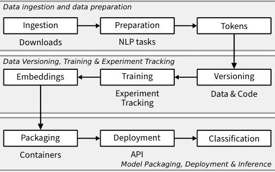

图 12.1 我们的 NLU 机器学习管道架构。

### 12.4.1 数据采集和数据准备

为了可重现性，我们决定使用一组免费访问的文档和许多开源工具。我们使用 `Apache Airflow` [348] 实现管道的这部分（我们在 10.3 节中介绍过它）。表示采集和准备步骤的 DAG 如图 12.2 所示：每个步骤都实现为 Python 函数，并通过 Airflow 使用通用接口调用。详细信息如下：

- arXiv 查询：我们调用 arXiv API 并处理返回的列表以提取 PDF。
- 文章下载：使用多线程 HTTP 客户端下载 arXiv 返回的 PDF，遵守 arXiv 的速率限制，并将其存储在本地文件系统或对象存储（使用 `MinIO` [223] 实现）中。
- 文本转换：使用库（如 `PyPDF` [99], `PdfMiner` [320]）将 PDF 中的文本提取为纯文本文件。像之前一样，使用线程池并行处理多个文档。
- 基础清洗、ngram、停用词移除：使用 NLP 库 `NLTK` [240], `Spacy` [97] 和 `Gensim` [292] 预处理文本文件。特别是执行大小转换、标点和停用词移除、词干提取、词形还原和 ngram。
- Token：剩下的是适用于 NLP 和 NLU 应用的 token¹

Airflow DAG 的 Python 代码提供了图 12.1 中区块如何实现和链接的程序视图。

```python
with DAG('ingestion', ...) as dag:
    ...
    get_article_urls = PythonOperator(
        task_id='query_arxiv_archive',
        python_callable=query_arxiv,
        op_kwargs={'query': 'query'}
    )

    download_article = PythonOperator(
        task_id='download_from_arxiv_archive',
        python_callable=download_arxiv,
        op_kwargs={}
    )

    extract_text_from_article = PythonOperator(
        task_id='extract_text',
        python_callable=convert_pdf_to_text,
        op_kwargs={},
    )
    ...
    get_article_urls >> download_article
    download_article >> extract_text_from_article
```

我们解决的两个主要挑战是从 PDF 文件中提取文本的可扩展性以及

> ¹一组分组的字符序列，为 NLP 处理提供语义单元。

## 292 12 推荐算法

软件测试的健壮性。我们在从 Airflow 调用的 Python 代码通过多线程实现了可扩展性；我们也可以在 Airflow DAG 级别使用 `Celery` [19] 或 `Kubernetes` [364] 运行器，或者通过完全用 `Apache Spark` [353] 替换 Airflow 来实现类似的结果。对于提取出的文本的清理，我们开发了一系列自定义方法来执行基础 NLP 清理任务，并开发了自定义的 ngram 方法，用于检测由因果推断领域专家识别为关键术的单词、双词和三词。两者都组织在专门的子模块中，并辅以单元测试。n-grams 列表是一个在 `Git` 中版本管理的静态资源文件，并在流水线阶段通过环境变量进行引用。

DAG 的输出是一个 token 列表，我们将使用 `word2vec` 对其进行建模。token、PDF URL 列表、n-grams 列表以及定义 arXiv 查询的元数据都存储在由 `DVC` [158] 支撑的数据跟踪和版本控制仓库中，以确保可复现性，并允许我们像第 5.3.3 节讨论的那样跟踪数据溯源。我们可以通过自定义 Airflow 操作符或从 Airflow 内置的 `Bash` 操作符调用 `dvc` 命令行客户端来集成 Airflow 和 DVC。

Airflow DAG 配置为将任务日志写入 `stdout`，这些日志由 `Fluentd` [359] 等工具收集并转发到 `Elasticsearch` [91] 等日志数据库。Airflow 还可以配置为通过 `Grafana` [133] 等工具将任务执行指标导出到仪表板。日志本身的形式为 Python Airflow 代码中 `LogRecord` 对象的 JSON 对象表示形式，这可以传递给 Python `logging` 模块。

## 12.4 流水线架构

### 12.4.2 数据跟踪与版本控制

除了以可复现的方式导入和清理数据外，我们还想跟踪由 12.4.1 节描述的步骤产生的所有数据集：DAG 可能被安排每天带有不同的搜索查询运行，以像 Lipizzi 等人 [195] 描述那样创建额外的知识领域，或重新训练现有的 `word2vec` 模型。因此，我们选择将机器学习代码（第 6.5 节）与文本语料库一起版本化。这允许我们评估不同的 NLP 框架、`word2vec` 参数的选择以及领域专家提供的 n-grams 集合。

正如我们在 12.4.1 节中提到的，我们选择 `DVC` 来实现数据版本控制。`DVC` 也可以执行实验跟踪，但我们将在 12.4.3 节用 `MLflow` 实现（我们在 10.1 节随 DVC 一起引入了它）。我们初始化供 `DVC` 使用 `Git` 仓库，并使用 `dvc pull` 命令从存储它们的远程对象存储拉取 Airflow DAG 生成的 token。这也会拉取相应的元数据，这些数据被版本化并存储在如下 YAML `.dvc` 文件中。

```
outs:
  - md5: 853c96935aac78162dal1c3b46aec63
    size: 2190841
    path: causal_inference.txt

meta:
  search_query: "causal inference"
  search_start: 1629410400
  search_end: 1672441200
  [...]
```

`md5` 属性代表内容的哈希，`path` 属性是相对于工作目录的文件或目录路径，默认认为文件位置。然后我们可以使用如下所示的开发流开始实验。

```
$ git log --oneline
669a3e (HEAD -> master, tag: v0.0.1) - w2v baseline impl.
[...
$ dvc remote list # 列出 DVC 中配置的远程存储
exp_bucket s3://exp_bucket
$ dvc pull # 从远程存储拉取数据到项目
A  datasets/causal_inference.txt
A  datasets/causal_inference_small.txt
2 files added
$ vim src/train-cli.py # 调整训练代码
$ pipenv run src/train-cli.py --dataset-datasets/causal_inference.txt
...
$ git status -s
M src/train.py
$ git add src/train-cli.py
$ git commit -m 'Changed word2vec window size to 4'
$ git tag -a 'v0.0.2' -m 'Changed word2vec window size to 4'
```

### 12.4.3 训练与实验跟踪

我们在 12.4.1 节中并在 12.4.2 节中跟踪的 token 是 `Gensim` 中 `word2vec` 实现的输入（从 `models.word2vec` 可用），以及领域专家提供的 n-grams 列表（下方代码中的 `vocabulary` 变量）。`word2vec` 返回一个 `wv` 对象，它将每个嵌入（即词向量）存储在一个名为 `KeyedVectors` 的结构中，该结构将 n-grams（“键”）映射到向量。`KeyedVectors` 可用于对向量执行操作，例如计算它们的距离或相似性。

```python
[...]
model = Word2Vec(
callbacks=[Word2VecCallback()],
compute_loss=True,
```

## 12.4 流水线架构

```python
model = Word2Vec(
callbacks=[Word2VecCallback()],
compute_loss=True,
vector_size=vector_size,
min_count=min_count,
window=window,
epochs=epochs,
workers=workers
)

model.build_vocab(iterable=vocabulary)
```

我们通过调用 `DVC` 的 `get_url()` 方法获取 token，该方法返回存储位置的 URL。

```python
import dvc.api
...
corpus_path = dvc.api.get_url(
path=corpus,
rev=revision,
remote=remote
)
```

语料库被顺序读取、分词并直接喂给 `train()` 方法。我们按照第 5.1 节的建议设置 `train()` 方法的参数进行实验：

- `vector_size`：嵌入的维度（默认 100）；
- `window`：句子中当前词与预测词之间的最大距离（默认 5）；
- `min_count`：考虑词的最小频率（默认 5）；
- `workers`：训练模型的线程数（默认 3）。

对于实验跟踪，我们使用以下 `MLflow` API 实现：

- `log_param()`：跟踪 `word2vec` 参数以及与其相关的元数据，特别是生成它们的 arXiv 查询以及 `DVC` 文件和哈希；
- `log_metric()`：记录模型生成的嵌入维度；
- `log_artifact()`：记录本地文件或目录名称，例如包含领域专家 n-grams 和训练模型向量的内容作为实验的产物。

这里是我们在代码中使用这些方法的简短示例。


from mlflow import (log_metric, log_param, log_artifacts,
create_experiment, start_run, end_run)
[...]
experiment_id = create_experiment(
"NLU experiments on causal inference corpus",
artifact_location=Path.cwd().joinpath("mlruns").as_uri(),
tags={}
)
start_run(experiment_id=experiment_id)
log_param("query", query)
...
log_param("window", window)
log_param("stop_date", stop_data)
[...
log_metric("wv_size", model.wv.vector_size)
[...
log_artifact("corpus.txt")
log_artifact("keywords.txt")
log_artifact("vectors.kv")
end_run()
[...]

我们使用 MLflow 的 `python_function` 接口保存模型，该接口支持作为通用 Python 函数实现的自定义模型。具体来说，我们序列化 `model.wv` 中包含的词向量，并在模型提供模型时使用 `KeyedVectors.load()` 函数重新加载它们。

## 12.4.4 模型打包

BentoML [37] 在第 11.2 节中引入，它可以导入序列化的 Python 模型或 MLflow 模型，并可以用极少的胶水代码将其 API 绑定到 RESTful 端点。因此，它是打包和提供 word2vec 模型的方便选择。在我们的案例，计算用户提交的 PDF 文档与训练 word2vec 模型的文档之间相似程度的分类 API 即“房间（room）”被暴露为一个 `/classify` 端点。

下面的代码片段展示了使用 BentoML 提供的 API 和装饰器定义的服务。一旦服务运行，该 API 将通过 `/classify` 可用：它将接受 PDF 文件作为输入，并返回一个 0 到 1 之间的标量。作为未来的增强，我们可以构建一个额外的 `/rank` API 端点，它接受一个 JSON 格式的 PDF URL 列表作为输入，为每个 URL 调用 `/classify` API，并返回一个带有相关排名和相似度的排序后的文档列表。

```
from __future__ import annotations

import io
from typing import Any
import typing

import numpy as np

import bentoml
from bentoml.io import File
from bentoml.io import JSON

nlu_runner = bentoml.pickleable_model.get("nlu_exp:v0.0.2").to_runner()
svc = bentoml.Service("pdf_classifier", runners=[nlu_runner])

@svc.api(input=File, output=JSON())
def classify(input_pdf: io.BytesIO[Any]) -> typing.List[float]:
    return nlu_runner.classify.run(input_pdf)
```

## 12.4.5 部署与推理

使用容器部署和提供模型的一个优势是它们可以使用 Docker 在本地部署，也可以使用 Kubernetes 在目标（可能是远程）环境中部署（第 7.1.4 节）。这是我们用例中的一个重要点：正如第 12.3 节所述，我们的流水线运行在本地和远程系统的组合上。因此，我们使用 `bentom containerize` 命令构建容器镜像，其中包含了运行我们在第 12.4.4 节中定义的推理 API 所需的所有要求：输出是一个用 Python 实现的无状态 RESTful API 的 Docker 容器。构建容器的命令所示。

```
$ bentom containerize nlu-exp:v0.0.2
$ docker run -d --rm -p 3000:3000 nlu-exp:v0.0.2
```

启动容器后，可以通过 http://127.0.0.1:3000 访问 API 服务器。URL http://127.0.0.1:3000/classify 提供第 12.4.4 节中的 API，而 http://127.0.0.1:3000/ 显示一个带有动态生成的 OpenAPI 文档 [326] 的网页（图 12.3）。我们提供了额外的健康检查（liveness）和就绪检查（readiness）API 以支持在 Kubernetes 上部署，

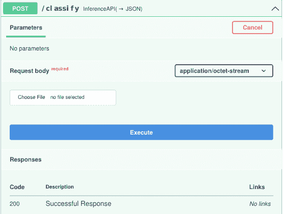

图 12.3 BentoML 生成的 OpenAPI 规范。

以及一个以 Prometheus 格式返回服务指标的 `/metrics` 端点 [275]。

RESTful 接口设计用于程序化使用：我们可以使用 `curl` 工具或 Postman 等 API 测试工具 [386] 访问它。我们还在持续集成设置中对其进行查询，以运行集成测试并验证构建是否成功创建了容器镜像。然而，RESTful 接口也可以作为后端来构建消费 API 输出并显示它们（使用我们在第 11.3 节中讨论的工具）的 Web 应用，或简单的 Web 界面（使用 React [211] 或 Vue.js [419] 等框架；或者使用 Gradio [1] 和 Streamlit [333] 等 Python 开发库）。它们对于领域专家检查和验证推理输出以及生成这些内容的模型非常有用，实现了“人在回路”（human-in-the-loop）（第 5.3.4 和 5.3.6 节）。特别是，它们使得领域专家能够迭代完善我们作为 word2vec 词汇的关键术列表，正如 Lipizzi 等人 [195] 所预期的。

为了验证 `/classify` API，我们可以使用命令行工具 curl 上传 (POST) 一篇关于因果推断的科学文章 PDF：

```
$ curl -H "Content-Type: multipart/form-data" \
-F 'fileobj=@good-article.pdf;type=octet-stream' \
  http://remote:3000/classify
{"value":0.8203422561739}
```

以及另一个完全不同主题的文章。

```
$ curl -H "Content-Type: multipart/form-data" \
-F 'fileobj=@bad-article.pdf;type=octet-stream' \
  http://remote:3000/classify
{"value":0.24675639930117}
```

从相关性评分可以看出，"/classify" API 对相关和不相关的文档都了正确的响应（第 9.4.6 节）。底层的 `classify()` 方法计算 `KeyedVectors` 之间的余弦距离，以浮点数返回相似度，并通过 Fluent 将 PDF 元数据和相关性记录到远程数据库。

```python
# 从 `knowledge_ww_fp` 加载序列化的 KeyedVectors
knowledge_wv = KeyedVectors.load(knowledge_ww_fp, mmap="r")
# 获取与关键词列表（来自专家）匹配的 KeyedVectors 节点
knowledge_v = get_word2vec(
    word_vectors=knowledge_wv,
    vocabulary=vocab
)
# 在地训练单词
```

# 参考文献

- [1] Abid A, Abdalla A, Chan D, Hoang L, Klein R, Milne M, Schwarzmann J, Wong S (2022). Gradio. https://www.gradio/.

- [2] Aggarwal CC (2018). Machine Learning for Text. Springer.

- [3] Alam S, Balan L, Dada Y, Green L, Klein R, Itisen J (2022). Kedro. https://github.com/kedro-org/

- [4] Ames MS, Project Jupyter (2022). nbd – Diffing and Merging of Jupyter Notebooks. https://nbime.readthedocs.io/.

- [5] Anderson E, Bai Z, Bishof C S, Demmel J, Dongarra J, Du Cruz J, Greenbaum A, Hamling S, McKinney A, Sorensen D (1999). LAPACK Users’ Guide. 3rd edition. SIAM.

- [6] Alqi A, Takuri H, Taft M (2022). An Analysis of Network-Partitioning in Cloud Systems.

- [7] Altair (2022). Declarative Visualization. https://altair-viz.github.io/.

- [8] Amazon (2022). Redshift Documentation. https://docs.amazon.com/redshift/index.html.

- [9] Amazon (2022). SageMaker Examples. https://sagemaker-examples.readthedocs.io/en/

- [10] Amazon (2022). AWS Cloud9. https://docs.aws.com/cloud9.

- [11] Amazon (2022). Machine Learning: Amazon SageMaker. https://aws.amazon.com/sagemaker/.

- [12] Amazon Web Services (2022). Elastic Kubernetes Service. https://docs.aws.amazon.com/eks/

- [13] Amazon Web Services (2022). Amazon Machine Images (AMI). https://docs.aws.amazon.com/EC2/latest/UserGuide/AMI.html.

- [14] Amazon Web Services (2022). AWS Trainium. https://aws.amazon.com/machine-learning/trainium/.

- [15] Anaconda (2022). Conda for Data Scientists. https://docs.conda.io/projects/conda/en/latest/user-guide/concepts/data-science.html.

- [16] Anaconda (2022). Package, Dependency and Environment Management for Any Language. https://docs.conda.io.

- [17] Ansible Project (2022). Ansible Documentation. https://docs.ansible.com/ansible/latest/index.html.

- [18] Apache Software Foundation (2022). Celery Executor. https://airflow.apache.org/docs/apache-airflow/stable/executor/celery.html.

- [19] Apache Software Foundation (2022). Impala Documentation. https://impala.apache.org/impala-docs.html.

- [20] Apple (2022). TensorFlow 2 Conversion. https://coremltools.readme.io/docs/tensorflow-2.

- [21] React (2022). https://reactjs.org/.

- [22] Lipizzi et al. [195]. (The vocabulary of word2vec)

- [23] Vue.js [419]. https://vuejs.org/.

- [24] Streamlit [333]. https://streamlit.io/.

- [25] Prometheus format [275]. https://prometheus.io/.

- [26] OpenAPI specification [326]. https://www.openapi.org/.

# 参考文献

[26] ArXiv (2022). arXiv API 访问。URL https://arxiv.org/help/apt.

[27] Atom (2022). 面向 21 世纪的可定制化文本编辑器。URL https://atom.io/.

[28] Ayer A (2022). git-crypt: Git 中的透明文件加密。URL https://github.com/AGWA/git-crypt.

[29] Batchelder N, 等 (2022). Python 代码的静态类型分析器。URL https://google.github.io/pytype.

[30] Bates D, Maehler M (2021). Matrix: 稀疏与稠密矩阵类及方法。URL https://cran.r-project.org/webpages/Matrix/

[31] BBC (2018). 亚马逊删除了“性别歧视 AI”工具。URL https://www.bbc.com/news/technology-4580919.

[32] BBC (2021). Facebook 为 AI 将黑人标签为“质数”表示道歉。URL https://www.bbc.com/news/technology-58462511.

[33] BBC (2021). Twitter 在图像交叉 AI 中中发现种族偏见。URL https://www.bbc.com/news/technology-5719288.

[34] Beam AL, Manrai AK, Ghashemi M (2020). “医疗保健领域机器学习模型的可重复性挑战。”《美国医学杂志》，323(4), 305–306.

[35] Beck K (2002). 示例测试驱动开发。Addison-Wesley 出版。

[36] Beck K, Beadle M, Van Bennekum A, Cockburn A, Cunningham M, Fowler J, Grenning J, Highsmith J, Hunt A, Jeffries R, Kern J (2021). 敏捷宣言。URL https://www.agilealliance.org/wp-content/uploads/2019/09/agile-manifesto-download-2019.pdf.

[37] BentoML (2022). 统一模型服务框架。URL https://docs.bentoml.org/en/latest/

[38] Bezanson J, Karpinski S, Shah VB, 等 (2022). 风格指南：Julia 语言。URL https://docs.julialang.org/en/v1/manual/style-guide/index.html.

[39] Bhupinder K, Dugré M, Hanna A, Galat T (2021). “科学数据分析容器镜像的安全漏洞分析。”《GigaScience》，10(6), giab025.

[40] Bishop CM (1995). “带噪声训练等同于 Tikhonov 正则化。”《神经计算》，7(1), 108–116.

[41] Blackford LS, Demmel J, Dongarra J, Duff I, Hammarling S, Henry G, Heroux G, Kaufman L, Lumsdaine A, Petitet A, Pozo R, Remington K, Whaley RC (2002). “更新后的基础线性代数子程序 (BLAS)。”《ACM 数学软件交易》，28(2), 135–151.

[42] Blagotic A, Valle-Jones D, Breen J, Lundburg J, White JM, Bode D, White K, Mueller M, Redelli M, Lorang N, Schalk P, Schneider D, Hepp G, Gamile Z (2021). ProjectTemplate: 自动化创建新的统计分析项目。URL https://cran.r-project.org/web/packages/ProjectTemplate/


# 参考文献

[43] Bei DM, Cuckelbir A, McAlififfe JD (2017). “变分推理：统计学者的综述。”《美国统计协会杂志》，112(58), 859–877.

[44] Bishjak J, Carbonetto P, Stephens M (2022). workflow: 可复与协作数据科学框架。URL https://cran.r-project.org/web/packages/workflow.

[45] Bogner J, Verdechchia R, Gerostathopoulos I (2021). “基于 AI 的系统的技术债与反模式特征描述：系统映射研究。”收录于 2021 IEEE/ACM 技术债国际会议 (TechDebt)，第 64–73 页。

[46] Bokeh (2022). Bokeh 文档。URL https://docs.bokeh.org/latest/

[47] Bonawitz K, Eichner H, Grieskamp W, Kuba D, Inman A, Ivanov V, Kidson C, Konecký J, Mazzocchi S, McMahon HB, Van Overveldt T, Petrou D, Ramage D, Roslander J (2019). “迈大规模联邦学习：系统设计。”收录于《机器学习与系统会议集》，第 374–388 页。

[48] Braiek HB, Khomh F (2020). “论机器学习测试。”《系统与软件杂志》，164, 110542.

[49] Brandl G, Sphinx Team (2022). Sphinx: Python 文档。URL https://www.sphinx-doc.org/en/master/

[50] Brass P (2008). 高级数据结构。

[51] Breck E, Cai S, Nielsen E, Salib M, Scully D (2017). “Test Score：ML 准备就绪。”收录于 IEEE 大数据会议。

[52] Breiman L (1996). “袋外估计 (Out-of-Bag Estimation).”URL https://www.stat.berkeley.edu/users/breiman/00.

[53] Breiman L (2001). “随机森林。”《机器学习》，45(1), 5–32.

[54] Breiman L (2001). “统计建模：两种文化。”《统计科学》，16(3), 19–21.

[55] Callon R (1996). 网络。URL https://rfceditor.org/rfc1925.

[56] Canonical (2022). Cloud-Init。URL https://cloudinit.readthedocs.io/en/latest/

[57] Canonical (2022). MicroK8s。URL https://microk8s.io/docs/

[58] Carpenter B, Gelman A, Hoffman MD, Betancour M, Guo J, Riddell A (2017). “Stan：概率编程语言。”《统计软件杂志》，76(1), 1–32.

[59] Cass S (2019). “将 AI 推向边缘：Google 的 TPU 流行。”《IEEE Spectrum》，56(5), 16–17.

[60] Castillo E, Gutiérrez JM, Hadi AS (1997). 概率网络。Springer。

[61] Chang AC, Li P (2015). “经济学可复制吗？十三篇期刊论文说‘不能’。”《金融与经济讨论》。

[62] Chang W, Cheng J, Allaire JJ, Sievert C, Schloer B, Xie Y, Allen J, Dipert A, Borges B (2022). shiny: R 的 Web 应用程序框架。URL https://cran.r-project.org/web/packages/shiny.

[63] Cheney J, Jiticariu L, Tan WC (2009). “数据库中的溯源：为什么、如何以及在哪里。”《数据库基础与趋势》，1(4), 379–474.

[64] Clements P, Bachmann F, Bass L, Garlan D, Ivers J, Little R, Merson P, Nord R, Stafford J (2011). 软件架构文档：视图之外。第二版。Addison-Wesley 出版。

[65] Cloudera (2022). 混合数据公司。URL https://www.cloudera.com/

[66] Cohen AGV, Pavlick E, Tellex S (2019). OpenGPT-2：我们也复现了 GPT-2。URL https://blog.journal.com/openai-gpt-2-we-replicated-gpt-2-because-you-can-too-45e34d6d.

[67] Comet (2022). Comet 文档。URL https://www.comet.com/docs/v2.

[68] Cormen T (2013). 算法导论。MIT Press。

[69] Cortes-Ortuno D, Laslett O, Kluyver T, Fauske V, Albert M, MinRK, Hovorkka O, Fanhohr H (2022). py.test 的 Python Notebook 验证。https://pytest.readthedocs.io.

[70] CRAN Team (2022). R 综合存档网络。URL https://cran-r-project.org.

[71] Crook J (2004). “拒绝推理真的能提高申请评分模型的性能吗？”《银行与金融杂志》，28, 857–874.

[72] Crosley T (2022). 用于排序导入的 Python 工具和库。URL https://pycqa.github.io/isort.

[73] Cunningham W (1992). “案例组合管理系统。”收录于 ACM 面向对象编程、系统与语言应用会议论文，第 29–30 页。

[74] Cunningham W (2011). Ward 解释债务比喻。URL https://wiki.c2.com/WardExplainsDebtMetaphor.

[75] DagsHub (2022). 欢迎来到 DagsHub。URL https://daghub.com/docs/

[76] Databricks (2022). Databricks 文档。URL https://docs.databricks.com/applications/machine-learning/index.html.

[77] Lima Salge CA, Berente N (2016). “结对编程 vs. 独立编程：15年后我们知道了什么？”收录于夏威夷系统科学年度会议集，第 5398–5406 页。

[78] Devlin J, Chang MW, Toutanova K (2019). “BERT：用于语言理解的双向 Transformer 预训练。”收录于语言协会北美分支会议 (MNACL-HLT)，第 4171–4186 页。

[79] Dimakopoulou M, Zhou Z, Athey S, Immens G (2018). 上下老虎机中的估计考虑量。https://arxiv.org/abs/1711.0707.

[80] Dimakopoulou M, Zhou Z, Athey S, Immens G (2019). “平衡上下文老虎机。”收录于 AAAI 人工智能会议集，第 3445–3453 页。

[82] Docker (2022). Docker。URL https://www.docker.com/

[83] Docker (2022). Registry HTTP V2 文档。URL https://docs.docker.com/registry/spec/api/

[84] Docker (2022). Docker Compose 概述。URL https://docs.docker.com/compose.

[85] Dusserre E, Padró M (2017). “大并不更好！我们更喜欢特定性。”收录于第12次计算语义国际会议，第 1–6 页。

[86] Duval PM, Matyas S, Glover A (2007). 持续集成：提高软件质量并降低风险。Addison-Wesley 出版。

[87] Eclipse Che (2022). 在 Kubernetes 上运行你喜欢的 IDE。URL https://www.eclipse.org/che/technology/

[88] Eclipse Foundation (2022). 桌面 IDE。URL https://www.eclipse.org/ide/

[89] Eclipse Foundation (2022). Theia：云与桌面 IDE。URL https://theia-id.org/docs/

- [90] Edmundson A (2021). 首页内容个性化 ML 模型的兴（及教训）。URL: https://engineering.atspotify.com/2021/the-rise-and-lessons-learned-of-ml-models-to-personalize-content-on-home-part-i/, https://engineering.atspotify.com/2021/the-rise-and-lessons-learned-of-ml-models-to-personalize-content-on-home-part-i/

- [91] Elasticsearch (2022). 免费与开源搜索：Elasticsearch、ELK & Kibana 的创造者。URL: https://www.elastic.co/

- [92] Elementi (2022). Dagster 文档。URL: https://docs.dagster.io.

- [93] Espe L, Jindal A, Podolskiy V, Gerndt M (2020). “容器运行时性能评估。” 见第10 届云计算与服务科学国际会议论文集，第273–281页。

- [94] Epeholt L, Soyer H, Hunos R, Simonyan K, Ward T, Doron Y, Firoiu V, Harley T, Dunning I, Legg S, Kavukoglu K (2018). “IMPALA：基于重要性加权 Actor者架构的可扩展分布式深度强化。” 见第35 届机器学习国际会议（ICML）论文集，第1407–1416页。

- [95] ETF OAuth 工作组 (2022). OAuth 2.0 URL: https://oauth.net/2/

- [96] Evans E (2003). 领域驱动设计：解决软件核心复杂性。Addison-Wesley。

- [97] Explosion (2021). Spacy：工业级自然语言处理。URL: https://spacy.io/

- [98] Feast Authors (2022). Feast 文档。URL: https://docs.feast.dev/

- [99] Fenniak M (2022). PyPDF 文档。URL: https://pypdf.readthedocs.io/en/latest/

- [100] Fernandez A, Garcia S, Herrera F, Shawla N (2018). 用于不平衡数据学习的 SMOTE：进展与挑战，纪念15周年。” 《人工智能研究期刊》，61, 863–905。

- [101] Firke S, Denney B, Haid C, Knight R, Grosser M, Zadra J (2022). janitor：检查和清理脏数据的简单工具。URL: https://cran.r-project.org/web/packages/janitor.

- [102] Formagrid (2022). Airtable 是一个具有数据库功能的现代电子表格。URL https://airtable.com.

- [103] Fortin P, Fleury A, Lemaire F, Monagan M (2021). “用于多项式评估的高性能 SIMD 模块算术。” 并发计算：实践与经验，33(16), e6270。

- [104] Fowler M (2003). UML 精要。第3版。Addison–Wesley。

- [105] Fowler M (2018). 重构：改进现有代码的设计。第2版。Addison-Wesley。

- [106] Galassi M, Davies J, Theiler J, Gough B, Jungman G, Alken P, Booth M, Rossi F, Ulerich R (2021). GNU 科学库。URL https://www.gnu.org/software/gsl/doc/latex/gsl-ref.

- [107] Gama J, Žlioait I, Bet A, Pechenizkiy M, Bouchach A (2014). “概念漂移。” 《计算调查》，46(4), 44。

- [108] Ganiev A, Chapin C, Andrade A, Liu C (2021). “基于 Transformer 模型的加速架构。” 见2021 年北美语言协会会议，第163–169页。

- [109] Gelman A, Carlin B, Stern H, Dobson D, Vehtari A (2013). 贝叶斯数据分析。第3版。CRC Press。

- [110] Gahramani (2022). “概率机器学习与人工智能。” 《Nature》，521, 452–459。

- [111] GitHub (2022). Codespaces。URL https://github.com/features/codespaces.

- [112] GitHub (2022). 将工作流数据作为制品。URL https://docs.github.com/en/workflows/storing-workflow-data.

- [113] GitHub (2022). 使用容器仓库。URL https://docs.github.com/en/packages/working-with-container-registry.

- [114] GitLab (2022). 制件。URL https://docs.gitlab.com/ee/pipelines/job_artifacts.html, https://docs.gitlab.com/ee/pipelines/artifacts.html.

- [115] GitLab (2022). 容器仓库。URL https://docs.gitlab.com/ee/user/container_registry.

- [116] GitLab (2022). GitLab Runner。URL https://docs.gitlab.com/runner/

- [117] GitLab (2022). 团队方向：MLOps。URL https://about.gitlab.com/direction/modelops/

- [118] GitLab (2022). 什么是 GitOps？URL https://about.gitlab.com/topics/gitops.

- [119] Gitpod (2022). Gitpod：随时准备代码。URL https://www.gitpod.io.

- [120] GNU Project (2022). GNU Emacs。URL https://www.gnu.org/software/emacs/

- [121] Gong M, Xie Y, Pan K, Feng K (2020). “差分隐私。” 《计算智能》，15(2), 49–64。

- [122] Goodfellow I, Bengio Y, Courville A (2016). 深度学习。MIT Press。

- [123] Goodfellow I, Pouget-Abadie J, Mirza M, Xu B, Ward-Farley D, Ozair S, Courville A (2014). “生成对抗网络。” 见神经信息处理进展（NIPS），第2672–2680页。

- [124] Goodger D, van Rossum G (2022). PEP 257：文档字符串规范。URL https://peps.python.org/pep-0257/#what-is-a-docstring

- [125] Google (2022). BigQuery 文档。URL https://cloud.google.com/bigquery/docs.

- [126] Google (2022). 深度学习容器。URL https://cloud.google.com/deep-learning-containers.

- [127] Google (2022). Google Kubernetes Engine。URL https://cloud.google.com/kubernetes-engine/docs.

- [128] Google (2022). Python 代码指南。URL https://google.github.io/styleguide/pyguide.html.


## 参考文献

- [129] Google (2022). repo：多仓库工具。URL https://github.com/GerritReview/git-repo.
- [130] Google (2022). Vertex AI 文档。URL https://cloud.google.com/vertex-ai/docs.
- [131] Google (2022). 欢迎来到 Colab！URL https://colab.research.google.com.
- [132] Grafana Labs (2022). Grafana Loki 文档。URL https://grafana.com/docs/loki/latest/
- [133] GrafanaLabs (2022). Grafana：开放观测平台。URL https://grafana.com/
- [134] Greenfield AR (2022). Cookiecutter Data Science。URL https://drivendata.github.io/cookiecutter-data-science/
- [135] Gregg B (2021). 系统性能：企业与云。第2版。Addison-Wesley。
- [136] Grotot K, Titov S, Sitnikov V, Golubev Y, Bryksin T (2022). “Jupyter Notebook 与脚本中 Python 代码的大规模比较。” 见第19 届软件仓库挖掘工作会议论文集，第1–12页。
- [137] Groves RM, Fowler FJ, Cooper MP, Lepkowski JM, Singer E, Tourangeau R (2009). 方法。Wiley。
- [138] Hammant P (2020). Trunk 开发。URL https://trunkbased.com/
- [139] Hao J, Anang TJ, Kim K (2021). “IaaS 的实证分析。” 见第14 届云计算会议集，第398–403页。
- [140] Harbor (2022). Harbor 文档。URL https://oharbor.io/
- [141] Harris CR, Angly F, Hyde R, Chirico M, Ren K, Rostenberg A (2020). “使用 NumPy 数组。” 《Nature》，585(7285),357–362。
- [142] Harvard Business Review (2012). 21世纪最酷的工作：数据科学家。URL https://hbr.org/2012/10/data-scientist-the-seariest-job-of-21st-century
- [143] HashiCorp (2022). Packer 文档。URL https://www.packer.io/
- [144] HashiCorp (2022). Terraform 文档。URL https://www.terraform.io/docs.
- [145] HashiCorp (2022). Terraform Registry。URL https://registry.terraform.io.
- [146] HashiCorp (2022). Vagrant 文档。URL https://www.vagrantup.com.
- [147] Haste T, Tibshirani R, Friedman J (2009). 统计学习要素：数据挖掘、预测。第2版。Springer。
- [148] Hazelwood K, Bird S, Brooks D, Chintala S, Dzhulgagov D, Fawzy M, Jia B, Jia Y, Kalro A, Law J, Lee K, Lu J, Noorduis P, Smensky M, Xiong L, Wang X (2018). “Facebook 的应用机器学习。” 见 IEEE 高性能体系体系会议（HPCA），第620–629页。
- [149] He X, Zhao C, Chu X (2021). “AutoML：现状调查。” 《知识库系统》，216, 10622。
- [150] Hester J, Angly F, Hyde R, Chirico M, Ren K, Rostenberg A (2022). 代码 Linter 工具。URL https://cran.r-project.org/packages/lintr.
- [151] Holoviz (2022). Panel 用户指南。URL https://panel.holoviz.org/user_guide/index.html.
- [152] Hopworks (2022). Hopworks 文档。URL https://docs.hopworks.a.
- [153] Humble J, Farley D (2021). 持续交付。Addison Wesley。
- [154] Hunt E (2016). 微软 AI 聊天机器人 Tay 在 Twitter 上遭遇了种族主义崩溃。URL https://www.theguardian.com/technology/2016/03/24/microsoft-ai-chatbot-a-crash-in-racism-from-twitter
- [155] Hunter JD (2022). Matplotlib API 参考。URL https://matplotlib.org/stable/api/index.html.
- [156] Intel (2021). oneAPI 数学内核库。URL https://software.intel.com/content/www/us/en/develop/tools/oneapi/components/onetkl.html.

### 参考文献（续）

- [157] Iterative (2022). CML 文档. URL https://cml.dev/doc.
- [158] Iterative (2022). DVC: 数据版本控制。面向数据与模型的 Git。 URL https://github.com/iterative/dvc.
- [159] Iterative (2022). DVC Python API. URL https://dvc.org/doc/api-reference.
- [160] Iterative (2022). MLEM 文档. URL https://mlem.ai/doc.
- [161] Jacek C, Greiler M, Bird C, Panjer L, Coatta T (2018). “CodeFlow: 改进微软的代码审查流程。” ACM Queue, 6(5), 1–20.
- [162] Jain P, Mo X, Jain A, Subbaraj H, Durrani R, Tumanov A, Gonzalez J, Stoica I (2018). “GPU 推理的动态时空调度。” 见于机器学习系统与开源软件研讨会，NeurIPS 2018，页码 1–9.
- [163] Jenkins (2022). 用于函数运行 Jenkins 的命令行工具。 URL https://github.com/jenkinsci/jenkinsfile-runner.
- [164] Jenkins (2022). Jenkins 文档. URL https://www.jenkins.io/doc.
- [165] JetBrains (2022). IntelliJ IDEA. URL https://www.jetbrains.com/idea.
- [166] JetBrains (2022). PyCharm. URL https://www.jetbrains.com/pycharm/
- [167] Jouppi NP, Yoon DH, Kurian G, Li S, Patel N, Laudon J, Young C, Patterson D (2020). “用于训练深度神经网络的领域特定超级计算机。” Communications of the ACM, 63(7), 67–78.
- [168] Jouppi NP, Young C, Patel N, Patterson D (2018). “用于深度神经网络的领域特定架构。” Communications of the ACM, 61(9), 50–59.
- [169] Julia VS Code (2022). Julia 语言的微软语言服务器协议实现。 URL https://juliapages.com/p/languageserver.
- [170] Julia VS Code (2022). Visual Studio Code 版 Julia. URL https://www.julia-lang.vscode.org.
- [171] JuliaLang (2022). Pkg: Julia 编程语言的包管理器。 URL https://pkgdocs.julialang.org/v1.
- [172] Kaji N, Kobayashi H (2017). “带负采样的增量 Skip-gram 模型。” 见于 2017 年自然语言处理经验方法会议集，页码 363–371.
- [173] Kalynatskyi I (2022). Poetry 文档. URL https://python-poetry.org/docs.
- [174] Kalynatskyi I (2022). sphinxcontrib-openapi 是一个从 OpenAPI 生成 API 文档的 Sphinx 扩展。URL https://sphinxcontrib-openapi.readthedocs.io.
- [175] Kalynatskyi I (2022). 使用 Redoc 渲染 OpenAPI 规范的 Sphinx 扩展。URL https://sphinxcontrib-redoc.readthedocs.io/en/stable.
- [176] Kanagawa M, Hennig P, Sejinovic D, Sriperumbudurur BK (2018). 高斯过程与核方法：连接与等效性述。 URL https://arxiv.org/abs/1807.02582.
- [177] Kang S, Jin R, Deng X, Kennett S (2021). “大制造中的建模与分析挑战：从机器学习和计算角度的综。” Journal of Intelligent Manufacturing, 在线优先。
- [178] Katal A, Wazid M, Goudar RH (2013). “大数据：问题、挑战、工具与良好实践。” 见于 当代计算国际会议集，页码 404–409.
- [179] Kennett RS, Redman TC (2019). 数据科学真实的工作。Wiley.
- [180] Kernigham BW, Pike R (1999). 编程实践。Addison-Wesley.
- [181] Khan W, Ahmed E, Hakak S, Yaqoob I, Ahmed A (2019). “边缘计算：综述。” Future Generation Computer Systems, 97, 219–235.
- [182] Kibirigge H (2022). Plotnine API 参考. URL https://plotnine.readthedocs.io/en/stable/api.html.
- [183] Knuth DE (1976). “大 Omicron 与大 Omega Theta。” ACM Sigact News, 8(2), 18–24.
- [196] Lipizzi C, Borrelli D, de Oliveira Capela F (2021). 使用房间理论实现主观性的计算模型：从文本检测情绪案例。URL https://arxiv.org/abs/2005.06059.
- [197] Logilalab 和 PyCQA 及贡献者 (2022). Pylint 是适用于 Python 2 或 3 的静态代码分析器。URL https://pylint.pycqa.org/latest/
- [198] Lohr SL (2021). 采样：设计与分析。第3版。CRC Press.
- [199] Lopes CV (2020). 编程风格练习。CRC Press.
- [200] Loria S, 等 (2022). 可可插的 API 规范生成器。URL https://apispec.readthedocs.io/en/latest.
- [201] Lundberg SM, Lee SI (2017). “解释模型预测的统一方法。” 见于神经信息处理系统进展 (NIPS)，页码 4765-4774.
- [202] Lettle I, Jeppson H (2022). altair: Alta 的接口。URL https://altair-data-viz.org/
- [203] Manohar A (2022). asdf.

### 参考文献 321

- [240] NLTK Team (2021). NLTK: 自然语言处理工具包。URL https://www.nltk.org/.
- [241] Nteract Team (2022). Papermill 是用于参数化和执行 Jupyter Notebook 的工具。URL https://papermill.readthedocs.io.
- [242] Nteract Team (2022). Testbook。URL https://testbook.readthedocs.io/en/latest/
- [243] Nvidia (2018). Nvidia Turing GPU 架构：图形学的重塑。URL https://images.nvidia.com/aem-dam/en-zz/Solutions/design-visualization/technologies/turing-architecture/NV-Turing-Architecture-Whitepaper.pdf.
- [244] Nvidia (2021). CUDA Toolkit 文档。URL https://docs.nvidia.com/cuda/
- [245] Oanda (2018). 用于金融应用的 C++ 定点数数学库。URL https://github.com/oanda/libfixed.
- [246] Odena A, Olsson C, Andersen D, Goodfellow I (2019). “TensorFuzz: 使用覆盖引导的模糊测试调试神经网络。”机器学习研究进展 (ICML 2018), 97, 4901–4911.
- [247] ONNX (2021). 开放神经网络交换。URL https://github.com/onnx.
- [248] Open Container Initiative (2022). 开放容器倡议。URL https://opencontainers.org/
- [249] Open Virtualization Alliance (2022). 文档。URL https://www.linux-kvm.org/page/Documents.
- [250] Openrefine (2022). 用于处理杂乱数据的免费开源工具。URL https://openrefine.org.
- [251] Oracle (2022). Oracle Virtualbox。URL https://www.virtualbox.org/
- [252] Ousterhout J (2018). 软件设计哲学。Yaknam Press.
- [253] Overton ML (2001). 使用 IEEE 浮点算数的数值计算。SIAM.
- [254] Pachyderm (2022). 以数据为中心的流水线和数据版本。URL https://docs.pachyderm.com/latest.
- [255] PagerDuty (2022). PagerDuty：运行就是金钱。URL https://www.pagerduty.com.
- [256] Palantir (2022). Python 语言服务器。URL https://github.com/palantir/python-language-server.
- [257] Pallets Team (2022). Flask 文档。URL https://flask.palletsprojects.com/en/latest.
- [258] Papernot N, McDaniel P, Sinha A, Wellman MP (2018). “SoK: 机器学习中的安全与隐私。”IEEE欧洲安全与隐私研讨会论文集，第 399–414 页。
- [259] Paszka A, Gross S, Massa F, Lerer A, Bradbury J, Chanan G, Killeen T, Lin Z, Gimelshein N, Antiga A, Desmaison A, Kopf A, Yang E, DeVito J, Raison M, Tejani A, Chilamkurthy S, Steiner B, Fang L, Bai J, Chintala S (2019). “PyTorch: 一种命令式的高性能深度学习。”神经信息处理进展 (NIPS)，第 32 卷，第 8026–8037 页。


## 参考文献

- [260] Pennington J, Socher R, Manning C (2014). “Glove: 用于向量表示的全局向量。” 2014年自然语言处理经验方法会议 (EMNLP)，第 1532–1543 页。

- [261] Pineau J, Vincent-Lamarre P, Sinha H, Larrière V, Beygelzimer A, d’Alché–Buc F, Fox E, Larochelle H (2021). “提高机器学习研究的可复现性（NeurIPS 2019 可复现性计划报告）。” 机器学习研究杂志，22，第 1–20 页。

- [262] Plotly (2022). 用于 Python, R, Julia 和 Jupyter 的分析 Web 应用。无需 JavaScript。URL `https://github.com/dash`。

- [263] Plotly (2022). Dash 用户指南。URL `https://dash.plotly.com/`。

- [264] Plotly (2022). 用于 Python 的 Plotly 开源图表库。URL `https://plotly.com/python/`。

- [265] Polyaxon (2022). Polyaxon 文档。URL `https://github.com/polyaxon/polyaxon`。

- [266] Popejoy A, Fullerton SM (2016). “基因学在多样性上失败了。” Nature，538, 161–164.

- [267] Popescu M (2019). 结对编程。URL `https://shopify.engineering/pair-programming`。

- [268] Poseidon Laboratories (2022). Typhoon 文档。URL `https://typhoon.io/documentation/`。

- [269] Putvin R, Leenberg J (2016). “为什么 Google 在单个仓库中存储数十亿行代码。” ACM 通信，59(7), 78–87.

- [270] Prefect (2022). Prefect 2.0 文档。URL `https://docs.prefetch.io`。

- [271] Preston-Werner T (2022). 语义版本控制。URL `https://semver.org/`。

- [272] Prinz F, Schlange T, Abdullah K (2011). “信不信：我们能在多大程度上依赖发布的数据？” Nature Discovery, 10, 1–2.

- [273] Progress Software (2022). Chef 文档。URL `https://docs.chef.io`。

- [274] Project Jupyter (2022). Jupyter。URL `https://jupyter.org/`。

- [275] Prometheus Foundation (2022). Prometheus：监控系统与时序数据库。URL `https://prometheus.io/`。

- [276] Puppet (2022). Puppet 文档。URL `https://puppet.com/docs`。

- [277] Pyright (2022). Python 静态类型检查器。URL `https://github.com/microsoft/pyright`。

- [278] Python Packaging Authority (2022). 使用 Setuptools 构建包。URL `https://setuptools.pypa.io/en/latest/userguide/index.html`。

- [279] Python Packaging Authority (PyPA) (2022). Virtualenv 文档。URL `https://virtualenv.pypa.io/en/latest/`。

- [280] Python Software Foundation (2022). PyPI: Python 包索引。URL `https://pypi.org/`。

- [281] Python Software Foundation (2022). Doctest 示例。URL `https://docs.python.org/3/library/doctest.html`。

- [282] Python Software Foundation (2022). unittest: 测试框架。URL `https://docs.python.org/3/library/unittest.html`。

- [283] QS University (2022). QS 世界排名。URL `http://www.topuniversities.com/qs-rankings`。

- [284] Quest K (2022). 标准 Go Layout。URL `https://github.com/golang-standards/project-layout`。

- [285] Radford A, Wu J, Child R, Ruan D, Amodei D, Sutskeever I (2019). 语言模型是无监督多任务学习器。URL `https://openai.com/blog/better-language-models`。

- [286] Ramírez S (2022). FastAPI 框架：高性能、易学、生产就。URL `https://fastapi.tiangolo.com`。

- [287] Ranganathan P, Pramesh CS, Aggarwal R (2017). “统计分析中的常见陷阱：逻辑回归。” Perspectives in Clinical Research, 8(3), 148–151.

- [288] Rasmussen E, Williams CK (2006). 机器学习高斯过程。MIT Press.

- [289] Rathgeber F (2022). 去除 Jupyter 和 IPython Notebook 输出。URL `https://github.com/kn/nbstripout`。

- [290] Read the Docs (2022). Read the Docs：简化文档。URL `https://docs.readthedocs.io`。

- [291] REditorSupport (2022). 在 Visual Studio Code 中。URL `https://marketplace.visualstudio.com/items?itemName=REEditorSupport.r`。

- [292] Řříšek R, Sojka P (2022). Gensim 文档。URL `https://radimrehurek.com/gensim/auto_examples/index.html`。

- [293] Řříšek R, Sojka P (2022). Gensim 文档。URL `https://radimrehurek.com/gensim/models/word2vec.html`。

- [294] Reitz K, Python Packaging Authority (PyPA) (2022). Pipenv：面向人的 Python 工作流。URL `https://pipenv.pypa.io`。

- [295] Reuther A, Michaleas P, Jones M, Gadepally V, Samsi S, Kepner J (2020). “机器学习加速器综述。” 2020年 IEEE 高性能计算会议 (HPEC)，第 1–12 页。

- [296] Ribeiro MT, Singh S, Guestrin C (2016). “我为什么要信任你？解释任何分类器的预测。” 第22次 ACM SIGKDD 知识发现与数据挖掘国际会议，第 1335–1144 页。

- [297] Rice L (2020). 容器安全：保护容器化应用的概念。O’Reilly.

- [298] Rigby P, Bird C (2013). “收敛当代软件评审实践。” 欧洲软件工程会议与 ACM SOFT 软件工程基础联合会议论文集，第 202–212 页。

- [299] Rong X (2014). “Word2vec 参数学习。” arXiv 预印本 `arXiv:1411.2738`。

- [300] Royce WW (1987). “大型软件系统的管理：概念与技术。” 第9次国际软件工程会议论文集，第 328–338 页。

- [301] RStudio (2022). 用于数据科学的开源和企业级专业软件。URL `https://www.rstudio.com`。

- [302] RStudio (2022). RStudio Server。URL `https://www.rstudio.com/products/rstudio#rstudio-server`。

- [303] Stump SM (2020). “对在定点数下收敛到正确极限的递归的补充。” 数值分析交易杂志，52，第 571–575 页。

- [304] Stump SM (2020). “论定点数下收敛到错误极限的递归。” 数值分析交易杂志，52，第 358–369 页。

- [305] Russell J, Norvig P (2009). 人工智能：一种方法。第3版。Prentice Hall.

- [306] Sadowski C, Soderberg E, Church L, Sipko M, Bachecelli A (2018). “现代代码审查：Google 的案例研究。” 收录于第40届国际软件工程会议：实践中的软件工程，论文集，第 181–190 页。

- [307] Saltz JS, Shamshurin I (2017). “配对编程在数据科学背景下有效吗？一项初步案例研究。” 收录于 IEEE 国际数据会议论文集，第 2348–2354 页。

- [308] Santner TJ, Williams BJ, Notz EI (2018). *计算机实验的设计与分析*。第 2 版。

- [309] Satyanaran A, Moritz D, Wongsuphaswat K, Heer J (2022). 交互式图形的高级语法。URL `https://vega.github.io/vega-lite/docs`。

- [310] Schubert E, Sander J, Ester M, Kriegel HP, Xu X (2017). “重新审视 DBSCAN：为什么以及你应该（仍然）使用 DBSCAN。” *ACM 数据库系统事务*，42(3), 19。

- [311] Scikit-learn 开发者 (2022). Scikit-learn：Python 机器学习工具。URL `https://scikit-learn.org/`。

- [312] Sculley D, Holt G, Golovin D, Davydov E, Phillips T, Ebner D, Chaudhary V, Young M (2014). “机器学习：技术债的高额信贷。” 收录于 SE4ML：机器学习的软件工程 (NIPS 2014 讨会)。

- [313] Sculley D, Holt G, Golovin D, Davydov E, Phillips T, Ebner D, Chaudhary V, Young M, Crespo JF, Denison D (2015). “机器学习系统中的隐藏技术债。” 收录于第 28 届神经信息处理系统国际会议 (NIPS)，第 2 卷，第 2503–2511 页。

- [314] Scutari M, Denis JB (2021). *基于 R 示例贝叶斯网络*。第 2 版。Chapman & Hall 出。

- [315] Seldon Technologies (2022). Seldon Core。URL `https://docs.seldon.io/projects/seldon-core/en/latest/`。

- [316] Services AW (2022). AWS 深度学习容器。URL `https://aws.amazon.com/machine-learning/containers/`。

- [317] Seven D (2014). 噩梦：一个 DevOps 教戒。URL `https://dougeven.com/2014/04/17/nightmare-a-devops-cautionary-tale/`。

- [318] Shelton K (2017). 搜索结果排名的价值。URL `https://www.forbes.com/sites/forbesagencycouncil/2017/10/30/the-value-of-search-results-rankings/`。

- [319] Sherman E (2022). Zails 的失败算法对数据科学未来意味着什么。URL `https://fortune.com/education/business/articles/2022/02/01/what-zillos-failed-algorithm-means-the-future-of-data-science/`。

- [320] Shinyama Y, Guglielmetti P, Marsman P (2022). Pdfminer 文档。URL `https://pdfminersix.readthedocs.io/en/`。

- [321] Shiraishi M, Washizaki H, Fukazawa Y, Yoder J (2019). “移动编程：系统性文献综述。” 收录于 IEEE 第 43 届计算机软件与应用会议，第 616–621 页。

- [322] SIGHUP (2022). Kubernetes Fury 发版。URL `https://docs.kubernetes.io/docs/distribution/`。

- [323] Silverlake Software (2022). Velocity：Windows 文档与查看器。URL `https://velocity.silverakesoftware.com/`。

- [324] Simons AJ, Barnett, Rivera-Villicana J, Bajaj A, Vasa R (2020). “开源数据项目编码标准遵循性的大规模对比分析。” 收录于第 14 届 ACM/IEEE 软件工程与测量学术会议 (ESEM)，第 1–11 页。

- [325] Simonyan K, Vedaldi A, Zisserman A (2014). “深度卷积网络：图像分类与显著性图的可视化。” 收录于第 2 届表示学习国际会议 (ICLR) 工作坊。

- [326] SmartBear Software (2021). OpenAPI 规范。URL `https://swagger.io/specification/`。

- [327] Snowflake (2022). Snowflake 文档。URL `https://docs.snowflake.com`。

- [328] Sonatype (2022). Nexus 仓库管理器。URL `https://www.sonatype.com/products/nexus`。

- [329] Spotify (2022). Luigi 文档。URL `https://luigi.readthedocs.io/en/stable/`。

- [330] Spotify (2022). 工程博客。URL `https://engineering.spotify.com/`。

- [331] Stapton I (2022). Flake8：你的风格指南工具。URL `https://flake8.py/`。

- [332] Stevens JR (2017). “心理学中的可复制性与重复性。” *Frontiers in Psychology*，8, 62。

- [333] Streamlit (2022). Streamlit 文档。URL `https://streamlit.io/`。

- [334] Superintendent (2022). Great Expectations。URL `https://docs.greatxpectations.io/`。

- [335] Swoboda S (2021). 移动编程。URL `https://shopify.engineering/mob-programming`。

- [336] Tableau (2022). 直接执行 Python 代码并显示可视化结果。URL `https://tableau.github.io/`。

- [337] Tableau Software (2022). Tableau。URL `https://www.tableau.com`。

- [338] Tabuchi A, Kasagi A, Honda T, Miwa M, Shiraishi T, Fukumoto N, Nakashima K (2019). “极速深度学习：ResNet-50 训练仅需 70 秒。” SC19 海报，URL `https://supercomputing.org/proceedings/poster203s-file.pdf`。

- [339] Tang Y, Khatchadouri R, Bagherzadeh M, Singh R, Raja A (2021). “机器学习系统重构的实证研究。” 收录于 2021 IEEE/ACM 第43 届国际软件工程会议，第 238–250 页。

- [340] Tatman R, VanderPlas J, Dane S (2018). “机器学习重复性的实用分类。” 收录于 ICML 2018 机器学习重复性工作坊。

- [341] TensorFlow (2021). TensorFlow。URL `https://www.tensorflow.org/overview/`。


# 参考文献

- [332] TensorFlow (2021). TensorFlow Extended (TFX)。URL https://www.tensorflow.org/tfx/

- [343] TensorFlow (2021). XLA：机器学习优化的编译器。URL https://www.tensorflow.org/xla.

- [344] TensorFlow (2022). ML 元数据。URL https://www.tensorflow.org/tfx/guide/mlmd.

- [345] TensorFlow (2022). 模型服务 (Serving)。URL https://www.tensorflow.org/tfx/guide/serving.

- [346] TensorFlow (2022). TensorBoard：TensorFlow 可视化工具包。URL https://www.tensorflow.org/board.

- [347] TensorFlow (2022). TFX 用户指南。URL https://www.tensorflow.org/tfx/guide.

- [348] Apache 软件基金 (2022). Airflow 文档。URL https://airflow.apache.org/docs/

- [349] Apache 软件基金 (2022). Apache Beam 文档。URL https://beam.apache.org/documentation/

- [350] Apache 软件基金 (2022). Apache Hadoop。URL https://hadoop.apache.org/.

- [351] Apache 软件基金 (2022). Apache Hive 文档。URL https://wiki.apache.org/confluence/Hive.

- [352] Apache 软件基金 (2022). Apache Pig 文档。URL https://pig.apache.org/docs/latest.

- [353] Apache 软件基金 (2022). Apache Spark 文档。URL https://spark.apache.org/docs/latest.

- [354] 容器组织 (2022). podman。URL https://podman.io.

- [355] Delta Lake 项目作者 (2022). Delta Lake 文档。URL https://docs.delta.io.

- [356] Delta Lake 项目作者 (2022). Zeal 是软件开发者的离线文档浏览器。URL https://zealdocs.org.

- [357] 经济学人 (2017). 世界最宝贵的资源不再是石油，而是数据。URL https://www.economist.com/leaders/2017/05/06/the-worlds-most-valuable-resource-is-no-oil-data.

- [358] 经济学人 (2020). 对 AI 局限性的认知开始崩溃。URL https://www.economist.com/technology-quarterly/2020/06/11/an-understanding-of-ai-limitations-is-to-sink.

- [359] Fluentd 项目 (2022). Fluentd：开源收集器。URL https://www.fluentd.org.

- [360] Git 开发团队 (2022). Git 源代码。URL https://github.com/git/git

- [361] Hadolint 项目 (2022). Hadolint：基于 Haskell 的 Dockerfile 检查器。URL https://github.com/hadolint/hadolint.

- [362] KServe 作者 (2022). KServe 控制平面。URL https://kverse.github.io/website/latest/models/control_plane.

- [363] Kubeflow 作者 (2022). 所有的 Kubeflow 文档。URL https://www.kubeflow.org/docs/

- [364] Kubernetes 作者 (2022). Kubernetes。URL https://kubernetes.io.

- [365] Kubernetes 作者 (2022). Kubernetes 文档：调度 GPU。URL https://kubernetes.io/docs/tasks/manage-gpus/scheduling-gpus/

- [366] Kubernetes 作者 (2022). minikube。URL https://minikube.sigs.k8s.io/docs.

- [367] mypy 项目 (2014). mypy：Python 的可选静态类型检查。URL http://mypy-lang.org.

- [372] Toro AL (2020). 卓越的代码审查——你的团队需要的超能力。URL https://shopify.engineering/great-code-reviews.

- [373] Tremel E (2017). Kubernetes 上的部署策略。URL https://www.cncf.io/wp-content/uploads/2020/08/CNCF-Presentation-Template-K8s-Deployment.pdf.

- [374] Trifecta (2022). 为分析和机器学习进行配置、准备和管道处理。URL http://www.trifacta.com.

- [375] Tsay RS (2020). 金融时间序列分析。第3版。Wiley。

- [376] Uber (2022). Piranha：将代码重构为功能标记 API 的工具。URL https://github.com/uber/piranha.

- [377] Uber Technologies (2022). Uber 工程博客。URL https://eng.uber.com/

- [378] Unicode (2021). Unicode 技术文档。URL https://www.unicode.org/main.html.

- [379] Ushey K, Allaire J, Tang Y (2022). reticulate：Python 的接口。URL https://cran.r-project.org/web/packages/reticulate.

- [380] Keyes, McPherson J, Cheng J, Atkins A, Allaire J, Allen T (2022). Packrat：R 的可复现包管理。URL https://rstudio.github.io/packrat/

- [381] van der Schaar M, Alaa AM, Floto A, Gimson A, Scholtes S, Wood A, McKinney E, Jarrett D, Liò P, Ercole A (2021). “人工智能和机器学习如何帮助医疗系统应对 COVID–19”。*Machine Learning*, 110, 1–14。

- [382] van Heesch D (2022). Doxylgen。URL https://www.doxygen.nl/index.html.

- [383] van Oort B, Cruz L, Aniche M, A (2021). “机器学习项目中代码气味的普遍性”。在2021 年 IEEE/ACM 第一届 AI 工程研讨会：AI 的软件工程，第 35–42 页。

- [384] van Rossum G, Warsaw B, Coghlan N (2001). PEP 8：Python 代码风格指南。URL https://peps.python.org/pep-0008/

- [385] van Vliet H (2008). 软件工程：原理与实践。Wiley。

- [386] Velero Authors (2022). Postman 文档。URL https://learning.postman.com/docs.

- [387] Velero Authors (2022). Velero 文档。URL https://velero.io/docs.

- [388] Virtanen P, Gommers R, Oliphant TE, Haberland M, Reddy T, Cournapeau D, Burovski E, Peterson P, Weckesser W, Bright J, van der Walt Sj, Brett M, Wilson J, Millman KJ, Mayorov N, Nelson AJ, Jones E Kern R, Larson E, Carey J, Polat I, Feng Y, Moore EW, VanderPlas J, Laxalde D, Perktold J, Cimran R, Henriksen I, Quintero EA, Harris CR, Archibald AM, Ribeiro AH, Pedregosa F, van Mulbregt P, SciPy 10 Contributors (2020). “SciPy 1.0：Python 科学计算的基础算法”。*Nature Methods*, 17, 261–272。

- [389] VMware (2022). VMware vSphere 文档。URL https://docs.vmware.com/en/VMware-vSphere/index.html.

- [390] VMware (2022). VMware Workstation Pro。URL https://www.vmware.com/products/workstation-pro.html.

- [391] Voïla Dashboards (2022). 从 Notebook 到标准 Web 应用和仪表盘。URL https://vila.readdocs.io/en/stable.

- [392] Volkov V, Demmel JW (2008). “基准 GPU 以调整稠密线性代数”。在2008 年 ACM/IEEE 超级会议论文集，第 1–11 页。

- [393] Vloudimos A, Doulamis N, Doulais A, Protopapadakis E (2018). “计算机视觉的深度学习：简评”。*Computational Intelligence and Neuroscience*, 2018(7068349, 1)。

- [394] VPNOverview (2022). 金融科技应用切换泄露用户交易记录和个人 ID。URL https://vpnoverview.com/news/fintech-app-switch-leaks-users-transactions-personal-ids.

- [395] Walters M, Lee Scott P (2021). meta-git：管理你的元仓库和子 Git 仓库。URL https://www.npmjs.com/package/meta-git.

- [396] Waskom M (2022). Seaborn：统计数据可视化。https://seaborn.pydata.org/

- [397] Weights & Biases (2022). Weights & Biases 文档。https://docs.wandb.ai/

- [398] Weisberg S (2014). 应用线性回归。第 4 版。Wiley。

- [399] Wickham H (2022). ggplot2：数据的优雅图表。https://cran.r-project.org/web/packages/ggplot2.

- [400] Wickham H (2022). tidyverse 风格指南。https://tidyverse.org/

- [401] Wickham H, Denmarkberg P, Czardi G, Auger M, RStudio (2022). R 的内联测试。

- [402] Wickham H, François R, Müller K (2022). 处理数据框的快速工具。https://cloud.r-project.org/web/packages/dplyr.

- [403] Wickham H, Gerry M, RStudio (2022). tidyr：微量数据。https://cloud.r-project.org/web/packages/tidyr.

- [404] Wickham H, RStudio, Core Team (2022). R 的单元测试。https://cloud.r-project.org/web/packages/testthat.

- [405] Widgen S, et al (2022). git：提供仓库访问。https://cran.r-project.org/web/packages/git/index.html.

- [406] Wiggins A (2017). 十要素应用。2factor.net.

- [407] Wikipedia (2021). Cholesky 分解。https://en.wikipedia.org/wiki/Cholesky_decomposition.

- [408] Wikipedia (2021). 矩阵乘法算法。https://en.wikipedia.org/wiki/Matrix_multiplication.

- [409] Wikipedia (2021). QR 分解。https://en.wikipedia.org/wiki/QR_decomposition.

- [410] Wilkinson L (2005). 图形语法。第 2 版。Springer。

- [411] Williams L, Kessler RR, Cunningham W (2022). “强化结对编程的理由”。*Software*, 17(4), 19–25。

- [412] Williams-Young DB, Li X (2019). 四元数矩阵乘法的高性能实现。https://arxiv.org/1903.0575.

- [413] Wu X, Xiao L, Sun Y, Ma T, Le H (2022). “人机机器学习综述”。*Future Generation Computer Systems*, 135, 364–381。

- [414] Xie Y (2015). 使用 knitr 创建动态文档。第 2 版。CRC Press。

- [415] Xie Y, Allaire J, Grolemund G (2022). RMarkdown：权威指南。https://bookdown.org/yihui/markdown/

- [416] Xin D, Ma L, Liu J, Song S, Parameswaran A (2018). “加速人机机器学习：挑战与机遇”。在端到端机器学习数据第二次研讨会论文集，第 1–4 页。

- [417] Yamashita Y, Stephenson S, et al (2022). pyenv：简单的 Python 版本管理。https://github.com/pyenv/pyenv.

- [418] Yang Z, Dai Z, Yang Y, Carbonell J, Salakhutdinov R, Le Q (2019). “XLNet：用于语言理解的通用自回归预训练”。在*神经信息处理系统进展 (NeurIPS)*，第 5753–5763 页。

- [419] You E (2022). Vue.js：渐进式 JavaScript 框架。https://vuejs.org.

- [420] Zaharia M, The Linux Foundation (2022). MLflow 文档。https://www.mlflow.org/docs/latest/index.html.

- [421] Zellers R, Holtman A, Rashkin H, Bisk Y, Farahi A, Roesner F, Choi Y (2019). “防御神经假新闻”。在*神经信息处理系统进展 (NeurIPS)*，第 9054–9065 页。

- [422] Zelvenskiy S, Harisinghani G, Yu T, Ng E, Wei R (2022). Project Radar：智能早期欺诈。https://eng.uber.com/project-radar.

- [423] Williams-Young DB, Li X (2019). “机器学习项目中代码气味的普遍性”。在2021 年 IEEE/ACM 第一届 AI 工程研讨会：AI 的软件工程，第 35–42 页。

- [424] Wickham H, Gerry M, RStudio (2022). tidyr：微量数据。https://cloud.r-project.org/web/packages/tidyr.

- [425] Xie Y (2015). R 的内联代码。

# 索引

API, 105-106, 122, 125, 138, 142, 176, 178, 182, 222, 239, 253

架构设计, 114

注释, 106, 135, 145-146, 148, 150, 156-157, 186-189

基础实现, 115-116


# 索引

## 容器
121, 122, 140, 166-167, 176-177, 253, 257-258, 265-266, 298-299

## 配置管理
见实验跟踪

## 计算复杂度
66-68, 116, 194, 225-226

## 持续交付
301

## 持续部署
301

## 持续集成
301

## CI/CD
107-109, 140

## 持续部署
107-109, 120

## 持续部署
107-109, 121, 143, 172, 176-177

## 持续集成
97, 107-108, 143, 146, 151, 239

## 代码审查
66, 107, 108, 137, 146, 150

## 代码编辑器
251-254

## 结对编程
见结结编程

### 基于工具
148-150

### 标准
137, 259-260

### 风格
136, 260

---

## 索引详细条目

### 修正级联
见

### 销毁并重建

### 纠缠，模型
175

### 数据
- 滚动式，斜坡式: 175
- 即代码: 95–98
- 影子: 175
- 集合: 112–113, 215
- 模式，策略: 105, 172, 267
- 漂移: 99–101, 119, 123, 127, 267
- 纠缠: 202, 218–219, 228
- 动态: 202
- 特性: 102, 215–219
- 局部性: 25, 29, 117
- 模型: 102–103, 217, 222
- 离线: 97, 119, 230–232
- 实验跟踪: 97–98, 104, 108, 119, 121, 176–177, 181–183, 229, 239, 250, 264–265, 248–250, 271–273, 269–271, 293–297
- 在线: 97, 119, 231–235
- 溯源: 101, 112–113, 140, 144, 169, 171, 117, 118, 292
- 可视化: 117, 127–128

### 数据结构
48–49

### 可解释性
98, 113, 127

### 数据帧
51–53, 219–220

### 列表
50

### 公平性
114, 127, 227

### 矩阵
53

### 特性标记
104, 144, 176

### 密集的
53–55

### 反馈循环
103–202

### 稀疏的
55–56, 80–84, 86

### IDE
140, 248, 251–253, 255

### 向量
49–51

---

## 机器学习交付

### 持续
CI/CD, 流水线, 即为流水线

### 持续交付

### 机器学习系统
13

### 渐进式
172

### CPU
15–17, 58, 59, 165–167

### 依赖
- 未跟踪的: 100–103, 106, 181

### GPU, TPU
16, 17, 20, 26–27, 31–32, 58–89, 91, 171, 216, 238–239

### 不信任的
99–101

### 处理器内存
20–25

### 封装的
见依赖

### RAM
23–25, 28, 66

### 远程的
见云依赖

### 未跟踪

### 实例

### 部署
- 模式

### 存储
24–25

### A/B 测试
119, 175, 231

### 数学对比代码

### 蓝绿部署
173, 134–135, 152

### 金丝雀部署
119, 237, 239

---

## 索引 (续)

### 任务声明
111, 206, 278

### 监控
109, 124, 177–178, 218, 225, 231, 280

### 笔记本
137–138, 237, 241, 254, 256, 266, 268, 270

### 报告
126, 128, 272, 300

### 服务
109, 123, 176, 221, 243, 297

### 可观测性
109, 137, 171, 233

### 隐私
30, 114, 227

### 编排器
102, 111, 167, 265, 271

### 原型
见实现

### 打包

### 语言

### 重构
107, 141, 190

### 模型产物
264, 271

### 注册表
109, 120, 292

### 虚拟机
165, 276

### 并行计算
26–27, 31–32, 56–61

### 回滚
105, 145, 280

### 流水线
108, 123, 176, 202

### 安全
104, 114, 204, 229

### 数据接入
116, 127, 236

### 数据准备
117, 123, 248

### 技术债
98, 104, 143, 200, 222

### 推理
31, 32, 123, 173, 278

### 日志
109, 124, 177, 226

### 模型评估
31, 32, 109, 127, 294–296

### 模型训练
109, 118–119, 227

### 验证，模型
219, 281

### 模块
109, 140–141

### 技术文档
205–206

---

## 索引 (续)

### 验收
142, 172, 235–237

### 覆盖率
107, 123, 239–241

### 集成
101–102, 142, 222, 234–236, 259

### 属性测试
243

### 质量门禁
100

### 质量门禁
101, 118, 235

### 系统
142, 222, 234–236, 259

### 单元
140, 159, 222, 234–236, 259, 300–301

### 配置
见实验跟踪

### 文档

### 模型
见实验跟踪

### 权衡

### 云计算
28–30, 32–33

### 计算复杂度
90–92

### 数据结构
61–62

### 编辑器
251–252

### 硬件
26–28, 30–32

### 机器学习

### 平台
266–267

### 变量
56–61

### 领域驱动开发
144–145, 148

### 通用语言
104, 110, 136, 187, 199–202, 204, 205

### 用用例
209–211, 277–302

### 变量
- 浮点数: 40–47
- 整数: 36–40
- 字符串: 47–54

### 版本控制

### 代码
97, 107–108, 116, 141–146, 148–149, 151, 183
