# 面向对象 JavaScript 原理


## 关于作者

尼古拉斯·C. 扎卡斯是 Box 公司的软件工程师，以撰写和演讲 JavaScript 最新最佳实践而闻名。他在雅虎公司五年的经历中磨练了自己的技能，期间担任雅虎首页的首席前端工程师。他著有多本书，包括《可维护的 JavaScript》（O'Reilly Media, 2012）和《JavaScript 高级程序设计》（Wrox, 2012）。

# 关于技术审校

安格斯·克罗尔来自英国，现在是 Twitter 旧金山网络框架团队的一员，也是 Twitter 开源 Flight 框架的合著者和主要维护者。他对 JavaScript 和文学的热爱不相上下，并积极倡导艺术家和创造性思维者更多地参与软件开发。安格斯经常在世界各地的会议上发表演讲，目前正在为 No Starch Press 撰写两本书。可以通过 Twitter 联系他：@angustweets。


# 前言

尼古拉斯·扎卡斯这个名字本身就是 JavaScript 开发的代名词。我可以花上几页篇幅罗列他的专业成就，但我不打算这么做。尼古拉斯是众所周知的高水平 JavaScript 开发者和作者，无需介绍。不过，在赞扬本书的内容之前，我想说一些个人感想。

我与尼古拉斯的关系源于多年来作为一个 JavaScript 学习者研读他的书、阅读他的博客文章、观看他的演讲，并关注他的 Twitter 更新。我们第一次见面是在几年前我邀请他在一次 jQuery 会议上演讲时。他为 jQuery 社区带来了一场高质量的演讲，从那时起，我们就在互联网上公开和私下交流。在那段时间里，我对他不仅仅是钦佩，他不仅是 JavaScript 社区的领袖和开发者。他的言辞总是亲切而深思熟虑，他的态度总是和蔼可亲。

他作为开发者、演讲者和作者的意图始终是帮助、教育和改进。当他讲话时，你应该倾听，不仅因为他是 JavaScript 专家，更因为他的品格超越了他的专业地位。

本书的书名和引言清楚地表明了尼古拉斯的意图：他写这本书是为了帮助具有类思维（即 C++ 或 Java）的程序员过渡到一种没有类的语言。在书中，他解释了在编写 JavaScript 时如何实现封装、聚合、继承和多态。这是让一位有经验的程序员进入面向对象 JavaScript 开发领域的理想读物。如果你作为来自其他语言的开发者阅读这本书，你将获得一本简洁而措辞巧妙的 JavaScript 书籍。

然而，这本书同样适用于 JavaScript 领域内的程序员。许多 JavaScript 开发者对对象的理解仅限于 ECMAScript 3（ES3），他们需要一份对 ECMAScript 5（ES5）对象特性的恰当介绍。这本书可以作为这样的介绍，弥合 ES3 对象和 ES5 对象之间的知识鸿沟。

现在，你可能会想：“有什么大不了的。有几本书已经包含了关于 ES5 中 JavaScript 新增内容的章节或注释。” 好吧，确实如此。然而，我相信这是迄今为止唯一一本在整本书中始终将 ES5 对象视为一等公民来关注对象本质的书。这本书不仅对 ES5 对象进行了连贯的介绍，还涵盖了你在学习 ES5 中许多新特性时需要掌握的 ES3 相关内容。

作为一位作者，我坚信，鉴于这本书对面向对象原则和 ES5 对象更新的关注，在我们等待 ES6 对脚本环境的更新之际，这本书正是需要写出来的。

科迪·林德利（www.codylindley.com）
《JavaScript 启蒙》、《DOM 启蒙》和《jQuery 启蒙》的作者
爱达荷州博伊西
2013 年 12 月 16 日

# 致谢

我要感谢凯特·松平说服我，自助出版电子书是将这些信息传播出去的最佳方式。如果没有她的建议，我可能还在纠结该如何处理这本书中的信息。

感谢罗布·弗里塞尔再次对本书的早期版本提供出色的反馈，也感谢科迪·林德利的建议。另外还要感谢安格斯·克罗尔对最终版本的技术审校——他的吹毛求疵让这本书变得更好。

同样感谢比尔·波洛克，我是在一次会议上遇到他的，正是他推动了这本书的出版进程。


# 引言

大多数开发者将面向对象编程与学校里通常教授的语言（如C++和Java）联系在一起，这些语言以类为基础进行面向对象编程。在这些语言中，你做任何事情之前都需要创建一个类，即使你只是编写一个简单的命令行程序。
行业中的常见设计模式也强化了基于类的概念。但JavaScript并不使用类，这也是人们在学完C++或Java后再学习JavaScript时感到困惑的部分原因。
面向对象语言有几个特征：

**封装** 数据可以与操作这些数据的功能组合在一起。简单来说，这就是对象的定义。

**聚合** 一个对象可以引用另一个对象。

**继承** 新创建的对象与另一个对象具有相同的特征，而无需显式复制其功能。

**多态** 一个接口可以由多个对象实现。

JavaScript具备所有这些特征，但由于该语言没有类的概念，其中一些特征的实现方式可能与你的预期不太一样。乍一看，JavaScript程序甚至可能像你用C编写的面向过程程序。如果你能编写一个函数并向它传递一些变量，就能得到一个看似没有对象的可运行脚本。然而，再仔细审视这门语言，你会发现通过点表示法就能看出对象的存在。

许多面向对象语言使用点表示法来访问对象的属性和方法，JavaScript在语法上也是如此。但在JavaScript中，你永远不需要编写类定义、导入包或包含头文件。你只需直接使用所需的数据类型开始编码，并可以以任意方式将它们组合在一起。你当然可以以面向过程的方式编写JavaScript，但当你利用其面向对象的特性时，它的真正威力才会显现出来。这正是本书要讲述的内容。

千万不要搞错：你在更传统的面向对象编程语言中学到的许多概念并不一定适用于JavaScript。虽然这常常让初学者感到困惑，但你会很快发现，JavaScript的弱类型特性让你能够用比其他语言更少的代码完成同样的任务。你无需提前规划所需的类，直接开始编码即可。需要一个具有特定字段的对象？想在哪里创建临时对象都可以。忘了给那个对象添加方法？没关系——稍后加上就行。

在本书中，你将学到JavaScript处理面向对象编程的独特方式。抛开类和基于类的继承观念，学习基于原型的继承以及行为类似的构造函数。你将学习如何创建对象、定义自己的类型、使用继承，以及通过其他方式操纵对象以充分利用它们。简而言之，你将学到专业地理解和编写JavaScript所需的一切。祝阅读愉快！

## 读者对象

本书面向那些已经理解面向对象编程，但想确切了解该概念在JavaScript中如何运作的读者。需要熟悉Java、C#或面向对象编程。

## 1

## 原始类型与引用类型


大多数开发者通过学习Java或C#等基于类的语言来掌握面向对象编程。当这些开发者开始学习JavaScript时，他们会感到困惑，因为JavaScript没有对类的正式支持。使用JavaScript时，你无需一开始就定义类，只需编写代码并按需创建数据结构即可。由于缺少类，JavaScript也缺少包这样的类分组。在Java等语言中，包名和类名不仅定义了所使用的对象类型，还定义了项目中文件和文件夹的布局；而在JavaScript中编程就像面对一块白板：你可以随心所欲地组织内容。有些开发者选择模仿其他语言的结构，另一些则利用JavaScript的灵活性创造出全新的东西。对于不熟悉的人来说，这种自由选择可能会让人不知所措；但一旦习惯了，你会发现JavaScript是一种极其灵活的语言，能够轻松适应你的偏好。

为了简化从传统面向对象语言的过渡，JavaScript将对象作为语言的核心部分。JavaScript中几乎所有的数据要么是对象，要么通过对象来访问。事实上，即使是函数（传统语言中需要你大费周章才能获得其引用）在JavaScript中也被表示为对象，从而成为一等函数。

使用和理解对象是理解整个JavaScript的关键。你可以随时创建对象，并可在任何时候为其添加或删除属性。此外，JavaScript对象极其灵活，其能力所创造出的独特而有趣的模式，是其他语言根本无法实现的。

本章重点介绍如何识别和使用JavaScript的两种主要数据类型：原始类型和引用类型。虽然两者都通过对象访问，但它们的行为方式不同，理解这一点非常重要。

## 什么是类型？

尽管JavaScript没有类的概念，它仍然使用两种类型：原始类型和引用类型。原始类型以简单数据类型存储。引用类型以对象形式存储，实际上只是对内存位置的引用。

棘手之处在于，JavaScript允许你将原始类型当作引用类型来使用，以便让语言对开发者更加一致。

其他编程语言通过将原始类型存储在栈上、引用类型存储在堆上来区分它们，而JavaScript完全摒弃了这一概念：它使用变量对象来跟踪特定作用域中的变量。原始值直接存储在变量对象上，而引用值则以指针的形式存放在变量对象中，该指针指向对象在内存中的存储位置。然而，正如你将在本章后面看到的，原始值和引用值虽然起初看起来相同，但行为却大不相同。

当然，原始类型和引用类型之间还有其他差异。

这里，color1被赋值为“red”。然后将color1的值赋给变量color2，这使得“red”存储在color2中。尽管color1和color2包含相同的值，它们彼此是完全独立的，你可以更改color1中的值而不影响color2，反之亦然。这是因为有两个不同的存储位置，每个变量一个。图1-1展示了这段代码的变量对象。

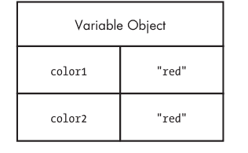

图1-1：变量对象

因为每个包含原始值的变量都使用自己的存储空间，所以一个变量的更改不会反映到另一个变量上。例如：

```
var color1 = "red";
var color2 = color1;

console.log(color1);    // "red"
console.log(color2);    // "red"

color1 = "blue";

console.log(color1);    // "blue"
console.log(color2);    // "red"
```

在这段代码中，color1被改为“blue”，color2保留了原来的值“red”。

## 识别原始类型

识别原始类型的最佳方法是使用typeof运算符，它适用于任何变量，并返回一个指示数据类型的字符串。typeof运算符对字符串、数字、布尔值和undefined都适用。下面展示了在不同原始值上使用typeof时的输出：

```
console.log(typeof "Nicholas");    // "string"
console.log(typeof 10);             // "number"
console.log(typeof 5.1);            // "number"
console.log(typeof true);           // "boolean"
console.log(typeof undefined);      // "undefined"
```


正如你所预料的，typeof 在值是字符串时返回 "string"；在值是数字时返回 "number"（无论是整数还是浮点值）；在值是布尔值时返回 "boolean"；在值是 undefined 时返回 "undefined"。

棘手的部分在于 null。

```
console.log(typeof null); // "object"
```

当你运行 typeof null 时，结果是 "object"。但为什么类型是 null 时返回 object 呢？（事实上，这已被 TC39，即设计和维护 JavaScript 的委员会，承认是一个错误。你可以认为 null 是一个空的对象指针，使得 "object" 成为一个合理的返回值，但这仍然令人困惑。）

判断一个值是否为 null 的最佳方式是直接与 null 进行比较，像这样：

```
console.log(value === null); // true or false
```

## COMPARING WITHOUT COERCION

请注意，这段代码使用了三等号运算符 (===) 而不是双等号运算符。原因在于三等号在比较时不会将变量强制转换为另一种类型。为了理解为什么这很重要，请考虑以下内容：

```
console.log("5" == 5); // true
console.log("5" === 5); // false
console.log(undefined == null); // true
console.log(undefined === null); // false
```

当你使用双等号时，字符串 "5" 和数字 5 被认为是相等的，因为双等号在比较前会将字符串转换为数字。三等号运算符不认为这些值相等，因为它们是两种不同的类型。同样地，当你比较 undefined 和 null 时，双等号说它们是等价的，而三等号说它们不是。当你试图识别 null 时，使用三等号以便正确识别类型。

## Primitive Methods

尽管它们是原始类型，字符串、数字和布尔值实际上都有方法。（null 和 undefined 类型没有方法。）尤其是字符串，有许多方法可以帮助你处理它们。例如：

```
var name = "Nicholas";
var lowercaseName = name.toLowerCase();      // convert to lowercase
var firstLetter = name.charAt(0);             // get first character
var middleOfName = name.substring(2, 5);      // get characters 2-4

var count = 10;
var fixedCount = count.toFixed(2);            // convert to "10.00"
var hexCount = count.toString(16);            // convert to "a"

var flag = true;
var stringFlag = flag.toString();             // convert to "true"
```

> NOTE 尽管它们有方法，原始值本身并不是对象。JavaScript 让它们看起来像对象，以在语言中提供一致的体验，正如你在本章后面会看到的那样。

## Reference Types

引用类型在 JavaScript 中表示对象，是你在该语言中能找到的最接近类的东西。引用值是引用类型的实例，与对象同义（本章其余部分将引用值简单称为对象）。对象是一个无序的属性列表，由名称（始终是字符串）和值组成。当属性的值是一个函数时，它被称为方法。函数本身在 JavaScript 中实际上也是引用值，因此包含数组的属性与包含函数的属性之间几乎没有区别，除了函数可以被执行。

当然，你必须先创建对象才能开始使用它们。

## Creating Objects

有时把 JavaScript 对象想象成不过是哈希表是有帮助的，如图 1-2 所示。

创建或实例化对象有几种方法。第一种是使用 new 运算符配合构造函数。（构造函数只是一个使用 new 创建对象的函数——任何函数都可以

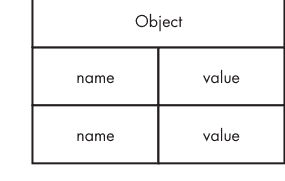

Figure 1-2: Structure of an object

成为构造函数。）按照惯例，JavaScript 中的构造函数以大写字母开头以区别于非构造函数。例如，这段代码实例化一个通用对象并将引用存储在 object 中：

```
var object = new Object();
```

引用类型不会将对象直接存储到被赋值的变量中，因此此例中的 object 变量实际上并不包含对象实例。相反，它保存着指向对象在内存中存在位置的指针（或引用）。这是对象与原始值的主要区别，因为原始值是直接存储在变量中的。

当你将对象赋给变量时，你实际上是在分配一个指针。这意味着如果你将一个变量赋给另一个变量，每个变量都会得到指针的拷贝，并且两者仍然引用内存中的同一个对象。例如：

```
var object1 = new Object();
var object2 = object1;
```

这段代码首先创建一个对象（使用 new）并将引用存储在 object1 中。接下来，object2 被赋值为 object1 的值。仍然只有第一行创建的那个对象的一个实例，但现在两个变量都指向该对象，如图 1-3 所示。

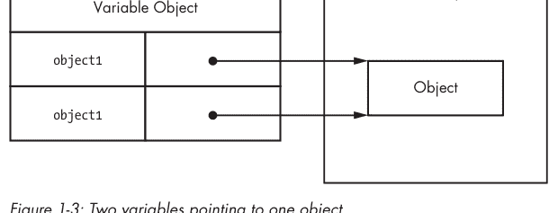

Figure 1-3: Two variables pointing to one object

## Dereferencing Objects

JavaScript 是一种垃圾回收语言，因此在使用引用类型时你不必真正担心内存分配。然而，最好取消对不再需要的对象的引用，以便垃圾回收器可以释放该内存。最好的做法是将对象变量设为 null。

```
var object1 = new Object();

// do something

object1 = null;    // dereference
```

这里，object1 被创建并使用，然后最终被设为 null。当内存中不再有对对象的引用时，垃圾回收器就可以将该内存用于其他用途。（在非常大的使用数百万个对象的应用程序中，取消对象引用尤其重要。）

## Adding or Removing Properties

JavaScript 对象的一个有趣方面是，你可以在任何时候添加和删除属性。例如：

```
var object1 = new Object();
var object2 = object1;

object1.myCustomProperty = "Awesome!";
console.log(object2.myCustomProperty);    // "Awesome!"
```

这里，myCustomProperty 以 "Awesome!" 的值被添加到 object1。object2 也能访问该属性，因为 object1 和 object2 指向同一个对象。

> NOTE 此示例展示了 JavaScript 的一个特别独特的方面：你可以随时修改对象，即使你最初并没有定义它们。而且也有防止此类修改的方法，正如你将在本书后面学到的那样。

除了通用的对象引用类型外，JavaScript 还有几种其他内置类型可供使用。

## Instantiating Built-in Types

你已经看到了如何创建和交互使用 new Object() 创建的通用对象。Object 类型只是 JavaScript 提供的少数内置引用类型之一。其他内置类型在其预期用途上更为专门，可以随时实例化。

内置类型有：

- **Array** 一个有序的数值索引值列表
- **Date** 一个日期和时间
- Error 一个运行时错误（还有几个更具体的错误子类型）
- Function 一个函数
- Object 一个通用对象
- RegExp 一个正则表达式

你可以使用 new 实例化每个内置引用类型，如下所示：

```
var items = new Array();
var now = new Date();
var error = new Error("Something bad happened.");
var func = new Function("console.log('Hi');");
var object = new Object();
var re = new RegExp("\\d+");
```

## Literal Forms

几个内置引用类型有字面量形式。字面量是一种语法，允许你在不显式使用 new 运算符和对象的构造函数创建对象的情况下定义引用值。（在本章前面，你看到了原始字面量的示例，包括字符串字面量、数字字面量、布尔字面量、null 字面量和 undefined 字面量。）

## Object and Array Literals

要使用对象字面量语法创建对象，你可以在大括号内定义新对象的属性。属性由标识符或字符串、冒号和值组成，多个属性用逗号分隔。例如：

```
var book = {
  name: "The Principles of Object-Oriented JavaScript",
  year: 2014
};
```

你也可以使用字符串字面量作为属性名，这在你希望属性名包含空格或其他特殊字符时很有用：

```
var book = {
  "name": "The Principles of Object-Oriented JavaScript",
  "year": 2014
};
```


这个示例与前一个示例在语法上的差异之外是等价的。两者在逻辑上也等价于以下示例：

```
var book = new Object();
book.name = "The Principles of Object-Oriented JavaScript";
book.year = 2014;
```

前面三个示例的结果都相同：一个具有两个属性的对象。模式的选择由你决定，因为功能最终是相同的。

> 注意 使用对象字面量实际上并不会调用 new Object()。相反，JavaScript 引擎会遵循使用 new Object() 时相同的步骤，只是实际上并未调用构造函数。这对所有引用字面量都成立。

你可以通过在方括号内包含任意数量的逗号分隔值，以类似的方式定义数组字面量。例如：

```
var colors = [ "red", "blue", "green" ];
console.log(colors[0]);      // "red"
```

这段代码等价于以下代码：

```
var colors = new Array("red", "blue", "green");
console.log(colors[0]);      // "red"
```

## 函数字面量

你几乎总是使用字面量形式来定义函数。事实上，由于维护、阅读和调试一段代码字符串而不是实际代码的困难，使用 Function 构造函数通常是不被推荐的，因此你在代码中很少会看到它。

使用字面量形式创建函数要容易得多，也更不容易出错。例如：

```
function reflect(value) {
    return value;
}

// is the same as

var reflect = new Function("value", "return value;");
```

这段代码定义了 reflect() 函数，它返回传递给它的任何值。即使对于这个简单的函数，字面量形式也比构造函数形式更容易编写和理解。此外，用构造函数形式创建的函数没有好的调试方法：这些函数不被 JavaScript 调试器识别，因此在你的应用程序中充当黑盒。

## 正则表达式字面量

JavaScript 还具有正则表达式字面量，允许你在不使用 RegExp 构造器的情况下定义正则表达式。正则表达式字面量看起来与 Perl 中的正则表达式非常相似：模式包含在两个斜杠之间，任何附加选项都是第二个斜杠后的单个字符。例如：

```
var numbers = /\d+/g;

// is the same as

var numbers = new RegExp("\\d+", "g");
```

JavaScript 中正则表达式的字面量形式比构造函数形式更容易处理，因为你不必担心在字符串中转义字符。当使用 RegExp 构造函数时，你将模式作为字符串传递，因此必须转义任何反斜杠。 （这就是为什么在字面量中使用 \d 而在构造函数中使用 \\d。）除非正则表达式是从一个或多个字符串动态构造的，否则在 JavaScript 中更喜欢字面量形式而不是构造函数形式。

话虽如此，除了 Function 之外，实例化内置类型其实并没有什么对错之分。许多开发者更喜欢字面量，而有些则更喜欢构造函数。选择你觉得更舒适使用的方法。

## 属性访问

属性是存储在对象上的名称/值对。点表示法是访问 JavaScript 中属性最常见的方式（就像许多面向对象的语言一样），但你也可以使用带字符串的方括号表示法来访问 JavaScript 对象上的属性。

例如，你可以编写使用点表示法的这段代码：

```
var array = [];
array.push(12345);
```

使用方括号表示法，方法名现在包含在方括号内的字符串中，如此示例所示：

```
var array = [];
array["push"](12345);
```

这种语法在你想要动态决定访问哪个属性时非常有用。例如，这里方括号表示法允许你使用变量而不是字符串字面量来指定要访问的属性。

```
var array = [];
var method = "push";
array[method](12345);
```

在此列表中，变量 method 的值为 "push"，因此在数组上调用了 push()。这种能力非常有用，正如你在本书中会看到的那样。需要记住的是，除了语法之外，点表示法和方括号表示法之间在性能或其他方面唯一的差别是，方括号表示法允许你在属性名中使用特殊字符。开发者倾向于认为点表示法更易读，因此你会看到它比方括号表示法使用得更频繁。

## 识别引用类型

函数是最容易识别的引用类型，因为当你对函数使用 typeof 运算符时，运算符应返回 "function"：

```
function reflect(value) {
    return value;
}

console.log(typeof reflect);    // "function"
```

其他引用类型更难识别，因为对于函数之外的所有引用类型，typeof 返回 "object"。当你处理大量不同类型时，这不是很有帮助。为了更轻松地识别引用类型，你可以使用 JavaScript 的 instanceof 运算符。

instanceof 运算符接受一个对象和一个构造函数作为参数。当该值是构造函数指定的类型的实例时，instanceof 返回 true；否则返回 false，如下所示：

```
var items = [];
var object = {};

function reflect(value) {
    return value;
}

console.log(items instanceof Array);      // true
console.log(object instanceof Object);     // true
console.log(reflect instanceof Function);  // true
```

在此示例中，使用 instanceof 和构造函数测试了几个值。通过使用 instanceof 和代表其真实类型的构造函数，每个引用类型都被正确识别（即使在创建变量时并未使用该构造函数）。

instanceof 运算符可以识别继承的类型。这意味着每个对象实际上都是 Object 的实例，因为所有引用类型都继承自 Object。

为了演示，以下列表使用 instanceof 检查了之前创建的三个引用：

```
var items = [];
var object = {};

function reflect(value) {
    return value;
}

console.log(items instanceof Array);     // true
console.log(items instanceof Object);    // true
console.log(object instanceof Object);   // true
console.log(object instanceof Array);    // false
console.log(reflect instanceof Function); // true
console.log(reflect instanceof Object);   // true
```

每个引用类型都被正确识别为 Object 的实例，所有引用类型都继承自 Object。

## 识别数组

尽管 instanceof 可以识别数组，但有一个例外会影响 Web 开发者：JavaScript 值可以在同一网页的不同框架之间传递。这只有在你尝试识别引用值的类型时才会成为问题，因为每个网页都有自己的全局上下文——它自己的 Object、Array 和所有其他内置类型的版本。因此，当你将数组从一个框架传递到另一个框架时，instanceof 不起作用，因为该数组实际上是来自不同框架的 Array 的实例。

为了解决这个问题，ECMAScript 5 引入了 Array.isArray()，它可以明确地识别该值无论其来源如何都是 Array 的实例。如果你的环境符合 ECMAScript 5，Array.isArray() 是识别数组的最佳方式：

```
var items = [];

console.log(Array.isArray(items));     // true
```

Array.isArray() 方法在浏览器和 Node.js 中的大多数环境中都受支持。此方法在 Internet Explorer 8 及更早版本中不受支持。

## 原始包装类型

JavaScript 中也许最令人困惑的概念之一是原始包装类型的概念。有三种原始包装类型（String、Number 和 Boolean）。这些特殊的引用类型存在是为了使使用原始值就像使用对象一样容易。（如果只是为了获取文本的子字符串，你就必须使用不同的语法或切换到过程式风格，那将非常令人困惑。）

原始包装类型是引用类型，每当读取字符串、数字或布尔值时，都会在幕后自动创建。例如，在此列表的第一行，一个原始字符串值被赋给 name。第二行将 name 当作对象处理，并使用点表示法调用 charAt(0)。

```
var name = "Nicholas";
var firstChar = name.charAt(0);
console.log(firstChar); // "N"
```

幕后发生的事情是这样的：

```
// what the JavaScript engine does
var name = "Nicholas";
var temp = new String(name);
var firstChar = temp.charAt(0);
temp = null;
console.log(firstChar); // "N"
```

因为第二行将一个字符串（原始值）当作对象使用，所以 JavaScript 引擎创建了一个 String 实例以便 charAt(0) 能工作。String 对象仅存在一个语句，然后就被销毁了（该过程称为自动装箱）。要测试这一点，尝试像操作普通对象一样向字符串添加属性：

```
var name = "Nicholas";
name.last = "Zakas";
console.log(name.last); // undefined
```

这段代码尝试向字符串 name 添加属性 last。代码本身没问题，只是该属性会消失。发生了什么？在使用普通对象时，你可以随时添加属性，并且它们会一直保留，直到你手动删除它们。对于原始包装类型，属性似乎会消失，因为在属性被赋值的对象之后立即被销毁。


## 以下是 JavaScript 引擎中实际发生的事情：

```
// what the JavaScript engine does
var name = "Nicholas";
var temp = new String(name);
temp.last = "Zakas";
temp = null;                     // temporary object destroyed

var temp = new String(name);
console.log(temp.last);          // undefined
temp = null;
```

代码实际上并不是为字符串分配新属性，而是在一个临时对象上创建新属性，然后该临时对象被销毁。当你稍后尝试访问该属性时，会临时创建一个不同的对象，而新属性在该对象上并不存在。尽管针对原始值会自动创建引用值，但当 instanceof 检查这些类型的值时，结果是 false：

```
var name = "Nicholas";
var count = 10;
var found = false;

console.log(name instanceof String);   // false
console.log(count instanceof Number);  // false
console.log(found instanceof Boolean); // false
```

instanceof 运算符返回 false，是因为临时对象只在读取值时才会创建。由于 instanceof 实际上不读取任何内容，因此不会创建临时对象，它告诉我们这些值不是原始包装类型的实例。你可以手动创建原始包装类型，但会产生一些副作用：

```
var name = new String("Nicholas");
var count = new Number(10);
var found = new Boolean(false);

console.log(typeof name);   // "object"
console.log(typeof count);  // "object"
console.log(typeof found);  // "object"
```

如你所见，创建原始包装类型的实例只会创建另一个对象，这意味着 typeof 无法识别你想要存储的数据类型。

此外，你不能像使用原始值那样使用 String、Number 和 Boolean 对象。例如，以下代码使用了一个 Boolean 对象。该 Boolean 对象为 false，但 console.log("Found") 仍然执行，因为在条件语句中，对象始终被视为 true。对象表示 false 并不重要；它是一个对象，所以计算结果为 true。

```
var found = new Boolean(false);

if (found) {
    console.log("Found");    // this executes
}
```

手动实例化原始包装器在其他方面也可能令人困惑，因此除非你发现这样做有意义的特殊情况，否则应避免这样做。大多数情况下，使用原始包装对象而不是原始值只会导致错误。

## 总结

虽然 JavaScript 没有类，但它有类型。每个变量或数据片段都与特定的原始类型或引用类型相关联。五种原始类型（字符串、数字、布尔值、null 和 undefined）表示直接存储在给定上下文的变量对象中的简单值。你可以使用 typeof 来识别原始类型，但 null 除外，必须直接与特殊值 null 进行比较。

引用类型是 JavaScript 中最接近类的东西，对象是引用类型的实例。你可以使用 new 运算符或引用字面量创建新对象。你主要通过点表示法访问属性和方法，但也可以使用方括号表示法。函数是 JavaScript 中的对象，你可以使用 typeof 运算符识别它们。对于任何其他引用类型的对象，你应该使用 instanceof 与构造函数来识别。

为了使原始值看起来更像引用，JavaScript 提供了三种原始包装类型：String、Number 和 Boolean。JavaScript 在后台创建这些对象，以便你可以像对待普通对象一样对待原始值，但使用它们的语句一旦执行完毕，临时对象就会被销毁。尽管你可以创建自己的原始包装器实例，但最好不要这样做，因为这可能会令人困惑。

## 2

## 函数


如第 1 章所讨论的，函数实际上是 JavaScript 中的对象。函数的一个决定性特征——使它区别于任何其他对象——是存在一个名为 [[Call]] 的*内部属性*。内部属性不能通过代码访问，而是定义代码执行时的行为。ECMAScript 为 JavaScript 中的对象定义了多个内部属性，这些内部属性用双方括号表示法表示。

[[Call]] 属性是函数独有的，表示该对象可以被执行。由于只有函数具有此属性，ECMAScript 将 typeof 运算符定义为对任何具有 [[Call]] 属性的对象返回 "function"。这在过去导致了一些混淆，因为一些浏览器也对正则表达式包含了 [[Call]] 属性，因此它们被错误地识别为函数。现在所有浏览器的行为都是一致的，因此 typeof 不再将正则表达式识别为函数。

本章讨论在 JavaScript 中定义和执行函数的各种方式。因为函数是对象，所以它们的行为与其他语言中的函数不同，而这种行为对于深入理解 JavaScript 至关重要。

## 声明与表达式

实际上有两种函数字面量形式。第一种是函数声明，以 function 关键字开头，后面紧跟函数名称。函数内容用大括号括起来，如下所示：

```
function add(num1, num2) {
    return num1 + num2;
}
```

第二种形式是函数表达式，它不需要在 function 后面有名称。这些函数被视为匿名函数，因为函数对象本身没有名称。相反，函数表达式通常通过变量或属性来引用，如下面的表达式所示：

```
var add = function(num1, num2) {
    return num1 + num2;
};
```

这段代码实际上将一个函数值赋给了变量 add。函数表达式与函数声明几乎相同，只是缺少名称和末尾的分号。赋值表达式通常以分号结尾，就像你赋值任何其他值一样。

尽管这两种形式非常相似，但它们的区别非常重要。函数声明在代码执行时会被提升到上下文的顶部（无论是声明所在的函数还是全局作用域）。这意味着你实际上可以在代码中使用函数之后再定义它，而不会产生错误。例如：

```
var result = add(5, 5);

function add(num1, num2) {
    return num1 + num2;
}
```

这段代码看起来可能会导致错误，但实际上运行良好。这是因为 JavaScript 引擎将函数声明提升到顶部，并实际上执行代码，就好像代码是这样写的：

```
// how the JavaScript engine interprets the code
function add(num1, num2) {
    return num1 + num2;
}

var result = add(5, 5);
```

函数提升只发生在函数声明上，因为函数名称是事先已知的。另一方面，函数表达式不能被提升，因为这些函数只能通过变量来引用。所以以下代码会导致错误：

```
// error!
var result = add(5, 5);

var add = function(num1, num2) {
    return num1 + num2;
};
```

只要始终在使用函数之前定义它们，你既可以使用函数声明，也可以使用函数表达式。

## 函数作为值

由于 JavaScript 拥有一等函数，你可以像使用任何其他对象一样使用它们。你可以将它们赋值给变量、添加到对象中、作为参数传递给其他函数，并从函数中返回它们。基本上，你可以在任何使用其他引用值的地方使用函数。这使得 JavaScript 函数异常强大。考虑以下示例：

```
① function sayHi() {
    console.log("Hi!");
}

sayHi();      // outputs "Hi!"

② var sayHi2 = sayHi;

sayHi2();     // outputs "Hi!"
```


In this code, there is a function declaration for sayHi ①. A variable named sayHi2 is then created and assigned the value of sayHi ②. Both sayHi and sayHi2 are now pointing to the same function, and that means either can be executed, with the same result. To understand why this happens, take a look at the same code rewritten to use the Function constructor:

```
var sayHi = new Function("console.log(\"Hi!\");");

sayHi();  // outputs "Hi!"

var sayHi2 = sayHi;

sayHi2();  // outputs "Hi!"
```

The Function constructor makes it more explicit that sayHi can be passed around just like any other object. When you keep in mind that functions are objects, a lot of the behavior starts to make sense.

For instance, you can pass a function into another function as an argument. The sort() method on JavaScript arrays accepts a comparison function as an optional parameter. The comparison function is called whenever two values in the array must be compared. The first value is smaller than the second, the comparison function must return a negative number. If the first value is larger than the second, the function must return a positive number. If the two values are equal, the function should return zero.

```
var numbers = [ 1, 5, 8, 4, 7, 10, 2, 6 ];

numbers.sort(function(first, second) {
  return first - second;
});

console.log(numbers);  // "[1, 2, 4, 5, 6, 7, 8, 10]"
```

```
numbers.sort();

console.log(numbers);  // "[1, 10, 2, 4, 5, 6, 7, 8]"
```

In this example, the comparison function ① that is passed into sort() is actually a function expression. Note that there is no name for the function; it exists only as a reference that is passed into another function (making it an anonymous function). Subtracting the two values returns the correct result from the comparison function.

Compare that to the second call to sort() 2, which does not use a comparison function. The order of the array is different than expected, as 1 is followed by 10. This is because the default comparison converts all values to strings before comparing them.

## Parameters

Another unique aspect of JavaScript functions is that you can pass any number of parameters to any function without causing an error. That's because function parameters are actually stored as an array-like structure called arguments. Just like a regular JavaScript array, arguments can grow to contain any number of values. The values are referenced via numeric indices, and there is a length property to determine how many values are present.

The arguments object is automatically available inside any function. This means named parameters in a function exist mostly for convenience and don't actually limit the number of arguments that a function can accept.

> NOTE The arguments object is not an instance of Array and therefore doesn't have the same methods as an array; Array.isArray(arguments) always returns false.

On the other hand, JavaScript doesn't ignore the named parameters of a function either. The number of arguments a function expects is stored on the function's length property. Remember, a function is actually just an object, so it can have properties. The length property indicates the function's arity, or the number of parameters it expects. Knowing the function's arity is important in JavaScript because functions won't throw an error if you pass in too many or too few parameters.

Here's a simple example using arguments and function arity; note that the number of arguments passed to the function has no effect on the reported arity:

```
function reflect(value) {
  return value;
}

console.log(reflect("Hi!"));      // "Hi!"
console.log(reflect("Hi!", 25));  // "Hi!"
console.log(reflect.length);       // 1

reflect = function() {
  return arguments[0];
};

console.log(reflect("Hi!"));      // "Hi!"
console.log(reflect("Hi!", 25));  // "Hi!"
console.log(reflect.length);       // 0
```

## Overloading

Most object-oriented languages support *function overloading*, which is the ability of a single function to have multiple *signatures*. A function signature is made up of the function name plus the number and type of parameters the function expects. Thus, a single function can have one signature that accepts a single string argument and another that accepts two numeric arguments. The language determines which version of a function to call based on the arguments that are passed in.

As mentioned previously, JavaScript functions can accept any number of parameters, and the types of parameters a function takes aren’t specified at all. That means JavaScript functions don’t actually have signatures. A lack of function signatures also means a lack of function overloading. Look at what happens when you try to declare two functions with the same name:

```
function sayMessage(message) {
    console.log(message);
}

function sayMessage() {
    console.log("Default message");
}

sayMessage("Hello!");    // outputs "Default message"
```

If this were another language, the output of sayMessage("Hello!") would likely be "Hello!". In JavaScript, however, when you define multiple functions with the same name, the one that appears last in your code wins. The earlier function declarations are completely removed, and the last is the one that is used. Once again, it helps to think about this situation using objects:

```
var sayMessage = new Function("message", "console.log(message);");

sayMessage = new Function("console.log(\"Default message\");");

sayMessage("Hello!");    // outputs "Default message"
```

Looking at the code this way makes it clear why the previous code didn’t work. A function object is being assigned to sayMessage twice in a row, so it makes sense that the first function object would be lost.

The fact that functions don’t have signatures in JavaScript doesn’t mean you can’t mimic function overloading. You can retrieve the number of parameters that were passed in by using the arguments object, and you can use that information to determine what to do. For example:

```
function sayMessage(message) {
    if (arguments.length === 0) {
        message = "Default message";
    }
    console.log(message);
}

sayMessage("Hello!");      // outputs "Hello!"
```

In this example, the sayMessage() function behaves differently based on the number of parameters that were passed in. If no parameters are passed in (arguments.length === 0), then a default message is used. Otherwise, the first parameter is used as the message. This is a little more involved than function overloading in other languages, but the end result is the same. If you really want to check for different data types, you can use typeof and instanceof.

NOTE In practice, checking the named parameter against undefined is more common than relying on arguments.length.

## Object Methods

As mentioned in Chapter 1, you can add and remove properties from objects at any time. When a property value is actually a function, the property is considered a method. You can add a method to an object in the same way that you would add a property. For example, in the following code, the person variable is assigned an object literal with a name property and a method called sayName.

```
var person = {
    name: "Nicholas",
    sayName: function() {
        console.log(person.name);
    }
};

person.sayName();      // outputs "Nicholas"
```

Note that the syntax for a data property and a method is exactly the same—an identifier followed by a colon and the value. In the case of sayName, the value just happens to be a function. You can then call the method directly from the object as in person.sayName("Nicholas").

## The this Object

You may have noticed something strange in the previous example. The sayName() method references person.name directly, which creates tight coupling between the method and the object. This is problematic for a number of reasons. First, if you change the variable name, you also need to remember to change the reference to that name in the method. Second, this sort of tight coupling makes it difficult to use the same function for different objects. Fortunately, JavaScript has a way around this issue.

Every scope in JavaScript has a this object that represents the calling object for the function. In the global scope, this represents the global object (window in web browsers). When a function is called while attached to an object, the value of this is equal to that object by default. So, instead of directly referencing an object inside a method, you can reference this instead. For example, you can rewrite the code from the previous example to use this:

```
var person = {
  name: "Nicholas",
  sayName: function() {
    console.log(this.name);
  }
};

person.sayName();      // outputs "Nicholas"
```

This code works the same as the earlier version, but this time, sayName() references this instead of person. That means you can easily change the name of the variable or even reuse the function on different objects.

```
function sayNameForAll() {
  console.log(this.name);
}

var person1 = {
  name: "Nicholas",
  sayName: sayNameForAll
};

var person2 = {
  name: "Greg",
  sayName: sayNameForAll
};

var name = "Michael";

person1.sayName();      // outputs "Nicholas"
person2.sayName();      // outputs "Greg"

sayNameForAll();        // outputs "Michael"
```


在这个示例中，首先定义了一个名为 sayNameForAll 的函数。然后，创建了两个对象字面量，将 sayName 设置为等于 sayNameForAll 函数。函数只是引用值，因此你可以将它们作为属性值赋给任意数量的对象。当在 person1 上调用 sayName() 时，它输出 "Nicholas"；当在 person2 上调用时，它输出 "Greg"。这是因为 this 在函数被调用时设置，所以 this.name 是准确的。

此示例的最后一部分定义了一个名为 name 的全局变量。当直接调用 sayNameForAll() 时，它输出 "Michael"，因为全局变量被视为全局对象的属性。

## Changing this

能够使用和操作函数的 this 值是 JavaScript 中进行良好面向对象编程的关键。函数可以在许多不同的上下文中使用，并且需要在每种情况下都能工作。即使 this 通常是自动分配的，你也可以更改其值以实现不同的目标。有三种函数方法允许你更改 this 的值。（记住函数是对象，而对象可以有方法，所以函数也可以。）

### The call() Method

操作 this 的第一个函数方法是 call()，它使用特定的 this 值和特定参数执行函数。call() 的第一个参数是函数执行时 this 应相等的值。所有后续参数都是应传递给函数的参数。例如，假设你更新 sayNameForAll() 使其接受一个参数：

```javascript
function sayNameForAll(label) {
    console.log(label + ":" + this.name);
}

var person1 = {
    name: "Nicholas"
};

var person2 = {
    name: "Greg"
};

var name = "Michael";

sayNameForAll.call(this, "global");      // outputs "global:Michael"
sayNameForAll.call(person1, "person1");  // outputs "person1:Nicholas"
sayNameForAll.call(person2, "person2");  // outputs "person2:Greg"
```

在这个示例中，sayNameForAll() 接受一个用作输出值标签的参数。然后函数被调用三次。请注意，函数名后面没有括号，因为它作为对象访问而不是作为要执行的代码。第一次函数调用使用全局 this 并传入参数 "global" 以输出 "global:Michael"。同一个函数又被调用两次，分别针对 person1 和 person2。由于使用了 call() 方法，你不需要将函数直接添加到每个对象上——你显式指定 this 的值，而不是让 JavaScript 引擎自动执行。

### The apply() Method

你可以用来自操作 this 的第二个函数方法是 apply()。apply() 方法的工作方式与 call() 完全相同，只是它只接受两个参数：this 的值和一个参数数组或类数组对象传递给函数（这意味着你可以使用 arguments 对象作为第二个参数）。因此，与使用 call() 单独命名每个参数不同，你可以轻松地将数组作为第二个参数传递给 apply()。否则，call() 和 apply() 的行为完全相同。此示例展示了 apply() 方法的实际应用：

```javascript
function sayNameForAll(label) {
  console.log(label + ":" + this.name);
}

var person1 = {
  name: "Nicholas"
};

var person2 = {
  name: "Greg"
};

var name = "Michael";

sayNameForAll.apply(this, ["global"]); // outputs "global:Michael"
sayNameForAll.apply(person1, ["person1"]); // outputs "person1:Nicholas"
sayNameForAll.apply(person2, ["person2"]); // outputs "person2:Greg"
```

此代码采用前一个示例并将 call() 替换为 apply()；结果完全相同。你使用的<|message|> 方法通常取决于数据的类型。如果你已经有一个数据数组，使用 apply()；如果你只有单独的变量，使用 call()。

### The bind() Method

更改 this 的第三个函数方法是 bind()。该方法在 ECMAScript 5 中添加，其行为与另外两个大不相同。bind() 的第一个参数是新函数的 this 值。所有其他参数代表应永久设置在新函数中的命名参数。你仍然可以在之后传入任何未永久设置的额外参数。

以下代码展示了使用 bind() 的两个示例。你通过将 this 值绑定到 person1 来创建 sayNameForPerson1() 函数，而 sayNameForPerson2() 将 this 绑定到 person2 并将第一个参数绑定为 "person2"。

```javascript
function sayNameForAll(label) {
    console.log(label + ":" + this.name);
}

var person1 = {
    name: "Nicholas"
};

var person2 = {
    name: "Greg"
};

// create a function just for person1
① var sayNameForPerson1 = sayNameForAll.bind(person1);
sayNameForPerson1("person1");      // outputs "person1:Nicholas"

// create a function just for person2
② var sayNameForPerson2 = sayNameForAll.bind(person2, "person2");
sayNameForPerson2();                // outputs "person2:Greg"

// attaching a method to an object doesn't change 'this'
③ person2.sayName = sayNameForPerson1;
person2.sayName("person2");         // outputs "person2:Nicholas"
```

没有为 sayNameForPerson1() ① 绑定参数，因此你仍需传入输出的标签。函数 sayNameForPerson2() 不仅将 this 绑定到 person2，还将第一个参数绑定为 "person2" ②。这意味着你可以调用 sayNameForPerson2() 而无需传入任何额外参数。此示例的最后一部分将 sayNameForPerson1() 添加到 person2 并命名为 sayName ③。函数是绑定的，因此 this 的值不会改变，即使 sayNameForPerson1 现在是 person2 上的一个函数。该方法仍然输出 person1.name 的值。

## Summary

JavaScript 函数的独特之处在于它们也是对象，这意味着它们可以被访问、复制、覆盖，并且通常像任何其他对象值一样被处理。JavaScript 函数与其他对象之间最大的区别是一个特殊的内部属性 [[Call]]，它包含函数的执行指令。typeof 运算符会在对象上查找此内部属性，如果找到，则返回 "function"。

有两种函数字面量形式：声明和表达式。函数声明包含 function 关键字右侧的函数名，并在其定义的上下文顶部提升。函数表达式用于可以像其他值一样使用的地方，例如赋值表达式、函数参数或另一个函数的返回值。

因为函数是对象，所以存在 Function 构造函数。你可以使用 Function 构造函数创建新函数，但这通常不推荐，因为它会使代码更难理解并使调试变得困难。话虽如此，你在运行时才知道函数的真正形式的情况下，偶尔会遇到其使用情况。

你需要很好地掌握函数才能理解 JavaScript 中面向对象编程的工作方式。由于 JavaScript 没有类的概念，函数和其他对象是你实现聚合和继承所能使用的全部。

# 3 UNDERSTANDING OBJECTS


尽管 JavaScript 中有许多内置引用类型，但你很可能会相当频繁地创建自己的对象。在这样做时，请记住 JavaScript 中的对象是动态的，这意味着它们可以在代码执行期间的任何时间发生变化。而基于类的语言会根据类定义锁定对象，JavaScript 对象没有此类限制。

JavaScript 编程很大一部分是管理这些对象，这就是为什么理解对象的工作方式是理解整个 JavaScript 的关键所在。本章后面会更详细地讨论这一点。


## 定义属性

回顾第 1 章，有两种基本方法可以创建自己的对象：使用 Object 构造函数和使用对象字面量。例如：

```
var person1 = {
  name: "Nicholas"
};

var person2 = new Object();
person2.name = "Nicholas";

① person1.age = "Redacted";
person2.age = "Redacted";

② person1.name = "Greg";
person2.name = "Michael";
```

person1 和 person2 都是具有 name 属性的对象。稍后在示例中，两个对象都被赋予了 age 属性 ①。你可以在对象定义后立即执行此操作，也可以在 much later。 除非另有指定，否则你创建的对象始终可以自由修改（更多内容请参见第 45 页的“防止对象修改”）。此示例的最后一部分更改了每个对象中 name 的值 ②；属性值也可以随时更改。

当向对象首次添加属性时，JavaScript 会在对象上使用一个名为 [[Put]] 的内部方法。[[Put]] 方法在对象中创建存储属性的位置。你可以将此与首次向哈希表添加键进行比较。此操作指定不仅仅是初始值，还指定属性的一些属性。因此，在前面的示例中，当 name 和 age 属性首次在每个对象上定义时，就会为每个属性调用 [[Put]] 方法。

调用 [[Put]] 的结果是在对象上创建一个自身属性。自身属性 simply 表示该特定对象实例拥有该属性。该属性直接存储在实例上，并且对该属性的所有操作都必须通过该对象执行。

> 注意 自身属性与原型属性不同，原型属性将在第 4 章中讨论。

当为现有属性分配新值时，会发生一个名为 [[Set]] 的单独操作。此操作用新值替换属性的当前值。在前面的示例中，将 name 设置为第二个值会导致对 [[Set]] 的调用。图 3-1 逐步展示了 person1 的 name 和 age 属性发生变化时幕后发生的情况。

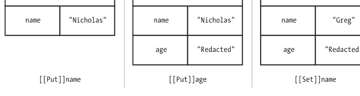

图 3-1：添加和更改对象的属性

在图表的第一部分，使用对象字面量创建 person1 对象。这会隐式地对 name 属性执行 [[Put]]。将值分配给 person1.age 会对 age 属性执行 [[Put]]。然而，将 person1.name 设置为新值 ("Greg") 会对 name 属性执行 [[Set]] 操作，覆盖现有的属性值。

## 检测属性

由于属性可以随时添加，因此有时需要检查对象中是否存在属性。新 JavaScript 开发人员经常错误地使用以下模式来检测属性是否存在：

```
// unreliable
if (person1.age) {
    // do something with age
}
```

这种模式的问题在于 JavaScript 的类型强制转换如何影响结果。if 条件在值是 truthy（对象、非空字符串、非零数字或 true）时求值为 true，在值是 falsy（null、undefined、0、false、NaN 或空字符串）时求值为 false。由于对象属性可以包含这些 falsy 值，因此示例代码可能会产生假阴性。例如，如果 person1.age 为 0，则 if 条件将不满足，即使属性存在。更可靠地测试属性是否存在的方法是使用 in 运算符。

in 运算符会在特定对象中查找具有给定名称的属性，如果找到则返回 true。实际上，in 运算符检查给定键是否存在于哈希表中。例如，以下是使用 in 检查 person1 对象中的一些属性时会发生的情况：

```
console.log("name" in person1);    // true
console.log("age" in person1);      // true
console.log("title" in person1);    // false
```

请记住，方法只是引用函数的属性，因此你可以用相同的方式检查方法的存在。以下代码向 person1 添加了一个新函数 sayName()，并使用 in 确认该函数的存在。

```
var person1 = {
    name: "Nicholas",
    sayName: function() {
        console.log(this.name);
    }
};

console.log("sayName" in person1);  // true
```

在大多数情况下，in 运算符是确定属性是否存在于对象中的最佳方法。它还有一个额外的好处，即不会评估属性的值，这在评估可能导致性能问题或错误时可能很重要。

然而，在某些情况下，你可能只想检查属性是否存在且为自身属性。in 运算符会检查自身属性和原型属性，因此你需要采用不同的方法。进入 hasOwnProperty() 方法，该方法存在于所有对象上，并且仅在给定属性存在且为自身属性时才返回 true。例如，以下代码比较了在 person1 中的不同属性上使用 in 与 hasOwnProperty() 的结果：

```
var person1 = {
    name: "Nicholas",
    sayName: function() {
        console.log(this.name);
    }
};

console.log("name" in person1);                     // true
console.log(person1.hasOwnProperty("name"));        // true

console.log("toString" in person1);                 // true
console.log(person1.hasOwnProperty("toString"));    // false
```

在此示例中，name 是 person1 的自身属性，因此 in 运算符和 hasOwnProperty() 都返回 true。然而，toString() 方法是存在于所有对象上的原型属性。in 运算符对 toString() 返回 true，但 hasOwnProperty() 返回 false ①。这是将在第 4 章中进一步讨论的重要区别。

## 删除属性

正如属性可以随时添加到对象中一样，它们也可以被删除。仅仅将属性设置为 null 并不会真正从对象中完全删除该属性。这样的操作会调用 [[Set]] 并将值设置为 null，正如你在本章前面看到的那样，这只会替换属性的值。你需要使用 delete 运算符才能完全从对象中删除属性。

delete 运算符作用于单个对象属性并调用名为 [[Delete]] 的内部操作。你可以将此操作视为从哈希表中删除键/值对。当 delete 运算符成功时，它会返回 true。（有些属性不能被删除，这将在本章后面更详细地讨论。）例如，以下列表显示了 delete 运算符的工作方式：

```
var person1 = {
  name: "Nicholas"
};

console.log("name" in person1);    // true

delete person1.name;                // true - not output
console.log("name" in person1);    // false
console.log(person1.name);          // undefined
```

在此示例中，name 属性已从 person1 中删除。操作完成后，in 运算符返回 false。此外，请注意，尝试访问不存在的属性只会返回 undefined ①。图 3-2 显示了 delete 如何影响对象。

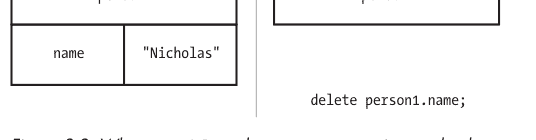

图 3-2：当你删除 name 属性时，它会完全从 person1 中消失。

## 枚举

默认情况下，你添加到对象的属性都是可枚举的，这意味着你可以使用 for-in 循环迭代它们。可枚举属性的内部 [[Enumerable]] 属性设置为 true。for-in 循环枚举对象上的所有可枚举属性，并将属性名称分配给变量。例如，以下循环输出对象的属性名称和值：

```
var property;

for (property in object) {
    console.log("Name: " + property);
    console.log("Value: " + object[property]);
}
```

每次通过 for-in 循环，property 变量都会填充对象上的下一个可枚举属性，直到使用完所有此类属性。此时，循环结束，代码执行继续。此示例使用方括号表示法检索对象属性的值并将其输出到控制台，这是 JavaScript 中方括号表示法的主要用例之一。

如果你只需要一个稍后在程序中使用的对象属性列表，ECMAScript 5 引入了 Object.keys() 方法来检索可枚举属性名称的数组，如下所示：

```
var properties = Object.keys(object);

// if you want to mimic for-in behavior
var i, len;

for (i=0, len=properties.length; i < len; i++){
    console.log("Name: " + properties[i]);
    console.log("Value: " + object[properties[i]]);
}
```

此示例使用 Object.keys() 从对象中检索可枚举属性 ①。然后使用 for 循环迭代属性并输出名称和值。通常，你会在想要对属性名称数组进行操作时使用 Object.keys()，而在不需要数组时使用 for-in。

> 注意 for-in 循环返回的可枚举属性与 Object.keys() 返回的属性之间存在差异。for-in 循环还会枚举原型属性，而 Object.keys() 只返回自身（实例）属性。原型和自身属性之间的差异将在第 4 章中讨论。


请记住并非所有属性都是可枚举的。事实上，大多数对象上的原生方法其 [[Enumerable]] 属性都被设置为 false。你可以使用 propertyIsEnumerable() 方法来检查一个属性是否可枚举，该方法存在于每个对象上：

```
var person1 = {
    name: "Nicholas"
};

console.log("name" in person1);                     // true
console.log(person1.propertyIsEnumerable("name"));   // true

var properties = Object.keys(person1);

console.log("length" in properties);                 // true
console.log(properties.propertyIsEnumerable("length")); // false
```

这里，属性 name 是可枚举的，因为它是定义在 person1 上的自定义属性 ①。而对于 properties 数组而言，length 属性则不可枚举 ②，因为它是 Array.prototype 上的内置属性。你会发现许多原生属性默认都是不可枚举的。

## 属性的类型

属性有两种不同的类型：数据属性和访问器属性。数据属性包含一个值，就像本章前面示例中的 name 属性一样。[[Put]] 方法的默认行为是创建数据属性，而本章到目前为止的每个示例都使用了数据属性。访问器属性不包含值，而是定义在读取属性时调用的函数（称为 getter），以及在写入属性时调用的函数（称为 setter）。访问器属性只需要 getter 或 setter 其一即可，尽管也可以同时拥有两者。

使用对象字面量定义访问器属性有一种特殊语法：

```
var person1 = {
    _name: "Nicholas",

    get name() {
        console.log("Reading name");
        return this._name;
    },
```

## 常见属性

数据属性和访问器属性之间共享两个属性。第一个是 [[Enumerable]]，它决定你是否可以遍历该属性。另一个是 [[Configurable]]，它决定属性是否可以被更改。你可以使用 delete 删除可配置属性，并且可以随时更改其属性。（这也意味着可配置属性可以在数据属性和访问器属性之间相互转换。）默认情况下，你在对象上声明的所有属性都是可枚举且可配置的。

如果你想更改属性属性，可以使用 Object.defineProperty() 方法。此方法接受三个参数：拥有该属性的对象、属性名，以及包含要设置的属性的描述符对象。描述符具有与内部属性相同的名称，但不带方括号。因此你使用 enumerable 来设置 [[Enumerable]]，使用 configurable 来设置 [[Configurable]]。例如，假设你想使一个对象属性不可枚举且不可配置：

```
var person1 = {
    name: "Nicholas"
};

Object.defineProperty(person1, "name", {
    enumerable: false
});

console.log("name" in person1);          // true
console.log(person1.propertyIsEnumerable("name"));  // false

var properties = Object.keys(person1);
console.log(properties.length);           // 0

Object.defineProperty(person1, "name", {
    configurable: false
});

// try to delete the Property
delete person1.name;
console.log("name" in person1);          // true
console.log(person1.name);                // "Nicholas"

Object.defineProperty(person1, "name", {  // error!!!
    configurable: true
});
```

name 属性按通常方式定义 ①，但随后被修改以将其 [[Enumerable]] 属性设置为 false ②。propertyIsEnumerable() 方法现在返回 false ③，因为它引用了 [[Enumerable]] 的新值。

之后，name 被更改为不可配置 ④。从现在开始，尝试删除 name 将失败，因为属性不能被更改，所以 name 仍然存在于 person1 上 ⑤。再次对 name 调用 Object.defineProperty() 也不会对属性产生进一步更改。有效地，name 作为 person1 上的属性被锁定。

最后一段代码尝试再次将 name 重新定义为可配置 ⑥。然而，这会抛出错误，因为你不能再次将不可配置属性变为可配置。在这种情况下，尝试将数据属性更改为访问器属性或反之亦然也应抛出错误。

> NOTE 当 JavaScript 以严格模式运行时，尝试删除不可配置属性会产生错误。在非严格模式下，该操作会静默失败。

## 数据属性属性

数据属性拥有访问器所没有的另外两个属性。第一个是 [[Value]]，它保存属性值。当你在对象上创建属性时，该属性会自动填充。所有属性值都存储在 [[Value]] 中，即使该值是一个函数。

第二个属性是 [[Writable]]，它是一个布尔值，表示属性是否可以被写入。默认情况下，所有属性都是可写的，除非另有指定。

有了这两个额外的属性，你甚至可以在属性尚不存在的情况下，使用 Object.defineProperty() 完全定义一个数据属性。考虑以下代码：

```
var person1 = {
    name: "Nicholas"
};
```

你在本章中一直看到这段代码片段；它向 person1 添加 name 属性并设置其值。你可以使用以下（更冗长）代码实现相同的结果：

```
var person1 = {};

Object.defineProperty(person1, "name", {
    value: "Nicholas",
    enumerable: true,
    configurable: true,
    writable: true
});
```

当调用 Object.defineProperty() 时，它首先检查属性是否存在。如果属性不存在，则会使用描述符中指定的属性添加一个新属性。在这种情况下，name 还不是 person1 的属性，因此它被创建。

当你使用 Object.defineProperty() 定义新属性时，重要的是要指定所有属性，因为布尔属性否则会自动默认为 false。例如，以下代码创建了一个不可枚举、不可配置且不可写的 name 属性，因为它在调用 Object.defineProperty() 时没有明确使这些属性中的任何一个为 true。

```
var person1 = {};

Object.defineProperty(person1, "name", {
    value: "Nicholas"
});

console.log("name" in person1);                // true
console.log(person1.propertyIsEnumerable("name"));  // false

delete person1.name;
console.log("name" in person1);                // true

person1.name = "Greg";
console.log(person1.name);                      // "Nicholas"
```

在这段代码中，你只能读取 name 属性的值；所有其他操作都被锁定。如果你正在更改现有属性，请记住只有你指定的属性才会更改。

> NOTE 在严格模式下，当你尝试更改不可写属性的值时，会抛出错误。在非严格模式下，该操作会静默失败。

## 访问器属性属性

访问器属性也有两个额外的属性。因为访问器属性不存储值，所以不需要 [[Value]] 或 [[Writable]]。相反，访问器具有 [[Get]] 和 [[Set]]，分别包含 getter 和 setter 函数。与对象字面量形式的 getter 和 setter 一样，你只需要定义其中一个属性即可创建该属性。

> NOTE 如果你尝试创建一个同时具有数据和访问器属性的属性，你会得到一个错误。

使用访问器属性属性而不是对象字面量表示法来定义访问器属性的优点是，你也可以在现有对象上定义这些属性。如果你想使用对象字面量表示法，你必须在创建对象时定义访问器属性。

与数据属性一样，你也可以指定访问器属性是否可配置或可枚举。考虑以下来自之前的示例：

```
var person1 = {
  _name: "Nicholas",

  get name() {
    console.log("Reading name");
    return this._name;
  },

  set name(value) {
    console.log("Setting name to %s", value);
    this._name = value;
  }
};
```

此代码也可以写成如下形式：

```
var person1 = {
  _name: "Nicholas"
};

Object.defineProperty(person1, "name", {
  get: function() {
    console.log("Reading name");
    return this._name;
  },
  set: function(value) {
    console.log("Setting name to %s", value);
    this._name = value;
  },
  enumerable: true,
  configurable: true
});
```

请注意，传递给 Object.defineProperty() 的对象上的 get 和 set 键是包含函数的 数据属性。你不能在此处使用对象字面量访问器格式。

设置其他属性（[[Enumerable]] 和 [[Configurable]]）允许你更改访问器属性的工作方式。例如，你可以像这样创建一个不可配置、不可枚举、不可写的属性：

```
var person1 = {
  _name: "Nicholas"
};
```


```
Object.defineProperty(person1, "name", {
    get: function() {
        console.log("Reading name");
        return this._name;
    }
});

console.log("name" in person1);                // true
console.log(person1.propertyIsEnumerable("name"));  // false
delete person1.name;
console.log("name" in person1);                // true

person1.name = "Greg";
console.log(person1.name);                      // "Nicholas"
```

在这段代码中，`name` 属性是一个只有 getter ① 的访问器属性。没有 setter 或其他任何被显式设置为 true 的属性，因此该值可以被读取但无法被修改。

> 注意 与通过对象字面量语法定义的访问器属性一样，在没有 setter 的情况下，如果试图修改访问器属性的值，在严格模式下会抛出错误；在非严格模式下，该操作会静默失败。如果试图读取一个只定义了 setter 的访问器属性，则始终返回 `undefined`。

## 定义多个属性

同时，你也可以使用 `Object.defineProperties()` 而不是 `Object.defineProperty()` 来一次定义对象上的多个属性。该方法接受两个参数：要操作的对象和一个包含所有属性信息的对象。第二个参数的键是属性名，值是用来定义这些属性特性的描述符对象。例如，以下代码定义了两个属性：

```
var person1 = {};

Object.defineProperties(person1, {
    // data property to store data
    _name: {
        value: "Nicholas",
        enumerable: true,
        configurable: true,
        writable: true
    },
    // accessor property
    name: {
        get: function() {
            console.log("Reading name");
            return this._name;
        },
        set: function(value) {
            console.log("Setting name to %s", value);
            this._name = value;
        },
        enumerable: true,
        configurable: true
    }
});
```

这个示例将 `_name` 定义为数据属性，用于存储信息 ①，并将 `name` 定义为访问器属性 ②。你可以使用 `Object.defineProperties()` 定义任意数量的属性；你甚至可以在修改现有属性的同时创建新属性。其效果与多次调用 `Object.defineProperty()` 相同。

## 获取属性特性

如果需要获取属性的特性，你可以在 JavaScript 中使用 `Object.getOwnPropertyDescriptor()` 来实现。顾名思义，此方法仅适用于自有属性。该方法接受两个参数：要操作的对象和要检索的属性名。如果属性存在，你会收到一个描述符对象，其中包含四个属性：`configurable`、`enumerable` 以及另外两个适合该属性类型的属性。即使你没有专门设置某个特性，你仍然会收到一个包含该特性适当值的对象。例如，以下代码创建了一个属性并检查其特性：

```
var person1 = {
    name: "Nicholas"
};

var descriptor = Object.getOwnPropertyDescriptor(person1, "name");

console.log(descriptor.enumerable);    // true
console.log(descriptor.configurable);   // true
console.log(descriptor.writable);       // true
console.log(descriptor.value);          // "Nicholas"
```

这里，一个名为 `name` 的属性被定义为对象字面量的一部分。即使这些特性没有通过 `Object.defineProperty()` 显式定义，调用 `Object.getOwnPropertyDescriptor()` 也会返回一个包含 `enumerable`、`configurable`、`writable` 和 `value` 的对象。

## 防止对象被修改

对象与属性一样，也有控制其行为的内部特性。其中一个特性是 `[[Extensible]]`，它是一个布尔值，表示对象本身是否可以被修改。你创建的所有对象默认都是可扩展的，这意味着可以随时向对象添加新属性。在本章中你已经多次看到这一点。通过将 `[[Extensible]]` 设置为 `false`，你可以防止向对象添加新属性。有三种不同的方法可以实现这一点。

### 阻止扩展

创建不可扩展对象的一种方法是使用 `Object.preventExtensions()`。此方法接受一个参数，即你想要使其不可扩展的对象。一旦你对某个对象使用了此方法，就再也无法向其添加任何新属性。你可以使用 `Object.isExtensible()` 检查 `[[Extensible]]` 的值。以下代码演示了这两种方法的用法。

```
var person1 = {
  name: "Nicholas"
};

① console.log(Object.isExtensible(person1));    // true

② Object.preventExtensions(person1);
console.log(Object.isExtensible(person1));    // false

③ person1.sayName = function() {
  console.log(this.name);
};

console.log("sayName" in person1);    // false
```

在创建 `person1` 之后，此示例在使其不可更改 ② 之前检查了对象的 `[[Extensible]]` 特性 ①。现在 `person1` 是不可扩展的，因此 `sayName()` 方法 ③ 永远不会被添加到它上面。

> 注意
> 在严格模式下，尝试向不可扩展对象添加属性会抛出错误。在非严格模式下，该操作会静默失败。你应该始终对不可扩展对象使用严格模式，以便在不可扩展对象被错误使用时能够意识到。

### 密封对象

创建不可扩展对象的第二种方法是密封对象。密封对象不可扩展，并且其所有属性都不可配置。这意味着你不仅不能向对象添加新属性，也不能移除属性或更改它们的类型（从数据属性变为访问器属性，反之亦然）。如果对象被密封，你只能读取和写入其属性。

你可以对对象使用 `Object.seal()` 方法将其密封。此时，`[[Extensible]]` 特性被设置为 `false`，所有属性的 `[[Configurable]]` 特性也被设置为 `false`。你可以使用 `Object.isSealed()` 来检查对象是否被密封，如下所示：

```
var person1 = {
  name: "Nicholas"
};

console.log(Object.isExtensible(person1)); // true
console.log(Object.isSealed(person1)); // false

① Object.seal(person1);
② console.log(Object.isExtensible(person1)); // false
console.log(Object.isSealed(person1)); // true
③ person1.sayName = function() {
    console.log(this.name);
};
console.log("sayName" in person1); // false
④ person1.name = "Greg";
console.log(person1.name); // "Greg"
⑤ delete person1.name;
console.log("name" in person1); // true
console.log(person1.name); // "Greg"

var descriptor = Object.getOwnPropertyDescriptor(person1, "name");
console.log(descriptor.configurable); // false
```

这段代码密封了 `person1` ①，因此你不能添加或移除属性。由于所有密封对象都是不可扩展的，当对 `person1` 使用 `Object.isExtensible()` 时返回 `false` ②，并且尝试添加名为 `sayName()` 的方法 ③ 会静默失败。此外，尽管 `person1.name` 成功更改为新值 ④，但删除 ⑤ 的尝试会失败。

如果你熟悉 Java 或 C++，那么密封对象也应该不会陌生。在那些语言中，当你基于某个类创建新的对象实例时，你不能向该对象添加任何新属性。但是，如果某个属性包含一个对象，你可以修改该对象。实际上，密封对象是 JavaScript 在不使用类的情况下提供相同程度控制的方式。

**注意**

请确保对密封对象使用严格模式，这样当有人错误地使用该对象时会得到错误。

### 冻结对象

创建不可扩展对象的最后一种方法是冻结它。如果对象被冻结，你不能添加或移除属性，不能更改属性类型，也不能向任何数据属性写入数据。本质上，冻结对象是数据属性也变为只读的密封对象。冻结对象无法解冻，因此它们会保持被冻结时的状态。你可以使用 `Object.freeze()` 冻结对象，并使用 `Object.isFrozen()` 确定对象是否被冻结。例如：

```
var person1 = {
    name: "Nicholas"
};

console.log(Object.isExtensible(person1));    // true
console.log(Object.isSealed(person1));        // false
console.log(Object.isFrozen(person1));        // false

① Object.freeze(person1);
② console.log(Object.isExtensible(person1));  // false
③ console.log(Object.isSealed(person1));      // true
console.log(Object.isFrozen(person1));        // true

person1.sayName = function() {
    console.log(this.name);
};

console.log("sayName" in person1);           // false

④ person1.name = "Greg";
console.log(person1.name);                    // "Nicholas"

delete person1.name;
console.log("name" in person1);              // true
console.log(person1.name);                    // "Nicholas"

var descriptor = Object.getOwnPropertyDescriptor(person1, "name");
console.log(descriptor.configurable);         // false
console.log(descriptor.writable);             // false
```

在此示例中，`person1` 被冻结 ①。冻结对象也被视为不可扩展和已密封，因此 `Object.isExtensible()` 返回 `false` ②，`Object.isSealed()` 返回 `true` ③。`name` 属性无法更改，因此即使它被赋值为 `"Greg"`，该操作也会失败 ④，后续对 `name` 的检查仍会返回 `"Nicholas"`。

> 注意 冻结对象只是对象在特定时间点的快照。它们的用途有限，应尽量少用。与所有不可扩展对象一样，你应该对冻结对象使用严格模式。


## 摘要

将 JavaScript 对象视为哈希映射会很有帮助，其中属性只是键/值对。你可以使用点表示法或带字符串标识符的方括号表示法来访问对象属性。你可以随时通过给属性赋值来添加属性，也可以随时使用 delete 运算符删除属性。你始终可以使用 in 运算符，在属性名和对象上检查某个属性是否存在。如果该属性是自有属性，你还可以使用每个对象上都存在的 hasOwnProperty() 方法。默认情况下，所有对象属性都是可枚举的，这意味着它们会出现在 for-in 循环中，或者可以通过 Object.keys() 获取。

属性有两种类型：数据属性和访问器属性。数据属性是值的占位符，你可以对它们进行读取和写入。当数据属性保存了一个函数值时，该属性被视为对象的方法。与数据属性不同，访问器属性本身不存储值；它们结合 getter 和 setter 来执行特定操作。你可以直接使用对象字面量表示法来创建数据属性和访问器属性。

所有属性都有多个相关联的特性。这些特性定义了属性如何工作。数据属性和访问器属性都有 [[Enumerable]] 和 [[Configurable]] 特性。数据属性还有 [[Writable]] 和 [[Value]] 特性，而访问器属性则有 [[Get]] 和 [[Set]] 特性。默认情况下，所有属性的 [[Enumerable]] 和 [[Configurable]] 都设置为 true，数据属性的 [[Writable]] 也设置为 true。你可以使用 Object.defineProperty() 或 Object.defineProperties() 来更改这些特性。也可以使用 Object.getOwnPropertyDescriptor() 来检索这些特性。

当你希望以某种方式锁定对象的属性时，有三种不同的方法可以做到。如果你使用 Object.preventExtensions()，对象将不再允许添加属性。你也可以使用 Object.seal() 方法创建一个密封对象，这会使该对象不可扩展，并使其属性不可配置。Object.freeze() 方法创建一个冻结对象，这是一个密封对象，且其数据属性不可写。要小心不可扩展对象，并且始终使用严格模式，以便错误地访问对象时会抛出错误。

# 4 构造函数和原型

即使不理解构造函数和原型，你也可能在使用 JavaScript 时走得相当远，但如果没有很好地掌握它们，你就不会真正欣赏这门语言。由于 JavaScript 缺乏类，它借助构造函数和原型为对象带来类似的秩序。但仅仅因为某些模式类似类，并不意味着它们的行为方式相同。在本章中，你将详细探索构造函数和原型，了解 JavaScript 如何使用它们来创建对象。


构造函数只是一个与 new 一起使用来创建对象的函数。到目前为止，你已经见过几个内置的 JavaScript 构造函数，例如 Object、Array 和 Function。构造函数的好处是，使用同一个构造函数创建的对象包含相同的属性和方法。如果你想创建多个相似的对象，你可以创建自己的构造函数，从而创建自己的引用类型。

因为构造函数只是一个函数，所以你可以用相同的方式定义它。唯一的区别是构造函数名应以大写字母开头，以便与其他函数区分。例如，看下面的空 Person 函数：

```
function Person() {
 // intentionally empty
}
```

这个函数是一个构造函数，但它与任何其他函数之间绝对没有语法差异。表明 Person 是构造函数的线索在于名称——第一个字母大写。

定义构造函数后，你就可以开始创建实例，比如下面两个 Person 对象：

```
var person1 = new Person();
var person2 = new Person();
```

当没有参数需要传给构造函数时，你甚至可以省略括号：

```
var person1 = new Person;
var person2 = new Person;
```

即使 Person 构造函数没有显式返回任何内容，person1 和 person2 仍被视为新的 Person 类型的实例。new 运算符会自动创建给定类型的对象并返回它。这也意味着你可以使用 instanceof 运算符来推断对象的类型。下面的代码演示了 instanceof 与新建对象一起使用的效果：

```
console.log(person1 instanceof Person); // true
console.log(person2 instanceof Person); // true
```

因为 person1 和 person2 是使用 Person 构造函数创建的，所以当 instanceof 检查这些对象是否为 Person 类型的实例时，会返回 true。

你还可以使用 constructor 属性来检查实例的类型。每个对象实例都会自动创建一个 constructor 属性，其中包含对创建它的构造函数函数的引用。对于泛型对象（通过对象字面量或 Object 构造函数创建的对象），constructor 被设置为 Object；对于使用自定义构造函数创建的对象，constructor 会指向那个构造函数函数。例如，Person 就是 person1 和 person2 的 constructor 属性：

```
console.log(person1.constructor === Person);    // true
console.log(person2.constructor === Person);    // true
```

在这两种情况下，console.log 函数都会输出 true，因为这两个对象都是使用 Person 构造函数创建的。

即使实例与其构造函数之间存在这种关系，仍建议你使用 instanceof 来检查实例的类型。这是因为 constructor 属性可以被覆盖，因此可能不完全准确。

当然，空的构造函数函数不是很有用。构造函数的全部意义在于轻松创建更多具有相同属性和方法的对象。要做到这一点，只需在构造函数内部把你想添加的任何属性添加到 this 上，如下例所示：

```
function Person(name) {
    this.name = name;
    this.sayName = function() {
        console.log(this.name);
    };
}
```

这个版本的 Person 构造函数接受一个名为 name 的单一命名参数，并将其赋值给 this 对象的 name 属性①。构造函数还向对象添加了一个 sayName() 方法②。this 对象是在你调用构造函数时由 new 自动创建的，它是构造函数类型的实例。（在这种情况下，this 是 Person 的一个实例。）不需要从函数中返回值，因为 new 运算符会产生返回值。

现在你可以使用 Person 构造函数创建具有已初始化 name 属性的对象：

```
var person1 = new Person("Nicholas");
var person2 = new Person("Greg");

console.log(person1.name);          // "Nicholas"
console.log(person2.name);          // "Greg"

person1.sayName();                  // outputs "Nicholas"
person2.sayName();                  // outputs "Greg"
```

每个对象都有自己的 name 属性，所以 sayName() 应该根据你使用它的对象返回不同的值。

注意：你也可以在构造函数内部显式地调用 return。如果返回的值是一个对象，则会返回该对象而不是新创建的对象实例。如果返回的值是一个原始值，则会使用新创建的对象，而返回的值被忽略。

构造函数允许你以一致的方式初始化一个类型的实例，在执行完对象使用前所有必要的属性设置后，对象才能被使用。例如，你也可以在构造函数中使用 Object.defineProperty() 来帮助初始化实例：

```
function Person(name) {

    Object.defineProperty(this, "name", {
        get: function() {
            return name;
        },
        set: function(newName) {
            name = newName;
        },
        enumerable: true,
        configurable: true
    });

    this.sayName = function() {
        console.log(this.name);
    };
}
```

在这个版本的 Person 构造函数中，name 属性是一个访问器属性，它使用 name 参数来存储实际的名称。这是可能的，因为命名参数的行为类似于局部变量。请务必始终使用 new 来调用构造函数；否则，你可能会修改全局对象而不是新创建的对象。考虑下面的代码会发生什么：

```
var person1 = Person("Nicholas");        // note: missing "new"

console.log(person1 instanceof Person);    // false
console.log(typeof person1);                // "undefined"
console.log(name);                          // "Nicholas"
```

当 Person 在没有 new 的情况下作为函数调用时，构造函数内部的 this 值等于全局 this 对象。变量 person1 不包含值，因为 Person 构造函数依赖 new 来提供返回值。没有 new，Person 只是一个没有 return 语句的函数。对 this.name 的赋值实际上创建了一个全局变量。


variable called name, which is where the name passed to Person is stored. Chapter 6 describes a solution to both this problem and more complex object composition patterns.

> An error occurs if you call the Person constructor in strict mode without using new. This is because strict mode doesn't assign this to the global object. Instead, this remains undefined, and an error occurs whenever you attempt to create a property on undefined.

Constructors allow you to configure object instances with the same properties, but constructors alone don't eliminate code redundancy. In the example code thus far, each instance has had its own sayName() method even though sayName() doesn't change. That means if you have 100 instances of an object, then there are 100 copies of a function that do the exact same thing, just with different data.

It would be much more efficient if all of the instances shared one method, and then that method could use this.name to retrieve the appropriate data. This is where prototypes come in.

## Prototypes

You can think of a prototype as a recipe for an object. Almost every function (with the exception of some built-in functions) has a prototype property that is used during the creation of new instances. That prototype is shared among all of the object instances, and those instances can access properties of the prototype. For example, the hasOwnProperty() method is defined on the generic Object prototype, but it can be accessed on any object as if it were an own property, as shown in this example:

```
var book = {
  title: "The Principles of Object-Oriented JavaScript"
};

console.log("title" in book); // true
console.log(book.hasOwnProperty("title")); // true
console.log("hasOwnProperty" in book); // true
console.log(book.hasOwnProperty("hasOwnProperty")); // false
console.log(Object.prototype.hasOwnProperty("hasOwnProperty")); // true
```

Even though there is no definition for hasOwnProperty() on book, that method can be accessed as book.hasOwnProperty() because the definition does exist on Object.prototype. Remember that the in operator returns true for both prototype properties and own properties.

## IDENTIFYING A PROTOTYPE PROPERTY

You can determine whether a property is on the prototype by using a function such as:

```
function hasPrototypeProperty(object, name) {
  return name in object && !object.hasOwnProperty(name);
}
```

```
console.log(hasPrototypeProperty(book, "title")); // false
console.log(hasPrototypeProperty(book, "hasOwnProperty")); // true
```

If the property is in an object but hasOwnProperty() returns false, then the property is on the prototype.

## The [[Prototype]] Property

An instance keeps track of its prototype through an internal property called [[Prototype]]. This property is a pointer back to the prototype object that the instance is using. When you create a new object using new, the constructor's prototype property is assigned to the [[Prototype]] property of that new object. Figure 4-1 shows how the [[Prototype]] property lets multiple instances of an object type refer to the same prototype, which can reduce code duplication.


> Figure 4-1: The [[Prototype]] properties for person1 and person2 point to the same prototype.

You can read the value of the [[Prototype]] property by using the object.getPrototypeOf() method on an object. For example, the following code checks the [[Prototype]] of a generic, empty object.

```
```js
var object = {};
var prototype = Object.getPrototypeOf(object);
console.log(prototype === Object.prototype); // true
```
```

For any generic object like this one ①, [[Prototype]] is always a reference to Object.prototype.

> Some JavaScript engines also support a property called __proto__ on all objects. This property allows you to both read from and write to the [[Prototype]] property. Firefox, Safari, Chrome, and Node.js all support this property, and __proto__ is on the path for standardization in ECMAScript 6.

You can also test to see if one object is a prototype for another by using the isPrototypeOf() method, which is included on all objects:

```
```js
var object = {};
console.log(Object.prototype.isPrototypeOf(object)); // true
```
```

Because object is just a generic object, its prototype should be Object.prototype, meaning isPrototypeOf() should return true.

When a property is read on an object, the JavaScript engine first looks for an own property with that name. If the engine finds a correctly named own property, it returns that value. If no own property with that name exists on the target object, JavaScript searches the [[Prototype]] object instead. If a prototype property with that name exists, the value of that property is returned. If the search concludes without finding a property with the correct name, undefined is returned.

Consider the following, in which an object is first created without any own properties:

```
```js
var object = {};

console.log(object.toString()); // "[object Object]"

object.toString = function() {
return "[object Custom]";
};

console.log(object.toString()); // "[object Custom]"

// delete own property
delete object.toString;
```

```
③ console.log(object.toString()); // "[object Object]"
// no effect - delete only works on own properties
delete object.toString;
console.log(object.toString()); // "[object Object]"
```

In this example, the toString() method comes from the prototype and returns "[object Object]" ① by default. If you then define an own property called toString(), that own property is used whenever toString() is called on the object again ②. The own property shadows the prototype property, so the prototype property of the same name is no longer used. The prototype property is used again only if the own property is deleted from the object ③. (Keep in mind that the delete operator acts only on own properties.)

This example also highlights an important concept: You cannot assign a value to a prototype property from an instance. As you can see in the middle section of Figure 4-2, assigning a value to toString creates a new own property on the instance, leaving the property on the prototype untouched.

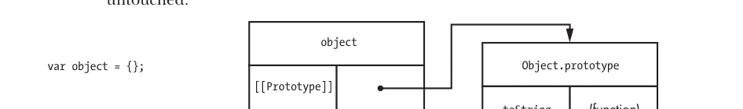

```
var object = {};
```


```
object.toString = function() {
return "[object Custom]";
};
```

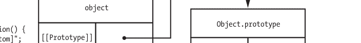

```
delete object.toString;
```


## Using Prototypes with Constructors

The shared nature of prototypes makes them ideal for defining methods once for all objects of a given type. Because methods tend to do the same thing for all instances, there’s no reason each instance needs its own set of methods.

It’s much more efficient to put the methods on the prototype and then use this to access the current instance. For example, consider the following new Person constructor:

```
function Person(name) {
    this.name = name;
}

① Person.prototype.sayName = function() {
    console.log(this.name);
};

var person1 = new Person("Nicholas");
var person2 = new Person("Greg");

console.log(person1.name);        // "Nicholas"
console.log(person2.name);        // "Greg"

person1.sayName();                // outputs "Nicholas"
person2.sayName();                // outputs "Greg"
```

In this version of the Person constructor, sayName() is defined on the prototype ① instead of in the constructor. The object instances work exactly the same as the example from earlier in this chapter, even though sayName() is now a prototype property instead of an own property. Because person1 and person2 are each base references for their calls to sayName(), the this value is assigned to person1 and person2, respectively.

You can also store other types of data on the prototype, but be careful when using reference values. Because these values are shared across instances, you might not expect one instance to be able to change values that another instance will access. This example shows what can happen when you don’t watch where your reference values are pointing:

```
function Person(name) {
    this.name = name;
}

Person.prototype.sayName = function() {
    console.log(this.name);
};
```


```
① Person.prototype.favorites = [];

var person1 = new Person("Nicholas");
var person2 = new Person("Greg");

person1.favorites.push("pizza");
person2.favorites.push("quinoa");

console.log(person1.favorites);    // "pizza,quinoa"
console.log(person2.favorites);    // "pizza,quinoa"
```

favorites 属性 ① 定义在原型上，这意味着 person1.favorites 和 person2.favorites 指向同一个数组。你向任何一个人的 favorites 添加的值都会成为原型上那个数组的元素。这可能并不是你真正想要的行为，因此在定义原型上的属性时，务必非常小心。

尽管你可以逐个向原型添加属性，但许多开发者使用一种更简洁的模式，即用对象字面量替换原型：

```
function Person(name) {
    this.name = name;
}

Person.prototype = {
    ① sayName: function() {
        console.log(this.name);
    },

    ② toString: function() {
        return "[Person " + this.name + "]";
    }
};
```

这段代码在原型上定义了两个方法：sayName() ① 和 toString() ②。这种模式非常流行，因为它免去了多次输入 Person.prototype 的麻烦。然而，有一个副作用需要留意：

```
var person1 = new Person("Nicholas");

console.log(person1 instanceof Person);      // true
console.log(person1.constructor === Person);  // false
① console.log(person1.constructor === Object);  // true
```

使用对象字面量表示法覆盖原型会改变 constructor 属性，使其现在指向 Object 而非 Person。这是因为 constructor 属性存在于原型上，而不是对象实例上。当创建一个函数时，其 prototype 属性会带有一个指向该函数的 constructor 属性。这种模式完全覆盖了原型对象，这意味着 constructor 将来自新创建的（普通）对象，而该对象被赋给了 Person.prototype。若要避免这种情况，在覆盖原型时，应将 constructor 属性恢复为正确的值：

```
```javascript
function Person(name) {
  this.name = name;
}

Person.prototype = {
  ① constructor: Person,
  sayName: function() {
    console.log(this.name);
  },
  toString: function() {
    return "[Person " + this.name + "]";
  }
};

var person1 = new Person("Nicholas");

var person2 = new Person("Greg");

console.log(person1 instanceof Person); // true
console.log(person1.constructor === Person); // true
console.log(person1.constructor === Object); // false

console.log(person2 instanceof Person); // true
console.log(person2.constructor === Person); // true
console.log(person2.constructor === Object); // false
```
```

在此示例中，constructor 属性被专门指定在原型 ① 上。良好的做法是将其作为原型上的第一个属性，这样你就不会忘记包含它。

也许构造函数、原型和实例之间关系最有趣的方面是，实例和构造函数之间没有直接联系。然而，实例和原型之间、原型和构造函数之间确实存在直接联系。图 4-3 说明了这种关系。

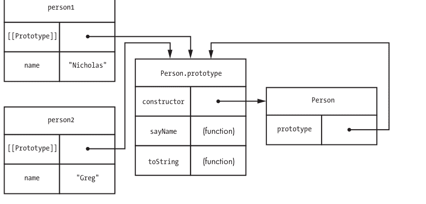

图 4-3：实例及其构造函数通过原型联系起来。

这种关系的本质意味着，实例与原型之间的任何中断也会导致实例与构造函数之间的中断。

## 改变原型

因为特定类型的所有实例都引用一个共享原型，所以你可以在任何时候同时增强所有这些对象。请记住，[[Prototype]] 属性只包含一个指向原型的指针，对原型的任何更改都会立即在引用它的任何实例上生效。这意味着你实际上可以在任何时刻向原型添加新成员，并让这些更改反映到现有实例上，如下例所示：

```
function Person(name) {
    this.name = name;
}

Person.prototype = {
    constructor: Person,

    sayName: function() {
        console.log(this.name);
    },

    toString: function() {
        return "[Person " + this.name + "]";
    }
};
```

> 在实践中，你在使用 JavaScript 开发时可能不会经常这样使用原型。然而，理解对象及其原型之间存在的联系非常重要，像这样奇怪的示例有助于阐明这些概念。

## 内置对象原型

现在，你可能会想，原型是否也允许你修改 JavaScript 引擎中内置的标准对象。答案是肯定的。所有内置对象都有构造函数，因此它们也有你可以更改的原型。例如，为所有数组添加一个新方法只需修改 Array.prototype 即可。

```
Array.prototype.sum = function() {
  return this.reduce(function(previous, current) {
    return previous + current;
  });
};

var numbers = [ 1, 2, 3, 4, 5, 6 ];
var result = numbers.sum();

console.log(result);  // 21
```

此示例在 Array.prototype 上创建了一个名为 sum() 的方法，它只是将数组中的所有项相加并返回结果。numbers 数组通过原型自动获得了访问该方法的权限。在 sum() 内部，this 指向 numbers，它是 Array 的一个实例，因此该方法可以自由使用其他数组方法，如 reduce()。你可能还记得，字符串、数字和布尔值都有内置的原始包装类型，用于像访问对象一样访问原始值。如果像本示例那样修改原始包装类型的原型，你实际上可以为这些原始值添加更多功能：

```
String.prototype.capitalize = function() {
  return this.charAt(0).toUpperCase() + this.substring(1);
};

var message = "hello world!";

console.log(message.capitalize());  // "Hello world!"
```

这段代码为字符串创建了一个名为 capitalize() 的新方法。String 类型是字符串的原始包装类型，修改其原型意味着所有字符串都会自动获得这些更改。

> 虽然为了实验功能而修改内置对象可能很有趣，但在生产环境中这样做并不是一个好主意。开发者期望内置对象以特定方式运行并具有特定的方法。故意更改内置对象会违反这些期望，并使其他开发者不确定这些对象应如何工作。

## 小结

构造函数只是使用 new 运算符调用的普通函数。只要你想创建多个具有相同属性的对象，就可以随时定义自己的构造函数。你可以使用 instanceof 来标识由构造函数创建的对象，或直接访问它们的 constructor 属性。

每个函数都有一个 prototype 属性，该属性定义由特定构造函数创建的对象所共享的任何属性。共享的方法和原始值属性通常定义在原型上，而所有其他属性则定义在构造函数内。constructor 属性实际上定义在原型上，因为它在对象实例之间是共享的。

对象的原型在内部存储在 [[Prototype]] 属性中。该属性是一个引用，而不是副本。如果你在任何时候更改原型，由于 JavaScript 查找属性的方式，这些更改都会发生在所有实例上。当你尝试访问对象上的属性时，会先在该对象上搜索指定名称的自有属性。如果找不到自有属性，则继续搜索原型。这种搜索机制意味着原型可以不断变化，引用该原型的对象实例会立即反映这些更改。

内置对象也有可以修改的原型。虽然不建议在生产环境中这样做，但它对于实验和新功能的概念验证可能会很有帮助。


## 5

## 继承


学习如何创建对象是理解面向对象编程的第一步。第二步是理解继承。在传统的面向对象语言中，类从其他类继承属性。然而在 JavaScript 中，继承可以在没有类式结构定义关系的对象之间发生。这种继承的机制是你已经熟悉的：原型。

## 原型链和 Object.prototype

JavaScript 的内置继承方法称为原型链，或原型继承。正如你在第 4 章中学到的，原型属性会自动在对象实例上可用，这是一种继承形式。对象实例从原型继承属性。因为

原型本身也是一个对象，它有自己的原型并从中继承属性。这就是原型链：一个对象从其原型继承，而该原型又从其原型继承，以此类推。

所有对象，包括你自己定义的，除非另有说明，否则都会自动从 Object.prototype 继承（本章后面会讨论）。更具体地说，所有对象都从 Object.prototype 继承。任何通过对象字面量定义的对象，其 [[Prototype]] 都被设置为 Object.prototype，这意味着它从 Object.prototype 继承属性，就像本例中的 book 一样：

```
var book = {
	title: "The Principles of Object-Oriented JavaScript"
};

var prototype = Object.getPrototypeOf(book);

console.log(prototype === Object.prototype); // true
```

这里，book 的原型等于 Object.prototype。无需额外代码即可实现，因为这是创建新对象的默认行为。这种关系意味着 book 自动获得来自 Object.prototype 的方法。

## 从 Object.prototype 继承的方法

- hasOwnProperty() 判断是否存在具有给定名称的自身属性
- propertyIsEnumerable() 判断自身属性是否可枚举
- isPrototypeOf() 判断该对象是否为另一个对象的原型
- valueOf() 返回对象的数值表示
- toString() 返回对象的字符串表示

这五种方法通过继承出现在所有对象上。后两种在你需要让对象在 JavaScript 中一致工作时很重要，有时你可能想自己定义它们。

### valueOf()

每当运算符作用于对象时，就会调用 valueOf() 方法。默认情况下，valueOf() 只是返回对象实例。原始包装类型重写了 valueOf()，使其对 String 返回字符串，对 Boolean 返回布尔值，对 Number 返回数字。同样，Date 对象的 valueOf() 方法返回以毫秒为单位的纪元时间（就像 Date.prototype.getTime() 一样）。这就是允许你编写比较日期的代码的原因，例如：

```
var now = new Date();
var earlier = new Date(2010, 1, 1);

console.log(now > earlier);      // true
```

在这个例子中，now 是一个代表当前时间的 Date，而 earlier 是一个过去的固定日期。当使用大于运算符 (>) 时，在比较执行之前会先在两个对象上调用 valueOf() 方法。你甚至可以从一个日期中减去另一个日期并得到纪元时间差，这也是因为 valueOf()。

如果你希望对象与运算符一起使用，你可以随时定义自己的 valueOf() 方法。如果你确实定义了 valueOf() 方法，请记住，你并没有改变运算符的工作方式，只是改变了与运算符默认行为一起使用的值。

### toString()

当 valueOf() 返回引用值而不是原始值时，会调用 toString() 方法作为后备。它也在 JavaScript 期望字符串时隐式地对原始值调用。例如，当字符串用作加法运算符的一个操作数时，另一个操作数会自动转换为字符串。如果另一个操作数是原始值，它会被转换为字符串表示（例如，true 变成 "true"），但如果它是引用值，则会调用 valueOf()。如果 valueOf() 返回引用值，则会调用 toString() 并使用返回的值。例如：

```
var book = {
  title: "The Principles of Object-Oriented JavaScript"
};

var message = "Book = " + book;
console.log(message);      // "Book = [object Object]"
```

这段代码通过将 "Book = " 与 book 组合来构造字符串。由于 book 是一个对象，因此会调用它的 toString() 方法。该方法继承自 Object.prototype，并在大多数 JavaScript 引擎中返回默认的 "[object Object]"。如果你对该值满意，就无需更改对象的 toString() 方法。然而，有时定义自己的 toString() 方法很有用，这样字符串转换会返回更有信息量的值。假设，例如，你希望之前的脚本记录书籍的标题：

```
var book = {
    title: "The Principles of Object-Oriented JavaScript",
    toString: function() {
        return "[Book " + this.title + "]"
    }
};

var message = "Book = " + book;

// "Book = [Book The Principles of Object-Oriented JavaScript]"
console.log(message);
```

这段代码为 book 定义了一个自定义的 toString() 方法，它返回的值比继承版本更有用。你通常不需要担心定义自定义 toString() 方法，但知道在必要时可以这样做是好的。

## 修改 Object.prototype

所有对象默认都从 Object.prototype 继承，因此对 Object.prototype 的更改会影响所有对象。这是一个非常危险的情况。第 4 章建议你不要修改内置对象原型，而对 Object.prototype 这一建议更是加倍。看看会发生什么：

```
Object.prototype.add = function(value) {
    return this + value;
};

var book = {
    title: "The Principles of Object-Oriented JavaScript"
};

console.log(book.add(5));        // "[object Object]5"
console.log("title".add("end"));  // "titleend"

// in a web browser
console.log(document.add(true));  // "[object HTMLDocument]true"
console.log(window.add(5));       // "[object Window]true"
```

Object.create() 方法接受两个参数。第一个参数是用于新对象 [[Prototype]] 的对象。可选的第二个参数是属性描述符对象，其格式与 Object.defineProperties() 使用的格式相同（参见第 3 章）。考虑以下内容：

```
var book = {
  title: "The Principles of Object-Oriented JavaScript"
};

// is the same as

var book = Object.create(Object.prototype, {
  title: {
    configurable: true,
    enumerable: true,
    value: "The Principles of Object-Oriented JavaScript",
    writable: true
  }
});
```

这段代码中的两个声明在效果上是相同的。第一个声明使用对象字面量定义一个具有单个属性 title 的对象。该对象自动从 Object.prototype 继承，并且该属性默认设置为可配置、可枚举和可写。第二个声明采取相同的步骤，但使用 Object.create() 显式执行。每个声明产生的 book 对象行为完全相同。但你可能永远不会直接编写从 Object.prototype 继承的代码，因为你默认就会得到它。从其他对象继承更有趣：

```
var person1 = {
  name: "Nicholas",
  sayName: function() {
    console.log(this.name);
  }
};

var person2 = Object.create(person1, {
  name: {
    configurable: true,
    enumerable: true,
    value: "Greg",
    writable: true
  }
});

person1.sayName(); // outputs "Nicholas"
person2.sayName(); // outputs "Greg"
```


```js
console.log(person1.hasOwnProperty("sayName"));    // true
console.log(person1.isPrototypeOf(person2));    // true
console.log(person2.hasOwnProperty("sayName"));    // false
```

这段代码创建了一个对象 person1，它具有 name 属性和 sayName() 方法。person2 对象继承自 person1，因此它继承了 name 和 sayName()。然而，person2 是通过 Object.create() 定义的，这也为 person2 定义了一个自身的 name 属性。这个自身属性会遮蔽同名原型属性，并在其位置被使用。因此，person1.sayName() 输出 "Nicholas"，而 person2.sayName() 输出 "Greg"。请记住，sayName() 仍然只存在于 person1 上，并且被 person2 继承。

在这个示例中，person2 的继承链比 person1 的更长。person2 对象继承自 person1 对象，而 person1 对象继承自 Object.prototype。参见图 5-1。

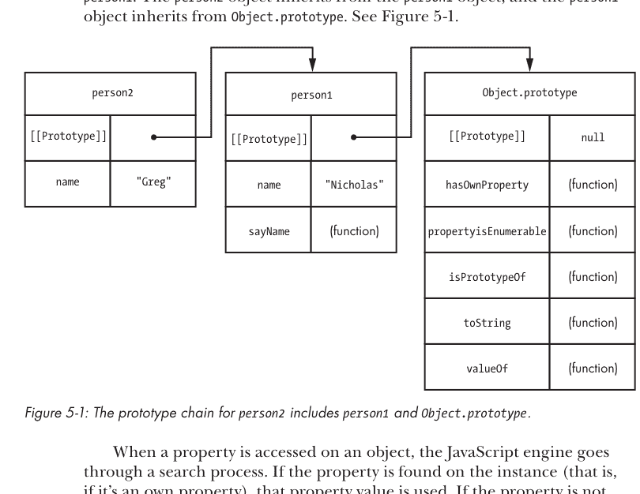

图 5-1：person2 的原型链包括 person1 和 Object.prototype。

当在一个对象上访问属性时，JavaScript 引擎会进行搜索过程。如果属性在实例上找到（即它是自身属性），则使用该属性值。如果属性未在实例上找到，搜索会继续在 [[Prototype]] 上进行。如果属性仍未找到，搜索会继续到该对象的 [[Prototype]]，依此类推，直到链的末尾。链通常以 Object.prototype 结束，其 [[Prototype]] 设置为 null。

你也可以通过 Object.create() 创建具有 null [[Prototype]] 的对象，例如：

```js
var nakedObject = Object.create(null);
console.log("toString" in nakedObject); // false
console.log("valueOf" in nakedObject); // false
```

这个示例中的 nakedObject 是一个没有原型链的对象。这意味着内置方法如 toString() 和 valueOf() 并不存在于该对象上。实际上，这个对象是一个完全空白的画布，没有预定义的属性，这使其非常适合创建查找哈希，而无需担心潜在的命名冲突或继承的属性名。这种对象没有太多其他用途，你也不能像它继承自 Object.prototype 一样使用它。例如，任何时候你在 nakedObject 上使用运算符，你只会得到类似“Cannot convert object to primitive value.”的错误。尽管如此，JavaScript 语言中可以创建原型-less 对象，这是一个有趣的怪癖。

## 构造函数继承

JavaScript 中的对象继承也是构造函数继承的基础。回顾第 4 章，几乎每个函数都有一个可以修改或替换的 prototype 属性。该 prototype 属性会自动分配为一个继承自 Object.prototype 的新通用对象，并且有一个名为 constructor 的单一自身属性。实际上，JavaScript 引擎在幕后为你做了以下操作：

```js
// you write this
function YourConstructor() {
  // initialization
}

// JavaScript engine does this for you behind the scenes
YourConstructor.prototype = Object.create(Object.prototype, {
  constructor: {
    configurable: true,
    enumerable: true,
    value: YourConstructor,
    writable: true
  }
});
```

因此，无需做任何额外操作，这段代码就会将构造函数的 prototype 属性设置为一个继承自 Object.prototype 的对象，这意味着 YourConstructor 的任何实例也继承自 Object.prototype。YourConstructor 是 Object 的子类型，而 Object 是 YourConstructor 的超类型。

```js
// inherits from Rectangle
function Square(size) {
	this.length = size;
	this.width = size;
}

Square.prototype = Object.create(Rectangle.prototype, {
	constructor: {
		configurable: true,
		enumerable: true,
		value: Square,
		writable: true
	}
});

Square.prototype.toString = function() {
	return "[Square " + this.length + "x" + this.width + "]";
};
```

在这个版本的代码中，Square.prototype 被一个继承自 Rectangle.prototype 的新对象覆盖，并且 Rectangle 构造函数从未被调用。这意味着你不再需要担心因不带参数调用构造函数而导致错误。否则，这段代码的行为与之前的代码完全相同。原型链保持完整，因此 Square 的所有实例都继承自 Rectangle.prototype，并且构造函数在同一步骤中被恢复。

**NOTE** 始终确保在向其添加属性之前覆盖原型，否则在覆盖发生时你将丢失添加的方法。

## 构造函数窃取

由于 JavaScript 中的继承是通过原型链实现的，因此你不需要调用对象的超类型构造函数。如果你确实想从子类型构造函数中调用超类型构造函数，那么你需要利用 JavaScript 函数的工作方式。

在第 2 章中，你学习了 call() 和 apply() 方法，它们允许函数使用不同的 this 值被调用。这正是构造函数窃取的工作方式。你只需使用 call() 或 apply() 从子类型构造函数中调用超类型构造函数，并传入新创建的对象。实际上，你窃取了超类型构造函数用于自己的对象，如此示例所示：

```js
function Rectangle(length, width) {
	this.length = length;
	this.width = width;
}
```

```js
Rectangle.prototype.getArea = function() {
    return this.length * this.width;
};

Rectangle.prototype.toString = function() {
    return "[Rectangle " + this.length + "x" + this.width + "]";
};

// inherits from Rectangle
function Square(size) {
    Rectangle.call(this, size, size);
    // optional: add new properties or override existing ones here
}

Square.prototype = Object.create(Rectangle.prototype, {
    constructor: {
        configurable: true,
        enumerable: true,
        value: Square,
        writable: true
    }
});

Square.prototype.toString = function() {
    return "[Square " + this.length + "x" + this.width + "]";
};

var square = new Square(6);

console.log(square.length);      // 6
console.log(square.width);        // 6
console.log(square.getArea());    // 36
```

Square 构造函数调用 Rectangle 构造函数并传入 this 以及两次 size（一次用于 length，一次用于 width）。这样做会在新对象上创建 length 和 width 属性，并使它们都等于 size。这是避免重新定义你想要继承的构造函数中的属性的方法。你可以在应用超类型构造函数之后添加新属性或覆盖现有属性。

这种两步过程在需要在自定义类型之间实现继承时很有用。你总是需要修改构造函数的原型，并且你可能还需要从子类型构造函数内部调用超类型构造函数。通常，你会修改原型以实现方法继承，并使用构造函数窃取来实现属性。这种方法通常被称为伪经典继承，因为它模仿了基于类的语言中的经典继承。

## 访问超类型方法

在之前的示例中，Square 类型有自己的 toString() 方法，它遮蔽了原型上的 toString()。在子类型中用新功能覆盖超类型方法是很常见的，但如果仍想访问超类型方法怎么办？在其他语言中，你可能可以说 super.toString()，但 JavaScript 没有类似的东西。相反，你可以直接在超类型的原型上访问该方法，并使用 call() 或 apply() 在子类型对象上执行该方法。例如：

```js
function Rectangle(length, width) {
  this.length = length;
  this.width = width;
}
```

```js
Rectangle.prototype.getArea = function() {
  return this.length * this.width;
};
```

```js
Rectangle.prototype.toString = function() {
  return "[Rectangle " + this.length + "x" + this.width + "]";
};
```

```js
// inherits from Rectangle
function Square(size) {
  Rectangle.call(this, size, size);
}
```

```js
Square.prototype = Object.create(Rectangle.prototype, {
  constructor: {
    configurable: true,
    enumerable: true,
    value: Square,
    writable: true
  }
});
```

```js
// call the supertype method
Square.prototype.toString = function() {
  var text = Rectangle.prototype.toString.call(this);
  return text.replace("Rectangle", "Square");
};
```

在这个版本的代码中，Square.prototype.toString() 通过使用 call() 调用 Rectangle.prototype.toString()。该方法只需在返回结果文本之前将 "Rectangle" 替换为 "Square"。这种方法对于如此简单的操作来说可能显得有点冗长，但它是访问超类型方法的唯一方式。


## 摘要

JavaScript 通过原型链支持继承。当一个对象的 `[[Prototype]]` 被设置为另一个对象时，对象之间就建立了原型链。所有普通对象都会自动继承自 `Object.prototype`。如果想创建一个继承自其他对象的对象，可以使用 `Object.create()` 来为新对象指定 `[[Prototype]]` 的值。

通过在构造函数上创建原型链，可以实现自定义类型之间的继承。将构造函数的 `prototype` 属性设置为另一个值，就可以在自定义类型的实例与那个值的原型之间建立继承关系。该构造函数的所有实例共享同一个原型，因此它们都继承自同一个对象。这种技术非常适合继承其他对象的方法，但无法通过原型继承自有属性。

要正确继承自有属性，可以使用构造函数窃取（constructor stealing），即通过 `call()` 或 `apply()` 调用构造函数，使所有初始化都在子类型对象上完成。构造函数窃取与原型链相结合，是在 JavaScript 中实现自定义类型继承最常用的方式。这种组合常被称为“伪经典继承”（pseudoclassical inheritance），因为它与基于类的语言中的继承非常相似。

你可以通过直接访问超类型的原型来调用超类型的方法。这样做时，必须使用 `call()` 或 `apply()` 在子类型对象上执行超类型方法。

## 6

## 对象模式


JavaScript 有很多创建对象的模式，通常完成同一件事不止一种方式。你可以随时定义自己的自定义类型或通用对象。可以使用继承在对象之间共享行为，也可以采用其他技术（如混入 mix-ins）。还可以利用 JavaScript 的高级特性来防止对象结构被修改。本章讨论的模式基于你的使用场景，为你提供了管理和创建对象的强大方式。

## 私有成员与特权成员

JavaScript 中所有对象属性都是公开的，也没有明确的方式来表示某个属性不应在特定对象外部被访问。然而，有时你可能不希望数据公开。例如，当一个对象使用某个值来确定某种状态时，如果在该对象不知情的情况下修改了这个数据，就会使状态管理过程陷入混乱。避免这种情况的一种方法是使用命名约定。例如，当属性不打算公开时，通常会给属性加下划线前缀（如 `_name`）。然而，有些隐藏数据的方法不依赖约定，因此在防止私有信息被修改方面更加“万无一失”。

模块模式是一种对象创建模式，旨在创建带有私有数据的单例对象。其基本方法是使用一个立即调用函数表达式（IIFE）来返回对象。IIFE 是一个函数表达式，定义后会立即调用以产生结果。该函数表达式可以包含任意数量的局部变量，这些变量无法从函数外部访问。由于返回的对象是在该函数内部定义的，因此对象的方法可以访问这些数据。（在 IIFE 内部定义的所有对象都可以访问相同的局部变量。）以这种方式访问私有数据的方法称为特权方法。以下是模块模式的基本格式：

```
var yourObject = (function() {
  // private data variables
  return {
    // public methods and properties
  };
})();
①
```

在这种模式中，会创建并立即执行一个匿名函数。（注意函数末尾的额外括号①。使用此语法可以立即执行匿名函数。）这意味着该函数只存在片刻，执行后即被销毁。IIFE 在 JavaScript 中是一种非常流行的模式，部分原因就是它可用于模块模式。

模块模式允许你将普通变量用作事实上的对象属性，这些属性不会公开暴露。实现方式是将闭包函数创建为对象方法。闭包就是访问自身作用域之外数据的函数。例如，每当你在函数中访问全局对象（如 Web 浏览器中的 `window`）时，该函数就在访问自身作用域之外的变量。模块函数的不同之处在于，变量是在 IIFE 内声明的，而同样在 IIFE 内声明的函数会访问这些变量。例如：

```
var person = (function() {
  ① var age = 25;
  return {
    name: "Nicholas",
    ② getAge: function() {
      return age;
    },
    ③ growOlder: function() {
      age++;
    }
  };
})();

console.log(person.name); // "Nicholas"
console.log(person.getAge()); // 25

person.age = 100;
console.log(person.getAge()); // 25

person.growOlder();
console.log(person.getAge()); // 26
```

这段代码使用模块模式创建了 `person` 对象。`age` 变量①充当对象的私有属性。它无法从对象外部直接访问，但可以被对象的方法使用。对象上有两个特权方法：`getAge()`②读取 `age` 变量的值，`growOlder()`③使 `age` 递增。这两个方法都可以直接访问 `age` 变量，因为它定义在包含这些方法的外部函数中。

模块模式有一种变体，称为“揭示模块模式”（revealing module pattern），它将所有变量和方法放在 IIFE 的顶部，然后简单地将它们赋给返回的对象。你可以使用揭示模块模式将前面的示例改写如下：

```
var person = (function() {
  var age = 25;
  function getAge() {
    return age;
  }
  function growOlder() {
    age++;
  }
  return {
    name: "Nicholas",
    getAge: getAge,
    growOlder: growOlder
  };
})();
```

在揭示模块模式中，`age`、`getAge()` 和 `growOlder()` 都定义为 IIFE 的局部内容。随后，`getAge()` 和 `growOlder()` 函数被赋给返回的对象①，实际上是在 IIFE 外部“揭示”了它们。这段代码本质上与之前使用传统模块模式的示例相同；不过，有些人更喜欢这种模式，因为它将所有变量和函数声明放在一起。

模块模式非常适合定义具有私有属性的单个对象，但那些也需要自身私有属性的自定义类型呢？你可以在构造函数内部使用与模块模式类似的模式来创建实例特有的私有数据。例如：

```
function Person(name) {
  // define a variable only accessible inside of the Person constructor
  var age = 25;
  this.name = name;
  this.getAge = function() {
    return age;
  };
```

```
this.growOlder = function() {
    age++;
};
}

var person = new Person("Nicholas");

console.log(person.name);    // "Nicholas"
console.log(person.getAge());    // 25

person.age = 100;
console.log(person.getAge());    // 25

person.growOlder();
console.log(person.getAge());    // 26
```

在这段代码中，`Person` 构造函数有一个局部变量 `age`。该变量被用于 `getAge()`① 和 `growOlder()`② 方法。当你创建 `Person` 的实例时，该实例会获得自己的 `age` 变量、`getAge()` 方法和 `growOlder()` 方法。这在很多方面与模块模式类似，构造函数创建了一个局部作用域并返回 `this` 对象。正如第 4 章讨论的，将方法放在对象实例上比放在原型上效率更低，但当你需要私有且实例特有的数据时，这是唯一可行的方法。

如果你希望私有数据在所有实例之间共享（就像放在原型上一样），可以使用一种混合方法，它看起来像模块模式，但使用了构造函数：

```
var Person = (function() {

    // everyone shares the same age
    var age = 25;

    function InnerPerson(name) {
        this.name = name;
    }

    InnerPerson.prototype.getAge = function() {
        return age;
    };

    InnerPerson.prototype.growOlder = function() {
        age++;
    };

    return InnerPerson;

})();
```


```js
var person1 = new Person("Nicholas");
var person2 = new Person("Greg");
console.log(person1.name); // "Nicholas"
console.log(person1.getAge()); // 25
console.log(person2.name); // "Greg"
console.log(person2.getAge()); // 25
person1.growOlder();
console.log(person1); // Person { name: 'Nicholas', age: 26 }
console.log(person1.getAge()); // 26
console.log(person2.getAge()); // 26
```

在这段代码中，InnerPerson 构造函数是在一个 IIFE 中定义的。变量 age 在构造函数外部定义，但被用于两个原型方法。InnerPerson 构造函数随后被返回，并在全局作用域中成为 Person 构造函数。Person 的所有实例最终共享 age 变量，因此使用一个实例更改值会自动影响另一个实例。

## Mixins

尽管伪经典继承和原型继承在 JavaScript 中被频繁使用，但还有一种通过混入实现的伪继承类型。混入发生在某个对象获取另一个对象的属性而不会修改原型链时。第一个对象（接收者）通过直接复制这些属性，实际接收了第二个对象（提供者）的属性。传统上，你可以使用如下函数创建混入：

```js
function mixin(receiver, supplier) {
  for (var property in supplier) {
    if (supplier.hasOwnProperty(property)) {
      receiver[property] = supplier[property]
    }
  }
  return receiver;
}
```

mixin() 函数接受两个参数：接收者和提供者。该函数的目标是将提供者上的所有可枚举属性复制到接收者上。你可以通过 for-in 循环遍历 supplier 中的属性，然后将该属性的值赋给 receiver 上同名的属性来实现。需要注意的是，这是一个浅拷贝，因此如果某个属性包含一个对象，那么提供者和接收者都将指向同一个对象。这种模式经常用于向 JavaScript 中已存在于其他对象上的对象添加新行为。

例如，你可以通过混入而不是继承为对象添加事件支持。首先，假设你已经为使用事件定义了一个自定义类型：

```
function EventTarget(){
}

EventTarget.prototype = {

    constructor: EventTarget,

    addListener: function(type, listener){
        // create an array if it doesn't exist
        if (!this.hasOwnProperty("_listeners")) {
            this._listeners = [];
        }

        if (typeof this._listeners[type] == "undefined"){
            this._listeners[type] = [];
        }

        this._listeners[type].push(listener);
    },

    fire: function(event){
        if (!event.target){
            event.target = this;
        }

        if (!event.type){ // falsy
            throw new Error("Event object missing 'type' property.");
        }

        if (this._listeners && this._listeners[event.type] instanceof Array){
            var listeners = this._listeners[event.type];
            for (var i=0, len=listeners.length; i < len; i++){
                listeners[i].call(this, event);
            }
        }
    },
```

```javascript
removeListener: function(type, listener){
	if (this._listeners && this._listeners[type] instanceof Array){
		var listeners = this._listeners[type];
		for (var i=0, len=listeners.length; i < len; i++){
			if (listeners[i] === listener){
				listeners.splice(i, 1);
				break;
			}
		}
	}
};
```

EventTarget 类型为任何对象提供基本的事件处理。你可以添加和移除监听器，并在对象上直接触发事件。事件监听器存储在 _listeners 属性上，该属性仅在第一次调用 addListener() 时创建（这使得混入更容易）。你可以使用 EventTarget 的实例，如下所示：

```javascript
var target = new EventTarget();
target.addListener("message", function(event) {
	console.log("Message is " + event.data);
});
target.fire({
	type: "message",
	data: "Hello world!"
});
```

事件支持对于 JavaScript 中的对象非常有用。如果你想要另一种也支持事件的对象类型，你有几个选择。首先，你可以创建一个 EventTarget 的新实例，然后添加你想要的属性：

```javascript
var person = new EventTarget();
person.name = "Nicholas";
person.sayName = function() {
	console.log(this.name);
};
this.fire({ type: "namesaid", name: name });
```

在这段代码中，创建了一个名为 person 的新变量作为 EventTarget 的实例，然后添加了与 person 相关的属性。不幸的是，这意味着 person 实际上是 EventTarget 的实例，而不是 Object 或自定义类型。你还必须手动添加大量新属性的开销。最好有一种更有条理的方式来做到这一点。

第二种解决这个问题的方法是使用伪经典继承：

```
function Person(name) {
    this.name = name;
}

Person.prototype = Object.create(EventTarget.prototype);
Person.prototype.constructor = Person;

Person.prototype.sayName = function() {
    console.log(this.name);
    this.fire({ type: "namesaid", name: name });
};

var person = new Person("Nicholas");

console.log(person instanceof Person);    // true
console.log(person instanceof EventTarget); // true
```

在这种情况下，有一个继承自 EventTarget 的新 Person 类型。你可以在之后向 Person 的原型添加任何进一步的方法。然而，这并不够简洁，你也可以认为这种关系不合理：一个人是一种事件目标？通过使用混入，你可以减少分配这些新属性给原型的代码量：

```
function Person(name) {
    this.name = name;
}

mixin(Person.prototype, new EventTarget());
mixin(Person.prototype, {
    constructor: Person,
    sayName: function() {
        console.log(this.name);
        this.fire({ type: "namesaid", name: name });
    }
});

var person = new Person("Nicholas");

console.log(person instanceof Person);    // true
console.log(person instanceof EventTarget); // false
```

在这里，Person.prototype 与 EventTarget 的一个新实例混合以获得事件行为。然后，Person.prototype 与 constructor 和 sayName() 混合以完成原型的组合。在此示例中，Person 的实例不是 EventTarget 的实例，因为没有继承。

当然，你可能会决定虽然你想要使用对象的属性，但你根本不想要伪经典继承的构造函数。在这种情况下，你可以在创建新对象时直接使用混入：

```
var person = mixin(new EventTarget(), {

    name: "Nicholas",

    sayName: function() {
        console.log(this.name);
        this.fire({ type: "namesaid", name: name });
    }

});
```

在此示例中，EventTarget 的一个新实例与一些新属性混合以创建 person 对象，而不会影响 person 的原型链。

关于以这种方式使用混入需要注意的一点是，提供者上的访问器属性会变成接收者上的数据属性，这意味着如果你不小心可能会覆盖它们。这是因为接收者属性是通过赋值创建的，而不是通过 Object.defineProperty()，意味着读取提供者属性的当前值然后将其赋给接收者上同名的属性。例如：

```
var person = mixin(new EventTarget(), {

    get name() {
        return "Nicholas"
    },

    sayName: function() {
        console.log(this.name);
        this.fire({ type: "namesaid", name: name });
    }

});

console.log(person.name);      // "Nicholas"

person.name = "Greg";
console.log(person.name);      // "Greg"
```


在这段代码中，`name` 被定义为一个只有 getter 的访问器属性 ①。这意味着对该属性赋值应该不会有任何效果。然而，由于在 `person` 对象上该访问器属性变成了一个数据属性，因此可以用新值覆盖 `name` ②。在调用 `mixin()` 的过程中，`name` 的值从提供者处读取，并赋值给接收者上名为 `name` 的属性。此过程中任何时刻都没有定义新的访问器，因此接收者上的 `name` 属性是一个数据属性。

```
function mixin(receiver, supplier) {
Object.keys(supplier).forEach(function(property) {
var descriptor = Object.getOwnPropertyDescriptor(supplier, property);
Object.defineProperty(receiver, property, descriptor);
});
return receiver;
}

var person = mixin(new EventTarget(), {
get name() {
return "Nicholas"
},
sayName: function() {
console.log(this.name);
this.fire({ type: "namesaid", name: name });
}
});

console.log(person.name); // "Nicholas"

person.name = "Greg";
console.log(person.name); // "Nicholas"
```

这个版本的 `mixin()` 使用 `Object.keys()` ① 获取 `supplier` 上所有可枚举自有属性的数组。`forEach()` 方法用于遍历这些属性。每个属性在 `supplier` 上的属性描述符通过 `Object.defineProperty()` ② 获取并添加到 `receiver`。这样确保所有相关属性信息（不仅仅是值）都被传输到 `receiver`。这意味着 `person` 对象有一个名为 `name` 的访问器属性，因此它无法被覆盖。

当然，这个版本的 `mixin()` 仅在 ECMAScript 5 JavaScript 引擎中有效。如果你的代码需要在旧引擎中运行，应该将两种 `mixin()` 方法合并为一个函数：

```
function mixin(receiver, supplier) {
    if (Object.getOwnPropertyDescriptor) {
        Object.keys(supplier).forEach(function(property) {
            var descriptor = Object.getOwnPropertyDescriptor(supplier, property);
            Object.defineProperty(receiver, property, descriptor);
        });
    } else {
        for (var property in supplier) {
            if (supplier.hasOwnProperty(property)) {
                receiver[property] = supplier[property]
            }
        }
    }
    return receiver;
}
```

在这里，`mixin()` 检查 `Object.getOwnPropertyDescriptor()` ① 是否存在，以判断 JavaScript 引擎是否支持 ECMAScript 5。如果支持，则继续使用 ECMAScript 5 版本。否则，使用 ECMAScript 3 版本 ②。这个函数在现代和旧版 JavaScript 引擎中使用都是安全的，因为它们会采用最合适的 mixin 策略。

注意：请记住，`Object.keys()` 只返回可枚举属性。如果你还想复制不可枚举属性，请使用 `Object.getOwnPropertyNames()`。

## 作用域安全构造函数

由于所有构造函数都是函数，你可以在不使用 `new` 运算符的情况下调用它们，从而影响 `this` 的值。这样做可能会产生意想不到的结果，因为在非严格模式下 `this` 最终会被强制转换为全局对象，或者构造函数在严格模式下会抛出错误。在第 4 章中，你遇到了这个示例：

```
function Person(name) {
    this.name = name;
}
```

```
Person.prototype.sayName = function() {
    console.log(this.name);
};

① var person1 = Person("Nicholas");        // note: missing "new"

console.log(person1 instanceof Person);    // false
console.log(typeof person1);               // "undefined"
console.log(name);                         // "Nicholas"
```

在这种情况下，`name` 被创建为全局变量，因为 `Person` 构造函数是在没有 `new` 的情况下调用 ①。请记住，这段代码是在非严格模式下运行的，因为在严格模式下省略 `new` 会抛出错误。构造函数以大写字母开头通常表明它应该在前面使用 `new`，但如果你想允许这种用法，并且让函数在没有 `new` 的情况下也能工作呢？许多内置构造函数，如 `Array` 和 `RegExp`，在没有 `new` 的情况下也能工作，因为它们被设计为作用域安全的。作用域安全的构造函数在带或不带 `new` 的情况下均可调用，并且在两种情况下都返回相同类型的对象。

当 `new` 与函数一起调用时，由 `this` 代表的新创建对象已经是构造函数所代表的自定义类型的实例。因此可以使用 `instanceof` 来判断函数调用中是否使用了 `new`：

```
function Person(name) {
    if (this instanceof Person) {
        // called with "new"
    } else {
        // called without "new"
    }
}
```

使用这样的模式，你可以根据函数是带 `new` 还是不带 `new` 调用来控制其行为。你可能希望针对不同情况做出不同处理，但通常你希望函数表现相同（通常是为了防止意外遗漏 `new`）。Person 的作用域安全版本如下：

```
function Person(name) {
    if (this instanceof Person) {
        this.name = name;
    } else {
        return new Person(name);
    }
}
```

对于这个构造函数，当使用 `new` 时，`name` 属性会像往常一样被赋值。如果未使用 `new`，则通过 `new` 递归调用构造函数，以创建合适的对象实例。这样，以下两种写法是等价的：

```
var person1 = new Person("Nicholas");
var person2 = Person("Nicholas");

console.log(person1 instanceof Person);   // true
console.log(person2 instanceof Person);   // true
```

没有使用 `new` 运算符而创建新对象正变得越来越常见，以尽力避免因遗漏 `new` 而导致的错误。JavaScript 本身有几种具有作用域安全构造函数的引用类型，例如 `Object`、`Array`、`RegExp` 和 `Error`。

## 总结

在 JavaScript 中，创建和组合对象有许多不同的方式。虽然 JavaScript 没有正式的私有属性的概念，但你可以创建只能从对象内部访问的数据或函数。对于单例对象，你可以使用模块模式隐藏对外部世界的数据。你可以使用立即调用函数表达式（IIFE）定义局部变量和函数，这些变量和函数只能由新创建的对象访问。特权方法是对象上能够访问私有数据的方法。你也可以通过构造函数函数中定义变量，或使用 IIFE 创建所有实例共享的私有数据，来创建具有私有数据的构造函数。

混入（Mixin）是一种在避免继承的同时向对象添加功能的有力方式。混入将一个对象的属性复制到另一个对象，这样接收对象就获得了功能，而无需继承自提供对象。与继承不同，混入不允许你在对象创建后识别这些能力的来源。因此，混入最适合用于数据属性或小段功能。当你想获得更多功能并知道功能来源时，继承仍然是更好的选择。

作用域安全构造函数是你可以带或不带 `new` 调用的构造函数，用于创建新对象实例。这种模式利用了构造函数一旦开始执行，`this` 就是自定义类型的实例这一事实，从而允许你根据是否使用 `new` 运算符来改变构造函数的行为。

# 索引

## 符号

{ }（花括号）
  用于函数内容，18
  以及对象属性，9
==（双等号运算符），5
===（三等号运算符），5
[ ]（方括号）
  用于数组字面量，10
  用于属性访问，11–12
[[ ]]（双方括号表示法），17
_（下划线），在属性名前缀中，38, 80

## A

访问器属性，37–38
  属性，41–43
    创建，42–43
添加属性，8
匿名函数，20, 80
apply() 方法，27, 75
arguments（函数作为），20
arguments 对象，21
arity（参数个数），21
Array 内置类型，8
Array.isArray() 方法，13–14
数组字面量，9–10
Array.prototype，修改，62
数组
  识别，13–14
  传递给 apply()，27
赋值表达式，18
属性特性，38–44
  访问器属性，41–43
  数据属性，40–41
自动装箱，14

## B

bind() 方法，28
Boolean 对象，3, 15–16
Boolean 原始包装类型，14–15
花括号（{ }）
  用于函数内容，18
  以及对象属性，9
方括号表示法，用于属性访问，11–12
内置对象原型，62–63
内置类型，实例化，8–11

## C

call() 方法，26–27, 75
[[Call]] 属性，17
大写，构造函数名称，50
capitalize() 方法，用于字符串，62
charAt() 方法，6
类，JavaScript 不支持，1
闭包函数，81
比较函数，20
无强制类型转换的比较，5
[[Configurable]] 特性，39, 42
  用于密封对象，46
console.log 函数，51
constructor 属性，50–51
  通过对象字面量表示法更改，59
构造函数，6–7, 49–53
  继承，72–75
构造函数内的 Object.defineProperty() 方法，52
私有成员，82–84
与原型的使用，57–60
目的，51
作用域安全，90–92


constructors (continued)
stealing, 75–76
subtype, 72, 75–76
supertype, 72, 75–76
create() method, 70
creating
accessor properties, 42–43
objects, 6–7
properties, on temporary objects, 15
Crockford, Douglas, 69

## D
data
sharing private, 83–84
storing on prototype, 57
types. See primitive types; reference types; types
data properties, 37
attributes, 40–41
from mixins, 88–89
Date built-in type, 8
Date object, valueOf() method, 67
declarations, vs. expressions, 18–19
defineProperties() method, 43–44
defineProperty() method, 39–41, 52
[[Delete]] operation, for object property, 35
delete operator, 35, 48
dereferencing, objects, 7–8
detecting properties, 33–35
dot notation, for property access, 11
double equals operator (==), 5
double-square-bracket notation ([[ ]]), 17

## E
enumerable properties
adding to Object.prototype, 69
copying between supplier and receiver, 84
[[Enumerable]] property attribute, 39, 42
enumeration, 36–37
equals operators, double (==) and triple (===), 5
Error built-in type, 9
errors
from constructors in strict mode, 53
for primitive wrapper objects, 16
event support, adding to objects, 85–87
expressions, vs. declarations, 18–19

[[Extensible]] attribute, 45–47
extensions for objects, preventing, 45

## F
falsy values, 33
first-class functions, 2
flexibility of JavaScript, 2
for-in loops, 36, 69, 84
frames of web pages, passing values between, 13
freeze() method, 47, 61
freezing objects, 47
frozen objects, prototype modification and, 61
Function constructor, 9, 10, 20
function keyword, 18
function literals, 10–11
functions, 2, 17–29
declarations vs. expressions, 18–19
hoisting, 18–19
overloading, 23–24
parameters, 21–22
as values, 19–21

## G
garbage-collection language, JavaScript as, 7
[[Get]] attribute, 41
getOwnPropertyDescriptor() method, 44
getPrototypeOf() method, 55
getter functions, 37–38
global object, this to represent, 25

## H
hash maps, JavaScript objects as, 48
hasOwnProperty() method, 34–35, 53, 66, 69
hoisting functions, 18–19

## I
if condition, 33
immediately invoked function expression (IIFE), 80
inheritance, 65–78
constructor, 72–75
methods from Object.prototype, 66–68
between objects, 69–72
prototype chaining, 65–69
pseudoclassical, 76, 87

in operator, 53
testing for property instance with, 33–34
instanceof operator, 12–13
temporary objects and, 15
instances. See also objects
checking type of, 50–51
prototype link to constructor, 60
of reference types, 6
instantiating
built-in types, 8–11
objects, 6
primitive wrappers, 16
internal property, of functions, 17
isArray() method, 13–14
isExtensible() method, 45, 46
isFrozen() method, 47
isPrototypeOf() method, 55, 66
isSealed() method, 46

## K
keys() method, 36, 89–90
key/value pairs, 48

## L
length property, of functions, 21–22
literals, 3, 9
array, 10
function, 10–11
object, 9–10
regular expression, 11

## M
memory location, pointer to, 7
methods, 6, 24–28
adding to arrays, 62
primitive, 6
privileged, 80
prototypes for defining, 57–60
for supertypes, accessing, 77
mixins, 84–90
data properties from, 88–89
module patterns, 80–82

## N
names
for constructors, capitalization of, 50
multiple functions with same, 23
for properties, 80
new operator, 6, 90–92
constructors and, 49, 50, 52
instantiating reference types with, 9
this object created with, 51
null value, 3
determining if a value is, 5
setting object variable to, 7–8
setting property to, 35
typeof operator and, 5
Number primitive wrapper type, 14–15
number type, 3

## O
Object built-in type, 9
Object constructor, 32
Object.create() method, 70
Object.defineProperties() method, 43–44
Object.defineProperty() method, 39–41, 52
Object.freeze() method, 47, 61
Object.getOwnPropertyDescriptor() method, 44
Object.getPrototypeOf() method, 55
Object.isExtensible() method, 45, 46
Object.isFrozen() method, 47
Object.isSealed() method, 46
Object.keys() method, 36, 89–90
object literals, 9–10
object patterns, 79–92
private and privileged members, 80–84
Object.preventExtensions() method, 45
Object.prototype.isPrototypeOf() method, 55, 66
Object.prototype prototype
methods inherited from, 66–68
modifying, 68–69
objects, 2, 6, 31–48
creating, 6–7
dereferencing, 7–8
freezing, 47
inheritance, 69–72
methods, 24–28
modification, preventing, 45–47
properties, defining, 32–33
property inheritance from prototype, 65–69
reference types as, 2
sealing, 45–46
Object.seal() method, 45–46, 61
overloading functions, 23–24

## P
own properties
determining existence of, 66
determining whether enumerable, 66
in operator to check for, 34
for objects, 32
vs. prototype properties, 55–56

parameters, 21–22
person object, module pattern for creating, 81
pointer to memory location, 7
preventExtensions() method, 45
preventing object modifications, 45–47
primitive methods, 6
primitive types, 2, 3–6
primitive wrapper types, 14–16
private data, sharing, 83–84
private members, 80–84
for constructors, 82–84
privileged members, 80–84
properties, 6, 11–12, 80
adding or removing, 8
copying enumerable, between receiver and supplier, 84–86
creating on temporary objects, 15
defining, 32–33
defining multiple, 43–44
detecting, 33–35
enumerable, adding to Object.prototype, 69
enumeration, 36–37
identifying on prototype, 54
removing, 35
string literals for names, 9
types, 37–38
property attributes, 38–44
changing, 39–40
retrieving, 44
propertyIsEnumerable() method, 37, 39, 66
_proto_ property, 55
prototype chaining, 65–69, 71, 74
object without, 72
overwriting, 73
prototype properties
identifying, 54
vs. own properties, 55–56
prototype property, of functions, 53, 72
[[Prototype]] property, 54–56, 60–61

prototypes, 53–63
built-in object, 62–63
changing, 60–62
identifying properties, 54
overwriting, 59
property inheritance from, 65–69
use with constructors, 57–60
pseudoclassical inheritance, 76, 87
pseudoinheritance, mixins for, 84
[[Put]] method, 32–33
for data properties, 37

## R
read-only property, 38
receiver, copying enumerable properties between supplier and, 84–86
Rectangle constructor, 73–75
reference types, 2, 6–8
identifying, 12–13
reference values, storing on prototype, 57–58
RegExp built-in type, 9
RegExp constructor, 11
regular expression literals, 11
removing properties, 8, 35
retrieving property attributes, 44
revealing module pattern, 82

## S
scope-safe constructors, 90–92
sealed objects, prototype modification and, 61
sealing objects, 45–46
seal() method, 45–46, 61
[[Set]] attribute, 32–33, 41
setter functions, 37–38
sharing private data, 83–84
signatures, function with multiple, 23
sort() method, 20
square brackets ([ ])
for array literals, 10
for property access, 11–12
Square constructor, 73–75
stealing constructors, 75–76
strict mode
for nonextensible objects, 45
for sealed objects, 46
string literals, as property names, 9
String primitive wrapper type, 14–15

strings
capitalize() method, 62
conversion of values to, for comparison, 21
methods, 6
string type, 3
substring() method, 6
subtype constructors, 72, 75–76
sum() function, 21
supertype
constructors, 72, 75–76
methods, accessing, 77
supplier, copying enumerable properties between receiver and, 84–86

## T
temporary objects, creating properties on, 15
this object, 25–26
changing value of, 26–28
to create length and width properties, 76
creating with new, 51
toFixed() method, 6
toLowerCase() method, 6
toString() method, 6, 35, 66, 67–68
triple equals operator (===), 5
truthy values, 33
typeof operator, 4–5, 12
types, 2. See also primitive types; reference types
checking for different, 24
checking instance for, 50–51
instantiating built-in, 8–11

## U
undefined type, 3
underscore (_), in property name prefix, 38, 80

## V
[[Value]] attribute, 40
valueOf() method, 66, 67
values
functions as, 19–21
passing, between web page frames, 13
variable object, 2
variables, for primitive types, 3–4

## W
web pages, passing values between frames, 13
wrapper types, primitive, 14–16
[[Writable]] attribute, 40
write-only properties, 38


《面向对象JavaScript原理》使用New Baskerville、Futura、TheSansMono Condensed和Dogma字体排版。本书由伊利诺伊州梅尔罗斯帕克的Lake Book Manufacturing印刷装订。纸张为60磅Husky Opaque Offset Smooth，已通过可持续林业倡议（SFI）认证。

# 更新

请访问 http://nostarch.com/oojs/ 获取更新、勘误及其他信息。

来自 No Starch Press 的更多实用书籍


《JavaScript编程精解》
现代编程入门
作者：Marijn Haverbeke
2011年1月，224页，29.95美元
ISBN 978-1-59327-282-1


《现代Web》
使用HTML5、CSS3和JavaScript进行多设备Web开发
作者：Peter Gasston
2013年4月，264页，34.95美元
ISBN 978-1-59327-487-0

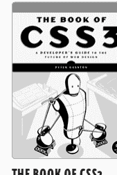

《CSS3之书》
开发者指南：Web设计的未来
作者：Peter Gasston
2011年5月，304页，34.95美元
ISBN 978-1-59327-286-9


《给孩子的JavaScript》
有趣的编程入门
作者：Nick Morgan
2014年6月，252页，34.95美元
ISBN 978-1-59327-408-5
全彩

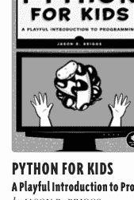

《给孩子的Python》
有趣的编程入门
作者：Jason R. Briggs
2012年12月，344页，34.95美元
ISBN 978-1-59327-407-8
全彩


《显微镜下的Ruby》
Ruby内部图解指南
作者：Pat Shaughnessy
2013年11月，360页，39.95美元
ISBN 978-1-59327-527-3

电话：800.420.7240 或 415.863.9900

电子邮件：SALES@NOSTARCH.COM

网址：WWW.NOSTARCH.COM

# 掌控JavaScript对象

> 序言：Cody Lindley，畅销书作者，TandemSeven首席前端架构师

如果你使用过更传统的面向对象语言，比如C++或Java，那么JavaScript可能看起来根本不面向对象。它没有类的概念，你甚至不需要定义任何对象就能编写代码。但不要被误导——JavaScript是一种极其强大且富有表现力的面向对象语言，它将许多设计决策交到你手中。

在《面向对象JavaScript原理》中，Nicholas C. Zakas深入探讨了JavaScript的面向对象本质，揭示了该语言在继承和其他关键特性上的独特实现。你将学到：

- 原始值与引用值之间的区别
- 是什么让JavaScript函数如此独特
- 创建对象的多种方式
- 如何定义自己的构造函数
- 如何使用和理解原型
- 类型和对象的继承模式

《面向对象JavaScript原理》将让即使是经验丰富的开发人员也能对JavaScript有更深的理解。解锁JavaScript对象运作背后的秘密，让你写出更清晰、更灵活、更高效的代码。

## 关于作者

Nicholas C. Zakas是Box公司的软件工程师，以撰写和演讲JavaScript最新最佳实践而闻名。他在雅虎工作的五年间磨练了经验，曾担任雅虎首页的首席前端工程师。他写过多本书，包括《可维护的JavaScript》和《JavaScript高级程序设计》。
