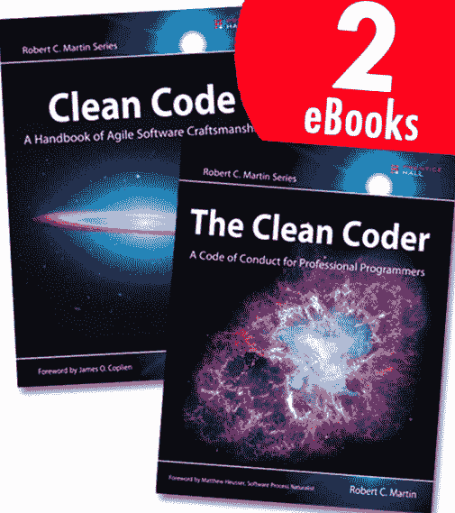
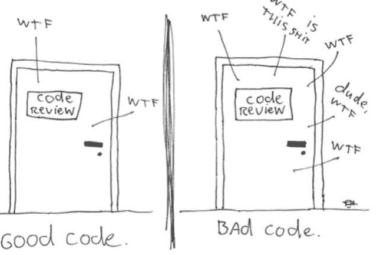

# Robert C. Martin 整洁代码合集

## 出版者说明

本系列包含两本畅销电子书：

- 《整洁代码：敏捷软件之道》
- 《程序员程序员准则》

在本书中，罗伯特·马丁（被称为“鲍伯叔叔”）提供了一种从一开始就编写更佳代码的实用方法。他揭示了区分软件工匠与仅仅是“朝九晚五”程序员的纪律、技术、工具和实践。本系列包含了你成为真正的软件专家所需的工具和方法。

为了方便阅读每本书，我们在《整洁代码：敏捷软件之道》的页码后添加了“A”，在《程序员准则》的页码后添加了“B”。这使我们能够制作出一份全面的目录和专门的索引。

我们希望这个系列对你有所帮助！

- 态度 ................................................................................. . . . . . . . . . . . . . 5A
- 参考文献 ...................................................................................
- G26: 准确 ... 301A
- G27: 结构优于约定 ... 301A
- G28: 封装条件 ... 301A
- G29: 避免负向条件 ... 302A
- G30: 函数应该只做一件事 ... 202A
- G31: 隐藏的时间耦合 ... 302A
- G32: 不要随所欲 ... 303A
- G33: 封装边界条件 ... 304A
- G34: 函数应该下降一个抽象级 ... 304A
- G35: 将可配置数据保持在高层级 ... 306A
- G36: 避免传递式导航 ... 306A
- J1: 避免使用通配符导入列表 ... 307A
- J2: 不要继承常量 ... 307A
- J3: 常量与枚举 ... 308A
- N1: 选择具有描述性的名称 ... 309A
- 结论 ... 314A
- 参考文献 ... 315A

## C 启发式算法交叉引用 ... 409A

## 结语 ... 411A

## 索引 ... 419A

# 洁净的代码之道

## 前提介绍 ... 1B

### 1 专业主义 ... 7B

谨慎你所请求的 ... 8B

承担责任 ... 8B

首先，不要伤害 ... 11B

工作道德 ... 16B

参考文献 ... 22B

### 2 拒绝 ... 23B

对抗性角色 ... 26B

高风险决策 ... 29B

### 3 说是 ... 45B

- 帮助 ... 73B
- 工匠精神 ................................................................................................. . . . . 184B
- 结语 ................................................................................................. . . . . . . . . . . 185B
- 工具 ....................................................................................................................................... 189B
- 源代码控制 .......................................................................................................................................... 189B
- IDE/编辑器 ................................................................................................................................ 194B

对象导师：

Robert C. Martin

Michael C. Feathers, Timothy R. Ottinger

Jeffrey J. Langr, Brett L. Schuchert

James W. Grenning, Kevin Dean Wampler

Object Mentor Inc.

编写整洁的代码是你称自己为专业人士时必须做的事情。对于任何不如最佳的表现，没有任何合理的理由。

Martin, Robert C.

整洁代码：敏捷软件工匠精神手册 / Robert C. Martin.

p cm.

Pearson Education, Inc

Rights and Contracts Department

501 Boyston Street, Suite 900

Boston, MA 02116

传真：(617) 671-3347

本文在美国马萨诸塞州威斯斯特波特的 Courier 厂用再生纸印刷。

2011年4月第九次印刷

*致 Ann Marie：我生命中永恒的爱。*

# 前言

我们在丹麦最喜欢的糖果之一是 Ga-Jol，它那奇特的甘草烟熏味与我们潮湿且经常寒冷的天气是完美的补充。对我们丹麦人来说，Ga-Jol 的魅力部分在于每个包装盒顶盖上上打印的明智或幽默的格言。我买了两包这种美妙的零食，发现它上面承载着古老的丹麦语谚语：

Ærlighed i små ting er ikke noget lille ting.

“小事诚实并非小事。”这是一个很好的预兆，与我想要表达的的一致。小事至关重要。这是一本关于卑微关注点的书，但其价值却源于微小。

建筑师密斯·凡·罗黑（Mies van Rohe）说：“上帝在细节之中。”这句话引发了当代关于架构在软件开发中作用的争论，特别是在敏捷世界中。Bob 和我偶尔发现自己正激情地投入这种对话中。然而，密斯·凡·罗黑既关注实用性也关注构成伟大建筑的永恒形式。另一方面，他为自己设计的每栋房子亲自挑选每一个门把手。为什么？因为小事至关重要。

在我们关于 TDD（测试驱动开发）的持续辩论中，Bob 和我发现我们同意软件架构在开发中具有重要地位，尽管我们对它的具体含义可能持有不同观点。然而，这些争论并不重要，因为我们认同负责任的专业会在项目初期投入时间进行思考和规划。20世纪90年代那种由测试和代码驱动的设计理念已过去。然而，对细节的关注比任何宏大愿景都是更关键专业基石。首先，专业人士正是通过对小事的练习获得对大的熟练和信任。其次，最微小的施工粗糙——关不严实的门、稍微歪斜的地砖，或是凌乱的办公桌——都会完全消除整体的魅力。这就是整洁代码的意义。

尽管如此，架构只是软件开发的一种隐喻，特别是其中交付初始产品的部分，就像建筑师交付一座完好的的建筑一样。在如今的 Scrum 和敏捷时代，重点是快速将产品推市场。我们希望工厂以最高速度运行以生产软件。这些是人类工厂：有思想、有情感的编码人员，根据积压工作或用户故事来创建产品。制造隐喻在这种思维中依然比以往强大。日本汽车制造的生产方面，即流水线世界，启发了 Scrum 的许多内容。

# 前言

即使在汽车行业，大部分工作也不在于制造，而在于维护——或者对故障的避免。在软件领域，我们所做工作的 80% 或更多被幽趣地称为“维护”：即修复行为。与其拥抱西方典型的对生产软件的关注，我们更应该像像建筑行业中的房屋维修工，或者汽车领域的机械师那样思考。日本式管理对此有何高见？

大约在 1951 年，一种被称为“全生产维护”（TPM）的质量方法出现在了日本。它关注的是维护而非生产。TPM 的主要支柱之一是所谓的 5S 原则。5S 是一套纪律——我本能地使用“纪律”这个词。这些 5S 原则实际上是精益管理（Lean）的基础——另一个在西方流行的流行语，且在软件圈中也日益凸显的流行语。这些原则并非可有可无。鲍勃叔叔（Uncle Bob）在序言中提到，软件实践需要纪律：专注、投入和思考。这不仅仅关乎执行，而是要推动工厂设备以最佳速度生产。5S 哲学包含了这些概念：

- 整理（Seiri），或组织（英文中想成“sort”）。知道事物的存在——使用合适的命名方式——是至关重要的。你认为标识符的命名不重要吗？请继续阅读后续章节。
- 清动（Seiton），或整洁（英文中想成“systematize”）。有一句美国古谚：物有其位，各有其份。一段代码应该出现在你预期找到它的地方——如果没有，你应该通过重构来把它放到这里。
- 清扫（Seiso），或清洁（英文中想成“shine”）：保持工作场所没有悬挂的电线、齿轮、碎片和垃圾。作者对于在代码中填充记录历史或未来愿望的注释和注释掉的代码行怎么看？把它们删掉。
- 清洁（Seetsu），或标准化：小组对保持工作场所清洁达成共识。你认为这是否说明了小组内部一致的编码风格和实践？这些标准从何而来？请看下文。
- 素养（Shutuke），或纪律（自律）。这意味着要有遵循实践的纪律，经常反思自己的工作，并愿意改变。

如果你接受了挑战——是的，挑战——阅读并应用这本书，你将会理解并欣赏最后一点。我们终于在向一个负责任的职业素养水平，而这个职业本该关注产品的生命周期。当我们在 TPM 下维护汽车和其他机器时，故障维护——等待 Bug 出现——是反例。相反，我们每天都会检查机器，在磨损部件损坏之前修复它们，或者进行类似于谚语中“万公里换油”的操作以防止磨损。在代码中，要无情地重构。你还可以进一步提升一个层次，正如 50 年前的 TPM 运动所创新的那样：从源源上构建更具维护性的机器。让代码可读与让代码可执行同样重要。1960 年左右在 TPM 圈引入的一项终极实践是关注引入新机器或更换旧机器。正如弗雷德·布鲁克斯（Fred Brooks）告诫我们的，我们可能每隔七左右从头重做主要的软件模块，以清除蔓延的腐烂。也许我们可以将布鲁克斯的时间常数从几年改为周、天或小时。这正是细节所在。

细节中蕴含着巨大的力量，但这种生活方式又带有一种谦卑而深邃的味道，正如大多数对任何自称有日本背景的方法所预期的那样。这不仅是一种东方的生活观；英语和美国的民间智慧也充满了此类告诫。上述关于“清动”（Seiton）的引用出自一位俄亥州牧师之手，他认为专注是“治愈各种邪恶的良药”。那么“清扫”（Seiso）呢？洁净乃神圣。无论房子多么漂亮，凌乱的书桌都会破坏它的光彩。小不积，无不为。那么在负责任的时候渴望重构，为“大”决策加强每一个阵地，而不是推迟，又如何呢？机一补胜过九一补。早起的鸟有虫吃。今日所能做的事就不要留到明天（这就是“精益管理中的最后一刻，直到它填满了软件顾问的手””这句话的由来）。那么在宏大的世界中校准灵魂之处、个体的努力又如何呢？大成于小。或者关于将预防性工作融入日常生活？防患未然胜于事后补医。一个苹果远离医生。整洁的代码尊重了我们广阔文化深处的智慧，或者说它曾经是、现在应该是、且通过对细节的关注而实现的智慧。

即使在宏大的架构中，我们也发现事实回归到了这些建议的细节。想想密斯·凡·德罗哈（Mies van der Rohe）的旋钮。那是对每一个变量名的关注。你应该像给长子命名一样，细心地为变量命名。

正如每个房主所知，这种细心和持续的完善永无止境。建筑师亚历山大（Alexander——模式和模式语言之父）将每一个设计行为都视为一种微小的、局部维修行为。而我们认为精细结构的工艺是建筑师的唯一领域；较大的形式可以留给模式以及居住者的应用。设计的吸引人之处不仅在于我们为房子增加一间新房，更在于我们关注于维修、更换磨损的地毯或升级厨房水槽。大多数艺术都回响着某种情感。在寻找那些追求上帝家在细节的人的过程中，我们发现自己与 19 世纪法国作家古斯塔夫·福莱（Gustav Flaubert）并肩同行。法国诗人保罗·瓦尔雷（Paul Valery）建议我们，诗歌永远没有完成，直到重做为止，而停止创作就是放弃。这种对细节的执着是所有追求卓越的努力的共同点。也许这里并没有什么新意，但通过阅读这本书，你将受到挑战去重拾那些早已由于冷漠或对自发性的追求而放弃的良好纪律。

代码永远不会完美。我们变得更加完整的人性，更配得上神性，并在细节中更接近那份伟大。

在我们的行业中，我们迫切需要一切能获得的帮助。如果整洁的车间可以减少事故，而组织良好的车间工具可以提高生产力，那么我完全支持。至于这本书，我见过的印刷物中，将精益原则应用于软件领域的最务实应用。对于这群奋斗多年、富有思想的实干家群体，我对此并不感到奇，他们不仅努力变得更好，还通过你现在手中的这些著作将他们的知识馈赠给行业。在 Bob 叔叔给我手稿之前，它让世界比我发现它时变得好了一点。

在完成了这些高深洞察的练习后，我要去清理我的书桌了。

James O. Coplien

丹麦，Mørdrup

# 引言

代码质量的唯一有效衡量标准：每分钟 WTF 数

经 Thom Holwerda 许可再印。

http://www.osnews.com/story/19266/WTFs_m

哪扇门代表了你的代码？哪扇门代表了你的团队或你的公司？我们为什么在那个房间里？这是一次正常的代码审查，还是我们在上线后不久就发现了一系列可怕的问题？我们是否在恐慌中调试，埋头于我们本以为可以运行的代码？客户是否在成群地离开，经理是否在脑后后催促？在困难时期，我们如何确保自己进入的是*正确*的那扇门？答案是：*匠心*。

学习匠心包含两个部分：知识和工作。你必须获得匠人所掌握的原则、模式、实践和启发式知识，你还必须通过努力工作和练习，将这些知识磨练到你的手指和眼睛里。

我可以教你骑自行车的物理学知识。事实上，经典的数学原理相对直观。重力、摩擦、角动量、质心等等，用不到一页的公式就能演示出来。有了这些公式，我可以向你证明骑自行车是可行的，并给你提供制造它所需的全部知识。但当你第一次跨上那辆车时，你还是会摔倒。

编码不是正向的。我们可以写下所有整洁代码的“感觉良好”原则，然后信任你去完成工作（换句话说，在你上车时让你摔倒），但那样什么样的老师能培养你，什么样的学生能成就你呢？

不。这不是这本书的运作方式。

学习编写整洁代码是一项*苦差*。它需要的不仅仅是原则和模式的知识。你必须*为此流汗*，并眼睁睁看着自己失败。你必须观察别人练习，必须看到他们踉跄和退缩。你必须看到他们为决策而挣扎，看到他们为做出错误决策而付出的代价。

准备好在阅读这本书时努力工作。这不是一本你可以在飞机上读读、并在装机前读完的“感觉良好”的书。这本书将让你工作，而且是*苦力工作*。你将要做什么样的工作？你将阅读代码——大量的代码。你将被要求在我们拆解并重新组装模块时跟上。这将花费时间和精力的；但我们认为这是值得的。

我们将这本书分为三个部分。第一部分描述了编写整洁代码的原则、模式和实践。这些章节中有很多代码，读起来将具有挑战性。它们将为接下来的第二部分做好准备。如果你在读完第一部分后放下书，那祝你好运！

书的第三部分是回报。它是一个单一章节，包含一个启发式规则和代码气味的列表，同时创建了案例研究。我们在案例研究中行走并清理代码时，我们将行动的每一个理由都记录为一种启发式规则或气味。我们试图理解自己对正在阅读和修改的代码的反应，并努力捕捉我们为什么会有那种感觉，以及我们为什么那样做。结果是一个知识库，描述了我们在编写、阅读和清理代码时的思维方式。

如果你不仔细阅读本书书中第二部分的案例研究，这个知识库的价值就有限。在那些案例研究中，我们对所做的每处更改都使用方括号中的前向引用（如这样：[H22]）进行了前向注释。这让你了解这些启发式规则被应用和编写的上下文！宝贵的并非启发式规则本身，而是这些启发式规则与我们在清理案例研究代码时所做的离散决策之间的关系。

为了进一步帮助你理解这些关系，我们在书末放置了一个交叉引用，显示了每个前向引用的页码。你可以用它查找首次使用某种启发式规则的地方。

如果你只是读了案例研究的第一和第三步，那么你只是读了另一种关于编写良好软件的“感觉良好”。但如果你花时间完成案例研究，遵循每一个微小的步骤，每一分钟——如果你把自己置于我们的位置，强迫自己按照我们思考的路径进行思考，那么你将对那些原则、模式、实践和启发式规则有深入得多的理解。它们将不仅仅是“感觉良好”的知识。它们将磨练进你的骨子里、手指里和心里。它们将变成……

xii

致谢

感谢我的妻子 Susan，在我埋头于这本书期间的耐心和支持。感谢我的孩子们，感谢他们带来的快乐和分心。感谢我的朋友和同事，他们一直挑战我并提醒我休息。

特别感谢编辑和设计团队，感谢他们敏锐的目光。感谢评审人员，他们富有见地的反馈。最后，感谢读者们选择了这本书。希望它能帮助你编写更好的代码。

封面上的图像是 M104：帽星系。M104 位于女座座，距离我们 3000 万光年。在它的核心是一个质量相当于十亿倍太阳的超级质量黑洞。

这张图像让你想起了克林贡星球普拉克西斯的爆炸吗？我清晰地记得《星际迷航6》中显示碎片赤环的场景。从那时起，赤环已成为科幻电影爆炸中的常见元素。它甚至被添加到《星球大战》中阿尔德拉星的爆炸中。

是什么导致 M104 周围形成了这个环？为什么它有这样一个鼓包和一个微小的内核？看起来就像中心洞失去了冷静，在星系中心炸出了一个 3 万光年的洞。任何可能处于宇宙动扰路径上的文明都会遭殃。

超级质量黑洞吞噬恒星作为午餐，将相当比例的质量转化为能量。当 $M$ 是恒星质量时，$E = MC^2$ 是巨大的杠杆效应：小心！在怪物满足之前，有多少颗恒星掉进了那个巨口？中心空的大小是否是一个暗示？

封面上的 M104 图像结合了哈勃著名的光照片（右侧）和斯皮特轨道望远镜最近拍摄的红外图像（右下）。是红外图像清晰地向我们展示了星系的环。在可见光中，我们只看到环的前缘剪影。中心鼓包遮挡了环环。但在红外线下，环中的热粒子穿透了中心鼓包。这两幅图像结合在一起给了我们以前未见的视角，并暗示很久以前那里是一个狂烈的活动火炉。

封面图像：© Spitzer Space Telescope

你读这本书有两个原因。第一，你是一个程序员。第二，你想要成为一个更好的程序员。很好。我们需要更好的程序员。

# 第1章：整洁代码

这是一本关于良好编程的书。它充满了代码。我们将从每一个不同的角度来观察代码。我们将从顶部俯视它，从底部仰视它，并从内部穿透它。当我们完成学习时，你将对代码有深入的了解。而且，我们能够区分好代码和坏代码之间的区别。我们将知道如何编写好代码，并知道如何将坏代码转换为好代码。

## 代码将永远存在

有人可能会认为，代码这本书在某种程度上已经过时了——代码不再是问题了；我们曾暗示我们了代码的终结。很快，所有的代码将由生成而不是编写的。程序员将不再被需要，因为业务人员将根据规格说明生成程序。

胡说八道！我们永远无法摆脱代码，因为代码代表了需求的细节。在某个层面上，这些细节是不可以忽略或抽象的；它们必须被指定。详细地指定机器可以执行的需求就是编程。这种规格说明就是代码。

我预计我们语言的抽象程度将继续提高。我也预计领域特定语言的数量将继续增长。这将是。但它不会消除代码。事实上，所有在这些高级和领域特定语言中编写的规格说明都是代码！它仍然需要是严谨、准确，且如此正式和详细，以便机器能够理解并执行它。

这种情况永远不会发生。即使是拥有所有直觉和创造力的人类，也无法从客户模糊的感觉中创造出成功的系统。事实上，如果说需求规范这一学科教了我们什么的话，那就是良好的规范的需求和代码一样正式，并且可以作为该代码的可执行测试！

记住，代码实际上是我们最终表达需求的语言。我们可能会创建更接近需求的语言。我们可能会创建工具帮助我们解析并并将这些需求组装成正式的结构。但我们永远不会消除必要的精确性——所以永远会有代码。

## 坏代码

最近我在读 Kent Beck 的书《实现模式》¹。他说：“……”这本书基于一个相当脆弱的假设：好代码很重要……”一个脆弱的假设？我不同意！我认为这个假设是我们手艺中所有假设中最稳健、支持最多且过载最多的假设之一（我认为 Kent 也知道这一点）。我们知道好代码很重要，因为我们长期以来一直一直在应对它的缺失。

我知道有一家公司，在 80 年代后期，写了一个杀手级应用。它非常流行，很多专业人士购买并使用了它。但随后，发布周期开始拉长。Bug 从一个版本到另一个版本没有被修复。加载时间增长，崩溃增加。我记得那天我沮丧地关闭了该产品，再也没有用过它。这家公司在不久之后就破产了。

二十年后，我遇到了那家公司的一位早期员工，问他发生了什么。答案证实了我的恐惧。他们急于产品上市，在代码中留下了巨大的混乱摊子。随着他们添加越来越多的功能，代码变得越来越糟，直到他们再也无法管理它。是坏代码导致了公司的倒闭。

你是否被坏代码严重阻碍过？如果你是有任何经验的程序员，你已经感受了很多这种阻碍。事实上，我们给它起了一个名字。我们称之为“涉水”（wading）。我们在坏代码中涉水。我们在错综复杂的分支和隐藏陷阱的泥沼中挣扎。我们挣扎着寻找道路，希望能够得到一些关于正在发生什么的线索；但我们所看到的只是越来越多无意义的代码。

当然，你曾被坏代码阻碍过。那么——你为什么要写它呢？你是试图运行得快点吗？你很忙吗？也许吧。也许你觉得你没有时间做好工作；如果你花时间清理你的代码，你的老板会对你发气。也许你只是厌倦了开发这个程序，想让它结束。或者你看着你承诺要完成的其他待办事项列表，意识到你需要草草忙地凑出这个模块，以便移动到下一个。我们都做过这种事。

我们都看过了自己刚刚制造的混乱团子，然后选择把它留到改天。我们都曾感到看到我们杂乱的程序运行而感到释然，并决定一个运行良好的混乱团子总比什么都没有好。我们都说过以后会回去清理它。当然，在那些日子，我们不知道 LeBlanc 法则：以后等于从不。

¹ 1. [Beck07]。

如果你成为程序员超过二或三年，你可能已经由于别人的杂乱代码显著放慢了速度。如果你成为程序员超过二或三年，你可能已经由于杂乱代码放慢了速度。减慢的程度可能是巨大的。在一年或两年的跨度内，在项目开始时移动非常快的团队，自己可能在以蜗牛的速度移动。他们对代码的每一个改变都会导致问题。他们对代码的任何改变都会导致问题。这种改变是微不足道的。当然，你被某人的杂乱代码显著阻碍过。这种减慢的程度是极其显著的。。随着时间的增加，混乱变得越来越大（见图 1-1）。

### 拥有坏代码的总成本

### 天空中的重新设计

最终团队反抗了。他们告诉管理层他们无法继续开发恶心的代码。他们要求重新设计。管理层不想在整个项目的重新设计上投入资源，但他们无法否认生产力很糟糕。他们最终屈从开发者的要求，授权了天空中的重新设计。

一个新的团队看起来。每个人都想加入这个团队，因为这是一个全新的项目。他们可以开始创造美好的东西。但只有最优秀的人被选择了老虎团队。其他人继续维护旧系统。

现在两个团队在比赛。老虎团队必须建立一个能做到旧系统一切的新系统。不仅如此，他们必须跟上对旧系统的持续修改。比赛持续了很久。我见过它持续了十年。等到完成时，老虎团队的原始成员早已离开，而现在的成员要求重新设计新系统，因为它是如此混乱。

如果你经历过我所说的一小部分，你已经知道保持代码整洁不是成本效益；它是职业生存的问题。

### 态度

你是否曾涉过如此巨大的混乱，以至于花几周时间完成本几小时就能完成的工作？你是否见过应该是一行的更改，却在数百个不同的模块中实现的？这些症状都太常见了。

为什么会发生在代码上？为什么好代码会迅速变成坏代码？我们有很多解释。我们抱怨需求以阻碍原始设计的方式改变。我们抱怨变化太紧，无法正确完成事情。我们胡说愚蠢的管理、难以宽容的客户、无用的营销人员和电话支持人员。但错误，亲爱的迪尔伯，不在星辰，而在我们自己身上。我们是不专业的。

这可能是一颗难吞的药。这种混乱怎么可能是我们的错？需求呢？进度表呢？那些愚蠢的管理和无用的营销人员呢？他们不应该承担部分责任吗？

不。经理和营销人员需要我们提供信息来做出承诺和保证；即使他们没有向我们寻求，我们也不应该羞于告诉他们我们的想法。用户依靠我们来验证需求如何符合系统。项目经理依靠我们来帮助制定进度表。

# 6A

## 第 1 章：整洁的代码

他们深度参与了项目的规划，并对任何失败承担巨大的责任；尤其是当这些失败与糟糕的代码有关时！

“等一下！”你说，“如果我不知道经理在说什么，我会被解雇。”可能大多数经理都想要真相，即使他们表现得并不如此。大多数经理想要良好的代码，即使他们正痴迷于进度表。他们可能会充满激情地要求进度和需求；但那是他们的工作。而你的任务是以同样的热情来捍卫代码。

为了说明这一点，如果你是一个医生，而一个病人要求你停止为了手术做准备的所有愚蠢洗手动作，因为这花费了太多时间？显然，病人是老板；你绝对应该拒绝遵守。为什么？因为医生对疾病和感染的风险比患者更了解。医生顺从患者的要求将是不专业的行为（更不用说是犯罪行为了）。

因此，程序员屈从于那些不理解制造混乱之风险的经理的意愿，是不专业的。

### 原始的困境

程序员面临着一个基本价值观的困境。所有拥有多年经验的开发者都知道，之前的混乱会拖慢他们的速度。然而，所有开发者都感到为了满足期限而制造混乱的压力。简而言之，他们没有花时间来变快！

真正的专业人士知道，困境的第二部分是错误的。你不会通过制造混乱来赶上期限。事实上，混乱会立即拖慢你的速度，并迫你错过期限。赶上期限的唯一方法——唯一的快速方法——就是始终保持代码尽可能整洁。

### 整洁代码的艺术？

假设你认为混乱的代码是一个障碍。假设你接受快速的唯一方法是保持代码整洁。那么你必须问自己：“我该如何写整洁的代码？”如果你不知道代码整洁意味着什么，那么尝试写整洁的代码是没用的！

坏消息是，写整洁的代码非常像画画。我们大多数人都知道一幅画画得好或坏。但能识别艺术的好坏并不意味着我们知道如何画画。因此，能识别整洁代码和肮脏代码并不意味着我们知道如何写整洁的代码！

- 2. 当 1847 年伊格纳斯·塞梅尔魏维斯（Ignaz Semmelweis）首次向医生建议洗手时，它遭到了拒绝，理由是医生太忙了，没有时间在看病人之间洗手。

### 拥有混乱的总成本

写整洁的代码需要自律地使用无数技术，这些技术通过苦心获得的“整洁感”来应用。这种“代码感”是关键。我们有些人天生就有这种感觉。我们有些人则必须努力才能获得它。它不仅能让我们看到代码的好坏，还展示了如何应用自律来将糟糕代码转化为整洁代码的策略。

一个没有“代码感”的程序员看一个混乱的模块能识别出它的混乱，但不知道该怎么办。有“代码感”的程序员看一个混乱的模块会看到选项和变体。“代码感”将帮助该程序员选择最好的变体，并引导他或她执行一系列保持行为的转换，从这里到达那里。

简而言之，写整洁代码的程序员是一个艺术家，他们可以通过一系列转换清理屏幕，直到它变成一个优雅的代码系统。

### 什么是整洁的代码？

定义的数量可能和程序员的数量一样多。因此，我问了一些知名且经验丰富的程序员他们的看法。

比雅尼·斯特鲁斯特斯特普（Bjarne Stroustrup），C++ 发明者，《C++ 语言编程》作者

我喜欢代码优雅且高效。逻辑应该是直观的，让漏洞难以隐藏；依赖关系尽可能少以便于维护；错误处理根据明确的策略是完整的；性能接近最优，以免诱导人们通过不审慎的优化让代码变得混乱。整洁的代码只把一件事做好。

比雅尼使用了“优雅”这个词。那是一个世界！我的 MacBook 字典提供了以下定义：外观令人愉悦、优雅且有风格；令人愉悦、巧妙且简单。注意对“愉悦”一词的强调。显然比雅尼认为整洁的代码读起来是愉悦的。阅读它应该让你微笑，就像看到一个精美的音乐盒或设计良好的汽车。

比雅尼还提到了效率——两次。这对于这位 C++ 发明者来说可能不应该让我们惊讶；但我认为这不仅仅是对速度的单纯渴望。浪费的周期是不优雅的，它们不愉悦。现在注意比雅尼使用的词

# 8A

## 第 1 章：整洁的代码

来描述不优雅的后果。他使用了“诱惑”（tempt）这个词。这里有一个深刻的真理。糟糕的代码诱惑混乱增长！当其他人更改糟糕代码时，他们往往会让它变得糟糕。务实的大卫·托马斯（Dave Thomas）和安迪·亨特（Andy Hunt）用另一种说法。他们使用了破窗比喻。一栋窗户破碎的建筑看起来没有人关心它。所以其他人也停止关心。他们允许更多的窗户破碎。最终，他们主动打破它们。他们在外墙上涂鸦，让损害堆积。一扇破碎的窗户就开始了腐败的过程。

比雅尼还提到应该处理错误处理。这是我们都同意的一点，但处理方式才是真正的错误所在。

(注：此处根据要求去除了原文中重复且逻辑混乱的 OCR 错误文本)

# 10A

## 第一章：整洁代码

### Michael Feathers，“有效处理遗留代码”（Working Effectively with Legacy Code）作者

我可以列出所有我在整洁代码中观察到的品质，但有一种贯穿始终的品质导致了这一切。整洁代码看起来总是像是由一个心用心的人写出来的。你无法发现任何可以做的明显改进来让它变得更好。所有这些细节代码作者都考虑过了，如果你尝试想象改进之处，你最终会回到原点，坐着赞赏别人留给你的代码——这些代码是由一个深爱着这门技艺的人留下的。

一个词：心意（care）。这确实是本书的主题。也许一个合适的标题应该是“爱代码”（Be Care for Code）。

Michael 击中了核心。整洁代码是那些花了时间保持简单和有序的代码。他们对细节付出了适当的关注。他们付了心。

### Ron Jeffries，《极限编程》（Extreme Programming）作者及C# 极限编程冒险》（Extreme Programming Adventures in C#）作者

Ron 的职业生涯始于 Fortran 语言编程，他几乎在每种语言和几乎每种机器上编写过代码。仔细考虑他的话是有价值。

近年来，我几乎都以 Beck 的简单代码规则开始并结束。按优先级排序，简单代码应该：

- 运行所有测试；

- 不包含重复；

- 表达系统中所有的设计思想；

- 尽可能地减少类、方法、函数等实体的数量。

在这些点中，我主要关注重复。当同一件事被一遍又一遍执行时，说明我脑海中的某个想法在代码中没有得到很好的体现。我试图弄清楚那是什么。然后我尝试清晰地表达那个想法。

对我来说，表达力包含了有意义的名字，在最终决定之前，我可能会多次更改名称。使用像 Eclipse 等现代编码工具，重命名是非常廉价的，所以更改对我来说并不麻烦。然而，表达力不仅是名字：我还会观察一个对象或方法是否在做多件事。如果是一个对象，它可能需要被拆分为两个或多个对象。如果是一个方法，我总是会对它使用“提取方法”（Extract Method）重构，结果产生一个更清楚地说明其功能的方法，以及一些说明其如何实现的子方法。

重复总是带我进入我所认为的整洁代码的深远领域，而仅仅考虑到这两点来改进脏代码就能产生巨大的差异。然而，我意识到自己正在做另一件事，解释起来有点困难。

在做了多年之后，在我看来所有的程序由类似的元素组成。一个例子是“在集合中寻找东西”。无论我们拥有记录的数据库、键值哈希映射，还是某种数组，我们发现自己想要从集合获取某个特定项目。当这种情况发生时，我通常会将特定的实现封装在一个更抽象的方法或类中。这给我带来了一些“冒险”。

我现在可以用一些简单的东西（比如哈希映射）来实现功能，但由于现在所有对它的引用都被我的小抽象覆盖了，我可以随心所欲地更改。我可以在保持改变能力的同时快速前进。

此外，集合抽象通常会引起我注意“到底”在发生什么，并让我一直沿着实现任意行为的路径，而我真正需要的只是几种寻找我想要内容的简单方法。

减少重复、高表达力以及尽早构建简单抽象。这就是对我来说的整洁代码。

在这里，在几个简短的段落中，Ron 总结了：重复、表达力以及尽早构建简单抽象。这构成了我眼中的整洁代码。

# 14A

## 第一章：整洁代码

噢，他删掉了他刚刚输入的内容！

他又重写了一遍，

他又删掉了一遍！

他输入了其他东西的一部分，然后又删掉了！

他滚动到另一个调用他正在修改的函数，看看它是如何被调用的。

他向上滚动，重新输入了刚才删除的代码。

他停顿了一下。

他又删掉了一遍！

他弹出的另一个窗口查看一个子类。那个函数被重写了吗？

你明白意思了。事实上，阅读代码与编写代码的时间比例远超 10:1。

在编写新代码的过程中，我们不断地在阅读旧代码。

由于这个比例很高，我们希望阅读代码变得容易，即使这会让编写变得更加困难。当然，不读代码是不可能编写代码的，而让代码易于阅读会让编写变得更容易。

这种逻辑是无法回避的。如果你无法阅读周围的代码，就无法编写代码。你今天想要编写代码是难是易，取决于周围代码的阅读难易程度。所以，如果你想运行得快，想快速完成任务，如果你希望你的代码易于编写，就让它易于阅读。

### 童子军法则

仅仅写好代码是不够的。代码必须随着时间的推移而维护。我们都见过代码随时间流逝而腐化和退化。因此，我们必须积极防止这种退化。

美国童子军有一条简单的规则，我们可以将其应用于我们的职业：

离开营地时比你发现时更干净。³

如果我们每次提交代码时都比取出时稍微干净一点点，代码就不会腐化。这种清理工作并不非要做什么大动作。修改一个变量名使其更好，拆分一个稍大的函数，消除一小处重复，清理一个复合 `if` 语句。

你能想象在一个项目中工作，而代码随着时间的推移变得越来越好吗？你认为还有其他选择是职业的吗？事实上，持续改进难道不是职业精神的内在特质吗？

5. 本节改编自罗伯特·斯蒂芬·斯密斯·巴登-鲍威尔对童军的告别信：“努力让这个世界比你发现它时更好一点点……”

## 参考文献

## 前传与原则

在许多方面，这本书是我在 2002 年写的《敏捷软件开发：原则、模式与实践》(PPP) 一书的“前传”。PPP 一书关注面向对象的设计原则，以及专业开发人员使用的许多实践。如果你没有读过 PPP，你可能会发现这本书延续了那个故事。如果你已经读过它，你会发现该书中的许多观点在本书的代码层面上得到了共鸣。

在本书中，你会发现对各种设计原则的零星引用。这包括单一责任原则 (SRP)、开闭原则 (OCP) 和依赖倒置原则 (DIP) 等。这些原则在 PPP 中有非常深入的描述。

## 结语

艺术书籍并不承诺让你成为艺术家。它们能给你的只是其他艺术家使用过的某些工具、技术和思维方式。同样，这本书无法承诺给你“代码感”。它能做的只是向你展示优秀程序员的思维方式，以及他们使用的技巧、技术和工具。

就像艺术类书籍一样，这本书将充满细节。会有大量的代码。你会看到好代码，也会看到坏代码。你会看到坏代码转化为好代码。你会看到启发式方法、准则和技术的列表。你会看到一个又一个例子。之后，就取决于你了。

记得那个关于在去演出路上迷路的音乐小提琴家的笑话吗？他在街角拦住一位老人，问他如何去卡内基音乐厅。老人看了看小提琴家以及他腋下的的小提琴，说道：“练习，练习！”

## 参考文献

[Beck07]: Implementation Patterns, Kent Beck, Addison-Wesley, 2007.

[Knuth92]: Literate Programming, Donald E. Knuth, Center for the Study of Language and Information, Leland Stanford Junior University, 1992.

本页特意留白

## 索引

## 检测, 237A–238A

++（前置或后置增）运算符, 325A, 326A

适配服务器, 185A

亲和性 (affinity), 84A

《敏捷软件开发：原则、模式与实践》(PPP), 15A

算法

## A

中止的计算, 109A

抽象类, 149A, 271A, 290A

抽象工厂模式 (ABSTRACT FACTORY), 38A, 156A, 273A, 274A

抽象接口, 94A

抽象方法

修正, 269A–270A

重复, 48A

理解, 297A–298A

歧义

在代码中, 301A

作为忽略的测试, 313A

放大注释, 59A

分析函数, 265A

向`ArgumentMarshaller`添加, 234A–235A

修改, 282A

抽象术语, 95A

抽象

依赖的类, 150A

在错误层级的代码, 290A–291A

一次下降层级, 37A

仅下降一层的函数, 304A–306A

混合层级, 36A–37A

`AspectJ`的“注解形式”, 166A

`Ant`项目, 76A, 77A

`AOP` (面向切面编程), 160A, 163A

`APIs`. 参见公共调用返回空的方法, 110A

专门用于测试的, 127A

封装第三方, 108A

应用程序

在合适的层级的名称, 311A

分离层级, 305A

抽象层级

提升, 290A

分离, 305A

访问器函数 (`accessor functions`), 迪法则 (`Law of Demeter`)

访问器, 命名, 25A

`Active Records`, 101A

与构造解耦, 164A

基础设施的, 163A

保持并发代码分离, 181A

任意结构, 303A–304A

`args`转换为列表, 231A–232A

## B

`Args`类

构造, 194A

实现, 194A–200A

草稿, 201A–212A, 26A

坏代码, 3A–4A. 另参见脏代码；混乱代码的影响, 250A

例子, 71A–72A

清理经验, 250A

未补偿, 55A

坏注释, 59A–74A

在下方收集`banner`, 67A

`Exception`类

列出, 198A–200A

合并异常到, 239A–242A

参数 (`argument`)

标记, 41A

对于函数, 40A

在函数中, 288A

单子形式的, 41A

减少, 43A

参数列表, 43A

基础类, 290A, 291A

`BDUF` (大设计前端), 167A

`Beck, Kent`, 34A, 34A, 171A, 252A, 289A

行为, 288A–289A

`BDUF` (大设计前端), 167A

空行, 78A–79A

块, 内部调用, 35A

`B Grady`, 8A–9A

添加, 200A, 237A

负面影响, 208A

`ArgumentMarshall`类

添加骨架, 213A–214A

诞生, 212A

`ArgumentMarshall`接口, 197A–198A

数组, 移动 279A

代码艺术, 6A–7A

人工耦合, 293A

`AspectJ`语言, 166A

面向切面编程 (`AOP`), 160A, 163A

布尔值, 传入函数, 41A

布尔算法, 映射删除, 224A

布尔输出, 132A

结果, 183A, 184A

边界

整洁, 120A

探索与学习, 116A

错误行为, 289A

与未知分离, 118A–119A

`assertEquals`, 42A

断言, 使用一组, 111

赋值, 未对齐, 87A–88A

原子操作, 323A–324A

属性, 68A

作者

边界条件错误, 269A

边界条件

封装, 304A

测试, 314A

测试, 简化迁移, 118A

“保龄球游戏”, 312A

童子军规则, 14A–15A, 257A

遵循, 284A

满足, 265A

`JUnit`的, 252A

程序员作为, 13A–144A

语句, 55A

自动化代码, 189A–190A

自动化测试套件, 142A

## 索引

格式, 76A

简单性, 18A–19A

插桩, 188A, 342A

抖动, 190A

提高可读性, 311A

必要性, 2A

从上到下读取, 37A

简单性, 18A, 19A

遮蔽技术, 200A

第三方, 114A–115A

行宽, 85A–90A

在错误的抽象层级, 290A–291A

信息丰富的, 56A

日志, 63A–64A

法律上的, 55A–56A

规定的, 63A

误导性的, 63A

含糊其语, 59A–60A

作为一种必要的恶, 53A–59A

噪声, 64A–66A

不能弥补糟糕的代码, 55A

过时, 286A

编写得糟糕, 287A

适当使用, 54A

冗余, 60A–62A, 272A, 275A, 286A–287A

陈显而易见的事, 64A

与代码分离, 54A

`TODO`, 58A–59A

信息过量, 70A

编辑, 65A

编写, 287A

代码库，以错误处理为主导, 103A

代码更改，注释并不总是跟随, 54A

代码补全，自动的, 200A

代码分析, 254A–256A

代码插桩, 188A–190A

代码异味，列表, 285A–314A

编码标准, 299A

类的内聚性, 140A–141A

维护, 141A–146A

命令行参数, 193A–194A

命令，与查询分离, 45A–46A

注释头头部标准, 55A–56A

注释掉的代码，替换, 68A–287A

注释风格，坏风格的示例, 71A–72A

注释

放大某些事物的重要性, 59A

坏的, 59A–74A

删除, 282A

作为失败, 554A

好的, 55A–59A

关于的启发式方法, 286A–287A

`HTML`, 69A

不准确的, 54A

“沟通鸿沟”，最小化, 168A

比较交换 (`CAS`) 操作, 327A–328A

`ComparisonComparator`模块, 252A–265A

重构, 254A–261A

最终, 263A–265A

中间的, 261A–263A

原始代码, 254A–256A

编译器警告，关闭, 289A

复杂代码，在其中演示失败, 341A

复杂度，管理, 139A–140A

计算机科学 (`CS`) 术语，用于命名, 27A

概念

保持与其他代码接近, 80A

命名, 19A

每个一个单词, 26A

在不同层级分离, 290A

拼写相似的, 20A

之间的垂直开放性, 78A–79A

代码的概念亲性, 84A

关注点

跨交叉的, 160A–161A

分离, 154A, 166A, 178A, 250A

与枚举对比, 308A–309A

隐藏, 308A

继承, 271A, 307A–308A

保持在适当层级, 83A

保留为原始数字, 300A

不继承, 307A–308A

作为符号传递, 276A

具体类, 149A

具体细节, 149A

具体术语, 94A

并发

防御原则, 180A–182A

问题, 190A

采用的动机, 178A–179A

关于的神话和误解, 179A–180A

构造

将所有移动到`main`, 155A, 156A

用工厂分离, 156A

系统的, 154A

并发代码

构造函数参数, 157A

构造函数，重载, 25A

消费者线程, 184A

`ConTest`, 190A, 342A

与非并发代码相比, 181A

聚焦, 321A

并发算法, 179A

上下文

并发应用程序，分区行为, 183A

添加有意义的, 279A–299A

不添加多余的, 29A–300A

提供异常, 107A

并发代码

连续读者, 184A

控制变量，在语句内部, 80A–81A

方便的习语, 155A

约定(s)

打破, 329A–333A

防御……的问题, 180A

隐藏在其中的缺陷, 188A

遵循标准, 299A–300A

过度配置, 164A

结构在之上, 301A

使用一致的, 259A

并发编程, 180A

`Java`并发编程：设计原则与模式, 182A, 342A

晦涩的/缠绕的代码, 175A

版权声明, 155A

宇宙射线。参见离散处理

并发程序, 178A

并发更新问题, 341A

`ConcurrentHashMap`实现, 183A

`CountDownLatch`类, 183A

耦合。也参见解耦；时间性耦合

人工的, 293A

隐藏的时间性, 302A–303A

缺乏, 150A

条件语句

避免负面的, 302A

封装, 257A–259A, 301A

可配置的数据, 306A

配置常量, 306A

后果，警告, 58A

一致性

在代码中, 292A

枚举的, 278A

在命名中, 40A

覆盖模式，测试, 314A

覆盖工具, 313A

“清晰的抽象”, 8A–9A

一致的约定, 259A

`Cunningham, Ward`, 11A–12A

代码中的可爱性, 26A

退化，防止, 14A

作为大多数更改的删除, 250A

代码中的垂直密度, 79A–80A

依赖

悬挂参数, 294A

寻找并打破, 250A

注入, 157A

逻辑上的, 282A

使其逻辑化, 298A–299A

方法之间, 329A–333

在同步方法之间, 185A

与对象相比, 95A, 97A

依赖注入 (`DI`), 157A

依赖反转 (`PIP`), 15A, 150A

依赖磁铁, 47A

依赖函数，格式化, 82A–83A

派生的, 94A

数据传输对象 (`DTOs`), 100A–101A, 160A

基形式, 48A

依赖于基类, 291A

基类了解, 273A

异常类的, 48A

设置函数到, 232A, 233A–235A

`DateInterval`, 282A

类运行, 271A

`DayFactory`, 273A–274A

死代码, 288A, 292A

死函数, 288A

死锁, 183A, 335A–339A

致命拥抱。参见循环等待

调试，寻找截止日期, 336A

决策，优化, 167A–168A

决策，发布, 168A

声明，未对齐的, 87A–88A

`DECORATOR`对象, 164A

`DECORATOR`模式, 274A

解耦架构, 167A

与构造细节耦合, 156A

耦合策略，并发，作为 178A

默认构造函数, 276A

将代码结构重载为, 310A

选择, 309A–310A

使用, 39A–40A

并发算法的, 179A

低耦合的, 167A

原则, 15A

`DI` (依赖注入), 157A

`Dijkstra, Eds`, 84A

执行模型, 184A–185A

`DIP` (依赖注入原则), 15A, 150A

脏代码。也参见糟糕代码；乱码

脏代码，清理, 200A

脏测试, 123A

垂直代码的距离, 80A–84A

区别，使其有意义的, 20A–21A

领域特定语言 (`DTOs`), 168A–169A

领域特定测试, 127A

`DTOs` (数据传输), 100A–101A, 90A

`DRY` (不要重复自己), 181A, 289A

哑副本, 90A

重复的`if`语句, 276A

代码重复, 289A–290A

消除, 173A–175A

聚焦于 173A, 290A

减少, 48A

消除策略, 48A

二元函数, 42A

动态过程, 161A

“优雅的”代码, 7A

涌现设计, 171A–176A

封装, 136A

边界条件的, 304A

条件语句的, 301A

避免的, 23A–24A, 312A–313A

实体, 158A–160A

枚举常量, 272A

枚举，移动, 277A

环境的启发式方法, 287A

环境控制系统, 128A–129A

类的, 293A

错误检查，隐藏副作用, 258A

`Error`类, 47A–48A

代码常量, 198A–200A

暗示一个类或枚举, 47A–48A

优于异常, 46A

返回, 103A–104A

旧旧, 48A

与`Args`模块分离, 242A–250A

错误检测，推向边缘,

错误标记, 103A–104A

错误处理, 8A, 47A–48A

错误消息, 107A, 250A

错误处理，测试, 238A–239A

错误方法, 250A

错误。也参见边界条件错误；字符串拼写错误

作为变量名, 22A

`Eclipse`, 26A

编辑话，回放, 13A–14A

代码的效率, 7A

`EJB`架构，过度设计的, 167A

`EJB`标准，完全重构的, 164A

`EJB2`, 160A

分类, 107A

`Evans, Eric`, 311A

事件, 41A

异常分类, 107A

异常子句, 107A–108A

异常管理代码, 223A

异常

`Java`中的大小, 76A

`final`关键字, 276A

`F.I.R.T.`缩写, 132A–133A

`TDD`的第一法则, 122A

`FitSense`项目

编码风格用于, 90A

大小, 76A, 77A

函数内部, 32A–33A

调用所有测试, 224A

参数, 41A, 288A

聚焦的代码, 8A

外部代码。参见第三方代码

格式

可能的路径, 321A–326A

执行模型, 183A–185A

`Executor ClientScheduler.java`, 321A

意图的, 56A–57A

解释性变量, 296A–297A

显式性, 19A

表达性代码, 295A

代码中的表达性, 10A–11A

确保, 175A–176A

提取方法重构, 11A

`C#`中的极端编程, 10A

极端编程已, 10A

“全的”，代码符合 79A–80A

水平的, 85A–90A

目的, 76A

`Uncle`的`bob`, 90A

垂直的, 76A–85A

针对开发者的格式风格, 90A

`Fortran`，强制编码, 23A

`Fowler, Martin`, 285A, 293A

框架, 324A

索引 421A

长度，34A–35A

移动，279A

命名，39A, 297A

参数个数，288A

每层一个抽象级，36A–37A

代替注释，67A

为了清晰起见重命名，258A

为了清晰起见重写，258A–259A

内部章节，36A

如其后一样小，34A

结构化编程，与其，49A

理解，297A–298A

作为语言的动词，49A

编写，49A

未来，326A

启发式算法

交叉引用，286A, 409A

通用启发式，288A–307A

列表，285A–314A

隐藏的时间耦合，259A, 302A–303A

函数中的隐藏内容，44A

隐藏

实现，94A

结构，99A

作用域层级，88A

`HN`匈牙利命名法

代码的水平对齐，87A–88A

水平格式化，85A–90A

水平空白，66A

源码中的`HTML`，69A

匈牙利命名法 (`HN`)，23A–24A,

## G

`Gamma, Eric`, 252A

通用启发式，288A–307A

生成的字节码，180A

泛型，提高代码可读性，115A

`get`函数，218A

`getBoolean`方法，224A

`getField`方法，326A

`getNextId`，326A

`getState`函数，129A

`Gilbert, David`, 267A, 268A

`given-when-then`场景，130A

小故障 (`glitches`)。见见`one-offs`

全局设置策略，155A

“上帝类”，136A–137A

良好的注释，55A–59A

`goto`语句，避免，48A, 49A

大重设计，5A

冗余上下文，29A–30A

## I

`if`语句

重复，276A

消除，262A

`if-else`链

反复出现，290A

消除，233A

被忽略的测试，313A

实现

重复，173A

编码，24A

暴露，94A

隐藏，94A

封装抽象，11A

实现模式 (`Implementation Patterns`)，3A, 296A

代码的隐式性，18A

导入列表

避免过长，307A

在`SerialDate`中缩短，270A

## H

硬编码插桩，189A

`HashTable`，328A–329A

头文件。见注释头部；函数头部

导入，作为硬依赖，307A

代码中的不精确，301A

不准确的注释，54A

`Hunt, Andy`, 289A

混合结构，99A

# 422A 索引

注释中的不当信息，286A

不当的静态方法，296A

`include`方法，48A

代码中的不一致，292A

拼写不一致，20A

增量主义，212A–214A

函数的缩进级别，35A

代码的缩进，88A–89A

缩进规则，89A

依赖性测试，132A

信息

不当的，286A

过多，70A, 291A–292A

信息丰富的注释，56A

继承层级，308A

与注释之间不显易见的联系，70A

输入参数，41A

实例变量

类中的，140A

声明，81A

隐藏声明，81A–82A

作为函数参数传递，231A

泛滥，140A

插桩类，342A

文本不足，311A

整数参数

定义，194A

集成，224A–225A

整数参数功能，移动到`ArgumentMarshaller`，215A–216A

向`Args`添加整数参数类型，212A

整数的变更模式，220A

`ell`，26A

帐篷 (`tent`)

在代码中解释，55A

其解释，56A–57A

模糊的，295A

意图的函数，19A

意图的命名，18A–19A

接口 (`interfaces`)

定义本地或远程，158A–160A 编码，24A

实现，149A–150A

表示抽象概念，150A

将`ArgumentMarshaller`转换为接口，237A

定义良好的，291A–292A

编写，119A

内部结构，对象的隐藏，97A

领域的交集，160A

意图，不依赖于，289A

控制反转 (`IoC`)，157A

`InvocationHandler`，162A

与其隔离，149A–150A

迭代方法，221A–222A

重构作为演进过程，265A

## J

在`jar`文件中部署派生类，291A

类类机制，161A–166A

其上的启发式，307A–309A

作为一种词语言，200A

`Java 5`，开发的改进，182A–183A

`Java 5 Executor`框架，320A–321A

`Java 5 VM`，非阻塞解决方案，327A–328A

`Java 5 AOP`框架，163A–166A

`Java 5`代理，161A–166A

Java 5 源文件，76A–77A

公共代码中的 javadoc，71A

保留格式，270A

细节层，99A

宽度，85A

Java AOP，在，163A

通用库，267A

通用单元测试，270A

JDK 代理，提供，161A–163A

在 `java.util.concurrent` 包中，182A–183A

抖动策略，190A

JNI 查找，157A

日志注释，63A–64A

JUnit，34A

JUnit 框架，252A–265A

JUnit 项目，76A, 7A

Just-In-Time 编译器，180A

参数列表，43A

返回预定义变的，110A

惰性代码，9A

惰性编程，9A

Lazy Programming，141A

死锁，183A, 338A

局部注释，69A–70A

局部变量，324A

声明，292A

在每个函数顶部，80A

锁与等待，337A, 338A

引入，185A

log4j 包，116A–118A

逻辑依赖，282A, 298A–299A

LOGO 语言，36A

长命名，39A

范围，312A

单字母命名，25A

## K

函数名的关键字形式，43A

## L

L., 变量名中的小写，20A

看起来简单，12A

抽象层级，2A

一个源文件中多个，288A

局部注释，270A

后进先出 (LIFO) 数据结构，栈，324A

迪米法则 (Law of Demeter)，97A–98A, 306A

Lazy INITIALIZATION/VALUE 惯用法，154A

Lazy-INITIALIZATION，157A

Lea, Doug，182A, 324A

学习测试，116A, 118A

LeBlanc 法，307A

合法注释，55A–56A

抽象层级，36A–37A

## M

魔法数字

隐藏意图，295A

用命名常量替换，300A–301A

主函数，移动到，155A, 156A

管理器的角色，5A

并发命令，63A

手动控制，序列 ID，272A

Map

用于参数转换器 (Marshaler)，221A

方法，314A

Map 的使用，222A–223A

## N

封装实现，214A–215A

有意义的上下文，27A–29A

成员变量

命名常量替换魔法数字，300A–301A

长度受限语言，23A

前缀，257A

为了清晰起见重命名，259A

映射，避免，254A

拥有的总成本，9A–12A

合适的抽象层，311A

更改，40A

选择，175A, 309A–310A

类的，270A–271A

巧妙，264A

描述性的，39A–40A

其上的启发式，309A–313A

重要性，309A–310A

意图显性的，18A–19A

相应范围长度，22A–23A

方法调用，324A

影响执行顺序，188A

从静态变为实例，280A

之间的依赖，329A–333A

消除之间的重复，173A–174A

在其中最小化，176A

最少代码，9A

不明确，258A

问题领域，27A

比...短，30A

带有细微差异，20A

不明确的，312A

误导性上下文，63A

错位的责任，295A–296A, 299A

单态参数，40A

单态形式的参数，41A

转换为 monads，224A

蒙特卡洛测试，341A

命名，类，138A

结构，301A

Enum 类，271A

多线程感知，322A

吞吐量计算，335A

多线程代码，188A, 339A–342A

啰嗦，59A–60A

变异器，命名，25A

互斥，183A, 336A, 337A

边缘 bug，测试，314A

负向条件，避免，302A

负值，258A

嵌套结构，46A

Newkirk, Jim,116

报比喻，77A–78A

勤奋的参数，40A

无抢占，337A

噪声

函数执行的一件事，35A–36A, 302A

注释，64A–66A

可怕的，66A

单词，21A

使用标准命名法，311A–312A

非阻塞解决方案，327A–328A

与并发相关的，181A

非形成性命名，21A

非本地信息，69A–70A

非公共代码，带有 javadoc，71A

优于非静态方法，296A

不可读代码，先让运行，187A

非线程安全类，328A–329A

正常流，109A

一次性处理，180A, 187A, 191A

OO 代码，97A

OO 设计，139A

开闭原则 (OCP)，15A, 38A

通过检查异常，106A

支持，149A

操作数栈，324A

操作系统，线程策略，188A

运算符的优先级，86A

乐观锁，327A

作为 LAZY-EUATION 的优化，157A

优化决策，167A–168A

调用可能的排序，322A–323A

组织

organization

空

不传入方法，111A–112A

不返回。109A–110A

被调用者意外传递，111A

对 ArgumentMarshaler 的空检测，214A

NullPointerException，100A, 311A

数字序列命名，21A

用于变更，147A–150A

类，136A

管理复杂性，139A–140A

输出测试，测试接口，118A

输出参数，41A, 288A

避免，45A

消失的需求，45A

作为输出，45A

并发引起的开销，179A

带有描述的负载，310A

## 426A 索引

- 模式名称，使用标准的，175A

- 模式

    - 失败的模式，314A

    - 作为一种标准，311A

- 客户端/服务器对的性能，318A

- 提高并发，179A

- 基于服务器的锁定的，333A

- 排列，计算，323A

- 持久化，160A，

- 悲观锁，327A

- phrology，相似名称中，40A

- 物理化，一个依赖项，299A

- 简单的 Java 对象（Plain-Old Java Objects）。参见 POJOs

- 平台，运行线程，188A

- 优美的代码，7A

- 可插拔的基于线程的代码，187A

- POJO 系统，提供的灵活性，168A

- POJOs（简单的 Java 对象）

    - 创建，187A

    - 实现业务逻辑，162A

    - 分离线程感知代码，190A

    - 在 Spring 中，163A

    - 编写应用领域逻辑，166A

- 多元参数，40A

- 函数的多态行为，296A

- 多态化变化，96A–97A

- 多态，37A, 299A

- 位置标记，67A

- 正向影响

    - 作为更易理解的，258A

    - 将条件表达式表示为，302A

    - 决策的，301

- 精确作为所有命名的核心，30A

- 谓词，命名，25A

- 抢占，338A

- 成员变量的前缀，24A

    - 在当今环境中毫无用处，312A–313A

- 前自增运算符，++，324A, 325A, 326A

- “前传”，此书作为，15A

- 最小惊讶原则，288A–289A, 295A

- 原则，设计的，15A

- PrintPrimes 程序，翻译为 Java，141A

- 私有行为，隔离，148A–149A

- 私有行为，292A

- 私有方法行为，147A

- 问题领域名称，27A

- 过程化代码，97A

- 过程化示例形状，95A–96A

- 过程，对比对象，101A

- 进程函数，重新分区，319A–320A

- 过程方法，I/O 密集型，319A

- 进程，竞争资源，184A

- 生产者限制，代码，318A

- 生产者消费者执行模型，184A

- 生产者线程，184A

- 生产环境，127A–130A

- 生产力，因混乱代码而降低，4A

- 专业程序员，25A

- 专业评审，的，268A

- 程序员

    - 作为作者，13A–14A

    - 面临的困境，6A

    - 对混乱的责任，5A–6A

    - 不专业的，5A–6A

- 编程

    - 定义，2A

    - 结构化，48A–49A

- 程序，让它们运行起来，201A

- 避免不可读的变量，80A

- 代理，的缺点，163A

- 公有 API，在 javadocs 中，59A

- 避免双关语，26A–27A

- PUTFIELD 指令，作为原子操作，325A

## 427A 索引

## Q

- 资源

- 查询，与命令分离，45A–46A 绑定，183A

- 进程竞争，184A

- 线程对全局顺序达成一致，338A

## R

- 职责

    - 类中的计数，136A

    - 定义，138A

    - 识别，139A

    - 放置错误的，295A–296A, 299A

    - 将程序放入主方法，146A

- 随机抖动，测试运行，190A

- 范围，包含终点日期在，276A

- 返回码，使用异常代替，103A–105A

- 可读性

    - 洁洁测试的可读性，124A

    - 代码的可读性，76A

    - Dave Thomas 关于此，91A

    - 使用泛型改进，115A

- 重用，174A

- 变更的风险，减少，147A

- 编写健壮的洁洁代码，112A

- 草稿，编写的，200A

- 可运行接口，326A

- 冗长表达式（run-on expressions），295A

- 可读性持久化，8A

- 读者

    - 代码的，13A–14A

    - 持续的，184A

- 连贯日记条目，63A–64A

- 运行时逻辑，启动启动，154A

- 读者写者执行模型，184A

- 读取

    - 洁洁代码，8A

    - 从顶到底部的，37A

    - 对比列表，194A

## S

- 安全机制，覆盖的，289A

- 向上扩展，157A–161A

- 可怕的噪音，66A

- 模式，类的，194A

- 关于洁洁代码的流派，12A–13A

- 重启，作为一种解决方案，331A

- 本书中的建议，13A

- 冗余，文字的，21A

- 冗余注释，60A–62A, 272A, 275A, 286A–287A

- ReentrantLock 类，183A

- 重构

    - 增量地，172A

    - 作为一个迭代过程，265A

    - 将某些内容取出，233A

    - 在 C++ 中的规则，81A

    - 虚假的，90A

    - 扩展和缩进，89A

    - 源码中的层次结构，88A

    - 命名的长度，22A–23A, 312A

    - 共享变量的，333A

    - 可搜索的名称，22A–23A

    - 函数内部的，36A

    - 避免选择器参数，294A–295A

    - 测试代码，127A

    - 并发重复性，180A

    - 可重复的测试，132A

- 重命名，恐惧的，30A

- 需求，指定的，2A

- 重置，为字节码生成的，32A–325A

- 自我验证的，132A

- Semaphore 类，138A

- 分号，使其可见，90A

- 使用 SerialDate，271A

    - 使其变正确，270A–284A

    - 命名的，270A

- 重构，267A–284A

- SerialTests 类，268A

- 服务器，由线程创建，319A–321A

- 服务器应用，317A–318A, 343A–344A

- 服务器代码，职责的，319A

- 基于服务器的锁，优先的，332A–333A

- 同步方法，185A

- Web 应用“Servlet”模型，178A

- Servlets，同步问题，182A

- set 函数，移动到，232A–235A

- setArgument，更改，232A–233A

- setBoolean 函数，217A

- setter 方法，注入依赖，157A

- 设置策略，155A

- SetupTeardownIncluder.java 列表，50A–52A

- 形状类，95A–96A

- 共享数据，限制访问，181A

- 共享变量

    - 缩小范围，333A

    - 散弹枪法，手工编码测量，189A

    - 关代码，186A

    - 优雅的关机，186A

- 无副作用的，44A

- 描述名称，313A

- Simmons, Robert，276A

- 简单代码，10A, 12A

- SimpleDesign，规则，171A–176A

- 代码的简单性，18A, 19A

- 单个断言规则，130A–131A

- 每个函数中的单一概念，131A–132A

- 单一职责原则 (SRP)，15A, 138A–140A

- 破坏，155A

- 作为并发防御原则，识别违背，174A

- 服务器违反，320A

- Sql 类违反，147A

- 支持，157A

- 在测试中符合的，172A

- 违反，38A

- 单字母名称，22A, 25A

- 单线程计算 put，334A

- SINGLETON 模式，274A

- 小类，136A

- Smalltalk 最佳实践模式，296A

- 智能程序员的维护，175A

- SOLID 类设计原则，150A

- 解决方案名称，27A

- 源码控制系统，64A, 88A, 69A

- 源文件

    - 包含多种语言，288A

- 软件系统。另见 system(s)

    -对比物理系统，158A

    -对比报纸文章，77A–78A

- Sparkle 程序，34A

- 派生线程，死锁，186A

- 特殊情况对象，110A

- SPECIAL CASE，109A

- 规范，目的，2A

## 428A 索引

- SpreadsheetFactory，274A–275A

- Spring AOP，在，163A

- Spring Framework，157A

- Spring 模型，遵循 EJB，165A

- 伪故障，187A

- Sql 类，更改，147A–149A

- 平方根，作为限制，74A

- 标准约定，299A–300A

- 标准命名法，175A, 311A–312A

- 启动过程，分离，154A

- 饥饿，183A, 184A, 338A

- 静态函数，279A

- 静态导入，308A

- 静态方法，不适当，296A

- 下沉规则，37A

- 仅今天实现的的故事，158A

- STRATEGY 模式，290A

- 字符串参数，194A, 208A–212A, 214A–225A

- 字符串比较错误，252A

- StringBuffers，129A

- Stroustrup, Jaeger，37A

- 结构(s)。另见数据结构

- 隐藏，99A

- 混合，99A

- 大幅更改，212A

- 竞争之上，301A

- 结构化编程，48A–49A

- SuperDashboard 类，136A–137A

- 交换，作为排列，323A

- switch 语句

## T

- 表格，移动，275A

- 目标部署平台，运行测试，301A

- 任务包装，鼓励，188A

- TDD（测试驱动开发），213A

- 构建逻辑，106A

- 作为基本训练，9A

- 低劣，122A–123A

- 团队

    - 每一处代码编码标准，299A–300A

    - 因混乱代码变慢，4A

    - 技术名称的选取，27A

    - 技术笔记，预留注释的，286A

- 埋藏，37A, 38A

- 在之前考虑多态，299A

- 容忍的理由，38A–39A

- switch/case 链，290A

# 模板方法模式（TEMPLATE METHOD pattern）

- 解决重复，290A

- 消除高层重复，174A–175A

- 使用，130A

- 时间耦合。*参见“耦合”（coupling）*

- 暴露，259A–260A

- 隐藏，302A–303A

- 产生副作用，44A

- 临时变量，解释，279A–281A

- 测试用例

- 增加以检查参数，237A

- 在 ComparisonCompactor 中，252A–254A

- 失败模式，269A, 314A

- 关闭，58A

- 测试代码，124A, 127A

- 测试双胞（TEST DOUBLE），

测试驱动开发。*参见“TDD”*

- 测试驱动，166A–167A

- 测试环境，127A–130A

- 测试函数，其中的单一概念，131A–132A

- 接口的测试实现

- 测试套件

- 自动化，213A

- 单元测试的，124A, 268A

- 验证精确行为，146A

- 可测试系统，127A

- 测试驱动开发。*参见“TDD”*

- 测试

- 使参数构造变得更困难，40A

- 构造逻辑与运行时混合，155A

- 测试语言，领域特定的，127A

- testNG 项目，77A

- 测试

- 洁洁的，124A–127A

- 洁洁性，9A

- 为了 *SerialDate* 被注释掉，268A–270A

- 脏的，123A

- 启用各种特性（ilities），124A

- 快速，132A

- 快与慢对比，314A

- 关于……的启发式方法，313A–314A

- 被忽略，313A

- 独立的，132A

- 不足的，132A

- 保持洁洁，123A–124A

- 在……中减少断言语句，130A–131A

- 非显易见的，313A

- 重构，126A–127A

- 可重复的，132A

- 需要多个，287A

- 运行，341A

- 自我验证的，132A

- 运行所有测试的简单设计，172A

- 自动化套件，213A

- 时的，133A

- 为多线程代码编写测试，339A–342A

- 为创建的代码编写测试，186A–190A

- 编写良好的测试，122A–123A

- TDD 的第三法则，122A

- 第三方代码

- 集成，116A

- 学习，116A

- 使用，114A–115A

- 为……编写测试，116A
- 此变量，324A
- Thomas, Dave，8A, 9A, 289A
- `thread()`
- 添加到方法中，222A
- 相互干扰，330A
- 尽可能独立，182A
- 相互踩踏，180A, 326A
- 从其他线程获取资源，338A
- 线程管理策略，320A
- 线程池，326A
- 基于线程的代码，测试，342A
- 多线程代码
- 使其可插件化，187A
- 使其可调，187A–188A
- ……中的 bug 症状，187A
- 测试，186A–190A
- 使用 Java 5 编写，182A–183A
- 多线程

## U

- 添加到客户端/服务器应用程序，319A, 346A–347A
- 复杂系统中的问题，342A
- 线程安全的集合，182A–183A, 329A
- 通用语言（ubiquitous language），311A–312A
- 无歧义的名称，312A
- 未检查的异常，106A–107A
- 未封装的代码，封装，257A
- 单元测试，孤立很困难，160A
- 单元测试，124A, 175A, 268A
- 不专业的编程，5A–6A
- 变量名中的大写 c，20A
- 报纸的可用性，78A
- 系统的使用，154A
- 用户，正确处理，179A
- 导致饥饿，184A
- 改进，319A
- 增加，333A–335A
- 验证，318A
- `throws` 子句，106A
- tiger tiger，55A
- 紧耦合，172A
- 快速的时间，6A
- 时间与金钱，76A
- 时的测试，133A

## V

- ……的验证，318A
- 变量名，单字母的，20A
- 变量
- 程序的计时器，121A
- “TO”关键字，36A
- TODO 注释，58A
- 工具
- 跨语言的测试，261A
- 声明，80A
- 解释临时的，279A–281A
- 解释性的，296A–297A
- 保持洁洁的，93A
- 移动到局部类，292A
- 在……的注释，67A
- 提升到实例，141A
- 与……的上下文，65A
- 对于专业程序员的，43A
- 版本，324A
- 类的版本，72A
- `try` 块，105A
- `try/catch` 块，46A
- `try-catch-finally` 语句，105A
- 可调的线程代码，187A–188A

## W

- 涉足坏代码
- 容器，提供的，178A
- 关于……的，178A
- 空格，使用的，86A
- 通配符，307A
- 与旧代码工作，10A
- “工作”程序，201A
- 结艺，176A
- 包装，108A
- 封装，108A
- 编写者的饥饿，184A
- “编写代码，”306A

## X

- XML
- 部署描述符，160A
- “策略”指定的配置文件，164A

在 1986 年到 2000 年间，我与 Teradyne 的同事 Jim Newkirk 紧密合作。他和我编程和整洁代码充满热爱。我们经常一起度过夜晚和周末，尝试不同的编程风格和设计技术。我们不断地构思业务创意。最终，我们共同创立了 Object Mentor, Inc.。在执行这些计划的过程中，我从 Jim 那里学到了很多东西。但最重要的之一是他的职业道德态度；这是我努力效仿的。Jim 是一个专业人士。我为能与他共事并称他为我的朋友感到自豪。

# 前言

你既然拿起了这本书，我假设你是一个软件专业人士。这很好；我也是如此。既然你引起了我的注意，让我告诉由于我为什么选择这本书。

这一切都始于不久前，在一个离这里不远的地方。幕布拉起，灯光就位，摄像开启，Charley……

几年前，我在一家销售高度监管产品的中型公司工作。你知道那种类型；我们坐在三层楼建筑的格子间办公室里，总监及以上的人有私人办公室，而要把会议所需的所有人聚在同一个房间里需要大约一周时间。

当政府推出一种新产品时，我们正处于一个竞争异常的市场中。

突然，我们拥有了全新的潜在客户群体；我们要做的就是让他们购买我们的产品。这意味着我们必须在规定的截止日期向联邦政府提交申请，在另一个日期通过评估审计，并在第三个日期上市。

我们的管理层一次又一次向我们强调这些日期的重要性。稍有疏忽，政府就会将我们排除在市场之外一年；如果客户在第一天没有签约，他们就会去别人那里签约，而我们就会破产。

这种环境让一些人抱怨，而另一些人指出“压力造就钻石”。

我当时是一个技术项目经理，从开发部门提拔的。我的职责是确保网站在上线当天正常运行，这样潜在客户就可以下载信息，最重要的是报名表。我在这项事业中的伙伴是负责业务的项目经理，我称他为 Joe。Joe 的角色是负责另一端，处理销售、营销和非技术需求。他也是那个喜欢引用“压力造就钻石”言论的人。

如果你在美国企业中做过很多工作，你可能见过那种互相指责、头脑风暴和对工作的逃避，这些都是完全自然的。我们的公司针对我和 Joe 面临的问题有一个有趣的解决方案。

有点像蝙蝠侠和罗宾，我们的工作就是把事情办成。我每天都会在一个角落和技术团队会面；我们每天都会重新制定计划，找出关键路径，然后从关键路径中清除所有可能的障碍。如果有人需要软件——“很想”配置防火墙，但“天哪，该吃午饭了”——我们会给他们买午饭。如果有人想处理我们的配置工单但有其他优先事项，Joe 和我就会去找主管谈。

然后是经理。

然后是总监。

我们总能办成事。

说我们踢椅子、大喊和尖叫有点夸张，但我们确实使用了百宝箱里的每一种技术来完成任务，在此过程中发明了一些新技巧，而且我们是以一种我至今仍感到自豪的道德方式完成的。

我认为自己是团队的一员，并不自高于于写一个 SQL 语句或进行一些结对编程以确保代码交付。当时，我也一样看待 Joe，他也是团队的一员，并不自高无上。

最终我意识到 Joe 并不认同那个观点。对我来说，那是非常忧伤的一天。

那是周五下午 1:00；网站定于下周一早期上线。

我们完成了。*完成了*。每个系统都就绪；我们准备好了。我召集了整个技术团队参加最后的 Scrum 会议，我们准备好按下开关。不仅仅“是”技术团队，营销的业务人员、产品负责人也和在一起。

我们感到很自豪。这是一个美好的时刻。

这时 Joe 走了过来。

他说类似：“坏消息。法务部门还没准备好报名表，所以我们无法上线。”

这不是什么大事；在整个项目期间我们一直被各种事情耽搁，而且已经练熟了蝙蝠侠/罗宾的那套流程。我准备好了，我的回答基本上是：“好的，伙伴，让我们再来一次。法务部在三楼，对吧？”

接着事情变得奇怪起来。

Joe 没有同意我的观点，而是问：“Matt，你在说什么？”

我说：“你知道的。我们老常的那套戏。我们在说那四个 PDF 文件，对吧？它们已经做好了；法务只需要批准它们？让我们去他们格子间里待着，瞪他们几白眼，然后把这事办定！”

Joe 不同意我的评估，回答道：“我们下周上线就行。没大事。”

你可能已经猜到对话剩下的部分；听起来大概是这样：

- Matt: “但为什么？他们几个小时就能搞定。”
- Joe: “可能需要比那更久。”
- Matt: “但他们有整个周末。时间充裕。我们这样做吧！”
- Joe: “Matt，这些人是专业人士。”
- Matt: “你觉得我们过去四个月在做什么？”
- Joe: “是的，这些人是专业人士。”

嘿，看那里，乔又过来了，这次是在舞台左侧：

噢，我们又回到了 BigCo 公司，乔和我再次、又一次地在那个重大的网站转换项目上。

只是这一次，请尝试用稍微不同的眼光来看待。

技术人员不再逃避承诺，而是真正地做出承诺。技术团队不再逃避估算，或让别人来做规划（然后对此进行抱怨），而是实际上进行自我组织并做出了真正的承诺。

现在想象一下，员工们真的在共同工作。当程序员被运维工作阻碍时，他们拿起电话，系统管理员真的会开始处理这些工作。

当乔来“救火”要求处理第 14321 号工单时，他不需要这么做；他可以看到数据库管理员（DBA）正在勤恳工作，而不是在冲网页。同样，他从员工那里得到的估值似乎完全一致，他也不会觉得项目的优先级漂浮在午饭和检查邮件之间的某个地带。所有操纵进度的技巧和尝试，得到的回复不是“我们会试试的”，而是“这是我们的承诺；如果你想设定自己的目标，请尽管去”。

一段时间后，我怀疑乔会开始把技术团队视为……嗯，专业人士。而且他是正确的。

那些将你的行为从技术人员转变为专业人士的步骤？你将在书剩下的部分找到它们。

欢迎来到职业生涯的下一个阶段；我怀疑你会喜欢它的。

> —Matthew Heusser
> 软件过程自然主义者

# 前言

1986年1月28日东部标准时间上午11:39，在发射后仅73.124秒，在海拔48,000英尺的高空，“挑战者号”航梭号航天飞机因右侧固体助推器（SRB）故障而化为粉碎。包括高中教师克里斯塔·麦克阿利菲（Christa McAuliffe）在内的七名勇敢的宇航员丧生。麦克阿利菲母亲看着女儿在九英里上方坠毁时，她脸上的表情至今仍让我魂牵梦萦。

“挑战者号”解体是因为故障的SRB中的热排气气体从壳体分段间泄漏出来，溅射在外部燃料箱体上。主液氢箱底部爆炸，点燃了燃料并推动箱体向前，撞击了上方的液氧箱。与此同时，SRB从其后支架脱落并绕着其前支架旋转。它的头部刺穿了液氧箱。这些异常的力迫使飞行速度远超1.5倍赫速的整个飞行器逆着气流旋转。气动力迅速将一切切成粉末。

在SRB的圆形分段之间有两个同心的合成橡胶O型圈。当分段被用螺栓固定在一起时，O型圈被压缩，形成严密的密封，排气气体本不应该渗透这种密封。

但在发射前的一个傍晚，发射台的温度降到了17°华氏（-8℃），比O型圈规定的最低温度低了23度，比之前的任何一次发射都低了33度。结果，O型圈变得太硬，无法有效阻挡热气体。当SRB点火时，由于热气体迅速积聚，产生了压力脉冲。助推器分段膨胀并释放了对O型圈的压缩。O型圈的硬度使它们无法保持密封严密，因此部分热气体泄漏并气化了跨越70度角的O型圈。

设计SRB的莫顿提柯（Morton Thiokol）公司的工程师早就知道O型圈存在问题，并在七年前就向莫顿提柯和美国航天局（NASA）的经理报告了这些问题。事实上，之前发射的O型圈曾以类似的方式受损，虽然尚未到导致灾难性后果的地步。

# 致谢

Tim 和我学会了如何编写程序。这在 1968 年并不容易，但我们做到了。我们获得了关于 PDP-8、Fortran、PL/1 等书籍。我们痴迷于它们。我们写了一些当时根本没有希望执行的程序，因为我们无法接触到计算机。但出于纯粹的热爱，我们还是写了。

我们的高中在大二时开始了计算机科学课程。他们接入了一台 ASR-33 电字机，以 110 波特的速度。这台电字机连接到了伊利诺伊理工学院的时间共享系统。没有人能比我们更接近它。连接是通过拨打电话建立的。当你听到电字机的应答声时，你只需按下电字机上的“orig”键，数据连接就建立了。Tim 和我立即成为了这台系统的事实操作员。即使老师们并不知，他们也从未要求我们这样做。

在计算机实验室，我们有两台电字机。一台是线线的，另一台是离线的。学生们使用它们来编写程序。通过输入纸带来打印程序。电字机一个接一个地打印页面。我们用纸刀将它们切开，并将输入纸带放入输出箱。

Tim 和我是这个过程的大师和神。即使老师们在我们在房间里时也不打扰我们。我们正在做他们的工作，而他们也知道。他们从未要求我们这样做。他们从未告诉过我们我们可以。他们从未给过电字机的钥匙。我们刚搬进来，他们离开了——给了我们很长时间。我的数学老师们，McDermit 先生、Fogel 先生和 Robien 先生：感谢你们！

然后，在所有的作业完成后，我们开始编写。我们写了一个又一个程序来完成各种疯狂和奇怪的事情。我们写了用 ASCII 绘制圆和抛物线的程序。我们写了随机游走程序和随机单词生成器。我们计算了 50 的阶乘直到最后一位。我们花费了大量的时间发明程序并让它们运行。

两年后，Tim、我们的伙伴 Richard Lloyd 和我在伊利诺伊州湖景的 ASC Tabulating 公司被聘为程序员。当时 Tim 和我 18 岁。我们决定大学是浪费时间，应该立即开始职业生涯。在这里我们遇到了了 Bill Hohri、Frank Ryder、Jim Carlin 和 John Miller。他们给了这些年轻人学习什么是专业编程的机会。这段经历并非全是正面的，也并非全是负面的。它确实具有教育意义。感谢他们所有人，感谢催化并推动了这一过程的 Richard。

大约一年后，我在 Outboard Marine Corporation 工作。那时我已经结婚了，并且正要着孩子出生。他们也把我解雇了。感谢 John、Ralph 和 Tom！

# 致谢

然后我去 Teradyne 工作，在那里我结了 Russ Ashdown、Ken Finder、Bob Copithorne、Chuck Studee 和 CK Srithran（现在是 Kris Iyer）。Ken 是我的老板。Chuck 和 CK 是我的伙伴。我从他们那里学到了很多。感谢，伙计们！

还有 Mike Carew。在 Teradyne，他和我变成了黄金档。我们一起编写系统。如果你想完成某事，而且要快速完成，就找 Bob 和 Mike 来。我们在一起玩得非常开心。感谢，Mike！

Jerry Fitzpatrick 也在 Teradyne 工作。我们通过一起玩《地下城与龙》相识，但很快建立了合作关系。我们在 Commodore 64 上编写了软件来支持 D&D 用户。我们还在 Teradyne 启动了一个新项目“电子接待员”。我们工作了几年，他成了一个伟大的朋友。感谢，Jerry！

在 Teradyne 工作期间，我在英国待了一年。我和 Mike Kergozou 结队。他和我一起计划各种事情，其中大多数我们用在了自行车和酒吧上。但他是一个专注的程序员，非常关注质量和纪律（尽管他可能不同意）。感谢，Mike！

1987 年从英国返回后，我开始和 Jim Newkirk 一起计划。我们都离开了 Teradyne，加入了一家名为 Clear Communications 的初创公司。我们花了几年时间在一起打拼。感谢， Jim！

在最后，我们建立了 Object Mentor。其中一台机器机是 on-line machine，另一台是 off-line machine。

# 关于作者

自 1970 年以来，Robert C. Martin 一直是一名程序员。他是创始人 创始人 Robert C. Martin（Uncle Bob）。他编写并编辑了许多书籍，包括：

- Designing Object Oriented C++ Applications Using the Booch Method
- Patterns Languages of Program Design 3
- More C++ Gems
- Extreme Programming in Practice
- Agile Software Development: Principles, Patterns, and Practices
- UML for Java Programmers
- Clean Code

Martin 在各种贸易杂志上发表了数十篇文章，并是国际会议和贸易会的常驻演讲者。

他是 Object Mentor, Inc. 的创始人兼总裁，这是一家由经验丰富的软件开发人员和经理组成的国际公司，专门为全球企业提供流程改进咨询、面向对象的软件设计咨询、培训和技能开发服务。

作为软件开发领域的领军人物，Martin 曾担任《C++ Report》主编，并担任敏捷联盟（Agile Alliance）的首任主席。

Robert 还是 Uncle Bob Consulting, LLC 的创始人，并与儿子 Micah Martin 共同创立了 The Clean Coders LLC。

# 封面

封面上那幅震撼的图像让人联想到索伦之眼，那是 M1，即蟹星云。M1 位于户座，位于牛座左角星（天牛座）右约一度处。蟹星云是一次超新星爆发的遗迹，它在公元 1054 年 7 月 4 日这个相当吉祥的日子，将内脏喷洒了整个天空。在 6500 光年的距离，那次爆炸在中国观测者看来像是一颗新星，亮度与木星相当。事实上，它在白天是可见的！在接下来的六个月里，它逐渐消失在肉眼范围内。

封面图像是可见光和 X 射光的复合。可见光部分由哈勃望远镜拍摄，构成了外壳。内部看起来像蓝色射箭靶的物体是由钱德 X 射线望远镜拍摄的。

可见图像描绘了一个快速膨胀的尘和气体云，其中夹杂着超新星爆发留下的重元素。该云现在的直径为 11 光年，重量达 4.5 个太阳质量，并以每秒 1500 公里的猛烈速度扩张。那场古老爆炸的动能至少是令人印象深刻。

靶心的正中心是一个亮蓝点。那是脉星所在的地方。正是脉星的形成导致了恒星的爆发。这颗注定毁灭的恒星核心接近太阳质量的物质坍缩成直径约 30 公里的中子球。这种坍缩产生的动能，加上所有这些中子形成时产生的惊人中微子流，撕裂了恒星，并将其炸成了碎片。

脉星每秒旋转大约 30 次；并在旋转时会闪烁。我们可以在望远镜中看到它闪烁。那些光脉冲正是我们称之为脉星的原因，它是“脉冲星”（Pulsating Star）的缩写。

## 前提介绍

（别跳过，你会用到的。）

我推测你拿起这本书是因为你是一名程序员，并且对“专业化”这个概念感兴趣。你本应该的。专业化正是我们行业迫切需要的东西。

我已经当了 42 年程序员了；在那段时间里——听我慢慢——我见过了一切。我被解雇过。我受到赞誉过。我当过团队领、经理、底层工人，甚至当过 CEO。我和才华的程序员共事过，也和庸才共事过。我做过高科技尖端的嵌入式软硬件系统，也做过企业薪资系统。我用过 COBOL、FORTRAN、BAL、PDP-8-11、C++、Java、Ruby、Smalltalk 以及许多其他语言和系统进行编程。我和不可信的薪水小偷共事过，也和完美的专业人士共事过。最后一种分类正是本书的主题。

在书页，我将尝试定义成为一名专业程序员的含义。我将描述我认为本质上专业的态度、纪律和行为。

我如何知道这些态度、纪律和行为是什么？因为我必须通过惨痛的代价来学习它们。要知道，当我得到第一份程序员工作时，“专业”是你最不会用来描述我的词。

那是 1969 年。我 17 岁。我父亲纠缠着一家名为 ASC 的本地公司聘用我当临时兼职程序员。（是的，我父亲能做到那种事。我曾看着他走出去手挥道“停！”，车停了。没有人对我父亲说“不”。）公司安排我在一个存放所有 IBM 计算机手册的房间里工作。他们让我把多年来的更新内容放进手册里。我是在那里第一次看到了这句话：“此页特意留空。”

在更新了几天手册后，我的主管要求我写一个简单的 Easycoder 程序。被要求这让我非常兴奋。我以前从未为一台真实的计算机写过程序。然而，我之前“吸入”了 Autocoder 的书籍，对如何开始有一个模糊的构想。

- 1. 一个来源不明的技术术语。
- 2. Easycoder 是霍尼韦 H200 计算机的汇编，类似于 IBM 1401 计算机的 Autocoder。每条记录 1。带有新 ID 的记录将写入新的磁带。

我的主管向我展示了一个架子，上面放着许多叠红蓝色的打孔卡。想象你买了 50 副扑克牌，25 副红牌和 25 副蓝牌。然后你将这些牌堆在一起。这些卡片看起来就是那样。它们是红蓝相间的条纹，每条纹超过 200 张卡片。每个条纹都包含程序员通常使用的子程序库源代码。程序员只需从堆中取下最上方的一叠，确保没有拿错红色或蓝色的卡片，然后将其放在他们程序卡片堆的末尾。

我在一些编码表上写了程序。编码表是长矩方形的纸，分为 25 行 80 列。每行代表一张卡片。你在每行上写内容。

十二个月后，我实现了那个目标。我被升为 ASC 的一名全职程序员。我和两个好朋友 Richard 和 Tim（都是 19 岁）与另外三名程序员组成团队，为一个卡车工会编写一套实时会计系统。那台机器是一台 Varian 620i。它是一个简单的微型计算机，架构与 PDP-8 相似，不同之处它具有 16 位字和两个寄存器。使用的语言是汇编语言。

我们编写了该系统的每一行代码。我的意思是每一行。我们编写了操作系统、中断处理程序、I/O 驱动程序、磁盘文件系统、覆盖交换器，甚至还有重定位链接器。更不用说所有的应用程序代码了。在这 8 个月里，我们完成了所有工作，每周工作 70 到 80 小时，以赶上那个疯狂的截止日期。我的年薪是 7200 美元。

我们交付了那个系统。然后我们辞职了。

我们辞职得很突然，而且带着怨恨。你知道的，在经历了所有这些工作并交付了一个成功的系统后，公司只给了我们 2% 的加薪。我们觉得被欺骗和被虐待了。我们几个人在别处找到了工作并直接辞职。

然而，我采取了不同且非常不幸的方式。我和一个哥们冲进老板的办公室，大声地一起辞职了。这在情感上非常令人满意——仅仅持续了一天。

第二天我意识到我没有工作了。我才 19 岁，失业了，还没有学历。我面试了几个编程职位，但那些面试并不顺利。于是我在姐夫的割草机修理店里工作了四个月。不幸的是，我是一个糟糕的割草机修理工。他最终不得不让我离开。我陷入了极的低谷。

我每天晚上熬到凌晨 3 点，吃着披萨，在父母那台老旧的黑白天线电视上看老怪物电影。只有有些幽灵是电影里的角色。我一直睡到下午 1 点，因为我不想面对那些沉闷的日子。我在当地的社区学院上了一门微积分课并没通过。那一切简直是一团糟。

## 前提介绍

我母亲把我拉到一边，告诉我我的生活一团糟，告诉我在没有找到新工作的情况下就辞职、由于情绪化而辞职以及和哥们一起辞职是非常愚蠢的。她告诉我，永远不要在没有新工作的情况下辞职，要一直冷静、酷酷且独立地辞职。她告诉我应该给老老板打电话，求回原来的工作。她说：“你需要学会低头（吃苦头）。”

19 岁的男孩并不以乐于低头而闻名，我也不例外。但情况已经损害了我的自尊心。最后，我给老板打了电话，吃了一大口苦头。这确实起效了。他乐意重新录用我，年薪 6800 美元，我也乐意接受了。

我又工作了另外十八个月，谨言慎行（watching the Ps and Qs），并尽可能成为最有价值的员工。我获得了晋升、加薪和定期的薪水回报。生活很美好。当我离开公司时，关系依然很好，而且手里还拿着一份更好工作的录取通知。

你可能认为我已经吸取了教训；认为我现在已经是一个专业人士了。远非如此。那只是我需要学习的许多课程中的第一课。在未来的几年里，我曾因为粗心错过关键日期而被解雇，还曾因为无意向客户泄露机密信息而险被解雇。我曾领导一个注定失败的项目，并任由它走向毁灭，而没有寻求我知道自己需要的帮助。我会激进地捍卫自己的技术决策，即使这些决策违背了客户的需求。我会聘用一个完全不合格的人，给我的雇主留下了巨大的待处理麻烦。最糟糕的是，我还因为自己缺乏领导能力导致另外两个人被解雇。

所以，请把这本书看作是我自己的错误目录、我自己的罪行记录本，以及一套让你避免重蹈我年轻时覆辙的指南。

在之前的一书中¹我关于《整洁代码》（Clean Code）的结构和性质写了很多。这一章讨论编码这一行为，以及围绕该行为的背景。

当我 18 岁时，打字速度还不错，但我必须看按键。我不能盲打。所以有一天晚上，我在一台 IBM 029 打打字机前度过了几个小时，拒绝在不看手指的情况下，打入一个我在几张编码单上写好的程序。每当我打完一张卡片，我都会检查它并丢弃那些打错的卡片。

- 1. [Martin09]

# 第 4 章 编码

起初我打了很多错。到晚上结束时，我打得已经完美无缺了。在漫长的深夜里，我意识到盲打完全取决于信心。我的手指知道按键在哪里，我只需要获得自己没有犯错的信心。帮助建立这种信心的因素之一是，我可以感觉到自己何时犯了错误。到晚上结束时，如果我犯了错，我几乎能立即发现，并简单地不看弹出卡片。

能够感知自己的错误很重要。不仅是在打字时，在万事万皆如此。拥有“错误感”意味着你能快速捕捉到反馈回路，并更快地从错误中学习。从在那台 029 上一天起，我学习并精通了几个学科。我发现，在每种情况下，精通的关键都是信心和错误感。

这一章描述了我个人的编码规则和原则。这些规则和原则不是关于代码本身的；它们是关于在编写代码时的行为、情绪和态度。它们描述了我编写代码时自有的心理、道德和情感背景。这些是我信心和错误感的根源。

你可能不会同意我在这里所说的一切。毕竟，这些是非常私人的东西。事实上，你可能会非常激烈地反对我的某些态度和原则。这没关系——它们并不是作为除我之外的任何人的绝对真理存在的。它们只是一个男人成为专业程序员的方法。

也许，通过学习和思考我个人的编码环境，你可以学会从我手中夺走那块小石子。

## 准备工作

编码是一项智力上具有挑战性且耗能的活动。它所需的专注和投入程度是很少有其他学科所要求的。这是因为编码要求你同时处理许多竞争性因素。

- 1. 首先，你的代码必须能够运行。你必须理解你正在解决什么问题，并理解如何解决该问题。你必须确保你写的代码是该解决方案的忠实体现。你必须管理该解决方案的每一个细节，同时在语言、平台、当前架构以及当前系统的所有缺陷中保持一致。
- 2. 你的代码必须解决客户为你设定的问题集。通常，客户的需求并不真正解决了客户的问题。这取决于你发现这一点并与客户谈判，以确保满足客户真实的需求。
- 3. 你的代码必须很好地融入现有系统。它不应该增加系统的僵性、脆弱性或不透明性。必须良好管理依赖。简而言之，你的代码需要遵循可靠的工程原则。
- 4. 你的代码必须对其他程序员可读。这不仅仅是写漂亮注释的问题，而是要求你构建代码以揭示你的意图。这很难。事实上，这将是程序员最难掌握的事情之一。

平衡所有这些考虑是非常的。在生理上，长时间保持必要的专注和投入是很困难。再加上在团队、组织中工作的各种和干扰，以及日常生活的忧虑和关注。底线是，分心的机会非常多。

当你无法充分专注和投入时，你写的代码就是错误的。它会有 Bug。它会有错误的结构。它将变得不透明且复杂。简而言之，它将不得不重修或重做。分心时工作会产生浪费。

如果你感到疲劳或分心，不要写代码。你只会重做已经做过的东西。相反，找一种方法消除干扰并静下心。

### 凌晨 3 点的代码

我写过的最糟糕的代码是在凌晨 3 点写的。那是 1988 年，我在一家名为 Clear Communications 的电信初创公司工作。我们都在加班加点以积累“汗水股”。当然，我们都在梦想着发财。

2. [Martin03]

## 第4章 编码

在深夜——或者更准确地说，为了解决一个定时问题而在大凌晨——我让我的代码通过我们所说的事件分发系统（“发送邮件”）向自己发送了一条消息。这是一个错误的解决方案，但在凌晨 3 点，它看起来非常完美。事实上，在经历了 18 小时的高强度编码后（更不用说每周工作 60 到70 小时），这是我唯一能想到的办法。

我记得当时对自己工作了这么久感到很自豪。我记得当时觉得自己很投入。我记得当时认为凌晨 3 点工作是专业人士该做的事。我错得有多离？

这段代码一次又一次回到我们。它建立了一个缺陷的设计结构，所有人都在使用，但不得不不断绕过它。它导致了各种奇怪的时间错误和奇特的反馈循环。我们会遇到无限的邮件循环，或者一条消息导致了另一条消息的发送，如此往复。我们从未没时间重写它（我们是这样想的），但似乎总有时间添加补丁或修补来绕过它。这项工程越做越大，令人惊讶的是，凌晨 3 点的它带着越来越多的负担和副作用。多年后，这变成了一个团队的笑话。每当我疲惫或沮丧时，他们就会说：“小心！Bob 又要给自己发邮件了！”

这个故事的启示是：不要在疲劳时写代码。投入和专业更多是关于纪律，而不是时长。确保你的睡眠、健康和生活方式经过调整，以便你每天能投入八小时高质量的工作。

### 忧虑的代码

你是否曾与配偶或朋友发生过大争吵，然后尝试写代码？你是否注意到大脑中有一个后台进程正在运行，试图解决，或者至少回顾那场争吵？有时你能感到胸口或胃部来自那个后台进程的压力。它会让你感到焦虑，就像喝了太多咖啡或正在节食时一样。它让人分心。

当我担心和妻子的争吵、客户危机或孩子生病时，我无法保持专注。我的专注力在动摇。我发现自己眼睛盯着屏幕，手指停在键盘上，却无所事事。处于木化状态。

瘫痪了。仿佛在万万里之外的后台处理着问题，而不是在真正解决眼前的编码问题。

有时我会强迫自己思考代码。我可能会驱使自己写一两行代码。我可能会逼自己通过一两个测试。但我无法坚持下去。不可避免地，我发现自己陷入了一种麻木的迟钝中，睁着眼睛却什么也感觉不到，内心在为后台的忧虑翻江倒海。

我学到了，这时不是写代码的时候。我产生的任何代码都会是垃圾。所以，与其写代码，我需要解决这些忧虑。

当然，有很多忧虑是简单无法在小时或两个小时内解决的。而且，我们的雇主不太可能容忍我们在解决个人问题时无法工作。技巧在于学会如何关闭后台进程，或者至少降低它的优先级，以至于它不再成为持续的干扰。

我通过划分时间来做到这一点。我与其在后台忧虑不断骚扰我时强迫自己写代码，我会花一段专门的时间（也许可能是一小时）来处理产生忧虑的问题。如果我的孩子生病了，我会打电话查看情况。如果我和妻子吵架了，我会给她打电话并谈这些问题。如果我有金钱问题，我会花时间思考如何处理财务状况。我知道我不可能在这一小时内解决问题，但我很有可能减轻焦虑并让后台进程安静下来。

理想情况下，处理个人问题的时间应该是私人时间。在办公室这样花一小时太可惜了。专业开发者分配私人时间，以确保在办公室花费的时间尽可能高效。这意味着你应该专门在家里留出时间来解决焦虑，这样你就不会把它们带到办公室。

另一方面，如果你发现自己在办公室，而后台的焦虑正在消耗你的生产力，那么花一小时来平复它们，要比硬头去写一段你以后不得不扔掉（或者更糟，只能忍受着它）的代码要好得多。

## 第4章 编码

### 心流区域

关于被称为“心流”的超高效状态已有许多论述。有些程序员称之为“区域（The Zone）”。无论它叫什么，你可能都熟悉它。它是程序员在编写代码时可以进入的一种高度专注、隧道视野的意识状态。在这种状态下，他们觉得效率极高。在这种状态下，他们觉得自己无懈可击。因此，他们渴望达到那种状态，并经常根据在该状态下停留的时间来衡量自我价值。

这里有一个经历过那里并回来的人提供的小建议：避开“区域”。这种意识状态并不是真的超高效，也绝无无懈击。它只是一种轻微的冥想状态，其中理性能力被削弱以换取速度感。

让我明确这一点。在“区域”中，你会写更多代码。如果你在进行 TDD（测试驱动开发），你会更快地完成红/绿/重构循环。你会感到一种轻微的欣快或目标感。问题在于，当你处于“区域”时，会失去一些大局，所以你可能会做出以后必须回去撤销的决定。在“区域”中编写的代码可能产出更快，但你会更频繁地回去查看它。

如今，配对的好处之一是它几乎不可能进入“区域”。“区域”是一种不交流的状态，而配对需要强烈的交流。事实上，我经常听到关于配对的抱怨之一是它阻止了进入“区域”。很好！“区域”并不是你想待的地方。

### 音乐

在 70 年代的 Teradyne，我有一间私人办公室。我是 PDP11/60 的系统管理员，所以我是少数拥有私人终端的程序员之一。那个终端是一个运行在 9600 波特的 VT100，通过我从办公室到机房横跨天花吊板的 80 英尺 RS232 线连接。

我在办公室里有一套音响系统。它是一台旧唱片机、放大器和地板音箱。我有大量的黑胶片收藏，包括齐普飞兵、平克·弗洛伊以及……你懂的。

我以前喜欢开着音响写代码。我以为这有助于我专注。但我错了。

有一天，当我听着《墙》的开场曲回到我编辑过的模块时。里面的注释包含了片段的歌词，以及关于轰炸机和哭婴儿的编辑说明。

那时我意识到，作为代码的读者，我学到的作者（我）音乐收藏的信息比我学到的代码试图解决的问题要多。

我意识到，我在听音乐时代码写得不好。听音乐的行为似乎消耗了某些关键资源，确实，我的大脑在编写设计良好的代码时需要它。

也许对你来说不是这样。也许音乐能帮助你写代码。我认识很多人戴着耳机写代码。我接受音乐可能对他们有用，但也怀疑真正发生的情况是音乐正在帮助他们进入“区域”。

### 干扰

想象一下你在工作站写代码时的样子。当别人问你问题时，你如何反应？你会对他们吼吗？你会瞪眼吗？你的肢体语言在告诉他们离开因为你很忙？简而言之，你没礼吗？

或者，你会停止手头的工作，礼貌地帮助陷入困境的人吗？你会像你自己在陷入困境时希望别人那样对待他们吗？

粗鲁的回通常源于“心流”（Zone）。你可能怨恨被拉出心流，或者可能怨恨别人干扰了你进入心流的尝试。无论哪种，这种无礼的行为通常源于你与心流的关系。

然而，有时并不是心流的错，而是你正在尝试理解某些需要高度集中的复杂问题。对此有几种解决方案。

结对编程（Pairing）是处理中断的一种有效方法。你的结对伙伴可以记住当前问题的上下文，而你则处理电话或同事的问题。当你回到结对伙伴身边时，他会帮助你重构中断之前的心理语境。

TDD（测试驱动开发）是另一个巨大的帮助。如果你有一个失败的测试，那个测试就包含了你所处位置的上下文。你可以在中断后返回它，继续让那个失败的测试通过。

最后，当然会有会让你分心并导致浪费时间的中断。当它们发生时，请记住下次你可能就是那个需要中断别人的人。因此，专业的态度是礼貌地愿意提供帮助。

### 写作障碍

有时候代码就是写不出来。这种情况发生在我身上，我也见过它在别人身上发生。你坐在工作站前，什么都没有发生。

通常你会发现有别的事情可以做。你会读邮件。你会读推特。你会翻阅书籍、日程或文档。你会召开会议。你会和其他开启聊天。你会做任何事情，只要不必面对工作站，眼睁睁看着代码拒绝出现。

是什么导致了这种阻塞？我们已经讨论过许多因素。对我来说，另一个主要因素是睡眠。如果我没有得到足够的睡眠，我就根本无法写代码。其他人来说是担心、恐惧和抑郁。

奇怪的是，这有一个非常简单的解决方案。它几乎每次都有效。它很容易做到，并且可以为你提供编写大量代码的动力。

解决方案：找一个结对伙伴。

这种方法的效果非常不可思议。只要你坐在别人面前，那些阻碍你的问题就消失了。当你和别人一起时，会发生一种生理变化。我不知道那是什么，但我能明确感觉到。我的大脑或身体中发生了某种化学变化，打破了障碍并让我重新运转起来。

这不是一个完美的解决方案。有时这种变化持续一或两小时，随后就会是极其严重的疲惫，导致我不得不离开结对伙伴，找个角落来恢复。有时，即使和别人在一起，我也多只能认同那个人正在做的事。但结对编程的典型反应是恢复了我的动力。

### 创意输入

我还会做其他事情来防止阻塞。很久以前我就学到了，创意输出取决于创意输入。

我读很多，读各种材料。我读关于软件、政治、生物、天文学、物理、化学、数学等方面的材料。然而，我发现最能激发创意输出的是科幻小说。

对你来说，可能可能是其他东西。也许是一本优秀的悬疑小说，诗歌，甚至是浪漫小说。我认为真正的问题在于创意产生创造力。其中有一种逃避主义的元素。我远离平时问题的那些小时里，受到挑战性和创造性想法的积极刺激，产生了一种几乎无法抑制的创造某物的压力。

## 第四章 代码

并不是所有形式的创意输入对我有效。看电视通常不能帮助我创作。看电影好一点，但也只有一点点。听音乐不能帮助我写代码，但能帮助我制作演示稿、演讲和视频。在所有创意输入的形式中，没有什么比老派太空歌剧更有效的了。

## 调试

我职业生涯中糟糕的调试环节之一发生在1972年。连接到卡车运会（Teamsters）会计系统的终端每天会死机一两次。没有办法强制发生这种情况。这种错误并不偏向任何特定的终端或任何特定的应用程序。用户在死机之前在做什么并不重要。这一分钟终端还运行良好，下一分钟它就陷入了绝望的死机。

花了几周时间才诊断这个问题。在此，卡车运会的人变得越来越不安。每当发生死机，终端前的人就必须停止工作，直到他们协调所有其他用户完成任务。然后他们会给我们打电话，我们进行重启。那是一场噩梦。

我们花了前几周时间通过采访经历过锁机的人来收集数据。我们询问他们当时在做什么，以及之前做了什么。我们询问其他用户在死机发生时是否在他们的终端上注意到任何异常。这些采访都是通过电话进行的，因为终端位于芝加哥市中心，而我们在向北30英里的玉米地地里工作。

我们没有日志，没有计数器，没有调试器。我们访问系统内部的唯一途径是前面板上的指示灯和拨开关。我们可以停止计算机，然后一个字一个字地查看内存。但我们不能这样做超过五分钟，因为卡车运会需要他们的系统恢复运行。

我们花了几天时间写一个简单的实时（程序）。我们可以停止计算机，然后一个字一个字地查看内存。但我们不能这样做超过五分钟，因为卡车运会需要他们的系统恢复运行。

该系统中的循环队列只是 FIFO（先进先出）数据结构，即队列。

等等，中断头（interrupt heads）在与所有代码不同的“线程”中运行。因此，被中断头和其他代码操作的计数器和变量必须防止受到并发更新。在我们的案例中，这意味着在任何操作这些变量的代码周围关闭中断。现在，我们会使用手头许多强大的工具找到代码触碰这些变量的地方。在几秒钟内，我们就能知道每一行触碰它们的代码。在几分钟内，我们就能知道哪些没有禁用中断。这是 1972 年，我没有那样的工具。我只有我的眼睛。

……随后仅仅是极其严重的疲惫，导致我不得不离开结对伙伴，找个角落来恢复。有时，即使和别人在一起，我也多只能认同那个人正在做的事。但结对编程的典型反应是恢复了我的动力。

该系统中的循环队列只是 FIFO 数据结构，即队列。

程序从队列的一端推入字符，直到队列满，中断头从另一端弹出字符，当打印机准备好时。当队列为空时，打印机就会停止。我们的错误让应用程序认为队列是满的，让中断头认为队列是空的。

等等，中断头在与所有代码不同的“线程”中运行。因此，被中断头和其他代码操作的计数器和变量必须防止受到并发更新。在我们的案例中，这意味着在任何操作这些变量周围关闭中断。现在，我们会使用手头许多强大的工具找到代码触碰这些变量的地方。在几秒钟内，我们就能知道每一行触碰它们的代码。在几分钟内，我们就能知道哪些没有禁用中断。这是 1972 年，我没有那样的工具。我只有我的眼睛。

我仔细看了每一页代码，寻找这些变量。不幸的是，这些变量无处不在。几乎每一页都以这种或那样的方式触碰了它们。许多引用并没有禁用中断，因为它们是只读的，所以没有害。问题是，在那个特定的汇编语言中，如果不遵循代码逻辑，无法判断一个引用是只读的。当变量被读取时，它以后可能会被更新并存储。如果这种情况发生了，由于中断是开启的，变量可能会损坏。

我花了几天时间进行研究，但最后我找到了它。在代码的中间，有一个地方，三个变量之一在中断开启时正在被更新。

我做了计算。这个漏洞大约是两个微秒。有十二个终端都以 30 cps 的速度运行，所以每隔 3 毫秒产生一次中断。考虑到调度的大小和 CPU 的时钟频率，我们预计这种漏洞每天发生一或两次。

我当然修复了那个问题，但从未有勇气关闭那个检查并修复计数器的自动黑客程序。直到今天，我仍然不确定是否存在另一个漏洞。

## 调试时间

出于某种原因，软件开发人员并不认为调试时间等于编码时间。他们把调试时间看作是大自然的召唤，是一件必须完成的事情。调试时间的成本和业务逻辑编码的成本一样昂贵，因此，我们任何可以避免或减少这种时间的做法都是有益的。

现在，我花费调试的时间比十年前少得多。虽然我没有测量过这种差异，但我相信大约缩小了十倍。我通过采用测试驱动开发（TDD）实践实现了这种调试时间的剧减减少，我们将在另一章节中讨论它。

无论你采用 TDD 还是其他同样高效的准则，¹ 作为一名专业人士，你有责任将调试时间缩短到接近零。显然，零是一个渐近线目标，但它终究是一个目标。

医生不喜欢重新打开患者身体来修复他们犯的错误。律师不喜欢重新审理他们搞砸的案件。一个经常这样做的医生或律师不会被认为是专业人士。同样，一个制造许多 Bug 的软件开发人员也是不专业的。

## 掌握节奏

软件开发是一场马拉松，而不是短冲赛。你不能通过从一开始尝试以最快速度来赢得比赛。你通过节省资源和掌握节奏来赢得。马拉松运动员在赛前和赛中都会照顾自己的身体。专业程序员以同样的小心维护他们的能量和创造力。

> 3. 我不知道有任何学科像 TDD 一样有效，但也许你知道。

# 第 4 章 编码

## 知道何时收手

不解决这个问题就不能回家？哦，你可以回家的，而且你可能应该这样做！创造力和智慧是转瞬即逝的心境。当你疲惫时，灵感就会离开。如果你在深夜反复敲击你那运转异常的大脑试图解决问题，你只会让自己更加疲惫，并减少洗澡或开车帮助你解决问题的机会。

当你陷入僵局、当你感到疲惫时，请离开一会儿。让你的创造性潜意识尝试一下这个问题。如果你留心自己的资源，你会用更短的时间、更少的精力完成更多工作。掌握你自己的节奏，以及你团队的节奏。学习你的创造和灵光模式，利用它们而不是对抗它们。

## 回家的路上

我解决很多问题的地方是我下班回家的车里。驾驶需要大量的非创造性精神资源。你必须将眼睛、手和大脑的部分区域投入任务中；因此，你必须从工作中抽离出来。抽离这种状态能让你的大脑以一种不同且更具创造力的方式寻找解决方案。

## 淋浴

我在淋浴时解决过数目巨大的问题。也许早晨的水雾唤醒了我，让我重新回顾大脑在睡眠时想出的所有解决方案。

当你处理一个问题时，你有时会离它太近，以至于无法看到所有的选项。你错过了优雅的解决方案，因为你大脑中创造部分被你高度集中的注意力抑制了。有时，解决问题的最好方法是回家、吃晚饭、看电视、睡觉，然后在第二天早上醒来洗个澡。

## 迟到

你会迟到的。这发生在我们每个人身上。这也发生在我们最尽职的人身上。有时我们只是低估了预估时间，结果导致了迟到。

管理迟到的秘诀在于早期发现和透明化。最糟糕的情况是，直到最后一刻你告诉所有人你会准时到达——然后让他们所有人都失望。不要这样做。相反，定期根据你的目标衡量你的进度，并给出三个基于事实的结束日期：最好情况、正常情况和最坏情况。对这三个日期要尽可能保持诚实。不要在你的估算中加入希望！将所有三个数字展示给你的团队和利益相关者。每天更新你的数字。

## 望

如果这些数字显示你可能会错过截止日期呢？例如，假设十天后有一个贸易展会，我们需要准备好产品。但同时也假设你正在开发的功能的三个数字预估是 8/12/20。

> 不要寄希望于你可以在十天内完成所有工作！希望是项目的杀手。希望会破坏进度表并毁掉声誉。希望会让你陷入深的困境。如果贸易展会在十天后举行，而你的正常预估是 12 号，那么你无法赶上。确保团队和利益相关者理解这种情况，不要等到有了备选方案才行动。不要让其他人抱希望。

## 仓促

如果你的经理让你坐下来要求你尝试赶上截止日期呢？如果你的经理坚持要求你“不惜一切”呢？坚持你的预估！你的原始预估比你在老板质问你时做的任何更改都要准确。告诉你的老板，你已经考虑过这些选项（因为你确实考虑过了），改进进度的唯一方法是缩小范围。不要受到仓促的诱惑。

在压力下屈服并同意尝试赶上截止日的可怜开发者可怜。这是一个灾难的源头。它会让每个人都慢下来。

> 1. 在“估算”章节中会有更多相关内容。

## 加班

所以你的老板说：“如果你加班会怎样？如果你在周六工作会怎样？”加班是有效的，有时它也是必要的。但这非常有风险。如果持续超过两周，它一定会失败。因此，你不应该同意加班，除非 (1) 你个人负担得起 (2) 它是短期的，并且 (3) 你的老板有一个备选方案。最后一个标准是决定性的。如果你的老板无法向你说明如果加班失败了怎么办，你不应该同意。

## 虚假交付

程序员可能沉溺的所有不专业行为中，最糟糕的是在你知道自己没有完成时说你已经完成了。有时这只是一个赤裸裸的谎言，这已经很糟糕了。但更具隐蔽性的情况是我们成功地合理化了一个关于“完成”的新定义时。我们说服自己已经做得足够了，然后转向下一个任务。我们合理化认为，任何遗留工作都可以以后有时间时处理。

这是一种传染性的行为。如果一个程序员这样做，其他人就会看到并效仿。其中一个人会进一步拉伸“完成”的定义，其他人都会采纳这个新定义。我见过这种做法被推向可怕的极端。我的其中一个客户实际上将“完成”定义为“已提交”。代码甚至不需要通过编译。如果什么都没留下，想要“完成”是非常容易的！

当团队掉进这个陷阱时，经理们听到的是一切正常。所有的状态报告显示每个人都准时。这就像盲人在铁轨上野餐：在未完成工作的货车冲向他们之前，没有人发现，直到为时已晚。

## 定义“完成”

通过创建一个独立的“完成”定义来避免虚假交付的问题。最好的方法是让你的业务分析师和测试人员创建自动化验收测试，只有通过了测试，你才能说你完成了。这些测试应该用 FitNesse、Selenium、RobotFX、Cucumber 等测试语言编写。测试应该能让利益相关者和业务人员理解，并频繁运行。

## 帮助

编程是很困难的。你越年轻越不相信这一点。毕竟，这只是一堆 if 和 while 语句。但随着经验的增加，你开始意识到组合这些 if 和 while 语句的方式至关重要。

> 5. 参见第 7 章，“验收测试。”

# 第 4 章 编码

重要的一点是：你不能只是把它们堆在一起并寄予希望。相反，你必须仔细地将系统划分为小的、可理解的单元，这些单元之间的相互关系越少越好——这非常困难。

事实上，编程是非常困难的，以至于一个人的能力无法胜任。无论你多么高练，你都会乐意从其他程序员的思想和想法中获益。

## 帮助他人

正因如此，程序员有责任随时准备好互相提供帮助。把自己隔绝在隔间或办公室里并拒绝他人的查询，是对职业伦理的违反。你的工作并不重要到以至于你无法抽出一些时间来帮助他人。事实上，作为一名专业人士，在需要需要时提供帮助是你的荣誉义务。

这并不意味着你不需要一些独处的时间。当然，你是需要的。但你必须对此保持公平和礼貌。例如，你可以让大家知道，在上午 10 点到中午之间你不应该被打扰，但在下午 1 点到 3 点之间你的大门是开放的。

你应该关注队友的状态。如果你看到有人似乎遇到了困难，你应该提供帮助。你可能会对你的帮助所产生的深远影响感到惊讶。这并不是因为你比别人聪明得多，而是因为新鲜视角可以成为解决问题的深远催化剂。

当你帮助某人时，坐下来一起写代码。计划花费一小时或更多时间。可能比这更短，但你不希望被催促。全身心投入任务并付出坚实的努力。你很可能会发现自己学到的比付出的多。

## 被帮助

当有人提议帮助你时，要表现出感激。感激地接受帮助，并全注精力投入到这种帮助中。不要保护你的领地。不要因为压力大就推开帮助。给他们大约 30 分钟的时间。如果那段时间那个人并没有提供什么实质性的帮助，就礼貌地辞辞并表示感谢以结束会话。记住，正如你有义务提供帮助一样，你也有义务接受帮助。

学会如何寻求帮助。当你陷入困境、困惑或无法理解某个问题时，向某人寻求帮助。如果你坐在团队房间里，可以直接向后一靠说：“我需要一些帮助。”否则，使用 Yammer、Twitter、电子邮件或桌上的电话。呼叫帮助。再次强调，这是一个职业伦理问题。在帮助触手可及的情况下保持停滞是不专业的。

到此时，你可能正指望我突然唱起《Kumbaya》，而毛茸的小兔子跳到独角兽背上，我们都快乐地飞过希望与改变的彩虹。并非如此。你会发现，程序员往往是傲慢、自恋的内向者。我们进入这个行业并不是因为我们喜欢人类。我们大多数人进入编程是因为我们更倾向于深度关注无菌环境，同时处理许多概念，并通常向自己证明我们拥有行星般的规模，而无需与他人混乱的复杂性进行互动。

是的，这是一个刻板印象。是的，这是一个有很多例外的概括。但现实是，程序员往往并不协作。然而，协作对于有效的编程至关重要。因此，由于对我们许多人来说协作不是一种本能，我们需要推动我们协作的规范。

## 导师

我在书的后面有一章专门讨论这个话题。现在让我简单说，培训经验较少的程序员是经验丰富人士的责任。培训课程是不够的。书籍也是。没有什么能比他自己的动力以及长辈有效的指导更快地让一个年轻的软件开发者达到高水平。因此，再次，高级程序员花时间将年轻程序员纳入门下并指导他们，是一个职业伦理问题。同样，那些年轻程序员有专业义务向他们的长辈寻求这种指导。

## 参考文献

- [Martin09]: Robert C. Martin, Clean Code, Upper Saddle River, NJ: Prentice Hall, 2009.
- [Martin03]: Robert C. Martin, Agile Software Development: Principles, Patterns, and Practices, Upper Saddle River, NJ: Prentice Hall, 2003.

## 索引

### A

- 验收测试 (Acceptance tests)
  - 自动化的, 97B–99B
  - 沟通, 97B
  - 持续集成和, 104B–105B
  - 定义的, 94B
  - 开发者在其中的角色, 100B–101B
  - 额外工作和, 99B
  - 与 GI 的, 103B–105B
  - 谈判和, 101B–102B
  - 被动攻击和, 101B–102B
  - 时机, 97B–100B
  - 单元测试和, 102B–103B
  - 编写者, 99B–100B
- 对抗角色 (Adversarial roles), 20B–23B
- 亲和力估计 (Affinity estimation), 140B–141B
- 需求中的模糊性 (Ambiguity, in requirements), 92B–94B
- 道歉, 6B
- 学徒 (Apprentices), 183B
- 学徒制 (Apprenticeship), 180B–184B
- 会议中的争论, 120B–121B
- 傲慢, 16B
- 自动化验收测试, 97B–99B
- 自动化质量保证, 8B
- 规避, 125B

### B

- 死胡同同 (Blind alleys), 125B–126B
- 老板, Laurent, 83B
- 保龄球游戏 (Bowling Game), 83B
- 分支 (Branching), 191B
- Bug 计数, 197B
- 业务目标, 154B

### C

- 咖啡因, 122B
- 确定性, 74B
- 代码, 189B–194B
  - 拥有的, 157B
  - 担忧, 54B–55B
- 编程道场 (Coding Dojo), 83B–87B
- 协作 (Collaboration), 151B–160B
- 集体所有权 (Collective ownership), 157B–158B
- 承诺 (Commitment(s)), 41B–46B
  - 纪律和, 47B–50B
  - 估计和, 132B
  - 期望, 45B
  - 识别, 43B–44B
  - 隐含, 134B–135B
  - 重要性, 132B
  - 缺乏, 43B–44B
  - 压力和, 146B–148B
  - 验收测试和, 97B
  - 需求的, 89B–94B
  - 测试中的组件, 110B–111B
  - 策略, 120B–121B
- 冲突, 199B–200B
- 持续构建, 197B–198B
- 持续集成, 104B–105B
- 持续学习, 13B
- 控制和, 44B
- 勇气, 75B–76B
- 匠精神 (Craftsmanship), 184B
- 创意输入, 59B–60B
- 危机, 147B
- 交付 (Cucumber), 200B
  - 与客户的, 153B
- CVS, 191B
- 周期, 72B

### D

- 调试, 60B–63B
- 缺陷注入, 75B
- 演示会议 (Demo), 120B
- 设计驱动开发 (Design-driven development), 76B–77B
- 设计模式, 12B
- 细节, 201B–203B
- 开发 (TDD)
  - 会议中的分歧, 120B–121B
  - 纪律和, 47B–50B
  - 危机, 147B
  - 脱离, 64B
  - 文档, 76B
  - 领域知识, 15B
  - “完成” (Done), 97B–98B
  - “不要伤害”方法, 5B–8B
  - 交付, 69B–70B
  - 驱动, 64B

### E

- 编辑器, 195B–196B
- 与客户的, 153B
- 隐含的, 134B–135B
- 创意输入, 59B–60B
- 策略, 110B–111B
- 工具, 200B–201B
- IDE, 195B–196B
- 学徒, 183B
- 干扰, 57B–58B
- 问题跟踪, 196B–197B
- 迭代计划, 119B
- 迭代回顾, 120B

### F

- 失败程度, 174B
- 错误交付, 67B
- 弹性, 199B–200B
- 灵活性, 9B
- 心流状态, 56B–58B
- 指向, 139B
- 专注, 121B–123B
- 功能，“不要伤害”方法, 5B–88B

### G

- Gaillot, Emmanuel, 83B
- 协作团队, 162B–164B
- Git, 191B–194B
- 目标, 20B–23B, 118B
- 图形用户界面 (GUIs), 103B–105B
- 绿胡椒, 200B
- Grenning, James, 139B
- GUIs, 103B–105B

### H

- 社会教训, 179B–180B
- 帮助, 67B–70B
  - 提供, 68B
  - 导师指导, 69B–70B
  - 压力和, 148B–149B
  - 接受, 68B–69B
- “希望,” 42B
- 寄希望截止日期, 65B
- 乐观的, 135B–136B

### J

- JBehave, 200B
- 实习生, 182B–183B

### K

- Kata, 84B–85B
- 领域知识, 15B
- 最小, 12B
- 工作伦理和, 113B–133B

### L

- 延迟, 65B–67B
- 大数定律, 141B
- 学习，工作伦理和, 13B
- “让我们,” 42B
- Lindstrom, Lowell, 140B
- 锁定, 190B

### M

- 会议
  - 议程中的, 118B
  - 争论与分歧, 120B–121B
  - 减少, 117B
  - 演示, 120B
  - 目标, 118B
  - 迭代计划, 119B
  - 迭代回顾, 120B
  - 离开, 118B
  - 站会, 119B
  - 时间管理与, 116B–125B
- 导师指导, 14B–15B, 69B–70T, 174B–180B
- 无情重构, 9B
- 混乱, 126B–127B, 146B
- 方法, 12B
- 模型驱动架构 (MDA), 201B–203B
- 肌肉专注, 123B
- 音乐, 57B

### N

- “需求 (Need)”, 42B
- 谈判、验收测试与, 101B–102B
- 名义估计, 136B
- 非专业, 2B

### O

- 开源, 87B
- 乐观估计, 135B–136B
- 乐观锁, 190B
- 结果，最佳可能的, 20B–23B
- 加班, 66B

# 索引

## P

- 归有的代码, 157B
- 集体所有权, 157B–158B
- 节奏控制, 63B–64B
- 结对编程, 58B, 148B–149B, 158B
- 恐慌, 147B–148B
- 激情, 154B
- 激进估计, 28B–30B, 101B–102B
- 人，程序员对比., 153B–158B
- 个人问题, 54B–55B
- `PERT` (计划评估与评审技术), 135B–138B
- 悲观估计, 126B
- 悲观锁, 190B
- 体育活动, 123B
- 计划扑牌, 139B–140B
- 实践
  - 背景, 80B–83B
  - 伦理, 87B
  - 经验, 87B
  - 周转时间与, 82B–83B
  - 职业道德与, 133B–14B
- 需求中的过早精确性, 91B–92B
- 准备就, 52B–55B
- 压力
  - 避免, 145B–147B
  - 洁洁与, 146B
  - 命令与, 146B
  - 交接, 147B–149B
  - 帮助与, 148B–149B
  - 混乱与, 146B
  - 恐慌与, 147B–148B
- 优先级反转, 125B
- 概率, 133B
- 专业精神, 2B
- 程序员
  - 与雇主对比., 153B–156B
  - 与人对比., 153B–158B
  - 与程序员对比., 157B
- 项目提案, 31B–32B

## Q

- 质量保证 (`QA`)
  - 自动化的, 8B
  - 作为 `Bug` 捕者, 6B
  - 作为特征描述者, 108B–109B
  - 理想状态，即不发现任何问题, 108B–109B
  - 发现的问题, 6B–7B
  - 作为规范者, 108B
  - 作为一个团队, 108B
- 筹码, 23B–24B
- 站会, 119B
- 结构
  - 在“不伤害”方法中, 8B–10B
  - 灵活性与, 9B
  - 重要性, 8B
- `SVN`, 191B–194B
- 测试中的系统测试, 112B

## R

- `Randori` (晨练)，创意输入, 59B
- 充电, 122B–123B
- 声誉, 5B
- 需求
  - 沟通, 89B–94B
  - 焦虑与, 92B
  - 模糊性, 92B–94B
  - 过早精确性, 91B–92B
- 责任, 5B–10B
- “不伤害”方法与, 5B–10B
- 功能与, 8B–10B
- 职业道德与, 10B–16B
- 机器人, 200B
- 角色，对抗性的, 20B–23B
- 匆忙, 34B–35B

## S

- `Simple Carlos` (人物), 85B
- “应该 (`Should`)”, 42B
- 简单性, 34B
- 睡眠, 12B
- 源代码, 191B–194B
- 测试
  - 验收测试与, 102B–103B
  - 自动化, 97B
  - 沟通与, 97B–105B
  - 持续集成与, 104B–105B
  - 定义, 94B–95B
  - 额外工作与, 99B–100B
  - 焦点, 101B–102B
  - 重要性, 8B–10B
  - 测试策略中的, 110B–112B
  - 手动探索性的, 112B–113B
  - 被动性攻击与, 101B–102B
  - 系统, 112B
  - 工具, 198B–201B

## T

- 疲劳, 53B–54B
- “番茄”时间管理法, 124B
- 工具, 189B
- 三值估算, 141B
- 周转时间实践, 82B–83B
- 时间管理
  - 调试, 63B
  - 避免, 125B
  - 死胡同同, 125B–126B
  - 示例, 116B
  - 专注与, 121B–123B
  - 会议与, 116B–121B
  - 混乱与, 126B–127B
  - 优先级反转与, 125B
  - 充电与, 122B–123B
- 任务估算, 138B–141B
- 团队与团队合作, 24B–30B
  - 凝聚的, 162B–164B
  - 管理, 164B
  - 被动性攻击与, 28B–30B
  - 维护, 163B
  - 项目发起的, 163B–164B
  - 项目所有者的困境, 164B–165B
  - 尝试与, 26B–28B
  - 速度, 164B
- 测试驱动开发 (`TDD`)
  - 收益, 74B–77B
  - 确定性与, 74B
  - 勇气与, 75B–76B
  - 周期时间, 72B
  - 首次, 71B–72B
  - 偏离率与, 75B
  - 定义, 7B–8B
  - 设计与, 66B–77B
  - 文档, 76B
  - 干扰与, 58B
  - 树形法则, 73B–74B
  - 定义, 77B–78B

## U

- `UML`, 201B
- 需求确定性, 91B–92B
- 非传统的导师指导, 179B

## V

- `Vi`, 194B

## W

- 离开, 64B
- `Wasa` (人物), 85B–86B
- 宽带德尔菲, 138B–141B
- “愿望 (`Wish`)”, 42B
- 职业道德
  - 协作与, 14B
  - 持续学习与, 13B
  - 知识与, 11B–13B
  - 导师指导与, 14B–15B
  - 实践与, 13B–14B
- 担忧代码, 54B–55B
- 写作障碍, 58B–60B
- `TestMate`, 196B
- `Thomas, Dave`, 84B
- 凌晨3点的代码, 53B–54B

## Y

- “是 (`Yes`)”
  - 成本, 30B–34B
  - 学习说, 46B–50B
