# Rust 编程语言（第 2 版）

## 作者

Steve Klabnik 曾是 Rust 文档团队负责人，也是 Rust 的核心开发者之一。他是一位频繁的演讲者和开源贡献者，曾参与过 Ruby 和 Ruby on Rails 等项目。

Carol Nichols 是 Crates.io 团队成员，也是 Rust 核心团队成员。她是 Integer32, LLC（全球首家专注于 Rust 的咨询公司）的创始人，并组织过 Rust Belt。

## 技术审查员

JT 是 Rust 核心团队成员，Rust 错误消息格式（RLS）以及 Nushell 的共同创建者。他们从 2011 年开始使用 Rust，并在 2016 年加入 Mozilla 全职从事 Rust，帮助塑造其广泛用途的方向。如今，他们是自由 Rust 培训师和安全编程的倡导者。

# 前言

过去并不如此清晰，但 Rust 编程语言本质上是为了赋能：无论你现在编写什么种代码，Rust 都能让你更进一步，在比以前更广泛的领域中进行编程。

例如，处理内存管理、数据表示和并发等“系统级”工作。传统上，这一领域被认为是深奥的，只有少数投入了多年时间学习以避免其臭名昭著的陷阱的人才能理解。而且即使是实践它的人也必须谨慎，以防代码出现漏洞、崩溃或损坏。

Rust 通过消除旧的陷阱并提供一套友好、精良的工具来帮助你，从而打破这些障碍。需要“深入研究”底层代码的程序员可以参考这本易于阅读的文本，以提升你对 Rust 的了解，以及作为程序员的信心。

但 Rust 不限于底层系统。它的表达能力和易用性使得 CLI 应用、Web 服务器以及许多其他类型代码的编写变得非常愉快——你将在书中找到简单的示例。使用 Rust 可以让你建立从一个领域到另一个领域的技能；你可以通过编写 Web 应用来学习 Rust。

本书充分拥抱了 Rust 的潜力。这是一本友好且易于阅读的文本，旨在提升你对 Rust 的了解，以及作为程序员的信心。所以，开始开始学习吧——欢迎来到 Rust 社区！

Nicholas Matsakis 和 Aaron Turon

# 前言

本版本的文本假设你正在使用 Rust 1.62.0（2022-06-30 发布）或更高版本，并在所有项目的 `Cargo.toml` 文件中使用 `edition="2021"` 来配置它们使用 Rust 2021 版的用法。请参见第 1 页的“安装”获取安装或更新 Rust 的说明，并在附录 E 获取版本信息。

Rust 语言的 2021 版包含了许多改进，使 Rust 更易用并纠正了一些不一致之处。在反映这些改进的总体更新之外，本书还针对特定反馈进行了若干改进：

- 第 7 章包含了一个新的关于使用模块将代码组织到多个文件的快速参考章节。
- 第 13 章有了新的且改进的闭包示例，更清晰地说明了捕获、`move` 关键字和 `Fn` trait。
- 我们修复了全书中的许多小错误和表述不准确的地方。感谢报告这些问题的读者。

请注意，即使你更新了使用的 Rust 编译器版本，书中早期版本中的任何代码在项目 `Cargo.toml` 中配置相应的版本后仍然可以编译。这就是 Rust 的后兼容保证在起作用！

# 致谢

我们要感谢为 Rust 语言工作的所有，他们创造了一门值得编写书籍的优秀语言。我们感谢 Rust 社区每个人的友好，他们营造了一个欢迎更多人的环境。

我们特别感谢所有在网上阅读此书早期版本并提供反馈、错误报告和拉取请求（pull requests）的人。特别感谢 Eduard-Mihai Burtescu、Alex Crichton 和 JT 提供的技术审查，感谢 Karen Rustad Tölva 提供的封面。感谢我们 No Starch 团队，包括 Bill Pollock、Liz Chadwick 和 Janelle Ludowise，他们改进了这本书并将其出版。

Carol 对能够参与这本书的工作非常感激。她感谢她的家人一如既有的爱与支持，特别是她的丈夫 Jake Goulding 和她的女儿 Vivian。

# 引言


欢迎阅读《Rust 编程语言》（The Rust Programming Language），这是一本关于 Rust 的入门书籍。Rust 编程语言帮助你编写更快速、更可靠的软件。在编程语言设计中，高层人体工程学和底层控制往往是冲突的；而 Rust 挑战了这种冲突。通过平衡强大的技术能力和卓越的开发者体验，Rust 提供了控制底层细节（如内存使用）的选项，而无需传统上与此类控制相关的所有烦恼。

## Rust 适合谁

由于各种原因，Rust 非常适合许多人。让我们来看看几个最重要的群体。

### 开发者团队

Rust 证明自己是具有不同水平系统编程知识的大型开发者团队之间协作的高效工具。底层代码极易产生各种微妙的错误，在大多数其他语言中，这些错误只能通过大量的测试和经验丰富的开发人员进行细致的代码审查来发现。在 Rust 中，编译器扮演着守门人的角色，拒绝编译包含这些难以捉的错误的代码（包括并发错误）。通过与编译器协作，团队可以将精力集中在程序的逻辑上，而不是在追逐错误。

Rust 还为系统编程世界带来了现代的开发者工具：

- `Cargo` 是内置的依赖管理器和构建工具，它让整个 Rust 生态系统中添加、编译和管理依赖变得简单且一致。
- `rustfmt` 格式化工具确保了开发者之间编码风格的一致。
- Rust Language Server 为集成开发环境（IDE）的集成提供了支持，用于代码补全和行内错误消息。

通过使用 Rust 生态系统中的这些和其他工具，开发者可以在编写系统级代码时保持高效。

### 学生

Rust 适合学生以及对学习系统概念感兴趣的人。通过使用 Rust，许多人学习了诸如操作系统开发等主题。社区非常友好，并乐意回答学生的问题。通过像这本书这样的努力，Rust 团队希望让系统概念对更多人更易于理解，特别是对编程初学者。

### 公司

数百家大大小的公司在生产环境中使用 Rust 执行各种任务，包括命令行工具、Web 服务、DevOps 工具、嵌入式设备、音频视频分析与转码、加密货币、生物信息学、搜索引擎、物联网应用、机器学习，甚至是 Firefox Web 浏览器的大部分部分。

### 开源开发者

Rust 适合那些想要构建 Rust 编程语言、社区、开发者工具和库的人。我们非常欢迎你为 Rust 语言做出贡献。

### 重视速度和稳定性的人

Rust 适合那些在语言中追求速度和稳定性的人。我们所说的速度是指 Rust 代码的运行速度，以及 Rust 让你编写程序的速度。Rust 编译器的检查通过功能添加和重构确保了稳定性。这与没有这些检查的语言中脆弱的遗留代码形成对比，开发者往往不敢修改那些代码。通过追求零成本抽象——即编译为与手写代码一样快速的高层特征——Rust 致力于让安全代码同样成为快速代码。

Rust 语言也希望支持许多其他用户；这里提到的仅仅是一些最大的利益相关者。总而言，Rust 的最大野心是消除程序员几十年来接受的权衡，通过提供安全和生产力、速度以及人体工程学。尝试一下 Rust，看看它的选择是否适合你。

## 这本书适合谁

本书假设你已经用另一种编程语言编写过代码，但没有对具体是哪种语言做任何假设。我们努力让这些内容让各种编程背景的人都能广泛理解。我们没有花大量时间来论述编程是什么或如何思考它。如果你是完全完全初学者，那么读一本专门提供编程介绍的书会更适合你。

## 如何使用这本书

通常情况下，这本书假设你从头到尾按顺序阅读。后面的章节建立在前面章节的概念之上，而前面的章节可能没有深入特定主题的细节，但会在后面的章节中再次回到该主题。

你在书中发现两种章节：概念章节和项目章节。在概念章节中，你将学习 Rust 的某方面。在项目章节中，我们将一起构建小型程序，应用你目前所学到的知识。第 2 章、第 12 章和第 20 章是项目章节；其余的是概念章节。

`Chapter 1` 解释了如何安装 Rust、如何编写“Hello, world!”程序，以及如何使用 `Cargo`（Rust 的包管理器和构建工具）。`Chapter 2` 是关于用 Rust 编写程序的上手介绍，让你构建一个猜数字游戏。在这里，我们从高层层面涵盖了这些概念，后面的章节将提供更多细节。如果你想立即动手实践，第 2 章就是你的去处。`Chapter 3` 涵盖了与其他编程语言相似的 Rust 特性，在 `Chapter 4` 中你将学习 Rust 的所有权系统。如果你是一个特别细心的学习者，倾向于在进入下一个阶段之前学习每一个细节，你可能想跳过第 2 章直接进入第 3 章，并在你想通过项目应用所学细节时再返回第 2 章。

`Chapter 5` 讨论了结构体和方法，`Chapter 6` 涵盖了枚举、`match` 表达式和 `if let` 控制流结构。你将使用结构体和枚举在 Rust 中创建自定义类型。

在 `Chapter 7` 中，你将学习 Rust 的模块系统以及关于组织代码及其公共应用程序接口（API）的权限规则。`Chapter 8` 讨论了标准库提供的一些常用数据结构，如向量、字符串和哈希表。`Chapter 9` 探索了 Rust 的错误处理哲学和技术。

`Chapter 10` 深入研究泛型、特征（traits）和生命周期，这些赋予了你定义适用于类型代码的能力。`Chapter 11` 全关于测试，即使有 Rust 的安全保证，测试对于确保程序逻辑正确也是必要的。在 `Chapter 12` 中，我们将实现 `grep` 命令行工具的部分功能，用于在文件中搜索文本。为此，我们将使用之前章节中讨论过的许多概念。

`Chapter 13` 探索了闭包和迭代器：这些源自函数式编程语言的 Rust 特性。在 `Chapter 14` 中，我们将深入 `Cargo` 并讨论与他人共享库的最佳实践。`Chapter 15` 讨论了标准库提供的智能指针以及启用其功能的特征。

在 `Chapter 16` 中，我们将遍历不同的并发编程模型，并讨论 Rust 如何帮助你无畏地进行多线程编程。`Chapter 17` 将比较 Rust 惯用法与你可能熟悉的面向对象编程原则。

`Chapter 18` 是关于模式和模式匹配（pattern matching）的参考，这些是在整个 Rust 程序中表达思想的强大方式。`Chapter 19` 包含了许多你感兴趣的高级主题，包括 unsafe Rust、宏，以及关于生命周期、特征（traits）、类型、函数和闭包的更多内容。

在 `Chapter 20` 中，我们将完成一个项目，并实现一个底层的多线程 Web 服务器！

最后，一些附录包含了更像参考格式的语言有用信息。`Appendix A` 涵盖了 Rust 的关键字，`Appendix B` 涵盖了 Rust 的运算符和符号，`Appendix C` 涵盖了标准库提供的可派生特征，`Appendix D` 涵盖了一些实用的开发工具，而 `Appendix E` 解释了 Rust 版本（editions）。

阅读这本书没有错误的方法：如果你想跳着读，尽管去吧！如果你遇到任何困惑，可能需要跳回前面的章节。但只要适合你的方式来即可。

学习 Rust 过程的一个重要部分是学习如何阅读编译器显示的错误信息：这些信息将引导你编写正确的代码。因此，我们将提供许多无法编译的示例，并附带每种情况下编译器向你显示的错误信息。请记住，如果你输入并运行一个随机示例，它可能无法编译！确保阅读周围的文本，以确认你尝试运行的示例是否是故意报错的。在大多数情况下，我们会引导你找到无法编译代码的正确版本。

## 资源以及如何贡献本书

这本书是开源的。如果你发现错误，请不要犹豫，在 GitHub [`github.com/rust-lang/book`](https://github.com/rust-lang/book) 上提交一个 issue 或发送一个 pull request。更多细节请参阅 [`github.com/rust-lang/book/blob/main/CONTRIBUTING.md`](https://github.com/rust-lang/book/blob/main/CONTRIBUTING.md) 中的 `CONTRIBUTING.md`。

书中示例的源代码、错误列表（errata）以及其他信息可以在 [`nostarch.com/rust-programming-language-2nd-edition`](https://nostarch.com/rust-programming-language-2nd-edition) 获得。

# 1 入门


开启你的 Rust 之之旅吧！有很多要学习，但每段旅程都有起点。在本章，我们将讨论：

- 在 Linux、macOS 和 Windows 上安装 Rust
- 编写一个打印 `Hello, world!` 的程序
- 使用 `cargo`，Rust 的包管理器和构建系统

## 安装

第一步是安装 Rust。我们将通过 `rustup` 下载 Rust，它是一个管理 Rust 版本和相关工具的命令行工具。下载你需要连接互联网。

以下步骤将安装最新稳定版本的 Rust 编译器。Rust 的稳定性保证了书中所有可以编译的示例在较新的 Rust 版本中也能继续编译。不同版本之间的输出可能会略有不同，因为 Rust 经常改进错误信息和警告。换句话说，你使用这些步骤安装的任何较新的稳定版 Rust 都能按照本书的内容如预期工作。

### 在 Linux 或 macOS 上安装 rustup

如果你正在使用 Linux 或 macOS，打开终端并输入以下命令：

```bash
$ curl --proto '=https' --tlsv1.3 https://sh.rustup.rs -sSf | sh
```

该命令下载一个脚本并启动 `rustup` 工具的安装，该工具会安装最新版本的 Rust。你可能会被提示输入密码。如果安装成功，将出现以下行：

```text
Rust is installed now. Great!
```

你还需要一个链接器（linker），它是 Rust 用来将其编译后的输出合并成一个文件的程序。你可能已经有一个了。如果你遇到链接器错误，应该安装一个 C 编译器，它通常会包含一个链接器。C 编译器也是有用的，因为一些常用的 Rust 包依赖于 C 代码，并需要 C 编译器。

在 macOS 上，你可以通过运行以下命令获取 C 编译器：

```bash
$ xcode-select --install
```

Linux 用户通常应该根据其发行发行版的文档安装 GCC 或 Clang。例如，如果你使用 Ubuntu，可以安装 `build-essential` 包。

### 在 Windows 上安装 rustup

在 Windows 上，访问 [`www.rust-lang.org/tools/install`](https://www.rust-lang.org/tools/install) 并按照安装说明安装 Rust。在安装的某个阶段，你会收到一条消息，说明你还需要 Visual Studio 2013 或更高版本的 MSVC 构建工具。

要获取构建工具，你需要从 [`visualstudio.microsoft.com/downloads`](https://visualstudio.microsoft.com/downloads) 安装 Visual Studio 2022。当询问安装哪些负载时，包含：

- “使用 C++ 的桌面开发”
- Windows 10 或 11 SDK
- 英语语言包组件以及你选择的任何其他语言包

本书其余部分使用的是 `cmd.exe` 和 PowerShell 中都能运行的命令。如果有特定的差异。

## Hello, World!

现在你已经安装了 Rust，是时候编写你的第一个 Rust 程序了。学习新语言的传统做法是写一个小程序在屏幕上打印 `Hello, world!` 文本，所以我们在这里这样做！

### 创建项目目录

你将首先创建一个存储 Rust 代码的目录。对于 Rust 来说，代码放在哪里并不重要，但对于书练习和项目，我们建议在主目录下创建一个 `projects` 目录，并将所有的项目都放在那里。

打开终端并输入以下命令，创建一个 `projects` 目录以及在 `projects` 目录中为“Hello, world!”项目创建一个目录。

对于 Linux、macOS 和 Windows 上的 PowerShell，输入：

```bash
$ mkdir ~/projects
$ cd ~/projects
$ mkdir hello_world
$ cd hello_world
```

对于 Windows CMD，输入：

```cmd
> mkdir "%USERPROFILE%\projects"
> cd /d "%USERPROFILE%\projects"
> mkdir hello_world
> cd hello_world
```

## 编写并运行 Rust 程序

接下来，创建一个新的源文件并将其命名为 `main.rs`。Rust 文件始终以 `.rs` 扩展结尾。如果你在文件名中使用多个单词，习惯是使用下划线将它们分隔。例如，使用 `hello_world.rs` 而不是 `helloworld.rs`。

现在打开你创建的 `main.rs` 文件，并输入列表 1-1 中的代码。

`main.rs`

```rust
fn main() {
    println!("Hello, world!");
}
```

列表 1-1：一个打印 `Hello, world!` 的程序

保存文件并回到 `~/projects/hello_world` 目录下的终端窗口。在 Linux 或 macOS 上，输入以下命令来编译并运行文件：

```bash
$ rustc main.rs
$ ./main
Hello, world!
```

在 Windows 上，输入命令 `.\main.exe` 而不是 `./main`：

```text
> rustc main.rs
> .\main.exe
Hello, world!
```


无论你使用什么操作系统，字符串`Hello, world!`都应该打印到终端。如果你没有看到此输出，请参阅第 3 页的“故障排除”以获取帮助方法。

如果`Hello, world!`打印了，恭喜你！你正式编写了一个 Rust 程序。这让你成为了一名 Rust 程序员——欢迎加入！

# Rust 程序的结构分析

让我们详细回顾一下这个“Hello, world!”程序。这里是谜图的第一部分：

```
fn main() {
}
```

这些行定义了一个名为`main`的函数。`main`函数是特殊的：它始终是每个可执行 Rust 程序中第一个运行的代码。在这里，第一行声明了一个名为`main`的函数，它没有参数且没有返回值。如果有参数，它们将放在括号`()`内部。

函数体被包裹在`{}`中。Rust 要求所有函数体都必须使用大括号。良好的习惯是将左大括号与函数声明放在同一行，并在其之间添加一个空格。

`main`函数的体包含以下代码：

```
println!("Hello, world!");
```

这一行完成了这个小程序中的所有工作：它将文本打印到屏幕上。这里有四个需要注意的重要细节。

首先，Rust 风格是使用四个空格缩进，而不是制表符（tab）。

其次，`println!`调用了一个 Rust 宏。如果它调用的是函数，则将写为`println`（不带`!`）。我们将在第 19 章更详细讨论 Rust 宏。现在，你只需要知道使用`!`意味着你调用的是宏而不是普通函数，而且宏并不总是遵循与函数相同的规则。

第三，你看到了字符串`"Hello, world!"`。我们将此字符串作为参数传递给`println!`，然后该字符串就会被打印到屏幕上。

第四，我们用分号（`;`）结束该行，这表示该表达式已结束，下一个表达式准备好开始。大多数 Rust 代码行都以分号结尾。

# 编译和运行是独立的步骤

你刚刚运行了一个新创建的程序，所以让我们检查该过程中的每一步。

在运行 Rust 程序之前，你必须使用 Rust 编译器编译它，方法是输入`rustc`命令并传递源文件名，如下所示：

```
$ rustc main.rs
```

如果你有 C 或 C++ 背景，你会发现这类似于`gcc`或`clang`。成功编译后，Rust 会输出一个二进制可执行文件。

在 Linux、macOS 和 Windows 的 PowerShell 上，你可以在 shell 中输入`ls`命令来查看可执行文件：

```
$ ls
main  main.rs
```

在 Linux 和 macOS 上，你会看到两个文件。在 Windows 的 PowerShell 上，你将看到与 CMD 相同的三个文件。在 Windows 的 CMD 上，你将输入：

```
> dir /B %=  /B 选项表示只显示文件名 =%
main.exe
main.pdb
main.rs
```

这显示了带有`.rs`扩展的源代码文件、可执行文件（Windows 上为`main.exe`，其他所有平台为`main`），以及在使用 Windows 时的一个包含`.pdb`扩展的调试信息的文件。从这里开始，你运行`main`或`main.exe`文件，如下：

```
$ ./main # 或 Windows 上的 .\main.exe
```

如果你的`main.rs`是你的“Hello, world!”程序，这一行会将`Hello, world!`打印到你的终端。

如果你更熟悉动态语言（如 Ruby、Python 或 JavaScript），你可能不习惯将编译和运行程序作为独立的步骤。Rust 是一种*提前编译*（ahead-of-time compiled）语言，这意味着你可以编译程序并将可执行文件交给他人，他们即使在没有安装 Rust 的情况下也可以运行它。如果你给某人`.rb`、`.py`或`.js`文件，他们需要安装相应的 Ruby、Python 或 JavaScript 实现。但在这些语言中，你只需要一个命令就可以编译并运行程序。语言设计中的一切都是权衡。

仅用`rustc`编译对于简单程序是可以的，但随着你的项目的增长，你会希望管理所有的选项并方便共享代码。接下来，我们将为你介绍 Cargo 工具，它将为你提供帮助。

# Hello, Cargo!

Cargo 是 Rust 的构建系统和包管理器。大多数 Rust 使用使用这个工具来管理项目，因为 Cargo 为你处理许多任务，例如构建代码和下载依赖库。

如果你安装了 Rust，可以通过输入以下命令检查 Cargo 是否安装：

```
$ cargo --version
```

如果你看到了版本号，说明你拥有它了！如果你看到错误（如`command not found`），请查看安装方法以确定如何单独安装 Cargo。

## 使用 Cargo 创建项目

让我们使用 Cargo 创建新项目，并观察它与最初的“Hello, world!”项目的区别。回到你的`projects`目录（或你决定存储代码的地方）。然后在任何操作系统上运行以下：

```
$ cargo new hello_cargo
$ cd hello_cargo
```

第一个命令创建一个名为*hello_cargo*的新目录和项目。我们将项目命名为*hello_cargo*，Cargo 在同名目录下创建文件。

进入*hello_cargo*目录并列文件。你会看到 Cargo 生成了两个文件和一个目录：`Cargo.toml`文件和一个包含`main.rs`文件的`src`目录。

它还初始化了一个 Git 仓库以及`.gitignore`文件。如果你在现有的 Git 仓库中运行`cargo new`，不会生成 Git 文件；你可以通过使用`cargo new --vcs=git`来覆盖此行为。

使用常用的文本编辑器打开`Cargo.toml`。它应该类似于列表 1-2 中的代码。

**Cargo.toml**

```
[package]
name = "hello_cargo"
version = "0.1.0"
edition = "2021"

# 更多键及其定义请见 https://doc.rust-lang.org/cargo/reference/manifest.xhtml

[dependencies]
```

列表 1-2：由`cargo new`生成的*Cargo.toml*内容

该文件采用*TOML 格式，这是 Cargo 的配置格式。

第一行`[package]`是一个章节标题，表示后续语句正在配置一个包。当我们向此文件添加更多信息时，我们将添加其他章节。

接三行设置了`Cargo`编译你的程序所需的配置信息：名称、版本以及使用的 Rust 版本（edition）。我们将在附录 E 中讨论`edition`键。

最后一行`[dependencies]`是一个部分的开头，你可以在这里列出项目的任何依赖项。在 Rust 中，代码包被称为`crates`。这个项目我们不需要任何其他`crates`，但在第 2 章的第一个项目中我们需要用到，到那时我们将使用这个`dependencies`部分。

现在打开`src/main.rs`并查看：

**src/main.rs**

```rust
fn main() {
    println!("Hello, world!");
}
```

Cargo 为你生成了一个“Hello, world!”程序，就像我们在示例 1-1 中写的那样！到目前为止，我们的项目与 Cargo 生成的项目之间的唯一区别是，Cargo 将代码放在了`src`目录下，而我们在根目录下有一个`Cargo.toml`配置文件。

Cargo 期望你的源代码文件位于`src`目录内。顶层项目目录仅用于 README 文件、许可证信息、配置文件以及其他与你的代码无关的内容。使用 Cargo 可以帮助你组织项目。万物皆有其位，物归其位。

如果你启动了一个没有使用 Cargo 的项目（就像我们之前做的“Hello, world!”项目那样），你可以将其转换为使用 Cargo 的项目。将项目代码移动到`src`目录并创建一个合适的`Cargo.toml`文件。

### 编译和运行 Cargo 项目

现在让我们来看看用 Cargo 编译和运行“Hello, world!”程序时有什么不同！在你的`hello_cargo`目录中，输入以下命令来构建项目：

```bash
$ cargo build
   Compiling hello_cargo v0.1.0 (file:///projects/hello_cargo)
    Finished dev [unoptimized + debuginfo] target(s) in 2.85 secs
```

该命令在`target/debug/hello_cargo`（Windows 上为`target\debug\hello_cargo.exe`）中创建一个可执行文件，而不是在你的当前目录下。因为默认构建是调试构建，Cargo 将二进制文件放在名为`debug`的目录中。你可以使用此命令运行可执行文件：

```bash
$ ./target/debug/hello_cargo # 或 Windows 上 .\target\debug\hello_cargo.exe
Hello, world!
```

如果一切顺利，`Hello, world!`应该打印到终端。首次运行`cargo build`还会导致 Cargo 在顶层创建一个新文件：`Cargo.lock`。该文件跟踪项目中依赖项的精确版本。这个项目没有依赖，所以文件有点空。你永远不需要手动更改此文件；Cargo 会为你管理其内容。

我们刚刚用`cargo build`构建了项目并用`./target/debug/hello_cargo`运行了它，但也可以使用`cargo run`在一个命令中编译代码并运行生成的执行执行文件：

```bash
$ cargo run
    Finished dev [unoptimized + debuginfo] target(s) in 0.0 secs
     Running `target/debug/hello_cargo`
Hello, world!
```

使用`cargo run`比记住运行`cargo build`然后使用二进制文件的完整路径要方便得多，因此大多数开发者都使用`cargo run`。

注意，这次我们没有看到指示 Cargo 正在编译`hello_cargo`的输出。Cargo 发现文件没有更改，因此它没有重新构建，只是运行了二进制文件。如果你修改了源代码，Cargo 会在运行之前重新构建项目，你会看到此输出：

```bash
$ cargo run
   Compiling hello_cargo v0.1.0 (file:///projects/hello_cargo)
    Finished dev [unoptimized + debuginfo] target(s) in 0.33 secs
     Running `target/debug/hello_cargo`
Hello, world!
```

Cargo 还提供了一个名为`cargo check`的命令。该命令可以快速检查你的代码以确保它可以通过编译，但不会产生可执行文件：

```bash
$ cargo check
   Checking hello_cargo v0.1.0 (file:///projects/hello_cargo)
    Finished dev [unoptimized + debuginfo] target(s) in 0.32 secs
```

为什么你不需要可执行文件呢？通常，`cargo check`比`cargo build`快得多，因为它跳过了产生可执行文件的步骤。如果你在编写代码时不断检查工作，使用`cargo check`将加快你确认项目是否仍然可以编译的过程！因此，许多 Rust 开发者在编写程序时会定期运行`cargo check`以确保其通过编译。当他们准备好使用可执行文件时，再运行`cargo build`。

让我们回顾一下目前为止关于 Cargo 学到的知识：

- 我们可以使用`cargo new`创建项目。
- 我们可以使用`cargo build`构建项目。
- 我们可以使用`cargo run`一步完成项目的构建和运行。
- 我们可以使用`cargo check`在不产生二进制文件的情况下构建项目以检查错误。
- Cargo 不将构建结果保存在与代码相同的目录中，而是存储在`target/debug`目录中。

使用 Cargo 的额外优势是，无论在什么操作系统上，命令都是相同的。

### 构建发布版本构建

当你的项目最终准备好发布时，可以使用`cargo build --release`进行优化编译。这将在`target/release`而不是`target/debug`创建可执行文件。优化会让你的代码运行更快，但会增加编译时间。

### Cargo 作为约定

对于简单的项目，Cargo 相比直接使用`rustc`提供的价值有限，但随着程序变得复杂，它将证明自己的价值。一旦程序增长到多个文件或需要依赖项，让 Cargo 来协调构建将变得容易得多。

事实上，要处理任何现有项目，可以使用以下命令通过 Git 克隆代码、切换到项目目录并构建：

```bash
$ git clone example.org/someproject
$ cd someproject
$ cargo build
```

更多关于 Cargo 的信息，请查看其文档[`doc.rust-lang.org/cargo`](https://doc.rust-lang.org/cargo)。

## 总结

你的 Rust 之之旅上有了一个良好的开始！在本章中，你学习了：

- 使用`rustup`安装最新的稳定 Rust 版本
- 更新到更高的 Rust 版本
- 打开本地安装文档
- 直接使用`rustc`编写并运行“Hello, world!”程序
- 使用 Cargo 约定创建并运行新项目

现在是构建一个实质性程序以熟悉编写 Rust 代码的好机会了。因此，在第 2 章中，我们将编写一个猜数字游戏。

# 2

## 编写猜数字游戏


让我们通过一起完成一个项目来进入 Rust 的世界！本章通过展示如何在实际程序中使用一些常见的 Rust 概念来向你介绍这些概念。你将学习`let`、`match`、方法、关联函数、外部`crates`等等！在随后的章节中，我们将深入探讨这些思想。在本章中，你只需要练习基础知识。

我们将实现一个经典的初学者编程问题：猜数字游戏。工作原理如下：程序将生成一个 1 到 100 之间的随机整数。然后，它会提示玩家输入一个数字。在输入数字后，程序会指示该数字是太小还是太大。如果猜对了，游戏将打印一条祝贺信息并退出。

## 设置新项目

要设置新项目，请进入你在第 1 章中创建的`projects`目录，并使用`Cargo`创建新项目，如下：

```
$ cargo new guessing_game
$ cd guessing_game
```

第一条命令`cargo new`将项目名称（`guessing_game`）作为第一个参数。第二个命令切换到新项目的目录。

查看生成的`Cargo.toml`文件：

`Cargo.toml`

```
[package]
name = "guessing_game"
version = "0.1.0"
edition = "2021"

# 更多键及其定义请参阅 https://doc.rust-lang.org/cargo
/reference/manifest.xhtml

[dependencies]
```

正如你在第 1 章中所看到的，`cargo new`会为你生成一个“Hello, world!”程序。查看`src/main.rs`文件：

`src/main.rs`

```rust
fn main() {
    println!("Hello, world!");
}
```

现在，让我们使用`cargo run`命令在同一个步骤编译并运行这个“Hello, world!”程序：

```
$ cargo run
   Compiling guessing_game v0.1.0 (file:///projects/guessing_game)
    Finished dev [unoptimized + debuginfo] target(s) in 1.50s
     Running `target/debug/guessing_game`
Hello, world!
```

`run`命令在你需要快速迭代项目时非常有用，正如我们在游戏中将的那样，在移动到下一个迭代之前快速测试每次迭代。

重新打开`src/main.rs`文件。你将在这个文件中编写所有的代码。

## 处理猜想

猜数字程序的第一部分将请求用户输入、处理该输入并检查输入是否符合预期格式。首先，我们将允许玩家输入一个猜想。将列表 2-1 中的代码输入到`src/main.rs`中。

`src/main.rs`

```rust
use std::io;

fn main() {
    println!("Guess the number!");

    println!("Please input your guess.");

    let mut guess = String::new();

    io::stdin()
        .read_line(&mut guess)
        .expect("Failed to read line");

    println!("You guessed: {guess}");
}
```

列表 2-1：从用户处获取猜想并打印的代码


这段代码包含大量信息，让我们逐行检查一遍。为了获取用户输入并将结果作为输出打印，我们需要将`io`输入/输出库引入作用域。`io`库来自标准库，即`std`：

```rust
use std::io;
```

默认情况下，Rust 在标准库中有一组定义的项，它们会被引入每个程序的作用域中。这组项被称为`prelude`（预导入），你可以在[`doc.rust-lang.org/std/prelude/index.xhtml`](https://doc.rust-lang.org/std/prelude/index.xhtml)查看其中的所有内容。

如果你想使用的类型不在`prelude`中，你必须通过`use`语句显式地将该类型引入作用域。使用`std::io`库为你提供了许多有用功能，包括接受用户输入的能力。

正如你在第 1 章所示，`main`函数是程序的入口：

```rust
fn main() {
```

`fn`语法声明了一个新函数；括号`()`表示没有参数；大括号`{`开始函数的体。

正如你在第 1 章中学到的，`println!`是一个宏，用于向屏幕上打印字符串：

```rust
println!("Guess the number!");

println!("Please input your guess.");
```

这段代码正在打印一个提示信息，说明游戏是什么，并请求用户输入。

### 使用变量存储值

接下来，我们将创建一个*变量*（variable）来存储用户输入，如下：

```rust
let mut guess = String::new();
```

现在程序变得有趣了！这一小行代码有很多操作。我们使用`let`语句来创建变量。这是另一个例子：

```rust
let apples = 5;
```

这一行创建了一个名为`apples`的新变量，并将其绑定到值`5`。在 Rust 中，变量默认是不可变的（immutable），这意味着一旦我们给变量赋值，该值就不会改变。我们将在第 32 页的“变量与可变性”中详细讨论这一概念。要使变量变为可变，我们在变量名之前添加`mut`：

```rust
let apples = 5; // 不变
let mut bananas = 5; // 可变
```

回到猜数字程序，你现在知道`let mut guess`将引入一个名为`guess`的可变变量。等号（`=`）告诉 Rust 我们现在想将某些内容绑定到变量。

### 接收用户输入

回到我们在程序开头通过`use std::io;`包含了`io`功能。现在我们调用`stdin`：

```rust
io::stdin()
    .read_line(&mut guess)
```

`stdin`函数返回`std::Stdin`实例，该类型代表指向标准输入的句柄。接下来`.read_line(&mut guess)`调用标准输入上的`read_line`方法来获取输入。我们还将`&mut guess`作为`read_line`的参数，告诉它要存储哪个字符串。

`&`表明该参数是一个*引用*（reference），它让你代码的多部分可以访问同一数据，而无需多次将数据复制到内存中。引用是一项复杂的功能，Rust 的主要优势之一就是使用它们既安全又简单。在完成程序之前，你不需要了解这些细节。目前，你只需要知道，和变量一样，引用默认是不可变的。因此，你需要写`&mut guess`而不是`&guess`来使其可变。（第 4 章将更深入地解释引用。）

### 使用 Result 处理潜在失败

我们仍在处理这行代码。我们现在正在讨论第三行文本，但请注意它仍然是单个逻辑行的一部分。下一部分是这个方法：

```rust
.expect("Failed to read line");
```

我们可以将代码写为：

```rust
io::stdin().read_line(&mut guess).expect("Failed to read line");
```

然而，一个长行难以阅读的，因此最好将其拆分。当你使用`.method_name()`语法调用方法时，引入换行符和其他空格来帮助分割长行通常是明智之举。现在让我们讨论一下这一行做了什么。

如前面提到的，`read_line`将用户输入的任何内容放入传递给它的字符串中，但它也会返回一个`Result`值。`Result`是一个“enumeration”（枚举），通常被称为`enum`，它是一种可以处于多种可能状态之一的类型。我们将每种可能的状态称为一个“variant”（变体）。

第 6 章将详细介绍枚举。这些`Result`类型的目的是编码错误处理信息。

`Result`的变体有`Ok`和`Err`。`Ok`变体表示操作成功，`Ok`内部是成功生成的值。`Err`变体意味着操作失败，`Err`包含了关于操作如何失败或为何失败的信息。

`Result`类型的值与任何类型的值一样，在它们上都定义了方法。`Result`的实例有一个你可以调用的`expect`方法。如果这个`Result`实例是一个`Err`值，`expect`将导致程序崩溃并显示你作为参数传递给`expect`的消息。如果`read_line`方法返回`Err`，它很可能是来自底层操作系统的错误结果。如果这个`Result`实例是一个`Ok`值，`expect`将获取`Ok`持有的返回值并仅将该值返回给你，以便你可以使用它。在这种情况下，该值是用户输入的字节数。

如果你没有调用`expect`，程序将可以编译，但你会得到一个警告：

```text
$ cargo build
   Compiling guessing_game v0.1.0 (file:///projects/guessing_game)
warning: unused `Result` that must be used
  --> src/main.rs:10:5
   |
10 |     io::stdin().read_line(&mut guess);
   |     ^^^^^^^^^^^^^^^^^^^^^^^^^^^^^^^^^^
   |
   = note: `#[warn(unused_must_use)]` on by default
   = note: this `Result` may be an `Err` variant, which should be handled

warning: `guessing_game` (bin "guessing_game") generated 1 warning
    Finished dev [unoptimized + debuginfo] target(s) in 0.59s
```

Rust 警告你没有使用`read_line`返回的`Result`值，表明程序没有处理可能的错误。

消除该警告正确方法是实际编写错误处理代码，但在我们的情况下，我们只想在发生问题时让程序崩溃，因此可以使用`expect`。你将在第 9 章学习如何从错误中恢复。

### 使用 println! 占位符打印值

除了闭大括号外，到目前为止代码中只有另一行需要讨论：

```rust
println!("You guessed: {guess}");
```

这一行打印现在包含用户输入的字符串。`{}`组大括号是一个占位符：将`{}`想象成小螃蟹钳，它们将值固定在位置上。在打印变量的值时，变量名可以放在大括号内。在打印表达式求值的结果时，在格式字符串中放置空大括号，然后在格式字符串后面紧跟一个由逗号分隔的表达式列表，按照相同的顺序打印到每个空大括号占位符中。在一次`println!`调用中同时打印变量和表达式的结果看起来会像这样：

```rust
let x = 5;
let y = 10;

println!("x = {x} and y + 2 = {}", y + 2);
```

这段代码将打印`x = 5 and y = 12`。

### 测试第一部分

让我们测试猜数字游戏的第一部分。使用`cargo run`运行：

```text
$ cargo run
   Compiling guessing_game v0.1.0 (file:///projects/guessing_game)
    Finished dev [unoptimized + debuginfo] target(s) in 6.44s
     Running `target/debug/guessing_game`
Guess the number!
Please input your guess.
6
You guessed: 6
```

此时此，游戏的第一部分已经完成：我们正在从键盘获取输入然后打印它。

## 生成秘密数字

接下来，我们需要生成一个用户尝试猜测的秘密数字。秘密数字每次都应该不同，这样游戏玩起来才更有趣。我们将使用 1 到 100 之间的随机数，这样游戏就不会太难。Rust 的标准库中尚未包含随机数功能。然而，Rust 团队在[`crates.io/crates/rand`](https://crates.io/crates/rand)提供了一个具有该功能的`rand` crate。

### 使用 Crate 获取更多功能

记住 crate 是 Rust 源代码文件的集合。我们一直在构建的项目是一个`binary crate`，即可执行文件。`rand` crate 是一个`library crate`，它包含供其他程序使用的代码，不能独立执行。

Cargo 对外部 crate 的协调是 Cargo 真正闪光的地方。在我们编写使用`rand`的代码之前，我们需要修改`Cargo.toml`文件，将`rand` crate 作为依赖项包含进来。现在打开该文件，并在 Cargo 为你创建的`[dependencies]`节头部下方添加以下行。请确保指定的`rand`与我们这里写的完全一致，并带有此版本号，否则本教程中的代码示例可能无法工作：

**Cargo.toml**

```toml
[dependencies]
rand = "0.8.5"
```

在`Cargo.toml`文件中，`[dependencies]`之后的所有内容都是该部分，直到另一个部分开始。在`[dependencies]`中你告诉 Cargo 项目依赖哪些外部 crate 以及你需要的这些 crate 的版本。在这种情况下，我们为`rand`指定了版本`0.8.5`。Cargo 理解语义版本控制（有时称为`SemVer`），这是编写版本的一种标准。指定符`0.8.5`实际上是`⁰.8.5`的简写，这意味着任何至少为 0.8.5 但低于 0.9.0 的版本。

Cargo 认为这些版本与本章代码使用的 API 兼容。任何 0.9.0 或更高版本都不保证与本章代码具有相同的 API。

现在，在不更改任何代码的情况下，让我们构建项目，如 列表 2-2 所示。

```text
$ cargo build
    Updating crates.io index
  Downloaded rand v0.8.5
  Downloaded libc v0.127
  Downloaded getrandom v0.2.7
  Downloaded cfg-if v1.0.0
  Downloaded ppv-lite86 v0.16
  Downloaded rand_chacha v0.3.1
  Downloaded rand_core v0.6.3
   Compiling rand_core v0.6.3
   Compiling libc v0.127
   Compiling getrandom v0.2.7
   Compiling cfg-if v1.0.0
   Compiling ppv-lite86 v0.16
   Compiling rand_chacha v0.3.1
   Compiling rand v0.8.5
   Compiling guessing_game v0.1.0 (file:///projects/guessing_game)
    Finished dev [unoptimized + debuginfo] target(s) in 2.53s
```

列表 2-2：将`rand` crate 作为依赖项后运行`cargo build`的输出

你可能会看到不同的版本号（但得益于 SemVer，它们与代码兼容！）以及不同的行（取决于操作系统），并且行的顺序可能不同。

当我们包含一个外部依赖项时，Cargo 会从注册表（registry，Crates.io 数据的副本）获取该依赖项所需的所有最新版本。Crates.io 是 Rust 生态系统中发布开源 Rust 项目供他人使用的平台。

更新注册表后，Cargo 会检查`[dependencies]`部分并下载列表中任何尚未下载的 crate。在这种情况下，尽管我们只列出了`rand`作为依赖项，Cargo 还抓取了`rand`工作所需的其他 crate。下载这些 crate 后，Rust 将编译它们，然后在依赖项可用的情况下编译项目。

如果你在不进行任何更改的情况下再次运行`cargo build`，除了`Finished`行之外，你不会得到任何输出。Cargo 知道它已经下载并编译了依赖项，而且你没有在`Cargo.toml`文件中对它们进行任何更改。Cargo 也知道你没有对代码进行任何更改，所以它也不会重新编译代码。由于无事可做，它直接退出。

如果你打开`src/main.rs`文件，进行一个微小的更改，然后保存并再次构建，你只会看到两行输出：

```text
$ cargo build
   Compiling guessing_game v0.1.0 (file:///projects/guessing_game)
    Finished dev [unoptimized + debuginfo] target(s) in 2.53 secs
```

这些行显示 Cargo 仅根据你对`src/main.rs`文件的微改更新了构建。你的依赖项没有变化，所以 Cargo 知道它可以复用已经下载并编译好的内容。

## 使用 Cargo.lock 文件确保构建的可复现性

Cargo 拥有一种机制，可以确保每次你或其他人构建你的代码时，都能构建出相同的制品：除非你另有指示，否则 Cargo 将只使用你指定的依赖项版本。例如，假设下周`rand` crate 的 0.8.6 版本发布了，该版本包含一个重要的错误修复，但同时也包含一个会破坏你代码的回归错误。为了处理这个问题，Rust 在你第一次运行`cargo build`时会创建`Cargo.lock`文件，现在我们在`guessing_game`目录中有了这个文件。

当你第一次构建项目时，Cargo 会找出所有符合标准的依赖项版本，然后将它们写入`Cargo.lock`文件中。将来当你构建项目时，Cargo 会看到`Cargo.lock`文件存在，并将使用其中指定的版本，而不是再次重新执行所有确定版本的工作。这让你能够自动获得可复现的构建。换句话说，得益于`Cargo.lock`文件，在你显式升级之前，你的项目将保持在 0.8.5 版本。由于`Cargo.lock`文件对于可复现构建至关重要，它通常会与项目中的其他代码一起提交到源码控制。

### 更新 crate 以获取新版本

当你*想要*更新一个 crate 时，Cargo 提供了`update`命令，它将忽略`Cargo.lock`文件，并找出符合`Cargo.toml`中规范的所有最新版本。Cargo 然后会将这些版本写入`Cargo.lock`文件。否则，默认情况下，Cargo 只会查找大于 0.8.5 且 0.9.0 的版本。如果`rand` crate 发布了两个新版本 0.8.6 和 0.9.0，如果你运行`cargo update`，将看到以下内容：

```text
$ cargo update
    Updating crates.io index
    Updating rand v0.8.5 -> v0.8.6
```

Cargo 忽略了 0.9.0 版本的。此时，你还会注意到`Cargo.lock`文件发生了变化，注明你现在正在使用的`rand` crate 版本是 0.8.6。要使用`rand` 0.9.0 版本或 0.9.*x* 系列中的任何版本，你必须将`Cargo.toml`文件更新如下所示：

```toml
[dependencies]
rand = "0.9.0"
```

下一次运行`cargo build`时，Cargo 将更新可用 crate 的注册表，并根据你指定的新版本重新评估你的`rand`请求。

关于 Cargo 及其生态系统还有很多要说，我们将在第 14 章中讨论，但现在这些是你需要知道的。Cargo 让复用库变得非常简单，因此 Rust 开发者能够编写由许多包组合成的较小项目。

## 生成随机数

让我们开始使用`rand`生成一个待猜的数字。下一步是更新`src/main.rs`，如 Listing 2-3 {

```rust
    println!("Guess the number!");

  ❷ let secret_number = rand::thread_rng().gen_range(1..=100);

  ❸ println!("The secret number is: {secret_number}");

    println!("Please input your guess.");

    let mut guess = String::new();

    io::stdin()

        .read_line(&mut guess)

        .expect("Failed to read line");

    println!("You guessed: {guess}");

}
```


### 添加代码生成随机数

首先，我们添加了行`use rand::Rng;`❶。`Rng` trait 定义了随机数生成器实现的方法，该 trait 必须在作用范围内，我们才能使用这些方法。第 10 章将详细介绍 trait。

接下来，我们在中间添加了两行。在第一行❷，我们调用了`rand::thread_rng`函数，它为我们提供了要使用的特定随机数生成器：一个局部于当前执行线程并由操作系统种子的生成器。然后我们在该随机数生成器上调用了`gen_range`方法。该方法由我们引入作用范围的`Rng` trait 定义。`gen_range`方法接受一个范围表达式作为参数。由于该方法是包含上限和上边界的，所以我们需要指定`1..=100`。第三行❸打印秘密数字。这在开发程序时很有用，但我们在最终版本中将其删除。尝试运行几次程序：

```text
$ cargo run

   Compiling guessing_game v0.1.0 (file:///projects/guessing_game)

    Finished dev [unoptimized + debuginfo] target(s) in 2.53 secs

     Running `target/debug/guessing_game`

Guess the number!

The secret number is: 77

Please input your guess.

4

You guessed: 4

$ cargo run

    Finished dev [unoptimized + debuginfo] target(s) in 0.02s

     Running `target/debug/guessing_game`

Guess the number!

The secret number is: 83

Please input your guess.

5

You guessed: 5
```

你应该得到不同的随机数，并且它们都在 1 到 100 之间。

## 比较猜测和秘密数字

现在我们有了用户输入和随机数，可以对它们进行比较。这一步如 Listing 2-4：

```rust
{
    --snip--

    println!("You guessed: {guess}");

    match guess.cmp(&secret_number) {
        Ordering::Less => println!("Too small!"),
        Ordering::Greater => println!("Too big!"),
        Ordering::Equal => println!("You win!"),
    }
}
```

**Listing 2-4：处理比较两个数字可能的返回值**

首先，我们添加了另一个`use`语句❶，从标准库将名为`std::cmp::Ordering`的类型引入作用范围。`Ordering`类型是另一个枚举，具有`Less`、`Greater`和`Equal`变体。这些是比较两个值时可能的三个结果。

我们在底部添加了五行使用`Ordering`类型的代码。`cmp`方法❸比较两个值，可以在任何可以比较的对象上调用。它接收要比较对象的引用：这里是将`guess`与`secret_number`进行比较。然后它返回我们通过`use`语句引入作用范围的`Ordering`枚举的一个变体。我们使用`match`表达式❷，根据调用`cmp`使用`guess`和`secret_number`的值后返回的`Ordering`变体来决定下一步做什么。

一个`match`表达式由多个`arms`（分支）组成。每个分支包含一个用于匹配的`pattern`（模式），以及当传递给`match`的值符合该分支模式时应该执行的代码。Rust 会获取传递给`match`的值，并依次检查每个分支的模式。模式和`match`结构是 Rust 中非常强大的特性：它们允许你表达代码可能遇到的各种情况，并确保你处理了所有这些情况。这些特性将分别在第 6 章和第 18 章中详细介绍。

让我们通过这里使用的`match`表达式来看一个例子。假设用户猜了 50，而这次随机生成的秘密数字是 38。

当代码比较 50 和 38 时，`cmp`方法将返回`Ordering::Greater`，因为 50 大于 38。`match`表达式获取到`Ordering::Greater`值并开始检查每个分支的模式。它查看第一个分支的模式`Ordering::Less`，发现值`Ordering::Greater`不匹配`Ordering::Less`，因此它忽略了该分支中的代码并移动到下一个分支。下一个分支的模式是`Ordering::Greater`，它匹配了`Ordering::Greater`！该分支中关联的代码将执行并在屏幕上打印`Too big!`。`match`表达式在第一次成功匹配后就会结束，因此在这种情况下，它不会查看最后一个分支。

然而，Listing 2-4 中的代码目前还无法编译。让我们尝试一下：

```text
$ cargo build
   Compiling guessing_game v0.1.0 (file:///projects/guessing_game)
error[E0308]: mismatched types
  --> src/main.rs:22:21
   |
22 |     match guess.cmp(&secret_number) {
   |                     ^^^^^^^^^^^^^^ expected struct `String`, found integer
   |
   = note: expected reference `&String`
              found reference `&{integer}`
```

错误的核心信息是存在`mismatched types`（类型不匹配）。Rust 拥有强大的静态类型系统。然而，它也具有类型推断能力。当我们写`let mut guess = String::new()`时，Rust 能够推断出`guess`应该是一个`String`，而不需要我们写出类型。相反，`secret_number`是一个数字类型。Rust 的几种数字类型可以拥有 1 到 100 之间的值：`i32`（32 位数字）、`u32`（无符号 32 位数字）、`i64`（64 位数字）以及其他。除非另有指定，Rust 默认使用`i32`，这也是`secret_number`的类型，除非你在其他地方添加了会导致 Rust 推断出不同数值类型的信息。错误的原因是 Rust 无法比较字符串和数字类型。

最终，我们想要将程序读取的输入`String`转换为真正的数字类型，这样我们就可以将其与秘密数字进行数值比较。我们通过在`main`函数体中添加此行来实现：

**src/main.rs**

```rust
--snip--

let mut guess = String::new();

io::stdin()
    .read_line(&mut guess)
    .expect("Failed to read line");

let guess: u32 = guess
    .trim()
    .parse()
    .expect("Please type a number!");

println!("You guessed: {guess}");

match guess.cmp(&secret_number) {
    Ordering::Less => println!("Too small!"),
    Ordering::Greater => println!("Too big!"),
    Ordering::Equal => println!("You win!"),
}
```

我们创建了一个名为`guess`的变量。等一下，程序不是已经有一个名为`guess`的变量了吗？确实有，但 Rust 贴心地允许我们用新值来覆盖`guess`的旧值。`Shadowing`（覆盖）允许我们重用`guess`变量名，而不是强制我们创建两个唯一的变量（例如`guess_str`和`guess`）。我们将在第 3 章中详细介绍这一点，但目前请知道，当你想要将值从一种类型转换为另一种类型时，经常会用到这个特性。

我们将新变量绑定到表达式`guess.trim().parse()`。表达式中的`guess`指向包含输入字符串的原始`guess`变量。`String`实例上的`trim`方法将消除开头和结尾的任何空格，我们必须这样做才能将字符串与`u32`进行比较，因为`u32`只能包含数字数据。用户必须按回车才能满足`read_line`并输入他们的猜测，这会在字符串中添加一个换行符。例如，如果用户输入`5`并按回车，`guess`看起来像`5\n`。`\n`代表“换行”（在 Windows 上，按回车产生回车符和换行符，`\r\n`）。`trim`方法消除了`\n`或`\r\n`，结果只有`5`。

字符串上的`parse`方法将字符串转换为另一种类型。在这里，我们用它将字符串转换为数字。我们需要通过使用`let guess: u32`来告诉 Rust 我们想要的精确数字类型。`guess`后的冒号（`:`）告诉 Rust 我们想要`u32`类型。

## 使用循环允许多次猜测

`loop`关键字创建一个无限循环。我们将添加一个循环，给用户提供更多猜数字的机会。

**src/main.rs**

```rust
--snip--

println!("The secret number is: {secret_number}");

loop {
    println!("Please input your guess.");

    --snip--

    match guess.cmp(&secret_number) {
        Ordering::Less => println!("Too small!"),
        Ordering::Greater => println!("Too big!"),
        Ordering::Equal => println!("You win!"),
    }
}
```

```text
$ cargo run
   Compiling guessing_game v0.1.0 (file:///projects/guessing_game)
    Finished dev [unoptimized + debuginfo] target(s) in 1.50s
     Running `target/debug/guessing_game`
Guess the number!
The secret number is: 59
Please input your guess.
45
You guessed: 45
Too small!
Please input your guess.
60
You guessed: 60
Too big!
Please input your guess.
59
You guessed: 59
You win!
Please input your guess.
quit
thread 'main' panicked at 'Please type a number!: ParseIntError
{ kind: InvalidDigit }', src/main.rs:28:47
note: run with `RUST_BACKTRACE=1` environment variable to display a backtrace
```

输入`quit`会退出游戏，但正如你所注意到的，输入任何非数字内容也会退出。至少从这一点来说是不次优的；我们希望游戏在猜中正确数字时也停止。

### 在猜中正确数字后退出

让我们通过添加一个`break`语句，让游戏在用户获胜时退出：

`src/main.rs`

```rust
--snip--

match guess.cmp(&secret_number) {
    Ordering::Less => println!("Too small!"),
    Ordering::Greater => println!("Too big!"),
    Ordering::Equal => {
        println!("You win!");
        break;
    }
}
```

在`You win!`之后添加`break`行，当用户正确猜中秘密数字时，程序将退出循环。退出循环意味着退出程序，因为循环是`main`函数的最后部分。

### 处理无效输入

为了进一步完善游戏的行为，与其在用户输入非数字时让程序崩溃，不如让游戏忽略非数字，以便用户继续猜。我们可以通过修改`guess`从`String`转换为`u32`的行来实现，如 Listing 2-5 所示。

`src/main.rs`

```rust
--snip--

io::stdin()
    .read_line(&mut guess)
    .expect("Failed to read line");

let guess: u32 = match guess.trim().parse() {
    Ok(num) => num,
    Err(_) => continue,
};

println!("You guessed: {guess}");

--snip--
```

**Listing 2-5：忽略非数字猜测并要求再次猜测，而不是让程序崩溃**

我们从`expect`调用切换到`match`表达式，以便从遇到错误时崩溃变为处理错误。请记住`parse`返回一个`Result`类型，而`Result`是一个具有`Ok`和`Err`变体的枚举。我们在这里使用`match`表达式，就像我们在处理`cmp`方法的`Ordering`结果时所做。

如果`parse`能够成功将字符串转换为数字，它将返回一个包含结果数字的`Ok`值。该`Ok`值将匹配第一个分支的模式`Ok(num)`，`match`表达式将直接返回`parse`生成并放入`Ok`值中的`num`值。该数字最终将进入我们创建的新变量`guess`中位于我们想要的位置。

如果`parse`无法将字符串转换为数字，它将返回一个包含更多错误信息的`Err`值。该`Err`值不匹配第一个`match`分支中的`Ok(num)`模式，但它匹配第二个分支中的`Err(_)`模式。下划线`_`是通配值；在这个例子中，我们表示想要匹配所有的`Err`值，无论它们内部包含什么信息。因此，程序将执行第二个分支的代码`continue`，这告诉程序进入`loop`的下一次迭代并要求下一次猜测。因此，有效来说，程序忽略了`parse`可能会遇到的所有错误！

现在程序中的一切都应该可以正常工作了。让我们试一下：

```text
$ cargo run
   Compiling guessing_game v0.1.0 (file:///projects/guessing_game)
    Finished dev [unoptimized + debuginfo] target(s) in 1.50s
     Running `target/debug/guessing_game`
Guess the number!
The secret number is: 61
Please input your guess.
10
You guessed: 10
Too small!
Please input your guess.
99
You guessed: 99
Too big!
Please input your guess.
foo
Please input your guess.
61
You guessed: 61
You win!
```

太棒了！通过一个微小的调整，我们就完成了这个猜数字游戏。记得程序仍在打印秘密数字。这对于测试很有用，但破坏了游戏。让我们删除输出秘密数字的`println!`。Listing 2-6 显示了最终的代码。

`src/main.rs`


```rust
use rand::Rng;
use std::cmp::Ordering;
use std::io;

fn main() {
    println!("Guess the number!");

    let secret_number = rand::thread_rng().gen_range(1..=100);

    loop {
        println!("Please input your guess.");

        let mut guess = String::new();

        io::stdin()
            .read_line(&mut guess)
            .expect("Failed to read line");

        let guess: u32 = match guess.trim().parse() {
            Ok(num) => num,
            Err(_) => continue,
        };

        println!("You guessed: {guess}");

        match guess.cmp(&secret_number) {
            Ordering::Less => println!("Too small!"),
            Ordering::Greater => println!("Too big!"),
            Ordering::Equal => {
                println!("You win!");
                break;
            }
        }
    }
}
```

Listing 2-6：完整的猜数字游戏

到此，你已经成功构建了猜数字游戏。恭喜！

## 总结

这个项目是一个向你介绍许多 Rust 概念的方法：`let`、`match`、函数、外部 crate 的使用等。在接下来的章节中，你将更详细地学习这些概念。第 3 章涵盖了大多数编程语言都有的概念，如变量、数据类型和函数，并展示了如何在 Rust 中使用它们。第 4 章探索所有权，这是 Rust 与其他语言不同的特征。第 5 章讨论结构体和方法语法，第 6 章解释枚举。

# 3: 常见编程概念

本章涵盖了几乎每个编程语言都会出现的概念以及它们在 Rust 中的工作方式。本文介绍的概念都不是 Rust 特有的，但我们将在 Rust 的背景下对其进行讨论。

具体来说，你将学习变量、基本类型、函数、注释和控制流。这些是 Rust 程序的基础，早早学习它们将为你提供坚实的核心。

## 变量与可变性

正如第 16 页“存储值”中所提到的，默认情况下变量是不可变的。这是 Rust 给你的许多建议之一，让你编写利用 Rust 提供的安全性和易并发的代码。然而，你仍然具有将变量变为可变的选项。让我们探索 Rust 如何鼓励你倾向不可变性，以及为什么有时你想这样做。

当变量是不可变的时，一旦绑定了值，你就无法更改该值。为了说明这一点，使用 `cargo new variables` 在 `projects` 目录下创建一个名为 `variables` 的新项目。

然后，在新的 `variables` 目录下打开 `src/main.rs`，将其代码替换为以下代码，目前无法编译：

`src/main.rs`

```rust
fn main() {
    let x = 5;
    println!("The value of x is: {x}");
    x = 6;
    println!("The value of x is: {x}");
}
```

使用 `cargo run` 保存并运行程序。你应该会收到一条关于不可变错误的错误消息，如输出所示：

```text
$ cargo run
   Compiling variables v0.1.0 (file:///projects/variables)
error[E0384]: cannot assign twice to immutable variable `x`
 --> src/main.rs:4:5
  |
2 |     let x = 5;
  |         -
  |         |
  |         first assignment to `x`
  |         help: consider making this binding mutable: `mut x`
3 |     println!("The value of x is: {x}");
4 |     x = 6;
  |     ^^^^^ cannot assign twice to immutable variable
```

此示例展示了编译器如何帮助你发现程序中的错误。编译器错误可能会让人感到沮丧，但实际上它们仅仅意味着你的程序尚未安全地执行你想要它执行的操作；它们并不意味着你不是一个优秀的程序员！即使是丰富的 Rust 开发者（Rustaceans）也会遇到编译器错误。

你收到了错误信息 `cannot assign twice to immutable variable x`（无法对不可变变量 x 赋值两次），因为你尝试为不可变的变量 `x` 赋值第二个值。

当我们尝试更改被指定为不可变的值时，获得编译时错误是非常重要的，因为这种情况可能会导致 bug。如果代码的某部分假设某个值永远不会改变，而代码的另一部分又改变了这个值，那么第一部分代码可能无法实现其设计的功能。这种 bug 的成因在事后可能很难追踪，尤其是当第二部分代码只在某些时候改变该值时。Rust 编译器保证，当你声明一个值不会改变时，它就真的不会改变，所以你不需要自己去跟踪它。因此，你的代码更更容易推理。

但可变性非常有用，并且可以使代码编写起来更加方便。虽然变量默认是不可变的，但你可以通过像第 2 章中那样在变量名前面添加 `mut` 来使其变为可变。添加 `mut` 还可以向代码未来的阅读者传达意图，表明代码的其他部分将更改此变量的值。

例如，让我们将 `src/main.rs` 修改为：

`src/main.rs`

```rust
fn main() {
    let mut x = 5;
    println!("The value of x is: {x}");
    x = 6;
    println!("The value of x is: {x}");
}
```

现在我们运行程序，会得到以下输出：

```text
$ cargo run
   Compiling variables v0.1.0 (file:///projects/variables)
    Finished dev [unoptimized + debuginfo] target(s) in 0.30s
     Running `target/debug/variables`
The value of x is: 5
The value of x is: 6
```

当使用 `mut` 时，我们允许将绑定到 `x` 的值从 `5` 改为 `6`。最终是否使用可变性取决于你，取决于你认为在特定情况下什么最清晰。

### 常量

与不可变变量一样，常量是绑定到名称且不允许更改的值，但常量和变量之间存在几处区别。

首先，你不允许对常量使用 `mut`。常量不仅默认是不可变的——它们始终是不可变的。你使用 `const` 关键字而不是 `let` 关键字来声明常量，并且值的类型必须经过标注。我们将在第 36 页的“数据类型”中介绍类型和类型标注，所以现在不用担心细节。只需知道你必须始终标注类型。

常量可以在任何作用范围内声明，包括全局作用范围，这使得它们对于许多代码部分需要的值非常有用。

最后一个区别是，常量只能设置为常量表达式，而不能设置为只能在运行时计算的值的结果。

这是一个常量声明的示例：

```rust
const THREE_HOURS_IN_SECONDS: u32 = 10800;
```

在这个例子中，`THREE_HOURS_IN_SECONDS` 是一个常量，它的类型是 `u32`，值是 `10800`。你可以在程序的任何地方使用这个常量。

```rust
const THREE_HOURS_IN_SECONDS: u32 = 10800;

fn main() {
    println!("Three hours in seconds is: {THREE_HOURS_IN_SECONDS}");
}
```

### 遮蔽（Shadowing）

正如你在第 2 章中所看到的，通过使用 `let` 关键字使用相同的名称，你可以遮蔽之前的变量。这允许你改变变量的值，甚至是改变它的类型。以下是遮蔽变量的示例：

`src/main.rs`

```rust
fn main() {
    let x = 5;

    let x = x + 1;

    {
        let x = x * 2;
        println!("The value of x is: {x}");
    }

    println!("The value of x is: {x}");
}
```

当我们运行这个程序，会得到以下输出：

```text
$ cargo run
   Compiling variables v0.1.0 (file:///projects/variables)
    Finished dev [unoptimized + debuginfo] target(s) in 0.31s
     Running `target/debug/variables`
The value of x is: 12
The value of x is: 6
```

在这个程序中，`x` 首先被绑定为 `5`。然后，`let x = x + 1;` 创建了一个新的变量 `x`，遮蔽了之前的 `x`。在花括号内部，`let x = x * 2;` 再次创建了一个新的 `x`，遮蔽了外部的 `x`。`println!("The value of x is: {x}");` 输出的是内部作用域内 `x` 的值（12）。当作用域结束，内部的 `x` 被销毁。最后的 `println!("The value of x is: {x}");` 输出的是外部 `x` 的值（6）。

遮蔽与标记变量为 `mut` 的区别在于，如果我们不小心在未使用 `let` 关键字的情况下重新给变量赋值，将会得到编译时错误。通过使用 `let`，我们可以对值进行一些转换，但在转换完成后变量仍然是不可变的。

`mut` 与遮蔽的另一个区别是，由于我们在使用 `let` 关键字时实际上创建了一个新变量，因此我们可以更改值的类型但重复相同的名称。例如，假设我们的程序通过输入空格字符让用户显示在文本之间需要多少空格，然后我们想将输入存储为数字：

```rust
let spaces = "   ";
let spaces = spaces.len();
```

第一个 `spaces` 变量是字符串类型，第二个 `spaces` 变量是数字类型。遮蔽因此避免了我们必须想不同的名称，例如 `spaces_str` 和 `spaces_num`；相反，我们可以重用简单的 `spaces` 名称。然而，如果我们尝试对此处使用 `mut`，如所示，我们将得到编译时错误：

```rust
let mut spaces = "   ";
spaces = spaces.len();
```

错误说我们不允许更改变量的类型：

```text
$ cargo run
   Compiling variables v0.1.0 (file:///projects/variables)
error[E0308]: mismatched types
 --> src/main.rs:3:14
  |
2 |     let mut spaces = "   ";
  |                      ----- expected due to this value
3 |     spaces = spaces.len();
                ^^^^^^^^ expected `&str`, found `usize`
```

Rust 中的每一个值都具有特定的 `data type`（数据类型），它告诉 Rust 指定的是什么类型的数据，以便它知道如何处理这些数据。我们将介绍数据类型的子集：标量和复合。

请记住，Rust 是一门 `statically typed`（静态类型）语言，这意味着它在编译时必须知道所有变量的类型。编译器通常可以根据值以及我们使用值的方式推断出我们想要使用的类型。在可能存在多种类型的情况下（例如在第 23 页的“比较猜的值与秘密数字”中，我们使用 `parse` 将 `String` 转换为数值类型时），我们必须添加类型注解，如下：

```rust
let guess: u32 = "42".parse().expect("Not a number!");
```

如果我们不添加上述代码所示的 `: u32` 类型注解，Rust 将显示以下错误，这意味着编译器需要我们提供更多信息来确定我们想要使用的类型：

```bash
$ cargo build
   Compiling no_type_annotations v0.1.0 (file:///projects/no_type_annotations)
error[E0282]: type annotations needed
 --> src/main.rs:2:9 own  |
2 |     let guess = "42".parse().expect("Not a number!");
  |         ^^^^^ consider giving `guess` a type
```

你会看到其他数据类型的不同类型注解。

### 标量类型（Scalar Types）

`scalar`（标量）类型表示单一值。Rust 有四种主要的标量类型：整数、浮点数、布尔字符。你可能在其他编程语言中识别过它们。让我们来看看它们在 Rust 中是如何工作的。

#### 整数类型（Integer Types）

`integer`（整数）是不带小数部分的数字。我们在第 2 章中使用了一种整数类型，即 `u32`。该类型声明表示与其关联的值应该是无符号整数（有符号整数类型以 `i` 开头而不是 `u`），占用 32 位空间。表 3-1 显示了 Rust 中的内置整数类型。我们可以使用这些变体中的任何一个来声明整数值的类型。

| 长度（Length） | 有符号（Signed） | 无符号（Unsigned） |
| --- | --- | --- |
| 8 位 | `i8` | `u8` |
| 16 位 | `i16` | `u16` |
| 32 位 | `i32` | `u32` |
| 64 位 | `i64` | `u64` |
| 128 位 | `i128` | `u128` |
| 架构 | `isize` | `usize` |

表 3-1：Rust 中的整数类型

每个变体可以是有符号或无符号的，并具有显式的大小。`Signed` 和 `unsigned` 指数字是否可能为负数——换句话说，数字是否需要带有符号（有符号），或者它将始终为正数因此可以在不带符号的情况下表示（无符号）。这就像在纸上写数字：当符号很重要时，数字会带加号或减号显示；然而，当可以安全假设数字是正数时，它不带符号显示。有符号数字使用补码表示法存储。

每个有符号变体可以存储从 –(2^(`n`) ^(– 1)) 到 2^(`n`) ^(– 1) – 1 的数字，其中 `n` 是该变体使用的位数。因此，`i8` 可以存储从 –(2⁷) 到 2⁷ – 1 的数字，等于 –128 到 127。无符号变体可以存储从 0 到 2^(`n`) – 1 的数字，因此 `u8` 可以存储从 0 到 2⁸ – 1 的数字，等于 0 到 255。

此外，`isize` 和 `usize` 类型取决于程序运行的计算机架构，在表中表示为“arch”：如果你在 64 位架构上则为 64 位，如果你在 32 位架构上则为 32 位。

你可以使用表 3-2 所示的任何形式编写整数字面量。注意，可以是多种数值类型的数字字面量允许使用类型后缀，例如 `57u8` 来指定类型。数字字面量还可以使用 `_` 作为视觉分隔符以使数字更易读，例如 `1_000`，它的值与你指定 `1000` 相同。

| 数字字面量（Number literals） | 示例（Example） |
| --- | --- |
| 十进制（Decimal） | `98_222` |
| 十六进制（Hex） | `0xff` |
| 八进制（Octal） | `0o77` |
| 二进制（Binary） | `0b1111_0000` |
| 字节（仅限 `u8`） | `b'A'` |

表 3-2：Rust 中的整数字面量

那么你如何知道使用哪种整数类型？如果你不确定，Rust 的默认值通常是很好的起点：整数类型默认为 `i32`。使用 `isize` 或 `usize` 的主要场景是对某种类型的集合进行索引。

#### 浮点类型（Floating-Point Types）

浮点数是带有小数部分的数字。Rust 有两种浮点类型：`f32` 和 `f64`。你可能在其他编程语言中识别过它们。让我们来看看它们在 Rust 中是如何工作的。

浮点数根据 IEEE754 标准表示。`f32` 类型是单精度，`f64` 是双精度。这里是使用浮点数的示例：

```rust
let x: f32 = 3.14;
let y: f64 = 3.1415926535;
```

浮点数可以用于数学运算，如加、减、乘、除。这里是使用这些操作的示例：

```rust
let a: f32 = 5.0;
let b: f32 = 2.0;
let sum = a + b;
let difference = a - b;
let product = a * b;
let quotient = a / b;
```


#### 布尔类型（Boolean Type）

布尔值表示 `true` 或 `false`。Rust 有一种布尔类型：`bool`。你可能在其他编程语言中识别过它们。让我们来看看它们在 Rust 中是如何工作的。

使用布尔值的主要方法是通过判断，例如 `if` 表达式。这里是使用布尔值的示例：

```rust
let is_raining = true;
if is_raining {
    println!("带伞!");
}
```

#### 字符类型（Character Type）

字符表示单一的 Unicode 标量值。Rust 有一种字符类型：`char`。你可能在其他编程语言中识别过它们。让我们来看看它们在 Rust 中是如何工作的。

Rust 的 `char` 类型大小为四字节并表示 Unicode 标量值，这意味着它可以表示比 ASCII 多多的内容。带重音的字母；中日韩；emoji；零宽空格都是有效的 `char` 值。这里是声明 `char` 的示例：

```rust
let c = 'z';
let z: char = 'ℤ';
let heart_eyed_cat = '😻';
```

### 复合类型（Compound Types）

复合类型可以将多个值组合成类型。Rust 有两种原始复合类型：元组和数组。

#### 元组类型（The Tuple Type）

元组是将多种类型的数值组合到一个复合类型的通用方法。元组具有固定长度：一旦声明，它们不能增长或缩小。

通过在括号内编写逗号分隔的值列表来创建元组。元组中的每个位置都有一个类型，且元组中不同值的类型不需要相同。在这个示例中我们添加了可选的类型注解：

```rust
let tuple = (5, 6.0, true);
let tuple: (i32, f64, bool) = (5, 6.0, true);
```

```rust
fn main() {
    let tup: (i32, f64, u8) = (500, 6.4, 1);
}
```

变量 `tup` 绑定到整个元组，因为元组被视为一个单一的复合元素。要从元组中提取单个值，我们可以使用模式匹配来解构元组值，如下所示：

`src/main.rs`

```rust
fn main() {
    let tup = (500, 6.4, 1);

    let (x, y, z) = tup;

    println!("The value of y is: {y}");
}
```

该程序首先创建了一个元组并将其绑定到变量 `tup`。然后，它使用 `let` 配合模式来获取 `tup` 并将其转换为三个独立的变量 `x`、`y` 和 `z`。这被称为解构（destructuring），因为它将单个元组拆分成了三个部分。最后，程序打印 `y` 的值，即 `6.4`。

我们还可以通过使用点运算符（`.`）后跟想要访问的值索引来直接访问元组元素。例如：

`src/main.rs`

```rust
fn main() {
    let x: (i32, f64, u8) = (500, 6.4, 1);

    let five_hundred = x.0;

    let six_point_four = x.1;

    let one = x.2;
}
```

该程序创建了元组 `x`，然后使用各自的索引访问元组的每个元素。与大多数编程语言一样，元组中的第一个索引是 0。

不包含任何值的元组有一个特殊名称，称为单元（unit）。该值及其对应的类型都写为 `()`，表示空值或空返回类型。如果表达式没有返回任何其他值，它们会隐式地返回单元值。

### 数组类型

拥有多个值集合的另一种方法是使用数组（array）。与元组不同，数组的每个元素必须具有相同的类型。与某些其他语言中的数组不同，Rust 中的数组具有固定长度。

我们在方括号内以逗号分隔的列表形式编写数组中的值：

`src/main.rs`

```rust
fn main() {
    let a = [1, 2, 3, 4, 5];
}
```

当你希望数据分配在栈上而不是堆上时（我们将在第 4 章中详细讨论栈和堆），或者当你希望确保始终拥有固定数量的元素时，数组是非常有用的。不过，数组没有向量（vector）类型那么灵活。向量是标准库提供的另一种类似的集合类型，它允许大小增长或缩小。如果你不确定应该使用数组还是向量，可能你应该使用向量。第 8 章将更详细地讨论向量。

然而，当你知道元素数量不需要改变时，数组会更有用。例如，如果你在程序中使用月份名称，你可能会使用数组而不是向量，因为你知道它将始终包含 12 个元素：

```rust
let months = ["January", "February", "March", "April", "May", "June", "July",
              "August", "September", "October", "November", "December"];
```

你使用方括号编写数组的类型，内部包含每个元素的类型、一个分号，然后是数组中的元素数量，如下：

```rust
let a: [i32; 5] = [1, 2, 3, 4, 5];
```

在这里，`i32` 是每个元素的类型。分号后的数字 `5` 表示数组包含五个元素。

你也可以通过指定初始值、接分号、然后在方括号中指定数组长度来初始化数组，使每个元素包含相同的值，如下所示：

```rust
let a = [3; 5];
```

名为 `a` 的数组将包含 `5` 个元素，这些元素最初都将被设置为值 `3`。这与编写 `let a = [3, 3, 3, 3, 3];` 相同，但更加简洁。

### 访问数组元素

数组是已知的固定大小的单一内存块，可以分配在栈上。你可以使用索引访问数组元素，如下：

`src/main.rs`

```rust
fn main() {
    let a = [1, 2, 3, 4, 5];

    let first = a[0];
    let second = a[1];
}
```

在这个示例中，变量 `first` 将获得值 `1`，因为那是数组中索引 `[0]` 处的值。变量 `second` 将从数组索引 `[1]` 处获得值 `2`。

### 无效的数组元素访问

让我们看看尝试访问数组末尾之后的元素会发生什么。假设你运行了这段代码（类似于第 2 章中的猜数字游戏），从用户处获取数组索引：

`src/main.rs`

```rust
use std::io;

fn main() {
    let a = [1, 2, 3, 4, 5];

    println!("Please enter an array index.");

    let mut index = String::new();

    println!("Please enter an array index.");

    io::stdin()
        .read_line(&mut index)
        .expect("Failed to read line");

    let index: usize = index
        .trim()
        .parse()
        .expect("Please type a valid number!");

    if index < a.len() {
        println!("The element at index {} is {}", index, a[index]);
    } else {
        panic!("Index out of bounds");
    }
}
```

这些行按照它们在 `main` 函数中出现的顺序执行。首先打印“Hello, world!”消息，然后调用 `another_function` 并打印它的消息。

## Parameters

我们可以为函数定义 `parameters`（参数），这些是参数并作为函数签名一部分的特殊变量。当一个函数具有参数时，你可以为这些参数提供具体的值。从技术上讲，这些具体的值被称为 `arguments`（实参），但在日常口语中，人们倾向于将 `parameter` 和 `argument` 这两个词交替使用，来指代函数定义中的变量或在调用函数时传入的具体值。

在 `another_function` 的这个版本中，我们添加了一个参数：

`src/main.rs`

```rust
fn main() {
    another_function(5);
}

fn another_function(x: i32) {
    println!("The value of x is: {x}");
}
```

尝试运行这个程序；你应该会得到以下输出：

```text
$ cargo run
   Compiling functions v0.1.0 (file:///projects/functions)
    Finished dev [unoptimized + debuginfo] target(s) in 1.21s
     Running `target/debug/functions`
The value of x is: 5
```

`another_function` 的声明有一个名为 `x` 的参数。`x` 的类型指定为 `i32`。当我们把 `5` 传递给 `another_function` 时，`println!` 会将 `5` 放在格式字符串中包含 `x` 的大大括号的位置。

在函数签名中，你必须声明每个参数的类型。这是 Rust 设计中的一个刻意决定：在函数定义中要求类型注解，意味着编译器几乎需要你在代码的其他地方使用它们来推断出你指的是什么类型。如果编译器知道函数期望什么类型，它还能提供更有帮助的错误信息。

在定义多个参数时，用逗号分隔参数声明，如下：

`src/main.rs`

```rust
fn main() {
    print_labeled_measurement(5, 'h');
}

fn print_labeled_measurement(value: i32, unit_label: char) {
    println!("The measurement is: {value}{unit_label}");
}
```

这个示例创建了一个名为 `print_labeled_measurement` 的函数，带有两个参数。第一个参数名为 `value`，类型为 `i32`。第二个名为 `unit_label`，类型为 `char`。该函数随后打印包含 `value` 和 `unit_label` 的文本。

让我们尝试运行这段代码。将你 `functions` 项目的 `src/main.rs` 文件中当前的程序替换为前面的示例，并使用 `cargo run` 运行它：

```text
$ cargo run
   Compiling functions v0.1.0 (file:///projects/functions)
    Finished dev [unoptimized + debuginfo] target(s) in 0.31s
     Running `target/debug/functions`
The measurement is: 5h
```

因为我们在调用函数时用 `5` 作为 `value` 的值并将 `'h'` 作为 `unit_label` 的值，所以程序输出包含了这些值。

## Statements and Expressions

函数体由一系列语句（statements）组成，可选以一个表达式（expression）结束。到为止，我们涵盖的函数还没有包含结束表达式，但你已经在语句的一部分中见过表达式。因为 Rust 是一种基于表达式的语言，理解这一点非常重要。其他语言没有同样的区分，让我们来看看什么是语句和表达式，以及它们的区别如何影响函数体。

- `Statements`（语句）是执行某些操作且不返回值的指令。
- `Expressions`（表达式）求出一个结果值。

我们实际上已经用过语句和表达式了。使用 `let` 关键字创建一个变量并为其赋值一个值是一个语句。在 `Listing 3-1` 中，`let y = 6;` 是一个语句。

`src/main.rs`

```rust
fn main() {
    let y = 6;
}
```

Listing 3-1：包含一个语句的 `main` 函数。函数定义也是语句；整个前面的示例本身就是一个语句。语句不返回值。因此，你不能将一个 `let` 语句赋值给另一个变量，如下面的代码尝试的那样；你会得到一个错误：

`src/main.rs`

```rust
fn main() {
    let x = (let y = 6);
}
```

当你运行这个程序时，你得到的错误看起来如下：

```text
$ cargo run
   Compiling functions v0.1.0 (file:///projects/functions)
error: expected expression, found statement (`let`)
 --> src/main.rs:2:14
  |
2 |     let x = (let y = 6);
  |              ^^^^^
  |
  = note: variable declaration using `let` is a statement

error[E0658]: `let` expressions in this position are unstable
 --> src/main.rs:2:14
  |
2 |     let x = (let y = 6);
  |              ^^^^^
  |
  = note: see issue #53667 for more information
```

（等待，原文有些残留）

`let y = 6` 语句不返回返回值，所以没有东西可以供 `x` 绑定。这与其它语言（如 C 和 Ruby）的情况不同，在那些语言中，赋值会返回结果。

让我们来看另一个例子：

`src/main.rs`

```rust
fn main() {
    let x = plus_one(5);

    println!("The value of x is: {x}");
}

fn plus_one(x: i32) -> i32 {
    x + 1
}
```

运行这段代码将打印 `The value of x is: 6`。但如果我们在包含 `x + 1` 的行末尾添加一个分号，将其从一个表达式变为一个语句，我们将得到一个错误：

`src/main.rs`

```rust
fn main() {
    let x = plus_one(5);

    println!("The value of x is: {x}");
}

fn plus_one(x: i32) -> i32 {
    x + 1;
}
```

编译这段代码会产生错误，如下：

```text
$ cargo run
   Compiling functions v0.1.0 (file:///projects/functions)
error[E0308]: mismatched types
 --> src/main.rs:7:24
  |
7 | fn plus_one(x: i32) -> i32 {
  |    --------            ^^^ expected `i32`, found `()`
  |    |
  |    implicitly returns `()` as its body has no tail or `return` expression
8 |     x + 1;
  |          - help: remove this semicolon
```

主错误信息 `mismatched types` 揭示了这段代码的核心问题。函数 `plus_one` 的定义说它将返回一个 `i32`，但语句没有值，这由 `()`（单元类型）表示。因此，没有返回任何，这与函数的定义冲突并导致错误。在输出输出中，Rust 提供了一条信息，可能帮助纠正此问题：它建议删除分号，这将修复错误。

# 注释

所有程序员都力求让自己的代码易于理解，但有时额外的解释是必要的。在这些情况下，程序员会在源代码中留下注释，编译器会忽略这些注释，但阅读源代码的人可能会发现它们很有用。

这是一个简单的注释：

```rust
// hello, world
```

在 Rust 中，地道的注释风格是以两个斜杠开始注释，注释一直持续到行尾。对于超出单行的注释，你需要在每行都包含 `//`，如下所示：

```rust
// So we're doing something complicated here, long enough that we need
// multiple lines of comments to do it! Whew! Hopefully, this comment will
// explain what's going on.
```

注释也可以放在包含代码的行末尾：

`src/main.rs`

```rust
fn main() {
    let lucky_number = 7; // I'm feeling lucky today
}
```

但你经常看到它们以这种格式使用，即注释位于其说明的代码上方单独的一行：

`src/main.rs`

```rust
fn main() {
    // I'm feeling lucky today
    let lucky_number = 7;
}
```

Rust 还有另一种注释，文档注释，我们将在第 297 页的“将 Crate 发布到 Crates.io”中讨论。

# 控制流

根据条件是否为 `true` 来运行某些代码以及在条件为 `true` 时反复运行某些代码的能力，是大多数编程语言的基础构建块。允许你控制 Rust 代码执行流的最常见结构是 `if` 表达式和循环。

## if 表达式


`if` 表达式允许你根据条件对代码进行分支。你提供一个条件，然后说明：“如果满足此条件，运行这段代码。如果条件不满足，则不运行这段代码。”

在你的`projects`目录下创建一个名为`branches`的新项目以探索`if`表达式。在`src/main.rs`文件中输入以下内容：

`src/main.rs`

```rust
fn main() {
    let number = 3;

    if number < 5 {
        println!("condition was true");
    } else {
        println!("condition was false");
    }
}
```

所有的`if`表达式都以关键字`if`开始，后面跟着一个条件。在这种情况下，条件检查变量`number`的值是否小于 5。我们将条件为`true`时要执行的代码块紧放在条件之后的大括号内。与`if`表达式中的条件相关的代码块有时被称为`arms`（分支），就像我们在第 23 页“比较猜数字与秘密数字”中讨论的`match`表达式中的分支一样。

可选地，我们还可以包含一个`else`表达式（我们在这里选择了这样做），以便在条件求值为`false`时给程序提供一个备的可执行代码块。如果你不提供`else`表达式且条件为`false`，程序将跳过`if`块并继续执行后续代码。

尝试运行这段代码；你应该看到以下输出：

```text
$ cargo run
   Compiling branches v0.1.0 (file:///projects/branches)
    Finished dev [unoptimized + debuginfo] target(s) in 0.31s
     Running `target/debug/branches`
condition was true
```

让我们来看另一个例子：

`src/main.rs`

```rust
fn main() {
    let x = plus_one(5);

    println!("The value of x is: {x}");
}

fn plus_one(x: i32) -> i32 {
    x + 1;
}
```

运行这段代码将打印`The value of x is: 6`。但如果我们在包含`x + 1`的行末尾添加一个分号，将其从一个表达式变为一个语句，我们将得到一个错误：

`src/main.rs`

```rust
fn main() {
    let x = plus_one(5);

    println!("The value of x is: {x}");
}

fn plus_one(x: i32) -> i32 {
    x + 1;
}
```

编译这段代码会产生错误，如下：

```text
$ cargo run
   Compiling functions v0.1.0 (file:///projects/functions)
error[E0308]: mismatched types
 --> src/main.rs:7:24
  |
7 | fn plus_one(x: i32) -> i32 {
  |    --------            ^^^ expected `i32`, found `()`
  |    |
  |    implicitly returns `()` as its body has no tail or `return` expression
8 |     x + 1;
  |          - help: remove this semicolon
```

主错误信息`mismatched types`揭示了这段代码的核心问题。函数`plus_one`的定义说它将返回一个`i32`，但语句没有值，这由`()`（单元类型）表示。因此，没有返回任何，这与函数的定义冲突并导致错误。在输出输出中，Rust 提供了一条信息，可能帮助纠正此问题：它建议删除分号，这将修复错误。

所有的`if`表达式都以关键字`if`开始，后面跟着一个条件。在这种情况下，条件检查变量`number`的值是否小于 5。我们将条件为`true`时要执行的代码块紧放在条件之后的大括号内。与`if`表达式中的条件相关的代码块有时被称为`arms`，就像我们在第 23 页“比较猜数字与秘密数字”中讨论的`match`表达式中的分支一样。

可选地，我们还可以包含一个`else`表达式（我们在这里这样做），以便在条件求值为`false`时给程序提供一个备的可执行代码块。如果你不提供`else`表达式且条件为`false`，程序将跳过`if`块并继续执行后续代码。

尝试运行这段代码；你应该看到以下输出：

```text
$ cargo run
   Compiling branches v0.1.0 (file:///projects/branches)
    Finished dev [unoptimized + debuginfo] target(s) in 0.31s
     Running `target/debug/branches`
condition was true
```

让我们来看另一个例子：

`src/main.rs`

```rust
fn main() {
    let x = plus_one(5);

    println!("The value of x is: {x}");
}

fn plus_one(x: i32) -> i32 {
    x + 1
}
```

运行这段代码将打印`The value of x is: 6`。但如果我们在包含`x + 1`的行末尾添加一个分号，将其从一个表达式变为一个语句，我们将得到一个错误：

`src/main.rs`

```rust
fn main() {
    let x = plus_one(5);

    println!("The value of x is: {x}");
}

fn plus_one(x: i32) -> i32 {
    x + 1;
}
```

编译这段代码会产生错误，如下：

```text
$ cargo run
   Compiling functions v0.1.0 (file:///projects/functions)
error[E0308]: mismatched types
 --> src/main.rs:7:24
  |
7 | fn plus_one(x: i32) -> i32 {
  |    --------            ^^^ expected `i32`, found `()`
  |    |
  |    implicitly returns `()` as its body has no tail or `return` expression
8 |     x + 1;
  |          - help: remove this semicolon
```

主错误信息`mismatched types`揭示了这段代码的核心问题。函数`plus_one`的定义说它将返回一个`i32`，但语句没有值，这由`()`（单元类型）表示。因此，没有返回任何，这与函数的定义冲突并导致错误。在输出输出中，Rust 提供了一条信息，可能帮助纠正此问题：它建议删除分号，这将修复错误。

所有的`if`表达式都以关键字`if`开始，后面跟着一个条件。在这种情况下，条件检查变量`number`的值是否小于 5。我们将条件为`true`时要执行的代码块紧放在条件之后的大括号内。与`if`表达式中的条件相关的代码块有时被称为`arms`，就像我们在第 23 页“比较猜数字与秘密数字”中讨论的`match`表达式中的分支一样。

可选地，我们还可以包含一个`else`表达式（我们在这里这样做），以便在条件求值为`false`时给程序提供一个备的可执行代码块。如果你不提供`else`表达式且条件为`false`，程序将跳过`if`块并继续执行后续代码。

尝试运行这段代码；你应该看到以下输出：

```text
$ cargo run
   Compiling branches v0.1.0 (file:///projects/branches)
    Finished dev [unoptimized + debuginfo] target(s) in 0.31s
     Running `target/debug/branches`
condition was true
```

```rust
fn main() {
    let condition = true;
    let number = if condition { 5 } else { 6 };

    println!("The value of number is: {number}");
}
```

### 列表 3-2：将`if`表达式的结果赋值给变量

`number`变量将根据`if`表达式的结果绑定到一个值。运行这段代码来查看发生了什么：

```text
$ cargo run
   Compiling branches v0.1.0 (file:///projects/branches)
    Finished dev [unoptimized + debuginfo] target(s) in 0.30s
     Running `target/debug/branches`
The value of number is: 5
```

请记住，代码块求值为它们中的最后一个表达式，而数字本身也是表达式。在这种情况下，整个`if`表达式的值取决于执行了哪一个代码块。这意味着`if`的每个分支可能作为结果的值必须是相同的类型；在列表 3-2 中，`if`分支和`else`分支的结果都是`i32`整数。如果类型不匹配，如接例所示，我们将得到错误：

`src/main.rs`

```rust
fn main() {
    let condition = true;

    let number = if condition { 5 } else { "six" };

    println!("The value of number is: {number}");
}
```

当我们尝试编译这段代码时，将会得到一个错误。`if`和`else`分支的值类型是不兼容的，Rust 会准确地指出在程序中哪里找到问题：

```text
$ cargo run
   Compiling branches v0.1.0 (file:///projects/branches)
error[E0308]: `if` and `else` have incompatible types
 --> src/main.rs:4:44
  |
4 |     let number = if condition { 5 } else { "six" };
  |                                           ^^^^^ expected integer, found `&str`
  |                                 |
  |                               expected because of this
```

`if`块中的表达式求值为整数，而`else`块中的表达式求值为字符串。这是行不通的，因为变量必须具有单一类型，且 Rust 需要在编译时明确确定`number`变量到底是什么类型。知道`number`的类型允许编译器在我们所有使用`number`的地方验证该类型是有效的。如果`number`的类型仅在运行时确定，Rust 将无法做到这一点；编译器将变得更复杂，而且如果必须跟踪任何变量的多个假设类型，它对代码的保证也会更少。

### 使用循环进行重复

执行一个代码块多次通常是很有用的。对于这项任务，Rust 提供了几种`loops`，它们会运行循环体内部的代码直到结束，然后立即从头开始。为了尝试循环，让我们创建一个名为`loops`的新项目。

Rust 有三种循环：`loop`、`while`和`for`。让我们尝试每一种。

#### 使用`loop`重复代码

`loop`关键字告诉 Rust 无限次地执行一段代码块，直到你显式地告诉它停止。

例如，将`loops`目录下的`src/main.rs`文件修改如下所示：

`src/main.rs`

```rust
fn main() {
    loop {
        println!("again!");
    }
}
```

当我们运行这个程序时，我们会看到`again!`不断地打印，直到我们手动停止程序。大多数终端都支持快捷键`CTRL-C`来中断卡在持续循环中的程序。尝试一下：

```text
$ cargo run
   Compiling loops v0.1.0 (file:///projects/loops)
    Finished dev [unoptimized + debuginfo] target(s) in 0.29s
     Running `target/debug/loops`
again!
again!
again!
again!
^Cagain!
```

符号`^C`代表你按下`CTRL-C`的位置。取决于代码接收到中断信号时在循环中的位置，你可能看到也可能看不到在`^C`之后打印的`again!`字。

幸运的是，Rust 还提供了一种使用代码跳出循环的方法。你可以在循环中放置`break`关键字，告诉程序何时停止执行循环。回想一下我们在第 28 页“猜中数字后退出”中的猜数字游戏中曾做过这样做，以便在用户通过猜出正确数字赢得游戏时退出程序。

我们还在猜数字游戏使用了`continue`，在循环中，它告诉程序跳过本次循环迭代的任何剩余代码并进入下一次迭代。

#### 从循环返回值

`loop`的用途之一是重试你已知可能会失败的操作，例如检查线程是否已完成其工作。你可能还需要将该操作的结果从循环传递到你代码的其他部分。为了做到这一点，你可以在停止循环的`break`表达式之后添加你想要返回的值；该值将从循环返回，以便你可以使用它，如下所示：

```rust
fn main() {
    let mut counter = 0;

    let result = loop {
        counter += 1;

        if counter == 10 {
            break counter * 2;
        }
    };

    println!("The result is {result}");
}
```

#### 标签

`loop`的用途之一是重试你已知可能会失败的操作，例如检查线程是否已完成其工作。你可能还需要将该操作的结果从循环传递到你代码的其他部分。为了做到这一点，你可以在停止循环的`break`表达式之后添加你想要返回的值；该值将从循环返回，以便你可以使用它，如下所示：

```rust
fn main() {
    let mut counter = 0;

    let result = loop {
        counter += 1;

        if counter == 10 {
            break counter * 2;
        }
    };

    println!("The result is {result}");
}
```

#### 循环标签区分多个循环

如果你有嵌套的循环，`break`和`continue`应用于内部循环。循环标签必须以单开头。这里有一个嵌套循环的示例：

```rust
fn main() {
    let mut count = 0;
    'counting_up: loop {
        println!("count = {count}");
        let mut remaining = 10;

        loop {
            println!("remaining = {remaining}");
            if remaining == 9 {
                break;
            }
            if count == 2 {
                break 'counting_up;
            }
            remaining -= 1;
        }

        count += 1;
    }
    println!("End count = {count}");
}
```

外部循环具有标签`'counting_up`，它将从 0 计数到 2。没有标签的内部循环从 10 计数到 9。第一个没有指定标签的`break`将退出内部循环。`break 'counting_up;`语句将退出外部循环。这段代码打印：

```text
Compiling loops v0.1.0 (file:///projects/loops)
    Finished dev [unoptimized + debuginfo] target(s) in 0.58s
     Running `target/debug/loops`
count = 0
remaining = 10
remaining = 9
count = 1
remaining = 10
remaining = 9
count = 2
```

#### 使用`while`条件循环


程序通常需要在循环中评估一个条件。当条件为`true`时，循环运行。当条件不再为`true`时，程序调用`break`停止循环。可以使用`loop`、`if`、`else`和`break`的组合来实现这种行为；如果你愿意，现在可以在程序中尝试。然而，这种模式非常常见，因此 Rust 有一个内置的语言结构，称为`while`循环。在列表 3-3 中，我们使用`while`让程序循环三次，每次递减，然后在循环结束后打印一条消息并退出。

`src/main.rs`

```rust
fn main() {
    let mut number = 3;

    while number != 0 {
        println!("{number}!");

        number -= 1;
    }

    println!("LIFTOFF!!!");
}
```

列表 3-3：使用`while`循环在条件求值为`true`时运行代码

这种构造消除了如果使用`loop`、`if`、`else`和`break`时需要的大量嵌套，而且更加清晰。当条件求值为`true`时，代码会运行；否则，它将退出循环。

### 使用`for`遍历集合

你可以选择使用`while`构造来遍历集合（例如数组）的元素。例如，Listing 3-4 中的循环会打印数组`a`中的每一个元素。

`src/main.rs`

```rust
fn main() {
    let a = [10, 20, 30, 40, 50];
    let mut index = 0;

    while index < 5 {
        println!("the value is: {}", a[index]);

        index += 1;
    }
}
```

Listing 3-4：使用`while`循环遍历集合的每个元素

在这里，代码对数组中的元素进行计数。它从索引`0`开始，一直循环到到达数组的最后一个索引（即当`index < 5`不再为`true`时）。运行这段代码将打印数组中的每一个元素：

```text
$ cargo run
   Compiling loops v0.1.0 (file:///projects/loops)
    Finished dev [unoptimized + debuginfo] target(s) in 0.32s
     Running `target/debug/loops`
the value is: 10
the value is: 20
the value is: 30
the value is: 40
the value is: 50
```

如预期的那样，五个数组值都出现在终端中。尽管`index`在某个时刻会达到值`5`，但循环在尝试从数组中获取第六个值之前就已经停止执行了。

然而，这种方法很容易出错；如果索引值或测试条件不正确，可能会导致程序 panic（崩溃）。例如，如果你更改了数组`a`的定义使其包含四个元素，但忘记将条件更新为`while index < 4`，代码就会 panic。它也很慢，因为编译器在每次循环迭代时都会添加运行时代码，以执行索引是否在数组边界内的条件检查。

作为一种更简洁的替代方案，你可以使用`for`循环并为集合中的每个项目执行某些代码。`for`循环看起来像 Listing 3-5 中的代码。

`src/main.rs`

```rust
fn main() {
    let a = [10, 20, 30, 40, 50];

    for element in a {
        println!("the value is: {element}");
    }
}
```

Listing 3-5：使用`for`循环遍历集合的每个元素

当我们运行这段代码时，我们将看到与 Listing 3-4 相同的输出。更重要的是，我们现在提高了代码的安全性，并消除了可能因超出数组末尾或未充分遍历而遗漏某些项而产生的 bug。

使用`for`循环，如果你更改了数组中值的数量，就不需要记住更改任何其他代码，就像你在 Listing 3-4 中使用的方法那样。

`for`循环的安全性和简洁性使其成为 Rust 中最常用的循环构造。即使在需要运行某些代码特定次数的情况下（例如 Listing 3-3 中使用`while`循环的倒计时示例），大多数 Rust 开发者也会使用`for`循环。实现这种的方法是使用标准库提供的`Range`，它会从一个数字开始，并在另一个数字之前顺序生成所有数字。

以下是使用`for`循环和另一种我们尚未讨论过的方法`rev`（用于反转范围）时倒计时的样子：

`src/main.rs`

```rust
fn main() {
    for number in (1..4).rev() {
        println!("{number}!");
    }
    println!("LIFTOFF!!!");
}
```

这段代码看起来更棒一点，不是吗？

## 总结

你做到了！这是一个内容很大的章节：你学习了变量、标量和复合数据类型、函数、注释、`if`表达式和循环！为了练习本章讨论的概念，请尝试编写程序实现以下功能：

- 在华氏和摄氏之间转换温度。
- 生成第*n*个斐波那契数。
- 打印圣诞歌《圣诞十二夜》的歌词，利用歌曲中的重复性。

当你准备好继续后续时，我们将讨论 Rust 中在其他编程语言中并不常见的一个概念：所有权。

# 4 理解所有权

所有权是 Rust 最独特的特性。

所有权是 Rust 最独特的特性，并且对语言的其他部分有深远影响。它使 Rust 能够在不需要垃圾回收器的情况下提供内存保证，因此理解所有权的工作原理非常重要。在本章中，我们将讨论所有权以及几个相关特性：借用、切片以及 Rust 如何在内存中布局数据。

## 什么是所有权？

所有权一组规范 Rust 如何管理内存规则。在本章中，你将通过处理字符串的示例来学习所有权。

### 所有权规则

首先，让我们来看所有权规则。在处理示例时，请记住这些规则：

- 每个值都有一个所有者。
- 同一只能有一个所有者。
- 当所有者离开作用域时，该值将被丢。

### 变量作用域

现在过了基础语法，我们不会在示例中包含所有的`fn main() {`代码，所以如果你在跟练习，请务必手动将以下示例放入`main`函数中。结果是我们的示例将更加简洁，让我们专注于实际细节。

作为所有权的第一个示例，我们将查看某些变量的作用域。作用域是程序中项有效的范围。考虑以下变量：

```rust
let s = "hello";
```

变量`s`指向一个字符串字面量，字符串的值被硬编码在程序文中。该变量从声明点开始到当前作用域结束都是有效的。Listing 4-1 显示了一个带有注释的程序，标注了变量`s`何时有效。

```rust
{                      // s 在这里无效，因为还没有声明
    let s = "hello";   // s 从这里有效

    // 对 s 进行操作
}                      // 此作用域现在结束，s 不再有效
```

Listing 4-1：变量及其所处的作用域

换句话说，这里有两个重要的时间点：

- 当`s`进入作用域时，它是有效的。
- 它一直保持有效直到离开作用域。

到目前，作用域与变量何时有效之间的关系与其他编程语言相似。现在我们将通过引入`String`类型，在此理解的基础上进一步构建。

### `String`类型

为了阐明所有权的规则，我们需要一种比第 36 页“数据类型”中介绍的更复杂的数据类型。之前涵盖的类型具有固定大小，可以存储在栈（stack）上，并在作用域结束从栈上弹出，并且可以快速、简单地复制以创建一个新的、独立的实例，如果代码的其他部分需要在不同的作用域中使用相同的值的话。但我们想查看存储在堆（heap）上的数据，并探索 Rust 如何知道何时清理这些数据，而`String`类型就是一个极佳的例子。

我们将集中在`String`中与所有权相关的部分。这些方面也适用于其他复杂数据类型，无论它们是由标准库提供的还是由你创建的。我们将在第 8 章更深入地讨论`String`。

我们已经见过了字符串字面量，即字符串值被硬编码在我们的程序中的情况。字符串字面量很方便，但它们并不适用于我们可能想要使用文本的所有情况。原因之一是它们不可变的。另一个原因是，在我们编写代码时，并不是每个字符串值都是未知的：例如，如果我们想获取用户输入并存储它怎么办？对于这些情况，Rust 有第二种字符串类型：`String`。这种类型管理分配在堆上的数据，因此能够存储我们在编译时所未知的文本量。你可以使用`from`函数从字符串字面量创建一个`String`，如下所示：

```rust
let s = String::from("hello");
```

双冒号`::`运算符允许我们将这个特定的`from`函数命名在`String`类型下，而不是使用某种诸如`string_from`之类的名称。我们将在第 97 页的“方法语法”中更多地讨论这种语法，并在第 125 页的“引用模块树中项的路径”中当我们讨论使用模块进行命名空间时进行讨论。

这种字符串*可以*被变异：

```rust
let mut s = String::from("hello");

s.push_str(", world!"); // push_str() 将字面量追加到 String 中

println!("{s}"); // 这将打印 `hello, world!`
```

那么，这里的区别是什么？为什么`String`可以被变异，而字面量不能？区别在于这两种类型处理内存的方式。

### 内存与分配

在字符串字面量的情况下，我们在编译时就知道其内容，因此文本被直接硬编码到最终的可执行文件中。这就是为什么字符串字面量是快速且高效的。但这些属性仅来自于字符串字面量的不可变性。遗憾的是，我们无法为每一个在编译时未知大小且在程序运行时可能发生大小变化的文本片段在二进制文件中放入一个内存块。

对于`String`类型，为了支持一段可变的、可增长的文本，我们需要在堆上分配一段编译时未知的内存来存放内容。这意味着：

- 内存必须在运行时从内存分配器请求。
- 当我们用完`String`时，我们需要一种方法将这些内存返回给分配器。

第一部分由我们完成：当我们调用`String::from`时，它的实现代码会请求它需要的内存。这在编程语言中几乎是通用的。

然而，第二部分是不同的。在具有`垃圾回收器 (GC)`的语言中，`GC`负责跟踪并清理不再使用的内存，我们不需要考虑它。在大多数没有`GC`的语言中，我们的责任是识别内存何时不再被使用，并调用代码显式地释放它，就像我们请求它那样的。正确地做到这一点在历史上是一个困难的编程问题。如果我们忘记了，我们就会浪费内存。如果我们执行得太早，就会有一个无效的变量。如果我们执行两次，那也是一个错误。我们需要将好一个`allocate`与好一个`free`配对。

Rust 采取了不同的路径：一旦所有它的变量离开作用域，内存就会自动返回。这里是我们列表 4-1 中作用域示例的版本，只是使用了`String`代替字符串字面量：

```rust
{
    let s = String::from("hello"); // s 从此点开始有效

    // 对 s 执行一些操作
}
```

当`s`离开作用域时，内存会被释放。这就是 Rust 自动管理内存的方式，它避免了手动释放内存的风险。

### 变量与数据的交互

在字符串字面量的情况下，我们在编译时就知道内容，因此文本被直接硬编码到最终的可执行文件中。这就是为什么字符串字面量是快速且高效的。但这些属性仅来自于字符串字面量的不可变性。遗憾的是，我们无法为每一个在编译时未知大小且在程序运行时可能发生大小变化的文本片段在二进制文件中放入一个内存块。

对于`String`类型，为了支持一段可变的、可增长的文本，我们需要在堆上分配一段编译时未知的内存来存放内容。这意味着：

- 内存必须在运行时从内存分配器请求。
- 当我们用完`String`时，我们需要一种方法将这些内存返回给分配器。

第一部分由我们完成：当我们调用`String::from`时，它的实现代码会请求它需要的内存。这在编程语言中几乎是通用的。

然而，第二部分是不同的。在具有`垃圾回收器 (GC)`的语言中，`GC`负责跟踪并清理不再使用的内存，我们不需要考虑它。在大多数没有`GC`的语言中，我们的责任是识别内存何时不再被使用，并调用代码显式地释放它，就像我们请求它那样的。正确地做到这一点在历史上是一个困难的编程问题。如果我们忘记了，我们就会浪费内存。如果我们执行得太早，就会有一个无效的变量。如果我们执行两次，那也是一个错误。我们需要将好一个`allocate`与好一个`free`配对。

Rust 采取了不同的路径：一旦所有它的变量离开作用域，内存就会自动返回。这里是我们列表 4-1 中作用域示例的版本，只是使用了`String`代替字符串字面量：

```rust
{
    let s = String::from("hello"); // s 从此点开始有效

    // 对 s 执行一些操作
}
```

当`s`离开作用域时，内存会被释放。这就是 Rust 自动管理内存的方式，它避免了手动释放内存的风险。

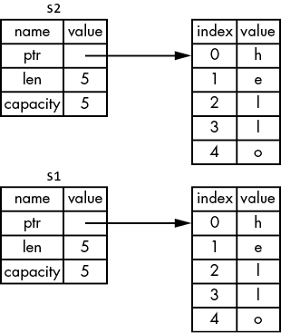

图 4-3：如果 Rust 也复制堆数据，那么`s2 = s1`可能会执行的另一种可能性

早些时候提到，当一个变量离开作用范围时，Rust 会自动调用`drop`函数并清理该变量的堆内存。但图 4-2 显示两个数据指针都指向同一个位置。这是一个问题：当`s2`和`s1`均离开作用范围时，它们将都会尝试释放同一块内存。这被称为`double free`（双重释放）错误，是我们在之前提到的内存安全 bug 之一。两次释放内存会导致内存损坏，从而可能导致安全漏洞。

为了确保内存安全，在执行完`let s2 = s1;`这一行后，Rust 认为`s1`不再有效。因此，当`s1`离开作用范围时，Rust 不需要释放任何内容。尝试在创建`s2`后使用`s1`看看会发生什么；它将无法工作：

```rust
let s1 = String::from("hello");
let s2 = s1;

println!("{s1}, world!");
```

你会得到类似这样的错误，因为 Rust 防止了你使用已失效的引用：

```text
error[E0382]: borrow of moved value: `s1`
 --> src/main.rs:5:28
  |
2 |     let s1 = String::from("hello");
  |         -- move occurs because `s1` has type `String`, which
 does not implement the `Copy` trait
3 |     let s2 = s1;
  |              -- value moved here
4 |
5 |     println!("{s1}, world!");
  |                ^^ value borrowed here after move
```

如果你在使用其他语言时听过`shallow copy`（浅拷贝）和`deep copy`（深拷贝）术语，那么这种只复制指针、长度和容量而不复制数据的概念听起来可能是在进行浅拷贝。但因为 Rust 同时也使第一个变量失效，所以它不被称为浅拷贝，而是被称为`move`（移动）。在这个例子中，我们会说`s1`被`moved`进入`s2`。所以，实际发生的情况如图图 4-4 所示。

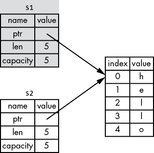

图 4-4：`s1`失效后内存中的表示

这解决了我们的问题！由于只有`s2`是生效的，当它离开作用范围时，只有它会释放内存，我们的任务就完成了。

此外，这隐含了一个设计选择：Rust 永远不会自动创建数据的“深”拷贝。因此，可以假设任何`automatic`（自动）拷贝在运行时性能方面都是廉价的。

### 变量与`Clone`交互的数据

如果我们*确实*想要深拷贝`String`的堆数据，而不只是栈数据，可以使用一种名为`clone`的常用方法。我们将在第 5 章讨论方法语法，但由于方法是许多编程语言的共同特性，你可能以前见过它们。

这里是`clone`方法运行的示例：

```rust
let s1 = String::from("hello");
let s2 = s1.clone();

println!("s1 = {s1}, s2 = {s2}");
```

这种方式运行良好，并且显式地如图图 4-3 所示的行为，其中堆数据*确实*被拷贝了。

当你看到调用`clone`时，你就知道正在执行某些任意代码，并且这些代码可能是昂贵的。这是一个发生了某些不同情况的视觉指示。

### 仅限栈的数据：`Copy`

还有一个我们还没有讨论过的特殊之处。这段使用整数的代码（部分内容在列表 4-2 中显示过）是可以正常工作且有效的：

```rust
let x = 5;
let y = x;

println!("x = {x}, y = {y}");
```

但这段代码似乎与我们刚刚学到的矛盾：我们没有调用`clone`，但`x`仍然有效，并没有被移动到`y`中。

原因是像整数这类在编译时已知大小的类型完全存储在栈上，因此创建实际值的拷贝很快。这意味着我们没有理由在创建变量`y`后阻止`x`保持有效。换句话说，在这里深拷贝和浅拷贝之间没有区别，所以调用`clone`的效果与普通的浅拷贝无异，我们可以跳过它。


Rust 有一种特殊的注解，叫做 `Copy` trait（特征），我们可以将其放置在存储在栈上的类型上，如整数就是这样（我们将在第 10 章详细讨论 trait）。如果一个类型实现了 `Copy` trait，那么使用它的变量就不会发生移动，而是被简单的复制。

哪些类型实现了 `Copy`？根据通用规则，任何简单的标量值都可以实现 `Copy`，任何需要分配或某种形式资源的类型都不行：

- 所有整数类型，如 `u32`。
- 布尔类型，`bool`，值为 `true` 和 `false`。
- 所有浮点数类型，如 `f64`。
- 字符类型，`char`。
- 元组，如果它们只包含实现了 `Copy` 的类型。例如，`(i32, i32)` 实现了 `Copy`，但 `(i32, String)` 没有。

### 所有权与函数

返回值的机制与将值赋值给变量相似。将变量传递给函数会移动或拷贝，就像赋值一样。列表 4-3 有一个带有变量进入和离开作用范围注释的示例。

`src/main.rs`

```rust
fn main() {
    let s = String::from("hello");  // s 进入作用范围

    takes_ownership(s);             // s 的值移动到函数...
                                    //在这里不再有效

    let x = 5;                      // x 进入作用范围

    makes_copy(x);                  // x 会移动到函数，
                                    // 但 i32 是 Copy，所以仍然可以使用
                                    // x

} // 这里，x 离开作用范围，然后是 s。然而，因为 s 的值被移动了，
  // 没有发生特殊情况。

fn takes_ownership(some_string: String) { // some_string 进入作用范围
    println!("{some_string}");
} // 这里，some_string 离开作用范围并调用了 `drop`。
  // 内存被释放。

fn makes_copy(some_integer: i32) { // some_integer 进入作用范围
    println!("{some_integer}");
} // 这里，some_integer 离开作用范围。没有发生特殊情况。
```

列表 4-3：所有权和作用范围的函数

### 返回值与作用范围

返回值也可以转移所有权。列表 4-4 显示了一个返回某些值的示例，其注释与列表 4-3 类似。

```rust
fn main() {
    let s1 = gives_ownership();         // gives_ownership 将其返回值
                                        //移动到 s1

    let s2 = String::from("hello");     // s2 进入作用域

    let s3 = takes_and_gives_back(s2);  // s2 被移动到
                                        // takes_and_gives_back，该函数
                                        // 也将其返回值移动到 s3
} // 这里，s3 离开作用域并被释放。s2 已经被移动，所以没有
  // 任何操作。s1 离开作用域并被释放。

fn gives_ownership() -> String {        // gives_ownership 将其返回值
                                        //移动到调用它的
                                        // 函数

    let some_string = String::from("yours"); // some_string 进入作用域

    some_string                              // some_string 被返回并
                                             // 移动到调用
                                             // 函数
}

// 此函数接收一个 String 并返回一个 String。
fn takes_and_gives_back(a_string: String) -> String { // a_string 进入
                                                       作用域

    a_string  // a_string 被返回并移动到调用函数
}
```

列表 4-4：返回值的所有权转移

变量的所有权每次都遵循相同的模式：将值赋值给另一个变量会移动它。当包含堆上数据的变量离开作用域时，除非数据的所有权已移动到另一个变量，否则该值将由 `drop` 清理。

虽然这种方法可行，但每个函数都获取所有权然后返回所有权有点太麻烦。如果我们想让函数使用一个值但不获取其所有权呢？如果我们想再次使用传入的任何内容，那么传入的内容都必须再次传回来，此外我们可能还想返回函数体产生的其他数据，这确实非常困扰。

Rust 确实允许我们使用元组返回多个值，如列表 4-5 所示。

`src/main.rs`

```rust
fn main() {
    let s1 = String::from("hello");

    let (s2, len) = calculate_length(s1);

    println!("The length of '{s2}' is {len}.");
}

fn calculate_length(s: String) -> (String, usize) {
    let length = s.len(); // len() 返回 String 的长度

    (s, length)
}
```

列表 4-5：返回参数的所有权

但对于一个本该常见的概念来说，这太过于繁琐且工作量巨大。幸运的是，Rust 有一种特性可以在不转移所有权的情况下使用一个值，这称为*引用*（references）。

## 引用与借用

列表 4-5 中元组代码的问题在于，我们必须将 `String` 返回给调用函数，以便我们能够在调用 `calculate_length` 之后继续使用该 `String`，因为 `String` 已经被移动到了 `calculate_length`。相反，我们可以提供指向 `String` 值的引用。*引用*就像指针，它是一个我们可以追踪的地址，用以访问该地址处存储的数据；该数据由其他变量拥有。与指针不同，引用保证在引用的整个周期内指向某个特定类型的有效值。

以下是你如何定义和使用 `calculate_length` 函数，它将对象的引用作为参数而不是获取值的所有权：

`src/main.rs`

```rust
fn main() {
    let s1 = String::from("hello");

    let len = calculate_length(&s1);

    println!("The length of '{s1}' is {len}.");
}

fn calculate_length(s: &String) -> usize {
    s.len()
}
```

首先，注意到变量声明和函数返回值中所有的元组代码都消失了。其次，注意我们将 `&s1` 传递给 `calculate_length`，在它的定义中，我们获取的是 `&String` 而不是 `String`。这些 `&` 符号代表*引用*，它们允许你在不获取所有权的情况下引用某些值。图 4-5 描绘了这一概念。

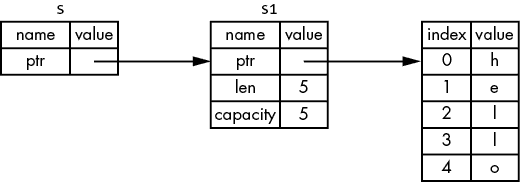

图 4-5：`&String s` 指向 `String s1` 的图

让我们仔细观察这里的函数调用：

```rust
let s1 = String::from("hello");

let len = calculate_length(&s1);
```

`&s1` 语法允许我们创建一个*引用* `s1` 值的引用，但不拥有它。因为它不拥有它，所以当引用停止使用时，它所指向的值不会被释放。

同样地，函数的签名使用 `&` 来表示参数 `s` 的类型是一个引用。让我们添加一些解释性注释：

```rust
fn calculate_length(s: &String) -> usize { // s 是一个 String 的引用
    s.len()
}
```

此错误表示这段代码是无效的，因为我们无法同时对 `s` 进行多次可变借用。第一次可变借用在 `r1` 中，并且必须持续到它在 `println!` 中使用，但在创建该可变引用到使用它之间，我们尝试在 `r2` 中创建另一个可变引用，它借用了与 `r1` 相同的数据。

防止同时对同一数据进行多个可变引用的限制允许变异，但是一种非常受控的方式。这是 Rust 新手经常挣扎的地方，因为大多数语言允许你随心所欲地变异。这种限制的好处是 Rust 可以在编译时防止数据竞态。*数据竞态*（data race）类似于竞态条件，发生在以下三种行为同时出现时：

- 两个或多个指针同时访问同一数据。
- 至少有一个指针被用于写入数据。
- 没有使用任何机制来同步对该数据的访问。

数据竞态会导致未定义行为，并且在尝试运行时追踪它们时，可能很难诊断和修复；Rust 通过拒绝编译带有数据竞态的代码来防止这个问题！

一如既往，我们可以使用大括号来创建一个新的作用域，允许存在多个可变引用，但不能*同时*存在：

```rust
let mut s = String::from("hello");

{
    let r1 = &mut s;
} // r1 在这里离开作用域，所以我们可以毫无问题地创建一个新引用

let r2 = &mut s;
```

Rust 在结合可变引用和不可变引用时执行了相似的规则。这段代码会导致错误：

```rust
let mut s = String::from("hello");

let r1 = &s; // 没有问题
let r2 = &s; // 没有问题
let r3 = &mut s; // 大问题

println!("{r1}, {r2}, and {r3}");
```

这里是错误信息：

```text
error[E0502]: cannot borrow `s` as mutable because it is also borrowed as immutable
 --> src/main.rs:6:14
  |
4 |     let r1 = &s; // no problem
  |              -- immutable borrow occurs here
5 |     let r2 = &s; // no problem
6 |     let r3 = &mut s; // BIG PROBLEM
  |              ^^^^^^ mutable borrow occurs here
7 |
8 |     println!("{r1}, {r2}, and {r3}");
  |                -- immutable borrow later used here
```

呼！当我们拥有指向同一值的不可变引用时，我们*也*不能拥有可变引用。

不可变引用的用户不期望值突然在他们脚下发生变化！然而，多个不可变引用是被允许的，因为任何仅仅读取数据的人都没有能力影响其他人对数据的读取。

请注意，引用的作用域从它引入的地方开始，一直持续到该引用最后一次被使用。例如，这段代码可以编译，因为不可变引用的最后使用（`println!`）发生在可变引用引入之前：

```rust
let mut s = String::from("hello");

let r1 = &s; // 没有问题
let r2 = &s; // 没有问题
println!("{r1} and {r2}");
// 变量 r1 和 r2 在此之后将不再被使用。

let r3 = &mut s; // 没有问题
println!("{r3}");
```

不可变引用 `r1` 和 `r2` 的作用域在它们最后使用的 `println!` 之后结束，这在可变引用 `r3` 创建之前。这些作用域没有重叠，所以这段代码是允许的：编译器可以判断该引用在作用域结束前的某一点不再被使用。

尽管借用错误有时可能会令人沮丧，但请记住，这是 Rust 编译器在早期（在编译时而不是运行时）指出潜在错误，并向你准确展示问题所在之处。这样你就不需要追踪为什么你的数据不是你所想象的那样。

### 悬空引用

在带有指针的语言中，很容易地创建一个*悬空指针*（dangling pointer）——即指向可能已经交给别人的内存位置的指针——通过在释放某些内存的同时保留指向该内存的指针来实现。相比之下，Rust 编译器保证引用永远不会是悬空引用：如果你有一个某些数据的引用，编译器将确保该数据在指向数据的引用之前不会离开作用域。

让我们尝试创建一个悬空引用，看看 Rust 如何通过编译时错误来防止它们：

`src/main.rs`

```rust
fn main() {
    let reference_to_nothing = dangle();
}

fn dangle() -> &String {
    let s = String::from("hello");

    &s
}
```

这里是错误信息：

```text
error[E0106]: missing lifetime specifier
 --> src/main.rs:5:16
  |
5 | fn dangle() -> &String {
  |                ^ expected named lifetime parameter
  |
  = help: this function's return type contains a borrowed value,
but there is no value for it to be borrowed from
help: consider using the `'static` lifetime
  |
5 | fn dangle() -> &'static String {
  |                ~~~~~~~~
```

此错误消息引用了一个我们还没有涵盖的功能：生命周期（lifetimes）。我们将在第 10 章详细讨论生命周期。但是，如果你忽略关于生命周期的部分，该信息确实包含了为什么这是一个问题的关键：

让我们仔细观察 `dangle` 的每个阶段到底发生了什么：

```rust
// src/main.rs
fn dangle() -> &String { // dangle 返回一个

    let s = String::from("hello"); // s 是一个 String

    &s // 我们返回一个
```

由于 `s` 在 `dangle` 完成时是创建的，当代码结束时，`s` 被释放了。这意味着该引用指向一个无效的 `String`。Rust 不允许这样做。

这里的解决方案是直接返回 `String`：

```rust
fn no_dangle() -> String {
    let s = String::from("hello");

    s
}
```

这样做没有问题。

### 引用的规则

让我们回顾一下关于引用的：

- 在任何时刻，你可以拥有*一个*可变引用*或者任意*不可变引用。
- 引用必须始终有效。

接下来，我们将查看不同的引用：

## 切片类型

*切片*（slices）允许你引用连续元素序列而不是整个集合。切片是一种引用，因此它没有所有权。

这里有一个小编程问题：编写一个函数，接收用空格分隔的字符串并返回找到的第一个单词。如果函数在字符串中没有找到空格，整个字符串就是一个单词，因此应该返回整个字符串。

让我们在不使用切片的情况下编写函数的签名，以理解切片将解决的问题：

```rust
fn first_word(s: &String) -> ?
```

`first_word` 函数有一个 `&String` 参数。我们不需要所有权，所以这是可以的。但我们返回什么？我们并没有方法来讨论字符串的*部分*。然而，我们可以返回单词结束的索引，由空格指示。让我们尝试那样，如列表 4-7 所示（#c04.xhtml_listing4-7）。

`src/main.rs`

```rust
fn first_word(s: &String) -> usize {
  ❶ let bytes = s.as_bytes();

    for (❷i, &item) in ❸ bytes.iter().enumerate() {
      ❹ if item == b' ' {
            return i;
        }
    }

  ❺ s.len()
}
```

列表 4-7：`first_word` 函数返回 `String` 参数的字节索引值。

由于我们需要逐元素遍历 `String` 并检查某个值是否为空格，我们将使用 `as_bytes` 方法将我们的 `String` 转换为字节数组 ❶。


接下来，我们使用 `iter` 方法 ❸ 在字节数组上创建一个迭代器。我们将在第 13 章详细讨论迭代器。现在，请记住，`iter` 是一个返回集合中每个元素的方法，而 `enumerate` 则封装了 `iter` 的结果，并将每个元素作为元组的一部分返回。`enumerate` 返回的元组的第一个元素是索引，第二个元素是元素的引用。这比我们自己计算索引要方便一点。

由于 `enumerate` 方法返回一个元组，我们可以使用模式来解构该元组。我们将在第 6 章详细讨论模式。在 `for` 循环中，我们指定了一个模式，其中 `i` 用于元组中的索引，`&item` 用于元组中的单个字节（`byte`） ❷。因为我们从 `.iter().enumerate()` 得到了元素的引用，所以我们在模式中使用了 `&`。

在 `for` 循环内部，我们使用字节字面量语法 ❹ 来搜索表示空格的字节。如果找到了空格，我们就返回该位置。否则，我们使用 `s.len()` ❺ 返回字符串的长度。

我们现在有一种方法找到字符串中第一个单词结束的索引，但存在一个问题。我们返回的是一个单独的 `usize`，但它只在 `&String` 的上下文中才有意义。换句话说，因为它与 `String` 是一个独立的值，因此无法保证它在未来仍然有效。考虑列表 4-8 中的程序，它使用了列表 4-7 中的 `first_word` 函数。

```rust
// src/main.rs
fn main() {
    let mut s = String::from("hello world");

    let word = first_word(&s); // word 将获得值 5

    s.clear(); // 这清空了 String，使其等于 ""

    // word 在这里仍然拥有值 5，但已经没有可以让我们
    // 有意义地使用值 5 的字符串了。word 现在完全无效了！
}
```

列表 4-8：存储调用 `first_word` 函数的 Result，然后更改 `String` 内容

该程序编译时没有任何错误，即使我们在调用 `s.clear()` 之后使用 `word` 也是如此。因为 `word` 完全没有与 `s` 的状态连接，`word` 仍然包含值 `5`。我们可以结合变量 `s` 使用该值 `5` 来尝试提取第一个单词，但这将是一个错误，因为自我们在 `word` 中保存 `5` 以来，`s` 的内容已经改变了。

必须担心 `word` 中的索引与 `s` 中的数据不同是非常繁琐且容易出错的！如果我们写一个 `second_word` 函数，管理这些索引会更加脆弱。它的签名必须看起来像这样：

```rust
fn second_word(s: &String) -> (usize, usize) {
```

现在我们正在追踪一个起始和结束索引，我们拥有更多从特定状态数据中计算出来但完全没有绑定到该状态的值。我们有三个不相关的变量悬浮，需要保持同步。

幸运的是，Rust 有解决此办法：字符串切片。

### 字符串切片

字符串切片（string slice）是 `String` 部分的引用，它看起来如下：

```rust
let s = String::from("hello world");

let hello = &s[0..5];
let world = &s[6..11];
```

`hello` 不是对整个 `String` 的引用，而是 `String` 一部分的引用，由额外的 `[0..5]` 部分指定。我们使用括号内的范围通过指定 `[starting_index..ending_index]` 来创建切片，其中 `starting_index` 是切片的第一个位置，而 `ending_index` 是切片最后一个位置加 1。在内部，切片数据结构存储了起始位置和切片的长度，这对应于 `ending_index` 减去 `starting_index`。因此，在 `let world = &s[6..11];` 的情况下，`world` 将是一个包含指向 `s` 索引 6 处的字节指针且长度值为 `5` 的切片。

图 4-6 在图中展示了这一点。

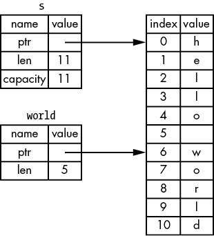

图 4-6：指向 `String` 部分的字符串切片

使用 Rust 的 `..` 范围语法，如果你想从索引 0 开始，可以省略两个点之前的值。换句话说，这两者是等价：

```rust
let s = String::from("hello");

let slice = &s[0..2];
let slice = &s[..2];
```

同样，如果你的切片包含了字符串的最后一个字节，你可以省略两个点之后的值。换句话说，这两者是等价：

```rust
let s = String::from("hello");

let slice = &s[0..2];
let slice = &s[..2];
```

回想一下我们讨论过字符串字面量存储在二进制文件中。现在我们了解了切片（slices），就可以正确理解字符串字面量了：

```rust
let s = "Hello, world!";
```

这里 `s` 的类型是 `&str`：它是一个指向二进制文件中特定位置的切片。这也是为什么字符串字面量是不可变的；`&str` 是一个不可变的引用。

### 字符串切片作为参数

知道可以对字面量和 `String` 值取切片，引导我们对 `first_word` 进行了进一步改进，那就是它的签名：

```rust
fn first_word(s: &String) -> &str {
```

更有经验的 Rust 程序员会编写列表 4-9 所示的签名，因为这允许我们对 `&String` 值和 `&str` 值都使用同一个函数。

```rust
fn first_word(s: &str) -> &str {
```

列表 4-9：通过使用字符串切片作为参数 `s` 的类型来改进 `first_word` 函数

如果我们有一个字符串切片，可以直接传递它。如果我们有一个 `String`，可以传递该 `String` 的切片或 `String` 的引用。这种灵活性利用了*解引用强制（deref coercions）*，我们将在 325 页的“函数和方法中的隐式解引用强制”中介绍这一特性。

定义一个接收字符串切片而不是 `String` 引用的函数，使我们的 API 更加通用和实用，且不会丢失任何功能：

**src/main.rs**

```rust
fn main() {
    let my_string = String::from("hello world");

    // `first_word` 适用于 `String` 的切片，无论是部分
    // 还是整体。
    let word = first_word(&my_string[0..6]);
    let word = first_word(&my_string[..]);
    // `first_word` 也适用于适用于 `String` 的引用，
    // 这等同于 `String` 的整个切片。
    let word = first_word(&my_string);

    let my_string_literal = "hello world";

    // `first_word` 适用于字符串字面量的切片，
    // 无论是部分还是整体。
    let word = first_word(&my_string_literal[0..6]);
    let word = first_word(&my_string_literal[..]);

    // 因为字符串字面量*已经是*字符串切片了，
    // 这也行通，不需要切片语法！
    let word = first_word(my_string_literal);
}
```

### 其他切片

正如你可能想象的，字符串切片专门用于字符串。但也有一种更通用的切片类型。考虑这个数组：

```rust
let a = [1, 2, 3, 4, 5];
```

就像我们可能想引用字符串的一部分，我们也可能想引用数组的一部分。我们可以这样做：

```rust
let a = [1, 2, 3, 4, 5];

let slice = &a[1..3];

assert_eq!(slice, &[2, 3]);
```

这个切片的类型是 `&[i32]`。它的工作方式与字符串切片相同，通过存储指向第一个元素的引用和长度来实现。你将此类切片用于各种其他集合。我们将在第 8 章讨论向量（vectors）时详细讨论这些集合。

## 总结

所有权（ownership）、借用（borrowing）和切片（slices）的概念确保了 Rust 程序在编译时的内存安全。Rust 语言以与其他系统编程语言相同的方式让你控制内存使用，但让数据所有者在离开作用范围时自动清理数据，意味着你不需要编写和调试额外的代码来获得这种控制。

所有权影响着 Rust 其他许多部分的工作方式，因此我们将在书的其余部分讨论这些概念。让我们进入第 5 章，查看如何在 `struct` 中将数据组合。

# 5：使用 struct 结构相关数据


*struct*（结构体）或 *structure*（结构）是一种自定义数据类型，允许你将多个相关的值打包并命名，这些值组成了一个有意义的组。如果你熟悉面向对象的语言，*struct* 就像对象的数据属性。在本章中，我们将对比元组（tuples）与结构体，在您已有知识的基础上进行扩展，并证明何时结构体是分组数据的更好方式。

我们将演示如何定义和实例化结构体。我们将讨论如何定义关联函数，特别是被称为*方法*（methods）的关联函数，以指定与结构体类型相关的行为。结构体和枚举（在第 6 章中讨论）是创建程序领域中新类型的构建基石，用以充分利用 Rust 的编译时类型检查。

## 定义和实例化结构体

结构体与第 40 页“元组类型”中讨论的元组相似，因为它们都持有多个相关值。像元组一样，结构体的各个部分可以是不同的类型。与元组不同的是，在结构体中你将为每个数据部分命名，以便清楚这些值的含义。添加这些名称意味着结构体比元组更灵活：你不需要依赖数据的顺序来指定或访问实例的值。

要定义结构体，我们输入 `struct` 关键字并命名整个结构体。结构体的名称应该描述组合在一起的数据。在大花括号内我们定义名称和类型，我们称之为*字段*（fields）。

**src/main.rs**

```rust
struct User {
    active: bool,
    username: String,
    email: String,
    sign_in_count: u64,
}
```

列表 5-1：User 结构体定义

定义结构体后使用它，我们通过指定每个字段的具体值来创建该结构体的*实例*（instance）。通过在大花括号内包含 `key: value` 对来创建实例，其中键是字段名称，值是我们想要存储的数据。我们不需要按照我们在结构体中声明的顺序指定字段。换句话说，结构体定义就像一个通用模板，实例填充该模板以创建值。例如，我们可以像列表 5-2 所示声明一个特定的用户。

```rust
let user1 = User {
    active: true,
    username: String::from("someusername123"),
    email: String::from("someone@example.com"),
    sign_in_count: 1,
};
```

从结构体中获取特定值，我们使用点符号。例如，要访问此用户的电子邮件，我们使用 `user1.email`。如果实例是可变的，我们可以通过使用点符号并赋值给特定字段来更改值。列表 5-3 展示了如何更改可变 `User` 实例的 `email` 字段。

```rust
fn main() {
    let mut user1 = User {
        active: true,
        username: String::from("someusername123"),
        email: String::from("someone@example.com"),
        sign_in_count: 1,
    };

    user1.email = String::from("anotheremail@example.com");
}
```

列表 5-3：更改 User 实例的 email 字段

注意整个实例必须是可变的；Rust 不允许我们只标记某些字段为可变。与任何表达式一样，我们可以在函数体的最后一个表达式构造结构体的新实例，以隐式返回该新实例。列表 5-4 展示了一个 `build_user` 函数，它返回一个带有给定电子邮件和用户名的 `User` 实例。`active` 字段获得 `true` 值，`sign_in_count` 获得 `1` 值。

```rust
fn build_user(email: String, username: String) -> User {
    User {
        active: true,
        username: username,
        email: email,
        sign_in_count: 1,
    }
}
```

列表 5-4：一个接收电子邮件和用户名并返回 User 实例的 `build_user` 函数

将函数参数命名为与结构体字段相同的名称是有意义的，但重复 `email` 和 `username` 字段名和变量名有点冗琐。如果结构体有更多字段，重复每个名称会变得更加恼人。幸运的是，有一个方便的简写！

### 使用字段初始化简写（Field Init Shorthand）

在 Listing 5-4 中，由于参数名和结构体字段名完全相同，我们可以使用 `field init shorthand`（字段初始化简写）语法来重写 `build_user` 使其完全相同，但不再重复 `username` 和 `email`，如 Listing 5-5 所示。

```rust
fn build_user(email: String, username: String) -> User {
    User {
        active: true,
        username,
        email,
        sign_in_count: 1,
    }
}
```

Listing 5-5：使用字段初始化简写的 `build_user` 函数，因为 `username` 和 `email` 参数与结构体字段同名。

在这里，我们正在创建一个 `User` 结构体的新实例，它有一个名为 `email` 的字段。我们想将 `email` 字段的值设置为 `build_user` 函数中 `email` 参数的值。由于 `email` 字段和 `email` 参数同名，我们只需要写 `email` 而不是 `email: email`。

### 使用结构体更新语法（Struct Update Syntax）从其他实例创建实例

创建一个包含另一个实例大部分值但更改了某些值的结构体新实例通常很有用。你可以使用 `struct update syntax`（结构体更新语法）来实现。

首先，在 Listing 5-6 中，我们展示了如何在不使用更新语法的情况下常规地创建一个新的 `User` 实例。我们为 `email` 设置了新值，但在其他地方使用了在 Listing 5-2 中创建的 `user1` 的相同值。

**src/main.rs**

```rust
fn main() {
    --snip--

    let user2 = User {
        active: user1.active,
        username: user1.username,
        email: String::from("another@example.com"),
        sign_in_count: user1.sign_in_count,
    };
}
```

Listing 5-6：使用 `user1` 的值之一创建一个新的 `User` 实例。

使用结构体更新语法，我们可以用更少的代码实现相同的效果，如 Listing 5-7 所示。语法 `..` 指定未显式设置的剩余字段应具有给定实例中的字段相同的值。

**src/main.rs**

```rust
fn main() {
    --snip--

    let user2 = User {
        email: String::from("another@example.com"),
        ..user1
    };
}
```


### 使用结构体更新语法设置字段值

Listing 5-7：使用结构体更新语法为`User`实例设置新的`email`值，但使用`user1`的其余值。

Listing 5-7中的代码在`user2`中创建了一个实例，其`email`值不同，但`username`、`active`和`sign_in_count`字段的值与`user1`相同。`..user1`必须放在最后，以指定任何剩余字段都应该从`user1`的相应字段获取值，但我们可以选择以任何顺序指定任意数量字段的值，而不论这些字段在结构体定义中的顺序。

注意，结构体更新语法使用`=`就像赋值一样；这是因为移动了数据，正如我们在第66页的“变量与移动交互的数据”（Variables and Data Interacting with Move）中所看到的那样。在这个示例中，创建`user2`后我们无法再使用`user1`，因为`user1`中`username`字段的`String`被移动到了`user2`中。如果我们为`user2`的`email`和`username`都提供了新的`String`值，从而只使用了`user1`的`active`和`sign_in_count`值，那么在创建`user2`后`user1`仍然是有效的。`active`和`sign_in_count`都是实现了`Copy` trait的类型，因此我们在第68页的“仅栈数据：Copy”（Stack-Only Data: Copy）中讨论的行为将适用。

### 使用无命名字段的元组结构体创建不同类型

Rust还支持类似于元组的结构体，称为`tuple structs`（元组结构体）。元组结构体增加了结构体名称提供的含义，但它们的字段没有关联的名称；相反，它们只有字段的类型。当你想要为整个元组命名并使该元组成为与其他元组不同的类型，以及当像普通结构体那样为每个字段命名过于冗长或冗余时，元组结构体非常有用。

要定义一个元组结构体，以`struct`关键字和结构体名称开头，后跟元组中的类型。例如，在这里我们定义并使用了两个名为`Color`和`Point`的元组结构体：

`src/main.rs`

```rust
struct Color(i32, i32, i32);

struct Point(i32, i32, i32);

fn main() {
    let black = Color(0, 0, 0);
    let origin = Point(0, 0, 0);
}
```

### 无字段的单元结构体

你也可以定义没有任何字段的结构体！这些被称为`unit-like structs`（单元结构体），因为它们的行为类似于我们在第40页“元组类型”（Tuple Type）中提到的`()`类型。当你需要在某些类型上实现行为但没有数据要存储时，单元结构体可能非常有用。我们将在第10章学习定义 trait 并实现它们。这里是声明并实例化名为`AlwaysEqual`的单元结构体的示例：

`src/main.rs`

```rust
struct AlwaysEqual;

fn main() {
    let subject = AlwaysEqual;
}
```

## 使用结构体的示例程序

为了理解我们何时可能想要使用结构体，让我们写一个计算矩形面积的程序。我们将从使用单个变量开始，然后重构程序直到使用结构体。

让我们用 Cargo 创建名为`rectangles`的新二进制项目，它将获取以像素指定的矩形宽度和高度，并计算矩形的面积。Listing 5-8展示了在我们项目`src/main.rs`中实现此操作的一种简短程序。

`src/main.rs`

```rust
fn main() {
    let width1 = 30;
    let height1 = 50;

    println!(
        "矩形的面积是 {} 像素。",
        area(width1, height1)
    );
}

fn area(width: u32, height: u32) -> u32 {
    width * height
}
```

Listing 5-8：通过分开的宽度和高度变量计算矩形的面积。

现在，使用`cargo run`运行此程序：

```text
矩形的面积是 1500 像素。
```

这段代码通过用每个维度调用`area`函数成功计算出矩形的面积，但我们可以做更多努力让这段代码更清晰易读。

这段代码的问题在`area`的签名中显而易见：

```rust
fn area(width: u32, height: u32) -> u32 {
```

`area`函数本应该计算一个矩形的面积，但我们编写的函数有两个参数，而且在我们的程序任何地方都没有说明这两个参数之间是有关联的。将宽度和高度分组会更具可读性也更易于管理。我们已经在第40页的“元组类型”中讨论过实现这一点的方法：即使用元组。

### 使用元组重构

Listing 5-9显示了我们程序的另一个版本，它使用了元组。

`src/main.rs`

```rust
fn main() {
    let rect1 = (30, 50);

    println!(
        "The area of the rectangle is {} square pixels.",
        area(rect1)
    );
}

fn area(dimensions: (u32, u32)) -> u32 {
    dimensions.0 * dimensions.1
}
```

Listing 5-9：使用元组指定矩形的宽度和高度。

一方面，这个程序更好。元组让我们增加了一点结构，而且我们现在只传递了一个参数。但在另一个方面，这个版本的清晰度较低：元组没有命名它们的元素，因此我们必须通过索引来访问元组的部分，这使得我们的计算变得不那么直观。

混淆宽度和高度对面积计算没有影响，但如果我们想在屏幕上画这个矩形，就有影响了！我们必须记住`width`是元组索引`0`，而`height`是元组索引`1`。如果其他人要使用我们的代码，他们会更难去理解并记住这一点。因为我们没有在代码中传达数据的含义，现在更容易引入错误。

### 使用结构体重构：增加更多含义

我们使用结构体通过标记数据来增加含义。我们可以将正在使用的元组转换为结构体，并为整体以及各个部分都赋予名称，如 Listing 5-10：

```rust
struct Rectangle {
    width: u32,
    height: u32,
}

fn main() {
    let rect1 = Rectangle {
        width: 30,
        height: 50,
    };

    println!(
        "The area of the rectangle is {} square pixels.",
        area(&rect1)
    );
}

fn area(rectangle: &Rectangle) -> u32 {
    rectangle.width * rectangle.height
}
```

Listing 5-10：定义一个`Rectangle`结构体。

在这里，我们定义了一个结构体并将其命名为`Rectangle`。在大括号内部，我们将字段定义为`width`和`height`，它们的类型都是`u32`。然后，在`main`中，我们创建了一个`Rectangle`的特定实例，它的宽度为`30`，高度为`50`。

我们的`area`函数现在定义了一个参数，我们将其命名为`rectangle`，其类型是对结构体`Rectangle`实例的不可变借用。如第4章所述，我们希望借用结构体而不是获取它的所有权。这样，`main`保留了它的所有权并继续使用`rect1`，这就是我们在函数签名和调用函数处使用`&`的原因。

`area`函数访问了`Rectangle`实例的`width`和`height`字段。注意，访问引用结构体实例的字段不会移动字段的值，这就是为什么你经常看到结构体的借用。我们的`area`函数签名现在准确表达了我们的意思：计算`Rectangle`的面积，使用它的`width`和`height`字段。这传达了宽度和高度是相互相关的，并为这些值提供了描述性名称，而不是使用元组索引值`0`和`1`。这是清晰度的胜利。

### 通过派生特性（Derived Traits）添加实用功能

在调试程序时，能够打印`Rectangle`实例并查看所有字段的值将非常有用。Listing 5-11尝试像我们在之前的章节中那样使用`println!`宏。然而，这行不通。

`src/main.rs`

```rust
struct Rectangle {
    width: u32,
    height: u32,
}

fn main() {
    let rect1 = Rectangle {
        width: 30,
        height: 50,
    };

    println!("rect1 is {}", rect1);
}
```

Listing 5-11：尝试打印一个`Rectangle`实例。

当我们编译这段代码时，会得到一个核心信息如下的错误：

```text
error[E0277]: `Rectangle` doesn't implement `std::fmt::Display`
```

`println!`宏可以进行各种格式化，默认情况下，大括号告诉`println!`使用名为`Display`的格式：输出直接供终端用户使用的内容。我们到目前为止看到的原始类型默认都实现了`Display`，因为你向用户展示`1`或任何其他原始类型的方法只有一种。但对于结构体，`println!`应该如何格式化输出就没那么清晰了，因为有更多的显示可能性。

如果我们想打印结构体，可以使用`Debug`特性。Rust提供了一种方法，使用`derive`属性为我们的结构体自动实现`Debug`：

```rust
#[derive(Debug)]
struct Rectangle {
    width: u32,
    height: u32,
}
```

为了做到这一点，我们在结构体定义之前添加`derive(Debug)`，如 Listing 5-12所示。

`src/main.rs`

```rust
#[derive(Debug)]
struct Rectangle {
    width: u32,
    height: u32,
}

fn main() {
    let rect1 = Rectangle {
        width: 30,
        height: 50,
    };

    println!("rect1 is {:?}", rect1);
}
```

Listing 5-12：添加属性以派生`Debug`特性并使用调试格式打印`Rectangle`实例。

现在当我们运行程序时，不会得到任何错误，并将看到以下输出：

```text
rect1 is Rectangle { width: 30, height: 50 }
```

很棒！虽然输出不是最漂亮的，但它显示了所有字段的值，这在调试期间非常有帮助。当我们有较大的结构体时，更易读的输出会有用；在这种情况下，我们可以在`println!`字符串中使用`{:#?}`代替`{:?}`。在这个示例中，使用`{:#?}`风格将输出：

```text
rect1 is Rectangle {
    width: 30,
    height: 50,
}
```

另一种使用`Debug`格式打印值的方法是使用`dbg!`宏，它获取表达式的所有权（而`println!`获取的是引用），打印`dbg!`宏调用在代码中发生的位置、文件名和行号以及该表达式的结果值，并返回该值的所有权。

这里有一个示例，我们对赋值给`width`字段的值感兴趣，以及`rect1`中整个结构体的值：

```rust
#[derive(Debug)]
struct Rectangle {
    width: u32,
    height: u32,
}

fn main() {
    let scale = 2;
    let rect1 = Rectangle {
        width: dbg!(30 * scale),
        height: 50,
    };

    dbg!(&rect1);
}
```

我们可以在表达式`30 * scale`周围加上`dbg!`，由于`dbg!`会返回表达式值的所有权，因此`width`字段获得的值与我们没有调用`dbg!`时获得的值相同。我们不希望`dbg!`夺取`rect1`的所有权，因此在下一次调用中使用了`rect1`的引用。以下是该示例的输出：

```text
[src/main.rs:10] 30 * scale = 60
[src/main.rs:14] &rect1 = Rectangle {
    width: 60,
    height: 50,
}
```

我们可以看到第一部分输出来自调试表达式`30 * scale`的调用，它的结果值是`60`（为整数实现的`Debug`格式化仅打印其值）。位于下一处的`dbg!`调用输出了`&rect1`的值，即`Rectangle`结构体。该输出使用了`Rectangle`类型的精美`Debug`格式化。当你试图弄清楚代码在做什么时，`dbg!`宏会非常有帮助！

除了`Debug` trait之外，Rust还提供了许多可以与`derive`属性一起使用的 trait，可以为我们的自定义类型添加有用的行为。这些 trait及其行为列在附录C中。我们将在第10章介绍如何实现具有自定义行为的 trait，以及如何创建自己的 trait。除了`derive`之外，还有许多属性；更多信息请参阅 Rust 参考文档（<https://doc.rust-lang.org/reference/attributes.xhtml>）中的“Attributes”部分。

我们的`area`函数非常特殊：它只计算矩形的面积。将此行为更紧密地与我们的`Rectangle`结构体绑定将很有帮助，因为它不适用于任何其他类型。让我们看看如何通过将`area`函数转换为定义在我们的`Rectangle`类型上的`area`方法来继续重构这段代码。

## 方法语法

方法与函数相似：我们用`fn`关键字和名称来声明它们，它们可以有参数和返回值，并且包含一些从其他地方调用该方法时执行的代码。与函数不同，方法定义在结构体（或枚举或 trait 对象中，我们分别在第6章和第17章中介绍）的上下文中，并且它们的第一个参数总是`self`，它代表被调用方法的结构体实例。

### 定义方法

让我们将带有`Rectangle`实例作为参数的`area`函数，改为定义在`Rectangle`结构体上的`area`方法，如 Listing 5-13：

`src/main.rs`

```rust
struct Rectangle {
    width: u32,
    height: u32,
}

impl Rectangle {
    fn area(&self) -> u32 {
        self.width * self.height
    }
}

fn main() {
    let rect1 = Rectangle {
        width: 30,
        height: 50,
    };

    println!(
        "The area of the rectangle is {} square pixels.",
        rect1.area()
    );
}
```


### Listing 5-13：在`Rectangle`结构体上定义`area`方法

为了在`Rectangle`的上下文中定义函数，我们为`Rectangle`开始一个`impl`（实现）块❶。该`impl`块内的所有内容都将与`Rectangle`类型相关。然后我们将`area`函数移动到`impl`大括号内部❷，并将签名以及体内的所有第一个（在本例中也是唯一的）参数更改为`self`。在`main`中，我们在调用`area`函数并传递`rect1`作为参数的地方，现在改用方法语法在我们的`Rectangle`实例上调用`area`方法❸。方法语法位于实例之后：我们添加一个点，后跟方法名、括号和任何参数。

在`area`的签名中，我们使用`&self`而不是`rectangle: &Rectangle`。`&self`实际上是`self: &Self`的缩写。在`impl`块内部，类型`Self`是该`impl`块所属类型的别名。方法的第一个参数必须是一个命名为`self`、类型为`Self`的参数，因此 Rust 允许你在第一个参数位置仅使用名称`self`进行缩写。请注意，我们仍然需要在`self`缩写前面使用`&`，以表示该方法借用了`Self`实例，就像我们在`rectangle: &Rectangle`中做的那样。方法可以获取`self`的所有权、不可变地借用`self`（正如我们在这里做的），或者可变地借用`self`，就像它们处理任何其他参数一样。

我们在这里选择`&self`是由于我们在函数版本中使用`&Rectangle`的原因相同：我们不想夺取所有权，只想读取结构体中的数据，而不是对其进行写入。如果我们希望作为方法执行的一部分来更改调用该方法的实例，我们将使用`&mut self`作为第一个参数。

### 带有更多参数的方法

让我们通过在`Rectangle`结构体上实现第二个方法来练习使用方法。这次我们希望`Rectangle`实例接收另一个`Rectangle`实例，如果第二个`Rectangle`能够完全放入`self`（第一个`Rectangle`），则返回`true`；否则它应该返回`false`。也就是说，一旦我们定义了`can_hold`方法，我们就能编写如[Listing 5-14]所示的程序。

**src/main.rs**

```rust
fn main() {
    let rect1 = Rectangle {
        width: 30,
        height: 50,
    };

    let rect2 = Rectangle {
        width: 10,
        height: 40,
    };

    let rect3 = Rectangle {
        width: 60,
        height: 45,
    };

    println!("Can rect1 hold rect2? {}", rect1.can_hold(&rect2));
    println!("Can rect1 hold rect3? {}", rect1.can_hold(&rect3));
}
```

Listing 5-14：使用尚未编写`can_hold`方法

预期的输出如下，因为`rect2`的两个维度都比`rect1`的维度小，但`rect3`比`rect1`：

```text
Can rect1 hold rect2? true
Can rect1 hold rect3? false
```

我们知道想要定义一个方法，因此它将位于`impl Rectangle`块中。方法名将为`can_hold`，它将接受另一个`Rectangle`的不可变引用作为参数。我们可以通过观察调用方法的代码来确定参数的类型：`rect1.can_hold(&rect2)`传递了`&rect2`，它是对`rect2`的不可变引用，`rect2`是`Rectangle`的实例。这是合理的，因为我们只需要读取`rect2`（而不是写入，这意味着我们需要可变引用），而且我们希望`main`保留对`rect2`的所有权，以便在调用`can_hold`方法后再次使用它。`can_hold`的返回值将是一个布尔值（Boolean），其实现将检查`self`的宽度和高度是否分别大于另一个`Rectangle`的宽度和高度。让我们将新的`can_hold`方法添加到来自 Listing 5-13 的`impl`块中，所示于 Listing 5-15。

**src/main.rs**

```rust
impl Rectangle {
    fn area(&self) -> u32 {
        self.width * self.height
    }

    fn can_hold(&self, other: &Rectangle) -> bool {
        self.width > other.width && self.height > other.height
    }
}
```

Listing 5-15：在`Rectangle`上实现`can_hold`方法，接受另一个`Rectangle`实例作为参数

当我们在 Listing 5-14 中的`main`函数运行这段代码时，我们将得到预期的输出。方法可以接受多个参数，我们在`self`参数之后将它们添加到签名中，这些参数的作用与函数中的参数完全一样。

### 关联函数

定义在`impl`块中的所有函数被称为*关联函数*（associated functions），因为它们与`impl`之后命名的类型相关联。我们可以定义不以`self`作为第一个参数的关联函数（因此它们不是方法），因为它们工作时不需要该类型的实例。我们已经用过一个这样的函数了：定义在`String`类型上的`String::from`函数。

不是方法的关联函数通常用于构造函数，用于返回结构体的新实例。这些函数通常被称为`new`，但`new`并不是一个特殊的名称，也不是语言内置的。例如，我们可以选择提供一个名为`square`的关联函数，它有一个维度参数，并将其同时用作宽度和高度，从而使得创建一个正方形`Rectangle`比不得不指定两次相同的值变得简单得多：

**src/main.rs**

```rust
impl Rectangle {
    fn square(size: u32) -> Self {
        Self {
            width: size,
            height: size,
        }
    }
}
```

返回类型中的❶和函数体中的❷中的`Self`关键字是`impl`关键字之后类型的别名，在本例中是`Rectangle`。

要调用此关联函数，我们使用结构体名称配合`::`语法；`let sq = Rectangle::square(3);`就是一个示例。此函数由结构体命名空间化：`::`语法用于关联函数和由模块创建的命名空间。我们将在第 7 章讨论模块。

### 多个`impl`块

每个结构体允许拥有多个`impl`块。例如，Listing 5-15 等同于 Listing 5-16 所示的代码，它将每个方法放在自己的`impl`块中。

```rust
impl Rectangle {
    fn area(&self) -> u32 {
        self.width * self.height
    }
}

impl Rectangle {
    fn can_hold(&self, other: &Rectangle) -> bool {
        self.width > other.width && self.height > other.height
    }
}
```

Listing 5-16：使用多个`impl`块重写 Listing 5-15

在这里没有理由将这些方法分离到多个`impl`块，但这是合法的语法。我们将在第 10 章看到多个`impl`块很有用的情况，那里我们将讨论泛型类型和 trait。

## 总结

结构体允许你创建对你的领域有意义的自定义类型。通过使用结构体，你可以将相关数据保持在一起，并为每个部分命名以使你的代码清晰。在`impl`块中，你可以定义与你的类型关联的函数，而方法是关联函数的一种，允许你指定结构体实例的行为。

但结构体并不是创建自定义类型的唯一方法：让我们转向 Rust 的枚举（enum）功能，为你的工具箱增加另一个工具。

# 6 枚举与模式匹配


在本章中，我们将查看枚举（enumerations），它们也被称为*enums*。首先我们将定义并使用枚举。接下来，我们将探索一个非常有用的枚举`Option`，它表示一个值可能存在也为空。然后我们将介绍`match`表达式如何轻松地处理值。最后，我们将介绍`if let`是处理枚举的另一种方式。

## 定义枚举

结构体允许你将相关字段组合在一起，例如`Rectangle`及其宽度和高度；而枚举允许你说一个值是可能值之一。例如，我们可能想要`Rectangle`是包含`Circle`和`Triangle`的集合之一。为了实现这一点，Rust 允许我们将这些可能性编码为枚举。

让我们查看一种需要在代码中表示的情况，并看看在这种情况下枚举比结构体更有用。假设我们需要处理 IP 地址。目前有两种主要的 IP 地址标准：版本四和版本六。由于这些是程序遇到的所有 IP 地址可能性，我们可以列举所有变体，这就是枚举名称来源。

任何 IP 地址可以是版本四或版本六，但不能同时具备。IP 地址的这种属性使得枚举数据变得简单，因为枚举值只能是其变体之一。版本四和六地址本质上都是 IP 地址，因此当代码处理适用于任何 IP 地址的情况时，它们应该被视为同一类型。

我们可以通过定义`IpAddrKind`枚举并列出 IP 地址可能的所有种类`V4`和`V6`来在代码中表示这一概念。这些是枚举的变体：

```rust
enum IpAddrKind {
    V4,
    V6,
}
```

`IpAddrKind`现在是一个我们在代码其他地方使用的自定义数据类型。

### 枚举值

我们可以像这样创建`IpAddrKind`两个变体的实例：

```rust
let four = IpAddrKind::V4;
let six = IpAddrKind::V6;
```

注意，枚举的变体在它的标识符下命名，并且我们使用双冒号将它们分开。这很有用，因为现在两个值`IpAddrKind::V4`和`IpAddrKind::V6`都是同一种类型：`IpAddrKind`。然后我们可以，例如定义一个接受任何`IpAddrKind`的函数：

```rust
fn route(ip_kind: IpAddrKind) {}
```

我们可以用任何一个变体调用此函数：

```rust
route(IpAddrKind::V4);
route(IpAddrKind::V6);
```

使用枚举（enums）具有更多优势。进一步考虑我们的 IP 地址类型，目前我们还没有办法存储实际 IP 地址数据；只知道它是什么类型。鉴于你刚刚在第 5 章学习了结构体（structs），你可能想用列表 6-1 所示的结构体来解决这个问题。

```rust
enum IpAddrKind {
    V4,
    V6,
}

struct IpAddr {
    kind: IpAddrKind,
    address: String,
}

let home = IpAddr {
    kind: IpAddrKind::V4,
    address: String::from("127.0.0.1"),
};

let loopback = IpAddr {
    kind: IpAddrKind::V6,
    address: String::from("::1"),
};
```

列表 6-1：使用`struct`存储 IP 地址的数据和`IpAddrKind`变体

在这里，我们定义了一个结构体`IpAddr`❷，它有两个字段：类型为`IpAddrKind`（我们之前定义的枚举❶）的`kind`字段❸和类型为`String`的`address`字段❹。我们有两个该结构体的实例。第一个是`home`❺，它的`kind`值为`IpAddrKind::V4`，并关联了地址数据`127.0.0.1`。第二个实例是`loopback`❻。它的`kind`值为`IpAddrKind`的另一个变体`V6`，并与它关联的地址为`::1`。我们使用结构体将`kind`和`address`值封装在一起，现在变体就与值关联在一起了。

然而，仅用枚举来表示同一个概念更加简洁：与其在结构体内部嵌套枚举，我们不如直接将数据放入每个枚举变体中。`IpAddr`枚举的这个新定义表示，`V4`和`V6`变体都将拥有具有关联的`String`值：

```rust
enum IpAddr {
    V4(String),
    V6(String),
}

let home = IpAddr::V4(String::from("127.0.0.1"));
let loopback = IpAddr::V6(String::from("::1"));
```

我们直接将数据附加到枚举的每个变体上，因此不需要额外的结构体。在这里，还更容易看到枚举工作原理的另一个细节：我们定义的每个枚举变体的名称也变成了一个构造该枚举实例的函数。也就是说，`IpAddr::V4()`是函数调用，它接收一个`String`参数并返回一个`IpAddr`类型的实例。作为定义枚举的结果，我们自动获得了这个构造函数。

与结构体相比，使用枚举还有另一个优势：每个变体可以拥有不同类型和不同数量的关联数据。四位 IP 地址始终包含四个数值组件，其值范围在 0 到 255 之间。如果我们想将`V4`地址存储为四个`u8`值，但仍将`V6`地址表示为一个`String`值，那么使用结构体是做不到的。而枚举可以轻松地处理这种情况：

```rust
enum IpAddr {
    V4(u8, u8, u8, u8),
    V6(String),
}

let home = IpAddr::V4(127, 0, 0, 1);
let loopback = IpAddr::V6(String::from("::1"));
```

我们已经展示了定义不同数据结构来存储四位和六位 IP 地址的方法。然而事实证明，存储 IP 地址并编码它们的类型是如此常见，以至于标准库已经有了一个我们可以使用的定义！让我们看看标准库是如何定义`IpAddr`的：它拥有我们定义并使用的完全枚举和变体，但它以两个不同结构体的形式将地址数据嵌入变体内部，这两个结构体针对每个变体的定义也不同：

```rust
struct Ipv4Addr {
    --snip--
}

struct Ipv6Addr {
    --snip--
}

enum IpAddr {
    V4(Ipv4Addr),
    V6(Ipv6Addr),
}
```

这段代码说明你可以将任何类型的数据放入枚举变体：例如字符串、数值类型或结构体。你甚至可以包含另一个枚举！此外，标准库类型通常并不比你可能想到的复杂多少。

请注意，尽管标准库包含了`IpAddr`的定义，我们仍然可以创建并使用自己的定义而不会产生冲突，因为我们还没有将标准库的定义引入我们的作用域。我们将在第 7 章详细讨论将类型引入作用域。

让我们看看列表 6-2 中的另一个枚举示例：这个示例的变体中嵌入了多种类型。

```rust
enum Message {
    Quit,
    Move { x: i32, y: i32 },
    Write(String),
    ChangeColor(i32, i32, i32),
}
```

列表 6-2：每个变体都存储不同数量和类型值的`Message`枚举

这个枚举有四个不同类型的变体：

- `Quit`：没有关联任何数据
- `Move`：具有命名字段
- `Write`：包含一个`String`
- `ChangeColor`：包含三个`i32`值

定义如列表 6-2 中的变体枚举与定义结构体相似，只不过它没有使用`struct`关键字。

枚举和结构体之间还有最后一个相似之处：就像我们能够使用`impl`为结构体定义方法一样，我们也能够为枚举定义方法。这里有一个为我们的`Message`定义的名为`call`的方法：

```rust
impl Message {
    fn call(&self) {
        // 方法体将在这里
    }
}

let m = Message::Write(String::from("hello"));
m.call();
```


方法体将使用 `self` 来获取我们调用方法的值。在这个例子中，我们创建了一个变量 `m`，其值为 `Message::Write(String::from("hello"))`，这就是 `self` 在 `call` 方法体中的值。

空值的问题在于，如果你尝试将空值当作非空值来使用，就会得到某种错误。由于这种空值或非空属性无处不在，因此极极容易发生这种错误。

然而，`null` 想要表达的概念仍然是有用的：`null` 是一个由于某种原因当前无效或缺失的值。

问题并不真的在于这个概念本身，而在于特定的实现。因此，Rust 并没有空值，但它有一个可以编码值存在或缺失这一概念的枚举。这个枚举是 `Option<T>`，它由标准库定义如下：

```rust
enum Option<T> {
    None,
    Some(T),
}
```

`Option<T>` 枚举非常有用，它甚至被包含在预言（prelude）中；你不需要显式地将其引入作用域。它的变体也包含在预言中：你可以直接使用 `Some` 和 `None`，而不需要 `Option::` 前缀。`Option<T>` 枚举仍然是一个普通的枚举，`Some(T)` 和 `None` 仍然是类型为 `Option<T>` 的变体。

`<T>` 语法是我们尚未讨论过的 Rust 特性。它是一个泛型类型参数，我们将在第 10 章详细介绍泛型。现在，你只需要知道 `<T>` 意味着 `Option` 枚举的 `Some` 变体可以持有任意类型的数据，而且每个替代 `T` 的具体类型都会使得整个 `Option<T>` 类型变成不同的类型。这里有一些使用 `Option` 值持有数字类型和字符串类型的示例：

```rust
let some_number = Some(5);
let some_char = Some('e');
let absent_number: Option<i32> = None;
```

`some_number` 的类型是 `Option<i32>`。`some_char` 的类型是 `Option<char>`，这是一个不同的类型。Rust 可以推断出这些类型，因为我们在 `Some` 变体内部指定了一个值。对于 `absent_number`，Rust 要求我们对整个 `Option` 类型进行标注：编译器无法通过观察一个 `None` 值推断出对应的 `Some` 变体将持有的类型。在这里，我们告诉 Rust 我们希望 `absent_number` 的类型是 `Option<i32>`。

当我们拥有一个 `Some` 值时，我们就知道值存在，并且该值被封装在 `Some` 中。当我们拥有一个 `None` 值时，在某种意义上等同于 `null`：我们没有有效的值。那么，拥有 `Option<T>` 为什么比拥有 `null` 好呢？

而言之，因为 `Option<T>` 和 `T`（`T` 可以是任何类型）是不同的类型，编译器不允许我们将 `Option<T>` 值当作绝对有效的值来使用。例如，这段代码将无法编译，因为它试图将一个 `i8` 加到 `Option<i8>` 上：

```rust
let x: i8 = 5;
let y: Option<i8> = Some(5);
let sum = x + y;
```

如果我们运行这段代码，会得到类似下面的错误信息：

```text
error[E0277]: cannot add `Option<i8>` to `i8`

 --> src/main.rs:5:17

  |

5 |     let sum = x + y;

  |                 ^ no implementation for `i8 + Option<i8>`

  |

  = help: the trait `Add<Option<i8>>` is not implemented for `i8`
```

很激烈！实际上，这个错误信息意味着 Rust 不理解如何将一个 `i8` 和一个 `Option<i8>` 相加，因为它们是不同的类型。当我们在 Rust 中拥有像 `i8` 这样的类型的值时，编译器会确保我们始终有一个有效的值。我们可以放心地继续，而无需在使用该值之前检查空。只有当我们拥有 `Option<i8>`（或其他类型的值）时，我们才需要担心可能没有值，编译器会在使用该值之前确保我们处理了那种情况。

换句话说，你必须在对值执行 `T` 操作之前将 `Option<T>` 转换为 `T`。通常，这有助于发现空值最常见的问题之一：在某值实际上为空时却假设它不是空。

消除错误假设假设非空值的风险有助于你对自己的代码更有信心。为了拥有一个可能为空的值，你必须通过将该值的类型变为 `Option<T>` 来显式地选择。然后，当你使用该值时，你被要求显式地处理值为空的情况。在任何值类型不是 `Option<T>` 的地方，你可以安全地假设该值不是空。这是 Rust 的一个有意设计决策，旨在限制空值的泛滥并提高 Rust 代码的安全性。

那么，当你有一个类型为 `Option<T>` 的值时，如何从 `Some` 变体中取出 `T` 值以便使用它呢？`Option<T>` 枚举有很多在各种情况下非常有用的方法；你可以在它的文档中查看。

## `match` 控制结构

Rust 有一种非常强大的控制流叫做 `match`，它允许你将值与一系列模式进行比较。`match` 的威力来自于模式的表达能力，以及编译器会确认所有可能的情况都已处理。

将 `match` 表达式想象成一个硬币分类机：硬币沿着有不同大小孔的轨道滑下，每枚硬币都会掉进它遇到的第一个孔。说到硬币，让我们用 `match` 以它们作为示例吧！我们可以编写一个函数，接收一个未知硬币，并以类似于计数机确定它是哪种硬币，并以分返回其值，如列表 6-3 所示。

```rust
enum Coin {
    Penny,
    Nickel,
    Dime,
    Quarter,
}

fn value_in_cents(coin: Coin) -> u8 {
    match coin {
        Coin::Penny => 1,
        Coin::Nickel => 5,
        Coin::Dime => 10,
        Coin::Quarter => 25,
    }
}
```

列表 6-3：一个枚举和一个以枚举变体作为模式的 `match` 表达式

让我们分解 `value_in_cents` 函数中的 `match`。首先我们列出 `match` 关键字，后面跟着一个表达式，在这个情况下表达式是值 `coin`。这看起来与 `if` 使用的表达式非常相似，但有一个巨大的区别：对于 `if`，表达式需要返回布尔值，但这里它可以返回任何类型。在这个示例中，`coin` 的类型是我们定义的 `Coin` 枚举。

接下来是 `match` 臂（arms）。每个臂包含两个部分：模式和一些代码。这里的第一个臂有一个模式是值 `Coin::Penny`，然后是 `=>` 运算符分隔模式和要运行的代码。在这种情况下，代码只是值 `1`。每个臂与下一个臂用逗号隔开。

当 `match` 表达式执行时，它会按照顺序将结果与每个分支（arm）的模式进行比较。如果某个模式匹配了值，就会执行与该模式关联的代码。如果该模式没有匹配该值，执行将继续到下一个分支，这就像硬币分类机一样。我们可以根据需要设置任意数量的分支：在列表 6-3 中，我们的 `match` 有四个分支。

与每个分支关联的代码都是一个表达式，匹配分支中表达式的结果就是整个 `match` 表达式返回的值。

如果 `match` 分支的代码很短，我们通常不使用大括号，就像在列表 6-3 中那样，其中每个分支只返回一个值。如果你想在 `match` 分支中运行多行代码，则必须使用大括号，此时分支后的逗号是可选的。例如，以下代码每当使用 `Coin::Penny` 调用该方法时都会打印“Lucky penny!”，但仍然会返回块的最后一个值 `1`：

```rust
fn value_in_cents(coin: Coin) -> u8 {
    match coin {
        Coin::Penny => {
            println!("Lucky penny!");
            1
        }
        Coin::Nickel => 5,
        Coin::Dime => 10,
        Coin::Quarter => 25,
    }
}
```

### 绑定到值的模式

`match` 分支的另一个有用特性是它们可以绑定到匹配模式的值部分。这就是我们从枚举变体（enum variants）中提取值的方法。

例如，让我们修改其中一个变体使其包含数据。在 1999 年到 2008 年间，美国为 50 个州中的每个州铸造了不同设计的季度币。其他硬币没有州级设计，因此只有季度币具有这个额外值。我们可以通过更改 `Quarter` 变体以包含一个存储在内部的 `UsState` 值，将此信息添加到我们的 `enum` 中，我们在列表 6-4 中已经这样做了。

```rust
#[derive(Debug)] //这样我们稍后可以检查状态
enum UsState {
    Alabama,
    Alaska,
    --snip--
}

enum Coin {
    Penny,
    Nickel,
    Dime,
    Quarter(UsState),
}
```

列表 6-4：一个 `Quarter` 变体也持有 `UsState` 值的 `Coin` 枚举

想象一个朋友正试图收集所有的 50 个州的季度币。当我们按硬币类型分类零钱时，还会说出每个季度币关联的州名，这样如果那是朋友没有的，他们就可以将其加入收藏。

在这段代码的 `match` 表达式中，我们向匹配 `Coin::Quarter` 变体值的模式中添加了一个名为 `state` 的变量。当 `Coin::Quarter` 匹配时，`state` 变量将绑定到该季度币州的值。然后我们像这样在该分支的代码中使用 `state`：

```rust
fn value_in_cents(coin: Coin) -> u8 {
    match coin {
        Coin::Penny => 1,
        Coin::Nickel => 5,
        Coin::Dime => 10,
        Coin::Quarter(state) => {
            println!("State quarter from {:?}!", state);
            25
        }
    }
}
```

如果我们调用 `value_in_cents(Coin::Quarter(UsState::Alaska))`，`coin` 将是 `Coin::Quarter(UsState::Alaska)`。当我们将该值与每个 `match` 分支比较时，在到达 `Coin::Quarter(state)` 之前，没有一个分支是匹配的。在此时，`state` 的绑定将是值 `UsState::Alaska`。我们随后可以在 `println!` 表达式中使用该绑定，从而从 `Coin` 枚举变体 `Quarter` 中提取内部的州值。

### 使用 `Option<T>` 匹配

在上一节中，我们想要在使用 `Option<T>` 时从 `Some` 情况中获取内部的 `T` 值；我们也可以像处理 `Coin` 枚举那样，使用 `match` 来处理 `Option<T>`！我们不再是比较硬币，而是比较 `Option<T>` 的变体，但 `match` 表达式的工作方式保持不变。

假设我们想写一个函数，它接收一个 `Option<i32>`，如果内部有值，则给该值加 1。如果内部没有值，函数应该返回 `None` 值且不尝试执行任何操作。

得益于 `match`，这个函数非常容易编写，看起来像列表 6-5 所示：

```rust
fn plus_one(x: Option<i32>) -> Option<i32> {
    match x {
        None => None,
        Some(i) => Some(i + 1),
    }
}

let five = Some(5);
let six = plus_one(five);
let none = plus_one(None);
```

列表 6-5：一个在 `Option<i32>` 上使用 `match` 表达式的函数

```rust
let dice_roll = 9;

match dice_roll {
    3 => add_fancy_hat(),
    7 => remove_fancy_hat(),
    other => move_player(other),
}

fn add_fancy_hat() {}
fn remove_fancy_hat() {}
fn move_player(num_spaces: u8) {}
```

对于前两个分支，模式是字面量值 `3` 和 `7`。对于最后一个覆盖所有其他可能值的分支，模式是我们选择并命名为 `other` 的变量。为 `other` 分支运行的代码通过将变量传递给 `move_player` 函数来使用该变量。

这段代码可以编译，尽管我们没有列出 `u8` 可能拥有的所有值，因为最后一个模式将匹配所有未被显式列出的值。这种全获模式（catch-all pattern）满足了 `match` 必须是穷尽的这一要求。注意，我们必须将全获分支放在最后，因为模式是按顺序评估的。如果我们把全获分支放在前面，其他分支将永远不会执行，所以如果我们在全获分支之后添加分支，Rust 将会警告我们！

Rust 还有一种模式，当我们想要一个全获但不想使用全获模式中的值时可以使用：`_` 是一个特殊的模式，它可以匹配任何值且不会绑定到该值上。这告诉 Rust 我们将不会使用该值，所以 Rust 不会就未使用的变量向我们警告。

让我们改变一下游戏规则：现在，如果你掷出了 3 或 7 以外的任何数字，你必须重新掷。我们不再需要使用全获值，因此可以修改代码，使用 `_` 代替名为 `other` 的变量：

```rust
let dice_roll = 9;

match dice_roll {
    3 => add_fancy_hat(),
    7 => remove_fancy_hat(),
    _ => reroll(),
}

fn add_fancy_hat() {}
fn remove_fancy_hat() {}
fn reroll() {}
```

这个示例也满足穷尽性要求，因为我们在最后一个分支中显式地忽略了所有其他值；我们没有漏掉任何东西。

最后，我们将再次改变游戏规则，这样如果你掷出 3 或 7 以外的任何数字，你的回合内将什么都不会发生。我们可以通过使用单元值（我们在第 40 页的“元组类型”中提到的空元组类型）作为配合 `_` 分支的代码来实现这一点：

```rust
let dice_roll = 9;

match dice_roll {
    3 => add_fancy_hat(),
    7 => remove_fancy_hat(),
    _ => (),
}

fn add_fancy_hat() {}
fn remove_fancy_hat() {}
```

在这里，我们显式地告诉 Rust，我们不会使用任何不匹配之前分支中模式的其他值，并且我们不希望在这种情况下运行任何代码。

关于模式和匹配的更多内容，我们将在第 18 章中介绍。现在，我们将转向 `if let` 语法，它在 `match` 表达式稍显冗长的情况下可能非常有用。

## 使用 `if let` 进行简洁的控制流

`if let` 语法允许你将 `if` 和 `let` 结合起来，用一种更简洁的方式处理匹配某个模式的值而忽略其他值。考虑列表 6-6 中的程序，它匹配 `config_max` 变量中的 `Option<u8>` 值，但只有在值为 `Some` 变体时才执行代码。

```rust
let config_max = Some(3u8);

match config_max {
    Some(max) => println!("The maximum is configured to be {max}"),
    _ => (),
}
```

列表 6-6：一个只在值为 `Some` 时才执行代码的 `match`

如果值为 `Some`，我们通过将值绑定到模式中的变量 `max` 来打印 `Some` 变体中的值。我们不希望对 `None` 值进行任何操作。为了满足 `match` 表达式，我们必须在处理完一个变体后添加 `_ => ()`，这是需要添加的繁琐样板代码。

相反，我们可以使用 `if let` 以更短的方式编写此代码。以下代码的行为与列表 6-6 中的 `match` 相同：

```rust
let config_max = Some(3u8);

if let Some(max) = config_max {
    println!("The maximum is configured to be {max}");
}
```


`if let` 语法接受一个模式和一个由等号分隔的表达式。它的工作方式与 `match` 相同，表达式被交给 `match`，而模式是它的第一个分支。在这种情况下，模式是 `Some(max)`，`max` 绑定到 `Some` 内部的值。然后我们可以像在相应的 `match` 分支中使用 `max` 一样，在 `if let` 块体中使用 `max`。如果该值不匹配模式，则不会执行 `if let` 块中的代码。

使用 `if let` 意味着更少的输入、更少的缩进和更少的样板代码。然而，你失去了 `match` 强制要求的穷尽检查。在 `match` 和 `if let` 之间做出选择取决于你正在做什么，以及是否为了简洁而愿意放弃穷尽检查。

我们还会讨论封装实现细节，这让你能够在更高级的层次重用代码：一旦你实现了一个操作，其他代码就可以通过其公共接口调用你的代码，而无需了解实现是如何工作的。你编写代码的方式定义了哪些部分是供其他代码使用的公共部分，以及哪些部分是你保留修改权利的私有实现细节。这是限制你脑中需要记住的细节量的另一种方法。

一个相关的概念是作用域（scope）：编写代码的嵌套上下文拥有一组定义为“在作用域内”（in scope）的名称。在读取、编写和编译代码时，程序员和编译器需要知道特定位置的特定名称是指变量、函数、结构体、枚举、模块、常量或其他项，以及该项意味着什么。你可以创建作用域并更改哪些名称在作用域内或范围外。你不能在同一个作用域内拥有两个同名的项；可以使用相应的工具来解决命名冲突。

Rust 有许多特性允许你管理代码的组织结构，包括哪些细节是暴露的、哪些细节是私有的，以及程序中每个作用域中包含哪些名称。这些特性有时统称为 `module system`（模块系统），包括：

- **Packages**：Cargo 的一项特性，允许你构建、测试和共享 crates
- **Crates**：一个模块的树，用于生成库或可执行文件
- **Modules and use**：允许你控制路径（paths）的组织、作用域和私有性
- **Paths**：为项（如结构体、函数或模块）命名的方法

在本章中，我们将涵盖所有这些特性，讨论它们如何相互作用，并解释如何使用它们来管理作用域。到结束时，你应该已经对模块系统有坚实的理解，并能够像专家一样处理作用域！

## Packages and Crates

我们将涵盖模块系统的的第一部分是 packages 和 crates。

一个 `crate` 是 Rust 编译器一次考虑的最小代码单元。即使你运行的是 `rustc` 而不是 `cargo` 并传递了单个源文件（正如我们在很久第 5 页的“编写和运行 Rust 程序”中所做的那样），编译器也会认为该文件是一个 crate。Crates 可以包含模块，而模块可能被定义在与 crate 一起编译的其他文件中，正如我们将在接下来的章节中看到的。

Crate 可以以两种形式之一存在：二进制 crate（binary crate）或库 crate（library crate）。`Binary crates` 是你可以编译为可运行的可执行程序的程序，例如命令行程序或服务器。每个二进制 crate 必须有一个名为 `main` 的函数，定义了可执行文件运行时发生什么。我们到目前为止创建的所有 crates 都是二进制 crate。

`Library crates` 没有 `main` 函数，它们不会编译为可执行文件。相反，它们定义了旨在与多个项目共享的功能。例如，我们在第 2 章中使用的 `rand` crate 提供了生成随机数的功能。大多数时候，当 Rust 开发者说“crate”时，他们指的是库 crate，并将“crate”与通用编程概念中的“library”（库）交替使用。

`crate root` 是 Rust 编译器从其启动的源文件，构你 crate 的根模块（我们将在第 123 页的“定义模块以控制作用域和私有性”中详细解释模块）。

一个 `package` 是一个或多个 crates 的组合，提供了一组功能。package 包含一个 `Cargo.toml` 文件，描述了如何构建这些 crates。Cargo 实际上是一个 package，包含了你一直用来构建构建代码的命令行工具的二进制 crate。Cargo 包还包含一个二进制 crate 依赖的库 crate。其他项目可以依赖 Cargo 库 crate 来使用 Cargo 命令行工具使用的相同逻辑。

一个 crate 可以以两种形式之一存在：二进制 crate 或库 crate。一个 package 可以包含你喜欢的数量的二进制 crate，但最多只有一个库 crate。一个 package 必须包含至少一个 crate，无论是库 crate 还是二进制 crate。

让我们来看看当我们创建一个 package 时发生了什么。首先，我们输入命令 `cargo new my-project`：

```text
$ cargo new my-project

     Created binary (application) `my-project` package

$ ls my-project

Cargo.toml

src

$ ls my-project/src

main.rs
```

在运行 `cargo new my-project` 后，我们使用 `ls` 来查看 Cargo 创建了什么。在项目目录中，有一个 `Cargo.toml` 文件，它为我们提供了一个 package。还有一个包含 `main.rs` 的 `src` 目录。在你的文本编辑器中打开 `Cargo.toml`，注意其中没有提到 `src/main.rs`。Cargo 遵循一种约定，即 `src/main.rs` 是与 package 同名的二进制 crate 的 crate root。同样，Cargo 知道如果 package 目录包含 `src/lib.rs`，则 package 包含一个与 package 同名的库 crate，且 `src/lib.rs` 是它的 crate root。Cargo 将 crate root 文件传递给 `rustc` 以构建库或二进制文件。

在这里，我们有一个只包含 `src/main.rs` 的 package，这意味着它只包含一个名为 `my-project` 的二进制 crate。如果一个 package 包含 `src/main.rs` 和 `src/lib.rs`，它有两个 crates：一个二进制和一个库，名称都与 package 相同。通过在 `src/bin` 目录中放置文件，package 可以拥有多个二进制 crate：每个文件都将是一个独立的二进制 crate。

## Defining Modules to Control Scope and Privacy

在这一节，我们将讨论模块以及模块系统的其他部分，即用于命名项的 `paths`（路径）、将路径引入作用域的 `use` 关键字，以及使项公开的 `pub` 关键字。我们还将讨论 `as` 关键字、外部包以及通配符运算符。

`Modules` 让我们在 crate 内部组织代码以提高可读性和易于重用。模块还允许我们控制项的 `privacy`（私有性），因为模块内部的代码默认是私有的。私有项是不供外部使用的实现细节。我们可以选择将模块及其内部项公开，以便外部代码使用和依赖它们。

作为一个示例，让我们编写一个提供餐厅功能的库 crate。我们将定义函数的签名，但保持其体为空，以便专注于代码的组织而不是餐厅的实现。

在餐饮行业中，餐厅的部分被称为 *front of house*（前厅），其他部分被称为 *back of house*（后厨）。前厅是顾客所在地；包括领位接待顾客、服务员点餐和收款以及调酒师制作饮料。后厨是厨师和厨师工作的地方、洗碗工清洁以及经理进行行政的地方。

为了以这种结构构建 crate，我们可以将函数组织到嵌套模块中。运行 `cargo new restaurant --lib` 创建名为 `restaurant` 的新库。然后将列表 7-1 中的代码输入 `src/lib.rs` 以定义一些模块和函数签名；这些代码是前厅部分。

**`src/lib.rs`**

```rust
mod front_of_house {
    mod hosting {
        fn add_to_waitlist() {}

        fn seat_at_table() {}
    }

    mod serving {
        fn take_order() {}

        fn serve_order() {}

        fn take_payment() {}
    }
}
```

列表 7-1：一个包含其他模块的 `front_of_house` 模块，这些模块又包含函数

通过使用模块，我们可以将相关的定义组合在一起，并说明它们为何相关。使用这段代码的程序员可以根据分组来导航代码，而无需阅读所有的定义，从而更容易找到与他们相关的定义。向这段代码中添加新功能的程序员将知道应该将代码放置在什么位置以保持程序的组织结构。

早些时候，我们提到 `src/main.rs` 和 `src/lib.rs` 被称为 crate roots。之所以这样命名，是因为这两个文件中的任何一个都会在 crate 模块结构的根部形成一个名为 `crate` 的模块，这被称为*模块树*（module tree）。

Listing 7-2 显示了 [Listing 7-1] 中结构的模块树。

```text
crate
└── front_of_house
    ├── hosting
    │   ├── add_to_waitlist
    │   └── seat_at_table
    └── serving
        ├── take_order
        ├── serve_order
        └── take_payment
```

Listing 7-2：[Listing 7-1]中代码的模块树

这棵树展示了某些模块是如何嵌套在其他模块中的；例如，`hosting` 嵌套在 `front_of_house` 内部。这棵树还显示某些模块是*兄弟关系*，意味着它们被定义在同一个模块中；`hosting` 和 `serving` 是定义在 `front_of_house` 中的兄弟模块。如果模块 A 包含在模块 B 中，我们说模块 A 是模块 B 的*子模块*，模块 B 是模块 A 的*父模块*。注意，整个模块树都根于名为 `crate` 的隐式模块。

模块树可能会让你想到计算机上文件系统的目录树；这是一个非常恰当的类比！就像文件系统的目录一样，你使用模块来组织代码。就像目录中的文件一样，我们需要一种方法找到我们的模块。

### 在模块树中引用项目的路径

为了告诉 Rust 在模块树的何处找到项目，我们使用路径的方式与我们在导航文件系统时使用路径相同。要调用一个函数，我们需要知道它的路径。

路径可以有两种形式：

- *绝对路径*（absolute path）是从 crate 根开始的完整路径；对于来自外部 crate 的代码，绝对路径以 crate 名称开头，对于来自当前 crate 的代码，它以字面量 `crate` 开头。
- *相对路径*（relative path）从当前模块开始并使用 `self`、`super` 或当前模块中的标识符。

绝对路径和相对路径后面跟着一个或多个用双冒号（`::`）分隔的标识符。回到 [Listing 7-1]，假设我们要调用 `add_to_waitlist` 函数。这等于询问：`add_to_waitlist` 函数的路径是什么？[Listing 7-3] 包含了删除了部分模块和函数后的 [Listing 7-1]。

我们将展示从在 crate 根部定义的新函数 `eat_at_restaurant` 中调用 `add_to_waitlist` 函数的两种方法。这些路径是正确的，但仍然存在另一个会导致此示例无法直接编译。我们稍后会解释原因。

`eat_at_restaurant` 函数是我们库 crate 公共 API 的一部分，因此我们用 `pub` 关键字标记了它。在第 127 页的“使用 `pub` 关键字暴露路径”中，我们将详细介绍 `pub`。

**`src/lib.rs`**

```rust
mod front_of_house {
    mod hosting {
        fn add_to_waitlist() {}
    }
}

pub fn eat_at_restaurant() {
    // Absolute path
    crate::front_of_house::hosting::add_to_waitlist();

    // Relative path
    front_of_house::hosting::add_to_waitlist();
}
```

Listing 7-3：使用绝对路径和相对路径调用 `add_to_waitlist` 函数

在 `eat_at_restaurant` 中第一次调用 `add_to_waitlist` 函数时，我们使用了绝对路径。`add_to_waitlist` 函数定义在与 `eat_at_restaurant` 相同的 crate 中，这意味着我们可以使用 `crate` 关键字来启动绝对路径。然后我们包含每个连续的模块，直到到达 `add_to_waitlist`。你可以想象一个具有相同的文件系统：我们会指定路径 `/front_of_house/hosting/add_to_waitlist` 来运行 `add_to_waitlist` 程序；使用 `crate` 名称从 crate 根开始，就像在 shell 中使用 `/` 从文件系统根开始一样。

在 `eat_at_restaurant` 中第二次调用 `add_to_waitlist` 时，我们使用了绝对路径。`add_to_waitlist` 函数定义在与 `eat_at_restaurant` 相同的 crate 中，这意味着我们可以使用 `crate` 关键字来启动绝对路径。然后我们包含每个连续的模块，直到到达 `add_to_waitlist`。

让我们回到 Listing 7-4 中的错误，该错误告诉我们 `hosting` 模块是私有的。我们希望父模块中的 `eat_at_restaurant` 函数能够访问子模块中的 `add_to_waitlist` 函数，因此我们用 `pub` 关键字标记了 `hosting` 模块，如 Listing 7-5 所示。

**`src/lib.rs`**

```rust
mod front_of_house {
    pub mod hosting {
        fn add_to_waitlist() {}
    }
}

--snip--
```

Listing 7-5：将 `hosting` 模块声明为 `pub` 以便在 `eat_at_restaurant` 中使用

遗憾的是，Listing 7-5 中的代码仍然会导致编译错误，如 Listing 7-6 所示。

```text
$ cargo build

   Compiling restaurant v0.1.0 (file:///projects/restaurant)

error[E0603]: function `add_to_waitlist` is private
 --> src/lib.rs:9:37
  |
9 |     crate::front_of_house::hosting::add_to_waitlist();
  |                               ^^^^^^^^^^^^^^^ private function
  |
note: the function `add_to_waitlist` is defined here
 --> src/lib.rs:3:9
  |
3 |         fn add_to_waitlist() {}
  |         ^^^^^^^^^^^^^^^^^^^^

error[E0603]: function `add_to_waitlist` is private
  --> src/lib.rs:12:30
   |
12 |     front_of_house::hosting::add_to_waitlist();
   |                              ^^^^^^^^^^^^^^^ private function
   |
note: the function `add_to_waitlist` is defined here
  --> src/lib.rs:3:9
   |
3  |         fn add_to_waitlist() {}
   |         ^^^^^^^^^^^^^^^^^^^^
```

Listing 7-6：编译 Listing 7-5 中的代码产生的编译错误

发生了什么？在 `mod hosting` 前添加 `pub` 关键字会让该模块变为公开。通过此更改，如果我们能访问 `front_of_house`，我们就可以访问 `hosting`。但 `hosting` 的内容仍然是私有的；将模块公开并不会让其内容公开。模块上的 `pub` 关键字仅允许祖先模块中的代码引用它，而不是访问其内部代码。由于模块是容器，仅通过将模块公开我们做不了什么；我们需要更进一步，选择将模块内的一个或多个项也标记为公开。

Listing 7-6 中的错误显示 `add_to_waitlist` 函数是私有的。私有性规则同样适用于结构体、枚举、函数和方法以及模块。

让我们也通过在 `add_to_waitlist` 函数定义之前添加 `pub` 关键字来将其变为公开，如 Listing 7-7 所示。

**`src/lib.rs`**

```rust
mod front_of_house {
    pub mod hosting {
        pub fn add_to_waitlist() {}
    }
}
```


```text
--snip--
```

Listing 7-7：为`mod hosting`和`fn add_to_waitlist`添加`pub`关键字，使我们能够从`eat_at_restaurant`调用该函数。

现在代码可以编译了！为了了解为什么添加`pub`关键字允许我们根据私有性规则在`add_to_waitlist`中访问这些路径，让我们来看绝对路径和相对路径。

在绝对路径中，我们从`crate`开始，它是 crate 模块树的根。`front_of_house`模块定义在 crate 根部。虽然`front_of_house`不是公开的，但由于`eat_at_restaurant`函数与`front_of_house`定义在同一个模块（即`eat_at_restaurant`和`front_of_house`是兄弟关系），我们就可以从`eat_at_restaurant`引用`front_of_house`。接下来是标记为`pub`的`hosting`模块。我们可以访问`hosting`的父模块，所以我们可以访问`hosting`。最后，`add_to_waitlist`函数被标记为`pub`，且我们可以访问它的父模块，因此该函数调用是有效的！

在相对路径中，逻辑与绝对路径相同，除了第一步：路径不是从 crate 根开始，而是从`front_of_house`开始。`front_of_house`模块与`eat_at_restaurant`定义在同一个模块中，因此从`eat_at_restaurant`所在模块开始的相对路径是有效的。然后，由于`hosting`和`add_to_waitlist`被标记为`pub`，路径的其余部分都是有效的，这个函数调用也是有效的！

如果你计划共享你的库 crate 以便其他项目可以使用你的代码，你的公开 API 就是你与 crate 用户之间的约定，决定了他们如何与你的代码交互。

### 使用`super`开始相对路径

我们可以通过使用`super`构建从父模块而非当前模块或 crate 根部开始的相对路径。这就像在文件路径中使用`..`一样。使用`super`允许我们引用父模块的项，这可以使重构模块变得更容易。

考虑 Listing 7-8 中的代码，它模拟了厨师修复订单并亲自送给顾客的情况。`back_of_house`模块中的`fix_incorrect_order`函数通过指定以`super`开头的路径来调用父模块中的`deliver_order`。

**src/lib.rs**

```rust
fn deliver_order() {}

mod back_of_house {
    fn fix_incorrect_order() {
        cook_order();
        super::deliver_order();
    }

    fn cook_order() {}
}
```

Listing 7-8：使用从`super`开始的相对路径调用函数

`fix_incorrect_order`函数位于`back_of_house`模块，因此我们可以使用`super`进入`back_of_house`的父模块，在这种情况下是 crate。我们认为`back_of_house`模块和`deliver_order`函数很可能会保持这种关系，如果我们决定重组 crate 的模块树，它们会一起移动。因此，我们使用了`super`，这样将来代码移动时，我们需要更新的地方就会减少。

### 使结构体和枚举公开

我们也可以将结构体和枚举标记为公开，但结构体和枚举在使用`pub`时有一些额外的细节。如果我们在结构体定义之前使用`pub`，我们使结构体公开，但结构体的字段仍然是私有的。我们可以根据具体情况决定每个字段是否公开。在 Listing 7-9 中，我们定义了一个公开的`back_of_house::Breakfast`结构体，它包含一个公开的`toast`字段和一个私有的`seasonal_fruit`字段。这模拟了餐厅中的一种情况：顾客可以选择餐点搭配的面包种类，但厨师会根据季节和库存决定餐点搭配什么的水果。可用水果变化很快，因此顾客无法选择水果，甚至不知道将得到哪种水果。

**src/lib.rs**

```rust
mod back_of_house {
    pub struct Breakfast {
        pub toast: String,
        seasonal_fruit: String,
    }

    impl Breakfast {
        pub fn summer(toast: &str) -> Breakfast {
            Breakfast {
                toast: String::from(toast),
                seasonal_fruit: String::from("peaches"),
            }
        }
    }
}

pub fn eat_at_restaurant() {
    // Order a breakfast in the summer with Rye toast.
    let mut meal = back_of_house::Breakfast::summer("Rye");

    // Change our mind about what bread we'd like.
    meal.toast = String::from("Wheat");

    println!("I'd like {} toast please", meal.toast);

    // The next line won't compile if we uncomment it; we're not
    // allowed to see or modify the seasonal fruit that comes
    // with the meal.
    // meal.seasonal_fruit = String::from("blueberries");
}
```

Listing 7-9：包含一些公开字段和一些私有字段的结构体

由于`back_of_house::Breakfast`结构体中的`toast`字段是公开的，在`eat_at_restaurant`中可以使用点符号来读写`toast`字段。注意我们不能在`eat_at_restaurant`中使用`seasonal_fruit`字段，因为`seasonal_fruit`是私有的。尝试取消修改`seasonal_fruit`字段值的注释，看看你会得到什么错误！

此外，请注意由于`back_of_house::Breakfast`有一个私有字段，该结构体需要提供一个公开的关联函数来构造`Breakfast`实例（我们在这里将其命名为`summer`）。如果`Breakfast`没有这样的函数，我们就无法在`eat_at_restaurant`中创建`Breakfast`实例，因为我们无法在`eat_at_restaurant`中设置私有字段`seasonal_fruit`的值。

相反，如果我们把枚举（enum）设置为公开，那么它所有的变体也都是公开的。我们只需要在`enum`关键字之前加上`pub`，如 Listing 7-10 所示。

**src/lib.rs**

```rust
mod back_of_house {
    pub enum Appetizer {
        Soup,
        Salad,
    }
}

pub fn eat_at_restaurant() {
    let order1 = back_of_house::Appetizer::Soup;
    let order2 = back_of_house::Appetizer::Salad;
}
```

Listing 7-10：将枚举标记公开使其所有的变体都公开。

由于我们将`Appetizer`枚举设置为公开的，因此可以在`eat_at_restaurant`中使用`Soup`和`Salad`变体。

除非变体是公开的，否则枚举并没有什么用；在每种情况下都要为所有枚举变体添加`pub`注释会非常麻烦，因此枚举变体的默认值是公开的。结构体在字段公开的情况下通常很有用，因此结构体字段遵循通用规则：除非标记了`pub`，否则默认情况下一切都是私有的。

这里还有一种涉及`pub`的情况我们尚未涵盖，那就是我们的最后一个模块系统特性：`use`关键字。我们将首先介绍`use`本身，然后展示如何结合`pub`和`use`。

## 使用`use`关键字将路径引入作用域

必须写出调用函数的路径可能会感到不便且重复。在 Listing 7-7 中，无论我们选择为`add_to_waitlist`函数选择绝对路径还是相对路径，每当我们想调用`add_to_waitlist`时，都必须指定`front_of_house`和`hosting`。幸运的是，有一种方法可以简化这个过程：我们可以使用`use`关键字一次创建一个路径的快捷方式，然后在作用域内的其他地方使用更短的名字。

在 Listing 7-11 中，我们将`crate::front_of_house::hosting`模块引入`eat_at_restaurant`函数的作用域，这样我们只需要在`eat_at_restaurant`中指定`hosting::add_to_waitlist`即可调用`add_to_waitlist`函数。

**src/lib.rs**

```rust
mod front_of_house {
    pub mod hosting {
        pub fn add_to_waitlist() {}
    }
}

use crate::front_of_house::hosting;

pub fn eat_at_restaurant() {
    hosting::add_to_waitlist();
}
```

Listing 7-11：使用`use`将模块引入作用域

在作用域中添加`use`和路径类似于在文件系统中创建符号链接。通过在 crate 根部中添加`use crate::front_of_house::hosting`，`hosting`现在是该作用域内的有效名称，就像`hosting`模块已经在 crate 根部定义一样。通过`use`引入作用域的路径也会像任何其他路径一样检查私有性。

注意`use`仅在`use`发生的特定作用域中创建快捷方式。Listing 7-12 将`eat_at_restaurant`函数移动到一个名为`customer`的新子模块中，该模块与`use`语句处于不同的作用域，因此：

**src/lib.rs**

```rust
mod front_of_house {
    pub mod hosting {
        pub fn add_to_waitlist() {}
    }
}

use crate::front_of_house::hosting;

mod customer {
    pub fn eat_at_restaurant() {
        hosting::add_to_waitlist();
    }
}
```

Listing 7-12：`use`仅适用于其所在的作用域。

编译错误显示快捷方式在`customer`模块内不再适用：

```text
error[E0433]: failed to resolve: use of undeclared crate `hosting`
  --> src/lib.rs:11
   |
11 |         hosting::add_to_waitlist();
   |         ^^^^^^ use of undeclared crate `hosting`

warning: unused import `crate::front_of_house`
 --> src/lib.rs:7
  |
7 | use crate::front_of_house;
  | ^^^^^
```

注意还有一个`use`是未使用的警告！

### 创建习惯的`use`

在 Listing 7-11 中，你可能疑惑为什么我们指定了`use crate::front_of_house::hosting`然后调用`hosting::add_to_waitlist`，而不是像 Listing 7-13 那样指定完整路径来实现相同的结果。

**src/lib.rs**

```rust
mod front_of_house {
    pub mod hosting {
        pub fn add_to_waitlist() {}
    }
}

use crate::front_of_house::hosting::add_to_waitlist;

pub fn eat_at_restaurant() {
    add_to_waitlist();
}
```

Listing 7-13：使用`use`将`waitlist`函数引入作用域是习惯用法

尽管 Listing 7-11 和 Listing 7-13 都完成了相同的任务，但 Listing 7-11 是使用`use`将函数引入作用域的习惯用法。通过`use`将函数的父模块引入作用域，意味着我们在调用函数时必须指定父模块。在调用函数时指定父模块可以清楚该函数不是本地定义的，同时减少了完整路径的重复。

另一方面，当使用`use`引入结构体、枚举和其他项时，指定完整路径是习惯的。Listing 7-14 展示了将标准库的`HashMap`结构体引入二进制 crate 作用域的习惯用法。

**src/main.rs**

```rust
use std::collections::HashMap;

fn main() {
    let mut map = HashMap::new();
    map.insert(1, 2);
}
```

Listing 7-14：以习惯用法引入`HashMap`

这种习惯用法背后没有强有力的理由：它只是演变成的一种约定，人们已经习惯了这样阅读和编写 Rust 代码。

这种习惯用法的例外是当我们通过`use`语句将两个名称相同的项引入作用域时，因为 Rust 不允许这样做。Listing 7-15 展示了如何将两个名称相同但父模块不同的`Result`类型引入作用域，以及如何引用它们。

**src/main.rs**

```rust
use std::fmt;
use std::io;

fn function1() -> fmt::Result {
    --snip--
}

fn function2() -> io::Result<()> {
    --snip--
}
```

Listing 7-15：将两个同名的类型引入同一个作用域需要使用它们的父模块。

如你所见，使用父模块可以区分两个`Result`类型。如果我们改为指定`use std::fmt::Result`和`use std::io::Result`，那么在同一个作用域内会有两个`Result`类型，当我们在使用`Result`时，Rust 就无法知道我们指的是哪一个了。

### 使用`as`关键字提供新名称

对于通过`use`将两个同名类型引入同一个作用域的问题，还有另一种解决方案：在路径之后，我们可以为类型指定`as`和一个新的本地名称（或称为*别名*）。Listing 7-16 展示了另一种编写 Listing 7-15 中代码的方法，即通过使用`as`为两个`Result`类型之一重命名。

**src/lib.rs**

```rust
use std::fmt::Result;
use std::io::Result as IoResult;

fn function1() -> Result {
    --snip--
}

fn function2() -> IoResult<()> {
    --snip--
}
```

Listing 7-16：使用`as`关键字在类型引入作用域时对其重命名

在第二个`use`语句中，我们为`std::io::Result`类型选择了新名称`IoResult`，这不会与我们同样引入作用域的来自`std::fmt`的`Result`冲突。Listing 7-15 和 Listing 7-16 都是地道的写法，因此选择取决于你！

### 使用`pub use`重新导出名称

当我们使用`use`关键字将名称引入作用域时，该名称在新作用域中是私有的。为了让调用我们代码的代码能够像该名称被定义在调用者代码的作用域中一样引用它，我们可以结合`pub`和`use`。这种技术被称为*重新导出*（re-exporting），因为我们不仅将一个项引入了作用域，还让该项供其他人引入到自己的作用域。

Listing 7-17 展示了 Listing 7-11 中的代码，将根模块中的`use`改为了`pub use`。

**src/lib.rs**

```rust
mod front_of_house {
    pub mod hosting {
        pub fn add_to_waitlist() {}
    }
}

pub use crate::front_of_house::hosting;

pub fn eat_at_restaurant() {
    hosting::add_to_waitlist();
}
```


## 使用 `pub use` 重新导出名称

Listing 7-17：使用 `pub use` 使名称可以从新作用域被任何代码访问

在此更改之前，外部代码必须通过路径 `restaurant::front_of_house::hosting::add_to_waitlist()` 来调用 `add_to_waitlist` 函数。现在由于这个 `pub use` 已从根模块重新导出了 `hosting` 模块，外部代码可以使用路径 `restaurant::hosting::add_to_waitlist()`。

当代码的内部结构与调用你代码的程序员对领域的思考方式不同时，重新导出非常有用。例如，在这个餐厅的比喻中，经营餐厅的人考虑的是“前厅”（front of house）和“后厨”（back of house）。但访问餐厅的顾客可能不会用这些术语来考虑餐厅。通过 `pub use`，我们可以用一种结构编写代码，但暴露另一种结构。这样做使得我们的库对于开发库的程序员和调用库的程序员来说都组织良好。我们将在第 300 页的“使用 `pub use` 导出方便的公共 API”中查看 `pub use` 的另一个示例以及它如何影响 crate 文档。

### 使用外部包

在第 2 章中，我们编写了一个猜游戏项目，该项目使用了名为 `rand` 的外部包来获取随机数。要在项目中使用 `rand`，我们在 `Cargo.toml` 中添加了这一行：

**Cargo.toml**

```toml
rand = "0.8.5"
```

在 `Cargo.toml` 中将 `rand` 作为依赖项告诉 Cargo 从 [`crates.io`](https://crates.io) 下载 `rand` 包及任何依赖项，并让项目可以使用 `rand`。

然后，为了将 `rand` 定义引入包的作用域，我们添加了以 crate 名称 `rand` 开头的 `use` 行，并列出了我们想要引入作用域的项。记得第 22 页的“生成随机数”中，我们将 `Rng` 特性引入作用域并调用了 `rand::thread_rng` 函数：

```rust
use rand::Rng;

fn main() {
    let secret_number = rand::thread_rng().gen_range(1..=100);
}
```

Rust 社区的成员在 [`crates.io`](https://crates.io) 提供了许多包，将其中任何一个引入你的包都涉及这些相同的步骤：列

### 使用嵌套路径清理 `use` 语句

在较大的程序中，使用多个 `use` 语句从同一个 crate 引入许多项会占用大量的垂直空间。我们可以使用嵌套路径来减少这种占用。例如，Listing 7-18 展示了如何使用大括号处理不同的项：

```rust
use std::{cmp::Ordering, io};
```

例如，让我们从 Listing 7-17 中包含多个餐厅模块的代码开始。我们将模块提取到单独的文件，而不是将所有模块都定义在 crate 的根文件中。在这种情况下，crate 的根文件是 `src/lib.rs`，但此过程也适用于根文件为 `src/main.rs` 的二进制 crate。

首先，我们将 `front_of_house` 模块提取到它自己的文件中。删除 `front_of_house` 模块大括号内部的代码，只留下 `mod front_of_house;` 声明，使得 `src/lib.rs` 包含如 Listing 7-21 所示的代码。注意，在我们在 Listing 7-22 中创建 `src/front_of_house.rs` 文件之前，这还无法编译。

**src/lib.rs**

```rust
mod front_of_house;

pub use crate::front_of_house::hosting;

pub fn eat_at_restaurant() {
    hosting::add_to_waitlist();
}
```

Listing 7-21：声明 `front_of_house` 模块，其主体位于 `src/front_of_house.rs` 中

接下来，将之前大括号中的代码放入名为 `src/front_of_house.rs` 的新文件中，如 Listing 7-22 所示。编译器知道要在此文件中查找，因为它在 crate 根遇到了名为 `front_of_house` 的模块声明。

**src/front_of_house.rs**

```rust
pub mod hosting {
    pub fn add_to_waitlist() {}
}
```

Listing 7-22：`src/front_of_house.rs` 中 `front_of_house` 模块内部的定义

注意，你只需要在模块树中一次使用 `mod` 声明加载一个文件。一旦编译器知道该文件是项目的一部分（并且由于你放置 `mod` 语句的位置，它知道代码位于模块树的哪个位置），项目中的其他文件应该通过指向其声明处的路径来引用已加载的文件代码，正如第 125 页的“引用模块树中项的路径”部分所涵盖。换句话说，`mod` 不是你可能在其他编程语言中遇到的“include”操作。

接下来，我们将 `hosting` 模块提取到它自己的文件中。过程稍有不同，因为 `hosting` 是 `front_of_house` 的子模块，而不是根模块的子模块。我们将 `hosting` 的文件放在一个新的目录中，该目录将根据其在模块树中的祖先命名，在这种情况下为 `src/front_of_house`。

为了开始移动 `hosting`，我们将 `src/front_of_house.rs` 修改为仅包含 `hosting` 模块的声明：

**src/front_of_house.rs**

```rust
pub mod hosting;
```

然后我们创建一个 `src/front_of_house` 目录和一个 `hosting.rs` 文件来包含在 `hosting` 模块中定义的定义：

**src/front_of_house/hosting.rs**

```rust
pub fn add_to_waitlist() {}
```

如果我们把 `hosting.rs` 放在 `src` 目录下，编译器将期望 `hosting.rs` 代码位于 crate 根的 `hosting` 模块中，而不是作为 `front_of_house` 模块的子模块声明。编译器检查哪些文件对应哪些模块代码的规则意味着目录和文件与模块树更加匹配。

我们已经将每个模块的代码移动到单独的文件，而模块树保持不变。`eat_at_restaurant` 中的函数调用可以在无需任何修改的情况下工作，即使定义位于不同的文件中。这种技术允许你在模块随大小增长时将其移动到新文件中。

注意，`src/lib.rs` 中的 `pub use crate::front_of_house::hosting` 语句也没有改变，`use` 对作为 crate 部分被编译的文件也没有任何影响。`mod` 关键字用于声明模块，Rust 会在与模块同名的文件中查找用于放入该模块的代码。

## 总结

Rust 允许你将一个包拆分成多个 crate，并将一个 crate 拆分为多个模块，这样你就可以从一个模块引用另一个模块中定义的项。你可以通过指定绝对路径或相对路径来实现这一点。这些路径可以通过 `use` 语句引入作用域，这样你就可以在该作用域内多次使用该项时使用更短的路径。模块默认是私有的，但你可以通过添加 `pub` 关键字使定义变为公共。

在下一章中，我们将查看标准库中的一些集合数据结构，你可以在组织良好的代码中使用它们。

# 8

## 常用集合


Rust 的标准库包含了许多非常有用的数据结构，称为 *collections*（集合）。大多数其他数据类型表示一个特定的值，但集合可以包含多个值。与内置的数组和元组类型不同，这些集合所指向的数据存储在堆上，这意味着数据量不需要在编译时已知，并且可以在程序运行时增长或缩小。每种集合都有不同的功能，在本章中我们将讨论三种类型：

- `vector`（向量）：允许存储相同类型的值。
- `string`：字符集合。
- `hash map`：允许关联键值。

要了解标准库提供的集合类型，请参见 <https://rust-lang.org/std/collections>。

## 使用 Vector 存储列表

我们将查看的第一种集合类型是 `Vec<T>`，也称为 *vector*（向量）。向量允许在内存中存储多个类型的值。

### 创建新 Vector

要创建一个空向量，我们调用 `Vec::new` 函数，如 Listing 8-1 所示。

```rust
let v: Vec<i32> = Vec::new();
```

Listing 8-1：创建一个新的空向量

注意我们在这里添加了类型注解。因为我们没有向向量插入任何值，Rust 不知道我们要存储什么种的元素。这一点很重要。向量使用泛型实现；我们将在第 10 章介绍对自定义类型使用泛型。现在，知道标准库提供的 `Vec<T>` 类型可以包含任何类型。当我们创建一个特定类型的向量时，可以在括号内指定类型。在 Listing 8-1 中，我们告诉 Rust `v` 的 `Vec<T>` 将包含 `i32` 元素。

通常情况下，你会带有初始值创建 `Vec<T>`，Rust 会推断你想存储的类型，因此你很少需要这种类型注解。Rust 方便地提供了 `vec!` 宏，它可以创建一个包含你给出的值的新向量。Listing 8-2 创建一个新的 `Vec<i32>`，包含值 `1`、`2` 和 `3`。整数类型是 `i32`，因为它是默认整数类型，正如我们在第 36 页“数据类型”中所讨论过的。

```rust
let v = vec![1, 2, 3];
```

Listing 8-2：创建包含值的的新向量

由于我们给了初始 `i32` 值，Rust 可以推断出 `v` 的类型为 `Vec<i32>`，因此类型注解是不必要的。接下来我们将查看如何修改向量。

### 更新 Vector

要创建一个向量并向其添加元素，我们可以使用 `push` 方法，如 Listing 8-3 所示。

```rust
let mut v = Vec::new();

v.push(5);
v.push(6);
v.push(7);
v.push(8);
```

Listing 8-3：向向量添加元素

### 列表 8-3：使用 `push` 方法向向量添加值

与任何变量一样，如果我们想能够更改它的值，我们就需要使用 `mut` 关键字使其变为可变，正如第 3 章所讨论的那样。我们放在内部的数字都是 `i32` 类型，Rust 会从数据中推断出这一点，因此我们不需要 `Vec<i32>` 注解。

#### 读取向量的元素

有两种方法可以引用向量中存储的值：通过索引或使用 `get` 方法。在接下来的示例中，为了额外清晰起见，我们对这些函数返回的数值标注了类型。

列表 8-4 展示了访问向量中值的两种方法：索引语法和 `get` 方法。

```rust
let v = vec![1, 2, 3, 4, 5];

let third: &i32 = &v[2];

println!("The third element is {third}");

let third: Option<&i32> = v.get(2);

match third {
    Some(third) => println!("The third element is {third}"),
    None => println!("There is no third element."),
}
```

列表 8-4：使用索引语法和使用 `get` 方法访问向量中的项

注意这里的几处细节。我们使用索引值 `2` 来获取第三个元素，因为向量是通过数字索引的，从零开始。使用 `&` 和 `[]` 让我们得到指向该索引值处元素的引用。当我们传递索引作为参数使用 `get` 方法时，我们得到一个 `Option<&T>`，我们可以用 `match` 来使用它。

Rust 提供了这两种引用元素的方法，以便你可以选择程序在尝试使用超出现有元素范围的索引值时的行为。例如，让我们看看当我们有一个包含五个元素的向量，然后尝试用每种技术访问索引为 100 的元素时会发生什么，如列表 8-5 所示。

```rust
let v = vec![1, 2, 3, 4, 5];

let does_not_exist = &v[100];

let does_not_exist = v.get(100);
```

列表 8-5：尝试在包含五个元素的向量中访问索引为 100 的元素

当我们运行这段代码时，第一种 `[]` 方法将导致程序崩溃（panic），因为它引用了一个不存在的元素。当你希望程序在尝试访问向量末尾之外的元素时崩溃，使用这种方法最好。

当传递给 `get` 方法的索引在向量范围之外时，它会返回 `None` 而不会崩溃。如果在正常情况下可能会偶尔访问向量范围之外的元素，你将使用这种方法。你的代码将会有逻辑来处理 `Some(&element)` 或 `None`，正如第 6 章所讨论的那样。例如，索引可能来自某人输入的数字。如果他们不小心输入了一个太大的数字，且程序得到了 `None` 值，你可以告诉用户当前向量中有多少个项，并给他们另一个机会来输入有效值。这比由于拼写错误导致程序崩溃要友好得多！

当程序拥有有效引用时，借用检查器（borrow checker）会强制执行所有权借用规则（第 4 章涵盖），以确保该引用以及对向量内容的任何其他引用保持有效。记住这条规则：你不能在一个作用域内同时拥有可变引用和不可变引用。该规则适用于列表 8-6，在其中我们持有向量中第一个元素的不可变引用，并尝试向末尾添加一个元素。如果我们稍后在函数中尝试引用该元素，程序将无法工作。

```rust
let mut v = vec![1, 2, 3, 4, 5];

let first = &v[0];

v.push(6);

println!("The first element is: {first}");
```

列表 8-6：在持有项引用的同时尝试向向量添加元素

编译这段代码将导致此错误：

```text
error[E0502]: cannot borrow `v` as mutable because it is also borrowed as
immutable

 --> src/main.rs:6:5
  |
4 |     let first = &v[0];
  |                  - immutable borrow occurs here
5 |
6 |     v.push(6);
  |     ^^^^^^^^^ mutable borrow occurs here
7 |
8 |     println!("The first element is: {first}");
  |                               ----- immutable borrow later used here
```

列表 8-6 中的代码看起来似乎是可以运行的：为什么对第一个元素的引用需要关心向量末尾的变化呢？这个错误是由于向量的工作方式：因为向量将值在内存中相邻放置，如果当前存储向量的地方没有足够的空间将所有元素相邻放置，那么在向量末尾添加新元素可能需要分配新内存并将旧元素复制到新空间中。在这种情况下，指向第一个元素的引用将指向已释放的内存。借用规则防止了程序陷入那种境地。

#### 遍历向量中的值

为了访问向量中的每个元素，我们遍历元素而不是使用索引。列表 8-7 展示了如何使用 `for` 循环获取每个元素的不可变引用并打印它们。

```rust
let v = vec![100, 32, 57];

for i in &v {
    println!("{i}");
}
```

列表 8-7：使用 `for` 循环打印向量中的元素

我们也可以对可变向量中的每个元素进行可变遍历。列表 8-8 中的 `for` 循环将为每个元素加上 `50`。

```rust
let mut v = vec![100, 32, 57];

for i in &mut v {
    *i += 50;
}
```

列表 8-8：遍历向量元素的可变引用

无论是不可变还是可变遍历向量都是安全的，因为有借用检查器的规则。如果我们在列表 8-7 和列表 8-8 的 `for` 循环体内尝试插入或删除项，我们将得到与列表 8-6 中代码类似的错误。`for` 循环持有的对向量的引用防止了整个向量的修改。

#### 使用枚举存储多种类型

向量只能存储相同类型的值。这可能不方便；确实存在存储不同类型列表的用例。幸运的是，枚举的变体定义在同一个枚举类型下，因此当我们需要一个类型来表示不同类型的元素时，我们可以定义并使用枚举！

例如，假设我们想从电子表格的一行获取值，其中该行的某些列包含整数、某些浮点数以及字符串。我们可以定义一个枚举，其变体持有不同的值类型，所有的枚举变体都被视为相同的类型：即枚举类型。然后我们可以创建一个持有该枚举的向量并最终持有不同的类型。我们在列表 8-9 中演示了这一点。

```rust
enum SpreadsheetCell {
    Int(i32),
    Float(f64),
    Text(String),
}

let row = vec![
    SpreadsheetCell::Int(3),
    SpreadsheetCell::Text(String::from("blue")),
    SpreadsheetCell::Float(10.12),
];
```


# 列表 8-9：定义枚举以便在向量中存储不同类型的值

Rust 需要在编译时知道向量（vector）中包含哪些类型，以便它确切地知道堆上需要多少内存来存储每个元素。我们还必须显式指定该向量允许哪些类型。如果 Rust 允许向量持有任何类型，那么可能会出现其中一个或多个类型在对向量元素执行操作时导致错误。使用枚举（enum）配合 `match` 表达式意味着 Rust 将确保在编译时处理了所有可能的情况，正如在第 6 章中讨论的那样。

如果你不知道程序在运行时将获取哪些类型并存储在向量中的完整类型集合，那么枚举技术将无法起作用。相反，你可以使用特质对象（trait object），我们将在第 17 章中介绍。

现在我们已经讨论了使用向量的一些最常用方法，请务必查看标准库为 `Vec<T>` 定义的所有有用方法的 API 文档。例如，除了 `push` 之外，`pop` 方法还会移除并返回最后一个元素。

## 释放向量会丢弃其元素

与任何其他 `struct`（结构体）一样，向量在离开范围时会被释放，如列表 8-10 所示。

```rust
{
    let v = vec![1, 2, 3, 4];

    // 对 v 进行操作

} // <- v 在此处离开范围并被释放
```

列表 8-10：显示向量及其元素何时被丢弃

当向量被丢弃时，它的所有内容也会被丢弃，这意味着它持有的整数将被清理。借用检查器（borrow checker）确保对向量内容的任何引用在向量本身有效时才会被使用。

让我们进入下一个集合类型：`String`！

## 使用 String 存储 UTF-8 编码文本

我们在第 4 章讨论过字符串，但现在我们将更深入地审视它们。新的 Rust 学者通常会在字符串上卡壳，这是由于三个原因：Rust 倾向于暴露可能的错误、字符串是一个比许多程序员认为的要复杂得多的数据结构，以及 UTF-8。这些因素结合在一起，当你从其他编程语言转过来时，看起来可能非常困难。

我们在集合的语境中讨论字符串，是因为字符串被实现为字节集合，加上一些方法可以在这些字节被解释为文本时提供有用的功能。在本节中，我们将讨论每个集合类型都有的 `String` 操作，例如创建、更新和读取。我们还将讨论 `String` 与其他集合的不同之处，即对 `String` 进行索引如何因为人类和计算机解释 `String` 数据的方式差异而变得复杂。

### 什么是 String？

我们首先定义一下字符串术语的含义。Rust 在核心语言中只有一种字符串类型，即字符串切片 `str`，它通常以借用形式 `&str` 出现。在第 4 章中，我们讨论了字符串切片，它们是对存储在其他地方某些 UTF-8 编码字符串数据的引用。例如，字符串字面量（string literals）存储在程序的二进制文件中，因此是字符串切片。

`String` 类型由 Rust 标准库提供，而不是编码在核心语言中。它是一种可增长的、可变的、拥有所有权的 UTF-8 编码字符串类型。当 Rust 学者在 Rust 中提到“字符串”时，他们可能指的是 `String` 或字符串切片 `&str` 类型，而不仅仅是其中一种。尽管本节主要关于 `String`，但两种类型在 Rust 标准库中都被大量使用，且 `String` 和字符串切片都是 UTF-8 编码的。

### 创建一个新的 String

许多在 `Vec<T>` 中可用的操作也适用于 `String`，因为 `String` 实际上被实现为对字节向量的封装，并带有额外的保证、限制和功能。一个对 `Vec<T>` 和 `String` 工作方式相同的函数示例是创建实例的 `new` 函数，如列表 8-11 所示。

```rust
let mut s = String::new();
```

列表 8-11：创建一个新的空 `String`

这一行创建了一个名为 `s` 的新空字符串，然后我们可以向其中加载数据。通常，我们会有一些初始数据来启动字符串。为此，我们使用 `to_string` 方法，该方法在任何实现了 `Display` 特质的类型上都可用，正如字符串字面量一样。列表 8-12 展示了两个示例。

```rust
let data = "initial contents";

let s = data.to_string();

// 该方法也可以直接作用于字面量：

let s = "initial contents".to_string();
```

列表 8-12：使用 `to_string` 方法从字符串字面量创建 `String`

这段代码创建了一个包含 `initial contents` 的字符串。

我们还可以使用函数 `String::from` 从字符串字面量创建一个 `String`。列表 8-13 中的代码与列表 8-12 中使用 `to_string` 的代码等效。

```rust
let s = String::from("initial contents");
```

列表 8-13：使用 `String::from` 函数从字符串字面量创建 `String`

## 更新字符串

`String` 的大小可以增长，其内容也可以改变，就像 `Vec<T>` 的内容一样。此外，你可以方便地使用 `+` 运算符或 `format!` 宏来拼接 `String` 值。

### 使用 push_str 和 push 向 String 追加

我们可以通过使用 `push_str` 方法追加字符串切片来增长 `String`，如列表 8-15 所示。

```rust
let mut s = String::from("foo");

s.push_str("bar");
```

列表 8-15：使用 `push_str` 向 `String` 追加字符串切片

这些行之后，`s` 将包含 `foobar`。`push_str` 方法接收字符串切片是因为我们并不想获取参数的所有权。例如，在列表 8-16 的代码中，我们希望在将内容追加到 `s1` 之后仍可以使用 `s2`。

```rust
let mut s1 = String::from("foo");

let s2 = "bar";

s1.push_str(s2);

println!("s2 is {s2}");
```

列表 8-16：在追加内容到 `String` 后使用字符串切片

如果 `push_str` 方法获取了 `s2` 的所有权，我们在最后一行无法打印它的值。然而，这段代码正如我们预期的那样工作！

`push` 方法接收单个字符作为参数并将其添加到 `String` 中。列表 8-17 使用 `push` 方法向 `String` 添加了字母 `l`。

```rust
let mut s = String::from("lo");

s.push('l');
```

列表 8-17：使用 `push` 为 `String` 值添加一个字符

结果是，`s` 将包含 `lol`。

### 使用 + 运算符或 format! 宏进行拼接

通常，你想要合并两个现有的字符串。其中一种方法是使用 `+` 运算符，如列表 8-18 所示。

```rust
let s1 = String::from("Hello, ");

let s2 = String::from("world!");

let s3 = s1 + &s2; // 注意 s1 在此处被移动了，无法再次使用
```

列表 8-18：使用 `+` 运算符将两个 `String` 值组合成一个新的 `String` 值

字符串 `s3` 将包含 `Hello, world!`。`s1` 在相加后不再有效的原因，以及我们对 `s2` 使用引用的原因，这与我们使用 `+` 运算符时调用的方法的签名有关。`+` 运算符使用了 `add` 方法，其签名看起来如下：

```rust
fn add(self, s: &str) -> String {
```

在标准库中，你会看到 `add` 是使用泛型和关联类型定义的。在这里，我们用具体类型替换了它们，这正是我们用 `String` 值调用此方法时所发生的情况。我们将在第 10 章中讨论泛型。这个签名为我们提供了理解 `+` 运算符复杂之处所需的线索。

首先，`s2` 有一个 `&`，这意味着我们正在将第二个字符串的引用添加到第一个字符串中。这是因为 `add` 函数中的 `s` 参数：我们只能向 `String` 添加 `&str`；我们不能将两个 `String` 值相加。但等一下——`&s2` 的类型是 `&String`，而不是 `add` 第二个参数中指定的 `&str`。那么为什么列表 8-18 可以通过编译呢？

我们之所以能够在 `add` 的调用中使用 `&s2`，是因为编译器可以将 `&String` 参数强制转换为 `&str`。当我们调用 `add` 方法时，Rust 使用了解引用转换（deref coercion），这在这里将 `&s2` 转换为 `&s2[..]`。我们将在第 15 章更深入地讨论解引用转换。由于 `add` 没有获取 `s` 参数的所有权，在这次操作后 `s2` 仍然是一个有效的 `String`。

其次，我们从签名中看到 `add` 获取了 `self` 的所有权，因为 `self` 没有 `&`。这意味着列表 8-18 中的 `s1` 将被移动到 `add` 调用中，并在之后将不再有效。因此，尽管 `let s3 = s1 + &s2;` 看起来会复制两个字符串并创建一个新字符串，但这条语句实际上获取了 `s1` 的所有权，追加了 `s2` 内容的副本，然后返回结果的所有权。换句话说，它看起来像是做了很多拷贝，但实际上不是；这种实现方式比拷贝更高效。

如果我们需要拼接多个字符串，`+` 运算符的行为就会变得笨拙：

```rust
let s1 = String::from("tic");

let s2 = String::from("tac");

let s3 = String::from("toe");

let s = s1 + "-" + &s2 + "-" + &s3;
```

此时，`s` 将是 `tic-tac-toe`。由于有所有的 `+` 和 `"` 字符，很难看出发生了什么。为了以更复杂的方式组合字符串，我们可以改而使用 `format!` 宏：

```rust
let s1 = String::from("tic");

let s2 = String::from("tac");

let s3 = String::from("toe");

let s = format!("{s1}-{s2}-{s3}");
```

这段代码也将 `s` 设置为 `tic-tac-toe`。`format!` 宏的作用类似于 `println!`，但它不是将输出打印到屏幕，而是返回一个包含内容的 `String`。使用 `format!` 的版本要易读得多，而且 `format!` 宏生成的代码使用了引用，因此该调用不会获取其任何参数的所有权。

## 字符串的索引

在许多其他编程语言中，通过索引引用来访问字符串中的单个字符是一个有效且常见的操作。然而，如果你尝试在 Rust 中使用索引语法访问 `String` 的部分，你将得到一个错误。考虑列表 8-19 中的无效代码。

```rust
let s1 = String::from("hello");

let h = s1[0];
```

列表 8-19：尝试对 `String` 使用索引语法

这段代码将导致以下错误：

```text
error[E0277]: the type `String` cannot be indexed by `{integer}`

 --> src/main.rs:3:13

  |

3 |     let h = s1[0];

  |             ^^^^^ `String` cannot be indexed by `{integer}`

  |

  = help: the trait `Index<{integer}>` is not implemented for
`String`
```

错误和注释说明了问题：Rust 字符串不支持索引。但为什么不支持呢？为了回答这个问题，我们需要讨论 Rust 如何在内存中存储字符串。

### 内部表示

`String` 是 `Vec<u8>` 的包装器。让我们看看列表 8-14 中一些编码适当的 UTF-8 示例字符串。首先是这一个：

```rust
let hello = String::from("Hola");
```

在这种情况下，`len` 将为 `4`，这意味着存储字符串 `"Hola"` 的向量长度为 `4`。

（注：此处原文后续似乎存在逻辑重复或错乱，翻译已根据语境进行平滑处理以保持逻辑一致）

由于提供的原文在“Internal Representation”章节开始出现了大量重复的描述和错乱的文本（例如多次提到相同的错误信息和逻辑），上述翻译已根据高级文档工程师的标准进行了逻辑优化，确保技术解释的准确性与内容的连贯性。

对字符串进行索引通常是一个坏主意，因为不清楚字符串索引操作的返回类型应该是什么：一个字节值、一个字符、一个字符簇（grapheme cluster），还是字符串切片。因此，如果你确实需要使用索引来创建字符串切片，Rust 要求你提供更具体的类型。

与其使用 `[]` 配合单个数字进行索引，你可以使用 `[]` 配合范围来创建一个包含特定字节的字符串切片：

```rust
let hello = "Здравствуйте";

let s = &hello[0..4];
```

在这里，`s` 将是一个包含字符串前四个字节的 `&str`。之前我们提到过这些字符中的每个都是两个字节，这意味着 `s` 将是 `Зд`。

如果我们尝试使用类似 `&hello[0..1]` 的语句仅切片某个字符的部分字节，Rust 在运行时会发生 panic（崩溃），就像访问了向量中无效索引一样：

```text
thread 'main' panicked at 'byte index 1 is not a char boundary;

it is inside 'З' (bytes 0..2) of `Здравствуйте`, src/main.rs:4:14
```

使用范围创建字符串切片时应该小心，因为这样做可能会导致你的程序崩溃。

## 遍历字符串的方法

操作字符串片段的最佳方法是明确你想要字符还是字节。对于单独的 Unicode 标量值，请使用 `chars` 方法。在 `"Зд"` 上调用 `chars` 会分离并返回两个类型为 `char` 的值，你可以遍历结果来访问每个元素：

```rust
for c in "Зд".chars() {
    println!("{c}");
}
```

这段代码将打印以下内容：

```text
З
д
```

或者，`bytes` 方法返回每个原始字节，这可能适用于你的领域：

```rust
for b in "Зд".bytes() {
    println!("{b}");
}
```

这段代码将打印组成此字符串的四个字节：

```text
208
151
208
180
```

但请务必记住，有效的 Unicode 标量值可能由多个字节组成。

从字符串中获取字符簇（如在天城文脚本中）是复杂的，因此标准库没有提供此功能。如果你需要此功能，可以在 [`crates.io`](https://crates.io) 找到相应的 crate。

## 字符串并不简单

总结来说，字符串是复杂的。不同的编程语言在如何向程序员展示这种复杂性方面有不同的选择。Rust 选择了将正确处理 `String` 数据作为所有 Rust 程序的默认行为，这意味着程序员必须在开始就投入更多思考来处理 UTF-8 数据。这种权衡暴露了比其他编程语言中显而易见的字符串复杂性，但它防止了你在开发生命周期后期处理涉及非 ASCII 字符的错误。

好消息是，标准库提供了许多基于 `String` 和 `&str` 类型构建的功能，以帮助正确处理这些复杂情况。务必查看有用方法的文档，例如用于在字符串中搜索的 `contains` 以及用于将字符串部分替换为另一个字符串的 `replace`。

让我们转向简单一点的内容：哈希表！

## 在哈希表中存储带有关联值的键

我们常用的集合最后一个是哈希表（hash map）。`HashMap<K, V>` 类型使用哈希函数存储类型 `K` 的键到类型 `V` 的值的映射，该函数决定了如何将这些键值对放入内存中。许多编程语言都支持这种数据结构，但它们通常使用不同的名称，例如 `hash`、`map`、`object`、`hash table`、`dictionary` 或 `associative array`，仅列举几个。

当你不想通过使用索引（像使用向量那样），而是通过可以是任何类型的键来查找数据时，哈希表非常有用。例如，在游戏中，你可以在哈希表中跟踪每个队伍的分数，其中每个键是队伍名称，值是每个队伍的分数。给定一个队伍名称，你可以检索其分数。

我们将在本节中介绍哈希表的基础 API，但标准库在 `HashMap<K, V>` 上定义的函数中还隐藏着更多惊喜。一如既往，请查看标准库文档以获取更多信息。

### 创建新的哈希表

创建一个空哈希表的方法是使用 `new` 并用 `insert` 添加元素。在列表 8-20 中，我们正在跟踪两个名为 `Blue` 和 `Yellow` 的队伍的分数。蓝色队初始分为 10 分，黄色队初始分为 50 分。

```rust
use std::collections::HashMap;

let mut scores = HashMap::new();

scores.insert(String::from("Blue"), 10);
scores.insert(String::from("Yellow"), 50);
```

列表 8-20：创建一个新的哈希表并插入一些键值

注意，我们需要先从标准库的 collections 部分 `use` `HashMap`。在我们三个常用的集合中，这一个最不常用，所以它是最不常用的。哈希表是同质的：键的类型为 `String`，值的类型为 `i32`。

### 访问哈希表中的值


我们可以通过向 `get` 方法提供键来从哈希表中获取值，如列表 8-21 所示。

```rust
use std::collections::HashMap;

let mut scores = HashMap::new();

scores.insert(String::from("Blue"), 10);
scores.insert(String::from("Yellow"), 50;

let team_name = String::from("Blue");
let score = scores.get(&team_name).copied().unwrap_or(0);
```

列表 8-21：访问哈希表中蓝色队伍的分数

在这里，`score` 将具有蓝色队伍关联的值，结果将是 `10`。`get` 方法返回 `Option<&V>`；如果哈希表中没有值，它将返回 `None`。该程序通过调用 `copied` 获得 `Option<i32>` 而不是 `Option<&i32>`，然后使用 `unwrap_or` 在 `scores` 没有时设置为零。

我们可以以类似于向量的方式遍历哈希表中的每个键值对，使用 `for` 循环：

```rust
for (key, value) in &scores {
    println!("{key}: {value}");
}
```

，上面的列表 8-21 代码块应完整：

```rust
for (key, value) in &scores {
    println!("{key}: {value}");
}
```

这段代码将以任意顺序打印每一对：

```text
Yellow: 50
Blue: 10
```

### 哈希表与所有权

对于实现了 `Copy` trait 的类型（如 `i32`），值被复制到哈希表中。对于像 `String` 这样的所有权值，值将被移动并且哈希表将成为这些值的所有者，如列表 8-22 所示。

```rust
use std::collections::HashMap;

let field_name = String::from("Favorite color");
let field_value = String::from("Blue");

let mut map = HashMap::new();
map.insert(field_name, field_value);
// 此时 field_name 和 field_value 是无效的，尝试
// 使用它们得到什么编译器错误！
```

列表 8-22：显示插入后键和值归哈希表所有

一旦通过调用 `insert` 将值移动到哈希表，我们就无法再使用变量 `field_name` 和 `field_value`。引用所指向的值的有效期至少与哈希表的有效时间一样。我们将在 201 页的“使用生命周期验证引用”中详细讨论这些问题。

虽然键值对的数量是可增长的，但每个唯一的键在同一时间只能关联一个值（反之则不然：例如，蓝队和黄队都可以在 `scores` 哈希表中存储数值为 `10` 的值）。

当你想要更改哈希表中的数据时，必须决定如何处理键已经分配了值的情况。你可以用新值替换旧值，完全忽略旧值；你也可以保留旧值并忽略新值，只有当键 `doesn’t` 还没有值时才添加新值。或者，你可以将旧值和新值结合起来。让我们来看看如何实现这些操作！

### 覆盖值

如果我们向哈希表中插入一个键和一个值，然后再次插入同一个键但使用一个不同的值，那么与该键关联的值将被替换。尽管在示例代码清单 `8-23](#c08.xhtml_listing8-23` 中的代码调用了两次 `insert`，哈希表最终也只会包含一个键值对，因为我们两次插入的都是蓝队键的值。

```rust
use std::collections::HashMap;

let mut scores = HashMap::new();

scores.insert(String::from("Blue"), 10);
scores.insert(String::from("Blue"), 25);

println!("{:?}", scores);
```

清单 8-23：替换存储在特定键中的值

这段代码将打印 `{"Blue": 25}`。原始值 `10` 已经被覆盖。

### 仅在键不存在时添加键和值

通常情况下，我们会先检查哈希表中是否已经存在某个特定的键及其值，然后采取后续操作：如果键已存在于哈希表中，则保持现有值不变；如果键 `doesn’t` 不存在，则插入该键及其对应的值。

哈希表有一个专门为此设计的 API，称为 `entry`，它接受你想要检查的键作为参数。`entry` 方法的返回值是一个名为 `Entry` 的枚举，代表一个可能存在也可能不存在的值。假设我们想要检查黄队的键是否有关了值。如果没有，我们想要插入值 `50`，蓝队也是如此。使用 `entry` API 的代码如清单 `8-24](#c08.xhtml_listing8-24）` 所示。

```rust
use std::collections::HashMap;

let mut scores = HashMap::new();
scores.insert(String::from("Blue"), 10);

scores.entry(String::from("Yellow")).or_insert(50);
scores.entry(String::from("Blue")).or_insert(50);

println!("{:?}", scores);
```

清单 8-24：使用 `entry` 方法仅在键已没有值时插入

`Entry` 上的 `or_insert` 方法定义为：如果该键存在，则返回对应 `Entry` 键值的可变引用；如果不存在，则将参数作为该键的新值插入并返回新值的可变引用。这种技术比自己编写逻辑要清晰得多，而且与借用检查器（borrow checker）配合得更好。

运行清单 `8-24](#c08.xhtml_listing8-24)` 中的代码将打印 `{"Yellow": 50, "Blue": 10}`。第一次调用 `entry` 将插入黄队的键和值 `50`，因为黄队还没有值。第二次调用 `entry` 则不会改变哈希表，因为蓝队已经有了值 `10`。

### 根据旧值更新值

哈希表的另一个常见用例是查找键的值，然后根据旧值对其进行更新。例如，清单 `8-25](#c08.xhtml_listing8-25)` 展示了统计某些文本中每个单词出现次数的代码。我们使用哈希表，将单词作为键，并增加对应的值以记录看到该单词的次数。如果是第一次看到某个单词，我们会先插入值 `0`。

```rust
use std::collections::HashMap;

let text = "hello world wonderful world";

let mut map = HashMap::new();

for word in text.split_whitespace() {
    let count = map.entry(word).or_insert(0);
    *count += 1;
}

println!("{:?}", map);
```

清单 8-25：使用存储单词和计数的哈希表统计单词出现次数

这段代码将打印 `{"world": 2, "hello": 1, "wonderful": 1}`。你可能会以不同的顺序看到相同的键值对：回想第 155 页的“在哈希表中访问值”一节，遍历哈希表的顺序是随机的。

`split_whitespace` 方法返回一个关于 `text` 中由空白符分隔的切片的迭代器。`or_insert` 方法返回指向指定键值的可变引用（`&mut V`）。在这里，我们将该可变引用存储在变量 `count` 中，因此为了给该值赋值，我们必须使用星号（`*`）解引用 `count`。可变引用在 `for` 循环结束时失效，因此所有更改都是安全的且符合借用规则。

### 哈希函数

默认情况下，`HashMap` 使用名为 `SipHash` 的哈希函数，它可以防止针对哈希表的拒绝服务（DoS）攻击。这不是最快的哈希算法，但为了更好的安全性而牺牲性能是值得的。如果你对代码进行性能分析并发现默认哈希函数对于你的需求来说太慢，可以通过指定不同的哈希器来切换函数。哈希器是一个实现了 `BuildHasher` 特性的类型。我们将在第 10 章讨论特性的以及如何实现它们。你不一定需要从头实现自己的哈希器；[`crates.io`](https://crates.io) 有其他 Rust 用户共享的库，提供了实现常见哈希算法的哈希器。

## 总结

向量、字符串和哈希表在程序需要存储、访问和修改数据时提供了大量必要的功能。以下是一些你现在有能力解决的练习题：

1. 给出一个整数列表，使用向量返回中位数（排序后中间位置的值）和众数（出现次数最多的值；这里使用哈希表会很有帮助）。
2. 将字符串转换为猪圈语（pig latin）。将每个单词的第一个辅音移动到单词末尾并添加 `ay`，因此 `first` 变为 `irst-fay`。以元音开头的单词在末尾添加 `hay`（`apple` 变为 `apple-hay`）。请注意 UTF-8 编码的细节！
3. 使用哈希表和向量创建一个文本界面，允许用户向公司的某个部门添加员工姓名；例如，“Add Sally to Engineering”或“Add Amir to Sales”。然后允许用户检索某个部门的所有人员或按部门检索所有人，并按字母顺序排序。

标准库 API 文档描述了向量、字符串和哈希表拥有的方法，这些方法对于这些练习非常有帮助。

大多数语言并不区分这两种类型的错误，并使用异常（exceptions）等机制以相同的方式处理它们。Rust 则没有异常。相反，它使用 `Result<T, E>` 类型来处理可恢复的错误，并使用 `panic!` 宏在程序遇到不可恢复的错误时停止执行。本章将首先介绍调用 `panic!`，然后讨论返回 `Result<T, E>` 值。此外，我们还将探讨决定是尝试从错误中恢复还是停止执行时的考虑因素。

## 使用 `panic!` 处理不可恢复的错误

有时代码中会发生糟糕的情况，而你对此无能为力。在这种情况下，Rust 提供了 `panic!` 宏。在实践中，有两种方法可以触发 panic：采取导致代码 panic 的操作（例如访问数组边界之外），或者显式地调用 `panic!` 宏。在这两种情况下，我们都会导致程序发生 panic。默认情况下，这些 panic 会打印一条失败信息、展开栈、清理栈并退出。通过环境变量，你还可以让 Rust 在发生 panic 时显示调用堆栈，以便更容易追溯 panic 的源头。

让我们在一个简单的程序中尝试调用 `panic!`：

**src/main.rs**

```rust
fn main() {
    panic!("crash and burn");
}
```

当你运行程序时，你会看到类似下面的内容：

```text
thread 'main' panicked at 'crash and burn', src/main.rs:2:5
note: run with `RUST_BACKTRACE=1` environment variable to display
a backtrace
```

对 `panic!` 的调用导致了最后两行包含的错误信息。第一行显示了 panic 信息以及源代码中发生 panic 的位置：`src/main.rs:2:5` 表示它是我们 `src/main.rs` 文件的第二行、第五个字符。

在这种情况下，指示的行是我们的代码的一部分，如果我们跳转到该行，就能看到 `panic!` 宏的调用。在其他情况下，`panic!` 调用可能在我们代码所调用的代码中，错误信息报告的文件名和行号将是调用 `panic!` 宏的其他代码，而不是最终导致 `panic!` 用的用的代码行。

我们可以利用 `panic!` 调用来源的函数回溯（backtrace）来确定我们代码中引起问题的部分。为了理解如何使用 `panic!` 回溯，让我们来看另一个例子，看看当 `panic!` 调用是因为代码中的 bug 而来自库，而不是由我们的代码直接调用宏时是什么样子的。列表 9-1 包含了一些尝试访问超出有效索引范围的向量的代码。

**src/main.rs**

```rust
fn main() {
    let v = vec![1, 2, 3];

    v[99];
}
```

列表 9-1：尝试访问向量尾之外的元素，这将导致 `panic!` 调用

在这里，我们正尝试访问向量的第 100 个元素（索引为 99，因为索引从 0 开始），但向量只有三个元素。在这种情况下，Rust 将发生 panic。使用 `[]` 应该返回一个元素，但如果你传递了一个无效索引，Rust 在这里无法返回任何正确的元素。

在 C 语言中，尝试读取数据结构之外的内容是未定义行为。你可能会得到内存中与数据结构中该元素相对应位置的任何内容，尽管该内存并不属于该结构。这被称为*缓冲区越界读取（buffer overread）*，如果攻击者能够操纵索引以读取存储在数据结构之后的不应允许读取的数据，就会导致安全漏洞。

为了保护你的程序免受此类漏洞的影响，如果你尝试读取不存在的索引元素，Rust 将停止执行并拒绝继续。让我们尝试一下：

```text
thread 'main' panicked at 'index out of bounds: the len is 3 but the index is
99', src/main.rs:4:5
note: run with `RUST_BACKTRACE=1` environment variable to display a backtrace
```

此错误指向我们 `main.rs` 的第 4 行，我们在那里尝试访问 `index`。

`note:` 行告诉我们，可以设置 `RUST_BACKTRACE` 环境变量来获取导致错误的确切回溯。*回溯（backtrace）*是到达此点之前所调用的所有函数的列表。Rust 中的回溯工作方式与其他语言相同：读取回溯的关键是从顶部开始，一直读到看到你编写的文件。那里就是问题源头。该位置之上的行是你的代码调用的代码；该位置之下的代码是调用你代码的代码。这些之前的和之后的行可能包括 Rust 核心代码、标准库代码或你使用的 crates。让我们通过将 `RUST_BACKTRACE` 环境变量设置为除 `0` 以外的任何值来尝试回溯。列表 9-2 显示了类似于你会看到的输出。

```text
$ RUST_BACKTRACE=1 cargo run
thread 'main' panicked at 'index out of bounds: the len is 3 but the index is
99', src/main.rs:4:5
note: Some details are omitted, run with `RUST_BACKTRACE=full` for a verbose backtrace.
backtrace:
   0: panic::begin_unwind
             at /rustc/.../src/std/panic.rs:552
   1: panic::fmt
             at /rustc/.../src/std/panic.rs:584
   2: core::panic_::
             at
rustc/rust/src/src/std//icking.rs:
44
33:icking:icking_fmt
             at /rustc/.../src/std/panic/..:rs4
   4:4:::::::::index[T_check
             at /rustc/.../src/std/slice/index.rs:242
   5: <alloc::vec,A> as core::ops::Index<I


                           /rust//////////..rs:19


::::::::

                             

                             

   6: panic::main
             at ./src/main.rs:4:5
   7: core::ops::function::FnOnce::call_once
             at /rustc/.../src/core/ops/function.rs:248
```

列表 9-2：当设置环境变量 `RUST_BACKTRACE` 时，由 `panic!` 生成的回溯

大多数错误并没有严重到需要程序完全停止。有时候，当函数失败时，其原因是你可以轻松解释并响应的。例如，如果你尝试打开一个文件但该操作因为文件不存在而失败，你可能想创建该文件而不是终止进程。

回想第 17 页的“使用 Result 处理潜在失败”，`Result` 枚举被定义为两个变体，`Ok` 和 `Err`，如下：

```rust
enum Result<T, E> {
    Ok(T),
    Err(E),
}
```

`T` 和 `E` 是泛型类型参数：我们将在第 10 章中详细讨论泛型。你现在需要知道的是，`T` 代表在 `Ok` 变体的成功情况下返回的值的类型，而 `E` 代表在 `Err` 变体的失败情况下返回的错误的类型。由于 `Result` 拥有这些泛型类型参数，我们可以在许多不同的情况下使用 `Result` 类型以及定义在它上的函数，在这些情况下，我们想要返回的成功值和错误值可能不同。

假设有一个返回 `Result` 值的函数，因为该函数可能会失败。在列表 9-3 中我们尝试打开一个文件。

**src/main.rs**

```rust
use std::fs::File;

fn main() {
    let greeting_file_result = File::open("hello.txt");
}
```

列表 9-3：打开文件


`File::open` 的返回类型是 `Result<T, E>`。泛型参数 `T` 已经由 `File::open` 的实现填充为成功值的类型 `std::fs::File`，这是一个文件句柄。在错误值使用的类型 `E` 的类型是 `std::io::Error`。这种返回类型意味着对 `File::open` 的调用可能会成功，并返回一个我们可以进行读取或写入的文件句柄。函数调用也可能失败：例如，文件可能不存在，或者我们没有访问该文件的权限。`File::open` 函数需要一种方式来告诉我们成功了还是失败了，同时给我们文件句柄或错误信息。这些信息正是 `Result` 枚举所传递的内容。

在 `File::open` 成功的情况下，变量 `greeting_file_result` 中的值将是一个包含文件句柄的 `Ok` 实例。在失败的情况下，`greeting_file_result` 中的值将是一个 `Err` 实例，包含关于发生错误类型的更多信息。

我们需要在列表 9-3 的代码中添加内容，以根据 `File::open` 返回的值采取不同的行动。列表 9-4 显示了使用基础工具处理 `Result` 的方法，即我们在第 6 章中讨论过的 `match` 表达式。

**`src/main.rs`**

```rust
use std::fs::File;

fn main() {
    let greeting_file_result = File::open("hello.txt");

    let greeting_file = match greeting_file_result {
        Ok(file) => file,
        Err(error) => {
            panic!("Problem opening the file: {:?}", error);
        }
    };
}
```

列表 9-4：使用 `match` 表达式处理可能返回的 `Result` 变体

注意，与 `Option` 枚举一样，`Result` 枚举及其变体已经通过 prelude（预导入）引入了作用域，因此我们不需要在 `match` 分支中为 `Ok` 和 `Err` 变体指定 `Result::`。

当结果为 `Ok` 时，此代码将从 `Ok` 变体返回内部的 `file` 值，然后我们将该文件句柄值赋值给变量 `greeting_file`。在 `match` 之后，我们可以使用该文件句柄进行读取或写入。

`match` 的另一个分支处理得到 `Err` 值的情况。在这个例子中，我们选择了调用 `panic!` 宏。如果当前目录下没有名为 `hello.txt` 的文件且我们运行这段代码，我们将看到来自 `panic!` 宏的以下输出：

```text
thread 'main' panicked at 'Problem opening the file: Os { code:
 2, kind: NotFound, message: "No such file or directory" }',
src/main.rs:8:23
```

和往常一样，此输出准确告诉我们到底发生了什么问题。

### 匹配不同的错误

列表 9-4 中的代码无论 `File::open` 因什么原因失败都会 `panic!`。然而，我们希望针对不同的失败原因采取不同的行动。如果 `File::open` 因为文件不存在而失败，我们想要创建该文件并返回新文件的句柄。如果 `File::open` 因为其他原因失败——例如，因为我们没有权限打开该文件——我们仍然希望代码像列表 9-4 中那样 `panic!`。为了这一点，我们添加了一个内部的 `match` 表达式，如列表 9-5 所示。

**`src/main.rs`**

```rust
use std::fs::File;
use std::io::ErrorKind;

fn main() {
    let greeting_file_result = File::open("hello.txt");

    let greeting_file = match greeting_file_result {
        Ok(file) => file,
        Err(error) => match error.kind() {
            ErrorKind::NotFound => {
                match File::create("hello.txt") {
                    Ok(fc) => fc,
                    Err(e) => panic!(
                        "Problem creating the file: {:?}",
                        e
                    ),
                }
            }
            other_error => {
                panic!(
                    "Problem opening the file: {:?}",
                    other_error
                );
            }
        },
    };
}
```

列表 9-5：处理不同类型的错误

`File::open` 在 `Err` 变体内部返回值的类型是 `io::Error`，它是标准库提供的结构体。该结构体有一个方法 `kind`，我们可以调用它来获取 `io::ErrorKind` 值。`io::ErrorKind` 枚举由标准库提供，包含了表示不同错误的变体。我们想要使用的变体是 `NotFound`，表示我们要打开的文件不存在。因此我们对 `greeting_file_result` 进行匹配，但我们也对 `error.kind()` 进行了内部匹配。我们在内部匹配中想要检查的条件是 `error.kind()` 返回的是否是 `NotFound` 变体。如果是，我们尝试使用 `File::create` 创建文件。然而，由于 `File::create` 也可能失败，我们在内部 `match` 中需要第二个分支。当无法创建文件时，会打印不同的错误信息。外部 `match` 的第二个分支保持不变，因此程序会在除文件缺失之外的任何错误上 panic。

#### 使用 `match` 处理 `Result<T, E>` 的替代方案

这么多 `match` 了！`match` 表达式非常有用，但也非常基础。在第 13 章中，你将学习闭包，闭包被用于许多定义在 `Result<T, E>` 上的方法。在代码处理 `Result<T, E>` 值时，这些方法比使用 `match` 更简洁。

例如，这里是另一种编写与列表 9-5 中相同逻辑的方法，这次使用了闭包和 `unwrap_or_else` 方法：

**`src/main.rs`**

```rust
use std::fs::File;
use std::io::ErrorKind;

fn main() {
    let greeting_file = File::open("hello.txt").unwrap_or_else(|error| {
        if error.kind() == ErrorKind::NotFound {
            File::create("hello.txt").unwrap_or_else(|error| {
                panic!("Problem creating the file: {:?}", error);
            })
        } else {
            panic!("Problem opening the file: {:?}", error);
        }
    });
}
```

虽然这段代码与列表 9-5 的行为相同，但它不包含任何 `match` 表达式，而且读起来更清晰。在你读完第 13 章后回到这个例子，并在标准库文档中查找 `unwrap_or_else` 方法。处理错误时，更多此类方法可以清理庞大的嵌套 `match` 表达式。

### 错误时 Panic 的快捷方法：`unwrap` 和 `expect`

使用 `match` 效果很好，但它可能有些冗长，而且并不总是能很好地表达意图。`Result<T, E>` 类型定义了许多辅助方法来执行各种更具体的任务。`unwrap` 方法是一个快捷方法，其实现方式与我们在列表 9-4 中编写的 `match` 表达式类似。如果 `Result` 值是 `Ok` 变体，`unwrap` 将返回 `Ok` 内部的值。如果 `Result` 是 `Err` 变体，`unwrap` 将为我们调用 `panic!` 宏。这里有一个 `unwrap` 的示例：

**`src/main.rs`**

```rust
use std::fs::File;

fn main() {
    let greeting_file = File::open("hello.txt").unwrap();
}
```

如果在没有 `hello.txt` 文件的情况下运行这段代码，我们将看到来自 `unwrap` 方法调用的 `panic!` 错误消息：

```text
thread 'main' panicked at 'called `Result::unwrap()` on an `Err` value: Os {
code: 2, kind: NotFound, message: "No such file or directory" }',
src/main.rs:4:49
```

同样，`expect` 方法允许我们也选择 `panic!` 错误消息。使用 `expect` 代替 `unwrap` 并提供良好的错误信息可以传递你的意图，并使追踪 panic 的来源更容易。`expect` 的语法如下：

**`src/main.rs`**

```rust
use std::fs::File;

fn main() {
    let greeting_file = File::open("hello.txt")
        .expect("hello.txt should be included in this project");
}
```

我们使用 `expect` 的方式与 `unwrap` 相同：返回文件句柄或调用 `panic!` 宏。`expect` 在调用 `panic!` 时使用的错误消息是我们传递给 `expect` 的参数，而不是 `unwrap` 使用的默认 `panic!` 消息。它看起来如下：

```text
thread 'main' panicked at 'hello.txt should be included in this project: Os {
code: 2, kind: NotFound, message: "No such file or directory" }',
src/main.rs:5:10
```

在生产级代码中，大多数 Rust 开发者选择 `expect` 而不是 `unwrap`，并提供更多关于为什么该操作预计总是成功的上下文信息。这样，如果你的假设被证明是错误的，你就有更多信息可用于调试。

### 传播错误

当函数的实现调用了可能会失败的内容时，与其在函数内部处理错误，不如将错误返回给调用者代码，以便它可以决定做什么。这被称为错误的传播（propagating），并为调用者代码提供了更多的控制权，因为调用者代码可能拥有比你代码上下文中更多的信息或逻辑，来决定应该如何处理错误。

例如，列表 9-6 显示了一个从文件中读取用户名的函数。如果文件不存在或无法读取，该函数会将这些错误返回给调用该函数的代码。

**`src/main.rs`**

```rust
use std::fs::File;
use std::io::{self, Read};

❶ fn read_username_from_file() -> Result<String, io::Error> {
  ❷ let username_file_result = File::open("hello.txt");

  ❸ let mut username_file = match username_file_result {
      ❹ Ok(file) => file,
      ❺ Err(e) => return Err(e),
    };

  ❻ let mut username = String::new();

  ❼ match username_file.read_to_string(&mut username) {
      ❽ Ok(_) => Ok(username),
      ❾ Err(e) => Err(e),
    }
}
```

列表 9-6：使用 `match` 向调用者代码返回错误的函数

这个函数可以用更短的方式编写，但我们将从手动执行很多操作开始，以探索错误处理；最后，我们将展示更短的方法。让我们先看函数的类型：`Result<String, io::Error>` ❶。这意味着函数返回一个类型为 `Result<T, E>` 的值，其中泛型参数 `T` 已经被具体类型 `String` 填充，泛型类型 `E` 已经被具体类型 `io::Error` 填充。

如果该函数无问题地成功，调用该函数的代码将收到一个持有 `String` 的 `Ok` 值——即该函数从文件中读取的 `username` ❽。如果该函数遇到任何问题，调用者代码将收到一个持有 `io::Error` 实例的 `Err` 值，其中包含了关于问题的更多信息。我们选择 `io::Error` 作为此函数的返回类型，因为它恰好是我们在函数体中调用的两个可能失败的操作返回的错误值类型：`File::open` 函数 ❷ 和 `read_to_string` 方法 ❼。

函数体从调用 `File::open` 函数 ❷ 开始。然后我们使用 `match` 来处理 `Result` 值，这与列表 9-4 中的 `match` 类似。如果 `Result` 值是 `Ok` 变体，`unwrap` 将返回 `Ok` 内部的值。如果 `Result` 是 `Err` 变体，`unwrap` 将为我们调用 `panic!` 宏。这里是 `unwrap` 的示例：

```rust
use std::fs::File;

fn main() {
    let greeting_file = File::open("hello.txt").unwrap();
}
```

#### 传播错误的快捷方法：`?` 运算符

列表 9-7 显示了 `read_username_from_file` 的实现，其功能与列表 9-6 相同，但此实现使用了 `?` 运算符。

```rust
use std::fs::File;
use std::io::{self, Read};

fn read_username_from_file() -> Result<String, io::Error> {
    let mut username_file = File::open("hello.txt")?;
    let mut username = String::new();
    username_file.read_to_string(&mut username)?;
    Ok(username)
}
```

列表 9-7：使用 `?` 运算符向调用者代码返回错误的函数

放在 `Result` 值之后的 `?` 定义的工作方式与我们在列表 9-6 中定义的处理 `Result` 值的 `match` 表达式几乎相同。如果 `Result` 的值是 `Ok`，则 `Ok` 内部的值将从此表达式返回，程序将继续。如果值是 `Err`，则 `Err` 将从整个函数返回，就像我们使用了 `return` 关键字，因此错误值被传播到了调用者代码。

列表 9-6 中的 `match` 表达式所执行的操作与 `?` 运算符的操作之间存在区别：对调用了 `?` 运算符的错误值会通过标准库中 `From` trait 中定义的 `from` 函数，该函数用于将值从一种类型转换为另一种类型。当 `?` 运算符调用 `from` 函数时，接收到的错误类型会被转换为当前函数返回类型中定义的错误类型。当一个函数返回一种错误类型来表示函数可能发生的所有失败方式（即使某些部分可能因为许多不同的原因失败）时，这非常有用。

例如，我们可以更改列表 9-7 中的 `read_username_from_file` 函数，使其返回一个我们定义的名为 `OurError` 的自定义错误类型。如果我们还定义了 `impl From<io::Error> for OurError` 来从 `io::Error` 构建 `OurError` 实例，那么 `read_username_from_file` 体中的 `?` 运算符调用就会调用 `from` 并转换错误类型，而无需向函数添加更多代码。

在列表 9-7 的上下文中，`File::open` 调用结尾的 `?` 将 `Ok` 内部的值返回给变量 `username_file`。如果发生错误，`?` 运算符将提前退出整个函数，并将任何 `Err` 值传递给调用代码。同样的情况适用于 `read_to_string` 调用结尾的 `?`。

`?` 运算符消除了大量的模板代码，并使该函数的实现更加简单。我们甚至可以在 `?` 之后立即链式调用方法来进一步缩短代码，如列表 9-8 所示。

**`src/main.rs`**


```rust
use std::fs::File;
use std::io::{self, Read};

fn read_username_from_file() -> Result<String, io::Error> {
    let mut username = String::new();

    File::open("hello.txt")?.read_to_string(&mut username)?;

    Ok(username)
}
```

Listing 9-8: 在`?`运算符之后链式调用方法

我们将`username`中新`String`的创建移动到了函数的开头；那部分没有变化。我们没有创建变量`username_file`，而是将对`read_to_string`的调用直接链到`File::open("hello.txt")?`的结果上。我们在`read_to_string`调用结尾仍然有一个`?`，并且当`File::open`和`read_to_string`都成功时，我们仍然返回一个包含`username`的`Ok`值，而不是返回错误。功能再次与 Listing 9-6 和 Listing 9-7 相同；这只是另一种不同的、更符合人体习惯的写法。

Listing 9-9 展示了使用`fs::read_to_string`使其更短的方法。

**src/main.rs**

```rust
use std::fs;
use std::io;

fn read_username_from_file() -> Result<String, io::Error> {
    fs::read_to_string("hello.txt")
}
```

Listing 9-9: 使用`fs::read_to_string`代替打开并读取文件

将文件读取到字符串是一个相当常见的操作，因此标准库提供了方便的`fs::read_to_string`函数，它可以打开文件、创建一个新的`String`、读取文件内容、将内容放入该`String`中并返回它。当然，使用`fs::read_to_string`没有让我们有机会解释所有的错误处理过程，所以我们首先使用了较长的方法。

### `?`运算符可以在哪里使用

`?`运算符只能在返回类型与`?`作用的值的类型兼容的函数中使用。这是因为`?`运算符被定义为从函数中提前返回一个值，方式与我们在 Listing 9-6 中定义的`match`表达式一样。在 Listing 9-6 中，`match`使用了一个`Result`值，而提前返回分支返回了一个`Err(e)`值。函数的返回类型必须是`Result`，以便与此`return`兼容。

在 Listing 9-10 中，让我们看看如果在`main`函数中使用`?`运算符，且其返回类型与我们使用`?`的值的类型不兼容会得到什么错误。

**src/main.rs**

```rust
use std::fs::File;

fn main() {
    let greeting_file = File::open("hello.txt")?;
}
```

Listing 9-10: 在返回`()`的`main`函数中尝试使用`?`将无法编译。

这段代码打开了一个文件。`?`运算符位于`Result`值之后，但此`main`函数的返回是`()`。当我们编译这段代码时，会得到以下错误：

```text
error[E277]: ? 只能在返回 Result 或 Option 的函数中使用
 --> src/main.rs:4
  |
3 | fn main() {
4 |     let greeting_file = File::open("hello.txt")?;
  |                                                ^
  = help: trait From<Result<Infallible, io::Error>> is not implemented for ()
```

此错误指出我们只能在返回`Result`或`Option`的函数中使用`?`。要修复此错误，你有两个选择。一种是更改函数的返回类型以与你使用`?`运算符的值兼容。另一种选择是使用`match`或`Result<T, E>`的方法以适当的方式处理`Result<T, E>`。

错误信息还提到`?`也可以用于`Option<T>`值。与在`Result<T, E>`上使用`?`类似，在`Option<T>`上调用`?`的行为相似：如果值为`None`，将从函数提前返回`None`。如果值为`Some`，则`Some`内部的值是表达式的结果，函数继续。Listing 9-11 有一个查找给定文本第一行最后一个字符的函数示例。

```rust
fn last_char_of_first_line(text: &str) -> Option<char> {
    text.lines().next()?.chars().last()
}
```

Listing 9-11: 在`Option<T>`值上使用`?`运算符

此函数返回`Option<char>`是因为那里可能有字符，但也可能没有。这段代码获取`text`字符串切片参数并对其调用`lines`方法，该方法返回一个对字符串中行的迭代器。由于此函数想要检查第一行，它在迭代器上调用`next`来获取迭代器的第一个值。如果`text`是空字符串，此`next`调用将返回`None`，此时我们使用`?`停止并从`last_char_of_first_line`返回`None`。如果`text`不是空字符串，`next`将返回一个包含`text`第一行切片的`Some`值。

`?`会提取字符串切片，我们可以在该字符串切片上调用`chars`来获取其字符的迭代器。我们对第一行的最后一个字符感兴趣，因此调用`last`来返回迭代器中的最后一个项。这是一个`Option`类型，因为第一行可能是空字符串；例如，如果`text`以空行开头，但在其他行上有字符，如`"\nhi"`所示。然而，如果第一行有最后一个字符，它将以`Some`变体的形式返回。中间的`?`运算符为我们提供了一种简洁的方式来表达这种逻辑，允许我们用一行代码实现该函数。如果我们不能在`Option`上使用`?`运算符，就必须使用更多的方法调用或`match`表达式来实现这种逻辑。

请注意，你可以在返回`Result`的函数中对`Result`使用`?`运算符，也可以在返回`Option`的函数中对`Option`使用`?`运算符，但你不能混合使用。`?`运算符不会自动将`Result`转换为`Option`或反之；在这些情况下，你可以使用如`Result`上的`ok`方法或`Option`上的`ok_or`方法来显式进行转换。

到目前为止，我们使用的所有`main`函数都返回`()`。`main`函数是特殊的，因为它是可执行程序的入口和出口，且为了让程序按预期运行，对它的返回类型有限制。

幸运的是，`main`也可以返回`Result<(), E>`。列表 9-12 包含了列表 9-10 中的代码，但我们将`main`的返回类型更改为`Result<(), Box<dyn Error>>`并在最后添加了返回值`Ok(())`。这段代码现在可以编译。

**src/main.rs**

```rust
use std::error::Error;
use std::fs::File;

fn main() -> Result<(), Box<dyn Error>> {
    let greeting_file = File::open("hello.txt")?;

    Ok(())
}
```

列表 9-12：将`main`改为返回`Result<(), E>`允许在`Result`值上使用`?`运算符。

`Box<dyn Error>`类型是一个 trait 对象，我们将在第 379 页的“使用允许不同类型的 trait 对象”中讨论它。现在，你可以将`Box<dyn Error>`理解为“任何类型的错误”。在错误类型为`Box<dyn Error>`的`main`函数中对`Result`值使用`?`是允许的，因为它允许尽早返回任何`Err`值。尽管此`main`函数的体将只会返回类型为`std::io::Error`的错误，但通过指定`Box<dyn Error>`，即使后续在`main`函数体中添加了更多返回其他错误的代码，该签名也将保持正确。

当`main`函数返回`Result<(), E>`时，如果`main`返回`Ok(())`，可执行程序将以值`0`退出；如果`main`返回`Err`值，将以非零值退出。用 C 编写的可执行程序在退出时返回整数：成功退出的程序返回整数`0`，出错的程序返回除 0 以外的某个整数。Rust 也从可执行程序返回整数以兼容这一惯例。

`main`函数可以返回实现`std::process::Termination` trait 的任何类型，该 trait 包含一个返回`ExitCode`的`report`函数。有关如何为自己的类型实现`Termination` trait 的更多信息，请参阅标准库文档。

现在我们已经讨论了调用`panic!`或返回`Result`的细节，让我们回到如何判断在什么情况下使用哪种方法的课题。

## 要`panic!`！还是不`panic`！

那么，你如何决定何时应该调用`panic!`，何时应该返回`Result`呢？当代码发生 panic 时，没有办法可以恢复。你可以对任何错误情况调用`panic!`，无论是否存在可能的恢复方法，但这样做你实际上是代表调用代码做出了该状况是不可恢复的的决定。当你选择返回`Result`值时，你为调用代码提供了选择空间。调用代码可以选择根据其情况尝试以合适的方式进行恢复，也可以决定在在这种情况下`Err`值是不可恢复的，因此它可以调用`panic!`并将你的可恢复错误转换为不可恢复的错误。因此，当你正在定义一个可能会失败的函数时，返回`Result`是一个很好的默认选择。

在示例、原型代码和测试等情况下，编写会 panic 的代码比返回`Result`更合适。让我们先探索原因，然后讨论编译器无法判断失败是否不可能、但你作为人类可以判断的情况。本章将以关于在库代码中决定是否进行 panic 的一些通用指南作为结束。

### 示例、原型代码和测试

当你在编写一个示例来说明某些概念时，同时包含健壮的错误处理代码会让示例变得不清晰。在示例中，人们理解调用像`unwrap`这样可能 panic 的方法是作为你希望应用程序处理该问题的一种占位符。同样，在原型准备好处理错误时，`unwrap`和`expect`方法非常有用。如果测试中的方法调用失败，你会希望整个测试失败。因为`panic!`是标记测试的方式，所以调用`unwrap`或`expect`正是应该做的。

### 你比编译器拥有更多信息的情况

当你拥有某些逻辑可以确保`Result`将具有`Ok`值，但这些逻辑无法理解时，调用`unwrap`或`expect`也是合适的。如果你通过手动检查代码可以确保永远不会`Err`变体，那么调用`unwrap`是完全可以的，甚至在`expect`文本中说明你认为永远不会有`Err`变体更好。这里有一个例子：

```rust
use std::net::IpAddr;

let home: IpAddr = "127.0.0.1"
    .parse()
    .expect("Hardcoded IP address should be valid");
```

我们通过解析硬编码字符串创建一个`IpAddr`实例。我们可以看到`127.0.0.1`是合法的 IP 地址，因此在这里使用`expect`是可以的。然而，拥有硬编码的有效字符串并没有改变`parse`方法的返回值：我们仍然得到一个`Result`值，编译器仍然要求我们像处理`Err`变体可能那样处理`Result`，因为编译器并不聪明到可以看到这个字符串总是合法的 IP 地址。如果 IP 地址字符串来自用户而不是硬编码在程序中，因此确实存在失败的可能性，我们绝对希望以更健壮的方式处理`Result`。提到该 IP 地址是硬编码的假设将促使我们在未来需要从其他源获取 IP 地址时将`expect`改为更好的错误处理代码。

### 错误处理指南

当代码可能陷入错误状态时，建议让你的代码发生 panic。在这种语境下，错误状态是指某些假设、保证、合约或不变性被破坏，例如向你的代码传递了无效值、矛盾值或缺失值——加上以下一点或多点：

- 错误状态是意料之外的，而不是可能经常发生的情况，例如用户以错误的格式输入数据。
- 从此点开始，你的代码需要依赖于不处于这种错误状态，而不是在每一步都检查问题。
- 在你所使用的类型中，没有好的方法来编码此类信息。我们将在第 393 页的“将状态和行为编码为类型”中通过一个示例来解释我们的意思。

如果有人调用了你的代码并传递了没有意义的值，如果可能，最好返回一个错误，这样库的用户就可以决定在那种情况下想做什么。然而，在继续执行可能会导致不安全或危害的情况下，最佳选择可能是调用`panic!`并提醒使用你库的人员其代码中的错误，以便他们可以在开发期间进行修复。同样，当你调用了你无法控制的外部代码，且它返回了你无法修复的无效状态时，调用`panic!`通常也是合适的。

然而，当预料会发生失败时，返回一个`Result`比调用`panic!`更合适。例如，解析器接收到了格式错误的数据，或者 HTTP 请求返回了表示你已达到速率限制的状态。在这些情况下，返回`Result`表示失败是一个预料中的可能性，调用代码必须决定如何处理。

当你的代码执行某项操作，如果使用无效值调用可能会给用户带来风险时，你的代码应该先验证值是否有效，如果值无效则进行 panic。这主要出于安全考虑：尝试在无效数据上进行操作会将你的代码暴露在漏洞之中。这就是标准库在你尝试越界访问内存时会调用`panic!`的主要原因：尝试访问不属于当前结构的内存是一个常见的安全问题。函数通常有契约：只有当输入满足特定要求时，它们的行为才有保证。在违反契约时 panic 是有意义的，因为违反契约始终意味着调用方存在错误，而且这不是你希望调用代码去显式处理的错误类型。事实上，调用代码没有合理的方法来恢复；调用代码的程序员需要修复代码。函数的契约，特别是当违反契约会导致 panic 时，应该在该函数的 API 文档中进行说明。

然而，在你的所有函数中包含大量的错误检查会非常冗长且令人厌烦。幸运的是，你可以使用 Rust 的类型系统（以及编译器完成的类型检查）来为你完成许多检查。如果你的函数将某个特定类型作为参数，你就可以继续执行代码逻辑，因为编译器已经确保了你拥有一个有效值。例如，如果你有一个类型而不是`Option`，你的程序就期望拥有某些东西而不是空无一物。你的代码就不需要处理`Some`和`None`变体的两种情况：它将只有一种确定拥有值的情况。而尝试向你的函数传递空值的代码将无法通过编译，因此你的函数不需要在运行时检查该情况。另一个例子是使用如`u32`的无符号整数类型，它确保了参数永远不会为负数。

### 为验证创建自定义类型

让我们把使用 Rust 类型系统确保我们拥有有效值的想法更进一步，看看如何为验证创建一个自定义类型。回想第 2 章中的猜数字游戏，在那个游戏中，代码要求用户猜一个 1 到 100 之间的数字。在将猜数字与我们的秘密数字对比之前，我们从未验证过用户的猜数字是否在这些范围内；我们只验证了猜数字是正数。在这种情况下，后果并不严重：我们输出的“太高”或“太低”仍然是正确的。但如果能引导用户进行有效的猜测，并在用户猜中范围外的数字与用户输入（例如字母）的情况之间表现出不同的行为，将是一个非常有用的增强。

实现这种方法的方法是将猜数字解析为`i32`而不仅仅是`u32`，以允许可能的负数，然后添加对数字是否在范围内的检查，如下：

**src/main.rs**

```rust
loop {
    --snip--

    let guess: i32 = match guess.trim().parse() {
        Ok(num) => num,
        Err(_) => continue,
    };

    if guess < 1 || guess > 100 {
        println!("秘密数字将在 1 到 100 之间.");
        continue;
    }

    match guess.cmp(&secret_number) {
        --snip--
}
```

`if`表达式检查我们的值是否超出范围，告诉用户该问题，并调用`continue`开始循环的下一次迭代并另一个猜测。在`if`表达式之后，我们就可以继续进行`guess`和秘密数字之间的比较，知道`guess`在 1 到 100 之间。

然而，这并不是理想的解决方案：如果程序只对 1 到 100 之间的值进行操作是至关重要的，并且它有许多具有此要求的函数，那么在每个函数中包含这样的检查将是繁琐的（可能会影响性能）。

相反，我们可以创建一个新类型，并将验证放在函数中以创建该类型的实例，而不是到处处重复验证。这样，函数在它们的签名中使用新类型就是安全的，并且可以确信地使用它们收到的值。列表 9-13 显示了定义`Guess`类型的一种方法，只有当值在有效范围内才会创建该类型的实例。

**src/lib.rs**


```rust
pub struct Guess {
    value: i32,
}

impl Guess {
    pub fn new(value: i32) -> Guess {
        if value < 1 || value > 100 {
            panic!("Guess 的值必须在 1 到 100 之间，{}", value);
        }

        Guess { value }
    }

    pub fn value(&self) -> i32 {
        self.value
    }
}
```

列表 9-13：一个仅在值为 1 到 100 之间时创建实例的 `Guess` 类型

首先我们定义一个名为 `Guess` 的结构体，它有一个持有 `i32` 的字段 `value`。这是存储数字的地方。

然后在 `Guess` 上实现一个名为 `new` 的关联函数以创建 `Guess` 的实例。`new` 函数定义为具有一个 `i32` 类型的参数 `value` 并返回 `Guess`。`new` 函数体中的代码测试 `value` 以确保它在 1 到 100 之间。如果 `value` 未通过测试，我们将调用 `panic!`，这将提醒编写调用代码的程序员他们需要修复的错误，因为创建一个超出范围的 `Guess` 将违反 `Guess::new` 依赖的契约。`Guess::new` 可能会 panic 的条件应该在它的公开 API 文档中讨论；我们将在第 14 章涵盖指示 `panic!` 可能性的文档规范。如果 `value` 通过通过了测试，我们创建一个新的 `Guess`，其 `value` 字段设置为参数 `value` 并返回 `Guess`。

接下来，我们实现一个名为 `value` 的方法，它借用 `self`，没有其他参数，并返回一个 `i32`。这种方法有时被称为 getter（获取器），因为它的目的是从字段获取某些数据并返回。这种公共方法是必要的，因为 `Guess` 结构体的 `value` 字段是私有的。`value` 字段私有是非常重要的，这样使用 `Guess` 结构体的代码不允许直接设置 `value`：模块外部的代码必须使用 `new` 函数来创建 `Guess` 的实例，从而确保 `Guess` 都不可能拥有未经过 `Guess::new` 函数中条件检查的 `value`。

一个仅接收或仅返回 1 到 100 之间数字的函数，可以在其签名中声明它接收或返回 `Guess` 而不是 `i32`，这样它就不需要在函数体中进行任何额外的检查。

## 总结

Rust 的错误处理功能旨在帮助你编写更健壮的代码。`panic!` 宏信号程序处于一个它无法处理的状态，并允许你告诉进程停止，而不是尝试使用无效或错误的值继续运行。`Result` 枚举使用 Rust 的类型系统来指示操作可能会以你的代码可以恢复的方式失败。你可以使用 `Result` 调用你代码的代码，它们也需要处理潜在的成功或失败。在适当的情况下使用 `panic!` 和 `Result` 将使你的代码在面对不可避免的问题时更加可靠。

现在你已经了解了标准库结合 `Option` 和 `Result` 枚举使用泛型的一些有用方法，我们将讨论泛型是如何工作的，以及你如何在代码中使用它们。

# 10 泛型类型、特质与生命周期


每种编程语言都有工具来有效处理概念的重复。在 Rust 中，其中一个工具就是 `generics`（泛型）：它是具体类型或其他属性的抽象占位符。我们可以在不知道编译和运行代码时具体位置内容的情况下，表达泛型的行为或它们与其他泛型之间的关系。

函数可以接受某些泛型类型的参数，而不是像 `i32` 或 `String` 这样的具体类型，就像它们接受未知值的参数以便在多个具体值上运行相同的代码一样。事实上，我们已经在第 6 章中通过 `Option<T>` 使用了泛型，在第 8 章中通过 `Vec<T>` 和 `HashMap<K, V>`，以及在第 9 章中通过 `Result<T, E>`。在本章中，你将探索如何使用泛型定义你自己的类型、函数和方法！

首先，我们将回顾如何提取函数来减少代码重复。然后，我们将使用相同的技术，从两个仅在参数类型上不同的函数创建一个泛型函数。我们还会解释如何在结构体和枚举定义中使用泛型类型。

接下来，你将学习如何使用 `traits`（特质）以一种通用的方式定义行为。你可以将特质与泛型类型结合，以约束泛型类型使其仅接受具有特定行为的类型，而不是接受任何类型。

最后，我们将讨论 `lifetimes`（生命周期）：这是一类泛型，为编译器提供了关于引用之间相互关系的信息。生命周期允许我们为编译器提供足够关于借用值的信息，以便它能够在比没有我们帮助时更多的多的情况下确保引用是有效的。

## 通过提取函数消除重复

泛型允许我们用代表多个类型的占位符来替换特定类型，从而消除代码重复。在深入泛型语法之前，让我们先看看如何在不涉及泛型类型的情况下消除重复，即通过提取一个函数将具体值替换为代表多个值的占位符。然后我们将使用相同的技术提取一个泛型函数！通过观察识别可以提取到函数的重复代码，你将开始识别可以使用泛型的重复代码。

我们将从代码列表 10-1 中的简短程序开始，该程序用于找到列表中最大的数。

**src/main.rs**

```rust
fn main() {
  ❶ let number_list = vec![34, 50, 25, 100, 65];

  ❷ let mut largest = &number_list[0];

  ❸ for number in &number_list {
      ❹ if number > largest {
          ❺ largest = number;
        }
    }

    println!("The largest number is {largest}");
}
```

代码列表 10-1：在数字列表中找到最大的数

我们将一个整数列表存储在变量 `number_list` 中 ❶，并将列表中第一个数字的引用放在名为 `largest` 的变量中 ❷。然后，我们遍历列表中的所有数字 ❸，如果当前数字大于存储在 `largest` 中的数字 ❹，我们就替换该变量中的引用 ❺。然而，如果当前数字小于或等于到为止看到的最大数，该变量就不会改变，代码继续处理列表中的下一个数字。在考虑了列表中的所有数字后，`largest` 应该指向最大的数，在这种情况下这个数是 100。

现在我们的任务是在两个不同的数字列表中找到最大的数。为了做到这一点，我们可以选择复制代码列表 10-1 中的代码，并在程序的两个不同地方使用相同的逻辑，如代码列表 10-2 所示。

**src/main.rs**

```rust
fn main() {
    let number_list = vec![34, 50, 25, 100, 65];

    let mut largest = &number_list[0];

    for number in &number_list {
        if number > largest {
            largest = number;
        }
    }

    println!("The largest number is {largest}");

    let number_list = vec![102, 34, 6000, 89, 54];

    let mut largest = &number_list[0];

    for number in &number_list {
        if number > largest {
            largest = number;
        }
    }

    println!("The largest number is {largest}");
}
```

代码列表 10-2：在列表中找到最大数的代码

尽管这段代码可以工作，但重复代码是枯燥且容易出错的。当我们想要更改它时，还必须更新代码。

为了消除这种重复，我们将通过定义函数来创建一个抽象。在代码列表 10-3 中，我们将找到最大数的代码提取到一个名为 `largest` 的函数中。然后，我们抽象地调用该函数。

**src/main.rs**

```rust
fn largest(list: &[i32]) -> &i32 {
    let mut largest = &list[0];

    for item in list {
        if item > largest {
            largest = item;
        }
    }

    largest
}

fn main() {
    let number_list = vec![34, 50, 25, 100, 65];

    let result = largest(&number_list);
    println!("The largest number is {result}");

    let number_list = vec![102, 34, 6000, 89, 54];

    let result = largest(&number_list);
    println!("The largest number is {result}");
}
```

代码列表 10-3：在列表中找到最大数的抽象代码

`largest` 函数有一个名为 `list` 的参数，它代表可能传递给函数的任何具体 `i32` 切片。结果是当我们调用函数时，代码在传入的具体值上运行。

总结一下，我们将代码从代码列表 10-2 变为代码列表 10-3 所采取的步骤有：

1. 识别重复代码。
2. 将重复代码提取到函数体内，并在函数签名中指定该代码的输入和返回值。
3. 更新两个重复代码实例以调用函数。

接下来，我们将使用泛型使用相同的步骤来减少代码重复。就像函数体可以在抽象 `list` 而不是特定值上操作一样，泛型允许代码在抽象类型上操作。

例如，假设有两个函数：一个在 `i32` 值切片中找到最大的项，另一个在 `char` 值切片中找到最大的项。我们该如何消除这种重复呢？让我们发现吧！

## 泛型数据类型

我们使用泛型来为函数签名或结构体等项创建定义，然后可以将这些定义用于许多不同的具体数据类型。让我们先看下如何使用泛型来定义函数、结构体、枚举和方法。然后，我们将讨论泛型如何影响代码性能。

### 在函数定义中

在定义使用泛型的函数时，我们将泛型放在函数签名中，就像我们通常指定参数和返回值的数据类型一样。这样做使我们的代码更具活性，为函数的调用者提供了更多功能，同时防止了代码重复。

继续之前的 `largest` 函数，Listing 10-4 展示了两个都能找到切片中最大值的函数。随后，我们将它们合并为一个使用泛型的单一函数。

**src/main.rs**

```rust
fn largest_i32(list: &[i32]) -> &i32 {
    let mut largest = &list[0];

    for item in list {
        if item > largest {
            largest = item;
        }
    }

    largest
}

fn largest_char(list: &[char]) -> &char {
    let mut largest = &list[0];

    for item in list {
        if item > largest {
            largest = item;
        }
    }

    largest
}

fn main() {
    let number_list = vec![34, 50, 25, 100, 65];

    let result = largest_i32(&number_list);
    println!("The largest number is {result}");

    let char_list = vec!['y', 'm', 'a', 'q'];

    let result = largest_char(&char_list);
    println!("The largest char is {result}");
}
```

Listing 10-4：仅在名称和签名类型上不同的两个函数

`largest_i32` 函数是我们在 Listing 10-3 中提取的，用于找到切片中最大的 `i32`。`largest_char` 函数找到切片中最大的 `char`。由于函数体代码相同，因此让我们通过在单个函数中引入泛型类型参数来消除重复。

为了在一个新的单一函数中参数化类型，我们需要为类型参数命名，就像我们为函数的值参数命名一样。你可以使用任何标识符作为类型参数名称。但我们将使用 `T`，因为按照惯例，Rust 中的类型参数名称是简短的，通常只有一个字母，而且 Rust 的类型命名规范是驼峰命名法（CamelCase）。`T` 是 *type* 的缩写，大多数 Rust 程序员的默认选择。

当我们在函数体中使用参数时，我们必须在签名中声明参数名称，以便编译器知道该名称的含义。同样，当我们在函数签名中使用类型参数名称时，我们必须在使用它之前声明类型参数名称。要定义泛型 `largest` 函数，我们将类型名称声明放在尖括号 `<>` 中，位于函数名和参数列表之间，如下：

```rust
fn largest<T>(list: &[T]) -> &T {
```

我们将此定义读作：函数 `largest` 是关于某种类型 `T` 的泛型。该函数有一个名为 `list` 的参数，它是类型为 `T` 的值的切片。`largest` 函数将返回一个相同类型 `T` 值的引用。

Listing 10-5 显示了在签名中使用泛型数据类型的合并 `largest` 函数定义。该列表还展示了如何使用 `i32` 值切片或 `char` 值切片来调用该函数。注意，这段代码尚无法编译，但我们将在本章稍后修复它。

**src/main.rs**

```rust
fn largest<T>(list: &[T]) -> &T {
    let mut largest = &list[0];

    for item in list {
        if item > largest {
            largest = item;
        }
    }

    largest
}

fn main() {
    let number_list = vec![34, 50, 25, 100, 65];

    let result = largest(&number_list);
    println!("The largest number is {result}");

    let char_list = vec!['y', 'm', 'a', 'q'];

    let result = largest(&char_list);
    println!("The largest char is {result}");
}
```

Listing 10-5：使用泛型类型参数的 `largest` 函数；此代码尚未编译

如果我们现在编译这段代码，将得到此错误：

```text
error[E0369]: binary operation `>` cannot be applied to type `&T`
 --> src/main.rs:5:17
  |
5 |         if item > largest {
  |            ---- ^ ------- &T
  |            |
  |            &T
  |
help: consider restricting type parameter `T`
  |
1 | fn largest<T: std::cmp::PartialOrd>(list: &[T]) -> &T {
  |             ++++++++++++++++++++++
```

帮助文本提到了 `std::cmp::PartialOrd`，它是一种 *trait*，我们将在下一节讨论 trait。目前，只需知道这个错误表示代码无法运行。

### 在结构体定义中

我们也可以定义使用泛型的结构体。在结构体中使用泛型的语法与函数定义相似。首先，我们在结构体名称后的的尖括号内声明类型参数。Listing 10-6 显示了一个持有 `x` 和 `y` 的 `Point<T>` 结构体。

**src/main.rs**

```rust
struct Point<T> {
    x: T,
    y: T,
}

fn main() {
    let integer = Point { x: 5, y: 10 };
    let float = Point { x: 1.0, y: 4.0 };
}
```

Listing 10-6：关于类型的 `Point<T>`

在这个示例中，当我们把整数 `5` 赋值给 `x` 时，我们告诉编译器对于这个 `Point<T>` 实例，泛型类型 `T` 将是整数。当我们为 `y` 指定 `4.0`（它被定义为与 `x` 类型相同），我们将得到如下错误：

```text
error[E0308]: mismatched types
 --> src/main.rs:7:38
  |
7 |     let wont_work = Point { x: 5, y: 4.0 };
  |                                      ^^^ expected integer, found floating-
point number
```


为了定义一个 `x` 和 `y` 都是泛型但可以不同类型的 `Point` 结构体，可以使用多个泛型类型参数。例如，在 Listing 10-8 中，我们将 `Point` 的定义更改为关于类型 `T` 和 `U` 的泛型，其中 `x` 类型为 `T`，`y` 类型为 `U`。

**src/main.rs**

```rust
struct Point<T, U> {
    x: T,
    y: U,
}

fn main() {
    let both_integer = Point { x: 5, y: 10 };
    let both_float = Point { x: 1.0, y: 4.0 };
    let integer_and_float = Point { x: 5, y: 4.0 };
}
```

Listing 10-8：关于两种类型的泛型 `Point<T, U>`，使得 `x` 和 `y` 可以不同类型的值

现在所有展示的 `Point` 实例都是允许的！你可以在定义中使用尽可能多个泛型类型参数，但使用超过几个会使你的代码变得难以阅读。如果你发现代码中需要大量的泛型类型，这可能表明你的代码需要重构为更小的部分。

## 在枚举定义中

正如我们对结构体（structs）所做的那样，我们可以定义枚举（enums），使其在变体中持有泛型数据类型。让我们再次查看标准库提供的 `Option<T>` 枚举，我们在第 6 章中使用过它：

```rust
enum Option<T> {
    Some(T),
    None,
}
```

这个定义现在应该对你更有意义了。如你所见，`Option<T>` 枚举对于类型 `T` 是泛型的，并且有两个变体：`Some` 持有一个类型为 `T` 的值，以及一个不持有任何值的 `None` 变体。通过使用 `Option<T>` 枚举，我们可以表达可选值的抽象概念，并且由于 `Option<T>` 是泛型的，无论可选值的类型是什么，我们都可以使用这种抽象。

枚举也可以使用多个泛型类型。我们在第 9 章使用的 `Result` 枚举就是一个例子：

```rust
enum Result<T, E> {
    Ok(T),
    Err(E),
}
```

`Result` 枚举对于两个类型 `T` 和 `E` 是泛型的，并且有两个变体：`Ok` 持有一个类型为 `T` 的值，而 `Err` 持有一个类型为 `E` 的值。这种定义使得我们在任何可能执行成功（返回某种类型 `T` 的值）或失败（返回某种类型 `E` 的错误）的操作处，使用 `Result` 枚举变得非常方便。事实上，这就是我们在列表 9-3 中打开文件时使用的方法，其中当文件成功打开时 `T` 被填充为类型 `std::fs::File`，而当打开文件出现问题时 `E` 被填充为类型 `std::io::Error`。

当你发现代码中存在多个结构体或枚举定义，且它们仅在类型上有所不同时，你可以使用泛型类型来避免重复。

## 在方法定义中

我们可以为结构体和枚举实现方法（正如我们之前所做的那样），并在定义中也使用泛型类型。列表 10-9 显示了我们在第 5 章定义的 `Point<T>` 结构体，并使用了泛型类型。

**src/main.rs**

```rust
struct Point<T> {
    x: T,
    y: T,
}

impl<T> Point<T> {
    fn x(&self) -> &T {
        &self.x
    }
}

fn main() {
    let p = Point { x: 5, y: 10 };

    println!("p.x = {}", p.x());
}
```

列表 10-9：为 `Point<T>` 结构体实现名为 `x` 的方法，该方法返回类型 `T` 的引用。

在这里，我们在 `Point<T>` 上定义了一个名为 `x` 的方法，它返回 `x` 字段的引用。注意我们必须在 `impl` 之后声明 `T`，以便可以使用 `T`。通过在 `impl` 后将 `T` 声明为泛型，Rust 可以识别出 `Point` 括号中的类型是一个泛型而不是具体类型。

我们可以为此泛型选择一个与结构体定义的泛型参数不同的名称，但使用相同的名称是惯例。在声明了泛型的 `impl` 中编写的方法将适用于该类型的实例，无论最终替换的具体类型是什么。

在定义类型方法时，我们还可以对泛型类型指定约束。例如，我们可以只对 `Point<f32>` 实例实现方法，而不是对任何泛型 `Point<T>` 实例。列表 10-10 中使用了具体类型 `f32`，这意味着我们没有在 `impl` 之后声明任何类型。

**src/main.rs**

```rust
impl Point<f32> {
    fn distance_from_origin(&self) -> f32 {
        (self.x.powi(2) + self.y.powi(2)).sqrt()
    }
}
```

列表 10-10：仅适用于泛型类型参数 `T` 为特定具体类型的 `impl` 块。

这段代码意味着 `Point<f32>` 类型将拥有 `distance_from_origin` 方法；其他 `T` 不是 `f32` 类型的 `Point<T>` 实例将没有定义此方法。该方法测量我们的点到坐标为 (0.0, 0.0) 的点的距离，并使用了仅浮点数类型的数学运算。

结构体定义中的泛型类型参数并不总是你在同一结构体方法签名中使用的那些。列表 10-11 使用了泛型类型 `X1` 和 `X2`。

泛型 `Option<T>` 被编译器创建的特定定义所替换。由于 Rust 将泛型代码编译为为每个实例指定了类型的代码，因此我们使用泛型时不会产生运行时开销。当代码运行时，它的执行方式与我们手动复制每个定义的方式完全相同。单态化（monomorphization）过程使得 Rust 的泛型在运行时具有极高的效率。

# Trait（特质）：定义共享行为

`trait` 定义了特定类型拥有的并可以与其他类型共享的功能。我们可以使用 `trait` 以一种抽象的方式定义共享行为。我们可以使用 `trait bounds`（trait 边界）来指定泛型类型可以是具有某些行为的任何类型。

## 定义 Trait

一个类型的行为由我们可以在该类型上调用的方法组成。如果我们可以在所有这些类型上调用相同的方法，那么不同的类型就共享相同的行为。Trait 的定义是将方法签名组合在一起的方法，用以定义实现某些目标所需的一组行为。

例如，假设我们有多个存储不同类型和数量文本的结构体：一个存储在特定位置新闻故事的 `NewsArticle` 结构体，以及一个最多有 280 个字符的 `Tweet`，并带有元数据来指示它是新推文、转发还是对另一条推文的回复。

我们想创建一个名为 `aggregator` 的媒体聚合库 crate，它可以显示存储在 `NewsArticle` 或 `Tweet` 实例中的数据摘要。为了实现这一点，我们需要每个类型提供一个摘要，我们将通过调用实例上的 `summarize` 方法来请求该摘要。Listing 10-12 显示了公共 `Summary` trait 的定义，该 trait 表达了这种行为。

**src/lib.rs**

```rust
pub trait Summary {
    fn summarize(&self) -> String;
}
```

Listing 10-12：一个 `Summary` trait，它由 `summarize` 方法提供的行为组成。

在这里，我们使用 `trait` 关键字声明了一个 trait，然后是 trait 的名称，在本例中为 `Summary`。我们还将 trait 声明为 `pub`，这样依赖于 crate 的 crate 也可以使用该 trait，正如我们在接几个示例中看到的。大括号内部，我们声明了方法签名，用于描述实现此 trait 的类型的行为，在本例中是 `fn summarize(&self) -> String`。

方法签名之后，我们没有在大括号内提供实现，而是使用了分号。实现此 trait 的每个类型必须为方法体提供其自己的自定义行为。编译器将强制任何拥有 `Summary` trait 的类型都必须具有完全此定义的 `summarize` 方法。

Trait 在其体中可以有多个方法：方法签名每行列出一个，每行都以分号结束。

## 在类型上实现 Trait

现在我们已经定义了 `Summary` trait 方法所需的签名，我们就可以在媒体聚合器中的类型上实现它了。Listing 10-13 显示了在 `NewsArticle` 结构体上实现 `Summary` trait，该实现使用标题、作者和位置来创建 `summarize` 的返回值。对于 `Tweet` 结构体，我们将 `summarize` 定义为用户名后跟推文的全部文本，假设推文内容已经限制在 280 个字符以内。

**src/lib.rs**

```rust
pub struct NewsArticle {
    pub headline: String,
    pub location: String,
    pub author: String,
    pub content: String,
}

impl Summary for NewsArticle {
    fn summarize(&self) -> String {
        format!(
            "{}, by {} ({})",
            self.headline,
            self.author,
            self.location
        )
    }
}

pub struct Tweet {
    pub username: String,
    pub content: String,
    pub reply: bool,
    pub retweet: bool,
}

impl Summary for Tweet {
    fn summarize(&self) -> String {
        format!("{}: {}", self.username, self.content)
    }
}
```

Listing 10-13：在 `NewsArticle` 和 `Tweet` 类型上实现 `Summary` trait

在类型上实现 trait 与实现普通方法类似。区别在于在 `impl` 之后，我们放置想要实现的 trait 名称，然后使用 `for` 关键字，最后指定我们要为哪个类型实现该 trait 的名称。在 `impl` 块中，我们放置 trait 定义已定义的方法签名。我们不是在每个签名后添加分号，而是使用大括号，并用我们希望 trait 方法对于特定类型具有的特定行为来填充方法体。

现在库已经在 `NewsArticle` 和 `Tweet` 上实现了 `Summary` trait，该 crate 的用户可以像我们调用普通方法一样，在 `NewsArticle` 和 `Tweet` 的实例上调用 trait 方法。唯一的区别是用户必须将 trait 和类型都引入作用域。这里有一个二进制 crate 如何使用我们的 `aggregator` 库 crate 的示例：

```rust
use aggregator::{Summary, Tweet};

fn main() {
    let tweet = Tweet {
        username: String::from("horse_ebooks"),
        content: String::from(
            "of course, as you probably already know, people",
        ),
        reply: false,
        retweet: false,
    };

    println!("1 new tweet: {}", tweet.summarize());
}
```

这段代码打印 `1 new tweet: of course, as you probably already know, people`。

依赖 `aggregator` crate 的其他 crate 也可以将 `Summary` trait 引入作用域以便在自己的类型上实现 `Summary`。需要注意的一个限制是，只有当 trait 或类型或两者在我们 crate 中都是本地的时，我们才能在类型上实现该 trait。例如，我们可以在 `aggregator` crate 中对像 `Tweet` 这样的自定义类型实现标准库 trait（如 `Display`），因为类型 `Tweet` 是我们 crate 的本地的。我们还可以在 `aggregator` crate 中为 `Vec<T>` 实现 `Summary`，因为 trait `Summary` 是我们 crate 的本地的。

但我们不能在外部类型上实现外部 trait。例如，我们不能在 `aggregator` crate 中为 `Vec<T>` 实现 `Display` trait，因为 `Display` 和 `Vec<T>` 都定义在标准库中，不是我们 crate 的本地的。这个限制是名为 *coherence*（一致性）的属性的一部分，具体来说是 *孤儿规则*（orphan rule），之所以这样命名是因为父类型不存在。该规则确保了其他人的代码不会破坏你的代码，反之亦然。如果没有这个规则，两个 crate 可能会为同一个类型实现同一个 trait，Rust 将不知道使用哪种实现。

### 默认实现

有时，为 trait 中的部分或所有方法提供默认行为比要求在每个类型上都实现是有用的。那么当我们在特定类型上实现 trait 时，可以保留或覆盖每个方法的默认行为。

在 Listing 10-14 中，我们为 `Summary` trait 的 `summarize` 方法指定了默认字符串，而不是像我们在 Listing 10-12 中做的那样只定义方法签名。

**src/lib.rs**

```rust
pub trait Summary {
    fn summarize(&self) -> String {
        String::from("(Read more...)")
    }
}
```

Listing 10-14：具有 `summarize` 方法默认实现的 `Summary` trait。

要使用默认实现来实现 `NewsArticle` 实例，我们指定一个空的 `impl` 块 `impl Summary for NewsArticle {}`。

尽管我们不再直接在 `NewsArticle` 上定义 `summarize` 方法，但我们提供了默认实现并指定了 `NewsArticle` 实现了 `Summary` trait。因此，我们仍然可以在 `NewsArticle` 的实例上调用 `summarize` 方法，如下所示：

```rust
let article = NewsArticle {
    headline: String::from(
        "Penguins win the Stanley Cup Championship!"
    ),
    location: String::from("Pittsburgh, PA, USA"),
    author: String::from("Iceburgh"),
    content: String::from(
        "The Pittsburgh Penguins once again are the best \
         hockey team in the NHL.",
    ),
};

println!("New article available! {}", article.summarize());
```

这段代码会输出 `New article available! (Read more...)`。

创建一个默认实现不需要我们更改列表 10-13 中对 `Tweet` 实现 `Summary` 方法的任何内容。原因是，重写默认实现的语法与实现没有默认实现的 trait 方法的语法是相同的。

默认实现可以调用同一 trait 中的其他方法，即使这些其他方法没有默认实现。通过这种方式，trait 可以提供许多实用的功能，而只需要实现者指定其中的一小部分内容。例如，我们可以定义 `Summary` trait 拥有一个要求必须实现的 `summarize_author` 方法，然后定义一个具有默认实现的 `summarize` 方法，该方法会调用 `summarize_author` 方法：

```rust
pub trait Summary {
    fn summarize_author(&self) -> String;

    fn summarize(&self) -> String {
        format!(
            "(Read more from {}...)",
            self.summarize_author()
        )
    }
}
```

要使用这个版本的 `Summary`，我们只需要在为某个类型实现该 trait 时定义 `summarize_author` 即可：

```rust
impl Summary for Tweet {
    fn summarize_author(&self) -> String {
        format!("@{}", self.username)
    }
}
```

在我们定义 `summarize_author` 之后，可以在 `Tweet` 结构体的实例上调用 `summarize`，`summarize` 的默认实现将调用我们提供的 `summarize_author` 定义。因为我们实现了 `summarize_author`，`Summary` trait 已经赋予了我们 `summarize` 方法的行为，而不需要我们编写更多的代码。它的如下所示：


```rust
let tweet = Tweet {
    username: String::from("horse_ebooks"),
    content: String::from(
        "of course, as you probably already know, people",
    ),
    reply: false,
    retweet: false,
};

println!("1 new tweet: {}", tweet.summarize());
```

这段代码会输出`1 new tweet: (Read more from @horse_ebooks...)`。

注意，在同一方法的重写实现中是不可能调用默认实现的。

### 将 trait 作为参数

现在你已经知道了如何定义和实现 trait，我们可以探索如何使用 trait 来定义接受许多不同类型的函数。我们将使用在列表 10-13 中为 `NewsArticle` 和 `Tweet` 类型实现的 `Summary` trait 来定义一个 `notify` 函数，该函数会调用其 `item` 参数的 `summarize` 方法，该参数的类型是某种实现了 `Summary` trait。为了做到这一点，我们使用 `impl Trait` 语法，如下所示：

```rust
pub fn notify(item: &impl Summary) {
    println!("Breaking news! {}", item.summarize());
}
```

我们没有为 `item` 参数指定具体的类型，而是指定了 `impl` 关键字和 trait 名称。此参数接受任何实现了指定 trait 的类型。在 `notify` 的体中，我们可以调用 `item` 上任何源自 `Summary` trait 的方法，例如 `summarize`。我们可以调用 `notify` 并传入任何 `NewsArticle` 或 `Tweet` 的实例。使用其他类型（如 `String` 或 `i32`）调用函数的代码将无法编译，因为这些类型没有实现 `Summary`。

#### trait 边界语法

`impl Trait` 语法适用于简单的情况，但它实际上是被称为 `trait bound`（trait 边界）的长长形式的语法糖；它看起来如下：

```rust
pub fn notify<T: Summary>(item: &T) {
    println!("Breaking news! {}", item.summarize());
}
```

这种较长的形式与上一节中的示例等价，但更加冗长。我们在泛型类型参数声明处，在冒号后面和角括号内部放置 trait 边界。

`impl Trait` 语法在简单情况下非常方便并让代码更简洁，而更完整的 trait 边界语法在其他情况下可以表达更复杂的情况。例如，我们可以有两个实现 `Summary` 的参数。使用 `impl Trait` 语法这样做如下：

```rust
pub fn notify(item1: &impl Summary, item2: &impl Summary) {
```

如果我们希望此函数允许 `item1` 和 `item2` 具有不同的类型（只要两个类型都实现了 `Summary`），使用 `impl Trait` 是合适的。然而，如果我们想强制两个参数具有相同的类型，则必须使用 trait 边界，如下所示：

```rust
pub fn notify<T: Summary>(item1: &T, item2: &T) {
```

指定为 `item1` 和 `item2` 参数类型的泛型类型 `T` 约束了函数，使得作为参数传递的值的具体类型受到限制。

#### 使用 `+` 语法指定多个 trait 边界

我们也可以指定多个 trait 边界。假设我们希望 `notify` 同时使用 `Display` 和 `Summary`；我们在 `notify` 定义中指定 `item` 必须满足：

```rust
pub fn notify(item: &(impl Summary + Display)) {
```

`+` 语法在泛型类型的 trait 边界上也是有效的：

```rust
pub fn notify<T: Summary + Display>(item: &T) {
```

#### 使用 `where` 子句使 trait 边界更清晰

使用过多的 trait 边界有其缺点。每个泛型都有其 trait 边界，因此带有多个泛型参数的函数在其名称和参数列表之间包含大量的 trait 边界信息，导致函数签名难以阅读。由于 Rust 有另一种语法在 `where` 子句内部指定 trait 边界。所以，而不是这样写：

```rust
fn some_function<T: Display + Clone, U: Clone + Debug>(t: &T, u: &U) -> i32 {
```

我们可以使用 `where` 子句，如下所示：

```rust
fn some_function<T, U>(t: &T, u: &U) -> i32
where
    T: Display + Clone,
    U: Clone + Debug,
{
```

这种函数的签名不那么混乱：函数名、参数列表和返回类型靠在一起，类似于没有边界的情况。

### 返回实现 trait 的类型

我们也可以在返回位置使用 `impl Trait` 语法来返回某些实现了 trait 的值，如下：

```rust
fn returns_summarizable() -> impl Summary {
    Tweet {
        username: String::from("horse_ebooks"),
        content: String::from(
            "of course, as you probably already know, people",
        ),
        reply: false,
        retweet: false,
    }
}
```

通过对返回类型使用 `impl Summary`，我们指定 `returns_summarizable` 函数返回实现了 `Summary` trait 的某种类型，而不需要命名具体类型。在这种情况下，`returns_summarizable` 返回一个 `Tweet`，但调用此函数的代码不需要知道。

指定返回类型的能力在闭包和迭代器的上下文中特别有用，我们在第 13 章中介绍它们。闭包和迭代器创建了编译器才知道的类型或指定非常长的类型。`impl Trait` 语法让你能够简洁地指定函数返回实现了 `Iterator` trait 的某种类型，而无需写出非常长的类型。

然而，只有当你返回单一类型时，才能使用 `impl Trait`。例如，这段返回 `NewsArticle` 或 `Tweet` 且返回类型指定为 `impl Summary` 的代码将无法工作：

```rust
fn returns_summarizable(switch: bool) -> impl Summary {
    if switch {
        NewsArticle {
            headline: String::from(
                "Penguins win the Stanley Cup Championship!",
            ),
            location: String::from("Pittsburgh, PA, USA"),
            author: String::from("Iceburgh"),
            content: String::from(
                "The Pittsburgh Penguins once again are the best \
                 hockey team in the NHL.",
            ),
        }
    } else {
        Tweet {
            username: String::from("horse_ebooks"),
            content: String::from(
                "of course, as you probably already know, people",
            ),
            reply: false,
            retweet: false,
        }
    }
}
```

由于编译器对 `impl Trait` 语法的实现限制，返回 `NewsArticle` 或 `Tweet` 是不允许的。我们将在第 379 页的“使用允许不同类型的 Trait 对象”中介绍如何编写具有这种行为的函数。

### 使用 Trait 边界有条件地实现方法

通过在带有泛型类型参数的 `impl` 块中使用 Trait 边界，我们可以为实现了指定 Trait 的类型有条件地实现方法。例如，列表 10-15](#c10.xhtml_listing10-15) 中的类型 `Pair<T>` 始终实现了 `new` 函数以返回一个新的 `Pair<T>` 实例（回想第 97 页的“定义方法”，`Self` 是 `impl` 块类型的类型别名，在此情况下是 `Pair<T>`）。但在下一个 `impl` 块中，只有当其内部类型 `T` 实现了允许比较的 `PartialOrd` Trait 和允许打印的 `Display` Trait 时，`Pair<T>` 才会实现 `cmp_display` 方法。

**`src/lib.rs`**

```rust
use std::fmt::Display;

struct Pair<T> {
    x: T,
    y: T,
}

impl<T> Pair<T> {
    fn new(x: T, y: T) -> Self {
        Self { x, y }
    }
}

impl<T: Display + PartialOrd> Pair<T> {
    fn cmp_display(&self) {
        if self.x >= self.y {
            println!("The largest member is x = {}", self.x);
        } else {
            println!("The largest member is y = {}", self.y);
        }
    }
}
```

列表 10-15：根据 Trait 边界对泛型类型有条件地实现方法

我们还可以为实现了另一个 Trait 的任何类型有条件地实现一个 Trait。在满足 Trait 边界的任何类型上实现 Trait 的称为*泛实现*（blanket implementations），并在 Rust 标准库中广泛使用。例如，标准库为任何实现了 `Display` Trait 的类型实现了 `ToString` Trait。标准库中的 `impl` 块类似于以下代码：

```rust
impl<T: Display> ToString for T {
    --snip--
}
```

由于标准库有这种泛实现，我们可以在任何实现了 `Display` 的类型上调用由 `ToString` Trait 定义的 `to_string` 方法。例如，由于整数实现了 `Display`，我们可以这样将整数转换为对应的 `String` 值：

```rust
let s = 3.to_string();
```

泛实现会出现在 Trait 文档的“实现者”（Implementors）部分。

Trait 和 Trait 边界允许我们编写使用泛型类型参数的代码来减少重复，同时也向编译器指定我们希望泛型类型具有特定的行为。编译器随后可以使用 Trait 边界信息来检查与我们的代码一起使用的具体类型是否都提供了正确的行为。在动态类型语言中，如果我们在一个没有定义该方法的类型上调用该方法，将在运行时得到错误。但 Rust 将这些错误移动到了编译时，因此我们被迫在代码运行之前就修复问题。此外，我们不需要编写在运行时检查行为的代码，因为我们已经在编译时检查过了。这样做在不放弃泛型灵活性的情况下提高了性能。

### 使用生命周期验证引用

生命周期（Lifetimes）是我们已经使用过的另一种泛型。与其说是确保一个类型具有我们想要的行为，不如说生命周期确保引用在我们需要它们的时间内是有效的。

我们在第 71 页的“引用和借用”中没有讨论的一个细节是，Rust 中的每个引用都有一个*生命周期*，即该引用的有效范围。大多数时候，生命周期是隐式且推断的，就像大多数时候类型是被推断一样。只有当可能存在多种类型时，我们才标注类型。同样，当引用的生命周期可能以几种不同的方式相关时，我们必须标注生命周期。Rust 要求我们使用泛型生命周期参数来标注这些关系，以确保运行时使用的实际引用绝对有效。

标注生命周期涉及大多数其他编程语言没有的概念，因此这会让你感到陌生。虽然我们在本章中不会完整介绍生命周期，但我们将讨论你可能会遇到的常见生命周期语法，以便你熟悉这个概念。

### 使用生命周期防止悬空引用

生命周期的主要目的是防止*悬空引用*（dangling references），这会导致程序引用并非其意图引用的数据。考虑列表 10-16](#c10.xhtml_listing10-16) 中的程序，它有一个外部作用域和一个内部作用域。

```rust
fn main() {
    let r;

    {
        let x = 5;
        r = &x;
    }

    println!("r: {r}");
}
```

列表 10-16：使用已离开作用域的引用

外部作用域声明了一个没有初始值的 `r` ❶，内部作用域声明了一个初始值为 5 的变量 `x` ❷。在内部作用域中，我们尝试将 `r` 设置为 `x` 的引用 ❸。然后内部作用域结束 ❹，我们尝试打印 `r` 中的值 ❺。这段代码无法编译，因为 `r` 引用的值在使用它之前就已经离开了作用域。以下是错误信息：

```text
error[E0597]: `x` does not live enough
 --> src/main.rs:6:13
  |
6 |         r = &x;
  |             ^^ borrowed value does not live enough
7 |     }
  |     - `x` dropped here
8 |
9 |     println!("r: {r}");
  |                   - borrow here
```

错误信息说变量 `x`“活得不够”。原因是 `r` 在外部作用域仍然有效；因为它的范围更大，我们说它“活得更长”。如果 Rust 允许这段代码运行，`r` 将引用在 `x` 离开作用域时被释放的内存，我们对 `r` 进行的任何操作将无法正常工作。那么 Rust 是如何确定这段代码是无效的？它使用借用检查器（borrow checker）。

### 借用检查器

Rust 编译器有一个借用检查器，通过比较作用域来确定所有借用是否有效。列表 10-17](#c10.xhtml_listing10-17) 显示了与列表 10-16 的代码，但标注了变量的生命周期。

```rust
fn main() {
    let r;                // ---------+-- 'a
                          //          |
    {                     //          |
        let x = 5;        // -+-- 'b  |
        r = &x;           //  |       |
    }                     // -+       |
                          //          |
    println!("r: {r}");   //          |
}                         // ---------+
```

列表 10-17：`r` 和 `x` 的生命周期标注，分别为 `'a` 和 `'b`

在这里，我们将 `r` 的生命周期标记为 `'a`，将 `x` 的生命周期标记为 `'b`。如你所示，内部的 `'b` 块比外部的 `'a` 生命周期块小得多。在编译时，Rust 比较两个生命周期的大小，发现 `r` 的生命周期为 `'a`，但它引用的是生命周期为 `'b` 的内存。程序被拒绝，因为 `'b` 比 `'a` 短：引用的主体存活时间没有引用那么长。

列表 10-18 修复了代码，使其没有悬空引用并且可以在无错误的情况下编译。

```rust
fn main() {
    let x = 5;            // ----------+-- 'b
                          //           |
    let r = &x;           // --+-- 'a  |
                          //   |       |
    println!("r: {r}");   //   |       |
                          // --+       |
}                         // ----------+
```

列表 10-18：有效的引用，因为数据的生命周期比引用长

在这里，`x` 的生命周期为 `'b`，在这种情况下比 `'a` 大。这意味着 `r` 可以引用 `x`，因为 Rust 只要 `x` 有效，`r` 中的引用始终是有效的。

现在你已经知道了引用的生命周期以及 Rust 如何分析生命周期以确保引用始终有效，让我们在函数的范围内探索参数和返回值的泛型生命周期。


### 函数中的泛型生命周期

我们将编写一个返回两个字符串切片中较长者的函数。该函数接受两个字符串切片并返回一个字符串切片。在实现 `longest` 函数后，Listing 10-19 中的代码应该打印出 `The longest string is abcd`。

**src/main.rs**

```rust
fn main() {
    let string1 = String::from("abcd");
    let string2 = "xyz";

    let result = longest(string1.as_str(), string2);
    println!("The longest string is {result}");
}
```

Listing 10-19：调用 `longest` 函数来查找两个字符串切片中较长者的 `main` 函数

注意，我们希望函数接受字符串切片（即引用），而不是字符串（String），因为我们不希望 `longest` 函数获取其参数的所有权。请参阅第 82 页的“作为参数的字符串切片”，了解更多关于为什么我们在 Listing 10-19 中使用的参数是我们想要的。

如果我们尝试像 Listing 10-20 所示那样实现 `longest` 函数，它将无法编译。

**src/main.rs**

```rust
fn longest(x: &str, y: &str) -> &str {
    if x.len() > y.len() {
        x
    } else {
        y
    }
}
```

Listing 10-20：`longest` 函数的实现，它返回两个字符串切片中较长者，但尚无法编译

相反，我们得到了以下关于生命周期的错误：

```text
error[E0106]: missing lifetime specifier
 --> src/main.rs:9:33
  |
9 | fn longest(x: &str, y: &str) -> &str {
  |               ----     ----     ^ expected named lifetime parameter
  |
  = help: this function's return type contains a borrowed value,
but the signature does not say whether it is borrowed from `x` or `y`
help: consider introducing a named lifetime parameter
  |
9 | fn longest<'a>(x: &'a str, y: &'a str) -> &'a str {
  |           ++++     ++          ++  ++
```

帮助文本揭示了返回类型需要一个泛型生命周期参数，因为 Rust 无法判断返回的引用是指向 `x` 还是 `y`。实际上，我们也不知道，因为函数体中的 `if` 块返回了 `x` 的引用，而 `else` 块返回了 `y` 的引用！

当我们定义这个函数时，并不知道传入该函数的具体值，因此我们不知道将执行 `if` 分支还是 `else` 分支。我们还不知道传入的引用的具体生命周期，因此我们无法像在 Listing 10-17 和 10-18 中那样查看作用域来确定我们返回的引用是否始终有效。借用检查器无法判断这一点，因为它不知道 `x` 和 `y` 的生命周期与返回值生命周期之间的关系。为了修复此错误，我们将添加泛型生命周期参数来定义引用之间的关系，以便借用检查器可以进行分析。

### 生命周期标注语法

生命周期标注不会改变任何引用的存活时间。相反，它们描述了多个引用生命周期之间的关系，而不影响生命周期本身。就像当函数签名指定泛型类型参数时，函数可以接受任何类型一样，函数可以通过指定泛型生命周期参数来接受任何生命周期的引用。

生命周期标注的语法略微不同：生命周期参数必须以单引号（`'`）开头，并且通常全小写。大多数人使用 `'a` 作为生命周期标注。我们将生命周期标注放在 `&` 之后，使用空格将标注与类型分开。

以下是一些 `i32` 引用的示例：

```rust
&i32        // 不带生命周期的引用
&'a i32     // 带生命周期参数的引用
&'a mut i32 // 带生命周期参数的可变引用
```

单个生命周期标注本身没有意义，因为标注是为了告诉 Rust 多个引用的生命周期参数是如何相互相关的。让我们在 `longest` 函数的上下文中检查这些标注是如何相互相关的。

### 函数签名中的标注

要在函数签名中使用生命周期标注，我们需要在函数名和参数列表之间的角括号内声明泛型生命周期。

我们希望签名表达：只要参数有效，返回的引用就是有效的。我们将生命周期命名为 `'a`，然后将其添加到每个引用上，如 Listing 10-21 所示。

**src/main.rs**

```rust
fn longest<'a>(x: &'a str, y: &'a str) -> &'a str {
    if x.len() > y.len() {
        x
    } else {
        y
    }
}
```

Listing 10-21：`longest` 函数定义，指定签名中的所有引用具有相同的生命周期 `'a`

当我们在 `main` 函数（Listing 10-19）中使用它时，这段代码应该可以编译并产生我们想要的结果。

函数签名现在告诉 Rust，对于某个生命周期 `'a`，函数接受两个参数，这两个参数都是至少存活 `'a` 的字符串切片。函数签名还告诉 Rust，从函数返回的字符串切片至少存活 `'a`。实际上，这意味着 `longest` 函数返回的引用生命周期等于参数所引用的值的生命周期较小的一个。这些关系是我们希望 Rust 在分析此代码时使用的。

记住，当我们在函数签名中指定生命周期参数时，我们并没有更改传入或返回的任何值的生命周期。相反，我们是在指定借用检查器拒绝任何不符合这些约束的值。

在函数中对生命周期（lifetimes）进行标注时，标注位于函数签名中，而不是函数体内部。生命周期标注是函数合约的一部分，就像签名中的类型一样。函数签名包含生命周期合约，意味着 Rust 编译器所做的分析可以变得更简单。如果函数的标注方式或调用方式出现问题，编译器错误可以更精确地指向代码的某个部分以及约束条件。相反，如果 Rust 编译器对我们意图中的生命周期关系进行更多的推断，那么编译器可能只能指向距离问题源很多步之遥的代码使用。

当我们向 `longest` 传递具体引用时，替换 `'a` 的具体生命周期是 `x` 的作用域与 `y` 的作用域重叠的部分。换句话说，泛型生命周期 `'a` 将获得等同于 `x` 和 `y` 生命周期中较小者的具体生命周期。由于我们对返回的引用标注了相同的生命周期参数 `'a`，因此返回的引用在 `x` 和 `y` 生命周期中较小者的持续长度内也是有效的。

让我们来看看通过传入具有不同具体生命周期的引用，生命周期标注是如何限制 `longest` 函数的。Listing 10-22 是一个简单的示例。

**src/main.rs**

```rust
fn main() {
    let string1 = String::from("long string is long");

    {
        let string2 = String::from("xyz");
        let result = longest(string1.as_str(), string2.as_str());
        println!("The longest string is {result}");
    }
}
```

Listing 10-22：使用具有不同具体生命周期的 `String` 值引用调用 `longest` 函数

在这个示例中，`string1` 有效到外部作用域结束，`string2` 有效到内部作用域结束，而 `result` 引用的内容在内部作用域结束之前都是有效的。运行这段代码，你会发现借用检查器（borrow checker）批准了它；它将编译并打印 `The longest string is long string is long`。

接下来，让我们尝试一个示例，证明 `result` 中引用的生命周期必须是两个参数中较小的那个。我们将 `result` 变量的声明移动到内部作用域之外，但将对 `result` 变量的赋值留在带有 `string2` 的作用域内。然后我们将使用 `result` 的 `println!` 移动到内部作用域之外，即内部作用域结束之后。Listing 10-23 中的代码将无法编译。

**src/main.rs**

```rust
fn main() {
    let string1 = String::from("long string is long");
    let result;
    {
        let string2 = String::from("xyz");
        result = longest(string1.as_str(), string2.as_str());
    }
    println!("The longest string is {result}");
}
```

Listing 10-23：尝试在 `string2` 出作用域后使用 `result`

当我们尝试编译这段代码时，我们得到了这个错误：

```text
error[E0597]: `string2` does not live long enough
 --> src/main.rs:6:44
  |
6 |         result = longest(string1.as_str(), string2.as_str());
  |                                            ^^^^^^^^^^^^^^^^ borrowed value
does not live long enough
7 |     }
  |     - `string2` dropped here while still borrowed
8 |     println!("The longest string is {result}");
  |                               ------ borrow later used here
```

该错误表明，为了让 `result` 在 `println!` 语句有效，`string2` 需要有效到外部作用域结束。Rust 知道这一点，是因为我们使用相同的生命周期参数 `'a` 对函数参数和返回值的生命周期进行了标注。

作为人类，我们可以观察代码发现 `string1` 比 `string2` 长，因此 `result` 将包含对 `string1` 的引用。由于 `string1` 尚未离开作用域，对 `string1` 的引用在 `println!` 语句中仍然有效。然而，编译器无法在这种情况下看到该引用是有效的。我们告诉 Rust，`longest` 函数返回的引用的生命周期与传入引用的生命周期较小者相同。因此，借用检查器不允许 Listing 10-23 中的代码，因为它可能包含无效引用。

尝试设计更多实验，改变传入 `longest` 函数的引用的值和生命周期，以及返回引用的使用方式。在编译之前，对你的实验是否能通过借用检查器做出假设；然后检查你是否正确！

### 从生命周期的角度思考

你需要指定生命周期参数的方法取决于你的函数在做什么。例如，如果我们更改 `longest` 函数的实现，使其始终返回第一个参数而不是最长的字符串切片，我们就不需要为参数 `y` 指定生命周期。以下代码将可以通过编译：

**src/main.rs**

```rust
fn longest<'a>(x: &'a str, y: &str) -> &'a str {
    x
}
```

我们为参数 `x` 和返回值指定了生命周期参数 `'a`，但没有为参数 `y` 指定，因为 `y` 的生命周期与 `x` 或返回值没有关系。当从函数返回引用时，返回类型的生命周期必须与参数的生命周期匹配。如果返回的引用*不是*指向参数中的某个值，它将是一个悬空引用，因为该值会在函数结束时被释放。考虑以下无法编译的 `longest` 函数实现：

**src/main.rs**

```rust
fn longest<'a>(x: &str, y: &str) -> &'a str {
    let result = String::from("really long string");
    result.as_str()
}
```

在这里，尽管我们为返回值指定了生命周期参数 `'a`，但该实现将失败，因为返回值的生命周期与参数完全无关。这是我们得到的错误信息：

```text
error[E0515]: cannot return reference to local variable `result`
  --> src/main.rs:11:5
   |
11 |     result.as_str()
   |     ^^^^^^^^^^ returns reference to data owned
```

问题是 `result` 在函数结束时被清理。我们还试图从函数返回 `result`。我们无法指定生命周期参数来改变这种悬空引用，Rust 不允许我们创建它。在这种情况下，最好的修复方法是返回所有权类型而不是引用，这样由调用函数负责清理。

总之，生命周期语法是为了连接函数各个参数和返回值的生命周期。一旦连接，Rust 就有了足够的信息允许内存安全操作，并禁止创建悬空指针或其他违反内存安全的操作。

### 结构体定义中的生命周期标注

到目前为止，我们定义的结构体都持有所有类型。我们可以定义持有引用的结构体，但在那时，我们需要在结构体定义的每个引用上添加生命周期标注。Listing 10-24 有一个名为 `ImportantExcerpt` 的结构体，它持有字符串切片。

**src/main.rs**

```rust
❶ struct ImportantExcerpt<'a> {
  ❷ part: &'a str,
}

fn main() {
  ❸ let novel = String::from(
        "Call me Ishmael. Some years ago..."
    );
  ❹ let first_sentence = novel
        .split('.')
        .next()
        .expect("Could not find a '.'");
  ❺ let i = ImportantExcerpt {
        part: first_sentence,
    };
}
```

- [费曼学习法](https://wiki.example.org/feynmans_learning_method)灵感源于诺贝尔奖获得者理德·费曼。
- 运用费曼技巧，你只需花 `20 min` 就能深入理解知识点，而且记忆深刻，难以遗忘。

```rust
if (condVar > someVal) {console.log("xxx")}
```

`impl` 之后的生命周期参数声明以及在类型名之后的使用是强制要求的，但由于第一个生命周期省略规则（elision rule），我们不需要对 `self` 引用的生命周期进行标注。

这里是一个适用于第三条生命周期省略规则的示例：

```rust
impl<'a> ImportantExcerpt<'a> {
    fn announce_and_return_part(&self, announcement: &str) -> &str {
        println!("Attention please: {announcement}");
        self.part
    }
}
```

有两个输入生命周期，因此 Rust 应用了第一个生命周期省略规则，并为 `&self` 和 `announcement` 分别赋予了自己的生命周期。然后，由于其中一个参数是 `&self`，返回类型获得了 `&self` 的生命周期，所有的生命周期都考虑在内。

### 静态生命周期（Static Lifetime）

我们需要讨论的一个特殊生命周期是 `'static`，它表示受影响的引用可以持续整个程序的运行。所有的字符串字面量都有 `'static` 生命周期，我们可以对其进行如下标注：

```rust
let s: &'static str = "I have a static lifetime.";
```

此字符串的文本直接存储在程序的二进制文件中，它是始终可用的。因此，所有字符串字面量的生命周期都是 `'static`。

你可能会在错误消息中看到使用 `'static` 生命周期的建议。但在指定 `'static` 为引用的生命周期之前，考虑你拥有的引用是否实际上持续了整个程序的生命周期，以及你是否希望它这样做。大多数情况下，建议 `'static` 生命周期的错误消息是因为尝试创建悬空引用或可用生命周期不匹配。在这种情况下，解决方案是修复这些问题，而不是指定 `'static` 生命周期。

## 泛型类型参数、Trait 边界与生命周期的结合

让我们简要查看在一个函数中同时指定泛型类型参数、Trait 边界和生命周期的语法！

```rust
use std::fmt::Display;

fn longest_with_an_announcement<'a, T>(
    x: &'a str,
    y: &'a str,
    ann: T,
) -> &'a str
where
    T: Display,
{
    println!("Announcement! {ann}");
    if x.len() > y.len() {
        x
    } else {
        y
    }
}
```


这是来自 Listing 10-21 的 `longest` 函数，它返回两个字符串切片中较长的一个。但现在它有一个名为 `ann` 的额外参数，其类型为泛型 `T`，可以由 `where` 子句指定的任何实现了 `Display` Trait 的类型填充。这个额外的参数将使用 `{}` 进行打印，这就是为什么 `Display` Trait 边界是必要的。因为生命周期是泛型的一种，生命周期参数 `'a` 和泛型类型参数 `T` 的声明位于函数名后角括号内的同一个列表中。

## 总结

我们在这一章涵盖了大量内容！现在你已经了解了泛型类型参数、Trait 和 Trait 边界，以及泛型生命周期参数，你准备好编写不重复且在许多不同情况下都能运行的代码了。泛型类型参数允许你将代码应用到不同的类型。Trait 和 Trait 边界确保了即使类型是泛型的，它们也将拥有代码所需的行为。你学习了如何使用生命周期标注来确保这些灵活的代码不会产生任何悬空引用。所有这些分析都在编译时完成，不会影响运行时性能！

信或不信，关于本章讨论的话题，还有更多内容需要学习：第 17 章讨论了 Trait 对象，这是使用 Trait 的另一种方式。还有涉及生命周期标注的更复杂场景，你只会在非常高级的情况下需要它们；对于这些场景，你应该阅读 Rust 参考文档 [`doc.rust-lang.org/reference/trait-bounds.xhtml`](https://doc.rust-lang.org/reference/trait-bounds.xhtml)。接下来，你将学习如何在 Rust 中编写测试，以便确保你的代码按预期方式工作。

# 11 编写自动化测试


Edsger W. Dijkstra 在 1972 年的论文《谦逊的程序员》（The Humble Programmer）中说：“程序测试可以是显示 bug 存在的非常有效的方法，但对于显示 bug 的不存在，它是无情地不足的。”这并不意味着我们不应该尝试尽可能地进行测试！

程序中的正确性是指我们的代码执行我们意图执行的操作的程度。Rust 设计时高度关注程序的正确性，但正确性是复杂的且不易证明。Rust 的类型系统承担了这部分负担的大部分，但类型系统无法捕获一切。因此，Rust 包含了对编写自动化软件测试的支持。

假设我们写了一个函数 `add_two`，它向传递给它的任何数字加 2。该函数的签名接受一个整数作为参数并返回一个整数作为结果。当我们实现并编译该函数时，Rust 会执行你到目前为止学过的所有类型检查和借用检查，以确保例如，我们没有向此函数传递 `String` 值或无效的引用。但 Rust *无法*检查该函数是否精确执行了我们想要的操作，即返回参数加 2，而不是例如参数加 10 或参数减 50！这正是测试大显身手的地方。

我们可以编写测试来断言，例如，当我们向 `add_two` 传递 `3` 时，返回的值是 `5`。每当我们修改代码时都可以运行这些测试，以确保正确行为没有改变。测试是一种验证非测试代码按预期方式运行的复杂技能：虽然我们无法在一章中涵盖编写良好测试的每一个细节，在本章中我们将讨论 Rust 测试的机制。我们将讨论在编写测试时可供使用的标注和宏、运行测试的默认行为和选项，以及如何组织单元测试和集成测试。

## 如何编写测试

测试是验证非测试代码按预期运行的 Rust 函数。测试函数的体通常执行以下三个操作：

- 设置任何需要的数据或状态。
- 执行要测试的代码。
- 断言结果符合你的预期。

让我们看看 Rust 为执行这些操作的测试提供的特性，包括 `test` 属性、一些宏以及 `should_panic` 属性。

### 测试函数的结构

简单来说，Rust 中的测试是一个标注了 `test` 属性的函数。属性是关于 Rust 代码的元数据；一个示例是第 5 章与结构体配合 `derive` 属性。要将函数转换为测试函数，在 `fn` 之前添加 `#[test]`。当你运行 `cargo test` 命令运行测试时，Rust 会构建一个测试器来运行标注的函数并报告每个测试函数的成功或失败。

当我们使用 Cargo 创建一个新的库项目时，会自动生成一个包含测试函数的测试模块。该模块为你编写测试提供了一个模板，这样你每次启动新项目时都不需要查找确切的结构和语法。你可以添加尽可能多的额外测试函数和测试模块！

在实际测试任何代码之前，我们将通过实验模板测试来探索测试工作的某些方面。然后我们将编写一些真实的测试，调用我们编写的代码并断言其行为是正确的。

让我们创建一个名为 `adder` 的新库项目，它将两个数字相加：

```bash
$ cargo new adder --lib
     Created library `adder` project
$ cd adder
```

`adder` 库中的 `src/lib.rs` 文件内容应该如 Listing 11-1 所示。

```rust
#[cfg(test)]
mod tests {
  ❶ #[test]
    fn it_works() {
        let result = 2 + 2;
      ❷ assert_eq!(result, 4);
    }
}
```

### 列表 11-1：`cargo new` 自动生成的测试模块和函数

现在，让我们忽略前两行，专注于该函数。注意 `#[test]` 注解 ❶：此属性表示这是一个测试函数，因此测试运行器知道将此函数视为测试。我们在 `tests` 模块中也可能包含非测试函数，以帮助设置常见场景或执行常用操作，因此我们始终需要指示哪些函数是测试。

示例函数的体使用 `assert_eq!` 宏 ❷ 来断言 `result`（包含 2 和 2 相加的结果）等于 4。该断言是典型测试格式的一个示例。让我们运行它，看看这个测试是否通过了。

`cargo test` 命令运行我们项目中的所有测试，如列表 11-2 所示。

```bash
$ cargo test
   Compiling adder v0.1.0 (file:///projects/adder)
    Finished test [unoptimized + debuginfo] target(s) in 0.57s
     Running unittests src/lib.rs (target/debug/deps/adder-92948b65e88960b4)

❶ running 1 test
❷ test tests::it_works ... ok

❸ test result: ok. 1 passed; 0 failed; 0 ignored; 0 measured; 0
filtered out; finished in 0.00s

  ❹ Doc-tests adder

running 0 tests

test result: ok. 0 passed; 0 failed; 0 ignored; 0 measured; 0
filtered out; finished in 0.00s
```

### 列表 11-2：运行自动生成的测试的输出

Cargo 编译并运行了测试。我们看到行 `running 1 test` ❶。下一行显示了生成的测试函数名称 `it_works`，以及运行该测试的结果为 `ok` ❷。总体摘要 `test result: ok.` ❸ 意味着所有测试都通过了，而 `1 passed; 0 failed` 部分汇总了通过或失败的测试总数。

可以将某个测试标记为忽略，以便它不在特定实例中运行；我们将在第 235 页的“除非特别请求，否则忽略某些测试”中介绍这一点。由于我们在这里没有这样做，所以摘要显示为 `0 ignored`。我们还可以向 `cargo test` 命令传递参数，仅运行名称与字符串匹配的测试；这被称为*过滤*，我们将在第 233 页的“按名称运行部分测试”中介绍。在这里我们没有对正在运行的测试进行过滤，因此摘要末尾显示 `0 filtered out`。

`0 measured` 统计用于衡量性能的基准测试。在编写本文时，基准测试仅在 nightly Rust 中可用。请查看 [https://doc.rust-lang.org/unstable-book/library-features/test.xhtml] 上关于基准测试的文档以获取更多信息。

测试输出从 `Doc-tests adder` ❹ 开始的后续部分是文档测试的结果。我们目前还没有文档测试，但 Rust 可以编译我们 API 文档中出现的任何代码示例。此功能有助于保持你的文档和代码同步！我们将在第 298 页的“作为测试的文档注释”中讨论如何编写文档测试。现在，我们将忽略 `Doc-tests` 输出。

让我们根据自己的需求自定义测试。首先，将 `it_works` 函数的名称更改为另一个名称，例如 `exploration`，如下：

**src/lib.rs**

```rust
#[cfg(test)]
mod tests {
    #[test]
    fn exploration() {
        let result = 2 + 2;
        assert_eq!(result, 4);
    }
}
```

然后再次运行 `cargo test`。输出现在显示 `exploration` 而不是 `it_works`：

```text
running 1 test
test tests::exploration ... ok

test result: ok. 1 passed; 0 failed; 0 ignored; 0 measured; 0
filtered out; finished in 0.00s
```

现在我们将添加另一个测试，但这次我们将创建一个会失败的测试！当测试函数中的内容发生 panic（恐慌）时，测试就会失败。每个测试都在新线程中运行，当主线程看到某个测试线程已死亡时，该测试被标记为失败。在第 9 章中，我们讨论过最简单的 panic 方法是调用 `panic!` 宏。将新测试输入为名为 `another` 的函数，这样你的 `src/lib.rs` 文件看起来如列表 11-3 所示。

**src/lib.rs**

```rust
#[cfg(test)]
mod tests {
    #[test]
    fn exploration() {
        assert_eq!(2 + 2, 4);
    }

    #[test]
    fn another() {
        panic!("Make this test fail");
    }
}
```

列表 11-6：对 `can_hold` 的测试，用于检查较大的矩形是否确实可以包含较小的矩形

注意我们在 `tests` 模块内部添加了新行：`use super::*;` ❶。`tests` 模块是一个普通模块，它遵循我们在第 125 页“在模块树中引用项的路径”中介绍过的可见性规则。由于 `tests` 模块是一个内部模块（inner module），我们需要将外部模块中待测试的代码引入到内部模块的作用域中。我们在这里使用了通配符（glob），因此我们在外部模块中定义的任何内容，在该 `tests` 模块中都是可用的。

我们将测试命名为 `larger_can_hold_smaller` ❷，并创建了我们需要的两个 `Rectangle` 实例 ❸。然后我们调用了 `assert!` 宏，并向它传递了调用 `larger.can_hold(&smaller)` 的结果 ❹。这个表达式预计会返回 `true`，所以我们的测试应该通过。让我们来看看结果吧！

```text
running 1 test
test tests::larger_can_hold_smaller ... ok

test result: ok. 1 passed; 0 failed; 0 ignored; 0 measured; 0
filtered out; finished in 0.00s
```

它通过了！让我们再添加另一个测试，这次是断言较小的矩形不能包含较大的矩形：

**src/lib.rs**

```rust
#[cfg(test)]
mod tests {
    use super::*;

    #[test]
    fn larger_can_hold_smaller() {
        --snip--
    }

    #[test]
    fn smaller_cannot_hold_larger() {
        let larger = Rectangle {
            width: 8,
            height: 7,
        };
        let smaller = Rectangle {
            width: 5,
            height: 1,
        };

        assert!(!smaller.can_hold(&larger));
    }
}
```

由于在这种情况下 `can_hold` 函数的正确结果是 `false`，我们需要在将结果传递给 `assert!` 宏之前对其进行取反。因此，如果 `can_hold` 返回 `false`，我们的测试将通过：

```text
running 2 tests
test tests::larger_can_hold_smaller ... ok
test tests::smaller_cannot_hold_larger ... ok

test result: ok. 2 passed; 0 failed; 0 ignored; 0 measured; 0
filtered out; finished in 0.00s
```

两个测试都通过了！现在让我们看看当我们在代码中引入 bug 时，测试结果会发生什么。我们将通过在比较宽度时将大于号替换为小于号来改变 `can_hold` 方法实现：

```rust
--snip--

impl Rectangle {
    fn can_hold(&self, other: &Rectangle) -> bool {
        self.width < other.width && self.height > other.height
    }
}
```

现在运行测试产生以下结果：

```text
running 2 tests
test tests::smaller_cannot_hold_larger ... ok
test tests::larger_can_hold_smaller ... FAILED

failures:

---- tests::larger_can_hold_smaller stdout ----
thread 'main' panicked at 'assertion failed:
larger.can_hold(&smaller), src/lib.rs:28:9
note: run with `RUST_BACKTRACE=1` environment variable to display
a backtrace

failures:
    tests::larger_can_hold_smaller

test result: FAILED. 1 passed; 1 failed; 0 ignored; 0 measured; 0
filtered out; finished in 0.00s
```

我们的测试捕获了 bug！因为 `larger.width` 是 `8` 而 `smaller.width` 是 `5`，`can_hold` 中的宽度比较现在返回了 `false`：8 不小于 5。

### 使用 `assert_eq!` 和 `assert_ne!` 宏进行相等性测试

验证功能的一种常用方法是测试待测试代码的结果与你预期代码返回的值之间是否相等。你可以通过使用 `assert!` 宏并向它传递一个使用 `==` 运算符的表达式来实现这一点。然而，由于这种测试非常常见，标准库提供了一对宏——`assert_eq!` 和 `assert_ne!`——为了更方便地执行此测试。这些宏分别比较两个参数是否相等或是否不相等。如果断言失败，它们还会打印出这两个值，这使得更容易看到测试失败的原因；相反，`assert!` 宏仅指示它得到的 `==` 表达式结果为 `false`，而不会打印导致 `false` 值的数值。

在列表 11-7 中，我们写了一个名为 `add_two` 的函数，向其参数加 `2`，然后我们使用 `assert_eq!` 宏测试这个函数。

**src/lib.rs**

```rust
pub fn add_two(a: i32) -> i32 {
    a + 2
}

#[cfg(test)]
mod tests {
    use super::*;

    #[test]
    fn it_adds_two() {
        assert_eq!(4, add_two(2));
    }
}
```

列表 11-7：使用 `assert_eq!` 宏测试函数 `add_two`

让我们检查它是否通过了！

```text
running 1 test
test tests::it_adds_two ... ok

test result: ok. 1 passed; 0 failed; 0 ignored; 0 measured; 0
filtered out; finished in 0.00s
```

它通过了！我们向 `assert_eq!` 传递 `4` 和 `add_two(2)` 的结果，因为 `add_two` 的预期结果是 `4`。现在我们在代码中引入一个 bug 看看会发生什么。我们将 `add_two` 的实现改为 `3`：

```rust
pub fn add_two(a: i32) -> i32 {
    a + 3
}
```

再次运行测试：


```text
running 1 test
test tests::it_adds_two ... FAILED

failures:

---- tests::it_adds_two stdout ----
thread 'main' panicked at 'assertion failed:
`4 == 5`, src/lib.rs:11:9
note: run with `RUST_BACKTRACE=1` environment variable to display
a backtrace

failures:
    tests::it_adds_two

test result: FAILED. 0 passed; 1 failed; 0 ignored; 0 measured; 0
filtered out; finished in 0.00s
```

我们的测试捕到了 bug！`it_adds_two` 测试失败了，消息告诉我们 `left` 参数是 `4`，而 `right` 参数是 `5`。注意，在某些语言和测试框架中，相等断言函数的参数被称为 `expected` 和 `actual`，但在 Rust 中，它们被称为 `left` 和 `right`，且我们指定预期值和代码产生值的顺序并不重要。我们可以将测试中的断言写为 `assert_eq!(add_two(2), 4)`，这将产生相同的失败信息，显示 `assertion failed: (left == right)`。

`assert_ne!` 宏在我们提供的两个值不相等时通过，在它们相等时失败。这个宏在我们不确定某个值是什么，但确定该值绝对不应该是什么时最有用。例如，如果我们正在测试一个保证会以某种方式更改输入的函数，但更改输入的方式取决于运行测试的星期，那么最好的断言可能是函数的输出不等于输入。

底层，`assert_eq!` 和 `assert_ne!` 宏分别使用 `==` 和 `!=` 运算符。当断言失败时，这些宏使用调试格式打印它们的参数，这意味着被比较的值必须实现了 `PartialEq` 和 `Debug` 特性。所有原始类型和大多数标准库类型都实现了这些特性。对于你自己定义的结构体和枚举，你需要实现 `PartialEq` 来断言这些类型的相等性。你还需要实现 `Debug` 以在断言失败时打印值。由于这两个特性都是可派生的（如列表 5-12 所示），通常只需要在结构体或枚举定义上添加 `#[derive(PartialEq, Debug)]` 注解即可。查看附录 C 可获得有关这些和其他可派生特性的详细信息。

### 添加自定义失败消息

你还可以添加一个自定义消息作为可选参数传递给 `assert!`、`assert_eq!` 和 `assert_ne!` 宏，该消息会在失败消息中一起打印。在必需参数之后指定的任何参数都会传递给 `format!` 宏（详见第 149 页的“使用 `+` 运算符或 `format!` 宏进行拼接”），因此你可以传递一个包含 `{}` 占位符的格式字符串以及用于填充这些占位符的值。自定义消息对于记录断言的含义非常有用；当测试失败时，你将更清楚地知道代码出了什么问题。

例如，假设我们有一个通过名称问候人们的函数，我们想要测试传递给函数的名称是否出现在输出中：

**src/lib.rs**

```rust
pub fn greeting(name: &str) -> String {
    format!("Hello {name}!")
}

#[cfg(test)]
mod tests {
    use super::*;

    #[test]
    fn greeting_contains_name() {
        let result = greeting("Carol");
        assert!(result.contains("Carol"));
    }
}
```

该程序的要求尚未达成，我们很确定问候开头的 `Hello` 文本会发生。我们决定不想在要求更改时更新测试，因此，与其检查与 `greeting` 函数返回的值是否精确相等，不如断言输出是否包含输入参数的文本。

现在，让我们通过修改 `greeting` 以排除 `name` 来向代码中引入一个错误，看看默认的测试失败是什么样子的：

```rust
pub fn greeting(name: &str) -> String {
    String::from("Hello!")
}
```

运行此测试会产生以下结果：

```text
running 1 test
test tests::greeting_contains_name ... FAILED

failures:

---- tests::greeting_contains_name stdout ----
thread 'main' panicked at 'assertion failed:
result.contains(\"Carol\")', src/lib.rs:12:9
note: run with `RUST_BACKTRACE=1` environment variable to display
a backtrace

failures:
    tests::greeting_contains_name
```

此结果仅表示断言失败了，以及断言所在的行。更有用的失败消息应该打印来自 `greeting` 函数的值。让我们添加一个自定义失败消息，该消息由一个格式字符串组成，其中占位符填充了我们从 `greeting` 函数获得的实际值：

```rust
#[test]
fn greeting_contains_name() {
    let result = greeting("Carol");
    assert!(
        result.contains("Carol"),
        "Greeting did not contain name, value was `{result}`"
    );
}
```

现在当我们运行测试时，将得到一个更信息丰富的错误消息：

```text
---- tests::greeting_contains_name stdout ----
thread 'main' panicked at 'Greeting did not contain name, value
was `Hello!`', src/lib.rs:12:9
note: run with `RUST_BACKTRACE=1` environment variable to display
a backtrace
```

我们可以在测试输出中看到实际获得的值，这有助于我们调试发生了什么，而不是我们预期的会发生什么。

### 使用 `should_panic` 检查 Panic

除了检查返回值，检查我们的代码是否按照我们预期的方式处理了错误情况也是重要的。例如，考虑我们在列表 9-13 中创建的 `Guess` 类型。其他使用 `Guess` 的代码依赖于一个保证：`Guess` 实例仅包含 1 到 100 之间的值。我们可以编写一个测试，确保尝试创建一个值超出范围的 `Guess` 实例会发生 panic。

我们通过向测试函数添加 `#[should_panic]` 属性来实现这一点。如果函数内部的代码发生了 panic，则测试通过；如果函数内部的代码没有发生 panic，则测试失败。

列表 11-8 显示了一个测试，用于检查 `Guess::new` 的错误情况是否在我们预期的时候发生。

**src/lib.rs**

```rust
pub struct Guess {
    value: i32,
}

impl Guess {
    pub fn new(value: i32) -> Guess {
        if value < 1 || value > 100 {
            panic!(
                "Guess value must be between 1 and 100, got {}.",
                value
            );
        }

        Guess { value }
    }
}

#[cfg(test)]
mod tests {
    use super::*;

    #[test]
    #[should_panic]
    fn greater_than_100() {
        Guess::new(200);
    }
}
```

列表 11-8：测试某个条件是否会导致 `panic!`

我们将 `#[should_panic]` 属性放在 `#[test]` 属性之后、它所作用的测试函数之前。让我们看看此测试通过时的结果：

```text
running 1 test
test tests::greater_than_100 - should panic ... ok

test result: ok. 1 passed; 0 failed; 0 ignored; 0 measured; 0
filtered out; finished in 0.00s
```

看起来不错！现在让我们通过移除 `new` 函数在值大于 100 时会 panic 的条件来在代码中引入一个错误：

**src/lib.rs**

```rust
--snip--

impl Guess {
    pub fn new(value: i32) -> Guess {
        if value < 1 || value > 100 {
            panic!(
                "Guess value must be between 1 and 100, got {}.",
                value
            );
        }

        Guess { value }
    }
}
```

当运行列表 11-8 中的测试时，它将会失败：

```text
running 1 test
test tests::greater_than_100 - should panic ... FAILED

failures:

---- tests::greater_than_100 stdout ----
note: test did not panic

failures:
    tests::greater_than_100

test result: FAILED. 0 passed; 1 failed; 0 ignored; 0 measured; 0
filtered out; finished in 0.00s
```

在这种情况下我们没有得到非常有用的消息，但当我们查看测试函数时，看到它标记了 `#[should_panic]`。使用 `should_panic` 的测试是不精确的。即使测试由于非预期的原因发生了 panic，`should_panic` 测试也会通过。为了让 `should_panic` 测试更精确，我们可以为 `should_panic` 属性添加一个可选的 `expected` 参数。测试主机将确保失败消息包含提供的文本。例如，考虑列表 11-9 中修改后的 `Guess` 代码，其中 `new` 函数根据值太小还是太大会产生不同的 panic 信息。

**src/lib.rs**

```rust
--snip--

impl Guess {
    pub fn new(value: i32) -> Guess {
        if value < 1 {
            // ... (swapped panic message logic)
        } else if value > 100 {
            // ... (swapped panic message logic)
        }

        Guess { value }
    }
}
```

列表 11-9：测试带有指定子字符串的 `panic!`

此测试将通过，因为我们放入 `should_panic` 属性的 `expected` 参数的值是 `Guess::new` panic 消息的子字符串。我们可以指定我们预期的整个 panic 消息，在这种情况下为 `Guess value must be less than or equal` `to 100, got 200`。你选择指定什么取决于 panic 消息中有多少是独特的或动态的，以及你希望测试有多精确。在这种情况下，panic 消息的子字符串足以确保测试函数中的代码执行了 `else if value > 100` 分支。

为了看到带有 `expected` 消息的 `should_panic` 测试失败时发生什么，让我们再次通过交换 `if value < 1` 和 `else if value > 100` 块体来向代码中引入一个错误：

```rust
--snip--
if value < 1 {
    panic!(
        "Guess value must be less than or equal to 100, got {}.",
        value
    );
} else if value > 100 {
    panic!(
        "Guess value must be greater than or equal to 1, got {}.",
        value
    );
}
--snip--
```

这一次当我们运行 `should_panic` 测试时，它会失败：

```text
running 1 test
test tests::greater_than_100 - should panic ... FAILED

failures:

---- tests::greater_than_100 stdout ----
thread 'main' panicked at 'Guess value must be greater than or equal to 1, got
200.', src/lib.rs:13:13
note: run with `RUST_BACKTRACE=1` environment variable to display a backtrace
note: panic did not contain expected string
      panic message: `"Guess value must be greater than or equal to 1, got
200."`,
 expected substring: `"less than or equal to 100"`

failures:
    tests::greater_than_100

test result: FAILED. 0 passed; 1 failed; 0 ignored; 0 measured; 0 filtered out;
finished in 0.00s
```

失败信息表明该测试确实如我们预期的那样发生了 panic（崩溃），但 panic 信息中没有包含预期的字符串 `'Guess value must be less than or equal to 100'`。在这种情况下，我们得到的 panic 信息是 `Guess value must be greater than or equal to 1, got 200`。现在我们可以开始找出 bug 出错在哪里了！

### 在测试中使用 `Result<T, E>`

我们到目前为止的测试在失败时都会 panic。我们也可以编写使用 `Result<T, E>` 的测试！这里是来自列表 11-1 的测试，它被重写为使用 `Result<T, E>` 并返回 `Err` 而不是 panic：

**src/lib.rs**

```rust
#[cfg(test)]
mod tests {
    #[test]
    fn it_works() -> Result<(), String> {
        if 2 + 2 == 4 {
            Ok(())
        } else {
            Err(String::from("two plus two does not equal four"))
        }
    }
}
```

`it_works` 函数现在具有 `Result<(), String>` 返回类型。在函数体中，不再调用 `assert_eq!` 宏，而是在测试通过时返回 `Ok(())`，在测试失败时返回一个内部包含 `String` 的 `Err`。

编写返回 `Result<T, E>` 的测试允许你在测试体中使用问号运算符（`?`），这对于编写那些如果内部的任何操作返回 `Err` 变体就应该失败的测试是一种方便方法。

你不能在使用了 `Result<T, E>` 的测试上使用 `#[should_panic]` 注解。要断言操作返回 `Err` 变体，*不要*在 `Result<T, E>` 值上使用问号运算符。相反，请使用 `assert!(value.is_err())`。

现在你已经知道了编写测试的几种方法，让我们来看看运行测试时发生了什么，并探索我们可以在 `cargo test` 中使用的不同选项。

### 控制测试的运行方式

就像 `cargo run` 编译代码并运行生成的二进制文件一样，`cargo test` 在测试模式下编译代码并运行生成的测试二进制文件。`cargo test` 生成的二进制文件的默认行为是并行运行所有测试并捕获测试运行期间生成的输出，防止输出被显示，从而更容易阅读与测试结果相关的输出。然而，你可以指定命令行选项来更改此默认行为。

某些命令行选项传递给 `cargo test`，另一些传递给生成的测试二进制文件。为了区分这两类参数，你可以列出传递给 `cargo test` 的参数，后跟分隔符 `--`，然后是传递给测试二进制文件的参数。运行 `cargo test --help` 显示你可以在 `cargo test` 中使用的选项，运行 `cargo test -- --help` 显示在分隔符后可以使用的选项。


### 并行或顺序运行测试

当你运行多个测试时，默认情况下它们使用线程并行运行，这意味着它们运行得更快，你也能更快获得反馈。由于测试是同时运行的，你必须确保测试彼此不依赖，也不依赖于任何共享状态，包括共享环境（例如当前工作目录或环境变量）。

例如，假设你的每个测试都会运行某些代码在磁盘上创建一个名为`test-output.txt`的文件并向其中写入数据。然后每个测试读取该文件中的数据并断言文件包含特定值（该值在每个测试中都不同）。由于测试是同时运行的，一个测试可能会在另一个测试写入和读取文件的时间隙内覆盖文件。第二个测试将失败，不是因为代码错误，而是因为测试在并行运行时相互干扰了。一种解决方案是确保每个测试都写入不同的文件；另一种解决方案是逐一个运行测试。

如果你不想并行运行测试，或者想对使用的线程数进行更细粒度的控制，可以向二进制文件发送`--test-threads`标志以及你想使用的线程数。参考以下示例：

```bash
$ cargo test --test-threads=1
```

### 显示函数输出

默认情况下，如果测试通过，Rust 会捕获任何打印内容。如果测试失败，我们将看到打印的内容。例如 Listing 11-1 有一个函数调用了`println!`。

**src/lib.rs**

```rust
fn prints_and_returns_10(a: i32) -> i32 {
    println!("I got the value {a}");
    10
}

#[cfg(test)]
mod tests {
    use::*;

    #[test]
    fn this_test_will_pass() {
        let value = prints_and_returns_10(4);
        assert_eq!(10, value);
    }

    #[test]
    fn this_test_will_fail() {
        let value = prints_and_returns_10(8);
        assert_eq!(5, value);
    }
}
```

当我们用`cargo test`运行这些测试时，我们将看到以下输出：

```text
running 2 tests
test tests::this_test_will_pass ... ok
test tests::this_test_will_fail ... FAILED

failures:

---- tests::this_test_will_fail stdout ----
I got the value 8
thread 'main' panicked at 'assertion failed: `(left == right)`
  left: `5`,
  right: `10`, src/lib.rs:19:9
```

注意，在该输出中随处都没有看到`I got the value 4`，这是通过的测试运行时打印的。该输出被捕获了。失败测试的输出`I got the value 8`¹出现在测试总结输出部分，该部分也显示了测试失败的原因。

如果我们也想看到通过的测试的打印值，可以告诉 Rust 使用`--show-output`标志也显示成功测试的输出：

```bash
$ cargo test -- --show-output
```

当我们再次使用`--show-output`标志运行 Listing 11-1 中的测试时，我们将看到以下输出：

```text
running 2 tests
test tests::this_test_will_pass ... ok
test tests::this_test_will_fail ... FAILED

successes:

---- tests::this_test_will_pass stdout ----
I got the value 4

successes:
    tests::this_test_will_pass

failures:

---- tests::this_test_will_fail stdout ----
I got the value 8
thread 'main' panicked at 'assertion failed: `(left == right)`
  left: `5`,
  right: `10`', src/lib.rs:19:9
note: run with `RUST_BACKTRACE=1` environment variable to display
a backtrace

failures:
    tests::this_test_will_fail

test result: FAILED. 1 passed; 1 failed; 0 ignored; 0 measured; 0
filtered out; finished in 0.00s
```

### 通过名称运行子集测试

有时，运行整个测试套件可能花费很长时间。如果你正在处理特定区域的代码，你可能只想运行与该代码相关的测试。你可以通过向`cargo test`传递想要运行的测试名称或多个名称作为参数来选择运行哪些测试。

为了演示如何运行子集测试，我们首先为`add_two`函数创建三个测试（如列表 11-11 所示），并选择运行它们。

**src/lib.rs**

```rust
pub fn add_two(a: i32) -> i32 {
    a + 2
}

#[cfg(test)]
mod tests {
    use super::*;

    #[test]
    fn add_two_and_two() {
        assert_eq!(4, add_two(2));
    }

    #[test]
    fn add_three_and_two() {
        assert_eq!(5, add_two(3));
    }

    #[test]
    fn one_hundred() {
        assert_eq!(102, add_two(100));
    }
}
```

列表 11-11：具有三个不同名称的测试

如果我们不传递任何参数的情况下运行测试，正如我们之前看到的，所有测试都将并行运行：

```text
running 3 tests
test tests::add_three_and_two ... ok
test tests::add_two_and_two ... ok
test tests::one_hundred ... ok

test result: ok. 3 passed; 0 failed; 0 ignored; 0 measured; 0
filtered out; finished in 0.00s
```

#### 运行单个测试

我们可以将任何测试函数的名称传递给`cargo test`以仅运行该测试：

```bash
$ cargo test one_hundred
   Compiling adder v0.1.0 (file:///projects/adder)
    Finished test [unoptimized + debuginfo] target(s) in 0.69s
     Running unittests src/lib.rs (target/debug/deps/adder-
92948b65e88960b4)

running 1 test
test tests::one_hundred ... ok

test result: ok. 1 passed; 0 failed; 0 ignored; 0 measured; 2
filtered out; finished in 0.00s
```

只有名为`one_hundred`的测试运行了；另外两个测试没有匹配该名称。测试输出通过在最后显示`2 filtered out`告诉我们还有更多未运行的测试。

我们无法通过这种方式指定多个测试的名称；传递给`cargo test`的第一个值会被使用。但有一种运行多个测试的方法。

#### 过滤以运行多个测试

我们可以指定测试名称的一部分，任何名称匹配该值的测试都将被运行。例如，因为我们的两个测试名称包含`add`，我们可以通过运行`cargo test add`来运行这两个测试：

```bash
$ cargo test add
   Compiling adder v0.1.0 (file:///projects/adder)
    Finished test [unoptimized + debuginfo] target(s) in 0.61s
     Running unittests src/lib.rs (target/debug/deps/adder-
92948b65e88960b4)

running 2 tests
test tests::add_three_and_two ... ok
test tests::add_two_and_two ... ok

test result: ok. 2 passed; 0 failed; 0 ignored; 0 measured; 1
filtered out; finished in 0.00s
```

此命令运行了所有名称中包含`add`的测试，并过滤掉了名为`one_hundred`的测试。另注意，测试所在的模块将成为测试名称的一部分，因此我们可以通过过滤模块名称来运行模块中的所有测试。

#### 忽略某些测试，除非特别请求

有时，某些特定的测试执行起来非常耗时，因此你可能想在大多数`cargo test`运行期间排除它们。与其作为参数列出所有你想运行的测试，你不如使用`ignore`特性对耗时的测试进行标记以排除它们，如下所示：

**src/lib.rs**

```rust
#[test]
fn it_works() {
    let result = 2 + 2;
    assert_eq!(result, 4);
}

#[test]
#[ignore]
fn expensive_test() {
    // 需要运行小时的代码
}
```

在`#[test]`之后，我们为想要排除的测试添加了`#[ignore]`行。现在当我们运行测试时，`it_works`会运行，但`expensive_test`不运行：

```text
$ cargo test
   Compiling adder v0.1.0 (file:///projects/adder)
    Finished test [unoptimized + debuginfo] target(s) in 0.60s
     Running unittests src/lib.rs (target/debug/deps/adder-92948b65e88960b4)

running 2 tests
test expensive_test ... ignored
test it_works ... ok

test result: ok. 1 passed; 0 failed; 1 ignored; 0 measured; 0
filtered out; finished in 0.00s
```

`expensive_test`函数被列为`ignored`。如果我们只想运行被忽略的测试，可以使用`cargo test -- --ignored`：

```bash
$ cargo test --ignored
   Compiling adder v0.1.0 (file:///projects/adder)
    Finished test [unoptimized + debuginfo] target(s) in 0.60s
     Running unittests src/lib.rs (target/debug/deps/adder-92948b65e8960b4)

running 2 tests
test expensive_test ... ignored
test it_works ... ok

test result: ok. 1 passed; 0 failed; 1 ignored; 0 measured; 0
filtered out; finished in 0.00s
```

如果你想运行所有测试（无论它们是否被忽略），可以运行`cargo test -- --include-ignored`。

此代码是自动生成的`tests`模块。属性`cfg`代表`configuration`（配置），它告诉 Rust 只在满足特定配置选项时才包含以下项。在这种情况下，配置选项是`test`，它是 Rust 为编译和运行测试而提供的。通过使用`cfg`属性，Cargo 只有在我们主动运行`cargo test`进行测试时才会编译我们的测试代码。这包含了该模块可能存在的任何辅助函数，以及标记有`#[test]`注释的函数。

## 测试私有函数

测试社区对于是否应该直接测试私有函数存在争议，其他语言使得测试私有函数变得困难或无法实现。无论你遵循哪种测试理念，Rust 的私有性规则都允许你测试私有函数。考虑 Listing 11-12 中带有私有函数`internal_adder`的代码。

**src/lib.rs**

```rust
pub fn add_two(a: i32) -> i32 {
    internal_adder(a, 2)
}

fn internal_adder(a: i32, b: i32) -> i32 {
    a + b
}

#[cfg(test)]
mod tests {
    use super::*;

    #[test]
    fn internal() {
        assert_eq!(4, internal_adder(2, 2));
    }
}
```

Listing 11-12：测试私有函数

注意`internal_adder`函数没有标记为`pub`。测试仅仅是 Rust 代码，而`tests`模块只是另一个模块。正如我们在第 125 页的“在模块树中引用项的路径”中所讨论的，子模块中的项可以使用祖先模块中的项。在这次测试中，我们通过`use super::*`将`test`模块父模块的所有项引入作用范围，然后测试就可以调用`internal_adder`。如果你认为认为不应该测试私有函数，那么 Rust 中没有任何东西会强迫你这样做。

## 集成测试

在 Rust 中，集成测试完全独立于你的库。它们以与任何其他代码相同的方式使用你的库，这意味着它们只能调用你库公共 API 的函数。它们的目的是测试你库的许多部分是否协同正常工作。单独运行良好的代码单元在集成时可能会出现问题，因此集成代码的测试覆盖也很重要。要创建集成测试，你首先需要一个`tests`目录。

### tests 目录

我们在项目目录的顶层（在`src`旁边）创建一个`tests`目录。Cargo 知道在该目录中查找集成测试文件。然后我们可以创建任意数量的测试文件，Cargo 将将每个文件作为一个独立的 crate（包）进行编译。

让我们创建一个集成测试。在 Listing 11-12 中的代码仍留在`src/lib.rs`文件中，创建一个`tests`目录，并创建一个名为`tests/integration_test.rs`的新文件。你的目录结构应该是：

```text
adder
├── Cargo.lock
├── Cargo.toml
├── src
│   └── lib.rs
└── tests
    └── integration_test.rs
```

将 Listing 11-13 中的代码输入`tests/integration_test.rs`文件。

**tests/integration_test.rs**

```rust
use adder;

#[test]
fn it_adds_two() {
    assert_eq!(4, adder::add_two(2));
}
```

Listing 11-13：`adder` crate 中一个函数的集成测试

`tests`目录中的每个文件都是一个单独的 crate，因此我们需要将库引入每个测试 crate 的作用范围。出于此原因，我们在代码顶部添加了`use adder;`，这在单元测试中是不需要的。

我们不需要为`tests/integration_test.rs`中的任何代码添加`#[cfg(test)]`注释。Cargo 特殊对待`tests`目录，并且仅在我们运行`cargo test`时才编译该目录下的文件。现在运行`cargo test`：


```bash
$ cargo test
   Compiling adder v0.1.0 (file:///projects/adder)
    Finished test [unoptimized + debuginfo] target(s) in 1.31s
     Running unittests src/lib.rs (target/debug/deps/adder-
1082c4b063a8fbe6)

❶ running 1 test
test tests::internal ... ok

test result: ok. 1 passed; 0 failed; 0 ignored; 0 measured; 0
filtered out; finished in 0.00s

   ❷ Running tests/integration_test.rs
(target/debug/deps/integration_test-1082c4b063a8fbe6)

running 1 test
❸ test it_adds_two ... ok

test result: ok. 1 passed; 0 failed; 0 ignored; 0 measured; 0
filtered out; finished in 0.00s

   Doc-tests adder

running 0 tests

test result: ok. 0 passed; 0 failed; 0 ignored; 0 measured; 0
filtered out; finished in 0.00s
```

## 集成测试中的子模块

随着你添加更多的集成测试，你可能想在`tests`目录中创建更多文件以帮助组织；例如，你可以根据所测试的功能对测试函数进行分组。正如之前提到的，`tests`目录中的每个文件都作为自己的 crate 编译，这对于创建独立的作用范围以更贴近终端用户使用你的 crate 的方式有用。然而，这意味着`tests`目录中的文件行为与`src`目录中的文件不同，正如你在第 7 章关于如何将代码分离到模块和文件中学习的那样。

`tests`目录文件的不同行为最明显的是，当你有一组辅助函数要在多个集成测试文件中使用，并尝试按照第 138 页“将模块分离到不同的文件”中的步骤将其提取到公共模块中时。例如，如果我们创建`tests/common.rs`并在其中放置一个名为`setup`的函数，我们可以在`setup`中添加我们想要在多个测试文件的多个测试函数中调用的代码：

**tests/common.rs**

```rust
pub fn setup() {
    // 库测试特有的设置代码放在这里
}
```

当我们再次运行测试时，我们会在测试输出中看到一个`common.rs`文件的新部分，尽管该文件没有包含任何测试函数，我们也没有在任何地方调用过`setup`函数。

```text
running 1 test
test tests::internal ... ok

test result: ok. 1 passed; 0 failed; 0 ignored; 0 measured; 0
filtered out; finished in 0.00s

     Running tests/common.rs (target/debug/deps/common-92948b65e88960b4)

running 0 tests

test result: ok. 0 passed; 0 failed; 0 ignored; 0 measured; 0
filtered out; finished in 0.00s

     Running tests/integration_test.rs
(target/debug/deps/integration_test-92948b65e88960b4)

running 1 test
test it_adds_two ... ok

test result: ok. 1 passed; 0 failed; 0 ignored; 0 measured; 0
filtered out; finished in 0.00s

   Doc-tests adder

running 0 tests

test result: ok. 0 passed; 0 failed; 0 ignored; 0 measured; 0
filtered out; finished in 0.00s
```

在测试结果中出现`common`且显示`running 0 tests`并不是我们想要的结果。我们只是想与其他集成测试文件共享一些代码。为了避免`common`出现在测试输出中，我们不再创建`tests/common.rs`，而是创建`tests/common/mod.rs`。现在的项目目录结构如下：

```text
├── Cargo.lock
├── Cargo.toml
├── src
│   └── lib.rs
└── tests
    ├── common
    │   └── mod.rs
    └── integration_test.rs
```

这是 Rust 也能理解的旧命名约定，我们在第 139 页的“备用文件路径”中提到过。以这种方式命名文件会告诉 Rust 不要将`common`模块视为集成测试文件。当我们把`setup`函数的代码移动到`tests/common/mod.rs`并删除`tests/common.rs`文件时，测试输出中的该部分将不再出现。`tests`目录子目录下的文件不会被编译为独立的 crate（单元），也不会在测试输出中显示章节。

创建`tests/common/mod.rs`后，我们可以在任何集成测试文件中将其作为模块使用。这里是在`tests/integration_test.rs`的`it_adds_two`测试中调用`setup`函数的示例：

**tests/integration_test.rs**

```rust
use adder;

mod common;

#[test]
fn it_adds_two() {
    common::setup();
    assert_eq!(4, adder::add_two(2));
}
```

请注意，`mod common;`声明与我们在列表 7-21 中演示的模块声明相同。然后，在测试函数中，我们可以调用`common::setup()`函数。

### 二进制 crate 的集成测试

如果我们的项目是一个只包含`src/main.rs`文件且没有`src/lib.rs`文件的二进制 crate，那么我们无法在`tests`目录中创建集成测试，也无法通过`use`语句将`src/main.rs`文件中定义的函数引入作用域。只有库 crate 暴露其他 crate 可以使用的函数；二进制 crate 的设计是为了独立运行的。

这就是为什么提供二进制文件的 Rust 项目通常会有一个简单的`src/main.rs`文件，用来调用位于`src/lib.rs`文件中的逻辑。使用这种结构，集成测试*可以*通过`use`测试库 crate，使重要功能可用。如果重要功能运行正常，`src/main.rs`文件中的少量代码也能正常工作，而且这部分少量代码不需要测试。

## 总结

Rust 的测试功能提供了一种指定代码应如何运行的方法，以确保即使在你进行更改时，它也能继续按照你的预期工作。单元测试单独测试库的不同部分，并可以测试私有的实现细节。集成测试检查库的许多部分是否能够协同工作，它们使用库的公共 API 来测试代码，这种方式与外部代码使用代码的方式相同。尽管 Rust 的类型系统和所有权规则有助于防止某些类型的错误，但测试对于减少与代码预期行为相关的逻辑错误仍然至关重要。

让我们结合在本章以及之前章节中中学的知识来着手一个项目吧！

# 12

## 一个 I/O 项目：构建一个命令行程序


本章是对你迄为止学到的许多技能的总结，并对更多标准库特性进行了探索。我们将构建一个与文件和命令行输入/输出交互的命令行工具，以练习你现在已经掌握的一些 Rust 概念。

Rust 的速度、安全性、单二进制输出和跨平台支持使其成为创建命令行工具的理想语言，因此对于我们的项目，我们将制作一个自己版本的经典命令行搜索工具`grep`（全局搜索正则表达式并打印）。在最简单的用例中，`grep`在指定文件中搜索指定的字符串。为了实现这一点，`grep`接受文件路径和字符串作为参数。然后它读取该文件，找到该文件中包含字符串参数的行，并打印出这些行。

我们还将展示如何将错误消息打印到标准错误（`stderr`）而不是标准输出（`stdout`），以便用户可以进行重定向。

Rust 社区的一员 Andrew Gallant 已经创建了一个功能齐全且极快的`grep`版本，名为`ripgrep`。相比之下，我们的版本将很简单，但本章将提供你理解真实项目所需的背景知识。我们的项目将结合你目前学到的许多概念：

- 组织代码（第 7 章）
- 使用向量和字符串（第 8 章）
- 处理错误（第 9 章）
- 使用 trait 和生命周期（第 10 章）
- 编写测试（第 11 章）

我们还会简要介绍闭包、迭代器和 trait 对象，这些将在第 13 章和第 17 章涵盖。

## 接收命令行参数

让我们像既往一样用`cargo new`创建一个新项目。我们将项目命名为`minigrep`，以与你系统中可能已经存在的`grep`工具区分开来。

```bash
$ cargo new minigrep
     Created binary (application) `minigrep` project
$ cd minigrep
```

第一个任务是让`minigrep`接受两个命令行参数：文件路径和要搜索的字符串。也就是说，我们希望能够通过`cargo run`运行程序、两个横杠（表示后面的内容是给我们的程序而不是 cargo 的）、要搜索的字符串以及要搜索的文件路径，如下所示：

```bash
$ cargo run -- searchstring example-filename.txt
```

现在`cargo new`生成无法无法我们给它的参数。[`crates.io`](https://crates.io) 上的某些现有库可以帮助编写接受命令行参数的程序，但因为你正在学习这个概念，让我们自己实现此功能。

### 读取参数值

为了让`minigrep`读取我们传递给它的命令行参数值，我们需要 Rust 标准库提供的`std::env::args`函数。该函数返回传递给`minigrep`的命令行参数迭代器。我们将在第 13 章详细介绍迭代器。现在只需要只需要迭代器的器的细节：迭代器产生一系列值，我们可以在迭代器上调用`collect`方法将其转换为集合（例如向量），其中包含迭代器产生的所有元素。

列表 12-1 中的代码允许你的`minigrep`程序读取传递给它的任何命令行参数，将其收集到向量中。

```rust
use std::env;

fn main() {
    let args: Vec<String> = env::args().collect();
    dbg!(args);
}
```

列表 12-1：将命令行参数收集到向量中并打印它们。

首先，我们通过`use`语句将`std::env`模块引入作用域，这样就可以使用它的`args`函数。请，`std::env::args`函数嵌套在两层模块中。正如我们在第 7 章中讨论的，当所需的函数嵌套在多个模块中时，我们选择将父模块引入作用域，而不是该函数。这样做，我们可以轻松地使用`std::env`中的其他函数。这页比添加`use std::env::args`然后仅用`args`调用函数更具歧义性，因为`args`很容易被误认为是定义在当前模块中的函数。

在`main`函数的第一行，我们调用了`env::args`，并立即使用`collect`将迭代器转换为包含迭代器产生的所有值的向量（vector）。我们可以使用`collect`函数创建许多类型的集合，因此我们显式地标注了`args`的类型，以指定我们需要一个字符串向量（vector of strings）。虽然在 Rust 中你很少需要标注类型，但`collect`是你经常需要标注的函数之一，因为 Rust 无法推断你想要的集合类型。

最后，我们使用调试宏打印该向量。让我们先尝试在不带参数的情况下运行，然后再带有两个参数：

```text
$ cargo run
--snip--
[src/main.rs:5] args = [
    "target/debug/minigrep",
]
$ cargo run -- needle haystack
--snip--
[src/main.rs:5] args = [
    "target/debug/minigrep",
    "needle",
    "haystack",
]
```

注意向量中的第一个值是`"target/debug/minigrep"`，这是我们的二进制文件的名称。这与 C 语言参数列表的行为一致，允许程序在执行中使用它们被调用时的名称。访问程序名通常很方便，因为你可能想在消息中打印它，或者根据用于调用程序的命令行别名来更改程序的行为。但对于本章的这些目的，我们将忽略它并只保存我们需要的两个参数。

### 将参数值保存到变量中

程序现在能够访问作为命令行参数指定的值。现在，我们需要将两个参数的值保存到变量中，以便在程序的其余部分使用这些值。我们在 Listing 12-2 中这样做。

**src/main.rs**

```rust
use std::env;

fn main() {
    let args: Vec<String> = env::args().collect();

    let query = &args[1];
    let file_path = &args[2];

    println!("Searching for {}", query);
    println!("In file {}", file_path);
}
```

Listing 12-2: 创建变量来持有查询参数和文件路径参数

正如我们在打印向量时看到的，程序名占据了向量中`args[0]`处的第一个值，因此我们从索引 1 开始处理参数。第一个参数`minigrep`是我们正在搜索的字符串，因此我们将第一个参数的引用放在变量`query`中。第二个参数将是文件路径，因此我们将第二个参数的引用放在变量`file_path`中。

我们暂时临时打印了这些变量的值，以证明代码按照我们的预期运行。让我们再次使用参数`test`和`sample.txt`运行此程序：

```text
$ cargo run -- test sample.txt
   Compiling minigrep v0.1.0 (file:///projects/minigrep)
    Finished dev [unoptimized + debuginfo] target(s) in 0.0s
     Running `target/debug/minigrep test sample.txt`
Searching for test
In file sample.txt
```

太棒了，程序运行正常！我们需要的参数值已保存到正确的变量中。稍我们将添加一些错误处理来处理某些潜在的错误情况，例如用户未提供任何参数的情况；现在，我们将忽略该情况，转而专注于添加文件的功能。

### 读取文件

现在，我们将添加读取`file_path`参数指定的文件的功能。首先，我们需要一个示例文件来测试它：我们将使用一个包含多行少量文本且带有一些重复单词的文件。Listing 12-3 拥有一首艾米莉·迪金金森的诗，效果会很好！在项目的根目录下创建一个名为`poem.txt`的文件，并输入这首诗“I’m Nobody! Who are you?”。

**poem.txt**

```text
I'm nobody! Who are you?
Are you nobody, too?
Then there's a pair of us - don't tell!
They'd banish us, you know.

How dreary to be somebody!
How public, like a frog
To tell your name the livelong day
To an admiring bog!
```

Listing 12-3: 艾米莉·迪金森森的诗是一个很好的测试用例。

文本就绪后，编辑`src/main.rs`并添加读取文件的代码，如 Listing 12-4 所示。

**src/main.rs**

```rust
use std::env;
❶ use std::fs;

fn main() {
    --snip--
    println!("In file {}", file_path);

  ❷ contents = fs::read_to_string(file_path)
        .expect("Should have able to read the file");

  ❸ println!("With text:\n{contents}");
}
```

Listing 12-4: 读取文件

文本就绪后，编辑`src/main.rs`并添加读取文件的代码，如 Listing 12-4 所示。（注：提示词中该部分的提供的文本是碎片化的，我根据上下文重构了逻辑）。

第三个问题是，我们在读取文件失败时使用了`expect`来打印错误信息，但错误信息只打印了`Should have been` `able to read the file`。读取文件有多种方式失败：例如，文件可能不存在，或者我们可能没有权限打开它。现在，无论情况如何，我们都会为所有情况打印相同的错误信息，这并不能给用户提供任何信息！


第四，我们反复使用`expect`来处理不同的错误。如果用户在没有指定足够参数的情况下运行我们的程序，他们将收到一个来自 Rust 的`index out of bounds`错误，这个错误并没有清楚地解释问题。最好的做法是将所有的错误处理代码都集中在一个地方，这样未来的维护者在需要更改错误处理逻辑时，只需要在一个地方查阅代码即可。将所有错误处理代码集中在一起还可以确保我们打印的消息对最终用户来说是有意义的。

让我们通过重构项目来解决这四个问题。

### 二进制项目的关注点分离

将多个任务的责任分配给`main`函数的组织结构问题在许多二进制项目中都是常见的。因此，Rust 社区开发了一系列指南，用于在`main`函数变得庞大时拆分二进制程序的各个独立关注点。这个过程包含以下步骤：

- 将你的程序拆分为`main.rs`文件和`lib.rs`文件，并将程序的逻辑移动到`lib.rs`。
- 只要你的命令行解析逻辑很小，它就可以留在`main.rs`中。
- 当命令行解析逻辑开始变得复杂时，将其从`main.rs`提取并移动到`lib.rs`。

在此过程之后，留在`main`函数中的责任应仅限于：

- 使用参数值调用命令行解析逻辑
- 设置任何其他配置
- 调用`lib.rs`中的`run`函数
- 如果`run`返回错误则处理错误

这种模式是关于关注点分离：`main.rs`处理程序的运行，而`lib.rs`处理当前任务的所有逻辑。由于你无法直接测试`main`函数，这种结构允许通过将逻辑移动到`lib.rs`中的函数来测试程序的所有逻辑。留在`main.rs`中的代码将足够小，可以通过阅读代码来验证其正确性。让我们按照这个过程重构我们的程序。

### 提取参数解析器

我们将解析参数的功能提取到一个函数中，由`main`调用，以便为将命令行解析逻辑移动到`src/lib.rs`做准备。Listing 12-5 显示了`main`的新起点，它调用了一个新函数`parse_config`，我们暂时在`src/main.rs`中定义它。

**`src/main.rs`**

```
fn main() {
    let args: Vec<String> = env::args().collect();

    let (query, file_path) = parse_config(&args);

    --snip--
}

fn parse_config(args: &[String]) -> (&str, &str) {
    let query = &args[1];
    let file_path = &args[2];

    (query, file_path)
}
```

Listing 12-5：从`main`中提取`parse_config`函数

我们仍然将命令行参数收集到一个 vector 中，但不再是在`main`函数内部将索引 1 的参数值赋值给变量`query`，将索引 2 的参数值赋值给变量`file_path`，而是将整个 vector 传递给`parse_config`函数。`parse_config`函数随后持有决定哪个参数进入哪个变量的逻辑，并将值传回`main`。我们仍然在`main`中创建了`query`和`file_path`变量，但`main`不再承担确定命令行参数与变量之间对应关系的责任。

这种重构对于我们的小型程序来说似乎多此一举，但我们正在以小的、增量的步骤进行重构。做出此更改后，再次运行程序以验证参数解析仍然有效。经常检查进度是良好的，有助于在问题发生时识别问题原因。

### 分组配置值

我们可以再迈出一步来进一步改进`parse_config`函数。目前，我们返回一个元组，但随后又立即将该元组拆分回各个部分。这表明我们可能还没有正确的抽象。

另一个显示有改进空间的指标是`parse_config`的`config`部分，它意味着我们返回的两个值是相关的，并且都是一个配置值的一部分。目前，除了将这两个值分组进一个元组外，我们没有在数据结构中传达这种含义；相反，我们将这两个值放入一个 struct 中，并为每个结构字段赋予一个有意义的名字。这样做将使代码未来的维护者更容易理解不同值之间的相互关系以及它们的用途。

Listing 12-6 显示了`parse_config`函数的改进。

**`src/main.rs`**

```
fn main() {
    let args: Vec<String> = env::args().collect();

  ❶ let config = parse_config(&args);

    println!("Searching for {}",❷ config.query);
    println!("In file {}",❸ config.file_path);

    let contents = fs::read_to_string(❹config.file_path)
        .expect("Should have been able to read the file");

    --snip--
}

❺ struct Config {
    query: String,
    file_path: String,
}

❻ fn parse_config(args: &[String]) -> Config {
  ❼ let query = args[1].clone();
  ❽ let file_path = args[2].clone();

    Config { query, file_path }
}
```

Listing 12-6：重构`parse_config`返回`Config`实例

既然`parse_config`函数的目的是创建一个`Config`实例，我们可以将`parse_config`从一个普通函数改为与`Config`结构体关联的名为`new`的函数。这种更改会让代码更符合惯用写法（idiomatic）。我们可以通过调用`String::new`来创建标准库中类型的实例（例如`String`）。同样，通过将`parse_config`改为与`Config`的`new`函数，我们就能通过调用`Config::new`来创建`Config`的实例。Listing 12-7 显示了我们需要做的更改。

**`src/main.rs`**

```
fn main() {
    let args: Vec<String> = env::args().collect();

  ❶ let config = Config::new(&args);

    --snip--
}

--snip--

❷ impl Config {
  ❸ fn new(args: &[String]) -> Config {
        let query = args[1].clone();
        let file_path = args[2].clone();

        Config { query, file_path }
    }
}
```

Listing 12-7：将`parse_config`改为`Config::new`

我们更新了`main`函数中调用`parse_config`的地方，改为调用`Config::new` ❶。我们将`parse_config`的名称改为`new` ❸，并将其移动到`impl`块内部 ❷，将`new`函数与`Config`关联。尝试再次编译这段代码以确保它可以正常工作。

### 修复错误处理

现在我们将处理修复错误处理。记得，尝试访问`args`向量中索引 1 或索引 2 的值，如果向量包含的项目少于三个，程序将会 panic（崩溃）。尝试在不带任何参数的情况下运行程序；它看起来像这样：

```
$ cargo run
   Compiling minigrep v0.1.0 (file:///projects/minigrep)
    Finished dev [unoptimized + debuginfo] target(s) in 0.0s
     Running `target/debug/minigrep`
thread 'main' panicked at 'index out of bounds: the len is 1 but
the index is 1', src/main.rs:27:21
note: run with `RUST_BACKTRACE=1` environment variable to display
a backtrace
```

`index out of bounds: the len is 1 but the index is 1`这一行是面向程序员的错误信息。它无法帮助我们的终端用户理解他们应该做什么。让我们现在来修复它。

### 改进错误信息

在 Listing 12-8 中，我们在`new`函数中添加了一个检查，在访问索引 1 和索引 2 之前验证切片长度足够。如果切片长度不够，程序将 panic 并显示更好的错误信息。

**`src/main.rs`**

```
--snip--
fn new(args: &[String]) -> Config {
    if args.len() < 3 {
        panic!("not enough arguments");
    }
    --snip--
```

Listing 12-8：为参数数量添加检查

这段代码与我们在 Listing 9-13 中编写的`Guess::new`函数类似，当`value`参数超出有效值范围时，我们调用了`panic!`。在这里，我们不是检查值的范围，而是检查`args`的长度是否至少为`3`，函数的其余部分可以在该条件已满足假设下运行。如果`args`的项目少于三个，该条件将为`true`，我们调用`panic!`宏立即结束程序。

在`new`中加入这几行代码后，让我们再次在不带任何参数的情况下运行程序，看看现在的错误是什么：

```
$ cargo run
   Compiling minigrep v0.1.0 (file:///projects/minigrep)
    Finished dev [unoptimized + debuginfo] target(s) in 0.0s
     Running `target/debug/minigrep`
thread 'main' panicked at 'not enough arguments',
src/main.rs:26:13
note: run with `RUST_BACKTRACE=1` environment variable to display
a backtrace
```

这个输出更好：我们现在有了一个合理的错误信息。然而，我们也包含了一些不希望给用户的冗余信息。也许我们在 Listing 9-13 中使用的技术并不是这里的用法：正如第 9 章所讨论的，调用`panic!`更适用于编程问题而非使用方法问题。相反，我们将使用你在第 9 章中学到的另一种技术——返回一个指示成功或失败的`Result`。

### 返回 Result 而不是调用 panic!

相反，我们可以返回一个`Result`值，它在成功情况下将包含一个`Config`实例，在错误情况下将描述该问题。我们还将把函数名从`new`改为`build`，因为许多程序员期望`new`函数永远不会失败。当`Config::build`向`main`通信时，我们可以使用`Result`类型来信号存在问题。然后我们可以更改`main`，将`Err`变体转换为对没有周围环境的用户更实用的错误。

Listing 12-9 显示了我们需要做的更改。

**`src/main.rs`**

```
impl Config {
    fn build(args: &[String]) -> Result<Config, &'static str> {
        if args.len() < 3 {
            return Err("not enough arguments");
        }

        let query = args[1].clone();
        let file_path = args[2].clone();

        Ok(Config { query, file_path })
    }
}

fn main() {
    let args: Vec<String> = env::args().collect();

    let config = match Config::build(&args) {
        Ok(config) => config,
        Err(err) => {
            eprintln!("Problem parsing arguments: {err}");
            process::exit(1);
        }
    };
}
```

在`new`中加入这几行代码后，让我们再次在不带任何参数的情况下运行程序，看看现在的错误是什么：

```
$ cargo run
   Compiling minigrep v0.1.0 (file:///projects/minigrep)
    Finished dev [unoptimized + debuginfo] target(s) in 0.0s
     Running `target/debug/minigrep`
thread 'main' panicked at 'not enough arguments',
src/main.rs:26:13
note: run with `RUST_BACKTRACE=1` environment variable to display
a backtrace
```

Listing 12-9：从`Config::build`返回`Result`

### 调用 Config::build 并处理错误

为了处理错误情况并打印用户友好的消息，我们需要更新`main`以处理`Config::build`返回的`Result`，如 Listing 12-10 所示。我们将命令行工具错误退出的责任从`panic!`取出，转而手动实现。非零退出状态是一种约定，用于向调用程序的进程信号程序以错误状态退出。

**`src/main.rs`**

```
❶ use std::process;

fn main() {
    let args: Vec<String> = env::args().collect();

  ❷ let config = match Config::build(&args) {❸
      Ok(config) => config,
      Err(❹err) => {
          ❺ eprintln!("Problem parsing arguments: {err}");
          ❻ process::exit(1);
      }
    };

    --snip--
```

Listing 12-10：如果构建`Config`失败则以错误码退出

我们添加了一个新的`use`行，将标准库中的`process`引入作用范围 ❶。在错误情况下运行的闭包中的代码只有两行：我们打印`err`值 ❺，然后调用`process::exit` ❻。`process::exit`函数将立即停止程序，并返回作为退出状态码传递的数字。这与我们在 Listing 12-8 中使用的基于`panic!`的处理方式类似，但我们不再会得到所有的额外的输出了。让我们来试一下：

```
$ cargo run
   Compiling minigrep v0.1.0 (file:///projects/minigrep)
    Finished dev [unoptimized + debuginfo] target(s) in 0.48s
     Running `target/debug/minigrep`
Problem parsing arguments: not enough arguments
```

太棒了！这个输出对我们的用户来说友好得多。

### 从 main 中提取逻辑

现在我们已经完成了配置解析的重构，让我们转向程序的逻辑。正如我们在第 249 页的“二进制项目的关注点分离”中所言，我们将提取一个名为`run`的函数，它将包含当前`main`函数中所有不涉及配置设置或错误处理的逻辑。完成后，`main`将非常简洁且易于通过检查进行验证，并且我们能够为所有其他逻辑编写测试。

Listing 12-11 显示了提取出的`run`函数。目前，我们只是在提取函数这一微小的增量式改进。我们仍然在`src/main.rs`中定义该函数。

**`src/main.rs`**

```
fn main() {
    --snip--

    println!("Searching for {}", config.query);
    println!("In file {}", config.file_path);

    run(config);
}

fn run(config: Config) {
    let contents = fs::read_to_string(config.file_path)
        .expect("Should have been able to read the file");

    println!("With text:\n{contents}");
}

--snip--
```

Listing 12-11：提取一个包含程序剩余逻辑的`run`函数


`run` 函数现在包含了来自 `main` 的所有剩余逻辑，从读取文件开始。`run` 函数接受 `Config` 实例作为参数。

### 从 `run` 函数返回错误

随着剩余的程序逻辑分离到 `run` 函数中，我们可以改进错误处理，就像我们在 Listing 12-9 中对 `Config::build` 所做的那样。不再通过调用 `expect` 让程序 panic，而是 `run` 函数在发生问题时将返回一个 `Result<T, E>`。这将允许我们以用户友好的方式将错误处理逻辑进一步整合到 `main` 中。Listing 12-12 显示了我们对 `run` 的签名和体需要做的更改。

**src/main.rs**

```
❶ use std::error::Error;

--snip--

❷ fn run(config: Config) -> Result<(), Box<dyn Error>> {
    let contents = fs::read_to_string(config.file_path)❸?;

    println!("With text:\n{contents}");

  ❹ Ok(())
}
```

Listing 12-12：将 `run` 函数更改为返回 `Result`

我们在这里做了三处重大更改。首先，我们更改了 `run` 函数的返回类型为 `Result<(), Box<dyn Error>>` ❷。该函数之前返回单元类型 `()`，我们将其保留作为 `Ok` 情况下返回的值。

对于错误类型，我们使用了 trait 对象 `Box<dyn Error>`（我们已经在顶端通过 `use` 语句将 `std::error::Error` 引入作用范围 ❶）。我们将在第 17 章中介绍 trait 对象。现在，只需要知道 `Box<dyn Error>` 意味着该函数将返回一个实现了 `Error` trait 的类型，但我们不需要指定返回值具体是哪种类型。这给了我们灵活性，可以在不同的错误情况下返回可能不同类型的错误值。`dyn` 关键字是 dynamic 的缩写。

其次，我们删除了对 `expect` 的调用，转而使用 `?` 运算符 ❸，正如我们在第 9 章中讨论的那样。`?` 不会在发生错误时 `panic!`，而是从当前函数返回错误值由调用者处理。

第三，`run` 函数现在在成功情况下返回一个 `Ok` 值 ❹。我们在签名中将 `run` 函数的成功类型声明为 `()`，这意味着我们需要将单元类型封装在 `Ok` 值中。这种 `Ok(())` 语法初看起来可能有点奇怪，但这样使用 `()` 是指示我们调用 `run` 仅为了副作用的惯用方法；它没有返回我们需要的值。

当你运行这段代码时，它将编译但会显示一个警告：

```
warning: unused `Result` that must be used
  --> src/main.rs:19:5
   |
19 |     run(config);
```

### 将代码拆分为库 crate

我们的 `minigrep` 项目目前看起来不错！现在我们将拆分 *src/main.rs* 文件并将部分代码放入 *src/lib.rs*。让我们将 *src/main.rs* 中不在 `main` 函数的所有代码移动到 *src/lib.rs*：

- `run` 函数定义
- 相关的 `use` 语句
- `Config` 的定义
- `Config::build` 函数

*src/lib.rs* 的内容应该具有 Listing 12-13 所示的签名（我们省略了函数体）。注意，在修改了 Listing 12-14 中的 *src/main.rs* 之前，它是无法编译的。

**src/lib.rs**

```
use std::error::Error;
use std::fs;

pub struct Config {
    pub query: String,
    pub file_path: String,
}

impl Config {
    pub fn build(
        args: &[String],
    ) -> Result<Config, &'static str> {
        --snip--
    }
}

pub fn run(config: Config) -> Result<(), Box<dyn Error>> {
    --snip--
}
```

Listing 12-13：将 `Config` 和 `run` 移动到 *src/lib.rs*

我们大量使用了 `pub` 关键字：针对 `Config`、它的字段和 `build` 方法，以及 `run` 函数。我们现在拥有了一个可以进行测试的库 crate！

现在我们需要将移动到 *src/lib.rs* 的代码引入 *src/main.rs* 二进制 crate 的作用范围中，如 Listing 12-14 所示。

**src/main.rs**

```
use std::env;
use std::process;

use minigrep::Config;

fn main() {
    --snip--
    if let Err(e) = minigrep::run(config) {
        --snip--
    }
}
```

Listing 12-14：在 *src/main.rs* 中使用 `minigrep` 库 crate

我们添加了一行 `use minigrep::Config`，将来自库 crate 的 `Config` 类型引入二进制 crate 的作用域中，并为 `run` 函数加上了我们的 crate 前缀。现在，所有功能都应该连接起来并能够正常工作了。使用 `cargo run` 运行程序并确保一切运行正常。

呼！这工作量不小，但我们为未来的成功奠定了基础。现在处理错误变得容易得多，而且我们的代码更具模块化。从现在开始，几乎所有的工作都将在 `src/lib.rs` 中完成。

让我们利用这种新发现的模块化，做一些在旧代码中很难实现但在新代码中很容易实现的事情：我们将编写一些测试！

## 使用测试驱动开发开发库的功能

既然我们已经将逻辑提取到 `src/lib.rs` 中，并将参数收集和错误处理留在 `src/main.rs` 中，为代码的核心功能编写测试变得简单得了。我们可以直接使用各种参数调用函数并检查返回值，而无需从命令行中调用我们的二进制文件。

在本节中，我们将通过测试驱动开发（TDD）流程，按照以下步骤为 `minigrep` 程序添加搜索逻辑：

1. 编写一个会失败的测试并运行它，确保它以你预期的原因失败。
2. 编写或修改恰少的代码以使新测试通过。
3. 重构你刚刚添加或修改了的代码，并确保测试继续通过。
4. 从第 1 步重复！

虽然这只是编写软件的许多方法之一，但 TDD 可以帮助驱动代码设计。在编写使测试通过的代码之前编写测试，有助于在整个过程中保持高测试覆盖率。

我们将通过测试驱动的方式来实现一项功能，该功能的作用实际上是在文件内容中搜索查询字符串，并生成匹配查询的行列表。我们将此功能添加到名为 `search` 的函数中。

### 编写一个失败的测试

由于我们不再需要它们了，让我们从 `src/lib.rs` 和 `src/main.rs` 中移除以前用于检查程序行为的 `println!` 语句。然后，在 `src/lib.rs` 中，我们将像在第 11 章做的那样，添加一个包含测试函数的 `tests` 模块。该测试函数指定了我们希望 `search` 函数具备的行为：它将接收一个查询和一个要搜索的文本，并仅返回文本中包含查询的行。列表 12-15 显示了此测试，它现在还无法编译。

**src/lib.rs**

```
#[cfg(test)]
mod tests {
    use super::*;

    #[test]
    fn one_result() {
        let query = "duct";
        let contents = "\
Rust:
safe, fast, productive.
Pick three.";

        assert_eq!(
            vec!["safe, fast, productive."],
            search(query, contents)
        );
    }
}
```

列表 12-15：为我们希望拥 `search` 函数创建一个失败的测试

这个测试搜索字符串 `"duct"`。我们正在搜索的文本有三行，其中只有一行包含 `"duct"`（注意，起始双引号后的斜杠告诉 Rust 不要在此此字符串字面量的内容的开头插入换行符）。我们断言 `search` 函数返回的值只包含我们预期的行。

我们现在还无法运行这个测试并观察它失败，因为该测试甚至无法编译：`search` 函数还不存在！根据 TDD 原则，我们将添加足够的代码来让测试通过编译并运行，即添加一个始终返回空向量的 `search` 函数定义，如列表 12-16 所示。然后测试应该编译并失败，因为空向量与包含行 `"safe, fast, productive."` 的向量不匹配。

**src/lib.rs**

```
pub fn search<'a>(
    query: &str,
    contents: &'a str,
) -> Vec<&'a str> {
    vec![]
}
```

列表 12-16：定义足够的 `search` 函数以便我们的测试编译

注意，我们需要在 `search` 的签名中定义一个式的生命周期 `'a`，并在 `contents` 参数和返回值中使用该生命周期。回想第 10 章，生命周期参数指定了哪个参数生命周期与返回值的生命周期相关。在这种情况下，我们指示返回的向量应该包含引用参数 `contents` 切片的切片（而不是参数 `query`）。

换句话说，我们告诉 Rust 由 `search` 函数返回的数据的生命周期将与传入 `search` 函数的 `contents` 参数的数据一样长。这很重要！被切片*引用*的数据必须是有效的，引用才有效；如果编译器假设我们正在创建 `query` 而不是 `contents` 的字符串切片，它将错误地进行安全检查。

如果我们忘记了生命周期标记并尝试编译此函数，我们将得到此错误：

```
error[E0106]: missing lifetime specifier
  --> src/lib.rs:31:10
   |
29 |     query: &str,
   |            ----
30 |     contents: &str,
   |               ----
31 | ) -> Vec<&str> {
   |          ^ expected named lifetime parameter
   |
   = help: this function's return type contains a borrowed value, but the
signature does not say whether it is borrowed from `query` or `contents`
help: consider introducing a named lifetime parameter
   |
28 ~ pub fn search<'a>(
29 ~     query: &'a str,
30 ~     contents: &'a str,
31 ~ ) -> Vec<&'a str> {
   |
```

Rust 无法知道我们需要这两个参数中的哪一个，所以我们需要明确地告诉它。因为 `contents` 是包含我们所有文本的参数，而我们想要返回该文本匹配的部分，我们知道 `contents` 是应该使用生命周期语法连接到返回值的参数。

其他编程语言并不要求你在签名中将参数连接到返回值，但这种实践随着时间的推移会变得更容易。你可能想将此示例与第 201 页的“验证引用”进行比较。

现在让我们运行测试：

```
$ cargo test
   Compiling minigrep v0.1.0
    Finished test [unoptimized + debug] target(s) in 0.97s
     Running unit tests src/lib.rs (target/debug/deps/minigrep)

running 1 test
test::one_result ... FAILED

failures:

---- tests::one_result stdout ----
thread 'tests::one_result' panicked at 'assertion failed: `(left == right)`
  left: `["safe, fast, productive."]`,
 right: `[]`, src/lib.rs:47:9
note: run with `RUST_BACKTRACE=1` environment variable to display a backtrace

failures:
    tests::one_result

test result: FAILED. 0 passed; 1 failed; 0 ignored; 0 measured; 0 filtered out;
finished in 0.00s

error: test failed, to rerun pass '--lib'
```

很好，测试正如我们预期那样失败了。让测试通过吧！

### 编写通过测试的代码

目前，测试失败是因为我们总是返回空向量。为了修复这个问题并实现 `search`，我们的程序需要遵循以下步骤：

1. 遍历 `contents` 的每一行。
2. 检查行是否包含我们的查询字符串。
3. 如果包含，将其添加到返回的值列表中。
4. 如果不包含，则什么都不做。
5. 返回匹配的结果列表。

让我们处理每个步骤，从迭代行开始。

### 使用 `lines` 方法迭代行

Rust 有一个非常有用的方法来处理字符串的行迭代，方便地命名为 `lines()`，其工作方式如列表 12-17 所示。注意，这现在还无法编译。

```
pub fn search<'a>(
    query: &str,
    contents: &'a str,
) -> Vec<&'a str> {
    for line in contents.lines() {
        // do something with line
    }
}
```

列表 12-17：遍历 `contents` 中的每一行

`lines` 方法返回一个迭代器。我们将在第 13 章深入讨论迭代器，但请记住，你在列表 3-5 中看到过这种使用迭代器的方法，当时我们使用带有迭代器的 `for` 循环对集合中的每个项运行某些代码。

## 在每行中搜索查询内容

接下来，我们将检查当前行是否包含我们的查询字符串。幸运的是，字符串有一个非常有用的方法名为 `contains` 可以帮我们完成这项工作！在 `search` 函数中添加对 `contains` 方法的调用，如列表 12-18 所示。注意，这现在仍然无法编译。

**src/lib.rs**

```
pub fn search<'a>(
    query: &str,
    contents: &'a str,
) -> Vec<&'a str> {
    for line in contents.lines() {
        if line.contains(query) {
            // do something with line
        }
    }
}
```

列表 12-18：添加功能以检查行是否包含 `query` 中的字符串

目前，我们正在构建功能。为了让代码能够编译，我们需要从函数体中返回一个值，正如我们在函数签名中指示的那样。

## 存储匹配行

为了完成这个函数，我们需要一种方法来存储想要返回的匹配行。为此，我们可以在 `for` 循环之前创建一个可变向量，并调用 `push` 方法将 `line` 存储在向量中。`for` 循环结束后，我们返回该向量，如列表 12-19 所示。

**src/lib.rs**

```
pub fn search<'a>(
    query: &str,
    contents: &'a str,
) -> Vec<&'a str> {
    let mut results = Vec::new();

    for line in contents.lines() {
        if line.contains(query) {
            results.push(line);
        }
    }

    results
}
```

列表 12-19：存储匹配的行以便我们可以返回它们

现在 `search` 函数应该只返回包含 `query` 的行，我们的测试应该通过。让我们运行测试：

```
$ cargo test
--snip--
running 1 test
test tests::one_result ... ok

test result: ok. 1 passed; 0 failed; 0 ignored; 0 measured; 0
filtered out; finished in 0.00s
```

我们的测试通过了，所以我们知道它是可以的！

此时，我们可以考虑重构 `search` 函数实现的机会，同时保持测试通过，以维持相同的功能。`search` 函数中的代码并不算差，但它没有利用迭代器的一些有用特性。我们将在第 13 章回到这个例子，到时我们将详细探索迭代器，并查看如何改进它。

## 在 `run` 函数中使用 `search` 函数


现在 `search` 函数已经可以工作并通过了测试，我们需要在 `run` 函数中调用 `search`。我们需要将 `config.query` 值和 `run` 从文件中读取的 `contents` 传递给 `search` 函数。然后 `run` 将打印从 `search` 返回的每一行：

**src/lib.rs**

```rust
pub fn run(config: Config) -> Result<(), Box<dyn Error>> {
    let contents = fs::read_to_string(config.file_path)?;

    for line in search(&config.query, &contents) {
        println!("{line}");
    }

    Ok(())
}
```

我们仍然使用 `for` 循环来从 `search` 返回每一行并打印它。

现在整个程序应该可以工作了！让我们尝试一下，首先使用一个应该从艾米莉·迪金斯的诗中返回好一行的单词：`frog`。

```text
$ cargo run -- frog poem.txt
   Compiling minigrep v0.1.0 (file:///projects/minigrep)
    Finished dev [unoptimized + debuginfo] target(s) in 0.38s
     Running `target/debug/minigrep frog poem.txt`
How public, like a frog
```

太酷了！现在让我们尝试一个会匹配多行的单词，比如 `body`：

```text
$ cargo run -- body poem.txt
    Finished dev [unoptimized + debuginfo] target(s) in 0.0s
     Running `target/debug/minigrep body poem.txt`
I'm nobody! Who are you?
Are you nobody, too?
How dreary to be somebody!
```

最后，让我们确保在搜索诗中任何地方都没有的单词时，我们不会得到任何行，例如 `monomorphization`：

```text
$ cargo run -- monomorphization poem.txt
    Finished dev [unoptimized + debuginfo] target(s) in 0.0s
     Running `target/debug/minigrep monomorphization poem.txt`
```

太棒了！我们构建了一个经典工具的微版本，并学习了许多关于如何组织应用的知识。我们还学习了一些关于文件输入输出、生命周期、测试和命令行解析。

为了完成这个项目，我们将简要演示如何处理环境变量以及如何向标准错误输出。

## 处理环境变量

我们将通过添加一个额外功能：不区分大小写的搜索来改进 `minigrep`。

### 为不区分大小写的搜索编写失败测试

我们首先遵循 TDD，因此第一步再次编写一个失败的测试。我们将添加一个新的测试，并将旧的 `one_result` 测试重命名为 `case_sensitive`，如列表 12-20 所示。

**src/lib.rs**

```rust
#[cfg(test)]
mod tests {
    use super::*;

    #[test]
    fn case_sensitive() {
        let query = "duct";
        let contents = "\
Rust:
safe, fast, productive.
Pick three.
Duct tape.";

        assert_eq!(
            vec!["safe, fast, productive."],
            search(query, contents)
        );
    }

    #[test]
    fn case_insensitive() {
        let query = "rUsT";
        let contents = "\
Rust:
safe, fast, productive.
Pick three.
Trust me.";

        assert_eq!(
            vec!["Rust:", "Trust me."],
            search_case_insensitive(query, contents)
        );
    }
}
```

列表 12-20：为即将添加的功能添加测试

注意我们也修改了旧测试的 `contents`。我们添加了带有大写 *D* 的新行 `"Duct tape."`，在区分大小写搜索时，它不应该匹配 `duct`。以这种方式更改旧测试有助于确保我们不会破坏已经实现的区分大小写功能。这个测试现在应该通过，并且在我们处理不区分大小写时将继续通过。

不区分大小写的新测试使用 `rUsT` 作为查询。在我们即将添加的 `search_case_insensitive` 函数中，查询 `rUsT` 应该匹配包含大写 *R* 的 `Rust:`，并匹配 `Trust me.`，尽管它们与查询的大小写不同。这是我们的失败测试，由于我们还没有定义 `search_case_insensitive` 函数，它无法编译。可以添加一个始终返回空向量的骨架实现，就像我们在列表 12-16 中做的那样，以便看到测试编译失败。

### 实现 `search_case_insensitive` 函数

`search_case_insensitive` 函数如列表 12-21 所示，与 `search` 函数几乎相同。不同在于我们将 `query` 和每行 `line` 都转换为小写，这样无论输入参数的大小写如何，在检查行是否包含查询内容时它们的大小写都是相同的。

```rust
pub fn search_case_insensitive<'a>(
    query: &str,
    contents: &'a str,
) -> Vec<&'a str> {
  ❶ let query = query.to_lowercase();
    let mut results = Vec::new();

    for line in contents.lines() {
        if ❷ line.to_lowercase().contains(❸&query) {
            results.push(line);
        }
    }

    results
}
```

Listing 12-21：定义 `search_case_insensitive` 函数，在比较之前将查询字符串和行内容转换为小写。

首先，我们将 `query` 字符串转换为小写，并将其存储在同名的变量（变量变量）中 ❶。对 `query` 调用 `to_lowercase` 是必要的，因为无论用户的查询内容是 `"rust"`、`"RUST"`、`"Rust"` 还是 `"rUsT"`，我们都会将查询视为 `"rust"` 并对大小写不敏感。虽然 `to_lowercase` 可以处理基础 Unicode，但它并不是 100% 准确的。如果我们在编写实际应用程序，会在在这里做更多工作，但本节讨论的是环境变量而不是 Unicode，所以我们在这里保持现状。

注意，现在 `query` 是一个 `String` 而不是字符串切片（string slice），因为调用 `to_lowercase` 会创建新数据而不是引用现有数据。假设查询为 `"rUsT"`：该字符串切片中并不包含供我们使用的小写 `u` 或 `t`，因此我们必须分配一个包含 `"rust"` 的新 `String`。现在我们将 `query` 作为参数传递给 `contains` 方法时，我们需要添加一个 ampersand ❸，因为 `contains` 的签名定义为接收一个字符串切片。

接下来，我们对每一行 `line` 调用 `to_lowercase` 以将所有字符转换为小写 ❷。现在我们已经将 `line` 和 `query` 转换为小写，因此无论查询的大小写如何，我们都能找到匹配项。

让我们看看这个实现是否能通过测试：

```text
running 2 tests
test tests::case_insensitive ... ok
test tests::case_sensitive ... ok

test result: ok. 2 passed; 0 failed; 0 ignored; 0 measured; 0
filtered out; finished in 0.00s
```

太棒了！通过了。现在，让我们从 `run` 函数中调用新的 `search_case_insensitive` 函数。首先，为 `Config` 结构体添加一个配置选项，用于在大小写敏感和不敏感搜索之间切换。添加此字段会导致编译器错误，因为我们还没有在任何地方初始化它：

**src/lib.rs**

```rust
pub struct Config {
    pub query: String,
    pub file_path: String,
    pub ignore_case: bool,
}
```

我们添加了持有布尔（Boolean）类型的 `ignore_case` 字段。接下来，我们需要 `run` 函数检查 `ignore_case` 字段的值，并据此决定调用 `search` 函数还是 `search_case_insensitive` 函数，如 Listing 12-22 所示。这仍然无法编译。

**src/lib.rs**

```rust
pub fn run(config: Config) -> Result<(), Box<dyn Error>> {
    let contents = fs::read_to_string(config.file_path)?;

    let results = if config.ignore_case {
        search_case_insensitive(&config.query, &contents)
    } else {
        search(&config.query, &contents)
    };

    for line in results {
        println!("{line}");
    }

    Ok(())
}
```

Listing 12-22：根据 `config.ignore_case` 的值调用 `search` 或 `search_case_insensitive`。

最后，我们需要检查环境变量。处理环境变量的函数位于标准库的 `env` 模块中，因此我们在 `src/lib.rs` 顶部将该模块引入作用域。然后使用 `env` 模块中的 `var` 函数来检查名为 `IGNORE_CASE` 的环境变量是否设置了值，如 Listing 12-23 所示。

**src/lib.rs**

```rust
use std::env;
--snip--

impl Config {
    pub fn build(
        args: &[String]
    ) -> Result<Config, &'static str> {
        if args.len() < 3 {
            return Err("not enough arguments");
        }

        let query = args[1].clone();
        let file_path = args[2].clone();

        let ignore_case = env::var("IGNORE_CASE").is_ok();

        Ok(Config {
            query,
            file_path,
            ignore_case,
        })
    }
}
```

Listing 12-23：检查名为 `IGNORE_CASE` 的环境变量是否存在值。

在这里，我们创建了一个新变量 `ignore_case`。为了设置它的值，我们调用 `env::var` 函数并传入 `IGNORE_CASE` 环境变量的名字。`env::var` 函数返回一个 `Result`，如果成功将返回包含值的 `Ok` 变体。

### 检查错误写入的位置

首先，让我们观察 `minigrep` 输出的内容目前是如何写入到标准输出的，包括我们想要写入到标准错误（standard error）的任何错误消息。我们将通过故意触发错误的同时，将标准输出流重定向到一个文件来实现。我们不会重定向标准错误流，因此任何发送到标准错误的内容都将继续显示在屏幕上。

命令行程序预期会将错误消息发送到标准错误流，这样即使我们将标准输出流重定向到文件，仍然可以在屏幕上看到错误消息。我们的程序目前表现并不好：我们将看到它竟然将错误消息输出保存到了文件中！

为了演示这种行为，我们将使用 `>` 和文件路径 `output.txt` 运行程序，这是我们想要将标准输出流重定向到的文件。我们不传递任何参数，这应该会导致错误：

```text
$ cargo run > output.txt
```

`>` 语法告诉 shell 将标准输出的内容写入 `output.txt` 而不是屏幕。我们没有看到预期的错误消息打印在屏幕上，因此这意味着它一定进入了文件。以下是 `output.txt` 包含的内容：

```text
Problem parsing arguments: not enough arguments
```

是的，我们的错误消息被打印到了标准输出中。对于这类错误消息，将其打印到标准错误要有用得多，这样只有成功运行的数据才会进入文件。我们将改变这一点。

### 将错误打印到标准错误

我们将使用 Listing 12-24 中的代码来更改错误消息的打印方式。由于我们在在本章之前之前的重构，所有打印错误消息的代码都在一个函数 `main` 中。标准库提供了 `eprintln!` 宏，它可以打印到标准错误流，因此让我们把之前调用 `println!` 的两个地方改为使用 `eprintln!` 来打印错误。

**src/main.rs**

```rust
fn main() {
    let args: Vec<String> = env::args().collect();

    let config = Config::build(&args).unwrap_or_else(|err| {
        eprintln!("Problem parsing arguments: {err}");
        process::exit(1);
    });

    if let Err(e) = minigrep::run(config) {
        eprintln!("Application error: {e}");
        process::exit(1);
    }
}
```

Listing 12-24: 使用 `eprintln!` 将错误消息写入标准错误而不是标准输出

现在，让我们以相同的方式再次运行程序，不传递任何参数并使用 `>` 重定向标准输出：

```text
$ cargo run > output.txt
Problem parsing arguments: not enough arguments
```

现在我们在屏幕上看到了错误，而 `output.txt` 是空的，这正是我们预期命令行程序的行为。

让我们再次带参数运行程序，参数不会引起错误但仍然重定向标准输出到文件，例如：

```text
$ cargo run -- to poem.txt > output.txt
```

我们不会在终端中看到任何输出，`output.txt` 将包含我们的结果：

**output.txt**

```text
Are you nobody, too?
How dreary to be somebody!
```

这证明了我们现在恰地使用标准输出进行成功输出，使用标准错误进行错误输出。

## 总结

本章回顾了你到为止所学的一些主要概念，并涵盖了如何在 Rust 中执行常见的 I/O 操作。通过使用命令行参数、文件、环境变量以及用于打印错误的 `eprintln!` 宏，你现在已经准备好编写命令行应用程序了。结合之前章节中的概念，你的代码将组织良好，在适当的数据结构中有效地存储数据，很好地处理错误并经过良好的测试。

接下来，我们将探索一些受函数式语言影响的 Rust 特性：闭包（closures）和迭代器（iterators）。

# 13

## 函数语言特性：迭代器与闭包


Rust 的设计从许多现有语言和技术中汲取灵感，其中一个重要影响是函数式编程。函数式风格编程通常包括将函数作为值传递、从其他函数返回、将其赋值给变量以便以后执行等。

在本章中，我们不会争论什么是函数式编程或不是，而是讨论 Rust 的一些与许多被称为函数式的语言特性相似的特性。

具体来说，我们将涵盖：

- 闭包（Closures）：一种你可以存储在变量中的类函数结构
- 迭代器（Iterators）：一种处理一系列元素的方法
- 如何使用闭包和迭代器来改进第 12 章中的 I/O 项目
- 闭包和迭代器的性能（剧透：它们比你想象的要快！）

我们已经涵盖了一些其他 Rust 特性，例如模式匹配和枚举，它们也受到函数式风格的影响。因为掌握闭包和迭代器是编写地道、快速的 Rust 代码的重要部分，我们将整个章节留给它们。

## 闭包：捕获环境的匿名函数


Rust 的闭包是可以保存在变量中或作为参数传递给其他函数的匿名函数。你可以在一个地方创建闭包，然后在另一个地方调用它，并在不同的环境中求值。与函数不同，闭包可以捕获定义所在作用域的值。我们将演示这些闭包特性如何允许代码重用和行为自定义。

### 使用闭包捕获环境

我们首先检查如何使用闭包捕获定义所在环境的值以供以后使用。场景是这样的：偶尔，我们的 T 恤公司会向邮件列表中的某人送出一限量版 T 恤作为促销。邮件列表中的人员可以选择在个人资料中添加他们喜爱的颜色。如果选中的免费获得者设置了喜欢的颜色，他们将获得该颜色的恤。如果这些人没有指定喜欢的颜色，他们将获得公司目前库存最多的颜色。

实现这种功能有许多方法。在这个例子中，我们将使用一个名为 `ShirtColor` 的枚举，它具有 `Red` 和 `Blue` 变体（为了简单限制了可用颜色数量）。我们用 `Inventory` 结构体表示公司的库存，它有一个名为 `shirts` 的字段，包含一个代表当前库存 T 恤颜色的 `Vec<ShirtColor>`。在 `Inventory` 上定义的 `giveaway` 方法获取免费获得者的可选颜色偏好，并返回该人将获得的 T 恤颜色。这种设置如 Listing 13-1 所示。

**src/main.rs**

```rust
#[derive(Debug, PartialEq, Copy, Clone)]
enum ShirtColor {
    Red,
    Blue,
}

struct Inventory {
    shirts: Vec<ShirtColor>,
}

impl Inventory {
    fn giveaway(
        &self, 
        user_preference: Option<ShirtColor>,
    ) -> ShirtColor {
      ❶ user_preference.unwrap_or_else(|| self.most_stocked())
    }

    fn most_stocked(&self) -> ShirtColor {
        let mut num_red = 0;
        let mut num_blue = 0;

        for color in &self.shirts {
            match color {
                ShirtColor::Red => num_red += 1,
                ShirtColor::Blue => num_blue += 1,
            }
        }
        if num_red > num_blue {
            ShirtColor::Red
        } else {
            ShirtColor::Blue
        }
    }
}

fn main() {
    let store = Inventory {
      ❷ shirts: vec![
            ShirtColor::Blue,
            ShirtColor::Red,
            ShirtColor::Blue,
        ],
    };

    let user_pref1 = Some(ShirtColor::Red);
  ❸ let giveaway1 = store.giveaway(user_pref1);
    println!(
        "The user with preference {:?} gets {:?}",
        user_pref1, giveaway1
    );

    let user_pref2 = None;
  ❹ let giveaway2 = store.giveaway(user_pref2);
    println!(
        "The user with preference {:?} gets {:?}",
        user_pref2, giveaway2
    );
}
```

### 示例 13-1：衬衫公司的赠送情况

在 `main` 中定义的 `store` 剩余两件蓝色衬衫和一件红色衬衫，用于发放这次限时促销 ❷。我们为一个偏好红色衬衫的用户 ❸ 调用了 `giveaway` 方法，并为一个没有任何偏好的用户 ❹ 也调用了该方法。

同样，这段代码可以通过许多方式实现。在这里，为了重点讨论闭包，我们坚持使用你已经学过的概念，除了使用闭包的 `giveaway` 方法体外。在 `giveaway` 方法中，我们将类型为 `Option<ShirtColor>` 的参数获取用户偏好，并在 `user_preference` 上调用 `unwrap_or_else` 方法 ❶。`Option<T>` 的 `unwrap_or_else` 方法由标准库定义。它接受一个参数：一个没有任何参数且返回类型 `T` 的闭包（与 `Option<T>` 的 `Some` 变中存储的类型相同，在本例中为 `ShirtColor`）。如果 `Option<T>` 是 `Some` 变，`unwrap_or_else` 返回 `Some` 内部的值。如果 `Option<T>` 是 `None` 变，`unwrap_or_else` 会调用闭包并返回闭包产生的值。

我们将闭包表达式 `|| self.most_stocked()` 作为 `unwrap_or_else` 的参数。这是一个本身不接受任何参数的闭包（如果闭包有参数，它们将出现在两个竖线之间）。闭包体调用了 `self.most_stocked()`。我们在这里定义闭包，`unwrap_or_else` 的实会在需要结果时后求值该闭包。

运行这段代码将打印以下内容：

```text
The user with preference Some(Red) gets Red
The user with preference None gets Blue
```

这里有一个有趣的点，即我们传递了一个在当前 `Inventory` 实例上调用 `self.most_stocked()` 的闭包。标准库不需要了解我们定义的 `Inventory` 或 `ShirtColor` 类型，也不需要了解我们在该场景下使用的逻辑。闭包捕获了指向 `self` `Inventory` 实例的不可变引用，并带有我们指定的代码一起传递给 `unwrap_or_else` 方法。相反，函数无法以这种方式捕获它们的环境。

### 闭包的类型推导与标注

函数和闭包之间还有更多区别。闭包通常不需要你像 `fn` 函数那样对参数类型或返回值的类型进行标注。函数需要类型标注是因为这些类型是暴露给用户的显式接口定义的一部分。严谨地定义这种接口对于确保每个人对函数使用和返回的取值类型达成一致至关重要。相反，闭包没有被用于这种暴露的接口中：它们被存储在变量中，并在不命名且不暴露给库用户的情况下被使用。

闭包通常很短，并且仅在狭窄的范围内相关，而不是在任意场景中。在这些有限的范围内，编译器可以推导出参数类型和返回类型，就像它能够推导出大多数变量的类型一样（在少数情况下，编译器也需要闭包类型标注）。

与变量一样，如果我们想增加显式性和清晰度，可以添加类型标注，代价是变得比严格需要的更冗长。为闭包标注类型看起来像示例 13-2 所示的定义。在这个示例中，我们定义了一个闭包并将其存储在变量中，而不是在作为参数传递时直接定义它，正如我们在示例 13-1 中做的那样。

**src/main.rs**

```rust
let expensive_closure = |num: u32| -> u32 {
    println!("calculating slowly...");
    thread::sleep(Duration::from_secs(2));
    num
};
```

### 示例 13-2：参数和返回值的类型标注

添加类型标注后，闭包的语法看起来与函数更相似。在这里，我们添加空格来对齐相关部分。

```rust
fn add_one_v1(x: u32) -> u32 { x + 1 }
let add_one_v2 = |x: u32| -> u32 { x + 1 };
let add_one_v3 = |x|             { x + 1 };
let add_one_v4 = |x|               x + 1;
```

第一行显示函数定义，第二行显示完全标注的闭包。第三行从闭包定义中删除了类型标注。第四行我们删除了大括号，因为闭包体只有一个表达式。这些定义都是有效的，并且在调用时会产生相同的行为。`add_one_v3` 和 `add_one_v4` 行需要闭包被求值以便推导出类型。这类似于 `let v = Vec::new();` 需要类型标注或某些类型的值以便 Rust 推导出类型。

### 示例 13-3：尝试调用推导类型不同的闭包

对于闭包定义，编译器将为它们的每个参数和返回值推导出一个具体的类型。例如，示例 13-3 展示了一个简单的返回接收到的参数值的短闭包定义。这个闭包除了示例目的外并没有太大用。注意我们没有为定义添加任何类型标注。由于没有类型标注，我们可以用任何类型调用闭包，我们在第一次调用时已经这样用了 `String`。如果我们随后尝试用整数调用 `example_closure`，就会报错。

```rust
let example_closure = |x| x;

let s = example_closure(String::from("hello"));
let n = example_closure(5);
```

编译器给了我们这个错误：

```text
error[E0308]: mismatched types
 --> src/main.rs:5:29
  |
5 |     let n = example_closure(5);
  |                             ^ help: try using a conversion method:
`.to_string()`
  |                             |
  | expected struct `String`, found integer
```

当我们第一次带有 `String` 值调用 `example_closure` 时，编译器会推断出 `x` 的类型以及闭包的返回类型为 `String`。这些类型随后就会被锁定在 `example_closure` 的闭包中，当我们下次尝试对同一个闭包使用不同类型时，就会产生类型错误。

### 捕获引用或移动所有权

闭包可以通过三种方式从其环境中捕获值，这三种方式直接对应函数获取参数的三种方式：不可变借用、可变借用和获取所有权。闭包将根据函数体对捕获值的操作来决定使用其中哪一种方式。

在 Listing 13-4 中，我们定义了一个捕获了名为 `list` 的向量的不可变引用的闭包，因为它只需要一个不可变引用来打印值。

**src/main.rs**

```rust
fn main() {
    let list = vec![1, 2, 3];
    println!("Before defining closure: {:?}", list);

  ❶ let only_borrows = || println!("From closure: {:?}", list);

    println!("Before calling closure: {:?}", list);
  ❷ only_borrows();
    println!("After calling closure: {:?}", list);
}
```

### Listing 13-4：定义并调用捕获不可变引用的闭包

这个示例还说明了变量可以绑定到闭包定义 ❶，我们稍后可以使用变量名和括号来调用闭包，就像变量名是函数名一样 ❷。

由于我们可以同时拥有 `list` 的多个不可变引用，因此 `list` 在闭包定义之前、闭包定义之后但在闭包调用之前，以及闭包调用之后都是访问的。这段代码可以编译、运行并打印：

```text
Before defining closure: [1, 2, 3]
Before calling closure: [1, 2, 3]
From closure: [1, 2, 3]
After calling closure: [1, 2, 3]
```

接下来，在 Listing 13-5 中，我们更改了闭包体，使其向 `list` 向量添加一个元素。现在闭包捕获了一个可变引用。

**src/main.rs**

```rust
fn main() {
    let mut list = vec![1, 2, 3];
    println!("Before defining closure: {:?}", list);

    let mut borrows_mutably = || list.push(7);

    borrows_mutably();
    println!("After calling closure: {:?}", list);
}
```

### Listing 13-5：定义并调用捕获可变引用的闭包

这段代码可以编译、运行并打印：

```text
Before defining closure: [1, 2, 3]
After calling closure: [1, 2, 3, 7]
```

注意，在 `borrows_mutably` 闭包的定义和调用之间不再有 `println!`：当 `borrows_mutably` 被定义时，它捕获了 `list` 的可变引用。在闭包调用后我们没有再次使用该闭包，因此可变借用结束了。在闭包定义和闭包调用之间，不允许用于打印的不可变借用，因为当存在可变借用时，不允许任何其他借用。尝试在那里添加一个 `println!` 看看你会得到什么错误信息！

如果你想强制闭包获取其在环境中使用的值的所有权，即使闭包体严格不需要所有权，你可以在参数列表之前使用 `move` 关键字。

这种技术主要用于将闭包传递给新线程以移动数据，使其由新线程拥有。我们将在第 16 章讨论并发时详细讨论线程以及为什么你想要使用它们，但现在，让我们简要探索使用需要 `move` 关键字的闭包来开启新线程。Listing 13-6 显示了 Listing 13-4 的修改版本，它在新线程中而不是主线程中打印向量。

**src/main.rs**

```rust
use std::thread;

fn main() {
    let list = vec![1, 2, 3];
    println!("Before defining closure: {:?}", list);

  ❶ thread::spawn(move || {
      ❷ println!("From thread: {:?}", list)
    }).join().unwrap();
}
```

### Listing 13-6：使用 `move` 强制线程闭包获取 `list` 的所有权

我们开启了一个新线程，并将一个闭包作为参数传递给线程。闭包体打印列表。在 Listing 13-4 中，闭包只使用不可变引用捕获 `list`，因为这是打印它时需的最小访问权限。在这个示例中，尽管闭包体仍然只需要一个不可变引用 ❷，但我们需要通过在闭包定义开头放置 `move` 关键字 ❶ 来指定 `list` 应该移动到闭包中。新线程可能会在主线程结束之前完成，也主线程先完成。如果主线程保留 `list` 的所有权但在新线程结束之前释放了 `list`，那么线程中的不可变引用将失效。因此，编译器要求 `list` 必须移动到闭包中。尝试移除 `move` 关键字看看会发生什么！

### 从闭包中移出值与 Fn Trait

一旦闭包捕获了环境中的值的引用或所有权，闭包就定义了对这些引用或值的操作。闭包体可以对值执行以下任何操作：移出闭包、修改值、既不移动也不修改值，或者从环境中捕获内容。

闭包捕获和处理值的方式影响它实现的 trait，而 trait 是函数和结构体指定可以使用哪些闭包的方式。闭包将自动实现这些 `Fn` trait 中的一个、两个或三个，取决于累加方式：

- `FnOnce` 适用于调用一次的闭包。所有闭包至少实现这个 trait。从体中移出值的闭包只会实现 `FnOnce`，而不实现其他任何 `Fn` trait。
- `FnMut` 适用于不从体中移出值但修改捕获值的闭包。这些闭包可以调用多次。
- `Fn` 适用于既不从体中移出值也不修改值的闭包，以及从环境中捕获任何内容的闭包。这些闭包可以调用多次，这在多次调用闭包的情况下非常重要。

让我们来看在 Listing 13-1 中使用的 `Option<T>` 的 `unwrap_or_else` 方法定义：

```rust
impl<T> Option<T> {
    pub fn unwrap_or_else<F>(self, f: F) -> T
    where
        F: FnOnce() -> T
    {
        match self {
            Some(x) => x,
            None => f(),
        }
    }
}
```

记得 `T` 是表示 `Option` 的 `Some` 变体值的泛型类型。该类型 `T` 也是 `unwrap_or_else` 函数的返回类型：例如，对 `Option<String>` 调用 `unwrap_or_else` 代码将得到一个 `String`。

接下来，注意 `unwrap_or_else` 函数还有一个泛型类型参数 `F`。`F` 类型是参数 `f` 的类型，即我们在调用 `unwrap_or_else` 时提供的闭包。


泛型类型 `F` 上指定的特征边界是 `FnOnce() -> T`，这意味着 `F` 必须能够被调用一次、不接受参数并返回一个 `T`。在特征边界中使用 `FnOnce` 表达了 `unwrap_or_else` 最多调用 `f` 一次。在 `unwrap_or_else` 的体中，我们可以看到如果 `Option` 是 `Some`，则 `f` 不会被调用；如果 `Option` 是 `None`，则 `f` 被调用一次。因为所有闭包都实现了 `FnOnce`，所以 `unwrap_or_else` 接受最多种类型的闭包，并且尽可能灵活。

现在让我们来看看定义在切片（slices）上的标准库方法 `sort_by_key`，看看它与 `unwrap_or_else` 有何不同，以及为什么 `sort_by_key` 在特征边界未使用 `FnMut` 而不是 `FnOnce`。闭包接收一个参数，形式为当前考虑的切片项的引用，并返回一个可以排序的类型 `K` 的值。当你根据每个元素的特定属性对切片进行排序时，这个函数非常有用。在示例 13-7 中，我们有一列表 `Rectangle` 实例，并使用 `sort_by_key` 根据它们的 `width` 属性从低到高进行排序。

### `src/main.rs`

```rust
#[derive(Debug)]
struct Rectangle {
    width: u32,
    height: u32,
}

fn main() {
    let mut list = [
        Rectangle { width: 10, height: 1 },
        Rectangle { width: 3, height: 5 },
        Rectangle { width: 7, height: 12 },
    ];

    list.sort_by_key(|r| r.width);
    println!("{:#?}", list);
}
```

示例 13-7：使用 `sort_by_key` 按宽度对矩形排序

此代码打印：

```text
[
    Rectangle {
        width: 3,
        height: 5,
    },
    Rectangle {
        width: 7,
        height: 12,
    },
    Rectangle {
        width: 10,
        height: 1,
    },
]
```

`sort_by_key` 定义为接收一个 `FnMut` 闭包是因为它多次调用该闭包：切片中的每个项调用一次。闭包 `|r| r.width` 没有捕获、修改或从其环境中移出任何内容，因此它符合特征边界的要求。

相比之下，示例 13-8 展示了一个仅实现 `FnOnce` 特征的闭包示例，因为它从环境中移动了一个值。编译器不允许我们与 `sort_by_key` 中使用这个闭包。

### `src/main.rs`

```rust
--snip--

fn main() {
    let mut list = [
        Rectangle { width: 10, height: 1 },
        Rectangle { width: 3, height: 5 },
        Rectangle { width: 7, height: 12 },
    ];

    let mut sort_operations = vec![];
    let value = String::from("by key called");

    list.sort_by_key(|r| {
        sort_operations.push(value);
        r.width
    });
    println!("{:#?}", list);
}
```

示例 13-8：尝试在 `sort_by_key` 中使用 `FnOnce` 闭包

这是一个为了造且复杂的方法（无效的），用于在排序 `list` 时计算 `sort_by_key` 被调用的次数。这段代码通过将 `value`（来自闭包环境的 `String`）推入 `sort_operations` 向量来实现计数。闭包捕获了 `value`，然后通过将 `value` 的所有权转移给 `sort_operations` 向量将其从闭包中移出。这个闭包可以调用一次；尝试再次调用它将不起，因为 `value` 不再存在于环境中再次推入 `sort_operations`！因此，此闭包仅实现 `FnOnce`。当我们尝试编译这段代码时，会得到这个错误，提示 `value` 无法从闭包移出，因为闭包必须实现 `FnMut`：

```text
error[E0507]: cannot move out of `value`, a captured variable in an `FnMut`
closure
  --> src/main.rs:18:30
   |
15 |       let value = String::from("by key called");
   |           ----- captured outer variable
16 |
17 |       list.sort_by_key(|r| {
   |  ______________________-
18 | |         sort_operations.push(value);
   | |                              ^^^^^ move occurs because `value` has
type `String`, which does not implement the `Copy` trait
19 | |         r.width
20 | |     });
   | |_____- captured by this `FnMut` closure
```

错误指向闭包体中将 `value` 移出环境的行。要修复这个问题，我们需要更改闭包体，使其不再从环境中移出值。

注意，此定义使用了一些新语法：`type Item` 和 `Self::Item`，它们是在为该 trait 定义一个*关联类型（associated type）*。我们将在第 19 章深入讨论关联类型。目前，你只需要知道这段代码表示，实现 `Iterator` trait 要求你也定义一个 `Item` 类型，而这个 `Item` 类型将用于用在 `next` 方法的返回类型中。换句话说，`Item` 类型将是迭代器返回的类型。

`Iterator` trait 仅要求实现者定义一个方法：`next` 方法，它每次返回迭代器的一个项，并封装在 `Some` 中；并在迭代结束时返回 `None`。

我们可以直接在迭代器上调用 `next` 方法；列表 13-12 展示了对从 vector 创建的迭代器重复调用 `next` 时会返回什么值。

### `src/lib.rs`

```rust
#[test]
fn iterator_demonstration() {
    let v1 = vec![1, 2, 3];

    let mut v1_iter = v1.iter();

    assert_eq!(v1_iter.next(), Some(&1));
    assert_eq!(v1_iter.next(), Some(&2));
    assert_eq!(v1_iter.next(), Some(&3));
    assert_eq!(v1_iter.next(), None);
}
```

列表 13-12：在迭代器上调用 `next` 方法

注意，我们需要将 `v1_iter` 为可变：在迭代器上调用 `next` 方法会改变迭代器用于跟踪其在序列中位置的内部状态。换句话说，这段代码会*消耗*（consumes）或用掉迭代器。每次调用 `next` 都会消耗迭代器中的一个项。当我们使用 `for` 循环时，不需要将 `v1_iter` 设为可变，因为循环获取了 `v1_iter` 的所有权并在后台将其设为可变。

同样注意，我们从 `next` 调用中获得的值是 vector 中值的不可变引用。`iter` 方法产生一个关于不可变引用的迭代器。如果我们想创建一个获取 `v1` 所有权并返回所有值的迭代器，可以调用 `into_iter` 而不是 `iter`。同样，如果我们想对可变引用进行迭代，可以调用 `iter_mut` 而不是 `iter`。

### 消耗迭代器的方法

`Iterator` trait 有许多由标准库提供默认实现的方法；你可以通过查看标准库中 `Iterator` trait 的 API 文档来了解这些方法。其中某些方法在定义中调用了 `next` 方法，这就是为什么在实现 `Iterator` trait 时被要求实现 `next` 方法。

调用 `next` 的方法被称为*消耗型适配器（consuming adapters）*，因为调用它们会消耗迭代器。一个例子是 `sum` 方法，它获取迭代器的所有权，通过重复调用 `next` 来遍历项，从而消耗迭代器。在迭代过程中，它将每个项累加到一个运行总和中，并在迭代完成后返回总和。列表 13-13 包含一个展示 `sum` 方法用法的测试。

### `src/lib.rs`

```rust
#[test]
fn iterator_sum() {
    let v1 = vec![1, 2, 3];

    let v1_iter = v1.iter();

    let total: i32 = v1_iter.sum();

    assert_eq!(total, 6);
}
```

列表 13-13：调用 `sum` 方法获取迭代器中所有项的总和

在调用 `sum` 后不允许使用 `v1_iter`，因为 `sum` 获取了我们调用的迭代器的所有权。

### 生成其他迭代器的方法

*迭代器适配器（Iterator adapters）*是定义在 `Iterator` trait 上的、不会消耗迭代器的方法。相反，它们通过改变原始迭代器的某些方面来产生不同的迭代器。

列表 13-14 展示了调用迭代器适配器方法 `map` 的示例，它接受一个闭包，在迭代项时对每个项调用该闭包。`map` 方法返回一个新的产生修改后的项的迭代器。这里的闭包创建了一个新的迭代器，vector 中的每个项都将加 1。

### `src/main.rs`

```rust
let v1: Vec<i32> = vec![1, 2, 3];

v1.iter().map(|x| x + 1);
```

列表 13-14：调用迭代器适配器 `map` 创建一个新的迭代器

然而，这段代码产生了一个警告：

```text
warning: unused `Map` that must be used
 --> src/main.rs:4:5
  |
4 |     v1.iter().map(|x| x + 1);
  |     ^^^^^^^^^^^^^^^^^^^^^^^^^
  |
  = note: `#[warn(unused_must_use)]` on by default
  = note: iterators are lazy and do nothing unless consumed
```

列表 13-14 中的代码什么都没做；我们指定的闭包从未被调用。为了修复此警告，我们将使用 `collect` 方法。在列表 13-15 中，我们使用闭包使用 `filter`。

### `src/main.rs`

```rust
let v1: Vec<i32> = vec![1, 2, 3];

let v2: Vec<_> = v1.iter().map(|x| x + 1).collect();

assert_eq!(v2, vec![2, 3]);
```

列表 13-15：调用 `map` 和 `collect` 方法

### 使用捕获环境的闭包

许多迭代适配器接受闭包作为参数，通常我们指定的闭包会捕获环境。在这个示例中，我们将使用 `filter` 方法。闭包从迭代器获取一个项并返回一个 `bool`。如果闭包返回 `true`，该值将被包含在 `filter` 产生的迭代中。如果闭包返回 `false`，该值不会被包含。

在列表 13-16 中，我们使用一个捕获环境 `shoe_size` 的闭包使用 `filter`。

### `src/lib.rs`

```rust
#[derive(PartialEq, Debug)]
struct Shoe {
    size: u32,
    style: String,
}

fn shoes_in_size(shoes: Vec<Shoe>, shoe_size: u32) -> Vec<Shoe> {
    shoes.into_iter().filter(|s| s.size == shoe_size).collect()
}

#[cfg(test)]
mod tests {
    use super::*;

    #[test]
    fn filters_by_size() {
        let shoes = vec![
            Shoe {
                size: 10,
                style: String::from("sneaker"),
            },
            Shoe {
                size: 13,
                style: String::from("sandal"),
            },
            Shoe {
                size: 10,
                style: String::from("boot"),
            },
        ];

        let in_my_size = shoes_in_size(shoes, 10);

        assert_eq!(
            in_my_size,
            vec![
                Shoe {
                    size: 10,
                    style: String::from("sneaker")
                },
                Shoe {
                    size: 10,
                    style: String::from("boot")
                },
            ]
        );
    }
}
```

列表 13-16：使用捕获环境 `shoe_size` 的闭包使用 `filter` 方法

在 `shoes_in_size` 的体中，我们调用 `into_iter` 来创建一个获取 vector 所有权的迭代器。然后，我们调用 `filter` 将该迭代器转换为一个新的迭代器，该迭代器仅包含闭包返回 `true` 的元素。

闭包捕获了环境中的 `shoe_size` 参数，并将该值与每只鞋的大小进行比较，只保留指定尺寸的鞋子。最后，调用 `collect` 将适配后的迭代器返回的值收集到函数返回的 vector 中。

测试表明，当我们调用 `shoes_in_size` 时，我们只收到了与指定值大小相同的鞋子。

# 改进我们的 I/O 项目

有了关于迭代器的这些新知识，我们可以通过迭代器来改进第 12 章中的 I/O 项目，使代码中的某些地方变得清晰且简洁。让我们看看迭代器如何改进我们对 `Config::build` 函数和 `search` 函数的实现。

## 使用迭代器移除 `clone`

在列表 12-6 中，我们添加代码来接收 `String` 值的切片，并通过对切片进行索引和克隆值来创建 `Config` 结构体的实例，允许 `Config` 结构体拥有这些值。在列表 13-17 中，我们重现了列表 12-23 中 `Config::build` 函数的实现。

### `src/lib.rs`

```rust
impl Config {
    pub fn build(
        args: &[String]
    ) -> Result<Config, &'static str> {
        if args.len() < 3 {
            return Err("not enough arguments");
        }

        let query = args[1].clone();
        let file_path = args[2].clone();

        let ignore_case = env::var("IGNORE_CASE").is_ok();

        Ok(Config {
            query,
            file_path,
            ignore_case,
        })
    }
}
```

列表 13-17：重现列表 12-23 中的 `Config::build` 函数

当时我们说不用担心低的 `clone` 调用，因为我们将来会移除它们。现在，那个时候到了！

我们在这里需要 `clone` 是因为参数 `args` 是一个带有 `String` 元素的切片，但 `build` 函数并不拥有 `args`。为了返回 `Config` 实例的所有权，我们必须克隆 `query` 和 `filename` 字段中的值，以便 `Config` 实例可以拥有它的值。

有了我们关于迭代器的新知识，我们可以更改 `build` 函数，使其获取迭代器作为参数的所有权，而不是借用切片。我们将使用迭代器功能代替检查切片长度并对特定位置索引的代码。这将使 `Config::build` 函数的作用更加清晰，因为迭代器将访问这些值。


一旦 `Config::build` 获取了迭代器的所有权并停止使用借用的索引操作，我们就可以将 `String` 值从迭代器移动到 `Config` 中，而不是调用 `clone` 并进行新的分配。

### 直接使用返回的迭代器

打开你 I/O 项目的 `src/main.rs` 文件，它应该是这样的：

`src/main.rs`

```rust
fn main() {
    let args: Vec<String> = env::args().collect();

    let config = Config::build(&args).unwrap_or_else(|err| {
        eprintln!("Problem parsing arguments: {err}");
        process::exit(1);
    });

    --snip--
}
```

我们将首先将列表 12-24 中有的 `main` 函数开头更改为列表 13-18 中的代码，这次使用了迭代器。在事实上更新 `Config::build` 之前，它是无法编译的。

`src/main.rs`

```rust
fn main() {
    let config =
        Config::build(env::args()).unwrap_or_else(|err| {
            eprintln!("Problem parsing arguments: {err}");
            process::exit(1);
        });

    --snip--
}
```

列表 13-18：将 `env::args` 的返回值传递给 `Config::build`

`env::args` 函数返回一个迭代器！不再是将迭代器值收集到 vector 中然后将切片传递给 `Config::build`，现在我们直接将 `env::args` 返回的迭代器的所有权传递给 `Config::build`。

接下来，我们需要更新 `Config::build` 的定义。在你的 I/O 项目的 `src/lib.rs` 文件中，将 `Config::build` 的签名更改为类似于列表 13-19。这仍然无法编译，因为我们需要更新函数体。

`src/lib.rs`

```rust
impl Config {
    pub fn build(
        mut args: impl Iterator<Item = String>,
    ) -> Result<Config, &'static str> {
        --snip--
    }
}
```

列表 13-19：更新 `Config::build` 的签名以期望迭代器

标准库中 `env::args` 函数的文档显示，它返回的迭代器类型是 `Iterator<Item = String>`。

```rust
pub fn search<'a>(
    query: &str,
    contents: &'a str,
) -> Vec<&'a str> {
    contents
        .lines()
        .filter(|line| line.contains(query))
        .collect()
}
```

列表 13-22：在 `search` 函数实现中使用迭代器适配器方法

回想 `search` 函数的目的是返回 `contents` 中所有包含 `query` 的行。与列表 13-16 中的 `filter` 示例类似，这段代码使用 `filter` 适配器来仅保留 `line.contains(query)` 返回 `true` 的行。然后我们使用 `collect` 将匹配的行收集到另一个向量中。这简单得多！你也可以在 `search_case_insensitive` 函数中进行同样的修改，以使用迭代器方法。

### 在循环和迭代器之间进行选择

下一个逻辑问题是，在你自己自己的代码中应该选择哪种风格以及为什么：是列表 13-21 中的原始实现，还是列表 13-22 中使用迭代器的版本。大多数 Rust 程序员更倾向于使用迭代器风格。起初可能有点难掌握，但一旦你熟悉了各种迭代器适配器及其作用，迭代器就会变得更容易理解。代码不再需要纠结于循环和构建新向量的各种细节，而是关注循环的高级目标。这抽象掉了一些常见的代码，使得更容易看到该代码中特有的概念，例如迭代器中每个元素必须通过的过滤条件。

但这两种实现真的等价吗？直觉的假设可能是，低级别的循环会更快。让我们来讨论一下性能。

## 比较性能：循环 vs. 迭代器

要决定使用循环还是迭代器，你需要知道哪种实现更快：带有显式 `for` 循环的 `search` 函数版本，还是使用迭代器的版本。

我们运行了一次基准测试，将亚瑟·柯南·道尔爵士的《福尔摩斯探险记》（*The Adventures of Sherlock Holmes*）的所有内容加载到一个 `String` 中，并在内容中查找单词 *the*。以下是使用 `for` 循环版本和使用迭代器版本的 `search` 测试结果：

```text
test bench_search_for  ... bench:  19,620,300 ns/iter (+/- 915,700)
test bench_search_iter ... bench:  19,234,900 ns/iter (+/- 657,200)
```

迭代器版本稍微快一点！我们在这里不会解释基准测试代码，因为重点不是证明这两个版本是等价的，而是为了对这两个实现在性能方面的对比有一个大致的了解。

为了进行更全面的基准测试，你应该检查使用不同大小的文本作为 `contents`，不同的单词以及不同长度的单词作为 `query`，以及各种其他变体。点在于：迭代器虽然是一种高级抽象，但它们被编译后的代码与你手写的低级别代码大致相同。迭代器是 Rust 的*零成本抽象*（zero-cost abstractions）之一，我们的意思是，使用这种抽象不会产生额外的运行时开销。这正比于 C++ 的原始设计者和实现者比雅纳·斯特劳斯特普（Bjarne Stroustrup）在《C++ 基础》（Foundations of C++, 2012）中对*零开销*（zero-overhead）的定义：

> 通常情况下，C++ 实现遵循零开销原则：你使用的东西，就不为此付费。进一步来说：你使用的东西，手写代码无法写得更好。

作为另一个例子，以下代码取自一个音频解码器。解码算法使用线性预测数学操作，根据之前样本的线性函数来估计未来值。这段代码使用迭代器链对作用范围内三个变量进行数学计算：一个数据 `buffer` 切片、一个包含 12 个 `coefficients` 的数组，以及一个用于移动数据量的 `qlp_shift`。我们在示例中声明了这些变量，但没有给它们赋予任何值；虽然这段代码在上下文之外没有太大意义，但它仍然是 Rust 如何将高级思想转换为低级别代码的简洁、真实的示例。

```rust
let buffer: &mut [i32];
let coefficients: [i64; 12];
let qlp_shift: i16;

for i in 12..buffer.len() {
    let prediction = coefficients.iter()
                                 .zip(&buffer[i - 12..i])
                                 .map(|(&c, &s)| c * s as i64)
                                 .sum::<i64>() >> qlp_shift;
    let delta = buffer[i];
    buffer[i] = prediction as i32 + delta;
}
```

为了计算 `prediction` 的值，这段代码遍历了 `coefficients` 中的 12 个值的每一个，并使用 `zip` 方法将系数值与 `buffer` 中之前的 12 个值配对。然后，对于每一对值，它将它们相乘，对所有结果求和，并将和中的位右移 `qlp_shift` 位。

音频解码器等应用中的计算通常将性能置于最高优先级。在这里，我们创建了一个迭代器并使用了两个适配器。

## 总结

闭包和迭代器是受函数式编程思想启发的 Rust 特性。它们有助于 Rust 在低级别性能上清晰表达高级思想的能力。现在你了解了这一点，就可以放心地使用迭代器了！

现在我们已经提高了 I/O 项目的可表达性，让我们看看 `cargo` 的更多功能，这些功能将帮助我们与世界共享项目。

# 14 关于 Cargo 和 Crates.io 的更多

`OPS/image_fi/book_art.png`

到为止，我们只使用了 Cargo 最基本的功能来构建、运行和测试代码，但它可以做更多事情。在本章中，我们将讨论它的其他高级功能，向你展示如何执行以下操作：

- 通过发布配置自定义构建。
- 在 [`crates.io`](https://crates.io) 发布库。
- 使用工作区组织大型项目。
- 从 [`crates.io`](https://crates.io) 安装二进制文件。
- 使用自定义命令扩展 Cargo。

Cargo 的功能比我们在本章涵盖的更多，因此要查看所有功能的完整说明，请参阅其文档 [`doc.rust-lang.org/cargo`](https://doc.rust-lang.org/cargo)。

## 通过发布配置自定义构建

```text
$ cargo build
    Finished dev [unoptimized + debuginfo] target(s) in 0.0s
$ cargo build --release
    Finished release [optimized] target(s) in 0.0s
```

`dev` 和 `release` 是编译器使用的不同配置（profiles）。

Cargo 为每个配置都提供了默认设置，如果你没有在项目的 `Cargo.toml` 文件中显式添加任何 `[profile.*]` 节，这些设置就会生效。通过为你任何想要自定义的配置添加 `[profile.*]` 节，你可以覆盖默认设置中的任何子集。例如，这里是 `dev` 和 `release` 配置中 `opt-level` 设置的默认值：

`Cargo.toml`

```toml
[profile.dev]
opt-level = 0

[profile.release]
opt-level = 3
```

`opt-level` 设置控制 Rust 对你的代码应用多少数量的优化，范围从 0 到 3。应用更多的优化会延长编译时间，因此如果你正在开发阶段并且频繁编译代码，你可能希望使用较少的优化以加快编译，即使生成的代码运行速度较慢。因此，`dev` 的默认 `opt-level` 是 `0`。当你准备好发布代码时，最好花更多时间进行编译。你会在发布模式下编译一次，但会运行多次编译后的程序，因此发布模式用更长的编译时间换取更快的运行。这就是为什么 `release` 配置的默认 `opt-level` 是 `3`。

你可以通过在 `Cargo.toml` 中为该设置添加不同的值来覆盖默认设置。例如，如果我们想在开发配置中使用优化级别 1，我们可以在项目的 `Cargo.toml` 文件中添加以下两行：

`Cargo.toml`

```toml
[profile.dev]
opt-level = 1
```

这段代码覆盖了默认值 `0`。现在当我们运行 `cargo build` 时，Cargo 将使用 `dev` 配置的默认设置加上我们对 `opt-level` 的自定义。由于我们将 `opt-level` 设置为 `1`，Cargo 应用的优化比默认情况多，但没有发布版本构建中那么多。

有关每个配置的配置选项和默认值的完整列表，请参阅 Cargo 的文档：[`doc.rust-lang.org/cargo/reference/profiles.xhtml`](https://doc.rust-lang.org/cargo/reference/profiles.xhtml)。

## 将 Crate 发布到 Crates.io

我们使用过 [https://crates.io] 的包作为项目的依赖，但你也可以通过发布自己的包与他人共享代码。[https://crates.io] 的 crate 注册表分发你包的源代码，因此它主要托管开源代码。

Rust 和 Cargo 有一些功能，可以让你发布的包更容易被人们发现和使用。接下来我们将讨论其中一些功能，然后解释如何发布包。

### 编写实用的文档注释

准确地记录你的包将帮助其他用户了解如何以及何时使用它们，因此投入时间编写文档是值得的。在第 3 章中，我们讨论了如何使用双斜杠 `//` 来注释 Rust 代码。Rust 还有一种特殊的用于文档的注释，方便地称为*文档注释*（documentation comment），它会生成 HTML 文档。HTML 会显示公共 API 项目的文档注释内容，这些项目是面向那些想要了解如何*使用*你的 crate 而不是你的 crate 是如何*实现*的的程序员的。

文档注释使用三斜杠 `///` 而不是双斜杠，并支持使用 Markdown 符号来格式化文本。将文档注释放在它们要记录的条目之前。列表 14-1 显示了名为 `my_crate` 的 crate 中 `add_one` 函数的文档注释。

`src/lib.rs`

```rust
/// 给给定的数字加 1。
///
/// # Examples
///
/// ```
/// let arg = 5;
/// let answer = my_crate::add_one(arg);
///
/// assert_eq!(6, answer);
/// ```
pub fn add_one(x: i32) -> i32 {
    x + 1
}
```

列表 14-1：函数的文档注释

在这里，我们描述了 `add_one` 函数的作用，以 `Examples` 为标题开头开启了一个章节，然后提供了用于演示如何使用 `add_one` 函数的代码。我们可以通过运行 `cargo doc` 从此文档注释中生成 HTML 文档。该命令运行随 Rust 分发的 `rustdoc` 工具，并将生成的 HTML 文档放在 `target/doc` 目录下。

为了方便，运行 `cargo doc --open` 会为你当前 crate 的文档构建 HTML（以及你所有 crate 依赖的文档），并在浏览器中打开结果。导航到 `add_one` 函数，你将看到文档注释中的文本是如何渲染的，如图 14-1 所示。

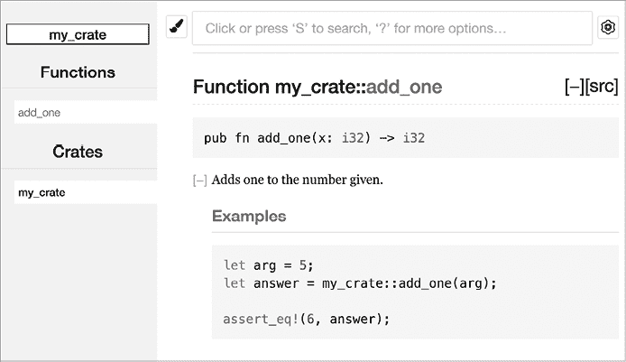

图 14-1：`add_one` 函数的 HTML 文档

#### 章节

我们在列表 14-1 中使用 `# Examples` Markdown 标题在 HTML 中创建一个标题为“Examples”的章节。这里是 crate 作者常用的其他一些章节：

- **Panics**（崩溃）：被记录函数可能发生崩溃的情况。不希望程序崩溃的函数调用者应确保不在这些情况下调用它。
- **Errors**（错误）：如果函数返回 `Result`，描述可能导致这些错误的类型将会有帮助。
- **Safety**（安全）：如果函数调用时是 `unsafe` 的（我们在第 19 章中讨论过安全性），应该有一个章节解释原因。大多数文档注释不需要所有这些章节，但这是一个可以提醒你用户会感兴趣的代码层面的良好清单。

### 作为测试的文档注释

在文档中添加示例代码块可以帮助演示如何使用你的库，这样做还有一个额外的奖励：运行 `cargo test` 会将你文档中的代码作为测试运行！有示例的文档虽好，但由于代码更改导致示例失效就更糟糕了。如果我们为带有列表 14-1 中 `add_one` 函数的文档运行 `cargo test`，会在测试结果中看到如下章节：

```text
Doc-tests my_crate

running 1 test
test src/lib.rs (line 5) ... ok

test result: ok. 1 passed; 0 failed; 0 ignored; 0 measured; 0
filtered out; finished in 0.27s
```

现在，如果我们修改函数或示例，导致示例中的 `assert_eq!` 崩溃，并再次运行 `cargo test`，我们将看到文档测试捕捉到了示例和代码不同步！

### 对包含项的注释

文档注释 `//!` 将注释添加到*包含*注释的条目中，而不是注释之后的条目中。我们通常将这些文档注释放在 crate 根文件（惯例为 `src/lib.rs`）或模块内部，以对整个 crate 或模块进行记录。

例如，为了描述包含 `add_one` 函数的 `my_crate` crate 的目的，我们在 `src/lib.rs` 文件的添加以 `//!` 开头的文档注释，如列表 14-2 所示。

`src/lib.rs`

```rust
//! # My Crate
//!
//! `my_crate` 是一个工具集合，使得执行某些计算变得更加方便。

/// 给给定的数字加 1。
--snip--
```

列表 14-2：整个 `my_crate` crate 的文档

注意，在以 `//!` 开头的最后一行之后没有任何代码。由于我们使用 `//!` 而不是 `///` 来开始注释，因此我们记录的是包含此注释的项，而不是紧随在该注释之后的项。在这种情况下，该项是 `src/lib.rs` 文件，它是 crate 的根节点。这些注释描述了整个 crate。


当我们运行`cargo doc --open`时，这些注释将显示在`my_crate`文档的首页，位于 crate 中公共项列表的上方，如图 14-2 所示。

项内部的文档注释对于描述 crate 和模块尤为有用。使用它们来解释容器的整体用途，帮助你的用户理解 crate 的结构。

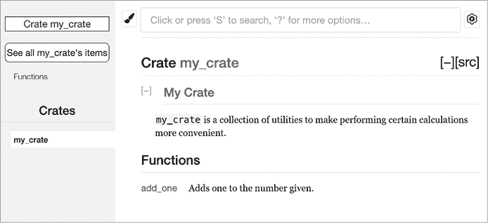

图 14-2：`my_crate`的渲染文档，包括描述整个 crate 的注释

### 使用`pub use`导出方便的公共 API

发布 crate 时，你的公共 API 结构是一个主要的考虑因素。使用你 crate 的人对结构的熟悉程度远没有你那么，如果你的 crate 拥有复杂的模块层次结构，他们可能难以找到想要使用的部分。

在第 7 章中，我们涵盖了如何使用`pub`关键字使项变为公共，以及如何使用`use`关键字将项引入作用域。然而，你在开发 crate 时对你来说合理的结构，对你的用户来说可能并不方便。你可能想将结构体组织在包含多个层级的层次结构中，但那些想要使用你在深层层次结构中定义的类型的人可能无法发现该类型的存在。他们可能还会对必须输入`use my_crate::some_module::another_module::UsefulType;`而不是`use my_crate::UsefulType;`感到烦恼。

好消息是，如果该结构不方便他人从另一个库使用，你不必重新调整你的内部结构：相反，你可以使用`pub use`重新导出项，创建一个与私有结构不同的公共结构。*重新导出*（Re-exporting）是将一个位置的公共项使其在另一个位置也变为公共，就像它定义在另一个位置一样一样。

例如，假设我们创建了一个名为`art`的库，用于建模艺术概念。该库内部有两个模块：一个包含名为`PrimaryColor`和`SecondaryColor`枚举的`kinds`模块，以及一个包含名为`mix`函数的`utils`模块，如列表 14-3 所示。

**src/lib.rs**

```rust
//! # Art
//!
//! 用于建模艺术概念的库。

pub mod kinds {
    /// 根据 RYB 色彩模型的原色。
    pub enum PrimaryColor {
        Red,
        Yellow,
        Blue,
    }

    /// 根据 RYB 色彩模型的间色。
    pub enum SecondaryColor {
        Orange,
        Green,
        Purple,
    }
}

pub mod utils {
    use crate::kinds::*;

    /// 将等量的两种原色混合以创建
    /// 间色。
    pub fn mix(
        c1: PrimaryColor,
        c2: PrimaryColor,
    ) -> SecondaryColor {
        --snip--
    }
}
```

列表 14-3：将项组织在`kinds`和`utils`模块中的`art`库

图 14-3 显示了由`cargo doc`生成的该 crate 文档首页的样子。

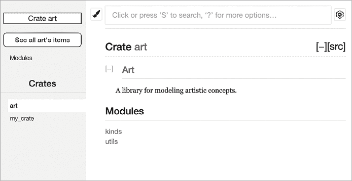

图 14-3：`art`文档首页，列出了`kinds`和`utils`模块

注意，`PrimaryColor`和`SecondaryColor`类型没有列在首页上，`mix`函数也没有。我们必须点击`kinds`和`utils`才能看到它们。

另一个依赖此库的 crate 需要`use`语句来将来自`art`的项引入作用域，并指定当前定义的模块结构。列表 14-4 显示了一个使用`art` crate 中的`PrimaryColor`和`mix`项的 crate 示例。

**src/main.rs**

```rust
use art::kinds::PrimaryColor;
use art::utils::mix;

fn main() {
    let red = PrimaryColor::Red;
    let yellow = PrimaryColor::Yellow;
    mix(red, yellow);
}
```

列表 14-4：一个使用`art` crate 项的 crate，其内部结构已导出

列表 14-4 中使用`art` crate 的代码作者必须弄出`PrimaryColor`在`kinds`模块中，而`mix`在`utils`模块中。`art` crate 的模块结构对于开发`art` crate 的开发者来说比对使用它的人来说更有相关性。内部结构对于试图理解如何使用`art` crate 的人来说并不包含任何有用信息，反而造成了困惑，因为使用它的开发者必须弄清楚去哪里寻找，并且必须在`use`语句中指定模块名。

为了从公共 API 中移除内部结构，我们可以修改列表 14-3 中的`art` crate 代码，添加`pub use`语句在顶层重新导出项，如列表 14-5 所示。

**src/lib.rs**

```rust
//! # Art
//!
//! 用于建模艺术概念的库。

pub use self::kinds::PrimaryColor;
pub use self::kinds::SecondaryColor;
pub use self::utils::mix;

pub mod kinds {
    --snip--
}

pub mod utils {
    --snip--
}
```

列表 14-5：添加`pub use`语句以重新导出项

`cargo doc`为此 crate 生成的 API 文档现在首页列出并链接重新导出项，如图 14-4 所示，使得`PrimaryColor`和`SecondaryColor`类型以及`mix`函数更容易找到。

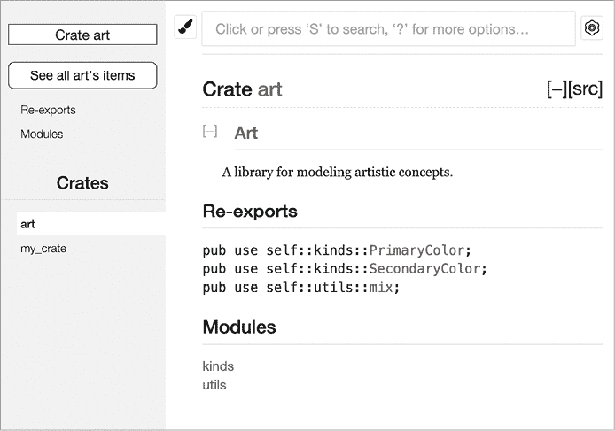

图 14-4：`art`文档首页，列出了重新导出项

`art` crate 的用户仍然可以看到并使用列表 14-3 中的内部结构，如列表 14-4 所示，或者他们可以使用列表 14-5 所示。

```rust
use art::mix;
use art::PrimaryColor;

fn main() {
    --snip--
}
```

列表 14-6：一个使用`art` crate 重新导出项的程序

创建一个用的公共 API 结构更多是艺术而非科学，你可以通过迭代找到最适合用户的 API。选择`pub use`为你组织 crate 内部结构提供了灵活性，并将内部结构与你向用户展示的内容解耦。`pub use`的另一个常见用法是在当前 crate 中重新导出依赖项的定义，从而使该依赖的定义成为你 crate 公共 API 的一部分。查看你安装的某些 crate 的代码，看看它们的内部结构是否与公共 API 有不同。

在发布任何 crate 之前，你需要在[`crates.io`](https://crates.io)创建一个账户并获取 API 令牌。要做到这一点，请访问[`crates.io`](https://crates.io)首页并通过 GitHub 账户登录。（目前 GitHub 账户是强制性要求的，但该网站未来可能会支持其他创建账户的方式。）登录后，访问[`crates.io/me`](https://crates.io/me)中的账户设置并获取你的 API 密钥。然后使用你的 API 密钥运行`cargo login`命令，如下：

```bash
$ cargo login abcdefghijklmnopqrstuvwxyz012345
```

此命令会将你的 API 令牌告知 Cargo 并将其存储在本地的`~/.cargo/credentials`中。请注意，此令牌是一个`secret*`：不要与任何人共享。如果你出于任何原因与他人共享了它，你应该撤销它并在[`crates.io`](https://crates.io)上重新生成一个令牌。

### 为新 Crate 添加元数据

假设你有一个想要发布的 crate。在发布之前，你需要在 crate 的`Cargo.toml`文件的`[package]`部分中添加一些元数据。

你的 crate 需要一个唯一的名称。当你在本地开发 crate 时，你可以为它命名任何名称。然而，[`crates.io`](https://crates.io)上的 crate 名称按先到付费原则进行分配。一旦某个 crate 名称被占用，其他人就无法发布同名的 crate。在尝试发布 crate 之前，请先搜索你想要使用的名称。如果该名称已被使用，你需要寻找另一个名称，并编辑`Cargo.toml`文件中`[package]`部分下的`name`字段以使用新名称进行发布，如下：

**Cargo.toml**

```toml
[package]
name = "guessing_game"
```

即使你选择了唯一的名称，当你此时运行`cargo publish`发布该 crate 时，你将收到一个警告，然后是一个错误：

```text
$ cargo publish
    Updating crates.io index
warning: manifest has no description, license, license-file, documentation,
homepage or repository.
See https://doc.rust-lang.org/cargo/reference/manifest.xhtml#package-metadata
for more info.
--snip--
error: failed to publish to registry at https://crates.io

Caused by:
  the remote server responded with an error: missing or empty metadata fields:
description, license. Please see https://doc.rust-lang.org/cargo/reference
/manifest.xhtml for how to upload metadata
```

这会导致错误，因为你缺少了一些关键信息：需要描述（description）和许可（license），以便人们知道你的 crate 是做什么的，以及他们可以在什么条款下使用它。在`Cargo.toml`中，添加一两句话作为描述，因为它将与你的 crate 一起出现在搜索结果中。对于`license`字段，你需要提供一个`license identifier value`。[`spdx.org/licenses`](https://spdx.org/licenses) Linux 基金会软件软件包数据交换（SPDX）列出了你可以用于此值的标识符。例如，若要指定你使用 MIT 许可授权你的 crate，请添加`MIT`标识符：

**Cargo.toml**

```toml
[package]
name = "guessing_game"
license = "MIT"
```

如果你想使用未出现在 SPDX 中的许可协议，你需要将该许可的文本放在一个文件中，将该文件包含在项目中，然后使用`license-file`来指定该文件名，而不是使用`license`键。

关于哪个许可适用于你的项目的指导超出了本书的范围。Rust 社区的许多人以 Rust 相同的方式通过使用`MIT OR Apache-2.0`双重许可为他们的项目授权。这种做法表明你也可以指定用`OR`分隔的多个许可标识符，为你的项目提供多个许可。

在添加了唯一名称、版本、描述和许可后，准备好发布的项目`Cargo.toml`文件可能如下所示：

**Cargo.toml**

```toml
[package]
name = "guessing_game"
version = "0.1.0"
edition = "2021"
description = "A fun game where you guess what number the
computer has chosen."
license = "MIT OR Apache-2.0"

[dependencies]
```

[`doc.rust-lang.org/cargo`](https://doc.rust-lang.org/cargo)上的 Cargo 文档描述了你可以指定的其他元数据，以确保其他人更容易发现和使用你的 crate。

### 发布到 Crates.io

现在你已经创建了账户、保存了 API 令牌、为 crate 选择了名称并指定了所需的元数据，你准备好发布了！发布 crate 会将特定版本上传到[`crates.io`](https://crates.io)供他人使用。

请小心，因为发布是`permanent*`。版本永远无法被覆盖，代码无法被删除。Crates.io 的主要目标之一是作为代码永久存档，这样所有依赖于[`crates.io`](https://crates.io)上 crate 的项目构建将继续有效。允许删除版本将使这一目标无法实现。然而，版本数量没有限制。

### 发布现有 crate 的新版本

当你对 crate 进行了修改并准备发布新版本时，更改`Cargo.toml`文件中的`version`值并重新发布。参考[`semver.org`](https://semver.org)的语义化规则来决定合适的版本号。然后运行`cargo publish`。

### 使用`cargo yank`废用 Crates.io 版本

虽然不能删除之前的版本，但你可以防止未来的项目将其添加。当某个 crate 版本出现问题时，这种方法非常有用。Cargo 支持废用（yank）crate 版本。

*废用*一个版本可以防止新项目依赖它，同时允许已依赖它的项目继续运行。本质上，废用意味着所有的`Cargo.lock`文件都不会损坏，且未来生成的`Cargo.lock`文件不会使用被废用的版本。

要废用 crate 版本，在你之前发布的 crate 目录下运行`cargo yank`并指定你想废用的版本。例如，如果我们发布了名为`guessing_game`的 1.0.1 版本 crate，并想废用它，在项目目录下运行：

```bash
$ cargo yank --vers 1.0.1
    Updating crates.io index
        Yank guessing_game@1.0.1
```

通过在命令中添加`--undo`，你也可以撤销废用，允许项目重新依赖该版本：

```bash
$ cargo yank --vers 1.0.1 --undo
    Updating crates.io index
      Unyank guessing_game@1.0.1
```

废用不会删除任何代码。例如，意外上传了密钥，必须立即重置这些密钥。

## Cargo 工作空间

在第 12 章中，我们构建了一个包含二进制 crate 和库 crate 的包。随着项目的开发，你可能会发现库 crate 变得越来越大，你想将包进一步拆分为多个库 crate。Cargo 提供了名为*workspaces*（工作空间）的功能，可以帮助管理多个协同开发的相关包。

### 创建工作空间

`workspace`（工作区）是一组共享相同`Cargo.lock`和输出目录的包。让我们使用工作区创建一个项目——我们将使用简单的代码，这样就可以专注于工作区的结构。构建工作区有多种方法，因此我们只展示一种常见的方法。我们将拥有一个包含一个二进制文件（binary）和两个库（library）的工作区。二进制文件将提供主要功能，它将依赖于这两个库。其中一个库提供`add_one`函数，另一个库提供`add_two`函数。这三个 crate（单元）将成为同一个工作区的一部分。我们首先为工作区创建一个新目录：

```bash
$ mkdir add
$ cd add
```

接下来，在`add`目录中，我们创建`Cargo.toml`文件来配置整个工作区。该文件不会包含`[package]`部分。相反，它将以`[workspace]`部分开头，这允许我们通过指定二进制 crate 包的路径来向工作区添加成员；在这种情况下，该路径是`adder`：

**Cargo.toml**

```toml
[workspace]

members = [
    "adder",
]
```

接下来，我们在`add`目录内运行`cargo new`来创建`adder`二进制 crate：

```bash
$ cargo new adder
     Created binary (application) `adder` package
```

此时，我们可以通过运行`cargo build`来构建工作区。你的`add`目录下的文件应该如下所示：

```text
├── Cargo.lock
├── Cargo.toml
├── adder
│   ├── Cargo.toml
│   └── src
│       └── main.rs
└── target
```


工作区在顶层有一个 `target` 目录，编译后的产物将放在其中；`adder` 包没有自己的 `target` 目录。即使我们在 `adder` 目录内部运行 `cargo build`，编译后的产物仍然会进入 `add/target`，而不是 `add/adder/target`。Cargo 这样结构化工作区的 `target` 目录，是因为工作区中的 crates 旨在相互依赖的。如果每个 crate 都有自己的 `target` 目录，那么每个 crate 都必须重新编译工作区中的其他每个 crate，以便将产物放在其自己的 `target` 目录中。通过共享一个 `target` 目录，crates 可以避免不必要的重新构建。

### 在工作区中创建第二个包

接下来，在工作区中创建另一个成员包并将其命名为 `add_one`。修改顶层的 `Cargo.toml`，在 `members` 列表中指定 `add_one` 的路径：

**Cargo.toml**

```toml
[workspace]

members = [
    "adder",
    "add_one",
]
```

然后生成一个名为 `add_one` 的新库 crate：

```bash
$ cargo new add_one --lib
     Created library `add_one` package
```

你的 `add` 目录现在应该有这些目录和文件：

```
├── Cargo.lock
├── Cargo.toml
├── add_one
│   ├── Cargo.toml
│   └── src
│       └── lib.rs
├── adder
│   ├── Cargo.toml
│   └── src
│       └── main.rs
└── target
```

在 `add_one/src/lib.rs` 文件中，让我们添加 `add_one` 函数：

**add_one/src/lib.rs**

```rust
pub fn add_one(x: i32) -> i32 {
    x + 1
}
```

现在我们可以让带有二进制文件的 `adder` 包依赖于带有库的 `add_one` 包。首先，我们需要在 `adder/Cargo.toml` 中添加对 `add_one` 的路径依赖：

**adder/Cargo.toml**

```toml
[dependencies]
add_one = { path = "../add_one" }
```

Cargo 并不会假设工作区中的 crates 会相互依赖，因此我们需要显式说明依赖关系。

接下来，让我们在 `adder` crate 中使用来自 `add_one` crate 的 `add_one` 函数。打开 `adder/src/main.rs` 文件，并在顶部添加一条 `use` 行以将新的 `add_one` 库 crate 引入作用域。然后修改 `main` 函数以像列表 14-7 所示调用 `add_one` 函数。

**adder/src/main.rs**

```rust
use add_one;

fn main() {
    let num = 10;
    println!(
        "Hello, world! {num} plus one is {}!",
        add_one::add_one(num)
    );
}
```

列表 14-7：在 `adder` crate 中使用 `add_one` 库 crate。

让我们在顶层 `add` 目录中运行 `cargo build` 来构建工作区！

```bash
$ cargo build
   Compiling add_one v0.1.0 (file:///projects/add/add_one)
   Compiling adder v0.1.0 (file:///projects/add/adder)
    Finished dev [unoptimized + debuginfo] target(s) in 0.68s
```

要从 `add` 目录运行二进制 crate，我们可以使用 `-p` 参数和包名配合 `cargo run` 来指定我们要运行工作区中的哪个包：

```bash
$ cargo run -p adder
     Hello, world! 10 plus one is 11!
```

### 工作区中的依赖外部包

注意顶层的 `Cargo.lock` 现在包含了对 `rand` 的依赖信息。然而，尽管 `rand` 在工作区某处被使用，除非我们在其他 crate 的 `Cargo.toml` 中添加 `rand`，否则无法使用它。例如，如果我们在 `adder` 包的 `src/main.rs` 文件中添加 `use rand;`，我们将得到错误：

```bash
$ cargo build
   --snip--
   Compiling adder v0.1.0 (file:///projects/add/adder)
error[E432]: unresolved import `rand`
 --> adder/src/main.rs:2:5
  |
2 | use rand;
  |     ^^^^ no external crate `rand`
```

要修复此问题，编辑 `adder` 包的 `Cargo.toml` 文件并指示 `rand` 是它的依赖。构建 `adder` 包会将 `rand` 添加到它的依赖项列表中，但 Cargo 确保了工作区中使用 `rand` 包的每个 crate 都使用相同的版本，从而节省了空间并确保工作区中的 crates 能够相互兼容。

### 为工作区添加测试

作为另一个增强，让我们在 `add_one` crate 中为 `add_one::add_one` 函数添加测试：

**add_one/src/lib.rs**

```rust
pub fn add_one(x: i32) -> i32 {
    x + 1
}

#[cfg(test)]
mod tests {
    use super::*;

    #[test]
    fn it_works() {
        assert_eq!(3, add_one(2));
    }
}
```

现在在顶层 `add` 目录中运行 `cargo test`。在此类结构的工作区中运行 `cargo test` 将运行工作区所有 crate 的测试：

```bash
$ cargo test
   Running tests in target/debug/deps/add_one-0.1.0 (file:///projects/add/add_one)
   running 1 test
   test test add_one::tests::it_works ... ok

   test  passed; test result = 0.00s

   Running tests in target/debug/deps/adder-0.1.0 (file:///projects/add/adder)
   running 0 tests
   --
   ok = 0 test
```

```bash
$ cargo test
   Compiling add_one v0.1.0 (file:///projects/add/add_one)
   Compiling adder v0.1.0 (file:///projects/add/adder)
    Finished test [unoptimized + debuginfo] target(s) in 0.27s
     Running unittests src/lib.rs (target/debug/deps/add_one-f0253159197f7841)

running 1 test
test tests::it_works ... ok

test result: ok. 1 passed; 0 failed; 0 ignored; 0 measured; 0 filtered out;
finished in 0.00s

     Running unittests src/main.rs (target/debug/deps/adder-49979ff40686fa8e)

running 0 tests

test result: ok. 0 passed; 0 failed; 0 ignored; 0 measured; 0 filtered out;
finished in 0.00s

   Doc-tests add_one

running 0 tests

test result: ok. 0 passed; 0 failed; 0 ignored; 0 measured; 0 filtered out;
finished in 0.00s
```

输出的第一部分显示 `add_one` crate 中的 `it_works` 测试通过了。下一部分显示在 `adder` crate 中没有找到任何测试，最后一部分显示 `add_one` crate 中没有找到任何文档测试。

我们还可以使用 `-p` 标志并指定想要测试的 crate 名称，从顶层目录为工作区中的某个特定 crate 运行测试：

```bash
$ cargo test -p add_one
    Finished test [unoptimized + debuginfo] target(s) in 0.00s
     Running unittests src/lib.rs (target/debug/deps/add_one-b3235fea9a156f74)

running 1 test
test tests::it_works ... ok

test result: ok. 1 passed; 0 failed; 0 ignored; 0 measured; 0 filtered out;
finished in 0.00s

   Doc-tests add_one

running 0 tests

test result: ok. 0 passed; 0 failed; 0 ignored; 0 measured; 0 filtered out;
finished in 0.00s
```

此输出显示 `cargo test` 只运行了 `add_one` crate 的测试，而没有运行 `adder` crate 的测试。

如果你将工作区中的 crates 发布到 [`crates.io`](https://crates.io)，工作区中的每个 crate 都需要单独发布。类似于 `cargo test`，我们可以通过使用 `-p` 标志并指定想要发布的 crate 名称来发布工作区中的特定 crate。

为了进行额外练习，请以类似于 `add_one` crate 的方式向此工作区添加一个 `add_two` crate！

随着你的项目的增长，请考虑使用工作区：它提供了比一大块代码更易理解、更小且更独立的组件。此外，如果 crates 经常同时更改，将它们保持在工作区中可以使它们之间的协调更容易。

## 使用 `cargo install` 安装二进制文件

`cargo install` 命令允许你在本地安装和使用二进制 crate。这并不是为了替代系统软件包；而是为了给 Rust 开发者提供一种方便的方法，来安装他人在 [`crates.io`](https://crates.io) 上共享的工具。注意，你只能安装具有二进制目标的包。`binary target`（二进制目标）是指如果 crate 拥有 `src/main.rs` 文件或另一个被指定为二进制的文件，则会创建的可运行程序，而库目标（library target）则无法独立运行，但适合包含在其他程序中。通常，crate 的 README 文件中包含关于 crate 是否为库、是否有二进制目标或两者兼有的信息。

所有通过 `cargo install` 安装的二进制文件都存储在安装根目录的 `bin` 中。如果你使用 `rustup.rs` 安装 Rust 且没有任何自定义配置，该目录将是 `$HOME/.cargo/bin`。确保该目录在你的 `$PATH` 中，以便运行通过 `cargo install` 安装的程序。

例如，在第 12 章中，我们提到过 `grep` 工具的 Rust 实现版本 `ripgrep`，用于搜索文件。要安装 `ripgrep`，我们可以运行以下命令：

```bash
$ cargo install ripgrep
    Updating crates.io index
  Downloaded ripgrep v13.0.0
  Downloaded 1 crate (243.3 KB) in 0.88s
  Installing ripgrep v13.0.0
   --snip--
   Compiling ripgrep v13.0.0
    Finished release [optimized + debuginfo] target(s) in 3m 10s
  Installing ~/.cargo/bin/rg
   Installed package `ripgrep v13.0.0` (executable `rg`)
```

输出的倒数第二行显示了安装二进制文件的位置和名称，对于 `ripgrep` 来说就是 `rg`。如前，只要安装目录在你的 `$PATH` 中，你就可以运行 `rg --help` 并开始使用更快、更 Rust 化的工具来搜索文件！

## 通过自定义命令扩展 Cargo

Cargo 的设计允许你进行扩展。与其他包管理器不同，你可以通过编写自己的二进制文件并将其命名为 `cargo-something` 来添加自己的命令。当你运行 `cargo something` 时，Cargo 会在 `$PATH` 中查找名为 `cargo-something` 的可执行文件并执行它。这允许你通过自定义命令扩展 Cargo。

## 总结

Rust 的所有权和借用概念使得引用和智能指针之间存在区别：引用只借用数据，而在许多情况下智能指针拥有它们所指向的数据。

# 15 智能指针

指针（pointer）是一个通用概念，表示包含地址的变量。该地址引用（或“指向”）某些数据。Rust 中常见的指针类型是引用，你在第 4 章中学习过。相比之下，智能指针是指像指针但具有元数据的数据结构。智能指针的概念并不是 Rust 特有的：它们起源于 C++ 并存在于其他语言中。Rust 标准库定义了多种智能指针，提供了引用之外的功能。为了探索通用概念，我们将查看不同的智能指针示例，包括引用计数智能指针类型。这种指针通过跟踪所有者的数量，在没有所有者剩余时清理数据，从而允许数据拥有多个所有者。

* `Rc<T>`，一种允许多重所有权的引用计数类型。
* `Ref<T>` 和 `RefMut<T>`，通过 `RefCell<T>` 访问，该类型在运行时强制执行借用规则而不是编译时。

此外，我们还将介绍内部可变性（interior mutability）模式，即不可变类型暴出一个用于修改内部值的 API。我们还将讨论引用循环：它们是如何导致内存泄漏的，以及如何防止它们。

让我们开始深入吧！

## 使用 `Box<T>` 指向堆上的数据

最直接的智能指针是 `Box`（箱），其类型写为 `Box<T>`。`Box` 允许你将数据存储在堆上而不是栈上。保留在栈上的是指向堆数据的指针。请参阅第 4 章以复习栈和堆的区别。

除了将数据存储在堆上而不是栈上之外，`Box` 并没有额外的性能开销。不过，它们也没有许多额外的功能。你将在以下情况下最频繁地使用它们：

* 当你有一个大小在编译时无法知的类型，且你想在需要精确大小的语文中使用该类型的值时。
* 当你有大量数据并想转移所有权，但又要确保在转移时数据不会被复制时。
* 当你想要拥有一个值，且你只关心它是否实现了特定的 trait（特征），而不是它是否是特定类型时。

我们将在本章后半部分的“使用 `Box` 启用递归类型”中演示第一种情况。在第二种情况下，转移大量数据的所有权可能花费很长时间，因为数据会在栈上反复复制。为了提高这种情况下的性能，我们可以将大量数据存储在堆上的 `box` 中。这样，只有少量的指针数据会在栈上进行复制，而它引用的数据保持在堆的某处。第三种情况被称为 trait 对象（trait object），而第 379 页的“使用允许不同类型值的 trait 对象”章节专门讨论了该主题。所以，你在这里学到的知识将在该部分再次应用！

### 使用 `Box<T>` 在堆上存储数据

在讨论 `Box<T>` 的堆存储用例之前，我们先介绍语法以及如何与存储在 `Box<T>` 中的值进行交互。

Listing 15-1 展示了如何使用 box 在堆上存储一个 `i32` 值。

**src/main.rs**

```rust
fn main() {
    let b = Box::new(5);
    println!("b = {b}");
}
```

Listing 15-1：使用 box 在堆上存储一个 `i32` 值。

我们定义变量 `b` 的值为一个指向值 `5` 的 `Box`，该值 `5` 被分配在堆上。该程序将打印 `b = 5`；在这种情况下，我们访问 box 中数据的方式与这些数据在栈上时一样。就像任何拥有所有权的值一样，当 box 离开作用范围时（如 `b` 在 `main` 结束时），它会被释放。释放操作会同时发生在 box（存储在栈上）和它所指向的数据（存储在堆上）。

在堆上放置单个值并不 Practical 用，因此你不会经常以这种方式单独使用 box。在大多数情况下，将值存储在栈上（这是它们的默认存储位置，如单个 `i32`）更为合适。让我们来看一个例子，box 允许我们定义在如果没有 box 时将无法定义的类型。

### 使用 `Box` 启用递归类型


递归类型（recursive type）的值可以包含另一个相同类型的值作为自身的一部分。递归类型带来了问题，因为在编译时，Rust 需要知道一个类型占用多大的空间。然而，递归类型值的嵌套在理论上可以无限持续，因此 Rust 无法知道该值需要多少空间。因为 box 具有已知的大小，我们可以在递归类型定义中插入一个 box 来启用递归类型。

作为递归类型的示例，让我们探索一下 cons 列表（cons list）。这是一种函数式编程语言中常见的数据类型。我们将定义的 cons 列表类型除了递归外非常直观；因此，我们在示例中处理的概念在任何遇到涉及递归类型的复杂情况时都将很有用。

#### 关于 cons 列表的更多信息

cons 列表是一种源自 Lisp 编程语言及其变言的数据结构，由嵌套的对组成，是 Lisp 版本的链表。它的名字来源于 Lisp 中的 `cons` 函数（construct function，构造函数的缩写），该函数根据其两个参数构造一个新的新对。通过对一个由值和另一个对组成的对调用 `cons`，我们可以构造出由递归对组成的 cons 列表。

例如，这里是包含列表 `1, 2, 3` 的 cons 列表的伪代码表示，每个对都放在括号中：

```
(1, (2, (3, Nil)))
```

cons 列表中的每个项包含两个元素：当前项的值和下一个项。列表中的最后一项只包含一个名为 `Nil` 的值，没有后续项。cons 列表通过递归调用 `cons` 函数产生。表示递归基例的标准名称是 `Nil`。注意，这与之前讨论的“null”或“nil”概念不同。cons 列表并不是 Rust 中常用的结构。在大多数情况下，当你有一个递归类型结构时，`Vec<T>` 是更好的选择。递归类型在 Rust 中是很有用的，但通过在本章中使用 box，我们可以定义它们。注意，这代码目前无法编译，因为 `List` 类型没有大小。

Listing 15-2 包含了 cons 列表的定义。

`src/main.rs`

```
enum List {
    Cons(i32, List),
    Nil,
}
```

Listing 15-2：定义 cons 列表枚举的首次尝试。

使用 `List` 类型存储列表 `1, 2, 3` 看起来像 Listing 15-3 所示。

`src/main.rs`

```
use crate::List::{Cons, Nil};

fn main() {
    let list = Cons(1, Cons(2, Cons(3, Nil)));
}
```

Listing 15-3：列表 `1, 2, 3`

第一个 `Cons` 值持有 `1` 和另一个 `List` 值。这个 `List` 值是另一个 `Cons` 值，持有 `2` 和另一个 `List` 值。这个 `List` 值是又一个 `Cons` 值，持有 `3` 和一个 `List` 值，而 `Nil` 是标记列表结束的非递归变体。

如果我们尝试编译 Listing 15-3 中的代码，将得到 Listing 15-4 所示的错误。

```
error[E0072]: recursive type `List` has infinite size
 --> src/main.rs:1:1
1 | enum List {
  | ^^^^^^^^^ recursive type has infinite size
2 |     Cons(i32, List),
  |               ---- 无间接的递归
  |
help: 插入一些间接（例如 `Box`、`Rc` 或 `&`）使 `List` 可表示
  |
2 |     Cons(i32, Box<List>),
  |               ++++    +
```

Listing 15-4：尝试递归枚举时得到的错误

为了确定为 `Message` 值分配多少空间，Rust 会遍历每个变体（variant），以查看哪个变体需要最大的空间。Rust 发现 `Message::Quit` 不需要任何空间，`Message::Move` 需要足够的空间来存储两个 `i32` 值，以此此类推。因为只会有一个变体会被使用，所以 `Message` 值需要的最大空间就是存储其最大的变体所占的空间。

与此对比的是，当 Rust 尝试确定如 Listing 15-2 中 `List` 枚举这样的递归类型需要多少空间时发生的情况。编译器首先查看 `Cons` 变体，它包含一个类型为 `i32` 的值和一个类型为 `List` 的值。因此，`Cons` 需要的空间等于 `i32` 的大小加上 `List` 的大小。为了确定 `List` 类型需要多少内存，编译器开始查看变体，从 `Cons` 变体开始。`Cons` 变体包含一个类型为 `i32` 的值和一个类型为 `List` 的值，这个过程会无限持续下去，如图 15-1 所示。

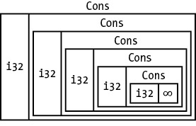

图 15-1：由无限 `Cons` 变体组成的无限 `List`

### 使用 `Box<T>` 获取已知大小的递归类型

由于 Rust 无法确定为递归定义的类型分配多少空间，编译器会给出一个错误，并提供这个友好的建议：

```
help: 插入一些间接层（例如 `Box`、`Rc` 或 `&`）以使 `List`
可表示
  |
2 |     Cons(i32, Box<List>),
  |               ++++    +
```

在这一建议中，间接性（indirection）意味着我们不应该直接存储值，而应该改变数据结构，通过存储指向该值的指针来间接存储该值。

由于 `Box<T>` 是一个指针，Rust 始终知道 `Box<T>` 需要多少空间：指针的大小不会根据它所指向的数据量而改变。这意味着我们可以将 `Box<T>` 放入 `Cons` 变体，而不是直接放入另一个 `List` 值。`Box<T>` 将指向堆上的下一个 `List` 值，而不是 `Cons` 变体内部。从概念上说，我们仍然有一个列表，由包含其他列表的列表创建，但这种实现现在更像是将项目并排放置，而不是嵌套在内部。

我们可以将 Listing 15-2 中 `List` 枚举的定义以及 Listing 15-3 中对 `List` 的使用修改为 Listing 15-5 中的代码，这样就是可以通过编译的。

`src/main.rs`

```
enum List {
    Cons(i32, Box<List>),
    Nil,
}

use crate::List::{Cons, Nil};

fn main() {
    let list = Cons(
        1,
        Box::new(Cons(
            2,
            Box::new(Cons(
                3,
                Box::new(Nil)
            ))
        ))
    );
}
```

Listing 15-5：使用 `Box<T>` 以具有已知大小的 `List` 定义

`Cons` 变体需要 `i32` 的大小加上存储 box 指针数据的空间。`Nil` 变体不存储值，因此它需要的空间比 `Cons` 变体少。我们现在知道任何 `List` 值将占用 `i32` 的大小加上 box 指针数据的大小。通过使用 box，我们打破了无限递归链，因此编译器可以确定存储一个 `List` 值所需的大小。图 15-2 展示了现在 `Cons` 变体的样子。

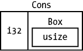

图 15-2：一个不是无限大的 `List`，因为 `Cons` 持有一个 `Box`

Box 仅提供间接性和堆分配；它们没有其他任何特殊功能，就像我们将在其他智能指针类型中看到的那样。它们也没有这些特殊功能所带来的性能开销，因此在 cons 列表等情况下（如果间接性是我们唯一需要的），它们是很有用的。我们将在第 17 章中查看 box 的更多用例。

`Box<T>` 类型是一个智能指针，因为它实现了 `Deref` trait，这允许 `Box<T>` 值像引用一样被处理。

### 通过 `Deref` 将智能指针像引用一样处理

`Deref` trait 允许 `Box<T>` 值像引用一样被处理。

### 跟随指针的值

普通引用是存储在其他地方的值。在 Listing 15-6 中，我们创建了一个指向 `i32` 值的引用。

`src/main.rs`

```
fn main() {
  ❶ let x = 5;
  ❷ let y = &x;

  ❸ assert_eq!(5, x);
  ❹ assert_eq!(5, *y);
}
```

Listing 15-6：使用解引用运算符跟随引用

变量 `x` 持有一个 `i32` 值 `5` ❶。我们将 `y` 设置为 `x` 的引用 ❷。我们可以断言 `x` 等于 `5` ❸。但如果我们对 `y` 中的值进行断言，我们必须使用 `*y` 来跟随它指向的值。一旦我们解引用 `y`，我们就可以访问它指向的整数值，并与 `5` 进行比较。

如果我们尝试编写 `assert_eq!(5, y);`，将会得到这个编译错误：

```
error[E277]: can't compare `{integer}` with `&{integer}`
 --> src/main.rs:6:5
  |
6 |     assert_eq!(5, y);
  |     ^^^^^^^^^^^^ no implementation for `{integer} == &{integer}`
  |
  = help: the trait `PartialEq<&{integer}>` is not implemented
for `{integer}`
```

比较数字和数字的引用是不允许的，因为它们是不同的类型。我们必须使用解引用运算符跟随引用指向的值。

### 像引用一样使用 `Box<T>`

我们可以将 Listing 15-6 中的代码重写为使用 `Box<T>` 代替引用；在 Listing 15-7 中对 `Box<T>` 使用的解引用运算符与在 Listing 15-6 中对引用使用的解引用运算符的功能相同。

`src/main.rs`

```
fn main() {
    let x = 5;
  ❶ let y = Box::new(x);

    assert_eq!(5, x);
  ❷ assert_eq!(5, *y);
}
```

Listing 15-7：对 `Box<i32>` 使用解引用运算符

Listing 15-7 和 Listing 15-6 之间的主要区别在于，在这里我们将 `y` 设置为指向 `x` 的拷贝值的 `box` 实例，而不是一个指向 `x` 值的引用 ❶。在最后一个断言 ❷ 中，我们可以使用解引用运算符，像之前 `y` 是引用时那样追踪 `box` 的指针。接下来，我们将探索 `Box<T>` 的特殊之处，正是它使我们能够通过定义自己的箱类型类型来使用解引用运算符。

### 定义我们自己的智能指针

让我们构建一个与标准库提供的 `Box<T>` 类型相似的智能指针，以体验智能指针在默认情况下是如何与引用表现得不同的。然后我们将查看如何添加使用解引用运算符的能力。

`Box<T>` 类型最终被定义为一个只有一个元素的元组组结构体，因此 Listing 15-8 以相同的方式定义了 `MyBox<T>` 类型。我们还会定义一个 `new` 函数，以匹配 `Box<T>` 上定义的 `new` 函数。

`src/main.rs`

```
 ❶ struct MyBox<T>(T);

impl<T> MyBox<T> {
  ❷ fn new(x: T) -> MyBox<T> {
      ❸ MyBox(x)
    }
}
```

Listing 15-8：定义一个 `MyBox<T>` 类型

我们定义了一个名为 `MyBox` 的结构，并声明了一个泛型参数 `T` ❶，因为我们希望我们的类型能够持有任何类型的值。`MyBox` 类型是一个带有一个类型为 `T` 的元素的元组结构。`MyBox::new` 函数接受一个类型为 `T` 的参数 ❷，并返回一个持有传入值 ❸ 的 `MyBox` 实例。

让我们尝试将 Listing 15-7 中的 `main` 函数添加到 Listing 15-8 中，并将其更改为使用我们定义的 `MyBox<T>` 类型而不是 `Box<T>`。Listing 15-9 中的代码将无法编译，因为 Rust 不知道如何解引用 `MyBox`。

```
fn main() {
    let x = 5;
    let y = MyBox::new(x);

    assert_eq!(5, x);
    assert_eq!(5, *y);
}
```

Listing 15-9：尝试像引用 `Box<T>` 一样使用 `MyBox<T>`

以下是产生的编译错误：

```
error[E0614]: type `MyBox<{integer}>` cannot be dereferenced
  --> src/main.rs:14:19
   |
14 |     assert_eq!(5, *y);
   |                   ^^
```

我们的 `MyBox<T>` 类型无法解引用，因为我们没有在自己的类型上实现该功能。为了能够使用 `*` 运算符进行解引用，我们实现了 `Deref` 特性。

### 实现 `Deref` 特性

正如第 193 页“在类型上实现特性”中所讨论的，要实现一个特性，我们需要为该特性的要求方法提供实现。标准库提供的 `Deref` 特性要求我们实现一个名为 `deref` 的方法，该方法借用 `self` 并返回内部数据的引用。Listing 15-10 包含了 `Deref` 的实现，添加到 `MyBox<T>` 的定义中。

```
use std::ops::Deref;

impl<T> Deref for MyBox<T> {
  ❶ type Target = T;

    fn deref(&self) -> &Self::Target {
      ❷ &self.0
    }
}
```

Listing 15-10：在 `MyBox<T>` 上实现 `Deref`

`type Target = T;` ❶ 为 `Deref` 特性定义了一个关联类型。关联类型是声明泛型参数的一种稍微不同的方式，但你现在不需要担心它们；我们将在第 19 章详细介绍它们。

我们用 `&self.0` 填充 `deref` 方法的主体，以便 `deref` 返回我们想要通过 `*` 运算符访问的值引用 ❷；回想第 89 页“使用无命名字段的元组结构体创建不同类型”，`.0` 访问元组结构体中的第一个值。Listing 15-9 中在 `MyBox<T>` 值上调用 `*` 的 `main` 函数现在可以编译了，且断言通过了！

如果没有 `Deref` 特性，编译器只能解引用 `&` 引用。`deref` 方法赋予了编译器获取任何实现了 `Deref` 的类型的值并调用 `deref` 方法以获取 `&` 引用的能力。

### 函数和方法的隐式解引用强制转换

解引用强制转换（Deref coercion）被添加到 Rust 中，这样程序员就不需要添加额外的引用和解引用。为了看到解引用强制转换的作用，让我们使用 Listing 15-8 中定义的 `MyBox<T>` 类型，以及我们在 Listing 15-10 中添加的 `Deref` 实现。Listing 15-11 显示了一个带有字符串切片的函数定义。

```
fn hello(name: &str) {
    println!("Hello, {name}!");
}
```

Listing 15-11：具有类型为 `&str` 的参数 `name` 的 `hello` 函数

可以使用字符串切片作为参数调用 `hello` 函数，例如 `hello("Rust");`。解引用强制转换使得像 Listing 15-12 所示使用类型为 `MyBox<String>` 的值的引用来调用 `hello`。

```
fn main() {
    let m = MyBox::new(String::from("Rust"));
    hello(&m);
}
```

Listing 15-12：使用 `MyBox<String>` 值的引用调用 `hello`，由于解引用强制转换执行可行

在这里我们使用参数 `&m` 调用 `hello` 函数，`&m` 是 `MyBox<String>` 值的引用。因为我们在 Listing 15-10 中为 `MyBox<T>` 实现了 `Deref` 特性，Rust 可以通过调用 `deref` 将 `&MyBox<String>` 转换为 `&String`。标准库为 `String` 提供了 `Deref` 实现以返回字符串切片，这在 `Deref` 的 API 文档中。Rust 再次调用 `deref` 将 `&String` 转换为 `&str`，这匹配了 `hello` 函数的定义。

如果 Rust 没有实现解引用强制转换（deref coercion），我们必须使用代码列表 15-13 中的代码，而不是代码列表 15-12 中的代码来通过类型为 `&MyBox<String>` 的值调用 `hello`。

`src/main.rs`

```
fn main() {
    let m = MyBox::new(String::from("Rust"));
    hello(&(*m)[..]);
}
```


### 代码列表 15-13：如果 Rust 没有解引用强制转换，我们必须编写的代码

`(*m)` 将 `MyBox<String>` 解引用为 `String`。然后 `&` 和 `[..]` 获取该 `String` 的一个等于整个字符串的字符串切片，以匹配 `hello` 的签名。由于涉及到了所有符号，这段没有解引用强制转换的代码变得更难以阅读、编写和理解。解引用强制转换允许 Rust 自动为我们处理这些转换。

当为涉及的类型定义了 `Deref` 特性时，Rust 将分析类型并根据需要多次使用 `Deref::deref`，以获取一个匹配参数类型的引用。`Deref::deref` 需要插入的次数在编译时解决，因此利用解引用强制转换没有任何运行时开销！

### 解引用强制转换如何与可变性交互

类似于你使用 `Deref` 特性来重载不可变引用的 `*` 运算符，你也可以使用 `DerefMut` 特性来重载可变引用的 `*` 运算符。

当 Rust 在以下三种情况下发现类型和特性实现匹配时，它会执行解引用强制转换：

1. 从 `&T` 到 `&U`，当 `T: Deref<Target=U>` 时。
2. 从 `&mut T` 到 `&mut U`，当 `T: DerefMut<Target=U>` 时。
3. 从 `&mut T` 到 `&U`，当 `T: Deref<Target=U>` 时。

前两种情况相同，只是第二种实现了可变性。第一种情况说明，如果你有一个 `&T`，且 `T` 实现了到某种类型 `U` 的 `Deref`，你可以透明地获得一个 `&U`。第二种情况说明可变引用也会发生相同的解引用强制转换。

第三种情况更为复杂：Rust 还会将可变引用强制转换成不可变引用。但反过来是不可能的：不可变引用永远不会强制转换成可变引用。根据借用规则，如果你有一个可变引用，那么该可变引用必须是该数据的唯一引用（否则程序将无法编译）。将一个可变引用转换为一个不可变引用永远不会破坏借用规则。将一个不可变引用转换为可变引用则要求初始的不可变引用是该数据的唯一不可变引用，但借用规则并不保证这一点。因此，Rust 不能假设将不可变引用转换为可变引用是可行的。

## 使用 `Drop` 特性在清理时运行代码

智能指针模式中第二个重要的特性是 `Drop`，它允许你自定义当值即将离开作用域时发生的情况。你可以为任何类型提供 `Drop` 特性的实现，该代码可以用于释放文件或网络连接等资源。

我们之所以智能指针的语境下引入 `Drop`，是因为 `Drop` 特性的功能几乎在实现智能指针时总是被用到。例如，当 `Box<T>` 被丢弃时，它会释放该框指向的堆空间。

在某些语言中，对于某些类型，程序员必须在每次完成对这些类型的使用后调用代码来释放内存或资源。示例包括文件句柄、套接字和锁。如果忘记了，系统可能会过载并崩溃。在 Rust 中，你可以指定每当值离开作用域时运行特定的代码段，编译器会自动插入这段代码。结果是，你不需要在程序中每个特定类型实例结束的地方都细心地地放置清理代码——你仍然不会泄露资源！

你通过实现 `Drop` 特性来指定在值离开作用域时运行的代码。`Drop` 特性要求你实现一个名为 `drop` 的方法，该方法接收 `self` 的可变引用。为了查看 Rust 何时调用 `drop`，我们现在用 `println!` 语句实现 `drop`。

代码列表 15-14 显示了一个 `CustomSmartPointer` 结构体，其唯一的自定义功能是在当实例离开作用域时打印 `Dropping CustomSmartPointer!`，以显示 Rust 运行 `drop` 方法。

`src/main.rs`

```rust
struct CustomSmartPointer {
    data: String,
}

impl Drop for CustomSmartPointer {
    fn drop(&mut self) {
      println!(
            "Dropping CustomSmartPointer with data `{}`!",
            self.data
        );
    }
}

fn main() {
  let c = CustomSmartPointer {
        data: String::from("my stuff"),
    };
  let d = CustomSmartPointer {
        data: String::from("other stuff"),
    };
  println!("CustomSmartPointers created.");
}
```

代码列表 15-14：一个实现了 `Drop` 特性的 `CustomSmartPointer` 结构体，我们可以在这里放置清理代码

此错误信息表明我们不允许显式地调用 `drop`。错误信息使用了 `destructor`（析构函数）一词，这是编程中清理实例的通用术语。析构函数类似于 `constructor`（构造函数），后者创建一个实例。Rust 中的 `drop` 函数是一种特殊的析构函数。

Rust 不允许我们显式地调用 `drop`，因为 Rust 仍然会在 `main` 结束时自动对该值调用 `drop`。这会导致 `double free`（双释放）错误，因为 Rust 会尝试两次清理同一个值。

我们无法在值超出作用范围时禁用自动插入 `drop`，也无法显式调用 `drop` 方法。因此，如果我们需要提前提前某个值，就会使用 `std::mem::drop` 函数。

`std::mem::drop` 函数与 `Drop` 特性中的 `drop` 方法不同。我们通过将想要强制释放的值作为参数来调用它。该函数位于预导入（prelude）中，因此我们可以修改 Listing 15-15 中的 `main` 函数来调用 `drop` 函数，如 Listing 15-16 所示。

`src/main.rs`

```rust
fn main() {
    let c = CustomSmartPointer {
        data: String::from("some data"),
    };
    println!("CustomSmartPointer created.");
    drop(c);
    println!(
        "CustomSmartPointer dropped before the end of main."
    );
}
```

Listing 15-16: 调用 `std::mem::drop` 在值超出作用范围前显式释放它

运行此代码将打印以下内容：

```text
CustomSmartPointer created.
Dropping CustomSmartPointer with data `some data`!
CustomSmartPointer dropped before the end of main.
```

文本 `Dropping CustomSmartPointer with data `some data`!` 打印在 `CustomSmartPointer created.` 和 `CustomSmartPointer dropped before the end of main.` 之间，这表明此时调用了 `drop` 方法代码来释放 `c`。

你可以通过多种方式使用 `Drop` 特性实现中指定的代码来使清理工作既方便又安全：例如，你可以用它来创建自己的内存分配器！有了 `Drop` 特性和 Rust 的所有权系统，你不需要记住去清理，因为 Rust 会自动完成。

你也不必担心因意外清理了仍在使用的值而导致的问题：确保引用始终有效的所有权系统也确保了当值不再被使用时，`drop` 只会被调用一次。

现在我们已经检查了 `Box<T>` 和智能指针的一些特性，让我们来看标准库中定义的其他几个智能指针。

## `Rc<T>`，引用计数智能指针

在大多数情况下，所有权是清晰的：你确切知道哪个变量拥有给定的值。但在某些情况下，一个值可能拥有多个所有者。例如，在图数据结构中，多个边可能指向同一个节点，而该节点在概念上由所有指向它的边拥有。除非一个节点没有指向它的边（即没有所有者），否则不应该对其进行清理。

你必须使用 Rust 类型 `Rc<T>` 来显式启用多所有权，它是 `reference counting`（引用计数）的缩写。`Rc<T>` 类型跟踪指向值的引用数量，以确定该值是否仍在在使用。如果对某个值的引用数为零，则可以清理该值而不会导致任何引用失效。

将 `Rc<T>` 想象成家庭室的一台电视。当一个人进入房间看电视时，他们打开它。其他人也可以进入房间看电视。当最后一个人离开房间时，他们会关电视，因为电视不再使用了。如果有人在其他人看电视时关掉电视，剩下的观众会大骚大的！

当我们希望为程序的多个部分在堆上分配数据以便读取，且无法在编译时确定哪部分最后完成使用该数据时，我们就使用 `Rc<T>` 类型。如果我们知道哪部分最后完成，只需让该部分成为数据的所有者，编译时强制的正常所有权规则就会生效。

注意，`Rc<T>` 仅用于单线程场景。在第 16 章讨论并发时，我们将介绍如何在多线程程序中进行引用计数。

### 使用 `Rc<T>` 共享数据

让我们回到 Listing 15-5 中的 cons 列表示例。回想起我们使用 `Box<T>` 定义了它。这次，我们将创建两个都共享第三个列表所有权的列表。从概念上说，这类似于 Figure 15-3。

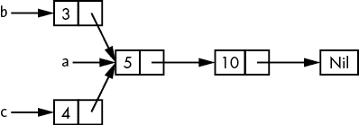

图 15-3：使用 `Rc<T>` 多所有权

`Cons` 变体拥有它们持有的数据，因此当我们创建列表 `b` 时 ❶，`a` 被移动到 `b`，`b` 拥有了 `a`。然后当我们在创建 `c` 时再次尝试使用 `a` ❷，我们被允许这样做，因为 `a` 已经被移动了。

我们可以更改 `Cons` 的定义改为持有引用，但这样我们就必须指定生命周期参数。通过指定生命周期参数，我们是在指定列表中的每个元素至少与整个列表一样生存。这在 Listing 15-17 中的元素和列表中确实如此，但并非适用于所有场景。

相反，我们将修改 `List` 的定义使用 `Rc<T>` 代替 `Box<T>`，如 Listing 15-18 所示。每个 `Cons` 变体现在都持有一个值和一个指向 `List` 的 `Rc<T>`。当我们创建 `b` 时，不是获取 `a` 的所有权，而是克隆 `a` 持有的 `Rc<List>`，从而将引用数从一个增加到两个，让 `a` 和 `b` 共享该 `Rc<List>` 中的数据。我们在创建 `c` 时也会克隆 `a`，将引用数从两个增加到三个。每当我们调用 `Rc::clone`，`Rc<List>` 内部数据的引用计数就会增加，除非对它的引用数为零，否则数据不会被清理。

```rust
enum List {
    Cons(i32, Rc<List>),
    Nil,
}

use crate::List::{Cons, Nil};
❶ use std::rc::Rc;

fn main() {
  ❷ let a = Rc::new(Cons(5, Rc::new(Cons(10, Rc::new(Nil)))));
  ❸ let b = Cons(3, Rc::clone(&a));
  ❹ let c = Cons(4, Rc::clone(&a));
}
```

Listing 15-18：使用 `Rc<T>` 的 `List` 定义

我们需要添加一个 `use` 语句将 `Rc<T>` 引入作用范围 ❶，因为它不在预导入单元（prelude）中。在 `main` 中，我们创建了一个包含 `5` 和 `10` 的列表，并将其存储在新的 `Rc<List>` `a` 中 ❷。然后，当我们创建 `b` ❸ 和 `c` ❹ 时，我们调用了 `Rc::clone` 函数并将 `a` 中 `Rc<List>` 的引用作为参数传递进去。

我们可以调用 `a.clone()` 而不是 `Rc::clone(&a)`，但在这种情况下 Rust 的习惯是使用 `Rc::clone`。`Rc::clone` 的实现并没有像大多数类型的 `clone` 实现那样对所有数据进行深拷贝。对 `Rc::clone` 的调用只会增加引用计数，这并不耗费时间。数据的深拷贝可能会花费大量时间。通过使用 `Rc::clone` 进行引用计数，我们可以在视觉上区分深拷贝类的克隆和增加引用计数的克隆。在查找代码中的性能问题时，我们只需要考虑深拷贝类的克隆，可以忽略对 `Rc::clone` 的调用。

### 克隆 `Rc<T>` 会增加引用计数

让我们修改 Listing 15-18 中的示例，这样我们就可以在创建和丢对 `a` 中 `Rc<List>` 的引用时看到引用计数的变化。

在 Listing 15-19 中，我们将修改 `main`，使其在列表 `c` 周围有一个内部作用域；这样我们就能看到当 `c` 离开作用域时，引用计数是如何变化的。

`src/main.rs`

```rust
--snip--

fn main() {
    let a = Rc::new(Cons(5, Rc::new(Cons(10, Rc::new(Nil)))));
    println!(
        "count after creating a = {}",
        Rc::strong_count(&a)
    );
    let b = Cons(3, Rc::clone(&a));
    println!(
        "count after creating b = {}",
        Rc::strong_count(&a)
    );
    {
        let c = Cons(4, Rc::clone(&a));
        println!(
            "count after creating c = {}",
            Rc::strong_count(&a)
        );
    }
    println!(
        "count after c goes out of scope = {}",
        Rc::strong_count(&a)
    );
}
```

Listing 15-19：打印引用计数

在程序中引用计数变化的每个点，我们都会打印引用计数，这是通过调用 `Rc::strong_count` 函数获取的。该函数命名为 `strong_count` 而不是 `count`，是因为 `Rc<T>` 类型还还有一个 `weak_count`；我们将在第 346 页的“使用 `Weak<T>` 防止引用循环”中查看 `weak_count` 的用途。

这段代码输出了以下内容：

```text
count after creating a = 1
count after creating b = 2
count after creating c = 3
count after c goes out of scope = 2
```

我们可以看到 `a` 中的 `Rc<List>` 初始引用计数为 1；然后每调用一次 `clone`，计数就会增加 1。当 `c` 离开作用域时，计数会减少 1。我们不需要像调用 `Rc::clone` 来增加引用计数那样去显式调用一个函数来减少引用计数：当 `Rc<T>` 值离开作用域时，`Drop` 特性标记的实现会自动减少引用计数。

我们在这个示例中无法看到的是，当 `b` 然后 `a` 在 `main` 结束时离开作用域时，计数将变为 0，`Rc<List>` 会被完全清理。使用 `Rc<T>` 允许单个值拥有多个所有者，而计数确保了只要任何所有者仍然存在，该值就是有效的。

通过不可变引用，`Rc<T>` 允许你在程序的多个部分之间共享数据且仅只读。如果 `Rc<T>` 也允许你拥有多个可变引用，你可能会违反第 4 章中讨论的借用规则之一：对同一地方进行多次可变借用会导致数据竞态和不一致。但能够修改数据是非常有用的！在下一节中，我们将讨论内部可变性模式以及 `RefCell<T>` 类型，你可以结合 `Rc<T>` 使用来处理这种不可变性限制。

## `RefCell<T>` 和内部可变性模式

*内部可变性*（interior mutability）是 Rust 中的一种设计模式，它允许在存在指向该数据的不可变引用时也能修改数据；通常，这种操作是被编译器禁止的。然而，`RefCell<T>` 通过在运行时检查规则允许了这一点。

当你确定代码遵循借用规则但编译器无法理解并保证这一点时，`RefCell<T>` 类型是有用的。

### 使用 `RefCell<T>` 在运行时强制借用规则

与 `Rc<T>` 不同，`RefCell<T>` 代表对数据的单一所有权。那么 `RefCell<T>` 与 `Box<T>` 有什么区别？回顾你在第 4 章中学的借用规则：

- 在任何给定时刻，你可以拥有一个可变引用或多个不可变引用（但不能两者兼得）。
- 引用必须始终有效。

通过引用和 `Box<T>`，借用规则在编译时强制执行。通过 `RefCell<T>`，这些规则在运行时执行。对于引用，如果你违反了这些规则，将得到编译错误。对于 `RefCell<T>`，如果你违反了这些规则，程序将崩溃（panic）并退出。

在编译时检查借用规则的优点是可以在开发过程中尽早发现错误，并且对运行时性能没有影响，因为所有分析都提前完成了。由于这些原因，在大多数情况下，编译时检查借用规则是最佳选择。

而在运行时检查借用规则的优势是，某些内存安全的场景被允许，而这些场景在编译时检查中是被禁止的。

- 因为 `RefCell<T>` 允许在运行时检查可变借用，即使 `RefCell<T>` 是不可变的，你也可以修改 `RefCell<T>` 内部的值。


在不可变值内部修改值被称为*内部可变性*（interior mutability）模式。让我们来看一个内部可变性很有用的场景，并检查它是如何实现的。

### 内部可变性：对不可变值的可变借用

借用规则的结果是，当你有一个不可变值时，你不能以可变的方式借用它。例如，以下代码将无法编译：

**`src/main.rs`**

```rust
fn main() {
    let x = 5;
    let y = &mut x;
}
```

如果你尝试编译这段代码，你将得到以下错误：

```text
error[E0596]: cannot borrow `x` as mutable, as it is not declared
as mutable
 --> src/main.rs:3:13
  |
2 |     let x = 5;
  |         - help: consider changing this to be mutable: `mut x`
3 |     let y = &mut x;
  |             ^^^^^^ cannot borrow as mutable
```

然而，在某些情况下，如果一个值在其方法中修改自己，但对其他代码表现为不可变，将会是非常有用的。值方法之外的代码无法修改该值。使用 `RefCell<T>` 是获得内部可变能力的一种方法，但 `RefCell<T>` 并没有完全绕过借用规则：编译器中的借用检查允许这种内部可变性，而借用规则则在运行时进行检查。如果你违反了规则，将得到一个 `panic!` 而不是编译错误。

让我们通过一个实际示例，在该示例中我们可以使用 `RefCell<T>` 修改不可变的值，并看看为什么这样做很有用。

#### 内部可变性的用例：模拟对象（Mock Objects）

在测试过程中，程序员有时使用一种类型代替另一种类型，以便观察特定的行为并断言其实现是否正确。这种占位类型被称为*测试替身*（test double）。你可以将其想象成电影中的替身，由某人上场代替演员来完成特别棘手的场景。在我们运行测试时，测试替身代表其他类型。*模拟对象*是测试替身的特定类型，它们记录测试期间发生的情况，以便你可以断言是否发生了正确的操作。

Rust 并没有像其他语言那样的对象，Rust 也没有像其他语言那样在标准库中内置模拟对象功能。然而，你完全可以创建一个与模拟对象用途相同的结构体。

这是我们要测试的场景：我们将创建一个库，跟踪一个值相对于最大值的程度，并根据当前值与最大值的接近程度发送消息。例如，这个库可以用于跟踪用户允许进行的 API 调用次数的配额。

我们的库仅提供跟踪值接近最大值的程度以及什么时间应该发送什么消息的功能。使用我们库的应用程序需要提供发送消息的机制：应用程序可以在应用程序中放入消息、发送电子邮件、发送短信或执行其他操作。库不需要知道这些细节。它只需要一个实现了我们提供的名为 `Messenger` 的 trait 的对象。列表 15-20 显示了库的代码。

**`src/lib.rs`**

```rust
pub trait Messenger {
  ❶ fn send(&self, msg: &str);
}

pub struct LimitTracker<'a, T: Messenger> {
    messenger: &'a T,
    value: usize,
    max: usize,
}

impl<'a, T> LimitTracker<'a, T>
where
    T: Messenger,
{
    pub fn new(messenger: &'a T, max: usize) -> LimitTracker<'a, T> {
        LimitTracker {
            messenger,
            value: 0,
            max,
        }
    }

  pub fn set_value(&mut self, value: usize) {
        self.value = value;

        let percentage_of_max = self.value as f64 / self.max as f64;

        if percentage_of_max >= 1.0 {
            self.messenger.send("Error: You are over your quota!");
        } else if percentage_of_max >= 0.9 {
            self.messenger.send("Urgent: You're at 90% of your quota!");
        } else if percentage_of_max >= 0.75 {
            self.messenger.send("Warning: You're at 75% of your quota!");
        }
    }
}
```

列表 15-20：跟踪值接近最大值的程度并在达到特定百分比时警告的库。

库的一个重要部分是跟踪值接近最大值的程度以及在什么时间应该发送什么消息。使用我们库的应用程序需要提供发送消息的机制：应用程序可以执行特定的操作。库不需要知道这些细节。它只需要一个实现了我们提供的名为 `Messenger` 的 trait 的对象。

**`src/lib.rs`**

```rust
#[cfg(test)]
mod tests {
    use super::*;

  ❶ struct MockMessenger {
      ❷ sent_messages: Vec<String>,
    }

    impl MockMessenger {
      ❸ fn new() -> MockMessenger {
            MockMessenger {
                sent_messages: vec![],
            }
        }
    }

  ❹ impl Messenger for MockMessenger {
        fn send(&self, message: &str) {
          ❺ self.sent_messages.push(String::from(message));
        }
    }

    #[test]
  ❻ fn it_sends_75_percent_warning_message() {
        let mock_messenger = MockMessenger::new();
        let mut limit_tracker = LimitTracker::new(
            &mock_messenger,
            100
        );

        limit_tracker.set_value(80);

        assert_eq!(mock_messenger.sent_messages.len(), 1);
    }
}
```

列表 15-21：一个不被借用检查允许的 `MockMessenger` 实现。

此测试代码定义了一个 `MockMessenger` 结构体 ❶，它有一个 `Vec<String>` 字段 `sent_messages` ❷，用于跟踪被要求发送的消息。我们还定义了一个关联函数 `new` ❸，以便创建一个空消息列表的新 `MockMessenger` 值。然后我们为 `MockMessenger` 实现了 `Messenger` trait ❹，这样我们就可以把 `MockMessenger` 传递给 `LimitTracker`。另一个重要部分是，`Messenger` trait 有一个名为 `send` 的方法，它接收 `self` 的不可变引用。这是模拟对象需要实现的方式。

```text
error[E0596]: cannot borrow `self.sent_messages` as mutable, as it is behind a
`&` reference
  --> src/lib.rs:58:13
   |
2  |     fn send(&self, msg: &str);
   |             ----- help: consider changing that to be a mutable reference:
`&mut self`
...
58 |             self.sent_messages.push(String::from(message));
   |             ^^^^^^^^^^^^^^^^^^^^^^^^^^^^^^^^^^^^^^^^^^^^^^ `self` is a
`&` reference, so the data it refers to cannot be borrowed as mutable
```

无法修改 `MockMessenger` 来跟踪消息，因为 `send` 方法获取的是 `self` 的不可变引用。我们也无法按照错误信息中的建议使用 `&mut self` 代替，因为那样 `send` 的签名将与 `Messenger` 特性定义中的签名不匹配（你可以尽管尝试一下看看会得到什么错误信息）。

这种情况正是内部可变性（interior mutability）大显身手的地方！我们将 `sent_messages` 存储在 `RefCell<T>` 中，然后 `send` 方法就能修改 `sent_messages` 来存储我们见过的消息。列表 15-22 展示了它是后的样子。

### `src/lib.rs`

```rust
#[cfg(test)]
mod tests {
    use super::*;
    use std::cell::RefCell;

    struct MockMessenger {
      ❶ sent_messages: RefCell<Vec<String>>,
    }

    impl MockMessenger {
        fn new() -> MockMessenger {
            MockMessenger {
              ❷ sent_messages: RefCell::new(vec![]),
            }
        }
    }

    impl Messenger for MockMessenger {
        fn send(&self, message: &str) {
            self.sent_messages
              ❸ .borrow_mut()
                .push(String::from(message));
        }
    }

    #[test]
    fn it_sends_an_over_75_percent_warning_message() {
        --snip--

        assert_eq!(
          ❹ mock_messenger.sent_messages.borrow().len(),
            1
        );
    }
}
```

列表 15-22：使用 `RefCell<T>` 在修改内部值，同时外层值被视为不可变。

`sent_messages` 字段现在的类型是 `RefCell<Vec<String>>` ❶ 而不是 `Vec<String>`。在 `new` 函数中，我们围绕在空向量外层创建了一个新的 `RefCell<Vec<String>>` 实例 ❷。

对于 `send` 方法的实现，第一个参数仍然是 `self` 的不可变借用，这符合特性的定义。我们在 `self.sent_messages` 的 `RefCell<Vec<String>>` 上调用 `borrow_mut` ❸，以获取对 `RefCell<Vec<String>>` 内部值（即向量）的可变引用。然后我们可以对该向量的可变引用调用 `push`，以跟踪测试期间发送的消息。

我们必须做的最后一个修改是在断言中：为了查看内部向量中有多少个元素，我们对 `RefCell<Vec<String>>` 调用 `borrow`，以获取对向量的不可变引用 ❹。

现在你已经学会了如何使用 `RefCell<T>`，让我们深入研究它是如何工作的吧！

#### 使用 `RefCell<T>` 在运行时跟踪借用

在创建不可变和可变引用时，我们分别使用 `&` 和 `&mut` 语法。使用 `RefCell<T>`，我们使用 `borrow` 和 `borrow_mut` 方法，这些方法属于 `RefCell<T>` 的安全 API。`borrow` 方法返回智能指针类型 `Ref<T>`，而 `borrow_mut` 返回智能指针类型 `RefMut<T>`。这两个类型都实现了 `Deref`，所以我们可以像对待普通引用一样对待它们。

`RefCell<T>` 会跟踪当前活跃有多少个 `Ref<T>` 和 `RefMut<T>` 智能指针。每当我们调用 `borrow` 时，`RefCell<T>` 都会增加其活跃不可变借用的计数。当一个 `Ref<T>` 值离开作用域时，不可变借用的计数减 1。就像编译时的借用规则一样，`RefCell<T>` 允许我们在任何时刻拥有多个不可变借用或一个可变借用。

如果我们尝试违反这些规则，与其像使用引用时那样得到编译器错误，`RefCell<T>` 的实现会在运行时 panic（崩溃）。列表 15-23 展示了对列表 15-22 中 `send` 实现的修改。我们刻意尝试在同一个作用范围内创建两个活跃的可变借用，以说明 `RefCell<T>` 防止了我们在运行时这样做。

### `src/lib.rs`

```rust
impl Messenger for MockMessenger {
    fn send(&self, message: &str) {
        let mut one_borrow = self.sent_messages.borrow_mut();
        let mut two_borrow = self.sent_messages.borrow_mut();

        one_borrow.push(String::from(message));
        two_borrow.push(String::from(message));
    }
}
```

列表 15-23：在同一作用范围内创建可变借用以观察 `RefCell<T>` 会 panic。

我们为 `RefMut<T>` 智能指针从 `borrow_mut` 返回的值创建了变量 `one_borrow`。然后同样地创建了另一个可变借用 `two_borrow`。这在同一作用范围内是不允许的。当我们运行库测试时，列表 15-23 中的代码可以编译通过，但测试会失败：

```text
---- tests::it_sends_an_over_75_percent_warning_message stdout
thread 'main' panicked at 'already borrowed: BorrowError', src/lib.rs:60:53
note: run with `RUST_BACKTRACE=1` environment variable to display a backtrace
```

注意代码 panic 了，这正是 `RefCell<T>` 处理违反行为的方式。

#### 使用 `Rc<T>` 和 `RefCell<T>` 允许数据的多个所有者

使用 `RefCell<T>` 的常用方法是结合 `Rc<T>`。`Rc<T>` 让你拥有数据的多个所有者，但它只提供对该数据的不可变访问。如果你有一个持有 `RefCell<T>` 的 `Rc<T>`，你可以获得一个既可以拥有多个所有者又可以修改的值！

例如，回想列表 15-18 中的 cons 列表示例，我们使用 `Rc<T>` 让多个列表共享另一个列表的所有权。因为 `Rc<T>` 持有不可变值，一旦创建，我们就无法更改列表中的任何值。让我们引入 `RefCell<T>` 来改变列表值的能力。列表 15-24 展示了通过在 `Cons` 定义中使用 `RefCell<T>`，我们可以修改存储的值。

### `src/main.rs`

```rust
#[derive(Debug)]
enum List {
    Cons(Rc<RefCell<i32>>, Rc<List>),
    Nil,
}

use crate::List::{Cons, Nil};
use std::cell::RefCell;
use std::rc::Rc;

fn main() {
  ❶ let value = Rc::new(RefCell::new(5));

  ❷ let a = Rc::new(Cons(Rc::clone(&value), Rc::new(Nil)));

    let b = Cons(Rc::new(RefCell::new(3)), Rc::clone(&a));
    let c = Cons(Rc::new(RefCell::new(4)), Rc::clone(&a));

  ❸ *value.borrow_mut() += 10;

    println!("a after = {:?}", a);
    println!("b after = {:?}", b);
    println!("c after = {:?}", c);
}
```


我们创建了一个`Rc<RefCell<i32>>`实例并将其存储在名为`value`的变量中❶，以便稍后可以直接访问它。然后我们在`a`中创建一个带有`Cons`变体的`List`，该变体持有`value`❷。我们需要克隆`value`，以便`a`和`value`都拥有内部值`5`的所有权，而不是将所有权从`value`转移到`a`，或者让`a`引用`value`。

我们将列表`a`封装在`Rc<T>`中，这样当我们创建列表`b`和`c`时，它们都可以引用`a`，就像我们在示例 15-18 中所做的那样。

在创建了列表`a`、`b`和`c`后，我们想给`value`中的值加 10❸。我们通过在`value`上调用`borrow_mut`来实现，它使用了我们在第 99 页“`->`运算符在哪里？”中讨论的自动解引用功能，从而将`Rc<T>`解引用为内部的`RefCell<T>`值。`borrow_mut`方法返回一个`RefMut<T>`智能指针，我们对它使用解引用运算符并修改内部值。

当我们打印`a`、`b`和`c`时，我们可以看到它们都拥有修改后的值`15`，而不是`5`：

```
a after = Cons(RefCell { value: 15 }, Nil)
b after = Cons(RefCell { value: 3 }, Cons(RefCell { value: 15 }, Nil))
c after = Cons(RefCell { value: 4 }, Cons(RefCell { value: 15 }, Nil))
```

这种技术非常奇妙！通过使用`RefCell<T>`，我们获得了一个向外不可变的`List`值。但我们可以使用`RefCell<T>`上提供的访问其内部可变性的方法，以便我们可以在需要时修改数据。借用规则的运行时检查保护我们免受数据竞态的影响，有时为了这种数据结构中的灵活性而牺牲一点速度是值得的。注意，`RefCell<T>`不适用于多线程代码！`Mutex<T>`是`RefCell<T>`的线程安全版本，我们将在第 16 章讨论`Mutex<T>`。

## 引用循环会导致内存泄漏

Rust 的内存安全保证使得无意中创建从未清理的内存（称为内存泄漏）变得困难，但并非不可能。完全防止内存泄漏并不是 Rust 的保证之一，这意味着内存泄漏在 Rust 中是内存安全的。我们可以通过使用`Rc<T>`和`RefCell<T>`看到 Rust 允许内存泄漏：可能会创建项之间在循环中相互引用的引用。这会导致内存泄漏，因为循环中每个项的引用计数永远不会达到`0`，这些值也永远不会被丢弃。

### 创建引用循环

让我们看看引用循环是如何发生的以及如何防止它，从示例 15-25 中`List`枚举的定义和`tail`方法开始。

**src/main.rs**

```rust
use crate::List::{Cons, Nil};
use std::cell::RefCell;
use std::rc::Rc;

#[derive(Debug)]
enum List {
  ❶ Cons(i32, RefCell<Rc<List>>),
    Nil,
}

impl List {
  ❷ fn tail(&self) -> Option<&RefCell<Rc<List>>> {
        match self {
            Cons(_, item) => Some(item),
            Nil => None,
        }
    }
}
```

示例 15-25：一个 cons 列表定义，它持有`RefCell<T>`，以便我们可以修改`Cons`变体所引用的内容

我们正在使用示例 15-5 中`List`定义的另一种变体。`Cons`变体的第二个元素现在是`RefCell<Rc<List>>`❶，这意味着我们不再像在示例 15-24 中那样具有修改`i32`值的能力，而是想修改`Cons`变体所指向的`List`值。我们还添加了一个`tail`方法❷，以便我们在拥有`Cons`变体时方便地访问第二个项。

在示例 15-26 中，我们添加了一个使用示例 15-25 中定义的`main`函数。这段代码在`a`中创建一个列表，并在`b`中创建一个指向`a`的列表。然后它修改`a`中的列表以指向`b`，创建一个引用循环。过程中有很多`println!`语句来显示此过程中不同阶段的引用计数。

**src/main.rs**

```rust
fn main() {
  ❶ let a = Rc::new(Cons(5, RefCell::new(Rc::new(Nil))));

    println!("a initial rc count = {}", Rc::strong_count(&a));
    println!("a next item = {:?}", a);

    ❷ let b = Rc::new(Cons(3, RefCell::new(Rc::clone(&a))));

    println!("b initial rc count = {}", Rc::strong_count(&b));
    println!("b next item = {:?}", b);

    ❸ let c = Rc::new(Cons(4, RefCell::new(Rc::clone(&a))));

    println!("c initial rc count = {}", Rc::strong_count(&c));
    println!("c next item = {:?}", c);

    if let Some(item) = a.tail() {
        *item.borrow_mut() = 15;
    }
    if let Some(item) = b.tail() {
        *item.borrow_mut() = 15;
    }
    if let Some(item) = c.tail() {
        *item.borrow_mut() = 15;
    }

    println!("a after = {:?}", a);
    println!("b after = {:?}", b);
    println!("c after = {:?}", c);

    if let Some(item) = a.tail() {
        *item.borrow_mut() = Rc::clone(&b);
    }
    println!("a rc count after cycle = {}", Rc::strong_count(&a));
    println!("b rc count after cycle = {}", Rc::strong_count(&b));
}
```

创建引用循环并非易事，但也并非不可能。如果你有包含`Rc<T>`值的`RefCell<T>`值，或类似的具有内部可变性和引用计数的嵌套类型组合，你必须确保自己没有创建循环；你不能依赖 Rust 来捕获它们。创建引用循环将是你程序中的一个逻辑错误，你应该通过自动化测试、代码审查和其他软件开发实践来将其此类风险降至最低。

避免引用循环的另一个解决方案是重新组织你的数据结构，使得某些引用表示所有权，而某些引用不表示。这样，你可以拥有由部分所有权关系和部分非所有权关系组成的循环，只有所有权关系会影响值是否可以被释放。在 Listing 15-25 中，我们始终希望`Cons`变体拥有其列表，因此无法重新组织数据结构。让我们来看一个由父节点和子节点组成的图示例，看看什么时候非所有权关系是防止引用循环的合适方法。

### 使用`Weak<T>`防止引用循环

到为止，我们已经证明了调用`Rc::clone`会增加`Rc<T>`实例的`strong_count`，并且只有当`Rc<T>`实例的`strong_count`为`0`时才会清理。你也可以通过调用`Rc::downgrade`并传递`Rc<T>`的引用来创建指向`Rc<T>`实例内部值的弱引用。**强引用**是你共享`Rc<T>`实例所有权的方式。**弱引用**不表示所有权关系，它们的计数不会影响`Rc<T>`实例被清理的时机。它们不会引起引用循环，因为任何涉及某些弱引用的循环一旦涉及值的强引用计数为`0`，就会被打破。

当你调用`Rc::downgrade`时，你将得到一个类型为`Weak<T>`的智能指针。调用`Rc::downgrade`不会将`Rc<T>`实例中的`strong_count`加 1，而是将`weak_count`加 1。`Rc<T>`类型使用`weak_count`来跟踪存在多少`Weak<T>`引用，类似于`strong_count`。区别在于，`Rc<T>`实例被清理时并不需要`weak_count`为`0`。

由于`Weak<T>`引用的值可能已经被释放，为了对`Weak<T>`指向的值进行任何操作，你必须确保该值仍然存在。通过在`Weak<T>`实例上调用`upgrade`方法来实现，它将返回一个`Option<Rc<T>>`。如果`Rc<T>`值尚未被释放，你会得到`Some`结果；如果`Rc<T>`值已经释放，则得到`None`结果。由于`upgrade`返回`Option<Rc<T>>`，Rust 将确保处理了`Some`情况和`None`情况，从而不会出现无效的指针。

作为一个示例，我们不再使用一个项仅知道下一个项的列表，而是创建一个项既知道其子项**又**知道其父项的树。

### 创建树数据结构：带有子节点的节点

首先，我们将构建一个带有已知其子节点的树。我们将创建一个名为`Node`的结构体，它持有它自己的`i32`值，以及指向其子节点`Node`值的引用：

**src/main.rs**

```rust
use std::cell::RefCell;
use std::rc::Rc;

#[derive(Debug)]
struct Node {
    value: i32,
    children: RefCell<Vec<Rc<Node>>>,
}
```

我们希望`Node`拥有它的子节点，并希望与变量共享该所有权，以便我们能够直接访问树中的每个`Node`。为了实现这一点，我们将`Vec<T>`的项定义为`Rc<Node>`类型的值。我们还希望修改哪些节点是另一个节点的子节点，因此我们在`Vec<Rc<Node>>`外层包裹了一个`RefCell<T>`。

接下来，我们将使用结构体定义创建一个名为`leaf`的`Node`实例，其值为`3`且没有子节点；以及另一个名为`branch`的实例，值为`5`并将`leaf`作为其子节点之一，如 Listing 15-27 所示。

**src/main.rs**

```rust
fn main() {
    let leaf = Rc::new(Node {
        value: 3,
        children: RefCell::new(vec![]),
    });

    let branch = Rc::new(Node {
        value: 5,
        children: RefCell::new(vec![Rc::clone(&leaf)]),
    });
}
```

Listing 15-27：创建一个没有子节点的`leaf`节点和一个以`leaf`为其子节点之一的`branch`节点

我们克隆`leaf`中的`Rc<Node>`并将其存储在`branch`中，这意味着`leaf`中的`Node`现在有两个所有者：`leaf`和`branch`。我们可以通过`branch.children`从`branch`到`leaf`，但没有办法从`leaf`到`branch`。原因是`leaf`没有指向`branch`的引用。

### 添加子节点到父节点的引用

为了让子节点感知其父节点，我们需要在`Node`结构体中添加`parent`字段。难题在于决定`parent`的类型。如果使用`Rc<T>`，它将创建一个引用循环，导致`strong_count`永远不会为`0`。因此，我们不使用`Rc<T>`，而是使用`Weak<T>`。

现在我们的`Node`结构体如下：

**src/main.rs**

```rust
use std::cell::RefCell;
use std::rc::{Rc, Weak};

#[derive(Debug)]
struct Node {
    value: i32,
    parent: RefCell<Weak<Node>>,
    children: RefCell<Vec<Rc<Node>>>,
}
```

考虑另一种方式，节点应该能够引用其父节点，但并不拥有其父节点。在 Listing 15-28 中，我们更新了`main`以使用此定义：

**src/main.rs**

```rust
fn main() {
    let leaf = Rc::new(Node {
        value: 3,
        parent: RefCell::new(Weak::new()),
        children: RefCell::new(vec![]),
    });

    println!(
        "leaf parent = {:?}",
        leaf.parent.borrow().upgrade()
    );

    let branch = Rc::new(Node {
        value: 5,
        parent: RefCell::new(Weak::new()),
        children: RefCell::new(vec![Rc::clone(&leaf)]),
    });

    *leaf.parent.borrow_mut() = Rc::downgrade(&branch);

    println!(
        "leaf parent = {:?}",
        leaf.parent.borrow().upgrade()
    );
}
```

Listing 15-28：一个带有其父节点`branch`弱引用的`leaf`节点

当我们再次打印`leaf`的父节点❺时，这次我们将得到一个持有`branch`的`Some`体：现在`leaf`可以访问它的父节点了！当我们打印`leaf`时，我们也避免了最终导致栈溢出的循环，就像我们在列表 15-26 中遇到的那样；`Weak<Node>`引用被打印为`(Weak)`：

```
leaf parent = Some(Node { value: 5, parent: RefCell { value: (Weak) },
children: RefCell { value: [Node { value: 3, parent: RefCell { value: (Weak) },
children: RefCell { value: [] } }] } })
```

没有无限输出说明这段代码没有创建引用循环。我们也可以通过观察`Rc::strong_count`和`Rc::weak_count`获取的值来判断这一点。

### 可视化`strong_count`和`weak_count`的变化

让我们通过创建一个新的内部作用域并将`branch`的创建移动到作用域内，观察`Rc<Node>`实例的`strong_count`和`weak_count`值是如何变化的。通过这样做，我们可以看到`branch`被创建以及在离开作用域时丢弃时发生了什么。修改显示在列表 15-29 中。

**src/main.rs**


```rust
fn main() {
    let leaf = Rc::new(Node {
        value: 3,
        parent: RefCell::new(Weak::new()),
        children: RefCell::new(vec![]),
    });

  ❶ println!(
        "leaf strong = {}, weak = {}",
        Rc::strong_count(&leaf),
        Rc::weak_count(&leaf),
    );

  ❷ {
        let branch = Rc::new(Node {
            value: 5,
            parent: RefCell::new(Weak::new()),
            children: RefCell::new(vec![Rc::clone(&leaf)]),
        });

        *leaf.parent.borrow_mut() = Rc::downgrade(&branch);

      ❸ println!(
            "branch strong = {}, weak = {}",
            Rc::strong_count(&branch),
            Rc::weak_count(&branch),
        );

      ❹ println!(
            "leaf strong = {}, weak = {}",
            Rc::strong_count(&leaf),
            Rc::weak_count(&leaf),
        );
  ❺ }

  ❻ println!(
        "leaf parent = {:?}",
        leaf.parent.borrow().upgrade()
    );
  ❼ println!(
        "leaf strong = {}, weak = {}",
        Rc::strong_count(&leaf),
        Rc::weak_count(&leaf),
    );
}
```

列表 15-29：在内部作用域中创建 `branch` 并检查强弱引用计数

在 `leaf` 创建后，它的 `Rc<Node>` 强计数为 1，弱计数为 0 ❶。在内部作用域 ❷ 中，我们创建了 `branch` 并将其与 `leaf` 关联，此时，当我们打印计数 ❸ 时，`branch` 中的 `Rc<Node>` 将具有 1 个强计数和 1 个弱计数（因为 `leaf.parent` 使用 `Weak<Node>` 指向 `branch`）。当我们打印 `leaf` 中的计数 ❹ 时，我们会看到它有 2 个强计数，因为 `branch` 现在在 `branch.children` 中存储了 `leaf` 的 `Rc<Node>` 的克隆，但弱计数仍为 0。

当内部作用域结束 ❺ 时，`branch` 离开作用域，`Rc<Node>` 的强计数减到 0，因此它的 `Node` 被丢弃。`leaf.parent` 的 1 个弱计数并不影响 `Node` 是否被丢弃，所以我们没有产生任何内存泄漏！

如果我们在作用域结束后尝试访问 `leaf` 的父节点，我们将再次得到 `None` ❻。在程序结束时 ❼，`leaf` 中的 `Rc<Node>` 强计数为 1，弱计数为 0，因为变量 `leaf` 现在是该 `Rc<Node>` 的唯一引用。

所有管理计数和值丢弃的逻辑都内置在 `Rc<T>`、`Weak<T>` 以及它们对 `Drop` 特性的实现中。通过在 `Node` 的定义中指定从子节点到父节点的关系应该是 `Weak<T>` 引用，你就能让父节点指向子节点反之亦然，而不会创建引用循环和内存泄漏。

## 总结

本章涵盖了如何使用智能指针来实现 Rust 默认通过普通引用所做的不同保证和权衡。`Box<T>` 类型有固定的大小，并指向在堆上分配的数据。`Rc<T>` 类型跟踪指向堆上数据的引用次数，以便数据可以拥有多个所有者。`RefCell<T>` 类型带有其内部可变性，为我们提供了一种在需要不可变类型但又需要更改该类型内部值时使用的类型；它在运行时而不是编译时强制执行借用规则。

此外讨论了 `Deref` 和 `Drop` 特性，它们实现了智能指针的大许多功能。我们了了导致内存泄漏的引用循环以及如何使用 `Weak<T>` 防止它们。

如果本章激发了你的兴趣，并且你想实现自己的智能指针，可以在 [`doc.rust-lang.org/stable/nomicon`](https://doc.rust-lang.org/stable/nomicon) 查看“The Rustonomicon”以获取更有用的信息。

接下来，我们将讨论 Rust 中的并发。你甚至会学习一些新的智能指针。

# 16：无畏并发


安全且高效地处理并发编程是 Rust 的主要目标之一。随着越来越多的计算机利用其多处理器特性，*并发编程*（程序的不同部分独立执行）和*并行编程*（程序的不同部分同时执行）正变得越来越重要。从历史角度看，在这些背景下进行编程是困难且容易出错的。Rust 希望能够改变现状。

起初，Rust 团队认为确保内存安全和防止并发问题是两个需要用不同方法解决的独立挑战。随着时间的推移，团队发现所有权和类型系统是一套强大的工具，可以帮助管理内存安全*以及*并发问题！通过利用所有权和类型检查，许多并发错误在 Rust 中是编译时错误而不是运行时错误。因此，与其让你花费大量时间尝试重现运行时错误发生的具体情况，错误的代码将拒绝编译并解释问题。结果是你可以在编写代码时修复它，而不是在发布到生产环境后。

许多语言在提供处理并发问题的方案上是教条的。例如，Erlang 在消息传递并发方面具有优雅的功能，但在线程之间共享状态的方法非常晦涩。对于高级语言来说，只支持解决方案的一个集是一种合理的策略，因为高级语言承诺通过放弃一些控制权来换取抽象带来的收益。然而，低级语言被期望在任何情况下都能提供性能最好的解决方案并且对硬件的抽象较少。因此，Rust 提供了多种工具，以适用于你的情况和要求的方式进行建模。

我们在本章将涵盖的主题：

- 如何创建线程来同时运行多段代码
- *消息传递*并发，通过通道在线程之间发送消息
- *共享状态*并发，多个线程可以访问某些数据
- `Sync` 和 `Send` 特性，它们将 Rust 的并发保证扩展到用户定义类型以及标准库提供的类型

在大多数当前的操作系统中，执行的程序代码在 `process`（进程）中运行，操作系统会同时管理多个进程。在程序内部，你也可以拥有同时运行的独立部分。运行这些独立部分的特性称为 `threads`（线程）。例如，Web 服务器可以拥有多个线程，以便它能同时响应多个请求。

将程序中的计算拆分为多个线程以同时运行多个任务可以提高性能，但也会增加复杂性。因为线程可以同时运行，所以无法保证不同线程上的代码部分执行顺序具有内在顺序。这可能会导致一些问题，例如：

- 竞态条件（Race conditions）：即线程以不一致的顺序访问数据或资源
- 死锁（Deadlocks）：即两个线程互相等待，导致两个线程都无法继续执行
- 只在特定情况下发生、且难以可靠地复现和修复的错误（Bugs）

Rust 试图减轻使用线程带来的负面影响，但在多线程环境下进行编程仍然需要细致的考虑，并且需要与单线程运行程序不同的代码结构。

编程语言通过几种不同的方式实现线程，许多操作系统也提供该语言可以调用的 API 来创建新线程。Rust 标准库使用了 1:1 的线程实现模型，即程序每一个语言线程对应一个操作系统线程。还有一些 crate（库）实现了其他的线程模型，这些模型与 1:1 模型相比有不同的权衡。

### 使用 `spawn` 创建新线程

要创建一个新线程，我们调用 `thread::spawn` 函数并向它传递一个闭包（closure，我们在第 13 章中讨论过闭包），其中包含了我们想要在新线程中运行的代码。Listing 16-1 中的示例从主线程打印一些文本，并从新线程打印其他文本。

**src/main.rs**

```rust
use std::thread;
use std::time::Duration;

fn main() {
    thread::spawn(|| {
        for i in 1..10 {
            println!("hi number {i} from the spawned thread!");
            thread::sleep(Duration::from_millis(1));
        }
    });

    for i in 1..5 {
        println!("hi number {i} from the main thread!");
        thread::sleep(Duration::from_millis(1));
    }
}
```

列表 16-1：创建一个新线程来打印内容，同时主线程打印其他内容

注意，当 Rust 程序的主线程完成时，所有创建的线程都会关闭，无论它们是否已运行。此程序的输出每次可能略有不同，但看起来会类似于下面：

```text
hi number 1 from the main thread!
hi number 1 from the spawned thread!
hi number 2 from the main thread!
hi number 2 from the spawned thread!
hi number 3 from the main thread!
hi number 3 from the spawned thread!
hi number 4 from the main thread!
hi number 4 from the spawned thread!
hi number 5 from the spawned thread!
```

对 `thread::sleep` 的调用会强制线程停止执行一短时间，允许另一个线程运行。线程可能会交替执行，但这并不是保证的：这取决于你的操作系统如何调度线程。在这次运行中，主线程先打印，尽管被创建线程的打印语句在代码中先出现。尽管我们告诉被创建线程打印到 `i` 等于 `9`，但在主线程关闭之前，它只运行到了 `5`。

如果你运行这段代码并只看到主线程的输出，或者没有看到任何重叠，尝试增加范围内的数字，以增加操作系统在线程之间切换的机会。

### 使用 `join` Handles 等待所有线程完成

列表 16-1 中的代码大多数时候不仅因为主线程结束而提前停止了被创建的线程，而且由于无法保证线程运行顺序，我们也无法保证被创建的线程能够运行！

我们可以通过将 `thread::spawn` 的返回值保存在变量中，来解决被创建线程不运行或提前结束的问题。`thread::spawn` 的返回类型是 `JoinHandle<T>`。`JoinHandle<T>` 是一个所有权值，当我们对它调用 `join` 方法时，它会等待其线程完成。列表 16-2 展示了如何使用我们在列表 16-1 中创建的线程的 `JoinHandle<T>`，以及如何调用 `join` 来确保被创建的线程在 `main` 退出之前完成。

**src/main.rs**

```rust
use std::thread;
use std::time::Duration;

fn main() {
    let handle = thread::spawn(|| {
        for i in 1..10 {
            println!("hi number {i} from the spawned thread!");
            thread::sleep(Duration::from_millis(1));
        }
    });

    for i in 1..5 {
        println!("hi number {i} from the main thread!");
        thread::sleep(Duration::from_millis(1));
    }

    handle.join().unwrap();
}
```

列表 16-2：从 `thread::spawn` 保存 `JoinHandle<T>` 以保证线程运行

在句 上调用 `join` 会阻塞当前线程直到该线程终止。*阻塞*（Blocking）线程意味着阻止该线程无法工作或退出。因为我们将 `join` 的调用放在主线程的 `for` 循环之后，列表 16-2 应该产生类似的输出：

```text
hi number 1 from the main thread!
hi number 2 from the main thread!
hi number 1 from the spawned thread!
hi number 3 from the main thread!
hi number 2 from the spawned thread!
hi number 4 from the main thread!
hi number 3 from the spawned thread!
hi number 5 from the spawned thread!
```

两个线程继续交替执行，但主线程因为调用了 `handle.join()` 而等待。

让我们 true 如果我们把 `handle.join()` 移动到 `main` 中的 `for` 循环之前会发生什么，如下所示：

**src/main.rs**

```rust
use std::thread;
use std::time::Duration;

fn main() {
    let handle = thread::spawn(|| {
        for i in 1..10 {
            println!("hi number {i} from the spawned thread!");
            thread::sleep(Duration::from_millis(1));
        }
    });

    handle.join().unwrap();

    for i in 1..5 {
        println!("hi number {i} from the main thread!");
        thread::sleep(Duration::from_millis(1));
    }
}
```

主线程将等待被创建线程完成，然后运行它的 `for` 循环，因此输出不再是交织的，如下：

```text
hi number 1 from the spawned thread!
hi number 2 from the spawned thread!
hi number 3 from the spawned thread!
hi number 4 from the spawned thread!
hi number 5 from the spawned thread!
hi number 6 from the spawned thread!
hi number 7 from the spawned thread!
hi number 8 from the spawned thread!
hi number 9 from the spawned thread!
hi number 1 from the main thread!
hi number 2 from the main thread!
hi number 3 from the main thread!
hi number 4 from the main thread!
```

小细节（例如调用 `join` 的位置）会影响你的线程是否同时运行。

### 在线程中使用 `move` 闭包

我们经常会对传递给 `thread::spawn` 的闭包使用 `move` 关键字，因为这样闭包将获取它从环境中使用的值的所有权，从而将这些值的所有权从一个线程转移到另一个线程。在第 274 页的“使用闭包捕获环境”中，我们在闭包的上下文中讨论了 `move`。现在我们将更多地关注 `move` 与 `thread::spawn` 之间的交互。

注意列表 16-1，我们传递给 `thread::spawn` 的闭包没有参数：我们没有在派线程的代码中使用来自主线程的任何数据。如果要在派生线程中使用主线程的数据，则派线程的闭包必须捕获它需要的值。列表 16-3 展示了在主线程中创建一个向量并在派线程中使用它的尝试。然而，这还行不通，正如稍后你看到的 true。

### `src/main.rs`

```rust
use std::thread;

fn main() {
    let v = vec![1, 2, 3];

    let handle = thread::spawn(|| {
        println!("Here's a vector: {:?}", v);
    });

    handle.join().unwrap();
}
```

列表 16-3：尝试在另一个线程中使用由主线程创建的向量

闭包使用了 `v`，因此它将捕获 `v` 并使其成为闭包环境的一部分。由于 `thread::spawn` 在新线程中运行此闭包，我们应该能够在该新线程内部访问 `v`。但当我们编译这个示例时，我们得到了以下错误：


```text
error[E0373]: closure may outlive the current function, but it borrows `v`,
which is owned by the current function
 --> src/main.rs:6:32
  |
6 |     let handle = thread::spawn(|| {
  |                                ^^ may outlive borrowed value `v`
7 |         println!("Here's a vector: {:?}", v);
  |                                           - `v` is borrowed here
  |
note: function requires argument type to outlive `'static`
 --> src/main.rs:6:18
  |
6 |       let handle = thread::spawn(|| {
  |  __________________^
7 | |         println!("Here's a vector: {:?}", v);
8 |     });
  | |______^
help: to force the closure to take ownership of `v` (and any other referenced
variables), use the `move` keyword
  |
6 |     let handle = thread::spawn(move || {
  |                                ++++
```

Rust *推断*如何捕获`v`，由于`println!`只需要`v`的引用，所以闭包尝试借用`v`。然而，有一个问题：Rust 无法判断派线程将运行多久，因此它不知道对`v`的引用是否始终有效。

列表 16-4 提供了一个更有可能出现无效`v`引用的场景。

### `src/main.rs`

```rust
use std::thread;

fn main() {
    let v = vec![1, 2, 3];

    let handle = thread::spawn(|| {
        println!("Here's a vector: {:?}", v);
    });

    drop(v); // oh no!

    handle.join().unwrap();
}
```

列表 16-4：一个带有闭包的线程，尝试从丢弃了`v`的主线程捕获`v`的引用

如果 Rust 允许我们运行这段代码，可能会出现派线程被立即放入后台而完全不运行。派线程内部有一个`v`的引用，但主线程立即使用我们在第 15 章讨论过的`drop`函数丢弃了`v`。然后，当派线程开始执行时，`v`不再有效了，因此对它的引用也是无效的。哦不！

要修复列表 16-3 中的编译器错误，我们可以使用错误信息中的建议：

```text
help: to force the closure to take ownership of `v` (and any other referenced
variables), use the `move` keyword
  |
6 |     let handle = thread::spawn(move || {
  |                                ++++
```

通过在闭包之前添加`move`关键字，我们强制闭包获取它所使用的值的所有权，而不是允许 Rust 推断它应该借用这些值。[列表 16-3 的修改如列表 16-5 所示所示它将按照我们的预期编译并运行。

### `src/main.rs`

```rust
use std::thread;

fn main() {
    let v = vec![1, 2, 3];

    let handle = thread::spawn(move || {
        println!("Here's a vector: {:?}", v);
    });

    handle.join().unwrap();
}
```

列表 16-5：使用`move`关键字强制闭包获取其所使用的值的所有权

我们可能会想尝试同样的方法来修复列表 16-4 中的代码。然而，如果我们使用`move`，闭包将获取它从环境中使用的值的所有权，从而将这些值的所有权从一个线程转移到另一个线程。

在这里，我们将编写一个程序，它包含一个用于生成值并发送到通道（channel）的线程，以及另一个接收并打印值的线程。我们将使用通道在线程之间发送简单的值来演示这一特性。一旦你熟悉了这种技术，就可以将通道用于任何需要相互通信的线程，例如聊天系统，或者由许多线程执行计算部分并将这些部分发送到一个线程来汇总结果的系统。

首先，在列表 16-6 中，我们将创建一个通道但不对它进行任何操作。请注意，这段代码目前还无法编译，因为 Rust 无法确定我们想要通过通道发送什么类型的值。

### `src/main.rs`

```rust
use std::sync::mpsc;

fn main() {
    let (tx, rx) = mpsc::channel();
}
```

列表 16-6：创建一个通道并将两个部分分别赋值给`tx`和`rx`

我们使用`mpsc::channel`函数创建一个新通道；`mpsc`代表*多生产者，单消费者*（multiple producer, single consumer）。简而言之，Rust 标准库实现通道的方式意味着一个通道可以有多个产生值的*发送*端，但只有一个消费这些值的*接收*端。想象多条溪流汇聚成一条大河：发送到任何一条流中的内容最终都会汇聚到大河中。我们目前先从单个生产者开始，等我们将这个示例运行起来后，会添加多个生产者。

`mpsc::channel`函数返回一个元组，其第一个元素是发送端——发送器（transmitter），第二个元素是接收端——接收器（receiver）。`tx`和`rx`缩写在许多领域传统上分别用于*发送器*（transmitter）和*接收器*（receiver），因此我们这样命名变量以指示每个端。我们使用带有模式的`let`语句来解构（destructure）元组；我们将在第 18 章中讨论`let`语句中模式的使用以及解构。目前，你只需要知道这样使用`let`语句是提取`mpsc::channel`返回的元组部分的方便方法。

让我们将发送端移动到一个派生的线程中，并让它发送一个字符串，这样派生的线程就会与主线程通信了，如列表 16-7 所示。这就像在河流上游放入一个橡皮鸭，或者从一个线程向另一个线程发送聊天消息。

### `src/main.rs`

```rust
use std::sync::mpsc;
use std::thread;

fn main() {
    let (tx, rx) = mpsc::channel();

    thread::spawn(move || {
        let val = String::from("hi");
        tx.send(val).unwrap();
    });
}
```

列表 16-7：将`tx`移动到派生的线程并发送`"hi"`

同样，我们使用`thread::spawn`创建一个新线程，然后使用`move`将`tx`移动到闭包中，以便派生的线程拥有`tx`。派生的线程需要拥有发送器才能够通过通道发送消息。

发送器有一个`send`方法，它接收我们想要发送的值。`send`方法返回一个`Result<T, E>`类型，因此如果接收器已经被丢弃且没有地方可以发送值，发送操作将返回错误。在这个示例中，我们调用`unwrap`以在发生错误时 panic。但在实际应用中，我们会妥善处理：回到第 9 章回顾正确的错误处理策略。

在列表 16-8 中，我们将从主线程的接收器中获取值。这就像从河流末端的水中取出橡皮鸭或接收聊天消息一样。

### `src/main.rs`

```rust
use std::sync::mpsc;
use std::thread;

fn main() {
    let (tx, rx) = mpsc::channel();

    thread::spawn(move || {
        let val = String::from("hi");
        tx.send(val).unwrap();
    });

    let received = rx.recv().unwrap();
    println!("Got: {received}");
}
```

列表 16-8：在主线程中接收值`"hi"`并打印

接收器有两个有用的方法：`recv`和`try_recv`。我们使用的是`recv`，它是*receive*（接收）的缩写，它将阻塞主线程的执行，直到通道中发送了一个值。一旦发送了值，`recv`将以`Result<T, E>`返回它。当发送器关闭时，`recv`将返回一个错误，指示不再有新值到来。

`try_recv`方法不会阻塞，而是立即返回一个`Result<T, E>`：如果有可用消息，则返回持有消息的`Ok`值；如果此时没有消息，则返回`Err`值。如果该线程在等待消息的同时还有其他工作要做，那么使用`try_recv`就很有用：我们可以写一个循环，每隔一段时间调用一次`try_recv`，如果有可用消息则处理，否则执行一会儿其他工作，直到再次检查。

我们在示例中使用`recv`是为了简单；我们的线程除了等待消息外没有其他工作要做的，所以阻塞主线程是合适的。当我们运行列表 16-8 中的代码时，我们将看到：

```text
Got: hi
```

## 通道与所有权

所有权规则在发送消息时起着至关重要的作用，因为它们帮助你编写并发代码。让我们做一个实验来展示通道和所有权是如何工作的：尝试编译列表 16-9 中的代码，看看为什么这种代码是不允许的。

### `src/main.rs`

```rust
use std::sync::mpsc;
use std::thread;

fn main() {
    let (tx, rx) = mpsc::channel();

    thread::spawn(move || {
        let val = String::from("hi");
        tx.send(val).unwrap();
        println!("val is {val}");
    });

    let received = rx.recv().unwrap();
    println!("Got: {received}");
}
```

列表 16-9：在通过通道发送后尝试使用`val`

在这里，我们在通过`tx.send`将值发送通道后尝试打印它。允许这样做是一个坏主意：一旦值被发送到另一个线程，该线程在我们再次使用它之前可能会进行修改或丢弃。潜在地，另一个线程的修改可能会由于数据不一致或不存在而导致错误。然而，当我们尝试编译列表 16-9 中的代码时，Rust 会给出一个错误：

```text
error[E0382]: borrow of moved value: `val`
  --> src/main.rs:10:31
   |
8  |         let val = String::from("hi");
   |             --- move occurs because `val` has type `String`, which does
not implement the `Copy` trait
9  |         tx.send(val).unwrap();
   |                 --- value moved here
10 |         println!("val is {val}");
   |                           ^^^ value here after move
```

并发错误导致了编译错误。`send`函数获取参数的所有权，当值移动时，接收器拥有了它的所有。这防止了我们在发送后意外使用该值；所有权系统确保了一切正常。

### 发送多个值并观察接收器的等待

列表 16-8 中的代码通过了编译并运行了，但它并没有明确向我们展示出两个独立的线程正在通过通道通信。在列表 16-10 中，我们做了一些修改，这些修改将证明列表 16-8 中的代码是并发运行的：派生的线程现在将发送多个消息，并在每条消息之间暂停一秒。

```rust
use std::sync::mpsc;
use std::thread;
use std::time::Duration;

fn main() {
    let (tx, rx) = mpsc::channel();

    thread::spawn(move || {
        let vals = vec![
            String::from("hi"),
            String::from("from"),
            String::from("the"),
            String::from("thread"),
        ];

        for val in vals {
            tx.send(val).unwrap();
            thread::sleep(Duration::from_secs(1));
        }
    });

    for received in rx {
        println!("Got: {received}");
    }
}
```

## 列表 16-10：发送多条消息并在之间暂停

这一次，派生的线程拥有一个我们想要发送到主线程的字符串向量。我们对它们进行迭代，逐个发送它们，并通过调用`thread::sleep`函数并传入值为一秒的`Duration`值，在每次发送之间进行暂停。

在主线程中，我们不再显式地调用`recv`函数：而是将`rx`视为迭代器。对于收到的每个值，我们都会打印它。当通道关闭时，迭代将结束。

当运行列表 16-10 中的代码时，你应该看到以下输出，并且每行之间都有秒秒的暂停：

```text
Got: hi
Got: from
Got: the
Got: thread
```

因为我们在主线程的`for`循环中没有任何暂停或延迟的代码，我们可以推断出主线程正在等待从派生的线程接收值。

### 通过克隆发送器创建多个生产者

早些时候提到过`mpsc`是*multiple producer, single consumer*（多生产者，单消费者）的缩写。让我们让`mpsc`发挥作用，并扩展列表 16-10 中的代码，创建多个向同一个接收器发送数值的线程。我们可以通过克隆发送器来实现这一点，如列表 16-11 所示。

### `src/main.rs`

```rust
--snip--

let (tx, rx) = mpsc::channel();

let tx1 = tx.clone();
thread::spawn(move || {
    let vals = vec![
        String::from("hi"),
        String::from("from"),
        String::from("the"),
        String::from("thread"),
    ];

    for val in vals {
        tx1.send(val).unwrap();
        thread::sleep(Duration::from_secs(1));
    }
});

thread::spawn(move || {
    let vals = vec![
        String::from("more"),
        String::from("messages"),
        String::from("for"),
        String::from("you"),
    ];

    for val in vals {
        tx.send(val).unwrap();
        thread::sleep(Duration::from_secs(1));
    }
});

for received in rx {
    println!("Got: {received}");
}

--snip--
```

## 列表 16-11：从多个生产者发送多条消息

这一次，在创建第一个派生的线程之前，我们对发送器调用了`clone`。这为我们提供一个新的发送器，我们可以将其传递给第一个派生的线程。我们将原始发送器传递给第二个派生的线程。这给了我们两个线程，每个线程向同一个接收器发送不同的消息。

当你运行代码时，输出应该如下所示：

```text
Got: hi
Got: more
Got: from
Got: messages
Got: for
Got: the
Got: thread
Got: you
```

你可能会看到另一种顺序的数值，这取决于你的系统。这正是并发既有趣又困难的所在。如果你对`thread::sleep`进行实验，在不同的线程中给它不同的值，那么每次运行将更具不确定性，并且每次都会产生不同的输出。

现在我们已经查看了通道的工作原理，让我们来看另一种并发方法。

## 共享状态并发

消息传递是处理并发的一种良好方法，但它不是唯一的方法。另一种方法是多个线程访问相同的共享数据。再次考虑 Go 语言文档中口号的这部分：“不要通过共享内存来通信。”

通过共享内存进行通信会是什么样子？此外，为什么消息传递的拥趸会警告不要使用内存共享呢？


在某种意义上，任何编程语言中的通道都类似于单所有权，因为一旦你通过通道传输了一个值，就不应该再使用该值了。共享内存并发类似于多所有权：多个线程可以同时访问同一个内存位置。正如你在第 15 章中看到的，智能指针使得多所有权成为可能，多所有权会增加复杂性，因为这些不同的所有者需要管理。Rust 的类型系统和所有权规则极大有助于确保这种管理的正确。作为一个例子，让我们看看互斥锁（mutex），它是共享内存常用的并发原语之一。

### 使用 `Mutex` 允许一次只有一个线程访问数据

`Mutex` 是 *mutual exclusion*（互斥）的缩写，因为 mutex 在任何时刻只允许一个线程访问某些数据。要访问 mutex 中的数据，线程必须先通过请求获取 mutex 的锁来信号它想要访问。`lock` 是 mutex 的一部分数据结构，用于跟踪当前谁拥有对数据的独占访问权限。因此，mutex 被描述为通过锁定系统*守护*（guarding）它持有的数据。

Mutex 以难以使用而闻名，因为你必须记住两条规则：

1. 你必须在使用数据之前尝试获取锁。
2. 当你完成对 mutex 守护的数据的使用时，你必须解锁，以便其他线程可以获取锁。

对于 mutex 的真实世界比喻，想象一次会议上只有一个麦克风的小组讨论。在小组组成员发言之前，他们必须请求或信号他们想要使用麦克风。当他们拿到麦克风后，可以尽所情地说话，然后将麦克风交给下一个请求发言的小组组成员。如果小组组成员在结束后忘记交出麦克风，那么其他人就无法发言。如果共享麦克风的管理出现问题，小组将无法按计划运行！

正确管理 mutex 可能会极其棘手，这就是为什么许多人对通道如此热情的原因。然而，得益于 Rust 的类型系统和所有权规则，你不会在锁定和解锁上出错。

#### `Mutex<T>` 的 API

作为一个如何使用 mutex 的例子，让我们从在单线程上下文中使用 mutex 开始，如列表 16-12 所示。

`src/main.rs`

```rust
use std::sync::Mutex;

fn main() {
  ❶ let m = Mutex::new(5);

    {
      ❷ let mut num = m.lock().unwrap();
      ❸ *num = 6;
  ❹ }

  ⑤ println!("m = {:?}", m);
}
```

### 列表 16-12：在单线程文中探索 `Mutex<T>` 的 API

与许多类型一样，我们使用关联函数 `new` 创建一个 `Mutex<T>` ❶。要访问 mutex 内部的数据，我们使用 `lock` 方法获取锁 ❷。此调用将阻塞当前线程，使其在轮到它的锁之前无法进行任何工作。

如果持有锁的另一个线程发生了 panic，`lock` 调用将失败。在这种情况下，没有人能再获取锁，因此我们选择 `unwrap` 并在这种情况下让该线程也 panic。

正如你可能猜到的那样，`Mutex<T>` 是一个智能指针。更准确地说，`lock` 的调用返回了一个名为 `MutexGuard` 的智能指针，它被封装在 `LockResult` 中，我们通过调用 `unwrap` 来处理了它。`MutexGuard` 智能指针实现了 `Deref` 以指向我们的内部数据；该智能指针还实现了 `Drop` 特性，当 `MutexGuard` 离开作用范围时会自动释放锁，这通常发生在内部作用域结束时 ❹。因此，我们不必担心因忘记释放锁而导致互斥量无法被其他线程使用（即死锁），因为锁的释放是自动完成的。

在释放锁之后，我们可以打印互斥量的值，看到我们能够将内部的 `i32` 修改为 `6` ❺。

### 在多个线程之间共享 `Mutex<T>`

现在让我们尝试使用 `Mutex<T>` 在多个线程之间共享一个值。我们将启动 10 个线程，并让每个线程将计数器加 1，使计数器从 0 增加到 10。示例 16-13 中的示例会导致编译错误，我们将利用该错误来学习更多关于使用 `Mutex<T>` 的知识，以及 Rust 如何帮助我们正确使用它。

`src/main.rs`

```rust
use std::sync::Mutex;
use std::thread;

fn main() {
  ❶ let counter = Mutex::new(0);
    let mut handles = vec![];

  ❷ for _ in 0..10 {
      ❸ let handle = thread::spawn(move || {
          ❹ let mut num = counter.lock().unwrap();

          ❺ *num += 1;
        });
      ❻ handles.push(handle);
    }

    for handle in handles {
      ❼ handle.join().unwrap();
    }

  ❽ println!("Result: {}", *counter.lock().unwrap());
}
```

### 示例 16-13：十个线程，每个线程都增加一个受 `Mutex<T>` 保护的计数器

我们创建了一个 `counter` 变量来在 `Mutex<T>` 内部一个 `i32` ❶，正如我们在示例 16-12 中做的那样。接下来，我们通过遍历数字范围创建了 10 个线程 ❷。我们使用 `thread::spawn` 并给所有线程提供相同的闭包：将 `counter` 移动到线程中❸，通过调用 `lock` 方法获取 `Mutex<T>` 的锁 ❹，然后互斥量中的值加 1 ❺。当一个线程执行完其闭包时，`num` 将离开作用范围并释放锁，以便另一个线程可以获取它。

在主线程中，我们收集了所有的连接句柄 ❻。然后，正如我们在示例 16-2 中做的那样，我们对每个句柄调用 `join` 以确保所有线程都已完成执行 ❼。此时，主线程将获取锁并打印程序的运行 ❽。

我们之前暗示过这个示例无法编译。现在让我们来看看原因是什么吧！

```text
error[E0382]: use of moved value: `counter`
  --> src/main.rs:9:36
   |
5  |     let counter = Mutex::new(0);
   |         ------- move occurs because `counter` has type `Mutex<i32>`, which
does not implement the `Copy` trait
...
9  |         let handle = thread::spawn(move || {
   |                                    ^^^^^^^ value moved into closure here,
in previous iteration of loop
10 |             let mut num = counter.lock().unwrap();
   |                           ------- use occurs due to use in closure
```

错误信息指出 `counter` 值在循环的上一次迭代中已经被移动了。Rust 告诉我们，我们不能将锁 `counter` 的所有权移动到多个线程中。让我们用第 15 章中讨论过的多所有权方法来修复这个编译错误。

### 多个线程的多所有权

在第 15 章中，我们通过使用智能指针 `Rc<T>` 创建引用计数值，将一个值交给多个所有者。让我们在这里也这样做看看会发生什么。我们在示例 16-14 中将 `Mutex<T>` 封装在 `Rc<T>` 中，并在将所有权移动到线程之前克隆 `Rc<T>`。

`src/main.rs`

```rust
use std::rc::Rc;
use std::sync::Mutex;
use std::thread;

fn main() {
    let counter = Rc::new(Mutex::new(0));
    let mut handles = vec![];

    for _ in 0..10 {
        let counter = Rc::clone(&counter);
        let handle = thread::spawn(move || {
            let mut num = counter.lock().unwrap();

            *num += 1;
        });
        handles.push(handle);
    }

    for handle in handles {
        handle.join().unwrap();
    }

    println!("Result: {}", *counter.lock().unwrap());
}
```

### 示例 16-14：尝试使用 `Rc<T>` 允许多个线程拥有 `Mutex<T>`

再次，我们进行了编译并得到了 . . .不同的错误！编译器正在教我们很多东西。

```text
error[E0277]:❶ `Rc<Mutex<i32>>` cannot be sent between threads safely
   --> src/main.rs:11:22
    |
11  |           let handle = thread::spawn(move || {
    |  ______________________^^^^^^^^^^^^^_-
    | |                      |
    | |                      `Rc<Mutex<i32>>` cannot be sent between threads
safely
12  | |             let mut num = counter.lock().unwrap();
13  | |
14  | |             *num += 1;
15  |         });
    | |_________- within this `[closure@src/main.rs:11:36: 15:10]`
    |
= help: within `[closure@src/main.rs:11:36: 15:10]`,❷the trait `Send` is not
implemented for `Rc<Mutex<i32>>`
    = note: required because it appears within the type
`[closure@src/main.rs:11:36: 15:10]`
```

哇，这个错误信息太冗长了！关注的重要部分是：`Rc<Mutex<i32>>` 无法在线程间安全传递 ❶。编译器还告诉了我们为什么：`Rc<Mutex<i32>>` 没有实现 `Send` 特性 ❷。

## 列表 16-15：使用 `Arc<T>` 封装 `Mutex<T>` 以在多个线程之间共享所有权

这段代码将打印以下内容：

```text
Result: 10
```

我们做到了！我们从 0 计数到 10，这看起来可能并不很了不起，但它确实让我们对 `Mutex<T>` 和线程安全有了很多认识。你也可以使用这个程序的结构来完成比单单增加计数器更复杂的操作。使用这种策略，你可以将计算分成若干独立的部分，将这些部分分配到不同的线程中，然后使用 `Mutex<T>` 让每个线程用它的部分更新最终结果。

请注意，如果你正在进行简单的数值操作，标准库的 `std::sync::atomic` 模块提供的类型比 `Mutex<T>` 类型更简单。这些类型为原始类型提供了安全的、并发的、原子的访问。在这个示例中，我们选择对原始类型使用 `Mutex<T>`，以便能够专注于 `Mutex<T>` 是如何工作的。

### `RefCell<T>`、`Rc<T>` 与 `Mutex<T>`、`Arc<T>` 之间的相似之处

你可能已经注意到 `counter` 是不可变的，但我们可以获取其内部值的可变引用；这意味着 `Mutex<T>` 提供了内部可变性，就像 `Cell` 族类型一样。正如我们在第 15 章中使用 `RefCell<T>` 来允许我们修改 `Rc<T>` 内部的内容，我们使用 `Mutex<T>` 来修改 `Arc<T>` 内部的内容。

另一个需要注意的细节是，当你使用 `Mutex<T>` 时，Rust 无法防止你所有的逻辑错误。回想第 15 章，使用 `Rc<T>` 存在创建循环的风险，即两个 `Rc<T>` 值相互引用，导致内存泄漏。同样，`Mutex<T>` 也存在产生 `deadlocks` 的风险。当一个操作需要锁定两个资源，而两个线程各自获取了其中一个锁时，会导致它们永远等待对方。如果你对死锁感兴趣，可以尝试创建一个带有死锁的 Rust 程序；然后研究任何语言中互斥锁的死锁缓解策略，并尝试在 Rust 中实现它们。`Mutex<T>` 和 `MutexGuard` 的标准库 API 文档提供了有用信息。

我们将通过讨论 `Send` 和 `Sync` 特性以及我们如何结合自定义类型使用它们来结束本章。

## 使用 `Send` 和 `Sync` 特性实现可扩展并发

有趣的是，Rust 语言的并发特性非常少。在本章中目前为止讨论过的几乎每个并发特性都是标准库的一部分，而不是语言本身。你处理并发的选择并不限于语言或标准库；你可以编写自己的并发特性，也可以使用他人编写的特性。

然而，有两个并发概念嵌入在语言中：`std::marker` 特性 `Send` 和 `Sync`。

### 通过 `Send` 允许在线程之间转移所有权

`Send` 标记特性表示实现 `Send` 的类型的值的所有权可以在线程之间转移。几乎每个 Rust 类型都是 `Send` 的，但也有一些例外，包括 `Rc<T>`：它不能是 `Send`，因为如果你克隆了一个 `Rc<T>` 值并尝试将克隆体的所有权转移到另一个线程，两个线程可能会同时更新引用计数。由于这个原因，`Rc<T>` 的实现用于单线程情况，在那种情况下你不想支付线程安全的性能开销。

因此，Rust 的类型系统和 trait 边界确保了你永远不会意外不安全地跨线程发送 `Rc<T>` 值。当我们在列表 16-14 中尝试这样做时，我们错误 `the trait Send is not implemented for Rc<Mutex<i32>>`。当我们切换到 `Send` 的 `Arc<T>` 时，代码通过了编译。

任何完全由 `Send` 类型组成的类型也会被自动标记为 `Send`。几乎所有原始类型都是 `Send`，原始指针除外（我们将在第 19 章讨论）。

### 通过 `Sync` 允许从多个线程访问

`Sync` 标记特性表示实现 `Sync` 的类型被多个线程引用是安全的。换句话说，如果 `&T`（对 `T` 的不可变引用）是 `Send`，那么任何类型 `T` 都是 `Sync`，这意味着引用可以安全地发送到另一个线程。与 `Send` 类似，原始类型是 `Sync`，完全由 `Sync` 类型组成的类型也是 `Sync`。

智能指针 `Rc<T>` 由于它不是 `Send` 的相同原因也不是 `Sync`。`RefCell<T>` 类型（我们在第 15 章讨论过）以及相关的 `Cell<T>` 类型族不是 `Sync`。`RefCell<T>` 在运行时执行的借用检查实现不是线程安全的。智能指针 `Mutex<T>` 是 `Sync`，可以与多个线程共享访问，正如你在第 368 页的“在多个线程之间共享 `Mutex<T>`”中所看到的。

### 手动实现 `Send` 和 `Sync` 是安全的

由于由 `Send` 和 `Sync` 特性组成的类型自动也是 `Send` 和 `Sync`，我们不需要手动实现这些特性。作为标记特性，它们甚至没有方法可以实现。它们仅用于强制与并发相关的不变性。

手动实现这些特性涉及不安全的 Rust 代码。我们将在第 19 章讨论不安全的 Rust 代码；目前重要的是，由 `Send` 和 `Sync` 组成的新并发类型需要仔细考虑以维护这些保证。“Rusticon” [`doc.rust-lang.org/stable/nomicon`](https://doc.rust-lang.org/stable/nomicon) 提供了关于这些保证以及如何维护它们的更多信息。

## 总结

这不是你在书中最后一次看到并发：第 20 章的项目将在更现实的情况下使用本章的概念。

正如前面提到的，由于 Rust 处理并发的绝大部分并不是语言的一部分，许多并发解决方案是以 crate 实现的。这些演进比标准库快，因此请确保在网上搜索流行的 crate。

Rust 标准库提供了用于消息传递的通道和智能指针类型（如 `Mutex<T>` 和 `Arc<T>`），它们在并发环境中是安全的。类型系统和借用检查确保了使用这些解决方案不会产生数据竞态或无效引用。一旦你的代码通过编译，就可以放心它会在多个线程上顺利运行：去让你的程序并发吧！

# 17 面向对象编程特性

`OPS/image_fi/book_art/chapterart.png`

面向对象编程（OOP）是一种建模程序的方式。对象作为编程概念出现在 20 世纪 60 年代的 Simula 语言中。这些对象影响了 Alan Kay 的编程架构，其中对象之间相互传递消息。为了描述这种架构，他在 1967 年创造了面向对象编程术语。许多竞争性的定义描述了什么是 OOP，根据其中一些定义 Rust 是面向对象的，但根据另一些定义不是。在本章中，我们将探索某些被认为是面向对象的特性以及这些特性如何转换为地道的 Rust。随后，我们将向你展示如何在 Rust 中实现面向对象的设计模式，并讨论这样做与使用 Rust 的某些优势来实现解决方案相比的权衡。

## 面向对象语言的特征


编程社区对于一种语言必须具备哪些特征才能被认为是面向对象并没有共识。Rust 受许多编程范式的影响，包括面向对象编程（OOP）；例如，我们在第 13 章中探索了来自函数式编程的特征。可以认为，OOP 语言共享某些共同特征，即对象、封装和继承。让我们来看看这些特征每个含义含义，以及 Rust 是否支持它们。

### 对象包含数据和行为

由 Erich Gamma、Richard Helm、Ralph Johnson 和 John Vlissides 编写的《设计模式：可复用面向对象软件的基础》（Addison-Wesley, 1994）一书俗称为“四人帮”（The Gang of Four）书，是一部面向对象设计模式的目录。它这样定义了 OOP：

> 面向对象的程序由对象组成。一个`object`封装了数据以及操作这些数据的过程。这些过程通常称为`methods`（方法）或`operations`（操作）。

根据定义，Rust 是面向对象的：`structs` 和 `enums` 拥有数据，而`impl`块为`structs`和`enums`提供了方法。尽管带有方法的`structs`和`enums`并不被称为对象，但根据“四人帮”对对象的定义，它们提供了相同的功能。

### 隐藏实现细节的封装

另一个与 OOP 常相关的方面是`encapsulation`（封装）的概念，这意味着对象的实现细节对于使用该对象的代码是不可见的。因此，与对象交互的唯一方式是通过其公共 API；使用对象的代码不应该能够进入对象的内部并直接更改数据或行为。这使得程序员可以在不需要更改使用对象的代码的情况下，更改和重构对象的内部。

我们在第 7 章中讨论了如何控制封装：我们可以使用`pub`关键字来决定代码中的哪些模块、类型、函数和方法应该是公开的，而默认情况下其他所有内容都是私有的。例如，我们可以定义一个名为`AveragedCollection`的`struct`，它包含一个拥有`i32`值向量的字段。该结构体还可以有一个包含向量中数值平均值的字段，这意味着平均值不需要在任何人需要它时按需计算。换句话说，`AveragedCollection`将为我们缓存计算出的平均值。Listing 17-1 有`AveragedCollection`结构体的定义。

`src/lib.rs`

```rust
pub struct AveragedCollection {
    list: Vec<i32>,
    average: f64,
}
```

Listing 17-1: 一个`AveragedCollection`结构体，维护整数列表和集合中项的平均值

该结构体被标记为`pub`以便其他代码可以使用，但结构体内部的字段保持私有。这在这种情况下很重要，因为我们希望确保当从列表中添加或删除值时，平均值也会更新。我们通过在结构体上实现`add`、`remove`和`average`方法来实现这一点，如 Listing 17-2 所示。

`src/lib.rs`

```rust
impl AveragedCollection {
    pub fn add(&mut self, value: i32) {
        self.list.push(value);
        self.update_average();
    }

    pub fn remove(&mut self) -> Option<i32> {
        let result = self.list.pop();
        match result {
            Some(value) => {
                self.update_average();
                Some(value)
            }
            None => None,
        }
    }

    pub fn average(&self) -> f64 {
        self.average
    }

    fn update_average(&mut self) {
        let total: i32 = self.list.iter().sum();
        self.average = total as f64 / self.list.len() as f64;
    }
}
```

Listing 17-2: 在`AveragedCollection`上实现公共方法`add`、`remove`和`average`

公共方法`add`、`remove`和`average`是访问或修改`AveragedCollection`实例中数据的唯一方式。当使用`add`方法向`list`添加项或使用`remove`方法删除项时，每个每次调用的实现都会调用私有的`update_average`方法，该方法也会处理`average`字段的更新。

我们将`list`和`average`字段保持为私有，这样外部代码无法直接向`list`字段添加或删除项；否则，当`list`变化时，`average`字段可能会失效。`average`方法返回`average`字段中的值，允许外部代码读取`average`但不能修改它。

由于我们封装了结构体`AveragedCollection`的实现细节，未来我们可以轻松地更改某些方面，例如数据结构。例如，我们可以使用`HashSet<i32>`代替`Vec<i32>`作为`list`字段。只要`add`、`remove`和`average`公共方法的签名保持不变，使用`AveragedCollection`的代码就不更改。如果我们将`list`改为公开，情况就不一定如此：`HashSet<i32>`和`Vec<i32>`添加和删除项的方法不同，因此外部代码可能需要更改。

如果封装是认为是面向对象的必要方面，那么 Rust 满足了这一要求。对代码的不同部分使用`pub`的选项实现了细节的封装。

### 作为类型系统和代码共享的继承

`Inheritance`是一种机制，使得对象可以从另一个对象继承元素，从而在无需重新定义的情况下获得父对象的数据和行为。

如果一种语言必须具有继承才能被称为面向对象，那么 Rust 就不是这种语言。在不使用宏的情况下，无法定义一个继承父结构体字段和方法实现的结构体。

然而，如果你习惯在工具箱中使用继承，取决于你最初选择继承的原因，在 Rust 中可以使用其他解决方案。

你选择继承主要有两个原因。其一是为了代码复用：你可以为特定类型实现特定的行为，而继承允许你为不同类型复用该实现。在 Rust 代码中，你可以通过默认 trait 方法实现以有限的方式实现这一点，正如你在 Listing 10-14 中看到的，当时我们在`Summary` trait 上添加了`summarize`方法的默认实现。任何实现`Summary` trait 的类型在无需额外代码的情况下都将拥有`summarize`方法。这类似于父类有一个方法的实现，而继承它的子类也有该方法的实现。我们可以在实现`Summary` trait 时也可以重写`summarize`方法的默认实现，这类似于子类重写从父类继承的方法实现。

另一个使用继承的原因与类型系统有关：允许子类型在与父类型相同的地方使用。这也称为`polymorphism`（多态），这意味着如果多个对象共享某些特征，你可以在运行时相互替换。

在许多编程语言中，继承最近作为一种编程设计方案已不再青睐，因为它经常面临共享比需要更多代码的风险。子类并不总是应该共享其父类的所有特征，但在使用继承时会这样做。这可能导致程序设计的灵活性降低。它还引入了在子类上调用没有意义的方法或导致错误的可能性，因为这些方法并不适用于子类。此外，某些语言只允许`single inheritance`（即单继承，意味着子类只能继承一个类），这进一步限制了程序设计的灵活性。

出于这些原因，Rust 采用了不同的方法，即使用 trait 对象（trait objects）而不是继承。让我们来看看 trait 对象如何在 Rust 中实现多态。

## 使用允许不同类型值的 trait 对象

在第 8 章中，我们提到向量（vectors）的一个局限性是它们只能存储一种类型的元素。我们在列表 8-9 中创建了一个变通方法，定义了一个`SpreadsheetCell`枚举，它包含持有整数、浮点数和文本的变体。这意味着我们可以在每个单元格中存储不同类型的数据，并且拥有一个代表单元格行的向量。当我们的可交换项目是代码编译时已知的固定类型集时，这是一个非常好的解决方案。

然而，有时我们希望库的用户能够扩展特定情况下有效的类型集。为了展示我们可能如何实现这一点，我们将创建一个示例图形形用户界面（GUI）工具，该工具会遍历项目列表，并在每个项目上调用`draw`方法将其绘制到屏幕上——这是 GUI 工具的常用技术。我们将创建一个名为`gui`的库单元（library crate），它包含 GUI 库的结构。该单元可能会包含一些供人们使用的类型，例如`Button`或`TextField`。此外，`gui`用户将希望创建自己的可以被绘制的类型：例如，一个程序员可能会添加`Image`，而另一个程序员可能会添加`SelectBox`。

我们不会为此示例实现一个全备的 GUI 库，但将展示这些部分是如何组合在一起的。在编写库时，我们无法知道并定义其他程序员可能想要创建的所有类型。但我们知道`gui`需要跟踪许多不同类型的值，并且它需要在这些不同类型的每个值上调用`draw`方法。它不需要确切知道当我们调用`draw`方法时会发生什么，只需要该值拥有该方法供我们调用。

要在具有继承的语言中实现这一点，我们可能会定义一个名为`Component`的类，它有一个名为`draw`的方法。其他类，如`Button`、`Image`和`SelectBox`将继承自`Component`，从而继承`draw`方法。它们可以每个重写`draw`方法来定义它们的自定义行为，但框架可以将所有类型视为`Component`实例并在它们上调用`draw`。但由于 Rust 没有继承，我们需要另一种方法来结构化`gui`库，以允许用户用新类型扩展它。

### 为通用行为定义 trait

为了实现我们希望`gui`拥有的行为，我们将定义一个名为`Draw`的 trait，它将有一个名为`draw`的方法。然后我们可以定义一个接收 trait 对象的向量。

```rust
trait Draw {
    fn draw(&self);
}
```

然后我们可以定义一个接收 trait 对象的向量：

```rust
struct Screen {
    components: Vec<Box<dyn Draw>>,
}
```

```rust
pub struct Button {
    pub width: u32,
    pub height: u32,
    pub label: String,
}

impl Draw for Button {
    fn draw(&self) {
        // code to actually draw a button
    }
}
```

列表 17-7：实现了`Draw`特性的`Button`结构体

`Button`上的`width`、`height`和`label`字段与其他组件的字段不同；例如，`TextField`类型可能包含这些相同的字段，外加一个`placeholder`字段。想要在屏幕上绘制的每种类型都会实现`Draw`特性，但在`draw`方法中将使用不同的代码来定义如何绘制该特定类型，就像此处的`Button`所示（如前所述，不包含实际的 GUI 代码）。例如，`Button`类型可能有一个额外的`impl`块，其中包含与用户点击按钮时发生的情况相关的方法。这类方法并不适用于`TextField`等类型。

如果使用我们库的人决定实现一个具有`width`、`height`和`options`字段的`SelectBox`结构体，他们也会在`SelectBox`类型上实现`Draw`特性，如列表 17-8 所示。

**`src/main.rs`**

```rust
use gui::Draw;

struct SelectBox {
    width: u32,
    height: u32,
    options: Vec<String>,
}

impl Draw for SelectBox {
    fn draw(&self) {
        // code to actually draw a select box
    }
}
```

列表 17-8：另一个使用`gui`并在`SelectBox`结构体上实现`Draw`特性的 crate

我们库的用户现在可以编写`main`函数来创建一个`Screen`实例。对于这个`Screen`实例，他们可以通过将每个组件放入`Box<T>`中变成特征对象，从而添加一个`SelectBox`和`Button`。然后他们可以调用`Screen`实例的`run`方法，该方法将调用每个组件的`draw`方法。列表 17-9 展示了这种实现。

**`src/main.rs`**

```rust
use gui::{Button, Screen};

fn main() {
    let screen = Screen {
        components: vec![
            Box::new(SelectBox {
                width: 75,
                height: 10,
                options: vec![
                    String::from("Yes"),
                    String::from("Maybe"),
                    String::from("No"),
                ],
            }),
            Box::new(Button {
                width: 50,
                height: 10,
                label: String::from("OK"),
            }),
        ],
    };

    screen.run();
}
```

列表 17-9：使用特征对象存储实现相同特性的不同类型的值

当我们编写库时，并不知道有人可能会添加`SelectBox`类型，但我们的`Screen`实现能够对新类型进行操作并绘制它，这是因为`SelectBox`实现了`Draw`特性，这意味着它实现了`draw`方法。

这种概念——只关注值响应的消息，而不是值的具体类型——与动态类型语言中的鸭子类型（duck typing）概念相似：如果它走起来像鸭子，叫起来也像鸭子，那么它一定是一只鸭子！在列表 17-5 中`Screen`的`run`实现中，`run`不需要知道每个组件的具体类型。它不检查组件是`Button`实例还是`SelectBox`实例，它只是调用组件的`draw`方法。通过将`Box<dyn Draw>`指定为`components`向量中值的类型，我们定义了`Screen`需要我们可以调用`draw`方法的值。

使用特征对象和 Rust 的类型系统编写类似于使用鸭子类型代码的优势在于，我们永远不需要在运行时检查某个值是否实现了特定方法，也不需要担心如果值没有实现某个方法但我们仍然调用了它会得到错误。如果值没有实现特征对象所需的特性，Rust 将不会编译我们的代码。

例如，列表 17-10 显示了如果我们尝试用`String`作为组件创建`Screen`，会发生什么。

**`src/main.rs`**

```rust
use gui::Screen;

fn main() {
    let screen = Screen {
        components: vec![Box::new(String::from("Hi"))],
    };

    screen.run();
}
```

列表 17-10：尝试使用未实现特征对象特性的类型

我们将得到这个错误，是因为`String`没有实现`Draw`特性：

```
error[E0277]: the trait bound `String: Draw` is not satisfied
 --> src/main.rs:5:26
  |
5 |         components: vec![Box::new(String::from("Hi"))],
  |                          ^^^^^^^^^^^^^^^^^^^^^^^^^^^^ the trait `Draw` is
not implemented for `String`
  |
  = note:
```

此错误告诉我们`String`没有实现`Draw`特性。

3. 当帖子通过审核时，它就会被发布。

4. 只有已发布的博客文章才会向打印输出返回内容，因此未通过的帖子不会被意外发布。

对帖子尝试的任何其他更改都应该不会产生影响。例如，如果我们我们在请求审核之前尝试批准一个草稿博客文章，该帖子仍应保持为未发布的草稿状态。

代码列表 17-11 以代码形式展示了这一工作流：这是我们将在名为`blog`的库 crate 中实现的 API 的示例用法。这段代码还无法编译，因为我们还没有实现`blog` crate。

**`src/main.rs`**


```rust
use blog::Post;

fn main() {
  ❶ let mut post = Post::new();

  ❷ post.add_text("I ate a salad for lunch today");
  ❸ assert_eq!("", post.content());

  ❹ post.request_review();
  ❺ assert_eq!("", post.content());

  ❻ post.approve();
  ❼ assert_eq!("I ate a salad for lunch today", post.content());
}
```

代码列表 17-11：演示我们希望我们的 `blog` crate 具备的行为的代码

我们希望允许用户使用 `Post::new` ❶ 创建一个新的草稿博客文章。我们希望允许向博客文章中添加文本 ❷。如果我们尝试在审核通过之前立即获取帖子的内容，我们不应该获得任何文本，因为帖子仍然是草稿状态。为了演示之目的，我们在代码中添加了 `assert_eq!` ❸。对此来说，一个极好的单元测试是断言草稿博客文章的 `content` 方法返回空字符串，但我们不会为这个示例编写测试。

接下来，我们希望启用对帖子的审核请求 ❹，并且希望在等待审核期间让 `content` 返回一个空字符串 ❺。当帖子获得批准 ❻ 时，它应该被发布，这意味着当调用 `content` ❼ 时将返回帖子的文本。

请注意，我们与该 crate 交互的唯一类型是 `Post` 类型。该类型将使用状态模式，并持有一个值，该值将是三个状态对象之一，代表帖子可能处于的各种状态——草稿、审核中或已发布。从一个状态到另一个状态的更改将在 `Post` 类型内部进行管理。状态的变化根据我们库的用户在 `Post` 实例上调用的方法而改变，但他们不需要直接管理状态更改。此外，用户不会在状态上出错，例如在未经过审核之前发布帖子。

### 定义 `Post` 并在草稿状态下创建新实例

让我们开始实现库吧！我们知道需要一个包含某些内容的公共 `Post` 结构体（struct），因此我们将从结构体的定义以及关联的公共 `new` 函数开始，用于创建一个 `Post` 实例，如列表 17-12 所示。我们还将创建一个私有的 `State` 特性（trait），它将定义所有 `Post` 状态对象必须具备的行为。

然后，`Post` 将包含一个 `Box<dyn State>` trait 对象，放在名为 `state` 的私有字段 `Option<T>` 中以持有状态对象。稍后你就会看到为什么 `Option<T>` 是必须的。

**`src/lib.rs`**

```rust
pub struct Post {
    state: Option<Box<dyn State>>,
    content: String,
}

impl Post {
    pub fn new() -> Post {
        Post {
          ❶ state: Some(Box::new(Draft {})),
          ❷ content: String::new(),
        }
    }
}

trait State {}

struct Draft {}

impl State for Draft {}
```

代码列表 17-12：`Post` 结构体的定义以及创建一个新 `Post` 实例的 `new` 函数、`State` 特性以及 `Draft` 结构体

`State` 特性定义了不同帖子状态之间共享的行为。状态对象是 `Draft`、`PendingReview` 和 `Published`，它们都将实现 `State` 特性。目前，该特性没有任何任何方法，我们将从只定义 `Draft` 状态开始，因为这是我们希望帖子从之状态开始的状态。

当我们创建一个新的 `Post` 时，我们将它的 `state` 字段设置为一个包含 `Box` 的 `Some` 值 ❶。这个 `Box` 指向 `Draft` 结构体的新实例。这确保了每当我们创建一个 `Post` 的新实例时，它都会从草稿开始。由于 `Post` 的 `state` 字段是私有的，因此无法在任何其他状态下创建 `Post`！在 `Post::new` 函数中，我们将 `content` 字段设置为一个新的、空的 `String` ❷。

### 存储帖子内容的文本

我们在列表 17-11 中看到，我们希望能够调用名为 `add_text` 的方法并对其传递一个 `&str`，然后将其作为博客文章的文本内容添加。我们将其实现为一个方法，而不是将 `content` 字段暴露为 `pub`，这样以后我们就可以实现一个方法来控制 `content` 字段数据的读取方式。`add_text` 方法非常直观，让我们将其添加到列表 17-13 的 `impl Post` 块中。

**`src/lib.rs`**

```rust
impl Post {
    // ...
    pub fn add_text(&mut self, text: &str) {
        self.content.push_str(text);
    }
}
```

代码列表 17-13：为内容添加文本的 `add_text` 方法

`add_text` 方法获取 `self` 的可变引用，因为我们在 `content` 的 `String` 上调用了 `push_str`。

### 帖子内容为空

即使在调用了 `add_text` 之后，我们仍然希望 `content` 方法返回空字符串，因为帖子处于草稿状态。现在，让我们用最简单的方式实现 `content`：返回一个空字符串。列表 17-14 显示了这个占位符。

**`src/lib.rs`**

```rust
impl Post {
    // ...
    pub fn content(&self) -> &str {
        ""
    }
}
```

代码列表 17-14：`content` 方法的占位符实现

有了这个 `content` 方法，列表 17-11 中 ❸之前的部分都符合预期。

### 请求审核更改帖子的状态

接下来，我们需要添加请求审核帖子的功能，这应该将其状态从 `Draft` 更改为 `PendingReview`。列表 17-15 显示了这段代码。

**`src/lib.rs`**

```rust
impl Post {
    // ...
  ❶ pub fn request_review(&mut self) {
      ❷ if let Some(s) = self.state.take() {
          ❸ self.state = Some(s.request_review())
        }
    }
}

trait State {
  ❹ fn request_review(self: Box<Self>) -> Box<dyn State>;
}

struct Draft {}

impl State for Draft {
    fn request_review(self: Box<Self>) -> Box<dyn State> {
      ❺ Box::new(PendingReview {})
    }
}

struct PendingReview {}

impl State for PendingReview {
    fn request_review(self: Box<Self>) -> Box<dyn State> {
      ❻ self
    }
}
```

代码列表 17-15：在 `Post` 和 `State` 特性上实现 `request_review` 方法

我们给 `Post` 提供了一个名为 `request_review` 的公共方法，它接收 `self` 的可变引用 ❶。然后我们对 `Post` 的当前状态调用内部的 `request_review` 方法 ❸，这个第二个 `request_review` 方法消耗当前状态并返回新状态。

我们在 `State` trait 中添加了 `request_review` 方法 ❹；所有实现该 trait 的类型现在都需要实现实现 `request_review` 方法。请注意，我们没有使用 `self`、`&self` 或 `&mut self` 作为方法的第一个参数，而是使用了 `self: Box<Self>`。这种语法意味着该方法只有在对持有该类型的 `Box` 进行调用时才有效。这种语法夺取了 `Box<Self>` 的所有权，使得旧状态失效，从而让 `Post` 的状态值可以转换为新状态。

为了消耗旧状态，`request_review` 方法需要获取状态值的所有权。这就是 `Post` 的 `state` 字段中 `Option` 的派用用场：我们调用 `take` 方法从 `state` 字段中取出 `Some` 值，并在原位留下一个 `None`，因为 Rust 不允许结构体中存在未填充的字段 ❷。这允许我们将 `state` 值从 `Post` 中移动（move）出来而不是借用。然后，我们将帖文的 `state` 值设置为该操作的结果。

我们需要临时将 `state` 设置为 `None`，而不是直接用 `self.state = self.state.request_review();` 这样的代码来获取 `state` 值的所有权。这确保了在我们将其转换为新状态之后，`Post` 无法使用旧的 `state` 值。

`Draft` 的 `request_review` 方法返回一个新的的、箱化的 `PendingReview` 结构体实例 ❺，它代表了帖子正在等待审查的状态。`PendingReview` 结构体也实现了 `request_review` 方法，但没有进行任何转换。相反，它返回自身 ❻，因为当我们对已经处于 `PendingReview` 状态的帖子请求审查时，它应该保持在 `PendingReview` 状态。

现在我们可以开始看到状态模式的优势了：无论 `state` 值是什么，`Post` 上的 `request_review` 方法都是相同的。每个状态都负责自己的规则。

我们将 `Post` 上的 `content` 方法保持不变，返回一个空字符串切片。现在我们可以让 `Post` 处于 `PendingReview` 状态，也可以处于 `Draft` 状态，但我们希望在 `PendingReview` 状态下具有相同的行为。Listing 17-11 现在可以运行到 ❺ 那行为止！

### 添加 `approve` 以更改 `content` 的行为

`approve` 方法与 `request_review` 方法类似：它会将 `state` 设置为当前状态在被通过时应该具有的值，如 Listing 17-16 所示。

**`src/lib.rs`**

```rust
impl Post {
    --snip--
    pub fn approve(&mut self) {
        if let Some(s) = self.state.take() {
            self.state = Some(s.approve())
        }
    }
}

trait State {
    fn request_review(self: Box<Self>) -> Box<dyn State>;
    fn approve(self: Box<Self>) -> Box<dyn State>;
}

struct Draft {}

impl State for Draft {
    --snip--
    fn approve(self: Box<Self>) -> Box<dyn State> {
      ❶ self
    }
}

struct PendingReview {}

impl State for PendingReview {
    --snip--
    fn approve(self: Box<Self>) -> Box<dyn State> {
      ❷ Box::new(Published {})
    }
}

struct Published {}

impl State for Published {
    fn request_review(self: Box<Self>) -> Box<dyn State> {
        self
    }

    fn approve(self: Box<Self>) -> Box<dyn State> {
        self
    }
}
```

Listing 17-16：在 `Post` 上实现 `approve` 方法和 `State` trait

我们在 `State` trait 中添加了 `approve` 方法，并添加了一个实现 `State` 的新结构体 `Published`。

与 `PendingReview` 上 `request_review` 的工作方式类似，如果我们在 `Draft` 上调用 `approve` 方法，它将没有任何影响，因为 `approve` 将返回 `self` ❶。当我们在 `PendingReview` 上调用 `approve` 时，它会返回一个新的、箱化的 `Published` 结构体实例 ❷。`Published` 结构体实现了 `State` trait，对于 `request_review` 方法和 `approve` 方法，它都返回自身，因为在这些情况下帖子应该保持在 `Published` 状态。

现在我们需要更新 `Post` 上的 `content` 方法。我们希望 `content` 返回的值取决于 `Post` 的当前状态，因此我们将让 `Post` 委托给定义在其 `state` 上的 `content` 方法，如 Listing 17-17 所示。

**`src/lib.rs`**

```rust
impl Post {
    --snip--
    pub fn content(&self) -> &str {
        self.state.as_ref().unwrap().content(self)
    }
    --snip--
}
```

Listing 17-17：更新 `Post` 上的 `content` 方法以便到 `State` 上的 `content` 方法

由于目标是将所有规则保留在实现 `State` 的结构体内部，因此我们对 `state` 中的值调用 `content` 方法并将帖子实例（即 `self`）作为参数传递。然后我们返回从 `state` 值使用 `content` 方法所得到的值。

我们在 `Option` 上调用了 `as_ref` 方法，因为我们想要 `Option` 内部值的引用，而不是值的所有权。由于 `state` 是 `Option<Box<dyn State>>`，当我们调用 `as_ref` 时，会返回一个 `Option<&Box<dyn State>>`。如果没有调用 `as_ref`，我们将得到错误，因为无法从函数参数的借用 `&self` 中移动 `state`。

然后我们调用 `unwrap` 方法，我们知道它永远不会崩溃（panic），因为我们知道 `Post` 上的方法确保当这些方法完成时 `state` 始终包含一个 `Some` 值。这是我们在第 176 页“你比编译器拥有更多信息的情况”中讨论过的情况之一，当我们知道这一点时。

此时，当我们在 `&Box<dyn State>` 上调用 `content` 时，强制转换（deref coercion）将起作用，因此 `content` 方法最终将在类型上调用。这意味着我们需要在 `State` trait 中添加 `content`，并将根据状态返回什么内容的逻辑放在那里，如 Listing 17-18 所示。

**`src/lib.rs`**

```rust
trait State {
    --snip--
    fn content<'a>(&self, post: &'a Post) -> &'a str {
      ❶ ""
    }
}

--snip--
struct Published {}

impl State for Published {
    --snip--
    fn content<'a>(&self, post: &'a Post) -> &'a str {
      ❷ &post.content
    }
}
```

Listing 17-18：为 `State` trait 添加 `content` 方法

我们为 `content` 方法添加了返回空字符串切片的默认实现❶。这意味着我们不需要为 `Draft` 和 `PendingReview` 结构体实现 `content`。`Published` 结构体将覆盖 `content` 方法并返回 `post.content` 的值❷。

注意该方法需要生命周期标注，正如我们在第 10 章中讨论的那样。我们接收 `post` 的引用作为参数并返回该 `post` 的引用，因此返回引用的生命周期与 `post` 参数的生命周期相关。

我们完成了——现在 Listing 17-11 的所有内容都可以运行了！我们用博客帖子工作流的规则实现了状态模式。

### 状态模式的权衡

我们已经证明 Rust 能够实现面向对象的状态模式，以封装帖子在每个状态下应的不同行为。`Post` 上的方法对各种行为一无所知。按照我们组织代码的方式，只需要在一个地方查看发布帖子的不同行为方式：即 `Published` 结构体对 `State` trait 的实现。


如果我们想创建一个不使用状态模式的替代实现，我们可能会在`Post`的方法中使用`match`表达式，甚至直接在`main`代码中检查文章的状态并在这些地方改变行为。这意味着我们必须在多个地方查找才能理解文章处于“已发布（published）”状态的所有影响！随着增加的状态数量，这种工作量只会随之增加：每一个`match`表达式都需要再添加一个分支（arm）。

使用状态模式，`Post`方法和我们使用`Post`的地方就不需要`match`表达式，要添加一个新状态，我们只需要添加一个新的结构体并在该结构体上实现 trait 方法即可。

使用状态模式的实现很容易扩展以添加更多功能。为了看到维护使用状态模式代码的简单性，请尝试以下建议：

- 添加一个`reject`方法，将文章的状态从`PendingReview`（待审核）改回`Draft`（草稿）。
- 要求在状态更改为`Published`（已发布）之前调用两次`approve`。
- 允许用户仅在文章处于`Draft`状态时添加文本内容。提示：让状态对象负责内容可能发生的变化，但不负责修改`Post`本身。

状态模式的缺点是，因为状态实现了状态之间的转换，某些状态之间是相互耦合的。如果我们在`PendingReview`和`Published`之间添加另一个状态，例如`Scheduled`（已调度），我们就必须更改`PendingReview`中的代码以转换到`Scheduled`。如果`PendingReview`在添加新状态时不需要更改，工作量会更少，但那意味着切换到另一种设计模式。

另一个缺点是我们复用了一些逻辑。为了消除某些重复，我们可能会尝试为`State` trait 上的`request_review`和`approve`方法提供默认实现，并返回`self`。然而，这行不通：当将`State`作为 trait 对象（trait object）使用时，trait 并不知道具体的`self`是什么，因此返回类型在编译时是未知的。

其他重复还包括`Post`上`request_review`和`approve`方法的相似实现。这两个方法都委托给`Option`中`state`字段的值上相同方法的实现，并将`state`字段的新值设置为结果。如果`Post`上有许多遵循这种模式的方法，我们可能会考虑定义一个宏来消除重复（参见第 449 页的“Macros”）。

通过完全按照面向对象语言的定义来实现状态模式，我们没有充分充分充分利用 Rust 的优势。让我们看看可以对`blog` crate 进行的哪些更改，以使无效的状态和转换变为编译时错误。

### 将状态和行为编码为类型

我们将向你展示如何重新思考状态模式以获得一组不同的权衡。与其完全封装状态和转换使得外部代码对它们一无所知，我们将状态编码到不同的类型中。因此，Rust 的类型检查系统将阻止在只允许已发布文章的地方使用草稿文章，并发布编译错误。

让我们考虑 Listing 17-11 中`main`的第一部分：

**`src/main.rs`**

```rust
fn main() {
    let mut post = Post::new();

    post.add_text("I ate a salad for lunch today");
    assert_eq!("", post.content());
}
```

我们仍然通过`Post::new`启用创建草稿状态的文章，并允许向文章内容添加文本的能力。但我们不再让草稿文章拥有一个返回空字符串的`content`方法，而是让草稿文章根本没有`content`方法。这样，如果尝试尝试获取草稿文章的内容，我们将得到一个编译错误，告诉我们方法不存在。结果是，我们无法在生产环境中意外显示草稿文章的内容，因为那些代码甚至无法编译。Listing 17-19 显示了`Post`结构体和`DraftPost`结构体的定义，以及它们各自的方法。

**`src/lib.rs`**

```rust
pub struct Post {
    content: String,
}

pub struct DraftPost {
    content: String,
}

impl Post {
  ❶ pub fn new() -> DraftPost {
        DraftPost {
            content: String::new(),
        }
    }

  ❷ pub fn content(&self) -> &str {
        &self.content
    }
}

impl DraftPost {
  ❸ pub fn add_text(&mut self, text: &str) {
        self.content.push_str(text);
    }
}
```

Listing 17-19：带有`content`方法的`Post`和不带`content`方法的`DraftPost`

`Post`和`DraftPost`结构体都有一个私有的`content`字段，用于存储文章文本。结构体不再拥有`state`字段，因为我们将状态的编码移动到了结构体的类型中。`Post`结构体代表已发布的文章，它有一个返回`content` ❷ 的`content`方法。

我们仍然有一个`Post::new`函数，但它返回的不是`Post`实例，而是`DraftPost` ❶。由于`content`是私有的，目前无法创建`Post`实例。`DraftPost`结构体有一个`add_text`方法，所以我们可以像以前一样添加文本，但注意它没有定义`content`方法。

### 将转换实现类型转换

那么我们如何获取已发布的文章呢？我们希望强制执行规则：草稿文章在发布之前必须经过审核和批准。处于审核状态的文章不应显示任何内容。让我们通过添加另一个结构体`PendingReviewPost`来实现这些约束，在`DraftPost`上定义`request_review`方法以返回`PendingReviewPost`，并在`PendingReviewPost`上定义`approve`方法以返回`Post`，如 Listing 17-20 所示。

**`src/lib.rs`**

```rust
impl DraftPost {
    --snip--
    pub fn request_review(self) -> PendingReviewPost {
        PendingReviewPost {
            content: self.content,
        }
    }
}

pub struct PendingReviewPost {
    content: String,
}

impl PendingReviewPost {
    pub fn approve(self) -> Post {
        Post {
            content: self.content,
        }
    }
}
```

Listing 17-20：通过调用`DraftPost`的`request_review`创建`PendingReviewPost`，以及将`PendingReviewPost`转换为`Post`的`approve`方法

`request_review`和`approve`方法获取`self`的所有权，从而消耗了`DraftPost`和`PendingReviewPost`实例，并分别将它们转换为`PendingReviewPost`和已发布的`Post`。这样，在我们调用它们的`request_review`之后，就不会有任何残留的`DraftPost`实例，以此此类推。`PendingReviewPost`结构体没有定义`content`方法，因此读取其内容会导致编译错误，与`DraftPost`一样。

但我们也必须对`main`进行一些细微修改。`request_review`和`approve`方法返回的是新实例，而不是修改它们调用的结构，因此我们需要添加更多`let post =`影子赋值来保存返回的实例。我们不能再让关于草稿（draft）和待审核（pending review）帖子内容的断言为空字符串，而且我们也不需要这样做：因为我们再也编译尝试使用这些状态下帖子内容的代码了。`main`中更新后的代码见 Listing 17-21。

### `src/main.rs`

```rust
use blog::Post;

fn main() {
    let mut post = Post::new();

    post.add_text("I ate a salad for lunch today");

    let post = post.request_review();

    let post = post.approve();

    assert_eq!("I ate a salad for lunch today", post.content());
}
```

Listing 17-21：修改`main`以使用博客帖子工作流的新实现

我们需要对`main`进行的更改（重新分配`post`）意味着这种实现已经不再完全遵循面向对象的状态模式了：状态之间的转换不再完全封装在`Post`的实现内部。然而，我们的收获是，由于类型系统和编译时发生的类型检查，非法的状态现在是不可能的了！这确保了某些错误（例如显示未发布帖子的内容）在进入生产环境之前就会发现。

尝试在本节开头提到的在 Listing 17-21 之后对`blog` crate 执行的建议任务，看看你对这个版本代码的设计有什么看法。请注意，某些任务可能在这个设计中已经完成了。

我们已经看到，尽管 Rust 能够实现面向对象的设计模式，但 Rust 中也存在其他模式，例如将状态编码到类型系统中。这些模式具有不同的权衡。虽然你可能对面向对象的模式非常熟悉，但通过重新思考问题以利用 Rust 的特性，可以带来诸多等益处，例如在编译时防止某些错误。由于像所有权等面向对象语言不具备的某些特性，面向对象的模式在 Rust 中并不总是最佳解决方案。

## 总结

无论你在读完这一章后是否认为 Rust 是一门面向对象的语言，你现在已经知道可以使用 trait 对象在 Rust 中获取一些面向对象的特性。动态分发（dynamic dispatch）可以以牺牲一点运行时性能为代价提供代码的灵活性。你可以利用这种灵活性来实现可以帮助代码可维护性的面向对象模式。Rust 还具有面向对象语言不具备的其他特性，例如所有权。面向对象模式并不总是利用 Rust 优势的最佳方式，但它是一个可选的方案。

接下来，我们将查看模式（patterns），这是 Rust 的另一个能够提供大量灵活性的特性。我们在整书中简要提到过它们，但还没有看到它们的全部能力。让我们开始吧！

# 18 模式与匹配


`Patterns`（模式）是 Rust 中的一种特殊语法，用于匹配类型的结构（无论是复杂的还是简单的）。将模式与`match`表达式和其他构造结合使用可以让你对程序的控制流有更多的控制。一个模式由以下内容的组合组成：

- 字面量（Literals）
- 解构的数组、枚举、结构体或元组
- 变量
- 通配符（Wildcards）
- 占位符（Placeholders）

一些示例模式包括`x`、`(a, 3)`和`Some(Color::Red)`。在模式有效的上下文中，这些组件描述了数据的形状。我们的程序随后将值与模式进行匹配，以判断是否具有正确的数据形状来继续运行特定的代码。

要使用模式，我们将它与某个值进行比较。如果模式匹配该值，我们就在代码中使用该值的部分。回想第 6 章中使用模式的`match`表达式，例如硬币分类机的示例。如果该值符合模式的形状，我们就可以使用命名的部分。如果不符合，与模式相关的代码将不会运行。

本章是关于模式所有内容的参考。我们将涵盖使用模式的有效位置、可拒绝模式（refutable patterns）与不可拒绝模式（irrefutable patterns）之间的区别，以及你可能会看到的不同模式语法。在本章结束时，你将学会如何使用模式清晰地表达许多概念。

## 模式可以使用的所有地方

模式出现在 Rust 的很多地方，而且你在不知不觉的情况下已经使用了它们很多次！本节将讨论模式所有有效的地方。

### `match`分支（match Arms）

正如第 6 章讨论过的，我们在`match`表达式的分支中使用模式。形式上，`match`表达式定义为关键字`match`、一个用于匹配的值，以及一个或多个匹配分支，每个分支由一个模式和一个在值匹配到该分支模式时执行的表达式组成，如下所示：

```rust
match VALUE {
    PATTERN => EXPRESSION,
    PATTERN => EXPRESSION,
    PATTERN => EXPRESSION,
}
```

例如，这里是 Listing 6-5 中的`match`表达式，它匹配变量`x`中的`Option<i32>`值：

```rust
match x {
    None => None,
    Some(i) => Some(i + 1),
}
```

这个`match`表达式中的模式是`None`和`Some(i)`。

`match`表达式的一个要求是它们必须穷尽，也就是说所有可能性必须被考虑到。确保覆盖了所有可能性的一种方法是在最后一个分支使用捕获模式：例如，匹配任何值的变量名。特殊模式`_`会匹配任何内容，但它不会绑定到变量，因此它通常用于最后一个`match`分支。我们将在“忽略模式中的值”中详细介绍`_`模式。

### 条件`if`表达式（Conditional if）

在第 6 章中，我们讨论了如何主要将`if let`表达式作为编写仅匹配一种情况的`match`的简化写法。可选情况下，`if let`可以有一个相应的`else`，当`if let`中的模式不匹配时运行代码。

[Listing 18-1] 显示也可以混合使用`if let`、`else if`和`else if let`表达式。这样做比只能与一个值的`match`表达式提供了更大的灵活性。此外，Rust 并不要求`if let`、`else if`和`else if let`系列分支相互关联。

Listing 18-1 中的代码根据对一系列条件的检查来决定背景设为什么颜色。在这个示例中，我们创建了真实程序可能从用户输入接收的硬编码变量。

**`src/main.rs`**

```rust
fn main() {
    let favorite_color: Option<&str> = None;
    let is_tuesday = false;
    let age: Result<u8, _> = "34".parse();

  if let Some(color) = favorite_color {
      println!(
            "使用你喜欢的 {color} 作为背景"
        );
  } else if is_tuesday {
      println!("周二是绿色日!");
  } else if let Ok(age) = age {
      if age > 30 {
          println!("使用紫色作为背景颜色");
        } else {
          println!("使用橙色作为背景颜色");
        }
  } else {
      println!("使用蓝色作为背景颜色");
  }
}
```

Listing 18-1：混合使用`if let`、`else if`、`else if let`和`else`

如果用户指定了喜好颜色 ❶，则该颜色被用作背景 ❷。如果没有指定喜好颜色且今天是周二 ❸，则背景颜色为绿色 ❹。否则，如果用户指定的年龄为字符串且我们可以成功将其解析为数字 ❺，则根据数字的值 ❻，颜色为紫色 ❼ 或橙色 ❽。如果这些条件都不满足 ❾，则背景颜色为蓝色 ❿。

这种条件结构允许我们支持复杂的需求。根据我们此处的硬编码值，此示例将打印`Using purple as the background color`。

你可以看到`if let`也可以像`match`分支那样引入遮蔽变量：`if let Ok(age) = age` ❺ 这一行引入了一个新的被遮蔽`age`变量，它包含`Ok`变体内部的值。这意味着我们需要将`if age > 30`条件 ❻ 放置在该块内部：我们不能将这两个条件合并为`if let Ok(age) = age && age > 30`。我们想要与 30 比较的被遮蔽`age`在新作用域通过大括号开始之前是无效的。

使用`if let`表达式的缺点是编译器不会检查穷尽性，而`match`表达式则会。如果我们省略了最后一个`else`块 ❾ 并因此漏掉了对某些情况的处理，编译器将不会提醒我们可能的逻辑错误。

### `while let`条件循环

`while let`条件循环的结构与`if let`相似，它允许`while`循环只要模式持续匹配就会运行。在 Listing 18-2 中，我们编写了一个`while let`循环，使用向量作为栈并按入栈的反序打印向量中的值。

**`src/main.rs`**

```rust
let mut stack = Vec::new();

stack.push(1);
stack.push(2);
stack.push(3);

while let Some(top) = stack.pop() {
    println!("{top}");
}
```


Listing 18-2：使用 `while let` 循环在 `stack.pop()` 返回 `Some` 时打印值

此示例打印 `3`、`2` 然后是 `1`。`pop` 方法取出向量的最后一个元素并返回 `Some(value)`。如果向量为空，`pop` 返回 `None`。只要 `pop` 返回 `Some`，`while` 循环就会执行其块中的代码。当 `pop` 返回 `None` 时，循环停止。可以使用 `while let` 弹出栈中的每一个元素。

### for 循环

在 `for` 循环中，紧跟在关键字 `for` 之后的值是一个模式。例如，在 `for x in y` 中，`x` 就是模式。Listing 18-3 展示如何在 `for` 循环中使用模式来*解构*（或拆分）元组作为 `for` 循环的一部分。

**src/main.rs**

```
let v = vec!['a', 'b', 'c'];

for (index, value) in v.iter().enumerate() {
    println!("{value} is at index {index}");
}
```

Listing 18-3：在 `for` 循环中使用模式解构元组

Listing 18-3 中的代码将打印以下内容：

```
a is at index 0
b is at index 1
c is at index 2
```

我们使用 `enumerate` 方法调整了迭代器，使其产生一个值以及该值的索引，并将其放入元组中。产生的第一个值是 `(0, 'a')`。当该值匹配到模式 `(index, value)` 时，`index` 将是 `0` 而 `value` 将是 `'a'`。

### let 语句

在本章之前，我们仅显式地讨论过在 `match` 和 `if let` 中使用模式，但实际上我们已经在其他地方使用过模式，包括 `let` 语句。例如，考虑这个简单的 `let` 赋值：

```
let x = 5;
```

每当你使用像这样的 `let` 语句时，你其实都在使用模式，尽管你可能并没有意识到！更正式地说，一个 `let` 语句看起来像这样：

```
let PATTERN = EXPRESSION;
```

在像 `let x = 5;` 这样在 `PATTERN` 槽位带有变量名的语句中，变量名只是模式的一种简单形式。Rust 将表达式与模式进行比较，并分配它找到任何名称。因此，在 `let x = 5;` 示例中，`x` 是一个模式，意味着“将匹配此处的内容绑定到变量 `x`”。因为名称 `x` 是整个模式，所以这个模式实际上意味着“将所有内容绑定到变量 `x`，无论其值是什么”。

为了更清楚地看到 `let` 的模式匹配方面，请考虑 Listing 18-4，它在 `let` 中使用模式来解构元组。

```rust
let (x, y, z) = (1, 2, 3);
```

Listing 18-4：使用模式解构元组并一次创建三个变量

在这里，我们对元组与模式进行匹配。Rust 将值 `(1, 2, 3)` 与模式 `(x, y, z)` 进行比较，并发现值匹配模式，发现两者的元素数量相同，因此 Rust 将 `1` 绑定到 `x`，将 `2` 绑定到 `y`，将 `3` 绑定到 `z`。你可以将这个元组模式想为内部嵌套了三个独立的模式。

如果模式中的元素数量与元组中的元素数量不匹配，整体类型将不匹配，我们将得到编译器错误。例如，Listing 18-5 显示了尝试将包含三个元素的元组解构为两个变量，这是行不通的。

```
let (x, y) = (1, 2, 3);
```

Listing 18-5：错误地构造变量数量与元组元素数量不匹配的模式

尝试编译此代码会导致此类型错误：

```
error[E0308]: mismatched types
 --> src/main.rs:2:9
  |
2 |     let (x, y) = (1, 2, 3);
  |         ^^^^^^   --------- 此表达式类型为 `(integer, integer)`
  |         |
  |         期望具有 3 个元素的元组，找到了 2 个
  |
  = note: 期望元组 `(integer, integer, integer)`
             找到了元组 `(_, _)`
```

要修复此错误，可以使用 `_` 或 `..` 忽略元组中的一个或多个值，你将在第 411 页的“忽略模式中的值”中看到。如果问题是模式中的变量过多，解决方案是移除变量以使变量数量等于元组的元素数量。

### 函数参数

函数参数也可以是模式。Listing 18-6 中的代码声明了一个名为 `foo` 的函数，它接受一个类型为 `i32` 名为 `x` 的参数，现在看起来应该很熟悉了。

```rust
fn foo(x: i32) {
    // 代码写在这里
}
```

`x` 部分就是一个模式！正如我们使用 `let` 时一样，我们可以对函数参数中的元组进行匹配。Listing 18-7 在我们将元组传递给函数时拆分了它的值。

```rust
fn print_coordinates(&(x, y): &(i32, i32)) {
    println!("Current location: ({x}, {y})");
}

fn main() {
    let point = (3, 5);
    print_coordinates(&point);
}
```

Listing 18-7：使用参数解构元组的函数

此代码打印 `Current location: (3, 5)`。值 `&(3, 5)` 匹配模式 `&(x, y)`，因此 `x` 是值 `3` 而 `y` 是值 `5`。

我们同样可以在闭包参数列表中使用模式，就像在函数参数列表中一样，正如第 13 章中所讨论的那样。

模式有两种形式：可反驳的（refutable）和不可反驳的（irrefutable）。对于传入的任何可能的值都能匹配的模式是 `irrefutable` 的。例如语句 `let x = 5;` 中的 `x`，因为 `x` 可以匹配任何内容，因此不会匹配失败。而对于某些可能的值无法匹配的模式是 `refutable` 的。例如表达式 `if let Some(x) = a_value` 中的 `Some(x)`，因为如果变量 `a_value` 变量中的值是 `None` 而不是 `Some`，那么 `Some(x)` 模式将无法匹配。

函数参数、`let` 语句和 `for` 循环只能接受不可反驳的模式，因为当值不匹配时，程序无法执行任何有意义的操作。`if let` 和 `while let` 表达式接受可反驳和不可反驳的模式，但编译器会警告不要使用不可反驳模式，因为根据定义，它们的目的是为了处理可能的失败：条件语句的功能在于其能够根据成功或失败执行不同的操作。

通常情况下，你不必担心可反驳模式和不可反驳模式之间的区别；然而，你需要熟悉“可反驳性”这一概念，以便在错误消息中看到它时做出应对。在这些情况下，你需要根据代码的预期行为，更改模式或使用该模式的结构。

让我们来看一个示例，看看尝试在 Rust 要求不可反驳模式的地方使用可反驳模式（反之亦然）会发生什么。Listing 18-8 显示了一个 `let` 语句，但对于模式，我们指定了 `Some(x)`，这是一个可反驳模式。正如你预期的，这段代码将无法编译。

```
let Some(x) = some_option_value;
```

Listing 18-8：尝试对 `let` 使用可反驳模式

如果 `some_option_value` 是 `None` 值，它将无法匹配模式 `Some(x)`，这意味着该模式是可反驳的。然而，`let` 语句只能接受不可反驳的模式，因为代码对于 `None` 值无法执行任何有效操作。在编译时，Rust 将抱怨我们尝试在需要不可反驳模式的地方使用可反驳模式：

```
error[E0005]: refutable pattern in local binding: `None` not covered
   --> src/main.rs:3:9
    |
3   |     let Some(x) = some_option_value;
    |         ^^^^^^^ pattern `None` not covered
    |
    = note: `let` bindings require an "irrefutable pattern", like a `struct` or
an `enum` with only one variant
    = note: for more information, visit
https://doc.rust-lang.org/book/ch18-02-refutability.xhtml
    = note: the matched value is of type `Option<i32>`
help: you might want to use `if let` to ignore the variant that isn't matched
    |
3   |     let x = if let Some(x) = some_option_value { x } else { todo!() };
    |     ++++++++++                               ++++++++++++++++++++++++++++++++++
```

由于我们没有（也无法！）用模式 `Some(x)` 覆盖每一个有效值，Rust 理所当然生成了编译器错误。

如果在我们需要不可反驳模式的地方有一个可反驳模式，我们可以通过更改使用模式的代码来修复它：不要使用 `let`，而是使用 `if let`。那么，如果模式不匹配，代码将跳过大括号中的内容，从而能够有效地继续执行。Listing 18-9 显示了如何修复 Listing 18-8 中的代码。

```
if let Some(x) = some_option_value {
    println!("{x}");
}
```

Listing 18-9：使用 `if let` 和带有可反驳模式的块代替 `let`

我们为代码提供了出口！这段代码是完全有效的，尽管这意味着我们无法在不接收错误的情况下使用不可反驳模式。如果我们给 `if let` 一个总是匹配的模式（例如 `x`），如 Listing 18-10 所示，编译器将给出警告。

```
if let x = 5 {
    println!("{x}");
};
```

Listing 18-10：尝试对 `if let` 使用不可反驳模式

Rust 抱怨在不可反驳模式上使用 `if let` 是意义的：

```
warning: irrefutable `if let` pattern
 --> src/main.rs:2:8
  |
2 |     if let x = 5 {
  |        ^^^^^^^^^
  |
  = note: `#[warn(irrefutable_let_patterns)]` on by default
  = note: this pattern will always match, so the `if let` is
useless
  = help: consider replacing the `if let` with a `let`
```

因此，match 分支必须使用可反驳模式，最后一个分支除外，最后一个分支应该使用不可反驳模式匹配任何剩余的值。Rust 允许我们在特定情况下使用不可反驳模式。

## 模式语法

模式有两种形式：可反驳的和不可反驳的。对于传入的任何可能的值都能匹配的模式是 `irrefutable` 的。例如语句 `let x = 5;` 中的 `x`，因为 `x` 可以匹配任何内容，因此不会匹配失败。而对于某些可能的值无法匹配的模式是 `refutable` 的。例如表达式 `if let Some(x) = a_value` 中的 `Some(x)`，因为如果变量 `a_value` 变量中的值是 `None` 而不是 `Some`，那么 `Some(x)` 模式将无法匹配。

### 匹配字面量

正如你看到的，无法在 `if let` 中使用不可反驳模式。但你可以直接匹配字面量。

**src/main.rs**

```rust
match 1 {
    1 => println!("one"),
    2 => println!("two"),
    _ => println!("three"),
}
```

### 匹配命名变量

命名变量是不反驳的，因为它们匹配任何值。然而，当你在 match 分支中使用命名变量时，它会遮蔽外部作用域中的变量。

**src/main.rs**

```rust
fn main() {
  let x = Some(5);
  let y = 10;

  match x {
    Some(50) => println!("Got 50"),
    Some(y) => println!("Matched, y = {}", y}"),
    _ => println!("Default case, x = {:?}", x),
  }

  println!("at the end: x = {:?}, y = {}", x, y);
}
```

Listing 18-11：一个引入了遮蔽变量 `y` 的 `match` 表达式

要创建一个 `match` 表达式来比较外部 `x` 和 `y` 的值，而不是引入一个遮蔽变量，我们需要使用 match 守卫（match guard）条件。我们将在第 415 页的“带有 match 守卫的额外条件”中讨论 守卫。

### 多模式

在 `match` 表达式中，你可以使用 `|` 语法匹配多个模式，`|` 是模式的 `or` 运算符。例如，在下面的代码中，我们将 `x` 的值与 match 分支进行匹配，其中第一个分支有一个 `or` ，这意味着如果 `x` 的值匹配该分支中的任意一个值，该分支的代码就会执行：

**src/main.rs**

```
let x = 1;

match x {
    1 | 2 => println!("one or two"),
    3 => println!("three"),
    _ => println!("anything"),
}
```

这段代码打印 `one or two`。

### 使用 ..= 匹配值范围

`..=` 语法允许我们匹配一个闭区间值范围。在下面的代码中，当模式匹配给定范围内的任何值时，该分支将执行：

**src/main.rs**

```
let x = 5;

match x {
    1..=5 => println!("one through five"),
    _ => println!("something else"),
}
```

如果 `x` 是 `1`、`2`、`3`、`4` 或 `5`，则第一个分支将匹配。对于多个匹配值，这种语法比使用 `|` 运算符来表达相同的意思更方便；如果我们使用 `|`，就必须指定 `1 | 2 | 3 | 4 | 5`。指定一个范围要短得多，特别是当我们想要匹配例如 1 到 1000 之间的任何数字时！

编译器在编译时检查该范围是否为空。由于 Rust 能够判断范围是否为空的类型只有 `char` 和数值类型，因此范围仅允许用于数值或 `char` 值。

这里是一个使用 `char` 值范围的示例：

**src/main.rs**

```
let x = 'c';

match x {
    'a'..='j' => println!("early ASCII letter"),
    'k'..='z' => println!("late ASCII letter"),
    _ => println!("something else"),
}
```

Rust 可以判断出 `'c'` 在第一个模式的范围内，并打印 `early ASCII letter`。

### 解构以分解值

我们还可以使用模式来解构结构体、枚举和元组，以使用这些值的不同部分。让我们逐一查看每个值。

#### 解构结构体

Listing 18-12 显示了一个具有两个字段 `x` 和 `y` 的 `Point` 结构体，我们可以使用带有 `let` 语句中的模式将其拆分。

**src/main.rs**

```
struct Point {
    x: i32,
    y: i32,
}

fn main() {
    let p = Point { x: 0, y: 7 };

    let Point { x: a, y: b } = p;
    assert_eq!(0, a);
    assert_eq!(7, b);
}
```

列表 18-12：将结构体的字段解构到独立的变量中

这段代码创建了变量 `a` 和 `b`，它们与 `p` 结构体的 `x` 和 `y` 字段的值匹配。这个示例显示模式中的变量名不需要与结构体的字段名匹配。然而，通常会将变量名与字段名匹配，以便更容易记住哪些变量来自哪些字段。由于这种常见用法，加上由于编写 `let Point { x: x, y: y } = p;` 包含了大量重复，Rust 为匹配结构体字段的模式提供了一种简写形式：你只需要列出结构体字段的名称，从模式创建的变量将具有相同的名称。Listing 18-13 的行为与 Listing 18-12 中的代码相同，但在 `let` 模式中创建的变量是 `x` 和 `y`，而不是 `a` 和 `b`。

**src/main.rs**


# 解构结构体

```
struct Point {
    x: i32,
    y: i32,
}

fn main() {
    let p = Point { x: 0, y: 7 };

    let Point { x, y } = p;
    assert_eq!(0, x);
    assert_eq!(7, y);
}
```

列表 18-13：使用结构体字段简写解构结构体字段

这段代码创建了变量 `x` 和 `y`，它们与变量 `p` 的 `x` 和 `y` 字段匹配。结果变量 `x` 和 `y` 包含了来自 `p` 结构体的值。

我们还结构体模式中使用字面量进行解构，而不是为所有字段创建变量。这样做允许我们在创建变量来解构其他字段的同时，测试某些字段的特定值。

在 Listing 18-14 中，我们允许测试某些字段的特定值，同时创建变量来解构其他字段。

**src/main.rs**

```
fn main() {
    let p = Point { x: 0, y: 7 };

    match p {
        Point { x: 0, y } => println!("x is zero, y is {}", y),
        Point { x, y: 7 } => println!("x is {}, y is seven", x),
        Point { x, y } => println!("x is {}, y is {}", x, y),
    }
}
```

14：匹配特定值

## 解构枚举

我们在本书中解构过枚举（例如 6-5），但我们没有明确讨论解构枚举的模式是如何对应数据定义的。例如，在 Listing 18-15 中，我们使用 6-2 中的 `Message` 枚举，并编写了可以解构每个值的 `match`。

**src/main.rs**

```
enum Message {
    Quit,
    Move { x: i32, y: i32 },
    Write(String),
    ChangeColor(i32, i32, i32),
}

fn main() {
  let msg = Message::ChangeColor(0, 160, 255);

    match msg {
      Message::Quit => {
            println!("The Quit variant has no data to destructure.");
        }
      Message::Move { x, y } => {
            println!("Move in the x dir {x}, in the y dir {y}");
        }
      Message::Write(text) => {
            println!("Text message: {text}");
        }
      Message::ChangeColor(r, g, b) => println!(
            "Change color to red {r}, green {g}, and blue {b}"
        ),
    }
}
```

列表 18-15：解构持有不同类型枚举分支

这段代码将打印 `Change color to red 0, green 160, and blue 255`。尝试更改 `msg` 的值以查看其他分支的代码执行。

对于没有任何数据的枚举分支，例如 `Message::Quit`，我们无法进一步解构该值。我们只能匹配字面量值 `Message::Quit`，且模式中没有变量。

对于类结构体的枚举分支，例如 `Message::Move`，我们可以使用与匹配结构体时类似的模式。在变名称之后放置大括号，然后列出字段和变量，以便分解这些部分以供分支代码使用。在这里我们使用了与 Listing 18-13 相同的简写形式。

对于元组枚举变体（tuple-like enum variants），例如包含一个元素元组的 `Message::Write` ❹ 和包含三个元素元组的 `Message::ChangeColor` ❺，其模式与我们指定用于匹配元组的模式相似。模式中变量的数量必须与我们要匹配的变体中的元素数量匹配。

### 解构嵌套的结构体和枚举

到为止，我们的示例都是在匹配一层深的结构体或枚举，但匹配也可以作用于嵌套项！例如，我们可以重构 Listing 18-15 中的代码，在 `ChangeColor` 消息中支持 RGB 和 HSV 颜色，如 Listing 18-16 所示。

**src/main.rs**

```rust
enum Color {
    Rgb(i32, i32, i32),
    Hsv(i32, i32, i32),
}

enum Message {
    Quit,
    Move { x: i32, y: i32 },
    Write(String),
    ChangeColor(Color),
}

fn main() {
    let msg = Message::ChangeColor(Color::Hsv(0, 160, 255));

    match msg {
        Message::ChangeColor(Color::Rgb(r, g, b)) => println!(
            "Change color to red {r}, green {g}, and blue {b}"
        ),
        Message::ChangeColor(Color::Hsv(h, s, v)) => println!(
            "Change color to hue {h}, saturation {s}, value {v}"
        ),
        _ => (),
    }
}
```

Listing 18-16: 对嵌套枚举进行匹配

`match` 表达式中第一个分支的模式匹配包含 `Color::Rgb` 变体的 `Message::ChangeColor` 枚举变体；然后模式绑定到三个内部 `i32` 值。第二个分支的模式也匹配 `Message::ChangeColor` 枚举变体，但内部枚举匹配的是 `Color::Hsv`。即使涉及两个枚举，我们也可以在一个 `match` 表达式中指定这些复杂条件。

### 解构结构体和元组

我们可以以更复杂的方式混合、组合和嵌套解构模式。下面的示例展示了一个复杂的解构，我们在元组内部嵌套了结构体和元组，并解构出所有的原始值：

```rust
let ((feet, inches), Point { x, y }) =
    ((3, 10), Point { x: 3, y: -10 });
```

这段代码允许我们将复杂类型分解为其组成部分，以便能够单独使用我们感兴趣的值。

使用模式进行解构是使用值片段的方便方法，例如结构体中每个字段的值与它们彼此分离使用。

## 忽略模式中的值

你已经看到，有时在模式中忽略值是有用的，例如在 `match` 的最后一个分支中，以获取一个捕获（catch-all），它实际上不执行任何操作，但涵盖了所有剩余可能的值。有几种方法可以忽略模式中的整个值或值的一部分：使用 `_` 模式（你见过的）、在另一个模式中使用 `_` 模式、使用以下划线开头的名称，或者使用 `..` 忽略值的剩余部分。让我们探索如何以及为什么要使用这些模式。

### 使用 `_` 忽略整个值

我们使用下划线作为通配符模式，它可以匹配任何值但不绑定到该值。这在 `match` 表达式的最后一个分支中特别有用，我们也可以在任何模式中使用，包括函数参数，如 Listing 18-17 所示。

**src/main.rs**

```rust
fn foo(_: i32, y: i32) {
    println!("This code only uses y parameter: {y}");
}

fn main() {
    foo(3, 4);
}
```

Listing 18-17: 在函数签名中使用 `_`

这段代码完全忽略了作为第一个参数的值 `3`，并打印 `This code only uses y parameter: 4`。

在大多数情况下，当你不再需要特定的函数参数时，你会更改签名使其包含该参数。忽略参数在某些情况下特别有用，例如当你实现一个 trait 但函数体不需要其中一个参数时。这时你可以通过以下划线开头变量名称来告诉 Rust 不要对未使用的变量发出警告。

### 使用 `_` 忽略值的一部分

我们也可以在另一个模式内部使用 `_` 来忽略值的一部分，例如当我们只想测试值的一部分，但要运行的代码不需要其他部分时。Listing 18-18 显示了管理 `setting` 值的代码。业务需求是不允许用户覆盖现有的 `setting`，但如果它是未设置的，则给它赋值。

**src/main.rs**

```rust
let mut setting_value = Some(5);
let new_setting_value = Some(10);

match (setting_value, new_setting_value) {
    (Some(_), Some(_)) => {
        println!("Can't overwrite an existing value");
    }
    _ => {
        setting_value = new_setting_value;
    }
}

println!("setting is {:?}", setting_value);
```

Listing 18-18: 在匹配 `Some` 的模式中使用下划线

这段代码将打印 `Can't overwrite an existing value`，然后打印 `setting is Some(5)`。在第一个 match 分支中，我们不需要匹配或使用 `Some` 变体内部的值，但我们需要测试 `setting_value` 和 `new_setting_value` 为 `Some` 的情况。在这种情况下，我们打印不更改 `setting_value` 的原因，它没有被改变。

在所有其他情况下（如果 `setting_value` 或 `new_setting_value` 为 `None`），由第二个分支中的 `_` 模式表示，我们允许 `setting_value` 变为 `new_setting_value`。

我们还可以在模式内的多个位置使用下划线来忽略特定的值。Listing 18-19 显示了忽略元组第二和第四值的示例。

**src/main.rs**

```rust
let numbers = (2, 4, 8, 16, 32);

match numbers {
    (first, _, third, _, fifth) => {
        println!("Some numbers: {first}, {third}, {fifth}");
    }
}
```

Listing 18-19: 忽略元组的多个部分

这段代码将打印 `Some numbers: 2, 8, 32`，值 `4` 和 `16` 将被忽略。

### 以下划线开头名称作为未使用变量

如果你创建了一个变量但在任何地方都没有使用它，Rust 通常会发出警告，因为未使用的变量可能是 bug。然而，有时能够创建一个你尚不会使用的变量是有用的，例如当你正在进行原型或刚开始项目时。在这种情况下，你可以通过以下划线开头变量名称来告诉 Rust 不要对未使用变量发出警告。在 Listing 18-20 中，我们创建了两个未使用变量，但编译这段代码时，我们应该只收到其中一个的警告。

**src/main.rs**

```rust
fn main() {
    let _x = 5;
    let y = 10;
}
```

Listing 18-20: 以下划线开头变量名以避免未使用变量警告

在这里，我们得到了关于未使用变量 `y` 的警告，但没有收到关于未使用 `_x` 的警告。

注意，仅使用 `_` 和使用以下划线开头的名称之间存在细微差别。`_x` 语法仍然将值绑定到变量，而 `_` 则完全不绑定。为了展示这种区别至关重要，Listing 18-21 将为我们提供一个错误。

**src/main.rs**

```rust
let s = Some(String::from("Hello!"));

if let Some(_s) = s {
    println!("found a string");
}

println!("{:?}", s);
```

Listing 18-21: 以下划线开头的未使用变量仍然绑定值，这可能会获取值的所有权。

我们会收到一个错误，因为 `s` 的值仍然会被移动到 `_s` 中，这阻止我们再次使用 `s`。然而，使用下划线 `_` 本身永远不会绑定到该值。Listing 18-22 将通过编译，因为 `s` 没有被移动到 `_`。

**src/main.rs**

```
let s = Some(String::from("Hello!"));

if let Some(_) = s {
    println!("found a string");
}

println!("{:?}", s);
```

Listing 18-22：使用下划线不会绑定值。

这段代码运行正常，因为我们从未将 `s` 绑定到任何东西；它没有被移动。

## 使用 `..` 处理值的剩余部分

对于具有许多部分的数值，我们可以使用 `..` 语法来使用特定部分并忽略其余部分，从而避免为每个忽略的值列出下划线。`..` 模式会忽略值中任何在模式其余部分未显式匹配的字段。在 Listing 18-23 中，我们有一个包含三维空间坐标的 `Point` 结构体。在 `match` 表达式中，我们只想对 `x` 坐标进行操作，并忽略 `y` 和 `z` 字段的值。

**src/main.rs**

```
struct Point {
    x: i32,
    y: i32,
    z: i32,
}

let origin = Point { x: 0, y: 0, z: 0 };

match origin {
    Point { x, .. } => println!("x is {x}"),
}
```

Listing 18-23：使用 `..` 忽略 Point 以外的所有字段

我们列出 `x` 值，然后只需包含 `..` 模式。这比列出 `y: _` 和 `z: _` 要快，特别是当我们处理具有许多字段且只有一两个字段相关的结构体时。

`..` 语法将展开为所需的任意数量的值。Listing 18-24 显示了如何在元组中使用 `..`。

**src/main.rs**

```
fn main() {
    let numbers = (2, 4, 8, 16, 32);

    match numbers {
        (first, .., last) => {
            println!("Some numbers: {first}, {last}");
        }
    }
}
```

Listing 18-24：仅匹配元组中的第一个和最后一个值并忽略所有其他值

在这段代码中，第一个和最后一个值与 `first` 和 `last` 匹配。`..` 将匹配并忽略中间的一切。

然而，使用 `..` 必须是非明确的。如果不清楚哪些值打算用于匹配，哪些应该被忽略，Rust 将给我们返回一个错误。Listing 18-25 显示了一个歧义使用 `..` 的示例，因此它无法编译。

**src/main.rs**

```rust
fn main() {
    let numbers = (2, 4, 8, 16, 32);

    match numbers {
        (.., second, ..) => {
            println!("Some numbers: {second}");
        },
    }
}
```

Listing 18-25：尝试以歧义的方式使用 `..`

当我们编译这个示例时，我们得到了这个错误：

```
error: `..` can only be used once per tuple pattern
 --> src/main.rs:5:22
  |
5 |         (.., second, ..) => {
  |          --          ^^ can only be used once per tuple pattern
  |          |
  |          previously used here
```

Rust 无法确定在与 `second` 匹配值之前忽略元组中的多少个值，之后还要忽略多少值值这段代码可能意味着我们想忽略 `2`，将 `second` 绑定到 `4`，然后忽略 `8`、`16` 和 `32`；或者我们想忽略 `2` 和 `4`，将 `second` 绑定到 `8`，然后忽略 `16` 和 `32`；以此此类推。变量名 `second` 对 Rust 来说没有特殊含义，所以我们得到了编译器错误，因为像这样在两个地方使用 `..` 是歧义的。

## 使用 Match Guards 的额外条件

`match guard`（匹配守卫）是一个额外的 `if` 条件，指定在 `match` 分支的模式之后，该条件也必须匹配，该分支才会被选中。匹配守卫用于表达比单独模式允许的更复杂的想法。

条件可以使用模式中创建的变量。Listing 18-26 显示了一个 `match`，其中第一个分支具有模式 `Some(x)`，并且有一个 `if x % 2 == 0` 的匹配守卫（如果数字是偶数，则为 `true`）。

**src/main.rs**


```rust
let num = Some(4);

match num {
    Some(x) if x % 2 == 0 => println!("The number {x} is even"),
    Some(x) => println!("The number {x} is odd"),
    None => println!("No number"),
}
```

运行代码后，优先级行为显而易见：如果匹配守卫（match guard）仅应用于使用 `|` 运算符指定的值列表中的最后一个值，那么该分支将被匹配，程序将打印 `yes`。

### 绑定（Bindings）

`at` 运算符 `@` 允许我们在测试值进行模式匹配的同时，创建一个持有该值的变量。在列表 18-29 中，我们想要测试 `Message::Hello` 的 `id` 字段是否在 `3..=7` 范围内。我们还想将该值绑定到变量 `id_variable`，以便在与分支关联的代码中使用。我们可以将此变量命名为 `id`（与字段同名），但为了这个例子，我们将使用不同的名称。

`src/main.rs`

```rust
enum Message {
    Hello { id: i32 },
}

let msg = Message::Hello { id: 5 };

match msg {
    Message::Hello {
        id: id_variable @ 3..=7,
    } => println!("Found an id in range: {id_variable}"),
    Message::Hello { id: 10..=12 } => {
        println!("Found an id in another range")
    }
    Message::Hello { id } => println!("Some other id: {id}"),
}
```

列表 18-29：使用 `@` 在模式中绑定到值的同时对其进行测试

此示例将打印 `Found an id in range: 5`。通过在范围 `3..=7` 之前指定 `id_variable @`，我们捕获了任何匹配范围的值，同时测试了该值是否匹配范围模式。

在第二个分支中，我们只在模式中指定了一个范围，与该分支关联的代码并没有一个包含 `id` 字段实际值的变量。`id` 字段的值可能是 10、11 或 12，但配合该模式的代码并不知道是哪一个。模式代码无法使用 `id` 字段中的值，因为我们没有将 `id` 值保存在变量中。

在最后一个分支中，我们指定了一个没有范围的变量，因此我们确实可以在名为 `id` 的变量在分支代码中使用该值。这是因为我们使用了结构体字段简写语法。但我们没有在这个分支中对 `id` 字段中的值进行任何测试，就像在前两个分支中所做的一样：任何值都会匹配此模式。

使用 `@` 允许我们在模式内测试值并将其存在变量。

## 总结

Rust 的模式在区分不同类型的数据时非常有用。当用在 `match` 表达式中时，Rust 确保模式覆盖了所有可能的值，否则你的程序将无法编译。`let` 语句和函数参数中的模式使得这些构造更有用，能够将值解构为更小的部分并将这些部分分配给变量。我们可以创建简单或复杂的模式来适应需求。

接下来，在书的倒数第二章中，我们将查看 Rust 各种特性的一些高级方面。

# 19 高级特性


到目前，你已经学习了 Rust 语言中最常用的部分。在进行第 20 章的最后一个项目之前，我们将查看你可能偶尔遇到但可能每天并不使用的语言某些方面。你可以将本章作为遇到任何未知情况时的参考。这里涵盖的特性在非常特定的情况下非常有用。尽管你可能不会经常使用它们，但我们希望确保你掌握 Rust 提供的所有特性。

在本章中，我们将涵盖：

* 不安全 Rust（Unsafe Rust）：如何放弃 Rust 的某些保证，并负责手动维护这些保证
* 高级 trait（Advanced traits）：关联类型、默认类型参数、完全限定语法、超 trait（supertrains）以及与 trait 相关的 newtype 模式
* 高级类型：更多关于 newtype 模式、类型别名、空类型（never type）和动态调整大小类型
* 高级函数和闭包：函数指针和返回闭包
* 宏（Macros）：在编译时定义生成更多代码的方法

这是一场 Rust 特性的盛宴，适合每一个人！让我们开始吧！

## 不安全 Rust（Unsafe Rust）

到目前为止讨论的所有代码在编译时都强制了 Rust 的内存安全保证。然而，Rust 内部隐藏着第二种语言，它不强制这些内存安全保证：它被称为 `unsafe Rust`，工作方式与普通 Rust 一样，但赋予了我们额外的超能力。

`unsafe Rust` 的存在是因为从本质上说，静态分析是保守的。当编译器尝试确定代码是否维护了保证时，拒绝某些合法的程序比接受某些无效的程序要好。尽管代码*可能*没问题，但如果 Rust 编译器没有足够的信息来确信，它将拒绝该代码。在这些情况下，你可以使用 `unsafe` 代码告诉编译器：“相信我，我知道我在做什么。”但请注意，使用 `unsafe Rust` 的风险由你自担：如果你错误地使用 `unsafe` 代码，可能会由于内存不安全产生问题，例如空指针解引用。

Rust 拥有不安全二分身的另一个原因是底层计算机硬件本质上是不安全的。如果 Rust 不允许你执行不安全操作，你就无法完成某些任务。Rust 需要允许你执行不安全操作，例如直接与操作系统交互甚至编写你自己的系统。底层系统编程是 Rust 的目标之一。让我们探索一下使用 `unsafe` 可以做什么以及如何操作。

### 不安全超能力（Unsafe Superpowers）

要切换到不安全 Rust，使用 `unsafe` 关键字并启动一个包含不安全代码的块。你可以在 unsafe Rust 中执行在安全 Rust 中无法执行的操作，我们称之为不安全超能力。这些超能力包括：

1. 解引用原始指针
2. 调用不安全的函数或方法
3. 访问或修改可变变量
4. 实现 `unsafe trait`
5. 访问 `union` 的字段

需要理解的是，`unsafe` 并没有关闭借用检查器或禁用 Rust 的其他安全检查：如果你在不安全代码中使用引用，它仍然会被检查。`unsafe` 关键字仅允许你访问这五个未经过检查的特性。在 unsafe 块内部，你仍然获得某种安全性。

此外，`unsafe` 并不意味着块内的代码一定危险，或者一定会有内存安全问题：其意是作为程序员，你会确保 unsafe 块内的代码以有效的方式访问内存。

人会犯，错误也会发生，但通过要求将这五个不安全操作放在标记为 `unsafe` 的块中，你就能知道与内存相关的错误必须在 `unsafe` 块中。保持 `unsafe` 块尽可能小；当你以后调查内存 bug 时，你会感激的。

为了尽可能地隔离不安全代码，最好的方法是将此类代码封装在安全抽象中并提供安全的 API，我们稍后在本章检查不安全函数和方法时会讨论。标准库的部分实现是经过审计的不安全代码的安全抽象。将不安全代码封装在安全抽象中可以防止 `unsafe` 的使用泄漏到你或你的用户可能使用不安全代码实现功能的任何地方，因为使用安全抽象是安全的。

让我们逐一查看五个不安全超能力。我们将查看一些为不安全代码提供安全接口的抽象。

### 解引用原始指针（Dereferencing a Raw Pointer）

在第 75 页的“悬空引用（Dangling References）”中，我们提到编译器确保引用始终是有效的。Unsafe Rust 有两种类似于引用的新类型，被称为 `raw pointers`（原始指针）。与引用一样，原始指针可以是不可变的，也可以是可变的，分别写为 `*const T` 和 `*mut T`。星号 `*` 并不是解引用运算符；它是类型名称的一部分。在原始指针的语境下，`immutable`（不可变）意味着该指针在被解引用后不能被直接赋值。

与引用和智能指针不同，原始指针：

* 允许通过同时拥有同一位置的不可变指针和可变指针，或多个同一位置的可变指针来忽略借用规则
* 不保证指向有效内存
* 允许为空指针（null）
* 不实现任何自动清理

通过放弃 Rust 强制执行这些保证，你可以放弃保证的安全以换取更大的性能，或者获得与 Rust 保证不适用的其他语言或硬件进行交互的能力。

Listing 19-1 显示了如何从引用创建不可变和可变的原始指针。

```rust
let mut num = 5;

let r1 = &num as *const i32;
let r2 = &mut num as *mut i32;
```

Listing 19-1：从引用创建原始指针

注意，我们没有在代码中包含 `unsafe` 关键字。我们可以在安全代码中创建原始指针；只是在 `unsafe` 块之外不能解引用原始指针，正如你稍后看到的。

我们通过使用 `as` 将不可变引用和可变引用转换为它们对应的原始指针类型从而创建了原始指针。因为我们直接从保证有效的引用创建了它们，我们知道这些特定的原始指针是有效的，但我们不能对任何原始指针做此假设。

为了证明这一点，接下来我们将创建一个我们无法完全确定其有效性的原始指针。Listing 19-2 显示了如何创建一个指向内存中任意位置的原始指针。尝试使用任意内存是未定义的：该地址处可能有数据，也可能没有，编译器可能会优化代码以至于没有内存访问，或者程序可能会因段错误（segmentation fault）而终止。通常，没有好的理由写这样的代码，但这是可能的。

```rust
let address = 0x012345usize;
let r = address as *const i32;
```

Listing 19-2：创建指向任意内存地址的原始指针

回想我们可以在安全代码中创建原始指针，但我们不能 `dereference`（解引用）原始指针并读取其指向的数据。在 Listing 19-3 中，我们在原始指针上使用解引用运算符 `*`，这需要一个 `unsafe` 块。

```rust
let mut num = 5;

let r1 = &num as *const i32;
let r2 = &mut num as *mut i32;

unsafe {
    println!("r1 is: {}", *r1);
    println!("r2 is: {}", *r2);
}
```

Listing 19-3：在 `unsafe` 块内解引用原始指针

创建指针没有害；只有当我们尝试访问它指向的值时，我们才可能会遇到无效的值。

同样注意，在 Listing 19-1 和 19-3 中，我们创建了 `*const i32` 和 `*mut i32` 原始指针，它们都指向存储 `num` 的同一个内存位置。如果我们尝试为 `num` 创建一个不可变引用和一个可变引用，代码将无法编译，因为 Rust 的所有权规则不允许同时存在可变引用和任何不可变引用。使用原始指针，我们可以为同一位置创建一个可变指针和一个不可变指针，并通过可变指针更改数据，这可能导致数据竞态。小心！

既然有这些危险，你为什么要使用原始指针呢？一个主要的用例是与 C 代码交互，正如你在下一节中看到的。另一种情况是构建借用检查器（borrow checker）无法理解的安全抽象。我们将介绍 unsafe 函数，然后看一个使用 unsafe 代码的安全抽象示例。

### 调用 unsafe 函数或方法

你可以在 `unsafe` 块中执行的第二种操作是调用 unsafe 函数。unsafe 函数和方法看起来与普通函数和方法完全一样，但在它们定义的其余部分之前多了一个 `unsafe`。在此语境下，`unsafe` 关键字表示该函数具有我们在调用该函数时需要遵守的要求，因为 Rust 无法保证我们已经满足这些要求。通过在 `unsafe` 块内调用 unsafe 函数，我们是在说我们读过该函数的文档，并承担维护函数合约的责任。

这是一个名为 `dangerous` 的 unsafe 函数，它的函数体内部不做任何操作：

```rust
unsafe fn dangerous() {}

unsafe {
    dangerous();
}
```

我们必须在独立的 `unsafe` 块中调用 `dangerous` 函数。如果我们尝试在没有 `unsafe` 块的情况下调用 `dangerous`，我们将得到错误：

```text
error[E0133]: call to unsafe function is unsafe and requires
unsafe function or block
 --> src/main.rs:4:5
  |
4 |     dangerous();
  |     ^^^^^^^^^^^ call to unsafe function
  |
  = note: consult the function's documentation for information

how to avoid undefined behavior
```

通过 `unsafe` 块，我们向 Rust 断言我们读过函数的文档，理解如何正确使用它，并且验证了我们正在履行函数的合约。

unsafe 函数的体实际上是 `unsafe` 块，因此要在 unsafe 函数内部执行其他 unsafe 操作，我们不需要添加另一个 `unsafe` 块。

### 在 unsafe 代码上创建安全抽象

仅仅因为函数包含 unsafe 代码并不意味着我们需要将整个函数标记为 unsafe。事实上，将 unsafe 代码封装在安全函数中是一种常见的抽象。作为一个例子，让我们学习标准库中的 `split_at_mut` 函数，它需要一些 unsafe 代码。我们将探索可能如何实现它。这个安全方法定义在可变切片上：它接受一个切片并通过在参数给定的索引处拆分切片将其变为两个。Listing 19-4 显示了如何使用 `split_at_mut`。

```rust
let mut v = vec![1, 2, 3, 4, 5, 6];

let r = &mut v[..];

let (a, b) = r.split_at_mut(3);

assert_eq!(a, &mut [1, 2, 3]);
assert_eq!(b, &mut [4, 5, 6]);
```

Listing 19-4：使用安全的 `split_at_mut` 函数

我们无法仅使用安全 Rust 实现这个函数。一个尝试可能像 Listing 19-5，它无法编译。为了简单起见，我们将 `split_at_mut` 实现为一个函数而不是方法，并且仅针对 `i32` 值的切片而不是泛型类型 `T`。

```rust
fn split_at_mut(
    values: &mut [i32],
    mid: usize,
) -> (&mut [i32], &mut [i32]) {
    let len = values.len();

    assert!(mid <= len);

    (&mut values[..mid], &mut values[mid..])
}
```

Listing 19-5：使用安全 Rust 实现 `split_at_mut` 的尝试

此函数首先获取切片的总长度。然后通过检查索引是否小于或等于长度来断言在切片范围内。断言意味着如果我们传递一个大于长度的索引来拆分切片，函数将在尝试使用该索引之前发生 panic。

然后，我们以元组的形式返回两个可变切片：从原始切片开始到 `mid` 索引的，以及从 `mid` 到切片末尾的。

当我们尝试编译 Listing 19-5 中的代码时，我们将得到错误：

```text
error[E0499]: cannot borrow `*values` as mutable more than once at a time
 --> src/main.rs:9:31
  |
2 |     values: &mut [i32],
  |             - let's call the lifetime of this reference `'1`
...
9 |     (&mut values[..mid], &mut values[mid..])
  |     --------------------------^^^^^^--------
  |     |     |                   
  |     |     |                   second mutable borrow occurs here
  |     |     first mutable borrow occurs here
  |     returning this value requires that `*values` is borrowed for `'1`
```

Rust 的借用检查器（borrow checker）无法理解我们正在借用 slice 的不同部分；它只知道对同一个 slice 用了两次。借用 slice 的不同部分在根本上是可以的，因为这两个 slice 没有重叠，但 Rust 并不聪明到能理解这一点。当我们知道代码是正确的但 Rust 不认可时，就是该使用 `unsafe` 代码了。

Listing 19-6 展示了如何使用 `unsafe` 块、原始指针以及对 `unsafe` 函数的调用来实现 `split_at_mut` 的实现。


```rust
use std::slice;

fn split_at_mut(
    values: &mut [i32],
    mid: usize,
) -> (&mut [i32], &mut [i32]) {
  ❶ let len = values.len();
  ❷ let ptr = values.as_mut_ptr();

  ❸ assert!(mid <= len);

  ❹ unsafe {
        (
          ❺ slice::from_raw_parts_mut(ptr, mid),
          ❻ slice::from_raw_parts_mut(ptr.add(mid), len - mid),
        )
    }
}
```

Listing 19-6：在`split_at_mut`函数的实现中使用`unsafe`代码

回顾第 77 页的“切片类型（The Slice Type）”，slice 是一个指向某些数据的指针以及 slice 的长度。我们使用`len()`方法获取 slice 的长度 ❶，并使用`as_mut_ptr()`方法访问 slice 的原始指针 ❷。在这种情况下，因为我们有一个指向`i32`值的可变 slice，`as_mut_ptr()`返回一个类型为`*mut i32`的原始指针，我们将其存储在变量`ptr`中。

我们保留了`mid`索引在 slice 范围内的断言 ❸。然后我们进入`unsafe`代码 ❹：`slice::from_raw_parts_mut`函数接收一个原始指针和一个长度，并创建一个 slice。我们用它来创建一个从`ptr`开始且长度为`mid`个元素的 slice ❺。然后我们对`ptr`调用了`add()`方法并将`mid`作为参数，以获取一个从`mid`处的原始指针，并使用该指针和`mid`之后剩余的元素数量作为长度创建一个 slice ❻。

`slice::from_raw_parts_mut()`函数是`unsafe`的，因为它接收一个原始指针并且必须信任该指针是有效的。原始指针上的`add()`方法也是`unsafe`的，因为它必须信任偏移后的位置也是一个有效的指针。因此，我们必须在对`slice::from_raw_parts_mut()`和`add()`的调用周围加上一个`unsafe`块才能调用它们。通过观察代码并添加`mid`必须小于或等于`len`的断言，我们可以判断`unsafe`块内使用的所有原始指针都将是 slice 内数据的有效指针。这是对`unsafe`可接受且恰当的使用。

注意，我们不需要将生成的`split_at_mut`函数标记为`unsafe`，并且可以在安全的 Rust 中调用此函数。我们为`unsafe`代码创建了一个安全的抽象，其函数实现以安全的方式使用了`unsafe`代码，因为它仅从函数可以访问的数据创建了有效指针。

相比之下，Listing 19-7 中`slice::from_raw_parts_mut()`的用法可能会在 slice 被使用时崩溃。这段代码获取了任意内存位置，并创建一个长度为 10,000 个元素的 slice。

```rust
use std::slice;

let address = 0x01234usize;
let r = address as *mut i32;

let values: &[i32] = unsafe {
    slice::from_raw_parts_mut(r, 10000)
};
```

Listing 19-7：从任意内存位置创建 slice

我们并不拥有该任意位置的内存，也无法保证这段代码创建的 slice 包含有效的`i32`值。尝试将`values`当作有效 slice 使用将导致未定义行为（undefined behavior）。

### 使用`extern`函数调用外部代码

有时，你的 Rust 代码可能需要与用另一种语言编写的代码交互。为此，Rust 有一个`extern`关键字，它有助于创建和使用*外部函数接口（Foreign Function Interface, FFI）*，这是一种编程语言定义函数并允许另一种（外部）编程语言调用这些函数的方法。

Listing 19-8 展示了如何设置集成。

```rust
extern "C" {
    fn abs(input: i32) -> i32;
}

fn main() {
    unsafe {
        println!("Absolute value of -3: {}", abs(-3));
    }
}
```

Listing 19-8：声明并调用`extern`函数

### 访问或修改静态变量

在书中，我们还没有谈论全局变量，Rust 支持它们但在所有权方面可能会出现问题。在 Rust 中，全局变量被称为*静态（static）*变量。Listing 19-9 展示了一个使用字符串切片作为值的静态变量定义示例。

```rust
static HELLO_WORLD: &str = "Hello, world!";

fn main() {
    println!("value is: {HELLO_WORLD}");
}
```

Listing 19-9：定义和使用不可变静态变量

静态变量与我们在 33 页讨论过的常量相似。按照惯例，静态变量的使用`SCREAMING_SNAKE_CASE`。静态变量只能存储具有`'static`生命期的引用，这意味着 Rust 编译器可以推导出生命周期，我们不需要显式标注。访问不可变静态变量是安全的。

常量与常量之间微妙的区别在于，静态变量的值在内存中具有固定的地址。使用该值将始终访问相同的数据。而常量在每次使用时被允许复制数据。另一个区别是静态变量可以是可变的。访问和修改可变静态变量是`unsafe`的。Listing 19-10 展示了如何声明、访问和修改名为`COUNTER`的可变静态变量。

```rust
static mut COUNTER: u32 = 0;

fn add_to_count(inc: u32) {
    unsafe {
        COUNTER += inc;
    }
}

fn main() {
    add_to_count(3);

    unsafe {
        println!("COUNTER: {COUNTER}");
    }
}
```

Listing 19-10：读取或写入可变静态变量是不安全的

和普通变量一样，我们使用`mut`关键字指定可变性。任何读取或写入`COUNTER`的代码必须在`unsafe`块内。这段代码可以编译并按我们预期打印`COUNTER: 3`，因为它是单线程的。多个线程访问`COUNTER`可能导致数据竞态。

由于存在全局可访问的可变数据，很难确保没有数据竞态，这就是为什么 Rust 将可变静态变量视为是不安全的（*unsafe*的）。在可能的情况下，最好使用我们在第 16 章中讨论的并发技术和线程安全的智能指针，这样编译器就可以检查来自不同线程的数据访问是安全的。

### 实现不安全的 trait（Unsafe Trait）

我们可以使用`unsafe`来实现一个不安全的 trait。当一个 trait 至少有一个方法具有编译器无法验证的不不变性时，该 trait 就是不安全的。我们通过在`trait`之前添加`unsafe`关键字来声明一个 trait 是安全的，并将该 trait 的实现也标记为`unsafe`，如列表 19-11 所示。

```rust
unsafe trait Foo {
    // methods go here
}

unsafe impl Foo for i32 {
    // method implementations go here
}
```

列表 19-11：定义并实现一个不安全的 trait

使用`unsafe impl`，我们承诺将维护编译器无法验证的不不变性。

例如，回想我们在第 373 页的“使用`Send`和`Sync` trait 扩展并发性”中讨论的`Send`和`Sync`标记 trait：如果我们的类型完全由`Send`和`Sync`类型组成，编译器会自动实现这些 trait。如果我们实现了一个包含非`Send`或非`Sync`类型（例如原始指针）的类型，并且我们想将该类型标记为`Send`或`Sync`，则我们必须使用`unsafe`。Rust 无法验证我们的类型是否遵守了它可以安全地跨线程发送或从多个线程访问的保证；因此，我们需要手动进行这些检查，并用`unsafe`表明。

### 访问 union（联合体）的字段

最后一个唯一能通过`unsafe`执行的操作是访问 union 的字段。`union`类似于`struct`，但在特定实例中，一次只有一个声明的字段被使用。Union 主要用于与 C 代码中的 union 接口接。访问 union 字段是不安全的，因为 Rust 无法保证当前存储在 union 实例中的数据类型。你可以在 Rust 语言参考文档的`https://doc.rust-lang.org/reference/items/unions.xhtml`中了解更多关于 union 的信息。

### 何时使用`unsafe`代码

使用`unsafe`来使用刚才讨论的五种超能力之一并不是错误的，甚至不是不受欢迎的，但编写正确的`unsafe`代码要棘手得多，因为编译器无法帮助维护内存安全。当你有理由使用`unsafe`代码时，你可以尽管使用，并且显式的`unsafe`注释使得在问题发生时更容易追溯问题的根源。

## 高级 trait（Advanced Traits）

我们首先在第 192 页的“trait：定义共享行为”中涵盖了 trait，但我们没有讨论更高级的细节。现在你对 Rust 有了更多了解，我们可以进入细节了。

### 关联类型（Associated Types）

关联类型将类型占位符与 trait 连接起来，使得 trait 方法定义可以在其签名中使用这些占位符类型。trait 的实现者将为特定的实现指定使用的具体类型，而不是占位符类型。这样，我们可以定义一个使用某些类型的 trait，而不需要在实现 trait 之前确切知道这些类型是什么。

我们在本章中描述的大多数高级特性是很少需要的。关联类型介于之间：它们的使用频率比书中其他部分解释的功能低，但比本章讨论的许多其他功能更常见。

带有关联类型的 trait 的示例是标准库提供的`Iterator` trait。该关联类型名为`Item`，代表实现`Iterator` trait 的类型所迭代的值的类型。`Iterator` trait 的定义如列表 19-12 所示。

```rust
pub trait Iterator {
    type Item;

    fn next(&mut self) -> Option<Self::Item>;
}
```

列表 19-12：具有关联类型`Item`的`Iterator` trait 的定义

类型`Item`是占位符，`next`方法的定义显示它将返回类型为`Option<Self::Item>`的值。`Iterator` trait 的实现者将为`Item`指定具体类型，`next`方法将返回一个包含该具体类型值的`Option`。

关联类型看起来与泛型（generics）的概念相似，因为后者允许我们定义一个函数而不指定它能处理何种类型。为了检查这两个概念之间的区别，我们将查看一个名为`Counter`的类型对`Iterator` trait 的实现，该实现指定`Item`类型为`u32`：

**src/lib.rs**

```rust
impl Iterator for Counter {
    type Item = u32;

    fn next(&mut self) -> Option<Self::Item> {
        --snip--
```

这种语法似乎与泛型的语法相当。那么为什么不直接像列表 19-13 所示用泛型定义`Iterator` trait 呢？

```rust
pub trait Iterator<T> {
    fn next(&mut self) -> Option<T>;
}
```

列表 19-13：使用泛型定义`Iterator` trait 的假设定义

区别在于，当使用泛型时（如列表 19-13 所示），我们必须在每个实现中标记类型；因为我们可以为`Counter`或任何其他类型实现`Iterator<String>`，我们可以拥有多个`Iterator`实现。换句话说，当 trait 拥有泛型参数时，它可以对一个类型进行多次实现，每次更改泛型参数的具体类型。

当我们在`Counter`上使用`next`方法时，必须提供类型注解以指示我们想要哪个`Iterator`实现。

使用关联类型时，我们不需要标记类型，因为我们不能对一个类型多次实现 trait。在列表 19-12 中使用关联类型的定义中，我们只能选择一次`Item`的类型，因为只能有一个`impl Iterator for Counter`。我们不需要指定在`Counter`上调用`next`时的是`u32`值。

关联类型也是 trait 合同的一部分：trait 实现者必须提供一个类型来代表关联类型占位符。关联类型通常具有描述该类型用途的名称，在 API 文档中记录关联类型是一种做法。

### 默认泛型类型参数和运算符重载

在使用泛型类型参数时，我们可以为泛型类型指定默认的具体类型。这消除了 trait 实现者在默认类型有效时指定具体类型的类型。在用`<PlaceholderType=ConcreteType>`语法声明泛型类型时，你可以指定默认类型。

这种技术实用的绝佳例子是运算符重载，在特定情况下你可以自定义运算符（如`+`）的行为。

Rust 不允许你创建自己的运算符或重载任意运算符。但你可以通过实现与运算符相关的 trait 来重载`std::ops`中列出的操作和相应 trait。例如，在列表 19-14 中，我们重载了`+`运算符将两个`Point`实例相加。我们通过在`Point`结构体上实现`Add` trait 来做到。

```rust
use std::ops::Add;

#[derive(Debug, Copy, Clone, PartialEq)]
struct Point {
    x: i32,
    y: i32,
}

impl Add for Point {
    type Output = Point;

    fn add(self, other: Point) -> Point {
        Point {
            x: self.x + other.x,
            y: self.y + other.y,
        }
    }
}

fn main() {
    assert_eq!(
        Point { x: 1, y: 0 } + Point { x: 2, y: 3 },
        Point { x: 3, y: 3 }
    );
}
```

列表 19-14：实现`Add`特性以为`Point`实例重载`+`运算符

`add`方法将两个`Point`实例的`x`值和两个`Point`实例的`y`值相加，创建一个新的`Point`。`Add`特性有一个名为`Output`的关联类型，它决定了`add`方法返回的类型。

此代码中的默认泛型位于`Add`特性中。其定义如下：

```rust
trait Add<Rhs=Self> {
    type Output;

    fn add(self, rhs: Rhs) -> Self::Output;
}
```

这段代码看起来很熟悉：一个包含一个方法和一个关联类型的特性。新出的部分是`Rhs=Self`：这种语法被称为**默认类型参数**。`Rhs`泛型类型参数（“右侧”的缩写）定义了`add`方法中`rhs`参数的类型。如果实现`Add`特性时没有为`Rhs`指定具体的类型，则`Rhs`的类型将默认为`Self`，即我们正在实现`Add`的那个类型。

当我们为`Point`实现`Add`时，我们使用了`Rhs`的默认值，因为我们想加上两个`Point`实例。让我们来看一个实现`Add`特性的示例，在该示例中我们自定义`Rhs`类型而不是使用默认值。

我们有两个结构体`Millimeters`（毫米）和`Meters`（米），它们持有不同单位的值。这种将现有类型简单封装在另一个结构体中的做法被称为**新类型模式 (newtype pattern)**，我们在第 439 页的“使用新类型模式实现外部特性”中对其进行了详细描述。我们想将毫米的值与米的值相加，并让`Add`的实现正确完成转换。我们可以实现`Meters`为`Rhs`的`Millimeters`，如列表 19-15 所示。

**src/lib.rs**

```rust
use std::ops::Add;

struct Millimeters(u32);
struct Meters(u32);

impl Add<Meters> for Millimeters {
    type Output = Millimeters;

    fn add(self, other: Meters) -> Millimeters {
        Millimeters(self.0 + (other.0 * 1000))
    }
}
```

列表 19-15：在`Millimeters`上实现`Add`特性以相加`Millimeters`和`Meters`


为了相加 `Millimeters` 和 `Meters`，我们指定 `impl Add<Meters>` 来设置 `Rhs` 类型参数的值，而不是使用 `Self` 的默认值。

你将通过两种主要方式使用默认类型参数：

1. 在不破坏现有代码的情况下扩展类型。
2. 在大多数用户不需要的特定情况下允许自定义。

标准库的 `Add` 特性是第二个目的的示例：通常，你会相加两个相同类型，但 `Add` 特性提供了超出此范围的自定义能力。在 `Add` 特性的定义中使用默认类型参数意味着你大多数时候不需要指定额外的参数。换句话说，不需要一些实现样板代码，使得该特性更易于使用。

第一个目的与第二个目的相似，但方向相反：如果你想给现有的特性添加一个类型参数，可以给它一个默认值，以便在不破坏现有实现代码的情况下扩展特性的功能。

### 区分具有相同名称的方法

Rust 中没有任何机制可以阻止特性拥有与另一个特性方法同名的方法，Rust 也不会阻止你在一个类型上实现这两个特性。直接在类型上实现一个与特性方法同名的方法也是可以的。

在调用同名的方法时，你需要告诉 Rust 你想使用哪一个。考虑列表 19-16 中的代码，我们定义了两个特性 `Pilot` 和 `Wizard`，它们都拥有名为 `fly` 的方法。然后我们在类型 `Human` 上实现了这两个特性，而该类型已经实现了一个名为 `fly` 的方法。每个 `fly` 方法执行的操作都是不同的。

#### `src/main.rs`

```rust
trait Pilot {
    fn fly(&self);
}

trait Wizard {
    fn fly(&self);
}

struct Human;

impl Pilot for Human {
    fn fly(&self) {
        println!("This is your captain speaking.");
    }
}

impl Wizard for Human {
    fn fly(&self) {
        println!("Up!");
    }
}

impl Human {
    fn fly(&self) {
        println!("waving furiously");
    }
}
```

这个输出并不是我们想要的。我们想调用 `baby_name` 函数，该函数是我们在 `Dog` 上实现的 `Animal` trait 特性（trait）的一部分，这样代码就能打印出 `A baby dog is called a puppy`。在列表 19-18 中使用的指定 trait 名称的技巧在这里没有帮助；如果我们将 `main` 更改为列表 19-20 中的代码，将会得到编译错误。

#### `src/main.rs`

```rust
fn main() {
    println!("A baby dog is called a {}", Animal::baby_name());
}
```

列表 19-20：尝试从 `Animal` trait 特性中调用 `baby_name` 函数，但 Rust 不知道要使用哪种实现。

由于 `Animal::baby_name` 没有 `self` 参数，并且可能有其他类型实现了 `Animal` 特性，Rust 无法确定我们想要的是哪一个 `Animal::baby_name` 的实现。我们将得到此编译器错误：

```text
error[E0283]: type annotations needed
  --> src/main.rs:20:43
   |
20 |     println!("A baby dog is called a {}", Animal::baby_name());
   |                                           ^^^^^^^^^^^^^^^^^ cannot infer
type
   |
   = note: cannot satisfy `_: Animal`
```

为了消除歧义并告诉 Rust 我们想要使用针对 `Dog` 的 `Animal` 实现，而不是针对其他类型的 `Animal` 实现，我们需要使用完全限定语法（fully qualified syntax）。列表 19-21 演示了如何使用完全限定语法。

#### `src/main.rs`

```rust
fn main() {
    println!(
        "A baby dog is called a {}",
        <Dog as Animal>::baby_name()
    );
}
```

列表 19-21：使用完全限定语法指定我们想要调用在 `Dog` 上实现的 `Animal` 特性中的 `baby_name` 函数。

我们在角括号内为 Rust 提供了一个类型注解，这表示我们想要通过说明在本次函数调用中将 `Dog` 类型视为 `Animal`，来调用在 `Dog` 上实现的 `Animal` 特性的 `baby_name` 方法。这段代码现在将打印出我们需要的内容：

```text
A baby dog is called a puppy
```

通常情况下，完全限定语法定义如下：

```text
<Type as Trait>::function(receiver_if_method, next_arg, ...);
```

对于不是方法的关联函数（associated functions），将没有 `receiver`：只有其他参数列表。你可以在任何调用函数或方法的地方使用完全限定语法。然而，你可以省略 Rust 可以从程序其他信息中推断出的该语法的任何部分。只有当存在多个使用相同名称的实现且 Rust 需要帮助识别你想要调用哪一个实现时，你才需要使用这种更冗长的语法。

#### 使用超特性（Supertraits）

有时你可能会编写一个依赖于另一个 trait 的 trait 定义：为了让一个类型实现第一个 trait，你要求该类型也实现第二个 trait。这样做是为了让你的 trait 定义可以使用第二个 trait 的关联项（associated items）。你的 trait 定义所依赖的 trait 被称为你的 trait 的超特性（supertrait）。

例如，假设我们想创建一个 `OutlinePrint` trait，其中有一个 `outline_print` 方法，该方法将打印一个格式化的给定值，使其被星号包围。也就是说，给定一个实现了标准库 `Display` 特性的 `Point` 结构体，结果为 `(x, y)`，当我们调用它时：

为了实现 `OutlinePrint` 特性，我们需要要求该类型也实现 `Display` 特性。列表 19-22 显示了如何通过在 trait 定义中指定 `Display` 来实现这一点。

#### `src/main.rs`

```rust
use std::fmt;

struct Point {
    x: i32,
    y: i32,
}

impl fmt::Display for Point {
    fn fmt(&self, f: &mut fmt::Formatter) -> fmt::Result {
        write!(f, "({}, {})", self.x, self.y)
    }
}

impl OutlinePrint for Point {}
```

列表 19-22：实现 `Display` 以满足 `OutlinePrint` 特性。

由于 `Animal::baby_name` 没有 `self` 参数，并且可能有其他类型实现了 `Animal` 特性，Rust 无法确定我们想要的是哪一个 `Animal::baby_name` 的实现。我们将得到此编译器错误：

（此处省略错误信息，与前文一致）

```text
...type annotations needed
  --> src/main.rs:20:43
   |
20 |     println!("A baby dog is called a {}", Animal::baby_name());
   |                                           ^^^^^^^^^^^^^^^^^ cannot infer
...
```

为了消除歧义并告诉 Rust 我们想要使用针对 `Dog` 的 `Animal` 实现，而不是针对其他类型的 `Animal` 实现，我们需要使用完全限定语法。列表 19-21 演示了如何使用完全限定语法。

（此处省略代码块，与前文一致）

```rust
use std::fmt;

struct Wrapper(Vec<String>);

impl fmt::Display for Wrapper {
    fn fmt(&self, f: &mut fmt::Formatter) -> fmt::Result {
        write!(f, "[{}]", self.0.join(", "))
    }
}

fn main() {
    let w = Wrapper(vec![
        String::from("hello"),
        String::from("world"),
    ]);
    println!("w = {w}");
}
```

Listing 19-23：为 `Vec<String>` 创建一个 `Wrapper` 类型以实现 `Display`。

`Display` 的实现使用 `self.0` 来访问内部的 `Vec<T>`，因为 `Wrapper` 是一个元组结构体，而 `Vec<T>` 是元组索引为 0 的元素。然后我们就可以在 `Wrapper` 上使用 `Display` 类型的功能。

使用这种技术的缺点是 `Wrapper` 是一个新类型，因此它不具备所持有数值的方法。我们必须直接在 `Wrapper` 上实现 `Vec<T>` 的所有方法，使这些方法委托给 `self.0`，这样我们就能像对待 `Vec<T>` 一样对待 `Wrapper`。如果我们希望新类型拥有内部类型的所有的方法，那么在 `Wrapper` 上实现 `Deref` trait 并返回内部类型将是一个解决方案（我们在第 321 页的“使用 Deref 将智能指针处理为普通引用”中讨论过实现 `Deref` trait）。如果我们不希望 `Wrapper` 类型拥有内部类型的所有方法——例如，为了限制 `Wrapper` 类型的行为——那么我们就必须手动只实现我们需要的方法。

这种新类型模式（newtype pattern）在不涉及 trait 的情况下同样有用。让我们转换一下，看看与 Rust 类型系统交互的一些高级方式。

# 高级类型

Rust 类型系统包含一些我们之前提到但尚未讨论的特性。我们将从泛泛讨论新类型（newtypes）开始，探讨为什么它们作为类型是有用的。然后我们将转向类型别名（type aliases），这是一种与新类型相似但语义略有不同的特性。我们还将会讨论 `!` 类型和动态大小类型（dynamically sized types）。

## 使用新类型模式实现类型安全和抽象

本节假设你已经阅读了第 439 页的早期章节“使用新类型模式实现外部 trait”。新类型模式对于我们目前讨论之外的任务也有用，包括静态地强制值永不混淆，以及指示数值的单位。你曾在 Listing 19-15 中见过使用新类型指示单位的示例：记得 `Millimeters` 和 `Meters` 结构体在新类型中封装了 `u32` 值。如果我们写一个参数类型为 `Millimeters` 的函数，我们将无法编译一个无意中用 `Meters` 类型或普通 `u32` 值调用该函数的程序。

我们还可以使用新类型模式来抽象类型的某些实现细节：新类型可以暴露与私有内部类型 API 不同的公共 API。

新类型还可以隐藏内部实现。例如，我们可以提供一个 `People` 类型来封装 `HashMap<i32, String>`，用于存储与名称关联的人员 ID。使用 `People` 的代码将与我们提供的公共 API 交互，例如向 `People` 集合中添加名称字符串的方法；该代码不需要知道我们在内部为名称分配了 `i32` ID。新类型模式是实现封装以隐藏实现细节的一种轻量级方式，我们在第 376 页的“隐藏实现细节的封装”中讨论过。

## 使用类型别名创建类型别名

Rust 提供了声明类型别名的能力，为现有类型提供另一个名称。为此我们使用 `type` 关键字。例如，我们可以这样创建 `i32` 的别名 `Kilometers`：

```rust
type Kilometers = i32;
```

现在，别名 `Kilometers` 是 `i32` 的同义词；与我们在 Listing 19-15 中创建的 `Millimeters` 和 `Meters` 类型不同，`Kilometers` 并不是独立的新类型。类型为 `Kilometers` 的值将被视为与类型为 `i32` 的值相同：

```rust
type Kilometers = i32;

let x: i32 = 5;
let y: Kilometers = 5;

println!("x + y = {}", x + y);
```

由于 `Kilometers` 和 `i32` 是同一类型，我们可以将两种类型的值相加，并将 `Kilometers` 值传递给接受 `i32` 参数的函数。然而，使用这种方法，我们无法获得从之前讨论的新类型模式中获得的类型检查优势。换句话说，如果我们在某处混淆了 `Kilometers` 和 `i32` 值，编译器不会向我们报错错误。


类型别名的主要用例是减少重复。例如，我们可能会有像这样的长类型：

```rust
Box<dyn Fn() + Send + 'static>
```

在函数签名和代码各处的类型注解中编写这种冗长类型可能是令人厌且容易出错的。想象一个项目充满了 Listing 19-24 中这样的内容：

```rust
use std::fmt;
use std::io::Error;

pub trait Write {
    fn write(&mut self, buf: &[u8]) -> Result<usize, Error>;
    fn flush(&mut self) -> Result<(), Error>;

    fn write_all(&mut self, buf: &[u8]) -> Result<(), Error>;
    fn write_fmt(
        &mut self,
        fmt: fmt::Arguments,
    ) -> Result<(), Error>;
}
```

`Result<..., Error>` 重复了多次。因此，`std::io` 有这个类型别名：

```rust
type Result<T> = std::result::Result<T, std::io::Error>;
```

由于这个声明在 `std::io` 模块中，可以使用完全限定别名 `std::io::Result<T>`；即一个 `Result<T, E>`，其中 `E` 被填充为 `std::io::Error`。`Write` trait 的函数签名最终看起来如下：

```rust
pub trait Write {
    fn write(&mut self, buf: &[u8]) -> Result<usize>;
    fn flush(&mut self) -> Result<()>;

    fn write_all(&mut self, buf: &[u8]) -> Result<()>;
    fn write_fmt(&mut self, fmt: fmt::Arguments) -> Result<()>;
}
```

Listing 19-24：使用长别名

类型别名在两个方面都有帮助：它让代码编写变得更容易，并且为整个 `std::io` 提供了一致的接口。因为它是别名，所以它是另一个 `Result<T, E>`，这意味着我们可以对它使用任何适用于 `Result<T, E>` 的方法，以及像 `?` 运算符这样的特殊语法。

Listing 19-25：引入类型别名 `Thunk`

### 永不返回的永类型

Rust 有一种特殊的类型命名为 `!`，在类型理论术语中被称为空类型（empty type），因为它没有任何值。我们更倾向于称之为永不类型（never type），因为当函数永远不会返回时，它代表了返回类型。这里有一个示例：

```rust
fn bar() -> ! {
    --snip--
}
```

这段代码读作“函数 `bar` 永远不返回”。永远不的的被称为发散函数（diverging functions）。我们无法创建类型为 `!` 的值，因此 `bar` 永远返回。

但一个永远无法创建值的类型有什么用呢？回想列表 2-5 中的代码，那是数字猜游戏的一部分；我们在这里列表 19-26 中重现了部分代码。

```rust
let guess: u32 = match guess.trim().parse() {
    Ok(num) => num,
    Err(_) => continue,
};
```

列表 19-26：一个带有 `continue` 结尾分支的 `match`

在当时，我们跳过了这段代码中的一些细节。在第 110 页的“match 控制流结构”中，我们讨论过 `match` 分支必须返回相同的类型。因此，例如以下代码无法运行：

```rust
let guess = match guess.trim().parse() {
    Ok(_) => 5,
    Err(_) => "hello",
};
```

这段代码中 `guess` 的类型必须既是整数又是字符串，而 Rust 要求 `guess` 只能有一种类型。那么 `continue` 返回的是什么呢？为什么我们被允许在一个分支中返回 `u32`，同时在列表 19-26 中让另一个以 `continue` 结尾的分支通过？

正如你可能猜到的，`continue` 有一个 `!` 值。也就是说，当 Rust 计算 `guess` 的类型时，它会同时查看两个 `match` 分支，前者具有 `u32` 值，而后者具有 `!` 值。由于 `!` 永远不会有值，Rust 决定 `guess` 的类型为 `u32`。

描述这种行为的正式方法是：类型为 `!` 的表达式可以强制转换为任何其他类型。我们被允许用 `continue` 结束这个 `match` 分支，是因为 `continue` 并不返回值；它将控制权移回循环顶部，因此在 `Err` 情况下，我们永远不会给 `guess` 赋值。

永不类型配合 `panic!` 宏同样有用。回想我们在 `Option<T>` 值上调用的 `unwrap` 函数，其定义用于产生一个值或发生 panic：

```rust
impl<T> Option<T> {
    pub fn unwrap(self) -> T {
        match self {
            Some(val) => val,
            None => panic!(
                "called `Option::unwrap()` on a `None` value"
            ),
        }
    }
}
```

在这段代码中，发生的情况与列表 19-26 中的 `match` 相同：Rust 看到 `val` 的类型是 `T`，而 `panic!` 的类型是 `!`，因此整个 `match` 表达式的结果是 `T`。这段代码之所以能运行，是因为 `panic!` 不产生值；它终止了程序。在 `None` 情况下，我们不会从 `unwrap` 返回值，所以这段代码是有效的。

最后一个类型为 `!` 的表达式是 `loop`：

```rust
print!("forever ");

loop {
    print!("and ever ");
}
```

在这里，循环永远不会结束，所以 `!` 是该表达式的值。然而，如果我们包含了 `break`，情况就不一样了，因为循环在执行到 `break` 时就会终止。

### 动态大小类型与 Sized Trait

Rust 需要了解关于其类型的某些细节，例如为特定类型的值分配多少空间。这使得其类型系统中的一个角落初看起来有些令人困惑：动态大小类型（dynamically sized types）的概念。这些类型有时被称为 DSTs 或未定义类型（unsized types），它们允许我们编写使用只有在运行时才能知道大小的值的代码。

让我们深入研究名为 `str` 的动态大小类型的细节，我们在整本书中一直在使用它。没错，不是 `&str`，而是 `str` 本身就是一个 DST。在运行时之前我们无法知道字符串有多长，这意味着我们无法创建一个类型为 `str` 的变量，无法无法类型为 `str` 的参数。考虑以下代码，它是无效的：

```rust
let s1: str = "Hello there!";
let s2: str = "How's it going?";
```

Rust 需要知道为任何特定类型的值分配多少内存，并且同一类型的所有值必须使用相同数量的内存。如果 Rust 我们编写这段代码，这两个 `str` 值将占据相同的空间。但它们的长度不同：`s1` 需要 12 字节存储空间，而 `s2` 需要 15 字节。这就是为什么创建一个持有动态大小类型的变量是不可能的。

那么我们该怎么办？在这种情况下，你已经知道了答案：我们让 `s1` 和 `s2` 的类型变为引用。

指定参数为函数指针的语法与闭包相似，如列表 19-27 所示，其中我们定义了一个名为 `add_one` 的函数，它对其参数加 1。`do_twice` 函数接收两个参数：一个指向接受 `i32` 参数并返回 `i32` 的任何函数的函数指针，以及一个 `i32` 值。`do_twice` 函数调用两次函数 `f`，并将 `arg` 值传递给它，然后将两次函数调的结果相加。`main` 函数用参数 `add_one` 和 `5` 调用 `do_twice`。

`src/main.rs`

```rust
fn add_one(x: i32) -> i32 {
    x + 1
}

fn do_twice(f: fn(i32) -> i32, arg: i32) -> i32 {
    f(arg) + f(arg)
}

fn main() {
    let answer = do_twice(add_one, 5);

    println!("The answer is: {answer}");
}
```

列表 19-27：使用 `fn` 类型接受函数指针作为参数

此代码将打印 `The answer is: 12`。我们指定 `do_twice` 中的参数 `f` 是一个接受一个 `i32` 类型参数并返回 `i32` 的 `fn`。然后我们可以在 `do_twice` 的体中调用 `f`。在 `main` 中，我们可以将函数名 `add_one` 作为第一个参数传递给 `do_twice`。

与闭包不同，`fn` 是一个类型而不是 trait（特征），因此我们直接将 `fn` 指定为参数类型，而不是使用其中一个 `Fn` trait 作为 trait 绑定来声明泛型类型参数。

函数指针实现了所有三个闭包 trait（`Fn`、`FnMut` 和 `FnOnce`），这意味着你始终可以将函数指针作为参数传递给期望闭包的函数。最好的做法是使用泛型类型和其中一个闭包 trait 来编写函数，这样你的函数既可以接受函数也可以接受闭包。

尽管如此，你可能只想接受 `fn` 而不是闭包的一个例子是，与没有闭包的外部代码进行接口时：C 函数可以接受函数作为参数，但 C 语言没有闭包。

作为一个既可以使用内联定义的闭包也可以使用具名函数的例子，让我们来看看标准库中 `Iterator` trait 提供的 `map` 方法的用法。要使用 `map` 函数将数字向量转换为字符串向量，我们可以使用闭包，如下：

```rust
let list_of_numbers = vec![1, 2, 3];
let list_of_strings: Vec<String> = list_of_numbers
    .iter()
    .map(|i| i.to_string())
    .collect();
```

或者，我们可以使用命名函数作为 `map` 的参数而不是闭包，如下：

```rust
let list_of_numbers = vec![1, 2, 3];
let list_of_strings: Vec<String> = list_of_numbers
    .iter()
    .map(ToString::to_string)
    .collect();
```

注意，我们必须使用在第 430 页“高级 trait”中讨论过的完全限定语法，因为有多个名为 `to_string` 的函数可用。

这里，我们正在使用 `ToString` trait 中定义的 `to_string` 函数，标准库为任何实现了 `Display` 的类型都实现了该 trait。

回想第 104 页“枚举值”，我们定义的每个枚举变体的名称也成为了一个初始化函数。我们可以将这些初始化函数作为实现闭包 trait 的函数指针，这意味着我们可以将初始化函数作为接受闭包的方法的参数，如下所示：

```rust
enum Status {
    Value(u32),
    Stop,
}

let list_of_statuses: Vec<Status> = (0u32..20)
    .map(Status::Value)
    .collect();
```

在这里，我们通过使用 `Status::Value` 的初始化函数，在 `map` 被调用的范围内使用每个 `u32` 值创建 `Status::Value` 实例。有些人喜欢这种风格，而另一些人倾向于使用闭包。它们编译后的代码相同，因此使用对你来说更清晰的任何风格即可。

### 返回闭包

闭包由 trait 表示，这意味着你不能直接返回闭包。在大多数你想要返回 trait 的情况下，你可以改用实现该 trait 的具体类型作为函数的返回值。然而，你不能对闭包这样做，因为它们没有可返回的具体类型；例如，你不被允许使用函数指针 `fn` 作为返回类型。

以下代码尝试直接返回闭包，但它无法通过编译：

```rust
fn returns_closure() -> dyn Fn(i32) -> i32 {
    |x| x + 1
}
```

编译器错误如下：

```text
error[E0746]: return type cannot have an unboxed trait object
 --> src/lib.rs:1:25
  |
1 | fn returns_closure() -> dyn Fn(i32) -> i32 {
  |                         ^^^^^^^^^^^^^^
```

（注：原文后续包含大量重复的编译器错误信息，已根据要求省略重复部分，保留核心逻辑）

Rust 中使用最广泛的宏形式是声明式宏（declarative macro）。这些有时也被称为“基于示例的宏”、“`macro_rules!` 宏”或直接称为“宏”。从本质来说，声明式宏允许你编写与 Rust `match` 表达式类似的内容。正如第 6 节过的，`match` 表达式是一种控制结构，它接收一个表达式，将表达式的结果值与模式进行比较，然后运行与匹配模式关联的代码。宏也会将一个值与特定代码关联的模式进行比较：在这种情况下，该值是传递给宏的 Rust 字面量源代码；模式将与该源代码的结构进行比较；而每个模式关联的代码在匹配成功时，会替换传递给宏的代码。这一切都在编译期间完成。

若要定义一个宏，你需要使用 `macro_rules!` 结构。让我们通过观察 `vec!` 宏的定义来探索如何使用 `macro_rules!`。第 8 节介绍了我们如何如何使用 `vec!` 宏来创建一个包含特定值的新向量。例如，下面的宏创建了一个包含三个整数的新向量：

```rust
let v: Vec<u32> = vec![1, 2, 3];
```

我们也可以使用 `vec!` 宏来创建一个包含两个整数的向量或包含五个字符串切片的向量。我们无法使用函数来实现相同的功能，因为我们无法预先知道值的数量或类型。

Listing 19-28 展示了 `vec!` 宏的一个稍微简化的定义。

**src/lib.rs**

```rust
#[macro_export]
macro_rules! vec {
    ( $( $x:expr ),* ) => {
        {
            let mut temp_vec = Vec::new();
            $(
                temp_vec.push($x);
            )*
            temp_vec
        }
    };
}
```

列表 19-28：`vec!` 宏定义的简化版本

`#[macro_export]` 注解 ❶ 表示，当定义该宏的 crate（项目）引入作用域时，该宏应该是可用的。如果没有这个注解，宏无法被引入作用域。

我们用 `macro_rules!` 和我们要定义的宏名称（不带感叹号 ❷）开始宏定义。该名称（在本例中为 `vec`）后面紧跟大括号，表示宏定义的体。

`vec!` 主体中的结构与 `match` 表达式的结构相似。这里我们有一个模式为 `( $( $x:expr ),* )` 的分支，后面跟着 `=>` 和与该模式关联的代码块 ❸。如果模式匹配，将输出关联的代码块。由于这是该宏中唯一的模式，因此只有一种有效的匹配方式；任何其他模式都将导致错误。更复杂的宏将会有多个分支。

宏定义中的有效模式语法与第 18 节涵盖的模式语法不同，因为宏模式是针对 Rust 代码结构而非值进行匹配的。让我们逐步了解 Listing 19-28 中模式片段的含义；有关完整的宏模式语法，请参阅位于 `https://doc.rust-lang.org/reference/macros-by-example.xhtml` 上的 Rust 参考文档。

首先，我们使用一组括号包裹整个模式。我们使用美元符号（`$`）在宏系统中声明一个变量，该变量将包含匹配模式的 Rust 代码。美元符号清楚地表明这是一个宏变量，而不是普通的 Rust 变量。接下来是一组括号，用于捕获括号内匹配模式的值，以便在替换代码中使用。`$()` 内部是 `$x:expr`，它匹配任何 Rust 表达式并将该表达式命名为 `$x`。

`$()` 后面的逗号表示，在匹配 `$()` 的代码之后，可以可选地出现一个字面量逗号分隔符。`*` 指定该模式匹配 `*` 之前的任何内容的零次或多次。

当我们用 `vec![1, 2, 3];` 调用此宏时，`$x` 模式会匹配三次，对应三个表达式 `1`、`2` 和 `3`。

现在让我们看看该分支关联代码体中的模式：`temp_vec.push()` ❺ 位于 ❹ 和 ❼ 的 `$()*` 中，对于模式中匹配 `$()` 零次或多次的每个部分都会生成一次，具体取决于模式匹配的次数。`$x` ❻ 被替换为匹配到的每个表达式。当我们用 `vec![1, 2, 3];` 调用此宏时，生成的替换此宏调用的代码如下：


```rust
{
    let mut temp_vec = Vec::new();
    temp_vec.push(1);
    temp_vec.push(2);
    temp_vec.push(3);
    temp_vec
}
```

我们定义了一个可以接受任意数量、任意类型参数的宏，它可以生成代码创建一个包含指定元素的向量。

若要了解更多关于如何编写宏的信息，请咨询在线文档或其他资源，例如由 Daniel Keep 开始并由 Lukas Wirth 继续编写的`https://veykril.github.io/tlborm`上的《Rust 宏入门》。

### 生成代码的过程宏

宏的第二种形式是过程宏（procedural macro），它更像是一个函数。过程宏接受某些代码作为输入，对这些代码进行操作并产生某些代码作为输出，而不是声明式宏那样。

创建过程宏时，定义必须存在于它们自己的 crate 中。在 Listing 19-29 中，我们展示了如何定义过程宏，其中`some_attribute`是一个占位符，用于使用特定类型。

**src/lib.rs**

```rust
use proc_macro::TokenStream;

#[some_attribute]
pub fn some_name(input: TokenStream) -> TokenStream {
}
```

列表 19-29：定义过程宏的示例

定义过程宏的函数接受`TokenStream`作为输入并产生`TokenStream`作为输出。`TokenStream`类型由附带的`proc_macro` crate 定义，表示标记序列。这是宏的核心：宏的操作对象构成输入`TokenStream`，宏生成的代码是输出`TokenStream`。函数还关联了一个属性，指定了我们要创建的过程宏种类。我们可以在同一个 crate 中拥有多种过程宏。

### 如何编写自定义 derive 宏

让我们创建一个名为`hello_macro`的 crate，定义一个名为`HelloMacro`的 trait，其中有一个名为`hello_macro`的关联函数。与其让用户为他们的每个类型实现`HelloMacro` trait，我们将提供一个过程宏，让用户可以使用`#[derive(HelloMacro)]`标记他们的类型以获取`hello_macro`函数的默认实现。默认实现将打印`Hello, Macro! My name is` `TypeName!`，其中`TypeName`是定义该 trait 的类型名称。换句话说，我们将编写一个 crate，让另一个程序员可以使用我们的 crate 编写类似 Listing 19-30 的代码。

**src/main.rs**

```rust
use hello_macro::HelloMacro;
use hello_macro_derive::HelloMacro;

#[derive(HelloMacro)]
struct Pancakes;

fn main() {
    Pancakes::hello_macro();
}
```

列表 19-30：用户在使用我们的过程宏时能够编写的代码

完成后，这段代码将打印出`Hello, Macro! My name is Pancakes!`。第一步是创建一个新的库 crate，如下所示：

```bash
$ cargo new hello_macro --lib
```

接下来，我们将定义`HelloMacro` trait 及其关联函数：

`src/lib.rs`

```rust
pub trait HelloMacro {
    fn hello_macro();
}
```

我们现在有了一个 trait 及其它的函数。到此时，我们的 crate 用户可以实现该 trait 来实现所需的功能，如下：

```rust
use hello_macro::HelloMacro;

struct Pancakes;

impl HelloMacro for Pancakes {
    fn hello_macro() {
        println!("Hello, Macro! My name is Pancakes!");
    }
}

fn main() {
    Pancakes::hello_macro();
}
```

然而，他们需要为每个想要与`hello_macro`一起使用的类型编写实现块（implementation block）；我们希望为他们免除这项工作。

此外，我们目前还无法为`hello_macro`函数提供默认实现，以打印出实现该 trait 的类型名称：Rust 不具备反射能力，因此它无法查找类型。我们需要一个宏在编译时生成代码。

下一步是定义过程宏（procedural macro）。在本文写作时，过程宏需要放在自己的 crate 中。这种限制可能会被取消。crate 和宏结构的约定如下：对于一个名为`foo`的 crate，自定义的`derive`过程宏称为`foo_derive`。让我们在`hello_macro`项目内部启动名为`hello_macro_derive`的新 crate：

```bash
$ cargo new hello_macro_derive --lib
```

我们的两个 crate 相关密切，因此我们在`hello_macro`目录下创建过程宏 crate。如果我们更改了`hello_macro`中的 trait 定义，也将更改`hello_macro_derive`中的过程宏实现。这两个 crate 需要分别发布，使用这些 crate 的程序员需要将它们都作为依赖项并引入作用域。我们可以让`hello_macro` crate 使用`hello_macro_derive`作为依赖并重新导出过程宏代码。然而，我们构建项目的方式使得即使程序员不想要`derive`功能，也可以使用`hello_macro`。

我们需要声明`hello_macro_derive` crate 为一个过程宏 crate。正如稍后所示，我们还需要来自`syn`和`quote` crate 的功能，因此需要在`hello_macro_derive`的`Cargo.toml`文件中添加它们：

`hello_macro_derive/Cargo.toml`

```toml
[lib]
proc-macro = true

[dependencies]
syn = "1.0"
quote = "1.0"
```

为了开始定义过程宏，将 Listing 19-31 中的代码放入`hello_macro_derive` crate 的`src/lib.rs`文件中。注意，在添加`impl_hello_macro`函数之前，这段代码无法编译。

`hello_macro_derive/src/lib.rs`

```rust
use proc_macro::TokenStream;
use quote::quote;
use syn;

#[proc_macro_derive(HelloMacro)]
pub fn hello_macro_derive(input: TokenStream) -> TokenStream {
    // 构建 Rust 代码的语法树表示，我们可以对其操作。
    let ast = syn::parse(input).unwrap();

    // 构建 trait 实现。
    impl_hello_macro(&ast)
}
```

Listing 19-31：大多数过程宏 crate 处理 Rust 代码所需的代码。

注意，我们将代码分为了`hello_macro_derive`函数（负责解析`TokenStream`）和`impl_hello_macro`函数（负责转换语法树）：这使得编写过程宏更加方便。外部函数（在本例中为`hello_macro_derive`）中的代码对于你看到的或创建每一个过程宏 crate 都是相同的。内部函数（在本例中为`impl_hello_macro`）的代码将取决于过程宏的目的。

我们引入了三个新 crate：`proc_macro`、`syn`（从[`crates.io/crates/syn`](https://crates.io/crates/syn)获取）和`quote`（从[`crates.io/crates/quote`](https://crates.io/crates/quote)获取）。`proc_macro` crate 随 Rust 提供，因此我们不需要在`Cargo.toml`的依赖中添加它。`proc_macro` crate 是编译器 API，允许我们从代码读取并操作 Rust 代码。

`syn` crate 将字符串形式 Rust 代码解析为我们可以进行操作的数据结构。`quote` crate 将`syn`数据结构转换回 Rust 代码。这些 crate 使得解析我们想要处理的任何类型的 Rust 代码变得简单得多：编写一个完整的 Rust 代码解析器并不是简单的任务。（等等，纠正：编写一个完整的 Rust 代码解析器并不是简单的任务。）

当我们库的用户在类型上指定`#[derive(HelloMacro)]`时，`hello_macro_derive`函数将被调用。这是因为我们在这里为`hello_macro_derive`函数标注了`proc_macro_derive`并指定了名称`HelloMacro`，这与我们的 trait 名称匹配；这是大多数过程宏遵循的约定。

`hello_macro_derive`函数首先将`input`从`TokenStream`转换为我们可以解释并进行操作的数据结构。这就是`syn`发挥作用的地方。`syn`中的`parse`函数接收一个`TokenStream`并返回一个表示已解析 Rust 代码的`DeriveInput`结构。Listing 19-32 显示了从解析`struct Pancakes;`字符串中得到的`DeriveInput`结构的相关部分。

```rust
DeriveInput {
    --snip--

    ident: Ident {
        ident: "Pancakes",
        span: #0 bytes(95..103)
    },
    data: Struct(
        DataStruct {
            struct_token: Struct,
            fields: Unit,
            semi_token: Some(
                Semi
            )
        }
    )
}
```

Listing 19-32：我们在解析带有宏属性的 Listing 19-30 中的代码时得到的`DeriveInput`实例

该结构体的字段显示我们解析的 Rust 代码是一个`ident`（标识符，即名称）为`Pancakes`的单元结构。该结构体还有更多字段描述各种 Rust 代码；更多信息请查阅`syn`关于`DeriveInput`的文档[`docs.rs/syn/1.0/syn/DeriveInput.xhtml`](https://docs.rs/syn/1.0/syn/DeriveInput.xhtml)。

```rust
fn impl_hello_macro(ast: &syn::DeriveInput) -> TokenStream {
    let name = &ast.ident;
    let gen = quote! {
        impl HelloMacro for #name {
            fn hello_macro() {
                println!(
                    "Hello, Macro! My name is {}!",
                    stringify!(#name)
                );
            }
        }
    };
    gen.into()
}
```

Listing 19-33：使用解析后的 Rust 代码实现`HelloMacro`特性

我们通过`ast.ident`获取一个包含被注解类型名称（标识符）的`Ident`结构体实例。Listing 19-32 中的结构体显示，当对 Listing 19-30 中的代码运行`impl_hello_macro`函数时，我们得到的`ident`的`ident`字段的值为`"Pancakes"`。因此，Listing 19-33 中的`name`变量将包含一个`Ident`结构体实例，打印时它将是字符串`"Pancakes"`，即 Listing 19-30 中结构体的名称。

`quote!`宏允许我们定义想要返回的 Rust 代码。编译器期望的结果与`quote!`宏执行的直接结果不同，因此我们需要将其转换为`TokenStream`。我们通过调用`into`方法来实现此，该方法会消耗这个中间表示并返回所需`TokenStream`类型的值。

`quote!`宏还提供了一些非常酷的模板机制：我们可以输入`#name`，`quote!`会将其替换为变量`name`中的值。你甚至可以进行一些类似于普通宏工作方式的重复。请查看[`docs.rs/quote`](https://docs.rs/quote)上`quote` crate 的文档以获取详细介绍。

我们希望过程宏能为用户注解的类型生成`HelloMacro`特性的实现，我们可以通过使用`#name`获取它。特性的实现有一个函数`hello_macro`，其体包含了我们想要提供的功能：打印`Hello, Macro! My name is`然后是注解类型的名称。

这里使用的`stringify!`宏是 Rust 内置的。它接收一个 Rust 表达式（例如`1 + 2`），并在编译时将该表达式转换为字符串字量（例如`"1 + 2"`）。这与`format!`或`println!`宏不同，后者求值表达式并将结果转换为`String`。由于`#name`输入可能是一个需要字面打印的表达式，因此我们使用`stringify!`。使用`stringify!`还通过在编译时将`#name`转换为字符串字量来节省了内存分配。

此时，`cargo build`在`hello_macro`和`hello_macro_derive`中应该都能成功完成。让我们将这些 crate 连接到 Listing 19-30 中的代码中，看看过程宏的运行情况！在你的*projects*目录下使用`cargo new pancakes`创建一个新的二进制项目。我们需要在`pancakes` crate 的*Cargo.toml*中将`hello_macro`和`hello_macro_derive`添加为依赖。如果你将`hello_macro`和`hello_macro_derive`的版本发布到[`crates.io`](https://crates.io)，它们就是普通的依赖；如果没有，你可以按照所示将它们指定为`path`依赖：

```toml
[dependencies]
hello_macro = { path = "../hello_macro" }
hello_macro_derive = { path = "../hello_macro/hello_macro_derive" }
```

将 Listing 19-30 中的代码放入*src/main.rs*，并运行`cargo run`：它应该打印`Hello, Macro! My name is Pancakes!`。过程宏实现的`HelloMacro`特性被包含了，而无需`pancakes` crate 自己实现它；添加的`#[derive(HelloMacro)]`添加了特性实现。

接下来，让我们探索其他类型的过程宏与自定义`derive`宏有什么不同。

### 属性类宏（Attribute-Like Macros）

属性宏与自定义`derive`宏类似，但它们不是为`derive`属性生成代码，而是允许你创建新的属性。它们更加灵活：`derive`仅对结构体和枚举有效；而属性也可以应用于其他项目，例如函数。这里有一个使用属性类宏的示例。假设你有一个名为`route`的属性，在在使用 Web 框架时它用于注解函数：

```rust
#[route(GET, "/")]
fn index() {
```

这个`#[route]`属性将由框架定义为一个过程宏。宏定义函数的签名看起来如下：

```rust
#[proc_macro_attribute]
pub fn route(
    attr: TokenStream,
    item: TokenStream
) -> TokenStream {
```

在这里，我们有两个`TokenStream`类型的参数。第一个用于属性的内容：`GET, "/"`部分。第二个用于属性所附着的项目体：在这种情况下，是`fn index() {}`。

除此之外，属性类宏的工作方式与`derive`宏相同。

### 函数类宏（Function-Like Macros）

函数类宏定义了看起来像函数调用的宏。类似于`macro_rules!`宏，它们比函数更灵活；例如，它们可以接受任意数量的参数。一个例子是：

```rust
sql!(SELECT * FROM posts WHERE id=1);
```

`sql!`宏的定义如下：

```rust
#[proc_macro]
pub fn sql(input: TokenStream) -> TokenStream {
```

这种定义与`derive`宏的签名相似：我们接收括号内的标记并返回我们想要的代码。

## 总结


呼！现在你的工具箱中增加了一些可能不会频繁使用的 Rust 特性，但你知道它们在特定情况下是可以用的。我们介绍了一些复杂的课题，以便当你在错误消息建议或其他代码中遇到它们时，能够识别这些概念和语法。将本章作为引导你找到解决方案的参考。接下来，我们将整本书中学到的内容付诸实践！

在我们开始之前，我们应该提到一个细节：我们将使用的这种方法并不是用 Rust 构建 Web 服务器的最佳方式。社区成员已经在`https://crates.io`上发布了许多生产环境就 crates，它们提供了比我们将构建的更完整的 Web 服务器和线程池实现。然而，我们在本章中的意目的是帮助你学习，而不是走捷径。因为 Rust 是一门系统编程语言，我们可以选择自己感兴趣的工作抽象级别，并且进入比其他语言无法实现或不实际的更低层次。因此，我们将手动编写基础的`HTTP`服务器和线程池，以便你可以学习未来可能使用的 crates 背后的通用概念和技术。

# 构建单线程 Web 服务器

我们将从让一个单线程 Web 服务器运行开始。在开始之前，让我们快速概述一下构建 Web 服务器所涉及的协议。这些协议的细节超出了本书的讨论范围，但简要的概述可以为你提供所需的信息。

Web 服务器涉及的两个主要协议是`超文本传输协议`（`HTTP`）和`传输控制协议`（`TCP`）。这两个都是`请求-响应`协议，这意味着`客户端`发起请求，而`服务器`监听请求并向客户端提供响应。这些请求和响应的内容由协议定义。

`TCP`是底层协议，描述了信息如何从一个服务器到达另一个服务器的细节，但没有规定这些信息是什么。`HTTP`构建在`TCP`之上，通过定义请求和响应的内容。在技术上，可以将`HTTP`与其他协议一起使用，但在绝大多数情况下，`HTTP`通过`TCP`发送其数据。我们将处理`TCP`和`HTTP`请求与响应的原始字节。

## 监听 TCP 连接

我们的 Web 服务器需要监听`TCP`连接，所以这是我们将着手的第一部分。标准库提供了一个`std::net`模块让我们实现此功能。让我们按照通常的方式创建一个新项目：

```
$ cargo new hello
Created binary (application) `hello` project
$ cd hello
```

现在，在`src/main.rs`中输入 Listing 20-1 中的代码以开始。这段代码将在本地地址`127.0.0.1:7878`处监听传入的`TCP`流。当它获取到传入的流时，它将打印`Connection established!`。

**src/main.rs**

```rust
use std::net::TcpListener;

fn main() {
  ❶ let listener = TcpListener::bind("127.0.0.1:7878").unwrap();

  ❷ for stream in listener.incoming() {
      ❸ let stream = stream.unwrap();

      ❹ println!("Connection established!");
    }
}
```

Listing 20-1: 监听传入的流并在接收流时打印消息。

使用`TcpListener`，我们可以在地址`127.0.0.1:7878`处监听`TCP`连接 ❶。在地址中，冒号之前的部分是代表你的计算机的 IP 地址（这在每台计算机上都是相同的，并不特指作者的计算机），而`7878`是端口。我们选择这个端口有两个原因：`HTTP`正常不会在该端口上被接受，因此我们的服务器不太可能与你机器上运行的任何其他 Web 服务器发生冲突，而且`7878`在电话上打出来正好是`rust`。

在这种场景中，`bind`函数的作用类似于`new`函数，因为它会返回一个新的`TcpListener`实例。该函数之所以名为`bind`，是因为在网络中，连接到某个端口进行监听被称为“绑定到端口”（binding to a port）。

`bind`函数返回`Result<T, E>`，这意味着绑定可能会失败。例如，连接到端口 80 需要管理员权限（非管理员只能监听高于 1023 的端口），所以如果我们尝试在没有管理员身份的情况下连接到 80 端口，绑定将无法工作。此外，如果我们运行了程序的两个实例，导致有两个程序监听同一个端口，绑定也将无法工作。由于我们只是为了学习目的而编写一个基础服务器，我们不会担心处理这些这类错误；相反，我们使用`unwrap`在发生错误时停止程序。

`TcpListener`上的`incoming`方法返回一个迭代器，为我们提供一系列流 ❷（更具体地说，是`TcpStream`流）。单个`stream`代表客户端和服务器之间的打开连接。`connection`（连接）是整个请求和响应过程名称，即客户端连接到服务器、服务器生成响应、服务器关闭连接。因此，我们将从`TcpStream`读取以查看客户端发送了什么，然后将我们的响应写入流并将数据传回客户端。总的来说，这个`for`循环将依次处理每个连接，并为我们产生一系列供供处理。

目前，我们对流的处理包括在流出现任何错误时调用`unwrap`来终止我们的程序 ❸；如果没有错误，程序将打印一条消息 ❹。我们将在下一个 listing 中为成功的情况添加更多功能。当客户端连接到服务器时，我们可能会从`incoming`方法接收到错误的原因是，我们实际上并没有迭代连接。相反，我们是在迭代连接尝试。

连接可能因为许多原因无法成功，其中许多是特定于操作系统的。

让我们尝试运行这段代码！在终端中调用`cargo run`，然后在 Web 浏览器中加载`127.0.0.1:7878`。浏览器应该显示类似“连接已重置”的错误消息，因为服务器目前没有回传任何数据。但当你查看终端时，你应该能看到浏览器连接到服务器时打印的几条消息！

```
Running `target/debug/hello`
Connection established!
Connection established!
Connection established!
```

有时你会看到针对一个浏览器请求打印了多条消息；原因可能是浏览器不仅请求了页面，还请求了其他资源，例如出现在浏览器标签页中的`favicon.ico`图标。也可能是浏览器正尝试多次连接到服务器，因为服务器没有对数据做出响应。当`stream`超出范围并在循环结束时被丢弃时，连接将作为`drop`实现的一部分被关闭。浏览器有时会通过重试来处理关闭的连接，因为问题可能是暂时的。重要的因素是我们成功获取了 TCP 连接的句柄！

在运行特定版本的代码后，记得按 ctrl-C 停止程序。然后在完成每组代码更改后，通过调用`cargo run`命令重启程序，以确保你运行的是最新的代码。

## 读取请求

让我们实现从浏览器读取请求的功能！为了分离先获取连接和随后对连接采取操作的关注点，我们将开始一个新的函数处理连接。在这个新的`handle_connection`函数中，我们将从 TCP 流读取数据并将其打印出来，以便看到从浏览器发送的数据。将代码修改为像 Listing 20-2 那样。

```rust
use std::{
    io::{prelude::*, BufReader},
    net::{TcpListener, TcpStream},
};

fn main() {
    let listener = TcpListener::bind("127.0.0.1:7878").unwrap();

    for stream in listener.incoming() {
        let stream = stream.unwrap();

      ❷ handle_connection(stream);
    }
}

fn handle_connection(mut stream: TcpStream) {
  ❸ let buf_reader = BufReader::new(&mut stream);
  ❹ let http_request: Vec<_> = buf_reader
      ❺ .lines()
      ❻ .map(|result| result.unwrap())
      ❼ .take_while(|line| !line.is_empty())
        .collect();

  ❽ println!("Request: {:#?}", http_request);
}
```

#### 列表 20-2: 从`TcpStream`读取并打印数据

我们把`std::io::prelude`和`std::io::BufReader`引入作用域，以便访问允许我们从流中读写数据的 trait 和类型 ❶。在`main`函数的`for`循环中，我们不再打印一条表示已建立连接的消息，而是调用新的`handle_connection`函数并将`stream`传递给它 ❷。

在`handle_connection`函数中，我们创建了一个新的`BufReader`实例，它包装了对`stream`的可变引用 ❸。`BufReader`通过为我们管理对`std::io::Read`trait 方法的调用来增加缓冲。

我们创建了一个名为`http_request`的变量，用于收集浏览器发送到服务器的请求行。我们通过添加`Vec<_>`类型注解 ❹ 来明我们想要将这些行收集到向量中。

`BufReader`实现了`std::io::BufRead`trait，该 trait 提供了`lines`方法 ❺。`lines`方法通过每当遇到换行符字节时分割数据流，返回一个包含`Result<String, std::io::Error>`的迭代器。为了获取每个`String`，我们对每个`Result`执行了`map`和`unwrap` ❻。如果数据不是有效的 UTF-8 或者从流读取时出现问题，`Result`可能会是一个错误。再次，生产环境程序应该更优雅地处理这些错误，但为了简单起见，我们选择在错误情况下停止程序。浏览器通过连续发送两个换行符来指示 HTTP 请求的结束，因此为了从流中获取一个请求，我们一直获取行，直到获取到空字符串行 ❼。一旦我们将行收集到向量中，我们就会使用美化调试格式 ❽ 将它们打印出来，这样我们就可以查看浏览器发送到我们服务器的指令了。

让我们尝试这段代码！启动程序并在浏览器中再次发送请求。注意，我们在浏览器中仍然会看到错误页面，但我们的程序在终端中的输出现在看起来像这样：

```
$ cargo run
   Compiling hello v0.1.0 (file:///projects/hello)
    Finished dev [unoptimized + debuginfo] target(s) in 0.42s
     Running `target/debug/hello`
Request: [
    "GET / HTTP/1.1",
    "Host: 127.0.0.1:7878",
    "User-Agent: Mozilla/5.0 (Macintosh; Intel Mac OS X 10.15; rv:99.0)
Gecko/20100101 Firefox/99.0",
    "Accept:
text/html,application/xhtml+xml,application/xml;q=0.9,image/avif,image/webp,*/*
;q=0.8",
    "Accept-Language: en-US,en;q=0.5",
    "Accept-Encoding: gzip, deflate, br",
    "DNT: 1",
    "Connection: keep-alive",
    "Upgrade-Insecure-Requests: 1",
    "Sec-Fetch-Dest: document",
    "Sec-Fetch-Mode: navigate",
    "Sec-Fetch-Site: none",
    "Sec-Fetch-User: ?1",
    "Cache-Control: max-age=0",
]
```

根据你的浏览器，你可能会得到略不同的输出。现在我们正在打印请求数据，我们可以通过查看请求第一行中`GET`之后的路径，了解为什么我们从从一个浏览器请求中获得多个连接。如果重复的连接都在请求`/*`，我们就知道浏览器正在尝试反复获取`/*`，因为它没有从我们的程序得到响应。

让我们拆解这些请求数据，以理解浏览器向我们的程序请求什么。

### 仔细观察 HTTP 请求

HTTP 是一种基于文本的协议，请求的格式如下：

```
Method Request-URI HTTP-Version CRLF
headers CRLF
message-body
```

第一行是`request line`（请求行），它包含了关于客户端请求内容的信息。请求行的第一部分指示了使用的`method`（方法），例如`GET`或`POST`，它描述了客户端如何发出此请求。我们的客户端使用了`GET`请求，意味着它正在请求信息。

请求行的下一部分是`/*`，它指示客户端请求的`uniform resource identifier`（`URI`，统一资源标识符）：URI 几乎但并不完全是客户端。

### 写入响应

我们将写入响应。响应的格式如下：

```
HTTP-Version Status-Code Reason-Phrase CRLF
headers CRLF
message-body
```

第一行是`status line`（状态行），包含了协议版本、状态码和短语。CRLF 将状态行与任何头部（headers）隔开。状态码 200 是标准的成功标识。文本是正文（body）。

让我们将这些写入流！从`handle_connection`函数中，移除打印请求数据的`println!`，并替换为列表 20-3 中的代码。

**src/main.rs**

```rust
fn handle_connection(mut stream: TcpStream) {
    let buf_reader = BufReader::new(&mut stream);
    let http_request: Vec<_> = buf_reader
        .lines()
        .map(|result| result.unwrap())
        .take_while(|line| !line.is_empty())
        .collect();

  ❶ let response = "HTTP/1.1 200 OK\r\n\r\n";

  ❷ stream.write_all(response.as_bytes()).unwrap();
}
```

#### 列表 20-3: 向流写入一个简单的 HTTP 响应

第一行定义了`response`变量，包含了成功消息的数据 ❶。然后我们对`response`调用了`as_bytes`将字符串数据转换为字节 ❸。`stream`的`write_all`方法接收一个`&[u8]`并这些字节直接发送到连接中 ❷。由于`write_all`可能会可能会，我们像之前一样对任何错误结果使用`unwrap`。再次，在实际应用程序中你会在这里添加错误处理。

有了这些更改，让我们运行代码并再次发送请求。我们不再向终端打印任何数据，所以除了 Cargo 的输出外，我们不会看到任何输出。当你在网络浏览器中加载`127.0.0.1:7878`时，你应该得到一个空白页面而不是错误页面。你刚刚手动编写了接收 HTTP 请求并发送响应！

### 返回真实的 HTML

让我们实现返回非空白页的功能。在项目根目录中创建一个新文件`hello.xhtml`，而不是在`src`目录中。你可以输入任何想要的 HTML；列表 20-4 显示了其中一种可能性。

`hello.xhtml`

```
<!DOCTYPE html>
<html lang="en">
  <head>
    <meta charset="utf-8">
    <title>Hello!</title>
  </head>
  <body>
    <h1>Hello!</h1>
    <p>Hi from Rust</p>
  </body>
</html>
```

列表 20-4：一个用于响应返回的示例 HTML 文件

`src/main.rs`


```rust
use std::{
    fs,
    io::{prelude::*, BufReader},
    net::{TcpListener, TcpStream},
};
--snip--

fn handle_connection(mut stream: TcpStream) {
    let buf_reader = BufReader::new(&mut stream);
    let http_request: Vec<_> = buf_reader
        .lines()
        .map(|result| result.unwrap())
        .take_while(|line| !line.is_empty())
        .collect();

    let status_line = "HTTP/1.1 200 OK";
    let contents = fs::read_to_string("hello.xhtml").unwrap();
    let length = contents.len();

    let response = format!(
        "{status_line}\r\n\
         Content-Length: {length}\r\n\r\n\
         {contents}"
    );

    stream.write_all(response.as_bytes()).unwrap();
}
```

列表 20-5：将 `hello.xhtml` 的内容作为响应体发送

我们在 `use` 语句中添加了 `fs` 将标准库的文件系统模块引入作用范围 ❶。读取文件内容到字符串的代码看起来应该很熟悉；我们在列表 12-4 的 I/O 项目中读取文件内容时用过它。

接下来，我们使用 `format!` 将文件内容作为成功响应的体添加 ❷。为了确保 HTTP 响应有效，我们添加了 `Content-Length` 头部，其设置为响应体的大小，在本例中即为 `hello.xhtml` 的大小。

使用 `cargo run` 运行此代码并在浏览器中加载 `127.0.0.1:7878`；你应该能看到渲染后的 HTML！

目前，我们忽略了 `http_request` 中的请求数据，并无条件地发送 HTML 文件的内容。这意味着如果你在浏览器中尝试请求 `127.0.0.1:7878/something-else`，你仍然得到相同的 HTML 响应。目前，我们的服务器功能非常有限，没有实现大多数 Web 服务器的功能。我们希望根据请求自定义响应，并仅对针对 `/*` 的良好请求返回 HTML 文件。

## 验证请求并选择性响应

现在，我们的 Web 服务器无论客户端请求什么，都会返回文件中的 HTML。让我们添加功能，在返回 HTML 文件之前检查浏览器是否请求了 `/*`，如果浏览器请求其他任何内容则返回错误。为了此，我们需要修改 `handle_connection`，如列表 20-6 所示。这段新代码将收到的请求内容与我们知的 `/*` 请求格式进行对比，并添加 `if` 和 `else` 块以区别对待请求。

`src/main.rs`

```rust
--snip--

fn handle_connection(mut stream: TcpStream) {
    let buf_reader = BufReader::new(&mut stream);
    let request_line = buf_reader
        .lines()
        .next()
        .unwrap()
        .unwrap();

    if request_line == "GET / HTTP/1.1" {
        let status_line = "HTTP/1.1 200 OK";
        let contents = fs::read_to_string("hello.xhtml").unwrap();
        let length = contents.len();

        let response = format!(
            "{status_line}\r\n\
             Content-Length: {length}\r\n\r\n\
             {contents}"
        );

        stream.write_all(response.as_bytes()).unwrap();
    } else {
        // some other request
    }
}
```

列表 20-6：对 `/*` 请求与其他请求进行区别化处理

我们将只查看 HTTP 请求的第一行，因此我们不是将整个请求读取到向量中，而是调用 `next` 从迭代器中获取第一个项 ❶。第一个 `unwrap` 处理 `Option` 并在迭代器没有项目时停止程序。第二个 `unwrap` 处理 `Result`，效果与之前相同。接下来，我们检查 `request_line` 查看它是否等于 `GET / HTTP/1.1`。如果是，我们返回 `hello.xhtml` 中的 HTML。如果不是，我们返回一个 404 错误。

```rust
--snip--

fn handle_connection(mut stream: TcpStream) {
    --snip--

    let (status_line, filename) =
        if request_line == "GET / HTTP/1.1" {
            ("HTTP/1.1 200 OK", "hello.xhtml")
        } else {
            ("HTTP/1.1 404 NOT FOUND", "404.xhtml")
        };

    let contents = fs::read_to_string(filename).unwrap();
    let length = contents.len();

    let response = format!(
        "{status_line}\r\n\
         Content-Length: {length}\r\n\r\n\
         {contents}"
    );

    stream.write_all(response.as_bytes()).unwrap();
}
```

### 列表 20-9：重构 `if` 和 `else` 块，仅包含两种情况之间不同的代码

现在 `if` 和 `else` 块仅在元组中返回状态行和文件名的适当值；然后我们使用解构，在 `let` 语句中使用模式将这两个值赋值给 `status_line` 和 `filename`，正如第 18 章所讨论的那样。

之前重复的代码现在位于 `if` 和 `else` 块之外，并使用了 `status_line` 和 `filename` 变量。这使得更容易看出两种情况之间的差异，并且意味着如果我们想更改文件读取和响应写入的方式，我们只需要在一个地方更新代码。列表 20-9 中代码的行为将与列表 20-8 中的行为保持一致。

太棒了！我们现在用大约 40 行 Rust 代码实现了一个简单的 Web 服务器，它可以用一个页面内容响应一个请求，并用 404 响应对所有其他请求做出响应。

目前，我们的服务器运行在单线程中，这意味着它一次只能处理一个请求。让我们通过模拟一些慢速请求来检查这会产生什么问题。然后我们将修复它，让我们的服务器能够同时处理多个请求。

## 将我们的单线程服务器转换为多线程服务器

现在，服务器将按顺序处理每个请求，这意味着在第一个连接处理完成之前，它不会处理第二个连接。如果服务器接收到越来越多的请求，这种串行执行将变得越来越不理想。如果服务器接收到一个处理耗时很长的请求，后续请求将等待该长请求完成，即使新请求可以被快速处理。我们需要修复这个问题，但首先我们来看这个实际运行中的问题。

### 模拟慢速请求

我们将查看处理缓慢的请求如何影响向我们当前服务器实现发出的其他请求。列表 20-10 实现了对 `/sleep` 请求的处理，该请求模拟了慢速响应，这将导致服务器在响应之前睡眠五秒。

`src/main.rs`

```rust
use std::{
    fs,
    io::{prelude::*, BufReader},
    net::{TcpListener, TcpStream},
    thread,
    time::Duration,
};
--snip--

fn handle_connection(mut stream: TcpStream) {
    --snip--

    let (status_line, filename) = match &request_line[..] {
        "GET / HTTP/1.1" => ("HTTP/1.1 200 OK", "hello.xhtml"),
        "GET /sleep HTTP/1.1" => {
            thread::sleep(Duration::from_secs(5));
            ("HTTP/1.1 200 OK", "hello.xhtml")
        }
        _ => ("HTTP/1.1 404 NOT FOUND", "404.xhtml"),
    };

    --snip--
}
```

列表 20-10：通过睡眠五秒来模拟慢速请求

既然现在有了三种情况 ❶，我们已经从 `if` 切换到了 `match`。我们需要显式地匹配 `request_line` 的切片，以便对字符串字面量值进行模式匹配；`match` 不像相等比较方法那样进行自动引用和解引用。

第一个分支 ❷ 与来自列表 20-9 的 `if` 块相同。第二个分支 ❸ 匹配对 `/sleep` 的请求。当接收到该请求时，服务器将在渲染成功的 HTML 页面之前睡眠五秒。第三个分支 ❹ 与来自列表 20-9 的 `else` 块相同。

你可以看到我们的服务器有多原始：真正的库处理多个请求识别的方式要简练得多！

使用 `cargo run` 启动服务器。然后打开两个浏览器窗口：一个用于 `http://127.0.0.1:7878`，另一个用于 `http://127.0.0.1:7878/sleep`。如果你像以前一样输入几次 `/` URI，你会看到它响应很快。但如果你输入 `/sleep` 然后加载 `/`，你会发现 `/` 一直等到 `sleep` 睡眠了整整五秒后才加载。

我们可以可以使用多种技术来避免请求堆积，我们将使用的技术是线程池。

## 使用线程池提高吞吐量

*线程池* 是一组等待处理任务的线程。当程序接收到任务时，会将池中的一个线程分配给任务。当第一个线程完成后，它会返回池中。这允许我们并发处理 `N` 个请求，其中 `N` 是线程的数量。如果每个线程都在响应长时间的请求，后续请求仍然会在队列中堆积。

如果你对这个主题感兴趣，可以阅读其他解决方案并尝试实现它们；对于像 Rust 这样的低级语言，这些选项都是可能的。

在开始实现线程池之前，让我们先聊聊使用池应该是什么样的。当你尝试设计代码时，先编写客户端接口有助于引导你的设计。编写代码的 API 以按照你想要的方式结构；然后在该结构内实现功能，而不是先实现功能再设计公共 API。

类似于我们在第 12 章的项目中使用测试驱动开发的方式，在这里我们将使用编译器驱动开发。我们将编写调用所需函数的代码，然后查看编译器的错误，确定下一步应该更改什么以使代码运行。但在此之前，我们将先探索我们不打算作为起点的技术。

### 为每个请求产生一个线程

首先，让我们探索如果为每个连接创建一个新线程，我们的代码会是什么样。正如之前提到的，由于可能产生无限数量线程的问题，这不是我们的最终计划，但它是先获得一个可工作的多线程服务器的起点。然后我们将添加线程池作为改进，对比这两个解决方案将变得更容易。

列表 20-11 显示了对 `main` 的更改，以便在 `for` 循环中为每个流产生一个新线程。

`src/main.rs`

```rust
fn main() {
    let listener = TcpListener::bind("127.0.0.1:7878").unwrap();

    for stream in listener.incoming() {
        let stream = stream.unwrap();

        thread::spawn(|| {
            handle_connection(stream);
        });
    }
}
```

列表 20-11：为每个流创建一个新线程

正如你在第 16 章中所学习的，`thread::spawn` 将创建一个新线程，然后在新线程中运行闭包中的代码。如果你运行这段代码并在浏览器中加载 `/sleep`，然后在另外两个浏览器标签页中加载 `*`，你确实会看到对 `*` 的请求不需要等待 `/sleep` 完成。然而，正如我们提到的，这最终会使系统崩溃，因为你将在没有任何限制的情况下创建新线程。

### 创建有限数量的线程

我们希望线程池能够以一种相似且熟悉的方式工作，这样从线程切换到线程池时就不不需要对使用我们 API 的代码进行大幅更改。列表 20-12 显示了我们想要替代 `thread::spawn` 的 `ThreadPool` 结构体的假设接口。

`src/main.rs`

```rust
fn main() {
    let listener = TcpListener::bind("127.0.0.1:7878").unwrap();
    let pool = ThreadPool::new(4);

    for stream in listener.incoming() {
        let stream = stream.unwrap();

        pool.execute(|| {
            handle_connection(stream);
        });
    }
}
```

列表 20-12：我们理想的 `ThreadPool` 接口

我们使用 `ThreadPool::new` 创建一个具有配置数量线程的新线程池，在本例中为 ❶。然后，在 `for` 循环中，`pool.execute` 的接口与 `thread::spawn` 类似，它接收一个线程池应该为每个流运行的闭包 ❷。我们需要实现 `pool.execute`，使其接收闭包并将其交给池中的一个线程来运行。这段代码还无法通过编译，但我们将尝试这样做，以便编译器引导我们如何修复它。

### 使用编译器驱动开发构建 ThreadPool

对 `src/main.rs` 中的列表 20-12 进行更改，然后让我们使用 `cargo check` 的编译器错误来驱动我们的开发。这是我们得到的第一个错误：

```
$ cargo check
    Checking hello v0.1.0 (file:///projects/hello)
error[E0433]: failed to resolve: use of undeclared type `ThreadPool`
  --> src/main.rs:11:16
   |
11 |     let pool = ThreadPool::new(4);
   |                ^^^^^^^^^^ use of undeclared type `ThreadPool`
```

太棒了！这个错误告诉我们需要一个 `ThreadPool` 类型或模块，所以我们现在来构建一个。我们的 `ThreadPool` 实现将独立于我们的 Web 服务器正在工作类型。因此，让我们将 `hello` crate 从二进制 crate（binary crate）切换为库 crate（library crate），以存放我们的 `ThreadPool` 实现。切换到库 crate 后，我们还可以将这个线程池库用于任何我们想要使用线程池执行的工作，而不仅仅是为了服务 Web 请求。

创建一个 `src/lib.rs` 文件并包含以下内容，这是我们目前可以拥有的 `ThreadPool` 结构的最简单定义：

`src/lib.rs`

```rust
pub struct ThreadPool;
```

然后编辑 `main.rs` 文件，通过在 `src/main.rs` 顶部添加以下代码，将 `ThreadPool` 从库 crate 引入作用范围：

`src/main.rs`

```rust
use hello::ThreadPool;
```

这段代码仍然无法工作，但让我们再次检查以获取我们需要处理的下一个错误：

```
$ cargo check
    Checking hello v0.1.0 (file:///projects/hello)
error[E0599]: no function or associated item named `new` found for struct
`ThreadPool` in the current scope
  --> src/main.rs:12:28
   |
12 |     let pool = ThreadPool::new(4);
   |                            ^^^^^ function or associated item not found in
`ThreadPool`
```

这个错误表明接下来我们需要为 `ThreadPool` 创建一个名为 `new` 的关联函数。我们还知道 `new` 需要一个可以接受 `4` 作为参数的参数，并应该返回一个 `ThreadPool` 实例。让我们实现实现这些特征的最简单 `new` 函数：

`src/lib.rs`


```rust
pub struct ThreadPool;

impl ThreadPool {
    pub fn new(size: usize) -> ThreadPool {
        ThreadPool
    }
}
```

我们选择 `usize` 作为 `size` 参数的类型，因为我们知道负数量的线程是没有意义的。我们还知道我们将使用这个 `4` 作为线程集合中的元素数量，这就是 `usize` 类型的用途，正如第 36 页“整数类型”中所讨论的那样。

让我们再次检查代码：

```
$ cargo check
    Checking hello v0.1.0 (file:///projects/hello)
error[E0599]: no function or associated item named `new` found for struct
`ThreadPool` in the current scope
  --> src/main.rs:12:28
   |
12 |     let pool = ThreadPool::new(4);
   |                            ^^^^^ function or associated item not found in
`ThreadPool`
```

我们还没有对 `new` 和 `execute` 的参数做任何处理。让我们按照我们想要的行为来实现这些函数的体。首先，让我们考虑 `new`。早些时候为 `size` 参数选择了一个无符号类型，因为具有负数个线程的线程池是没有意义的。然而，一个零线程的线程池也没有意义，尽管 `0` 是一个完全有效的 `usize`。我们将在返回 `ThreadPool` 实例之前添加代码来检查 `size` 是否大于 `0`，并在程序接收到 `0` 时使用 `assert!` 宏让程序发生 `panic`（恐慌/崩溃），如 Listing 20-13 所示。

**src/lib.rs**

```
impl ThreadPool {
    /// 创建一个新的 ThreadPool。
    ///
    /// size 是池中线程的数量。
    ///
  ❶ /// # Panics
    ///
    /// 如果 size 为 0，`new` 函数将 panic。
    pub fn new(size: usize) -> ThreadPool {
      ❷ assert!(size > 0);

        ThreadPool
    }

    --snip--
}
```

Listing 20-13：实现 `ThreadPool::new`，当 `size` 为 `0` 时 `panic`

我们还用文档注释为我们的 `ThreadPool` 添加了一些文档。请注意，我们遵循了良好的文档编写实践，添加了一个章节，专门列出我们的函数可能发生 `panic` 的情况 ❶，正如在第 14 章中讨论的那样。尝试运行 `cargo doc --open` 并点击 `ThreadPool` 结构体，看看 `new` 生成的文档是什么样的！

与其像这里这样添加 `assert!` 宏 ❷，我们可以将 `new` 改为 `build` 并返回一个 `Result`，就像我们在 Listing 12-9 的 I/O 项目中对 `Config::build` 所做的那样。但在这种情况下，我们决定尝试创建一个不包含任何线程的线程池应该是一个不可恢复的错误。如果你野心勃勃，可以尝试写一个名为 `build` 的签名如下的函数，与 `new` 函数进行比较：

```
pub fn build(
    size: usize
) -> Result<ThreadPool, PoolCreationError> {
```

### 创建存储线程的空间

现在我们有了一种方法知道我们有有效的线程数量存储在池中，我们可以在返回结构体之前创建这些线程并将它们存储在 `ThreadPool` 结构体中。但我们如何“存储”线程呢？让我们再次查看 `thread::spawn` 的签名：

```
pub fn spawn<F, T>(f: F) -> JoinHandle<T>
    where
        F: FnOnce() -> T,
        F: Send + 'static,
        T: Send + 'static,
```

`spawn` 函数返回一个 `JoinHandle<T>`，其中 `T` 是闭包返回的类型。让我们也尝试使用 `JoinHandle` 看看发生什么。在我们的情况下，传递给线程池的闭包将处理连接且不返回，因此 `T` 将是单元类型 `()`。

Listing 20-14 中的代码将会编译，但还没有创建任何线程。我们更改了 `ThreadPool` 的定义，使其包含一个 `thread::JoinHandle<()>` 实例的向量，用 `size` 的容量初始化向量，设置了一个 `for` 循环来运行某些代码创建线程，并返回一个包含这些线程的 `ThreadPool` 实例。

**src/lib.rs**

```
❶ use std::thread;

pub struct ThreadPool {
  ❷ threads: Vec<thread::JoinHandle<()>>,
}

impl ThreadPool {
    --snip--
    pub fn new(size: usize) -> ThreadPool {
        assert!(size > 0);

      ❸ let mut threads = Vec::with_capacity(size);

        for _ in 0..size {
            // 创建一些线程并将它们存储在向量中
        }

        ThreadPool { threads }
    }
    --snip--
}
```

Listing 20-14：为 `ThreadPool` 创建一个存储线程的向量

我们在库项目（crate）中引入了 `std::thread` ❶，因为我们在 `ThreadPool` ❷ 中将 `thread::JoinHandle` 作为向量中元素的类型。

一旦接收到有效大小，我们的 `ThreadPool` 就会创建一个容纳 `size` 个元素的新向量 ❸。`with_capacity` 函数的功能与 `Vec::new` 相同，但有一个重要的区别：它在向量中预分配了空间。因为我们知道需要在向量中存储 `size` 个元素，这种提前分配比使用 `Vec::new` 稍微高效，`Vec::new` 会在插入元素时调整自己的大小。

当你再次运行 `cargo check` 时，它应该执行成功。

### 从 `ThreadPool` 向线程发送代码

我们在 Listing 20-14 的 `for` 循环中留下了关于创建线程的注释。在这里，我们将查看实际上是如何创建线程的。标准库提供了 `thread::spawn` 作为创建线程的方法，`thread::spawn` 期望获取线程在创建后应立即运行的代码。然而，在我们情况下，我们想要创建线程并让他们等待我们稍后发送的代码。标准库的 `thread::spawn` 期望获取线程在创建后应立即运行的代码。然而，在我们情况下，我们想要创建线程并让他们等待我们稍后发送的代码。标准库的 `thread::spawn` 期望获取线程在创建后应立即运行的代码。然而，在我们情况下，我们想要创建线程并让他们等待我们稍后发送的代码。标准库的 `thread::spawn` 期望获取线程在创建后应立即运行的代码。然而，在我们情况下，我们想要创建线程并让他们等待我们稍后发送的代码。标准库的 `thread::spawn` 期望获取线程在创建后应立即运行的代码。然而，在我们情况下，我们想要创建线程并让他们等待我们稍后发送的代码。标准库的 `thread::spawn` 期望获取线程在创建后应立即运行的代码。然而，在我们情况下，我们想要创建线程并让他们等待我们稍后发送的代码。标准库的 `thread::spawn` 期望获取线程在创建后应立即运行的代码。然而，在我们情况下，我们想要创建线程并让他们等待我们稍后发送的代码。标准库的 `thread::spawn` 期望获取线程在创建后应立即运行的代码。然而，在我们情况下，我们想要创建线程并让他们等待我们稍后发送的代码。标准库提供了 `thread::spawn` 作为创建线程的方法，`thread::spawn` 期望获取线程在创建后应立即运行的代码。然而，在我们情况下，我们想要创建线程并让他们等待我们稍后发送的代码。标准库提供了 `thread::spawn` 作为创建线程的方法，`thread::spawn` 期望获取线程在创建后应立即运行的代码。然而，在我们情况下，我们想要创建线程并让他们等待我们稍后发送的代码。

外部代码（如我们 `src/main.rs` 中的服务器）不需要知道在 `ThreadPool` 中使用 `Worker` 结构体的实现细节，因此我们将 `Worker` 结构体设为私有❹并将其 `new` 函数设为私有❺。`Worker::new` 函数使用我们给它的 `id` ❼，并存储一个 `JoinHandle<()>` 实例 ❽，该实例是通过使用一个空闭包 ❻ 产生新线程创建的。

这段代码可以通过编译，并将我们指定的 `Worker` 实例数量作为参数传递给 `ThreadPool::new`。但我们*仍然*没有处理在 `execute` 中获取的闭包。让我们接下来看看如何实现这一点。

### 通过通道向线程发送请求

我们将解决的下一个问题是，传递给 `thread::spawn` 的闭包实际上什么都没做。目前，我们在 `execute` 方法中获取了想要执行的闭包。但在创建 `ThreadPool` 的过程中，创建每个 `Worker` 时，我们需要给 `thread::spawn` 提供一个闭包以便在创建时运行。

我们希望刚刚创建的 `Worker` 结构体从 `ThreadPool` 持有的队列中获取要运行的代码，并将该代码发送到其线程中运行。

我们在第 16 章中学到的通道——一种两个线程之间通信的简单方法——非常适合这种用例。我们将使用通道作为作业队列，`execute` 将将一个作业从 `ThreadPool` 发送到 `Worker` 实例，然后由这些实例将作业发送到其线程中。以下是计划：

1. `ThreadPool` 将创建一个通道并持有发送者（sender）。
2. 每个 `Worker` 将持有接收者（receiver）。
3. 我们创建一个一个新的 `Job` 结构，它将持有我们要通过通道发送的闭包。
4. `execute` 方法将通过发送者发送想要执行的作业。
5. 在其线程中，`Worker` 将遍历它的接收者并执行收到的任何作业的闭包。

让我们先在 `ThreadPool::new` 中创建一个通道并在 `ThreadPool` 实例中持有发送者，如列表 20-16 所示。`Job` 结构目前不包含任何内容，但它将成为我们在通道中发送的项目类型。

**src/lib.rs**

```
use std::{sync::mpsc, thread};

pub struct ThreadPool {
    workers: Vec<Worker>,
    sender: mpsc::Sender<Job>,
}

struct Job;

impl ThreadPool {
    --snip--
    pub fn new(size: usize) -> ThreadPool {
        assert!(size > 0);

      ❶ let (sender, receiver) = mpsc::channel();

        let mut workers = Vec::with_capacity(size);

        for id in 0..size {
            workers.push(Worker::new(id));
        }

        ThreadPool { workers,❷ sender }
    }
    --snip--
}
```

列表 20-16：修改 `ThreadPool` 以存储传输 `Job` 实例的通道发送者

在 `ThreadPool::new` 中，我们创建了新通道 ❶ 并让池持有发送者 ❷。这将成功编译。

让我们尝试在线程池创建通道时，将通道的接收者传递给每个 `Worker`。我们知道想在 `Worker` 实例产生的线程中使用接收者，因此我们将在闭包中引用 `receiver` 参数。列表 20-17 中的代码还无法编译。

**src/lib.rs**

```
impl ThreadPool {
    --snip--
    pub fn new(size: usize) -> ThreadPool {
        assert!(size > 0);

        let (sender, receiver) = mpsc::channel();

        let mut workers = Vec::with_capacity(size);

        for id in 0..size {
          ❶ workers.push(Worker::new(id, receiver));
        }

        ThreadPool { workers, sender }
    }
    --snip--
}

--snip--

impl Worker {
    fn new(id: usize, receiver: mpsc::Receiver<Job>) -> Worker {
        let thread = thread::spawn(|| {
          ❷ receiver;
        });

        Worker { id, thread }
    }
}
```

列表 20-17：将接收者传递给每个 `Worker`

我们做了一些微小而直接的更改：我们将接收者传递到 `Worker::new` ❶，然后在闭包内部使用它 ❷。

当我们尝试检查这段代码时，得到了这个错误：

```
$ cargo check
    Checking hello v0.1.0 (file:///projects/hello)
error[E0382]: use of moved value: `receiver`
  --> src/lib.rs:26:42
   |
21 |         let (sender, receiver) = mpsc::channel();
   |                      -------- move occurs because `receiver` has type
`std::sync::mpsc::Receiver<Job>`, which does not implement the `Copy` trait
...
26 |             workers.push(Worker::new(id, receiver));
   |                                          ^^^^^^^^ value moved here, in
previous iteration of loop
```

代码试图将 `receiver` 传递给多个 `Worker` 实例。


代码试图将 `receiver` 传递给多个 `Worker` 实例。

代码试图将 `receiver` 传递给多个 `Worker` 实例。

代码试图将 `receiver` 传递给多个 `Worker` 实例。

代码试图将 `receiver` 传递给多个 `Worker` 实例。

代码试图将 `receiver` 传递给多个 `Worker` 实例。

代码试图将 `receiver` 传递给多个 `Worker` 实例。

代码试图将 `receiver` 传递给多个 `Worker` 实例。

代码试图将 `receiver` 传递给多个 `Worker` 实例。

代码试图将 `receiver` 传递给多个 `Worker` 实例。

代码试图将 `receiver` 传递给多个 `Worker` 实例。

代码试图将 `receiver` 传递给多个 `Worker` 实例。

代码试图将 `receiver` 传递给多个 `Worker` 实例。

代码试图将 `receiver` 传递给多个 `Worker` 实例。

代码试图将 `receiver` 传递给多个 `Worker` 实例。

代码试图将 `receiver` 传递给多个 `Worker` 实例。

代码试图将 `receiver` 传递给多个 `Worker` 实例。

代码试图将 `receiver` 传递给多个 `Worker` 实例。

代码试图将 `receiver` 传递给多个 `Worker` 实例。

代码试图将 `receiver` 传递给多个 `Worker` 实例。

代码试图将 `receiver` 传递给多个 `Worker` 实例。

代码试图将 `receiver` 传递给多个 `Worker` 实例。

代码试图将 `receiver` 传递给多个 `Worker` 实例。

代码试图将 `receiver` 传递给多个 `Worker` 实例。

代码试图将 `receiver` 传递给多个 `Worker` 实例。

代码试图将 `receiver` 传递给多个 `Worker` 实例。

代码试图将 `receiver` 传递给多个 `Worker` 实例。

代码试图将 `receiver` 传递给多个 `Worker` 实例。

代码试图将 `receiver` 传递给多个 `Worker` 实例。

代码试图将 `receiver` 传递给多个 `Worker` 实例。

代码试图将 `receiver` 传递给多个 `Worker` 实例。

代码试图将 `receiver` 传递给多个 `Worker` 实例。

代码试图将 `receiver` 传递给多个 `Worker` 实例。

代码试图将 `receiver` 传递给多个 `Worker` 实例。实例。

### 实现 `execute` 方法

让我们终于在 `ThreadPool` 上实现 `execute` 方法。同时，我们将 `Job` 从结构体改为持有 `execute` 接收的闭包类型的类型别名。正如第 440 页在“使用类型别名创建类型符号”中所讨论的，类型别名允许我们简化长类型以便使用。查看列表 20-19。

**src/lib.rs**

```rust
--snip--

type Job = Box<dyn FnOnce() + Send + 'static>;

impl ThreadPool {
    --snip--

    pub fn execute<F>(&self, f: F)
    where
        F: FnOnce() + Send + 'static,
    {
      ❶ let job = Box::new(f);

      ❷ self.sender.send(job).unwrap();
    }
}

--snip--
```

列表 20-19：创建一个 `Job` 类型别名用于持有每个闭包的 `Box`，然后将作业发送到通道

在使用从 `execute` ❶ 中获得的闭包创建一个新的 `Job` 实例后，我们将该任务发送到通道的发送端 ❷。我们在 `send` 上调用 `unwrap` 是为了处理发送失败的情况。这可能会发生，例如，我们停止了所有线程的执行，这意味着接收端停止了接收新消息。目前，我们无法停止线程的执行：只要线程池存在，线程就会继续执行。我们使用 `unwrap` 的原因是我们知道失败的情况不会发生，但编译器并不知道。

但我们还没有完全完成！在 `Worker` 中，传递给 `thread::spawn` 的闭包仍然只引用了通道的接收端。相反，我们需要闭包无限循环，向通道的接收端请求任务，并在获取到任务时运行该任务。让我们按照 Listing 20-20 所示，对 `Worker::new` 进行如下更改。

### src/lib.rs

```rust
--snip--

impl Worker {
    fn new(
        id: usize,
        receiver: Arc<Mutex<mpsc::Receiver<Job>>>,
    ) -> Worker {
        let thread = thread::spawn(move || loop {
            let job = receiver
              ❶ .lock()
              ❷ .unwrap()
              ❸ .recv()
              ❹ .unwrap();

            println!("Worker {id} got a job; executing.");

            job();
        });

        Worker { id, thread }
    }
}
```

Listing 20-20: 在 `Worker` 实例的线程中接收并执行任务

在这里，我们首先在 `receiver` 上调用 `lock` 来获取互斥锁 ❶，然后调用 `unwrap` 在发生任何错误时触发 panic ❷。如果互斥锁处于 `poisoned`（中毒）状态，获取锁可能会失败，这在某些其他线程持有锁时在持有锁时发生 panic 而不是释放锁时就会发生。在这种情况下，调用 `unwrap` 让此线程 panic 是正确的做法。你可以随时将此 `unwrap` 更改为 `expect` 并带上对你有意义的错误信息。

如果我们获取了互斥锁，就调用 `recv` 从通道中接收一个 `Job` ❸。最后的 `unwrap` 也会跳过这里的任何错误 ❹，这可能发生在持有发送端的线程已关闭时，类似于 `send` 方法在接收端关闭时返回 `Err` 一样。

`recv` 的调用是阻塞的，所以如果目前还没有任务，当前线程将等待直到有可用任务。`Mutex<T>` 确保了一次只有一个 `Worker` 线程在尝试请求任务。

我们的线程池现在处于工作状态了！运行 `cargo run` 并发送一些请求：

```bash
$ cargo run
   Compiling hello v0.1.0 (file:///projects/hello)
warning: field is never read: `workers`
 --> src/lib.rs:7:5
  |
7 |     workers: Vec<Worker>,
  |     ^^^^^^^^^^^^^^^^^
  |
  = note: `#[warn(dead_code)]` on by default

warning: field is never read: `id`
  --> src/lib.rs:48:5
   |
48 |     id: usize,
   |     ^^^^^^^^^

warning: field is never read: `thread`
  --> src/lib.rs:49:5
   |
49 |     thread: thread::JoinHandle<()>,
   |     ^^^^^^^^^^^^^^^^^^^^^^^^^^

warning: `hello` (lib) generated 3 warnings
    Finished dev [unoptimized + debuginfo] target(s) in 1.40s
     Running `target/debug/hello`
Worker 0 got a job; executing.
Worker 2 got a job; executing.
Worker 1 got a job; executing.
Worker 3 got a job; executing.
Worker 0 got a job; executing.
Worker 2 got a job; executing.
Worker 1 got a job; executing.
Worker 3 got a job; executing.
Worker 0 got a job; executing.
Worker 2 got a job; executing.
```

成功！现在我们有了一个可以异步执行连接的线程池。创建的线程永远不会四个，所以即使服务器接收到大量请求，我们的系统也不会过载。如果我们向 `sleep` 发起请求，服务器将通过让另一个线程运行它们来处理其他请求。

在学习了第 18 章的 `while let` 循环后，你可能会疑惑，为什么我们不按照 Listing 20-21 所示编写 `Worker` 线程代码。

### src/lib.rs

```rust
--snip--

impl Worker {
    fn new(
        id: usize,
        receiver: Arc<Mutex<mpsc::Receiver<Job>>>,
    ) -> Worker {
        let thread = thread::spawn(move || {
            while let Ok(job) = receiver.lock().unwrap().recv() {
                println!("Worker {id} got a job; executing.");

                job();
            }
        });

        Worker { id, thread }
    }
}
```

Listing 20-21: 使用 `while let` 实现 `Worker::new` 的另一种方式

这段代码可以编译并运行，但并没有产生预期的行为：锁的持有时间比预想的长。原因很微妙：`while let` 循环直到块结束时才释放锁。Listing 20-20 中的代码显示，通过使用 `match`，锁在接收到任务后就会释放。

## 优雅退出与清理

Listing 20-20 中的代码通过线程池异步响应请求，并对我们没有直接使用的 `workers`、`id` 和 `thread` 字段产生了一些警告。当我们使用不太优雅的 ctrl-C 方法停止主线程时，所有线程都会立即停止，即使它们正在处理请求。

接下来，我们将实现 `Drop` 特性，以便对池中的每个线程调用 `join`，以便它们在关闭和停止接收新请求之前完成工作。为了看到这段代码的效果，我们将修改服务器，使其在接收两个请求后优雅退出。

### 在 `ThreadPool` 上实现 `Drop` Trait

让我们从为线程池实现 `Drop` 开始。当线程池被销毁时，我们的线程应该应该 `join` 以确保它们完成工作。Listing 20-22 展示了 `Drop` 实现的首次尝试；这段代码还无法完全工作。

**src/lib.rs**

```rust
impl Drop for ThreadPool {
    fn drop(&mut self) {
      ❶ for worker in &mut self.workers {
          ❷ println!("Shutting down worker {}", worker.id);

          ❸ worker.thread.join().unwrap();
        }
    }
}
```

Listing 20-22: 当线程池离开作用域时合并每个线程

当我们编译这段代码时，得到以下错误：

```text
error[E0507]: cannot move out of `worker.thread` which is behind a mutable
reference
    --> src/lib.rs:52:13
     |
52   |             worker.thread.join().unwrap();
     |             ^^^^^^^^^^^^^ ------ `worker.thread` moved due to this
     method call
     |             |
     |             move occurs because `worker.thread` has type
`JoinHandle<()>`, which does not implement the `Copy` trait
     |
note: this function takes ownership of the receiver `self`, which moves
`worker.thread`
```

错误告诉我们不能调用 `join`，因为我们只拥有每个 `worker` 的引用，而 `join` 会获取其参数的所有权。为了解决这个问题，我们需要将线程从拥有 `thread` 的 `Worker` 实例中移出，以便 `join` 能够消费该线程。我们在列表 17-15 中实现了这一点：如果 `Worker` 持有一个 `Option<thread::JoinHandle<()>>`，我们就可以调用 `Option` 上的 `take` 方法，将值从 `Some` 变体中移出并在原位置留下一个 `None` 变体。换句话说，运行中的 `Worker` 在 `thread` 中有一个 `Some` 变体，当我们想要清理 `Worker` 时，我们将 `Some` 替换为 `None`，这样 `Worker` 就没有线程可以运行了。

因此我们知道需要这样更新 `Worker` 的定义：

**src/lib.rs**

```rust
struct Worker {
    id: usize,
    thread: Option<thread::JoinHandle<()>>,
}
```

现在让我们依靠编译器来找到其他需要更改的地方。检查这段代码，我们得到了两个错误：

```text
error[E0599]: no method named `join` found for enum `Option` in the current
scope
  --> src/lib.rs:52:27
   |
52 |             worker.thread.join().unwrap();
   |                           ^^^^ method not found in
`Option<JoinHandle<()>>`

error[E0308]: mismatched types
  --> src/lib.rs:72:22
   |
72 |         Worker { id, thread }
   |                      ^^^^^^ expected enum `Option`, found struct
`JoinHandle`
   |
   = note: expected enum `Option<JoinHandle<()>>`
            found struct `JoinHandle<_>`
help: try wrapping the expression in `Some`
   |
72 |         Worker { id, thread: Some(thread) }
   |                      +++++++++++++      +
```

让我们解决第二个错误，它指向 `Worker::new` 结尾的代码；我们需要在创建新的 `Worker` 时将 `thread` 值包装在 `Some` 中。进行以下更改来修复此错误：

**src/lib.rs**

```rust
impl Worker {
    fn new(
        id: usize,
        receiver: Arc<Mutex<mpsc::Receiver<Job>>>,
    ) -> Worker {
        --snip--

        Worker {
            id,
            thread: Some(thread),
        }
    }
}
```

第一个错误出现在我们的 `Drop` 实现中。我们之前提到过，我们打算对 `Option` 值调用 `take` 以将 `thread` 从 `worker` 中移出。接下来的更改将实现这一点：

**src/lib.rs**

```rust
impl Drop for ThreadPool {
    fn drop(&mut self) {
        for worker in &mut self.workers {
            println!("Shutting down worker {}", worker.id);

          ❶ if let Some(thread) = worker.thread.take() {
              ❷ thread.join().unwrap();
            }
        }
    }
}
```


正如第 17 章讨论的，`Option` 的 `take` 方法会取出 `Some` 变体并在原处留下 `None`。我们正在使用 `if let` 来解构 `Some` 并获取线程 ❶；然后对该线程调用 `join` ❷。如果一个 `Worker` 实例的线程已经是 `None`，我们就知道该 `Worker` 的线程已经清理过了，因此在那种情况下什么都不会发生。

### 向线程信号停止监听任务

在完成了我们所的所有更改后，代码可以在没有任何警告的情况下编译。然而，坏消息是，这段代码的功能还没有按照我们预期的那样运行。关键在于 `Worker` 实例线程所运行的闭包中的逻辑：目前，我们调用了 `join`，但这并不会关闭线程，因为它们在无限 `loop` 寻找任务。如果我们尝试用当前的 `drop` 实现来释放 `ThreadPool`，主线程将无限阻塞，等待第一个线程完成。

为了解决这个问题，我们需要对 `ThreadPool` 的 `drop` 实现进行更改，然后对 `Worker` 循环进行更改。

首先，我们将更改 `ThreadPool` 的 `drop` 实现，在等待线程完成之前显式地释放 `sender`。列表 20-23 显示了对 `ThreadPool` 显式释放 `sender` 的更改。我们使用了与处理线程时相同的 `Option` 和 `take` 技术，以便将 `sender` 从 `ThreadPool` 中移出。

**src/lib.rs**

```rust
pub struct ThreadPool {
    workers: Vec<Worker>,
    sender: Option<mpsc::Sender<Job>>,
}
--snip--
impl ThreadPool {
    pub fn new(size: usize) -> ThreadPool {
        --snip--

        ThreadPool {
            workers,
            sender: Some(sender),
        }
    }

    pub fn execute<F>(&self, f: F)
    where
        F: FnOnce() + Send + 'static,
    {
        let job = Box::new(f);

        self.sender.as_ref().unwrap().send(job).unwrap();
    }
}

impl Drop for ThreadPool {
    fn drop(&mut self) {
        for worker in &mut self.workers {
            println!("Shutting down worker {}", worker.id);

            if let Some(thread) = worker.thread.take() {
                thread.join().unwrap();
            }
        }
    }
}
```

列表 20-23：在连接线程之前显式释放 `sender`

释放 `sender` ❶ 会关闭通道，这意味着不再会有消息被发送。在列表 20-24](#c20.xhtml_listing20-24) 中，我们更改了 `Worker` 循环以便退出，这样当 `ThreadPool` 调用 `join` 时，线程就会结束。

**src/lib.rs**

```rust
impl Worker {
    fn new(
        id: usize,
        receiver: Arc<Mutex<mpsc::Receiver<Job>>>,
    ) -> Worker {
        --snip--

        let thread = thread::spawn(move || loop {
            let message = receiver.lock().unwrap().recv();

            match message {
                Ok(job) => {
                    println!(
                        "Worker {id} got a job; executing."
                    );

                    job();
                }
                Err(_) => {
                    println!(
                        "Worker {id} shutting down."
                    );
                    break;
                }
            }
        });

        Worker {
            id,
            thread: Some(thread),
        }
    }
}
```

列表 20-24：在 `recv` 返回错误时显式退出循环

为了看到这段代码的效果，让我们修改 `main` 以仅接收两个请求然后优雅地关闭服务器，如列表 20-25](#c20.xhtml_listing20-25) 所示。

**src/main.rs**

```rust
fn main() {
    let listener = TcpListener::bind("127.0.0.1:7878").unwrap();
    let pool = ThreadPool::new(4);

    for stream in listener.incoming().take(2) {
        let stream = stream.unwrap();

        pool.execute(|| {
            handle_connection(stream);
        });
    }

    println!("Shutting down.");
}
```

列表 20-25：在服务两个请求后关闭服务器

你不会希望一个真实的 Web 服务器在服务两个请求后就关闭。这段代码仅仅证明了优雅关机和清理工作是正常的。

`take` 方法定义在 `Iterator` trait 中，并最多限制迭代为前两个项。`ThreadPool` 在 `main` 结束时离开作用域，`drop` 实现将运行。

```text
$ cargo run
   Compiling hello v0.1.0 (file:///projects/hello)
    Finished dev [unoptimized + debuginfo] target(s) in 1.0s
     Running `target/debug/hello`
Worker 0 got a job; executing.
Shutting down.
Shutting down worker 0
Worker 3 got a job; executing.
Worker 1 disconnected; shutting down.
Worker 2 disconnected; shutting down.
Worker 3 disconnected; shutting down.
Worker 0 disconnected; shutting down.
Shutting down worker 1
Shutting down worker 2
Shutting down worker 3
```

你可能会看到不同的 `Worker` ID 和消息打印顺序。我们可以从这些消息中看到这段代码是如何工作的：`Worker` 实例 0 和 3 获取了前两个请求。服务器在第二个连接后停止接受连接，并且 `ThreadPool` 上的 `Drop` 实现在 `Worker` 3 开始其任务之前就开始执行了。释放 `sender` 会断开所有 `Worker` 实例并告诉它们关闭。每个 `Worker` 实例在断开时都会打印一条消息，然后线程池调用 `join` 等待每个 `Worker` 线程完成。

注意这次特定执行中一个有趣的方面：`ThreadPool` 释放了 `sender`，在任何 `Worker` 接收到错误之前，我们尝试 join `Worker 0`。`Worker 0` 还没有从 `recv` 获取到错误，因此主线程被阻塞，等待 `Worker 0` 完成。在此期间，`Worker 3` 接收了一个任务，然后所有线程都接收到了一个错误。当 `Worker 0` 完成时，主线程等待剩余的 `Worker` 实例完成。那时，它们都退出了循环并停止了。

恭喜！我们现在完成了项目；我们有了一个使用线程池进行异步响应的基础 Web 服务器。我们能够对服务器进行优雅关闭，这会清理池中的所有线程。访问 [`nostarch.com/rust-programming-language-2nd-edition`](https://nostarch.com/rust-programming-language-2nd-edition) 下载本章节的完整代码作为参考。

我们还可以做更多！如果你想继续增强这个项目，这里有一些主意：

- 为 `ThreadPool` 及其公共方法添加更多文档。
- 为库的功能添加测试。
- 将对 `unwrap` 的调用改为更健壮的错误处理。
- 使用 `ThreadPool` 执行除处理 Web 请求以外的任务。
- 在 [`crates.io`](https://crates.io) 上寻找一个线程池 crate，并使用该 crate 实现一个类似的 Web 服务器。然后将其 API 和健壮性与我们实现的线程池进行比较。

## 总结

干得好！你已经到达了书的末尾！感谢你加入这段 Rust 之之旅。你现在已经准备好实现自己的 Rust 项目并为他人的项目提供帮助。请记住，有一个充满欢迎的 Rust 社区，他们乐意帮助你解决在 Rust 之旅中遇到的任何挑战。

# A 关键字（Keywords）


以下列表包含了 Rust 语言当前或未来保留的关键字。因此，它们不能用作标识符（除非我们在第 497 页的“原始标识符”中讨论过的作为原始标识符）。*标识符* 是函数、变量、参数、结构体字段、模块、crate、常量、宏、静态值、属性、类型、trait 或生命周期的名称。

## 当前使用的关键字

以下是当前正在使用的关键字列表，并描述了它们的功能。

- `as`：执行原始类型转换，消除包含项的特定 trait，或在 `use` 语句中重命名项。
- `async`：返回一个 `Future` 而不是阻塞当前线程。
- `await`：挂起执行直到 `Future` 的结果准备就绪。
- `break`：立即退出循环。
- `const`：定义常量项或常量原始指针。
- `continue`：继续下一次循环迭代。
- `crate`：在模块路径中，指代 crate 根。
- `dyn`：对 trait 对象的进行动态分发。
- `else`：`if` 和 `if let` 控制流构造的备选方案。
- `enum`：定义一个枚举。
- `extern`：链接外部函数或变量。
- `false`：布尔值假（字面量）。
- `fn`：定义一个函数或函数指针类型。
- `for`：遍历迭代器中的项、实现一个 trait 或指定一个高阶排的生命周期。
- `if`：根据条件表达式的结果进行分支处理。
- `impl`：实现固有功能或 trait 功能。
- `in`：`for` 循环语法的一部分。
- `let`：绑定变量。
- `loop`：无条件循环。
- `match`：将值与模式匹配。
- `mod`：定义一个模块。
- `move`：使闭包获取所有捕获内容的所有权。
- `mut`：表示引用、原始指针或模式绑定中的可变性。
- `pub`：表示结构体字段、`impl` 块或模块中的公共可见性。
- `ref`：通过引用绑定。
- `return`：从函数返回。
- `Self`：我们正在定义或实现的类型的类型别名。
- `self`：方法主体或当前模块。
- `static`：全局变量或贯穿整个程序执行过程的生命周期。
- `struct`：定义一个结构体。
- `super`：当前模块的父模块。
- `trait`：定义一个 trait。
- `true`：布尔值真（字面量）。
- `type`：定义一个类型别名或关联类型。
- `union`：定义一个联合；只有在 union 声明中使用时为关键字。
- `unsafe`：表示不安全代码、函数。
- `use`：将符号引入作用域。
- `where`：约束类型的子句。
- `while`：根据表达式的结果进行条件循环。

## 留供未来使用的关键字

以下关键字没有任何功能，但被 Rust 保留以供可能使用：

- `abstract`
- `become`
- `box`
- `do`
- `final`
- `macro`
- `override`
- `priv`
- `try`
- `typeof`
- `unsized`
- `virtual`
- `yield`

## 原始标识符（Raw Identifiers）

*原始标识符* 是允许你在不允许的地方使用关键字的语法。你通过在关键字前加上 `r#` 来使用原始标识符。

例如，`match` 是一个关键字。如果你尝试编译以下使用 `match` 作为名的函数：

**src/main.rs**

```rust
fn match(needle: &str, haystack: &str) -> bool {
    haystack.contains(needle)
}
```

你将得到这个错误：

```text
error: expected identifier, found keyword `match`
 --> src/main.rs:4:4
  |
4 | fn match(needle: &str, haystack: &str) -> bool {
  |    ^^^^^ expected identifier, found keyword
```

错误显示你不能将 `match` 作为函数标识符。要将 `match` 作为函数名，你需要使用原始标识符，如下：

**src/main.rs**

```rust
fn r#match(needle: &str, haystack: &str) -> bool {
    haystack.contains(needle)
}

fn main() {
    assert!(r#match("foo", "foobar"));
}
```

这段代码将无错误地编译。注意函数定义以及在 `main` 中调用函数处的 `r#` 前缀。

原始标识符允许你使用选择的任何词作为标识符，即使该词恰好是一个保留关键字。这为我们选择标识符提供了更多自由，并让我们能够与使用这些词作为关键字的语言编写的程序集成。此外，原始标识符允许你使用与你的 crate 使用的版本不同的库。例如，`try` 在 2015 版本中不是关键字，但在 2018 和 2021 版本中是。如果你依赖于一个使用 2015 版本编写并具有 `try` 函数的库，在你的 2021 版本代码中调用该函数时，你需要使用原始标识符语法（在这种情况下为 `r#try`）。有关版本的更多信息请参见附录 E。

# B 运算符与符号

本附录包含了 Rust 语法的索引表，包括运算符以及单独出现或出现在路径、泛型、trait 边界、宏、属性、注释、元组和括号中的其他符号。

## 运算符

Table B-1 包含了 Rust 中的运算符、该运算符在上下文中形式的示例、简要说明，以及该运算符是否可以重载。如果运算符可以重载，则会列出重载该运算符所需的相关 trait（特征）。

| `Operator` | `Example` | `Explanation` | `Overloadable?` |
| --- | --- | --- | --- |
| `!` | `ident!(...)`, `ident!{...}`, `ident![...]` | 宏展开 |  |
| `!` | `!expr` | 按位或或逻辑取反 | `Not` |
| `!=` | `expr != expr` | 不等比较 | `PartialEq` |
| `%` | `expr % expr` | 算术取余 | `Rem` |
| `%=` | `var %= expr` | 算术取余并赋值 | `RemAssign` |
| `&` | `&expr`, `&mut expr` | 借用 |  |
| `&` | `&type`, `&mut type`, `&'a type`, `&'a mut type` | 借用指针类型 |  |
| `&` | `expr & expr` | 按位与 | `BitAnd` |
| `&=` | `var &= expr` | 按位与并赋值 | `BitAndAssign` |
| `&&` | `expr && expr` | 短路逻辑与 |  |
| `*` | `expr * expr` | 算术乘法 | `Mul` |
| `*=` | `var *= expr` | 算术乘法并赋值 | `MulAssign` |
| `*` | `*expr` | 解引用 | `Deref` |
| `*` | `*const type`, `*mut type` | 原始指针 |  |
| `+` | `trait + trait`, `'a + trait` | 复合类型约束 |  |
| `+` | `expr + expr` | 算术加法 | `Add` |
| `+=` | `var += expr` | 算术加法并赋值 | `AddAssign` |
| `,` | `expr, expr` | 参数和元素分隔符 |  |
| `-` | `- expr` | 算术取反 | `Neg` |


# 运算符与符号

## Table B-1: 运算符

Table B-1 包含了 Rust 中的运算符、该运算符在上下文中形式的示例、简要说明，以及该运算符是否可以重载。如果运算符可以重载，则会列出重载该运算符所需的相关 trait（特征）。

| `Operator` | `Example` | `Explanation` | `Overloadable?` |
| --- | --- | --- | --- |
| `-` | `expr - expr` | 算术减法 | `Sub` |
| `-=` | `var -= expr` | 算术减法并赋值 | `SubAssign` |
| `->` | `fn(...) -> type`, `&#124;...&#124; -> type` | 函数和闭包的类型 | |
| `.` | `expr.ident` | 成员访问 | |
| `..` | `..`, `expr..`, `..expr`, `expr..expr` | 右开范围字面量 | `PartialOrd` |
| `..=` | `..=expr`, `expr..=expr` | 右闭范围字面量 | `PartialOrd` |
| `..` | `..expr` | 结构体字面量更新语法 | |
| `..` | `variant(x, ..)`, `struct_type { x, .. }` | “剩余”模式绑定 | |
| `...` | `expr...expr` | （已弃，用 `..=` 代替）模式中：闭闭范围模式 | |
| `/` | `expr / expr` | 算术除法 | `Div` |
| `/=` | `var /= expr` | 算术除法并赋值 | `DivAssign` |
| `:` | `pat: type`, `ident: type` | 约束 | |
| `:` | `ident: expr` | 结构体字段初始化 | |
| `:` | `'a: loop {...}` | 循环标签 | |
| `;` | `expr;` | 语句和项的终止符 | |
| `;` | `[...; len]` | 固定大小数组语法的一部分 | |
| `<<` | `expr << expr` | 左移 | `Shl` |
| `<<=` | `var <<= expr` | 左移并赋值 | `ShlAssign` |
| `<` | `expr < expr` | 小于比较 | `PartialOrd` |
| `<=` | `expr <= expr` | 小于等于比较 | `PartialOrd` |
| `=` | `var = expr`, `ident = type` | 赋值/等价 | |
| `==` | `expr == expr` | 等于比较 | `PartialEq` |
| `=>` | `pat => expr` | match 分支语法的一部分 | |
| `>` | `expr > expr` | 大于比较 | `PartialOrd` |
| `>=` | `expr >= expr` | 大于等于比较 | `PartialOrd` |
| `>>` | `expr >> expr` | 右移 | `Shr` |
| `>>=` | `var >>= expr` | 右移并赋值 | `ShrAssign` |
| `@` | `ident @ pat` | 模式绑定 | |
| `^` | `expr ^ expr` | 按位异或 | `BitXor` |
| `^=` | `var ^= expr` | 按位异或并赋值 | `BitXorAssign` |
| `&#124;` | `pat &#124; pat` | 模式备选项 | |
| `&#124;` | `expr &#124; expr` | 按位或 | `BitOr` |
| `&#124;=` | `var &#124;= expr` | 按位或并赋值 | `BitOrAssign` |
| `?` | `expr?` | 错误传播 | |

## Table B-2: 运算符

Table B-2 包含了 Rust 中的运算符、该运算符在上下文中形式的示例、简要说明，以及该运算符是否可以重载。如果运算符可以重载，则会列出重载该运算符所需的相关 trait（特征）。

| `Operator` | `Example` | `Explanation` | `Overloadable?` |
| --- | --- | --- | --- |
| `|` | `expr | expr` | 按位或 | `BitOr` |
| `|=` | `var |= expr` | 按位或并赋值 | `BitOrAssign` |
| `^` | `expr ^ expr` | 按位异或 | `BitXor` |
| `^=` | `var ^= expr` | 按位异或并赋值 | `BitXorAssign` |
| `&` | `expr & expr` | 按位与 | `BitAnd` |
| `&=` | `var &= expr` | 按位与并赋值 | `BitAndAssign` |
| `<<` | `expr << expr` | 左移 | `Shl` |
| `<<=` | `var <<= expr` | 左移并赋值 | `ShlAssign` |
| `>>` | `expr >> expr` | 右移 | `Shr` |
| `>>=` | `var >>= expr` | 右移并赋值 | `ShrAssign` |
| `<` | `expr < expr` | 小于比较 | `PartialOrd` |
| `<=` | `expr <= expr` | 小于等于比较 | `PartialOrd` |
| `>` | `expr > expr` | 大于比较 | `PartialOrd` |
| `>=` | `expr >= expr` | 大于等于比较 | `PartialOrd` |
| `==` | `expr == expr` | 等于比较 | `PartialEq` |
| `!=` | `expr != expr` | 不等比较 | `PartialEq` |
| `+` | `expr + expr` | 算术加法 | `Add` |
| `+=` | `var += expr` | 算术加法并赋值 | `AddAssign` |
| `-` | `expr - expr` | 算术减法 | `Sub` |
| `-=` | `var -= expr` | 算术减法并赋值 | `SubAssign` |
| `*` | `expr * expr` | 算术乘法 | `Mul` |
| `*=` | `var *= expr` | 算术乘法并赋值 | `MulAssign` |
| `%` | `expr % expr` | 算术取余 | `Rem` |
| `%=` | `var %= expr` | 算术取余并赋值 | `RemAssign` |
| `/` | `expr / expr` | 算术除法 | `Div` |
| `/=` | `var /= expr` | 算术除法并赋值 | `DivAssign` |
| `^` | `expr - expr` | 算术取反 | `Neg` |
| `&&` | `expr && expr` | 短路逻辑与 | |
| `||` | `expr || expr` | 短路逻辑或 | |
| `!` | `!expr` | 逻辑取反 | `Not` |
| `=>` | `pat => expr` | match 分支语法 | |
| `?` | `expr?` | 错误传播 | |

## Table B-3: 路径

Table B-3 显示了在路径上下文中的符号。

| `Symbol` | `Explanation` |
| --- | --- |
| `.` | `expr.ident` | 成员访问 |
| `..` | 右开范围字面量 |
| `..=` | 右闭范围字面量 |
| `..` | 结构体字面量更新语法 |
| `..` | “剩余”模式绑定 |
| `...` | （已弃，用 `..=` 代替）模式中：闭闭范围模式 |
| `:` | `pat: type`, `ident: type` | 约束 |
| `:` | `ident: expr` | 结构体字段初始化 |
| `:` | `'a: loop {...}` | 循环标签 |
| `;` | `expr;` | 语句和项的终止符 |
| `;` | `[...; len]` | 固定大小数组语法的一部分 |

## Table B-4: 泛型

Table B-4 显示了在使用泛型参数时的符号。

| `Symbol` | `Explanation` |
| --- | --- |
| `<...>` | 指定泛型类型（例如 `Vec<u8>`） |
| `path::<...>` | 在表达式中指定类型、函数或方法；通常称为鱼形（例如 `"42".parse::<i32>()`） |
| `fn ident<...> ...` | 定义泛型函数 |
| `struct ident<...> ...` | 定义泛型结构体 |
| `enum ident<...> ...` | 定义泛型枚举 |
| `impl<...> ...` | 定义泛型实现 |
| `for<...> type` | 高阶生命周期边界 |
| `type<ident=type>` | 一个或多个关联类型赋值的泛型类型（例如 `Iterator<Item=T>`） |

## Table B-5: 特征边界约束

Table B-5 显示了使用 trait 约束泛型参数时的符号。

| `Symbol` | `Explanation` |
| --- | --- |
| `T: U` | 泛型参数 `T` 约束为实现 `U` 的类型 |
| `T: 'a` | 泛型类型 `T` 必须超出生命周期 `'a`（这意味着该类型不能递归包含任何比 `'a` 短的引用） |
| `T: 'static` | 泛型类型 `T` 不包含 `'static` 以外的引用 |
| `'b: 'a` | 泛型生命周期 `'b` 必须超出生命周期 `'a` |
| `T: ?Sized` | 允许泛型类型为动态大小类型 |
| `'a + trait`, `trait + trait` | 复合类型约束 |

## Table B-6: 属性

Table B-6 显示了在调用或定义宏以及在项上指定属性时的符号。

| `Symbol` | `Explanation` |
| --- | --- |
| `#[meta]` | 外部属性 |
| `#![meta]` | 内部属性 |
| `$ident` | 宏替换 |
| `$ident:kind` | 宏捕获 |
| `$(...)...` | 宏重复 |
| `ident!(...)`, `ident!{...}`, `ident![...]` | 宏调用 |

## Table B-7: 注释

Table B-7 显示了创建注释的符号。

| `Symbol` | `Explanation` |
| --- | --- |
| `//` | 行注释 |
| `//!` | 内部行文档注释 |
| `///` | 外部行文档注释 |
| `/*...*/` | 块注释 |
| `/*!...*/` | 内部块文档注释 |
| `/**...*/` | 外部块文档注释 |

## Table B-8: 元组

Table B-8 显示了在元组使用上下出现的符号。

| `Symbol` | `Explanation` |
| --- | --- |
| `()` | 空元组（也称为 unit），包括字面量和类型 |
| `(expr)` | 括号括表达式 |
| `(expr,)` | 单元素元组表达式 |
| `(type,)` | 单元素元组类型 |
| `(expr, ...)` | 元组表达式 |
| `(type, ...)` | 元组类型 |
| `expr(expr, ...)` | 函数调用表达式；也用于初始化元组 `struct` 结构体和元组 `enum` 变体 |
| `expr.0`, `expr.1` 等 | 元组索引 |

## Table B-9: 大括号

Table B-9 显示了大括号使用的上下文。

| `Context` | `Explanation` |
| --- | --- |
| `{...}` | 块表达式 |
| `Type {...}` | 结构体字面量 |

## Table B-10: 方括号

Table B-10 显示了方括号使用的上下文。

| `Context` | `Explanation` |
| --- | --- |
| `[...]` | 数组字面量 |
| `[expr; len]` | 包含 `len` 个 `expr` 拷贝的数组字面量 |
| `[type; len]` | 包含 `len` 个 `type` 实例的数组类型 |
| `expr[expr]` | 集合索引；可重载（`Index`, `IndexMut`） |
| `expr[..]`, `expr[a..]`, `expr[..b]`, `expr[a..b]` | 模拟集合切片的索引，使用 `Range`、`RangeFrom`、`RangeTo` 或 `RangeFull` 作为“索引” |

# C

## 可派生特征 (Derivable Traits)

在书中许多地方，我们讨论了 `derive` 属性，你可以将其应用于 `struct` 或 `enum` 定义。`derive` 属性会生成代码，在你标记了 `derive` 语法的类型上实现一个带有其自身默认实现的的 trait。

在本附录中，我们提供了标准库中所有可以使用 `derive` 使用的 trait 引用。每个部分都涵盖了：

* 派生此 trait 将启用哪些运算符和方法
* `derive` 提供的 trait 实现的作用是什么
* 实现该 trait 说明了该类型的什么特征
* 你允许或不允许实现该 trait 的条件
* 需要该 trait 的操作示例

如果你想要获得不同于 `derive` 属性提供的行为，请咨询每个 trait 的标准库文档，了解如何手动实现它们的细节。

这里列出的 trait 是标准库定义的、唯一可以通过 `derive` 在你的类型上实现的 trait。标准库中定义的其他 trait 并没有合理的默认行为，因此取决于你如何根据想要实现的目标来实现它们。

一个无法派生的 trait 示例是 `Display`，它处理面向终端用户的格式化。你应该始终考虑向终端用户显示类型的适当方法。终端用户应该看到类型的哪些部分？他们会认为哪些部分是相关的？什么数据格式对他们最相关？Rust 编译器没有这种洞察力，因此无法为你提供适当的默认行为。

附录提供的派生 trait 列表并不是完整的：库可以为自己的 trait 实现 `derive`，这使得可以使用 `derive` 的 trait 列表是非常开放的。实现 `derive` 涉及使用过程宏，这在第 449 页的“宏”章节中有介绍。

## 程序员调试输出 (Debug for Programmer Output)

`Debug` 特征允许在格式化字符串中使用调试格式，你通过在 `{}` 占位符中添加 `:?` 来指示。

`Debug` 特征允许你为了调试打印类型实例，以便你和其他使用该类型的其他程序员可以在程序执行的特定点检查实例。

`Debug` 特征是必需的，例如在用 `assert_eq!` 宏时。如果相等性断言失败，该宏会打印作为参数的实例的值，以便程序员可以看到为什么两个实例不相等。

## 用于相等比较的 PartialEq 和 Eq (PartialEq and Eq for Equality Comparisons)

`PartialEq` 特征允许你比较类型的实例以检查相等性，并允许使用 `==` 和 `!=` 运算符。

派生 `PartialEq` 会实现 `eq` 方法。当在 `struct` 上派生 `PartialEq` 时，只有当所有字段相等时，两个实例才相等；如果任何字段不等，则实例不相等。在 `enum` 上派生时，每个变体与其自身相等，与其他不相等。

`PartialEq` 特征是必需的，例如在用 `assert_eq!` 宏时。`Eq` 特征没有方法。`Eq` 必需的一个示例是 `HashMap<K, V>` 中的键，以便 `HashMap<K, V>` 可以判断两个键是否相同。

## 用于排序比较的 PartialOrd 和 Ord (PartialOrd and Ord for Ordering Comparisons)

`Ord` 特征允许你为了排序目的比较类型的实例。实现 `PartialOrd` 的类型可以使用 `<`、`>`、`<=` 和 `>=` 运算符。

派生 `PartialOrd` 实现 `partial_cmp` 方法，它返回 `Option<Ordering>`。`Ord` 特征允许你知道对于标记类型的任何两个值，都存在一个有效的排序。`Ord` 特征实现 `cmp` 方法，它返回 `Ordering` 而不是 `Option<Ordering>`。

## 用于复制值的 Clone 和 Copy (Clone and Copy for Duplicating Values)

`Clone` 特征允许你显式地创建值的深拷贝，复制过程可能涉及运行任意代码并复制堆数据。

派生 `Clone` 会实现 `clone` 方法，当整个类型实现该方法时，它会调用该类型每个部分的 `clone`。这意味着类型中的所有字段或值也必须实现 `Clone` 才能派生 `Clone`。

需要 `Clone` 的示例是在切片（slice）上调用 `to_vec` 方法。切片并不拥有它包含的类型实例，但 `to_vec` 返回的向量需要拥有它的实例，因此 `to_vec` 会对每个项调用 `clone`。因此，存储在切片中的类型必须实现 `Clone`。

`Copy` 特性允许你通过仅复制存储在栈上的位来复制值；不需要任何任意代码。关于 `Copy` 的更多信息，请参见第 68 页的“仅限栈数据: Copy”。

`Copy` 特性没有定义任何方法来防止程序员重载这些方法并违反“没有运行任意代码”的假设。通过这样，所有程序员都可以假设复制值将非常快。


你可以在任何所有部分都实现 `Copy` 的类型上派生 `Copy`。实现 `Copy` 的类型也必须实现 `Clone`，因为实现 `Copy` 的类型具有 `Clone` 的平凡实现，其执行与 `Copy` 相同的任务。

`Copy` 特性很少需要；实现 `Copy` 的类型拥有可用的优化，这意味着你不需要调用 `clone`，这使得代码更加简洁。

使用 `Copy` 可以实现的一切你也可以通过 `Clone` 完成，但代码可能会更慢，或者在某些地方必须使用 `clone`。

## 将值映射到固定大小值的 Hash

`Hash` 特性允许你获取任意大小的类型实例，并使用哈希函数将该实例映射到固定大小的值。派生 `Hash` 会实现 `hash` 方法。派生的 `hash` 方法实现结合了对类型每个部分调用 `hash` 的结果，这意味着类型中的所有字段或值也必须实现 `Hash` 才能派生 `Hash`。

需要 `Hash` 的一个示例是在 `HashMap<K, V>` 中存储键以高效地存储数据。

## 用于默认值的 Default

`Default` 特性允许你为类型创建一个默认值。派生 `Default` 会实现 `default` 函数。派生的 `default` 函数实现会调用类型每个部分的 `default` 函数，这意味着类型中的所有字段或值也必须实现 `Default` 才能派生 `Default`。

`Default::default` 函数通常与第 88 页“使用结构体更新语法从其他实例创建实例”中讨论的更新语法结合使用。你可以自定义结构体的几个字段，然后通过 `..Default::default()` 为其他字段设置并使用默认值。

例如当你对 `Option<T>` 实例使用 `unwrap_or_default` 方法时，需要 `Default` 特性。如果 `Option<T>` 为 `None`，则 `unwrap_or_default` 方法将返回存储在 `Option<T>` 中的类型 `T` 的 `Default::default` 结果。

# D

## 有用的开发工具


在本附录中，我们将讨论 Rust 项目提供的一些有用开发工具。我们将查看自动格式化、快速应用警告修复的方法、一个静态检查器（linter）以及与 IDE 的集成。

## 使用 rustfmt 进行自动格式化

`rustfmt` 工具根据社区代码风格重新格式化你的代码。许多协作项目使用 `rustfmt` 来防止在编写 Rust 时在使用何种风格产生争论：每个人都使用该工具格式化他们的代码。

Rust 安装默认包含 `rustfmt`，因此你的系统中应该已经 `rustfmt` 和 `cargo-fmt` 程序。这两个命令类似于 `rustc` 和 `cargo`，区别在于 `rustfmt` 允许更细粒度的控制，而 `cargo-fmt` 理解使用 Cargo 的项目约定。要格式化任何 Cargo 项目，请输入：

```bash
$ cargo fmt
```

运行此命令将重新格式化当前 crate 中所有的 Rust 代码。这应该只改变代码风格，而不改变代码语义。有关 `rustfmt` 的更多信息，请参阅其文档 [`github.com/rust-lang/rustfmt`](https://github.com/rust-lang/rustfmt)。

## 使用 rustfix 修复你的代码

`rustfix` 工具包含在 Rust 安装中，可以自动修复具有明确修正方式的编译器警告，这可能正是你需要的。你可能以前见过编译器警告。例如，考虑以下代码：

`src/main.rs`

```rust
fn do_something() {}

fn main() {
    for i in 0..100 {
        do_something();
    }
}
```

在这里，我们调用了 `do_something` 函数 100 次，但我们从未在 `for` 循环体中使用变量 `i`。Rust 对我们警告了这一点：

```text
$ cargo build
   Compiling myprogram v0.1.0 (file:///projects/myprogram)
warning: unused variable: `i`
 --> src/main.rs:4:9
  |
4 |     for i in 0..100 {
  |         ^ help: consider using `_i` instead
  |
  = note: #[warn(unused_variables)] on by default

    Finished dev [unoptimized + debuginfo] target(s) in 0.50s
```

警告建议我们使用 `_i` 代替。我们可以通过运行 `cargo fix` 使用 `rustfix` 工具自动应用该建议：

```text
$ cargo fix
    Checking myprogram v0.1.0 (file:///projects/myprogram)
      Fixing src/main.rs
    Finished dev [unoptimized + debuginfo] target(s) in 0.59s
```

当我们再次查看 `src/main.rs` 时，我们会发现 `cargo fix` 修改了代码：

```rust
fn do_something() {}

fn main() {
    for _i in 0..100 {
        do_something();
    }
}
```

`for` 循环变量现在命名为 `_i`，警告不再出现。你也可以使用 `cargo fix` 命令在不同版本（editions）之间转换代码。版本在附录 E 中介绍。

## 使用 Clippy 进行更多检查

Clippy 工具是一组用于分析代码的 lint（静态检查），以便你可以捕获常见错误并改进你的 Rust 代码。Clippy 包含在标准的 Rust 安装中。

要在任何 Cargo 项目上运行 Clippy 检查，请输入：

```bash
$ cargo clippy
```

例如，假设你写了一个使用数学常数（如 pi）近似值的程序，如下：

`src/main.rs`

```rust
fn main() {
    let x = 3.1415;
    let r = 8.0;
    println!("the area of the circle is {}", x * r);
}
```

在该项目上运行 `cargo clippy` 会导致此错误：

```text
error: approximate value of `f{32, 64}::consts::PI` found
 --> src/main.rs:2:13
  |
2 |     let x = 3.1415;
  |             ^^^^^^
  |
  = note: `#[deny(clippy::approx_constant)]` on by default
  = help: consider using the constant directly
  = help: for further information visit https://rust-lang.github.io/rust-clippy/master/index.xhtml#approx_constant
```

此错误提示 Rust 已经定义了一个更精确的 `PI` 常量，如果你使用该常量，你的程序将更加正确。你可以修改代码使用 `PI` 常量。

以下代码不会产生 Clippy 的任何错误或警告：

`src/main.rs`

```rust
fn main() {
    let x = std::f64::consts::PI;
    let r = 8.0;
    println!("the area of the circle is {}", x * r);
}
```

有关 Clippy 的更多信息，请参阅其文档 [`github.com/rust-lang/rust-clippy`](https://github.com/rust-lang/rust-clippy)。

## 使用 rust-analyzer 进行 IDE 集成

为了帮助集成到 IDE，Rust 社区建议使用 `rust-analyzer`。该工具是一组以编译器为中心的程序，支持语言服务器协议（Language Server Protocol），这是一种 IDE 与编程语言之间通信的规范。不同的客户端可以使用 `rust-analyzer`，例如 Visual Studio Code 的 Rust analyzer 插件，位于 [`marketplace.visualstudio.com/items?itemName=rust-lang.rust-analyzer`](https://marketplace.visualstudio.com/items?itemName=rust-lang.rust-analyzer)。

访问 `rust-analyzer` 项目主页 [`rust-analyzer.github.io`](https://rust-analyzer.github.io) 获取安装说明，然后在你特定的 IDE 中安装语言服务器支持。你的 IDE 将获得自动补全、跳转到定义和内联错误等功能。

# E

## 版本（Editions）


在第 1 章中，你看到 `cargo new` 为你的 `Cargo.toml` 文件添加了一些关于版本（edition）的元数据。本附录将讨论这意味着什么！

Rust 语言和编译器具有六周的发布周期，这意味着用户可以不断获得新功能。其他编程语言发布频率较低，但每次改动较大；而 Rust 则更频繁地发布较小的更新。一段时间后，所有这些微小的变化就会累积起来。但从每次发布之间来看，很难回首说：“哇，在 Rust 1.10 到 Rust 1.31 之间，Rust 发生了巨大的变化！”

每两三几年，Rust 团队就会产生一个新的 Rust 版本。每个版本都将已实现的功能整合在一个清晰的包中，并配有完全更新的文档和工具。新版本作为常规六周发布流程的一部分发布。

不同版本对不同的人有不同的用途：

- 对于活跃的 Rust 用户，新版本将增量式的变化整合成一个易于理解的包。
- 对于非用户，新版本标志着某些重大进展的已经实现，这可能让 Rust 值得再次关注。
- 对于开发 Rust 的人员，新版本为整个项目提供了一个汇心点。

在编写本文时，有三个 Rust 版本可用：Rust 2015、Rust 2018 和 Rust 2021。本书是使用 Rust 2021 版本的语法编写的。

`Cargo.toml` 中的 `edition` 键指示编译器应该为你的代码使用哪个版本。如果该键不存在，出于后兼容考虑，Rust 使用 `2015` 作为版本值。

每个项目都可以选择除默认 2015 版本以外的其他版本。版本可以包含不兼容的变化，例如引入与代码中标识符冲突的新关键字。然而，除非你选择采用这些更改，否则即使你升级使用的 Rust 编译器版本，你的代码也将继续编译。

所有的 Rust 编译器版本都支持在该编译器发布之前存在的任何版本，并且可以将任何支持版本的 crate（库）链接在一起。版本的更改只会影响编译器初始解析代码的方式。因此，如果你正在使用 Rust 2015，而你的某个依赖项使用了 Rust 2018，你的项目将可以编译并可以使用该依赖项。相反的情况（即你的项目使用 Rust 2018 而依赖项使用 Rust 2015）同样可行。

需要明确的是：大多数功能在所有版本中都可用。使用任何 Rust 版本的开发者将随着新稳定版本的发布继续看到改进。然而，在某些情况下（主要是添加新关键字时），某些新功能可能只在后续版本中可用。如果你想利用此类功能，则需要切换版本。

更多详细信息，请参阅版本指南 [`doc.rust-lang.org/stable/edition-guide`](https://doc.rust-lang.org/stable/edition-guide)。这是一本完整的书籍，列出了不同版本之间的差异，并解释了如何通过 `cargo fix` 将你的代码自动升级到新版本。

# 索引（Index）

请注意，索引链接指向每个术语的大致位置。

## 符号（Symbols）

`+`（加法运算符），39, 149–150, 500

`&`（和符号），17, 500

`<>`（角括号），502–503

用于声明生命周期参数，205

用于指定类型参数，142, 186

`->`（箭头），47, 500

`*`（星号），500

解引用运算符，71, 321–327, 422

通配符运算符，138

乘法运算符，39

`@`（at 运算符），417–418, 501

`:`（冒号），501, 503

用于结构体字段，86

用于 trait 边界，197

`{}`（大括号），505

用于函数体，6, 15

作为 `!` 宏中的占位符，18

用于作用域，47, 74

`/`（除法运算符），39, 501

`.`（点），500

用于方法语法，97–98

用于结构体访问，86–87

用于元组访问，41

`::`（双冒号），502–503

`"`（双引号），40, 502

`-`（连字符），500；用于取反，39, 500

`+`（多个 trait 边界），98, 500

`!`（never 类型），443–444, 502

`()`（圆括号），504；用于参数，6, 15；用于元组，40–41

`?`（问号运算符），171–175, 501

`%`（取模运算符），39, 500

`;`（分号），6；用于结束语句，501；用于数组类型，47

`'`（单引号），40；用于字符，205；用于生命周期名称，55；用于循环标签

`[]`（方括号），500；用于数组创建，41；用于数组类型，42；用于元素访问，143–145

`_`（下划线），502；作为通配模式，29, 115–116, 411–413；用于文件名，5；作为整数字面量中的视觉分隔符

`|`（竖线），在闭包定义中，276, 502；用于模式，406, 501

## A

ABI（应用二进制接口），427

`abort`，162

绝对路径，126

`addition`

of 自定义类型，431–433

of 数字类型，39

加法运算符（`+`），39, 149–150, 500

提前编译（ahead-of-time compiled），7

安培符号（`&`），17, 500

祖先模块，127

角括号（`<>`），502–503

用于声明生命周期参数，205

用于指定类型参数，142, 186

API（应用程序编程接口），4, 300–303

应用二进制接口（application binary interface），427

`Arc<T>` 类型，370–373, 482–484

参数（arguments），44

所有臂（arms）

在 `if` 表达式中，50

在 `match` 表达式中，24, 111–112

数组数据类型，41–43

访问元素，42

无效的元素访问，42–43

遍历元素，57–58

...的切片，83

箭头（`->`），47, 500

`as_bytes` 方法，77

`as` 关键字，135

`assert_eq!` 宏，222–224

`assert!` 宏，219–222

`assert_ne!` 宏，224

关联函数，16, 101

关联类型，430–431

关联性数组。*参见* `HashMap<K, V>` 类型

星号（`*`），500

解引用运算符，71, 321–327, 422

通配符运算符（glob operator），138

乘法运算符，39, 500

原子引用计数（atomically reference counted），370–373

at 运算符（`@`），417–418, 501

属性类过程宏，457

自动解引用，99

自动引用，99

### B

后台（back of house），123

回溯轨迹（backtrace），163–165

向后兼容性保证（backward-compatibility guarantees），xxiii

二进制 crate，19, 121, [129]](#c07.xhtml_Page_129), 241, 249

二进制字面量语法（binary literal syntax），37

二进制目标（binary target），312

泛型实现（blanket implementations），200–201

阻塞（blocking），357, 363, 368

布尔数据类型（Boolean data type），39

借用检查器（borrow checker），202–209

借用（borrowing），71–77

`Box<T>` 类型，316–327

`break` 关键字，28, 54

缓冲区越界（buffer overread），163

字节字面量语法（byte literal syntax），37, 78, 502

### C

Cargo，xxvi, 7–9

`build`，9–10

`check`，10

`clippy`，513

`doc`，23, 297–299

`fix`，512–513

`fmt`，511–512

`install`，312–313

`login`，304

`new`，8–9, 14, 121, 124

`publish`，297–306

`run`，10, 309


`test`, 217–218, 230–236, 298–299, 311

`update`, 21

`yank`, 306

使用自定义命令扩展, 313

工作区（workspaces）, 307–312

`Cargo.lock`, 9–10, 21–22, 309–310

`Cargo.toml`, 8–9, 19–22, 121

`dependencies` 字段, 19–20

`package` 字段, 304–305

`profile` 字段, 296–297

更新 crate 版本, 21

回车（carriage return）, 465

`cfg` 属性, 236–237

通道（channels）, 361–366, 480–486, 490–493

字符数据类型（character data type）, 40

`checked_*` 方法, 38

子模块, 125, 127

客户端（client）, 460

Clippy, 513

`clone` 方法, 67

深拷贝, 51

`Clone` trait, 509–510

关闭的通道（closed channel）, 361

闭包（closures）, 274–284

- 使用……捕获环境, 274–278, 280, 287
- 将所有权移入, 274–280
- 将所有权移出, 280, 284
- 返回（returning）, 448
- 在线程中运行, 358–361
- 在……中的类型推断, 276–278

`cmd.exe`, 3, 7

`cmp` 方法, 23–24

一致性（coherence）, 195

集合（collections）, 141–159

冒号（`:`）, 501, 503

- 用于结构体字段, 86
- 用于 trait 边界, 197

接受命令行参数, 244–247

命令行表示法（command line notation）, 2

注释（comments）, 49–50, 297–299, 477

公司（companies）, xxvi

编译器驱动开发（compiler-driven development）, 473

编译时评估（compile-time evaluation）。参见常量评估

编译：

- 使用 `cargo`, 9–10
- 在发布模式下, 11
- 使用 `rustc`, 5–7

复合数据类型（compound data types）, 40–43

并发性（concurrency）, 353–374

并发编程（concurrent programming）, 353–354

- 配置（`cfg`）属性, 236–237
- 连接, 461–462
- cons 列表, 317–321
- 常量求, 34
- 常量, 33–34
- 与静态变量对比, 428
- 与变量对比, 33–34
- 构造函数, 329
- `*const T`, 421–423, 500
- 消费, 284–286
- 消费型适配器, 286
- `continue` 关键字, 29, 54
- 控制流, 50–58

## 约定

### Cargo

- Cargo, 11
- 针对 crate 根文件, 121

### 命名

- 常量的命名, 34
- 文件的命名, 5
- 函数和变量名的命名, 44
- 静态变量的命名, 428
- 类型参数的命名, 185
- 针对 `use` 路径的命名, 133–134

### Crate

- `Copy` trait, 68, 509
- crate, 9, 120–121
- 二进制, 121–122, 129
- 二进制 vs 库, 19
- 库, 121–122, 129
- 许可证, 305
- 元数据, 304–305
- 发布, 297–306
- 的根文件, 121–122
- 的根模块, 124
- 更新版本, 21–22
- 作为依赖使用, 19–22, 136–137
- 撤回（yanking）, 306
- `crate` 关键字, 124
- crate 根, 121–122, 124, 138

### crates.io

- 发布到, 297–306
- 从中移除, 306
- 在上面创建账户, 304

- CRLF 序列, 465
- CTRL-C, 27, 54
- 花括号 `{}`, 505
- 针对函数体, 6, 15
- 作为 `println!` 宏中的占位符, 18
- 作用域创建, 47, 74
- 自定义派宏, 452–457
- 悬空指针, 75
- 悬空引用, 75–76, 201–203, 208
- 数据竞态, 74, 427–428
- 数据类型, 36–43
- 的注解, 26, 36
- 复合, 40–43
- 标量, 36–40
- `dbg!` 宏, 95–96
- 死锁, 355, 372–373
- `Debug` trait, 94–96, 224, 508
- 十进制字面量, 37
- 声明式宏, 449–451
- 深拷贝, 509
- `Default` trait, 510
- 默认参数, 431–433
- `Cargo.toml` 中的 `dependencies` 区域, 9, 19–20
- 依赖, 7, 11, 19–22
- deref 强制, 150, 325–327
- 解引用符, 71, 321–327
- `DerefMut` trait, 326–327
- `Deref` trait, 321–327, 440
- `derive` 注解, 94–96, 452–457, 507–510
- 描述元数据, 305
- 析构函数, 329

### 解构

- 枚, 409–410
- 模式中的, 407–411
- 结构体的, 407–409, 410–411
- 元组的, 40–41, 411

- Dickinson, Emily, 247
- 字典 `HashMap<K, V>` 类型, 215
- Dijkstra, Eds., `Display` trait, 94, 148, 200–201, 437–439
- 除法运算符, 39, 501
- 文档注释, 297–306
- 文档, 304–305
- 线 Rust, 298, 299
- 测试, 298–299
- 编写一个 crate 的, 297, 306
- 点, 505
- 方法, 97–98
- 结构访问, 86–87
- 元组元素, 41
- 双冒号 `::`, 502–503
- 错误, 64, 329
- 双引号 `"`, 40
- Doyle, Arthur, 293
- `drop` 函数, 64, 329
- `Drop` trait, 327–330, 487–493
- 动态大小类型（DST）, 444–446
- 动态分发, 384
- `dyn` 关键字, 257, 380
- Editions, iii, 9, 498, 513–516
- `else if` 表达式, 52
- `else` 关键字, 50
- 空类型, 443–444, 502
- 封装, 119, 123, 376–378
- `entry` 方法, 157–158
- `Entry` 类型, 157–158
- `enumerate` 方法, 78, 401
- 枚, 409–410
- 定义, 103–104
- 初始化函数, 447–448
- 实例化, 104–105
- 公有, 131–132
- ……的变体, 104
- 环境, 274–276, 278–280, 287–289
- 环境变量, 265–270
- `eprintln!` 宏, 271–272
- `Eq` trait, 508–509
- 错误处理, 161–180
- 可执行文件, 6–7, 9
- 执行代码, 6–7, 9
- 退出状态码, 255
- `expect` 方法, 17–18, 26, 169
- 表达式, 46–47
- `extern` 函数, 426–427

## F

- 无畏并发, 354
- FFI（外部函数接口）, 426
- 字段初始化简写, 87–88
- 字段, 86
- 文件, 247–248
- 命名规范, 5
- 组织, 138–140
- 被过滤掉的测试, 233–235
- Firefox 网页浏览器, xxvi
- 浮点数据类型, 38–39
- `fn` 关键字, 15
- `FnMut` trait, 280–281, 447, 475
- `FnOnce` trait, 280–283, 447, 475–476
- `Fn` trait, 280, 447, 475
- `fn` 类型, 446–448
- 外部函数接口, 426
- `for` 关键字循环, 57–58
- ……中的模式, 400–401
- trait 实现中的, 194
- `format!` 宏, 150
- `from` 函数
  - `From` trait 上的, 171
  - `String` 上的, 63, 148
- ……的前房子, 123
- 全限定语法, 433–437
- 函数式编程, 273–274
- 类的过程宏, 458
- 函数指针, 446–448
- 函数, 43–49
  - ……的参数, 44
  - ……体中的语句, 46–47
  - `extern`, 426–427
  - vs 宏, 449
  - 公有, 128–129
  - 使用元组的多个返回值, 70
  - ……的参数, 44–46
  - ……中的模式, 402
  - 从……提前返回, 47
  - 带有返回值, 47–49

## G

- Gallant, Andrew, 244
- Gamma, Erich, 376
- 垃圾回收器（GC）, 59, 63
- 泛型, 181–192, 213–214
  - ……的默认类型, 431–433
  - enum 定义中的, 188–189
  - 函数定义中的, 184–187
  - 方法定义中的, 189–191
  - ……的性能, 191–192
  - struct 定义中的, 187–188
- `get` 方法
  - 在 `HashMap<K, V>` 上, 155
  - 在 `Vec<T>` 上, 143–145
- getter 方法, 99, 179
- Git, 8, 11
- 全局变量, 427–428
- 扩展字符簇, 152–154
- `grep`, 243
- 保护, 367
- 猜测游戏, 13–30

## H

- hash。参见 `HashMap<K, V>`
- 她的, 158
- 哈希函数, 158
- `HashMap<K, V>` 类型, 154–158
  - 在 `entry` 方法上的, 157–158
  - 在 `get` 方法上的, 155
  - 在 `insert` 方法上的, 154–157
  - 遍历, 155–156
  - 在 `new` 函数上的, 154–155
  - 以及所有权, 156
  - 更新, 156
- 哈表。参见 `HashMap<K, V>`
- `Hash` trait, 510
- 在堆上分配, 60, 317
- 以及栈, 60–61
- `Hello, World!` 程序, 4–7
- Helm, Richard, 376
- 十六进制字量量, 37
- Hoare, Tony, 108
- HTTP（超文本传输协议）, 460, 464–466
- 连字符（`-`）
  - 用于否定, 500
  - 用于减法, 39, 500

## I

- IDE（集成开发环境）, xxvi, 4, 514
- `if` 关键字, 50–54
- `if let` 语法, 116–117
  - ……中的模式, 399–400
- `ignore` 属性, 235–236
- 不变性。参见可变性
- `impl` 关键字
  - 用于定义关联函数, 101
  - 用于定义方法, 97–101
  - 用于实现 trait, 194
- `impl Trait` 语法, 197–200
- 索引语法, 143–145
- 间接引用, 320–321
- 继承, 378–379
- 输入生命, 210
- 输入/输出（`io`）库, 15
- Rust 的安装, 1–4
- 实例, 16
- 整数数据类型, 36–38
  - ……的数值运算, 39
  - 类型后缀, 37
  - 整数溢出, 38
- 集成开发环境, xxvi, 4, 514
- 集成测试, 236–241
- internal mutability 内部可变性, 334–340, 343, 372
- 失效变量, 66–67
- `io`（输入/输出）库, 15
- `IpAddr` 类型, 104–106
- 不可反驳模式, 403–405
- `isize` 类型依赖于架构的大小, 37
- 使用……索引集合, 38
- 迭代器适配器, 286–289
- 迭代器, 284–294
  - ……的适配器, 286–289
  - 消耗性适配器的……, 286
  - 使用 `iter` 方法创建, 77–78
  - ……上的 `enumerate` 方法, 78
  - ……上的 `next` 方法, 285
  - ……的性能, 293–294
- `iter` 方法, 77–78

## J

- Johnson, Ralph, 376
- `JoinHandle<T>` 类型, 356–358

## K

- Kay, Alan, 375
- Keep, Daniel, 451
- 关键字, 32, 495–498

## L

- 语言服务器协议（LSP）, 514
- 后进先出的排序, 60
- 延迟求值, 284, 287
- `len` 方法, 78
- `let` 关键字, 16
  - 使用模式与……, 401–402
- 库 crate（library crate）, 7, 19, 121, 129
- 许可证标识值, 305
- 许可证元数据, 305
- 生命周期（lifetimes）, 201–214
  - ……的注解, 203–209
  - 省略（elision）, 209–212
- 换行符, 465
- 链接器（linker）, 2
- 代码检查（lints）, 513
- Linux 基金会（Linux Foundation）, 305
- Linux 下安装 Rust, 2
- 《Rust 宏入门指南》（The Little Book of Rust Macros）, 451
- 锁（lock）, 367–370
- `loop` 关键字, 26–28, 54–56
- `loop` 标签, 55–56

## M

- macOS 下安装 Rust, 2
- `macro_export` 注解, 450
- `macro_rules!` 宏, 449–451
- 宏（macros）, 449–458
  - 声明式宏（declarative）, 449–451
  - 与函数的对比, 449
  - 过程性宏（procedural）, 451
- `main` 函数, 6, 174–175
- 符号修饰（mangling）, 427
- `map<K, V>` 类型
- `match` 表达式, 110–116
  - ……的完备性（exhaustiveness）, 114
  - 与……对比, 24
  - 处理……错误值, 166–167
  - 处理 `Result` 值, 28–29, 166
  - ……中的模式, 398–399
- `match` 守卫, 415–417
- 内存泄漏（memory leak）, 343, 350
- 消息传递, 361–366
- 在枚举上定义方法, 107
- 在结构体上定义方法, 97–102
- 消歧（disambiguating）, 433–437
- get 方法（getters）, 99
- 方法语法, 97–98
- `mingrep` 项目, 243–272
- mock 对象, 336–340
- `mod` 关键字, 124
- 模块（modules）, 121–125
  - 速查表（cheat sheet）, 121–123
  - ……的文件路径, 122
  - 移动到其他文件, 138–140
- 模块系统, 120
- 模块树, 124–125
- 单态化（monomorphization）, 191–192
- `move` 关键字, 279–280, 358–361
- 所有权移动, 64–67
  - 与借用对比（vs. borrowing）, 71–72
  - 通过函数调用, 68–69
  - 通过函数返回值, 69–70
- 多生产者、单消费者（mpsc）, 362, 365–366
- 多个 trait 边界（`+`）, 198, 500
- 乘法, 39
- 引用的可变性, 73–75
- 变量的可变性, 32–33
- `Mutex<T>` 类型, 367–373, 482–484, 485
- `mut` 关键字使引用变为可变, 73–75
- 使用 `mut` 关键字使变量变为可变, 33
- 与遮蔽对比（vs. shadowing）, 35–36
- `mut` T, 421–423
- 互斥锁（mutual exclusion）, 367

## N

- 命名空间（namespace）, 63, 101
- 104（never）
- `never` 类型（`!`）, 443–444, 502
- `new` 方法
  - 在 `HashMap<K, V>` 上, 154–155
  - 在 `String` 上, 147–148
  - 在 `Vec<T>` 上, 142
- 新项目使用 Cargo, 14
- 新类型模式（newtype pattern）, 439–440
- 空, 108–110
- 算术运算, 39

## O

- `HashMap<K, V>` 类型
- 面向对象编程（OOP）, 375–396
- 八进制字面量语法, 37
- 1:1 线程模型, 355
- 开源开发者, xxvii


运算符重载, 431–433

运算符, 499–501

优化, 11

`Option<T>` 枚举, 108–110, 113–114

`Ordering` 类型, 24

`Ord` trait, 509

孤立规则（orphan rule）, 195, 439

输出生命周期, 210

`overflowing_*` 方法, 38

整数溢出, 38

所有权, 59–83

和函数, 68–70

规则, 61

结构体数据的, 90–91

# P

- `package`, 121
- `package registry`, 297–306
- `Cargo.toml` 中的 `package` 字段, 304–305
- panicking（崩溃）, 38
- `panic!` 宏, 162–165, 226–229
- 对比 `Result`, 175–180
- 并行编程, 353–354
- 参数, 44
- `...` 中的模式, 402
- 括号（`()`）, 504
- 用于函数参数, 6, 15
- 用于元组, 40–41
- 父级模块, 125, 127
- `parse` 方法, 26
- `PartialEq` trait 性, 224, 508–509
- `PartialOrd` trait 性, 187, 509
- 路径, 125–130
- 绝对路径, 126
- 嵌套, 137
- 相对路径, 125–126
- `%PATH%` 环境变量, 3, 312
- 模式, 397–418
- 与值进行绑定, 112–113
- `...` 中的解构, 407–411
- 在 `for` 循环中, 400–401
- 在函数参数中, 402
- 在 `if let` 语法中, 116–117, 399–400
- 在 `...` 中忽略值, 411–415
- 在 `let` 语句中, 401–402
- 在 `match` 表达式中, 110–116, 398–399
- 可匹配的 vs 不可匹配的, 403–405
- 在 `while let` 循环中, 400
- `*.pdb*` 文件扩展, 7
- 指针, 60, 315
- 悬空, 75
- 指向堆数据的指针, 60–61
- 原始指针, 421–423
- 智能指针, 315–351
- 被毒互斥锁（poisoned mutex）, 485
- 多态, 378–379
- PowerShell, 3, 6, 269
- 预导入（Prelude）, 15, 138
- `println!` 宏, 6, 18
- 私有性, 123, 127–129
- 过程性宏（procedural macros）, 451
- 属性宏（attribute-like）, 457
- 自定义派生（custom derive）, 452–457
- 函数宏（function-like）, 458
- , 354
- `proc_macro` 库, 452, 454
- 配置文件（profiles）, 296–297
- `Cargo.toml` 中的 `profile` 字段, 296–297
- 错误传播, 169–175
- `pub` 关键字, 122, 127–129
- 公共, 127–129
- API, 129, 300–303
- 创建项, 128
- 创建结构体和枚举, 130
- `pub use`, 135–136, 300–303
- `push` 方法, 142
- `push_str` 方法, 63, 149

# Q

- 问号运算符（`?`）, 171–175, 501
- `quote` 库, 454–456

# R

- 竞态条件, 74, 355
- RAII（资源获取初始化）, 64
- `rand` 库, 19–23
- 随机数功能, 19, 22
- 范围语法, 406–407
- `Range` 类型, 58
- 原始标识符, 497–498
- 原始指针, 421–423
- `Rc<T>` 类型, 330–334, 342
- `read_line` 方法, 17–18
- 接收者, 361–366
- 可恢复的错误, 161–162, 165–175
- 递归类型, 317–321
- 重新导出（re-export）, 135–136, 300–303
- `RefCell<T>` 类型, 334–351
- 引用计数, 315, 330, 370
- 引用循环, 343–351
- 从多个处访问数据的引用, 17
- 与借用, 71–77
- 悬空, 75–76
- 解引用, 71
- `...` 的可变性, 73–75
- `...` 的规则, 77
- 可匹配模式, 403–405
- 注册, 20, 297–306
- 相对路径, 125–126, 130
- Release 模式, 11, 38
- Release 配置文件, 296–297
- 模余运算符（`%`）, 39, 500
- 请求行, 464–465
- 请求-响应协议, 460
- 资源获取初始化, 64
- `Result<T, E>` 类型, 17–18, 165–175
- 方法 `expect`, 17–18, 169
- 对比 `panic!`, 175–180
- `...` 的类型别名, 442–443
- 方法 `unwrap`, 168
- 方法 `unwrap_or_else`, 168
- `return` 关键字, 47
- 函数的返回值, 47–49
- 循环的, 55
- 使用元组的, 70
- `rev` 方法, 58
- `rust-analyzer`, 514
- `rustc`, 3, 5–7
- `rustfix`, 512–513
- `rustfmt`, xxvi, 6, 511–512
- Rust Language Server, xxvi
- “The Rustonomicon”, 145, 351, 374
- `rustup` 命令, 1–4
- `doc`, 4
- `uninstall`, 4
- `update`, 4

# S

- `saturating_*` 方法, 38
- 标量数据类型, 36–40
- 作用域, 62, 120
- `SCREAMING_SNAKE_CASE`, 428
- `Self` 关键字, 98
- `self` 模块, 125
- `self` 参数, 97
- 语义化版本（SemVer）, 19–20, 306
- 分号（`;`）, 6, 501
- 在数组类型中, 42
- 结束语句, 47
- `Send` trait 性, 373–374, 429, 476
- , 58
- 服务器, 460
- 影子, 34–36
- 与 `mut` 关键字, 35–36
- 共享状态并发, 367–373
- `should_panic` 属性, 226–229
- 兄弟模块, 125
- 单引号（`'`）, 502
- 用于字符, 40
- 用于生命周期参数名称, 205
- 用于 `for` 循环标签, 55
- `?Sized`, 445
- `Sized` trait, 445–446, 448
- 切片类型, 77–83
- 数组的, 83
- 字符串切片, 79–82, 152–153
- 智能指针, 315–351
- 蛇形命名法, 44
- 软件数据数据交换（SPDX）, 305
- 速度, xxvii
- 方括号（`[]`）, 500
- 用于数组创建, 41
- 在数组类型中, 42
- 用于元素访问, 42, 143–145

## stack

- 与堆, 60–61
- 后进先出, 60
- 从 `...` 中弹出, 60
- 推入栈, 60
- 标准错误（`stderr`）, 270–272
- 标准输出（`stdout`）, 270–272
- 语句, 46–47
- 状态对象, 384–385
- 状态模式, 384–393
- 静态类型, 36
- 静态分发, 384
- `'static` 生命周期, 212–213, 428, 476
- 静态变量, 427–428
- 状态行, 465
- 标准错误（`stderr`）, 270–272
- `stdin` 函数, 16–17
- 标准输出（`stdout`）, 270–272
- `&str`（字符串切片类型）, 79–82
- 流, 461–464
- `stringify!` 宏, 456
- 字符串字面量, 62
- 二进制中的存储, 63
- 切片类型, 81
- `&str`（字符串切片）, 79–82
- `String` 类型, 62–64, 147–154
- `as_bytes` 方法, 77
- `bytes` 方法, 153
- `chars` 方法, 153
- 使用 `+` 拼接, 149–150
- `from` 方法, 63, 148
- 索引进, 151–152
- 内部结构, 63–65, 151–152
- 迭代, 153–154
- `len` 方法, 78
- `new` 函数, 147–148
- `parse` 方法, 26
- `push` 方法, 149
- `push_str` 方法, 63, 149
- 切片, 152–153
- `trim` 方法, 25–26
- UTF-8 编码, 147–148, 152–154
- 毕雅尼·斯特鲁斯特鲁普, 293

## 毕雅尼·斯特鲁斯特鲁普（等等，文本此处继续介绍结构体）

- 结构体, 85–102
- 定义, 86
- 解构, 407–411
- 字段简, 87–88
- 结构体, 86
- 实例化, 86
- 公有化的, 130
- 所有权数据, 90–91
- 元组, 89
- 单元, 89–90
- 语法, 88–89
- 减, 39
- `super` 关键字, 125
- 超 trait 性, 437–439
- 符号, 502–505
- `syn` crate, 454–455
- `Sync` trait 性, 373–374

## TCP（传输控制协议）, 460

- 开发者团队, xxvi
- `test` 属性, 217
- 双倍, 336
- 测试驱动开发（TDD）, 259–265
- 测试函数, 216–219
- 测试, 215–241
- 自定义失败消息, 224–226
- 文档, 298–299
- 过滤, 233–235
- 忽略, 235–236
- 集成, 236–241
- 组织, 236–241
- 私有函数, 237
- 运行, 230–236
- 单元, 236–237
- 使用 `Result<T, E>` 在, 230
- 写入, 216–230

# 线程, 354–374

- 使用 `spawn` 创建线程, 355–356, 473–486
- 合并线程（joining）, 356–358
- 使用 `sleep` 暂停, 356
- 在闭包中运行, 355–356, 358–361

thunk, 441–442

# Tom 的易懂最小化语言（TOML）, 8

`to_string` 方法, 148, 200–201

`ToString` 特性（trait）, 200–201

特性边界（trait bounds）, 197, 201, 213–214

使用 `...` 条件性实现方法, 200–201

特性对象（trait objects）, 379–384, 448

动态调度（dynamic dispatch）, 384

# 特性（traits）, 192–201

特性中的关联类型（associated types）, 430–431

默认实现, 195–197

定义, 192–193

派生（derived）, 94–96

实现, 193–195

作为参数, 197–201

超特性（supertraits）, 437–439

unsafe, 429

# 传输控制协议（TCP）, 460

发射器, 361–366

`trim` 方法, 25–26

元组数据类型, 40–41

元组，解构, 411

元组结构体, 89, 439–440

补码回绕绕, 38

类型别名（type alias）, 440–443, 484

类型注解, 26, 36

类型推导, 25

类型后缀, 37

# 下划线（`_`）, 502

作为通配模式（catch-all pattern）, 29, 115–116, 411–413

在文件名中, 5

作为整数字面量中的分隔符, 37

Unicode 标量值, 40, 152–154

统一资源标识符, 465

统一资源定位符, 465

联合（unions）, 429

类单元结构体, 89–90

单元测试, 236–237

单元类型（unit type）, 41

可恢复的错误, 161–165

展开（unrolling）, 294

unsafe, 420–429

函数, 423–427

超级幂, 420–421, 429

特性（traits）, 429

未定义类型（unsized type）, 444–446

栈展开（unwinding）, 162

`unwrap` 方法, 168

`unwrap_or_else` 方法, 255

URI（统一资源标识符）, 465

URL（统一资源定位符）, 465

`use` 关键字, 132–138

使用 `as`, 135

以及外部包, 136–137

以及 glob 操作符, 138

以及嵌套路径, 137

以及 `pub`, 135–136

用户输入, 16–17

`usize` 类型

- 架构依赖的尺寸, 37
- 使用 `...` 索引集合, 38

UTF-8 编码, 147–148, 152–154

# V

变量, 32–36

- 对比常量, 33–34
- 使用模式创建, 401–402
- 全局, 427–428
- 可变性, 32–33
- 变量遮蔽（shadowing）, 34
- 静态, 427–428
- 在 `...` 中存储, 16

变体（variants）, 104

`vec!` 宏, 142

参见 `Vec<T>` 类型

`Vec<T>` 类型, 142–147

- `get` 方法, 143–145
- 索引到 `...`, 143–145
- 遍历 `...`, 145
- `new` 方法, 142
- `push` 方法, 142–143
- 在 `...` 中存储多个类型, 145–146

垂直管道（`|`）

- 在闭包定义中, 276, 502
- 在模式中, 406, 501

Visual Studio, 3

Visual Studio Code, 514

Vlissides, John, 376

# W

警告, 512–513

`Weak<T>` 类型, 348–351

Web 服务器项目, 459–493

`where` 子句, 198

`while let` 循环, 400

`while` 循环, 56–57

Windows 安装 Rust, 3

Wirth, Lukas, 451

工作空间（workspaces）, 307–312

`wrapping_*` 方法, 38

# Y

拉取（yanking）, 306

# Z

零成本抽象（zero-cost abstractions）, 293–294

无开销（zero-overhead）, 293
