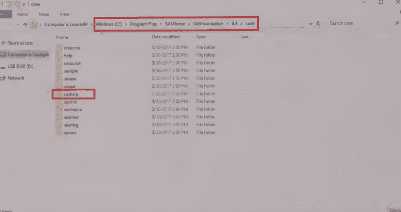
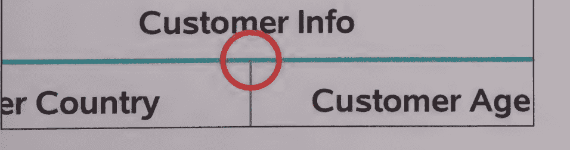
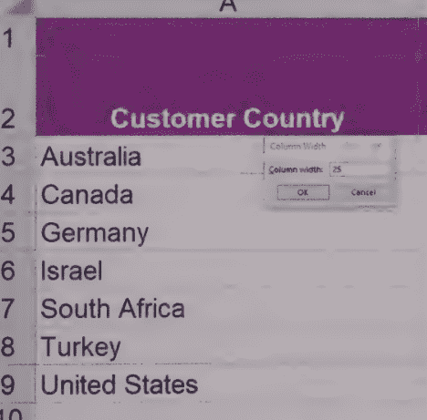
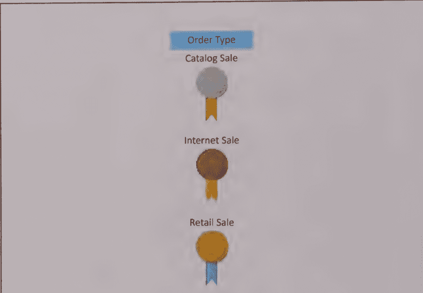
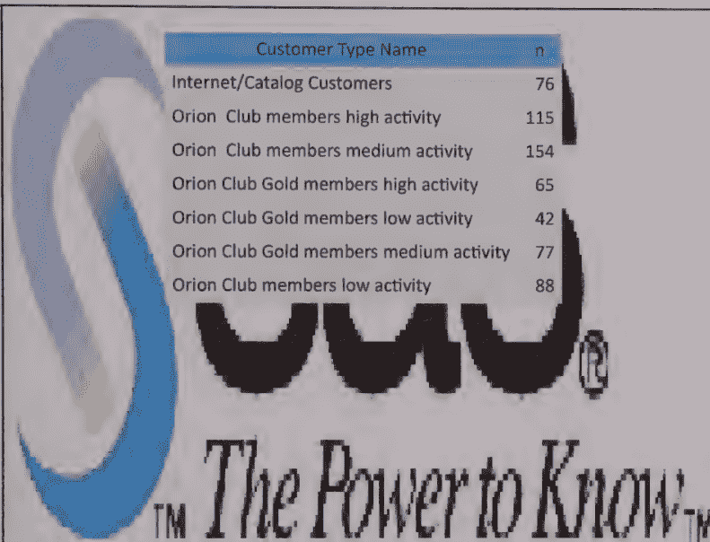

# SAS 程序员 PROC REPORT 秘籍：ODS 伴侣


- 8.2.5 表格元素样式变化 ................................................................. 170
- 8.2.6 容器元素样式变化 ............................................................... 171
- 8.3 边框 ............................................................................ 172
- 8.4 超链接 ...................................................................... 174

# 关于本书

## 本书涵盖了什么？

本书的目的是描述 `PROC REPORT` 如何与输出交付系统（ODS）目标交互。每个 ODS 目标的行为都不同，程序员需要意识到，他们可能需要根据最终目标调整他们的 `PROC REPORT` 代码或创建自定义样式模板。

本书涵盖了 `PROC REPORT` 如何与以下目标交互：

- PDF
- RTF
- Tagsets.RTF
- HTML
- HTML5
- Excel 的 ODS 目标
- Tagsets.ExcelXP
- PowerPoint 的 ODS 目标

本书没有讨论如何使用 `PROC REPORT` 进行计算或如何构建输出。这些主题在《SAS 程序员 PROC REPORT 手册：基础到高级报告技术》（在书中称为“报告技术”）中讨论过。

本书没有深入介绍样式模板和 `PROC TEMPLATE`。这些主题将根据它们与 `PROC REPORT` 的关系进行简要描述。

## Scope of This Book

本书完全关于 `PROC REPORT` 和 ODS（输出交付系统）。`PROC REPORT` 是专门为生成报告而设计的。ODS 在报告的最终外观中起着重要作用。本书尝试概述 ODS 的每个目标及其与 `PROC REPORT` 的关系。关于每个目标及其样式属性用途的完整描述超出了本书的范围。

虽然书中使用了 `TEMPLATE` 过程，但并未对其进行深入介绍。`TEMPLATE` 过程语法的描述仅说明了如何与 `PROC REPORT` 使用。

## What Should You Know about Develop the Book's Content

书中的示例使用 SAS 9.4 开发，并安装了所有热修复。与 Excel 和 PowerPoint 相关的示例应在 SAS 9.3 中运行。请注意，如果以交互方式运行示例，应添加 `NOW` 选项到 `PROC REPORT` 语句。本书也兼容 SAS University Edition。

## Example Code and Data

书中用于演示的 Orion Star 数据使用权限由 Sean'Brien 和 Eric Ross 授予。书中的所有示例都使用 ORDERS 数据集。ORDERS 包含订单数据。数据设置在 `CUSTOMER_ID`、`ORDER_ID` 和 `PRODUCT_ID` 级别。客户可以拥有多个订单，在每个订单中，客户可以购买多个产品。`QUANTITY` 变量包含特定产品的数量。

要使用作者页上的示例程序，你需要 WORK 目录下的 ORDERS 数据集。`createfits.sas` 程序创建了名为 `entry` 和 `type` 的两种格式，这些格式贯穿本书。格式存储在 WORK 目录的目录中。

你不需要通读本书即可获得关于 `PROC REPORT` 以及如何与 ODS 交互的有价值知识。第 2、3 和 4 章为本书的后续章节提供了基础。你可能会发现先阅读这些章节再阅读你感兴趣的章节会有帮助。

你可以通过链接作者页 <http://support.sas.com/publishing/authors> 获取本书的示例代码和数据。选择作者姓名。然后寻找本书的封面缩略图，并选择示例代码以书中包含 SAS 程序。

如果你无法通过网站访问代码，请向 <saspress@sas.com> 发送电子邮件。

## SAS University Edition

本书兼容 SAS University Edition。如果你正在使用 SAS University Edition，请在此开始：<http://support.sas.com/publishing/import_ue.data.html>

## Output and Graphics

书中的输出发送到许多 ODS 目标，包括 PDF、HTML、RTF、Tagsets.ExcelXP 和 Excel 目标。

## Terminology Used in this Book

当 `group`、`order` 和 `across` 指的是 DEFINE 语句中的用法值时，这些词大写。文中所有的语句名、选项和变量名均大写。

## We Want to Hear from You

SAS Press 书由 SAS 用户为 SAS 用户编写。我们欢迎你参与他们的开发并对你正在使用的 SAS Press 书提供反馈。请访问 `sas.com/books` 执行以下操作：

- 注册评审书籍。
- 推荐一个主题。
- 请求有关如何成为 SAS Press 作者的信息。
- 对书籍提供反馈。

你对正在阅读的 SAS Press 书有疑问吗？通过 <saspress@sas.com> 或 <https://support.sas.com/author_feedback> 联系作者。

SAS 有许多资源帮助你找到答案并扩展知识。如果你需要额外帮助，请查看我们的资源列表：`sas.com/books`。

## About the Author

Jane Eslinger 是位于北卡罗来纳州卡里 SAS 世界总部的高级技术支持分析师。Jane 是 SAS(R)9 SAS 认证高级程序员，也是 SAS 认证高级可视化业务分析师。她经常在 SAS 大会上演示 `PROC REPORT` 和 ODS。她在北卡罗来纳州立大学获得统计学学士学位。她是《The SAS Programmer PROC REPORT Handbook: Basic to Advanced Techniques》的作者。


- 用于 Excel 的 ODS 目标
- 用于 PowerPoint 的 ODS 目标
- Tagsets.ExcelXP
- SASReport

本书中我没有讨论 Listing 目标。Listing 目标产生等宽字体文本输出。它不具备添加当今大多数报告所需的格式和样式更改的能力。

第 4 章讨论了在 `PROC REPORT` 代码中指定的样式覆盖。`STYLE=` 选项在该过程内部的大多数语句中均可用。本章讨论了使用该选项的有效方法。

`PROC REPORT` 表格的所有常见样式更改在我的之前的书中都已涵盖了。然而，每个 ODS 目标都有独特的功能和特性。本书的其余章节将重点介绍各个目标，以及如何利用它们的优势或针对它们的局限性进行编程处理。

在第 5 章中，我重点关注了 PDF 目标。我讨论了能够提供最佳效果的样式模板。本章详细解释了边框处理，因为 PDF 的处理方式与其他任何目标都不同。该章还涵盖了 `SPROWS` 选项以及 SAS 9.4 TI1M5 中提供的新的无辅助功能。

第 6 章集中于 RTF 和 Tagsets.RTF 目标。它对比了这两个目标，并展示了它们如何影响 `PROC REPORT` 表格。我针对 `SPROWS` 选项的行为进行了深入讨论。

第 7 章集中于通过 Microsoft Excel 创建输出的目标。用于 Excel 的 ODS 目标、ExcelXP、HTML、Office2K 和 Office2K X 创建的可以在 Excel 中查看的输出。本章查看了这些目标中可用于更改 `PROC REPORT` 表格的可用子选项。它演示了每个目标如何将特定的 Excel 指令传递给微软。

第 8 章集中于 HTML 和 HTML 5 目标。HTML 5 目标由于使用了最新的 HTML 标准，正在逐渐成为默认 HTML 目标。在本章中，我将 HTML 目标与 HTML 5 目标进行了对比。

第 9 章集中于 PowerPoint 的 ODS 目标。PowerPoint 目标在本书讨论的所有目标中是独特的。该目标使用不继承自父类的样式模板。字体和整体尺寸比其他目标大得多。本章讨论了修改 `PROC REPORT` 代码的策略，以将输出适应到幻灯片并确保其可读性。

第 3 章展示了 `PROC REPORT` 输出在 SASReport 目标中的外观，我没有专门为此用一章。我发现大多数生产报告是在其他目标之一创建的。SASReport 目标将保持可用，但在 SAS Enterprise Guide 中将被 HTML 5 替换为默认目标。与其他目标一样，如果 SASReport 是所需的输出目标，则样式模板和覆盖项应以 SASReport 为主体编写。

我此部分的目的是教你如何使用样式更改来生成你所需的 `PROC REPORT` 表格报告。除了样式更改背景外，本书不解释 `PROC REPORT` 语法。详情请参考《SAS 程序员 PROC REPORT 手册：从基础到高级的报告技术》。

# 引言：第 3 章概述

此外，本书无法涵盖关于 ODS、样式模板或 `PROC TEMPLATE` 的所有知识。本书仅涵盖了与 `PROC REPORT` 相关的领域。尽管它涵盖了大量信息，但主题和示例侧重于我在 SAS 技术支持分析师的“日常工作”中收到的程序员的报告和问题。

书籍使用了数据集 ORDERS。如序言所述，该数据集可以从作者页面下载：<http://support.sas.com/publishing/authors/eslinger.html>。此外，作者页面上还可以下载一个名为 `createfmts.sas` 的程序。它创建了一个临时格式目录，其中包含了全书示例中所需的格式。

# 第 2 章：PROC TEMPLATE 概述

- 2.1 引言 ..................................................................................... 5
- 2.2 默认样式模板 ........................................................................ 6
- 2.3 样式模板的位置 ................................................................ 7
- 2.4 查看样式模板 ............................................................. 9
- 2.5 `PROC TEMPLATE` 的通用语法 ............................................ 12
- 2.6 CLASS 语句与样式 ....................................................... 14
- 2.7 继承 ................................................................................. 14
- 2.8 样式属性 .......................................................................... 15
- 2.9 关键点总结 ................................................................ 16

## 2.1 引言

SAS 生成的每一个输出都由模板控制。REPORT、ME、GLM 以及其他过程生成的表格由模板控制。输出交付系统（ODS）的视觉方面由样式模板控制。样式模板是生成美观输出的强大工具。它们有助于生成的 `PROC REPORT` 表格信息丰富且易于阅读。然而，在学习样式模板如何影响 `PROC REPORT` 之前，我们需要理解 SAS 提供了哪些模板。本章讨论了 SAS 提供的样式模板。请注意，此处完全关注 `PROC TEMPLATE` 生成的样式模板。大多数格式化的 ODS 目标允许使用层叠样式表（CSS）来影响样式。CSS 的使用基于本书范围。CSS 是一个很好的工具，但许多 SAS 程序员没有使用它的经验，因此依赖 `PROC TEMPLATE` 进行样式更改。

## 2.2 默认样式模板

Base SAS 自带了几个样式模板。每个模板为特定目标设计，尽管通常用于多个目标。样式列表和建议目标表可以在 SAS 9.4 输出交付系统用户的“样式引用”部分找到。每个 ODS 目标默认使用样式模板，如表 2.1 所示。

### 表 2.1 ODS 目标及其默认样式模板

| 目标 | 默认模板 |
|---|---|
| HTML | HTMLBlue |
| PDF | Pearl (9.4), Printer (9.3 及早版本) |
| RTF | RTF |
| Tagsets.RTF | RTF |
| Tagsets.ExcelXP | Default |
| MSOffice2K | Default |
| 用于 Excel 的 ODS 目标 | Excel |
| 用于 PowerPoint 的 ODS 目标 | PowerPointLight |
| EPUB | Daisy |
| SASReport | HTMLBlue |
| Listing | Listing |

每个 SAS 接口都输出到默认目标。例如，SAS 窗口环境创建 HTML，SAS Enterprise Guide 生成 SASReport，SAS Studio 生成 HTML5 输出。每个接口都有更改目标所用样式模板的能力。在 SAS 窗口环境中，样式模板列在 `Tools > Options > Results > Style` 下。在 SAS Enterprise Guide 中，样式模板在 `Tools > Options > Results > <目标> Style`。在 SAS Studio 中，样式模板在 `Options > Preferences` 中。

程序员也可以选择关闭默认目标并使用 ODS 语句将输出重定向到任何目标。ODS 语句可以在任何 SAS 接口中使用。如果偏于使用默认其他样式模板，可以在 ODS 语句中使用 `STYLE=` 选项进行指定。提供的样式模板

## PROC TEMPLATE 概述 7

SAS 可以在无需任何修改或特殊代码的情况下使用。例如，使用 SASWEB 样式输出 HTML 而不是默认的 HTMLBlue，语法为：

```sas
html path="myppath" file="myfile.html" style=styles.sasweb;
```

前缀 `styles.` 并不是严格必要的，因为存储在 styles 文件夹中的样式（包含 SAS 提供的模板）会被自动搜索。因此，程序也可以使用此语法：

```sas
html path="myppath" file="myfile.html" style=sasweb;
```

## 2.3 样式模板的位置

随 SAS 附的样式模板定义存储在 `SASHELP.TMPLMST` 模板存储中。模板存储（template store）是一个持有模板的 SAS 项目。以下是 SAS 9.4《输出交付系统：用户指南》中对项目存储的定义：

- 一个 SAS 库成员由可以独立访问的信息片段组成。项目存储的内容组织在目录树结构中，类似于 UNIX 系统服务或 Windows 使用的目录结构。例如，特定值可以使用目录路径（`root_dir/sub_dir/value`）进行存储和定位。SAS 注册表（SAS Registry）就是项目存储的一个示例。

可以通过知道 SASHELP 目录的位置确定项目或模板存储文件的物理位置。示例 2.1 中的 `PROC OPTIONS` 步骤将提供 SASHELP 目录的位置。

### 示例 2.1 确定 SASHELP 目录的位置

```sas
proc options option=sashelp;
run;
```

此代码的结果将写入日志中。日志的内容将与输出 2.1 类似，取决于您的许可证以及 SAS 在系统上的安装方式。

### 输出 2.1 SASHELP 位置

| SASHELP=( |
|---|
| "!SASROOT\core\sashelp" |
| ... |
| "!SASROOT\spdsaclient\sashelp" |
| "!SASROOT\stat\sashelp" |
| "!SASROOT\warehouse\sashelp" |

指定 Sashelp 库的位置。

TMPLMST 文件最可能位于 `"!SASROOT\core\sashelp"`。图 2.1 显示了典型 Windows 安装的截图。

### 图 2.1 Windows 系统上的 SASHELP 位置



安装期间另一个自动创建的模板是 `SASUSER.TEMPLATE`。在大多数安装中，SASHELP 目录是只读的。因此，新的或修改的模板最可能保存在 `SASUSER.TEMPLATE` 中。

当需要模板样式时，SAS 在可用模板存储中查找样式名称。要确定先搜索哪个模板存储以及分配给每个存储的访问类型，请使用 `ODS PATH` 语句，如示例 2.2 所示。

### 示例 2.2 ODS PATH 语句

```sas
ods path show;
```

此结果写入日志，取决于您的设置，将类似于输出 2.2。

### 输出 2.2 默认 ODS PATH

```text
当前 ODS PATH 列表为：
```

1. `SASUSER.TEMPLAT` (`UPDATE`)
2. `SASHELP.TMPLMST` (`READ`)


在某些配置中，`SASHELP` 和 `SASUSER` 目录均被设置为只读访问。在这些配置中，新模板必须存储在 `WORK` 位置的模板存储或另一个允许写入或更新访问的位置中。

要写入到 `SASUSER` 或 `SASHELP` 以外的位置，请使用示例 2.3 中的代码。该示例提交了 `ODS PATH` 语句，指定所需的位置（即指向目录路径的 `libref`）和模板存储名称。

### 示例 2.3 为 ODS PATH 添加另一个位置

```sas
classname myylib "c:\myttamples";
ods path(prepend) myylib.mplts(write);
ods path show;
```

### 输出 2.3 修改后的 ODS PATH

当前 `ODS PATH` 列表为：

1. `MYLIB.TMPLTS (UPDATE)`
2. `SASUSER.TEMPLAT (UPDATE)`
3. `SASHELP.TMPLMST (READ)`

`ODS PATH` 语句的结果（输出 2.3）显示新的模板存储名称被加在路径的开头。搜索样式模板时，SAS 将首先查找 `MYLIB.TMPLTS`。如果创建了新模板，将保存该模板存储。

在默认 `ODS PATH`（输出 2.2）中，SAS 将首先查找 `SASUSER.TEMPLAT` 存储。如果在 `SASUSER.TEMPLAT` 中找到该模板，则使用它。如果未找到，SAS 将转向查找 `SASHELP.TMPLMST`。

如果在 `ODS PATH` 列出的任何位置未找到样式模板，SAS 会日志中发出警告。日志指示：未找到 `Style.XXX`；将使用替代。

## 2.4 查看样式模板

如章节早期所述，SAS 包含许多样式。可以通过运行示例 2.4 中的代码查看 `ODS PATH` 中所有模板存储的样式名称。

### 示例 2.4 查看所有样式模板

```sas
proc template;
list styles /store=sashelp;
run;
```

要查看特定模板存储中的样式名称，请使用示例 2.5 显示的 `LIST` 语句中的 `STORE` 选项。

### 示例 2.5 查看特定存储中的样式模板

```sas
proc template;
list styles /store=sashelp;
run;
```

在之前提到的每个接口 `Tools` 菜单中也可以看到名称。在 SAS 环境中，可以使用命令行检查模板存储。

## ODS Companion

样式模板名称并不总是对特定样式生成的输出提供直观理解。SAS 9.4《输出交付系统：用户指南》包含每个模板的图像。或者，在 Enterprise Guide 中，可以在 `Tools Manager` 中查看每个样式的外观。最后，示例 2.6 为每个模板生成一个文件。

### 示例 2.6 为每个样式创建一个文件

```sas
ods _all_close;

/*work.Gallery 从 SASHELP.STYLE 创建，并在后续 DATA 步骤中生成每个目的地的样式列表。不需要 Base Template.*/
proc sort data=sashelp.style out=work.gallery;
where libname='SASHELP' and substr(style,1,6) = 'Styles';
by style;
run;

/* 使用 path 指定位置
如果您运行 SAS University Edition，则指定 /folders/myfolders；如果您使用 SAS OnDemand for Academics，则指定 /home/userid；如果您使用 EG 或 Windows 版 SAS，指定您有访问权限的 c:/temp/output；

ODS 目标语句为 work.gallery 中的每个样式创建一个输出文件。仅显示 4 个目标。您可以修改此程序和下面的 PROC REPORT 步骤来创建您的样式库.*/
@macro generatods();
ods nodenumber;
ods html file="&path/&style.html" style=&style;
ods pdf file="&path/&style.pdf" style=&style;
ods rtf file="&path/&style.rtf" style=&style;
ods excel file="&path/&style.xlsx" style=&style;
title "Style is: &style";
proc print data=sashelp.class(obs=5);
run;
ods _all_close;
@end generatods;

/*ODS NORESULTS 语句防止生成的每个 PROC 步骤在结果窗口中出现条目.*/
ods results;
/*此 DATA 步骤将 GENERATE 宏调用到输入栈，这将导致宏程序为 WORK.GALLERY 中的每个样式运行 1 次。宏程序将在 DATA 步骤结束后才会开始运行.*/
data data_null;
set work.Gallery;
call systx('style', scan(style,2,'.'));
call execute('%generatods();');
run;
```

## PROC TEMPLATE 概述 11

`/*ODS RESULTS AND ODS PREFERENCES 语句将 ODS 选项置回默认值.*/`

```sas
ods results;

ods preferences;

ods _all_close;
```

`Compute` 为每个目的地的输出文件构建链接。上面的步骤不起作用，链接将损坏。您需要为 `INDEX.html` 文件使用的路径与您用于 `GENERATEODS` 宏程序的路径保持相同.*/

```sas
ods html file="path/index.html";
title "of all styles";
```

```sas
proc report data=work.gallery;
column libname memename style HTML RTF PDF XL;
define libname / order;
define memename / display;
define style / display;
define HTML / computed 'ODS HTML';
define RTF / computed 'ODS RTF';
define PDF / computed 'ODS PDF';
define XL / computed 'ODS EXCEL';
compute html / character length=4;
hml = 'HTML';
hvar = catt(scan(style,2,'.'),'.html');
call define(_col_URL',hvar);
endcomp;
compute rtf / character length=3;
rtf = 'RTF';
rvar = catt(scan(style,2,'.'),'.rtf');
call define(_col_URL',rvar);
endcomp;
compute pdf / character length=3;
pdf = 'PDF';
pvar = catt(scan(style,2,'.'),'.pdf');
call define(_col_URL',pvar);
endcomp;
compute xl / character length=5;
xl = 'EXCEL';
xlvar = catt(scan(style,2,'.'),'.xlsx');
call define(_col_URL',xlvar);
endcomp;
run;
\ods html close;
```

## 2.5 PROC TEMPLATE 的通用语法

可以对 Base SAS 自带的样式模板进行修改。然而，最佳实践是创建一个新名称的样式，而不是覆盖原始样式模板。

通常情况下，通过修改现有模板或编写新模板创建的样式模板被称为自定义样式模板。可以从零创建模板，但大多数程序员发现对现有模板上进行微小修改更为简单。

以下是自定义样式模板的优点：

- 自定义样式可以为多个程序和报告提供统一的视觉观。
- 代码只需要创建一次，对样式的修改只需要在一个位置处进行。
- 某些属性无法在过程中更改。因此，更改必须在自定义样式模板中进行。

`TEMPLATE` 过程创建并修改样式模板。样式模板内部包含样式属性（style attributes）。样式属性是描述输出外观特定方面的独立属性。`BACKGROUNDCOLOR` 就是样式属性的一个示例。

样式属性分组在样式元素（style elements）中。样式元素控制输出的某些区域。例如，`Header` 样式元素控制表格的头部部分。`Table`、`Header` 和 `Data` 元素是表格输出（如 `PROC REPORT` 创建的表格）的主要元素。

### 示例 2.7 PROC TEMPLATE 的通用语法

```sas
proc template;
  define style-path | Base.Template.Style < STYLE=libref.template-store>;
  parent = style-path;
  class element-name(s) <text>
    </style-attribute-specification(s);
  style element-name(s) <FROM style-element | _SELF_ <text>
    </style-attribute-specification(s);
end;
```

`DEFINE STYLE` 语句开始创建一个新样式。由此代码创建的样式可以用于任何支持样式的 ODS 目标。

`style-path` 告诉 `PROC TEMPLATE` 在模板库（template store）中何存储样式。`style-path` 可以是一级或两级名称。指定两级名称将在模板库中创建目录。例如，如果 `style-path` 是 `ABC`，则该样式将列为模板库根目录下的条目。如果 `style-path` 是 `styles.ABC`，则会在模板库中创建一个名为 `styles` 的目录，并将 `ABC` 存储在其中。一级或两级 `style-path` 取决用户的偏好。

在 `DEFINE STYLE` 语句中指定 `Base.Template.Style` 会创建一个样式，该样式成为所有不包含 `PARENT` 模板的样式的父样式。Base SAS 已经包含了 `Base.Template.Style`。除非你是创建样式模板的专家，否则不建议创建新版本或覆盖现有的 `Base.Template.Style`。

`STORE=` 选项告诉 `PROC TEMPLATE` 在哪个库中保存样式模板。如果模板库已存在，则由模板库的访问方法决定样式保存的位置。如果访问方法为 `WRITE`，则模板库将被覆盖。如果访问方法为 `UPDATE`，则样式将被添加到模板库中。如果模板库不存在，`STORE=` 选项将创建一个新的模板库。

- `PA=` 语句是可选的。它提供了一个新定义的样式可以继承的样式。当未指定 `PA=` 选项时，会自动分配 `style.Base.Style` 为父样式。这确保了至少有一套基本的样式设置来创建一个可用的表格。使用 `PA=` 语句是建立具有大多数所需属性的样式模板的快速方法。该语句中的 `style-path` 选项指定了要继承的样式的路径和名称。

在定义新样式时，不会检查父样式的名称和位置。父样式的名称仅与新样式的其余代码一起存储。只有在 ODS 中使用新样式时，SAS 会在 `ODS PATH` 中的第一个模板库中查找父名称（一级或两级）。然后它查找第二个，依此类推，直到找到父样式。如果找不到父样式，将发出警告并且 ODS 回退到该目标的默认样式模板。

```text
WARNING: Could not restore referenced object: styles.XXX.
WARNING: Could not find parent template: styles.XXX.
```

- `CLASS` 语句根据具有同名的样式元素创建一个元素。`CLASS` 语句可以列出一个或多个样式元素。
- `STYLE` 语句创建或修改一个或多个元素。
- 在 `CLASS` 或 `STYLE` 语句中，在斜杠（`/`）之后，设置所有所需属性的值。每个属性名后跟等号（`=`）和所需的值。根据属性的不同，其值可能不需要引号。为任何属性指定测量单位（例如 `BORDERWIDTH` 和 `FONTSIZE`）是最佳实践，HTML 对无单位值的处理比其他目标得更好，因为它使用的是相对长度，而不是所请求的具体尺寸。其他目标会在后台进行计算以确定最佳匹配。计算结果可能不符合预期或需求。
- 分号（`;`）跟在所有属性名值对之后。
- `DEFINE STYLE` 语句实际上开始了一个结束语句块。需要 `END` 语句来完成 `DEFINE STYLE` 块。未包含 `END` 语句将导致错误：

```text
ERROR: Parse environments were left open. You might be missing an END statement.
```

## 2.6 STYLE 语句与 CLASS 语句

取决于代码编写的人和时间，`PROC TEMPLATE` 步骤将具有 `STYLE` 语句、`CLASS` 语句或两者都有。`CLASS` 语句意味着继承自指定的元素。例如，以下语句更改了 `Header` 元素的颜色并继承了 `Header` 元素的所有属性。

```sas
class header / color=blue;
```

`STYLE` 语句要求显式指定要继承的元素。例如，在以下语句中，`FROM` 子句指定 `Header` 元素继承其父样式。

```sas
style header from header / color=blue;
```

`FROM` 子句也可以指定 `_SELF_` 关键字。当 `STYLE` 语句中列出多个元素时，该关键字特别有用。

```sas
style header from _self_ / color=blue;
```

省略 `FROM` 子句不会导致错误或警告。ODS 目标仍然会创建输出。然而，可能不符合预期。如果没有 `FROM` 子句，样式元素将被重新定义，这意味着它覆盖了该样式可能存在的样式属性。

上述 `CLASS` 和 `STYLE` 语句的效果完全相同。除了按键次数外，两者之间没有优势。《PROC TEMPLATE Made Easy: A Guide for SAS Users》作者 Kevin Smith 建议通常使用 `CLASS` 语句。

旧的样式模板可能包含 `REPLACE` 语句。从 SAS 9.2 开始，不再支持 `REPLACE` 语句。删除任何 `REPLACE` 语句，改为使用 `STYLE` 语句或 `CLASS` 语句来创建和修改样式元素。

## 2.7 继承

继承对于样式模板是一个非常重要的主题。大多数样式模板继承自父样式。父属性可以认为是起点。父样式具有指定的元素和属性。从它构建的模板要么更改一个或多个元素并添加新的元素和属性。

最常用的父样式是 `Styles.Default`。创建 `Styles.Default` 的 `PROC TEMPLATE` 代码非常长。模板包含了 ODS 需要的大部分样式元素。并不是所有的元素属性，但元素是可以用的。有时，取决于目标，如果 ODS 语句中指定的样式找不到，则使用 `Styles.Default`。

# PROC TEMPLATE 概述

ODS 需要生成输出。输出在视觉上可能并不美观，但具有可读性和功能性。

利用继承规则允许无需从头开始构建模板。继承的概念相对简单。例如，`RTF` 继承自 `Styles`，`Printer` 继承自 `Styles`。这意味着你可能需要查看不同的样式定义来确定特定元素属性的值。遗憾的是，没有工具可以跟踪父模板中的所有属性，这需要手动操作——打开每个样式定义进行查找。

```sas
ods powerpoint file='test.pptx' style=typename;
ods tagsets.xlsx file='test.xml' style=typename;
ods tagsets.sasreport13 file='test.srx' style=typename;
```

最后，对于每个示例，通过在 `PROC TEMPLATE` 步骤提交以下语句，将样式模板存储在临时 `WORK` 位置中：

```sas
ods path(prepend work.templat(update));
```

## 3.4 未更改属性时生成的普通输出

在更改任何特定属性之前，检查 `PROC REPORT` 的输出样式是非常关重要的。`PROC REPORT` 代码中至少包含一个受每个样式元素影响的语句。其他语句将根据需要进行定义，以展示在模板中所做的的更改。示例 3.1 生成了一个普通样式模板，仅为每个主要样式元素指定了字体和前景颜色。

### 示例 3.1 生成普通 Style 模板

```sas
proc template;
  define style plain;
    table /\
      fontfamily='Thorndale AMT'
      color=black;
    style data /\
      fontfamily='Thorndale AMT'
      color=black;
    style header /\
      fontfamily='Thorndale AMT'
      color=black;
    style dataemphasis /\
      fontfamily='Thorndale AMT'
      color=black;
    style linecontent /\
      fontfamily='Thorndale AMT'
      color=black;
end;
run;
```

#### 输出 3.1.1 PDF 普通结果

| 客户所在国家 | 客户年龄组 | 订单类型 | 订单数量 |
|---|---|---|---|
| 澳大利亚 | 31-45 岁 | 澳大利亚的行语句 | Internet Sale | 1 |
|  |  |  | Retail Sale | 4 |


## 3.1 前言（Pretext）与输出结果

### 输出 3.1.1 PDF 普通结果

| | | 46-60 岁 | Internet Sale | 8 |
|---|---|---|---|---|
| 澳大利亚 | 15-30 岁 | 美国的行语句 | Internet Sale | 2 |
| 美国 | | | Retail Sale | 11 |
| | | | Retail Sale | 7 |
| | | | Retail Sale | 1 |
| | 31-45 岁 | | Internet Sale | 21 |
| | 61-75 岁 | | Retail Sale | 29 |

输出 3.1.1 中的前言（`pretext`）并非分配给所有样式元素的 `Thorndale AMT` 字体。它实际上是 `Cumberland AMT` 字体。对于 `ODS PDF`，此文本由不同的样式元素控制，我们将在章节后续部分进行探讨。

#### 输出 3.1.2 RTF 计划结果

`RTF` 输出（输出 3.1.2）符合预期。所有文本均为相同字体。

#### 输出 3.1.3 HTML 普通结果

注意，`ODS HTML` 输出（输出 3.1.3）中的表头是粗体，尽管它们在所有其他目标中都是中等权重。在 `ODS HTML` 输出中，表头被赋予了 `th` 标签。`th` 标签由浏览器控制，始终指定粗表头。防止这种行为的唯一方法是显式设置表头的字体权重。

#### 输出 3.1.4 Excel 普通结果的 ODS 目标

| | 客户信息 | 客户年龄组 | 订单类型 | 订单数量 |
|---|---|---|---|---|
| 1 这是前言 | | | | 1 |
| 5 澳大利亚 | 31-45 岁 | 澳大利亚的行语句 | Internet Sale | 4 |
| 5 澳大利亚 | 46-60 岁 | | Real Sale | 7 |
| 9 澳大利亚 | | | Internet Sale | 9 |
| 10 美国 | 15-30 岁 | 美国的行语句 | Internet Sale | 11 |
| 13 | 31-45 岁 | | Real Sale | 17 |
| 14 美国 | 61-75 岁 | | Real Sale | 21 |
| 29 | | | 这是一个行语句 | 29 |

3.1.4 中的前言并非分配给所有元素的 `Thorale AMT` 字体。它实际上是 `Courier New` 字体。对于 `Excel ODS` 目标，此文本由不同的样式元素控制，我们将在章节后续部分进行探讨。

#### 输出 3.1.5 PowerPoint 普通结果的 ODS 目标

| | 客户信息 | 客户年龄组 | 订单类型 | 订单数量 |
|---|---|---|---|---|
| 澳大利亚 | 31-45 岁 | 澳大利亚的行语句 | Internet Sale | 1 |
| | 46-60 岁 | | Real Sale | 4 |
| 澳大利亚 | | | Internet Sale | 8 |
| 美国 | 15-30 岁 | 美国的行语句 | Internet Sale | 2 |
| | 31-45 岁 | | Real Sale | 11 |
| | 61-75 岁 | | Real Sale | 7 |
| | | | Real Sale | 21 |
| | | | | 29 |
| | | | 这是一个行语句 | |

在为 `PowerPoint` 的 `ODS` 目标创建自定义模板时，强烈建议你使用父样式，即 `PowerPointLight` 或 `PowerPointDark`。本章中的示例为了刻意没有使用父样式，以简化这些概念。因此，`PowerPoint` 输出看起来并不美观。除非你了解样式元素如何影响 `PowerPoint` 目标，否则你应该在你的 `PROC REPORT` 代码中添加父样式。注意输出 3.1.5 中的前言并非与其他输出相同的 `Thorndale AMT` 字体。

#### 输出 3.1.6 Tagsets.Excel 普通结果

| A | B | C | D |
|---|---|---|---|
| 客户信息 | 客户年龄组 | 订单类型 | 订单数量 |
| 客户所在国家 | | | |
| 澳大利亚的行语句 | Internet Sale | 1 | |
| 澳大利亚 | 31-45 岁 | | |
| | | Retail Sale | 4 |
| | 46-60 岁 | Real Sale | 7 |
| 澳大利亚 | | Internet Sale | 8 |
| 美国的行语句 | Internet Sale | 2 | |
| 美国 | 15-30 岁 | | |
| | 31-45 岁 | Real Sale | 11 |
| 61-75 岁 | Real Sale | 7 |
| | | Real Sale | 21 |
| | | 这是一个行语句 | 29 |
| | | | | 1 | |

注意 `Tagsets.Excel` 输出（输出 3.1.6）表格中不包含 `PRETEXT` 属性。

#### 输出 3.1.7 Tagsets.SASReport 普通结果

| | | | |
|---|---|---|---|
| 客户信息 | 客户年龄组 | 订单类型 | 订单数量 |
| 客户所在国家 | | | |
| 澳大利亚的行语句 | Internet Sale | 1 | |
| 澳大利亚 | 31-45 岁 | | |
| | | Retail Sale | 4 |
| | 46-60 岁 | Real Sale | 7 |
| 澳大利亚 | | Internet Sale | 8 |
| 美国的行语句 | Internet Sale | 2 | |
| 美国 | 15-30 岁 | | |
| | 31-45 岁 | Real Sale | 11 |
| 61-75 岁 | Real Sale | 7 |
| | | Real Sale | 21 |
| | | 这是一个行语句 | 29 |
| | | | | 1 | |

`Tagsets.SASReport` 是 `Enterprise Guide` 的默认目标。在 `Enterprise Guide` 中，该输出的标签页标记为 `- SAS Report`。注意在输出 3.1.7 中，整个页面的背景是灰色。此外，预设颜色为深蓝色。

通常情况下，输出适用于所有五个目标。然而，即使使用这种样式，输出也会根据目标而有所不同。这强调了基于目标开发自定义样式模板的重要性。随着每个样式元素的探讨，目标之间的差异将变得更加明显。

## 3.5 表头元素更改

头部元素非常简单。该元素内的属性仅适用于表格的头部部分。这包括在 `COLUMN` 语句中创建的任何跨列头。样式模板无法与列头分开控制跨列头。在示例 3.2 中，分配了控制文本、边框和间距的属性，以展示受头部元素影响的表格部分。

### 示例 3.2 在头部元素中分配属性

```
proc template;
  define style;
    table /\
      fontfamily='Thorndale AMT'
      color=black;
    style data /\
      fontfamily='Thorndale AMT'
      color=black;
    style header /\
      fontfamily='Albany AMT'
      color=#264666
      fontWeight=bold
      fontstyle=italic
      backgroundColor=#F0F0F0
      borderwidth=2pt #F09F2F
      borderstyle=solid
      borders=5pt;
    style dataemphasis /\
      fontfamily='Thorndale AMT'
      color=black;
    style linecontent /\
      fontfamily='Thorndale AMT'
      color=black;
end;
run;
```

为头部元素内的文本分配了四个特定属性，以及背景、边框和间距属性。所有其他样式元素都指定了不同的字体和前景颜色。

### 输出 3.2.1 PDF 头部结果

| 客户国家 | 客户年龄组 | 订单类型 | 订购数量 |
| --- | --- | --- | --- |
| 澳大利亚 | 31-45 岁 | 互联网销售 | 1 |
| | | 46-60 岁 | 零售销售 | 4 |
| 澳大利亚 | | | 互联网销售 | 8 |
| 美国 | 15-30 岁 | 互联网销售 | 2 |
| | | 31-45 岁 | 零售销售 | 11 |
| | | 61-75 岁 | 零售销售 | 7 |
| 美国 | | | 零售销售 | 21 |
| | | | 29 |

### 输出 3.2.2 RTF 头部结果

| 客户国家 | 客户年龄组 | 订单类型 | 订购数量 |
| --- | --- | --- | --- |
| 澳大利亚 | 31-45 岁 | 互联网销售 | 1 |
| | | 46-60 岁 | 零售销售 | 4 |
| 澳大利亚 | | | 互联网销售 | 8 |
| 美国 | 15-30 岁 | 互联网销售 | 2 |
| | | 31-45 岁 | 零售销售 | 11 |
| | | 61-75 岁 | 零售销售 | 7 |
| 美国 | | | 零售销售 | 21 |
| | | | 29 |

### 输出 3.2.3 HTML 头部结果

| 客户国家 | 客户年龄组 | 订单类型 | 订购数量 |
| --- | --- | --- | --- |
| 澳大利亚 | 31-45 岁 | 互联网销售 | 1 |
| | | 46-60 岁 | 零售销售 | 4 |
| 澳大利亚 | | | 互联网销售 | 3 |
| 美国 | 15-30 岁 | 互联网销售 | 2 |
| | | 31-45 岁 | 零售销售 | 11 |
| | | 61-75 岁 | 零售销售 | 7 |
| 美国 | | | 零售销售 | 1 |
| | | | 29 |

### 输出 3.2.4 Excel ODS 目标头部结果

| 客户信息 | 客户年龄组 | 订单类型 | 订购数量 |
| --- | --- | --- | --- |
| 这是前言 | | | | |
| 客户信息 | 客户年龄组 | 订单类型 | 订购数量 |
| | | 澳大利亚的行语句 | 互联网销售 | 1 |
| 澳大利亚 | 31-45 岁 | | 零售销售 | 4 |
| | 46-60 岁 | | 互联网销售 | 3 |
| 澳大利亚 | | 美国的行语句 | 零售销售 | 8 |
| 美国 | 15-30 岁 | | 零售销售 | 11 |
| | 31-45 岁 | | 互联网销售 | 7 |
| | 61-75 岁 | | 零售销售 | 21 |
| 美国 | | | | 20 |
| | | | 这是一个行语句 |

### 输出 3.2.5 PowerPoint ODS 目标头部结果

| 客户信息 | 客户年龄组 | 订单类型 | 订购数量 |
| --- | --- | --- | --- |
| 这是前言 | | | |
| 客户国家 | 客户年龄组 | 订单类型 | 订购数量 |
| | | 澳大利亚的行语句 | 互联网销售 | 1 |
| 澳大利亚 | 31-45 岁 | | 零售销售 | 4 |
| | 46-60 岁 | | 互联网销售 | 3 |
| 澳大利亚 | | 美国的行语句 | 零售销售 | 8 |
| 美国 | 15-30 岁 | | 零售销售 | 11 |
| | 31-45 岁 | | 互联网销售 | 7 |
| | 61-75 岁 | | 零售销售 | 21 |
| 美国 | | | | 20 |
| | | | 这是一个行语句 |

### 输出 3.2.6 Tagsets.ExcelXP 结果

| A | B | C | D |
| --- | --- | --- | --- |
| 1 | 客户信息 | | 订单信息 |
| 2 | 客户国家 | 客户年龄组 | 订单类型 | 订购数量 |
| 3 | | 澳大利亚的行语句 | | |
| 4 | 澳大利亚 | 31-45 岁 | 互联网销售 | 1 |
| 5 | | | 零售销售 | 4 |
| 6 | | 46-60 岁 | 互联网销售 | 3 |
| 7 | 澳大利亚 | | | 8 |
| 8 | | 美国的行语句 | | |
| 9 | 美国 | 15-30 岁 | 互联网销售 | 2 |
| 10 | | | 零售销售 | 11 |
| 11 | | 31-45 岁 | 零售销售 | 7 |
| 12 | | 61-75 岁 | 零售销售 | 1 |
| 13 | 美国 | | | 21 |
| 14 | | | | 29 |
| 15 | | | 这是一个行语句 | |

## 输出 3.2.7 Tagsets.SASReport13 头部结果

| | | | |
| --- | --- | --- | --- |
| 客户信息 | | 订单信息 | | |
| 客户国家 | 客户年龄组 | 订单类型 | 订购数量 |
| | 澳大利亚的行语句 | | |
| 澳大利亚 | 31-45 岁 | 互联网销售 | 1 |
| | | 零售销售 | 4 |
| | 46-60 岁 | 互联网销售 | 3 |
| 澳大利亚 | | | 8 |
| | 美国的行语句 | | |
| 美国 | 15-30 岁 | 互联网销售 | 2 |
| | | 零售销售 | 11 |
| | 31-45 岁 | 零售销售 | 7 |
| | 61-75 岁 | 零售销售 | 1 |
| 美国 | | | 21 |
| | | | 29 |

放置在 `Header` 元素中的属性仅适用于所有目标。特定属性并不适用于所有目标，它们仅适用于 `HTML`、`Tagsets.ExcelXP` 以及输出 3.2.3、3.2.4、3.2.6 和 3.2.7。对于 `PDF` 和 `RTF` 文件，可以添加边界。`SAS` 程序员手册中的 `BORDERCOLOR=` 和 `BORDERWIDTH=` 属性：

```
style header /
fontfamily='Albany'
color=#2466
fontweight=bold
fontstyle=italic
background=#F0F00
borderwidth=1pt
bordercolor=#0092F
bordrightwidth=1pt
bordrightcolor=#092F
bordertopwidth=1pt
bordertopcolor=#092F
bordertbottomwidth=1pt
bordertbottomcolor=#092F
borderspadding=5pt;
```

第 9 章深入探讨了 `PowerPoint` 目标的边框。`HTML`、`RTF` 和 `PDF`（输出 3.2.1、3.2.2 和 3.2.3）头部单元格之间有明显的空白。在 `HTML` 目标中，空白来自 `BORDERACING=` 属性。然而，`PDF` 和 `RTF` 中的可见空白并非来自 `BORDERACING=` 属性。如果移除该属性，会出现相同的空白。可以通过将 `BORDERACING` 属性设置为零来消除空白。在示例 3.1 的输出中存在这种空白。`SASReport` 目标（输出 3.2.7）头部单元格之间的线条比其他目标更粗。每个头部单元格都有自己的边界，当它们相邻时，边界会双倍厚。

## 3.6 LineContent 样式

`LineContent` 元素非常简单。无论如何计算，该元素的属性都适用于所有 `LINE` 语句。在示例 3.3 中，控制文本、边界和间距的属性被分配给受 `LineContent` 元素的影响。

### 示例 3.3 在 LineContent 元素中分配属性

```
proc template;
define style _linecontent;
style table /
fontfamily='Thorndale'
color=black;
style data /
fontfamily='Thorndale'
color=black;
style header /
fontfamily='Thorndale'
color=black;
style data /
fontfamily='Thorndale'
color=black;
style linecontent {
fontfamily='Albany'
color=#2646
fontweight=bold
fontstyle=italic
background=#F0F00
borderwidth=2pt
bordercolor=#0092F
borderstyle=solid
borderspacing=5pt;
}
```

为 `LineContent` 样式元素内的文本分配四个特定属性，以及背景、边界和间距属性。所有其他样式元素指定了不同的字体和前景颜色。

### 输出 3.3.1 PDF LineContent 结果

| 客户信息 | 客户年龄组 | 订单类型 | 订购数量 |
| --- | --- | --- | --- |
| 澳大利亚 | 31-45 岁 | 澳大利亚的行语句 | 互联网销售 | 1 |
| | 46-60 岁 | 零售销售 | 4 |
| 澳大利亚 | | 美国的行语句 | 互联网销售 | 4 |
| 美国 | 15-30 岁 | | 互联网销售 | 8 |
| | 31-45 岁 | 零售销售 | 2 |
| | 61-75 岁 | 零售销售 | 11 |
| 美国 | | | 零售销售 | 7 |
| | | | 互联网销售 | 21 |
| | | 这是一个行语句 | 29 |

### 输出 3.3.2 RTF LineContent 结果

| 客户信息 | 客户年龄组 | 订单类型 | 订购数量 |


| --- | --- | --- | --- |

| 澳大利亚 | 31-45 岁 | 澳大利亚的行语句 | 互联网销售 | 1 |
| | 46-60 岁 | 零售销售 | 4 |
| 澳大利亚 | | 美国的行语句 | 互联网销售 | 4 |
| 美国 | 15-30 岁 | | 互联网销售 | 8 |
| | 31-45 岁 | 零售销售 | 2 |
| | 61-75 岁 | 零售销售 | 11 |
| 美国 | | | 零售销售 | 7 |
| | | | 互联网销售 | 21 |
| | | 这是一个行语句 | 29 |

### 输出 3.3.3 HTML `LineContent` 结果

| 客户国家 | 客户年龄组 | 订单类型 | 订单数量 |
| --- | --- | --- | --- |
| 澳大利亚 | 31-45 岁 | 互联网销售 | 1 |
| | | 零售销售 | 4 |
| | 46-60 岁 | 互联网销售 | 3 |
| | | | 8 |
| 美国 | 15-30 岁 | 互联网销售 | 2 |
| | | 零售销售 | 11 |
| | 31-45 岁 | 零售销售 | 7 |
| | 61-75 岁 | 零售销售 | 1 |
| | | | 21 |
| | | | 29 |

### 输出 3.3.4 ODS 目标 Excel `LineContent` 结果

| 客户国家 | 客户年龄组 | 订单类型 | 订单数量 |
| --- | --- | --- | --- |
| 澳大利亚 | 31-45 岁 | 互联网销售 | 1 |
| | | 零售销售 | 4 |
| | 46-60 岁 | 互联网销售 | 3 |
| | | | 8 |
| 美国 | 15-30 岁 | 互联网销售 | 2 |
| | | 零售销售 | 11 |
| | 31-45 岁 | 零售销售 | 7 |
| | 61-75 岁 | 零售销售 | 1 |
| | | | 21 |
| | | | 29 |

### 输出 3.3.5 ODS 目标 PowerPoint `LineContent` 结果

| 客户国家 | 客户年龄组 | 订单类型 | 订单数量 |
| --- | --- | --- | --- |
| 澳大利亚 | 31-45 岁 | 互联网销售 | 1 |
| | | 零售销售 | 4 |
| | 46-60 岁 | 互联网销售 | 3 |
| | | | 8 |
| 美国 | 18-30 岁 | 互联网销售 | 2 |
| | | 零售销售 | 11 |
| | 31-45 岁 | 零售销售 | 7 |
| | 61-75 岁 | 零售销售 | 1 |
| | | | 21 |
| | | | 29 |

### 输出 3.3.6 `Tagsets.ExcelXP` `LineContent` 结果

| A | B | C | D |
| --- | --- | --- | --- |
| 1 | 客户信息 | | 订单信息 |
| 2 | 客户国家 | 客户年龄组 | 订单类型 | 订单数量 |
| 3 | | 澳大利亚的行语句 | | |
| 4 | 澳大利亚 | 31-45 岁 | 互联网销售 | 1 |
| 5 | | | 零售销售 | 4 |
| 6 | | 46-60 岁 | 互联网销售 | 3 |
| 7 | 澳大利亚 | | | 8 |
| 8 | | 美国的行语句 | | |
| 9 | 美国 | 15-30 岁 | 互联网销售 | 2 |
| 10 | | | 零售销售 | 11 |
| 11 | | 31-45 岁 | 互联网销售 | 7 |
| 12 | | 61-75 岁 | 零售销售 | 1 |
| 13 | 美国 | | | 21 |
| 14 | | | | 29 |
| 15 | | 这是一个行语句 | | |

# SAS 程序员 PROC REPORT 手册 ODS Companion

### 输出 3.3.7 `Tagsets.SASReport13` `LineContent` 结果

这是正文文本

| 客户信息 | 客户年龄组 | 订单类型 | 订单数量 |
| --- | --- | --- | --- |
| 澳大利亚 | 31-45 岁 | 互联网销售 | 1 |
| | | 零售销售 | 4 |
| | 46-60 岁 | 互联网销售 | 3 |
| | | 零售销售 | 8 |
| 美国 | 15-30 岁 | 互联网销售 | 2 |
| | | 零售销售 | 11 |
| | 31-45 岁 | 零售销售 | 7 |
| | 61-75 岁 | 零售销售 | 1 |
| | | | 21 |
| | | | 29 |

再次，PDF 和 RTF 目标（输出 3.3.1 和 3.3.2）不包含 HTML、Excel、`Tagsets.ExcelXP` 和 `SASReport` 目标文件中的青色边框（输出 3.3.3、3.3.4、3.3.6 和 3.3.7）。更改模板内的属性将使你能够获得青色边框。

## 3.7 `DataEmphasis` 样式元素更改

`DataEmphasis` 样式元素内的属性应用于 `RBREAK` 和 `BREAK` 语句生成的摘要行。无法通过样式模板单独控制这两个语句的属性。在示例 3.4 中，分配了控制文本、边框和间距的属性，以演示受 `DataEmphasis` 元素影响的表格部分。

示例 3.4 在 `DataEmphasis` 元素中分配属性

```sas
proc template;
  define style dataemphasis;
    style table /
      fontfamily='Thorndale AMT'
      color=black;
    style data /
      fontfamily='Thorndale AMT'
      color=black;
    style header /
      fontfamily='Thorndale AMT'
      color=black;
    style dataemphasis /
      fontfamily='Thorndale AMT'
      color=#F6F6F6
      fontweight=bold
      fontstyle=italic
      backgroundColor=#F0F0F0
      borderwidth=2pt
      borderColor=#00929F
      borderstyle=solid
      padding=5pt;
    style linecontent /
      fontfamily='Thorndale AMT'
      color=black;
```

向 `DataEmphasis` 元素分配四个属性：背景、边框和间距。其他元素指定不同的字体和颜色。

### 3.4.1 PDF `DataEmphasis` 结果

| 客户国家 | 客户信息 | 客户年龄组 | 订单类型 | 订单数量 |
| --- | --- | --- | --- | --- |
| 澳大利亚 | 31-45 岁 | 澳大利亚的行语句 | 互联网销售 | 1 |
| | | 46-60 岁 | 零售销售 | 4 |
| | | | 互联网销售 | 3 |
| 美国 | 15-30 岁 | 美国的行语句 | 互联网销售 | 2 |
| | | 31-45 岁 | 零售销售 | 11 |
| | | 61-75 岁 | 零售销售 | 7 |
| 美国 | | | 零售销售 | 1 |
| | | | | 21 |
| | | | | 29 |

### 3.4.2 RTF `DataEmphasis` 结果

| 客户国家 | 客户信息 | 客户年龄组 | 订单类型 | 订单数量 |
| --- | --- | --- | --- | --- |
| 澳大利亚 | 31-45 岁 | 澳大利亚的行语句 | 互联网销售 | 1 |
| | | 46-60 岁 | 零售销售 | 4 |
| | | | 互联网销售 | 3 |
| 美国 | 15-30 岁 | 美国的行语句 | 互联网销售 | 2 |
| | | 31-45 岁 | 零售销售 | 11 |
| | | 61-75 岁 | 零售销售 | 7 |
| 美国 | | | 零售销售 | 1 |
| | | | | 21 |
| | | | | 29 |

# 34 SAS 程序员 PROC REPORT 手册：ODS Companion

## 输出 3.4.3 HTML `DataEmphasis` 结果

这是正文文本

| 客户国家 | 客户年龄组 | 订单类型 | 订单数量 |
| --- | --- | --- | --- |
| 澳大利亚 | 31-45 岁 | 互联网销售 | 1 |
| | | 46-60 岁 | 零售销售 | 4 |
| | | | 互联网销售 | 3 |
| 美国 | 15-30 岁 | 互联网销售 | 2 |
| | | 零售销售 | 11 |
| | | 31-45 岁 | 零售销售 | 7 |
| | | 61-75 岁 | 零售销售 | 21 |
| | | | | 29 |

澳大利亚的行语句

美国的行语句

这是一个行语句

## 输出 3.4.4 ODS 目标 Excel `DataEmphasis` 结果

| | | | | |
| --- | --- | --- | --- | --- |
| 1 | 这是正文文本 | | | |
| 2 | 客户信息 | 订单信息 | | |
| 3 | 客户国家 | 客户年龄组 | 订单类型 | 订单数量 |
| 4 | 澳大利亚的行语句 | | | |
| 5 | 澳大利亚 | 31-45 岁 | 互联网销售 | 1 |
| 6 | | 零售销售 | 4 |
| 7 | | 46-60 岁 | 互联网销售 | 3 |
| 8 | 澳大利亚 | | | 8 |
| 9 | | 美国的行语句 | | |
| 10 | 美国 | 15-30 岁 | 互联网销售 | 2 |
| 11 | | | 零售销售 | 11 |
| 12 | | 31-45 岁 | 零售销售 | 7 |
| 13 | | 61-75 岁 | 零售销售 | 21 |
| 14 | 美国 | | | 29 |
| 15 | | | | |

## 输出 3.4.5 ODS 目标 PowerPoint `DataEmphasis` 结果

| 客户国家 | 客户年龄组 | 订单类型 | 订单数量 |
| --- | --- | --- | --- |
| 澳大利亚 | | 31-45 岁 | 互联网销售 | 1 |
| | | | 零售销售 | 4 |
| | | 46-60 岁 | 互联网销售 | 3 |
| 美国 | 15-30 岁 | 互联网销售 | 2 |
| | | | 零售销售 | 7 |
| | | 31-45 岁 | 互联网销售 | 11 |
| | | 61-75 岁 | 零售销售 | 21 |
| 美国 | | | 零售销售 | 29 |

## 输出 3.4.6 `Tagsets.ExcelIP` `DataEmphasis` 结果

| | A | B | C | D |
| --- | --- | --- | --- | --- |
| 1 | | 客户信息 | 订单信息 | | |
| 2 | 客户国家 | 客户年龄组 | 订单类型 | 订单数量 |
| 3 | | | 澳大利亚的行语句 | | |
| 4 | 澳大利亚 | 31-45 岁 | 互联网销售 | 1 |
| 5 | | | 零售销售 | | |
| 6 | | 46-60 岁 | 互联网销售 | 3 |
| 7 | 澳大利亚 | | | 8 |
| 8 | | 美国的行语句 | | |
| 9 | 美国 | 15-30 岁 | 互联网销售 | 2 |
| 10 | | | 零售销售 | 11 |
| 11 | | 31-45 岁 | 零售销售 | 7 |
| 12 | | 61-75 岁 | 零售销售 | 21 |
| 13 | 美国 | | | 27 |
| 14 | | | | 29 |
| 15 | | 这是一个行语句 | | |

## 输出 3.4.7 `Tagsets.SASReport13` `DataEmphasis` 结果

这是正文文本

| 客户信息 | 客户年龄组 | 订单类型 | 订单数量 |
| --- | --- | --- | --- |
| 澳大利亚 | 31-45 岁 | 互联网销售 | 1 |
| | | 零售销售 | 4 |
| | 46-60 岁 | 互联网销售 | 3 |
| 澳大利亚 | | | 8 |
| 美国 | 15-30 岁 | 互联网销售 | 2 |
| | | 零售销售 | 11 |
| | | 31-45 岁 | 零售销售 | 7 |
| | | 61-75 岁 | 零售销售 | 21 |
| 美国 | | | 29 |

澳大利亚的行语句

美国的行语句

这是一个行语句

与 `Header` 和 `LineContent` 样式元素一样，`DataEmphasis` 元素影响报告的特定部分。`Header` 和 `LineContent` 中生效的每个属性在 `DataEmphasis` 中具有相同的效果。

## 3.8 `Data` 元素更改

`Data` 样式元素内的属性应用于列单元格，包含表格详细行。也就是说，这些行不是通过 `BREAK`、`RBREAK` 或 `LINE` 语句生成的。

在示例 3.5 中，分配了控制文本、边框和间距的属性，以演示受 `Data` 元素影响的表格部分。

示例 3.5 在 `Data` 元素中分配属性

```sas
proc template;
  define style data;
    fontfamily='Thorndale AMT'
    color=black;
  data /
    fontfamily='Albany AMT'
    color=#264666
    fontweight=bold
    fontstyle=italic
    backgroundColor=#F0F0F0
    borderwidth=2pt
    textcolor=#00929F
    borderstyle=solid
    padding=5pt;
  style header /
    fontfamily='Thorndale AMT'
    color=black;
  style dataemphasis /
end;
```

```sas
fontFamily='Thorndale AMT'
color=black;
linecontent /
fontFamily='Thorndale AMT'
color=black;
end;
```

在 `Data` style 元素中为文本分配四个特定的属性，以及背景、边框和间距属性。所有其他元素指定了不同的字体族和前景颜色。

### 输出 3.5.1 PDF 数据结果

| 客户国家 | 客户年龄组 | 订单类型 | 订单数量 |
| --- | --- | --- | --- |
| 澳大利亚 | 31-45 年 | 网上销售 | 1 |
| | | 澳大利亚行语句 | 零售销售 | 4 |
| 澳大利亚 | 46-60 年 | 网上销售 | 3 |
| 美国 | 15-30 年 | 网上销售 | 2 |
| | | 美国行语句 | 零售销售 | 11 |
| | 31-45 年 | 零售销售 | 7 |
| | 61-75 年 | 零售销售 | 1 |
| 美国 | | | 零售销售 | 29 |

### 输出 3.5.2 RTF 数据结果

| 客户国家 | 客户年龄组 | 订单类型 | 订单数量 |
| --- | --- | --- | --- |
| 澳大利亚 | 31-45 年 | 网上销售 | 1 |
| | | 澳大利亚行语句 | 零售销售 | 4 |
| 澳大利亚 | 46-60 年 | 网上销售 | 3 |
| 美国 | 15-30 年 | 网上销售 | 2 |
| | | 美国行语句 | 零售销售 | 11 |
| | 31-45 年 | 零售销售 | 7 |
| | 61-75 年 | 零售销售 | 1 |
| 美国 | | | 零售销售 | 29 |

# 38 SAS 程序员 PROC REPORT 手册：ODS 伴侣手册

### 输出 3.5.3 HTML 数据结果

| 客户信息 | 订单信息 |
| --- | --- |
| 客户国家 | 客户年龄组 | 订单类型 | 订单数量 |
| 澳大利亚行语句 | | | |
| 澳大利亚 | 31-45 年 | 网上销售 | 1 |
| | | 零售销售 | 4 |
| | 46-60 年 | 网上销售 | 3 |
| 澳大利亚 | | | 8 |
| 美国行语句 | | | |
| 美国 | 15-30 年 | 网上销售 | 2 |
| | | 零售销售 | 11 |
| | 31-45 年 | 零售销售 | 7 |
| | 61-75 年 | 零售销售 | 1 |
| 美国 | | | 21 29 |

### 输出 3.5.4 Excel 数据的 ODS 目标结果

| A | B | C | D |
| --- | --- | --- | --- |
| 1 | 这是前置文本 | | | |
| 客户信息 | 客户年龄组 | 订单类型 | 订单数量 |
| 澳大利亚行语句 | | | |
| 澳大利亚 | 31-45 年 | 网上销售 | 1 |
| | | 零售销售 | 4 |
| | | 46-60 年 | 网上销售 | 3 |
| 澳大利亚 | 美国行语句 | | | |
| 美国 | 15-30 年 | 网上销售 | 2 |
| | | 零售销售 | 11 |
| | 31-45 年 | 零售销售 | 7 |
| | 61-75 年 | 零售销售 | 1 |
| 美国 | | | 21 29 |

### 输出 3.5.5 PowerPoint 数据的 ODS 目标结果

| 客户信息 | 订单信息 |
| --- | --- |
| 客户国家 | 客户年龄组 | 订单类型 | 订单数量 |


| 澳大利亚 | 31-45 年 | 网上销售 | 1 |

| | | 零售销售 | 4 |

| | 46-60 年 | 网上销售 | 3 |

| 澳大利亚 | | 零售销售 | 8 |

| 美国 | 15-30 年 | 网上销售 | 2 |

| | | 零售销售 | 11 |

| | 31-45 年 | 零售销售 | 7 |

| | 61-75 年 | 网上销售 | 1 |

| 美国 | | 零售销售 | 21 |

## 输出 3.5.6 Tagsets.ExcelXP 数据结果

| | | | | |

|---|---|---|---||

| A | B | C | D |

| 1 | 客户信息 | | 订单信息 |

| 2 | 客户国家 | 客户年龄组 | 订单类型 | 订单数量 |

| 3 | | 澳大利亚行语句 | | |

| 4 | 澳大利亚 | 31-45 年 | 网上销售 | 1 |

| 5 | | | 零售销售 | 4 |

| 6 | | 46-60 年 | 网上销售 | 3 |

| 7 | 澳大利亚 | | | 8 |

| 8 | | 美国行语句 | | |

| 9 | 美国 | 15-30 年 | 网上销售 | 2 |

| 10 | | | 零售销售 | 11 |

| 11 | | 31-45 年 | 零售销售 | 7 |

| 12 | | 61-75 年 | 零售销售 | 1 |

| 13 | 美国 | | | 21 |

| 14 | | | 29 |

| 15 | | | 这是行语句 | |

# 40 SAS 程序员 PROC REPORT 手册：ODS 伴侣手册

## 输出 3.5.7 Tagsets.Report 数据结果

| 客户国家 | 客户年龄组 | 订单类型 | 订单数量 |

|---|---|---|---|

| 澳大利亚 | 31-45 年 | 网上销售 | 1 |

| | | 零售销售 | 4 |

| | 46-60 年 | 网上销售 | 3 |

| | | | 8 |

| 美国 | 15-30 年 | 网上销售 | 2 |

| | | 零售销售 | 11 |

| | 31-45 年 | 零售销售 | 7 |

| | 61-75 年 | 零售销售 | 1 |

| | | | 21 29 |

`Data` 元素的输出与 `Data` 元素产生的非常相似。不同在于摘要行具有浅色背景。`Report` 输出出现了意外的结果。摘要行和列标题是粗体和斜体。它们不是深蓝色背景。某些 `Data` 属性渗透到了摘要行。这种效果应该由 `Data` 元素控制。

## 3.9 表样式更改

文档说明 `Table` 适用于整个报告，但并不清楚 `Table` 元素被 `PROC REPORT` 语句使用并应用于报告位置。在该位置中，`PRETEXT=`、`POSTTEXT=` 和 `POSTHTML=` 属性。

* 字体
* 字体族
* 字体大小
* 字体粗细

### 示例 3.6 在 Table元素中分配属性

```
proc template;
  define style _table;
    style table /
      fontfamily='Thorndale AMT'
      color=#264666
      fontweight=bold
      fontstyle=italic
      backgroundColor=#F0F0F0
      borderwidth=2pt
      borderColor=#00292F
      border=solid
      padding=5pt;
    style data /
      fontfamily='Thorndale AMT'
      color=black;
    style header /
      fontfamily='Thorndale AMT'
      color=black;
    style data /
      fontfamily='Thorndale AMT'
      color=black;
    style linecontent /
      fontfamily='Thorndale AMT'
      color=black;
  end;
run;
```

在 `Table` style元素中为文本分配四个特定的属性，以及背景、边框和间距属性。所有其他元素指定了不同的字体族和前景颜色。

# 42 SAS 程序员 PROC REPORT 手册：ODS 伴侣手册

### 输出 3.6.1 PDF 表结果

| 客户信息 | | 订单信息 |

|---|---|---|---|

| 客户国家 | 客户年龄组 | 订单类型 | 订单数量 |

| 澳大利亚行语句 | | | |

| 澳大利亚 | 31-45 年 | 网上销售 | 1 |

| | | 零售销售 | 4 |

| | 46-60 年 | 网上销售 | 3 |

| 澳大利亚 | | 零售销售 | 8 |

| 美国行语句 | | | |

| 美国 | 15-30 年 | 网上销售 | 2 |

| | | 零售销售 | 11 |

| | 31-45 年 | 零售销售 | 7 |

| | 61-75 年 | 零售销售 | 1 |

| 美国 | | | 21 |

| 这是行语句 | | | 29 |

### 输出 3.6.2 RTF 表结果

| 客户信息 | | 订单信息 |

|---|---|---|---||

| 客户国家 | 客户年龄组 | 订单类型 | 订单数量 |

| 澳大利亚行语句 | | | |

| 澳大利亚 | 31-45 年 | 网上销售 | 1 |

| | | 零售销售 | 4 |

| | 46-60 年 | 网上销售 | 3 |

| 澳大利亚 | | 零售销售 | 8 |

| 美国行语句 | | | |

| 美国 | 15-30 年 | 网上销售 | 2 |

| | | 零售销售 | 11 |

| | 31-45 年 | 零售销售 | 7 |

| | 61-75 年 | 零售销售 | 1 |

| 美国 | | | 21 |

| 这是行语句 | | | 29 |

### 输出 3.6.3 HTML 表结果

这是前置文本

| 客户信息 | | 订单信息 |

|---|---|---|---|

| 客户国家 | 客户年龄组 | 订单类型 | 订单数量 |

| 澳大利亚行语句 | | | |

| 澳大利亚 | 31-45 年 | 网上销售 | 1 |

| | | 零售销售 | 4 |

| | 46-60 年 | 网上销售 | 3 |

| 澳大利亚 | | | 8 |

| 美国行语句 | | | |

| 美国 | 15-30 年 | 网上销售 | 2 |

| | | 零售销售 | 11 |

| | 31-45 年 | 零售销售 | 7 |

| | 61-75 年 | 零售销售 | 1 |

| 美国 | | | 21 |

| | | | 29 |

| 这是行语句 | | | |

### 输出 3.6.4 Excel 数据的 ODS 目标结果

| A | B | C | D |

|---|---|---|---||

| 1 | 这是前置文本 | | | |

| 2 | 客户信息 | | 订单信息 |

| 3 | 客户国家 | 客户年龄组 | 订单类型 | 订单数量 |

| 4 | 澳大利亚行语句 | | | |

| 5 | 澳大利亚 | 31-45 年 | 网上销售 | 1 |

| 6 | | | 零售销售 | 4 |

| 7 | | 46-60 年 | 网上销售 | 3 |

| 8 | 澳大利亚 | 美国行语句 | | | |

| 9 | 美国 | 15-30 年 | 网上销售 | 2 |

| 10 | | | 零售销售 | 11 |

| 11 | | 31-45 年 | 零售销售 | 7 |

| 12 | | 61-75 年 | 零售销售 | 1 |

| 13 | 美国 | | | 21 |

| 14 | | | 29 |

| 15 | | | 这是行语句 | |

| 16 | | | | |

# SAS 程序员 PROC REPORT 手册：ODS  companion

### 输出 3.6.5 用于 PowerPoint 的 ODS 目标结果

| 客户国家 | 客户年龄组 | 订单类型 | 订购数量 |

|---|---|---|---|

| 澳大利亚 | 31-45 岁 | 互联网销售 | 1 |

| 澳大利亚 | 46-60 岁 | 零售销售 | 4 |

| 澳大利亚 | | 互联网销售 | 8 |

| 美国 | 15-30 岁 | 互联网销售 | 2 |

| | | 零售销售 | 11 |

| | 31-45 岁 | 零售销售 | 7 |

| | 61-75 岁 | 零售销售 | 1 |

| 美国 | | | 21 |

| | | | 29 |

### 输出 3.6.6 Tags.ExcelXP 表格结果

| | A | B | C | D |

|---|---|---|---|---|

| 1 | 客户信息 | | 订单信息 | |

| 2 | 客户国家 | 客户年龄组 | 订单类型 | 订购数量 |

| 3 | | | 澳大利亚的 line statement | | |

| 4 | 澳大利亚 | 31-45 岁 | 互联网销售 | 1 |

| 5 | | 46-60 岁 | 互联网销售 | 4 |

| 6 | | | 互联网销售 | 3 |

| 7 | 澳大利亚 | | | 8 |

| 8 | | | 美国的 line statement | | |

| 9 | 美国 | 15-30 岁 | 互联网销售 | 2 |

| 10 | | | 零售销售 | 11 |

| 11 | | 31-45 岁 | 零售销售 | 7 |

| 12 | | 61-75 岁 | 零售销售 | 1 |

| 13 | 美国 | | | 21 |

| 14 | | | | 29 |

| 15 | | | 这是一个行 line statement | | |

### 输出 3.6.7 Tagsets.SASReport13 表格结果

这是前言

| 客户信息 | | 订单信息 | | |

|---|---|---|---|

| 客户国家 | 客户年龄组 | 订单类型 | 订购数量 |

| 澳大利亚 | 31-45 岁 | 互联网销售 | 1 |

| | | 零售销售 | 4 |

| | 46-60 岁 | 互联网销售 | 3 |

| 澳大利亚 | | | 8 |

| 美国 | 15-30 岁 | 互联网销售 | 2 |

| | | 零售销售 | 11 |

| | 31-45 岁 | 零售销售 | 7 |

| | 61-75 岁 | 零售销售 | 1 |

| 美国 | | | 21 |

| | | | 29 |

输出 3.6.1（即 PDF 输出）包含多处更改。数据行和 `LINE` 语句行具有灰色背景。`BORDERPADDING=` 属性应用在表格数据部分的行和列之间。包围表格的青色框比表格内部的青色框窄。包围表格的青色框宽度由 `BORDERWIDTH=` 属性决定。样式模板中指定的海军蓝未应用于表格中的任何文本。

输出 3.6.2（即 RTF 输出）包含多处更改。与 PDF 输出一样，数据行和 `LINE` 语句行具有灰色背景。`BORDERPADDING=` 属性应用在表格数据部分的行和列之间。包围表格的青色框比表格内部的青色框窄。包围表格的青色框宽度由 `BORDERWIDTH=` 属性决定。海军蓝应用于表格上方的前言，该前言也有灰色背景。

输出 3.6.3（即 HTML 输出）乍与 PDF 和 RTF 输出大不同。与 PDF 输出一样，数据行和 `LINE` 具有灰色背景。然而，对于 HTML 输出，`BORDERPADDING=` 属性在数据行和列之间增加了一个空格，该空格没有被框填充。相反，边框被限制在单元格内。指定的框宽似乎仅应用于包围表格的框。输出不包含任何带有海军蓝色文本、灰色背景或青色框的文本。

输出 3.6.4（来自 Excel 的 ODS 输出）不包含任何样式更改。它没有海军蓝色文本、灰色背景或青色框。

输出 3.6.5（来自 PowerPoint 的 ODS 输出）除前言外，所有内容均为灰色背景。然而，它不包含海军蓝字体或青色框。

输出 3.6.6 `Tagsets.Excel` 输出数据行具有灰色背景，但 `LINE` 语句的输出没有。所有数据行周围都有青色框。它不包含海军蓝字体。

输出 3.6.7 `Tagsets.SASReport13` 输出与其他六个目标不同。数据行的 `LINE` 语句为**粗体和斜体**但不是海军蓝。实体表具有浅灰色背景。表格被青色框包围。然而，页面的其余部分具有深灰色背景。前言为海军蓝，就像输出 3.1.7 中一样。输出似乎没有额外的间距。

### 输出 3.7.5 PowerPoint ODS 目标结果

这是前言文本

| 客户信息 | 客户年龄段 | 订单类型 | 订购数量 |

| :--- | :--- | :--- | :--- |

| 澳大利亚 | 31-45 岁 | 互联网销售 | 1 |

| | | 零售销售 | 4 |

| 澳大利亚 | 46-60 岁 | 互联网销售 | 3 |

| | | | 8 |

| 美国 | 15-30 岁 | 互联网销售 | 2 |

| | | 零售销售 | 11 |

| | 31-45 岁 | 零售销售 | 7 |

| | 61-75 岁 | 零售销售 | 1 |

| 美国 | | | 21 |

| | | | 29 |

针对澳大利亚的行语句

针对美国的行语句

这是一行语句

# 50 SAS 程序员的 PROC REPORT 手册：ODS 伴侣

## 输出 3.7.6 Tagsets.ExcelXP 容器结果

| A | B | C | D |

|---|---|---|---||

| 1 | 客户信息 | | 订单信息 |

| 2 | 客户国家 | 客户年龄段 | 订单类型 | 订购数量 |

| 3 | 针对澳大利亚的行语句 | | | |

| 4 | 澳大利亚 | 31-45 岁 | 互联网销售 | 1 |

| 5 | | | 零售销售 | 4 |

| 6 | | 46-60 岁 | 互联网销售 |

| 7 | 澳大利亚 | | | 8 |

| 8 | 针对美国的行语句 | | | |

| 9 | 美国 | 15-30 岁 | 互联网销售 | 2 |

| 10 | | | 零售销售 | 11 |

| 11 | | 31-45 岁 | 零售销售 | 7 |

| 12 | | 61-75 岁 | 零售销售 | 1 |

| 13 | 美国 | | | 21 |

| 14 | | | | 29 |

| 15 | | | 这是一行语句 |

## 输出 3.7.7 Tagsets.SASReport13 容器结果

| 客户信息 | | | | |

|---|---|---|---||

| 客户国家 | 客户年龄段 | 订单类型 | 订购数量 |

| 针对澳大利亚的行语句 | | | | |

| 澳大利亚 | 31-45 岁 | 互联网销售 | 1 |

| | | 零售销售 | 4 |

| | 46-60 岁 | 互联网销售 | 8 |

| 澳大利亚 | 针对美国的行语句 | | | |

| 美国 | | 互联网销售 | 11 |

| | | 零售销售 | 7 |

| | 31-45 岁 | | 3 |

| | 61-75 岁 | 零售销售 | 21 |

| 美国 | | | 29 |

| | | 这是一行语句 | |

输出 3.7.1（PDF 输出）包含海军蓝，但没有青绿色边框。灰色背景应用于整个页面，包括表格。

输出 3.7.2（RTF 输出）不包含样式中指定的任何属性更改。输出结果与原始输出 2.1.2 完全一致。

输出 3.7.3（HTML 目标输出）包含颜色。青绿色边框应用于整个页面。灰色背景也应用于整个页面和 `PROC REPORT` 表格。

输出 3.7.4（Excel ODS 目标输出）显示前言为海军蓝、**粗体**和*斜体*。灰色背景应用于整个工作表，但不支持 `PROC REPORT` 表格。工作表不包含任何青绿色边框。

输出 3.7.5（PowerPoint ODS 目标输出）显示前言为海军蓝、**粗体**和*斜体*。灰色背景应用于整个幻灯片，但不支持 `PROC REPORT` 表格。幻灯片不包含任何青绿色边框。

输出 3.7.6（`Tagsets.ExcelXP`）对 `LINE` 语句生成的行应用了灰色和青绿色边框。然而，颜色并非海军蓝。使用 `Tagsets.ExcelXP` 元素可能会可能会困惑。某些属性已应用，但未位于工作表的预期位置。

输出 3.7.7（`Tagsets.SASReport13`）包含**粗体**且*斜体*的海军蓝。青绿色边框应用于整个页面。灰色背景也应用于整个页面和 `PROC REPORT` 表格。

《输出系统：高级主题》将 `Container` 元素描述为控制面向元素。输出中没有显式使用抽象元素。换句话说，`Container` 元素对 ODS 目标可能有影响，但设计并非用于控制输出的特定部分。`Output` 元素用于 `PROCPLATE` 中以更改属性。根据名称或描述很难预测该元素的效果。`Output` 元素用于控制输出的局部。`Output` 元素继承自 `Container` 元素，旨在控制边框、背景和间距等属性。示例 3.8 展示了在 `Output` 元素中应用属性的效果。

### 示例 3.8 在 Output 元素中分配属性


```sas
proc template;
  define output;
    style output /
      fontfamily='Arial'
      color=#264666
      fontweight=bold
      fontstyle=italic
      background=#F0F0F0
      borderwidth=2pt
      borderColor=#00929F
      style=solid
      spacing=5pt;
    style table /
      fontfamily='Arial'
      color=black;
    style data /
      fontfamily='Arial'
      color=black;
    style header /
      fontfamily='Arial'
      color=black;
    style data /
      fontfamily='Arial'
      color=black;
    style line /
      fontfamily='Arial'
      color=black;
  end;
end;
```

### 3.8.1 PDF 输出

| 客户国家 | 客户年龄段 | 订单类型 | 订购数量 |
|---|---|---|---|
| 澳大利亚 | 31-45 岁 | 针对澳大利亚的行语句 | 互联网销售 | 1 |
| | | 46-60 岁 | 零售销售 | 4 |
| 澳大利亚 | | | 互联网销售 | 8 |
| 美国 | 15-30 岁 | 针对美国的行语句 | 互联网销售 | 2 |
| | | 31-45 岁 | 零售销售 | 11 |
| | | 61-75 岁 | 零售销售 | 7 |
| 美国 | | | 零售销售 | 1 |
| | | | | 21 |

### 3.8.2 RTF 输出

| 客户国家 | 客户年龄段 | 订单类型 | 订购数量 |
|---|---|---|---|
| 澳大利亚 | 31-45 岁 | 针对澳大利亚的行语句 | 互联网销售 | 1 |
| | | 46-60 岁 | 零售销售 | 4 |
| 澳大利亚 | | | 互联网销售 | 3 |
| 美国 | 15-30 岁 | 针对美国的行语句 | 互联网销售 | 2 |
| | | 31-45 岁 | 零售销售 | 11 |
| | | 61-75 岁 | 零售销售 | 7 |
| 美国 | | | 零售销售 | 1 |
| | | | | 21 |

### 3.8.3 HTML 输出

这是前言文本

| 客户国家 | 客户年龄段 | 订单类型 | 订购数量 |
|---|---|---|---|
| 澳大利亚 | 31-45 岁 | 互联网销售 | 1 |
| 澳大利亚 | | 零售销售 | 4 |
| 澳大利亚 | 46-60 岁 | 互联网销售 | 3 |
| 澳大利亚 | | | 8 |
| 美国 | 15-30 岁 | 互联网销售 | 2 |
| 美国 | | 零售销售 | 11 |
| 美国 | 31-45 岁 | 零售销售 | 7 |
| 美国 | 61-75 岁 | 零售销售 | 1 |
| 美国 | | | 21 |
| 美国 | | | 29 |

针对澳大利亚的行语句

针对美国的行语句

这是一行语句

## 输出 3.8.4 Excel ODS 目标结果

| # | A | B | C | D |
|---|---|---|---|---|
| 1 | 这是前言文本 | | | |
| 3 | 客户国家 | 客户年龄段 | 订单类型 | 订购数量 |
| 4 | | | 针对澳大利亚的行语句 | |
| 5 | 澳大利亚 | 31-45 岁 | 互联网销售 | 1 |
| 6 | | | 零售销售 | 4 |
| 7 | | | 46-60 岁 | 互联网销售 | 3 |
| 8 | 澳大利亚 | | | 8 |
| 9 | | | 针对美国的行语句 | |
| 10 | 美国 | 15-30 岁 | 互联网销售 | 2 |
| 11 | | | 零售销售 | 11 |
| 12 | | | 31-45 岁 | 零售销售 | 7 |
| 13 | | | 61-75 岁 | 零售销售 | 1 |
| 14 | 美国 | | | 21 |
| 15 | | | | 29 |

这是一行语句

## 输出 3.8.5 PowerPoint ODS 目标结果

| 客户信息 | | | 订单信息 |
|---|---|---|---|
| 客户国家 | 客户年龄段 | 订单类型 | 订购数量 |
| 澳大利亚 | 31-45 岁 | 针对澳大利亚的行语句 | 互联网销售 | 1 |
| | | | 零售销售 | 4 |
| | | 46-60 岁 | 互联网销售 | 3 |
| 澳大利亚 | | | | 8 |
| | | 针对美国的行语句 | | |
| 美国 | 15-30 岁 | 互联网销售 | 2 |
| | | | 零售销售 | 11 |
| 美国 | 31-45 岁 | 零售销售 | 7 |
| | | 61-75 岁 | 零售销售 | 1 |
| 美国 | | | | 21 |
| | | | | 29 |

## 输出 3.8.6 Tagsets.ExcelXP 输出结果

| | | | | |
|---|---|---|---|---|
| 1 | 客户信息 | | 订单信息 |
| 2 | 客户国家 | 客户年龄段 | 订单类型 | 订购数量 |
| 3 | | | 针对澳大利亚的行语句 | |
| 4 | 澳大利亚 | 31-45 岁 | 互联网销售 | 1 |
| 5 | | | 零售销售 | 4 |
| 6 | | | 46-60 岁 | 互联网销售 | 3 |
| 7 | 澳大利亚 | | | | 8 |
| 8 | | | 针对美国的行语句 | | |
| 9 | 美国 | 15-30 岁 | 互联网销售 | 2 |
| 10 | | | 零售销售 | 11 |
| 11 | | | 31-45 岁 | 零售销售 | 7 |
| 12 | | | 61-75 岁 | 零售销售 | 1 |
| 13 | 美国 | | | | 21 |
| 14 | | | | | 29 |
| 15 | | | 这是一行语句 | |
| 16 | | | | | |

## 输出 3.8.7 标签。SASReport13 输出结果

| 客户信息 | 客户年龄组 | 订单类型 | 订单数量 |
|---|---|---|---|
| 澳大利亚 | 31-45 岁 | 互联网销售 | 1 |
| | | 零售销售 | 4 |
| | 46-60 岁 | 互联网销售 | 3 |
| 澳大利亚 | | | 8 |
| 美国 | 15-30 岁 | 互联网销售 | 2 |
| | | 零售销售 | 11 |
| | 31-45 岁 | 零售销售 | 7 |
| | 61-75 岁 | 零售销售 | 1 |
| 美国 | | | 21 |
| | | | 29 |

在`Output`元素中指定的属性未应用于任何目标。其结果与示例 3.1 生成的结果相同，即“普通”结果。

文档说明显示，`Output`元素用于控制边框、背景颜色、单元格内边距和单元格间距。然而，在尝试各种技术时，当在`Output`元素内指定这些属性时，它们并未应用于任何 ODS 目标。我还尝试创建了没有父样式模板的模板以及有父样式模板的模板，但仍然无法获得应用属性的输出。

示例 3.8 的结果强化了这样观点：根据结果发送到的目标以及将使用的过程来开发样式模板是一个好主意。`Output`元素可能会影响其他过程的结果，但似乎对`PROC REPORT`的结果没有预期的效果。

## 3.11 核心要点

本章涵盖了大量内容。探索了特定样式元素内的属性更改如何影响`PROC REPORT`生成的输出。这些示例提供了一些非常重要的启示：

- 每个 ODS 目标都使用样式元素，且这些元素中的属性与其他目标之间不同。为每个目标开发不同的样式模板是一个好主意。

- 文档列出了`PROC REPORT`使用的五种样式元素：`Header`（标题）、`LineContent`（行内容）、`DataEmphasis`（数据强调）、`Data`（数据）和`Table`（表格）。

- 样式模板中的其他样式元素可能对输出产生影响，如示例 3.7 所示，它在`Container`（容器）元素内进行了更改。

- 文档列出的五种以外的样式元素可能会产生意外或不符合想要的结果。因此，最好的方法可能是仅在文档记录的五种元素中进行更改。

此外，示例阐明了特定属性的行为。关于属性的重要核心要点如下：

- `BORDERSPACING=` 允许背景颜色在 PDF 和 RTF 输出中渗出。这可能在输出中无法提供理想预期的视觉效果。

- `BORDERWIDTH=` 和 `BORDERCOLOR=` 属性可能不会插入边框。应该使用`BORDER<LOCATION>WIDTH=` 和 `BORDER<LOCATION>COLOR=`。

- 在特定报告所需的预期目标中测试每个属性是一个好主意。

# 第 4 章

## PROC REPORT 内部的样式覆盖

4.1 引言 ........................................................................................................................ 57

4.2 STYLE= 默认位置和优先级........................................................................... 58

4.3 PROC REPORT 语句中的 STYLE=.................................................................................... 59

4.4 DEFINE 语句中的 STYLE=....................................................................................... 61

    4.4.1 使用 CELLWIDTH= 样式属性.......................................................................... 61

    4.4.2 应用交通灯效果（Trafficlighting）......................................................................... 63

    4.4.3 在同一 DEFINE 语句中使用多个位置....................................................... 64

4.5 BREAK 和 RBREAK 语句中的 STYLE=..................................................................... 65

4.6 COMPUTE 语句中的 STYLE=...................................................................... 66

4.7 CALL DEFINE 语句............................................................................................... 67

4.8 核心要点........................................................................................................... 69

### 4.1 引言

上一章演示了样式模板如何影响`PROC REPORT`表格的视觉。样式模板影响所有发送到 ODS 目标的表格，包括所有过程，而不只是`PROC REPORT`。在某些情况下，更改样式模板是不合适的，因为只需要对一个`PROC REPORT`表格进行视觉更改。在这种情况下，最佳方法是在过程内部使用样式覆盖。

报告技术第 6 章深入讨论了样式覆盖。本书的第 4 章将重温这些主题。本章的重点是学习如何策略性地使用样式覆盖。`STYLE=` 选项在`PROC REPORT`的许多语句中都可用。本章探索了如何通过每个语句应用样式更改。

正如我之前提到的，本章无法演示所有可能的样式属性以及每种应用方式。相反，它关注最常见的更改以及应用它们最有效的方法。

### 4.2 STYLE= 默认位置和优先级

样式属性可以使用`PROC REPORT`语句中的任何或所有进行应用，使用`STYLE=(location(s))= `选项。指定位置值是可选的，但包含它是一项最佳实践。属性名和值对列在等号后的括号中。位置的有效和默认值随语句而异。位置值可以是以下任意一个：

- `column`（列）

- `header`（标题）

- `summary`（摘要）

- `report`（报告）

- `lines`（行）

- `calldef`（计算定义）

要在同一个`STYLE=`选项中为位置指定多个值，请用空格分隔每个值。例如，`STYLE=(HEADER COLUMN)= `将更改报告中标题和列区域的属性。

以下语句使用了`STYLE=(location(s))= `选项。列出了默认位置。

- `PROC REPORT`: `report`

- `DEFINE`: `column` and `header`

- `BREAK`: `summary` and `lines`

- `RBREAK`: `summary` and `lines`

- `COMPUTE`: `lines`

还有其他不使用`STYLE=`选项影响样式的方法。`COLUMN`语句接受通过内联格式进行的覆盖。`CALL DEFINE`语句专门设计用于更改单元格或行级别的属性。更改是在第二个和第三个参数的值上进行的。

由于可以在每个语句中更改属性，您需要知道哪个语句胜出。样式属性按以下顺序应用，最后一个应用的属性具有优先级：

1. 由`PROC TEMPLATE`创建并在 ODS 语句中指定的`Style`模板

2. `PROC REPORT`语句

3. `DEFINE`语句

4. `BREAK`或`RBREAK`语句

5. `COMPUTE`语句

6. `CALL DEFINE`语句

优先级顺序意味着，当在`PROC REPORT`语句中指定时，`header`位置控制所有标题单元格。在`DEFINE`语句中指定时，`header`位置控制标题单元格。所有其他位置也是如此。

### 4.3 PROC REPORT 语句中的 STYLE=

`PROC REPORT`语句中`STYLE=`选项的力量和便利性有时会被忽视。程序员经常从一个程序复制代码到另一个程序，或者陷入细节而忘记考虑更简单或更高效的方法。

`PROC REPORT STYLE=`选项非常适合为所有标题、所有列和所有摘要行设置属性。示例 4.1 创建了一个七列的表格。所有标题均为深蓝色背景和白色字体。属性在`PROC REPORT`语句中设置。输出 4.1 显示了 PDF 结果。

#### 示例 4.1 更改所有标题的属性

```sas
ods pdf file="Output4-1.pdf";
proc report data=orders(obs=1)
style=[backgroundColor=#3DAAE color=white];
column customer_id customer_name customer_gender customer_age
customer_type customer_group;
format customer_group $;
run;
ods pdf close;
```

#### 输出 4.1 所有属性相同

| 客户 ID | 客户姓名 | 性别 | 年龄 | 国家 | 客户类型名称 | 客户组名称 |
|---|---|---|---|---|---|---|
| 90 | Kyndal Hooks | | 43 | 美国 | Gold members high activity | Orion Gold members |
| 49 | Annmarie Leveale | F | 23 | 美国 | Gold members high activity | Orion Gold members |
| 79 | Najma Hicks | | 21 | 美国 | Club members medium activity | Orion Club members |
| 52 | Yan Kozlowski | M | 38 | 美国 | Club members medium activity | Orion Club members |
| 90 | Kyndal Hooks | F | 43 | 美国 | Gold members high activity | Orion Gold members |
| 56 | Roy Siller | M | 73 | 美国 | Club members medium activity | Orion Club members |
| 34 | Alvan Goheen | | 23 | 美国 | Club members low activity | Orion Club members |
| 34 | Alvan Goheen | M | 23 | 美国 | Club members low activity | Orion Club members |
| 34 | Alvan Goheen | M | 23 | 美国 | Club members low activity | Orion Club members |

# SAS 程序员的 Go PROC REPORT 手册：ODS 伴侣


## 示例 4.2：通过 `DEFINE` 语句更改标题属性

```sas
ods pdf file="Output-4.pdf";
proc report data=orders(obs=10);
  customer_id customer_name customer_gender customer_country
  customer_type customer_group;
  define customer_id / style (header)=[backgroundcolor=#3D5AAE color-white];
  define customer_name / style (header)=[backgroundcolor=#3D5AAE color-white];
  define customer_gender / style (header)=[backgroundcolor=#3D5AAE color-white];
  define customer_age / style (header)=[backgroundcolor=#3D5AAE color-white];
  define customer_country / style (header)=[backgroundcolor-white=#3D5AAE];
  define customer_type / style (header)=[backgroundcolor-white=#3D5AAE];
  define customer_group / style (header)=[backgroundcolor-white=#3D5AAE];
run;
ods pdf close;
```

## 输出 4.2：所有标题的属性已更改

| 客户 ID | 姓名 | 性别 | 年龄 | 国家 | 客户类型名称 | 客户组名称 |
|---|---|---|---|---|---|---|
| 90 | Kydall Hooks | | 43 | US | Orion Gold members high | Orion Gold members |
| 49 | Annmans Leville | F | 23 | US | Orion Gold members high | Orion Gold members |
| 79 | Najma Hicks | | 21 | US | Orion Clubs medium activity | Orion Clubs medium activity |
| 52 | Yan Kozlowski | M | 38 | US | Orion Clubs medium activity | Orion Clubs medium activity |
| 90 | Kydall Hooks | | 43 | US | Orion Gold members high | Orion Gold members |
| 56 | Roy Siflerd | M | 73 | US | Orion Clubs medium activity | Orion Clubs medium activity |
| 34 | Alvan Goheen | | 23 | US | Orion Clubs members low activity | Orion Clubs members low activity |
| 34 | Alvan Goheen | | 23 | US | Orion Clubs members low activity | Orion Clubs members low activity |
| 34 | Alvan Goheen | M | 23 | US | Orion Clubs members low activity | Orion Clubs members low activity |
| 53 | Dericka Pockran | F | 53 | AU | Orion Clubs members high | Orion Clubs members high |

示例 4.2 中的代码较为复杂，对某些用户来说可能会产生困惑。他们被迫查看每一个 `DEFINE` 语句来确定每列的属性。与其使用七个 `DEFINE` 语句，代码可以减少到三个 `DEFINE` 语句。

示例 4.3 在 `PROC REPORT` 语句中使用 `STYLE=` 选项来应用属性，这减少了 `DEFINE` 语句的数量。输出 4.3 与输出 4.2 相同。

## 示例 4.3：通过 `REPORT` 和 `DEFINE` 语句更改标题属性

```sas
ods pdf file="Output-4.pdf";
proc report data=orders(obs=10);
  style(header)=[backgroundcolor=#3D5AAE color-white];
  customer_id customer_name customer_gender customer_age customer_country
  customer_type customer_group;
  define customer_type / style (header)=[backgroundcolor-white=#3D5AAE];
  define customer_group / style (header)=[backgroundcolor-white=#3D5AAE];
run;
ods pdf close;
```

## 输出 4.3：所有标题的属性已更改

| 客户 ID | 姓名 | 客户性别 | 客户年龄 | 国家 | 客户类型名称 | 客户组名称 |
|---|---|---|---|---|---|---|
| 90 | Kydall Hicks | F | 43 | US | Orion Gold members high activity | Orion Club Gold members |
| 49 | Annmarie Levelle | F | 23 | US | Orion Gold members high activity | Orion Club Gold members |
| 79 | Najma Hicks | F | 21 | US | Orion Club members medium activity | Orion Club members |
| 52 | Yan Kozlowski | M | 38 | US | Orion Club members medium activity | Orion Club members |
| 90 | Kydall Hicks | F | 43 | US | Orion Club members high activity | Orion Club Gold members |
| 56 | Roy Sifer | M | 73 | US | Orion Club members medium activity | Orion Club members |
| 34 | Alvan Goheen | M | 23 | US | Orion Club members low activity | Orion Club members |
| 34 | Alvan Goheen | M | 23 | US | Orion Club members low activity | Orion Club members |
| 34 | Alvan Goheen | M | 23 | US | Orion Club members low activity | Orion Club members |
| 53 | Dericka Pockran | F | 53 | AU | Orion Club members high activity | Orion Club members |

示例 4.3 显示，重新思考用于应用属性更改的语句可以使程序更易读、更容易理解。

另一种常见的编程低效做法是使用已包含样式模板中的样式覆盖（style overrides）来设置属性。例如，许多样式模板的表格标题和数据部分使用相同的字体颜色。因此，没有必要在 `PROC REPORT` 中将前景属性设置为黑色。请记住，样式覆盖应仅用于更改特定的属性值。

示例 4.3 显示，重新思考用于应用属性更改的语句可以使程序更易读、更容易理解。（注：此处原文存在重复段落，翻译已按原文逻辑保留）

未指定具体位置，`DEFINE` 语句中 `STYLE=` 选项应用的属性将同时应用于表头（header）和列（column）位置。

## 4.4.2 应用交通灯效果

交通灯效果（Trafficlighting）是 `PROC REPORT` 表格常见的需求。交通灯的形式可以是更改前景颜色、更改背景颜色或插入图像。因此，`COLOR=` 属性、`BACKGROUNDCOLOR=` 属性以及图像属性通常通过 `DEFINE` 语句应用。

`DEFINE` 语句是将这些属性应用于单个列的最优策略。如果需要根据另一列的值来应用这些属性，则需要使用带有 `CALL DEFINE` 语句的计算块（compute block）。示例 4.5 修改了 `TOTAL_RETAIL_PRICE` 列的行为，如输出 4.5 所示。颜色将根据可能的值范围确定，通常为最小值分配最浅的颜色，为最大值分配最深的颜色。颜色值在 `PROC FORMAT` 步骤中分配。

## 示例 4.5：通过 `DEFINE` 语句应用背景颜色

```sas
ods pdf file="Output4-5.pdf";
proc price pricefmt
  value pricefmt
    . = '#F6ABC1'
    low - 0 = '#F6ABC1'
    0 < 10000 < 30000 = '#FFE7A1'
    30000 - high = '#E5A724';
run;

proc report data=orders;
  column customer_country quantity costprice_per_unit total_retail_price;
  define customer_country / group format=$scntry;
  define total_retail_price / 'Retail Price';
  style(column)=[backgroundcolor=pricefmt];
run;
ods pdf close;
```

## 输出 4.5：零售价格的背景颜色根据所属数值范围而变化

| 客户国家 | 订购数量 | 单位成本 | 零售价格 |
|---|---|---|---|
| 澳大利亚 | 210 | $4,851.35 | $17,321.49 |
| 加拿大 | 105 | $2,293.80 | $11,951.08 |
| 德国 | 106 | $4,065.55 | $15,394.60 |
| 以色列 | 28 | $516.95 | $1,559.50 |
| 南非 | 47 | $1,250.30 | $5,149.90 |
| 土耳其 | | $1,656.15 | $5,175.80 |
| 美国 | 539 | $11,171.98 | $43,525.10 |

## 4.4.3 在同一 `DEFINE` 语句中使用多个位置

之前所有的示例都一次只应用于一个位置。这有助于保持代码简洁，并突出输出中发生变化的内容。然而，在大多数报告中，需要同时在多个位置进行样式重覆盖（style overrides）。

例如，可能需要对 `TOTAL_RETAIL_PRICE` 列的表头和列值应用不同的背景颜色。这些覆盖需要通过同一个 `DEFINE` 语句完成。语法要求对每个位置使用两次 `STYLE=` 选项。示例 4.6 演示了这种语法。结果显示在输出 4.6。

## 示例 4.6：对多个位置应用属性更改

```sas
ods pdf file="Output4-6.pdf";
proc report data=orders;
  column customer_age_group customer_gender quantity total_retail_price;
  define customer_age_group / group;
  define customer_gender / group;
  define total_retail_price / style(column)={backgroundColor=#CCDF9C color=#3D5AAE};
  style(header)=[backgroundColor=#264666 color=white fontweight=bold fontsize=14pt];
run;
ods pdf close;
```

## 输出 4.6：表头和列具有不同的背景颜色

| 客户年龄组 | 客户性别 | 订购数量 | 产品总零售总价 |
|---|---|---|---|
| 15-30 岁 | 女 | 235 | $25,005.51 |
| | 男 | 69 | $5,480.99 |
| 31-45 岁 | 女 | 157 | $16,360.00 |
| | 男 | 240 | $17,837.50 |
| 46-60 岁 | 女 | 61 | $5,365.80 |
| | 男 | 114 | $9,554.74 |
| 61-75 岁 | 女 | 45 | $3,016.12 |
| | 男 | 157 | $17,456.80 |

## 4.5 `BREAK` 和 `RBREAK` 语句中的 `STYLE=`

与本章所示其他覆盖一样，对汇总行进行的常见更改是前景、背景、字体大小和字体粗细。`BREAK` 或 `RBREAK` 语句中的 `STYLE=` 选项仅适用于该语句生成的行。因此，语句中省略了位置参数。

语句中省略了位置，但在 `BREAK` 或 `RBREAK` 语句中可以指定位置。示例 4.7 显示了如何使用 `BREAK` 或 `RBREAK` 语句。

## 示例 4.7：对 `BREAK` 语句应用属性更改

```sas
ods pdf file="Output4-7.pdf";
proc report data=orders;
  column customer_country customer_group customer_gender total_retail_price;
  define customer_country / group format=$cntry;
  define customer_group / group;
  define customer_gender / group;
  define total_retail_price / 'Retail Price';
  break after customer_country style(line)={backgroundcolor=#EC8B8};
run;
```

## 输出 4.7：汇总行的背景颜色（部分）

| 客户国家 | 客户年龄组 | 客户性别 | 零售价格 |
|---|---|---|---|
| 澳大利亚 | 31-45 岁 | 女 | $2,459.70 |
| 澳大利亚 | 31-45 岁 | 男 | $4,147.89 |
| 澳大利亚 | 46-60 岁 | 女 | $6,607.00 |
| 澳大利亚 | 46-60 岁 | 男 | $1,905.40 |
| 澳大利亚 | 61-75 岁 | 女 | $3,239.80 |
| 澳大利亚 | 61-75 岁 | 男 | $8,031.98 |

## 4.7.4 `CALL DEFINE` 语句

4.4.2 节演示了如何通过特定列的 `STYLE=` 应用颜色（交通灯效果）。交通灯也可以根据另一列的值分配给列。在这种情况下，必须在计算块中使用 `CALL DEFINE` 语句来分配颜色。请注意 `COMPUTE` 语句中的变量以及在 `CALL DEFINE` 语句的第一个参数中引用的列。你必须确保引用的报告项目位于 `COMPUTE` 语句的右侧。

`CALL DEFINE` 语句的作用不仅限于设置单个列的背景颜色。它们可以更改多个列、更改多个属性，或为整行分配属性。

`CUSTOMER_GROUP` 有三个值，其中一个值包含“Gold.”。示例 4.9 在 `CUSTOMER_GROUP` 为“Orion Club members”时对这三个列应用紫色前景颜色。其他行具有绿色前景。结果显示在输出 4.9。

## 示例 4.9：根据颜色变量更改前景颜色

```sas
ods pdf file="Output-4.9.pdf";
proc report data=orders;
  column customer_country customer_group quantity costprice_per_unit total_retail_price;
  define customer_country / group format=$cntry;
  define customer_group / group;
  define total_retail_price / 'Retail Price';
  compute total_retail_price;
    if customer_group = "Orion Club members" then
      call define total_retail_price style(color=purple);
  end;
run;
```

# SAS 程序员 `PROC REPORT` 手册：ODS 伴侣


```sas
define total_retail_price / 'Mean Retail Price';
compute total_retail_price;
if index(customer_group,'Gold') then color = '#90B3288';
else color = '#BEBFFA';
call define('cust-mer_group','style',
  style[color=||color|||]];
call define('quantity.sum','style',
  style[color=||color|||]];
call define('costprice_per.unit','style',
  style[color=||color|||]];
call define('total_retail_price.mean','style',
  style[color=||color|||]];
run;
endcomp;
ods pdf code;
```

输出 4.9：包含“Gold”字样的客户组已高亮

| 客户国家 | 客户组名称 | 订购数量 | 单价 | 平均零售价 |
|---|---|---:|---:|---:|
| 澳大利亚 | 互联网/目录客户 | 13 | $429.60 | $106.13 |
| | Club Gold 会员 | 24 | $552.05 | $90.91 |
| | Orion Club 会员 | 173 | $3,869.70 | $144.26 |
| 加拿大 | 互联网/目录客户 | 5 | $132.55 | $226.43 |
| | Orion Club Gold 会员 | 30 | $653.65 | $215.99 |
| | Orion Club 会员 | 70 | $1,507.60 | $217.08 |
| 德国 | 互联网/目录客户 | 48 | $1,695.55 | $261.84 |
| | Orion Club Gold 会员 | 48 | $2,146.70 | $281.88 |
| | Orion Club 会员 | 10 | $223.30 | $191.24 |
| 以色列 | 互联网/目录客户 | 5 | $76.55 | $125.67 |
| | Orion Club Gold 会员 | | | $70.78 |
| | Orion Club 会员 | 21 | $362.75 | $73.14 |
| 南非 | Orion Club Gold 会员 | | | $158.58 |
| | Orion Club 会员 | 30 | $742.20 | $230.29 |
| 土耳其 | Orion Club Gold 会员 | | | $238.44 |
| | Orion Club 会员 | 36 | $1,223.90 | $190.75 |
| 美国 | 互联网/目录客户 | 67 | $1,205.90 | $157.63 |
| | Orion Club Gold 会员 | | | $116.27 |
| | Orion Club 会员 | 292 | $5,718.48 | $134.53 |

# 使用 `PROC REPORT` 进行样式覆盖 69

示例 4.10 的目标是将不符合标准的 TOTAL RETAIL PRICE（总零售价）列的前景色改为红色，并将字体加粗并斜体化。此示例使用了 ACROSS 变量，这比上一个示例需要更多的 `CALL DEFINE` 语句。CALL 语句中的列引用也必须进行更改。同样，重点在于演示如何如何使用 `CALL DEFINE` 语句来覆盖表格中特定单元格的样式属性。输出 4.10 显示了样式更改。

### 示例 4.10：在 ACROSS 变量下根据另一个变量更改属性

```sas
options missing='';
ods excel file="Output4-10.xlsx";
proc report data=orders;
column customer customer_age_group
  (quantity costprice_per_unit total_retail_price);
define customer_country / group format=$cntry;
define customer_age_group /across;
define total_retail_price / 'Retail Price';
compute total_retail_price;
 if c2 < 10 then call define('c4', 'style',
  style=(color=red fontweight=bold fontstyle=italic'));
  style=(color=red fontweight=bold fontstyle=italic');
 if c5 < 10 then call define('c7', 'style',
  style=(color=red fontweight=bold fontstyle=italic');
 if c8 < 10 then call define('c10', 'style',
  style=(color=red fontweight=bold fontstyle=italic');
 if c11 < 10 then call define('c13', 'style',
  style=(color=red fontweight=bold fontstyle=italic');
endcomp;
run;
ods excel close;
```

输出 4.10：根据订购数量的零售价属性

| A | B | C | D | E | F | G | H | I | J | K | L | M |
|---|---|---|---|---|---|---|---|---|---|---|---|---|
| 1 | | | | | 15-30 岁 | | | 31-45 岁 | | | 46-60 岁 | | | 61-75 岁 |
| 2 | | | | | | 成本 | | | | 客户年龄组 | | | |
| 3 | 客户 | 数量 | 单价 | 零售价 | 订购数量 | 单价 | 零售价 | 订购数量 | 零售价 | 订购数量 | 零售价 |
| 4 | 澳大利亚 | | | $811.45 | $6,124.56 | 30 | $1,874.90 | $6,807.59 | 44 | $11,107.10 | 62 | $862.44 | $7,283.00 |
| 5 | 加拿大 | 44 | $379.20 | $16,684.8 | 20 | $4,140.00 | 18 | $3,268.15 | 12 | $117.00 | $521.20 |
| 6 | 德国 | 8 | $195.65 | $1,565.20 | 31 | $518.10 | 3 | $142.10 | 29 | $292.60 | 66 | $2,388.95 |
| 7 | 以色列 | | | $77.65 | $1,360.20 | 13 | $965.30 | | | | | |
| 8 | 非洲 | | | $883.90 | $4,199.80 | 26 | $224.65 | $687.70 | | | 3 | $71.75 | $186.70 |
| 9 | 土耳其 | 11 | $554.85 | $6,103.35 | 29 | $1,028.68 | $3,333.50 | | | | | $3,315.92 |
| 10 | 美国 | 203 | $452.20 | $17,881.22 | 180 | $3,500.90 | $13,065.41 | 97 | $2,334.00 | $8,262.55 | 58 | $814.85 |

## 4.8 要点

本章提供了如何在 `PROC REPORT` 和语句中使用样式覆盖来应用它们。本章的要点是：

- 样式覆盖仅适用于与模板不同的属性值。您不需要重新指定未更改的属性。
- 在 `PROC REPORT` 语句中使用 `STYLE=` 选项应用于表格级属性或适用于大多数所有列的属性。
- 在 `DEFINE` 语句中使用 `STYLE=` 选项应用于列级属性。
- `CALL DEFINE` 语句最适用于对单个单元格应用属性更改以及根据其他列应用更改。

更多关于样式覆盖的深度示例，请参考《The SAS Programmer's PROC REPORT: Basic to Advanced Techniques》第 6 章。

4.2、4.4.2、4.6 和 4.7 部分内容许可自：Eslinger, J. 2016. *The SAS Programmer's PROC Handbook: Basic to Advanced Techniques*, Cary, NC: SAS Institute, Inc.

# 第 5 章

## PDF 目标

- 5.1 引言 ................................................................. 71
- 5.2 使用 ODS PDF 的样式模板 ............................... 72
- 5.3 边界处理 ............................................................. 73
  - 5.3.1 处理表格已有的边界 ....................................... 74
  - 5.3.2 插入新边界 ..................................................... 82
  - 5.3.3 边界宽度值 ..................................................... 84
- 5.4 分页 ....................................................................... 84
- 5.5 PROC REPORT SPANROWS 选项 ............................ 85
- 5.6 可访问性 ............................................................... 93
- 5.7 要点 ....................................................................... 93

## 5.1 引言

之前的章节涵盖了样式模板如何与 ODS 目标交互，以及它们如何共同影响 PROC REPORT 表格。本章将焦点转移到特定的 ODS 目标——PDF。它在之前章节的基础上，但考察了 PDF 目标的独特特性。

本章的第一部分讨论了 PDF 目标使用的默认样式模板以及专为打印机设计的其他模板。如第 3 章所示，对样式模板的更改在 PDF 目标中具有可预测的结果。最大的挑战是如何控制边界。本章更彻底地涵盖了 PDF 中的边界处理。还讨论了 SPANROWS 选项对 PDF 的影响。最后，讨论了新的可访问功能以及它与 PROC REPORT 的关系。

在我看来，PDF 目标是 PROC REPORT 中最可靠的目标。文档由 Adobe 渲染，它遵循 SAS 设置的指令。Adobe 不会更改结果，就像 Microsoft Word 处理 RTF 文档或各种浏览器处理由 ODS 创建的 HTML 文件那样。该目标旨在用于打印，且所见即所得。PDF 接受内联格式和大多数其他样式属性，包括图像属性。样式属性指令必须明确且集中，但通常情况下，您可以通过 PDF 获得您完全想要的内容。

# 72 SAS 程序员 PROC REPORT 手册：ODS 伴侣

## 5.2 使用 ODS PDF 的样式模板

当使用样式模板时，PDF 的定义是健壮的。它通常按照程序员期望的方式运行。然而，SAS 专门为打印机系列（包括 PDF）创建了一系列样式模板。它们的设计与 PDF 和 Adobe Acrobat 配合效果最佳。这些模板应该在 ODS PDF 语句的 `STYLE=` 选项中使用或在 `PROC TEMPLATE` 中作为父类使用。PDF 的样式有：

- `FancyPrinter`
- `FestivalPrinter`
- `GrayscalePrinter`
- `MeadowPrinter`
- `MonochromePrinter`
- `Monospace`
- `NormalPrinter`
- `Pearl`
- `Printer`
- `Sapphire`
- `SasDocPrinter`
- `SeasidePrinter`

再次，可以在 PDF 中使用其他样式模板，但它们可能会导致意外和不受欢迎的间隔以及表格对齐问题。

从 SAS 9.4 开始，PDF 目标的默认样式模板是 `Styles.Pearl`。示例 5.1 使用此模板，结果显示在输出 5.1。

### 示例 5.1 使用 `Styles.Pearl` 模板

```sas
ods pdf file="Output5-1.pdf" notoc;
proc report data=orders(obs=20)
style(report)=[pretext='this is pretext']
style(column)=[width=1.5in];

column("Customer Info" customer_country customer_age_group)
("Order Info" order_type quantity);

define customer_country / group format=$cntry;
define customer_age_group / group;
define order_type / group format=typef.;
```

```sas
endcomp;
compute after;
  line 'this is a line statement';
endcomp;
```

```sas
break after customer_country / summarize;
rbreak after / summarize;
```

```sas
run;\ods pdf close;
```

## 输出 5.1 `Styles.Pearl` 模板

| 客户信息 | | | 订单信息 |
|---|---|---|---|
| 客户国家 | 客户年龄组 | 订单类型 | 订单数量 |
| | 澳大利亚的一行语句 | | |
| 澳大利亚 | 31-45 岁 | 互联网销售 | 1 |
| | | 零售销售 | 4 |
| | 46-60 岁 | 互联网销售 | 3 |
| | | | 8 |
| 澳大利亚 | | 美国的一行语句 | |
| 美国 | 15-30 岁 | 互联网销售 | 2 |
| | | 零售销售 | 11 |
| | 31-45 岁 | 零售销售 | 7 |
| | 61-75 岁 | 零售销售 | 1 |
| 美国 | | | 21 |
| | | | 29 |
| | 这是一行语句 | |

该文本使用黑色 Albany AMT 字体。所有表头加粗。除了背景外，每个单元格周围都有灰色边框。

尽管输出 5.1 清晰易读，但你可能想要更改字体。Albany AMT 的设计外观与 Arial 非常相似，但你可能被要求使用 Arial。你可以在特定的过程中根据需要覆盖字体。然而，为了确保文件的每个部分都使用 Arial，最好在样式模板中进行更改。应该使用为打印机（Printer）设计的模板之一作为父模板。

## 5.3 边框操作

边框在任何表格中都起着重要作用。它们有助于划分信息以便于阅读，并帮助包含最重要数字的单元格吸引读者的注意力。更改边框是一门艺术。需要不断尝试才能让它们看起来像你想要。随着练习，这会变得容易。

# 74 SAS 程序员 PROC REPORT 手册：ODS 伴侣

PDF 在处理边框时可能非常挑剔。以下是在 ODS PDF 中更改边框需要知道的重要事项：

- 可见边框由一个单元格的一边和另一个单元格的一边组成。要更改两列，必须更改一列的右边框和相邻列的左边框。要更改两行之间的边框，则必须更改一个单元格的顶部和相邻单元格的底部。
- 对任何一个边框（TOP、BOTTOM、LEFT、RIGHT）的任何更改都会导致四条边框全部被绘制。因此，在添加、删除或更改顶部边框时，你可能还需要包含其他三条边框的属性。
- 在添加边框时，必须指定宽度和颜色。

> 提示：在 PDF 中操作边框时，使用亮亮颜色和较粗的宽度来查看是哪条边框发生了变化。一旦代码到位，你就可以属性更改为所需的颜色和厚度。

### 5.3.1 操作表格中已有的边框

`Styles.Pearl` 样式模板将 `FRAME=` 属性设置为 `BOX`，并将 `RULES=` 属性设置为 `ALL`。这导致产生具有完整外部边框且每个单元格周围都有边框的表格，如上一节中的示例 5.1 所示。为了演示前面的关键点，示例 5.2 尝试为 `CUSTOMER_AGE_GROUP` 列的右侧添加青色边框。`BORDERRIGHTCOLOR=` 被添加到 `DEFINE` 语句的 `STYLE(COLUMN)` 选项中。结果所示输出 5.2。

### 示例 5.2 为 `CUSTOMER_AGE_GROUP` 列分配 `RIGHTCOLOR`


```sas
ods pdf file="Output5-2.pdf" notoc;
proc report data=orders(obs=20) style=[width=1.5in];
  column "Customer Info" customer country customer_age_group
  "Order Info" order_type quantity;
  define customer_info / group format=$cntry;
  define customer_age_group / group style (column)=[bordertextcolor=#00929F];
  define order_type / group format=type;
ods pdf close;
```

## 输出 5.2 `CUSTOMER_AGE_GROUP` 列的右边框颜色未更改

| 客户信息 | 客户年龄组 | 订单类型 | 订单数量 |
| :--- | :--- | :--- | :--- |
| 澳大利亚 | 31-45 岁 | 互联网销售 | 1 |
| | | 零售销售 | 4 |
| | 46-60 岁 | 互联网销售 | 3 |
| 美国 | 15-30 岁 | 互联网销售 | 2 |
| | | 零售销售 | 11 |
| | 31-45 岁 | 零售销售 | 7 |
| | 61-75 岁 | 零售销售 | 1 |

输出 5.2 不包含任何青色边框。颜色属性被忽略了，因为没有同时应用宽度属性。

示例 5.3 包含了宽度属性也包含了颜色属性。输出 5.3 显示了结果。

## 示例 5.3 分配 `BORDERRIGHTCOLOR=` 和 `BORDERRIGHTWIDTH=`

```sas
ods file="Output-5-3.pdf" notoc;
proc report data=orders(obs=20) style(column)=[width=1.5in];
column ("Customer Info" customer country customer_age_group
("Order Info" order_type);

define customer_country / group format=$cntry;
define customer_age_group / group style (column)=[bordertextcolor=#00929F];
define order_type / group format;
run;
```

## 输出 5.3 `CUSTOMER_AGE_GROUP` 列的右边框颜色

| 客户信息 | 客户年龄组 | 订单类型 | 订单数量 |
| :--- | :--- | :--- | :--- |
| 澳大利亚 | 31-45 岁 | 互联网销售 | 1 |
| | | 零售销售 | 4 |
| | 46-60 岁 | 互联网销售 | 3 |
| 美国 | 15-30 岁 | 互联网销售 | 2 |
| | | 零售销售 | 11 |
| | 31-45 岁 | 零售销售 | 7 |
| | 61-75 岁 | 零售销售 | 1 |

### 示例 5.4 为 `ORDERTYPE` 添加左边框

| 客户信息 | 客户年龄组 | 订单类型 | 订单数量 |
| :--- | :--- | :--- | :--- |
| 澳大利亚 | 31-45 岁 | 互联网销售 | 1 |
| | | 零售销售 | 4 |
| | 46-60 岁 | 互联网销售 | 3 |
| 美国 | 15-30 岁 | 互联网销售 | 2 |
| | | 零售销售 | 11 |
| | 31-45 岁 | 零售销售 | 7 |
| | 61-75 岁 | 零售销售 | 1 |

```sas
ods pdf file="Output5-4.pdf" notoc;
proc report data=orders(obs=20) style=(column)=[width=1.5in];
  column ("Customer Info") customer country customer_age_group
  ("Order Info") order_type quantity;

  define customer_country / group format=$cntry [borderwidth=1pt];
  define customer_age_group / group style=(column)=[bordertextcolor=#00929F borderrightwidth=1pt];
  define order_type / group format=typef. style=(column)=[bordercolor=#00929F borderleftwidth=1pt];
run;
ods pdf close;
```

## 输出 5.4 年龄组与订单类型之间的青色实边框

| 客户国家 | 客户年龄组 | 订单类型 | 订单数量 |
| :--- | :--- | :--- | :--- |
| 澳大利亚 | 31-45 岁 | 互联网销售 | 1 |
| | | 零售销售 | 4 |
| | 46-60 岁 | 互联网销售 | 3 |
| 美国 | 15-30 岁 | 互联网销售 | 2 |
| | | 零售销售 | 11 |
| | 31-45 岁 | 零售销售 | 7 |
| | 61-75 岁 | 零售销售 | 1 |

### 示例 5.5 为跨表头应用底部边框

```sas
ods escapechar="-";
ods pdf="Output-5.4.pdf" notoc;
proc report data=orders obs(20) style=[width=1.5in]
column *style #borderwidth=1pt borderbottomcolor=#00929F]Customer
Info="style customer_country customer_age_group
(*style #borderbottomwidth=1pt borderbottomcolor=#8E2F8A)Order Info"
order_type quantity);

define customer_country / group format=$cntry;
define customer_age_group / group;
define order_type / group format=$typef;
run;
```

# 输出 5.5.1 每个跨越表头都有色的底部边框

| 客户信息 | 客户年龄组 | 订单类型 | 订单数量 |
| --- | --- | --- | --- |
| 澳大利亚 | 31-45岁 | 互联网销售 | |
| | | 零售销售 | 4 |
| | 46-60岁 | 互联网销售 | 3 |
| 美国 | 15-30岁 | 互联网销售 | 2 |
| | | 零售销售 | 11 |
| | 31-45岁 | 零售销售 | 7 |
| | 61-75岁 | 零售销售 | 1 |

输出 5.5.1 与输出 5.3 存在相同的问题。颜色被应用在跨越表头单元格的底部，但两个单元格之间的整个边框并没有相同的颜色。输出 5.5.2 显示了相同的输出，但缩放级别更高，因此更容易看到灰色边框，该边框是客户单元格的顶部边框。

# 输出 5.5.2 青色和紫色边框下的灰色边框仍然存在


输出 5.5.2 中的灰色边框实际上可以在两个地方更改。第一个地方是在表头文本内部。`CUSTOM_COUNTRY` 变量与其关联有一个永久标签，该标签显示在列标题中。然而，在 `DEFINE` 语句中可以创建一个包含内联格式的新标签。

更改客户表头单元格边框的第二个地方是在 `DEFINE` 语句中的 `STYLE(HEADER)` 选项。示例 5.6 使用这种技术来更改 `CUSTOM_COUNTRY`、`CUSTOM_AGE_GROUP`、`ORDER_TYPE` 和 `QUANTITY` 变量的顶部边框。实青色和紫色边框显示在输出 5.6.1 中。

### 示例 5.6 更改所有列头的顶部边框

```sas
ods escapechar="-";\ods file="Output5-6.pdf" (obs=20) style(column)=[width=1.5in];
proc report data=orders(
column (~={style[borderbottomwidth=.5pt borderbottomcolor=#00929F]Customer
Info-\*-\} customer_country customer_age_group)
(\~={style[borderbottomwidth=.5pt borderbottomcolor=#8E2F8A]Order
Info-\*-\} order_type quantity));

define customer_country / group format=$cntry.
style(header)=[bordertopwidth=.5pt bordertopcolor=#00929F];
define customer_age_group / group format style(header)=[bordertopwidth=.5pt
bordertopcolor=#00929F];
define order_type / group format=typef. style(header)=[bordertopwidth=.5pt
bordertopcolor=#82E2F8A];
define quantity / style(header)=[bordertopwidth=.5pt bordertopcolor=#82E2F8A];
run;
ods pdf close;
```

# 输出 5.6.1 跨越表头与列头之间的实青色和紫色边框

| 客户国家 | 客户年龄组 | 订单类型 | 订单数量 |
|---|---|---|---|
| 澳大利亚 | 31-45岁 | 互联网销售 | 1 |
| | | 零售销售 | 4 |
| | 46-60岁 | 互联网销售 | 3 |
| 美国 | 15-30岁 | 互联网销售 | 2 |
| | | 零售销售 | 11 |
| | 31-45岁 | 零售销售 | 7 |
| | | 61-75岁 | 零售销售 | 1 |

列头的顶部边框是通过 `STYLE(HEADER)` 选项还是内联格式命令更改，主要取决于个人喜好。然而，如果一种方法不起作用，可以使用另一种方法。像往常一样，在 SAS 中通常有多种方法可以获得所需的输出。

在 PDF 目标中强制要求边框存在一个主要缺点。当单元格之间应用不同的颜色（如蓝色和灰色，或黑色和白色）时，这个问题最为明显。输出 5.6.2 是输出 5.6.1 的放大版本，它强调了这个问题。灰色垂直边框与青色水平边框重叠，产生了凹槽的外观。

# 输出 5.6.2 青色边框带有灰色缺口



# SAS 程序员 `PROC REPORT` 手册：ODS companion

在 ODS PDF 中，水平边框在垂直边框之前绘制，有时会导致边框出现缺口。当单元格之间应用两种不同的颜色时，最为明显。没有办法可以解决这个问题。无论你尝试重绘边框多少次，缺口都会存在。

如果你擅长处理边框，可以尝试使用以下代码移除表格中的所有边框：

```sas
style(report)=[rules=none]
```

然后，你可以重新添加需要的边框。然而，这是一个耗时的过程，可能仍然无法产生你需要的边框。但如果所需的边框不符合 `FRAME=` 和 `RULES=` 属性的选择，这是一个实用的技巧。底线是你要么接受缺口，要么重新考虑所需的边框。

在处理边框时需要考虑的最后一点是：对于跨越表头，仅仅因为单元格为空并不意味着边框无法更改。示例 5.7 在表格右侧添加了 `PRODUCT LINE`。该标题是空的，如输出 5.7 所示。

### 示例 5.7 在表格右侧添加 `PRODUCT LINE`

```sas
ods escapechar="-";\ods file="Output5-6.pdf" (obs=20) style(column)=[width=1.5in];
proc report data=orders(
column (~={style[borderbottomwidth=.5pt borderbottomcolor=#00929F]Customer
Info-\*-\} customer_country customer_age_group)
(\~={style[borderbottomwidth=.5pt borderbottomcolor=#8E2F8A]Order
Info-\*-\} order_type quantity));

define customer_country / group format=$cntry.
style(header)=[bordertopwidth=.5pt bordertopcolor=#00929F];
define customer_age_group / group format style(header)=[bordertopwidth=.5pt
bordertopcolor=#00929F];
define order_type / group format=typef. style(header)=[bordertopwidth=.5pt
bordertopcolor=#82E2F8A];
define quantity / style(header)=[bordertopwidth=.5pt bordertopcolor=#82EF8A];
run;
ods pdf close;
```

# 输出 5.7 跨越表头的右侧 `Product Line`

| 客户国家 | 客户年龄组 | 订单类型 | 订单数量 |
|---|---|---|---|
| 澳大利亚 | 31-45岁 | 互联网销售 | 1 |
| | | 零售销售 | 4 |
| | 46-60岁 | 互联网销售 | 3 |
| 美国 | 15-30岁 | 互联网销售 | 2 |
| | | 零售销售 | 11 |
| | 31-45岁 | 零售销售 | 7 |
| | | 61-75岁 | 零售销售 | 1 |

对于跨越表头，仅仅因为单元格为空并不意味着边框无法更改。示例 5.7 在表格右侧添加了 `PRODUCT LINE`。该标题是空的，如输出 5.7 所示。

### 输出 5.8 为空表头更改底部边框

```sas
ods escapechar="-";\ods file="Output5-6.pdf" (obs=20) style(column)=[width=1.5in];
proc report data=orders(
column (~={style[borderbottomwidth=.5pt borderbottomcolor=#00929F]Customer
Info-\*-\} customer_country customer_age_group)
(\~={style[borderbottomwidth=.5pt borderbottomcolor=#8E2F8A]Order
Info-\*-\} order_type quantity));

define customer_country / group format=$cntry.
style(header)=[bordertopwidth=.5pt bordertopcolor=#00929F]911rightwidth=.1pt];
define customer_age_group / group format style(header)=[bordertopwidth=.5pt
bordertopcolor=#00929F];
define order_type / group format=typef. style(header)=[bordertopwidth=.5pt
bordertopcolor=#82E2F8A];
define quantity / style(header)=[bordertopwidth=.5pt bordertopcolor=#82EF8A];
```


```
run;
ods pdf close;
```

### 输出 5.8 表头上方的边框为白色

| 客户国家 | 客户年龄组 | 订单类型 | 订单数量 | Product Line |
|---|---|---|---|---|
| 澳大利亚 | 31-45岁 | 互联网销售 | 1 | | |
| | | 零售销售 | 4 | | |
| | 46-60岁 | 互联网销售 | 3 | | |
| 美国 | 15-30岁 | 互联网销售 | 2 | | |
| | | 零售销售 | 11 | | |
| | 31-45岁 | 零售销售 | 7 | | |
| | | 61-75岁 | 零售销售 | 1 | | |

*注：由于原文文本中存在部分重复和格式错乱，翻译时已根据逻辑进行了内容对齐处理*

### 输出 5.9 在年龄组和订单类型之间绘制了青色边框

| 客户国家 | 客户年龄组 | 订单类型 | 订单数量 |
| --- | --- | --- | --- |
| 澳大利亚 | 31-45 年 | 互联网销售 | 1 |
| | | 零售销售 | 4 |
| | 46-60 年 | 互联网销售 | 3 |
| 美国 | 15-30 年 | 互联网销售 | 2 |
| | | 零售销售 | 11 |
| | 31-45 年 | 零售销售 | 7 |
| | 61-75 年 | 互联网销售 | 1 |

有趣的是，如果仅应用了宽度（`width`）属性，则不会绘制边框。必须指定颜色，PDF 才能绘制之前不存在的边框。回想示例 5.6 中的槽口（`notch`）问题。向表格添加之前的边框会导致行为发生。示例 10 绘制了与示例 5.9 相同的青色边框。它还在分组之间绘制了紫色边框。输出 10 显示了在高缩放级别下边框的交汇。

### 示例 10 插入青色垂直边框和紫色边框

```sas
ods pdf file="output10.pdf" notoc;

proc report data=orders(obs=20)

  style(report)=[frame=none]

  style(column)=[width=1.5in];

column "Customer Info" customer_country customer_age_group

"Order Info" order_type quantity;

def customer_country / group format=$cntry;

def customer_age_group / group;

def order_type / group format=type;

compute customer_country;

  if not missing(customer_country) then

    call define(row,'style=[bordertop=#8E2F]');

endcomp;

run;

ods close;
```

## SAS 程序员 PROC REPORT 手册

### 输出 10 垂直边框中存在槽口


输出 10 几乎没有意义。看起来是先绘制垂直边框，然后绘制水平边框。这似乎与在该示例之前发生的情况恰恰相反。这种行为是不可改变的，你必须接受它或重新考虑边框。再次，边框中的槽口问题只有在应用不同颜色时才会明显。如果两个边框是同一种颜色，线条将会平滑整洁。

## 5.3 边框宽度值

边框宽度在示例 5.4 中设置为 `1pt`，在示例 5.6 中设置为 `.5pt`，在示例 5.8 中设置为 `.1pt`。区分这些尺寸差异的能力各不相同。有时，差异取决于所使用的颜色以及它是垂直边框还是水平边框。此外，不要忘记缩放级别也会对边框宽度产生影响。`Style` 中的 `BWIDTH` 属性设置为 `.1pt`。同样的设置为 `.75pt`。通常情况下，`.1pt` 到 `.75pt` 之间的任何值看起来都是一样的。`1pt` 的宽度可能与 `.75pt` 相同。请理解，边框厚度是有限的。边框要么存在，要么不存在。在 `PROC REPORT` 中操作边框时，良好的做法是使用样式模板中的宽度。显然，如果需要较粗的边框，任何大于 `1pt` 的值都应该看起来不同。

## 5.4 分页

《报告技术》涵盖了一个重复出现的话题：在将长日志、宽表格或长表格发送到 PDF 时，如何控制表格和页面分页。PDF 目标是一个真正的“分页”目标，而打印输出限于纸张大小。然而，一页能容纳的输出量变化非常巨大。标题、脚注、页边距、字体大小和边框都会影响输出。

`PROC REPORT` 不控制输出的位置。每个目标都负责位置。用于输出结果的每个目标都控制分页。`PROC REPORT` 并不知道在 ODS 目标中何时会发生页面分页。在 `DEFINE` 语句和 `BREAK` 语句中的 `PAGE` 选项在这些目标中的表现不同。`PROC REPORT` 不会自动插入分页符。相反，它会创建一个新表格。由目标决定新表格是否将放置在新页上。

在 `DEFINE` 语句中使用 `PAGE` 选项时，会发生垂直断开。也就是说，创建一个新表格。然而，第一组列的所有观测值将被打印，然后打印下一组列的所有观测值。任何指定为 `ID` 的变量将与下一组列一起打印。

对于 PDF，为了实现交错分页（即第一组列在第一页，第二组列在第二页），你需要向输入数据集中添加一个可以作为 `GROUP` 或 `ORDER` 变量的字段。这个新变量将设置每个表格的观测值数量。新变量必须放置在带有 `PAGE` 选项的 `BREAK` 语句中。这强制目标保留观测值。`DEFINE` 语句中的 `PAGE` 选项将第二组列放置在一个新表格中；目标随后将每个表格放置在单独的页面上。新变量的值是任意的。它应该根据考虑页边距、字体大小和业务需求时，一页能合理容纳的观测值数量。

由于 `PROC REPORT` 不知道目标会在何时插入分页符，因此它不知道特定分组的行是否能容纳在一页内。当 `BREAK` 语句中的 `GROUP` 或 `ORDER` 变量值改变且指定了 `PAGE` 选项时，`PROC REPORT` 将创建一个新表格。如果你希望 `GROUP` 或 `ORDER` 变量的值在页面顶部重复，或者你希望一个分组的所有行都位于同一页上，你必须在 `BREAK` 语句中指定 `PAGE` 选项。该变量结合 `PAGE` 选项的使用，决定了一页中你能看到的观测值和列的数量。

回顾《报告技术》第 2.11、3.4.1 和 4.4.5 节，学习如何控制表格内部的页面分页。记住，PDF 目标比其他目标更倾向于将分组列或分组行保持在同一页。

## 5.5 PROC REPORT SPANS 选项

《报告技术》中没有详细讨论 `SPANS` 选项。该书关注的是影响表格数字和结构的选项。`SPANS` 选项的设计是为了影响表格的外观。`SPANS` 对所有非列表 ODS 目标都有影响。然而，在 PDF 目标中使用 `SPANS` 时需要特别注意。

## SAS 程序员 PROC REPORT 手册：ODS Companion

示例 5.12 允许在 `PROC REPORT` 语句中使用 `SPANSROWS` 选项。输出 5.12 显示了 PDF 中的该选项。国家值现在位于一个合并单元格中。此外，任何跨越两行的年龄组都在一个较大的合并单元格中。

### 示例 5.12 使用 SPANSROWS 的报告

```sas
ods pdf file="Output-12.pdf" notoc;

proc report data=orders(obs=50) spanrows

  style(column)= [width=1.5in]

  style(header)=[backgroundColor=#62BAE9];

  column ("Customer Info" customer_country customer_age_group)

    ("Order Info" order_type quantity);

  define customer_country / group format=$cntry;

  define customer_age_group / group;

  define order_type / group format=typef.;

  compute before customer_country;

    line 'a line statement for ' customer_country $cntry;

  endcomp;

  compute after;

    line 'this is a line statement';

  endcomp;

  break after customer_country / summarize;

    rbreak after /summarize;

run;

ods pdf close;
```

### 输出 5.12 使用 SPANROWS 的报告输出

| Customer Info | | Order Info | | |
|---|---|---|---|---|
| Customer Country | Customer Age Group | Order Type | Quantity Ordered |
| Australia | 31-45 years | Catalog Sale | 4 |
| | | Internet Sale | 3 |
| | | Retail Sale | 8 |
| | 46-60 years | Internet Sale | 3 |
| | | Retail Sale | 4 |
| | 61-75 years | Catalog Sale | 1 |
| Australia | | | 23 |
| Israel | 15-30 years | Catalog Sale | 1 |
| | 31-45 years | Catalog Sale | 2 |
| Israel | | | 3 |
| United States | 15-30 years | Internet Sale | 2 |
| | | Retail Sale | 25 |
| | 31-45 years | Retail Sale | 20 |
| | 46-60 years | Retail Sale | 1 |
| | 61-75 years | Retail Sale | 4 |
| United States | | | 52 |
| | | | 78 |

`SPANROWS` 在 PDF 目标中具有额外功能。当启用时，如果 `GROUP` 和 `ORDER` 变量的值跨越页面，它允许这些变量在页顶部重复。PDF 目标将尝试将所有分组行保持在一起，并在下一页开始分组，而不是在行的中间处断开。因此，取决于页边距、数据和其他因素，一个组可能会在一个报告中跨页拆分，而在另一个报告中不会。与其他目标相比，PDF 更有可能将分组保留并防止其跨页拆分。

## SAS 程序员 PROC REPORT 手册：ODS Companion

为了完全控制表格在 PDF 目标中的断行位置，`PROC REPORT` 必须控制分页符。为了实现这一点，必须在 `BREAK` 语句中使用 `PAGE` 选项。报告中使用的列之一必须是一个明显的分页变量，并用于 `BREAK` 语句中。否则，必须创建一个分页变量。

根据定义，`LINE` 语句或 `BREAK` 语句会在适当位置插入一行。这将打破跨越单元格。当发生这种情况时，属于该单元格的分组值将不会在单元格的后部分重复。

示例 5.13 使用了 `SPANROWS` 选项，它为 `CUSTOMER COUNTRY` 和 `CUSTOMER GENDER` 值创建了合并单元格。`BREAK` 语句在 `CUSTOMER GENDER` 值下方添加了摘要行。输出 5.13 所示的结果显示，对于澳大利亚和美国的男性部分，国家值为空白。以色列部分没有出现相同的问题，因为它只包含一个性别值。

### 示例 5.13 BREAK 语句影响 SPANROWS

```sas
ods pdf file="Output5-13.pdf" notoc;

proc report data=orders(obs=50) spanrows

    style(column)=[width=1.5in]

    style(header)=[backgroundcolor=#FDC689];

    column ("Customer Info" customer_country customer_gender customer_age_group)

          ("Order Info" order_type quantity);

    define customer_country format=$cntry.

    style(column)=[verticalalign=m];

    define customer_gender / group;

    define customer_age_group / group;

    define order_type / group format=typef;

break after customer_gender / summarize;

ods pdf close;
```

### 输出 5.13 男性部分的国家值为空

| Customer Country | Customer Gender | Customer Age Group | Order Type | Quantity Ordered |
|---|---|---|---|---|
| Australia | F | 31-45 years | Catalog Sale | 2 |
| Australia | | 46-60 years | Internet Sale | 3 |
| Australia | | | Retail Sale | 1 |
| Australia | | 61-75 years | Catalog Sale | 7 |
| Australia | F | 31-45 years | Catalog Sale | 2 |
| Australia | M | | Internet Sale | 3 |
| Australia | | 46-60 years | Retail Sale | 3 |
| Australia | | | | 16 |
| Israel | M | 15-30 years | Catalog Sale | 1 |
| Israel | | 31-45 years | Catalog Sale | 2 |
| Israel | M | 15-30 years | Internet Sale | 2 |
| United States | | | Retail Sale | 18 |
| United States | F | 31-45 years | Retail Sale | 7 |
| United States | | 61-75 years | Retail Sale | 30 |
| United States | M | 15-30 years | Retail Sale | 7 |
| United States | | 31-45 years | Retail Sale | 13 |
| United States | | 46-60 years | Retail Sale | 1 |
| United States | M | 61-75 years | Retail Sale | 22 |


由于 `LINE` 和 `BREAK` 语句删除了内存中的分组值，因此在 `LINE` 或 `BREAK` 行下方继续分组时，分组值不会重复。

`CUSTOMER_COUNT` 单元格的第二部分可以赋值。需要一个临时变量。示例 5.14 使用 `COMPUTE CUSTOMER_COUNT` 块在每个国家部分的顶部为临时变量赋值。如果为空，`COMPUTE COUNT` 块会将临时变量的值赋值给 `CUSTOMER_COUNT`。输出 5.14 包含了结果，摘要行上方的每个单元格都有国家值。

### 示例 5.15 为 CUSTOMER_COUNT 单元赋值

```sas
ods pdf file="Output5-14.pdf" notoc;

proc report data=orders(obs=50) spans

style(column)=[width=1.5in]

style(header)=[backgroundcolor=#FDC689];

column("Customer Info" customer_country customer_gender customer_age_group)

("Order Info" order_type);

define customer_country / (column)=[verticalalign=m];

define customer_gender / group;

define customer_age_group / group;

define order_type / group format=typef.;

break after customer_gender / summarize;

compute before customer_country;

length cc $2;

cc = customer_country;

endcomp;

compute customer_country;

if customer_country = '' then customer_country = cc;
```


### 所有 `CUSTOM_COUNTRY` 单元都有值

### Customer Info | Order Info

| Customer Country | Customer Gender | Customer Age Group | Order Type | Quantity Ordered |
|---|---|---|---|---|
| Australia | F | 31-45 years | Catalog Sale | 2 |
| | | 46-60 years | Internet Sale | 3 |
| | | | Retail Sale | 1 |
| | | 61-75 years | Catalog Sale | 1 |
| Australia | | M | 31-45 years | Catalog Sale | 2 |
| | | | Internet Sale | 3 |
| | | | Retail Sale | 8 |
| | | | 46-60 years | Retail Sale | 3 |
| Israel | M | 15-30 years | Catalog Sale | 16 |
| | | | 31-45 years | Catalog Sale | 2 |
| Israel | F | 15-30 years | Internet Sale | 2 |
| | | | Retail Sale | 18 |
| United States | F | 31-45 years | Retail Sale | 7 |
| | | | 61-75 years | Retail Sale | 3 |
| United States | M | 15-30 years | Retail Sale | 30 |
| | | | 31-45 years | Retail Sale | 13 |
| | | | 46-60 years | Retail Sale | 1 |
| | | | 61-75 years | Retail Sale | 1 |
| United States | M | | Retail Sale | 22 |

使用 `SPANSROWS` 选项时要小心。众所周知，它会导致访问违反错误以及 RTF 和 PDF 文件的表格错齐。限制其使用，并在任何新程序或 SAS 版本中对其测试，以确保达到预期效果。由于 `SPANSROWS` 增加了风险，最佳实践是充分测试 `SPANSROWS` 的使用，并在不需要时从代码中移除该选项。

## 5.6 无障碍性

实现无障碍标准的功能极其重要，并且越来越多的文档需要这些功能。在 SAS 9.4 TI1M5 中，ODS PDF 语句支持 `ACCESSIBLE` 选项。`ACCESSIBLE` 选项在 SAS 9.4 TIM4 中处于预生产阶段。此新选项为 PDF 文件添加了非视觉元数据。这意味着屏幕阅读器等辅助技术可以访问该文件。

`ACCESSIBLE` 选项允许屏幕阅读器读取 `PROC REPORT` 表格中的表头和数据。由于它是 ODS PDF 语句选项，因此不需要更改 `PROC REPORT` 代码。

然而，理解与 `PROC REPORT` 表格相关的局限性是重要的。例如，跨越行头会导致表头下的所有数据单元格被视为一个巨大的行读取。

此外，如果在 `DEFINE` 语句中指定了行头样式元素，则该行不会被标记为行头。

```sas
define customer_country / style (column)=row;
```

上述语句使 `CUSTOM_COUNTRY` 在视觉上显示为行头。但由于它没有被标记为行头，屏幕阅读器将其视为普通行。

这些问题不会影响 HTML5 目标，HTML5 同样支持无障碍功能。

## 5.7 关键点

本章重点关注 PDF 目标。该目标是一是最稳健的 ODS 目标之一。在创建 ODS PDF 输出时请遵循以下建议：

- 为了获得最佳效果，请使用专为打印机目标创建的样式模板。
- 在操作边框时同时指定宽度和颜色。
- 当启用 `SPANSROWS` 时，PDF 目标将尝试将分组保持在同一页上。

# 第 6 章

## RTF 和 Tagsets.RTF 目标

- 6.1 引言 ................................................................................................................ 95
- 6.2 RTF 与 Tagsets.RTF 目标之间的差异 ........................................................... 96
- 6.2.1 标题与脚注 ................................................................................................ 96
- 6.2.2 延续文本（CONTINUED Text）............................................................................ 97
- 6.2.3 水印文本 ............................................................................................ 99
- 6.3 Tagsets.RTF 中样式元素更改的影响 ....................................................... 101
- 6.3.1 Header 样式元素更改 ................................................................ 102
- 6.3.2 LineContent 样式元素更改 ................................................................ 103
- 6.3.3 DataEmphas 样式元素更改 ................................................................ 103
- 6.3.4 Data Element 样式更改 ......................................................................... 104
- 6.3.5 Table Element 样式更改 ................................................................ 104
- 6.3.6 Container Element 样式更改 ................................................................ 105
- 6.4 表边框 ................................................................................................. 106
- 6.5 影响 `PROC REPORT` 的 Tagsets.RTF 选项 ............................................... 110
- 6.5.1 `TABLEROWS` ................................................................................................. 110
- 6.5.2 `VSPACE` ...................................................................... 111
- 6.6 `PROC REPORT SPANROWS` 选项 ................................................... 114
- 6.7 RTF 命令 ............................................................................................ 123
- 6.8 要点 ................................................................................ 123

## 6.1 引言

生成富文本格式（`.RTF`）文件的两个目标是 RTF 和 Tagsets.RTF。通常情况下，RTF 文件最由 Microsoft Word 渲染，因为 RTF 是微软的一种规范。SAS 编写 RTF 指令来规定文件应包含的内容和外观。Word 则解释这些指令并渲染文档。因此，SAS 对文件外观某些方面没有控制权。如果你使用 Word 以外的文字处理程序，RTF 指令可能会被以不同的方式解释。

SAS 程序员 `PROC REPORT` 手册：ODS 伴侣

本章的第一节讨论了 RTF 和 Tagsets.RTF 目标之间的差异。下一节回顾了第 3 章中的 `PROC TEMPLATE` 代码，以演示样式更改如何影响 Tagsets.RTF 输出。

本章还包含一个关于 Tagsets.RTF 选项和子选项的章节，这些选项会影响 `PROC REPORT` 代码和标题。最后，详细讨论了 `PROC REPORT SPANROWS` 选项。

## 6.2 RTF 与 Tagsets.RTF 目标之间的差异

程序员必须在 RTF 和 Tagsets.RTF 之间进行选择。即使是经验丰富的程序员，也很难决定这两个目标的优缺点，或者决定为什么其中一个比另一个更好。作为一名支持 `PROC REPORT` 和 ODS 的 SAS 技术分析师，我很少建议使用 Tagsets.RTF。许多跨越多个页面并发送到 RTF 文件的 `PROC REPORT` 表格需要分页变量。我认为这抵消了 Tagsets.RTF 的优势。

Tagsets.RTF 是一个受控的目标，它允许用户指定文档内分页发生的位置。对于 Tagsets.RTF，SAS 负责隐式分页。SAS 将表格交给 Microsoft Word，由 Word 负责隐式分页。因此，对于大多数 `PROC REPORT` 表格，Tagsets.RTF 不会比 RTF 更早产生分页。

Tagsets.RTF 输出支持 Microsoft Word 以外的阅读器。此外，在处理极大型表格时，Tagsets 的占用空间更小。由 Tagsets.RTF 创建的文件还会保持指定的边距，不会大于 Microsoft Word 安装的正常 `.dot` 文件中的边距。

本节的其余部分探讨了这两个目标之间的直接差异。这些差异仅作讨论，通常情况下，它们对 `PROC REPORT` 表格没有直接影响。

### 6.2.1 标题与脚注

对于大多数程序员来说，这两个目标生成的文件之间最大的区别是标题和脚注的处理方式。RTF 目标将标题置在文档的页眉（header）部分，将脚注放在页脚（footer）部分。在 Microsoft Word 中双击文档的该区域将显示它被视为与正文不同的部分。标题和脚注呈现淡化的外观。即使是用黑色文本编写的，它们也会显得暗淡、淡化或看起来更像灰黑色。

Tagsets.RTF 不将标题和脚注放在这些其他部分中。它们被直接放置在文档正文中。

RTF 目标有一个 `BODYTITLE` 选项，用于强制标题和脚注成为文档的一部分，就像 Tagsets.RTF 一样。`BODYTITLE` 放在 ODS report 语句中。

```sas
ods file="test.rtf" bodytitle;
```

注意，`BODYTITLE` 选项的默认行为是将标题和脚注与表格一起放置。如果表格跨越多个页面，标题将在第一页顶部出现一次。脚注将在最后页的表格下方出现一次。长表格必须被分成适合一页纸的较小表格，标题和脚注才能出现在每一页上。

RTF 和 Tagsets.RTF 目标 97

Tagsets.RTF 目标没有强制将标题和脚注成为文档页眉和页脚部分的选项。

虽然标题和脚注很重要，但它们并不是本章的重点。标题和脚注对 `PROC REPORT` 最直接的影响是减少了表格的可用空间。无论它们是否是文档正文的一部分，添加的标题和脚注越多，每页表格的空间就越少。

### 6.2.2 延续文本（CONTINUED Text）

这两个目标的另一个明显区别是，Tagsets.RTF 会在表格延续下一页的任何页面底部放置“延续”（continued）文本。此外，这直接影响 `PROC REPORT` 表格。对于某些报告编写者来说，该文本是最终报告的重要部分。对于另一些人来说，文本是从表格中提取的。

示例 6.1 生成了跨页的 Tagsets.RTF 输出。输出 6.1 显示了第一页底部，它可以包含文本。

```sas
ods tagsets.rtf output6-1.rtf;

proc report data=orders(obs=50);

column customer_id customer_name customer_gender customer_age;
```

```sas
run;

ods tagsets.rtf close;
```

输出 6.1 添加到第一页底部的延续文本（部分）

| | Annarie Leveille | F | 23 |
|---|---|---|---|
| (Continued) | 52 Yan Kozlowski | M | 38 |
| | 53 Dericks Pockran | F | 53 |

| Customer ID | Customer Name | Gender | Age |
|---|---|---|---|
| 171 | Robert Bowerman | M | 33 |
| 52 | Yan Kozlowski | M | 38 |

延续文本并不一定要包含在 Tagsets.RTF 输出中。可以通过两种方式移除文本。首先，你可以使用 `CONTINUE_TAG` 子选项。或者，你可以对 Tagsets.RTF 使用的样式模板进行更改。

示例 6.2 展示了使用 `CONTINUE_TAG` 子选项移除文本。该子选项放在 ODS TAGSETS.RTF 语句的 `OPTIONS` 选项中。输出 6.2 显示了不再包含文本的页面底部。

### 示例 6.2 使用子选项移除延续文本

```sas
ods tagsets.rtf file="Output6-2.rtf" options(continue_='no');

proc report data=orders(obs=50);

column customer_id customer_name customer_gender customer_age;

run;

ods tagsets.rtf close;
```

### 输出 6.2 延续文本已移除（部分）

| 客户 ID | 客户姓名 | 性别 | 年龄 |
|---|---|---|---|
| n\|49 | Annmarie Leveille | F | 23 |
| 52 | Yan Kozlowski | M | 38 |
| 53 | Dericka Pockran | F | 53 |
| 171 | Robert Bowerman | M | 33 |
| 52 | Yan Kozlowski | F | 38 |

您还可以通过创建一个样式模板来移除延续文本。新模板在 ODS TAGSETS.RTF 语句中指定。使用必要的 `PROC TEMPLATE` 代码进行更改。输出 6.3 与输出 6.2 相同，但不再出现延续文本。

### 示例 6.3 使用样式模板移除延续文本

```sas
proc template;

define style styles.nocontinuous;

parent=styles.rtf;

class Continued /

pretext="

font="Arial", 1pt) width=100%%";

class parskip /

font="Arial", 1pt);

end;

run;

ods tagsets.rtf file="Output6-3.rtf" style=styles.nocontinuous;

proc report data=orders(obs=50);

column customer_id customer_name customer_gender customer_age;

run;

ods tagsets.rtf close;
```

## 6.3 延续文本已移除（部分）

| ID | 客户姓名 | 性别 | 年龄 |
|---|---|---|---|
| n\|53 | Dericka Pockran | F | 53 |
| 171 | Robert Bowerman | M | 33 |
| 52 | Yan Kozlowski | M | 38 |

| 客户 ID | 客户姓名 | 性别 | 年龄 |
|---|---|---|---|
| n\|34 | Alvan Goheen | M | 23 |
| 10 | Karen Ballinger | F | 23 |

RTF 目标不具备向文档主体添加延续文本的能力。虽然可以在 `PROC REPORT` 代码中使用 `LINE` 语句条件地发送文本，但这是一种编码选项，而不是目标功能。

### 6.2.3 水印文本

Tagsets.RTF 还具有向文档添加水印文本的能力。该文本将显示为浅灰色，并倾斜角度放置在表格后面。可以通过表格看到该文本。

示例 6.4 为 Tagsets.RTF 生成的文件添加“DRAFT”作为水印文本，如输出 6.4 所示。

### 示例 6.4 为 RTF 文件添加水印

```sas
ods tagsets.rtf file="Output-6.rtf" options(watermark="DRAFT");

proc report data=orders style(header)=[backgroundcolor=#62BAE9];
```


```sas
column customer_country customer_age customer_gender quantity;

define customer_country / group format=$cntry;
define customer_age_group / group;
define customer_gender / group;

run;

ods tagsets.rtf close;
```

## 6.2.3 水印文本

Tagsets.RTF 还具有向文档添加水印文本的能力。该文本将显示为浅灰色，并倾斜角度放置在表格后面。可以通过表格看到该文本。

示例 6.4 为 Tagsets.RTF 生成的文件添加“DRAFT”作为水印文本，如输出 6.4 所示。

### 示例 6.4 为 RTF 文件添加水印

### 输出 6.4 已添加 DRAFT 作为水印

| 客户国家 | 年龄组 | 客户性别 | 订购数量 |
|---|---|---|---|
| 澳大利亚 | 18-45 岁 | F | 35 |
| | | M | 50 |
| | 46-60 岁 | F | 20 |
| | | M | 28 |
| | 61-75 岁 | F | 13 |
| | | M | 49 |
| 加拿大 | 15-30 岁 | F | 27 |
| | | M | 17 |
| | 31-45 岁 | F | 26 |
| | | M | 5 |
| | 46-60 岁 | F | 11 |
| | | M | 7 |
| | 61-75 岁 | F | 12 |
| 德国 | 15-30 岁 | F | 8 |
| | | M | 21 |
| | 31-45 岁 | F | 17 |
| | | M | 11 |
| | 61-75 岁 | F | 56 |
| | | M | 2 |
| 以色列 | 15-30 岁 | F | 13 |
| | | M | 13 |
| | 31-45 岁 | F | 36 |
| | | M | 8 |
| | 46-60 岁 | F | 5 |
| | | M | 11 |
| 南非 | 15-30 岁 | F | 29 |
| | | M | 3 |
| 土耳其 | 31-45 岁 | F | 1 |
| | | M | 172 |
| | 61-75 岁 | F | 31 |
| | | M | 11 |
| 美国 | 15-30 岁 | F | 35 |
| | | M | 50 |
| | 46-60 岁 | F | 11 |
| | | M | 7 |
| | 61-75 岁 | F | 13 |
| | | M | 49 |

RTF 目标不具备向文档主体添加延续文本的能力。虽然可以在 `PROC REPORT` 代码中使用 `LINE` 语句条件地发送文本，但这是一种编码选项，而不是目标功能。

## 6.2 使用子选项移除延续文本（示例）

您还可以通过创建一个修改后的样式模板来移除延续文本。新模板在 `ODS TAGSETS.RTF` 语句中指定。使用必要的 `PROC TEMPLATE` 代码进行更改。输出 6.3 与输出 6.2 相同，但不再出现延续文本。

## 6.3 使用样式模板移除延续文本（示例）

### 6.3 延续文本已移除（部分）

## 6.3.2 `LineContent` 样式元素更改

示例 6.6 包含了带有 `LineContent` 元素属性更改的 `PROC TEMPLATE` 代码。输出 6.6 显示了结果。

### 输出 6.6 Tagsets.RTF 输出中 `LineContent` 元素的更改

| 客户国家 | 客户年龄组 | 订单类型 | 订购数量 |
|---|---|---|---|
| 澳大利亚 | 31-45 岁 | 互联网销售 | 1 |
| | 46-60 岁 | 零售销售 | 4 |
| 澳大利亚 | | 互联网销售 | 8 |
| 美国 | 15-30 岁 | 互联网销售 | 2 |
| | 31-45 岁 | 零售销售 | 11 |
| | 61-75 岁 | 零售销售 | 7 |
| 美国 | | 零售销售 | 21 |
| | | | 29 |

这是一个 `line` 语句。

`LineContent` 元素的更改包含了大部分预期的更改。然而，与 `Header` 元素一样，单元格底部添加了细黑色边框。这些边框并不是你预期的，因为它们不是青绿色的，并没有围绕整个单元格。单元格只有三边有边框。

## 6.3.3 `DataEmphasis` 样式元素更改

示例 6.7 包含了带有 `DataEmphasis` 元素属性更改的 `PROC TEMPLATE` 代码。输出 6.7 显示了结果。

### 输出 6.7 Tagsets.RTF 输出中 `DataEmphasis` 元素的更改

| 客户国家 | 客户年龄组 | 订单类型 | 订购数量 |
|---|---|---|---|
| 澳大利亚 | 31-45 岁 | 互联网销售 | 1 |
| | 46-60 岁 | 零售销售 | 4 |
| 澳大利亚 | | 互联网销售 | 8 |
| 美国 | 15-30 岁 | 互联网销售 | 2 |
| | 31-45 岁 | 零售销售 | 11 |
| | 61-75 岁 | 零售销售 | 7 |
| 美国 | | 零售销售 | 21 |
| | | | 29 |

这是一个 `line` 语句。与 `Header` 元素一样，`DataEmphasis` 元素更改的结果在 RTF 和 Tagsets.RTF 之间不同。输出 6.7 显示摘要行具有灰色背景和深蓝色前文字颜色。

它们还有黑色边框。在 RTF 输出（输出 3.4.2）中，单元格之间通过空白分隔。没有任何一个目标具有围绕摘要行的青绿色边框。

## 6.3.4 `Data` 元素样式更改

示例 6.8 包含了带有 `Data` 元素属性更改的 `PROC TEMPLATE` 代码。输出 6.8 显示了结果。

### 输出 6.8 Tagsets.RTF 输出中 `Data` 元素的更改

| 客户国家 | 客户年龄组 | 订单类型 | 订购数量 |
|---|---|---|---|
| 澳大利亚 | 31-45 岁 | 互联网销售 | 1 |
| | 46-60 岁 | 零售销售 | 4 |
| 澳大利亚 | | 互联网销售 | 8 |
| 美国 | 15-30 岁 | 互联网销售 | 2 |
| | 31-45 岁 | 零售销售 | 11 |
| | 61-75 岁 | 零售销售 | 7 |
| 美国 | | 零售销售 | 21 |
| | | | 29 |

正如你在第 3 章看到的，`Data` 元素更改了行，而 `DataEmphasis` 元素没有更改行。在 `Header` 和 `DataEmphasis` 元素中观察到了相同的模式。背景和前景属性按预期应用。边框并不符合预期，因为它们没有变为模板中指定的粗青绿色边框。

## 6.3.5 `Table` 元素样式更改

`Table` 元素的更改在第 3 章中显示了最多的结果。除了输出的头部部分外，此输出更接近 RTF 输出而非其他样式元素。示例 6.9 中的 `PROC TEMPLATE` 代码更改了 `Table` 元素。输出 6.9 显示了更改。

### 输出 6.9 Tagsets.RTF 输出中 `Table` 元素的更改

| 客户国家 | 客户年龄组 | 订单类型 | 订购数量 |
|---|---|---|---|
| 澳大利亚 | 31-45 岁 | 互联网销售 | 1 |
| | 46-60 岁 | 零售销售 | 4 |
| 澳大利亚 | | 互联网销售 | 8 |
| 美国 | 15-30 岁 | 互联网销售 | 2 |
| | 31-45 岁 | 零售销售 | 11 |
| | 61-75 岁 | 零售销售 | 7 |
| 美国 | | 零售销售 | 21 |
| | | | 29 |

输出 6.9 中的头部是黑色且带有白色背景。这与 RTF 输出 3.6.2 形成对比，后者的字体颜色是灰色且背景也是灰色的。输出 6.9 是第一个包含粗青绿色边框的 Tagsets.RTF 输出。

## `Container` 元素样式更改

第 3 章包含一个更改 `Container` 样式元素属性的示例。在该章中，`Container` 元素没有记录直接影响 `PROC REPORT` 输出，但它仍然可以产生重大影响。该元素对 Tagsets.RTF 输出的影响与对 RTF 的影响不同。示例 6.10 对 `Container` 元素进行了更改。输出 6.10 显示了结果。

### 输出 6.10 Tagsets.RTF 输出中 `Container` 元素的更改

| 客户信息 | 客户年龄组 | 订单类型 | 订购数量 |
|---|---|---|---|
| 澳大利亚 | 31-45 岁 | 互联网销售 | 1 |
| | 46-60 岁 | 零售销售 | 4 |
| | | 互联网销售 | 8 |
| 美国 | 15-30 岁 | 互联网销售 | 2 |
| | | 零售销售 | 11 |
| | 61-75 岁 | 零售销售 | 7 |
| 美国 | | 互联网销售 | 21 |
| | | | 29 |

输出 3.7 中的 RTF 表格被染成灰色。头部被粗青绿色的边框包围。在输出 6.10 Tagsets.RTF 中，头部是灰色的。字体也是灰色的且斜体的。同样，与本章的其他元素一样，细边框包围了单元格。在这种情况下，边框包围了整个单元格而非部分。

## 6.4 表边框

边框对所有表格都重要。程序员花费大量时间修改边框以符合规范。第 6.3 章证明 Tagsets.RTF 使用样式模板属性的方式与 RTF 目标不同。

第 6.3 章演示了在特定位置生成表格的各种技术。本节未详细介绍边框属性。然而，了解 RTF 和 Tagsets.RTF 目标之间边框的不同是非常重要的。本节探索如何在两个目标中更改边框。对于某些表格，在 `PROC REPORT` 中更改边框属性比在样式模板中更改属性更好。本节展示了两个目标如何为跨页表格应用边框。

示例 6.11 生成了一个双页表格。`FRAME=` 属性为整个表格添加了边框。`RULES=` 属性为表格的头部和数据部分添加了边框。输出 6.11 显示了 Tagsets.RTF 目标的第 1 页底部。输出 6.11.2 显示了 RTF 目标的相同输出部分。

### 示例 6.11 创建一个跨页表格

```sas
ods tagsets.rtf file="Output6-11-1.rtf";
ods rtf file="Output6-11-2.rtf";

proc report data=orders(obs=50)
  style(report)=[frame=box rules=groups]
  style(header)=[backgroundColor=#68C9D2];

  column customer_id customer_name customer_gender customer_age;
run;

ods _all_close;
```

### 输出 6.11.1 Tagsets.RTF 在第 1 页底部放置边框（部分）

| 客户 ID | 客户姓名 | 客户性别 | 客户年龄 |
|---|---|---|---|
| 49 | Annarie Leveille | F | 23 |
| 52 | Yan Kozzlowski | M | 38 |
| 53 | Dericka Pockran | F | 53 |

（续）

| 客户 ID | 客户姓名 | 客户性别 | 客户年龄 |
|---|---|---|---|
| 171 | Robert Bowerman | M | 33 |
| 52 | Yan Kozzlowski | M | 38 |

### 输出 6.11.2 RTF 不在第 1 页底部放置边框

| 客户 ID | 客户姓名 | 客户性别 | 客户年龄 |
|---|---|---|---|
| 53 | Dericka Pockran | F | 53 |
| 34 | Alvan Gooleen | M | 23 |
| 10 | Karen Ballinger | F | 23 |

# 108 SAS 程序员 PROC REPORT 手册 ODS companion

```sas
define pageit / noprint;
break after pageit;
run;

ods rtf close;
```

### 输出 6.12 分页变量确保 RTF 第 1 页底部有边框（部分）

| 客户 ID | 客户名称 | 客户性别 | 客户年龄 |
|---|---|---|---|
| 34 | Alvan Goheen | M | 23 |
| 171 | Robert Bowerman | M | 33 |
| 52 | Yan Kozlowski | M | 38 |

贡献于 `PAGEIT` 值的行数是任意的。它是基于对一页能容纳内容的估计。你必须根据自己的需求和设置来确定每页可能容纳多少行。目前没有现成的公式或自动方法可以为你做出此判断。

另注意，模板样式中的边框宽度分配为 `.75pt`。在 `.1pt` 到 `1pt` 之间的大多数宽度分配将产生相同的宽度。你无法将边框宽度变得比上示例中显示的更窄。

通常，在表格末尾和脚注之间需要一条边框。由 `FRAME` 属性生成或与 `LINE` 语句关联的属性创建的边框是表格的一部分。这意味着边框将放置在表格结束的地方。取决于数据量，表格在每页的结束位置可能不相同。因此，带有表格的边框无法保证在每页都位于相同位置。

当必须在每页的相同位置放置边框时，将该边框与脚注关联而不是表格更好。如果边框必须跨越页面宽度，情况尤其如此。示例 6.13 在 `FOOTNOTE` 语句中使用 `BORDERTOPCOLOR=` 和 `BORDERTOPWIDTH=` 在每页底部添加一条跨越页面宽度的边框。输出 6.13 显示了 RTF 结果。

### 示例 6.13 在 RTF 设计中在表格和脚注之间放置边框

```sas
ods escapechar="^";

footnote '^=[bordertopcolor=black bordertopwidth=1pt]这是一条脚注';

ods rtf file="Output6.rtf";

proc report data=orders(obs=50)
  style(report)=[frame=box rules=groups]
  style(header)=[background=#CC9FC9];

  column customer_id customer_name customer_gender customer_age;
run;

ods rtf close;
```

### 输出 6.13 脚注上方有边框的 RTF（部分）

| 客户 ID | 客户名称 | 客户性别 | 年龄 |
|---|---|---|---|
| 53 | Dericka Pockran | F | 53 |
| 171 | Robert Bowerman | M | 33 |

这是一个脚注。

| 客户 ID | 客户名称 | 客户性别 | 年龄 |
|---|---|---|---|
| 52 | Yan Kozzlowski | M | 38 |
| 34 | Alvan Goheen | M | 23 |

对于 RTF 目标，脚注在第 2 页的位置与在第 1 页相同。Tagsets.RTF 目标并非如此。示例 6.14 使用与示例 6.13 相同的代码，但将输出发送到 Tagsets.RTF 目标。输出 6.14.1 显示结果的页底部。输出 6.14.2 显示结果第 2 页的底部。

### 示例 6.14 在 Tagsets.RTF 目标中在表格和脚注之间放置边框

```sas
ods escapechar="";
```


`footnote " S=(bordertopcolor=black bordertopwidth=1pt)这是一条脚注";`

`ods tagsets.rtf file="output-14.rtf"`

`proc report data=orders(obs=50)`

`style(report)=[frame=box rules]`

`style(header)=[backgroundcolor=#CCDF9C]`

`column customer_id customer_name customer_gender customer_age;`

`tagsets.rtf close;`

# 110 SAS 程序员 PROC REPORT 手册：ODS companion

输出 6.14.1 第 1 页脚注上方有边框的 Tags.RTF（部分）

| | | | | |
|---|---|---|---|
| （续） | Annamarie Leveille | F | 23 |
| | Yan Kozlowski | M | 38 |

> 这是一个脚注

| 客户 ID | 客户名称 | 客户性别 | 客户年龄 |
|---|---|---|--|
| 53 | Dericka Pockran | F | 53 |
| 171 | Robert Bowerman | M | 33 |

输出 6.14.2 第 2 页脚注上方有边框的 Tagsets.RTF（部分）

| | | | | | |
|---|---|---|---|
| 14703 | Eylyl Block | M | 38 |
| 41 | Wendell Summersby | M | 43 |

> 这是一个脚注

在 `Tagsets.RTF` 输出的第 2 页，边框和脚注紧接在表格下方。这是 `Tagsets.RTF` 的正常行为。你无法使用 `Tagsets.RTF` 强制边框和脚注位于页面底部。

## 6.5 影响 PROC REPORT 的 Tagsets.RTF 选项

本章查看了 `RTF` 和 `Tagsets.RTF` 之间的通用差异。探讨了 `RTF` 和 `Tagsets.RTF` 之间的差异。本节重点关注 `Tagsets.RTF`。（注：此处原文为 "section focuses on..."）。

在 `Tagsets.RTF` 输出的第 2 页，边框和脚注紧接在表格下方。这是 `Tagsets.RTF` 的正常行为。你无法使用 `Tagsets.RTF` 强制边框和脚注位于页面底部。

实际上，让我们仔细重读 6.5 的 OCR：

贡献于 `PAGEIT` 值的行数是任意的。它是基于对一页能容纳内容的估计。你必须根据自己的需求和设置来确定每页可能容纳多少行。目前没有现成的公式或自动方法可以为你做出此判断。

另注意，模板样式中的边框宽度分配为 `.75pt`。在 `.1pt` 到 `1pt` 之间的大多数宽度分配将产生相同的宽度。你无法将边框宽度变得比上示例中显示的更窄。

通常，在表格末尾和脚注之间需要一条边框。由 `FRAME` 属性生成或与 `LINE` 语句关联的属性创建的边框是表格的一部分。这意味着边框将放置在表格结束的地方。取决于数据量，表格在每页的结束位置可能不相同。因此，带有表格的边框无法保证在每页都位于相同位置。

当必须在每页的相同位置放置边框时，将该边框与脚注关联而不是表格更好。如果边框必须跨越页面宽度，情况尤其如此。示例 6.13 在 `FOOTNOTE` 语句中使用 `BERTODOPCOLOR=` 和 `BERTODOPWIDTH=` 在每页底部添加一条跨越页面宽度的边框。输出 6.13 显示了 `RTF` 结果。

**示例 6.13 在 RTF 设计中在表格和脚注之间放置边框**

```sas
ods escapechar=";
footnote '^=[bordertopcolorwidth=1pt]这是一条脚注';
ods rtf file=Output6.rtf;
proc report data=orders(obs=50)
style(report)=[frame box rules=groups]
style(header)=[background=#CC9FC9]
column customer_id customer_name customer_gender customer_age;
run;
ods rtf close;
```

# 输出 6.13 脚注上方有边框的 RTF（部分）

| 53 | Dericka Pockran | F | 53 |
| 171 | Robert Bowerman | M | 33 |

这是一个脚注

| 客户 ID | 客户名称 | 客户性别 | 年龄 |
|---|---|---|---|
| 52 | Yan Kozlowski | M | 38 |
| 34 | Alvan Goheen | M | 23 |

对于 `RTF` 目标，脚注在第 2 页的位置与在第 1 页相同。`Tagsets.RTF` 目标并非如此。示例 6.14 使用与示例 6.13 的代码，但将输出发送到 `Tagsets.RTF` 目标。输出 6.14.1 显示结果的页底部。输出 6.14.2 显示结果第 2 页的底部。

**示例 6.14 在 Tagsets.RTF 目标中在表格和脚注之间放置边框**

```sas
ods escapechar="";
footnote " S=(bordertopcolor=black bordertopwidth=1pt)这是一条脚注";
ods tagsets.rtf file="output-14.rtf"
proc report data=orders(obs=50)
  style(report)=[frame=box rules]
  style(header)=[backgroundcolor=#CCDF9C]
  column customer_id customer_name customer_gender customer_age;
;
tagsets.rtf close;
```

# 110 SAS 程序员 PROC REPORT 手册：ODS companion

输出 6.14.1 第 1 页脚注上方有边框的 Tags.RTF（部分）

| | | | | |
|---|---|---|---|
| （续） | Annamarie Leveille | F | 23 |
| | Yan Kozlowski | M | 38 |

> 这是一个脚注

| 客户 ID | 客户名称 | 客户性别 | 客户年龄 |
|---|---|---|--|
| 53 | Dericka Pockran | F | 53 |
| 171 | Robert Bowerman | M | 33 |

输出 6.14.2 第 2 页脚注上方有边框的 Tagsets.RTF（部分）

| | | | | | |
|---|---|---|---|
| 14703 | Eylyl Block | M | 38 |
| 41 | Wendell Summersby | M | 43 |

> 这是一个脚注

在 `Tagsets.RTF` 输出的第 2 页，边框和脚注紧接在表格下方。这是 `Tagsets.RTF` 的正常行为。你无法使用 `Tagsets.RTF` 强制边框和脚注位于页面底部。

# 输出 6.17 两个没有间距的 PROC REPORT 表

| 客户性别 | 订单数量 |
|---|---|
| F | 498 |
| M | 580 |
| 客户年龄组 | 订单数量 |
|---|---|
| 15-30 年 | 304 |
| 31-45 年 | 397 |
| 46-60 年 | 175 |
| 61-75 年 | 202 |

`ODS RTF` 语句不包含 `OPTIONS` 选项。它没有支持的方法来更改表格之间的间距。然而一个未定义的选项经常被使用。`SECTIONDATA` 选项将移除表格之间的间距。

示例 6.18 展示了 `SECTIONDATA` 的用法。输出 6.18 显示在 `ODS RTF` 输出中表格是紧挨着的。

**示例 6.18 带有 SECTIONDATA 的两个 PROC REPORT 表**

```sas
ods rtf file="Output6-18.rtf" sectiondata="\sbknone";
proc report data=orders style(header)=[backgroundColor=#6EC6F0]
style(column)=[color=#FFE278A fontweight=bold];
column customer_gender quantity;
define customer_gender / group;
run;
proc report data=orders style(header)=[backgroundColor=#264666 fontweight=bold];
column customer_age_group quantity;
define customer_age_group / group;
run;
ods rtf close;
```

# 114 SAS 程序员 PROC REPORT 手册 ODS 伴侣

输出 6.18 RTF 中两个没有间距的 PROC REPORT 表

| 客户性别 | 订单数量 |
|---|---|
| F | 498 |
| M | 580 |
| 客户年龄组 | 订单数量 |
|---|---|
| 15-30 年 | 304 |
| 31-45 年 | 397 |
| 46-60 年 | 175 |
| 61-75 年 | 202 |

输出 6.18 与输出 6.17 几乎完全一样。唯一明显的区别是两个表格之间的边框看起来更粗。

如之前所述，`SECTIONDATA` 选项没有记录，也没有被完全支持。它可以移除空白并使两个表格并挨。它还改变了用于生成文档的 `RTF` 命令。但这可能对文档的其他部分产生不可预见的后果。只有在没有其他替代方案时才使用 `SECTIONDATA`。

## 6.6 PROC REPORT SPANROWS 选项

我没有在《报告技术》中详细介绍 `SPANROWS` 选项。那本书专注于影响表格数字和结构的选项。`SPANROWS` 选项旨在影响表格的外观。`SPANROWS` 对所有非 `Listing` ODS 目标都有影响。然而，在 `RTF` 和 `Tagsets.RTF` 中使用时需要特别注意。本节探讨了 `SPANROWS` 如何与 `RTF` 和 `Tagsets` 配合工作。

`SPANROWS` 选项允许 `GROUP` 或 `ORDER` 变量显示在单个单元格中。当 `GROUP` 或 `ORDER` 变量的值在多行中相同时，应用该选项。结果是一个合并单元格。

示例 6.19 创建了一个将 `CUSTOM GROUP` 定义为 `GROUP` 的表格。输出 6.19 显示了表格在 `RTF` 和 `Tagsets.RTF` 中的正常外观。

**示例 6.19 未使用 SPANROWS 的报告**

```sas
ods rtf file="Output-19.rtf"
proc report data=orders(obs=50)
style(column)=[width=1.5in]
style(header)=[textcolor=#D35AAE color=white];
column("Customer Info" customer_country customer_age_group)
("Order Info" order_type quantity);
RTF 和 Tagsets.RTF 目标 115
define customer_country / group format=$scntry;
define customer_age_group / group;
define order_type / group format=typef.
compute before customer_country;
line 'a line statement for ' customer_country $scntry;
compute after;
line 'this is a line statement';
endcomp;
break after customer_country / summarize;
rbreak after / summarize;
run;
ods rtf close;
```

# 输出 6.19 未使用 SPANROWS 的典型报告输出

| 客户国家 | 客户年龄组 | 订单类型 | 订单数量 |
| --- | --- | --- | --- |
| | | a line statement for Australia | |
| Australia | 31-45 years | Catalog Sale | 4 |
| | | Internet Sale | 3 |
| | | Retail Sale | 8 |
| | | 46-60 years | Internet Sale | 3 |
| | | Retail Sale | 4 |
| | | 61-75 years | Catalog Sale | 1 |
| | | | 23 |
| | | a line statement for Israel | |
| Israel | 15-30 years | Catalog Sale | 1 |
| | | 31-45 years | Catalog Sale | 2 |
| Israel | | | 23 |
| | | a line statement for United States | |
| United States | 15-30 years | Internet Sale | 2 |
| | | Retail Sale | 25 |
| | | 31-45 years | Retail Sale | 20 |
| | | 46-60 years | Retail Sale | 1 |
| | | 61-75 years | Retail Sale | 4 |
| | | | 52 |
| United States | | | 78 |

# 16 SAS 程序员 PROC REPORT 手册：ODS 伴侣

输出 6.20 显示了 `RTF` 和 `Tagsets.RTF` 中 `SPANROWS` 选项的效果。国家值现在位于一个合并单元格中。

**带有 SPANROWS 的报告**

```sas
ods rtf file="Output-20.rtf";
proc report data=orders(obs=50) spanrows
style(column)=[width=1.5in]
style(header)=[textcolor=#D35AAE color=white];
column("Customer Info" customer_country customer_age_group)
("Order Info" order_type quantity);
define customer_country / group format=$scntry;
define customer_age_group / group;
define order_type / group format=typef.
compute before customer_country;
line 'a line statement for ' customer_country $scntry;
endcomp;
compute after;
line 'this is a line statement';
endcomp;
break after customer_country / summarize;
rbreak after / summarize;
run;
ods rtf close;
```


# 输出 6.20：带有 SPANROWS 的典型报告输出

| 客户国家 | 客户年龄组 | 订单类型 | 订单数量 |
| --- | --- | --- | --- |
|  |  | a line statement for Australia |  |
| Australia | 31-45 years | Catalog Sale | 4 |
|  |  | Internet Sale | 3 |
|  |  | Retail Sale | 8 |
|  |  | 46-60 years | Internet Sale | 3 |
|  |  | Retail Sale | 4 |
|  |  | 61-75 years | Catalog Sale | 1 |
|  |  |  | 23 |
|  |  | a line statement for Israel |  |
| Israel | 15-30 years | Catalog Sale | 1 |
|  |  | 31-45 years | Catalog Sale | 2 |
| Israel |  |  | 23 |
|  |  | a line statement for United States |  |
| United States | 15-30 years | Internet Sale | 2 |
|  |  | Retail Sale | 25 |
|  |  | 31-45 years | Retail Sale | 20 |
|  |  | 46-60 years | Retail Sale | 1 |
|  |  | 61-75 years | Retail Sale | 4 |
|  |  |  | 52 |
| United States |  |  | 78 |

`Tagsets.RTF` 的 `SPANROWS` 具有额外功能。当该功能生效时，如果 `GROUP` 或 `ORDER` 变量的值跨越了页面，它允许这些值在页面顶部重复。

示例 6.22 使用相同的代码，但没有限制观测值的数量，因此表格将持续到第 2 页。此外，请注意更改了页上下页边距，以便于演示这种行为。输出 6.22 显示了 `Tagsets.RTF` 的输出。注意，“South Africa”出现在第 1 页的底部和第 2 页的顶部。

# 示例 6.22：SPANS 允许在分页后重复分组值

```sas
options topmargin=6 in bottommargin=6;
ods tagsets.rtf file="Output-62.rtf";

proc report data=orders spans
  style=(column)=[width=1.5in]
  style(header)=[backgroundcolor=#6EC6F0];

  column "Customer Info";

  define customer_country / group format=$cntry;
    style=(column)=[verticalalignment=m];

  define customer_age_group / group;

  define order_type / group format=typef.;

  compute before customer_country;
    line 'a line statement for ' customer_country $cntry;
  endcomp;

  compute after;
    line 'this is a line statement';
  endcomp;

  break after customer_country / summarize;
  rbreak after / summarize;
```

```sas
ods tagsets.rtf close;
```

# 输出 6.22：国家值在第 2 页顶部重复

| 15-30 years | Catalog Sale | 27 |
| South Africa | Internet Sale | 9 |
| 31-45 years | Internet Sale | 8 |

（续上）

| Customer Country | Customer Age Group | Order Type | Quantity Ordered |
| :--- | :--- | :--- | :--- |
| South Africa | 46-60 years | Internet Sale | 3 |
| South Africa |  |  | 47 |

# 120 SAS 程序员之 PROC REPORT 手册：ODS 伴侣

`RTF` 目标产生的结果与输出 6.22 不相同。`GROUP` 或 `ORDER` 值不会在第 2 页顶部重复。在某些情况下，`RTF` 目标不会在 `Tagsets.RTF` 目标相同的行处断开表格。Microsoft Word 会尝试将所有分组行保留，因此它将从下一页开始，而不是在行的中间断开分组。如果示例 6.22 设置为 `RTF`，则所有的 South Africa 数据将一起显示在一个页。它们将根据页边距出现在第 1 页或第 2 页。

对于 `RTF` 目标，`PROC REPORT` 必须控制分页，以强制将 `GROUP` 或 `ORDER` 值打印在页面的顶部。要实现这一点，必须在 `BREAK` 语句中使用 `PAGE` 选项。报告中的某一列可能包含明显的分页变量，该变量可以在 `BREAK` 语句中使用。否则，必须创建一个分页变量，就像示例 6.12 所示的变量一样。

当 `Tagsets.RTF` 与 `RTF` 配合时，`SPANROWS` 选项具有更多功能。然而，该选项在 `Tagsets.RTF` 中有一个缺点。`LINE` 语句或 `BREAK` 语句会插入一行。这会破坏跨单元格。当这种情况发生时，属于该单元格的分组值将不会在单元格的后半部分重复。

示例 6.23 使用了 `SPANROWS` 选项，它为 `CUSTOM COUNTRY` 和 `CUSTOM GENDER` 值创建了合并单元格。`BREAK` 语句在每个 `CUSTOM GENDER` 值下方添加了摘要行。输出 6.23 的结果显示，对于澳大利亚和美国的男性部分，国家值为空白。以色列部分没有这个问题，因为它只有一个性别值。

# 示例 6.23：BREAK 语句对 SPANROWS 的影响

```sas
ods tagsets.rtf file="Output6-23.rtf";

proc report data=orders(obs=50) spanrows
  style(column)=[width=1.5in]
  style(header)=[backgroundcolor=#6EC6F0];

  column="Customer Info" country_customer_gender customer_age_group
    ("Order Info" order_type quantity);

  define customer_country / group format=$cntry;
    style(column)=[verticalalign=m];

  define customer_gender / group;

  define customer_age_group / group;

  define order_type / group format=typef.;

  break after customer_gender / summarize;

ods tagsets.rtf close;
```

# RTF 和 Tagsets.RTF 目标

## 输出 6.23：国家值在男性部分为空白

| Customer Country | Customer Gender | Customer Age Group | Order Type | Quantity Ordered |
| :--- | :--- | :--- | :--- | :--- |
| Australia | F | 31-45 years | Catalog Sale | 2 |
|  |  | 46-60 years | Internet Sale | 3 |
|  |  |  | Retail Sale | 1 |
| Australia |  | 61-75 years | Catalog Sale | 7 |
| Australia | M | 31-45 years | Catalog Sale | 2 |
|  |  |  | Internet Sale | 3 |
|  |  |  | Retail Sale | 8 |
|  |  | 46-60 years | Retail Sale | 16 |
| Israel | M | 15-30 years | Catalog Sale | 2 |
|  |  | 31-45 years | Catalog Sale | 3 |
|  |  |  | Internet Sale | 2 |
| United States | F | 15-30 years | Retail Sale | 18 |
|  |  | 31-45 years | Retail Sale | 7 |
|  |  | 61-75 years | Retail Sale | 30 |
| United States | M | 15-30 years | Retail Sale | 7 |
|  |  | 31-45 years | Retail Sale | 13 |
|  |  | 46-60 years | Retail Sale | 1 |
|  |  | 61-75 years | Retail Sale | 22 |

`LINE` 和 `BREAK` 语句删除了内存中的分组值，这就是为什么当分组继续到 `LINE` 行下方时没有重复。`CUSTOMER_COUNTRY` 单元格可以分配一个值。需要一个临时变量。示例 6.24 使用 `COMPUTE BEFORE_COUNTRY` 块将每个国家部分顶部的值分配给临时变量。`COMPUTE CUSTOMER_COUNTRY` 块将空白值分配给临时变量。输出 6.24 包含了在摘要行上方每个单元格中的国家值。

# 示例 6.24：为 CUSTOMER_COUNTRY 单元格分配值

```sas
ods tagsets.rtf file=Output-24.rtf;

proc report data=orders(obs=50) spansrows
  style(column)=[width=1.5in]
  style(header)=[backgroundcolor=#6EC6F0];

  column "Customer Info" customer_country customer_gender customer_age_group
    ("Order Info") order_type quantity);

  define customer_country / group=fmt;
    style(column)=[verticalalignment=m];

  define customer_gender / group;

  define customer_age_group / group;

  define order_type / group format=typef.;

  break before customer_gender / summarize;

  compute before customer_country;
    length cc $2;
    cc = customer_country;
  endcomp;

  compute customer_country;
    if customer_country = '' then customer_country = cc;
  endcomp;

ods tagsets.rtf close;
```


# 输出 6.24：所有 `CUSTOM_COUNTRY` 单元格都有值

| Customer Country | Customer Gender | Customer Age Group | Order Type | Quantity Ordered |
| :--- | :--- | :--- | :--- | :--- |
| Australia | F | 31-45 years | Catalog Sale | 2 |
| Australia | | 46-60 years | Internet Sale | 3 |
| Australia | | | Retail Sale | 1 |
| Australia | | 61-75 years | Catalog Sale | 7 |
| Australia | M | 31-45 years | Catalog Sale | 2 |
| Australia | | | Internet Sale | 3 |
| Australia | | | Retail Sale | 8 |
| Australia | | 46-60 years | Retail Sale | 3 |
| Australia | M | | | 16 |
| Israel | M | 15-30 years | Catalog Sale | 2 |
| Israel | | 31-45 years | Catalog Sale | 3 |
| Israel | Y | 15-30 years | Internet Sale | 2 |
| United States | | | Retail Sale | 18 |
| United States | | 31-45 years | Retail Sale | 7 |
| United States | | 61-75 years | Retail Sale | 30 |
| United States | F | 15-30 years | Retail Sale | 30 |
| United States | M | 31-45 years | Retail Sale | 13 |
| United States | | 46-60 years | Retail Sale | 1 |
| United States | | 61-75 years | Retail Sale | 1 |
| United States | M | | | 22 |

## RTF 和 `Tagsets.RTF` 目标

许多发送到 RTF 文件的报告使用 `RULES=` 属性来修改或移除表格的内部边框。`SPANROWS` 选项对于 `Tagsets.RTF` 有几个用途，对于 RTF 只有一个用途。当表格发送到没有内部边框的 RTF 时，`SPANROWS` 选项是不必要的，因为它没有明显影响。

谨慎使用 `SPANROWS` 选项。已知，它会导致读取访问错误以及 RTF 和 PDF 文件的表格错位。限制其使用并在任何新程序或 SAS 版本中对其测试，以确保达到预期效果。由于 `SPANROWS` 增加了风险，最佳实践是彻底测试 `SPANROWS` 的使用，并在不需要时从代码中删除该选项。

# 6.7 原始 RTF 命令

在后台，RTF 文件由原始 RTF 命令或控制字组成。渲染文档的应用程序将这些命令转换为屏幕上看到的格式，如单词、数字、表格等。ODS RTF 和 `Tagsets.RTF` 目标允许将 RTF 命令传递到文档中。在输出交付系统（ODS）提供这些功能之前，这是更改对齐或缩进或添加边框的常用方法。在最新版本的 SAS 中，它们不再那么需要。

将命令传递到文件的功能仍然存在。然而，在使用此技术时请注意这些考虑因素。首先，SAS 不检查这些命令。它不寻找语法错误、拼写错误或任何内容。它只是将命令作为字符串传递给文件。程序员负责知道使用正确的命令和语法。

其次，ODS 处理的原始 RTF 命令可能会产生负面影响。命令可能会导致意外的间距或额外的分页。当这种情况发生时，可能可以通过修改命令获得所需的行为，但无法保证。在某些情况下，唯一的补救措施是完全删除 RTF 命令。

# 6.8 关键要点

本章讨论了 RTF 和 `Tagsets.RTF` 目标。本章的关键要点如下：

- `Tagsets.RTF` 和 RTF 之间的许多差异对 `PROC REPORT` 只有间接影响。
- `Tagsets.RTF` 不使用 RTF 使用的模板属性。
- `Tagsets.RTF` 会自动在跨页表格的页底部放置边框。RTF 不支持这些功能。
- `SPANROWS` 选项在 `Tagsets.RTF` 目标中比 RTF 目标具有更多功能。

# 第 7 章 Excel 输出目标

## 目录

- 7.1 引言
- 7.2 Excel 的 ODS 输出目标
  - 7.2.1 列宽
  - 7.2.2 行高
  - 7.2.3 隐藏行
  - 7.2.4 `FROZEN_ROWHEADERS` 子选项
  - 7.2.5 边框处理
  - 7.2.6 自定义文本摘要行
  - 7.2.7 字符变量的前导零
  - 7.2.8 图像的样式属性
  - 7.2.9 `PROC REPORT` 触发的工作表
- 7.3 `Tagsets.ExcelXP`
  - 7.3.1 默认样式
  - 7.3.2 隐藏行
  - 7.3.3 边框处理
  - 7.3.4 字符变量的前导零
- 7.4 `HTML`、`MOffice2K` 和 `MSOOffice2K_X`
  - 7.4.1 默认样式
  - 7.4.2 隐藏行
  - 7.4.3 边框处理
  - 7.4.4 自定义文本摘要行
  - 7.4.5 Excel 特定格式
  - 7.4.6 图像的样式属性
- 7.5 表头的背景颜色
- 7.6 日期值
- 7.7 关键要点

## 7.1 引言

许多 `PROC REPORT` 表格在 Microsoft Excel 中查看，Excel 是公司和行业中广泛使用的工具。SAS 支持多种用于识别和渲染 Excel 文件的输出目标，包括：

- Excel ODS 输出目标
- `Tagsets.ExcelXP`
- `HTML`
- `MSOOffice2K`
- `MSOOffice2K_X`：此 tagset 不随 Base SAS 发行。必须从 `http://support.sas.com/md/base/odsmarkup/index.html` 下载。

每个输出目标都有其优缺点。CSV 输出目标创建供 Excel 查看的文件，但它主要用于创建原始数据值。其他输出目标用于创建格式化输出并使用 `PROC REPORT` 代码的功能。从前面的列表来看，输出目标似乎是 `MSOOffice2K` 和 `Tagsets.ExcelXP`。Excel ODS 输出目标是 SAS 9.4 新的并且迅速受到关注。本章探索了列宽和行高的设置，以及处理行、操作边框和添加文本的代码。

## 7.2 Excel 的 ODS 输出目标

Excel 的 ODS 输出目标是创建原生 Excel 文件（`.xlsx`）的第一个 ODS 输出目标。该目标记录在 SAS 9.4 输出系统指南中，与之前章节讨论的其他 ODS 输出目标的工作类似。Excel 的 ODS 输出目标构建在创建多工作表的功能的基础上，包含了 `Tagsets.ExcelXP` 和 `MSOOffice2K` 输出目标的开发增强。

Excel ODS 输出目标的一个优势是它创建的文件比其他目标生成的文件小。与 `Tagsets.ExcelXP` 不同，Excel ODS 输出目标无法通过 `TEMPLATE` 代码进行修改。Excel ODS 输出目标每次都会创建一个新文件。本节关注 Excel 输出目标以及 `PROC REPORT` 代码如何与该目标配合。

### 7.2.1 列宽

列宽对于提高可读性至关重要。通常，ODS 输出目标根据值、字体大小、单元格边距等设置列宽。`WIDTH=` 属性用于许多 `PROC REPORT` 步骤中手动提供列宽。当目标遇到 `WIDTH=` 覆盖时，它将使用该值并调整所有必要的计算。

Excel ODS 输出目标将具有 `WIDTH=` 属性。它还有一个 `ABSOLUTE_COLUMN_WIDTH` 子选项来分配列宽。可以为所有列分配一个值，也可以使用列表为多个列分配宽度。本节查看了 `WIDTH=` 属性、`ABSOLUTE_COLUMN_WIDTH` 子选项以及两者之间的交互。示例 7.1 使用 `WIDTH=` 属性将表格中的所有列设置为特定宽度。输出 7.1 显示输出的所有列等宽。

### 示例 7.1 使用 `WIDTH=` 设置所有列的宽度

```sas
ods excel file="Output-1.xlsx";

proc report data=orders
  style(header)=[background=#E2F8A color=white]
  style(column)=[width=50mm];

  column customer_country ('Order Info' quantity) ('Retail Info' total_price) ('Cost Info' costprice_per_unit);

  define customer_country / group=$;

ods close;
```

### 输出 7.1 所有列等宽

| A | B | C | D |
|---|---|---|---|
| | Order Info | Retail | |
| | Total Retail Price for This Cost |
| 2 | Customer Country | Quantity Ordered | 210 $17,321.49 $4,951.35 |
| 3 | Australia | | 105 $11,951.08 $2,293.80 |
| 4 | Canada | | 106 $15,394.60 $4,066.85 |
| 5 | Germany | | 28 $1,559.90 $5,516.95 |
| 6 | Italy | | 47 $5,149.80 $1,250.35 |
| 7 | South Africa | | 43 $5,175.80 $1,836.15 |
| 8 | Turkey | | 39 $43,525.10 $11,171.98 |

示例 7.2 为 `CUSTOMER COUNTRY` 的 `define` 语句添加了覆盖。此列的宽度将是其他列的两倍。输出 7.2 显示了结果表格。

### 示例 7.2 应用多个 `WIDTH=` 样式属性

```sas
ods excel file='Output-7.2.xlsx';

proc report data=orders
  style(header)=[backgroundColor=#82FA]
  style(column)=[width=50mm];

  column customer_country ('Order Info' quantity) ('Retail Info' total_price) ('Cost Info' costprice_per_unit);

  define customer_country / group=$;
  style(column)=[width=100mm];

run;

ods close;
```


# 输出 7.2 Customer Country 比其他宽

| | | Order Info | Retail Info | Cost Info |
|---|---|---|---|---|
| | Customer Country | Quantity | Price | Per Unit |
| 3 | Australia | | 210 $17,521.49 $4,851.35 |
| 5 | Sweden | | 115 $15,617.96 $5,205.99 |
| 5 | Germany | | 106 $15,294.60 $5,065.55 |
| 6 | Italy | | 28 $15,133.50 | |
| 7 | South Africa | | 46 $5,149.90 $1,260.38 |
| 8 | Turkey | | 40 $5,118.60 $1,668.15 |
| 9 | United States | | 943 $825.10 $1,711.98 |

# 输出 7.3.1 `ABSOLUTE_COLUMN_WIDTH` 子选项：控制所有列的宽度

| A | B | C |
|---|---|---|
| 订单信息 | 零售信息 | 成本信息 |
| 客户国家 | 订购数量 | 产品零售总价 | 单位成本价 |
| 澳大利亚 | 210 | $17,321.49 | $4,851.35 |
| 加拿大 | 105 | $11,951.08 | $2,293.80 |
| 德国 | 106 | $15,954.60 | $4,065.55 |
| 以色列 | 28 | $1,559.50 | $516.95 |
| 南非 | 47 | $5,149.90 | $1,250.35 |
| 土耳其 | 43 | $5,175.80 | $1,658.15 |
| 美国 | 539 | $43,525.10 | $11,171.98 |

由`ABSOLUTE_COLUMN_WIDTH`指定的值是您右键点击列并选择“列宽”时看到的值。Excel 的列宽值是一个像素宽度，它会被重新转换为字符单位。从 SAS 9.4 TS1M4 开始，`ABSOLUTE_COLUMN_WIDTH`子选项将接受度单位。如果指定为像素（pixel），宽度将以像素显示。

输出 7.3.2 显示了在示例 7.3 中将`ABSOLUTE_COLUMN_WIDTH`设置为 25 后，在 Excel 中查看单元宽的结果。

# 输出 7.3.2 在 Excel 中查看列宽设置



`ABSOLUTE_COLUMN_WIDTH`子选项可以提供多个值。如果指定了一个值，则所有列的宽度相同。如果指定了多个值且值数量少于列数，Excel 将循环使用这些值。第一个值分配给第一列，第二个值分配给第二列，依此类推，直到所有值。如果值列表耗尽但列数未耗尽，Excel 将回到列表开头循环。

示例 7.4 为`ABSOLUTE_COLUMN_WIDTH`列出了两个值，这创建了四列。输出 7.4 显示列 A 的宽度为 25。列 B 的宽度为 10。然后列 C 从列表开始开始，宽度为 25。

## 示例 7.4 为 `ABSOLUTE_COLUMN_WIDTH` 指定多个值

```
ods excel file="Output7-4.xlsx"
options (absolute_column_width='25,10');
proc report data=orders
  style(header)=[#8E2F8A color=white];
  column customer_country ('Order Info' quantity) 'Retail Info' total_retail_price ('Cost Info' costprice_per_unit)
  define customer_country / group format=$cntry.;
run;
ods excel close;
```

# 输出 7.4 用于多列的 `ABSOLUTE_COLUMN_WIDTH`

| | | | | |
|---|---|---|---|---|
| 客户国家 | 订单信息 | 零售信息 | 该产品的零售总价 | 单位价格 |
| 澳大利亚 | 210 | $17,321.49 | $4,851.35 | |
| 加拿大 | 105 | $11,951.08 | $2,293.80 | |
| 德国 | 106 | $15,394.60 | $4,065.55 | |
| 以色列 | 28 | $5,159.50 | $516.95 | |
| 南非 | 47 | $5,149.90 | $1,250.35 | |
| 土耳其 | 83 | $5,175.80 | $1,651.65 | |
| 美国 | 539 | $43,525.10 | $11,171.98 | |

`ABSOLUTE_COLUMN_WIDTH`接受零值。零会将宽度重置为默认值。在列表中使用零不会将剩余列设为默认值。零被视为列表中的任何数字。

如果所有剩余列都希望具有默认宽度，则必须为每个剩余列列出一个零。无论列数多少，都需要一个零来防止目标位置回到列表开头循环。

示例 7.5 为表格的最后两列指定了零。输出 7.5 显示列 C 和 D 有它们自己的宽度。

## 示例 7.5 使用零值将宽度设置为默认

```
ods excel file="Output7-5.xlsx"
options (absolute_column_width='25,10,0');
proc report data=orders
  style(header)=[#8E2F8A color=white];
  column customer_country ('Order Info' quantity) 'Retail Info' total_retail_price ('Cost Info' costprice_per_unit)
  define customer_country / group format=$cntry.;
run;
ods excel close;
```

# 输出 7.5 列具有默认值

| A | B | C | D |
|---|---|---|---|
| 1 | 订单信息 | 零售信息 | 成本信息 |
| 2 | 客户国家 | 订购数量 | 产品零售总价 | 单位成本 |
| 3 | 澳大利亚 | 210 | $17,321.49 | $4,851.35 |
| 4 | 加拿大 | 105 | $11,951.08 | $2,293.80 |
| 5 | 德国 | 106 | $15,394.60 | $4,065.55 |
| 6 | 以色列 | 28 | $1,559.50 | $516.95 |
| 7 | 南非 | 47 | $5,149.90 | $1,250.35 |
| 8 | 土耳其 | 43 | $5,175.80 | $1,651.15 |
| 9 | 美国 | 539 | $43,525.10 | $11,171.98 |

`ABSOLUTE_COLUMN_WIDTH`是一种绝对替换，用于为所有列使用单一宽度。对于列数较多的宽表格，程序员可以决定是使用`ABSOLUTE_COLUMN_WIDTH`替换还是在过程过程中控制宽度。

## 7.2.2 行高

`HEIGHT=`属性在 Excel 目标中是有效的。示例 7.6 尝试在`DEFINE`语句中使用`HEIGHT=`属性。结果显示在输出 7.6 中。所有行的高度相同。高度是在后台确定的。

### 示例 7.6 使用 `HEIGHT=` 属性

```
ods excel file="Output7-6.xlsx";
proc report data=orders;
 style(header)=[background=#F58220 color=black];
 column customer_country ('Order Info' quantity) ('Retail Info'
total_retail_price) ('Cost Info' costprice_per_unit);
 define_country / group format=$cntry.;
 compute customer_country =
  if customer_country = 'US' then
    call define(row_,style=[height=10]);
  end;
run;
ods excel close;
```

### 输出 7.6 `HEIGHT=` 被忽略

| A | B | C | D |
|---|---|---|---|
| 1 | 订单信息 | 零售信息 | 成本信息 |
| 2 | 客户国家 | 订购数量 | 产品零售总价 | 单位价格 |
| 3 | 澳大利亚 | 210 | $17,321.49 | $4,851.35 |
| 4 | 加拿大 | 105 | $11,951.08 | $2,293.80 |
| 5 | 德国 | 106 | $15,394.60 | $4,065.55 |
| 6 | 以色列 | 28 | $1,559.50 | $516.95 |
| 7 | 南非 | 47 | $5,149.90 | $1,250.35 |
| 8 | 土耳其 | 43 | $5,175.80 | $1,651.15 |
| 9 | 美国 | 539 | $43,525.10 | $11,171.98 |

Excel 的 ODS 目标有一种控制行高的机制。所有行的的高度可以使用`ABSOLUTE_ROW_HEIGHT`子选项指定。示例 7.7 为所有行分配了 25 的高度。结果输出显示在输出 7.7.1 中。

## 示例 7.7 为 `ABSOLUTE_ROW_HEIGHT` 子选项指定一个值

```
ods excel file="Output7-7.xlsx"
  options (absolute_row_height='25');
proc report data=orders
  style(header)=[backgroundcolor=#F58220 color=black];
  column customer_country ('Order Info' quantity) ('Retail Info'
      total_retail_price) ('Cost Info' costprice_per_unit);
  define customer_country / group format=$cntry;
ods close;
```

### 输出 7.7.1 所有行高度相同

| | Order Info | Cost Info | |
|---|---|---|---|---|
| 1 | 客户国家 | 订购数量 | 该产品的零售总价 | 单位价格 |
| 2 | 澳大利亚 | 210 | $17,321.49 | $4,851.35 |
| 3 | 加拿大 | 105 | $11,951.08 | $2,293.90 |
| 4 | 德国 | 106 | $15,394.60 | $4,065.55 |
| 5 | 以以色列 | 28 | $1,559.50 | $516.95 |
| 6 | 南非 | 47 | $5,149.90 | $1,250.35 |
| 7 | 土耳其 | 43 | $5,175.80 | $1,651.15 |
| 8 | 美国 | 539 | $43,525.10 | $11,171.98 |

### 输出 7.8 应用了三行高度的表格

| A | B | C | D |
|---|---|---|---|
| 1 | | 零售信息 | 成本信息 |
| 2 | 客户国家 | 订单信息 订购数量 | 该产品总零售价 | 单价 |
| 4 加拿 | 105 | $11,951.08 | $2,293.80 |
| 5 德国 | 106 | $15,394.60 | $4,065.55 |
| 7 南非 | 47 | $5,149.90 | $1,250.35 |
| 8  土耳其 | 43 | $5,175.80 | $1,651.15 |
| 10 | | | | |

输出 7.8 中的第 10 行也分配了 25 的高度。对于 Excel 目标，`PROC REPORT`表格在最后一行数据下方还会包含一个空行。因此，该行也分配了应用于表格的`ABSOLUTE_ROW_HEIGHT`子选项中的某一个行高值。

在`ABSOLUTE_ROW_HEIGHT`子选项中列出多个值对于大多数`PROC REPORT`表格来说没有什么实际意义。

请注意，来自`ABSOLUTE_ROW_HEIGHT`子选项的值应用于顶部的表头行。该子选项不区分表头行和数据行。此外，如果某行被隐藏，它将假设该表格中该点的高度值。

Excel 的 ODS 目标还有一个名为`ROW_HEIGHTS`的选项。该子选项区分了表头行、数据行，以及由程序其他方面创建的行。表 7.1 显示了值的位置，且该行由该值控制。

# 表 7.1 `ROW_HEIGHTS` 子选项位置参数

| | | |
|---|---|---|
| 1 | 表头 |
| 2 | 表格正文 |
| 3 | BY 行 |
| 4 | 标题 |
| 5 | 注释 |
| 6 | 分页 |
| 7 | 段落跳过 |

`ROW_HEIGHTS`子选项会覆盖`ABSOLUTE_ROW_HEIGHT`子选项。示例 7.9 同时使用了`ABSOLUTE_ROW_HEIGHT`和`ROW_HEIGHTS`。输出 7.9 显示表头行和数据行的高度与`ROW_HEIGHTS`子选项中指定的相对应。

# 示例 7.9 使用 `ROW_HEIGHTS` 子选项

```
ods excel file="Output7-9.xlsx"
options=(absolute_row_height='25,10' row_heights='10,25');
proc report data=orders
style (header)=[backgroundcolor=#F58220 color=black];
col customer_country ('Order Info' quantity) ('Retail Info'
total_retail_price) ('Cost Info costprice_per_unit')
define customer_country / group format=$cntry;
ods excel close;
```

# 输出 7.9 表头和数据行高度不同

| 客户国家 | 订单信息 订购数量 | 该产品总零售价 | 成本信息 单价 |
|---|---|---|---|
| 澳大利亚 | 210 | $17,321.49 | $4,851.35 |
| 加拿大 | 105 | $11,951.08 | $2,293.80 |
| 德国 | 106 | $15,394.60 | $4,065.55 |
| 以色列 | 28 | $1,559.50 | $516.95 |
| 南非 | 47 | $5,149.90 | $1,250.35 |
| 土耳其 | 43 | $5,175.80 | $1,658.15 |
| 美国 | 539 | $43,525.10 | $11,171.98 |

## 7.2.3 隐藏行

`PROC REPORT`无法有条件地执行或打印由`BREAK`语句生成的行。这意味着`BREAK`语句的值与上方的详细行相同，因为分组只有一个子组值。`HIDDEN_ROWS`子选项提供了抑制冗余摘要行的能力。

示例 7.10 生成了一个具有三个摘要行的表格，每个`CUSTOMER_GROUP`的值都有一个摘要。在输出 7.10 中，摘要行被分配了黄色背景。

### 示例 7.10 创建具有冗余摘要行的表格

```
ods excel file="Output7-10.xlsx"
proc report data=orders style(summary)=[backgroundcolor=#FFE7A1];
where customer_country='AU';
col customer_country customer_group customer_age_group quantity
total_retail_price;
define customer_country / group=;
define customer_group / group;
define customer_age_group / group;
break after customer_group / summarize;
run;
ods excel close;
```


# 输出 7.10 摘要行 3 和 5 冗余

| | 客户国家 | 客户组名称 | 客户年龄组 | 订购数量 | 该产品总价 |
|---|---|---|---|---|---|
| 1 | | | | 13 | $1,061.30 |
| 2 | 澳大利亚 | 互联网/目录客户 | 61-75 岁 | 13 | $1,061.30 |
| 3 | 澳大利亚 | 互联网/目录客户 | 46-60 岁 | 24 | $1,545.50 |
| 4 | | 莱昂俱乐部成员 | | 24 | $967.59 |
| 5 | 澳大利亚 | 莱昂俱乐部成员 | 31-45 岁 | 104 | $1,905.40 |
| 6 | | 莱昂俱乐部成员 | 46-60 岁 | 20 | $1,905.40 |
| 7 | | | 61-75 岁 | 49 | $6,201.70 |
| 8 | | | | | |
| 9 | 澳大利亚 | 莱昂俱乐部成员 | | 173 | $14,714.69 |

输出 7.10 包含 `BREAK` 语句生成的三个摘要行。互联网/目录客户和莱昂俱乐部成员只有一个年龄组。这意味着每个摘要行（例如 3 和 5）的值与前一行相同。冗余的摘要行是输出 7.11 中的 3 和 5。示例 7.11 使用 `HIDDEN_ROWS` 显示输出 7.11 中的行 3 和 5 是隐藏的。

# 示例 7.11 使用 HIDDEN_ROWS 子选项

```
xlsx file="output-7-11.xlsx" options(hidden_rows='3,5');

proc report data=customer style(style)=[backgroundcolor=#FFE7A1];

where customer_country='AU';

column customer_country customer_group customer_age_group quantity

total_price;

define customer_country / format=$cntry;

define customer_group / group;

define customer_age_group / group;

break after customer_group / summarize;

run;

ods excel;
```

# 输出 7.11 摘要行 3 和 5 被抑制

| | 客户国家 | 客户组名称 | 客户年龄组 | 订购数量 | 该产品总价 |
|---|---|---|---|---|---|
| 1 | | | | 13 | $1,061.30 |
| 2 | 澳大利亚 | 互联网/目录客户 | 61-75 岁 | 13 | $1,061.30 |
| 3 | 澳大利亚 | 互联网/目录客户 | 46-60 岁 | 24 | $1,545.50 |
| 4 | | 莱昂俱乐部成员 | | 24 | $967.59 |
| 5 | 澳大利亚 | 莱昂俱乐部成员 | 31-45 岁 | 104 | $1,905.40 |
| 6 | | 莱昂俱乐部成员 | 46-60 岁 | 20 | $1,905.40 |
| 7 | | | 61-75 岁 | 49 | $6,201.70 |
| 8 | | | | | |
| 9 | 澳大利亚 | 莱昂俱乐部成员 | | 173 | $14,714.69 |

在输出 7.11 中，行 3 和 5 是特殊的。这些行存在但不可见。`HIDDEN_ROWS` 子选项对于它们如何通过 `BREAK` 语句生成来说是特殊的。

# 7.2.4 FROZEN_ROWHEADERS 子选项

Excel 的 ODS 目标还有一个名为 `FROZEN_ROWHEADERS` 的选项，它指定一列或一组列在用户左右滚动时应保持静态。当 `FROZEN_ROWHEADERS` 设置为 `yes` 时，冻结取决于过程。例如，`PROC PRINT` 有一个 `OBS` 列，它被视为行头，因此当 `FROZEN_ROWHEADERS` 设置为 `yes` 时它会被冻结。目前无法指定由 `PROC REPORT` 生成的列作为行头。因此，只需启用子选项将冻结整个表格。滚动将从最后一列开始。

`FROZEN_ROWHEADERS` 子选项还允许指定数字。在使用 `PROC REPORT` 表格时应使用这种技术。示例 7.12 展示了如何使用数字冻结列并允许 `PROC REPORT` 表格滚动。在输出 7.12 中，C 列之后的线是滚动能力的视觉指示。

# 示例 7.12 使用 FROZEN_ROWHEADERS 子选项

```
ods excel report-data=orders;

ods excel file='Output7-12.xlsx' options(frozen_rowheaders='3');

proc report data=orders;

  where customer_country='AU';

  column customer_country customer_group customer_age_group quantity

         total_retail_price;

  define customer_country / format=$cntry.;

  define customer_group / group;

  define customer_age_group / group;

  break after customer_group / summarize;

run;

ods excel close;
```

输出 7.12 滚动从第三列之前开始

| A | B | C | 客户年龄组 | D 订购数量 | E 该产品总零售价 |
|---|---|---|---|---|---|
| 1 客户国家 | 互联网/目录客户 | | 13 | $1,061.36 |
| 2 澳大利亚 | 互联网/目录客户 | 61-75 岁 | 13 | $1,061.30 |
| 3 | | 黄金俱乐部成员 | 46-60 岁 | 23 | $1,545.50 |
| 4 | | 黄金俱乐部成员 | | 24 | $1,545.50 |
| 5 澳大利亚 | | 莱成员成员 | 31-45 岁 | 109 | $6,607.59 |
| 6 | | 俱乐部成员成员 | 46-60 岁 | 20 | $1,905.40 |
| 7 | | 俱乐部成员成员 | 61-75 岁 | 49 | $6,201.70 |
| 8 | | | | 173 | $14,714.69 |
| 9 澳大利亚 | | | | | |
| 10 | | | | | |
| 11 | | | | | |
| 12 | | | | | |

## 7.2.5 边框操作

Excel ODS 目标的默认样式会创建一个带有灰色线的表格

Microsoft Excel 灰色网格

注意，灰色的单元格线不受 `GRIDLINES` 子选项控制，该选项仅在打印预览模式或纸质形式打印电子表格时有效。

删除电子表格内的灰色线需要更改 `BORDERSTYLE` 属性。进行此更改需要 `PROC TEMPLATE`。示例 7.13 显示了如何在 `Data`、`Header`、`Table`、`DataEmphasis` 和 `LineContent` 样式元素更改 `BORDERSTYLE` 属性。所有的灰色线和边框都被删除，如输出 7.13 所示。

### 示例 7.13 表中的灰色线条

```
ods path (prepend) work.template(update);

proc template;

define style.nogray;

parent=styles.excel;

class data, header, table, dataemphasis, linecontent /

  borderstyle=hidden;

end;

run;
```

```
ods excel file="output7-13.xlsx" style=styles.nogray;

proc report data=(orders=20)

style (report)=[pretext='this is pretext']

style (column)=[width=1.5in]

column ("Customer Info" customer_country customer_age_group)

  ("Order Info" order_type quantity);

define customer_country / group format=$cntry;

define customer_age_group / group;

compute before customer_country;

  line 'a line statement for ' customer_country $cntry;

endcomp;

compute after;

  line 'this is a line statement';

endcomp;

break after customer_country / summarize;

break after /summary;

run;

ods excel close;
```

### 输出 7.13 表中的灰色线条移除

| A | B | C | D |
|---|---|---|---|
| 1 | this is pretext | Customer Info | Order Info |
| 2 | Customer Country | Customer Age Group | Order Type | Quantity Ordered |
| 3 | Australia | 31-45 years | a line statement for Australia | 6 | 5 |
| 4 | | 46-60 years | | 3 | 5 |
| 5 | Australia | | a line statement for United States | 9 | 8 |
| 9 | United States | 15-30 years | | 11 | 13 |
| 10 | | 31-45 years | | 5 | 7 |
| 11 | | 61-75 years | | 1 | 1 |
| 12 | United States | | | 17 | 21 |
| 13 | | | | 26 | 29 |
| 14 | | | this is a line statement | | |
| 15 | | | | |

表格内部边框

在手动创建 Excel 报告时，你可以选择单元格、右键点击并选择“单元格格式-边框”，为特定单元格添加边框。在使用 SAS 创建报告时，也可以添加此类边框。截至 SAS 9.4 TAS1M5 版本，常用于 `PROC REPORT` 样式覆盖的 `FRAME=` 和 `RULES=` 属性不受 Excel ODS 目标的支持。

你必须使用 `PROC TEMPLATE` 生成一个新样式以插入这些边框。当将边框颜色更改为包含 Excel 灰色线条的边框样式，以及对于不产生任何边框的样式模板时，也必须使用 `PROC TEMPLATE`。

`Styles.Ocean` 不产生任何灰色线条或边框。示例 7.14 修改了模板的 `BORDER=` 属性，以便输出中包含边框，见输出 7.14。

# 示例 7.14 为表格添加所有边框

```
ods path(prepend) work.template(update);

proc template;

define style styles._borders;

parent=styles.ocean;

class data, header, table, dataemphasis, linecontent /

  borderstyle=solid;

end;

run;

ods excel file="Output7-14.xlsx" style=_borders;

proc report data=orders(obs=20)

  style(report)=[pretext='this is pretext']

  style(column)=[width=1.5in];

  column ("Customer Info" customer_country customer_age_group

         ("Order Info" order_type quantity);

define customer_country / group format=$cntry;

define customer_age_group / group;

define order_type / group format=typef.;

  compute before customer_country;

    line 'a line statement for ' customer_country $cntry;

  endcomp;

  compute after;

    line 'this is a line statement';

  endcomp;

  break after customer_country / summarize;

break after / summarize;

run;

ods excel close;
```

### 输出 7.14 表格中所有边框

| | A | B | C | D |
|---|---|---|---|---|
| 1 | this is pretext | | | |
| 2 | Customer Info | | Order Info | |
| 3 | Customer Age | Order Type | Quantity | |
| 4 | Country | Group | a line statement for Australia | | |
| 5 | Australia | 31-45 years | Internet Sale | 4 | |
| 6 | | | Retail Sale | 3 | |
| 7 | | 46-60 years | Internet Sale | 8 | |
| 8 | Australia | | a line statement for United States | | |
| 10 | United States | 15-30 years | Internet Sale | 2 | |
| 11 | | | Retail Sale | 11 | |
| 12 | | 31-45 years | Retail Sale | 7 | |
| 13 | | 61-75 years | Retail Sale | 1 | |
| 14 | United States | | | 21 | |
| 15 | | | this is a line statement | 29 | |
| 17 | | | | |

请注意，输出 7.14 中的所有边框都是黑色的。只有默认样式 `Styles.Excel` 会产生 SAS 插入的灰色线条。`PROC REPORT` 生成的表格需要更多属性。示例 7.15 提供了将灰色线条更改为黑色边框的代码，见输出 7.15。

### 示例 7.15 插入黑色边框

```
ods path(prepend) work.template(update);

proc template;

define style styles.eborders;

  parent=styles.excel;

class data, header, table, dataemphasis, linecontent/

    borderstyle=solid

    borderwidth=1px

    bordercolor=black;

run;
```

```
ods excel file="Output7-15.xlsx" style=styles.eborders;

proc report data=orders(obs=22)

  style(report)=[pretext='this is pretext']

  style(column)=[width=1.5in];

  column ("Customer Info" customer_country customer_age_group)

  ("Order Info" order_type quantity);

define customer_country / group format=$cntry;

define customer_age_group / group;

compute before customer_country;

  line 'a line statement for ' customer_country $cntry;

endcomp;

compute after;

  line 'this is a line statement';

endcomp;

break after customer_country / summarize;

break after / summarize;

run;

ods excel close;
```


### 输出 7.15 黑色边框插入表格

| A | B | C | D |
|---|---|---|---|
| 1 | this is pretext | Customer Info | Order Info |
| 3 | Customer Country | Customer Age Group | Order Type | Quantity Ordered |
| 4 | | a line statement for Australia | | |
| 5 | Australia | 31-45 years | | 6 | 5 |
| 6 | | 46-60 years | | 3 | 3 |
| 7 | Australia | | | 9 | 8 |
| 8 | | a line statement for United States | | |
| 9 | United States | 15-30 years | | 11 | 13 |
| 10 | | 31-45 years | | 8 | 7 |
| 11 | | 61-75 years | | 1 | 1 |
| 12 | United States | | | 17 | 21 |
| 13 | | | | 26 | 29 |
| 14 | | | this is a line statement | | |

## 7.2.6 自定义摘要行

许多 `PROC REPORT` 表格的摘要行需要自定义文本。文本可以从简单的“Total”到“2017 Australia Sales”。添加自定义文本的最大因素是创建列的变量是字符还是数值。

对于字符变量，添加自定义文本时唯一考虑的因素是变量长度。长度必须足够容自定义文本。如果文本超过变量长度，必须更改长度。在 `PROC REPORT` 中无法更改长度。在 `PROC REPORT` 步骤之前包含包含 `LENGTH` 语句的 `DATA` 步骤。另一种方法创建一个字符变量。可以在 `compute` 中设置合适的长度，并将原始值赋给新的计算变量。

例如，书中使用了变量 `CUSTOM_COUNTRY`。实际长度为 `$2`，因为它存储的是国家缩写。为 `CUSTOM_COUNTRY` 添加自定义文本需要更改该变量的长度或创建一个合适长度的新变量。

数值变量不像字符变量那样容易处理。添加自定义文本的策略取决于用于生成输出的目标。对于 PDF、RTF 和 HTML 目标，可以使用 `PRETEXT=` 属性为数值变量的摘要行添加文本。这包括基于 HTML 的 Excel 输出目标：HTML、MOffice2K 和 MOffice2K_X。Excel 的 ODS 目标不支持数值变量单元内的 `PRETEXT=` 属性。

示例 7.16 生成了一个典型的表格。分组变量是格式化为年份的 SAS 日期。`BREAK` 语句每年生成一个摘要行。结果见输出 7.16。

### 示例 7.16 创建带有数值分组变量和摘要行的表格

```sas
ods excel file="Output7-16.xlsx";

report data=orders
  style(header)=[backgroundcolor=#6C8B8 color=black];

column_delivery_date customer_gender quantity total_retail_price;

define_delivery_date / group format=year4;

define customer_gender / group;

break after delivery_date / summarize;

ods excel;
```

### 输出 7.16 为 Numeric_DATE_Variable 创建的摘要行

| Date Order Was | Customer Gender | Quantity Ordered | Total Retail Price for this Product |
|---|---|---|---|
| 1 | 2003 F | 83 | $10,112.88 |
| 2 | M | 146 | $11,794.13 |
| 3 | 2003 | 229 | $21,907.13 |
| 4 | 2004 F | 62 | $7,540.36 |
| 5 | M | 124 | $9,152.02 |
| 6 | 2004 | 186 | $16,606.32 |
| 7 | 2005 F | 49 | $5,322.58 |
| 8 | M | 104 | $11,525.09 |
| 9 | 2005 | 153 | $16,847.67 |
| 10 | F | 88 | $8,555.90 |
| 11 | M | 137 | $12,651.89 |
| 12 | 2006 | 225 | $21,407.69 |
| 13 | 2007 F | 216 | $18,301.87 |
| 14 | M | 69 | $5,006.79 |
| 15 | | 285 | $23,308.66 |

### 示例 7.17 为摘要行添加自定义文本

```sas
ods excel file="Output7-17.xlsx";

report data=orders
  style(header)=[backgroundcolor=#3D5AAE color=black];

column_delivery_date dd customer_gender quantity total_retail_price;

define_delivery_date / group format=year4. noprint;

define dd / computed "Date Order Was Delivered"; 3

compute dd /charlength=25; 4

if not missing (delivery_date) then dd = put(delivery_date,year4); 5

if upper(break_) = 'DELIVERY_DATE' then dd =
catx( ' ', 'Totals for year',put(delivery_date,year4)); 6

endcomp;

break after delivery_date / summarize;

ods excel close;
```

- 将 `DD` 报告项目添加到 `COLUMN` 语句中。此列将用于字符型数据，并存储数值 `DELIVERY_DATE` 列的汇总以及自定义文本。
- 在 `DELIVERY_DATE` 的语句中放置 `NPRINT` 选项。此列不需要显示，因为 `DD` 将显示相应的文本。仍然需要 `FORMAT=` 选项来根据需要对报告进行分组和合并。
- 将 `DD` 报告项目定义为 `COMPUTED` 并为其分配适当的标签。标签通常与它所替换的列相同。
- 在 `COMPUTE` 语句中包含 `CHAR` 和 `LENGTH` 选项，以便 `DD` 列可用于字符型数据，并且长度足够以容纳所需的文本。
- 在具有日期值的行将 `DELIVERY_DATE` 值分配给 `DD` 变量。
- 将自定义文本分配给行摘要。

### 输出 7.17 新字符变量中的自定义文本

| 订单日期 | 客户性别 | 订购数量 | 该产品总零售价 |
|---|---|---|---|
| 2 2003 | F | 83 | $10,112.88 |
| 3 | M | 146 | $11,794.25 |
| 4 | | 229 | $21,907.13 |
| 5 2004 | F | 62 | $7,454.30 |
| 6 | M | 124 | $9,152.02 |
| 7 2004年合计 | | | 16,606.32 |
| 8 2005 | F | 49 | $5,322.58 |
| 9 | M | 104 | $11,525.09 |
| 10 2005年合计 | | | 153 | $16,847.67 |
| 11 2006 | | 88 | $6,555.80 |
| 12 | | 137 | $12,851.89 |
| 13 2006年合计 | | | 225 | $21,407.69 |
| 14 2007 | F | 216 | $18,301.87 |
| 15 | M | 69 | $5,006.79 |
| 16 2007年合计 | | | 285 | $23,308.66 |

注意 `PRETEXT=` 属性对字符型变量有效。文本不会附加到空值上。变量必须包含至少一个字符，`PRETEXT=` 才能生效。

## 7.2 字符型变量的前导零

Microsoft Excel 不喜欢前导零（数字前面的零）。仅定义列并不能欺骗 Excel：它会剥离零，这可能导致值（如邮政编码和识别码）不完整。为了解决这个问题，SAS 必须告诉 Excel 该列是字符列，并且传递的值应保持原样。

有几种策略可以强制 Excel 保持前导零。示例 7.18 展示了如何在 `DEFINE` 语句中使用 `FORMAT=` 选项。请记住，针对 Excel 的 ODS 目标会自动将 SAS 格式映射到 Excel 格式。输出 7.18 显示了两个带有前导零的客户 ID 值列。第二个列应用了格式，从而了前导零。

### 示例 7.18 为 CID 列保持前导零

```sas
data orders2;

set orders;

length c_id $5;

c_id = put(customer_id, z5);

run;

ods excel file="Output-18.xlsx";

proc report data=orders2(obs=10);

column c_id c_id=c2 customer_name customer_gender;

define c2 / 'Leading Zero' format=$5;

run;

ods excel;
```

- 1 创建了一个带有前导零的字符 ID 变量。
- 2 为 `C_ID` 变量创建了一个别名，使其出现在表格中。
- 3 为第二个 `C_ID` 实例分配了 `$5.` 的格式。

### 输出 7.18 使用 Format= 时存在前导零

| A | B | C | D |
|---|---|---|---|
| 1 | c_id | 前导零 | 客户姓名 | 客户性别 |
| 2 | 90 | '00090 | Kyndal Hooks | F |
| 3 | 49 | '00049 | Annarie Leville | F |
| 4 | 79 | '00079 | Najma Hicks | F |
| 5 | 52 | '00052 | Yan Kozlowski | M |
| 6 | 90 | '00090 | Kyndal Hooks | F |
| 7 | 56 | '00056 | Roy Sifer | M |
| 8 | 34 | '00034 | Alvan Gohen | M |
| 9 | 34 | '00034 | Alvan Gohen | M |
| 10 | 34 | '00034 | Alvan Gohen | M |
| 11 | 53 | '00053 | Dericka Pocker | F |

对比输出 7.18 中的列 A 和列 B。对 `C_ID` 的第二个实例应用 `$5` 格式强制使 Excel 保持了前导零。另一种保持前导零的技巧是指定字符串类型。

输出 7.18 中的绿色小三角形。Excel 会在列的角上放置绿色三角形，以指示字符列中的数值值。从 SAS 9.4 开始，可以使用 `TAGATTR=` 来保持前导零并避免绿色三角形。示例 7.19 展示了如何应用“0000”格式（此处原文为 0000，根据语境为格式字符串）以保持前导零。

输出 7.18 中的绿色小三角形。Excel 会在列的角上放置绿色三角形，以指示字符列中的数值值。从 SAS 9.4 开始，可以使用 `TAGATTR=` 来保持前导零并避免绿色三角形。示例 7.19 展示了如何应用“0000”格式以保持前导零。

```sas
data orders2;

;

set orders;

length c_id $5;

c_id = put(customer_id, z5);

run;

ods excel file="Output-19.xlsx";

proc report data=orders2(obs=10) style(column)=[background=white];

column c_id c_id=c2 customer_name customer_gender;

define c2 / 'Leading Zero' format="0000";

run;

ods excel;
```

### 输出 7.19 使用 Format= 时消除了绿色三角形

| A | B | C | D |
|---|---|---|---|
| 1 | c_id | 前导零 | 客户姓名 | 客户性别 |
| 2 | 90 | 00090 | Kyndal Hooks | F |
| 3 | 49 | 00049 | Annarie Leville | F |
| 4 | 79 | 00079 | Najma Hicks | F |
| 5 | 52 | 00052 | Yan Kozlowski | M |
| 6 | 90 | 00090 | Kyndal Hooks | F |
| 7 | 56 | 00056 | Roy Sifer | M |
| 8 | 34 | 00034 | Alvan Gohen | M |
| 9 | 34 | 00034 | Alvan Gohen | M |
| 10 | 34 | 00034 | Alvan Gohen | M |
| 11 | 53 | 00053 | Dericka Pocker | F |

对比输出 7.18 中的列 A 和列 B。对 `C_ID` 的第二个实例应用 `$5` 格式强制使 Excel 保持了前导零。另一种保持前导零的技巧是指定字符串类型。

输出 7.18 中的绿色小三角形。Excel 会在列的角上放置绿色三角形，以指示字符列中的数值值。从 SAS 9.4 开始，可以使用 `TAGATTR=` 来保持前导零并避免绿色三角形。示例 7.19 展示了如何应用“0000”格式以保持前导零。

### 示例 7.20.2 第 2 张表，由 DEFINE 语句中的 PAGE 选项生成

| A | B | C |
|---|---|---|
| 1 | 客户国家 | 客户组名称 | 客户年龄 |
| 2 | 加拿大 | 互联网/目录客户 | 31-45 年 |
| 3 | | Orion 金牌会员 | 15-30 年 |
| 4 | | | 31-45 年 |
| 5 | | | 46-60 年 |
| 6 | | Orion 俱乐部会员 | 15-30 年 |
| 7 | | | 31-45 年 |
| 8 | | | 46-60 年 |
| 9 | | | 61-75 年 |

示例 7.20，带有 `PAGE` 选项的 `BREAK` 语句是在不改变目标子选项的情况下生成多个工作表的快捷方法。然而，在输出 7.20.1 和 7.20.2 中的工作表名称并不十分有用。它们是编号的，但很难确定每个工作表中存储了什么信息。`BY` 语句也会产生多个表格。因此，每个 `BY` 值将生成它自己的工作表。使用 `BY` 变量是控制生成多个电子表格的 `PROC` 步骤工作表名称的最佳技术。

示例 7.21 按 `CUSTOM_COUNTRY` 对数据排序，然后在 `PROC REPORT` 中使用 `BY` 语句。在 `ODS EXCEL` 语句的 `OPTIONS` 选项中使用了 `SHEET_NAME` 子选项。`SHEET_NAME` 子选项接受 `#BYVARN`、`#BYVALn` 或 `#BYLINE` 的值。每个工作表名称都包含输出 7.21 中的国家值。

### 示例 7.21 使用 BY 语句控制工作表名称

```sas
proc sort data=orders out=orders2;

by customer_country; ①

options noline; ②

ods excel file="Output7-21.xlsx"
  options(sheet_name='#byvalall'); ③

proc report data=orders2;

style(header)=[backgroundcolor=#E7ACC66 color=black];

by customer_country; ④

format customer_country $cntry.; ⑤

column customer_country customer_group customer_age_group quantity total_retail_price;

define customer country / group;

define customer_group / group;

define customer_age_group / group;

run;

ods excel close;
```


# SAS 程序员的 PROC REPORT 手册：ODS companion

- 按 `CUSTOMER_COUNTRY` 变量对数据集进行排序。
- 系统选项 `NOBYLINE` 防止了包含 BY 变量的额外行出现在每个工作表中。
- 子选项 `SHEET NAME` 为 `#BYVAL1`。每个新工作表的名称将是该工作表上 `CUSTOMER_COUNTRY` 变量的格式化值。记住每个新表格会自动生成另一个工作表，不需要其他子选项。
- 由于添加了 BY 语句，每个 `CUSTOMER_COUNTRY` 的值将生成一个独立的表格。
- `CUSTOMER_COUNTRY` 的格式需要在 DATA 步骤或 FORMAT 语句中应用，工作表名称是格式化后的值。在 `DEFINE` 语句中应用格式将更改表格中值，但不会更改工作表名称中的值。

输出 7.21 BY 值分配给工作表名称

| | 客户国家 |
|---|---|
| 1 | 澳大利亚 |
| 2 | |
| 3 | |
| 4 | |
| 5 | |
| 6 | |
| 7 | |
| 8 | 澳大利亚、加拿大、德国、以色列 |

## 7.3 Tagsets.ExcelXP

`Tagsets.ExcelXP` 目标生成 XML 文件，特别是 XML 电子表格 (XMLSS) 格式。标签集（tagset）能够生成包含多个工作表的工作簿。然而，它不能包含图像或图形。

多年来，许多程序使用了 `Tagsets.ExcelXP`。除非现有程序缺少特定功能，否则不需要重写它。标签集将继续作为 Base SAS 的。然而，未来对 ODS Excel 目标的开发将超过 `Tagsets.ExcelXP`。更改代码的主要原因是 `Tagsets.ExcelXP` 不产生原生 Excel 文件。结果是当打开文件时，Excel 会产生安全窗口。新目标没有这种行为。

`Tagsets.ExcelXP` 目标的一个优势是可以使用 `TEMPLATE` 修改的底层架构。这意味着可以添加标签集中尚未的某些功能。更改标签集代码的主题超出了本书的范围。

本节关注 7.3 中的许多任务。它演示了 `Tagsets.ExcelXP` 所需的代码，或者指出它与 ODS Excel 目标的不同之处。

### 7.3.1 默认样式

第 2 章包含了每个目标的默认样式列表。`Tagsets.ExcelXP` 使用 Styles 模板。示例 7.22 生成了章节所示的输出但使用的是默认模板。输出 7.22 显示了它在 Excel 中的样子。

### 7.22 使用默认样式创建 Tagsets,Excel 输出

```
ods tagsets.excelxp file="output-22.xml";

proc report data=orders(obs=2)

  style(report)=[text='is a line']

  style(column)=[width=1.5in];

  column ("Customer Info" customer_country customer_age_group)

  ("Order Info" order_type quantity);

  define customer_country / group format=$cntry;

  define customer_age_group / group;

  define order_type / group format=$type;

  compute before customer_country;

    line 'a line statement for customer_country';

  endcompute;

  compute after;

    line 'this is a line statement';

  endcompute;

  break after customer_country / summarize;

  break after / summarize;

ods tagsets.excelxp close;
```

## 7.22 默认样式模板

| A | B | C | D |
|---|---|---|---|
| 1 | Customer Info Customer Age Order Info Quantity |
| 2 | a line statement for Australia | | |
| 3 | | | |
| 4 | Australia | 31-45 years | Internet Sale | 1 |
| 5 | | Retail Sale | 4 |
| 6 | 46-60 years | Internet Sale | 3 |
| 7 | Australia | | 8 |
| 8 | a line statement for United States | | |
| 9 | United States | 15-30 years | Internet Sale | 2 |
| 10 | | Retail Sale | 11 |
| 11 | 31-45 years | Retail Sale | 7 |
| 12 | 61-75 years | Retail Sale | 1 |
| 13 | United States | | | 21 |
| 14 | | | 29 |
| 15 | this is a line statement | | |
| 16 | | | |

# SAS 程序员的 PROC REPORT 手册：ODS companion

对于某些程序员和某些应用程序来说，结果是可以接受的。对于其他，默认样式模板是不接受的。`Tagsets.ExcelXP` 使用的模板根据个人需求差异很大。正如第 3 章所述，模板应该基于报告和目标的需要。必要时，应专门为 `Tagsets.ExcelXP` 输出创建自定义样式模板。

## 7.3.2 隐藏行

`Tagsets.ExcelXP` 目标没有像 ODS Excel 目标那样可以隐藏行的选项。然而仍然可以使用此目标隐藏行。通过 `TAGATTR` 属性，可以将隐藏行的命令传递给 Excel。通常此命令是通过 compute 块中的 `CALL DEFINE` 语句传递的。注意为每个需要隐藏的行创建一个 `CALL DEFINE` 语句。

示例 7.23 演示了如何使用 `TAGATTR` 属性隐藏 PROC 表格的第三行和第五行。结果所示在输出 7.23 中。

### 示例 7.23 使用 TAGATTR 在 Tagsets.Excel 输出中隐藏行

```
ods tagsets.excelxp file="Output-7.23.xml" style=meadow;

proc report data=orders

  style(summary)=[backgroundColor=#FFE7A1]

  style(column)=[width=2in];

 where customer_country='AU';

 column customer_country customer_group customer_age_group total_retail_price;

define customer_group / group format=$cntry;

define customer_age_group / group;

define total_retail_price / 'Total Retail Price';

 break after customer_group /;
```

```
compute after customer_group

 if customer_group = 'AU' and customer_group in ('Internet/Catalog Customers' 'Orion Club Gold members') then

 define(ROW,"style","style="tagattr='hidden:yes"");

 endcompute;
```

```
run; ods tagsets.excelxp close;
```

# 输出 7.23 第 3 行和第 5 行被隐藏

| 客户名称 | 客户年龄组 | 订单数量 | 总零售价格 |
|---|---|---|---|
| 澳大利亚 | 互联网/目录客户 | 61-75 年 | 13 | $1,061.50 |
| | Orion 金牌会员 | 48-60 年 | 24 | $1,548.50 |
| | | 31-45 年 | 104 | $657.59 |
| | | 18-30 年 | 20 | $965.42 |
| 澳大利亚 | Orion 俱乐部会员 | 51-75 年 | 49 | $6,201.70 |
| | | | 173 | $14,714.69 |

## 7.3.3 边框操作

第 7.3.1 节展示了使用 `Tagsets.ExcelXP` 默认样式 `Styles.Default` 的结果。每个单元格都被一个细白色边框包围。边框的颜色和宽度取决于特定报告，并取决于所使用的样式模板。本节中的每个示例都使用 `Styles.Default` 作为父级。然而，操作边框的技术与使用哪种父模板无关。

当在 `PROC REPORT` 代码中使用时，`Tagsets.ExcelXP` 会忽略 `FRAME=` 和 `RULES=` 属性。它还会忽略 `BORDERCOLOR=` 属性。因此，在 `Tagsets.ExcelXP` 中更改表格内的边框必须使用 `PROC TEMPLATE`。

示例 7.24 移除了表格中的所有边框。首先，在 Table 元素中更改了边框属性。然后，在 ODS `Tagsets.ExcelXP` 语句中指定了新样式。结果如输出 7.24 所示。

示例 7.24 从 `Tagsets.ExcelXP` 输出中移除边框

```sas
ods path (prepend)(update);

proc template;

 define style styles.noborder;

  parent=styles.default;

  class table / /

  borderwidth=0

  borderspacing=0;

end;
```

```sas
ods tagsets.excelxp close;
```

# 输出 7.24 无边框的 Tagsets.ExcelXP 输出

| A | B | C | D | E |
|---|---|---|---|---|
| 1 | 客户 | 年龄组 | 类型 | 订购数量 |
| 2 | 国家 | | | |
| 3 | | 澳大利亚的行语句 | | |
| 4 | 澳大利亚 | 31-45岁 | 互联网销售 | 1 |
| 5 | | | 零售销售 | | |
| 6 | | 46-60岁 | 互联网销售 | | |
| 7 | 澳大利亚 | | | 8 |
| 8 | | 美国的行语句 | | |
| 9 | 美国 | 15-30岁 | 互联网销售 | 11 |
| 10 | | | 零售销售 | | |
| 11 | | 31-45岁 | 零售销售 | 7 |
| 12 | | 61-75岁 | 零售销售 | 1 |
| 13 | 美国 | | | 21 |
| 14 | | | 这是一个语句 | | |
| 15 | | | | 29 |
| 16 | | | | | |

示例 7.24 使用 Table 元素来移除边框。同时还移除了表头部分的边框。回想示例 3.6 和输出 3.6.6 中的 `Tagsets.ExcelXP` 结果，对于此目标，Table 元素会影响报告的所有部分。表头部分受 Table 和 Header 元素的共同控制，表头部分将使用 Header 元素的属性。

示例 7.25 对 Table 元素进行了与示例 7.24 相同的更改。它还包含了对 Header 元素的更改。输出 7.25 的表头部分存在边框。

### 示例 7.25 在表头部分插入黑色边框

```sas
ods path work.template(update);

proc template;

  define styles.bheader;

  parent=styles.default;

  class table /

    bordersp=0;

  class header /

    borderwidth=2;

    bordercolor=black;

    backgroundcolor=white;

end;

ods tagsets.excelxp file="Output7-25.xml" style=styles.bheader

proc report data=orders(obs=20)

  style(report)=[pretext='this is pretexte']

  column ("Customer Info" customer_country customer_age_group)

  ("Order Info" order_type quantity);
```

```sas
define customer_country / group format=$country;

define customer_age_group / group;

define order_type / group format=typef.;
```

```sas
compute before customer_country;

line 'a line statement for ' customer_country $country;

endcomp;

compute after;

line 'this is a line statement';

hendcomp;
```

```sas
break after customer_country / summarize;

break after /summarize;

ods tagsets.excelxp close;
```

### 输出 7.25 仅在表头部分存在边框

| | Customer Info | | Order Info | | |
|---|---|---|---|---|---|
| Customer Country | Customer Age Group | Order Type | Quantity Ordered | | |
| | | | a line statement for Australia | | |
| Australia | 31-45 years | | Internet Sale | 1 | | |
| | | | Retail Sale | 4 | | |
| | | 46-60 years | Internet Sale | 3 | | |
| Australia | | a line statement for United States | 8 | | |
| United States | 15-30 years | Internet Sale | 2 | | |
| | | | Retail Sale | 11 | | |
| | | 31-45 years | Retail Sale | 7 | | |
| | | 61-75 years | Retail Sale | 1 | | |
| United States | | | | 27 | | |
| | | this is a line statement | 29 | | |

示例 7.25 演示了如何在报告的表头部分放置边框。许多报告要求在报告中的每个单元格周围都有黑色边框。示例 7.26 演示了如何添加黑色边框。再次，需要 `PROC TEMPLATE` 代码来实现此更改。结果显示在输出 7.26 中。

# 示例 7.26 所有单元格周围的黑色边框

```sas
ods path (prepend) work.template(update);

proc template;

  define styles.allborder;

    parent=styles.default;

    class table, data, line /

      borderwidth=1

      borderColor=black;

end;
```

```sas
ods tagsets.excelxp file="Output7-26.xml" style=styles.allborder

proc report data=orders(obs=20)

style(report)=[pretext='this is pretext']

column ("Customer Info") customer_country customer_age_group)

("Order Info") order_type quantity);
```

```sas
define customer_country / group format=$country;

define customer_age_group / group;

define order_type / group format=typef.;

compute before customer_country;

line 'a line statement for ' customer_country $country;

endcomp;

compute after;

line 'this is a line statement';

hendcomp;

break after customer_country / summarize;

break after /summarize;

run;

ods tagsets.excelxp close;
```


# 输出 7.26：所有单元格都有黑色边框

| | Customer Info | | Order Info | | |
|---|---|---|---|---|---|
| Customer Country | Customer Age Group | Order Type | Quantity Ordered | | |
| Australia | 31-45 years | Internet Sale | 1 | | |
| | | | Retail Sale | 4 | | |
| | | 46-60 years | Internet Sale | 3 | | |
| Australia | | | 8 | | |
| | | line statement for United States | | |
| United States | 15-30 years | Internet Sale | 2 | | |
| | | | Retail Sale | 11 | | |
| | | 31-45 years | Retail Sale | 7 | | |
| | | 61-75 years | Retail Sale | 1 | | |
| United States | | | | 27 | | |
| | | this is a line statement | 29 | |

## 7.3.4 字符变量的导零

第 7.27 节讨论了如何使用格式或 `TAGATTR` 来保持字符变量前的导零。`Tagsets.ExcelXP` 同样遵循这些方法。`Tagsets.ExcelXP` 目标还有另一种 Excel ODS 目标没有的方法。示例 7.27 演示了如何使用 `TAGATTR` 属性分配特定于 Excel 的格式。输出 7.27 显示了 `Tagsets.ExcelXP` 的输出。

# 示例 7.27：使用 Excel 特定格式维护 `C_ID` 列的导零

```sas
data orders;

  set orders;

  length c_id $5;

  c_id = put(customer_id,z5);

run;
```

```sas
ods tagsets.excelxp file="Output7-27.xml";

proc report data=orders(obs=10)

  style(column)=[backgroundcolor=white]

  style(header)=[backgroundcolor=#6EC6F0]

  column c_id c_id=c2 customer name gender;

  define c2 / 'Leading Zero'
    style(column)={tagattr:format="0"};

run;

ods tagsets.excelxp close;
```

# 输出 7.27：应用 Excel 特定格式时存在导零

| A | B | C | D |
|---|---|---|---|
| c_id | Leading Zero | Customer Name | Customer Gender |
| 20 | 00090 | Kyndal Hooks | F |
| 49 | 00049 | Annarie Levelle | F |
| 79 | 00079 | Najma Hicks | F |
| 52 | 00052 | Yan Kozlowski | M |
| 60 | 00090 | Kyndal Hooks | M |
| 76 | 00056 | Roy Sheriff | M |
| 84 | 00034 | Alvan Goheen | M |
| 94 | 00034 | Alvan Goheen | M |
| 10 | 00034 | Alvan Goheen | M |
| 53 | 00053 | Dericka Pocker | F |

对于所有方法，Excel 都会在单元格角落插入绿色三角形，以表示对数值的异议。

示例 7.19 中使用的策略将消除 `Tagsets.ExcelXP` 中的三角形。

## 7.4 HTML、MSOffice2K 和 MSOffice2K_X

HTML、MSOffice2K 和 MSOffice2K_X 目标都能生成 Excel 可以渲染的基于 HTML 的输出。HTML 目标是第一个生成此类文件的目标。MSOffice2K 目标的设计旨在比 HTML 更好地处理格式。在本章讨论的少数例外之后，MSOffice2K 目标的样式属性与其他 ODS 目标一样。

由 HTML 和 MSOffice2K 目标生成的文件仅限于工作簿中的一个工作表。MSOffice2K_X 目标将创建一个包含多个工作表的工作簿。缺点是它必须先为每个工作表创建一个。

本节讨论了 `PROC REPORT` 所需的针对这三个目标的代码更改。它还演示了如何在单元格中包含图像，这在本章之前讨论的目标中无法实现。

# 156 SAS 程序员 PROC Report 手册：ODS 伴侣指南

在本节中，示例使用了 MSOffice2K 目标，但没有使用 MSOffice2K_X 目标。然而，这些示例也适用于这两个目标。请记住，MSOffice2K_X 目标必须单独下载，它不随 SAS 一起发布。

## 7.4.1 默认样式

MSOffice2K 和 MSOffice2K_X 目标的默认样式模板为 `Styles.Default`。其输出结果与 `Tagsets.ExcelXP` 创建的输出相同，如输出 7.22 所示。与 `Tagsets.ExcelXP` 一样，默认样式对于某些目的是足够的。然而，许多报告指定了不同的样式模板。MSOffice2K_X 允许为每个工作表指定不同的样式模板。必须先使用所需的样式创建单独的文件。然后，当这些文件合并以生成一个包含多个工作表的工作簿时，每个工作表将有其自己的样式。

使用 HTML 目标时，默认样式是 `Styles.HTMLBlue`。

## 7.4.2 隐藏行

HTML、MSOffice2K 和 MSOffice2K_X 目标无法在 `PROC REPORT` 表格中隐藏行。

## 7.4.3 边框处理

在 MSOffice2K 和 HTML 目标中，控制边框极具挑战性。通过模板更改或样式覆盖，可能无法为这些目标获得所需的边框。

当在 `PROC REPORT` 语句的 `STYLE(REPORT)` 选项中使用 `FRAME=`、`RULES=`、`BORDERCOLOR=` 或 `BORDERWIDTH=` 时，MSOffice2K 会添加边框。它会忽略 `FRAME=` 和 `RULES=` 的所有值，直接插入边框。

无论 `PROC REPORT` 语句的 `STYLE(REPORT)` 选项中指定了哪些属性，HTML 目标都不会添加任何边框。

`COMPUTE` 语句中 `STYLE=` 选项中的边框属性在两个目标都被忽略。`CALL DEFINE` 语句中指定的边框属性在两个目标中也会被忽略。

如果边框对报告非常重要，请考虑使用本章提到的其他目标。

## 7.4.4 汇总行的自定义文本

如第 7.2.6 节所述，为数值变量添加自定义文本的策略取决于生成输出的目标。对于生成 Excel 输出的基于 HTML 的目标（HTML、MSOffice2K 和 MSOffice2K_X），使用 `PRETEXT=` 属性为数值变量的汇总行添加文本。字符变量则不需要该方法。

示例 7.28 为 MSOffice2K 目标生成输出。使用 `PRETEXT=` 属性为汇总行添加文本。结果如输出 7.28 所示。

### 示例 7.28：在 MSOffice2K 目标中使用 `PRETEXT=` 添加自定义文本

```sas
ods msoff2k file="output7-28.xls";

proc report data=orders

  style(column)=[backgroundColor=white]

  style(header)=[backgroundColor=#90B328 color=black];

  column delivery_date customer_gender quantity total_retail_price;

  define delivery_date / group format=year4;

  define customer_gender / group;

  break after delivery_date = summarize;

  compute delivery_date;

    if upcase(break_) = 'DELIVERY DATE' then

      call define(_col_, 'style',
        'style=[pretext="Totals for year "]');

  endcomp;

run;

ods msoff2k close;
```

### 输出 7.28：添加到 `DELIVERY_DATE` 变量的自定义文本

| 交付日期 | 客户性别 | 订购数量 | 该产品的总零售价 |
|---|---|---|---|
| 1 | 2003 F | | 83 | $10,112.88 |
| 2 | M | 146 | $11,794.25 |
| 3 | 2004 F | 229 | $21,907.13 |
| 4 | M | 62 | $7,540.32 |
| 5 | 2003 年合计 | 124 | $9,152.02 |
| 6 | 2005 F | 186 | $15,606.32 |
| 7 | M | 49 | $5,322.58 |
| 8 | 2005 年合计 | 104 | $11,529.89 |
| 9 | 2006 F | 153 | $16,847.67 |
| 10 | M | 88 | $8,550.80 |
| 11 | 2006 年合计 | 137 | $12,851.89 |
| 12 | 2007 F | 225 | $21,407.69 |
| 13 | M | 216 | $18,301.37 |
| 14 | 2007 年合计 | 69 | $5,006.79 |
| 15 | | 285 | $23,308.66 |

## 7.4.5 Excel 特有格式

`PROC REPORT` 代码必须考虑生成输出目标之间的另一个差异：如何为 Excel 指定特定的格式。许多报告指定了不同的样式模板。MSOffice2K_X 允许为每个工作表使用不同的样式模板。必须先使用所需的样式创建单独的文件。然后，当这些文件合并以生成一个包含多个工作表的工作簿时，每个工作表将有其自己的样式。

使用 HTML 目标时，默认样式是 `Styles.HTMLBlue`。

# 160 SAS 程序员 PROC REPORT 手册：ODS 伴侣

示例 7.31 生成了一个具有跨表头的表格。每个表头都位于其独立表头的列上方。在输出 7.31 中，列头具有背景颜色。跨表头具有样式模板的背景颜色。

### 示例 7.31：更改列头的背景颜色

```sas
ods file="Output7-31.xlsx" [color=black];

proc report data=orders
  style(header)='Order Info';

  column customer_country total_price
    ('Retail Info' quantity)
    ('Cost Info' cost_per_unit);

  define customer_country / group format=$cntry;

  define quantity / style(header)=[backgroundcolor=#F6ABCF0];

  define total_price / style(header)=[backgroundcolor=#6EC6F0];

  define cost_per_unit / style(header)=[backgroundcolor=#CCDF9C];

run;

ods close;
```

# 输出 7.31：列头具有背景颜色

| A | B | C | D |
|---|---|---|---|
| 1 | | Order Info | Retail Info |
| 2 | Customer Country | Quantity Ordered | Total Retail Price for This Product | Cost Per Unit |
| 3 | Australia | 210 | $17,321.49 | $4,851.35 |
| 4 | Canada | 105 | $11,951.08 | $2,290.80 |
| 5 | Germany | 108 | $15,394.60 | $4,085.55 |
| 6 | Israel | 28 | $1,559.50 | $556.95 |
| 7 | South Africa | 47 | $5,149.90 | $1,250.35 |
| 8 | Turkey | 43 | $5,175.80 | $1,658.15 |
| 9 | United States | 539 | $43,525.10 | $11,711.98 |

要更改文本列头的背景颜色，必须将跨表头创建为可以定义为 `ACROSS` 的变量。示例 7.32 展示了如何使用 DATA 步，使用示例 7.31 中的跨表头创建新变量。此示例中的 `PROC REPORT` 步骤将新变量定义为 `ACROSS` 并分配了相应的背景颜色。结果如下：

### 示例 7.32：为跨表头应用背景颜色

```sas
ods file="Output7-32.xlsx";

proc report data=orders style(header)=[color=black];

  column customer_country acr1acr2, total_retail_price
    acr3, cost_per_unit;

  define customer_country / group format=$cntry;

  define acr1 / across * style(header)=[backgroundcolor=#F6ABCF0];

  define acr2 / across * style(header)=[backgroundcolor=#6EC6F0];

  define acr3 / across * style(header)=[backgroundcolor=#CCDF9C];

  define quantity / style(header)=[backgroundcolor=#F6ABCF0];

  define total_price / style(header)=[backgroundcolor=#6EC6F0];

  define cost_per_unit / style(header)=[backgroundcolor=#CCDF9C];

run;

ods excel close;
```

# 输出 7.32：跨表头应用背景颜色

| A | B | C | D |
|---|---|---|---|
| Customer Name | Order Info Retail Info Cost Info Ordered Total Retail Price for This Product | Cost Price Per Unit |
| Australia | 210 | $17,321.49 | $4,851.35 |
| Canada | 105 | $11,951.08 | $2,290.80 |
| Germany | 106 | $15,394.60 | $4,085.55 |
| Israel | 28 | $1,559.50 | $516.95 |
| South Africa | 47 | $5,149.90 | $1,250.35 |
| Turkey | 43 | $5,175.80 | $1,658.15 |
| United States | 539 | $43,525.10 | $11,711.98 |

# 7.6 日期值

可以将各种日期和时间帧传递给 Microsoft Excel，以便按预期方式显示。然而，Excel 并不会将它们归类为日期或时间。要使某个值被视为 Excel 日期，必须指定 ISO 日期格式。这需要将 SAS 日期转换为 SAS 时间，并将类型和格式传递给 Excel。

示例 7.33 使用了 `ORDER_DATE` 变量，这是一个应用了 `DATE9` 格式的 SAS 日期变量。在 `compute` 块中，`DATE` 变量被创建为时间变量。`DATE` 的 `DEFINE` 语句分配了 `IS8601DT` 格式。使用 `TAGATTR` 属性将类型和格式传递给 Excel。在此示例中，类型是时间，尽管类型是时间，Excel 也只会显示日期部分。

输出 7.31 显示了 Excel 如何对 `ORDER_DATE` 变量进行分类，这是一个普通的 SAS 日期变量。输出 7.32 显示了 Excel 如何对 `NEW DATE` 变量进行分类，它是使用 `IS8601DT` 格式创建的时间变量。

### 示例 7.33：在目标中传递 Excel 时间格式

```sas
ods excel file="Output7-34.xlsx";

proc report data=orders(obs=5);

  column order_date date;

  define order_date / display;

  define date / computed format=IS8601DT.
    style=(tagattr='TYPE:DateTime format:mm/dd/yy;@');

  compute date;

    date = dhms(order_date, 0, 0, 0);

  endcomp;

run;

ods excel close;
```


Excel 将 `ORDER_DATE` 变量放在“常规”类别中。

# 输出 7.33.1 ORDER_DATE 类别

| A | B |
|---|---|
| Date Order was placed by Customer | |
| Australia | 210 | $17,321.49 | $4,851.35 |
| Canada | 105 | $11,951.08 | $2,290.80 |
| Germany | 106 | $15,394.60 | $4,085.55 |
| Israel | 28 | $1,559.50 | $516.95 |
| South Africa | 47 | $5,149.90 | $1,250.35 |
| Turkey | 43 | $5,175.80 | $1,658.15 |
| United States | 539 | $43,525.10 | $11,711.98 |

# 166 SAS 程序员 PROC REPORT 手册：ODS 伴侣

生成 HTML 输出的目标与 Excel 目标最相似，因为它们不仅限于纸质的 RTF 和 PDF。HTML 输出设计用于在屏幕上查看。输出是宽长的，报告的阅读者使用滚动条查看更多信息。浏览器在 SAS HTML 输出的显示方式中起着重要作用。Chrome、Firefox 和 Internet Explorer 都是流行的浏览器，每个浏览器显示输出的方式可能有所不同。在某些情况下，在某个浏览器中显示不正确的输出在另一个浏览器中看起来可能是正确的。

本章的截图截自 Chrome 浏览器。

## 8.2 HTML 和 HTML5 目标之间的样式差异

由于底层标准的差异，将 HTML5 目标输出与 HTML 目标输出进行比较非常困难。HTML5 标准包含了新的元素、属性和行为。因此，你不应该假设 SAS 内部的属性在 HTML 和 HTML5 目标中会以相同的方式运行。

本节使用了与第 3 章完全相同的代码。此目的是突出这两个目标之间的差异。其中一个目标并不一定优于另一个；然而，HTML5 目前正在接收未来大部分的开发增强。你应该尝试在新的程序和代码中使用最新标准。

特定的属性在 `header`、`LineContent`、`dataemphasis`、`data` 和 `table` 样式元素中发生了更改。我将在下面详细列出本章中使用 `ODS HTML5` 语句创建的表格与第 3 章中相应的 `ODS HTML` 表格之间的差异。

总的来说，`ODS HTML5` 输出的字体较小。行间距似乎也较小。我认为，在大多数情况下，通过对样式模板进行更改，`ODS HTML5` 输出看起来比 `ODS HTML` 输出更好。

示例 6.0 显示了示例 8-1-6 使用的代码。每个示例的样式名称都已更改，以对应所关注的报告样式。请参阅第 3 章或附程序以获取带有 `PROC TEMPLATE` 更改完整代码。

```
ods html5 path='file=Output-8-x.html' style=classname;

proc report data=orders(obs=20)
```

```
style(report)=[pretext=this is pretext] 1

style(column)=[width=1.5in]; 2
```

```
column("Customer Info") customer_country customer_age_group

("Order Info") order_type quantity); 3
```

```
define customer_country / group format=$cntry;

define customer_age_group / group;

define order_type / group format=typef.;
```

```
compute before customer_country;

line 'a line statement for ' customer_country $entry; 4

endcomp;

compute after;

line 'this is a line statement'; 5

endcomp;

break after customer_country / summarize; 6

rbreak after / summarize; 7
```

```
run;
ods html5 close;
```

- 1 使用 `PRETEXT=` 属性在表格列标题上方添加文本。
- 2 使用 `WIDTH=` 控制单元格的宽度。此属性不受任何特定样式元素的影响。它用于使输出更易读。
- 3 通过 `COLUMN` 语句插入跨列表头。
- 4 通过 `LINE` 语句在每个国家部分上方添加一行包含国家值的文本。
- 5 通过 `LINE` 语句在表格下方添加一行文本。
- 6 为每个国家创建一个摘要行。
- 7 创建一个总摘要行。

### 8.2.1 Header 样式元素更改

更改 `header` 元素内的样式属性并不会像影响 `ODS HTML` 输出那样影响 `ODS HTML5` 输出。上面的示例 8.0 代码显示了本节所有示例的 `PROC REPORT` 代码。每个单独的示例使用 `PROC TEMPLATE` 代码来更改特定的样式元素。示例 8.1 包含了 `header` 元素属性更改的 `PROC TEMPLATE` 代码。输出 8.1 是结果。

## 输出 8.1 ODS HTML5 输出中 Header 元素的更改

this is pretext

| Customer Info | | Order Info |
|---|---|---|
| Customer Country | Customer Age Group | Order Type | Quantity Ordered |
| Australia | 31-45 years | Internet Sale | 1 |
| | | 46-60 years | Retail Sale | 4 |
| Australia | | Internet Sale | 8 |
| United States | 15-30 years | Internet Sale | 2 |
| | | Retail Sale | 11 |
| | | 31-45 years | Retail Sale | 7 |
| | | 61-75 years | Retail Sale | 1 |
| United States | | | 21 |
| | | | 29 |

a line statement for Australia

a line statement for United States

this is a line statement

输出 8.1 中的背景、前景和框颜色根据新模板发生了变化，就像在输出 3.2.3 中一样。然而，`ODS HTML5` 输出在表格头部部分的单元格之间没有留白。

## 8.2 LineContent 样式元素更改

示例 8.2 包含了 `LineContent` 元素属性更改的 `PROC TEMPLATE` 代码。输出 8.2 是结果，与输出 3.3.3 的结果一致。

## 输出 8.2 ODS HTML5 输出中 LineContent 元素的更改

| Customer Info | | Order Info |
|---|---|---|
| Customer Country | Customer Age Group | Order Type | Quantity Ordered |
| Australia | 31-45 years | Internet Sale | 1 |
| | | 46-60 years | Retail Sale | 4 |
| Australia | | Internet Sale | 8 |
| United States | 15-30 years | Internet Sale | 2 |
| | | Retail Sale | 11 |
| | | 31-45 years | Retail Sale | 7 |
| | | 61-75 years | Retail Sale | 1 |
| United States | | | 21 |
| | | | 29 |

this is pretext

a line statement for Australia

a line statement for United States

this is a line statement

（等等，让我重新检查输出 8.2 的 OCR。OCR 文本写着“输出 8.2 ODS HTML5 输出中 LineContent 元素的更改”，后面是一个在 OCR 文本中看起来与 8.1 相同的表格，但我将在遵循文本结构的同时修复写错误。）

实际上，仔细观察第 184 页的 OCR：

`Output 8.2 Changes to the LineContent Element in ODS HTML5 Output`

`this is pretext`

[表格]

等等，输出 8.2 的 OCR 实际上列出了 8.1 的表格。我将提供清理后的文本。

### 8.2.3 DataEmphasis 元素更改

示例 8.3 包含了 `data` 元素属性更改的 `PROC TEMPLATE` 代码。输出 8.3 是结果。

## 输出 8.3 ODS HTML5 输出中 Data 元素的更改

this is pretext

| Customer Country | Age Group | Order Type | Quantity Ordered |
|---|---|---|---|
| Australia | 31-45 years | Internet Sale | 1 |
| | | 46-60 years | Retail Sale | 4 |
| Australia | | Internet Sale | 8 |
| United States | 15-30 years | Internet Sale | 2 |
| | | Retail Sale | 11 |
| | | 31-45 years | Retail Sale | 7 |
| | | 61-75 years | Retail Sale | 1 |
| United States | | | 21 |
| | | | 29 |

### 8.2.4 Data 元素样式更改

示例 8.4 包含了 `data` 元素属性更改的 `PROC TEMPLATE` 代码。输出 8.4 是结果。

## 输出 8.4 ODS HTML5 输出中 Data 元素的更改

this is pretext

| Customer Country | Age Group | Order Type | Quantity Ordered |
|---|---|---|---|
| Australia | 31-45 years | Internet Sale | 1 |
| | | 46-60 years | Retail Sale | 4 |
| Australia | | Internet Sale | 8 |
| United States | 15-30 years | Internet Sale | 2 |
| | | Retail Sale | 11 |
| | | 31-45 years | Retail Sale | 7 |
| | | 61-75 years | Retail Sale | 1 |
| United States | | | 21 |
| | | | 29 |

### 8.2.5 Table 元素样式更改

示例 8.5 进行了更改。代码更改了表格元素。输出 8.5 显示输出。

## 输出 8.5 ODS HTML5 输出中 Table 元素的更改

this is pretext

| Customer Info | | Order Info | |
|---|---|---|---|
| Customer Country | Customer Age Group | Order Type | Quantity Ordered |
| Australia | 31-45 years | Internet Sale | 1 |
| | | 46-60 years | Retail Sale | 4 |
| Australia | | Internet Sale | 8 |
| United States | 15-30 years | Internet Sale | 2 |
| | | Retail Sale | 11 |
| | | 31-45 years | Retail Sale | 7 |
| | | 61-75 years | Retail Sale | 1 |
| United States | | | 21 |
| | | | 29 |

### 8.2.6 Container 元素样式更改

示例 8.6 对容器元素进行了更改。输出 8.6 显示输出。

## 172 SAS 程序员 PROC REPORT 手册：ODS 伴侣 de

## 输出 8.6 ODS HTML5 输出中容器元素的更改

| 客户国家 | 客户年龄组 | 订单类型 | 订购数量 |
|---|---|---|---|
| 澳大利亚 | 31-45 岁 | 互联网销售 | 1 |
| | | 零售销售 | 4 |
| | 46-60 岁 | 互联网销售 | 8 |
| 澳大利亚 | 15-30 岁 | 互联网销售 | 2 |
| | | 零售销售 | 11 |
| | 31-45 岁 | 零售销售 | 7 |
| | 61-75 岁 | 互联网销售 | 21 |
| 美国 | | | 29 |

输出 8.6 中的所有内容看起来都更小。字体大小和表格本身的大小看起来比输出 3.7.3 要小。注意输出 8.6 中的所有文本都是*斜体*，而在输出 3.7.3 中只有正文（`pretext`）是斜体。最后，注意在 HTML 目标输出中，框架边框延伸到了表格最后一行文本之外。在 HTML5 目标输出中，边框距离文本非常近。

在生成 `ODS HTML5` 输出时移除 `FONTWEIGHT` 和 `FONTSTYLE` 属性将强制边框看起来更像在 `ODS HTML` 中的样式。然而，表格仍然会更紧凑，且框架边框将靠近最后一行文本。

输出 3.7.3 和 8.6 之间的差异是标准 HTML 4.0 和 5.0 变化的直接结果。

## 8.3 边框

正如《报告技术》（Reporting Techniques）中所提到的，更改 HTML 目标中的边框并不总是容易的。它们看起来并不像在其他目标中那样起。根据我的经验，人们需要更改 HTML 输出中的边框，是因为报告通常会被发送到另一个目标地。但是，对于某些程序员来说，更改 HTML 文件中的边框是非常重要的。

对于 HTML，通常更容易更改所有的边框——例如删除所有边框——或者更改单个边框。本节中的示例演示了如何一次更改所有边框。如果你需要更改单个边框，请从使用《报告技术》第 6 章中的技术开始。

正如我之前提到的，可以在 HTML 中移除 `PROC REPORT` 表格的所有边框。这样做最有效的方法是在 `PROC TEMPLATE` 中使用 `BORDERSTYLE` 属性。示例 8.7 演示了为影响 `PROC REPORT` 表格的所有元素设置 `BORDERSTYLE= HIDDEN`。输出 8.7 包含了生成的表格。

## 示例 8.7 通过样式模板移除所有表格边框

```
ods path(prepend) work.templatat(update);
proc template;
  define style noborder;
    parent=styles.htmlblue;
    class data, header, table, dataemphasis, linecontent /
      borderstyle=hidden;
end;
run;
```

```
ods html5 path='.' file='Output8-7.html' style=noborder;
proc report data=orders(obs=20)
  style(report)=[pretext='this is pretext']
  style(column)=[width=1.5in];

  column "Customer Info" customer_country customer_age_group
         "Order Info" order_type quantity;
  define customer_country / group format=$scnt;
  define customer_age_group / group;
  define order_type / group format=typef;

  compute before customer_country;
    line 'a line statement for ' customer_country $scnt;
  end;
  compute after;
    line 'this is a line statement';
  end;
```

```
break after customer_country / summarize;
  rbreak after / summarize;
run;
```

## 示例 8.7 所有表格边框已移除

| 客户国家 | 客户年龄组 | 订单类型 | 订购数量 |
|---|---|---|---|
| 澳大利亚 | 31-45 岁 | 互联网销售 | 1 |
| | | 45-60 岁 | 零售销售 | 3 |
| | | | 互联网销售 | 8 |
| 美国 | 15-30 岁 | 互联网销售 | 2 |
| | | | 零售销售 | 11 |
| | | | 零售销售 | 7 |
| | | 31-45 岁 | 零售销售 | 21 |


| | | 61-75 岁 | | 29 |

记住，对样式模板所做的更改会影响使用该模板创建的每一个表格，不仅仅是 `PROC REPORT` 表格。可以对每个单独表格进行更改。示例 8.8 使用了 `PROC REPORT` 语句中的 `ORDERSTYLE=` 属性。输出 8.8 与 8.7 相同。

## 示例 8.8 通过 PROC REPORT 语句移除所有表格边框

```sas
ods html5 path='.' file="Output-8.8.html";
proc report data=orders(obs=20)
style(report)=[pretext=this is prenext']
style(column)=[width=1.5in];
style(column header lines summary report)=[borderstyle=hidden];
```

```sas
column "Customer Info" customer_country customer_age_group
("Order Info" order_type quantity);
define customer_country / group format=$cntry;
define customer_age_group / group;
define order_type / group format=typef;
compute before customer_country;
  line 'a line statement for ' customer_country $scnt;
end;
compute after;
  line 'this is a line statement';
end;
```

```sas
break after customer_country / summarize;
rbreak after / summarize;
run;
ods html5 close;
```

## 示例 8.8 所有表格边框已移除

| 客户国家 | 客户年龄组 | 订单类型 | 订购数量 |
|---|---|---|---|
| 澳大利亚 | 31-45 岁 | 互联网销售 | 1 |
| | | 零售销售 | 4 |
| | 46-60 岁 | 零售销售 | 3 |
| | | 互联网销售 | 8 |
| 美国 | 15-30 岁 | 互联网销售 | 2 |
| | | 零售销售 | 11 |
| | | 零售销售 | 7 |
| | 31-45 岁 | 零售销售 | 21 |
| | 61-75 岁 | | 29 |

记住，对样式模板所做的更改会影响使用该模板创建的每一个表格，不仅仅是 `PROC REPORT` 表格。可以对每个单独表格进行更改。示例 8.8 使用了 `PROC REPORT` 语句中的 `ORDERSTYLE=` 属性。输出 8.8 与 8.7 相同。

## 8.4 超链接

HTML 目标相对于其他目标的优势是 HTML 允许单元格内的单词成为超链接。这使得 HTML 是报告的良好选择。根据我的经验，人们需要更改 HTML 输出中的边框，是因为报告通常会被发送到另一个目标地。

## 8.5 图片

HTML5 目标处理图像的方式与 HTML 目标不同。ODS HTML5 使用 SVG（可缩矢量图形）作为默认驱动。可缩图形意味着放大时不会丢失分辨率或清晰度。

HTML5 还将表格、图像封装在一起。这使得 ODS HTML5 输出像 PDF 或 RTF 一样，你只需要担心一个文件。在创建 ODS HTML 文件时，会保存相应数量的图像。你必须

## HTML 和 HTML5 目标

通过 `CALL DEFINE` 语句应用 `URL` 属性时，如果目标是让单元格内的单词成为超链接，则不应使用 `CALL DEFINE` 语句。相反，必须将 HTML 标签附加到值，并将 `PROTECTSPECIALCHARS` 属性设置为 `OFF`，以便标签被解释为标记语言。示例 8.9 演示了为单元格内的两个单词添加链接。结果显示在输出 8.9 中。

## 示例 8.9 为单元格内的多个单词添加超链接

```sas
ods html5 path='.' file='Output8-9.html';
proc data=orders;
column customer_type customer_type2;
define customer_type / group;
define customer_type2 (column)=[With Hyperlinks'
style(specialchars=off)];
compute customer_type2 / char length=200;
customer_type2 = transtr(customer_type, 'members','<A
HREF="https://www.sas.com/sas/books.html">members</a><A
customer_type2 = transtr(customer_type2, 'activity','<A
HREF="http://support.sas.com/publishing/authors/
eslinger.html">activity</a></A>);
```

```sas
run;

ods html5 close;
```

### 输出 8.9 单元格内多个单词的超链接

| 客户名称 | 带超链接 | n |
|---|---|---|
| 互联网/目录客户 | Internet/Catalog Customers | 76 |
| Orion 成员高活跃 | Orion Club members high activity | 115 |
| Orion 成员中活跃 | Orion Club members medium activity | 154 |
| Orion 金级会员高活跃 | Orion Gold members high activity | 65 |
| Orion 金级会员低活跃 | Orion Gold members low activity | 42 |
| Orion 金级会员中活跃 | Orion Gold members medium activity | 77 |
| Orion 成员低活跃 | Orion Club members low activity | 88 |

# 176 SAS 程序员 PROC REPORT 手册：ODS 伴侣

请确保您使用了 `.html` 文件以及所有的单独图像文件，例如使用绘图过程创建的那些。

相对于 `PROC REPORT`，ODS HTML 和 ODS HTML5 输出之间最大的变化是 ODS HTML5 不支持使用 `BACKGROUNDIMAGE=` 属性在单元格内背景图像。这不是 SAS 的限制，而是由于 HTML5 标准的更改。对于 HTML5 目标，必须使用层叠样式表 (CSS) 在表格单元格中插入背景图像。

其他图像属性 `PREIMAGE=` 和 `POSTIMAGE=` 在 HTML5 目标中生成的输出与 HTML 目标中的相同。

## 8.6 可访问性

可访问性标准极其重要，并且越来越多的文档对此有要求。在 SAS 9.4 TS1M4 中，ODS HTML5 目标生成的生成是 SAS 中任何目标中最可内容的。辅助技术（如屏幕阅读器）可以访问该文件。

ODS HTML 语句不需要额外的选项即可生成可访问表格。`ACCESSIBLE GRAPH` 语句选项为 ODS Graphics 创建的图形添加可访问性元数据。

有关创建可访问输出的更多信息，可以参考 SAS® 9.4 输出交付系统：用户指南。

对于 HTML5，`PROC REPORT` 代码不需要更改即可使 `PROC REPORT` 变得可访问。

# 8.7 核心要点

在本章中，我讨论了 HTML 和 HTML5 目标之间的差异。本章的核心要点是：

- HTML 和 HTML5 目标使用不同的标准，不应期望它们的行为完全相同。
- 在创建新程序或更新旧程序时，应使用 HTML5 目标。
- `BACKGROUNDIMAGE=` 属性在 HTML5 目标中无效。
- HTML5 目标是 SAS 中可访问性最好的目标。

# 第 9 章 PowerPoint ODS 目标

- 9.1 引言 ................................................................................................................ 177
- 9.2 PowerPointLight 和 PowerPointDark 样式模板 ............................................ 178
- 9.3 样式模板更改....................................................................................................... 180
- 9.4 大量数据表格的影响 ................................................................ 187
  - 9.4.1 许多数据列 ..................................................................................... 187
  - 9.4.2 许多数据列和行 ...................................................................... 192
  - 9.4.3 许多表头行 ........................................................................ 199
- 9.5 内联格式化函数 ....................................................................... 203
- 9.6 图像的样式属性 .......................................................................... 206
- 9.7 核心要点 ................................................................................................ 211

## 9.1 引言

在第 3 章中，创建的样式模板在它们的定义中没有显式设置父模板。结果提供了一种确定哪些样式元素影响了表格部分的方法，而没有可能导致混淆的复杂继承规则。SAS 附带两个样式模板：`Styles.PowerPointLight` 和 `Styles.PowerPointDark`，其中一个被作 PowerPoint ODS 目标的父模板：`Styles.PowerPointLight`；而 `Styles.PowerPointDark` 是该目标的默认样式模板。不使用随带模板作为父模板的样式模板结果是不可预测的，且 SAS 不支持。

在生成 PowerPoint 演示文并对 `PROC REPORT` 表格进行样式更改时，记住它们是设计用于在大屏幕显示的。为了增强可读性，表格将具有比任何其他目标更大的字体以及数值值之间更大的空间。

本章重点关注 PowerPoint 目标以及它如何迫使你修改 `PROC REPORT` 代码。该章的第一节介绍了该目标使用的样式模板。示例演示了对这些模板进行自定义更改的效果。本章还涵盖了如何修改 `PROC REPORT` 代码以确保表格能够以贯易读的形式适应 PowerPoint 幻灯片。最后，最后章节探索了内联格式选项和图像。

# 9.2 PowerPointLight 和 PowerPointDark 样式模板

在修改 PowerPoint 演示文的样式模板之前，查看表格默认外观很重要。示例 9.1 创建了与第 3 章示例相同的输出表格。然而，结果是使用 `PowerPointLight` 样式模板创建。ODS POWERPOINT 语句没有指定 `STYLE=` 选项，因为 `PowerPointLight` 是目标使用的默认样式模板。示例 9.1 显示了默认模板的外观。

注意，第 9.2 节和 9.3 节中的示例与第 3 章中使用的略有修改。`RBREAK` 语句已被删除，以及带有 `LINE` 语句的 `compute after` 块。

## 示例 9.1 使用 PowerPointLight 样式模板

```sas
title;

ods powerpoint file='Output9-1.pptx';

proc report data=orders(obs=20)
style (report)=[pretext='is pretext'];

column ("Customer Info" customer_country customer_age_group)
  ("Order Info") order_type quantity);

define customer_country / group format=$cntry;

define customer_age_group / group;

define order_type / group format=typef;

compute before customer_country;

line 'a line statement for ' customer_country $cntry;

endcomp;

break after customer_country / summarize;

run;

ods powerpoint close;
```

## 输出 9.1 PowerPointLight 输出

is pretext

| Customer Info | Order Info |
|---|---|
| Customer Country Age Group | Order Type Ordered |
| Australia | 31-45 years | Internet Sale | 1 |
| | | Retail Sale | 4 |
| | 46-60 years | Internet Sale | 3 |
| Australia | | Retail Sale | 8 |
| United States | 15-30 years | Internet Sale | 1 |
| | | Retail Sale | 11 |
| | 31-45 years | Retail Sale | 7 |
| | 61-75 years | Retail Sale | 1 |
| United States | | Retail Sale | 21 |

`PowerPointDark` 幻灯片模板的设计是为了提供前景和背景颜色之间的高对比度。幻灯片颜色为黑色，文本为白色。示例 9.2 在 ODS POWERPOINT 语句的 `STYLE=` 选项中指定了 `PowerPointDark` 样式模板。输出 9.2 显示了结果。

## 示例 9.2 使用 PowerPointDark 样式模板

```sas
title;
ods powerpoint file='Output9-2.pptx' style=styles.PowerPointDark;
proc report data=orders(obs=20)
style(report)=[pretext=this is pretext];
column ("
```

# 9.3 样式模板更改

现在你知道 SAS 提供的样式模板看起来是什么样了，下一步是考虑更改模板如何影响 `PROC REPORT` 生成的表格。

回顾第 3 章，`Header` 样式元素的边框属性更改没有应用（输出 3.2.5）。这是未使用父样式模板的结果。当自定义模板继承自 PowerPoint 时，青色边框将被应用，以及灰色背景和深蓝色前景。示例 9.3 展示了如何继承自 `PowerPointLight` 并更改 `Header` 元素。输出 9.3 显示了生成的 PowerPoint 幻灯片。

注意，PowerPoint ODS 目标无法在一个演示文中切换样式模板。

## 示例 9.3 标题样式元素更改

```sas
proc template;
define style __ppheader;
parent=styles.powerpointlight;
class header /
fontfamily='Albany AMT'
color=#264666
fontweight=bold
fontstyle=italic
backgroundcolor=#FF0F0F0
borderwidth=2pt
bordercolor=#00929F
borderstyle=solid;
```

```sas
run;
```

```sas
title;
ods powerpoint file='Output9-3.pptx' style=_ppheader;
proc report data=orders(obs=20)
style(report)=[pretext='this is pretext']
style(column)=[width=2in];
```

```sas
column ("Customer Info" customer_country customer_age_group)
("Order Info" order_type quantity);
```

```sas
define customer_country / group format=$cntry;
define customer_age_group / group;
define order_type / group format=typef;
```


```sas
compute before customer_country;
  line 'a line statement for ' customer_country $cntry;
endcomp;
```

```sas
break after customer_country / summarize;
run;
```

```sas
ods powerpoint close;
```

### 输出 9.3 标题元素更改

this is pretext

| Customer Info | Order Info |
| --- | --- |
| Customer Country Customer Age Group | Order Type Quantity Ordered |
| | a line statement for Australia |
| Australia | 31-45 years | Internet Sale 1 |
| | | Retail Sale 4 |
| | 46-60 years | Internet Sale 3 |
| Australia | | | 8 |
| | a line statement for United States | |
| United States | 15-30 years | Internet Sale 2 |
| | | Retail Sale 11 |
| | 31-45 years | Retail Sale 7 |
| | 61-75 years | Retail Sale 1 |
| United States | | | 21 |

输出 9.3 中的标题具有灰色背景，类似于输出 9.1 中的背景颜色。虽然灰色深浅相似，但它们实际上是不同的。输出 9.3 中的较浅颜色表示为`#F0F0F0`，该颜色在本书中广泛用于显示修改样式模板的结果。

输出 9.3 表明表格内的边界是可以控制的。对于许多`PROC REPORT`表格，控制边界是表格最终外观的一个重要方面。输出 9.1 有浅灰色线条围着表格中的每个单元格。`FRAME=`和`RULES=`属性通常用于分别更改外部和内部边界。

示例 9.4 在`Table`元素中设置了`FRAME=`和`RULES=`属性。目标是在表格外围有一个青蓝色的边框，并在标题和数据之间设置一个青蓝色的边框。对于 PowerPoint，`Table`元素在更改`FRAME=`和`RULES=`属性方面具有可预测的效果。

### 示例 9.4 Table 元素中的 `FRAME=` 和 `RULES=`

```sas
proc template;
  define style _ppborder;
  parent=styles.powerpoint;
    class table
      frame=box
      rules=groups
      borderwidth=2pt
      bordercolor=#00929F;

run;
```

### PowerPoint 的 ODS 目标

```sas
title;
ods powerpoint file="Output9-4.pptx" style=_ppborder; 
proc report data=orders(obs=20)
  style(report)=[pretext='this is pretext']
  style(header)=[backgroundColor=white];
```

```sas
compute before customer_country;
  line 'a line statement for ' customer_country $scntry;
endcomp;

break after customer_country / summarize;
ods powerpoint 9.4 FRAME= and RULES=in the Table Element
```

### this is pretext

| Customer Info | Order Info |
| --- | --- |
| Customer Country | Customer Age Group | Order Type | Quantity Ordered |
| a line statement for Australia | | | |
| Australia | 31-45 years | Internet Sale | 1 |
| | | Retail Sale | 4 |
| | | 46-60 years | Internet Sale | 3 |
| Australia | | | 8 |
| a line statement for United States | | | |
| United States | 15-30 years | Internet Sale | 2 |
| | | Retail Sale | 11 |
| | | 31-45 years | Retail Sale | 7 |
| | | 61-75 years | Retail Sale | 1 |
| United States | | | 21 |

### SAS 程序员 PROC REPORT 手册：ODS 伴侣

`Table`元素几乎实现了所需的输出。在表格外围以及表格标题部分和数据之间成功放置了青蓝色的边框。输出 9.4 中显示的带有浅灰色线条的幻灯片问题仍然可见（虽然没有 9.1 多，但仍然存在）。

示例 9.5 通过在`Data`样式元素内部使用`BORDERSTYLE=`属性除了剩余的灰色线条。结果如输出 9.5所示。

### 示例 9.5 仅创建所需的边界

```sas
proc template;
  define style _ppborder2;
    parent=styles.powerpointlight;
    class table /
      frame=box
      borderwidth=2pt
      bordercolor=#00929F;
    class data /
      borderstyle=hidden;
    class header /
        borderstyle=hidden;
    end;
run;

title;
ods powerpoint file="Output9-5.pptx" style=_ppborder2;
proc report data=orders(obs=20)
  style(report)=[pretext='this is pretext']
  style(header)=[backgroundcolor=white];

column ("Customer Info") customer_country customer_age_group
  ("Order Info") order_type quantity);

define customer_country / group format=$cntry;
define customer_age_group / group;
define order_type / group format=typef;

compute before customer_country;
  line 'a line statement for ' customer_country $cntry;
endcomp;

break after customer_country / summarize;
run;
ods powerpoint close;
```

### PowerPoint 的 ODS 目标

输出 9.5 带有灰色线条的青蓝色边框

this is pretext

| Customer Info | Order Info |
| --- | --- |
| Customer Country | Customer Age Group | Order Type | Quantity Ordered |
| Australia | 31-45 years | Internet Sale | 1 |
| | | Retail Sale | 4 |
| | | 46-60 years | Internet Sale | 3 |
| Australia | | | 8 |
| United States | 15-30 years | Internet Sale | 2 |
| | | Retail Sale | 11 |
| | | 31-45 years | Retail Sale | 7 |
| | | 61-75 years | Retail Sale | 1 |
| United States | | | 21 |

生成所需的边界可能需要一些尝试。输出 9.6 使用样式模板内部的`PROC REPORT`来移除灰色线条。因此，移除灰色线条的有效方法是修改样式。

### 示例 9.6 使用样式模板移除灰色线条

```sas
proc template;
  define style ppnogray;
  parent=styles.powerpointlight;
  class header, data, table /
  end;
borderstyle=hidden;
run;
title;
```

### SAS 程序员 PROC REPORT 手册 ODS 伴侣

```sas
ods powerpoint file=output-9.6.pptx style=ppnogray;

proc report data=orders(obs=20)
  style(report)=[pretext='is pretex']
  style(header)=[background-color=white];
```

```sas
column ("Customer Info" customer_country customer_age_group)
  ("Order Info" order_type quantity);

define customer_country / group format=$cntry;
define customer_age_group / group;
define order_type / group format=typef.;
```

```sas
compute before customer_country;
  line a line statement for ' customer_country $cntry;
endcomp;

break after customer_country / summarize;
```

```sas
run;

ods powerpoint close;
```

### 输出 9.6 表格中的灰色线条移除

| Customer Info | Order Info |
| --- | --- |
| Customer Country Customer Age Group Order Type Quantity Ordered | |
| a line statement for Australia | |
| Australia | 31-45 years | Internet Sale | 1 |
| | | Retail Sale | 4 |
| | | 46-60 years | Internet Sale | 3 |
| Australia | | | 8 |
| a line statement for United States | | |
| United States | 15-30 years | Internet Sale | 2 |
| | | Retail Sale | 11 |
| | | 31-45 years | Retail Sale | 7 |
| | | 61-75 years | Retail Sale | 1 |
| United States | | | 21 |

### PowerPoint 的 ODS 目标

PowerPoint 的 ODS 目标分别用 Albany AMT、Cumberland AMT 和 Thorndale AMT 字体替换 Windows Arial、Courier New 和 New Times Roman。

## 9.4 大数据表格的影响

学习为 PowerPoint 目标开发`PROC REPORT`代码最困难的部分是处理规模的变化。再次，PowerPoint 演示文稿旨在在大屏幕上查看。虽然不是为打印设计的，但通常会打印出来以备以后阅读。一张幻灯片可以容纳的数据量几乎是 PDF 页面可以容纳的数据量。本节讨论了你可以使用的`PROC REPORT`技术，以使表格在 PowerPoint 中良好显示。

### 9.4.1 许多列数据

输出 9.1 和 9.2 中的表格有一行预文本数据、两行标题和十一行数据。该表格还包含四列。表格占据了整个幻灯片，从顶部到底部。这 11 行数据恰好能够放在幻灯片上，定义了字体大小、间距和其他属性。

```sas
compute before customer_country;
  line 'a line statement for ' customer_country $cntry;
endcomp;

break after customer_country / summarize;
```

```sas
run;

ods powerpoint close;
```

### 输出 9.7 五列表格

此序言

| 客户信息 | 客户年龄组 | 订单类型 | 订购数量 | 该产品的总零售价 |
| --- | --- | --- | --- | --- |
| 澳大利亚 | 31-45 年 | 互联网销售 | 1 | $21.80 |
| 澳大利亚 | 46-60 年 | 零售销售 | 4 | $223.80 |
| 澳大利亚 | 46-60 年 | 互联网销售 | 3 | $37.80 |
| 澳大利亚 | | 互联网销售 | 8 | $283.40 |
| 美国 | 15-30 年 | 互联网销售 | 2 | $36.00 |

一条关于澳大利亚的语句

一条关于美国的的语句

## 客户信息

## 订单信息

| 客户国家 | 客户年龄组 | 订单类型 | 订购数量 | 该产品的总零售价 |
| --- | --- | --- | --- | --- |
| | | 零售销售 | 11 | $447.60 |
| | 31-45 年 | 零售销售 | 6 | $190.90 |
| | 61-75 年 | 零售销售 | 1 | $50.40 |
| 美国 | | | 21 | $724.90 |

9.7 显示，仅仅一个微小的变化（例如将四列增加到五列）就能产生巨大的影响。诚然，表格可以做得更小，以适应一张幻灯片的尺寸，而不会影响可读性。可以像本章早些演示那样通过样式模板进行更改。然而，模板更改会影响发送到目的地的每一个表格。对于 PowerPoint 的 ODS 目标，考虑所有生成的输出是非常重要的。所有表格都需要略微缩小以适应灯片。无论它们是由`PROC REPORT`、`PROC TABULATE`、`PROC FREQ`还是另一个过程创建的，创建一个自定义样式模板都是有意义的。如果演示文中只有一个表格不符合预期，最好在一个过程内部进行更改。

没有一种正确的方法来确保表格适应每张幻灯片，但某些相同的技术可以用于每个表格。例如，输出 9.7 中的字体大小为`20pt`。可以稍微减小字体大小以使表格适应空间。示例 9.8 演示了将表格的字体大小更改为`18pt`。它还改变了另一个关键点：它更改了`TOTAL_RETAIL_PRICE`变量的标签。输出 9.8 显示表格现在包含在一张幻灯片上。

### 9.8 创建 18pt 字体大小的表格

```sas
title:
ods powerpoint file="Output9-8.pptx";

proc report data=orders=(obs=20)
  style(report)=[pretext='this is pretext']
  style(header)=[backgroundcolor=#F0F0F0]
  style(report column header summary lines)=[fontsize=18pt];
```

### SAS 程序员的 PROC Report 手册：ODS 伴侣

```sas
compute before customer_country;
  line 'a statement for ' +customer_country $cntry;
endcomp;

break after customer_country / summarize;

ods powerpoint close;
```


## 9.8 18pt 字体大小的表格

这是是序言。

| 客户国家 | 客户年龄组 | 订单类型 | 订购数量 | 总零售价 |
|---|---|---|---|---|
| | | 关于澳大利亚的语句 | | |
| 澳大利亚 | 31-45 年 | 互联网销售 | 1 | $21.80 |
| | | 零售销售 | 4 | $223.80 |
| | 46-60 年 | 互联网销售 | 3 | $37.80 |
| | | | 8 | $283.40 |
| | | 关于美国的语句 | | |
| 美国 | 15-30 年 | 互联网销售 | 2 | $36.00 |
| | | 零售销售 | 11 | $447.60 |
| | | 零售销售 | 7 | $190.90 |
| | 61-75 年 | 零售销售 | 1 | $50.40 |
| 美国 | | | 21 | $724.90 |

注意 `ORDER TYPE` 的值不再会在单元格内换行。这是更改 `TOTAL_RETAIL_PRICE` 变量标签的直接结果。较短的标签意味着列不需要那么宽，从而为其他列留出更多空间。

## PowerPoint ODS 目标 19

使用 `PRETEXT=` 属性生成的文本字体大小没有 way。在其他输出目标中，可以使用报告位置来更改 `PRETEXT=` 的属性。对于 PowerPoint 的 ODS 目标，无法通过更改 `PROC REPORT` 来控制文本的属性。更改必须通过样式模板进行。

示例 9.9 更改了 `Note` 元素中的字体大小属性，该属性控制 PowerPoint 中的 `PRETEXT=` 属性。输出 9.9 显示了较小字体的表格。

### 示例 9.9 更改序言字体

```sas
proc template;

def style _text;

parent = styles.powerpoint;

class Note /
  fontsize=18pt
  fontfamily='Arial'
  color=#82F8;
  fontweight=bold;

end;

run;
```

```sas
title;

ods powerpoint file="Output9-9.pptx" style=_text;

proc report data=orders(obs=20)
  style(report)=[pretext='this is pretext']
  style(header)=[backgroundcolor=#F0F0F0]
  style(report column header summary lines)=[fontsize=18pt];

column("Customer Info") customer_country customer_group
  ("Order Info") order_type total_retail_price;

define customer_country / group format=$cntry;

define customer_group / group;

define order_type / group format=type;

define total_retail_price / group 'Total Price';

compute before customer_country;
  line 'a line statement for ' customer_country;
endcomp;

break after customer_country / summarize;

ods powerpoint close;
```

## SAS 程序员的 PROC Report 手册：ODS 伴侣 输出 9.9 18pt 字体大小的表格

| 客户信息 | 客户年龄组 | 订单类型 | 订购数量 | 该产品的总零售价 |
|---|---|---|---|---|
| 澳大利亚 | 31-45 年 | 互联网销售 | 1 | $21.80 |
| 澳大利亚 | 46-60 年 | 零售销售 | 4 | $223.80 |
| 澳大利亚 | 46-60 年 | 互联网销售 | 3 | $37.80 |
| 澳大利亚 | | 互联网销售 | 8 | $283.40 |
| 美国 | 15-30 年 | 互联网销售 | 2 | $36.00 |
| | | 零售销售 | 11 | $447.60 |
| | 31-45 年 | 零售销售 | 7 | $190.90 |
| | 61-75 年 | 零售销售 | 1 | $50.40 |
| 美国 | | | 21 | $724.90 |

## 9.4 许多列和行

PowerPoint ODS 目标当表格太长或太宽无法适应单张幻灯片时，会自动将其拆分为多个面板。对于长表格，每个子集将占据一个幻灯片。对于宽表格，输出 9.10 显示每个子集将占据一个幻灯片。假设 9.10 的数据可以适应单页幻灯片。即使在 PDF 中，66 行数据也可能无法适应单页。尽管输出 9.10 显示整个表格实际上跨越了 21 页！

### 输出 9.10 创建长宽的表格

```sas
title:

ods powerpoint file="Output9-10.pptx";

proc report data=orders
  style(report)=[pretext='this is pretext' color=white];
  style(header)=[backgroundcolor=#3D5AAE];
  style(report column header summary lines)=[fontsize=18pt];

column("Customer Info") customer_country customer_group
  ("Order Info") order_type total_retail_price;
```

```sas
compute before customer_country;
  line 'a line statement for ' customer_country;
endcomp;

break after customer_country / summarize;

ods powerpoint close;
```

### 输出 9.10 长宽表格的幻灯片

| 客户国家 | 客户组名称 | 客户年龄组 |
| --- | --- | --- |
| 澳大利亚 | 互联网/目录客户 | 61-75 年 |
| | 猎座俱乐部黄金会员 | 46-60 年 |
| | 猎座俱乐部会员 | 31-45 年 |

```sas
define customer_country / group format=$cntry. 'Country'
  style(column)=[backgroundColor=#F0F0F0]; ②

define customer_group / group 'Group'
  style(column)=[backgroundColor=#F0F0F0 width=1.5in]; ③

define customer_age_group / group 'Age Group'
  style(column)=[backgroundColor=#F0F0F0]; ④

define order_type / group format-type.
  style(column)=[backgroundColor=#CCDF9C width=1.3in]; ⑤

define costprice_per_unit / 'Cost Price'
  style(column)=[backgroundColor=#CCDF9C width=1.2in]; ⑥

define quantity /
  style(column)=[backgroundColor=#CCDF9C width=1.1in]

define total_retail_price / 'Total Retail Price'
  style(column)=[backgroundColor=#CCDF9C width=1.2in]; ⑦

break after customer_country / summarize page; ⑧

run;
ods powerpoint close;
```

- ① 字体大小缩小到 16pt。虽然此更改是在 `PROC REPORT` 语句中进行的，但它并不是为了让表格更好地适应幻灯片而做的首次更改。更改字体大小是必要的，但应该只在其他尝试让表格符合预期效果失败后才考虑考虑。
- ② `CUSTOMER_COUNTRY` 标签缩减为一个单词。
- ③ `CUSTOMER_GROUP` 标签缩减为一个单词。`WIDTH=` 属性设置为 1.5 英寸。
- ④ `CUSTOMER_AGE_GROUP` 标签更改为“Age Group”（年龄组）。
- ⑤ `ORDER_TYPE` 变量的宽度设置为 1.3 英寸。
- ⑥ `COSTPRICE_PER_UNIT` 标签更改为“Cost Price”（成本）。`WIDTH=` 属性设置为 1.2 英寸。
- ⑦ `TOTAL_RETAIL_PRICE` 的标签被缩短，宽度设置为 1.2 英寸。
- ⑧ `BREAK` 语句中的 `PAGE` 选项将长表分为多个短表，每个国家一个。每个表格（每个国家）都从一张新的幻灯片开始。

| 国家 | 分组 | 年龄组 | 订单类型 | 单价 | 订购数量 | 总零售价 |
| :--- | :--- | :--- | :--- | :--- | :--- | :--- |
| 澳大利亚 | 互联网/目录客户 | 61-75 岁 | 目录销售 | $429.60 | 13 | $1,061.30 |
| | Orion Club 员 | 46-60 岁 | 零售销售 | $552.05 | 24 | $1,545.50 |
| | Orion Club 员 | 34-45 岁 | 目录销售 | $131.15 | 12 | $515.20 |
| | | | 互联网销售 | $132.60 | 8 | $395.70 |
| | | | 零售销售 | $1,616.05 | 84 | $5,696.69 |
| | | 46-60 岁 | 目录销售 | $46.90 | 1 | $1,022.90 |
| | | | 互联网销售 | $44.00 | 5 | $218.20 |
| | | | 零售销售 | $464.15 | 14 | $1,584.30 |
| | | 61-75 岁 | 零售销售 | $1,434.85 | 49 | $6,201.70 |
| 澳大利亚 | | | | $4,851.35 | 210 | $17,321.49 |

## 客户信息 订单信息

| 国家 | 分组 | 年龄组 | 订单类型 | 单价 | 订购数量 | 总零售价 |
| :--- | :--- | :--- | :--- | :--- | :--- | :--- |
| 加拿大 | 互联网/目录客户 | 31-45 岁 | 目录销售 | $132.55 | 5 | $679.30 |
| | Orion Club 黄金会员 | 15-30 岁 | 互联网销售 | $101.70 | 8 | $611.50 |
| | | 31-45 岁 | 互联网销售 | $390.65 | 11 | $1,812.90 |
| | | 46-60 岁 | 互联网销售 | $161.30 | 11 | $815.40 |
| | Orion Club 员 | 15-30 岁 | 目录销售 | $583.35 | 18 | $4,395.58 |
| | | | 互联网销售 | $226.40 | 18 | $1,117.50 |
| | | 31-45 岁 | 互联网销售 | $456.00 | 15 | $1,654.20 |
| | | 46-60 岁 | 互联网销售 | $124.85 | 7 | $343.50 |
| | | 61-75 岁 | 目录销售 | $87.95 | 9 | $347.50 |
| | | | 互联网销售 | $29.05 | 3 | $173.70 |
| 加拿大 | | | | $2,293.80 | 105 | $195.08 |

尽管 Output 9.11 只显示了前两张幻灯片，Example 9.12 生成了九张幻灯片。字体可能更小，但可读性有所提高。在 Example 9.10 中进行了八次更改以缩小代码。此外，重要的是，有些表格无法完全放入幻灯片。在这些情况下，传递信息的策略可能更好。在 Example 9.11 的 `BREAK` 语句中使用了 `PAGE` 选项。另一种说法，`PAGE` 选项也可以在 `DEFINE` 语句中使用。它将列分成更小的表格。Example 9.12 使用 `PAGE` 将 `COSTPRICE_PER_UNIT` 与 `TOTAL_RETAIL_PRICE` 保持在一起。结果有两个表格。第一个表格包含了 `CUSTOM_AGE_GROUP` 和 `CUSTOM_GROUP` 以及 `QUANTITY`。第二个表格包含了 `ID`、`COSTPRICE_PER_UNIT` 和 `TOTAL_RETAIL_PRICE`。两个表格都显示在 Output 9.12。

## Example 9.12 在 DEFINE 语句中使用 PAGE 选项

```sas
ods powerpoint file="Output-9-12.pptx";

proc report data=orders(obs=70) style(header)=[backgroundcolor=#3D5AAE color=white];

where (order_date)<2005

def customer_age_group / group
  style(column)=[backgroundcolor=#F0F0F0];

def customer_group / group
  style(column)=[backgroundcolor=#F0F0F0];

def quantity /
  style(column)=[backgroundcolor=#EC6F0];

def costprice_per_unit / page
  style(column)=[width=1.4in backgroundcolor=#7ACC66];

def total_retail_price / "Total Retail Price"
  style(column)=[width=1.4in backgroundcolor=#7ACC66];

ods powerpoint close;
```

### Output 9.12 PAGE 生成了两个表格

| 年龄组 | 分组 | 订购数量 |
| :--- | :--- | :--- |
| 15-30 岁 | Orion Club 员 | 132 |
| | Orion Club 员 | 172 |
| 31-45 岁 | 互联网/目录客户 | 38 |
| | | 102 |
| 46-60 岁 | Orion Club 黄金会员 | 257 |
| | 互联网/目录客户 | 39 |
| | Orion Club 员 | 56 |
| | Orion Club 员 | 80 |
| 61-75 岁 | 互联网/目录客户 | 61 |
| | Orion Club 员 | 18 |
| | Orion Club 员 | 123 |

| 年龄组 | 分组名称 | 单价 | 总零售价 |
| :--- | :--- | :--- | :--- |
| 15-30 岁 | Orion Club 员 | $3,332.70 | $12,101.83 |
| | Orion Club 员 | $3,812.90 | $18,384.67 |
| 31-45 岁 | 互联网/目录客户 | $695.60 | $3,284.65 |
| | Orion Club 黄金会员 | $3,438.45 | $12,641.69 |
| | Orion Club 员 | $5,254.98 | $18,271.16 |
| 46-60 岁 | 互联网/目录客户 | $719.40 | $3,288.60 |
| | Orion Club 黄金会员 | $1,203.50 | $4,397.30 |
| | Orion Club 员 | $2,141.60 | $7,234.65 |
| 61-75 岁 | 互联网/目录客户 | $2,125.15 | $7,607.20 |
| | Orion Club 黄金会员 | $643.40 | $2,640.20 |
| | Orion Club 员 | $2,438.45 | $10,225.52 |

## 9.4.3 多行表头

跨行标题以及由 `ACROSS` 变量生成的表头会形成多行表头。在 PDF 或 HTML 中，具有三四行表头的表格是常见做法。然而，在 PowerPoint 中，过多的表头可能不是好主意。表头数会影响可以放入幻灯片的数据行数。

Example 9.13 是 `ACROSS` 变量 `ORDER_DATE`。`QUANTITY` 变量变得几乎像一个 `ACROSS` 变量，因为在其下方堆叠了三个统计数据。这两个 `ACROSS` 变量的结果显示在 Output 9.13 中。头部部分有四行文本，但需要五行才能显示第二张幻灯片。

## Example 9.13 使用两个 Across 变量

```sas
title;

ods powerpoint file="Output9-13.pptx";

proc report data=orders
  style(header)=[backgroundcolor=#3D5AAE color=white];

column "Customer Info" customer_country customer_age_group
  order_date, (quantity, (sum min max));
```


## SAS 程序员 PROC REPORT 手册：ODS 伴侣

| 客户下单日期 | | |
|---|---|---|
| 2003 | 2004 | |
| 客户信息 | 订购数量 | 订购数量 |
| 国家 | 年龄组 | sum | min | max | sum | min | max |
| 澳大利亚 | 31-45 岁 | 10 | 1 | 4 | 6 | 1 | 2 |
| | 61-75 岁 | | | | | | |
| 加拿大 | 61-75 岁 | 1 | 1 | 1 | 3 | 3 | 3 |
| | 15-30 岁 | | | | | | |
| 德国 | 15-30 岁 | | | | | | |
| | 61-75 岁 | 8 | 1 | 3 | 2 | 1 | 1 |
| 以色列 | 15-30 岁 | 5 | 1 | 2 | 2 | 2 | 2 |
| | 31-45 岁 | | | | | | |
| | 46-60 岁 | 4 | 1 | 1 | 5 | 2 | 3 |
| 美国 | 15-30 岁 | 9 | 1 | 2 | 17 | 1 | 2 |

| 客户信息 | 客户年龄段 | 订单数量（2003年总和最小最大） | 订单数量（2004年总和最小最大） |
|---|---|---|---|
| 客户所在国家 | 31-45岁 | 20 1 4 | 1 1 1 |
| | 46-60岁 | 10 1 3 | 2 2 2 |
| | 61-75岁 | 7 2 3 | 1 1 1 |

可以通过进行一些更改来限制表头行的数量，以尝试使示例 9.13 中的表格适应到单张幻灯片。请记住，可接受的更改取决于具体的表格以及业务需求。例如，下所示代码删除了表头中的“quantity”（数量）一词。在没有其他上下文的情况下，幻灯片的观众（读者）可能不知道使用了哪些统计数据。在尝试限制表头行时，你必须小心。你不希望丢失表格的含义。示例 9.14 中的技术说明了可以进行的更改。

示例 9.14 展示了如何修改 `ACROSS` 变量的 `COLUMN` 语句和标签。输出 9.14 显示了一个适应单张幻灯片的表格。

## 示例 9.14 修改标签以更改 ACROSS 表头

```sas
options nonumber; title;

ods powerpoint file="Output9-14.pptx";

proc report data=orders(obs=70)

  style(header)=[backgroundcolor=#3D5AAE color=white];

  where year(order_date)<2005;
```

```sas
column ("Customer Info" * customer_country customer_age_group)

  order_date, (quantity, sum max);

define customer_country / group format=fcntry.

  style(column)=[backgroundcolor=#F0F0F0];
```

```sas
define customer_age_group group style (column)=[backgroundcolor=#F0F0F0];

define order_date / across format=year4. ; '';

define quantity / ''; 3

define age / style (column)=[backgroundcolor=#FDC888];

define min / style (column)=[backgroundcolor=#FDC888];

define max / style (column)=[backgroundcolor=#FDC888];

run;

ods powerpoint close;
```

- 1 添加了一个空白跨列单元，使得“Customer Info”跨列表头移动到下一个年份值。空白跨列表头确保了 `QUANTITY` 标签所在的表头行被隐藏。
- 2 `ORDER_DATE` 变量的标签设置为为空，以隐藏该表头行。
- 3 `QUANTITY` 变量的标签设置为为空，以隐藏该表头行。

## 输出 9.14 修改后的 ACROSS 标签更改表头部分

| 客户信息 | 客户年龄段 sum min max sum min max |
|---|---|---|---|---|---|---|---|
| 澳大利亚 | 31-45岁 | 10 | 1 | 4 | 6 | 1 | 2 |
| | 61-75岁 | | | | 4 | 4 | | | |
| 加拿大 | 61-75岁 | 1 | 1 | 1 | 3 | 3 | 3 |
| 德国 | 15-30岁 | | | | 1 | 1 | 1 |
| | 61-75岁 | 8 | 1 | 3 | | | | |
| 以色列 | 15-30岁 | | | | 2 | 1 | 1 |
| | 31-45岁 | 5 | 1 | 2 | 2 | 2 | 2 |
| | 46-60岁 | 4 | 1 | 1 | 5 | 2 | 3 |
| 美国 | 15-30岁 | 9 | 1 | 2 | 17 | 1 | 2 |
| | 31-45岁 | 20 | 1 | 4 | 1 | 1 | 1 |
| | 46-60岁 | 10 | 1 | 3 | 2 | 2 | 2 |
| | 61-75岁 | 7 | 2 | 3 | 3 | 1 | 1 |

即使执行了示例 9.14 中的更改，该表格也仅仅刚好适应输出 9.14 中的幻灯片。此外，幻灯片没有包含幻页码。如果包含幻页码，整个表格将无法放入幻灯片。

本章中的示例限制了数据集中观测值的数量。此外，这些示例没有标题或脚注。希望这说明了，即使在使用少量的观测值且没有标题、脚注和幻页码的情况下，也很难防止表格换行到第二张或第三张幻灯片。当使用多个标题时，为了使表格适应幻灯片，可能需要更多的调整。通常，由于公司 Logo 放置在幻灯片上，在修改表格以适应幻灯片时必须考虑这些因素。

为了让表格以美观的方式呈现在演示文中，需要不断尝试。像删除表头行或拆分表格等更改是实现所需效果的技术。这种演示文有所不同。请记住设定并保持合理的预期。

PowerPoint 的 ODS 目标允许使用 `ODS LAYOUT`。`ODS LAYOUT` 允许将表格和图表等多个对象放置在单张幻灯片上。如果表格无法放入布局中，它将被隐藏。当将表格放入 PowerPoint 的布局容器时，保持表格短小紧凑至关重要。

## 9.5 行内格式

`PROC REPORT` 经常包含格式技术（如颜色、图像、符号和 Unicode 值）以增强显示效果。数字格式在 PowerPoint 目标中的方式与其他 `PROC REPORT` 目标相同。行内格式是为报告添加功能的常用方法，但并非所有函数都受目标支持。PowerPoint 目标支持这些函数：

- dagger
- nbspace
- newline
- sigma
- sub
- super
- unicode

此列表涵盖了 `PROC REPORT` 的大部分需求。通常在表格外的函数位于 `TITLE` 和 `FOOTNOTE` 语句中。此外， PowerPoint 目标不支持这些函数：

- date
- dest
- lastpage
- page
- raw
- entry
- indent

此外，某些用于行内格式属性无法更改。它们包括：

- 形状的背景（例如单词的颜色）
- pre-text 和 post-text
- alignment
- first-line text

可能可以使用 `CALL DEFINE` 语句应用属性。然而，示例 9.15 在 `DATA` 步中创建了一个具有行内格式并包含 `POSTTEXT=` 的新变量。在输出 9.15 的表格 `C_G` 列没有出现星号。对于 `CUSTOMER_G`，使用了 `CALL DEFINE` 语句应用了 `POSTTEXT=`。

## 示例 9.15 使用 POSTTEXT=

```sas
ds escapechar="";

data orders2;

  set orders;

  length c_g $50;

  c_g = cats([posttext="**",customer_gender]);

run;

ods powerpoint file="Output9-15.pptx" dpi=300;

proc report data=orders2 style (header)=[backgroundcolor=#CCDF9C];

  column c_g customer_gender n;

  define c_g / group;

  define customer_gender / group;

compute customer_gender;

  if customer_gender='F' then

    call define(_col,style=[posttext="**"]);

  if customer_gender='F' then

      call define(_row,style=#8E2F8A]);

  else call define(_row,style=#3D5AAE]);

run;

ods powerpoint close;
```

## 输出 9.15 行内格式中的 POSTTEXT 被忽略

| c_g | 客户性别 | n |
|---|---|---|
| F | F* | 277 |
| M | M | 340 |

第一行缩进功能的变通方法是使用支持的 `NSPACE` 和 `NEWLINE` 函数。示例 9.17 展示了如何合并变量、添加换行并在第二第三值之前添加空格。结果见输出 9.17。

## 示例 9.16 使用 NEWLINE 和 NBSPACE 函数

```sas
ods escapechar=""

ods powerpoint file="Output9-16.pptx"

proc report data=orders(obs=5) style (header)=[backgroundColor=#62BAE9];

column customer_name style=customer_gender customer_age customer;

define customer_age / display;

define customer / computed "Customer Info"

  style(column) / charlength=#FFE7A1;

  compute customer = charlength=100;

    customer = catx("newline 1",nbspace 5",

      customer_name,customer_gender,customer_age);

end;

run;

ods powerpoint close;
```

### 输出 9.16 性别和年龄分行显示并已缩进

| 客户名称 | 客户性别 | 客户年龄 | 客户信息 |
| --- | --- | --- | --- |
| Kyndal Hooks | F | 43 | Kyndal Hooks F 43 |
| Annarie Leveille | F | 23 | Annarie Leveille F 23 |
| Najma Hicks | F | 21 | Najma Hicks F 21 |
| Yan Kozlowski | M | 38 | Yan Kozlowski M 38 |
| Kyndal Hooks | F | 43 | Kyndal Hooks F 43 |

## 9.6 图像样式属性

图像对于大多数演示文都很重要。它们吸引观众注意力并提供有用信息。可以通过 `PREIMAGE=` 和 `POSTIMAGE=` 属性分别在 `PROC REPORT` 表格的上下添加图像。然而，这些属性不能用于在单元格内包含图像。Microsoft PowerPoint 不允许前置和后置图像。只有背景图像可以使用单元单元格。换句话说，`BACKGROUNDIMAGE=` 属性可以用于表格单元格，但 `PREIMAGE=` 或 `POSTIMAGE=` 位置不能用于单元格。通过允许背景图像，PowerPoint 目标类似于 HTML，但与 PDF 或 RTF 不同。

示例 9.17 在 `STYLE(REPORT)` 位置使用 `PREIMAGE=` 和 `POSTIMAGE=` 属性在表格上方下方放置图像。结果见输出 9.17。

```sas
ods powerpoint file="Output9-17.pptx";

proc report data=orders

  style (header)=[background=#E7ACC6]

style (report)=[preimage="cologo.tif" postimage="cologo.tif"];
```

```sas
column customer_type n;

define customer_type / group;

run;

ods powerpoint close;
```

输出 9.17 位于表格上方和下方的图像

| 客户类型名称 | n |
|---|---|
| /目录客户 | 76 |
| Orion Club 高活跃会员 | 115 |
| Orion Club 中等活跃会员 | 154 |
| Orion Club 金牌会员高活跃 | 65 |
| Orion Club 金牌低活跃 | 42 |
| Orion Club 金牌会员中等活跃 | 77 |
| Orion Club 低活跃会员 | 88 |

示例 9.18 将图像放在单元格内。必须使用 `BACKGROUNDIMAGE=` 属性。使用不同的图像属性会导致单元格为空。输出 9.18 显示了结果。

## 示例 9.18 使用 BACKGROUNDIMAGE=

```sas
ods powerpoint file="Output-9-18.pptx";

proc report data=orders style (header)=[background=#62BAE9];

column order_type;

define order_type / group format=typef.

style(column)=[textalign=c width=2in height=2in];

compute order_type;

if order_type = 1 then call define(col, 'style',

n style=[backgroundimage=goldmedal.tiff];

else if order_type = 2 then call define(col, 'style',

n style=[backgroundimage=silvermedal.tiff];

else if order_type = 3 then call define(col, 'style',

n style=[backgroundimage=bronzemedal.tiff];

endcomp;

run;
```

```sas
ods powerpoint close;
```

## 208 SAS 程序员 PROC REPORT 手册：ODS 伴侣

输出 9.18 带有背景图像的表格单元格



在处理此目标的图像时，重要的是理解为默认情况下，图像将被拉伸或缩小以适应单元格。该目标确保图像位于包含它的单元格内。

整个幻灯片也可以具有背景图像。示例 9.19 展示了如何为幻灯片包含背景图像，这在 `ODS POWERPOINT` 语句中指定。由于没有指定其他子选项，图像被拉伸以适应整个幻灯片。为表格中的列设置了背景颜色，以便表格值仍然清晰可见，如输出 9.19 所示。

## 示例 9.19 为幻灯片使用 BACKGROUNDIMAGE=

```sas
ods powerpoint file="Output9-19.pptx"

  options(backgroundimage=sasogol.png);

proc report data=orders

  style(header)=[backgroundcolor=#62BAE9]

  style(column)=[backgroundcolor=#F0F0F0]

  column customer_type n=

    define customer_type / group;

run;

ods powerpoint close;
```

## 输出 9.19 背景图像拉伸以适应幻灯片

| 客户类型名称 | n |
|---|---|
| /目录客户 | 76 |
| Orion Club 高活跃会员 | 115 |
| Orion Club 中等活跃会员 | 154 |
| Orion Club 金牌会员高活跃 | 65 |
| Orion Club 金牌低活跃 | 42 |
| Orion Club 金牌会员中等活跃 | 77 |
| Orion Club 低活跃会员 | 88 |



输出 9.19 中的背景图像是**像素化的**，因为它被拉伸了。有两种方法可以防止这种行为。第一种是创建一个与幻灯片大小相同的图像。另一种方案是使用 `BACKGROUNDREPEAT=` 子选项。

示例 9.20 展示了如何使用与幻灯片大小相同的图像。输出 9.20 显示了适当大小的图像。

## 示例 9.20 使用与幻灯片大小相同的图像

```sas
ods powerpoint file="Output9-20.pptx"

options (backgroundimage="saslogo_pptx.png");

proc report data=orders
```


```sas
style(header)=[backgroundColor=#62BAE9];

style(column)=[backgroundColor=#F0F0F0];

column customer_type n;

define customer_type n / group;

run;

ods powerpoint close;
```

# 210 SAS 程序员 PROC REPORT 手册：ODS 伴侣

## 输出 9.20 图像适应幻灯片且未被拉伸

| 客户类型名称 | n |
|---|---:|
| /目录客户 | 76 |
| Orion Club 高活跃会员 | 115 |
| Orion Club 中等活跃会员 | 154 |
| Orion Club 金牌会员高活跃 | 65 |
| Orion Club 金牌低活跃 | 42 |
| Orion Club 金牌会员中等活跃 | 77 |
| Orion Club 低活跃会员 | 88 |

如果将`BACKGROUNDREPEAT=`子选项设置为`REPEAT`、`REPEAT_X`或`REPEAT_Y`，图像将保持原始大小。示例 9.21 展示了如何使用`BACKGROUNDREPEAT=`子选项使用原始的较小图像。输出 9.21 显示了子选项的效果。

### 示例 9.21 使用 BACKGROUNDREPEAT=

```sas
ods powerpoint file="Output-9-21.pptx"

options (backgroundimage="saslogo.png" backgroundrepeat="repeat")

proc report data=orders

  style (header)=[backgroundcolor=#62BAE9]

  style (column)=[backgroundcolor=#F0F0F0]

  column customer_type n;

  define customer_type / group;

run;

ods powerpoint close;
```

## 输出 9.21 图像重复

| 客户类型名称 | n |
|---|---:|
| /目录客户 | 76 |
| Orion Club 高活跃会员 | 115 |
| Orion Club 中等活跃会员 | 154 |
| Orion 金牌会员低活跃 | 65 |
| Orion Club 金牌会员中等活跃 | 77 |
| Orion Club 低活跃会员 | 88 |

# 9.7 要点

本章提供了许多关于 PowerPoint ODS 目标独特方面的信息。章节开头讨论了可以对样式模板（style template）所的更改。关于样式模板的重要要点是：

- 在创建样式模板时，始终使用`PowerPoint`或`PowerPoint`作为父样式。
- 仅在需要时对样式元素进行更改。
- `BORDER=HIDDEN`会移除表格内部的线条。

本章还涵盖了确保`PROC REPORT`以预期方式显示的技巧：

- 尽可能限制表格的列数和行数。
- 使用`PAGE`选项将表格分成较小的表格。

# ODS 资源

- Hunter, Tim. “ODS 目标的第一视角”，2013，SAS 全球会议。[https://www.sas.com/library/help/ods/4.4/en/html/index.html)
- Hunter, Tim. “ODS 目标的第二视角”，2016，SAS 全球会议。[https://www.sas.com/library/help/ods/latest/en/html/index.html)
- Parker, Chevell. “SAS 样式中的技巧”，2016，SAS 全球会议。[https://www.sas.com/library/help/ods/latest/en/html/index.html)
- Smith, Kevin. “增强 SAS 输出的样式技巧”，2014，SAS 全球会议。[https://www.sas.com/library/help/ods/latest/en/html/index.html)
- Smith, Kevin D. “SAS 输出的样式指南”，2013，SAS 全球会议。[https://www.sas.com/library/help/ods/4.4/en/html/index.html)
- Zender, Cynthia. “SAS 输出的技巧”，2009，SAS 全球会议。[https://www.sas.com/library/help/ods/latest/en/html/index.html)

# 索引

## A

- `ABSOLUTE_COLUMN_WIDTH`子选项 127–131
- `ABSOLUTE_ROW_HEIGHT`子选项 132–134
- 可访问性 93
- HTML/5 176
- `ACCESIBLE_GRAPH`选项 93
- `ACCESIBLE_GRAPH`语句 176
- 属性 77–99
- 样式生成的 15

## B

- 背景颜色，159–161
- `BACKGROUNDREPEAT=`子选项 209–210
- 标题选项 96
- HTML/5 172–174
- 插入新的 82–84
- 在 Excel 中的表格 138–141
- 操控 73–84, 151–154
- 表格 106–110
- 宽度 84

## BREAK

- 数据元素更改和 36
- 数据强调元素更改和 32
- 隐藏行 135–136
- `PAGE`选项 84–85, 90, 107, 146, 195, 212
- `SPANROWS`选项 90, 91, 120, 121
- `STYLE=`选项 65–67, 156
- 汇总行 142

## C

- `CALL_DEFINE`语句 57–69
- 级样式表 (CSS) 5–6, 176
- `CELLWIDTH=`样式 61–63
- 字符选项 143
- `COMPUTE`语句 143
- 字符变量，前导零 143–145
- 类 13, 16
- 比样式 14
- `COLUMN`语句 19, 24, 57, 77, 102, 143, 159, 167, 201

## H

- 在 59 中设置属性
- 第 84–85, 146–148, 197, 212 页
- 页眉
- `STYLE=`选项 61–65, 74, 78, 81
- 在 64–65 中使用多个位置
- `VERTICALALIGN=`选项 117
- `DEFINE STYLE`语句 12, 13
- 159–161 中的背景颜色
- 199–203 的行
- 24–28, 102–103, 167–168 中的样式元素更改
- `HIDDEN: ROWS`子位置 135–136

## HTML5

- 关于 155–159, 165–166
- 可访问性 176
- 边框 172–174
- 超链接 174–175
- 图像 175–176
- 166–172 之间的样式差异
- 超链接 174–175

## E

- `END`语句 13
- 等号 (`=`)=13
- Excel (Microsoft)

## I

- 关于 126
- 页眉中的背景颜色 159–161
- 边框处理 137–141, 156
- 表格内部边框 138–141
- 列宽 127–121
- 自定义文本摘要 141–143, 156–157
- 日期值 161–163
- 默认样式 149–150, 156
- Excel 特有格式 157–158
- `FROZEN_ROWHEADERS`子位置 136–137
- 隐藏行 135–136, 156
- HTML 155–159
- 字符变量的前导零 143–145
- MSOffice2K 155–159
- MSOffice2X 155–159
- 126–148 的 ODS 目标
- `REPORT`过程触发的工作表 146–148
- 行高 131–135
- 图像中的样式属性 145, 158–199
- `Tagsets.Excel` 148–155

## images

- HTML5 175–176
- 样式属性，158, 206–211
- 继承 14–15
- 内联格式化函数 203–206

## L

- 字符变量的前导零 143–145, 155–155
- `LENGTH`选项，`COMPUTE`语句 143
- `LENGTH`语句 141
- `LINE`语句 19, 28, 36, 45, 66, 90, 91, 102, 121, 167, 178, 187
- `LineContent`，样式元素更改在 28–32, 103, 168–169
- `LIST`语句 9

## F

- `FOOTNOTE`语句 108, 203
- 注释 96–97
- `FORMAT=`选项 144, 163
- `FORMAT`语句 63, 148
- 斜杠 (/) 13
- `FREQ`过程 189
- `FROZEN_ROWHEADERS`子位置 136–137

## M

- Microsoft Excel
- 关于 126
- 页眉中的背景颜色 159–161
- 边框处理 137–141, 156
- 表格内部边框 138–141
- 列宽 127–121
- 自定义文本摘要 141–143, 156–157
- 日期值 149–150, 156
- Excel 特有格式 157–158
- `FROZEN_ROWHEADERS`子位置 136–137
- 灰线 137–138
- 隐藏行 135–136, 156

## G

- 灰线 (Excel) 137–138
- `GRIDLINES`子位置 137–138


## 索引 217

- HTML 155–159
- 字符变量的前导零 143–145
- MSOffice2K 155–159
- MSOffice2X 155–159
- 126–148 的 ODS 目标
- `REPORT`过程触发的工作表 146–148
- 行高 131–135
- 图像的样式属性 145, 158–199
- `Tagsets.ExcelXP` 148–155
- MSOffice2K 155–159
- MSOffice2X 155–159
- 图像的样式属性 206–211
- 样式模板 180–187
- `POWERPOINT`语句 178–179, 208
- 优先级 57
- `PRINT`过程 136
- 过程

## R

- `RBREAK`语句 32, 36, 65–66, 178, 187
- `REPLACE`语句 14
- `REPORT`过程
- 关于 189
- `RBREAK`选项 2, 85–93, 114–123
- 18 使用的样式元素
- `STYLE=`在语句 2, 59–61
- 样式覆盖 57–70
- `Tagsets.rtf`选项 146–148
- `REPORT`触发的工作表
- `ROW_HEIGHT`子位置 134
- 行

## N

- `SPACE`函数 205
- `NEWLINE`函数 205
- `NOLINE`选项 148
- `NOINT`选项，`DEFINE`语句 143

## O

- 具体选项
- `OPTIONS`选项 111, 113, 147
- `OPTIONS`过程 7
- 优先级 57
- 自定义文本摘要 141–143, 156–157
- 页眉 199–203
- Excel 中的高度 131–135
- 135–136, 150, 156
- 多个 192–199
- RTF 文件
- 关于 95–96
- 目标 96–100
- 原始命令 123
- `ROWS`选项，`REPORT`过程 114–123
- 表格底部 106–110

## P

- `PAGE`选项
- `BREAK`语句 84–85, 90, 107, 146, 195, 197, 212
- `DEFINE`语句 84–85, 146, 197, 212
- 分页 84–85
- `PARENT`语句 13
- `PATH`语句 8–9
- `PDF`语句
- 关于 71–72
- 可访问性 93
- 边框处理 73–84
- 分页 84–85
- `ROWS`选项，`REPORT`过程 85–93
- 样式模板 72–73

## S

- 可缩矢量图形 (SVG) 175
- `SECTION`选项 113–114
- 分号 123
- `SHEET_NAME`子位置 147–148
- `ROWS`选项-`BREAK`语句 90, 91, 120, 121
- PDF 和 71
- `REPORT`过程 2, 85–93, 96, 114–123
- `STARTPAGE`选项 111

## PowerPoint

- 关于 177–178
- 大数据表格的影响 187–203
- 内联格式 203–206
- PowerPoint 模板 178–180
- Lightstyle 模板 178–180
- 具体选项
- `STORE=`选项 9, 13

## 索引 218

- 样式属性
- 关于 15
- 图像的 145, 158–159, 206–211
- 样式元素
- 关于 17, 46–55
- 容器 105, 171–172
- 数据 104, 170
- 数据样式 36–40
- 数据/表格 32–36, 103–104, 169–170
- 示例 18–22
- 页眉 24–28, 102–103, 167–168
- `LineContent` 28–32, 103, 168–169
- 无属性更改生成的纯文本输出 20–24
- 表格 40–46, 104–105, 170–171
- `Tagsets.rt` 101–105
- `REPORT`过程 18
- `STYLE=`
- `BREAK`语句 65–66
- `COMPUTE`语句 66–67, 156
- 默认位置 57
- `DEFINE`语句 61–65, 74, 78, 81
- ODS 语句 6, 19
- `POWERPOINT`语句 178–179
- `RBREAK`语句 65–66
- `REPORT`过程 2, 59–61
- 样式覆盖
- `CALL DEFINE`语句 67–69
- 过程顺序 57
- 在`REPORT`过程内 57–70
- `STYLE=`默认位置 57
- `STYLE=`在`BREAK`语句 65–66
- `STYLE=`在`COMPUTE`语句 66–67
- `STYLE=`在`DEFINE`语句 61–65
- `STYLE=`在`RBREAK`语句 65–66
- `STYLE=`在`REPORT`过程 59–61
- `STYLE`语句 13, 14
- 样式模板
- 默认 6–7
- 位置 7–9
- 使用`PDF`语句 72–73
- 查看 9–11
- SVG (可缩矢量图形) 17
- `TEMPLATE`过程的语法 12–13
- 大数据的影响 187–203
- 处理边框 74–82
- 样式元素更改 40–46, 104–105, 170–171
- `TABULATE`过程 189
- `Tagsets.ExcelXP`
- 关于 148–149
- 边框处理 151–154
- 默认样式 149–150
- 隐藏行 135–136, 156
