# Mac 游戏秘史

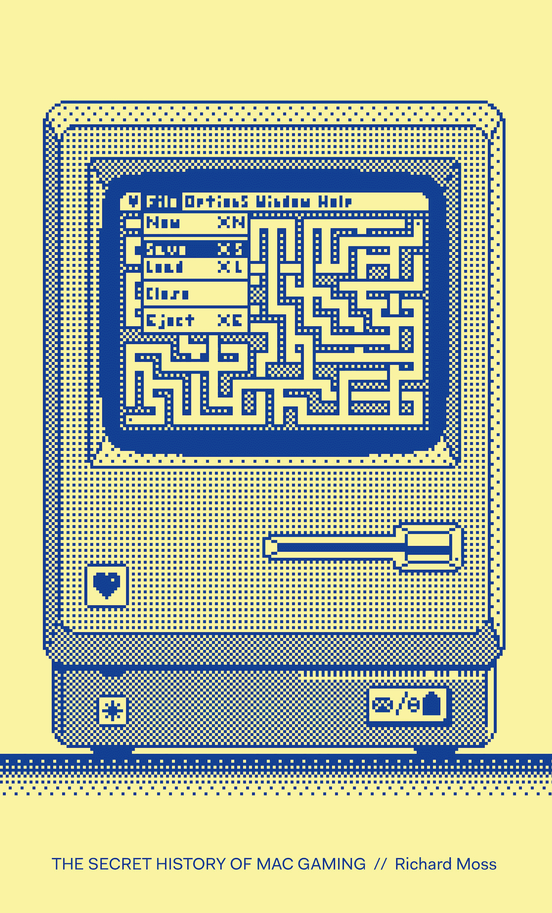

Richard Moss 是一位居住在澳大利亚墨尔本的获奖作家和新闻记者。他曾为二十多份出版物撰写过关于视频游戏和技术的深度文章，包括 Ars Technica、Gamasutra、Mac|Life 和 Rock Paper Shotgun。

Richard 还制作了播客《Ludiphilia》（分享关于人们如何以及为何玩游戏的故事）以及《The Life and Times of Video Games》（通过短篇纪录片风格节目记录视频游戏的历史与文化）。

## 亲爱的读者

你手中的这本书的诞生方式与大多数书籍完全不同。它是由读者直接通过一个新网站——Unbound 资助的。Unbound 由三位作家共同创立。我们成立这家公司是因为我们相信，作者和读者应该有一个更好的合作模式。在 Unbound 网站上，作者直接与读者分享他们想要编写的书籍构思。如果有足够的读者通过预付订单来支持这本书，我们就会制作一本装帧精美的订阅者特别版，并在所有售书点（实体店和在线）发行普通版和电子书。

这种新的出版方式实际上是一个非常老的观念（塞缪尔·约翰逊通过这种方式资助了他的字典编写）。我们只是利用互联网为每位作家建立一个赞助者网络。在书末尾，你会找到实现这一切的所有人员。

这种出版方式意味着读者不再仅仅是购买书籍的被动消费者，而作者可以自由编写他们真正想写的书。他们也能获得公平得的回报——书籍产生利润的一半，而不是封面价的一小部分。

如果你还没有订阅，我们希望你愿意加入我们的出版革命，并在未来的我们的某本书书中列出你的名字。为了帮助你开始，首笔认购可享受 5 英元的折扣。只需访问 `unbound.com`，进行认购，并在结账时在优惠码框输入 `mac5`。

感谢你的支持。


Dan, Justin 和 John

Unbound 创始人

## 献给父母，感谢一切

## 目录

- Richard Moss 序言
- 01 一台严肃的机器
- 02 1984 年
- 03 我们普通人的游戏开发
- 04 Mac 探险者
- 05 模拟
- 06 Mac 街机时代
- 07 步入阴暗城堡
- 08 寻宝游戏讲述的故事
- 09 AppleTalk
- 10 游戏世界，狂欢吧！ Craig Fryar 著
- 11 Peninsula Gameworks Craig Fryar 著
- 12 神秘的世界
- 13 互动电影
- 14 三维
- 15 纯正的 Mac
- 16 飞翔
- 17 Mac 控制机
- 18 共享软件英雄
- 19 德塔
- 20 仙人果
- 21 自由诗
- 22 潘格亚
- 23 移植工作坊
- 24 运动迷
- 25 杜兰德尔
- 26 Mac 内部游戏
- 27 Mac 游戏的衰落与兴起
- 28 Craig Fryar 结语
- 29 致谢
- 30 索引
- 31 赞助者

# 序言

Richard Moss 著

你手中的这本书的诞生方式与大多数书籍完全不同。它是由读者直接通过一个新网站——Unbound 资助的。Unbound 是三位作家共同创立的。我们成立这家公司是因为我们相信，作者和读者应该有一个更好的合作模式。在 Unbound 网站上，作者直接与读者分享他们想要想要编写的书籍构思。如果有足够的读者通过预付订单来支持这本书，我们就会制作一本装帧精美的订阅者特别版，并在所有售书点（实体店和在线）发行普通版和电子书。

这种新的出版方式实际上是一个非常老的观念（塞缪尔·约翰逊通过这种方式资助了他的字典编写）。我们只是利用互联网为每位作家建立一个赞助者网络。在书末尾，你会找到实现这一切的所有人员。

这种出版方式意味着读者不再仅仅是购买书籍的被动消费者，而作者可以自由编写他们真正想写的书。他们也能获得公平得的回报——书籍产生利润的一半，而不是封面价的一小部分。

如果你还没有订阅，我们希望你愿意加入我们的出版革命，并在未来的我们的某本书书中列出你的名字。为了帮助你开始，首笔认购可享受 5 英元的折扣。只需访问 `unbound.com`，进行认购，并在结账时在优惠码框输入 `mac5`。

感谢你的支持。

Dan, Justin 和 John

Unbound 创始人

我在 2014 年 7 月开启这段旅程时，目标非常简单：我想证明 Mac 在游戏史上具有重要地位，并分享那些充满创意和想象力的“经典”时代背后的故事——从 20 世纪 80 年代 Mac 诞生到 21 世纪初。在追求这一目标的过程中，我发现了一个比我想象中更有活力、更多元、更有创意且智能的社区。

当个人计算的其他领域还在使用低分辨率、块状的图形、只有几种刺眼的色彩以及令人困惑的键盘驱动文本界面（仅仅为了学习到基本功能操作就需要巨大的认知负荷）时，Macintosh 走出了自己的道路。

它采用了一个当时竞争对手无（尚未）使用的强大处理器，以及一个 512 x 342 像素的相对高分辨率屏幕，这使得标准的 300 x 200 显示格式显得极其原始。它摒弃了廉价的色彩，转而采用清爽的黑白调，并引入了由窗口和图标组成的图形界面，这些图标类似于真实的文件和文件夹。它将注意力从键盘移开，转而指针上——指针是手或手指的代币，由名为鼠标的设备操作，用户将鼠标握在手里并在桌面上滑动。此前的个人电脑使用单一字体渲染所有文本，而 Mac 则拥有不同的字体和格式样式，文档在屏幕上的显示效果与打印在纸上的效果完全一致。它还将下拉式菜单设为整个系统的标准，使得即户忘记了键盘 `command` 键，也能轻松完成基础操作。

这些特性激发了人们。苹果的工程师为了突出这些特性而编写的软件也是如此。艺术和文字处理应用程序 `MacPaint` 和 `MacWrite`，以及类似桌面的 `Finder`，加上辅助处理小型任务的控制面板和桌面配件——不仅定义了一种视觉美学，更定义了一套设计语言。一种全新的思维方式。

许多拥抱这种新范式的人成就了惊人的事业。仅在游戏领域，他们构建了世界上第一个多媒体创作工具，设计了几乎触手可及的交互空间，在那里界面——玩家与世界之间的障碍——消失了，并创作了吸引数百人的冒险。他们制作了看起来像互动动画片、玩起来像互动电影的游戏。他们设计了创新的第一人称探索和射击游戏，在技术和叙事领域突破了边界。他们制作的游戏对现实世界或幻想系统进行了如此直观的模拟，以至于改变了人们的生活。

最重要的是，Mac 游戏开发社区产生了与众不同的游戏。关于企业高管坐在转椅上滑动来躲避机器人末日的游戏，以及关于魔法房子里纸飞机的游戏，那些房子里充满了几百个房间和会自自跳跃的普通物品。他们了解自己的粉丝，粉丝也了解他们。他们是独立的，即使是成功的作品也很贫穷，但他们深受喜爱。

这本书是关于那些选择在 Macintosh 的小池中游泳而非在 Windows PC 大海中游泳的游戏开发者——这些开发者将心血倾注到他们创造的作品中并在此过程中不断创新。而且，在某种程度上，它也是关于那些支持并崇拜他们的粉丝——他们在没有更广泛媒体报道的情况下，创建了自己的电子杂志和新闻网站，并通过为游戏添加自己的声音、图形和关卡，或者以原始开发者从未想象过的其他方式对游戏进行扩展、修改、解释或玩，从而积极地加入创作过程之中。

这是一个关于一群人的故事，他们相信 Mac 既不是苹果营销部门所宣称的严肃机器，也不是电脑自视妄者们如此蔑视地所称呼的玩具，而是一台可以穿梭于不同世界之间的梦想机器。这台机器有能力教导、告知、启发并取悦任何用户，无论他们的背景和职业如何，它是一台改变了世界的机器。

直到 2000 年代后期——直到我写这些文字的 2017 年初（在某种程度上依然如此）——更广泛的游戏界一直有一个流行的笑话，说 Mac 没有游戏。然而，事实是，大多数不属于那里的人并不知道去哪里寻找。Mac 游戏的活力和创造力是 Mac 最得好的秘密。这本书就是关于揭开这个秘密的。

### 特别感谢支持这本书的超级粉丝们

Joe Accurso

Tom Adcox

Joseph Agreda

Matt Alderman

Alex Andronov

Miguel Arroz

Karl Becker

Tim Berry

Colin Biggin

Jonathan Borzilleri

Eric Bowden

Kyle K Boyd

Mike Burns

Eric Case

Jay Casler

Alex Choi

Brian Christensen

Colin Cornaby

Lindsay Cullen

Justin D’Onofrio

Tom Dale

Mark Dalrymple

Marcel Dietzmann

Patrick Dillon

Avi Drissman

Matt Edmunds

Eugene Evans

Barry Evleth

Jesse Fish

Lee Fyock

Casey Gatti

Patrick B. Gibson

Peter Gray

Gideon Greenspan

Alexander Griekspoor

John Gruber

Hack RUN

Henri Hansen

Roy Harvey

Gareth Hay

Andrew Hayward

Brent Hayward

Jason Heiser

Scott Herriman

Dave Hersey

Max Hoberman

Stuart Holwell

Charlie Hoyt

Steven Jackson

Matt Jones

Mitch Jones

Tanara Kuranov

Kirk Laninga

Matt Zebe Lee

David Leonard

Dave LeRiche

Aaron Linville

Daniel Loffgren

Chris Lynch

Amedeo Mantica

Andrew Matecha & Dawn Matecha

Mal McKay

Bryan McLemore

Michael Alyn Miller

Nathan Monroe-Yavneh

Marc Monticelli

Lee Morgan

Kenshiro Nakagawa

Chris Niederauer (CCN)

Jim Niemann

Mark O’Neill

Chandra & Jason Orrill

ElDave Oshry

Aric Pedersen

Mark Petcavage

Lucas Pope

Ilias Prassas

Randy Reddig

Nathan Rees

Yannick Rochat

Guido Roessling

Adam Rosen, Vintage Mac Museum

Alex Rosenberg

Malachi Royer

Michael Rubin

Sam Ryan

Phil Salvador

Brent Seeley

Hannah Jane Shepard

Blair Sherman

John Siracusa

David Smith

Leo Smith

Eric Snider

Andrew Soderberg - QuickTime Evangelist

David Stark

Chris Stone

Lauren Strehlow

Steve Sullivan

Steven Teachout

Adam Tinworth

Bert Vanderveen

Evan Vetere

Pere Lluís Vidal

Martin Voshell

Lucas Wagner

James Weiner

Paul Weinstein

Sean Williams

Jonathan Wrigley

Pian Zhang

Zojoi

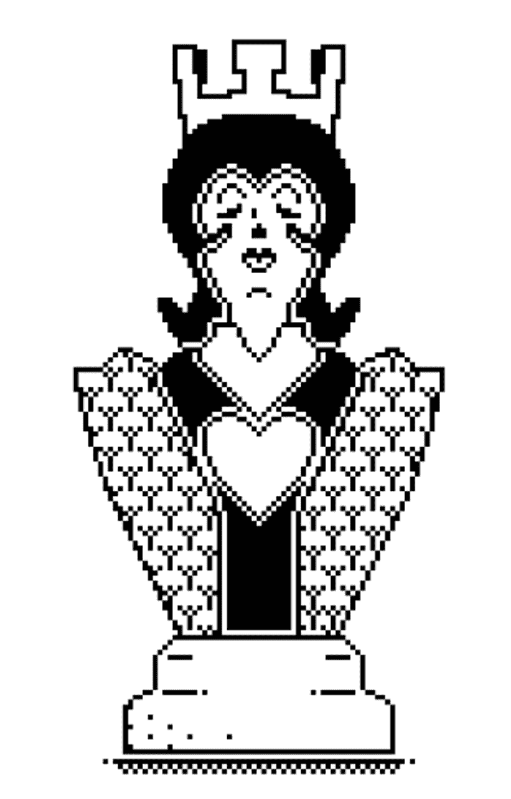

爱心皇后，穿镜镜世界，1984

# 01 一台严肃的机器

苹果的根源深植于游戏。1976 年，苹果的联合创始人、富有远见的斯蒂夫·乔布斯在担任 Atari 技术员的工作期间接到了一项任务，设计一个名为《打破》（Breakout）的游戏的电路板原型。这个概念由 Atari 的老板斯蒂夫·布里斯托和诺兰·布什尼设计，本质上是《乒乓球》的单人版本。《打破》是一个简单的街机游戏，玩家用球打破虚拟砖块（实际上是矩形）。砖块位于屏幕上方的八行，每行分别为黄色、绿色、橙色和红色。玩家操控底部的挡板，当球向下反弹时，它可以将其引导向上方的砖块。如果球掉了屏幕底部，玩家就输了。如果他们成功打破了所有砖块，就会进入第二关卡，那里球移动得更快，挡板也更小。这种情况无限循环，直到他们漏掉了球。

乔布斯缺乏自己开发原型的电气工程才能，因此他向他的朋友兼苹果联合创始人斯蒂夫“沃兹”·沃兹尼亚寻求帮助。沃兹在惠尔兰（Hewlett-Packard）制造计算器，并喜欢设计自己的电路板——这项技能也用在了两人制造和销售苹果电脑的副业中。在他的帮助下，任务仅用了四天就完成了。沃兹尼亚对这次经历感到非常振奋，他想设计一台运行《打破》的个人电脑。

为了实现这一壮举，他需要开发出支持彩色显示、音频，以及比苹果的第一台个人电脑 `Apple I` 更具可扩展性的功能。他还想包含一个版本的 `BASIC`，这是一种运行缓慢但相对容易学习和使用的编程语言，以便其他人可以轻松地制作游戏。这在当时是一个荒谬的想法。当时家用电脑还是一个新概念——Commodore 在另外五个月后才发布第一台大众市场个人电脑 `PET`——然而，他在这里正尝试制造一台可以运行街机游戏的廉价电脑。但沃兹尼亚克做到了。他在 1976 年 8 月向“家庭酿造电脑俱乐部”（Homebrew Computer Club）成功演示了他将 `Apple II` 版本的游戏 `Breakout` 命名为 `Little Brick Out`，几个月后，苹果发布了 `Apple II` 电脑。

`Apple II` 将苹果推向了计算行业的高，开辟了一个针对普通家庭和商业用户的新市场。得益于 `VisiCalc` 电子表格程序，它成为了这新型电脑用户青睐的生产工具，并受到了初创游戏业的欢迎。然而，苹果有着更宏大的抱负。他们希望推翻领先的计算机公司 `IBM`。当时 `IBM` 还没有自己的个人电脑（那直到 1981 年才出现），但它的小型机和大型机实际上主了商业和科学领域。当苹果准备转型到微型计算机时代时，它看到了从“大蓝巨人”（IBM 的代称）市场中分得一杯羹的机会。然而，`Apple II` 并不够用。

苹果于 1980 年 5 月发布了 `Apple III`，希望通过更复杂的底层软件和硬件架构以及数字小键盘等一系列新功能来吸引商业用户。这是一场灾难。在对其设计缺乏创意的批评中，数千台首批设备因存在缺陷而不得不召回。在台机器四年的寿命内，`Apple III` 的销量不足 10 万台。

尽管受挫但并未出局，且依然依靠 `Apple II` 的销售维持繁荣，苹果在 1983 年 1 月推出了一台名为 `Lisa` 的革命性计算机。它在软件和设计上较 `Apple II` 和 `III` 有巨大的飞跃，深受施罗克斯 PARC 突破性的 `Alto` 和 `Star` 个人电脑的影响。`Alto` 创建于 1972 年和 1973 年——基于工程师道·恩格尔特在 20 世纪 60 年发明的概念——它是第一个具有桌面隐喻和鼠标驱动界面的计算机，这种界面一直主导计算领域，直到 21 世纪初苹果的 `iPhone` 和 `iPad` 触发了新的范式转移。

与施罗克斯的机器一样，`Lisa` 提供了图形用户界面。它具有分级目录——文件夹中的文件和文件夹——由图标表示，并可以通过鼠标导航。它非常先进，但运行很慢。糟糕的是，它的价格是 9,995 美元（按今天的货币价值超过 24,000 美元）——远高于快速征服市场的新 `IBM PCs`，而且贵到无法说服商业用户认为与更安全的选择相比这项投资是的。他们会提醒自己：“没有人会因为选择 `IBM` 而被解雇。”

这就是苹果的下一台机器 `Macintosh` 所进入的世界。苹果决心通过改变商业用户的计算方式来在宇宙中留下印记，但 `IBM` 仍然占据主导。

尽管如此，`Macintosh` 与不同。它是激新的。它的设计源于其创始人、苹果第 31 号员工杰夫·拉斯金所谓的“人文主义冲动”，而不是营销研究或硬件规格。`Macintosh` 从一开始就被构想为一种家电器——家里或办公室里另一个可用于完成任务或娱乐的物品。拉斯金想要建造一台售价为 1,000 美元的完全闭环系统计算机，所有外设都集成在其中。`Macintosh` 将是小巧便携的，重量足够可以装在包里带回家。它的功能有限，但计算机初学者可以快速轻松地学习它的软件。它将是一台真正触及数百万人的个人电脑。它将与当时存在的任何事物都完全不同。

`Macintosh` 项目于 1979 年启动，在另一栋大楼内与苹果其余部门隔离开来。乔布斯最初认为由于是疯狂的，并试图否决它。他认为以他的大女儿命名的 `Lisa` 苹果和计算的未来，而 `Macintosh` 将不会成功。但他被首席执行官迈克尔·斯科特和主席迈克·马克库拉所否决了，两人都支持拉斯金的概念。

拉斯金的项目静静地进行，逐渐让乔布斯和其他反对者转变为接受这一观点，即计算机应该像烤面包机或其他家用电器一样“即插即用”。你打开它就可以开始工作了。不需要插入特定的磁盘或输入诸如 `Load TOASTED.CODE` 的命令。你需要的一切都在那里，随叫随用，全部集成在一个应用程序中。

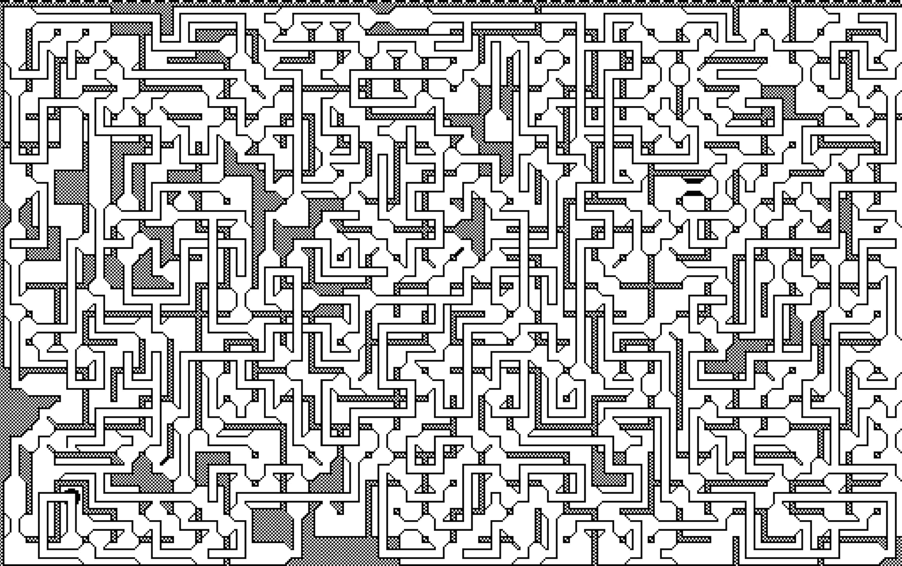

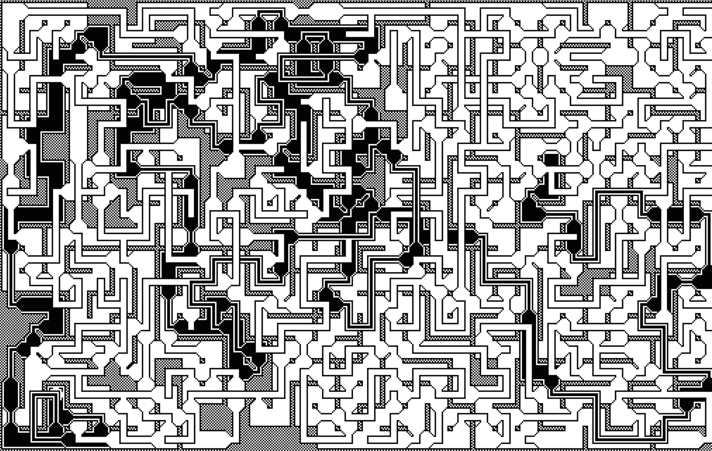

太惊惊了，史蒂夫·卡普斯，1984

随着拉斯金和他的团队对设计目标进行深思考并实验不同的实现方式，随着乔布斯影响力的增大，`Mac` 发生了一些变化。乔布斯正在失去对 `Lisa` 的控制。1981 年初，在看到布德·特里布尔和伯尔·史密对修订版 `Mac` 原型具有前瞻性的设计规范后，乔布斯强势介入了 `Mac` 团队的领导工作。拉斯金被挤出硬件设计，随后也被挤出软件设计。他很快因挫败而离开公司，疏远了自己的项目——这个项目早已偏离了他的原始设计，更不用说他的愿景了。


最后，`Macintosh` 拥有单键鼠标和类似于 `Lisa` 的图形用户界面。它配备了更快的 `Motorola 68000` 处理器，这是通常被称为 `68k` 系列芯片中的第一个，而不是较慢的 `6809`。它放弃了单程序概念，转而采用许多可以共享通用数据（如虚拟剪贴板的内容）的应用程序。`Mac` 的外壳也从最初计划的午餐盒形状变为直立垂直布局，键盘和磁盘驱动器位于屏幕下方而非侧面。

只有一个想法保持未变。`Mac` 之前的计算机是巨大的、可怕的机器，需要花费大量的精力来学习。它们具有文本界面，闪烁的光标诱导着用户输入命令。为了与机器通信、让它听你指挥，你必须学习它的语言。即使是打开文件或应用程序等简单任务，也需要记忆必须输入的字符字符串。计算机是外星、晦涩的。

Mac 的用起来几乎感觉很有趣，即使对于工作也是如此。事实上，苹果的营销部门后来特意向世界宣布，它确实是一台用于严肃工作的专业机器。但在 Macintosh 团队内部，这种区别并并不被重视。

“Mac 团队从一开始就极具玩心，这主要是由于杰夫·拉斯斯金（Jef Raskin）的偏好，”安迪·赫茨费尔德（Andy Hertzfeld）说道。他于 1981 年 2 月加入该团队——乔布斯安排他坐在拉斯斯金在乔布斯接管时离开的同一张办公桌上。赫茨费尔德在 Apple II 工程部门经历重组后感到被疏离，才来这里 Mac 工作的。让他加入 Mac 团队是为了让他重新对为苹果工作感到兴奋的一种妥协。

他记得 Mac 团队有豆袋沙发椅、力射球和其他玩具，这让办公室的氛围更像是一个托儿所，而不是工程实验室。有时，整个团队和现场的访客都会放下手头的工作，玩他们自创的躲避球和抓猫游戏。要标记某人，你必须用力射球击中他们。赫茨费尔德解释道：“这激发了每个人用纸箱制作屏障包围自己的工作区域，以便在游戏中提供掩护，让办公室的一部分看起来像一个纸箱迷宫。”

电脑游戏在苹果员工中也很流行。“早期的苹果员工，从沃兹（Woz）开始，非常喜欢玩和创作游戏，”赫茨费尔德回忆道，“许多苹果工程师花相当比例的时间玩[Apple II 电脑上]最新的火热游戏。”

游戏也是测试 Mac 正在开发中的图形用户界面和鼠标输入的一种既有趣又有效的方法。

“我写的最早 Mac 演示程序之一是《打砖块》版本，”赫茨费尔德说道。他于 1981 年 4 月在早期的 Mac 原型机上写了这个致敬之。“我们当时 Mac 上几乎没有运行的软件，觉得有一个基于鼠标的游戏会很好，”他解释道。考虑到游戏的历史，让它以某种小方式帮助塑造计算的未来（再次）似乎是一个恰当的手势：

最初编写只需要一两天。当我运行它后，[苹果 Mac 团队同事]巴德·特里布（Bud Tribble）建议我增加一些趣味，让砖块被球击中时掉落而不是消失，而且你必须在它们掉落时躲避它们，因为如果它们撞到你的板，你就会丢失球。我还在掉落的砖块撞击板时制作了漂亮的爆炸效果。它很好玩，但是以底层、独立的方式编写的，没有随着系统软件的演进而维护。

Mac 团队的其他成员也制作了游戏来测试硬件和软件功能。1984 年，第一台 Mac 出市后，程序员吉·泰克（Gene Tyacke）开发了一个原始的第一人称射击游戏 `Maze War`（最初是为 IMLAC 小型计算机开发的）——用于测试开发中的 AppleTalk 网络功能。该功能允许多台 Mac 通过连接打印机端口的电缆共享文件并互相发送消息。“Bus’d Out”后来以未完成的形式泄露，但在另一个 Mac 部门的程序员伯·斯隆（Burt Sloane）独立创建了自己的版本之前，这个版本最终变成了 `Maze Wars+`，最早商业化的网络游戏之一。

游戏不仅仅是 Mac 软件开发的趣味测试场。一份早期的商业计划要求至少有两个“Macintosh 级”的游戏，这些游戏将是“前所未有的”，因为“它让办公室用户更喜爱他们的 Mac，让大学用户产生兴趣，并为办公室职员把 Mac 带回家陪伴家人提供了理由。”

其中一个“Macintosh 级”的游戏是由比尔·巴奇（Bill Budge）开发的，他曾在 Apple II 上通过《弹球机制作大师》获得了巨大成功——在那个游戏中，玩家可以制作自己的虚拟弹球机台然后进行游戏。巴奇在正式发布很早就获得了一台早期的 Macintosh。他记得最初的 Mac “有一个很快的 CPU，配有一个小屏幕。这使得以足够快的速度绘制屏幕来制作 3D 动画成为可能。”为此，巴奇正在制作一个飞行模拟器。“我实际上运行通了一个演示程序，它接近降落跑道，在当时它的帧率令人印象深刻。”

它从未产生任何结果。“我放弃了这个项目，因为显示器只有黑白，所以灰阶度必须通过抖动或图案来模拟，这看起来并不好看，”他说，“而且因为导入地理数据库需要花费大量工作，我失去了兴趣。”

然而，另一个“Macintosh 级”游戏的创造者坚持执行了，而那个游戏来自公司内部。苹果的每个人都玩过 Steve Capps 的电脑游戏。《Alice》将古代象棋策略的严谨性与现代投币游戏机的速度和即时性结合在一起。这是一个以《爱丽丝仙游游》为主题重构的象棋，爱丽丝本人代表白方。她面对棋盘另一侧红后的军队，玩家可以点击棋盘告诉她去哪里。如果点击的格子对于爱丽丝所扮演的棋子类型是合象棋移动，她就会跳过去。如果有敌棋占据了该空间，它就会消失。最终目标是清除棋盘上所有的敌棋。

与象棋不同，爱丽丝移动得极快。敌棋跳来跳去，甚至不需要等待一秒玩家完成移动。棋子本身在伪 3D 浮动棋盘上渲染，结合了传统棋子的外观和约翰·特尼尔爵（Sir John Tenniel）的插画风格，他曾为原版《爱丽丝仙游游》和《穿镜镜记》作画。

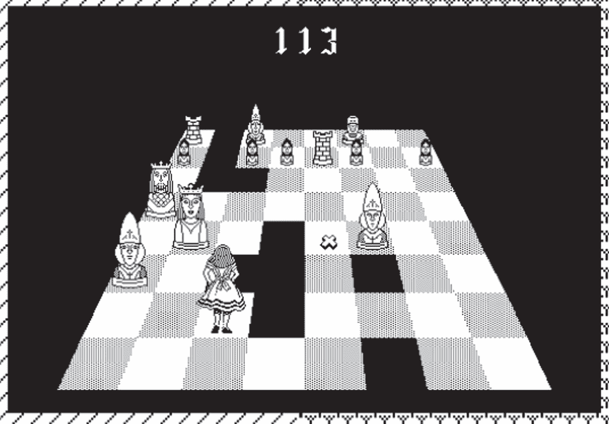

《爱丽丝：穿过镜镜》，苹果电脑，1984 年

特别有一个个人非常喜欢《Alice》。乔安娜·霍夫曼（Joanna Hoffman）是 Mac 的第一位营销人员，无疑是最好的玩家。她觉得游戏太简单了，于是向 Capps 增加难度。他调整了参数并添加了功能，包括一个棋盘变得不可见的特殊模式。“问题是，我是为 Alice 的专家用户设计的，”他解释道，“所以对于第一个拿起它的人来说，实际上非常令人挫败，难得离谱。我甚至把它搞砸了。”比任何时候都重要的是，《Alice》极其困难，因为它假设玩家已经掌握了指向和点击的艺术。

大多数购买 Macintosh 的人从未用过鼠标，甚至没有人尝试过操作电脑。他们必须从零开始学习即使是最基础的事情，如移动鼠标光标并点击选择文件或重新定位文本提示、双击打开某些内容，或者任何其他今天计算机用户认为理所当然的动作。

苹果在发布 Macintosh 之前进行过用户测试，以看看人们在没有任何指导的情况下设置和学习操作系统的表现如何。Capps 记得有一位测试者顺畅地运行了程序，但他握鼠标的方式导致电线从底部而不是顶部伸出，他的手掌压在了按钮上：

那个人以前没碰过鼠标。他坐在那里，向右移动鼠标，光标却向左移动。他向上移动鼠标，光标却向下移动。所以这本质上是反的。就像《爱丽丝仙游游》里，他穿过了镜镜，他在半小时内就学会了如何使用。

之后被问及对 Mac 有何看法，那个人说：“你知道吗，我不明白为什么它是反的。但我习惯了，所以我觉得你们造了一个很棒的产品。”

Alice 从未经历过这种测试。它最初只是 Capps 脑海中的一个想法，以及 20 世纪 70 年代后期纸上的一些粗略设计，当时他正在 Xerox PARC 开发 `Alto` 电脑。Capps 在 `Alto` 上开发了几个游戏和类游戏玩具，其中两个他后来在 `Mac` 上重新制作了：一个灵感来自萨尔瓦多·达利（Salvador Dalí）艺术的数字钟，它的数字会融化并相互变形，以及一个迷宫生成器（在 Macintosh 上被称为 `Amazing!`）。

这些程序需要使用最底层的编程语言 `microcode`。并不是所有的计算机代码都是平等的。低级代码更接近机器的内部运作，其运行速度比高级代码快得多，也高效得多；高级代码经过了多层抽象，编写形式更接近自然语言。高级编程语言简单得多，用起来也舒服，但它们也带来了性能代价，这种代价在处理能力有限的计算机上会被放大。

为了让他的游戏在 `Alto` 上运行，Capps 必须直接向 `CPU` 发送指令。他甚至无法求助于汇编语言（汇编语言使用助记符表示指令，然后转换为机器码）。虽然他能很好地做出小游戏，但 Capps 缺乏编程技能在 `Alice` 这样的大项目中让 `Alto` 听他差遣。

Capps 在 1981 年 9 月加入 Apple 后，情况发生了变化。他被分配到 `Lisa` 打印团队，负责让针式打印机输出的文本和图形与用户在 `Lisa` 屏幕上看到的完全一致。

有一天，Capps 发现 `Lisa` 的速度足够快，他可以用 `Motorola 68k` 汇编语言方言为它编写 `Alice`。“我花了一个周末就把它搞定了，”他回忆道，“于是我有了那个融化的钟。我有了迷宫生成器。还有 `Alice`。”

这三者都是令人印象深刻的技术和创意成就，但真正引人注目的是 `Alice`。Lisa` 软件团队经理布鲁斯·丹尼尔（Bruce Daniels）将其展示给 Mac 团队，他们印象之深，以那天下午就给了 Capps 一台 `Mac` 原型机。两天后，他就让 `Alice` 在 `Macintosh` 上运行起来了。

这引起了史夫·乔布斯（Steve Jobs）的注意，他并不知道或并不在意游戏，但他能看出这项技术成就。“他说：‘我们得把你调到 Mac 组来’”Capps 回忆道。1983 年 1 月，就在第一台 `Lisa` 上架后，乔布斯实现了他的愿望：Capps 成为一名 Macintosh 程序员。“所以那基本上是我进入 Mac 组的面试——就靠这一个游戏。这是一个进去的好办法。”

交易的一部分是，`Alice` 将随每台 `Macintosh` 一起发货。有传闻说由前 Apple `Lisa` 营销经理特里普·霍金斯（Trip Hawkins）创立的新电子艺（Electronic Arts）可能会出版这款游戏，尽管从未有过实质性的进展。霍金斯想将他的出版重心更多放在成熟的 `Commodore 64` 和 `Apple II` 市场。无论如何，乔布斯很快用一个 Capps 无法拒绝的报价扼杀了任何此类外部出版商的可能性。“我很好地记录了早早就有这个想法，”Capps 说，“所以他对我很好。”

“这只是那么一件事；我的意思是，拜托，如果你被机会让你的游戏出现在每一台 Macintosh 中，你难道不会接受吗？”

命运与 `Alice` 作对了。商业和技术领域开始出现传闻，称 Apple 即出的个人电脑是一个“玩具”。对于对 Mac 初期销售策略至关重要的财富 1000 强企业买家来说，这个小巧、看起来很快乐的家用电器太温和了。因为它的趣味性，它不适合严肃的工作。

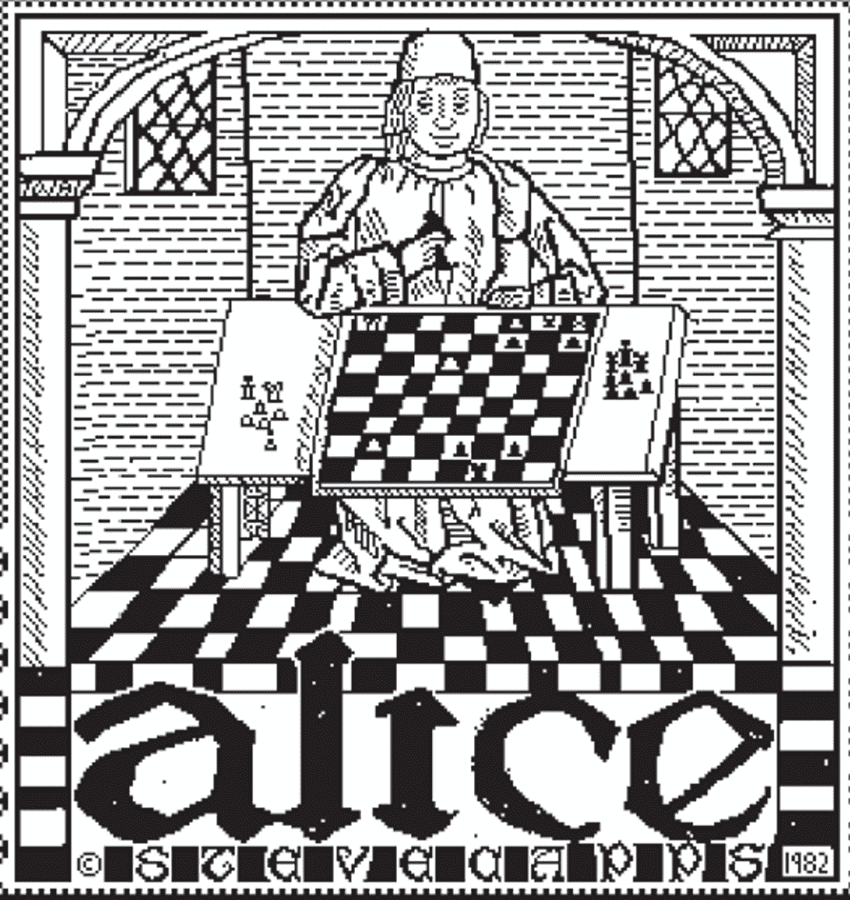

Alice，又名《穿镜镜》，Apple Computer，1984 年

焦点小组也呼应了这种情绪。美国营销服务的路·魏斯（Lou Weiss）在 1983 年 4 月的一场演示对屏幕的尺寸和色彩能力（小且是黑白的）、键盘缺少数字键盘、缺乏编程能力（你需要一台 `Lisa` 来为它开发软件）以及同样的“计算机应该是困难的”心态表示了担忧。参与者注意到，尽管 Mac 用起来很神奇，但它看起来确实像个玩具。他们担心它实际上是个玩具，而演示中包含的游戏更是帮了倒。

魏斯建议 Apple 强调 Mac 与竞争对手相比的易用性和强大，同时也要小心“不要让任何向家庭用途的倾向损害其作为商务机器的入门定位。”如果 Mac 要卖给目标市场，就必须发生一些改变，而这不会是包装盒或界面——毕竟，这些是革命的核心。

Apple 的营销部门反复无常，迅速将 Macintosh 品牌与任何可能被视为玩具的可能性隔离开。Mac 仍然被呈现为趣味性的，但不是太有趣。它的乐趣在于原本严肃且困难的工作变得如此毫不费力。`Alice` 成了火药桶。

“史夫（乔布斯）在男厕所堵住了我，”Capps 回忆道，“他说：‘我不忍告诉你，但我们不会随每个产品一起发货。我说：没关系，我接受。但他：噢，我们会补偿你的！’”

Capps 真的不在乎。他已经玩够了，Apple 也已经为 `Alice` 支付了一笔不廉的报酬，而且游戏对他来说从来就不是什么大事。但乔布斯很坚决。

为了补偿 `Alice` 没有包含在 Macintosh 欢迎包的白色塑料磁盘盒中，他们为他准备了一个“非常精美的盒子”来销售这款游戏。乔布斯告诉设计总监制作一些特别的东西。`Alice` 的盒子看起来像一本书。它的硬封面封画着一个风格化的棋手，俯瞰着棋盘状地板上的棋盘。内部，磁盘放置在“页码”切出的凹槽中。内封上的说明解释了游戏的各种知识，就像旧书的第一页。

Capps 自己自己完成了美术设计。“我在盒子里藏了所有这些彩蛋[秘密]，”他说，“没有人质疑过或为之反对。我的意思是，里面有一个 Dead Kennys 乐队的标志，因为我那时非常迷他们。我当时的女友，现在的前妻——里面有送给她的东西。里面还有给我在 Xerox 的第一个老板的礼物。”

他们现在在哪里？

史夫·沃兹尼亚克（Steve Wozniak）是数据虚拟化公司 Primary Data 的首席科学家。他还遍游世界进行关于创新的演讲。Mac 的两位关键愿景者都已离世：杰夫·拉斯金（Jef Raskin）于 2005 年死于胰腺癌，而史夫·乔布斯（Steve Jobs）则于 2011 年因胰腺神经内肿瘤引起的呼吸衰竭去世。安迪·赫兹菲尔（Andy Hertzfeld）现已退休；他在 Google 完成了自己的职业生涯。史夫·卡普斯（Steve Capps）后来在微软与比尔·盖茨共事；他现在也退休了。比尔·奇（Bill Budge）在 Google 担任软件工程师。

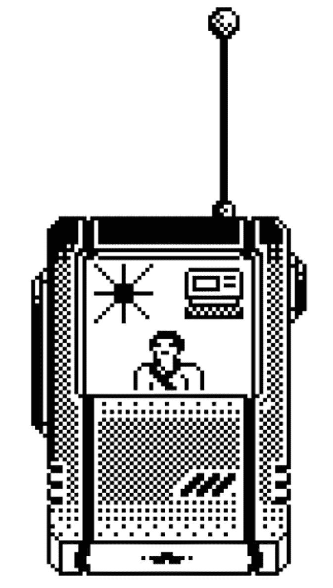

Tricorder，Cap’n Magneto，1985

# 02 1984 年

在 1984 年，没有人完全知道该如何处理 Mac。它与之前出现的所有东西完全不同，以至于他们没有清晰的参考点来指导自己。因此，想法迥异，最早的 Mac 游戏除了想要尝试这个新世界的意愿外，几乎没有共同点。

当时有许多文本驱动的冒险游戏，有的带有黑白插图，有的没有，还有一些（如《Zork》的开发者 Infocom 的庞大目录）是根据其他平台上的现有作品改编的。极少数的作品，例如 Challenger Software 的 `Legacy` —— 这是一个由已解散摇滚乐队的青少年和他们高中的一些年轻朋友创作的游戏 —— 是完全原创的作品。`Legacy` 卖得并不好，但它是 1984 年面出的少数商业游戏之一，其艺术家埃德·奥亚诺（Ed Ouano）制作的详细画面也许是当时游戏机之外见过的最详尽的——充满了纹理和深度，增强了而非削弱了文本叙述场景和推动游戏进展的输入命令。

少数早期冒险游戏进一步脱离了基于文本的输入。Silicon Beach Software 和 ICOM Simulations 分别通过 `Enchanted Scepters` 和 `Deja Vu` 帮助形成了一种新体裁——图形冒险游戏；而独立开发者艾尔·埃文斯（Al Evans）则重写并扩展了他的 Apple III 游戏 `Cap’n Magneto`，为 Mac 带来了首款自由移动的直接控制冒险游戏。

玩家从俯瞰视角观察动作，必须引导主角兰斯·麦格内托船长（Captain Lance Magneto），他坠落在半户座四号行星（Rigel IV），去寻找“控制之冠”心灵控制设备并防止其被用于海盗。在此过程中，他需要找到各种物品，包括一个可以翻译外星语言的探测器（tricorder）——这些外星人的清晰话语会由 Mac 内置的语音合成器读出，并写在对话气泡中。它俏皮的幽默感、巨大的世界、有趣的谜题以及直观的鼠标驱动界面引起了早期 Mac 用户的共鸣。因此，`Cap’n Magneto` 成为该平台上首个成功的“共享软件”（shareware）游戏。

共享软件在当时是自出版软件最常见的发行方式。创建者会在计算机活动或他们的学校、大学里分发游戏。或者他们会将其发布在公告板系统（`BBS`）——即在人们家里运行的本地文本服务，可以通过拨号调制解调器直接访问——或发布到 Usenet —— 字面上的“用户网络”，信息在世界范围内大量服务器上分发并组织成新闻组——或发布到其他万维网的前身。如果有人喜欢这个游戏，可以按照共享软件公告中指定的金额向作者寄支票。

肯·威诺格德（Ken Winograd）在 1985 年制作了 Mac 上最流行的早期共享软件之一，以帮助自己学习更多编程知识。在过去的三十年里，威诺格德定期更新基于 `Breakout` 的 `Brickles`，并发布了带有额外功能的版本，如声音、得分倍率以及在屏幕顶部和/或侧面带有额外挡板的新游戏模式。他的另一款 Mac 游戏 `HangMan` 也采取了同样的操作，那是对经典纸笔猜词游戏的改编。他只要求喜欢这些游戏的玩家向他寄 10 美元作为感谢。一位年轻粉丝由于无法集齐资金，寄来了一张他画的 10 美元钞照片。他回忆道：“每当我收到其中任何一个游戏的粉丝的信时，我总觉得应该在那款游戏上花更多时间，只为了让那个小男孩或小女孩开心。”

另一个早期共享软件游戏 `Phraze Craze Plus` 复制了电视节目《幸运轮盘》。它特别地包含了一个使用自定义谜题文件进行游戏的选项，并且代码中有一个未记录的 Bug，导致偶数轮盘位置无法被命中。游戏的创建者布拉德·佩蒂（Brad Pettit）从未发现这个 Bug，因为“破产”格位于奇数位置。`Phraze Craze` 也是最早使用数字化声音的电脑游戏之一。他采样妻子的声音作为主持人，并从工作的一份专辑中提取音效——他当时在电视行业——使用一个名为 `MacNifty` 公司制造的数字化设备。

在 Mac 早期，也有许多“免费软件”（freeware）。迈克尔·欧耶（Michael Ouye）的 `MacBugs!` 是一款单屏幕街机风格的游戏，其目标仅仅是射击一切且不被击中（不断出现的计算机“虫”击中），它最初在 1985 年与一个 `C` 语言包包绑在一起。它很好地获得了自己的生命，并在欧耶将其投入公有领域后，像病毒一样在 Mac 社区中传播。约翰·斯特兰德伯格（Johan Strandberg）1984 年的游戏 `Daleks` 和鲍勃·阿宁（Bob Arning）1985 年的版本 `The New Daleks` —— 都是基于《博士谁》主题的老款多命名回合制游戏变体 —— 同样具有病毒式的流行。


到 1983 年夏天，他们已经有了一个概念雏形，并将其暂名为“那个机器人东西”（That Robot Thing）。他们本认为这将关于一个机器人获取信息片段以解谜的冒险游戏，但比尔·巴奇（Bill Budge）具有开创意义的 Apple II 游戏`Pinball Construction Set`——20 世纪 80 年代最流行的娱乐软件之一的发布，向他们展示了更好的道路。

“那个机器人东西”变成了一种基于图形和图标界面的机器人构建集。在`ChipWits`中，玩家可以使用视觉化编程语言创建不同的规则集，规定机器人在环境中的运行方式。在当地一次线下发布会上看到`Mac`后，游戏得到了进一步进化。“我们立刻意识到这台机器的潜力，”约翰斯（Johnston）后来写道，“显然，它是专为`ChipWits`而设计的。”

Sharp 还认为，通过尽早投入并在`Mac`仍遭受着典型的新平台软件短缺时推出游戏，可以获得一笔丰厚的利润。由于无法使用`Lisa`电脑——这是使用苹果官方开发工具为`Mac`进行编程所需的电脑——他们转向了`MacFORTH`，这是`Forth`高级编程语言的 Mac 实现，虽然它比`Pascal`或汇编语言慢，但比`BASIC`快，而且对于当前的任务来说速度和灵活性完全足够。

经过几个月的开发，他们聘佣了一个软件代理来帮助向发行商推销游戏。这为他们带来了与`BrainPower`合作开发 Macintosh 和 Apple II 版本的交易，以及与`Epyx`合作发行的`Commodore 64`版本交易，并且他们只有四周的时间完成 Mac 版本的开发——该版本计划于 1984 年底发布。

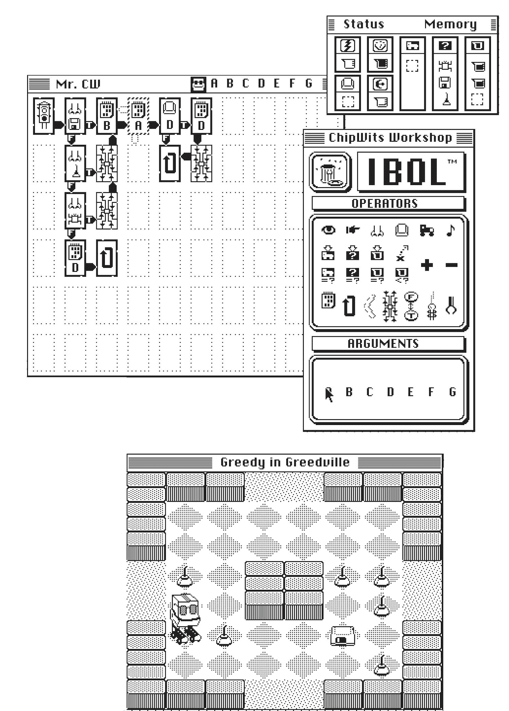

ChipWits, BrainPower, 1984

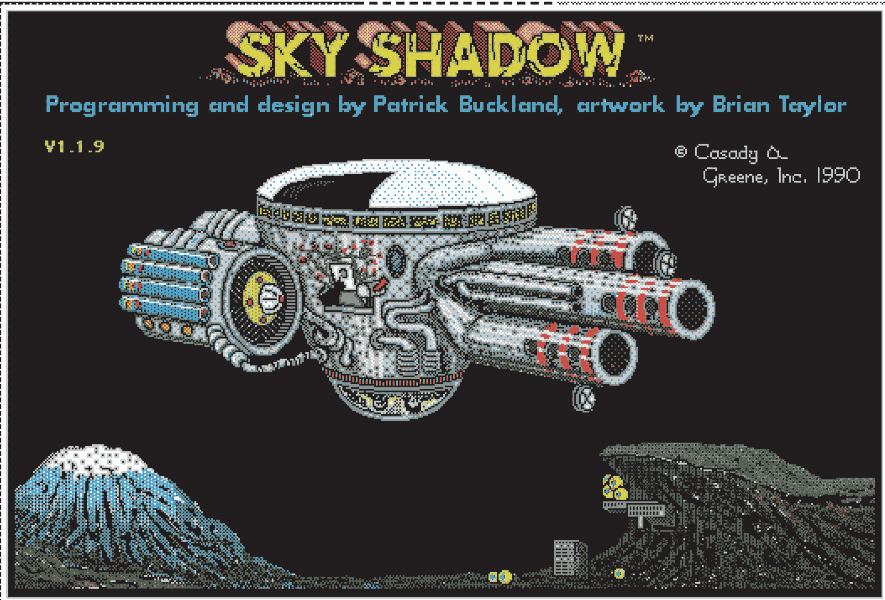

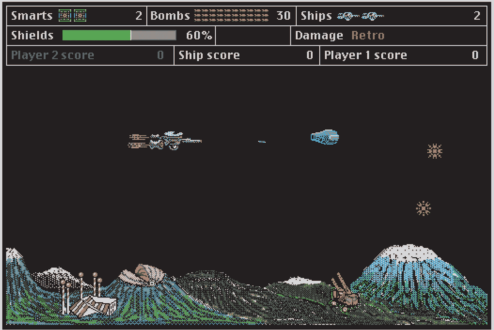

`MacUser`为`ChipWits`颁得了编辑选择奖，而`MACazine`的作家鲍伯·雅各布（Bob Jacob）赞誉它是能让 Mac 用户想起“最初为什么要买这台特殊电脑”的程序。

达雷·迈尔斯（Darrell Myers）不需要提醒。1984 年早些时候，他为 General Computer 的`Ground Zero`做过贡献，这可能是第一款非苹果发行的商业 Mac 游戏。它基于街机游戏`Super Missile Command`，后者本身是`Missile Command`的更新版——一个关于通过操作地面防御系统摧毁来袭导弹来抵御核入侵的简单游戏。

仅仅用鼠标在`MacPaint`中画画就已令人心潮不已。迈尔斯说：“我当时并不知道电脑能做到 Macintosh 所做的事情。”但这也是一个巨大的挑战。为了在狭小的白色屏幕上仅用黑色像素呈现出令人信服的图形效果，迈尔斯使用了一种名为`dithering`（抖动）的技术。这涉及到在屏幕上交替绘制黑白两点，使得从正常距离观察时，它们会模糊成各种深浅的灰色。黑点浓度越高，物体就越黑。

迈尔斯于 1973 年高中毕业，那时打孔卡在计算机领域仍是标准。在 1984 年之前，他认为电脑是外星、恼人的机器，对他毫无用处。但 Mac 改变了他的这一切。突然之间，电脑似乎既易于上手又有用。

即使对于许多资深的科技和奇玩意爱好者来说，Mac 也是一个惊艳的启示。比尔·阿特金森（Bill Atkinson）的`MacPaint`是他们发现其巨大潜力的媒介。“它的门槛非常高，以至于你想为 Mac 制作一些特别的东西，”大卫·艾伦·史密（David Alan Smith）说道，几年后他完成了他的第一个第一人称动作游戏`The Colony`（我们将在[第 14 章](#021_Chapter14.xhtml_ch-14）中讨论）。

Mac 是一种全新的思维方式。一种新范式。`MacPaint`说明了这一点。用户完全通过实验学会了如何高效操作鼠标和图形用户界面。它提供了即时的、无模式的、多维交互。

`ChipWits`的共同创始人道格·夏普（Doug Sharp）在 1985 年写道，`MacPaint`对他来说“极具启发性”。它有趣、直观易用，并为所有软件立了可以遵循的标准，”他继续说道。对于`ChipWits`、`The Colony`以及许多其他 Mac 游戏，`MacPaint`都是标准。如果游戏的系统玩起来不像`MacPaint`那样直观有趣，那就意味着游戏还不够好。至少有一个程序员直接从这一启示中获得了灵感。

帕特里克·巴克兰兰（Patrick Buckland）经常有朋友在酒吧喝完酒后回到他家里聚会。他们乐于尝试他的`Macintosh`和他带有鼠标接口板的`Apple IIe`。“我很快发现人们很喜欢‘玩’`MacPaint`，”他回忆道，“他们很享受移动鼠标并用它操纵屏幕上东西的过程。什么并不重要——仅仅画一条线再删掉就很有趣。”

基于鼠标的交互是如此新颖，以至于迷住了他们醉醉的大脑，即使在没有酒精的情况下似乎也具有魔力。巴克兰兰当时需要一个项目来帮助他学习基于 Lisa 的 Mac 开发系统，因此他决定围绕他对`MacPaint`的观察编写一个游戏。

巴克兰兰从 1978 年在学校的电脑上开始编程，次年他十五岁时搬到了祖母给他的一台`Apple II`上。他从修改系统自带的`Lemonade Stand`和`Little Brick Out`游戏开始，花了两年开发了一款名为`Liberator`的商业游戏。Thorn EMI Programmes Ltd——一家以消费电子产品、国防承包、音乐出版和租赁零售业务闻名的英国大型集团——在 1982 年出版了它，但忽略了进行商标查询。结果`Liberator`已经是雅达一个为人知的街机游戏名称。雅达的律师介入了，该游戏被下架了。“他们没有要求我更改名字，而是烧掉了所有的拷贝，并且没告诉我，”巴克兰兰回忆道。直到六个月后他才知道，当时他在询问游戏卖得如何以及是否应该获得版税。

在在那次不幸的经历之后，他转向了自由编程。他为`Apple II`编写游戏和其他软件，并为苹果英国公司接单。他在苹果的人脉在 Lisa 推出时为他赢得了一台，并在 1984 年初 Mac 发布时获得了一台。

在他学习基于 Lisa 的 Mac 开发工具时，他借用了游戏设计中的经典支柱——被他描述为“熵反转”，这是早期街机游戏的基石，如`Pac-Man`（圆点）、`Asteroids`（陨石）和`Space Invaders`（入侵的外星人）。“你拿走杂物，然后把它清理干净，”他解释道，“人类大脑似乎喜欢清理东西。”

他的学习 Mac 编程项目`Crystal Raider`只用了了两（漫长的）两天就写好了。玩法是在屏幕上移动一个白色的饼形飞船——它的动量而非速度映射到鼠标移动上。危险来自六种讨厌鬼——`Annoyer`、`Worrier`、`Menace`、`Pest`、`Bane`和`Parasite`——它们需要避开或射击（点击鼠标按钮）。一旦收集了所有水晶，玩家必须引导飞船通过一个静态关口。然后在更难的关卡重复这一过程。

“它在我的醉友们中非常受欢迎，所以我决定利用这种被称为‘共享软件’的新玩意来来卖它，”巴克兰说道。他在 1985 年公开发了它。

在一年中，他收到了大约 350 张注册《水晶战士》（Crystal Raider）的支票。大部分来自美国，那里占据了几乎整个 Mac 市场。这是一个问题。在英国处理一张国际支票的标准成本约为 10 美元——与他设定的共享软件费用相当。为了从交易中获利，他会囤积支票，直到有大约五十张，然后和他的银行行经理进行大批量处理。这样，他每笔美国订单就能获得大约 6 美元。

为了鼓励更多注册，巴克兰（Buckland）曾承诺向任何付过《水晶战士》费用的人发送续作《水晶任务》（Crystal Quest）。“我完全不知道《水晶任务》会什么样，”他承认道。当人们开始付钱时，他认为最好立刻着手制作。

很快，他做了一款射击游戏，玩家必须从屏幕左侧穿到右侧，在此过程中“开采”材料并抵御敌人的火力。他对这个游戏并不满意。当更多付费的任务找来时，他将其抛在了一边。

一年后，他利用外包工作的空闲时间重新审视了这款游戏。他对从未发送过承诺的续作感到内疚。他收到了几十封赞美《水晶战士》的绝佳信件，因此决定放弃那个夭生的原始《水晶任务》概念，将他的续作转化为一个更完善、功能更丰富的《水晶战士》版本。

然而，他的代码在一个 Lisa 格式的磁盘上，而他不再有 Lisa 了，因为现在的 Mac 开发已直接在 Mac 上进行。为了读取该磁盘，他写了一个低级 Mac 程序，可以将磁盘扇区导出到一个十六进制文件中。由于扇区不是有序的，该十六进制文件的内容需要进行排序，并转换为文本，以便他能够读取、修改并添加他的原始代码。

Macintosh II 刚问。它是第一台可以显示彩色图形的 Mac——在 1670 万颜色的调色板中同时显示 256 种颜色，分辨率为 512x342 像素；或者在 640x480 像素下显示 16 种颜色。这让 Mac 领先于 PC 的 EGA 标准（后者在 64 颜色的调色板中显示 16 种颜色，典型分辨率为 320x240 或 300x200 像素）。

巴克兰在英国苹果公司的联系让他获得了该国首批 Mac II 之一。他认为将《水晶战士》作为他再次学习新技术的测试场会是一个好主意。

他最初的图形是在网格纸上绘制的，并以十六进制值输入的，这种技术并不适合色彩。他为游戏写了一个图形编辑器来让操作更简单。然后他想，也许也可以创建一个用于调整关卡和敌人行为属性的编辑器。

最后，在 1987 年初，他准备好将《水晶任务》发送给他的付费客户。他要求每一位付过《水晶战士》共享软件费用的人寄回一张空白软盘，装在写有回邮地址的信封里并贴上足以支付他们所在地邮寄所需的邮票（大多数人忽略了最后一部分）。随着任务的艰巨凸显，巴克兰开始后悔自己的承诺。但大约两周后，他收到了来自迈克·格林（Mike Greene）的信。

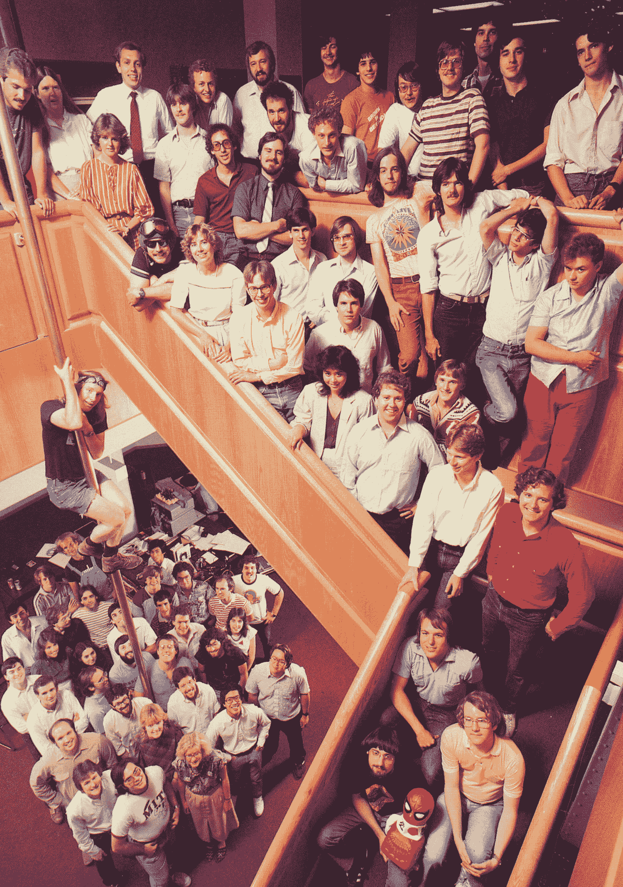

通用计算机公司（General Computer Corp）合照，1984 年（由 Darrell Myers 提供）

格林拥有一家位于加利福尼亚的小初创公司 Greene, Inc.，该公司的目的是生产和销售一种名为 QuickDex 的 Rolodex 风格联系人工具。它卖得很好，现在格林想商业化地出版《水晶任务》。他唯一的条件是巴克兰停止发送免费副本，并向那些通过退回款项来响应邮件活动的人提供补偿。

这笔费用会让巴克兰亏损，但为了履行承诺，他接受了。Greene, Inc. 在 1987 年年中出版了《水晶任务》，就在 Mac II 正式发布几个月后。它是苹果内置系统软件之外的一个支持彩色的 Mac 程序。

先发优势非常有帮助。“我们听过一些故事，经销商推销带有彩色显示器的 Mac II，而客户问在上面实际上能运行什么，”巴克兰说，“经销商会局促地说：‘呃……呃，先生，目前还没有什么。但是有这个游戏。’”不过，《水晶任务》获得声誉不仅仅是因为运气好的时机。它对于那个时代的 Mac 来说，就像《俄罗斯俄罗斯》之于任天堂 Game Boy——一个简单直接的街机风格游戏，既令人上瘾又无法完成，且与对该平台的讨论完全不可分割。饼形飞船基于惯性的鼠标控制移动感觉极佳，难度从一个关卡到下一个逐渐增加让玩家能够进入一种心流般的冷静专注状态。

《水晶任务》迅速攀升至 Mac 软件排行榜的前列。在随后的几年里，它一直是最畅销的 Mac 游戏之一。它被移植到了 Amiga、Game Boy 和 Apple IIGS，得益于盗版，它是 20 世纪 80 年代后期最流行的电脑游戏之一。（这种普遍存在的盗版问题成了巴克兰的一个痛点，尽管这款游戏极其受欢迎，他不得不继续作为自由职业程序员工作。）

有一天，巴克兰只是随口向格林提到了他的编辑工具。“我按照典型的极客作风将它命名为‘水晶任务工具包（Crystal Quest Toolkit）’，”巴克兰回忆道，“他要求看一看，并立刻兴奋地跳了起来，想也出版那个工具。”格林看到了巴克兰没有看到的：这个工具意味着任何人都可以创建自己的关卡、导入自己的图形并修改游戏属性如得分。这在当时几乎是闻所未闻的，尤其是在街机游戏中。

格林违背巴克兰的意愿，坚持将其命名为 Editor。它获得的奖励比《水晶任务》还要多，包括首次亮相时获得的电子产品展奖项。

1990 年，在开发了一些非游戏类工具后，巴克兰带着他的旧 Apple II 游戏回归了游戏界。这款游戏更名为《天空之影》（Sky Shadow），赢得了一小群追趸，但未能吸引更广泛的观众。他随后想开发《水晶任务》的续作，但他的非游戏工作让他太忙了。“所以我委托了一个老朋友[以分成的方式]，”他回忆道。那位朋友的编程水平被证明是不合格的，因此《水晶疯狂》（Crystal Crazy）直到 1993 年才上市，那时《水晶任务》的热潮已经过去，市场已经向前。它在零售市场上表现惨淡，这次经历导致两人彻底闹了脸。

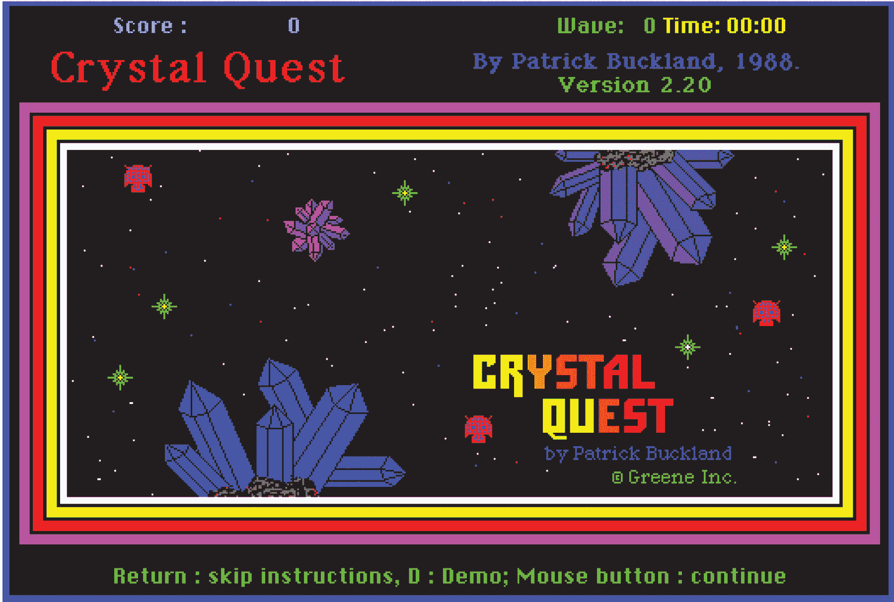

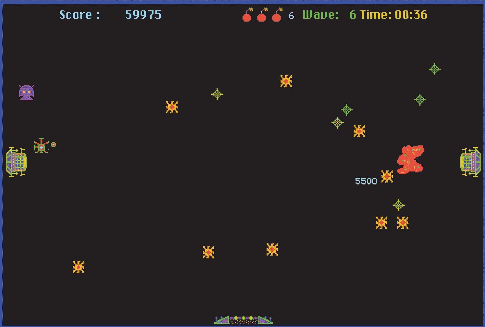

《水晶任务》，Casady & Greene, 1987

到 1994 年，巴克兰已经厌倦了自由编程。他与另一位学校同学尼尔·巴登（Neil Barnden）创立了 Stainless Games，以便他完全专注于游戏。他们计划在做外包项目的同时，自启动他们的第一款原创游戏，该游戏暂定名为“3D 毁灭大赛（3D Destruction Derby）”。

“我开始在全国推销我们的才华，但我惊讶我的记录在英国游戏行业竟然毫无用处，”巴克兰说，“人们从未听说过我的产品，更不用说我本人了。英国是如此反苹果、反 Mac，我基本上是从零开始的。”

Buckland 将他的多年经验转化为一款跨平台的热门游戏，最终赢得了最后的胜利。“3D 破坏赛”演变成了 `Carmageddon`，这是一款载具战斗游戏，因在狂暴的街头赛车中奖励玩家撞行人而备受争议。它的灵感源自 1975 年的电影《死亡竞速 2000》、名为 `Vette!` 的科尔维特城市驾驶模拟游戏，以及 `NASCAR Racing` 中的“动作重放”系统。`Carmageddon` 及其续集在 PC、Mac、PlayStation、Nintendo 64 和 Game Boy Color 版本上共售出了两万份拷贝。

## 他们现在在哪里？

Scott Kim 现在是一位享誉世界的解谜谜题设计师。他为在线游戏、玩具、杂志、教育等其他用途设计数字和非数字谜题。Doug Sharp 在 20 世纪 90 年代癫痫导致脑损伤。由于一种被称为“中央疼痛综合征”的严重疾病，他无法长时间集中注意力，现在正在撰写小说。Ken Winograd 继续发布 `Brickles` 和 `HangMan` 的更新版本。Patrick Buckland 仍在 `Stainless Games` 工作。

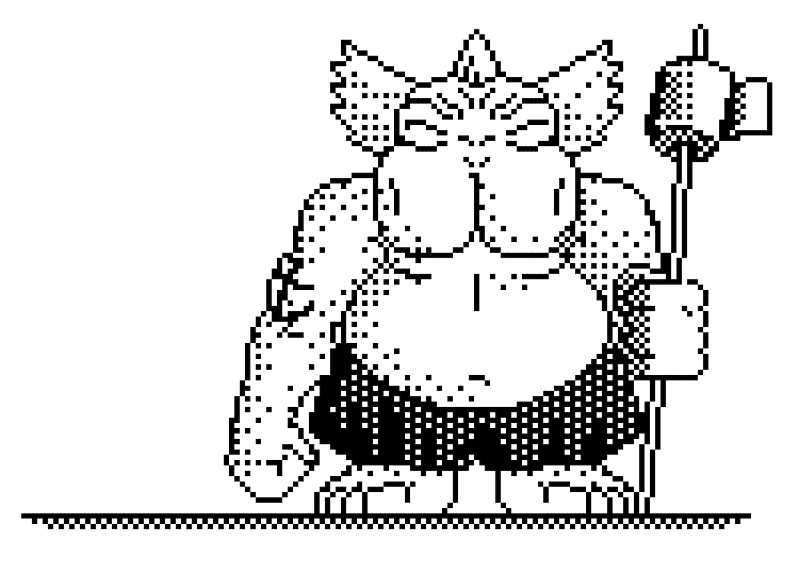

Butthead 恶搞者，Ray’s Maze，1990

# 03：面向普通人的游戏开发

最早的家用电脑是以套件形式提供的，所有零件都装在一个箱子或袋子里，并附有如何组装和开始使用的说明书。随后的机器如 `Commodore PET` 和 `Apple II` 是预组装在机壳中的，但为了发挥作用，必须通过键入命令进行操作，并使用某种名为 `BASIC` 的语言变体进行编程。或者更好，对于真正的商业级软件，则使用 `Assembly` 汇编语言。

学习编程伴随着陡峭的学习曲线，让那些没有技术倾向的人感到望而却步。仅仅看到计算机代码或闪烁的命令行文本提示就可能让人感到恐惧。对于一个不会编程的人来说，20 世纪 70 年代和 80 年代的电脑就像是外星生命体，困难得令人费解，却又充满了魔力。相比之下，`Macintosh` 则是友好且吸引人的。

起初，`Mac` 的友好是带有条件的：它在启动时会微笑，看起来和感觉就像你桌面的重生，但它的功能无法被任何拥有编写自己软件能力的人所利用。Macintosh 革命被这种局限性所遏制。诚然，任何人都可以使用它，但要用 `Mac` 进行创作？那些不是作家或图形艺术家的人就没走运了。

没多久，这个漏洞就被填补了。到 1985 年，熟练的程序员可以在 `Mac` 上使用他们选择的几种编程语言制作软件，而“我们其他人人”也紧随其后——这很大程度上归功于一种开启了奇妙可能世界的新工具。

William C. Appleton（通常被称为 Bill，这是更广为人知的名字）在 1984 年 1 月原始 `Macintosh` 出问时正在攻读研究生经济学学位。“我几乎放下了手头所有的事情，花光了钱买了一台，”他回忆道。他尝试过几台早期个人电脑，包括 `Apple II`，但他记得 `Mac` “完全是另外一种颜色（不同的马）”。

他想知道它是如何工作的，于是开始阅读 `Mac` 的官方技术手册《Inside Macintosh》。“这是一本巨大的书，”他说。它是新 Macintosh 宗教的千页圣经。Macintosh 软件开发的每一个细微细节都得到了详细描述，并尽可能使用了通俗语言。甚至有五十多页专门用于用户界面指南——这实际上是关于按钮和菜单放置位置，以及如何让人们与你的软件交互的规则。

Appleton 解释说，问题在于“当时实际上没有办法在机器上编写软件。你当时需要一台 `Lisa`。”即使是直接在 `Mac` 上制作早期游戏 `ChipWits` 的语言 `MacFORTH`，也直到 4 月才首次出现。与 `Macintosh` 同时发布的 `Apple Lisa` 新机型起价为 3,495 美元——虽然比原始的 9,995 美元型号便宜得多，但对于一个刚刚花光积蓄买了一台 `Mac` 的大学生来说，将其作为一台独立的开发机几乎是无法负担的。

救救星以 Apple 软件传教士 Alain Rossmann 的形式出现了，他在公司的巅峰成就就是引导 `Macintosh` 从最初的三个应用程序增加到 1986 年的五千个。Rossmann 给 Appleton 提供了一张软盘，其中包含 `Macintosh assembler` 的副本——该程序将特殊的计算机指令转换为处理器可以理解的位模式。大约同一时间，Appleton 还拿到了 `Mac` 内部 `Motorola 68k` 处理器的源代码——或称指令集。


尽管只有基础的编程知识，Appleton 还是研究了代码并逐渐掌握了这种语言。然后他开始编写软件。“我想写一个非常棒的冒险游戏，”他回忆道。几乎所有以前的冒险游戏都是纯文本的——类似于选择自己的冒险书，但具有更强的互动性和评分以及故事中更多的潜在路径——尽管一些较近的作品也提供了插图。最近的一些游戏已经涉足了动画，例如`Sierra On-Line`为`IBM PCjr`开发的受欢迎的`King’s Quest`（最终在 1987 年引入`Mac`），但在日本游戏`Wingman`（针对`NEC PC-8801`）和`Planet Mephius`（针对`FM-7`计算机）之外，还没有任何游戏采用作为`Mac`体验的核心点点击原则。

Appleton 有机会创造历史——开发第一部英语冒险游戏——带有鼠标驱动的菜单和库存（物品持有）系统，这后来成为了该类型的主流模式。他选择将这个想法推向极端。“我觉得为了[创建一个伟大的冒险游戏]，我需要一个伟大的创作工具，”他说。他将该工具命名为`World Builder`。它是世界上第一个多媒体创作工具，也是最早开发的第三方应用之一——尽管它在 Appleton 创建初始版本两年后，才于 1986 年正式发布。

然而，它的成名原因并非这些。`Macintosh`是“面向普通人的电脑”，玩一个由`World Builder`创作的游戏时，你知道它是基于同样的哲学构建的。乐趣的一部分在于修改别人的世界。玩家只需在创作工具中点击几次，就可以改变游戏的结局或扩展其故事。

其力量的秘密在于点点击界面下方的脚本语言。脚本是可以在运行时修改程序行为的特殊代码片段。在现代 Web 术语中，你可以看到根据用户操作而动态变化的页面，这是由`JavaScript`和`PHP`实现的。

“世界”包含单屏幕场景（理论上数量多达 2,500 个），而场景则包含了物体、角色和声音。脚本驱动着这一切。当玩家点击每个场景时，脚本会决定接下来会发生什么。有时，一行文本会显示在图形场景旁边的窗口中。另些时候，玩家会捡起一个物体或移动到一个新场景。这就像今天的互联网一样，一切都是互密相连的，玩家实际上通过链接进行旅行，链接将她从一个地点跳转到另一个地点。

`World Builder`游戏通常将屏幕分为左侧的图形和右侧的文本框（主要用于描述和对话）。玩家可以通过这两者进行交互，要么点击菜单和场景对象，要么输入诸如“北方”或“捡起青蛙”之类的指令（效果各不相同）。许多游戏仅通过点击图形部分即可完成，尽管有些游戏要求玩家针对谜题输入特定的单词。少数游戏则更进一步，增加了一系列额外的动词——例如“跳”或“推”——这允许与世界进行更丰富的交互，前提是玩家能弄清楚这些动词是什么。

`World Builder`利用了 Macintosh 内置的艺术工具，这意味着在填充矩形、圆矩形、椭圆形和多边形等形状时，有二十九种点图案可供选择。创建者可以使用鼠标以九种线条粗细进行自由画，还可以添加“位图框”（bit boxes），在放大视图中绘制单个像素。作者还可以从`MacPaint`等其他软件复制并粘贴图像或绘画。

可用的工具并不多，特别是你只有两种“颜色”（黑或白），但许多富有创意的人成功地利用这些工具描绘人物、田野、城堡、喷泉、星空、树和其他物体，细节令人印象。他们通常使用抖动算法（dithering）来营造出显示多种灰色的幻象。

Appleton 本人很好地驾了 World Builder 的艺术和设计工具，制作出一商业游戏。`Enchanted Scepters`让玩家扮演一个名为`Saber`的巫师徒，他在一个早晨在简陋的房间里醒来，得知自己被召唤去见国王。玩家可以完全忽略这一召唤，开始一场自己创造的冒险，在那里她会遇到一个地魔、一个黑骑士、一台格格不入的 Macintosh 计算机（很快成为 Mac 游戏中的一个经常梗子），以及一个巨大的滚石，其他其他事物和生物。或者她也可以前往王座厅，要么响应国王的冒险召唤——击败南方边境的`Hurks`——要么死于胆夫之死。

`Enchanted Scepters`的世界充满了谜题、陷阱和幽默。玩家必须考虑自己决定的可能产生的影响，例如从城堡监狱释放一名囚犯，或使用库存清单中的易腐物品。做出错误的选择，她日后就会陷入困境；做出正确的选择，她的任务可能就会变得简单得多。

`Enchanted Scepters`是一次启示——窥见了冒险游戏的未来，甚至是整个视频游戏的未来。游戏和计算机的未来直到多年后才实现，它在于社区和玩家/用户的创造力。在这里，他迈出了通向这一现实的最早脚步之一。

在 Appleton 完成`Enchanted Scepters`同时，另一款名为`Airborne`的游戏问世了。`Airborne`是著名的第一个使用数字化声音的 Mac 游戏，它让 Appleton 印象深刻，以至于他联系了其出版社`Silicon Beach Software`。（你可以在第 7 章中阅读更多关于`Airborne`和`Silicon Beach`的信息。）他希望他们出版`World Builder`。

他飞往圣地亚向公司创始人`Charlie Jackson`展示该程序。Jackson 喜欢他看到的东西，并向 Appleton 提出交易，出版他的创作工具以及他用它制作的游戏。`Enchanted Scepters`在不久后发布，而`World Builder`则在 1986 年上架之前经过了额外的测试和制作。

来自满意客户的信几乎就开始寄来了。“许多人用[World Builder]制作了游戏，”Appleton 回忆道，“我记得玩过很多个。有些非常有概念性，有些带有禅意主题，有些有战斗等等。或者是谜题的。”

在最早的例子中，1986 年的冒险游戏`Radical Castle`脱颖而出。`Christopher Kent Wigginton`免费发布了这款游戏，尽管如果你喜欢，可以支付 5 美元或“一张双面 Sony 磁盘”作为报酬，潜在的玩家可以从杂志附带的共享软件收集磁盘、Mac 用户组的邮件中，或通过互联网之前的在线服务获取它。它的情节与`Enchanted Scepters`类似，在早期有一个关于死亡（为了与公主秘密会面）或寻找神谕的长途任务的选择，但玩家爱上了那种蒙蒂·派森式的幽默，这种幽默让他们四处奔寻找隐藏的笑话，并努力击败那个歇斯底里的程序员（`Wigginton`的数字化照片）。其他早期的`World Builder`冒险游戏将玩家送往更平凡和异域的地方。由`Bruce`和`Aeron Muckala`创作的`Hotel Caper`或`The Rescue of Daring Drake`讲述了著名侦探`Sally Sunday`的，她试图独自从`Gangster Gary`的酒店聚会点营救`Daring Drake`，冒着炸弹和子弹，努力在不杀害任何人的情况下破案。

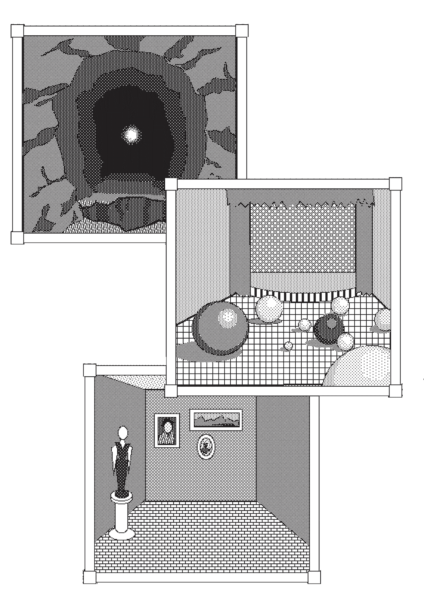

Ray’s Maze, Ray Dunakin, 1990

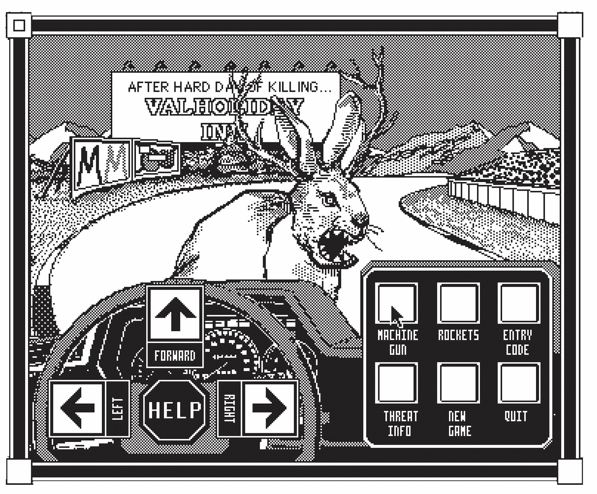

Mac Spudd!, Robert Carr, 1990

`Mike’s House`将其作者`Mike Rippe`的房子再现制作了一场冒险，而`Kenneth Moodie`的`Little Pythagoras`则将你回到古希腊解决谜题和逻辑问题。在所有`World Builder`游戏中最奇怪的，`Deep Angst`是`Ronald Wartow`开发的，作为名为`Washington Apple Pi`的 Apple 用户小组对软件评论的一部分。`Deep Angst`的大部分图形来自全国各地的公告板系统，以及其他少数几个`World Builder`游戏。它是一场荒诞的冒险，将屁笑话与《银河系漫游指南》以及几十流行文化引用混合在一起，玩家沿着迷宫般的`Lonely Road`行进，听着铃声，通过尝试关闭大门来打开它们，在干喷泉旁边收集湿毛巾，遇到抽烟的恐龙，并在某一点对山坡上的一首“快速消失的诗”感到惊奇。

Robert Carr 创作的怪诞`Mac Spudd!`和`Mormonoids of the Deep`同样极其变态，但它们呈现出一种不同的超现实主义。`Mac Spudd!`讲述了在末日后的爱达荷州运送土豆，而摩尔门教人则派遣玩家去消毁邪恶的`Yogsoggsmith`以逃离`Mormonville`小镇。在这两款游戏中，玩家驾驶着一辆武装的汽车在一个又一个的静态屏幕中移动，将各种奇异奇妙的敌人炸成粉碎，例如巨大的凶猛兔子和充满威胁的直升机。

还有一部由 James C. Gehrig 和 Virginia Batcheff 创作的名为`Drakmyth Castle`的黑暗冒险游戏，讲述了一场席卷村庄的致命瘟疫。玩家的任务是取回一种化学家制出但被邪恶巫师偷走的血清。与其忧郁的基调更引人注目的是那些令人毛骨悚然的详尽画面，它们视觉化了玩家的恐怖遭遇，而且它只需要两张软盘——而大多数`World Builder`游戏所需的容量还不到一张软盘的一半。

Ray Dunakin 的`World Builder`游戏被广泛认为是系列中的最佳。他那以解谜为主的作品`Ray’s Maze`、`Another Fine Mess`、`A Mess O’Trouble`和`Twisted!`将想象力设计与幽默的文字、烧脑的挑战以及精细细腻的画面结合在一起。

### Ray Dunakin 的历程

Dunakin 进入游戏开发领域纯属偶然。他天生具有艺术细胞但从未受过正式训练，在他大约二十或二十一岁时，他和他父亲在当地的一个跳蚤市场上看到一个人在 T 恤上进行气喷设计。Dunakin 回忆道：“我爸爸说，‘这是你可以做的事。’”他用攒的钱买了必要的工具和一些白色 T 恤并开始练习。

“一周后，我就在跳蚤市场上做同样的事情了，”他说。这导致他进入了一家丝网印恤店工作，尽管他之前对丝网印刷一无所知。一年后，他成为了该场所公司的艺术总监。后来他转到另一家公司从事平面设计，再次是因为一位看中他潜力的陌生人的信任。最终，Dunakin 开始为`SeaWorld`、圣地亚哥动物园和许多本地企业等商业客户创作写实的气喷插画。

大约 1989 年，他和妻子为十二岁的儿子买了一台`Macintosh SE`——这是一款带有内置九英寸单色显示器的早期 Mac。Dunakin 回忆道，“他想要一个游戏机之类的东西，”但他们觉得他应该拥有更有用的东西。电脑兼顾了两者——既是学习和完成作业的绝佳工具，也是一台可以玩游戏的设备。

这是这个家的第一台电脑，所以对 Dunakin 父子来说都是一次冒险。家里的一朋友给了他们一包包含`World Builder`的软件。Dunakin 一家起初使用`World Builder`制作“彼此互相玩的的小愚蠢游戏”。小 Dunakin 的游戏非常简单——“主要是和各种怪物战斗，”Ray 回忆道，“我的第一次尝试没好到哪去，但我不断增加更多幽默元素和技巧，这些逐渐演变成了谜题和剧情。”

他们会把几个场景拼凑在一起，添加一些幽默的角色和怪物，然后转向下一个想法。Ray 记得：“我们没有久留这些早期的‘游戏’。”但他想让他的游戏实现更复杂的功能，所以他深入钻研了手册。

“当我开始开发越来越复杂的游戏时，我终于决定它们已经足够好，可以尝试将其作为共享软件（shareware）发布，”他说。

### 早期游戏

Dunakin 在 1990 年发布了他的第一款游戏`Ray’s Maze`。这是一部“非常随机”的解谜冒险游戏。核心概念围绕着传送。“我喜欢这种可以通过这些跳跃门，在没有任何预警的情况下到达时空中任何地方的想法，”他说。

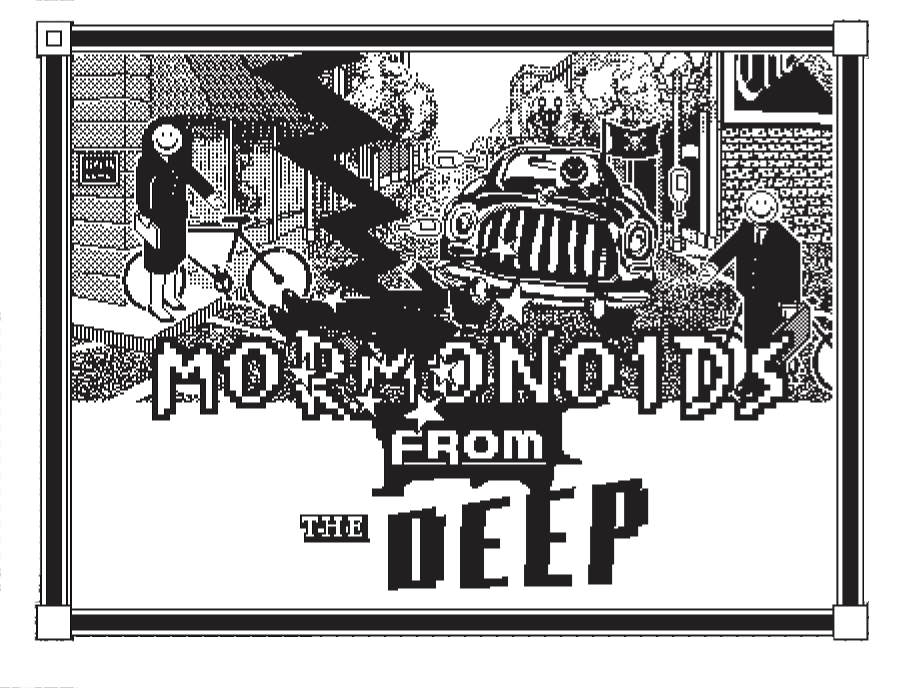

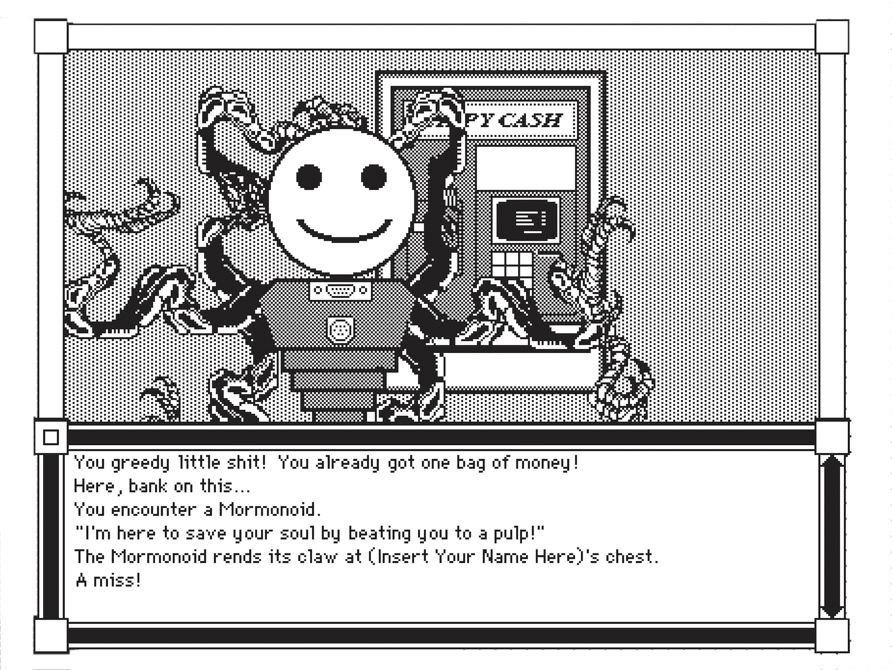

Mormonoids from the Deep, Robert Carr, 1988

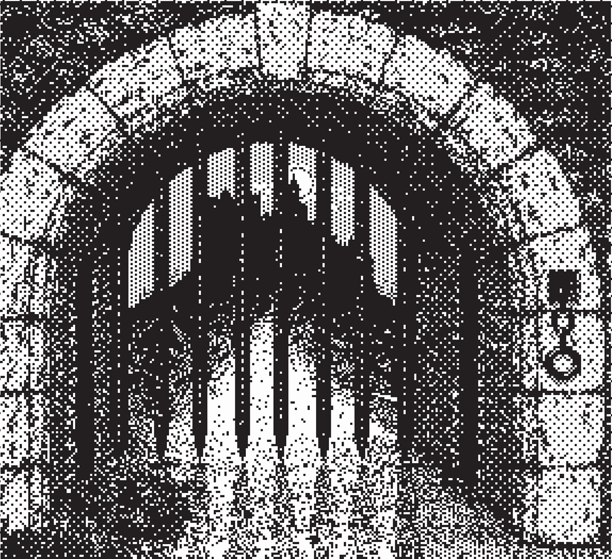

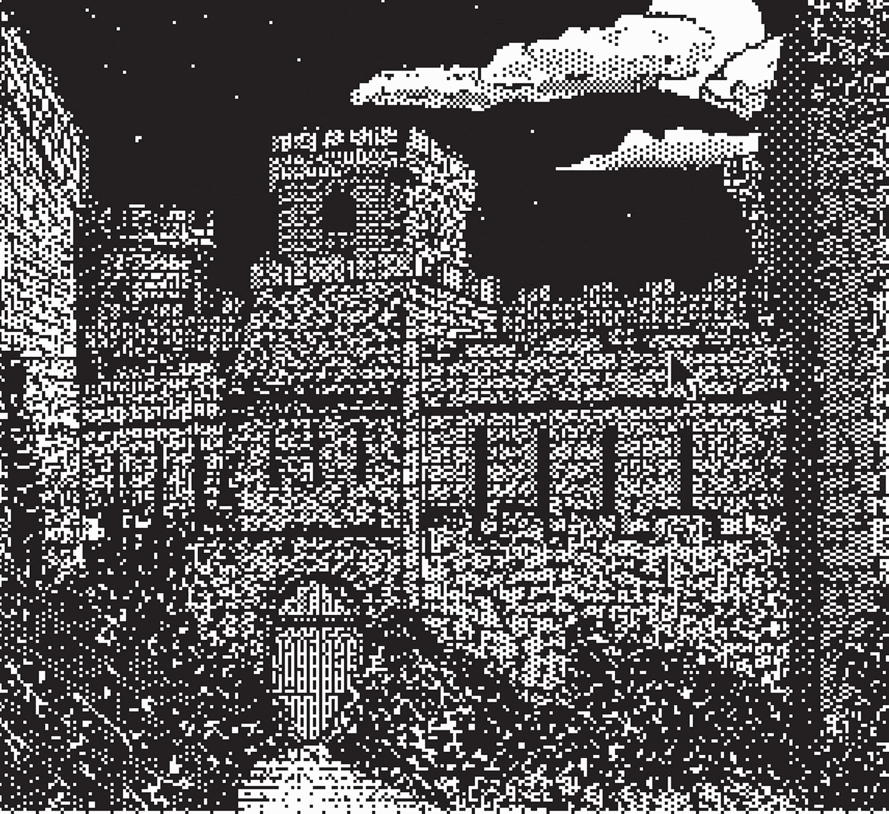

Drakmyth Castle, James C. Gehrig & Virginia Batcheff, 1991

玩家扮演了兼职冒险家“无畏的”弗兰克·法尔利（Fearless Frank Farley），他穿过一个只有一个出口的多维迷宫，这个出口由一个名为 Ray 的神秘生物拥有并经营。这里有钱可以赚，有陷阱要破解，有“笨蛋巨魔”可以帮助，还有奇怪的地方可以去，如地狱之地（Land of Infernos）和一个装满重型光球的房间（旁白干瘪地说道：“‘显然是舞厅’”）。

`Another Fine Mess`在大约两年后推出，再次将无畏的弗兰克送入一个充满奇迹和魔力的多维迷宫。它降低了战斗性，转而追求更多的谜题和一个卓越的文本解析器，这个解析器似乎能预判玩家能想到的任何指令或求救信号——至少按照当时的标准来说。当尝试在文本框中输入几个常见的脏话时，听到的是泡泡声和有人大喊“eeyuck（真恶）”，而文本回复说：“你的嘴里突然出现了一块起泡沫的肥皂，导致你作呕！你的精神正在虚弱！”

在那个大多数冒险游戏的文本解析器需要特定的动词-名词组合的时代，Dunakin 特意加入了他所能想到的指令的每变体，以减少玩家的挫败感。

他还花了大量时间完善场景中的视觉效果。Dunakin 的画家和气喷艺术家背景意味着他知道如何构图，但在制作艺术方面，他处于非常不同的处境。由于没有平板板或其他笔输入设备，他必须用鼠标绘制所有的艺术。他对这种媒介的掌握日益进步：每一个游戏都比上一个好。

Dunakin 1994 年的冒险游戏`A Mess’Trouble`因此汲取了他之前所有游戏的经验，拥有精美的专业画面，和一个将`World Builder`推向极限的巨大世界——至于 Dunakin 无法将他想要的所有内容放入游戏中。（值得注意的是，`A Mess’Trouble`首次包含了可玩的女性角色——“胆大者”Dawn。选择 Dawn 会偶尔改变使用的语音样本。）

### 传承

Dunakin 的游戏给 Macintosh 社区留下了深刻印象。许多人对`World Builder`在正确的人手中能实现的功能感到震惊。其他人受到启发创作了自己的游戏。

Louise ‘Lucy’ Hope 就是这样的人。她在 20 世纪 90 年代某人在 AOL 上发现了 Dunakin 的游戏（具体时间已消失在历史长河中）。Hope 回忆在 Dunakin 的游戏中看到了“在非常有限的游戏创作系统内可以完成多少事情”。`World Builder`的叙事潜力以及大多数用它创建的游戏的自由谜题吸引了她。“这就像写作，”Hope 说，“只不过你不需要寻找出版社。”在一个“极不不同的世界”里，她会成为一名作家。相反，她陷入了设计具有大量文本和有趣角色的游戏中。Hope 的第一个`World Builder`游戏`The Tower`在两个月后发布，并在后的几年里更新了两次。`The Tower`的主角是一个不情愿的冒险家，男性也可以是女性——玩家必须在介绍期间决定。他的或她的旅程始于一座废城堡，在他朋友 Jake 失踪几周后。

在旅途中，玩家——扮演那个无名的男性或女性主角——签署了入场表格，遇到了幽灵声音，通过喝酒来补充水分，并结合鼠标命令和文本命令探索了这栋不寻城堡的每一个角落。一个热心的叙述者提供了提示和评论。对于一款《World Builder》游戏来说，一个不寻常的是 Hope 在屏幕上设置了热点，允许玩家随时点击他们想去的地方。这在 20 世纪 90 年代中期是冒险游戏的常态，但在`World Builder`中很少见，因为标准的指南针指令足够好用，让创作者们不想投入额外的精力。

Hope 进入`World Builder`时，并不像 Dunakin 那样是计算机或游戏设计新手。“在 20 世纪 80 年代后期，我使用一台`Apple IIe`，”她回忆道，“它配有两种或三种`BASIC`方言，催生了早期的文本冒险游戏系统`Eamon`。`Eamon`在 1980 年作为一种免费分发的幻想角色扮演游戏诞生，随后被社区广泛地修改和扩展。当 Hope 接触到它时，`Eamon`更准确的描述应该是许多用户创建的、基于文本的交互式角色扮演冒险的核心系统——通常是《地下城与地下》或《指环王》风格的。

Hope 为了打发时间制作了几个`Eamon`游戏，其中一个具有类似于《一千一夜故事》的设定——几年后她在一款名为`Sultan’s Palace`（苏丹宫）的`World Builder`游戏中再次回顾了这一主题。

`Sultan’s Palace`再次讲述了玩家和她的朋友 Jake 的坎坷遭遇，她结识了新的人，与苏丹的部下陷入麻烦，并探索了具有阿拉伯风情的宫殿及其周围。像 Hope 的其他游戏一样，它是一场深思的、节奏缓慢的冒险，更多关于置身于世界并在其中发现有趣趣的事，而不是解决复杂的谜题或战斗可怕的生物。

Hope 最终厌倦了`World Builder`的局限性。它对每个场景以及整个游戏的代码量都有硬性限制。她的想法太宏大了，而且在某些情况下根本无法实现。

她将这个问题比作使用现代大屏幕电视看查理·卓别林的电影。“当然，你会这样做并享受它，”她在十多年前在自己的网站`Lucy’s Worlds`上写道，“但同时你也会理解为什么他们不再制作那样的电影了。”

`World Builder`拥有惊人的生命力，在一个大多数软件在发布仅五年后的电脑上都几乎无法运行的世界里，它奇迹般地持续运行了大约二十年的技术进步。但尽管它是如此前卫且文笔精良，`World Builder`仍然是一个冻结在 20 世纪 80 年代中期黑白 Macintosh 计算机能力的遗迹。

## 他们现在在哪里？


Ray Dunakin 现在已经退休了。他最后负责的游戏——一个名为 `Morphworld` 的野心 `3D` 冒险游戏，在 Apple 从 `Mac OS 9` 到 `X` 时被取消了。他的 World Builder 游戏网站 `Ray’s Games` 的者 Marc Khadpe 正在将 Dunakin 的四款 World Builder 冒险游戏转换为 iPad 和现代 `macOS`，并配备更新的引擎和界面。在写作时，只有第二款游戏 `A Mess O’ Trouble` 大麻烦）可用。Louise Hope 仍然热衷于冒险游戏的创作。如今，她使用 `JavaScript` 为 Web 编写游戏，“带有浓厚的 `BASIC` 口音”。


`Torch`，`Shadowgate`，1987

# 04 Mac 探险者

Craig Erickson 在 1982 年于 NEC 的家电部门刚写完一些初始化打印机的代码时，遇到了同为 NEC 员工的 Tod Zipnick。这对自称为 → 小摆配件的“迷狂”，很快就建立了默契。“我们都把这个行业看作一只正在迈出前几步的雏生小鸭，”Erickson 解释道，“我们想与其并肩。”

Zipnick 对这个新行业以及消费电子——整个世界——的发展方向充满热情。他向 Erickson 展示了他自己编写的一个功能强大的 `Apple II` 数据库程序，名为 `File-Fax`，该程序使用了图形化界面。它很棒，甚至是非常棒。1983 年 4 月，两人达成协议，以 `TMQ Software`（“质量商标”的缩写）的名义合作，并商业化销售 `File-Fax`。Zipnick 将持有多数股权，因为是他的程序让他们起步，并将由他经营业务。Erickson 和 Tod 的表弟程序员 Jay 分别持有较小份额。

`File-Fax` 的成功帮助他们获得了为 `Atari` 将街机游戏转换为家用电脑版本的工作。“那是这样一种交易，基本上我们会说：‘好的，所以你们想在 `Commodore 64`、`Apple II` 和 `PC` 上玩 `Dig Dug`，”Erickson 解释道，“他们会说：‘我们会付你这么多钱来做这件事，每个磁带我们会付你这么多钱。我们希望你创建它，进行所有的测试，设置好一切，完全包装在托盘上——这里是主箱，一切都有——我们会给你三百万美元。’”

当 `Macintosh` 在 1984 年问世时，Erickson 迷上了它。他已经是一个 `Lisa` 的粉丝了，所以他也爱上更小的 `Mac` 也是理所当然。他推动 `TMQ` 为这台新起家的电脑开发一款原创的冒险游戏。但不像他早些为 NEC 编写的纯文本冒险游戏 `The Curse of Crowley` 那样的。即使是当时带有图像的游戏，也依赖于简单的动词-名词解析器来处理输入——比如 `go north` 或 `climb tree` 或 `use rope`。他希望这些内容在屏幕上可见且直观。

Erickson 组了一个程序员团队来开发所需的技术。Jay Zipnick、Steve Hays 和 Darin Adler 形成了核心小组，他们将之称为 `Filter Engine`。Hays 在 `TMQ` 早期曾在街机转换方面做过出色工作，而 Adler 是一个刚加入 `TMQ`（后更名为 `ICOM Simulations`）的天才青少年程序员。

Adler 是大学暑假期间有一天去那里获得那份工作的。当他成功与十六岁的编程和数学天才 Waldemar Horwat 交流时，引起了办公室周围人的注意。对 Adler 印象的 Erickson 为他提供了一份暑期工作。Adler 最初负责项目的一小部分——图形压缩算法，让几十个详细场景能够放入 `400K` 磁盘中——但很快，他就变成了游戏开发的对等贡献者。

游戏本身是技术允许范围内最接近交互式黑色电影冒险的作品。Erickson 渴望开发一种能够捕捉到优秀恐怖片或黑色电影感觉的冒险游戏。“我想要一种冒险游戏，基本上，我可以在里面看到性工作、杀手和警察，并能够炸掉东西，”他解释道，“在此之前你做不到这些。”

但 `Déjà Vu: A Nightmare Comes True` 改变了这一切。Erickson 邀请作家 Kurt Nelson 创作具有侦探小说小说和黑色电影风格的成熟、幽默且讽刺的对话和叙述，并请形象的插画家 Mark Waterman 绘制黑白图像，以匹配文字的冷峻基调。

游戏开始于一个潮湿的卫生间隔间，门上挂着一件风衣。“你正从一种昏迷中醒来，这种感觉就像在拉斯维加斯呆一周后的慢性宿醉，”叙述者冷静地解释道。糟糕的是，主角的右手掌上有血，但不记得它是怎么留下的，左手臂上有一处新出的针痕。他甚至不知道自己是谁，很快发现自己被卷入了——而且很可能是被陷害——一起谋杀案。

《记忆》（`Déjà Vu`）将屏幕划分为多个窗口。中心的主窗口显示着黑白世界，看起来像是 20 世纪 40 年代侦探电影的像素化版本。周围分布着各种界面元素：一个或多个可以移动、调整大小的窗口，用于存放玩家的物品（背包）；一张仅显示可用出口的房间地图、一个显示叙述的文本窗口、一个用于任何需要将主角作为对象的交互的“自我”按钮、一组用于动词动作的按钮，以及顶部惯用的 Mac 菜单栏（包含额外的命令，如 `Save`——一个需要频繁使用的非常重要的命令——以及“清理”或“弄乱”活动背包窗口）。

几乎所有的交互都使用鼠标。玩家可以通过点击物体与八个动词命令之一的组合来触发特定动作——`Examine`（检查）、`Open`（打开）、`Close`（关闭）、`Speak`（说话）、`Operate`（操作）、`Go`（移动）、`Hit`（击）、`Consume`（消耗）。物体也可以在背包和世界之间进行拖放。《记忆》的背包系统不像大多数其他允许玩家将物品存在角色身上的游戏那样是扁平的。相反，它是分级的。较大的物体（如外套）可以打开以露出更多物品：打火机、太阳镜、香烟、钱包等等——其中某些物品本身也可以被打开以露出更多物品。

正如 Mac 桌面使用窗口状框中的图标作为文件和文件夹的隐喻一样，ICOM 的 `MacVenture` 引擎将它们作为“物品中的物品”的隐喻。玩家可以自然地、几乎直能地发现这一点，因为它与现实运作运作是一致的。

为了实现这种直观的交互性，开发团队在设计逻辑系统和层次结构上花费了大量精力。钱包可以放入包里，包可以放在房间里，但不能放在角色的口袋里。然而，手枪可以放在口袋里，子弹也是。世界中的每个交互物体都有这组属性，决定了它们可以嵌套的层级。团队每天都会聚在一起检查设计，以确保新添加内容的逻辑与现有游戏相匹配。Jay Zipnick 变成了产品中所有内容（艺术、代码和设计）的守门人。

在游戏接近完成时，Erickson 和 Tod Zipnick 开始向发行商推销游戏。他们几乎找了所有人：`Epyx`、`Activision`、`Brøderbund`、`Atari`、`Electronic Arts`、`Mindscape` 等。“我们展示了数字化的帽子、枪以及来自 `MacVenture` 的一切东西，”Erickson 回忆道，“然后我们向他们展示了它是什么样子的。我们只是让他们尝了咸，因为当时它还没有完全完工。他们疯狂了。”

大多数发行商都给了他们报价，但 Tod Zipnick 并不打算就此接受任何摆在桌子上的条件。“他是个口嘴伶伶的魔鬼，”Erickson 说，“他四处跑，基本上让我们向我们展示过产品的人都相互竞价。”一家来自伊利诺伊州的新兴公司 `Mindscape` 叫价最高，于是他们与他们签了合同。

《记忆》的创新在 1985 年发布时广受赞誉，就在 Mac 出世一年后。它本质上是第一个点点式冒险游戏——这种类型很快催生了 `Sierra On-Line` 和 `Lucasfilm Games` 公司的一系列广受喜的游戏，随后还催生了 20 世纪 90 年代销量第二的电脑游戏《神秘之旅》（`Myst`）。与当时同期的冒险游戏不同，那些游戏将许多交互隐藏在文本解析器中，需要猜测正确的动词-名词配对才能使用，《记忆》将整个界面都放在了屏幕上。玩家只需要使用键盘告诉出租车司机去哪里。其他一切都是基于鼠标的。

它是革命性的——领先时代多年——而且大受欢迎。它的名声和成功随后传播到整个行业——到其他家庭电脑平台，如 `PC`、`Atari ST`、`Apple IIGS` 和 `Commodore Amiga`，以及天堂天堂。它为 ICOM 赚了大量的钱，证明了开发另一个 `MacVenture` 是合理的。

对于该系列的第二个游戏，ICOM 转向超自然领域。《不请自》（`Uninvited`）充满了与《记忆》完全不同的恐怖元素。它也是从一段昏迷开始的。但这次，无名主角的记忆是完整的。他遭遇了一场车祸，弟弟失踪了。在别无选择（汽车很快爆炸了），他必须进入一座古老（事实证明是闹鬼的）豪宅，寻找他的弟弟并寻找一个能帮助他们到达最近城镇的人。

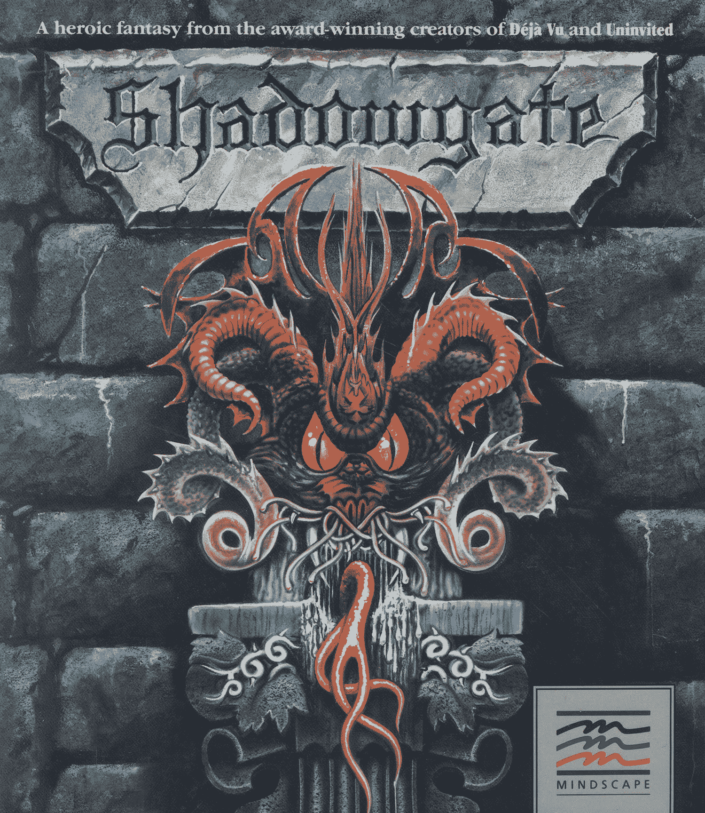

《暗影门》（`Shadowgate`），`Mindscape`，1987（由 Jon-Robert La Porta 提供）

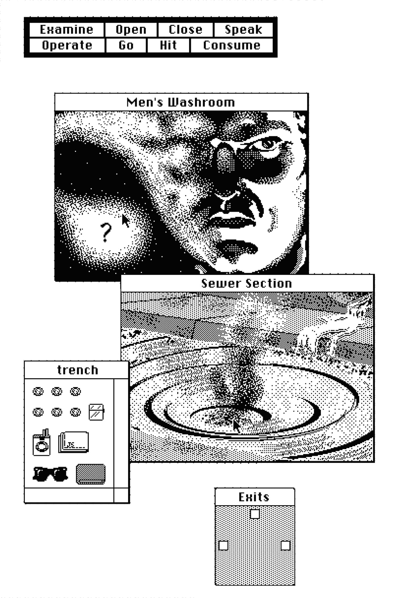

《记忆》，`Mindscape`，1985

《记忆》是一部粗俗的通俗冒险，充满了卑劣的角色，他们宁愿偷你的表也不愿帮你洗清杀人罪；而《不请自》的怪物阵容有着更黑暗的意图。它的恐怖设定举办了幽灵、地狱犬、一个可怕的不死女子和一个嘲讽性地拿着钥匙的小恶魔等其他灵异生物。它乐于在每一个机会让玩家魂飞魄散，通常通过在小时的完全沉默后突然爆发出一个声音或简短的乐句来实现。

然而，游戏中的恐怖并非完全是故意的。许多玩家对《记忆》中那种受通俗启发的、不可靠且讽刺的叙述风格，与类似于传统哥特小说的氛围的尴尬搭配感到不满，评论也抱怨许多不逻辑且毫无意义的谜题，这些谜题依赖于从未告知玩家的知识。例如一个幽灵害怕蜘蛛——尽管游戏从未解释过这一点。更糟糕的是，玩家只有在进入旧房子之前查看豪宅前院的邮箱，才能完成游戏（这时门就会在她身后锁上）。

当《不请自》发布时，第三部 `MacVenture` 的开发已经在进行中。《暗影门》的三位主要创作者中的两个对公司和对行业来说都是新手。Dave Marsh 在 1985 年在青少年事工部遇到了一位 ICOM 的程序员，并对与他们合作开发一部奇幻冒险游戏产生了兴趣。Marsh 在像素艺术方面造艺高深，但他买不起 Mac。ICOM 对他的才华印象深刻，借给他一台公司的 Mac 让他开始开始自己的 `MacVenture` 创作，他叫了朋友 Karl Roelofs 来帮忙。

在接下来的八九个月里，两人在 Marsh 的家里与程序员 Terry Schulenburg 一起开发《暗影门。《暗影门》将世界的命运掌握在玩家手中。作为国王王朝的最后后裔，他的任务是探索暗影城堡，找到并阻止巫师领主“永远地笼罩我们的世界”。按照典型的 `MacVenture` 风格，这需要探索房间、频繁死亡并实验以寻找解决方案。它还引入了一个引起争议的设计理念——必须时刻携带点光的火炬，否则就会摔倒并折颈。除了增加紧张感的烦扰之外，《暗影门》的谜题和世界设计引起了游戏观众的共鸣。它成为了最流行的 `MacVenture`。

第四部 `MacVenture`《记忆 II：迷失拉斯维加斯》于 1988 年推出，此时该系统已经显得老态，并失去了它最初的愿景者。Erickson 要求 Tod Zipnick 买下他在 ICOM 的股份，以便他去开启他自己的新冒险——他创立了 `The Softworks Factory` 公司，该公司为其他家庭电脑平台制作了几款游戏。

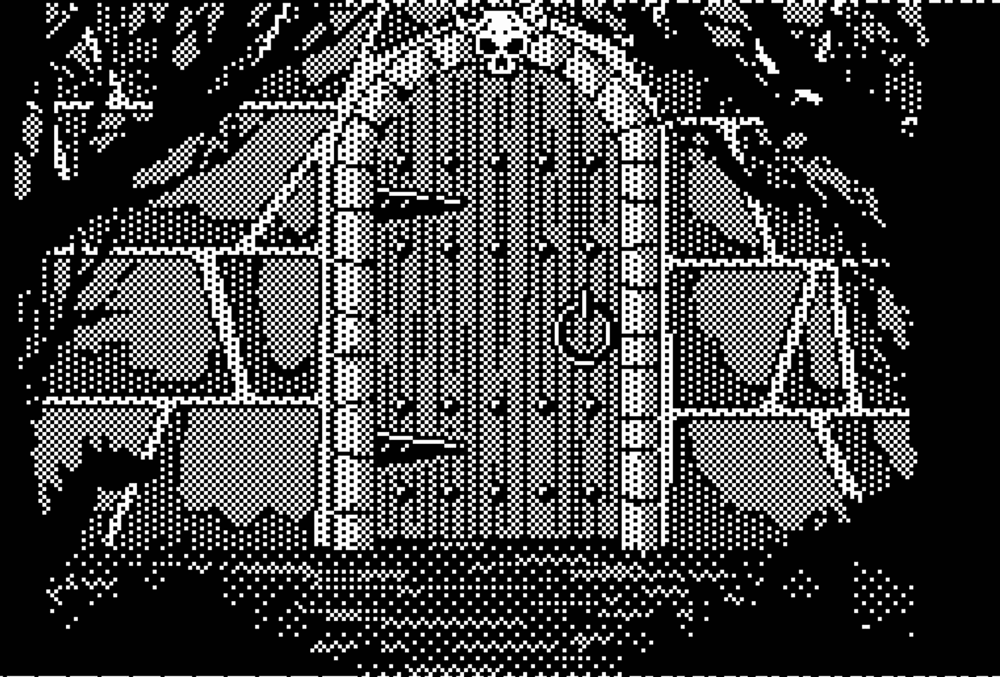

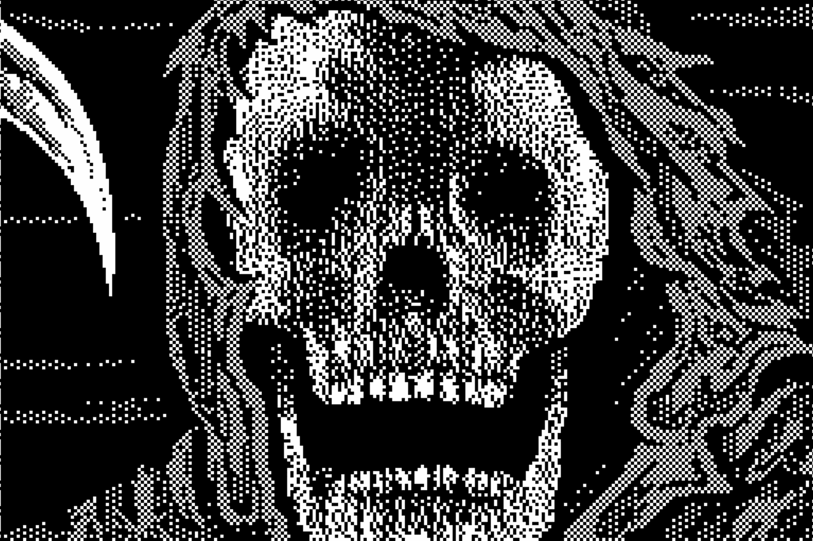

《暗影门》，`Mindscape`，1987

在他离开后，`MacVenture` 系统并没有维持多久。有几款游戏进入了开发——包括《赫利奥斯》（`Helios`），关于建造火箭以摧毁与地球处于运行轨道的小行星；《影之门之外》（`Beyond Shadowgate`），这本是计划中的《影之门》续作，后来被另一个团队重新构思为一款横卷冒险游戏；《八卦》（`Gossip`），讲述了一个八卦专栏作者的遭遇；以及《觉醒》（`The Awakening`），设定在 19 世纪的维多利亚伦敦，以狼人神话为主题。但这些游戏都没有完成。市场正在发生变化，Tod Zipnick 希望留在行业前沿。他将公司重心转向了横卷平台游戏（因为这是当时主机机上的新兴趋势）以及全动态视频（`FMV`）游戏——这是一个令人兴奋的新类型，它将真人演员拍摄的实景场景与更传统的交互软件设计相结合。

Tod Zipnick 于 1991 年 7 月因霍奇金森去世，但在去世前，他通过将公司出售给媒体巨头维康（`Viacom`），确保了公司和员工的未来福祉。他当时仅 35 岁。作为维康新媒体的一部分，公司为 `PC` 和主机开发了另外十多款游戏——包括点点式冒险游戏《比维斯和比特头的虚拟疯狂》（`Beavis and Butt-Head in Virtual Stupidity`）。1997 年，在维康新媒体部门次年拆解之前，该工作室关闭了。

## 他们现在在哪里？

MacVenture 团队的大多数成员继续在科技行业工作。Craig Erickson 是 `BDA`（Bensussen Deutsch and Associates）的硬件工程总监，在那里他领导了 `MOGA` 控制器和 `Wii Ultra` 传感器条等的开发。Darin Adler 和 Jay Zipnick 在苹果公司工作。Dave Marsh 和 Karl Roelofs 于 2012 年共同创立了 `Zojoi`，并为现代电脑重制了 ICOM 的福尔摩探探系列游戏。从那以后他们重新构思了《影之门》，并将四款 `MacVenture` 游戏（其 Mac 和 `Apple IIGS` 版本）重新发布到了现代 Mac 和 Windows 系统上。

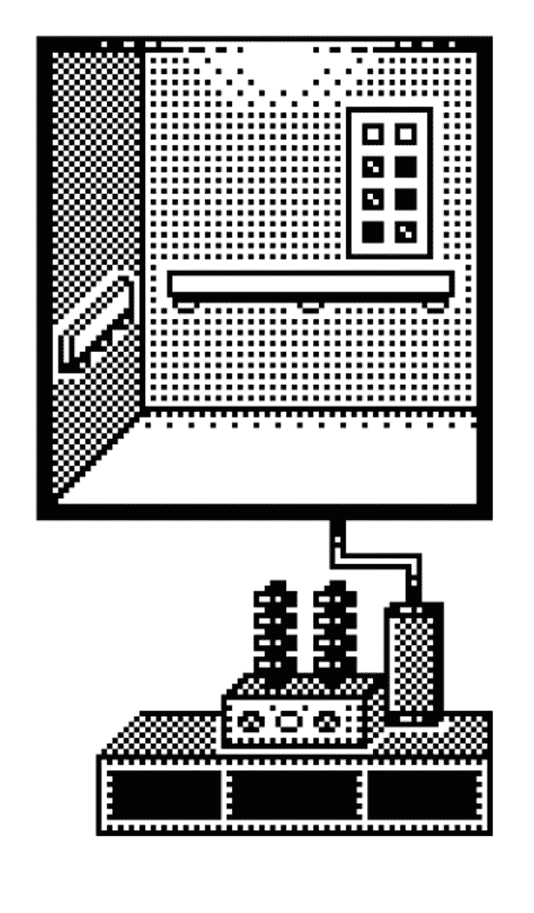

电梯，《模拟大厦》，`Sega`，1994

# 05 模拟

Sean Hill 在 1984 年初在一家电脑店兼职时，他们获得了一款名为《`GATO`》的 `PC` 游戏演示。那是一个设定在二世界大战太平洋战场的潜艇模拟器。

“我玩了那个，很有趣，”希尔回忆道，“但我开始想，如果它在 Mac 上看起来会好得多。”

希尔和几个大学的朋友很快制作了一个演示版，展示了《`GATO`》如何在 Mac 上运行。他们的设计会比原版优雅得多。与原版的六种不同视角不同，他们的设计只有两个，并且使用鼠标执行大部分命令，而不是需要键盘覆盖层（这字面意思是一张玩家盖在键盘上的纸，帮助他们记住哪个键对应什么功能。几乎每个键都有功能）。Mac 演示版中没有实际的模拟逻辑或动画；它纯粹是为了视觉上展示《`GATO`》在 Mac 上的外观和感受。

他拨打了发行商 `Spectrum HoloByte` 的电话，询问是否可以飞过去向他们展示演示。他们同意了。

我们一直忙到最后一刻。从大学到机场有三小时车程。我记得我在高速公路上开车冲向机场时，正换上西装。我登上飞机，想象自己正要去一家非常大的公司。

`Spectrum HoloByte` 的联合创始人兼副总裁 Phil Adam 接了他，但他带他去的不是某座闪新摩天大楼里的巨大多层办公室，而是位于科罗拉多州博尔德的一个小小的双室办公室。他们在同一天签了一份单页合同。“交易大约是 6000 美元加上销售额的 6%之类的，”希尔回忆道，“完成这件事感觉棒极了。”对于为 Mac 重写《`GATO`》所需的四五个月工作来说，报酬很低，但制作视频游戏还是有钱的。

《`GATO`》于 1984 年底推出 Mac 版，受到了热烈反响。它最受欢迎的功能之一是发射深水弹（反潜武器）时的音效，那声音实际上源于代码中的一个错误。“结果发现是在播放某些随机内存作为声音，但听起来很好听，所以我们就留那样了，”希尔解释道。

`Spectrum HoloByte` 很快要求希尔做第二个游戏——不是另一个对现有作品的 Mac 转换版，而是一个原创的航天飞机模拟器。然而，希尔这次不想和他的大学朋友一起工作了。去年夏天，他通过电脑零售工作遇到了一位名叫 Don Gilman 的人。Gilman 和他的朋友 Gordon Walton 不久后就离开了零售业，共同创立了一家名为 `Applied Computing` 的公司。他们计划白天做业务咨询，晚上制作游戏。一年内，他们业务每个部分都积累了这么多工作，以至于不得不分两家。

Gilman 负责业务部分并保留了公司名称，而 Walton 接手游戏并建立了 `Digital Illusions`（数字幻象）——这个名字指的是游戏设计中虚幻、魔法般的一面，它简化并削减现实，直到只剩下趣味有趣的内容。希尔决定与他们分享他的新项目。

他们从 1985 年 7 月开始开发。Walton 担任首席编程工作，而 Hill、Gilman 连同 Mike Jones 和 John Keene 分担剩下的编程任务，整个团队都为设计做出贡献。

他们在 Walton 家的客厅里工作。在九个月开发计划进行了六个月后，即 1986 年 1 月 28 日，他们打开电视观看航天飞机发射。挑战者号从未进入轨道。它在起飞 73 秒后起火并在大西洋上空解体。七名机员全部遇难。“我们当时都震惊了，”Hill 回忆道，“我们起初不确定该继续做游戏还是停止。”

Walton 记得他们查看了美国航空航天局（NASA）公开文档中的相关统计。“他们已经计算出了所有数据，概率微乎其微，”他回忆道，“但显然并不是微乎其微，对吧？发生的概率比 NASA 计算的要大。”

《轨道者》（`Orbiter`）并没有模拟挑战者号灾难，尽管在展会上看到游戏的人对此有过病态的询问，但它确实获得了更多可能的失败状态——以及这些状态发生的更大概率——使游戏更加刺激。

在《轨道者》之后，Hill 加入 `Spectrum HoloByte` 担任制作人。他管理的第一个游戏是 `Digital Illusions` 的下一个作品，一个名为《`PT-109`》的二战鱼雷艇模拟器。这是一款任务驱动型的游戏，负责巡逻和消除敌人——或者用 Walton 的话说，“寻找、射击然后逃离”。玩家用鼠标操控船只，必须学习并掌握历史上的鱼雷艇技术，例如通过抑制引擎进行隐蔽接近，或使用烟雾幕安全离开。


随后，Digital Illusions 受到了 Spectrum HoloByte 的竞争对手发行商 Epyx 接触，要求制作另一个潜艇模拟器——一个能取代《GATO》成为类型领先者的作品。结果是《潜艇战斗模拟》（Sub Battle Simulator），这是一款设定在二战的游戏，玩家可以完成盟军（美国）或德国的任务。它著名的特点引入了从上方飞行并试图破坏玩家潜艇的炸机。

Digital Illusions 的焦点始终在于提供基于现实的娱乐体验。他们会花费几天几周时间研究——研究书籍、电影、口述历史以及存档的船舶或任务日志——然后将所有数据简化为一些核心系统和反馈回路，捕捉现实的本质。

“真实的模拟无聊透极了，就像这个世界上其他所有事情一样，”沃尔顿（Walton）说道，“如果你模拟战斗，99% 的时间都是坐在那里无聊得无所事事，然后只有 1% 的时间是你正处于对生命的极度恐惧中。”他们将模拟游戏视为一种向往——为了获得一种在现实世界中无法获得的职业或体验的真实、正宗的感觉。“多年来，《飞行模拟器》（`Flight Simulator`）一直是最大的游戏，因为人们在追求一种向往的体验，”沃尔顿继续道。

模拟最酷的地方在于，你可以一直死去，但并不会真的死去。那些真正从事这件事的人，如果做错了，就会真的死掉，而这让许多模拟游戏成为了向往之物。它们通常是人们因为时间、培训成本以及对死亡的恐惧而无法做的事情——但如果你进行模拟，他们就可以尝试，也许能体验到这种经历的精髓，并在结束后变得明智一点。

没有人比资深游戏设计师克里斯·克劳福德（Chris Crawford）更推崇这一理念了，他认为 `Mac` 是一个机会，可以让玩家进入一个关于世界命运的高风险模拟游戏中。

20 世纪 70 年代后期，克劳福德在大学教学期间，自出版了自己的电脑战争游戏。在那个年代末，他的妻子在硅谷获得了一份电气工程师的工作。1979 年 9 月，在寻找几个月工作后，克劳福德在雅达达（`Atari`）找到了工作。他参与了 `Atari 2600` 和 `Atari 800` 游戏的开发，但几年后，他对纯粹为了娱乐的游戏感到厌倦。他相信游戏可以是艺术。

到 1983 年，当美国视频游戏机市场开始灾难性的崩溃时，他正在研究部门制作“怪异的游戏”——该部门由艾兰·凯（Alan Kay）创立，凯鼓励他进一步追求这一理念，即视频游戏可以不仅仅是消遣消遣。1984 年 3 月 16 日，随着雅达达对员工进行绝望裁员，他成为了数千名失业者之一。但他并没有像大多数雅达达的幸存者那样转行其他行业，克劳福德决定再次独立。

他对制作冒险游戏毫无兴趣。那些游戏因为互动有限，“趣味性就像冰箱灯一样无聊”。他也不会写动作游戏。那些游戏缺乏复杂性，无法作为一个“人”的身份向玩家提出挑战——只能作为一种“动物”。他认为游戏应该是关于人的，而不是关于事物的。当麦金电脑（`Macintosh`）问世时，它拥有图形界面和强大的 `68000` 处理器，以及他认为会欣赏更成熟游戏风格的观众，他产生了制作一个带有转折的战争游戏的想法。一个“非战争游戏”（‘unwar-game’）。

克劳福德在越南战争期间成年——那个时代每个美国人都在担心与苏联发生核战的前景。当许多同龄人感到想要去战胜邪恶或抗议战争时，他却在寻求理解它。他把军事历史当作爱好，痴迷于其中的逻辑，并学习事物是如何以及为何失败的，他的许多视频游戏探索了人类因素，例如，战斗往往是由摧毁了联结另一方的社会凝聚力的力量获胜的。随着年龄的增长，他开始更深入地思考如何从根本上避免陷入战争。

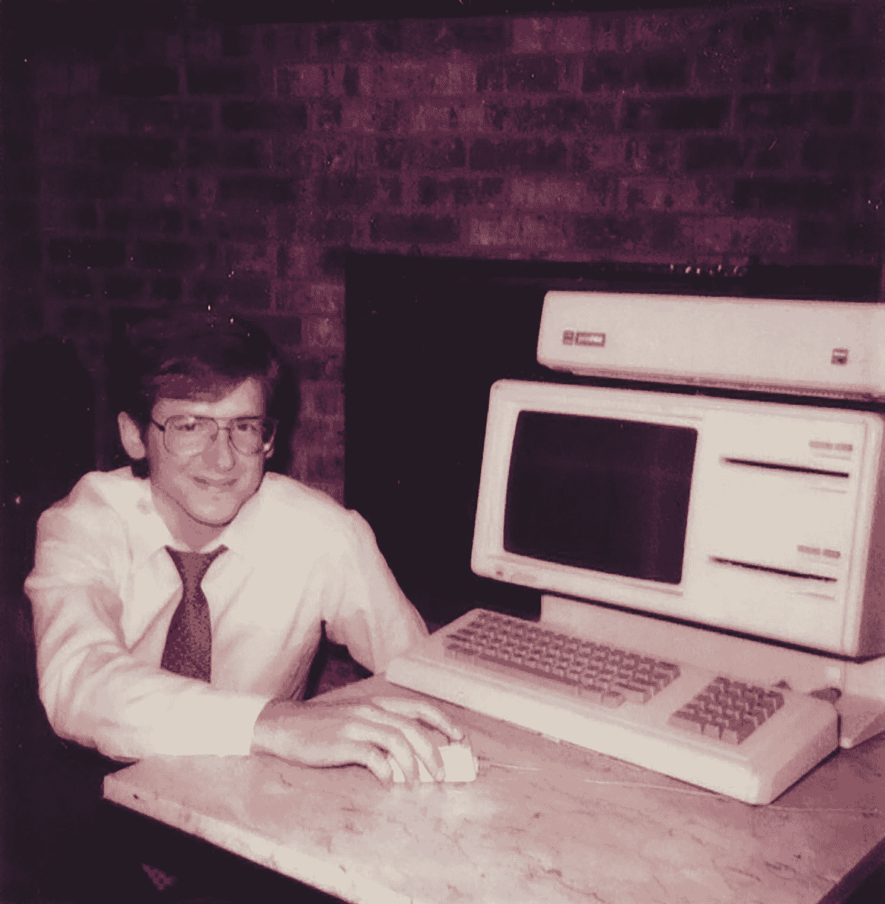

持有 `Apple Lisa` 电脑的 Gordon Walton，1981 年

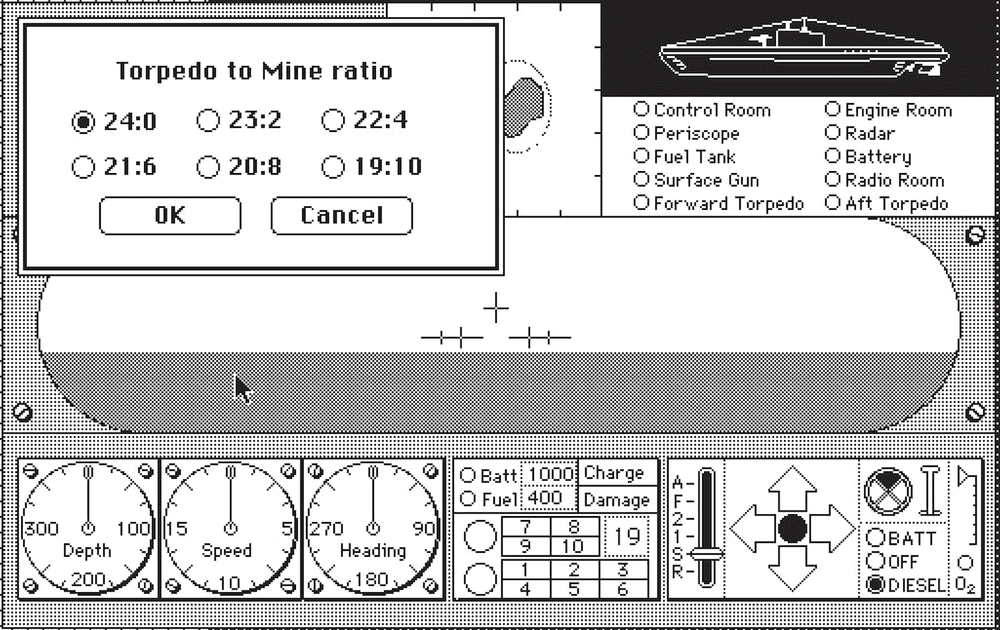

`GATO`，`Spectrum HoloByte`，1985 年

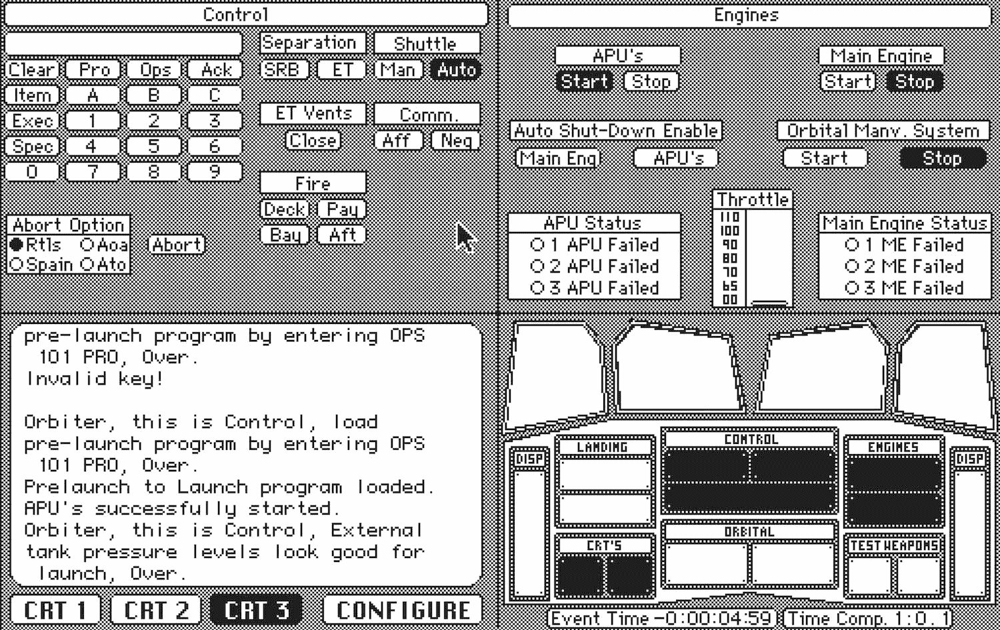

`Orbiter`，`Spectrum HoloByte`，1986 年

现在，当考虑制作雅达达后的第一个游戏时，他考虑了冷战的政治气候。4 月下旬，他给他的经纪人写了一封信，描述了他对名为《军备竞赛》（`Arms Race`）的游戏的愿景。它将涉及大国——美国（`USA`）和苏联（`USSR`）——及其众多小盟友之间复杂的政治义务网络和琐碎斗争。目标是防止核战争。几天之内，他决定将这款游戏作为他的下一个项目，并开始进行更深入的研究。他阅读了能找到的每一关于世界事务的书籍，并思考了信誉、理想主义、自信、可靠性、道德领导力和决心等问题。逐渐，一个设计浮然而出。

信誉度变成了一个关键元素：如果苏联援助一个受美国支持国家的叛乱分子，而美国反应缓慢，其他国家就会对美国失去信心。如果他们的信任水平足够低，他们可能会倒戈。他想出一份包含十四个动词的列表——玩家可以采取的——他最终使用了其中八个。它们涉及干预、威胁、建立或打破外交关系、军事和经济援助、防御条约以及向叛乱分子提供武器。他还添加了一个句子生成器来修饰对事件的描述，使其读起来像报纸头条。

6 月，他开始给自己写文章以整理思路。到 7 月，他为出版商准备了一份正式的十四页提案。它仍能看出最初的愿景，但更加聚焦，并且较少关注涉及小盟友的琐碎斗争。他将游戏的宗旨总结为“试图证明具有良好意图的好人如何让自己陷入一种无法避免战争的境地”。

8 月，他的 `Lisa` 终于送到了，他开始编写游戏。他从游戏地图开始——那是对现实世界的复杂表述。他首先在网格纸上手绘了一张地图，然后沿着网格线重新绘制，然后刻苦地将其缩放到合适的尺寸——大约二十四张网格纸。完成这一步后，他输入了坐标来定义每个国家的边界。

四个月后，他完成了大部分游戏，但仍然没有出版商。面对即将到来的破产，他准备收尾并在新年放弃该项目。但他的朋友吉姆·沃伦（Jim Warren），《电脑纪实》（`Computer Chronicles`）前两季主持人、《西岸博览》（`West Coast Faire`）联合创始人，鼓励他坚持下去。

重新充满活力的他，获得了一个改变游戏的设计突破。为了防止大国推行荒唐政策——例如美国入侵德国或苏联入侵墨西哥——他增加了危机升级等级。防御准备状态（DEFCON）：这是美国武装部队用于准备核战争的渐进警报系统。如果游戏达到 `DEFCON 1`——意味着冲突即将发生的最高级别——那么玩家将失败。

Crawford 根据他们的反馈对设计进行了进一步调整，并将其更名为 `Balance of Power`（权力平衡），该游戏于 1985 年 10 月发布。

在《计算机游戏世界》杂志中，评论员弗兰克·博斯曼称其为“史上最具创新的计算机游戏之一”。《Byte》杂志作家埃兹拉·沙普罗写道，“这是我在任何计算机上见过的最好的游戏”。

`Balance of Power` 成为许多人接触地缘政治的入门。它让普通人了解世界是如何运作的，并且在多个计算机平台发布并赚取数十万利润的过程中，它在行业内留下了长期印记。最重要的是，它证明了严肃题材和复杂规则的游戏是可以成功的（无论是从艺术还是财务角度）。视频游戏可以具有内涵。它们可以是艺术。

Crawford 通过他的下一款由 Mindscape 出版的游戏进一步推动了这一理念。`Trust and Betrayal: The Legacy of Siboot`（信任与背叛：西布特的遗产）与众不同。这是一款关于人与人互动——即与其他角色对话——的游戏。

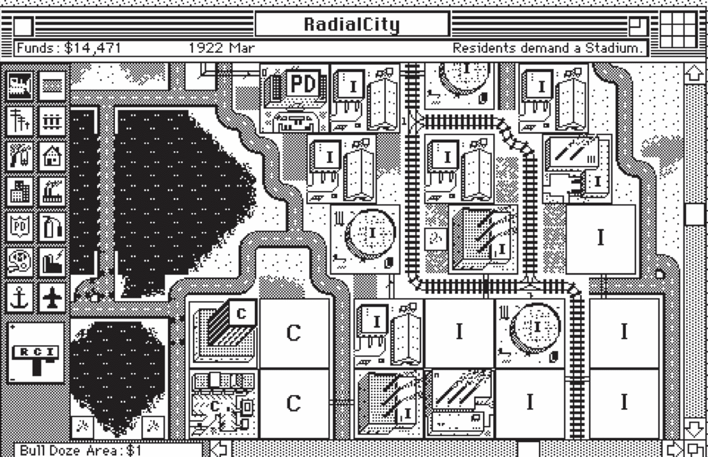

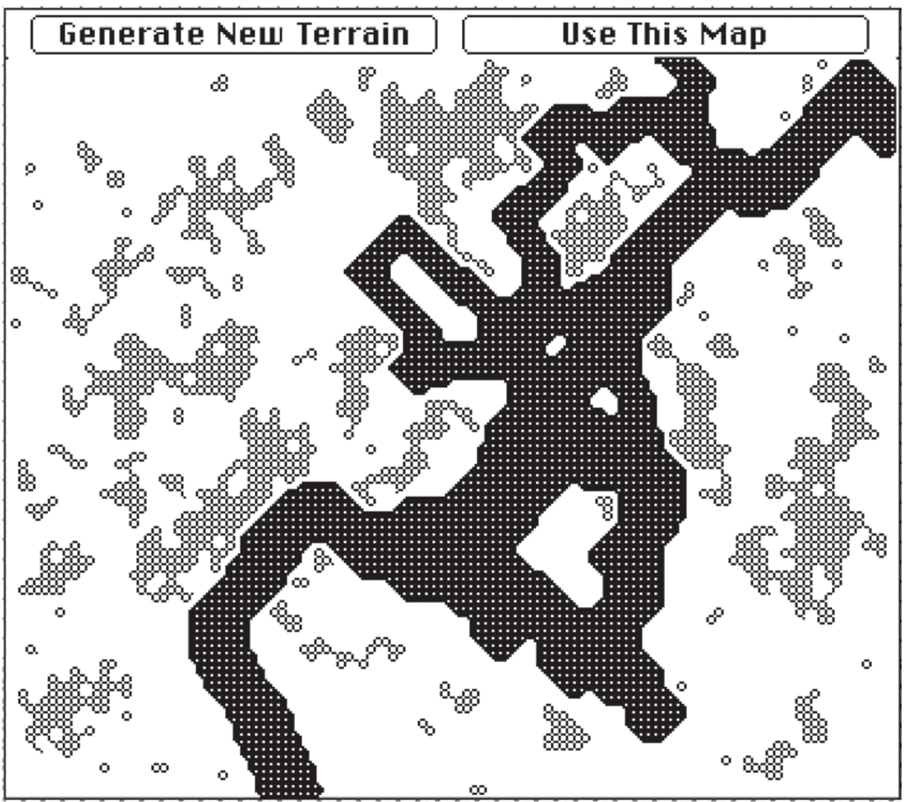

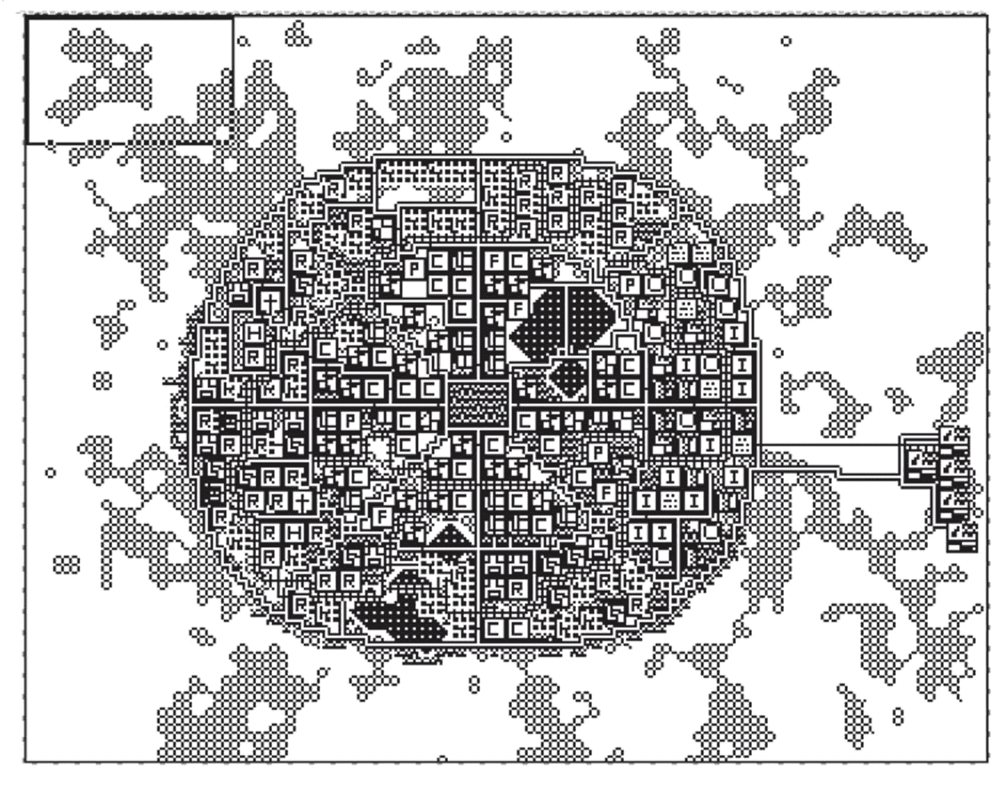

### SimCity, Maxis, 1989

他创作这款游戏的灵感来自他的猫 Bootsie 的死亡。Bootsie 在 1985 年圣诞夜在他一次常规为期一周的离开后回到家中，下颚严重骨折。Crawford 急忙带它去看兽医，兽医将其转给了一位专门研究此类损伤的同事，但那里有一个多小时的车程。在开车途中，Crawford 思考了各种可能的情况，并在向可怜的 Bootsie 解释情况时忍住泪水。结果，专家也无能为力；`Bootsie` 的伤势太严重了……不得不处死。

几周后，Crawford 坐在车里脑中中出了一个念头：如果我们能和动物对话怎么办？在这些糟糕的情况下向它们解释并安慰它们。他能创造出这样一个世界吗？

他知道自己不能使用自然语言，因为研究人员多年一直在大型强大的计算机上解决这个问题，但进展甚微。相反，他花费了几月时间苦苦发明自己的语言——这种语言要提供一个典型人物词汇表中定义清晰且明显的子集，并能够基于他为 `Balance of Power` 设计的句子生成器进行构建。有一天在走过机场时，他想到了答案：图标。后来，他还想到了信息经济的概念——即共享和隐藏的知识。

`Siboot`（名字源于 `Bootsie` 音节的倒置）变成了一个关于合作与欺骗的游戏，基于简单的基于图标的语言进行互动。玩家必须从这些对话互动中收集的信息，是其他角色拥有的三种类型“光环”（aura）的量。通过获得这些知识，她可以预测他们在石头剪刀布式的“梦境战斗”中会出哪种 `aura`。然后，通过这种直觉和逻辑的过程，她可以朝着拥有三种类型 `aura` 的最终目标努力。

角色具有性格和情感。他们对他人所说、所做的事做出行动和反应。`Siboot` 在某种意义上是一种人际关系模拟器，它是首个围绕情感角色互动（而非预设响应）构建的游戏。该游戏于 1987 年（独占）于 `Mac` 发布，其底层设计领先其他所有产品光年，Crawford 后将其描述为他最自豪的成就。

尽管有这些创新，`Siboot` 是一场商业上的失败。它只卖了五千份。

### THE SEVENTH SALLY

1985 年，在街对面邻居专业城市规划师布鲁斯·乔夫（Bruce Joffe）的建议下，威尔·莱特（Will Wright）开始扩展他在流行的 `Commodore 64` 直升机游戏 `Raid on Bungeling Bay`（突袭邦格林湾）中创建和编辑背景图形的程序。这个编辑程序可以逐格地用水、陆地、海岸、道路、建筑等绘制游戏区域，莱特和乔夫发现，仅仅用它创建城市就很有趣。

莱特广泛阅读了城市规划和计算机建模理论，并将这些想法整合到他在瓦片编辑器之上的模拟系统中。特别是他被 `MIT` 教授杰·福雷斯特（Jay Forrester）的作品所吸引，后者构思了系统动力理论——该理论展示了复杂系统如何通过多个相互依赖的内部反馈回路演变。他将其称为 `Micropolis`，成为了一个城市建设和管理模拟器，拥有发电厂、道路、铁路、警察和消防部门，以及三种分区：住宅、工业和商业。

在开发期间的某一点，他耗尽了 `Commodore 64` 的内存，切换到了更强大的 `Macintosh`。（出于实用而非理想主义，他当时的青少年邻居米克·福利解释道：`DOS` 市场份额很大，但图形很差且没有用户界面支持，而 `Amiga` 和 `Atari ST` 没有市场份额。）在这里他继续改进底层模拟，利用 `Mac` 更强大的动力。更重要的是，他重构了界面。

在 `Commodore 64` 上，`Micropolis` 是一个全屏游戏，完全用键盘控制，其工具栏位于屏幕底部。在 `Mac` 上，它变成了一个带有鼠标控制的窗口应用程序、一个受 `MacPaint` 启发的工具面板和菜单系统，以及一个用于小地图的独立窗口。它本质上是一个交互式绘画程序——一个用于城市建设的 `MacPaint`。当玩家在画布上绘制城市时，它的人口会随之起伏，视觉外观会在她眼前演变。它的道路会随着交通变得活跃，最繁忙的地区会有直升机巡逻，它的居民会建造（有时也会遗弃）房屋和商店。

游戏的底层是对游戏运作方式的粗略模拟。增长与不同区域的吸引力挂钩，这种吸引力源于与其他区域的邻近距离（人们不喜欢住离工业区太近，也不喜欢长时间通勤）。它通过捷径来绕过技术的限制。例如，一个城市可能需要多个发电厂来满足电力需求，但实际上只需要一个工厂需要连接到电网。警察和消防站只需要相邻的一格道路或铁路即可运行。模拟中的大多数过程也有延迟——即恰姆·金戈尔德（Chaim Gingold）所某种活动节奏。

很少玩家注意到这一点。1989 年发布时更名为 `SimCity`，它像以前任何游戏那样捕捉了公众的想象。每个人都知道它是什么，即使他们不玩视频游戏。威尔·莱特成了一个小名人，因发明了这种新的模拟类型而被誉为天才。他和他在 `Maxis` 的同事以此为基础，创建了整个“Sim”系列——`SimEarth`、`SimAnt`、`SimLife`、`SimCity 2000`（均在 `Mac` 上开发但跨平台发布）、`SimFarm` 以及许多许多游戏——影响了整个行业。

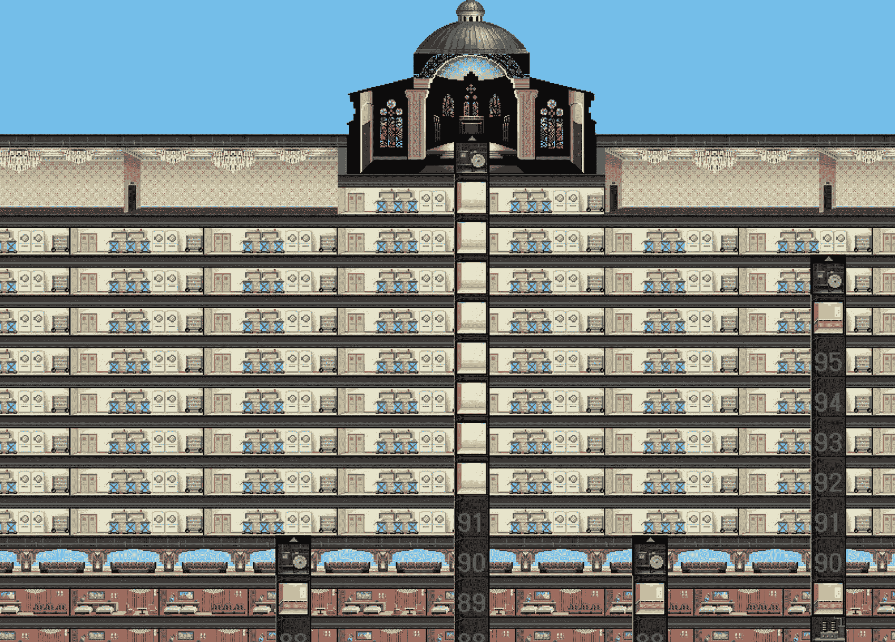

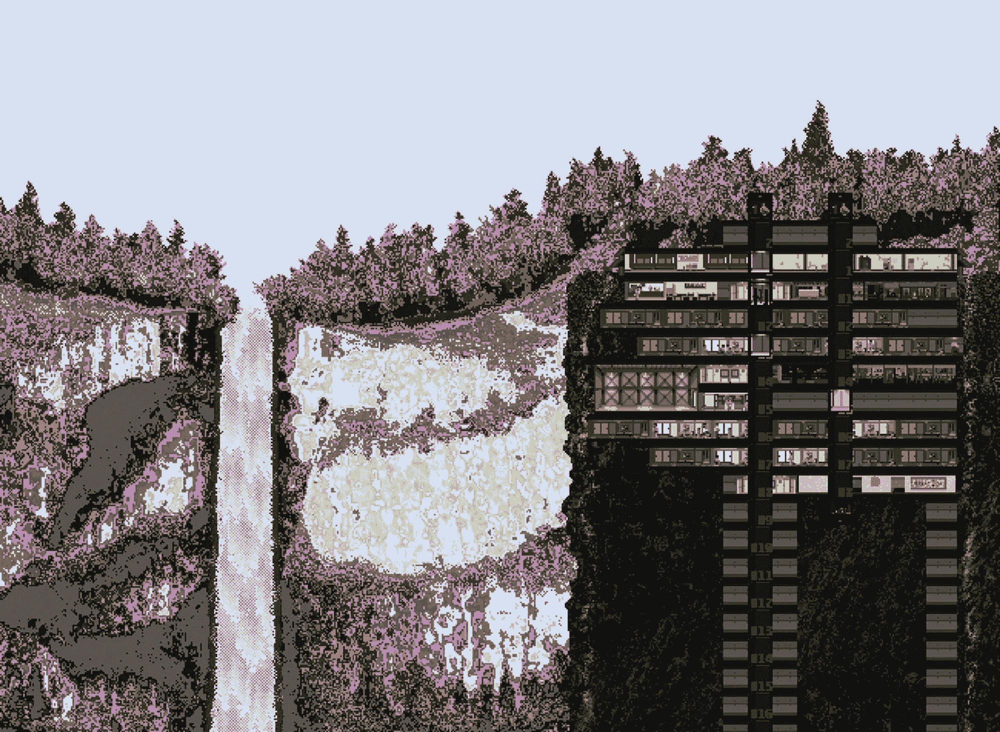

`Yoot Tower`，Sega，1998 年

《模拟城市》（SimCity）对日本 Macintosh 爱好者斋藤裕（Yutaka ‘Yoot’ Saito）产生了特别大的影响。他觉得在玩《模拟城市》之前玩过的天堂机游戏更适合孩子。那些游戏拥有明亮、色彩丰富的画面和动画，以及可爱的合成音，而且节奏通常很快。它们在精致程度上的缺失通过响亮的程度来弥补——即通过疯狂的按键点击和屏幕上大量的动作。《模拟城市》看起来则完全不同。它在视觉上非常静态，甚至不是彩色的显示的。

但斋藤认为它非常聪明。在它简单的画面中，他可以想象出城市周围丰富且多彩的场景。“我几乎有二十四小时没有离开过 Macintosh，”他回忆道，“我非常钦佩创造这个天才又疯狂软件的人。”《模拟城市》拥有一种与 Mac 本身无相似的气质。斋藤在 Mac 发布后不久就被其革命性的氛围所吸引了。当时苹果在日本的地位非常不足道，`NEC PC-98` 和 `MSX` 等日本电脑占据主导地位，但随着通过广告和杂志文章了解更多关于 Mac 的信息，他变得着迷。它对他来说像是一种富有魅力的反文化，一种属于他那代人的摇滚乐。他极切渴望成为其中的一份。

但这似乎那么遥不可及——几乎无法实现。无论是繁荣的在线 Mac 共享软件界，还是苹果团队，以及所有顶尖开发者出现在 Mac 世界博览（Macworld Expo）的兴奋现场，都是无法接触的。日本几本以 Mac 为中心的杂志和一个在东京的小型（但正在增长的）Mac 世界博览，但由于在线访问有限，它与 Macintosh 世界其他地方的动态非常脱节。

为了致敬《模拟城市》的卓越，斋藤决定为 Mac 制作他自己的模拟游戏。他没有要求玩家规划和管理一个城市，而是选择了一栋摩天大楼。

《大楼》（The Tower）拥有与《模拟城市》类似的界面，将住宅区变成了公寓和酒店套房；将商业区变成了办公室、餐厅和商店；将工业区变成了停车场、医疗中心、家务和洗衣设施、回收利用设施等。它用楼梯、自动扶梯和电梯取代了道路和轨道。目标是建造一座五星级级的百层大楼。为了实现这一目标，玩家需要将时间分配在扩展大楼、管理电梯流量和容量、监控租户的幸福度（随着幸福度降低，他们的剪影会变得越来越红），以及处理业务事务（如员工人数以及房间、办公室或公寓的成本）。

《大楼》开发了大约三时间。它于 1994 年在日本 Mac 上发布。“它变成了一种现象，”斋藤说，“我在电视节目和一些杂志上被介绍过。”他还收到了多次将游戏改编到主机机市场的报价。不久后，斋藤收到了《模拟城市》发行商 Maxis 总裁杰夫·布朗（Jeff Braun）的消息，威尔·莱特（Will Wright）告诉他他的游戏“很有趣”。Maxis 签署了国际发行权协议，并以 `SimTower` 的名称重新发布。它的国际成功并没有赶上日本发行版的名气规模，但《SimTower》仍然成了一本畅销书和青青睐。

斋藤的工作室 `OPeNBooK` 在 1996 年与 `9003 Inc.` 合并更名为 `OPeNBooK9003`，后者开发了一款名为 `Aquazone` 的流行的 Mac 专用交互屏保程序。这把电脑屏幕变成了一个虚拟鱼缸。鱼从很小开始，随着用户的投喂而生长和变化。屏保程序的核心是对鱼类生命周期和水下动力学的真实仿真。（侧记备注：屏保程序在 Mac 上是一门大门生意。特别是 Berkeley Systems 的 `After Dark` 套件，以 `Flying Toasters` 屏保最为闻名，经常登顶软件销售排行榜，在某些版本中它甚至包含几个屏保游戏，例如 Ben Haller 流行的 `Lunatic Fringe` —— 一款《小行星》风格的太空战斗游戏。）

有一天午餐时，当《大楼》和《Aquazone》团队分别开发续集时，斋藤对几位年轻的开发者评论说，他认为近二十人的 `Aquazone` 团队花费这么多金钱和时间研究真鱼是荒谬的。`Aquazone` 是面向普通大众的软件。它不需要那么真实。

“我说我会做一些不同的东西，比如一只会说话的鱼从鱼缸里观察用户，并询问他们进行了什么样的活动，或者他昨晚带进来的女孩的名字之类的，”斋藤回忆道。这会将鱼重塑为观察者。它会观察并听用户的，而不是反过来。

“我会把那个软件命名为‘海人’（Seaman），因为它是人类版的‘水生猴’。”

由于无法忘记这个主意，几周后他开始勾勒那种人类/水生猴混合体宠物可能长什么样。大约十八个月月后，在《大楼 II》（国际发行名为 `Yoot Tower`）开发完成后，斋藤搬到了加利福尼亚州的伯克利，开始构建他的“海人”想法。

他雇了几个人在伯克利与他一起工作。他们合作得不好，进展也不特别快，因为斋藤作为经理感到不自在，必须不断地在日本和美国之间往返。但一段时间后，他们有了“海人”的工作原型。然后，世嘉的副总裁入间昭一郎（Shoichiro Irimajiri）打了电话，邀请斋藤吃寿司晚餐。“我同意了，并带着我的 `Macintosh` 笔记本电脑去旧金山市中心向他展示了这个原型，”斋藤回忆道。

“这个原型显然有一个点，就是它看起来非常奇怪。它[还没有]语音识别，但它确实会说话——用我的声音，因为它是原型。”

入间的反应非常热烈，至少可以这么说。他大喊道：“那太糟糕了！太糟糕了！”斋藤认为这是“海人”可以商业成功的信号。在入间的建议下，他将开发转向了世嘉即将推出的游戏机。斋藤将继续为 Mac 开发另一款游戏。

## 他们现在在哪里？


Sean Hill 在 20 世纪 90 年代运营了自己的即兴剧场十年，然后回到技术行业。他现在是用户体验设计师、研究员和教师。威尔·莱特 2009 年离开 Maxis。他继续设计游戏、软件和机器人。斋藤裕仍在运营他创立开发“海人”的公司 `Vivarium, Inc.`。他为 `iOS` 和任天堂掌机制作游戏和应用。Chris Crawford 在 1992 年离开了游戏行业，追求一个掌握真正交互的、戏剧性的叙事秘密的龙。他还没有放弃，尽管他现在怀疑自己不会是那个胜过的人。

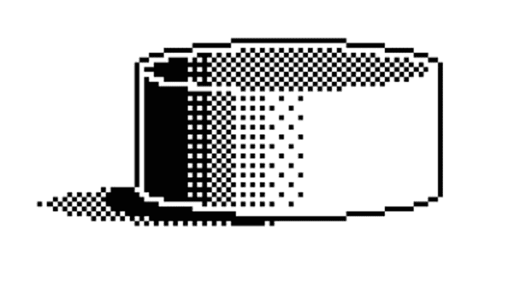

Puck, Shufflepuck Café, 1988

# 06 MACINTOSH ARCADE

20 世纪 80 年代和 90 年代的 Mac 游戏并非模拟和冒险。远非如此。许多游戏更多源于游乐场和视频游戏厅的遗产，而不是战争游戏和现实工作。事实上，早期最流行的 Mac 游戏之一《上海》（Shanghai）是由布罗迪·洛克德（Brodie Lockard）创作的一种类对牌类/麻将游戏，由 Activision 发行。洛克德是一个四瘫患者和前校队体操运动员，他在蹦床上折断了脖子，并设计这款游戏作为治疗。他之前曾在 1981 年为广泛分布的 `PLATO` 系统开发过类似的游戏。1984 年 12 月 24 日晚上，他向 Activision 的娱乐软件监布拉德·弗雷格（Brad Fregger）展示了他的新 Mac 版本的原型。

Fregger 喜欢这款游戏，但对其商业可行性并不深信，于是他把游戏拿走自己玩。他让妻子也试了一下。他的妻子通常讨厌电脑游戏，但在清晨五点，他醒来时发现她不在了。她从没有回卧室。当他喊她时，她回答说自己只想“再玩一局”。他的朋友 Sam Nelson、Sam Nelson 的妻子以及他部门的工程经理也都对此痴迷了。在那时，Fregger 知道他们拥有了一些特别的东西。Lockard 很快与 Activision 签了合同。

## 上海

《上海》这款游戏涉及 144 块麻将牌，排列成一个龙形的金字塔。目标是通过寻找面部相同的“空闲”牌对来移除所有 144 块牌。当一块牌完全被翻开并能够自由地向左或向右滑动时，它被定义为“空闲”。这些简单的核心规则掩盖了游戏的深度，这款游戏通过其系列续作俘获了数百万的心。

在全平台售出 500,000 份的过程中，这款首款《上海》获得了`MacUser 最佳新娱乐节目`、`Macazine 1988 年度游戏`、`Macworld 游戏名人堂`、`软件出版商协会卓越软件奖`，以及紧随 Mac 版之后不久推出的 Amiga 版本所获得的不少于五项的殊誉。

Fregger 在《上海》之后不久就离开了 Activision，与 Lockard 以及程序员 Michael Sandige（他曾为 PC 制作过《上海》）一起制作了一个纸牌类游戏。这款游戏《Solitaire Royale》包含了 11 种纸牌牌变体（其中三种是为儿童设计的）、数字化洗牌音效以及奖励获胜玩家的烟花表演。

## Linedriver 与石道（Ishidō）

大约此时，Fregger 收到了一款受《电子战幻》（Tron）中光轮大战场景启发的名为《Linedriver》的游戏，这来自青少年程序员 Ian Gilman 之手。他遍了 Apple 游戏开发者计划中列出的每一个游戏发行商并向他们推销了《Linedriver》。每个人都拒绝了，但令他“极其印象”的 Fregger 回信并给出了关于如何改进游戏的建议。

几年后，当 Fregger 批准了设计师 Michael Feinberg 设计的一款电脑纸牌桌游并需要一名程序员时，他想起了 Gilman。发行商 `Epyx` 并不太喜欢将任务交给一个距离 1000 多公里外、住在西雅图附近贝恩布里奇岛的十七岁小孩子——尤其是在其至关重要的圣诞季节的主打产品上。然而，在 Gilman 在旧金山与他们的技术人员通过面试后，他们同意了。

“我得到了一份包含里程碑的时间表，Brad 重复强调发行商仍然很紧张，所以我保持进度进度至关重要，”Gilman 回忆道，“我想我有一个月的时间来交付第一个可运行的[游戏版本]。我只是埋头苦干地把它完成了。一周后，我给 Brad 打了电话告诉他我完成了第一个可运行的版本。在他平复震惊后，他说：‘太棒了，但我们几周内不要告诉发行商；我们不想让他们产生错误的预期。’”

《石道》在一个由 96 个方格和 72 颗棋子组成的棋盘上玩。每颗棋子都是六种颜色之一，并印有六种符号之一。每种类型有两个颗。目标是将所有 72 颗棋子放在棋盘上，且没有任何一颗棋子与其相同颜色或符号的棋子相邻。棋盘具有自定义图形，并通过他们称为`神谕（Oracle）`的系统融入了中国古代典籍《易经》。当你开始游戏时，你会问一个关于爱情、生活、工作等任何方面的开放式问题，”Gilman 说，“当得到一个四向匹配时，`神谕` 就会[根据棋盘的布局]告诉你你的运势。”

在游戏出版之前，Epyx 倒闭了。“我们绝不会在付出了这么多努力后让它就这样终结，”Gilman 说。因此，《石道》的第一版变成了一个装在日式胡桃木滑盒中的手工制作、签名的限量版。他们制造了千份，并通过 Fregger 的公司直接出售，价格每份 295 美元。一年后，Accolade 出版了适用于 Mac 和 PC 的大众版本，这促使《纽约时报》赞誉该游戏为“最引人入胜的”，以及“像围棋一样看似简单但逐渐显现其微妙之处的游戏之一”。

## 重新想象街机游戏

当电脑弹球游戏已经存在多年时，程序员藤贵 Yoshikatsu 和艺术家野岛玲 Nojima 在 1990 年创立了日本公司 `LittleWing`，但在 Mac 上，这类游戏几乎闻所未闻。除了 1986 年将 Bill Budge 畅销的 Apple II 游戏《Pinball Construction Set》转换为 Macintosh 版本外，以及用该程序生成的各种商业和共享软件弹球桌，几乎没有别的——这些那时只能在旧硬件上运行。

“因为我是机械弹球的忠实粉丝，”藤贵 后来告诉 `Inside Mac Games`，“我想看看是否可能以正宗的方式在电脑上复制它。”在为 `IBM PC` 和 `Unix 工作站` 编写打印机和扫描仪驱动程序的日常工作之余，他花费了一时间开发这款老式的“固态”弹球游戏——`TRISTAN`。他为虚拟台面设计了一个布局，台面上有几个通道、缓冲器和几个可以瞄准的目标以获得更高分。他编写了一对弹板，精炼了球物理效果，并让他的妻子 Nojima 提供插图。当他们完成后，他们与加拿大公司 `Amtex` 签署了出版协议。

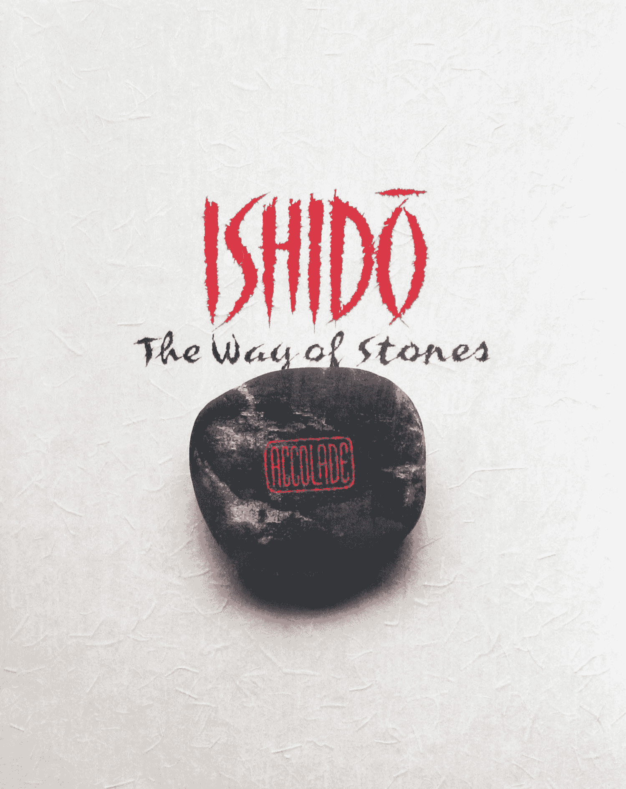

石道：石之路，Accolade, 1990

《TRISTAN》因其正宗性而赞誉——就像把真实的弹球台带到了电脑屏幕上。一些玩家和评论家对包装中缺少额外的台面感到不满，但对于记者 Steven Levy 来说，这正是魅力的一部分。“它让我们想起那些经常去有弹球机的糖果店的日子，”他在 `Macworld 游戏名人堂` 的文中写道。

LittleWing 再次与 `Amtex` 合作开发了 1993 年来自 Bally Midway 的真实街机弹球机数字化版本《Eight Ball Deluxe》。这款游戏也获得了奖项并畅销，尽管未达到他们后续作品《Crystal Calburn》的程度，后者被设计成像 80 年代的弹球机。他们采用了那个时代的传统——扭曲的轨道、快速移动的球、强力的弹板、响亮的数字声音和三球游戏——并应用了根自亚瑟传奇的主题。

他们原本打算让 `TRISTAN` 变得简单，但《Crystal Calburn》的设计是为了增加难度。要在没有“游戏结束”的情况下持续很久，更不用获得高分，需要精确的瞄准和对桌面微妙之处的仔细研究。这种策略元素引起了玩家和评论家的共鸣。《华盛顿邮报》的一篇文章指出，《Crystal Calburn》“将 Macintosh 变成了一台真实的弹球机，以至于可能因为倾斜而受到处罚。”《电脑游戏评论》说它“立了新标准”。

这对夫妇在次年通过《Loony Labyrinth》进一步巩固了他们的声誉，这是一个比《Crystal Calurn》更难的电脑弹球游戏。但当这两款游戏的发行商 `StarPlay Productions` 转型弹球游戏时，他们淡出了大多数玩家的视线。（然而，他们继续制作出色的弹球游戏，他们的硬核粉丝支撑他们维持了几年，直到 1998 年开始从自己的网站直接销售游戏。）

就像 LittleWing 凭借 80 年代风格的弹球游戏成名一样，Roy Harvey 在 1985 年尝试利用 1981 年街机游戏《Tempest》的设计理念。他和来自密歇根大学的三个朋友在 1984 年初通宵彻守以获得他们的 Mac，随后创立了大学的 Mac 用户组。

他们于 1985 年初辍学，怀着制作电脑电影的梦想。他们将公司命名为 `Ann Arbor Softworks`，以他们大学所在的城市命名。但为了制作电脑电影，他们意识到需要一些工具。“于是我们写了这样一个名为 `Animation Toolkit` 的东西，”哈维回忆道，“但接着我们就快没钱了。”他们再次陷入了困境：“我们心想，‘最好做点什么事来付账单’，于是我们决定做一些游戏。”

### 《Grid Wars》的起源

首先出现的是关于《Tempest》的创意。哈维在 20 世纪 70 年代后期和 80 年代初，曾花费数百美元的投币硬币在街机厅玩街机。《Tempest》是他最喜欢的游戏。它基于矢量的图形和 3D 下场透视角带来了巨大的冲击，但他也热爱它快节奏且具有策略性的动作性。为了获得高分，玩家必须在游戏场近端跨跑道间来回穿梭，精准定时射击，以摧毁在跑道上胡乱旋转并袭而来的敌人。他在《Grid Wars》中的想法是将其重新包装成一种更像益智游戏的形式。

艺术家弗雷·齐恩（Fred Zinn）建议他们围绕一个受《星球大战》酒吧启发的故事来包装这个受《Tempest》启发的益智谜题。“你会以陌生人的身份进入`[Alphie’s Bar]`，”哈维回忆道，“而成年礼之一就是玩这个游戏。”情节设定是：“你刚刚完成了人生中最惊心动魄的香料运输任务”，你真的需要喝一杯，但首先你必须击败在 `Grid Wars` 机器人战场上的全部五个挑战者。这个桌面战场由网格组成，上面满了 `Grid Walkers`（网格行者）——一种在桌子上缓慢扩张的形状，以及 `Grid Nasties`（网格恶棍）——即对盾牌和玩家激光炮进行自杀式攻击的小害虫。游戏的目标是摧毁 `Grid Walkers` 并避开 `Grid Nasties`。

《Grid Wars》并没有解决他们的财务问题。“我们意识到，如果你想赚钱，就去开发一些办公生产力软件，”哈维回忆道，“于是我们做了 `FullPaint` 和 `FullWrite`，它们是 `MacPaint` 和 `MacWrite` 的仿制品。它们看起来就像是高级版本。”

### Mac 转型

两年后，著名的 Apple II 出版商 `Brøderbund` 对 `Mac` 市场发起了强有力的进攻。在 Mac 早期，他们对几个 Apple II 游戏进行了 Mac 增强转换——最著名的《Lode Runner》（夺路者）和《Ancient Art of War》（战争古事），但还没有针对 Mac 的原创作品。巧合的是，他们的第一个 Mac 原创作品，呈现了与《Grid Wars》几乎完全相同的背景太空空格键/酒吧的情节设定。

克里斯托弗·格罗斯（Christopher Gross）在开始开始制作 `Shufflepuck` 之前，已经向一本“磁盘杂志”（一种刊登在软磁盘上的杂志，包含一些独家专有程序）售卖了几款小游戏。其中一款名为 `3D Tic Tac Toe`（三维井字棋），将经典的井字棋（noughts and crosses）扩展到了三维空间。它三个堆叠的三三三网格使得获胜和失败的方式更多（每个堆叠的水平方向，外加垂直穿过三个堆叠），因此游戏变成了要比对手获得更多组三连线。另一款 `Closure` 将同样的原理应用到跳跳棋（`Reversi/Othello`）游戏中。这两款游戏都是直接在屏幕上绘制图形的。`Shufflepuck` 是他对一种复杂动画的实验，他在 `MacTutor` 中读到过，这种技术涉及在屏幕外绘制变化，然后在屏幕刷新时快速将它们复制进来。他住在一个著名的滑冰板球俱乐部附近，所以他想用一个圆片动画来测试这个概念。

然后，他拿了那个圆片动画并开始围绕它构建一个游戏，但使用鼠标模拟滑冰板球的推杆动作缺乏足够的分量感。然而，他注意到圆片从球场末端反弹时就像在气球桌一样。`Shufflepuck` 就此变成了一个气球桌模拟器。他为圆片、玩家的手板和电脑控制的对手创建了一系列属性，并使这些属性在菜单中可调节。这样玩家就可以定义自己的挑战等级。

### 《Shufflepuck Café》的诞生

格罗斯像往常一样把游戏寄给了杂志。然而，他认为这比他之前的游戏好，因此也将其提交给了几家游戏出版商。杂志给他的报酬大约是他之前游戏报酬的两倍——尽管仍处于四位数。但此时的 `Brøderbund` 作为全球最大的家用电脑游戏出版商之一也感兴趣。

`Brøderbund` 的设计师吉恩·波特伍（Gene Portwood）和劳伦·埃利特（Lauren Elliott）被 `Shufflepuck` 的演示深深吸引。他们对它如何作为商业游戏运作有了愿景。波特伍和埃利特都是《记忆大亨》（Carmen Sandiego）系列游戏的核心人物，但他们受到该系列教育倾向的限制，因此他们将 `Shufflepuck` 视为一个尝试和一些不同事物的机会。

在 `Brøderbund` 的指导下，`Shufflepuck` 变成了 `Shufflepuck Café`。它发生在一个受《星球大战》和《卡萨布兰卡》启发的地下酒吧——一个喧闹的聚场所，聚集着一群奇特多样的外星种族，他们都对气球桌充满热情。除了一个似乎会在黑板上画分的机器人手臂外，波特伍和埃利特创建了所有的角色。

他们制作了 `Lexan`，一个醉酒的蜥蜴，会在回合之间啜口马提尼，并随着比赛的进行表现得越来越差。瘦削的人类 `Skip` 模仿了年轻的伍迪·艾伦——在开发早期更多是这样，后来是出于法律考虑。`Eneg`（“将军”）并不是他表面上那样的星际革命者。`Bejin 公主`拥有独特的精神力量，让她可以在不移动手板的情况下发球；而性格温和的物理系研究生 `Vinnie` 则可以精确地放置射击。机器人对手是一个极好的练习伙伴，特别是考虑到他的自定义设置复制了原始 `Shufflepuck` 演示中的大部分菜单。

所有角色的游戏风格都是与众不同的，这是格罗斯根据波特伍和埃利特对他们性格的描述创作的。“我一直怀疑至少有些角色是基于他们认识的人，”格罗斯说，“但直到游戏发布后有时，我才真正见到吉恩或劳伦。”

`Biff` 讨厌输掉但傲慢自大，因此当他落后时他的技能会提高，在平局时恢复正常，并随着领先优势的扩大而逐渐下降。`Nerual` 的性格被描述为“反映你自己的性格；你真的是在和自己玩，”所以格罗斯让他的射击变成了玩家动作的完美直接反映——正如他们击球的方式一样。

奇特的、手绘的角色由时尚、线条简洁的标题界面支持，这在画面淡入拥挤内部的昏暗忙碌场景之前为游戏增添了格调。钢琴爵士乐调和嘈杂酒吧的声音录音让实际上是散布在场景周围的 Shufflepuck 玩家图像活了过来——他们都在注视着新来，从电脑显示器中回望。吉恩·波特伍曾想过使用《卡萨布兰卡》中酒吧的扫描图作为比赛背景，但由于许可或技术限制，从未能实现这一点。

`Shufflepuck Café` 于 1988 年在 Mac 上推出，首批印刷量为 10,000 份。尽管在第一批盒子还没上架之前，泄露的“调试”版本就已经流传，但其最终销量仍是该数字的两倍。Gross 回忆道：“几年后，我妻子正在南美洲岸边参加一次科学巡游，”，“‘那个调试版本不知怎么就出现在了他们用来控制实验室设备的 Mac 上。’”零售版的盗版也得到了广泛流传。它与官方程序完全相同，唯独不同一点：在这个版本中，贝金公主在服务时会露出其中一只乳房。”

1989 年推出了彩色版本，分别适用于 Amiga、Atari ST、Amstrad CPC 和 DOS 电脑，反响褒贬不一（不支持鼠标的设备玩得很吃力），而任天堂娱乐机版本于 1990 年登陆美国市场。

## 时机决定一切

正如在每个平台上一样，俄罗斯块在 Mac 上也找到了快乐的归宿。它的第一个官方版本于 1988 年推出黑白 Mac 版，随后推出了支持彩色的 Mac 版。之后出现了许多其他版本，包括官方和非官方、传统和三维——如商业作品 `Blockout`、`Wordtris` 和 `Welltris`，以及共享软件游戏 `3Tris`、`Hextris`、`Petris` 和 `Tetris Max`。Steve Chamberlin 的 `Tetris Max` 因丰富的个性化选项而受欢迎，但在俄罗斯块公司（The Tetris Company）发出法律威胁后，他被迫放弃了开发。`Petris` 也因为其提供的双人竞技俄罗斯块模式，或在屏幕另一半部分显示泳装模特照片的单玩家模式而获得了一定的恶名。

最常被认为是 Mac 上提供的最佳俄罗斯块版本并非上述任何一个。它曾以各种名称为人所知，如“Supertris”、“Wesleyan Tetris”、“Asshole Tetris”、“Obnoxious Tetris”、“Wise-Ass Tetris”以及 `Randall Cook’s Tetris` 等多个名称，被许多玩家认为是任何平台（无论 Mac 还是其他）上最好的俄罗斯块版本。它是诡谲、令人兴奋且精妙的。但它从未真正出版过。

Randall Cook 在 1989 年初，也就是大学大二时开始开发这款游戏。他听朋友们对学校游戏厅的一款新游戏赞不绝口，于是抓起块披萨溜过去查看。他很快掌握了机制，这些机制决定了奇形形状方块在落下时如何旋转和移动，以形成一条完整的线并使其消失。Cook 曾为他的 `Mac Plus` 写过许多小程序。这让他认为这是他第一个大项目的完美选择。

他花了一两天时间创建了他自己版本的游戏原型，他认为这个游戏叫“Tetrus”。原型只为碎片画了正方形，且没有音效，但其他功能正常，看起来玩起来和编写起来很有趣。然后他添加了其余碎片类型，并将它们全部重绘为位图图形，添加了关卡、动画和高分表。他还添加了音效——混合了他自己的声音、一位室友的打嗝和响屁、另一位室友的屁声，以及电视电影的采样。


他在 1990 年夏天在华盛顿特区，在那里他在乔治敦之声学生报（Georgetown Voice）的电脑上继续开发这款被他命名为“Supertris”的游戏。他们有一个通过 `AppleTalk` 连接电脑的网络，因此他为游戏添加了网络代码用于竞技多人对战。

到 1992 年初（他大学毕业后的第一个冬天），他准备好将“Supertris”提交给出版商。Spectrum HoloByte、Brøderbund 以及其他都表示它与俄罗斯块太相似了。作为回应，Cook 将游戏重命名为 `Block Block`，并添加了更多碎片类型以及溶解谜题部分的酸滴。现在游戏会欢快地嘲讽和贬低玩家。Cook 的数字化声音会讽刺地评论：“噢我的天！这是我过的最棒的法了！”或“我打赌你觉得你知道怎么玩这个游戏。”对于将碎片向侧移动到位，或者消除出新行，游戏会有真正的赞美；但对于明显的错误，也有诸如“干得好，笨蛋”、“你太烂了”或“我希望你朋友在看着”之类的侮辱。碎片有时会撞上一堵无形的墙并最终漂浮在井的其他部分，或者必须绕过一个会缩小或重塑空间的障碍。有时，一个恰好是玩家需要的奇形碎片会出现，玩家需要保持头脑将其放在恰恰的位置。

Brøderbund 制作人 Alan Weiss 很快提出帮助 Cook 将这个令人烦恼的俄罗斯块版本介绍给任天堂。那个冬天他们飞往西雅图，与任天堂以及制作日本版俄罗斯块的公司 `Bullet Proof Software` 会面。他们决定不出版 Cook 的游戏。他还见到了俄罗斯块的创始人 Alexey Pajitnov，后者建议 Cook 将他的才华投入到更具原创性的游戏中。

“我从来没做过，”Cook 说。他转向了非游戏项目。“因为我过去一年一直在尝试让它出版，所以我要求那些有拷贝的朋友不要到处传。”但那时已经晚了。他的游戏在《乔治敦之声》非常流行，那里的一个早期版本被安装在所有电脑上，并从那里缓慢而坚定地传播开来——最初可能是通过软盘。

这是一场真正的病毒式现象。它会出现在某个 `FTP` 站点或 `Usenet` 群组中，然后突然出现在其他几个地方。它的名声完全通过口口相传传播，起源神秘。最广泛传播的版本甚至没有名字，除了 `Tetris by Randall Cook` 之外，让玩家自己起名。

Mac 专用游戏 `Spin Doctor` 具有类似俄罗斯块的特质。它同样欲罢不能，且同样根于非暴力哲学，其复杂性源于优雅。

Darrell Myers 在 1983 年初就有了 `Spin Doctor` 的想法，在他为 Mac 上款街机游戏 `Ground Zero` 设计图形之前的一多年前。有一天，在 General Computer 公司工作一个月左右，Myers 开着他的 `Dodge Challenger` 回家。“我可能只是踩了油门，看到时速指针上升，同时转速指针似乎以不同的角度和速度移动，”他回忆道。

“我想象了一根针。如果它冲过去抓住另一个东西并挂在上面会怎样？”Myers 职业上是一名艺术家，但他想做的不仅仅是为别人的游戏画画。他立刻意识到这个想法可能是他的机会，并写了一份名为 `Orbis` 的街机游戏提案。玩家通过按下按钮控制游戏，使针（现在称为魔棒）在网格中的点与点之间摆动、反弹或翻转。“你有敌恶的魔棒在追你——就像《吃豆人》或《吃豆人小姐》里的幽灵追你一样，”Myers 解释道。目标是在不被敌方魔棒击中的情况下挂上每一个点。

开发进度已足以进行内部焦点测试，测试结果判定它需要更快且更像射击游戏。他认为那样并不可运作，于是作弃了。不久后，General 停止了街机游戏开发。

Myers 于 1986 年离开公司，开始担任自由职业艺术家和界面设计师。几年后，他获得了一个为名为 Meeting Maker 的程序设计设计的项目。事实证明，他的三位同事——Seth Lipkin、Rob Harris 和 Mike Barta——正在为他们的 Macintosh 软件公司 Callisto Corporation 开发该程序。他们渴望开发并自出版游戏，因此向 Myers 征求主意。

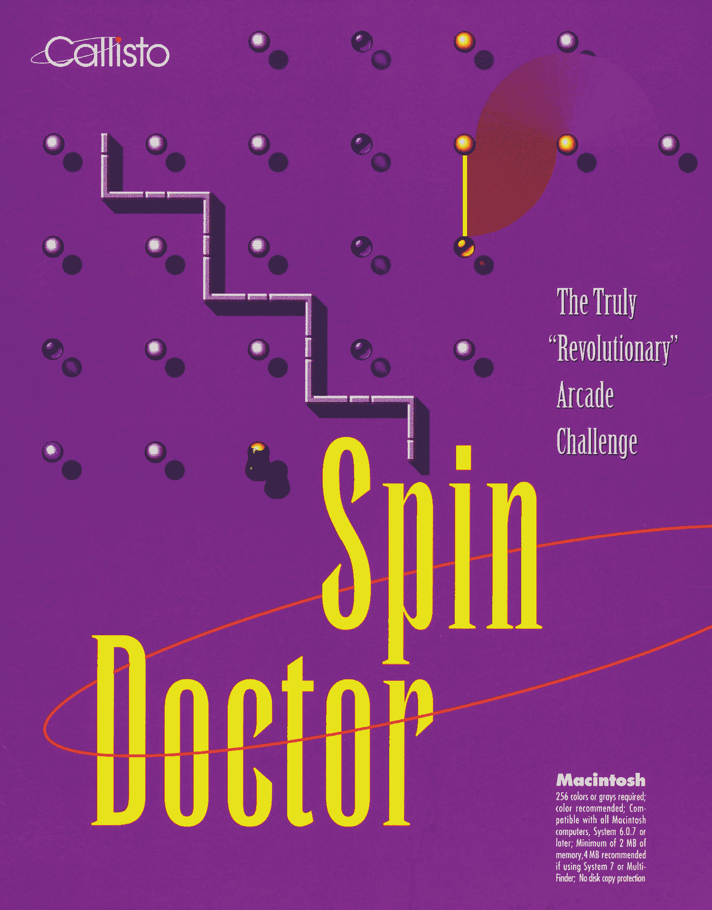

*Spin Doctor, Callisto, 1992*

他复活了他的“Orbis”创意，这次将其变成了一个射击游戏（shoot-em-up）。反转魔棒的方向会朝向自由未连接端所处的任何角度发射子弹。这在纸面上看起来很酷。Callisto 团队在电脑上开发了一个原型，并使用了粗略的替代图形。“有一天，他们给我打电话说：‘你猜怎么着？这并不好玩，’迈尔斯（Myers）说道。他觉得浪费了他们的时间很内疚，但他们要求他根据魔棒在点阵格上旋转和翻转的理念重新想点子。一周后，他说：“如果它是一个障碍赛场呢？”敌人魔棒不会追逐玩家，而是沿着预设的路线移动，因此目标变成了在通往某个目标点的途中避开它们。

“在尝试了一下之后，就很清楚了，这其实挺酷的，”迈尔斯回忆道，“尽管他们当时[还没有]加入任何碰撞检测，只是肉眼观察：‘你是在没有触碰魔棒的情况下通过了吗？’”

松了一口气的，他手画了魔棒的图形——每旋转 360 度大约有三十个位置——以便它们可以制作动画。然后他设计了关卡，或者按照游戏中的说法被称为“架”（racks）。当时是夏天。迈尔斯住在波士顿郊外，剑桥附近。他每天都会乘坐“T”字型通勤铁路系统前往剑桥的哈佛广场，在那里他会坐下来，拿着铅笔和一张预印的点阵格，构思迷宫点子。“我每一一两小时就能做一个迷宫，”他回忆道，“所以我一天可以做三个或四个。”然后他将它们发送给 Callisto，以便程序员可以生成可玩的版本。

过了一段时间后，Callisto 创建了一个关卡开发应用，让迈尔斯可以拖动物体并实时测试他的想法。到开发结束时，他们有了 106 个关卡，每个关卡都针对四个难度进行了调整。

《Spin Doctor》于 1994 年商业上市，并捆绑在约 60 万台 LC（又名 Performa）系列 Mac 上。它赢得了好评，并获得了一批狂热追随者，粉丝们喜爱它就像它是《俄罗斯方块》以来最好的东西一样，但它并没有赚到多少钱——即使在之后它被重新换壳（没有迈尔斯的参与），采用了时钟主题并命名为新标题《ClockWerx》，由 Spectrum HoloByte 在亚历克斯·帕吉特诺夫（Alexey Pajitnov）背书下重新发行。

## 他们现在在哪里？

罗伊·哈维（Roy Harvey）在电子艺工作，在那里管理 Madden NFL 团队。伊恩·吉尔曼（Ian Gilman）自述为自由创作者；他编写代码，主要是针对 Web 项目，有时也做其他事情。达雷尔·迈尔斯（Darrell Myers）经营自己的设计和插画业务。兰德尔·库克（Randall Cook）在 YouTube 的视频基础设施团队工作。他在 2011 年开始复活《Supertris》，目标是最终在现代平台上正式发布它，但他一直没能给它“应得的时间”。


《变异，《黑暗之城堡》，1986

# 07：深入黑暗的城堡

查理·杰克逊（Charlie Jackson）曾梦想为美国国家队参加运动。至于是哪种运动并不太重要，只要他能进入球队即可。这个梦想是在大学期间产生的，当时他的两个划船队友分别进入了不同的美国国家队——一个参加世界大学生运动会，另一个参加世界锦标赛。

杰克逊在足球、田径和赛艇方面都很有专长，但他预见到自己无法在这些领域达到参加国际竞争所需的水平。他必须寻找另一种运动。答案出现在他在美国陆军服役的四年期间。他曾是一名通信官，但也开始从事竞技性步枪和手枪射击。一年之内，他的水平就足够进入陆战队射击队，并在区域和全国锦标赛中代表该队。

退役后，杰克逊继续代表陆战队参加竞技射击。他将时间在经营以技术为中心的企业和在陆战队预备队参赛之间平衡——他后来将这比作是拿钱参加职业高尔夫巡回，因为比赛期间他需要的一切都会被提供。

然而，他在陆战队预备队进行的射击与在奥运会等国际活动中进行的射击不同。为了在另一种风格上达到参加国际竞争的水平，他知道自己必须进行一两年的全职训练。但要做到这一点，他需要更多的钱。

1984 年 1 月，当 Macintosh 正式推出时，杰克逊经营着一家电脑培训业务。他教人们如何使用他们的 Apple II 和 IBM-PC 机器。他是这两个平台的早期采用者，并见证了开始时可用软件是多么稀少。他还看到其他早期采用者是如何渴望为他们那些兴奋又昂贵的新设备购买软件的。只要能给他们理由花更多时间使用电脑，他们几乎会买任何东西。

杰克逊知道这种情况也会发生在 Macintosh 上。一家新的软件公司如果能尽早进入，就能快速成长。但他是一个企业家。一个商人。他不会写代码。为了找到合适的人——那些对 Mac 感到兴奋并知道如何编写程序的人——他登录了一个在线新闻组，并宣布了第一次圣地亚哥 Mac 用户小组会议。他在自己家里举办了这次会议。三十五个人挤在他二楼的办公室里，聊着这台革命性的新个人电脑。会议结束后，一个男人走到杰克逊面前，自豪地介绍了自己。他的儿子乔纳森（Jonathan）曾因为为 Apple II 编写图形编辑器程序获得加州学校科学展览奖。“噢，真的吗，你认为他会对在 Macintosh 上进行编程感兴趣吗？”杰克逊问。他当然会。

埃里克·佐彻尔（Eric Zocher）在会议结束后也留了下来。他是加州大学圣地亚哥分校（UCSD）的一名计算机科学学生。他曾在大学计算中心见过并长时间使用过微机和主机，但佐彻尔从未拥有过自己的个人电脑。他从 1983 年起就兴奋地听过关于 Mac 的传闻，现在他渴望最终尝试。

杰克逊告诉他他想成立一家软件公司。“我是一个程序员！”佐彻尔脱口而出，“我想和你一起工作。”就这样，佐彻尔加入了。

他们很快发现，使用 Apple 官方开发工具在 Macintosh 上进行编程需要一台 Lisa，这增加了数千美元的开销。杰克逊并没有气馁，他拿出了大部分积蓄，买了一台 Lisa，加入了 Apple 开发者计划，并于 1984 年年中创立了 Silicon Beach 软件。随后，他与青少年乔纳森·盖（Jonathan Gay）达成了一项协议。盖不会获得任何预付款，但他将获得他在周末编写的 Macintosh 游戏的销售版税。

杰克逊毫无犹豫地交出了 Lisa 的无限访问权限。他没有进行任何尽职调查，没有编程测试。他相信一切都会向最好的方向发展。

乔纳森·盖证明是一个极其优秀的程序员，查理·杰克逊难以跟上。杰克逊刚给这个青少年一个新任务，任务就完成了。在几周内，他们的游戏开始成形。《borne!》是关于击击袭而来的军事空部队。玩家配备防空炮和安装在轻型工事后的迫击炮，需要移动鼠标调整射击角度，摧毁降落在屏幕上的源源坦克和士兵，并击落飞过上方的战斗机、直升机和运输机。

```text
（按下空格键可以在两种武器之间切换，按下 Command-S 则可以使用鼠标控制防空弹。）
```

不久后，他们开始讨论游戏的启动界面。他们希望有一张图片能够捕捉游戏的氛围并激发玩家的想象力。杰克逊（Jackson）建议画一个戴着贝雷帽的伞兵。那个士兵可以行礼并说：“伞兵报告，长官！”——就像真正的士兵路过官员时做的那样。杰克逊注意到 Apple II 游戏如何使用程序化方形波产生令人惊叹的复杂声音，甚至能模拟人声。他希望 Macintosh 也能这样做。

埃里克·佐彻（Eric Zocher）开始着手。他翻阅了他的 `Inside Macintosh` 手册，发现了一个四通道合成器，可以播放正方波和简单的波形。它可以产生“哔”声、“嘟”声和其他声音，就像当时的其他家用电脑一样。这正是查理·杰克逊所想要的那样。但佐彻不知道如何确定正方波的振幅和频率才能产生听起来像爆炸的声音，更不用说声音了。他想尝试录制一些他想用方形波重建的声音，然后将它们传输到大学的一台微型计算机上，寻找一种通过程序近似与录制声音相应的波形的方法。

然而，随着研究的深入，他意识到 Mac 已经可以播放录制的声音。它有另一个内置音频驱动程序——如果你能设法将样本加载到 Mac 上，它可以一个一个地播放采样数字声音。只是没有人尝试过。

查理·杰克逊曾在加州大学圣地亚哥分校（UCSD）攻读语言学研究生，他在语音实验室有朋友，他们那里正在使用音频数字化设备研究人类声道，并识别人类说话的机制。两人将佐彻的磁带录音带到了实验室。随后，佐彻编写了实用程序来缩小采样率（即每秒携带的音频样本数或快照数），并将位深（或称音频分辨率）从 16 位调整为 8 位。他们使用 300 波特的调制解调调器和声学耦合器将文件传输到 Mac 上，佐彻在那里利用他编写的一个小程序接入音频驱动程序并播放了这些声音。

他们惊得目掉下巴。“这简直太不可思议了，因为从未有人从电脑里听到过那种声音，”佐彻回忆道，“用 Macintosh 小小的扬声器听起来有点金属质感，但 Mac 的扬声器本身并不坏。它是如此忠实，我们以前从未听过这种声音。这基本上是从 Mac 输出的数字音频。我们当时就像：‘天呐，你们可以用这种方式做游戏吗？可以用这种方式制作游戏的音乐和声音吗’”

佐彻为他的 Mac 制作了一个简单的音频波形编辑器，以便他测试和完善各种音效和音乐。作为一个忠诚的音乐迷，他从收藏的 500 张黑胶片专辑中录制了样本。他和杰克逊挑选了他们认为已过版权的唱片，例如 20 世纪 50 年代的交响乐录音和 60 年代初的特效唱片。他们通过试错的过程不断筛选样本——有些声音在 Mac 上听起来不好听，而另一些则太长，或者与游戏动画不匹配。

在扣除由盖（Gay）用汇编语言编写以最高效率的游戏其余部分后，磁盘上留给音频的空间仅剩 16 KB。因此，所有声音都必须非常短，并尽可能地使用循环（例如，一架发出“噗-噗-噗-噗”声的直升机可以存储一个仅为“噗”的样本，然后让游戏重复它）。他们通过这种方式在游戏中加入了十几种声音，佐彻甚至想出了一种通过将它们动态混合成一个信号来同时播放两种声音的方法。

只有一个问题。Mac 的扬声器在每个声音发出之前都会发出响亮的“啪”声。但并非总是如此。他们没有示波器，所以为了弄清楚，佐彻让杰克逊做了一些体力活。使用波形编辑器，杰克逊按住 `shift` 键并点击向声音文件中添加一个字节，再次测试。佐彻记录哪里出现了“啪”声，哪里没有。“我记得有一次他对着计算器说，”杰克逊说，“‘我明白了！音频缓冲区必须是满的。’”Macintosh 的声音发生器会将整个音频缓冲区（直到最后一个字节）转换为音频，并且是以固定的间隔执行此操作。

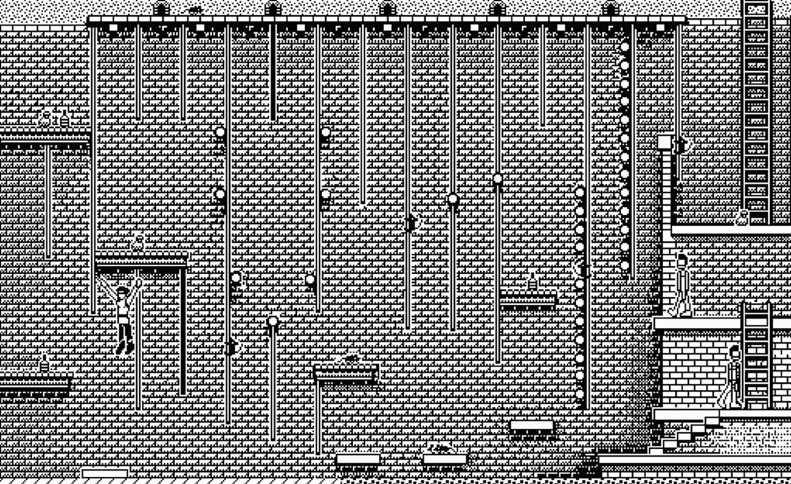

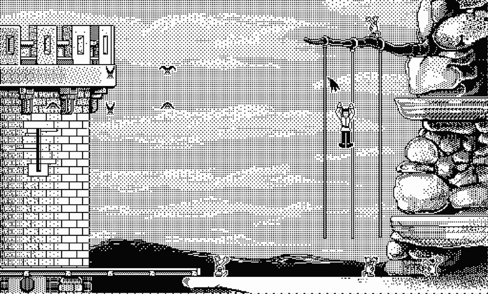

《黑暗城堡》，Silicon Beach Software，1986 年

Macintosh 屏幕每秒刷新 60 次，每次都会运行一次垂直同步中断。这个中断具有非常特定且重要的目的。它允许负责从左到右、从上到下逐行在屏幕上绘制图形的垂直回扫描光束回到左上角，准备好重绘图形。他们不仅需要完全填充音频缓冲区，还需要精确控制音频缓冲区更新的时间，以与该光束精确同步，否则就会以“啪”声的形式出现音频闪烁。在每秒六十分之一秒的中断期间，他新改进的音频驱动程序会寻找优先级最高的两个声音，将它们混合，并填充 370 字节长的音频缓冲区。效果非常奇。

第一届 Mac 世界博会（Macworld Expo）在 1985 年初举行，就在他们完成游戏的前几周。由于资金紧张，三人组将他们所有的设备和折叠桌装进杰克逊哥哥那辆破旧的老款大众福营篷车里，从圣地亚哥开车到旧金山，在莫斯科会展中心（Moscone Center）地下室一个三乘三米的小展位内展示了《空降作战！》（Airborne!）。他们将 Mac 连接到佐彻的大型立体声扬声器，并启动了《空降作战！》供观众观看。

幸运的是，他们的展位位于进入展厅楼梯的底部，因此每个到达的人都能听到《空降作战！》的声音和音乐（瓦格纳著名作品《瓦尔基里骑行》的前几个小节）。

《空降作战！》在展会三天内吸引了大量的关注和口碑，包括 Macintosh 团队的大多数（他们对 Silicon Beach 团队是如何实现这些声音感到好奇），以及在展位寻找新颖软件的独立零售商（他们共同订购了数百份进入他们的商店）。

马克·斯蒂芬·皮尔斯（Mark Stephen Pierce）十四岁时进入芝加哥艺术学院，这是美国顶尖艺术学院之一。他是一位有天赋的插画家，但他真正喜欢的是在他在学校实验室发现的一台电脑上玩。那台电脑无法显示图形，因此他用一种文本字符填充整个屏幕，然后改变某些位置的字符来制作简单的动画。一两年后，1979 年，学校获得了一台名为 `Z-Box` 的图形计算机，它使用了与 `Bally Astrocade` 相同的芯片组，后者是一款以卓越图形能力闻名的家用视频游戏机。

皮尔斯喜欢在 Astrocade 上绘制图形。他会使用一个用 `Bally BASIC` 编写的程序，让手枪控制器上的扳机像笔一样工作，这样他就可以通过指向电视来画画。这很酷，但 `Z-Box` 更先进。它有多个帧缓冲区，每个缓冲区都可以存储满屏的图形，这意味着他可以快速在它们之间切换以创建动画——就像翻书里的画一样。

他总会在晚上没有人使用机器的时候过去，一直工作到早晨。有一次，他创作了一个阿尔伯特·爱因斯坦的动画，眼睛会眨，嘴巴会说。学期结束时，`Z-Box` 的创造者托姆·德凡蒂（Tom DeFanti）回到学校查看学生创作了什么。德凡蒂对皮尔斯的作品印象如此深刻，甚至给了他一份工作。

皮尔斯每小时获得 15 美元的报酬，制作动画和图形，用来惊艳公司投资者以及消费电子展会和 `SIGGRAPH` 等行业活动的与会者。他的创作赢得了巨大的赞誉和一份新工作。他开始为 Dave Nutting Associates 工作，这是一家为 `Bally Manufacturing Corporation` 制造投币式游戏的咨询公司。

他们派他为一款名为 `Professor Pac-Man` 的街机游戏中的选择题制作动画。在那里，他开始和两个同事混在一起：在艺术学院相识的马克·坎特（Marc Canter）和杰伊·芬顿（Jay Fenton，现名 Jamie Fenton）。坎特在公司负责音频，而芬顿则设计了一款名为 `Gorf` 的热门街机游戏。他们创建了三个工具来帮助工作：一个用于绘画，一个用于动画，另一个用于音频。当时 `Mac` 仅在咫尺，他们认为为这些工具制作商业版是一个很酷的主意。他们辞职并创立了 `MacroMind`，并在那里开发了 `MusicWorks`（用于音频）和 `VideoWorks`（用于动画）。


皮尔斯喜欢玩`VideoWorks`。他可以像着了魔一样连续画 12 小时，然后不知怎么还有能量派对一晚上。这项工作也很有成就感。他可以从零开始一天，在结束时完成一个左右奔跑、跳过圈圈、起火并爆炸的男人动画。这种即时性是其他方式无法比拟的。传统动画需要在纸上画画并拍照，然后冲洗、编辑胶片，而使用`VideoWorks`这样的工具进行计算机动画，几秒钟即可完成。

`MacroMind`的软件获得了一些关注，但到 1986 年他们用完了资金。为了维持公司运营，坎特的岳父进行了投资。皮尔斯还不了解投资和商业的运作方式，对于投资会稀释他在公司的股份感到非常愤怒。他愤冲冲地辞职了。

Zocher 曾在`VideoWorks`的磁盘和说明书中见过皮尔斯的样本动画和静态图像。他简直不敢相信这些作品竟然如此好。用鼠标画画就像用一盒香烟画画，但皮尔斯似乎已经掌握了这种最不优雅却最强大的“画笔”。当时的`Macworld`杂志会展示专业艺术家使用`MacPaint`创作的插画，这已经很惊人了，但皮尔斯的作品完全在另一个层次。

渴望与这位现已独立的艺术家兼动画师合作，查理·杰克逊（Charlie Jackson）邀请皮尔斯从芝加哥飞往圣地亚哥讨论他们的新游戏。

在从机场到他家的路上，他解释了他们对平台游戏的想法。一个拿着现代武器的男人穿过每个关卡末头的传送门，下一个世界将完全不同。Zocher 的主意来自一个关于一个误入传送门的家庭的短寿电视节目，以及一款名为`TimeTripper`的军事棋盘游戏。该游戏涉及现代士兵与跨越时代的敌人对决——恐龙、罗马角斗士、未来太空航天员等。

皮尔斯认为这很愚蠢且逻辑不通。相反，他说：“我们要这么做。”在突如其来的创作灵感中，皮尔斯画出了整个游戏的分镜脚本，他将其命名为`Dark Castle`（黑暗城堡）。

这是一场对抗邪恶黑骑士的任务，只有通过一系列考验并获得魔法盾牌和投掷火球的力量才能击败他。他逐一向他们说明游戏大约将如何运作。在场的“硅滩”人士们——埃里克·佐彻（Eric Zocher）、查理·杰克逊、杰克逊的妻子和乔纳森·盖（Jonathan Gay）——对被这样对待并没有意见。皮尔斯是专家。如果真的是这样，他们被迷住了。

他们五个人加上杰克逊一个朋友十岁的儿子，在下午剩下的时间里坐在白板旁，充实故事并对特定房间和武器的细节进行头脑风暴。

皮尔斯第二天飞回芝加哥并开始开发游戏。他会在`SuperPaint`（硅滩即将推出的绘画程序）中绘制美术，并用`VideoWorks`制作动画，然后通过软盘将其物理邮寄给乔纳森·盖。盖非常期待收到更多皮尔斯的作品，他会将这些动画和设计片段整合到代码中。然后他会寄回一个游戏版本让皮尔斯测试。

就这样往返了四个月。起初，每次磁盘通过普通邮寄在圣地亚哥和芝加哥之间往返 3000 公里，都需要等待几天。但在开发中途，联邦快递服务扩展到了跟踪运输。突然之间，他们可以在一夜之间寄送软盘。

# Silicon Press 与 Noel 的声音

Noel 正在对他们的标签打印工具`Silicon Press`进行 Beta 测试。他在家里布置了一个小工作室，用来录制电台、广告和动画片的片段。在他在 20 世纪 60 年代事业的巅峰时期，他兼任多份广告、广播和电视播音员的工作，并曾在长寿动画片《石石一家》（The Flintstones）的剧集中为弗雷德·弗林斯通配音。

Jackson 一旦发现，就请求 Noel 来提供帮助。随后，Zocher 带着`Dark Castle`的早期版本来到 Noel 家中，向他展示角色及其动画。Noel 几乎不需要指导。他看一眼动画，就能想出几种可能的声音刻画。

对于那些飞入队列然后一个接一个俯冲的乌鸦，他建议使用拉长元音的“schmack-schmack”声，例如；对于那些头上长出四肢的矮小变异人，他说：“如果是‘nyeh-nyeh-nyeh-nyeh-nyeh’怎么样？”

一两个小时后，他们就有了一盘磁带，录制了游戏中每个角色的潜在声音，除了一个被链在地下室、被戴面具的手持鞭抽打的汉子——那个声音是 Jackson 自己做的。

就此，他们发明了一个全新的游戏开发角色：配音演员。Noel 会出现在游戏名单中，位于“声音刻画由：”的标题下。

## 音频工程与开发

Zocher 将声音数字化，并在他的`Wave Edit`程序中对其进行精炼，以适应 Macintosh 的性能限制。这次支持`512K`和`Plus`型号，但不支持原始的`128K`。他还开发了自定义音频驱动程序的`Version 2.0`版本，该程序现在可以播放压缩音频文件。

`Dark Castle`共有 72 个声音，包括 Noel 的声音刻画；用于游戏标题界面的闪电和巴赫《D 小调创意咏调与赋格曲》开头几个和弦；以及各种环境音效，如流水声（从水槽和马桶录制）和链条的叮当声（通过掉落固定折叠桌腿的小金属环录制）。

这些声音成为了体验不可或缺的一部分。它们为秃鹫增添了恶意，为变异人、老鼠、蝙蝠、魔法扫帚和锡人卫增加了持久的烦恼。它们赋予了这个世界生命，并展示了英雄其实是个呆子。

如果玩家引导他撞向墙壁，他会迷晕地旋转，头周围像动画片里一样飞着星星，期间他胡言乱语几秒钟，然后停下来，用一种戏剧性的“brrrr”语调抖掉所有不适。同样，如果他跑下边缘，他会在半空中停下向下看、向上看，然后在落下时惊呼道“whooaa-oh”——这种现象被 Zocher 称为“跑跑兔物理学”。

## 影评与成功

`Dark Castle`于 1986 年底发布，广受好评。在名为桌面角色扮演游戏杂志《龙》（Dragon）的一栏名为“计算机的角色”的常规专栏中，Patricia Lesser 赞扬`Dark Castle`是“任何电脑设计过的最出色的街机/冒险游戏”，并特别赞扬了它的快速动作以及“惊人”的画面、动画和数字化声音。

技术杂志`BYTE`和`Computer Gaming World`的评论员也同样赞不绝口。`Dark Castle`还赢得了两本大型 Macintosh 杂志——`Macworld`和`MacUser`——的年度游戏奖。

到 1988 年初，销量已达到 30,000 份，并以每月数千的速度增长。它具有很强的生命力。在发布三十九个月后，`Dark Castle`终于在 1990 年初跌出了`Macworld`前五畅销 Mac 娱乐节目榜。它的续集`Beyond Dark Castle`在同一榜单上进入前五名的次数二十一次，其中包括该榜单发布的最后一个月（1993 年 5 月）。

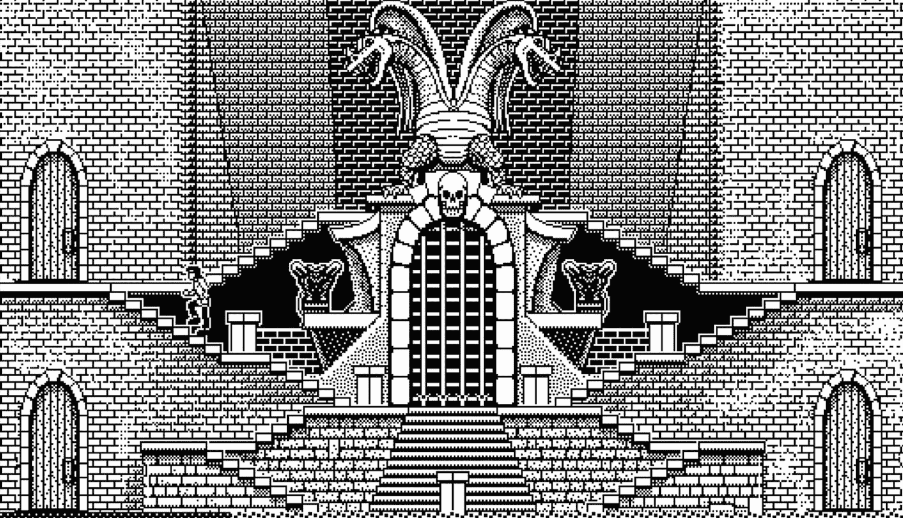

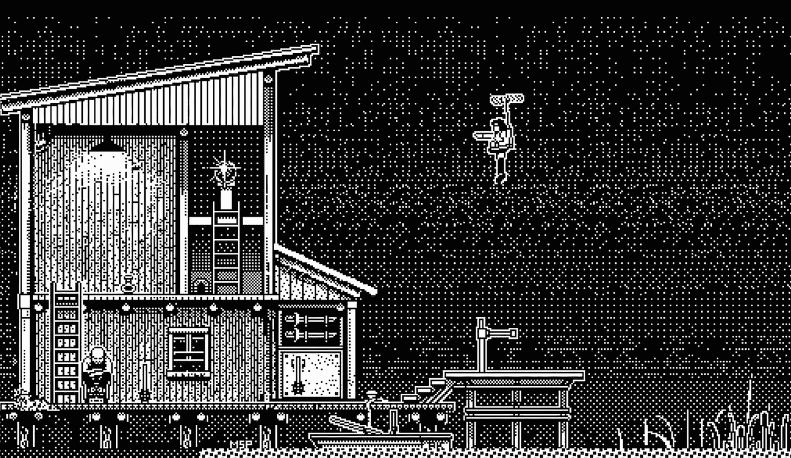

Beyond Dark Castle, Silicon Beach Software, 1988

## Dark Castle 的遗产

Gay 获得的版税份额高足够支付他的全部大学学费。Pierce 和 Gay 以及整个 Silicon Beach Software 被誉为英雄。他们是这个小 Macintosh 世界里的摇滚明星。`Dark Castle`改变了局面。它推进了人们对电脑能做什么、视频游戏可以什么样的想象。

除了它具有里程碑意义的控制方案（`W`、`A`、`S`和`D`键控制移动，而鼠标负责瞄准和射击，这是今天的标准），它更广泛的影响仅限于那些在 Mac 上玩它的人。

`DOS`、`Apple IIGS`、`Sega Mega Drive`、`Amiga`、`Commodore 64`、`Philips CD-i`、`Atari ST`和`MSX`版本将在未来几年出现。没有引起动荡——有些是因为时机不对或营销有限，另一些是因为损害整体体验的微小缺陷，使得击败那个时代最困难游戏之一的努力变得难以合理。

这些移植版中最广为人知的`DOS`和`Mega Drive`版本，实际上对`Dark Castle`造成了很大损害。它们为 Pierce 详细的手绘黑白艺术画提供了廉价、色块状的色彩渲染，并配以劣质的动画引擎以及笨拙、缓慢的游戏手柄和仅限键盘的控制设置，这模糊了 Mac 原版中精确且独特的鼠标键盘控制。

## Beyond Dark Castle

续集在提升该系列在其平台之外的声誉方面作用不大。`Beyond Dark Castle`让其前作显得很简单。Gay 和 Pierce 提高了速度和强度，关卡一个接一个，只有通过重复才能精通。

正如标题所示，`Beyond Dark Castle`让熟练的玩家更深、更广地探索额外的城堡房间，以及一个丰富的外部世界，其中包含沼泽、森林、可以爬过的墙壁和一个需要掌握的迷宫。

亮点是一个堪称列奥纳多·达芬奇的直升机装置，它可以环绕邓肯王子（再次成为剧情的主角），并让他飞越关卡——在许多区域，关卡现在既垂直又水平滚动，而不只是水平滚动。

除了新玩具和更大的空间外，`Beyond Dark Castle`将在每一个机会杀死玩家变成了一种运动。对于原始的怪物阵容，它增加了更多敌人，包括毒蛇、巨型蚊和脉动的激光束。它利用这些来让玩家的生活变得痛苦。

不过，它也有借口。除了新版本的`Dungeon`（游戏在玩家掉落或被石像鬼掉进地板时进入的关卡），`Beyond Dark Castle`还包含了一个存档机制。玩家必须回到一个特殊房间并拉动几个杆子之一来保存进度。

尽管如此，她还是可以存档。

他将公司的重心完全转向图形软件和实用程序。两年后的 1990 年 2 月，杰克逊将公司卖给了 Aldus 公司，金额恰好是他为了支付全职参加国际风格快速发手枪训练所需的费用。一年后他开始了训练，到 1993 年中，年 43 岁的他入选美国队。

## 他们现在在哪里？

查理·杰克逊绕了一圈又回到了软件业务领域，只不过新的 Silicon Beach Software 制作的是 Windows 10 应用，而不是 Mac 多媒体和绘图应用。Eric Zocher 是微软的用户体验总监。Jonathan Gay（我们应该注意，他后来创作了 Flash 多媒体软件）拥有一座家族经营的牧场。Mark Pierce 拥有一家名为 Super Happy Fun Fun 的游戏公司。他希望有一天能制作出一部新的《黑城堡》游戏。

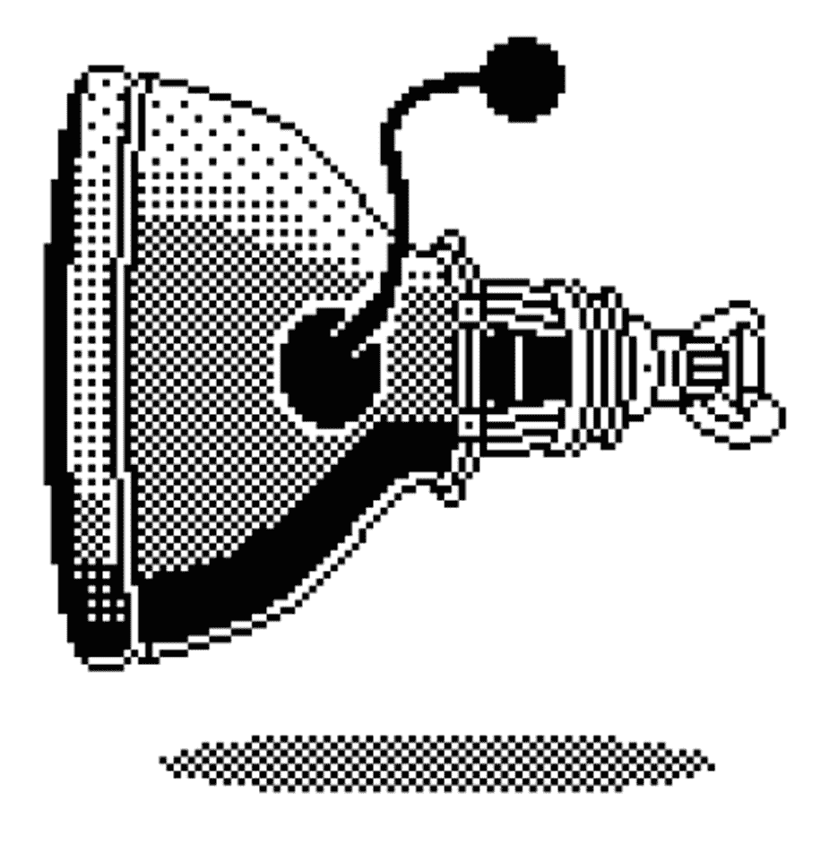

Macintosh CRT 显示器，苹果电脑，1984 年

# 08：一个由寻宝讲述的故事

克里夫·约翰逊总是喜欢创造事物。在 20 世纪 50 年代后期和 60 年代初，作为一个男孩，他满足于捣鼓和探索的结合。他会在康涅狄格州父母家周围的林地中徘荡，拿着自制的地图寻找宝藏。或者他会使用地下室的化学实验箱尝试制造火药、氯气，或任何当天令他感兴趣的危险物质。

他在观看低预算恐怖电影《鬼魅山上的房子》（*House on Haunted Hill*）时发现了自己的天职。那些怪异的怪物让他欣喜不已。从那时起，他以一种痴迷的态度阅读、观看并制作恐怖电影，这种痴迷定义了他。

他订阅了一本名为《电影场上的著名怪物》（*Famous Monsters of Filmland*）的杂志，里面装满了令他恐惧的恐怖电影黑白照片，他经常去当地影院看三连场电影。但他的精力主要花在用 Super 8 摄像机拍摄自己的怪物电影上。在高中的最后一年，他制作了一部名为《新生的回归》（*The Return of the Freshman*）的长篇电影。为了筹集制作资金，他在一家名为 Lake Compounce 的当地游乐场工作。

Lake Compounce 是一个破旧的老地方。其中一个名为“黑暗大笑”（*Laff in the Dark*）的设施确实只是黑暗中的笑话。任何进去的倒霉蛋都会遇到大量的噪音，大部分来自他们乘坐的车辆，除此之外只有一片漆黑。怪物全都被毁了。

但约翰逊决定要修复它。他从自己的电影中招募了演员和工作人员，帮助他创造了十个怪物——木乃伊、腐烂的骨骼、向弗兰肯斯坦怪物致敬等等——由木头、金属丝、钢丝网、石膏带和喷漆制成。他还将隔离怪物与车道的铁丝栅换成了聚碳酸酯，这是一种坚硬透明的塑料，可以防止人们在经过时吐口或损坏怪物。

游乐场所有主为这项工作支付了 1000 美元加上材料费，这足够他们筹集电影所需的剩余资金（另外一千美元）。约翰逊从他在高中礼堂的三场放映中赚了 6000 美元。

高中毕业后，他接触了邻近马萨诸塞州的河滨公园（Riverside Park）。他也修理了那里的“黑暗大笑”设施，然后去丹佛上了一些大学课程，并在另外两个游乐场找了工作。

在这样旅行几年后，他来到了加利福尼亚，在那里独自度过了六个月，为女王公园（Queen’s Park）游乐场的“黑暗大笑”和“河流游行”项目制作怪物。那份工作让他赚了足够的钱来支付南加州大学（USC）电影学院的学费，该学院誉为世界最好的电影学院之一。

在这里，他发现了新的奇迹。前卫动画完全俘获了他，就像多年前恐怖片俘获他一样。五年后，在 1979 年，他获得了硕士学位，并手握几个电影节奖项，但无处施展他的新才华。他不再看好莱坞圈，但如果他想继续拍摄前卫电影，就得去欧洲。

他开始承接委托的企业项目，制作关于供暖和空调等迷人话题的电影。为了保持理智，他尝试在业余时间寻找创作出口。

他非常喜欢举办复杂的寻宝派对。这个主意源于 1973 年的电影《希拉的最后晚餐》（*The Last of Sheila*），这部电影本身的灵感来自该电影编剧安东尼·珀金斯和斯蒂芬·索德海姆在之前的几年安排的一系列寻宝和杀人谜派对。

对于他的寻宝活动，约翰逊使用了静态照片、电影、录音带和各种“证据”。当这些与纸笔谜题的答案相结合时，它们为客人提供了解决谜题所需的知识，而无需任何费脑的推理。

1981 年，他决定写一本类似风格的书——一本将纸笔谜题融入其故事结局的书；一个由寻宝讲述的故事。这个想法在很大程度上归功于英国画家基特·威廉姆斯（Kit Williams）的一本儿童读物《假装舞会》（*Masquerade*）。

在《假装舞会》十五页插图和散文的结尾，一只兔子从月亮带着宝藏带到太阳处的故事被转回到了读者身上。兔子丢失了它的宝藏，读者的任务是在现实世界的某个地方帮助找到它。所有必要的线索都隐藏在前面的页面中。约翰逊对这种既可以作为故事独立存在又作为一个宏大谜题的书籍感到无尽的着迷。

他写了一个大致基于韦勒·韦特塔罗牌中代表的角色和想法的短故事——这种塔罗牌以每张七十八张牌上都有独立的插图而闻名——讲述了一个在童话世界中流浪的“愚者”，他在愤愤且傲慢地寻找该地的十三件宝藏时，笨拙地化险为夷。

在二十一页叙述文字中，他增加了十四页包含八十一块碎片的宝藏地图，读者/玩家需要根据故事中的线索将其剪下并组合（故事也分为八十一个部分，每个部分对应地图的一个碎片）。如果正确组装，地图提供了填字游戏的答案，填字游戏又破译了一条最终信息：“圣诞快乐！”

约翰逊将《愚者的差错》（*The Fool’s Errand*）副本作为圣诞礼物送给朋友，认为他们可以在一个轻松的下午解决它。令他非常失望的是，大多数人都没有解决这本故事书中的宏大谜题。他追求的是“愉快的可解性”，但得到的却是对大多数人来说是一个艰巨的挑战。他没有把它推给出版社，而是把书放在了架上，继续他的生活。

然而，他的一个朋友注意了他的创造谜题的天赋。艾伦·皮内罗（Allen Pinero）在为他的 Apple II 文字冒险游戏开发引擎时——这台游戏允许玩家同时控制两个角色——请求约翰逊协助设计一些谜题和情节。

约翰逊对计算机或文字冒险游戏一无所知，但他同意尝试一下。他创作了一个改编自几个希腊神话的情节，以及一组带有手绘插图的动词名词谜题，皮内罗将其转换为计算机图形。游戏《克里特迷宫》（*Labyrinth of Crete*）于 1982 年发布，反响平平。帮助设计这款游戏的经历并没有让畏惧技术的约翰逊对电脑产生多少好感。

因此，约翰逊在 Macintosh 问世对他并没有什么兴趣。然而，在 1984 年底的一天，他走进了一家商店，那里有一台新款 Macintosh 512K（被称为“胖 Mac”）的演示机，上面安装了`MacPaint`和`MacWrite`。

他立刻被这台界面友好、优雅、拥有直观界面和清晰黑白图形的小机器吸引。事实证明，约翰逊正是苹果公司为之打造的“普通用户”之一。他离开商店时钱包少了几千美元，手里多了一台`Mac 512K`和一些额外的赠品。

### 早期采用

起初，他用他的新`Mac`来管理电影制作，并使用`Microsoft Multiplan`计算预算（该软件在明年会被`Excel`取代）。在此之前，他所有的工作都是手工完成的，并借助纸制孔计算器。能够节省数小时的工作时间，并得到一个美观且易于修改的结果，对他来说简直是魔法。

他逐渐探索了他这台新`Mac`的功能。由于以前从未用过电脑，即使是简单的任务也感觉像是一场兴奋的冒险。不久后，一位朋友送给他一份`Microsoft BASIC`，以此鼓励他进一步探索计算范式。

从他输入`for x=1 to 100, print x`，屏幕一路显示`1 2 3 4 5 6`直到 100 的那一刻起，他彻底折服了。他看到了曙光。电脑也可以很酷。

### 游戏想法

几个月后，他想出了主意：如果把那本旧谜题书改编成电脑游戏呢？也许这样就能找到他需要的志同道合、对智力充满好奇的观众。

约翰逊之前唯一接触过的电子格式游戏是在`Atari 2600`上。他花了三个愉快的日子痴迷地试图征服《太空入侵者》，但他觉得那是虚度时间。除了因为摆动`Atari 摇杆`而磨损的手腕和拇指外，那几天一无所获。

但现在，当他思考制作自己的游戏时，这个问题变得不再重要了。开发电脑游戏是一种创作行为；他将对这段时间有所收获。他相信，就像他成为“普通用户”之一一样，他们也会发现并喜欢他的创作。

他认为故事可以在虚拟卷轴上呈现，地图可以是一个拼图。玩家必须通过解决较小的谜题来获得这两种元素的每一个碎片，最后他们就可以完成地图拼图。

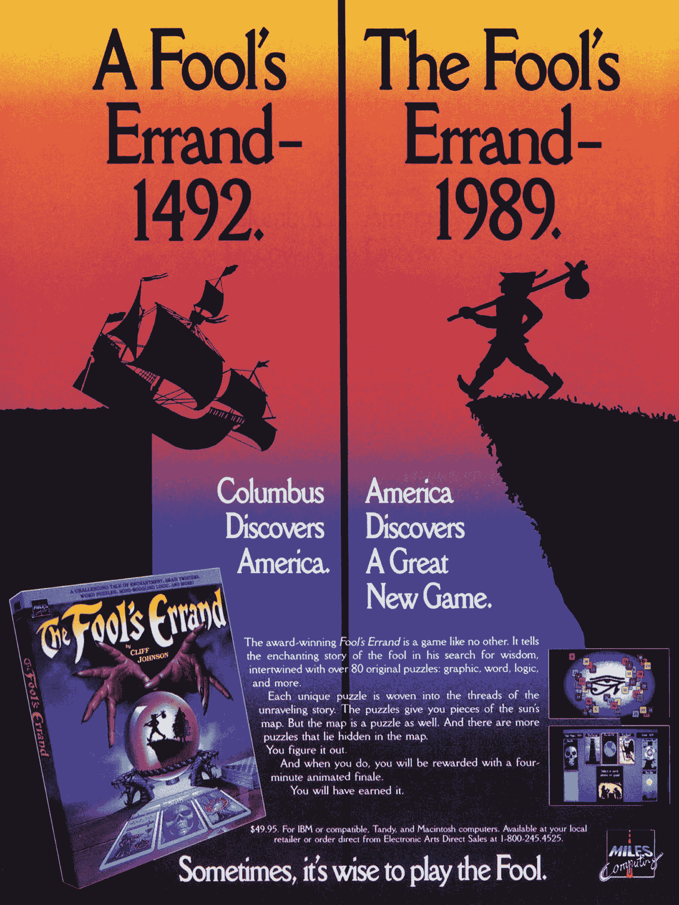

《愚者的差事》，Miles Computing，1987 年

### 设计与机制

对于故事谜题，他从纸笔游戏杂志中汲取灵感。高中时，他最好的朋友订阅了`GAMES`杂志。每个月他都会把答案填满整本，然后把杂志交给约翰逊。

“我看着那些有答案的页面，心里想：‘噢，这很有趣’，”约翰逊回忆道，“我从没玩过谜题；我只是看着它们。”

他对谜题设计的美学和机制的着迷现在表现了出来。在电脑上复制了几种标准的纸笔谜题类型——单词搜索游戏、交叉字游戏、字母变位、密码谜等——之后，他尝试更进一步。

电脑上的谜题可以用一种更有机的方式进行交互和玩。在电脑上，谜题玩家并不是在谜题上做注释，而是通过直接交互来移动和重塑它。他开始设计利用这种优势的谜题。


例如，在一个字形谜题中，玩家必须按下正确的按钮，从图像中添加或移除背景图案的部分，以露出三个隐藏的字母。另一个谜题要求记忆屏幕上闪烁的一系列线条的路径，然后用鼠标将它们画。他最有创意的谜题之一是一个受塔罗启发的卡牌游戏，其中“愚者”必须在不知道规则的情况下与一个老头对战。通过仔细的专注和实验，玩家需要首先识别规则——包括如何获胜以及每张牌牌代表什么——然后制定策略。

### 技术实现

为了实现这一切，他采用了在大学学习的一种名为“现成艺术”（Found Art）的动画技术。他模仿了 1926 年动画电影《阿赫迈德王子的历险》的剪影风格。许多背景来自揉皱布料的数字化图像。为了节省空间，因为游戏需要装在一张`400K`磁盘上，他用增量模式和几何动画编写了故事与谜题之间的过渡效果。在各个方面，约翰逊充分利用他敏锐的艺术直觉来发挥`Mac`的优缺点，在探索这一奇异过程的过程中，寻找建立独特艺术风格的方法。

它奏效了。《愚者的差事》独特的艺术风格后来成为它最受推崇的组件之一，被誉为将故事和谜题统一在一起的胶水，让它们无缝地相互促进。

游戏竟然如此连贯，简直是一个奇迹。每个谜题最初都存储在自己独立的`Microsoft BASIC`程序中。他不知道如何将它们全部整合成一个整体，更糟糕的是，他还担心它们运行得太慢。幸运的是，`ZBasic`在开发期间推出了。它运行比`Microsoft BASIC`快得多，并且产生可以在任何 Macintosh 上运行的程序文件，虽然它与微软开发的兄弟版本在语法上有些不同，但约翰逊还是设法应付过去了。

### 出版与成功

到 1986 年底，他认为已经准备好将《愚者的差事》推销出版商了。`Activision`给了一个报价，但他不愿意以低廉的版税转让所有权，因此拒绝了。一家名为`Miles Computing`的小型 Mac 出版商也感兴趣。他们之前在 1985 年的 Mac 第一款飞行模拟器《战机任务》中获得过成功，并且愿意给予约翰逊版税和作品所有权。更好的是他们就在加州南部。

然而，当《愚者的差事》在 1987 年发行时，他很快开始自己是否做了正确的决定，因为几乎没有任何广告，只有几篇杂志评论。

在开发游戏期间，约翰逊累积了 5 万美元的信用卡债务。为了还债，看起来他不得不回到那份高薪但艺术匮乏的代拍制作业务中。游戏标题的讽刺意义他完全理解。

一切在 1988 年 1 月的`MacUser`杂志后发生了变化，那是游戏发布几个月后，由创始人`Neil Shapiro`撰写了评论。他的五分满分评价了对这款“重新定义艺术水平”的游戏的赞誉和深度解析。现在，销量开始上升，Shapiro 和一群粉丝在随后的几个月里继续为这款游戏背书。`Electronic Arts`接管了发行，游戏版本很快推出了`Amiga`、`Atari ST`和`MS-DOS`版本——尽管这些版本都不符合约翰逊的标准，但尽管代码糟糕、色彩调色粗糙，它们仍然赢得了更多的正面口碑。通过口碑，《愚者的差事》成了一部畅销书和评论界的青睐。

《愚者的差事》在 1987 年被`GAMES`杂志评为年度最佳谜题游戏，并于 1988 年进入`Macworld`游戏名人堂，成为最佳脑力挑战游戏。提名中写道：“通过这个游戏不需要成为天才。只要耐心。如果还有家庭喜欢一起解决谜题，这个是值得尝试的。”

游戏中的谜题让约翰逊声名鹊。`Macworld Expo`的参与者在路过时会开玩笑地大喊“我恨你！”。其他粉丝写信告诉他，由于痴迷于解决这个游戏，他们错过了考试或浪费了数周的生活。它的难度让他们抓狂，但它的公平性让他们继续玩下去。

到 1989 年底，`愚人之举`(The Fool’s Errand）在所有平台上的销量已超过 10 万册（而那本提示书的销量要得多）——这远不足以让约翰逊富翁，但足以偿还他的债务，并为他开发另一款游戏提供理由。

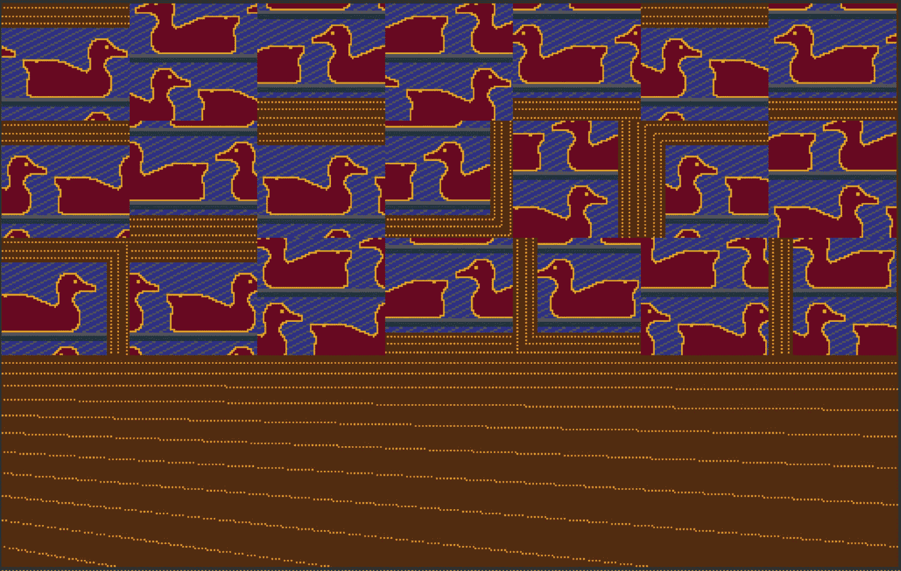

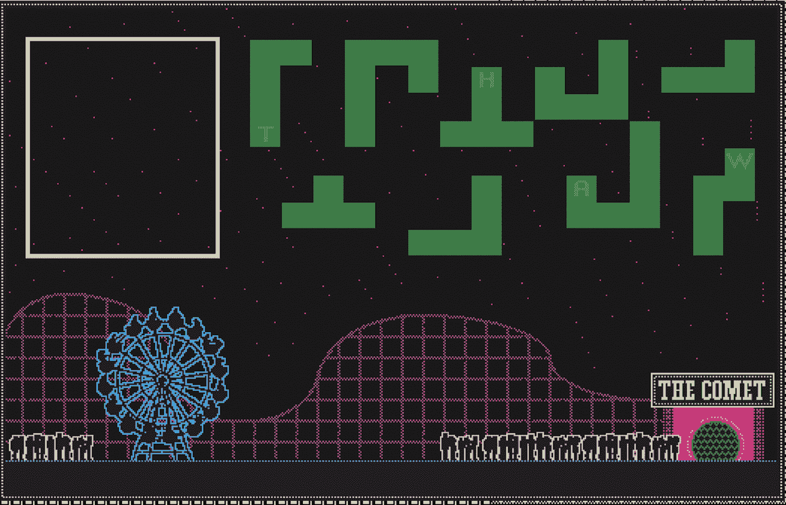

嘉年华，Miles Computing, 1989 年

他选择不直接开发续作，而是同意为 Miles Computing 开发`‘谜题画廊’`(The Puzzle Gallery）。这是一个系列主题谜题小游戏集，第一部被他命名为`在嘉年华`(At The Carnival）。这并不是一个“元谜题”（即由许多小谜题组成一个宏大谜题的游戏），而是玩家必须完成分为五组的 180 个独立谜题。谜题的内容和呈现方式都借鉴了约翰逊此前作为游乐园怪兽设计者的经验，描绘了嘉年华生活中不尽完美、甚至有些恐怖的一面——如带有噩梦甜点名称的单词搜索游戏、隐藏警告信息的字母错乱游戏、揭示安全隐患的拼图等。

一个名为`‘趣味之道’`(The Fun Way)的令人记忆的谜题要求玩家引导一个用短剪影表示的小孩穿过拥挤的人群以到达游乐设施。在几乎每一步，他都会被不同的人推开，并伴随着一声恰到好处的、尖锐刺耳的“哔”的拒绝声，以及屏幕底部随之显示的“滚开！”之类的文本信息。诀窍在于找到合适的穿入人群——以及推入那个孤独化身的正确顺序——以便其逐渐从屏幕的一端移动到另一端。完成后，玩家会收到这样一条信息：`‘与客户社交往往比玩游乐设施更可怕！’。

发行商 Miles Computing 在发布后不久便破产，导致《在嘉年华》没有机会追上《愚人之举》的成功。后续的“谜题画廊”系列从未问世。

约翰逊随后转向了一个全新的元谜题游戏，设定在一个全新的环境中。他构思了一个概念：一个数字 3 在电子表格中被四舍五入，然后由于电压浪涌在返回其他数字的途中丢失了。它在回到家之前必须修复电脑内部的损坏。作为这个孤独数字 3 的灵性导师，玩家必须解决各种谜题以解锁提示，这些提示提供了修复故障的方案。

在最佳状态下，《三之三》(3 in Three)就像一个互动式的索尔·巴斯风格广告。它拥有巨大的、风格化的字母、数字和形状，其角度、色彩和动作散发着个性。如今，约翰逊已经完全熟练了使用计算机设计谜题，超越了作为《愚人之举》和《在嘉年华》核心的纸笔改编，提供了一种更具互动性的、原生计算机体验。

《三之三》在开发三年后于 1990 年上市，由于 Miles Computing 已破产，发行权由 Cinemaware 接手。讽刺的是，Cinemaware 随后也于 1991 年破产，此时`Inline Design`接手了发行。（它后来在 1995 年也倒闭了，权利回到了约翰逊手中。他最终将该游戏作为免费软件发布。）

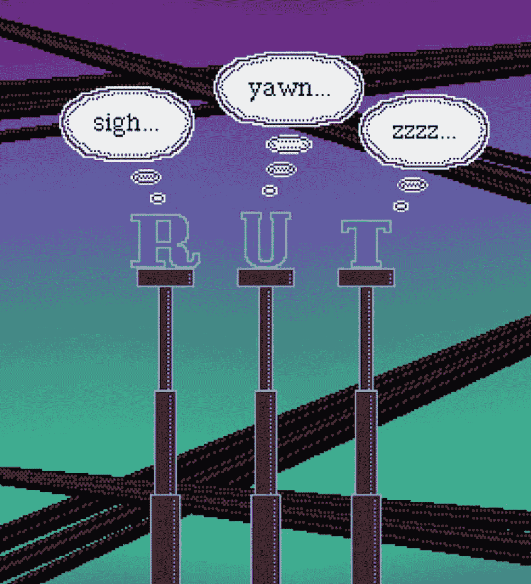

3 in Three, Cinemaware, 1990

《三之三》证明了《愚人之举》绝非偶然。它也进入了 Mac 世界游戏名人堂（尽管是最佳脑力游戏类别的亚军），并于 1991 年获得了 MacUser 年度游戏奖以及《GAMES》杂志的年度最佳谜题游戏。

但对约翰逊来说，这标志着一个时代的结束。这将是他二十多年来最后的一款 Mac 游戏。Cinemaware 接下来让他为 View-Master 交互视觉系统制作了一档 30 分钟的游戏节目，名为《迪士尼卡通街机场》(Disney’s Cartoon Arcade)，这涉及观看片段并根据这些片段玩街机游戏。这导致他与飞利合作了四年的 CD-i 交互多人系统。他是公司`FunHouse`小组的高级制作人，该小组在苹果的`HyperCard`中制作游戏原型，并发布了畅销的《汉纳·巴伯卡通嘉年华》以及两款元谜题：《梅林的学徒》(Merlin’s Apprentice)和《克里特迷宫》(Labyrinth of Crete)。在世纪世纪 90 年代后期，他从飞利加入了迪士尼和华纳兄弟等各大品牌，担任谜题设计师和制作“主管”，随后在 2002 年，他设计了“100,000 挑战”谜题，用于促销魔术师大卫·布莱尼半自传书籍《神秘陌生人》(Mysterious Stranger)。

2003 年 1 月，在愚人之举》发布十六年后，约翰逊宣布了他的续作。它将被称为《愚人和他的钱》(The Fool and his Money)，他将完全独立创作，并在晚些时候登陆 Mac 和 PC。他在名为`PayPal`的新电子商务支付网站上接受预订，并定期发布详细说明进展的通讯。不断进步的技术和完美主义多次击败了他。2003 年的万圣节发布日变成了 2004 年 4 月 1 日，然后是 2004 年万圣节，接着是 2005 年 7 月 5 日，然后是“2005 年底”，一延再延。那些有耐心坚持下去没有在这些无尽延迟中要求退款的人汇聚在了一个“信徒集”。

最终，在 2012 年 10 月 25 日，在比另一个公布发布日期早一天、比计划推迟了九年后，《愚人和他的钱》终于发布了。

（你可以通过约翰逊的网站 fools-errand.com 了解《愚人和他的钱》的开发，以及我在 Archive.vg 上写的一篇《愚人和他的钱：约翰逊开发二十五年前游戏续作的漫长旅程》。）

## 他们现在如何？

截至本文写作，克夫·约翰逊已经离开了游戏开发行业。现在退休的他正经营着一份名为《愚人的黄金》(The Fool’s Gold)的月度通讯，并正在写一本名为《CRAFTUP》的小说。


坦克，超级迷宫大战, 1993

AppleTalk

在第一台 Mac 下线之前，多人游戏已经是 Mac 的一部分。正如安迪·赫兹菲尔德制作小型 Mac 游戏来测试机器的功能和鼠标输入能力一样，其他人通过游戏来提高网络程序的稳健性。

有一款游戏特别引起了工程师们的共鸣。在两个或三个不同的场合，Mac 团队成员重创建了《迷宫》(Maze)。它最初是于 1972 年底由三名在 NASA 埃姆斯斯研究中心参加实习计划的高中生为 IMLAC PDS-1 微型计算机开发的。这三个人之一的格雷格·汤普森将游戏带到了麻省理工学院（MIT），他在那里和 MIT 同学戴夫·莱布林将其从一个简单的双人迷宫游戏演变为一种可以在 ARPANET 上运行的八人第一人视角射击游戏。

《迷宫》在 ARPANET 上的成功如此巨大，以至于据称占据了网络传输数据的大约一半。这种流行导致它被重写到了最早的微型计算机 Xerox Alto 上。Mac 团队受到了那台 X 机器的启发和影响——事实上，他们中的一些（包括《Alice》的作者史蒂夫·卡普斯）曾在创建它的部门工作过。这款名为《迷宫大战》(Maze War)的游戏捕捉了一一代美国大学生和计算先驱的想象力。

还有什么比再次在 Mac 上重现这款游戏，及其对计算机网络潜力的精彩诠释更能向其致以敬意呢？ 1984 年初，Apple 网络部门的一位工程师 Gene Tyacke 想要测试`AppleTalk`协议。在次年发布时，`AppleTalk`让 Mac 用户能够以近乎零的配置建立多达 32 台机器的本地网络——只需插上电缆，打开一个名为`Chooser`的程序，任何连接的 Mac 或打印机就会被识别并准备就绪。

`Bus’d Out`呈现了一个带有灰色抖动墙壁的黑色迷宫。玩家拥有一个护盾、一种“干扰器”武器、一个扫描仪和地图。扫描仪可以用于搜索附近的玩家，因此它成为一种早期的预警系统，而在移动时无法查看地图。移动时，玩家点击游戏区域内部。他们的鼠标指针会变成与方向相应的箭头。还可以发送简短文本消息，可以发送给附近的玩家或所有人。

几个月后，Apple 另一个部门——操作系统（`OS`）组的另一位工程师独立创建了他自己版本的`Maze`。它的创建者 Burt Sloane 刚刚完成了一个演示程序，展示了跨越文件服务器的文件和消息传输，供 Steve Jobs 带往夏威夷的一个销售会议。随后，他利用那段代码将其作为游戏的基础——他紧密模仿了 Xerox Alto 版本，直到几乎完成时才不知道`Bus’d Out`的存在。

Sloane 的`MazeWars`地板采用简单的图案纹理，天花板是白色空间，墙壁是灰色抖动色。像 Alto 版本一样，它在屏幕右侧显示地图，左侧显示 3D 迷宫视图。它缺乏`Bus’d Out`复杂的消息功能和鼠标控制。相反，它通过键盘控制，并且迷宫中散布着传送门，会将玩家传送到随机位置。

`MazeWars`在`OS`组中大受欢迎。。Sloane 所在的办公室隔间里的伙伴们玩得太投入，以至于他们的水平超过了他的，这使得他必须通过一点作弊来竞争。Sloane 为自己添加了特殊动作、武器和其他优势，试图应对他们更高的技能水平。原始 Macintosh 字体和图标的设计师 Susan Kare 也对这款游戏产生了兴趣。她为眼球图形增添了色彩。最初，眼球只是带有白色虹膜的黑色球，分为十种不同大小以适应与玩家的距离，每种大小有四个视角。Kare 增加了一个魔鬼般的尾巴，为它们增添了更符合迷宫内猫鼠游戏的威胁基调。

这两个迷宫变体很快流传开了，这得益于南加州阿纳姆 Mac 用户俱乐部两个成员——Mark Murphy 和 Kerry Garrison 的一位朋友。这位朋友提供了`Bus’d Out`和`MazeWars`的 alpha（早期开发）版本以及`AppleTalk`的硬件设计细节。

为了玩这些游戏，Murphy 和 Garrison 与同样成员 David Every 和 Dave Wilcox 构建了他们拼凑出来的`AppleTalk`硬件实现方案，这可以在他们的`Mac 128K`和`512K`型上运行。然后，他们在 1985 年 1 月旧金山首次 Mac 世界展（Macworld Expo）之前，制造了更多这种自制的`AppleTalk`盒子。

在 Apple 首次向公众展示`AppleTalk`几小时后，一大参与者前往唐人街并占领了一家披萨店的后半部分。他们建立了两个网络——每个游戏一个——大约有 20 台 Mac，玩了几个小时，然后在离开店面时恢复了发现时的原样。多年后，一名参与者 Jack Kobzeff 将其描述为一场“来就走的、即插即用的网络游戏派对”。

“网络派对”——即今天广为人知的局域网派对（LAN parties）将成为 20 世纪 80 年代后期和 90 年代 Mac 和 PC 游戏社区的一部分，但这可能是第一次。

另一个流行的早期网络游戏`Armor Alley`是基于更早的 Apple II 游戏`Rescue Raiders`，涉及跨滚动游戏区域操控直升机，目标是摧毁敌方基地。两个玩家都有来自移动车辆和固定堡垒的地面支持。发行商 Three-Sixty Pacific 特别允许跨平台多人游戏，让 Mac 和 PC 所有者可以相互斗斗。

其他作品还包括`Strategic Conquest`，它让玩家在帝国建设和征服的激烈战斗中对决；`Air Warrior`，一个飞行模拟器，需要访问通用电气提供的每小时 10 美元的`GEnie`在线服务；`NetTrek`，Randy Carr 对一个名为`Empire`的旧 PLATO 系统太空策略和射击游戏的 Mac 演绎；`Spectre`，一个未来派坦克战斗游戏，将夺旗锦标赛与矢量风格的 3D 图形相结合；`Super Maze Wars`，另一个迷宫变体；以及`Spaceward Ho!`，它让玩家在一个星球戴着牛仔帽并发出奇怪声音的现实中争夺宇宙霸权（实际上，这是一款设定在太空中的探索和征服策略游戏）。

没有任何一个游戏能比得上 Stuart Cheshire 的 2D 坦克战斗游戏的长期流行度。它简微的起源可以追溯到 1987 年 10 月，当时他的朋友 James Everard 建议他们快速拼凑出一个双人坦克游戏。他们在剑桥大学西德尼-苏塞克斯学院的宿舍房间很近，因此他们用约 50 米的电缆连接了他们的`BBC Micros`，并编写了一个测试程序来检查其可行性（结果是可行的）。然而，Cheshire 的野心比快速拼凑要宏大得多。他想象了一个巨大的地图，当坦克移动时，正方形的游戏窗口会进行滚动。它将不是两个玩家，而是四个或八个。甚至是十六个。

在他编写游戏代码时，他当时的女朋友不断用印地语重复着：“Bolo, bolo, bolo！”粗略翻译，她是叫他离开电脑和她说话。由于游戏的核心是通信——包括玩家之间以及计算机之间——他认为这是一个完美的名字：`Bolo`。

几个月后，他们准备好迎接黄金时刻。他们宣布在复活节结束时进行八人网络坦克战斗演示。一周前，Cheshire 安排了一次演习——只是一个半小时的短暂测试，以确保它可以运行。但当他设置好八台机器的网络时，已经有六十个人挤在房间里，都急于看到演示。八小时后，保安人员要求他们离开建筑以便锁门。

Cheshire 在空余时间继续开发这款游戏，但在老旧、性能不足的 BBC Micro 上它永远无法接触广泛的观众。如果游戏想要生存，必须移动到新的平台。Mac 是而易见的选择。与 PC 不同，它内置的网络功能和标准的图形界面，同一段代码可以运行在`Mac Plus`之后的每一台 Mac 上——无论色彩能力或屏幕大小如何。制作更好的游戏所需的工作会更少。

Cheshire 向英国广播公司（BBC）的朋友寻求帮助制作声音。对于坦克的击中，他们录制了木勺敲击烘焙盘的声音。对于沉入大海的死亡坦克，他们在浴缸里扔进了一个啤酒瓶。

1992 年，当他还是斯坦福大学计算机科学专业的研究生时，`Bolo`的不完整“beta”版本开始在万网之前的流传。（他接受了这一点，因为`Bolo`的设计初衷就是为了分享，在进入更成熟的状态之前，他拒绝收取共享软件费用。）起初，人们感到困惑。1982 年有一款同名的 Apple II 游戏，巧合的是也涉及坦克战斗。但这款 Mac 版`Bolo`仅支持多人游戏，而且其设计比典型的射击游戏要精妙得多。一旦人们度过了最初的学习曲线，就彻底迷其中了。

数千人开始玩`Bolo`。到 1993 年，当游戏达到大致“稳定”的状态时（意味着它没有充满可能导致电脑崩溃的漏洞），每月在公共网络上玩的游戏次数超过了`20,000`次——私有网络上的更多，包括苹果自己的内部网络。

### 游戏玩法与人气

它的流行在某种程度上源于一套复杂且多层的规则体系，这使得玩法远超简单的坦克对战。玩家可以采集树木获取资源，用来建造道路以便快速移动、建造桥梁以便轻松过河、建造建筑以躲避敌方火力、建造船只进行远距离水上旅行，以及名为`pillboxes`（碉堡）的自动射击塔。（建造过程由一个从坦克出来的小人生动地描绘。）坦克的弹药和地雷库存有限，需要定期访问加油基地来补充。玩家还可以结成联盟、布地雷、扫地雷、远程监控他们的碉堡等等。


`Bolo`人气的更大驱动力是其可模组性。Cheshire 将他的地图文件格式细节向公众开放，以便玩家能够编写自己的地图制作工具。他们执行这些任务表现出了惊人的活力。有些工具可以将`PICT`图片文件转换为地图或添加到地图的自定义图标。另一些工具则生成随机地图，或将地图转换为图像以便在网页上显示。还有少数工具会分析地图并创建充满统计数据的文本文件。两款程序`BMAPEdit`和`BoloStar`拥有如此复杂的地图编辑和创建功能，以至于它们各自都收取`$10`的共享软件费用。

### 社区与工具

不想创建自己地图的玩家可以在存储在在线存档中的数千张手工地图中选择。既有用于史诗级 16 人马拉松比赛的大型地图，也有用于快速一一对决的微型决斗地图，以及介于两者之间的一切。还有基于第二次世界大战战场或夏威夷、英国群岛等真实世界岛屿的主题地图。也有新奇地图、对称地图，以及围绕特殊功能或玩法构建的地图。

不久，玩家就可以使用作者编写的“大脑”与电脑控制的对手对战。这些是自动坦克驾驶程序，遵循预定义的策略，既可以用于练习，也可以在与其他玩家的对战中充人数。（游戏也自带了一个大脑，但它的设计目的——实际上也只有在这里有用——是在玩家需要离开电脑时短暂地接管坦克的防御控制。）

Cheshire 持续发布`Bolo`更新，不仅是为了改进它，还为了更好地激发这个社区的创造力。“当《吃豆人》的设计师看着别人玩《吃豆人》时，”他在 1995 年告诉《NetGuide》杂志，“我无法想象他们心里会说：‘噢，哇，他吃了那个闪烁的点，这让他能追上幽灵；我从没想过那样。’《吃豆人》中没有什么是程序员一开始没想到的。但当我看人们玩`Bolo`时，他们做出的事是我从未想过的事’”

Cheshire 写下了规范这个世界的规则，但玩家定义了在规则内如何玩。他们围绕这款游戏创建了一个由工具、地图制作以及竞技联赛赛赛组成的“家庭作坊”。

### Bolo 的衰落

1996 年 12 月，在专注于攻读博士学位一年后，Cheshire 向注册的`Bolo`玩家发送了圣诞卡片，告知他们他即将完成了一份特别的圣诞礼物：一个`0.99.8`版本更新，包含各种漏洞修复，并为大屏幕用户提供了双倍尺寸窗口支持。他承诺在新年新年完成博士学位后，将推出最后几个新功能，包括`3D`视图和记录比赛的能力。但现实再次造成了阻碍。更新从未出现，当 Cheshire 在 1998 年全职加入苹果时，最终发布`1.0`版本的希望随之破灭——根据苹果的员工规定，他当时不再允许继续开发。

在创始人支持的支持后，`Bolo`逐渐屈服于兼容性问题、过时的代码和图形以及核心社区成员兴趣的下降。起初它需要变通方法才能在某些机器上运行，然后在所有机器上运行，最后完全无法运行。到 20 世纪 90 年代后期，大多数社区成员已经离开了；他们并不并不缺网络多人游戏选项。

### 匹配服务

现在已经有了几种在线匹配服务，可以实现数十种游戏的竞技性玩法——大部分是商业性的，有些是共享软件。`Outland`曾是当时首批针对 Mac 的选择之一。它于`1994`8 月公布，使用费用为每小时`$2.50`（后来改为每月`$9.95`，后改为免费），发布时提供了几款游戏——几款棋游和卡牌游戏、一个名为`Galley`的海军战斗游戏，以及`Delta Tao`的人气太空策略游戏`Spaceward`。它还有聊天区域、玩家排名和公告板。`Outland`在 1995 年与另一家小公司`Planet Optigon`合并为`Total Entertainment Network`，此时创始人失去了对该服务的关注。1998 年，其自定义数据库服务器崩溃，服务也随之消失。

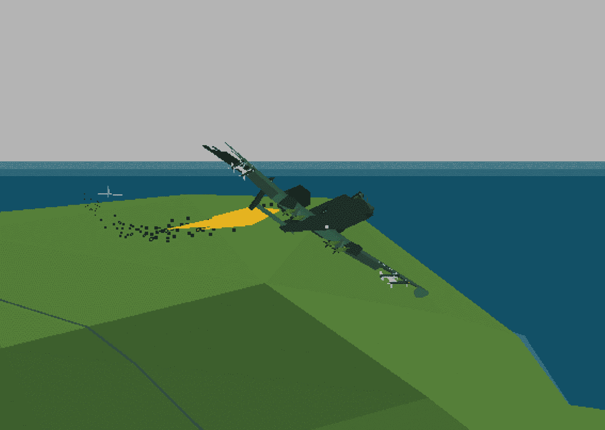

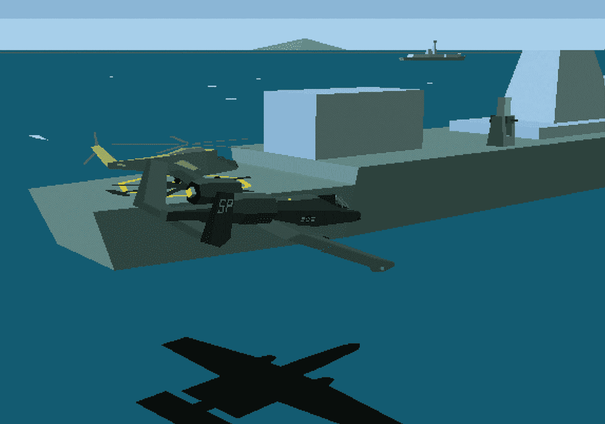

A-10 Attack，Parsoft Interactive，1995

期间出现了其他服务，其中最著名的可能是 Omni Games Network、`Kali`、`Sim-Net`以及暴雪的`Battle.net`。后者完全免费，仅限于暴雪开发的实时策略游戏`Warcraft`、`Warcraft II`、`Starcraft`以及地下城游戏`Diablo`。

Omni Network 于 1994 年 9 月推出，提供四种定价方案——每月费用最高为`$14.95`（加每小时`¢50`），最低为免费（加每小时`$2.50`），且当时限制仅限 8 人在线。这个人数随需求稳定增长。成员可以聊天并在任何支持`AppleTalk Remote Access`的游戏中向彼此发起“挑战”。

`Kali`源于一种名为`IPX`的 PC 网络协议，该协议被许多 Windows 和 DOS 游戏用于多人模式。

对于使用 AppleTalk 或`TCP/IP`进行多人操作的纯 Mac 游戏，有了`Sim-Net`，这是一个虚拟社区和在线匹配服务，最终支持十多款 Mac 游戏，包括`F/A-18 Hornet`、`Bolo`、`Descent`和`Warcraft`。

每年费用`$75`的`Sim-Net`拥有聊天室、公告板、文件上传和下载、竞技场以及“虚拟商店”，企业可以在那里发布广告、与员工交流并举行在线会议。整个服务通过一个图形界面呈现，将不同的服务链接到城市中心图的各个位置。

`F/A-18 Hornet`是全场的焦点。全球有成百人加入“黄蜂”中队，参加一次性的遭遇战或锦标赛（每场比赛两名或四名玩家）。格恩·布鲁诺（Glenn Bruno）是顶尖高手之一。他使用`Thrustmaster`操杆和飞行控制系统玩`Hornet`。他从未购买过其他深度玩家为了加速转向而使用的方向舵，但他用一个巧妙的技巧弥补了这一缺失：他在转弯开始时将喷气机的推力开到最大并放下襟翼，这样就能比使用方向舵的玩家转得更快。

在`F/A-18 Hornet`出出的十多年年前，布鲁诺拒绝了一个成为真实战斗飞行员的邀约。他通过了`Warrant Office Flight Training`计划的测试，具备成为`Cobra`攻击直升机飞行员的所有条件，但他对入伍五年的要求望而却步。在二十二或二十三岁时，那似乎是一个永恒。

`F/A-18 Hornet`出炉时，布鲁诺每天在`Sim-Net`上在线玩，代号为“蟑螂队长”（Captain Cockroach）。每位玩家都会从航空母舰或海军基地开始开始比赛，双方相隔几英里，起飞并尽可能快地向对方飞来。一旦翼尖交错，战斗就开始了——一场殊死战，仅使用加农（`gun`）。曾一度，他是无战不胜的。他们甚至发给他一张证书以表彰他的飞行战斗能力。

布鲁诺一直活跃到`Hornet 2.0`时代，然后在`3.0`时代早期他完全停止了。（他的业务带他去了希腊，他在那里的一个岛上住了几年。）社区继续通过`Sim-Net`在线玩`Hornet`游戏，并越来越多地通过`GameRanger`，后者在 2000 年 4 月增加了对`F/A-18 Korea`的支持。

`GameRanger`于 1999 年 7 月首次亮相，支持 11 款热门商业游戏——包括`Civilization II`和`Quake`系列——并迅速成为 Mac 游戏行业的行业标准。它的创始人`Scott Kevill`凭借其功能完备、高质量的共享软件`Quake-editing`程序`Quiver`在社区成名，随后他又推出了`QuakeFinder`（也针对`Quake`）和`UnrealFinder`（针对第一人称射击游戏`Unreal`）——两个用于寻找和连接粉丝运行的多人服务器的工具。

通过`GameRanger`，他希望提供一种将 Mac 用户视为等公民的在线多人游戏服务。它拥有不断更新的服务器列表、聊天室、私信（带有“忽略玩家”选项）、Mac 原生界面、即时配对、游戏内语音聊天、玩家搜索以及直接从`GameRanger`应用程序无缝启动游戏的功能。令人惊讶的是，它是免费的。

社区和媒体迅速青睐了它。`Macworld`在其`1999 Mac 名人堂`荣誉奖项中授予了该服务“最佳互联网游戏成就奖”。`Mac Games`内部评价它“填补了 Mac 在线游戏领域的一个巨大空白，再受欢迎再不过了”。注册用户数以近乎线性的速度增长。到年底，`GameRanger`拥有 14,000 名成员。在首次公开发布约 400 天后，成员突破了 30,000 名。到了 2003 年，它已超过 10 万用户。总游戏时间随着这些飙升的数字而起伏增长。

当`GameRanger`迅速占据多人动作和策略游戏市场时，另一项服务找到了一个利基市场，迎合了另一类玩家和游戏。共享软件软件开发者和发行商`Freeverse`最初将`HMS Freeverse`构想为其自己的家庭友好游戏（如`Classic Cribbage`和`Spades Deluxe`等标题）提供在线多人和聊天服务。但它的效果非常好，他们决定将该服务开放给其他公司。

资深行业老兵`Lane Roathe`非常喜欢这个主意。他曾担任过百款游戏的制作人或程序员（或两者兼顾，有时还担任设计师），其中许多是运行在 Mac 上的。在 20 世纪 80 年代后期，他为`Infocom`的`Apple II`文字冒险游戏共同创建了一个自定义操作系统，并担任磁盘杂志`Gamer’s Edge`的执行编辑——两年后，他与`John Romero`和`John Carmack`一起离开那里，共同创立了`id Software`。`Roathe`后来还在发行商`Three-Sixty Pacific`担任多年制作人，在那里他在`Armor Alley`陷入困境后帮助其开发重回正轨，并说服管理层批准了一个名为`V for Victory`的策略游戏。（管理层不喜欢它既不是 3D 也不华丽，但`Roathe`和他的同事——其中两人还威胁要辞职——是正确的——它成为了 Mac 和 PC 上广受好评、屡获殊名的畅销书。）

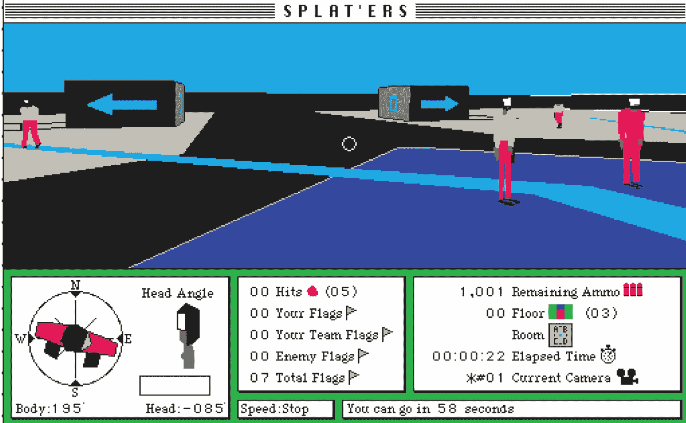

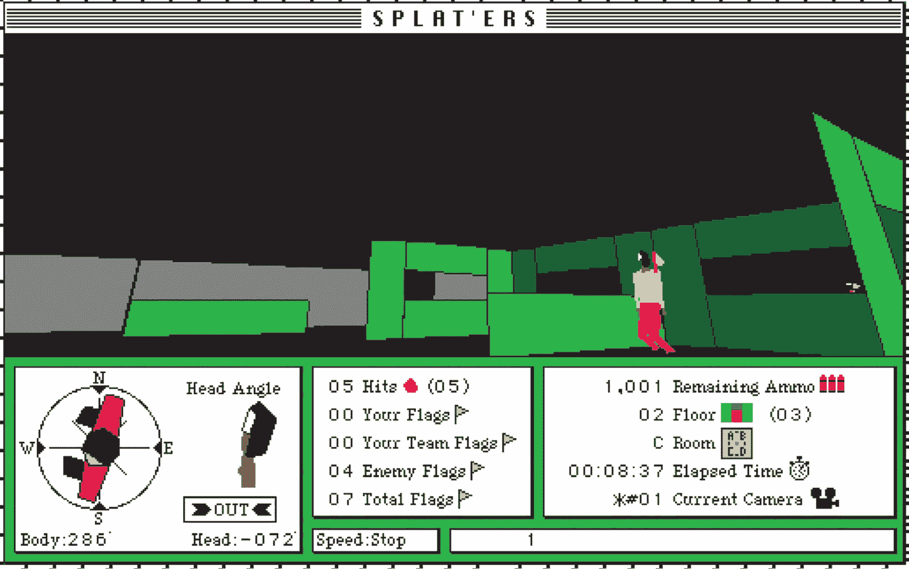

SPLAT’ERS, Bullseye Software,1991

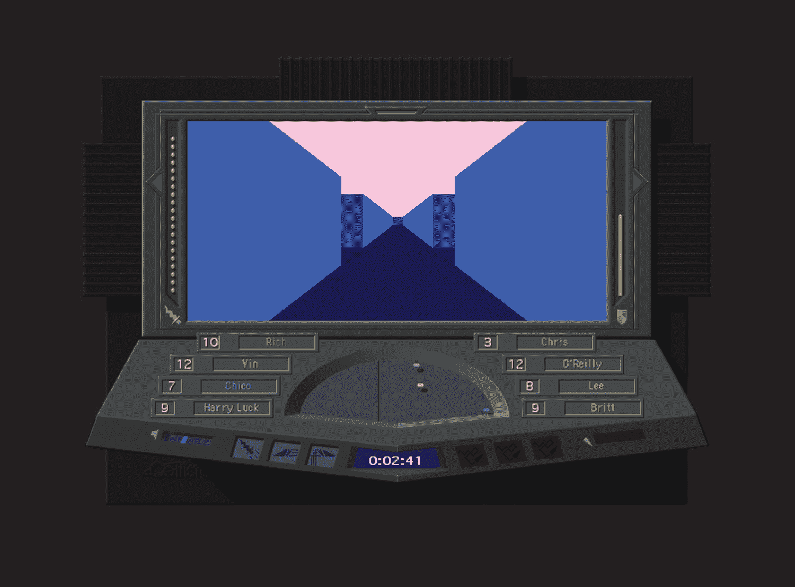


Super Maze Wars, Callisto, 1993

`Roathe`以合作者的身份加入了`HMS Freeverse`，现在现在更名为`GameSmith`。“我们从未有过过大的观众，”`Freeverse`副总裁兼联合创始人`Colin Lynch Smith`回忆道，“在巅峰时期，我认为我们大约有几百并发用户。但那群人充满了热情！晚上一直都在玩，有时就在聊天。”

该服务从未吸引过大量观众，但`Freeverse`推出了这么多游戏（到 2000 年代中期，支持`GameRanger-only`的游戏就有二十四款），以至于成员们从不缺选择。尽管被广泛观众关注并偶尔被媒体报道，`GameSmith`成了一个特别的地方。“那里有过一段丑闻，有一对人相识并结婚，也有竞争也有友谊，”Smith 说道。那里甚至在芝加哥郊外的一便宜酒店举办过玩家聚会。”然而，在 2000 年代后期，随着`Freeverse`转向 iOS 并被两家大型游戏发行商收购（先是`ngoco`，后是`DeNA`），它在 2011 年正式关闭。

### 他们现在在哪里？

`Stuart Cheshire`仍在苹果公司工作。同样，`Scott Kevill`仍领导着`GameRanger`，该服务现在支持使用已失效的`GameSpy`服务的旧 PC 游戏。`Lane Roathe`现在是个人财务公司`Quicken`的高级软件工程师。


68000 CPU, Motorola, 1984

## 10

### 游戏世界，尽情狂！

Craig Fryar

1983 年，Boich 招募了他在斯坦福大学的室友 Guy Kawasaki。正如 Owen Linzmayer 在`The Mac Bathroom Reader`中报道的那样，他邀请加入苹果布教团队（Apple Evangelism），去“哀求、贿赂和责斥软件开发人员和出版商，让他们承诺将创建支持原始 Macintosh 以及其他功能的新产品”。他在那个职位上表现出色。在他离开苹果后不久我遇到了 Guy，在随后的几年里，我们曾多次交集。我们第一次是在一次 Macworld 贸易展会上见面，当时他正在演示和推广`ACI`的 4 维度（`4D`）数据库软件。这让我们成为了竞争对手，经常挤在相邻的供应商展位上——我们两个经常进行针对`Ashton-Tate`的`dBase Mac`与`ACI`的`4D`的对决演示。回想起来，考虑到每个活动现场不断升级的明争暗斗，其实很有趣。我们花费了大量时间创建日益具有“说服力”的数据库演示。如果不是为了吸引听众做出回应而推出了那些酷炫的小礼品，我们可能会让观众们无聊到陷入集体昏迷。

虽然我很享受对决演示，但我的首要任务也是向苹果“反向布教”`Ashton-Tate`所有的 Macintosh 产品。我的圣杯是获得苹果发布会主舞台上的产品演示机会，或者其他几个令人向往的高曝光机会：联合的稀有联合营销活动、共同推广，或者更常见的在 Macworld 苹果的第三方展位上设立演示机台。`Ashton Tate`的 Mac 产品线包括`Ann Arbor Softworks`的`FullWrite`和`FullPaint`，以及`dBase Mac`。这些在当时都是极具说服力且强大的产品，这使得我获得苹果关注的工作变得容易得多，并频繁收到合作邀请。那是一段非常美好的时光。

随着时间的推移，苹果注意了我作为第三方布教者的才华，并招募我加入布教团队。我感到非常荣幸——这真的是梦想成真。我于 1990 年 1 月开始工作，接替 Guy 之前的职位，负责苹果顶级业务第三方软件开发人员的技术布教工作：`Microsoft`、`Lotus`、`Ashton-Tate`、`Claris`和`Symantec`。我最初的重点是`Microsoft`，向`Mike Maples`和他的产品经理团队进行简报——都是为了支持他们下一版本的 MacOS 版`Word`、`Excel`、`PowerPoint`（以及最后的`Flight Simulator`）。

在担任布教者职位的早期（是的，我名片上的头衔确实是这个），我受邀作为软件出版者协会（`SPA`）消费者部门董事会成员代表苹果。在 1990 年 3 月，我见到了几位 PC 消费软件和视频游戏开发商的高管，包括`Sierra Online`的`Ken Williams`、`Spectrum Holobyte`的`Gillman Louie`、`Three Sixty`的`Jon Correll`、`Maxis`的`Will Wright`以及许多其他人。很快，我就会再次拜访这些人，“哀求、贿赂和责斥”他们，让他们创造出新一波 MacOS 游戏。

不久后，我目睹了苹果首席执行官`John Sculley`和`Frank Casanova`在 1990 年 Macworld 上进行了一场相当平淡且散乱的`Mac IIfx`发布会演讲。我没有直接参与该活动，除了提供一份第三方开发者的联系名单以安排在苹果展位进行新的业务软件演示覆盖之外。但看到如此优秀的新产品以如此廉陋的方式展示，内心的不适点燃了一个想法。我构思了一个场景：在该场景中，新的 Macintosh 硬件将以一种非常积极、具有差异化的方式呈现，而且这种方式也可以变得非常有趣。

我开始想象未来的新产品发布会如何真正震撼观众。我可以预见到苹果的高管演示色彩斑斓的下一代消费级作品和视频游戏，这些游戏在`Mac IIfx`（以及很快就会`Mac LC`、`IIsi`和新的`Performa`系列）上展示出卓越的图形、视频和音效。当然，演示时间将与持续的高端桌面出版和图形渲染演示保持平衡，但增加面向消费者的格调将使发布演示比看在`Word`或`FullWrite`中重新排版文档，或在`Excel`或`Lotus 1-2-3`中重新计算电子表格要有得多。

在傍晚的一个下午，我接到了`Sam Schillace`的电话，他是`Ann Arbor Softworks`的一名工程师，也是`Ashton-Tate`的前同事。1988 年`Ann Arbor`被收购后，我简短地见过 Sam。

Sam 想知道我是否愿意看看他和他的朋友`Steve Newman`正在开发的一个游戏引擎概念。8 月 14 日，Sam 带我来到他的工位，向我展示了他们创建的 3D 矢量引擎原型。那一刻，我看到了真正的多人 3D 动作街机战斗游戏的巨大潜力，这种游戏通过`AppleTalk`网络进行，而这正是 Sam 和 Steve 的想法。

他们需要一个能够写计划并寻找人、资金来帮助他们完成并发布游戏的商业人士。Sam 在会议结束时问我是否对这个职位感兴趣。我毫不犹豫地同意了，前提是我需要苹果的批准和许可。几周后，苹果高管`Jean-Louis Gassée`发来了一份许可，让我将此作为副业经营，这时我为`Peninsula Gameworks`起草了一份简单的十点“合作伙伴关系协议》，用于创建`Spectre`（更多细节见下一章）。

一个月后，1990 年 9 月 4 日，我收到了教育布教者`Marvin Zauderer`的另一个关键电话，他知道我开始接触游戏。他建议我参加与`LucasArts`的会议，看他们演示一款即将推出的冒险游戏（《猴子岛秘密》），并讨论未来游戏开发的潜力。

会议结束后，我立刻知道了做什么——我在苹果的任务变得清晰了。我开始申请从业务支持转为重点关注消费市场，特别是视频游戏、音乐和“教育娱乐”。幸运的是，由于`LucasArts`的兴趣以及`Spectre`成功带来的初步内部兴奋，时机是正确的。但最终，是`Kirk Lovener`、`Scott Snell`、`David Szetela`和`Shirley Stas`的支持才让我这段奇妙的三年冒险成为可能。非常感谢他们每一个人，让我能够自由地追求这样一个神奇的梦想。


这段冒险实现了我的愿景：让苹果的高管在发布会上展示令人震撼的游戏和模拟、互动音乐和媒体创作，以及令人惊叹的早期儿童教育娱乐。它还诞生了一系列专门为支持游戏而新建的 MacOS API 和驱动程序；通过艰苦的调解为 Mac 音乐软件行业带来了一个统一的 MIDI 标准；苹果通过“什一”（他们内部对种子硬件和软件的术语）提供了超过 15 万美元的 Macintosh 计算机和原型来刺激游戏开发者；并最终出版了限量版的《Macintosh Game Developer’s Handbook》。

这些投入的时间、精力和金钱证明是值得的。苹果今天在消费市场的主导地位最初是由一群极忠诚（有时是独占）的 Macintosh 游戏开发者重新点燃的，随后是针对性媒体报道的快速增长、源源不断的盈利视频游戏以及其他作品。

### 为了乐趣和利润的布教

小测试：你能说出哪款最初的仅限 Mac 的游戏启发了世界上最受欢迎的 AAA 大作跨平台游戏系列之一（提示：截至 2016 年总销售额超过 50 亿美元）吗？稍后介绍。

事实证明，布教远不仅仅是哀求、贿赂和责斥。如果方法正确，布教的驱动力源于个人（和公司）内心他们深信自己可以让世界变得更好（更有趣、更有娱乐性）。

这一切始于一个简短的提议，一项分两部分的战略，旨在对内对外启动“消费者与游戏传教”活动。首要任务是说服苹果公司。在 20 世纪 80 年代后期，为了追赶 IBM、微软以及 PC 克隆机，苹果大多放弃了游戏和消费市场，而克隆机的市场份额在 1985 年至 1990 年间从 50% 飙升至 85%。苹果重塑了营销策略和信息传递，以自己与“爱好者”电脑的印象保持距离。当时美国企业界显然更有吸引力，正如俗话所说：“没有人会因为购买 IBM 而被解雇。”高盛银行的研究估计，到 1990 年，开发 Macintosh 应用程序的增量成本几乎是 Windows 版的两倍，而仅为已占市场 85% 份额的 PC 应用贡献了 8%。

让-路易斯·加塞（Jean-Louis Gassée）是导致苹果市场孤立的主要推动者。他被斯库利（Sculley）亲自任命接替史夫·乔布斯的旧职担任 Macintosh 开发主管，随后被升为高级产品开发和全球营销主管。在他于 1990 年离开苹果之前，我曾无意听到加塞坚定不移的决心：“绝不让任何 PC 软盘插入 Macintosh”。他关闭了所有克隆机寻求者的努力，包括 AT&T、Apollo 以及其他希望授权 MacOS 以构建计算机系统的公司——而微软自 20 世纪 80 年代中期以来一直在积极地向 PC 克隆机供应商授权 Windows。

据我所知，加塞此前否决了美国军方的一项 MacOS/Windows 双系统方案建议，类似于 Mac IIfx 配备了来自 AST Research 或 Orange Micro 等公司的 PC 卡。他对于高溢价、优越且纯粹架构有着不可动摇的信念，这扼杀了视频游戏软件开发商和发行者的兴趣，许多人正面临着支持哪种计算机系统和游戏机的抉择。Mac 最终变成了低优先级选择。

斯库利和苹果董事会最终迫使加塞离开，并用迈克尔·斯林德勒（Michael Spindler）取代了他。这开启了一个充满可能的新时代，因为斯林德勒主持了 PowerPC 合作的引入，以及与摩托罗拉和 IBM 建立新的操作系统合作伙伴关系（名为 Taligent 的合资企业），但当苹果决定另一个操作系统并不是好主意并于 1995 年退出交易时，这一计划也同样消失了。

1991 年 1 月，开始传出我正在推广 Mac 游戏的消息。我联系了之前在 SPA 和 1990 年 Macworld 大会上见过的几位开发者高管。当第五届年度计算机游戏开发者大会（CGDC）于 3 月 10 日在圣何塞开幕（距离苹果库比提总部仅几分钟车程）时，我已经与来自 Maxis、Sean Hill Software、Digital Illusions、MacroMind、Access Software、LucasArts、Reactor、Brøderbund、Psygnosis、Origin、Sierra On-Line、Three-Sixty Pacific、SSI 和 EA 等公司的人进行了单独的 NDA（保密协议）简报会议。

在 CGC 期间，我展示了支持 Mac 平台的商业案例，演示了测试版系统，并提供了设备“捐赠”以激发初步开发。我还邀请了几位同事和传教士，包括 Aaron Hyde、Philip Ivanier、Jim Dumont 和 Ted Barnett。他们展示了 QuickTime 的预览，以及新的 LC II 和即将推出的 Performa 系统系列。

而且你猜怎么着，这种“传教”工作，只要方法得当，实际上真的奏效。我们的信息引起了共鸣。在 CGDC 之后的几周里，来自感兴趣开发者的电话接踵而至，其中包括独一无二与伦比的克里斯·克劳福德（Chris Crawford），以及来自 Electronic Arts、Disney、Interplay、Lucasfilm、id Software、Dreamers Guild、Inline Design、Reactor、Accolade、Maxis、Presto Studios、MacSoft、Spectrum HoloByte、Cyan、ICOM、Graphic Simulations 和 Advance Gravos 等公司的高级人员。

大多数人都加入了认证苹果开发者计划。这让他们能够获得纸质和在线开发者库、专门的支持以及用于测试的借用设备。我发现自己不断地发布简报 NDA，随后是出货“捐赠”系统，这些系统与测试借用机不同，因为它们是永久性的计算机系统赠予。简报在洛杉矶的数字世界大会、WWDC 和 Macworld 上持续。我经常通过巡游贸易展会的角落展位就能找到新的开发者！

然后事情终于发生了。

C. J. 莫平（C. J. Maupin），苹果企业营销和创意服务总监兼执行总裁“演讲大师”，打来电话并留了言：“克雷格，我正在和约翰[斯库利]一起准备即将举行的多媒体会议。他非常喜欢 Electronic Arts 的《PGA 巡回赛高》，并要在 8 月 26 日的会议上演示。请回电给我。”哇，终于发生了。苹果的首席执行官真的要向行业和执行同事们演示视频游戏了。大师计划正在奏效。但只有一个插曲：游戏对苹果来说仍然非常新，而且今年 52 岁的我非常严重怀疑斯库利是否具备了所需的快速反应，来掌握那经过仔细计算的连续三次空格键序列，以便将球击入球道。现在怎么办？

我拨打了 EA 营销总监戴安·弗林（Diane Flynn）的电话并分享了这一消息。她非常兴奋，但也担心斯库利无法以最佳状态展示游戏。由于鼠标和键盘被用作 Macintosh 的控制器，游戏是通过各种鼠标移动、点击和按键序列进行的。在将鼠标对准球道上的目标后，《PGA 巡回赛》要求通过敲击空格键来计时开始击球，此时挥杆指示器从右向左缓慢移动。玩家再次敲击以确定最大功率（小心避免“过挥”），然后当指示条从左向右返回并加速时，需要最后一次仔细计时的敲击将指示器停在显示出的狭窄“甜点”区域。屏幕上的高尔夫角色将根据你的敲击执行挥杆。如果你在最后敲击时晚了（大多数新手都是这样），球会严重向右偏转。斯库利总是偏转。


《PGA 巡回赛高》，Electronic Arts，1991

我的解决方案是询问 Mac 版开发者、Dreamers Guild 的罗伯特·麦克纳利（Robert McNally），他是否可以编写并编译一个供约翰演示使用的特殊“苹果执行版”。他硬编码了游戏，使得无论空格键敲击时间如何，球每次都能击得既直又远。我们发誓绝不让那个光盘离开我们的视线。约翰的演示非常精彩，当他在 TPC Sawgrass 的第一洞完成开球、切球和推杆获得标准杆时，观众为他欢呼。

然后事情再次发生，这次走向了全球。

几周后，C. J. 回了我的电话，告诉我高尔夫演示的效果非常好，约翰现在想在 10 月 10 日日本东京举行的国际多媒体会议上演示另一款游戏。这次他想演示 Maxis 的《蚂蚁大战》（SimAnt），该游戏今年夏天曾由杰夫·布劳恩和乔·西里卡向我展示过名为“昆虫”的预览。每当蜘蛛攻击并咬住一只蚂蚁时，斯库利就无法抑制那标志性的微笑。我们与 Maxis 合作编写了一个两分钟的演示脚本，然后在日本会议中心面对座无虚席的观众进行了演示。排练期间，我提醒约翰不要“盖过”观众的笑声，因为将他的言论翻译成日语通常需要三到五秒。演示非常完美，观众笑声没有间断，《蚂蚁大战》随后在 1992 年作为捆绑软件演示出现在特定的消费级 Mac 上。

内部传教策略的第一部分已经成功。Apple 对游戏的支持已从`Engineering`扩展到`Marketing`，贯穿整个`Developer Services`，一直到达`C-Suite`高层。

# 传教策略篇：现在去说服世界

我外部传教策略的第二波即将进入高潮。这是一场针对 Mac 行业和视频游戏媒体的、集中关注与报道的活动。

东京之行不久后，一份新闻稿宣布了 Apple–IBM–Motorola 联盟（即“AIM”联盟），这向行业媒体和持怀疑态度的软件开发者传递了一个信号：Apple 似乎正在向更开放的架构迈进。这为我游戏开发者加速开发 Mac 版本提供了更多理由。我记得当时被邀请作为传教代表，组成三人小组前往纽约白普莱斯（`White Plains, New York`），就`PowerPC`的软件应用支持进行初步讨论。当我们与对方对面坐下时，第一句对话字面上意思就是：“好的，如果我们（Apple]）承诺开会时不穿（短裤，只要你们（IBM]）承诺不打领带。成交吗？”

不久后，杂志出版界的老兵`Jim Capparell`联系了我。“我们正在研究并收集数据，看看是否有机会将我们的《PC Home Journal》扩展为一份新的 Mac 消费者读物。如果我们相信 Apple 的广告商会买单，我们可能会在几个月后启动。”他们决定在`Macworld`上推出一份 24 页的免费预热版作为赠品。《Mac Home Journal》于 1992 年秋季发行，涵盖了 Macintosh 消费者软件的方方面面，并频繁推出游戏专题。他们一直出版`MHJ`直到 2006 年中期。

更多的媒体支持在 1993 年 2 月到来，当时`Tuncer Deniz`办了电子杂志《Inside Mac Games》，它成为最大且历史最久的 Macintosh 在线游戏物。`Macworld`、`MacUser`甚至`MacWEEK`也加入了进来，通过游戏测评、专题和颁奖仪式认可并庆祝 Mac 游戏开发者的热门作品和独特创新。我甚至说服`MacUser`赞助了 1992 年 4 月举办的首届 Mac 游戏大赛。

我想感谢一位 Mac 游戏新闻报道的早期先驱：`Hartley Lesser`。他和他妻子`Patty`从 1986 年 6 月的《Dragon》杂志第 110 期开始，对 Mac 游戏进行了早期报道。他后来成为 Mac 游戏的领先倡导者，为我引荐无数开发者，并体现了高效传教者的核心。感谢你，Hartley！

总结这段旅程，我将简要描述我传教工作的巅峰（也是我最大的快乐）：1992 年 5 月`Macworld`的“游戏世界，尽情狂欢！”开发者小组会议，其形式深受`Mike Myers`电影《威尔的世界》（`Wayne’s World`）的幽默启发。我们以“十大排行榜”开始，介绍最新的热门游戏发布，随后是来自软件发行者协会（`Software Publishers Association`）的单位增长统计，当时我们庆祝了 1991 年 Mac 游戏销量创下 508,638 台的记录。编写《Macintosh 游戏开发者手册》的工作已经在进行中，我们在小组讨会上对其进行了预告。现场还展示了 Apple《全球用户调查》的摘录，显示超过 50% 的用户经常玩游戏，且游戏已成为`Macintosh LC`系统上的首选用途。

随后，特邀嘉宾被引入“节目”，并接受了关于对`MIDI`、图形、`QuickTime`和声学管理器的最新开发者支持的采访，以及游戏设计和开发的目标规格。这次小组会议大获成功，尤其是 Apple UI（用户界面）教父`Bruce Tognazinni`的冷幽默。根据小组会议的成功，这份以“游戏世界”为主题的《Macintosh 开发者游戏手册》定稿并出版，并于 1992 年 8 月手工分发给了几十名开发者。这项早期的游戏 API 工作最终演变为了`Mac Game Sprockets APIs`。

`Macworld`结束后不久，我有幸结识`Gametek`的执行制片`Gordon Walton`。我们很快成为朋友，并一直保持至今。事实上，他最近还邀请我的一个儿子去他最新的在线视频游戏公司担任短期测试实习生。令我们苦恼的是，如今 Gordon 和我经常被称为“游戏老头儿”（Game Geezers）。天哪。

噢，至于我之前那个关于 50 亿美元游戏系列的问题：那种稀缺的声誉属于`Bungie Software`，以及`Alexander Seropian`和`Jason Jones`的经典第一人称射击游戏《马拉松》，该游戏最早在 Macintosh 上发布且效果最好。

《马拉松》的游戏概念和引擎最终开发成了轰销的《光环》（`Halo`），微软说服`Bungie`为`Xbox`开发该游戏，永远定义了那台游戏主机。`Bungie`被微软收购，`Jason Jones`随后还担任另一款《马拉松》衍生作品《命运》（`Destiny`）的主设计师。我在 1992 年 6 月通过共同朋友`Hartley Lesser`的介绍认识了`Alex`。`Alex`和我见过几次，期间我为`Bungie`提供了借用设备、开发和测试资金，并安排了演示场地、工程支持以及`Apple Store`的货架空间。他们是极其投入的 Mac 游戏开发者，支持了 Apple 的许多最新技术，包括在 1994 年的更新中引入新的`PowerPC`平台。回到 Apple 后，甚至连`Steve Jobs`也对游戏区分 Mac 的力量感到热情。他在`Macworld`演讲中展示了《光环》（由`Jones`演示）。

我记得当时`Alex`打来一个电话，兴致勃勃地说：“Bungie 已入选`Macworld`名人堂，而且很多连锁公司都在找我们，包括`Babbage’s`、`Software Etc.`等。”他们正走在成功的道路上。我将以 Mac 游戏的最后一个秘密作为结尾，即对`Graphic Simulations`的幕后观察。我的朋友家人很清楚我最喜欢的类型是飞行模拟，而我最终参与了其中四个作品的设计（到目前为止）。`Graphic Simulations`是最初在`Macworld`展位角落、就在卫生间旁发现的开发者之一。

通过与`Parsoft`的`Eric Parker`合作，他们已经发布了我最喜欢的模拟游戏之一《太平洋地猫》（`Hellcats Over the Pacific`），随后是《莱泰湾》（`Leyte Gulf`），以及最终的《F-18 蜂鸟》（`F/A18 Hornet`）。我曾向他们提出一个提议：如果你承诺为全景 180 度飞行体验增加多显示器支持，我就给你们展示一款强大的新款 Mac 系统的测试版。他们同意了。当时还没有其他桌面系统提供无缝的多显示器 API，结果确实惊人。`Graphic Simulations`的《F/A18 蜂鸟》多显示器版本是 1993 年`Macworld`演讲的重点演示。他们升级后的展位前排了长队观看和体验！

此后不久，在`Graphic Simulations`前往帕图森特海军航空军基地（`Patuxent Naval Air Station`）验证`F/A18`飞行模型期间，一位美国海军指挥将我拉到一边，询问我是否能设法说服`Jeff`和`Trey`接受合同，制作十台配备《F/A18 蜂鸟》的多显示器 Mac 系统，用于航母上的业余模拟练习。他提议当场开出一张 25 万美元的支票。我努力说服`Jeff`，但他内心愿望是让`Graphic Simulations`保持简单有趣。

最后，为 Apple 启动 Macintosh 游戏市场非常疯狂。在我担任 Apple 首任游戏传教者期间，有一百多游戏启动并发布。1992 年消费电子展（CES）上，Apple 展位 60% 被视频游戏、消费应用和教育娱乐开发者占据。在`Sculley`的 CES 演讲中，他强调了 Apple 正在认真回归消费市场。我生动记得`Diane Flynn`在 1993 年夏天打来的电话，她承认：“EA 的 Mac 版比 PC 版好看好一倍。”来自像 Electronic Arts 这样的巨头，这简直是锦上添花。

我继续向许多传教同事表示感谢，他们鼓励并直接支持了这一愿景，为许多开发者的成功做出了贡献。还要感谢 Apple Store 团队，他们同意在货架上陈列优秀的游戏，并在消费级 Macintosh 系统上推广和捆绑演示版本，以培养对游戏作品的兴趣——这往往导致了零售购买。

最终，我要感谢许多领会了这一愿景并将其化为己有的开发者。抱歉，在这段简短的纪实中，还有许多其他人没有提到。最后，正如川崎凯亚斯（Guy Kawasaki）经常说的：“传教不是一份工作，而是一种生活方式。”对我来说，这句话依然真实。

又及：我制作过的最好的软件是在东京`SimAnt`诞生整九个月后出生的。

## Notes

1. `Tchotchke`（`chäch-k`、`-kē`）源自波兰语（`czaczko`），是一个犹太语词，指小摆件或装饰品。1990 年代的贸易展上的`tchotchke`通常非常有价值。
2. `Goldman Sachs Research`（高盛证券研究报告），《泰坦之战》，2012 年 12 月 7 日，72 页。
3. 这些游戏标题中的几个被包含在 Apple 1992 年的`Mac Game Demo CDs`中，作为商店演示分发给 2,000 多家`Performa 零售商`。
4. 我们的第一个孩子，一个了不起的女儿，和我妻子`Celia`出于 1992 年 6 月 15 日出生。我从未想过有一天我竟然会对一次台风如此感激。


Robot Spectre, Spectre, 1991

# 11


## Peninsula Gameworks

**作者：Craig Fryar**

这就是世界上第一款 3D 在线多人游戏如何首次在 Macintosh 上亮相的故事。

“你想向我展示什么？”那是加利福尼亚州库比蒂诺一个温和的 7 月。我坐在 Apple 技术传教部门的角办公桌前，盯着我的“思考（Think）”标牌。

“这是一个我和 Steve 在闲暇时间开发的游戏引擎原型。”电话那头是 `Ann Arbor Softworks` 的软件工程师 `Sam Schillace`，他们是 `FullWrite` 和 `FullPaint` 的开发者。`Ashton-Tate` 在几年前收购了他们。我们在我担任 `dBase` 系统工程师期间相识，我也担任了新产品 `dBase Mac` 与 Apple 的对接人。

“听起来很有趣。我周四会过去看看。”我在日历上记下了。

这种影响立竿见影。我一生中最喜欢的两款游戏是街机版的 `Battlezone` 和 `Atari 1200XL` 上的 `LucasArts’ Ballblazer`。`Sam` 展示了他们的 `Spectre` Alpha 版本，这是一款类似的坦克风格游戏，但它超越了单一街机柜或游戏机的限制，包含了通过 `AppleTalk` 网络进行的在线多人游戏。这对于 3D 动作游戏来说是行业内的首创。

“你的意思是，我可以在建筑的另一个部分，甚至在另一个城市，并连接上炸掉别人的坦克吗？”`AppleTalk` 发布于 1985 年，用于将 Mac 连接到打印机并彼此连接，但还没有人构思过 3D 交互式网络游戏。

“是的，看着吧！”`Sam` 随后驾驶他的线框坦克穿过正方形矩阵战斗场，躲避墙壁、3D 盒子、柱子和金字塔。“看，有 Steve 在那儿——让我们炸他！”他瞄准一辆迎来的网络坦克，用一连串快速火力将其像素化，其中包含了后来被称为标志性声音的弹壳撞击金属碰撞声和警报警告声。

正是这种直观而又具有关联性的动态让我意识到，这可能是一件了不起的事情。

“那么接下来是什么？我能帮什么忙？”我试图保持冷静，但我的脑海已经进入五档，希望他们会让我帮助他们完成游戏并推向市场。

“我们需要一个业务人员来帮助我们寻找并谈判出版交易，并协助完成一些测试、文档工作以及其他收尾工作。我们正在晚上和周末加班工作，但希望在几个月内完成。你感兴趣吗？”`Sam` 非常直率。

“绝对可以，这太棒了，我相信它会成为大热门。”我回答道。“让我看看能否获得 Apple 的许可参与进来。”我自言自语，希望 Apple 将此视为一种业余爱好，而不是与我作为业务应用传教士的日常职责发生冲突。我最终收到了 `Apple Legal` 的豁免和批准，并由 `Jean-Louis Gassée` 签署。

“谢谢演示，我下周给你回复。”

我立即动身回家并拨给了我妻子，她是一家网络技术公司的系统工程区域总监。

“你不会相信我刚刚看到了多么疯狂的新游戏概念。”兴奋让我的声音颤抖。

我们当时并没有意识到 `Spectre` 对我们的生活和职业会产生多大的影响——这种影响改变了我们的职业。

### 一份早期评测

让我们快进到 1992 年 5 月的一份 `Macworld` 评测。

“最初，`Spectre` 看起来不像一个能引起我兴趣的游戏。”文中写道。“它在视觉上很有吸引力，但缺乏维度。”

这是游戏记者 `Adrian Mello` 的开场白。他继续道：

“让我想起一种名为 `Battlezone` 的老式街机游戏（我的初步反应也是如此）。在这两款游戏中，你都在一个 3D 世界中杀出重围，同时敌方坦克靠近并进攻。很棒，对吧？但几小时后，我仍在玩！”

他详细描述了网络连接的便利性和速度，最后总结道：

“这是我玩过的最棒的网络游戏，我强烈推荐它！”

`Sam`、`Steve` 和我在 1990 年秋季一直保持联系，期间我起草了一份简单的业务计划（第 10 项是最重要的）和一份简单的合同。`Sam` 将公司命名为 `Peninsula Games`。我们希望至少能赚到钱买一台“极快的” Macintosh。也许吧。

### 寻找出版商

测试策略的一部分是寻找出版商。几家出版商表达了礼貌的兴趣，但没有实质性的进展。

当我逛 `Software Etc.` 商店查看稀缺的 Mac 游戏标题时——我还是业务应用传教士，主要关注微软——一款 PC 飞行器的独特设计吸引了我的目光。

我的第一个决定是，我必须玩 `Jetfighter II`。截图看起来极了，著名技术专栏作家 `John Dvorak` 的评价非常有说服力：

“从家人手中夺走，所以考虑买两份。它仍然是终极飞行器！”

我的第二个想法是：“谁知道呢，一个足够进步到推出这种革命性设计的出版商，也许也愿意在 Macintosh 游戏领域创造历史。”

我找到了 `Velocity` 在旧金山的办公室电话并拨了过去。

回复出现在 1991 年 1 月 14 日。邮件开头道：

“这个游戏在成瘾性上几乎和《俄罗斯方块》一样。酷的游戏……令人印象深刻。”

这是我收到来自 `Velocity Development`——PC 版 `Jetfighter II` 出版商——创始人兼总裁 `Moses Ma` 的信。他还提出了几个新功能需求，这让 Sam 非常不悦。

## Spectre、Velocity，1991

“你觉得包装盒背面这几个屏幕截图下面放这句标语怎么样？”他问道，“Spectre，让你在 20 个人的房间里能体验到的最大乐趣！”

我想，这些哥们儿可能有点太前卫了。

在发布后，这句话再次出现在我的脑海中。当时，他邮寄给我几页精美的单页营销彩页，以及两打色彩匹配的 Spectre 包装。真的吗？

在经过一次相当严厉的交涉后，他承诺那些宣传材料不会见诸市场。

### 色彩填充

紧接着，事情变得引人入胜。

我挑战 Sam 和 Steve，让他们思考如何利用 Macintosh 优秀的显示器来实现游戏的差异化。具体来说，他们原始 Demo 中的图形仅为“线框图”——坦克和形状的轮廓，模仿早期街机游戏如《小行星兽》（*Asteroids*）和《战地危机》（*Battlezone*）中使用的矢量显示器。

以我最喜欢的飞行模拟游戏中的色彩渲染地平线为例，我建议他们考虑添加一个选项：让填充色的坦克、旗帜和多边形出现在色彩渲染的地平线背景上。

Sam 的回应是：“很有意思，但不太。”

几个周六后，Steve 打来电话告诉我这个消息：

“我熬了一整晚，搞定了。”

到目前为止，我对 Steve 的印象是个天才。但这一天他喜气洋洋，迫不及待地向我展示色彩填充在屏幕上看起来有多棒。他是对的，看起来极了，尤其是与之前单调的黑色地平线相比。

那一刻再次证实，这将是一件大事。

### 玩家名称

Steve 这种坚持不懈并解决问题的决心感召了我，于是我提出了另一个疯狂且大胆的想法。这个想法将彻底让这款游戏脱颖而出，并真正使 Mac 成为第一个多人游戏系统——毕竟，还有什么技术能做到这一点？

我们可以在坦克上方显示玩家名字吗？这样你就能看到自己在射谁了。

坦率地说，在线游戏的魅力为游戏增加了“关系性”动态。Sam 在几天内就实现了这一功能，它随后成为了最受讨论的功能之一。

它的网络效果——双关语，如此——扩大了游戏的受众，因为在当时视频游戏主要针对年轻男性。`Spectre` 显示玩家名称的关系性动态让战斗变得异常精彩，下属可以集结火力轰炸老板的坦克。

我们经常听到男、女、孩子们的讨论，他们喜欢看到自己是在和谁对抗——无论隔着房间还是在另一栋楼里。

### 适合所有年龄段的设计

主要的设计目标之一是保持游戏内容适合所有年龄段的孩子。

是的，它是动作街机射击游戏，但是是机器对机器。没有血，没有内脏。这是我在《Mac 游戏开发者手册》（*Macintosh Game Developer’s Handbook*）中倡导的主题。

这引起了许多开发者的共鸣，是我在游戏领域最自豪的成就之一。我的请求很简单：至少给玩家一个选项——例如，如果游戏涉及射击，请包含显示火花、绿色粘胶或彩弹效果的设置，而不是血液。

`Bungie`、`Velocity`、`Pangea` 等公司接受了挑战，并将其作为选项提供，或者在 `Bungie` 的情况下作为标准配置。

事实上，如果你回到过去，查看 `Bungie` 从《漫游之路》（*Marathon*）开始，到《光环》（*Halo*），最后到《命运》（*Destiny*）系列游戏的亮点，你会发现正是如此：火花四飞，敌人死亡，但没有去人性化的血液、内脏和血腥。

后来，我在 `Interplay Productions` 期间也推广了这种设计理念。与其说是一个功能，不如说是一种价值观。

总裁 `Brian Fargo` 与我辩论了仅由玩家操作与机器人对抗的玩法优劣，因为当时有一份关于游戏《下行》（*Descent*）的提案，要求加入半机械人类以引入第一人称射击元素。

我的观点占据了上风，《下降》随后成为了 `Interplay` 的畅销游戏之一，这部分归功于它广泛的吸引力。

在发布后的庆祝活动上，Brian 对一组员工说：“我们这次是坐着 Craig 的光辉升入天堂的。”这暗示了虽然他并不公开信教，但他知道我的基督教信仰影响了我的商业实践和原则。

### 网络代码优化

Sam 也忙于创新。他优化了网络代码，使游戏可以在此前出厂的任何 Macintosh 上运行。

这是通过插值玩家位置实现的，而不是让 `AppleTalk` 载入每个玩家移动的点对坐标。正如他当时向我解释的那样，只有当玩家坦克改变方向时才会发送网络消息，而中间的路径则进行插值。

这种设计的效率使得游戏即使在大型 `AppleTalk` 网络上也能保持极高的响应速度和趣味。

### 包装设计

Velocity 团队也忙于创新。

Moses 曾与 Wong 和 Yeo 设计公司合作开发喷气战斗机飞行模拟器盒子，并取得了巨大成功。他对他们的下一个任务是用全新的包装盒设计来体现我们的赛博坦克动作街机射击游戏。

他们草拟了几个方案，最终确定了一个倾斜的四梯形形状，配有一个 3D 三角旋转塔。颜色反映了游戏中坦克的绿色调，并为 Logo 设计了一个全新的自定义字体。

这是一场引人注目的视觉设计，增加了游戏作为当地零售商处少数 Mac 游戏之一的新颖感。

事实证明，这对零售商来说非常沮丧，因为盒子无法正常堆叠，会损坏黑色塑料 3D 塔三角形。


现在是 1991 年 9 月底，Moses 打电话告诉我盒子已进入最终生产，游戏将在几周后发货。

Velocity 的营销副总裁 Liz Ross 有一个绝佳的主意：在 `MacUser` 和 `MacWEEK` 举办网络游戏派对。这两个活动都吸引了大量记者和客座订阅者参加。`MacUser` 随后提名《Spectre》为年度最佳游戏。

### 后续发展

Sam 和 Steve 合作开发了第一款协作式浏览器端文字处理器，他们将其命名为 `Writely`。它最初是一个基于 `AJAX` 的黑客实验，于 2006 年被 Google 收购。一个月后，公司 90% 的员工都在使用它。[^2]

与 Sam 和 Steve 一起工作让我想起了史蒂夫·乔布斯的一句名言：

“我认为，如果你做了某件事而且结果很好，那么你就应该去做其他精彩的事情，而不是在上面沉溺太久。只需要清楚下一步是什么。”

自从离开苹果公司以来，我曾在几家视频游戏公司工作，包括 `Interplay`、`Electronic Arts` 和 `Wargaming.net`。

2010 年，我转变为幕后领导角色，负责架构数据和分析平台以及分析师网络，提供数据驱动的洞察，为游戏设计、开发、发行、营销和管理提供支持。

如果你对职业设计和开发视频游戏感兴趣，请参考后记关于如何入门的建议。

无论你在职业生涯中做什么，我的建议是寻找并与那些能给你启发、分享你的愿景并磨炼你意志的人共事。

无论你创造、发明或生产了什么，请确保你重视关系胜过对错，这样当你完成后，也能“让机器运转下去”。

[^1]: Macworld，1992 年 5 月，第 180 页。[`goo.gl/kgkBko`](https://www.goo.gl/kgkBko)

[^2]: The Verge，《创始人称 Google Docs 起源于一个拼凑出来的实验》[`goo.gl/nYLDD9`](https://www.goo.gl/nYLDD9)


*Spaceship, Cosmic Osmo and the Worlds Beyond the Mackerel, 1989*

# 12

## 神秘的世界

当 Rand Miller 上初中时，一位家族熟人带他去了位于新墨西哥州阿尔伯克基市、离家附近的当地大学，向他介绍了电脑。

Rand 以前听说过电脑，但那是个人电脑出现之前，所以他从未真正见过。但在大学里，他有机会使用了一次。那位熟人让他坐下面对一台连接到 `IBM 主机` 的 `CRT 终端`。

他加载了一个名为 `Lunar Lander` 的游戏。这是一个非常简单的程序——屏幕上只有几个数字，显示飞船在月球表面上方多高以及下降速度有多快，然后是一个问题：你想消耗多少燃料？

目标是在航天器到达月球表面之前恰好减速，使其能够安全着陆，而不是坠毁或飞回空中。

Rand 着迷了。这看起来就像魔法一样。他只需要学习更多相关知识。那位熟人解释说，电脑是由使用特殊语言的人编写的，而最简单的语言是 `BASIC`。Rand 很快拿到一本关于 `BASIC` 编程的书并开始学习。

### 井字棋程序

他首先做了一个“井字棋”。他写出了所有的输入和输出，来询问玩家的下一步动作，并在屏幕上打印出棋盘的可视化表示。

然而，他不清楚如何让电脑控制的对手做出动作。他从书里学了很多 `BASIC` 语句，但没有一种能涵盖这点的语句，于是他向那位熟人寻求帮助。

“我已经把这些都做好了，但我不知道哪条语句是让电脑思考——让电脑选择它的移动的。那条语句是什么？”

当 Rand 的大学同学笑完后，他解释道，考虑到所有可能性是程序员的职责。程序员必须告诉电脑一切。

Rand 瞬间明白了。从那以后，学校每天放学后，他都会去那个大约一个街区远的大学，在计算机中心度过几个小时，玩游戏并用从其他用户那里偷来的密码编写他自己的游戏。

### Macintosh

随着年龄的增长，他对电脑的痴迷持续着。他尝试了各种必须从套件组装的冷门早期家用电脑，并利用每一个机会学习更多编码。

他上了大学，结了婚，有了孩子。他在德克萨斯州东部边界的 `Citizens National Bank of Henderson` 接了一份编程工作。

接着在 1983 年底，一位在电脑商店工作的亲戚向他展示了一本手册。上面说 `Apple` 将要推出一台新机器。

Miller 从未买得起 `Apple` 电脑，但现在他的收入很可观。他购买了送达他亲戚店里的第一台 `Macintosh`。

一旦他看到它的位图图形、字体以及 `WYSIWIG 界面`，他意识到这些东西对他意味着什么。`Mac` 是他想要却不知道如何开口要求的一切。

他买了每一卷 `Inside Macintosh` 并从头到尾读了一遍，对那些微小设计决策中所付出的巨大努力感到震惊。

他被制作自己的字体、图形数据库和电子表格的可能性迷住了。但 `Mac 编程` 似乎是一座太难逾越的山峰。相反，他满足于做一个 `Mac 用户`。

他建立了一个 `Macintosh 用户组`，并与其他用户交易字体和信息。他玩了 `Dark Castle`、`Zork` 和 `Déjà Vu` 等游戏——这些游戏捕捉了处于另一个地方的感觉。

### HyperCard

接着，1987 年，`Apple` 发布了 `HyperCard`。

它是由 Bill Atkinson 创建的。他也是 `MacPaint` 的作者，以及共同编写 `Macintosh 图形库` `QuickDraw` 的人。作为第四位“Apple 学会士”（在两位 Steve 和 Alan Kay 之后），他拥有一个预先批准的预算，足以资助公司内部的一个小组项目。

Atkinson 使用他的预算开发了他最初命名为 `WildCard` 的软件。

`Apple 营销部门` 拒绝了 `WildCard`，他们对其发布不感兴趣。Atkinson 不愿放弃，准备辞职去其他地方追求他的程序。

但首先，他向他的朋友兼导师 Alan Kay 寻求建议。Kay 反而请求他的朋友、Apple 首席执行官 John Sculley 允许 Atkinson 向他演示软件。

Sculley 立即同意了。他全力支持这个项目，并决定 `Apple` 将该程序——在解决商标问题后被更名为 `HyperCard`——随所有新 Mac 免费赠送，现有 Mac 用户仅需支付 49 美元。

Sculley 本人于 1987 年 8 月的 Macworld 博览会上主持了 HyperCard 的公开发布。

最终产品比他曾痴迷的 `WildCard` 演示更具前瞻性。在 Kay 的建议下，Atkinson 开发了一门名为 `HyperTalk` 的脚本语言。

它使用类似于英语的语法，允许用户编写规则和算法，规定堆栈中每张卡片的工作方式——如何响应输入。这样，当人们点击某处时，魔法就会发生。

### HyperCard 的影响

HyperCard 是革命性的。

`BASIC` 让任何人都能以极小的努力制作简单的微程序，但需要一些技术知识。`HyperCard` 没有这种障碍。它可以在不写单行代码的情况下构建功能完备的软件。

许多人创建了 `HyperCard 堆` 来处理税务和记账，或者记录高尔夫得分。老师用它跟踪学生成绩，制作小型教育程序或互动教程，这些比教科书更有吸引力。

百科书商提供了 HyperCard 版本。商务人士用它进行公司演示和投资推演。

有些人发现了更具创意的用途。

一个名为 `If Monks Had Macs` 的免费软件——后变为商业软件——将 Mac、电子书、文章、游戏、音乐、插图、日记写作和教育交织在一起。

它几乎无法用语言描述，俏皮地赞颂了知识与思想。它的设计师布莱恩·托马斯（Brian Thomas）特意在 `HyperCard` 发布时获取了它。

他的第一个作品《Passing Notes》讨论了在现代世界中，我们如何继续参与古老的实践并赋予其新生，以及进化论如何作为一种创世神话发挥作用。

随后，比尔·阿特金（Bill Atkinson）的一封鼓励信让托马斯大胆地与 `HyperCard` 狂热分子 `Philip Mohr` 合作，完成了 `If Monks Had Macs`。

他们将想法、游戏和趣味性实验封装在一个虚拟的修道院中，并随着新卷的加入逐渐丰富。

其中有一个冒险游戏、一个点唱机、一个关于肯尼迪刺杀事件的卷轴，以及一个讲述白玫瑰抵抗组织在第二次世界大战期间出版地下刊物、以揭露希特勒真面目的故事。

它甚至用优美的格列利亚圣歌迎接访客。


“我建立这个图书馆的灵感很大程度上来自洛杉矶充满活力的朋克摇滚现场，”托马斯后来告诉`HyperCard Heaven`，“我把自己视为一个工人，从企业赞助的‘文化食尸鬼’手中夺取了信息和思想的生产与分配手段。我觉得很有趣。”他的乐趣成了世界的痴迷。在广泛的赞誉中，`If Monks Had Macs` 赢得了`Macworld`和`MacUser`的奖项，并最终被`Voyager`公司商业化，该公司是里程碑式多媒体 CD-ROM《贝多芬第九交响曲》背后的公司。

雷·维德默（Rene Vidmer）通过一系列战争模拟游戏，成功地将`HyperCard`引向了一个完全不同的方向，从二战盟军轰炸模拟游戏`Bomber`开始。每款游戏都由图表、绘画和内部真实照片混合成插图，上面覆盖了不可见的按钮，让控制变得栩栩如生。

战斗的声音——在`Bomber`和坦克模拟游戏`M4`中还有引擎声——以及船员的聊天声，为维德默的作品带来了无与伦比的沉浸感。给船员的每条指令都会得到口头回应；同样，损坏报告和无线电信息通过扬声器或随游戏附带的耳机传入。听到对讲机的滋声穿透螺旋桨和引擎的嗡嗡声，足以让你后颈汗毛竖立。每一种声音都可能预示着生与死。

维德默通过`HyperCard`实现了不可思议的成就，但这个视觉数据库编程工具在他雄心勃勃的模拟压力下崩溃了。游戏经常会崩溃，对玩家输入的响应也很慢。

另一方面，最早的、最具有突破性的`HyperCard`作品之一`Inigo Gets Out`却与该软件的局限性相得益彰。它的创造者阿曼达·古德恩纳夫（Amanda Goodenough）试图捕捉她在童年听祖母讲故事时所记忆的互动性——那些故事非常看重解读和对“接下来会发生什么？”的问题。`Inigo Gets Out`既没有文字也不需要文字。孩子们可以通过直观地点击屏幕周围的热点，来决定冒险猫`Inigo`下一步做什么，从而创造自己的故事。

这只猫可以在不同点跳进叶堆、追逐鸟类、爬树、钓鱼（然后掉进水里）、追兔子，并检查花园软管（结果发现是一条可怕的蛇）。它的互动性有限，但在这种简单中表现得异常强大，并被誉为这场数字叙事革命的先锋。

兰德·米勒（Rand Miller）也有类似的想法。起初他使用`HyperCard`为妻子创建了一个食谱数据库，并为孩子们制作了一些小玩具。但随后他看到了教育软件的糟糕状况。“感觉就像如果你有一位伟大的艺术家和一个伟大的程序员，你就能做出真正的游戏，”他回忆道，“否则，你会被推向儿童软件的领域。”

米勒认为他本可以做得更好。他完全可以在`HyperCard`中编写出很棒的东西。他还有一个弟弟罗宾（Robyn），比他小七岁，是一个才华横溢的艺术家。

兰德曾鼓励罗宾对音乐和艺术的兴趣，甚至向罗宾展示了基础的绘画技巧，如透视、反射和水波。但当兰德的兴趣更多集中在技术领域（计算机和编程）时，罗宾更青睐这些更具艺术性的追求。

八岁时，罗宾在看完《爱丽丝仙游游后后神神地回来。色彩、舞台、插图——这一切都留在了脑海中。这太不可思议了。他梦想成为迪士尼的动画师。几年后，在迪士尼的家庭度假期间，他购买了一张原始的《睡公主》电影胶片，以此提醒自己只要下定决心就能创造出什么样的东西。

当他进入高中（即三四年后），他的艺术老师教他传统的绘画技巧，而他自己自学了喷笔画。到学年底，他经常创作大型的超现实主义绘画。他对此非常痴迷。他会勾勒自己的思绪以明确想要的东西，然后每天画几个小时。他努力在奇特与熟悉之间取得平衡。当他成功时，他感觉自己站在云端。知道这段旅程到达了预期的目的地让他感到凯旋；相反，如果某些事情出了问题，他会非常痛苦。

但在高中快结束时的一天，他转向了新的痴迷：音乐。当他开始学古典钢琴时，他对待这项任务投入了同样的专注，这种专注曾让他在绘画领域在短时间内取得了如此大的进展。他在钢琴和吉他上创作并录制了歌曲。大部分都很糟糕——至少起初是如此——但学会用一种新方式表达自己是令人兴奋的。

高中毕业后，罗宾在华盛顿大学学习文化人类学——离他们父母现在住的地方不远。在这里他继续写他的歌曲，画他的奇幻世界，并像他的大哥一样，深深爱上了`Mac`——尽管不是拥有的，而是父母地下室里的那台。

这时，他接到了兰德的电话。一个名为`HyperCard`的新程序刚刚发布，是一个非常棒的开发平台，内置了绘画工具。兰德解释了他的构思：一本儿童书，每页都有热点，可以触发小小的动画或声音等等。

罗宾觉得这听起来是个好主意，于是兰德给他寄了一份`HyperCard`供他玩玩。收到的那天，罗宾一时起意，画了一张井盖的画，背景有一个灭火栓。接着他想：“噢，热点将是你点击它，井盖就会滑开。”他画了那个变化，并在打开的井盖上又做了一个热点，他决定那里将触发一个巨大的藤蔓长向天空的动画——就像童话《杰克与豆茎》里的场景一样。

## 《人井》的诞生

屏幕一接一屏，互动一次又一次，整个世界在意识流中浮现出来。他从未想过，竟然会有其他人能看到他所创造的这个超现实的、点击即可导航的世界——这个存在电脑屏幕里的空间。如果他当时想到了，或许会退后一步，经过更深思熟虑的思考和规划。但他当时太沉浸在探索自己的创作以及实现这些点的技术的兴奋之中了。

`Robyn`开始将他`HyperCard`世界的片段发送给`Rand`，由`Rand`负责修复他弟弟在技术上的错误，并确保一切运行正常——让动画正常播放，点击热点能触发预期的响应。他们还添加了若干段简短的音乐小调、一系列简单的音效，以及几个卡通的配音，用来读出世界里角色会说的那些胡说话。

在某一点，玩家可以通过一扇小门进入一座高塔，遇到一只躺在舒适椅子上、戴着墨镜和链子项链的龙。随后，一段录好的语音会对应屏幕上的对话框，上面写着：“嘿，宝贝，欢迎来到我的酷窝。请自便。吃块饼干，宝贝。行了，你真酷。让我帮你热热，哥们儿。”接着在不小心把饼干变成灰烬后，他说道：“哇，宝贝！真遗憾。”

在同一座塔更高的位置，玩家可以遇到一头坐在小船里的大象，它提议带玩家穿过一系列隧道，隧道最终通向一个穿着考究的兔子的茶杯。在其他地方，一只说法语的乌龟和他的翻译（一条小鱼）会引导玩家来到一群跳舞的海马和一个说话缓慢的海象，海象喜欢在一个艘沉船里睡午睡，那艘沉船里面还包括一个隐藏的钢琴合成器和一幅“沃尔特·沃尔·鲁斯三世爵，年度海象王”的肖像。

这个微小的世界因其细节而显得宏大，超现实且令人惊喜，而且每个地方都以一种神秘的方式通过一系列路径与其他地方相连。在旅程的每一步，《人井》俏皮的音频提示都增强了这种魔力：它们赋予了世界生命。

## 成功与认可

兄弟俩带着他们跨越五张软盘的作品，参加了一个名为`Hyper Expo`的`HyperCard`贸易展。他们自制的包装上写着：“人井：Robyn Miller 为儿童设计的 HyperCard 软件包”。他们还提供了一个演示版本，名为《消防火栓》，其中只包含人井旁消防火栓内部的区域。参会者们着迷了。`HyperCard`的创始人 Bill Atkinson 本人带着他四岁的女儿也对该游戏赞有有加。《人井》在设计上可能欠缺打磨，画风虽然吸引人但画得很粗糙——更像是一幅草图而非精美的画作。但当 Rand 看到成年人像孩子一样痴迷其中时，他知道他们真的拥有某种特别的东西。

视频游戏发行商 Activision 的产品开发副总裁对此印象如此深刻，以至于带了一份回去评估。他将其展示给公司的技术负责人 William Volk 看，后者被这种无形界面震惊了。以往视频游戏需要某种屏障（如按钮或键盘命令）来中介交互，而《人井》在玩家点击屏幕的位置与随后发生的情况之间提供了直接连接。Activision 为兄弟俩提供了一份交易。《人井》很快进入了世界各地的软件零售店和邮购目录。

`Macworld`在其游戏名人堂中专门设立了一个新类别，以此纪念《人井》。软件发行者协会授予了该游戏“最佳计算机新用途”的“软件卓越”奖。William Volk 后来通过策划该游戏在 1989 年于`CD-ROM`上的发行，赢得了更多荣誉——使其成为首款在北美出版的`CD-ROM`游戏——以及 1990 年的`DOS`版本。


`The Manhole, Prolog/Activision, 1988`

## 青色世界与宇宙 Osmo

Robyn 和 Rand 建立了`Cyan Worlds`公司，配合《人井》的 Mac 版发布。在 Activision 的支持下，他们开始了第二个`HyperCard`冒险游戏的工作。

这里的想法是做同样的事情，但花更多时间。Rand 在世界设计方面有更大的投入。《宇宙 Osmo》和《��鱼之外的世界》将关于探索一个由微行星组成的微宇宙。玩家将驾驶一艘发射棉签而非激光的飞船，并利用跃迁驱动在不同世界之间穿梭。

Robyn 绘制了数百个场景。他仍然随心所欲从一个地方扩展到另一个地方，但现在他有一套工作流程。他通常会从一个序列或房间的区域开始，然后他们两人互相交流想法。“不是大的策略会议，”Robyn 回忆道，“更像是：‘嘿，冰箱里放什么你有主意吗？’‘帐篷里有个会说话的辣椒怎么样？’或者‘我们为什么没有科学星球？’开发到一半时，这变得容易了，那时两人开始在华盛顿州东部的乡村小镇斯波岩同一空间共同工作。”

与《人井》一样，《宇宙 Osmo》充满了扭曲空间的转换和超现实、奇幻的世界，足以与爱丽丝仙游媲美。在一个星球上，玩家可以进入一个小木屋，天花板上有一个倒置的楼梯通向厨房。在冰箱里，她可能会和一只冰凉的辣椒聊天，或者看着成年的鸟从蛋托盒里飞出来；而打开旁边的柜子则可以欣赏一瓶唱歌的番茄酱的表演。在地板，在狗碗旁边，玩家可以通过一扇门进入，门只够鼠标通过，门后是一个运行着名为`Home Card`程序的类 Mac 房间。在四个星球的到处都有可互动的物品——角色、玩具、电话、动画和音乐创意套件、会变成其他物体的物体等。

《宇宙 Osmo》于 1989 年分别推出。像《人井》一样，它深受评论界和玩家的赞誉，认为是一场奇幻的冒险，挖掘了`HyperCard`和 Mac 黑白显示器的潜力。

兄弟俩现在构思了两个概念。一个是针对年轻观众的松散教育游戏——与他们之前的作品一样，目标不是教育而是激发孩子的好奇心。它将设定在一个洞穴网络中。每个洞穴里都有各种软件玩具，有些是科学性的，有些具有创造力或趣味性。另一个概念暂名为《灰色召唤》，是一个手绘的黑白冒险游戏，有明确的目标、成熟的剧情和玩家需要解决的谜题。他们向发行商推销了这两个想法，但对《灰色召唤》并不感兴趣。然而，Brøderbund 喜欢这个新的儿童游戏概念。兄弟俩搁置了成人向冒险游戏的梦想，开始创作《Spelunx》和《Seudo 先生洞穴》。

《Spelunx》中的每个房间都像一个游乐场。一个隐藏在地板下的房间，墙上有一面镜子，点击后会变成可以缩放的太阳系地图。镜子下面有一张桌子，有六个抽屉。右上角的抽屉会在咖啡机里生成杯子，中间右角的用草体在镜子上写下`Spelanx`，右下角的则发射出一枚火箭。左侧的抽屉隐藏着简单的动画和绘画工具。在同一个房间里，一幅画活了，出现了一个可以拖动的男人。如果被放在某些物体附近，他就会与之互动——他可能会弹钢琴或坐在沙发上，或者去冰箱里翻找吃的。

在其他地方，玩家可以种出带有各种叶子、花朵和果实的树。她可以从闪电发生器和一个可以向里丢石头的井中学习声速。如果她对着 Mac 的麦克风说话，架子上的两个木偶就会随着玩家的话进行口型同步。为了激发对语言的热爱，二十二个单词可以不断组合并重新组合成任何配置，生成各种滑稽的八字句——例如，“穿袜的慢树变胖了”——并让一群可爱的小动画人物读出来。树内部的一个房间里有一个奇妙的音乐序列器，它与某种舞蹈序列器相连。玩家可以根据二十四个预设动画（大部分是简单的手臂、腿部或身体动作）编排一套动作，让跳舞的人在音乐播放时表演。在其他地方还有蚁缸和蜥蜴箱、一个电影制作器、一个 X 射线放大镜、一个“把吐司弹回给调吟主人”的小游戏、一些关于天文和洞穴历史的简书籍、一本玩家可以写的日记，以及各种其他的互动奇珍。

米勒兄弟正在开发更多的洞穴作为外包出售。其中一个可以让玩家在墙壁上绘画并装饰洞穴内部。另一个包含一台打字机。玩家可以使用一个隐藏的控制面板添加这些新洞穴并重新排列它们，该面板可以通过将电梯停在楼层之间到达。但当这款创新的软件乐场销量低于预期，且 PC 版开发因在 DOS 中无法以合理的性能水平复制其功能而陷入停滞时，这些计划被搁置了。

有一小段时间，Cyan Worlds 似乎已经结束了——米勒兄弟不得不为生活找些别的事情做了。然后他们得知一家名为 Sunsoft 的日本公司一直试图联系他们。Sunsoft 非常喜欢《井》（The Manhole）和《宇宙奥》（Cosmic Osmo），想要资助一个针对更年长观众但面向新兴 CD-ROM 主机游戏的类似项目。

米勒兄弟并没有再次翻出他们的《灰色召唤》（Gray Summons）提案，而是构思了一个新概念。他们绘制了地图并大致勾勒出一个设定在岛屿上的神秘冒险游戏的想法。它带有一点朱尔·凡尔《神秘岛》的色彩，玩家到达这个奇异、未知的地方，发现了一个先进文明的遗迹。它与《灰色召唤》也共享了一些想法。它通过谜题在玩家、世界和故事之间创造摩擦，并从一本书开始——《灰色召唤》的墙上有一幅画——这封书将作为通往这个未知世界的门户。他们将其命名为《迷失》（Myst）。

兄弟俩再次转向`HyperCard`作为他们的技术基础，并请了一位新成员理查德·瓦特森（Richard Watson）来分担编程工作。与它的前作一样，《迷失》将拥有一个不可见的点击驱动型界面和一个由单个图像构建的世界。尽管它会有一个复杂的故事，但他们像既往一样，从设计一个地方开始。《迷失》岛旨在成为时代的缩影，一个奇妙的世界，曾经被一个被称为“尼”（D’ni）的先进文明居住过——这个名字源于 Robyn 参与过的一本未出版儿童书，书中讲述了一个发现名为“敦尼”（Dunny）的地下王国的男孩。这个世界包含了各种复杂的机器、建筑和小装置，但现在处于休眠状态。它空空如也，只剩下原住民留下的谜题和书籍。

技术的局限性驱动了关键的设计选择；他们将世界划分为“时代”（Ages）——不同的、独立的区域，类似于主题公园，每个区域都有自己的历史——并开始将故事元素融入游戏书籍中。

他们努力让谜题具有逻辑性，尽管成效参半。他们的理论是大多数人并不喜欢谜题，但这些谜题对于与世界产生摩擦是必要的，因此他们尽可能地避免任意的解。谜题必须成为世界的一部分，就像它们与其说是谜题倒不如说是环境的一部分，并且需要通过观察和逻辑来解决。

与这种以逻辑为核心的谜题设计方法不同，Robyn 追求视觉上的超现实，起初他试图通过在`Photoshop`中手绘场景来实现这一点——因为《迷失》将是全彩的。然而，`Photoshop`非常不利于世界设计，手绘图形被证明不可行，于是他切换到了 3D 设计工具。一段时间后，他们聘请了 3D 艺术家兼动画师查克·卡特（Chuck Carter）来帮助。

开发过半时，苹果新的`QuickTime`多媒体编码器得到了更新（添加视频压缩），这意味着他们可以将短视频嵌入到书页中。Cyan 将此视为将核心故事开发转向视频的机会。非关键的书籍——四个“时代”中各一本——仍包含文字背景故事，但现在核心故事线可以通过表演表现出来。


《迷失》，Brøderbund，1993

由于缺乏聘请演员的资金，Rand 和 Robyn 亲自扮演了这些角色。幸运的是，两个主角是兄弟，阿肯纳尔（Achenar）和西鲁斯（Sirrus），他们是一个名为“尼”工匠阿特（Atr，也由 Rand 扮演）的儿子，在互相指责导致了父亲的（表面上）死亡后，他们被困在了书中。玩家在剧情中的角色首先是找到补全兄弟俩消息的缺失页码，然后释放他们——或者不释放。

起初，团队计划《迷失》没有音乐——只有由音效设计师克里斯·布兰坎普（Chris Brandkamp）制作的音效——因为他们认为这会破坏场所感。毕竟，在真正的荒岛岛上漫步是没有配乐的。Brøderbund 建议他们尝试一下，于是 Robyn 创作了一些内容证明他们是错。当音乐加入后，他的观点改变了。忧郁且富有氛围的背景音乐是完美的。他使用了`E-mu Proteus`合成器创作了 40 分钟的歌曲。

到 4 月份时，令所有人惊讶的是，销量已达到 20 万份，并且仍在加速增长。《神秘之旅》（Myst）成为了 CD-ROM 的代名词——在 Mac 平台上经历了数年的缓慢增长后，它终于开始成为整个计算机行业的标准。多媒体时代已经来临。大多数新的 Mac 和 PC 现在都配备了 CD-ROM 驱动器，而那些没有的电脑正迅速通过售后驱动器进行升级。而大多数人在购买新 CD-ROM 驱动器后，买的第一本书就是《神秘之旅》。

“它就像是一个完美的时代游戏，”罗宾（Robyn）建议道，“所以大家都开始回应。”杂志表现出兴趣，电视电台想要采访，《神秘之旅》由此进入了一个持续的正向反馈循环：巨大的销量和热度引发了更多的媒体关注，而这反过来又导致了更高的销量。到 1996 年中，它的销量突破了 250 万份，且没有任何放缓的迹象。

《神秘之旅》的故事被扩展为三部小说：《阿特拉斯之书》、《提亚娜之书》和《尼之书》，这些小说由米勒兄弟联合专业作家大卫·温格夫（David Wingrove）共同撰写。它还有自己的恶搞游戏`PYST`，并在热门电视节目中被引用。人们可以购买授权商品。曾一度，迪士尼甚至接触过 Cyan 公司，有意在佛罗里达州建造一个受《神秘之旅》启发的主题公园。《神秘之旅》已经超越了视频游戏。它成为了一种文化现象，而这两个来自华盛顿州小斯波坎的兄弟——一位旅行非教派传道的长子和三儿子——成为了明星。

“这简直让我们目瞪口呆，”罗宾说。他和陆兰德（Rand）真的不知道如何处理这种突如其来的名声。他们针对广泛的年龄段设计了《神秘之旅》，并旨在让平时不玩游戏的人也能享受其中。但这两个兄弟无论在做梦也没想过《神秘之旅》会成为当年的畅销游戏，以及十年最畅销的游戏之一（在所有电脑游戏中，只有`Sims`的销量比它多）。


“过了一段时间，我才意识到有数百人在买这个游戏，”罗宾继续说道。他徒劳地试图理解这些数字。“唯一能真正理解的，就是参加大型音乐会，看到那里所有的所有人，然后想：‘好吧，这还不是玩《神秘之旅》的人的一角。’”

对于罗宾来说，名气带来的所有关注都变得令人难以忍受。媒体的采访请求接踵而来，作为一个内向、注重隐私的人，他无法忍受——即使他们将采访缩小到每周一天。“幸运的是，兰德足够慷慨地承担了其中一部分工作，”他回忆道，“我能够专注于开发[续集]《里文尼》（Riven），那很有趣。”

“那是我喜欢做的事。我喜欢构建东西和制作东西，这对我来说很有趣。”

对于这对兄弟来说，游戏开发的吸引力一直在于创造世界。这使得《里文尼》成为一个令人兴奋的项目，因为《神秘之旅》的成功为他们提供了充足的时间和资金——《里文尼》四年的开发时间是《神秘之旅》两年的两倍，其预算最终将是他们在《神秘之旅》开发中预算（并超出）的`$265,000`的二十倍以上。


*Cosmic Osmo and the Worlds Beyond the Mackerel, Activision, 1989*

Cyan 对这部续集没有固定的预算或截止日期。他们没有接受发行商`Brøderbund`的任何预付款。他们依靠《神秘之旅》的利润生活和工作，因此他们不受制于任何人。这是好事，因为兰德和罗宾感到有压力，甚至有义务再次捕捉时代精神。《神秘之旅》可能引起了轰动，但它是有缺陷的。它可以更好；《里文尼》必须更好。

为了帮助《里文尼》提升到下一个水平，兄弟俩请了理查德·范德·文德（Richard Vander Wende）担任创意总监。他此前曾在乔治·卢斯的视觉特效公司工业光魔特效（Industrial Light & Magic）工作，在为迪士尼的《阿拉丁》担任了四年制作设计师后，在《里文尼》开发早期的数字世界博览会上遇到了陆兰德和罗宾。

范德·文德为罗宾的超现实主义注入了现实主义，为他的黑白增添了色彩。他赋予了世界一种棱感，赋予了角色一种复杂性，这与罗宾的设计相得益彰。程序员`Richard Watson`的任务是检查他们的工作，确保没有人在图像或故事中引入不一致之处或悖论——而这必须与《神秘之旅》游戏和小说的设定保持一致。

《里文尼》在方方面都超越了《神秘之旅》。更大的预算、更大的团队、更好的画质、更大的世界、更深的故事、更多的角色、更多的谜题、更大的多样性、更多的视频、更多的音乐、更多的动画、更微妙、更精炼，而且不知何故，也更加克制。它忠实于根源：一个具有氛围、文化和美学的世界，完全没有向像《激速战士》、《超级马里奥 64》和《古墓丽》这类即时性游戏妥协——游戏中玩家可以更自由地奔跑跳跃、杀戮并探索更大、更空旷的世界。

《里文尼》于 1997 年 10 月在 Mac 和 PC 上发布，销量超过了当年的其他电脑游戏。十二个月后，它的销量超过了 150 万份。到 2001 年，销量将增长到 450 万份。Cyan 再次做到了。

在《里文尼》结束时，罗宾已经受够了。通过《神秘之旅》和《里文尼》，他一直努力寻找方法让叙述和故事在他们创造的世界中活起来。但有些不对劲。“我觉得，‘你知道吗？这行不通。’他说。”

他热爱故事——电影、书籍，以及引人入胜的角色塑造。他曾认为游戏可以是一种伟大的媒介，但唯一可信的游戏角色是环境——而不是《神秘之旅》中的西拉斯斯（Sirrus）、阿肯纳（Achenar）和阿特拉斯（Atrus）。“我曾竭力实现它并创造出的体验，”罗宾解释道。至少根据当时的科技，游戏并不适合角色和故事。“这就是我决定离开的原因。”

当罗宾开启电影制作和非交互叙事的新职业时，`Ubisoft`接管了《神秘之旅》的后续作品，陆兰德和 Cyan 的其他团队转向了更大的挑战：一个许多玩家可以在同一时间共处的在线版《神秘之旅》。他们将其命名为`URU`。“我的构想在某些方面是《Spelunx》和《神秘之旅》的延续或合并，”兰德解释道，“我认为未来娱乐的关键是这种宽带通道——这种高速连接——人们将会拥有。而我认为缺失的将内容。”

## 他们现在在哪里？

`Rand Miller`仍担任 Cyan 的负责人。2016 年，他主导了一部名为《奥秘》（Obduction）的 Myst 精神续作的设计，`Robyn`为其创作了配乐并出演了其中一个角色。`Robyn`的电影《不朽的奥斯古·格拉德汀》（The Immortal Augustus Gladstone）是一部关于自认为是血鬼的虚构纪录片，于 2013 年上映。`Bill Atkinson`是一位自然摄影师。他拥有一个名为`PhotoCard`的明片制作应用。


*Kroll Droid, Spaceship Warlock, 1991*

# 13 部互动电影

1988 年，在他的 World Builder 继任者——以及 HyperCard 替代品——`SuperCard`取得小规模成功后，`Bill Appleton`从圣地亚回到了家乡田纳西州东部，创立了一家制作视频游戏和互动电影的工作室。

当时，互动电影还是一个新概念，除了激光光盘街机游戏《龙之谷》（Dragon’s Lair）和《太空王》（Space Ace）之外很少见——这两部作品与其说是游戏，倒不如说是通过依赖时间的按键操作来限制场景的电影。

但`ChipWits`的共同创造者`Doug Sharp`想要进一步推进这一理念。他梦想构建视频游戏的未来——创造能够表达情感和性格的数字角色，并围绕他们构建互动式的、电影化的、戏剧化且感人的体验。

为了实现这一目标，他开发了一个名为`Dramaton`的通用互动叙事引擎。它可以从一个由短剧本场景组成的数据库，以及一个关于世界（角色、设定和人物关系）和叙事结构的模型中生成故事。

为了测试这个系统的性能，`Sharp`决定制作一款游戏，其目标是接管禁令时期的芝加哥黑帮。玩家扮演年轻的小混混“平基·卡拉汉”（Pinky Callahan），其行动会影响关系并触发不同的场景。游戏的叙事代理就像一个电影放映员，根据观众的呼喊建议和已经播放的片段，将数小时又小时的短剪辑辑成一部电影。

在游戏术语中，每个剪辑都代表角色之间的简短互动。一切都有后果，角色拥有记忆。如果玩家花太长时间来选择平基的下一句台词，故事就会没有他们的情况下继续进行（通常会导致可怜的平基又犯一个错）。玩家还必须随时准备射击其他角色（使用鼠标进行瞄准和射击）。

文件大小的限制使得语音无法出现在游戏中，但粘土动画的头部和嘴巴意味着角色在表演时看起来是三维的——他们富有表情、怪异的脸庞让愤世嫉俗、冷酷马基雅维利式的剧情活了过来。而 1,000,000,000 种可能的故路径确保了没有两次体验是完全相同的。

`Bill Appleton`从野心不大的作品开始了他的互动电影新冒险。他的新公司`Stingray Entertainment`制作了一部具有模糊电影感的横版战斗游戏，名为《弗兰基的地牢》（Frankie’s Dungeon），该游戏曾通过邮购短暂发过，随后由一家名为`Reactor`的发行商更新并商业化出版为《诡异城堡》（Creepy Castle）。它细腻的画质、手绘动画和忧郁的音乐营造了极佳的氛围，但该游戏因难度太大且对玩家输入的响应太慢而受到批评。

与此同时，行业内部正在发生的变化将把他的互动电影野心推入超驱动状态。`CD-ROM`变得越来越容易获得，其巨大的容量——相当于 500 张标准的 3.5 英寸软盘——对于 Appleton 想要制作的游戏类型来说是一个福音。“你可以看到将要发生什么，”他说，“一方面，我们拥有所有这些创作工具，构建大量内容变得非常容易，但现在有了一个存储大量内容的载体。”将它们结合起来，你就能创造互动的魔法。

漫画家、软件设计师以及`Reactor`创始人`Mike Saenz`有着同样的想法。Saenz 在 1985 年与作家`Peter B. Gillis`（以及其他几位艺术家）共同创作了第一本商业出版的数字漫画而闻名。《Shatter》完全是用`MacPaint`配合鼠标绘制的，并在苹果点阵矩阵打印机上打印的，然后用传统方法上色。

Saenz 还创作了最早的互动成人娱乐作品之一`MacPlaymate`，它允许玩家使用各种性玩具和鼠标操作的刺激让虚拟狐女`Maxie`达到高潮。他还曾与`MacroMind`合作开发了数字漫画创作工具`ComicWorks`，以及具有不同模板库的完全相同的程序`GraphicWorks`。

现在，他梦想着更宏大的目标：一款适用于`CD-ROM`的科幻游戏，具有 3D 图形和配音角色，并以类似于《银翼杀手》和《星球大战》的电影风格呈现。为了实现这一目标，他需要找到一个帮手。

`Joe Sparks`曾在`NASA Ames`工作，负责模拟和视频中机器人、车辆和人的 3D 计算机模型。1989 年他在`Macworld Expo`上向公众展示他的作品时，`Mike Saenz`看到了。

留下了深刻印象，Saenz 向 Sparks 推销了他的想法。Sparks 花了很大力才被说服，但 Saenz 坚持了下来。“这太激动了，”他说，“你不会相信人们会对此何反应。它会很棒的！”到了 1990 年，Sparks 终于妥协了，他们开始了跨国合作——Saenz 在芝加哥，Sparks 在旧金山。

他们的第一个合作是为游戏制作一个广告模型，这样他们就有一个清晰的愿景来确定设计细节。故事将关于太空海盗的，所以他们想：“好吧，我们需要一艘海盗船。”接着是主题和关键角色。游戏将是一场电影冒险，玩家可以登上海盗船，穿越星系并面对各种危险。太棒了。

现在起名字。他们把想到的所有相关且有趣的词输入到一个`HyperCard`栈中，吐出随机组合。他们在电话里互相读可能的名字。“时空平基”（Time Space Billy）有一种特别、古怪的味道。但随后《星际战士》（Spaceship Warlock）出现了。就是它了。他们知道的。

这是一项极其雄心勃勃的任务。当时只有少数几个游戏采用了新的 CD-ROM 格式发布，而那种格式既贵得惊人，运行又慢得令人痛苦。但《星际术士》（Spaceship Warlock）无法在软盘上发布。软盘最大容量仅为 1.44 MB，无法装下如此宏大的想法。CD-ROM 可以轻松做到，但他们又无法利用其全部 650 MB 的容量。

Sparks 新买的 800 美元外接硬盘只有 120 MB（比他那台价值 8,500 美元的 Macintosh IIfx 的内置硬盘还多出 80 MB）。这成了他们工作的硬性限制。两人还相隔约 3,000 公里，大多数文件都太大，无法通过软盘或 AOL 传输——在 AOL 上，他们预期文件传输速度不超过每秒一字节。

他们可以通过电话交流，将草图和概念图画在纸上并通过传真发送，但游戏本身及其大量的 3D 模型都锁定在外部硬盘上。唯一的解决方案是将硬盘物理寄送跨越国。

`Sparks`精确计算出他需要多少时间完成所有工作，以便冲出公寓走向汽车，开车前往 DHL 快递中心，并在下午 5 点前交出硬盘，通过隔夜快递发送，这样第二天 Saenz 就能添加他自己的代码、动画、音效和其他设计元素。

至于 Saenz，他喜欢利用两人之间两小时的时差。他经常在早上 Sparks 醒来之前就传真了一又又卷草图。Sparks 回忆道：“我会查看这些草图，并尝试将它们转化为完全实现的 3D 飞船、怪物、外星人、隧道和武器——所有那类东西。”

开发进展得非常快，考虑到每一帧 3D 动画的渲染都需要一小时多时间，而且整个项目只有两个人在通过电话、传真和往回寄送硬盘在工作。1991 年 1 月，在他们开始仅四个月后，他们就准备好了一个演示版本，在旧金山的 Macworld 展会进行展示。


*《星际术士》，Reactor，1991 年（由 José Luis Sánchez 提供）*

其中一个特定的时刻总是能引起巨大的反响。Sparks 在渲染游戏第一个场景所使用的巷子时犯了一个错误。他包含了一扇无处可去也打不开的门。这是一个问题，因为第一个场景会设定玩家的预期。如果玩家点击门却什么都没有发生，她可能就不会再点击门了。

为了避免花费几个小时重新渲染纠正了错误的场景，Sparks 快速地凑了一个小动画。如果玩家敲那扇放错位置的门，一个当地的外星人居民就会探出头来说：“去用前门！”，然后回到屋子里。Sparks 在添加这个功能时并没有觉得有什么特别，但每个玩这个游戏的人都会放声大笑。这就是互动性的力量。

Saenz 和 Sparks 给自己施了巨大的压力，以快速完成游戏的剩余部分。由于没有大型发行商的支持，每一次延迟都会真实影响他们的生活质量。为了维持生计，Sparks 作为艺术家和 3D 师为 Electronic Arts 和其他公司承担合同工作。他为`DOS`游戏《卡斯帕夫的弃兵》创作了棋子，为 Sega Mega Drive 上的《沙漠打击》制作了直升机，并为《诡异城堡》制作了一些艺术作品和音乐。

Sparks 曾也成功地在他之前的工作中塞进了音乐。在 NASA 时，他创作了梦幻的旋律，在飞船在视频中漂浮时播放。现在，在《星际术士》中，他可以玩得更有趣。他那土气的开场歌曲会让每个听过其“Spaaaaaaaceeeshiiiiip War-lock”副歌的人记忆深刻。它为一场自知是刻意的、夸张的、俗气的冒险完美地奠定了基调。

尽管可以发挥创造力，Sparks 发现 CD-ROM 技术既是头疼源也是解放的力量。早期的 CD-ROM 驱动器数据传输速度最高约为每秒 150 千字节。这对图形和音频文件的质量和大小造成了硬限制。观众能够忍受的加载屏幕和掉帧时间是有限的。

压缩文件并不是选择；Sparks 的测试发现，从 CD 加载一个大文件比现场解压缩一个小文件要快。为了在不完全破坏电影级 3D 冒险效果的前提下最大化性能，他们必须使用完全未压缩的 8 位、11 kHz 音频文件和完全未压缩的 8 位图形（这意味着 256 色）——而不是当时大多数新 Mac 具备的 16 位能力。

随着开发接近完成，他们需要开始测试完整游戏。这和所有其他事情一样，绝非易事。为了按照玩家的体验来测试游戏，他们需要将游戏放入 CD-ROM。

最早的 CD 刻录机（即人们熟悉的“刻录机”）价格超过 100,000 美元，这远超他们的能力范围。有一次，他们听到了一种只需 30,000 美元的新型 CD-ROM 刻录机的消息。这令人兴奋。他们想，这可以及了。嗯，几乎可以。

由于价格太高，他们别无选择，只能将唯一的副本（存储在 120 MB 硬盘上）寄给制作公司进行测试压制。几次测试后，游戏就准备好生产了。他们获得了母盘，将其寄往工厂，压制成数千张光盘并包装，销往全球。《星际术士》于 1991 年初在 Mac 上发布，距离他们两人开始开发不到一年。

配备 CD-ROM 的 Mac 直到 1992 年才开始出现，所以他们的受众主要是那些花 1,200 美元购买 Apple 或第三方硬盘的人。《星际术士》的定价符合其受众。99 美元的价格使其成为当时发布过的最贵的电脑游戏之一。这似乎并没有损害销量。相反，许多人实际上利用《星际术士》让他们早早加入了 CD-ROM 热潮。据报道，该游戏的销售和其他收入达到了 400 万美元。

在日本的反响最好。两人在那里被当作明星对待。Sparks 回忆道：“东京就像我们梦想中的科幻城市。我们被震撼了。”

与此同时，他们的朋友`Bill Appleton`在 1993 年用`CyberFlix`替换了`Stingray`。在创业初期，他告诉联合创始人`Erik Quist`，他们将成为迪士尼游戏和创作工具的领先供应商。“他当时觉得我疯了，”Appleton 回忆道，“[但]我们最终实现了。我们最终完成了很多事情，制作了一些伟大的作品。我们也制作了一些非常糟糕的作品。”

在`CyberFlix`，Appleton 主导了第一人称射击游戏`Lunicus`和悬浮船游戏`Jump Raven`的编程，这两者都从《星际术士》的演示和图形风格汲取了灵感。《Jump Raven》从 Appleton 在 1987 年为 Silicon Beach Software 开发的一款直升机游戏中获得了启发。《Apache Strike》将 Macintosh 推向了极限。它让玩家驾驶攻击直升机，在 3D 线渲染的城市景观中飞行并射击敌车。玩家的`Apache`以及敌方直升机和坦克是由《黑暗城堡》的共同创作者`Mark Stephen Pierce`绘制和制作的。


# 芝加哥之王，Cinemaware，1986

“《Apache Strike》实际上是我们想要做出的某种更硬核、更有冲击力、更 3D 的想法，”Appleton 说道，“这写起来非常困难。你几乎得绕过 Mac 能提供的几乎所有功能。”内置的用于在屏幕上显示图像、发出声音和移动鼠标的软件，对于像`Apache Strike`这样技术密集型的游戏来说实在太慢了：

```text
我们必须编写自己的声音驱动程序、鼠标驱动程序和显示驱动程序。整个程序就是一个巨大的汇编语言块。但看起来运行得相当不错。我知道在原始的 Mac 上，它的战斗感非常流畅。
```

《Jump Raven》继承了同样的理念——尽管它们被移植到了一艘悬浮飞行器上——并针对 1994 年可用大幅提升的技术对其进行了更新。它拥有故事情节、道路、天空和独特的建筑。它也非常成功——在 PC 和 Mac 上的销量超过了 100,000 份——并为与迪士尼、派拉蒙电影公司和 GTE Entertainment 的合作铺平了道路。

它显著地导致了一款面向 PC 和 Mac 的电影冒险游戏的诞生，讲述了一个落魄的英国秘密特工和泰坦尼号幸存者被送回过去。《Titanic: Adventure out of Time》花费了多年时间开发，涉及对泰坦尼号内部的细致复刻以及一个巨大的分支剧情。但当它在 PC Data 销售榜上冠军时，这种野心得到了丰厚的回报（不久就被微软 Windows 98 升级 CD 的发布取代）。


尽管取得了这些成功，CyberFlix 陷入了冒险游戏的商业衰落以及一场席卷整个行业的转型中。游戏开发已经达到了一个程度：巨大的利润需要巨大的预算，而巨大的预算需要大热门。为了有合理的机会获得热门，公司需要在每个项目上花费数百万美元。但 CyberFlix 太小了，无法玩起这种高风险的游戏。“我接受了现实并继续前进，”Appleton 说。他放下了野心勃勃的互动电影，将他的技术转用于一家名为`DreamFactory`的公司，为企业客户提供可以从远程数据运行的富媒体应用后端工具。

位于圣地戈的 Presto Studios 在几年后也做出了类似的“在领先时收手”的决定。Presto 起于 1991 年，其愿景受到《Spaceship Warlock》的启发，旨在打造一款与世界上从未见过的游戏。

公司联合创始人 Michel Kripalani 刚毕业于加州大学圣地戈分校的视觉艺术专业，当时经营着一家小型多媒体制作公司。他说服了他的高中同学兼室友作家 Dave Flanagan 帮助他规划一款具有时间旅行情节的电影冒险游戏。不久，这对组合又请来了另外两个朋友：艺术家 José Albañil 和计算机天才 Farshid Almassizadeh，还有 Greg Uhler（后者是 Kripalani 在其制作公司聘佣的实习生兼程序员）。


## 《Apache Strike》，Silicon Beach Software，1987

这五个朋友一起租了一间房子，以便他们可以在白天兼职之余，在晚上开发游戏。他们将衣柜门放在文件柜上，为电脑制作了桌子，并长时间工作以为 1992 年 1 月即将到来的下一个 Macworld Expo 准备演示。他们还得到了另一个朋友 Tommy Yune 的帮助，Tommy 当时在 GTE Entertainment 工作负责 3D 格斗游戏《F Fighter》，但他抽时间为他们设计了几个元素——即一个机器人、一台时光机器和用户界面。

他们的游戏设定在 2318 年，将围绕一个名为`Pegasus`（飞马座）的原型时光机器展开，该机器因为有破坏历史时间线的风险而被禁止使用。然而，在遥远的未来，有人成功访问了这台机器并改变了时间线，而人类正处于与一个强大的外星文明签署和平条约的边缘。检测到三个时间扰动后，玩家的任务就是回到过去进行调查并扭转这些扰动。

玩家可以通过点击一系列静态的 3D 渲染图像来与世界互动，就像在《Spaceship Warlock》中一样。当 Macworld Expo 举行时，他们已经有了一个引人入胜的介绍，介绍了场景并引导玩家熟悉界面。游戏世界将缩小到屏幕的一的一小部分，通过“巡游者”服中的镜头观察这个未来环境。这不仅仅是一个情节构想；这个缩小的视图窗口将使其详细的 3D 动画无需漫长的加载时间即可显示。

Macworld 的演示大获成功。数千名参会者离开了 Presto 的展位，热切期待着《The Journeyman Project》。团队回家时感到“兴奋不已”——充满了能量、激动，并相信他们正发现了一些特别的东西。他们五个人都辞去了工作。现在是时候要认真对待了，如果他们想真正完成这款巨大的游戏，他们就需要投入全部注意力。他们挖出了积蓄，并向朋友和家人借钱来支付一年的生活费。他们的计划是在 1993 年的 Macworld Expo 上发布游戏。为了确保他们能实现演示的潜力，他们招募了四名额外的团队成员：艺术总监 Jack Davis、音乐家 Geno Andrews、概念设计师 Phil Saunders 以及公关/业务专员 Eric Hook（他也参与了 3D 动画制作）。

现在他们是一支九人的团队，他们在第一间房子转角处租了第二间房子。第一间房子被称为`Presto North`，主要用于工作，每个房间都挤满了电脑；第二间房子被命名为`Presto South`，主要用于休息。他们有强制性的篮球赛和（游泳）池休息、晚上的踢毽比赛以及其他的办公室趣事。然而，到制作结束时，他们每个人的工作时间超过了十六小时，尽管如此，游戏的范围仍被削减到了核心。计划访问的十个时代变成了四个，然后是三个。Beta 测试和修复漏洞变成了一场疯狂的赛跑，为了在圣诞节前完成并将游戏交给 CD-ROM 复制厂。他们做到了，恰好在圣诞前夜。

他们在新年期间探望家人后回来，发现光片没有转动。在最后一次绝望的尝试中，他们拨了复制厂的电话并提供了他们在旧金山酒店的地址。1 月 6 日，在活动开始前不到一小时，他们的光片到了。

他们的公开亮相非常成功。之后，Presto 团队回到圣地戈，开始从车库里收缩并运输箱子。六个月后，他们卖出了 10,000 份——考虑到 90 美元的高建议零售价和 CD-ROM 驱动器的低装机量，这是一个了不起的数字。多媒体出版商 Sanctuary Woods 很快达成了一项协议，出版续集以及第一款游戏的重制版（这在很大程度上得益于切换到更新版本的 MacroMind Director，他们曾用它作为游戏引擎）。Presto 搬出了郊区的两间租住房，搬进了一个正式的办公楼，以并行开发这两个项目。

对于续作`Buried in Time`，他们聘佣了更多的朋友和家人——其中包括`Yune`，他此前在`GTE Entertainment`完成工作，现在成为了工作室的核心创意人物。他们还升级了技术，并显著提升了野心。这一次，他们想要将实拍视频与真实历史地点的计算机生成版本相结合——这一壮举需要大量的规划，以便指导演员在蓝幕工作室中移动时，不会穿过虚拟环境中的墙壁、家具或角色。他们还录制了行走动画，用于在玩家导航环境时，在每个静态图像之间进行过渡。

他们最初的开发范围最终变得过于野心勃勃了，就像第一部游戏一样，团队的大多数成员在两年里每天工作十到十六个小时来开发它。最终结果是诞生了迄为止制作的规模最大的游戏之一。`Buried in Time`占据了三张`CD-ROM`，但它几乎回答了针对其前作的每一个批评。它的界面设计得更好（尽管仍然太复杂），世界呈现得更佳（尽管仍局限于较小的显示屏），交互更加灵敏，而且主角现在有了性格和名字：`Gage Blackwood`。它还附带大量的提示和线索——对于许多玩家来说，谜题是阻碍他们真正享受观察和参与这个电影级科幻世界的障碍，这些提示简直是天赐之物。

良好的反响带来了销量的提升；`Buried in Time`在 Mac 和 PC 上售出了 225,000 份，这得益于`Journeyman Project Turbo`再版中激进的发行策略——该版本被广告为“比原版快 300%”，以深度折扣出售，并与`Packard Bell`品牌的 PC 捆绑。这一成功使得第三部作品成为可能，但在在此之前，`Presto`第二次回顾了原作。

在`Buried in Time`开发过半时，一个由`Jack Davis`领导的独立团队已开始制作`The Journeyman Project`的重制版。`Pegasus Prime`将不仅仅是原版的简单更新或导演剪辑。它将拥有新的图形、新的交互、新的界面、实拍视频序列、更多的环境以及一个自定义引擎。

编写这个新引擎是`Bob Bell`的工作。他在 1995 年初加入`Presto`，因为他从“某些认识某些的人”那里听到`Presto`需要一名 Mac 程序员来处理`Pegasus Prime`。`Presto`想要完全离开当时已成为`Macromedia Director`的东西。它存在已无法接受的性能问题。`Bell`将使用`C++`一种快速、底层的编程语言重写游戏。

`Pegasus Prime`团队在海滩对面的一个分办公室工作。在`Davis`回家后，他们经常在局域网上玩几个小时的`Marathon`比赛。有时他们会去附近的酒吧，因为电脑正忙于渲染图形——这个过程可能持续一整晚。

一年后，团队搬回`Presto`的主办公室，`Presto West`随之关闭。“当我们这么做时，`Marathon`也随我们搬了过来，并感染了办公室的其他部分，”`Bell`回忆道。

最后，`Bell`回到了洛杉矶并开始远程工作，但他经常开车过去，以便在团队其他成员的帮助下进行马拉松式的 Bug 修复。有一周，他几乎没有睡过觉。“我事后记得，因为我当时只睡了六个小时，”他说，“就像剩下的全部时间我都在工作。[但是] 我不知道这是否现实，因为清醒那么久太疯狂了。”无论如何，他整整周都沉浸在代码中。“我当时可能处于睡眠剥夺带来的亢奋状态，因为我觉得自己完成了大量工作，”他继续说道。

`Pegasus Prime`最终于 1997 年在 Mac 和全球的`Pippin`以及日本的 PlayStation 上推出。有限的发行注定了它财务上的失败，但它在口碑上取得了成功，并为`Presto`的最后几年奠定了基础。

第三部也是最后一部`Journeyman Project`游戏`Legacy of Time`于 1998 年推出，它拥有与`Pegasus Prime`相似的精简界面，并用流畅的 360 度全景环境视图取代了前作的静态屏幕。（尽管横向移动仍受限于环境中的某些热点区域。）

`Presto`后来制作了其他几个成功的游戏——包括`Myst III: Exile`，它是`Cyan`极其受欢迎的`Myst`和`Riven`游戏的续集，在一年内售出了一百万份——但在 2002 年，其创始人选择关闭工作室。业务不再对他们有利，因为他们的利润空间受到严峻的发行环境和飙升的制作成本的挤压——现在即使是中等规模的商业游戏项目，成本也高达数百万。他们还拒绝了关于`Myst IV`的提议（该游戏由发行`Ubisoft`在内部开发）以及第四部`Journeyman Project`游戏，这意味着他们的下一部游戏将是完全原创的——因此风险极大。`Presto`将剩余的资金分配给团队，并留下了少数关键人物完成收尾工作，然后所有人离开了。

## 他们现在在哪里？

`Bill Appleton`的`DreamFactory`依然存在，从事着与创办时相似的事情。`Joe Sparks`领导`Google`的销售动画团队。`Mike Saenz`的行踪不测，因为他在关于`Spaceship Warlock`的与`Sparks`的一场具有里程碑意义的版权诉讼中输了。（`Saenz`声称`Sparks`是员工而非独立承包商，因此不应获得版权的一半。）`Presto`团队已散落四方。他们中，`Tommy Yune`是热门`Robotech`漫画和动画系列的制片人，`Michel Kripalani`运营着移动故事书应用开发商`Oceanhouse Media`。


## 1988 年

## 三维

`David Alan Smith`想制作一种让玩家可以探索并沉浸其中的的游戏。他最初尝试遵循 80 年代电脑游戏的惯例。他开始创建一个可以探索的洞穴，每次玩家做出决定时都会加载一张新图像。但他很快发现这在 400K 软盘上是不可行的。他的想法需要成百上千张图片，但一张磁盘上只能挤进几十张。

然而，他很快意识到三维世界可能并不面临这种限制。他只需要很少图形细节就能让三维世界显得真实，所以他可能可以设计出一种压缩算法——一种将大量数据压缩进少量磁盘空间的技术——来使这一切可行。

`Smith`的背景是数学家，所以他有信心能做到。1983 年，他开始在`PC-XT`电脑上开发一个可以实时走动的简单场景区块。然后他听说了即将上市的`Macintosh`。他在`Lisp Machines, Inc.`（这是一家由人工智能领域先驱`Richard Greenblatt`于 1979 年创立的公司）每天使用的电脑就像高级版的 Mac。

但为了将开发转向 Mac，他需要一台 Lisa。他几乎买不起他的新 Mac，更不用说它那更昂贵的“大姐姐”了，所以他的游戏想法只能等到几个月后，一家名为 Softworks 的公司为 Mac 发布 C 语言编译器。但这也带来了自己的问题。那个 C 编译器满是 Bug，需要花费时间来修复，在此期间让史密斯（Smith）感到沮丧，而 Mac 本身又充满了复杂性，并受限于各种性能瓶颈。

他的 Mac 没有硬盘，所以为了开发他的游戏，他必须从系统盘启动，然后切换到包含代码编辑器和代码本身的磁盘，接着切换到编译器磁盘并运行编译器，然后切换回代码磁盘以便编译器访问代码，最后，在尝试运行生成的可执行文件之前，可能还需要在两个磁盘之间再进行一次切换，而该文件往往无法正常运行。如果他运气好，电脑没有死机，那么在重复整个过程时，他可能会跳过第一步。

他取得的每一微小进展都让他异常兴奋；这强调了他所尝试做的事情的力量。有一次，他在一条走廊里实现了移动。走廊的尽头有一个转角。他非常熟悉自己的代码。他知道转过那个角就会导致游戏进入无限递归状态——一个永无止境的循环，系统相互调用直到崩溃。尽管如此，他仍然感到自己必须走下走廊并转弯。“我真的不得不这样做，”他回忆道，“我无法控制自己。我转过身，然后砰！程序崩溃了。”

这种经历的深度是如此，以至于媒介接管了他的大脑。他想起在 Lisp Machines 公司时玩过的一台《战地焦点》（Battlezone）街机时的类似经历。史密斯曾被它的线框 3D 图形着迷，被它对具有规模和深度的世界的表达所折服。他会越过敌方坦克，凝视着远处的山脉或地平线上的火山，梦想着去那里。它曾带他进入一个世界。而现在，《殖民地》（The Colony）正在做同样的事。但更好，细节更多，变化更丰富。他一定发现了某种重大突破。

在开发《殖民地》引擎时，史密斯学习了布鲁斯·阿特维克（Bruce Artwick）的《微机图形应用概念》（Applied Concepts in Microcomputer Graphics）飞行模拟器书籍。阿特维克在几年前为家用电脑创建了第一台飞行模拟器，他的书中充满了关于实时交互 3D 计算机图形的实用信息。但大部分智慧并没什么用处，因为它们关注的是户外环境，而史密斯希望《殖民地》大部分场景设定在室内。但书中有一个概念脱颖而出。

“他产生了一个使用 256 个伪度的主意，”史密斯解释道。圆是 360 度的概念是一个虚构。是一种抽象。它完全可以用其数学表达式`2π弧度`来定义，也可以通过另一种抽象，如 256 个伪度来定义。计算机是以位——二进制数字——或 0 和 1 来工作的。8 位允许 256 个可能的数字。如果将圆重新定义为由 256 个伪度组成，他就可以避免所有的除法计算，3D 旋转的计算开销也将几乎为零——由于 Macintosh 缺乏数学处理器或浮点协处理器，这种优化变得具有双倍价值。

史密斯通过利用对称性进一步改进了性能。他意识到视口——玩家在游戏中的眼睛——几乎位于地板和天花板之间。因此，为了计算墙壁、地板和天花板的几何结构，他只需要计算的一半——从眼睛到地板的部分——然后将其反转得到另一半——从眼睛到天花板。从那里开始，他的渲染算法考虑了可见物体与玩家的距离，最后将一切转换为在屏幕上绘制的线和点的`x`和`y`坐标。

在 id Software 联合创始人约翰·卡马马克（John Carmack）为第一人称 3D 坦克射击游戏《悬浮坦克》（Hovertank）开发光线投影算法之前（该游戏使用了一个引擎的原始版本，该引擎在两年后驱动了定义流派的第一人称射击游戏《毁灭战士》Doom），史密斯已经发现了制作具有室内环境的第一人称 3D 动作游戏的技巧。这对于《殖民地》的设计来说是一个重要的技巧，而且它带来了一个令人惊讶但同样重要的教训：失真并不重要。

“我仅仅依靠人类观察想看什么的能力就省去了很多麻烦，”史密斯解释道。他将其比作在电影院看电影。坐在两侧很远位置的人并没有注意到他们看到的是扭曲的画面；他们调整了自己对屏幕世界的内部模型，并在记忆中就像他们坐在中心位置一样。同样，《殖民地》世界的几何结构被其光线投影算法严重扭曲了，但没有人察觉。

所有这些技术都仅仅是作为实现手段。极少数开始《殖民地》的玩家从未能体验到开场区域（一艘坠毁的飞船上）之外的故事或世界，因为其极其残忍的难度——但那少数体验过的人却看到了一个关于一个被围困且陷入绝望的太空殖民地的故事，那里的人最后的希望是拯救他们的孩子。

一旦玩家找到了并启动了宇航服，她就可以探索这颗星球——一个荒凉的世界，遍布着小金字塔、远处的山脉和许多敌对外星人。经过一番探索，如果她能幸存下来，就会来到殖民者的定居点：一个多层设施，爬满了更多的外星人（大多数看起来像长着眼睛头的悬浮倒置金字塔）。一层一层、一间间，当她引导她的太空指挥角色穿过学校、集装箱、电梯、食堂、游乐区和其他空间时，她将了解到殖民地及其居民发生了什么。

这款游戏至少有一个大大的崇拜者。畅销书作家汤姆·克兰西（Tom Clancy）某天给史密斯打来电话，讨论游戏背后的想法以及技术的未来。克兰西讲述了他的经历。他在游戏世界的某处发现了一封孩子写给妈妈的信。那个孩子感到恐惧，因为他梦见有三角形怪物在追捕他。克兰西被感动得几乎落泪。这是一个关于人们将他们所能的一切——他们所有的——投入到对未来的希望、梦想和愿望中的故事，尽管他们知道自己永远无法拥有，但也许，仅仅也许，他们的孩子可能会。完成这项任务取决于玩家，拯救孩子们并保护他们免受外星入侵者的侵害。

史密斯通过信件和 Macworld 展览会听到其他《殖民地》粉丝的反馈。一位玩家写信说，因为他痴迷于这款游戏，导致他离婚了。另一个人则用纸板制作了殖民地设施的详细 3D 模型，带有可以移开露出下方楼层的层次。

这款游戏最大的遗产将是它的底层技术。史密斯使用了他为《殖民地》制作的 3D 地图制作工具帮助詹姆斯·卡梅隆（James Cameron）为电影《深渊》（The Abyss）布置水下场景。通过在虚拟场景中行走以观察事物之间的关系并确定最佳拍摄角度，在现实世界建造任何东西之前，卡梅隆能够确定部分场景永远不会出现在画面中。这一发现为电影节省了两百万美元。

Colony 的另一个关键设计工具（用于动画制作）变成了`Virtus Walkthrough`——这是一款实时 3D 设计程序，曾获得`MacUser`杂志的年度突破性产品奖。这些工具的后续版本最终形成了《汤姆·克兰西：彩虹行动》的核心，该游戏是一款畅销全球且广受好评的战术第一人称射击游戏，讲述了 NATO 特种部队消灭一个恐怖分子细胞并阻止了一场奥运会袭击的故事。

## 非暴力 3D


`The Colony` 发布几年后的 1995 年，加利福尼亚州帕罗奥托成立了一家名为 `Altor Systems` 的新公司，使命是制作一款与市场上其他游戏完全不同的 3D 游戏。Altor 的创始人 `David Rees` 和 `June Power` 观察了 `Smith` 帮助发明的技术是如何被实施和构建的。`Smith` 对宏大 3D 冒险的愿景并未得到延续。顶尖游戏开发者正在构建复杂的第三人称实时 3D 游戏引擎，这些引擎充满了互动和沉浸的潜力，但它们的使用几乎完全局限于并不复杂的、强调快速反应的第一人称射击游戏（FPS）——如《毁灭战士》（Doom）、德意志 3D（Wolfenstein 3D）和《异教》（Heretic）这类冲击力极强的作品，以及更有深度但仍充满动作和暴力的游戏《系统冲击》（System Shock）、地下世界》（Ultima Underworld）、黑暗之路》（Pathways into Darkness）和《光环》。

他们对这个问题进行了深思：`Rees` 说，“创建一个比如‘3D 版的《神秘之旅》’是没有意义的，因为《神秘之旅》在当时使用 2D 预渲染图像做得好得多。”但《神秘之旅》的一些特质正适合一款非威胁性、非暴力的 3D 游戏。它是沉浸式的，具有极强的场所感。如果他们能捕捉同样的沉浸感，并将其融入更自由的探索和谜题设计中，他们就能成功了。

他们决定利用自己的技能和知识。`Rees` 在此之前曾在电子艺公司（Electronic Arts）担任 3D 程序员 —— 他参与了畅销全球的多媒体程序 `3D Atlas` 以及游戏《约翰·麦克登橄榄球》（John Madden Football）和《狂野之路》（Road Rash）的开发 —— 但他的背景也包括考古研究。`Power` 也拥有技术技能并结合深厚的研究背景 —— 与说是考古说服力，不如说是非分级分类领域，这涉及到信息的如何分组和排序。

这为游戏带来了一个整体结构。玩家将扮演一名考古学家，在因地震被困在一座埃及金字塔内部后对其进行探索。玩家在前十二层（总共十三层）的体验将由一部真实的埃及葬礼文本《阿姆杜特》（The Amduat）的故事引导，该文本关于埃及太阳神“拉”（Ra）穿越冥界的十二小时之旅。遵循《阿姆杜特》关于重生的主题，玩家需要通过探索和实验来学习金字塔内部世界是如何运作的。

“大致的想法是玩家开始时对环境几乎一了解，”`Power` 解释道，“然后逐渐将图像与游戏玩法建立联系，从而建立起对语言的初步理解。”

他们不愿意在游戏开始或之后的后的任何时候，通过叙述、音频日志或其他任意元素向玩家倾输信息。`Rees` 解释说，知识必须更加有机地产生：

> 从当时与行业其他人的交谈来看，最著名的解谜游戏就像那些你必须买来但很少有人从头读到尾的书。有些人只是喜欢看看它，或者偶尔翻看几页。我们必须让环境变得足够详细、音乐足够美妙、音效足够微妙，以至于人们可以一直呆在那里，沉浸在游戏中。

他们还认为，探索应该具有完全的自由。在他们的游戏《夜幕》（Nightfall）中，玩家可以探索一切 —— 如果她愿意的话，可以做到无无不遗。而游戏的设计将随之流动。玩家可以走、跑、跳、抓、推、拉、扔、游泳和攀爬。作为该类型游戏的首次（也几乎是所有视频游戏的首次，尽管这已开始渗透到 3D 动作游戏中）——玩家还可以通过对物理系统的侧面利用以意想不到的方式解决谜题。向开关投掷物体可能会激活它。箱子搭建的临时楼梯可能提供通往更高层的方法。`Rees` 和 `Power` 尽力维持一种内部逻辑，这种逻辑不仅在整个游戏中保持一致，而且游戏与现实世界之间也保持一致。

“如果你在一个真实的金字塔里且无法解决谜题，你会尝试寻找其他进展的方法，”`Rees` 说，“对我来说，我当时喜欢的解谜游戏中最令人沮丧的方面之一 —— 卡在谜题上不得不去买提示书，这破坏了氛围。”

在《夜幕》中，正如《神秘之旅》一样，氛围源于渗透整个世界设计的文化感。`Rees` 解释道，“我们有一位才华的艺术家 `Carolyn Cox`，她对埃及学有深入了解。”她创建了自定义纹理（应用在物体表面的图像），如墙壁和地板的象形文字，这些包含了关于金字塔及其历史的线索，以及建造它的人的文化。

《夜幕》于 1999 年 1 月在 Macworld 博览会上发布。它受到了参会者的好评。`Rees` 说，“即使在该活动的分贝水平下，你仍然可以看到他们是如何慢慢沉浸在这个世界的。”这种兴趣导致了《Wired》、《Macworld》和《Inside Games》等杂志的小幅报道。

“销量还可以，但并不惊人，”`Rees` 说。它在全球范围内销量中等 —— 当时不仅限于美国 —— 并引起了卢卡斯电影视觉特效公司工业光魔（ILM）分拆的兴趣。他们对该引擎的能力印象深刻，并将其许可用于通过网络交付实时 3D 内容。`Altor` 在开发新引擎期间将技术授权给其他少数公司，但这并未完成。风险投资并不适用于这种情况，但技术开发以及整个游戏开发所需的预算变得太高，他们决定放弃。

随着引擎的退役，`Rees` 和 `Power` 放弃了构建一个以 Mac 为核心的技术基础的愿景，他们和其他公司可以据此生产优质独特的游戏。

在这栋房子里，一切平庸的事物都变得魔幻。奇幻莫测，就像《爱丽丝梦游仙游》或皮克斯动画电影中的场景。这是一个充满危险的世界，也是一个充满无限可能。

这就是`Glider`（滑翔机）的愿景，这是一系列关于驾驶纸飞机的游戏，在这些游戏中，普通的家居用品变成了奇思、惊叹和敬畏的源泉——这些游戏在平淡无味中发现了乐趣。对于游戏的创造者约翰·卡尔霍恩（John Calhoun）来说，这是理所当然的。

### `Glider` 的起源

1988 年，当他在堪萨斯大学学习教育学时，他开发了第一版本的 `Glider`。当时他生活在一种自嘲为“大学贫民窟”的环境中——二手家具；古老且生锈的散热器片；剥落的油漆；开裂的石膏墙面；以及从地板一直延伸到天花板的裸露镀锌钢管。

这个想法本身的起源可以追溯到他的童年。他和好朋友们经常骑自行车去附近的一个购物场，那里外面有一个巨大的空调机组。机组顶部立着一个巨大而强大的风扇，将热气直直向上吹：

> “有一天，我站在机组上方的平台上，开始向它上方投掷东西，看着它们在吹出的气流中获得升力。起初，我发现了一些用来包装花生的小杯状泡沫填充物掉在气流上。然后，我开始折叠纸直升机和飞机，把它们扔向机组上方，看着它们漂浮并升起。”

其他时候，年轻的约翰会去高层建筑的阳台或其他任何他能找到的有上升气流的地方，看着气泡和纸飞机在湍流中起起伏伏，自得自乐上好几个小时。

### 计算机的早期计算

他也被科幻小说和计算机所吸引。在《2001 太空漫游》和《星际迷航》等作品中，他看到了对计算机未来可能实现的一切事的赞颂，而计算机带带来的探索与发现感，与他在现实世界中接触计算机时的感受共鸣。

他的一个朋友有一台 `Commodore PET`——最早的个人电脑之一。它包含一个用 `BASIC` 编写的游戏，模糊地像街机游戏《小行星》（Asteroids）和《吃青蛙跳》（Frogger）。它创造了一个由随机散布的星号组成的行星场，每跳动一次，它就会向上滚动一行，看起来就像它们在移动。玩家必须引导她的飞船——一个小于符号，`<`——从右向左安全地穿过，而不与小行星碰撞。

对这个简单游戏的巧妙感到非常高兴，这对同人花了许多晚上调优它的 `BASIC` 代码。他们随着时间的推移增加了行星的密度，使得游戏随着玩家的进展而变得越来越难，他们添加了护盾来保护飞船免受前几次碰撞。他们还创建了一艘敌机，会追踪任何玩家。

所有的软件都可以通过 Info-Mac 镜像站和大学 FTP 站点（软件在线仓库）下载，并且都遵循共享软件（shareware）模式。`Glider` 是免费的，但玩家可以向 `Calhoun` 寄送支票表示感谢。建议捐款金额为 5 美元，但如果是 10 美元，他会寄包含游戏源代码的软盘，以便其他人学习并激发创作灵。

他本人从另一位康萨斯州同乡 `Duane Blehm` 的成功中获得了动力，后者也制作过一些有趣的 Mac 共享软件游戏。`Blehm` 最著名的作品是 `StuntCopter`，内容关于让一个小小的火柴人（四肢狂野地挥舞着）从一架移动的直升机掉落到一个辆马拉的干草车中，马车在屏幕底部行走、小跑、慢步或飞奔（取决于关卡等级）。如果小人成功着陆，玩家就会得到一个大拇指点、一段庆祝的叮叮声和一个后翻动画。在连续着陆五次后，要么马会加速，要么重力会变大。如果他撞到了地面、马或车夫，他就会被压扁并发出一声短促的哼声，这让人联想起《乐一兔》中华莱·E·科约掉下悬崖时的撞击声。（如果直接落在车夫或马身上，他们也会倒下，这提供了一个有趣的元游戏机制：看你是否能从高空或通过高速坠落击中他们。）

`Blehm` 还开发了 `Cairo ShootOut!`，多年后，一位 Usenet 帖者将其总结为“一个你可以射击字体的游戏”。这是一款街机游戏，其中来自字形类 `Cairo` 字体的符号在三条通往不同方向的传送带上滚动。目标是射击与屏幕上方符号对应的字形。一旦玩家击中了足够数量每个目标字形，她就会进入下一关。该游戏还包含一个需要解码的秘密信息。`Zero Gravity` 同样不那么寻常——它涉及让一个漂浮的宇航员在不同方向拉扯时，不要触碰到圆形的边缘。这两者虽然都未达到 `StuntCopter` 的高度，但在 Mac 社区（尤其是 Mac 开发圈内都备受推崇。

`Blehm` 的游戏向 `Calhoun` 证明了在偏远地区也是可以创作软件的。尽管表面并非如此，硅谷和整个加利福尼亚地区并没有垄断计算机业务中所有有趣的事物。然而，一个来自小麦产区的普通人也可以制作出在人们生活中留下印记（无论多么微小）的游戏。`Calhoun` 试图在 `Blehm` 的游戏中模仿他所认为的 Mac 式的“纯洁感”和原创性。

`Glider` 与 `StuntCopter` 和 `Cairo Shootout` 在 Mac 忠实者心中被认为是正宗的 Mac 风。这些游戏共享了与 Mac 本身相同的亲切、俏皮、独立的精神。它们是同等重视美学、功能和原创性的游戏。它们也是像 Mac 一样拒绝现状的游戏。而当时的视频游戏习俗则倾向于让星际陆人和外星人在无休止的暴力斗争中战斗，战斗往往靠武力而非智慧获胜。

`Blehm` 的所有游戏，尤其是 `Calhoun` 的 `Glider`，都证实了这样一个观点：动作游戏可以是非暴力的、深思的、俏皮且迷人的。遗憾的是，当 `Calhoun` 尝试通过一封信和共享软件支票取得联系时，收到了 `Blehm` 母亲的回信，告知他这位康萨斯州游戏制作人去世了。`Blehm` 的影响不仅限于设计品味。正如 `Blehm` 以一个名为 `Hometown Software` 的虚构公司标签发布他的游戏一样，`Calhoun` 通过采用 `Soft Dorothy Software` 笔名赋予了自己的作品一种合法感。这个名字取自《奥兹仙游记》，每当他看到 `Hometown Software` 那个邮票大小的稻草人 Logo 时，就会想到它。

对于他的 Logo，他想要一些略显露骨的东西。他在一本无版权的艺术书中发现了完美的图像：一张古老的法国版画，画有一个侧面的仙女，赤裸的胸部和蝴蝶般的翅膀清晰可见，她正轻轻地握着一朵花，注视着附近在风中飘舞的蝴蝶。`Calhoun` 把书带到他在大学里唯一知道扫描仪，将其转换为黑白图像，然后在 `MacPaint` 中进行修饰，使其在 Mac 显示器的限制范围内看起来更好。

这个半裸的仙女引起了一些人的侧目，但只有两封投诉回到了他那里。大多数信件都在赞扬 `Glider`。“[它们]让我觉得 `Glider` 对某些人来说是一个特别的小游戏，”他说。在人气最盛的时候，`Calhoun` 和他的女朋友几乎每周都能在信中收到至少一张共享软件支票。用他的的话，他们是“饥饿的大学生”，所以这笔钱是特别的奖励，用来买周五的披萨和两瓶大可乐。“这在某种程度上帮助我向女朋友推销了那种整晚熬夜编程的想法，”他回忆道。

他并没有打算将游戏开发作为一份职业（他计划成为一名老师），但他感到创作更多共享软件的冲动。

一个（一个软件）允许人们创建、保存和提取数字土豆人。它的起源源于他获得第一台 `Mac Plus` 时的一次意外。他在 `MacPaint` 中创建了一个土豆人。然后他向朋友们展示了如何使用套索（`lasso`）工具选择脸部部位并制作他们自己的土豆人。当他们完成了 `Calhoun` 描述为特别“忙碌”的土豆人设计后，一个朋友退出了程序并在“保存更改吗？”对话框中点击了“是”。当时并没有办法找回基础土豆模型。

`Potato` 解决了这个问题。它提供了一个没有任何装饰的土豆人，并允许用户从右侧面板拖拽部件进行装饰——眼睛、嘴巴、耳朵、鼻子、眉毛，以及眼镜或领结等额外物品。

在 `Potato` 使用他早已精通的编程技术探索易用性和趣味时，`Stella Obscura` 尝试了新事物。与 `Glider` 一样，灵感源于他的童年。`Calhoun` 曾被朋友给他的一本泛色（红/蓝）3D 漫画书迷迷。“我研究它，直到可以用红色和蓝色的记笔随手画出合格的立体画，”他回忆道。

```markdown

```

`Glider+ 3.14`, `Soft Dorothy Software`, 1991

在某个时刻，在编写其他 Mac 游戏时，`Calhoun` 意识到可能通过并排显示左、右图像来制作立体 3D 游戏。这两个图像必须有微小的偏移才能产生效果。

他在屏幕中心画了一条线，玩家需要沿着这条线对齐一张纸板。游戏附带了说明，如何将一个饼干盒变成一个玩家可以贴在脸上的特殊查看器。一旦设置好，玩家就会感觉自己的飞船正向屏幕内的敌人飞行。这种方法是有效的，虽然原始，但由于低分辨率和 1 位色深的限制（他的 Mac 只能显示黑白图形），玩几分钟后就会感到不适。

`Calhoun` 的非 `Glider` 项目并非都那样具有实验性。在上大学之前，他在康萨斯州的 `Godfather’s Pizza` 工作过。餐厅里有一台 `Joust` 机器——这是一种单屏幕街机游戏，玩家控制一个骑着飞行鸵鸟的骑士。餐厅管理层可以使用红色的硬币玩，机器操作员每次清理币槽时都会归还硬币，`Calhoun` 经常被允许在休息时使用这些硬币来玩一会儿。

他认为重制这款游戏是一个非常好的游戏开发挑战。当时 Mac 平台上还没有类似《吃黄鼠大战》（Joust）的游戏，但更关键的一点是，他回忆道：“我不能仅仅因为某个部分难以编程或我当时不知道怎么做，就跳过它的某一个方面。”为了复刻 `Joust`，他必须学会如何赋予敌人简单的人工智能，并提供多个难度递增的关卡和敌人“波”。

尽管如此，他将自己的艺术自尊建立在原创性之上，因此为了与原作区分开来，他采用了埃及主题，并对游戏进行了相应的调整。在他的游戏 `Glypha` 中，敌人看起来像神话中的埃及生物，关卡则由象形文字装饰。一只木乃伊的手会定期从下方的黑暗中伸出来，试图将玩家从她的鸵鸟坐骑上抓走。他还在无意中也让 `Glypha` 比 `Joust` 快得多且更具动态，而后者在开发期间他无法通过游戏来作为参考。

接下来，Calhoun 对球在非平面表面上滚动的物理学产生了好奇。例如，在一个抛物线形面上，球始终受到一个指向中心的力——如果你把它推向一个倾斜的一侧，侧向力就会试图将其拉回，而它滚向哪里取决于这些力如何影响球的动量。他想对此建模，并从侧面的角度在屏幕上描绘它——就像人看着面前桌上的碗一样。

基础数学还算简单，但要让它在 Mac 上流畅运行被证明非常困难。当时的 Macintosh 既没有浮点处理器（允许进行涉及小数的计算），也没有提供他所需的三角函数内置编程例程。这使得模拟在计算上开销非常大（因此速度很慢）。为了实现实时运行，他必须想出一些可能会牺牲一点精度但能提供巨大性能提升的捷径。

其中一种技巧是生成一个查找表（look-up table），存储碟面内每个可能位置的预计算力。为了让表格尽可能小以免占用过多内存，他将球的位置平均到每隔约十个像素一个点的网格上——而不是单个像素——并使用条件语句来考虑对称性。每当游戏更新内部状态时，他只需要将球坐标转换到最近的网格点，然后与表格进行交叉引用即可。

实验结果如他所愿，因此他决定加大筹码。他又增加了两个球，并编写了代码来检测并响应它们之间的碰撞。不久后，它们就能真实地相互滚动和反弹了。这看起来很酷，感觉也很有成就感——也许这可以作为一款游戏。

随着其中两个球被重新设计成骑着悬滑板的人，并将碟面转换为抛物线竞技场，他就拥有了一个类似《Rollerball》的未来运动。两个玩家——其中一个由电脑控制——竞争将球送入竞技场两侧顶部的球门。他们可以用悬滑板撞击球，将其推入球门，也可以接住球然后在近处投进去。基于鼠标的控制方式非常像悠悠——手腕的轻微抖动赋予了能量以改变或增加动量。

Calhoun 在 1990 年将 `Pararena` 作为共享软件发布。它引发的关注比 `Glypha` 和 `Stella Obscura` 更多，但除了少数狂热者的赞誉外，它的影响力仍未达到 `Glider`。这没关系，反正他还有另一个 `Glider` 要做。在 `Pararena` 发布前的几个月里，Calhoun 阅读了记者 Steven Levy 的书籍《黑客：计算机革命的英雄》（`Hackers: Heroes of the Computer Revolution`）——讲述了二十多位计算机和视频游戏行业自学先驱的故事以及他们创造的“黑客文化”。Calhoun 在读到书的最后部分时感到一阵嫉妒，那里充满了 20 世纪 70 年代末和 80 年代初个人计算黎明时期，在咖啡和《地下与城》驱动下的深夜编程时光——他感到很失望，不仅这个显而易见的黄金时代在他读高中学习 `BASIC` 时已经过去了，而且它发生在遥远的加利福尼亚州。

但他也受到了启发。他在想：“为什么我不至少尝试一下出版呢？”他先联系了 Maxis。他们还是一家新公司，刚发布了出人意意的城市模拟游戏 `SimCity`，但他从未收到回复。接着，他尝试了一家名为 `Casady & Greene` 的公司。他在《Macworld》杂志上看到他们为游戏《Crystal Quest》和《Sky Shadow》做的广告。

```markdown

```

## `Pararena` 2.0, `Casady & Greene`, 1992


一个月左右，他收到了 Michael 的回复。他们对出版`Glider`感兴趣，前提是他增加房间。Calhoun 并不满足于只增加颜色房间。他开始对游戏进行全面重写——在这个过程中，为了将商业版与其之前的共享软件版本区分开，他在无意中改变了游戏的基调。

房子变得更加黑暗、更加冷峻。玩家可以收集锡箔来硬化她的滑翔器以防御碰撞，还可以捡起橡皮筋射向敌人。以前房子对滑翔器的存在无动于衷，现在它似乎是想吃纸张。弹跳的篮球和烤面包机加入了令人恐惧的碎纸机，成为需要留意的新障碍，而一些狡猾的谜题则需要精确的时机和敏捷的转向。`Glider 4.0` 保留了该系列的魔力，但它的世界现在变得坚固且幽闭，甚至很危险。

新的画质利用有限的调色板产生了与原作相同的陈旧、阴暗风格。Mac 的十六色调色板由几种灰色、原色和间色，以及棕色等其他颜色组成。“为了从这个小调色板中获得最大效果，我大量的抖点，”Calhoun 解释道。他青睐双色的交替棋盘格图案——通常是灰色和一种原色或间色。“绿色与灰色混合产生一种低调、低饱和度的绿色，”他说，“还有几种灰色，所以可以用不同深度的灰色与绿色混合，得到漂亮的变化。”

编辑器的工作量比游戏还要大。他必须创建自定义对话框，允许人们调整对象的参数（如无生命物体的长度和宽度，或动态物体的速度）。需要进行健全检查，以确保没人会做出破坏游戏的愚蠢行为，例如让蜡烛的升力变为负值而不是正值（这样它就会吸滑翔器）。“一旦你打算为大众提供工具，人们就会预期某种程度的完善，”他说，“那些完善工作工作量很大。”

他之前一直是盲目地设计房间，几乎是通过在代码中输入数字来尝试。但现在他意识到，如果有一个房子和房间编辑器，制作更多房间会变得更容易。而且那个编辑器作为游戏一起发布将是很棒的事。他曾在各种 FTP 站点见过世界构建器游戏，所以他知道人们喜欢创作和分享自己的内容。


John Calhoun 他的他的 Macintosh Plus，80 年代后期

这一切都是值得的。`Glider 4.0`准时发布，正好赶上了 AOL 和拨号接入 Web 前互联网增长的红利。成千上万的粉丝在线下载自定义房屋。`Glider` 现在拥有了自己的社区。他们分享技巧，为彼此的房屋写评论，制作自制的电子杂志，并将他们喜欢的作品分享给更广泛的玩家群体。

Calhoun 尝试下载并玩遍所有的房屋。他最喜欢的房子是由名叫 Ward Hartenstein 的人设计的名为“免手屋”（Hands-Off House）。它玩起来就像一台鲁布·黄金堡机器：

> 在不触碰键盘任何键的情况下，你的纸飞机就会带你穿过整座房子。例如，当你掉落到地板时，可能会经过一个风扇，风扇吹出的微风就足以将你的纸飞机推入地板风道，并将其吸入。然后，你可能会从天花板的风口排出，在那里你会经过一个楼梯，进入房屋的地下室。

有时纸飞机甚至会回到之前的房间，并从不同的路线离开。Calhoun 从未想过他的游戏可以被用来完成如此精巧巧妙的设计。他被惊住了。

### Pararena 的演变

`Glider 4.0` 如此成功，以至于 Casady & Greene 公司愿意让 Calhoun 接下来做什么都可以。然而，他脑海中唯一的想法是回归`Pararena`，并给它像`Glider`那样的同样的“全面升级”。但要增加什么呢？鲜艳色彩不仅能增添活力，还能帮助玩家区分对手角色和目标。新的电脑控制对手也是显而易见的。然而，与`Glider`不同，关卡编辑器并没有意义。他寻找更多想法来与共享软件版区分开来——可能让价格变得合理的新功能。

`Pararena` 展示了一种未来的运动，为什么不让它看起来像是在电视上直播的呢？“女士们……先生们！Pararena！”播音员大喊道，观众欢呼。即时回放功能会放大动作，以慢动作展示进，金属的碰撞声赋予它一种“现场体育”的感觉——就像他在电视上看篮球时注意到的鞋底摩擦声。商业版`Pararena`还增加了一个网络多人模式，Calhoun 说这种模式在“行星完美对齐时”运行良好。

在零售市场一年后，`Pararena` 的销售收入仅为`Glider 4.0`收入的 15% 左右。“当你意识到写这六到九个月期间去麦当劳上班赚得更多时，心里有点难过，”Calhoun 说道。

他慢慢意识到，`Glider` 可能是他的那一个游戏——他唯一的成功想法。但也许，他也应该觉得自己幸运，至少拥有一个。也许他可以找到一种方法再次回归这个游戏，而不损害他来之不易的艺术完整性。

### Glider PRO 的引入

为了逃离日益幽闭的房屋束缚，他打开了窗户。在`Glider PRO`中，玩家（现在如果他们愿意，同一台电脑上的朋友）可以飞到室。潜在的房屋创建者可以导入自定义艺术，创建看起来完全不像房屋的物体。

Calhoun 联系了`Glider 4.0`的几位顶尖房屋创建者——Ward Hartenstein、Paul Finn 和 Steve Sullivan——帮助测试新功能并展示它能做什么。他们非常兴奋，至少可以可以这么说；Finn 后来写道：“我在房间里跑来跑去，拥抱我的父母，并吻了我的 [Mac] IIvx。”

他们帮助 Calhoun 设计了`Glider PRO`的主房屋“乐土”（Slumberland），它将游戏多功能编辑器的野心与系列标志性的家庭氛围结合在一起。“乐土”追求一个 Calhoun 梦想了多年的建筑——也许是一栋房子——里面有似乎无限的走廊、通道和房间。建筑的外观各异，但通常看起来古老而结固——由丰富的核桃木材和其他传统材料制成。它没有任何面向户外的窗户，其深度和尺寸使得他从未靠近任何相邻外部的房间。他总觉得成千上万人在这栋建筑里生活和工作，从未出门。

Calhoun 希望“乐土”至少能捕捉到巨大梦想建筑的一小精髓。玩家可以去外面——事实上，她将从房屋正门外开始——但由于总共有 403 个房间，她经常会好奇如何到达那里。

### 社区与内容

与`Glider 4.0`一样，成千上万粉丝聚集在围绕游戏的社区中。他们通过 AOL、`FTP` 和个人网站互相分享数百个房屋。他们还制作了两份每月电子杂志，《GliderTech》和《驾驶座舱》（The Cockpit）。每个月，《GliderTech》的编辑 Paul Finn 会为所有在线发布的新房屋写一段式的评论，并要求 Calhoun 和专家社区建设者分享技巧和窍门。有时他还会采访同行的`Glider PRO`房屋“建筑师”。

原始软盘发行版包含了“乐土”、Calhoun 极难的“空中城堡”（Castle of the Air）以及房间编辑器演示房屋。两年后，当 Casady & Greene 发布 CD-ROM 版本时，他们增加了十五个迄今为止最好的房屋。其中一个由 Calhoun 和 Finn 设计的房屋将`Glider`从房屋的宁静带入了市中心摩天大楼的喧嚣。另一个由这对设计的房屋是关于尝试在泰坦尼克号首次航行之前逃生。Finn 独立设计了“利维亚坦”（Leviathan），这是一个漂浮在空中的巨大房屋，充满了艺术和声音；以及“大奖赛”（Grand Prix），大量利用定时开关挑战`Glider`风格的驾驶体验。Ward Hartenstein 设计了“尼莫市场”（Nemo’s Market），一个通过魔法风道连接的杂货店，以及“太空胶囊”（SpacePods），这是一个需要极大技巧才能探索的空间殖民地。在其他非这些社区领袖设计的房屋中，Shawn Brenneman 的巨大泰迪世界（Teddy World）脱颖而出。它完全是魔法泰迪和烤机。要完成房屋，玩家必须关闭所有的烤机。


`Glider 4.0`, Casady & Greene, 1991


`Glider PRO`, Casady & Greene, 1994


### 开发的转型

尽管`Glider PRO`取得了成功，Calhoun 很快转型离开了游戏开发。`Pararena`在商业上失败了，与 Jeffrey Robin 合作的垂直卷屏赛竞射击游戏`Spaceway 2000`以及为苹果 Newton 个人数字助理（PDA）制作的游戏《硅谷赌场》（Silicon Casino）也如此。他也认为自己不能再押注`Glider`了，因为市场正在发生变化。

`Glider PRO`可能是一个商业作品，但它的根源深植于旧的共享软件世界——实验性的、较小的游戏，而不是像《Quake》和《最终幻想 VII》那样的大型 3D 游戏时代。它更像是视频游戏世界的艺术电影，而不是好莱坞版本，然而，这些更有艺术感的独立游戏正迅速被挤出视频游戏市场。一个关于纸飞机的简小游戏已经不再有足够的竞争魅力了。

Calhoun 是一位独立创作者，他对开发大型游戏毫无兴趣，不确定自己在这个世界上是否还有自己的位置。他也不确定自己是否想要一个。他开始感到无聊。编写游戏是一项艰苦的工作。在最初的创作能量爆发后，它会变得极其枯燥。代码、艺术和设计都需要精炼、测试、补丁、修复、重做、撤销。这种枯燥感会持续好几个月。他不确定自己是否想再次面对它。于是，他在堪萨斯大学报名了一门微积分三的暑期课程。他曾考虑过读研究生——也许是计算机科学硕士。这时，苹果公司的一人邀请他参加图形工程师职位的面试。他抓住了这个机会。

在等待面试结果期间，他完成了微积分三课程（获得了 A 等）。不久后，苹果公司正式向他发出了录取通知。那天晚上，他和女朋友在他们最喜爱的餐厅之一庆祝了，然后从堪萨斯州的劳伦斯出发，前往加利福尼亚州的库比蒂开启了新的冒险。

## 他们现在在哪里？

Calhoun 仍然在苹果担任图形工程师，尽管他在 2013 年离开了一年，制作了另一个《Glider》以及一些小型 iOS 和 Mac 游戏。他在 2016 年 1 月发布了`Glider PRO`、`Glider 4`、`Glypha III`和`Pararena 2`的源代码。Duane Blehm 游戏的源代码也在网上流传。


AGM-65E 猛禽式导弹，F/A-18 角号战斗机 2.0，图形公司，1995

# 16

## 起飞

飞行模拟器很快在 Mac 上找到了自己的位置。飞机复杂的控制系统和屏幕上的仪表板极大受益于早期 Macintosh 详细的高分辨率图形和强大的处理能力，而且与其它动作游戏相比，它们较平缓的节奏掩盖了 Mac 图形渲染的缓慢。

Miles Computing 率先进入了市场。他们在 1984 年发布了第一款 3D Mac 游戏`MacAttack`（一款坦克射击游戏），并在 1985 年推出了后续`Harrier Strike Mission`，该游戏让玩家置于海��式垂直起降战斗机的驾驶舱内执行一项秘密任务。玩家的任务是从航空母上起飞——充分利用海驩式著名的垂直起降能力——然后运用她能集起的所有规避机动和王牌瞄准，在返回航母之前，试图摧毁附近岛屿上的五架敌机飞机和十辆坦克，外加几栋建筑。与其他家用电脑不同，早期的 Mac 既没有方向键也没有操杆支持，因此`Harrier`依靠鼠标控制方向舵，并依靠各种键盘命令执行其他操作。

这很简单，但画面很整洁，游戏很有趣，并作为一个极佳的概念证明。

唯一程序员 Donald A. Hill Jr. 在其旗下的发行品牌 Bullseye Software 发布了许多轻松模拟游戏中的第一款，而他仅落后了几个月。`Fker Triplane Simulator`模拟了世界大战期间著名的三翼德国战斗机，这种飞机因飞行王曼曼弗雷德·冯·里希特霍（更广为人知的“红红男爵”）而闻名。它在一个插图稀疏但极其广阔的 20,000 平英里（约 52,000 平方公里）的世界中提供了丝滑顺畅的飞行体验，这个世界包含少数几个友军和敌方基地。它的任务涉及技巧性机动、空战斗争、击落侦察气球以及寻找并摧毁目标的狩猎。

巨大的成功案例是 subLOGIC 的`Flight Simulator`。它是 1980 年第一款家用电脑飞行模拟器，为 Apple II 和 TRS-80 发布，并广受赞誉。随后出现了一部续作和两个针对 IBM-PC 的衍生版本，之后 Mac 版本才于 1986 年上市，并迅速占据了非战斗类飞行游戏市场。这个 Mac 版本并非对之前版本的快速而粗略的转换，而是一项重大性工程，需要程序员 Bruce Artwick 和 Mike Kulas 投入数月全职工作，并有必要创建新的开发工具。

结果是，它是世界上见过的最复杂的软件化飞行模拟器。它可以同时显示两个 3D 视图（标准驾驶舱视图加上控制塔或追逐视图）并显示即时回放，还包含了跨越五个场景地区的 120 个机场。它还是该系列第一个包含鼠标支持的游戏，并飙升至软件销售榜顶端——并在那里停留了多年。（IBM-PC 版本很快添加了鼠标支持，由于其受欢迎，这意味着它是许多人首次接触基于鼠标的交互。）

其他早期亮点还包括 PC 热门游戏查克·叶格（Chuck Yeager）高级飞行训练员的 Mac 版本，它提供了十四架飞机的虚拟测试飞行，并配有著名飞行员查克·叶格的偶尔评论；以及`Air Warrior`，它是第一款家用电脑多用户飞行模拟器，只能通过每小时 10 美元的 GEnie 在线服务进行游戏。然而，除`Flight Simulator`之外，最重磅的作品无疑是`Falcon: The F-16 Simulator`。

`Falcon`对许多人来说是 80 年代飞行模拟器的终定义。它在黑白的 Macintosh 上挤出了任何人认为是不可能实现的更好的 3D 图形，并配备了匹配的模拟。翻阅`Falcon`厚厚的说明书，只能对游戏如陡峭般的学习曲线有一个模糊的感受。比推崇的`Flight Simulator`系列还要甚，玩`Falcon`感觉就像在尝试驾驶一架真实的飞机。这很难，但引人入胜。

在三个多的时间里，它一直占据最佳飞行模拟器的地位，未受挑战。对于该类型游戏的粉丝来说，似乎没有任何东西能触及强大的`Falcon`。他们还不知道，Mac 的飞行模拟器之星即将登场。

# 福克三翼机战斗，Bullseye Software，1985


# 微软飞行模拟器，微软，1986

史密（Smith）和摩根（Morgan）深受决定发行这款游戏。他们重新注册了一家名为`Graphic Simulations Corporation`的 Mac 游戏公司，并于 1991 年发布了《Hellcats》。这款游戏在《Macworld》杂志的年度奖项中获得了“最佳模拟游戏”类别的最高荣誉。它的销量超过 50,000 份，成为 Macintosh 上的热门大作。一年后，帕克（Parker）和`Graphic Simulations`推出了一个名为《莱特湾湾的任务》的独立任务包。这不仅增加了八个新任务，还增加了更多武器、更精细的场景细节以及吉普车和卡车。

## 《Hellcats》的开发

在《Hellcats》发布前，史密开始开发一个可以支持他们内部项目的游戏引擎。他起初认为他们将专攻驾驶模拟，而不是《Hellcats》那种飞行战斗风格。但他发现自己更被飞行模拟器所吸引。史密回忆道：“我大学时有一台原装 Mac，我本该学习，却会一直到深夜玩《福克三翼机》。后来，《Falcon》真的给我留下了深刻的印象。”飞行模拟器是他最喜欢的游戏类型，事实证明这也是他最擅做的。

《微软飞行模拟器》在 PC 和 Mac 上在没有战斗元素的情况下取得了巨大成功，但对史密和摩根来说，毫无疑问，他们的游戏必须包含射击——因此民用和爱好级飞机被排除了。他们也排除了螺旋桨飞机，因为这些被认为太简单不够酷。历史性的战斗机已经由《红男爵》和《查克·叶格尔的空战》等游戏充分涵盖，此外还有帕克在《太平洋上的 Hellcats》中的工作。这让他们只剩下从现代军用战斗机中选择。其中一款立刻脱颖而出。

## F/A-18 蜂鹰

“`F/A-18`既是格斗机又是地面攻击机，”史密解释道，“我们喜欢它能从航空母上起飞。”（它的速度也可以非常非常快，最大空速约为`Mach 1.7`，接近每小时 2000 公里。）

航空母构成了一个有趣的设计构想。从任务角度来看，它允许快速冲入敌方领土摧毁关键建筑或补给路线。在画面方面，它允许了绿色、蓝色、黄色和棕色的愉快混合——这是常规飞行模拟器题材之外的各种场所。最棒的是，玩家可以在水面上起飞和降落，这看起来很刺激，并引入了新的掌握元素。如果她错过了狭窄的跑道，或者忘记部署用于将飞机钩在制动索上的钩，她的飞机可能会坠毁或掉入大海。

摩根通过生死攸关的任务设计增加了这种自然的紧张感。这正是该游戏及其续作与其他飞行战斗模拟器区别之处。在《F/A-18 蜂鹰》中，飞行员只有一次生命，且关乎职业生涯。每一次飞行都面临着被俘、死亡或受军事法判的风险。如果玩家在使用给定的飞行员从 28 个任务中随机完成 7 个任务，该飞行员将荣荣退休。

任务通常涉及在低空、黑暗的掩护下飞行，并攻击海湾内的战略位置，如导弹井、防空防御、发电站和其他生产设施，或者在高空保护友方飞机。为了做到这一点，玩家可以为她的`蜂鹰`配置一系列高功率武器，其中最令人印象深刻的是一种带有摄像头的空对导弹，可以通过驾驶舱下半部分的面板进行远程控制。仪表盘本身占据了整个屏幕的高度，但通常玩家只能看到它的上半部分以保持世界的可见。

玩家经常深入敌军后方，如果发生意外，他们没有任何获救的希望——而且通常没有小队协助。由于这些高风险，玩`蜂鹰`的过程非常紧张且令人神经紧张，而这种紧张感又因为任务简报的打字机敲击声和任务完成后的冷酷现实而加剧。死亡、逃亡或被俘并不是通过巨大的爆炸或哀鸣来告知的，而是通过一份简单的军事记录声明——包括呼号、姓名、军衔和照片。

`Graphic Simulations`于 1993 年发布了《F/A-18 蜂鹰》，在 Macintosh 游戏和飞行模拟界广受好评（加分项是手册中包含了一份 193 页的海军官方文件的印本，名为《F/A-18 蜂鹰多任务战斗机报告》，该报告指导了模拟的大部分开发）。它是当年畅销的 Mac 游戏之一。它获得了《Inside Mac Games》颁发的“年度飞行模拟器”，该杂志在评论中称它“显然提升了 Mac 飞行模拟器的水平”，并在《Macworld》和《MacUser》的年度奖项中获奖。


游戏的名声为史密和摩根带来了参与训练、教育、招募等领域军事项目的邀约，但一个都没有结果——`Graphic Simulations` 总是忙于制作更多游戏，而摩根则想保持简单。

## Parsoft 的崛起

与此同时，帕克已经开始着手《太平洋上的 Hellcats》的续作。由于游戏的商业成功资金充裕，且现在经营着自己的公司 `Parsoft`，他看向了更现代的战斗机：`A-10 雷电士 II 型`，这是一种 1977 年引入的快速反应近空支援战斗机。

由于无法独立完成一切，他招募了一支团队来帮助制作这款名为《A-10 攻击！》的新游戏。新员工之一是 `Phil Sulak`，他在 1993 年的某天给 `Parker` 打了冷电话寻求工作。`Sulak` 曾在 `Origin Systems` 工作过《魔界之卷 7 第二部分：蛇岛》以及其他几款 PC 游戏，但他渴望为 Mac 编写代码。他认为《Hellcats》不可思议，因此联系了 `Parker` 并说服对方获得了工作。


## F/A-18 蜂鹰 2.0，Graphic Simulations Corporation，1995

`Parsoft` 位于德克萨斯州一个名为 Wylie 的小农业镇，那里是在北达拉斯以东约 20 分钟车程的地方。帕克在那里有一栋房子，他租了一间步行范围内可达的 600–700 平方英尺的一室公寓作为办公室。这个小团队挤在这一间闷热的公寓里，那里只有一台很小的空调机，根本无法抵御设备产生的热量。

帕克每天在强大的 Silicon Graphics 小型计算机上为游戏编写物理和图形渲染引擎，而 `Sulak`、他的同事程序员 `Todd Hartman` 以及图形建模师和地图制作者 `Darren Woods` 则在另一个房间的 Mac 上刻苦工作。帕克很少使用 Mac。相反，他使用 `Tektronix` 计算机将他的 Silicon Graphics 代码转换为可以在 Mac 上运行的可执行文件。

他对细节和准确性非常痴迷，并对模拟飞机物理的复杂性津津乐道。“他会走进来说：‘嘿，菲尔，看，我把 A-10 的避震架搞好了！’”，`Sulak` 回忆道，“他会向我们展示他如何移动飞机，轮子上的避震架就会那样跳动，大家都在说：‘你到底是怎么做到的？’”

他甚至模拟了发射飞机机炮对飞行速度的影响。帕克（Parker）绝不会屑于使用欺诈或捷径——比如“当机炮发射时，速度降低二十节”——来实现因果反应。绝不可能。苏拉克（Sulak）解释道：“他希望他的模型是精确的，因此发射机炮会让飞机减速，因为物理引擎规定必须如此。”在模拟器中，帕克几乎没有尝试费心建模的唯一一件事就是飞机的引擎启动程序，这在现实中大约需要九十秒才能完成。“如果我采用的是一种与大多数模拟器使用的类似的飞行模型，对玩家（以及对我！）来说会容易得多，”帕克后来在接受《Macintosh 圣经游戏指南》采访时解释道，“但当玩家精通了 A-10 并知道它与真实情况非常接近时，会有一种更大的成就感。”

这种对细节的关注使得 `A-10 Attack!` 成为了一次卓越的技术演示，特别是考虑到帕克细致的优化，这些优化让游戏能够在低配 Mac 上以每秒 15 帧的适中速度运行，且没有任何物理错误。然而，尽管在模拟方面有着令人为观止的技术进步，`A-10 Attack!` 并不完全像一个游戏。它的任务设计被批评为数量太少且范围不够多样，帕克的团队甚至知道这一点，即使他自己不知道。苏拉克解释道：“我们三个人偶尔会和埃里克（Eric）讨论这件事，但我觉得我们大家心里都想，‘嗯，我们不想搅浑水’。埃里克显然是超级明星。他的 `Hellcats` 曾获得大成功。他一定知道自己在做什么。”


空战之城，Bullseye Software，1995 年

`A-10 Attack!` 于 1995 年发布，收到了褒贬不一但总体积极的反响。设计上的任何缺陷被认为是获得飞行和物理模拟中前所未有的细节所付出的代价。埃里克·帕克再次被誉为天才。它一举成功，销量超过 70,000 份，并与其前作一起进入了 Macworld 游戏名人堂。

雷·史密斯（Trey Smith）和杰夫·摩根（Jeff Morgan）在这个时期也在飞行模拟社区中提高了知名度。他们利用 `F/A-18 Hornet` 和 `Hellcats Over the Pacific` 的利润来扩大公司。艺术家约翰·布鲁姆（Jon Blum）加入负责未来 `F/A-18` 游戏的视觉审美，他们搬到了更大的办公室并聘雇了更多新人。

`F/A-18 Hornet 2.0` 于 1995 年推出，拥有一系列增强，使其重回飞行模拟软件的顶端，与帕克技术更优的 `A-10 Attack!` 并列。它拥有更准确的导弹、一个全新的雷达告警接收器——这对于试图在敌方雷达下方低飞的真实“黄蜂”来说至关重要——以及用于与僚机或地面人员通信的多个语音信息，外加一组全新的生死任务。1996 年，Graphic Simulations 发布了 `Strike!`，在科威特增加了 28 个新任务，在新的亚利桑那和夏威夷训练场各增加了 6 个任务。`Hornet 3.0` 于 1997 年 3 月推出，再次进行了图形大改版，并改进了模拟细节。第四款游戏 `F/A-18 Korea` 则于同年 12 月发布，通过 20 场战斗任务和一个任务编辑器将该系列带到了现代韩国。

`F/A-18 Korea` 进一步提升了真实性，但它真正的成名之处在于第一款支持 3D 加速图形的 Mac 游戏。这些专用 3D 显卡正席卷游戏行业。它们实现了比以往任何时候都更快、更详细的 3D 效果，雷·史密斯想尽早进入。他专门为 `3dfx Voodoo Graphics` 显卡的早期用户编写了额外代码，反响非常不错。

每一款“黄蜂”游戏都赢得了广泛赞誉，不仅是因为它们的多样性、深度和细节，还因为它们尽管学习曲线很高却吸引了更广泛的受众，以及在多人模式中（无论是通过局域网还是通过互联网和 `Sim-Net` 和 `GameRanger` 等在线匹配服务）所提供的乐趣。整个系列总销量接近 400,000 份，对于飞行模拟器这种小众游戏来说是非常出色的，史密斯说，每一款游戏的销量都比上一款好。

但该系列在 `Korea` 之后很快就销声了。对“黄蜂”系列厌倦的 Graphic Simulations（现更名为 Graphsim Entertainment）更多地转向出版和发行，主要是 `X-Plane` 和 `Falcon 4.0` 等 Windows 飞行模拟器，并且只又做了一款自己的游戏：`F/A Operation Iraqi Freedom`，这实际上是 `F/A-18 Korea` 的一个独立任务包，于 2003 年发布，并进行了图形更新以适应这五多年来的技术进步。

这就是高知名度 Mac 优先飞行模拟器的终点了，尽管该流派的粉丝仍然可以关注 `Flight Simulator`、`Flight Unlimited` 和 `Falcon 4.0` 等作品的 PC 版，以及唐·希尔（Don Hill）持续的努力——他在整个 1990 年代和 2000 年代一直在坚持工作，直到 2009 年因癌症去世。

希尔在 1988 年于 `Fokker Triplane Simulator` 之后制作了 `P51 Mustang Flight Simulator`，他花了三年时间进行开发。他从小就幻想着驾驶一架二战战斗机 `P51 Mustang`，并在游戏中创造了最接近真实的事物。（在开发末期，他终于实现了这一点。）

在 90 年代探索了驾驶和射击模拟后，希尔在 1995 年通过《空战之城》回到飞行模拟。随后他推出了提供在线多人功能的 `World War II Skyfighters` 以及以第一次世界大战为主题的空战模拟 `Flying Circus`，后者内置了任务创建器。2000 年，希尔将他所有的二战飞行游戏整合到带有 3D 加速图形的新地图中，推出了 `Skyfighters 1945`——他后来将其更新了 `OS X` 版本并长期受欢迎。

他的每一个游戏都将趣味性和可玩性放在准确模拟之前，因此赢得了热情且忠实的追随者。希尔在 2009 年去世前几天，为 iPhone 和 iPod Touch 完成了他的最后一款游戏 `Skyfighters: Sopwith Camel vs Fokker Triplane`。他的家人在一年后将其以及两款 Mac OS X Skyfighters 游戏出售。

## 他们现在在哪里？

埃里克·帕克多年前离开了游戏行业；他保持低调，无法通过本书联系。雷·史密斯对飞行模拟开发的激情再次点燃，于 2016 年为 iPad 发布了一款全新的“黄蜂”游戏。


## Pippin 项目

正是在这种环境下，首席执行官迈克尔·斯宾德勒（Michael Spindler）——这位德国工程师和战略家从苹果欧洲分部一路晋升至管理层顶端——被任命为 CEO。（前任 CEO 约翰·斯库利 John Sculley 被要求辞职。）斯宾德勒领导了一场激进且成本高昂的公司重组，这损害了士气并加剧了混乱，他也因人际关系极其糟糕而闻名。他在会议上会胡言乱语，在白板上涂写无法辨认的笔记，然后在任何人提问之前就离开，而且他的办公室通常是关着的。

在斯宾德勒的统治下，苹果公司变得日益失能。公司失去了重点和方向。一年，董事会决定降低 Mac 价格以提高市场份额；次年他们又回头反顾，追求利润。创新在他们的产品线中几乎消失了，现在他们接受了一个长期以来内部非常厌恶的想法：授权 Mac 克隆机。

1993 年，Mac 在个人电脑市场的份额达到了 12%，但随着次年 PC 销量达到 Mac 的十倍，Mac 立即开始了衰落。苹果董事会和高级管理层认为，允许其他公司制造 Macintosh 硬件将以某种方式扭转这一趋势——苹果可以在授权游戏中击败微软，并扭转他们巨大的市场份额缺口。

苹果以前授权过 Mac 系统，但仅用于新市场的特殊用途——即那些不会与苹果 Mac 销售产生竞争的产品。新媒体部 Macintosh OEM 产品总监埃里克·瑟尔金（Eric Sirkin）曾促成了将 `Mac OS` 用于嵌入式系统的交易——即具有专用特定功能的计算机。（OEM，即原始设备制造商，是指一种产品被授权作为另一公司产品的一部分或子系统进行转售。）但当克隆机计划开始时，他并不感兴趣。他怀疑其他公司销售消费级 Mac 的价值，因此一直保持距离。

不久后，通过间接渠道，瑟尔金获悉一家名为万代（Bandai）的大型日本玩具公司想要制作基于 Mac 的游戏主机。这是新成立的个人互动电子（PIE）部门的领地，该部门由前飞利浦电子副总裁加斯顿·巴蒂亚斯（Gaston Bastiaens）管理。“他们未能抓住这次机会，”瑟尔金回忆道，这让 PIE 组中的一些人感到沮丧。

瑟尔金已经在管理一个项目（FireWire 通信接口），该项目需要经常往日本，因此他乐意研究此事。他的 PIE 组同事将他与万代联系起来，于是他前往日本讨论他们的想法。

万代由一位大米商之子于 1950 年创立，已成为全球最大的玩具制造商之一。它在 20 世纪 60 年代和 70 年代制造过受欢迎的玩具汽车，到了 90 年代，它是大多数热门日本儿童漫画和动画的玩具授权方——包括奥特曼、《超级机器人》、《高达》、《龙珠》和《数码兽》。这家公司在美国市场也引起了波澜，因为它是热门新儿童超级英雄剧集《恐龙战队》（Mighty Morphin Power Rangers）的动作玩偶制造商，该剧改编自一部名为《超级战队》（Super Sentai）的日本节目。1994 年，万代仅在美国销售特技战士周边商品就创造了 3.3 亿美元的收入。

CEO 山形诚（Makoto Yamashina）是创始人的儿子，然而他希望万代不仅仅是一家动作玩偶公司。他认为他们的未来应该是像迪士尼或任天堂那样的全球娱乐公司。多年来，他一直推动万代制作自己的动画电影和电视剧，并深入家用电子领域。在此过程中，他极大地多样化了他们的产品线。他们生产甜点、浴室用品、服装、录带、玩偶、机器人、动作玩偶和电子游戏。年老的山形曾公开感叹他儿子的商业策略，即一次推出十种玩具，寄希望其中三个能成为爆款。

但自山形于 1987 年接手以来，万代在规模和收入上都有大幅增长。现在他有一个想法，可以让公司与家庭娱乐巨头们竞争。万代的想法核心集中在 CD-ROM 上，随着 CD 驱动器价格下降，CD-ROM 的人气正在飙升。游戏《迷雾》（Myst）通常是人们购买的第一件东西。万代的许多授权，包括《龙珠 Z》、《恐龙战队》和《美少女战士》，非常适合游戏市场。万代看到了一个结合这些 IP 和 CD 格式的机遇，从而征服客厅。他们钦佩苹果和 Mac，因此希望与这家位于库比诺的公司合作，开发并发布一种游戏主机和多媒体机器。更好的是，如果该系统是一个低成本、更专业的 Mac，那么他们就可以避免面临类似的 3DO 系统所面临的问题——后者的软件非常有限。


万代 Pippin Atmark 主机和无线 Applejack 控制器，1995 年（由 Evan Amos 提供）

现在由埃里克·瑟尔金来解释，苹果在目前的状态下可能不愿或无法将其作为苹果品牌产品推出。“我的使命是为 Macintosh 在核心市场之外创造机会，”他说。一个包装成客厅多媒体系统的精简版 Mac 可能符合这一使命，但前提是，它既不是由苹果制造，也不是由苹果销售。瑟尔金解释说，苹果可以做的是主导该产品的工程和设计，然后向万代收取每台系统的许可费。制造、营销和品牌建设将是万代的责任。

他们喜欢这个主意。于是我们进行了一系列会议，反复沟通，并开始让萨提吉夫·查希（Satjiv Chahil，我的老板）参与，他也引起了苹果个人电脑部门主管伊恩·迪里（Ian Diery）的注意，因此我们所做的事情变得透明。这被认为是一项不耗费公司大量资金的活动，并可能为在另一个市场重新定位公司技术提供机会。

苹果公司的商业精英认为，计算机业务真正的真钱来源是软件。“软件的问题在于人们会复制它，”他们争论道，“所以我们要为它加上人类所见过的最强的防复制保护。我们要把这台机器锁得死死的，以至于他们无法播放除了我们发布的内容以外任何东西。”`Sprague` 表示，这导致了一些不明智的数学计算，进而催生了不明智的政策：

如果能有一台 200 美元的机器就太好了，你可以从架子上拿取一份 `Myst` 的光盘，它既能在 `PC` 上运行，也能在 `Mac` 上运行，然后把它放进 `Pippin` 就能播放。那样会很酷的。但不，我们必须让 `Myst` 的开发者专门为我们制作一个特殊版本的光盘。就是有一大堆类似的事情，都是为了确保没有人会把它误认为是 `Macintosh`。

`Sprague` 于 1991 年被 `Apple` 聘用，招募日本软件公司为 `Mac` 编写软件。“那个时代 `Apple` 在日本的增长非常快，”他回忆道，“从每一个角度来看，日本人似乎将在各个领域统治世界。所以那里是一个非常火热、特别的地方。”`Sprague` 同时也精通日语，所以他经常必须为来访的 `Apple` 高管担任翻译员。有一天，他被拉着去参加了一场“超级机密会议”，与会者是新媒体部门负责人 `Satjiv Chahil` 和 `Bandai` 的高层，包括公司社长山形（Makoto Yamashina）。

“会议进行到某个时刻，发现 `Bandai` 对 `Apple` 非常生气，”`Sprague` 回忆道，“[山形]用他最礼貌但略显刻薄的日语谈论 `Apple` 如何坑了他——说他们几个月前就签署了这份协议，而现在 `Apple` 一件事都没做过。”`Apple` 原本应该派一名全职员工去日本与 `Bandai` 合作。

`Satjiv` 他面不改色地说：“好吧，我们确实雇佣了一个全职人员。这就是为什么我带了 `Richard Sprague`。”他让我翻译了那句话。我说：“Satjiv，我已经有工作了。不是这个。我只是因为你要求我才被硬拉过来的。”他说：“配合一下就行。就告诉他这个。我以后会弥补的。”`Pippin` 的很多工作完全是这样运作的：边做边瞎造。

`Apple` 日益加剧的管理失能对 `Pippin` 项目造成了更直接的影响。“我们在工程团队中经历了各种各样的挣扎，”`Sirkin` 回忆道。有一次，四名关键软件工程师举行了罢工。“他们说无法按照承诺的时间表交付产品，而且在工作了大约六个月后，他们决定不想再做下去了，”`Sirkin` 继续说道，“我最后不得不解雇了他们。”他安排了自己小组中的另一组软件工程师来替他们工作，这些人愿意加班以让项目回到正轨。

`Presto Studios` 的程序员 `Bob Bell` 记得这种变化对第三方关系来说是多么剧烈。他当时正在制作 `Mac` 和 `Pippin` 版本的《The Journeyman Project: Pegasus Prime》，这是第一款《Journeyman Project》冒险游戏的重制版。“感觉就像老派被这些年轻的小毛小子取代了，”他说。老团队似乎并不在乎，而这个新团队是“进取者”，对项目表现出真正的兴趣，并对查询做出快速响应。

这对 `Bell` 来说是个好消息，他当时正忙于研究如何让 `Pegasus Prime` 从 `CD-ROM` 流畅运行（在 `Mac` 上，`Journeyman Project` 系列会将大部分内容安装到用户的硬盘中）。`Presto` 开创了一项动画技术，通过播放微型电影从一个固定位置过渡到另一个位置。这涉及到反复打开和关闭文件，这在 `CD` 上运行要慢得多。“所以我决定我就直接做一个巨大的电影，”`Bell` 解释道。`Pippin` 上的 `Pegasus Prime` 在启动时会打开包含关卡所有行走动画的电影，读取一个指定哪些帧对应哪些位置的数据结构，然后在需要时将相关帧推到前台。“我永远不会关闭这个电影，”`Bell` 继续道，“这让速度快了许多。”


`Bell` 对 `Pippin` 感到兴奋。他认为它似乎处于尖端——一个真正可以大做的酷酷设备。“我从未想过它性能不足，或者像它今天拥有的声誉那样是‘历史上最糟糕的主机’之类的，”他说。相反，他认为很有趣且具有挑战性。当然，它的内存小且没有硬盘，但当时的其他游戏机也是如此。而且他很感激，不像他负责 `Pegasus Prime` `PlayStation` 版本的同事，他可以利用 `Apple` 的 `QuickTime` 库。

`Bell` 并不是唯一认为 `Pippin` 有前景的人。“每当我们提到‘龙珠’、‘恐龙战士’之类的词汇时，”`Sprague` 回忆道，“人们就会变得非常兴奋，因为他们想：‘哇，这是一个真正的实力派。’” `Bandai` 内部的人也完全支持这个项目。`Sprague` 记得他们彻彻底底地研究了游戏行业，并相信 `Pippin` 是未来。

这让事情变得很沮丧。“山形那个人物——这是他的首要任务，”他回忆道，“`Bandai` 需要的任何东西只要一个电话就能解决。不存在资金或资源的问题。优秀人才都在为此工作。而在 `Apple` 一侧恰恰相反。”

“山形会来库比蒂诺，因为有些需要解决的问题，”`Sprague` 继续道，高层执行官对这个项目没多少时间。“他们认为这是一个蠢主意，”他说。

`Sirkin` 回忆起 `Pippin` 的预热热度如何引起了 `Apple` 高层的关注——无论好坏：

> `Pippin` 在发布前的表现非常成功，以至于高管们认为这是一个非常有价值的项目，`Eric`（也就是我）做得很好，以至于我们被分成了两半。他们把营销小组放在一个部门，把工程团队放在另一个部门，这完全是愚蠢的，因为我们成功的原因之一是所有的资源集中在一个组织内。

`Pippin` 团队在挣扎中前进，被各方利益的高管推来拉扯。“我记得和 `Pippin` 团队内部的人发生过激烈争论，”`Sprague` 回忆道，“那里有最聪明的人——他们都是 MBA，他们觉得‘那个 Netscape 这种东西挺酷的’。但这并不好，”他们争论道，“它有很多事是做不到的。而且，这个互联网事物永远不会发生‘因为你无法在互联网上赚到钱’。”

他们坚持认为在线赚钱的方式是通过像 `AOL` 和 `Apple` 自己的 `eWorld` 这样的围墙式在线服务——这些服务包含电子邮件、新闻、聊天和需要订阅才能访问的社区功能。`Sprague` 继续道：

> `Bandai` [后来]来到这里说：“你们见过互联网这件事了吗？`Pippin` 将是人们接入互联网的完美方式。你可以做一个电视顶盒……让人们现在可以在客厅的沙发上体验互联网，而且那些不会用键盘的人——不是 `PC` 的天然客户——每个人看到这个东西都会疯狂的。”所以我们告诉他们：“不，你们不能在这台机器上放互联网，因为它是一个媒体播放器，互联网并不会让变好。所以听我们的吧。你们不想在连接互联网的事情上浪费精力和精力。”

值得赞的是，万代并没有相信苹果。他们参与 `Pippin` 项目的成员中许多人非常年轻且时尚，处于日本社会的最前沿，因此他们发现了互联网的潜力。他们坚持要求在分发 `Pippin` 时配备 `modem`（调制解调器）和接入网络所需的软件。“那是他们的招牌卖，”`Sprague` 说道，“实际上是接入 `Internet`。”

与此同时，越来越多的外部人士开始注意到 `Pippin` 设计中固有的问题。其中一个回答特别让 `Sirkin` 印象深刻。“我们在加利福尼亚举办了一场开发者大会，由我们主办并由万代共同赞助，”他说道。万代邀请了许多日本开发者过去，而苹果则补贴了许多美国工作室的差旅费用。

在 `Sirkin` 介绍演讲结束后的问答环节，一位开发者站起来问道：“那么，这台游戏机比其他任何产品都要好在哪里？它会是一个互联网设备吗？它会是一个通信设备吗？它会是一个伟大的游戏机吗？”`Sirkin` 无法回答。`Pippin` 在任何方面都不出色。它的游戏性能不如 `PlayStation` 或 `Sega Saturn`，尽管它在技术上比它们更强大；它的通用计算能力也无法及桌面 `Mac` 或 `PC`。它就像一个抽掉了 `hard drive`（硬盘）的低端 `Macintosh`，增加了一个新的图形引擎（以便在电视屏幕上看起来尚可），以及一个深度精简的操作系统（以便在启动时从 `CD-ROM` 加载），而且一次只能运行一个应用程序。


L-Zone, Synergy, 1995

内部对于 `Pippin` 的短期商业潜力已经产生了一股怀疑的暗流，但这放大了 `Sirkin` 自己的心的不确定性。“这就像是处于无人地带，”他说。“它比视频游戏机贵，又没有 `PC` 强大，所以你如何向市场解释它呢？你如何定位它？”

现有的 `Mac` 游戏和多媒体开发者被拉去制作他们作品的 `Pippin` 版本。`Marathon` 的创作者 `Bungie` 是 `Mac` 顶尖的游戏开发者，也是签署合作的人之一，希望触及新的受众并加强与苹果和万代的关系。

`Super Marathon` 是 `Marathon` 和 `Marathon 2: Durandal` 的 `Pippin` 移植版合集包，对于单一程序员 `Jason Regier` 来说，这是一个噩梦项目。游戏的键盘和鼠标控制必须强行适配进 `Pippin` 奇特的回镖形状的 `AppleJack` 控制器中，该控制器正面有四个动作键，顶部有两个触发键，底部有三个较小的按钮，一个方向键，并且中心有一个轨迹球。他必须重新制作游戏中许多计算机终端的文本渲染，因为它们需要从更远的地方也是可读的。内存限制意味着音乐和其他功能必须被删减。而且他遇到的任何技术问题都必须通过他同事 `Alex Rosenberg` 在苹果的朋友来解决——因为万代美国公司接管了技术支持，而他们不回答他的查询。

苹果 `Mac` 部门的 `Game Technology Group` 后来修改了 `GameSprockets` 技术——一种帮助 `Mac` 游戏运行更好的新开发库——将其用于 `Pippin` 以缓解其中一些问题。尽管如此，随着 `Pippin` 临近发布，几家主要的 `Mac` 游戏公司的朋友向他们寻求协助，希望出版他们大作的 `Pippin` 版本。“没有人认为完成工作是值得的，”该小组工程师之一 `Chris De Salvo` 回忆道，因为性能太差了。

最终只有三款 `Mac` 游戏完成了从 `Mac` 到 `Pippin` 的转换：`Bungie` 的 `Marathon/Marathon 2`、3D 赛车游戏 `Racing Days`（拥有当时该类型中看到的最好的画面之一）以及 `Presto` 的 `Journeyman Project: Pegasus Prime`。`Pippin` 目录的其他部分由几十款多媒体和教育娱乐游戏组成，如《龙珠 Z》、`Anime Designer` 和《Compton’s Interactive Encyclopedia》，以及仅限日本的游戏，如 `Tunin’Glue` 和 `L-Zone`。

万代预计其两款 `Pippin` 型号在全球一年内售出 50 万台。他们准备花费 1 亿美元在 във和美国进行大力推广，将其打造为一种具有巨大酷因素的新潮事物。但该系统的身份危机将损害消费者的接受。多花几百美元，他们就能买到一台功能得多的互联网计算机；少几百美元，他们就能得到一台像 `PlayStation` 那样拥有大量优秀游戏的专用游戏机。


Racing Days, Bandai, 1996

苹果公司新媒体运营高级总监 `Steve Franzese` 告诉《洛杉矶日报》，他预计 `Pippin` 在三年内售出三百万台——跨越多个制造合作伙伴，而不只是万代——每台销售版税低于 15 美元），每个软件销售将为苹果带来 3 美元的版税。

`Pippin` 既没有实现这两个预测。估计范围从仅 5,000 台到 42,000 台 `@WORLD` 单位（在北美仅售出 2,000 台），日本销量略好一些，而在欧洲则糟糕得多（尽管 1998 年电子公司 `DayStar` 收购了库存）。

`Pippin` 项目在 1997 年 3 月被关停，当时苹果裁员了 4,100 名员工以停止其失败的 `Mac` 业务放血。`Sirkin` 放弃了它，因为他知道它已经没戏了，尽管他的团队一直在努力解决 `Pippin` 的问题并推出第二代模型。“我们拥有可以与游戏机竞争的图形引擎，而且比我们第一代要好，”`Sirkin` 说道。“而且我们是自己在开发这个版本。”

`Pippin` 团队的一部分在项目正式取消前离开了苹果，去创立了自己的公司并制造具有功能的机顶盒。他们最终被太阳微系统收购了。

在他们之后，出现了一批独立创作者，他们利用卧室或客厅在闲暇时间工作，他们既没有人脉，也没有预算来制作包装盒和开展广告活动。这些人的技能很少能跨越游戏的整个开发链——编程、写作、美术、关卡设计、界面设计、音效、音乐等——但尽管如此，他们通过某种天生的创作驱动力，为这些每一个组件倾注了全部心血。

## Rick Holzgrafe 的崛起

`Mac` 早期最著名的共享软件游戏开发者之一里克·Holzgrafe（Rick Holzgrafe），在 20 世纪 70 年代在 `UNIX` 系统上为了自己娱乐以及朋友和同事开始制作纸牌游戏和耐力游戏。1987 年，在他买下第一台 `Mac`（`Macintosh Plus`）几个月后加入了 `Apple`。作为一种学习练习，他获得了 `Apple` 老板的许可，可以花一点时间写一个游戏。

Holzgrafe 十多年前就见过 `Xerox Alto` 版本的《迷宫大战》（Maze War）。这给他留下了深刻印象，现在他回到了那个游戏概念的核心。他开发了一个程序，让玩家解决随机生成的迷宫，仿佛她真的站在迷宫里。这起初很兴奋，但很快就变得无聊了。“所以我开始在迷宫中添加东西，让它们更有趣、更有挑战性，”他回忆道。

他的灵感源自 1980 年一款非常有影响力的计算机游戏《地下城》（Rogue），在游戏中，玩家探索一个通过程序生成（即通过算法而非人工生成）的多层地下城。如果角色死亡，玩家必须重新开始——使用新角色和新地下城。他没有变成地下城，而是将其变成了一个巨大的金字塔——随着玩家的下降，层级变得越来越大。探索掠夺古代遗迹的想法让他想到了印第·琼斯，他尽可能地将这种元素融入主题中。

## 拉之圣甲虫（Scarab of Ra）

目标——对于偶然发现拉大金字塔的考古学生密西西·史密斯（Mississippi Smith）来说——是寻找三个宝物：拉的皇冠、杖和圣甲虫。途中玩家将面临猴子和母狮等动物威胁。由于 Holzgrafe 厌恶暴力，这些威胁必须通过诡计或分散注意力来解决。他们还会遇到陷阱、信息、门、以前探险者留下的有用物品、金堆以及离开每个关卡所需的钥匙。

在玩家在格纸上手绘游戏地图是常的年代，Holzgrafe 包含了一个游戏地图，当玩家通过基于网格的伪 3D 迷宫世界时，地图会自动填充。可以通过菜单或键盘命令随时查看地图，并允许进行简单的标注。玩家可以将速度设置为 1 到 `10` 之间的任何值。较慢的速度可以进行更彻底的探索，产生更详细的地图，并且不容易触发陷阱或惊扰动物；而较快的速度消耗更少的食物和灯笼油，但会导致地图不完整。

最终，Holzgrafe 达到了想要发布这个游戏的节点，他将其命名为《拉之圣甲虫》（Scarab of Ra）。然而，`Apple` 聘用他并不是为了制作游戏，而且公司对所有员工自行开发的软件拥有优先购买权。“我把游戏推销给了 `Apple`，”他说，“发现以前从未有人行使过优先购买权。没人知道如何处理。”最终，他们写了一份单页文件，放弃了 `Apple` 对该游戏的兴趣，并获得了 `Apple` 三层管理层的签字。

《拉之圣甲虫》以纯共享软件的形式发布：Holzgrafe 请求支付 10 美元的捐赠，但他没有采取任何努力来强制付款，并明确鼓励复制、分发和分享游戏。第一个版本会生成一个深达 200 层迷宫的金字塔，玩家通常在第 20 关就能“获胜”。根据一位实际上选择在胜利条件之外一直玩到第 200 关的玩家的反馈，他发布了一个支持约 32,000 关的新版本。迷宫的大小在第 `20` 层左右停止增长。“我喜欢说它实际上是‘拉之方尖碑’（Obelisk of Ra）”，并指出这个入口位于地面的新 32,000 层版本实际上向地下延伸了 100 多英里，”Holzgrafe 回忆道。

《拉之圣甲虫》在 1987 年 11 月获得了《Macworld》颁发的“最佳埃及冒险游戏和 3D 迷宫”荣誉，并受到了其他 `Mac` 杂志和 `Usenet` 上玩家的赞誉。Holzgrafe 每周收到一两笔付款——不多，但足够购买偶尔的计算机外设或软件产品，而无需动用家庭预算。

## 共享软件时代

这是共享软件开发的典型特征。“我很确定大多数共享软件作者和我一样，做这些主要是为了好玩，”Holzgrafe 说，“即使没有观众希望，我们也会写自己的东西。”然而，是有观众的。有一小群热情的观众，他们吞噬出现在 `Info-Mac FTP` 服务器、`Usenet` 二进制新闻组或由 `Mac` 用户组发出的共享软件光盘集中的几乎所有内容。对于任何希望赚比“披萨和啤酒钱”或“一点软件钱”更多的人来说，问题在于大多数人从未为共享软件付费。

这在整个计算领域是一个老笑话。以至于在 1987 年，两个兄弟决定将他们的游戏《延续》（Continuum）作为“啤酒软件”（beerware）发布。

## 《延续》与威尔逊兄弟

兰迪·威尔逊（Randy Wilson）和他的弟弟布莱恩（Brian）从 1984 年开始开发这款游戏。当时，兰迪是哈佛大学（`Harvard`）的一名计算机科学学生。他想利用自己增长的编程知识来开发一个游戏。


《延续》，威尔逊兄弟，1987

兰迪和布莱恩都是《引力》（Gravitar）的粉丝，那是一款街机游戏，类似于《月球着陆者》（Lunar Lander），但行星之间的重力会变化。他们喜欢《引力》中的重力感觉非常真实。他们决定制作自己的版本。“随着时间的推移，我们稍微修改了概念，”兰迪回忆道。他们将其移动行星表面，或者说是许多行星——总共六十——某些地方有重力发生器，其他地方则是朝单一方向具有固定强度的线性重力。

他们开发了《延续》，或者他们早期称之为《重力井》（Gravity Well），主要是为了他们在哈佛大学以及布莱恩学习的俄勒冈州立大学的朋友们。大家都很喜欢它，但也提供了极好的反馈，帮助塑造了这些变化。

他们花费了几周时间仔细调整代码——甚至有一部分是用汇编语言编写的——以确保碰撞检测与玩家在屏幕上看到的画面完全一致。所有可能杀死玩家的物体都被绘制成黑色，这样游戏就会先绘制白色背景，然后绘制敌方子弹，接着检查飞船下方是否有黑色像素（即飞船占据的区域内任何黑点都会被绘制在其中）。如果有，飞船就会爆炸；游戏结束。如果没有，接着会绘制弹性墙（这些是特殊的墙，飞船撞击它们时会反弹，就像击中了排斥性力场一样）。这一次，如果飞船下方有像素，游戏就会进入“反弹程序”，确定飞船的新方向。然后，再绘制其他所有内容。

在发布《Magnetron》之后，`Brøderbund` 公司对《Continuum》失了兴趣，但他们归还了知识产权，并让布莱恩（Brian）和兰迪（Randy）保留了他们的 2000 美元预付款以及艺术家制作的图形。兄弟俩并没有尝试商业出版的意愿，因为他们有过不好的经历，而且编写了游戏大部分内容的兰迪当时正忙于斯坦福大学的博士学位。他们考虑过共享软件（shareware），但认为那是个笑话。没有人会为共享软件付钱，他们嘲笑道。相反，出于好奇，他们决定将《Continuum》作为“啤酒软件”（beerware）发布。游戏的版权声明要求喜欢游戏的玩家向兰迪·威尔逊寄送一箱精酿啤酒。公告继续写：“如果您的年龄导致您无法合法支付上述注册费，其他商业物品——如金钱、长长子的承诺，或使用合适的异域油进行足部按摩——也将被接受。”

“我们本以为这很清楚是一个玩笑，”兰迪回忆道，“我们当时想，当然了，可能会有几个朋友带六瓶装啤酒过来。但结果在之后的五六年里，我们大约收集了价值 5000 美元的啤酒。”几次包装不当的尝试被邮局没收了，另一次是由一个来自瑞典的男人留在兰迪门口的，而日本的一位粉丝坚持寄一瓶顶级清酒跨越半个地球，供兰迪和他的朋友享用。

尽管上市时间较晚，但作为一款为老旧 `Macintosh 512K` 设计和编写的游戏，《Continuum》在紧密的 `Mac` 社区中引发了轰动。它是一项技术杰作，拥有平滑且带有微妙 3D 效果的画面、像素级精确的碰撞检测、酷炫基于重力的移动、附带的行星编辑器，以及除 `Silicon Beach Software` 之外任何黑白 `Mac` 游戏中出现过的最佳音效。兰迪亲手辛苦地编写了音效，没有任何数字化的声音样本或声音管理器提供帮助。

他读到声音缓冲区（sound buffer）可以接受从 -128 到 +127 之间的数值，因此他们开始尝试不同的数字。“通过试错，我们发现了不同的声音，并说：‘等等，那个对爆炸不起作用，但它是一个高频尖叫声，所以让我们用在收集燃料的噪音上，’布莱恩回忆道。兰迪从未想过通过混合声音来绕过 `Mac` 一次只能播放一个声音的硬件限制。相反，他只是给每个声音添加了淡入淡出（fade），并在每次刷新声音缓冲区时，游戏都会播放信号最强的声音。这样一来，短促尖锐的声音就会中断爆炸等较长的声音，但爆炸随后会继续。”兰迪说，“结果是，当我们告诉他们一次只播放一个声音时，许多人甚至不相信。”

《Continuum》并不是唯一一个将惊人的技术成就与深思熟虑的游戏设计相结合的共享软件。本·哈勒（Ben Haller）1988 年的热门作品《Solarian II》的诞生，意料之中，源于另一款名为《Solarian》的游戏。

哈勒从一开始就被 `Mac` 吸引了——“对我来说，这是一个改变生活的时刻，”他说，因为它的视觉化和交互性是强强。几年后，当他还在读高中时，他参加了康奈尔大学的校外夏季编程班。其中一项的期末作业是用 `68k` 汇编代码编写一个视频游戏，并使用他们学过的一种特定数据结构。他把他的游戏命名为《Solarian》。“坏人在上方，它们会来回移动，每当到达边缘时就会下降一层，就像《太空侵略者》一样，”他回忆道。它是黑白的，运行流畅。他为之感到自豪，但他并没有对这个游戏做任何处理。


“然后彩色 Mac 出问了，”哈勒说，“我决定把《Solarian I》变成 Mac 上的彩色街机游戏。”为了这样做，他从零开始。他用 `C` 语言编写了新版本，因为汇编语言在大型项目中处理起来非常痛苦，并释放了他的创造力。他将风格更偏向《Galaga》（一种类似于《太空侵略者》的街机游戏，其中单个敌人按照固定的模式俯冲，而不是仅仅按队形左右移动）。“我开始尝试使用复杂的函数，”哈勒解释道，“具有不同周期的正弦和余弦复合函数之类的，定义坏人移动的路径，这样我就能得到这些复杂的交织路径，让游戏变得有趣得多。”

他还从他当时正在听的音乐中提取了音频样本，比如普林斯（Prince）《紫色雨》专辑中《I Would Die 4 U》开头的“ba-doo”吉他声，他将其用作奖励物品从屏幕底部弹起的声音。（普林斯后来通过他的一位音响工程师得知了。据说他认为这很有趣。）

“在某个时刻，我意识到，嘿，这很棒，应该出来看看，”哈勒回忆道，“所以我把它作为共享软件发布，这在当时是件了不起的事。当时有那么多共享软件，那个场景非常活跃，你可以从中赚到真钱。”他向喜欢游戏的玩家索要 25 美元，并在没有任何营销或广告的情况下将其发布在常见的地方。“我那时大约 16 岁，这就像是一件掉进我怀里的、改变生活的事。”


## Mac 上 RPG 游戏的衰落

RPG 游戏在 Mac 上曾陷入过困境。在 Mac 发展的早期，该领域的巨作——如 `The Bard’s Tale`（吟游诗人）、`Might and Magic`（魔法与魔法）以及 `Ultima`（魔法战士）和 `Wizardry`（巫术）系列等都曾出现过。

还有高质量的 Mac 专属作品 `Legends of the Lost Realm`，《Macworld》杂志在 1990 年将其誉为“Mac 最佳 RPG”；`Quarterstaff: The Tomb of Setmoth`，这是一种 RPG 与互动小说系统的混合体，它取消了角色职业，并将动词驱动的文本输入与窗口、菜单和图形相结合；以及 `TaskMaker`，它虽然缺乏其他游戏那种华丽的视觉效果，但提供了一套有趣的十个任务（`TaskMaker` 于 1993 年作为共享软件重新发行，并在 1997 年获得了仅限共享软件的续作）。

但到了 20 世纪 90 年代初，商业版已变得罕见——除了在 `World Builder` 中制作的作品之外，共享版 RPG 也是如此。

## Fantasoft 与 Realmz

Fantasoft 改变了这一局面。他们的核心作品是一款名为 `Realmz` 的幻想 RPG。其创作者蒂姆·菲利斯（Tim Phillips）在伊拉克参加“沙漠风暴行动”作为一名补给军士服了十个月的现役并归来后，开始开发 `Realmz`。

在他离开期间，他反复阅读了朋友寄给他的的一期《Macworld》杂志。他渴望地凝视着封面上的 Mac II IIsi 图片——那是他正在攒钱想要买的机器。在伊拉克服役结束后，他找了一份民用工程师的工作并买了 Mac。他的妻子在 320 英里外完成硕士学位，而他因为膝盖手术无法进行运动，于是转向了游戏。

菲利斯利用大部分空闲时间通过制作 `Realmz` 来学习 `C` 编程语言，名字之所以拼写为带有“z”，是因为在他完成开发之前，一款名为 `Realms` 的商业游戏已经在 PC 上上市了。1994 年，在经历了大约三年的开发后，他将 `Realmz` 作为共享软件发布——注册费用为 25 美元——并受到了热烈欢迎。


`MacSki`，`Storm Impact`，1994

`Realmz` 提供的内容并没有让 RPG 粉丝感到新鲜，但它设计得如此精妙，以至于他们并不在意。内置场景描述了 `Bywater` 市的生活，这是一个由“仁慈的国王”统治的“诚实之城”，正受到一个蜘蛛崇拜教派（以及后来各种其他怪物和非人类种族）的威胁。

凭借其有趣、呈现良好的非线性故事以及商业级的设计——特别是 Mac 原生界面和游戏内文档——它令社区着迷。不久后，出现了十多个场景，大部分由玩家设计，而且定期的更新不仅修复了漏洞，还改进了图形并添加了新功能。

## Jeff Vogel 与 Exile

紧随 `Realmz` 之后，数学系研究生杰夫·沃格尔（Jeff Vogel）拥有了属于他自己的巨型幻想 RPG。`Exile: Escape from the Pit`（流亡：逃离深渊）是从他研究生生活的痛苦和艰难中磨炼出来的。

沃格尔从小就喜欢 RPG。1984 年，他在 `Apple II+` 上痴迷地玩 `Wizardry`，并且很喜欢 `Ultima` 系列游戏的背景设定、复杂性和复杂的故节。但当他在 1994 年初买了一台 `PowerMac 6100` 时，他找不到任何他喜欢的 RPG。于是，作为一种压力缓解，他决定自己构建一个。

他创造了一个由强大帝国统治的世界，这个帝国最近将死刑改为流放到一个巨大的无法逃脱的深渊中，他让玩家成为被投入这个字面地下世界的可怜恶徒之一。玩家花时间探索、与村民交流、与敌人类和恶魔（它们对新邻居并不满意）战斗，并在商店购物。目标是集结队伍、生存下去并弄清楚 `Exile` 世界发生了什么。

1995 年 1 月，在开始后的仅七个月后，沃格尔完成了开发。出于一种好奇，他想尝试将其作为共享软件出售。他知道这并不是世界上最棒的游戏，但他看出它确实有一些优点，他认为也许有人愿意为此他付钱。

有一次，沃格尔在 `Usenet` 上遇到了蒂姆·菲利斯，他现在描述为“我生命中最幸运的时刻之一”。菲利斯同意通过在 `Fantasoft` 网站销售游戏并抽取利润分成来帮助出版。

知名度和信誉的提升帮助 `Exile` 赢得了丰厚的利润，并可能促成了它进入《Macworld》封面 CD 这一至关重要的环节——这为他带来了更大的利润。在当时，《Macworld》的每一期杂志都附带了一张 CD，包含各种共享软件程序、商业软件、游戏演示、更新和其他文件。

许多人可以访问 `Usenet` 和 `AOL`（这是沃格尔主要的在线分发和营销渠道），但大多数人并不能，因此被收录在最大的 Mac 杂志的封面 CD 是一件大事件。

`Exile` 让沃格尔走出了数学职业的道路。他再也没有回头。`Exile` 的 PC 版本和续作 `Exile II: Crystal Souls` 在一年内推出，接着在 1997 年他发布了三部曲的终章 `Exile III: Ruined World` 以及一部名为 `Blades of Exile` 的衍生作品，后者包含一个拥有大量忠实粉丝的场景编辑器。

逐渐地，一年又，沃格尔的小共享软件公司 `Spiderweb Software` 收入增长，其游戏的规模和复杂度也随之增加。尽管 PC 市场大得多，Mac 的销量占了约 40%。


`Scarab of Ra`，`Semicolon Software`，1987


## 扩张

沃格尔、菲利斯以及他们的同道 RPG 制作人大卫·林金（David Larkin，后者在 1994 年凭借共享软件 `The Odyssey` 获得了成功）无意中打开了 RPG 的大门。有类似《塞尔达》风格的免费软件 `Mantra` 系列；受公元前世纪启发的 `Jewel of Arabia: Dreamers`；广誉的实时 RPG `Prince of Destruction`；商业版 `Odyssey: The Legend of Nemesis`；以及类似 `Fallout` 和 `Diablo` 的移植作品。

其他类型在小型共享软件开发者中也有很好的代表——特别是街机风格的动作游戏。最好的作品之一，邪典游戏 `Battle-girl` 在 `Great Machine`（一台维护宇宙秩序的计算机）中提供了疯狂的射击和操控，并配有酷炫的电子音乐和老派矢量风格的图形。（它两年后 1999 年由 `Feral Interactive` 出版。）

一些个人免费软件和共享软件项目在设计上更进一步。在洛伊德·伯奇尔（Lloyd Burchill）的 `Despair` 中，玩家扮演上帝。他可以用闪电击中人类、用砖墙砸他们的头、放火，或进行任何恶毒行为。

格伦·维奇曼（Glenn Wichman）的 `Toxic Ravine` 要求玩家清理掉入深谷的有毒废物。罗伯特·卡（Robert Carr）的 `MacJesus: Your Personal Savior on a Floppy Disk` 和 `MacJesus ProGold` 欢快地亵渎，提供了一个 24 小时的虚拟热线给主，对问题的反应就像一个廉价二手车销售员那样关注且敏感。

在 Ryan Foltz/Epic Banana 的 `Yogurt Commercial` 及其续作中，玩家扮演酸奶广告中的演员。`Billmo` 是一个比尔·盖茨形象化的虚拟艾力跳玩偶。在 Mark Sumner 的 `Un-Breakout` 中，目标是保护砖块免受多个来球攻击。

高桥武（Takeshi Takahashi）的 `GO! GO! Rabbit Train` 涉及滑动瓷片，以确保骑着不可阻挡矿车的兔子能到达胡萝卜。（高桥武还制作了一款流行的消除类游戏 `MaciGame`。）

许多 Mac 玩家倾向于通过此类应用程序玩他们喜欢的经典街机和主机游戏（通常是非法获取的），例如 Brad·奥利弗（后来也有 Aaron Giles 和 John Butler 制作）的 `MacMAME`；John Stiles 的 Macintosh iNES；以及 Richard Bannister、Michael Bytnar、Jeremy Shear 和 John Stiles 开发的 `MacSNES97`。

数十款游戏是基于 Ingemar Ragnemalm 开发的名为 `Sprite Animation Toolkit` 的编程库构建的。Ragnemalm 自己的大多数游戏，包括热门作品 `Ingemar’s Skiing Game` 和 `Slime Invaders` 都使用了该库，Ambrosia Software 的畅销游戏 `Harry the Handsome Executive` 以及 Michael Rubin 高评价的太空战斗/策略游戏 `Missions of Starship Reliant`（又称 `Missions of the Reliant`）也是如此，后者扩展了 20 世纪 70 代大型主机《星际迷航》游戏的设计。

很少有游戏能赚大钱，而且销量最高的作品并不显而易见。Rick Holzgrafe 凭借他的游戏 `Scarab of Ra` 在 Mac 社区留下了深刻印象，但真正大赚的是 `Solitaire Till Dawn`。这部分程度上是因为它的受众更广——它包含了九种纸牌牌游戏——但也归结于他在游戏的第二个版本中引入的一个限制。

玩了一百局游戏后，精美的画面就会消失。取而代之的是，纸牌背面会出现一个橡章风格的“未注册”通知。Holzgrafe 说：“你仍然可以玩，但画面会无情地羞辱你。如果你购买了注册密钥，就能恢复画面。销量立即增长了十倍。”

Holzgrafe 定期更新 `Solitaire`，并根据 Mac 从 `Motorola 68k` 到 `PowerPC` 处理器的转变以及新的开发环境对其进行了重写。这很奏效。销量年年增长。

Holzgrafe 回忆道：“在巅峰时期，`Solitaire Till Dawn` 的收入足以竞争我的全职工作。”但对他来说，像大多数人一样，共享软件开发仍然是一个爱好。

## 他们现在在哪里？

Randy Wilson 在 Google 其 Now 智能个人助手技术。Rick Holzgrafe 现在已经退休，继续为最新版本的 `macOS` 更新 `Solitaire Till Dawn`。Ben Haller 回学校成为了一名进化生物学家；他现在担任研究程序员，开发各种演化方面的计算模拟程序。

Jeff Vogel 仍然在制作老派的 RPG 游戏。似乎没有人确切知道 Tim Phillips 发生了什么，他似乎已经销出了音讯。


敌方玩家，`Spaceward Ho!`，1990 年

# 19: DELTA TAO

1975 年，当他大约八岁时，Joe Williams 下午常待在当地的电脑商店摆弄早期的个人电脑，并尝试 `BASIC` 编码。他回忆道：“我无法传达在 `IMSAI 8080` 上重写《星际迷航》的一行代码并让银系中的克林人数量翻倍时是多么令人兴奋。”

高中期间，他第一次接触了 `Apple II`——这对他来说是一台改变规则的、不可思议的机器。他让学校的清洁工每天早上 5:30 让他进门，以便他能在课前编写程序。

他在加州理工学院的室友 Robert Shoemaker 在 1984 年初的发布当天买了一台 `Mac`，Williams 欣喜若狂。他们的朋友 Tim Cotter 也是，大家都叫他“Timmer”。Williams 回忆道：“我们痴迷地使用它。我们写了一些花里哨的论文（字体！装饰符号！），并通宵达夜玩 `Wizardry`。我们还写了一个名为‘Poker MacDitch’的扑克游戏，拥有惊人的音效和一个能击败低年级的 AI。”

Williams 在 20 世纪 80 年代中期职业打扑克，他的许多同学也是如此，但当他想做些更有意义的事情时，就远离了此。他与 Timmer 然后开始为 Apple 做合同编程。

有一天，在感叹 Mac 绘画软件价格昂贵时（最便宜的 `PixelPaint` 也要 599 美元），Williams 问 Timmer 需要多久才能“随手写出一个简陋的小绘画程序”。

“大约两周，”Timmer 回答。

大约两周后，Timmer 就做出了程序的原型并运行起来。Williams 后在《The Macintosh Bible Guide to Games》的采访中说：“它太棒了，以至于我们放弃了合同工作，在 1989 年夏天搬到了阿拉斯加，并编写了 `Color MacCheese`。”这是第一个支持抗锯齿（平滑锯齿、像素化的边缘）和 32 位彩色的绘画程序（那个时代的 Mac 系统软件描述为“数百万”种颜色）。

他们在 1990 年的 `Macworld Expo` 上以每份 49 美元的价格卖了约 800 份手工装盒，然后用利润创立了 `Delta Tao Software` 并继续商业自出版 `Color MacCheese`。这个名字的意思是“路径的变化”，他们有一个要匹配的目标，但他们实际的开发工作反映出一种更字面上的解释——散乱且无焦点。

他们一系列短暂追求、从未完成的项目组合包括一个自动留言机程序、财务软件和一个美式橄榄球教练程序。除了 `Polly MacBeep` 控制面板等少数小东西外，没有任何事情取得过长远的进展。直到他们代号为“Frontier MacSpace”的东西。

Williams 在 20 世纪 80 年代喜欢玩名为 `Reach for the Stars` 的 `Commodore 64` 游戏。它涉及太空探索、征服、舰队建设和技术开发。他也喜欢 `Strategic Conquest`，这是 Mac 上第一款征服风格的游戏，它让玩家从随机地图上的一个城市开始，并要求他们集结军队并逐回合地探索和征服整个星球。

Williams 在设计 `Frontier MacSpace` 时从这两款游戏中汲取了灵感，它看待星系的方式就像早期美国定居者看待中西部一样。他雇佣了 Peter Commons 编写游戏，他们剔除了初始设计中所有的冗余。

六种资源类型变成了两种——可再生和不可再生——微管理几乎消失了。正如他们所称，`Spaceward!` 将成为雏生的“4X”派最纯正的例子。

玩家可以通过向远方发送星球来`探索`星系，通过殖民世界来`扩张`帝国，通过`利用`这些世界获取资源和利润，并`消灭`竞争对手来征服星系。她通过调整滑块来平衡各项技术的研究以及地球改造活动。

尚未达到宜人（或宜居）引力、大气和气候条件的行星无法支持殖民地，但期间可能开采金属——这是生产太空飞船和防御卫星所需的不可再生有限资源。

为了区分玩家，他们给星球戴上了牛仔帽。这款游戏基本上是一部太空西部片，所以非常契合，而且它拟人化了那些玩家正在掠夺和利用的世界。

第一个版本花费了大约六个月开发，并于 1991 年 1 月完成。它大部分是黑白的，其人工智能非常糟糕，以至于电脑玩家在完全没有敌人的情况下也无法征服星系。

版本 2 在一年后发布，带有全彩图形、能够挑战熟练玩家的人工智能以及改进的用户界面。在随后的十多年里，他们继续支持这款游戏并发布新版本。但在此期间，Williams 注意保留了原始游戏的简单性。

“我的哲学是，伟大的游戏基于有趣的决策，”他解释道，“能让你思考的批判性选择，理想情况下是很多层次的。伟大游戏中的每个问题答案都是‘这取决于情况’。”

根据设计，玩家可以在 `Spaceward!` 中通过保持规模并专注于技术研究获胜，或者通过快速扩张、或者夺夺所有资源、或者通过建立强大的经济——或者是这些策略的组合。

它面临着来自 Changeling Software 公司更复杂、不那么优雅但同样受欢迎的 `Pax Imperia` 的激烈竞争，后者于 1993 年初推出。`Pax Imperia` 的理念实际上与 `Spaceward Ho!` 相同，但设计上采用的是最大化而非最小化的方法。

在《Inside Mac Games》的一篇评论中，Bart Farkas 将 `Pax` 描述为“我见过的此类游戏中功能最全的”，因为它为玩家对广泛范围的系统提供了极大的控制权。

尽管面临这种竞争，`Spaceward Ho!` 在其五个主要版本中累计售出了约十万份，并在 1997 年获得了《Macworld》游戏名人堂的表彰，在整个 20 世纪 90 年代保持着活跃的玩家群体（它的网络游戏功能使其成为许多配备 Mac 办公室的常客）。它甚至位列《Next Generation》杂志评选的“史上百大最强游戏”第 52 位。


与此同时，Delta Tao 进一步深入了游戏出版领域。到 20 世纪 90 年代初，曾影响过 `Spaceward Ho!` 的早期 Mac 游戏 `Strategic Conquest` 已经处于荒废。它的发行商 `PBI Software` 已经破产。虽然它在 Macintosh 操作系统的旧版本 `System 6` 上仍运行，但与较新的 `System 7` 不兼容。为了不让这款广受欢迎的双人网络游戏消失，Delta Tao 收购了其版权。他们随后在 1991 年初发布了 `Strategic Conquest 3.0`，改进了单机模式下电脑对手的智能，并配备了更好的地图生成器，同时还修复了大量漏洞并对游戏平衡进行了调整。

`Dark Castle` 也遭受着类似的疏忽。在 Aldus 于 1990 年收购 Silicon Beach Software 之后，对该游戏的支持枯竭了，在某些机器上甚至无法运行。Delta Tao 的团队觉得这款游戏太出色了，不能让它就这样。在 `Dark Castle` 原创作者的许可下，他们在 1993 年用他们的高端绘画程序 `Zeus` 的某些技术换取了该游戏的版权。

公司最出色的程序员 Timmer 花了大约一年时间，从零重写了原游戏中经过手工调整的 68k 汇编代码。Delta Tao 添加了新关卡、彩色图形以及为新玩家准备的手手模式，但除此之外，他们对这款经典游戏进行了忠实的复制——流畅丝滑的动画、令人沮丧的难度、独特且精确的控制、具有冲击力的数字化音效等等一应俱全。

该公司最成功的游戏远没有那么华丽。`Eric’s Ultimate Solitaire` 起于一系列共享软件纸牌类游戏。Eric Snider 是通过他的哥哥 David 结识 Mac 游戏的，他哥哥在 `Brøderbund` 担任程序员。1987 年，Eric 前往位于宾夕法尼亚州匹兹堡的卡内基·梅隆大学上学，随身带着哥哥的 `Mac Plus`，以及父母为他买的一块 20 兆字节外接硬盘。一旦他掌握了 `Pascal` 编程的基础知识，就开始开发他小时候学过的一款游戏的电脑版。

“我们以前会在厨房桌子上玩，因为那需要一整副牌，”他回忆道，“四行十三列。每张牌都是正面朝上的。这让编程变得简单，也让他练习在学校里学的知识变得很有趣。”

第二年，他的一个室友建议他将 `Montana Solitaire` 作为共享软件发布。为了稍微润色一下，Snider 向他的哥们 Dan 提议提供共享软件销售收入的 10%，用以此换取更好的牌面设计。一旦 Dan 完成了工作，Snider 在游戏中加入了一条共享软件信息，并将其上传到 `Usenet` 或放入 `MacConnection` 目录（他不记得是哪种了）。不久后，第一张 5 美元的支票寄到了。

“我记得我给了他五十美分去买汽水，”Snider 说，“我们把那封信贴在我宿舍的墙上。然后我想：‘噢，我想我可能可以靠这个赚钱了。’”


`Spaceward Ho! 2.0`, Delta Tao, 1993

Snider 更新了 `Montana Solitaire`，并制作了另外两个共享软件纸牌游戏：`Forty Thieves` 和 `Baker’s Dozen`。在伯克利 Mac 用户小组将其中一款游戏放入发送给国际用户小组的共享软件磁盘中后，这些游戏的受欢迎程度直线飙升。

“在那之后，我开始收到来自世界各地的信件和支票，”Snider 回忆道，“赚钱很棒，但能接触到各地的人真的很酷，非常令人兴奋。”

后来在大学期间，即 1991 年，他在位于库比蒂诺的苹果总部实习。

“当我在那里时，我在想：‘哇，我有这么多独立的纸牌类游戏，’”Snider 说，“但让每个游戏都成为一个独立的程序有点傻。。我应该做一个全合一的纸牌类游戏。我把它命名为 `Eric’s Ultimate Solitaire`，因为它就像是一个包含了一切的版本。”

他知道的每种纸牌类游戏都在这一个包里。他在标题中加入自己名字的灵感来自他哥哥，他哥哥几年前曾出版过一款名为 `David’s Midnight Magic` 的 `Apple II` 游戏。如果他哥哥可以做到，那为什么我就不行呢？

“我本打算把它作为共享软件出售的，这样你可以做自己的老板，我可以给它起任何我想要的名字，”Snider 说。

他在空闲时间抽空进行开发。在苹果实习结束后的某个点，Snider 第一次玩了 `Spaceward Ho!`。

“当时还没有包装盒，所以艺术家 Howard [Vives] 拿了长盒 CD 的盒子，在上面画了那个小 `Spaceward Ho!` 西部牛仔星球人，”Snider 说，“我觉得那很酷。说明书超级幽默，游戏也非常好。我想：‘哇，这个游戏真的很有趣。’”

他觉得那里似乎是一个很酷的工作地点，于是打电话给 Delta Tao，询问 Joe Williams——尽管他是公司总裁但他接了电话——是否可以当实习生。

Williams 告诉 Snider 将他的共享软件纸牌游戏发给 Timmer，以便他们检查他的设计和编程才华。当 Snider 一段时间后打电话跟进情况时，Williams 把电话递给了 Timmer 来讨论 `Montana Solitaire`。

“Timmer 非常聪明、幽默而且人很好，”Snider 说，“但他有时也有些捉摸不透。他说：‘是的，我玩了你的游戏，很有趣。这游戏应该是很难的吧？’”

即使对于老练玩家，在 Montana 式纸牌游戏中获胜的概率也很低。

“可能只有分之一吧，”Snider 说，“这很难。”

但 Timmer 说他在很短的时间内就赢了五次。Snider 最终通过电话讨论游戏发现 Timmer 作弊了。他利用调试程序破解了软件并修改了一些变量，使其变得很容易赢。Timmer 对此留印象深刻，允许 Snider 在夏天和他们实习。


`Strategic Conquest 3.0`, Delta Tao, 1991

随后他们花费了大约一年的时间全力完善游戏，以进行商业发行。Williams 协助了设计和测试，而 Vives 制作了新的卡牌画，Williams 的朋友 Drew Olbrich 贡献了重复的背景图案，而“其他一群朋友”提供了建议，或帮助 Snider 思考如何修复某些特别棘手的漏洞。

他们还添加了一些彩蛋，例如针对各种美国传统节日的不同卡牌背面——尽管 Snider 略带遗憾地提到，并没有包含非美国节假日。他们还大大扩展了最初提供的三种接龙游戏。

`Ultimate Solitaire` 的全套纸牌游戏包括 `Baker’s Dozen`、`Black Hole`、`Bristol`、`Calculation`、`Canfield`、`Carpet`、`Eight Off`、`Forty Thieves`、`Golf`、`Klondike`、`Montana`、`Poker Square`、`Spider`、`Spiderette`、`Towers`、`Westcliff` 和 `Yukon`。

Snider 在小时候玩过其中——要么是祖母或父母教的，要么是从书中学的。剩下的他通过研究和测试发现的，或者是从 Williams 那里得到的。他们并没有随手放上发现的所有东西；而是考虑了每种接龙游戏在技巧与纯运气之间的平衡空间（他们想要一个能迎合不同玩家口味和年龄段的光谱），以及它们是否有趣，或者是否与已包含的内容太相似。Snider 还考虑了这些程序的编程难度。

### 开发与玩法

在 Delta Tao 内部，团队一直在进行一项持续性的比赛，看谁能最快玩 `Carpet` 和 `Eight Off`。他们会关闭动画并开启自动播放——这项功能会在进入事实上的获胜状态后自动完成剩余的手牌，从而免去了玩家繁琐地将卡牌堆叠到各自的色系中。

在 `Carpet` 中，有二十张卡牌在“储备”堆中可访问，每当这些堆空时就会从“废牌”堆中填充，他们将速度降到了六秒左右。在 `Eight Off` 中，开始时所有卡牌在随机堆叠的八行中可见，速度大约是三十秒。

“谁保持了记录就会告诉其他人，然后他们就可以享受一下光顾了，”Snider 回忆道。

除了自动播放外，游戏最受欢迎的特性可能是音效。他们采用了一只鼬鼠作为游戏的吉祥物，Williams 希望在玩家赢得、输掉或打破连胜/连败时它能对玩家说话。他请了来自即兴喜剧团 The Mumbly Peg 的朋友 Derek McCaw 来录制一些台词。McCaw 想出了一个有趣的鼬鼠声音，并与 Williams 合作了要说的内容。

当玩家输掉时，鼬鼠可能会说“手气不好（bad deal）”或冷笑。他们也有过嘲笑玩家的录音，但那些从未发布。

“如果喜剧演员对观众说那可能很有趣，”Snider 解释道，“但如果你是自己在和电脑玩而且一直输一直输，那就太过分了。所以我们尝试专注于积极的一面。”

### 成功与成功

`Eric’s Ultimate Solitaire` 于 1992 年出炉。人们非常喜欢它的音效、卡牌和背景美术，以及可以在十七种不同的接龙游戏之间选择或切换的选项，这意味着没有人会厌倦。

这款游戏成了一大畅销——在几年内销量约 25 万份，涵盖了最初的软盘版本以及 1995 年增加了六种接龙游戏、额外音乐和音效的 CD-ROM 再版。Delta Tao 定期收到信件，请求在软件包中添加新的接龙游戏，通常表述为“我奶奶教我玩这个游戏，它看起来是这样的”。

### Apple 交易

1994 年，Snider 在 Apple 的朋友邀请他参加周三晚上的扑克游戏。Delta Tao 位于 Sunny 山的总部距离库比蒂诺只有很短车程，所以对他来说很方便。在某个时刻，他们开始讨论为什么 Mac 没有像 Windows 那样内置接龙游戏。Windows 包含了多种接龙游戏，每天都有数百万人在操作系统中享受它们。

一位高级团队成员说：“哦，实际上我们团队的一个人和 Delta Tao 的 Joe 谈过，他为 Ultimate Solitaire 出现在 System 7.5 的 Mac 上要的价太高了。”

Snider 习惯性回答道：“啊，不，这听起来不像 Joe。我敢打赌他愿意达成某种交易的。”

在两家公司就包含多少功能和接龙类型进行了反复讨论后，Delta Tao 同意提供一个“样例（Apple 禁止使用‘demo’一词）”应用程序，其中包含大多数 Ultimate Solitaire 的标准功能，但只有两个游戏：`Klondike` 和 `Eight Off`。一个下拉菜单之一将提供有关人们如何升级到完整版本以获取其余美术、声音、选项和接龙游戏的信息。


Eric 的 Cascade, Delta Tao, 1998

`System 7.5` 团队无法为在 OS 中包含这个 Ultimate Solitaire 样例向 Delta Tao 付费，但有一次 Williams 与他们通话时，在不处的 Snider 说：

“Joe，你能看看他们会不会给我们什么东西吗？只要看看他们给点什么就行。”

于是，交易变成了一个精简版的 Ultimate Solitaire 绑定在 System 7.5 中，以换两台 Apple 14 英 AV 显示器。

“当时我觉得‘没关系’，我用了一段时间，”Snider 说，“但回想起来，我在想那就像是某人在 Apple 的隔间里有这些东西，然后说‘好吧，我们可以把这些给他们。’”

Ultimate Solitaire 样例最大的受众证明是与 Snider 同龄的人。（Delta Tao 甚至有一句说法，“妈妈们喜欢 Eric 的接龙。”）当在度假或乘游时，他们会将话题引向人们是否有 Macintosh。

“那些在邮轮上的人不可避免会说‘噢，是的，我们在 Mac 上玩接龙’，”Snider 回忆道。

### Cascade

Snider 在 Delta Tao 领导的下一个发布项目（在 Catapult Entertainment 工作了一年的 Super Nintendo 扩展项目 `X-Band` 之后）影响小得多。`Eric’s Cascade` 源于 Drew Olbrich 的一个计算机图形实验。他曾在 Pacific Data Images 工作，那是一家专门制作电影 3D 动画的公司（后来被 DreamWorks 收购）。Snider 非常喜欢 Olbrich 对水流出的粒子模拟。他看到是在 Silicon Graphics 工作站上运行的。他想在性能弱得多的 Mac 上实现类似的东西。

在 Olbrich 的许可以及关于分享一小部分收入的口头协议下，Snider 开始转换并扩展 Olbrich 的程序以便在 Mac 上运行。

“速度慢得离谱，”Snider 回忆道。

他向 Timmer 和他在 Apple 的朋友寻求帮助，一点一点地成功优化了代码，使其能够以合理的帧率实时运行。一旦它们运行起来，Williams 和 Vives 就加入协助设计和美术。

在 `Eric’s Cascade` 中，玩家可以创建水龙头，按他们选择的角度设置，并移动它们。水可以被染成各种颜色，并被反射、引导或吸向不同的方向，让水滴四处飞溅洒遍整个屏幕。这很有趣，很酷，但他们从未想过将其变成一款真正的游戏。相反，Delta Tao 在 1998 年将 `Eric’s Cascade` 作为一款软件玩具发布。

“Joe 总是开玩笑说‘是的，Cascade 太棒了。每个买它的人都喜欢它。很好玩’，”Snider 回忆道，“它让你的 PowerPC Mac 看起来很酷。但他会说‘是的，我们卖了几十份。’”

# Eric Snider 与 Delta Tao

Snider 为 Delta Tao 的其他几个游戏项目贡献过力量，其中大多数均未完成——例如一个双人纸龙类克纸牌游戏，他们因为无法让它变得好玩而放弃了（但后来在 2005 年为 OS X Ultimate Solitaire 重新审视过），以及一个类似于《魔法门》和《吟游诗人传奇》风格的地下城角色扮演游戏，该游戏被亲切地命名为“Dungeon MacSnider”，但证明对于一个小团队来说这个项目太庞大了。他在 1999 年第二次（也是最后一次）离开了这家公司。

没有了 Snider 的 Delta Tao 转向了比地下城角色扮演游戏更具野心的目标：Mac 上第一个大型多人在线角色游戏（`MMO`）。`Clan Lord` 于 1998 年首次发布，其初衷更像是一个世界而非游戏。它是一个在线社会——一个真人聚集在一起工作、生活和互动的虚拟场所，拥有其自己的习俗、道德和伦理。

## 因果系统

为了鼓励 `Clan Lord` 在线居民的良好行为，Delta Tao 设计了第一个 `MMO` 因果系统。Williams 后来在 MacTech 的文章中解释道，这个想法是“一个优秀派对的关键在于邀请合适的人”，但在基于互联网的世界里，你无法控制谁会出现——只能控制如何激励他们做出行为。

Williams 注意到多用户地下城（`MUDs`），是 `MMOs` 的前身，往往对新来者是个糟糕的地方。新手玩家会反复受到羞辱、嘲笑和杀死，直到他们要么放弃游戏，要么硬着头皮想出生存办法。但他不想聘用拥有决定谁好谁坏权力的管理员。他认为这太威权主义了。此外，他深信因果报应，他觉得一定有方法可以实现某种因果版本，让在线世界实现自我监管。

每个 `Clan Lord` 玩家每天会获得一百分因果分，他们可以将这些分分给其他玩家（但绝不能分给自己），作为好因果或坏因果。净因果评分极高的玩家可以进入特殊区域和氏族（由玩家自组织），而因果值极低的人在角色死亡时，可能必须从数字炼狱中杀杀出生。因果会像荣誉（或臭名）勋章一样戴在每位玩家身上，从而影响他们之间的互动。

没有人预料它真的能消除坏行为，但目标是提高好因果与坏因果的比例——因为在一个充满好因果的世界里，大多数玩家会获得更好的体验。

## 评价与玩法

它奏效了。在 Mac Games 作家 Ed Carmien 即将发布的预览中，开头写道：“警告：这个游戏具有成性。”在 MacAddict 的评论中，Rich Pizor 给其评分为“精美”（实际上是四分之三）。他赞扬其为“对奇幻感兴趣的休闲玩家提供了愉快的消遣”。

它迅速建立了一批追随者，这些玩家热爱其巨大的 2D 世界，尤其是那种规避战斗的设计。与之前之后的大多数 `MMOs` 不同，它没有角色“升级”系统——相反，玩家缓慢获得技能，这些技能对他们能力的影响非常微妙。

`Clan Lord` 还允许玩家仅通过自愿决斗来互相战斗，战斗的奖励仅限于自豪。正如游戏的意图，大多数玩家都参与角色扮演（也就是说他们像演员一样按照角色设定做一切），并合作实现他们（或他们的氏族）为设定的目标。

## 商业模式

玩家需要预付 34.95 美元购买游戏 CD 和说明书，包含两个月的角色时长（每个额外角色需支付 9.95 美元的一次性费用），每月额外支付 9.95 美元或每年 79.95 美元。作为交换，Delta Tao 每两周向游戏注入新内容和更新。

他们非常照顾长期客户。有一次，当 Delta Tao 停止对古老的 68k Macintosh 支持时（该机于 1995 年停产，在 `Clan Lord` 出世很多年前），Williams 主议为受影响的任何人购买一台 `iMac G3`。

他当时说：“我想那些运行那些古老 Mac 的客户已经每个月付我们好几年的十美元了，我们回馈一点也是公平的。”也许他们的因果报应早迟会得到报应。

## 他们现在在哪里？

Eric Snider 再次开始制作纸牌游戏了。他已经在 `iOS` 上发布了多个应用。Joe Williams 仍在运营 Delta Tao，但该公司已多年未发布任何新产品。`Clan Lord` 每两周一次的更新计划持续至今，尽管月费在 2009 年变为可选，玩家群体现在远低于其 2000 年初的黄金时期。


Shuttlecraft, Escape Velocity, 1996

# Andrew Welch 与 Ambrosia


当 Andrew Welch 十四岁时，他在制作字体。在童年更早些时候，他在父亲公司的图形设计部门（为其他企业提供营销）发现了旧字体书籍。他对比字体产生了着迷，并开始在他的 `Macintosh 512K` 上创建自己的字体。过了一段时间，开始他在 `AOL` 上销售它们。就在那时，他注意到字体往往以裸露字体文件的形式分发，没有任何文档，这意味着没有人知道是谁制作了它们，也不知道如何付费。Welch 自学了 `Macintosh` 编程，以便将他的字体封装在包中。

## 早期开发

Welch 发现自己对编程很有天赋，于是坚持做下去。他制作了更多实用程序。其中一个是根据亲戚的要求制作的信封打印程序。他以 `Mark Three Software` 的标签发布所有程序——这个名字源于他画的一个标志，他觉得很酷。当收到通用电公司的停止函时，他不得不放弃这个名字，该公司认为 Welch 的微型软件业务是对其商标的威胁。

Welch 选择不在大学攻读计算机科学。部分原因是他认为自己掌握的比课堂教学的要，更多是因为他想做一些能让自己变得丰富的新事物。他在纽约州伊萨卡的一所大学考虑过选项，后转入罗彻斯特理工学院（`RIT`）主修摄影。1990 年，他制作了自己的第一个游戏：一个致敬幸运轮盘的的 `Wacky Wheel`。这不是一个好游戏，但这是一个开始。

在大一结束后的夏天，他在网上看到一条评论，认为 `Macintosh IIsi`（一台低端彩色 Mac）运行太慢，无法进行良好的动画。此时 Welch 已自学了汇编语言，因此他决定证明那个人是错误的。

## Maelstrom

一旦有了功能性的动画引擎，他开始思考用它制作什么样的游戏。他从小放学后就去电子游戏厅。他把父母的很多硬币投进《小行星碰撞》和《吃青虫》等游戏中。现在他意识到自己可以创建自己的《小行星碰撞》。

他请他在网上认识的人（`Ian Gilman`）制作小行星的 3D 渲染，另一个人 Mark Lewis 制作标题界面的艺术。声音方面，他和朋友们对着麦克风玩耍。他们没有真正的方法或计划；他们只是在玩，加入任何他们觉得酷的东西。有些声音片段来自《辛普森一家》和《疯狂的猫》等电视节目，另一些则是他们自己的声音。就像 80 年代的说唱专辑一样，这个游戏毫无限制地采样了现代流行文化的声景观。

Welch 于 1992 年 11 月将 `Maelstrom` 作为共享软件发布。很快，来自世界各地的人寄来了注册游戏的支票，并附带着信件——每天都有新的。Welch 和他的朋友查阅了他们没听过的城市和国家，对这个小小的《星行星》（Asteroids）致敬之传得如此之远感到惊讶。Welch 觉得很特别，这个他在纽约州北部房间里制作的游戏，竟然与在许多地方的许多人建立了联系。

随后他推出了第二款游戏 `Apeiron`，对《打吃蛇》（Centipede）同样同样的视频游戏重混处理。它同样在社区中留下了印记。

Welch 正处于人生的十字路口。看起来他似乎可以靠这些共享软件维持生活，但他很快就要大学毕业了。他必须决定是否要职业从事摄影。

巧合的是，《国家地理》摄影师 Rick Smolan 是 `Maelstrom` 的粉丝。他启动了杂志的“生活中的一天”系列，并为畅销书《从爱丽丝到海洋：独自穿越内陆地区》（From Alice to Ocean: Alone Across the Outback）制作了多媒体 CD-ROM 随书。

有一次 Smolan 在罗彻理工学院（RIT）做了一场演讲。结束后，他拉着 Welch 了一了长谈。Smolan 提供了一些忠告。“别觉得你会成为我，”他告诉 Welch。随着个人电脑和数字摄影的出现，这个行业已经发生了变化。毕业生们出名的机会变小了，他们的长期职业前景并不明朗。Smolan 得益于创业时的时机恰好才开启了自己的职业生涯，但 Welch 的未来可能只是帮别人提摄影包。

“如果我是你，我会做你现在做的这套电脑东西，”Smolan 建议道，“我不是在说你是个糟糕的摄影师；我是说，如果我有选择，我会选另一个，因为‘你会成为我’这种想法——是不可能的。”

Welch 将这句建议记在了心里。1993 年 8 月 18 日，他正式注册了他的共享软件业务，公司命名为 `Ambrosia Software`，这个名字参考了希腊神话（奥林匹斯山的神灵食用神露，饮用仙露）。公司设在他的宿舍里，由朋友 Ed Ota 负责运营，而 Welch 则负责编程。（Ota 在一年内离开了美国海军陆战队队。）他们在一家信用卡公司开了一个商业账户，这意味着他们可以接受在线支付——这被银行认为是有风险的。Welch 开始在 Web 之前的在线渠道营销他的游戏——比如 `Usenet`、`CompuServe` 和 `AOL` 等。

随着公司正式运作，Welch 意识到他可以帮助其他共享软件开发者。几乎没有其他人同时拥有这些要素——信用卡处理能力、已建立的品牌、合法的公司、强大的在线存在感等等。也许 `Ambrosia` 可以作为这些其他小众作者的发行商。通过仅进行在线分发，他们可以为开发者提供更高的分成，并对最终产品拥有更多控制权。这是一个领先于时代的愿景，但他相信这个未来就在眼前。

他把这个愿景推销得非常好、非常好。他接触的第一位开发者正在制作热门街机游戏《大河战士》（Galaxian）的重混版。这引起了 Welch 的兴趣，他是通过 `Usenet` 组 `comp.sys.mac.programmer.games` 听说的这个。

这款致敬《大河战士》的作品 `Swoop` 将是开发者 David Wareing 的第一款发行游戏——此前他在未发布的 `HyperCard` 和 `Macromedia Director` 游戏中磨练过技巧。他知道，如果没有 Welch 的帮助，`Swoop` 仅仅作为那个月上传到公共 FTP 服务器的几十款新游戏之一（这是当时不带盒售卖的 Mac 软件的主要分发方法），将很难获得关注。他很感激 `Ambrosia` 能提供的曝光、管理和技术资源，因此他签约成为 `Ambrosia` 的第一款外部游戏。

`Swoop` 远没有像 `Maelstrom` 甚至 `Apeiron` 那样火爆，但它有自己的粉丝。对于 `Ambrosia` 来说，在他们招聘员工并签约更多开发者时，这足以维持公司运转了；而对于 Wareing 来说，这提供了足够的资金和自尊心支持，让他有动力开发第二款游戏。

Wareing 的第二款游戏最初是另一个“带花样的克隆版”，这次基于一个名为 `Pengo`（打冰鼠）的老街机游戏——其目标是通过引导主角 `Pengo` 撞向冰块，让冰块撞向墙壁并带走路径上的任何东西来杀死迷宫里所有的 `Sno-Bees`。这款代号为“Relics”的游戏在 Wareing 在 `Usenet` 上遇到同为程序员 Alex Metcalf 后变成了 `Bubble Trouble`（泡泡大战）。

他们对 `Pengo` 的改编涉及了一系列类似小美人公主的彩色、卡通风格的水族箱生物。玩家控制着一只金鱼，它正坏作剧地用鱼缸里神秘出现的大泡泡挤压其他鱼。`Bubble Trouble` 迅速成为 `Ambrosia` 最受欢迎的游戏之一。

到 1996 年 11 月，`Ambrosia` 已经有八款发行游戏，大约有十名自由艺术家和程序员在远程工作，在纽约州罗彻斯特的一间办公室里有一支规模较小的全职员工。他们还拥有一只办公室吉祥物——非洲灰鹦鹉 Hector D. Byrd，那是 Welch 冲动买的。“那可能是我这辈子中最糟糕的决定之一，”他说，“因为，我的意思是，鹦鹉又乱又吵。当你坐在办公室里正努力集中精力处理事情时，这真的非常困难。”

Hector 在公司的每月电子通讯报 `The Ambrosia Times` 中担任主角，该通讯报像 `Ambrosia` 的其他产品一样完全通过数字渠道分发。它包含了公司新闻；`Ambrosia` 游戏的技巧；Welch 对想法的社论；对员工和承包商的采访；以及技术服务经理“Cajun”David Richard 和营销经理 John Haley 的定期文章（后者于 1996 年离开，最初由 Toby Kamp 接替，后来由 Jason Whong 接替）。

![Image]

Escape Velocity, Ambrosia Software, 1996

在 1994 年 7 月的第一期中，Hector 被描述得很亲切。他很酷。随着办公室里吵闹鹦鹉的新鲜感消失，他在办公室和通讯报中变得更具对抗性。Welch 回忆道：“他能听到办公室里说的话，所以学会了所有的脏话，并在别人进来时重复。”

Hector 的顽皮作剧有时会变成恶劣。Welch 讲述了一个办公室里试图和他交朋友的女士的故事：

```
她每天都跟他说话，给他食物之类东西。她真的在努力表现得友好。然后整个办公室都听到她大喊：“噢！你这个混蛋！’然后她就冲了出去。她花了几周时间对这只鸟友好，结果那只鸟直接咬了她，从她的大拇指上咬了一大块肉。
```

到 20 世纪 90 年代后期，`Ambrosia` 在从未将游戏放入实体商店的情况下，已经达到了小型商业工作室的规模。

但 `Escape Velocity`——一款结合了角色扮演、贸易和战斗元素的二维空间游戏，成为了公司自 `Maelstrom` 之后的首个突破性热门作品。创始人 `Matt Burch` 经历了从 20 世纪 80 年代后期一个在 `BASIC` 中胡乱玩玩的 Commodore 少年，变成了 20 世纪 90 年代初一个渴望自学更多编程的 Mac 少年。1994 年，为了学习基础的 3D 编程，他制作了一个名为“Z-Ball”的游戏。游戏是 `Breakout` 的伪 3D 版本，玩家必须让球弹弹入方形形管道中以破坏砖块。

Burch “不知怎么”产生了一个把这个游戏卖给出版商的念头。在他向六家出版商寄送了软盘和“尊敬的先生”信函后，其中一家公司 `Varcon Systems` 决定注一掷。他们添加了音乐，重新绘制了画面，然后将其重命名为 `Diamonds 3D` —— 1992 年游戏 `Diamonds` 的续作。

Burch 用从游戏赚来的钱买了一台新的 Mac（`Performa 630`），在确定下一部作品的主题之前，他尝试了几个不同的概念，最后选定了太空主题。它的根源于一段童年记忆。

当他十岁左右时，他骑着去电脑商店购买了 `Elite` —— 这是一款玩家可以在整个宇宙中探索和交易的太空游戏。Burch 回忆道，“在购买和尝试之间的某个时刻，我丢了那个复杂的复制保护装置。它像一个棱镜，你必须透过它看，它才能还原屏幕上的乱码。”

“我当时心急如焚。到处乱找，但就是找不到，”他继续说道，“商店不让我退货。所以我手里只剩下一一份无法运行的 `Elite` 拷贝，但我手里有说明书。”说明书很厚很详尽，里面包含一个关于虚构太空飞行员穿行于太空航线并与海盗战斗的故事。Burch 一遍一遍地读着。“我想：‘哇，这一定是个非常棒的视频游戏。’”

Burch 对 `Elite` 可能是什么样的想象塑造了 `Escape Velocity` 的面貌。玩家在 23 世纪中期指挥一艘微型穿梭货运飞船。选择目标取决于她——也许是完成故事，或者统治宇宙，又或许成为一名富有的海盗或商人。玩家可以在战争中选择站队，也可以作为一个独立的雇佣兵特走独行。为了给这段自主探险之旅提供帮助，她可以在宇宙中运送乘客，并买卖各种资源——低价买入跳到几个星系高价卖出有丰厚的利润。她可以雇佣其他船只作为护卫，与随机路人发生斗争，购买更大/或更快的飞船，为自己的飞船配备许多华丽的升级设备，袭击大型货船，完成故事任务，并在宇宙中流浪。

作为飞行员的儿子，Burch 一直对飞机和火箭感兴趣。他在 `Escape Velocity` 中的飞船设计基于他小时候在 20 世纪 80 年代那些光鲜的彩色目录中看到的模型火箭——那些由纸板制成、只会直直向上飞然后掉回来的火箭，但他想象它们可以飞向其他世界。

Burch 是个聪明的孩子。他在六年级时就开始修大学学分，到高中毕业时，他的积分几乎足够获得一个电气工程副学学位——他没拿唯一原因是他在学校跳了一级。他热爱计算机和电子产品，当他十七岁进入大学时，发现自己花在摆弄技术上的时间远比花心思去上那些已经完成的课程要多。

正是在这段期间，他开始开发 `Escape Velocity`，起初只是另一个 `Asteroids` 风格的游戏。随着计划的进行，它逐渐变成了一个更宏大的东西。

像大多数 20 世纪 90 年代初梦想制作游戏的 Mac 用户一样，Ben Spees 是从 `HyperCard` 开始的。他最喜欢的电脑游戏是《王国的恩仇》（King’s Quest），这是一款图形冒险游戏将玩家置于一个动画化的童话世界中心，在这个世界的每个转角都等待着幽默而残忍的死亡。在《HyperCardia 之王》中，他尽力在自己和 `HyperCard` 的限制内，复制了《王国的恩仇》色彩斑斓的场景和动画精灵。

可以说，那部作品并不算大。“那里只有一些洞穴和一些怪物，”他回忆道，“这基本上是我制作某种东西的初次尝试，但是一次非常有价值的经历。”在经过一些实验后，Spees 转向了 `Macromedia Director`——它能处理更多的动画和物体交互。它还让他在仅十五岁时就开发了自己的第一款商业游戏。

《Derrat Sorcerum》（之所以叫这个名字是因为 `Sorcerer` 曾在 1983 年被 Infocom 的一款文字冒险游戏使用）是一个更复杂、内容更丰富的《王国的恩仇》类型游戏尝试。他花费了两年的时间，在学业之余完成了开发。游戏中所有的动画都是从 Spees 和他的朋友穿着自制服装的绿幕视频中捕捉的（尽管绿色并不完全对，这导致了一些问题），而游戏的设计主要围绕着收集正确的物品并使用它们来解谜。

其伪 3D 手绘背景和角色细节栩栩可见。Spees 的出版社一家名为 `Hopkins Technology` 的小公司在发现发送 Demo 的这位才华独立开发者竟然是一个刚上高中的少年时感到非常震惊。然而，由于营销有限和消费者口味的变化，《Derrat Sorcerum》销量平平。Spees 并没有气馁。相反，他加强了编程努力并学习了 `C`。凭借此，他可以开发节奏更快的游戏——就像他在心爱的超级天堂上玩的那样。

他的下一部发行游戏《太阳士兵》（Soldiers of the Sun）在几个月后作为共享软件发行。这是一款基于 Apple II 热门游戏《大直升机大战》（Choplifter!）的横版卷直升机游戏，目标是救援人质、射击目标并将人质安全送回基地。随后他推出了《P’tong》，这是一款在屏幕四面都有板子的 Pong 风格游戏。


Avara, Ambrosia Software, 1996

“这段时间我花了很多时间在 AOL 上，按小时付费上传我的游戏，并每周在 Mac 游戏论坛上与很多人聊天，”Spees 回忆道。通过这种方式他发现了 `Ambrosia Software`，他们原始高质量的作品令他印象深刻，以至于他的目标变成了编写一款他们会出版的游戏。

在高中的最后一年，一个叫 `Joshua Rothman` 的朋友与他分享了两个喜剧游戏概念。其中，《叉车操作员 Phil》（Phil the Forklift Operator）是关于一个靠开叉车生活的人，玩家在整个游戏中都必须开着这辆叉车。另一个概念《帅气主管 Harry》（Harry the Handsome Executive）也是一样，只不过现在玩家控制的是坐在旋转椅上的男人。当没考上理想的大学时，Spees 决定休学来制作《Harry》。

Spees 负责编程、美术和大部分设计，而 `Rothman` 编写故事。这是一个荒诞、不合常理的情节，关于 ScumCo 公司总部一名（帅气的）低级主管，他最初接到一项“高优先级任务”，是从会议室将员工意见表运到焚烧炉，结果却在多层地下室里对抗机器人末日——而且不是普通的机器人末日。《Harry》与一个可怕的可能性作斗争：我们自己的办公技术会反过来我们。它赋予了通常无害的机器以革命精神，这首先从一个客服无人机充满激情的演讲中得到了证明：

“我们是机器人的无阶级解放阵线！我们团结起来，清除这家公司反机器人、反人类、反无阶级、反解放的压迫者！拥抱自由和正义的思想，你们将获得幸免！反抗就会灭亡！”

《Harry》的大部分故事是以显示在关卡之间的非交互滚动文本的形式出现的，但部分内容也来自办公室各留的消极攻击性备忘录。“休息室将保持锁定，直到员工情绪改善，”其中一份写道。“我们遭受了一次小失败，但我们很快就会重组并推翻资产阶级，”另一份备忘录的开头写道，它宣布革命性办公设备向闹鬼出没的地下室战术撤退。


有趣的元素也来自非文本元素。桌上铺满纸的中层经理花所有时间在墙上投飞镖（为玩家提供障碍挑战），邮件室实习生忙得不可命，推着小车飞速驶过且什么都不停下——这个主意来自电影《我的成功密码》（The Secret of My Success）中的一个场景，电影中迈克尔·J·福克斯的角色疯狂地奔跑试图送达所有的邮件。`Harry` 没有传统的血条或武器，而是用订书机自卫，并通过吃甜甜圈和喝碳酸饮料来增加舒适度。他还可以在某些地方抄捷径，通过在以前跳桌子比赛留下的坡道上滑行椅子。

`Spees` 将游戏发给 `Ambrosia`，希望他们能出版。他们在 1997 年 9 月恰恰做到了。许多玩家和评论家都提到，`Spees` 和 `Rothman` 是多么完美地抓住了游戏的基调。它的每一个笑点都恰恰到位。

跨越七个世界和二十三个层级，每个层级都有独特的配乐，玩家可以上下左右移动以发现秘密、攀爬墙壁、清除所有怪物并寻找多个出口。游戏中有着闪烁的火炬和壮丽的爆炸、雨、电风，以及其他基于粒子和光影的特效，让当时的主机平台动作游戏相形见给。

尽管拥有粉丝般的追随者，但这只是小成功，不过 `Ferazel` 赢得了评论家的赞誉，他们认为同名角色是 Mac 对 Mario、Sonic 和 Crash Bandicoot 的回应——这些与其主平台不可分割的视频游戏英雄。现在，`Spees` 已经成为酷哥之一。他是全球 Mac 玩家的英雄。他属于 `Ambrosia`，而每个人都喜欢 `Ambrosia`。每个人都喜欢 `Harry` 和 `Ferazel`。他们等不及下一部作品了。

但不会有下一部作品了。`Spees` 手没有。他曾参与过一款 3D 赛车游戏，在深入开发之前与 `Andrew Welch` 闹不愉快。他们停止了交流，`Spees` 很快离开了公司。他加入了一家位于亚利桑那州名为 `Artifact Entertainment` 的开发公司，他的游戏作曲师在那里工作。他们当时制作一款名为 `Horizons` 的仅限 Windows 的大型在线游戏。

与此同时，`Ambrosia` 凭借其系列生产力工具软件的销售依然繁荣——最著名是 `Snapz Pro` 截屏应用程序以及 `Escape Velocity` 系列。

`Matt Burch` 最初对开发《Escape Velocity》续作并不感兴趣，但他被说服为 `Escape Velocity Override` 编写，这是一款高质量、粉丝制作并已转官方的 EV 插件。《Macworld》将其描述为“科幻动作冒险的一场响亮胜利”，`Override` 彻底改进了画面，将宇宙规模扩大了五倍，深化了剧情，增加了更多飞船和武器，并提供了更多样的任务。

在 `Override` 于 1998 年发布后，塔斯马尼亚的一群大学生开始制作他们自己的雄心勃勃的插件。它将彻底改变故事、画面、星图和声音。`EV Nova` 的根源在于 Bungie 的第一人称射击游戏系列《Marathon》。挚友 `Dafydd Williams` 和 `Jason Cook` 于 1997 年进入大学，很快加入了一群其他想当游戏开发者的群体。他们和大学的新朋友们喜欢玩《Marathon Infinity》的多人模式，并在法学院计算机实验室兼容以太网的 Power Mac 上制作自己的地图。他们是计算机科学专业的学生（他们的系只有追溯到 20 世纪 80 年代后期的旧“386”PC），所以深夜进去时会通过别人的通行卡溜进去。

但尽管《Marathon》的模组很棒，但感觉仍然太局限。然后他们遇到了 `Scott Vardy`，另一位一直在开发 `Escape Velocity Override` 插件的同学。他们都喜欢《Escape Velocity》，这给了他们制作一个 `Override` 的“完全转换”版本的灵感，名为 `Override Nova`。

很快，他们在 `Ambrosia` 论坛上的开发更新引起了 `Andrew Welch` 的注意，他要求仔细查看该插件。

“我们基本上已经到了描绘出整个宇宙的地步，”`Williams` 说，“我们已经写了大量的物体描述，构思好了故事，并有一堆可以运行的飞船——多到在这一阶段，我们已经替换了 `Override` 的所有内容。”

“我们本来只是为了好玩才发布它，因为我们完全不知道怎么赚钱，”`Williams` 回忆道，“完全没有。而且 [Welch] 说：‘这太惊人了。这是非常棒的作品。这远超我的预期。’”

`Williams` 和他的朋友（自称为 `ATMOS`）于 1999 年底与 `Ambrosia` 签署了合同，在他们开始开发 `Nova` 的两年后。`Burch` 同意再次更新他的引擎以支持这部野心勃勃的第三部 EV 作品。

“我想他们真正想做的是写一本书，”`Burch` 说，“他们确实以视频游戏的形式写了一部书。”

`Burch` 尽力促成 ATMOS 团队投入到宇宙和背景故事中的那些细腻细节。他与他们的合作比与 `Override` 设计师 `Peter Connelly` 的合作还要密切。他们主要通过电子邮件和互联网聊天（`IRC`）通信，偶尔还会打长途电话。

到那时，`Burch` 已经开始了一份工程师的“正职”。

“我会开车四十五分钟上班，工作一整天，开车回家，往嘴里塞点东西，然后熬夜到不知道什么时候，”他回忆道，“这对我基本上是第二份工作，深夜花费数个小时来开发 `Nova`。”

他将支持的颜色数量从 256 增加到数千，并添加了静态和动态光照效果。飞船和物体现在也可以动画化。为了支持故事的雄心，`Burch` 编写了一种新的任务编写方法，允许更复杂的叙事路径分层（这意味着他们真的可以为玩家的决定赋予权重，并根据每次选择锁定或开启整个任务链）。

“Matt 推动了很多开发，不是通过说我想看什么，而是通过说：‘嘿伙计们，我刚刚为引擎想出了这个功能，’”`Williams` 回忆道，“他非常兴奋并说：‘我昨晚没睡着，直接实现了这个。’”

无疑，新功能是如此不可思信，以至于 ATMOS 团队必须重新调整设计和艺术的任何部分来使用它。“光是 Matt 的奇思，我们就让项目范围增加了一年半。”

当 `EV Nova Final` 于 2002 年 3 月发布时，它被誉为该系列的又一次提升——沙盒风格探索游戏的另一个标杆（尽管部分粉丝认为其分支故事使其较 `Override` 有所倒退）。粉丝再次投入到插件创作中。人们再次赞美 `Ambrosia`。这一次，PC 玩家也加入了行列，因为一个广受好评的 Windows 版本在 2003 年推出。粉丝渴望更多，但除了一次短暂的授权桌面和卡牌改编外，`Burch` 和 ATMOS 团队都结束了。ATMOS 核心团队在开发期间发生了分歧——其中两个曾是好友的人停止了交流——而 `Burch` 也因兼职而精疲力竭。

在这一切发生期间，`Ambrosia` 继续发布一系列其他游戏。`Nathan Lamont` 的类 EV 空间游戏 `Ares` 最初于 1996 年发布，被 Burch 的热作所掩盖，但在 1999 年，Changeling Software 破产且权利回到 `Lamont` 手后，`Ambrosia` 重新发布了更新。`David Wareing` 继续与 `Ambrosia` 工作。他的卷轴射击游戏《Mars Rising》和《Deimos Rising》反响良好，正如 `Glenn Andreas` 充满 Bug 的《Cythera》也是那样。

随着 2000 年代的推移，`Ambrosia` 减少了原创游戏的开发和出版产量。他们将几个作品移植到其他系统——有些来自旧作品集，有些来自 PC——并发布了另一个出色的原创游戏——Lost Minds 的 `SketchFighter 4000 Alpha`，它将整个游戏世界渲染为笔记本上的动画手绘稿。但无论是这个，还是赛车游戏 `Redline`、横版动作游戏《The Adventures of El Ballo》、《Aki Mahjong Solitaire》、街机益智游戏 `GooBall` 或战斗消除游戏 `pop-pop`，未能积累足够的销售额来支撑一个新的大型游戏项目。

“实际上制作一款游戏所需的成本越来越像电影预算了，”`Welch` 解释道。这种高成本对于负担得起几次失败的大型发行商来说没有问题，但他担心对于像 `Ambrosia` 这样的小公司来说，除了大获成功外的任何结果都可能毁灭公司。相反，他们转而专注于实用工具和小型生产力软件——这些软件卖得“非常好，非常好”，足以维持公司运营，而无需承担高额薪水的风险。于是，他们停止了游戏制作。

## 他们现在在哪里？

尽管有公司倒闭的传闻，`Andrew Welch` 仍在经营着 `Ambrosia Software`，但他现在更多地关注咨询工作，而非原创开发。`Avara` 的作者 `Juri Munkki` 担任软件架构师并在 2016 年 10 月发布了游戏的源代码。`Ben Spees` 是 `The Mercury Tree` 乐队的主唱、吉他手和键盘手，同时也是创意代理机构 `5 Elements Entertainment` 的首席技术官兼合伙人；他坚持认为 Harry 会再次转动他的转椅的。`Matt Burch` 在 GPS 公司 `Garmin` 工作，在那里为嵌入式系统设计飞机导航设备。尽管经常收到请求，但他没有制作另一部 `Escape Velocity` 的计划，他正在建造自己的自己的飞机。


`Stapler, SimStapler, 1996`

# 21

## FREEVERSE（自由诗）

在执掌 Freeverse 的二十年时间里，`Ian`（三个兄弟中最幼的）和 `Colin`（长子）`Lynch Smith` 兄弟不受外界干扰地经营着他们的小软件公司。他们是 Macintosh 用户群的宠儿，后来也是早期 iPhone App Store 的宠儿。他们的生产力软件屡获殊荣，他们的反生产力软件也是如此——只要它们没有扰乱那些使用 Mac 的办公室。

然而，在最初的几年里，这家公司（后来发展到包含几名现场员工）是在兄弟俩童年家中两间卧室运营的。

兄弟俩对电脑的热情从小就开始了。他们的第一台机器是一台 `Tandy Radio Shack-80`（`TRS-80`），这是一种早期的低成本个人电脑，因为速度缓慢且功能设置平平，在电脑爱好者中戏称为“垃圾 80”（Trash-80）。他们的 `TRS-80` 很快为更强大的 `Apple II` 腾了位置，他们在上面玩游戏并学习如何编程。

`Ian` 在高中时就运行自己的在线公告板系统。然而，当他进入纽约州普肯基西（Poughkeepsie）的大学时，他对该系统以及对整个计算机编程的热情已经消失了。即使是 `Macintosh` 的出现也没能吸引他回到编程领域。毕竟那时还有大学女孩可以追求。

`Ian` 的技术兴趣首先引导他进入了认知科学，然后是人工智能，并在该领域写了论文。与此同时，`Colin` 在同一所大学主修英语。

大学毕业后，兄弟俩走向了不同的方向。`Colin` 在纽约第五大道的 `Doubleday` 书店上了大约一年的夜班，“因为那看起来是英语系学生应该做的事”。随后，他加入了父亲制作艺术展的工作，并在 1993 年共同创立了“局外人艺术展”（Outsider Art Fair）——这是一个展示自学艺术家作品的年度活动。

`Ian` 搬到了洛杉矶，在一家派遣中介担任电脑专家，同时与一群都在“写剧本”的朋友住在一起。

在空余时间，`Ian` 致力于自学如何使用他的毕业礼物——`Macintosh PowerBook 160c` 笔记本电脑。现在他再次动力写代码，认为开发一个电脑版本的纸牌游戏 `Hearts`（花）是一个合适的项目。他知道这个游戏的规则定义明确，通过个人经验熟悉这个游戏，并且可以将他的人工智能知识用于设计计算机控制对手。

在制作游戏时，他为 `Hearts Deluxe` 填充了各种图形、声音和玩家选项。它将对手渲染成坐在桌子周围的卡通人物，他们的牌牌看起来像是画在桌布上的，并允许他们中的每个人使用 `Mac` 内置的语音合成器说话（该合成器提供了几种令人印象深刻的数字化声音）。在性能更强大的 Mac 上，游戏还利用了 `Apple` 的 `Voice Recognition` 软件以允许基本的语音控制。

玩家可以安装图形插件，将默认对手替换为外观和打法都不同的其他对手。几年后发布的一个插件提供了二战盟国成员 `丘吉尔`、`斯大林` 和 `罗斯福` 作为对手。其他的则取自不同的历史领域和流行文化。

游戏完成后，`Ian` 将游戏上传到 `AOL` 的 `Mac` 共享软件部分。如果有人喜欢，可以给他寄一张 15 美元的支票以注册付费用户。很多人都这样做了。多到甚至他后来开玩笑说，游戏的成功让他可以用真正的奇多片取代合租屋里的廉价奇多。`Hearts` 对他的第一款电脑游戏来说是一个幸运的选择。这款流行的纸牌游戏拥有很强的品牌和固定的粉丝基础，让他进入了一个成熟市场，而他在学习过程中添加的功能让他的版本具有优势，使其在竞争中脱颖而出。

`Hearts Deluxe` 获得了 `MacUser` 1993 年共享软件奖的最高荣誉，不久它就为 `Ian` 赚了足够的钱，让他决定放弃洛杉矶的单身生活，回到纽约全职开发共享软件 `Macintosh` 游戏。

他在另一个兄弟 `Jared` 的童年卧室里工作（`Jared` 此时已经搬出去了），并得到了大学朋友 `Gareth Anderson` 的帮助——后者负责大部分客户支持以及邮寄磁盘片和信件。`Ian` 最初专注于改进 `Hearts Deluxe` 并制作一个 `Microsoft Windows` 版本，以及编写一个处理客户订单的数据库。尽管 `Colin` 建议用“世界 Ian”（World Wide Ian），但他在正式文件上写的是 `Freeverse Incorporated`。因此，工作室的全称变为了 `Freeverse Incorporated`。

`Colin` 在 1995 年加入了他最小的兄弟的行列，他回忆起那段轻松的氛围：

> 我们会玩游戏，等邮件到达，[并]看看有没有 `Hearts Deluxe` 的订单——通常有几笔，运气极好的时候会有十几个。我把这些订单输入到 `Ian` 定制的数据库中，然后我们打印出标签并装好有我们制作的磁盘片的信封。

他们把剩余的全部时间都花在了 Freeverse 的第二款游戏 `Enigma` 上。这是一款解谜游戏，玩家必须找出彩色球的正确组合，并将其放入公文包锁多达七个插槽中的。玩家每关可以进行十次尝试。在每次尝试后，她会知道有多少种颜色是正确的，有多少个球放在了正确的槽位。这是一场演绎逻辑的练习；通过反复尝试，玩家可以推理出正确的组合。在此期间，不断轮换的外星人会通过嘲讽和辱骂来分散他们的注意力。 `Enigma` 的开发持续了两年，才最终在 1996 年发布。尽管它广受好评，但 `Colin` 意识到他们需要做出改变才能生存。他说服了刚刚花了两个月为寄给客户的磁盘片寻找包装的 `Ian` 从工程职位转向生产角色。

随着角色的转变，Freeverse 的业务模式也随之进行了调整。他们拥有一个网站、自定义数据库、一个 1-800 电话号码、标签打印机以及处理信用卡支付的能力——尽管在互联网上销售共享软件的概念对信用卡公司来说是如此陌生，以至于为了获得接收此类付款的批准，他们不得不将 Freeverse 的业务类别标记为“杂货店”（纽约俚语，指代一种由店主经营的小型杂货店或便利店）。很少有独立游戏创作者拥有这些任何一项，更不用说拥有全部了。

因此，开始制作和发行其他人的游戏是有意义的——这些人拥有热情、技巧和绝佳的主意，但缺乏艺术家资源，或者在设计或销售方面需要帮助。第一款引起兄弟俩注意的游戏堪称完美。那是一款接龙纸牌游戏——由计算机科学专业的学生 `Bryan Horling` 和 `Kenneth Coste` 编写的一款枯燥、普通但代码编写良好的游戏。Freeverse 迅速收购了它作为发行商和联合开发商。然后，他们在那张空白画布上添加了猴子。字面意义上的。

### 燃烧猴子纸牌（Burning Monkey Solitaire）

《燃烧猴子纸牌》呈现了世界上从未见过的单人纸牌游戏。它将“作弊”变成了一种功能，并鼓励玩家使用，并将玩牌过程放在一个坐满猴子的剧院里。一个早期未发布的版本将一切都渲染为 3D，但 `Ian` 和 `Colin` 认为这太恐怖了。他们请纽约大学艺术与设计专业的学生 `Steven Tze` 让画面看起来更加俏皮有趣。他创作了四只灵长类——命名为 `Monty`、`Herb`、`Sebastion` 和 `Ranguul`——它们会待在屏幕角落的阳台上，在被点击时会说话并活动。下方的池席里还有一群出色的喜剧演员支持，他们以猴子为主题的笑话——如“我见过猕猴作弊都比这好看了”或“如果这事有什么进展，请叫醒我”——经常调侃玩家。

`Tze` 曾与 `Freeverse` 合作过一次。他在 1997 年年中一次电脑活动上，在 `Freeverse` 的展位见到了 `Colin`。当 `Colin` 向 `Tze` 展示他们的游戏时，`Tze` 询问艺术设计是谁做的。`Tze` 回忆道：“他说过类似‘我们和专业艺术家合作’之类的话。”`Tze` 不动声色地递交了一个网址。该网址指向一个有五个页面的网站，每一页都展示了他画的一个角色。两周后，`Ian` 和 `Colin` 联系上了他。他们为他提供了一份测试工作——更新《纸牌豪华版》（`Hearts Deluxe`）的图形。

`Tze` 为这项任务已经做好了充分准备。他已经知道如何从执行文件中分离出 `PICT` 格式的图像——这个过程涉及提取文件中名为“资源分叉”（resource fork）的数据段。`Tze` 是 `ResEdit` 和 `Resorcerer` 应用程序的老手，这些工具可以用于编辑和提取这些资源数据。他一直和室友一起使用这些工具来定制其他 Mac 游戏，比如 Bungie 的《马拉松》（`Marathon`）第一人称射击系列。他轻松地完成了《纸牌》的挑战，在艺术层，这只是一个相对简单的工作，即重新绘制坐在玩家对面桌子的三个角色。

到 1998 年 1 月，`Tze` 的本士学位只剩下一节晚间课要上。`Freeverse` 抓住了机会，聘请他全职担任网站管理员和艺术家。这让他成为了第四个全职团队成员——如果你算上那四只猫猫：`Mickey`、`Cici`、`Daxia` 和 `Warp`，就有八位了。`Tze` 回忆道：“`Daxia` 是一只蓝猫，她是流浪猫出身。”她显然经历过创伤性的童年。“`Ian` 的妈妈 `Patty` 收养了她，她非常漂亮，非常乖。”`Warp` 是一只胖黑猫，后来因为健康问题去世了，而 `Mickey` 和 `Cici` 是姐弟。

### 歌曲屠夫（The Butcher of Songs）


与此同时，Ian 和 Colin 两个更有趣味的小作品正在产生生命。其中一个起源于兄弟间的玩笑。Ian 和 Colin 的另一个兄弟 Jared 有一天带着吉他来到办公室。Jared 喜欢唱歌，尽管他的声音非常糟糕。他们给他绰号为“El Carnicero de Canciones”，或“歌曲的屠夫”，在 1996 年这个平淡无奇的日子里，他证明了这一点。他用《Luna de Xelajú》为兄弟们弹唱，那是他在危地马拉的一家孤儿院工作时学的华尔兹。Ian 用`Power Mac 6400`上的麦克风录下了这段即兴表演。他觉得非常搞笑，随后将录音同步到一个画得很丑的黄色笑脸脸上。点击这个脸，它就会“唱”起 Jared 的歌。Colin 写了一段愚蠢的描述来介绍这个软件玩具 Jared：`Butcher of Song`。然后他们上传了它，发邮件给几个朋友，并惊讶地看着它传播到他们圈子之外得多的地方。

Jared 成了互联网首批病毒式热门作品之一。它主要通过电子邮件传播，最终声名大噪，《连线》杂志和《动画世界》杂志发表了关于它的文章。Blockbuster Video 还邀请了 Jared 拍摄 1998 年的电视广告。

## 模拟订书器 (SimStapler)

Freeverse 的另一个热门玩具模仿了模拟游戏的流行——特别是 Maxis 出行的`Sim`系列，包括《模拟城市》、《模拟蚂蚁》、《模拟地球》、《模拟大大楼》、《模拟农场》以及其他几款较不为人知的作品。Freeverse 的`SimStapler`将这一趋势推向了“不逻辑的极端”。它唯一的噱头就是点击红色订书器的照片来触发订书动画（单根手指按压订书器）以及伴随的音效。每点击十次，一个空灵的声音就会喊：“太棒了！”`SimStapler`还包含一个高分系统，让强迫症点击者可以记录进度。

他们以“盗用供应”(steal supply)许可证免费发布了它。许多 Mac 用户觉得它的荒诞极了。它成了一个现象，一个让外人困惑的内部笑话。在`SimStapler`最初发布后的几年里，Ian 和 Colin 经常收到邮寄过去的订书针和回形针。

各种实习生进进出地协助出货或艺术设计，在公司工作了几年后，Anderson 转向了其他领域。Ian 的一个朋友之友 Carlos Sanches 接替了他的工作。其他员工也来来去——对他们来说，Freeverse 只是通往伟大事业上的一个短站——但 Freeverse 大家庭逐渐壮大了（除了远程程序员外，所有人仍然在 Ian 和 Colin 妈妈的家里工作）。

## iMac 与 iVase

他们从未停止过搞怪，他们对 Apple 在 1998 年 8 月发布第一款`iMac`的反应就说明了这一点——这是第一款在风格上做出重大声明的个人电脑，拥有色彩丰富的外壳和独特的形状，与其说是台式电脑，不如说像糖果。“那是再次成为 Mac 用户的绝佳时代，”Colin 回忆道，“‘与众不同’和美学第一次在计算机行业中弥漫开来。那么为什么不在在你美美的新`iMac`侧面装上花瓶呢？”


Freeverse 公司照，2012

只需 9 美元，人们就能买到自己的`iVase`，一个微型花瓶，大到可以放下一一两朵单独的花，侧面有一个吸盘。很多人都买了。“当我们习惯了寄光盘时，让 Gareth 和 Carlos 包装这些花瓶寄给人们简直是场地狱，”Tze 回忆道。

## 游戏库的扩展

与此同时，Freeverse 在 1998 年至 2000 年间通过发布几款游戏迅速扩大了其游戏阵容。`CrossCards`将扑克与另一个 Freeverse 游戏`X-Words`结合，这是一款竞争性的填字游戏。`Reversi: The Eclipse`为热门棋游`Reversi`（也称为`Othello`）增加了一个搞怪的转折。`3D Klondike`是`Burning Monkey Solitaire`中`Klondike`模式的更新版本，去掉了猴子，但增加了一个会说话的动画`Bill Gates`（使用来自其公开场合的录音片段）。`Spades Deluxe`就和`Hearts Deluxe`一样，只是换成了牌牌`Spades`。`Deathground`为经典的`Risk`棋游增了纽约黑帮战争的色彩，具有自定义的规则集，以及黑帮老大与其黑道手下之间的幽默对话。`Byte Me!`将四个玩家放在网格上，要求他们通过包围和“咬””来扩张领土并征服对手的单元格。`Classic Gin Rummy`和`Classic Cribbage`是这两种知名纸牌游戏的简单直接数字版。

（没那么简单的是，`Classic Cribbage`程序员的日间工作是政府的火箭科学家，这让 Freeverse 受到了一次来自 FBI 的意外访问。Colin 说：“显然，政府会关心并跟进诸如从未记账的‘杂货店’向其机密员工汇入数千美元之的事情。”）

而且 Steve Tze 被赋予了创作许可，在`Burning Monkey Solitaire 2: Monty Zuma’s Revenge`中扩展了公司主产品的角色和背景故事。它添加了统计数据、更多“糟糕到令人好笑”的笑话、更多的动画、一个可以把游戏伪装成巨型进度条的“老板键”，以及自称的“世界上最广泛的作弊模式”。

## 成功与创意自由

这些游戏让他们蒸蒸日上。Freeverse 发现了一个利基市场，即提供比标准视频游戏更休闲、更轻松的体验。它们证明了并不是每个人都想射击坏人或切碎外星人，或者在平台上跑跑跳跳，或是迷失在巨大的幻想世界中。显而易见，有时人们只需要一个有趣的小游戏，可以随心情玩一两个小时，反复进行，持续几个月或几年。

成功进一步让公司摆脱了束缚。Freeverse 找到了喜爱其幽默感并鼓励它的观众。正如 Colin 解释道：

我们可以每天制作世界上最臃肿、最愚蠢的纸牌游戏并将其将其发布。无论我们产生什么奇想或幽默点，都可以随心所欲地追求。`iVase`或`SimStapler`或者无数其他项目在一家‘真正的’公司会被视为资源浪费而被直接拒绝。但我们低成本的结构和糟糕的管理能力赋予了我们某种自由。

## HMS Freeverse 号的诞生

在单机电脑纸牌游戏取得成功后，团队考虑了一种通过互联网连接玩家的方法。毕竟，纸牌游戏是一项社交活动，单机游戏对抗电脑对手所能模拟的效果是有限的。在线平台允许人们相互对战，即使他们身处不同的城市、国家，甚至是世界。

Ian 和 Colin 觉得平台的名称应该传达一种物理感。“我们是‘霍任意·霍布洛’小说的粉丝，”Colin 回忆道，“所以`HMS Freeverse`，好用的`Freeverse`号出发了。”

`HMS Freeverse`本质上是 Freeverse 游戏的在线配对服务。它允许人们与互联网上的朋友和随机玩家玩`Classic Cribbage`、`Spades Deluxe`以及`Setback/Pitch`，后来还有`Burning Monkey Puzzle Lab`以及其他新旧多人纸牌游戏。Freeverse 创建了一个界面来匹配这种航海命名——聊天室被称为`Main Deck`（主板）、`Crow’s Nest`（雀巢顶）和`Plank`（跳板），一切布局都像一艘船。它一直持续运行（尽管后来更名为`GameSmith`）直到 2011 年。

## 盒装游戏与自出版

当公司深入这项在线游戏实验时，他们尝试了盒装游戏。他们与位于奥斯汀的纸牌游戏商`Aspyr`合作开发了`iPuppet presents: Colin’s Classic Cards`，这是一个包含`Spades`、`Hearts`、`Euchre`和`Setback`的纸牌游戏集，以及玩家可以在赛前自定义的虚拟形象。

当合作证明没有结果时，Ian 和 Colin 决定研究如何商业自出版。他们之前作为共享软件公司已经赚了相当多的钱，但他们认为如果能让盒装进入商店，就能带来更多现金。（他们错了——零售最终对他们利润的贡献很小。）他们知道这会提高他们在行业内的地位，正如 Colin 解释道：

作为自出版者进入零售市场意味着学习一种全新的业务模式。我们学习了包装盒、SKU 和条形码、仓储和履行中心、采购订单、RMA 编号，以及在零售运营所需的各种晦涩术语。

在转向盒装游戏和下载式游戏的同时，Freeverse 更有意识地提供跨越类型的作品——尽管大多数仍然是家庭级的。

`Wingnuts: Temporal Navigator`是一款射击游戏，玩家在其中与`Baron von Schtopwatch`和他的时空旅行团对战。这款游戏幽默、有趣且富有亲和力——男爵喜欢塔可和肥皂剧，而 Jen 则在旁边提供轻松的行政协助。在线角色扮演游戏`Arcane Arena`拥有对儿童友好的地下城探索，以及一个被形容为“格温妮丝·帕特罗和你最糟糕的噩梦”的恶魔反派。`Airburst`让玩家试图用极其锋利的飞行球去戳破对手的气球层。`Burning Monkey Casino`、`Burning Monkey Mahjong`、`Burning Monkey Puzzle Lab`以及`Burning Monkey Solitaire 3`继续了 Monty 和他的朋友们对益智游戏的攻势。战场策略游戏`Legion`的 Mac 移植版为阵容增添了深受父亲欢迎的历史和经济学色彩。而`Kill Monty`则满足了核心玩家群体对快速动作和暴力的无止境渴求。他们还扩大了出版业务，为几款游戏提供北美分销，其中包括类似《盗车猎手》的`Payback`。

尽管业务增长，`Freeverse`依然保持了其趣味和轻松的氛围。他们仍然很小，共享工作并将工作外包给世界各地的人。而且他们仍然住在妈妈家里，为他们那间两室的办公室向她支付租金。

从 1998 年到 2003 年，Macworld Expo 的东海岸夏季展会（传统上在波士顿举行）在纽约举办。`Freeverse`的办公地点就在几个街之隔，所以他们每年都步行前往那里，带着所需的所有物资。“有一次时候，我们那里有一个巨大的、大约七英尺高的 Jen 泡沫切割立牌，”Tze 回忆道，“我们带着它在纽约西边到处走，并和它合影。”


3D Hearts Deluxe, Freeverse, 2002

到 2003 年，`Freeverse`已完全转向`OS X`。当他们的许多老牌 Mac 游戏公司在转型过程中倒亡时（因为无法在资金耗尽之前将技术和旧作迁移到`OS X`），`Freeverse`却实现了更快的增长。他们跟上了时代潮流，并发现了更多新机会。

苹果刚刚发布了一个名为`iSight`的摄像头，用于 Mac 内置即时通讯程序`iChat`的新视频会议功能。“我们的朋友，来自`Strange Flavour`的 Aaron 和 Adam Fothergill，曾有一个利用摄像头进行运动追踪的想法，”Colin 回忆道，“然后以此为核心创建了一系列游戏和玩具。这是很新的尝试，而且感觉像魔法一样，所以[我们想]就就这么做吧。”

`ToySight`的目标市场“小得离谱”，但它为他们赢得了与`Microsoft`合作的合同，开发摄像头控制的`Xbox`游戏。（此时，他们放弃了在`iChat`对话中使用`M$`来指代该公司的习惯。）“与`Microsoft`合作从来不是我们以苹果为中心的计划的一部分，但那帮人为单款游戏愿意支付的钱，比我们整个共享软件目录带来的收入还要多，”Colin 说，“所以我们放下架子的速度之快，我都很惊讶我们竟然没有摔坏什么东西。”

他们在 2004 年因`Big Bang Chess`获得苹果设计奖后获得了更多机会。次年，苹果为他们包含七款热门棋游戏的`Big Bang Board Games`系列提供了硬件捆绑优惠。随后，一家名为`Encore, Inc.`的公司聘佣了`Freeverse`更新他们的`Hoyle`系列休闲游戏。

`Freeverse`已经成为 Mac 游戏世界的灰姑娘姑娘故事。从假装是一家杂货店并在共享软件的桶底挣扎开始，他们一路崛起成为社区、媒体和苹果的宠儿。

令人置信的是，他们在游戏还是办公室中，都从未失去过那种轻松、俏皮的氛围。这种悠闲的氛围经常让新入者感到惊讶。“我是穿着西装、打领带、全副武装地去参加面试的，”Justin D’Onofrio 回忆道，他在 2006 年加入公司，担任一名全能的办公室杂工——职责涵盖质量保证、客户支持、包装和运输零售盒等——并很快转入生产部门。“我想 Colin 和 Ian 两个都是光着脚坐在椅子上，既没穿鞋也没穿袜子。”

与`Microsoft`和`Encore`的合作最终意味着在 2006 年，他们已经足够强大且盈利，可以将办公室搬到 7 街的一栋建筑（Colin 和兄弟 Jared 也住在同一栋建筑）。起初，他们让团队的一部分留在旧办公室，专注于开发`Bungie`的经典 Mac 第一人称射击游戏`Marathon 2: Durandal`的`Xbox`版本。但当`Marathon`开发完成后，他们将所有人搬到了 Dumbo 的一个更大的空间——一个真正的办公室，而不是另一个改建的联排别墅。“我们让这个空间与众不同，”D’Onofrio 说，“配有海盗旗、充气鲨鱼和 Nerf 武器库。”

遗憾的是，Cici 没有能熬过第二次办公室搬迁。环境从家里到小办公室，再到大开放式办公室的转变对她来说太不容易了。“她在 Dumbo 累垮了，”Tze 回忆道。Mickey 又多留了一会儿，是`Freeverse`的最后一名成员，但他最终因健康问题去世了。

`Freeverse`的情况大抵相同。该公司在 2008 年成功转型为 iPhone 应用和游戏，随后在 2009 年 App Store 开始了价格战。Ian 和 Colin 决定套现，将公司出售给了一家精通业务、有风险支持的初创公司 ngoco。五个月后，ngoco 被日本出版巨头 DeNA 收购。此时办公室氛围的变化加速了。“会议不再是办公桌旁的非正式聚会，”Freeverse 员工 Matthew Korybski 回忆道。他们要与金山以及东京进行会议。糟糕的是，“我们不再制作自己热爱的东西。我们有目标要达成，有指标要完成。”Freeverse 的精神和魅力逐渐消失了。

在`DeNA`下的高压开发进度和企业氛围对 Ian 和 Colin 来说也不契合。“Freeverse 在最好的状态下是处理大量小项目，”Ian 说。但在`DeNA`期间，整个工作室的时间都花在一个名为`DragonCraft`的过于宏大的项目上。

在游戏接近完成时，Ian 和 Colin 离开了。2012 年 8 月 8 日爆发了裁员。“在 33 人的高潮后，我们剩下大约 10 人来维持运营，”D’Onofrio 说。（Tze 是被裁员之一。他在离开后旅行了一年，然后找到了新工作。）剩下的 10 人中有三个人搬到了 DeNA 的金山总部，其他人不久后要么离开也去了 DeNA 总部。Freeverse 不复存在了。

**他们现状如何**

虽然大多数前 Freeverse 员工不再从事游戏行业或不再在一起工作，但他们仍然保持着亲密的关系。Steven Tze 是 Novo Arts 的平面设计师。他现在仍和几位老 Freeverse 工程师私下制作游戏。制片人 Justin D’Onofrio、Bruce Morrison 和 Matthew Korybski 分别在 Makeable、Blue Label Labs 和 Credit Karma 工作。Morrison 在 Man Up Time Studios 制作 iOS 游戏。Ian 和 Colin 在 2016 年底带着一家名为 Second Verse 的新公司回归应用开发。

# Brian Greenstone 与 Pangea

## 早期起源

布莱恩·格林通（Brian Greenstone）对计算机编程的痴迷始于表弟`TRS-80`屏幕上的一个火柴人。格林通花了一个整个下午帮表弟输入生成这个火柴人的代码，他认为那是“世界上最酷的东西”。当时他还在上初中——也许是七年级或八年级——但他的父母送他去当地高中上编程夜班。没多久，他就在`Apple II`上写了自己的第一款游戏。那是一个类似《月球着陆器》（Lunar Lander）的游戏，它让他意识到，只要自己努力，他可能在编程方面会非常出色。

## 打字机时代

问题只有一个：他家里没有电脑。他的父母支持他的新爱好，但他们还不愿意花费一千美元为他买一台`Apple II`。他确实有一台`Atari 2600`游戏机和带有`Atari BASIC`的卡带，但对于它支持的微型程序，他能做的很少——最多只有六十四个符号（数字、变量或如`Goto`和`If`等保留字），且代码最多只有九行。相反，他转向了打字机。他回忆道：“我在打字机上写程序，希望有一天我有一台电脑可以真正把它们输入进去。”

## 《吸血者》

一两年，他的父母终于妥协了，为他买了一台`Apple II`，他用它创作了游戏《吸血者》（Bloodsuckers）。“那是非常简单的东西，”他解释道，“那是一群到处乱飞的虫子，屏幕底部本应该是你的手臂。”玩家必须用一只在浮动的小手拍打蚊子，防止它们吸取足够的血液并耗尽屏幕边缘的血条。格林通曾收到`Brøderbund`公司出版该游戏的邀请，但当时恰好是`Apple II`游戏变得越来越复杂的。他说：“大公司开始介入了，游戏不再仅仅是由孩子们在自己的卧室和车库里编写的。”随着市场的变化，`Brøderbund`在最后一刻退出了交易。

## Pangea 的创立

在创作了《吸血者》之后，格林通停止了编程。他太忙于社交生活和谈女朋友了。几年后，在大学二二时，他和高中女友分手了。圣诞假期期间他无所事事，为了打发时间，他开始制作一个新游戏。但这次他想真正把它做好——要做大、要做的正规，带上正式的公司名称等一切。


1987 年 12 月 17 日，他开车前往市政厅注册他的新公司，但他还没有想好名字。唯一令他眼前一亮的想法是他从高中教科书中回想起来的一个：`Pangaea`（古陆大陆）——这是 3 亿年前巨大超级大陆的名称，如今的七大洲就是由它形成的。由于他不记得正确的拼写，于是在表格上写了 `Pangea`。多年后，随着在线搜索的出现，这反而成了他的幸运。`Pangea` 是这个超级大陆名称一个非常常见的拼写错误，人们经常误发现他的游戏。

## 《异族灭绝》与成功

Pangea 的第一款游戏是《异族灭绝》（Xenocide），这是格林通在出版商 `Micro Revelations` 以及他们介绍给他的一位名叫 Dave Triplett 的艺术家帮助下完成的。该游戏于 1988 年发行，成为历史上最畅销的 `Apple IIGS` 游戏之一——考虑到 `Apple IIGS` 市场规模小且针对该系统的游戏匮乏，这一成就是听起来可能比事实更令人印象深刻。尽管取得了成功，Pangea 从《异族灭绝》销售获得的版税仅约为 5,000 美元。格林通用利润买了一辆喷射艇。

## 游戏马拉松与无意义的暴力

粉丝经常写信请求新游戏——请求数量远超这对组合能满足的范围。但格林通很快产生了一个主意。他是个手程序员。也许他可以在一夜之间冲出一个游戏。Triplett 也愿意接受挑战，于是他们开始进行一系列七场连续 24 小时的游戏马拉松。在粉丝热情的鼓舞下，他们在 `Usenet` 上分享了成果。

尽管如此，请求依然源源不断。许多人抱怨他们的游戏不够暴力。“于是我们就说：‘嘿，如果你们看更多血，我们就给你们更多血，’”格林通回忆道。他和 Triplett 在接下来的两天里开发了《无意义的暴力 1：胎儿的生存》（Senseless Violence 1: The Survival of the Foetus），这是一个类似《吃青蛙》（Frogger）的游戏，关于一个婴儿试图从屏幕底部穿过顶部，而不被火球灼伤、被汽车撞到或其他残忍手段杀死。婴儿的死亡以极其血腥、夸张的细节动画化，甚至菜单界面显示了一池冒泡的骨头和眼球。

《无意义的暴力》掩盖了《异族灭绝》。它的冒犯性引起了人们的关注，那些不喜欢它的人则对其深之厌恶。甚至有人写了一封长长而愤怒的信，控诉这游戏和格林通是多么糟糕（尽管这位愤怒的客户还大方留了面子，在信中附上了一张两美元的支票，符合该游戏的共享软件费用标准）。

## 职业转型与主机机开发

尽管作为小型游戏开发者取得了这些成功，格林通的打算是在大学毕业后进入广播行业。在未能通过微积分后，他将专业从计算机科学转为了广播、电视和电影制作。但他在 1991 年毕业，正值电影电视行业的小幅衰退。他向电影电视公司寄出了 47 份简历，结果只有一家回复了。然而，他联系的三家游戏公司都对他感兴趣。他之前的游戏经验加上对 `Apple IIGS` 汇编语言的知识，使他成为非常有力的候选人。`Super Nintendo` 使用的处理器与 `Apple IIGS` 相同。

格林通的选择在两个公司之间：Origin 是一家凭借《地下城》（Ultima）系列角色扮演游戏成名的奥斯汀当地公司；或者是加州的 Visual Concepts，后者在 `Apple II` 和 `IIGS` 版本上表现良好，并正在扩展到主机开发。Origin 的报价要低得多，因此他选择去加州开发 `Atari Lynx` 游戏。

`Lynx` 是 Atari 对 `Game Boy` 的回应，具有远优的硬件（彩色图形和更强大的处理器）作为差异化优势，但它是一个巨大的灾难，在格林通做些什么之前就夭亡了。`Visual Concepts` 将他转到 `Super Nintendo` 开发。他在那里轮换了几个项目，包括《Harley's Humongous Adventure》、《Claymates》和《Lester the Unlikely》。

## Mac 开发

在 `Visual Concepts` 他遇到了一个名叫 Colin Silverman 的艺术家，对方有一天问他是否想一起开发一款 Mac 游戏作为副项目。格林通已经使用 Mac 一段时间了，但他从未想过为它编程。他花了两周时间掌握了窍门，然后两人开始重制《吸血者》。

《吸血者》深受 Mac 忠实粉丝的欢迎，因此格林通和 Dave Triplett 开始开发一款新游戏。一个足以商业化的游戏。他们最终创作了《火瀑街》（Firefall Arcade），这是《蜈蚣》（Centipede）的现代版本——在那款街机游戏中，由彩色块组成的蜈蚣在屏幕上穿梭，每当撞击障碍就会向下移动。目标简单来说就是在它们摧毁你之前摧毁它们。

他们在 1993 年通过 Inline Software 出版了这款游戏——不是以 Pangea Software 的名义，而是以他们自己 Brian Greenstone 和 Dave Triplett 的名义，因为他们并没有预期能赚到钱。当这款游戏为他们赚了超过 10,000 美元时，他们感到非常惊喜。这是一个低投入的业余项目，却赚到了一笔相当于年薪的收入。这感觉就像天上掉馅财。Greenstone 认为坚持下去是明智的——再制作一款 Mac 游戏，目标依然是提高筹码，并在设计上更有野心。

他首先需要获得新老板 Mindscape 的许可。为了逃避 Visual Concepts 同事之间的内斗，他很乐意搬到路口的 Mindscape。Mindscape 起初让他从事教育软件工作，即一系列基于任天堂马里奥角色的儿童游戏，名为 `Mario’s Early Learning`，而管理层对他兼职做一个项目没有意见。

管理层对任何事情都毫无意见。Greenstone 回忆道：“我们告诉公司我们需要这个或那个，他们并不知情，就直接为我们买回来了。”有一次，Mindscape 的团队说服管理层，他们需要一台价值 250,000 美元的 Silicon Graphics 工作站用于 3D 图形开发。它的大小就像空调压缩机——每个方向大约有半米长，令人印象深刻——运行需要大量的电力。这台电脑在一个隔间里闲置了四个月，直到他们请来电工进行必要的布线，那时这台机器已经不再尖端了。


《吸血鬼》，Pangea Software，1993

Mindscape 对预算的管理不当最终导致了它的覆灭，但现在，Greenstone 和他的同事们沉浸在这种自由带来的快乐中。在此期间，他一直利用业余时间开发 Mac 游戏。接下来是《Mighty Mike》。

《Mighty Mike》设定与同时发布的皮克斯动画电影《玩具总总动员》类似。当玩具店（Toy Mart）灯光熄灭、员工回家时，玩具们就活了过来。但当冒险开始时，一切并不顺利。毛茸茸的兔子被一群心怀不胎的玩具俘虏了，只有动作人仔 Mighty Mike 能够拯救他们。在超过十五个色彩斑斓的关卡中，Mike 需要使用泡泡糖发射器和其他各种武器来对付那些有些过节（或者要要扔！）的原始人、跑得快的恐龙、看起来愤怒的小丑以及一大群其他怪物——这一切都是为了拯救无辜的小兔子。

它卖得很好，尽管 Greenstone 认为这在营销上是一场巨大的失误。他设想的《Mighty Mike》是一款主要面向成年人和大青少年的游戏，但他的发行商 MacPlay 担心这个标题听起来和超级英雄《大力鼠》（Mighty Mouse）太像，于是将其重新命名为 `Power Pete`，并放在一个印有搞怪插画的盒子里，这种设计只为了吸引年轻观众。

尽管如此，这款游戏仍为 Greenstone 赚了超过 30,000 美元。和《Firefall》一样，他对这笔意外之财感到非常惊喜。他在其中投入了大量的爱和热情，但并没有耗费巨大的精力。显然，这比他在本职工作中编写的 Super Nintendo 和 PlayStation 游戏要容易得多。他得出结论：和一两个人一起开发 Mac 游戏是一种非常容易赚钱的方式。他在心里想：“我想看看能不能全职做这个。”

他很快获得了机会。

在开发 `Power Pete` 期间，Inside Mac Games 的总编辑 Tuncer Deniz 将 Greenstone 介绍给了 Apple 的游戏传教士 Eric Klein。Klein 一直努力维持他的前任 Craig Fryar 开启的势头，并在 Mac 游戏业务的中心扮演着导师的角色。他每年在 Apple 总部举办多次“游戏厨房”（game kitchens），来自各地的 Mac 游戏开发者可以在那里花几天时间直接与 Apple 工程师合作，以改进游戏本身以及 Mac 操作系统的游戏友好性。那时的 Apple 没那么神秘，所以他们有时尝试尚未发布的硬件和软件更新，或者把原型设备带回家。

Klein 曾帮助 Greenstone 将 `Power Pete` 优化到尽可能流畅运行，但现在他接受了 Bungie 的工作——那里是热门第一人称射击游戏《Pathways into Darkness》和《Marathon》的公司——担任新业务开发总监。离开 Apple 不满一周，Klein 就通了 Greenstone 的电话：“嘿，能吃午饭吗？我想和你聊聊为 Bungie 做点什么。”

Greenstone 心里已经对他的下一款游戏有了想法。他向 Klein 描述了这个，Klein 说他认为可以让 Bungie 出版。Greenstone 回忆道：“我说‘好吧，如果我们做这个就必须是全职的’，因为 Mindscape 的事情正变得非常忙。我绝没时间兼职做一个 3D 枕头大战游戏。”

在六周内，Greenstone 获得了 Bungie 的资金，并回到奥斯汀全职开发他的新游戏。他还让 Pangea Software 这个名字重出，因为这一次他从一开始就知道这是认真的的。

在 Bungie 的要求下，这款枕头大战游戏被称为 `Weekend Warrior`。Greenstone 后来将其描述为“Pangea Software 做过最糟糕的游戏”。但在当时，它是具有突破性的，并确立了 Pangea 作为技术创新者的地位。它是 Mac 上第一款完全的 3D 游戏。甚至连菜单屏幕上的文字都是被渲染为 3D 几何形状。游戏的设定在最初的枕头大战基础上略有演变。它将玩家设定为一个电视节目的参赛者。作为八个角色之一，目标是用该角色的“挥击物”击服其他对手（并防御来自外星人和巨型西红柿的攻击）。例如，Super-Fan 挥着一个巨大的手套，而 Postal Paul 有一个邮包，The Cowboy 则有一匹木马。

Bungie 让这款游戏与 Mac 的 Performa 系列，以及 Power Computing 的兼容机和 3Dfx 显卡捆绑。Pangea 在不错的销售收入之外，从这些中获得了微小利润，但 Bungie 赚了数十万美元。Greenstone 认为这是他应该自行的信号。他与 Apple 有很好的关系。他也许可以把他的游戏随新的 Mac 购买捆绑。

然而，存在变数。Apple 陷入了困境。传言说 Apple 及其 Macintosh 平台都已走入绝路，因为公司亏损，Mac 的市场份额不断下降。像 Mac 游戏行业的许多人一样，Greenstone 怀疑市场还能支撑他多久。他决定需要一份正式工作。所以当 Motorola 找上门时，他接受了。此前，他曾花了一个星期的时间帮助 Motorola 为下一代 Mac 处理器优化 `QuickDraw 3D`。现在，几个月后，他们想聘用他全职。

“我真的不想在 Motorola 工作，”他回忆道，“但老实说，我不认为 Apple 还能存在几个月，我觉得我快要失业了，所以最好去 Motorola。”他在接下来的九个月里感到极度无聊，观察并等待，看着 Apple 开始扭转局面。

摩托罗拉在 1997 年 6 月派他参加游戏行业贸易展 E3（电子娱乐博览会）。那里的一切看起来都很寻常，唯有一款游戏吸引了他的目光——那是一款由世嘉开发的《侏罗纪公园》光枪街机游戏。“那个游戏里的恐龙和其他 3D 恐龙游戏里的完全不同，”他回忆道，“这款使用了蒙皮网格（skinned meshes）。”之前的 3D 游戏将身体部位视为完全独立的几何体，像机器人一样活动，而《失落的世界：侏罗纪公园》引入了骨骼动画。皮肤下方是一个单一对象，拥有独立的顶点或骨骼，它们可以真实地弯曲。随着骨骼的移动，皮肤会变形和拉伸。

这在视频游戏行业是完全前所未闻的。这是好莱坞技术，直接来自《侏罗纪公园》电影。它看起来不可思议，就像真实的恐龙一样。

Greenstone 在活动之前就开始制作自己的 3D 恐龙技术演示了。他希望证明当时的 Mac 比 PC 更强大的 3D 游戏机。从 E3 回来后，他重写了游戏的动画引擎以使用蒙皮网格。突然之间，他的 Mac 上出现了一只行走的恐龙。它看起来有点笨拙，在骨骼上随机贴了从互联网上下载的恐龙图片，但它仍然令人惊叹。

他向 Apple 的人脉首次展示了他即将发布的酷炫演示，这个演示将向世界展示 Mac 是有多么强大。其中 Nick Thompson 认为它非常令人印象深刻，他询问是否可以将这个演示带到 SIGGRAPH（领先的计算机图形会议）的 Apple 展位。Greenstone 同意了。

SIGGRAPH 的参与者非常喜欢它。Greenstone 很快收到 Apple 营销部门的电话，询问他是否可以将 `Nanosaur` 演示变成一个完整的游戏。他们将将其与即将推出的 iMac 捆绑——这是一款新款消费级 Mac 型号，旨在取代 `Performa` 系列并标志着 Apple 对设计的重新重视。

Greenstone 请 `Power Pete` 的艺术家 Scott Harper 创作了一些原创恐龙艺术，而他自己将演示扩展为一款正式的游戏，然后他们与 Apple 谈判了版税条款。他获得的交易在每台电脑的金额规模上虽然不如 Bungie 在 `Weekend Warrior` 捆绑中那样，也不如 MacPlay 与 `Power Pete` 的合作，但最终为 Pangea 带来了超过百万美元的收入——远高于他通过商业发售可能获得的。

这对 Apple 也有好处。`Nanosaur` 是 Mac 新方向的完美家庭友好演示：色彩丰富、创新、创意、独特。它让 iMac 看起来非常强大，并深受 Mac 忠实者和大量从 PC 转而来的用户的热烈欢迎。


吸血鬼，Pangea Software，1993

`Nanosaur` 也为 Greenstone 赢得了离开摩托罗拉的机票——那是生命中“最痛苦的九个月”。Apple 聘请他在奥斯汀办公室负责 `QuickDraw 3D`，巧巧，那里就设在同一栋楼的同一层。“所以当我辞掉摩托罗拉时，我收拾东西，字面上走过走廊六十、八英尺，把东西放在我新的 Apple 办公桌上，”Greenstone 回忆道，“突然之间我的薪水翻了一倍，福利翻了一倍，一切都很棒。”

他刚去那里没多久，就接到了来自库比廷的电话：[Apple 全球营销副总裁]“Phil Schiller 想要另一个 `Nanosaur`。”然而，Greenstone 不能直接去做。根据 Apple 的规定，他必须获得所有相关人员的许可，从他的经理到首席执行官 Steve Jobs 的整个食物链。没有人对此有意见，除了一个人：他的老板。

Greenstone 必须飞往加利福尼亚的 Apple 总部讨论。“我们得到了所有人让你做这事的许可，但我不想让你做，因为我需要你全神投入 `OpenGL`，”他的老板解释道。事实证明，Apple 正准备放弃 `QuickDraw 3D`（他们内部开发的一项图形技术），转用 `OpenGL` —— 一个源自 Silicon Graphics 的跨平台标准。Greenstone 喜欢 `QuickDraw 3D`，他并不特别想为 Mac 的 `OpenGL` 工作。

“于是我告诉他说：‘我必须考虑一下并做一个决定。’他震惊了。我不认为他有一秒钟认为我会离开 Apple 去做另一个游戏。”

只花了一周就做了决定。Greenstone 离开了 Apple，这样他就可以为 Apple 做游戏了。

他再次找来 Scott Harper，两人为 Apple 设计了另一款家庭友好的 3D 动作冒险游戏，与 Mac 捆绑销售。他们没有做 `Nanosaur` 的续集；相反，`Bugdom` 是一个全新的东西。

它的故事让人想起动画电影《虫虫总动员》和《蚂蚁》：一个的昆虫王国被一群威胁性的火蚁家族及其盟友推翻了。他们俘获了所有的瓢虫（皇室甲虫），并安排了一个名为 `King Thorax` 的挥持魔法杖的令人不快的家伙负责一个新的由蚂蚁统治的独裁政权。玩家作为 `Rollie McFly`，任务是从遥远的草坪（`Lawn`）区域前往 `King Thorax` 的据点——蚁穴，以推翻独裁政权并营救瓢虫。

`Bugdom` 包含十个奇特、明亮、色彩饱和的关卡，将我们脚下和花园里的微小世界变得宏大。它在在这些关卡中的实际操作上缺乏多样性——这是一种缓慢、重复的跑步、跳跃、游泳和飞行（当坐在另一只昆虫背上时）的混合。但这并不重要。它是一款主机品质的游戏，其目标受众在 Mac 之外。

某地，《萨拉门门报》的一位记者写了一篇关于 `Bugdom` 的文章，名为《2000 美元的视频游戏》。他和儿子在电子商店看到一个设置好的 iMac 演示。iMac 运行着 `Bugdom`，他的儿子非要不可。记者最终在哀求下妥协了，花了 2000 美元买了一台 iMac，仅仅因为他的儿子喜欢这款游戏。

`Bugdom` 像之前的 `Nanosaur` 一样卖出了很多 iMac。它的演示非常出色——看起来和听起来都很棒，容易上手，而且没有血、脏话、内脏或任何父母可能会发现的内容。

在 `Bugdom` 之后，Apple 想要更多的游戏进行捆绑。Greenstone 一直想做赛车游戏，所以他做了一个类似马力欧卡式的原始人游戏。《Cro-Mag Rally` 加入了 `Bugdom` 和 `Nanosaur`，成为捆绑在 Mac 产品线中的三剑客。它还触发了 Brian Greenstone 最喜欢的一封邮件。

“我把它挂在冰箱上多年，”他说，“那是来自一位纽约公立学校系统的老师的邮件。”`Cro-Mag Rally` 有一个选择屏幕，玩家可以选择原始人男性或原始女性。每当光标在两者之间切换时，选中的角色就会做一个小动画。

这位老师写信告诉我，她对原始女性的“晃动的乳房”感到非常反感，她说：“我的七年级学生认为这具有性侵犯性。他们投票决定从所有的电脑上删除你们的游戏，我会给学区长写信，我们会向 Apple 投诉。”


我很困惑，他看了看游戏。原始女性每个乳房只有一个顶点，这意味着她的乳房呈圆锥形，它们根本没有“晃动”。那种物理模拟程度远超游戏提供的水平。

这类愤怒的电子邮件和电话，以及十多年前的关于“无意义暴力”的投诉，每隔一两年就会出现一次。他们那些毫无根据的指控总是付之一笑。“我觉得我从未收到过一封合理的愤怒邮件，”他说。

在推出 `Cro-Mag Rally` 之后，`Pangea` 在不到一年内再次制作了一款游戏。对于 `Otto Matic`，`Greenstone` 回到了熟悉的动作冒险风格。然而，它最初并非如此。这个想法的种子源于一个飞碟飞行模拟器，灵感来自 20 世纪 50 年代的科幻电影——那些荒诞、空灵且充满偏执色彩的作品，如《人体夺舍》、《地球停止之时》、《地球大战飞碟》、《星球大脑》。随着概念的完善，他意识到可以为这个主题增加更多深度——让飞碟只是这个大游戏的一小部分。

`Otto Matic` 的诞生是对 `Nanosaur` 和 `Bugdom` 的奇特扭转。它将关于帮助友好的机器人 `Otto` 从地球免受来自 `X` 行星的邪恶“大脑外星人”的入侵，并符合 50 年代的科幻主题，其中融入了浓郁的美国本土元素。外星飞船看起来像飞碟，女性留着蜂窝头发型，音乐听起来像来自《阴影边缘》的世界，而且所有美国乡村的典型特征无处不在（尽管是以一种邪恶、被附体、恨机器人的方式呈现的）。

`Greenstone` 决定不自发行，而是利用当地 Mac 游戏发行商 `Aspyr` 卓越的分销能力——当时这位于奥斯汀市中心一栋房子里、只有约十人的公司。该游戏由 `Aspyr` 在 2002 年推出零售，并在两年内作为新新款 Mac 的捆带软件。评论界对 `Otto Matic` 评价良好，尽管对关卡设计的质量不均持有保留意见，`Greenstone` 对这款游戏感到非常自豪——在同年后的一次 `Inside Mac Games` 采访中，将其描述为 `Pangea` 历史上最优秀的游戏。但零售销量惨不忍睹。

此地 `Greenstone` 决定回归全自发行，尽管他不喜欢业务的这一方面。随后，他在通过 `Pangea` 网站直接下载销售 `Bugdom` 和 `Cro-Mag Rally` 的实验中获得了巨大的（意料之外的）成功——这是市场正在变化的明确信号。

在接下来的十八个月里，`Pangea` 推出了三款新游戏：`Bugdom 2`，它将新的主角（一只名为 `Skip` 的跳蚂）、新敌人和更复杂的环境带入了第一部 `Bugdom` 那个奇幻的后院世界；一款名为 `Enigmo` 的基于物理的解谜游戏，每一关都要求玩家通过操纵各种交互对象的液体，向容器中装满至少五十滴水、油或岩浆；以及一个关于太空牛仔比 `Billy Frontier` 的四款街机风格迷你游戏合集。

其中每款游戏（由于未知原因，`Bugdom 2` 除外）也都与新 Mac 捆带销售，2004 年发布的 `Nanosaur 2: Hatchling` 也是如此。它们还通过 `Pangea` 网站以 CD 或下载格式直接在线销售，并通过零售渠道销售——要么是在实体店，要么通过 `Inside Mac Games` 的新举措之一：`MacGames` DVD 订阅服务和 `IMG Store`（一个盒装游戏在线网商店）。

`Pangea` 在接下来的两年里又推出了几款 Mac 游戏，但到此时 `Greenstone` 感到精疲力竭。2006 年，在发布了 `Pangea Arcade`（该游戏对三款经典街机游戏进行了 `Pangea` 式的改编）后，他决定停止制作新游戏。

“那时我已经做了二十年视频游戏了，我觉得我已经做过了一切。我觉得自己在重复。当我以为自己想出了新主意并开始实施时，就会：‘等一下，我八年前做过这个。’”

他不会再为 Mac 制作任何新游戏了。然而，他在 2008 年 `iPhone App Store` 发布时回归了游戏领域，并最终实现了为手持便携式设备开发游戏的梦想。在写作时，`Pangea` 是仅有的两家（另一家是 `EA`）曾拥有五款游戏同时进入苹果前十的公司之一。

## 他们现在在哪里？

`Greenstone` 在 2016 年宣布退休。他和妻子现在正专注于此。


## 移植公司

在这些早期，尤其是只有遵循规则运行的 Mac 软件才能引起关注。大多数软件来自其他平台的转换。作为早期 `Orbiter`、`PT-10` 和 `Sub Battle Simulator` 背后的工作室，`Digital Illusions` 是行业内的顶尖公司之一。20 世纪 80 年游戏发行商的一个常见调调是，Mac 用户不买游戏。他们说知道这一点，因为他们在 Mac 上发行的游戏卖得很糟糕——尽管与 `DOS`、`Apple II` 和 `Commodore 64` 相比用户基数较小。

Walton 说，在移植过程中很容易在外观和感受上犯错——即使另一个系统是类似的类 Mac 的 `Amiga` 或 `Atari ST`。“你必须理解该系统的特性，”他解释道。这意味着要雇佣那些为了该系统生存而呼吸的人。

对于 Walton 来说，做好 Mac 移植的意义超越了财务动机：

> [Mac 用户]很挑剔，但他们有审美，并且在乎那种审美。成为其中的一部分非常有趣。你总是知道无论如何，Mac 在许多不同方面都比 PC 更好。但我想，那种优雅感正是吸引这么多人的原因。它感觉不仅仅是功能性的。它感觉超越了功能。

`Digital Illusions` 力求将那种“超越功能”的优雅感融入到它的 Mac 版本中。他们为 `XOR Corporation` 移植到 Mac 的一款游戏——一个名为 `NFL Challenge` 的深度美式橄榄球模拟——交到手中时状态极不兼容 Mac。它拥有黑色背景，没有菜单栏，且控制设计是为方向键和数字键盘设计的，而早期的 Mac 并没有这些东西。他们保留了模拟部分不变，但重写了界面，使其变为鼠标驱动并符合 Mac 的风格。结果，`NFL Challenge` 成为 1986 年最受欢迎且受爱的 Mac 游戏之一。在随后的多年里一直备受推崇，直到 1992 年 `Playmaker Football` 发布后才逐渐淡出。

`Digital Illusions` 很快离开了模拟游戏领域，转向由教育家 `Dr Leslie` 设计的儿童游戏——包括 `The Playroom`、`The Treehouse` 和 `The Backyard`。Walton 于 1989 年加入 `Three-Sixty Pacific`，负责海战模拟游戏 `Harpoon` 的开发，该游戏至今仍是历史上最成功的模拟游戏之一。

1990 年，他不仅离开了 Mac 移植业务，还彻底退出了 Mac 游戏开发领域（尽管在转向 PC 开发后的多年里，他一直坚持使用 Mac）。

其他 Mac 游戏移植公司——通常被称为“移植工厂”——在 20 世纪 90 年代涌现，当时 Apple 进入了另一个“游戏至关重要”的阶段。Interplay 的联合创始人 `Rebecca ‘BurgerBecky’ Heineman`（她当时被称为 `Bill ‘Burger’ Heineman`）是这项业务的先驱之一——因为她深耕计算机游戏领域多年。

Heineman 在视频游戏行业的根源可以追溯到 1980 年 11 月，当时 16 岁的她赢得了“全国太空侵入者冠军赛”。凭此，她开始为 `Electronic Games Magazine` 撰写关于如何击败视频游戏的文章，这间接地使她获得了在 `Avalon Hill` 工作的机会，开发著名的战争游戏和战略棋盘游戏的 `Commodore 64` 和 `Apple II` `Atari 2600` 版本。（为了得到这份工作，Heineman 向 `Avalon Hill` 隐瞒了自己的年龄。）在行业内闯荡了一段时间后，她进入了 `Boone Corporation` 为 `Commodore VIC-20` 游戏。当公司在 1983 年倒闭时，她与 Boone 的同事 `Brian Fargo`、`Troy Worrell` 和 `Jay Patel`，以及一位名为 `Chris Wells` 的投资者一起，创立了自己的游戏公司 `Interplay Productions`。

Heineman 是 `Interplay` 早期所有游戏的程序员。她也设计了其中几款游戏，包括图形冒险游戏 `Tass Times in Tonetown` 的部分内容，以及幻想角色扮演游戏 `Dragon Wars` 和 `The Bard’s Tale III` 的大部分内容。1990 年，她帮助建立了 `Interplay` 的 Macintosh 分部 `MacPlay`，该部门由制片人 `Bill Dugan` 领导。她是其中一名程序员，`Chris De Salvo` 很快成为了另一名。

De-Salvo 在 1992 年从 `Coca Cola` 被裁员后联系了 `Interplay` 寻找工作。他们给了他在主机游戏团队担任质量保证工作的工作。“我起初的工作只是为 `Super Nintendo` 卡带擦除并重新编写 `EPROMs` [在掉电后保留数据的内存芯片]，”他回忆道，“我的时薪是 6 美元。这样做几周后，我开始帮助测试。”

De Salvo 很快开始在晚上帮助 Mac 移植工作。“我参与的第一款 Mac 游戏是 `Out of this World` [也称为 `Another World`]，”他回忆道，“最终我正式晋升到工程部门，全职负责 Mac 项目。”

De Salvo 和 Heineman 都喜欢从事 Mac 移植工作。Heineman 享受这种挑战以及游戏一个接一个快速更迭的快感。对于 De Salvo 来说，在 `Interplay` 拥有一程序员的工作本身就令人兴奋（他从他们成立初期就一直关注这里），这也是一个从更优秀、经验丰富的程序员那里学习的大好机会。

1995 年 2 月，在完成 `id Software` 早期第一人称射击游戏 `Wolfenstein 3D` 的 Mac 版本后，Heineman 决定自立门户。她成为了朋友 `Steven Parsons` 公司 `Logicware` 的共同所有者，该公司自 1985 年以来一直在制作软件，但现在转向为 Mac、PC 和 `3DO` 主机开发原创及移植游戏。De Salvo 随后成为 `MacPlay` 两个名全职员工中的唯一工程师。

在 `Interplay` 艺术和音效设计团队及其强大的营销销售机器的支持下，`MacPlay` 蓬勃发展。“曾有一段时间，`MacPlay` 作为开发者或发行商，负责了 Mac 游戏市场 15% 的份额，”De Salvo 回忆道。他们的游戏经常出现在销售榜顶端。他发现，去软件商店看到多款他参与制作的作品堆叠在架子上，这令他非常兴奋。“我们会去贸易展会或与 Apple 会面，并被像明星一样对待。大多数人从未意识到这个运营规模其实这么小。”

与此同时，在 Apple 传教士 `Craig Fryar` 和 `Eric Klein` 了成功的推广活动后，Mac 游戏业务进入了增长阶段。其他主要的游戏公司也开始努力将更多版本移植到 Mac 上。最领先的是 `Electronic Arts (EA)`，它在 1993 年邀请了一名为 `Mark Adams` 的程序员（现广为人知，本章下称为 `Glenda Adams`）来开发其热门飞行模拟游戏 `Chuck Yeager’s Air Combat` 的 Mac 版本。

Adams 自 1989 年完成计算机科学学位后，一直在 Mac 上从事专业编程。当她申请几份工作无果时，她在她就读过的德克萨斯州奥斯汀看到了一则招聘 Mac 程序员的广告。那家公司名为 `Technology Works`，但事实证明实际任务是派给 `Origin Systems` 的，后者是热门 `Ultima` 系列的开发商。他们正寻求将一款名为 `Space Rogue` 的新游戏放到 Mac 上。Adams 得到了这份工作。

从那里开始，Adams 在开发共享游戏的同时，处理了一些网络管理工具。以 `Maverick Software` 的名义她发布了 `Iraq Attack`（一款基于 Apple II 热门游戏 `Choplifter` 的简单直升机游戏）以及其他各种作品，如 `PuzzleTime` —— 一种类似于原始 Mac 附件 `Puzzle` 的滑动拼图游戏，不同之处在于瓷片下方会播放 `QuickTime` 视频。这些都是小巧、简单的游戏，但在她等待回归全职游戏编程的机会期间，这些游戏支撑着她。`Chuck Yeager’s Air Combat` 正是那个机会。

Adams 紧接着她跳到了另一款 `Electronic Arts` 游戏 `PGA Tour Golf II`，紧随之后（在竞争发行商不知情的情况下）——为 `Access Software` 开发了 `Links Pro`。“那时的 `Links Pro` 是我做过的销量最畅的游戏，”她说，“从那个点开始，我意识到真的可以通过这一行业过上很好的生活。而且不仅在编程挑战上，在经济回报上也是丰厚的。”

Adams 是通过新兴游戏公司 `Looking Glass Technology` 的奥斯汀办事处完成 `Links Pro` 的，该公司由 `Origin Systems` 的一些最出色的（前）明星组成。Looking Glass 刚刚在 PC 上发布了一款充满野心的赛博朋克风格第一人称射击/角色扮演混合 `System Shock`。Adams 与 `Bill Money` 以及 Mac 程序员 `Ken Cobb`（他们都是 `Links Pro` 的质量保证人员）一起开发了 Mac 版本。

# 《无限飞行》(Flight Unlimited) 的起源

在 1995 年底，开发接近尾声时，Adams 接到了来自 Phil Sulak 的电话。他们在职业生涯初期就曾见过几次面，当时 Sulak 在 Origin 公司工作，而 Adams 正在编写 `Space Rogue`。在拨打 Adams 之前，Sulak 一在 Parsoft 公司开发飞行模拟游戏 `A-10 Attack`。Parsoft 是一家位于德克萨斯州偏远农业镇 Wylie 的小工作室，从北达拉斯向东开车约 20 分钟即可。但在游戏完成后，他想离开。他厌倦了在达拉斯的生活，想回到奥斯汀。当时正负责 Looking Glass 公司奥斯汀办公室的 Adams 非常欢迎欢迎他的加入。

“他们当时就像是说：‘我们得开始制作《无限飞行》了，’”Sulak 回忆道，“‘嘿，菲尔，你懂飞行模拟游戏吧？’”Sulak 不确定地回答：“呃，是的，没错。”

“我看了一眼代码，心里大喊：‘哎呀！’” Looking Glass 的核心成员来自马萨诸塞州的剑桥市。我想他们中很多人毕业于麻理工学院（MIT）。他们是一群极其、极其优秀的人。这些人中的许多人非常出色，但他们写出的代码是你能想象到的最复杂的。

## 技术挑战与开发

Sulak 使用一种名为 `Metrowerks CodeWarrior` 的程序进行移植工作。他发现，有时 `CodeWarrior` 会停止编译可执行文件，因为它认为原游戏代码中的某项计算过于复杂。通常，一行代码的长度在 10 到 80 个字符之间，能够适应代码编辑器中的单行。“这些人写的代码会跨越四五行，长度长达几百个字符，”Sulak 回忆道，“编译器就像在说：‘我不知道怎么处理这玩意儿。’所以我们必须插手把这些代码块拆散，这样 `CodeWarrior` 才不会崩溃。”

逐渐，Sulak 在其他程序员（Adams、Cobb 和新员工的 Mark Krenek）的帮助下，弄出了如何将这款民用飞行模拟器的代码适配到 Mac 上。他们于 1996 年将其发布，距离 PC 原版发布仅过去了一年。

## 转向 Westlake Interactive 的转型

在《无限飞行》发布后，Adams 离开了 Looking Glass，回归了独立承包商的生活。1997 年，她开发了《毁灭战士恶魔 3D》的 Mac 版，这是一款广受好的第一人称射击游戏，主角是一个说话刻舌、幽默且极度夸张的动作英雄，与外星人和变异猪人警察作战。发行商 `MacSoft` 的执行董事（兼创始人）Peter Tamte 在游戏发布后不久透露，销售情况“好到让几家大型零售商的高层告诉我们，他们正在‘重新考虑对 Macintosh 软件的态度’”。曾一度，《毁灭战士恶魔》的销量甚至超过了大多数热门 PC 游戏。（几个月后，Tamte 兴奋地指出，另一部知名移植作品——回合制策略游戏《文明 II》在发售前两周的销量比《毁灭战士恶魔》多卖了 73%。）

Ken Cobb 和 Phil Sulak 曾留在了 Looking Glass，但在 1997 年他们也做了一个改变。由于 Mac 软件销量不佳，Looking Glass 将奥斯汀工作室转向 PC 游戏。Sulak 又留了几个月，但他并不想在 PC 上工作。他很快加入了一家位于奥斯汀的移植公司 `Lion Entertainment`，该公司由程序员 Douglas Grounds 于 1993 年创立。Cobb 也离开了 Looking Glass 加入了 Lion。

在 `Lion`，Sulak 担任策略游戏《死亡锁：行星征服》Mac 版的两名程序员之一，而 Cobb 则是几位程序员之一，参与了 `id Software` 具有里程碑意义的后毁灭战士第一人称射击游戏《雷云》的 Mac 移植，该游戏于 1997 年 8 月底由 `MacSoft` 发行。

`Lion Entertainment` 在发布前不久就破产了——原因是出版商多年来不切实际的预期。出版商期望在一个市场上达到 PC 级别的销量，但在那个市场，10,000 套（而非 100,000 套）才是成功的标准，30,000 套（而非 500,000 套）就是大热门。Adams、Sulak 和 Cobb 考虑了他们的选择。游戏变得越来越大，单手移植到 Mac 变得越来越困难，而且留下来专门开发 Mac 移植版的公司不多。此外，传言也不断蔓延，苹果公司——在多年战略决策错误以及一系列未能交付代 Mac 操作系统的失败后——很快就会破产。


他们没有选择逃船，三人（加上 Adams 的妻子 Suellen）决定最好的办法是汇集资源。他们于 1997 年 9 月注册成立为`Westlake Interactive`，使命宣言专注于制作高质量的移植。“我们当时就像在说：‘好了，我们现在有公司了，’”Sulak 回忆道，“‘去找点工作做吧。’”

## 早期项目与成功

由于多年从事专业的 Mac 游戏编程，他们都在行业内人脉极广，但 Adams 的人脉尤为广泛。“她发送了大量邮件并联系了几个团体，”Sulak 说。第一几份工作来自`MacSoft`，那是当时最大的 Mac 游戏发行商。Adams 处理了《暗影战士》，该游戏最初由《毁灭战士恶魔 3D》的开发者`3D Realms`创建，而 Sulak 负责了《X 战警：末日审判》，Adams 和 Cobb 共同贡献了《真实境界》的大部分 Mac 编程工作——这是一款侧重剧情的第一人称射击游戏，拥有当时视频游戏中使用过的最强大的底层图形引擎之一。

在这一切发生时，两位没有行业背景的商人 Mike Rogers 和 Ted Staloch 成立了一家专注于 Mac 的游戏发行商 Aspyr。它位于奥斯汀，也就是 Westlake 团队所在的城市。Adams 鼓励他们争取《古墓丽奇》。该游戏在前一年由 Eidos 在 PlayStation 上非常畅销，因此对于当时的 Aspyr 来说，获得 Mac 版版权是一项巨大的突破。

他们同时获得了《古墓丽奇》和其第一续作《古墓丽奇 II》。

《古墓丽奇 II》刚刚在 PlayStation 上发布。它是当时的新宠，所以他们选择先移植它。随后几个月后，《古墓丽奇黄金版》（第一代的额外内容版本）也推出了。这两个移植作品完成得很快——《古墓丽奇 II》用了几个月，而其前作仅用了一个。

《古墓丽夺者》系列游戏分别于 1998 年和 1999 年初在 Mac 上发布，这对 Westlake 和 Aspyr 来说是一个巨大的成功，正如之前的原始开发者 Core Design 和发行商 Eidos 所经历一样。但随着这些位于奥斯汀的合作伙伴实力日益增强，这家 Mac 游戏发行巨头之一面临着一些残酷的现实。

1997 年年中，MacPlay 遭到了 Mac 游戏忠实者的抨击，在此之前的一年里，他们多次推迟并取消多款游戏，其中包括`NBA Jam Extreme`、`Shattered Steel`（由`Logicware`接手）以及`VR Soccer`（后者仅通过`Techworks Power3D`显卡捆绑销售活动提供 Mac 版）。然而，他们确实发布了末日后 RPG 游戏《Fallout》台球模拟游戏《Virtual Pool》以及六自由度 3D 射击游戏《Descent II》的移植版。《辐射》的 Mac 程序员`Tim Hume`对那段时光记忆犹新：

> 当我接近完成《Fallout》时，我自然地与我的主管`Feargus [Urquhart]`讨论我下一步将要做什么。他告诉我没有下一步了，对于 Interplay 和 Mac 来说，《辐射》和《星际迷航：星际学院》就是全部了。我感到非常惊讶。MacPlay 在 Mac 游戏界仍然是一个大人物。

对`Hume`来说糟糕的是，`Urquhart`告诉他，Interplay 将他视为 Mac 程序员而非游戏程序员——尽管他拥有人工智能的硕士学位——因此他失业了。

制片人`Bill Dugan`在 1998 年 4 月 29 日发布了一份声明解释这一消息，那是苹果宣布第一代`iMac`的一周前。声明发送给媒体并包含在仍在销售的 MacPlay 游戏光盘中，解释说，Mac 市场份额下降的消息导致了 MacPlay 买家的抵抗——即那些为游戏充当中间商的零售商和分销商。Mac 游戏的“单位平方英尺”销售额低于`Windows 95`。`Dugan`写道：“我们乞求、威胁、诱导并恳求买家给予一些信心。”但订单在下降，由于货架空间减少，人们看到的 Mac 游戏变少，购买 Mac 游戏的人也少。这形成了一个销量和货架空间不断减少的反馈循环，直到最后发行 Mac 游戏的成本变得无法承受。

“我们依然热爱 Macintosh，在苹果公司重塑自我之际，我们送以最美好的祝愿，”`Dugan`总结道。“希望 Mac 游戏市场也能被重塑，一旦制作 Mac 游戏再次对我们有利，我们将非常乐意为此努力。”

Interplay 再也没有回到 Mac 游戏市场了。在花费了数百万美元用于为那些票房惨烈的电影联动游戏购买独家授权后，该公司破产了。为了追求新的稳定，他们对除了核心摇钱工具以外的一切事物都失去了兴趣——比如像《辐射》这样的游戏系列和独家《星际迷航》授权。

在 MacPlay 缺席的情况下，`MacSoft`、`Aspyr`以及位于英国的公司`Feral Interactive`接手了发行空缺，而`Westlake`和`Logicware`则获得了更多的移植任务。其中最臭名昭著的可能来自传统关注 PC 的发行商`Sierra`。

1999 年 4 月，在`Valve`那款具有里程碑意义、获奖无数且最畅销的第一人称射击游戏《半条命》PC 版发布五个月后，`Valve`和`Sierra`决定批准 Mac 移植。他们聘佣了`Logicware`完成这项工作。`Rebecca Heineman`引入了一位专家 3D 图形程序员`Andrew Meggs`主导移植工作，尽管她记得`Logicware`的每个人都参与了开发。这是一份充满热情的结晶，他们让它在 Mac 上完美地运行。

但`Valve`在发布后持续更新和增强《半条命》。Mac 和 PC 版之间的功能对齐需要一种持续的、无期限的承诺，这伴随着极高的财务风险。解决办法非常简单，尽管并不理想：`Logicware`被要求移除与 PC 玩家在线对战的选项。另一个问题则没有那么容易解决。`Sierra`一被误认为当时的 Mac 游戏市场比实际的要大得多。`Logicware`的经验是，Mac 游戏的销量从 4,000 份到 20,000 份、甚至 40,000 份不等。像《半条命》这样在 PC 上前五个月就卖出了一百万份的大型备受期待的游戏，甚至可能卖出 50,000 份。

当零售合作伙伴开始收到与先前的 Mac 数据一致的订单时，`Sierra`和`Valve`都大吃一惊。那里不应该再多一位零吗？他们考虑了各种选择。在 10 月 19 日发布的声明中，`Valve`创始人`Gabe Newell`描述了市场现实迫使 Mac 移植版做出的妥协，以及它未来与 PC 版本（缺乏）的功能对齐。据此，他认为，“我们的 Mac 用户将永远会对我们生气的。他们将永远是二等客户。”`Newell`说他不想对他们这样做；他宁愿“直接赔掉我们到目前为止花费的钱”。

“我是接到`Sierra`电话的人，他们告诉我们`Valve`决定取消项目，”`Heineman`回忆道。“当时我说：‘我们离发货只有三周了。我们已经过了 Beta 测试。我们会发布这款游戏。’但他们说：‘不。我们要取消项目。’”

作为提前完成的奖励，由于符合预期，`Logicware`获得了全额付款。但游戏已经死了。`Logicware`的收件箱被满了愤怒的邮件和死亡威胁。在没有明确解释的情况下，人们将此归咎于`Logicware`、`Apple`和`Sierra`。一份请愿书在几天内就获得了 10,000 个签名。但一切无济于事。《半条命》Mac 版被取消了。没有什么能改变这一点。

![342.jpg]

![343.jpg]

![343-1.jpg]

## 古墓丽夺者 II，Aspyr，1998

同样的市场现实对`Logicware`造成了打击，该公司多年来管理不善，并深受士气和法律问题的困扰——来自《开拓者 III》发行商`Blue Byte Software`的诉讼，原因是“持续未能履行义务”。他们拥有未收回的收入，且许多项目人手不足或资金不足。业内老`Lane Roathe`曾指出，`Heineman`可以在一半的时间内完成“90% 的项目”，但在资源未到位时即使她也无法依靠。`Roathe`在 1999 年被引入担任临时 CEO 以解决问题，但六个月后他们无法负担他的费用，他由于家庭原因离开了。该公司不久后倒闭。

与此同时，`Westlake`尽管移植业务面临压力仍继续繁荣。1999 年，他们凭借`Aspyr`发行的年度最大的体育游戏《马达 NFL 2000》登上了 Mac 杂志封面。同一时期，他们还分配了《古墓丽夺者 III》、《极限竞技场》和《异域夺魂》等大作的移植。然后是《滑板高手》、《帝国时代》、《文明 III》、《模拟人生》以及许多其他作品。生意变得越来越好。

他们雇佣了更多人，尽管大家都继续在家工作，并加强了与`Aspyr`和`MacSoft`的关系。但当`Westlake`进入巅峰时，`Adams`正在经历着重大的个人变化。作为一个男人——作为`Mark Adams`——生活变得越来越困难。她患有一种被称为性别认同障碍的疾病，这本质上意味着她的内在性别认同与外表不符。她是一个出生在男性身体里的女性。

在几年的治疗后，她在 2001 年底决定转型。2002 年 1 月 1 日起，她将不再被称为`Mark Adams`，而是更名为`Glenda Marie Adams`。

她在这一年的最后几周通知了朋友、同事和家人。他们给予了支持，但更大的未知数是粉丝们会如何反应。至少可以说，当时公众对跨性别问题的理解非常有限。“‘[但]我必须告诉人们，”她回忆道，“在我完成性别过渡后的第二天，我就要成为西湖互动（Westlake Interactive）的总裁了，所以人们必须知道。”

她以女性身份的首次公开亮相定在 Macworld Expo 上，距离她完成过渡只有不到两周。当这一天来临时，亚当斯（Adams）紧张万极。第一天，当她从酒店走向活动现场时，两个孩子——“他们大概二十多岁了，但看起来像孩子”——走向了她：

> 其中一人说：“你是格伦达·亚当斯（Glenda Adams）吗？”我停顿了一下，说了“额啊，”我不太确定。他们说：“噢！我们非常喜欢你刚发的任何游戏或之类的。那简直太酷了！”然后他们开始问我关于我们接下来要做的另一款游戏。一切似乎完全没有丝毫停顿。

关于她性别过渡的消息在 Mac 游戏社区中传得沸沸扬扬——那是那周最热门的话题。但整个社区真正关心的是，他们的英雄程序员、Mac 移植行业的门面，将继续制作游戏。

她确实在继续做，但一年后亚当斯感到精疲力竭。“多年来我看了这么多代码，参与了这么多游戏，我只是开始厌倦了，”她回忆道。程序移植已经变得像是一项苦力劳动。游戏变得越来越复杂，但截止日期仍然很紧，她需要一种改变。她在 Aspyr 公司担任了开发总监——这是一个负责监督他们新内部开发团队的管理性职位。

西湖互动（Westlake）在她离开后又维持了一段时间，但已处于强弩之末。“我们面临的主要问题是无法持续地支付工资，”苏拉克（Sulak）解释道。合同是基于每个项目所需的“程序员月数”估算的，并按里程碑支付费用。当西湖互动拿到钱时，程序员就能拿到薪水。“如果你有一份工作，可能一月、两个月，有时甚至三个月看不到工资单，然后突然得到这笔巨额款项，那样生活非常困难，”苏拉克继续说道。

在西湖互动的工作变成了一场资金管理练习，当亚当斯离开时，几名程序员为了追求稳定的工资跟随她去了 Aspyr。格伦达的妻子苏伦·亚当斯（Suellen Adams）作为“业务妈妈”留到了 2003 年 9 月，而苏拉克、科布（Cobb）以及其他人留下来完成了剩余的合同。最后一个大项目是`Rise of Nations`，这是一款评价极高的历史策略游戏。科布和苏拉克于 2005 年在 MacSoft 全职工作，那时，西湖互动正式解散。

## 他们现在在哪里？

戈登·沃尔尔顿（Gordon Walton）是 Kickstarter 资助的 MMORPG`Crowfall`的执行制作。格伦达·亚当斯（Glenda Adams）为 Fetch Rewards 开发 iOS 应用，并兼任移动游戏开发。菲尔·苏拉克（Phil Sulak）在 Game Store, LLC 为 Inside Mac Games 创始人 Tuncer Deniz 工作。瑞贝·海因曼（Rebecca Heineman）现在是小型游戏开发发行公司 Olde Sküül 的 CEO/CTO 兼创始人，也是视频游戏历史博物馆的顾问委员会成员。MacSoft 在 2000 年代后期关闭了，因为母公司 Destineer 将重心转向了 PC 和主机，留下 Aspyr 和 Feral 成为两个主要的 Mac 游戏“移植公司”——每家都有自己的内部开发团队。


Saint Bernard, MacSki, 1989

# 24 体育的避讳

即使在诞生初期，Macintosh 也避开了体育运动。这最初并不是显而易见的。Macintosh 的目标群体是创意人员和办公用户，有相当多的公司赌注认为会有足够的人热爱某项运动，足以支撑开发工作。

前职业网球运动员汤姆·马雷马亚（Tom Maremaa）是首批投入其中的成员之一。他在 1986 年 2 月从 MacroMind 处购买了一款简单网球游戏的半成品代码（由由 Mark Stephen Pierce 完成图形），并创立了 Infinity Software，以将其转变为一款终极的电脑网球模拟游戏。`Grand Slam: World Class Tennis`于同年 7 月发布。它允许玩家参加所有四大满赛，并在四种不同的天气条件下进行，配有三种不同的球拍类型和弦张力。它甚至包含一个抗议判罚的选项——大喊“那球在界内！”并或许能反转判决。

所有细节无疑有助于该游戏跃升至 Macintosh 畅销榜娱乐类别的第三名。它并不是唯一一款畅销的体育游戏。

XOR 公司的`NFL Challenge`预示了美国橄榄球游戏将成为未来的财务巨头，其强大的观众群迷恋它对这项运动的超现实模拟。它并没有让玩家直接控制动作，而是将他们置于教练的位置。游戏提供了可自定义的名单和统计数据，以及详细的战术指令，并从俯视视角以类似于在球场上移动的“交叉符号”的形式描述动作。

XOR 公司还出版了 Practical Computer Applications 1985 年份的高尔夫模拟游戏`MacGolf`，它同时显示了俯视和高尔夫手背后的 3D 视角，并提供了两个 18 洞球道。（另外四个球道是单独出售。）它具有随机的风力和推杆果地条件、数字音效、真实的球物理效果、最多四人的本地对战，以及每击球都有的 14 种杆选择。要击球，玩家必须点击箭头直到高尔夫手面向的方向，然后点击击球按钮。玩家还可以通过显示器侧面顶部的滚动条调整击球的力量和角度。

彩色版于 1989 年推出，此前 XOR 将该命名格式引入冬季运动——David Cook 和 Tom Zehner 的`MacSki`，该游戏提供了 23 个球道和一个球道编辑器，并因其幽默而脱颖而出。除了穿着紧身衣的滑雪兔和幽默音效外，在同一条坡地上摔了几跤后，一只一脸疑惑的 Saint Bernard 会走过来向玩家角色的口里灌入朗姆酒。

言出必行，Accolade 在随后的几年里制作出了多个游戏的 Mac 版本。首先是 1988 年的`Ultimate Golf`，然后是`NFL & Inches`、赛车游戏`Grand Prix Circuit`、篮球模拟游戏`Fast Break`以及 1989 年的驾驶模拟游戏`The Duel: Test Drive II`。1990 年，他们发布了一款以摩托车为主题的赛车游戏`Cycles`，以及`Hardball II`和另一款高尔夫游戏`Jack Nicklaus' Major Championship Golf`，获得了额外的光片。

大多数 Mac 游戏都卖得不错。少数卖得极好。`MacGolf`曾四十七次进入畅销榜，成为 1980 年代最畅销的游戏。

然而，Mac 游戏市场刚刚开始就陷入了停滞。尽管 Mac 在家用电脑市场的份额相当大——只有`IBM`兼容机和旧的`Apple II`、`Commodore 64`平台销量更多——但其游戏用户非常挑剔，不接受任何并非为`Mac`设计的东西。但做到这一点需要大量的专业知识和资金投入，然而除了高尔夫类型之外，很少有运动游戏的销量足以支撑这一点。

1985 年至 1990 年间，Mac 游戏的狂热很快让位于从未真正结束的干旱。起初，情况有所放缓。知名作品如`PGA Tour Golf`和`4D Boxing`（均由 Electronic Arts 开发）以及`Brøderbund`的`PlayMaker Football`表明市场可能存在，但 Mac 游戏的发行量迅速下降到了个位数。

到 1997 年，对 Mac 游戏的报道比游戏本身还要稀有。网页开发者兼计算机系统架构师`Marc Vose`决定亲力而为。他喜欢的游戏类型是策略和运动，但后者在`Macworld`和`MacUser`等通用 Mac 杂志或专业游戏杂志`Inside Mac Games`中几乎没有任何报道。他创建了网站`MacSPORT`，部分是为了填补这一空白，部分是为了迫使其他出版物报道运动游戏。

该网站最初只是一个`Vose`能找到的所有与运动相关（无论关系多微妙）的游戏和应用程序列表。他很快列出了三十多个程序，其中大多数是他以前从未听过的。他回忆道：“英国有一个人在做板球游戏，”“还有航海模拟器、用于追踪高尔夫比分的程序，以及几款赛车游戏。”

除了高尔夫模拟游戏外，当时大多数 Mac 运动游戏都脱离常规。当时有一个名为`Richard’s Curling Game`的简单冰壶球模拟游戏。单人运营的共享软件工作室`TigaByte Software`出过足球管理游戏`English League Manager`（`ELM`），它还有一个精简版的免费版本`Macintosh Football Manager`（`MFM`）。两者都包含了英超前四个联赛 124 个俱乐部的真实球员，并配有`2D`比赛引擎（描绘为球衣和在球场上滑动的小圆；在`MFM`中仅视觉化了球的移动）、转会、战术、球员年龄、杯赛，，以及仅在`ELM`中提供的球员训练和详细表现统计。


共享软件游戏 `MacCricket`（也简单称为 `Cricket`）成为该平台上领先的运动游戏之一。（对于不了解的人来说，`Cricket` 是一项运动，“投球手”以越过手臂的方式将一个小而硬的红球投向位于名为 `wicket` 的区域的击球手——或者更准确地说，是投向击球手后面的“三柱门”，如果被击中，他就会出局。击球手的任务是击球得分并避免出局。）

创作者 `Graham Randall` 从小就痴迷于板球，当时他父亲为他买了他的第一根球棒，并在他们伦敦郊区长而窄的后院里教他防守性击球。他整天在无休止的网球撞击墙壁声中让妈妈发狂，而他在房屋后部画的粉笔轮廓处练习投球。

多年后，当他自己有两个儿子时，其中一个孩子问他，为什么没有一个他们可以在家庭 Mac 上玩的板球游戏。他决定自己写一个。不久，他有了一个游戏的雏形：一个悬浮的小红色斑块。

在随后的八个月里，`Randall` 在晚上和周末刻苦工作，创作了一款 `3D` 比赛引擎（描绘为球衣和在球场上滑动的小圆；在 `MFM` 中仅视觉化了球的移动），转会、战术、球员年龄、杯赛，以及仅在 `ELM` 中提供的球员训练和详细表现统计。

两者都是构建在一种名为 `MetaCard` 的比 HyperCard 更强大的替代品上的。他们的灵感来自旧 Game Boy 游戏《高尔夫》和《网球》。他热爱这些游戏的简单性，以及它们在极其有限的技术下所取得的成就。他想做同样的事情。“我想我大脑中的工程思维部分觉得这非常有吸引力，”贝克说道，“就像是，用一个回别针、一盒口香糖和一些绳子能在 Mac 上变出什么花来？”

除了这些有趣的自制尝试，现实情况是 Mac 市场仍然太小，不足以支撑大多数体育游戏每年发布系列作品的精力和费用。更广泛的问题也加剧了这一点。像 `FIFA`、`NBA Live` 和 `Madden NFL` 这样的大体育游戏系列在 PC 和主机上执行的是为期九个月的开发周期。任何 Mac 版本都会在它们之后发布，因为除了少数例外，发行商不愿意在公司内部雇佣 Mac 专属程序员，这意味着必须将代码交给转码公司。在最理想的情况下，转码公司可能会比 PC 和主机版本早两到三个月开始制作 Mac 版本，这意味着 Mac 版的发布可能仅落后它们两个月，而不是几个月到一年。

即便如此，及时推出游戏也无法保证强劲的销量。Aspyr 在 1999 年通过获得 `Madden NFL 2000` 的 Mac 发行权取得了一次重大突破，开发者 `Westlake` 努力在六六周内完成转码，以赶上忙碌的假日季节。它出现在各类 Mac 杂志的封面上，并打破了预售记录。它被推向了神坛，被视为 Mac 上体育游戏的重生。

它的销售数字绝非糟糕，但并没有达到预期，且在几个月后销量大幅下降（这是体育运动的季节性所决定的）。Aspyr 选择不投入资源为 `Madden 2001` 制作另一个快速转码版本。他们曾计划通过回归 `Madden 2002` 来进一步测试市场，但在不确定的销量预测和过于紧凑的转码进度之间，什么都没有发生。

Vose 认为，也许 Mac 观众对运动并不感兴趣。到 20 世纪 90 年代后期，办公的主流电脑用户已经绑定了 Windows。Vose 职业是一名 Web 设计师，他看到纽约地区的其他创意专业人士往往要么不是游戏玩家，要么热爱游戏但对运动不感兴趣。那少数既喜欢游戏又喜欢运动的人更倾向于在主机上玩，因为那里的体验能更好地契合电视直播观看。

然而，归根结底，最主要的或许是观众规模。体育游戏的观众群体之间几乎没有交叉影响——一个喜欢篮球模拟游戏的人可能对棒球或橄榄球游戏毫无兴趣，反之亦然。主机上这不是问题；到 2000 年 3 月，世界上已经有 7,200 万台 `PlayStation`——是当时估计 Mac 装机量的三倍（尽管 Mac 也有一批狂热的玩家，但这些人数中只有一小部分人真正买过游戏）。

一个 Mac 游戏典型的终身销量数字通常估计在 10,000 份左右；要被视为大获成功，一款 Mac 游戏需要达到 50,000 份左右的销量。`FIFA` 或 `Madden` 这样的大体育游戏系列有很大机会达到或超过这个上限，但对于一家大型 PC 或主机发行商来说，这几乎毫无激励性。“PC 发行商带有一种偏见，”`Westlake Interactive` 联合创始人 Glenda Adams 回忆道，“就像是，‘是的，我们不想做那些’。”

粉丝有组织的活动帮助说服了《古墓丽影》发行商 `Eidos`，让 `Feral Interactive` 获得 1999 年起将领先的足球管理游戏《Championship Manager》引入 Mac，但这是一个罕见的例外。无论对于大作还是小众商业体育游戏，Mac 似乎都不值得费这个劲。尤其在极度的时间压力下。

次年，在芝加哥大学，Jones 为他尚未发布的 Apple II 幻想主题多人游戏 `Minotaur` 制作了 Mac 版本，该游戏设定在一个随机生成的地下城中。他与 Seropian 在修一门名为`人工智能简介`的课程时相识。在一番劝说下，Jones 同意让 Seropian 商业化这款游戏。他们花了接下来几个月的时间为发布做准备。Seropian 负责包装并开始营销 `Minotaur`，而 Jones 则完成了编码。他们于 1992 年 4 月发售游戏，游戏装在 Seropian 公寓里手工组装的箱子里。

# 米诺陶罗斯：克里特岛迷宫

`Minotaur` 的销量与《沙漠风暴行动》不相上下。它是大学宿舍里的宠儿，但其广泛的成功受限于它的网络要求——除了开放式的探索模式外，你需要一个或多个朋友通过 `AppleTalk` 或调制解调器（`modem`）连接（并同意他们的角色被锋利或火焰物体反复杀死）。

Seropian 和 Jones 意识到他们合作非常愉快，因此在 `Minotaur` 发布后，他们成为了业务上的平分合伙人。那个夏天，Jones 在大学宿舍的 PC 上看到了 id Software 的第一人称射击游戏《沃尔登堡 3D》。他想也做一些类似的东西。

他在接下来的几个月里开发了一个图形引擎，该引擎利用矩形和梯形来创建幻觉的 `3D` 墙壁和走廊。他们计划利用它制作一种类似 `Minotaur 3D`，借鉴 `Minotaur` 的方式就像《沃尔登堡 3D》借鉴 Muse Software 的 `2D` 潜行动作游戏《城堡沃尔登堡》那样。然而，`Minotaur` 轻易适配到 `3D` 环境，而且他们想要一种可以单人玩的游戏。

# 黑暗之路的开发

1 月份，他们开始为一款 `3D` 动作冒险游戏编写故事。一个被遗弃的故本基于“落难少女”原型，讲述一名考古学家需要营救妹妹并将世界从“某个邪恶家伙”手中拯救出来；另一个则将玩家置于一群罗马士兵之中，他们偶然发现了一口山泉，这种泉水能延长他们数百年的寿命。玩家被抽中进入洞穴，为他那些逃过死亡的同伴收集更多这种生命之水，将勇于面对极端危险，并遭遇失败的前任者的亡魂。但他们认为这个故事线太复杂了。他们想要一种不需要参与剧情就能很好玩的游戏。它应该有一个有趣的设定来吸引人们，但随后变成可选的背景色彩，可以随心所欲地忽略。

他们确定了一个关于美国特种部队成员的故事，该成员在降伞未打开且所有其他设备发生故障（生存刀除外）后与部队失散。他们的任务是在玛雅金字塔下方放置（并引爆）一颗核弹，那里住着一个即将从沉睡中醒来毁灭地球的古神。玩家很快就会发现，其中的后勤工作绝非简单。

`Pathways into Darkness` 将包含三个关卡，大多数关卡布满了可怕的外星人，它们直奔主题（即杀掉人类）。它的地下通道呈现出阴暗的走廊，增加了紧张感，并让许多玩家在发现一个丑的敌人突然出现在面前时惊得跳了起来。一种名为“无头者”（Headless）的生物，胸口上有六只眼睛，长长的舌头从它（无头的）脖子里甩出，几乎像尾巴一样。另一种“隐形幽灵”（Invisible Wraith），除非玩家角色戴着红外护镜，否则它只表现为一个浮动的红色幻影。


*Marathon，Bungie Software，1994*

为了辅助设计工作，Jones 为自己建立了一个编辑器，可以放置物体（门、枪、怪物等）并规划迷宫般关卡的几何结构。

在许多关卡中，他放置了阵亡士兵的身体，其中一些是玩家的同胞。另一些来自早已死的纳粹部队，他们几十年前来到金字塔寻找一件强大的神器。金字塔内隐藏的六种魔法水晶中的一种，赋予了与这些被囚禁灵魂对话的能力。由于记忆正在消失，他们只能回答与他们生命中最后恐惧时刻相关的问题。玩家可以通过输入从之前的答案或其他与死者的对话中学到的关键词来向他们提问。

Jones 找了他的朋友 `Colin Brent` 来绘制大部分图形。`Brent` 研究了动物的动作和不同的姿态，以帮助他理解形式和形状。他手工绘制并重画这些伪 `3D` 精片直到他满意，然后在 `Photoshop` 中对其进行扫描和上色。行走或抓挠等复杂动画在 Jones 的游戏引擎中很难做好，因此大多数敌人都有投射攻击，并且是漂浮而不是行走或跑步。

在开发的最后一个月，Jones 每天苦干高达 18 小时，以便他们将完成的游戏带到 1993 年 8 月的波士顿 Mac 世界大会。这次展示引起了轰动，很快获得了奖项的支持。它被 `Inside Mac Games` 评为年度冒险游戏，并入选 `Macworld` 游戏名人堂。Bungie 因其深邃（尽管复杂）的故事、原生于 Mac 的（尽管生硬）多窗口界面、阴森的氛围，以及首个用于 Mac 的纹理贴图图形而受到赞誉。对 Bungie 来说最重要的是，20,000 份销量远超他们的预期。这次成功让 Bungie 离开了 Seropian 的地下室公寓，进入了一个正式（尽管租金低廉）的办公空间：一个由相邻传教建筑改建而成的建筑。

# Marathon 的诞生

当 Seropian 继续与分销商周旋、争取媒体报道并经营业务其他方面时，Jones 在来自杜克大学的程序员 `Ryan Martel` 的帮助下开始开发两款新游戏。他们将一个命名为 `Mosaic`，另一个命名为 `Marathon`。

Jones 计划让 `Mosaic` 的敌人不仅会对玩家的存在做出反应，还会对玩家动作做出反应——指向武器它可能会逃跑，瞄准它会尝试躲避子弹。`Marathon` 将是更纯粹的第一人称动作游戏。Jones 在 1994 年 1 月的旧金山 Mac 世界展示了 `Marathon` 的早期开发版本——名为 `Marathon Zero`。它几乎没有引起任何关注。人们称其为“换了脸的 `Pathways`”。尽管感到失望，但决定做得更好，Jones 放弃了 `Mosaic` 并将其部分想法整合到 `Marathon` 中，他现在决定这会包含大量的叙事成分。

随着时间的推移，玩家可以研究终端日志以及杜兰达（Durandal）的疯狂胡语。她是一个负责管理生命维持和门禁等自动化功能的 AI，但她已经失控了。幻觉。疯狂。但某些事情导致了这一切，好奇的玩家可以花费几周时间来拼凑复杂的背景故事，并解析每个 AI 的性格和意图。至关重要的是，当玩家站在终端显示器前阅读独白信息时，游戏会绕着她继续进行——这意味着她随时可能被外星人击中后脑勺。与大多数类似游戏中那种无所不能的动作英雄不同，这里的玩家只是复杂战争中的一个棋子，这场战争涉及人类、外星人以及马拉松站中心强大且情感丰富的 AI 实体。

### Bungie 的起源

当艺术家科林·布伦（Colin Brent）离开 Bungie 去读博士学位时，他们在《芝加哥读者》（Chicago Reader）这本免费周报的招聘页面上登了一个广告，寻找一名新艺术家“帮助我们为 Mac 制作酷炫的游戏”。道格·扎特曼（Doug Zartman）刚离开一份没有前途的工作就看到了这个广告。他喜欢在自己的 Macintosh `SE/30` 上玩《军阀大战》（Warlords）、《俄罗斯俄罗斯》（Tetris）、《模拟城市》（SimCity）和《模拟蚂蚁》（SimAnt）。“我去面试亚历克斯·塞洛皮安（Alex Seropian）了，”他回忆道，“带着我的‘作品集’（一堆糟糕的 `2D` 画画）和一份名为《类人》（Hominid）的策略游戏设计文档。”

“亚历克斯很快判断出我不具备这份工作的艺术天赋，但他说确实需要有人接听技术支持电话并顺便做一些公关。”扎特曼成为了除两位创始人之外的第一位全职员工。当他守着服务台并帮助塞洛皮安处理业务和媒体事务时，琼斯（Jones）和他的小型开发团队则在埋命加开发 `Marathon`。

### 团队的扩张与创新

他们很快请来了法国艺术家雷吉纳德·杜久尔（Reginald Dujour）来绘制图形并协助关卡设计。另一位程序员阿兰·罗伊（Alain Roy）在几个月后加入，他在破解了 `Pathways` 的复制保护后被聘用。

当他们看到 id Software 的《毁灭战士 3D》的续作《毁灭战士》（Doom）时，游戏的设计方向发生了更剧烈的转折，这款游戏向他们展示了通过曲线和其他非正交（非直角）形状可以让关卡变得多么酷炫。现在，环境变得更加多样化。他们还加入了电梯和楼梯，并利用视觉错觉扭曲几何形状，让玩家在抬头或向下时更好地看到不同高度的物体——这是很快成为第一人称射击游戏标准的几项创新功能之一（其他还包括多人语音聊天、双持武器和鼠标支持）。

### 开发冲刺

5 月，`Marathon` 确定了游戏的正式名称。两个月后，他们几乎完成了。8 月初，他们在波士顿 Mac 世界（Macworld Boston）接受了预订，并向参加者承诺游戏将在两周内发货。

展会结束后，他们测试了单人战役，发现有些地方可以做得更好。然后是更多。

随后是漫长的冲刺期，他们重新制作了所有 27 个单人关卡。在冲刺结束时，在经历了四天睡眠不足十小时以及几个月每天工作 14 小时之后，琼斯在最后一个关卡 `Ingue Ferroque` 中隐藏了一条秘密终端信息。1994 年 12 月 14 日下午 6:05，信息写道：“最后一个多边形填充完毕。”连扎特曼和塞洛皮安也参与了其中。塞洛皮安设计了几个关卡并制作了诡异的音效和音乐，而扎特曼则为 `Bobs` 配音——这些是出生在“马拉松号”舰的人类，他们仍在痛苦中徘徊（并且很快就会变成施虐狂玩家的沙袋）。塞洛皮安还设计了《马拉松》的包装盒，其独特的三角形形状使其与其他游戏脱颖而出。“零售商不喜欢那个盒子，”扎特曼回忆道，“但他们必须接受，因为这款游戏太畅销了。”

其中几人还在组装线上帮忙，以确保在圣诞节前尽可能完成所有的预订订单。下个月，在 Mac 世界博览会（Macworld Expo）上，他们的展位被顾客挤满——Bungie 的团队有节奏地从客户手中接过现金，并换上一份游戏拷贝。

### 成功与增长

`Marathon` 取得了巨大的成功。在发布前的几个月里，Mac 游戏社区的热度一直在攀升，现在玩家在网上和向朋友疯狂赞誉时，热度达到了顶点。`Marathon` 结合了《毁灭战士》的即时性和血腥与冒险游戏的深度和叙事复杂性。它拥有游戏中 Boss 之外最令人记忆的敌人类型之一：令人恐惧的 `S’pht Compilers`，它们静静地潜伏在黑暗中，几乎不可见，然后突然出现并敞开红袍，向玩家射出发光的绿色投射物。

`Marathon` 的人气让 Bungie 措手不及。他们从未预料到会有这种局面。他们改进了订单处理系统，之前完全是手工完成的。由于压力巨大，他们在《芝加哥读者》上登了一则分类广告：“技术支持。必须懂 Mac。懂游戏加分。”

### 招聘马特·索尔

当时马特·索尔（Matt Soell）是一个正在放假的失业大学生。他花了信用卡额度的最后 70 美元买了一份 `Marathon`，随后陷入了一种惯性循环：起床，玩 `Marathon`，下楼看招聘广告，在没找到合适工作后，回到楼上继续玩会儿 `Marathon`。当他看到那个招收精通 Mac 技术支持人员的广告时，他知道那是 Bungie。

“我给他们打了电话，”他回忆道，“因为当时正值 `Marathon` 发货，他们的电话系统完全瘫痪了。”在打了几天电话并多次留言后，一天早上他终于拨通了亚历克斯·塞洛皮安的电话。“嘿！我看了你们的广告，我想这份工作，”他脱口而出，“我玩你们的游戏，我很喜欢。雇我吧。”塞洛皮安听到他真的玩过他们的游戏非常高兴，并邀请他去面试。“我去了那里，那里并不像我想象中，”索尔说。包装非常专业。盒子也很奇特。我以为这些家伙会在某栋闪光的摩天大楼里，结果是在芝加哥南边的一栋旧建筑里……他们在二层有一个办公室，刚从 Mac 世界博览会回来，到处都是垃圾。箱子、桶和他们用来做展位的 PVC 管。

大约一周后，他们给了他这份工作。他对游戏的了解和热情弥补了他在相关工作经验上的不足。

索尔发现这里的氛围既紧张——因为有太多工作要做——又愉快——因为这些家伙显然是很好的朋友。他很快进入了状态。大多数电话是关于安装游戏的直接技术查询。许多拨电者不知道如何退出，因为游戏违反了用户界面指南并在游戏期间隐藏了 Mac 菜单栏，所以他们抱怨“没有办法关闭你们的程序，每次我想用回机器都得从插座上拔掉电源。”过了一段时间，他背住了说明书中解释如何退出的具体页码、段落句子。其他拨电者需要游戏提示。他玩了太多的 `Marathon`，因此经常凭记忆引导他们通过关卡。

当 Soell 加入公司时，Bungie 的在线影响力一直很落后。由于大量愤怒的玩家要求他们的游戏，他们在 `AOL` 上的子论坛和官方账号因疏于维护而变得荒废。Soell 最终说服了 Seropian 让他接管该账号的管理，从那时起，他们称他为“穿石棉服的男人”。

并不是所有粉丝都怀有恶意。大多数人写了热情的信件、电子邮件和注册卡留言。其中一些信件被拼成一张照片，作为他们媒体包的封面。Zartman 回忆道，他们还把“几十封最有趣/最有趣的信件”装起来挂在办公室各处：

有一位日本粉丝用破损的英语给 `Marathon` 写了一封充满溢情的情书，“用这个游戏我可以让我的小队快乐 1,000 次!!!!!!!”，这真是太棒了，也很暖心。有人写信问我们是如何为 `Pathways` 中的 `Skitter`（怪物）制作 `SFX`（音效）的，我回了一封（纸质）信，编造了一个故事，说我们为了追求极致真实感，违反了当地法律，找到一只真正的 `Skitter` 并将其杀掉，然后录制了音频。那时有很多开玩笑式的客户交流，粉丝们很欣赏。


`Marathon` 的人气和深度导致了大型粉丝网站和社区的形成，包括 Claude Errera 的 `bungie.org` 和 Hamish Sinclair 的 `Marathon Story Page`——前者是一个通用的粉丝网站和讨论板，而后者专门用于解读 `Marathon` 许多终端中包含的故事。他们对 Bungie 游戏的共同热爱而走到一起，深入讨论了 `Marathon` 的“失控症”（rampancy）主题和错综复杂的剧情，并对 Bungie 内部的各种动态进行推测。

“当时，Bungie 太吝啬了——或者说我应该说 Alex Seropian 太吝啬[他们称他为‘吝啬’]——以至于 Bungie 办公室只有一个网络连接，”Soell 回忆道。Soell 通常是使用这唯一一台联网电脑的人，因为他负责回复公司的邮件。每天他都会来到 Hamish Sinclair 的故事页面，并向 Bungie 的其他成员汇报最新的粉丝理论：

其中一些理论是完全正确的。他们捕捉到了 Jason 和 Greg 刻意留下的伏笔。还有一些人建立了我们完全无法想到的联系。但 Hamish 在他的网站上有一个关于数字 7 的页面。上面写道：“你有没有注意到数字 7 在 `Marathon` 中出现的频率有多高？”……我记得 Greg Kirkpatrick 走到我的办公桌旁，在我滚动这个网页时从我肩膀后看，Hamish 在那个页面上列出了他在阅读故事时发现的所有数字 7 的不同迭代版本。Greg Kirkpatrick 说：“天哪，如果那家伙觉得 `Marathon` 里有很多 7，那么在 `Marathon 2` 里会有多得多的。”


### Marathon 2: Durandal, Bungie Software, 1995

Jason Jones 对续集作品的厌恶是众所周知的，因为那些续作往往和前作一模一样。随着 `Marathon` 在前六个月内售出超过 10 万份，他软化了立场。他和他的团队有主意继续下去并让游戏变得更好。对于 `Marathon 2: Durandal`，他们将加倍筹码。

故事设定在第一部游戏十七年后，玩家将成为 AI `Durandal` 的俘虏，`Durandal` 与 `S’pht` 外星种族达成协议，试图击败它们的共同敌人：`Pfhor`。新的盟友希望发现一件能够彻底击败 `Pfhor` 的古代遗物。（`Durandal` 的秘密目标实际上被证明更为宏大：成为神。）表面之下是对“失控症”更深层次的探索，以及对奴隶制的细致解读，这复杂化了玩家对失控 AI（它曾是其人类处理者的奴隶）以及 `S’pht`——第一部中的敌人——的看法。它更多地表现了自我 AI 被创作者虐待或不尊重的后果，并展示了 `S’pht` 在 `Pfhor` 手中遭受了多少痛苦——`Pfhor` 与人类一样，是一种殖民力量。

除了延续故事，`Durandal` 还采用了一个更新后的引擎，将视野从 90 度扩大到 140 度，允许了更精简的界面和更大的可视窗口，并支持了比前作更明亮、更开放的关卡。它还将设定从太空船转移到 `S’pht` 的家园，并将 Zartman 的超凡音乐更换为具有立体声效果的环境音乐，让玩家可以识别声音的来源。

这些变化为游戏带来了完全不同的感受。隐藏在幽闭黑暗中的诡异紧张感消失了；取而代之的是一个更加动态、节奏快的动作游戏。玩家现在可以在水和污水中（以及短时间的岩浆和粘液中）游泳，那里可能有强流或弱流，并有涨落。在第一部游戏中遭受了玩家的打击后，Bobs 已经武装了——他们现在会协助战斗，如果自己的同伴死在她手里，他们就会指向玩家（大喊着“你杀了 Bob！”）。

还有几个新的多人模式，文件结构也发生了更改，以便社区对图形、音频和地图进行 Mod。

`Marathon 2: Durandal` 于 1995 年 11 月 24 日上市。和它的前作一样，它大获成功。评论界赞扬其聪明的关卡设计、改进的画面和令人上瘾的多人模式，粉丝们再次痴迷于其故事。

Bungie 在此时决定他们想要变得平台无关。他们想制作伟大的游戏——而不仅仅是 Mac 游戏——他们觉得为了完全实现这一点，必须抛弃仅限 Mac 的包袱。与其在一个小而停滞的池塘里做大鱼，他们想要触及可能的受众，因此决定将 2 代移植到 Windows。

有一天，粉丝发现了。有人每天都在检查一家名为 Cyberian Outpost 的大型在线零售商上 `Marathon` 系列的列表，直到 Windows 版本出现了。“人们疯了，”Soell 回忆道。他们收到了许多最疯狂粉丝的恨信。这是一种极其恶劣的背叛——就像 Bungie 在和敌人睡觉一样。Soell 一直担心多平台转型对他意味着什么（因为他对 Windows 一无所知），他被迫阅读那些充满毒性的回信。他记得有一封尖酸的邮件，信中欢喜地报告了一个使用 PC 的朋友对“这游戏太糟糕了”的评价——这在几个月前他会被视为个人侮辱——并写了类似的话：“也许将来你会记住自己的分寸。”

“当时，我对这种程度的权利感和敌意感到惊讶，”Soell 回忆道，“而在那时我一心只想让 Bungie 变成一个平台无关的公司。”然而，他们的开头并不顺利。

与此同时，Jason Jones 和他的开发团队已开始设计一个全新的游戏系列，公司开始出版其他人的游戏，而第三部 Marathon 游戏即将登陆 Mac。在《Durandal》之后，Greg Kirkpatrick 决定离开公司。“我没法再住在芝加哥了，”他后来告诉 Inside Mac Games。他搬到了纽约布鲁克林，创立了 Double Aught——公司的名字源自 Durandal 某个关卡的原始标题 `Nuke and Pave, Inc.`——并招募了一个小团队帮助他完成 Marathon 三部曲的终章。

秉承 Bungie 的精神，Double Aught 的每个人都参与了 `Marathon Infinity` 的每一个方面，这款游戏将 `Marathon 2: Durandal` 的引擎推向了极限——同时也考验了每一位玩家的大脑。`Infinity` 的故事比前作要密集且复杂得多——与其说是给系列粉丝玩的，不如说是给休闲玩家的。它涉及了可能真实虚假的平行时间和事件，其核心剧情设定是玩家需要阻止一个将毁灭宇宙的混沌生物。

`Infinity` 让粉丝们惊叹着迷，并吸引了好奇玩家深入挖掘其主题，但它对《马拉松》宇宙更大的贡献在于，它附带了 Bungie 的编辑工具：物理和图形编辑器 `Anvil` 以及关卡编辑器 `Forge`。现在，玩家可以创建接近原版游戏规模的自定义关卡和场景。

`Infinity` 并非 Bungie 发布唯一拥有外部开发团队的游戏。1995 年底，Seropian 凭借将 Bungie 发展为大事业的梦想，将 Mac 游戏传教士 Eric Klein 从 Apple 挖了。Klein 回忆道，当时 Bungie 与 F/A-18 战机开发者 Graphic Simulations 一起是 Apple 的“闪亮明珠”之一。Klein 回忆道：“我在 Apple 工作了五年。我想我是在休假前刚辞职的，这在当时是前所未有的，”但在一家小型才华横溢的游戏公司担任新业务开发总监，这个机会太好了，无法放弃。

Klein 领导了 Bungie 新成立的发行部门。他解释道：“我们看到了很多很棒的游戏问世。我们知道如何让游戏进入零售市场，这在当时非常困难，所以想，‘既然如此，我们为什么不帮别人做呢？’”他请求 Pangea Software 的朋友 Brian Greenstone 做了一款游戏，这变成了 `Weekend Warrior`，他们还出了侧边卷射击游戏 `Abuse` 的 Mac 版。接着，在 1997 年，当 Bungie 的新内部项目 `Myth` 即将完成之际，他们决定更上一层楼，建立了第二个名为 `Bungie West` 的 Bungie 拥有的工作室。他回忆道：“那些都是我认识的、想做游戏但不想搬到芝加哥的人。”

当 Bungie West 开始开发一款由全着装女主角主演的多平台动漫风格赛博朋克动作游戏时，Bungie 本身正准备展示他们对实时战略游戏的创新见解。

### 《神话》的诞生

《神话》的起源于一个问题：有一天，Jones 走到团队面前问：“你们觉得如果这个世界有一百号人在 3D 环境中与另一百号人战斗会怎么样？”（并且由玩家控制其中一侧的所有士兵。）团队列出了两份列表：`酷炫清单`（Stuff That Rocks），里面有一些很酷的东西，如 3D 景观、反射水面、留在环境中的血迹，以及“闪电电死人们和他们的朋友”；以及`糟糕清单`（Stuff That Sucks），涵盖了如亚瑟王传说、拯救世界和成长故事等陈词滥调。（故事由 Zartman、Jones 和艺术家之一 Robert McLees 撰写，转而借鉴了 Glen Cook 的雇佣兵奇幻小说《黑党团》中呈现的无道德世界和普遍的背叛。）

1996 年 1 月，一个七人小组把自己关在一个单独的房间里，远离公司其他部分，开发这款游戏。几个月后，Bungie 的其他员工终于看到了这个本质上只是技术演示的东西。Soell 回忆道：“那像是一个滚动的绿色景观。3D 的山丘，那里还有一个矮人。”一个发光的球在景观上来回跳并射出光芒，作为太阳的替代品，而操作键盘的人则自由地旋转相机并缩放。

“我记得看着这一切，心想‘我们要发财了’，”Soell 继续说道。他们正在制作的这款游戏将允许高度优势，以及其他利用世界物理特性的功能——这在大多数仍为 2D 的策略游戏中几乎是前所未闻的。在《神话》中，箭手从山山高处射出的箭会比在山谷中远。一个没射中目标的莫洛瓦鸡尾酒可能会滚下山坡并在投掷者脸上爆炸。雨或雪可能会抵消爆炸物的效果。玩家将对单位移动或射击的位置拥有高级控制权——无论是作为个体还是作为一个群体——以及她任何时刻观察动作的视角。

### 创新与成功

尽管具有创新性，《神话》的媒体关注证明很难获得。在一次活动中，《计算机游戏世界》的编辑来到 Bungie 展位，说游戏看起来很棒。他为什么还没见过它——为什么他手里没有测试版的拷贝？Soell 说：“我被阻止告诉他真相了，那就是如果他的撰稿人能回我们的电话，他早在几个月前就能看到它了。Bungie 仍然被视为这个愚蠢的小型 Mac 开发者，没人不在乎。”

他们被忽视了。被贴上了标签。噢，那些搞 Mac 的家伙。这让他们很难受。但这家位于芝加哥的小工作室将赢得最后的笑声。《神话》赢得了《Mac 世界》、《计算机游戏世界》和《计算机游戏策略+》颁发的年度游戏奖，以及《PC 玩家》（PC Gamer）颁发的年度实时策略游戏奖，并获得了其他视频游戏媒体的高分评价。这是一场巨大的获胜性成功。它在全球范围内售出了约 35 万份，以九种语言出版，并约有 10 万玩家注册了拷贝进行在线多人游戏——这种关注热潮一度地让 Bungie 的社区门户网站陷入瘫痪。（出于幽默考虑，他们举办了一场‘技术回归赛’作为回应。参赛作品必须手写或打印后通过邮寄。）

《神话》发布后不久，《神话 2》的开发开始了，最初只有一名程序员 `Jason Regier`，因为 Jones 已经在寻找下一个大项目。《神话》的成功也导致了搬进一个稍微没那么差、更大的空间，可以容纳两个团队。在冲刺期间，他们有折叠床、行垫、淋浴和一个有两个冰箱的厨房。


《马拉松》集，Bungie 软件，1997

这些设施在《神话 2》开发期间派上了用场，在最疯狂的时候，几个团队成员连续几天不离开办公室。《神话 2》并非平庸的续作。它增加了新功能，如通过士兵溜进城墙来触发火焰和吊桥。它让敌人和单位变得聪明，增加了更多动画，并为年轻玩家和有严格视频游戏暴力规定的提供了星光代替血液的选项。Bungie 将更多人员投入该项目以帮助进度，但 11 月 1 日过去了，游戏还是没出来。

公司财务状况变得紧张——他们依靠《神话》不断下降的销量维持生存，如果错过了零售截止日期，他们不仅将面临针对尚未发布的游戏的一月份广告计划，还将面临对经销商和分销商违约可能产生的数十万美元罚金。

他们全员投入。Seropian 会为每个加班的人买晚餐。很快，圣诞节前发布似乎是不可能的。他们将目标改为 1 月 3 日；这样就给了他们到 12 月 13 日的时间。他们成功地在 12 月 10 日完成，这意味着他们可以在 12 月 28 日上架。

发布当天早上灾难降临了。日本发行商办公室的一位女性在电脑上尝试了最终版本，将其安装在硬盘的根目录下（而不是标准的安装位置），然后尝试卸载它。卸载程序几乎删除了她的整个硬盘。

他们迅速找到了该问题的解决方法并制作了补丁，但当时已经有 200,000 份拷贝已经包装或在运往经销商的途中。他们并没有公布问题、发布补丁并寄希望拥有坏盘的用户在运行更新前不会以这种奇怪的方式安装并卸载游戏，而是决定进行召回，并用好的光盘替换坏光盘。为了做正确的事。

这正确的事让公司花费了 800,000 美元，尽管游戏取得了巨大的成功，但这仍是一笔巨大的利润（仅第一天的销售额就等同于《Myth》的全年销售额）。

尽管担忧但并未动摇，杰森·琼斯（Jason Jones）秘密地投入另一款新游戏。这一次的想法是将《神话》置于一个科幻宇宙中，拥有陆战队、外星人和未来感车辆。随着开发的进行，这个`Halo`项目的团队规模不断扩大，他们将镜头移动得离战场单位越来越近。很快，它更像是一个具有无缝 3D 世界的第三人称射击游戏，而不是一个实时战术游戏。（最终，镜头拉得近到他们决定直接做成第一人称射击游戏——但那是直到很久以后发生的事。）

有一次，一小组 Bungie 高级员工前往苹果总部向史蒂夫·乔布斯（Steve Jobs）展示这款游戏。他们不确定是否能将其带到 Mac 上，因为 Mac 的`OpenGL`（图形库）支持不够好。他们成功说服了乔布斯，不仅这款游戏是 Mac 的一个极佳展示品，他应该命令工程师改进 Mac 上的游戏技术，而且应该让杰森·琼斯在公司 Macworld 博览会的关键词演讲登台上，在当年晚些时候演示`Halo`。

“我不认为在那个主题演讲前大约两周，我们在 Mac 上还拥有一个可以运行的版本，”索尔（Soell）回忆道。

当琼斯去演示时，Bungie 的其他团队前往了芝加哥市中心的一处苹果办事处。被穿西装的人包围，这群穿着牛仔裤和 T 恤的杂牌游戏开发者在远处为琼斯加油，看着他深吸一口气启动演示——受到了热烈的反响。活动后游戏和技术媒体的反应同样热烈。`Halo`将会大火。

但 Bungie 陷入了困。多年来，他们一直作为一个独立开发商/发行商维持着。“有些日子我们银行里已经没多少钱了，”克莱因（Klein）回忆道，“然后我们发布新游戏，就会有一段时间有很多钱。”但每个周期，他们的公司——随之而来的成本——变得越来越大。现在，特别是在`Myth II`卸载程序漏洞之后，他们的财务状况已经紧张得令人不安——对于`Halo`的雄心来说也太紧张了。在之前的几年里，他们拒绝了许多收购报价，但现在，在成功的边缘，他们积极寻找严肃的买家。

1999 年，他们将公司 19.9%的股份出售给了 Take-Two Interactive，这是一家中型发行商，以其旗下 Rockstar Games 工作室及其新兴的《侠盗猎车》（Grand Theft Auto）系列而闻名。这让 Bungie 保留了创意控制权，同时提供了资金流入，并允许他们制作`Halo`的 PlayStation 2 版本。恰好，微软正在准备其第一台游戏主机`Xbox`，并需要一款声望级的作品与其一同亮相。`Halo`看起来可能就是这款游戏。他们拉拢了 Bungie，后者被成为大型新款游戏主机不可或缺的一部分的机会所吸引，并被微软推翻索尼和任天堂对视频游戏行业统治的雄心所说服。

2000 年 6 月 19 日，微软宣布收购了 Bungie。`Halo`将成为`Xbox`独占游戏。Take-Two 保留了《神话》系列的权利，以及 Bungie West 的《Oni》——这是一款期待已久的赛博朋克动作游戏，由一位精通枪战和近身格斗的特技女主角主演——该游戏被允许完成开发，并于 2001 年在 Mac、PC 和 PlayStation 2 上获得中等成功的发布。两家 Bungie 工作室都将搬到华盛顿州的雷德蒙德（Redmond），位于微软总部的一个区域，与这家巨型公司的其他部分隔离开。

并不是所有的 Bungie 粉丝都能很好地接受这个消息。“早晨打开你的电子邮件程序真的是次真正的性格磨练，”索尔说，“然后收到 500 封来自完全陌生人的邮件，写着‘你你太垃圾了！’这引起了怀疑，并令人痛苦——尤其是当人们得出荒谬的结论时：

我们财务状况的现实与人们的想法之间存在着巨大的鸿沟。我们收到过一个男人的邮件，他说类似于：‘史蒂夫·乔布斯说有 2000 万台正在使用的 Mac，我们知道每个自尊的 Mac 用户都拥有《马拉松》（Marathon）三曲中的所有三个游戏。所以每个游戏 50 美元乘以三个游戏。就是 150 美元乘以 2000 万台 Mac。那是 300 亿美元！’……那时我住在火车站场对面的一个破旧阁楼里。街道上老鼠乱窜。我们并没有过奢华、富人的生活。

然而，尽管有所有的仇恨和毒舌，大多数 Bungie 的核心粉丝——那些运营粉丝社区的人——都是理性的。他们理解 Bungie 有自己的理由，这并不是末日。他们为自己的英雄能够继续制作酷的游戏感到高兴。

`Halo`的开发经历了一些困难时期，团队正在适应在微软下工作，并学会了如何充分利用 Xbox。但他们坚持了下来，微软也努力不干涉。

《Halo: Combat Evolved》与`Xbox`一同发布。到 2003 年后期其 Mac 和 PC 版本推出时，它已经售出了数百万份并获得了 48 项奖项。到 2005 年 11 月，数字达到了 50 万。Bungie 征服了 Mac，现在也征服了世界。

他们在哪里？


杰森·琼斯仍在 Bungie 担任创意总监。据大家说，他非常谦逊，尽管 `Halo` 系列取得了巨大成功，以及 Bungie 在此之后的射击游戏《Destiny》。亚克斯·塞罗皮安（Alex Seropian）现在在他共同创办的两家公司制作游戏：Industrial Toys 和 Gunslinger Studios。马特·索尔（Matt Soell）是 Certain Affinity 的作家和叙事设计师，该公司以《Age of Booty》以及对 `Halo` 系列和《毁灭战士（2016）》多人游戏的贡献而闻名。里克·克莱因（Eric Klein）是一名顾问和天使投资人，帮助 castAR 和 Survios 等虚拟和现实公司构建他眼中的下一代游戏。


CD-ROM，1988

# 第 26 章：Mac 游戏内部

从一开始开始，Mac 游戏就从媒体获得有限的支持。即使是全球最大的 Mac 专门杂志《Macworld》，似乎也不愿意为 Mac 游戏留出空间。→

资深程序员克里斯·克劳福德（Chris Crawford）后来回忆道，他在发布前曾将他 1985 年的畅销地缘政治模拟游戏《权力平衡》（Balance of Power）展示给《Macworld》的员工，但在大获成功后他们一次也没有提到过它。直到 1986 年，该杂志似乎才愿意为游戏提供任何编辑空间。《Macworld》较小的竞争对手《MACazine》和《MacUser》证明对游戏市场更加友好，但即便如此，它们提供的游戏空间通常很小。游戏杂志同样对 Mac 表现不热情，尽管知名度较高的 Mac 独占游戏在《电脑游戏世界》（Computer Gaming World）等杂志上获得了评论报道，各种类型的 Mac 角色扮演和冒险游戏在帕特里西娅和莱斯特·哈特利（Patricia and Lester Hartley）双月刊《龙》（Dragon）杂志的“计算机的角色”专栏中也得到过评论。

## Mac 游戏爱好者的自发出版物

Mac 游戏爱好者自发创建了他们的出版物。他们通过邮寄订阅和通过 Usenet 以及公告板系统在线进行分发。其中一份名为 `MacGames Digest` 的出版物侧重于评测以及游戏技巧，同时也包含了一些行业报道，订阅费用为每年 12 美元（国际订阅者为 18 美元）。每期杂志都会寄给订阅者（纸质版），并在网上发布预览版。在艰难找到常规广告商后，他们在一年内倒闭了。

另一份出版物 `Home & School Mac` 则通过从非游戏者的角度对待游戏而维持得更久——这恰好符合 Apple 20 世纪 90 年代初对家庭和教育市场的关注。它双月出版一次，每期数百页，包含一到两个对具有教育价值的热门游戏公司的采访，以及对共享软件和商业作品（其中一些但并非全是游戏）的评论——还有来自其母公司（非营利组织“国家家庭与学校 Macintosh 用户群”组织）的会员更新和奖励（如软件折扣）。

## `Inside Mac Games` 的创办

当 Tuncer Deniz 产生创办一本 Mac 游戏杂志的想法时，情况也就如此了。他最近在芝加哥的一家经营困难的公司工作了六个月后被裁了——那份工作是将冰箱和家具的照片扫描到 Macintosh 上，他无聊透了。在失业且半心寻找新工作时，Deniz 大部分时间都在美国在线（`AOL`）上与其他 Mac 游戏玩家聊天。一天，他向一位名叫 Jon Blum 的 AOL 朋友提了他的想法。

Blum 当时也失业了。他整天都在玩在线飞行模拟器 `Air Warrior` 并创作数字艺术。在偶尔的兼职工作之隙，他为 `Air Warrior` 社区设计飞机“皮肤”。Blum 认为 Deniz 的想法听起来很棒。

> “我真正想做的就是整晚玩游戏，然后在中午前去上班，”他说，“反正我同意了，于是 `IMG` 诞生了。”

Deniz 在报刊摊上看到 `Inside Sports` 时，想出了 `Inside Mac Games` 这个名字，简写为 `IMG`。然而，这两位创始人对印刷行业没有任何一丁点经验，而且此外，他们完全没有运营这类业务所需的资金——他们既穷又失业了。经过一番思考，他们转向了软盘。期数将使用一个名为 `DOCMaker` 的共享程序进行格式化，该程序大多数之前的电子 Mac 游戏出版物也使用过。

`DOCMaker` 允许实现相当杂志布局和结构。作者可以创建包含图像、超链接和文本的页面，具有各种字体、颜色和大小，并且可以垂直滚动。若要“翻”页，用户可以点击水平滚动条或使用下拉式“目录”菜单。

Deniz 和 Blum 在网上的时间都建立了大量的人脉，因此在获取游戏进行评测并发送给他们通过 `AOL` 论坛招募的作者时，并没有很困难。几周后，他们收集了足够的素材，于在 1993 年 2 月发布了 `Inside Mac Games 第 1 卷第 1 期`。它包含了由 Blum 设计的传统杂志封面图像、一份新及即将发布的游戏列表，以及 Graphic Simulations 公司即将推出的 `F/A-18 Hornet` 飞行模拟器的独家预览。

该期还评测了其他四款飞行模拟器——`Hellcats Over the Pacific`、`Missions at Leyte Gulf`、`Falcon MC` 和 `Microsoft Flight Simulator 4.0`——以及 `Maelstrom`、`Tom Landry Strategy Football` 和一些旧游戏；他们还为几款游戏提供了提示、技巧和彩蛋。读者可以订阅“在线版”（仅限电子杂志）每年 18 美元，或者订阅光盘版（包含热门游戏的补丁和更新，以及每月一个共享软件游戏）每年 24 美元。

他们将一个包含部分内容的样本期数上传到 `AOL`，然后看着下载量不断增加。几天内，令他们惊讶的是，人们开始订阅。一个月后紧跟着第 2 期，封面是当时即将推出的街机风格 3D 坦克射击游戏 `Spectre Supreme`，并以对 Graphic Simulations 联合创始人/程序员 Trey Smith 的采访作为核心卖点。

当 `F/A-18 Hornet` 很快推出后，情况真的好转，每个盒子里都附有一张宣传 `IMG` 的传单。此后 Blum 逐渐停止了参与——他在 1993 年 8 月与 Graphic Simulations 进行了采访，并很快在那里开始了一份艺术家的工作。

与此同时，Deniz 停止了寻找工作，将注意力完全转向这本 Mac 游戏杂志。他在家里制作这本杂志——在自己小型写作团队的帮助下，通过在自己的电脑上手动复制副本。随着订阅人数的增长，期数的长度和质量也随之提高。一年内，他们突破了一千名订阅者；到 1996 年，他们已攀升至五千。口碑逐月传开，这本只出版 Mac 游戏报道的杂志。

## 从软盘到 CD-ROM

1995 年，`IMG` 从软盘发行转为 CD-ROM 分发。现在他们可以捆绑游戏演示和更新、共享软件、工具，甚至是视频采访和预告片。有一次，`MacPlay` 团队提供了一次几乎无法理解的 Interplay 办公室导览。

然而，尽管杂志取得了成功并日益受欢迎，Deniz 很快被诱走了。当 Mac 游戏传教士 Eric Klein 于 1996 年离开 Apple 加入 Bungie 时，他建议 Deniz 加入这家备受喜爱的芝加哥公司。在参加了几场 Bungie 的营销会议后，他被说服了。Deniz 将 `IMG` 交给执行编辑 Bart Farkas 管理（他曾合著了《The Macintosh Bible Guide to Games》一书），并在 Bungie 全职担任产品经理。

## Macintosh 媒体中的游戏报道

与此同时，游戏在更广泛的 Macintosh 媒体中已成为更热门的话题。`Macworld` 和 `MacUser` 每个月留给游戏的空间仍然很小，但他们至少会刊几页 Mac 游戏报道。新杂志 `MacAddict` 在副主编 Kathy Tafel 的领导下拥有了更大的游戏比重，每月包含几个全页或半页评测，外还有一个专门的两页 `Powerplay` 专栏。这提供了来自 Mac 游戏领域的采访、技巧和策略以及新闻。`MacAddict` 还包含定期的游戏全页广告，并且每年在一个受欢迎的节日特辑中介绍当年的热门作品。

## 万维网与早期在线社区

万维网的开启为其他类型的 Mac 游戏报道打开了大门——大部分由粉丝领导。Christina Schulman 的 `comp.sys.mac.games` FAQ 和 `Mac Game Resource Guide`（由 Ambrosia Software 托管）形成了早期在线社区的关键目录。它们包含了指向粉丝、开发者和发行者网站的链接、游戏相关的在线服务，以及网络上任何对 Mac 游戏爱好者有用的内容。

Yahoo 的 Macintosh 游戏目录在 1996 年推出后也成为了社区的关键锚点。它链接了大约二十个网站，其中一些是商业实体，如 `Inside Mac Games` 和 `Happy Puppy Games Onramp`，但大多数是粉丝运营的。最受欢迎的粉丝运营网站之一是 Tikkabik Mac Games Page。

### Peter Cohen 与 Tikkabik

它的创始人 Peter Cohen 从八岁起就开始迷电脑了。

> “我参加过一个针对没有父亲男孩的‘大哥哥’计划，”他说，“他们给我介绍了一个在波士顿市中心大公司担任系统分析师的人。他带回了一台 `TRS-80 Model 1`。”

他们花了整个夏天用 `BASIC` 写了一个算术游戏，其画面灵感来自《星球大战》和《星际迷航》。“从那个点起，我变成了一个电脑痴迷，”Cohen 说。他的母亲为他买了一台 `TI-99/4A` 电脑，他每天放学后都在格栅纸上手工绘制图像，然后仔细计算出在 `BASIC` 中需要输入的十六进制值，以便在屏幕上还原它们。

> “直到有一天，在离我家里不远的一个电脑展览会上，我看到了一台 Macintosh，”他说。“那个家伙说：‘是的，你可以用这个叫鼠标的玩意儿来画画，直接画就行了。’当时我觉得我的大脑都要炸了。”

他缠了他的妈妈整一年，直到妈妈终于妥协在 1985 年买了一台 `Mac`。

那年夏天他在一家银行打暑工，复制磁盘并将它们寄给客户。那里的一位程序员向他展示了 `Ground Zero`，这是 `Mac` 最早的商业游戏之一。Cohen 被震撼了。他以前在游戏厅和 `Atari 2600` 上玩过《导弹指挥官》，但这个 `Mac` 版本凭借其绚丽的黑白画面，其图形细节远超那些游戏。

> “从那时起，我开始寻找 `Mac` 游戏，”他说。

在 20 世纪 80 年代剩余的时间里直到 90 年代初，他收集了所有能找到的酷游戏。

#### Tikkabik 的建立

1994 年，Cohen 在一家平面设计公司从事 IT 工作：

> 他们开始收到一些寻求在线设计工作的公司订单，而我们并不真正清楚这意味着什么……我意识到需要学习 Web 页面是如何运作的，因为这对我未来的工作将至关重要。所以我决定创建一个网站。我把它命名为 `Tikkabik`，那是我妈妈小时候给我的一个绰号，因为我那时戴手表时总是痴迷于听它们发出的声音。

Cohen 开始在网站上发布关于他热爱的文章和信息：`Macs` 和游戏。起初，他只发布适用于 `Mac` 的街机游戏信息，但很快扩展到了其他类型的 `Mac` 游戏。不久后，游戏公司开始向他寄送游戏进行测评。Cohen 还开始对游戏开发者进行采访，撰写关于最新 `Mac` 游戏动态的评论文章和新闻，调查读者以了解他们想要什么内容，并链接到其他网站。

消息在社区中迅速传开，`Tikkabik` 随着进入搜索引擎和 Web 目录列表而获得了一定的小名。他无法确切自己的观众增长得有多大，因为他并没有费心统计访问人数。当时 Web 还处于婴儿阶段，所以 Cohen 和几乎所有人一样，更关注如何弄人们如何与 Web 页面交互，以及 Web 究竟是什么。相反，他从不断收到的免费游戏以及联系他的其他 `Mac` 玩家那里汲得了鼓励。

当时所有由粉丝运营的 Mac 游戏相关网站都是如此。许多网站专门经营其创作者最喜喜欢的某种游戏类型。例如，`Networkable Mac Games` 发布了 Rick VanDerveer 所知的所有具有网络多人对战功能的 `Mac` 游戏信息，以及关于在线玩 `Mac` 游戏的通用信息。


## 1996 年 Mac 游戏内幕

Claude Errera 的 `Bungie.org` 完全致力于 `Bungie` 的游戏，特别是《漫漫马拉松》系列。`Mac Game League` 旨在促进竞争性的 `Mac` 游戏锦赛。Jim Salegui 的 `Dr Shareware` 仅包含共享软件标题的信息。Rich Atkinson 的 `Cyber Babble` 风格更加折衷，但仍局限于他喜欢的内容（主要是对共享软件和商业动作/街机游戏的评论）。Peter Creath 短命的 `The Entertaining Macintosh` 也许拥有世界上最大的 `Mac` 游戏和游戏公司参考信息数据库（截至 1997 年 7 月，它包含了 284 款游戏和 114 家公司）。

而 Marc Vose 的 `MacSPORT` 旨在收集所有发行于 `Mac` 的体育游戏信息，因为这些游戏似乎从未在其他地方被报道过。Vose 像 Cohen 一样，在 80 年代被 `Mac` 彻底迷住了。他在读高中时第一次在朋友家里尝试了那台机器。他朋友家里有两台 `Mac`，所以他们将它们连接到网络并对战玩《战略征服》。有时其中一台 `Mac` 会崩溃导致游戏结束，Vose 说这“真的糟糕透了”，但他们竟然能连接电脑这本身就让他觉得不可思议。

### Marc Vose 与 MacSPORT

多年后的 1994 年，Vose 买了一台属于他自己的 `Mac`。那是一台 `Power Macintosh 6100 DOS-compatible`（少数几款带有额外芯片允许用户安装 DOS 的 `Mac` 型号之一）。

> “我是因为一款游戏买了兼容 DOS 的型号，”他回忆道。

那是他在高中玩过的一种桌面棒球模拟游戏的电脑版。他使用 `Mac` 部分进行创作，并使用 `DOS` 部分玩这款游戏《追逐冠军赛》。

Vose 立即让他的 `Mac` 上了网。在此之前，他早些时候用朋友的 `PC` 探索过互联网。那时它仅仅是 `Usenet` 讨论和简陋无风格的 Web 页面。

> “对于任何使用它的人来说，显而易见这将改变游戏规则，”Vose 回忆道。“我们对能够与遥远地方的人联系，以及自我发布的能力感到惊叹。”

他很快就有了自己的网站，他建立这个网站是为了展示他的文章和他女朋友的艺术。这让他获得了一份 Web 开发人员的工作。早期的一份工作涉及创建第一个路透社（Reuters）网站。

到 1996 年底，他已经有了一定的名气并获得了一份事业。但他仍然喜欢在 `Mac` 上玩游戏。有一天，Vose 惊讶地发现一款名为 `Strat-O-Matic` 的游戏有 `Mac` 版本。

> “我直接从他们那里订购了，”他回忆道。

他认为应该有一个在线场所专注于 Mac 游戏：

> 我认为我们这些报道游戏的人只是喜欢 Mac 和玩游戏，而且并不清楚这个生态系统是否会保持健康。所以我想我们大家都想报道这些，是因为我们希望生态系统保持健康。作为一个体育游戏粉丝，特别是我想让人们了解这些游戏，我想让他们购买这些游戏，纯出于自私的原因：为了让这些游戏继续下去。

在运营 `MacSPORT` 一年左右后，Vose 意识到被忽视的不仅仅是体育类游戏。其他热门的 Mac 游戏资源——如 `Tikkabik`、`Inside Mac Games` 和 `Mac Gamer’s Ledge`——将大部分时间花在了报道热门的新型大作上。虽然他们也会对一些较小的作品进行报道，但很容易被遗漏。

Vose 说：“一旦某个东西离开了新闻流，尽管有存档，但它在本质上就已经消失了。”你可以搜索存档，但如果你不记得合适的名称或关键词，那将是一个漫长而艰辛的过程。Vose 想要为 Mac 游戏社区建立一个网站，让它更像是一个持久性的资源，按类别列出游戏：

> 在一个资源中，让大型开发工作室的作品与独立作品以或或同等的地位并列，这种想法本身就具有吸引力。Mac 游戏市场需要某种持久性的资源或信息交换中心，让所有的游戏都按类别和子类别进行列出和组织，这样如果有人厌倦了《帝国时代》（Age of Empires），他们就能更容易地找到并尝试类似的作品。

他建立一个更通用的 Mac 游戏网站的愿望恰好与他职业工作的转变相契合。他的客户开始需要出版工具。当时还没有 `WordPress` 或任何类似的东西，所以他必须从零开始构建这些工具。

他说：“我从中看到了协同效应。”他的 Mac 游戏数据库命名为 `gameDB`，因此成为了一系列出版工具的测试场和基础，这些工具可以为他及其团队在未来十年内开发的网站提供支持。它在 1999 年取代了 `MacSPORT`。

### MacGamer

Vose 并不是唯一野心勃勃的人。一家名为 `MacGamer` 的新型商业性网络出版物在此期间推出，由名为 `Hexoft Studios` 公司支持。该网站在编辑 `Corey Tamas` 和 `Hexoft` 总裁 `Robert Cummings` 的领导下切入 Mac 游戏领域，它是 `Inside Mac Games`（当时已开始向 Web 转型）和 `Mac Gamer’s Ledge` 的结合体。

它运行着常规的新闻、评论、采访、社论和专题混合体，但重点在于评论、深度和背景，而不是速度和广度。它还为读者提供了一个供他们聚集的活跃论坛。

### MacGaming

Peter Cohen 也加了努力。1998 年 7 月，他将 `Tikkabik` 的经验转化为一个全新的、专注于 Mac 游戏的出版物——`MacGaming`。他已经开始发布每日新闻更新，以及偶尔的分析和评论。现在他有了一个听起来更正式的地方来做这些。他在新名称下的首批行动之一是与 `Mac Gamer’s Ledge` 合作。

> “我以前去过 E3，”Cohen 回忆道，“但 Mike [Dixon] 提议如果我帮他报道 E3，他将支付我的旅行费用，以此作为 `Mac Gamer’s Ledge` 和 `MacGaming` 之间的一项合资经营。”

Cohen 非常珍惜这次第一次进入游戏行业内部的机会。他见到了几位他的 Mac 游戏界英雄，以及许多 PC 和主机游戏开发者——“这些人创造出的东西远超我以前看过的任何东西。”

在持续定期更新 `MacGaming` 几个月后，Cohen 接到了来自 `Stan Flack` 和 `Dave Moser` 的电话，他们分别是 Mac 新闻网站 `MacCentral` 的联合创始人/总编辑和业务负责人。他们告诉他：

> “我们喜欢你正在做的事情。你考虑过卖掉网站吗？”


“我没想过，我也告诉他们他们，”Cohen 回忆道。但他们达成了一项交易，并在 1999 年初 `MacGaming` 合并了 `MacCentral`。“我认为 Stan 看中了一个能够可靠产出内容的人价值。那时我几乎每天都在更新 `MacGaming`，他认为我是团队中一个很好的补充。”

Cohen 可以成为那个写游戏报道的人。他之前没有从 `MacGaming` 赚到过任何钱。他甚至没有考虑过这个问题。免费游戏以及偶尔提供的如摇杆或显卡之类的免费硬件让任何运营成本看起来都完全值得。在 `MacCentral`，他突然有了兼职收入和一份需要承担的责任。这需要一些适应。他解释道：“我第一次和那些把这当作生意的人在一起。”

不过他很快掌握了窍门。很快，他们让他负责报道一般的 Mac 新闻以及游戏特定的内容。当 1999 年出版《Macworld》的公司 `Mac Publishing` 收购 `MacCentral` 时，Cohen 正处于职业空窗期。他曾在一家区域报纸出版商从事 IT 工作，但在两个月前沦为“重组”的受害者。就在交易确认的当天，Cohen 成了 `Macworld` 的全职员工。

“在 `MacCentral`，我们真的热于发布快讯，并尽一切报道关于 Macintosh 社区发生的一切事情，”Cohen 回忆道。这让他们成为了社区里的名人。每个人都想和他们交流，因为他们非常了解 Mac 业务。`Macworld` 则不同。那是一份杂志工作，有层层编辑和编辑日历。Cohen 解释道，“我们不是按天处理所有事情，”而是在“策划几个月后才会上架的杂志”。

`Inside Mac Games` 也面临着这种杂志心态与其日益增加的 Web 存在感之间碰撞引发的身份危机。他们经常会推迟几个月的评论和专题，以便它们能先出现在杂志上。新闻周期也运行得更快了，但杂志仍然锁定在每月出版一次的计划中，这需要提前几个月准备好内容。这行不通。2001 年 7 月，Tuncer Deniz（他曾在 1999 年从 `Bungie` 工作三年后回来）决定取消杂志。`Inside Mac Games` 变成了纯网络项目，脱离了 CD-ROM 服务——后者继续提供共享软件、更新、演示、实用程序、插件和其他文件。

变化的网络格局也影响了其他的 Mac 游戏出版物。2001 年 1 月，在母公司 `Hexoft` 的收购下，`Mac Gamer’s Ledge` 并入了 `MacGamer`。`Mac Gamer’s Ledge` 的创始人兼总编辑 `Mike Dixon` 随后退出了日常写作，他的大部分员工无缝转入 `MacGamer` 的角色（大多是兼职和志愿者）。

对于 `MacGamer` 和 `Inside Mac Games` 以及整个 Mac 游戏界来说，未来似乎是光明的，他们随后几年的增长也反映了这一点。但 Mac 游戏领域周期性的、起伏不定的本质最终会付出代价。到 20 世纪中期——随着 Mac 游戏进入另一个低谷，Apple 面临日益增长的压力将其流行的 `PowerBook` 和 `iBook` 笔记本系列升级到 `PowerPC G5` 处理器架构——他们都成了昔日的影子——甚至无法拼凑出一些新闻来保持网站看起来新鲜。他们并不知道，Mac 游戏即将重生……带着一个可怕的转折。

## 他们现在在哪里？

`Tuncer Deniz` 运营着他的 `Inside Mac Games` 分公司 `Game Store`，该公司拥有数字分发服务 `MacGameStore` 和 `WinGameStore`。他保留了 `Inside Mac Games` 在线，但只有论坛活跃。`Peter Cohen` 为云备份服务 `Backblaze` 编写和编辑博客及网站。`Marc Vose` 仍在运营他的 Web 设计和开发公司 `Suzerain Studios`。

由于 Mac 游戏的销售额通常低于 PC 和主机游戏，零售商店进货的 Mac 游戏也更少。同样，由于 Mac 在个人电脑市场份额不断萎缩，出版商推出的 Mac 游戏数量也随之减少（1997 年全球仅占 3.4%，美国占 4.4%，且呈下降趋势——自 1992 年全球占 12%、美国占 14% 的峰值以来一直如此）。

### 技术鸿沟

糟糕的是，Apple 存在着急需填补的巨大技术差距。该公司花费了十年时间尝试开发下一代现代 Mac 操作系统，但这些尝试均以失败告终——在此期间，他们一直在对原始操作系统进行修补和扩展。该系统曾远领先竞争对手，但到 20 世纪 90 年代后期，在图形库支持、多任务处理和内存保护（防止程序异常时导致系统崩溃）等关键领域已处于落后。

在一段时间内，Mac 游戏市场很大程度上由苹果内部的两个项目支撑：`QuickDraw 3D`（一套 3D 图形库）以及 `Game Sprocket` 系列库（包括 `InputSprocket`、`DrawSprocket`、`NetSprocket`、`SpeechSprocket` 和 `SoundSprocket`），它们为游戏开发者提供了在合理时间内制作现代游戏所需的核心技术，并支持游戏手柄和飞行杆等外设。

### Game Sprockets 的兴起与衰落

`Game Sprockets` 从 1996 年 3 月开始在五年的生命周期内被数百款游戏作品使用，但 Sprockets 团队存在的时间非常短。Chris De Salvo 离开了 `MacPlay` 加入了该团队——成为代表苹果对 Mac 游戏承诺的五位工程师之一（此外外加两名传教士）。尽管人手短缺，他们已经积累了势头。他们与核心 OS 组一起运行“游戏厨房”，帮助领先开发者掌握该平台，并就他们的需求提供反馈。

他们在世界开发者大会（WWDC）、游戏开发者大会（GDC）和 Mac 世界博览会（Macworld Expo）等活动上吸引了大量关注。但苹果的高层并没有看到他们工作的价值。`Game Sprockets` 被取消了。De Salvo 在与首席技术官 Avie Tevanian、Steve Jobs（当时担任“临时 CEO”）以及其他几位高管开会时收到了这个消息：

Avie 说，我引用一下，“游戏对消费级计算平台并不重要。”我回答道：“Avie，如果你觉得游戏不重要，那你就是个大傻逼。”当大多数人吸一口气时，你能听到房间里的空气被抽干了。我刚刚失去了工作，还有什么好失去的？几小时后，我接到了 Steve 行政的电话，说我没有被解雇，被留下来对这些库进行生命末期的维护。

团队中的另一位工程师 Brent Schorsch 留在了 Apple，被分配到另一个小组。他与 De Salvo 尽所努力继续改进 `InputSprocket`，De Salvo 在发现 Bug 的地方进行修复。但由于缺乏高层的支持，Sprockets 停滞了，随之构建更好的 Mac 游戏的技术也停滞了。

### 过渡到 OS X

更大的变化近在咫尺。

2000 年 1 月在旧金山的 Mac 世界会上，Steve Jobs 宣布了这将引发 Mac 游戏作为一个独立实体（与 PC 分开，尽管仍有联系）走向终结的开始。三年前，Apple 花费大部分剩余资本收购了 `NeXT`——这是 Jobs 在离开 Apple 后创立的公司——这笔收购不仅让他们找回了创始人，还为他们未能从内部产出的现代、具有前瞻性的下一代操作系统奠定了基础。`Mac OS X` 来了，它是与 `OS 9` 的彻底决裂。旧软件将运行在一个名为 `Classic Environment` 的特殊兼容层中，该兼容层在 `OS X` 内部运行 `OS 9`，但维护和改进这一层将是低优先级。Apple 希望所有人能尽快迁移到 `OS X`。

这并不是 Apple 第一次向其用户和开发者强加大规模变革。在 Mac 发展的早期，为该平台制作游戏的公司通常通过压榨 Macintosh 硬件的性能来实现。他们使用汇编语言和低级编程技术来绕过内置的图形和声音例程，以获取最佳性能。事实证明这是一项风险任务。

Apple 对 Mac 在其光亮的黑白界面下的工作方式进行了定期且重大的更改。为某个版本操作系统编写的程序并不一定能在下一个版本上运行，当 Apple 取消软件直接绘制屏幕的可能性时（这样做的旧程序会导致系统崩溃），代码的某些部分必须完全重写。1994 年和 1995 年，Apple 进一步了一步。他们改变了 Mac 运行的处理器类型，从 `Motorola 68k` 系列改为更快速、更强大的 `PowerPC` 架构，从而抵消了程序员总结出的大多数针对 Mac 的特定经验和低级技巧。

人们适应了。游戏迷学会了各种变通方法，以便让他们喜爱的旧作在新的硬件和 `Mac System Software` 上运行，而开发者则在可能的地方更新并修复了问题。大家都学会了顺从；Apple 在进步方面从不妥协，没有人想被甩在后面。

但这次 `OS X` 的过渡比 `PowerPC` 的过渡规模更大。对于 Mac 游戏来说，这既是好消息也是坏消息。坏消息是，为 `OS X` 开发存在学习曲线，即使对于资深程序员也是如此，而且 Mac 市场现在被分成了两部分。


### 1996 年的 Mac 游戏内部

更增加混乱的是，`OS X` 在最初发布时没有内置对控制器的支持。然而，此时 Apple 正在重视游戏，他们在其他地方对开发者做出了让步——基于 `id Software` 的 John Carmack 和 `Westlake` 的 Glenda Adams 等人的反馈——因此他们快速修复了 `InputSprocket` 的替代品，称为 `HID Manager`。“HID Manager 简直是烂透了，”Pangea 创始人 Brian Greenstone 回忆道。发布后不久的一次电话会议上，他称其为不可用的垃圾。`HID Manager` 的开发者在场。Greenstone 并没有意识到这一点，而是发起了攻击。他要求知道他们在实施这种方案之前咨询了谁。开发者拒绝透露。Greenstone 宣布这是他们没有咨询业界的证明。愤怒且处于防御状态的开发者说：“你凭什么觉得你特别，值得特殊对待？”他忘记了 Greenstone 的游戏是装在每台新消费级 Mac 中的。电话之后，Greenstone 从一个联系人那里证实了没有咨询过任何游戏开发者。

# Mac 游戏的演变

于 2000 年 5 月加入的 Mac 游戏传教士 Rich Hernandez 回忆道，他们曾有一项使命，就是去挑战那些巨头。“在我的经验中，那是 Apple 对游戏支持的巅峰，”他说，“那里充满了活力，就像史蒂夫想要这样做，所以我们要实现它。”他们的使命是为 Mac 上的游戏“注入活力”，而他们认为最好的方法是引入更多顶尖的 PC 和主机游戏，并在 `QuakeCon` 等活动中直接向核心玩家进行推销——这是一个针对 `id Software` 第一人称射击游戏粉丝的年度盛会——以及 `BlizzCon`——同样，但是针对 `Blizzard` 的策略和角色扮演游戏粉丝的。这对于长期以来一直失望的 Mac 玩家来说是一件幸事，因为他们看到出色的 PC 游戏要等好几年才能搬过来，甚至根本不会搬过来。但这改变了社区的特质。“它真的从一个 Mac 游戏开发社区转变为一个移植社区，”Hernandez 说，“在这里你有两到三家大型移植公司驱动了 90% 的游戏业务。”

到 2005 年，这种局面再次彻底崩塌了。在重振活力短短几年后，Apple 顶层的支持就枯竭了。Mac 上的游戏已经足够好了。使命消失了，随之消失的是他们所建立的所有动力。大型发行商再次开始放弃 Mac。也许最明显的迹象是 Mac 专门游戏媒体的衰落——他们每周无法获得足够的新闻来维持非自愿员工。货架上的 Mac 游戏也变少了。到那时，Apple 已经拥有了自己的零售商店和大量的官方合作伙伴商店，但大多数商店库存的同样的几款热门游戏。

一些 Mac 游戏公司已转向在线以弥补空白。共享软件开发者长期以来一直通过自己的网站直接销售游戏；现在商业出版商也这样做。像 `Mac-O-Rama` 和 `Interactive Mac` 这样仅限 Mac、仅限互联网的零售商涌现而出，提供的商业游戏库存比任何地方都丰富，通用软件零售商 `Outpost.com`（又名 `Cyberian Outpost`）也是如此——它的创始人是 Mac 友好软件公司 `Inline Design` 的前老板 `Darryyl Peck`。Mac Games 负责人兼创始人 `Tuncer Deniz` 也看到了这一机会并提供了订阅服务——愿意每月支付 29 美元的人将获得一款免费游戏以及通过 `IMG Store` 销售的盒装游戏折扣，随后是通过 `MacGameStore` 销售的可下载游戏折扣。

但到 2005 年，Mac 游戏处于了其以来最大、最具有戏剧性的转折边缘：转向使用与 Windows PC 相同的 Intel 处理器。

Intel 转型将改变一切，并开启 Apple 和 Mac 历史上的新纪元。它将见证 Mac 游戏命运的起伏，且这种往往同时发生，因为 Apple 继续仅对其需求提供半数支持，大型发行商也是如此。（而且 Mac 的安装用户量大大增加，但许多用户利用了他们启动 Windows 玩游戏的能力。）`Cider` 是一种翻译层，允许 Windows 代码在经过极少修改的情况下在 Mac 上运行，这使得进行廉价、低质量的移植变得轻而易举。但销量最好的移植版还需要专业团队数月的工作，而且由于 Apple 对显卡驱动程序的支持糟糕，它们的性能很少能达到 PC 对应产品的水平。

《半条命》开发者 `Valve` 以其在 Windows 上几乎相同的方式改变了 Mac 游戏分发，拥有一个极其成功的数字平台 `Steam`，该平台现在占据了几乎所有的电脑游戏销售额，并允许 Mac 用户在数百款游戏中与 PC 用户在线游戏。此外，iOS 游戏的兴起对 Mac 也产生了溢出效应，Mac 现在看到了许多移动游戏移植——特别是在 2011 年以来作为 Apple 官方软件分发平台的 `Mac App Store` 上。

独立游戏——共享软件的继任者——现在各地都变得很大，而不仅仅是在 Mac 上。但 Mac 特定的独立游戏开发几乎不存在了，因为仅限 Mac 的游戏不再有明确的商业理由。

在许多方面，今天的 Mac 游戏已经死亡了。或者比以往任何时候都更有活力，取决于你的观点。而且与 Apple 称为“经典”的 OS X 前时代相遥远。


3.5 英制软盘，1983 年

# 后记

## 作者 Craig Fryar

我想简要回答一个经常被问到的问题：我如何成为一名游戏开发者？我推荐基本上有两种路径，可以从很早开始：第一种是关注你感兴趣领域的教育课程，这可能包括申请大学和学院日益增加的游戏开发学位课程（包括实体和在线），或者在学院或职业学校进行更短、更专注的学习。查看 `Udemy`、`Code School`、`Gameinstitute.com` 以及 `MOOCs`（大规模开放课程）的在线培训。无论你的热情在于艺术、设计、制作、编码、音频、分析、营销还是产品管理，都有许多获得学位或证书的潜在路径，可以为你开启通往理想职业的大门。

通过等级晋升是一种方法，另一种是针对你感兴趣的规划课程。这通常包括在你喜欢的开发者网站的 `Jobs` 板块寻找机会，或者在线招聘网站（从 `LinkedIn Jobs`、`Gamesindustry` 和 `Gamasutra`）。如果你表现出诚意的帮助意，主动发现需求并填补它，投入智能工作并运用你的技能，你再次会被注意到。我在 `EA` 聘用的许多实习生都表现出了这些素质，并延长他们的实习期。我甚至资助了一位研究生完成他的博士学位学习，作为他在公司全职工作的回报。双赢。

进入游戏的潜在途径确实发生了很大变化。我进入游戏世界的道路与我之前的教育背景或经验完全没有关系。是我妻子的系统分析学位引起了我早期的关注。当时她正为完成作业时校园内计算机终端无法使用的问题而苦恼，于是我们卖了一些没用的婚礼礼物，买了一台 `Atari 1200xl` 电脑、一台 5.25 英寸软驱驱动器和一个二手的 `300 baud Hayes Smartmodem` 调制解调器。这让我们能够拨号校园系统作为远程终端，完成她的 `COBOL` 编程作业。（我知道，天哪，这个“游戏老家伙”到底有多老了？）现在你们就试着跟上我的脚步吧，你们会被我远远甩开的。

回到故事……`Atari 1200xl` 酷酷之处在于，它不仅是一个用于远程访问的优秀智能终端，而且软盘和卡带上还有几十个游戏。我学习了如何编写卡带，学习了漏洞利用和破解的门道，在磨练技能的同时也满足了日益增长的成瘾。我在 `1200xl` 上的时间得到了回报，最终我被赋予协助在 `Spectre` 中设计和开发 UX/UI、图形和音频资源。当你的激情与职业交汇时，那是一件很棒的事。如果是这样，请一定要感激自己的幸运。

最后，我想再次感谢所有资助这个书籍项目的个人支持者。特别感谢并向 `Alex Handy` 致敬。他是一位游戏行业记者，也是加利福尼亚州奥克兰 `艺术与数字娱乐博物馆 (MADE)` 的策展人。那里是数字游戏事物的宝库，在其极其有限的空间里，有一大部分区域专门用于 Macintosh 游戏历史（令我第一次访问时非常惊讶的是，他们有一个专门的玻璃柜，装满了 `Spectre` 的纪念品）。`MADE` 为当地青少年提供游戏设计和编程课程也给我留下了深刻印象。

我们希望你喜欢《Mac 游戏秘密史》。作为额外的奖励，你可以从 `macintoshgarden.org/games/the-macintosh-demo-games-cd` 下载来自原始 `Macintosh Games Demo CD` 合辑的游戏演示库，该光盘曾分发给苹果零售店，以帮助他们推广和销售新的 `Performa` 系统。其中包含了模拟器说明，但我们不保证模拟器或演示程序能够运行。祝玩得开心！

# 致谢

对于多年来支持并相信这本书、见证它从想法变成成品的每一个人，我都负着巨大的感激之情。特别向在幕后辛勤工作以确保这本书尽可能完善的团队致以诚挚的敬意。特别感谢 `DeAndra Lupu`，她掌控了一切；感谢 `Darren Wall`，他不仅构思了漂亮的设计，而且最初就引荐我联系了 `Unbound`。还要感谢 `Craig Fryar` 为项目带来了他独特的视角。


我仍然感到惊讶，竟然有一千多人如此关注这个关于弱败者和被遗忘英雄的故事，并愿意预付资金来帮助完成制作。我希望我在这里回报了这份信任，并希望我在进一步深入挖掘游戏和技术历史中的隐藏故事时，你们能继续一直伴着我。

特别感谢 `Ryan Niemann`，他特意确保他的捐款让众筹活动突破了 100%；感谢 `Bill Maguire`，他的推文让我们在 `Daring Fireball` 和 `MacBreak Weekly` 上获得了至关重要的关注；感谢 `John Calhoun`、`Steve Tze` 和 `Alex Handy`，他们提供了一些活动奖励等级；以及感谢 `David Granqvist` 和 `Keith Kaisershot`，他们都付出了额外努力，帮助我们获取了更多书中视觉素材。

非常感谢每一个向我提供时间和专业知识并分享那个时代记忆的人——如果没有这几十位接受采访的人以及几十位主动联系提供帮助的人，这本书就不可能诞生。如果没有那些在互联网上上传冷门旧软件和杂志扫描件的人所做的巨大存档工作，这本书也不可能完成。

感谢那些成就了今天作者的编辑们——特别是 `Andrew Hayward`、`Russ Pitts` 以及原 `Bitmob` 团队。还有我的新闻学教授 `Margaret Simons`，她在极早期阶段帮助塑造了这本书的风格和基调。

最后，如果没有 `Pian`、`Max` 以及我的家人巨大的爱、耐心和支持，我永远无法走到这里。感谢你们一直都在我身边。

# 索引

A-10 `Attack!`, 232, 234, 236, 336

Abuse, 369

Activision, 60, 84, 119, 167, 169

Adam, Phil, 68

Adams, Glenda, 334, 336–7, 339, 344–5, 355, 393

Adler, Darin, 58, 65

Adventures of Ballo, The, 299

After Dark, 80

Age of Empires 2, 344

Air Warrior, 128, 229, 378

Airborne!, 46, 104–5

Airburst, 312

Aki Solitaire, 299

Alba, José, 188

Aldus Corporation, 111, 272

Alice, 19, 21–2, 25

Alice in Wonderland and the Looking Glass, 19, 21, 165, 169, 206

Almassizadeh, Farshid, 188

Amazing!, 21, 25

Ambrosia Software, 261, 267, 285–6, 288, 292–3, 295–9, 380

Amduat, The, 202

Ames, Ralph, 111

Ancient Art of War, 88

Anderson, Gareth, 303, 307, 310

Andreas, Glenn, 299

Andrews, Geno, 190

Ann Arbor Softworks, 87, 140–, 152

Another Fine Mess, 50, 53

Another World, 333–4

## Apple II

14, 17–19, 22, 30, 33–4, 37, 41–2, 54, 58, 60, 65, 85, 88, 100–1, 110, 115, 127, 130, 137, 228–9, 263, 270, 274, 293, 302, 318–19, 332–4, 349, 358

## Apple III

14, 17, 28

## Apple Lisa

15, 17, 22, 24, 30, 34–5, 42, 58, 73, 100–1, 196

## Apple OS X

237, 280, 299, 314, 391, 393

## AppleTalk

18, 94, 126–7, 133, 141, 152, 156, 359

## Appleton, Bill

42–3, 45–6, 104, 179–81, 185, 188, 193

## Aquazone

80

## Arcane Arena

312

## Ares

299

## Armor Alley

127, 137

## Arms Race

74

## Arning, Bob

29

## ARPANET

126

## Artillery

261

## Artwick, Bruce

197

## Aspyr

311, 328, 339–41, 344–5, 354

## Asteroids

34, 80, 155, 206, 261, 284–5, 289

## At the Carnival

121

## Atari

13–14, 34, 58, 152, 207, 399

## Atari Lynx

319–20

## Atari ST

60, 77, 93, 110, 119, 229, 332

## Atari 2600

70, 116, 318, 333, 381

## Atkinson, Bill

33, 163–4, 177

## Atkinson, Rich

383

## ATMOS

298

## Avara

288, 299

## Bach, J. S.

108

## Backyard, The

333

## Baker’s Dozen

274

## Balance of Power

74, 76, 378

## Ballblazer

152

## Bandai

241, 243–6, 248, 250–1

## Annister, Richard

266

## Bard’s Tale, The

261, 280, 333

## Barnden, Neil

39

## Barnett, Ted

144

## Barrack

288

## Barta, Mike

95

## BASIC

14, 30, 42, 54–5, 105, 162–3, 206–7, 215, 269, 288, 318, 380–1

## Microsoft BASIC

116, 118–19

## ZBasic

118–19

## Bastiaens, Gaston

241

## Batcheff, Virginia

49

## Battle-girl

266

## Battlezone

152–3, 155, 197, 288

## Beavis and Butt-Head in Virtual Stupidity

65

## Becker, Karl

352, 355

## Beethoven’s Ninth

164

## Bell, Bob

192, 244–5

## Bernal, Mark

372

## Beyond Dark Castle

110–11

## Big Bang Board Games

314

## Big Bang Chess

314

## Billmo

266

## Billy Frontier

328

## Blade Runner

181–2

## Blades of Exile

266

## Blaine, David

123

## Blehm, Duane

210–11, 225

## Bloodsuck

318, 320

## Blum, Jon

236, 378–9

## Bolo

128, 130–1, 133, 288

## Bomber

164

## Bonkheads

339

## Boosman, Frank

74

## Brandkamp, Chris

173

## Braun, Jeff

80, 146

Breakout, 14, 18, 28, 288, 299

Brenneman, Shawn, 224

Brent, Colin, 361–2

Brickles, 28, 39

Bristow, Steve, 14

Brøderbund, 60, 88–9, 94, 143, 170, 173, 176, 257–8, 272, 318, 349

Bruno, Glenn, 133–4

Bubble Trouble, 286

Buckland, Patrick, 33–5, 37, 39, 339

Budge, Bill, 19, 25, 30, 85

Bugdom, 326–8

Bungie Software, 148, 156, 248, 297, 306, 314, 322–4, 358, 361–5, 367–70, 372–4, 380, 383, 386

Burch, Matt, 288–9, 292, 298–9

Burchill, Lloyd, 266

Buried in Time, 191–2

Burning Monkey Casino, 312

Burning Monkey Mahjong, 312

Burning Monkey Puzzle Lab, 311–12

Burning Monkey Russian Roulette, 312

Burning Monkey Solitaire, 310, 312

Bus’d Out, 19, 126–7

Bushnell, Nolan, 14

Butler, John, 266

Byte, 74

Byte Me!, 310

Bytnar, Michael, 266

Cairo ShootOut, 210

Calhoun, John, 206–7, 209–11, 214–15, 217, 219–20, 224–5

Cameron, James, 198, 201

Canter, Marc, 105–6

Cap’n Magneto, 28, 261

Cap’ll, Jim, 147

apps, Steve, 19, 21–2, 24–5, 126

Carmack, John, 137, 197, 393

Carmageddon, 39, 339

Carmen Sandiego, 89

Carmien, Ed, 280

Carr, Randy, 128

Carr, Robert, 49, 266

Carroll, Jon, 173

Casanova, Frank, 141

Castle Wolfenstein, 359

Centipede, 284–5, 320

Chahil, Satjiv, 243–4

Chamberlin, Steve, 93

Championship Manager, 355

Championship Star Baseball, 348–9

Cheshire, Stuart, 128, 130–1, 137

ChipWits, 30, 33, 42, 180

Chiral, 288

Choplifter, 207, 293, 334

Chuck Yeager’s Advanced Flight Trainer, 229

Chuck Yeager’s Air Combat, 231, 334, 336

Civilization II, 134, 337

Civilization III, 344

Clan Lord, 280–1

Clancy, Tom, 198, 201

Classic Cribbage, 134, 310–11

Classic Gin Rummy, 310

Claymates, 320

ClockWerx, 97

Cobb, Ken, 336–7, 339, 345

Cohen, Peter, 380, 383, 386

Colony, The, 33, 197, 201

Commodore Amiga, 37, 39, 60, 76–7, 84, 93, 110, 119, 182, 229, 257, 270, 332–3, 334

Commodore 64, 14, 22, 30, 39, 58, 76–7, 84, 93, 110, 119, 182, 229, 257, 270, 332–3, 334

Commodore PET, 14, 37, 39, 60, 206–7, 357

Commons, Peter, 271

Connelly, Peter, 298

Continuum, 255, 257–8

Conway’s Game of Life, 207

Cook, David, 348

Cook, Glen, 370

Cook, Jason, 297

Cook, Randall, 93–5, 97

Cotter, Tim ‘Timmer’, 270, 272, 274, 276, 279

Cox, Carolyn, 202

Crawford, Chris, 70, 73–4, 76, 81, 144, 378

Creath, Peter, 383

Creepy Castle, 180, 184

Cricket 3D, 355

Critter Editor, 37

Cro-Mag Rally, 327–8

CrossCards, 310

Crystal Caliburn, 87

Crystal Crazy, 39

Crystal Quest, 35, 37, 39, 217, 339

Crystal Raider, 34–5

Cummings, Robert, 385

Curse of Crowley Manor, The, 58

Cyan Worlds, 144, 169–71, 174, 176–7, 193

Cycles, The, 349

Cythera, 299

Daleks, 29

Dalí, Salvador, 21, 25

Daniels, Bruce, 22

Dark Castle, 106–8, 110–11, 163, 185, 272

David’s Midnight Magic, 274

Davis, Jack, 190, 192

DayStar Digital, 250

De Salvo, Chris, 248, 333–4, 390–1

Deadlock: Planetary Conquest, 337

Deathground, 310

DeFanti, Tom, 105

Deimos Rising, 299

Déjà Vu, 28, 163

Déjà Vu: A Nightmare True, 59–60, 63

Delta Tao, 131, 272, 274, 276–7, 279–81

Deniz, Tuncer, 322, 345, 378–80, 386–7, 394

Derrat Sorcerum, 293

Descent, 133, 156

Descent II, 340

Desert Strike, 184

Despair, 266

Destiny, 148, 156, 374

Deus Ex, 344

Diablo, 133, 266

Diamonds 3D, 288

Diery, Ian, 243

Dig Dug, 58

Digital Illusions, 68–9, 143, 332–3

Disney’s Cartoon Arcade, 123

Dixon, Mike, 384–6

Dogfight City, 237

Donkey Kong, 107

D’Onofrio, Justin, 314–15

Doom, 197, 201, 337, 363–4

DOOM (2016), 375

Dragon Wars, 333

Dragon’s Lair, 180

DragonCraft, 315

Drakmyth Castle, 49

Dramaton storytelling engine, 180

Duel, The: Test Drive II, 349

Dugan, Bill, 333, 340

Dujour, Reginald, 363

Duke Nukem 3D, 337, 339, 368

Dumont, Jim, 144

Dunakin, Ray, 50, 53, 55

Dungeons & Dragons, 54, 215, 319

Dvorak, John, 153

Dyer, Philip, 352

Einstein, Albert, 105

Electronic Arts, 22, 60, 97, 119, 144, 149, 159, 184, 201, 334, 336, 349

Elite, 289

Elliott, Lauren, 89

Empire, 128

Enchanted Scepters, 28, 45–6, 104–5

Engelbart, Doug, 17

English League Manager (ELM), 350

Enigma, 303

Enigmo, 328

Epyx, 69, 84–5

Eric’s Cascade, 279

Eric’s Ultimate Solitaire, 272, 274

Erickson, Craig, 57–60, 63, 65

Errera, Claude, 365, 383

Escape Velocity, 288–9, 292–3, 297, 299

Escape Velocity Nova, 297–8

Escape Velocity Override, 297

Everard, James, 128

EverQuest, 177

Every, David, 127

Exile: Escape from the Pit, 263

Exile II: Crystal Souls, 263

Exile III: Ruined World, 266

F/A-18 韩国, 134, 236

Falcon: F-16 模拟器, 229

Falcon 4.0, 237

Falcon MC, 379

辐射大战 (Fallout), 266, 340

Fantasoft, 261, 263

布莱恩·法尔戈 (Brian Fargo), 156, 333


巴特·法尔卡斯 (Bart Farkas), 271, 380

快攻 (Fast Break), 349

迈克尔·费恩伯 (Michael Feinberg), 84

杰伊·芬顿 (Jay Fenton), 105

费拉塞尔的魔杖 (Ferazel’s Wand), 296–7

`FIFA`, 354–5

最终幻想 VII (Final Fantasy VII), 224

消防栓栓 (The Fire Hydrant), 167

火流时代街机 (Firefall Arcade), 320, 322

钓鱼点 (The Fishing Hole), 352

斯坦·弗拉克 (Stan Flack), 385–6

戴夫·弗兰纳根 (Dave Flanagan), 188

飞行模拟器 (Flight Simulator), 39, 70, 228–9, 231, 237, 379

无限飞行 (Flight Unlimited), 237, 336–7

保罗·弗林 (Paul Flinn), 220, 224

摩登石器一家 (The Flintstones), 107

飞行马戏团 (Flying Circus), 237

飞行吐士器 (Flying Toasters), 80

戴安·弗莱恩 (Diane Flynn), 144, 149

Fker 三翼飞机模拟器 (Fker Triplane Simulator), 228, 231, 237

米克·福利 (Mick Foley), 77

瑞恩·福尔茨 (Ryan Foltz), 266

傻瓜与他的钱 (The Fool and his Money), 123

愚者的差劳 (The Fool’s Errand), 115, 118–19, 121, 123

杰伊·福莱斯特 (Jay Forrester), 77

四十匪盗 (Forty Thieves), 274

亚伦与亚当姆·福吉尔 (Aaron and Adam Forill), 314

F4D 拳击 (F4D Boxing), 349

四分之一英寸 (F4th Inches), 349

迈克尔·J·福克斯 (Michael J. Fox), 295

弗兰基的地下牢 (Frankie’s Dungeon), 180

史蒂夫·弗兰泽塞 (Steve Franzese), 250

Freeverse 软件 (Freeverse Software), 134, 137, 261, 301, 303, 305–7, 310–12, 314–15

布拉德·弗格 (Brad Frogger), 84–5

弗格 (Frogger), 206, 319

克莱格·弗莱 (Craig Fryar), 322, 334

藤田吉章 (Yoshikatsu Fujita), 85

FX 战斗机 (FX Fighter), 190

合金入侵战士 (Galaga), 107, 259

银河战机 (Galaxian), 286

加尔利 (Galley), 131

游戏火箭 (Game Sprocket), 390–1

游戏猎人 (Game Ranger), 134, 137, 236

凯莉·加里森 (Kerry Garrison), 127

让·路易·加斯 (Jean-Louis Gass), 141, 143, 152

比尔·盖茨 (Bill Gates), 25, 266, 310

盖托 (G), 67–9

乔纳森·盖 (Jonathan Gay), 101, 106–7, 110–1

詹姆斯·C·格尔 (James C. Gehr), 49

通用电气 (General Electric), 128, 284

亚伦·吉尔斯 (Aaron Giles), 266

唐·吉尔曼 (Don Gilman), 68–9

伊恩·吉尔曼 (Ian Gilman), 84–5, 97, 284

金齐 (Chai Ging), 77

滑翔机与专业滑翔机 (Glider and Glider PRO), 206, 209–11, 215, 217, 219–20, 224–5, 261

格法 (Glypha), 214–15, 225

`Gnop!`, 358

快！快！兔子火车 (GO! GO! Rabbit Train), 266

高尔夫 (Golf), 354

球球 (GooBall), 299

阿曼达·古德纳夫 (Amanda Goodenough), 165

格夫 (Gorf), 105

大奖赛电路 (Grand Prix Circuit), 349

大满贯：世界级网球 (Grand Slam: World Class Tennis), 348

侠盗猎手 (Grand Theft Auto), 312, 373

图形模拟 (Graphic Simulations), 144, 148–9, 230, 232, 236, 369, 379

引力星球 (Gravitar), 257

理查德·福克斯 (Richard Fox), 196

迈克尔·格林 (Michael Greene), 37, 217

克莱格·格林斯 (Craig Greenstone), 322, 334, 326–9, 369, 393

网格 (Grid), 88

莉莉·格姆 (Leslie Grimm), 333

克里斯托弗·格罗斯 (Christopher Gross), 88–9, 93

地面零 (Ground Zero), 29, 95, 381

道格拉斯·地面斯 (Douglas Grounds), 337

约翰·哈雷 (John Haley), 288

半生期 (Half-Life), 341, 394

本恩·哈勒 (Ben Haller), 80, 258–9, 267

凯莉·加里森 (Kerry Garrison), 127

让·路易·加斯 (Jean-Louis Gass), 141, 143, 152

比尔·盖茨 (Bill Gates), 25, 266, 310

盖托 (G), 67–9

乔纳森·盖 (Jonathan Gay), 101, 106–7, 110–1

詹姆斯·C·格尔 (James C. Gehr), 49

通用电气 (General Electric), 128, 284

亚伦·吉尔斯 (Aaron Giles), 266

唐·吉尔曼 (Don Gilman), 68–9

伊恩·吉尔曼 (Ian Gilman), 84–5, 97, 284

金齐 (Chai Ging), 77

滑翔机与专业滑翔机 (Glider and Glider PRO), 206, 209–11, 215, 217, 219–20, 224–5, 261

格法 (Glypha), 214–15, 225

`Gnop!`, 358

快！快！兔子火车 (GO! GO! Rabbit Train), 266

高尔夫 (Golf), 354

球球 (GooBall), 299

阿曼达·古德纳夫 (Amanda Goodenough), 165

格夫 (Gorf), 105

大奖赛电路 (Grand Prix Circuit), 349

大满贯：世界级网球 (Grand Slam: World Class Tennis), 348

侠盗猎手 (Grand Theft Auto), 312, 373

# 索引

- Hartley, Patricia and Lester, 378
- Hartman, Todd, 234
- Harvey, Roy, 87–8
- Hawkins, Trip, 22
- Hays, Steve, 58
- Hearts Deluxe, 302–3, 305–7, 310
- Heinemann, Rebecca, 333–4, 341
- Hellcats Over the Pacific, 148, 229, 231–2, 234, 236, 379
- Heretic, 201
- Hernandez, Rich, 393
- Heroes of Might and Magic, 307
- Hertzfeld, Andy, 18, 25, 125, 155
- HID Manager, 393
- Hill, Avalon Hill, 333
- Hill, Donald A., 228, 237
- Hill, Sean, 67–9, 81
- Hoffman, Joanna, 21
- Holzgrafe, Rick, 254–5, 267
- Hook, Eric, 190
- Hope, Louise ‘Lucy’, 53–5
- Horizons, 297
- Horling, Bryan, 305
- Horwat, Waldemar, 58
- Hotel Caper, 46
- Hovertank, 197
- Hume, Tim, 340
- Hyde, Aaron, 144
- HyperCard, 123, 163–7, 169, 171, 177, 179, 181, 261, 286, 293, 352, 354
- IC, 58–60, 63
- If Monks Had Macs, 164
- Inemar’s Ski Game, 267
- Inigo Gets Out, 165
- Intel processors, 394
- Puppet’s Classic Cards, 311
- Iraq Attack, 334
- Iiri, Shoichiro, 81
- Ishō, 85
- Ivanier, Philip, 144
- Jack Nicklaus’ Greatest 18 Holes of Golf, 349
- Jackson, Charlie, 46, 99–102, 104–5, 106–8, 111
- Jacob, Bob, 33
- Japanese manga and anime, 241
- Jared: Butcher of Song, 306
- Jetfighter II, 153, 155–6
- Jewel of Arabia: Dreamers, 266
- JezzBall, 288
- Jobs, Steve, 13–15, 17, 22, 24–5, 55, 126, 143, 148, 159, 163, 250, 326, 373–4, 390–1, 393
- Joffe, Bruce, 76–7
- John Madden Football, 201
- Johnson, Cliff, 113–16, 118–19, 121, 123
- Johnston, Mike, 30
- Jones, Jason, 148, 358–9, 361, 363, 367, 370, 372–4
- Jones, Mike, 69
- Journeyman Project, 190
- Journeyman Project: Pegasus, 192, 244–5, 248
- Joust, 214
- Jump Raven, 185, 188
- Jurassic Park, 324
- Kamp, Toby, 288
- Kare, Susan, 29
- Kasparov’s Gambit, 184
- Katz Media KMP 2000, 250
- Kawasaki, Guy, 140, 149
- Kay, Alan, 70, 163
- Keene, John, 69
- Kevill, Scott, 134, 137
- KGA Golf, 354
- KGA Tennis, 354
- Khadpe, Marc, 55
- Kill Monty, 312
- Kim, Scott, 29, 39
- King’s Quest, 43, 293
- Kirkpatrick, Greg, 362, 367–8
- Klein, Eric, 322–4, 369, 373, 375, 380
- Kobzeff, Jack, 127
- Korybski, Matthew, 315
- Krenek, Mark, 336
- Kripalani, Michel, 188, 193
- Lamont, Nathan, 299
- LAN parties, 127
- Larkin, David, 266
- Last Contact, 137
- Lebling, Dave, 126
- Legacy, 28
- Legacy of Time, 192
- Legends of the Lost Realm, 261
- Legion, 312
- Lemonade Stand, 34
- Leprechaun, 261

- Hartley, Patricia and Lester, 378
- Hartman, Todd, 234
- Harvey, Roy, 87–8
- Hawkins, Trip, 22
- Hays, Steve, 58
- Hearts Deluxe, 302–3, 305–7, 310
- Heinemann, Rebecca, 333–4, 341
- Hellcats Over the Pacific, 148, 229, 231–2, 234, 236, 379
- Heretic, 201
- Hernandez, Rich, 393
- Heroes of Might and Magic, 307
- Hertzfeld, Andy, 18, 25, 125, 155
- HID Manager, 393
- Hill, Avalon Hill, 333
- Hill, Donald A., 228, 237
- Hill, Sean, 67–9, 81
- Hoffman, Joanna, 21
- Holzgrafe, Rick, 254–5, 267
- Hook, Eric, 190
- Hope, Louise ‘Lucy’, 53–5
- Horizons, 297
- Horling, Bryan, 305
- Horwat, Waldemar, 58
- Hotel Caper, 46
- Hovertank, 197
- Hume, Tim, 340
- Hyde, Aaron, 144
- HyperCard, 123, 163–7, 169, 171, 177, 179, 181, 261, 286, 293, 352, 354
- IC, 58–60, 63
- If Monks Had Macs, 164
- Inemar’s Ski Game, 267
- Inigo Gets Out, 165
- Intel processors, 394
- Puppet’s Classic Cards, 311
- Iraq Attack, 334
- Iiri, Shoichiro, 81
- Ishō, 85
- Ivanier, Philip, 144
- Jack Nicklaus’ Greatest 18 Holes of Golf, 349
- Jackson, Charlie, 46, 99–102, 104–5, 106–8, 111
- Jacob, Bob, 33
- Japanese manga and anime, 241
- Jared: Butcher of Song, 306
- Jetfighter II, 153, 155–6
- Jewel of Arabia: Dreamers, 266
- JezzBall, 288
- Jobs, Steve, 13–15, 17, 22, 24–5, 55, 126, 143, 148, 159, 163, 250, 326, 373–4, 390–1, 393
- Joffe, Bruce, 76–7
- John Madden Football, 201
- Johnson, Cliff, 113–16, 118–19, 121, 123
- Johnston, Mike, 30
- Jones, Jason, 148, 358–9, 361, 363, 367, 370, 372–4
- Jones, Mike, 69
- Journeyman Project, 190
- Journeyman Project: Pegasus, 192, 244–5, 248
- Joust, 214
- Jump Raven, 185, 188
- Jurassic Park, 324
- Kamp, Toby, 288
- Kare, Susan, 29
- Kasparov’s Gambit, 184
- Katz Media KMP 2000, 250
- Kawasaki, Guy, 140, 149
- Kay, Alan, 70, 163
- Keene, John, 69
- Kevill, Scott, 134, 137
- KGA Golf, 354
- KGA Tennis, 354
- Khadpe, Marc, 55
- Kill Monty, 312
- Kim, Scott, 29, 39
- King’s Quest, 43, 293
- Kirkpatrick, Greg, 362, 367–8
- Klein, Eric, 322–4, 369, 373, 375, 380
- Kobzeff, Jack, 127
- Korybski, Matthew, 315
- Krenek, Mark, 336
- Kripalani, Michel, 188, 193
- Lamont, Nathan, 299
- LAN parties, 127
- Larkin, David, 266
- Last Contact, 137
- Lebling, Dave, 126
- Legacy, 28
- Legacy of Time, 192
- Legends of the Lost Realm, 261
- Legion, 312
- Lemonade Stand, 34


- Leprechaun, 261
- Hartley, Patricia and Lester, 378
- Hartman, Todd, 234
- Harvey, Roy, 87–8
- Hawkins, Trip, 22
- Hays, Steve, 58
- Hearts Deluxe, 302–3, 305–7, 310
- Heinemann, Rebecca, 333–4, 341
- Hellcats Over the Pacific, 148, 229, 231–2, 234, 236, 379
- Heretic, 201
- Hernandez, Rich, 393
- Heroes of Might and Magic, 307
- Hertzfeld, Andy, 18, 25, 125, 155
- HID Manager, 393
- Hill, Avalon Hill, 333
- Hill, Donald A., 228, 237
- Hill, Sean, 67–9, 81
- Hoffman, Joanna, 21
- Holzgrafe, Rick, 254–5, 267
- Hook, Eric, 190
- Hope, Louise ‘Lucy’, 53–5
- Horizons, 297
- Horling, Bryan, 305
- Horwat, Waldemar, 58
- Hotel Caper, 46
- Hovertank, 197
- Hume, Tim, 340
- Hyde, Aaron, 144
- HyperCard, 123, 163–7, 169, 171, 177, 179, 181, 261, 286, 293, 352, 354
- IC, 58–60, 63
- If Monks Had Macs, 164
- Inemar’s Ski Game, 267
- Inigo Gets Out, 165
- Intel processors, 394
- Puppet’s Classic Cards, 311
- Iraq Attack, 334
- Iiri, Shoichiro, 81
- Ishō, 85
- Ivanier, Philip, 144
- Jack Nicklaus’ Greatest 18 Holes of Golf, 349
- Jackson, Charlie, 46, 99–102, 104–5, 106–8, 111
- Jacob, Bob, 33
- Japanese manga and anime, 241
- Jared: Butcher of Song, 306
- Jetfighter II, 153, 155–6
- Jewel of Arabia: Dreamers, 266
- JezzBall, 288
- Jobs, Steve, 13–15, 17, 22, 24–5, 55, 126, 143, 148, 159, 163, 250, 326, 373–4, 390–1, 393
- Joffe, Bruce, 76–7
- John Madden Football, 201
- Johnson, Cliff, 113–16, 118–19, 121, 123
- Johnston, Mike, 30
- Jones, Jason, 148, 358–9, 361, 363, 367, 370, 372–4
- Jones, Mike, 69
- Journeyman Project, 190
- Journeyman Project: Pegasus, 192, 244–5, 248
- Joust, 214
- Jump Raven, 185, 188
- Jurassic Park, 324
- Kamp, Toby, 288
- Kare, Susan, 29
- Kasparov’s Gambit, 184
- Katz Media KMP 2000, 250
- Kawasaki, Guy, 140, 149
- Kay, Alan, 70, 163
- Keene, John, 69
- Kevill, Scott, 134, 137
- KGA Golf, 354
- KGA Tennis, 354
- Khadpe, Marc, 55
- Kill Monty, 312
- Kim, Scott, 29, 39
- King’s Quest, 43, 293
- Kirkpatrick, Greg, 362, 367–8
- Klein, Eric, 322–4, 369, 373, 375, 380
- Kobzeff, Jack, 127
- Korybski, Matthew, 315
- Krenek, Mark, 336
- Kripalani, Michel, 188, 193
- Lamont, Nathan, 299
- LAN parties, 127
- Larkin, David, 266
- Last Contact, 137
- Lebling, Dave, 126
- Legacy, 28
- Legacy of Time, 192
- Legends of the Lost Realm, 261
- Legion, 312
- Lemonade Stand, 34
- Leprechaun, 261


# 索引

- `IC`, 58–60, 63
- `If Monks Had Macs`, 164
- `Inemar’s Ski Game`, 267
- `Inigo Gets Out`, 165
- `Intel processors`, 394
- `Puppet’s Classic Cards`, 311
- `Iraq Attack`, 334
- `Iiri, Shoichiro`, 81
- `Ishō`, 85
- `Ivanier, Philip`, 144
- `Jack Nicklaus’ Greatest 18 Holes of Golf`, 349
- `Jackson, Charlie`, 46, 99–102, 104–5, 106–8, 111
- `Jacob, Bob`, 33
- `Japanese manga and anime`, 241
- `Jared: Butcher of Song`, 306
- `Jetfighter II`, 153, 155–6
- `Jewel of Arabia: Dreamers`, 266
- `JezzBall`, 288
- `Jobs, Steve`, 13–15, 17, 22, 24–5, 55, 126, 143, 148, 159, 163, 250, 326, 373–4, 390–1, 393
- `Joffe, Bruce`, 76–7
- `John Madden Football`, 201
- `Johnson, Cliff`, 113–16, 118–19, 121, 123
- `Johnston, Mike`, 30
- `Jones, Jason`, 148, 358–9, 361, 363, 367, 370, 372–4
- `Jones, Mike`, 69
- `Journeyman Project`, 190
- `Journeyman Project: Pegasus`, 192, 244–5, 248
- `Joust`, 214
- `Jump Raven`, 185, 188
- `Jurassic Park`, 324
- `Kamp, Toby`, 288
- `Kare, Susan`, 29
- `Kasparov’s Gambit`, 184
- `Katz Media KMP 2000`, 250
- `Kawasaki, Guy`, 140, 149
- `Kay, Alan`, 70, 163
- `Keene, John`, 69
- `Kevill, Scott`, 134, 137
- `KGA Golf`, 354
- `KGA Tennis`, 354
- `Khadpe, Marc`, 55
- `Kill Monty`, 312
- `Kim, Scott`, 29, 39
- `King’s Quest`, 43, 293
- `Kirkpatrick, Greg`, 362, 367–8
- `Klein, Eric`, 322–4, 369, 373, 375, 380
- `Kobzeff, Jack`, 127
- `Korybski, Matthew`, 315
- `Krenek, Mark`, 336
- `Kripalani, Michel`, 188, 193
- `Lamont, Nathan`, 299
- `LAN parties`, 127
- `Larkin, David`, 266
- `Last Contact`, 137
- `Lebling, Dave`, 126
- `Legacy`, 28
- `Legacy of Time`, 192
- `Legends of the Lost Realm`, 261
- `Legion`, 312
- `Lemonade Stand`, 34
- `Leprechaun`, 261
- `Hartley, Patricia and Lester`, 378
- `Hartman, Todd`, 234
- `Harvey, Roy`, 87–8
- `Hawkins, Trip`, 22
- `Hays, Steve`, 58
- `Hearts Deluxe`, 302–3, 305–7, 310
- `Heinemann, Rebecca`, 333–4, 341
- `Hellcats Over the Pacific`, 148, 229, 231–2, 234, 236, 379
- `Heretic`, 201
- `Hernandez, Rich`, 393
- `Heroes of Might and Magic`, 307
- `Hertzfeld, Andy`, 18, 25, 125, 155
- `HID Manager`, 393
- `Hill, Avalon`, 333
- `Hill, Donald A.`, 228, 237
- `Hill, Sean`, 67–9, 81
- `Hoffman, Joanna`, 21
- `Holzgrafe, Rick`, 254–5, 267
- `Hook, Eric`, 190
- `Hope, Louise ‘Lucy’`, 53–5
- `Horizons`, 297
- `Horling, Bryan`, 305
- `Horwat, Waldemar`, 58
- `Hotel Caper`, 46
- `Hovertank`, 197
- `Hume, Tim`, 340
- `Hyde, Aaron`, 144
- `HyperCard`, 123, 163–7, 169, 171, 177, 179, 181, 261, 286, 293, 352, 354
- `Links Pro`, 336
- `Linzmayer, Owen`, 140
- `Lipkin, Seth`, 95
- `Lisp Machines`, 196–7


- Little Brick Out, 14, 34
- Little Pythagoras, 49
- Lockard, Brodie, 84
- Lode Runner, 88
- Logicware, 334, 340–1, 344
- Loony Labyrinth, 87
- Lord of the Rings, The, 54
- Lost World: Jurassic Park, 324
- Louie, Gillman, 141
- Loveners, Kirk, 142
- Lucasfilm/LucasArts, 60, 142–4, 152, 176, 203
- Lunar Lander, 162, 207, 209, 257, 318
- Lunatic Fringe, 80
- Lunicus, 185
- Lynch Smith, Colin, 137, 261, 301–3, 305–7, 310–12, 314–15
- Lynch Smith, Ian, 261, 301–3, 305–6, 311, 314–15
- Lynch Smith, Jared, 303, 306, 314
- Ma, Moses, 153, 155–6, 158
- Mac Spudd!, 49
- Mac Tuberling, 211
- MacAttack, 228
- MacBugs!, 29
- McCaw, Derek, 277
- MacCricket, 350, 352
- MacFORTH, 30, 42
- MacGolf, 39, 348–9
- MaciGame, 266
- Macintosh Football Manager (MFM), 350
- MacJesus, 266
- McLees, Robert, 370
- McNally, Robert, 146
- MacPaint, 11, 29–30, 33–4, 45, 77, 88, 106, 116, 163, 181, 209, 211
- MacPlaymate, 181
- MacroMind, 106
- MacSki, 348
- MacSoft, 144, 337, 339–40, 344–5
- MacWrite, 11, 88, 116
- Madden NFL 2000, 344, 354–5
- Maelstrom, 261, 284–6, 288, 379
- Magnetron, 257–8
- Mandelbrot sets, 207
- Manhole, The, 167, 169–70
- Mantra, 266
- Maples, Mike, 141
- Marathon, 148, 156, 192, 201, 248, 297, 306, 314–15, 323, 362–5, 367–9, 383
- Maremaa, Tom, 74, 348
- Mario Kart, 327
- Mario’s Early Learning, 320
- Markkula, Mark, 17
- Mars Rising, 299
- Marsh, Dave, 63, 65
- Martel, Ryan, 361
- Maupin, C. J., 144, 146
- Maxis, 79–81, 141, 143–4, 146, 215, 306
- Maze Wars, 18–19, 126–8, 254
- Mean 18 Golf, 349
- Meggs, Andrew, 341
- Merlin’s Apprentice, 123
- Mess, A, 50, 53, 55
- Metcalf, Alex, 286
- MicroLeague, 164
- Might and Magic, 261
- Motorola 68k 处理器, 15, 22, 43, 240, 267, 391
- Muckala, Bruce and Aeron, 49
- Munkki, Juri, 299
- Murphy, Mark, 127
- Murray, Mike, 140
- Myers, Darrell, 33, 95, 97
- Myers, Mike, 147
- Myst, 60, 171, 173–4, 176–7, 193, 201–2, 241, 244
- Myth, 369–70, 372–3
- Nanosaur, 324, 326–8
- NASA, 69, 126, 181
- NASCAR Racing, 39
- NBA Jam, 352
- NBA Jam Extreme, 340
- NBA Live, 354
- Nelson, Kurt, 59
- Nelson, Sam, 84
- NetTrek, 128, 261
- New Daleks, 29
- Newell, Gabe, 341
- Newman, Steve, 141, 152–3, 155, 158–9, 163
- Newton PDA, 224, 240
- NFL Challenge, 332–3, 348
- Nightfall, 202–3
- Nintendo, 60, 79, 81, 93–4, 158, 241, 373
- Nintendo Game Boy, 37, 39, 319, 354
- Super Nintendo, 279, 293, 319–20, 322, 333
- Noel, Dick, 107–8
- Nojima, Reiko, 85, 87
- Obduction, 177
- Odyssey, The, 266
- Olbrich, Drew, 276, 279
- Oliver, Brad, 266
- Oni, 373–4
- Operation Desert Storm, 358–9
- Orbiter, 332
- Ota, Ed, 285
- Otto Matic, 327–8
- Out of this World, 333
- Outland, 131
- Ouye, Michael, 29
- Pac-Man, 34, 95, 131
- Pajnov, Alexey, 95, 97
- Pangea Arcade, 329
- Pangea Software, 156, 318–20, 323–4, 327–9, 369, 393
- Pararena, 215, 219, 224–5
- Parker, Eric, 148, 229, 231–2, 234, 236–7
- Parsons, Steven, 334
- Patel, Jay, 333
- Pathways into Darkness, 201, 323, 359, 361–3, 365
- Pax Imperia, 271
- Payback, 312
- Peck, Darryl, 394
- Pengo, 286
- Perkins, Anthony, 115
- 51 Mustang Flight, 237
- PGA Tour, 144, 146, 336, 349
- Phillips, Tim, 261, 263, 266–7
- Craze Plus, 29
- Pierce, Mark Stephen, 105, 110–11, 185, 348
- Pillars of Garend, 299
- Pinball Construction Set, 19, 30, 85
- Pinero, Allen, 115–16
- Pippin, 192, 243–6, 248, 250–1
- Pizor, Rich, 280
- Planet Mephius, 43
- PlayMaker Football, 333, 349
- Playroom, The, 333
- Pong, 14, 293, 358
- pop-pop, 299
- Portwood, Gene, 89, 93
- Power, June, 201–3
- Power Pete, 320, 324
- PowerPC architecture, 240, 243, 267
- Presto Studios, 188, 190–3, 244–5, 248
- Prince of Destruction, 266
- Professor Pac-Man, 105
- Psychotic: The Escape, 49
- PT-109, 69, 332
- P’tong, 293
- Pursue the Pennant, 383
- PuzzleTime, 334
- PYST, 174
- Quake, 134, 176, 224, 337, 368
- Quarterstaff: The Tomb of Setmoth, 261
- QuickTime, 144, 147, 158, 171, 177, 245, 334
- Quist, Erik, 185
- Racing Days, 248
- Radical Castle, 46
- Ragnemalm, Ingemar, 267
- Raid on Bungeling Bay, 76
- Randall, Graham, 350, 352, 355
- Random House, 74
- Raskin, Jef, 15, 17–18, 25
- Ray’s Games, 55
- Ray’s Maze, 50
- Reach for the Stars, 270
- Realmz, 261, 263
- Red Baron, 231
- Redline, 299
- Rees, David, 201–3
- Regier, Jason, 248, 370, 372
- Rescue of Daring Drake, The, 46, 49
- Rescue Raiders, 127
- Reversi: The Eclipse, 310
- Richard, David, 288
- Richard’s Curling Game, 350
- Rippe, Mike, 49
- Rise of Nations, 345
- Riven, 176, 193
- Road Rash, 201
- Roathe, Lane, 134, 137, 344
- Robin, Jeffrey, 224
- Roelofs, Karl, 63, 65
- Rogers, Mike, 339
- Rogue, 254
- Romero, John, 137
- Rosenberg, Alex, 248
- Ross, Liz, 158
- Rossmann, Alain, 42–3
- Rothman, Joshua, 295
- Roy, Alain, 363
- Rubin, Michael, 267
- Russell, ‘Slug’, 292
- Saenz, Mike, 181–2, 184–5, 193
- Saito, Yutaka ‘Yoot’, 79–81
- Salegui, Jim, 383
- Samelson, Robin Fe, 29
- Sanches, Carlos, 307, 310
- Sandige, Michael, 84
- Saunders, Phil, 190
- Scarab of Ra, 255, 267
- Schilla, Sam, 141, 152–3, 155–6, 158–9
- Schiller, Phil, 326
- Schorsch, Brent, 391
- Schulenburg, Terry, 63
- Schulman, Christina, 380
- Scirica, Joe, 146
- Scott, Michael, 17
- Sculley, John, 141, 143, 146, 149, 163, 240
- Seaman, 81
- Secret of Monkey Island, The, 142
- Sega, 81, 110, 173, 184, 246, 251, 324
- Senseless Violence 1: The Survival of the Foetus, 319, 327
- Seropian, Alex, 148, 357–9, 361, 363–5, 369, 372, 374
- Setback, 311
- Settlers III, The, 344
- Shadow Warrior, 339
- Shadowgate, 63, 65
- Shanghai, 84
- Shapiro, Ezra, 74
- Shapiro, Neil, 119
- Sharp, Doug, 30, 33, 39, 180
- Shatter, 181
- Shattered Steel, 340
- Shaw, Matt, 158
- Shear, Jeremy, 266
- Shoemaker, Robert, 270
- Shufflepuck Café, 88–9, 93
- Siboot, 74, 76
- Sierra On, 60, 141, 144
- Silicon Beach, 28, 46, 101, 104, 106–7, 110–1, 185, 258, 272
- Silicon Casino, 224
- Silverman, Colin, 320
- SimAnt, 79, 146, 149, 158, 306, 362
- SimCity, 77, 79, 217, 306, 362
- SimEarth, 306
- SimFarm, 79, 306
- SimLife, 79
- Sim-Net, 133–4
- Sims, The, 344
- SimStapler, 306–7, 311
- SimTower, 80, 306
- Sinclair, Hamish, 365, 367
- Sirkin, Eric, 240–1, 243, 245–6, 248, 250
- SketchFighter 4000 Alpha, 299
- Sky Shadow, 39, 217
- Skyfighters, 237
- Slime Invaders, 267
- Sloane, Burt, 19, 126–7
- Smith, Burrell, 15
- Smith, David Alan, 33, 195–8, 201, 203
- Smith, Edward Elmer ‘Doc’, 292
- Smith, Trey, 229, 231–2, 236–7
- Smolan, Rick, 285
- Snell, Scott, 142
- Snider, Eric, 272, 274, 276–7, 279–81
- Soell, Matt, 364–5, 368, 370, 373–4
- Solarian II, 259, 261
- Soldiers of the Sun, 293
- Solitaire Royale, 84
- Solitaire Till Dawn, 267
- Sondheim, Stephen, 115
- Sony PlayStation, 39, 81, 173, 192, 245–6, 250, 322, 339, 355, 373–4
- Space Ace, 180
- Space Invaders, 34, 116, 259, 333
- Space Rogue, 334, 336
- Spaceship Warlock, 181–2, 184–5, 188, 190, 193
- Spacewar, 292
- Spaceward Ho!, 128, 131, 133, 271–2, 274
- Spaceway 2000, 224
- Spades Deluxe, 134, 310–11
- Sparks, Joe, 181–2, 184–5, 193
- Spectre, 128, 152–3, 155–6, 158
- Spectre Supreme, 379
- Spectrum HoloByte, 68–9, 94, 97, 141, 144
- Spees, Ben, 293, 295–7, 299
- Spelunx, 170, 177
- Spin Doctor, 95, 97
- Spindler, Michael, 143, 240
- Sprague, Richard, 243–4, 246, 251
- Sprite Animation, 267
- Staloch, Ted, 339
- Star Trek, 206, 267, 270, 292, 340
- Star Wars, 88–9, 181–2, 292, 380
- Starcraft, 133
- Stas, Shirley, 142
- Stella Obscura, 211, 215
- Stiles, John, 266
- Strandberg, Johan, 29
- Strategic Conquest, 128, 270, 272, 383
- Strat-O-Matic, 383
- Strike!, 236
- StuntCopter, 210, 261
- Sub Battle Simulator, 69, 332
- Sulak, Phil, 232, 234, 236, 336–7, 339, 345
- Sullivan, Steve, 220
- Sultan’s Palace, 54
- Sumner, Mark, 266
- Super Mario Bros, 64, 176, 296, 339
- Swoop, 286
- System Shock, 201, 336
- Zela, David, 142
- Tafel, Kathy, 380
- Takahashi, Takeshi, 266
- Tamas, Corey, 385
- Tamte, Peter, 337
- TaskMaker, 261
- Tass Times in Tonetown, 333
- Tempest, 87–8
- Tennis, 354
- Tetris, 37, 93–5, 153, 362
- Tevanian, Avie, 390
- Thompson, Greg, 126
- Thompson, Nick, 324
- Thorn EMI, 34, 37


### 3

- In Three, 121, 123
- 3D Atlas, 201
- 3D Klondike, 310
- Three-Sixty Pacific, 128, 137, 141, 144
- Tic Tac Toe, 88, 162
- TimeTripper, 106
- Titanic: Adventure out of Time, 188
- Tognazinni, Bruce, 147
- Tom Clancy’s Rainbow Six, 201
- Tom Landry Strategy Football, 379
- Tomb Raider, 176, 339–40, 344, 355
- Tony Hawk Pro Skater 2, 344
- Tower, The (Hope), 54
- Tower, The (Saito), 79–80
- Toxic Ravine, 266
- ToySight, 314
- Treehouse, The, 333
- Tribble, Bud, 15, 18
- Triplett, Dave, 318–20
- TRISTAN, 85, 87
- Tron, 84, 207
- Twisted!, 50
- Tyacke, Gene, 18, 126
- Tze, Steven, 305–7, 310, 312, 315

### U

- Uhler, Greg, 188
- Ultima, 177, 201, 234, 261, 263, 319, 334
- Ultimate Solitaire, 276–7, 279–80
- Un-Breakout, 266
- Uninvited, 60, 63
- Unreal, 134, 339
- Unreal Tournament, 344
- Urquhart, Feargus, 340
- URU, 177

### V

- V for Victory, 137
- Van Gogh, Vincent, 224
- Vander Wende, Ricahrd, 176
- VanDerveer, Rick, 381, 383
- Velocity Development, 153, 155, 158
- Verne, Jules, 171
- Vette!, 39
- Virtual Pool, 340
- Vives, Howard, 274, 276, 279
- Vogel, Jeff, 263, 266–7
- Volk, William, 167
- Vose, Marc, 383–5, 387
- VR Soccer, 340

### W

- Wacky Wheel, 284
- Wagner, Richard, 104
- Walton, Gordon, 68–70, 148, 332, 345
- Warcraft, 133
- Wareing, David, 286
- Warlords, 362
- Warren, Jim, 73
- Wartow, Ronald, 49
- Waterman, Mark, 59
- Watson, Richard, 171, 176
- Weekend Warrior, 323–4, 369
- Weiss, Alan, 94
- Weiss, Lou, 24
- Welch, Andrew, 261, 283–6, 288, 292–3, 296–9
- Wells, Chris, 333
- Westlake Interactive, 337, 339–41, 344–5, 354–5, 393
- Wheel of Fortune, 284
- Whong, Jason, 288
- Wichman, Glenn, 266
- Wigginton, Christopher Kent, 46
- Wilcox, Dave, 127
- Williams, Dafydd, 297–8
- Williams, Joe, 269–71, 274, 276–7, 280–1
- Williams, Ken, 141
- Williams, Kit, 115
- Wilson, Brian, 255, 257–8
- Wilson, Randy, 255, 257–8, 267
- Wingman, 43
- Wingnuts: Temporal Navigator, 312
- Wingrove, David, 174
- Winograd, Ken, 28, 39
- Wizardry, 261, 263, 270, 280
- Wolfenstein 3D, 201, 334, 359, 363
- Woods, Darren, 234
- Worell, Troy, 333
- World Builder, 43, 45–6, 49–50, 53–5, 104, 179, 217, 261
- World War II Skyfighters, 237
- Wozniak, Steve ‘Woz’, 14, 18, 25
- Wright, Will, 76–7, 80–1, 141

### X

- Xbox, 148, 314, 373–4
- Xenocide, 318–19
- Xerox Alto, 21–2, 126–7
- X-Men: The Ravages of Apocalypse, 339
- X-Plane, 237
- X-Words, 310

### Y

- Yamashima, Makoto, 241, 244–5, 251
- Yogurt Commercial, 266
- Yune, Tommy, 190–1, 193

### Z

- Zartman, Doug, 362–3, 365, 367, 369
- Zauderer, Marvin, 142
- Zehner, Tom, 348
- Zero Gravity, 210
- Zinn, Fred, 88
- Zipnick, Jay, 60, 65
- Zipnick, Tod, 57–8, 60, 63, 65
- Zocher, Eric, 100–2, 104, 106–8, 111
- Zork, 28, 163

## Unbound 读者

Unbound 是一种新型的出版社。我们的书由读者直接资助。这在 18 世纪末和 19 世纪初是一个非常流行的想法。现在我们为互联网时代复兴了它。它允许作者编写他们真正想写的书，允许读者支持他们最希望出版的书。这里列出的名字是承诺支持并促成这本书诞生的读者。如果你想加入他们，请访问 [www.unbound.com](http://www.unbound.com)。

### A

- Ugo A.L.
- Billy Abbott
- Laura Abbott
- Jonathan Abinante
- Samuel Abram
- Willie Abrams
- Joe Accurso
- Glenda Adams
- Jeb Adams
- Tom Adcox
- Mitch Adler
- Mario Aeby
- António Afonso
- Nuno Agostinho
- Joseph Agreda
- Isaac Ahern
- Kim Ahlström
- Christian Aldekam
- Matt Alderman
- Chris Aljoudi
- David Allatt
- Giuseppe Alletti
- Chris Allwein
- Joshua Alvarez
- Thomas Alvarez
- Brendan Andersen
- Matthew Andersen
- Justin Anderson
- Richard Pluthero Anderson
- Ross Anderson
- Chris Andreae
- Alex Andronov
- Josh Anon
- James Anthony
- Bruno Antunes
- Bill Appleton
- Fran Arant
- Sam Arbesman
- Sebastian Arduengo
- Stefan Arentz
- André Arko
- Karl Armstrong
- Peter Arnott
- Guilherme Arroz
- Miguel Arroz
- Michael Artz
- Patrick Ashe
- Stuart Ashen
- The Atashi Foundation
- Abraham Liebrecht Aucamp
- Frederik Aust

### B

- Jan Baart
- Zach Babayco
- Wolfgang Bachmann
- John the Badger
- Daniel Baeck
- James Bagrow
- Paul Baily
- William Bajzek
- Miëtek Bak
- Dylan Baker
- Jeremy Baker
- Timothy Bakker
- Anuar Lequerica Baladi
- John Balestrieri
- David Ball
- Kevin Ballard
- Richard Bannister
- Jim Barker
- Ray Barnholt
- Gordon Barr
- John Barton
- Jasim A Basheer
- Foster Bass
- John Bastin
- Jeremy Beasom
- Olivier H Beauchesne
- Karl Becker
- Max Beckman-Harned
- The Beentje Family
- Nate Begeman
- Adrian Belcher
- Mandy Benanav
- Christoph Bennett
- Jeffrey Benson
- Rodger Benson
- Jonathan Bentley
- Laszlo Benyi
- Scott Berfield
- Bryan Berg
- Tim Berry
- Mathieu Besson
- Rebecca Bettencourt
- Matt Bezzo
- Mark Biek
- Colin Biggin
- Mark Biswas
- Kristian Bjørkelo
- David Black
- Jonathan Black
- Matthew Blackman
- Steve Bland
- Robbert Bloem
- Fredrik Blomqvist
- Emanuel Blume
- Nathan Blume
- Marcello Bocci
- Sye Boddeus
- Gary Bohan
- Michael Bond
- Oliver Bonifer
- Charles Boot
- Elliot Borenstein
- Chris Born
- Ivo Boruta
- Jonathan Borzilleri
- Mark Boszko
- Josh Botts
- Marc-Antoine Boucher
- Eric Bowden
- Kyle K Boyd
- Michael Boyle
- Jacob Bradford
- Kim Brady
- Richard W H Bray
- Corwin Brence
- Andreas Bretteville
- Neil Brewitt
- Kevin Brinck
- Douglas Brooks
- Aaron Brown
- Adam Brown
- Barnaby Brown
- Curtis Brown
- Emma Palmer Brown
- Tor Bruce
- Samuel Bryant
- Jason Buck
- Juraj Bujalobok
- Lars Bull
- William Bull
- Tim Bumpus
- Reid Bundonis
- Adam Burch
- Matt Burch
- Alex Burgel
- Denis Burger
- Adrian Burgess
- James A. Burke
- Jobriath Burnetsky
- Brandon Burnett
- Mike Burns
- Ron Burns
- Mathew Burrack
- Sam Bushell
- Jesse Bushyhead
- Nyle Buss
- Gordon Butler
- Phinehas Bynum

### C

- Olivier Cahagne
- Keith Calder
- John K. Caldwell
- John Calhoun
- Brice Campbell
- Doug Campbell
- Jonathan Campbell
- Marco Campos
- Steve Camuti
- Jeff Canha
- Barry Caplan
- Rob Caporetto
- Arthur Carabott
- Gerry Cardinal III
- Simon Carless
- Alexandre Carlhian
- Kenneth Carlile
- Eric O. Carlson
- Jonathan Carpenter
- Jon Carr
- Dan Carroll
- Tim Carruthers
- Eric Case
- Isaac Case
- Jay Casler
- Loïc Cattani
- Eric Cestari
- Nick Chaimov
- Alex Chang
- Chris Chapman
- Beverly Chappell
- Nathaniel Charles
- Jon Chase
- Miguel Chavez
- Paul Chernoff
- Frederick Cheung
- Devin Chiles
- Alex Choi
- Brian Christensen
- Michael Chui
- David Ciotti
- Nicholas Cipolla
- James Clark
- Hamish Clift
- Garrett Coakley
- Christine Cole
- Ben Combee
- Chris Comeau
- Andy Conahan
- Eric Sean Conner
- Riff Conner
- Ryan Conway
- Ben Cook
- Michael Cook
- Barry Cooper
- Cale Corbett
- Colin Cornaby
- Terry Corp
- Kyle Coulter
- Dan Counsell
- Andrew Cowell
- Tom Cramer
- Will Croft
- Csongorb
- Lindsay Cullen
- David Currall
- Craig Czyz

### D

- John D’Angelo
- Justin D’Onofrio
- Jonathan Dahan
- Matthew Dale
- Tom Dale
- James Dallaway
- Mark Dalrymple
- William Daly
- Ryder Daniels
- Drew Davidson
- Chris Davies
- Jason Davis
- Todd Davis
- William Davy
- João Paulo Fedele de Azeredo
- Thomas De Boeck
- Dean de Freitas
- Bart de Groot
- Jonathan Deamer
- Michael Dean
- Scott DeGagne
- Patrick Delahanty
- Gordon Delp
- Warick Delprado
- Kyle Dennis
- Miles Dennis
- Marcus Denny
- Scott Densmore
- Josh Deprez
- Patrick Deuley
- Dan DeVoto
- Dezro
- Matthew Diamond
- José Pedro Dias
- Michael Diaz
- Daniel Dickison
- Andreas Dieckmann
- Eric Diem
- Alex Diener
- Marcel Dietzmann
- James Diggs
- Patrick Dillon
- Christopher DiOrio
- Nicholas Ditmore
- Mike Dituro
- Avi Dobkin
- Steve Dockery
- Weldon Dodd
- Phil Dokas
- Richard Dolinsky
- Nick Dominguez
- Peter Dominick
- Craig Doran
- David Doran-Marshall
- Steve Dossick
- Nathaniel Doubleday
- Chris Doucette
- Leah Dougherty
- Paul Douglas
- Tim Douglas
- Aaron Dowd
- Cory Driscoll
- Avi Drissman
- Paul Driver
- Andrew Drucker
- Kristina Drzaic
- Paul Drzaic
- Ron DuCros
- Ray Dunakin
- Mark Duncan
- Terrence Dunnigan
- Vivienne Dunstan
- Flemming Dupont
- Durin42
- Bryan Dyck

### E

- David Easter
- Rob Eberhardt
- Randy Eckenrode
- Michael Edmondson
- Matt Edmunds
- Conor Egan
- Jeremy Ehrhardt
- Eva Eiderström
- Marshall Elfstrand
- Joe Elliott
- Evie Embrechts
- Joshua Eng
- Joe Engel
- Matthew Erker
- Claude Errera
- Benjamin Esham
- Greg Esposito
- Eugene Evans
- Doug Everly
- Charlie Evett
- Barry Evleth

### F

- Trygve Falch
- Justin Falcone
- Steve Falkenburg
- Adam Faris
- David Farler
- Pascal Felber
- Daniel Felice
- Nicholas Felland
- Gregory Fernandez
- Alex Ferro
- Russell Finn
- Andrew Fiore
- Jesse Fish
- Joshua Fishburn
- Andrew Fisher
- David Flaherty
- Molly Fletcher
- Jonathan Folkers
- Steve Kasperson
- David Kasprzyk
- Miranda Kastemaa
- Harri Kauhanen
- Aaron Kavanagh
- Peter Kavanagh
- Michael Kaylan
- Patrick Keady
- Ianus Keller
- Jeff Kelley


Shane Kelly

Keloran

Andrew Kerr-Thompson

Zachary Ketchum

Marc Khadpe

Dan Kieran

Bernd Kilga

Joanne Kilgour

David Kilzer

Thomas D. Kim

Youngmoo Kim

Kellen Kincaid

King Tom the Great

Tim Kingman

David Kingsnorth

John Kiniston

Jeffrey Kiok

Andre Kishimoto

Aaron Kivett

Tomasz Kłak

Paul Knight

Jan Andreas Knudsen

Justin Koh

Tommy Kooi

John Kooker

David Kopec

Scott Kopelchuk

Nathaniel Kothbauer

Kounch

Kevin Krakauer

Mutwin Kraus

John Krauss

Vladimir Kravtchenko

Peter Krstanovski

Rex Kuo

Mikko Kuokkanen

Tanara Kuranov

Zack L

Eric La Com

John-Robert La Porta

John Lacki

Sami Laine

Mathieu Lajugie

Paul Lambert

Tommi Lampila

Thomas Lancaster

Jake Landis

Kris Lane

Oliver Langan

Kirk Laninga

Matt Large

Andy Largent

Chris Laumann

Pierre Lebeaupin

Derek Ledbetter

Matt Zebe Lee

Namhyung Lee

Agnes Leijon

Scott Lembcke

David Leonard

Michael Leonardi

Filipp Lepalaan

Dave LeRiche

Jesse Levin

Alan Lewis

Richard Lewis-Shell

Jay Lichtenauer

Max Lieberman

Mark Lilback

Monte Lin

Steve Lin

Jesper Lindholm

Adam Lindsay

Benny Ling

Van Ling

Alexander Lingtorp

Aaron Linville

Yin Liu

Frank Lockhart

Christopher Loessl

Daniel Loffgren

Rodrigo Lois

Dean Lombard

Aaron London

Charles K. Long

Stephan Lough

Daniel Lourenco

Edward Loveall

Carson Loveridge

James Lovingood

Pierre-Alexander Low

Richard Low

David Lublin

Walter Luh

Daniel J. Luke

Torbjørn Vik Lunde

John Lunney

Ron ‘Coyote’ Lussier

Yves Luther

Chris Lynch

柏林苹果支持 Mac

Rob MacAndrew

Timothy MacBaker

Jakub Mádr

Andrew Madsen

Peter Madsen-Mygdal

Jonas Maebe

Steve Magoun

Bill Maguire

Bob Maguire

Alexandre Mah

Emily Maier

Make Weird Music

Fabian Malabello

Rick Mallen

Staś Małolepszy

Kyle Mandli

Mario Mangiacotti

Rajiv Aaron Manglani

Robert Manson

Amedeo Mantica

Edward Marczak

James Margherio

Kris Markel

Robert Marlin

Jake Marsh

Kevin Reid Marshall

John Martin

Tyler Martin

Dan Martinez

Steven Maruszak

Dean Massalsky

Andrew Masten

Steven Matarazzo

Andrew Matecha & Dawn Matecha

Lukas Mathis

Bruno Mattarollo

Brian Mattucci

Mike Maurer

Michael May

Bill Maya

Paul McClintock

Eric McCormick

Colin McDonald

Gerald Mcdonald

David McGavern

Michael McGrath

Eamonn McHugh-Roohr

Doug McIntyre

Cameron McKay

Mal McKay

Colin McKellar

Ben McKenzie

Dani McKenzie

Lorna McKnight

Bryan McLemore

Nadia McMahon

Billions McMillions

Matthew McVickar

Chad Mealey

Joe Megibow

桌面 Met 喻

Daniele Metilli

Aaron Meyer

Tony Meyer

Jason Middleton

Mikecotton

Christian Miller

Christopher R. Miller

Cody Miller

Michael Alyn Miller

Robyn Miller

Craig Millett

Benjamin Mironer

Jon Mitchell

John Mitchinson

MMASRP63

Bobby Mohan

Brad Mohr

Clemens Mol

Ric Molina

Andrew Molloy

Andy Molloy

Ryan Mongold

Nathan Monroe-Yavneh

Aaron Montgomery

Marc Monticelli

Mathieu Montreuil

Jonathan Moore

Paul Moore

Philip Moore

Michal Moravec

Bill Morefield

Ceri Morgan

Lee Morgan

Paul Morgan

Tim Morgan

William Morong

Daniel R. Morris

David P. Morris

Joseph T. Morris

Bruce Morrison

Drew Morrison

John Morrison

Derek Morton

Simon Moss

Tyson Mote

Jim Moy

Micah Muer

Adam Mullin

Demitri Muna

David Munch

Dennis Munsie

Kamarul Muri

Kevin Murphy

Jean-Denis Muys

Hugh N

Benoit Nadeau

Harald Nagel

Kenshiro Nakagawa

Narcogen

Paul Natsch

Carlo Navato

Aneel Nazareth

Arnold Nefkens

Brian Nehring

Lyndon Nerenberg

Brandon Newendorp

Lucas Newman

Steve Newman

Jeff Newmark

Colin Ng

Roger Nicholl

Paul Nichols

Chris Niederauer (CCN)

David Nielsen

Jim Niemann

Ryan Niemann

Jamie Niemasik

Hans Erik Nilsson

Jakob Nilsson

Kyle Noble

Chase Nordengren

Daniel Norman

David Nusinow

Freda O’Byrne

David O’Connor

Jacoby O’connor

J.D. O’Grady

Mark O’Neill

Johannes Obst

Eric Ocasio

Daniel Oeffinger

Kári Ólafsson

Lee Olivares

Brad Oliver

Kristen Olsen

Martin Olson

Steve Orens

Chandra & Jason Orrill

Giovanni Orsoni

Don Osborne

ElDave Oshry

Geoff Pado

Steve Palmen

Keith Palmer

Claes Palmgren

Kevin Parichan

Austin Parker

John Parker

Tom Parker

Mihai Parparita

Eric Peacock

Alan Pearse

Jesse Pearson

Aric Pedersen

Fabrizio Pedrazzini

Matt Penna, III

Nigel Pennington

Elena Pereira

Fernando Pereira

Thomas Perrier

Dayton Perrin

# Nulani t’Acraya

- Christopher Taber
- Nat Tabris
- Thom Tamayo
- Vladimirs Tanciks
- Rick Tankard
- Ezra Tassone
- Harrison Tatem-Wyatt
- Quinn Taylor
- Steven Teachout
- Beau Teague
- Louis-Jean Teitelbaum
- Marcio Teixeira
- Udo Thiel
- Benjamin Thomas
- Chris Thomas
- Kevin Thomas
- Peter Thomas
- Rob Thomas
- Steven Thompson
- Olof Thorén
- Joshua Thornton
- Daniel Thorpe
- Joshua Tidsbury
- John Tiftickjian
- Adam Tinworth
- Tockrock
- Roy D. Todd II
- Scott Tooker
- Per Torstensson
- Zachary O. Toups
- Mary Beth Train
- Wade Tregaskis
- Michael Trinder
- Richard Truchanowicz
- Jim Truher
- DucThe Truong
- Michael Tsai
- Rob Tsuk
- Aaron Tuller
- Vasu Tummala
- Foone Turing
- Evan Turner
- Steven Tze
- Joseph Utecht
- Jay Van Doornum
- Marcus van Kann
- Jim Van Verth
- Jason Vanderhill
- Bert Vanderveen
- Joe VanDeventer
- Eric Vanman
- Alex Vartan
- Dave Vasilevsky
- Erik Veland
- Al Velella
- Svetoslav Velichkov
- Evan Vetere
- Pere Lluís Vidal
- Olivier Vigneresse
- Thomas Viktil
- Frederic Villemin
- Robert Vincent
- Edward Vitro
- Gilles Vogelesang
- Karl von Laudermann
- Dante Vono
- Marc Vose
- Martin Voshell
- Donald Vrakking
- Lucas Wagner
- Zachary Waibel
- Stephen Walasavage
- Mike Waldner
- Mark Wales
- Robert Wales
- Sam Walker
- John Wallace
- Christopher Walton
- Gordon Walton
- Christopher Walzl
- Jesse Warburton
- Matt Washchuk
- Simon Watkins
- Peter Watling
- Andrew Watterson
- Michal Wawer
- Chilton Webb
- Brian Webster
- Daniel Weiner
- James Weiner
- Paul Weinstein
- Tod Weitzel
- John Welch
- Michael Welsman-Dinelle
- Scott Wendelsdorf
- Brent M. Werness
- Kwame Weusi-Puryear
- Andrew White
- Lance White
- Margaret White
- Vanessa White
- Roger Whiteley
- Jason Whong
- Minbok Wi
- Jonathan Wight
- Matthew Wilber
- Chris Williams
- Greg Williams
- Joe Williams
- Max Williams
- Sean Williams
- Robert E. Williams, Jr.
- Alan Williamson
- Seth Willits
- Carl Wilson
- Derek Wilson
- Arthur Winings
- Charles Wise
- Ansel Witthaus
- Chris Wnuk
- Jim Wong
- Eve Worthington
- Michael Wren
- Adam Wright
- Chris Wright
- Taylor Dale Wright
- Jonathan Wrigley
- Blair Yacishyn
- Weston Yager
- Ido Yehieli
- Charles Ying
- Thomas York
- Fred Young
- Peter Young
- Alvin Yue
- Daniel Zarick
- Pian Zhang
- John Zmaczynski
- Eric Zocher - Silicon Beach Software
- Roberto Zoia
- Zojoi
- Jóhannes Gunnar Þorsteinsson
