# 像程序员一样思考：创意问题解决入门指南


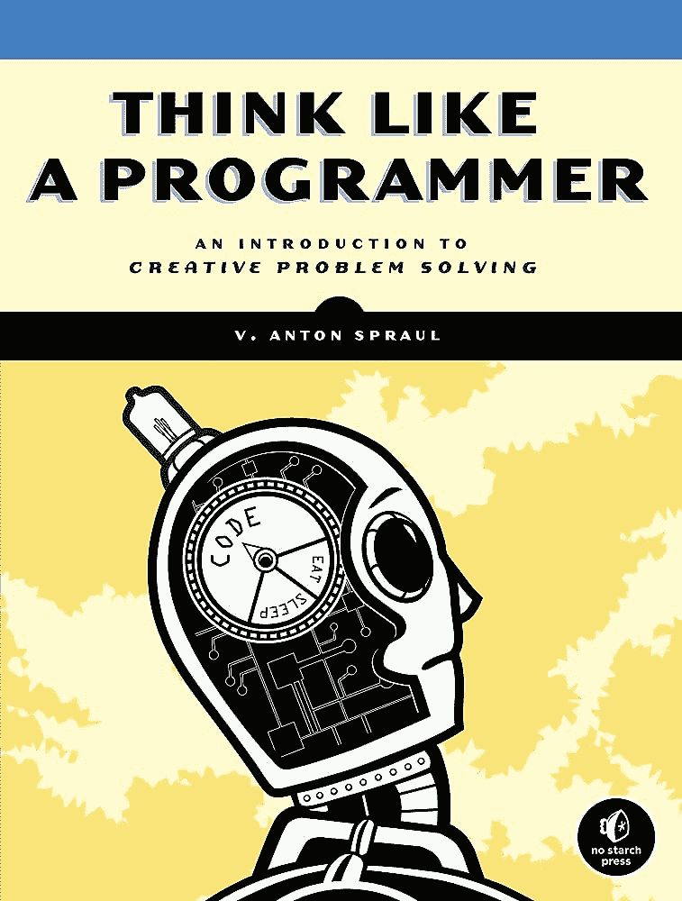


# 致谢

没有任何一本书真正是一个作者的独立完成，在编写《像程序员一样思考》期间，我收到了许多人的帮助。

我感谢 No Starch Press 的每一个人，特别是 Keith Fancher 和 Alison Law，他们在整个书的制作过程中对书进行了编辑、塑造和护航。我必须感谢 Bill Pollock，起因他最初决定与我签约——我希望他对结果的满意程度像我一样高。No Starch 的同事们在与我的通信中一如既往友好且乐于助。我希望有一天能和他们见见面，看看他们现实中和公司网站上的卡通头像有多像。

Dan Randall 在技术编辑方面工作非常出色。他在技术审查之外提出的许多建议帮助我我在许多方面加强了手稿的质量。

在家里，我生活中最重要的两个人——Mary Beth 和 Madeline，提供了爱、支持和热情——而且至关重要的是，为我留出了写作的时间。

最后，向多年来我教的所有编程学生：感谢你们让我当你们的老师。书中描述的技术和策略是通过我们的共同努力发展出来的。我希望我们为下一代程序员让这段旅程变得轻松。

# 引言


你是否尽管认为自己理解编程语言，但在编写程序时感到挣扎？你是否能够读完编程书中的一个章节，全程点头赞同，但却无法将读到的内容应用到自己的程序中？你是否能够理解在网上读到的程序示例，甚至能向别人解释每行代码的作用，但当面对编程任务和文本编辑器中的空白屏幕时，你却感到大脑一片空白（陷入卡壳）？

你并不孤单。我教编程了超过 15 年，我的大多数学生在教学过程的某个时间点上都曾符合这种描述。我们将这种缺失的技能称为*问题解决*，即根据给定的问题描述编写一个原始程序来解决它的能力。并不是所有的编程都需要大量的问题解决。如果你只是对现有程序进行微小修改、调试或添加测试代码，那么这种编程在本质上可能是机械性的，以至于你的创造力从未得到考验。但所有程序在某个时刻都需要问题解决，而且所有优秀的程序员都能解决问题。

问题解决是困难的。确实，少数人让它看起来很容易——那些“天赋型选手”，编程世界里等同于天赋运动员，如迈克尔·乔丹。对于这少数人来说，高级思想毫不费力地转化成源代码。用 Java 来类比，这就好像他们的大脑在原生执行 Java，而我们其他人则必须运行虚拟机，边运行边解释。

不具备天赋对于成为程序员来说并不是致命的——如果真是这样，世界上将不会有几个程序员了。然而，我见过太多值得学习的学习者在挫败中挣扎了太久。在最糟糕的情况下，他们完全放弃了编程，认为自己永远无法成为程序员，认为只有优秀的程序员才是那些与生具有天赋的人。

## 为什么学习解决编程问题如此困难？

部分原因在于，问题解决与学习编程语法是不同的活动，因此它们使用一套不同的心理“肌肉”。学习编程语法、阅读程序、记忆应用程序编程接口（API）的元素——这些在很大程度上是分析性的“左脑”活动。使用之前学过的工具和技能编写一个原始程序是一个创造性的“右脑”活动。

假设你需要移除一根掉进你房屋雨水沟的树枝，但你的梯子不够长，够不到那根树枝。你进入车库寻找某些东西，或者某些东西的组合，让你能够将树枝从水沟中取出。有什么方法可以延长梯子吗？有什么东西可以握在梯子顶端来抓住或弄松树枝吗？也许你只需要从另一个地方上屋顶，从上面取下树枝。这就是问题解决，是一项创造性活动。信不信，当你设计一个原始程序时，你的心理过程与那个想办法如何从水沟中取出树枝的人非常相似，而与调试现有 `for` 循环的人完全不同。

然而，大多数编程书籍将注意力集中在语法和语义上。学习编程语言的语法和语义是至关重要的，但它只是学习如何用该语言编程的第一步。本质上，大多数面向初学者的编程书籍教的是如何阅读程序，而不是如何编写程序。那些确实关注编写的书籍实际上是“食谱”，因为它们教了用于特定情况的特定“配方”。这类书可以作为节省时间的工具非常有价值，但不能作为学习编写原始代码的路径。想想原始意义上的食谱。尽管伟大的厨师拥有食谱，但没有任何依赖食谱的人能成为大厨师。伟大的厨师理解食材、制备方法和烹饪方法，并知道它们如何结合以制作出美味佳肴。一个大厨师制作出一顿美味餐只需要一个设备齐全的厨房。同样，一个优秀的程序员理解语言语法、应用框架、算法和软件工程原理，并知道它们如何结合以制作出优秀的程序。给一个优秀的程序员一份规格说明列表，配备一个设备齐全的编程环境并让他尽情发挥，奇迹就会发生。

总的来说，目前的编程教育在问题解决领域没有提供太多指导。相反，人们假设如果给程序员提供所有的编程工具并要求他们编写足够的程序，他们最终会学会编写这些程序并写好它们。这话有道理，但“最终”可能是一个很长的过程。从入门到启悟的旅程可能充满挫败。


本书假设你已经熟悉 C++ 语言的基本语法和语义，并且已经开始编写程序。书中大多数章节都要求你掌握某些特定的 C++ 基础知识；这些章节将从回顾这些基础知识开始。如果你仍在吸收语言基础，不要担心。市有许多关于 C++ 语法的优秀书籍，你可以在学习语法的同时，并行学习解决问题的方法。只需确保在尝试解决章节中的问题之前，你已经学习了相关的语法即可。

## 选定主题

本书涵盖的主题代表了我最常看到新程序员感到挣扎的领域。这些主题也展示了初级和中级编程不同领域的广泛横面。

然而，我必须强调，这并不是一本解决特定问题的算法或模式的“菜谱”。虽然稍后的章节讨论了如何使用著名的算法或模式，但你不应该将本书作为“过题小抄”来应付特定问题，也不应该只关注与你当前困境直接相关的章节。相反，我建议你通读整本书，只有当你缺乏理解讨论所需的先决条件时，才跳过某些材料。

## 编程风格

这里对书中采用的编程风格做一个简要说明：本书并不是关于高性能编程或运行最紧凑、高效的代码。我为代码示例选择的风格，可读性优于一切其他考虑因素。在某些情况下，我会采取多个步骤来完成本可以通过一步完成的任务，只为了让我正试图演示的原理变得清晰。

书中将涵盖编程风格的某些方面——但是更高层次的问题，例如类中应该或不应该包含什么，而不是琐小的问题，例如代码应该如何缩进。作为一名不断成长的程序员，你自然希望在你所做的工作中使用一致、可读的风格。

## 练习题

书中包含了许多编程练习。这不是一本教科书，你不会在书末找到任何练习题的答案。练习为你提供了应用章节中所述概念的机会。是否选择尝试任何练习题完全取决于你，但将这些概念付诸实践是至关重要的。仅仅读完书将一无于事。记住，本书并不会告诉你在每种情况下具体该做什么。在应用书中展示的技术时，你将培养出自己发现该做什么的能力。此外，增强信心是本书的另一个主要目标，而这需要成功。事实上，这是判断你是否已经在某个问题领域练习了足够题目的好方法：当你有信心可以解决该领域的其他问题时。最后，编程练习应该是`好玩`的。虽然在某些时刻你可能更想做别的事，但解决一个编程问题应该是一项有回报的挑战。

你应该将本书看作是你大脑的障碍赛场。障碍赛能增强力量、耐力和敏捷性，并给训练者信心。通过阅读章节并将概念应用尽可能多的练习中，你将建立信心并发展出适用于任何编程情况的解决问题技能。将来，当你面对困难的问题时，你将知道应该尝试越过、绕过还是穿过。

## 为什么选择 C++？

文中的编程示例是使用 C++ 编写的。尽管如此，本书是关于如何用程序解决问题，而不是专门关于 C++。你在这里找不到许多特定于 C++ 的技巧和窍门，而且书中教导的通用概念可以应用于任何编程语言。尽管如此，如果不讨论程序，就无法讨论编程，因此必须选择一种特定的语言。

选择 C++ 有许多个原因。首先，它在各种问题领域都非常流行。其次，由于其起源于严格过程化的 C 语言，C++ 代码可以使用过程化和面向对象的两种范式编写。面向对象编程现在已非常常见，在讨论解决问题时无法将其忽略，但许多基础的解决问题概念可以用严格过程化的编程术语来讨论，这样做既简化了代码，也简化了讨论。第三，作为一种拥有高级级库的低级语言，C++ 允许我们讨论两个层面的编程。顶尖程序员可以在需要时“手工”（hand-wire）解决方案，并利用高级级库和应用程序编程接口（API）来缩短开发时间。最后，也部分归功于上述列出的原因，C++ 是一个极佳的选择，因为一旦你学会了在 C++ 中解决问题，你就学会了在任何编程语言中解决问题。许多程序员发现，在一种语言中学到的技能可以很容易应用到其他语言中，但对于 C++ 来说，尤为如此，因为其跨范式的方法，而且坦率地说，也是因为它的难度。C++ 是真才实学的——它是不带辅助轮的编程。这在起初是令人生畏的，但一旦你开始在 C++ 中取得成功，你就会知道你不再是一个只会写一点代码的人——你将成为一名真正的程序员。

# 第 1 章 解决问题的策略


本书是关于解决问题的，但解决问题究竟是什么？当人们在日常对话中使用这个词时，他们的意思通常与我们在这里的意思完全不同。如果你的 1997 年款本田思域尾管冒出蓝烟、怠速不稳且燃油效率降低，这是一个可以通过汽车知识、诊断、更换设备和常用的修理厂工具解决的问题。然而，如果你告诉你的朋友们你的问题，其中一个人可能会说：“嘿，你应该把那辆旧本田换辆新的。问题解决了。”但你朋友的建议并不是该问题的真正`解决方案`——它只是`规避`问题的方法。

问题包含了约束，即对问题或解决方式不可逾越的规则。对于这辆故障的思域，其中一个约束是你想修理现在的车，而不是买一辆新车。约束可能还包括维修的总成本、所需的时间，或者不能为了这次维修购买任何新工具的要求。

在用程序解决问题时，你也面临约束。常见的约束包括编程语言、平台（它是运行在 PC 上、iPhone 上还是哪里？）、性能（游戏程序可能要求每秒更新 30 次图形，业务应用程序对用户输入有响应时间限制）或内存占用。有时约束涉及你可以引用的其他代码：也许程序不能包含某些开源代码，或者相反——也许只能使用开源代码。

因此，对于程序员来说，我们将`解决问题`定义为：编写一个执行特定任务并满足所有规定约束的原始程序。


初学者往往过于急于完成定义的第一个部分——编写一个能够执行特定任务的程序——以至于在定义的第二部分，即满足给定的约束条件，上失败了。我将这种看似产生了正确结果但违反了一个或多个既定规则的程序称为 `Kobayashi Maru`（小林丸丸测试）。如果你对这个名字陌生，意味着你对极客文化的基石之一还不够熟悉，那就是电影《星际迷战 2：汗血刑杀》。这部电影包含一个关于星际联邦学院准军官训练的副情节。学员们被安置在一个模拟的星际舰桥桥上，被要求执行一项涉及不可能选择的任务。无辜的人将在一艘名为 `Kobayashi Maru` 的受损船上死去，但要营救他们，必须与克林人战斗，而这场战斗只会以船长飞船的毁灭告终。这项训练旨在测试学员在火力下的勇气。这里没有获胜的方法，所有的选择都会导致坏的结果。在电影结束，我们发现柯克船长修改了模拟，使其变得可以获胜。柯克很聪明，但他并没有解决 `Kobayashi Maru` 的困境；他只是避开了它。

幸运的是，你作为程序员将面临的问题是可以解决的，但许多程序员仍然会采取柯克的方法。在某些情况下，他们是无意中这样做（（糟糕！我的解决方案在数据项只有一百个或更少时才有效。它本应该适用于无限数据集。我必须重新考虑这个问题。”）。在其他情况下，移除约束条件是故意的，是为了满足老板或导师规定的截止日期而采取的策略。在另一些情况下，程序员根本不知道如何满足所有约束条件。在我过的最糟糕的情况下，编程学生付钱让别人写了程序。无论动机如何，我们必须始终勤勉，避免陷入 Kobayashi Maru。

## 经典谜题

当你继续阅读这本书时，你会发现尽管源代码的细节在不同的问题领域之间发生变化，但在我们采取的方法中会出现某些模式。这是一个极好的消息，因为这最终让我们能够自信地处理任何问题，无论我们对该领域是否拥有丰富的经验。专家级的解决者能够迅速识别出 `analogy`，即已解决问题与未解决问题之间可以利用的相似性。如果我们意识到问题 A 的某个特征类似于问题 B 的某个特征，且我们已经解决了问题 B，那么我们在解决问题 A 上就获得了宝贵的见解。

在本节中，我们将讨论编程领域之外的经典问题，这些问题包含了我们可以应用于编程问题的教训。

### 狐狸、鹅和玉米

我们将讨论的第一个经典问题是一个关于需要过河的农民的谜语。你可能以前以某种形式遇到过它。

### 问题：如何过河？

一个带有一只狐狸、一只鹅和一袋玉米的农民需要过一条河。农民有一条小船，但空间只容下农民和他的三件物品中的一个。不幸的是，狐狸和鹅都饿了。狐狸不能和鹅单独在一起，否则狐狸会吃掉鹅。同样，鹅不能和玉米袋单独在一起，否则鹅会吃掉玉米。农民如何把所有东西都带过河？

该问题的设置如图 1-1 所示。如果你以前从未遇到过这个问题，请停在这里，花几分钟尝试解决它。如果你以前*听过*这个谜语，请尝试记住答案，以及你是否能够独立解决这个谜题。

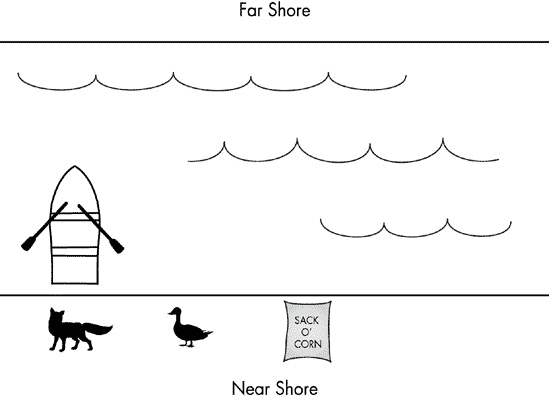

图 1-1. 狐狸、鹅和一袋玉米。船一次只能携带一件物品。狐狸不能和鹅留在同一岸边，鹅不能和玉米袋留在同一岸边。

很少有人能解决这个谜语，至少在没有提示的情况下。我知道我做不到。以下是通常的推导过程：由于农民一次只能带一个东西，他需要多次往返才能将所有东西带到对岸。在第一趟行程中，如果农民带上狐狸，鹅就会和玉米袋留在，鹅会吃掉玉米。同样，如果农民在第一趟带上玉米袋，狐狸就会和鹅留在，狐狸会吃掉鹅。因此，农民必须在第一趟带上鹅，结果导致如图 1-2 所示的配置。

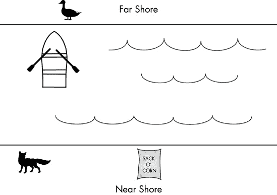

图 1-2. 解决狐狸、鹅和一袋玉米问题的所需的步骤。但从这一步开始，所有后续步骤似乎都以失败告终。

到为止还好。但在第二趟行程，农民必须带上狐狸或玉米。无论农民带上什么，都必须留在对岸与鹅在一起，而农民返回近岸去运剩下的物品。这意味着要么狐狸和鹅留在在一起，要么鹅和玉米留在在一起。由于这两种情况任何一种都是不可接受的，这个问题似乎是不可解决的。

再次，如果你以前见过这个问题，你可能记得答案的关键元素。农民必须在第一趟带上鹅，正如之前解释的那样。在第二趟，假设农民带上狐狸。然而，农民并没有让狐狸和鹅留在在一起，而是*把鹅带回*近岸。然后农民带上玉米袋过去，让狐狸和玉米留在对岸，同时返回进行第四趟去接鹅。完整的解决方案如图 1-3 所示。

这个谜题很难，是因为大多数人从未考虑过将一件物品从对岸带回近岸。有些人甚至会认为这个问题不公平，说类似“你又没说我可以带东西回去！”这是事实，但问题描述中也没有任何地方暗示禁止带回任何东西。

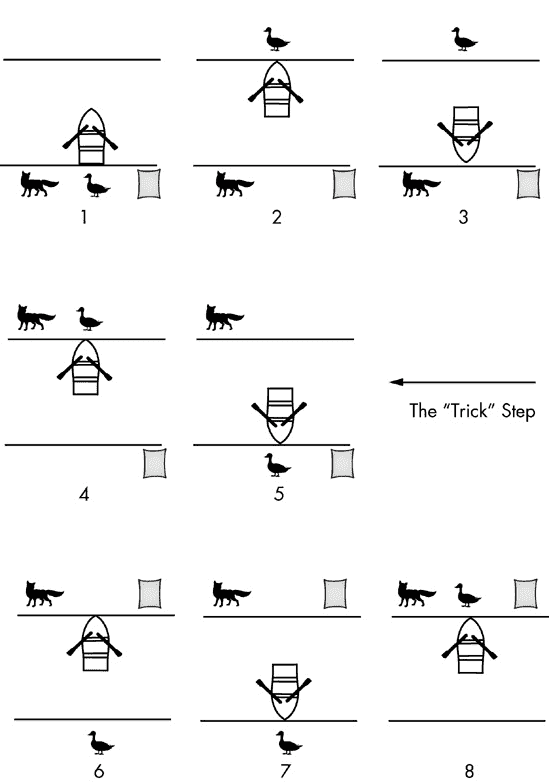

图 1-3. 狐狸、鹅和玉米谜题的逐步解答方案


想象一下，如果明确了可以将其中一件物品带回近岸的可能性，这个谜题解起来会变得容易得多：`农夫有一条小船`，可以向任意方向传输物品，`但船的空间只能装下农夫和三件物品中的一个`。如果这个建议显而易见，会有更多人能解出这个问题。这说明了问题解决中的一个重要原则：如果你没有意识到所有可能采取的行动，你可能无法解决问题。我们可以将这些行动称为“操作”（operations）。通过列举所有可能的操作，我们可以通过测试每种操作组合直到找到一个可行的方案，从而解决许多问题。更广泛地说，通过用更正式的术语重述问题，我们通常可以发现原本会与我们擦过的解决方案。

让我们忘记已经知道了答案，尝试用更正式的方式表述这个特定的谜题。首先，我们列出约束条件。这里的关键约束是：

1. 农夫每次在船上只能带一个物品。
2. 狐狸和鹅子不能单独留在同一岸边上。
3. 鹅子和玉米不能单独留在同一岸边上。

这个问题是说明约束条件重要性的良好范例。如果我们移除任何一个约束，谜题就变得简单了。如果我们移除第一个约束，我们只需一次性将三件物品带过河。即使船上只能带两个物品，我们也可以把狐狸和玉米带过去，然后回来接鹅子。如果我们移除第二个约束（但保留其他约束），我们只需要留心，先把鹅子带过去，然后带狐狸，最后带带玉米。因此，如果我们忘记或忽略了任何一个约束，最终将陷入“小林石丸”（Kobayashi Maru）困境。

接下来，让我们列出操作。表述这个谜题的操作有多种方法。我们可以列出我们认为可以采取的行动特定清单：

1. 操作：将狐狸带到河对岸。
2. 操作：将鹅子带到河对岸。
3. 操作：将玉米带到河对岸。

但记住，正式重述问题的目标是为了获得解决方案的洞察。除非我们已经解决了问题并发现了那个“隐藏”的可能操作——将鹅子带回近岸，否则我们在列出行动清单时是不会发现它的。相反，我们应该尝试让操作通用化或参数化。

1. 操作：将船从一岸划到另一岸。
2. 操作：如果船是空的，从岸上装载一个物品。
3. 操作：如果船为空，将物品卸到岸上。

通过用最通用的术语思考问题，这第二组操作将允许我们解决问题，而不需要在“把鹅子带回近岸”这一步产生“灵光一现”。如果我们生成所有可能的移动序列，并在每个序列违反我们的某个约束或达到我们以前见过的配置时结束该序列，我们最终会遇到`图 1-3`序列并解开谜题。谜题固有的困难将通过对约束和操作的正式重述而被避开。

### 经验训

我们从狐狸、鹅子和玉米中能学到什么？

用更正式的方式重述问题是获得问题洞察的一种伟大技巧。许多程序员寻找其他程序员来讨论问题，不仅是因为其他程序员可能有答案，还因为大声表述问题往往会引发新的、用的的想法。重述问题就像与另一个程序员进行讨论，只不过是你同时扮演了这两个角色。

更广泛的教训是，思考问题可能与思考解决方案一样有效，在某些情况下甚至更有效。在很多情况下，解决方案的正确方法*本身就是*解决方案。

### 滑块谜题

滑块谜题有不同的尺寸，正如我们之后看到的，它提供了一种特定的解决机制。以下描述针对 3×3 版本的谜题。

### 问题：数字八字

一个 3×3 的网格填满了八块编号为 1 到 8 的滑块和一个空位。初始状态下，网格处于杂乱配置。滑块可以滑到相邻的空位中，留下滑块之前的位置为空。目标是移动滑块，使网格处于有序的配置中，从左上角的 1 号滑块开始。

该问题的目标如`图 1-4`所示。如果你从未尝试过此类谜题，现在花时间试试吧。网上可以找到很多滑块谜题模拟器，但对于我们的目的，最好使用扑牌或索引卡在桌面上制作你自己的游戏。建议的起始配置如`图 1-5`所示。


图 1-4. 八块版滑块谜题的目标配置。空方格代表相邻滑块可以滑入的空格。


图 1-5. 滑块谜题的一种特定起始配置

这个谜题与狐狸、鹅子和玉米完全不同。那个问题的困难在于忽略了某个可能的操作。在这个问题中，这种情况不会发生。从任何给定的配置开始，可能有四块滑块相邻空位，这些滑块中的任何一个都可以滑入空位。这充分列举了所有可能的操作。

这个问题的困难反而源于解决方案所需的长链操作。一系列滑动操作可能会将某些滑块移动到正确的最终位置，同时让其他滑块离开位置；或者可能让某些滑块更接近位置，同时让另一些更远。由于由于，很难判断任何特定操作是否对最终目标取得了进展。由于无法衡量进展，很难制定策略。许多尝试滑块谜题的人只是随机移动滑块，希望能碰上可以看到通目标配置路径的配置。

尽管如此，滑块谜题是有策略的。为了说明一种方法，让我们考虑较小的矩形网格谜题。

### 问题：数字五字

一个 2×3 的网格填满了五块编号为 4 到 8 的滑块和一个空位。初始状态下，网格处于杂乱配置。滑块可以滑到相邻的空位中，留下滑块之前的位置为空。目标是移动滑块，使网格处于有序的配置中，从左上角的 4 号滑块开始。

你可能注意到我们的五块滑块编号是 4 到 8 而不是 1 到 5。之所以这样的原因很快就会明朗。


虽然这和滑动八数字游戏是同一个基本问题，但由于只有五个方块，它要容易得多。请尝试图 1-6 所示的配置。

如果你只是对这些方块玩几分钟，你可能就能找到解。通过玩这种小数量方块的谜，我开发出了一项特殊的技能。正是这项技能，结合我们稍后将讨论的观察，被用来解决所有的滑动方块谜题。

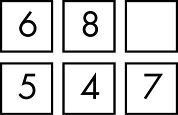

*图 1-6. 一个简化版 2×3 滑动方块谜的特定起始配置*

我将我的技术称为 `the train`（列车）。它基于一种观察：包含空隙的方块位置回路形成了一个方块列车，这列火车可以沿着回路的任何地方旋转，同时保持方块的相对顺序。图 1-7 展示了由四个位置组成的最小列车。从第一个配置开始，`1` 可以滑进空格，`2` 可以滑进 `1` 留下的空间，最后 `3` 可以滑进 `2` 留下的空间。这使得空隙相邻 `1`，从而允许列车继续移动，因此使方块能够有效地沿着列车路径的任何地方进行旋转。

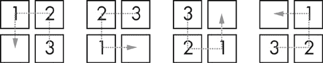

*图 1-7. 一个“列车”，一条始于相邻空格的方块路径，可以像列车车厢一样穿过谜题*

使用列车，我们可以在保持相对关系的情况下移动一系列方块。现在让我们回到之前的 2×3 网格配置。虽然这个网格中没有任何方块处于正确的最终位置，但某些方块与它们在最终配置中相邻的方块相邻。例如，在最终配置中，`4` 将位于 `7` 之上，而目前这些方块是相邻的。如图图 1-8 所示，我们可以使用六位置的列车将 `4` 和 `7` 带到它们正确的最终位置。当我们这样做时，剩下的方块几乎就正确了；我们只需要把 `8` 滑过去。

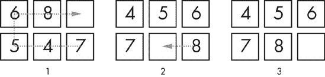

*图 1-8. 从配置 1 开始，沿着轮廓的“列车”旋转两次让我们到达配置 2。从那里开始，单方块滑动即可得到目标配置 3。*

那么这项技术是如何允许我们解决任何滑动方块谜题的呢？考虑我们原始的 3×3 配置。我们可以使用六位置的列车来移动相邻的 `1` 和 `2` 方块，使得 `2` 和 `3` 相邻，如图图 1-9。

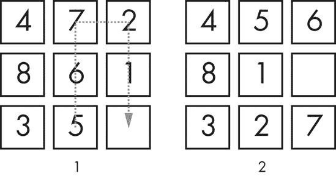

*图 1-9. 从配置 1 开始，方块沿着轮廓的“列车”旋转以到达配置 2。*

这把 `1`、`2` 和 `3` 放在了相邻的格中。通过八位置的列车，我们可以将 `1`、`2` 和 `3` 方块移动到它们正确的最终位置，如图图 1-10。

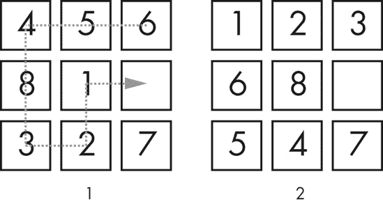

*图 1-10. 从配置 1 开始，方块通过旋转到达配置 2，其中方块 1, 2 和 3 处于它们正确的最终位置。*

注意方块 `4–8` 的位置。这些方块处于我给出的 2×3 网格配置中。这是关键观察。在放置了方块 `4–8` 后，我们就可以解决剩余的问题。

### 经验教训

我们可以从滑动方块谜题中学习到什么教训？

滑动方块谜题的移动次数多到难以从初始配置规划出完整的解决方案。然而，无法规划完整的解决方案并不阻止我们制定策略或采用技术。在编程中，我们有时会面临看不到清晰路径的情况，但我们绝不能让这成为放弃规划的理由。

另一个教训是，问题有时以显而易见的方式划分。因为移动一个方块不仅影响它本身，还会影响可能的移动，人们可能会认为谜题必须一次性解决，而不是分阶段。寻找划分问题的方法通常是值得的。即使我们无法找到完美的划分，我们也能学到关于问题的知识，从而帮助解决它。


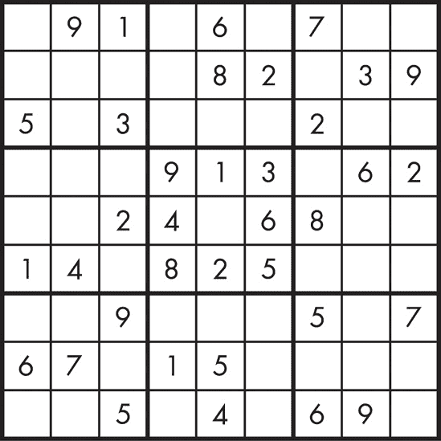

图 1-11。一个简单的数独谜题

数独谜题的难度各不相同，其难度取决于待填充格子的数量。从这一标准来看，这是一个非常简单的谜题。由于已经有 36 个格子标有数字，因此只需要填充 45 个格子即可完成谜题。问题是，我们应该先尝试填充哪些格子呢？

记住谜题的约束条件。1 到 9 的每一个数字必须在每行、每列以及每个由粗线标记的 3×3 区域内各出现一次。这些规则决定了我们应该从哪里开始。谜题中间的 3×3 区域在九个格子中已有八个填了数字。因此，正中间的格子只有一种可能的值，即该 3×3 区域内其他格子未出现的那个值。这就是我们应该开始解决这个谜题的地方。该区域缺失的数字是 7，所以我们将它放在中间的格子中。

确定该数值后，注意正中间列的九个格子中已有七个填了数值，只剩下两个格子，每个格子都必须有一个该列中未出现过的数值：缺失的两个数字是 3 和 9。该列的约束条件允许我们将这两个数字中的任何放在任何位置，但注意 3 已经出现在第三行，而 9 已经出现在第七行。因此，行的约束规定 9 应该在中间列的第三行，3 应该在中间列的第七行。这些步骤总结在图 1-12 中。

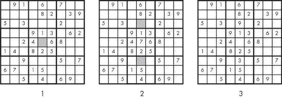

图 1-12. 解决示例数独谜题的第一步

我们在这里不会解决整个谜题，但这些初步传达了一个重要的点：我们要寻找那些可能值数量最少的格子——理想情况下，只有一个。

### 经验总结

从数独中获得的主要教训是，我们应该寻找问题中最受约束的部分。虽然约束通常是让问题变得难以开始的原因（记住狐狸、鹅和玉米），但它们也可以简化我们对解决方案的思考，因为它们消除了选择。

尽管我们在这书中不会专门讨论人工智能，但在人工智能中有一种解决特定类型问题的规则，被称为“最受约束变量”（most constrained variable）。这意味着，在一个你试图为不同的变量分配不同的值以满足约束的问题中，你应该从约束条件最多的变量开始，或者换句话说，从可能值数量最少的变量开始。

这是一个这种思维方式的例子。假设一组同事想一起去午餐，他们请你找一家大家都会喜欢的餐厅。问题是，每位同事都对群体决策施加了某种约束：帕姆（Pam）是素食者，托德（Todd）不喜欢中国菜，等等。如果你的目标是尽可能缩短寻找餐厅的时间，你应该先和那位限制最严苛的同事交谈。例如，如果鲍勃（Bob）有多种严重的食物过敏，那么从寻找一份他知道自己可以吃的餐厅列表是有意义，而不是从托德开始，因为托德对中国菜的不喜欢很容易被缓解。

同样的技术通常也可以应用于编程问题。如果问题的某一部分受到严重约束，那是一个极好的切入点，因为你可以取得进展，而不用担心把时间花在以后会被撤销的工作上。一个相关的推论是，你应该从明显的部分开始。如果你能解决部分问题，尽管去做你所能做的。你可能会从观察自己的代码中学到一些东西，从而激发你解决剩余部分的想象力。

## Quarrasi 锁（Quarrasi Lock）

你可能以前见过之前的每一个谜题，但除非你之前读过这本书，否则你不应该见过本章的最后一个，因为这个是我自己构思的。请仔细阅读，因为这个问题的措辞有点复杂。

### 问题：打开外星锁

一个敌对的外星种族 Quarrasi 降临了地球，你被俘了。你成功制服了守卫，尽管他们巨大且长着触手，但为了逃离（仍停在地的）飞船，你必须打开那扇大门。打开门的说明竟然是用英文打印的，但这并不是件易事。要打开门，你必须将三个条状的 Kratzz 沿着从右接收器到左侧接收器的轨道滑动，左侧接收器位于门的末端，距离 10 英尺。

这看起来很容易，但你必须避免触发警报，警报的工作原理如下：每个 Kratzz 上都有一个或多个星形的晶体能量宝石，被称为 Quinicrys。每个接收器有四个传感器，如果上方列中 Quinicrys 的数量为偶数，传感器就会亮起。如果亮起的传感器数量恰好为一个，警报就会响。注意，每个接收器的报警器是独立的：你不能让左接收器或右接收器恰好仅有一个传感器亮起。好消息是，每个报警器都配备了一个抑制器，只要按下按钮，报警器就不会响。如果你能同时按下两个抑制器，问题就变简单了，但你做不到，因为你只有短手臂而不是长触手。

给定所有这些，你如何在不激活任何警报的情况下滑动 kratzz 打开门？

初始状态见图 1-13，所有三个 kratzz 都在右接收器中。为了清晰起见，图 1-14 显示了一个糟糕的主意：将最上面的 kratzz 滑到左接收器会导致右接收器进入报警状态。你可能会认为可以通过抑制器避免警报，但请记住我们刚刚把上面的 kratzz 移到了左接收器，所以我们距离右接收器的抑制器有 10 英尺。


图 1-13。Quarrasi 锁头问题的初始配置。你必须将目前位于右侧接收体的三根 Kratzz 条滑动到左侧接收体，且不触发任何警报。当上方列中出现偶数个星形 Quinicrys 时，一个传感器会亮起；如果恰好有一个相连的传感器亮起，警报就会响。抑制器可以防止警报响，但仅限于你所站的接收体。

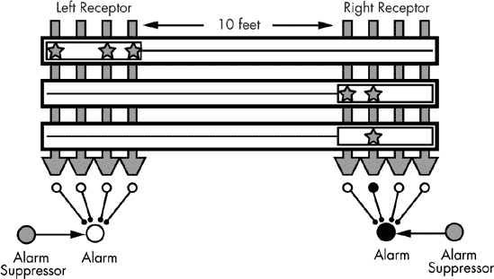

图 1-14。处于警报状态的 Quarrasi 锁。你刚刚将上方 Kratzz 滑动到左侧接收体，因此右侧接收体无法触及。右侧报警的第二个传感器亮起，是因为上方列出现了偶数个 Quinicrys，而当它的传感器恰好有一个亮起时，警报就会响。

在继续之前，花些时间研究这个问题，并尝试开发出一个解决方案。取决于你的观点，这个问题并没有看起来看起来那么难。说真的，在继续之前请认真思考一下！

你考虑过了吗？你想出解决方案了吗？这里通答案有两种可能的路径。第一条路径是试错法：有条地尝试各种 Kratzz 移动，并在达到警报状态时回退之前的步骤，直到找到一组成功的移动序列。

第二条路径是意识到这个谜题是一个陷阱。如果你还没有看到这个陷阱，它在这里：这只是一个换了复杂伪装的“狐狸、鹅和玉米”问题。虽然警报规则写得很通用，但对于这种特定的锁，组合是有限的。只有三根 Kratzz，我们只需要知道接收体中哪些 Kratzz 组合是可以接受的。如果我们将三根 Kratzz 标记为 `top`（顶部）、`middle`（中间）和 `bottom`（底部），那么产生警报的组合就是“top and middle”和“middle and bottom”。如果我们把 `top` 重命名为 `fox`（狐狸），`middle` 重命名为 `goose`（鹅），`bottom` 重命名为 `corn`（玉米），那么棘手的组合与另一个问题中的完全一样，“fox and goose”和“goose and corn”。

因此，这个问题的解决方法与狐狸、鹅和玉米问题相同。我们将中间的 Kratzz (`goose`) 滑动到左侧接收器。然后，我们将顶部的 (`fox`) 滑向左侧，在将顶部的 (`fox`) 放到到位时按住左侧报警器的抑制器。接下来，我们开始将中间的 (`goose`) 滑回右侧接收器。然后，我们将底部的 (`corn`) 滑向左侧，最后我们再次将中间的 (`goose`) 滑向左侧，打开锁。

### 经验教训

这里的主要教训是识别类比的重要性。在这里，我们可以看到 Quarrasi 锁问题类似于狐狸、鹅和玉米问题。如果我们能及早发现这种类比，就可以通过转换第一个问题的解决方案来，而不是创建一个新的解决方案，从而避免该问题的大部分工作。解决问题中的大多数类比不会那么直接，但它们出现的频率会越来越高。

如果你很难看出这个问题与狐狸、鹅和玉米问题之间的联系，那是因为我刻意包含了尽可能多的无关细节。设定 Quarrasi 问题的故事是无关的，所有外星技术的名称也是如此，它们的目的是增加陌生感。此外，警报的奇偶机制使得问题看起来比实际上更复杂。如果你观察 Quinicrys 的实际位置，你会发现顶部的 Kratzz 和底部的 Kratzz 是对立的，因此它们在警报系统中不相互作用。然而，中间的 Kratzz 与另外两个相互作用。

再次，如果你没有看到这个类比，不要担心。当你开始对它们保持警惕后，你会开始更多地识别它们。

## 通用问题解决技巧

我们讨论的示例展示了解决问题中使用的许多关键技术。在书的其余部分，我们将研究特定的编程问题并寻找解决它们的方法，但首先我们需要一套通用的技术和原则。某些问题领域有特定的技术（正如我们所看到的），但下面的规则适用于几乎任何情况。如果你将这些成为你解决问题方法的组成部分，你将永远有一种方法来问题。

## 始终要有计划

这可能是最重要的规则。你必须始终有一个计划，而不是进行无目的的活动。

到此为止，你应该理解拥有计划总是可能的。事实是，如果你还没有在脑海中解决这个问题，那么你就无法有一个在代码中实现解决方案的计划。那将以后再说。尽管即使在开始时，你也应该对你将如何找到解决方案有一个计划。

公平地说，计划在旅程中的某处可能需要更改，或者你可能不得不放弃原始计划并构思另一个。为什么这条规则如此重要呢？怀特·D·艾森豪威尔将军以这样说而闻名：“我总是发现计划是没用的，但规划是不可缺的。”他的意思是战斗是如此混乱，以至于预测可能发生的所有事情并对每种结果预响应是不可能的。从这个意义上说，计划在战场上没用的（另一位军事领袖普鲁士的赫尔穆·冯·毛尔刻曾著名地说：“没有任何计划能在战斗中生存”）。但没有规划的军队是无法成功的。通过规划，将军了解军队的能力、不同部分之间如何协同工作等。

同样，你必须对解决问题始终有一个计划。它可能无法在战斗中生存——一旦开始在编辑器中输入代码，它可能被丢弃——但你必须有一个计划。

没有计划，你只是在期待运气，这等同于猴子随机输入出了莎士比亚剧剧。运气是罕见的，即使运气出现也需要计划。许多人听过发现青霉素的故事：一位名叫弗莱明的研究人员某晚上忘记关好一个培养皿，第二天早上发现霉菌抑制了培养中细菌的生长。但弗莱明并不是坐在那里等运气；他一直在以详尽且控制的方式进行实验，因此意识到了培养皿中所看到的现象。（如果我发现昨晚留下的东西长了霉，这不会对科学做出重大贡献。）

规划还允许你设定中期目标并实现它们。没有计划，你只有一个目标：解决整个问题。在解决问题之前，你不会觉得完成了什么。正如你可能经历过的，许多程序在接近完成之前没有任何实际用处。因此，只朝着主要目标努力会导致会导致挫败感，因为在结束之前你的努力不会得到任何积极反馈。相反，如果你创建一个包含一系列小目标的计划，即使某些目标与主问题无关，你也会在解决方案上取得衡量进展，并觉得时间花得很有用。在每次工作结束时，你都能够从计划中勾掉项目，对找到解决方案充满信心，而不是变得越来越沮丧。 

## 重述问题


正如“狐狸、鹅和玉米”问题所演示的，重述问题可以产生非常有价值的结果。在某些情况下，一个看起来非常困难的问题如果用不同的表述方式或不同的术语，可能会变得简单。重述问题就像是绕着你必须爬的山脚绕圈；在开始爬山之前，为什么不从每个角度观察这座山，看看是否有更简单的上路方法？

重述有时会告诉我们，目标并不是我们所想的那样。我曾读过关于一位奶奶边织毛衣边照顾小孙女的故事。为了完成织织工作，奶奶把婴儿放在旁边的便携式婴儿床里，但婴儿不喜欢待在床里，一直哭。奶奶尝试了各种玩具来让婴儿床对婴儿来说更有趣，直到她意识到把婴儿留在床里只是达到目的的手段。真正的目标是让奶奶能够安静地织织。解决方案是：让婴儿在地毯上快乐地玩耍，而奶奶在婴儿床内织织。重述可以是一项强大的技术，但许多程序员会跳过它，因为它不直接涉及编写代码，甚至不设计解决方案。这也是为什么制定计划至关重要的另一个原因。没有计划，你唯一的目标就是拥有可以运行的代码，而重述则是在浪费编写代码的时间。有了计划，你可以将“正式重述问题”作为你的第一步；因此，正式完成重述就被视为取得了进展。

即使重述没有带来任何直接的见解，它也可以在其他方面提供帮助。例如，如果一个问题被分配给了你（由主管或导师分配），你可以将你的重述提交给分配问题的人并确认你的理解是否正确。此外，重述问题可能是使用其他常用技术（如简化或拆分问题）的必要先决步骤。

更广泛地说，重述可以转化整个问题领域。我在递归解决方案中采用的技术（我将在稍后的章节中分享）是一种重述递归问题的方法，使我可以像处理迭代问题一样处理它们。

## 分解问题

找到将问题拆分为步骤或阶段的方法可以使问题变得简单得多。如果你能将一个问题分成两部分，你可能会认为每个部分的解决难度只有原始整体的一半，但通常，情况比这还要简单。

这里有一个类比，如果你已经见过常见的排序算法，就会会觉得很熟悉。假设你有 100 个文件需要按字母顺序放入箱子里，而你的基础字母排序方法实际上就是我们所说的“插入排序”：你随机取一个文件，放入箱子，然后将下一个文件放入箱子，并使其与第一个文件保持正确的关系，然后继续，始终将新文件放置在相对于其他文件的正确位置，以便在任何给定时刻，箱子中的文件都是字母顺序排列的。假设有人最初将文件分成 4 组大小相等的组：A–F、G–M、N–S 和 T–Z，并要求你对这 4 组分别进行字母排序，然后一个接一个地放入箱子。

如果每组包含大约 25 个文件，那么人们可能会认为对 4 组 25 个文件进行排序与对一组 100 个文件进行排序的工作量差不多。但实际上工作量*少得多*，因为插入单个文件所需的工作量随着已归档文件数量的增加而增加——你必须查看箱子中的每个文件才能知道新文件应该放在哪里。（如果你怀疑这一点，可以想一个更极端的版本——比较一下对 50 组 2 个文件进行排序（你可能在一分钟内完成）与对一组 100 个文件进行排序的区别。）

同样，分解问题通常可以降低一个数量级的难度。组合编程技术比单独使用技术要困难得多。例如，一段在 `while` 循环内部使用系列 `if` 语句的代码（而 `while` 循环本身又在一个 `for` 循环内部），会比顺序使用所有相同控制语句的代码难以编写——也难以阅读。

我们将在后面的章节中讨论分解问题的具体方法，但你应该对这种可能性保持警惕。记住，某些问题（如我们的滑块游戏）通常隐藏着潜在的划分空间。有时寻找问题划分点的方法是简化问题，正如我们即将讨论的那样。

## 从你所知的开始

初级小说家经常会收到“写你所知的”的建议。这并不意味着小说家应该只尝试围绕他们生活中直接观察到的事件和人物来创作作品；如果是这样，我们永远无法拥有奇幻、历史小说以及许多其他流行类型。但它意味着，作者远离自己的经验越远，写作可能越困难。

同样，在编程时，你应该尝试从你已经知道如何做的开始，并从那里向外扩展。一旦你将问题分成了若干部分，例如，尽管去完成任何你已经知道如何编写的部分。拥有一个可以运行的部分可能会引发关于问题其他部分的灵感。此外，正如你可能注意到的，解决问题的一个共同主题是取得有用的进展，以建立最终将完成任务的信心。通过从所知的开始，你建立了目标的信心和动力。

“从你所知的开始”的格言也适用于尚未分解问题的情况。假设有人列出了编程中的每一个技能：编写一个 `C++` 类、对数字列表排序、找到链表中的最大值等。在程序员成长的每个阶段，列表中会有许多你精通的技能，你可以通过努力使用的技能，以及其他你完全不知道的技能。某个特定的问题可能可以用你已有的技能解决，也可能不能，但你应该利用脑中已有的技能充分研究该问题。如果我们把编程技能视为工具，将编程问题视为家居维修项目，那么在去五金店之前，你应该尝试使用家里已有的工具进行维修。

这项技术遵循我们已经讨论过的原则。它遵循计划并为我们的努力提供秩序。当我们应用已有的技能开始研究问题时，我们可能会更多地了解问题及其最终解决方案。

## 简化问题

通过这种技术，当你面对一个无法解决的问题时，你通过增加或移除限制条件来缩小问题的范围，从而产生一个你已知如何解决的问题。我们将在后面的章节中演示这项技术，但这里有一个基础示例。假设你给出了一系列三维空间中的坐标，你必须找到彼此最近的坐标。如果你没有立即知道如何解决它，有不同的方法可以简化问题以寻求解决方案。例如，如果坐标是在二维空间而不是三维空间呢？如果这还是没有帮助，如果这些点位于一条直线上，使得坐标只是单个数字（假设是 `C++` `double`）呢？现在问题本质上变成了在数字列表中找到绝对差最小的两个数字。


` 和 `


当你允许自己感到沮败时——我特意使用了“允许”这个词——你实际上是在给自己找理由继续失败 nde 借口。假设你正在解决一个棘手的问题，并且你感到挫败感在心升。几小时后，你回想起那个紧咬牙关、愤怒中折断铅笔的下午，告诉自己：如果当时能冷静下来，本可以取得实质性的进展。事实上，你可能已经决定，屈服于愤怒比面对困难的问题要容易得多。

归结底，避免挫败是你必须做出的决定。然而，你可以采用一些思维方法这会有帮助。首先，永远不要忘记第一准则：你应该始终有一个计划；虽然编写解决原始问题的代码是计划的目标，但它并不是该计划的唯一步骤。因此，如果你有一个计划并正在执行它，那么你就在取得进展，你必须相信这一点。如果你已经完成了原计划中的所有步骤，但还没有准备好开始编码，那么是时候制定另一个新计划了。

此外，当陷入沮败或需要休息时，你应该去休息。一个技巧是同时有多个要处理的问题，这样如果这一个问题难住了你，你可以把精力投入到别处。注意，如果你成功地拆分了问题，你可以将这种技术应用于单个问题上；只需屏蔽掉卡住你的那部分，处理其他内容。如果你没有其他可以处理的问题，就离开椅子去做些别的事，做些能让你血液循环但不会让大脑痛苦的事：散散、、洗衣服、做你的拉伸操（如果你打算成为程序员，整天坐在电脑前，我强烈建议养成拉伸的习惯！）。在休息结束之前，不要思考这个问题。

## 练习

记住，要真正学会某东西你必须付诸实践，所以尽可能多做练习。在第一章中，当然，我们还没有讨论编程，但尽管如此，我鼓励你尝试一些练习。把这些问题看作是在我们演奏真正的音乐之前对手指的热身。

1. 尝试一个中等难度的数独游戏（你可以在网上到处找到，可能在当地的报纸上也有），尝试不同的策略并记录结果。你能为解决数独写一个通用的解决计划吗？
2. 考虑一种滑块游戏的变体，其中方块覆盖的是图片而不是数字。这在多大程度上增加了难度？为什么？
3. 寻找与我不同的滑块游戏策略。
4. 寻找老式的“狐狸、鹅和玉米”类的谜题并尝试解决它们。许多伟大的谜题是由萨姆·洛伊德（Sam Loyd）发明或推广的，所以你可以搜索他的名字。此外，一旦你发现了（或放弃并阅读了）答案，思考你如何为这个谜题制作一个更简单的版本。你需要改变什么？是约束仅仅是措辞？
5. 尝试为其他传统的纸笔游戏（如字谜）写一些明确的策略。你应该从哪里开始？卡住时该怎么办？即使是简单的报纸游戏，如“字母拼字”，对于思考策略也很有用。

# 第 2 章 纯粹谜题


在本章中，我们将开始处理实际代码。虽然后续章节需要中级的编程知识，但本章要求的编程技能是尽可能简单的。这并不意味着所有这些谜题都是容易，而是意味着你应该能够专注于解决问题，而不是编程语法。这是最纯粹的问题解决。一旦你确定了想做什么，将你的想法翻译成 C++ 代码将是非常直接的。记住，阅读这本书本身提供的帮助有限。在我们讨论时，你应该去解决任何对你来说并非易事的问题，在阅读我的方法之前尝试自己解决它。在章节结束时，尝试一些练习，其中许多练习将是我们讨论过的问题的扩展。

## 本章使用的 C++ 回顾

本章使用了你应该已经熟悉的基础 C++，包括控制语句 `if`、`for`、`while` 和 `do-while` 以及 `switch`。你可能还不习惯于使用这些语句编写代码来解决原始问题——毕竟这正是本书书的主题。然而，你应该理解这些语句的编写语法，或者手头有一份良好的 C++ 参考资料。

你还应该知道如何编写和调用函数。为了保持简单，我们将使用标准流 `cin` 和 `cout` 进行输入输出。要使用这些流，需要在代码中包含必要的头文件 `iostream`，并为两个标准流对象添加 `using` 语句：

```
#include <iostream>
using std::cin;
using std::cout;
```

为了简洁起见，这些语句不会出现在代码列表中。在任何使用它们的程序中，都假设已经包含了它们。

## 输出模式

在本章中，我们将处理三个主要问题。因为我们将大量使用问题拆分和归约技术，每个主要问题都将产生几个子问题。在第一部分，让我们尝试一组能够以规则形状产生模式化输出的程序。这类程序可以培养编写循环的能力。

### 问题：半正方形

编写一个只使用两个输出语句 `cout << "#"` 和 `cout << "\n"` 的程序，产生一个形状像 5x5 正方形一半的井号模式：

```
#####
####
###
##
#
```

这是另一个说明约束性的例子。如果我们忽略只能使用两个输出语句（一个产生单个井号，一个产生换行）的要求，我们可以轻而易举地编写这个问题。然而有了这个约束，我们必须使用循环来解决这个问题。

你可能已经在脑海中看到了解决方案，但让我们假设你还没有。一个好的武器是归约。我们如何把这个问题归约到容易解决的程度？如果模式是整个正方形而不是半正方形呢？

### 问题：正方形（半正方形归约）

编写一个只使用两个输出语句 `cout << "#"` 和 `cout << "\n"` 的程序，产生一个形状像完美 5x5 正方形的井号模式：

```
#####
#####
#####
#####
#####
```

这可能足够让我们开始了，但假设我们仍然不知道如何处理这个问题。我们可以进一步归约问题，制作单行井号而不是正方形。

### 问题：行（半正方形的进一步归约）

编写一个只使用两个输出语句 `cout << "#"` 和 `cout << "\n"` 的程序，产生一个包含五个个井号的行：

```
#####
```

现在我们有了一个可以用 `for` 循环解决的简单问题：

```
for (int hashNum = 1; hashNum <= 5; hashNum++) {
   cout << "#";
}
cout << "\n";
```

从这里，回到之前的归约，整个正方形形状。整个正方形只是五行五个井号的重复。我们知道如何制作重复代码；只需写一个循环。所以我们可以把单循环变成双层循环：

```
for (int row = 1; row <= 5; row++) {
   for (int hashNum = 1; hashNum <= 5; hashNum++) {
      cout << "#";
   }
   cout << "\n";
}
```


我们将上一个列表中的所有代码放在了一个新循环中，使其重复五次，从而生成五行，每行都是包含五个井号的行。我们离最终解决方案又近了。我们如何修改代码以使其生成半方形模式呢？如果我们查看上一个列表并将其与期望的半方形输出进行比较，可以看到问题出在条件表达式 `hashNum <= 5`。这个条件在每一行都生成了相同的包含五个井号的行。我们需要一种机制来调整每行生成的符号数量，使得第一行获得五个，第二行获得四个，以此类推。

为了看到如何做到这一点，让我们再做另一个简化版的程序实验。同样，最简单的方法是单独处理问题中的棘手部分。现在，让我们忘记井号，只谈论数字。

### 问题：通过递增来实现递减

在下表循环的指定位置编写一行代码。该程序将按顺序显示从 5 到 1 的数字，每个数字单独占一行。

```
for (int row = 1; row <= 5; row++) {
   cout <<  expression << "\n";
}
```

我们必须找到一个当 `row` 为 1 时为 5，当 `row` 为 2 时为 4，以此类推的 `expression`。如果我们想要一个随着 `row` 增加而减小的表达式，我们的第一个想法可能是给 `row` 的值前面加上负号，即将 `row` 乘以 −1。这产生了下降的数字，但不是我们需要的数字。不过，我们可能比想象的更接近。期望值与 `row` 乘以 −1 得到值之间的差异是什么？表 2-1 总结了这一分析。

表 2-1. 从行变量计算期望值

| 行 (Row) | 期望值 | Row * −1 | 与期望值的差异 |
| --- | --- | --- | --- |
| 1 | 5 | −1 | 6 |
| 2 | 4 | −2 | 6 |
| 3 | 3 | −3 | 6 |
| 4 | 2 | −4 | 6 |
| 5 | 1 | −5 | 6 |

差异是一个固定值 6。这意味着我们需要的表达式是 `row * −1 + 6`。通过简单的代数运算，我们可以将其简化为 `6 - row`。让我们尝试一下：

```
for (int row = 1; row <= 5; row++) {
   cout << 6 - row << "\n";
}
```

太棒了——它起了！如果这不起作用，我们的错误可能只是微小的，因为我们采取了如此仔细的步骤。同样，对这样短而简单的代码块进行实验是非常。现在让我们取这个表达式，并用它来限制内层循环：

```
for (int row = 1; row <= 5; row++) {
   for (int hashNum = 1; hashNum <= 6 - row; hashNum++) {
      cout << "#";
   }
   cout << "\n";
}
```

使用简化技术从描述到完成程序需要更多的步骤，但每一步都变得更简单。想象一下使用一系列滑轮来抬起重物：你必须拉动更长的绳子才能获得相同的高度，但每次拉动对肌肉来说都轻松得多。

在继续之前，让我们来解决另一个形状问题。

### 问题：侧向三角形

编写一个只使用两个输出语句 `cout << "#"` 和 `cout << "\n"` 的程序，生成一个侧向三角形的井号模式：

```
#
##
###
####
###
##
#
```

我们不会重演上一个问题中使用的所有步骤，因为我们不需要。这个“侧向三角形”问题与“半方形”问题类似，因此我们可以将从后者中学到的知识应用到前者。还记得“从已知开始”的准则吗？让我们先列出从“半方形”问题中学可以应用于此问题的技能和技术。我们知道如何：

*   使用循环显示特定长度的符号行
*   使用嵌套循环显示一系列行
*   使用代数表达式 own 固定值，在每行中创建数量数量的符号
*   通过实验和分析发现正确的代数表达式

图 2-1 总结了我们目前的进展。第一行显示了之前的“半方形”问题。我们看到了期望的井号模式 (a)、行模式 (b)、正方形模式 (c) 以及将正方形转换为半方形模式的数字序列 (d)。第二行显示了当前的“侧向三角形”问题。我们再次看到了期望的模式 (e)、行 (f)、矩形模式 (g) 和数字序列 (h)。

此时，我们产生 (f) 没有问题，因为它几乎和 (b) 一样。我们应该能够产生 (g)，因为只是在 (c) 的基础上增加了行数。最后，如果有人能给我们产生 (h) 的代数表达式，我们创建 (e) 就没有困难了。所以，这就是我们应该关注的地方。我们可以取“半方形”问题的完成代码并进行实验，直到产生 (h)。

这一次让我们尝试实验。在“半方形”问题中，从一个较大的数字中减去效果良好，所以让我们看看让 `row` 在从 1 到 7 的循环中运行并从 8 中减去 `row` 会得到什么数字。结果所示图 2-2 (b)。这不是我们想要的。从这里我们该怎么办？在上一个问题中，我们需要一个减少而不是增加的数字，所以我们从一个较大的数中减去循环变量。在这个问题中，我们需要先增后减。从中间的数字相减会有意义吗？如果我们把上一个代码中的 `8 - row` 替换为 `4 - row`，我们得到图 2-2 (c)。这也不对，但如果我们忽略最后三个数字的负号，它看起来可能是一个有用的模式。如果我们使用绝对值函数来消除这些负号呢？表达式 `abs(4 - row)` 产生了 (d) 中的结果。我们现在已经非常接近了——我几乎能感觉到它了！只是我们是先减后增，而我们需要先增后减。但是，我们如何从拥有的数字序列转变为需要的数字序列呢？


让我们尝试用不同的方法来看图 2-2 (d) 中的数字。如果我们计算空格的数量而不是井号的数量，会怎样？如图 2-2 (e) 所示。如果我们计算的是空格，那么列 (d) *确实*是正确的数值模式。要获得正确数量的井号，请想一下每行有四个盒子，然后减去空格的数量。如果每行有四个盒子，其中`abs(4 - row)` 个是空格，那么带有井号的盒子数量将由 `4 - abs(4 - row)` 给出。这行得通。代入数字试一下吧。

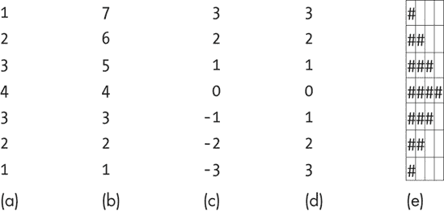

图 2-2. 解决“侧向三角形”问题所需的各种组件

我们通过类比避开了该问题的大部分工作，并通过实验解决了剩余部分。当一个新问题与你已经解决的问题非常相似时，这种“组合拳”式的方法是一个非常棒的。

## 输入处理

之前的程序只产生输出。让我们改变一下，尝试一些完全关于处理输入的程序。这些程序都共享一个限制条件：输入将逐字符地读取，并且程序必须在读取下一个字符之前处理每个字符。换句话说，程序不会将字符存储在数据结构中以备后处理，而是边读边处理。

在第一个问题中，我们将进行识别号验证。在现代世界中，几乎所有东西都有识别号，例如 ISBN 或客户编号。有时这些数字必须手动输入，这引入了出错的可能。如果错误输入的数字与任何有效识别号都不匹配，系统可以很容易地拒绝它。但如果数字是错误的却是有效的呢？例如，如果收银员在尝试为你的退货入账时，输入了另一个客户的账户号码怎么办？另一个客户将收到你的退款。为了避免这种情况，人们开发了系统来检测识别号中的错误。它们的工作原理是将识别号通过一个公式，生成一个或多个额外的数字，这些数字成为扩展识别号的一部分。如果任何数字发生变化，数字的原始部分和额外数字将不再匹配，该数字就可以被拒绝。

### 问题：Luhn 校验和验证

Luhn 公式是一种广泛用于验证识别号的系统。使用原始数字，将每隔一个数字的值翻倍。然后将每个单独数字的值相加（如果翻倍后的值是两位数，则单独加这些数字）。如果和能被 10 整除，则该识别号有效。

编写一个程序，接收任意长度的识别号并判断该数字在 Luhn 公式下是否有效。程序必须在读取下一个字符之前处理每个字符。

这个过程听起来有点复杂，但一个例子会让一切变得更清晰。我们的程序将只验证识别号，而不创建校验位。让我们走一遍过程的两个端：计算校验位和验证结果。这个过程在图 2-3 中所示。在部分 (a) 中，我们计算校验位。原始识别号 176248 显示在虚线框中。从原始数字最右侧的数字（在添加校验位后，它将是右起第二个）开始，每隔一个数字都会翻倍。然后将每个数字相加。注意，当一个数字翻倍产生两位数时，这些数字中的每一个都被单独考虑。例如，当 7 翻倍产生 14 时，加到校验和中的不是 `14`，而是单独的 `1` 和 `4`。在这种情况下，校验和是 27，所以校验位是 3，因为那个数字值能使总和达到 30。记住，最终数字的校验和应该被 10 整除；换句话说，它应该以 0 结尾。

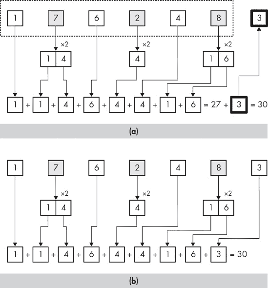

图 2-3. Luhn 校验公式

在部分 (b) 中，我们验证数字 1762483，它现在包含了校验位。这是我们将用于此问题使用的过程。和之前一样，我们从校验位右侧的数字开始，每隔一个数字翻倍，并将所有数字的值（包括校验位）相加以确定校验和。因为校验和能被 10 整除，这个数字是有效的。

## 分解问题

解决问题的程序有几个独立的问题需要我们处理。一个问题是数字的翻倍，这很棘，因为翻倍的数字是从识别号的右端确定的。记住，我们不会读取并存储所有数字*然后*进行处理。我们将边读边处理。问题是我们将从左到右获取数字，但我们实际上需要从右到左获取。如果我们知道识别号中有多少数字，我们就知道哪些数字需要翻倍，但我们不知道，因为问题说明识别号是任意长度的。另一个问题是大于 10 的翻倍数字必须根据其数字进行处理。此外，我们必须确定何时读取了整个数字。最后，我们必须弄清楚如何逐位读取。换说，用户将输入一个长数字。由于我们总是希望有一个计划，我们应该列出这些问题并逐一解决：

- 知道哪些数字需要翻倍
- 处理大于 10 的翻倍数字
- 知道已到达末尾
- 读取每个位数字

为了解决问题，我们会在编写最终解决方案之前对各个部分进行工作。因此，不需要以任何特定的顺序处理这些问题。从看起来最简单的问题开始，或者如果你想接受挑战，从看起来最难的问题开始。

让我们从处理大于 10 的翻倍数字开始。这是一个问题条件让情况变得简单而不是更复杂。计算任意整数的数字之和本身可能就是大量工作。但这里可能值的范围是多少？如果我们从 0–9 的单独数字开始并将其翻倍，最大值是 18。因此，只有两种可能性。如果翻倍后的值是个位数，那么就不需要再做什么。让我们做一个快速的代码实验来确认这种方法：

```
int digit;
  cout << "Enter a single digit number, 0-9: ";
  cin >> digit;
 int doubledDigit = digit * 2;
  int sum;
 if (doubledDigit >= 10) sum =  1 + doubledDigit % 10;
  else sum = doubledDigit;
 cout << "Sum of digits in doubled number: " << sum << "\n";
```

### 注意

`%` 运算符被称为取模运算符。对于正整数，它返回整数除法的余数。例如，`12 % 10` 结果为 2，因为 10 除以 12 后余下了 2。


这段代码非常简单：程序读取一个数字，将其翻倍，计算翻倍后数字的各位和，并输出该和。实验的核心是计算大于 10 的翻倍数字的各位和。就像我们在形状问题中计算特定行所需的井号数量一样，将此计算隔离在一个独立的短程序中可以让实验变得容易。即使我们起初没有得到正确的公式，也一定能很快找到它。

在将这个问题从列表中删掉之前，让我们把这段代码转换为一个短函数，以便简化以后的代码列表：

```cpp
int doubleDigitValue(int digit) {
   int doubledDigit = digit * 2;
   int sum;
   if (doubledDigit > 10) sum = 1 + doubledDigit % 10;
   else sum = doubledDigit;
   return sum;
}
```

现在，让我们处理读取识别号的各个数字。再次，如果我们愿意，下次可以处理另一个问题，但我认为这个问题是一个很好的选择，因为它能让我们在测试问题的其他部分时能够自然地输入识别号。

如果我们将识别号视为数值类型（例如 `int`），我们只会得到一个长数字，并且会有大量工作要做。此外，我们可以读取的整数大小有限制，而题目说识别号的长度是任意的。因此，我们必须逐字符地读取。这意味着我们需要确保知道如何读取表示数字的字符，并将其转换为我们可以进行数学运算的整数类型。为了看看如果直接将字符值用在整数表达式中发生什么，请看下面的列表，它包含了示例输出。

```cpp
char digit;
  cout << "Enter a one-digit number: ";
 digit = cin.get();
  int sum = digit;
  cout << "Is the sum of digits " << sum << "? \n";
```

注意我们使用 `get` 方法是因为提取运算符（如 `cin >> digit`）会跳过空白字符。这在这里不是问题，但正如你将看到的，以后会引起麻烦。在示例输入和输出中，你可以看到这个问题。计算机数据本质上都是数值，因此每个字符由整数字符代码表示。不同的操作系统可能使用不同的字符编码系统，但在本文中我们将关注常用的 ASCII 系统。在这个系统中，字符 7 被存储为字符代码 55，所以当该值视为整数时，得到的是 55。我们需要一种机制将字符 7 转换为整数。

### 问题：将字符转换为整数

编写一个程序，读取用户表示 0 到 9 的字符，将其转换为 0–9 范围内的等效整数，然后输出整数。

在之前的形状问题中，我们有一个想要转换为另一个范围的值。我们建立了一个原始值和目标值的表格，然后检查了它们之间的差异。这是一个类似的问题，我们可以再次使用表 2-2 的思路。

表 2-2 字符代码与目标整数

| 字符 | 字符代码 | 目标整数 | 差异 |
| --- | --- | --- | --- |
| 0 | 48 | 0 | 48 |
| 1 | 49 | 1 | 48 |
| 2 | 50 | 2 | 48 |
| 3 | 51 | 3 | 48 |
| 4 | 52 | 4 | 48 |
| 5 | 53 | 5 | 48 |
| 6 | 54 | 6 | 48 |
| 7 | 55 | 7 | 48 |
| 8 | 56 | 8 | 48 |
| 9 | 57 | 9 | 48 |

字符代码与目标整数之间的差异始终是 48，所以我们要做的就是减去那个值。你可能已经注意到这是字符 0 的字符代码值。这总是成立的，因为字符编码系统总是从 0 开始顺序存储数字字符。因此，通过减去字符 `0` 而不是使用像 48 这样的预设值，我们可以写出一个更通用、可读性更高的解决方案：

```cpp
char digit;
cout << "Enter a one-digit number: ";
cin >> digit;
int sum = digit - '0';
cout << "Is the sum of digits " << sum << "? \n";
```


到目前为止，我们在这个问题上取得了很多进展，但在编写用于任意长度识别码的代码之前，还有几个步骤要走。为了最终解决这个问题，我们需要采用分治之法。假设我要求你修改之前的代码来处理 10 位或 16 位的数字，那将轻而易举——你只需要将作为循环上限的 `6` 改为另一个值即可。但假设我要求你验证七位数。这需要进行小的额外修改，因为如果位数是奇数，且我们从右起第二位开始对每个数字翻倍，那么*左侧*的第一个数字就不再被翻倍。在这种情况下，你需要对偶数位翻倍：2、4、6 等。先暂不考虑这个问题，让我们来看看如何处理任何偶长度的数字。

### 确定输入的结束标志

我们面临的首要问题是判断何时到达数字的末。如果用户输入一个多位数并按回车，而我们正在逐字符地读取输入，在最后一个数字之后读取的是什么字符？这实际上取决于操作系统，但我们可以写一个实验：

```
cout << "Enter a number: ";
char digit;
while (true) {
   digit = cin.get();
   cout << int(digit) << " ";
}
```

这个循环会无限运行，但它能完成任务。我输入数字 `1234` 并按回车。结果是 `49 50 51 52 10`（基于 ASCII；这会随操作系统而异）。因此，10 就是我要找的内容。有了这个信息，我们可以用 `while` 循环替换掉之前代码中的 `for` 循环：

```
char digit;
  int checksum = 0;
 int position = 1;
  cout << "Enter a number with an even number of digits: ";
 digit = cin.get();
  while (digit != 10) {
   if (position % 2 == 0) checksum += digit - '0';
     else checksum += 2 * (digit - '0');
   digit = cin.get();
   position++;
  }
  cout << "Checksum is " << checksum << ". \n";
  if (checksum % 10 == 0) {
     cout << "Checksum is divisible by 10\. Valid. \n";
  } else {
     cout << "Checksum is not divisible by 10\. Invalid. \n";
  }
```

在这段代码中，`position` 不再是 `for` 循环的控制变量，因此我们必须单独对其初始化并递增。循环现在由条件表达式控制，该表达式检查信号行结束的字符值。因为我们在第一次循环时需要一个值进行检查，所以我们在循环开始之前读取第一个值，然后在循环内部的处理代码之后读取随后的每个值。

同样，这段代码可以处理任何偶长度的数字。要处理任何奇长度的数字，我们只需要修改处理代码，反转 `if` 语句条件的逻辑，以便对偶数位的数字翻倍，而不是奇数位。

至少，这已经涵盖了所有可能性。识别码的长度必须是奇数或偶数。如果我们能提前知道长度，我们就知道是对数字中的奇数位还是偶数位翻倍。然而，在到达数字末尾之前，我们并没有这些信息。在这些限制下，解决方案是不可能的吗？如果我们知道如何解决奇数位和偶数位的问题，但在完全读取之前不知道数字中有多少位，我们该如何解决这个问题？

你可能已经看到这个问题的答案了。如果还没有，并不是因为答案很难，而是因为它隐藏在细节中。我们在这里可以使用类比，但到目前为止我们还没有见过类似的情况。相反，我们将自己创建一个类比。让我们构造一个明确针对这种情况的问题，看看直面问题是否有助于我们找到解决方案。清空你基于目前工作所产生的偏见，阅读以下问题。

### 问题：正数或负数

编写一个程序从用户处读取 10 个整数。在输入所有数字后，用户可以要求显示正数的个数或负数的个数。

这是一个简单的问题，看起来没有任何复杂性。我们只需要一个变量来计算正数，另一个变量来计算负数。当用户在程序末尾指定请求时，我们只需要查询相应的变量获取响应：

```
int number;
int positiveCount = 0;
int negativeCount = 0;
for (int i = 1; i <= 10; i++) {
   cin >> number;
   if (number > 0) positiveCount++;
   if (number < 0) negativeCount++;
}
char response;
cout << "Do you want positive or negative count? ";
cin >> response;
if (response == 'p')
   cout << "Positive count is " << positiveCount << "\n";
if (response == 'n')
    cout << "Negative count is " << negativeCount << "\n";
```

这展示了我们在 Luhn 校验和中需要的方法：分两种跟踪运行校验和，一种是识别码为奇长度的情况，另一种是为偶长度的情况。当我们到达数字末尾时，会在其中一个变量中获得正确的校验和。

### 整合部分

我们现在已经勾掉了原始待办事项上的所有项。是时候把一切整合在一起并解决这个问题了。因为我们分别解决了所有的子问题，我们清楚自己需要做什么，并可以使用之前的程序产生最终结果：

```
char digit;
  int oddLengthChecksum = 0;
  int evenLengthChecksum = 0;
  int position = 1;
  cout << "Enter a number: ";
  digit = cin.get();
  while (digit != 10) {
     if (position % 2 == 0) {
        oddLengthChecksum += doubleDigitValue(digit - '0');
        evenLengthChecksum += digit - '0';
     } else {
        oddLengthChecksum += digit - '0';
        evenLengthChecksum += doubleDigitValue(digit - '0');
     }
     digit = cin.get();
     position++;
  }
  int checksum;
 if ((position - 1) % 2 == 0) checksum = evenLengthChecksum;
  else checksum = oddLengthChecksum;
  cout << "Checksum is " << checksum << ". \n";
  if (checksum % 10 == 0) {
     cout << "Checksum is divisible by 10\. Valid. \n";
  } else {
     cout << "Checksum is not divisible by 10\. Invalid. \n";
  }
```

注意，当我们检查输入数字长度是奇是偶时，我们从 `position` 减了 1。我们这样做是因为循环中读取的最后一个字符是终止行符，而不是数字的最后一个数字。我们也可以将测试表达式写为 `(position % 2 == 1)`，但那样读更晦懂。换句话说，说“如果 `position - 1` 是偶数，则使用偶校验和”比说“如果 `position` 是奇数，则使用偶校验和”并去记忆为什么这样做合理要好。


这是我们迄为止见过的最长的代码列表，但我不需要对代码中的每个部分进行注释并描述每个部分是如何工作的，因为你已经独立地观察过每个部分了。这就是计划的力量。然而，重要的是，*我的*计划并不等等于*你的*计划。我在问题的原始描述中看到的问题以及我为解决这些问题所采取的步骤，可能与你所看到的和所做的不同。你作为程序员的背景以及你成功完成的问题决定了问题的哪些部分是微不足道的，哪些部分是困难的，从而决定了你解决问题需要哪些步骤。在上一节中，可能在某个点，我采取了一个看似多余的绕路来弄清楚一个对你来说显而易见的问题。相反，可能在某个点，我灵活地跳过了对你来说很困难的东西。此外，如果你自己完成这个问题，你可能会写出一个与我的程序完全不同但同样成功的程序。对于一个问题，没有唯一的“正确”解决方案，因为任何满足所有条件的程序都算是一个解决方案，而对于任何解决方案，也没有实现它的唯一“正确”方法。

看到我们为了得到解决方案所采取的所有步骤，以及最终代码的*相对简洁*，你可能会想在自己的解决问题过程中尝试删减步骤。我警告不要产生这种冲动。多走几步总是比试图一次做太多要好，即使某些步骤看起来微不足道。记住解决问题中的目标。首要目标当然是找到一个解决所述问题并满足所有条件的程序。次要目标是在最短时间内找到该程序。最小化步骤数量并不是目标，没有人需要知道你走了多少步。考虑尝试登上一条有浅显但长且弯曲路径的陡峭山丘。忽略路径直接从山底爬到山顶，所需的步骤显然比遵循路径要少——但这样会更快吗？直接爬山最可能的结果是你放弃并倒下。

还要记住我解决问题的最后一条通用规则：*避免挫败感*。你在每一步中尝试做的工作越多，你招致的潜在挫败感就越多。即使你退后一个困难的步骤并将其拆分为子步骤，损害已经造成了，因为在心理上，你会觉得是在倒退而不是在进步。当我指导初学者采用循序渐进的方法时，有时会有学生抱怨道：“嘿，那一步太简单了。”我回答道：“你在抱怨什么？”如果你把一个最初看起来很困难的问题分解成极其微小的碎片，以至于每个碎片都轻而易举，我说：“恭喜你！这正是你应该希望的。”

## 跟踪状态

我们在本章处理的最后一个问题也是最困难的。这个问题有很多不同的组成部分和复杂的描述，这说明了拆解复杂问题重要性。

### 问题：解码消息

一条消息被编码为文本流，需要逐字符读取。该流包含一系列由逗号分隔的整数，每个整数都是一个可以用 C++ `int` 表示的正数。然而，特定整数所代表的字符取决于当前的*解码模式*。共有三种模式：*大写*（uppercase）、*小写*（lowercase）和*标点符号*（punctuation）。

在*大写*模式下，每个整数代表一个大写字母：整数对 `27` 取模数表示字母表中的字母（其中 `1 = A` 等）。因此，在大写模式下，输入值 `143` 将产生字母 `H`，因为 `143` 模 `27` 等于 `8`，而 `H` 是字母表中的第八个字母。

*小写*模式与此相同，但针对小写字母；整数除以 `27` 的余数表示小写字母（`1 = a` 等）。因此，在小写模式下，输入值 `56` 将产生字母 `b`，因为 `56` 模 `27` 等于 `2`，而 `b` 是字母表第二个字母。

在*标点符号*模式下，整数被视为对 `9` 取模，解释见下面的表 2-3。因此，`19` 将产生感叹号，因为 `19` 模 `9` 等于 `1`。

在每条消息的开头，解码模式是大写字母。每当取模操作（根据模式模 `27` 或 `9`）的结果为 `0` 时，解码模式切换。如果当前模式是大写，则切换到小写字母；如果当前模式是小写，则切换到标点符号；如果是标点符号，则切换回大写字母。

### 表 2-3. 标点符号解码模式

| 数字 | 符号 |
| --- | --- |
| 1 | ! |
| 2 | ? |
| 3 | , |
| 4 | . |
| 5 | (空格) |
| 6 | ; |
| 7 | " |
| 8 | ' |

与 Luhn 验证公式一样，我们将通过一个具体的示例来确保所有的步骤都是清晰的。图 2-4 展示了一个示例解码。原始输入在顶部。处理步骤从顶部开始。列 (a) 显示当前数字。列 (b) 是当前模式，在大写 (U)、小写 (L) 和标点符号 (P) 之间循环。列 (c) 显示当前模式的除数。列 (d) 是当前输入 (a) 除以除数 (c) 的余数。结果显示在列 (e)这是一个字符，或者如果 (d) 为 0，则是一个模式切换。

与上一个问题一样，我们可以从明确考虑构建解决方案所需的技能开始。我们需要读取字符字符串直到遇到行尾。这些字符表示一系列整数，因此我们需要读取数字字符并将其转换为整数以进行后续处理。一旦我们得到了整数，我们需要将整数转换为单个字符以便输出。最后，我们需要一种方法来跟踪解码模式，以便我们知道当前整数应该解码为小写字母、大写字母还是标点符号。让我们将其正式化：

*   逐字符读取直到遇到行尾。
*   将表示数字的系列字符转换为整数。
*   将 1–26 之间的整数转换为大写字母。
*   将 1–26 之间的整数转换为小写字母。
*   根据表 2-3 将 1–8 之间的整数转换为标点符号。
*   跟踪解码模式。


让我们直接处理剩下的事项吧。你可能已经注意到，我将每种转换都分成了一个独立的项目。我怀疑，将数字转换为小写字母与将数字转换为大写字母将非常相似，但转换为标点符号可能需要不同的处理方法。无论如何，将列表拆得太细并没有什么坏处；这只是意味着你可以更频繁地勾掉列表上的项目。

### 整数到字符的转换

让我们从这些整数到字符的转换开始。从 Luhn 算法程序中，我们知道读取 0–9 字符数字并将其转换为 0–9 范围内整数的代码。我们如何扩展这种方法来处理多位数字呢？让我们考虑最简单的情况：两位数。这看起来很直观。在两位数中，第一位是十位，所以我们应该将该数字乘以 10，然后加上第二位的值。例如，如果数字是 35，在将单个数字作为字符 3 和 5 读取，并将它们转换为整数 3 和 5 后，我们通过表达式 `3 * 10 + 5` 得到所需的整体整数。让我们用代码来确认这一点：

### 存储代码以备后复用

当前问题与上一个问题元素之间的相似性说明了以便于以后审查的方式存储源代码的重要性。软件开发者经常谈论代码*重用*，每当你使用旧软件的片段构建新软件时，就会发生代码重用。这通常涉及使用封装的组件或逐字地重用源代码。然而，方便访问你之前编写的解决方案同样重要。即使你没有直接复制旧代码，这也能让你重用以前学过的技能和技术，而无需重新学习。为了最大化这种益处，请努力保留你编写的所有源代码（当然，要留意你可能与客户或雇主签署的任何知识产权协议）。

不过，是否能从以前编写的程序中获得充分收益，很大程度上取决于你存储它们时的用心程度；找不到的代码就是无法使用的代码。如果你采用分步的方法，并在将它们整合到整体之前单独编写各个程序来测试想法，请确保也保存了那些中间程序。你会发现，当当前程序与旧程序之间的相似性在于你编写测试程序的某个领域时，稍后可以使用这些程序会非常方便。

```cpp
cout << "Enter a two-digit number: ";
char digitChar1 = cin.get();
char digitChar2 = cin.get();
int digit1 = digitChar1 - '0';
int digit2 = digitChar2 - '0';
int overallNumber = digit1 * 10 + digit2;
cout << "That number as an integer: " << overallNumber << "\n";
```

这行得通——程序输出了我们输入的相同两位数。然而，当我们尝试扩展这种方法时，遇到了一个问题。这个程序使用了两个不同的变量来保存两个字符输入，虽然这在这里没有引起问题，但我们绝不想将其扩展为一种通用解决方案。如果这样做，我们需要与数字位数相同数量的变量。那将变得混乱，而且如果输入流中可能的数字范围发生变化，修改将非常困难。我们需要为字符转换为整数的子问题找到一个更通用的解决方案。找到该通用解决方案的第一步是将之前的代码简化为仅两个变量——一个 `char` 和一个 `int`：

```cpp
cout << "Enter a two-digit number: ";
 char digitChar = cin.get();
 int overallNumber = (digitChar - '0') * 10;
 digitChar = cin.get();
 overallNumber += (digitChar - '0');
  cout << "That number as an integer: " << overallNumber << "\n";
```

我们通过在读取第二个数字之前对第一个数字进行所有计算来实现这一点。在一步读取第一个字符数字后，将其转换为整数，乘以 10 并存储结果。读取第二个数字后，将它的整数值加到运行总量中。这等同于之前的代码，但只使用了两个变量，一个用于最后读取的字符，另一个用于整数的整体值。下一步是考虑将这种方法扩展到三位数。一旦我们这样做，我们可能会看到一种模式，允许我们为任何位数的数字创建一个通用解决方案。

### 扩展到更多位数

但当我们尝试这样做时，遇到了一个问题。对于两位数，我们将左侧的数字乘以 10，是因为左侧数字在十位。三位数中最左侧的数字在百位，所以我们需要将该数字乘以 100。然后我们可以读取中间数字，将其乘以 10，加到运行总量中，然后读取最后一位数字并将其加进去。这应该是行得通的，但它并没有引导我们走向通用解决方案。你看出问题所在了吗？考虑一下之前的陈述：*三位数中最左侧的数字在百位*。对于通用解决方案，在我们到达下一个数字之前，不知道每个数字有多少位。位数未知的数字中的最左侧数字无法被标记为百位或其他任何位置。那么，在加到运行总量之前，我们如何知道每个数字应该使用什么倍数呢？或者我们需要另一种方法？

像既常一样，当卡住时，创建一个简化的问题来研究是一个好主意。这里的问题在于不知道数字将有多少位。处理此问题的最简单问题将具有两种可能的位数计数的问题。

**问题：读取三位或四位数字**

编写一个程序，逐字符读取一个数字并转换为整数，只使用一个 `char` 变量和两个 `int` 变量。该数字将是三位或四。

现在我们可以运用“两种方式计算”的方法了。我们将以两种不同的方式处理前三个数字，然后查看是否有第四位数字：


```
cout << "Enter a three-digit or four-digit number: ";
  char digitChar = cin.get();
 int threeDigitNumber = (digitChar - '0') * 100;
 int fourDigitNumber = (digitChar - '0') * 1000;
  digitChar = cin.get();
  threeDigitNumber += (digitChar - '0') * 10;
  fourDigitNumber += (digitChar - '0') * 100;
  digitChar = cin.get();
  threeDigitNumber += (digitChar - '0');
  fourDigitNumber += (digitChar - '0') * 10;
  digitChar = cin.get();
  if (digitChar == 10) {
      cout << "Numbered entered: " << threeDigitNumber << "\n";
  } else {
     fourDigitNumber += (digitChar - '0');
      cout << "Numbered entered: " << fourDigitNumber << "\n";
  }
```

读取最左侧的数字后，将其整数值乘以 100，并存储在我们的三位数变量中。我们也将该整数值乘以 1,000，并存储在我们的四位数变量中。这种模式持续适用于接两个数字。第二个数字既被视为三位数中的十位，也被视为四位数中的百位。第三个数字既被视为个位也是十位。读取第四个字符后，我们通过将其与数字 `10` 比较来检查它是否为行尾（与上问题相同，此值可能随操作系统而异）。如果是行尾，则输入是一个三位数。如果不是，我们仍然需要将个位加到总数中。

现在，我们需要弄清楚如何去掉一个整数变量。假设我们完全删除了 `fourDigitNumber` 变量。`threeDigitNumber` 的值仍然会被正确赋值，但当我们需要 `fourDigitNumber` 时，我们就无法获得它了。使用 `threeDigitNumber` 中的值，是否有某种方法可以确定原本应该在 `fourDigitNumber` 中的值？假设原始输入是 `1234`。在读取前三个数字后，`threeDigitNumber` 的值是 123；原本应该在 `fourDigitNumber` 中的值是 1230。通常情况下，由于 `fourDigitNumber` 的倍数是 `threeDigitNumber` 的 10 倍，前者始终是后者的 10 倍。因此，只需要一个整数变量，因为必要时只需将另一个变量乘以 10：

```
cout << "Enter a three-digit or four-digit number: ";
char digitChar = cin.get();
int number = (digitChar - '0') * 100;
digitChar = cin.get();
number += (digitChar - '0') * 10;
digitChar = cin.get();
number += (digitChar - '0');
digitChar = cin.get();
if (digitChar == 10) {
   cout << "Numbered entered: " << number << "\n";
} else {
   number = number * 10 + (digitChar - '0');
   cout << "Numbered entered: " << number << "\n";
}
```

现在我们有了一个可以利用的模式。考虑扩展此代码以处理五位数。在计算完前四个数字的正确值后，我们将重复读取第四个字符时所遵循的过程，而不是立即显示结果：读取第五个字符，检查它是否为行尾，如果是，则显示之前计算的数字；否则，乘以 10 并加上当前字符的数字值：

```
cout << "Enter a number with three, four, or five digits: ";
char digitChar = cin.get();
int number = (digitChar - '0') * 100;
digitChar = cin.get();
number += (digitChar - '0') * 10;
digitChar = cin.get();
number += (digitChar - '0');
digitChar = cin.get();
if (digitChar == 10) {
   cout << "Numbered entered: " << number << "\n";
} else {
   number = number * 10 + (digitChar - '0');
   digitChar = cin.get();
   if (digitChar == 10) {
      cout << "Numbered entered: " << number << "\n";
   } else {
      number = number * 10 + (digitChar - '0');
      cout << "Numbered entered: " << number << "\n";
   }
}
```

到此时，我们可以轻松地扩展代码来处理六位数或位数数的数字。模式是清晰的：如果下一个字符是另一个数字，在加上该字符的整数数字值之前，将运行总和乘以 10。有了这一理解，我们可以写一个循环来处理任意长度的数字：

```
cout << "Enter a number with many digits as you like: ";
char digitChar = cin.get();
int number = (digitChar - '0') * 100;
digitChar = cin.get();
number += (digitChar - '0') * 10;
digitChar = cin.get();
number += (digitChar - '0');
digitChar = cin.get();
while (digitChar != 10) {
    number = number * 10 + (digitChar - '0');
    digitChar = cin.get();
}
cout << "Numbered entered: " << number << "\n";
```


```
cout << "Enter a number 1-26: ";
int number;
cin >> number;
char outputCharacter;
outputCharacter = number + 'A';
cout << "Equivalent symbol: " << outputCharacter << "\n";

Enter a number 1-26: 5
Equivalent letter: F
```

这不太对。字母表中的第五个字母是 E，而不是 F。出现这个问题是因为我们加上的是从 1 开始的范围内的数字。当我们反向转换（从字符数字转换为对应的整数）时，我们处理的是一个从 0 开始的范围。我们可以通过将计算公式  从 `number + 'A'` 改为 `number + 'A' - 1` 来解决这个问题。注意，我们可以查询字母 A 的字符编码值（ASCII 中为 65），并简单地使用比该值小 1 的值（例如 ASCII 中的 `number + 64`）。不过我更喜欢第一种写法因为它因为它具可读性。换句话说，如果你以后回来看这段代码，你可以更快地想起 `number + 'A' - 1` 的作用，而不是 `number + 64` 的作用，因为前者中 `'A'` 的出现会提醒你正在转换为大写字母。

解决这个问题后，我们可以通过将计算公式  改为 `number + 'a' - 1`，轻松地将这个思路应用于转换为小写字母。标点符号转换就没有那么简洁了，因为表中的标点符号在 ASCII 或任何字符编码系统中并没有按顺序排列。因此，我们必须通过暴力法来处理这个问题：

```
cout << "Enter a number 1-8: ";
  int number;
  cin >> number;
  char outputCharacter;
 switch (number) {
     case 1: outputCharacter = '!'; break;
     case 2: outputCharacter = '?'; break;
     case 3: outputCharacter = ','; break;
     case 4: outputCharacter = '.'; break;
     case 5: outputCharacter = ' '; break;
     case 6: outputCharacter = ';'; break;
     case 7: outputCharacter = '"'; break;
     case 8: outputCharacter = '\''; break;
  }
  cout << "Equivalent symbol: " << outputCharacter << "\n";
```

在这里，我们使用了 `switch` 语句  来输出正确的标点字符。注意，使用反斜杠作为“转义”字符是为了显示单引号 。

在整合所有内容之前，我们还有一个最后一个子问题要处理：每当最近的值解码为 0 时切换模式。记住，问题描述要求我们将每个整数值对 27 取模（如果我们当前处于大写模式或小写模式）或对 9 取模（如果我们处于标点模式）。当结果为 0 时，我们就切换到下一个模式。我们需要一个变量来存储当前模式，并在“读取并处理下一个值”的循环内部编写逻辑，在必要时切换模式。跟踪当前模式的变量可以使用简单的整数，但使用枚举（enumeration）更具可读性。一个好的原则是：如果一个变量仅跟踪状态，且任何特定值都没有固有的含义，那么枚举是一个好主意。在这种情况下，我们可以有一个变量 `int mode`，任意规定值 1 表示大写，2 表示小写，3 表示标点。然而，并没有固定的理由选择这些这些值。当我们以后回来看代码时，我们必须重新熟悉该系统才能理解像 `if (mode == 2)` 这样的语句。如果我们使用枚举——就像语句 `(mode == -LOWERCASE)` 那样——我们就不需要记忆任何东西，因为一切都写得很清楚。以下是这种想法产生的代码，以及一个示例交互：

```
enum modeType {UPPERCASE, LOWERCASE, PUNCTUATION};
int number;
modeType mode = UPPERCASE;
cout << "Enter some numbers ending with −1: ";
do {
   cin >> number;
   cout << "Number read: " << number;
   switch (mode) {
      case UPPERCASE:
         number = number % 27;
         cout << ". Modulo 27: " << number << ". ";
         if (number == 0) {
            cout << "Switch to LOWERCASE";
            mode = LOWERCASE;
         }
         break;
      case LOWERCASE:
         number = number % 27;
         cout << ". Modulo 27: " << number << ". ";
         if (number == 0) {
            cout << "Switch to PUNCTUATION";
            mode = PUNCTUATION;
         }
         break;
      case PUNCTUATION:
         number = number % 9;
         cout << ". Modulo 9: " << number << ". ";
         if (number == 0) {
            cout << "Switch to UPPERCASE";
            mode = UPPERCASE;
         }
         break;
   }
   cout << "\n";
} while (number != −1);

Enter some numbers ending with −1: 2 1 0 52 53 54 55 6 7 8 9 -1
Number read: 2. Modulo 27: 2. 
Number read: 1. Modulo 27: 1. 
Number read: 0. Modulo 27: 0. Switch to LOWERCASE
Number read: 52. Modulo 27: 25. 
Number read: 53. Modulo 27: 26. 
Number read: 54. Modulo 27: 0. Switch to PUNCTUATION
Number read: 55. Modulo 9: 1. 
Number read: 6. Modulo 9: 6. 
Number read: 7. Modulo 9: 7. 
Number read: 8. Modulo 9: 8. 
Number read: 9. Modulo 9: 0. Switch to UPPERCASE
```

 整合

我们已经勾掉了列表上的所有项目，现在是时候整合这些代码列表为整个程序提供解决方案了。我们可以通过不同的方法处理这种整合。我们可能会先组合两个部分并从那里构建。例如，我们可以将读取逗号分隔数字的代码与模式切换结合。然后我们可以测试这种整合，并添加每个数字转换为相应字母或符号的代码。或者我们可以从反方向构建，将数字到字符的列表转换为一系列由主程序调用的函数。此时，我们已经很大程度上从问题解决转向了软件工程，这是一个不同的学科。我们制作了一系列块——这是困难的部分——现在只需要将它们组装起来，如图 2-5 所示。

程序中的几乎每一行都提取自本节之前的代码。大部分代码  来自模式切换程序。核心处理循环  来自我们逐字符读取逗号分隔数字的代码。最后，你会认出整数转换为大写字母、小写字母和标点符号的代码 。少量的新代码由 标记。`continue`语句会在最后一次是模式切换命令时跳到循环的下一次迭代，跳过循环末尾的 `cout << outputCharacter`。

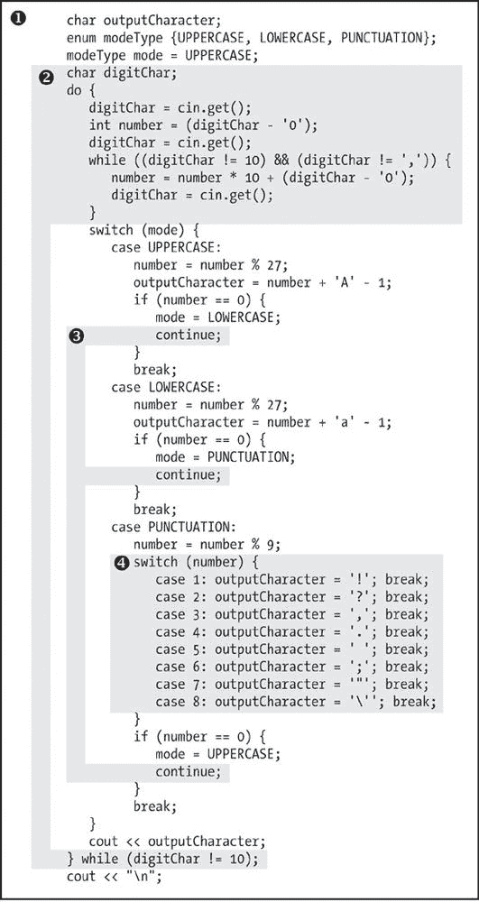

图 2-5. “解码消息”的程序的整合解决方案


虽然这看起来像是复制粘贴的工作，但它是那种好的复制粘贴——你重用了刚刚编写的代码，并因此完全理解了它。和之前一样，想一下这个过程中的每一步有多么简单，而尝试从零开始编写最终列表要困难得多。无疑，一个优秀的程序员可以不经过中间步骤直接生成最终列表，但过程中会有错误的步骤、会有代码看起来很丑的时候，以及被注释掉后又恢复的代码行。通过采取较小的步骤，所有的脏活都能尽早完成，代码永远不会变得太丑，因为我们正在处理的代码永远不会过长或复杂。

## 总结

在本章中，我们看了三个不同的问题。从某种意义上说，我们必须采取不同的路径来解决它们。从另一个角度来看，我们一直采用了相同的路线，因为我们使用了相同的基本技术：将问题分解为组件；编写代码单独解决这些组件；然后利用编写程序获得的知识，甚至直接使用程序中的代码来解决原始问题。在接下来的章节中，我们不会对每个问题显式使用这种方法，但核心思想始终存在：将问题分解成可以管理的碎片。

根据你的背景，这些问题最初看起来可能处于从极难到微不足道的难度光谱任何位置。无论问题最初看起来有多困难，我都建议在面对每个新问题时都使用这种技术。你不想等到遇到一个令人沮丧的难题时才去尝试新技巧。记住，本书的目标之一让你对自己解决问题的能力建立信心。在“简单”的问题上练习这些技术，当你遇到难题时，你会有很多动力。

## 练习

和之前一样，我敦促你尽可能多地尝试这些练习。现在我们已经完全进入了实际编程，完成练习对你培养解决问题的能力至关重要。

1. 使用与本章前面形状程序相同的规则（仅两个输出语句——一个输出井号 #，一个输出换行），编写一个程序产生以下形状：

```
########
 ######
  ####
   ##
```

2. 或者这个呢：

```
##
  ####
 ######
########
########
 ######
  ####
   ##
```

3. 这是一个特别棘手的题：

```
#            #
 ##        ##
  ###    ###
   ########
   ########
  ###    ###
 ##        ##
#            #
```

4. 设计你自己的：构思一个你自己的井号对称图案，看看你是否可以写一个遵循形状规则程序来生成它。

5. 如果你喜欢 Luhn 公式问题，尝试为一种不同的校验位系统编写程序，例如 13 位 ISBN 系统。该程序可以接收一个识别号并验证它，或者接收一个不带校验位的数字并生成校验位。

6. 如果你学习了二进制数以及如何从十进制转换为二进制及反之，尝试编写程序对无限长度的数字进行这些转换（但你可以假设数字足够小可以存储在标准的 C++ `int` 中）。

7. 你学过十六进制吗？尝试编写一个程序，允许用户指定二进制、十进制或十六进制输入，并输出三者任意一种。

8. 想要额外的挑战吗？将上一个练习的代码泛化，制作一个可以从任何 16 进制或更低进制转换为任意进制的程序。例如，程序可以将 9 进制转换为 4 进制。

9. 写一个程序读取一行文本，统计单词数，识别最长单词的长度、一个单词中元音最多的数量，以及/或你能想到的任何其他统计数据。

# 第 3 章 使用数组解决问题


在上一章中，我们将限制在标量变量上，即一次只能包含一个值的变量。在本章中，我们将使用最常用的聚合数据结构——数组来看问题。尽管数组是具有基本局限性的简单结构，但它们的使用极大增强了我们程序的威力。

在本章中，我们主要处理实际数组，即使用内置的 C++ 语法声明的数组，例如：

```
int tenIntegerArray[10];
```

然而，我们讨论的技术同样适用于具有相似属性的数据结构。这些结构中最常见的是 vector（动态数组）。`vector` 一词通常被用作任何一维数组的同义词，但我们在这里使用的具有更具体的含义，即一种具有数组属性但没有指定最大元素数量的结构。因此，对于我们的讨论，数组是固定大小的，而 `vector` 可以根据需要自动增长或缩小。在本章中讨论的每个问题都包含某些限制，允许我们使用固定数量元素的结构。然而，没有此类限制的问题可以调整为使用 `vector`。

此外，用于数组的技术通常也可以用于不具备上述列所有属性的数据结构。例如，某些技术不需要随机访问，因此它们可以用于链表等结构。因为数组在编程中非常常见，而且数组技术经常在非数组语文中使用，所以数组是学习解决问题的绝佳训练场。

## 数组基础回顾

你应该已经知道数组是什么，但为了清楚起见，让我们过一下一些属性。`array` 是在一个名称下组织的相同类型的变量集合，其中单个变量通过数字表示。我们将单个变量称为数组的`elements`（元素）。在 C++ 以及大多数语言中，第一个元素的数字为 0，但在某些语言中这会有所不同。

数组的主要属性直接源于定义。存储数组中的每个值都是相同类型，而其他聚合数据结构可以存储混合类型。单个元素通过称为下标（下标）的数字引用；在其他数据结构中，单个元素可能通过名称或键值引用。

从这些主要属性，我们可以推导出若干次要属性。由于每个元素通过从 0 开始的序列指定，我们可以轻松检查数组中的每个值。在其他数据结构中，这可能是困难的、低效的，甚至是不可能的。此外，由于某些数据结构（如链表）只能顺序访问，而数组提供了随机访问，这意味着我们可以随时访问数组的任何元素。

## 存储

这是最基本的操作。数组是变量的集合，我们可以为这些每个变量分配值。为了给之前声明的数组的第一个元素（元素 0）分配整数 5，我们只需说：

```
tenIntegerArray[0] = 5;
```


与任何变量一样，数组内部元素的值在被赋值特定值之前都将是随机的“垃圾”值，因此在使用数组之前应该对其进行初始化。在某些情况下（特别是为了测试），我们可能希望为数组中的每个元素分配一个特定的值。我们可以在声明数组时使用初始化器来实现这一点。

```
int tenIntegerArray[10] = {4, 5, 9, 12, −4, 0, −57, 30987, −287, 1};
```

我们很快就会看到数组初始化器的一个用法。有时，我们不需要为每个元素分配不同的值，而是想让数组中的每个元素都初始化为相同的值。为数组中的每个元素赋值零有一些快捷方法，取决于取决于情况或使用的编译器（例如，Microsoft Visual Studio 中的 C++ 编译器除非另有指定，否则会将任何数组中的每个值初始化为零）。但在在此阶段，在任何需要初始化的地方，我总是显式地初始化数组以增强可读性，就像下面的代码所示，它将 10 元素数组中的每个元素都设置为 −1：

```
int tenIntegerArray[10];
for (int i = 0; i < 10; i++) tenIntegerArray[i] = −1;
```

## 拷贝

我们可以创建数组的副本。这在两种常见情况下很有用。首先，我们可能想对数组进行大量操作，但后续处理仍需要其原始形式的数组。如果我们更改了任何值，那么在操作后将数组恢复到原始形式可能是困难的，甚至是不可能的。通过复制整个数组，我们可以操作副本而不扰动原始数组。复制整个数组只需要一个循环和一个赋值语句，就像初始化代码一样：

```
int tenIntegerArray[10] = {4, 5, 9, 12, −4, 0, −57, 30987, −287, 1};
int secondArray[10];
for (int i = 0; i < 10; i++) secondArray[i] = tenIntegerArray[i];
```

该操作适用于大多数聚合数据结构。第二种情况更专门针对数组。有时，我们想从一个数组复制部分数据到第二个数组，或者想将元素从一个数组复制到第二个数组，以此作为重新排列元素顺序的方法。如果你学习过归并算法，你已经在实践中见过这种思想。我们将在本章的后面部分看到拷贝的示例。

## 检索与搜索

有了将值放入数组的能力后，我们还需要从数组中取出这些值的能力。从特定位置检索值是直观的：

```
int num = tenIntegerArray[0];
```

### 查找特定值

通常情况没有那么简单。通常我们并不知道需要的位置，而是必须搜索数组来找到特定值的位置。如果数组中的元素没有特定的顺序，我们能做的最好就是顺序搜索，即从数组的一端到另一端查看每个元素，直到找到所需的值。这里是一个基础版本。

```
 const int ARRAY_SIZE = 10;
 int intArray[ARRAY_SIZE] = {4, 5, 9, 12, −4, 0, −57, 30987, −287, 1};
 int targetValue = 12;
 int targetPos = 0;
  while ((intArray[targetPos] != targetValue) && (targetPos < ARRAY_SIZE))
      targetPos++;
```

在这段代码中，我们有一个存储数组大小的常量、数组本身、一个存储要在数组中查找的值变量，以及一个存储找到的值的位置的变量。在这个示例中，我们使用常量 `ARRAY_SIZE` 来限制遍历数组的迭代次数，这样当数组元素中没有找到 `targetValue` 时，我们不会越过数组末尾。你可以硬编码数字 10 来代替常量，但使用常量使代码更通用，从而易于修改和重用。我们在本章的大部分代码将使用 `ARRAY_SIZE` 常量。注意，如果在 `intArray` 中没有找到 `targetValue`，则循环结束后 `targetPos` 将 `ARRAY_SIZE`。这足以指示该事件，因为 `ARRAY_SIZE` 不是一个有效的元素索引。然而，将取决于后续代码来检查这一点。另外注意，这段代码没有处理目标值出现多次的情况。当目标值第一次出现时，循环即结束。

### 基于标准的搜索

有时，我们要寻找的值不是固定值，而是基于与数组中其他值关系的值。例如，我们可能想找到数组中的最大值。实现该操作的机制我称为“山顶王”（King of the Hill），参考了游乐场游戏。设置一个代表到目前为止最高值的变量。用循环遍历数组中的所有元素，每当你遇到比上一个值大的值时，新值会将之前的国王挤下山顶，取代他的位置：

```
const int ARRAY_SIZE = 10;
int intArray[ARRAY_SIZE] = {4, 5, 9, 12, −4, 0, −57, 30987, −287, 1};
int highestValue = intArray[0];
for (int i = 1; i < ARRAY_SIZE; i++) {
    if (intArray[i] > highestValue) highestValue = intArray[i];
}
```


C/C++ 程序员默认的快速排序方法是标准库中的 `qsort` 函数（该名称暗示底层排序采用了快速排序，但库的实现者并不要求使用该算法）。要使用 `qsort`，我们必须编写一个比较函数。无论 `qsort` 需要比较数组中的两个元素以确定它们在排序顺序中哪个一个靠前，它都会调用该函数。该函数接收两个 `void` 指针。我们在书中还没有讨论过指针，但你在这里只需要知道的是，你应该将这些 `void` 指针转换为指向数组中元素类型的指针。然后，该函数应该返回一个 `int`（正数、负数或零），取决于第一个元素是大于、小于还是等于第二个元素。返回的具体值并不重要，重要的是它是正数、负数还是零。让我们通过一个使用 `qsort` 排序包含 10 个整数的数组的快速示例来澄清这个讨论。我们的比较函数：

```
int compareFunc(const void * voidA, const void * voidB) {
  int * intA = (int *)(voidA);
    int * intB = (int *)(voidB);
  return *intA - *intB;
}
```

参数列表由两个 `const void` 指针组成。同样，比较函数总是是这种情况。函数内部的代码开始声明两个 `int` 指针并将两个 `void` 指针转换为 `int` 指针类型。我们可以在不使用这两个临时变量的情况下编写函数；我在这里包含它们是为了清晰。关键点在于，一旦我们完成了这些声明，`intA` 和 `intB` 将指向数组中的两个元素，而 `*intA` 和 `*intB` 将是必须比较的两个整数。最后，我们返回第一个整数减去第二个整数的结果。这产生了我们想要的结果。例如，如果 `intA` > `intB`，我们返回一个正数，而当 `intA` > `intB` 时，`intA` – `intB` 将是正数。同样，如果 `intB` > `intA`，`intA` – `intB` 将为负数，当两个整数相等时，则为零。

写好比较函数后，`qsort` 的示例用法如下：

```
const int ARRAY_SIZE = 10;
int intArray[ARRAY_SIZE] = {87, 28, 100, 78, 84, 98, 75, 70, 81, 68};
qsort(intArray, ARRAY_SIZE, sizeof(int), compareFunc);
```

你可以看到，调用 `qsort` 需要四个参数：要排序的数组；该数组中的元素数量；数组中每个元素的大小，通常像这里一样通过 `sizeof` 运算符决定。如果你没有多少将函数作为参数传递给其他函数的经验，请注意最后一个参数使用的语法。我们传递的是函数本身，而不是调用函数并传递调用的结果。因此，我们只需写出函数名，而不带参数列表或括号。

### 使用插入排序进行易修改排序

在某些情况下，你可能需要编写自己的排序代码。有时内置的排序并不适用于你的情况。例如，假设你有一个数据数组，你想根据*另一个*数组中的数据来对其进行排序。当你必须编写自己的排序算法时，你会想要一个你信任并且可以随手写出来的简单排序程序。对于常用排序，一个合理的建议是*插入排序*。插入排序的工作原理就像许多人在打桥牌时整理牌的方式：他们一次捡起一张牌，并将其插入到手中的合适位置以保持整体顺序，同时向下移动其他牌以腾出空间。这是我们为整数数组的一个基础实现：

```
 int start = 0;
 int end = ARRAY_SIZE - 1;
 for (int i = start + 1; i <= end; i++) {
      for (int j = i; j > start && 
intArray[j-1] > intArray[j]; j--) {
        int temp = intArray[j-1];
          intArray[j-1] = intArray[j];
          intArray[j] = temp;
      }
  }
```

我们首先声明两个变量，`start`和`end`，表示数组中第一个和最后一个元素的下标。这提高了代码的可读性，并允许代码在需要时轻松修改为只排序数组的一部分。（注：提供的文本在此处存在一些重复/乱码，我根据指令保留了插入排序的核心逻辑。）


作为另一个简单的例子，考虑数据验证。假设有一个名为 `vendorPayments` 的双精度值数组表示支付给供应商的费用。只有正值是有效的，因此负值表示数据完整性问题。作为验证报告的一部分，我们可能会写循环来统计数组中负值的数量：

```
const int ARRAY_SIZE = 10;
int countNegative = 0;
for (int i = 0; i < ARRAY_SIZE; i++) {
    if (vendorPayments[i] < 0) countNegative++;
}
```

## 使用数组解决问题

一旦你理解了常用操作，解决数组问题与我们在上一章中所做的解决简单数据问题并没有太大区别。让我们取一个例子，使用上一章的技巧以及我们可能需要的任何数组常用操作从头到尾运行。

### 问题：寻找众数

在统计学中，一组值的众数是出现次数最多的值。编写代码来处理一个调查数据数组，该数组中调查者用 1–10 范围内的数字回答了一个问题，以确定数据集的众数。对于我们的目的，如果存在多个众数，可以任选其中一个。

在这个问题中，我们要求从数组中检索一个值。使用寻找类比的方法并从我们已知的内容开始，我们可能希望能够应用已经见过的检索技术的某种变体：找到数组中的最大值。该代码的工作原理是在变量中存储到目前为止看到的最大值。然后，代码将随后的每个值与此变量进行比较，并在必要时替换它。这里的类似方法是说，我们在变量中存储到目前为止出现频率最高的值，然后每当我们在数组中发现一个更常见的值时，就替换变量中的值。当我们用英语这样说时，听起来似乎真的行得通，但当我们考虑实际代码时，就发现了问题所在。让我们来看一个该问题的示例数组和大小常量：

```
const int ARRAY_SIZE = 12;
int surveyData[ARRAY_SIZE] = {4, 7, 3, 8, 9, 7, 3, 9, 9, 3, 3, 10};
```

这些数据的众数是 3，因为 3 出现了四次，比任何其他值都出现得频繁。但如果我们像处理“最大值”问题那样顺序处理此数组，我们从什么时候开始决定 3 是我们的众数呢？当我们遇到数组中第四次也是最后一次出现的 3 时，如何知道它确实是第四次也是最后一次出现？似乎没有办法通过对数组数据的单次顺序处理来发现此信息。

所以，让我们转向其他技术之一：简化问题。如果我们通过将相同数字的所有出现次数放在一起来让自己更容易一些，会怎样？例如，如果我们的示例调查数据数组像这样：

```
int surveyData[ARRAY_SIZE] = {4, 7, 7, 9, 9, 9, 8, 3, 3, 3, 3, 10};
```

现在两个 7 在一起，所有的 9 在一起，所有的 3 也在了一起。数据以这种方式分组后，似乎我们应该能够顺序处理数组来找到众数。手动处理数组，统计每个值的出现次数是很容易，因为你只需要一直向下计数，直到找到第一个不同的数字。然而，将我们脑海中能做的操作转换为编程语句可能是复杂的。因此在我们尝试编写这个简化问题的代码之前，让我们先写一些伪代码，即类似于编程的语句，它们不完全是英语或 C++，而是介于两者之间的东西。这将提醒我们在需要写的每条语句中想要做什么。

```
int mostFrequent = ?;
  int highestFrequency = ?;
  int currentFrequency = 0;
 for (int i = 0; i < ARRAY_SIZE; i++) {
    currentFrequency++;
    if (surveyData[i] IS LAST OCCURRENCE OF A VALUE) {
         if (currentFrequency > highestFrequency) {
               highestFrequency = currentFrequency;
               mostFrequent = surveyData[i];
           }
         currentFrequency = 0;
      }
  }
```

编写伪代码没有对错之分，如果你使用这种技术，应该采用你自己的风格。当我写伪代码时，倾向于对我已经有把握的语句编写合法的 C++ 代码，然后用英语写出我仍需思考的地方。在这里，我们我们需要一个变量（`mostFrequent`）来存储目前为止发现频率最高的值，在我们正确编写所有内容后，循环结束它就是众数。我们还需要一个变量来存储该值出现的频率（`highestFrequency`），以便我们有东西可以比较。最后，我们需要一个可以使用的变量，在顺序处理数组时统计我们当前跟踪的值的出现次数（`currentFrequency`）。我们知道我们需要初始化变量。对于 `currentFrequency`，逻辑上它必须从 0 开始，但在其他代码到位之前，还不清楚我们需要如何初始化其他变量。所以，让我们先填上问号吧。


```c
int mostFrequent;
int highestFrequency = 0;
int currentFrequency = 0;
for (int i = 0; i < ARRAY_SIZE; i++) {
    currentFrequency++;
  // if (surveyData[i] IS LAST OCCURENCE OF A VALUE)
  if (i == ARRAY_SIZE - 1 || surveyData[i] != surveyData[i + 1]) {
        if (currentFrequency > highestFrequency) {
            highestFrequency = currentFrequency;
            mostFrequent = surveyData[i];
        }
        currentFrequency = 0;
    }
}
```

在本书中，我们不会过多讨论纯粹的风格问题，例如文档（注释）风格，但由于我们在解决这个问题时使用了伪代码，我想分享一个技巧。我注意到，伪代码中我留下的那些用“纯英语”描述的行，往往是最终代码中从注释受益益浅的行，而这些纯英语本身就是极好的注释。我在这里的代码中演示了这一点。你可能会忘记 `if` 语句中条件表达式的确切含义，但前一行的注释 很好地解释这一点。

至于代码本身，它能够完成工作，但请记住它要求我们的调查数据是分组的。数据分组本身可能是一项工作，除非——如果我们对数组进行*排序*呢？我们实际上并不需要数据是有序的，但排序可以实现我们需要的分组。因为我们不打算进行任何特殊的排序，让我们在代码开头添加这个对 `qsort` 的调用：

```c
qsort(surveyData, ARRAY_SIZE, sizeof(int), compareFunc);
```

注意，我们使用的是之前为用于 `qsort` 编写的同一个 `compareFunc`。有了排序步骤，我们就有了针对原始问题的完整解决方案。所以，我们的工作结束了。真的结束了吗吗？

### 重构

有些程序员会谈论散发出“坏气味”的代码。他们指的是那些运行正常且没有 bug 但在某些方面仍然存在问题的代码。有时这意味着代码过于复杂，或者有太多的特殊情况，导致程序员难以修改和维护程序。在其他情况下，代码的效率没有达到理想水平，虽然它在测试用例中可行，但程序员担心性能在更大的用例下会崩溃。这正是我现在的担心。对于我们微小的测试用例，排序步骤几乎是瞬间完成的，但如果数组巨大呢？另外，我知道 `qsort` 可能使用的快速排序算法在数组存在大量重复值时性能最低，而这个问题的关键在于所有的值都在 1–10 的范围内。因此，我建议对代码进行*重构*。*重构*意味着改进工作代码，而不是改变它的功能，而是改变实现方式。我想要一个即使对于巨大数组也非常高效的解决方案，假设值在 1–10 的范围内。

让我们再次考虑我们如何对数组进行操作。我们已经探索了几个版本的“寻找最大值”代码。我们知道，直接对 `surveyData` 数组应用“寻找最大值”代码不会产生有效结果。是否存在一个数组，我们可以对其应用“标准”版本的“寻找最大值”并获得调查数据的众？答案是肯定的。我们需要的数组是 `surveyData` 数组的直方图。直方图是一种显示不同值在底层数据集中出现频率的图表；我们的数组将是此类直方图的数据。换句话说，我们将在一个 10 个元素的数组中存储 1 到 10 的每个值在 `surveyData` 中出现的次数。以下是创建直方图的代码：

```c
const int MAX_RESPONSE = 10;
 int histogram[MAX_RESPONSE];
 for (int i = 0; i < MAX_RESPONSE; i++) {
      histogram[i] = 0;
  }
 for (int i = 0; i < ARRAY_SIZE; i++) {
     histogram[surveyData[i] - 1]++;
  }
```

在第一行，我们声明了存储直方图数据的数组。你会注意到我们声明的数组有 10 个元素，但我们的调查响应的范围是 1–10，而该数组的下标范围是 0–9。因此，我们必须进行调整，将 1 的计数放在 `histogram[0]` 中，以此此类推。（有些程序员会选择声明一个 11 个元素的数组，留出 `[0]` 位置不使用，以便让每个计数进入其自然位置。）我们通过循环显式地将数组值初始化为零，然后用另一个循环统计 `surveyData` 中每个值的出现次数。循环内部的语句必须仔细阅读；我们使用 `surveyData` 当前位置的值来告诉我们要增加 `histogram` 中的哪个位置。为了让这一点清晰，让我们举个例子。假设 `i` 是 42。我们检查 `surveyData[42]` 并发现（假设）值为 7。因此我们需要增加计数器。我们从 7 减 1 得到 6，因为 7 的计数在 `histogram` 的 `[6]` 位置，并且 `histogram[6]` 被增加了。

有了直方图数据，我们就可以编写代码的其他部分。注意，直方图代码是单独编写的以便单独测试。在问题很容易分解的情况下，一次性编写所有代码并不能节省时间。测试上面的代码后，我们现在在 `histogram` 数组中搜索最大值：

```c
 int mostFrequent = 0;
  for (int i = 1; i < MAX_RESPONSE; i++) {
      if (histogram[i] > histogram[mostFrequent]) mostFrequent = i;
  }
 mostFrequent++;
```

尽管这是“寻找最大值”代码的变，但存在差异。尽管我们正在直方图数组中搜索最大值，最终我们需要的不是值本身，而是位置。换句话说，对于我们的示例数组，我们知道 3 出现的次数比调查数据中的任何值都多，但 3 出现的实际次数并不重要。所以 `mostFrequent` 将是图中最大值的位置，而不是最大值本身。因此，我们将其初始化为 `0` ，而不是 `location[0]` 的值。这意味着在 `if` 语句中，我们比较的是 `histogram[mostFrequent]`，而不是 `mostFrequent` 本身，并且当发现更大的值时，我们将 `i` 而不是 `histogram[i]` 赋值给 `mostFrequent` 。最后，我们增加 `mostFrequent` 。这与我们之前循环的操作相反，减 1 以得到正确的数组位置。如果 `mostFrequent` 告诉我们最高的数组位置是 5，例如，这意味着调查数据中最频繁的条目是 6。


直方图方案的扩展性与 `surveyData` 数组中的元素数量线性增长，这正是我们所期待的最理想结果。因此，它比我们原始的方法更好。这并不意味着第一种方法是错误或浪费时间。当然，完全可以在不经过之前的版本的情况下就写出这段代码，而且如果我们希望自己直接到达目的地而不是绕远路，这是可以被原谅的。然而，我警告你，当第一个解决方案证明不是最终解决方案时，不要在那时候自责不已。编写一个原始程序（请记住，这意味着对于*编写该程序的程序员来说是原始编写的*）是一个学习过程，不能期望它总是沿着直线进展。此外，通常情况下，在解决某个问题上走更长的路有助于我们在稍后的问题上走更短的路。在这一特定情况下，请注意，我们的原始解决方案（虽然它对我们的特定问题扩展性不佳）但如果调查结果不是严格限制在 1–10 的小范围内，它可能就是正确的解决方案。或者假设你之后被要求编写代码来找到一组整数值的*中位数*（中位数是集合中中间的值，使得集合中其他值的一半比它高，另一半比它低）。直方图方法在处理位数时毫无用处，但我们处理众数的第一个方法却可以。

这里的教训是，如果你从一段漫长的旅程中学到了通过走捷径无法学到的东西，那么这段旅程并不是浪费时间。这也是另一个原因，有系统地存储你编写的所有代码是有帮助的，这样你以后就可以很容易找到并重用它们。即使证明是“死胡同”的代码也可以变成宝贵的资源。

# 固定数据的数组

在大多数数组问题中，数组是程序外部数据的存储，例如用户输入的数据、本地磁盘上的数据或来自服务器的数据。然而，为了充分利用数组工具的优势，你需要识别出可以使用数组的其他情况。创建一个在初始化后值永远不会改变的数组通常很有用。这种数组可以允许使用简单的循环甚至直接的数组查找来替换整块的控制语句。

在跟踪状态中问题：解码消息问题的最终代码中，我们使用 `switch` 语句在处于“标点模式”时将解码后的输入数字（1–8 范围）翻译为相应的字符，因为数字与字符之间的连接是任意的。尽管这运行良好，但它使得该部分代码比等效的大写和小写模式代码要长，而且如果标点符号数量增加，代码的扩展性就不佳。我们可以使用数组来解决这个问题，而不是 `switch` 语句。首先，我们需要将标点符号永久分配给数组，顺序与它们在编码方案中顺序相同：

```
const char punctuation[8] = {'!', '?', ',', '.', ' ', ';', '"', '\''};
```

注意，此数组被声明为 `const`，因为里面的值永远不会改变。有了这个声明，我们可以用一个引用数组的单一赋值语句替换整个 `switch` 语句：

```
outputCharacter = punctuation[number - 1];
```

由于输入数字在 1–8 范围内，但数组元素从 0 开始编号，因此在引用数组之前，我们必须从输入数字中减去 1；这是我们在“寻找众数”程序的直方图版本中所做的相同的调整。你可以使用同一个数组进行反向操作。假设我们不是在解码消息，而是要编码消息——也就是说，我们给定了一系列字符，将它们转换为可以使用原始问题规则解码的数字。要将标点符号转换为其数字，我们必须在数组中找到该符号。这是一个使用顺序搜索技术进行的检索。假设要转换并存储的字符在 `char` 变量 `targetValue` 中，我们可以如下调整顺序搜索代码：

```
const int ARRAY_SIZE = 8;
int targetPos = 0;
while (punctuation[targetPos] != targetValue && targetPos < ARRAY_SIZE)
    targetPos++;
int punctuationCode = targetPos + 1;
```

注意，正如在上一个例子中我们需要从 `number` 减 1 以得到正确的数组位置一样，在这个例子中，我们必须在数组位置上加 1 以得到标点代码，将数组的 0–7 范围转换为我们的标点代码 1–8 范围。虽然这段代码没有单行那么简单，但它仍然比一系列 `switch` 语句简单得多，并且扩展性良好。如果我们编码方案中的标点符号数量翻倍，数组中的元素数量也会增加一倍，但代码的长度将保持不变。

总来说，`const` 数组可以作为查找表使用，替换繁重的系列控制语句。假设你正在编写一个程序来计算某个州商业执许可证的成本，该许可证成本随业务总销售额的变化而变化。

表 3-1. 商业执许可证费用

| 业务类别 | 销售阈值 | 执许可证费用 |
| --- | --- | --- |
| I | $0 | $25 |
| II | $50,000 | $200 |
| III | $150,000 | $1,000 |
| IV | $500,000 | $5,000 |

对于这个问题，我们可以使用数组来根据公司的总销售额确定业务类别，并根据类别分配执许可证费用。假设一个 `double` 变量 `grossSales` 存储业务的总销售额，根据销售额，我们希望将值分配给 `int category` 和 `double cost`：

```
const int NUM_CATEGORIES = 4;
 const double categoryThresholds[NUM_CATEGORIES] =
      {0.0, 50000.0, 150000.0, 500000.0};
 const double licenseCost[NUM_CATEGORIES] =
      {50.0, 200.0, 1000.0, 5000.0};
 category = 0;
 while (category < NUM_CATEGORIES &&
      categoryThresholds[category] <= grossSales) {
          category++;
      }
 cost = licenseCost[category - 1];
```

这段代码使用了两个固定值的数组。第一个数组存储了每个业务类别的销售阈值。例如，年销售额为 $65,000 的业务属于 II 类，因为这个金额超过了 II 类 $50,000 的阈值，但小于 III 类 $150,000 的阈值。第二个数组存储了每个类别的商业执许可证费用。有了这些数组，我们将 `category` 初始化为 0 并遍历 `categoryThresholds` 数组，直到阈值超过销售额或用完所有类别。无论在何种情况下，循环结束后，`category` 都根据总销售额被正确分配为 1–4。最后一步是使用 `category` 从 `licenseCost` 数组中引用执许可证费用。像一样，我们需要将业务类别的 1–4 范围调整为数组的 0–3 范围。


到目前为止，我们一直处理的是简单数据类型的数组，例如 `int` 和 `double`。然而，程序员通常必须处理复合数据类型的数组，即结构体或对象（`struct` 或 `class`）。虽然使用复合数据类型不可避免地会让代码变得复杂一些，但它不必让我们对数组处理的思维变得复杂。通常，数组处理只涉及 `struct` 或 `class` 的一个数据成员，我们可以忽略数据结构的其他部分。尽管如此，有时使用复合数据类型需要我们对方法进行一些更改。

例如，考虑寻找一组学生成绩中的最高分。假设我们现在不是 `int` 数组，而是一个数据结构数组，每个结构代表一个学生的记录：

```cpp
struct student {
    int grade;
    int studentID;
    string name;
};
```

处理数组的一个很棒点是很容易使用字面量初始化整个数组以便于测试，即使是对于 `struct` 数组也是如此：

```cpp
const int ARRAY_SIZE = 10;
student studentArray[ARRAY_SIZE] = {
    {87, 10001, "Fred"},
    {28, 10002, "Tom"},
    {100, 10003, "Alistair"},
    {78, 10004, "Sasha"},
    {84, 10005, "Erin"},
    {98, 10006, "Belinda"},
    {75, 10007, "Leslie"},
    {70, 10008, "Candy"},
    {81, 10009, "Aretha"},
    {68, 10010, "Veronica"}
};
```

这个声明意味着 `studentArray[0]` 的 `grade` 为 87，`studentID` 为 10001，`name` 为“Fred”，数组中的其他九个元素亦如此。至于代码的其余部分，可以简单地从本章开头复制代码，然后将每个形式如 `intArray[subscript]` 的引用替换为 `studentArray[subscript].grade`。这将得到如下：

```cpp
int highest = studentArray[0].grade;
for (int i = 1; i < ARRAY_SIZE; i++) {
    if (studentArray[i].grade > highest) highest = studentArray[i].grade;
}
```

假设由于我们现在有了每个学生的额外信息，我们想要找到成绩最高的学生的名字，而不是成绩本身。这需要额外的修改。当我们的循环结束时，我们拥有的唯一统计数据是最高分，这并不能让我们直接确定该分属于哪个学生。我们必须再次遍历数组，寻找具有匹配 `grade` 的 `struct`，这看起来像是我们本不该完成的额外工作。为了避免这个问题，我们应该要么额外追踪与 `highest` 中当前值匹配的学生姓名，要么不再追踪最高分，而是追踪发现最高分在数组中的位置，就像我们之前处理 `histogram` 时做的那样。后一种方法更为通用，因为追踪数组位置允许我们稍后检索该学生的的*任何*数据：

```cpp
 int highPosition = 0;
  for (int i = 1; i < ARRAY_SIZE; i++) {
      if (studentArray[i].grade > studentArray[highPosition].grade) {
          highPosition = i;
      }
  }
```

在这里，变量 `highPosition` 取代了 `highest`。因为我们没有直接追踪最接近平均值的成绩，当需要将最近成绩与当前成绩进行比较时，我们使用 `highPosition` 作为对 `studentArray` 的引用。如果当前数组位置的成绩更高，则将处理循环中的当前位置赋值给 `highPosition` 。循环结束后，可以使用 `studentArray[highPosition].name` 获取最接近平均成绩的学生的名字，也可以访问与该学生记录相关的任何其他数据。

# 多维数组

到目前为止，我们只讨论了一维数组，因为它们是最常见的。二维数组并不常见，三维或更多维的数组更是罕见。这是因为大多数数据本质上是一维的。此外，本质上是多维的数据可以表示为多个一维数组，因此使用多维数组始终是程序员的选择。考虑表 3-1 中的营业执照数据。这显然是多维数据。我的意思是，看看它——它是一个网格！然而，我将这些多维数据表示为两个维数组，`categoryThresholds` 和 `licenseCost`。我本可以将数据表表示为二维数组，如下：

```cpp
const double licenseData[2][numberCategories] = {
    {0.0, 5000},
    {0.0, 10000}
};
```

很难从将两个数组合并为一个中看出任何优势。但很清楚，分开的数组使得每个数组的内容一目了然。不过，有时使用多维数组是有意义的。假设我们正在处理三个代理的每月销售额，其中任务之一是找到任何代理的最高销售额。将所有数据放在一个数组中意味着我们可以嵌套循环：

```cpp
const int NUM_AGENTS = 3;
const int NUM_MONTHS = 12;
int sales[NUM_AGENTS][NUM_MONTHS] = {
    {10, 20, 30, 40, 50, 60, 70, 80, 90, 100, 10, 0},
    {15, 25, 35, 45, 55, 65, 75, 85, 95, 105, 15, 5},
    {5, 15, 25, 35, 45, 55, 65, 75, 85, 95, 105, 15}
};
int highestSales = sales[0][0];
for (int agent = 0; agent < NUM_AGENTS; agent++) {
    for (int month = 0; month < NUM_MONTHS; month++) {
        if (sales[agent][month] > highestSales)
            highestSales = sales[agent][month];
    }
}
```


请注意，我为循环变量使用了有意义的名称：外层循环使用 `agent` ，内层循环使用 `month` 。在处理一维数组的单循环中，使用描述性标识符的收益不大。然而，在处理二维数组的双重循环中，有意义的标识符有助于我理清维度和下标，因为我可以查看并发现，在数组声明中使用 `numAgents` 的同一个维度上，我确实使用了 `agent`。

即使当我们拥有多维数组时，有时最好的方法也是一次只处理一个维度。假设使用与之前代码相同的 `sales` 数组，我们想要显示月平均销售额最高的代理。我们可以像之前那样使用双重循环来实现，但如果我们将整个数组视为三个独立的数组并分别处理它们，代码将更易于阅读也更易于编写。

还记得我们反复使用的用于计算整数数组平均值的代码吗？让我们把它变成一个函数：

```
double arrayAverage(int intArray[], int ARRAY_SIZE) {
    double sum = 0;
    for (int i = 0; i < ARRAY_SIZE; i++) {
        sum += intArray[i];
    }
    double average = (sum + 0.5) / ARRAY_SIZE;
    return average;
}
```

有了这个函数后，我们可以再次修改基础的“寻找最大数”逻辑，以寻找月平均销售额最高的代理：

```
int highestAverage = arrayAverage(sales[0], 12);
for (int agent = 1; agent < NUM_AGENTS; agent++) {
    int agentAverage = arrayAverage(sales[agent], 12);
    if (agentAverage > highestAverage)
        highestAverage = agentAverage;
}
cout << "Highest monthly average: " << highestAverage << "\n";
```

这里的大新思想体现在对 `arrayAverage` 的两次调用。该函数接受的第一个参数是一个 `int` 类型的一维数组。在第一次调用中，我们将 `sales[0]` 作为第一个参数传递，在第二次调用中，我们传递 `sales[agent]`。因此，在两种情况下，我们都指定了二维数组 `sales` 第一维的下标，但没有指定第二维的。由于 C++ 中数组与地址之间的直接关系，此引用指向所指定行第一个元素的地址，该地址可以被我们的函数用作由该行组成的一维数组的基地址。

如果这听起来很困惑，请再次查看 `sales` 数组的声明，特别是初始化器。初始化器中的值排列顺序与程序执行时在内存中的排列顺序相同。因此，`sales[0][0]`（值为 1856）首先出现，接着是 `sales[0][1]`（值为 498），依此类推，直到第一个代理的最后一个月份 `sales[0][11]`（值为 32）。然后将开始第二个代理的值，从 `sales[1][0]`（值为 5865）开始开始。因此，尽管该数组在概念上是 3 行每行 12 个值，但它在内存中的布局方式是一个包含 36 个值的大序列。

需要注意的是，这种技术之所以有效，是因为我们将数据放入数组的顺序。如果数组是沿着另一个轴组织的，即按月份而不是按代理组织，那么我们就无法完成这里所做的操作。好消息是，有一种简单的方法可以确保你正确设置了数组——只需检查初始化器即可。如果你想要单独处理的数据在数组初始化器中不是连续的，说明你组织数据的方式不对。

关于这段代码最后需要说明的一点是使用了临时变量 `agentAverage`。因为当前代理的月平均销售额可能被引用两次（一次在 `if` 语句的条件表达式中，另一次体内的赋值语句中），临时变量消除了对同一代理数据调用两次 `arrayAverage` 的可能性。

这种将多维数组视为数组之数组的技术直接源于我们的核心原则：将问题分解为更简单的组件，并且通常情况下这使得多维数组问题变得更容易概念化。尽管如此，你可能仍然认为这种技术用起来有点棘手，如果你像大多数新 C++ 程序员一样，你可能对地址和背后的地址算术有些警惕。我认为，克服这些感觉的最佳方法是加强维度之间的分离，通过将一个级别的数组放在 `struct` 或 `class` 内部。假设我们创建了一个 `agentStruct`：

```
struct agentStruct {
    int monthlySales[12];
};
```

既然已经费力创建了 `struct`，我们可能会考虑添加其他数据，比如代理识别码，但这在简化我们的思维过程方面已经足够了。有了 `struct` 之后，我们不再创建一个销售的二维数组，而是创建一个代理的一维数组：

```
agentStruct agents[3];
```

现在，当我们调用 `arrayAverage` 时，我们并不是在利用 C++ 特有的技巧；我们只是传递了一个一维数组。例如：

```
int highestAverage = arrayAverage(agents[1].monthlySales, 12);
```

# 决定何时使用数组

数组仅仅是一个工具。正如任何工具一样，学习*如何*使用数组的一个重要部分是学习*何时*使用它。到目前为止讨论的示例问题都假设了使用数组。但在大多数情况下，我们并不会被明确告诉这一点，而必须自己决定何时使用数组。我们必须做此决定的最常见情况是：当我们被给定聚合数据但没有被告知内部如何存储时。记住，我们无法在数组创建后更改其大小。如果空间不足，我们的程序就会失败。因此，首要考虑的是，在程序中需要聚合数据的地方，我们是否知道将存储多少值，或者至少对最大大小有一个可靠的估计。这并不意味着我们在编写程序时就知道数组的大小。C++ 以及大多数其他语言都允许我们创建一个运行时指定大小的数组。假设模式问题被修改为：我们预先不知道有多少个调查响应，但这个数字是通过用户输入进入程序的。那么我们可以动态声明一个数组来存储调查数据。

```
int ARRAY_SIZE;
  cout << "Number of survey responses: ";
  cin >> ARRAY_SIZE;
 int *surveyData = new int[ARRAY_SIZE];
  for(int i = 0; i < ARRAY_SIZE; i++) {
      cout << "Survey response " << i + 1 << ": ";
    cin >> surveyData[i];
  }
```

我们使用指针表示法声明数组，通过调用 `new` 运算符进行初始化。由于 C++ 中指针和数组类型之间的流动，随后可以使用数组符号访问元素，即使 `surveyData` 被声明为指针。注意，由于该数组是动态分配的，在程序结束我们不再需要该数组时，我们必须确保释放它：

```
delete[] surveyData;
```


`delete[]` 运算符用于数组，而不是通常的 `delete` 运算符。虽然对于整数数组来说这没有任何区别，但如果你创建一个对象数组，`delete[]` 运算符可以确保在数组本身被删除之前，数组中的单个对象会被先删除。因此，你应该养成对动态分配的数组始终使用 `delete[]` 的习惯。

清理动态内存的责任是 C++ 程序员的噩梦，但如果你用这种语言编程，这是你必须做的事情。初级程序员往往会逃避这种责任，因为他们的程序非常小，运行时间非常短，以至于他们从未见过内存泄漏的危害影响（即程序不再使用但从未释放，从而导致系统其他部分无法使用的内存）。不要养成这种坏习惯。

注意，我们之所以可以使用动态数组，是因为用户事先告诉了我们调查响应的数量。考虑另一种变体：用户开始输入调查响应，而没有告诉我们响应的数量，而是通过输入 `-1` 表示没有更多响应（这种数据输入方法被称为 `sentinel`，即哨兵值）。我们还能使用数组来解决这个问题吗？

这是一个灰色地带。如果我们有一个保证的最大响应数量，仍然可以使用数组。在这种情况下，我们可以声明该大小的数组并假设我们是安全的。然而，从长期来看，我们可能仍会有担忧。如果调查池的大小在未来增加怎么办？如果我们想让不同的调查者使用同一个程序怎么办？更通俗地说，如果我们可以避免，为什么要构建一个具有已知限制的程序呢？

那么，更好的做法是使用没有固定大小的数据收集容器。正如之前讨论的，C++ 标准模板库中的 `vector` 类类似于数组，但它会根据需要进行增长。一旦声明并初始化，`vector` 的处理方式与数组完全相同。我们可以为 `vector` 元素赋值，或使用标准数组表示法检索值。如果 `vector` 已经填充了初始大小且我们需要添加另一个元素，可以使用 `push_back` 方法来实现。使用 `vector` 解决修改后的问题如下：

```cpp
 vector<int> surveyData;
 surveyData.reserve(30);
  int surveyResponse;
  cout << "Enter next survey response or −1 to end: ";
 cin >> surveyResponse;
  while (surveyResponse != −1) {
     surveyData.push_back(surveyResponse);
      cout << "Enter next survey response or −1 to end: ";
      cin >> surveyResponse;
  }
 int vectorSize = surveyData.size();
  const int MAX_RESPONSE = 10;
  int histogram[MAX_RESPONSE];
  for (int i = 0; i < MAX_RESPONSE; i++) {
      histogram[i] = 0;
  }
  for (int i = 0; i < vectorSize; i++) {
      histogram[surveyData[i] - 1]++;
  }
  int mostFrequent = 0;
  for (int i = 1; i < MAX_RESPONSE; i++) {
      if (histogram[i] > histogram[mostFrequent]) mostFrequent = i;
  }
  mostFrequent++;
```

在这段代码中，我们首先声明了 `vector`，然后为 30 个调查响应预留了空间。第二步并不是必须的，但预留少量超过可能元素数量的额外空间可以防止 `vector` 在我们添加值时频繁地调整自身大小。我们在数据输入循环之前读取了第一个分数，这是我们在上一章中首次使用的技术，它允许我们在处理之前检查每个输入的值。在这种情况下，我们想要避免将哨兵值 `-1` 添加到 `vector` 中。调查结果通过 `push_back` 方法添加到 `vector` 中。数据输入循环完成后，我们使用 `size` 方法获取 `vector` 的大小。我们也可以在数据输入循环中自己计数元素，但由于 `vector` 已经在跟踪其大小，这避免了重复工作。代码的其他部分与之前使用数组和固定数量响应的版本相同，只是我们更改了变量名称。

然而，所有关于 `vector` 的讨论忽略了一个重要点。如果我们是直接从用户那里读取数据，而不是被告知是从数组或其他数据收集开始的，那么我们可能不需要用于调查数据的数组，只需要一个直方图数组。相反，我们可以在读取调查值的同时对其处理。只有当我们需要在处理之前读取所有值，或者需要多次处理这些值时，才需要数据结构。在这种情况下，我们这两者都不需要：

```cpp
const int MAX_RESPONSE = 10;
int histogram[MAX_RESPONSE];
for (int i = 0; i < MAX_RESPONSE; i++) {
    histogram[i] = 0;
}
int surveyResponse;
cout << "Enter next survey response or −1 to end: ";
cin >> surveyResponse;
while (surveyResponse != −1) {
    histogram[surveyResponse - 1]++;
    cout << "Enter next survey response or −1 to end: ";
    cin >> surveyResponse;
}
int mostFrequent = 0;
for (int i = 1; i < MAX_RESPONSE; i++) {
    if (histogram[i] > histogram[mostFrequent]) mostFrequent = i;
}
mostFrequent++;
```

尽管在有之前的版本指导下这段代码很容易编写，但如果直接将用户数据读入数组并原样使用之前的处理循环会更简单。这种“边读边处理”方法的用处在于效率。当我们只需要一次存储一个响应时，避免了不必要地存储每个调查响应。我们基于 `vector` 的解决方案在空间上是低效的：它占用了比需要更多的空间，而没有提供相应的收益。此外，将所有分数读取到 `vector` 中本身就需要一个循环，这与处理所有调查响应以及在直方图中找到最高值的循环是分开。这意味着 `vector` 版本比上面的版本做了更多工作。因此，`vector` 版本在时间上也是低效的：它做了比需要更多的工作，而没有提供相应的收益。但在这种情况下，使用 `vector` 使程序在各个方面都是低效的。

在本书中，我们不会花大量时间去追踪每一个低效之处。程序员有时必须参与性能调优，即对程序的时间空间效率进行系统性的分析和改进。对程序进行性能调优就像调优赛车一样：这是一项精细的工作，微小的调整就能产生巨大的影响，并且需要对“引擎盖下”机制的工作原理有专家级的了解。尽管即使我们没有时间、愿望或知识来完全调优程序的性能，我们仍然应该避免导致严重低效的决策。


如果我们确定需要多次处理数据，并且对数据集的最大尺寸有良好的掌握，那么决定是否使用数组的最后一个标准就是随机访问。稍后，我们将讨论替代的数据结构，例如列表（lists），它们像向量一样可以根据需要增长，但与向量和数组不同，其元素只能按顺序访问。也就是说，如果我们想访问列表中的第 10 个元素，我们必须遍历前 9 个项目才能到达它。相比之下，`random access` 意味着我们可以随时访问数组或向量中的任何元素。因此，最后的规则是：当我们需要随机访问时，应该使用数组。如果我们只需要顺序访问，可能可以考虑不同的结构。

你可能会注意到本章中的许多程序都没有通过这最后一个标准；我们是顺序访问数据而非随机访问，但我们却使用了数组。这导致了所有这些规则中巨大且符合常识的例外。如果数组很小，那么之前的反对意见就都不太重要。“小”的定义可能取决于平台或应用程序。重点在于，如果你的程序需要少至 1 个或多达 10 个元素的集合，且每个元素需要 10 字节，你就必须考虑，分配一个最大所需尺寸数组可能导致 90 字节的潜在浪费是否值得寻找更好的解决方案。明智地使用数组，但不要让完美成为良好的敌人。

## 练习

一如既往，我敦促你尽可能尝试你能忍受的练习。

1. 你对我们没有在排序上做更多事情感到失望吗？我在这里为你提供帮助。为了确保你熟悉 `qsort`，请编写代码使用该函数对我们的学生 `struct` 数组进行排序。首先尝试按成绩排序，然后尝试使用学生 ID 再次排序。
2. 重写寻找平均销售额最高代理的代码，使其找到销售中位数（`median`）最高的代理。如前所述，一组值的中位数是“中间的那一个”，使得另外的一半值更高，另一半值更低。如果值的个数是偶数，中位数是中间两个值的简单平均值。例如，在集合 10, 6, 2, 14, 7, 9 中，中间的值是 7 和 9。7 和 9 的平均值是 8，所以 8 是中位数。
3. 编写一个 `bool` 函数，传递一个数组和该数组中的元素个数，并判断数组中的数据是否已排序。这只需要遍历一次！
4. 这是一个关于 `const` 值数组的变体。编写一个创建替换密码问题的程序。在替换密码问题中，所有消息都由大写字母和标点符号组成。原始消息称为原文，你通过将每个字母替换为另一个字母来创建密文（例如，每个 C 都可以变成 X）。对于这个问题，硬编码一个包含 26 个 `char` 元素的 `const` 数组作为密码，并让程序读取原文消息并输出相应的密文。
5. 让上一个程序将密文转换回原文以验证编码和解码。
6. 为了使密文问题更具挑战性，让你的程序随机生成密码数组而不是硬编码的 `const` 数组。这实际上意味着在数组的每个元素中放置随机字符，但记住你不能用字母替换其本身。所以第一个元素不能是 A，你不能对同一个字母进行两次替换——也就是说，如果第一个元素是 S，其他元素都不能是 S。
7. 编写一个程序，给定整数数组并确定众数（`mode`），即数组中出现频率最高的数字。
8. 编写一个处理 `student` 对象数组并确定成绩四分位数的程序——即学生为了达到或优于 25% 学生、50% 学生和 75% 学生时所需的成绩。
9. 考虑对 `sales` 数组的这种修改：由于销售人员在年中不断入职离开，我们现在将销售代理入职之前的月份，或销售代理最后一个月之后的月份标记为 `-1`。重写你的最高销售平均额或最高销售中位数代码以补偿这种变化。

# 第 4 章：使用指针和动态内存解决问题


在本章中，我们将学习使用指针和动态内存来解决问题，这将允许我们编写灵活的程序，以适应在程序运行之前未知的数据大小。指针和动态内存分配是“硬核”编程。当你能够编写程序动态获取内存块、将其链接到实用的结构中，并在结束后清理所有内容以确保没有遗留物时，你不仅仅是一个会写点代码的人——你是一个程序员。

由于指针非常棘手，而且由于许多流行语言（如 `Java`）似乎放弃了对指针的使用，一些初级程序员会说服自己完全跳过这个主题。这是一个错误。指针和间接内存访问在高级编程中始终会被使用，尽管它们可能被高层语言的机制所隐藏。因此，为了真正像程序员一样思考，你必须能够通过指针和基于指针的问题进行思考。

不过，在解决问题之前，我们将仔细检查指针的所有方面，包括表面上和幕后的部分。这项研究提供了两个益处：首先，这些知识将允许我们最有效地利用指针。其次，通过消除指针的神秘感，我们可以充满信心地使用它们。

## 指针基础回顾

与之前章节涵盖的主题一样，你应该对基础指针的使用有所接触，但为了确保我们的观点一致，这里有一个快速的回顾。

C++ 中的指针用星号 `*` 表示。根据上下文的不同，星号表示正在声明一个指针，或者表示我们指的是所指向的内存。要声明一个指针，我们在类型名和标识符之间放置星号：

```cpp
int * intPointer;
```

这把变量 `intPointer` 声明为指向 `int` 的指针。注意星号与标识符绑定，而不是类型绑定。在接下来，`variable1` 是一个指向 `int` 的指针，但 `variable2` 只是一个 `int`：

```cpp
int * variable1, variable2;
```

变量前的取地址符 `&` 充当“地址地址”运算符。因此，我们可以将 `variable2` 的地址赋值给 `variable1`：

```cpp
variable1 = &variable2;
```

我们也可以直接将一个指针变量的值赋值另一个：

```cpp
intPointer = variable1;
```

最重要的是，我们可以在运行时分配只能通过指针访问的内存。这是通过 `new` 操作符实现的：

```cpp
double * doublePointer = new double;
```

访问指针另一端的内存被称为“解引用”（*dereferencing*），通过在指针标识符左侧放置星号来实现。再次，这与我们声明指针时使用相同的位置。上下文使得含义不同。这里有一个例子：

```cpp
*doublePointer = 35.4;
double localDouble = *doublePointer;
```

我们为上一个代码分配的 double 赋值一个值 ，然后将该值从此内存位置复制到变量 `localDouble` 。

当我们不再需要用 `new` 分配的内存时，使用 `delete` 关键字来释放内存：

```cpp
delete doublePointer;
```


该过程的机制在内存重要中的内存重要中进行了详细描述。

## 指针的好处

指针为我们提供了静态内存分配无法实现的能力，并为高效内存提供了新的机会。使用指针的三个主要好处是：

* 运行时大小的数据结构
* 可调整大小的数据结构
* 内存共享

让我们详细查看每一个内容。

## 运行时大小的数据结构

通过使用指针，我们可以创建一个在运行时确定大小的数组，而不是在构建应用程序之前选择大小。这避免了我们必须在“数组空间可能耗尽”和“将数组做得尽可能大”之间做出权衡，从而在平均情况下浪费大量的数组空间。我们之前在决定何时使用数组中的决定何时使用数组中见过运行时数据大小化。我们将在本章稍后的解决指针问题中的变长字符串中使用这个概念。

## 可调整大小的数据结构

我们还可以创建在运行时根据需要增长或缩小的指针数据结构。最基本的可调整大小的数据结构是链表，你可能已经见过。虽然结构中的数据只能按顺序访问，但链表存储数据的地方始终与数据本身相等，没有空间浪费。正如你稍后看到的，其他更复杂的基于指针的数据结构具有排序和“形状”，这些可以比数组更好地反映底层数据的关系。因此，尽管数组提供了任何基于指针结构都不具备的全随机访问能力，但 `retrieval` 操作（我们在结构中找到最符合某些标准的元素）使用指针结构时可以快得多。我们将在本章稍后利用这一好处创建一个随需要增长的学生记录数据结构。

## 内存共享

指针可以通过允许内存块共享来提高程序效率。例如，当我们调用函数时，我们可以传递一个内存块的指针，而不是使用`引用参数`传递该块的拷贝。你很可能以前见过这些；它们是形式参数列表中类型和名称之间出现安培符号（`&`）的参数：

```
void refParamFunction (int & x) {
    x = 10;
}

int number = 5;
refParamFunction(number);
cout << number << "\n";
```

### 注意

安培符号前后显示的空格并不是要求的——我在这里包含它们是为了美观考虑。在其他开发者的代码中，你可能会看到 `int& x`、`int &x`，甚至是 `int&x`。

在这段代码中，形式参数 `x` 不是参数 `number` 的拷贝；而是指向存储 `number` 的内存的引用。因此，当 `x` 改变时，`number` 的内存空间也会发生变化，代码段末的输出是 `10`。引用参数可以作为将值传出函数的机制，如示例所示。更广泛地说，引用参数允许被调用函数和调用函数共享相同的内存，从而降低开销。如果作为参数传递的变量占用一个千字节的内存，那么将变量作为引用传递意味着拷贝 32 位或 64 位的指针，而不是千字节。我们可以通过使用 `const` 关键字来信号使用引用参数是为了性能而非其输出：

```
int anotherFunction(const int & x);
```

通过在引用参数 `x` 的声明前加上 `const` 词，`anotherFunction` 将接收调用时传入参数的引用，但无法修改该参数中的值，就像任何其他 `const` 参数一样。

通常，我们可以以这种方式使用指针，允许程序的不同部分或程序内的不同数据结构访问相同的数据，而无需产生拷贝开销。

## 何时使用指针

正如我们在讨论数组时所说的，指针有潜在的缺点，应该只在适当的情况下使用。我们如何知道什么时候使用指针是合适的呢？既然列出了指针的好处，我们可以说，只有当我们需要它的一个或多个好处时才应该使用指针。如果你的程序需要一个结构来持有聚合数据，但你无法在运行时之前准确估计有多少数据；如果你需要一个可以在执行期间增长和缩小的结构；或者如果你有大型对象或其他数据块在程序中传递，指针可能是更好的选择。然而，在没有这些情况的情况下，你应该对指针和动态内存分配保持谨慎。

鉴于指针作为 C++ 最难特性之一的臭名昭著，你可能认为没有哪个程序员会在不需要时尝试使用指针。然而，我多次惊讶地发现事实并非如此。有时，程序员仅仅是欺骗了自己，认为需要指针。假设你正在调用一个由别人编写的函数，可能来自库或应用程序编程接口（API），其原型可能如下：

```
void compute(int input, int* output);
```

我们可能会认为这个函数是用 C 编写的而不是 C++，这就是为什么它使用指针而不是引用（`&`）来制作输出参数。在调用此函数时，程序员可能会粗略地这样做：

```
int num1 = 10;
int* num2 = new int;
compute(num1, num2);
```

这段代码在空间上是低效的，因为它在不需要的地方创建了指针。比起两个整数的空间，它使用了两个整数和一个指针的空间。这段代码在时间上也是低效的，因为不必要的内存分配需要时间（将在下一节解释）。最后，程序员现在必须记住 `delete` 分配的内存。这一切可以通过使用 `&` 运算符的另一个方面来避免，该运算符允许获取静态分配变量的地址：

```
int num1 = 10;
int num2;
compute(num1, &num2);
```

严格来说，在第二个版本中我们仍然在使用指针，但我们是隐式使用的，没有指针变量或动态内存分配。

## 内存重要

为了理解动态内存分配如何赋予我们运行时大小和内存共享，我们必须了解内存分配是如何工作的。这是我认为新程序员学习 C++ 有益的领域之一。所有程序员最终都必须理解现代计算机内存系统是如何工作的，而 C++ 迫使你正面对这个问题。

## 栈与堆


C++ 在两个地方分配内存：`stack`（栈）和 `heap`（堆）。正如其名所示，`stack` 是整齐有序的，而 `heap` 则是分散且混乱的。`stack` 这个名字特别具有描述性，因为它能帮助你视觉化内存分配的连续性。将其想象成一堆木箱，如图 4-1` (a)。当你有一个箱子要存储时，你把它放在 `stack` 的顶部。要从 `stack` 中移除特定的箱子，你必须先移除它上方的所有箱子。在实际编程术语中，这意味着一旦你在 `stack` 上分配了一块内存（一个箱子），就无法调整它的大小，因为在任何时候，它的后面都可能紧跟着其他的内存块（它上面的其他箱子）。

在 C++ 中，你可能会为了特定的算法显式地创建自己的 `stack`，但无论如何，你的程序始终会使用一个栈，被称为程序的`runtime stack`（运行时栈）。每当调用一个函数（包括 `main` 函数）时，都会在 `runtime stack` 的顶部分配一个内存块。这块内存被称为 `activation record`（激活记录）。关于其内容的详细讨论超出了本文范围，但为了方便你作为解决问题的理解，`activation record` 的主要内容是变量的存储空间。所有局部变量（包括函数参数）的内存都分配在 `activation record` 中。让我们来看一个例子：

```cpp
int functionB(int inputValue) {
  return inputValue - 10;
}
int functionA(int num) {
    int localVariable = functionB(num * 10);
    return localVariable;
}
int main()
{
    int x = 12;
    int y = functionA(x);
    return 0;
}
```

在这段代码中，`main` 函数调用了 `functionA`，`functionA` 又调用了 `functionB`。图 4-1 (b) 展示了在我们执行 `functionB` 的 `return` 语句之前，`runtime stack` 布局的简化版本。所有三个函数的 `activation records` 将排列在连续内存的栈中，其中 `main` 函数位于 `stack` 的底部。（为了增加复杂性，栈可能从内存中最高点开始，并向下向较低的内存地址构建，而不是向上向较高的内存地址构建。不过，忽略这种可能性对你并有害。）逻辑上，`main` 函数的 `activation record` 在 `stack` 底部，`functionA` 的 `activation record` 在它上方，而 `functionB` 的 `activation record` 在 `functionA` 上方。在移除 `functionB` 的 `activation record` 之前，底部的两个 `activation records` 都无法被移除。

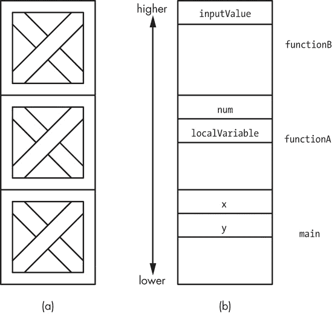

图 4-1. 一堆木箱和一堆函数调用

虽然 `stack` 是高度组织化的，但相比之下，`heap` 几乎没有组织。假设你再次用箱存储东西，但这些箱子是脆弱的，你不能将它们堆叠。你有一个巨大的、初始为空的房间来存放箱子，你可以把它们放在地板的任何地方。然而，箱子很重，所以一旦你放下一个，你宁愿让它留在原地，直到你准备好将其带出房间。与 `stack` 相比，这种系统有优有劣。一方面，这种存储系统是灵活的，允许你随时获取任何一个箱子的内容。另一方面，房间会迅速变得混乱。如果箱子的大小各不相同，利用地板上所有的可用空间将特别困难。你最终会在箱子之间留下很多间隙，这些隙小到无法放入另一个箱子。因为箱子不能轻易移动，移除几个箱子只会产生几个难以填满的间隙，而不是提供原始空地板那种开阔的存储空间。在实际编程术语中，我们的 `heap` 就像那个房间的地板。内存块是地址的连续序列；因此，在一个具有许多内存分配和释放的程序生命周期内，我们最终会在剩余的分配内存块之间留下许多间隙。这个问题被称为 `memory fragmentation`（内存碎片）。

每个程序都有自己的 `heap`，从其中动态分配内存。在 C++ 中，这通常意味着调用 `new` 关键字，但你也会调用旧的 C 内存分配函数，例如 `malloc`。每次调用 `new`（或 `malloc`）都会在 `heap` 中预留一段内存并返回指向该内存块的指针，而每次调用 `delete`（如果内存是用 `malloc` 分配的则用 `free`）会将该内存块返回可用堆内存池。由于碎片的存在，池中的所有内存并不同样有用。如果我们的程序开始在堆中分配变量 A、B 和 C，我们可能期望这些块是连续的。如果我们释放了 B，它留下的空间只能被另一个相同或更小的请求填充，直到 A 或 C 也被释放。

图 4-2 说明了这种情况。在部分 (a) 中，我们看到散落着箱子的房间地板。起初房间可能组织良好，但随着时间的推移，布局变得杂乱无章。现在有一个小箱 (b) 无法放入地板上的任何空间，尽管地板的总面积远大于箱子的足迹。在部分 (c) 中，我们表示一个小的堆。虚线方块是内存的最小（不可分）块，它们可能是单个字节、一个内存字或更大的值，取决于堆管理器。阴影区域表示连续内存的分配；为了清晰，其中一个分配被编号。就像碎片化的地板一样，碎片化的堆使未使用内存块相互分离，降低了它们的可用性。总共有 85 个空闲块，但最大的连续未使用内存范围（箭头所示）只有 17 个块长。换句话说，如果每个块是一个字节，这个堆无法满足 `new` 对超过 17 字节的请求，尽管堆有 85 字节可用。

## 内存大小

内存的第一个实际问题是限制它的。现代计算机系统拥有大量的内存，人们很容易将其视为无限资源，但事实上，每个程序的内存都是有限的。此外，程序需要高效使用内存以避免整个系统变慢。在多任务操作系统（即几乎所有现代操作系统）中，一个程序浪费的每个字节都会将整个系统推向运行程序集没有足够内存运行的界点。在这一点上，操作系统不断交换不同程序的内存块，从而陷入停滞。这种状态被称为 `thrashing`（抖动）。

注意，除了尽可能保持程序整体内存占用之外，栈和堆都有最大限制。为了证明这一点，让我们每次从堆中分配一个千字节内存，直到发生崩溃：


```
const int intsPerKilobyte = 1024 / sizeof(int);
while (true) {
    int *oneKilobyteArray = new int[intsPerKilobyte];
}
```

让我强调一下，这段代码完全是为了说明某个观点而编写的糟糕代码。如果你在自己的系统上尝试这段代码，你应该先保存所有工作，以防万一。发生的情况应该是程序停止，你的操作系统会报错，因为代码生成的代码没有处理 `bad_alloc` 异常。当堆中没有足够大的未分配内存块可以满足请求时，`new` 就会抛出此异常。堆内存耗尽被称为 `heap overflow`（堆溢出）。在某些系统上，堆溢出可能是很常见的，而在其他系统上，程序在产生 `bad_alloc` 之前就会导致抖动（`thrashing`）（在我的系统上，直到我在之前的调用中分配了两个 GB 之后，`new` 调用都没有失败）。

运行时栈也存在类似的情况。每个函数调用都会在栈上分配空间，每个激活记录（activation record）都有一些固定的开销，即使是对于一个没有参数或局部变量的函数也是如此。演示这一点简单的方法是使用失控的递归函数：

```
 int count = 0;
  void stackOverflow() {
     count++;
     stackOverflow();
  }
  int main()
  {
    stackOverflow();
     return 0;
  }
```

这段代码有一个全局变量，在大多数情况下这是糟糕的风格，但在这里我需要一个在所有递归调用中都持久的值。由于该变量声明在函数外部，因此在函数的激活记录中没有为它分配内存，也没有其他局部变量或参数。函数所做的只是增加 `count` 并进行递归调用。递归在第 6 章 中得到了广泛的讨论，但在这里使用它仅仅是为了让函数调用链尽可能长。函数的激活记录会一直留在栈上，直到该函数结束。因此，当从 `main` 第一次调用 `stackOverflow` 时，运行时栈上会放置一个激活记录，在第一次函数调用结束之前它是无法移除的。这永远不会发生，因为函数对 `stackOverflow` 进行了第二次调用，在栈上放置了另一个激活记录，然后又进行了第三次调用，以此此类推。这些激活记录不断堆积，直到栈空间用尽。在我的系统上，当程序崩溃时，`count` 大约为 4900。我的开发环境 Visual Studio 默认分配 1MB 的栈，这意味着这些函数调用中的每一个，即使没有任何局部变量或参数，也会创建一个超过 200 字节的激活记录。

## 生命周期 (Lifetime)

变量的 `lifetime`（生命周期）是从分配到释放之间的时间。对于基于栈的变量（即局部变量或参数），生命周期是隐式处理的。变量在调用函数时分配，在函数结束时释放。对于基于堆的变量（即使用 `new` 动态分配的变量），生命周期掌握在我们手中。管理动态分配变量的生命周期是每个 C++ 程序员的噩梦。最常见的问题是令人厌恶的 `memory leak`（内存泄漏），即从堆中分配了内存但从未释放，且没有被任何指针引用。这里有一个简单的例子：

```
 int *intPtr = new int;
 intPtr = NULL;
```

在这段代码中，我们声明了一个指向整数的指针，通过从堆上分配一个整数来初始化它。在在第二行中，我们将整数指针设置为 `NULL`（它只是数字零的别名）。然而，我们用 `new` 分配的整数仍然存在。它孤独而落寞地坐在堆中的那个位置，等待着永远不会到来的释放。我们无法释放这个整数，因为要释放一个内存块我们需要使用 `delete` 加上指向该内存块的指针，而我们不再拥有该内存块的指针了。如果我们尝试按照上面的代码执行 `delete intPtr`，将会得到错误，因为 `intPtr` 是零。

有时，我们面临的不是从未释放的内存，而是相反的问题：尝试释放同一块内存两次，会导致运行时错误。这看起来像是一个容易避免的问题：只需不要对同一个变量调用两次 `delete` 即可。让这种情况变得复杂的是，我们可能有多个变量指向同一块内存。如果多个变量指向同一块内存，而我们对其中任何一个变量调用 `delete`，我们实际上释放了所有变量的内存。如果我们不显式地将变量清空为 `NULL`，它们将被称为 `dangling references`（悬空引用），对其中任何一个调用 `delete` 都会产生运行时错误。

## 解决指针问题 (Solving Pointer Problems)

到这里，你可能已经准备好面对一些问题了，让我们来看几个，看看如何使用指针和动态内存分配来解决它们。首先，我们将处理一些动态分配的数组，这将展示如何在我们的所有操作中跟踪堆内存。然后，我们将尝试真正的动态结构。

## 变长字符串 (Variable-Length Strings)

在第一个问题中，我们将创建处理字符串的函数。在这里，我们使用的是该术语的广义含义：字符序列，无论它们是如何存储的。假设我们需要对我们的字符串支持三个函数。

### 问题：变长字符串的操作

`append`
此函数接收一个字符串和一个字符，并将该字符附加到字符串的末尾。

`concatenate`
此函数接收两个字符串，并将第二个字符串的字符附加到第一个字符串之后。

`characterAt`
此函数接收一个字符串和一个数字，并返回字符串在该位置的字符（字符串中的第一个字符编号为 0）。

编写代码时，假设 `characterAt` 被频繁调用，而另外两个函数的调用频率相对较低。操作的相对效率应该反映调用频率。

在这种情况下，我们希望为字符串选择一种表示方式，以便快速执行 `characterAt` 函数，这意味着我们需要一种快速定位特定字符的方法。正如你可能从上一章记得的，这是数组最擅长的。所以让我们使用 `char` 数组来解决这个问题。`append` 和 `concatenate` 函数会改变字符串的大小，这意味着我们会遇到之前讨论过的所有数组问题。由于这个问题中对字符串的大小没有内置限制，我们不能选择一个较大的初始大小并听天由命。相反，我们需要在运行时调整数组。

首先，让我们为我们的字符串类型创建一个 `typedef`。我们知道我们将动态创建数组，所以我们需要让字符串类型成为指向 `char` 的指针。

```
typedef char * arrayString;
```

准备好后，让我们开始编写函数。利用从已知识开始开始的原则，我们可以快速写出 `characterAt` 函数。

```
char characterAt(arrayString s, int position) {
    return s[position];
}
```


回想第 3 章，如果给指针赋值数组的地址，我们就可以使用普通的数组表示法访问数组中的元素。但请注意，如果 `position` 实际上不是数组 `s` 的有效元素索引，就会发生糟糕的事情，这段代码将验证第二个参数的责任交给了调用者。我们将在练习中考虑处理这种情况的替代方案。现在，让我们转向 `append` 函数。我们可以大致想象这个函数的作用，但为了准确实现具体细节，我们应该考虑一个示例。这是我称之为*通过样例解决问题*的技巧。

从一个针对函数或程序的非平凡样例输入开始。写下该输入的所有细节以及输出的所有细节。然后当你编写代码时，你是在为通用情况编写代码，同时双重检查每一步如何转换你的样例，以确保你达到预期的输出状态。这种技术在处理指针和动态分配内存时特别有用，因为程序中发生的很多事情都在直接视野之外。在纸上推演一个案例会迫使你跟踪内存中所有变化的值——不仅是变量直接表示的值，还包括堆中的值。

假设我们从字符串 `test` 开始，也就是说我们在堆中有一个按顺序包含 `t`、`e`、`s` 和 `t` 的字符数组，我们想用我们的函数 `append` 添加一个感叹号。图 4-3 和“之后”(b) 状态") 显示了该操作之前 (a) 和之后 (b) 的内存状态。在这些图中，虚线垂直左侧的所有内容都是栈内存（局部变量或参数），右侧的所有内容都是使用 `new` 动态分配的堆内存。


图 4-3. `append` 函数建议的“之前”(a) 和“之后”(b) 状态。

看着这张图，我一眼就看到了我们函数的一个潜在问题。根据我们对字符串的实现方法，函数将创建一个比原始数组大一个元素的新数组，并将第一个数组中的所有字符复制到第二个数组中。但我们如何知道第一个数组有多大呢？从上一章中，我们知道必须自己跟踪数组的大小。所以似乎遗漏了一些什么。

如果你有使用标准 C/C++ 库处理字符串的经验，你已经知道那个缺失的要素了，但如果没有，我们可以很快推断出来。记住，我们解决问题的技巧之一是*寻找类比*。也许我们应该考虑其他某些长度未知的问题。在第 2 章中，我们为“Luhn 校验和”问题处理了具有任意数量数字的识别码。在那个问题中，我们不知道用户会输入多少个数字。最后，我们写了一个 `while` 循环，一直读取到最后一个字符是行尾符为止。

不幸的是，在我们的数组末尾并没有行尾符等着我们。但如果我们所有字符串数组的最后一个元素中*放置*一个行尾符呢？那么我们就能像发现识别码中有多少数字一样，发现数组的长度。这种方法的唯一缺点，我们不能再在字符串中使用行尾符了，除非作为字符串终止符。这取决于字符串如何被使用，不一定是一个巨大的限制，但为了获得最大的灵活性，最好选择一个不会与任何人可能实际想使用的字符混淆的值。因此，我们将使用 0 来终止数组，因为 0 在 ASCII 和其他字符编码系统中表示空字符。这正是标准 C/C++ 库所使用的方法。

解决这个问题后，让我们更具体地看看 `append` 将对我们的样例数据执行什么。我们知道函数将有两个参数，第一个是 `arrayString`（指向堆中字符数组的指针），第二个是待追加的 `char`。为了保持思路清晰，让我们先写出 `append` 函数的大纲以及测试它的代码。

```cpp
void append(arrayString& s, char c) {
}
void appendTester() {
    arrayString a = new char[5];
    a[0] = 't'; a[1] = 'e'; a[2] = 's'; a[3] = 't'; a[4] =  0;
    append(a, '!');
    cout << a << "\n";
}
```

`appendTester` 函数在堆中分配我们的字符串。注意数组的大小为 5，这是必要的，以便我们可以分配 `test` 单词的所有四个字母以及我们的终止空字符。


这段代码中包含很多操作，所以让我们逐一检查它。在函数开头，我们有一个循环来定位终止数组的空字符。当循环完成后，`oldLength` 将是数组中合法字符的数量（即不包括终止的空字符）。我们在堆上分配了一个大小为 `oldLength + 2` 的新数组。如果你在脑海中推演所有逻辑，这些细节可能很难记清，但如果你有一张图，就很容易做对。通过图 4-5 中的示例来跟踪代码，我们看到在这种情况下 `oldLength` 将是四。我们知道 `oldLength` 是四，是因为 `test` 有四个字符，而部分 (b) 中的新数组需要六个字符，因为我们需要为添加的字符和空终止符留空间。

分配好新数组后，我们将所有合法字符从旧数组复制到新数组，然后我们将添加的字符和空终止符赋值给新数组中相应的位置。再次，我们的图表帮助我们保持思路。为了让情况更清晰，图 4-5 展示了 `oldLength` 的值是如何计算的，以及该值在新数组中指示哪个位置。有了这个视觉提示，很容易在那两个赋值语句中写正确的下标。

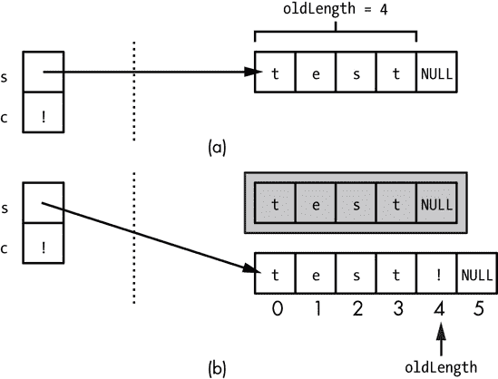

图 4-5. 显示局部变量、参数和已分配内存在 append 函数执行前后的关系

`append` 函数的最后三行都是关于图中部分 (b) 中的那个阴影框。为了避免内存泄漏，我们必须释放参数 `s` 原本指向的堆上的数组。最后，我们离开函数时，让 `s` 指向新的、更长的数组。遗憾的是，C++ 编程中内存泄漏如此常见的原因之一是，在内存泄漏总量变大之前，程序和整个系统都不会显示任何不良影响。因此，程序员在测试期间可能完全察觉不到泄漏。因此，作为程序员，我们必须勤奋，并始终考虑堆内存分配的寿命。每当你使用 `new` 关键字时，都要思考相应的 `delete` 将在何处何时发生。

注意这个函数中的所有内容是如何直接遵循我们的图表的。有了良好的图表，复杂的编程会变得没那么困难，我希望更多新程序员在写代码之前花时间画画图。这回到了我们最基本的解决问题原则：始终有一个计划。为问题示例画一张精美的图表，就像在开始长途自驾游之前已经规划好了通往目的地的路线。在开始付出一点额外努力，可能会避免在最后付出更多的努力和挫败。

## 绘制图表

画图表只需要铅笔和纸。不过，如果你有时间，我建议使用绘图程序。有一些专门针对编程问题模板的绘图工具，但任何通用的矢量绘图程序都能让你上手（这里的“矢量”是指程序处理线条和曲线，而不是像 Photoshop 那样的位图画程序）。我使用一个名为 Inkscape 的程序制作了本书的原始插图，它是免费提供的。在计算机上创建图表可以让你将它们组织在存储这些图表所说明的代码的同一个地方。如果你在一段时间后回来查看，这些图表可能更整洁，因此更容易理解。最后，复制和修改计算机创建的图表很容易的，就像我从图 4-4 和后 (b) 更新并详述的内存状态")创建图 4-5 一样，如果你想做一些快速的临时注释，可以随时打印一份来涂鸦。

回到我们的 `append` 函数，代码看起来很稳健，但记住我们是根据特定的示例用例编写这段代码的。因此，我们应该不要得自以为假设代码适用于所有有效情况。特别是我们需要检查特殊情况。在编程中，`特殊情况`是指有效数据会导致正常代码流产生错误结果的情况。请注意，这个问题与坏数据的问题是不同的。在本书的代码中，我们假设输入是良好的。例如，如果程序期望的是一组逗号分隔的整数，我们假设得到的是这些，而不是杂杂字符、非数字等。这种假设对于保持代码长度合理以及避免重复数据检查代码是必要的。但在现实世界中，我们应该对坏输入采取合理的预防。这被称为健壮性（robustness）。一个`健壮的`程序即使在坏输入的情况下也能良好运行。例如，这样的程序可以向用户显示错误消息而不是崩溃。

### 检查特殊情况

让我们再次查看 `append`，检查特殊情况——换句话说，确保在可能的输入值中没有异常情况。特殊情况的最常见的元凶通常出现在极端情况下，例如最小或最大的输入。对于 `append`，我们的字符串数组没有最大限制，但有一个最小限制。如果字符串没有合法字符，它实际上对应于包含一个字符的数组（该字符就是空终止符）。像之前一样，让我们画一张图来保持思路清晰。假设我们在空字符串上添加了感叹号，如图 4-6 所示。

当我们观察图表时，这似乎并不是一个特殊情况，但我们应该通过函数运行这个用例来检查。让我们把以下代码添加到我们的 `appendTester` 代码中：

```
arrayString b = new char[1];
b[0] = 0;
append(b, '!');
cout << b << "\n";
```


那样也行通。现在我们已经相当确定 `append` 函数是正确的了，但我们喜欢它吗？代码看起来很直观，我没有发现任何“代码异味”，但对于一个简单的操作来说，它似乎有点长。当我考虑到后面的 `concatenate` 函数时，我发现像 `append` 一样，`concatenate` 函数也确定字符串数组的长度——可能是两个字符串数组的长度。因为这两个操作都需要一个循环来寻找终止字符串的空字符，我们可以将这段代码放在一个单独的函数中，然后在需要从 `append` 和 `concatenate` 调用它。让我们这样做，并相应地修改 `append`。

```cpp
int length(arrayString s) {
  int count = 0;
    while (s[count] != 0) {
        count++;
    }
    return count;
}
void append(arrayString& s, char c) {
  int oldLength = length(s);
    arrayString newS = new char[oldLength + 2];
    for (int i = 0; i < oldLength; i++) {
        newS[i] = s[i];
    }
    newS[oldLength] = c;
    newS[oldLength + 1] = 0;
    delete[] s;
    s = newS;
}
```

`length` 函数中的代码  本质上与之前 `append` 函数开头的代码相同。在 `append` 函数本身中，我们用调用 `length` 替换了代码 。`length` 函数就是所谓的*辅助函数*（helper function），即一个封装了多个其他函数公用操作的函数。除了缩短代码长度外，消除冗余代码意味着我们的代码更可靠、更于修改。它也有助于我们解决问题，因为辅助函数将我们的代码分成更小的块，使我们更容易识别代码重用的机会。

### 复制动态分配的字符串

现在是处理那个 `concatenate` 函数了。我们将采用与处理 `append` 相同的方法。首先，我们将编写该函数的空壳版本，以便在脑海中理清参数及其类型。然后，我们将为一个测试用例绘制一张图，最后，我们将编写与图匹配的代码。以下是该函数的壳，以及额外的测试代码：

```cpp
void concatenate(arrayString& s1, arrayString s2) {
}
void concatenateTester() {
    arrayString a = new char[5];
    a[0] = 't'; a[1] = 'e'; a[2] = 's'; a[3] = 't'; a[4] =  0;
    arrayString b = new char[4];
    b[0] = 'b'; b[1] = 'e'; b[2] = 'd'; b[3] = 0;
    concatenate(a, b);
}
```

记住，该函数的描述说第二个字符串（第二个参数）中的字符被附加到第一个字符串的末尾。因此，`concatenate` 的第一个参数将是一个引用参数 ，原因与 `append` 的第一个参数相同。然而，第二个参数  不应该被函数修改，因此它将是一个值参数。现在来看我们的示例用例：我们正在拼接字符串 `test` 和 `bed`。拼接前后的图所示图 4-7 和‘之后’(b) 状态")。

图的细节在 `append` 函数中应该很熟悉了。在这里，对于 `concatenate`，我们从堆中两个动态分配的数组开始，由我们的两个参数 `s1` 和 `s2` 指向。当函数完成后，`s1` 将指向堆中一个长度为 9 个字符的新数组。`s1` 之前指向的数组已经被释放；`s2` 及其数组保持不变。虽然在我们的图中包含 `s2` 和 `bed` 数组似乎没有意义，但在试图避免编码错误时，跟踪哪些没有变化与跟踪哪些发生了变化同样重要。我还给旧新数组的元素标记了数字，因为这在 `append` 函数中非常用。现在一切都就绪了，让我们写这个函数吧。

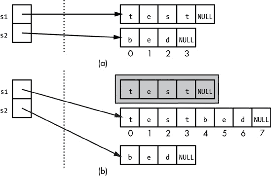

图 4-7. 显示 concatenate 方法的“之前”(a) 和“之后”(b) 状态。

```cpp
void concatenate(arrayString& s1, arrayString s2) {
  int s1_OldLength = length(s1);
    int s2_Length = length(s2);
    int s1_NewLength = s1_OldLength + s2_Length;
  arrayString newS = new char[s1_NewLength + 1];
    for (int i = 0; i < s1_OldLength; i++) {
        newS[i] = s1[i];
    }
    for (int i = 0; i < s2_Length; i++) {
        newS[s1_OldLength + i] = s2[i];
    }
  newS[s1_NewLength] = 0;
  delete[] s1;
  s1 = newS;
}
```

首先，我们确定要拼接字符串的长度 ，然后我们将这些值相加以得到完成后拼接字符串的长度。记住，这些长度都是合法字符的数量，不包括终止符。因此，我们在堆中创建数组时要多分配一个空间 。然后从一个值范围复制到另一个值范围；这是我们自第 2 章 以来一直在做的。通过观察图上的元素数字，我能够看到需要哪些变量来计算正确的下标。函数的其余部分在字符串字符串的末尾放置终止符 。像 `append` 一样，我们释放第一个参数指向的原始堆内存 ，并将第一个参数指向新分配的字符串 。

这段代码看起来可以工作，但像之前一样，我们想要确保没有无意中创建一个只对我们的测试用例有效而对所有情况都有效的函数。最可能的故障情况是一个或两个参数都是零长度字符串（只有终止符）。在继续之前，我们应该显式地检查这些情况。注意，在检查使用指针的代码正确性时，你应该检查指针本身，而不是它们所引用的堆值。这里有一个测试用例：

```cpp
arrayString a = new char[5];
  a[0] = 't'; a[1] = 'e'; a[2] = 's'; a[3] = 't'; a[4] =  0;
  arrayString c = new char[1];
  c[0] = 0;
  concatenate(c, a);
  cout << a << "\n" << c << "\n";
  cout << (void *) a << "\n" << (void *) c << "\n";
```


我想确保对 `concatenate` 的调用导致 `a` 和 `c` 都指向字符串 `test` ——也就是说，它们指向具有相同值的数组。然而，同样重要的是它们指向的是*不同*的字符串，如图 4-8，而不是两个交叉链接的指针 (b).") (a) 所示。在第二个输出语句中，我通过将变量类型更改为 `void *` 来检查这一点，这会强制输出流显示指针的原始值 。如果指针本身的值相同，那么我们就说这些指针变成了*交叉链接*的，如图图 4-8，而不是两个交叉链接的指针 (b).") (b) 所示。当指针在不经意间变成交叉链接时，会发生微妙的问题，因为更改堆中一个变量的内容会其妙地改变另一个变量 ——实际上是同一个变量，但在大型程序中，这很难察觉。此外，请记住，如果两个指针交叉链接了，当其中一个通过 `delete` 释放时，剩余的指针将变成悬空引用。因此，我们在审查代码时必须勤快，并始终检查潜在的交叉链接。

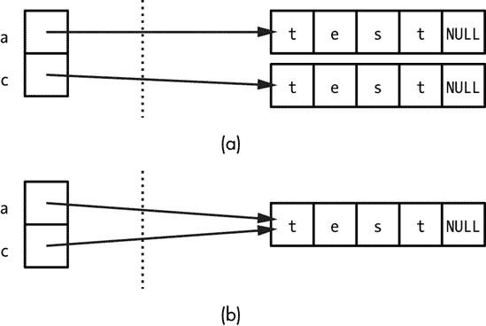

图 4-8. `concatenate` 应该导致两个不同的字符串 (a)，而不是两个交叉链接的指针 (b)。

当三个函数——`characterAt`、`append` 和 `concatenate` 都实现后，我们就完成了这个问题。

## 链表

现在我们将尝试一些更复杂的东西。指针操作将变得更加复杂，但既然我们已经知道了如何绘制图表，现在就能保持一切井然。

## 问题：跟踪未知数量的学生记录

在这个问题中，你将编写函数来存储和操作一组学生记录。学生记录包含一个学号和一个成绩，两者都是整数。需要实现以下函数：

### `addRecord`

此函数接收一个指向学生记录集合（学号和成绩）的指针，并将带有此数据的新记录添加到该集合中。

### `averageRecord`

此函数接收一个指向学生记录集合的指针，并返回集合中学生成绩的算术平均值，类型为 `double`。

集合可以是任何大小。预计 `addRecord` 操作会被频繁调用，因此它必须高效实现。

有许多方法可以符合规范，但我们将选择一种有助于我们练习基于指针的解决问题技巧的方法：链表。你可能以前见过链表了，但如果没有的话，请记住，链表的引入代表了与我们目前为止本文中所讨论的内容的一种巨变。一个优秀的问题解决者在有足够的时间仔细思考的情况下，可以开发出之前的任何一种解决方案。然而，大多数程序员在没有帮助的情况下是想不出链表概念的。一旦你看到并掌握了基础，其他数据结构就会出现在脑海中，然后你就能游刃有余。链表确实是一种动态结构。我们的字符串数组存储在动态分配的内存中，但一旦创建，它们就是静态结构，永远不会变大变小，只是被替换。相比之下，链表随着时间的推移像雏链一样逐段增长。

### 构建节点列表

让我们构建一个学生记录示例链表。为了创建一个链表，你需要一个 `struct`，它包含一个指向相同 `struct` 的指针，外还有你想在链表表示的集合中存储的任何数据。对于我们的问题，该 `struct` 将包含学号和成绩。

```c
struct listNode {
    int studentNum;
    int grade;
    listNode * next;
};
typedef listNode * studentCollection;
```

我们的 `struct` 命名为 `listNode` 。用于创建链表的 `struct` 始终被称为*节点*（node）。推测这个名称是对植物学术语的类比，意思是茎干上生长新分支的点。节点包含了学号  和成绩，它们构成了节点的实际“载荷”。节点还包含一个指向我们正在定义的 `struct` 类型的指针 。大多数程序员第一次看到这个时，看起来很困惑，甚至可能在语法上是不可能的：我们如何用它自身来定义一个结构？但这是合法的，意义很快就会变得清晰。注意，节点中的自引用指针通常被命名为 `next`、`nextPtr` 或类似的名称。最后，这段代码为指向我们节点类型的指针声明了一个 `typedef` 。这将有助于我们函数的可读性。现在让我们使用这些类型构建我们的示例链表：

```c
studentCollection sc;
listNode * node1 = new listNode;
node1->studentNum = 1001;
node1->grade = 78;
listNode * node2 = new listNode;
node2->studentNum = 1012;
node2->grade = 93;
listNode * node3 = new listNode;
node3->studentNum = 1076;
node3->grade = 85;
sc = node1;
node1->next = node2;
node2->next = node3;
node3->next = NULL;
```

我们首先声明一个 `studentCollection`，`sc` ，它将成为链表的名称。然后我们声明 `node1` ，这是一个指向 `listNode` 的指针。再次，`studentCollection` 等于 `node *`，但为了可读性，我仅对引用整个列表变量使用 `studentCollection` 类型。声明 `node1` 并将其指向堆中新分配的 `listNode`  后，我们为该节点的 `studentNum` 和 `grade` 字段赋值 。此时 `next` 字段尚未赋值。这不是语法书，但如果你以前没见过 `->` 符号，它用于指示所指向的 `struct`（或 `class`）的字段。因此，`node1->studentNum` 意味着“`node1` 指向的 `struct` 中的 `studentNum` 字段”，等同于 `(*node1).studentNum`。我们随后对 `node2` 和 `node3` 重复相同的过程。在为最后一个节点字段赋值后，内存状态如图 4-9 所示。在这些图中，我们将使用之前用于数组的划分框表示法来显示节点 `struct`。


现在我们已经有了所有的节点，就可以将它们连接起来形成一个链表了。这正是之前的代码列表所做的。首先，我们将变量 `studentCollection` 指向第一个节点，然后将第一个节点的 `next` 字段指向第二个节点，紧接着将第二个节点的 `next` 字段指向第三个节点。在下一步中，我们给第三个节点的 `next` 字段赋值为 `NULL`（再次强调，这只是 0 的同义词）。我们之所以这样做，原因和我们在上一个问题中在数组末尾放置空字符的原因是相同：为了终止该结构。正如我们需要一个特殊字符来显示数组的末尾一样，我们在链表的最后一个节点的 `next` 字段中需要一个零，这样我们才知道它*是*最后一个节点。最后，为了清理现场并避免潜在的交叉链接问题，我们将每个单独节点指针赋值为 `NULL`。内存的最终状态如图图 4-10 所示。

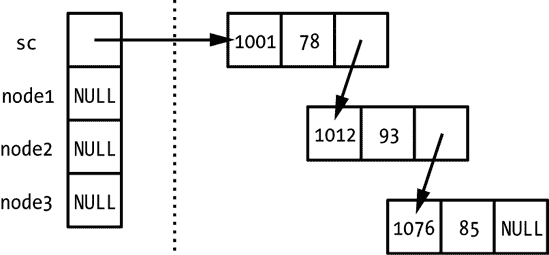

图 4-10. 完成的示例链表

有了这个视觉直观，就很清楚为什么这种结构被称为链表：列表中的每个节点都与下一个节点连接。你经常看到线性绘制的链表，但我实际上更喜欢这种图这种散落在内存中的外观，因为它强调了这些节点之间除了链接之外没有其他关系；它们中的任何一个都可能位于堆的任何位置。请确保仔细跟踪代码，直到你确信自己与图示一致。

注意，在最终状态下，只有一个基于栈的指针仍在使用，即我们的 `studentCollection` 变量 `sc`，它指向第一个节点。链表外部的指针（即不是链表中节点的 `next` 字段）指向链表的第一个节点，被称为*头指针*（head pointer）。在符号层，这个变量代表整个列表，但它它只直接引用第一个节点。要到达第二个节点，我们必须通过第一个节点；要到达第三个节点，我们必须通过前两个节点，依此类推。这意味着链表仅提供顺序访问，而数组提供的是随机访问。顺序访问是链表结构的弱势。正如之前提到的，链表结构的优势在于，我们能够通过添加或删除节点来增大或减小结构的大小的大小，而不需要像我们对数组所做的那样创建一个完全新的结构并复制数据。

### 向列表添加节点

现在让我们来实现 `addRecord` 函数。该函数将创建一个新节点并将其连接到现有的链表中。我们将使用在上一个问题中使用的相同技术。首先是：函数外壳和示例调用。为了测试，我们将向之前的代码列表中添加代码，因此 `sc` 已经作为指向三个节点节点列表的头指针存在了。

```
void addRecord(studentCollection& sc, int stuNum, int gr) {
  }
 addRecord(sc, 1274, 91);
```

同样，那个  调用将出现在之前列表的末尾。有了函数外壳概述的参数，我们可以画出此调用的“之前”状态，如图图 4-11 所示。

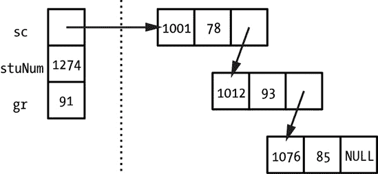

图 4-11. `addRecord` 函数的“之前”状态

然而，关于“之后”状态，我们有一个选择。我们可以推测，将在堆中创建一个新节点，并将参数 `stuNum` 和 `gr` 的值复制到新节点的 `studentNum` 和 `grade` 字段中。问题是，这个节点在逻辑上应该位于我们链表的什么位置。最显而易见的选择是在末尾；`next` 字段中有一个 `NULL` 值，正等待着指向新节点。这将对应于图 4-12 所示。

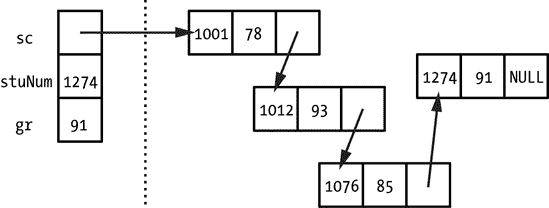

图 4-12. `addRecord` 函数建议的“之后”状态

但如果我们能假设记录的顺序并不重要（即我们不需要保持记录的顺序），那么这就是错误的选择。为了理解这一点，考虑一个不是三个而是 3000 个节点的集合。为了到达链表中的最后一个记录以修改其 `next` 字段，我们需要遍历所有节点。这效率上是不可接受的，因为我们可以在不遍历*任何*现有节点的情况下将新节点引入列表。

图 4-13 显示在“之后”状态下，我们的头指针 `sc` 指向新节点，而新节点的 `next` 字段指向之前的第一个节点，即学号为 1001 的节点。注意，当我们给新节点的 `next` 字段赋值时，唯一变化的指针是 `sc`，节点的值没有被改变。根据图示，代码如下：

```
void addRecord(studentCollection& sc, int stuNum, int gr) {
  listNode * newNode = new listNode;
  newNode->studentNum = stuNum;
  newNode->grade = gr;
  newNode->next = sc;
  sc = newNode;
}
```

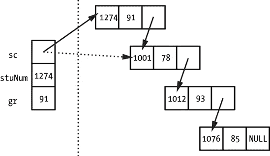

图 4-13. `addRecord` 函数接受的“之后”状态。虚线箭头表示存储的 sc 的之前的值。

再次，让我强调图翻译比在脑海中理清思路要容易得多。代码直接来自插图。我们创建一个新节点 并分配参数中的学号和成绩。然后我们将新节点链接到列表中，首先将新节点的 `next` 字段指向原来的第一个节点（通过为其赋值 `sc` 的值），然后将 `sc` 本身指向新节点。注意最后两个步骤必须按顺序发生；我们需要在更改 `sc` 之前使用它的原始值。还要注意，由于我们更改了 `sc`，它必须是一个引用参数。


正如一如既往，当我们从示例用例构建代码时，必须检查潜在的特殊情况。在这里，这意味着要检查函数在空列表情况下是否正常工作。对于我们的字符串数组，空字符串仍然有效指针，因为我们仍然有一个数组可以指向（即一个只包含空终止符的数组）。但在此处，节点数量与记录数量相同，空列表将是一个 `NULL` 头指针。当我们传入的头指针为 `NULL` 并尝试插入示例数据时，我们的代码还能运行得通吗？图 4-14]显示了“之前”状态和预期的“之后”状态。

通过在代码中运行这个示例，我们看到它很好地处理了这种情况。新节点像以前一样被创建。由于“之前”状态下 `sc` 为 `NULL`，当  将此值复制到我们新节点的 `next` 字段时，这正是我们想要的结果，而且我们的单节点列表被正确终止了。请注意，如果我们继续使用另一种实现思路——将新节点添加到到链表的末尾而不是开头——那么初始空列表*将*是一个特殊情况，因为到时它将是 `sc` 被修改的唯一情况。

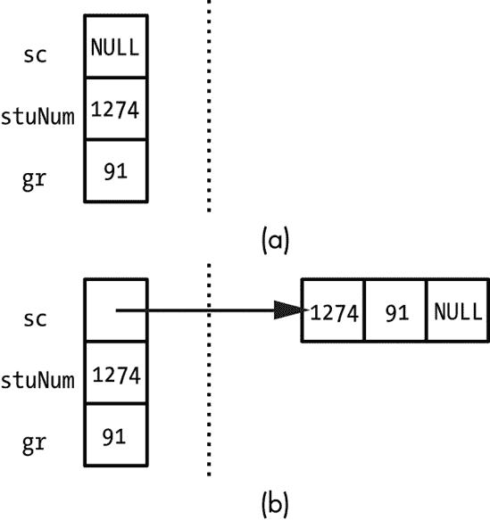

图 4-14。最小 `addRecord` 用例的“之前”和“之后”状态。

### 列表遍历

现在是时候确定 `averageRecord` 函数了。和之前一样，我们将从一个外壳和一张图开始。这里是函数的外壳和示例调用。假设示例调用  发生在原始示例列表创建之后，如图 4-10 所示。

```
double averageRecord(studentCollection sc) {
  }
 int avg = averageRecord(sc);
```

如你所见，我选择将平均值计算为 `int`，就像我们在上一章中对数组做的那样。然而，取决于问题，将其计算为浮点值可能更好。现在我们需要一张图，但我们几乎已经有了一个“之前”的状态，见图 4-9。我们不需要“之后”状态的图，因为这个函数不会改变我们的动态结构，只是对其进行报告。我们只需要知道预期的结果，在这种情况下结果大约是 85.3333。

那么，我们实际上是如何计算平均值的呢？根据我们计算数组中所有值平均值的经验，我们知道通的概念。我们需要加上集合中的每一个值，然后将总和除以值的数量。在我们数组平均值的代码中，我们使用 `for` 循环从 0 到数组大小减 1 检查每个值，并使用循环计数器作为数组下标。在这里我们不能使用 `for` 循环，因为我们无法预知链表中有多少数字；我们必须一直持续，直到遇到节点 `next` 字段中指示列表终止的 `NULL` 值。这表明需要使用 `while` 循环，类似于我们在本章较早时候处理未知长度数组时使用的方法。像这样从开始到终点运行链表被称为*列表遍历*（list traversal）。这是链表上的基本操作之一。让我们把遍历的想法付诸来解决这个问题：

```
double averageRecord(studentCollection sc) {
  int count = 0;
  double sum = 0;
  listNode * loopPtr = sc;
  while (loopPtr != NULL) {
        sum += loopPtr->grade;
        count++;
        loopPtr = loopPtr->next;
    }
  double average = sum / count;
    return average;
}
```

我们首先声明一个变量 `count` 来存储在列表中遇到的节点数量 ；这也将是集合中值的数量，我们将用它来计算平均值。接下来，我们声明一个变量 `sum` 来存储列表中分值的运行总和 。然后我们声明一个名为 `loopPtr` 的 `listNode *`，我们将用它来遍历列表 。这相当于我们在处理数组的 `for` 循环中的整数循环变量；它跟踪我们在链表中的位置，不是通过位置数字，而是通过存储指向我们当前正在处理的节点的指针。

此时，遍历本身开始了。遍历循环一直持续，直到我们的跟踪指针到达 `NULL` 。在循环内部，我们将当前节点的 `grade` 值加到 `sum` 。我们增加 `count`，然后将当前节点的 `next` 字段赋值给我们的跟踪指针 。这样做的效果是将我们的移动向前一个节点。这是代码中最复杂的部分，所以让我们确保理解它。在图 4-15 中，我展示了 `loopPtr` 如何随时间变化。字母 (a) 到 (d) 标记了执行示例数据的不同点。点 (a) 是循环刚刚开始；`loopPtr` 刚刚初始化为 `sc`。因此，`loopPtr` 指向列表的第一个节点，就像 `sc` 一样。在循环的第一次迭代中，第一个节点的值 78 被加入 `sum`。第一个节点的下一个值被复制到 `loopPtr`，现在 `loopPtr` 指向列表的第二个节点；这是点 (b)。在第二次迭代中，我们将 `93` 加到 `sum`，并将第二个节点的 `next` 字段复制到 `loopPtr`；这是点 (c)。最后，在第三也是最后一次迭代中，我们将 `85` 加到 `sum`，并将第三节点 `next` 字段的 `NULL` 赋值给 `loopPtr`；这是点 (d)。当我们再次到达 `while` 循环顶部时，循环结束，因为 `loopPtr` 为 `NULL`。由于我们每次迭代时都增加了 `count`，所以 `count` 是三。

一旦循环完全完成，我们只需要将总和除以计数并返回结果 。


猜猜怎么着？代码崩溃了。（我必须让这些特殊情况中的某一个出现糟糕的结果；否则，你就不会把我当回事了。）处理链表本身的循环本身没有问题。如果 `sc` 是 `NULL`，那么 `loopPtr` 被初始化为 `NULL`，循环一启动就结束了，且 `sum` 保持为 0，这看起来是足够合理的。问题在于当我们执行除法来计算平均值时，`count` 也是 0，这意味着我们正在除以 0，这将导致程序崩溃或产生垃圾值结果。为了处理这种特殊情况，我们可以在函数末尾检查 `count` 是否为 0，但为什么不在起初就处理这种情况并检查 `sc` 呢？让我们在 `averageRecord` 函数中添加以下新的新的第一行：

```
if (sc == NULL) return 0;
```

正如示例所示，处理特殊情况通常非常简单。我们只需要确保花时间去识别它们。

## 结论与后续步骤

本章仅仅触及了使用指针和动态内存解决问题的皮毛。在本书的剩余部分，你将到处看到指针和堆分配。例如，我们在第 5 章中讨论面向对象的编程技术在处理指针时特别有用。它们允许我们以这种方式封装指针，使我们不必担心内存泄漏、悬空指针或其他任何常见的指针陷阱。

尽管在这一领域解决问题还有很多需要学习的，但如果你遵循本章的基本思想，你就能通过日益复杂的指针结构来开发自己的技能：首先，应用通用的问题解决规则。然后，应用指针的特定规则，并在开始编码之前使用图表或类似的工具将每个解决方案可视化。

## 练习题

做练习题不是开玩笑的。你们不是读完章节就跳过去了吧？

1. **设计你自己的**：找一个你已经知道如何使用数组解决的问题，但受限于数组的大小。重写代码，使用动态分配的数组来消除该限制。

2. 针对我们的动态分配字符串，创建一个函数 `substring`，它接受三个参数：一个 `arrayString`、一个起始位置整数和一个字符长度整数。该函数返回一个指向新动态分配字符串数组的指针。该字符串数组包含原始字符串中的字符，从指定的位置开始，长度为指定。原始字符串不受操作影响。所以，如果原始字符串是 `abcdefg`，位置是 3，长度是 4，那么新字符串将包含 `cdef`。

3. 针对我们的动态分配字符串，创建一个函数 `replaceString`，它接受三个类型均为 `arrayString` 的参数：`source`、`target` 和 `replaceText`。该函数将 `source` 中所有 `target` 出现的地方替换为 `replaceText`。例如，如果 `source` 指向一个包含 `abcdabee` 的数组，`target` 指向 `ab`，且 `replaceText` 指向 `xyz`，那么当函数结束时，`source` 指指向一个包含 `xyzcdxyzee` 的数组。

4. 修改我们字符串的实现方式，使得数组中的 `location[0]` 存储数组的大小（因此 `location[1]` 存储字符串中的第一个实际字符），而不是使用空字符终止符。实现三个函数 `append`、`concatenate` 和 `charactertAt`，并尽可能利用存储的大小信息。由于我们不再使用标准输出流所预期的空终止约定，你需要编写自己的 `output` 函数，通过循环其字符串参数来显示字符。

5. 编写一个函数 `removeRecord`，它接受一个指向 `studentCollection` 的指针和一个学号，并从集合中删除该学号的记录。

6. 让我们为字符串创建一个实现方案，使用字符链表而不是动态分配数组。这样我们将拥有一个链表，其数据载荷是单个 `char`；这将允许字符串增长，而无需重新创建整个字符串。我们先从实现 `append` 和 `characterAt` 函数开始。

7. 延续上一个练习，实现 `concatenate` 函数。注意，如果我们调用 `concatenate(s1, s2)`，其中两个参数都是指向它们各自链表第一个节点的指针，该函数应该为 `s2` 中的每个节点创建一个副本，并将它们附加到 `s1` 的末尾。也就是说，该函数不应简单地将 `s1` 列表最后一个节点的 `next` 字段指向 `s2` 列表的第一个节点。

8. 在链表字符串实现中添加一个名为 `removeChars` 的函数，根据位置和长度从字符串中删除一段字符。例如，`removeChars(s1, 5, 3)` 将删除字符串中从第五个字符开始的三个字符。确保被删除的节点被正确释放。

9. 想象一个链表，节点不再存储字符，而是存储一个数字：0–9 范围内的 `int`。我们可以使用这种链表表示任意大小的正数；例如，数字 149 将是一个链表，其中第一个节点存储 1，第二个存储 4，第三个（也是最后一个）存储 9。编写一个函数 `intToList`，它接受一个整数值并产生这样的链表。提示：你可能会发现反向构建链表更容易，所以如果值是 149，你会先创建数字 9 的节点。

10. 针对上一个练习的数字列表，编写一个函数接受两个此类列表并产生一个它们之和的新列表。

# 类基础知识回顾


一如既往，本书假设你已经接触过基础知识并参考过 C++ 语法，但让我们复习一下类语法的基础知识，以便我们在术语上保持一致。`class`（类）是构建特定代码和数据包的蓝图；根据蓝图创建的每个变量被称为该类的 `object`（对象）。类外部创建并使用该类对象的代码被称为该类的 `client`（客户端）。`class declaration`（类声明）为类命名并列出类内部所有的 `members`（成员）或项。每个项要么是 `data member`（数据成员——即在类内部声明的变量），要么是 `method`（方法，也称为成员函数，即在类内部声明的函数）。成员函数可以包括一种特殊类型称为 `constructor`（构造函数），它的名称与类名相同，并在声明类对象时隐式调用。除了变量或函数声明的普通属性（如类型，以及对于函数来说的参数列表）外，每个成员还有一个 `access specifier`（访问说明符），它指示哪些函数可以访问该成员。`public member`（公共成员）可以被任何使用该对象的代码访问：类内部的代码、类的客户端代码或 `subclass`（子类代码，子类是“继承”了现有类所有代码和数据的类）。`private member`（私有成员）只能由类内部的代码访问。`protected members`（保护成员，我们将在本章简要介绍）与私有成员相似，但子类的方法也可以引用它们。不过，私有和保护成员都无法从客户端代码访问。

与返回类型等属性不同，类声明内部的访问说明符一直有效，直到被不同的说明符替换。因此，每个说明符通常只出现一次，成员按访问方式分组。这导致程序员会提类类的“公共部分”或“私有部分”，例如，“我们应该把这个方法放在私有部分。”

让我们来看一个极短的类声明示例：

```cpp
class sample {
 public:
      sample();
      sample(int num);
      int doesSomething(double param);
  private:
      int intData;
  };
```

该声明首先为类命名，因此之后 `sample` 变成了一个类型名。声明从 `public` 访问说明符开始，所以在遇到 `private` 说明符之前，后续的所有内容都是公共的。许多程序员将公共声明放在前面，因为他们公共接口对其他读者最感兴趣。这里的公共声明是两个名为 `sample` 的构造函数和另一个方法 `doesSomething`。当声明此类的对象时，构造函数会被隐式调用。

```cpp
sample object1;
sample object2(15);
```

在这里，`object1` 将调用第一个构造函数，即 `default constructor`（默认构造函数），它没有参数；而 `object2` 将调用第二个构造函数，因为它指定了单个整数值，从而匹配了第二个构造函数的参数签名。

声明以私有数据成员 `intData` 结束。记住，类声明以右大括号和分号结束。这个分号看起来可能有点神秘，因为我们不会在函数、`if` 语句块或任何其他闭合括号后加分号。分号的存在实际上表明类声明也是（可选的）对象声明；我们可以在右大括号和分号之间放置标识符，并像创建类一样创建对象。不过，这在 C++ 中并不常见，特别是考虑到许多程序员将类定义与使用它们的程序分开放在不同的文件中。这种神秘的分号出现在 `struct` 的右大括号之后。

提到 `struct`，你应该知道在 C++ 中，`struct` 和 `class` 表示的是几乎相同的东西。两者之间的唯一区别在于第一个访问说明符之前声明的成员（数据或方法）。在 `struct` 中，这些成员是公共的，而在 `class` 中，它们是私有的。不过，良好的程序员用不同的方式使用两种结构。这类似于任何 `for` 循环都可以写成 `while` 循环，但良好的程序员可以通过在更直观的计数循环中使用 `for` 循环来提高代码的可读性。大多数程序员将 `struct` 留给更简单的结构，无论是除了构造函数外没有数据成员的结构，还是旨在作为较大类的方法参数使用的结构。

## 使用类的目标

为了识别类的正确场景以及构建类的正确方法，我们必须决定使用类的目标是什么。在考虑这一点时，我们应该记住类总是可选的。也就是说，类并没有像数组或基于指针的结构那样带给我们新的功能能力。如果你有一个使用数组来排序 10,000 条记录的程序，那么在不使用数组的情况下无法编写相同的程序。如果你有一个依赖于链表随时间增长和收缩能力的程序，那么在不使用链表的情况下无法创建相同的效果。然而，如果你从一个面向对象的程序中移除类并重写它，程序看起来会有不同，但功能和效率不会降低。事实上，早期的 C++ 编译器是作为预处理器工作的。C++ 编译器读取 C++ 源代码并输出符合 C 语法的新源码。这些修改后的源代码会被发送给 C 编译器。这告诉我们，C++ 对 C 语言做的重大改进不在于语言的功能能力，而在于源代码对程序员的可读性。

因此，在选择我们的类设计目标时，我们是在选择帮助我们这些程序员完成任务的目标。特别是，由于本书是关于解决问题的，我们应该思考类如何帮助我们解决问题。

## 封装


从解决问题的角度来看，封装允许我们更容易地重用以前问题的代码来解决当前的问题。通常，即使我们处理过与当前项目类似的问题，重用以前学过的知识仍然需要大量工作。一个完全封装的类可以像外部 USB 驱动器一样；你只需要将其插入即可运行。但为了实现这一点，我们必须正确设计类，以确保代码和数据是真正的封装，并尽可能独立于类之外的任何内容。例如，引用全局变量的类无法在不拷贝该全局变量的情况下复制到新项目中。

除了将类从一个程序重用到另一个程序之外，类还提供了更直接的代码重用形式：继承。回想一下，在第 4 章中，我们讨论过使用辅助函数来“提取”两个或多个函数之间的公共代码。继承将这一想法扩展到了更大的规模。通过继承，我们创建了具有两个或多个子类通用方法的父类，从而“提取”的不仅是几行代码，而是整个方法。继承本身就是一个大课题，我们将在本章稍后部分探索这种代码重用形式。

## 分解问题

我们反复再再提到的一种技术是将复杂问题分解为更小、更易管理的部分。类非常擅长将程序划分为功能单元。封装不仅将数据和代码封装在一个可重用的包中；还将这些数据和代码与程序的其余部分隔离开，允许我们分别处理该类以及其他所有部分。程序中创建的类越多，分解问题的效果越显著。

因此，在可能的情况下，我们应该让类成为我们分解复杂问题的方法。如果类设计良好，这将强制功能分离，使问题变得更容易解决。作为次要影响，我们可能会发现为一个问题创建的类在其他问题是可以重用的，即使我们在创建它们时并没有完全考虑过这种可能性。

## 信息隐藏

有些人会使用“信息隐藏”（information hiding）和“封装”（encapsulation）这两个术语，但在这里我们将这两个概念分开。正如本章之前描述的，封装是将数据和代码打包在一起。信息隐藏意味着将数据结构的接口（操作的定义及其参数）与数据结构的实现（或函数内部的代码）分离。如果一个类是以信息隐藏为目标编写的，那么就有可能更改方法的实现，而无需更改客户端代码（使用该类的代码）。再次强调，我们必须清楚“接口”一词；这不仅意味着方法的名称及其参数列表，还意味着对不同方法作用的解释（可能通过代码文档表示出来）。当我们谈论在不改变接口的情况下更改实现时，我们指的是改变类方法工作（*方式*，而不是改变它们*做的内容*。某些编程书籍作者将此称为类与客户端之间的一种隐式合约：类同意永远不改变现有操作的结果，而客户端同意严格基于接口使用该类，并忽略任何实现细节。想象有一个可以控制任何电视的通用遥控器，无论是老式的显管机还是使用 LCD 或等离子屏的电视。你按下 2，然后 5，然后按 Enter，任何屏幕都会显示通道 25，尽管实现这一点的机制根据底层技术而大然不同。

没有封装是不可能实现信息隐藏的，但按照我们定义的这些术语，可能存在封装而没有信息隐藏。这种情况发生最明显的方式是类的数据成员被声明为 `public`。在这种情况下，该类仍然是一个封装，因为它是一个属于在一起的代码和数据包。然而，客户端代码现在可以访问一个重要的类实现细节：类用于存储数据的变量和类型。即使客户端代码没有直接修改类数据而只是进行检查，客户端代码也需要那个特定的类实现。类中任何更改客户端代码所访问的变量名称或类型的更改，都需要对客户端代码进行相应的更改。

你的第一个想法可能是，只要将所有数据设为私有（private），并且我们花费足够的时间设计成员函数列表及其参数列表，以便它们永远不需要更改，信息隐藏就能得到保证。虽然这些都是信息隐藏所要求的，但它们并不充分，因为信息隐藏问题可能更加微妙。记住，无论出现什么情况，类都同意不改变任何方法的作用。在之前的章节中，我们必须决定函数处理的最小情况，或者对异常情况该如何处理，例如当存储数组大小的参数为 0 时计算数组的平均值。即使是对于特殊情况，更改方法的结果也代表了接口的改变，应该被避免。这是为什么在编程中显式考虑特殊情况如此重要的另一个原因。许多程序在底层技术或应用程序编程接口（`API`）更新时崩溃了，而某些以前在参数之一出错时能可靠返回 -1 的系统调用现在现在返回一个看似随机但仍为负数的数字。避免这种问题的最佳方法之一是在类或方法文档中说明特殊情况的结果。如果你自己的文档说明在特定情况发生时返回 -1 错误码，那么你就会仔细考虑是否让你的方法返回其他任何东西。

那么信息隐藏是如何影响解决问题的？信息隐藏原则告诉程序员，在编写客户端代码时忽略类的实现细节，或者更广泛地说，只有在在该类内部工作时才关注特定类的实现。当你能够把实现细节抛在脑后时，你就可以消除干扰思绪，专注于解决眼手的问题。

然而，我们应该意识到信息隐藏在解决问题方面的局限性。有时，实现细节对客户端来说很重要。在之前的章节中，我们已经看到了一些基于数组和基于指针的数据结构的优缺点。基于数组的结构允许随机访问，但无法轻易扩展或收缩；而基于指针的结构只提供顺序访问，但可以在无需重新创建整个结构的情况下添加或删除。因此，基于数组结构基础构建的类，其特征将与基于指针结构的类有所不同。


在计算机科学中，我们经常谈论*抽象数据类型*（abstract data type）的概念，它是最纯形式的信息隐藏：仅通过操作定义的数据类型。在第 4 章中，我们讨论了栈的概念，并描述了程序的栈是一个连续的内存块。但作为一种抽象数据类型，栈是任何可以添加和删除单个项目的数据类型，且项目移除的顺序与添加的顺序相反。这被称为后进先出，或 LIFO。没有任何规定要求栈必须是连续的内存块，我们可以使用链表来实现栈。由于连续内存块和链表具有不同的属性，使用其中一种实现实现的栈也将具有不同的属性，而这些属性可能对使用该栈的客户端产生巨大影响。

这一切的意义在于，对于我们这些问题解决者来说，信息隐藏是一个非常有用的目标，只要它在某种程度上允许我们把问题拆分并独立处理程序的不同部分。然而，我们不能允许自己完全忽略实现细节。

## 可读性

良好的类可以增强其所处程序的可读性。对象可以对应于我们观察现实世界的方式，因此方法调用通常具有类似于英语的可读性。此外，对象之间的关系通常比简单变量之间的关系更清晰。增强可读性可以提高我们解决问题的能力，因为在开发过程中，我们可以更容易地理解自己的代码，而且当旧代码易于遵循时，复用性也得到了增强。

为了使类的可读性效益最大化，我们需要考虑类的方法在实践中将如何被使用。方法的命名应仔细选择，以反映方法效果最具体的含义。例如，考虑一个代表财务投资的类，它包含一个计算未来价值的方法。`compute` 这个名字传达的信息远没有 `computeFutureValue` 那么丰富。甚至为名称选择正确的词性也有帮助。`computeFutureValue` 是动词，而 `futureValue` 是名词。看看后续代码示例是如何使用这些名称的：

```cpp
double FV;
investment.computeFutureValue(FV, 2050);

if (investment.futureValue(2050) > 10000) { ... }
```

如果你想一想，前者对于独立调用的情况更合理，即一个 `void` 函数，未来价值通过引用参数返回给调用者。后者对于在表达式中使用调用则更合理，即未来价值作为函数的返回值返回。

我们将在本章后面的部分看到具体的示例，但最大化可读性的指导原则是：在编写类接口的任何部分时，始终考虑客户端代码。

## 表现力

设计良好的类的最后一个目标是表现力，或者广义上称为可写性（writability）——编写代码的容易程度。一个良好的类一旦写好，会让其他代码变得更容易编写，就像一个良好的函数会让代码更容易编写一样。类有效地扩展了语言，成为循环、`if` 语句等基础底层特征的高级对应。在 C++ 中，即使是输入输出等核心功能也不是语言语法固有的一部分，而是作为一组类提供的，必须在使用它的程序中显式包含。通过类，以前需要许多步骤的编程操作现在只需要几步或一步即可完成。作为问题解决者，我们应该将这一目标作为特别优先级。我们应该始终思考：“这个类将让这个程序的其他部分以及未来可能使用该类的程序的编写变得更容易？”

# 构建一个简单的类

现在我们已经知道了类应该追求的目标，是时候将理论付诸实践并构建一些类了。首先，我们将分阶段开发我们的类，用于解决后续的问题。

### 问题：班级名单（Class Roster）

设计一个用于维护班级名单程序的类（或一组类）。对于每个学生，存储其姓名、ID 和 0–100 范围内的最终成绩分。程序将允许添加或删除学生记录；根据 ID 显示特定学生的记录，其中成绩以数字和字母的形式显示；并显示全级的平均分。特定分数的对应字母等级在表 5-1 所示。

### 表 5-1. 字母等级

| 分数范围 | 字母等级 |
| --- | --- |
| 93–100 | A |
| 90–92 | A– |
| 87–89 | B+ |
| 83–86 | B |
| 80–82 | B– |
| 77–79 | C+ |
| 73–76 | C |
| 70–72 | C– |
| 67–69 | D+ |
| 60–66 | D |
| 0–59 | F |

我们将首先查看一个构成大多数类基础的基础类框架。然后我们将查看扩展基础框架的方法。

## 基础类框架

探索基础类的最好方法是通过示例类。对于这个示例，我们将从第 3 章 中的 `student` `struct` 开始，并将其构建成一个完整的类。为了方便参考，这里是原始的 `struct`：

```cpp
struct student {
    int grade;
    int studentID;
    string name;
};
```

即使是这种形式的简单 `struct`，我们至少获得了封装。记得在第 3 章中，我们使用这个 `struct` 构建了学生数据数组，如果不使用 `struct`，我们不得不构建三个并行数组，分别用于成绩、ID 和姓名——太难看了！然而，这种 `struct` 并没有获得信息隐藏。基础类框架通过将所有数据声明为 `private`，然后添加 `public` 方法允许客户端代码间接访问或更改这些数据，从而赋予我们信息隐藏。

```cpp
class studentRecord {
public:
    studentRecord();
    studentRecord(int newGrade, int newID, string newName);
    int grade();
    void setGrade(int newGrade);
    int studentID();
    void setStudentID(int newID);
    string name();
    void setName(string newName);
private:
    int _grade;
    int _studentID;
    string _name;
};
```

正如承诺的那样，这个类声明被分为带有成员函数的 public 部分和私 部分，后者包含了与原始 `struct` 相同的数据。共有八个成员函数：两个构造函数，然后每个数据成员有一对成员函数。例如，`_grade` 数据成员有两个关联的成员函数 `grade()` 和 `setGrade()`。这些方法中的第一个将被客户端代码用于获取特定 `studentRecord` 的成绩，而第二个方法则用于为该特定的 `studentRecord` 存储新成绩。


与数据成员相关的检索和存储方法非常常见，通常被简称为 `get` 和 `set`。正如你所见的，我将 `set` 一词整合到了将新值存储到数据成员中的方法中。许多程序员也会将 `get` 整合到其他名称中，例如用 `getGrade` 而不是 `grade`。我为什么不这样做呢？因为那样的话，我就为一个被用作名词的函数使用了动词名称。不过，也有人会认为，`get` 术语是通用的，其意义因此非常清晰，使用它的使用可以忽略其他顾虑。归根结底，这取决于个人风格。

尽管我在本书中很快指出了 C++ 优于其他语言的优势，但我必须承认，像 C# 这样较新的语言在 `get` 和 `set` 方法方面击败了 C++。C# 有一种名为“属性”（property）的内置机制，它可以同时充当 `get` 和 `set` 方法。一旦定义，客户端代码就可以像访问数据成员一样访问属性，而不是通过函数调用。这对可读性和表达能力是一个巨大的增强。在 C++ 中，由于缺乏内置机制，我们为方法决定某些命名规范并保持一致的使用至关重要。

请注意，我的命名规范扩展到了数据成员，与原始的 `struct` 不同，这些成员都以下划线开头。这允许我将 `get` 函数命名为与它们检索的数据成员（几乎）相同的名称。这也允许在代码中轻松识别数据成员引用，增强了可读性。某些程序员使用关键字 `this` 来表示所有的数据成员引用，而不是使用下划线前缀。因此，与其使用这样的语句：

```
return _grade;
```

他们会使用：

```
return this.grade;
```

如果你以前没见过 `this` 关键字，它是对出现该关键字对象的引用。因此，如果上述语句出现在一个类方法中，且该方法还声明了一个名为 `grade` 的局部变量，那么表达式 `this.grade` 将指向数据成员 `grade`，而不是同名的局部变量。在具有自动语法补全功能的开发环境中，这样使用关键字的方法有一个优势：程序员只需要输入 `this`，按下点键，然后从列表中选择数据成员，从而避免额外的输入和潜在的拼写错误。尽管如此，哪种技术都突出了数据成员引用，这才是重要的。

现在我们已经看到了类的声明，让我们看看方法的实现。我们将从第一对 `get/set` 方法开始。

```
int studentRecord::grade() {
   return _grade;
}
void studentRecord::setGrade(int newGrade) {
   _grade = newGrade;
}
```

这是 `get/set` 对最基本的形式。第一个方法 `grade` 返回关联数据成员 `_grade` 的当前值。第二个方法 `setGrade` 将参数 `newGrade` 的值赋值给数据成员 `_grade`。然而，如果我们只对这个类做这些操作，那么我们什么也没有完成。尽管这段代码提供了信息隐藏，因为它在两个方向上都传递数据而不进行任何考虑或修改，但它之所以比将 `_grade` 声明为公共（public）要好，是因为保留了我们更改数据成员名称或类型的权利。`setGrade` 方法至少应该执行一些基础的验证；它应该防止不符合成绩逻辑的 `newGrade` 值被赋值给 `_grade` 数据成员。不过，我们必须小心遵循问题规范，不要在不考虑用户的情况下根据自己的经验对数据做出假设。将成绩限制在 0–100 范围内可能是合理的，但可能不合理，例如如果学校允许加分使分数超过 100，或者使用成绩 −1 作为退课的代码。在这种情况下，由于问题描述为我们提供了引导，我们可以将这些知识整合到验证中。

```
void studentRecord::setGrade(int newGrade) {
    if ((newGrade >= 0) && (newGrade <= 100))
        _grade = newGrade;
}
```

在这里，验证只是一个守门员。然而，根据问题的定义，让方法产生错误信息、写入错误日志或其他处理错误是有意义的。

其他的 `get/set` 对的作用方式完全相同。无疑，某个特定学校对学号的构建有一些规则，这些规则可以用于验证。但对于学生姓名，我们能做的最好就是拒绝带有特殊字符（如 `%` 或 `@`）的字符串，在如今也许这都是不可能的。

完成我们类的最后一步是编写构造函数。在基础框架中，我们包含了两个构造函数：一个默认构造函数（它没有参数并将数据成员设置为合理的默认值），以及一个为每个数据成员带有参数的构造函数。第二种构造函数形式对于我们的“表达能力”目标非常重要，因为它允许我们一步到位地创建类对象并初始化其内部的值。一旦你写了其他方法的代码，第二个构造函数几乎就是随手写出来的。

```
studentRecord::studentRecord(int newGrade, int newID, string newName) {
    setGrade(newGrade);
    setStudentID(newID);
    setName(newName);
}
```

如你所见，构造函数仅仅为每个参数调用了相应的 *set* 方法。在大多数情况下，这是正确的方法，因为它避免了代码重复，并确保构造函数将利用 *set* 方法中的任何验证。

默认构造函数有时会有点棘手，不是因为代码复杂，而是因为并不总是有显而易见的默认值。在为数据成员选择默认值时，请记住使用默认构造函数创建的对象会在什么情况下使用，特别是该类是否存在合法的默认对象。例如，考虑一个封装了链表的值集合的类。有一个有意义的默认链表，而且那确实是一个链表，所以我们将数据成员设置为以创建一个合法的但空的列表。但对于我们的示例基础类，对于默认学生并没有有意义的定义；我们不想给默认的 `studentRecord` 对象赋予一个有效的 ID 号，因为这可能会与合法的 `studentRecord` 混淆。因此，我们应该为 `_studentID` 字段选择一个明显不合法的默认值，例如 −1：

```
studentRecord::studentRecord() {
    setGrade(0);
    setStudentID(-1);
    setName("");
}
```

我们通过 `setGrade` 分配成绩，它会验证其参数。这意味着我们必须分配一个有效的成绩，在本例中是 0。因为 ID 被设置为无效值，整个记录可以被轻松地识别为是不合法的。如果这是一个问题，我们可以直接给 `_grade` 数据成员分配一个无效值。

这完成了基础类框架。我们拥有一组私有数据成员，引用同一个逻辑对象的属性，在本例中是学生的课程记录；我们拥有成员函数来检索或更改对象的数据，并带有适当的验证；我们拥有一实用的构造函数。我们有了一个良好的类基础。问题是，我们还需要做更多吗？


`support method`（支持方法）是类中的一种方法，不仅仅检索或存储数据。某些程序员可能将其称为辅助方法（helper methods）、从方法（auxiliary methods）或其他，但无论它们被称为什么，它们都是让类超越基础类框架的功能。一组设计良好的支持方法通常是一个类变得真正实用的关键。

要确定可能的支持方法，请考虑该类将如何被使用。我们是否会期望客户端代码对我们类的数据执行某些常见活动？在这种情况下，我们被告知最初为该类设计的程序不仅以数字分的形式显示学生的成绩，还会以字母的形式显示。因此，让我们创建一个支持方法，以字母的形式返回学生的成绩。首先，我们将方法声明添加到类声明的公有（public）部分。

```cpp
string letterGrade();
```

现在，我们需要实现这个方法。该函数将根据问题中所示的成绩表，将存储在 `_grade` 中的数值转换为相应的 `string`。我们可以通过一系列 `if` 语句来实现这一点，但是否有一种更简洁、更优雅的方法呢？如果你刚刚想：“嘿，这听起来很像我们在第 3 章 中将收入转换为营业许可证分类的方法恭喜你——你发现了一个恰当的编程类比。我们可以适配那些代码，使用并行 `const` 数组来存储字母成绩以及这些成绩相关的最低分数，通过循环来转换分数。

```cpp
string studentRecord::letterGrade() {
    const int NUMBER_CATEGORIES = 11;
    const string GRADE_LETTER[] = {"F", "D", "D+", "C-",
 "C", "C+", "B-", "B", "B+", "A-", "A"};
    const int LOWEST_GRADE_SCORE[] = {0, 60, 67, 70, 73, 77, 80, 83, 87, 90, 93};
    int category = 0;
    while (category < NUMBER_CATEGORIES && LOWEST_GRADE_SCORE[category] <= _grade)
        category++;
    return GRADE_LETTER[category - 1];
}
```

该方法直接适配了第 3 章中的函数，因此关于代码如何工作没有什么新需要解释的。然而，将其适配为类方法引入了一些设计决策。首先要注意的一点是，我们没有创建一个新的数据成员来存储字母成绩，而是为每个请求动态计算相应的字母成绩。另一种方法是拥有一个 `_letterGrade` 数据成员，并重写 `setGrade` 方法在更新 `_grade` 的同时更新 `_letterGrade`。那么，这个 `letterGrade` 方法将变成一个简单的 `get` 方法，返回已计算数据成员的值。

这种方法的问题是 `data redundancy`（数据冗余），这个术语描述了存储的数据是其他数据的字面重复，或者可以通过其他数据直接确定的情况。这个问题在数据库中最为常见，数据库设计者遵循复杂的流程来避免在表中创建冗余数据。然而，如果我们不留心，数据冗余可能发生在任何程序中。为了看到危险，请考虑一个存储一组患者年龄和出生日的医疗记录程序。出生日期提供了年龄没有提供的信息。因此，这两个数据项是不等的，但年龄并没有告诉我们任何无法从出生日期中得的信息。如果这两个值不一致怎么办（除非年龄自动更新，否则最终会发生）？我们信任哪一个值？我想起了哈里发奥马尔著名的（尽管可能是虚传的）宣言，当时他下令焚毁亚历山大图书馆。他宣称，如果图书馆里的书籍与古兰经一致，它们就是冗余的，不需要保存；但如果它们与古兰经不一致，它们就是有害的，应该被摧毁。冗余数据是等待发生的麻烦。如果我们认为对 `_grade` 的更新很频率，而对 `letterGrade` 的调用很频繁，那么唯一的理由就是性能，但很难想象对程序的整体性能会有显著的提升。

然而，这个方法可以被改进。在测试这个方法时，我注意到一个问题。虽然该方法对 `_grade` 的有效值产生正确的结果，但当 `_grade` 为负值时，方法会崩溃。当到达 `while` 循环时，`_grade` 的负值导致循环测试立即失败；因此，`category` 保持为零，而 `return` 语句尝试引用 `GRADE_LETTER[-1]`。我们可以通过将 `category` 初始化为一而不是零来避免这个问题，但这意味着负分将被分配“F”，而实际上它不应该被分配任何字符串，因为作为一个无效的成绩值，它不属于任何类别。

相反，我们可以在将 `_grade` 转换为字母成绩之前对其进行验证。我们已经在 `setGrade` 方法中对成绩值进行了验证，因此，与其在 `letterGrade` 方法中添加新的验证代码，我们应该“提取出”这些方法中的公共代码以创建第三个方法。（你可能会想，如果我们在分配成绩时对其进行验证，怎么可能出现无效成绩呢，但请记住，我们的默认构造函数分配了 −1 来表示尚未分配合法的成绩。）这是另一种支持方法，它是之前几个章节中引入的辅助函数的类等价物。让我们实现这个方法并修改我们的其他方法来使用它：

```cpp
 bool studentRecord::isValidGrade(int grade) {
      if ((grade >= 0) && (grade <= 100))
          return true;
      else
          return false;
}
void studentRecord::setGrade(int newGrade) {
      if (isValidGrade(newGrade))
          _grade = newGrade;
}
string studentRecord::letterGrade() {
      if (!isValidGrade(_grade)) return "ERROR";
      const int NUMBER_CATEGORIES = 11;
      const string GRADE_LETTER[] = {"F", "D", "D+", "C-",
 "C", "C+", "B-", "B", "B+", "A-", "A"};
      const int LOWEST_GRADE_SCORE[] = {0, 60, 67, 70, 73, 77, 80, 83, 87, 90, 93};
      int category = 0;
      while (category < NUMBER_CATEGORIES && LOWEST_GRADE_SCORE[category] <= _grade)
          category++;
      return GRADE_LETTER[category - 1];
}
```

新的成绩验证方法类型为 `bool`，由于这是一个是或否的问题，我选择了 `isValidGrade` 这个名字。这为调用该方法的情况提供了最符合英语习惯的阅读，例如在 `setGrade` 和 `letterGrade` 方法中的调用。此外，注意该方法将验证的成绩作为参数传入。虽然 `letterGrade` 验证的是已在 `_grade` 数据成员中的值，但 `setGrade` 验证的是我们可能可能赋值给数据成员的值。因此，`isValidGrade` 需要成绩作为参数，以便对两个方法都有用。


虽然 `isValidGrade` 方法已经实现，但关于它仍有一个决策有待决定：我们应该给它分配什么样的访问级别？也就是说，我们应该把它放在类的公共（public）部分还是私有（private）部分？与基础类框架中始终位于公共部分的 `get` 和 `set` 方法不同，支持性方法根据其用途可以是公的，也可以是私有的。将 `isValidGrade` 设置为公共会有什么影响？最明显的是客户端代码可以访问该方法。由于拥有更多的公共方法似乎让类更有用，许多初级程序员会将可能被客户端使用的每个方法都设置为公共。然而，这忽略了公共访问指定的另一个影响。请记住，公共部分定义了我们类的接口，一旦我们的类集成到一个或多个程序中，我们应该不愿更改该方法，因为这种更改可能会引发连锁反应，并要求对所有客户端代码修改。因此，将方法放在公共部分就锁定了该方法的接口及其影响。在这种情况下，假设某些客户端代码根据 `isValidGrade` 的原始定义将其作为 0–100 范围的检查器，但后来，合格成绩的规则变得更加复杂了。客户端代码可能会失败。为了避免这种情况，我们可能不得不在类内部创建第二个成绩验证方法，并保持第一个方法不变。

假设我们预计 `isValidGrade` 对客户端的用途有限，并决定不将其变为公共。我们可以将该方法设为私有，但这不是唯一的选择。因为该函数没有直接引用类的任何数据成员或任何其他方法，我们可以完全将该函数声明在类外部。然而，这不仅会产生公共访问对可修改性产生相同的问题，还会降低封装性，因为现在这个类所需的函数不再是该类的一部分了。我们也可以将方法留在类中，但将其设置为 `protected` 而不是私有。区别将出现在任何子类中。如果 `isValidGrade` 是受保护的，该方法可以被子类中的方法调用；如果 `isValidGrade` 是私有的，则只能被 `studentRecord` 类中的其他方法使用。这在小范围内与公共与私有之争是同样的困境。我们是否预感到子类中的方法会大量使用我们的方法，我们是否预期该方法的影响或接口在未来可能会发生变化？在许多情况下，最安全的方法是将所有辅助方法设为私有，并仅将那些为了方便客户端编写的支持性方法设为公共。

# 带有动态数据的类

创建类的最佳理由之一是封装动态数据结构。正如我们在第 4 章中讨论过的，程序员在跟踪动态分配、指针赋值和释放方面面临着艰巨的任务，以便避免内存泄漏、悬挂引用和非法内存引用。将所有指针引用放入类中并不能消除这项困难的工作，但意味着一旦我们正确实现，就可以安全地将代码引入到其他项目中。它还意味着动态数据结构中的任何问题都将隔离在类代码内部，简化了调试。

让我们构建一个带有动态数据的类来观察它是如何工作的。对于我们的示例问题，我们将使用第 4 章中主要问题的修改版本。

## 问题：跟踪未知数量的学生记录

在这个问题中，你将编写一个类，其方法存储并操作学生记录集合。学生记录包含学号和成绩（都是整数）以及一个学生姓名字符串。需要实现以下函数：

### `addRecord`
该方法接收一个学号、姓名和成绩，并将带有这些数据的新记录添加到集合中。

### `recordWithNumber`
该函数接收一个学号，并从集合中检索该学号的记录。

### `removeRecord`
该函数接收一个学号，并从集合中删除该学号的记录。

集合可以是任何大小。预计 `addRecord` 操作会被频繁调用，因此必须以高效的方式实现。

此描述与原始版本之间的主要区别在于，我们添加了一个新操作 `recordWithNumber`，而且没有任何操作对指针参数进行引用。这是使用类来封装链表的关键优势。客户端可能意识到该类通过链表实现了学生记录集合，甚至可能寄希望于此（记住我们之前关于信息隐藏局限性的讨论）。然而，客户端代码将与链表或类中的任何指针没有任何直接交互。

由于这个问题存储的每个位学生所存储的信息与上一个问题相同，我们在这里有了类重用的机会。在我们的链表节点类型中，我们不再为三项学生数据中的每一项设置单独的字段，而是拥有一个 `studentRecord` 对象。将一个类的对象作为数据类型在第二个类中使用，这被称为*组合*（composition）。

我们现在有足够的信息来进行初步的类声明了：

```
class studentCollection {
  private:
    struct studentNode {
        studentRecord studentData;
          studentNode * next;
      };
 public:
      studentCollection();
      void addRecord(studentRecord newStudent);
      studentRecord recordWithNumber(int idNum);
      void removeRecord(int idNum);
  private:
    typedef studentNode * studentList;
    studentList _listHead;
  };
```

之前，我说程序员倾向于从公共声明开始类，但在这里我们必须破例。我们从私有声明节点结构体 `studentNode` 开始，我们将用它来构建链表。这个声明必须放在公共部分之前，因为我们的几个公共成员函数引用了这种类型。


此类声明了两个私有类型。类可以声明类型，也可以声明成员函数和数据成员。与其他成员一样，类中出现的类型可以使用任何访问修饰符进行声明。不过，与数据成员一样，你应该默认认为类型定义是私有的，只有当你有明确的理由时，才降低它们的限制性。类型声明通常是类在后台运行机制的核心，因此，它们对于信息隐藏至关重要。此外，在大多数情况下，客户端代码并不需要你在类中声明的类型。只有在一种例外，当类中定义的类型被用作公共方法的返回值或公共方法的参数类型时，才会发生异常。在这种情况下，该类型必须是公有的，否则客户端代码无法使用该公共方法。类 `studentCollection` 假设 `struct` 类型 `studentRecord` 将单独声明，但我们也可以将其作为类的一部分。如果我们这样做，就必须在 `public` 区域声明它。

现在我们准备好实现类的成员方法了，从构造函数开始。与我们之前的示例不同，这里我们只有一个默认构造函数，没有接受参数来初始化我们数据成员的构造函数。我们类的整个意义在于隐藏链表的细节，因此我们不希望客户端甚至考虑到我们的 `_listHead`，更不用说操作它了。我们在默认构造函数中所需要做的是将头指针设置为 `NULL`：

```
studentCollection::studentCollection() {
    _listHead = NULL;
}
```

## 添加节点

我们继续 `addRecord`。由于问题描述中没有要求我们以任何特定顺序保存学生记录，因此我们可以直接从第 4 章调整 `addRecord` 函数并在此使用。

```
void studentCollection::addRecord(studentRecord newStudent) {
    studentNode * newNode = new studentNode;
    newNode->studentData = newStudent;
    newNode->next = _listHead;
    _listHead = newNode;
}
```

这段代码与我们的蓝图函数只有两处区别。在这里，我们的参数列表中只需要一个参数，即我们要添加到集合中的 `studentRecord` 对象。这封装了学生的所有数据，减少了所需的参数数量。我们也不需要传递列表头指针，因为该指针已经存储在类的 `_listHead` 中，并在需要时直接引用。与第 4 章中的 `addRecord` 函数一样，我们创建一个新节点，将新学生数据拷贝到新节点，将新节点的 `next` 字段指向链表中之前的第一个节点，最后让 `_listHead` 指向新节点。通常我建议为所有的指针操作画一张图，但由于这是我们之前已经在做的相同操作，我们可以参考之前画过的图。

现在我们可以将注意力转向三个成员函数中的最后一个，`recordWithNumber`。这个名字有点有点口口，有些程序员可能会选择 `retrieveRecord` 或类似的名称。然而，遵循我之前述的命名规则，我决定使用名词，因为这个方法返回一个值。这个方法与 `averageRecord` 类似，因为它需要遍历链表；此处的区别在于，一旦我们找到匹配的学生记录，就可以停止。

```
studentRecord studentCollection::recordWithNumber(int idNum) {
  studentNode * loopPtr = _listHead;
  while (loopPtr->studentData.studentID() != idNum) {
        loopPtr = loopPtr->next;
    }
  return loopPtr->studentData;
}
```

在这个函数中，我们将循环指针初始化为链表头，只要还没有看到所需的 ID 号，就继续遍历链表。最后，到达目标节点后，我们将整个匹配的记录作为函数的返回值返回。这段代码看起来良好，但像常一样，我们必须考虑潜在的特殊情况。我们在处理链表时总是考虑的情况是初始为 `NULL` 的头指针。在这里，这无疑会导致一个问题，因为我们没有检查这一点，并且当我们在第一次进入循环并尝试解引用 `loopPtr` 时，代码将会崩溃。但更通用地说，我们必须考虑客户端代码提供的 ID 号可能实际上并不匹配我们集合中的任何记录的可能性。在这种情况下，即使 `_listHead` 不是 `NULL`，当我们到达链表末尾时，`loopPtr` 最终也会变成 `NULL`。

所以通用问题是，如果 `loopPtr` 变为 `NULL`，我们需要停止循环。这并不困难，但在这种情况下我们返回什么呢？我们显然不能返回 `loopPtr->studentData`，因为 `loopPtr` 将是 `NULL`。相反，我们可以构建并返回一个哑符的 `studentRecord`。

```
studentRecord studentCollection::recordWithNumber(int idNum) {
    studentNode * loopPtr = _listHead;
    while (loopPtr != NULL && loopPtr->studentData.studentID() != idNum) {
        loopPtr = loopPtr->next;
    }
    if (loopPtr == NULL) {
      studentRecord dummyRecord(-1, -1, "");
        return dummyRecord;
    } else {
        return loopPtr->studentData;
    }
}
```

在这个方法的版本中，如果循环结束时我们的循环指针为 `NULL`，我们就创建一个名称为空空字符串、成绩和学生 ID 为 -1 的哑符记录并返回它。回到循环中，我们正在检查 `loopPtr` 为 `NULL`的情况，这再次可能是因为没有链表可以遍历，或者因为我们遍历没有成功。这里的一个关键点是，循环的条件表达式是 `loopPtr != NULL` 在前的复合表达式。这是绝对必要的。C++ 使用一种称为短路求值的机制来评估复合布尔表达式；简单来说，当表达式的整体值已知时，它不会评估表达式的右半。因为 `&&` 代表逻辑逻辑“与”，如果 `&&` 表达式的左侧评估为假，那么整个表达式也必然为假，无论右侧评估如何。为了效率，C++ 利用了这一事实，当 `&&` 表达式的左侧为假时跳过对右侧的评估（对于 `||` 逻辑“或”，当左侧为真时，右侧不会被评估，原因相同）。因此，当 `loopPtr` 为 `NULL` 时，表达式 `loopPtr != NULL` 为假，`&&` 的右侧永远不会被评估。如果没有短路求值，右侧*将*会被评估，我们将解引用一个空指针，导致程序崩溃。

该实现避免了第一个版本的潜在崩溃，但我们需要意识到它对客户端代码有很大的信任。也就是说，调用此方法的函数负责检查返回的 `studentRecord`，并确保在进一步处理之前它不是哑符记录。如果你像我一样，这会让你有些不安。


还有另一种选择。C++ 以及许多其他编程语言一样，提供了一种名为 `exception`（异常）的机制，它允许函数（无论是方法还是普通函数）明确地向调用者返回错误状态。它的设计是为了处理我们在此方法中遇到的那种情况，即当输入无效时，没有合适的返回值可以返回。异常的语法超出了我们在这里讨论的范围，而且遗憾的是，由于 C++ 中异常实现的方式，它们并没有解决上一段中解释的信任问题。

## 重新排列列表

`removeRecord` 方法与 `recordWithNumber` 相似之处在于我们必须遍历列表以找到要从列表中删除的节点，但其中涉及的内容多得多。从列表中删除节点需要小心处理，以保持列表中剩余节点的相互连接。填补我们所创建的空隙最简单的方法是将被删除节点之前的节点连接到删除节点之后的节点。我们不需要函数大纲，因为我们在类声明中已经有函数原型了，所以我们只需要一个测试用例：

```
studentCollection s;
  studentRecord stu3(84, 1152, "Sue");
  studentRecord stu2(75, 4875, "Ed");
  studentRecord stu1(98, 2938, "Todd");
  s.addRecord(stu3);
  s.addRecord(stu2);
  s.addRecord(stu1);
 s.removeRecord(4875);
```

在这里，我们创建了一个 `studentCollection` 对象 `s`，以及三个 `studentRecord` 对象，每个对象都被添加到我们的集合中。注意，我们可以重用同一个记录，在多次调用 `addRecord` 之间更改值，但这样做简化了我们的测试代码。测试的最后一行是调用 `removeRecord`，在这种情况下，它将删除第二个记录，即名为“Ed”的学生的记录。使用第 4 章中相同的指针图，图 5-1 显示了该调用前后的内存状态。

在图 5-1 (a) 中，我们看到了测试代码创建的链表。注意，由于我们使用了类，我们的图表约定有些偏移。在栈/堆划分的左侧，我们有 `_listHead`，它是 `studentCollection` 对象 `s` 内部的私有数据成员，以及 `idNum`，它是 `removeRecord` 的参数。右侧是列表本身，位于堆中。记住 `addRecord` 将新记录放在列表开头，因此记录的顺序与它们在测试代码中的添加顺序相反。中间节点 `"Ed"` 的 ID 号与参数 `4875` 匹配，因此它将从列表中删除。图 5-1 (b) 显示了调用的结果。列表中的第一个节点 `"Todd"` 现在指向原先列表中第三个节点，即 `"Sue"`。`"Ed"` 节点不再连接到较大的列表中并已被删除。

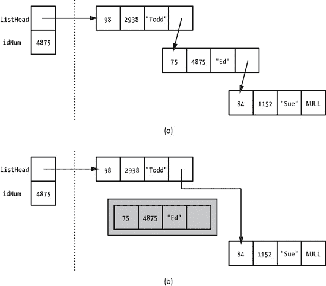

图 5-1. `removeRecord` 测试用例的“之前”和“之后”状态

现在我们知道了代码应该产生什么效果，可以开始编写它了。由于我们知道需要找到具有匹配 ID 号的节点，我们可以从 `recordWithNumber` 中的 `while` 循环开始。当该循环完成时，我们将得到一个指向需要删除的节点的指针。遗憾的是，完成删除操作需要的不仅仅于此。看图 5-1；为了填补空隙并维护链表，我们需要更改 `"Todd"` 节点的 `next` 字段。如果我们只手指向 `"Ed"` 节点的指针，那么就没有办法引用 `"Todd"` 节点，因为链表中的每个节点都引用它的后继者，而不是前驱者。（因为这种情况，某些链表是双向链接的；这些被称为双向链表，但很少需要。）因此，除了指向要删除节点的指针（如果从上一个函数适配代码，它将被称为 `loopPtr`）外，我们还需要一个指向前一个节点的指针：我们将此指针命名为 `trailing`。图 5-2 显示了这一概念在我们的示例中的应用。

```
void studentCollection::removeRecord(int idNum) {
    studentNode *loopPtr = _listHead;
    studentNode *trailing = NULL;
    while (loopPtr != NULL && loopPtr->studentID() != idNum) {
       trailing = loopPtr;
        loopPtr = loopPtr->next;
    }
    if (loopPtr == NULL) return;
    trailing->next = loopPtr->next;
    delete loopPtr;
}
```

该函数的第一个部分与 `recordWithNumber` Go，不同之处在于我们声明了 `trailing` 指针，并在循环内部于推进 `loopPtr` 之前将 `loopPtr` 的旧值赋给 `trailing`。这样，`trailing` 始终比 `loopPtr` 后一个节点。由于我们对上一个函数的处理，我们已经防止了一个特殊情况。因此，当循环结束时，检查 `loopPtr` 是否为 `NULL`。如果是，意味着我们从未找到该 ID 号的节点，我们立即 `return`。我把出现在函数中间的 `return` 语句称为“溜之鱼”。有些程序员反对这种做法，因为具有多个出口的函数更难以阅读。然而，在这种情况下，替代方案是增加 `if` 语句的嵌套层次。

在确定了要删除的节点后，是时候删除它了。从我们的图中，我们需要将 `trailing` 节点的 `next` 字段指向当前 `loopPtr` 节点 `next` 字段指向的节点。然后我们可以安全地 `delete` `loopPtr` 指向的节点。这对于我们的测试用例有效，但像既常一样，我们需要检查潜在的特殊情况。我们已经处理了 `idNum` 不出现在集合中任何记录的情况，但是否还有其他可能的问题？观察我们的测试用例，如果我们尝试删除第一个或第三个节点而不是中间节点，会有什么变化？测试和手动检查显示第三个（最后一个）节点没有问题。然而，第一个节点会引起麻烦，因为在这种情况下，没有 `trailing` 可以指向的前一个节点。相反，我们必须操作 `_listHead` 本身。图 5-3 显示了 `while` 循环结束后的状况。


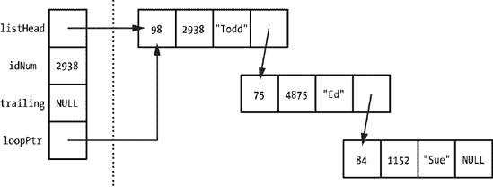

图 5-3. 移除列表第一个节点之前

在这种情况下，我们需要将 `_listHead` 指向列表中的原第二个节点，即指向 `"Ed"` 的那个节点。让我们重写我们的方法来处理这个特殊情况。

```cpp
void studentCollection::removeRecord(int idNum) {
    studentNode * loopPtr = _listHead;
    studentNode * trailing = NULL;
    while (loopPtr != NULL && loopPtr->studentData.studentID() != idNum) {
        trailing = loopPtr;
        loopPtr = loopPtr->next;
    }
    if (loopPtr == NULL) return;
  if (trailing == NULL) {
      _listHead = _listHead->next;
    } else {
        trailing->next = loopPtr->next;
    }
    delete loopPtr;
}
```

如你所见，条件测试  和处理特殊情况的代码  都是直观的，因为我们在编写代码之前已经仔细分析了这种情况。

## 析构函数

在实现了问题中指定的三个方法后，我们可能会认为我们的 `studentCollection` 类已经完成了。然而，就目前而言，它存在严重的问题。第一个是该类缺少析构函数。析构函数是在对象离开作用域时（当声明对象的函数执行完毕时）被调用的特殊方法。当一个类没有动态数据时，通常不需要析构函数，但如果你有前者，就一定需要后者。记住，我们必须 `delete` 所有通过 `new` 分配的内容，以避免内存泄漏。如果我们的 `studentCollection` 类的对象有三个节点，那么这些每个节点都需要被释放。幸运的是，这并不困难。我们只需要遍历我们的链表，边遍历边删除。不过，我们与其直接这样做，不如写一个辅助方法来删除 `studentList` 中的所有节点。在类类的私有部分，我们添加了如下声明：

```cpp
void deleteList(studentList &listPtr);
```

该方法本身的代码如下：

```cpp
void studentCollection::deleteList(studentList &listPtr) {
    while (listPtr != NULL) {
        studentNode * temp = listPtr;
        listPtr = listPtr->next;
        delete temp;
    }
}
```

遍历过程将当前节点的指针拷贝到临时变量 ，移动当前节点指针 ，然后删除临时变量指向的节点 。有了这些代码后，我们可以非常简单地编写析构函数。首先，我们在类声明的公共部分添加析构函数：

```cpp
~studentCollection();
```

请注意，像构造函数一样，析构函数使用类名来指定，且没有返回类型。名称前的波浪号区分了析构函数和构造函数。其实现如下：

```cpp
studentCollection::~studentCollection() {
    deleteList(_listHead);
}
```

这些方法中的代码很直观，但测试析构函数是非常重要的。虽然编写糟糕的析构函数可能会导致程序崩溃，但许多析构函数问题不会导致崩溃，而是内存泄漏，或者更糟糕——无法解释的程序行为。因此，使用开发环境的调试器测试析构函数很重要，这样你就可以看到析构函数确实对每个节点调用了 `delete`。

## 深拷贝

另一个严重的问题仍然存在。在第 4 章 中，我们简要讨论了交叉链接的概念，即两个指针变量具有相同的值。尽管变量本身是不同的，但它们指向同一个数据结构；因此，修改一个变量的结构会修改两者。这个问题在包含动态分配内存的类中很容易发生。为了理解为什么会是一个问题，请考虑以下简单的 C++ 代码序列：

```cpp
int x = 10;
  int y = 15;
  x = y;
 x = 5;
```

假设我问你最后一条语句  对变量 `y` 的值有什么什么影响。你可能会怀疑我是否说错了话。最后一条语句对 `y` 没有任何影响，只影响 `x`。但现在考虑这个：

```cpp
studentCollection s1;
  studentCollection s2;
  studentRecord r1(85, 99837, "John");
  s2.addRecord(r1);
  studentRecord r2(77, 4765, "Elsie");
  s2.addRecord(r2);
 s1 = s2;
 s2.removeRecord(99837);
```

假设我问你最后一条语句  对 `s1` 有什么影响。遗憾的是，它确实有影响。尽管 `s1` 和 `s2` 是不同的对象，但在默认情况下，将一个对象赋值给另一个时，C++ 执行的是所谓的浅拷贝。在浅拷贝中，一个对象的每个成员被直接赋值给另一个。因此，如果 `_listHead` 是唯一的数据成员，`s1 = s2` 等同于 `s1._listHead = s2._listHead`。这使得两个对象的 `_listHead` 都指向同一个地方：即 `"Elsie"` 节点。图 5-4 显示了代码结束时的情况。

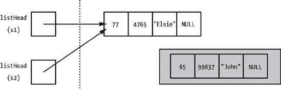

图 5-4. 浅拷贝会导致交叉；删除一个列表中的 John 节点会删除两者。

尽管这很奇怪，但如果代码最后一行删除的是第一个记录，即 `"Elsie"` 节点呢？在这种情况下，`s2` 内部的 `_listHead` 将指向 `"John"`，而 `"Elsie"` 节点将被删除。然而，`s1` 内部的 `_listHead` 仍然指向已删除的 `"Elsie"` 节点，这是一个危险的悬挂指针，如图 5-5](Removal from s2 causing a dangling reference in s1.)所示。

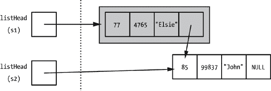

图 5-5. 从 s2 移除导致 s1 悬挂指针

解决此问题的方案是深拷贝，这意味着我们不仅拷贝结构的指针，而且创建结构中所有内容的副本。在这种情况下，这意味着拷贝列表中的所有节点以创建一个真正的列表拷贝。与之前一样，我们从编写一个私有辅助方法开始，在这种情况下，是一个拷贝 `studentList` 的方法。在类私有部分的声明如下：

```cpp
studentList copiedList(const studentList original);
```

如之前一样，我为返回值的方法选择了一个名词。该方法的实现如下：


```cpp
 studentCollection::studentList
 studentCollection::copiedList(const studentList original) {
    if (original == NULL) {
          return NULL;
      }
      studentList newList = new studentNode;
    newList->studentData = original->studentData;
    studentNode * oldLoopPtr = original->next;
    studentNode * newLoopPtr = newList;
      while (oldLoopPtr != NULL) {
        newLoopPtr->next = new studentNode;
          newLoopPtr = newLoopPtr->next;
          newLoopPtr->studentData = oldLoopPtr->studentData;
          oldLoopPtr = oldLoopPtr->next;
      }
    newLoopPtr->next = NULL;
    return newList;
  }
```

这个方法涉及很多操作，让我们一步一步来。在语法方面，在实现中指定返回类型时，我们必须加上类名。否则，编译器不知道我们在谈论哪什么类型（在方法内部则没必要，因为编译器已经知道该方法属于哪个类——这有点让人困惑！）。我们检查传入的列表是否为空。如果是，我们就直接退出。一旦确定有列表需要复制，我们会在循环之前复制第一个节点的数据，因为对于该节点，我们需要修改新列表的头指针。

然后，我们设置了两个指针来遍历这两个列表。`old-LoopPtr` 遍历传入的列表；它将始终指向我们即将复制的节点。`newLoopPtr` 遍历新生成的复制列表，它始终指向我们创建的最后一个节点，即我们将添加下一个节点之前的前一个节点。与 `removeRecord` 方法一样，在这里我们需要一种尾随指针。在循环内部，我们创建一个新节点，让 `newLoopPtr` 指向它，将数据从旧节点复制到新节点，然后移动 `oldLoopPtr`。在循环结束后，我们通过将最后一个节点的 `next` 字段赋值为 `NULL` 来终止新列表，并`return` 指向新列表的指针。

那么这个辅助方法是如何解决我们之前看到的问题呢？它本身并不能解决。但有了这段代码，我们现在可以重载赋值运算符了。*运算符重载*（Operator overloading）是 C++ 的一个特性，允许我们更改内置运算符对特定类型的操作方式。在这种情况下，我们想要重载赋值运算符（`=`），这样它就不会执行默认的浅拷贝，而是调用我们的 `copiedList` 方法来执行深拷贝。在我们类的公共部分，我们添加：

```cpp
 studentCollection& operator=(const studentCollection &
 rhs);
```

我们正在重载的运算符通过使用 `operator` 关键字后跟想要重载的运算符来命名方法进行指定。我为参数选择的名称（`rhs`）是重载中的常用选择，因为它代表*右侧*（right-hand side）。这有助于程序员保持思路清晰。因此，在启动这次讨论的赋值语句 `s2 = s1` 中，对象 `s1` 将是赋值操作的右侧，而 `s2` 将是左侧。我们通过参数引用右侧，并通过直接访问类成员来引用左侧，就像我们处理该类的任何其他方法一样。因此，在这种情况下，我们的任务是创建一个由 `_listHead` 指向的列表，该列表是 `rhs` 的 `_listHead` 所向列表的副本。这在调用 `s2 = s1` 时产生的效果是使 `s2` 成为 `s1` 的真正的拷贝。

参数的类型始终是对该类的常量引用；返回类型始终是对该类的引用。你很快就会明白为什么参数是一个引用。你可能会疑惑为什么这个方法要返回内容，因为我们在方法中直接操作了数据成员。这是因为 C++ 允许链式赋值，例如 `s3 = s2 = s1`，其中一个赋值的返回值变为下一个赋值的参数。

一旦理解了所有的语法，赋值运算符的代码就非常直接：

```cpp
studentCollection& studentCollection::operator=(const studentCollection &rhs) {
  if (this != &rhs) {
       deleteList(_listHead);
       _listHead = copiedList(rhs._listHead);
    }
    return *this;
}
```

为了避免内存泄漏，我们必须首先 `deleteList` 当前左侧列表中的节点。然后，我们使用我们的辅助方法复制右侧列表。最后，我们返回一个指向左侧对象的指针。无论我们实际上是否复制了内容，这都会发生，因为尽管 `s1 = s1` 这样的语句很奇怪，但如果有人尝试，我们仍然希望它能正常工作。

### 拷贝构造函数的实现

只要我们有列表复制的辅助方法，我们也应该创建一个*拷贝构造函数*（copy constructor）。这是一个接受同类另一个对象作为参数的构造函数。当我们需要创建一个现有 `studentCollection` 的副本时，可以显式地调用拷贝构造函数，但当该类的对象作为值参数传递时，拷贝构造函数也会被隐式调用。因此，你应该考虑将对象参数作为 `const` 引用而不是值参数，除非接收对象的函数需要修改该拷贝。例如，考虑一个包含 10,000 条记录的学生集合。该集合可以作为引用（单个指针）传递。或者，它可能会调用拷贝构造函数进行一次长遍历和 10,000 次内存分配，而这个局部拷贝会在函数结束时再次调用析构函数，进行另一次长遍历和 10,000 次释放。这就是为什么赋值运算符的右侧参数使用常量引用参数的原因。

要将拷贝构造函数添加到我们的类中，首先在类定义的公共部分添加它的声明。

```cpp
studentCollection(const studentCollection &original);
```

和所有构造函数一样，它没有返回类型，和赋值运算符一样，参数是对我们类的引用。由于我们已经有了辅助方法，实现变得非常简单。

```cpp
studentCollection::studentCollection(const studentCollection &original) {
    _listHead = copiedList(original._listHead);
}
```

现在我们可以做出如下声明：

```cpp
studentCollection s2(s1);
```

这一声明的效果是声明 `s2` 并将 `s1` 的节点复制到其中。


## 带有动态内存的类的概览

在完成问题描述中指定的类之后，我们对这个类做了很多工作，所以让我们花点时间回顾一下。这是我们现在的类声明的形式。

```
class studentCollection {
private:
    struct studentNode {
        studentRecord studentData;
        studentNode * next;
    };
public:
    studentCollection();
    ~studentCollection();
    studentCollection(const studentCollection &original);
    studentCollection& operator=(const studentCollection &rhs);
    void addRecord(studentRecord newStudent);
    studentRecord recordWithNumber(int idNum);
    void removeRecord(int idNum);
private:
    typedef studentNode * studentList;
    studentList _listHead;
    void deleteList(studentList &listPtr);
    studentList copiedList(const studentList original);
};
```

这里的教训是，在创建带有动态内存的类时，需要新的组件。除了基本类框架的功能之外——私有数据、默认构造函数以及向对象输入输出数据的方法之外，我们还必须添加额外的方法来处理动态内存的分配和清理。至少，我们应该添加一个构造函数和一个析构函数，而且如果有人可能使用赋值运算符，还要重载赋值运算符。通过创建用于拷贝或删除底层动态数据结构的辅助方法，通常可以方便这些额外方法的创建。

这看起来可能是很多工作量，而且确实如此，但重要的是，你添加到类中的每样东西最终都是你需要处理的。换句话说，如果我们没有为存储学生记录的链表集合创建一个类，在我们用完它们时，我们仍然负责删除列表中的节点。我们仍然必须警惕交叉链接，如果想获得原始列表的真实副本，仍然必须遍历列表并逐个复制节点，依此类推。将所有内容放入类结构中只是在前期多花了一点工作，而且一旦一切运行正常，客户端代码就可以忽略所有的内存分配细节了。到底，封装和信息隐藏使得动态数据结构处理起来变得容易得多。

# 应该避免的错误

我们已经讨论了如何在 C++ 中创建一个良好的类，所以让我们通过讨论一些你应该避免的常见陷阱来结束讨论。

## “伪类”

正如我在章开头提到的，我认为 C++ 作为一种兼顾了过程化和面向对象范式的混合语言，是学习面向对象编程的一种极佳语言，因为对于程序员来说，创建一个类总是一个积极的选择。在 Java 语言中，问题从来不是“我应该创建一个类吗？”，而是“我该如何将此放入一个类中？”这种将所有内容都放入类结构中的要求导致了我所说的 `伪类`（fake class）——一个没有连贯设计、语法上是正确的但没有实际意义的类。编程中使用的 `class` 一词源于英语单词，含义是指具有共同属性的一组事物，而一个良好的 C++ 类符合这个定义。

伪类的出现有几个原因。其中一种是因为程序员真的想使用全局变量，这并不是出于任何站得住脚的理由（这种理由很常见，但确实存在），而是出于懒惰——为了避免在函数与函数之间传递参数。虽然程序员知道广泛使用全局变量被认为是非常糟糕的风格，但他或她认为找到了漏洞。程序的所有或大部分函数都被塞进一个类中，而原本应该是全局的变量现在变成了类的成员变量。程序的 `main` 函数简单地创建一个伪类对象，并调用该类中的某些“主”方法。从技术上讲，程序没有使用任何全局变量，但伪类意味着该程序具有使用全局变量程序完全相同的缺陷。

另一种类型的伪类出现是因为程序员仅仅假设面向对象编程总是“更好”，并将其强加于不适用的情况。在这些情况下，程序员经常创建一个封装了非常特定功能的类，这些功能仅在其编写的原始程序语文中才有意义。有两种方法可以测试你是否正在编写这类伪类。第一种是问：“我可以给这个类起一个特定且合理的短名字吗？”如果你发现自己用了像 `PayrollReportManagerAndPrintSpooler` 这样的名字，那你可能有问题了。另一个测试是问：“如果我写另一个具有类似功能的程序，我能想象这个类如何通过微小的修改就可以复用吗？还是它必须经过巨大的重写？”

即使在 C++ 中，一定数量的伪类也是不可避免的，例如，因为我们必须为集合类封装数据。然而，这些类通常是很小且基础的。如果我们能避免复杂的伪类，我们的代码将会改进。

## 单任务者

如果你看过电视节目《美食大发现》（Good Eats），你就知道主持人阿尔顿·布朗（Alton Brown）花费大量时间讨论如何布置你的厨房以实现效率最大。他经常抨击他称为 `单任务者`（single-taskers）的厨房器具，指的是那些良好完成一项任务但不能做其他任何事情的工具。在编写类时，我们应该努力使其尽可能通用，与其包含我们程序所需的所有特定功能保持一致。

实现这一点的方法之一是模板类。这是一个带有晦涩语法的高级主题，但它允许我们创建类，其中一个或多个数据成员的类型在创建类对象时指定。模板类允许我们“提取”通用功能。例如，我们的 `studentCollection` 类包含了许多对任何封装链表的类都通用的代码。我们可以为通用的链表创建一个模板类，使得列表节点中的数据类型在创建类对象时指定，而不是被硬编码为 `studentRecord`。那么我们的 `studentCollection` 类将拥有一个模板列表类的对象作为成员变量，而不是列表头，并且不再手动操作链表。

模板类超出了本书的范围，但随着你作为类设计者能力的提升，你应该始终努力创建能够多任务的类。当你发现一个当前的问题可以使用你之前写过的类来解决时（在那时你还不知道这个问题），那种感觉棒极了。

## 练习题

你知道我正要说什么，不是吗？去尝试一下吧！

1. 让我们尝试使用基本框架实现一个类。考虑一个存储汽车数据的类。我们将有三部分数据：制造商名称和型号名称（都是字符串），以及一个型号年份（一个整数）。为每个数据成员创建一个带有 *get*/*set* 方法的类。确保你在成员变量名称等细节上做出了明智的决定。遵循我特定的命名规范并不重要。重要的是，你要考虑你所做出的选择并在决策中保持一致。

2. 针对我们上一个练习中的汽车类，添加一个支持方法，以格式化字符串的形式返回汽车对象的完整描述，例如`"1957 Chevrolet Impala"`。添加第二个支持方法，返回汽车的年限（岁）。


3. 从第 4 章 中提取变长字符串函数 variable-length string functions（`append`、`concatenate` 和 `characterAt`），并使用它们来创建一个变长字符串类，确保实现所有必要的构造函数、析构函数和重载的赋值运算符。

4. 针对上一个练习中的变长字符串类，将 `characterAt` 方法替换为重载的 `[]` 运算符。例如，如果 `myString` 是我们类的对象，那么 `myString[1]` 返回的结果应与 `myString.characterAt(1)` 相同。

5. 针对上几个练习中的变长字符串类，添加一个 `remove` 方法，该方法接收起始位置和字符数量，并从字符串中间删除相应数量的字符。因此，`myString.remove(5,3)` 将删除从第五位置开始的三个字符。确保当任一参数的值无效时，你的方法仍能正常运行。

6. 检查你的变长字符串类以进行可能的重构。例如，是否有某些公共功能可以分离到私有的辅助方法中？

7. 从第 4 章 中提取学生记录函数（`addRecord` 和 `averageRecord`），并使用它们创建一个代表学生记录集合的类（如之前），确保实现所有必要的构造函数、析构函数和重载的赋值运算符。

8. 针对上一个练习中的学生记录集合类，添加一个方法 `RecordsWithinRange`，该方法接收低分和高分作为参数，并返回一个包含该范围内记录的新集合（原始集合不受影响）。例如，`myCollection.RecordsWithinRange(75, 80)` 将返回一个所有分数在 75-80 之间的记录的集合。

# 第 6 章. 使用递归解决问题


本章介绍*递归*，即函数直接或间接地调用其自身的情况。递归编程看起来应该很简单。事实上，一个良好的递归解决方案通常具有简单、几乎优雅的外观。然而，通往该解决方案的道路往往绝不简单。这是因为递归要求我们以与其它类型编程不同的方式进行思考。当我们使用循环处理数据时，我们是在按顺序的方式思考处理；但当我们使用递归处理数据时，我们正常的顺序思维过程将无济于事。许多初级程序员在递归方面感到挣扎，因为他们无法看到将所学的解决问题技巧应用于递归问题。在本章中，我们将讨论如何系统地应对递归问题。答案是使用我们将称为*大递归思想*（Big Recursive Idea，以下简称 `BRI`）的方法。这个想法非常直接，以至于看起来像是一个技巧，但它确实有效。

## 递归基础回顾

关于递归的*语法*并不难掌握；困难出现在你尝试使用递归来解决问题时。每当函数调用自身时，就会发生递归，因此递归的语法就是函数调用的语法。最常见的形式是*直接递归*（direct recursion），即在函数体内发生了对该函数的调用。例如：

```
int factorial(int n) {
  if (n == 1) return 1;
  else return n * factorial(n - 1);
}
```

这个函数是递归的一个常见但极低效的示例，用于计算 `n` 的阶乘。例如，如果 `n` 是 5，那么阶乘就是从 5 到 1 所有数字的乘积，即 120。注意在某些情况下并没有发生递归。在这个函数中，如果参数为 1，我们直接返回一个值而不进行任何递归，这被称为*基准情况*（base case）。否则，我们进行递归调用。

递归的另一种形式是*间接递归*（indirect recursion）——例如，如果函数 `A` 调用函数 `B`，随后 `B` 又调用函数 `A`。间接递归很少作为解决问题的技巧，因此我们在这里不介绍。

## 头递归尾递归

在讨论 `BRI` 之前，我们需要理解头递归和尾递归之间的区别。在*头递归*（head recursion）中，递归调用发生在函数中其他处理之前（想象它发生在函数的顶部或头部）。在*尾递归*（tail recursion）中，情况相反——处理发生在递归调用之前。在两种递归风格之间做出选择似乎是随机的，但这种选择可能产生巨大的差异。为了说明这种区别，让我们来看两个问题。

### 问题：有多少只鹦鹉？

热带天堂铁路（TPR）的乘客期待从列车窗外看到几十只色彩斑纷的鹦鹉。由于由于，铁路对当地鹦鹉种群的健康非常感兴趣，并决定对主线上每个站台可见的鹦鹉数量进行计数。每个站台由一名 TPR 员工负责（参见图 6-1），他们完全有能力数鹦鹉。不幸的是，这项工作由于原始电话系统而变得复杂。每个平台只能拨打其直接邻居的电话。我们如何获取鹦鹉的总数？


图 6-1. 五个站台的员工只能与其直接邻居通信。

假设主站台有 7 只鹦鹉，贝林有 5 只，科里迪有 3 只，黛比有 10 只，最后一个站台伊文有 2 只。因此，总数为 27 只。问题是，员工们如何协作通信这个总数？解决这个问题将需要一条从主站台到终点的通信链。每个站台的员工都会被要求数鹦鹉。如此，有两种不同的通信方法，这些方法对应于编程中的头递归和尾递归技术。

等等，提供的文本中断在：“当我们到达终点时，伊文将第一个发现鹦鹉的总数，他将把它传给黛比，黛比再传给科里迪，以此此类（参见图 6-2）。”

### 方法 1

在这种方法中，我们随着向外推进维护鹦鹉的总数。每当员工向线路上的下一位员工发出请求时，都会传递目前为止看到的鹦鹉数量。当我们到达终点时，伊文将第一个发现鹦鹉的总数，他将把它传给黛比，黛比再传给科里迪，以此此类（参见图 6-2）。

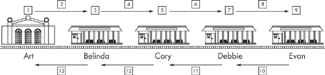

图 6-2. 方法 1 的步骤计数

1. ART 开始数他站台周围的鹦鹉。他数了 7 只。
2. ART 告诉 贝林：“主站台这里有 7 只鹦鹉。”
3. 贝林在她站台周围数了 5 只鹦鹉，总数达到 12 只。
4. 贝林告诉 科里迪：“前两个站台共有 12 只鹦鹉。”
5. 科里数了 3 只鹦鹉。
6. 科里告诉 黛比：“前三个站台共有 15 只鹦鹉。”
7. 黛比数了 10 只鹦鹉。
8. 黛比告诉 伊文：“前四个站台共有 25 只鹦鹉。”


9. EVAN 数了 2 只鹦鹉，并发现鹦鹉总数为 27 只。
10. EVAN 对 DEBBIE 说：“鹦鹉总数是 27。”
11. DEBBIE 对 CORY 说：“鹦鹉总数是 27。”
12. CORY 对 BELINDA 说：“鹦鹉总数是 27。”
13. BELINDA 对 ART 说：“鹦鹉总数是 27。”

这种方法类似于尾部递归。在尾部递归中，递归调用发生在处理之后——递归调用是函数的最后一步。在上面的通信链中，请注意员工的“工作”——鹦鹉计数和求和——是在他们向线路中的下一个员工发送信号之前完成的。所有的工作都发生在输出通信链上，而不是入站链上。以下是每位员工遵循的步骤：

1. 数数从站台平台可见的鹦鹉。
2. 将此计数加到上一个站点给出的总数上。
3. 调用下一个站点以传递鹦鹉计数的累加和。
4. 等待下一个站点调用并返回鹦鹉总数，然后将此总数传给上一个站点。

### 方法 2

在这种方法中，我们从另一端开始汇总鹦鹉计数。每位员工在联系线路中的下一个站点时，都会请求从该站点开始的鹦鹉总数。然后，员工加上自己站点的鹦鹉数量，并将这个新总数沿线路向上传递（参见图 6-3）。

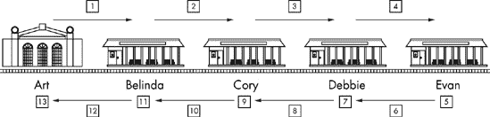

图 6-3. 鹦鹉计数问题中使用方法 2 执行的步骤编号

1. ART 对 BELINDA 说：“从你的站点到线路末尾的鹦鹉总数是多少？”
2. BELINDA 对 CORY 说：“从你的站点到线路末尾的鹦鹉总数是多少？”
3. CORY 对 DEBBIE 说：“从你的站点到线路末尾的鹦鹉总数是多少？”
4. DEBBIE 对 EVAN 说：“从你的站点到线路末尾的鹦鹉总数是多少？”
5. EVAN 是线路的末端。他数了 2 只鹦鹉。
6. EVAN 对 DEBBIE 说：“末端这里的鹦鹉总数是 2。”
7. DEBBIE 在她的站点数了 10 只鹦鹉，所以从她的站点到末尾的总数是 12。
8. DEBBIE 对 CORY 说：“从这里到末尾的鹦鹉总数是 12。”
9. CORY 数了 3 只鹦鹉。
10. CORY 对 BELINDA 说：“从这里到末尾的鹦鹉总数是 15。”
11. BELINDA 数了 5 只鹦鹉。
12. BELINDA 对 ART 说：“从这里到末尾的鹦鹉总数是 20。”
13. ART 在主终端数了 7 只鹦鹉，总数达到了 27 只。

这种方法类似于头部递归。在头部递归中，递归调用发生在其他处理之前。在这里，对下一个站点的调用首先发生，在数鹦鹉或求和之前。“工作”被推迟到线路下游站点报告它们的总数之后。以下是每位员工遵循的步骤：

1. 调用下一个站点。
2. 数数从站台平台可见的鹦鹉。
3. 将此计数加到下一个站点给出的总数上。
4. 将结果和传给上一个站点。

你可能注意到不同方法的两种实际效果。在第一种方法中，最终所有站点员工都会得知鹦鹉的总数。在第二种方法中，只有主终端的 Art 知道了完整总数——但注意，Art 是唯一需要完整总数的员工。

当我们把讨论转向实际编程代码时，另一个实际效果对我们的分析变得更加重要。在第一种方法中，每位员工在请求时向线路下一个站点传递“运行总数”。在第二种方法中，员工只是向下一个站点请求信息，而不向下线传递任何数据。这种效应是头部递归方法的典型特征。因为递归调用发生在任何其他处理之前，因此没有新信息可以交给递归调用。通常，头部递归方法允许将最小的数据集传递给递归调用。现在让我们来看另一个问题。

### 问题：谁是我们的最佳客户？

DelegateCorp 的经理需要确定八个客户中哪一个为公司产生了最多收入。两个因素使这个原本简单的任务变得复杂。首先，确定一个客户的总收入需要查阅该客户的整个文件，并统计几十份订单和收据上的数字。其次，DelegateCorp 的员工顾如其名，喜欢委托，只要可能，每位员工都会将工作传递给较低级别的人。为了防止情况失控，经理执行了一项规则：当你委托时，必须自己完成一部分工作，并且你交给被委托员工的工作必须比你手头的少。

表 6-1  own 表 6-2 识别了 DelegateCorp 的员工和客户。

表 6-1. DelegateCorp 职称
| 职称 | 级别 |
| --- | --- |
| 经理 | 1 |
| 副经理 | 2 |
| 助理经理 | 3 |
| 主管经理 | 4 |
| 初级经理 | 5 |
| 实习生 | 6 |

表 6-2. DelegateCorp 客户
| 客户编号 | 收入 |
| --- | --- |
| #0001 | $172,000 |
| #0002 | $68,000 |
| #0003 | $193,000 |
| #0004 | $13,000 |
| #0005 | $256,000 |
| #0006 | $99,000 |

遵循公司的委托规则，这六份文件将如何处理：经理将拿一份文件并确定其产生了多少收入。经理将剩下的五个文件委托给副经理。副经理处理一份文件并将剩下的四个传给助理经理。这个过程一直持续直到我们遇到最后一个员工——实习生，他被交了一文件并必须处理它，无法再次委托。

图 6-4 和方法 2 (b) 寻找最高收入客户的步骤编号") 描述了通信线路和劳动分工。尽管与之前的示例一样，但有两种不同的方法。

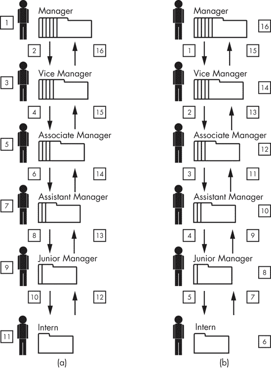


5. `ASSOCIATE MANAGER` 统计了客户 #0003 的收入，为 $193,000。目前看到的最高收入为 $193,000，客户 #0003。

6. `ASSOCIATE MANAGER` 对 `ASSISTANT MANAGER` 说：“我们目前看到的最高收入是 $193,000，客户 #0003。拿着这三个文件，确定整体最高收入。”

7. `ASSISTANT MANAGER` 统计了客户 #0004 的收入，为 $13,000。目前看到的最高收入仍然是 $193,000，客户 #0003。

8. `ASSISTANT MANAGER` 对 `JUNIOR MANAGER` 说：“我们目前看到的最高收入是 $193,000，客户 #0003。拿着这两个文件，确定整体最高收入。”

9. `JUNIOR MANAGER` 统计了客户 #0005 的收入，为 $256,000。目前看到的最高收入为 $256,000，客户 #0005。

10. `JUNIOR MANAGER` 对 `INTERN` 说：“我们目前看到的最高收入是 $256,000，客户 #0005。拿着这个剩下的的文件，确定整体最高收入。”

11. `INTERN` 统计了客户 #0006 的收入，为 $99,000。目前看到的最高收入仍然是 $256,000，客户 #0005。

12. `INTERN` 对 `JUNIOR MANAGER` 说：“所有客户的最高收入是 $256,000，客户 #0005。”

13. `JUNIOR MANAGER` 对 `ASSISTANT MANAGER` 说：“所有客户的最高收入是 $256,000，客户 #0005。”

14. `ASSISTANT MANAGER` 对 `ASSOCIATE MANAGER` 说：“所有客户的最高收入是 $256,000，客户 #0005。”

15. `ASSOCIATE MANAGER` 对 `VICE MANAGER` 说：“所有客户的最高收入是 $256,000，客户 #0005。”

16. `VICE MANAGER` 对 `MANAGER` 说：“所有客户的最高收入是 $256,000，客户 #0005。”

这种方法在图 6-4 和方法 2 (b) 的步骤编号") (a) 中，使用了尾递归技术。每个员工处理一个客户文件，并将该客户计算出的收入与目前看到的最高收入进行比较。然后该员工将比较结果传递给下属员工。递归——工作的移交——在其他处理之后发生。每个员工的流程运行如下：

1. 统计一个客户文件中的收入。
2. 将此总和与上级在其他客户文件中最高收入进行比较。
3. 将剩余的客户文件交给下属员工，以及目前看到的最高收入金额。
4. 当下属员工返回所有客户文件的最高收入时，将其传回给上级。

### 方法 2

在这种方法中，每位员工首先留出一个文件，然后将其他文件交给下属。在这种情况下，并不要求下属确定所有文件的最高收入，只需确定其收到的文件的最高收入即可。与第一个示例问题一样，这简化了请求。使用与第一方法相同的数据，对话如下：

1. `MANAGER` 对 `VICE MANAGER` 说：“拿着这五个客户文件，告诉我最高收入。”
2. `VICE MANAGER` 对 `ASSOCIATE MANAGER` 说：“拿着这四个客户文件，告诉我最高收入。”
3. `ASSOCIATE MANAGER` 对 `ASSISTANT MANAGER` 说：“拿着这三个客户文件，告诉我最高收入。”
4. `ASSISTANT MANAGER` 对 `JUNIOR MANAGER` 说：“拿着这两个客户文件，告诉我最高收入。”
5. `JUNIOR MANAGER` 对 `INTERN` 说：“拿着这一个客户文件，告诉我最高收入。”
6. `INTERN` 统计了客户 #0006 的收入，为 $99,000。这是 `INTERN` 看过的唯一文件，因此这就是最高收入。
7. `INTERN` 对 `JUNIOR MANAGER` 说：“我的文件中最高收入是 $99,000，客户 #0006。”

8. `JUNIOR MANAGER` 统计了客户 #0005 的收入，为 $256,000。该员工所知的最高收入是 $256,000，客户 #0005。
9. `JUNIOR MANAGER` 对 `ASSISTANT MANAGER` 说：“我的文件中最高收入是 $256,000，客户 #0005。”
10. `ASSISTANT MANAGER` 统计了客户 #0004 的收入，为 $13,000。该员工所知的最高收入是 $256,000，客户 #0005。
11. `ASSISTANT MANAGER` 对 `ASSOCIATE MANAGER` 说：“我的文件中最高收入是 $256,000，客户 #0005。”
12. `ASSOCIATE MANAGER` 统计了客户 #0003 的收入，为 $193,000。该员工所知的最高收入是 $256,000，客户 #0005。
13. `ASSOCIATE MANAGER` 对 `VICE MANAGER` 说：“我的文件中最高收入是 $256,000，客户 #0005。”
14. `VICE MANAGER` 统计了客户 #0002 的收入，为 $68,000。该员工所知的最高收入是 $256,000，客户 #0005。
15. `VICE MANAGER` 对 `MANAGER` 说：“我的文件中最高收入是 $256,000，客户 #0005。”
16. `MANAGER` 统计了客户 #0001 的收入，为 $172,000。该员工所知的最高收入是 $256,000，客户 #0005。

这种方法在图 6-4 和方法 2 (b) 的步骤编号") (b) 中，使用了尾递归技术。


在这两个问题中，当员工向其他员工提出请求时，他们关注的是*什么*而不是*如何*做。问题被移交，答案被接收。这便是“大递归核心思想”（Big Recursive Idea）：如果你在编码时遵循了某些约定，*你就可以假装没有发生递归*。你甚至可以使用一个廉价的小技巧（如下所示）从迭代实现转变为递归实现，而无需显式地考虑递归实际上是如何解决该问题的。随着时间的推移，你将对递归解决方案的工作原理产生一种直观的理解，但在这种直觉产生之前，你可以编写递归实现并对你的代码充满信心。

让我们通过代码示例来将这一概念付诸实践。

### 问题：计算整数数组之和

编写一个递归函数，接收一个整数数组和数组的大小作为参数。该函数返回数组中所有整数的和。

你首先的想法可能是这个问题可以用迭代的方法轻而易举地解决。确实，让我们先从该问题的迭代解决方案开始：

```
int iterativeArraySum(int integers[], int size) {
    int sum = 0;
    for (int i = 0; i < size; i++) {
        sum += integers[i];
    }
    return sum;
}
```

你已经在第 3 章中见过与此非常的代码，因此该函数应该很容易理解。下一步是编写一种介于迭代解决方案和最终所需的递归解决方案之间的代码。我们将保留迭代函数，并添加第二个函数，我们将其称为*调度器*（dispatcher）。调度器将大部分工作移交给之前编写的迭代函数，并利用这些信息来解决整体问题。要编写一个调度器，我们必须遵循两条规则：

1. 调度器必须完全处理最简单的情况，而不调用迭代函数。
2. 调度器在调用迭代函数时，必须传递一个规模更小的问题。

将第一规则应用于此问题时，我们必须决定最简单的情况是什么。如果 `size` 为 0，那么该函数在概念上被传递了一个“空”数组，其和为 0。人们也可以认为最简单的情况应当是 `size` 为 1 的时候。在这种情况下，逻辑数组中只有一个数字，我们可以返回该数字作为和。这两种解释都行得通，但选择第一个选择可以让函数处理特殊情况。注意，原始迭代函数在 `size` 为 0 时不会失败，因此最好保持这种灵活性。

将第二规则应用于此问题时，我们必须找到一种从调度器向迭代函数传递规模更小问题的方法。没有简单的方法可以传递较小的数组，但我们可以很容易地传递一个较小的 `size` 值。如果给调度器的 `size` 值为 10，则该函数被要求计算数组中 10 个值的和。如果调度器将 9 作为 `size` 的值传递给迭代函数，它是在请求数组中前 9 个值的和。然后，调度器可以将数组中剩余的一个值（第 10 个）加上，以计算出所有 10 个值的和。注意，在调用迭代函数时将 `size` 减 1 可以使迭代函数的工作最大化，从而使调度器的工作最小化。这总是理想的方法——就像 DelegateCorp 的经理一样，调度器函数尽可能地避免工作。

将这些想法结合起来，这里是该问题的调度器函数：

```
int arraySumDelegate(int integers[], int size) {
  if (size == 0) return 0;
  int lastNumber = integers[size - 1];
    int allButLastSum = iterativeArraySum(integers, size - 1);
  return lastNumber + allButLastSum;
}
```

第一条语句执行了调度器的第一条规则：它检查简单情况并完全处理它，在本例中，是通过返回 0。否则，控制权传递给剩余代码，这些代码执行了第二条规则。数组中的最后一个数存储在名为 `lastNumber` 的局部变量中，然后通过调用迭代函数计算数组中所有其他值的和。此结果存储在另一个局部变量 `allButLastSum` 中，最后函数返回这两个局部变量之和。

如果我们正确地创建了调度器函数，那么我们已经有效地创建了一个递归解决方案。这就是“大递归核心思想”的实际应用。将此迭代解决方案转换为递归解决方案只需要额外增加一个简单的步骤：让委托函数在它之前调用迭代函数的地方调用自己。然后我们就可以完全移除迭代函数。

```
int arraySumRecursive(int integers[], int size) {
    if (size == 0) return 0;
    int lastNumber = integers[size - 1];
    int allButLastSum = arraySumRecursive(integers, size - 1);
    return lastNumber + allButLastSum;
}
```

对之前的代码只进行了两处更改。函数名已更改以更好地描述其新形式，并且函数现在在它之前调用迭代函数的地方调用了自己。两个函数 `arraySumDelegate` 和 `arraySumRecursive` 的逻辑是相同的。每个函数都会检查和已经已知的简单情况——在本例中是大小为 0 的数组。否则，每个函数都通过调用函数来计算除最后一个值以外的所有值的和，从而计算数组中值的和。最后，每个函数将该最后一个值加上返回的和，以得到总和。唯一的区别是第一个版本调用另一个函数，而递归版本调用自己。大递归核心思想告诉我们，如果我们遵循上述针对调度器的规则，就可以忽略这种区别。

你不需要字面上遵循上述所有步骤来遵循大递归核心思想。特别是，你通常不会在实现递归解决方案之前实现该问题的迭代解决方案。编写迭代函数作为跳板是最终会被丢弃的额外工作。此外，递归最适用于迭代解决方案困难的情况（后文将解释）。然而，你可以遵循大递归核心思想的轮廓，而不实际编写迭代解决方案。关键是将递归调用视为对另一个函数的调用，而不考虑该函数的内部实现。

## 常见错误

如所示，只要方法正确，递归解决方案通常非常容易编写。但同样容易写出一个错误的递归实现，或者一个“有效”但笨拙的递归解决方案。递归实现的大多数问题源于两个基本错误：过度思考问题或在没有清晰计划的情况下开始实现。

过度思考问题对于新程序员来说是常见的，因为经验有限且对递归缺乏信心导致他们认为问题比实际更困难。过度思考产生的代码可以通过其过分谨慎的外识别出来。例如，一个递归函数可能有多个特殊情况，而它实际上只需要一个。


过早开始实现会导致代码过于复杂（“鲁布·黄金堡”代码），其中不可预见的交互会导致产生补丁一样叠加在原始代码之上的修复程序。让我们来看一些具体的错误以及如何避免它们。

### 参数过多

如前所述，头递归技术可以减少传递给递归调的数据，而尾递归技术则可能导致向递归调用传递额外数据。程序员往往会陷入尾递归模式中，因为他们想得太多，并且过早地开始了实现。

考虑我们递归计算一个整数数组之和的问题。在为该问题编写迭代解决方案时，程序员知道会需要一个“运行总和”的变量（在提供的迭代解决方案中，我将其命名为 `sum`），并且将从第一个元素开始对数组进行累加。考虑递归解决方案时，程序员自然会想象出一个最直接镜像迭代解决方案的实现方式：包含一个运行总和变量，并由第一次递归调用处理数组中的第一个元素。然而，这种方法要求递归函数传递运行总和以及下一次递归调用应该开始处理的位置。这样的解决方案看起来如下：

```
int arraySumRecursiveExtraParams(int integers[], int size, int sum,
 int currentIndex) {
    if (currentIndex == size) return sum;
    sum += integers[currentIndex];
    return arraySumRecursiveExtraParameters(integers, size, sum, currentIndex + 1);
}
```

这段代码与另一个递归版本一样短，但由于增加了额外的参数 `sum` 和 `currentIndex`，其在语义上要复杂得多。从客户端代码的角度来看，这些额外参数是没有意义的，在调用时它们始终必须为零，如下例所示：

```
int a[10] = {20, 3, 5, 22, 7, 9, 14, 17, 4, 9};
int total = arraySumRecursiveExtraParameters(a, 10, 0, 0);
```

通过使用下一节中描述的*包装函数（wrapper function）*，可以避免这个问题问题，但由于我们无法完全消除这些参数，这并不是最佳解决方案。该问题的迭代函数和原始递归函数回答的问题是：这个具有这么多元素的数组之和是多少？相比之下，这个第二个递归函数被提问的问题是：如果这个数组有这么多元素，且我们从这个特定的元素开始，并且这是之前所有元素之和，那么它的总和是多少？

通过在考虑递归之前选择函数参数，就可以避免“参数过多”的问题。换句话说，强迫自己使用与解决方案是迭代的时相同的参数列表。如果你使用了完整的 BRI 过程并实际上先编写迭代函数，你将自动避免这个问题。尽管你可能跳过了正式使用整个过程，但只要根据你对迭代函数的预期写出参数列表，你在概念上仍然可以使用这个想法。

### 全局变量

避免过多的参数有时会导致程序员陷入另一个错误：使用全局变量将数据从一个递归调用传递到另一个。使用全局变量通常是一种糟糕的编程习惯，尽管有时出于性能考虑是允许允许的。在递归函数中，应尽可能避免全局变量。让我们来看一个具体的问题，看看程序员是如何说服自己犯错误的。假设我们被要求写一个递归函数来计算整数数组中零的个数。这是一个使用迭代解决的简单问题：

```
int zeroCountIterative(int numbers[], int size) {
   int sum = 0;
 int count = 0;
   for (int i = 0; i < size; i++) {
      if (numbers[i] == 0) count ++;
   }
   return count;
}
```

这段代码的逻辑非常直观。我们只是从第一个位置到最后一个位置遍历数组，边走边计算零，并使用局部变量 `count` 作为跟踪器。如果我们在编写递归函数时脑海中这样一个函数，我们可能会假设在该版本中也需要一个跟踪变量。我们不能简单地在递归版本中将 `count` 声明为局部变量，因为每次递归调用都会产生一个新的变量。因此，我们可能会将其声明为全局变量：

```
int count;
int zeroCountRecursive(int numbers[], int size) {
   if (size == 0) return count;
   if (numbers[size - 1] == 0) count++;
   zeroCountRecursive(numbers, size - 1);
}
```

这段代码可以工作，但全局变量完全没有必要，并且会导致全局变量通常引起的所有问题，例如可读性差和代码维护难度大。某些程序员可能会尝试通过将变量设为局部但静态的（static）来缓解问题：

```
int zeroCountStatic(int numbers[], int size) {
 static int count = 0;
   if (size == 0) return count;
   if (numbers[size - 1] == 0) count++;
   zeroCountStatic(numbers, size - 1);
}
```

在 C++ 中，声明为 `static` 的局部变量会保留从一次函数调用到下一次的值；因此，局部静态变量 `count` 只会在第一次被调用时初始化。这使得 `static` 声明具有意义，但这意味着函数只有在第一次调用时才会返回正确答案。如果此函数被调用两次——第一次传入一个包含三个零的数组，然后传入一个包含五个零的数组——该函数对第二个数组将返回八，因为 `count` 将从它上次停止的地方开始。

在这种情况下，避免全局变量的解决方案是使用 BRI。我们可以假设对较小的 `size` 进行递归将返回正确的结果并计算出整个数组的正确值。这将导致头递归解决方案：

```
int zeroCountRecursive(int numbers[], int size) {
   if (size == 0) return 0;
 int count = zeroCountRecursive(numbers, size - 1);
   if (numbers[size - 1] == 0) count++;
   return count;
}
```

在这个函数中，我们仍然有一个局部变量 `count`，但这里没有尝试从一次调用到下一次维护它的值。相反，它存储了递归调用的返回值；我们在返回之前可能会增加变量。

## 将递归应用于动态数据结构

递归通常应用于链表、树和图等动态结构。结构越复杂，编码越能从递归解决方案中受益。处理复杂的结构通常像在迷宫中寻找路径，递归允许我们回溯到之前的步骤。

然而，让我们从最基本的动态结构——链表开始。在本节的讨论中，让我们假设链表拥有最简单的节点结构，仅包含一个用于数据的 `int`。以下是我们的类型声明：

```
struct listNnode {
    int data;
    listNode * next;
};
typedef listNode * listPtr;
```


无论具体任务如何，将 BRI 应用于单链表都遵循相同的通用大纲。递归要求我们对问题进行拆分，以便将原始问题的简化版本传递给递归调用。拆分单链表只有一种实用的方法：列表的第一个节点和列表的其余部分。

在图 6-5

图 6-5. 被划分为第一个节点和“剩余部分”的列表

再次强调，为了让递归工作，我们并不需要脑海中构思递归的所有步骤。从一个编写处理链表的递归函数的开发者角度来看，它可以被概念化为：我们必须处理的第一个节点，以及我们不需要且因此不关注的列表的其余部分。这种态度显示在图 6-6）中。

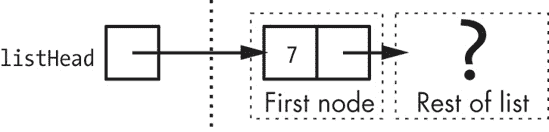

图 6-6. 使用递归的程序员在构思时应该这样设想：第一个节点，以及将剩余部分视为一个要传递给递归调用的模糊形状

一旦分工固定，我们就可以说，单链表的递归处理将按照以下通用计划进行。给定一个链表 `L` 和一个问题 `Q`：

1.  如果 `L` 是最小的，我们直接分配一个默认值。否则 . . .
2.  使用递归调用为“剩余”列表 `L`（从 `L` 的第二个节点开始的列表）产生 `Q` 的答案。
3.  检查 `L` 第一个节点中的值。
4.  利用前两个步骤的结果为整个 `L` 回答 `Q`。

如你所见，考虑到拆分链表的实际限制，这只是对 BRI 的直接应用。现在，让我们将此蓝图应用于具体问题。

### 问题：统计单链表中的负数

编写一个递归函数，其接收一个数据类型为整数的单链表。该函数返回列表中负数的个数。

我们想要回答的问题 `Q` 是：列表中共有多少个负数？因此，我们的计划可以表述为：

1.  如果列表没有节点，计数默认为 0。否则 . . .
2.  使用递归调用来统计“剩余”列表中共有多少个负数。
3.  查看列表第一个节点中的值是否为负数。
4.  利用前两个步骤的结果确定整个列表中共有多少个负数。

这里是直接遵循该计划的函数实现：

```
int countNegative(listPtr head) {
    if (head == NULL) return 0;
    int listCount = countNegative(head->next);
    if (head->data < 0) listCount++;
    return listCount;
}
```

注意这段代码如何遵循与之前示例相同的原则。它将“倒过来”计算负数，从列表末尾到开头。同样注意的是，代码采用了头递归技术；我们在处理第一个节点之前处理了“剩余”列表。和之前一样，这允许我们避免在递归调用中传递额外数据或使用全局变量。

还要注意，链表规则 1，“如果列表 `L` 是最小的”在这个问题的具体实现中被解释为“如果列表没有节点”。这是因为，说一个没有节点的列表有零个负值是有意义的。但在某些情况下，对于没有节点的列表，我们的问题 `Q` 并没有意义上的答案，此时最小情况是一个有一个节点的列表。假设我们的问题是：这个列表中最大的数是多少？对于一个没有值的列表来说，这个问题是无法回答的。如果你不明白，请想象你是一个小学老师，你的班恰好全是女生。如果你们学校的校长问你教室内有多少个男孩是男合唱团的成员，你可以简单地回答零，因为你没有男孩。如果校长要求你说出班里最高的男生，你无法对这个问题给出有意义的答案——你必须至少有一个男孩才能选出最高的男生。同样，如果关于数据集的问题需要至少一个值才能有意义地回答，那么最小的数据集就是单项。尽管如此，你可能仍然为“大小为零”的情况返回*某些内容*，仅仅是为了灵活性。

## 递归与二叉树

到目前为止我们探索的所有示例最多只需要一次递归调用。然而，更复杂的结构可能需要多次递归调用。为了体验一下它的工作原理，让我们考虑一种称为二叉树的结构，其中每个节点包含链接。这里是我们将使用的类型：

```
struct treeNode {
    int data;
    treeNode * left;
    treeNode * right;
};
typedef treeNode * treePtr;
```

由于树的每个节点指向两个其他节点，递归处理需要两次递归调用。我们将列表概念化为两个部分：第一个节点和其余部分。对于应用递归，我们将树概念化三个部分：顶部节点，称为*根节点*；从根左链接到达的所有节点，称为*左子树*；以及从根右链接到达的所有节点，称为*右子树*。这种概念化显示在图 6-7）中。

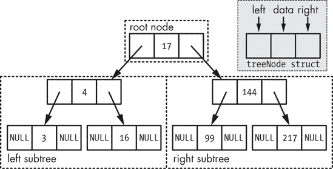

图 6-7. 被划分为根节点和左子树的二叉树

一如既往，在递归解决涉及二叉树的问题时，我们希望采用 BRI。我们将进行递归函数调用并假设它们返回正确的结果，而不担心递归过程如何解决整体问题。与链表一样，我们将处理二叉树的自然划分。这产生了以下通用计划。对于树 `T` 回答 `Q`：

1.  如果树 `T` 尺寸最小，直接分配一个默认值。否则 . . .
2.  进行递归调用为 `T` 的左子树回答 `Q`。

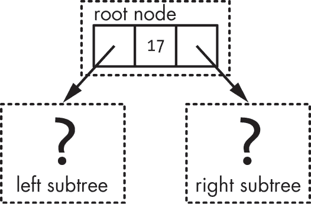

图 6-8. 使用递归的程序员在构思时应该这样设想：一个根节点，以及左右子树，其内容为未考虑状态，以防止程序崩溃


 标签中似乎不完整（以“3. ...”结尾，且没有包含后续的逻辑描述），我根据你提供的文本内容进行了翻译。

以下是针对你提供的文本片段的翻译：

[content]
3. 发起递归调用以回答 `T` 的右子树的问题 `Q`。
4. 检查 `T` 根节点的值。
5. 使用前三个步骤的结果来回答整个树 `T` 的问题 `Q`。

现在让我们把通用计划应用于一个具体问题。

## 问题：寻找二叉树中的最大值

编写一个函数，当给定一个每个节点存储整数的二叉树时，返回该树中最大的整数。

将通用计划应用于此特定问题，可以得到以下步骤：

1. 如果树的根节点没有子节点，则返回根节点的值。否则 . . .
2. 发起递归调用以找到左子树中的最大值。
3. 发起递归调用以找到右子树中的最大值。
4. 检查根节点的值。
5. 返回前三个步骤中值的最大者。

考虑到这些步骤，我们可以直接编写解决方案的代码：

```
int maxValue(treePtr root) {
  if (root == NULL) return 0;
  if (root->right == NULL && root->left == NULL)
        return root->data;
  int leftMax = maxValue(root->left);
  int rightMax = maxValue(root->right);
  int maxNum = root->data;
    if (leftMax > maxNum) maxNum = leftMax;
    if (rightMax > maxNum) maxNum = rightMax;
    return maxNum;
}
```

注意，此问题的最小树是一个单节点 （尽管为了安全起见涵盖了空树情况 和右子树中的最大值。然后，我们使用整本书一直在使用的“山大王”算法的变体来找到这三个值（根节点的值、左子树的最大值、右子树的最大值）中最大的。

## 包装函数

在本章之前的示例中，我们只讨论了递归函数本身。然而在某些情况下，递归函数需要由第二个函数来“设置”。最常见的情况是我们在类结构内部编写递归函数时。这会导致递归函数所需的参数与类公共方法所需的参数之间出现不匹配。由于类通常强制执行信息隐藏，类客户端代码可能无法访问递归函数所需的数据或类型。这个问题及其解决方案将在下一个示例中显示。

## 问题：寻找二叉树中的叶节点数量

对于一个实现二叉树的类，添加一个公共可访问的方法，返回树中叶节点（没有子节点的节点）的数量。节点的计数应该使用递归完成。

在我们尝试实现该问题的解决方案之前，让我们先勾勒出该类可能的样子。为了简单起见，我们只包含类的相关部分，忽略构造函数、析构函数，甚至忽略允许我们构建树的方法，以便专注于我们的递归方法。

```
class binaryTree {
    public:
      int countLeaves();
    private:
        struct binaryTreeNode {
            int data;
            binaryTreeNode * left;
            binaryTreeNode * right;
        };
        typedef treeNode * treePtr;
        treePtr _root;
};
```

注意，我们的叶节点计数函数没有接受参数。从接口的角度来看，这是完全正确的。考虑对之前构建的 `binaryTree` 对象 `bt` 的一次示例调用：

```
int numLeaves = bt.countLeaves();
```

毕竟，如果我们是在问树有多少个叶节点，我们还能向该对象提供什么它自己不知道的信息呢？这对于接口来说是正确的，但对于递归实现来说是完全错误的。如果没有参数，从一次递归调用到下一次调用会发生什么变化？在这种情况下，什么都不会改变，除非通过全局变量，但正如前面提到的，全局变量是应该避免的。如果没有变化，递归就无法进展或终止。

解决这个问题的方法是先编写递归函数，将其概念化为类外部函数。换句话说，我们将以编写寻找二叉树中最大值函数相同的风格，编写这个函数来计算二叉树中的叶节点。我们需要传递的唯一参数是指向我们节点结构的指针。

这给了我们另一个应用 BRI（递归基础）的机会。在这种情况下，问题 `Q` 是什么？它是树中有多少个叶节点？将处理树的通用计划应用于此特定问题，得到以下步骤：

1. 如果树的根节点没有子节点，那么树只有一个节点。根据定义该节点是叶节点，因此返回 1。否则 . . .
2. 发起递归调用以计算左子树中的叶节点数量。
3. 发起递归调用以计算右子树中的叶节点数量。
4. 在这种情况下，没有需要检查根节点，因为如果我们到了这一步，根节点就不可能是叶节点。所以 . . .
5. 返回步骤 2 和 3 之和。

将此计划翻译成代码结果如下：

```
struct binaryTreeNode {
    int data;
    treeNode * left;
    treeNode * right;
};
typedef binaryTreeNode * treePtr;
int countLeaves(treePtr rootPtr) {
    if (rootPtr == NULL) return 0;
  if (rootPtr->right == NULL && rootPtr->left == NULL)
        return 1;
  int leftCount = countLeaves(rootPtr->left);
  int rightCount = countLeaves(rootPtr->right);
  return leftCount + rightCount;
}
```


```cpp
class binaryTree {
      public:
          int publicCountLeaves();
      private:
          struct binaryTreeNode {
              int data;
              binaryTreeNode * left;
              binaryTreeNode * right;
          };
          typedef binaryTreeNode * treePtr;
          treePtr _root;
          int privateCountLeaves(treePtr rootPtr);
  };
 int binaryTree::privateCountLeaves(treePtr rootPtr) {
      if (rootPtr == NULL) return 0;
      if (rootPtr->right == NULL && rootPtr->left == NULL)
          return 1;
      int leftCount = privateCountLeaves(rootPtr->left);
      int rightCount = privateCountLeaves(rootPtr->right);
      return leftCount + rightCount;
  }
 int binaryTree::publicCountLeaves() {
     return privateCountLeaves(_root);
  }
```

尽管 C++ 允许这两个函数具有相同的名称，但为了清晰起见，我不同的名称来区分公共和私有的“计数叶子节点”函数。`privateCountLeaves` 中的代码  与我们之前的独立函数 `countLeaves` 完全相同。包装函数 `publicCountLeaves`  非常简单。它调用 `privateCountLeaves`，并传入私有数据成员 `root`，然后返回结果 。本质上，它为递归过程“启动了泵”。在类内部编写递归函数时，包装函数非常有用，但当函数所需的参数列表与调用者所需的参数列表不匹配时，任何时候都可以使用包装函数。

## 何时选择递归

新程序员经常疑惑为什么有人必须处理递归。他们可能已经学习过，任何程序都可以使用基本的控制结构构建，例如选择（`if` 语句）和迭代（`for` 和 `while` 循环）。如果递归比基本控制结构更难使用且没有必要，那么也许应该直接忽略递归。

对于这种观点有几种反驳意见。首先，递归式编程有助于程序员进行递归思维，而递归思维被应用于计算机科学的许多领域，如编译器设计。其次，某些语言之所以需要递归，是因为它们缺乏一些基本的控制结构。例如，纯正的 Lisp 语言在几乎每个非平凡函数都需要递归。

然而，问题仍然存在：如果一个程序员学习了足够的递归以“理解它”，并且在使用如 `C++`、`Java` 或 `Python` 这样功能齐全的语言，是否应该使用递归？递归在这些语言中有实际用途吗，还是仅仅是一种心理练习？

## 反对递归的理由

为了探讨这个问题，让我们列举一下递归的缺点。

### 概念复杂性
对于大多数问题，普通程序员使用递归来解决问题要困难得多。即使你理解了“大递归思想”，在大多数情况下，使用循环编写代码仍然更简单。

### 性能
函数调用会产生巨大的开销。递归涉及大量的函数调用，因此可能会很慢。

### 空间需求
递归不仅仅是使用许多函数调用；它还嵌套了它们。也就是说，你可能会得到一个等待其他调用完成的函数调用链。每个已经开始但尚未结束的函数调用都会在系统栈上占用额外的空间。

一眼看上去，这个特性列表构成了对递归“困难、缓慢且浪费空间”的强力指控。然而，这些论点并非普遍适用。因此，在递归和迭代之间做出选择的最基本规则是：*当这些论点不适用时选择递归*。

考虑我们计算二叉树叶子节点数量的函数。你如何在不使用递归的情况下解决这个问题？可能的，但你需要一个显式机制来维护节点的“面包屑路径”，即哪些节点的左节点已经访问但右子节点尚未访问。这些节点需要在某处被重新访问，以便我们能够移动到右侧。你可能将这些节点存储在动态结构中，例如 `stack`。作为对比，这里是使用 `C++` 标准模板库中的 `stack` 类的函数实现：

```
int binaryTree::stackBasedCountLeaves() {
    if (_root == NULL) return 0;
    int leafCount = 0;
  stack<binaryTreeNode *> nodes;
  nodes.push(_root);
    while (!nodes.empty()) {
        treePtr currentNode = nodes.top();
      nodes.pop();
        if (currentNode->left == NULL && currentNode->right == NULL)
            leafCount++;
        else {
            if (currentNode->right != NULL) nodes.push(currentNode->right);
            if (currentNode->left != NULL) nodes.push(currentNode->left);
        }
    }
    return leafCount;
}
```

这段代码遵循与原始代码相同的模式，但如果你以前从未用过 `stack` 类，就有必要进行一些注释。`stack` 类的工作方式类似于我们在 第 3 章 中讨论过的系统栈；你只能在顶部添加和删除项。请注意，我们可以使用任何没有固定大小的数据结构来执行叶子计数操作。例如，我们可以使用 `vector`，但使用 `stack` 最直接地反映了原始代码。当我们声明 `stack`  时，我们指定了要存储的项的类型。在这种情况下，我们存储的是指向 `binaryTreeNode` 结构的指针。`push` 方法  将一个项（在本例为指针）置在栈顶。`empty` 方法  告诉我们栈中是否还有项。`top` 方法  为我们提供栈顶项的拷贝，而 `pop` 方法  从栈中移除顶部项。这段代码使用了四种类方法。

该代码通过将第一个节点的指针放入栈中来解决问题，然后反复从栈中移除节点指针，检查它是否为叶子节点，如果是，则增加计数器，并将子节点（如果存在）放入栈中。因此，栈跟踪了我们已经发现但尚未处理的节点，就像递归版本中的递归链跟踪我们必须重新访问的节点一样。将此迭代版本与递归版本进行比较，我们发现在这种情况下，对递归的标准反对都不太成立。首先，这段代码比递归版本更长、更复杂，因此没有从概念复杂性的角度反对递归版本的理由。其次，看 `stackBasedCountLeaves` 调用了多少次函数——对于每次访问内部节点（即非叶子节点），该函数调用了四次函数：分别调用一次 `empty` 和 `top`，以及两次 `push`。递归版本对于每个内部节点只进行两次递归调用。（注意，我们可以通过在函数内部整合栈的逻辑来避免对栈对象的函数调用。然而，这将进一步增加函数的复杂性。）第三，虽然这个迭代版本没有使用额外的系统栈空间，但它显式地使用了一个私有栈。公平地说，这比递归调用的系统栈开销要少，但这仍然与我们遍历的二叉树的最大深度成比例的系统内存支出。


在这种情况下，由于递归的反对意见被减轻或降至最低，因此递归是解决该问题的良好选择。更通地说，如果一个问题可以通过迭代简单解决，那么迭代应该是你的首选。只有当迭代变得复杂时，才应该使用递归。这通常涉及到此处所示的“面包屑轨迹”机制的必要性。分支结构（如树和图）的遍历本质上是递归的。处理线性结构（如数组和链表）通常不需要递归，但也有例外。在解决问题时，首先尝试使用迭代并看看能走多远，这种做法永远不会出错的。作为最后一组示例，请考虑以下链表问题。

### 问题：按顺序显示链表

编写一个函数，接收一个单链表的头指针（`head`），该链表每个节点的数据类型为整数，并按照整数在链表中出现的顺序逐行显示（每行一个整数）。

## 问题：反序显示链表

编写一个函数，接收一个单链表的头指针（`head`），该链表每个节点的数据类型为整数，并按照整数在链表中出现的反序逐行显示（每行一个整数）。

由于这两个问题是互为镜像的，自然假设它们的实现也会是镜像的。对于递归实现来说，情况确实如此。使用之前提供的 `listNode` 和 `listPtr` 类型，以下是解决这两个问题的递归函数：

```
void displayListForwardsRecursion(listPtr head) {
    if (head != NULL) {
        cout << head->data << "\n";
        displayListForwardsRecursion(head->next);
    }
}
void displayListBackwardsRecursion(listPtr head) {
    if (head != NULL) {
        displayListBackwardsRecursion(head->next);
        cout << head->data << "\n";
    }
}
```

如你所示，这些函数中的代码除了 `if` 语句内部两个语句的顺序外是完全相同的。这造成了所有的区别。在第一情况下，我们在调用递归函数显示链表其余部分之前，先显示第一个节点的值。在第二种情况下，我们在显示第一个节点的值之前，先调用显示链表其余部分的函数。这导致了整体的倒序显示。

由于这两个函数同样简洁，人们可能会假设递归被正确地用于解决这两个问题，但事实并非如此。为了验证这一点，让我们看看这两个函数的迭代实现。

```
void displayListForwardsIterative(listPtr head) {
   for (listPtr current = head; current != NULL; current = current->next)
        cout << current->data << "\n";
}
void displayListBackwardsIterative(listPtr head) {
   stack<listPtr> nodes;
   for (listPtr current = head; current != NULL; current = current->next)
        nodes.push(current);
   while (!nodes.empty()) {
      nodePtr current = nodes.top();
      nodes.pop();
      cout << current->data << "\n";
    }
}
```

按顺序显示链表的函数仅仅是一个直接的遍历循环，就像我们在第 4 章 中见过的那些。然而，反序显示链表的函数要复杂得多。它面临与我们的二叉树问题相同的对“面包屑轨迹”的需求。根据定义，反序显示链表中的节点需要返回到之前的节点。在单链表中，无法仅使用链表本身来实现这一点，因此需要第二个结构。在这种情况下，我们需要另一个栈。在声明栈后，我们使用 `for` 循环将链表中的所有节点推入栈中。由于栈，每个元素都添加在之前的元素之上，链表的第一个元素会在栈底，而最后一个元素会在栈顶。我们进入一个 `while` 循环，直到栈为空，重复地获取栈顶节点指针，从栈中弹出，然后显示该节点的数据。这实现了反序显示链表数据的效果。

正如之前所示的迭代二叉树函数一样，也可以不使用栈来编写此函数（通过在函数内部构建一个反向列表）。

## 练习

一如既往，尝试本章介绍的思想至关重要！

1. 编写一个函数计算数组中正整数之和。首先，使用迭代解决问题。然后，使用本章所示的方法将迭代函数转换为递归函数。

2. 考虑一个表示二进制字符串的数组，其中每个元素的值为 0 或 1。编写一个 `bool` 函数来判断二进制字符串是否具有奇偶校验（1 的个数为奇数）。提示：记住递归函数将返回真（奇数）或假（偶数），而不是 1 的计数。首先使用迭代解决问题，然后使用递归解决。

3. 编写一个函数，接收一个整数数组和一个 `target` 数字，并返回该目标在数组中出现的次数。首先使用迭代解决问题，然后使用递归解决。

4. 自定义题目：找到一个你已经解决或对于你目前的技能水平来说非常简单的一维数组处理问题，并使用递归解决（或再次解决）该问题。

5. 使用链表代替数组再次完成练习 6-1。

6. 使用链表代替数组再次完成练习 6-2。

7. 使用链表代替数组再次完成练习 6-3。

8. 自定义题目：尝试发现一个用迭代很难解决、但可以使用递归直接解决的链表处理问题。

9. 编程中的某些词有多个常见含义。在第 4 章 中，我们学习了堆（heap），我们从那里获取使用 `new` 分配的内存。“堆”术语也描述一种二叉树，其中每个节点的值都大于其左或右子树中的任何值。编写一个递归函数来判断一个二叉树是否为堆。


10. `binary search tree`（二叉搜索树）是一种二叉树，其中每个节点的值都大于其左子树中的任何值，但小于其右子树中的任何值。编写一个递归函数来判断一个二叉树是否为二叉搜索树。

11. 写一个递归函数，传入二叉搜索树的根指针和一个要插入的新值，创建一个带有新值的节点，并将其放在正确的位置以维护二叉搜索树的结构。提示：考虑将根指针参数设置为引用参数。

12. 自行设计：考虑你可以对一组数值提出的基础统计学问题，例如平均值、中位数、众数等。尝试编写递归函数来计算一个整数二叉树的这些统计数据。有些函数比其他的更容易写。为什么？

# 第 7 章：通过代码复用解决问题


这一章与之前的章节非常不同。在之前的章节中，我强调了找到自己解决问题方法的重要性。归根结底，这本书的内容就是：为编程问题编写原始解决方案。尽管在之前的章节中，我们也讨论过你如何从以前写过的代码中不断学习，这就是为什么你应该保留所有编写的代码以备日后参考。在本章中，我们将更进一步，讨论如何使用其他程序员的代码和想法来解决我们的问题。

如果你还记得这本书是如何开始的，这个主题可能显得有些突兀。在开始时，我谈到了试图通过修改别人的代码来解决复杂问题是一个什么样的错误。这样做不仅成功率低，而且即使成功了，也无法为你提供任何学习经验。如果你一直只做这些，你永远无法真正成为一名程序员，在软件开发中的作用也是有限的。尽管如此，一旦任何编程问题达到可观的规模，要求程序员完全从零开始开发解决方案是不现实的。那是对程序员时间的低效利用，而且它过度依赖于程序员成为所有领域的专家。此外，它更有可能导致产生充满漏洞或难以维护的程序。

## 良好的复用与坏的复用

因此，我们必须区分良好的复用和坏的复用。良好的复用让我们写出更好的程序、速度更快；而坏的复用可能让我们暂时假充程序员，但最终会导致代码和程序员自身水平的下降。表 7-1 总结了这些差异。左列显示了良好复用的特性，右列显示了坏复用的特性。在考虑是否尝试复用代码时，问问自己你更有可能产生左列还是右列的特性。

表 7-1. 代码复用的良好与坏

| 良好的复用 | 坏的复用 |
| --- | --- |
| 遵循蓝图（设计） | 复制别人的工作 |
| 放大并扩展你的能力 | 伪造你的能力 |
| 帮助你学习 | 帮助你避免学习 |
| 短期和长期都能节省时间 | 短期可能节省时间但长期可能延长时间 |
| 产生一个可以运行的程序 | 可能产生一个根本无法运行的程序 |

注意的是，良好的复用和坏的复用之间的区别不在于你复用了什么代码或如何复用它，而在于你与所借用的代码和概念之间的关系。有一次，在文学课上写术论文时，我发现之前某门课程中学到的东西与我的论文主题相关，于是我把它写了。当我向教授提交论文草稿时，她告诉我需要对该信息进行引用。我感到很沮丧，问问教授在什么情况下我可以直接在论文中陈述我的知识而无需提供引用。她的回答是，当我成为某个领域的专家，以至于别人引用我时，我就不需要为脑子里的东西引用他人了。

在编程术语中，良好的复用发生在你阅读了某人对通用概念的描述后自己编写代码，或者当你利用了你本可以自己编写的代码。在本章中，我们将讨论如何掌握编码概念的所有权，以便确保你的复用是在帮助你成为一个更好的程序员，而不是一个更懒的程序员。

让我同时也注意一下表 7-1 中的最后一行。对坏复用的尝试往往会完全失败。这并不意外，因为这涉及到程序员使用他自己并不真正理解的代码。在某些情况下，借用的代码最初可以运行，但当程序员尝试修改或扩展借用的代码库时，由于缺乏深层理解，就失去了采取组织化方法的可能性。程序员只能诉诸于盲目尝试和试错，从而违反了我们第一条也是最重要的通用问题解决规则：始终要有计划。

## 组件基础回顾

现在我们已经知道了目标是哪种复用，让我们对代码复用的不同方式进行分类。在书中，我将使用 `component`（组件）一词来指代由一个程序员创建、可以被另一个程序员复用于帮助解决编程问题的任何东西。组件可以存在从抽象到具体的连续任何地方，从一个想法到完全实现的代码。如果我们把解决编程问题比作手工修理项目，那么我们学到的解决问题的技巧就像工具，而组件就像特殊零件。以下每个组件都是一种复用以前工作的不同方式。

## 代码块

`code block`（代码块）其意就是：从一个程序列表复制到另一个列表的代码块。通俗地说，我们称之为`复制粘贴作业`。这是组件使用的最低形式，通常是坏的复用，并伴随其产生的所有问题。当然，如果你复制的代码是你自己的，并没有什么真正的伤害，只是你可能考虑将现有代码封装为类库或其他结构，以便以更整洁、更易维护的方式进行复用。

## 算法

`algorithm`（算法）是一种编程食谱；它是实现目标的特定方法，并以自然语言或流程图等可视化的形式表示。例如，在第 3 章中，我们讨论了数组的 `sort` 操作以及实现这种排序的不同方法。一种数组排序方法是`insertion-sort algorithm`（插入排序算法），我展示了该算法的示例实现。需要注意的是，给出的代码是`insertion sort`的一种实现，但插入排序是算法本身——即排序数组的方法——而不是特定的代码。任何使用这种方法对数组排序的代码都是 `insertion sort`。


算法是一种高层的重用形式，通常能带来良好的重用属性。算法本质上只是思想，而你作为程序员，必须实现这些思想，这需要调用你的编程技能以及对算法本身的深刻理解。你经常使用的算法已经经过了充分的研究，在各种情况下都具有可预测的性能。以算法为蓝图，你可以对代码的正确性和性能充满信心。

然而，基于算法编写代码也有一些潜在的缺点。当你使用一种算法时，你是从概念层面开始的。因此，距离完成该程序部分的最终代码，你还有很长的路要走。算法确实节省了时间，因为解决问题的核心已经基本完成，但取决于算法及其在编程中的特定应用，算法的实现可能并非易事。

## 模式

在编程中，`pattern`（或`设计模式`）是特定编程技巧的模板。该概念与算法相关，但有其区别。算法类似于解决特定问题的“食谱”，而模式是用于特定编程场景的通用技术。模式解决的问题通常位于代码本身的结构之中。例如，在第 6 章中，我们讨论了链表类中递归函数提出的问题：递归函数需要一个指向列表第一个节点的“头”指针作为参数，但该数据需要保持为私有。解决方案是创建一个`wrapper`（包装器），即一个将一组参数适配另一组参数的函数。包装器技术就是设计模式。我们可以使用这种模式来解决类中的递归函数问题，但也可以用于其他地方。例如，假设我们有一个 `linkedList` 类，它允许在列表的任何点插入或删除项，但我们需要的是一个栈类——即只允许在末端进行插入和删除的列表。我们可以创建一个新类 `stack`，为典型的栈操作（如 `push` 和 `pop`）提供公共方法。这些方法只需调用 `linkedList` 对象的成员函数，而该对象正是我们 `stack` 类的一个私有数据成员。通过这种方式，我们可以在重用链表类功能的同时，提供栈类的接口。

与算法类似，模式是组件使用的高层形式，学习模式是构建你的编程工具箱的极佳方式。尽管如此，模式也存在算法的一些潜在问题。知道某个模式的存在并不等同于知道如何在你为编程解决方案选择的特定语言中实现该模式，而且模式往往难以正确实现或以最高性能实现。例如，有一种名为 `singleton`（单例）的模式，它允许该类只能创建一个一个对象。创建一个单例类是直接的，但要创建一个在实际需要之前不创建那个允许的实例对象的单例类可能会出乎意地困难，且最佳技术可能随语言而异。

## 抽象数据类型

正如我们在第 5 章中讨论过的，`abstract data type`（抽象数据类型）是根据其操作定义的类型，而不是根据这些操作如何实现的。我们在书中使用了几次的栈类型就是一个很好的例子。抽象数据类型与模式的相似之处在于，它们定义了操作的效果，但没有具体定义这些操作是如何实现的。然而，与算法一样，这些操作也有为人知的实现技术。例如，栈可以使用任何数量的底层数据结构（如链表或数组）来实现。不过，一旦我们决定使用特定的数据结构，实现决策有时已经做好了。假设我们使用链表实现栈，并且无法封装现有的链表，但我们必须编写自己的列表代码。由于栈是后进先出的结构，我们只在链表的末端插入和删除项是有意义的。此外，只在列表头部插入和删除是有意义的。理论上，你可以在末尾插入和删除，但这会导致每次插入或删除都要对整个列表进行低效的遍历。为了避免这些遍历，需要一个带有指向列表末尾节点独立指针的双链表。在列表开头插入和删除允许最简单、最高效的实现，因此链表实现的栈几乎都是以相同的方式实现的。

因此，尽管 `abstract data type` 中的 `abstract`（抽象）意味着该类型是概念性的且没有实现细节，但在实践中，当你选择在代码中实现抽象数据类型时，你不会从零开始研究实现。相反，你将拥有现有类型实现作为指南。

## 库

在编程中，`library`（库）是相关代码段的集合。库通常包含编译形式的代码，以及所需的源码声明。库可以包含独立函数、类、类型声明或任何可能出现在代码中的内容。在 C++ 中，最显而易见的的例子是标准库。我们在之前的章节中使用的 `strcmp` 函数来自旧的 C 库 `cstring`，容器类如 `vector` 来自 C++ 标准模板库，甚至我们在所有基于指针的代码中使用的 `NULL` 也并不是 C++ 语言本身的一部分，而是定义在库头文件 `stdlib.h` 中。由于许多核心功能都包含在库中，因此在现代编程中使用库是不可避免的。

通常情况下，使用库是良好的代码重用。代码被包含在库中是因为它提供了各种程序中通常需要的功能——库代码帮助程序员避免“重复造轮子”。然而，作为开发人员，当我们使用库代码时，必须努力从经验中学习，而不仅仅是走捷径。我们将在本章后面看到一个例子。

注意，虽然许多库是通用的，但另一些被设计为`应用程序接口 (API)`，为高层语言程序员提供底层平台的简化或更连贯的视图。例如，Java 语言包含一个名为 JDBC 的 API，它提供了允许程序以标准方式与关系数据库交互的类。另一个例子是 `DirectX`，它为微软 Windows 游戏程序员提供了丰富的音频和图形功能。在这两种情况下，库都提供了高层程序与底层硬件软件之间的连接——在 JDBC 的案例中是数据库引擎，在 DirectX 的案例中是图形和音频硬件。此外，在这两种情况下，代码重用不仅是好的，而且在实际上几乎是要求的。


组件是很有帮助的，以至于程序员会尽可能地使用它们。然而，为了使用组件来帮助解决问题，程序员必须知道它的存在。根据你定义它们的精细程度，可用的组件可能有数百个甚至数千个，而初级程序员只会接触到其中几个。因此，一个优秀的程序员必须不断向自己的工具箱中添加组件知识。这种知识积累通过两种不同的方式进行：程序员可能会专门花时间学习新组件并作为一项常规任务，或者程序员可能会搜索某个组件来解决特定问题。我们将第一种方法称为`探索性学习`（exploratory learning），将第二种方法称为`按需学习`（as-needed learning）。要作为一名程序员不断成长，你需要同时运用这两种方法。一旦你掌握了所选编程语言的语法，发现新组件就是提升自己水平的主要途径之一。

## 探索性学习

让我们从一个探索性学习示例开始。假设我们想更多了解设计模式。幸运的是，对于哪些设计模式最有用或最常用，大家有共识，因此我们可以从该主题的任何资源开始，并确定我们没有遗掉任何重要的内容。找到一个设计模式列表并进行学习就能让我们受益，但如果我们实现其中一些模式，将获得更深入的见解。

我们在典型的列表中发现的一种模式被称为`策略`（strategy）或`策略`（policy）。这种思想允许在运行时选择算法或算法的一部分。在最纯的形式——策略形式中，这种模式允许更改函数或方法的运行方式，但不会改变结果。例如，类中对数据进行排序或涉及数据排序的方法可能允许选择排序方法（例如，快速排序或插入排序）。在任何情况下，结果都是相同的——已排序的数据——但允许客户端选择排序方法可以带来性能优势。例如，客户端可以避免对重复率高的数据使用快速排序。在策略形式中，客户端的选择会影响结果。例如，假设一个类代表手牌牌。排序策略可以决定王牌是否被视为高牌（在今天牌之上）或低牌（小于 2）。

### 将学习付诸实践

读完那段话后，你现在知道策略/策略模式是什么了，但你还没有把它变成你自己的东西。这就像是在硬件五商店浏览工具与实际上购买并使用工具之间的区别。所以，让我们把这个设计模式从架上取下来并付诸使用。尝试新技术最快的方法是将它整合到你已经写的代码中。让我们创建一个可以使用此模式解决的问题，并建立在我们已经写好的代码之上。

### 问题：第一个学生

在某所学校里，每个班级都有一个指定的“第一个学生”，负责在老师必须离开教室时维持教室秩序。最初，这个头衔被授予成绩最高的学生，但现在有些老师认为第一个学生应该是资历最深的学生，即学号最小的学生，因为他们是按顺序分配的。另一部分老师认为“第一个学生”的传统是愚蠢的，并打算通过简单选择字母顺序点表中名字出现在最前面的学生来抗议。我们的任务是修改学生集合类（student collection），添加一个方法从集合中检索第一个学生，同时适应不同教师组的筛选标准。

如你所见，这个问题将采用该模式的策略形式。我们希望返回第一个学生的方法能根据所选标准返回不同的学生。为了在 C++ 中实现这一点，我们将使用函数指针。我们之前在第 3 章中通过`qsort` 函数简要见过过这一概念，该函数接受一个指向函数的指针，该函数用于比较要排序数组中的两个项目。我们在这里将做类似的事情：我们将一组比较函数，它们接受两个`studentRecord` 对象，并通过查看学生的成绩、学号或姓名来确定第一个学生是否比第二个学生“更好”。

为了开始，我们需要为我们的比较函数定义一个类型：

```cpp
typedef bool (* firstStudentPolicy)(studentRecord r1, studentRecord r2);
```

此声明创建了一个名为 `firstStudentPolicy` 的类型，它是一个指向函数的指针，该函数返回 `bool` 并接受两个 `studentRecord` 类型的参数。`* firstStudentPolicy` 周围的括号是必要的，以防止声明被解释为一个返回 `bool` 指针的函数。有了这个声明，我们可以创建三个策略函数：

```cpp
bool higherGrade(studentRecord r1, studentRecord r2) {
   return r1.grade() > r2.grade();
}
bool lowerStudentNumber(studentRecord r1, studentRecord r2) {
   return r1.studentID() < r2.studentID();
}
bool nameComesFirst(studentRecord r1, studentRecord r2) {
   return strcmp(r1.name().c_str(), r2.name().c_str()) < 0;
}
```

前两个函数非常简单：`higherGrade` 在第一个记录的成绩较高时返回 `true`，`lowerStudentNumber` 在第一个记录的学号较小时返回 `true`。第三个函数 `nameComesFirst` 质上相同，但它需要 `strcmp` 库函数，该函数期望两个“C 风格”字符串——即空终止的字符数组，而不是 `string` 对象。因此，我们必须在两个学生记录的 `name` 字符串上调用 `c_str()` 方法。`strcmp` 函数在第一个字符串按字母顺序排在第二个字符串之前返回负数，因此我们检查它是否小于零。现在我们准备好修改 `studentCollection` 类了：

```cpp
class studentCollection {
private:
   struct studentNode {
      studentRecord studentData;
      studentNode * next;
   };
public:
   studentCollection();
   ~studentCollection();
   studentCollection(const studentCollection &copy);
   studentCollection& operator=(const studentCollection &rhs);
   void addRecord(studentRecord newStudent);
   studentRecord recordWithNumber(int IDnum);
   void removeRecord(int IDnum);
   void setFirstStudentPolicy(firstStudentPolicy f);
   studentRecord firstStudent();
private:
 firstStudentPolicy _currentPolicy;
   typedef studentNode * studentList;
   studentList _listHead;
   void deleteList(studentList &listPtr);
   studentList copiedList(const studentList copy);
};
```

这是我们在第 5 章见过的类声明，增加了三个新成员：一个私有数据成员 `_currentPolicy`，用于存储指向我们策略函数的指针；一个更改此策略的 `setFirstStudentPolicy` 方法；以及 `firstStudent` 方法本身，它根据当前策略返回第一个学生。`setFirstStudentPolicy` 的代码很简单：

```cpp
void studentCollection::setFirstStudentPolicy(firstStudentPolicy f) {
   _currentPolicy = f;
}
```

我们还需要修改默认构造函数以初始化当前策略：


```cpp
studentCollection::studentCollection() {
   _listHead = NULL;
   _currentPolicy = NULL;
}
```

现在我们准备好编写 `firstStudent`：

```cpp
studentRecord studentCollection::firstStudent() {
 if (_listHead == NULL || _currentPolicy == NULL) {
      studentRecord dummyRecord(−1, −1, "");
      return dummyRecord;
   }
   studentNode * loopPtr = _listHead;
 studentRecord first = loopPtr->studentData;
 loopPtr = loopPtr->next;
   while (loopPtr != NULL) {
      if (_currentPolicy(loopPtr->studentData, first)) {
         first = loopPtr->studentData;
      }
    loopPtr = loopPtr->next;
   }
   return first;
}
```

该方法首先检查特殊情况。如果没有列表需要检查，或者没有现有的策略，我们返回一个虚拟记录。否则，我们将遍历列表以找到最符合当前策略的学生，并使用我们在整书中一直在使用的基础搜索技术。我们将列表开头的记录赋值给 `first`，让循环变量从列表中的第二个记录开始，并开始遍历。在遍历循环内部，调用当前策略函数会告诉我们根据当前标准，我们正在查看的学生是否比我们目前找到的最佳学生“更好”。当循环结束时，返回“第一个学生”。

### FirstStudent 解决方案分析

在使用策略/策略模式解决问题后，比起仅仅读过一次该技术而从未使用过，我们更有可能识别出可以采用该技术的情况。我们还可以分析我们的示例问题，以开始对该技术的价值形成自己的观点，即它在何时可以恰当使用，在何时可能是错误，或者至少是得不偿失（麻烦比价值大）。关于这种特定模式，你可能想到的一个想法是它削弱了封装和信息隐藏。例如，如果客户端代码提供策略函数，它就需要访问通常应保持在类内部的类型，在本例中，即 `studentRecord` 类型。（我们将在练习中考虑解决此问题的方法）。这意味着如果我们修改了该类型，客户端代码可能会崩溃，因此在将其应用到其他项目之前，我们必须权衡这种疑虑与该模式带来的收益。在之前的章节中，我们讨论了知道何时使用某种技术（或何时不使用）与知道如何使用它一样重要。通过检查你自己的代码，你对这个关键问题有了洞察。

为了进一步练习，你可以回顾你已完成的项目库，寻找可以使用此技术进行重构的代码。记住，许多“现实世界”编程涉及补充或修改现有代码库，因此对于此类修改是非常极的练习，同时还能培养你对特定组件的技能。此外，良好的代码复用的用处之一是我们可以从中学习，而这种实践使学习效率最大化。

## 按需学习

上一节描述了我们可能会说的“通过漫游学习”。虽然这种旅程对程序员来说是有价值的，但在其他时候我们必须朝着特定的目标移动。如果你正在处理某个特定问题，特别是当你面临任何截止日期时，并且怀疑某个组件对你有很大帮助，你将不想在编程世界中随机漫游并希望偶然遇到你需要的东西。相反，你希望尽可能地找到直接适用于你情况的一个或多个组件。这听起来非常棘手——当你不知道具体在寻找什么时，如何找到你需要的东西呢？考虑以下示例问题：

### 问题：高效遍历

一个编程项目将使用你的 `studentCollection` 类。客户端代码需要遍历集合中所有学生的能力。显然，为了维护信息隐藏，不能给客户端代码提供对列表的直接访问，但要求遍历是高效的。

因为描述中的关键词是 `efficient`（高效的），让我们精确定义它在这种情况下意味着什么。假设 `studentCollection` 类的某个特定对象有 100 个学生。如果我们对链表有直接访问，我们可以写一个循环遍历列表，循环 100 次。这是任何列表遍历能达最高效率。任何需要循环超过 100 次来确定结果的解决方案都是低效的。

如果没有效率的要求，我们可能会通过向类中添加一个简单的 `recordAt` 方法来解决问题，该方法将返回集合中特定位置的学生记录，并将第一个记录编号为 1：

```cpp
studentRecord studentCollection::recordAt(int position) {
   studentNode * loopPtr = _listHead;
   int i = 1;
 while (loopPtr != NULL && i < position) {
      i++;
      loopPtr = loopPtr->next;
   }
   if (loopPtr == NULL) {
    studentRecord dummyRecord(-1, −1, "");
      return dummyRecord;
   } else {
    return loopPtr->studentData;
   }
}
```

在这个方法中，我们使用循环遍历列表，直到我们到达所需的位置或到达列表末尾。在循环结束时，如果到达了列表末尾，我们创建一个并返回虚拟记录，或者返回指定位置的记录。问题是，我们仅仅为了找到一个学生记录而执行遍历。这不一定是完全遍历，因为我们会在到达所需位置时停止，但这仍然是一次遍历。假设客户端代码尝试计算平均分：

```cpp
int gradeTotal = 0;
for (int recNum = 1; recNum <= numRecords; recNum++) {
   studentRecord temp = sc.recordAt(recNum);
   gradeTotal += temp.grade();
}
double average = (double) gradeTotal / numRecords;
```

对于这段代码，假设 `sc` 是一个之前声明并填充的 `studentCollection`，`numRecords` 是存储记录数的 `int`。假设 `numRecords` 为 100。如果你只是扫一眼这段代码，可能看起来计算平均分只需要循环 100 次，但由于每次调用 `recordAt` 本身都是一次部分列表遍历，这段代码涉及 100 次遍历，每次遍历大约涉及 50 次。因此，比起高效的 100 步，这种方法可能需要 5000 步，这是非常低效的。

### 何时搜索组件

我们现在遇到了真正的问题。为客户端提供集合成员的访问权限很容易，但提供这种访问并不容易。我们当然可以尝试只用自己的解决问题能力来解决这个问题，但如果能使用组件，我们将更快地找到解决方案。发现可以辅助解决方案的未知组件的第一步是假设这种组件确实存在。换句话说，如果你不开始搜索，你就找不到组件。因此，为了最大化组件的收益，你需要留意它们可以提供帮助的情况。当你发现自己在问题的某个方面遇到瓶颈时，尝试以下操作：

1. 泛化地表述问题。
2. 问自己：这是否是一个常见问题？


第一步至关重要，因为如果我们将问题描述为“允许客户端代码高效地计算封装在类中的记录链表中的平均学生分分”，这听起来像是针对我们特定情况的。然而，如果我们将问题表述为“允许客户端代码在不提供对列表指针直接访问的情况下，高效地遍历链表”，那么我们开始理解这可能是一个通用问题。当然，我们可能会经常问自己：既然程序经常在类中存储链表和其他顺序访问结构，那么其他程序员一定已经找到了允许高效访问结构中每个条目的方法的方法吧？

### 寻找组件

既然我们已经同意开始寻找，现在是时候找到我们的组件了。为了让情况变得清晰，让我们把原始的编程问题重新表述为一个研究性问题：“找到一个我们可以使用的组件来修改我们的 `studentCollection` 类，以便允许客户端代码高效地遍历内部列表。”我们该如何解决*这个*问题呢？我们可以从查看任何一种组件类型开始：模式、算法、抽象数据类型或库。

假设我们从查看标准 C++ 库开始。我们并不一定是在寻找一个可以“插入”到我们的解决方案中的类，相反，我们可以挖掘一个与我们的 `studentCollection` 类相似的库类来获取灵感。这利用了我们解决编程问题时使用的类比策略。如果我们发现一个具有类似问题的类，就可以借用它类似的解决方案。我们之前对 C++ 库的接触使我们熟悉了它的容器类，例如 `vector`，我们应该寻找与我们的学生集合类最相似的容器类。如果我们查阅常用的 C++ 参考资料（无论是书籍还是网站）并审查 C++ 容器类，我们会发现有一个名为 `list` 的“序列容器”符合要求。`list` 类允许客户端代码进行高效遍历吗？是可以的，它使用了一个被称为名为 `iterator`（迭代器）的对象。我们看到 `list` 类提供了 `begin` 和 `end` 方法来产生迭代器，迭代器是能够引用列表中特定条目的对象，并且可以通过递增使迭代器引用列表中的下一个对象。如果 `integerList` 是一个填充了整数的 `list<int>`，且 `iter` 是一个 `list<int>::iterator`，那么我们可以通过以下代码显示列表中的所有整数：

```
iter = intList.begin();
while (iter != intList.end()) {
   cout << *iter << "\n";
   iter++;
}
```

通过使用 `iterator`，`list` 类解决了为客户端提供高效遍历列表机制的问题。在此时，我们可能会考虑将 `list` 类本身直接放入我们的 `studentCollection` 类中，替换掉我们自己构建的链表。我们可以为我们的类创建 `begin` 和 `end` 方法，这些方法将封装嵌入列表对象的相同方法，问题就解决了。然而，这直接触及了良好重用与坏重用之间的问题。一旦我们完全理解了迭代器概念并能够在自己的代码中复现它，那么将标准模板库（STL）中的现有类插入到我们的代码中将是一个很好的选择——也许是最好的选择。如果我们无法做到这一点，使用 `list` 类就会变成一种无法帮助我们作为程序员成长的捷径。当然，有时我们必须利用那些我们无法复现的组件，但如果我们养成了依赖其他程序员来解决我们问题的习惯，我们就面临着永远无法成为 way 问题解决者的风险。

所以，让我们自己实现迭代器吧。在此之前，让我们简要查看其他我们可能达到相同终点的方法。我们从标准模板库开始搜索，但也可以从其他地方开始。例如，我们可以搜索常见的设计模式列表。在“行为模式”标题下，我们会找到 `iterator` 模式，在该模式中，允许客户端对项目集合进行顺序访问，而不暴露集合的底层结构。这正是我们需要的，但我们只有通过搜索模式列表或从之前对模式的调查中记住它才能找到它。我们可以从抽象数据类型开始搜索，因为泛而言之，`list` 尤其是 `linked list`（链表）都是常见的抽象数据类型。然而，关于 `list` 抽象数据类型的许多讨论和实现并没有将客户端列表遍历视为基本操作，因此迭代器概念从未出现。最后，如果我们从算法领域开始搜索，可能无法发现任何有帮助帮助。算法倾向于描述复杂的代码，而创建迭代器的代码相当简单，正如我们很快看到的那样。在这种情况下，类库是通往目的地的最快路线，其次是模式。但作为一个一般原则，在寻找有帮助的组件时，你必须考虑所有的组件类型。

### 应用组件

现在我们知道要为 `studentCollection` 类创建一个迭代器，但 `list` 标准库类向我们展示的仅仅是迭代器方法在外部是如何工作的。如果在实现上卡住了，我们可能会考虑查看 `list` 及其祖类的源代码，但考虑到阅读大量大量不熟悉代码的困难，那是最后的不得已的手段。相反，让我们通过思考来推演这个问题。以之前的代码示例为指导，我们可以说迭代器由四个核心操作定义：

1.  集合类中的一个方法，提供一个引用集合中第一个条目的迭代器。在 `list` 类中，这是 `begin`。

2.  一种用于测试迭代器是否已超过集合中最后一个条目的机制。在上一个例子中，这是 `list` 类中名为 `end` 的方法，它产生一个迭代器对象进行对比。

3.  迭代器类中的一个方法，移动迭代器使其引用集合中的下一个项目。在上一个例子中，这是重载的 `++` 运算符。

4.  迭代器类中的一个方法，返回当前引用的集合项。在上一个例子中，这是重载的 `*` 前缀运算符。

在编写代码方面，这里看起来并不困难。这只是将所有内容放在正确位置的问题。所以让我们开始吧。根据上面的描述，我们的迭代器（我们将命名为 `scIterator`）需要存储 `studentCollection` 中某项的引用，并且能够移动到下一个项目。因此，我们的迭代器应该存储指向 `studentNode` 的指针。这将允许它返回包含的 `studentRecord`，以及移动到下一个 `studentNode`。因此，迭代器类的私有部分将拥有此数据成员：

```
studentCollection::studentNode * current;
```

立即我们就遇到了问题。`studentNode` 类型定义在 `studentCollection` 的私有部分，因此上述行不起作用。我们的第一个想法是也许 `studentNode` 不应该声明为私有，但这不是正确的答案。节点类型本质上是私有的，因为我们不希望随机客户端代码依赖于节点的特定实现，从而在我们修改类时创建破坏的代码。然而，我们需要允许 `scIterator` 访问我们的私有类型。我们通过 `friend` 声明来实现。在 `studentCollection` 的公共部分，我们添加：

```
friend class scIterator;
```

现在 `scIterator` 可以访问 `studentCollection` 中的私有声明，包括 `studentNode` 的声明。我们还可以声明一些构造函数：


```
scIterator::scIterator() {
   current = NULL;
}
scIterator::scIterator(studentCollection::studentNode * initial) {
   current = initial;
}
```

让我们暂时回到 `studentCollection` 并编写我们的 `begin` 方法——该方法返回一个引用我们集合中第一个项的迭代器。遵循我在本书中使用的命名规范，该方法应该使用名词作为名称，例如 `firstItemIterator`：

```
scIterator studentCollection::firstItemIterator() {
   return scIterator(_listHead);
}
```

如你所见，我们在这里做的只是将链表的头指针封装进一个 `scIterator` 对象并返回它。如果你像我一样，看到这里到处飞舞的指针可能会感到有些紧张，但请注意，`scIterator` 只是持有 `studentCollection` 列表中某个项的引用。它不会分配任何自己的内存，因此我们不需要担心深拷贝和重载的赋值运算符。

让我们回到 `scIterator` 并编写其他方法。我们需要一个方法来让迭代器移动到下一个项，还需要一个方法来判断我们是否已经过了集合的末尾。我们应该同时考虑这两点。在推进迭代器时，我们需要知道迭代器在越过列表最后一个节点时应该具有什么值。如果我们不做任何特殊处理，迭代器自然会获得 `NULL` 的值，因此这将是最容易使用的值。请注意，我们已经在默认构造函数将迭代器初始化为 `NULL`，所以当我们使用 `NULL` 来表示“过末尾”时，我们就丢失了这两种状态之间的区别，但对于当前的问题这并不是一个问题。方法的代码如下：

```cpp
 void scIterator::advance() {
   if (current != NULL)
       current = current->next;
  }
   bool scIterator::pastEnd() {
     return current == NULL;
  }
```

记住，我们只是在用迭代器概念来解决原始问题。我们并没有试图复制 C++ 标准模板库（STL）迭代器的精确规范，因此我们不需要使用相同的接口。在这种情况下，我没有重载 `++` 运算符，而是使用了一个名为 `advance` 的方法，它在将指针移动到下一个节点之前会检查 `current` 指针是否为 `NULL`。同样，我发现创建一个特殊的“结束”迭代器来比较非常繁琐，所以我只写了一个名为 `pastEnd` 的 `bool` 方法来判断我们是否已经用完了节点。

最后，我们需要一种方法获取当前引用的 `studentRecord` 对象：

```cpp
studentRecord scIterator::student() {
 if (current == NULL) {
      studentRecord dummyRecord(−1, −1, "");
      return dummyRecord;
 } else {
      return current->studentData;
   }
}
```

正如之前之前的那样，为了安全，如果指针为 `NULL`，我们会创建并返回一个虚拟记录。否则，我们返回当前引用的记录。这就完成了 `studentCollection` 类中迭代器概念的实现。为了清晰起见，这里是 `scIterator` 类的完整声明：

```cpp
class scIterator {
public:
   scIterator();
   scIterator(studentCollection::studentNode * initial);
   void advance();
   bool pastEnd();
   studentRecord student();
private:
   studentCollection::studentNode * current;
};
```

代码到位后，我们可以通过示例遍历来测试代码。让我们来实现那个平均分计算以作比较：

```cpp
scIterator iter;
  int gradeTotal = 0;
  int numRecords = 0;
 iter = sc.firstItemIterator();
 while (!iter.pastEnd()) {
     numRecords++;
   gradeTotal += iter.student().grade();
   iter.advance();
  }
  double average = (double) gradeTotal / numRecords;
```

此列表使用了我们所有与迭代器相关的方法，所以它是对代码的良好测试。我们调用 `firstItemIterator` 来初始化 `scIterator` 对象。我们调用 `pastEnd` 作为循环终止测试。我们调用迭代器对象的 `student` 方法来获取当前的 `studentRecord`，以便提取成绩。最后，为了将迭代器移动到下条记录，我们调用 `advance` 方法。当这段代码正常工作时，我们可以有合理的理由认为我们正确地实现了各种方法，不仅如此，我们对迭代器概念有了坚定的理解。

### 高效遍历解决方案的分析

和以前一样，代码运行成功并不意味着从这次事件中学习的机会结束了。我们应该仔细考虑我们所做的一切、它的正面影响和负面影响，并思考我们刚刚实现的基本想法的扩展。在这种情况下，我们可以说，迭代器概念确实解决了客户端低效遍历我们集合的原始问题，一旦实现，迭代器的使用是优雅且具有高度可读性的。缺点是，不可否认，基于 `recordAt` 方法的低效方法编写容易得多。在决定迭代器的实现对于特定情况是否有价值时，我们必须问自己：遍历发生的频率有多高，列表中通常会有多少项，等等。如果遍历不频繁且列表很小，那么低效可能并不重要，但如果我们预计列表会变大，或者无法保证它不会变大，可能就需要迭代器了。


进一步思考，我们可以考虑迭代器更广泛的应用及其可能的局限性。例如，假设我们需要一个迭代器，它不仅能高效地移动到 `studentCollection` 中的下一个项，还能移动到上一个项。现在我们已经了解了迭代器的工作原理，可以发现在我们目前的 `studentCollection` 实现中，实际上无法实现这一点。如果迭代器维护着指向列表中特定节点的链接，那么移动到下一个节点只需遵循节点中的链接即可。然而，回退到上一个节点则需要再次遍历列表到该点。相反，我们需要一个双向链表，其中节点同时拥有指向下一个节点和上一个节点的指针。我们可以将这种想法泛化，开始考虑不同的数据结构，以及它们能为客户端高效地提供什么类型的遍历或数据访问。例如，在上一章关于递归的章节中，我们简要遇到过二叉树结构。是否有某种方法允许客户端以标准形式对这种结构进行高效遍历？如果如果没有，我们必须如何修改它以允许高效的反向遍历？二叉树中节点被遍历的正确顺序又是什么？思考这些问题有助于我们成为更好的程序员。这不仅能让我们学会新技能，还能让我们更多地了解不同组件的优缺点。了解一个组件的优缺点将允许我们明智地使用它。未能考虑特定方法的局限性可能会导致死胡同，我们对所使用的组件越了解，这种情况发生的概率就越小。

## 选择组件类型

正如我们在这些示例中看到的，同一个问题可以使用不同类型的组件来解决。模式可能表达解决方案的理念，算法可能概述该想法的实现或另一个解决相同问题的想法的实现，抽象数据类型可能封装该概念，而库中的类可能包含该抽象数据类型经过充分测试的实现。如果这些每一种都是我们解决问题所需的相同概念的表达，我们如何知道从工具箱中提取哪种组件类型呢？

一个首要考虑因素是将组件集成到我们的解决方案中可能需要多少工作。将类库链接到我们的代码中通常是解决问题的快速方法，而从伪代码描述实现一个算法可能花费大量时间。另一个重要的考虑因素是所提组件提供了多少灵活性。通常，组件会以一种良好的预包装形式出现，但在将其集成到项目时，程序员会发现，虽然组件完成了他们大部分需要的工作，但并没有完成所有。例如，可能某个方法的返回值格式错误，需要额外的处理。如果仍然使用该组件，在以后可能会发现更多问题，直到最终该组件被完全丢弃，并为问题的该部分从头开发新代码。如果程序员选择了一个更高概念层面的组件（例如模式），那么生成的代码实现将完美匹配问题，因为它是专门为该问题创建的。

图 7-1

图 7-1. 组件类型的灵活性与所需工作

你使用组件的经验越丰富，就越有信心自己是从正确的地方开始的。在积累这种经验之前，可以使用灵活性与所需工作之间的权衡作为粗略指南。对于每种情况，问自己以下问题：

* 我可以直接原样使用该组件吗，还是它需要额外的代码来将其固定到我的项目中？
* 我是否有把握理解问题的全部范围，或者与此组件相关的部分，并且它在未来不会发生变化？
* 选择这个组件会增加我的编程知识吗？

你对这些问题的回答将帮助你估计将涉及多少工作，以及从每种可能的方法中获得多少收益。

## 中的组件选择

现在我们已经理解了通用概念，让我们运行一个快速示例来演示细节。

### 问题：排序部分项，保持其他项不变

项目要求你按成绩对 `studentRecord` 对象的数组进行排序，但有一个陷阱。程序的另一部分使用特殊的成绩值 −1 来表示记录无法移动的学生。因此，虽然所有其他记录都必须移动，但成绩为 −1 的记录应保持在原处，导致数组除 −1 成绩外在范围内都是排序的。

这是一个棘手的问题，我们有很多方法可以尝试解决它。为了简单起见，让我们选择减少到两个：要么我们选择一种算法——即像插入排序这样的例程——并修改它以忽略成绩为 −1 的 `studentRecord` 对象，要么我们想出一个方法使用 `qsort` 库函数来解决这个问题。这两个选项都是可能的。由于我们熟悉插入排序代码，加入一些 `if` 语句来显式检查并跳过 −1 记录应该并不困难。让 `qsort` 为我们工作需要一些变通方法。我们可以将真实成绩的学生记录复制到单独数组中，使用 `qsort` 对其进行排序，然后复制回来，确保不复制任何 − 成绩记录。

让我们遵循这两个选项操作，看看组件类型的选择如何影响生成的代码。我们将从算法组件开始，编写我们修改后的插入排序来解决问题。像往常一样，分阶段处理这个问题。首先，让我们通过移除整个 −1 成绩问题来简化问题，只需对没有特殊规则的 `studentRecord` 对象数组进行排序。如果 `sra` 是包含 `arraysize` 个 `studentRecord`对象的数组，生成的代码如下：

```
int start = 0;
int end = arraySize - 1;
for (int i = start + 1; i <= end; i++) {
   for (int j = i; j > start && sra[j-1].grade() > sra[j].grade(); j--) {
    studentRecord temp = sra[j-1];
      sra[j-1] = sra[j];
      sra[j] = temp;
   }
}
```


这段代码与整数的插入排序非常相似。唯一的区别在于比较需要调用 `grade` 方法 ，而且我们用于交换空间的临时对象类型也发生了变化 。这段代码可以正常工作，但在测试此代码以及本节随后的其他代码块时，有一点需要注意：我们的 `studentRecord` 类会验证数据，正如之前所描述的，它不接受 −1 分数，因此请确保你已经进行了必要的修改。现在，我们准备好完成这个版本的解决方案了。我们需要让插入排序忽略分数为 −1 的记录。这并不听起来那么简单。在基础的插入排序算法中，我们总是会在数组中交换相邻的两个位置，即上述代码中的 `j` 和 `j - 1`。然而，如果我们让分数为 −1 的记录留在原处，那么下一个要交换的记录的位置之间的距离可能是任意的。

图 7-2 通过一个示例说明了这个问题。如果这显示的是数组的原始配置，那么箭头指示第一批要交换记录的位置，它们并不是相邻的。此外，最后一条记录（对于 Art）最终必须从位置 `[5]` 交换到 `[3]`，然后从 `[3]` 交换到 `[0]`，因此排序此数组（只要我们对其进行排序的话）所需的所有交换都涉及非相邻的记录。

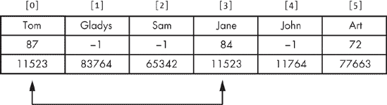

图 7-2. 修改后的插入排序中待交换记录之间的任意距离

在考虑如何解决这个问题时，我寻找了一个类比，并在链表处理中找到了。在许多链表算法中，我们不仅需要维护指向列表遍历中当前节点的指针，还需要维护指向上一个节点的指针。因此在循环体的结束处，我们通常会在移动当前指针之前将当前指针赋值给上一个指针。这里也需要类似的操作。我们需要在线性遍历数组以寻找下一个“真实”记录时，跟踪上一个“真实”学生记录。将这个想法付诸实践得到了下面的代码：

```
for (int i = start + 1; i <= end; i++) {
 if (sra[i].grade() != −1) {
    int rightswap = i;
      for (int leftswap = i - 1;
         leftswap >= start
         && (sra[leftswap].grade() > sra[rightswap].grade()
          || sra[leftswap].grade() == −1);
         leftswap--)
      {
       if(sra[leftswap].grade() != −1) {
            studentRecord temp = sra[leftswap];
            sra[leftswap] = sra[rightswap];
            sra[rightswap] = temp;
          rightswap = leftswap;
         }
      }
   }
}
```

在基础插入排序算法中，我们反复将未排序的项目插入到数组中不断增长的排序区域。外层循环选择下一个要按顺序放置的未排序项目。在这个版本的代码中，我们首先检查位置 `i` 处的分数是否为 −1 。如果是，我们将直接跳到下一个记录，将该记录留在原处。一旦我们确定位置 `i` 处的学生记录可以移动，我们将 `rightswap` 初始化为该位置 。然后开始内层循环。在基础插入排序算法中，内层循环的每次迭代都会将项目与其邻项交换。但在我们的版本中，由于我们将分数为 −1 的记录留在原处，只有当位置 `j` 不包含分数 −1 时我们才执行交换 。然后我们在位置 `leftswap` 和 `rightswap` 之间进行交换，并将 `leftswap` 赋值给 `rightswap` ，为内层循环中的下一次交换做好准备。最后，我们必须修改内层循环条件。通常，插入排序中的内层循环在到达数组开头或找到小于要插入值的值时停止。在这里，我们必须使用逻辑 *或* 创建一个复合条件，以便循环能够跳过 −1 分数  {
   studentRecord * recordA = (studentRecord *) voidA;
   studentRecord * recordB = (studentRecord *) voidB;
   return recordA->grade() - recordB->grade();
}
```

现在我们准备好对记录进行排序。我们将分三个阶段完成：首先，我们将所有不是 −1 分数的记录复制到一个辅助数组，留出空格。然后，我们将调用 `qsort` 排序辅助数组。最后，我们将从辅助数组复制回原始数组，跳过分数为 −1 的记录。结果代码如下：

```
 studentRecord sortArray[arraySize];
 int sortArrayCount = 0;
  for (int i = 0; i < arraySize; i++) {
   if (sra[i].grade() != −1) {
        sortArray[sortArrayCount] = sra[i];
        sortArrayCount++;
     }
  }
```

尽管这段代码与另一种解决方案长度相当，但它更直观且易于阅读。我们首先声明辅助数组 `sortArray` ，其大小与原始数组相同。变量 `sortArrayCount` 初始化为 0 ；第一个循环中，我们将它来跟踪复制到辅助数组中的记录数量。在循环内部，每当我们遇到一个没有 −1 分数的记录 ，我们就将其赋值给 `sortArray` 的下一个可用槽并增加 `sortArrayCount`。当循环结束，我们对辅助数组 。变量 `sortArrayCount` 重置为 0 ；我们在第二个循环中用它来跟踪从辅助数组复制回原始数组的记录数量。注意，第二个循环遍历的是*原始*数组 ，寻找需要填充的槽 。


两种解决方案都是可行的，也是合理的方法。对于大多数程序员来说，第一种方案（即我们修改插入排序，以便在周围排序时保留某些记录）编写起来更困难，阅读起来更困难。然而，第二种方案似乎引入了一些低效性，因为它需要将数据拷贝到辅助数组再复制回来。这时，算法分析知识就派上用场了。假设我们正在排序 10,000 条记录——如果我们要排序的数量少得多，我们其实并不在乎效率。我们无法确定 `qsort` 调用底层的算法是什么，但通用排序算法的最坏情况可能需要 1 亿次记录交换，而最好情况大约是 13 万次。无论我们最终落在范围内的哪个位置，同与排序本身相比，往回拷贝 10,000 条记录并不会造成主要的性能损耗。此外，我们还必须考虑，`qsort` 采用的任何算法都可能比我们简单的插入排序更高效，从而抵消我们因避免在辅助数组之间拷贝数据而可能获得的任何收益。

因此，在这种情况下，使用 `qsort` 的第二种方法似乎是赢者。它实现更简单，阅读更简单，因此更容易维护，而且我们可以预期其性能与第一种方案相当，甚至可能更好。对于第一种方法，我们能说的最好的话就是我们可能学会了可以应用于其他问题的技能，而第二种方法由于其简单性，并没有提供这样的见解。作为一条一般规则，当你处于试图最大化学习效果的编程阶段时，你应该倾向于使用高级别的组件，例如算法和模式。当你处于试图最大化作为程序员效率的阶段（或面临紧迫的截止日期）时，你应该倾向于低级组件，并尽可能选择预构建的代码。当然，如果时间允许，像我们在这里做的那样尝试几种不同的方法是兼顾一切最好的。

## 练习

尝试尽可能可能的组件。一旦你掌握了如何学习新组件，你作为程序员的能力就会开始快速增长。

1. 对 `policy/strategy` 模式的一种批评是，它需要暴露类的某些内部实现（例如类型）。修改本章较早时候的“第一个学生”程序，使策略函数都存储在类内部，并通过通过传递代码值（例如，一种新的枚举类型）来选择，而不是传递策略函数本身。

2. 重写我们来自第 4 章 的 `studentCollection` 函数（`addRecord` 和 `averageRecord`），不再直接实现链表，而是使用 C++ 库中的类。

3. 考虑 `studentRecord` 对象的集合。我们希望根据学号快速查找特定记录。将学生记录存储在数组中，按学号对数组排序，研究并实现插值查找（interpolation search）算法。

4. 针对 7-3 中的问题，通过实现一个抽象数据类型来实现，允许存储任意数量的项目并根据键值检索单个记录。根据键值高效存储和检索项目的结构的通用术语是符号表（symbol table），符号表概念的常见实现有哈希表（hash tables）和二叉搜索树（binary search trees）。

5. 针对 7-3 中的问题，使用 C++ 库中的类实现解决方案。

6. 假设你正在参与一个项目，特定的 `studentRecord` 可能需要增加以下数据之一：期末论文标题、入学年份或指示学生是否在旁听课程的 `bool`。你不想在基础 `studentRecord` 类中包含所有这些数据字段，因为你知道在大多数情况下它们不会被使用。你的第一个想法是创建三个子类，每个类拥有一个数据字段，命名为 `studentRecordTitle`、`studentRecordYear` 和 `studentRecordAudit`。然后你被告知某些学生记录将包含这些额外数据字段中的两个，或者全部三个。为每种可能的变创建子类是不现实的。找到一种解决这种困境的设计模式，并实现解决方案。

7. 开发 7-6 中描述问题的解决方案，但不要使用你发现的模式，而是使用 C++ 库类来解决问题。与其关注上一个问题描述的三个特定数据字段，不如尝试创建一个通用的解决方案：一个 `studentRecord` 类版本，允许向特定对象添加任意的额外数据字段。例如，如果 `sr1` 是一个 `studentRecord`，你可能希望客户端代码调用 `sr1.addExtraField("Title", "无条件分支的问题")`，然后稍后 `sr1.retrieveField("Title")` 将返回“无条件分支的问题”。

8. 设计你自己的：取一个你已经解决的问题，并使用不同的组件再次解决它。记得分析结果与你原始解决方案的对比。

# 第 8 章 像程序员一样思考


是时候把我们在之前章节中体验的所有内容整合起来，完成从新手编码员到解决问题的程序员的旅程了。在之前的章节中，我们解决了各个领域的问题。我相信这些领域对于发展中程序员的掌握最有益，但当然，总有更多要学习的东西，许多问题需要书中未涵盖的技能。因此，在本章中，我们将循环回到通用的问题解决概念，利用所学知识来开发一个应对任何问题的“主计划”（master plan）。我们还将查看作为程序员增加知识和技能的许多方法。

## 创建你自己的主计划

在第一章，我们学到的解决问题的第一条规则是你应该始终有一个计划。更准确的表述应该是，你应该始终遵循`你的`计划。你应该构建一个能够最大化你的优势并最小化你的劣势的主计划，并将此计划应用于你必须解决的每个问题。


那么，制定你自己的大师计划的关键步骤就是识别你的优势和劣势。这并不困难，但它需要付出努力和相当程度的诚实自我评估。为了从错误中获益，你不仅要在出现错误的程序中纠正它们，还必须记录下它们，至少在脑子里记住，或者最好记录在文档中。通过这种方式，你可以识别出那些原本会遗漏的行为模式。

我将把弱势分为两个类别进行描述：编码和设计。`编码弱势`是指你在实际编写代码时倾向于重复犯错的领域。例如，许多程序员经常写出多循环一次或少循环一次的循环。这被称为 `fencepost error`（栅栏柱错误），源于一个老谜题：要建造一个长 50 英尺围栏，每根柱子之间的横梁长 10 英尺，需要多少根柱子？大多数人的第一反应是五个，但如果你仔细考虑，答案是六个，正如图 8-1 所示。

大多数编码弱势是程序员由于编码太快或准备不足而产生语义错误的情况。相比之下，`设计弱势`是你在解决问题或设计阶段经常遇到的问题。例如，你可能会发现自己很难开始，或者很难将之前编写的子程序集成到完整的解决方案中。

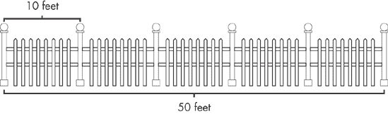

图 8-1.栅栏柱谜题

尽管这两个类别之间存在重叠，但这两类弱势往往产生不同类型的问题，必须以不同的方式来防御。

### 针对编码弱势制定计划

编程中最可能令人沮丧的活动莫过于花费几个小时追踪一个语义错误，而这个错误在发现后其实修复非常简单。因为没有人是完美的，所以没有办法完全消除这些情况，但一个优秀的程序员会竭尽所力避免反复犯同样的错误。

我认识一个程序员，他已经厌倦了 C++ 编程中一种最常见的语义错误：用赋值运算符（`=`）代替相等运算符（`==`）。因为 C++ 中的条件表达式是整数，而不是严格的布尔值，像下面这样的语句在语法上是合法的：

```
if (number = 1) flag = true;
```

在这种情况下，整数值 1 被赋值给 `number`，然后值 1 被用条件语句的结果，C++ 将其评估为 `true`。当然，程序员原本想做的是：

```
if (number == 1) flag = true;
```

由于反复犯这种类型的错误而感到沮丧，该程序员自学了总是反过来写相等性测试，即将数字字面量放在左侧，例如：

```cpp
if (1 == number) flag = true;
```

通过这样做，如果程序员不小心替换了相等运算符，表达式 `1 = number` 将不再是合法的 C++ 语法，并产生一个在编译时就能捕获的语法错误。原始错误是合法的语法，所以只是一个语义错误，可能在编译时被捕获，可能根本不会被发现。由于我自己也犯过很多次这种错误（并在试图追踪这个 bug 时几乎逼疯自己），我也采用了这种方法，将数字字面量放在相等运算符的左侧。在这个过程中，我发现了一些有趣的事情。因为这违背了我的习惯风格，将字面量放在左侧迫使我在编写条件语句时停顿一下。我想：“我需要记得把字面量放在左侧，这样如果我使用了赋值运算符，就能发现自己。”正如你预期的，通过在脑海中运行这个想法，我从未真正使用过赋值运算符，而是始终正确使用相等运算符。现在，我不再将字面量放在相等运算符的左侧，但我仍然会停下来让这些想法在脑海中运行，这防止了我使用错误的运算符。

这里的教训是，意识到你在编码级别的弱势通常就足以避免它们。这是一个好消息。坏消息是，你仍然必须付出努力，首先意识到自己的编码弱势。关键技术是问自己为什么要犯某个特定的错误，而不仅仅修复错误并继续。这将允许你识别出自己未能遵循的通用原则。例如，假设你写了以下函数来计算整数数组中正数的平均值：

```cpp
double averagePositive(int array[ARRAYSIZE]) {
   int total = 0;
   int positiveCount = 0;
   for (int i = 0; i < ARRAYSIZE; i++) {
      if (array[i] > 0) {
         total += array[i];
         positiveCount++;
      }
   }
 return total / (double) positiveCount;
}
```

看一看，这个函数看起来没问题，但仔细检查就会发现它有一个问题。如果数组中没有正数，当循环结束时 `positiveCount` 的值将为 0，这将导致函数末尾出现除以零错误](httpatomoreillycomsourcenostarchimages1273182.png)。因为这是浮点除法，程序可能不会真正崩溃，而是产生奇怪的行为，取决于该函数的值在整个程序中是如何使用的。

如果你在急于完成代码时发现了这个问题，你可能会添加一些代码来处理 `positiveCount` 为零的情况，然后继续。但如果你想作为一个程序员有所成长，你应该问自己自己犯了什么错误。当然，具体问题是你没有考虑到除以零的可能性。然而，如果分析仅止于此，对你的帮助并不大。相反，我们应该问违反了什么通用原则。答案是：我们应该始终考虑特殊情况。

通过考虑这个通用原则，我们更有可能发现错误中的模式，从而更有可能在未来发现这些错误。问自己“这里有除以零的可能吗？”远不如问自己“这些数据的特殊情况有哪些？”有用。通过问更广泛的问题，我们会提醒自己不仅要检查除以零，还要检查空数据集、超出范围的数据等。

### 针对设计弱势制定计划

设计弱势需要不同的方法来规避。然而，第一步相同：识别弱势。很多人在这一步遇到困难，因为他们不喜欢用如此批判性的眼光审视自己。我们习惯于隐藏个人缺陷。这就像面试官问你最大的弱点是什么时，你被要求回答一些胡话，比如你太关心工作质量，而不是提供一个真实的弱势。

这是一份示例（显然不是详尽的）程序员弱势列表。看看你是否能在这些描述中看到自己的影子。

**设计的设计**

具有这种弱势的程序员创建的程序部分过多或步骤过多。虽然程序可以运行，但它们无法给人信心——就像破旧衣服，看起来轻轻一拉就会散架——而且显然效率很低。

**无法开始**


这种程序员具有很强的惯性。无论是由于对解决问题缺乏信心，还是由于纯粹的拖延，这种程序员在问题上取得任何初始进展都花费了太长时间。

### 不习惯进行测试
这种程序员不喜欢对代码进行正式测试。代码在一般情况下通常可以运行，但在特殊情况下却不行。在其他情况下，代码运行良好，但在面对程序员没有测试过的更大规模问题集时却无法“扩展”。

### 过度自信
自信是一件好事——这本书旨在增加读者的信心（88）——但过度的自信有时可能和信心不足一样成为问题。过度自信以各种方式表现出来。过度自信的程序员可能会尝试比实际更复杂的解决方案，或者为完成项目留出的时间太短，导致程序编写得仓忙且处处是漏洞。

### 弱项领域
这个类别有点像统称。有些程序员在遇到某些概念之前，工作得一直非常顺畅。考虑一下本书之前章节中讨论的话题。大多数程序员即使在完成练习后，对我们涵盖的某些领域的信心也会比对其他领域的更高。例如，也许程序员在处理指针程序时会迷失，或者递归让程序员晕头转向。也许程序员在设计复杂的类方面有困难。这并不是说程序员不能设法并解决问题，但这种工作很吃力，就像在泥泞中开车一样。

你有不同的方法来应对你的大规模弱点，但一旦你识别了它们，就很容易围绕它们制定计划。例如，如果你是那种经常跳过测试的程序员，请将测试作为编写每个模块计划的显式部分，在勾选该项之前不要移动到下一个模块。或者考虑一种被称为`测试驱动开发`的设计范式，在这种范式中先编写测试代码，然后编写代码来通过这些测试。如果你发现很难开始，请使用分解或简化问题的原则，并尽早开始编写代码，同时理解你以后可能需要重写这些代码。如果你的设计通常过于复杂，请在你的主计划中增加一个显式的重构步骤。重点是，无论你作为一名程序员拥有什么样的弱点，只要你识别了它们，就可以围绕它们制定计划。这样，你的弱点就不再是弱点——而只是你在通往项目成功道路上需要绕过的障碍。

### 为你的优势规划
为弱点做计划很大程度上是为了避免错误。然而，良好的规划不仅仅是为了避免错误。它是为了根据你目前的能力以及你可能面临的限制，朝着最可能的结果努力。这意味着你还必须将你的优势纳入你的主计划中。

你可能认为这一节不适合你，或者至少现在不适合。毕竟，如果你正在阅读这本书，说明你仍在成为程序员的途中。你可能会怀疑在开发的这个阶段你是否真的拥有任何优势。我在这里告诉你，你确实有的，即使你还没有识别它们。以下是一份常见的程序员优势列表（并非详完备），包含了对每项优势的描述以及帮助你识别该术语是否适用于你的提示：

#### 细节控
这种类型的程序员可以预见特殊情况，在性能问题出现之前就发现潜在的性能问题，并且绝不会让大局掩盖了程序成为完整且正确解决方案而必须处理的重要细节。拥有这种优势的程序员倾向于在编写代码之前在纸上测试他们的计划，编写代码缓慢，并且频繁测试。

#### 学习能力快
快速学习者能迅速掌握新技能，无论是在已知的语言中学习新技术，还是使用新的应用程序框架。这种程序员喜欢学习新事物的挑战，并可能根据这种偏好选择项目。

#### 编写代码快
快速代码员不需要花费大量时间查参考书来敲定一个函数。一旦开始打字，代码就会不费力地从快速代码员指尖流而出，而且很少有语法错误。

#### 永不放弃
对于某些程序员来说，一个顽固的 bug 是一个无法忽视的个人侮辱。这就像程序用皮手套拍打了程序员的嘴巴，要由程序员做出回应。这种类型的程序员似乎总是保持冷静，坚定但从不感到非常沮丧，并且相信只要足够努力，胜利是肯定的。

#### 超级问题解决者
推测在你买这本书时，你并不是一个超级问题解决者，但现在你已经获得了一些指导，也许一切开始变得轻而易举了。具有这种特征的程序员在阅读问题时就开始构脑该问题的潜在解决方案了。

#### 修补匠
对于这类程序员来说，一个运行良好的程序就像一个奇妙的玩具盒。修补匠从未失去过让计算机听命于的快感，并且喜欢不断为计算机寻找其他要做的事情。也许修补意味着向运行良好的程序中添加越来越多的功能——这种症状被称为`功能膨胀`（creeping featurism）。也许程序可以为了提高性能而进行重构。也许程序只是为了让程序员或用户看起来更美观。

很少有程序员会表现出两种及以上的优势——事实上，其中某些优势倾向于相互抵消。但每个程序员都有优势。如果你在这些优势中没有发现自己，那说明你对自己或对你的优势了解得不够，或者你的优势不符合我分类的任何一类。

一旦你识别了自己的优势，你就需要将它们纳入你的主计划中。假设你是一个快速代码员。显然，这将有助于任何项目通过终点，但你如何以系统的方式利用这种优势呢？在正式的软件工程中，有一种方法被称为`原型开发`，在这种方法中，程序最初在没有详尽计划的情况下编写，然后通过反复改进直到满足问题要求。如果你是一个快速代码员，你可能会尝试采用这种方法，一旦有了基础就开始编码，并让你的原型引导最终代码的设计和开发。

如果你是一个快速学习者，也许你应该从每个项目开始寻找解决当前问题的新资源或技术。如果你不是快速学习者，但你是那种不容易感到沮丧的程序员，也许你应该从认为最困难的部分开始项目，为自己留出足够的时间处理它们。


我最大的编程弱点是过度急切。我热爱编程，因为我喜欢看到计算机按照我的指令运行。有时这会让我想着：“让我们试一下这玩意儿，看看会发生什么”，而此时我本应该分析我刚刚写的代码的正确性。这里的危险不在于程序会失败，而在于程序可能看起来成功了但没有涵盖所有的特殊情况，或者成功了但并不是我能写出的最优解决方案。

我喜欢优雅、易于扩展和复用的程序设计。通常在编写大型项目时，我会花费大量时间开发替代设计。总的来说，这是一个很好的特性，但有时这会导致我在设计阶段花费太多时间，没有留出足够的时间来实际实施选定的设计。此外，这有时会导致解决方案过度设计。也就是说，有时解决方案比实际需要的更优雅、更可扩展且更健壮。因为每个项目都受到时间和资金的限制，所以最佳解决方案必须在对高质量软件的渴望与节约的需求之间取得平衡。

我认为，我最大的编程优势是我擅长学习新概念，并且我热爱学习。虽然有些程序员喜欢反复使用同一种技能，但我喜欢可以让我学到新知识的项目，这种挑战总是让我感到兴奋。

考虑到以上所有点，这里是我针对新项目的主计划。

### 我的主计划

为了克服我主要的设计弱点，我将严格限制在设计阶段花费的时间，或者在进入下一步之前限制我会考虑的不同设计的数量。这对某些读者来说可能像是一个危险的想法。难道我们不应该在开始编码之前，在设计阶段尽可能多花时间吗？大多数项目不不是因为在前端投入的时间不足，导致了后端的一连串妥协吗？这些担心是合理的，但请记住，我并不是在编写一本通用的软件开发指南。我正在为解决编程问题制定个人的主计划。我的弱点是过度设计而非设计不足，所以限制设计时间的规则对我是有意义的。对于另一个程序员来说，这种规则可能是灾难性的，有些程序员可能需要一种规则来强迫他们在设计上花费更多时间。

在完成初步分析后，我会考虑该项目是否提供了学习新技术、新库的机会。如果有，我将编写一个小型测试程序来尝试这些新技能，然后再尝试将它们整合到开发的解决方案中。

为了克服过度急切，我可以在完成每个模块的代码编写后加入一个微型代码审查步骤。然而，这需要我运用意志力——当我完成每个模块时，我会想要直接跳过去去尝试它。仅仅希望每次都能说服自己不要这样做，就像在饥饿的人旁边放一袋没封口的土豆薯片，并在袋子被吃光时感到惊讶一样。不如用一个不需要程序员与自己的本能斗争的计划来克服弱点。那么，如果我为项目创建两个版本：一个粗糙的、随心意的版本，以及一个用于交付的精修版本呢？如果我允许自己随意玩弄第一个版本，但在代码被完全审查之前阻止将其整合到精修版本中，我更有可能克服我的弱点。

## 解决任何问题

一旦我们有了主计划，我们就准备好应对任何情况了。这正是这本书的核心所在：从一个问题（任何问题）开始，并找到通往解决方案的方法。在之前所有的章节中，问题描述将我们推向了一个特定的初始方向，但在现实世界中，大多数问题并没有要求你使用 `array` 或 `recursion`，或者将程序的某些功能封装到 `class` 中。相反，程序员是在解决问题的过程中做出这些决定的。

起初，较少的要求可能让问题变得更容易。毕竟，设计要求是一种约束，而约束难道不是让问题变得更难吗？事实确实如此，但所有问题都有约束——只是在某些情况下，它们比其他情况下表述得更明确。例如，没有被告知特定问题是否需要动态分配的结构，并不意味着这个决定没有影响。问题的宽泛约束——无论是性能、可修改性、开发速度还是其他——如果我们做出了错误的设计选择，这些约束可能更难以满足，甚至无法满足。

想象一群朋友请你为大家选一部电影看。如果一个朋友明确想看喜剧片，另一个人不喜欢老电影，而另一个人列出了五部她刚看过的且不想再看的电影，这些约束将使选择变得困难。然而，如果除了“随便选个好点的”之外没有人有任何建议，你的工作会更加困难，而且你极有可能选出一个小组中至少一个成员完全不喜欢的电影。

因此，规模大、定义宽泛、约束较弱的问题是最困难的。然而，它们同样适用于我们在整本书中使用的问题解决技术；只是需要更多的时间来解决。凭借对这些技术的了解以及手里的主计划，你将能够解决任何问题。

为了演示我所说的内容，我将带你了解一个“猜单词”游戏程序的第一个步骤，这是一个经典的儿童游戏，但带有一个转折。

在进入问题描述之前，让我们回顾一下游戏的基本规则。第一个玩家选择一个单词，并告诉第二个玩家单词中有几个字母。然后第二个玩家猜一个字母。如果该字母在单词中，第一个玩家显示该字母在单词中的位置；如果字母出现多次，则显示所有出现的位置。如果字母不在单词中，第一个玩家就在一个吊人的火架草画上画一笔。如果第二个玩家猜出了单词中的所有字母，第二个玩家胜；但如果第一个玩家完成了绘画，则第一个玩家胜。关于构成画面的笔数有不同的规则，所以更广泛地说，玩家提前约定多少次 `misses`会让第一个玩家获胜。

### 问题：在猜单词中作弊

编写一个程序，在文本版的猜单词游戏中担任第一个玩家（也就是说，你不需要实际画一个被吊的人——只需跟踪错误猜测的数量）。第二个玩家将通过指定要猜单词的长度以及导致失败的错误猜测次数来设置游戏的难度。

转折在于程序将作弊。程序并不是在游戏开始时实际上选择一个单词，而是避免选择单词，只要当第二个玩家失败时，程序可以显示一个符合给第二个玩家的所有信息的单词即可。正确猜测的字母必须出现在正确的位置，且任何错误猜测的字母不能出现在单词中。游戏结束时，第一个玩家（程序）将告诉第二个玩家所选的单词。因此，第二个玩家永远无法证明游戏在作弊；只是第二个玩家获胜的概率很小。


按照现实世界的标准来看，这个问题并不是什么巨型级难题，但它的规模足以证明我们在处理一个只规定结果而未规定方法论的编程问题时会面临的问题。根据问题描述，你可以启动开发环境，并从几十个不同的地方之一开始编写代码。当然，这将会是一个错误，因为我们总是希望有计划地编程，所以我需要将我的“主计划”应用到这个特定的情况中。

我的主计划的第一部分是限制我在设计阶段花费的时间。为了实现这一目标，我需要在编写生产代码之前对设计进行仔细的思考。然而，我认为在这种情况下，我必须进行一些实验才能找到解决问题的办法。我的主计划还允许我创建两个项目：一个粗略的快速原型和一个最终的完善的解决方案。因此，我将允许自己在任何实际设计工作之前随时开始为原型编码，但在我相信我的设计已经定型之前，不允许在最终解决方案中编写任何代码。这不能保证我对第二个项目中的设计完全满意，但它为这种可能提供了最好的机会。

现在是时候开始拆解这个问题了。在之前的章节中，我们有时会列出完成一个问题所需的所有子任务，因此我想对子任务进行清单统计。但在此时，这将是困难的，因为我不知道程序实际上将通过什么来实现作弊。我需要进一步调查这一领域。

## 寻找作弊的方法

在挂首人游戏中作弊是足够具体的，以至于我不认为在普通的组件来源中找到任何帮助；那里没有什么 `NefariousStrategy` 模式。到此时，我对于如何实现作弊有一个模糊的想法。我在想，我会选择一个初始谜题单词，只要 `Player 2` 选择的字母实际上不在该单词中，我就一直保留它。但是，一旦 `Player 2` 碰到了单词中实际存在的字母，如果可以找到一个不包含目前为止所选任何字母的单词，我将切换到另一个单词。换句话说，我会尽可能地拒绝 `Player 2` 匹配成功。这就是我的想法，但我需要的不仅仅是一个想法——我需要一些可以实现的东西。

为了巩固我的想法，我将在纸上通过一个例子推演，扮演 `Player 1` 的角色，从单词列表中进行操作。为了保持简单，我将假设 `Player 2` 请求了一个三字母单词，并且我所知的三字母单词完整列表显示在表 8-1 的第一列中。我假设我的第一个“谜题单词”是列表上的第一个单词 `bat`。如果 `Player 2` 猜除了 `b`、`a` 或 `t` 之外的任何字母，我说“不”，我们就离完成绞架近了一步。如果 `Player 2` 猜中了单词中的字母，我会选择另一个单词，一个不包含该字母的单词。

但是，看着我的列表，我不确定这种策略是最好的。在某些情况下，它可能是合理的。假设 `Player 2` 猜了 `b`。列表中没有其他单词包含 `b`，因此我可以将谜题单词切换到其中任何一个。这意味着我也将损害最小化；我只从列表中消除了一个可能的单词。但如果 `Player 2` 猜了 `a` 会怎样？如果我只说“不”，我就会消除所有包含 `a` 的单词，这只剩下表 8-1 第二列中的三个单词供我选择。如果我决定承认谜题单词中存在字母 `a`，我将剩下五个可选单词，如第三列所示。但注意，这种扩展的选择之所以存在，是因为这五个单词的 `a` 都处于相同的位置。一旦我声明猜测正确，我就必须准确显示该字母在单词中出现的位置。如果我还有更多的单词选择来应对未来的猜测，我对游戏剩下的机会会感觉好得多。

表 8-1. 示例单词列表

| 所有单词 | 不含 *a* 的单词 | 包含 *a* 的单词 |
| --- | --- | --- |
| bat | dot | bat |
| car | pit | car |
| dot | top | eat |
| eat | | saw |
| pit | | tap |
| saw | | |
| tap | | | |
| top | | |

此外，即使我设法避免在游戏早期泄露字母，我也必须预计 `Player 2` 最终会猜对答案。例如，`Player 2` 可能从所有的元音开始。因此，在某一点，我必须决定在字母被揭露时该做什么，根据我对示例列表的实验，看起来我必须找到字母出现最频繁的位置（或多个位置）。通过这一观察，我意识到我一直在错误地思考作弊。我不应该真正去挑选一个谜题单词，即使是暂时的，只需跟踪如果我有的话我可以选择的所有可能的单词即可。

# 在挂首人游戏中作弊所需的的操作

现在我足够充分理解了这个问题，可以创建我的子任务列表了。对于这种规模的问题，在这个早期阶段列出的列表可能会遗漏一些操作。这没关系，因为我的主计划预见了我第一次不会设计出完美的方案。


这看起来是最复杂的操作了。假设玩家 2 刚刚猜了字母 `d`，且当前游戏的谜底单词长度为三。也许当前的候选单词列表总共包含 10 个包含 `d` 的单词，但这并不是重点，因为程序必须说明该字母在谜底单词中出现的位置。我们将单词中字母的位置称为一个“模式”（pattern）。因此，`d??` 是一个三字母模式，它指定第一个字母是 `d`，而另外两个字母是任何非 `d` 的字符。请考虑表 8-2。假设第一列中的列表包含了程序已知的所有包含 `d` 的三字母单词。其他列根据模式对该列表进行细分。出现频率最高的模式是 `??d`，有 17 个单词。这个数字 17 将与候选列表中不包含 `d` 的单词数量进行比较，以确定该猜测是匹配还是不匹配。

### 创建匹配模式的单词子列表。

当程序宣布玩家 2 的猜测为匹配时，它将创建一个新的候选单词列表，其中仅包含匹配所选字母模式的单词。在之前的示例中，如果我们宣布 `d` 为匹配项，那么表 8-2 中的第三列将成为新的候选单词列表。

### 继续游戏直到游戏结束。

在完成所有其他操作之后，我需要编写代码将所有内容整合在一起并实际运行游戏。程序应该反复要求玩家 2（用户）进行猜测，通过拒绝或接受该猜测来确定候选单词列表是否会变长，相应地减少单词列表，然后显示生成的谜底单词（显示任何正确猜测的字母），以及对之前所有猜过的字母进行回顾。这个过程将一直持续，直到游戏结束，其中一名玩家获胜——获胜的条件我也需要确定。

表 8-2. 三字母单词

| 所有单词 | ?dd | ??d | d?? | d?d |
| --- | --- | --- | --- | --- |
| add | add | aid | day | did |
| aid | odd | and | die | |
| and | | bad | doe | |
| bad | | bed | dog | |
| bed | | bid | dry | |
| bid | | end | due | |
| day | | fed | | |
| did | | had | | |
| die | | hid | | |
| doe | | kid | | |
| dog | | led | | |
| dry | | mad | | |
| due | | mod | | |
| end | | old | | |
| fed | | red | | |
| had | | rid | | |
| hid | | sad | | |
| kid | | | | | |
| led | | | | | |
| mad | | | | | |
| mod | | | | | |
| odd | | | | | |
| old | | | | | |
| red | | | | | |
| rid | | | | | |
| sad | | | | | |

## 初设计

尽管之前的所需操作列表似乎仅仅是列出了原始事实，但设计决策正在进行。考虑“创建匹配模式的单词子列表”这一操作。该操作将出现在我的解决方案中，或者至少出现在这个初始版本中，但严格来说，它根本不是一个*必须的*操作。“创建给定长度的单词子列表”也是如此。与其维护一个不断缩小的候选谜底单词列表，我可以在整个游戏过程中保留原始的主单词列表。尽管这会使大多数其他操作复杂化。“统计未出现字母的单词”操作不能简单地遍历候选谜底单词列表并统计所有不包含指定字母的单词。因为它搜索的是主列表，所以它还必须检查每个单词的长度，以及该单词是否匹配谜底单词中目前已显示的字母。我认为我选择的路径总体上更容易，但我必须意识到即使是这些早期选择也会影响最终设计。

不过，除了将问题初步分解为子任务之外，我还有其他决策要做出。

### 如何存储单词

程序的关键结构将列表（list）。在选择结构时，我得出了以下观察：首先，我不认为我需要对列表进行随机访问，而是将始终从头到尾处理列表。其次，我不知道列表的大小。第三，我将使用标准的 `string` 类，这可能会派上用场。将这些观察结合起来，我决定初始选择是标准的 `list`，项目类型为 `string`。

### 如何跟踪字母

所选字母在概念上是一个集合——也就是说，一个字母要么被选中，要么没有，且没有字母可以被多次选中。因此，这实际上是一个字母是否被选中的问题。因此，我将选中的字母表示为长度为 26 的 `bool` 数组。如果数组命名为 `guessedLetters`，那么如果已经猜了 *a*，则 `guessedLetters[0]` 为真，否则为假；`guessedLetters[1]` 用于 *b*，依此类推。我将使用全书中应用的转换技术在小写字母及其在数组中的对应位置之间进行转换。

### 如何存储模式

我将编写的操作之一“创建匹配模式的单词子列表”将使用字母在单词中的模式。该模式将由另一个操作“根据字母和位置确定单词数量”产生。那么我将用什么格式存储这些数据呢？模式是代表位置的数字。有很多方法存储这些数字，但我将保持简单并使用另一个 `list`，项目类型为 `int`。

### 我在写类吗？

因为我是用 C++ 编写程序，我可以使用面向对象编程，也可以不，取决于我的决定。我的第一个想法是列表中的许多操作可以自然地汇集到一个类中，也许称为 `wordList`，具有根据特定标准（即长度和模式）删除单词的方法。然而，由于我正试图避免现在做出可能需要撤销的设计，我将使我的第一个粗略程序完全过程过程化的。

## 初始编码

现在有趣的开始了。我启动开发环境并开始工作。这个程序将使用标准库中的多个类，为了清晰起见，让我先设置好所有这些：

```
#include <iostream>
using std::cin;
using std::cout;
using std::ios;
#include <fstream>
using std::ifstream;
#include <string>
using std::string;
#include <list>
using std::list;
using std::iterator;
#include <cstring>
```


现在我准备好开始为我的列表操作编写代码了。在某种程度上，我可以按任何顺序编写这些操作，但我打算先写一个函数，将一个纯文本单词文件读取到我选择的 `list<string>` 结构中。此时，我意识到我需要找到一个现有的单词主文件——我不想自己手动输入。幸运的是，谷歌搜索 `word list` 发现了许多提供纯文本格式英语单词列表的网站，文件每行一个单词。我已经熟悉在 C++ 中读取文本文件了，但如果不熟悉，我会先写一个小型测试程序来练习这项技能，然后将该功能集成到作弊版猜单词游戏中，关于这种做法我在本章的稍后部分讨论。

有了文件后，我就可以编写该函数：

```cpp
list<string> readWordFile(char * filename) {
   list<string> wordList; ifstream wordFile(filename, ios::in);
 if (wordFile == NULL) {
      cout << "File open failed. \n";
      return wordList;
   }
   char currentWord[30];
 while (wordFile >> currentWord) {
    if (strchr(currentWord, '\'') == 0) {
         string temp(currentWord);
         wordList.push_back(temp);
      }
   }
   return wordList;
}
```

这个函数非常直观，所以我只做几个简短的注释。如果你从未见过它，`ifstream` 对象是一个输入流，工作原理与 `cin` 相似，不同是从是从文件而不是标准输入读取。如果构造函数无法打开文件（通常意味着未找到文件），对象将为 `NULL`，我显式地检查了这一点。如果文件存在，它将在循环中被处理，将文件的每行读取到字符数组中，将数组转换为 `string` 对象，并将其添加到 `list` 中。我最终使用的英语单词文件包含带有撇号的单词，这些在我们的游戏中是不合规的，所以我显式地排除了它们。

接下来，我写了一个函数来显示 `list<string>` 中的所有单词。这不在我要求的操作列表中，我也不会在游戏中使用它（毕竟那只会帮到我正试图欺骗的 2 号玩家），但它是测试我的 `readWordFile` 函数是否正常工作的好方法：

```cpp
void displayList(const list<string> & wordList) {
 list<string>::const_iterator iter;
   iter = wordList.begin();
   while (iter != wordList.end()) {
      cout << iter->c_str() << "\n";
      iter++;
   }
}
```

这基本上与上一章介绍的列表遍历代码相同。请注意，我将参数声明为 `const` 引用。因为列表开始可能非常大，使用引用参数可以减少函数调用的开销，而值参数则必须复制整个列表。将该引用参数声明为 `const` 表明该函数不会更改列表，这有助于代码的可读性。`const` 列表需要 `const` 迭代器。`cout` 流无法输出 `string` 对象，因此此方法使用 `c_str()` 产生等效的空终止 `char` 数组。

我使用相同的基本结构编写了一个函数，用于统计列表中不包含指定字母的单词：

```cpp
int countWordsWithoutLetter(const list<string> & wordList, char letter) {
   list<string>::const_iterator iter;
   int count = 0;
   iter = wordList.begin();
   while (iter != wordList.end()) {
    if (iter->find(letter) == string::npos) {
         count++;
      }
      iter++;
   }
   return count;
}
```

如你所示，这是相同的基本遍历循环。在内部，我调用了 `string` 类的 `find` 方法，它返回其 `char` 参数在 `string` 对象中的位置，当未找到字符时返回特殊值 `npos`。

我再次使用相同的基本结构编写了函数，从我的单词列表中删除所有长度不符合要求的单词：

```cpp
void removeWordsOfWrongLength(list<string> & wordList,
                              int acceptableLength)
{
   list<string>::iterator iter;
   iter = wordList.begin();
   while (iter != wordList.end()) {
      if (iter->length() != acceptableLength) {
       iter = wordList.erase(iter);
      } else {
       iter++;
      }
   }
}
```


```
bool matchesPattern(string word, char letter, list<int> pattern) {
   for (int i = 0; i < word.length(); i++) {
      if (word[i] == letter) {
         if (!numberInPattern(pattern, i)) {
            return false;
         }
      } else {
         if (numberInPattern(pattern, i)) {
            return false;
         }
      }
   }
   return true;
}
```

如你所见，这个函数遵循了之前概述的计划。对于字符串中的每个字符，如果它匹配 `letter`，代码会检查当前位置是否在 `pattern` 中。如果字符不匹配 `letter`，代码会检查该位置是否不在模式中。如果任何一个位置不符合模式，该单词将被拒绝；否则，当到达单词末尾时，该单词将被接受。

此时，我想起，如果列表中的每个单词都包含指定的字母，那么找到出现频率最高的模式将会更容易。因此，我写了一个快速函数来剔除不包含该字母的单词：

```
void removeWordsWithoutLetter(list<string> & wordList,
                               char requiredLetter) {
   list<string>::const_iterator iter;
   iter = wordList.begin();
   while (iter != wordList.end()) {
      if (iter->find(requiredLetter) == string::npos) {
         iter = wordList.erase(iter);
      } else {
         iter++;
      }
   }
}
```

这段代码只是之前函数中所用思想的组合。现在想起来，我还需要一个相反的函数，剔除所有*包含*指定字母的单词。我将用它在程序调用最近一次猜测失败时来减少候选单词列表：

```
void removeWordsWithLetter(list<string> & wordList, char forbiddenLetter) {
   list<string>::const_iterator iter;
   iter = wordList.begin();
   while (iter != wordList.end()) {
      if (iter->find(forbiddenLetter) != string::npos) {
         iter = wordList.erase(iter);
      } else {
         iter++;
      }
   }
}
```

现在，我准备好在单词列表中找到给定字母出现频率最高的模式了。我考虑了几种方法，并选择了我认为最容易实现的一种。首先，我将调用上面的函数来移除所有不包含指定字母的单词。然后，取列表中的第一个单词，确定它的模式，并统计列表中有多少个其他单词具有相同的模式。在统计这些单词时，它们都将从从列表中删除。然后，对于当前列表头部的单词再次重复该过程，直到列表为空。结果如下：

```
void mostFreqPatternByLetter(list<string> wordList, char letter,
                             list<int> & maxPattern,
                             int & maxPatternCount) {
 removeWordsWithoutLetter(wordList, letter);
   list<string>::iterator iter;
   maxPatternCount = 0;
 while (wordList.size() > 0) {
      iter = wordList.begin();
      list<int> currentPattern;
    for (int i = 0; i < iter->length(); i++) {
         if ((*iter)[i] == letter) {
            currentPattern.push_back(i);
         }
      }
      int currentPatternCount = 1;
      iter = wordList.erase(iter);
    while (iter != wordList.end()) {
         if (matchesPattern(*iter, letter, currentPattern)) {
            currentPatternCount++;
            iter = wordList.erase(iter);
         } else {
            iter++;
         }
      }
    if (currentPatternCount > maxPatternCount) {
         maxPatternCount = currentPatternCount;
         maxPattern = currentPattern;
      }
      currentPattern.clear();
   }
}
```

`list` 以值参数的形式传入，是因为这个函数在处理处理过程中会将列表削减为空，我不希望影响调用代码传递的参数。请注意，`maxPattern` 和 `maxPatternCount` 仅为输出参数；这些将用于将最常见的模式及其出现次数返回给调用代码。我移除所有不包含 `letter` 的单词。然后我进入函数的主循环，只要列表不为空循环就会继续。循环内部的代码有三个主要部分：首先，一个 `for` 循环构建列表中第一个单词的模式。然后，一个 `while` 循环统计列表中有多少个单词匹配该模式。最后，我们查看此计数是否大于之前的值。

```
void displayGuessed(bool letters[26]) {
   cout << "Letters: ";
   for (int i = 0; i < 26; i++) {
      if (letters[i]) cout << (char)('a' + i) << " ";
   }
   cout << "\n";
}
```


```cpp
 while (discoveredLetterCount < wordLength && misses < maxMisses) {
     cout << "Letter to guess: ";
     cin >> nextLetter;
   guessedLetters[nextLetter - 'a'] = true;
   int missingCount = countWordsWithoutLetter(wordList, nextLetter);
     list<int> nextPattern;
     int nextPatternCount;

mostFreqPatternByLetter(wordList, nextLetter, nextPattern, nextPatternCount);
     if (missingCount > nextPatternCount) {
      removeWordsWithLetter(wordList, nextLetter);
        misses++;
     } else {
      list<int>::iterator iter = nextPattern.begin();
        while (iter != nextPattern.end()) {
           discoveredLetterCount++;
           revealedWord[*iter] = nextLetter;
           iter++;
        }
        wordList = reduceByPattern(wordList, nextLetter, nextPattern);
     }
     cout << "Word so far: " << revealedWord << "\n";
     displayGuessedLetters(guessedLetters);
  }
```

有两个条件可以结束游戏。可能是玩家 2 发现了单词中的所有字符，导致 `discoveredLetterCount` 达到 `wordLength`；也可能是玩家 2 的错误猜测导致吊架完成，在这种情况下 `misses` 将等于 `maxMisses`。因此，只要这两个条件没有没有，循环就会继续下去。在循环内部，在从用户处读取下一次猜测后，会更新 `guessedLetters` 中对应的位置。接着就开始了“作弊”。程序通过 `countWordsWithoutLetter` 确定如果该猜测被判定为错误，单词列表中还会多少个候选词，并使用 `mostFreqPatternByLetter` 确定如果该猜测被判定为命中，最多可能剩下多少个候选词。如果前者较大，则剔除包含所猜字母的单词并增加 `misses`。如果后者较大，我们将采用 `mostFreqPatternByLetter` 提供的模式并更新 `revealedWord`，同时从列表中移除不符合该模式的单词。

```cpp
if (misses == maxMisses) {
      cout << "Sorry. You lost. The word I was thinking of was '";
      cout << (wordList.cbegin())->c_str() << "'.\n";
   } else {
      cout << "Great job. You win. Word was '" << revealedWord << "'.\n";
   }
   return 0;
}
```

代码的剩余部分我称之为*循环后检*（loop postmortem），即循环结束后的动作是由“杀死”循环的条件决定的。在这里，要么是程序成功地通过作弊赢得了胜利，要么是玩家 2 在重重困难下强制程序暴露了整个单词。请注意，当程序获胜时，列表中至少必须留有一个单词，所以我只需显示第一个单词并声称那是我一直想的那个。一个更阴险的程序可能会从剩余单词中随机选择一个，以减少对手检测到作弊的概率。

## 初始结果分析

我将所有代码整合在一起并进行了测试，它可以运行，但显然还有很多改进空间。除了任何设计上的考虑之外，程序还缺少很多功能。它不允许用户指定谜题单词的大小或允许的错误猜测次数。它没有检查字母是否之前已经被猜过。事实上，它甚至没有检查输入的字符是否为小写字母。它缺少很多交互上的友好细节，比如告诉用户还有多少次失败机会。我想如果程序能提供再次玩的选项，而不是让用户重新运行程序，那样会很好。

至于设计，当我开始考虑程序的最终版本时，我将认真考虑面向对象的设计。现在一个 `wordlist` 类看起来是一个自然的选择。`main` 函数对我来说太太大了。我喜欢模块化、易于维护的设计，这应该产生一个很短的主函数，它仅负责在执行实际工作的子程序之间进行流量调度。因此，我的主函数需要被拆分成几个函数。我最初的一些设计选择可能需要重新考虑。例如，事后看回，将模式存储为 `list<int>` 看起来很繁琐。也许我可以尝试使用类似于 `guessedLetters` 的 `bool` 数组？

或者，我也许应该寻找另一种完全不同的结构。现在也是我退后一步，看看是否有机会学习解决这个问题的新技术了。我在想，是否有一些我尚未考虑过的专门数据结构可以有所帮助。即使我最终坚持最初的选择，我也可以从这次调查中学习到很多。


在我们继续之前，让我明确一点：我所展示的是我在解决这个问题的过程中达到这一阶段所采取的步骤。这些步骤并不一定是你解决此问题时会采取的步骤。上面显示的代码并不是解决该问题的最优方案，也不一定比你想出的方案更好。我希望它展示的是：任何问题，无论大小如何，都可以通过使用书中贯穿始终的相同技术的变体来解决。如果你正在处理一个规模比这个大两倍或 10 倍的问题，它可能会考验你的耐心，但你仍然可以解决它。

# 学习新的编程技能

还有一个话题需要讨论。在掌握了书中的解决问题技巧后，你已经在程序员人生的职业道路上迈出了关键的一步。然而，与大多数职业一样，这是一条没有终点的道路，因为你必须不断努力成为一名更优秀的程序员。正如编程中的其他任何事情一样，你应该对如何学习新技能和技术有一有一个计划，而不是仅仅指望会在这一过程中偶然零星学到一些新东西。

在本节中，我们将讨论你可能想要获取新技能的某些领域，以及针对每个领域的一些系统方法。贯穿所有领域的共同线索是：你必须将想学习的内容付诸实践。这就是为什么书中的每一章都以练习结束——而且你一直在完成这些练习，对吧？阅读编程中的新思想是实际学习它们的至重要的第一步，但这仅仅是第一步。要达到能够自信地在真实世界问题的解决方案中运用新技术的程度，你应该应该先在一个较小的、合成的问题中尝试该技术。记住，我们的基本解决问题技巧之一是将复杂问题拆解，通过划分问题或临时缩小问题规模，使我们正在处理的每个状态只包含一个非平凡的元素。你不希望在学习将成为解决方案核心的技能的同时，尝试解决一个非平凡的问题，因为那样你的注意力将分散在两个困难的问题之间。

## 新语言

我认为 C++ 是一种用于生产环境代码的优秀编程语言，我在第一章中解释了为什么我认为它也是一种非常好的学习语言。尽管如此，没有一种编程语言在所有情况下都是优的；因此，优秀的程序员必须学习多种语言。

#### 花时间学习

尽可能，你应该在尝试用某种新语言编写生产环境代码之前，给自己留出时间学习它。如果你尝试用你从未用过的语言来解决一个非平凡的问题，你很快就会违背一个重要的解决问题规则：`避免挫败感`。给自己设定学习某种语言的任务，并在为该语言分配任何“真实”程序之前完成该任务。

当然，在现实世界中，有时我们并不能完全控制何时被分配项目。在任何时候，人都可能要求我们用特定的语言编写程序，而该请求可能伴随着截止日期，这使我们无法在处理实际问题之前从容地学习该语言。防止这种情况发生的最佳方法是在被绝对要求掌握它们 `before`，开始学习其他编程语言。研究你感兴趣的语言，或者在你职业生涯中预计要在其领域编程的语言。这是另一种情况：短期内看起来像是在浪费时间的活动，从长期来看将产生巨大的红利。即使事实证明你在近期内不需要所学习的那种语言，学习另一种语言也可以提高你对已会其他语言的技能，因为它迫使你用新颖、不同的方式思考，打破旧习惯，并为你的技能和技术提供新鲜视角。将其看作编程意义的“交叉训练”即可。

#### 从熟悉的知识开始

当你开始学习一种新的编程语言时，从定义上说你对它一无所知。然而，如果这不是你的第一门编程语言，那么你对编程确实非常熟悉。所以，学习新语言的一个良好第一步是，理解你已经在另一种语言中学会如何编写的代码在新语言中是如何编写的。

如前所述，你希望通过实践来学习，而不仅仅通过阅读。拿取你在其他语言中编写的程序，并用新语言重写它们。系统地研究单个语言元素，例如控制语句、类、其他数据结构等。目标是尽可能将你之前的大部分知识转移到新语言中。

#### 研究不同之处

下一步是学习新语言的不同之处。虽然两种高级编程语言可能有很多相似之处，但新语言中必须有 `something`（某些东西）不同的，否则没有理由选择这种语言而不是其他任何语言。再次，通过做来学习。例如，仅仅阅读某语言的多重选择语句允许范围（而不是 C++ `switch` 语句的单个值），对你开发的帮助并不如实际上编写有意义地利用该能力的代码那么大。

这一步对于明显不同的语言显然是重要的，但对于具有共同祖先的语言同样重要，例如 C++、C# 和 Java，它们都是 C 的面向对象的后代。语法上的相似性可能会误导你，让你认为自己对新语言的了解超过了实际水平。考虑以下代码：

```
integerListClass numberList;
numberList.addInteger(15);
```

如果这几行代码作为 C++ 代码呈现给你，你将理解第一行构造了一个类 `integerListClass` 的对象 `numberList`，第二行在那个对象上调用了 `addInteger` 方法。如果该类确实存在，并且有一个接受 `int` 参数的同名方法，那么这段代码就完全合理。现在，假设我告诉你这段代码是用 Java 编写的，而不是 C++。在语法上，这两行代码没有任何违规。然而，在 Java 中，仅仅声明类对象并没有实际构造对象，因为对象变量实际上是引用——也就是说，它们的行为类似于指针。要在 Java 中执行等等的操作，正确的代码应该是：

```
integerListClass numberList = new integerListClass;
numberList.addInteger(15);
```

你可能会很快发现 Java 和 C++ 这一特定差异，但许多其他差异可能非常微妙。如果你不花时间发现它们，它们会让你在新语言中的调试变得非常困难。当你扫描代码时，你内部的编程语言解释器会向你提供关于你所读内容的错误信息。

#### 研究良好的代码

我在整书中强调了一点，你不应该通过获取他人的代码并修改它来学习编程。然而，在某些，研究他人的代码是有关重要的。虽然你可以通过编写一系列原创程序来建立对新语言的技能，但要达到精通的水平，你将会寻找精通该语言的程序员编写的代码。


你并不是为了“抄袭”这段代码；你也不是打算借用这段代码来解决某个特定的问题。相反，你是在试图通过观察现有代码来发现该语言的“最佳实践”。观察专家程序员的代码，并问自己不仅是程序员在*做了什么*，还要问他们*为什么*要这么做。如果代码旁边配有程序员的解释，那就更好了。将风格选择与对性能的收益区分来。通过完成这一步，你将避免一个常见的陷阱。很多时候，程序员在一个新语言中中学到的知识仅够维持生存，结果就是代码很薄弱，没有利用该语言的所有特性。例如，如果你是一个需要用 `Java` 编写代码的 `C++` 程序员，你不希望满足于写出洋洋的 `C++` 代码；相反，你想学习像真正的 `Java` 程序员那样编写真正的 `Java` 代码。

和其他任何事情一样，要把你所学的知识付诸实践。获取原始代码并修改它来实现新功能。将代码收起来并尝试复现它。目标是让你对代码达到熟悉的程度，以能够回答其他程序员提出的关于代码的问题。

需要强调的是，这一步是在其他步骤之后进行的。在我们进入学习新语言的他人代码阶段之前，我们已经学习了新语言的语法和结构，并将从另一种语言中学到的解决问题的技能应用到了新语言中。如果我们试图通过从研究长程序示例和修改这些示例来缩短学习新语言的进程，那么就存在一个真正的风险，即我们可能只会做这些。

## 为你已熟悉的语言学习新技能

仅仅因为你达到了可以说“知道”某门语言的程度，并不意味着你了解了该语言的一切。即使你已经掌握了语言的语法，也会有新方法组合现有的语言特性来解决问题。这些新方法大部分将属于上一章讨论过的“组件”标题之一，在上一章中我们讨论了如何构建组件知识。重要的因素是努力。一旦你擅长了用某些方式解决问题，就很容易依赖于已有的知识，并停止作为程序员的成长。到那时，你就像一个能投出厉害速球但不知道如何投其他任何球的棒球投手。有些投手仅凭一种球就能度过成功的职业生涯，但想从救援投手变为先发投手的需要更多。

为了成为你能成为最好的程序员，你需要寻求新知识、新技术并将其付诸实践。寻找挑战并克服它们。研究你所选语言的专家程序员的工作。

记住，需要是发明之母。去寻找那些用你目前的技能组合无法满意解决的问题。有时，你可以修改已经解决的问题来提供新的挑战。例如，你可能写了一个在数据集较小时运行良好的程序，但当你允许数据增长到巨大的规模时会发生什么？或者，如果你写了一个将数据存储在本地硬盘上的程序，但你想将数据存储在远程呢？如果你需要多次执行程序以并发访问和更新远程数据怎么办？通过从一个运行良好的程序开始并添加新功能，你就可以专注于编程的新方面。

## 新库

现代编程语言与其核心库是不可分割的。当你学习 `C++` 时，你不可避免地会学习一些关于标准模板库的知识，例如当你学习 `Java` 时，你会学习标准的 `Java` 类。然而，除了语言自带的库之外，你还需要学习第三方库。这些有时是通用应用程序框架，例如微软的 `.NET` 框架，它可以用于多种不同的高级语言。在其他情况下，库是针对特定领域的，例如用于图形的 `OpenGL`，或者是第三方专有软件软件包的一部分。

和学习新语言一样，你不应该尝试在需要该库的大项目期间学习新库。相反，应该在一个重要性为零的测试项目中单独学习库的主要组件，然后将在实际项目中使用它们。为自己分配一系列难度逐渐递增的问题来解决。记住，目标并不一定是要完成这些问题中的任何一个，而是为了从过程中学习，因此一旦你已经在程序中成功使用了该库的某部分，你就不需要润色解决方案，甚至不需要完成它们。这些程序可以作为以后工作的参考。当你发现自己因为无法记得如何（例如）在 `OpenGL` 中在 3D 场景上叠加 2D 显示而卡住时，没有什么比打开一个专门为了演示那种技术而创建的、且以你自己的风格编写的旧程序更好的了，因为那是你自己写的。

此外，和学习新语言一样，一旦你熟悉了库的的基础知识，就应该审查专家使用该库编写的代码。大多数大型库都有官方文档未披露的特殊之处和注意事项，这些这些在没有长期经验的情况下，只能从其他程序员那里发现。事实上，要在某些库上取得巨大进展，需要最初使用由另一个程序员提供的框架。重要的不是比需要更多地依赖他人的代码，而是快速进入能够重新创建你最初看到的代码的阶段。你可能会对重新创建他人现有代码的过程中学到这么多东西而感到惊讶。你可能会看到原始代码中对库函数的调用，并理解在此调用中传递的参数产生特定的结果。但当你把那些代码放在一边，尝试自己复制那种效果时，你将被调查函数的文档、参数可以采取的所有值，以及为什么它们必须是那样才能获得效果。

## 上课

作为一名长期教育者，我觉得我必须通过讨论课程（Class）来结束这一节——这里不是面向对象编程意义上的类，而是指学校的课程。无论你想学习编程的哪个领域，你都能找到有人提供教导，无论是在传统的教室还是在某种在线环境中。然而，课程是学习的催化剂，而不是学习本身，特别是在编程领域。无论编程指导老师有多博学或充满热情，当你真正学习新的编程能力时，它发生在你坐在电脑前的时候，而不是你坐在讲堂的时候。正如我在整书中反复强调的那样，你必须将编程思想付诸实践，并让它们成为你自己的，才能真正学会。


请记住，你的编程教育是你自己的责任，即使在你上课时也是如此。课程将提供一个在期末获得分数和学分的框架，但这个框架并不会限制你的学习。将你在课堂上的时间视为一个绝佳的机会，尽可能多地学习该领域的知识，超出课程大纲中列出的任何目标。

# 结论

我怀怀地记得我的第一次编程经历。我写了一个短小的、基于文本的弹珠机模拟程序，不，那对我现在来说也毫无意义，但在当时一定是有意义的。那时我还没有电脑——1976 年谁有电脑啊？——但我父亲的办公室里有一台电打字终端，它本质上是一个带有咔哒咔哒键盘的巨型点矩阵打印机，它通过声学调制调器与当地大学的主机通信。（你需要拿起电话手动拨号，当你听到电子信号的尖叫声时，就将听筒放在连接到终端的特殊底座上。）尽管我的弹珠机模拟程序如此原始且毫无意义，但当程序运行、计算机在我的指令下运转的那一刻，我彻底入迷了。

那天那种的感觉——计算机就像一堆无限的乐高、益字木套装和林肯木日志，让我可以构建我所想象的任何东西——这就是驱动我热爱编程的动力。当我的开发环境宣布构建成功，当我的手指触向将开始执行我程序的按键时，我总是感到兴奋，期待着成功或失败，并渴望看到我努力的结果，无论我是在写一个简单的测试项目，还是在为一个大型解决方案做最后的收尾工作，无论我是在创建精美的图形，还是仅仅在构建数据库应用程序的前端。

我希望你在编程时也有类似的感觉。即使你仍在为书中涵盖的某些领域挣扎，我希望你现在明白，只要编程让你如此兴奋，让你让你总是想坚持下去，就没有什么问题是你无法解决的。所需要的只是付出努力并以正确的方式进行这一过程。时间会解决一切的。

你现在像程序员一样思考了吗？如果你已经解决了这些章节末后的练习题，那么你就应该像程序员一样思考，并对自己的解决能力充满自信。如果你没有解决很多练习题，那么我有一个建议，我打赌你已经猜到是什么：做更多的练习题。如果你在之前的章节中跳过了一些，不要从本章的练习题开始——回到你上次停止的地方，从那里继续向前。如果你因为不喜欢编程而不想做更多练习题，那么我无能为力。

一旦你像程序员一样思考，就要为你的技能感到自豪。如果有人称你为写代码的（coder）而不是程序员（programmer），就说受过训练的鸟都能学会啄代码——你不仅仅是在写代码，你是在使用代码来解决问题。当你坐在未来雇主或客户的面试桌对面时，你会知道无论工作要求什么，你都能想出来。

## 练习题

你一定知道会有最后一组练习。当然，这些练习比之前章节中的任何练习都更难、更具开放性。

1. 写一个针对“作弊吊索游戏”问题的完整实现方案，要比我写的更好。
2. 扩展你的吊索游戏程序，让用户可以选择成为 `Player 1`。用户仍然选择单词的字母数量和错错次数，但由程序来猜词。
3. 用另一种语言重写你的吊索游戏程序，用一种你目前对其了解较少或完全不了解的语言。
4. 将你的吊索游戏图形化，实际显示绞架和正在构建的吊索人。你正在尝试像程序员一样思考，而不是像艺术家，所以不要担心艺术质量。不过，你必须制作一个真正的图形化程序。不要使用 ASCII 文本画吊索人——那太简单了。你可能想研究 `C++` 的 2D 图形库，或者选择一个从一开始就更注重图形的平台，比如 `Flash`。拥有图形化的吊索可能需要限制错误猜测次数，但可能有一种方法为这个数字提供至少一个范围的选择。
5. 设计你自己的练习：运用你在吊索问题中学到的技能，去解决一个完全不同的、涉及操作单词列表的问题，例如另一个使用单词的游戏——比如拼字游戏（Scrabble）、拼写检查器或你能想到的任何其他东西。
6. 设计你自己的练习：寻找一个规模或难度足够大的 `C++` 编程问题，让你确定你曾认为认为以你的技能无法解决它，并解决它。
7. 设计你自己的练习：找到一个你感兴趣但在程序中使用未使用过的库或 API。然后研究该库或 API 并将其用在一个实用的程序中。如果你对通用编程感兴趣，可以考虑 Microsoft `.NET` 库或开源数据库库。如果你喜欢低级图形，可以考虑 `OpenGL` 或 `DirectX`。如果你想尝试制作游戏，可以考虑像 `Ogre` 这样的开源游戏引擎。思考你想写的程序类型，找到合适的库，然后开始吧。
8. 设计你自己的练习：为一个新平台（对你来说是新的平台）写一个实用的程序——例如移动或 Web 编程。

## 索引

### 关于数字索引的说明

索引条目中的链接显示为该条目所在的章节标题。由于某些章节有多个标记，因此条目拥有多个链接并不常见。

### 符号

- `%` 运算符（取模）
- `&` 运算符（取地址）
- `&` 符号（引用）
- `&&` 运算符（逻辑与）
- `*` 运算符（解引用）
- `*` 符号（指针声明）
- `->` 运算符（结构体成员访问）


# = 运算符（赋值），深拷贝, 发挥你的优势与劣势

## == 运算符（相等），发挥你的优势与劣势

### A

抽象数据类型，信息隐藏, 抽象数据类型, 寻找组件, 选择组件类型

访问修饰符，类基础回顾, 基础类框架, 支持方法, 带有动态数据的类

激活记录，栈与堆, 内存大小

取地址运算符 (&),何时使用指针

算法，序言, 算法, 库, 寻找组件, 选择组件类型

类比。参见寻找类比，跟踪状态

与逻辑（布尔逻辑），跟踪状态, 添加节点, 重排列表, 重排列表

短路求值，添加节点, 重排列表, 重排列表

应用程序编程接口 (API)，库

数组，用数组解决问题, 数组基础回顾, 数组基础回顾, 数组基础回顾, 存储, 复制, 查找特定值, 查找特定值, 查找特定值, 查找特定值, 查找特定值, 排序, 排序, 使用插入排序的易修改排序, 使用插入排序的易修改排序, 使用插入排序的易修改排序, 计算统计数据, 重构, 重构, 重构, 重构, 重构, 固定数据数组, 固定数据数组, 非标量数组, 非标量数组, 非标量数组, 多维数组, 多维数组, 多维数组, 多维数组, 何时使用数组, 变长字符串, 检查特殊情况, 检查特殊情况, 支持方法, 大递归思想, 选择类型, 组件选择, 组件选择, 比较结果, 插入排序, 组件选择, 比较结果, qsort, 组件选择, 下标, 重构, 与向量，聚合统计数据, `ARRAY_SIZE` 常量，查找特定值](#ch03.html_IDX-CHP-3-0015), 基本操作，数组基础回顾, 计算平均值，`const` 数组声明，重构](#ch03.html_IDX-CHP-3-0060), 复制](#ch03.html_IDX-CHP-3-0014), 动态分配，变长字符串](#ch04.html_IDX-CHP-4-0078), 检查特殊情况](#ch04.html_IDX-CHP-4-0097), 检查特殊情况](#ch04.html_IDX-CHP-4-0103), 元素，数组基础回顾](#ch03.html_IDX-CHP-3-0007), 查找最大值，查找特定值](#ch03.html_IDX-CHP-3-0016), 重构](#ch03.html_IDX-CHP-3-0056), 非标量数组](#ch03.html_IDX-CHP-3-0071), 多维数组](#ch03.html_IDX-CHP-3-0085), 初始化，存储](#ch03.html_IDX-CHP-3-0013), 非标量数组](#ch03.html_IDX-CHP-3-0072), 非标量数组](#ch03.html_IDX-CHP-3-0075), 中位数，重构](#ch03.html_IDX-CHP-3-0062), 众数（统计），计算统计数据](#ch03.html_IDX-CHP-3-0044), 多维，非标量数组](#ch03.html_IDX-CHP-3-0076), 多维数组](#ch03.html_IDX-CHP-3-0081), 多维数组](#ch03.html_IDX-CHP-3-0083), 视为数组数组，多维数组](#ch03.html_IDX-CHP-3-0083), 何时使用，非标量数组](#ch03.html_IDX-CHP-3-0076), 非标量，固定数据数组](#ch03.html_IDX-CHP-3-0068), bool 数组，初始设计](#ch08.html_IDX-CHP-8-0030), 初始编码](#ch08.html_IDX-CHP-8-0057), 固定数据，重构](#ch03.html_IDX-CHP-3-0061), 字符串数组，支持方法](#ch05.html_IDX-CHP-5-0063), 结构体数组，固定数据数组](#ch03.html_IDX-CHP-3-0069), 递归处理，大递归思想](#ch06.html_IDX-CHP-6-0026), 搜索，查找特定值](#ch03.html_IDX-CHP-3-0017), 查找特定值](#ch03.html_IDX-CHP-3-0018), 基于准则的，查找特定值](#ch03.html_IDX-CHP-3-0019), 特定值，查找特定值](#ch03.html_IDX-CHP-3-0019), 排序，排序](#ch03.html_IDX-CHP-3-0030), 排序](#ch03.html_IDX-CHP-3-0031), 使用插入排序的易修改排序](#ch03.html_IDX-CHP-3-0038), 选择类型](#ch07.html_IDX-CHP-7-0088), 组件选择](#ch07.html_IDX-CHP-7-0090), 组件选择](#ch07.html_IDX-CHP-7-0100), 比较结果](#ch07.html_IDX-CHP-7-0104), 插入排序，使用插入排序的易修改排序](#ch03.html_IDX-CHP-3-0038), 组件选择](#ch07.html_IDX-CHP-7-0090), 比较结果](#ch07.html_IDX-CHP-7-0104), qsort，排序](#ch03.html_IDX-CHP-3-0031), 组件选择](#ch07.html_IDX-CHP-7-0100), 下标，数组基础回顾](#ch03.html_IDX-CHP-3-0008), 重构](#ch03.html_IDX-CHP-3-0057), 与向量，何时使用数组](#ch03.html_IDX-CHP-3-0090)

### B

坏气味，重构](#ch03.html_IDX-CHP-3-0053), 检查特殊情况](#ch04.html_IDX-CHP-4-0102), 组件选择](#ch07.html_IDX-CHP-7-0099)

bad_alloc 异常，内存大小](#ch04.html_IDX-CHP-4-0048)


# 递归基础

- **基本情况 (base case)**: 递归基础回顾, 递归与二叉树
- **大递归思想 (BRI)**: 用递归解决问题, 方法 2
- **二叉树**: 递归与链表, 递归与二叉树, 递归与二叉树, 递归与二叉树, 递归与二叉树, 封装函数, 何时选择递归
- **空，用于测试**: 递归与二叉树
- **叶子节点**: 封装函数
- **递归处理**: 递归与链表, 何时选择递归
- **根节点**: 递归与二叉树
- **子树**: 递归与二叉树

# C 语言

- **C++**: 简介, 为什么用 C++?
- **本章使用的 C++ 回顾**: [ch02.html_IDX-CHP-2-0002], [ch02.html_IDX-CHP-2-0003], [ch02.html_IDX-CHP-2-0004]
- **分解问题**: [ch02.html_IDX-CHP-2-0028]
- **用数组解决问题**: [ch03.html_IDX-CHP-3-0001], [ch03.html_IDX-CHP-3-0004]
- **存储**: [ch03.html_IDX-CHP-3-0011]
- **决定何时使用数组**: [ch03.html_IDX-CHP-3-0091]
- **用指针和动态内存解决问题**: [ch04.html_IDX-CHP-4-0003], [ch04.html_IDX-CHP-4-0004]
- **指针基础回顾**: [ch04.html_IDX-CHP-4-0011]
- **内存共享**: [ch04.html_IDX-CHP-4-0018]
- **栈与堆**: [ch04.html_IDX-CHP-4-0043], [ch04.html_IDX-CHP-4-0044]
- **解决指针问题**: [ch04.html_IDX-CHP-4-0068]
- **检查特殊情况**: [ch04.html_IDX-CHP-4-0098], [ch04.html_IDX-CHP-4-0104]
- **链表**: [ch04.html_IDX-CHP-4-0117]
- **类基础回顾**: [ch05.html_IDX-CHP-5-0004]
- **基础类框架**: [ch05.html_IDX-CHP-5-0049]
- **带有动态数据的类**: [ch05.html_IDX-CHP-5-0086]
- **添加节点**: [ch05.html_IDX-CHP-5-0105], [ch05.html_IDX-CHP-5-0111]
- **重新排列列表**: [ch05.html_IDX-CHP-5-0119], [ch05.html_IDX-CHP-5-0125]
- **递归与链表**: [ch06.html_IDX-CHP-6-0039]
- **库**: [ch07.html_IDX-CHP-7-0022]
- **探索性学习**: [ch07.html_IDX-CHP-7-0038]
- **按需学习**: [ch07.html_IDX-CHP-7-0060]
- **应用组件**: [ch07.html_IDX-CHP-7-0074]
- **初始设计**: [ch08.html_IDX-CHP-8-0031], [ch08.html_IDX-CHP-8-0032]
- **初始编码**: [ch08.html_IDX-CHP-8-0059]
- **结果分析**: [ch08.html_IDX-CHP-8-0062]
- **数组声明**: [ch03.html_IDX-CHP-3-0001]
- **数组初始化**: [ch03.html_IDX-CHP-3-0011]
- **本书的选**: [pr02.html_IDX-PREFACE-0007]
- **cin 输入流**: [ch02.html_IDX-CHP-2-0002]
- **类声明**: [ch05.html_IDX-CHP-5-0004]
- **cout 输出流**: [ch02.html_IDX-CHP-2-0003]
- **异常**: [ch07.html_IDX-CHP-7-0060]
- **文件处理**: [ch08.html_IDX-CHP-8-0059]
- **free 函数**: [ch04.html_IDX-CHP-4-0018]
- **friend 关键字**: [ch07.html_IDX-CHP-7-0074]
- **get 方法**: [ch02.html_IDX-CHP-2-0028]
- **输入输出头文件**: [ch02.html_IDX-CHP-2-0029]
- **列表类**: [ch05.html_IDX-CHP-5-0004]
- **malloc 函数**: [ch04.html_IDX-CHP-4-0043]
- **new 运算符**: [ch03.html_IDX-CHP-3-0091]
- **指针声明**: [ch04.html_IDX-CHP-4-0011]
- **先备条件**: [pr02.html_IDX-PREFACE-0005]
- **引用参数**: [ch04.html_IDX-CHP-4-0018]
- **短路求值**: [ch07.html_IDX-CHP-7-0060]
- **this 关键字**: [ch05.html_IDX-CHP-5-0049]
- **typedef 关键字**: [ch04.html_IDX-CHP-4-0017]


# 类

- 使用类解决问题
- 类基础知识回顾
- 封装
- 信息隐藏
- 类的基本框架
- 支持方法
- 带有动态数据的类
- 添加节点
- 重排列表
- 析构函数
- 深拷贝
- 伪类 (Fake Class)
- 单一任务类
- 包装函数
- 第一个学生方案的分析
- 组件的应用
- 访问修饰
- 基础框架
- 组合
- 构造函数
- 数据成员
- 声明
- 深拷贝
- 析构函数
- 动态数据结构
- 表达能力
- 伪
- 友元方法
- getter 和 setter (get and set)
- 使用目标
- 信息隐藏
- 接口
- 方法
- 方法命名的选择
- 运算符重载
- 私有成员
- 保护成员
- 公有成员
- 浅拷贝
- 单一任务类
- 子类
- 支持方法
- 模板
- 验证
- 包装函数
- 经典谜题
- 准锁 (Quasi Lock)
- 滑动数字游戏
- 数独
- 狐狸、鹅和玉米
- 代码块
- 代码复用
- 重构
- 模式
- 库
- 构建组件知识
- 初始结果分析
- 抽象数据类型
- 算法
- 按需学习
- 类的使用
- 组件
- 选择
- 寻找


- 探索性学习，构建组件知识
- 库、库
- 模式、模式
- 属性，所需的，通过代码复用解决问题
- 保存代码以备后后用、跟踪状态, 重构, 初始结果分析
- 代码验证。参见测试，基于标准的搜索
- 比较函数、使用 qsort 进行快速简单的排序
- 组件、良好的复用与糟糕的复用, 组件基础回顾, 高效遍历解决方案分析
- 类型，良好的复用与糟糕的复用, 高效遍历解决方案分析
- 灵活性、高效遍历解决方案分析
- 组合、带有动态数据的类
- const、搜索特定值, 基于标准的搜索, 重构, 重构, 非标量数组, 非标量数组, 初始编码
- 数组、重构, 非标量数组
- 数值类型、搜索特定值
- 参数、基于标准的搜索, 初始编码
- 约束、解决问题的策略, 狐狸、鹅和玉米, 数独, 简化问题, 输出模式, 输出模式, 分解问题, 分解问题, 将部分整合在一起, 解决任何问题
- 重要性、输出模式
- 构造函数、类基础回顾, 类基础回顾, 基础类框架, 基础类框架, 基础类框架, 带有动态数据的类, 深拷贝, 将学习付实践
- 拷贝构造函数、深拷贝
- 默认构造函数、类基础回顾, 基础类框架, 将学习付实践
- 范围之间的转换、分解问题, 分解问题, 跟踪状态, 跟踪状态, 跟踪状态
- 字符到整数、分解问题, 跟踪状态
- 数字到字母、跟踪状态
- 拷贝构造函数、深拷贝
- 拷贝粘贴工作、代码块
- `cout` 标准流、本章使用的 C++
- 功能膨胀、针对优势的规划
- 交叉链接、动态分配, 构建节点列表, 析构函数
- 交叉训练、花时间学习
- `c_str` 方法、初始编码
### D
- 悬空引用、生命周期, 动态分配, 支持方法, 深拷贝, 初始编码
- 由交叉链接引起、深拷贝
- 数据成员、类基础回顾, 基础类框架
- 数据冗余、支持方法
- 深拷贝、析构函数
- 默认构造函数、类基础回顾, 基础类框架, 将学习付实践
- 解引用、指针基础
- 设计模式。参见模式、重新排列列表
- 析构函数、重新排列列表
- 图表，指针、变长字符串, 变长字符串, 变长字符串, 构建节点列表
- 直接递归、递归基础
- `DirectX`、库
- 分发器函数、大的递归思想
- 分解问题、滑动拼块游戏, 始终有一个计划, 输出模式, 将部分整合在一起, 分解问题
- 类使用、分解问题
- 滑动拼块游戏、滑动拼块游戏
- 除零、列表遍历, 针对编码弱点的规划
- 双向链表、重新排列列表
- 哑节点记录、添加节点, 将学习付实践, 需要学习, 应用组件
- 动态结构、全局变量
### E
- 效率、需要学习, 结果比较
- 封装、封装, 带有动态数据的类, 学生分析
- 行尾、分解问题, 分解问题, 分解问题
- 字符代码、分解问题
- 字符流查找、分解问题
- 等于运算符 (==)、针对优势与弱点的规划
- 异常、添加节点
- 程序的实验、简化问题, 输出模式, 输出模式, 分解问题
- 表达性、信息隐藏

### F
- 假类、假类
- 快速编码、针对优势的规划
- 快速学习、针对优势的规划
- 边界值错误、针对优势与弱点的规划
- 文件处理、初始设计
- find 方法 (string)、初始编码


寻找类比，解决问题的策略, 经验训, 简化问题, 输出模式, 拆解问题, 计算统计数据, 变长字符串, 按需学习, 实战中的组件选择

创建自己的类比，拆解问题

循环问题，输出模式

类锁问题，经验

灵活性，变长字符串, 递归思想, 递归与链表, 高效遍历的分析

挫败感，实验

函数，使用 qsort 排序, 内存大小, 栈与堆, 信息隐藏, 基础类框架, 重排列表, 方法 2, 递归思想, 包装函数, 探索性学习

激活记录，栈与堆

比较器，使用 qsort 排序

分发器，递归思想](#ch06.html_IDX-CHP-6-0028)

多个出口，重排列表

名称，选择，信息隐藏, 基础类框架

指针指向，探索性学习

递归，方法 2](#ch06.html_IDX-CHP-6-0024)

包装，包装函数](#ch06.html_IDX-CHP-6-0054)

### G

get 方法（通用），基础类框架

get 方法（iostream），拆解问题

### H

悬字游戏，解决任何问题

头指针，构建节点列表, 支持方法, 带动态数据的类, 深拷贝

头递归，头尾部递归, 方法 1, 方法 2

堆，栈与堆, 内存大小

溢出，内存大小](#ch04.html_IDX-CHP-4-0056)

辅助函数，检查特殊情况

直方图，重构

### I

间接递归，递归回顾

低效，何时使用数组, 何时使用数组, 何时使用数组, 按需学习

空间上，何时使用数组

时间上，何时使用数组, 按需学习

信息隐藏，信息隐藏](#ch05.html_IDX-CHP-5-0029)

输入处理，输出模式

迭代，谜题

迭代器类，查找组件](#ch07.html_IDX-CHP-7-0067), 查找组件, 查找组件, 初始设计, 初始代码, 初始代码

begin 方法，查找组件](#ch07.html_IDX-CHP-7-0068)

const_ 迭代器，初始代码](#ch08.html_IDX-CHP-8-0040)

const_ 迭代器，end 方法，查找组件](#ch07.html_IDX-CHP-7-0069)

erase 方法，初始代码](#ch08.html_IDX-CHP-8-0048)

find 方法，初始代码](#ch08.html_IDX-CHP-8-0041)

迭代器模式，查找组件](#ch07.html_IDX-CHP-7-0070), 查找组件, 应用组件, 应用组件, 应用组件

进到下一个节点，应用组件](#ch07.html_IDX-CHP-7-0077)

优势，查找组件](#ch07.html_IDX-CHP-7-0071)

初始化，应用组件](#ch07.html_IDX-CHP-7-0078)

方法，应用组件](#ch07.html_IDX-CHP-7-0076)

### J

Java，引言](#pr02.html_IDX-PREFACE-0003), 用类解决问题](#ch05.html_IDX-CHP-5-0001), 库, 调查的不同

JDBC，库](#ch07.html_IDX-CHP-7-0029)

### K

King of the Hill 算法，查找特定值](#ch03.html_IDX-CHP-3-0021), 重构, 非标量数组, 多维数组, 初始代码

Kobayashi Maru，解决问题的策略](#ch01.html_IDX-CHP-1-0004), 简化问题, 输出模式

### L

学习新技能，解决问题的艺术](#ch08.html_IDX-CHP-8-0067), 解决问题的艺术, 学习良好的代码, 新库, 新库

课堂作业，新库](#ch08.html_IDX-CHP-8-0073)

对于已知语言，学习良好的代码](#ch08.html_IDX-CHP-8-0072)

库，新库](#ch08.html_IDX-CHP-8-0074)

新语言，解决问题的艺术](#ch08.html_IDX-CHP-8-0068)

左侧，深拷贝](#ch05.html_IDX-CHP-5-0147)

库，库](#ch07.html_IDX-CHP-7-0024), 新库

生命周期，生命周期](#ch04.html_IDX-CHP-4-0064)

链表，链表](#ch04.html_IDX-CHP-4-0118), 链表, 链表, 构建节点列表, 构建节点列表, 构建节点列表, 构建节点列表, 向列表添加节点, 向列表添加节点, 列表遍历, 支持方法, 带动态数据的类, 带动态数据的类, 添加节点, 添加节点, 添加节点, 重排列表, 深拷贝, 全局变量, 反对递归, 反对递归, 反对递归, 抽象数据类型, 将学习付实践, 按需学习, 按需学习


### 列表遍历

空，用于测试，列表遍历

头指针，构建节点列表, 支持方法, 带有动态数据的类, 深度拷贝

迭代器，按需学习

节点，链表, 带有动态数据的类

NULL 终止符，构建节点列表

递归，反对递归的理由

递归处理，全局变量

移除节点，添加节点

反向遍历，反对递归的理由

顺序访问，构建节点列表

遍历，向列表添加节点, 添加节点, 反对递归的理由, 将学习诸实践, 按需学习

列表类，按需学习, 初始设计, 初始编码, 初始结果分析

查找表，重构

循环后分析，初始编码

循环，本章使用的 C++ 回顾, 非标量数组, 变长字符串

### M

主计划，创建自己的主计划

中，重构

成员，类基础回顾

内存，多维数组, 何时使用数组, 使用指针和动态内存解决问题, 指针基础回顾, 栈与堆, 栈与堆, 栈与堆, 栈与堆, 栈与堆, 栈与堆, 栈与堆, 栈与堆, 内存大小, 内存大小, 内存大小, 内存大小, 内存大小, 生命周期, 生命周期, 检查特殊情况, 检查特殊情况, 检查特殊情况, 拷贝动态分配的字符串, 支持方法

激活记录，栈与堆](#ch04.html_IDX-CHP-4-0037)

数组，多维数组](#ch03.html_IDX-CHP-3-0088), 检查特殊情况

bad_alloc 异常，内存大小](#ch04.html_IDX-CHP-4-0049)

悬空引用，生命周期](#ch04.html_IDX-CHP-4-0067), 拷贝动态分配的字符串

delete 运算符，指针基础回顾](#ch04.html_IDX-CHP-4-0012)

碎片化，栈与堆](#ch04.html_IDX-CHP-4-0040)

free 函数，栈与堆](#ch04.html_IDX-CHP-4-0045)

堆，栈与堆](#ch04.html_IDX-CHP-4-0041)

堆溢出，内存大小](#ch04.html_IDX-CHP-4-0057)

类中，支持方法](#ch05.html_IDX-CHP-5-0078)

泄漏（见内存），内存大小](#ch04.html_IDX-CHP-4-0060)

生命周期](#ch04.html_IDX-CHP-4-0065)

malloc 函数，栈与堆](#ch04.html_IDX-CHP-4-0046)

new 运算符，何时使用数组](#ch03.html_IDX-CHP-3-0092), 使用指针和动态内存解决问题, 检查特殊情况, 检查特殊情况

最小化的理由，栈与堆](#ch04.html_IDX-CHP-4-0047)

栈，栈与堆](#ch04.html_IDX-CHP-4-0033), 内存大小

抖动（thrashing），内存大小](#ch04.html_IDX-CHP-4-0050)

内存碎片化，栈与堆](#ch04.html_IDX-CHP-4-0042)

内存泄漏，何时使用数组](#ch03.html_IDX-CHP-3-0092), 内存大小, 变长字符串

避免，变长字符串](#ch04.html_IDX-CHP-4-0087)

最小数据集，递归与链表](#ch06.html_IDX-CHP-6-0046)

模式（统计），计算统计数据](#ch03.html_IDX-CHP-3-06)

取模运算符 (%)，分解问题](#ch02.html_IDX-CHP-2-0023), 分解问题, 分解问题, 跟踪状态

最受限变量，经验教训](#ch01.html_IDX-CHP-1-0017)

多维数组，非标量数组](#ch03.html_IDX-CHP-3-0079), 多维数组, 多维数组

视为数组数组，多维数组](#ch03.html_IDX-CHP-3-0084)

何时使用，非标量数组](#ch03.html_IDX-CHP-3-0080)

### N

new 运算符，何时使用数组](#ch03.html_IDX-CHP-3-0093), 使用指针和动态内存解决问题, 检查特殊情况, 检查特殊情况

节点，链表](#ch04.html_IDX-CHP-4-0120), 构建节点列表, 带有动态数据的类, 头尾递归, 递归与链表, 递归与链表, 封装函数, 封装函数

二叉树，递归与链表](#ch06.html_IDX-CHP-6-0040), 封装函数

链表，链表](#ch04.html_IDX-CHP-4-0120), 带有动态数据的类

有效负载，构建节点列表](#ch04.html_IDX-CHP-4-0125), 头尾递归

npos 值，初始编码](#ch08.html_IDX-CHP-8-0042)

NULL 指针，内存大小](#ch04.html_IDX-CHP-4-0062)

### O

OpenGL，新库](#ch08.html_IDX-CHP-8-0076)

运算符，分解问题](#ch02.html_IDX-CHP-2-0024), 分解问题, 跟踪状态, 跟踪状态, 基于准的搜索, 使用指针和动态内存解决问题, 何时使用指针, 何时使用指针, 添加节点, 添加节点, 重排列表, 重排列表, 深度拷贝, 深度拷贝, 深度拷贝, 利用优势和弱点, 利用优势和弱点, 初始编码

地址符 (&)，何时使用指针](#ch04.html_IDX-CHP-4-0027)

赋值 (=)，深度拷贝](#ch05.html_IDX-CHP-5-0141), 利用优势和弱点


### 术语索引

## D - E - I

### `解引用 (dereference (*))` 
- 基于标准的搜索
- 使用指针和动态内存解决问题
- 添加节点
- 深拷贝
- 初始编码

### `相等性 (==)`
- 发挥你的优势和短板

### `逻辑与 (&&)`
- 追踪状态
- 添加节点
- 重排列表
- 重排列表

### `短路求值计算`
- 添加节点
- 重排列表
- 重排列表

### `取模 (%)`
- 拆解问题
- 拆解问题
- 追踪状态

### `重载`
- 深拷贝
- 深拷贝

### `过度自信`
- 针对设计缺陷进行规划

### `溢出`
- 内存大小
- 内存大小
- 内存大小

### `堆 (heap)`
- 内存大小

### `栈 (stack)`
- 内存大小

### P

### `参数 (parameters)`
- 内存共享
- 递归递归思想
- 递归递归思想

### `递归函数，使用在`
- 递归递归思想

### `引用 (reference)`
- 内存共享

### `模式 (pattern)`
- 算法
- 模式
- 模式
- 库
- 库
- 查找组件

### `迭代器 (iterator)`
- 查找组件

### `策略 (policy)`
- 库

### `单例 (singleton)`
- 模式

### `策略 (strategy)`
- 库

### `封装函数 (wrapper function)`
- 算法

### `性能 (performance)`
- 决定何时使用数组
- 决定何时使用数组
- 决定何时使用数组
- 决定何时使用数组
- 何时使用指针
- 何时何时指针
- 按需学习
- 组件选择实践

### `空间效率低下`
- 决定何时使用数组
- 何时使用指针

### `时间效率低下`
- 决定何时使用数组
- 按需学习
- 组件选择实践

### `调优 (tuning)`
- 决定何时使用数组

### `规划 (planning)`
- 始终有一个计划
- 拆解问题
- 组合部分
- 变长字符串
- 良好复用与糟糕复用
- 创建主计划

### `个性化 (individuality of)`
- 组合部分

### `主计划 (master plan)`
- 创建主计划

### `指针 (pointers)`
- 基于标准的搜索
- 基于标准的搜索
- 决定何时使用数组
- 使用指针和动态内存解决问题
- 指针基础回顾
- 指针的优势
- 指针的优势
- 内存共享
- 内存共享
- 何时使用指针
- 内存大小
- 变长字符串
- 变长字符串
- 变长字符串
- 拷贝动态分配的字符串
- 拷贝动态分配的字符串
- 构建节点列表
- 添加节点
- 深拷贝
- 递归与链表
- 探索性学习
- 探索性学习
- 应用组件
- 组件选择实践
- 初始编码

### `...的优势`
- 指针的优势

### `交叉链接 (cross-linking)`
- 拷贝动态分配的字符串

### `声明 (declaration)`
- 基于标准的搜索
- 决定何时使用数组
- 使用指针和动态内存解决问题
- 何时使用指针
- 拷贝动态分配的字符串
- 递归与链表
- 探索性学习
- 应用组件
- 组件选择实践

### `解引用 (dereferencing)`
- 基于标准的搜索
- 指针基础回顾
- 添加节点
- 深拷贝
- 初始编码


# 快速原型，为你的优势制定规划

## 可读性，可读性

# 递归，用递归解决问题, 用递归解决问题, 递归基础回顾, 递归基础回顾, 递归基础回顾, 头与尾递归, 头与尾递归, 头与尾递归, 方法 1, 方法 1, 方法 2, 方法 2, 递归递归思想, 全局变量, 全局变量, 递归与链表, 包装函数, 包装函数, 何时选择递归, 反对递归的理由

- 基准情况，递归基础回顾
- 递归递归思想，用递归解决问题, 方法 2
- 二叉树，递归与链表
- 面包屑路径，反对递归的理由
- 常见错误，递归递归思想
- 直接的，递归基础回顾
- 动态数据结构，应用于，全局变量
- 头部（head），头与尾递归, 方法 1, 方法 2
- 间接的，递归基础回顾
- 链表，全局变量
- 尾部（tail），头与尾递归, 头与尾递归, 方法 1
- 与栈，何时选择递归
- 何时使用，包装函数
- 包装函数，包装函数
- 减少问题，从已知开始, 本章使用的 C++回顾, 组合部分, 用数组解决问题, 组件选择
- 循环问题，本章使用的 C++回顾
- 冗余数据，支持方法
- 重构，重构, 学生分析, 针对缺点的规划
- 引用参数，内存共享, 深度拷贝, 初始编码, 初始编码, 初始编码, 初始编码
- 常量（const），初始编码, 初始编码
- 可调整结构，指针的优势
- 重述问题，狐狸、鹅和玉米, 始终有计划, 输出模式, 拆解问题, 跟踪状态, 按需学习, 组件选择
- 循环问题，输出模式
- 狐狸、鹅和玉米，狐狸、鹅和玉米
- 恢复点，结果分析
- 复用。参见代码复用深度拷贝
- 右侧，深度拷贝
- 健壮程序的定义，变长字符串
- 根节点，递归与二叉树
- 运行时大小数据结构，指针的优势

### S

- 标量变量，用数组解决问题
- 顺序访问，构建节点列表
- 顺序搜索，查找特定值
- set 方法，基础类框架
- 浅拷贝，深度拷贝
- 短路求值，添加节点
- 单任务处理器，单任务处理器
- 单例模式，模式
- 滑动数字游戏，教训总结, 拆解问题
- 通过样例解决，变长字符串
- 排序，排序, 排序, 插入排序易于修改的排序, 库, 选择组件类型, 针对缺点的规划, 组件选择, 组件选择, 输出模式
- 插入排序易于修改的排序](#ch03.html_IDX-CHP-3-0039), 组件选择, 输出模式
- 排序，排序, 组件选择
- 特殊情况，变长字符串](#ch04.html_IDX-CHP-4-0091), 检查特殊情况, 动态分配字符串, 支持方法, 添加节点, 重新排列列表, 针对缺点的规划
- 检查特殊情况，变长字符串](#ch04.html_IDX-CHP-4-0091), 动态分配字符串, 支持方法, 添加节点, 重新排列列表, 针对缺点的规划
- 栈，栈与堆](#ch04.html_IDX-CHP-4-0034), 栈与堆, 内存大小, 抽象类型
- 链表，抽象类型](#ch07.html_IDX-CHP-7-0021)
- 溢出，内存大小](#ch04.html_IDX-CHP-4-0055)
- 运行时，栈与堆](#ch04.html_IDX-CHP-4-0038)
- 从已知开始，狐狸、鹅和玉米](#ch01.html_IDX-CHP-1-0034), 狐狸、鹅和玉米教训, 从已知开始, 输出模式, 计算统计数据, 变长字符串
- 循环问题，输出模式](#ch02.html_IDX-CHP-2-0019)
- 最受限的变量，教训总结](#ch01.html_IDX-CHP-1-0011)
- 数独数数，狐狸、鹅和玉米](#ch01.html_IDX-CHP-1-0014)
- 策略，库](#ch07.html_IDX-CHP-7-0034)
- 字符串类，基础类框架](#ch05.html_IDX-CHP-5-0045), 支持方法, 初始编码, 初始编码, 初始编码
- 数组，支持方法](#ch05.html_IDX-CHP-5-069)


### `npos` 值，初始编码

## `strings`, 解决指针问题, 变长字符串, 变长字符串, 检查特殊情况, 链表, 将学习付实践

## `array implementation`, 解决指针问题

## `C-style`, 将学习付实践

## `copying`, 检查特殊情况

## `linked list implementation`, 链表

## `terminator`, 变长字符串

## `struct`, 固定数据数组

## `structure deference (->)`, 构建节点列表, 添加节点

## `subclass`, 基础类框架

## `subscript`, 数组基础回顾

## `sudoku`, 数独

## `support method`, 辅助方法

### T

## `tail recursion`, 头递归与尾递归, 头递归与尾递归, 方法 1

## `template class`, 单任务者

## `test-driven development`, 针对设计缺陷进行规划

## `testing`, 拆解问题, 跟踪状态, 存储, 重构, 非标量数组, 变长字符串, 变长字符串, 检查特殊情况, 辅助方法, 添加节点, 应用组件, 实践中的组件选择, 针对编码缺陷进行规划, 初始编码, 初始结果分析

## `memory leaks`, 变长字符串

## `提高 拆解问题 的易性性 存储, 重构, 非标量数组, 初始结果分析

## `storing test programs`, 跟踪状态

## `test cases, coding`, 变长字符串, 检查特殊情况, 添加节点, 应用组件

## `狐狸、大鹅和玉米`, 经典谜题, 大鹅锁, 始终计划, 减少问题

## `this keyword`, 基础类框架

## `thrashing`, 内存大小

## `tracking state`, 跟踪状态

## `traversal, linked list`, 向列表添加节点, 添加节点, 反对递归, 将学习付实践, 按需学习

## `typedef keyword`, 解决问题, 链表, 动态数据的类, 递归与链表, 探索性学习

### V

## `validation`, 输出模式, 输出模式, 插入排序修改, 插入排序修改, 变长字符串, 变长字符串, 变长字符串, 变长字符串, 基础类框架, 基础类框架, 辅助方法

## `checksum`, 输出模式

## `code (see testing)`, 插入排序修改, 变长字符串, 变长字符串, 基础类框架, 辅助方法

## `data`, 插入排序修改, 变长字符串, 变长字符串, 基础类框架, 辅助方法

## `vectors`, 用数组解决问题, 何时使用数组, 何时使用数组, 何时使用数组

## `declaring`, 何时使用数组

## `push_back method`, 何时使用数组

## `vs. arrays`, 何时使用数组

### W

## `weaknesses`, 制定你自己的主计划, 发挥你的优短, 发挥你的长短, 发挥你的长短, 发挥你的长短, 针对设计缺陷进行规划

## `coding weaknesses`, 发挥你的长短, 发挥你的长短

## `design weaknesses`, 发挥你的长短, 针对设计缺陷进行规划

## `whitespace`, 拆解问题

## `wrapper function`, 封装函数, 算法

# 关于作者

V. Anton Spraul 教授了超过 15 年的入门编程和计算机科学。这本书是他在与许多挣扎中的程序员进行的多次一对会议中提炼并完善的技巧。他还是《Computer Science Simple》（Broadway）的作者。

# 后记

*Think Like a Programmer* 使用 New Baskerville, TheSansMono Condensed, Futura 和 Dogma 字体。

本书由密歇根州 Edwards Brothers Malloy 打印装订。使用的是 Glatfelter Spring Forge 60# Antique，已通过可持续森林计划 (SFI) 认证。书使用了 RepKover 装订，使其在打开时可以平整。

# 附录 A. 更新

访问 [`nostarch.com/thinklikeaprogrammer`](http://nostarch.com/thinklikeaprogrammer) 获取更新、勘误和其他信息。

# Think Like a Programmer

### V. Anton Spraul

版权 © 2012

版权所有。未经版权所有者和出版者的事先书面许可，本书的任何部分不得以任何形式或方式（电子或机械方式，包括复印、录制或通过任何信息存储或检索系统）复制或传输。


No Starch Press 和 No Starch Press 标志是 No Starch Press, Inc. 的注册商标。本文提到的其他产品和公司名称可能是其各自所有者的商标。我们并非在每次出现商标名称时都使用商标符号，而是仅以编辑方式使用这些名称并为了商标所有者的利益，并无侵犯商标的意图。

本书中的信息按“原样”提供，不提供任何保证。虽然在准备本书时已采取了一切预防措施，但作者或 No Starch Press, Inc. 对于因书中包含的信息直接或间接造成（或据称造成）任何损失或损害，均对任何个人或实体不承担任何责任。

# No Starch Press

2012-07-30T10:46:55-07:00

