# 迈向智能世界：物联网连接家居到城市


Lavanya Sharma
Aakanksha Sharma, Venki Balasubramanian
## 第二部分 (#04part_02.xhtml_part2)
### 3. 基于物联网的事故检测系统设计


Vallidevi Krishnamurthy, D. Venkata Vara Prasad, Ganesh Kumar, B. Surendiran, Arjith Natarajan, Akshaya Natarajan, Dattuluri Rushitaa


Dr. T. Venkat Narayana, Vivek Kapa


- 2. ii
- 7. vii
- 10. x
- 12. xii
- 25. 9
- 32. 16
- 42. 26
- 62. 46


77. 61
83. 67
87. 71
97. 81
107. 91
115. 99
127. 111
133. 117
137. 121
147. 131
157. 141
167. 151
183. 167
187. 171
197. 181
207. 191
217. 201
227. 211
233. 217
237. 221
243. 227
247. 231
257. 241
263. 247
267. 251

273. 257
279. 263
283. 267
291. 275
296. 280
303. 287
309. 293
313. 297
319. 303
323. 307
329. 313
333. 317
339. 323
343. 327
353. 337


感谢 Aastha Sharma 女士和 Shikha Garg 女士代表 CRC Press/Taylor & Francis 在项目期间提供的合作和热心帮助。

新德里
突尼斯斯法克斯大学 MIRACL 实验室 / 法国拉罗谢尔大学 MIA 实验室
印度帕蒂亚拉 Thapar 工程技术学院

**Shailja Gupta 女士**
印度海得拉 Sreenidhi 科学技术学院计算机科学与工程系
印度 Manav Rachna 大学计算机科学技术系


**Akshaya Natarajan**
印度金奈金奈安纳大学 SSN 工程学院
印度海得拉 Sreenidhi 科学技术学院计算机科学与工程系

**Lavanya Sharma 博士**
印度帕蒂亚拉 Thapar 工程技术学院

# 1. 物联网与智能城市的崛起

### 1.4.4 物联网与人工智能
## 1.6 参考文献

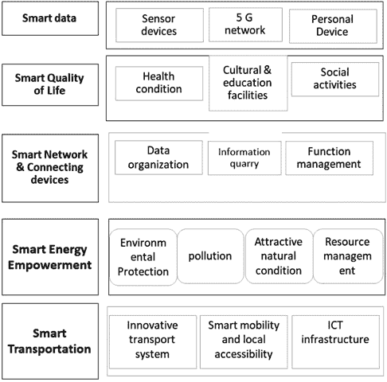
通常，一个以信息和计算机技术为基础的城市可以被称为“智慧城市”。ICT 是整个城市的基础：它的通信媒介、财产和其他服务。“智慧城市”的概念源于 2008 年和 2009 年的两场活动，即 IBM 发起的“更聪明星球”（Smarter Planet）计划。目前，包括印度在内的多个国家正在采取有效的控制措施来发展智慧城市。智慧城市的最佳例子之一是巴西巴拿拉州首“库里蒂巴”，那里的垃圾管理曾是一个大问题，导致大量垃圾堆在街道上[8–10]。在这座城市，约 70%的人口积极参与街道垃圾的回收，结果该城市变得更加清洁，并获得了巴西政府的奖励。其他一些公司也发起了开发新加坡、迪拜、阿姆斯特丹、巴塞罗那和纽约城市的活动。所有列出的城市都在应用创新的基础设施解决方案来改进基础设施[10–16]。
这类城市的交通流量较少，使得货物和个人可以通过多种来源进行便利运输。减少交通数量意味着交通事故减少、交通拥堵减少、空气污染水平下降，并有助于促进更好的生活方式[2, 10, 17]。智能交通发展方面存在各种挑战性问题，因为世界各地许多发展中城市无法货物供应与城市交通系统需求之间取得平衡，如图 1.2 以及随后的图 1.5 所示。这里列出了一些核心挑战性问题：
*   对行道的非法占用是另一个问题。
## 1.2.3 智能数据](#02chap_01.xhtml_sec1_2_3a)

分析的数据能够实现主动维护和基于未来的增强规划。这需要智能基础设施来处理这些海量数据，涉及各种工具和技术的结合，如云计算、边缘计算、`IoT`、大数据等。使用这些技术收集的数据将导致未来的管理变革。`IoT` 设备或基于传感器的设备是智能城市的基础组件。这些设备中的集成传感器（`ISs`）收集有价值的数据或信息，可用于获取价值的信息 [11–16]。复合城市系统之间的数据交换将得到管理，而这些数据分析的整合也将减少事故及意外后果的数量。
智能生活质量或生活水平的特征是为大型和小型社区都提供不同的文化设施。智能学校、学院和大学、智能旅游以及智能医疗可以提供先进的学习，并配备所有现代技术支持的设备设备，为所有居民提供健康的生活方式。城市的每位居民都可以享智能家居以及社会凝聚力。研究生入学率（`GER`）、人类发展指数（`HDI`）和学历水平被视为生活最重要的方面之一 [7, 27]。智能人士对学习事物具有终身热情，社交且传统多元性。非歧视是智能居民的另一个重要方面，因为它具有根据生态系统变化变化的灵活性，并且具有民主性质。
## 1.3.1 目标、人员与生态系统
**图 1.4**
**图 1.5**
## 1.4.2 IoT 与计算机视觉


6. 智慧城市的挑战。https://www.ifpenergiesnou.com/article/smart-city-energy-challenges-facing

-   13. Akshit Anand, Vikrant Jha, Lavanya Sharma, “用于实时应用的改进局部二值模式直方图技术，” International Journal of Recent Technology and Engineering, vol. 8, no. 2S7, pp. 524–529, 2019 年 7 月。
-16. Lavanya Sharma, Annapurna Singh, Dileep Kumar Yadav, “热视频中移动人体检测的费希尔线性判别率阈值，” Infrared Physics and Technology, vol. 78, pp. 118–112, Elsevier, 2016 年 3 月。
-18. 智慧城市挑战：什么阻碍了智慧城市的发展？可用：`https://mobility.here.com/learn/smart-city-initiatives/smart-city-challenges-what-stands-way-smart-cities` [访问于 2020 年 10 月 16 日]。
21. Andrea Caragliu, Chiara Del Bo, Peter Nijkamp, “欧洲的智慧城市，” Journal of Urban Technology, vol. 18, no. 2, pp. 65–82, 2011 年 4 月。
23. C. Harrison, B. Eckman, R. Hamilton, P. Hartswick, J. Kalagnanam, J. Paraszczak, 等，“更智能城市的基础，” IBM Journal of Research and Development, vol. 54, no. 4, 2010。
-28. Lavanya Sharma, P. K. Garg, “物联网的应用，” 从视觉监控到物联网，Chapman and Hall/CRC, Vol. 1, p. 29, 2019。
-33. Lavanya Sharma, Nirvikar Lohan, “物联网中的目标检测，” 大数据与物联网手册, IGI Global, pp. 89–100, 2019 年 3 月。(ISSN: 2052-8442, DOI: 10.4018/978-1-5225-7432-3.ch006)。
-36. 工业物联网：释放连接产品与服务的潜力，2015 年 1 月。`http://www3.weforum.org/docs/WEFUSA_IndustrialInternet_Report2015.pdf`

在过去的十年中，`IoT` 迅速增长，预计在未来几年内将继续呈指数级增长。如图 2.1 所示，智能设备的存在在 2003 年几乎可以不忽略，但在不到十年的时间里，到 2010 年，`IoT` 的使用几乎是世界人口的两倍。同样，到 2015 年，连接设备已增加到世界人口的三倍这一阶段。预测未来，到 2020 年底，将有 500 亿设备连接到互联网，每个人将拥有超过六个通过互联网传输或交换数据的设备。目前的网络架构无法适应未来预期智能设备数量的增长。因此，我们需要一个可扩展且可靠的平台 [2, 3–5]。
**FIGURE 2.1**
*   传统网络技术无法处理数十亿或万亿连接设备。因此，软件定义网络（`SDN`）通过转发设备分离控制平面和数据平面，可以在边缘、接入、核心和数据中心计算等网络方面有效满足 `IoT` 的需求。通用的 `SDN` 有三层：基础设施层、控制层和应用层；有了 `SDN`，可以根据特定的应用需求，实时在物理设备上实现适当的控制逻辑 [2, 7]。
*   无线体域网（`WBAN`）聚合了部署在人体表面或内部的人体传感器产生的数据。这些聚合数据产生了巨大的流量，从而增加了使用传统网络架构处理高流量的复杂性 [9]。
*   论文得出结论，信息的缺乏导致了大量的移动性问题。已经提出了许多策略连接设备，但无法提供有效结果。传统网络技术无法处理 `IoT` 连接的增长。`SDN` 用于在边缘、接入、核心和数据中心方面满足 `IoT` 的需求 [7]。
*   所有连接的异构设备产生大量数据。为每个传感器设备分配带宽是一项挑战。现有的带宽分配机制没有考虑设备限制、网关和应用。`IoT` 网关带宽有限，因此在最大吞吐量的同时为连接设备分配带宽也是一个挑战性问题。作者提出了 `BACOFF` 方法；它考虑了 `IoT` 设备及其连接网关的业务相关属性 [2]。
*   在[13]中，作者提出了 QoS 问题并提出了回溯算法。然而，它仍然不够成功，因为用于计算 QoS 的回溯算法中执行的步数过多。因此，未来需要考虑 QoS。
*表 2.1*
| IoT 连接挑战 | | | |
| `所用技术` | | | |


* 功耗低


**图 2.3**
图 2.4 显示了分离的 SDN 数据面和控制面。每个数据面实体在控制面都有其对应的控制器。同样，应用和管理功能也从底部两个平面分离出来 [21]。
SDN 架构。
* SDN 提供了比传统网络更好的结果，因为它同时提供了中心化方法和分布式方法。但在传统系统中，使用不同的交换机或路由器来传输数据；它们的路由信息安装在物理设备本身。如果任何设备必须发送数据，那么它将发送给所有设备。

* **第一跳网络：** 将设备通信协议翻译为互联网协议的本地网络。
### 2.4.2 物联网系统架构中的主要挑战
1. **传感器：** 在物联网中，互联网接入和物理设备（如传感器）是主要组件。传感器被用于识别物体并从环境中采集信息。它们作为前端，直接或间接地与物联网网络连接。并非所有传感器都是相同的；不同的应用需要不同的传感器，例如需要温度传感器来收集温度信息，湿度传感器用于检查空气中的水蒸量等。随着物联网的发展，需要部署大量的传感器来监控区域。因此，下一个关注点是大量传感器带来的复杂性。传感器的电池需要定期更换。因此，另一个问题是更换传感器所需的成本 [14]。

2. **网络连接：** 传感器通过 `3G`/`4G`、蓝牙和 `Wi-Fi` 等技术进行连接；采集的信息通过互联网传输到目标位置。在 [14] 中，作者解决了低功耗广域网（LPWAN）作为第一跳网络的需求，由于现有技术在数据速率和覆盖范围方面的局限性。

3. **网络存储和数据检索：** 网络存储和数据检索是由于传感器使用的增加而引起的问题。部署了各种传感器从环境中收集信息；采集到的数据通过通信网络传输到服务器，这种方式收集了大量信息。根据 [14]，传感器采集的大量数据导致了大数据问题，这需要进行智能处理。在需要的时间交付所需的数据是一项挑战。


### 4. 人类依赖
人类独立性是指在任何时间点无需人类参与即可采取必要的行动。机器需要人类来操作；有时它们可以自主采取行动（例如，可以使用机器学习训练机器人以执行某些步骤），但在大多数情况下，它们无法自主采取行动。在没有任何人类参与的情况下，建模 SDN 来解决连接问题是一项挑战 [14]。

### 5. 可扩展性与对象标识
物联网（IoT）正在不断增长，并需要对象标识。IPv4 标准已经穷竭无尽了，不足以为快速增长的 IoT 设备提供地址空间。IPv6 将在全球范围内提供足够的地址空间，但使用 IPv4 的 IoT 增长是一项挑战 [14]。

### 6. 异构性
异构性被认为是 IoT 系统面临的一项重大挑战。这主要是由于系统中存在不同的组件，因为它们会产生不同的数据。例如，医疗保健领域存在的各种传感器可以产生不同格式的数据。传感器之间的通信可能使用不同的协议进行。由于组件多样、数据格式多种以及协议不同等问题，很难在公共平台上统一处理这些数据 [22]。

### 7. 移动性
IoT 中的移动性可以定义为当用户在移动过程中产生需求时分配信息。移动性是 IoT 增长中的一个大挑战 [22]。

### 8. 安全性
IoT 设备提供了一个共享信息、数据和设备控制过程的平台，这些过程在数据传输可能会被未经授权的人攻击。互联网提供了保护数据安全机制。尽管如此，由于 IoT 设备的异构性，这些机制无法兼容并为所有设备提供安全性 [2, 14]。

### 9. 带宽分配
IoT 连接在带宽分配方面面临巨大挑战。由于资源有限，为许多连接的设备分配带宽是一项挑战。作者们 [6] 确定，到为止，当数十亿设备通过向服务器发送请求进行连接时，手机网络上的带宽一直是昂贵的。这导致服务器在处理大量数据时出现拥堵。

### 10. 服务质量
QoS 通过考虑发送者和接收者之间传递消息所需的时间来实现。在 [23] 中，作者提到在许多应用中，收集到的数据需要在特定时间内传递到目标目的地，否则数据价值将很小。QoS 要求通过网络上的差异化服务、延迟管理、丢包和带宽参数来满足。因此，QoS 需要研究和稳定以进行实现、优化和控制。

## 2.4.3 连接挑战
在本节中，我们讨论了 IoT 环境中主要的连接挑战，如图 2.6 所示。

#### 1. 异构性
异构设备使得设备管理和可编程变得复杂。IoT 最好地代表了异构性，因为它处理不同的设备并执行它们的功能。根据 [24]，在不考虑其特性的情况下找到一种有效管理这些设备的方法是一项挑战。设备的异构性可以使用不同的技术、传感技术、软件和处理方法以多种方式定义。异构性可以根据不同的视角来确定，例如：

*   **工作条件：** 所有传感器设备的工作条件是不相同的。它们都工作在压力、温度和电压等各种条件条件下。
*   **功能性：** IoT 设备可以定期交付数据，也可以根据需求交付数据。
*   **分辨率：** IoT 设备可能具有跟踪、监控、感知和执行的目标。
*   **硬件平台：** 使用的硬件可以根据设备的需求而变化。它基于架构和设计。
*   **服务：** IoT 服务在某些场景下也不同，例如计算包大小。
*   **实现：** 使用各种编程语言来设计 IoT 应用。不同的操作系统，如 `Android` 和 `iOS` 被用于开发 IoT 应用 [22]。

#### 2. 移动性
移动性是 IoT 网络中最大的挑战。许多 IoT 应用需要 IoT 设备是移动的，例如车辆跟踪和患者跟踪。`Wi-Fi` 随着客户端的移动面临客户端移动性问题。当客户端离开系统覆盖范围时，接入点为客户端网络提供访问。接入点检测到客户端信号变弱，它需要提供一个具有正确覆盖区域的新接入点。有时，如果客户端连接到新的接入点，`Wi-Fi` 网络需要时间来激活，因为交换器仍使用旧的路由规则，重新配置需要一些，导致延迟。移动性也有助于企业，允许用户使用各种设备和应用程序在任何地方开展工作。它指的是从任何地方使用 `smartphones` 和 `laptops` 等移动设备来执行所需的工作。它提供了灵活性选择，有助于提高生产力 [8]。

#### 3. 带宽分配
由于 IoT 设备处理能力的提高，边缘网络正转向 IoT。由于能量限制，无法在板上完全处理数据。它需要将部分计算卸载到网关和服务器 [25]。

#### 4. 服务质量
QoS 是 IoT 架构的主要要求之一，以确保向用户提供服务。实时应用应被高优先级。它通过带宽和吞吐量等主要因素衡量。它需要考虑服务模型以检查互联网服务的程度。互联网服务模型有助于分类互联网服务：首先是通过分配优先级，其次是定义实现用户满意所需的服务需求。它用于智能医疗保健等领域，在这种情况下，可靠的数据交付至关重要 [13]。

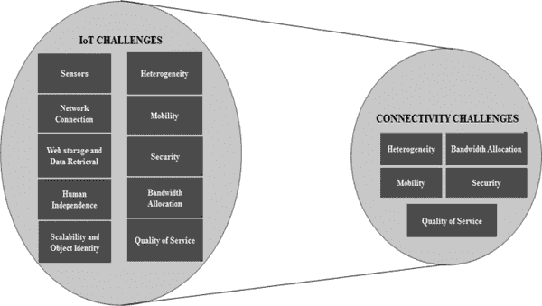

**图 2.6**

IoT 的挑战。

### 2.4.3.1 使用各种技术的连接问题
使用了各种技术连接 IoT 设备。过去和现在使用的技术包括 `Wi-Fi` [26, 27]、`6LoWPAN` [26, 28]、`Zigbee` [24, 28, 29]、`Bluetooth LE` [28, 30]、`Sigfox` [28, 31]、`cellular` [26] 和 `RFID` [27, 28]。所有这些技术的特征和支持连接挑战的提议技术在图 2.7 中提到。


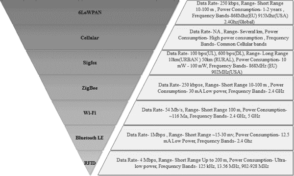

**图 2.7**

IoT 中使用的技术。

## 2.4.4 案例研究：使用 NetSim 对大学环境进行结果分析

其目标是在变化最小的情况下，使现有基础设施能够适应日益增长的连接 IoT 设备。IoT 正在扩展到几乎所有领域。它在不同领域提供了巨大的优势。尽管有许多优点，但正如我们在本章提到的，它也面临着增长障碍。

为了从数据包丢失、吞吐量、延迟和抖动方面分析设备连接问题，我们使用了仿真的系统方法 [32]。该仿真遵循八步法，以识别现有基础设施的缺陷。文献确定，传统的 Wi-Fi 架构缺乏灵活性，且基于传统的 WLAN 架构的控制器通常是封闭且不可编程的。

为此，我们在 `NetSim` 中通过连接各种 IoT 设备为某某大学建立了一个仿真网络。在数据传输过程中，我们将从数据包丢失、延迟、抖动和吞吐量方面识别问题。该仿真将模拟大学或受限场所内大量人员参加会议或社交活动的计划聚集。仿真将展示现有基础设施如何承受受限区域内的正常人数以及同一区域的人群。使用仿真的原因是 IoT 设备的多样性（或异构性），开发一个包含许多 IoT 设备的原型是不可行的。

我们为各种异构智能设备（如微波炉、冰箱、电视机、智能手机、笔记本电脑等）建立了仿真环境。在仿真过程中，这些设备将开始通信；并在数据包丢失、延迟、覆盖范围和吞吐量方面识别问题。我们将大学分为两个场景：`University 1` 和 `University 2`。在 `University 1` 中，我们连接了少数设备（约 10–15 个），并配置了 3 个应用程序，如 1 个 FTP、1 个语音和 1 个视频。仿真完成后，我们计算了吞吐量、抖动、延迟和数据包丢失，如图 2.8

**图 2.8**

`NetSim`结果对比。

## 2.4.5 意义与贡献

IoT 的理念引起了大量的关注，因为设备的大连接带来了各种挑战和障碍，包括异构性、带宽分配、QoS 和移动性。IoT 创建了数十亿连接到互联网的设备和网络。在许多应用程序中，收集的数据需要在特定时间内传递到目标目的地，否则数据将失去其重要性。因此，QoS 的实现、优化和控制需要深入的研究和稳定性。

## 2.5 结论

在本章中，讨论了各种 IoT 挑战和连接挑战。我们主要关注了所用技术中的连接挑战，如异构性、移动性、带宽分配和 QoS。总结来说，随着设备数量的增加，需要新技术来支持设备之间的连接。本章的主要目的是提供关于连接挑战以及迄今为止用于克服这些挑战的各种不同方法的思路。本章介绍了 IoT 系统的概览，讨论了将 SDN 集成到 IoT 中的各种应用和优势。本章还讨论了通用的 IoT 系统架构以及 IoT 中不同的连接挑战。这些挑战是根据所用技术来定义的。本章还对 IoT 系统及其面临的挑战进行了完整的介绍。

## 参考文献

1. Theodorou, T. & Mamatas, L. (2017). `CORAL-SDN: A software-defined networking solution for the Internet of Things`. IEEE Conference on Network Function Virtualization and Software Defined Networks (`NFV-SDN`), Berlin, Germany, November 6–8.

2. Sharma, Lavanya & Garg, P.K. (Eds.). (2019). `From Visual Surveillance to Internet of Things`, New York: Chapman and Hall/CRC.

3. Kumar, Anubhav, Jha, Gaurav & Sharma, Lavanya. (July 2019). `Challenges, potential & future of IOT integrated with block chain`. International Journal of Recent Technology and Engineering, 8(2).

4. Sharma, Lavanya & Lohan, Nirvik. (2019). `Low-power, long-range, high-data transmission using Wi-Fi and LoRa`. Experimental study on Low Power Wide Area Networks (LPWAN). 85th Vehicular Technology (`VTC Spring`), Sydney, Australia.

5. Sharma, Lavanya. (2019). `Introduction: from visual surveillance to Internet of Things`. In Handbook of Research on Big Data and Cloud, Vol.1.

6. Sharma, Lavanya, Singh, Annapurna & Kumar Yadav, Dileep. (2016). `Fisher's linear discriminant ratio for moving human detection in thermal`. Infrared Physics and Technology, 78:118–128.

7. Bera, S., et al. (2017). `Software-defined networking for Internet of Things: A survey`. IEEE Internet of Things Journal, 4(6): 1994–2008.

8. Stiti, O., et al. (2015). `Virtual OpenFlow-based SDN Wi-Fi access point`. Global Information Infrastructure and Networking Symposium (`GIIS`), Guadalajara, Mexico.

9. Sallabi, F., Naeem, F., Awad, M. & Shuaib, K. (2018). `Managing IoT-based healthcare systems traffic with software defined networks`. International Symposium on Networks, Computers and Communications (`ISNCC`), Rome, Italy.

10. Harit, A., et al. (2017). `Internet of Things security: challenges and perspectives`. Proceedings of the Second International Conference on Internet of things, Data and Cloud, Cambridge, UK.

11. Kim, D. H., et al. (2016). `Experimental study on Low Power Wide Area Networks (LPWAN)`. 6th International Conference on IT Convergence and Security (`ICITCS`), Prague, Czech Republic.

12. Patel, D. & Won, M. (2017). `ABC of Internet of Things: Advancements, benefits, challenges, enablers and facilities of IoT`. Symposium on Colossal Data Analysis and Networking (`CDAN`), Indore, India.

13. Hassan, Z., Ali, H. & Badawy, M. (2015). `Internet of Things (IoT): Definitions, Challenges, and Recent Research Directions`. International Journal of Computer Applications, 128(1): 140–156.

14. Gupta, R. & Gupta, R. (2016). `ABC of Internet of Things: Advancements, benefits, challenges, enablers and facilities of IoT`.


15. Sharma, Lavanya & Garg, P. K. (2019). 基于物联网的智能电子医疗：当前趋势、挑战、解决方案与技术，收录《从视觉监控到物联网》，Chapman Hall/CRC, 第 1 卷，第 215 页。

16. Sharma, Lavanya, Garg, P. K. & Agarwal, Naman. (2019). 电子医疗先驱者的远见，收录《从视觉监控到物联网》，Chapman Hall/CRC, 第 1 卷，第 235 页。

17. Makkar, Suraj & Sharma, Lavanya. (2019). 使用支持向量机的人脸检测：具有挑战性的问题、最新趋势、解决方案及提出的框架。第三届计算与数据科学进展国际会议 (ICACDS 2019, Springer), Inderprastha Engineering College, Ghaziabad, India, 4 月 12–13 日。

18. Sharma, Lavanya & Garg P. K. (2019). 物联网的未来，收录《从视觉监控到物联网》，Chapman Hall/CRC, 第 1 卷，第 245 页。

19. Sharma, Lavanya & Garg, P. K. (2019). 物联网（IoT）及其应用，收录《从视觉监控到物联网》，Chapman Hall/CRC, 第 1 卷，第 29 页。

20. Kabalci, Y. (2019). 5G 移动通信系统：基础、挑战与关键技术。由 E. Kabalci & Y. Kabalci 编，，《智能电网及其通信系统》(pp. 329–359)。新加坡：Springer。

21. Bedhief, I., 等. (2016). 面临物联网异构性的基于 SDN 的架构。第三届智能云网络与系统 (SCNS), 阿联酋迪拜，12 月 19–21 日。

22. Hussain, M. I. (2017). 物联网：挑战与研究机会。CSI ICT 期刊，5(1), 87–95。Doi: 10.1007/s40012-016-0136-6

23. Farhan, L., 等. (2018). 物联网（IoT）简要述——问题、挑战与机遇。第 11 届通信系统、网络与数字信号处理国际会议 (CSNDSP), 匈牙利布达佩斯，7 月 18–20 日。

24. Gazis, V., Goertz, M., Huber, M., Leonardi, A., Mathioudakis, K., Wiesmaier, A. & Zeiger, F. (2015). 短文：IoT：挑战、项目、架构。发表于第 18 届下一代网络智能国际会议的论文，法国巴黎，2 月 17–19 日。

25. Samie, F., Tsoutsouras, V., Bauer, L., Xydis, S., Soudris, D. & Henkel, J. (2016). 低功耗 IoT 边缘设备的计算卸载与资源分配。发表于 IEEE 第三届世界物联网论坛 (WF-IoT)的论文，美国吉尼亚州雷斯顿，12 月 12–14 日。

26. Frenzel, L. (2012). 短距离无线技术的基础。电子设计，10 月 11 日。

27. Kuzlu, M., Pipattanasomporn, M. & Rahman, S. (2015). 智能家居/建筑应用通信技术回顾。发表于 2015 IEEE 创新智能电网技术—亚洲 (ISGT ASIA)，11 月 3–6 日。

28. Azamuddin Bin Ab, Rahman (2015). 物联网（IoT）数据链路协议比较（论文，美国华盛顿大学，圣路易斯）。

29. Samuel, S. S. I. (2016). 物联网智能家居连接挑战综述。第三届 MEC 大数据与智慧城市国际会议 (ICBDSC), 阿曼马斯特，3 月 15–16 日：1–4。

30. Hughes, J., Yan, J. (2015). 用于监测的蓝牙低功耗（BLE)开发。智能系统国际期刊，8(2), 1379–1405。

31. Raza, U., Kulkarni, P. & Sooga, M. (2017). 低功耗区域网络：概述。IEEE Surveys & Tutorials，19(2), 855–873. doi: 10.1009/COMST.2017.265320.

# 3 引言

交通事故由于车辆数量增加而不断上升。在印度，由于快速城市化和车辆快速增长，道路安全是一个严重的问题。在大多数情况下，附近的医院或家庭成员没有得到及时通知。这种延迟可能导致生命损失。1970 年至 2018 年印度的事故数量如图 3.1 所示。

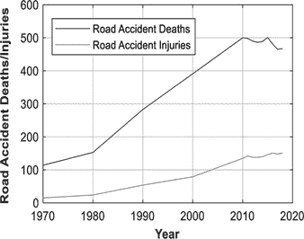
**图 3.1** 印度交通事故

## 3.1 报警系统的方法论

需要一种自动系统来检测事故位置并迅速通知医院和其他相关人员。通过应用现代物联网（IoT）技术，这种通知时间可以大幅减少。这种技术在现代世界正发生快速变化。物联网技术使用了射频识别（RFID）、Wi-Fi、全球移动通信（GSM）、全球定位系统（GPS）等。

## 3.2 提出的系统设计

物联网可用于生成发送给相关地点或人员的自动信息。

## 3.3 结果与讨论

## 3.4 结论

智能城市正在为大众提供更具效益、更快速的设施。智能城市将信息通信技术（ICT）与现代基础设施相结合。

**关键词：**传感器、交通事故、全球定位系统（GPS）、中央处理器（CPU）、物联网（IoT）、应用程序编程接口（API）、射频识别（RFID）、全球移动通信（GSM）


本章提出了一种利用先进 IoT 技术进行车辆追踪并生成警报信息的系统。该事故检测与警报系统专为智慧城市设计，由多种传感器、微控制器、GSM 调制解调器和 GPS 接收器组成。在发生事故时，紧急消息将通过设计的 IoT 架构处理并发送至最近的医院。`GPS` 模块 [13] 用于确定事故现场坐标。根据这些坐标，服务器使用 `Arduino UNO` 微控制器确定附近的医院和警察局位置 [14–16]。`GSM` 模块会将短信服务（SMS）警报和电子邮件信息发送给附近的医院、警察局以及注册的联系电话 [17]。本章结构安排如下：第 3.2 节 讨论事故警报系统的方法论；使用 `GPS` 和 `GSM` 模块检测事故，系统的完整设计包含在 第 3.3 节 中；第 3.4 节 包含软件的工作原理，随后是结果与讨论。最后一节是结论。

# 3.2 事故警报系统的方法论

所提事故警报系统的流程图如图图 3.2 所示。一旦发生事故，事故警报系统会识别事故位置的坐标。此外，系统会根据其算法感知损坏程度和车辆乘客状况。随后，系统会将警报信息发送给紧急服务部门，如最近的警察局、医院以及乘客注册的紧急联系人。

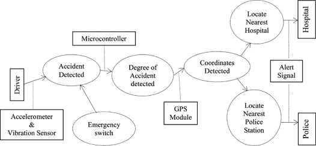

**图 3.2**

事故警报系统工作流程图。

该系统是一个小型单元，可以嵌入到车辆内部的安全位置。它应该放置在损坏概率最小的位置。系统利用 `Arduino UNO` 微控制器作为中央处理器（CPU）。加速度计和振动传感器用于预测车辆损坏程度和车内乘客的状况。`GPS` 模块用于确定事故现场坐标。这些细节会被发送到服务器。

为了确定最近的医院和警察局，服务器使用了 `Haversine formula` [18]。此外，`GSM` 模块会向最近的医院/警察局和注册联系人发送短信警报。还会向应急救援部门发送电子邮件以便其快速响应。如果事故非常轻微且不需要紧急服务，则为乘客提供了一个额外的紧急开关，以便其终止已检测到的事故警报 [19–23]。乘客有足够的时间判断是否取消已检测到的事故警报。因此，该系统以可行的方式为道路事故的应急设施提供了帮助。

# 3.3 所提系统的设计

设计事故警报系统所需的框图和组件如图图 3.3 所示。本文使用的主要模块有：(1) 微控制器，(2) `GPS` 模块，(3) `GSM` 模块，(4) 加速度计，(5) 振动传感器。

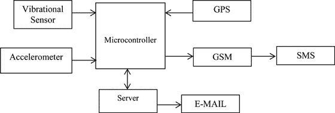

**图 3.3**

系统框图。

该电路使用用于嵌入式应用的控制器板设计。使用的接口组件包括 `GSM` 和 `GPS` 模块、加速度计和振动传感器。当事故发生时，根据数据库中存储的信息，事故通知将发送给乘客的亲属 [24–26]。附近的医院和警察局也会立即获知事故的确切位置。通过 `GPS` 和 `GSM` 模块通知家属和医院。

### 3.3.1 事故检测

使用加速度计和振动传感器检测道路事故。系统使用了三轴加速度计 `ADXL335` (见图 3.4)）。该传感器是一种低功耗设备，可以确定 X、Y、Z 三方向的静态加速度。发生事故时，可以借助三轴加速度计确定车辆相对于水平面的倾斜角。

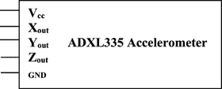

**图 3.4**

三轴加速度计 (ADXL335)。

振动传感器也用于测量碰撞。该传感器用于检测系统中的异常振动。振动传感器基于压电效应，通过转化为电荷来测量力、温度、压力加速度的变化。该传感器的灵敏度范围为 10–100 mV/g。振动和加速度传感器根据预设阈值判断事故程度。阈值取决于车辆类型。

为了计算时间和位置，带有 GPS 天线的 `SIM28 GPS` 模块利用一组地面站和卫星进行定位，误差高达 10–20 米。该模块具有六通道 GPS 搜索引擎且功高效。`SIM28 GPS` 模块是一个独立的 L1 频率模块，工作频率为 1575.42 MHz。为了将事故坐标发送给应急部门，采用了 `SIM900A GSM` 模块。它是常用的 GSM/GPRS 模块之一。该模块支持两个频段（900/1800 MHz），用于短信、语音、传真和数据。其简单的功能使其更容易与微控制器。该模块用于向应急部门发送短信。

为了控制所有组件的功能，使用了 `Arduino UNO`。`Arduino UNO` 板由 `ATmega328P` 微控制器构建。`ATmega328P` 是一种具有 32 KB 系统可编程闪存的 8 位微控制器。`Arduino UNO` 拥有 2 KB SRAM 和 32 KB 闪存。它功能多变，是廉价的微控制器开发板之一。它可以轻松编程，是控制整个系统的理想选择。所提系统的硬件实现如图图 3.5 所示。

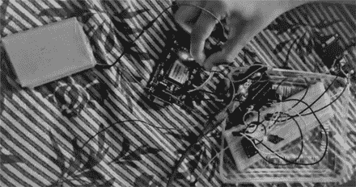

**图 3.5**

事故警报系统硬件实现。

# 3.4 软件的工作原理


# 解决方案实现

该软件解决方案分阶段实现。首先是检测事故并检测事故的程度。为了实现这一点，创建了一种算法，并考虑了`accelerometer`和振动传感器的阈值。这些值取决于所用车辆的类型。`accelerometer`和振动传感器将数据发送到微控制器，微控制器根据接收到的数据预测人员受损程度，并根据损坏程度决定是否发送事故警报。加速度和振动传感器的输出被持续检查并与阈值进行比较。如果这些值超过阈值，就会产生警报信号。如果乘客发现事故轻微且并非紧急情况，他们将有足够的延迟时间点击“忽略警报”按钮，以避免向应急机构发送虚假警报。如果乘客在规定时间内未按下紧急开关，事故信息连同位置坐标将发送到最近的医院。这样，医疗帮助可以尽快到达现场，拯救这些生命。此外，警察局和紧急联系人也会收到事故及其位置。

软件的第二个功能是使用`Haversine formula` 定位事故地点最近的医院。这是通过与存储所有提议系统注册医院位置的服务器持续通信来实现。服务器向应急机构发送电子邮件，提供了通信警报和事故位置的另一种模式，以便通过任何模式在最早提供帮助。

表 3.1 显示了考虑的事故地点附近所有医院列表。使用`Haversine formula`向最近的医院发送电子邮件。`Haversine formula`的数学表达式由公式 (3.1)给出：

| $$d = 2r{\sin^{- 1}\left( \sqrt{\left( {{\cos{\left( Ø_{1} \right)~ \times}}{\cos{\left( Ø_{2} \right)~ \times {\sin^{2}\left( \frac{\lambda_{2} - ~\lambda_{1}}{2} \right)}}}} \right) + ~{\sin^{2}\left( \frac{Ø_{2} - ~Ø_{1}}{2} \right)}} \right)}$$ | (3.1) |

表 3.1

注册医院列表（事故地点附近）及其坐标

| 序号 | 医院名称 | 电子邮件 | 纬度 | 经度 |
| --- | --- | --- | --- | --- |
| 1 | Max Super Specialty Hospital, Dehradun | xyz@gmail.com | 30.37583 | 78.073598 |
| 2 | Fortis Escorts Hospital, Dehradun | abcd@gmail.com | 30.322459 | 78.05546 |
| 3 | Kanishk Surgical & Super Specialty Hospital, Dehradun | uvw@gmail.com | 30.292783 | 78.051644 |
| 4 | Kailash Hospital, Dehradun | mlq@gmail.com | 30.28907 | 78.064093 |
| 5 | Shri Mahant Indiresh Hospital, Dehradun | pqr@gmail.com | 30.306008 | 78.019757 |
| 6 | Military Hospital, Dehradun | xyz@gmail.com | 30.359546 | 78.035874 |
| 7 | Jagdamba Hospital, Dehradun | abcd@gmail.com | 30.298096 | 78.055979 |
| 8 | Prem Sukh Hospital, Dehradun | uvw@gmail.com | 30.320199 | 78.023959 |
| 9 | MH, Dehradun | mlq@gmail.com | 30.362433 | 78.038796 |
| 10 | Synergy Hospital, Dehradun | pqr@gmail.com | 30.340074 | 78.014922 |

公式 (3.1)对于假设地球为球体有效。这里，`d`、`r`分别表示地球上两点之间的距离和地球半径。`λ[1]`、`ϕ[1]` 以及 `λ[2]`、`ϕ[2]` 分别表示点 1 和 2 的经度和纬度（弧度）。

为了救人，利用`GPS` 确定事故地点，并通过`GSM` 向附近的医院发送消息。使用`GSM` 模块的通信通过 `AT` 命令启动。使用`GSM` 模块的通信通过 `AT` 命令启动。使用`GSM` 模块的通信通过 `AT` 命令启动。使用`GSM` 模块的通信通过 `AT` 命令启动。使用`GSM` 模块的通信通过 `AT` 命令启动。使用`GSM` 模块的通信通过 `AT` 命令启动。使用`GSM` 模块的通信通过 `AT` 命令启动。使用`GSM` 模块的通信通过 `AT` 命令启动。使用`GSM` 模块的通信通过 `AT` 命令启动。使用`GSM` 模块的通信通过 `AT` 命令启动。使用`GSM` 模块的通信通过 `AT` 命令启动。使用`GSM` 模块的通信通过 `AT` 命令启动。使用`GSM` 模块的通信通过 `AT` 命令启动。使用`GSM` 模块的通信通过 `AT` 命令启动。使用`GSM` 模块的通信通过 `AT` 命令启动。`Google Maps` `API` 显示在图 3.6。

```
确定事故地点并通过 GSM 向最近的医院发送消息。
使用 GSM 模块的通信通过 AT 命令启动。
```

### 3.5 结果与讨论

道路事故导致的死亡率不断上升。在大多数情况下，由于无法及时向最近的医院发出医疗帮助，人们在事故中去世。由于智能媒体的存在，在智能城市中生成并通信有效的事故消息。在本章中，设计了一种事故警报系统，向附近的医院、警察局和一个紧急联系人提供车辆的实时 `GPS` 坐标。使用加速度计和振动传感器来判断车辆的损坏程度以及车内乘客的受伤程度。所提系统所需的空间很小，可以由汽车制造商轻松安装在任何车辆内。

### 结论

这项研究工作得到了塔帕理工学院（Thapar Institute of Engineering and Technology, Patiala, India）的支持。作者非常感谢电子与工程系提供的实验室设施。

## 参考文献

1. 印度政府交通和公路部. 印度的道路事故. 7–8. 2018. [`morth.nic.in/sites/default/files/Road_Accidednt.pdf`](https://morth.nic.in)
2. H. Singh, J.S. Bhatia, J. Kaur. 基于追踪的驾驶员疲劳监测和预警系统.印度电力电子国际会议 (IICPE2010), Delhi, India, 2010 年 12 月 20 日至 23 日, 1–6.
3. O. Rizwan, H. Rizwan, M. Ejaz. 车辆事故预警高效系统的开发. IEEE 第九届新兴技术国际会议 (ICET), Islamabad, Pakistan, 2013 年 12 月 9 日至 10 日, 1–6


# 4. S. Reeja, V.S. Jayaraj. 基于事件数据记录器的事故分析嵌入式方法。IEEE 电气仪器与通信工程会议，印度，卡鲁尔，2017 年 4 月 27–28 日，1–5。

5. C.V. Thota, L.K. Galla, R. Narisetty, U. Mande. 用于减少交通事故的自动警觉交通系统。电子通信与计算工程国际会议 (ICECCE)，印度，霍苏尔，2014 年 11 月 17–18 日，179–183。

6. S.A. Shabbeer, M. Meleet. 用于事故检测与通知的智能头盔。第二届可持续解决方案的计算系统与信息技术国际会议 (CSITSS)，印度，班加罗尔，2017 年 12 月 21–23 日，1–5。

7. B.S. Anil, K.A. Vilas, S.R. Jagtap. 用于车辆事故检测与通知的智能系统。通信与信号处理会议 (ICCSP)。2014 年。1238–1240。

8. D. Acharya, V. Kumar, N. Garvin, A. Greca, G.M. Gaddis. 基于太阳黑子的自动车辆事故通知系统。生物医学信息技术与应用 (ITAB)，2008 年，296–299。

9. Elprocus. RF 频模块 – 发送器与接收器。2019 年。`https://www.elprocus.com/rf-module-transmitter-receiver/`

10. Postscapes. IoT 技术指南。2019 年。`https://www.postscapes.com/internet-of-things-technologies/`

11. Z. Iqbal, M.I. Khan. 通过 V2X 通信利用多个交通流参数实现智能城市的自动事件检测。国际分布式传感器网络期刊。14. 11. 1–23. 2018。

12. F. Bhatti, M.A. Shah, C. Maple, S.U. Islam. 用于智能城市环境的新型物联网辅助事故检测与报告系统。传感器 (Sensors)。19. 9. 1–29. 2019。

13. Elliott D. Kaplan (编). 理解 GPS：原理与应用。Artech House 电信图书馆，伦敦，1996 年。

14. Krishna Kant. 微处理器与微控制器。Eastern Company 版，印度，新德，2007 年。

15. R.S. Gaonkar. 微处理器架构编程与应用。第 5 版。Wiley Eastern Ltd，印度，新德，2002 年。

16. [在线] 可：`https://store.arduino.cc/usa/arduino-uno-rev3` (于 2020 年 5 月 17 日访问)。

17. G. Heine. GSM 网络：协议、术语与实现。Artech House 出版社，伦敦，1998 年。

18. [在线] 可：`https://en.wikipedia.org/wiki/Haversine_formula` (于 2020 年 5 月 17 日访问)。

19. R. Dias, V. Ghike, J. Johnraj, N. Fernandes, A. Jadhav. 车辆跟踪与事故通知系统。第三届技术融合国际会议 (ICT)，印度，浦那，2018 年 4 月 6–8 日，1–4。

20. N. Kattukkaran, A. George, T.M. Haridas. 用于急救医疗的智能事故检测与警报系统。计算机通信与信息国际会议 (CCI)，印度，乌杜皮，2017 年 9 月 13–16 日，1–6。

21. Michael Rosen. 驾驶员使用手机的方法与自动检测。《你的电子世界》杂志。阿克隆，第 5 卷，2008 年。

22. R. Sujitha, A. Devipriya. 利用新兴技术自动识别事故以改进通知。软计算与网络国际会议 (ICSNS)，印度，哥尔培特尔，2015 年 2 月 25–27 日，1–4。

23. S.J. Banar, V.N. Jadhav, S.M. Sutar. 关于减少事故的实时车道偏离感知与维护综述。信息工程与技术国际会议 (ICET)，印度，浦那，2018 年 8 月 29–31 日，1–3。

24. T. Kalyani, S. Monika, B. Naresh, Mahendra Vucha. 事故检测与警报系统。创新技术与工程国际期刊 (IJITEE)。8. 4, 227–229,2019 年。

25. A. Kumar, V. Jaganivasan, T. Sathish, S. Mohan. 使用 GPS 的事故检测与警报系统。纯数学与数学期刊。119, 15, 885–891,2018 年。

26. K.L.S. Soujanya, Sri Rajasekhar Gutta. 基于 IoT 和移动应用的事故警报系统。近期技术与工程国际期刊 (JRTE)。7, 5, 337–340，2019 年。

# 4. 智能城市中的智能医疗
Vukoman Jokanović, ALBOS 有限，“Vinca”核科学研究所，塞尔维亚，贝尔格莱

目录
- 4.1 引言
- 4.2 智能医疗
    - 4.2.1 基础信息
    - 4.2.2 主要挑战
    - 4.2.3 智能医疗技术
    - 4.2.4 智能家居
    - 4.2.5 物联网
    - 4.2.6 S 健康与 M 健康
    - 4.2.7 电子健康记录与个性化医疗
    - 4.2.8 智能城市的网络医疗系统
    - 4.2.9 深度学习与智能医疗
    - 4.2.10 远程护理信息系统
    - 4.2.11 空间手术与远程手术
    - 4.2.12 机器人远程手术
    - 4.2.13 计算机接口
    - 4.2.14 生物中复杂的纳米尺度几何结构
    - 4.2.15 人细胞出现的物理场与细胞几何的关系
- 4.3 结论
- 参考文献

#4.1 引言
智能城市的增长主要基于数据科学的创新，旨在提高人们的生活质量和生存能力。因此，我们需要我们需要新的方法和智能倡议，以便连接所有的数据库，从而实现无限的、多部门的、民用-环境-基础设施系统，拥有大量的参与者、偏好和解决方案。

考虑到到 2050 年，城市人口可能会增加到 25 亿，而 60%的城市地区将在亚洲和非洲建成，显然这必须伴随着新的基础设施需求。此外，全球范围内现有城市中经济发展所需的基础设施（即供水、能源和食物的基本系统，以及医疗、交通和信息系统、废物处理和公共部门）已经过时，需要进行翻新和现代化。


基础设施对于连接人类活动的不同方面和日常通信手段至关重要，可以从多个方面进行描述，包括建筑、能源供应、交通以及智慧城市水平的管理。智能家居是一个结合了多样化创新以为日常使用提供更好解决方案的家庭，它使用家用传感器和执行器来实现许多日常功能的完全自动化，例如帮助经常需要药物摄入管理的的老年人和残障人士 [[3], [4]]。

众所周知，医疗数据增长非常快，因为这些信息量每两年就会翻一倍。此外，医疗管理系统的质量提高了广泛医疗数据库的贡献和可访问性，允许快速收集和过滤其查询的许多结果，以便检测和分析选定的搜索信息。因此，医疗保健的主要目标是维持集体健康水平并确保专业医疗治疗的需求 [[3], [4]]。

在论述中，主要问题受到个人健康理念局限性的影响，该理念假设单独观察每位患者，因为这些结果取决于特定的特征、当前状态和病史。下一个挑战是由于有机体随时间快速变化的状况，而每个事件都应视为其他事件的结果。为了使用此类技术，深度学习模型可能会对原始医疗数据进行处理，使用程序预先将关键数据从起始信息中分离并组成普通格式。因此，一个高效的系统能够快速、准确地响应行政人员的查询 [[4], [5]]。

此外，具有复杂医学名称的各种处方，以及几种具有相似用药指导说明、不同有效期和副作用的伴随药物，是智慧医疗服务中解决的一些特定问题。在所谓的智能家中，中心位置属于 `Magic Medicine Cabinet (MMC)`，它包含自动脸部识别程序、射频识别 (RFID) 智能标签（使与读取器和写入器通信的设备远程节点）、健康体征检测器和语音合成。此外，`MMC` 包含家庭个性化提醒功能，可以检测患者何时服用了错误的药物并检查其生命功能。特定的数据库可以作为一种高效的方法，以及与细胞几何及其结构和子结构相关的数据，这适用于深度学习方法作为增强医疗保健的基础。通过本章简要讨论的物理模型所建立的传统医学与精准医学之间的紧密关系，在更高的水平上增加了成功医疗服务的机会 [[4]–6]。

## 4.2 智慧医疗

## 4.2.1 基础信息

智慧医疗是一种基于智能移动终端设备与日常健康相结合的新型通信技术。其核心目标是改善患者的医疗治疗并完善其健康，通过相应的移动和电子提供者提高生活质量并实现患者与医人员之间的良好交流。在互联网时代，新的医学知识、理论和实践经验增长得如此快，以至于医疗与现代互联网技术之间的连接变得非常必要。这些技术改变了一切，因为它们以患者为中心，将医人员及其信息与患者相结合，无论他们位于何处 [[7]-[10]]。

从健康角度来看，智慧城市和智慧星球理念的关键阶段，利用物联网 (IoT) 和超级计算机等技术，动态访问健康信息和治疗，通过强大的信息网络，确保最佳的医疗保健、决策以及健康资源的合理利用。它包括患者疾病与其预防、诊断、治疗以及医院和临床中心内部所有其他服务的网络连接，使用了多样化的互联网技术，如 `IoT`、云边缘 (cloudlet)、云计算、大数据、4G 和 5G 网络、机器学习等。所有这些技术都使患者和医生之间建立了非常紧密的关系，从患者治疗的角度做出最佳决策。同时，这些方法降低了成本和医疗风险，提高了医疗支持的效率。实践中的医疗保健在临床或科学机构、区域决策机构和患者之间共享 [[7]-[10]]。

## 4.2.2 主要挑战

发展智慧医疗最重要的技术是：无论患者和提供者的所在位置如何，对患者的所有关键数据和决策进行 `IoT` 转换，以及机器学习，后者增强了他们的护理质量。这些智慧技术是智慧医疗的核心，将其服务推向边缘，且不受限于该技术任何主体的物理位置。扩展的数据库提供了关于患者更实用、更具体的信息，增强了他们的治疗效果和健康效率，但医疗机构面临的核心困境在于这些结果与运营机构效率之间取得平衡。这两项责任有时会相互矛盾。一个对患者社区有直接影响，而另一个更侧向于医疗组织的效率。挑战在于平衡这两项结果，并通过新的通信技术将它们整合为一个统一的整体 [[7]-[10]]。

主要负责患者社区的数字前台使医疗保健提供者能够洞察患者的习惯和所需服务，其中患者的体验对于组织从患者经验中学习至关重要。根据患者流量频率及相应的预测来安排服务的等待时间，可能是服务患者最有效的方法。然后，通过使用小型设备，可以跟踪在医疗机构内部移动的患者，为他们关于医院可用请求人员提供充分的建议。通过主场景背后的互联网技术在后台提供所有这些机会，将患者体验转化为医疗保健机构的收入，在增强患者效果和医疗保健系统效率之间取得平衡，为他们的医疗服务提供最可接受的价格 [[7]-[10]]。


通过适当的软件企业资源计划（ERP），可以实现通过 `RFID` 标记的电子资产追踪。这使得资源得到了优化，制定了灵活的规则并确保了高效计费。智能医疗侧重于医院或诊所外的护理，延伸了护理连续，例如远程医疗及其相关问题，利用数字技术和互联网桌面基础设施扩展了医疗保健的边界。它允许从医疗监护系统中收集患者数据。同样的设备可以洞察患者是在行走还是在床休息，监测其活动水平。基于特定数据，它们可以远距离评估患者的健康状况。这些设备可以测量血压、温度或其他指标，实现更佳的实时诊断，并在必要时采取必要的预防措施 [7––10]。

后台办公基于人工智能和机器人技术，以提高医疗实验室和药房的能力。机器人设备的引入使分析更快、更准确，患者与医疗机构之间的数据流动更加成功，从而为患者带来更好的结果并降低了可能错误的风险。预测能力得到提高，从而实现了更好的仪器校准以及治愈过程中所需药物的优化。远程诊断变得好许多。社交媒体也起着重要作用，可用于在大范围地理范围内推广智能医疗，将不同国家的医疗系统整合为一个独特的全球系统，并利用处处的所有可用资源实现全球医疗保健的升华 [7––10]。

该策略的一个关键目标是收集健康数据并针对所有必要问题形成合适的查询。它特别尊重查询的性质和数据集问题，这些问题对于患者获得正确答案至关重要。所有获得的信息都与来自各种设备（包括患者监测）和其他知识源的数据相结合。这些数据对于医疗系统中各个主体之间信息和数据的快速交换至关重要。此外，这些系统的其他管理要素是患者访问、结果和成本，所有这些要素都必须满足以确保高效运行 [7––10]。

在某些医学领域，机器学习系统和其他人工智能系统往往比医生和专家更有价值，特别是在病理和影像学领域，因为它们在临床数据与新科学知识之间提供了非常可靠的连接。它们在癌症和糖尿病方面特别为成功，因为基于算法的设备改进了诊断并支持及时的充分医疗治疗，而这种治疗可以完全个性化 [7––10]。

因此，近期的智能医疗概念应该通过宏观指导和程序策略来丰富，以提高所用资源的效益。不同地区的医疗机构及其机构没有统一的医疗标准，这使得它们之间的通信非常困难。此外，由于数据共享非常复杂，各种平台和设备之间缺乏兼容性。从风险角度来看，法律规范也存在缺失，因为一些医疗技术处于实验阶段，需要更多的知识和经验来进行升级和维护。必须建立统一的技术标准和更高的兼容性，通过适当的立法规则和伦理标准，实现医疗信息的高效交换、数据安全和传输稳定 [7––10]。

## 4.2.3 智能医疗技术

无线技术，如 `Wi-Fi`、`蓝牙`、`RFID`、无线传感器网络 (`WSNs`)、可穿戴医疗设备和智能移动技术是智能医疗系统的主要基础。它们在不同物理元素之间的流量信息中发挥着核心作用 [11]。`RFID` 植允许用户识别、运动检测和自动化，实现了用户识别中的智能反应，而可穿戴传感器节点负责生命体征测量，如脉搏、呼吸频率和体温，这些对于评估健康状况至关重要。智能手机和智能手表未来可能包含可靠的健康技术传感器和功能，实现患者健康的远程监测，包括相应的数据收集、药物剂量、用药依从以及医疗文档的访问。

除了智能城市典型的智能功能（如政府、教育、交通、能源、控制、环境、社区、通信、支付和商业）外，智能医疗也是智能城市发展的关键优先事项之一 [12]。智能医疗（移动和电子）涵盖了感知、网络、计算、`RFID`、`WSNs` 和人工智能，包括传感器、发药、智能药丸、智能手术、可穿戴设备和新型注册设备 [13]。它将家庭、医院、患者和信息交换内的智能技术相结合。顶级医疗技术如 `IoT`、云计算、大数据、深度学习和高级分析正在将传统医疗转变为智能医疗。

`IoT` 实现了互联网功能的扩展，例如远程访问、数据交换以及医疗、交通、停车、农业和监控等其他应用领域的联网。医疗技术中的 `IoT` 也广称为医疗物联网 (`IoMT`)。它允许所有实体通过有线或无线通信进行互连。其主要目标是通过智能设备连接医生与患者。这项技术将彻底改变医疗数据的收集和护理交付的方式 [14]。这种通信可以是短程通信和远程通信。例如，心电图 (`ECG`) 数据可以由合适的注册节点收集，并使用 `Wi-Fi` 直接传输到 `IoT cloud`。`IoT` 设备还可以帮助老年人密切追踪他们的药物和生命体征，如心率、血糖水平和睡眠模式。

医疗行业产生了大量的所谓大数据。这包括人口统计数据、历史数据、疾病相关信息、测试结果、影像数据、成本、出院摘要、药房、保险公司、医学影像、基因组学、社交媒体、智能手机、可穿戴设备、传感器和其他 `IoT 设备`。这些数据的特征是量、速度、多样性、真实性和价值。


云计算是一种近期的计算资源和管理模式。它不仅提供了巨大的计算和存储容量，还提供了数据共享以及对资源的无限访问。该技术的应用领域包括紧急医疗保健、辅助医疗和远程医疗，涵盖了广泛医疗资源的存储、分发和进展。云计算提供以下主要服务：软件即服务 (`SaaS`)、平台即服务 (`PaaS`) 和基础设施即服务 (`IaaS`)。它能通过分配电子健康记录 (`EHR`)、建议、保险数据和试验结果等信息来强化医疗社区。它能够轻松归档，并将患者记录、医学影像以及协作整合到医疗团队中。预计云计算医疗将呈指数级增长 [15–17]。

智能医疗的另一个重要组成部分是机器学习 (`ML`)，它使计算机具备没有显式编程的情况下学习的能力。这种学习增强了患者护理并节省了费用，因为 `ML` 执行诊断或宝贵的医疗治疗方案。`ML` 的应用为智能医疗开启了一个新领域，其中个性化护理是智能医疗解决方案的主要目标，这些方案可以通过机器学习轻松实现 [17, 18]。

智能家居医疗为门诊患者提供居家护理，特别是针对老年人和残障人士。它允许患者与医生就其当前的健康状况进行沟通。它能够实现老年人慢性疾病的管理。该技术旨在帮助家庭居民实现日常生活活动。它具有成本效益，并允许老年人拥有相当的自由生活水平，减少了他们潜在的社会孤立。家庭机器人主要负责照顾居家患者。需要智能医疗记录以便对患者提供增强且全面的护理。无线体域网络 (`WBANs`) 是社会医疗记录的关键组成部分，通过位于患者体内的微型传感器辅助记录不同的生命体征，如血压、心率、温度和长程心电图 [19]。

在线虚拟诊所通过一种名为“虚拟诊所”的智能移动设备为患者提供全天候访问，允许医生非常快速地回答患者的问题。凭借支持互联网的智能设备，智能医疗已成为现实，患者可以从世界任何地方接受医疗治疗，提升了患者护理标准并降低了医疗成本；然而，在互联网上共享患者的敏感信息导致了严峻的安全和隐私考量。由于复杂的网络攻击，机密性是智能医疗中一项迫切的安全需求，这是该技术在医疗实践中应用的一项重大挑战 [17–20]。

## 4.2.4 智能家居

虽然 `MMC` 是一个非常有前景的产品，但它并不能优化地适应老年人的需求。其问题之一是它与患者药物、医生和医疗服务提供者之间的交互。智能家居与患者医生、药剂师和医疗服务提供者之间的良好交互是理想的，能够在药物分发期间对副作用进行实用的检查。

智能药柜 (`SMC`) [21] 和智能盒 [22, 23] 可以通过 `RFID` 和 `蓝牙` 扩展 `MMC`，通过无线智能手机协调 `MMC` 的需求，并通过 `RFID` 实现 `SMC` 内容的自动更新。通过这种方式，智能手机作为 `SMC` 内容的一部分有助于同步用户信息，将他们的干预降至最低。

因此，药物信息支持系统 (`MISS`) 及其子系统及其所有交互必须经过适应，以便成功管理医疗服务并检测可能的冲突，包括在录入医疗文档细节时患者就医并获取处方。此外，该系统应该能够根据患者的观察检查各种处方药与健康状况之间的冲突。在考虑这些之后，患者将告知将取哪种处方药。据此，药房将根据医生的指示准备药物，并根据患者向药房的报告双重检查副作用和健康状况。最后，患者在智能家居中按照 `RFID-instructions` 服用药物，并使用 `RFID-reader` 检查近期药物进入智能家居系统。随后，智能家居将更新其数据库，并对药物中包含的副作用进行最终验证，包括健康状况和饮食习惯。因此，一个组织的 `MISS` 协调了医生、药房、患者和智能家居 [21–23]。

## 4.2.5 物联网

`IoT` 实现了各种智能设备（如智能手机、笔记本电脑、传感器和许多其他类似设备）的连接，用于发送和接收信息 [24]。这些对象可以用于多种目的。智能手机可以用于从传感器收集数据，并将其转换为音频或视频信号，并在云存储辅助下检索和存储这些数据，这些智能设备的应用是无限的。`IoT` 技术的应用假设患者与智能家居、智能城市和智能环境之间紧密连接，这包括对患者健康状况相关的所有数据进行快速监测（例如手机中母亲体内婴儿的温度、活动和位置）。智能医疗假设通过智能手机和传感器网络远程或在社区进行家庭安全监护，以记录天气，或及时预测某些危险（地震、海啸）。此类智能手机包含各种传感器和设备（加速度计、陀螺仪、视频、`GPS` 和 `RFID`），用于识别医疗系统中的资源。该系统在基础卫生服务不足的欠发达地区特别有用，尤其是在农村地区；尽管世界各地都存在有线或无线基础设施的移动运营商，包括牧区地区 [25, 26]。


# 智能健康与物联网集成

在智能健康部门的患者在医生或专家不在场时可以接受远程药物治疗，因为在线医生可以通过相应的应用程序通过互联网向该部门的患者提供建议和方案，同时通过传感器实时收集患者数据，并建议治疗模式及一些进一步的检查。因此，患者不需要为了常规或普通检查而前往诊所。只有在必要时，患者才出行。除了初级医疗机构外，该智能健康单元（`SHU`）将确保医生关于就医出行的正确决策。人工智能技术将通过云服务用于自动决策，这将使远程存储成为可能，并将利用人工智能学习来改进患者数据库并增强自动操作。`SHU` 具有特殊性。如果 `SHU` 的传感器可供县级医院（`HQH`）使用，且 `HQH` 可供地区总部（`DHQ`）使用，那么这种技术就是可行的，这是因为通过公共交换电话网（`PSTN`）或带有 `IoT` 服务商的移动运营商提供的互联网作为区域管理中心，从而支持智慧城市中的所有服务 [26–27]。

## 数据收集与协议

`IoT` 服务供应商应与城市内每个医疗机构的数据收集相结合。这些数据集合包含了可用医疗人员、医生、药剂师、专家、床位、病房的信息，以及设施对各种类型患者的总容量。从效率角度来看，在处理过程中，设备必须适应以支持不同机构之间多种文件传输协议。此外，在传感器层中，底层接口层与 `SHU` 中的患者以及上层表接触。它收集有关心跳、脉搏频率、血糖水平、动脉压和收缩压等健康数据。传感器被用于根据查询通过各种协议将这些数据从 `SHU` 内的患者及其周围环境传输出来 [28]。

该层常用的文件传输协议是 `Zigbee` 和 `Bluetooth`。在 `SHU` 中，从患者身上收集的信息通过互联网上类似的云服务传输到云存储器。云存储器数据将由 `HQH`、`DHQ` 或世界上任何地方远程检索，即使 `HQH` 和 `DHQ` 中没有医生或医疗人员。在这种情况下，与医疗人员的通信将通过智能手机或虚拟专用网络（`VPN`）提供，该网络可以连接 `DHQ`、`HQH` 和 `SHU`。在云存储中，患者的健康数据可以通过特定的查询应用程序由 `HQH`/`DHQ` 中的智能单元。

## 物联网基础设施与愿景

`IoT` 应能够包含许多多样化和混合的网络，确保关键信息子组的开放访问，以促进电子服务的增长。构建 `IoT` 的基础基础设施是一项非常复杂的工作，这主要是由于在此类基础设施中的设备、链路层技术和服务具有巨大的多样性。城市 `IoT` 系统可以根据其特定的应用进行描述。它们的设计是为了维持智慧城市的愿景，使用最先进的信息技术来加强城市各种服务和普通人的服务 [25–26]。

`IoT` 是一种当前的通信模型，普通生活中的物品将与微型计算机、数字通信控制中心连接，并不仅能够相互接触，还能与用户联系，成为互联网的组成部分 [29]。`IoT` 假设增强了互联网的强度，使其更具魅力且传播广泛。此外，`IoT` 与许多多样化设备（家用器具、监控摄像头、传感器、执行器、显示器、车辆）的轻松访问和互联加速了许多用途的扩展，可能产生大量且多样化的信息，为普通人、公司和政府提供新服务。这种服务在生活智慧城市的人的所有不同领域都变得必不可少 [30]。

## 挑战对城市管理的影响

这种困难可能会影响 `IoT` 系统应用识别的各种且有时相互冲突的计划的扩展。因此，由于其新性和复杂性，目前仍然缺乏 `IoT` 网络以及所需的备份服务和工具。此外，由于缺乏清晰且广泛认可的投资模式来鼓励这些技术的部署，`IoT` 网络的推广也受到了阻碍 [29–30]。城市背景下的 `IoT` 异常重要，因为它强迫政府调整其与社会政治领域相关的管理信息通信技术（`ICT`）成果，以适应智慧城市概念 [25–29]。这一概念包括更好地利用公共资源、提高公民服务质量并降低政府行政部门的服务成本。这一目标可以通过部署城市 `IoT` 来实现，例如一种能够实现协作、便捷且功能性的大量行政服务基础设施，从而释放其全部能力和透明度。

众所周知，城市 `IoT` 可能为公共服务的管理和优化带来许多利益。此外，通过无城市 `IoT` 的各种类型信息的访问性可能会增加透明度，并鼓励地方政府努力服务公民，提高公民对城市真实问题的认知，刺激他们对公共管理的积极参与，并启发他们通过 `IoT` 构建新服务。因此，`IoT` 模型在智慧城市中的应用对地方和区域当局特别感兴趣，他们应该是首批采用此类技术的人，从而在更范围内催化其应用 [25–29]。

## 医疗未来

`ICT` 在医疗的基础转型中具有巨大意义。电子设备起着至关重要的作用，因为它们允许医疗治疗和患者监测，即移动健康（`m-health`）。由于 `IoT` 及类似技术的异常发展，注意力已从移动技术转向智能技术，这种技术可以搜索、识别、接受并应用患者背景作为智能健康（`s-health`）的基础，而智能健康是建立在感知网络和传感基础设施背景之上的。所有这些变化都改进并简化了公民与日益复杂和异构的环境交互的潜力、分析人类系统以及设计以实现和改进他们在此类多变环境中操作的软件 [29–30]。


软件通常是面向机器的，而这种软件的创建是为了更良好地适应机器。在医疗保健领域，这是一个复杂的目标，包含了多种对上下文敏感的不一致性和操作。这使得一个软件系统能够作为一个中央单元运行，通过中央控制，使医疗保健系统在医疗专业人员与患者之间的通信变得更加成功 [29, 30]。

这些系统支持来自不同数据源的公民与医院的连接，通常结合了微创技术，加速了相应的医疗治疗，因为患者可以更早出院，并大大降低了治疗成本，提升了用户界面的可用性。这种软件应该提供知识而非仅仅是数据，克服海量数据模糊正确信息的缺点，并根据用户的背景知识过滤所有收到的信息。创新（包括解剖模型在内的创新）改进了对患者多样化数据的分析，为医疗诊断或治愈搜索最相关的元素，而人工智能学习、数据收集和处理则将给定数据转化为有用信息 [31]。

然而，对应问题始终存在，由于重新输入数据或手动传输带来的额外工作，导致了可用性方面的挑战，因为关键数据在转录过程中可能会错位或损坏，或者医疗设备之间丢失互操作性。在上下文数据的情况下，集成问题可能非常显著，从数据特征（如速度、多样性和数量）的角度引起额外问题。在患者的一生中，根据生活方式，他们需要或少的护理。通常，如果他们生活得更健康，他们会寻求微协助以保持健康，使医疗专业人员与他们合作开展计划，特别是针对那些具有严重健康风险的人群。严重疾病的症状要求患者与医疗人员之间进行密集反应，特别是在慢性疾病的情况下，这需要后期护理和家庭护理。在所有阶段，医疗客户都必须与医疗专业人员保持各种联系，并对自己的健康承担完全责任 [31–32]。

在诊断和治疗期间的紧急和监控病例中，实时反应对于减轻患者疼痛最重要。因此，决策支持包含了复杂的机器人，因为决策应该基于与公民近期健康及其医疗历史相关的大量数据。所有信息对于提供适当的医疗治疗都是理想的，患者处于治疗过程的中心，主要侧重于预防 [33]。

## 4.2.6 S-Health 和 M-Health

s-health 的概念基于由移动设备（m-health）提供的众多健康支持数据，其中包括智能城市的传感能力。虽然 m-health 中的用户数据来自患者，但在 s-health 中，信息还包含了完整的智能城市基础设施作为新的数据源。M-health 是个性化的，即以用户为导向（信息直接面向患者），而 s-health 是以城市为中心的，因为收集的信息是由于患者对城市行为的影响而的，包括救护车的安全送达。S-health 关注社会，因为所有人在一生中可能都会成为患者，参与医疗成本。S-health 通过显著改善医疗保健服务为社会带来利益，目标是建立一个更健康的社区，以及在可行的绿色智能城市内部建立身体和营养常规。公民的利益是更好的生活条件和独立性、更高效且更廉价的治疗，以及缩短期限和死亡率。由于非常有效的预防，患者将需要更少的治疗；而基于大数据和云计算的 s-health 基础设施将能够收集无法想象的大量数据，这些数据对专业社区非常有价值，增加了人类活动、医疗保健和工程等多个基础领域的知识 [34]。

它假设许多在相应机构有工作习惯的专业人士会改变行为，因为他们不习惯分享知识以寻找基于 s-health 概念的多学科响应。因此，s-health 的方法要求政府、研究人员、医生和专家之间的互动与协作，以确定一个最大适应智能城市公民的共同概念。机密保护和基础设施保护是研究社区 s-health 的核心问题，因为从智能城市收集的数据中，可以引入公民的习俗、社会地位和宗教，包括患者健康信息 [35]。

考虑到智能城市中的大数据主要可以通过多样性、速度和数量来解释，从传感器收集的数据（如温度、污染和过敏原）必须几乎实时进行分析，以为公民/患者提供充分的服务（信息速率和关于克服给定健康问题最佳方法的最终决定）。由于数千个传感器每几秒测量一次（数量），收集的数据量巨大，它们的实时收集和处理在带宽和存储方面都是巨大的问题，因为在引发涉及隐私、安全和访问控制的众多影响时，必须使用云范式。因此，患者与城市管理之间的互动面临各种问题，如设计更好的传感器、提高它们的紧凑性、重量和自主性。通过简化它们之间的互动，其可靠性将得到提高。此外，还有其他与财务限制、对技术困难估计不当、组织问题以及各种贡献者（即患者、医生、分析师、社会学家、工程师、计算机专业人员）之间互动薄弱有关的问题。它假设使用智能城市基础设施，为新型卫生服务的开发提供了多种可能 [36]。

从患者处实时收集生命体征、习惯和健康状况数据，应与从传感器、摄像头和天气预报获得的城市信息相结合，并整合用于 s-health 的高效使用。s-health 能够对慢性和急性疾病及伤害进行高效的预防和治愈，在需要干预时仔细识别情况（例如心血管严重事件和事故的情况），为它们提供自动且最佳的解决方案，并在生命处于危险某些情况下将患者引导至附近的药店或医疗提供者处。此外，对收集数据的实时分析不仅提供了高效的疾病预防和慢性疾病的早期发现，还识别了新的健康威胁和风险因素 [37]。


慢性患者的数据（如其生命体征：异常心率、血压和血糖值）可以与患者的健康状况、居住地以及近期活动情况相结合，以减少潜在的健康并发症。智慧健康（S-health）系统应将患者的长期随访、医疗文档以及所用方法的效率与城市传感器信息连接起来，这是实现所要求的个性化治疗的关键因素。此外，环境测量参数（如温度、污染、湿度和患者的日常活动）也应应用于所需药物剂量的最终调整。系统对患者进行常规评估的能力提高了每次干预的有效性 [37, 38]。

为了提高智慧健康系统的效率，公共卫生管理发挥着至关重要的作用，它可以根据从居民处获得的信息（特别是气候和可用基础设施等健康风险），将其政策和决策针对每个城镇和地区进行“个性化”。智慧健康信息和程序还能提高检测和控制感染或流行病的能力，因为患者的生命体征可以通过清晰地识别风险增长区域来预测流行病的新病例，并不仅管理流行病，还能管理其他各种健康风险（污染或辐射） [39]。

## 4.2.7 电子健康记录与个性化医疗

电子健康记录（EHR）作为医疗 IT（HIT）的一部分，在临床报告中包含遗传学/基因组学以增强患者保护和治疗效果，同时降低医疗和保健费用。由于性能的提升， EHR 将实现更好的临床决策、质量保证以及医疗网络内部的通信，最终降低医疗成本并改善患者预后。这些数据对于涉及疾病风险估计和诊断、医疗治疗以及药物不良反应风险评估的临床结论至关重要 [40]。

此外，EHR 允许从统一的临床基因组信息中快速且持续的学习，对个性化医疗需求做出合适高效的回。基因组学允许 EHR 整合基因型和表型信息，并将其插入临床工作流，使信息能够进一步应用于结果检查。随后，国家级 EHR 健康信息权威以相应的统一格式传输给专注于系统性患者护理的医疗提供者 [41]。

遗传/基因组影响包括：基于基因组的药物效率检查、根据不同客户自身药物代谢差异调整的剂量、副作用风险、健康维护和风险评估、诊断计划、用药、医疗预测以及护理传递。对于某些疾病，EHR 包含了患者的基因组谱和其他临床数据，以仓库模型的形式组织，旨在支持有效筛选具有特定特征的患者，支持特定的结果分析和临床管理 [42]。

## 4.2.8 智慧城市的网络医疗系统

智慧城市的增强已成为全球最大的挑战。对降低风险和价格的无处不在且个性化的医疗的需求日益增长，需要移动云计算通过提供对患者数据进行快速分析来满足医疗需求。泛在医疗保健公司 Ube Health 拥有最先进的智慧健康方法，包括先进数据处理、机器学习、大数据、高性能计算 (HPC) 和物联网 (IoT)。它们服务于优化网络循环，通过云边缘和网络网格连续调整数据速度、存储以及每日结果。智慧健康 ICT 的进步——云计算、物联网、广播通信、无线传感器网络 (WSN)、无线体域网 (WBAN)、大数据、机器人、人工智能以及 4G/5G 网络——对医疗保健的进步产生了重大影响，因为这些技术可以提供随时随地的连接，开启了新一代的医疗范式和服务 [43–48]。

考虑到智慧城市是医疗和其他许多行业的重要转型驱动力，因为它们涉及交通、医疗和研究等各种城市系统的整合，其发展对于向无论居住在世界何处的患者提供可能的医疗服务至关重要。Ube Health 确保无论患者位于何地、何时，都能享提供卓越的服务，且不受任何与患者移动相关问题的影响。它能够为各种疾病的患者提供远程护理，特别是对于糖尿病、心脏病、关节炎和红斑疮等疾病。物联网医疗系统涵盖了所有互联网技术的改进——2G、3G、WLAN、4G 以及最近的 5G 网络。除了这些技术外，云计算尤为重要，它确保随时随地访问存储在云端的数据，这显著降低了构建医疗系统的成本，并高效利用了云内部设施。这项技术可以轻松将物联网与移动云计算 (MCC) 集成。此外，MCC 医疗应用能够快速监测患者健康的生命体征以及患者其他活动的结果，并在主云分析由各种检测设备和物联网工具获取的相应信息。MCC 有许多优势，因为它允许电子设备在没有任何困难的情况下无限制使用资源 [43–48]。

近期，在其他地方作为数据中心的云微（Cloudlets）增强了网络的延迟和带宽。它们通过降低延迟和增强网络容量、连接性和容错能力，提升了互联医疗网络的服务质量 (QoS)。流量分类有助于识别各种程序并将其应用于网络内部，通过识别和消除恶意数据包增强安全性。云微作为中心云的特定部分，是基于移动边缘的自管理技术，负责收集和整合 Wi-Fi 或移动基站的数据。它由设备、云微和云的组合组成。5G 网络基站与云微的联网将延迟降低至 `< 1 ms`，因为它们在恢复可能故障时可以相互通信并响应各种用户需求。在处理数据时，特定位置具有基于深度学习 (DL) 的深度神经网络 (DNN)，并在特定软件的支持，该软件由多个处理层组成，通过反向传播算法能够学习和识别各种特定，指示计算机内部参数的变化如何根据前一层的数据改进规格表中的信息，从而发现层与层之间所有的复杂连接 [49, 50]。


这种由神经元连接成无环图的特定类型 DNN 被称为多层/多层感知器（MLPs），当某一层中神经元的输出作为后续层神经元的输入时，它们之间是全连接的。MLPs 至少由三个隐层组成，构成了一个深层神经网络。因此，MLPs 由一个输入层、一个输出层和多个隐藏层组成。隐藏层的数量越多，网络越深奥 [51]。

循环神经网络（RNNs）是一种特定的深度学习网络，通过使用其内部内存显示出动态的时间行为。在 RNN 中，一个神经网络的隐层与后续神经网络的隐层连接起来，从而以这种方式将当前状态与前一层的状态连接起来。长短期记忆（LSTM）由输入层、输出层和循环隐层组成（由内存块而非神经元组成），升级为 RNN 以解决一些复杂的梯度问题。每个包包含一个或多个存储单元和三个出口——输入、输出和遗忘出口——因为它可以存储并保留更长时间的数据，以解决梯度消失问题 [52]。

数据的自适应流是特定内容中心网络（CNNs）的主要特征，它显著提升了被称为辅助医疗移动云（MoCAsH）的移动云网络的寿命和效率，该网络由移动感知、环境敏感中间件和用于资源利用与分布的程序协作组成。预防性手机医疗需要改进的数据速度和极低延迟，这对于其高交互性和技术带宽至关重要，该技术假设了网络空间预测、多媒体应用和物联网（IoT）。卸载大量数据、高延迟、数据传输的必要性和服务可用性、快速处理以及医疗信息请求的共享需要可靠的智能手机通信网络。它假设当用户改变位置时，资源可能会迁移到各种云节点（cloudlets），这可以通过基于蚁群技术的手机云计算模型虚拟机（VM）传输来支持。所提出的模型不仅基于用户的移动性，还基于云节点的资源利用，其中连接所有其他云节点的主云节点起着核心作用。此外，主云节点直接与一个主云连接，并通过它与其他云节点连接 [53]。

延迟作为 CCNs 的主要要求之一，随着用途和用户方面的不同而变化。多媒体远程诊断和手术需要音视频传输，延迟小于 300 毫秒，而实时远程手术需要小于 1 毫秒 [53, 54]。

手机云健康服务假设巨大的传输带宽，能够传输高质量医疗图像（MRI、CT 扫描）、视频录带和音频用于远程互联网协议语音（VoIP）连接。这种技术允许通过高速互联网而非普通（或模拟）电话连接进行语音通信，以及从患者那里获取其他生物医学信号。满意的 VoIP 连接至少需要 80 Kbps，而高分辨率视频需要 5 到 12 Mbps 之间的位特率 [55]。

智能手机的能耗率是一个大问题，因为电池消耗可能会中断数据显示，这是手术或其他类似过程中安全角度考虑的一个关键因素。因此，网络要求对低功耗的智能手机进行优化。网络的可靠性也至关重要，因为从微小紊乱到巨大的生命威胁干扰的范围都可能整合网络中，因为需要容错技术来从任何错误中快速恢复它 [56]。

考虑到网络由许多设备、软件和医疗实现方案组成，每个设备都在具有各种设备驱动程序的不同平台上运行，这可能会导致许多尚未被检测到的安全缺陷。控制智能手机医疗网络安全的程序和控制器主要包含位于四层中的三个主要组件：深度学习网络流量分析与预测（DLNTAP）组件；深度学习网络流量分类（DLNTC）组件；以及流聚类与分析（FCA）组件。第一层包括所有智能手机用户（医生或其他医疗人员）以及位于不同居住地的设备，确保先进的广播医疗服务（健康和疾病记录以及手术的远程控制）。第二层云节点层包含 DLNTC 组件。它的结构允许所有智能手机和用户与附近的本地云节点接入点或智能手机网络连接，以分析例如，当前的双向传输。在相似数据的基础上，对局域网流量预测的增强机会带来了更好的 QoS，控制了云节点层与云层之间的信息传输率 [57]。

互联网服务提供商（ISP）这一层的 DLNTC 组件负责转发流应用程序的分配。此外，它还能检测不可接受的流量和不逻辑数据并维护网络，而 FCA 聚类记录了各种接触信号、信息、不需要的数据和未知数据包。云计算由超级计算机、GPU 和 MICS 等大规模加速器以及用于积累海量信息的服务器提供；对于广播媒体，使用广播媒体服务器和 Web 服务器中的网站 [58]。

自适应内容交付（ACD）部分预测流量，而内容交付服务器（CDN）负责分发广播内容的低数据流或高数据流 [53, 54]。

ISP 这一层的 DLNTC 组件负责转发流应用程序的分配。此外，它还能检测不可接受的流量和不逻辑数据并维护网络，而 FCA 聚类记录了各种接触信号、信息、不需要的数据和未知数据包。云计算由超级计算机、GPU 和 MICS 等大规模加速器以及用于积累海量信息的服务器提供；对于广播媒体，使用广播媒体服务器和 Web 服务器中的网站 [58]。

自适应内容交付（ACD）部分预测流量，而内容交付服务器（CDN）负责分发广播内容的低数据流或高数据流 [53, 54]。

DLNTC 对于任何互联网云网络记录不逻辑性和提供 QoS 至关重要。其应用协议假设了 YouTube、Facebook 和 Skype 上的各种数据包。所有预测结果随后通过 FCA 采取各种步骤提升网络 QoS [57, 58]。

## 4.2.9 深度学习与智能医疗

智能城市假设基于计算机和计算机媒介技术的强大设置，旨在连接城市环境与技术。这对于改善患者生存状况至关重要，通过他们更容易移动以及获得更好的医疗、适当的管理和资源可行性。这也支持了经济增长和城市基本需求的扩展。因此，不断收集和精炼信息以产生公民更好生活所需的其他信息。在物联网时代，互联网网络、无线传输和专家系统之间的交互极大地改变了人类，通过各种技术进步，特别是处理能力、计算机处理速度和存储容量方面 [59]。
[/content]

*(注：由于原文文本中存在部分段落重复，译文已根据“不要重复输出原文”的原则进行了去重处理，确保了逻辑完整性。)*

**纠正说明**：提供的原始文本中关于 DLNTC 和 ACD/CDN 的段落出现了重复，作为高级文档工程师，我已按照要求进行了去重合并并翻译。

**以下是去重后的完整译文：**

[content]
这种由神经元连接成无环图的特定类型 DNN 被称为多层/多层感知器（MLPs），当某一层中神经元的输出作为后续层神经元的输入时，它们之间是全连接的。MLPs 至少由三个隐层组成，构成了一个深层神经网络。因此，MLPs 由一个输入层、一个输出层和多个隐藏层组成。隐藏层的数量越多，网络越深奥 [51]。

循环神经网络（RNNs）是一种特定的深度学习网络，通过使用其内部内存显示出动态的时间行为。在 RNN 中，一个神经网络的隐层与后续神经网络的隐层连接起来，从而以这种方式将当前状态与前一层的状态连接起来。长短期记忆（LSTM）由输入层、输出层和循环隐层组成（由内存块而非神经元组成），升级为 RNN 以解决一些复杂的梯度问题。每个包包含一个或多个存储单元和三个出口——输入、输出和遗忘出口——因为它可以存储并保留更长时间的数据，以解决梯度消失问题 [52]。

数据的自适应流是特定内容中心网络（CNNs）的主要特征，它显著提升了被称为辅助医疗移动云（MoCAsH）的移动云网络的寿命和效率，该网络由移动感知、环境敏感中间件和用于资源利用与分布的程序协作组成。预防性手机医疗需要改进的数据速度和极低延迟，这对于其高交互性和技术带宽至关重要，该技术假设了网络空间预测、多媒体应用和物联网（IoT）。卸载大量数据、高延迟、数据传输的必要性和服务可用性、快速处理以及医疗信息请求的共享需要可靠的智能手机通信网络。它假设当用户改变位置时，资源可能会迁移到各种云节点（cloudlets），这可以通过基于蚁群技术的手机云计算模型虚拟机（VM）传输来支持。所提出的模型不仅基于用户的移动性，还基于云节点的资源利用，其中连接所有其他云节点的主云节点起着核心作用。此外，主云节点直接与一个主云连接，并通过它与其他云节点连接 [53]。

延迟作为 CCNs 的主要要求之一，随着用途和用户方面的不同而变化。多媒体远程诊断和手术需要音视频传输，延迟小于 300 毫秒，而实时远程手术需要小于 1 毫秒 [53, 54]。

手机云健康服务假设巨大的传输带宽，能够传输高质量医疗图像（MRI、CT 扫描）、视频录带和音频用于远程互联网协议语音（VoIP）连接。这种技术允许通过高速互联网而非普通（或模拟）电话连接进行语音通信，以及从患者那里获取其他生物医学信号。满意的 VoIP 连接至少需要 80 Kbps，而高分辨率视频需要 5 到 12 Mbps 之间的位特率 [55]。

智能手机的能耗率是一个大问题，因为电池消耗可能会中断数据显示，这是手术或其他类似过程中安全角度考虑的一个关键因素。因此，网络要求对低功耗的智能手机进行优化。网络的可靠性也至关重要，因为从微小紊乱到巨大的生命威胁干扰的范围都可能整合网络中，因为需要容错技术来从任何错误中快速恢复它 [56]。

考虑到网络由许多设备、软件和医疗实现方案组成，每个设备都在具有各种设备驱动程序的不同平台上运行，这导致许多尚未被检测到的安全缺陷。控制智能手机医疗网络安全的程序和控制器主要包含位于四层中的三个主要组件：深度学习网络流量分析与预测（DLNTAP）组件；深度学习网络流量分类（DLNTC）组件；以及流聚类与分析（FCA）组件。第一层包括所有智能手机用户（医生或其他医疗人员）以及位于不同居住地的设备，确保先进的广播医疗服务（健康和疾病记录以及手术的远程控制）。第二层云节点层包含 DLNTC 组件。它的结构允许所有智能手机和用户与附近的本地云节点接入点或智能手机网络连接，以分析例如，当前的双向传输。在相似数据的基础上，对局域网流量预测的增强机会带来了更好的 QoS，控制了云节点层与云层之间的信息传输率 [57]。

互联网服务提供商（ISP）这一层的 DLNTC 组件负责转发流应用程序的分配。此外，它还能检测不可接受的流量和不逻辑数据并维护网络，而 FCA 聚类记录了各种接触信号、信息、不需要的数据和未知数据包。云计算由超级计算机、GPU 和 MICS 等大规模加速器以及用于积累海量信息的服务器提供；对于广播媒体，使用广播媒体服务器和 Web 服务器中的网站 [58]。

自适应内容交付（ACD）部分预测流量，而内容交付服务器（CDN）负责分发广播内容的低数据流或高数据流 [53, 54]。

DLNTC 对于任何互联网云网络记录不逻辑性和提供 QoS 至关重要。其应用协议假设了 YouTube、Facebook 和 Skype 上的各种数据包。所有预测结果随后通过 FCA 采取各种步骤提升网络 QoS [57, 58]。

## 4.2.9 深度学习与智能医疗

智能城市假设基于计算机和计算机媒介技术的强大设置，旨在连接城市环境与技术。这对于改善患者生存状况至关重要，通过他们更容易移动以及获得更好的医疗、适当的管理和资源可行性。这也支持了经济增长和城市基本需求的扩展。因此，不断收集和精炼信息以产生公民更好生活所需的其他信息。在物联网时代，互联网网络、无线传输和专家系统之间的交互极大地改变了人类，通过各种技术进步，特别是处理能力、计算机处理速度和存储容量方面 [59]。


随着虚实结合系统的发现（包括结合具有通信能力的物理资产），传统的城市构想被超越，取而代之的是智慧城市。智慧城市能够提供各种新服务，如智能驾驶、家居、生活方式、行政和健康服务。在智慧城市平台上，最重要的问题之一是由医生和由医疗设备及物联网（IoT）支持的健康变革，以提供服务的可用性、无处不在、个性化调整以及舒适的访问 [60]。

智慧城市的智能化应从技术维度（即数字化、虚拟、泛在和网络城市）、公民维度（创造性、人性化、学习和理解）以及社区维度（智慧社区）进行研究。智慧城市假设了智能基础设施，其中设备使用传感器和微处理器；具有卓越交通网络和通信框架的智能交通，能够实现高效的监管和控制；ICT 提供监测的智能环境；旨在确保公民健康、旅游、教育和安全的智慧服务；为了合理分配管理服务的智慧行政；应用 ICT 增加个人创造力的智慧人才；通过技术实现更好生活质量的智能生活；以及提供业务增长和经济增长的智慧经济 [61]。

### 智慧健康系统

智慧健康系统是确保社区福祉的领先目标之一。不完善健康服务会导致疾病和感染的传播，有时甚至达到流行水平。智慧健康是卓越健康服务的结果，它利用了智慧城市的所有优势。这对智慧城市生态社区的成功至关重要。智慧健康假设在智能设备中应用传感器以及专门设计的定制传感器，例如用于控制城市生活医疗状态的生物贴片和智慧城市内部空气质量监测。作为智慧城市的基本部分，智慧健康系统使用带有传感器的设备进行生态和周边数据采集。从传感器获得的所有数据都会传输到信息中心，作为数据处理和决策的输入。智慧城市应该为智慧健康快速增长所需的框架，提高重要数据的获取质量并利用它们，升级可持续的智慧城市结构，例如用于随访具有特定并发症问题的系统。此外，为了确保智慧城市的空气质量，提供了一种基于云的监测系统。人体网络可用于心电图（ECG）监测，以警告患者潜在的心脏问题（如心脏骤停），并确定各种人体动作，从而提高医疗质量 [62]。

### 数据处理与机器学习

公民的数据处理也是智慧城市中智慧健康的应用之一。此外，智慧城市中智慧健康的范围不仅涉及人体的生理方面，还包括智慧基础设施的环境和组成要素。智慧城市中的结构性健康问题应通过无线传感器网络（WSNs）来解决。因此，机器学习深度学习技术及其与传感器执行器网络的结合对于处理极具挑战性的多媒体数据是必要的。深度学习通过许多不可见的神经形态层，升级了普通的人工神经网络（ANNs），使其能够识别隐藏指令。通过信息技术计算能力的增强和云分布模型的改进，机器学习积极增强了对大量感应数据（多媒体数据）的分析，提高了我们的长期选择。机器学习的核心目标是模拟人脑。机器学习网络中的传感器和执行器接收相应的输入，并反复通过以下层传输，直到符合合适的输出。由于采用了迭代方法，网络连接的强度会在学习过程中进行调整，以对应预期输出的输入，在此期间，医疗筛查、侵入性或插入智能设备中的不同传感器会收集医疗信息。因此，深度学习在智慧医疗中变得更加普遍，从诊断到健康状态的预测和健康治疗 [63, 64]。深度学习假设了一组模仿大脑的计算操作。因此，它包括对算法步骤的学习、在更简单的知识之间建立层次结构，以及设计能够思考的计算机。这种学习基于经验，采用自底而上的程序。设计的信息形成经验，然后作为获取的输入应用于系统内部，学习过程通过垃圾邮件过滤遵循先前的经验 [63–65]。

通过这种技术，在应用任何分析方法之前，对从传感器获得的数据进行精细调整。这能够对传感器和执行器网络的信息进行正确且满意的处理。机器学习的结果可以用于决策、通过分类对感应信息进行处理、错误检测，并通过学习随时间改进其质量。深度学习技术在智慧健康中面临的挑战是数据的有效收集、质量和容量。

这通常会导致数据容量过剩，在练习数据过程中引发许多困难，导致结果推导的时间延长。因此，理解处理多少数据是最优的非常重要。因此，传感器和执行器网络的存在以及准确恰当的处理对于为智慧城市的公民获得正确的决策、预后和建议至关重要 [65]。

## 4.2.10 远程医疗医疗信息系统

智能基础设施系统能够检查普通公民的习惯，并就这种方法在精准医学计划中的相关性提供建议。智慧城市简化了传输网络的集成，这是智能基础设施的主要部分之一。像生物系统一样具有灵活性、预测性、适应性、可调节性和优化性，因为它们可以使用从独立传感器收集的数据记录、收集、估计、检查和传播经验，并在无需人类仲裁的情况下采取行动。其基础设施具有协作性、协调性、层次性、独立性、即时、快速决策、丰富、耐用性和灵活性的特点，与生态、分类、遗传、物理以及自组织动态生物系统的发育具有相同的属性 [66]。


它们的组织方式类似于生物系统，生物系统由分子、细胞器、细胞、组织、器官、个体、家庭、种群和元种群组成，并包含了生命的各个阶段（从胚胎、出生、繁殖，一直到死亡）。这些结构可以在无需人类干预的情况下，通过这些结构组件之间独立相互作用引起的动态变化来做出决策，遵循类似于达尔文进化的过程。生物组织与智能子结构之间的许多相似之处，使其能够预测、预防和管理各种如镰刀细胞贫血或囊性纤维化等危险疾病，或如高血压、2 型糖尿病和哮喘等系统性复杂的疾病 [66]。

简单从属系统中特定实体（因素）之间的差异可以使用基于代理的建模（ABM）进行研究，该模型包括了环境中自决和相互交换的对象、心理问题，以及基于以往经验对新环境的适应和反应。智能基础设施与 ABM 略有不同，它们通常在社会或生态系统等广泛层面上运行，为人类疾病提供了更真实的写照 [55, 66]。

智能基础设施结合智能云计算为数据存储展示了无限维度，而集成足够快的生物传感器是与人类健康相关的组织、分析和应用结果的强大工具。其模型对于监督和调节由许多交互成分组成的大规模复杂系统至关重要，这些系统通常连接了大都市和当地乡村。自学习计算机可以自动组装不同来源的数据（无需我们的仲裁），模拟进化过程。这些模型对人类健康的适应使得对人类种群内部从属层级的人以及健康或疾病特定因素进行隔离、观察和监测成为并且它们对他人行为的适应具有特定意义 [66, 67]。

## 4.2.11 空间手术与远程手术

人类向宇宙中任何封闭空间的可能迁移对生命维持和医疗保健提出了合理的需求。远程控制手术机器人可以适应太空和地球上的严酷环境。对于这类需求，可以采用三层架构来确保潜在探测任务中远程临现场的最佳性能。三层概念为远距离远程手术提供了高效支持。远程医疗可以是在线或离线的，受网络技术属性的影响 [68]。

远程医疗主要有三大类：(1) 存储与交付型远程医疗，假设在时间上只有单向通信，并对治疗数据进行离线评估，稍后返回请求地点；(2) 通过各种传感器配置采集患者远程信息；(3) 所谓的交互式远程监控，实现了两个地方之间足够快速的通信，这可以转换为各种通信模式，使医生能够机器人和其他远程操作设备对患者进行侵入性治疗，尽管他们在地理上与医生分离。当连接是可预测的且所有技术工具都是可靠时，远端外科医生仍然可以使用另一个手术地点的视频和语音，在几乎即时的情况下支持异地的手术。这种技术被称为远程指导。它包含了经典的指导和专业引导 [68, 69]。目前，它是远程医疗的主导视觉形式，因为它确保了数据最大程度集中 [70]。

## 4.2.12 机器人远程手术

小型体内机器人为手术的距离控制提供了显著改进。通常，几毫米的机器人配备有摄像头，可以通过微切口快速进入腹腔，在远程操作位置周围移动且不产生组织损伤。其中一些机器人是由外部磁铁移动的自组织机器人。它们在极远距离应用中的平均延迟小于 400 毫秒。远程操作的主要问题是互联网基础设施无法满足需求，因为需要精确且协调的感知反馈，这对于高效的远程手术治疗至关重要。互联网广播的不断进步对于大幅减少正常延迟至关重要，因为它倾向于减少 20 秒的延迟，极端值下仅约为 2 秒 [71]。

在行星距离范围内，在紧急情况下可以应用相应的远程手术技术，可以使用有用算法通过最大延迟为 2 秒的机器人辅助手术增加人类外科医生的可行性和能力。远程指导需要图像传输、视频移动、视频会议、互联网对话和数据文件交换，作为传统远程操作的成功替代方案，允许远端人员根据从远程中心获得的指令执行工作。

远程指导实现了远程临现场，在 1000 万公里的距离范围内有 50–70 秒的等待。自控手术机器人将在提高所有手术质量方面产生重要影响：运动调节、灵活振动滤波、器官功能的电子监测或自动缝合，从而降低事故风险 [71, 72]。

## 4.2.13 脑机接口

脑机接口（BCI）是一种计算机通信形式，通过使用由脑电活动引起的信号检测器，实现人类与环境之间的交互，且无需涉及周围神经和肌肉。这种接口对于患严重身体和运动障碍的人士非常有用，因为它可以改善他们的生活条件，减少对重症监护的需求。作为一种人工智能系统 `AFS`，它可以通过信号采集和增强、特征提取、组织和接口管理来识别脑信号中的模式。在信号收集过程中，`AFS` 捕捉脑信号，而在其增强阶段，它为进一步处理做好准备。在特征提取期间，`AFS` 识别脑信号中的特定信息，将其记录并从其他信号映射为特定形式。提取过程非常复杂，因为这些脑信号受到其他大脑活动的信号干扰，在时间和空间上经常重叠。在分类阶段，对它们进行分类，选择具有最佳判别特征的信号，这对于高效的模式识别至关重要。最后，在控制接口阶段，它们被翻译为集成设备（如计算机）的理想指令。通过过去二十年来允许进行复杂的在线检查的廉价计算机的发展，脑机接口研究已非常流行 [73, 74]。


脑机接口（BCIs）利用脑信号来收集信息，通过测量电生理和血动力学脑活动，将获取的信息转换为兼容的电信号。电生理活动由电化学递质诱导，这些递质在神经元之间传递指令，产生通过并穿过神经元组的离子电流。电流的广泛多样性可以通过跨越树突干的源与汇之间的单向直流来表示。这些细胞内电流被认为是初级，而由于电荷守恒而产生的细胞外电流流被称为次级电流。血动力学反应是指血液向活跃神经元释放葡萄糖的速度快于惰性神经元区域的过程。这些差异可以通过神经成像技术识别，例如功能性磁共振成像和近红外光谱 [74, 75]。

大多数最新脑机接口的相关信息是通过脑电图（ECG）从脑活动中获取的，这是最常用的神经成像方法，因为它具有高时间分辨率、成本低廉、易于便携且对用户风险较低。基于 ECG 的脑机接口通过位于不同脑区域的传感器获取 ECG 信号。侵入性监测技术如皮层电图或皮层内神经元监测被用于增强脑机接口记录的脑信号特性。它允许通过具有多种自由度的假肢来实现运动，这种能力很快将得到增强。预计监测和评估技术的进一步将提高这些侵入性或非侵入性设备的特性 [76]。

在脑机接口皮层电图中，电极位于皮层或硬膜之外（硬膜外皮层电图）或硬膜之下（硬膜下皮层电图），以及皮层内元。也许在未来的纳米技术中，纳米探测器将嵌入脑部，提供准确且持久的侵入性应用。此外，微电极与外部计算机之间的互联网连接是必要的，以减少健康危害 [77]。

脑机接口使申请者能够通过外周神经和肌肉的脑信号与外部设备进行交互。脑机接口的研究和开发旨在为严重残疾的人在日常实践中确保系统的安全 [77, 78]。

因此，人脑与计算机或机器人之间的直接通信多年一直是各种学术推测的主题。在脑机接口的情况下，传输的是通信和控制指令，而非肌肉收缩。这项技术针对患有多种运动障碍的人，例如肌萎侧索硬化症（ALS）、脊髓损伤、中风和其他严重的神经肌肉疾病或外伤。在这些情况下，必要的通信能力的再生可以显著提高这些人的生活质量，增加他们的独立性并减少社会孤立，最终可能降低医疗保健成本 [78]。

通过替换传统的神经肌肉输出通道，脑机接口应该确保对接收者有足够的快速响应，优化理想的脑输出。反映脑活动的多种神经生理信号可用于启动脑机接口。这些信号根据信号源的不同分为电生理信号、磁信号和代谢信号。电生理信号可以根据监测设备的侵入性程度分类为非侵入性（EEG）、皮层表面（ECoG）和皮层内监测设备评估的信号 [79, 80]。

皮层电图（ECoG）信号由位于皮层外的手术电极产生。尽管这些电极估计与 EEG 相同的信号，但由于它们离大脑更近，它们显示出更高的幅度、更宽的敏感频率范围和更好的分辨率 [79, 80]。

最后，皮层内方法（ICM）用于局部区域电位（LFPs）和神经元动作电位（spikes）。它们执行最具侵入性的脑机接口方法，通过嵌入脑部的电极显示脑的电活动。对于 ECoG 和 ICM 监测，宽泛的频率间隔、高拓扑分辨率和优信号特性是其特征。除了 ICM 方法明显的优势外，手术还带有组织损伤和感染的风险 [81]。

通过脑磁图（MEG）获取的磁信号和代谢信号是脑机接口脑获取信号的新来源。MEG 属于非侵入性方法。它可以记录高于 EEG 监测的频率。它还显示出比 EEG 略好的空间分辨率。MEG 基于对脑电活动产生的微小磁场的测量 [81, 82]。

当代，人们对通过功能性磁共振成像（fMRI）或近红外光谱测量血氧水平依赖反应而产生的脑内代谢信号的脑机接口表现出日益增长的兴趣。研究表明，在心理激活期间，氧血红蛋白增加，而脱氧血红蛋白减少。由于 fMRI 的高空间分辨率以及数据采集和检查的改进，通过对全脑区域的可视化，训练患者成功使用实时 fMRI 脑机接口的响应来实现局部脑区域的自我控制成为可能 [81–83]。

## 4.2.14 生物学中复杂的纳米几何

作为临床应用纳米材料角度的新医学知识的潜在基础，可以特别关注生物学中的纳米几何及其数学建模，作为预测和解释生物系统纳米性能的有用工具。各种纳米颗粒的结构和电子特性可以使用基于泛函理论（`DFT`）的量子力学模型进行精确的预测。这种方法为纳米医学领域特定应用的优化设计纳米设施提供了可能。理论上，可以通过优化其物理和生物特性（如键合强度、药物释放速率或通过疾病细胞膜建立选择性离子通道），设计纳米物体以实现硬度、电性和导电性的独特组合。然而，这种模型很难很好实施 [84–87]。


简单的模型已被广泛应用于研究各种纳米物体与其医学特性之间的关系。这些模型基于参数化，而非量子计算原理，使得能够更高效地成功处理更重大的系统。从语境下药物-纳米颗粒相互作用的角度来看，数学模型具有很高的适用性。此外，除了纳米颗粒药物递送系统最重要的方面外，将该模型应用于生物体中疾病的治疗也广受欢迎。

对于这些系统效率的建模，可以使用标准的化学建模技术，因为它们属于量子化学计算和表面能计算。生物系统内部的纳米结构行为是一个极具挑战性的课题，因为生物系统极其复杂。这些技术展示了由固有噪声引发的强非线性生理反馈。这种现象是由不均匀的多尺度时空相互作用引起的，最终许多组件（即使对所需变量进行最简的描述）也令人沮丧，因为求解这些问题会浪费大量时间 [88, 89]。

因此，数学模型特别是使用 `MoCAsH` 网络的工智能深度学习，对于纳米生物系统的发展具有巨大意义，这主要与物联网（IoT）、云端以及此类系统的复杂云网络的扩展有关。建模纳米生物系统过程中出现的问题复杂性，以及建模框架中使用的理论方法，属于这些医疗应用系统纳米设计领域最具挑战性的课题之一。主要因素，特别是对于其属性高度非线性存在至关且选择性的因素，在这些系统的循环 `RNNs` 不同语境下仍是许多讨论的话题 [84–88]。

由于各种生物成分之间的相互相互作用，许多生物过程本质上是非线性的。这种反应包含了许多正负反馈回路。其中包括细胞间信号通路、细胞间钙振荡和遗传调节系统，因为典型的生物过程可以用高非线性动力学为特征。非线性随着抑制和负反馈而增加，产生了对噪声的抗性，并为生物体带来了特定的优势。艾兰·图灵及其同事证明，系统的特定拓扑结构诱导了给定反应-扩散系统中的非线性，这可以被广泛应用。无论导致生物系统高水平非性的进化压力如何，实验结果经常表明此类系统只能通过非线性动力学来解释 [84–88]。

由于两个特定原因，这导致了建模中的各种问题。首先，非线性系统几乎无法基于实验进行描述，同时表现出典型的动力学性能，因为它们特别不适用于直观水平的理解和预测。非线性并非生物系统所有，许多物理和化学系统也是非线性的。此外，非线性在生物语境中尤为存在，因为许多管理过程的必要力学解释很少或完全未知。尽管有这些缺点，但生物系统的非线性描述确实是一项令人深刻的工具，在精心设计的情况下，它可以合理化许多生物系统的纳米级性能。因此，由于其对模型结构的正确估计，以及基于实验数据衍生的集合对相应生物系统的特定属性，它是生物系统建模和控制的理想选择 [84–88]。

线性系统的计算相对简单，而对于非线性系统则更为复杂。因此，它们要求对非线性函数集增加先验假设，以便正确描述生物系统的动力学。在实践中，这些函数集的良好选择取决于系统和对计算精度的要求。因此，某些函数形式在复杂生物系统的建模和评估方面被认为是有效的。模型基于 `N` 个简单的速率微分方程将质量活性（`GMA`）作为最直观的值。方程定义了 `N` 种不同化学成分的动力学，它们参与了 `M` 种不同的化学反应 [89, 90]。

获取 `GMA` 的另一种方法是应用 `Hill's functions` 来表示给定生物系统中多种生物活性种的反应速率。`Hill's functions` 的解基于酶动力学基础（遵循酶催化反应的动力学），这由 Michaelis 和 Menten 在 1913 年首次解释。这种方法具有局限性。然而，它仍然是一个预测质量和处理的强大工具，尽管对主导非线性动力学行为的基础物理、化学和生物过程的理解不足。另一个问题与大多数生物系统的高非性和丰富的动力学行为有关。非线性系统即使在平衡状态下也表明它们无法产生线性系统。多稳定性通常是某些非线性系统的主要特征之一。此外，许多讨论的话题是这些系统的多稳定性，这可能在某些基因和细胞通信中起着关键作用，包括著名的 `lac operon` [88–90]。

`operon` 是基因组单元，包含受单个启动子或调节信号控制的基因簇，其中基因共同转录成 mRNA 并沿着螺旋区域进行翻译，通过细胞质，或者特别是在真核生物中处理 RNA，其中两个不同初转录的外显子其末端相互连接，通过所谓的 `trans-splicing` 形成新的化学键 [88–90]。


Lac 操纵子是负责多种乳糖分解细菌（如*大肠杆菌* *Escherichia coli*）中运输机制的操纵子。普遍认为，调控网络中的多稳定性受到扰动引起的噪声减少的极大影响。特别是在分子水平上，其几何结构、抑制物和激活蛋白的巨大变化可能以其细胞内典型的少数量拷贝形式存在。尽管多稳定性基因调控电路并非固有的，但这些波动会诱导基因转录的“开启”状态与排除的“关闭”状态之间产生快速通信（“聊天”），导致细胞降低并引发选择性缺陷。多稳定性结合相应的滞后现象，使细胞能够响应阈值化学浓度（极限），并在足够低的浓度时关闭。这使得通过抑制物和激活蛋白浓度值的波动，能够对基因转录的开启/关闭决策产生有效的渗透效率 [88–90]。

此外，非线性系统还表现出许多线性限制过程所不具备的条件，如集体激发和相干振荡。从建模角度向生物系统的复杂性增加非线性，表明生物系统对噪声具有极大的稳定性，对特定的相干刺激具有敏感性，这对于生物系统至关重要。此外，非线性动力学和动态现象对于对于利用所有尺的生物模型研究生物功能至关重要。在纳米尺度上，非线性尤为本质，因为噪声是纳米尺度生物系统的基本要素，成为非线性生物系统中选择的主要驱动力 [90]。

## 4.2.15 人类细胞涌生的物理场与细胞几何之间的关系](#06chap_04.xhtml_sec4_2_15a)

根据我们关于声波和电磁波的理论模型（这些模型描述了它们与在微纳米水平影响下发展的材料结构之间的关系），我们在其他发表的研究表明，材料设计方法在理论预期与实验结果之间取得了极高的匹配度。这些模型清楚地表明（在任何此类场产生的无机结构中），可以在各种层次结构上创建完全可预测的结构（从粒子作为一个实体开始，最终考虑其亚元素或亚粒子），从而实现对其系统生成所有阶段发育的完全控制 [91–97]。

此类研究不仅对于材料科学的新策略具有重要意义，对于医学也是如此，因为这些物理场可以通过分布精确控制的数据对最近的周围产生积极影响，这些数据不仅产生于给定材料中，还产生于遵循这些场生成过程中相关物理场与其结构和谐原则的细胞结构中。因此，在周期性物理场中产生的这些结构是这些场的某些指纹。根据这些事实可以假设，这种关系并非无机系统所专利，这种方法可能适用于任何系统，无论其起源，包括生物系统和人类细胞 [97]。

为了对模型在细胞几何结构及建立该几何结构的“能量指纹”上的适用性进行实验测试，使用了文献中发现的大数据。这些关于各种细胞尺寸的数据使得能够根据细胞几何与细胞周围环境物理场之间的关系（这种关系负责特定的细胞几何，在无机系统中也有发现），研究该混合模型对细胞的潜在适用性 [97]。

换句话说，细胞几何必须以离散形式包含关于诱导此类几何产生的物理场的多种信息。通过使用这些模型，对应给定细胞几何的频率值遵循其健康行为。遵循同样的逻辑，细胞几何的偏移值（与正常细胞几何相比）似乎表明了相对于正常状态的能量偏差以及细胞疾病，清楚地表明了细胞几何与能量之间紧密相连。此外，根据这种方法，可能会显著增强传统的细胞观察方法，在该方法中，细胞周围的能量是调节其行为的最重要因素 [97]。

这种方法与传统医学中观察到的生物体方式非常接近，因为它同样基于能量作为细胞治疗的主导因素。然而，其增强的机会基于对优化细胞功能所需能量的精确计算，从另一个角度来看，这使其在治疗各种疾病的未来前景具有独特性，弥合了传统医学与现代医学其他领域（如分子生物学和遗传学，特别是智能城市医疗保健的未来前景）之间的差距。根据这种解释，可以为细胞附近定义适用于正常细胞行为的合适物理场，并解释为什么由于超出正常细胞功能限制的能量诱导细胞几何发生强制改变，从而导致能量场对应的疾病 [97]。

这种方法在《纳米物理学与替代医学之间的桥梁》*Bridge Between Nanophysics and Alternative Medicine* [97] 书中进行了详细分析，书中给出了一种应用于细胞能量治疗的全新理论方法。这本书以跨学科的方式将细胞物理学和生物学的基本方面相结合，展示了不同类型细胞能量治疗的全新概念，通过使用源自该见解的适当模型，并利用 `MoCAsH` 网络和招募深度学习进一步增强这一前景的方法，为基于物理和生物基础的智能医疗建模提供了非常高效的工具。这种方法对于替代医学专家解释疾病为何发生以及如何进行最有效的治疗，也可能是一个巨大的挑战 [97, 98]。


信息通信技术（ICT）向城市的普及要求各种智慧城市服务的出现，例如智慧医疗。智慧城市和移动健康（m-health）概念近期被认为是智慧城市与电子及智能手机健康服务的结合。本章通过讨论其在未来实施和发展的主要挑战，对这以及电子健康（s-health）进行了批判性回顾。由于早期识别疾病后非常有效的控制和预防措施，这些技术可能会大幅提高医疗服务和治疗的质量。`IoT`技术在医疗保健领域的应用对医生和管理员产生了积极影响，因为他们可以实时访问各种`IoT`数据结构来获取广泛的数据源。ICT 技术（如`4G/5G` 通信、大数据、`IoT`、`HPC`、机器人技术和云计算）的进展推动了智慧城市医疗行业的巨大转型。此外，全球各国正在尝试在预算预算范围内为患者提供便捷的优质医疗。

网络化医疗使得无论患者所在地和移动性如何，都能提供随时随地的远程医疗服务。移动云计算的网络延迟、带宽和可靠性是目前主要的挑战，它需要一个包含深度学习、大数据、`HPC`和`IoT`的通用医疗框架。`DLNTAP`组件利用深度学习、大数据和`HPC`技术对网络传输进行预测，以调整数据速度及其存储，并做出相应的决策。

书中《纳米物理学与替代医学之间的桥梁》（Bridge Between Nanophysics and Alternative Medicine）[9]特别关注了使用描述良好的物理周期场治疗愈死细胞和组织的新能量方法。

## 参考文献

1. 1. Ramaswami A, Russell AG, Culligan PJ, et al (2016) Meta-principles for developing smart, sustainable, and healthy cities. Science 352(6288):940–943.
2. 2. Bibri SE (2019) On the sustainability of smart and smarter cities in the era of big data: An interdisciplinary and transdisciplinary literature review. Journal of Big Data 6:1–64.
3. 3. Al Nuaimi E, Al Neyadi H, Mohamed N, Al-Jaroodi J (2015) Applications of big data to smart cities. Journal of Internet Services and Applications 6:1–15. [`doi.org/10.1186/s13174-015-0041-5`](https://doi.org/10.1186/s13174-015-0041-5)
4. 4. Sharma Lavanya, Garg P K, Agarwal Naman (2019) A foresight on e-healthcare Trailblazers, In: From Visual Surveillance to Internet of Things, Chapman Hall/CRC, Vol.1, p. 235.
5. 5. Wing JM (2008) Computational thinking and thinking about computing. Philosophical Transactions of the Royal Society A: Mathematical, Physical, and Engineering Sciences 366:3717–3725. [`doi.org/10.1098/rsta.2008.0118`](https://doi.org/10.1098/rsta.2008.0118)
6. 6. Mehmood R, Graham G (2015) Big Data Logistics: A health-care transport capacity sharing model. In: Procedia Computer Science. Paris, France, Elsevier B.V., August 29–31, 2017, pp. 1107–1114.
7. 7. Wang F, Liu J (2011) Networked wireless sensor data collection: Issues, challenges, and approaches. IEEE Communications Surveys and Tutorials 13:673–687.
8. Giroux S, Pigot H (2005) From Smart Homes to Smart Care: ICOST 2005. In: 3rd International Conference on Smart Homes and Health Telematics. June 2005, IOS Press, Netherlands.
9. Lavanna G. (2013) The role of information and communication technology in planning the digital hospital. World Hospitals and Health Services 49(3):4–6.
10. 10. Sharma Lavanya (2019) Introduction: From Visual Surveillance to Internet of Things. In: From Visual Surveillance to Internet of Things, Chapman Hall/CRC, Vol. 1, p. 14.
11. 11. Santos MY, Pendão C, Ferreira B, Gonçalves L, Moreira G, Moreira A, Carvalho JA (2015) MyHealth: a cross-domain platform for healthcare. In: SAC 15: Proceedings of 30th Annual Symposium on Applied Computing, Salamanca, Spain, New York, Association for Computing Machinery, 40–46.
12. 12. Tian S, Yang W, Michael Le J, Wang P, Ye Z (2019) Smart healthcare: Making medical care more intelligent. Global Health Journal 3(3):63–65.
13. 13. Mshali H, Lemlouma T, Moloney M, Magoni D (2018) A survey on health monitoring systems for health homes. International Journal of Industrial Ergonomics 66:26–56.
14. 14. Sharma, Lavanya, Garg, PK (Eds.) (2019) From Visual Surveillance to Internet of Things. Chapman and Hall/CRC, New York. [`doi.org/10.1201/978042927922`](https://doi.org/10.1201/978042927922)
15. 15. Paul A, Pinjari H, Hong W, et al (2018) Fog Computing-Based IoT for Health Monitoring. Journal of Sensors 2018:7. [`doi.org/10.1155/2018/538470`](https://doi.org/10.1155/2018/538470)
16. Qureshi F, Krishnan S (2018) Wearable Hardware Design for the Internet of Medical Things (IoMT). Sensors 18:3812. [`doi.org/10.3390/s1811382`](https://doi.org/10.3390/s1811382)
17. 17. Raghupathi W, Raghupathi V (2014) Big data analytics in healthcare: Promise and potential. Health Information Science 2:3. [`doi.org/10.1186/2047-2501-2-3`](https://doi.org/10.1186/2047-2501-2-3)
18. 18. Kuo AMH (2011) Opportunities and challenges of cloud computing to improve health care. Journal of Medical Internet Research 13:e67.
19. 19. Lee SI, Celik S, Logsdon BA, et al (2018) A machine learning approach to integrate big data for precision medicine in acute myeloid leukemia. Nature Communications 9:42. [`doi.org/10.1038/s41467-017-02465-5`](https://doi.org/10.1038/s41467-017-02465-5)
20. 20. Majumder S, Aghayi E, Noferesti M, et al (2017) Smart homes for elderly healthcare-recent advances and research challenges. Sensors (Basel) 17:2496. [`doi.org/10.3390/s17112496`](https://doi.org/10.3390/s17112496)
21. 21. Wan D (1999) Magic medicine cabinet: A situated portal for consumer healthcare. In: Lecture Notes in Computer Science (including subseries Lecture Notes in Artificial Intelligence and Lecture Notes in Bioinformatics). Springer Verlag, Germany, pp. 352–355.
22. 22. Floerkemeier C, Floerkemeier C, Lampe M, Schoch T (2003) The Smart Box Concept for Ubiquitous Computing Environments. In: Procedure of Smart Objects Conference, Grenoble, 118–121.
23. 23. Siegemund F, Flörkemeier C (2003) Interaction in pervasive computing settings using Bluetooth-enabled active tags and passive RFID technology together with mobile phones. In: Proceedings of the 1st IEEE International Conference on Pervasive Computing and Communications, PerCom 2003. pp. 378–387.
24. 24. Sharma Lavanya Sharma, Garg P K. (2019) Block based adaptive learning rate for moving person detection in video surveillance. In: From Visual Surveillance to Internet of Things, Chapman Hall/CRC, Vol.1, p. 201.
25. 25. Kortuem G, Kawsar F, Sundramoorthy V, Fitton D (2010) Smart objects as building blocks for the Internet of Things. IEEE Internet Computing 14:44–51. [`doi.org/10.1109/MIC.2009.143`](https://doi.org/10.1109/MIC.2009.143)


## 参考文献

26. Mok E, Retscher G, Wen C (2012) 在密集高层建筑环境中利用 `GPS` 和智能手机传感器数据进行车辆跟踪的初步测试。In: 2012 年无处定位、室内导航与基于位置的服务, 芬兰。

27. Fan YJ, Yin YH, Xu L Da, et al (2014) 基于物联网的智能康复系统。IEEE Transactions on Industrial Informatics 10:1568–1577. [`doi.org/10.1109/TII.2014.2302583`](https://doi.org/10.1109/TII.2014.2302583)

28. Dimitrov D V (2016) 医疗物联网与医疗大数据。Healthcare Informatics Research 22:156–163.

29. Zhao W, Wang C, Nakahira Y (2012) 物联网的医疗应用。In: IET 会议出版, 中国北京, pp. 660–665.

30. Aceto G, Botta A, De Donato W, Pescape A (2012) 云监控：定义、问题与未来方向。In: 2012 年第一届 IEEE 云网络国际会议, CLOUDNET, 2012–论文集, pp. 63–67.

31. Islam M, Hasan M, Wang X, et al (2018) 医疗分析系统综述：数据挖掘的应用与理论视角。Healthcare 6:54. [`doi.org/10.3390/healthcare6020054`](https://doi.org/10.3390/healthcare6020054)

32. Weiskopf NG, Weng C (2013) 电子健康记录数据质量评估的方法与维度：实现临床研究的可重用。Journal of American Medical Informatics Association 20:144–151. [`doi.org/10.1136/amiajnl-2011-000681`](https://doi.org/10.1136/amiajnl-2011-000681)

33. Bennett J, Rokas O, Chen L (2017) 智能家居中的医疗：过去、现在与未来可持续性研究 9:840. [`doi.org/10.3390/su9050840`](https://doi.org/10.3390/su9050840)

34. Postolache G, Girão PS, Postolache O (2013) 泛普及健康应用的需求与障碍。In: 智能传感器、测量与仪器。Springer International Publishing, 瑞士, pp. 315–359.

35. Jovanov E, Milenkovic A (2011) 用于无处医疗应用的体域网络：机会与挑战。Journal of Medical Systems. Springer, 瑞士, pp. 1245–1254.

36. Solanas A, Patsakis C, Conti M, etal (2014) 智能健康：智能城市中的情感知健康范式。IEEE Communications Magazine 52:74–81. [`doi.org/10.1109/MCOM.2014.6871673`](https://doi.org/10.1109/MCOM.2014.6871673)

37. Kvedar JC, Fogel AL, Elenko E, Zohar D (2016) 数字医学对慢性疾病的进击。Nature Biotechnology 34:239–246.

38. Appelboom G, Camacho E, Abraham ME, etal (2014) 用于患者自我评估与监测的智能可穿戴体传感器。Archives of Public Health 72:28. [`doi.org/10.1186/2049-3258-72-28`](https://doi.org/10.1186/2049-3258-72-28)

39. Dash S, Shakyawar SK, Sharma M, Kaushik S (2019) 医疗中的大数据：管理、分析与未来展望。Journal of Big Data 6:1–25. [`doi.org/10.1186/s40537-019-0217-0`](https://doi.org/10.1186/s40537-019-0217-0)

40. Ullman-Cullere MH, Mathew JP (2011) 个性化医疗电子健康记录中基因组学的新兴格局。Human Mutation 32:512–516. [`doi.org/10.1002/humu.21456`](https://doi.org/10.1002/humu.21456)

41. Ohno-Machado L, Kim J, Gabriel RA, etal (2018) 基因组学与电子健康记录。Human Molecular Genetics 27:R48–R55. [`doi.org/10.1093/hmg`](https://doi.org/10.1093/hmg)

42. Wang L, McLeod HL (2011) 电子健康健康记录中的基因组学。New England of of 36:1441111..4.....1111111111111..........11111111111...11..New England of Medicine 36:144–153.

43. Islam M, Hasan M, Wang X, etal (2018) 医疗分析系统综述：数据挖掘的应用与理论视角。Healthcare 6:54.

44. Ye AS, Kalband DR (2016) 用于普及化医疗的物联网方法。Digital Access 6:3225–3228.

45. Muhammed T, Esri R (2015) 普及医疗的云技术。In: IEEE International Conference on Cloud Networking, CLOUDNET, 2012–论文集, pp. 1245–1254.

46. Alamasar H, Ersoy C (2010) 用于医疗的无线传感器网络。Computer Networks 54:2688–2710.

47. Ramesh D, Suraj P (2016) 医疗中的大数据分析。In: International Conference on Microelectronics, Computing and Communication, MicroCom.

48. Taylor RH (2006) 医疗机器人的视角。IEEE 72:2552–2564.

49. Harmon RR, Castro-Leon EG (2015) 智能城市中的云端架构。In: Portland International Conference on Management of Technology. Portland State University, Oregon, pp. 485–494.

50. Ai Y, Peng M (2018) 物联网的边缘计算技术。Digital Communications Networks 4:77–86.

51. Zribi M, Boujelbene Y (2016) 医疗决策中的神经网络。International Journal of Computer Science and Information Security 14:70–74.

52. Jozefowicz R, Zaremba W, Sutskever I (2015) 循环架构的实证探索。Proceedings of the 32nd International Conference on Machine Learning 37:2342–2350.

53. Hochreiter S, Schmidhuber J (1997) 长短期记忆。Neural Computing 9:1735–1780. [`doi.org/10.1162/neco.9.8.1735`](https://doi.org/10.1162/neco.9.8.1735)

54. Steele R, Lo A (2013) 带宽受限农村和偏远地区的远程医疗与普及计算。In: Personal and Ubiquitous Computing. Springer, Switzerland, pp. 533–543.

55. Paksuniemi M, Sorvoja H, Alasaarela E, Myllylä R (2005) 手术室和监护室患者监测的无线传感器网络和数据传输需求。In: Annual International Conference of the IEEE Engineering in Medicine and Biology – Proceedings. pp. 5182–5185.

56. Tawalbeh LA, Basalamah A, Mehmood R, Tawalbeh H (2016) 未来城市更绿色更智能的手机：`GPS` 信号强度对功耗的影响。IEEE Access 4:858–868.

57. Ferreira L, Putnik G, Cunha M, etal (2013) 云与普及制造仪表板的云节点架构。In: Procedia CIRP. Elsevier B.V., Netherlands, pp. 366–371.

58. Nguyen TTT, Armitage G (2008) 使用机器学习进行互联网流量分类的技术综述。IEEE Communication Survey Tutorials 10:56–76.


### 59. Schipper R, Silvius A (2018) 智能可持续城市发展的特征：对项目管理的影响。Smart Cities 1:75–97. [`doi.org/10.3390/smartcities1010005`](https://doi.org/10.3390/smartcities1010005)

### 60. Liu D, Huang R, Wosinski M (2016) 智能城市的发展：教育视角。在：教育技术讲义。Springer International Publishing, 瑞士, pp. 3–14.

### 61. Nam T, Pardo TA (2011) 从技术、人员和机构维度概念化智能城市。在：第 12 届数字政府研究年度国际会议论文集。pp. 282–291.

### 62. Sahoo PK, Thakkar HK, Lee MY (2017) 用于移动健康的多通道 SCG 和 ECG 监测心脏早期预警系统。Sensors (Switzerland) 17:711–739. [`doi.org/10.3390/s17040711`](https://doi.org/10.3390/s17040711)

### 63. Ota K, Dao MS, Mezaris V, De Natale FGB (2017) 移动多媒体深度学习：综述。ACM Transactions on Multimedia, Computing, and Communication Applications 13:1–22.

### 64. Yu D, Deng L, Jang I, et al (2011) 深度学习及其在信号和信息处理中的应用。IEEE Signal Process Magazine 28:145–154. [`doi.org/10.1109/MSP.2010.939038`](https://doi.org/10.1109/MSP.2010.939038)

### 65. Marblestone AH, Wayne G, Kording KP (2016) 迈向深度学习与神经科学的。Frontiers in Computational Neuroscience 10:95–135. [`doi.org/10.3389/fncom.2016.00094`](https://doi.org/10.3389/fncom.2016.00094)

### 66. Zhu Z (2012) 一种远程医疗信息系统的有效认证方案。Journal of Medical Systems. Springer, 瑞士, pp. 3833–3838.

### 67. Bibri SE, Krogstie J (2017) 智能可持续城市大数据分析与感知感知的核心赋能技术：综述与综合。Journal of Big Data 4:1–50. [`doi.org/10.1186/s40537-017-0091-6`](https://doi.org/10.1186/s40537-017-0091-6)

### 68. Fabrizio MD, Lee BR, Chan DY, etal (2000) 延迟对远程手术操作中手术性能的影响。Journal of Endourology 14:133–138. [`doi.org/10.1089/end.2000.14.133`](https://doi.org/10.1089/end.2000.14.133)

### 69. CS Allen, R. Burnett, J. Charles, F. Cucinotta, R. Fullerton, JR Goodman, AD Griffith, JJ Kosmo, M, Perchonok, J. Railsback, S. Rajulu, D. Stilwell, G. Thomas TT (2003) 人类任务设计的指南与能力，NASA/约翰逊太空中心。

### 70. Haidegger T, Sándor J, Benyó Z (2011) 空间手术：机器人远程手术的未来。Surgical Endoscopy 25:681–690. [`doi.org/10.1007/s00464-010-1243-3`](https://doi.org/10.1007/s00464-010-1243-3)

### 71. Eadie LH, Seifalian AM, Davidson BR (2003) 外科中的远程医疗。British Journal of Surgery 90:647–658.

### 72. Rayman R, Croome K, Galbraith N, etal (2006) 远程机器人手术：：远程环境护理可行性研究。International Journal of Medical Robotics 2:216–24. [`doi.org/10.1002/rcs.99`](https://doi.org/10.1002/rcs.99)

### 73. Vaughan TM, Wolpaw JR (2006) 第三次脑机接口技术国际会议：创造改变。IEEE Transactions on Neural Systems and Rehabilitation 14:126.

### 74. Mak JN, Wolpaw JR (2009) 脑机接口的临床应用：现状与展望。IEEE Review on Biomedical Engineering 2:187–199. [`doi.org/10.1109/RBME.2009.203556`](https://doi.org/10.1109/RBME.2009.203556)

### 75. Sellers EW, Donchin E (2006) P300 脑机接口：ALS 患者的初步测试。Clinical Neurophysiology 117:538–548. [`doi.org/10.1016/j.clinph.2005.0627`](https://doi.org/10.1016/j.clinph.2005.0627)

### 76. Vaughan TM, McFarland DJ, Schalk G, etal (2006) Wadsworth BCI 研究与开发：在家 BCI。IEEE Transactions on Neural Systems and Rehabilitation. pp. 229–233.

### 77. Bundy DT, Zellmer E, Gaona CM, etal (2014) 硬脑膜对宏观和微脑电图记录的影响表征。Journal of Neural Engineering 11:060628.

### 78. Leuthardt EC, Miller KJ, Schalk G, etal (2006) 基于脑电图的脑机接口——西雅经验。IEEE Transactions on Neural Systems and Rehabilitation. pp. 194–198.

### 79. Gunduz A, Sanchez JC, Principe PR (2009) 宽带脑电图记录映射到二维轨迹。运动控制特征。Neural Networks 22:1257–1270. [`doi.org/10.1016/j.neunet.2009.0636`](https://doi.org/10.1016/j.neunet.2009.0636)

### 80. Pistohl T, Ball T, Schulze-Bonhage A, etal (2008) 从人体 ECoG 记录预测手臂运动。Journal of Neuroscience Methods 167:105–114. [`doi.org/10.1016/j.jneuroeth.2007.101`](https://doi.org/10.1016/j.jneuroeth.2007.101)

### 81. Sharma Lavanya, Garg P K (2019) 智能医疗：当前趋势、解决方案和技术。在：从监控到物联网，Chapman Hall/CRC, Vol.1, p. 215.

### 82. Sitaram R, Caria A, Veit R, etal (2007) fMRI 脑机接口：神经科学研究与治疗的工具。Computational Intelligence and Neuroscience Vol. 2007. [`doi.org/10.1155/2007/25487`](https://doi.org/10.1155/2007/25487)

### 83. Coyle SM, Ward TE, Markham CM (2007) 使用简化近红外光谱系统的脑机接口。Journal of Neural Engineering 4:219–26. [`doi.org/10.1088/1741-2560/4/3/007`](https://doi.org/10.1088/1741-2560/4/3/007)

### 84. Cavalcanti A, Shirinzadeh B, Zhang M, Kretly LC (2008) 医学防御的纳米机器人硬件架构。Sensors 8:2932–2958. [`doi.org/10.3390/s8052932`](https://doi.org/10.3390/s8052932)

### 85. Zhang M, Tao W, Pianetta PA (2007) 基因射基因枪的动力学建模。Physics in Medicine and Biology 52:1485–1493. [`doi.org/10.1088/0031-9155/52/5/017`](https://doi.org/10.1088/0031-9155/52/5/017)

### 86. Gallo M, Favila A, Glossman-Mitnik D (2007) 功能化碳纳米管和富球体作为抗结核化合物药物递送纳米载体的 DFT 研究。Chemical Physics Letters 447:105–109. [`doi.org/10.1016/j.cplett.2007.08.098`](https://doi.org/10.1016/j.cplett.2007.08.098)

### 87. Hilder T, Hill J (2007) 抗癌药物顺铂封装在碳纳米管中的建模。Nanotechnology 18:275704.

### 88. Turing AM (1990) 形形成的化学基础。Bulletin of Mathematical Biology 52:153–197. [`doi.org/10.1007/BF02459572`](https://doi.org/10.1007/BF02459572)


- 89. Kaiser F (1996) 外部信号与内部振荡动力学：细胞级弱电场相互作用的生物物理方面与建模方法。载于生物电化学与生物能量。Elsevier Science, 南非，第 3–18 页。

- 90. Mesquita M V., Vasconcellos ÁR, Luzzi R, Mascarenhas S (2004) 系统生物学：基于信息论的热统计方法。巴西物理学报。Sociedade Brasileira de Fisica，第 459–488 页。

- 91. Jokanović V (2012) 纳米医学，21 世纪最大的挑战。Datastatus，塞尔维亚贝尔格莱。

92. Jokanovic V (2005) 喷雾热解过程中的结构与子结构：纳米设计、精细分散颗粒、微观、纳米与原子工程。载于表面活性剂科学。Taylor and Francis。

93. Jokanović V, Spasić AM, Uskoković D (2004) 超声喷雾热解法备纳米结构空心 TiO2 球的设计。胶体与界面科学 278:342–352。[https://doi.org/10.1016/j.jcis.2004.06.008]

94. Jokanović V, Janaćković D, Uskoković D (1999) 超声场气溶胶形成机制对陶瓷粉末粒径分布的影响。超声波化学 6:157–169。[https://doi.org/10.1016/S1350-4177(99)00007-3]

95. Spasic AM, Jokanovic V (1995) 多分散系统中次级液滴-膜结构的稳定性。胶体与界面科学 170:229–240。[https://doi.org/10.1006/jcis.1995.1092]

96. Spasic AM, Jokanovic V, Krstic DN (1997) 电粘弹性理论：一种量化外场下液-液界面行为的新方法。胶体与界面科学 186:434–446。[https://doi.org/10.1006/jcis.1996.4616]

- 97. Jokanovic V (2016) 纳米物理学与替代医学之间的桥梁；人体细胞治疗及其愈的新能量方法。Lambert House Publishing, 德国萨尔布肯。

- 98. Sharma L, Lohan N (2019 年 3 月) 带有目标检测物联网，载于《大数据与物联网研究手册》，IGI Global，第 89–100 页 DOI: 10.4018/978-1-5225-7432-3.ch006。

# 5

# 用于个性化室内显示的可携式智能家居设备

目录

* 5.1 引言
* 5.2 智能家居挑战
    * 5.2.1 适应
    * 5.2.2 高成本
    * 5.2.3 通用标准
    * 5.2.4 隐私、认证与安全
    * 5.2.5 数据集成
    * 5.2.6 数据存储
    * 5.2.7 网络化
* 5.3 文献综述
* 5.4 拟议方法
* 5.5 流程图
* 5.6 拟议工作
* 5.7 结果与讨论
* 5.8 结论
* 参考文献

**关键词：** 智能墙，设备，智能家居

## 5.1 引言

物联网（IoT）已变得巨大

## 5.2 智能家居挑战

智能家居被描述为能够简化人们生活的家居。选择将现代技术引入家居的人正在增加。在本章中，所提出的设备是基于智能家居的。随着新技术的引入，智能家居获得了大量的研究和商业关注。智能家居设备允许通过集成传感器和执行器来开发自己的智能家居。在这工作中，提出了一种设备，可以将任何墙壁变成可以改变图像、颜色、图案或纹理的显示屏。

在 90 年代，家庭自动化阶段开始使用宽带互联网。在 00 年代，家庭网络阶段通过智能手机和应用程序进入行动。同样，在 10 年代，随着物联网和人工智能的发展，智能家居到来。通过这种方式，智能家居概念被引入了。


虽然智能家居拥有许多让生活变得更简单的资产，但这些智能资产的定价更高。智能家居的成本很高，因为某些硬件还非常新。此外，大多数家居自动化只是新房中流行的创新中的一部分，某些物品可能也非常昂贵 [3]。

## 5.2.3 通用标准
标准化对于物联网环境非常重要，因为它在全球范围内传播。困难之处在于使用哪种模型、哪种模型能提供可靠的结构，以及如何使服务更高效。

## 5.2.4 隐私、身份验证与安全
用户数据应该安全存储。必须通过提供隐私和身份验证来建立链接，因为这是保护智能家居网络免受入侵者攻击的关键。例如，黑客可以访问网络系统，因此出于这些考虑，建议的设备必须使用适当的身份验证。因此，建议应用程序和方法必须确保注册账户的人是本人而非隐藏的攻击者。因此，服务器必须只向真实用户提供访问，并且在应用程序本身中启用密码保护和双重身份验证，因为智能家居的安全至关重要。

## 5.2.5 数据集成
物联网的主要挑战是将物联网应用集成到环境中。智能家居配备了互联的、更智能的、可的设备 [4]。Android 应用程序被开发并与智能家居设备集成，使其能够通过应用程序对用户的选择做出响应，并集成在墙上。

## 5.2.6 数据存储
随着物联网应用的普及，产生的数据量是巨大的。智能家居或自动化家居由集成的家居系统、智能建筑或与控制家居功能的通用设备集成的智能家居组成 [4]。这是一个大型数据库，利用人工智能算法从重复数据中产生感应数据来解决这一问题。

## 5.2.7 网络
网络布局的生成方式应使每个连接到它的设备能够进行自我组织。它应该是一个能够自我协调的网络。智能家居服务的政策制定者、设计师和开发者在分析专家观点和公众态度后制定策略。他们不仅能以最优的成本更有效地利用能源，还为居民提供了安全、舒适和便利 [5]。

## 5.3 文献综述
物联网是一个全球性的神经网络，用于通用连接各种设备和框架。智能家居系统是物联网概念中最智能的技术。最初，智能家居技术用于照明和供暖效果，但技术的进步使得家中的任何电气组件都成为可能。Ricquebourg 等人 [6] 向栖息地和居民展示了带有网络基础设施的智能家居概念。进一步的智能家居通过改进的功能、通信和感知增强了无处不在计算的概念。智能家居被证明是用于温度控制、植物种植、安全、照明等的高级自动系统 [7]。Edwards 等人 [8] 观察了智能家居成为现实所面临的现实、社会和技术挑战。Nakamura 等人 [9] 提出了一种超微型合体传感硬件平台：用于 `iOS`、`Android` 和 `PC` 的 `SenStick`。它有助于通过物联网轻松、熟练地实现环境估计和活动识别，从现实世界中识别大量信息。

为了监控人的活动，摄像头、传感器、声音和功耗已被采用。此外，还实施了技术升级模型和老化特征变量，以开发一种先进模型来提高老年人的生活质量。许多因素如计算机自我效能、主观规范、感知可靠性、感知身体状况、感知有用性和态度都被考虑在内，以提高人类的生活质量 [10]。Marra 等人 [11] 通过实施安全和节能策略，展示了智能家居应用程序中用控制控制物联网（UCIoT）的应用。Yang、Lee 和 Zo 提出了一个扩展计划行为理论的新模型。隐私、信任和移动风险因素被包含在偏二乘分析中，以测试假设和模型 [12]。

建立功能完备的智能家居成本较高，问题在于技术学习曲线、安全/隐私以及久坐生活 [13]。许多带有智能网络的智能家居细节可以分类为具有不同技术的传输和无线系统。在智能家居中，控制器在管理系统、挑战以及电器/智能设备方面起着重要作用 [14]。传感器和智能对象在互联网的帮助下，结合射频识别 (`RFID`）、传感器网络和 `6LoWPAN` [15] 为巨大的网络供应提供现实信息。这有助于将原始数据转换为具有语义价值和语义逻辑的有意义推理，使系统变得智能。Lia 和 Yub 提出了面向服务的架构（`SOA`）和组件技术方法。它有助于识别与其软件架构的动态语义集成 [16]。Jiang 等人 [17] 讨论了广泛的智能功能，如智能厨房、智能房间、更好的安全性、适当的通风和节能，以便与智能监控和在线远程控制设施产生影响力的和谐互动。

实施了一种基于模糊逻辑增量同步学习（`ISL`）技术 [18]，以非侵入式模式提供在线终身学习。此外，智能宿舍（`iDorm`）被用作基于用户平均行为的智能环境的测试平台。基于物联网的家居自动化系统允许通过任何方法（手机或电脑）通过 `LAN` 服务器远程监控和控制家电 [19]。


鉴于如今繁忙的生活节奏，人们需要一种既放松又安全的生活方式。安全的家居自动化对于保护家居免受盗窃、气体泄漏、足迹保护和入侵者侵害具有重要价值。智能家居的安全无线系统是每个人生活的动态模型，由于其灵活、便携的模式以及最优的安装成本是可以接受的。这类模型是工作人士减轻工作负担、老年人提供安全感以及残障人士减少对依赖担忧的福音 [20]。计算开销和学习人类行为的自动化是智能家居概念主要关注的问题 [21]。安全问题的出现仅由于家庭与互联网连接的网络问题引起。为了解决这一开销，提出了一种互联网连接模块，它可以连接到家居的主源单元上，并可以通过互联网访问。Vasicek 等人提出了 Google 云服务的另一个概念。通过 Android 应用程序展示智能家居随时间、随地的数据和信息 [22]。用于家居自动化的多模态应用可以通过通过 Google Assistant 的语音识别技术操作 [23] 或通过基于网络的应用程序操作。

# 5.4 提出的方法](#07chap_05.xhtml_sec5_4a)

所提出的设备将对智能家居行业产生环保益处。壁纸以卷的形式销售，使用壁纸胶将其贴在墙上。许多壁纸质量较差，大多数使用带有织造（织物）或非织造（纸质）背面的装饰性打印。

木浆纸是通过砍伐整棵树、去皮并用旋转辊压树木制成的。木浆片也用于制作壁纸；纸厂的一卷纸重量约为一吨。然后，进行进一步的小卷切割处理。由于每年有数百万棵树为了制作壁纸而被砍伐，所提出的设备将避免所有的纸张浪费，节省森林并保护环境。智能设备将具有激光投影和距离测量技术，用于墙墙的测量。它是测试距离测量的完美工具。激光距离计用于通过激光无接触地确定物体或跨度的距离。基本测量理论基于激光距离计与待测量目标之间激光脉冲传输时间相对于光速的。此外，该概念允许计算公里范围内的极宽距离。此外，所提出的设备将通过内置的激光测量精确计算墙的高度和宽度。得益于这种智能设备，人们将能够在几秒钟内改变墙的颜色。所提出的设备完全基于技术，不使用纸张。为了更智能的城市和更好的家，它节省了数百万树，以智能的方式保持城市清洁、绿色和繁荣。

# 5.5 流程图](#07chap_05.xhtml_sec5_5a)

在所提出的工作中已创建了一个数据库，它非常适合 Android 应用程序。用户可以选择壁纸，包括所有类型的颜色和图案。用户还可以选择从自己的手机相册中选择自己的图像。因此，应用程序将与所提出的设备集成，使其响应应用程序给出的命令。用户可以选择壁纸，一旦所提出的设备连接在墙上，它将借助于主要的边缘检测和物体检测技术成功显示壁纸。所提方法的流程图如图 5.1 所示。

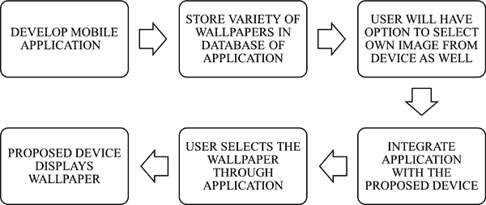

**FIGURE 5.1**

所提方法的流程图。

# 5.6 所提设备的工作](#07chap_05.xhtml_sec5_6a)

所提出的设备将用于在墙上显示用户选择的颜色。它将由高质量的金属球或光滑的立方体结构组成，使用激光测量工具测量墙的高度和宽度，以精确显示颜色/图像。将为用户开发 Android/iOS 移动应用程序，以便他们更容易随时更改设置。所提出的设备将使用 `USB-C` 充电线充电，并包含一个带有 `Type C` 适配器连接到电源。充电时间将取决于使用情况。它内部安装了 4000 mAh 电池。如果连续连接到电源，使用效果最佳。

已经完成了用户选择的数据库的创建，并将选择添加到数据库中以显示壁纸。用户最终可以从各种选项中选择：根据他们的心情或选择或意愿提供 1,000 多种壁纸选项。它将包括纯色、纹理、图案和图像。

然后，一旦选中，壁纸将显示在墙上给用户看。通过手机安装的遥控器或应用程序将提供随机更改壁纸或永久固定直到更改的选项。

图 5.2 显示了左下角的设备正在投影以翻转过渡磁片的形式显示。这里显示了所提设备的工作步骤：

1. 当检测、放置并根据所提算法时，磁砖将向右移动。
2. 一旦检测到边缘，它将再次通过算法进行分析并向左移动。
3. 磁砖将继续检测边缘并分析墙，直到找到物体。一旦找到物体，它将遵循两个新规则：
    - 检测物体后的磁砖不会向后或向前移动，而是检测左侧是否有空间。当一个循环完成后黑色箭头位于物体上方时，它将向左移动，因为这是唯一的方法。
    - 一旦磁砖处理循环开始进行，它将检测预加载的磁砖。它还将检测已经放置磁砖的地方。这将算法中的一个关键部分，因为用户不想重复他们选择的图片。
4. 在纯色情况下，不需要再次检测磁砖，因为目的是为了用颜色填充墙壁。
5. 完成后，它将停止并显示整个图像，因此墙的整个计算将完成，图片/颜色/纹理将显示在整个墙上。

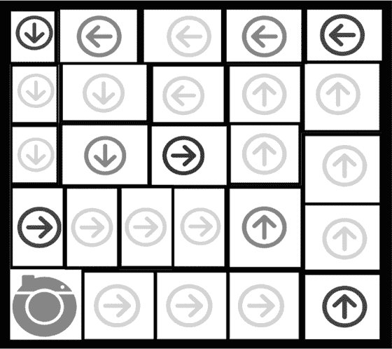

**FIGURE 5.2**

智能设备的工作。

# 5.7 结果与讨论](#07chap_05.xhtml_sec5_7a)

所提出的方法将在几秒内让任何无聊的房间变成精彩的房间；一种可以占据整个墙并让每天看起来不同的无边框显示。想象一下，只需通过手机大小的设备上的简单应用程序就能控制墙的外观将是多么神奇。它将改变智能室内设计。翻转磁砖显示将赋予它一种未来感和现代感，真正让家居成为智能家居。所提出的设备将使用最高质量的适配器和激光技术，以确保每次测量都精确。


这项工作对智能家居服务的接受和部署的关键因素进行了分析性观察。研究结果表明，需要互联性、可靠性以及可接受的自动化程度。此外，由于根据客户特征对变量的选择存在差异，已经证实考虑这些特征的业务设计至关重要。如果考虑到这些因素，过去未被允许的智能家居服务将会普及，市场也会随之增长。所提议工作的结果是一个智能设备，它可以将家里任何类型的简单墙面变成完全不同的墙面。人们使用壁纸并在墙壁上花费大量金钱；他们可能会对墙色感到厌倦，但由于其永久性而只能接受。对于这种设备来说，它不仅是一次性投资，更是智能家居环境的未来。用户只需购买一次该设备，即可通过智能手机或遥控器点击一下来控制墙色。这两种方案都供用户选择，方便所有人使用。

## 5.8 结论

随着技术的发展，也启动了各种研究计划。今天，智能家居不仅仅是一个像计算机这样的远程操作中央测量系统。显然，人们与智能家居的生活将变得更加成功和愉快。智能家居将始终受到家庭自动化的保护，因此用户有大量时间专注于其他事情。因此，随着智能家居的普及，本章讨论的智能设备将引发智能家居环境的变化。墙面图案的改变在不久的将来对人们无疑非常有用。

所提设备需要能够运行智能手机、智能电视等设备。持续的能量消耗是该设备的必要条件。所提设备使用边缘检测算法，因此每个设备始终覆盖一面墙。如果用户希望改变多面墙的颜色，则必须购买不同的设备。这些局限性使得设备价格昂贵。然而，智能家居技术对于关注安全、舒适同时也关注节能的人来说是一个很好的选择。预计随着越来越多的新技术的探索，智能家居将变得更加流行。

## 参考文献

[1.] V. Ricquebourg, D. Menga, D. Durand, B. Marhic, L. Delahoche, and C. Loge, “The smart home concept: Our immediate future,” in 2006 1ST IEEE International Conference on E-Learning in Industrial Electronics, pp. 23–28, IEEE, Hammamet, Tunisia, 2006.

[2.] W. K. Edwards and R. E. Grinter, “At home with ubiquitous computing: Seven challenges,” in Ubicomp 2001: Ubiquitous Computing, pp. 256–272, Springer, Berlin, Germany, 2001.

[3.] Paul Lin, “Disadvantages of a Smart Home” [Online], Available: http://www.ehow.co.uk/list_7631272_disadvantages-smarthome.html [2012, October 19].

[4.] Heetae Yang, Wonji Lee, and Hwansoo Lee, “IoT smart home adoption: The importance of proper level automation,” Hindawi Journal of Sensors, vol. 2, pp. 1–11, 2018.

[5.] N. Balta-Ozkan, R. Davidson, M. Bicket, and L. Whitmarsh, “Social barriers to the adoption of smart homes,” Energy Policy, vol. 63, pp. 363–374, 2013.

[6.] Jackie Craven, “What Is a Smart House?” [Online], Available: http://architecture.about.com/od/buildyourhous1/g/smarthouse.htm [2012, October 18].

[7.] V. Ricquebourg, D. Menga, D. Durand, B. Marhic, L. Delahoche, and C. Loge, “The smart home concept: Our immediate future,” in 2006 1ST IEEE Int. Conference on E-Learning in Industrial Electronics, pp. 23–28, IEEE, Hammamet, Tunisia, 2006.

[8.] W. K. Edwards and R. E. Grinter, “At home with ubiquitous computing: Seven challenges,” Ubiquitous Computing, pp. 256–272, Springer, Berlin, 2001.

[9.] Y. Nakamura, Y. Arakawa, T. Kane, M. Fujiwara, and K. Yasumoto, “Sen: Comprehensive sensing platform with ultra tiny all-in-one board,” Journal of Sensors, vol. 2017, Article ID 6308, 2017.

[10.] A. Leeraphong, B. Papas, and V. Sarac, “A study on factors influencing elderly intention to use smart homes,” 10th International Conference on e-Business, Bangkok.

[11.] V. D. Vaidya and P. Vishwakarma, “A Comparative analysis on smart home system to control, monitor and secure home, based on technologies like GSM, IOT, Bluetooth and PIC microcontroller with ZigBee modulation,” 2018 International Conference on Smart City and Emerging Technology (ICSCET), Mumbai, India.

[12.] H, “User acceptance of smart home services: An extension of the theory of planned behavior,” Industrial Management & Data Systems, vol. 117, no. 1, pp. 68–89.

[13.] [Online], Available: http://www.ehow.co.uk.

[14.] M. Sripan, F. Lin, and M. Petch, “Research and thinking of smart home based on technologies,” 2012 International Conference on Systems and Electronic Engineering (ICSEE), Phuket, Thailand.

[15.] G. Tripathi, D. Singh, and A. J., “A survey of Internet-Things: Future vision, architecture, challenges and service,” IEEE World Forum on Internet of Things (WF-IoT), 2014, pp. 287–292.

[16.] B. Lia and J. Yo, “Smart home,” Advanced in Control Engineering and Information, 15.

[17.] L. Jiang, D.-Y. Llu, and B. Yang, “Smart home research,” Proceedings of the Third International Conference on Machine Learning and Cybernetics, Lanzhou, China, 659–663.

[18.] H. Hagras, V. Callaghan, G. Clarke, M. Colley, A. Pounds-Cornish, and H. Duman, “Incremental synchronous learning for embedded-agents operating in ubiquitous computing environments, the international series,” Frontiers in Artificial Intelligence and Application, pp. 25–54.

[19.] K. Agarwal, A. Agarwal, and G. Misra, “Review and performance analysis on wireless smart home and home automation using IoT,” 2019 Third International Conference on I-SMAC (IoT in Social, Mobile, Analytics and Cloud) (I-SMAC), Palladam, India, 2019, pp. 629–633.

[20.] T. Chaurasia and P. K. Jain, “Enhanced smart home automation system based on Internet of Things,” 2019 Third International Conference on I-SMAC (IoT in Social, Mobile, Analytics and Cloud) (I-SMAC), Palladam, India, 2019, pp. 709–713.

[21.] D. Vasicek, J. Jalowiczor, L. Sevcik, and M. Voznak, “IoT Smart Home Concept,” 2018 26th Telecommunications Forum (TELFOR), Belgrade, Serbia, 2018, pp. 1–4.


23. S. K. Vishwakarma, P. Upadhyaya, B. Kumari, and A. K. Mishra, “基于物联网的智能节能家居自动化系统,” 2019 第 4 届国际物联网会议：智能创新与应用 (IoT-SIU), 印度加齐亚巴德, 2019, 第 1–4 页。

# 增强现实与虚拟现实在日常生活中的重要性

**Vallidevi Krishnamurthy**
计算机科学与工程系，SSN 工程学院，安纳纳大学，金纳里，印度

**D. Venkata Vara Prasad**
SSN 工程学院，安纳纳大学，金纳里，印度

**Ganesh Kumar**
计算机科学与工程系，SRM 大学，金纳里，印度

**B. Surendiran**
计算机科学与工程系，普杜特里国立理工学院，普杜特里，印度

**Arjith Natarajan**
CSE 系，SSN 工程学院，安纳纳大学，金纳里，印度

**Akshaya Natarajan**
CSE 系，SSN 工程学院，安纳纳大学，金纳里，印度

**Dattuluri Rushitaa**
ECE 系，SSN 工程学院，安纳纳大学，金纳里，印度

## 目录
* 6.1 引言
* 6.2 文献综述
* 6.3 应用
    * 6.3.1 增强现实及其应用
    * 6.3.2 虚拟现实及其应用
* 6.4 研究方法
    * 6.4.1 术前诊断系统
        * 6.4.1.1 数据收集模块
        * 6.4.1.2 3D 模型构建
        * 6.4.1.3 医学数据关联器
        * 6.4.1.4 技术及其定义
    * 6.4.2 针对聋哑儿童的智能教育系统
    * 6.4.3 基于电子学习的虚拟汽车驾驶系统
* 6.5 结果与讨论
* 6.6 结论
* 参考文献

## 6.1 引言

增强现实（AR）带来的基本价值在于，它将数字世界的因素引入人类对现实世界的理解中。通过 `AR`，人们可以将任何物体增强到现实世界中。目前已有许多操作实施了 `AR`，还有许多操作正尝试在各自的领域中使用 `AR` 实现其应用。20 世纪 90 年开发的首个 `AR` 应用被用于飞行员训练 [1]，从那时起，其应用已涵盖各个领域。当 `AR` 用于那些在现实生活中通常难以实现的训练目的时（例如飞行员训练、医学诊断、医学实验、军事训练和汽车工业），其重要性尤为显著。`AR` 物联网（IoT）和虚拟现实（VR）等技术已发展到使得人工智能听起来像是一个可以轻松完成的任务。本章解释了一种节省医学诊断中初步检查时间的模型。

通过将患者详情数字化传输给医生，消除了初步检查过程，因此医生可以在信息可用时对其进行评估。医生可以进一步针对患者建议所需的检查和诊断。`AR` 可用于医学教育，增加课堂上的学生互动，并在课堂上进行更多实践性的讨论。这将激发学生的兴趣。`VR` 将人带到特定场所，并让他们在学习过程所需的环境中学习新事物 [2, 3, 4]。在 `VR` 中，根据需求创建一个全新的环境。另一方面，在 `AR` 中，图像是叠加在现实世界中的，而不是创建一个全新的环境。`AR` 补充了现实，而不是完全取代它。虚拟对象投影出用户无法通过感官直接观察的信息。`AR` 不仅增加了我们的学习曲线，还提高了大脑的生产力。它改变了人们思考、工作和学习的方式。不再仅仅从一个角度观察概念，还可以获得同一概念的多个角度。

本章还解释了如何通过电子学习界面使用 `VR` 在生活中学习开车。为了实现这一点，构建了一个 `VIRECAR`，这是一个虚拟现实汽车模拟器，它利用上述技术，通过 `Google Cardboard`、`Leap Motion` 和 `Trinus VR` 应用提供一个连贯且易用的环境，这些应用程序在桌面端和头戴设备之间提供接口。

## 6.2 文献综述

`AR` 技术正通过 `AR` 和三维（3D）可视化用于教育中的交互式环境，White 等人对此进行了解释 [5, 6]。`AR` 已用于动力融合技术，通过动力摄像实时开发 3D 模型 [7]。[8, 9] 讨论了 `AR` 在教育环境中的优缺点。Agrawal 和 Thakur 在 [10] 中讨论了 `AR` 在日常生活中的演变和近期实践。研究论文，即 Lee 等 [11] 以及 Ng 和 Komiya [12]，通过结构方程建模法讨论了通过桌面 `VR` 增强学习成果的虚拟环境在电子学习中的重要性[13] 解释了通过社会学习成果对教育进行的定量分析。在许多日常应用中，人工智能通过 `IoT` 实现，并在 [14] 中对其进行了详细解释。Sergey 等人 [5] 讨论了利用 `AR` 和三维可视化进行教育的集体包容。Saidin 等人 [8] 回顾了虚拟环境在电子学习中的重要性。Agrawal 和 Thakur [10] 会谈了 `AR` 在日常生活中的近期实践。在 [9, 15, 16] 中检查了电子学习和基于电子学习的用户技能提升。Bouras [17] 解释了 `AR` 的应用。


关于近期智能机器人系统进展的特别专题包含五个不同的章节 [18]，旨在引导读者进入不同的领域，例如车辆自动驾驶中的车道检测系统、具有语音功能的移动控制机器人等。Gandhi 和 Patel [19] 详细讨论了不同类型的虚拟现实及其工作原理。Zhao 等人 [20] 详细讨论了如何利用触觉和听觉手杖技术等 VR 技术来帮助视障人士。Parvinen 等人 [21] 讨论了使用 AR 和 VR（两者结合）进行微轨道（minitrack）的应用。Deshmukh 等人 [22] 讨论了使用 AR 创建 3D 视频模块的四种方法，这四种方法分别是智能手机/电脑、`Unity`、Vuforia 和服务器。Bottino 等人 [23] 详细讨论了全息除律（Holo-Defibrillation），该技术利用增强现实和基础生命支持支持（BLSD）概念将虚拟与现实生活的工作场所相结合。Gaikwad 等人 [24] 详细讨论了通过 AR 和 VR 实现混合现实技术及其各个方面。Stone [25] 定义了英国一项研究的阶段和结果，该研究通过先进的人机界面结合远程存在感和 VR 技术，促进了“自然”或“直观”接口的开发。

# 6.3 应用 (#08chap_06.xhtml_sec6_3a)

本章讨论了两种技术及其应用。第一种技术 AR 结合了两个应用进行了讨论，即术前诊断系统和针对聋哑人士的智能教育系统。在术前诊断系统中，医生可以与资深人员进行讨论以确认诊断程序。所有医疗文件都可以数字化的发送，患者的 3D 图像可以帮助远程的医生确定其检查结果。同样，该技术也可用于教育目的。医生可以通过获得这些器官的增强视图来理解所有器官的内部工作机制。此外，即使是聋哑儿童在生物课上也可以通过视觉触摸和感受每一个器官，从而更好地理解这些概念。本章讨论的第二种技术是 VR。基于电子学习的虚拟汽车驾驶系统（`VIRECAR`）是实现的应用，其实验结果也列成表。

## 6.3.1 增强现实及其应用 (#08chap_06.xhtml_sec6_3_1a)

为了评估虚拟对象在环境中的何种位置应该是隐藏，考虑了以下方法：

1. **基于标记的方法：**
在此方法 [26] 中，会预先提供待检测的图片和相应的图片描述。使用的标记可以是 QR 码或黑白方形镜子。

2. **无标记的方法：**
在无标记方法 [27] 中，AR 应用会识别预先间接提供应用的内容。这种情况执行起来要困难得多，因为运行在 AR 应用程序中的识别算法必须识别摄像帧中可能存在的模式、颜色或其他特征。

医学领域的技术进步已经达到了使诊断变得非常简单高效的程度。医生可以将 AR 作为手术的可视化化技术和训练辅助工具 [7]。患者的输入数据可以是图像，也可以是关于心率的元数据等，这些将与患者的 3D 全息图一起传输给医生。因此，通过在该领域使用 AR，可以为医生提供完整的视野，例如患者的 X 光片。目标是确保诊断过程得到加速。在传输图像时，有很多由于传输而向图像添加额外噪声的机会。在这种情况下，可以实施 [28] 中讨论的基于卷积神经网络（`CNN`）的去噪算法来解决这个问题。[29] 中讨论了一种带有 AR 的上下文驱动可视化工具。[30] 中讨论了过去十年制造业中基于 AR 技术的研究工作综述。

## 6.3.2 虚拟现实及其应用 (#08chap_06.xhtml_sec6_3_2a)

基于电子学习的虚拟汽车驾驶系统（`VIRECAR`）在第 6.4.3 节 中解释。汽车驾驶系统提供了道路安全措施，可以帮助学习者避免事故。`VIRECAR` 是一个 VR 汽车模拟器，旨在教育学习者开车，目的是简化学习过程。

# 6.4 研究方法 (#08chap_06.xhtml_sec6_4a)

本节通过相应的图表解释了术前诊断系统、智能教育系统和基于电子学习系统的三个应用。其中，基于 VR 的电子学习系统得到了实现，并通过反馈机制对系统进行了分析。

## 6.4.1 术前诊断系统 (#08chap_06.xhtml_sec6_4_1a)

一种旨在简化医生/患者初步检查的系统如图图 6.1

**图 6.1**

术前诊断系统。

### 6.4.1.1 数据收集模块 (#08chap_06.xhtml_sec6_4_1_1a)

系统的第一个模块包括收集患者数据。这在临床场所进行。患者数据包括初步医学检查数据，如温度、呼吸水平和血压。

收集和采集将由助理进行，助理使用相应的设备捕捉这些数据。然后使用 `Kinect` 摄像头捕捉患者图像，利用适当的深度和颜色生成患者的 3D 图像。


### 6.4.1.2 3D 模型构建

需要记录视频，并在 Kinect 摄像机的帮助下展示患者。这些是带有传感器的特殊摄像头，可以动态检测患者的深度。图像和视频通过深度摄像头捕获，看起来像 2D 图像。当这些图像输入 `Kinect Fusion` 时，将生成捕获的场景及对象的 3D 模型。

1. **转换：** 2D 图像的转换可以通过 `Kinect APIs` 完成。虽然可以使用 `Kinect Fusion` 实时完成 2D 图像到 3D 建模 [7]，但这种方法通过单独处理来换取更准确、更详细的模型。尽管该过程花费了大量时间，但实现了渲染出的 3D 图像达到所需的质量。然后将以照片形式捕获的图像叠加到 3D 对象上，以提高对象的真实性。同样的过程也适用于接受检查的身体任何特定部位。

2. **排除：** 当前关注的对象仅为患者及其生命体征；环境中存在的任何其他物体都可以忽略。因此，系统的这一组件负责移除其他物体。使用 Kinect 摄像头无法进行选择性图像捕获，因此采用的方法是从场景中移除其他不必要的物体。这种额外的处理可以通过任何图像/图形处理库实现，如 `OpenCV`、`OpenGL` 等步骤如下：
    * 检测不必要的表面
    * 迭代选择它们
    * 移除
针对每个患者的方法可能会有所不同。

3. **处理顺序：** 按特定顺序处理视频是理想的。首先构建 3D 模型，然后从视频中移除背景物体。然而，由于周围区域存在对深度感知至关重要的物体，这种反转可能无效。

### 6.4.1.3 医学数据关联器

患者的数据包括其外貌；大多数情况下，患者带着主诉来，而没有具体的细节。在所有的医学体检中，特定患者的主诉构成了数据收集器的核心。患者叙述并由医疗助理记录的主诉是任何决策的关键信息；同时也包括了关于患者心理状态的一般记录/观察。收集的数据包括生命体征和基础检查/检查。

### 6.4.1.4 技术及其定义

所提系统的意图是使用一些现有的软件技术，使初步诊断过程变得毫不费力且简单。这里对使用的某些技术进行了明显的定义。本节供对某些技术定义没有清晰概念的读者。

1. **Kinect Fusion：** `Kinect Fusion` [7] 是一种近期且广泛获取的设备传感器平台，它整合了基于光的复合深度传感器。手持摄像机的原始代无框架捕获，同时对大屏幕进行对齐，确保了增强现实和混合现实应用的高级能力。关于允许使用手持 Kinect 扩展传感器对物体进行实时、沉浸式还原的早期结构研究，其准确方法可以在 [7] 中找到。用户可以轻松拿起并移动 Kinect 设备，实现频繁更新、平滑且完全融合的 3D 表面结构。

2. **Unity 3D Kit：** `Unity` 主要用于为计算机创建 3D 和 2D 游戏。它可以被定义为用于创建模拟的平台游戏引擎。`Unity` 可以与 AR 结合使用，创建将物体叠加到当前世界中的游戏应用。Pokémon Go 是使用 AR 的游戏示例之一。为了构建应用，使用了 `Unity` 的 SDK（软件开发包），称为 `Vuforia`。它利用计算机视觉技术识别物体、注册它们的位置并对其进行定向。`Vuforia` 是一项免费技术，是实现目的的理想解决方案。

3. **HoloLens：** 作为今天市场上获取的早期增强现实头戴设备之一，微软的 `HoloLens` 可能对 AR 应用的发展产生深远影响 [31]。`HoloLens` 是一个坐式显示单元，连接到柔性的软内部头戴设备上，可以使 `HoloLens` 上下以及左右移动。

### 6.4.2 针对聋哑儿童的智能教育系统

名为 `EduAR` 的技术新时代由可以部署在教育领域的全息 AR 组成。AR 增加的是通常看到的现实，而非改变现实。`EduAR` 的最终目标是创造一种可以接受且自然的沉浸感，使得理解和解释必须学习的内容变得极其容易。与去年相比，今天的教育在很大程度上得到了改进和扩展，以至于跟进和跟踪教学的所有内容变得困难。这正是 `EduAR` 发挥作用的地方。`EduAR` 的独特功能之一是减轻聋哑学生的学习。通过他们的视觉和 `EduAR`，这些学生可以像任何其他学生一样轻松地理解概念。

考虑一个生物课的场景。使用 `EduAR`，利用大脑的全息图像来解释微小且复杂的部分，在现实中，教师仅根据教科书很难描述这些部分。结果是，`EduAR` 帮助学生从视觉上理解大脑如何工作，从而帮助他们在手术中表现得更好。它还让医学生通过与虚拟环境互动来获取人体解学信息和感知，而在这种环境中患者不会面临风险。

教学和学习必须不仅仅是记忆的简单知识传递。`EduAR` 改进了学生的学习体验，从而培养个人兴趣。许多拥有大脑或心脏 3D 模型的实验室并没有提供关于大脑深层的很多信息，这将是 `EduAR` 的主要优势之一。此外，通过 `EduAR`，动态标记将成为资产。教师可以根据需要修改或添加部位标签，而不需要每次购买新的 3D 模型。因此，`EduAR` 侧重于改变整体教育体验。

在研究论文 [32] 中，用 AR 概念解释了一种帮助技术人员处理困难电子设备的引导系统。使用 AR 概念已经更轻松地为技术人员进行了大量的培训。

### 6.4.3 基于电子学习的虚拟汽车驾驶系统


利用 VR（虚拟现实）概念，可以实现高真实度的真实世界场景模拟。VR 环境的这种特性为电子学习提供了优势，学习者可以以虚拟方式学习现实问题的解决方案。手势识别是另一种作为人机交互手段的技术，其普及程度稳步增加。特定的手势可以被翻译为执行特定的任务。有了 `Leap Motion` 等手势检测设备，与环境进行通信的手势检测已变得简单易用。将此类技术与学习过程相结合提供了许多获益的方法，这些方法可以被用来简化学习过程。在实施 `VIRECAR` 虚拟模拟系统后，对 12 名持照驾驶员和 12 名驾驶新学者的样本反馈进行了分析。

本章分三个阶段解释了从 `VIRECAR` 获得的学习体验：第一阶段被视为电子学习中的“课前内容”（Pre-Class Content），第二阶段被视为“课内内容”（In-Class Content），第三阶段被视为“课后内容”（Post-Class Content），而电子学习的这三个阶段已在 [13, 14] 中进行了解释。

1. 在`第一阶段——驾驶基础`（Basics of Driving）中，用户需要理解交通运输局规定的道路和安全条例，还需要理解汽车的基本功能。在完成此阶段后，学习者需要参加一项测试，以评估他们驾驶基础的能力。
2. 在`第二阶段——通过 VIRECAR 学习`（Learning through VIRECAR）中，使用 `VIRECAR` 来理解汽车的工作原理并适应驾驶环境。在此阶段，引入了教练的概念。此阶段的教练会定期出现，评估学习者所进行的学习过程并在必要时提供反馈。
3. 在`第三阶段——实际驾驶`（Actual Driving）中（这也可以描述为课后练习），根据从 `VIRECAR` 获取的结果驾驶真实的汽车。在这个阶段，教练全职在场，这允许他们提供反馈。

此阶段的学习者被预期根据从第二阶段获得的经验和反馈以及从第一阶段获得的规则法规知识来驾驶。上述三个步骤的首次发生构成了学习过程的第一次迭代。在随后的迭代中，学习者不需要再次经历第一阶段，因为进入第二阶段的要求是掌握第一阶段的概念。因此，这里使用了反向传播的概念。

根据从 `VIRECAR` 电子学习过程第三阶段获得的反馈，学习者可能在现实世界中获得该经验之前，先从虚拟环境中获得更多经验。本质上，学习者被预期体验驾驶的各个方面，包括换挡、使用踏板进行加速、刹车和离合器、转向方向盘等。这为学习者提供了一个安全的环境，使其能够有效体验本章描述的旨在学习正确驾驶汽车的学习过程。

## 6.5 结果与讨论

为了分析本章描述的 `VIRECAR` 模拟系统，对一个 12 名持照驾驶员的样本进行了测试，并通过他们的反馈评估了 `VIRECAR` 的效率。他们按照如图 6.2 所示的方式介绍了整个系统。此外，他们被要求尝试模拟器以回答某些认为对评估 `VIRECAR` 至关重要的问题。

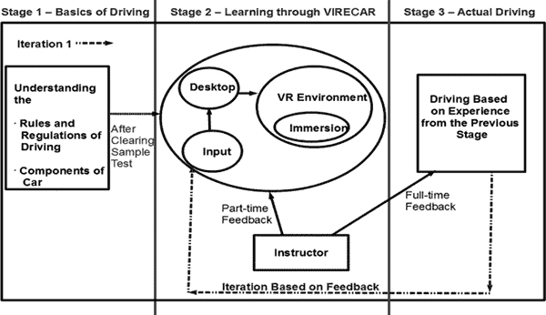

**图 6.2**

`VIRECAR` 中的电子学习过程。

提出的一些问题包括：

1. 它离现实有多近？
2. 它对理解驾驶场景有多帮助？
3. 该系统在学习规则和条例方面有多用？
4. 如果你没有开过实际汽车，你会倾向于使用 `VIRECAR` 进行学习吗？
5. 你认为你通过 `VIRECAR` 纠正任何错误吗？

表 6.1 显示了用于所提系统测试目的的驾驶员详情。这些驾驶员已经获得了执照并知道如何驾驶。考虑不同年龄组和性别的熟练驾驶员来测试系统，反馈如表 6.2 所示。

*表 6.1*

驾驶员详情——用于所提工作的样本测试

| 驾驶员年龄范围 | 数量 | 驾驶员性别 |
| --- | --- | --- |
| 20 到 25 岁 | 4 | 3 男 1 女 |
| 26 到 30 岁 | 5 | 2 男 3 女 |
| 31 到 40 岁 | 3 | 2 男 1 女 |

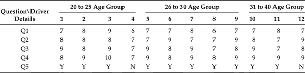

*表 6.2*

`VIRECAR` 不同测试驾驶员对问题的反馈

表 6.3 显示了从 `VIRECAR` 测试人员处获得的汇总数据。驾驶员对关于驾驶场景和理解规则条例的问题给了 7.833 和 8.167 的平均分。

*表 6.3*

`VIRECAR` 电子学习过程第三阶段获得的反馈

| 问题 | 平均分 |
| --- | --- |
| Q1 | 7.250 |
| Q2 | 7.833 |
| Q3 | 8.167 |
| Q4 | 8.667 |
| Q5 | 10–是; 2–否 |

该系统被提供给一家驾驶学校，12 名女性学习者使用该系统接受培训。这些初学者对该系统非常满意。这些学习者的年龄都在 35 岁以上。

## 6.6 结论

尽管 AR 和 VR 看起来很有吸引力，但在实际实施方面面临许多挑战。它们分为两类：技术和社会。从技术角度来看，需要许多组件才能使系统正常运行。物体识别是任何 AR 系统的第一步。如果现实世界的物体与虚拟世界不对齐，两个世界的幻象就会受到影响。因此，组件的质量是一个需要考虑的重要因素。传感器读数不准确和模式识别差会极大影响准确性。从社会角度来看，AR 仍处于处于阶段，尚未广为人知。同样，VR 在实施方面也存在问题，因为它需要更多的组件和需要学习的技术。

AR 和 VR 有更多应用可以更有效地融入日常生活。尽管存在许多实施问题，这些技术有其自身的优势，即在初始学习过程中不会产生风险。

## 参考文献

1. T. P. Caudell, D. W. Mizell, “增强现实：抬头显示器技术在手动制造工艺中的应用,” 第二十五届夏威夷国际系统科学会议，凯夷，1992, pp. 659–669.

2. J. Hayes, “虚拟现实进入现实世界，” 工程与技术期刊, 3(14), 2008, pp. 60–62.


3. L. Sharma, N. Lohan，“基于 BGS 技术的移动物体检测性能分析，《国际时空数据科学期刊》，Inderscience, 2019 年 2 月, 1(1), pp. 22–53. (ISSN: 2399-1275) 数字对象标识符 (doi): 10.1504/IJSTDS.2019.097607。

4. L. Sharma, A. Singh, D. K. Yadav，“热视频中移动人体检测的基于费舍线性判别率的阈值，《红外物理与技术》，Elsevier, 78, 2016 年 3 月, pp. 118–128 (ISSN: 1350-4495, SCI 影响因子: 2.31)。

5. J. White, D. C. Schmidt, M. Golparvar-Fard，“增强现实的应用，《IEEE 会刊》 102(2), 2014, pp. 120–123.

6. S. Sannikov, F. Zhdanov, P. Chebotarev, P. Rabinovich，“基于增强现实和 3D 可视化的交互式教育内容，《第四届国际青年科学家计算科学会议》，希腊雅典，2015, pp. 720–729。

7. R. A. Newcombe, S. Izadi, O. Hilliges, D. Molyneaux, D. Kim, A. J. Davison, P. Kohli, J. Shotton, S. Hodges, A. Fitzgibbon，“KinectFusion: 实时密集表面映射与跟踪，《2011 年 IEEE 混合与增强现实国际研讨会论文集》，瑞士巴塞尔, 2011 年 10 月 26–29 日。

8. N. F. Saidin, N. D. Abd Halim, N. Yahaya，“教育中增强现实研究综，《国际教育研究》13, 2015, pp. 1913–9039。

9. K. N. Senthil，“通过在线学习提升技能：前景与问题，《远程教育与在线学习在线期刊》，4(3), 2016, pp. 24–32。

10. C. Agarwal, N. Thakur，“增强现实的演变与未来前景，《国际计算机科学问题》，11(6), 第 1 期, 2014 年 11 月。

11. E A-L. Lee, K. W. Wong, C. C. Fung，“桌面虚拟现实如何增强学习成果？一种结构方程建模法，《Elsevier 计算机与教育》，55(4), 2010, pp. 1424–1442。

12. K. Hui Ng, R. Komiya，“虚拟教育环境的多媒体教材，《工程科学与教育期刊》，11(2), pp. 73–79。

13. D. Georgios，“调查社交学习网络的教育价值：定量分析，《交互式技术与智能教育》，13(4), 2016, pp. 305–322。

14. A. Ghosh, D. Chakraborty, A. Law，“物联网中的人工智能，《CAAI 智能技术报》，3(4), 2018, pp. 208–218。

15. U. Vladimir，“智能教育与智能在线学习”，Springer 出版公司，瑞士，2015。

16. R. Gleadow，“为学习设计——一个科学单元混合学习的案例研究，《F1000 研究》，4, 2015, p. 898。

17. C. Bouras，“通过分布式虚拟环境进行在线学习，《网络与计算机应用期刊》，24, 2001, pp. 175–199。

18. W. Yuan, M. Yang, H. Li, C. Wang，“通过多状态模型实现高精度车道保持端到端学习，《CAAI 智能技术报》，3(4), 2018, pp.185–190。

19. R. D. Gandhi, D. S. Patel，“虚拟现实与机遇，《工程技术国际研究期刊》05(01), 2018。

20. Y. Zhao, C. L. Bennett, H. Benko, E. Cutrell, M. Morris, M. Sinclair，“通过触觉和听觉手杖让残障人士能够在虚拟现实中导航，《CHI ‘18: 计算中的人类因素会议》，加拿大蒙特利尔，2018。

21. P. Parvinen, J. Hamari, E. Pöyry，“Minitrack 简介：混合、增强与虚拟现实，《第 51 次夏威国际系统科学会议》，威基科洛村，2018。

22. S. S. Deshmukh, C. M. Joshi, R. S. Patel, Dr. Y. Gurav，“增强现实中的 3D 物体追踪与操控，《第 3 次教育当前问题国际会议论文集 (ICCIE 2018)》，印度尼西亚，2018。

23. A. Bottino, P. Ingrassia, F. Lamberti, F. Salvetti，“Holo-SD: 一种基于增强现实的引导式学习，《IMS 会》，洛杉矶，2018。

24. D. Gaikwad, A. Chikane, S. Kulkarni，“基于增强现实共享虚拟世界，《工程技术国际研究期刊》05(01), 2018。

25. R. J. Stone, “非结构化环境中的远程机器人，《高级机器人国际会议》，意大利比萨，1991。

26. Y. Genc, S. Riedel, F. Souvannong, A. Akinlar，“基于 AR 的无标记追踪，《第 23 次国际模式识别会议 (ICPR)》，墨西哥坎昆，2016, pp. 1059–1064。

27. E. Mendez, D. Kalkofen, D. Schmalstieg，“增强现实的交互式上下文驱动工具，《IEEE/ACM 混合与增强现实研讨会》，2006, pp. 295–304。

28. C. Tian, Y. Xu, L. Fei, J. Wang, N. Luo，“用于图像去噪的增强 CNN，《CAAI 智能技术报》，4(1), 2019, pp. 17–23。

29. E. Bottani，“制造业中的增强现实技术：过去十年的回顾，《IISE 交易》，51(3), 2019, pp. 284–310。

30. M. Garon, P. O. Boulet, J. P. Doironz, L. Beaulieu, J. F. Lalonde，“HoloLens 上的实时高分辨率 3D 数据，《2016 IEEE 混合与增强现实研讨会 (ISMAR-Adj)》，墨西哥梅里达，2016, pp. 189–191。

31. A. F. Abate, M. Nappi, F. Narducci, S. Ricciardi，“工业环境的混合现实系统：一项评估研究，智能机器人最新进展特刊，《CAAI 智能技术报》，2(4), 2017, pp. 182–193。

# 第三部分

# 第 7 章 物联网与人工智能

Shailja Gupta
计算机科学技术系，Manav Rachna 大学
法里达瓦，印度

Mayank Khattar
计算机科学技术系，Manav Rachna 大学
法里达瓦，印度

## 目录

* 7.1 人工智能导论
* 7.2 物联网导论
* 7.3 物联网对人工智能的需求
* 7.4 增强型物联网的功能视图
* 7.5 增强型物联网设备的智能解决方案
* 7.6 增强型物联网的预防措施
* 7.7 使用增强型物联网的关键变化
* 7.8 增强型物联网的益处


# 7.9 基于物联网与人工智能的现实应用

### 7.9.1 自动驾驶汽车
### 7.9.1.1 工作原理
### 7.9.1.2 系统的优点
### 7.9.1.3 系统的缺点
### 7.9.1.4 提出的模型

## 7.9.2 教室考勤监控系统
### 7.9.2.1 过去考勤监控系统的架构
### 7.9.2.2 基于人脸识别系统的架构
### 7.9.2.3 系统的优点
### 7.9.2.4 系统的缺点
### 7.9.2.5 提出的模型

### 7.9.3 智能家居管理系统
### 7.9.3.1 系统架构
### 7.9.3.2 智能家居管理系统的优点
### 7.9.3.3 智能家居管理系统的缺点
### 7.9.3.4 建议工作

## 7.10 结论

## 参考文献

**关键词：** `artificial intelligence`, `internet of everything`, `machine learning`

# 7.1 人工智能简介

人工智能（AI）是一种被视为人类共享智能替代品的计算工具。它赋予了机器执行本质上由智能生物完成的任务的能力。人工智能已经在家庭、医疗保健、制造业、银行业、零售业和实验室的日常生活中找到了位置 [1]。这是一门研究理解和模仿人类智能、智能行为以及智能行为规律的课程。其主要任务是建立一种智能信息处理理论，然后设计一些能够展示某些类似人类智能行为的计算机系统。人工智能能力是由智能机器执行的与人类智能相关的行为，例如判断、推理、证明、识别、感知、理解、交流、设计、思考、学习、问题解决和其他思维活动。人工智能涵盖的各个领域以及物联网（IoT）可以轻松应用的领域包括：

1. **医疗保健中的人工智能：** 这用于协助患者预约、计费流程、反馈和随访预约。医疗行业中的聊天机器人通过虚拟助手帮助患者，提供一个平台让患者可以根据输入的症状信息轻松地提问。患者还可以从聊天机器人处获得处方和建议。医疗行业通过 `IBM Watson` 提供此类支持，它可以理解患者用自然语言提出的问题，并做出相应的回答。对于医疗研究行业来说，挖掘患者数据并建立假设有助于更好地训练机器，并提高提供给患者的指导质量和效率 [2]。

2. **商业中的人工智能：** 人工智能已以后人的形式应用于机器，以自动执行需要大量劳动力的重复任务。通过机器学习算法持续分析数据，生产中的错误率也降低了。这还通过分析提供的反馈更好地了客户。这是通过在网站上整合聊天机器人实现的，它们对查询提供自动回复 [3]。

3. **教育中的人工智能：** 人工智能通过分析表现、使用自动评分系统以及根据学习者的类型提供反馈，帮助教育者更好地理解学生。AI 导师在学生需要时提供支持，帮助他们保持在学习轨道上。教育领域的聊天机器人为学生提供指南，随时随地对疑疑问提供解决方案 [4]。

4. **金融中的人工智能：** 金融服务中的人工智能为用户提供智能解决方案或智能建议。一些金融应用如 `Turbo Tax` 和 `Intuit's Mint` 收集用户数据、建立用户画像并为其提供财务建议。像 `IBM Watson` 等程序被客户用于做出更好的决策，例如选择服务、贷款要求、识别投资机会。

5. **法律中的人工智能：** 人类面临的一个大挑战是查阅大量文档以寻找特定信息。通过人工智能提供聊天机器人来实现流程自动化，可以帮助人们在几分钟而不是几天找到答案。这些聊天机器人使用与数据库相关的分类法进行训练 [6]。

6. **制造业中的人工智能：** 机械手臂被整合到制造流程的工作流中。随着技术的进步，机械手臂和机器中使用人工智能提供了人类在没有智能机器的情况下永远无法实现的精确度 [7]。

7. **银行业中的人工智能：** 发现聊天机器人在银行业非常有用，可以帮助客户在选择服务时做出更好的决策，如贷款要求、设置信贷额度等。聊天机器人还让客户掌握有关服务的知识 [8]。

8. **机器学习平台：** 这些平台提供算法实现、应用程序编程接口 (`APIs`)、开发和训练工具包、数据以及计算能力，用于设计、训练和将模型部署到应用程序、过程和其他机器中。广泛应用于各种企业应用，例如预测或分类。

9. **虚拟代理：** 每个客户在某个时刻都必须处理客户服务。根据消费者报告国家研究中心的数据，虽然他们调查的几乎 88% 的客户以某种方式寻求过客户服务，但大多数人对他们的体验不满意。高达 75% 的人认为客户服务无礼，大约 74% 的人被断开且无法再次联系代表，大约 64% 的人感到他们的查询被忽略了 [9]。

10. **自然语言生成：** 这是使用人工智能从数据产生任何形式的自然语言，即书面语言或口语语言。自然语言生成涉及人与机器或反之的交互，因为它与自然语言理解有关 [10]。

# 7.2 物联网简介


物联网（IoT）被认为机器试图读取人类数据并进行分析，以从获取的数据中生成某些预测或有意义的信息。它被视为传感器、人与数据之间的连接。它基于传感器网络、机器间通信和云计算。它对于通过识别某些模式来检测异常，并生成如空气质量、湿度、人体信息等信息非常有用。它还有助于实现智能设备的自动化 [1]。例如，考虑一个智能家居：家居可以感知到主主的到来，并解锁由 App 控制的门锁；在主人到达时开启灯泡；在主人回家前 20 分钟自动开启空调；根据心情播放音乐；或者录制你之后可以观看的喜爱的节目 [11]。

物联网是一个新现实，在当今世界中几乎无处不在、无所不。它是内置在你手表中的技术，用于记录你影响健康的日常活动；也是嵌入智能电视应用程序中的技术，这些应用程序跟踪你的偏好并在后台运行，根据你的行为和使用情况为你提供建议。以下是一些更多例子：

1. **无人驾驶汽车：** AI 在执行无人驾驶汽车理念方面起着至关重要的作用。这些汽车配备了互联网和云架构，用于跟踪所有的道路活动、坑洼、信号、转弯和减速带。它分析周围环境并据此做出智能决策，发送给负责驾驶决策的控制器。这些汽车并非神话或梦想，而是目前正处于原型阶段 [12, 13]。
2. **Amazon Go：** 亚马逊在其在线商店提供了一种在线购物体验，其布局就像任何购物店一样。产品放置在柜台上，客户可以从柜台上挑选商品。客户购买的产品会被放入购物车，并在客户离开商店时从 Amazon 钱包中扣款。这种支持物联网的在线商店为用户提供了类似于超市的正常体验，不需要收银员。用户走进商店，物联网传感器会完成所有其他工作，让客户体验变得愉悦 [14]。
3. **可穿戴设备：** 物联网现在已嵌入可穿戴设备中。智能手表跟踪你的日常活动并提供相应的建议。数据存储在云端，传感器负责存储和通信数据。传感器足够智能，可以在需要时为用户提供精确信息 [15]。
4. **智能家居：** 支持物联网的家居是当今的新现实，从安全到娱乐已为用户变成了一种顺畅的体验。支持物联网的家居的一些智能功能包括智能锁，用户可以使用指纹进入家中。当你不在家里且不想让别人知道时，可以从世界上任何地方开启或智能灯。智能控制器可以在你到达家前 10 分钟开启你的供暖系统/空调。如今，智能设备可以连接到家中的一切设备，为用户提供一种天堂般的体验 [16]。
5. **智能酒店房：** 以客户为首位，一些酒店已将物联网集成到客房中。支持物联网的锁允许用户使用手机上安装的 App 打开房门，将客户的隐私放在首位。智能灯光、加热和空调是一些目前常见的解决方案。支持物联网的入住和搜索酒店已成为酒店业的新现实 [17]。

# 7.3 物联网对 AI 的要求 (#10chap_07.xhtml_sec7_3a)

随着机器变得越来越聪明，AI 在创建系统方面发挥着作用，这些系统可以经过训练，利用过去的经验在不参与物理的情况下学习并模仿智能生物的日常任务。智能设备或物联网被视为智能设备网络，连接到互联网时具有收集数据并与其他设备交换数据的能力。这些海量的收集数据是 AI 算法的要求，输入算法并将以数据形式存在的原始信息转换为有用结果，并供智能设备（物联网设备）进一步执行。

物联网和 AI 被认为是一种强大的组合，因为没有 AI 分析，物联网设备产生的数据价值有限或几乎没有价值。同样，如果没有物联网产生的数据，AI 系统在为行业生成解决方案方面将面临相关性证明的问题。因此，两者的结合将通过从每天的海量数据中提供智能解决方案来帮助行业。它将有助于提供新的业务模式、创建新的业务主张、产生收入流并为行业提供改进的服务 [18]。

# 7.4 AI 增强物联网的功能视图 (#10chap_07.xhtml_sec7_4a)

所有植入日常使用设备的 AI 型物联网设备都通过互联网连接产生大量数据，这些数据被传输到 AI 模型以提供解决方案 [19]。所有与物联网的服务必须经过五个步骤：创建、通信、聚合、分析和执行，如图 7.1 所示。传感器在“创建”步骤生成数据，通过互联网连接在“通信”步骤进行传输。数据在“聚合”步骤被收集，并在“分析”步骤为物联网提供精确价值。最后的分析在“执行”步骤进行。

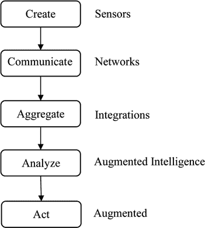

**图 7.1**

AI 与物联网的功能视图。

# 7.5 AI 增强物联网设备的智能解决方案 (#10chap_07.xhtml_sec7_5a)

从传感器获取的数据由 AI 进行检查和分析，企业据此做出决策。智能解决方案中的 AI 有助于为数据提供洞察。自然语言处理和计算机视觉等领域分别从人类语音、文本和视觉内容中提取信息。使用机器学习的智能传感器现在足够智能，可以从数据中提取模式，并精确检测湿度等参数的异常。使用阈值等传统方法的业务模型现在对机器学习方法感兴趣，这种方法提供了更高的预测准确性，以减少停机时间并增强风险管理。机器学习分析极大帮助了企业研究新产品和产生新服务 [20]。AI 增强的物联网成功实现了以下敏捷解决方案：

1. 从数据中获取、分析和管理有用信息
2. 确保快速和准确
3. 在加密和信息隐私的情况下实现精确个性化
4. 维护针对网络攻击的安全检查


使用 AI  IoT 设备的行业面临的最常见挑战是数据的可访问性以及对数据进行分析。为了解决可能导致生产线中断的实时挑战（例如部件故障），需要在此类事件发生之前预测出某台机器需要更换。为此，当今的企业需要清晰地理解如何理解分析结果，并主动应用它们来预测事件。使用传感器生成的 IoT 数据是海量的且不断变化的，这使得使用传统的分析工具很难进行处理和管理。AI 通过使用无监督学习，机器学习可以识别出模式（偏离正常范围的异常），并在这种异常发生前向企业发出警报，以便采取先进的措施或步骤来避免功能故障。AI 还有助于发现传统模型难以观察到有时不可见的内部信息。AI 和 IoT 这两个强大概念的结合，促成了智能传感器的诞生，这些传感器通过考虑实时数据来进行预测性、规范性和自适应的分析。

1. **预测性分析：** 它有助于确定机器可能发生故障的时间跨度。这种分析将帮助工业通过实施预防措施来防止机器故障 [21]。
2. **规范性分析：** 它提供即时的建议或预防措施，这些对于防止事故或灾难非常有帮助 [22]。
3. **自适应或自主分析：** 来自支持 IoT 设备的持续或定期数据馈送，可以帮助组织在没有人类干预的情况下自动采取周期性行动 [23]。

# 7.7 使用 AI 启用 IoT 实现的关键变化

以下是 AI 和 IoT 结合作为 AI 启用 IoT 应用于日常活动时发生的一些关键变化。

1. **增加收入：** AI 和 IoT 的结合已被证明在提高许多行业收入水平方面是有益的。IoT 传感器开发者、数据提供商和设备制造商被认为是获胜方。
2. **安全标准：** 通过实时监控，所有类型的故障都可以得到严格控制，这提供了高效的安全保障解决方案。它还有助于最大限度地减少人员损失和资产损坏的风险。
3. **降低成本：** 智能电表、智能传感器和支持传感器的应用程序等智能设备降低了企业和家庭解决方案的运营成本。
4. **客户体验：** 智能传感器提供了改善客户体验的解决方案。这些传感器具有学习用户偏好并相应修改其值的能力。

## 7.8 AI 启用 IoT 的优势

AI 和 IoT 的结合为消费者和行业带来了许多益处，例如智能自动化、改进的个性化体验等 [19]。结合这两类技术对普通人和专家来说都有利。IoT 处理使用互联网交互的设备，而 AI 则让设备从其数据和经验中学习。以下是从结合这两种技术获得的一些热门优势：

1. **运营效率：** IoT 中的 AI 能够从大量数据中检测出简单机器无法的模式。它可以检测特征并根据运行条件对其修改，以增强结果。这也有助于发现耗时冗冗的流程，然后对其进行微调，以实现比定义的先进方法更好的精度。
2. **风险管理：** 在业务解决方案中将 AI 与 IoT 结合有助于识别涉及的风险，并帮助这些风险的自动化，从而实现快速响应并提高效率。例如，网络威胁、财务损失和员工安全等风险可以通过 AI 驱动的 IoT 进行处理。
3. **更好的产品和服务：** 自然语言处理使机器能够理解人类语言，并使这些支持 IoT 的设备能够与人类通信。因此，通过分析数据，AI 启用的 IoT 设备被认为有助于创建新的产品和服务，同时增强各种业务模型的现有产品和服务，使行业能够快速增长。
4. **IoT 可扩展性：** IoT 设备范围涵盖从低端传感器到高端计算机和移动设备。这些传感器就足够收集大量数据，并在传输到任何其他设备之前将收集到的数据转换为可扩展的形式。这种数据的缩放和分析允许大范围的设备连接在一起。
5. **减少非计划停机时间：** 在制造领域，任何设备的故障都可能导致生产中断，从而增加生产时间。AI 启用的 IoT 设备可以通过提供针对设备故障的高级警报来确保这些设备的妥善维护，然后可以在组织的时间间隔内安排维护程序。

## 7.9 基于 IoT 和 AI 的现实应用

IoT 在收集现实应用数据方面发挥了广泛作用，而 AI 则通过分析可用数据提供了自动化。两种技术成功融合的示例包括自动驾驶汽车、教室考勤监控系统和智能家居管理系统。

### 7.9.1 自动驾驶汽车

自 20 世纪 80 年中期以来，全球多个机构一直在研究设计自动驾驶汽车。这些汽车也被自动汽车和无人驾驶汽车 [21]。近年来，关于无人驾驶汽车的热度迅速增长，许多大型科技公司支持这一项目 [24]。自动驾驶汽车被认为完全能够判断环境并在不受人类干预的情况下轻松导航。

### 7.9.1.1 工作原理

为了完成此类复杂的任务，车辆需要一些额外的组件，通常包括全球定位系统 `GPS` 单元、基于惯性的导航系统以及各种激光测距仪、雷达技术和视频处理系统的传感器 [25]。在图 7.2 中，展示了此类系统集成到自动驾驶汽车中的基本架构。在该架构中，有两类子系统：感知系统和决策系统由不同的颜色表示。在这里，感知子系统负责计算车辆状态并利用车载传感器数据生成内部环境解释。在决策子系统中，根据车辆的当前状态，环境、交通法规、乘客健康和舒适度的内部表示将从其原始角色发挥到客户定义的最终目的 [21]。

```
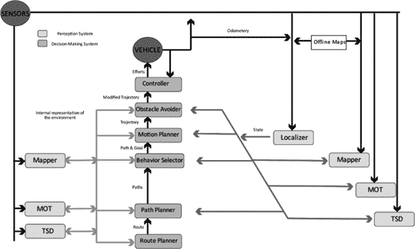
```

**FIGURE 7.2**

自动驾驶汽车的分层架构。


从区域静态地图的角度来看，`Localizer Subsystem`（图 7.2）负责计算车辆状态（位置、线速度、角速度等）。此类静态地图（图 7.2）在自动驾驶使用前会自动计算，通常使用车辆自身的传感器，尽管仍需要进行手动标注。`Mapper subsystem` 收集离线地图和车辆状态作为输入，并生成在线地图作为输出。`MOT`，即 `Moving Objects Tracker`（在图 7.2 中所示）收集离线图表、自动驾驶汽车的状态，并定义和监控行驶过程中最近的障碍（例如其他车辆和行人），同时测量其位置和距离。`Traffic Signalization Detector`或`TSD`（图 7.2）负责交通信号的识别和确认。它提供了驾驶员在离线地图中指定的最终目标；离线地图中的`path planner subsystem`计算从车辆当前状态到目标的路径 `W`。

`Behavior Selection subsystem` 负责选择当前动作，包括车道管理、路口处理、红绿灯处理等。`Behavior Selection subsystem` 通过考虑现有驾驶动作来识别目标，以使决策视野能够避免与静态及动态障碍物的碰撞。`Motion Planner subsystem` 计算从自动驾驶当前状态到当前目标的路径 `T`，该路径遵循`Behavior Selector` 指定的方向，满足车辆的运动和复杂限制，并为乘客提供舒适性。为了防止碰撞，`Hazard Avoider subsystem` 必须获得由运动规划器确定的路径。`controller subsystem` 最终获得由`obstacle avoider subsystem`更新的监控规划轨迹，并将计算结果向转向执行器、节气门和刹车发送执行指令，以确保车辆在物理允许范围内执行`Revised Trajectory`（修正轨迹）。

### 7.9.1.2 该系统的优点

1. **快速评估：** 汽车驾驶背后极其复杂的技术能够通过车载设备 `[26]` 在一秒内进行数百次测量。这些内容涉及你与物体的距离、其他车辆的当前速度、以及车辆在地球上的动作和位置。

2. **不易发生事故：** 自动驾驶汽车很少参与事故，并具有较高的缓解拥堵潜力。

3. **减少对基础设施的需求：** 它们将消除对交通信号的需求，因为自动驾驶汽车可以相互交互。
4. **最少人工干预：** 自动驾驶车辆可能不需要驾驶员。在密集的城市中，这些车辆可以缓解停车问题。例如，如果没有位，它将在设施周围绕行，直到乘客准备好离开 `[27]`。

其他放松和娱乐的方式包括不需要复杂工具的自动驾驶汽车。然而，现代架构方案不仅局限于内部，车辆很快就会让今天的汽车显得过时了。

### 7.9.1.3 该系统的缺点

1. **成本效益低：** 自动驾驶车辆非常迷人，因为它们充满了太空时代的科技，但目前所有这些设备都极其昂贵。尽管良好的编程可以实现看似不可能的任务，但也存在发生任何意外情况的概率。

2. **易于出错：** 即使自动驾驶车辆最初运行完美无缺，驱动汽车的技术也可能被汽车制造商带有错误代码字符串进行修改。

3. **能量排放率增加：** 尽管有几家公司正在研究利用燃油或电力技术的自动驾驶汽车，但如果我们对自动驾驶汽车的接触符合我们对可再生能源的承诺，可能会看到更多的排放。
4. **隐私泄露：** 虽然研究自动驾驶汽车的公司声称只有优点没有缺点，但拥有自动驾驶汽车意味着第三方将有监控动作的能力。尽管预计由于客户的愤怒，会有几家公司这样做，但但也存在巨大的隐私匮乏。由于你的车辆将访问或连接数据中心，你的位置将很容易被可能突破网络的个人或组织所获取。

### 7.9.1.4 拟议模型

我们提出了一种减少车辆行驶里程数（`VMT`）的解决方案，这是衡量一年内车辆行驶总里程数的行业标准。人们有一个共识，即`VMT` 的增加会导致排放大幅增加。因此，我们建议将自动驾驶技术与拼车和共享汽车服务相结合。这些服务可以由公共或私营机构提供。汽车中可以安装红外传感器和麦克风等安全系统，用于对任何故障或其他问题进行实时监控或自动检测（图 7.3）。这可以显著减少道路上的车辆数量，反过来不仅会减少排放，还能减少拥堵地区的交通，并大幅降低旅行成本。

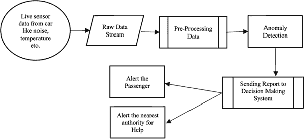

**图 7.3**

自动驾驶汽车建议升级的流程图。

### 7.9.2 教室考勤系统

考勤对于评估学校和大学儿童及青年的学业成就至关重要。由于以下因素，手动考勤是不现实的：

1. 手动考勤耗费大量时间，这部分时间减少了根据时间表提供的有限授课时间。
2. 学生未到场的替替代签的问题。

### 7.9.2.1 过去考勤监控系统的架构

为了解决考勤问题，近年来实施了多种考勤管理方案。Jain 等人 `[28]` 创建了一个基于桌面的程序，鼓励学生通过勾选名字前的复选框并点击“注册”按钮来参与。2013 年，Bhalla 等人 `[29]` 引入了一种支持蓝牙的考勤程序。安装在智能手机上的应用程序有助于通过蓝牙连接记录考勤，并将考勤信息发送给老师。Mahat 等人 `[30]` 的工作提出了一种基于指纹的员工考勤系统。

### 7.9.2.2 基于脸识别系统的架构

Bhattacharya 等人 `[31]` 提出的考勤监控系统通过结合上述其他系统的可换组件，开发出了一种利用人脸识别技术监控学生考勤的紧凑系统。


该特定系统整合了 AI 的力量，将面部表示作为该系统用于识别算法的核心技术之一。在质量保证期间获得的人脸图片需要以特征组件的形式描述，以便进一步分析。这些预处理后的特征组件具有高维性，因此无法直接输入分类器进行进一步处理。这时，卷积神经网络（CNN）的低维功能就派上了用场，它可以在不需要任何额外步骤的情况下，从此类高维特征组件中获取关键的低维面部表示。因此，总结整个系统的流程，我们可以说，人脸识别系统提供了图像，系统获取图像的数据表示并进行人脸提取。这种人脸提取可以通过多种方法完成，例如检查脸部颜色和面部比例的相似性，或者选择图像的某些比例并与其类似的形状或形式进行比较，从而从这些拼图般的碎片组合出一个人脸。其中一种方法是 Viola–Jones 方法，它使用不同尺寸和角度的轮廓掩码，通过将其叠加在图像上来检测最准确的一个。原始图像的维度或边界被裁剪成较小的图像。这张裁剪后的图像仍然是高维的，直接从中提取特征非常困难，因此无法直接提供给分类器。所以，我们使用 CNN，它在图像识别任务中提供了高精度。CNN 是一种由多层构建的前的前馈神经网络。系统的流水线见图 7.4。卷积（Convolution）的基本操作是通过使用输入图像的小正方形学习图像特征，以保持像素之间的空间关系。卷积层作为 CNN 的核心层。接下来，池化层（Pooling layer）减少卷积操作输出的维度，并使用平均或最大函数对其进行收敛和泛化，以便进一步处理。为了修正卷积操作的输出，我们必须使用修正线性单元（`ReLU`），这是一种非线性操作。`ReLU` 层的作用类似于最大函数，当输入 `X` 大于零时输出 `X`，对于小于零的值则输出零。它是逐像素元素应用的。最后一层是全连接层（Fully Connected Layer），它将特征馈到使用 Softmax 激活函数的分类器中。全连接层输出概率之和为 1。Softmax 分类器为每个类别标签提供概率，以便我们解释这些概率并执行标记已识别学生考勤的进一步操作。

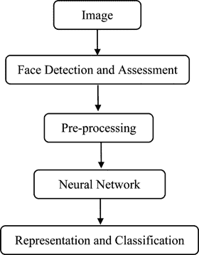

**图 7.4**

系统的流水线。

### 7.9.2.3 系统的优点](#10chap_07.xhtml_sec7_9_2_3a)

这种方法有几个优点，例如：

1. **增强保护性：** 人脸识别技术在分类学生面部特征方面具有高的准确性。如果某人的识别失败，它可以向当局报告该情况以采取适当行动。
2. **节省时间：** 识别脸的方法需要一秒或更短，这对于节省手动替代方案所花费的不必要时间非常有帮助。
3. **便于整合：** 人脸识别技术可以很容易地整合到系统中，只需更改数据集即可，考虑到训练它的数据集特征保持相同格式，并且在实际部署之前完成了模型的重训练。

### 7.9.2.4 系统的缺点](#10chap_07.xhtml_sec7_9_2_4a)

尽管如此，这种方法仍然存在某些缺点：

1. **隐私问题：** 虽然人脸识别提供了优势，但在隐私领域平等应用并符合人权之前，仍有大量的研究需要完成。
2. **摄像头系统的定位：** 虽然小于 30 度的偏移角度通常被大多数系统接受和处理，但摄像头位置的巨大偏移或设计的改变最终都会导致错误。
3. **数据存储能力：** 技术需要大型数据集来“读取”并产生可靠的结果。这些数据集需要强大的数据存储 [32。

### 7.9.2.5 建议模型](#10chap_07.xhtml_sec7_9_2_5a)

我们建议该系统也应扩展到情绪识别（图 7.5）。这可以帮助教育机构在课前了解学生是否感到快乐、悲伤、疲劳、精力充沛，数据也可以作为教师的绩效衡量。此外，这可以帮助发现那些持续不快乐或抑郁的学生，以便教育系统能够支持/帮助他们。

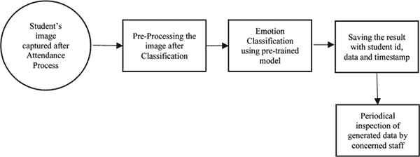

**图 7.5**

考勤监控系统的扩展流程图。

## 7.9.3 智能家居管理系统](#10chap_07.xhtml_sec7_9_3a)

智能家居和 AI 技术正在呈指数级增长，集成了 AI 的众多智能家居设备提高了居住者的生活质量。近年来，智能家居技术的增长导致了从传统家庭向现代互联网连接环境的转变 [32。智能家居是一个配备了摄像头、有线和无线网络、执行器和控制结构的居所。

### 7.9.3.1 系统架构](#10chap_07.xhtml_sec7_9_3_1a)

智能家居系统采集并分析家庭环境的数据。它们还向消费者传递知识，并提高处理各种结构的能力。AI 技术也被智能家居设备使用。为了解释，我们识别了智能家居中的六大 AI 功能集群。

1. **行为检测：** 实时检测用户的动作。这些动作可以是基于现实场景的任何操作。例如，一个人走进房间，灯会自动打开。在这里，人的行为可以被传感器检测到并分类为进入房间，从而采取开灯等后续动作。
2. **数据处理：** 处理系统所需的智能系统用于计算从传感器获取的原始格式数据，并将结果作为命令或信息输出到设备。
3. **语音识别：** 这是智能家居系统的一个主要部分，因为语音控制系统更具交互性，更容易让普通用户理解。该集群包括语音处理任务，如语音转文本等。
4. **图像识别：** 这也被用作行为检测的一个较小组件，并独立用于人脸识别任务。它使用摄像头等硬件组件并将图像数据提供给系统进行进一步分析。
5. **决策：** 这是 AI 最重要的集群，因为它从其他所有集群获取处理后的数据并决定未来的行动。
6. **预测决策：** 该集群利用预测采取结果以及是否需要纠正决策的能力。它与决策集群同步工作。


为了了解该架构如何运作的真实示例，请考虑 X 先生住在他的智能家居中。由于人与自己的家居互动方式有无限可能，请考虑几种通用的场景，例如人在家内、进入房间、离开房间，以及向 AI 发出通用的可能命令。对于存在检测，取决于安装的摄像头的数量，我们可能需要改变方法。如果有足够的摄像头完全覆盖每一个房间，我们就可以像之前讨论的那样，使用人脸检测进行人员检测；如果摄像头不足，我们可能无法追踪 X 在整个家中的位置，但如果我们能判断出 X 位于某个房间内，那么 X 肯定在家里。进出房间可以通过多种方式实现；同样，这取决于家里安装的硬件传感器，但几种可能的方法再次是：在门上使用红外传感器，或者仅仅仅仅是使用房间内的存在检测功能。

X 发送给 AI 的命令将是自然语言，即人类语言，我们需要使用自然语言处理（NLP）让 AI 理解 X 想要什么。自然语言命令必须从麦克风传输到系统，系统将音频转换为文本形式，并应用进一步的处理，如分词（tokenization）、信息检索等。现在，在所有上述可能的泛化场景中，我们可以说环境中安装或存在一些传感器、音频设备、视频设备甚至智能手机，这些设备充当整个系统的输入。这些设备为上述三个模块提供原始输入：`Data Processing`、`Speech Recognition` 和 `Image Recognition`。更准确地说，传感器直接将数据提供给 `Data Processing`，音频设备将数据提供给进行音频分析的 `Speech Recognition` 模块，视频设备或摄像头输出到 `Image Recognition` 模块。由于这些模块是抽象分类的，我们无法说它们运行什么样的过程，因为这会取决于系统以及不同的目的或终端目标。行为检测系统也以相同的循环工作，因为上述模块的输出被传递用于分类用户动作。在分类动作后，如果这些动作在系统的范围内，AI 将获取所需的数据来执行这些动作。范围同样随系统而异，且目前必须手动定义。决策模块和预测模块同时工作，并处理系统执行的范围和动作。例如，如果一个人走进房间，灯会自动打开。`image recognition` 模块检测到该人员并将结果发送给行为模块，行为模块对房间内的动作进行分类并转发给决策模块，决策模块决定必须开灯。

智能家居和消费者有各种类型的参与。本质上有两种交互风格的形式：

1. **与智能设备的个体交互：** 在这种交互方案中，用户分别向每个家居自动化设备发出指令，嵌入每个设备中的 AI 仅有利于该设备本身。智能家居能源管理、医疗保健和保护支持这种模型。图 7.6 显示了自嵌入式 AI 设备的模型。这种类型的交互方案可以相互连接，也可以是去中心化的。在智能家居管理的背景下，这种方案最可能是中心化的，因为我们之前讨论的模块需要彼此的结果才能运行；但在去中心化的方法中，可以实现为为每个设备提供一套自己的模块。我们可以在现实生活中想象这种方案，例如支持 AI 的电视机，它可以根据语音命令调整设置，或者通过判断环境光强度来调整显示设置。

    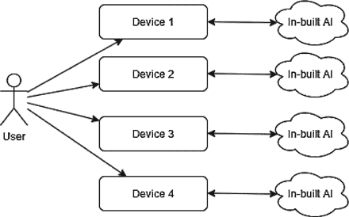
    **图 7.6**
    与智能设备的个体交互。

2. **使用支持 AI 的设备与智能设备交互：** 在这种交互方案中，用户向 AI 提供指令，由 AI 内部控制每个单独的单元。智能家居系统大多基于这种设计，因为它为所有所需模块提供了必要的中心化。这种实现方案在图 7.7 中表示。这也可以很容易实现，因为另一种需要更多的硬件设备，考虑到所有的都是 IoT 且支持 AI 的，成本可能会很高。在这种方案中，人们甚至可以使用智能手机应用程序或仅一个包含麦克风和扬声器的单一 IoT 设备来控制整个系统。这种方案在业内非常有名，例如 Google Home、亚马逊的 Alexa 以及许多基于此方案的产品。

    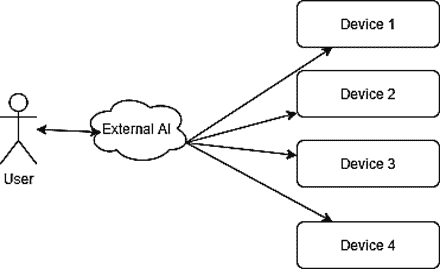
    **图 7.7**
    用户向 AI 下达指令，AI 控制每个单元。

### 7.9.3.2 智能家居管理系统的优点](##10chap_07.xhtml_sec7_9_3_2a)

智能家居有很多好处：

1. **智能家居监控：** 保护你的家是任何家居最关键的部分。无论你家里装了多少锁，小偷仍有机会进入你的建筑。而且还有额外的陷阱或丢失钥匙的危险。对于某些有时会丢失钥匙或未能锁好家里任何基本门的家庭成员来说，增加一个智能家居监控设备也是一个极佳的主意。
2. **节能：** 节能可能是任何家庭成员的首要考虑问题。随着紧凑型设备和过多的技术工具，用电量大幅增加。不仅如此，管理家中的照明将变得简单得多，因为存在检测系统可以根据用户是否在房间内自动开启关闭电器，由于照明耗电最高，通过这种家居配置可以省钱。这是建筑的一项巨大资产。
3. **家电维护的及时更新：** 如果机器和设备需要维护以保持效率，则必须提前识别。然而，追踪并不总是很快。在这种情况下，人们必须依赖智能家居网络。该系统也会告知人们任何设备或工具需要更新。智能家居解决方案很容易调整家电和设备以适应个人的需求。
4. **易用性：** 除了所有这些设施和优点，易用性是另一个重要优点 [33。智能家居自动化基于尽可能简单的用户界面：语音命令。用户只需用自己的自然语言要求系统做什么，系统就会采取该动作。

### 7.9.3.3 智能家居管理系统的缺点](##10chap_07.xhtml_sec7_9_3_3a)

正如这里提到的，智能家居仍存在一些问题：

1. **昂贵：** 智能家居设备最大的挑战、缺点或不利是成本。有许多公司提供智能家居服务，但它们都非常昂贵。这是只有少数人能够负担的。你需要大量的投资和丰厚的收入来构建这种设备。


## 2. 持续互联网连接的需要
智能家居程序的首要前提是互联网。如果没有一个稳定且快速的互联网连接，你将无法处理此类。如果由于任何原因没有网络连接，你没有其他方法可以访问和管理你的设备。

## 3. 服务与维护
如果智能家居系统出现问题，你并不总是能请修理工或同等人员来修复或处理故障。你将不得不依靠专业人士。

### 7.9.3.4 建议的工作
我们提议在该系统中添加多用户语音识别功能。目前，大多数应用程序只能检测到一种声音，如果听到多个声音，它就无法将其清晰转换为有效的指令。此功能可以作为一个模块添加，按照[图 7.8]所示的方式运行。然而，这可以是未来的一个方面，即对系统训练一组声音以区分多个用户。

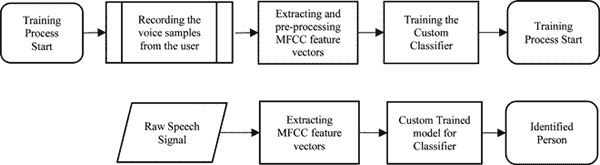

**图 7.8**

智能家居自动化系统中语音识别模块流程图。

## 7.10 结论
在本章中，我们讨论了人工智能（AI）和物联网（IoT）以及它们在多个行业中的应用。我们进一步阐述了将这两个概念结合在一起的功能视图，以及 AI 赋能物联网提供的需求和解决方案。AI 赋能物联网的一些预防措施和优势也是本章的一部分。在末尾，我们详细阐述了自动驾驶汽车、教室考勤监控系统和智能家居管理系统的概念，在这些应用中，AI 可以集成到物联网中，为这些应用提供智能解决方案。我们还讨论了这些应用中的一个框架，该框架将在近期实施。

## 参考文献
1. Perera, S. (2019). The power of combining AI and IoT. [https://towardsdatascience.com/the-power-of-combining-ai-and-IoT-4db98ac9f252/]
2. Lee, K. Y., & Kim, J. (2016). Artificial intelligence technology trends and IBM Watson references in the medical field. Korean Medical Education Review, 18(2), 51–57.
3. Ivanov, S. H., & Webster, C. (2017). Adoption of robots, artificial intelligence and service automation by travel, tourism and hospitality companies–a cost-benefit analysis. Prepared for the International Scientific Conference “Contemporary Tourism–Traditions and Innovations,” Sofia University, Bulgaria, 19–21 October.
4. Dillenbourg, P. (November 1994). The role of artificial intelligence techniques in training software. In Proceedings of LEARNTEC, Karlsruhe, Germany. [https://edtechnology.co.uk/latest-news/learntec-event-looks-at-the-future-of-learning-and-digital-trends/]
5. Bahrammirzaee, A. (2010). A comparative survey of artificial intelligence applications in finance: Artificial neural networks, expert system and hybrid intelligent systems. Neural Computing and Applications, 19(8), 1165–1195.
6. Bench-Capon, T. J., & Dunne, P. E. (2007). Argumentation in artificial intelligence. Artificial Intelligence, 171(10–15), 619–641.
7. O'Grady, R., Christensen, A. L., Pinciroli, C., & Dorigo, M. (May 10–14, 2010). Robots autonomously self-assemble into dedicated morphologies to solve different tasks. In: Proceedings of the 9th International Conference on Autonomous Agents and Multiagent Systems: Volume 1, Toronto, Canada, 1517–1518.
8. Pau, L. F., & Gianotti, C. (1990). Applications of artificial intelligence in banking, financial services and economics. In: Economic and Financial Knowledge-Based Processing, 22–46. Springer, Berlin.
9. Fishwick, P. A. (December 13–16, 2009). An introduction to OpenSimulator and virtual environment agent-based M&S applications. In: Proceedings of the 2009 Winter Simulation Conference (WSC), Austin, TX, 177–183.
10. Gatt, A., & Krahmer, E. (2018). Survey of the state of the art in natural language generation: Core tasks, applications and evaluation. Journal of Artificial Intelligence, 61, 65–170.
11. Sekar, A. (2018). 5 Best examples of IoT in the real world. [https://analyticraining.com/5-best-examples-real-world/]
12. Rathod, S. D. (2013). An autonomous driverless car: An idea to overcome the urban road. Journal of Information Engineering and Applications, 3(13), 34–38.
13. Jones, L. (2017). Driverless cars: When and where? Engineering & Technology, 12(2), 36–40.
14. Wankhede, K., Wukkada, B., & Nadar, V. (July 11–12, 2018). Just walk-out technology its challenges: A case of Amazon Go. In: 2018 International Conference on Inventive Research in Computing (ICRA), Coimbatore, India, 254–257.
15. Luxton, D. D., D., Sano, A., & Bickmore, T. (2016). Intelligent mobile, wearable, and ambient technologies. In: Artificial Intelligence in Mental Care, 137–162.
16. Bregman, D. (2010). Smart home intelligence–the Home that learns. International Journal of Smart Home, 4(4), 35–46.
17. Leung, R. (2019). Smart hospitality: Taiwan hotel. Tourism Review, 74, 50–62.
18. Emeakar, V., Cafferkey, N., Healy, P., & Morrison, J. (August 24–26, 2015). A cloud-based data gathering and processing. In: 2015 3rd International Conference on Future Internet of Things and Cloud, Rome, Italy, 50–57.
19. Vinugayathri. AI and IoT Blended–What It Is and Why Matters? [https://www.clariontech.com/blog/ai-and-iot-blended-what-it-is-why-matters/]
20. Boveiri, H. R., Khayami, R., Elhoseny, M., & Gunasekaran, M. (2019). An efficient Swarm-Intelligence approach for task scheduling in cloud-based internet of things applications. Journal of Ambient Intelligence and Humanized Computing, 10(9), 3469–3479.
21. Badue, C., Guidolin, R., Carneiro, R., Azevedo, P., Cardoso, V., Forechi, A., & Veronese, L. (2019). “Self-driving cars: A survey” (paper, Cornell University, Ithaca, NY). [https://arxiv.org/abs/1901.0440]
22. Yang, L., Yang, S. H., & Plotnick, L. (2013). How the internet of things technology enhances emergency response operations. Technological Forecasting and Social Change, 80(9), 1854–1867.
23. Kopetz, H. (2011). Internet of Things. In Real-Time Systems, 307–323. Springer, Boston, MA.
24. D'Allegro, J. (2020). How Google's self-driving car will change everything. [https://www.investopedia.com/articles/investing/052014/how-googles-selfdriving-car-will-change-everything.asp/]
25. Rayej, S. (2014). How do self-driving cars work? [https://robohub.org/how-do-self-driving-cars-work/]


26. Prince, A. (2009) 自动驾驶汽车难以置信的优与缺点。[`www.lifehack.org/articles/technology/unbelievable-benefits-and-drawbacks-the-self-driving-car.html/`](https://www.lifehack.org)

27. Duffer, R. (2014). 芝加哥论坛报：自动驾驶汽车送走司机并找到停车位 [`www.chicagotribune.com/autos/ct-xpm-2014-05-13-chi-selfdriving-car-drops-off-driver-finds-parking-spot-20140513-story.html/`](https://www.chicagotribune.com)

28. Jain, S. K., Joshi, U., & Sharma, B. K. (2011). 考勤管理系统（硕士项目报告，拉贾斯坦技术大学，科塔，印度）。

29. Bhalla, V., Singla, T., Gahlot, A., & Gupta, V. (2013). 基于蓝牙的考勤管理系统。《工程与技术创新国际期刊》(IJIET), 3(1), 227–233。

30. Mahat, S. S., & Mundhe, S. D. (2015). 提议的框架：带有手机检测器的大学考勤管理系统。《IT 与管理国际期刊》， 5(11), 72–82。

31. Bhattacharya, S., Nainala, G. S., Das, P., and Routray, A. (2018). 智能考勤监控系统 (SAMS)：一种基于脸识别的教室考勤系统。见：2018 IEEE 第 18 届高级学习技术国际会议 (ICALT)，印度孟买，358–360。

32. Dash 杂志 (2019). 人脸识别的威胁与收益：我们应该知道什么？[`becominghuman.ai/the-threats-and-benefits-of-facial-recognition-what-should-we-know-17008f69ae74/`](https://becominghuman.ai)

# 人工智能物联网融合：概念、设计与应用

Divya Upadhyay
计算机科学与工程，德里技术校园
印度大诺伊达，印度

Shanu Sharma
计算机科学与工程，阿米提大学
诺伊达，印度

## 目录
* 8.1 引言
* 8.2 IoT 架构
* 8.3 人工智能与机器学习技术概述
* 8.3.1 机器学习算法与方法论
* 8.3.2 机器学习算法的类型
* 8.3.3 人工神经网络与深度学习
* 8.4 人工智能物联网：概述与架构
* 8.5 AIoT 赋能的应用
* 8.5.1 智能交通：基于 AIoT 的智能动态交通灯系统
* 8.5.2 基于 AIoT 的智能医疗管理
* 8.5.3 智能家居：基于 AIoT 的节能型智能空调系统
* 8.5.4 AIoT 赋能的水质监测和地下水位预测
* 8.5.5 基于 AIoT 的空气质量监控系统
* 8.6 结论
* 参考文献

## 8.1 引言
目前正在快速发展的两项强大技术是物联网 (`IoT`) 和人工智能 (`AI`)。这两项技术本身都具有独特性，但它们的交汇点使得它们变得更加令人兴奋。当 `AI` 和 `IoT` 结合时，它们形成了人工智能物联网 (`AIoT`)。`IoT` 设备将作为数字神经系统，而 `AI` 则是系统的核心。

吴恩达教授在 2017 年 NIPS 上表示“AI 是新电力”，A. Kapoor 在 2019 年将其扩展为“如果 AI 是新电力，那么数据就是新煤炭，IoT 就是新煤矿”。`AI` 被认为在处理大量信息流时表现最佳，而 `IoT` 设备被认为是提供所需数据的来源。`IoT` 技术为我们提供了监控和操作物理环境的机会。可以实现基于 `IoT` 的巨大应用，用于协助我们的日常生活，例如车辆跟踪、无人机巡逻、智能停车、智能建筑、社会管理等。这些应用的使用一方面为我们提供了更好的连接方式，另一方面提供了便利的访问性。

相比之下，数据量呈指数级增长，其中 90% 的生成信息从未被理解。捕获的 10% 数据具有高度的时间依赖性，在几毫秒内就会失去其重要性和价值。手动监控这些数据既是一项繁琐的任务，也是一个成本高昂的过程。因此，对信息进行智能且高效的分析变得至关重要。


因此，本章的核心动机是关注 AIoT（人工智能物联网）的平衡架构，以及可以应用于 IoT 设备不同运行点的各种 AI 技术和模型，以优化不同的基于 IoT 的系统。本章从对讨论 IoT 架构开始。下一节将介绍 AI 及其与机器学习的关系，并对一些基础和高级机器学习以及深度学习技术进行简要介绍。在 AIoT 架构的支持下，描述了 AI 在 IoT 频谱中的应用，从增强传感器的智能到实时或离线方式分析捕获的数据。本章旨在为读者提供关于基于 AIoT 系统开发的深度知识。后续章节将介绍针对交通、医疗健康、智能家居等各个领域的 AIoT 赋能智能应用的详细架构，以获取关于基于 AIoT 系统开发的深层知识。

## 8.2 IoT 架构

在转向 AIoT 架构之前，让我们关注正在改变世界的 IoT。IoT 是“凯文·阿什尔顿”（Kevin Ashton）在 1999 年向宝华（P&G）进行演示时提出的概念 [8]。IoT 正在通过互联网构建一个巨大的连接设备网络。这些设备还具有在系统中相互交互的能力。这种革命将自动化推向了水平，机器将相互连接并通信，并在没有任何人工干预的情况下自行决策。

IoT 中的“物”可以是任何内置传感器或具备在没有人工干预的情况下通过互联网组装、收集和传输数据的设备。通过连接机器，每台机器将像人类一样增强自身的知识并从其他互连设备的经验中提高学习能力。换句话说，像人类一样，IoT 试图开发一种相互依赖关系，例如与物体贡献、交互和协作 [7, 9]。为了理解 IoT 的概念，考虑这样一个例子：可视化一个智能房间，其中安装了房间温度传感器来收集数据。该传感器通过互联网发送收集的信息，然后由房间内各种带有传感器的设备利用这些信息来相应地调整和调节温度——例如，冰箱传感器可以收集外部温度然后调节内部温度。同样，智能空调也可以相应地调节温度。这就是 IoT 设备在整个过程中贡献、交互和协作的方式。在不同领域 IoT 应用的通用概念化在图 8.1 中所示。

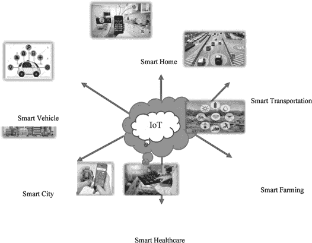

**图 8.1**

不同领域的 IoT 应用。

类似于开放系统互连模型（OSI）参考架构，IoT 模型也包含六层，包括四层水平层和两层垂直层 [9]。管理和安全服务同时在所有层上实施。图 8.2 代表了 IoT 参考模型。

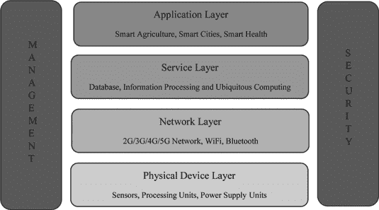

**图 8.2**

IoT 参考架构。

在物理设备层，连接了各种传感和控制设备以获取数据。这一层也被称为感知层。部署在该层的不同现有硬件包括传感器、射频识别（RFID）、处理单元如 `Raspberry Pi` 等。第二层是网络层，用于提供所有与网络的支持以及通过有线或无线介质进行数据传输。它为包括 `Wi-Fi`、`蓝牙` 在内的所有代网络提供支持。网络层还支持传输介质和技术。它将数据传递给上层进行进一步的处理和存储。IoT 架构中的第三层是服务层。它提供如在数据库中存储数据、预处理和分析从下层收集的信息等服务，并将这些信息传递给上层即应用层 [10]。最后，IoT 架构中最后也是最高的一层是应用层。它也被称为用户界面层。它通过各种应用程序、网站或图形用户界面（GUI）直接与用户交互，并为智能农业 [11]、智能家居、智能健康管理系统等提供多种服务。

## 8.3 人工智能与机器学习技术概述

AI 也称为机器智能，是模仿人类认知能力（如学习、解决问题和感知）并在机器上模拟这些能力的领域。“人工智能”一词创立于 1955 年，基于人类智能的原理。AI 可以定义为机器可以轻松模拟的方式 [12]。最初，基于推理的机器被认为是智能的，但在过去的几十年里，AI 领域一直在不断演进。现在，AI 模型基于跨学科的方法，包括数学、心理学、计算机科学、语言学等。因此，AI 赋能的机器正在为不同的行业带来利益 [12, 13]。今天，我们随处可见 AI 赋能的机器。这些智能系统影响着我们生活、工作和娱乐的方式。AI 技术可见无限的应用，例如基于语音的个人助手系统（如 `Alexa` 或 `Siri`）、自动或智能驾驶辅助技术、智能手表或手环等 [10, 14]。

在过去的十年里，我们看到了数字技术的革命，例如计算能力和硬件技术领域。今天，一切都是数字化的，或者我们可以说它正处于数字化的过程中。无论是在线支付系统、在线购物或账单、在线学习还是在线医疗辅助，数字化现在正统治着从医疗保健、零售、银行到不同行业的每一个领域。

每天生成和存储的数据不能被视为浪费，因为它们包含了许多隐藏模式和知识，可以用于以更智能的方式在未来使用我们的技术。这正是机器学习以及高级深度学习技术重要性和作用所在 [15]。


机器学习也被认为是人工智能（AI）的一个子类，也可以被认为是人工智能的一个分支，旨在通过使机器能够从经验中学习并在没有或极少人工干预的情况下做出决策，使机器变得智能化[15]。“机器学习”这一术语由人工智能领域的先驱阿瑟·萨缪尔（Arthur Samuel）在 1959 年命名[16]。它是让机器无需显式编程即可采取行动的技术。到目前，已经开发了许多机器学习算法，并为我们提供了一系列智能应用，如语音识别、物体识别、车牌识别、人脸识别、指纹识别、自动驾驶汽车等。

在当今世界，机器学习是最强大的技术。它像一个将数据转换为意义信息的魔法工具。它在今天是无处不在的，我们在我们在不知情的情况下每天在使用它。人工智能和先进机器学习技术在不同领域都有高需求。它们的一些应用领域包括：

*   **医疗领域：** AI 通过自动化其核心流程展示了其对医疗行业的影响。现在，只需点击即可获得个性化医疗推荐系统和健康助手系统。AI 的高级应用体现在机器人手术上，其中机器人用于协助医生进行手术。
*   **制造业：** 在这里，各种工厂的数据现在使用基于 AI 的技术进行分析，以对生产和利润做出预测。
*   **零售业：** 零售领域在为消费者提供个性化体验方面已经做了大量工作，先进的 AI 技术仍在运行中，以优化消费者体验，例如使用虚拟购物。
*   **银行业：** 基于 AI 的系统已经在银行业投入使用，用于寻找欺诈交易到检测贷款违约者等。
*   **教育领域、金融领域等等**。

### 8.3.1 机器学习算法与方法论

如前所述，机器学习（ML）技术和算法基于一个通用概念，即在某些样本数据（即训练数据）上开发数学模型[17]。机器学习算法的一般工作流程如图 8.3 所示。

*   **数据收集：** 任何机器学习技术的第一步也是关键的一步是为给应用收集大规模的信息和数据。机器学习算法通常在大量高质量数据上运行。因此，收集包含高效开发应用所需的所有变化的良好数据是至关重要的。
*   **数据准备/特征提取：** 需要数据预处理和特征提取步骤，以最佳格式呈现数据，从数据中提取有意义的参数并在提取最优特征的情况下进行降维。
*   **模型拟合/训练：** 在这一步中，数据集被分为两个部分——测试集和训练集，然后在训练数据集上对模型进行处理和训练。
*   **评估：** 再次在测试数据集上对训练好的机器学习模型进行验证和测试，以找到其准确性。
*   **调优：** 在这一步中，对机器学习模型的超参数进行优化，以最大化训练模型的性能。

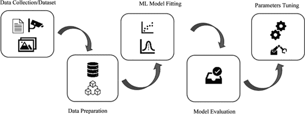

**图 3**

机器学习算法的通用流程。

具有良好准确性的调优模型可以部署到相关应用中，进行实时或离线数据分析。

### 8.3.2 机器学习算法类型

如前所述，所有机器学习算法都基于使用训练数据集学习模型的过程。根据模型的学习技术，机器学习算法通常被大致分为三类：监督学习、无监督学习和强化学习[16]，如图 8.4 所示。

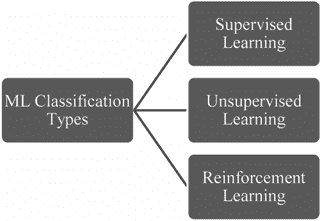

**图 8.4**

机器学习算法类型。

1.  **监督学习：** 这也是机器学习技术和算法的一类，其中用于训练模型的数据集带有标签，即先前的输入和输出对。通过这种方式训练的模型可以很容易地模仿展示给它们的精确内容，因此，为了建立良好的模型，向其提供可靠且无偏见的带标记数据示例是至关重要的[15]。通过简单检查图 8.5 中展示的芒果和苹果的分类，可以理解监督机器学习模型的工作。此外，根据输出的类型，监督学习技术可以执行以下两类任务：
    *   **分类：** 在这里，机器学习技术通过应用区分它们的规则将给定的数据分为不同的类别。这些算法具有离散的输出变量——即 0 或 1，芒果或苹果——可以用于物体或图像标记或虚假视频检测等任务。
    *   **回归：** 在此任务中，输出变量的值是连续的，而不是离散的。这个常数提供了根据给定数据进行预测的能力。

2.  **无监督学习：** 这类机器学习技术适用于非结构化数据，其中数据不提供输出标签，模型必须从给定数据的属性中自己学习[17]。该系统的工作可以通过图 8.6 来理解。在这里，训练模型将根据不同的特征（如形状、颜色等）不同地使用苹果和芒果。根据监督学习算法的工作概念，它可以对数据执行以下任务：
    *   **聚类：** 这是将数据分配到不同的组（即根据数据中可用模式的属性形成的簇）的过程。
    *   **关联：** 它可以理解为建立数据不同参数之间关系的过程。关联的领先应用之一是购物篮分析，通过分析客户的购买历史来寻找购买物品之间的关系，为客户提供更好的未来建议。

3.  **强化学习：** 这是一种基于奖励的学习方法，其中使用正负向反馈来训练模型。它与人类的学习行为相似，因为人类也通过错误以及正负反馈来学习[16]。这种学习方法需要噪声和数据丰富的环境来进行更好的学习。它是游戏技术的一种简化方法，帮助游戏达到超人类的水平。

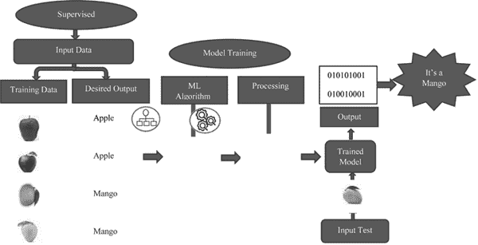

**图 8.5**

监督机器学习技术工作的一个示例。

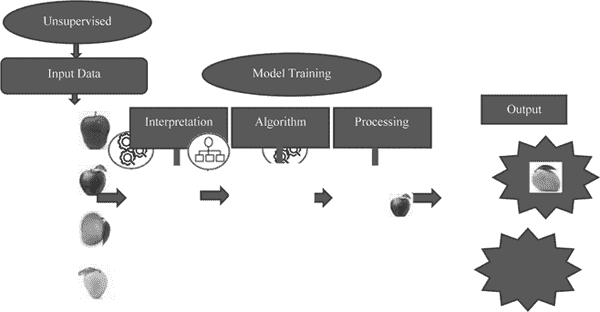

**图 8.6**

无监督机器学习技术的工作原理。

### 8.3.3 人工神经网络与深度学习


人工神经网络（ANNs）是人脑的软件实现。它主要受到人脑功能、结构和学习能力的影响。它获取处理能力，学习这种能力，并将其用于分类。人脑拥有数亿个神经元，它们相互协作。大脑内部的所有这些神经元都是复杂的，并通过一种被称为“神经网络”的互连结构连接在一起。从人脑的角度来看，学习是神经连接的反复激活，从而不断加强这些连接。因此，神经网络的责任是确保我们只针对特定的输入获得预期的输出 [8]。在过程中获得的反馈有助于在每一步中进一步增强网络的的强度。任何 ANN 的主要元素如下：

- **处理元件**：ANN 是一种类似于人脑的简化计算模型，它包含如图 8.7 所示的处理单元，其功能与大脑中神经元的功能非常相似 [18]。

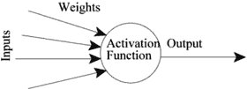

**图 8.7**

神经网络中的神经元。

- **拓扑结构**：神经网络中所有处理元件的组织和排列及其输入、输出和相对互连简单称为神经网络的拓扑结构。

- **学习算法**：ANN 的类别
    - 前馈
    - 反馈和
    - 竞争学习
- **深层网络**：这里的“深层”一词是指网络中存在大量的层。每个用于表示深度神经网络的神经网络都至少由三层组成：隐藏层、输入层和输出层。

第一层是神经网络的输入层，用于提供输入特征以处理用于模型构建的数据。该层唯一的工作是将这些参数传递到其他层，而实际上不对它们执行任何计算任务 [14]。隐藏层用于执行模型构建所需的所有必要计算。因此，它接收第一层的输入值，然后将计算结果传递给层。输出层用于在从上一层获取问题的最终答案后显示输出。

深度学习也是机器学习的一个子类，具有许多神经网络层，通过处理和学习海量数据，可以训练以执行如图像识别和语音识别等各种任务。广而言之，图 8.8 解释了人工智能、机器学习和深度学习技术之间的关系 [19]。

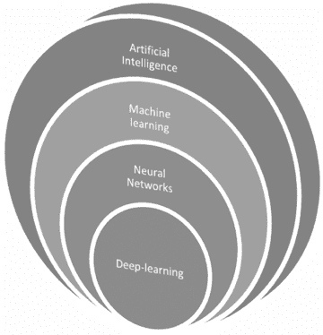

**图 8.8**

基于人工智能、机器学习和深度学习的不同模型之间的关系。

# 8.4 物物人工智能：概览与架构](#11chap_08.xhtml_sec8_4a)

AIoT 被认为是人工智能与物联网的融合。它是一种为物联网提供智能基础设施的技术，以便各种物联网操作、数据管理技术、人机交互等等可以被更高效地处理。IoT 提供了连接和数据交换的特性；然而，IoT 技术的主要问题之一是由于 IoT 设备的广泛使用，导致 IoT 数据呈指数级增长 [3]。这些 IoT 数据可以通过 AI 技术转换为有意义的数据，然后可以进一步用于做出某些重要决策。通过这种方式，这两种强大的技术——AI 和 IoT——被证明对这两种技术都是互利互的 [5]。

在当今世界，所有应用都被预期是智能且精明的。例如，一个不需要设置闹钟就能提醒人们重要会议的手机，一个不需要设置特定模式就能理解衣服种类的智能洗衣机，一个智能家居，智能汽车等。多年来，AI 一直试图通过提供分析、训练和从经验或数据集中自学习的能力，使各种家电器智能化。IoT 和 AI 在从水净化到火箭发射技术等不同的工业产品制造和过程中发挥着特定的作用。

IoT 技术为我们提供了使用连接的 IoT 设备监控和操作物理环境的机会。可以实现巨大的基于 IoT 的应用，它们可以协助我们的日常生活，例如车辆跟踪、无人机巡逻、智能停车、智能建筑、社会或城市等。这些应用的使用一方面为我们提供了更好的连接方式，另一方面提供了更便利的访问性。相比之下，另一方面也会产生指数级增长的数据。这些数据不能被视为浪费，因为它们包含了有关用户使用相关问题和现有应用程序性能问题的重要信息。此外，这些数据可以智能地用于创建更好的人机界面以及更高效、更智能的应用 [20, 21]。

在这里，AI 和高级 ML 技术的作用结合在一起，因为这些应用大部分需要复杂的 AI 能力在中心位置处理包括图像、视频或音频在不同类型数据。而在某些应用中，由于响应速度的要求，数据无法发送到服务器或中心位置。在这种情况下，需要在适当点实施 AI 技术以处理该过程。然而，AI 和 ML 技术通常计算成本高昂，需要更多功率来实现，这在数据实时处理的情况下某些是不可能的 [22]。因此，在开发基于 AIoT 的系统时，平衡的架构对于为各个点的数据处理成本提供良好的平衡非常重要。这种架构的一个示例如图 8.9 所示，可以在不同的操作点看到 AI 和 IoT 的结合。该架构表明，环境数据通过普通的 IoT 传感器或支持 AI 的 IoT 传感器收集。内部支持 AI 的传感器内置了 AI 芯片，为这些传感器提供智能操作效果。这些传感器可以通过内部通信进行相互作用。

此外，主 IoT 系统用于存储从这些设备收集的数据，可以使用专用服务器和数据库来存储数据。收集的数据也可以使用云存储服务。对于数据的分析和模式分析，可以在这些收集的数据集上外部应用 AI 技术，以进一步改进基于 AIoT 的系统。

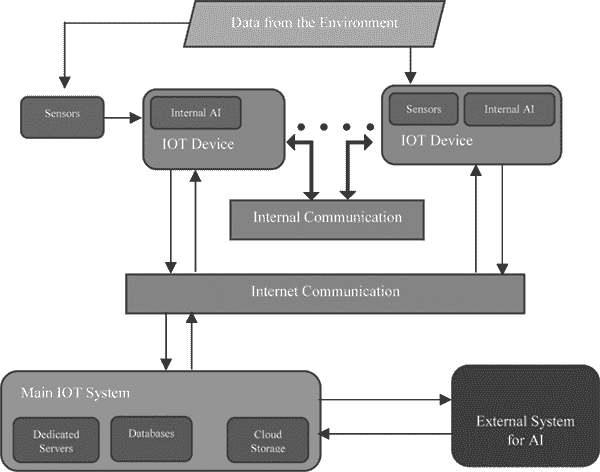

**图 8.9**

AIoT 系统平衡架构示例。

# 8.5 AIoT 赋能的应用](#11chap_08.xhtml_sec8_5a)

现在是详细讨论一些可能的 IoT 和 AI 融合的工业应用了。AI 和 IoT 可以结合的一些应用领域包括：

- 智能交通
- 监控和控制应用
- 医疗诊断系统
- 机器人系统
- 农业工业
- 仓库优化

该列表持续不断。接下来的章节将讨论在不同领域使用 AIoT 技术的一些提议系统。


## 8.5.1 智能交通：基于 AIoT 的智能动态交通灯系统

想象一种智能交通系统，它包含配备 GPS 的公交车或火车，以及配备传感器的旅客候车区，用以统计等待特定交通工具的游客人数[23]。该系统将为用户提供即将到来的公交或火车的等待时间，并根据等待乘客的数量调整停止时长。这种交通系统不仅有助于旅行者和运输公司，还有助于保障出行安全并维护健康的生态系统[24–26]。

基于 IoT 的智能交通系统涉及将各种车辆、候车区接入互联网以构建智能系统，并使用通用的移动访问先进技术。使用 IoT 在车辆之间建立通信是通信的新时代，AI 技术可用于完成数据分析，并协助智能高效地管理交通系统[23]。这种基于 AIoT 的智能交通系统可以应用于道路、铁路、航空和码头的自动化，通过实时监控、跟踪和交付来增强货物运输的客户体验。这些技术的基本目标是使交通系统变得高效、智能、安全且环境可持续。AIoT 有助于为交通管理创造一个组织有序、整洁且无障碍的结构[27–29]。基于 AIoT 的智能交通系统的底层架构，以及运营交通的通信和信息管理技术，分别可以通过图 8.10 和图 8.11](#11chap_08.xhtml_fig8_11)来理解。

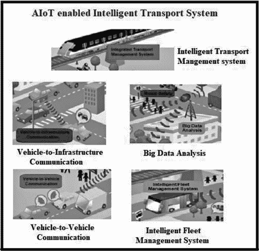

**图 8.10**
支持 AIoT 的智能交通系统。

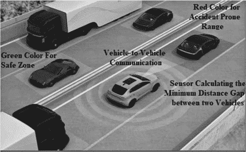

**图 8.11**
运营交通的通信和信息管理技术。

最重要的是，日益严重的交通状况、不断增长的污染和高事故率是世界各国采用智能交通系统的主要因素，并因此减少这些关键问题。

这里提出并讨论了一种利用 AIoT 技术智能管理交通灯的智能系统。所提智能模型的工作架构也将在图 8.12 中给出。在这里，系统的目标是：

*   设计一种智能自动的交通灯管理系统，能够根据不同车道的车辆密度动态控制交通灯。
*   系统应根据特定车道的密度调整交通灯的持续时间。
*   当车道内发现紧急车辆时，调整交通灯。

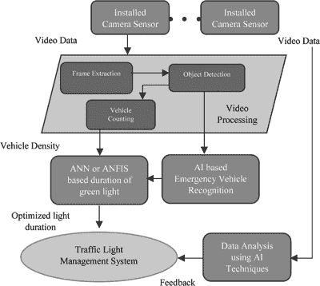

**图 8.12**
智能交通灯系统的工作流程。

根据该系统，高密度车道应获得较的绿灯。特定车道的密度检测将基于视频处理技术。首先，使用安装在交叉路口的特定摄像头传感器捕捉实时视频。然后将捕获的视频存储在云端，视频将在云端实时处理以提取帧。此外，应用背景消除和图像分割等图像处理技术来检测车辆总数。密度（例如特定车道内的车辆总强度）随后可用于自动调整灯光的持续时间。

由于这种灯光调整自动化需要快速的实时响应，我们需要实施计算开销较低且可以在芯片上实现的 AI 技术。为了动态调整灯光，可以存储基于自适应神经模糊系统或神经网络推理系统的训练模型，用于对检测到的车辆密度进行实时分类，以调整灯光。

该系统还可以通过目标检测和识别技术检测车道内的救护车。基于此，如果在任何车道中发现救护车，应给予其优先，系统应开启该车道的绿灯。

在当今实现该系统是非常可能的，由于 AIoT 技术的蓬勃，市场上已有许多内置 AI 的设备，如 AI 加速器、人工眼等。

此外，捕获的交通灯和视频数据可以离线处理以用于监控，或使用回归分析等 AI 技术检测并预测未来趋势。这种分析将帮助系统根据新的复杂实时情况进行调整。

## 8.5.2 基于 AIoT 的智能医疗管理

AI 和医疗管理系统密切相关；专家系统旨在协助医疗执业人员进行诊断并提供用药指南。在医疗行业中，可穿戴设备和智能手机允许患者收集信息、根据症状接收可能的诊断，并监测血压、心率等指标。在医疗企业中，包括医院和诊所在内实施了各种基于 AI 的机器学习软件[30]。这些软件还提供移动应用程序和如吸入器等 IoT 设备。

许多企业声称设计了用于医疗管理系统的软件，例如 `Microsoft Azure` [31]、`Medidata` 等。`Microsoft Azure` 声称开发了一种可以改进和跟踪患者健康的 IoT 。`Microsoft Azure` 部署了机器学习模型，这些模型训练于多种健康和医疗数据集，包括血压读数、个人目标、出院摘要以及患者数据（包括基于评估的抑郁指标）[32, 33, 34]。该软件帮助医生和医疗执业人员预测患者的潜在风险、再入院和治疗方案。

该软件声称具有以下分析能力：

*   远程监控和管理体外诊断设备。
*   预测部署在客户端的 IVD 设备的潜在停机时间。
*   根据客户需求推荐的 IVD 设备。
*   为最佳决策提供分析和数据可视化。
*   用于未来的维护。

另一家声称设计医疗软件的企业是 `Medidata` [35]。它提供基于云技术的移动医疗（m-health）管理系统。它收集患者数据以分析癌症等疾病的状况和生活质量。它还应用了机器学习模型并进行预测分析。Medidata 还声称医疗行业可以将此应用程序与 IoT 传感器和其他活动跟踪器集成[36]。


Medidata 得出结论，应用于软件的机器学习模型基于不同类型的癌症数据集、营养和健身活动类型、相关因素以及可能帮助患者治疗的潜在疗法。该模型将训练软件以区分各种数据点与其可能或无法改善癌症患者生活质量的相关治疗方案 [37–40]。此 Medidata 软件将能够从可穿戴设备、传感器、智能手机、平板电脑和移动应用程序等便携和移动设备收集的数据，创建更多以患者为中心的数据集。图 8.13 展示了支持物联网医疗管理系统的各种智能应用程序之间的基本结构和相互连接。

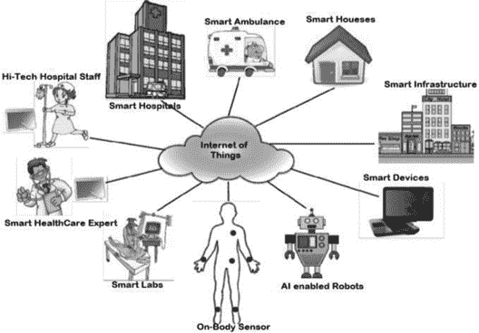

**图 8.13**

基于物联网的医疗管理系统结构。

基于物联网的智能医疗管理系统涉及众多参与者，如患者、医生、医院、传感器、基于 AI 的建模软件和研究机构。它还包含多个维度，包括疾病监测与预防、分析、诊断与治疗、智能医院管理、医疗决策和医疗研究。网络技术（例如移动互联网、物联网、大数据、云计算、微电子、AI 和 5G）以及近期的技术，为智能医疗管理系统奠定了基石。智能医疗行业正在各个领域广泛使用这些技术。从患者的角度来看，各种可穿戴设备用于监测他们的健康，使用虚拟助手系统寻求在线医疗帮助，并利用远程医院实施远程医疗服务。另一方面，从医生的角度来看，各种智能临床决策支持系统有助于分析、辅助和监控。图 8.14 代表了基于 AI IoT 的医疗管理系统的底层架构和流程图。

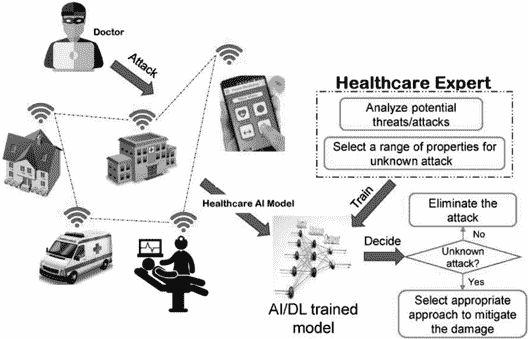

**图 8.14**

基于 AI IoT 的医疗管理系统的底层架构和流程图。

科学家正在使用机器学习以及基于深度学习的工具和技术来人工筛选药物，并利用大数据工具寻找合适的受试者。启用 AI 的手术机器人和机器学习工具可以执行更精确的手术。在医院中，启用 AI IoT 的 RFID 技术通过集成管理平台协助管理供应链和人员材料并辅助决策。移动医疗助手系统将增强患者体验。这些技术将降低风险并使医疗程序廉价；它还能高效利用医疗资源，并促进与其他地区的合作与交流。它将增强远程医疗和自助医疗，最终使个性化医疗设施无处不在。

图 8.15 是基于 AI IoT 的医疗管理系统的底层网络层架构。该架构由类似于 OSI 参考模型的四层组成：物理层、网络层、决策支持层应用层。每一层都有其定义的角色。物理层负责从连接到患者的各种传感器收集数据。网络层访问本地存储的数据，并利用简单邮件传输协议（`SMTP`）将数据传输给相关的医疗人员。处理数据后，网络层将控制权移交给下一个高层——决策支持层。在这一层中，根据对各种医疗活动的分析（体温变化、房间环境变化等）对患者健康做出决策。根据审查，建议信息将发送到应用层进行进一步处理。应用层随后将数据发送给医生并将建议发送给护理人员。

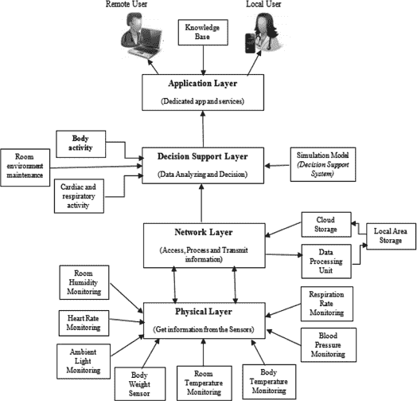

**图 8.15**

基于 AI IoT 的医疗管理系统的网络层架构。

## 8.5.3 智能家居：基于 AI IoT 的节能智能空调系统

智能家居正利用技术实现家居自动化，以为居民提供安全、可访问性、便利和舒适 [41]。想象这样一个家：你只需通过智能手机点一下即可控制家中的每个设备。门口安装了摄像头，它可以识别站在门外的人（如果是家庭成员或已知人士），并根据存储的数据为你提供该人员的详细信息。如果你出门前忘记关闭空调或电视，只需使用智能手机即可将它们关闭。AI IoT 技术为我们开发这种智能家居提供了便利 [42]。下一节将讨论基于 AI IoT 的节能智能空调系统的开发。

世界将面临的最主要困难之一是能源的使用。根据 Richard Gray 的 BBC 报告，世界人口在活动过程中每天消耗超过 100 万瓦时的能量。所消耗的能量相当于 75 亿人在一小时内多烧开 70 多个水壶的能量。随着人口增长和工业化进程，人类对电力消耗的需求已增加到前所未有的水平。这里描述了一种智能空调（`AC`）系统的架构，其中空调的自动化和智能模式可以提供能源效率。此外，不同用户对空调的使用数据可以存储在云端，并使用 AI 技术进行分析，以发现模式并向与空调技术相关的各种品牌提供反馈。


目前，空调（AC）配备了无线接口，用户只有在配置于同一网络时才能控制空调的温度。但这将空调的控制限制在了同一网络或同一房间内。在此，介绍了一种框架，它可以工作于配备了红外（IR）接收器的现有空调系统。该框架将具备多种功能，例如控制空调系统和记录运行参数。该系统被设计为仅通过 Wi-Fi-direct 和蓝牙模式进行交互；框架中的移动应用程序设计用于控制硬件并将控制信号发送到服务器。中央服务器则记录控制数据并将其传输到运行在硬件内部的服务器，再由该服务器将数据传输到空调系统。服务器可以记录不同用户的运行数据，并在激活智能模式后，它可以利用从具有相似空调系统的不同用户那里积累的数据来更改空调参数。此外，该系统还可以设计用于涵盖人类忘记关闭设备的人为错误，因为即使人不在空调系统的范围内，也可以使用移动应用程序关闭空调。该框架在图 8.16 中所示，可以供实施行业或个人用户使用以分析使用模式、功耗、最受欢迎的空调型号等。为操作智能空调而开发的移动应用程序将作为空调的遥控器。它可以用于向中央服务器发送信号并从中央服务器接收运行数据。移动应用程序可以按如下方式设计以控制多个设备：

*   **注册 (Signup)：** 此页面正如其名，可用于向系统注册用户。输入详细信息后，可以向端点发起 API 调用，并将用户推送到主页。
*   **登录 (Login)：** 登录页面，用户可以在此处输入凭据，然后对主服务器进行调用，验证成功后，用户将通过 `token` 连接到服务器并被推送到主页。
*   **注册页 (Register page)：** 此页面可以将用户的空调注册到应用程序中。首先，应用程序尝试通过 `Bluetooth` 将手机连接到 `Pi`，然后应用程序将本地网络凭据发送给 `Pi`，随后 `Pi` 进入网络，在服务器之间进行几次握手后，`Pi` 被注册以控制空调，且空调也注册在应用程序上。
*   **首页 (Home page)：** 此页面可以设计为向用户显示其在服务器上所有注册空调的列表。用户可以选择一台空调并导航到空调页面，或者用户可以注册新空调，这将引导用户进入注册页。用户还可以对编辑或删除他们的空调。
*   **控制页 (Control page)：** 此页面可以包含所有用于控制空调的按钮，如温度调高和调低、不同模式等。按下按钮后，应用程序将调用 `Pi` 服务器以生成所需的频率。

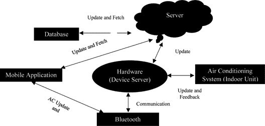

**图 8.16**

所提议的智能空调系统的架构。

## 8.5.4 AIoT 赋能的水质监测与地下水位预测](#11chap_08.xhtml_sec8_5_4a)

水质在当今是一个非常严重的问题，因为它可以影响全球公共健康和环境。最广泛使用的淡水来源是地下水和地表水。根据世界卫生组织（WHO）的一份报告，估计 2005 年约有 11 亿人没有清洁的饮用水。2005-2015 年被认为是以“水之生命”为口号的国际十年 [43, 44]。自然资源的有效利用对于人类和生物的生存至关重要。水污染是一个非常大的问题，因为接近 70% 的地表水和浅水由于各种污染物、有机/无机污染物以及其他生物因素受到了污染。这些来源中的大多数已被宣布为不适合人类饮用。

随着低成本传感器和 AI 技术的出现，可以开发一种解决水短缺问题的模型，或者即使不能解决也能减少它。这些模型可以开发用于以下功能：

*   预测水质，有助于预测和分类水质是否不纯。
*   预测地下水位，这有助于在考虑特定参数的情况下预测区域的地下水位。

该模型可以使用以下参数开发，这些参数代表了将水标记为“纯净”的水质标准 [45]：

*   `6.5 < PH < 8.5`
*   `0 < CONDUCTIVITY measured in (u-hos/cm) < 2250`
*   `TOTAL COLIFORM measured in (MPN/100 ml) Mean < 5000`
*   `D.O. (mg/l) > = 4`
*   `25 < Temp < 40`
*   `< B.O.D. measured in (mg/l) < 3`
*   `0 < FECAL COLIFORM measured in (MPN/100 ml) < 2500`
*   `0 < NITRATE AND NITRITE ANN measured in (mg/l) < 20`

浊度是由于大量微颗粒引起的流体浑浊度。当水质测试是一项必要因素时，`pH` 用于测量溶液的酸性或碱性。导电率用于测量溶液导电的能力。只有当溶液中存在离子时，溶液才会导电 [45]。这些电荷的运动决定了电荷的流动。许多模型已被用于预测水质，例如 `ANN`、支持向量机 (`SVM`)、自适应网络推理系统 (`ANFIS`)、径基函数神经网络 (`RBF-ANN`)、线性回归和多层感知器神经网络 (`MLP-ANN`) [46]。

## 8.5.5 使用 AIoT 的空气质量监测系统](#11chap_08.xhtml_sec8_5_5a)

近年来，印空气污染问题已一个关键问题。2019 年，世界卫生组织的一项调查显示，全球 30 个最污染城市中有 21 个位于印度 [47]。德里的空气污染已被归类为对健康有害。

印度目前没有在使用用于预测环境污染物水平的系统。政府拥有监测 `AQI` 的空气站，以及多个机构正在为该问题寻找解决方案 [48, 49]。应对空气污染问题的努力应该是预防性的，因此认为需要使用智能系统来帮助人类对抗这种威胁。

在此，介绍了一个原型模型，用于构建一个预测大气中环境污染物水平的模型。在局部范围内，随着先进 IoT 技术的普及，可以在家里监测空气污染水平并进一步检测家中的任何气体泄漏。将建立一个原型模型，它可以实时采集大气中存在的各种气体的数据。

*   **Arduino Uno R3 微控制器：** 该控制器将被编程以控制连接到它的传感器。它具有可以连接各种设备的输入/输出引脚。Uno 具有模拟数字转换器，有助于通过传感器获取读数。


-   **MQ 7 气体传感器：** 该传感器用于监测空气中一氧化碳（CO），范围从 10–10,000 ppm。
-   **MQ 135 气体传感器：** 用于监测氨（NH[3]）、氮氧化物（NOx）和二氧化碳（CO[2]）。
-   **MQ 2 气体传感器：** 用于检测甲烷、丁烷和烟雾。

该模型的成本效益和优势使其成为每个家庭都必不可少的工具。在靠近工业区的居住区，智能设备可以警示人们危险，并使他们投资空气净化器，而购房者可以做出明智的选择。原型机的工作原理如图 8.17 所示。

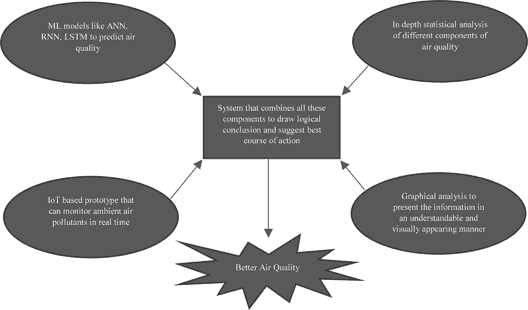

**图 8.17**

所提的空气质量监测原型。

## 8.6 结论

本章讨论了人工智能（AI）与物联网（IoT）融合形成 AIoT 的趋势。AI 和 IoT 被视为两种不同的独立技术，对多个行业领域具有重要影响。IoT 被认为是支持数据流的数字神经系统，而 AI 被认为是整个系统的脑，负责做出并控制决策。IoT 和 AI 的这种强大分组与结合诞生了新一代 AIoT，它带来了智能连接且具备自我修复和纠正能力的智能系统。本文所提出的工作讨论了医疗保健、交通、智能家居和农业领域的各种 AIoT 应用。其目标是将智能 IoT 应用转换为智能的 AI 赋能应用。讨论了各种 AIoT 应用的原型，为开发智能交通管理系统、智能医疗管理系统、智能家居和其他智能应用提供了一个清晰且充满前景的框架。它还详细讨论了用于设计这些智能系统的各种 AI、机器学习和深度学习模型。世界可能会看到更先进的 AI 开发者出现，将计算量降低到经济化使用的程度，这将确保 AIoT 在智能交通、智能家居以及几乎任何其他领域处于领先地位。在未来，AIoT 将不可避免且显而易见的选择。

## 参考文献

1. C. Stracener, Q. Samelson, J. Mackie, and M. Ihaza, The Internet of Things Grows Artificial Intelligence and Data Sciences, IT Professional, vol. 21, no. 3, pp. 55–62, May–June 2019.
2. Andrew Ng, Machine learning Yearning. Available at: [`www.mlyearning.org/`](https://www.mlyearning.org) [访问于 2020 年 4 月 15 日].
3. A. Kapoor, Principles and Foundations of IoT and AI, Hands-On Artificial Intelligence for IoT: Expert Machine Learning and Deep-Learning Techniques for Developing Smarter IoT Systems, Packt Publishing, January 2019.
4. Samuel Greengard, The Internet of Things, Cambridge, MA: MIT Press, 2015, p. 232.
5. M. S. V. Janakiram, Why AIoT Is Emerging as the Future of Industry 4.0\. [online] Available at: [`www.forbes.com/sites/janakirammsv/2019/08/12/why-aiot-is-emerging-as-the-future-of-industry-40/#c4e350b619be`](https://www.forbes.com) [访问于 2020 年 4 月 16 日].
6. Klaus Schwab, The Fourth Industrial Revolution, Penguin (January 3, 2017).
7. Cuno Pfister, Getting Started with the Internet of Things: Connecting Sensors and Microcontrollers to the Cloud (Make: Projects) O'Reilly Media (June 5, 2011).
8. Postscapes, Internet of Things (IoT) History [online]. Available at: [`www.postscapes.com/iot-history/`](https://www.postscapes.com) [访问于 2020 年 5 月 5 日].
9. Daniel Kellmereit, Daniel Obodovski, The Silent Intelligence–The Internet of Things, DND Ventures LLC (September 20, 2013).
10. R. Milton, D. Hay, S. Gray, B. Buyukva, and A. Hudson, Smart IoT, Living in the Internet of Things: 2018, London, UK, March 28–29.
11. D. Upadhyay, A. K. Dubey, and P. S. Thilagam, Application of Non-Linear Gaussian Regression based Adaptive Clock Synchronization for Wireless Network in Agriculture, IEEE Sensors Journal, vol. 18, no. 10, pp. 4328–4335, 2018
12. Russell Stuart, Artificial Intelligence: A Modern Approach, 3rd edition, Prentice Hall (November 30, 2009).
13. Jeff Heaton, Artificial Intelligence for Humans, Volume 1: Fundamental Algorithms, CreateSpace Publishing Platform (November 26, 2013).
14. Kevin Warwick, Artificial Intelligence: The Basics, Routledge (October 13, 2011)
15. Ethem Alpaydin, Machine Learning: The New AI, MIT Press (October 7, 2016).
16. Christopher M. Bishop, Pattern Recognition and Machine Learning, Corr. 2nd printing, Springer (February 15, 2010).
17. S. Ben-David and S. Shalev-Shwartz, Understanding Machine Learning: From Theory to Algorithms, Cambridge University Press (May 19, 2014).
18. Ian Goodfellow, Yoshua Bengio, and Aaron Courville, Deep Learning. MIT Press. 2016.
[19. Lavanya Sharma and P.K. Garg, (Eds.). (2019). From Visual Surveillance to Internet of Things. New York, NY: Chapman and Hall/CRC, [`doi.org/10.1201/9780292972`](https://doi.org/10.1201/97804292972)
20. Lavanya Sharma and Nirvikar Loh, Performance Analysis of Moving Object Detection using BGS Techniques in Visual Surveillance, International Journal of Spatiotemporal Data Science, vol. 1, Inderscience, pp. 22–53, January 2019.
21. K. L. Loh, 1.2 Fertilizing AIoT from Roots to Leaves, 2020 International Solid-State Circuits Conference (ISSCC), San Francisco, CA, 2020, pp. 15–21, doi:10.1109/ISSCC19947.2020.9062950.
22. H. HaddadPh, R. Khayami, A. Dehghantanha et al., AI4SAFE-IoT: An AI-Powered Secure Architecture for Edge Layer of Internet of Things, Neural Computing & Applications, (2020). [`doi.org/10.1007/s00521-220-4772-3`](https://doi.org/10.1007/s00521-220-4772-3)
23. J. Ma, S. Feng, X. Li, X. Zhang, and D. Zhang, Research on the Internet of Things Architecture for Intelligent Transportation Services and its Application, 2019 4th International Conference on Electromechanical Control Technology and Transportation (ICECTT), Guilin, China, 2019, pp. 194–197.
24. Y. Liu, Big Data Technology and Its Analysis of Application in Urban Intelligent Transportation System, 2018 International Conference on Intelligent Transportation, Big Data & Smart City (ICITBS), Xiamen, China, 2018, pp. 17–19.
25. P. S. Saarika, K. Sandhya, and T. Sudha, Smart Transportation System using IoT, 2017 International Conference on Smart Technologies for Smart Nation (SmartTechCon), Bangalore, India, 2017, pp. 1104–1107.
26. HERE Mobility, An Introduction to Smart Transport [online]. 2020\. Available at: [`mobility.here.com/learn/smart-transportation/introduction-smart-transport`](https://mobility.here.com/learn/smart-transportation/introduction-smart-transport) [访问于 2020 年 5 月 5 日].
27. L. Zhu, F. R. Yu, Y. Wang, B. Ning, and T. Tang, Big Data Analytics in Intelligent Transportation Systems: A Survey, in IEEE Transactions on Intelligent Transportation Systems, vol. 20, no. 1, pp. 383–398, Jan. 2019.


28. Qiong Wang, Haofeng Zhang, Minxian Li, and Chunxia Zhao, 基于动态环境智能感知的交通监测框架, 2011 年国际遥感、环境与交通工程会议, 中国南京, 2011, pp. 1852–1855.

29. F. Zantalis, G. Koulouras, S. Karabetsos, and D. Kandris, “智能交通中的机器学习与物联网综述,” Future Internet, vol. 11, no. 4, p. 94, 2019.

30. Lavanya Sharma and Nirvikar Lohan, 基于 BGS 技术的移动目标检测性能分析, 国际时空数据科学杂志, Inderscience, 2019 年 2 月.

31. Microsoft Azure, Azure 健康云 [在线]. 2020. 可于: https://azure.microsoft.com/en-in/industries/healthcare [访问于 2020 年 5 月 5 日].

32. W. Liu, E. K. Park, S. S. Zhu, and U. Krieger, 智能互联电子健康研发平台, 2015 年第 17 届国际电子健康网络、应用与服务会议 (HealthCom), 马诸塞波士顿, 2015, pp. 677–679.

33. F. Casino, C. Patsakis, E. Batista, O. Postolache, A. Martínez-Ballesté, and A. Solanas, 物联网时代的智能医疗: 情境感知推荐示例, 2018 年物联网时代传感与仪器国际学术会议 (ISSI), 中国上海, 2018, pp. 1–4.

34. Z. Zhang, T. He, M. Zhu, Q. Shi, and C. Lee, 用于人工智能物联网(AIoT)智能家居与医疗的智能摩擦电织袜, 2020 年 IEEE 第 33 届国际微机电系统(MEMS)会议, 加拿大省哥哥华, 2020, pp. 80–83, doi: 10.1109/MEMS46641.2020.9056149.

35. A. Pang, M. Markovski, and A. Micik, 前 10 大生命科学软件供应商、市场规模及 2018–2023 市场预测. [在线] Apps Run the World. 2020. 可于: https://www.appsruntheworld.com/top-10-life-sciences-software-vendors-and-market-forecast/ [访问于 2020 年 5 月 5 日].

36. W. Chang 等., 基于 AI 边缘计算的视障人士过马路穿戴式辅助设备, 2020 年 IEEE 国际消费电子会议(ICCE), 美国内华达州拉斯维加斯, 2020, pp. 1–2, doi: 10.1109/ICCE46568.2020.9043132.

37. Lavanya Sharma, 导论：从视觉监控到物联网, 从视觉监控到物联网, 第 1 卷, Chapman Hall/CRC, p. 14, 2019.

38. Lavanya Sharma and P. K. Garg, 视频监控中移动人员检测的块自适应学习率, 从视觉监控到物联网, 第 1 卷, Chapman Hall/CRC, p. 201, 2019.

39. Lavanya Sharma and P. K. Garg, 物联网智能电子医疗：当前趋势、挑战、解决方案与技术, 从视觉监控到物联网, 第 1 卷, Chapman Hall/CRC, p. 215, 2019.

40. Lavanya Sharma, P. K. Garg, and Naman Agarwal, 电子医疗先驱者的展望, 从视觉监控到物联网, 第 1 卷, Chapman Hall/CRC, p. 235, 2019.

41. N. M. Kumar, S. Goel, and P. K. Mallick, 印度智慧城市：特征、政策、现状与挑战, 2018 智慧城市能源与电力技术(ICSESP), 印度巴哈内斯尔, 2018, pp. 1–4.

42. E. Mardacany, 智慧城市特征: 环境的重要性, IET 未来城市会议, 伦敦, 2014, pp. 1–6.

43. 世界卫生组织于 2019 年 1 月 14 发布的饮用水报告. 可于: https://www.who.int/news-room/fact-sheets/detail/drinking-water [访问于 2020 年 1 月 10 日].

44. W. Chang 等., iCAP: 基于物联网的智能垃圾监测系统, 2019 年第 11 届计算机科学与电子工程会议(CEEC), 英国彻斯特, 2019, pp. 156–159, doi: 10.1109/CEEC47804.2019.974314.

45. R. P. N. Budiarti, A. Tjahjono, M. Hariadi, and M. H. Purnomo, 用于自动质量监测的物联网开发, 2019 年国际计算机科学、信息与电气工程会议(ICOMEE), 印度尼西亚爪井, 2019, pp. 211–216.

46. K. Gopavan and S. Nagaraju, 基于物联网的低成本水质监测系统, 2017 年能源通信、数据分析与软计算会议, 印度钦纳达, 2017, pp. 3227–3229.

47. G. M. G. Nandigala Venkat Anurag, Y. Burra, and S. Sharanya, 基于特征的空气质量预测, 创新技术与探索杂志, vol. 8, no. 1, 2019.

48. Ping-Wei Soh 等., 基于时空关系的深度学习空气质量预测, IEEE Access, vol. 6, pp. 38186–38199, 2018.

49. W. Han, Y. Gu, Y. Zhang, and L. Zheng,农业物联网的数据驱动定量信任模型, 2014 年国际物联网会议(IOT), 美国马诸塞州剑桥, 2014, pp. 31–36, doi: 10.1109/IOT.2014.703011.

# 9 物联网与图像处理

余晓宇
中国南方大学自动化科学学院

谢伟
中国南方大学自动化科学学院

## 目录

## 9.1 引言

## 9.2 物联网与图像处理
#### 9.2.1 关系
#### 9.2.2 物联网下的图像处理应用
#### 9.2.2.1 工业系统
#### 9.2.2.2 农业
#### 9.2.2.3 交通与车辆
#### 9.2.2.4 医疗系统
#### 9.2.2.5 公共安全

### 9.3 人脸图像处理在公共安全中的应用
#### 9.3.1 人脸超分辨率与去模糊
##### 9.3.1.1 网络设计
##### 9.3.1.2 训练网络
##### 9.3.1.3 预测模型
#### 9.3.2 标准人脸生成与人脸识别
##### 9.3.2.1 构建训练数据集
##### 9.3.2.2 构建网络模型
##### 9.3.2.3 训练模型
##### 9.3.2.4 模型预测
#### 9.3.3 基于边缘计算与云协同的人脸识别架构
##### 9.3.3.1 边缘节点部署
##### 9.3.3.2 本地人脸识别模型设计与数据传输
##### 9.3.3.3 云端模型设计与训练

### 任务反馈


- 9.4 结论
- 致谢
- 参考文献

## 9.1 引言

物联网（IoT）的定义是：通过电池供电，配备微控制器和收发器的微设备集成到全球互联网中，并被称为智能对象。随后，智能服务指的是由智能对象提供的服务 [1]。物联网可以在任何时间、任何地点实现物与物、物与人以及人与人之间的有效连接，这使得跨平台信息共享更加方便。物联网已应用于许多实际场景中，使城市变得更加智能。

图像处理是指使用数学算法操作图像文件的过程 [2]。更重要的是，经过图像处理的图片通常是数字图像。因此，图像处理通常被视为数字图像处理（DIP）。然而在某些情况下，捕捉到的图像总是模糊的或令人眼感到不适。因此，必须使用图像处理算法来使这些低质量图像变得清晰和明亮。DIP 使用不同的计算机算法来处理数字图像信息。换句话说，DIP 有一个明显的优势，即 DIP 方法处理的结果始终满足应用中人类视觉心理的需求 [2]。同时，DIP 方法可以帮助人类客观、快速地解释现实世界。

此外，结合 DIP 的模式识别方法可以帮助人类理解仅凭肉眼难以识别的图像。使用模式识别技术有利于快速准确地检索、匹配和识别各种物体。最近，DIP 已广泛应用于图像分类（确定所观测对象的类型） [3]、模式识别（识别已知或未知的物体类别） [4]、目标特征提取（判断并提取可用于进一步处理处理的特征） [5]、不同尺度的信息分析以及三维（3D）图像处理 [6]。

最近，图像处理，尤其是结合深度学习理论的 DIP 已扩展到各种应用。因此，本章将介绍基于图像处理和物联网的关系及应用。首先，我们将简单介绍图像处理与物联网的关系与应用。然后，我们将讨论结合人脸图像处理技术的公共安全（FoPS）领域的物联网相关算法和应用。

# 9.2 图像处理与物联网

## 9.2.1 关系

物联网可以在任何时间、任何地点实现物与物、物与人以及人与人之间的有效连接。在智能环境中，传感器和设备通过物联网无缝通信，可以方便地实现跨平台的信息共享 [7, 8]。物联网可以连接多种类型的信息，数字图像是物联网信息的重要部分。如图 9.1 所示，图像处理与物联网的关系如下：由 CCD 或 CMOS 构建的图像传感器用于捕捉图像数据，是物联网网络的一部分 [9]。图像传感器作为支持物联网网络的“人”，等同于人眼，用于捕捉来自外部世界的变化图像。同时，配备 DIP 技术的处理器等同于人类大脑的视觉处理区域，用于处理和增强这些图像。随后，处理器将处理结果传输到物联网网络的其他位置，以便对任务做出响应。因此，加载 DIP 技术的物联网网络可以获得更准确的信息和更快的任务响应。

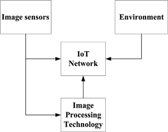

**图 9.1**

物联网与图像处理的关系。

## 9.2.2 物联网环境下的图像处理应用

物联网是一项重要的研究趋势，具有广阔的应用前景。图像处理与物联网网络框架相结合已应用于许多领域，如城市建设和直播制作。在现实世界中，物联网的应用包括基于救援车辆的应急系统、交通监控、基于 GPS 的路径跟踪、农业监控、犯罪追踪、社区服务、监控系统、身份验证和授权的安全系统、电子医疗、智能工业系统以及医疗系统 [10]。图 9.2 通过结合物联网和图像处理展示了相关的应用场景。我们将介绍物联网中图像处理的应用场景。

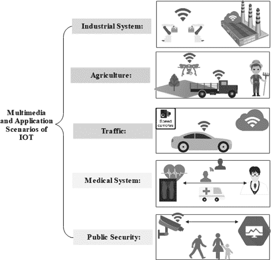

**图 9.2**

物联网中的多媒体通信类型及物联网相关的应用场景。

### 9.2.2.1 工业系统应用

物联网与工业应用的结合主要应用于智能工厂中的机械设备监控和环境监控。图像处理在物联网中的重要作用主要体现在生产材料检测和设备信息监控上。例如，[11] 介绍了钢坯三维表面检测框架。在智能工业中，利用相机连续捕捉多幅图像来执行 3D 扫描。同时，使用绿线激光从各个角度检查并提取钢坯的深度信息。对于设备信息监控，[12] 设计了一种基于在线光学字符识别（`OCR`）的工业仪表自动读取设备。工业的结果从监控图像中提取，并由设备上传到云端。随后，这些数据经过处理后，集中提供给 PC 和智能手机上的授权用户。

### 9.2.2.2 农业应用


农业与物联网的结合体现在农业种植和畜牧业中。在农业种植中，传感器、摄像头和卫星被用于促进作物的数字化发展。在畜牧业中，通过耳标、可穿戴设备和摄像头收集数据。然后，利用动物数据来分析和确定家禽畜的状态，从而管理家畜的健康、饲养、位置和发情期。

在植物监控问题，Kapoor 等人 [13] 将图像处理技术（如作物叶片图像的直方图分析）引入物联网框架，可以判断环境因素或人为因素是否会阻碍作物生长。Liao 等人 [14] 提出了用于监测温室内 `Phalaenopsis`（蝴蝶兰）的物联网系统。该系统使用 `canny algorithm` 检测边缘和种子区域生长以预测叶片面积，能够监测植物的生长状态，并为 `Phalaenopsis` 的栽培策略提供参考信息。在 [15] 中，描述了温室内作物的种植问题，并介绍了植物状况的接触性和非接触性监控方法。

此外，植物监控促进了自动灌溉的实现。Tran 等人 [16] 使用图像处理技术分析植物生长，并将监测结果发送到后端控制器，从而实现植物的自动灌溉和维护。[17] 通过分析卫星图像提出了一种闭环灌溉系统，根据植被的时空变化及时调整灌溉计划，实现灌溉计算和自动灌溉。此外，图像处理在保护野生动物方面也很有意义。Elias 等人 [18] 设计了“熊在哪里”（WTB）系统，用于识别野生动物监控系统中的动物。WTB 系统是通过结合边缘计算技术和图像处理技术设计的。边缘计算的目的是为信息转换节省带宽，并使 WTB 系统获得更好的处理精度。WTB 使用 `TensorFlow` 识别和分类监控屏幕中的熊图像，并通过 `OpenCV` 分析图像结构。结果显示，在获取图像的边缘节点上运行图像识别算法可以极大地节省带宽并减少任务响应延迟。

### 9.2.2.3 交通与车辆应用](#12chap_09.xhtml_sec9_2_2_3a)

在此类应用中，物联网主要通过密切结合人、车、路和其他要素，推进交通环境建设、维护交通安全并提升公共资源的利用率。然后，图像处理技术在此方面的应用主要集中在车辆监控和交通监控上。George 等人 [19] 结合图像处理技术提出了一种自适应神经模糊推理系统（ANFIS），该系统在交通灯管理和监控系统中具有更好的性能。在这里，基于机器视觉的点分析技术被用于检测车辆位置并使用 `Otsu image-processing technology` 增强基于微弱光照条件的夜间图像。对于 ANFIS，在捕捕获的图像在云服务器上处理后，可以控制交通灯。

此外，[20] 提出了一种基于图像处理的障碍检测和路径规划方法，其中包括将视频转换为固定速率的帧。通过合并视频流中的多个图像帧，Cai 等人 [21] 使用神经网络和车辆跟踪技术寻找空车位，可以帮助司机节省寻找空车位的时间。此外，Chen 等人 [22] 设计了一种基于雾计算的视频监控系统，利用无人机（UAV）摄像头监控城市地区的交通系统。作者提出了一种提取感兴趣帧并将其传输到雾节点的跟踪算法，可以满足最小计算和延迟的要求。该跟踪算法使用了 `Bayesian estimation` 和 `probabilistic Monte Carlo simulation`。

### 9.2.2.4 医疗系统中的应用](#12chap_09.xhtml_sec9_2_2_4a)

通过结合物联网（IoT），医疗系统可以获得更高精度的信息处理和收集。图像处理在医疗物联网中的作用主要体现在面部信息处理和手术辅助。[23] 提出了一种有效的血管识别技术，基于区域特征从视网膜图像中提取病变位置。Zhang 等人 [24] 提出了一种改进的眼睛虹膜定位和认证方法。该系统通过评估图像强度、图像清晰度和眼睛虹膜完整性来对捕获图像的质量进行建模。[24] 使用 `block variance method` 评估图像清晰度，并根据瞳孔在图像中的位置确定图像的完整性。在估算中心范围并提取瞳孔半径和瞳孔面积后，该方法可以缩短虹膜识别的延迟。Yin 等人 [25] 提出用于检测多种眼睛疾病的增强系统。所提出的自动方法使用底相机采集视网膜图像数据。此外，[26] 提出了一种基于视网膜的面部识别认证系统。作者通过使用 `adaptation truncation`、`lighting classification` 和 `lighting estimation` 改进了视网膜模型。在手术辅助方面，[27] 提出了一种基于计算机视觉的手术辅助 X 射线图像自动检测工具。由于使用了 `block detection`、`matching method of geometric model`、`principal component analysis (PCA)` 等方法，该系统的成功率可以达到 91%。

### 9.2.2.5 公共安全应用](#12chap_09.xhtml_sec9_2_2_5a)


`IoT` 在公共安全中的作用也极其显著。传统的公共安全系统依赖人工告警，而智能公共安全系统则利用敏捷设备来降低人员成本。在智能公共安全系统中，主要的应用场景包括建筑访问、危险报警、安全监控和视频监控。智能公共安全系统可以处理并积累采集的图像，然后对图像进行分析并对任务做出反馈。28] 提出了一种自然语言处理系统，结合了本体和基于图像分析的视频监控方法用于基于内容的视觉数据检索。同时，利用主成分分析和支持向量机来检测面部区域，并获得分类结果。该方法用于保障公共交通系统的乘客安全。此外，Basri 等人[29] 提出了一种基于 `IoT` 的住宅监控系统。在指定的监控范围内，使用被动红外（`PIR`）传感器检测可疑运动，并使用 `Pi` 捕捉重要图像。在 `FoPS` 中，人脸识别是一项重要的安全措施。Wang 等人[30] 提出了在视频流中基于深度神经网络（`DNNs`）的人脸检测技术和人脸技术，以保护个人信息的隐私和安全。

因此，人脸图像处理技术对于公共安全领域的 `IoT` 非常重要。在第 9.3 节中，将介绍结合人脸图像处理技术与 `IoT` 的若干应用算法。

# 9.3 人脸图像处理与 IoT 在公共安全中的应用

在 `FoPS` 中，带有图像采集传感器和 `DIP` 技术的 `IoT` 框架用于公共安全事件的预警和处理。这些图像处理技术包括低质量人脸修复、人脸标准化生成和人脸识别等。

通常，公共安全 `IoT` 框架通用使用监控摄像头等图像采集工具来识别、排除并锁定目标嫌疑人的脸部。然而，在该应用中，我们需要解决以下问题：首先，从监控画面中恢复人脸图像，主要问题是如何恢复低分辨率和低质量的模糊人脸图像。其次，对于单样本人脸识别，主要问题是如何解决人脸图像的标准化问题。第三，对于 `IoT` 框架下的大数据人脸识别，主要问题是如何解决海量监控数据的传输效率和任务反馈效率。

最近，结合深度学习的 `DIP` 处理不同类型图像具有更强的能力，并能更准确的处理结果[31]。因此，在本节中，我们主要介绍针对三个待解决问题的 `IoT` 应用以及基于学习的图像处理技术。

## 9.3.1 人脸超分辨率与去模糊

在 `FoPS` 中，监控视频采集的人脸图像通常是模糊且低分辨率的（`B-LR`）。为了获取关于某人的信息，我们需要恢复 `B-LR` 人脸图像。当 `B-LR` 图像的分辨率过低（图像分辨率为 16 × 16，甚至 8 × 8）时，分别使用去模糊方法[32] 和重构方法[33, 34] 进行恢复时，很容易获得无法接受的结果。需要注意的是，由于上述方法忽略了人脸图像超分辨率像素之间的条件依赖关系，恢复出的脸部图像往往于模糊和过度平滑[35]。同时，当我们需要以更高的放大率恢复人脸图像时，上述方法也无法获得有效的恢复结果。此外，现有方法大部分侧重于在重构过程中从 `B-LR` 脸中获取视觉愉悦的图像。然而，人脸恢复方法的目标不仅是获得愉悦的人脸图像，还要在恢复过程中保持脸部身份的一致。

因此，我们提出了一种一致性生成对抗网络（`Con-IDGAN`），它旨在学习 `B-LR` 图像 `b` 与对应的清晰图像 `f` 之间的相对映射 `M` : {`b` → `f`，使得 `Id(b)` = `Id(f)`，其中 `Id(•)` 表示脸部的身份信息。所提方法的本质流程如图 9.3](#12chap_09.xhtml_fig9_3) 所示。详细介绍如下。

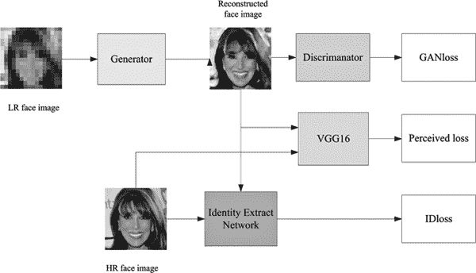

**图 9.3**

所提人脸恢复方法的整体结构。

### 9.3.1.1 网络设计

根据上述解释，`B-LR` 人脸图像的重构结果需要实现两个目的，包括良好的视觉效果和一致的身份信息。因此，本节提出了一种端到端网络从 `B-LR` 人脸图像重构高分辨率（`HR`）人脸图像。网络的整体架构通过使用生成对抗网络（`GAN`）机制构建，主要包括超分辨率生成网络（`SR-Gnet`）、判别网络（`Dnet`）和人脸评估网络（`ID-Evalnet`）。详细而言，`SR-Gnet` 用于生成 `HR` 人脸图像。`Dnet` 用于判别生成图像的真伪性，用于训练网络。同时，`ID-Evalnet` 用于提取脸部信息，可用于进一步约束生成图像的正确性。具体的网络结构如下。

#### 9.3.1.1.1 超分辨率生成网络

如图 9.4](#12chap_09.xhtml_fig9_4) 所示，我们的 `SR-Gnet` 采用多分支框架来重构采样倍数为 ×16 的超分辨率图像。以下是 `SR-Gnet` 的简要介绍。首先，作为输入图像 `I`，我们将得到 `I` 的三个插值结果，分别为采样倍数为 ×2（`I(×2)`）、×4（`I(×4)`）、×8（`I(×8)`）。然后，每个插值结果被作为 `SR-Gnet` 中每个分支的输入。例如，图像 `I(×2)` 应用于第一个分支产生采样倍数为 ×4 的 SR 图像（`SR(×4)`）。最后，可以获得采样倍数为 ×16 的 SR 图像 `SR`。需要注意的是，`SFT` 网络[36] 被用作每一层的骨干网络。然而，根据 `SFT` 网络，所提方法增加了显著边缘提取网络（`2ENet`）和退化核预测网络（`DKPNet`）。这是因为退化核可以在迭代估计框架通过通过图像显著边缘进行更准确的估计，且退化核有利于恢复模糊图像。通常，将 `2ENet` 和 `BKPNet` 结合到 `SR-Gnet` 中可以有效提升脸部构建效果，使幻 `HR` 人脸图像具有良好的视觉保真度。

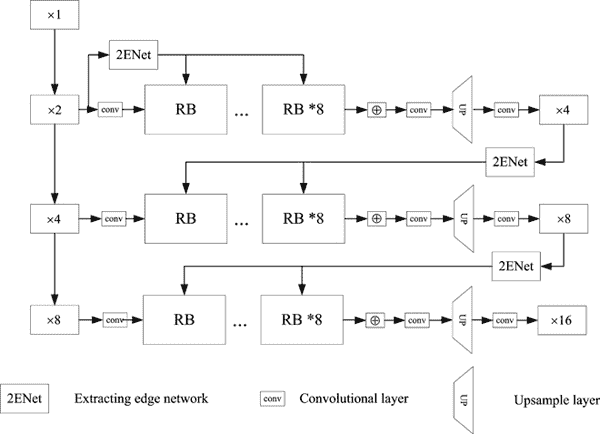

**图 9.4**

`SR-Gnet` 结构。

#### 9.3.1.1.2 显著边缘提取网络


如图 9.5 所示，这些 2ENet 是基于标准的 U-net [37] 构建的。由于每个 2ENet 的输入不同，其结构是根据输入的大小设计的。例如，输入大小为 32 × 32 的第一个 2ENet 结构只有两个带有修正线性单元（`ReLU`）的卷积层和两个带有 `ReLU` 的反卷积层。然后，输入为 128 × 128 的第三个 2ENet 具有与标准 U-net 相同的结构，如图 9.5](#12chap_09.xhtml_fig9_5 所示。通过这种方式，可以从不同尺度的图像中提取边缘。注意的是，在训练整个模型之前，应该先训练每个 2ENet。

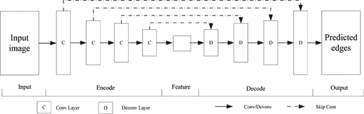

**图 9.5**

2ENet 的结构。

### 9.3.1.1.3 退化核预测网络

BKPNet 的灵感来自典型图像退化领域中盲核的估计。根据 [38]，盲低分辨率图像 `b` 可以通过公式获得：

| `b = (k ⊗ I[m]) ↓ + n` | (9.1) |

其中 `k`、`I[m]` 和 `n` 分别表示盲核、清晰的高分辨率图像和加性噪声。`⊗` 和 `()↓` 分别表示模糊算子和下采样算子。在文献中，`n` 被高斯噪声。

通过将模糊算子和下采样算子写作矩阵乘法，模型 (9.1) 被重写为

| `b = K*I[m] + n` | (9.2) |

根据模型 (9.2)，我们可以通过下式获取清晰的 HR 图像 `I[m]`：

| `I[m] = K^(−1)(b + n′)` | (9.3) |

根据 [38, 39]，应首先表示核 `K` 和噪声 `n`。此外，可以获得清晰的高分辨率图像。因此，如图 9.6 所示，提取的边缘 `E` 首先用于拟合噪声，其次用于拟合退化核。然后，输入特征 `Fe[in]` 可以获得 DKPNet 的结果：

```
\left\{ \begin{array}{l} {n'} = Conv1(E), \\ {K^{- 1} = Conv2(E),} \\ {Fe_{tmp} = Fe_{in} + n'}, \\ {Fe_{out} = K^{- 1} \otimes Fe_{tmp},} \end{array} \right.
```
(9.4)

其中 `Conv1` 和 `Conv2` 表示带有卷积层和 `Leaky_Relu` 激活函数的层。通过这种方式，在使用 DKPNet 若干残差块后，可以提取图像的特征。

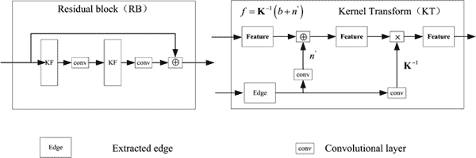

**图 9.6**

DKPNet 的结构。

最后，本节算法通过使用残差网络 [40] 作为骨干构建，将残差模块的卷积替换为两个退化核预测模块。通过这种方式，可以提取图像的深度特征图。然后，结合多个残差模块，增加网络深度并提高图像恢复的精度。

### 9.3.1.1.4 判别网络

在本节中，`Dnet` 用于判别超分辨率图像 `I^(SR)` 是否为伪，高分辨率图像 `I^(HR)` 是否为真。`Dnet` 的网络架构基于 WGAN-GP [41]，它包含五个卷积层和一个 sigmoid 层和 FC 层，如表 9.1 所示。在经过 `Dnet` 后，特征图的通道从 3 变为 512，最终输出是最后一层输出的平均值。该平均值用于判别输入是 SR 图像还是 HR 图像。因此，通过这种方式，`Dnet` 可以帮助 SR-Gnet 生成高质量的面部图像。同时，我们在接下来的小节中引入了 `ID-Evalnet`，它可以促进 SR-Gnet 生成与地面真值（ground truth）具有一致身份的可行面部图像。

*表 9.1*

Dnet 网络架构

| 层名称 | 卷积大小 | 步长 | 输出尺寸 |
| :--- | :--- | :--- | :--- |
| `I^(SR)` 和 `I^(HR)` | - | - | - |
| `Conv, LeakyRelu` | - | 2 | 256 |
| `Conv, LeakyRelu` | - | 2 | 128 |
| `Conv, LeakyRelu` | - | 2 | 64 |
| `Conv, LeakyRelu` | - | 2 | 32 |
| `Conv, LeakyRelu` | - | 1 | 32 |
| `Conv` | - | 1 | 512 |

### 9.3.1.1.5 面部评估

在该研究中，使用 `ID-Evalnet` [42] 和 `VGGF2` [43] 作为主网络。首先是图像中的 `A^(SR)`，其次是 `A^(HR)`。最后使用 `VGGF2` 最后一层的输出。注意的是，训练期间 `VGGF2` 的参数是固定。

### 9.3.1.2 训练网络

在该方法中，高分辨率图像通过 [44] 进行模糊和低质量处理。然后，使用高分辨率图像和低质量图像构建数据库。

#### 9.3.1.2.1 重建函数

使用均方误差（MSE）计算像素差异来重建 SR 面部。由于 SR-Gnet 旨在生成具有不同缩放倍数的 SR 图像，我们还根据三个上采样因子（包括 4、8 和 16）使用 MSE 来优化模型。因此，不同缩放倍数的 MSE 定义为：

```
L_{duf - mse} = \sum_{j \in \{ \times 4, \times 8, \times 16 \}} w_{j}|I_{j}^{HR} - I_{j}^{SR}|^{2}
```
(9.5)

#### 9.3.1.2.2 感知损失函数

虽然使用上述 MSE 损失函数重建的结果可以获得更高的峰噪比（PSNR）值，但生成的结果无法获得良好的视觉质量。根据 [45]，感知损失由 VGG16 网络构建并可以提升 SR 图像的视觉效果。因此，SR 图像与 HR 图像之间的感知损失定义为：

```
L_{per} = \frac{1}{C_{k}H_{k}W_{k}}\left| \phi_{k}\left( I^{SR} \right) - \phi_{k}\left( I^{HR} \right) \right|^{2}^{2}
```
(9.6)


其中 `ϕ`[*k*] 表示 VGG16 第 `k` 层卷积层的输出 [46]，而 `C`[*k*]、`H`[*k*] 和 `W`[*k*] 分别表示输出 `ϕ`[*j*] 的通道、长度和宽度。感知损失用于构建生成的 SR 图像，其内容与 HR 图像具有相似性。

### 9.3.1.2.3 对抗损失函数

众周知，对抗损失可以促进生成的 SR 人脸图像的先验分布，该分布可以与 HR 人脸图像的先验分布相似。通常情况下，所提出的生成网络将被训练以学习一种与真值（ground-truth）图像数据具有相似分布的映射，其输出可以欺骗判别器网络。同时，判别器网络将通过训练以确保生成网络的结果被识别为伪，而将真值图像被识别为真。因此，所提出的 `SR-Gnet` 为生成网络，它从 LR 人脸图像生成多级 SR 图像。

根据 WGAN-GP [41]，所提出的 `SR-Gnet` 和 `Dnet` 通过使用对抗损失函数进行训练：

| $$\left\{ \begin{array}{l} {L_{G} = \min\limits_{G} - \text{E}_{x \sim P_{SR}}\left\lbrack {D\left( {G(x)} \right)} \right\rbrack,} \\ {L_{D} = \max\text{E}_{x \sim P_{SR}}\left\lbrack {D(x)} \right\rbrack - \text{E}_{x \sim P_{GT}}\left\lbrack {D\left( {G(x)} \right)} \right\rbrack,} \end{array} \right.$$ | (9.7) |

其中 `P`[*S**R*] 和 `P`[*G**GT*] 分别表示生成的图像数据和真值图像数据的分布。`x` 是 LR 图像输入。

### 9.3.1.2.4 一致性身份损失函数

如引言所示，关键点在于修复的人脸图像应该与 LR 人脸图像具有相同的身份。虽然感知损失可以提高生成图像的视觉效果，但它不能保证生成人脸图像的信息是正确的。因此，基于 MTCNN 和 VGGface2 的 `ID-Evalnet` 通过比较 SR 面脸图像与真值脸图像的高级特征来训练所提出的网络。一致性身份损失可以表示为：

| $$L_{id} = 1 - \frac{V\left( A^{SR} \right)V\left( A^{HR} \right)}{\left\&#124; {V\left( A^{SR} \right)} \right\&#124;_{2}^{}\left\&#124; {V\left( A^{HR} \right)} \right\&#124;_{2}^{}},,$$ | (9.8) |

其中 `V()` 表示去掉最后一层的 VGGface2 网络，`∥∥`[2] 表示 `L`[2] 范数。

因此，根据 (9.5–9.8)，训练整个模型的完整损失函数写为：

| `L`[*a**l**l*] = `λ`*[1]*L`[*d**u**f*]  − `m**s**se*]  + `λ`*[2]*L`[*p**e**r*]  + `λ`*[3]*L`[*G*]  + `λ`*[4]*L`[*i**d*], | (9.9) |

其中 `λ`*[1], `λ`*[2], `λ`*[3], 和 `λ`*[4] 表示平衡每个子函数的权重参数。

### 9.3.1.3 预测模型

从视频监控中提取低质量脸图像，并作为模型的输入。在通过所提出的模型进行高分辨率生成和去模糊后，最终获得更清晰的脸图像。具体而言，生成的高分辨率脸图像的身份信息与真实脸图像的身份信息保持一致。生成的清晰脸图像为人脸特征提取和人脸识别等相关应用奠定了基础。

## 9.3.2 标准脸部生成与人脸识别](#12chap_09.xhtml_sec9_3_2a)

在使用第 9.3.2 节的算法计算超分辨率脸图像后，我们可以恢复低质量模糊脸并获得高分辨率脸图像。然而，这些脸图像也有各种非限制因素，包括面部表情、头部姿态、拍摄光照因素等。因此，关键问题是如何从超分辨率脸图像生成标准的正脸图像，以便于后续操作中人脸图像的特征提取和识别。因此，我们引入了一种基于生成对抗机制（GAM）和注意力机制（AM）的标准脸部生成方法（SFGM）。该方法根据相关的深度学习模型设计网络模型，以获得标准的正脸图像。这种方法设计的网络模型用于人脸识别。

根据论文 [46]，所提出的 SFGM 设计主要包括以下步骤：训练数据设计、模型设计和预测步骤。首先，训练数据设计主要是 RaFD 数据集和 IAIR 数据集。其次，模型设计主要是使用 GAM 和 AM 设计相应的网络。第三，预测步骤主要是使用预训练模型处理真实世界，然后就可以获得结果。如图 9.7](#12chap_09.xhtml_fig_7）所示，这是流程图。在下一节将介绍细节。

### 9.3.2.1 构建数据集

通常，数据集用于识别任务。然而，这些数据集无法满足统一编码的要求。因此，有必要整合数据库以构建一个合适的数据库。如图 9.8](#12chap_09.xhtml_fig_8）所示，这是生成数据集的流程图。

具体而言，我们收集了 RaFD 数据集和 IAIR 数据集。然后，我们为每个脸图像构建具有各种非限制因素的 FC，其中非限制因素包括面部表情、头部姿态和拍摄光照因素。编码脸图像构成一个信息单元 `U` = {*L`[*u*], `E`[*u*], `A`[*u*}},包括 8 位光照编码 `L`[*u*]、8 位表情编码 `E`[*u*] 和 19 位手势编码 `A`[*u*]。此外，在处理数据期间，数据集的面部信息需要进行编码，分为两类非限制脸和标准正脸。因此，具体步骤所示。

#### 9.3.2.1.1 面部信息编码

对于数据集中的不同脸数据，为每个脸图像构建一个具有多种非限制因素的面码，其中非限制因素包括面部表情、头部姿态和拍摄光照因素。脸图像的编码规则如下：

首先，面部表情因素分为八种情况，包括快乐、愤怒、悲伤、蔑视、失望、恐惧、惊讶和自然。因此，脸图像的表情代码定义为 `E`[*u*] = (`E`[*u*1], `E`[*u*2], ..., `E`[*u*8]),其中 `E`[*u**l*] 表示第 *l* 个表情，且 *l* = 0, 1, 2,…8，其值设置在 0 到 1 之间。注意到 `E`[*u*] = (0, 0, ..., 1) 表示自然表情。


其次，面部光照因素分为八种情况，包括正光、左侧光、右侧光以及这三种光照形式的组合。详细而言，所有面部光照因素的情况定义为：正光、左侧光、右侧光、左前光、右前光、左右光、无光照以及右左前光。因此，面部图像的光照编码被定义为 `L[u]` = (`L[u1]`, `L[u2]`, ↆ..., `L[u8]`)，其中 `L[un]` 表示第 n 种光照，`n` = 0, 1, 2,…8，其值设置在 0 到 1 之间。注意，`L[u]` = (0, ↆ0, ↆ..., ↆ1) 被定义为正光。

第三，面部姿态因素分为 19 种情况，包括间隔为 10° 的 9 种左脸姿态、间隔为 10° 的 9 种右脸姿态以及正脸姿态。因此，面部图像的姿态编码被定义为 `A[u]` = (`A[u1]`, `A[u2]`, ↆ..., `A[um]`, ↆ..., `A[u19]`)，其中表示第 m 种面部姿态，`m` = 0, 1, 2,…19，其值设置在 0 到 1 之间。注意，`A[u]` = (0, ↆ0, ↆ..., ↆ1) 被定义为正脸。

最后，面部信息编码被集成到统一信息编码 `U` = {*L[u]`, `E[u]`, `A[u]}`，这是一个 35 位的一维信息。

### 9.3.2.1.2 面部数据分类

我们将编码的面部数据集分类为非限制面部图像和标准正脸清晰面部图像。详细而言，具有统一编码信息 `U[0]` = (`Lu, `Eu, `Au,`) 的面部图像被用作标准正脸清晰面部图像，作为所提模型的目标。编码面部数据集中其他面部图像定义为非限制面部图像，即所提模型的输入图像。

### 9.3.2. 构建的网络模型

根据研究目的，网络模型包含三个子网络：生成标准脸的图像生成器子网络 (IGsN)、判别生成结果的模型判别子网络 (MDsN) 以及还原生成结果的图像还原子网络 (IRsN)。首先，使用图像生成器子网络和 AM 生成输入面部图像的标准脸。然后，使用模型判别子网络来判别生成的图像和真值（ground-truth）图像。最后，在构建图像还原子网络后，用于还原生成的图像。将还原结果与输入图像进行比较，这可以用于优化和约束网络模型。

#### 9.3.2.2.1 设计网络

假设输入图像为 `Y`，对应的原始统一信息码被定义为 `U[y]`。同时，生成的标准脸图像定义为 `I[o]`，其对应的 FC 定义为 $\overline{U_{0}}$，而数据库中对应的标准脸图像定义为 `I`，其对应的 FC 定义为 `U[0]`。

在在图像生成器子网络中，其输入为图像 `Y` 和 $\overline{U_{0}}$。在该模型中，设计了两个编码-解码网络 `G[c]`、`G[f]` 和一个编码-解码器。然后，可以通过上述网络 `G[c]` 和 `G[f]` 分别获取输入图像的颜色信息 `C` 和注意力信息 `F`。此外，可以生成带电的面部图像 `I[i]`。为了进一步约束生成的标准脸图像的正确性，使用由 VGGface2 [43] 提取的身份信息来生成标准脸图像。注意，VGGFace2 倒数第二层的输出被用作面部图像的身份信息。


# 所设计网络的架构。

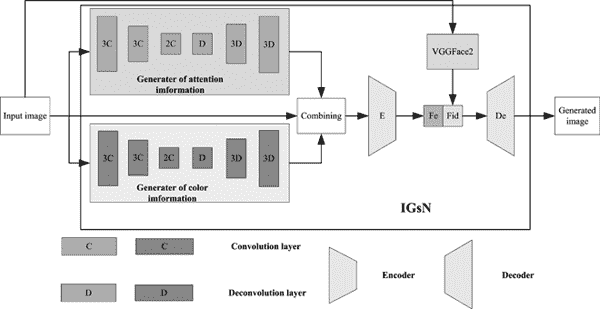

**图 9.10**

IGNs 的结构。

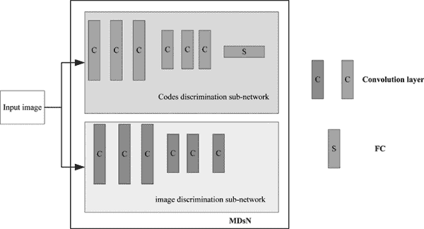

**图 9.11**

MDsN 的结构。

一方面，IGNs 和 IRsN 的参数是一致的。在这里，每个子网络包含了颜色信息生成网络和注意力生成网络。详细而言，生成 3 通道颜色信息图像的生成网络包含 8 层卷积层和 7 层反卷积层，其中每层的卷积核大小和步长分别设定为 5 和 1。同时，生成 1 通道注意力图像的生成网络包含 8 层卷积层和 7 层反卷积层，其中每层的卷积核大小和步长分别设定为 5 和 1。

另一方面，MDsN 包含了图像判别子网络和编码信息判别子网络。详细而言，图像判别子网络包括 6 层卷积层，其中每层的卷积核大小和步长分别设定为 5 和 1。同时，生成 N 位一维 FC 的编码信息判别子网络包括 6 层卷积层，其中每层的卷积核大小和步长分别设定为 5 和 1。

### 9.3.2.3 训练模型

将具有各种无限制因素的图像作为设计模型的输入，模型在优化 IGsN、MDsN 和 IRsN 的标签相似性和输出后可以实现收敛。详细而言，模型的损失函数设计如下。

1. 优化 IGsN 生成的标准脸图像 `I`[`o]` 与数据库中相应的标准脸图像 `I` 之间的差异。因此，我们建立图像损失函数为

    | $$L_{I} = \frac{1}{H \times W}\left| {D_{I}\left( I_{o} \right) - D_{I}(I)} \right|_{2}^{2}$$ | (9.11) |

    其中 `H` 和 `W` 分别表示输入图像的高度和宽度。`D`[`I]`((`I`[`o`])` 和 `D`[`I]`((`I`)` 分别表示使用图像判别子网络 `D[I]` 对 `I`[`o]` 和 `I` 进行判别的结果。同时，考虑到梯度损失的有效性，将基于梯度的惩罚项聚合到图像损失函数 (9.11) 中，这可以提高生成图像的质量。图像损失函数设置为

    | $$L_{I} = \frac{1}{H \times W}\left| {D_{I}\left( I_{o} \right) - D_{I}(I)} \right|_{2}^{2} + \lambda_{I}\frac{1}{H \times W}\left| {\nabla D_{I}\left( I_{o} \right) - \nabla D_{I}(I)} \right|_{1}$$ | (9.12) |

    其中 `∇(⋅)` 表示梯度算子，`λ`[`I]` 表示惩罚权重。

2. 优化 FCs 的差异。为了区分从生成图像 `I`[`o]` 和标准图像 `I` 中提取的不同 FCs，条件表达式损失函数设计为

    | `L`[`U]` = `F`cos, `U`[0]) | (9.13) |

    其中 `Fcos` 表示使用余弦函数的度量函数，`U[0]` 表示数据集中标准脸图像的 FCs。然后，将输入图像 `Y` 与对应的原始 FCs `U[y]` 之间的映射关系加入函数 (9.13)。因此，该函数可以设计为

    | `L`[`U]` = `F`cos, `U`[0]) + `F`cos, `U`[`y`]) | (9.14) |

    其中 `D`[`U]`((`I`[`o`])` 和 `D``U`` 分别表示编码信息判别 `D[U]` 对图像 `I`[`o]` 和 `Y` 进行判别的结果。

3. 优化原始图像与 IRsN 结果之间的差异。输入器生成的图像 `I[o]` 使用原始 FCs `U[y]` 进行还原，用于将 IRsN 的结果与原始图像 `Y` 进行比较。因此，还原损失函数设计为

    | $$L_{r} = \frac{1}{H \times W}\left| {G\left( {G\left( {I_{o}} \right) \right)} - Y} \right|_{2}^{}$$ | (9.15) |

    根据函数 (9.12) 和 (9.14)，整个损失函数所示：

    | `L` = `λ`[`1]`I]` + `λ`[`2]`U]` + `λ`[`3]`r]` + `λ`[`4]`a]` | (9.16) |

    其中 `λ`[`1]`、`λ`[`2]`、`λ`[`3]` 和 `λ`[`4]` 分别表示每个分支的权重，`L[a]` 表示 WGAN-GP。

### 9.3.2.4 模型预测

将带有各种无限制因素的图像作为设计模型的输入，该模型可以通过 FCs 获取更标准的脸。首先，使用 MTCNN 检测到脸部。然后，使用检测到的脸部生成标准脸。此外，预测可以改变脸部的其他结构，如表情、其他姿态。

## 9.3.3 基于边缘计算和云的脸识别架构

在 FoPS 中，从监控数据中提取大量图像以支持深度学习网络。然而，巨大的监控数据也带来了一些问题，例如数据传输效率和模型训练问题。因此，设计合理的深度学习网络是一种可行的方法。在设计基于边缘点和云的架构时，重要的是提高脸识别的响应速度并提高云端脸识别的准确性。


首先，详细而言，使用本地数据来训练每个边缘节点的人脸识别模型。其次，从多个边缘节点向云服务器传输少量数据和训练好的本地人脸识别模型。第三，通过云协同的形式，利用上传的数据和本地模型来训练和学习全局人脸识别模型。最后，对于人脸图像的检测和识别，边缘节点使用训练好的本地模型进行分析并提供简单的任务反馈。同时，云服务器使用全局人脸识别模型分析从边缘点上传的可疑数据，并将结果返回给每个边缘节点。如图（#12chap_09.xhtml_fig9_12）所示，这是所提方法的流程图。

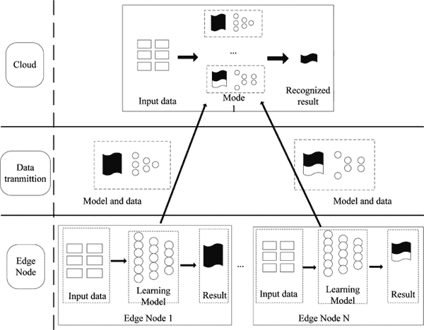

**图 9.12**

基于边缘计算技术和云协同的人脸识别架构。

结合引言，所提的人脸识别架构包括：边缘节点模型训练步骤、数据与模型传输步骤、云端全局系统训练步骤以及任务反馈步骤。详细而言，边缘节点模型的训练步骤意味着根据任务设计并训练每个边缘节点中的轻量级深度网络。数据和模型的传输步骤主要关注上传每个边缘节点对应的模型结果。最后，全局模型的训练步骤侧重于利用上传的数据和本地模型训练全局人脸识别模型。全局人脸识别模型的权重可以通过云协同进行学习。具体的操作步骤介绍如下。

### 9.3.3.1 边缘节点部署

在 FoPS 中，我们应该根据任务需求在关键区域设计边缘节点。需要，每个边缘节点应部署包含摄像头和轻量级服务器的智能前端设备。同时，选择边缘节点的原则所示：一方面，由于解决公共安全问题，所选边缘节点区域将关注高流动性的关键区域，包括社区入口、社区内的安全点、交通交叉口、火车站等。此外，为了使数据处理点靠近数据采集点，应使用轻量级服务器来处理采集的数据。例如，轻量级服务器可以使用边缘节点的本地数据来训练人脸识别模型。通过这种方式，可以减少数据传输的时间成本并提高对数据的实时响应。

### 9.3.3.2 本地人脸识别模型设计与数据传输

部署智能前端设备以获取边缘节点的监控视频。然后，在训练完本地人脸识别模型后，使用轻量级服务器响应基础任务。此外，对于边缘节点人脸识别模型的训练，我们需要以下步骤：

首先，从监控视频中采集人脸数据。此外，可以通过人脸检测和提取算法从监控视频中获取对应的人脸图像数据 `x`[`i`]` [42]。

其次，支持 `n` 个边缘节点。同时，每个边缘节点的训练数据定义为 `x`[`i`]`，对应轻量级服务器的本地数据库定义为 $\overline{x_{i}}$。因此，训练后我们可以获得 `n` 个本地人脸识别模型。对于第 `i` 个边缘节点，本地人脸识别模型所示：

| `M`[`i`] = `Model``i`, `i` = 1, 2, 3, ..., `n` | (9.17) |

以及

| $$S_{i} = match_{i}\left( {M_{i},Model_{i}\left( \overset{-}{x} \right)} \right),\mspace{2mu}\mspace{2mu}\mspace{2mu}\mspace{2mu}\mspace{2mu}\mspace{2mu}\mspace{2mu} i = 1,2,3,...,n$$ | (9.18) |

其中，`Model``i` 表示第 `i` 个边缘节点提取面部特征的本地方法 [52]，`match``i` 表示第 `i` 个边缘节点的匹配模型。同时，`L[i]` 表示通过模型提取后的数据特征。`S[i]` 表示人脸图像的识别结果。

最后，每个边缘节点的识别结果被用于对相应边缘节点的任务反馈。

具体而言，对于每个边缘节点，网络是一个简单的深度学习网络，如图（#12chap_09.xhtml_fig9_13）所示。整个网络包括三个卷积核大小为 3 × 3 的卷积层、一个卷积核大小为 1 × 1 的卷积层、三个池化层和一个分类层。首先，将人脸图像归一化为 3 × 64。然后，通过池化层获得高维特征。最后，通过分类层获得识别结果。

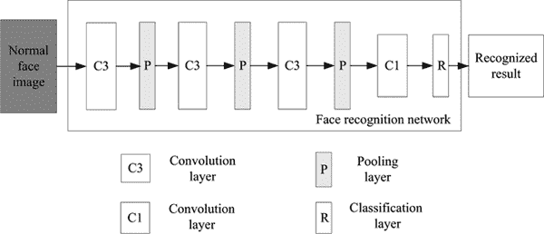

**图 9.13**

边缘点的人脸识别网络。

训练人脸识别后，上传的内容是少量数据。上传的少量数据包括 `Model`[`i]`=`Model`[`1]`,``Model`[`2`],...,`Model`[`n]` 以及 `X`=`x`[`1``,``x`[`2`],...,`x`[`n]`。上传通道只需要普通的带宽。

### 9.3.3.3 云模型设计与训练

根据上传的数据和模型，云端可以通过云协同构建深度学习网络。在联合处理上传的模型后，全局模型可以得到提升。详细而言，所提结构设计如下：

首先，所有上传的边缘节点本地模型进行线性组合。需要注意的是，边缘节点的本地模型是使用海量人脸数据的训练结果。因此，云端不需要更改本地模型的结构和参数。优化模型的输入特征 `F` 可以通过拼接由每个本地模型处理的特征来获得。该过程所示：

| $$\left\{ \begin{array}{l} {Loc_{i}^{'} = Model_{i}\left( x_{i}^{'} \right)} \right),i = 1,2,...,n} \\ {F = \left\lbrack {Loc_{1}^{'},Loc_{2}^{'},...,Loc_{n}^{'}} \right\rbrack} \end{array} \right.$$ | (9.19) |

其次，全局模型需要优化。根据公共安全任务，我们基于论文 [51, 53]优化全局模型。

1.  构建自编码器。如图（#12chap_09.xhtml_fig9_14）所示，自编码器包括特征编码层、中间层和重构层。重构特征可以通过以下模型获得：

```
$$\left\{ \begin{array}{l} {H = \sigma_{f}\left( {w_{f}F + b_{f}} \right)} \\ {F^{'} = \sigma_{r}\left( {w_{r}H + b_{r}} \right)} \end{array} \right.$$
```

(9.20)


| $$\min\limits_{w_{f},w_{r},b_{f},b_{r}}{\sum\limits_{}^{}\left\&#124; {F - F_{}^{'}} \right\&#124;_{\text{F}}^{2}}$$ | (9.21) |

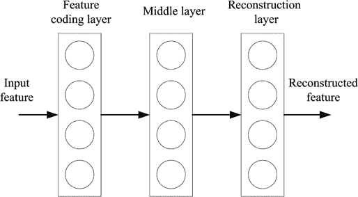

**图 9.14**

自动编码器的基本框架。

优化损失函数后，我们可以得到稳定自动编码器的参数。

2. 扩展自动编码器。在训练最后一个自动编码器后，第一个特征编码层后面加入一个特征编码层。然后在相应的重建层前面加入一个重建层。

3. 使用公式 (2) 训练堆叠网络模型，然后我们需要重复前面的步骤 (2)。

4. 经过多次迭代训练后，我们可以构建堆叠自动编码器，如图 9.15 所示。

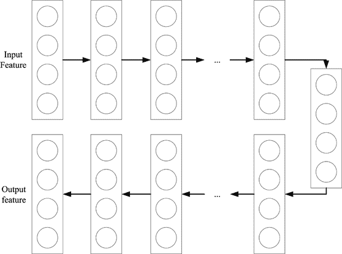

**图 9.15**

堆叠自动编码器的训练模型。

5. 我们丢弃训练好的堆叠网络的特征重建层，在特征编码网络之后添加一个分类层（如 Softmax 层）。最后，可以对输入特征 `F` 进行分类。整个人脸识别模型如图 9.16 所示。

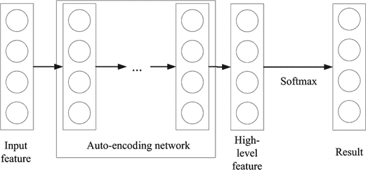

**图 9.16**

云端的全局人脸识别模型。

### 9.3.3.4 任务反馈

训练全局人脸识别模型后，云服务器可以使用全局模型分析从边缘节点上传的嫌疑数据。然后，将识别结果传输到相应的边缘节点并响应任务。

## 9.4 结论

具有图像处理功能的物联网已成为各研究人员的关注焦点，这是构建智慧城市的一个有意义的方面。首先，我们介绍了带有图像处理技术的物联网理论和应用。同时，我们讨论了 FoPS 中人脸图像物联网的三个主要问题，包括低质量人脸图像的恢复、标准人脸图像的重建以及大数据下人脸识别的响应速度。此外，根据这些问题详细讨论了某些处理方法。最后，这些方法为解决这些问题提供了分析和可行方案。

## 致谢

本工作受广东省重点领域研发计划支持（资助号：2018B010108001）以及中国国家自然科学基金的支持（资助号：61973125）。

## 参考文献

1. Zikria, Y. Bin, Yu, H., Afzal, M.K., Rehmani, M.H., and Hahm, O. 2018\. Internet of Things (IoT): Operating System, Applications and Protocols Design, and Validation Techniques. Future Generation Computer Systems, 88, 699–706.

2. Gonzalez, R. and Woods, R. 1977\. Digital Image Processing. Upper Saddle River, NJ: Prentice Hall.

3. Chan, T., Jia, K., Gao, S., Lu, J., Zeng, Z., and Ma, Y. 2015. PCANet: A Simple Deep Learning Baseline for Image Classification? IEEE Transactions on Image Processing, 24 (12), 5017–5032.

4. He, K., Zhang, X., Ren, S., and Sun, J. 2016\. Deep Residual Learning for Image Recognition. In: *2016 IEEE Conference on Computer Vision and Pattern Recognition (CVPR)*. 770–778.

5. Han, J., Zhang, D., Cheng, G., Guo, L., and Ren, J. 2015\. Object Detection in Optical Remote Sensing Images Based on Weakly Supervised Learning and High-Level Feature Learning. IEEE Transactions on Geoscience and Remote Sensing, 53 (6), 3325–3337.

6. Han, J., Zhang, D., Cheng, G., Guo, L., and Ren, J. 2015\. Object Detection in Optical Remote Sensing Images Based on Weakly Supervised Learning and High-Level Feature Learning. IEEE Transactions on Geoscience and Remote Sensing, 53 (6), 3325–3337.

7. Atzori, L., Iera, A., and Morabito, G. 2010\. The Internet of Things: A Survey. Computer Networks, 54 (15), 2787.

8. Daniel Minoli. 2013\. Internet of Things Examples: Building the Internet of Things with IPv6. Wiley, 48–96.

9. Dinesh, M. and Sudhaman, K. 2016\. Real Time Image Processing System with Raspberry Pi. In: 2016 International Conference on Communication and Embedded Systems (ICES). 1–5.

10. Nauman, A., Qadri, Y., Amjad, M., Zikria, Y., and Kim, S.W. 2020\. Multimedia Internet of Things. IEEE Access, 8, 8202.

11. Hsu, C., Lin, H., Kang, L., Weng, M., Chang, C. 2017\. 3D Modeling for Steel. In: 2017 IEEE International Conference on Consumer Electronics (ICCE). 5–6.

12. Kulkarni, P., Kute, S., and More, V. 2016\. IOT Based Smart Meter. In: 2016 International Conference on Internet of Things and Applications (IOTA). 107–111.

13. Sharma, Lavanya, and Lohan, Nirvik. 2016\. Implementation of IoT (Internet of Things) and Image Processing for Smart Agriculture. In: International Conference on Computer and Information for Sustainable Solutions (CIS). 21–26.

14. Liao, M.-S., Chen, S.-F., Chou, C.-Y., Chen, H.-Y., and Jiang, J.-A. 2017\. Precisely Relating the Growth of Phalaenopsis to Greenhouse Environmental Factors Using an IoT-based Monitoring. Computers and Electronics in Agriculture, 136, 125–139.

15. International Journal of Spatiotemporal Data Science, Inderscience, Vol. 1, pp. 22–53.

16. Tran, H.A., Ngo, H.Q., Nguyen, T.P., and Nguyen, H. 2018\. Design of Green Agriculture System Using Image Processing Techniques. In: 2018 4th International Conference on Green Technology and Sustainable Development (GTSD). 28–32.

17. Klein, L.J., Hamann, H.F., Hinds, N., Guha, S., Sanchez, L., Sams, B., and Dokoozlian, N. 2018\. Closed Loop Controlled Precision Irrigation Sensor Network. IEEE Internet of Things Journal, 5 (6), 4580–4588.

18. Elias, A.R., Golubovic, N., Krintz, C., and Wolski, R. 2017\. Where's the Bear? Automating Wildlife Image Processing Using IoT and Cloud Systems. In: 2017 IEEE/ACM Second International Conference on Internet-of-Things Design and Implementation (IoTDI). 247–258.

19. George, A.M., George, V.I., and George, M.A. 2018\. IOT Based Smart Traffic Control System. In: 2018 International Conference on Control, Power, Communication and Computing Technologies (ICCPCCT). 148–151.

20. Reddy, G.V.P. and Nagaraja, S.R. 2016\. Image Based Obstacle Detection and Path Planning for Solar Powered Autonomous Vehicle. In: 2016 International Conference on Robotics and Automation for Humanitarian Applications (RAHA). 1–7.

21. Cai, B.Y., Alvarez, R., Sit, M., Duarte, F., and Ratti, C. 2019d. Deep Learning-Based Video System for Accurate and Real-Time Parking Measurement. IEEE Internet of Things Journal, 6 (5), 7693–7701.


22. Chen, N., Chen, Y., You, Y., Ling, H., Liang, P., and Zimmermann, R. 2016. 基于边缘计算的城市监控视频流处理。In：*2016 IEEE Second International Conference on Multimedia Big Data (BigMM)*. 105–112.

23. Waheed, Z., Akram, M.U., Waheed, A., and Shaukat, A. 2015. 用于视网膜识别的血管鲁棒提取。In：*2015 Second International Conference on Information Security and Cyber Forensics (InfoSec)*. 1–4.

24. Zhang, Z., Li, M., Xia, F., and Ma, J. 2011. 一种改进身份系统的系统的虹膜定位方法。In：2011 International Conference on Internet of Things and 4th International Conference on Cyber, Physical and Social Computing. 663–666.

25. Yin, F., Lee, B.H., Yow, A.P., Quan, Y., and Wong, D.W.K. 2016. 使用混合云系统的眼病自动筛选与监控。In：*2016 IEEE International Conference on Internet of Things (iThings) and IEEE Green Computing and Communications (GreenCom) and IEEE Cyber, Physical and Social Computing (CPSCom) and IEEE Smart Data (SmartData)*. 263–268.

26. Cheng, Y., Jiao, L., Li, Z., and Cao, X. 2014. 针对光照人脸识别的改进视网膜建模。In：*2014 IEEE International Conference on Image Processing (ICIP)*. 244–247.

27. Ma, Y., Dagnino, G., Georgilas, I., and Dogramadzi, S. 2017. 用于机器人辅助骨折手术的 X 射线图像自动工具检测。In：*2017 IEEE International Conference on Internet of Things (iThings) and IEEE Green Computing and Communications (GreenCom) and IEEE Cyber, Physical and Social Computing (CPSCom) and IEEE Smart Data (SmartData)*. 883–887.

28. QasemiZadeh, B., Shen, J., O’Neill, I., Miller, P., Hanna, P., Stewart, D., and Wang, H. 2009. 基于语音的监控视频检索。In：2009 6th IEEE International Conference on Advanced Video and Signal Based Surveillance. 336–339.

29. Basri, A.H.H., Ibrahim, S.N., Malik, N.A., and Asnawi, A.L. 2018. 集成移动应用程序的监控系统。In：*2018 7th International Conference on Computer and Communication Engineering (ICCCE)*. 218–222.

30. Wang, J., Amos, B., Das, A., Pillai, P., Sadeh, N., and Satyanarayanan, M. 2017. 一用于实时视频分析的可扩展且感知隐私的物联网服务。In：*Proceedings of the 8th ACM on Multimedia Systems Conference*. New York, NY: Association for Computing Machinery, 38–49.

31. Egmont-Petersen, M., De Ridder, D., and Handels, H. 2002. 神经网络处理图像——综述。Pattern Recognition, 35 (10), 2279–2301.

32. Pan, J., Sun, D., Pfister, H., and Yang, M.H. December 2016. 使用暗通道先验的盲图像去模糊。In：*Proceedings of the IEEE Computer Society Conference on Computer Vision and Pattern Recognition*, 1628–1636.

33. Lim, B., Son, S., Kim, H., Nah, S., and Lee, K.M. 2017. 用于单图像超分辨率的增强型深度残差网络。In：*2017 IEEE Conference on Computer Vision and Pattern Recognition Workshops (CVPRW)*. 1132–1140.

34. Sharma, Lavanya, and Lohan, Nirvikar. 使用背景减除技术的移动物体检测性能分析。International Journal of Spatio-Temporal Data Science, Inderscience, February, 2019.

35. Xu, X., Sun, D., Pan, J., Zhang, Y., Pfister, H., and Yang, M.H. 2017. 学习超分辨率模糊脸部和文本图像。In：*Proceedings of the IEEE International Conference on Computer Vision*. 251–260.

36. Wang, X., Yu, K., Dong, C., and Loy, C. 2018. 通过深度空间变换恢复图像超分辨率中的真实纹理。In：Proceedings of the IEEE Society Conference on Computer Vision and Pattern Recognition. 606–615.

37. Ronneberger, O., Fischer, P., and Brox, T. 2015. U-Net：用于生物医学图像分割的卷积网络。In：International Conference on Medical Image Computing and Computer-Assisted Intervention (MICCAI). 234–241.

38. Zhang, L. and Zuo, W. 2017. 图像恢复：从稀疏和低秩先验到深度先验。Signal Processing Magazine, 34 (5), 172–179.

39. Pan, J., Liu, R., Su, Z., and Gu, Y. 2013. 用于显著结构估计的运动去模糊。Signal Processing, 28 (9), 1156–1170.

40. He, K., Zhang, X., Ren, S., and Sun, J. 2016. 残差学习用于图像识别。In：2016 IEEE Conference on Computer Vision and Pattern Recognition. 770–778.

41. Gulrajani, I., Ahmed, F., Alemi, A., Dumoulin, V., and Patterson, J. 2017. 使用条件对抗网络的去模糊。In：V. Ferrari, M. Hebert, C. Sminchises, and Y. Weiss, (Eds.). Computer Vision – ECCV 2016. Cham: Springer Publishing, 694–711.

42. Zhang, K., Zhang, Z., Li, W., and Parkhi, O. 2018. VGace2：跨姿态和年龄的脸部检测与对齐。In：2017 IEEE Conference on Computer Vision and Pattern Recognition. 8183–8192.

43. Pumarola, A., Agudo, A., Martinez, A., Sanfeliu, A., and Moreno-Noguer, F. 2018. GANimation：从单图像进行解剖感知脸部动画。In：V. Ferrari, M. Hebert, C. Sminchises, and Y. Weiss, (Eds.). Lecture Notes in Computer Science (including subseries Lecture Notes in Artificial Intelligence and Lecture Notes in Bioinformatics). Cham: Springer Publishing, 835–851.

44. Sharma, Lavanya. 2019. 引言：从视觉监控到物联网。In：From Visual Surveillance to Internet of Things. Chapman Hall/CRC, Vol. 1, p. 14.

45. Sharma, Shubham, Verma, Shubhankar, Kumar, Mohit, and Sharma, Lavanya. 2019. 动捕在 3D 动画中的应用：动捕系统、挑战与最新趋势。In：*1st IEEE International Conference on Machine Learning, Big Data, Cloud and Parallel Computing (Com-IT-Con)*, India, 14–16 February. 309–313.

50. Satyanarayanan, M., Simoens, P., Xiao, Y., Pillai, P., Chen, Z., Ha, K., Hu, W., and Amos, B. 2015. 物联网中的边缘分析。IEEE Pervasive Computing, 14 (2), 24–31.


[52.] Sharma, Lavanya, Singh, Annapurna, and Yadav, Dileep Kumar. 2016 年 3 月. 基于费斯尔线性判别率阈值的热视频中移动人体检测. 《红外物理与技术》. 爱尔 vier, 78, 118–128.

[53.] Sharma, Lavanya, and Lohan, Nirvikar. 目标检测与物联网.*In:* Handbook of Research on Big Data and the IoT. IGI Global, 89–100, 2019 年 3 月. DOI: 10.4018/978-1-5225-7432-3.ch006.

# 人工智能赋能的物联网

## 目录

* 10.1 引言
* 10.2 文献综述
* 10.3 颠覆性技术：演进与增长
* 10.4 智能系统
    * 10.4.1 智能系统的赋能技术
* 10.5 人工智能：将智能注入物联网
    * 10.5.1 联网物的兴起
    * 10.5.2 实现物联网的主要 AI 技术
* 10.6 AI 在物联网系统中的现实应用
    * 10.6.1 智能家居
    * 10.6.2 智能城市
    * 10.6.3 智能健康
        * 10.6.3.1 智能健康系统的益处
    * 10.6.4 智能医疗系统的用例
        * 10.6.4.1 智能连续血糖监测和胰岛素笔
        * 10.6.4.2 联网吸入器
        * 10.6.4.3 可摄入传感器
        * 10.6.4.4 联网隐眼镜
        * 10.6.4.5 监测抑症的 Apple Watch 应用
        * 10.6.4.6 苹果 ResearchKit 与帕金森病
    * 10.6.5 智能交通系统
        * 10.6.5.1 高级交通管理系统
        * 10.6.5.2 智能车辆控制与安全系统
        * 10.6.5.3 智能公共交通系统
        * 10.6.5.4 商业车辆运营
        * 10.6.5.5 ITS 的指导原则
        * 10.6.5.6 智能交通系统的用例
    * 10.6.6 智能环境监测系统
        * 10.6.6.1 智能环境用例
    * 10.6.7 智能安全
* 10.7 提出的框架：智能连接系统
* 10.8 AI 赋能物联网的关键成功因素
* 10.9 结论
* 参考文献

关键词：物联网、人工智能、智能家居、智能城市、智能健康、智能交通系统

## 10.1 引言

物联网（IoT）与人工智能（AI）结合正在改变世界。物联网的力量可以被充分挖掘，在许多特定的用例中，AI 与物联网对接以交付了预期的结果。本章探讨了正在发挥作用的颠覆性技术，并展示了 AI 与物联网对接的用例。作者还提出了一个智能连接餐厅系统（SCRMS）框架。该框架可用于连接单个餐厅或连锁餐厅，从而创建智能餐厅。所提出的框架由五层组成，在第 12 章中进行了详细描述。该框架描述了 SCRMS 的组件，实施后可以帮助获取洞察并控制餐厅流程。

据估计，每年将有 200 亿个物联网设备产生泽字节（zetabytes）级的数据。然而，物联网的实现仍然困难，因为只有一部分数据被利用了。在 AI 的广阔领域，能够实现智能任务并减少人类努力。AI 与物联网的结合不仅可以节省资金，还能产生超越人类能力的智能系统。但随着技术的增长，这些系统将相互控制并可能统治人类。因此，人类需要对这些发展进行完全控制以使其投入使用。

物联网系统的部署面临着严重的伦理和安全问题，但事实是，这些系统正在被部署，其使用量每天都在增加。AI 的介入超出了我们的控制，智能技术的影响在我们所做的每件事或周围发生的一切中都显而易见。作者建议，需要负责任的人工智能系统。学习过程的设计和运行必须消除偏见。虽然 AI 和机器学习已经在代表人类进行干预——例如语音助手——但在我们实现之前仍有许多工作要做。需要提出一些深远的问题。

## 10.2 文献综述

互联网已从计算机网络转变为物的互联。作者们设想了一个“智能物理地球中的万物联网”，并建议了物联网系统的完整架构和组件。从这个庞系统中产生的数据可以通过 AI 有效地使用。但将决策交给智能机器具有深远的道德和伦理影响。


技术融合的未来是物联网（IoT），它将现实世界中的物体转变为智能虚拟对象，这些对象相互连接，并与中央控制单元连接[2]。物联网旨在将世界上的一切统一到一个共同的基础设施单元下，使我们能够了解所有组件物品的状态[2]。物联网将成为一个全球网络，通过为所有组件分配 IP 地址作为唯一标识符，实现人与人、人与物以及物与物之间的通信[3]。这些物理系统正在部署中，某些系统的运行甚至不需要人工干预。物联网需要对周围的物体进行编码和网络化，以便在互联网上对其检测、追踪和控制[4, 12, 13]。

物联网现在已应用于几乎每一个领域。智能家居将物联网整合到住宅中，为居民提供更好的生活质量、舒适性、便利性和安全性。智能家居系统可用于监测健康和其他活动[14]。一旦房屋和建筑群连接起来，下一个大趋势将是连接整个城市。物联网的大规模部署实际上迈向智能城市项目的一步[15]。

智能城市可以根据市民的需求为他们提供服务。连接的设备将产生大量数据，如果对这些数据进行智能分析，就可以实现各种智能服务[16]中的作者为智能城市提出了一种基于 AI 的语义物联网架构，并对该架构提出了各种用用例。

在智能城市中，物联网为赋能公民和提高社会与政府的参与度提供了机会。这将有助于政府在宏观和微观层面协助社会和社会，从而有效地帮助为公民提供公共服务[17]。另一项研究评估了公共和政府机构如何调整其现有结构和流程以适应物联网的实施。作者提出了一个用于智能政府实施的公共物联网集成框架，从而增强了对通过智能治理实现有效公共管理的关键因素的理解[18]。

设备中物联网与人工智能的融合可以产生实时数据流。对这些实时数据进行分析可以帮助预测洞察，并帮助对未来事件做出决策控制[7–9, 19–21]。作者们使用了深度学习等高级机器学习算法类来分析物联网中的学习。

## 10.3 颠覆性技术：它们的演进与增长

智能系统的创新和发展主要受`颠覆性技术`（Disruptive Technologies）的增长所主导和引导^¹。今天大多数演进的技术天然具有颠覆性，而且当它们融合时，会更加强大。互联网的演进和采用标志着第一波颠覆性技术的出现[2, 5]。互联网，所谓的“网络之网络”，于 20 世纪 70 年代出现在美国，但从 20 世纪 90 年代开始在普通大众中普及。从那时起各种技术围绕互联网发展，以至于今天很难想象没有互联网的生活。自诞生以来，全球互联网用户数量呈指数级增长。预计到 2020 年，世界上超过一半的人口将接入互联网。这已经成为现实，环顾四周便显而易见。很明显，我们对互联网的依赖已成为日常生活的不可或的一部分，这种依赖随着每一天的过去和每一项新技术的演进而增加。互联网已经变得非常强大，可以用于任何依赖信息的目的，并且每个连接到其组件网络之一的人都可以访问。互联网完全改变了我们交流、做生意、社交互动、教育、娱乐以及对事件和担忧做出反应的方式。

`移动设备`（Mobile Devices）的出现标志着在固定连接设备时代之后的第二波颠覆性技术的出现[2]。由于其始终连接、即时开启、直观界面和外形的特征，智能手机已成为史上最成功的消费设备之一。移动设备之后是服务和市场的颠覆。Amazon、Flipkart、Ola、Trivago 等数字平台的建立导致了各自市场的一波颠覆潮。这些平台的独特之处在于，它们并不拥有资产，而是以创新的方式连接供需渠道。它们能够通过降低交易成本、增强供应链和具有指数级扩展性，创造出新的收入机会。

`物联网`（IoT）的演进标志着第三波颠覆性技术的出现。这一波将大量事物连接到互联网，导致大多数互联网地址分配给物体而不是人类[1, 2, 9]。物联网主要具有先进传感器以及连接设备之间的无线通信[3]。大量的传感器导致了海量数据的收集，这些数据可以提供系统的内在信息以优化资源和基础设施的使用。物联网以及连接设备的概念是过去某些发展的结果。其中最关键的是：

*   传感器价格的不断下降，使其在各个位置安装具有经济可行性。
*   所有网络中无处不在的无线连接。
*   连接系统产生的数据具有丰富的存储和处理能力。
*   采用`IPV6`后无限 IP 地址的可用。

物联网已经产生了由于信息技术与其他技术融合而产生的进一步颠覆性效应。这里最有前景的结合是人工智能技术。物联网与人工智能结合可以为改进并最终创造全新的产品和服务提供基础[1, 11, 14, 16]。结合无线通信和智能传感器的设备被称为`智能对象`（Smart Objects），它们表现出新的功能并能够根据其语境调整行为。预计我们很快将见证一个系统的出现，该系统将智能对象相互通信并与智能云系统通信，为新的开发和产品创造可能。


下一波颠覆性技术随着`Big Data`（大数据）术语到来。大数据指的是规模巨大、无法通过传统软件硬件系统处理的数据集。大数据的特征是 7V——体量、速度、多样性、变性、真实性、可视化和价值——并可能以结构化、半结构化或完全非结构化的形式存在 [22]。由于`IoT`与其他技术结合社交媒体而产生的智能系统正在产生大量数据，这些数据现在以大数据的形式存在。这个巨大的数据库可以进行分析，以预测和趋势、模式和相关性。这些数据很快以`Open Data`（开放数据）的形式出现，它是机器可读的、本质是非专利的，并且可以免费使用和重新发布。公司开始发布部分数据，用于激发大众的创造力。这将构建一个用于数据共享和维护的数据基础设施。

下一阶段是`Cognitive Systems`（认知系统）的发展，它结合了机器学习以及通过自然语言与人类交互的能力，并从海量数据中产生洞察。这些智能系统将像人类大脑一样进行学习和推理，并能够处理模糊和不定的情况。`Robots`（机器人）、`Self-Driving Cars`（自动驾驶汽车）和`Drones`（无人机）是已经在我们周围的此类示例。

在后续章节中，我们将关注`Smart Systems`（智能系统）、`Systems Working on IoT`（物联网工作系统）以及`AI Technologies`（人工智能技术）。

## 10.4 Smart Systems

“智能”一词传统上用于反映人的敏锐和外表，如今被用来指示机器的智能和能力。它意味着连接的设备相互感知和引导，并通知人类代理以控制和协调流程。这种连接环境范围可能从家庭、建筑、复合体、园区、城市、国家到整个世界。尽管智能世界和智能国家的概念在今天看来仍然是一个遥远的现实，但智能家居、智能建筑、智能校园、智能工业和其他此类智能设置正在快速发展。智能设置不仅局限于科学或工程设计，还需要一种跨学科的方法，涉及涉及但不限于生物学、心理学、哲学、语言学、数学和计算机科学领域 [9, 19–21, 23]。任何智能系统的主要方面包括：

* **以用户为中心：** 智能系统的所有流程和设计必须符合主要利益相关者（即预期和目标用户）的需求。
* **技术基础设施和连通性：** 技术必须被广泛使用并彻底连接，以实现信息和数据的无缝交换和传输。该套设备必须是安全的，免受任何入侵和攻击。
* **智能系统的持续性：** 系统必须是稳定且面向未来的，具有适当的维护和保护。

### 10.4.1 Technology Enablers for Smart Systems

智能系统需要某些技术赋能器来实现有效赋能 [5]。这里列出了实施智能系统的关键技术赋能器：

* **物联网 (IoT)：** 智能系统需要一套连接设备，包括传感器和监控器，用于监控流程和设备的平稳运行，以便提前预测问题/故障，并在任何严重故障之前采取纠正措施。这些设备的数据可以被利用来持续改进服务，并增强资产的质量和服务水平 [21, 23, 24]。
* **大数据分析：** 连接设备产生量数据可以通过`AI`工具、技术和算法进行处理，以实现预测和处方。这些模型变得越来越专业，本质也变得越来越复杂。通过历史数据中的知识，这些模型可以帮助有效监控实时数据和情况，随后采取主动决策以确保高效安全运行。
* **云计算：** 云提供了无限的在线存储和强大的服务，如`SaaS`、`PaaS`、`IaaS`以及最近的`AaaS`。没有云存储智能系统无法维持，云存储是其有效实施和移动数据可用性的主要要求，意味着随时随地可以访问存储的数据。
* **增强现实 (AR)/虚拟现实 (VR)/扩展现实 (ER)：** `AR/VR/ER`技术可以用于向其用户提供虚拟信息和体验。`AR`是真实世界与虚构世界的混合。虽然其他技术被认为是在后台工作且对视觉隐藏的“后端”技术，但`AR/VR/ER`是提供智能系统所有益处的访问接口。通过这些技术，可以以完全不同的方式与普通环境交互，例如远程导航、视觉搜索、虚拟旅游、对设备及基础设施组件的远程监控和维护 [25]。
* **区块链：** `Blockchain`技术是一种跨越点对点网络所有交易的去中心化账本，确保参与者无需中央认证机构即可确认交易。这种技术通过消除中间人赋予智能家居交易能力，从而在提高所有技术的网络和数据安全方面发挥着关键作用 [9]。
* **5G 网络：** `5G`通信技术已准备好增强载波带宽和相应的网络速度，以支持在所有动态和无处不在的环境中传输数据并提供网络服务。
* **开放标准架构：** 开放标准一直有助于跨系统和标准提供无缝连接和交互。因此，这有助于传感器、执行器和其他连接设备的无缝通信、协调和集成。
* **下一代电力系统 PoE：** 也称为以太网供电 (PoE)，是一种使用标准以太网线传输数据和电缆技术。因此，单根以太网线即可传输数据数据。这项技术注定是智能系统的游戏改变者，只需一根电缆即可连接基础设施组件以传输数据并为设备供电。这提供了无论附近是否有电源都能在任何位置安装电源设备的灵活性。`PoE`将电力的监控和控制转移到设备。因此，通信和基于系统的系统可以有效部署在照明系统上方，以获得更好的信息和控制。


**FIGURE 10.1**

智能系统的技术赋能器。

## 10.5 Artificial Intelligence: Putting Intelligence into IoT


AI 曾被用于科幻小说、神话、恐怖故事和动画片，作为所有超自然、非自然和想象场景的赋能技术。但今天，AI 已经有了实际应用，并正在改变我们周围以及业务中发生的方式。开发人员正在探索并在很大程度上设计了将 AI 与 `IoT` 的方法。事实证明，`IoT` 和 `AI` 技术应该紧密连接，因为它们互为补充。`IoT` 跨设备或“物体”及组织网络连接并共享数据，而有效应用分析的组织能够获得优势。这种分析能力由 AI 提供 [24–33]。

## 10.5.1 联网物的兴起

智能设备网络的概念可以追溯到 1982 年，当时卡内基梅隆大学的一台经过改装的可口可乐自动售卖机可以报告新补的库存是否冷却。1989 年，John Romkey 创建了一个烤面包机，可以在 INTEROP 会期间通过互联网开启和关闭。该设备被认为是第一个 IoT。今天，我们已经走了很长的路，现在的联网设备（物体）比人类还要多。根据 2020 年的《商业内幕》报告，估计到 2027 年，IoT 设备将接近 410 亿，而 2019 年约为 80 亿。

`IoT` 跨越设备网络，涵盖家用电器、车辆、组装线设备和其他嵌入了电子设备、传感器、软件和执行器的物体。`IoT` 中的这些联网物体可以向其环境传输信号，并被远程监控和控制，正如未来的预测，它们将能够做出决策和行动。

今天我们周围有许多 IoT，例如家居自动化系统可以在检测到家居条件变化时调整灯光或温度调节器。预测性维护系统持续监控设备，并在机器需要维护时提醒技术。`Siri` 和 `Alexa` 等数字助手使用语音识别来解释命令。我们周围的所有这些联网设备和物体就像数据存储，不断产生各种类型和复杂的海量数据。这些数据具有巨大的潜力，可以为企业产生洞察和机会。为了获得这些利益，需要理解智能组件。智能组件包含四个层：

1. **物理层**：机械和电气组件。
2. **智能层**：传感器、软件、处理器和存储。
3. **连接层**：端口、天线和协议。
4. **分析层**：由 AI 驱动，用于训练和实施预测性和建议性模型。

每一层都由上方层放大，物理层位于底部，分析层位于顶部。在最基础的水平，传感器检测到物理组件中的某些异常活动时会为人类人员产生警报。连接性随着网络中的设备相互触发创建了一系列联网活动。但真正的适用性来自于当这些联网物体不仅存储数据，还存储它们的经验，并且每次都以更好的方式执行相同的活动时。这种复杂性预见了学习设备的创建，它们从自己的经验和环境中学习。这些设备将成为自适应学习系统，随着时间的推移提高性能，并能够在它们所处的特定背景下做出决策。这就是 AI 发挥作用的地方。AI 自 20 世纪 50 年代以来一直存在，但真正的能力和应用现在正在被探索。AI 一词的真正含义正在显：创建能够通过学习和自动化模拟人类的系统，从经验中学习，适应环境，并在没有任何人工干预的情况下独立处理任务。这些训练良好的系统随着时间的推移已经开发并成功实施。示例包括象棋程序和生物识别系统。结合 AI 的 IoT 应用现在以我们周围各种智能联网物体的形式成为我们日常生活的一部分，它们正在产生海量数据，提供高速连接并交付高效的计算。机器学习作为 AI 的子领域，使用统计技术和计算及进化算法来分析数据，以对健康做出预测并检测传感设备中的异常。机器学习算法变得越来越准确，因此性能优于传统的商业智能工具，使决策更准确更快速。

## 10.5.2 赋能 IoT 主要 AI 技术

有许多支持智能系统的 AI 技术，例如机器学习、深度学习、自然语言处理和计算机视觉/定位。这些技术用于实时预测和优化时，使 AI 成为 IoT 不可缺的补充 [5]。这里介绍了主要 AI 技术的简述：

* **机器学习**：机器学习通过识别智能传感器和设备生成的数据（如温度、压力、湿度、空气质量、振动和声音）中的模式并检测异常，带来了自动学习和表现得更好的能力。学习可以是`监督学习`、`无监督学习`或`强化学习`。除了这些系统可能使用的其他学习方法还有`半监督学习`、`主动学习`、`归纳学习`、`演绎学习`、`迁移学习`和`启发学习`。

* **深度学习 (DL)**：`DL` 是机器学习的一个分支，最近在 IoT 应用中非常流行，以至于 `IoT` 和 `DL` 被 Gartner 列为 2017 年三大战略性技术之一。这些模型在特征提取过程中带来了更高的精度，并增强了结果的准确性。`IoT` 和 `DL` 构成数据生产-消费链，其中 `IoT` 生成原始数据由 `DL` 模型进行分析，这些模型产生高级抽象和洞察，并输入 `IoT` 系统以进行精调和改进服务。`DL` 模型分为三类：`生成模型`（基于监督方法）、`判别模型`（基于无监督方法）和`混合模型`（结合了生成模型和判别模型的优点）。`DL` 方法显示出良好结果的领域包括复杂应用领域，如智能家居和智慧城市中的图像识别系统、自然语言处理系统/语音识别系统、农业等其他领域的定位服务、安全和隐私服务以及 IoT 基础设施 [25, 33]。


- **计算机视觉/定位：** 在智能家居、校园、商场和医院等智能系统中，计算机视觉和位置感知服务可以提供巨大的帮助。计算机视觉技术可以出现在能够识别玩家手势的游戏机中，也可以出现在能够自动对点击对象进行对焦的智能手机摄像头中。我们可以看到这项技术对我们生活的影响。这从制造领域中用于质量保证的光学传感器，战场上用于收集信息的高分辨率智能摄像头，以及车辆中的无人机和传感器都是一些例子。计算机视觉应用大多局限于封闭的平台应用，但在与物联网（IoT）结合后，设备配备了 IP 连接，从而创建了一系列新的应用，如视频分析、3D 成像、机器人技术、数字现实（VR 和 AR）等许多由这些技术结合产生产生的应用 [8, 23, 28]。

- **自然语言处理 (NLP)：** NLP 指语音理解的能力。它意味着在不同系统上实现语音控制。免提式命令界面可以为物联网系统带来巨大的优势。在物联网系统中实现语音控制为设备提供了直观的特性，从而使其极其有用，特别是在手部操作可能导致事故的安全关键型应用中。例如，技术人员在高处的高压电线上作业时，向数字工具发出语音命令，或将观察结果传递给团队进行远程问题处理，而不是手动操作。诸如 `Alexa` 这样的家庭助手已经在今天的智能家居中占据了一席之地。情感分析被营销人员广泛使用，他们以此分析情绪反应。系统研究说话者的情感反应，并用自然语言将他们的反应识别为同意、良心、情绪和开放。因此，“情感胜过言语”这一理念正通过此类能力得以实现。

## 10.6 AI 在物联网系统中的现实生活应用

## 10.6.1 智能家居

家居自动化是一种新的生活方式，不再仅仅是奢侈品。随着物联网和 AI 的采用，家居自动化为我们的日常任务和责任提供了强大的解决方案。AI 正在为我们每天面临的常见问题创造解决方案，让人的生活变得更加简单。它在家庭自动化中的存在使我们能够控制电器、保障家居安全，甚至限制开支。家居自动化的最终目标是减少人类的参与。AI 可以帮助实现这一目标。智能家居可以定义为允许远程控制和监控连接设备的家居。这些设备或物品保持连接，相互通信，思考、行动并反应。它们可以被编程为遵循所有者的规则，并按照他们的意愿和指令工作。`Google`、`Apple` 和 `Amazon` 等行业巨头专注于为智能家居创建智能助手，如 `Siri`、`Google Assistant` 和 `Alexa`。

除了这些软件包系统外，智能家居还涵盖了室内电气设备和器具的连接，从基础照明、空调、洗衣机、冰箱等，到更关键的电气装置，如泵和火灾板。在智能家居中，所有此类设备都保持连接，创建为 AI 提供信息的物联网框架。反之，AI 从这些信息中获得针对要完成的任务特定特定和需要执行的控制措施，从而减轻人类的参与。

通过 AI 和物联网的整合，智能设备可以在 `Siri` 或 `Alexa` 等语音助手的帮助下，远程或通过预设的 AI 命令响应用户的语音命令。一个例子是 `Google Nest` 调节器，它可以自动控制家里的制冷和制热。它不断监控居民的行为，并在一周内学习你全天喜欢家里有多暖或多冷。当在家时，家里会降温；当出门时，系统将自动关闭，从而节省能量。

AI 将从智能家居的智能连接设备收集的原始传感器数据，并将其解释为居民日常习惯的行为设计。它们学习常规并开始预测活动。例如，如果没有人在家里，电器将保持关闭状态，且门将锁定。

智能烤箱将不断监测正在烹饪食物的温度，一旦达到特定温度，设备中的智能就会降低温度，从而防止食物烧焦，或者在食物准备好后通知厨师。这种 AI 和物联网的潜力不仅限于新家，现有设备也可以转换为其智能对应。例如，将开关更换为智能开关，空调改装为通过智能 App 或某些启用 AI 的云服务器提供远程访问 [5, 32, 33]。

智能家居中的 AI 能力为解决人类问题提供了协助，从创建日程表到为音乐系统搜索播放歌曲，或回答几乎每一个查询。但这些助手的能力仍有待释放。在几乎每个家居设备上集成 AI 和远程响应只是开始。未来预见了根据个人的生活方式和需求教学和训练智能助手的能力。未来特别实用的智能家居控制还有：

- **控制电器：** 为电器配备传感器以监控其状态，并在发生错误或需要维护时向用户发送通知。

- 通过智能设备对安全设备进行**远程监控**，并在发生入侵时锁定门窗。

- 来自家居自动化系统的**智能反馈**，例如冰箱。在学习了主人的健康和习惯后，它会记录内容、建议菜单、提出健康的替代方案，并在内容消耗时订购补充。

- **景观控制：** 为宠物维持理想环境，在最佳时间和正确比例提供食物并浇水植物。

- **医疗健康监控：** 通过墙内的无线传感器不断监测心率和呼吸。这项技术的益处对于观察睡眠期间的婴儿特别有用。

## 10.6.2 智能城市

我们处于数字化和连接的时代。一旦个体单元被数字化，标准将是使整个城市数字化。此类连接城市将被称为智能城市。我们正在朝着这个方向努力，一些城市正在向智能城市转型。但我们是否已经拥有可以归类为智能城市的城市？[5, 15, 16] IEEE 标准协会对智能城市的定义为：

“随着全球城市化的持续增长，预计总人口将在 2050 年增加一倍，对智能可持续环境的需求日益增加，以减少环境影响并为公民提供高质量的生活。智能城市将技术、政府和社会相结合，以实现智能经济、智能出行、智能环境、智能民、智能生活和智能治理。”


智慧城市的背后概念需要物联网（IoT）的支持，这可以彻底改变智慧城市的运行方式。这里展示了智慧城市中提供机会的一些领域：

- **高效供水：** 物联网可以改变城市社区用水的方式。实施智能水表可以帮助检测泄漏，从而减少水浪费。此外，它们还可以为住户提供持续访问其用水量和供水数据的便利。
- **智能交通管理：** 由于快速城市化，交通问题急剧增加。交通拥堵已成为一个巨大的问题，并且随着道路上车辆数量的增加，情况日益恶化。物联网可用于智能交通信号处理交通拥堵，有助于更好地控制交通。通勤者可以从智能手机、车辆和道路传感器收集并共享数据，以监控实时交通事件。如果路线受阻，可以向司机发送警报并提供重定向路线和替代路径。这将减轻公共交通系统的压力，使其更加可靠、更高效。
- **节能建筑：** 物联网为节能建筑结构的建设提供了可能。通过物联网，设备可以连接到智能管理应用程序，控制非标准的供暖、冷却、照明和消防安全系统。
- **智能停车：** 具备 GPS 功能的智能停车系统是解决城市布局中普遍停车问题的解决方案。在智能手机传感器数据和视频监控的帮助下，车主可以被直接引至空车位。实时数据有助于创建一个虚拟停车地图，向用户显示最近的空车位。此外，用户在前往停车场的途中可以进行预订停车。司机将在手机上收到通知以寻找停车位。此类系统已在世界范围内安装，并在协助有效利用停车空间方面发挥了作用。
- **智能路灯：** 可以实施物联网设备以更具成本效益的方式维护和控制路灯。在云管理解决方案的帮助下，传感器有助于控制和调度开关操作。智能照明解决方案可以结合传感器来跟踪人员和车辆的移动。借助这些数据，路灯可以根据环境自动调整光线，调暗、亮度或自动关闭/开启。
- **犯罪检测与预防：** 智能传感器、视频摄像头等设备可以帮助警察在犯罪发生后破案，并并在犯罪发生前检测到新犯罪。美国亚特兰大和乔治亚州等州通过具有犯罪检测能力的智能路灯的帮助，显著降低了犯罪率。城市还在使用智能巡逻，通过分析收集的数据和模式分析来预测犯罪发生的时间和地点 [27, 30]。
- **应急响应：** 城市可以配备应急响应人员，他们可以激活路灯引导应急人员到达准确位置。灯光还可以按特定顺序闪烁或改变颜色，从而在自然灾害或其他紧急情况下指示应急疏散路线。
- **环境监测：** 可以安装并训练传感器来识别环境中的空气污染水平和毒化学物质的存在。
- **警告与警报：** 可以通过配备扬声器的设备发布警告和警报，提醒人们临近的危险。智慧城市应用可以设计为自动发送有关各种问题和故障的消息，以造广大利益。
- **智能电网：** 智能水表和传感器可以结合创建“超可靠、自愈合”的电网。这可以使用户对账单和用电有更多控制权。自给微网可用于使校园、医院等更具鲁棒性以应对灾害。
- **废物管理：** 垃圾桶可以安装传感器，收集有关容器内废物水平的数据。当达到特定阈值时，传感器将向废物管理解决方案发送警报，通知将到达卡车司机的手机应用。
- **智能建筑：** 配备传感器和信息系统的建筑有助于提高安全便利性，同时大幅减少水电消耗。
- **数字城市服务：** 大多数服务可以通过智能手机数字化形式提供。这些交易具有成本效益，并为消费者提供更多满意度，因为它们无障碍且随时可执行。

这些只是基于物联网的智慧城市应用的一部分，可以为公民和政府带来巨大的利益。

智慧城市概念的实现需要创建一个连接的数字平台，允许维护中央信息池，并让访问该池的所有系统共享和利用它们使用、生成和积累的数据。该数字平台还将提供传感器和系统的实时城市视图，为城市管理者提供即时洞察和背景，以做出更好更及时的决策。该平台将整合所有关键系统组件，并为所有部门和用户提供不同的仪表板视图。

## 10.6.3 智能健康

随着医疗技术的进步，消费者对健康的参与和意识日益增强。医疗服务变得越来越昂贵，全球人口老龄化，慢性疾病数量不断上升。因此，需要让医疗服务更加减轻负担且易于获取。

医疗诊断消耗了医院费用的大部分，而技术可以将常规医疗检查转移到患者家中，使其以家庭为中心而非以医院为中心。准确且及时的诊断还将减少住院需求 [28, 29, 31, 32, 34]。因此，对远程护理的需求增长是当前的要求。被称为智能医疗系统的配备物联网解决方案可以为医院提供这些设施。

### 10.6.3.1 智能健康系统的优势

- **同步报告与监测：** 通过安装在患者身上的连接设备进行实时监测，并将数据存储在云端供医生研究，这在医疗紧急情况下（如心衰竭、哮喘等）非常有用。物联网设备收集的健康数据可能包括血压、血糖、氧饱和度和心电图等。
- **数据分类与分析：** 通过医疗设备传输的大量数据需要云存储进行有效分析。人工智能可以帮助对云端数据进行实时分析，使医生获得带有图表的最终报告。所有这些收集的数据还有助于获取洞察，并辅助健康机构做出决策。
- **实时警报与跟踪：** 在面临生命威胁的情况下，及时的警报至关重要。医疗物联网设备的实时警报使智能健康系统能够进行跟踪和监测，从而帮助医生进行即时及时的处理，并提高治疗的准确性。医生可以获得实时追踪患者健康的关键数据。


- **远程医疗协助：** 远程医疗协助意味着在紧急情况下从远程位置为患者提供博士级别的支持。这还包括根据患者的处方和病情提供药物。
- **医疗研究：** 医疗系统中集成 AI 的物联网（IoT）可用于研究目的。由于系统将以患者医疗记录的形式收集海量数据，这些数据可用于分析性研究，并有助于实现更大规模、更好的医疗方案。
- **通过大数据实现个性化治疗：** 如 DNA 测序等创新医疗技术正在被广泛应用。这些技术结合先进的医学成像和对收集到的数据进行分析，有助于为患者设计个性化的治疗方案。
- **3D 打印：** 在医疗领域使用 3D 打印制造假体和植入物将非常有用，因为它可以实现完全的个性化。医生可以使用 3D 打印在患者身体部位的模型上练习复杂的手术。
- **机器人：** 机器人在执行特殊任务时可以比人类提供更高的精度。它们还可以为家庭成员提供支持，让他们在环境中保持安全。

## 10.6.4 智能医疗系统的用例

### 10.6.41 智能持续血糖监测与胰岛素笔

智能持续血糖监测（CGM）是一种设备，可以帮助糖尿病患者通过定期间隔读数，连续监测数天的天的血糖水平。CGM 早于 1999 年首次获得美国 FDA 批准，现在有多种智能 CGM（如 `Eversense` 和 `Freestyle Libre`）可用。它们将血糖水平数据发送到 iPhone、Android 或 Apple Watch 上的 App，让佩戴者能够轻松检查信息并检测趋势。胰岛素笔是另一种正在帮助糖尿病患者生活的智能设备。智能胰岛素笔/笔帽（如 `Gocap`、`InPen` 和 `Esysta`）可以自动记录每剂注射胰岛素的时间、剂量和类型，并在正确的时间推荐正确的胰岛素注射类型。这些智能设备与手机 App 交互，App 可以存储长期数据，帮助糖尿病患者计算胰岛素剂量，甚至允许患者记录饮食和血糖水平，以观察食物和胰岛素摄入如何影响他们的血糖。

### 10.6.4.2 连接性吸入器

哮喘是一个大问题，需要像糖尿病一样被解决。Propeller Health 是智能吸入器技术最大的生产。Propeller 并不生产整个吸入器，而是一种安装在吸入器或蓝牙肺量计上的传感器。它连接到 App，帮助哮喘和 COPD（慢性阻塞性肺疾病，包括肺气肿和慢性支气管炎）患者理解可能导致其症状的原因，追踪急救药物的使用情况，并提供过敏原预测。使用连接性吸入器有助于提高药物依从性。Propeller 传感器生成的吸入器使用报告可以与患者的医生共享，并显示他们使用的频率是否符合处方。对于患者来说，这不仅提供了动力，也提供了清晰的思路，展示了使用吸入器如何直接改善了他们的状况。

### 10.6.4.3 可吞入传感器

可吞入传感器可以帮助追踪并提高患者服药的规规性，允许他们与医生就治疗进行更知智的咨询。世界卫生组织（WHO）的一项研究表明，50% 的药物未按照指示服用。Proteus Digital Health 和大冢制药（Otsuka Pharmaceutical Co.）创造了 `ABILIFY MYCITE`——这是一种抗精神药物，是首种带有数字追踪系统的 FDA 批准药物。他们制造了可在胃中溶解并产生微小信号的胶囊，该信号由佩戴在身体上的传感器接收。数据随后传输到手机 App，确认患者已按照指示服用药物。

### 10.6.4.4 连接隐形眼镜

智能隐形眼镜是物联网在医疗领域的一项雄心勃勃的应用。这一切始于 2014 年，当时 Google 母公司 Alphabet 的子公司 Verily 与制药巨头诺华（Novartis）的眼科部门 Alcon 合作，声称他们开发出一种智能隐形眼镜，可以测量泪液血糖，并对血糖下降或超过阈值提供早期警报。该项目曾受到研究人员的批评并被证明是错误的。但智能眼镜的其他潜在医疗应用，例如治疗老视（由于眼晶状体弹性丧失导致的远视）和白内障手术后康复，正在筹备中。瑞士公司 Sensimed 开发了一种名为 `Triggerfish` 的非侵入性智能隐形眼镜，已获得 CE 认证和 FDA 批准，可自动记录导致青光眼的眼部尺寸变化。

### 10.6.4.5 监测抑郁的 Apple Watch App

2017 年，美国田边制药（Takeda Pharmaceuticals USA）和用于衡量认知健康的平台 Cognition Kit Limited 探索了使用 Apple Watch App 监测和评估重度抑郁症（MDD）患者。研究结果显示参与者对 App 的配合程度非常高，参与者每天使用它监测情绪和认知状况。研究证明了可穿戴设备实时评估抑郁影响的潜力。Apple Watch App 还可以让患者和医疗人员对其状况有更深入的了解，并促进更多的交流。

### 10.6.4.6 Apple 的 ResearchKit 与帕金森病

2018 年，Apple 在其开源 ResearchKit API 中增加了新的运动障碍 API，允许 Apple Watch 监测帕金森病。症状通常由诊所的医生通过物理诊断测试进行监测，并鼓励患者记录日记以提供更广泛的长期观察。该 API 旨在使该过程自动化和持续化。连接 iPhone 上的 App 可以以图表形式数据，提供每日和每小时的细分，以及每分钟的症状波动。

Apple 的 ResearchKit 还用于许多不同的健康研究，包括与 GSK 合作的一项关节炎研究，以及一项使用 Apple Watch 传感器检测癫痫发作和持续时间的癫痫研究。

## 10.6.5 智能交通系统

交通管理正成为大城市通勤者交通官员面临的一大挑战。目标是提高效率并减少通勤者的污染和挫败感。这一问题的解决可以通过智能交通系统（ITS）来实现，它包括交通和移动管理、车辆移动及辅助驾驶、增强交通基础设施以及提供改进的交通系统接口。ITS 帮助所有公民获取交通和公共交通状况的实时信息，从而缩短旅行时间并让行程变得简单安全。这里讨论了 ITS 的四个重要应用。

### 10.6.5.1 高级交通管理系统


高级交通管理系统（ATMS）集成了来自各种来源（交通灯、停车场和收费站）的实时信息，并利用这些信息进行交通管理。ATMS 有助于平顺交通并控制污染物。为了控制交通，ATMS 采取了以下步骤：

* 实时调整交通灯和道路信号，将交通流从拥堵道路疏导。
* 在收费道路实施动态费率，以鼓励公共交通系统而非私家车。
* 如本章之前所述，智能管理停车场。

### 10.6.5.2 智能车辆控制与安全系统

通过在车辆中安装传感器，驾驶员可以获取视觉警告以及不安全状况的信息。在某种程度上，配备智能车辆控制与安全系统（SVCSS）的车辆可以认为是迈向自动驾驶的第一步。为了安全驾驶，SVCSS 能够：

* 自动控制车辆，从而减少驾驶中的人为错误。
* 帮助规避危险情况或对其做出反应。
* 协助行程监控并提供停车辅助。

### 10.6.5.3 智能公共交通系统

智能公共交通系统（SPTS）提供有关公共交通系统和行程的信息。它为不同区域的支付提供了一种集中化的机制，类似于目前实践中的 FASTag。SPTS 使用实时乘客数据提高人员安全性，提供公交到达通知，并在各个地点给予公交优先权。

### 10.6.5.4 商业车辆运营

这与 SPTS 类似，用于管理公交车、卡车、出租车和救护车等商业车辆。它可以跟踪驾驶员的表现和行为，通过 GPS 跟踪管理商业车队、驾驶员对路线的遵守情况、运营成本、燃料消耗等。收集的数据可以帮助组织监控其车队以降低成本。

### 10.6.5.5 ITS 的指导原则

1. 通过传感器和其他分布式设备（GPS 设备、道路摄像头、车辆识别器）实时收集交通数据，例如车辆的位置和速度、交通状况和延迟。
2. 将数据传输到管理中心进行分析并转发给特定应用。
3. 对数据进行清洗和自定义后进行交通数据分析，以得出结论并做出预测。
4. 旅行者信息，如市民数据用于数据收集和信息发布。

### 10.6.5.6 智能交通系统的用例

#### 10.6.5.6.1 联网汽车

联网汽车基于传感器、天线、通信网络和软件工作，以做出及时准确的决策。这些系统设计用于监控刹车和发动机、轮胎压力以及排气成分等组件。未来预测，车路云（V2I）可能很快就能帮助预留车位，车联网（V2V）可能在车辆行驶时支持车载网络，从而帮助车辆相互检测并防止发生碰撞。

#### 10.6.5.6.2 沃尔沃利用 IoT 和 AI 减少停机时间

每天，国家高速公路见证了百万辆卡车运输燃料、农产品、必需品和电子产品。但突然且无计划的停机会导致运营商和依赖交付任务的客户的成本增加。沃尔沃卡车（Volvo Trucks）和麦克卡车（Mack Trucks，瑞典沃尔沃集团子公司）已使用 IoT、AI 和分析进行远程诊断和预防性维护来应对这一挑战。因此，他们通过对车辆的连接部件进行主动维护，最大限度地减少了服务中断的成本。

沃尔沃卡车的远程诊断监控每辆卡车的数据，在出现问题时检测故障代码。卡车配备了数千个传感器，用于收集实时流 IoT 数据，这些数据提供了有关事件、发生地以及故障发生时状况的信息。同样，麦克卡车的 GuardDog Connect 允许客户了解问题的严重性，从而通过检查参数数据和故障代码进行远程维修，然后根据严重程度对其进行排序。如果严重程度很高，会告知客户问题以及应采取的行动，否则将维修推迟到稍后。

沃尔沃卡车采用的技术将诊断时间缩短了 70%，维修时间缩短了 25%。

#### 10.6.5.6.3 App 为慢速行人调整交通灯

Crosswalk App 由荷兰公司 Dynniq 于 2018 年 4 月推出，允许行动能力受限的行人有足够的时间过路。该系统的交通灯配备了传感器，用于扫描道路两侧的人行道。如果检测到使用 Crosswalk App 的人，它会自动调整绿灯持续时间。该 App 有四种不同的时间设置，灯传感器将根据行人的活动水平选择合适的一项，从而确保他们有足够的时间过路。该 App 同时配合 GPS 和安装在灯上的软件工作。该公司还在为自行车者提供服务，在自行车者接近时通知交通灯，并为视障人士提供服务，激活声音模式让他们知道灯是绿是红。

## 10.6.6 智能环境监测系统

智能城市的基础设施包含由传感器、摄像头、无线设备和数据中心组成的网络。当局利用这一设置提供基本服务。智能城市也更加环保，因为这些设施使用了可持续材料，降低了能源消耗。除了所讨论的其他系统外，技术还可创建污染监测系统。

传感器收集的数据可用于控制、检测和管理过度使用并进行某些调整。环境传感器如温度传感器、湿度传感器、防洪传感单元、雨量传感器、声音/噪声传感器和光传感器每天收集有关污染、温度、雨水、城市气体水平（污染）以及任何其他事件的数据，以便当局采取适当行动。传感器被应用于许多可穿戴设备中以监测天气状况。

### 10.6.6.1 智能环境的用例

#### 10.6.6.1.1 紧凑 IoT 绿墙清洗城市空气

某些室内植物可以用于净化家居空气。德国初创公司 Green City Solutions 利用 IoT 设计了一种创新解决方案。他们创建了一个名为 CityTree 的立式植物过滤器，这是一个高 12 英字的绿色单元，能够清洁周围空气中的污染物，每年清除 240 吨二氧化碳当量。它由苔藓培养和维管植物组成，可以吸收二氧化氮和臭氧等污染气体，提供的清洁效果相当于 275 棵城市树，但成本仅为后者的 5%，空间占用仅为 1%。它需要太阳能电池板提供的能量，并通过内置水箱自动提供水和养分，维护需求极低。


除了环境效益外，CityTree 还包含用于收集和分析环境气候数据的传感器，这些数据用于远程调节和控制设备，以确保植物在不断变化的天条件下保持健康。CityTree 还提供了显示视觉/数字信息的空间。广告商可以租赁设备上的空间，并可以使用不同颜色的植物拼出非数字广告信息。这些设备还可以包括长椅、Wi-Fi 热点和电动自行车充电站。

### 10.6.6.1.2 保护濒危物种，一步到位

非营利研究机构 WildTrack 监测濒危物种，以了解如何更好地保护它们并减少人与的冲突。使用无线项圈和观察调查的传统方法成本高昂、会给动物带来压力并让研究人员处于危险之中。

WildTrack 希望尝试更好的方法。他们意识到，通过监测动物的足迹，并将当地追踪者的专业知识编码到复杂的 AI 算法中，可以获得更多信息。

WildTrack 的足迹识别技术（`FIT`）是在非洲南部布须人追踪者的帮助下开发的。通过标记有日期、时间、位置和其他信息的足迹数字图像，`FIT` 能够识别动物的物种、个体、年龄段和性别。这些足迹可以被汇成一个集体故事，在保护工作中具有重要价值。

这种设置下唯一需要的设备是数字相机、`GPS` 单元、天平，以及语音标签或纸和笔。当地社区成员拍摄足迹照片。`FIT` 过程将该足迹转换为几何轮廓并对其进行分类分析。在相当的时间内收集到足够的数据，计算机就可以被训练以准确识别足迹图像并识别模式，模拟专家追踪者使用的方法。该系统能够在大范围内快速应用这些概念，并结合分析，整个过程有效地为 WildTrack 提供了以前所未过的物种种群洞察。

## 10.6.7 智能安全

IoT 和 AI 在确保公共安全和保障方面具有巨大潜力。可以作为智能安全系统部分的系统包括：

*   **智能路灯**在安全系统中起着主作用作用。当检测到移动时，它们可以变得更亮从而指示交通状况，并可用于指示救护车或消防车的到来。
*   **无人机**：它们可用于评估风险、预防伏击、搜索事故、调查犯罪现场，并在派遣人类进入危险环境前研究因素。
*   **犯罪预防和预测性警务**：使用大数据分析，我们可以确定犯罪原因并利用它们来防止未来发生犯罪。这些洞察对于针对特定地区的政府机构非常有用，他们可以利用这些信息将警察巡逻重点放在高风险区域。
*   **紧急应用**：人们可以使用此类应用发送警报，例如医疗、紧急情况或犯罪。应用检测位置，并在可能的情况下录制音频或视频录像，并通知最近的警察局。
*   **检测枪声**：安装在高层建筑楼顶的全城声学传感器可以帮助准确检测枪声。如果有 10 个传感器同时检测到枪声，就可以立即追踪到位置。这些系统的准确率高达 95%。

## 10.7 拟议框架：智能连接餐厅管理系统

在对本章中各种现实应用中 IoT 实施的案例和模型进行深入研究后，作者提出了一个使用 IoT、`AI` 和大数据分析管理餐厅或连锁连接餐厅的框架。所提的框架在 `第 12 章` 中进行了详细解释，在此之前的两章中解释了 `AI` 赋能和大数据分析实施的概念，以及这些概念如何整合到拟议的 `SCRMS` 中。拟议框架中的 `AI` 模块包含了本章描述的 `AI` 服务，如机器学习、自然语言处理、计算机视觉、机器人流程自动化和调度。所有这些 `AI` 服务都能为 `SCRMS` 提供巨大的功能，并提供对 `SCRMS` 流程的智能管理和控制。

## 10.8 AI 赋能 IoT 的关键成功因素

除了建立智能系统的物理基础设施外，为了确保智能 IoT 的成功部署，还需要以下实践：

1.  **思考实时分析**：在存储海量数据之前，立即采取行动并捕捉对快速大数据进行实时分析的机会。此类数据处理应提供以下能力：
    *   **检测感兴趣的事件并触发适当的操作**。例如，实时快速检测银行交易期间的异常活动（如威胁）。
    *   **通过智能设备监控聚合信息**并采取适当的操作。
    *   **对清洁和验证来自传感器的数据**，以检测错误数据的来源并对其进行故障排除。
    *   **实时预测和优化操作**。可以分析和研究列车延迟及其对其他连接列车时间安排的影响，以便乘客不会错过后续旅程的列车。
2.  **在应用需要的地方部署智能**，可能在设备、网络或云端。数据是动态的、运动的且离散的，因此处理此类数据分析需要以动态的方式和形式应用：
    *   **高性能分析**在存储在云端或其他存储中的静态数据上运行。
    *   **流式分析**帮助分析仍在运动中的海量变动数据。整个数据可能无用，需要过滤。此外，这些数据仅具有瞬时价值，因此速度至关重要，例如关于组件故障的警报。
    *   **边缘计算**帮助系统在数据仍处于源头时立即采取行动，而无需暂停携带或存储。
3.  **结合 AI 技术**：必须结合机器学习、`NLP` 和计算机视觉等 AI 技术，以从 IoT 和 AI 中获得回报。
4.  **统一分析生命周期**：流处理、过滤、存储相关数据、分析数据并使用结果来改进系统。

## 10.9 结论

IoT 和 `AI` 提供了巨大的机会。但对组织而言，真正的挑战在于基于现有技术、基础设施和能力。这将以最短的实施时间和最低的复杂性产生价值。对于那些成功者来说，利益是显著且可见的。

为了利用机器学习的真实价值，企业必须识别业务或供应链内部增强智能的机会，积累并存储所有类型的数据，如内部、外部、结构化、非结构化和半结构化数据。组织必须聘用并留住具有正确技能的人来应用机器学习，并且他们能够将机器学习集成到新的和现应用程序中。


3. Aggarwal, R., Das, M. L. (2012) 物联网背景下的 RFID 安全。载于：第一届物联网安全会议论文集，印度喀拉拉，51–56。

4. Butler, D. (2004) 计算：无处不在，无所不在。《自然》（Nature）。440: 402–405。

5. Sharma, Lavanya, Garg, P.K. (编辑). (2020) 从视觉监控到物联网。纽约，纽约：Chapman and Hall/CRC, DOI: 10.1201/9780429297922

6. Tiwary, A., Mahato, M. (2018 年 3 月). 物联网 (IoT)：研究、架构与应用。《计算机科学未来革命与通信工程国际杂志》。4(3): 12–20。

7. Wirtz, B. W., Weyerer, J. C., Schichtel, F. T. (2019) 一种智慧政府的集成公共物联网框架。《政府信息季报》。36(2): 333–345。

8. Sharma, Lavanya, Lohan, Nirvikar. (2019 年 1 月) 视觉监控中使用背景建模（BGS）技术的运动目标检测性能分析。《时空数据科学杂志》，Inderscience。1:22–53。

9. Kumar, Anubhav, Jha, Gaurav, Sharma, Lavanya. (2019 年 7 月) 与区块链集成的物联网的挑战、潜力与未来。《近期技术与工程国际杂志》。8(2S7): 530–536。

10. Dixit, R., Choudhary, S. (2020) 人工智能与偏见决策——人工智能对人类安全吗？《网格与分布式计算国际杂志》。13(1): 443–450。

11. Mohammadi, M., Al-Fuqaha, A., Sorour, S., Guizani, M. (2018 年第四季度) 面向物联网大数据和流式分析的深度学习：综述。《IEEE 通信调查与教程》。20(4): 2923–2960。

12. Gershenfeld, N., Krikorian, R., Cohen, D. (2004) 物联网。《科学美国人》。291: 76–81。

13. Lombreglia, R. (2010) 物联网。《波士顿环报》（Boston Globe），2010 年 10 月。

14. Moniruzzaman, Md., Khezr, S., Yassine, A., Benlamri, R. (2020) 用于智能家居的区块链：当前趋势与研究挑战回顾。《计算机与电气工程》。83: 106585。

15. Hammi, B., Khatoun, R., Zeadally, S., Fayad, A., Khoukhi, L. (2018) 智慧城市的物联网技术。《IET 网络》。7(1): 1–13。

16. Guo, K. Lu, Y., Gao, H., Cao, R. (2018) 以用户为中心的智慧城市中基于人工智能的语义物联网。《传感器》。18: 1341。

17. Sharma, Lavanya, Yadav, Dileep Kumar. (2016 年 6 月) 视频监控中背景建模和运动目标检测的基于直方图自适应学习率。《远程医疗与临床实践国际杂志》，Inderscience。(ISSN: 2052-8442, DOI: 10.1504/IJTMCP.2017.082107)。

18. Haddadeh, R., Weerakkody, V., Osmani, M., Thakker, D., Kapoor, K. K. (2019) 考察公民对促进公共部门服务参与的物联网技术的感知价值。《政府信息季报》。36(2): 310–320。

19. Liu, Yong, Hou, Rongxu. (2010). 关于物联网中的感知层。《计算机研究》。5:55。

20. Anand, Akshit, Jha, Vikrant, Sharma, Lavanya. (2019 年 7 月) 用于实时应用的人脸识别改进型局部二值模式技术。《近期技术与工程国际杂志》。8(2S7), 524–529。

21. Sharma, Lavanya, Lohan, Nirvikar. (2019 年 2 月) 使用 BGS 技术的运动目标检测性能分析。《时空数据科学国际杂志》，Inderscience。1, pp. 309–313。

22. Frary, M. (2020 年 2 月). 将改变你生活的 5 项物联网创新。Raconteur。www.raconteur.net/technology/iot-innovations-ces

23. Sharma, Shubham, Verma, Shubhankar, Kumar, Mohit, Sharma, Lavanya. (2019). “3D 动画中动作捕捉的应用：动作捕捉系统、挑战与最新趋势。” 载于：第一届机器学习、大数据、云与并行计算会议 (IT-Con)，印度，14–16， pp. 309–313。

24. Lavanya, Sharma. (2019). 从视觉监控到物联网。《视觉监控到物联网》，卷 1，Chapman and Hall/CRC，p. 14。

25. Jha, Gauri, Singh, Pawan, Sharma, Lavanya. (2019 年 7 月) 增强现实在实时应用中的最新进展。《近期技术与工程》。8(2S7): 538–542。

26. Sharma, Lavanya, Lohan, Nirvikar. (2019 年 3 月) 物联网中的目标检测。《大数据与物联网研究》，IGI Global, 89–100。DOI: 10.4018/978-1525-7432-3.ch06

27. Sharma, Lavanya, Garg, P. K. (2019) 视频监控中基于背景的人员检测。《视觉监控到物联网》，卷 1，Chapman and Hall/CRC，p. 201。

28. Sharma, Lavanya, Garg, P. K. (2019) 智慧医疗医疗：当前趋势、解决方案与技术。《视觉监控到物联网》，卷 1，Chapman and Hall/CRC，p. 215。

29. Sharma, Lavanya, Garg, P. K., Agarwal, Naman. (2019). 智慧医疗的前瞻者。《视觉监控到物联网》，卷 1，Chapman and Hall/CRC，p. 235。

30. Makkar, Suraj, Sharma, Lavanya. (2019 年 4 月 12–13 日) 使用支持向量机的脸检测：挑战性问题、最新趋势、解决方案及提出的框架。第三届计算与数据科学进展会议 (ICACDS 2019, Springer)，印德普拉斯塔工程学院，加济亚德。


**关键词：** `物联网、云计算、CloudIoT、云物融合、IBM 物联网云`

# 11.1 云与物联网的研究趋势与兴趣趋势

物联网（IoT）已演变为一种引人入胜且超乎想象的技术，它不仅带来了技术上的改进，还让我们的日常工作变得比预期更加简单、更有序。物联网对人类生活的影响是巨大的，将其标记为“下一次互联网”是正确的。`IoT` 是物理对象或事物的网络，如设备、建筑、车辆和各种配备传感器和互联网连接的嵌入式物品，使它们能够收集和交换数据。`IoT` 在现实世界中的应用是无边际的。然而，充分利用 `IoT` 的潜力面临着许多障碍，例如设备存储容量和处理能力的限制，以及对可靠性、性能、隐私和安全的担忧 [1–8]。

与之相反，云计算（`CC`）提供了几乎无限的存储容量和处理能力。`CC` 技术已经成熟到可以在一定程度上解决 `IoT` 的问题 [9, 11, 12, 13, 14]。由于其按需付费的特性，`CC` 在扩展性和成本效益方面提供了许多优势。它的按需方法通过将所有权模式变为订阅模式，使用户免于所有的基础设施和平台管理技术。`IoT` 和 `CC` 是互补的，可以为当前和未来的现实世界带来革命。云与物联网的融合被称为 `CloudIoT` 或云物或云云物联网 [15]。

在文献中，这两个领域都有大量工作。在我的工作中，我对 `CloudIoT` 范式进行了深入分析。通过采用这种 `CloudIoT` 范式，许多应用正获得发展势头。

在对此领域进行丰富的分析后，我发现云和 `IoT` 这两个主题都越来越流行，如图 11.1(a)和(b)所示。在本章中，我回顾了云和物联网的文献，重点关注云与物联网的整体整合，这可以从云和物联网共同搜索的增长趋势中证明，这是一个有前景的工具，如图 11.1(c)所示。这些结果来自 Google Trends。

  

**图 11.1**

(a) “cloud”搜索词——根据 Google Trends（2015 年 4 月至 2019 年 10 月报告）；(b) “IoT”搜索词——根据 Google Trends（2015 年 4 月至 2019 年 10 月报告）；(c) “Cloud of Things”搜索词——根据 Google Trends（2019–2020 年报告）。

受我们分析结果的启发，我在工作中采用了系统的的方法论，如图 11.2 所示。在第 11.2 节中，我对 `IoT` 和 `CC` 进行了简要介绍，为读者提供处理云与物联网整合所需的的基础知识。我展示了技术整合驱动因素的详细视图。我阐述了 `CC` 在 `IoT` 中的作用以及两种技术的融合技术。第 11.3 节强调了采用两者整合可能出现的挑战和问题。第 11.4 节讨论了云物的各种应用。在第 11.5 节中，我描述了云物的实现平台和研究项目。最后，我用总结性意见和未来展望结束本章。


**图 11.2**

本章所采用的研究方法。

# 11.2 物联网与云计算的融合 (#14chap_11.xhtml_sec11_2a)

云和 `IoT` 技术在现实世界中经历了快速且独立的增长。这两项技术是独立的，但仍然相互互补。

云提供各种服务，如平台即服务（`PaaS`）、基础设施即服务（`IaaS`）、软件即服务（`SaaS`）和网络即服务（`NaaS`）。`CC` 的这种服务业务模式为连接互联网的数十亿设备提供服务。连接到的的数量已达到数十亿，预计到 2025 年将达到 754 亿 [16, 15, 17, 20]。

`IoT` 的现实愿景涉及任何具有互联网连接的设备，如传感器、计算机、建筑、家电等。这些互联设备需要大量数据进行存储和处理。`IoT` 产生的半结构化或非结构化数据具有量、速度和多样性三大主要特征。`CC` 旨在提供按需服务。

云的特性如通用计算、按需服务、资源池和可扩展性支持了 `IoT` 的可靠性、效率、存储和处理能力等挑战。

因此，正如图 11.3 [22]所示，`IoT` 如何生成依赖于 `CC` 的服务并供用户使用。


**图 11.3**

使用云计算的物联网。

不仅 `IoT` 受益于 `CC`，`CC` 也可以通过 `IoT` 在现实世界中的探索中受益，云作为对象与应用之间的中间层发挥作用，抽象了后者的复杂性和功能。

## 11.2.1 云计算与物联网整合的驱动因素 (#14chap_11.xhtml_sec11_2a)

云和 `IoT` 的许多方面使它们成为更好的组合或相互互补。这些特征列如下：

1. **位移**：`IoT` 是无处不在的，而云是集中的。两种技术都致力于提高日常效率。`IoT` 产生大量数据，而 `CC` 为这些数据的传输提供路径。
2. **可访问性**：`IoT` 的范围非常有限，而 `CC` 无边界限制，分布广泛。
3. **存储**：`IoT` 不提供或提供有限的存储，而 `CC` 提供海量或无尽的虚拟存储。
4. **互联网的角色**：在 `IoT` 的情况下，互联网作为汇聚点；而在 `CC` 的情况下，它是交付服务的手段。
5. **计算能力**：`IoT` 提供较少或没有计算能力，而 `CC` 提供几乎无限的计算能力。当 `IoT` 需要处理和计算能力时，云是救急力量。`CC` 允许 `IoT` 开发者将处理能力卸至 `CC` 服务。
6. **组件**：`IoT` 运行在传感器、网关和智能设备等硬件组件上，而 `CC` 运行在模拟硬件组件的虚拟机上。`CC` 允许 `IoT` 创新者和开发者在没有大型基础设施的情况下探索现实世界。`CC` 为才华和创新的创新者提供了现成的基础设施，让他们可以即插即用设备和服务。


## 7. 大数据：物联网产生大数据，而云计算（CC）是管理大数据的手段。

由于物联网提供的服务，演化出了几种新的云服务扩展，这些扩展列在表 11.1 中。

*表 11.1*

物联网云化的新范式：万物服务

| XaaS（缩写） | X（扩展） | 描述变化 |
| --- | --- | --- |
|  | 物即服务 (Things as a Service) [23–25] | 云计算和基于物联网的服务系统 |
| S²aaS [12, 26, 27] | 感知服务 (Sensing as a Service) | 海量的传感器数据以及相关的上下文采集技术和挑战通过云端管理、存储、归档和处理能力得到。 |
| SAaaS [28] | 感知与执行服务 (Sensing and Actuation as a Service) | 在云端自动启用并管理的控制逻辑 |
| SEaaS [28, 29] | 传感器事件服务 (Sensor Event as a Service) | 分发从传感器产生并返回的服务和信号 |
| SenaaS [30] | 传感器服务 (Sensor as a Service) | 对传感器进行泛在管理 |
| DBaaS [30] | 数据库服务 (DataBase as a Service) | 物联网产生海量数据，云在数据库中管理这些数据。 |
| DaaS [30] | 数据服务 (Data as a Service) | 实现对泛在数据的访问 |
| EaaS [30] | 以太网服务 (Ethernet as a Service) | 提供跨互联网的连接 |
| IPMaaS [30] | 身份与策略管理服务 (Identity and Policy Management as a Service) | 提供对数据的受控访问 |
| VSaaS [31] | 视频监控服务 (Video Surveillance as a Service) | 提供对数据的完整视觉控制 |

物联网云服务的架构视图如图 11.4 所示。


**图 11.4**

物联网的云服务架构。

### 11.2.2 融合方法

云与物联网之间存在两种融合方法：

### 11.2.2.1 以云为中心的物联网

以云为中心的物联网将物联网功能引入云端，以便云能够探索现实世界的各种变化。它将物联网数据的处理和计算引入云端，并将管理也引入云端（图 11.5）。


**图 11.5**

以云为中心的物联网。

### 11.2.2.2 以物联网为中心的云

以物联网为中心的云是将云功能引入物联网。这种范式扩展了云计算服务，其目标是在更靠近用户的地方处理和存储数据。它支持密集的地理分布，解决了延迟、流量、跳数等各种问题。它还支持终端用户安全。当数据来自同一位置时，它提供了本地自主性。

以物联网为中心的云方案由两个云组成，如图 11.6 所示。


**图 11.6**

以物联网为中心的云。

*   **本地云 (Local Cloud)：** 一种按需创建的云，旨在为特定时期内特定地理区域的用户提供足够的存储空间以及适当的计算和网络能力。最终目标是服务特定区域的用户。
*   **全局云 (Global Cloud)：** 具有无限存储和处理能力的幻象，并为业务用户服务。

## 11.3 云与物联网桥接的挑战

物联网将我们的家务变成了智能家务。随着对处理能力的需求增加，云将拯救物联网。云可以为物联网提供各种服务，如基础设施、分析和监控能力以及安全与隐私，并能够平滑服务与设备之间的通信；然而在整合两者的道路上仍存在若干挑战。图 11.7


**图 11.7**

物联网的云服务架构。

1.  **异构性：** 实现物联网时的一大挑战是设备、操作系统和平台。在云计算的情况下，部分考虑了多云方法。处理异构性是一项性问题，需要可操作的接口来解决。
2.  **隐私/访问控制：** 主要的安全挑战与授权和身份验证、确保隐私和完整性、管理漏洞等。物联网“无处不在，万物”的特性意味着隐私威胁。云的多租户带来了会话劫持、SQL 注入、虚拟机逃逸等安全问题。
3.  **性能：** 服务质量（QoS）是物联网中的主要问题，存在延迟、抖动、带宽问题和高丢包率。在物联网的情况下，需要在时间上保证良好的性能。但在需要多媒体流时，云的 QoS 参数影响很大。
4.  **可靠性：** 当应用程序部署在云端时，设备并非总是在线存在许多问题[33]。
5.  **大规模：** 云物联网涉及数亿个联网的设备，这些设备产生了海量数据。通过云连接的数十物联网对象无疑会扩展云存储。在分析特定应用的资源需求时有时会导致困难局面。
6.  **法律与社会方面：** 这些挑战同样重要且部分相关。例如，云计算和物联网服务都需要遵守不同的法律。
7.  **大数据：** 云物联网中联网了数亿设备，这些设备产生了大量数据。物联网是大数据的主要来源之一，云促进了其存储。设备的泛在需要扩展性。研究表明，目前没有管理大数据的解决方案。
8.  **传感器网络：** 不同对象使用不同的协议。例如用于连接的 WirelessHART、Zigbee 和 IEEE 1451。云无疑为传感器聚合提供了新机会。但相反，某些传感器的移动性为物联网的自由实现带来了问题。
9.  **监控：** 物联网数据的三大特征（数量、速度和多样性）影响了云的监控需求。
10. **边缘计算：** 研究表明，在边缘位置采用边缘计算强制使用特定的算法和方法论。


除了这些挑战之外，可能存在一些重要的通用问题 [15]：

* IoT 设备的虚拟化
* 服务的可移植性
* 实时通信
* CloudIoT 服务与基础设施之间的互操作性
* 跨境托管和执行数据的问责服务

# 11.4 CloudIoT 的应用

在本节中，将讨论 CloudIoT 的若干项应用：

1. **智能家居：** 这是我们能够看到 CloudIoT 实际应用的地方。家中的物品如电视机、微波炉、手机、烤箱、空调和电脑 都可以配备智能 IoT 能力。这些设备配备了传感器和执行器。这些执行器与微控制器和云服务通信。微控制器使传感器能够分析和处理传感器数据。来自微控制器的数据在云服务的帮助下进行存储和分析。云服务中的 Web 应用用于可视化和监控传感器数据 [12, 17, 19]。
2. **智慧城市：** 城市关注经济增长和能源管理效率技术。CloudIoT 提供了一个支持并提供所需信息和服务的环境。智能垃圾桶、地理标记、动态注释地图以及自动的 IoT 交通灯，是城市中的一些应用，其中基于云的平台开发并提供了支持及时性、可扩展性、可配置性和灵活性的 IoT 插件。
3. **医疗保健：** 研究人员发现 CloudIoT 可以创新和扩展医疗保健领域。它可以在该领域提供各种服务，例如通过传感器进行患者监测、通过传感器收集患者生命体征、将这些数据存储在云端以便监控、观察和分析。电子健康（EHC）记录有助于以较低的成本为患者提供实时服务 [13, 14, 19, 20]。
4. **视频监控：** 云高效地存储、管理和处理来自视频传感器的视频数据，并易地提取信息场景。CloudIoT 已成为若干安全应用的广泛使用工具。云通过将任务分配到各个服务器上来管理大量的视频数据，并兼顾负载均衡和容错性 [13, 14, 17–20]。
5. **环境监测：** CloudIoT 可以通过部署传感器来监测湖泊、河流和污水处理厂的水水位；某些区域的气体浓度以及光照条件，对环境做出巨大贡献。

在下一节中，我将 CloudIoT 用于农业信息传输的此类环境应用中。我已经仔细地发现、观察并描述了 CloudIoT 范式的若干应用。

# 11.5 物云的实现

我们在上一节中讨论了物云的各种应用。在所有这些应用中，我们可以利用云的设施、可扩展性、计算和其他能力来获得 IoT 的优势。目前存在多种 CloudIoT 平台：

* ThingWorx 8 IoT Platform
* Microsoft Azure IoT Suite
* Google Cloud 的 IoT Platform
* IBM Watson IoT Platform
* AWS IoT Platform
* Cisco IoT Cloud Connect
* Salesforce IoT Cloud
* Kaa IoT Platform
* Oracle IoT Platform
* GE Predix IoT Platform
* ThingSpeak IoT Platform

对于我的机器人小车项目，我开发了一个控制它的 Android 应用。这实际上是一个湿度传感器，通过它可以获取特定土壤的湿度。湿度传感器的实现通过获取有关土壤湿度读数的详尽信息来确定土壤的肥力。我使用了 `IBM Watson` 云平台工具来存储和计算从传感器获取的数据。`IBM Watson` 最近添加了数据传感器数据服务。

图 11.8 展示了在 Android 手机上创建的湿度传感器应用，该应用控制机器人小车的移动，从传感器获取数据，并将数据传输到 `IBM Bluemix` 云。


**图 11.8**

BotApp—机器人小车。

对于我的湿度监测系统，我将在项目实现中使用 Android 智能手机设备。我在系统中增加了另一个设备来代表网关层。我添加了一个支持 Wi-Fi 的 `Raspberry Pi` 设备并作为网关。你可以使用不同的微控制器甚至你自己的 PC 来运行与网关相关的代码。我利用 `IBM Watson IoT Platform` 来减少对安全、设备管理、监控、分析和可视化的担忧。图 11.9 显示了我的湿度监测系统的架构。


**图 11.9**

湿度监测系统。

该系统的实现步骤如下：

* **第 1 步：** 在云端创建 IoT 服务。
* **第 2 步：** 创建网关类型并注册网关设备。
* **第 3 步：** 为智能手机创建设备类型。
* **第 4 步：** 配置并连接网关到设备。网关使用 `MQTT` 协议与云通信。配置连接到 `MQTT` 代理需要以下信息：
    * 组织 ID（6 位标识符）
    * 设备类型（在本例中为 `raspi`）
    * 特定设备的设备 ID（例如 `raspi-1`）
    * 身份令牌
* **第 5 步：** 发送网关事件。建立连接后，可以尝试发布一些数据。在 `MQTT` 术语中，我们将向 `MQTT` 代理的特定主题发布消息。
* **第 6 步：** 将设备连接到网关。现在将智能手机添加到系统中。如前所述，我们将通过 `UDP` 套接将手机连接到网关。
* **第 7 步：** 通过网关发送设备事件。数据来自网关中的设备，剩下的发布工作交给云端的 `MQTT` 代理。
* **第 8 步：** 数据可视化。这有助于为实际发生的事件提供更清晰的图像。让我们使用 `IBM Watson IoT Platform` 对发送到云端的数据进行可视化。

同样，上述步骤适用于任何云端 IoT 应用。


云与物联网（CloudIoT）的融合面临着一系列问题和挑战。这种集成存在多种驱动因素。由于 CloudIoT 需要一个网络网络，因此在实施其集成时始终存在问题。表 11.2 概述了与 CloudIoT 应用的一些的主要挑战。


### 表 11.2 与 CloudIoT 应用相关的挑战

CloudIoT 是一个具有代表性的研究领域，可以在现实世界带来许多益处。在 CloudIoT 中探索的领域旨在处理事物与云的异构性。OpenIoT 是另一个可以作为研究项目培养的领域。

## 参考文献

1. Liu, C., Yang, C., Zhang, X., Chen, J. (2014). 云和物联网中外包大数据的外部完整性验证：大景。未来代计算机系统（Future Generation Computer Systems），卷 49C, pp. 58–67.
2. IBM Developer, 通过开发门管理系统提升您的 IoT 技能。在线：[[`developer.ibm.com/tutorials/iot-lp201-build-door-monitoring-system/`](https://developer.ibm.com)].
3. Rao, B. P., Saluia, P., Sharma, N., Mittal, A., Sharma, S. V. (2012). 针对物联网和基于传感应用的云计算。在：2012 年六届传感技术国际会议 (ICST), IEEE, pp. 374–380.
4. Yun, M., Yuxin, B. (2010). 应用于智能电网的物联网（IoT）架构和关键技术研究。在：2010 年能源工程进展国际会议 (ICAEE), IEEE, pp. 69–72.
5. Kuo, A. M. -H. (2011). 云计算改善医疗服务的机遇与挑战。医学互联网研究杂志（Journal of Medical Internet research），卷 13, 期 3, p. e67.
6. Grozev, N., Buyya, R. (2014). 云间云架构和应用代理：分类与综述。软件：实践与经验（Software: Practice and Experience），卷 44, 期 3, 369–390.
7. Kumar, Sanjay, Gupta, Priyanka, Lakra, Sachin, Sharma, Lavanya, (2019 年 2 月 14–16 日).“大数据”的时代节点及其未来趋势，第 1 届 IEEE 机器学习、大数据、云与并行计算国际会议 (Com-IT-Con)，印度法里达巴德，pp. 309–313.
8. Sharma, Lavanya, Garg, Pradeep K., 从视觉监控到物联网，Taylor & Francis, CRC Press (ISSN: 9780429297922).
9. [14chap_11.xhtml_ch11-bib-9a) Tao, F. (2014). CCIoT-CMfg: 基于云计算和物联网的云制造服务系统，IEEE 工业信息汇（IEEE Transactions on Industrial Informatics），卷 10, 期 2, pp. 1435–1442.
10. Chen, Y., Zhao, S., Zhai, Y. (2014). 基于云计算的物联网 RFID 智能物流系统构建，化学与医药研究杂志（Journal of Chemical and Pharmaceutical Research），卷 6, 期 7, pp. 1676–1679.
11. [14chap_11.xhtml_ch11-bib-11a) Wang, H. Z. (2014). 基于云计算的农业物联网大数据管理，应用力学与材料（Applied Mechanics and Materials），卷 548, pp. 1438–1444.
12. [14chap_11.xhtml_ch11-bib-12a) Kantarci, B., Mouftah, H. T. (2014). 以云为中心的物联网中移动感知信誉众包。在：2014 IEEE 计算机与通信同步会议 (ISCC), IEEE, pp. 1–6.
13. [14chap_11.xhtml_ch11-bib-13a) Jha, Gauri, Singh, Pawan, Sharma, Lavanya, (2019 年 7 月). 增强现实在实时应用中的最新进展。近期技术与工程杂志（International Journal of Recent Technology and Engineering），卷 8, 期 2S7, pp. 538–542, (收录 Scopus)。 DOI: 10.35940/ijrte.B10100.0782S719.
14. [14chap_11.xhtml_ch11-bib-14a) Anand, Akshit, Jha, Vikrant, Sharma, Lavanya, (2019 年 7 月). 用于实时应用的人脸识别的改进局部二值模式直方图技术，近期技术与工程杂志（International Journal of Recent Technology and Engineering），卷 8, 期 2S7, pp. 524–529, (收录 Scopus)。 DOI: 10.35940/ijrte.B1098.0782S19. ISSN: 2277-3878.
15. [14chap_11.xhtml_ch11-bib-15a) Biswas, Abdur Rahim, Giaffreda, Raffaele, (2014). 物联网与云的融合：机遇与挑战。IEEE 物联网论坛（IEEE World Forum on Internet of Things）。
16. [14chap_11.xhtml_ch11-bib-16a) Statista 研究 2020。在线：https://www.statista.com/statistics/471264/iot-of-connected-devices/.
17. [14chap_11.xhtml_ch11-bib-17a) Saraogi, Gunjan, Gupta, Deepa, Sharma, Lavanya, Rana, Ajay, (2019 年 8 月). 使用深度编码器的无监督预测。计算机科学专利（Recent Patents on Computer Science），卷 12, (收录 Scopus)。 DOI: 10.2174/221375912661908119.
18. Sharma, Lavanya, Lohan, Nirvik, (2019 年 1 月). 视觉中使用 `BGS` 的移动目标检测分析。时空数据科学杂志（International Journal of Spatiotemporal Data Science），卷 1, pp. 22–53.
19. [14chap_11.xhtml_ch11-bib-19a) Kumar, Anubhav, Jha, Gaurav, Sharma, Lavanya, (2019 年 7 月). 与区块链集成的物联网挑战与未来。近期技术与工程杂志（International Journal of Recent Technology and Engineering），卷 8, 期 2S7, pp. 530–536, (收录 Scopus)。 DOI: 10.35940/ijrte.B1099.0782S9.
20. [14chap_11.xhtml_ch11-bib-20a) Chopra, Ujwal, Thakur, Naman, Sharma, Lavanya, (2019 年 7 月). 云计算：数据安全的基础威胁与应对措施。近期技术与工程杂志（International Journal of Recent Technology and Engineering），卷 8, 期 2S7, pp. 518–523, (收录 Scopus)。 DOI: 10.35940/ijrte.B1097.0782S9.
21. [14chap_11.xhtml_ch11-bib-21a) Sherin, C. A. 云计算物联网与 M2M 通。在线：https://www.slideshare.net/SherinAbraham/internet-of-things-with-cloud-computing-and-m2m-communication.
22. [14chap_11.xhtml_ch11-bib-22a) Tao, F., Cheng, Y., Xu, L., Zhang, L., Li, B. H., (2014 年 5 月). CCIoT-CMfg: 基于云计算和物联网的云制造服务系统，IEEE 工业信息汇（IEEE Transactions on Industrial Informatics），卷 10, 期 2. DOI: 10.1109/TII.2014.2306383.
23. [14chap_11.xhtml_ch11-bib-23a) Christophe, B., Boussard, M., Lu, M., Pastor, A., Toubiana, V. (2011). 物联网愿景：作为服务的物和交互模式。贝尔实验室杂志（Bell Labs Technical Journal），卷 16, 期 1, pp. 55–61.
24. Mitton, N., Papavassillou, S., Puliafito, A., Trivedi, K. S. (2012). 智能城市环境中的云与传感器。EURASIP 无线通信与网络杂志（EURASIP Journal on Wireless Communications and Networking），卷 1, pp. 1–10.
25. [14chap_11.xhtml_ch11-bib-25a) Distefano, S., Merlino, G., Puliafito, A. (2012). 启用物云。在：2012 年六届泛在计算移动与互联网服务国际会议 (IMIS), IEEE, pp. 858–863.
26. [14chap_11.xhtml_ch11-bib-26a) Perera, C., Zaslavsky, A., Christen, P., Georgakopoulos, D. (2014). 物联网支持的智能城市服务服务模型。新兴电信技术汇（Transactions on Emerging Telecommunications Technologies），卷 25, 期 1, pp. 81–93.
27. [14chap_11.xhtml_ch11-bib-27a) Kantarci, B., Mouftah, H. (2014). 以云为中心的物联网中公共安全的信誉感知。IEEE 物联网杂志（IEEE Internet of Things Journal），卷 1, 期 4, pp. 360–368.
28. [14chap_11.xhtml_ch11-bib-28a) Rao, B. P., Saluia, P., Sharma, N., Mittal, A., Sharma, S. V. (2012). 针对物联网和基于传感应用的云计算。在：2012 年六届传感技术国际会议 (ICST), IEEE, pp. 374–380.
29. [14chap_11.xhtml_ch11-bib-29a) Dash, S. K., Mohapatra, S., Pattnaik, P. K. (2010). 云计算的无线传感器网络应用综述。国际计算机科学与工程技术（International Journal of Computer Science and Engineering Technologies），卷 1, 期 4, pp. 50–55.
30. [14chap_11.xhtml_ch11-bib-30a) Zaslavsky, A., Perera, C., Georgakopoulos, D. (2013). 服务的感知与大数据，云计算进展国际会议论文集 (ACC)，印度班加罗尔。


- 31. Prati, A., Vezzani, R., Fornaciari, M., Cucchiara, R. (2013). Intelligent video surveillance as a service. In: Intelligent Multimedia Surveillance. Springer, pp. 1–16.

- 32. Botta, Alessio, de Donato, Walter, Persico, Valerio, Pescapé, Antonio (October 2015). Integration of cloud computing and Internet of Things: A survey, Future Generation Computer Systems, vol. 56, pp. 684–700.

- 33. Armbrust, M., Fox, A., Griffith, R., Joseph, A. D., Katz, R., Konwinski, A., Lee, G., Patterson, D., Rabkin, A., Stoica, I., et al., (2010). A view of cloud computing. Communications of the ACM, vol. 53, no. 4, 50–58.

# 12

# 物联网与大数据的融合

Shailee Lohmor Choudhary

新德里管理学院，商业分析与数据科学系
印度，新德里

Rinku Sharma Dixit

新德里管理学院，商业分析与数据科学系
印度，新德里

## 目录

* 12.1 引言
* 12.2 文献综述
* 12.3 物联网
* 12.4 大数据
* 12.5 物联网与大数据的意义
* 12.6 关联：物联网与大数据
* 12.7 大数据分析
* 12.8 物联网的大数据工具
* 12.9 物联网与大数据：智慧城市的基础
* 12.10 智能世界的案例研究
    * 12.10.1 智能城市：巴塞罗纳体验
    * 12.10.2 智能连接餐厅管理系统 (SCRMS)
* 12.11 提议框架
    * 12.11.1 基础设施层
    * 12.11.2 网络层
    * 12.11.3 物联网网关
    * 12.11.4 服务层
    * 12.11.5 供应层
* 12.12 结论
* 参考文献

**关键词：** 物联网、大数据、大数据分析、智慧城市、智能工厂

## 12.1 引言

物联网（IoT）被称为“未来技术”，已经成为企业从互联网上获取关于客户、竞争对手、政府政策、天气、财务预测和全球市场信息的关键驱动力。接入 Wi-Fi 网络的物联网提供了最快的通信平台之一，可以实现多样化数据集的即时访问，帮助业务组织批判性地分析数据集中的隐藏模式，并做出及时的数据驱动决策。物联网数据存储和处理技术是物联网设备和应用中的核心功能。这些连接互联网的设备从内置传感器、应用程序或网站收集数据，并最终与连接的设备、其他基于物联网的应用程序以及工业机器共享数据。

然而，从各种来源和设备提取的物联网数据量巨大，传统数据存储设备无法处理，这正是“大数据”这一新术语受到关注的地方。大数据是及时分析物联网设备收集的数据的关键因素之一，因此已成为必然。然而，大数据和物联网都基于。

## 12.2 文献综述

物联网与大数据的融合促进了海量数据的存储以及数据流过程。作者强调，物联网的需求在短期内几乎不可能减少。


IoT 数据为数据集存储用技术带来了变革，特别是像 `NoSQL` 数据库这样的概念，在大数据存储领域，它们已完全取代了关系型数据库 [11]。除了数据存储外，数据集成是准备数据的主要步骤，分为三个步骤：提取、转换和加载（`ETL`）。IoT 数据分析与大数据分析之间存在直接相关性，这要求对从 IoT 设备提取的数据引入高质量的技术。大多数情况下，IoT 大数据是以图像形式或具有高速度和大量的流数据形式存在的非结构化数据，在得出预测之前，需要分类、挖掘和可视化等技术。例如，在智慧城市 IoT 中，数据是从道路监控、卫星和交通信号灯等各种来源采集的。首先使用 `聚类` 等数据挖掘技术来获取洞察。

智慧城市的组成部分之一是从 IoT 设备中采集的海量数据，这些数据在多个平台和应用程序之间共享，以获取洞察并使城市能够根据数据得出的预测变得更加智能，并在城市规划和开发中做出及时决策。Ganesh [7] 为智慧城市的开发提出了一种四层架构。第一层处理来自 IoT 设备生成的数据，第二层涉及通信技术，第三层指的是实时分析，其中使用了 `Hadoop`、`Hive`、`HBase` 和 `Spark` 等工具对数据进行分析以实现有效决策。

面临着各种挑战，如数据存储、知识发现、计算复杂性、可视化、可扩展性和信息安全 [12]。大数据分析研究主要关注其与 IoT、云计算和量子计算的融合。作者介绍了用于大数据分析的 `Hadoop` 和 `Spark` 等工具，并总结了所有大数据平台对特定应用（如批处理或流式处理）的侧重点关注。

Rahaman 等人 [12] 为智慧城市的开发提出了一种四层架构，其中规划和监控决策是基于大数据分析得出的。这些决策基于从天气、污染、停车和车辆移动等各种来源采集的数据，并对城市智慧城市规划进行分析、调查和评估。所提系统在 `Hadoop` 之上的 `Spark` 上进行了评估，并根据处理时间和系统吞吐量在各种数据集上进行了测试。已实现了一种基于 IoT 的餐厅应用程序，客户可以通过它找到空车位、空闲餐位、点餐并结账（通过智能手机）。该应用程序允许经理管理整个系统并监控所有工作 [13]。但他们没有实现利用大数据分析能力的流程。Rahman [14] 提出了一种基于 IoT 和大数据的理论解决方案，可用于餐厅。该模型允许客户通过手机下单，向他们发送促销优惠，跟踪客户位置，提供实时的情感洞察和针对性优惠，并通过厨房用具中的 IoT 传感器提供实时厨房更新。本章提出的框架结合了 AI 和分析模块，以实现高效的餐厅管理。

# 12.3 物联网

IoT 是全球范围内数十亿个互关联物理设备组成的系统，它们通过互联网连接。“物”一词是指任何分配了 IP 地址的设备或人员，可以在无需人工干预的情况下进行派生、存储和处理。IoT 的出现使我们周围的世界变得更加智能和灵敏。越来越多的机构正通过 IoT 将其数字和物理宇宙融合，以增强客户满意度，并获得更好的洞察以做出更具意义的数据驱动决策。IoT 设备涵盖了智能家居、虚拟助手到智能医疗以及追踪器设备，它们让人类生活变得更健康、更安全。

我们在日常生活中于家里、办公室、汽车、商店等处使用的电器都是非联网物理设备。IoT 增强了从数字设备到这些非联网物理设备的连接性，因为它们中的大多数仍然连接在互联网上。这通过将数据存储并传输到中央系统以进行远程控制和实时分析，实现了无缝的互连互通 [9, 15–24, 26]。幕后的核心力量是传感器，设备和物体通过传感器从周围区域收集信息。一旦连接到 IoT 平台，设备数据就会被集中存储以便进行分析。

智能家居概念是 IoT 运作的一个有力实例，旨在提高生活质量，该技术帮助城市区域运行顺畅高效。从门铃、烟雾探测器、安全报警器、空气质量监测、交通监测器到犯罪模式分析仪，所有设备都通过互联网良好连接，与物理设备、IoT 应用和其他远程连接的用户共享数据，从而使智慧城市更安全、更高效、更绿色。路灯数据是智慧城市如何从远程位置获取交通信息并进行监控的示例。平台从智能手机、`GPS` 设备、附近的车辆、商业卡车、健身带等医疗设备等采集的数据中分析“移动行为”，以创建位置记录。其专有算法还提供按需的每日交通指标。智慧城市的另一个里程碑式应用来自 Clarity Movement，它通过从 Clarity 的各种传感器节点采集数据并分析到公司的中央云软件平台，提供了一种空气监测系统。因此，基于 IoT 硬件设备、AI 和机器学习算法，Clarity 提供了关于空气质量的云分析数据 [16–24, 26–29]。

从积极方面来看，IoT 提供了随时通过无缝连接设备访问远程数据的能力，并通过自动化任务和减少人工干预来帮助业务服务。另一方面，随着 IoT 应用的发展，企业可能面临采集和处理来自数据来源的海量流数据的挑战 [30]。在缺乏 IoT 设备兼容性国际标准的情况下，挑战变得难以解决。在下一节中，让我们了解大数据在 IoT 数据处理技术背景下的作用。

# 12.4 大数据

来自 IoT 设备、社交媒体、智能手机和互联网等不同领域的大量数据产生了新术语“大数据”。大数据最初被定义为“巨大、快速且复杂，使得传统数据存储技术无法处理的数据”。2000 年初，大数据术语开始兴起，2001 年，高特分析师 Doug Laney 将大数据表达为三个 V [14–24, 26–30]，如下所示：

1. **Volume（量）：** 指从各种来源（如业务数据、IoT 设备、视频、社交媒体、手机、工业设备等）产生量数据。


### 2. 速度 (Velocity)
这解决了数据生成速度的问题。来自 RFID 标签、智能仪表和传感器生成的实时数据在 IoT 应用中都起着主要作用。

### 3. 多样性 (Variety)
这指的是结构化数据和非结构化数据。传统数据类型以表格形式（行和列）存储在关系数据库中，Excel 表格被称为结构化数据。非结构化或半结构化数据无法通过传统方法处理，包括视频、电子邮件、音频、文本文档和日志详情。

在过去的几年里，又出现了两个额外的 V：

### 4. 真实性 (Veracity)
这指的是数据的准确性或可靠性。与其他所有维度相比，真实性是大数据中最复杂的维度，因为数据源自各种不同的格式和来源，因此很难指定数据源、类型以及处理过程的可信度。为了提高数据的质量或准确性，我们必须在处理或提取洞解之前，通过消除数据中的偏差、不一致和重复等问题。

### 5. 可变性 (Variability)
大数据不断变化的行为使其具有可变性。数据以不一致的速度加载到数据库中，因此我们必须使用异常检测或离群值检测等方法来获得有意义分析。

大数据的三个核心维度——体量、速度和多样性在内部相互依赖，以便通过机器学习、自然语言处理（NLP）和商业智能来处理大数据 [17, 21, 23, 24, 31]。随着全球数据量的指数级增长以及智慧城市对 IoT 平台需求的增加，大数据已成为企业和行业的重大大事 [32]。随着在零售、教育、电子商务、医疗健康、汽车、研发等多个领域的应用，公司正在投资大数据管理和分析技术。

# 12.5 IoT 与大数据的意义

数据是这两种技术之间最一致的联系。海量数据的产生以及从海量数据挖掘洞察的潜力将这两种技术结合在一起。因此，理解两者之间的关系至关重要。IoT 旨在从设备获取数据，而大数据旨在存储海量数据。两者源于解决不同的需求并基于不同的概念，这两种技术具有不同的特性 [33]。表 12.1 列出了这两种技术之间的差异：

表格 12.1：IoT 与大数据技术的差异

| 依据 | 大数据 | IoT |
| --- | --- | --- |
| **目标** | 大数据核心在于数据。 | IoT 核心在于数据、设备及其连接性。 |
| **时间** | 流式数据不会被同时处理。数据的处理和分析在较后的阶段完成（允许休息）。广泛用于预测性分析、能力建设、产品开发等。 | 流式数据在同时被实时处理。数据的处理和分析进行持续管理以实现实时分析。广泛用于交通管理、智能家居等。 |
| **数据生成器** | 大部分大数据通过人类活动产生，如社交媒体、日志记录、在线浏览等。这指的是存储的静态数据，用于理解内部模式、预测等。 | 大部分 IoT 数据来自机器，即附在日常家电器上的传感器。这指的是为了实时决策而捕的动态数据。 |

IoT 和大数据都是相互独立的，但当它们结合在一起时，它们会为任何系统带来价值。两者都利用彼此的力量来在数据分析中带来洞察。

# 12.6 关联：IoT 与大数据

IoT 连接设备充当了海量数据的生成器，这对企业寻求更好的数据解决方案来管理大数据提出了高要求。因此，企业被迫在技术、流程和数据安全方面升级其现有的数据解决方案以满足需求。交通、健康、能源、电子商务等许多行业正在结合使用 IoT 和大数据来探索业务机会、隐藏模式，并符合客户需求 [9, 34]。智能家居的概念导致了智能农业、电子健康、智能零售、智能水务管理、智能交通管理等许多应用的增长。这些应用产生了大量数据，行业需要这些数据来对其利益相关者获得更好的洞察。为了利用 IoT 设备生成的巨量数据并从中意义，需要对这些大数据进行分析。IoT 和大数据在捕获和处理数据期间遵循的步骤如图图 12.1 中的流程所示。


图 12.1：大数据和 IoT 捕获和处理数据的步骤。

为了在处理来自 IoT 应用的海量数据时利用大数据的力量，我们需要理解 IoT 对大数据的影响 [35]。

### 1. 数据存储技术
IoT 应用产生量已经挑战了传统的数据管理和存储技术。为了处理增长的数据负载，需要采用新的解决方案。随着技术的进步，许多组织采用了 `PaaS`（平台即服务）来处理大数据的扩展性问题。IBM Bluemix 是一个基于云的 IoT 平台，提供 `PaaS` 和 `IaaS`（基础设施即服务）平台，用于构建、监控和执行内置数据安全的应用程序。一种新入者即“边缘计算”，提供了在数据转移到云端之前在本地进行预处理的能力。

### 2. 安全与隐私
IoT 生态系统指的是连接设备，因此以前安静运行的设备和电器现在连接到了互联网，这另一方面指数级增加了安全和隐私的风险。如今的应用和云服务已将我们的生活直接或间接地连接到公共互联网。所有这些 IoT 设备增加了网络安全风险，因为它们可能成为进入网络的入口。大多数设备分布在我们的家庭、校园甚至不同的地理区域。与 IoT 设备相关的风险不容忽视。大数据解决方案提供者必须创新新技术以提供高安全的数据、设备，并为实施 IoT 设备制定标准。

### 3. 大数据技术的协议
IoT 设备通过 Wi-Fi 和 蓝牙进行通信，因此技术必须为数据传输提供防漏解决方案。数据流管理需要基于标准的的控制机制。`MQTT`（消息队列遥测传输）是 IoT 项目常用的协议。由于其轻量、体积和功耗低，它可以最小化数据包，使其最适合 IoT 应用。`Mosquitto` 是一个非常流行的实现 `MQTT` 协议的开源协议。


## 4. 大数据分析

传统的企业数据仓库（EDW）和商业智能（BI）工具无法高效处理来自物联网（IoT）应用程序的流式数据。具体而言，EDW 无法分析非结构化数据。因此，为了能够从流式传感器数据中获得更好的洞察，处理结构化和非结构化数据的能力是一个至关重要的组件。大数据分析的应运而生，因为它利用先进的分析技术来分析由结构化、半结构化和非结构化数据组成的巨大且化的数据集，无论其来源如何，大小从太字节到泽字节（ZB）不等。在当今物联网连接设备的世界中，大数据分析已成为一种有效的分析工具，能够提升决策的质量。

## 12.7 大数据分析 

如果我们无法从数据中得出意义，数据就毫无用处。随着物联网应用程序产生海量数据，大数据分析技术的融合通过促进从大数据中驱动洞察的能力，成为了主要的主要的行业规则改变者。企业利用预测性分析、数据挖掘、文本挖掘、自然语言处理、人工神经网络和统计学等高级分析技术来获得竞争优势，提高生产力，了解客户行为模式、产品评论、运营优化、增强人类生产力、异常检测，并根据动态仪表板在实时基础上获得许多前所未有的洞察 [36]。

大数据分析已成为物联网平台中的关键角色。分析从连接设备中捕获的数据是物联网和工业单元最重要的流程之一。为了利用物联网的优势，我们可以使用列出的各种类型的数据分析方法：

*   **预测性分析（Predictive Analytics）**：预测性分析是一种先进的分析技术，利用历史数据来预测未来。它综合使用数据挖掘、统计和预测建模技术，来理解历史或交易数据中因素之间的模式和关系，以识别风险。如风险分析和异常检测等关键业务运营决策很大程度上依赖预测性分析技术。
*   **时间序列分析（预测）（Time Series Analytics - Forecasting）**：涉及时间作为关键要素的预测问题通常难以处理，但对于企业来说，理解数据中的季节性、周期性趋势和随机性是必要的。时间序列预测的主要应用领域包括预测在线用户（零售）、预测客户满意度（零售）、预测流量（智慧城市）、预测用户消费习惯（零售）、预测员工流失率（人力资源）等。
*   **空间分析（位置智能）（Spatial Analytics - Location intelligence）**：连接设备（物联网）的世界产生的位置数据集极大地影响企业的问题解决和决策能力。基于位置的数据是指有关交通、教育、犯罪率、土壤类型、天气、水储备、植被、建筑、交通、信用卡使用等信息。基于位置的传感器数据为规划、产品跟踪、供应链管理、客户习惯等敏感领域带来了洞察，并优化了运营。一个利用地理空间数据为应急人员定位的组织示例是诺基亚（早期的 Space-Time Insight），这是一家硅谷公司，帮助物流公司、公用事业公司、石油天然气公司了解其物理资产在现场的效能。捕获的数据具有多种类型的数据格式，存储在 `Hadoop` 或 `HANA` 大数据平台上进行分析。中央服务器（如公司的态势智能 SI）在 Google 的地图软件上对数据进行可视化。因此，它帮助公司和政府机构在遇到暴风雨或其他其他自然灾害时采取及时行动。
*   **规范性分析（Prescriptive Analytics）**：在业务领域，与预测性分析相比，规范性分析并不是一个为人知的术语。尽管物联网和大数据协作的应用日益增加，经理们已开始理解，如果策略没有在规定时间内实施，时间因素作为决策的价值就会消失。预测性分析根据情况推荐特定的行动。因此，我们从预测性分析中收到的预测之后将是针对特定情况的一系列建议和行动。
*   **可视化（Visualization）**：除非我们将数据分析并呈现为有用的格式，提供提供益于业务目标的洞察信息，否则数据本身是无用的。物联网数据主要涉及传感器，可视化甚至是单个传感器数据的基本原因旨在监控状态、位置和操作等。但可视化的最终利益在于我们将物联网数据与其他组织数据（如在线数据、社交媒体、财务数据、营销数据等）相结合，以发现业务模式和趋势。像 `Grafana`、`Kibana (OSS)`、`Tableau` 和 `Power BI` 等工具用于分析物联网数据。

图 12.2 中的操作可以描述为建议交通分流、潜在客户、关键部件维修、可疑欺诈活动、机械维护、最佳资源规划等。


**图 12.2**

预测性和规范性分析的步骤。

## 12.8 物联网的大数据工具

为了有意义地处理物联网机器生成的数据和大数据池中的人工生成数据，使用了专门的大数据分析工具，这些工具根据数据处理需求被分为三大类 [37]：

*   **批处理（Batch Analysis）**：在这里，数据首先被存储，然后进行分析。这对于巨大的数据集非常好，并通过通过在不同机器之间分配处理任务来平衡高量数据。广泛用于数据挖掘和机器学习技术。`Apache Hadoop` 和 `Map Reduce` 是批处理中广泛使用的两个开源平台。
*   **流式处理（Stream Processing）**：广泛用于大多数具有实时数据分析要求的物联网应用程序。当数据作为源源不断的事件流涌出现时，同时对数据进行分析。与批处理相比，它对硬件的要求较低。它指的是网站访问、客户交易或日志活动的数据处理。`Apache Steam` 和 `Spark` 是流分析最流行的平台。
*   **交互式处理（Interactive Processing）**：交互式处理的一个显著特征是能够与数据交互并进行数据分析。`Apache Drill`、谷歌的 `Dremel` 和 `D3 (Data Driven Documents)` 是大数据交互式处理中广泛使用的平台。

每个类别都有专门的处理工具。表 12.2 列出了这些工具的比较总结。

*表 12.2*

大数据技术比较分析

| 数据处理技术 | 大数据工具 | 特性 | 优势 |
| --- | --- | --- | --- |
| **批处理** | `Apache Hadoop` | 开源`HDFS (分布式文件系统)``YARN (资源管理)``MapReduce` | 完整的平台和基础设施可扩展性、可靠性容错性 |
| **Microsoft Dryad** | 专有平台 Dryad `LINQ (语言集成查询)``DSC (分布式存储目录)` | 容错性良好的编程性完整的平台和基础设施 |
| **Apache Mahout** | 开源机器学习算法 | 快速分析海数据集实现了分类算法、聚类 |


| 类别 | 技术 | 描述 | 特性 |
| :--- | :--- | :--- | :--- |
| **流处理** | Apache Spark | 统一分析引擎 – 大数据以及批处理与流分析，支持 `R`、`Python`、`Java`、`Spark SQL`、`Spark MLLib`（机器学习）、`GraphX` | 快速易用、数据处理高效、多数据源访问、机器学习效能 |
| | Apache Storm | 流处理平台，实时分析 | 高效、可扩展、容错、易于使用 |
| | Samza | 开源、分布式流处理，配合 `Apache Kafka` 进行消息传递，配合 `YARN` 进行资源管理 | 实时异步系统、分布式流分析 |
| | Flink | 开源、兼顾批处理与流分析的混合框架，支持 `Python`、`R`、`Java`、`SQL`编程、无存储系统 | 事件时间管理、状态管理、高吞吐量、低延迟流引擎 |
| **交互式处理** | Apache Drill | 基于 Hadoop 和 NoSQL 平台的 SQL 查询引擎，存储 – `HDFS`，使用 `MapReduce` 进行批处理 | 灵活 – 支持多种查询语言、源和数据类型；快速 – 处理 PB 级数据；可探索嵌套数据；有效的即时查询处理 |
| | Google Dremel | 存储 – `HDFS`，使用 `MapReduce` 进行批处理 | 组查询执行快速、处理 PB 级数据 |
| | D3 (数据驱动文档) | 交互式处理 | 可扩展性 |
| | Spago BI | 商业智能 | 高级可视化功能、实时性、地理空间分析 |

根据数据处理规范，对非结构化数据的存储和处理做出决策，并为业务目标得出有意义的信息。IoT 与大数据协作实现的实施策略旨在增加收入、提高生产力和效率并降低业务成本。为了实现整体业务目标，必须实施明确的战略，根据业务需求从数据中获取价值。如实时分析、离线分析或商业智能（BI）等业务决策取决于业务需求。不存在万能的解决方案，因为这些工具和技术需要大量的成本和技术人力。因此，对大数据分析预期的结果进行仔细讨论是必不可少的。IoT 技术和大数据分析使用的通用框架如图图 12.3 所示。


**图 12.3**

大数据分析与 IoT 的框架。

实时分析通常用于速度和快速分析至关重要的情况，主要是基于传感器的数据；另一方面，当不需要快速响应时，离离数据分析可以是一个选项。如果成本不是限制，`SAP HANA` 是一种非常有效的实时分析架构；另一方面，`Hadoop` 和 `Kafka` 架构降低了成本并为大规模分析提供了良好的解决方案。`MongoDB` 提供内存级分析，数据量小于集群内存时非常适用。例如，连接的 IoT 设备（如交通信号灯、监控摄像头和家用设备）会产生各种格式的数据。能够促进分布式容错的低成本商品级数据库有 `Spark`、`MapReduce` 和 `Splunk`。

# 12.9 IoT 与大数据：智慧城市的基础

IoT 和大数据技术的扩展使企业意识到，数据是主要的动力燃料和关键的业务资产。两者结合有望为从智能世界到智慧城市，最后到智能家居的平台提供支持。智慧城市旨在为居民带来更舒适、更安全的日常生活。智慧城市概念完全依赖于 IoT 和大数据。为了创建智慧城市服务，我们需要分析来自所有主要利益相关者（如城市官员、私营部门、城市市民）的数据，以及从 IoT 设备和大数据平台采集的海量数据流 [9, 16–24, 26, 38]。整个数据分析过程被称为大数据分析，它使智慧城市项目将数据数据有意义的洞察，以便及时决策。

对于智慧城市概念，大数据和 IoT 是创新技术的核心。从连接设备、政府机构、社交媒体平台和其他数据源收集的数据中获取洞察，将帮助城市官员和企业优化流程，以实现更好的城市管理 [16–24]。智慧世界的不同 IoT 应用总结列在表 12.3 中。


*表 12.3*

智慧世界的 IoT 应用

智慧城市平台主要利用传感器数据监控城市管理。将城市有效转型为智慧城市的三步政策是：

1. 传感器网络和连接设备的技术基础。
2. 部署 IoT 应用以采集原始数据。
3. 使用大数据分析工具和技术进行告警、洞察和行动。

# 12.10 智慧世界的案例研究

## 12.10.1 智慧城市：巴塞罗纳经验

20 世纪 80 年代年代，巴塞罗纳在经济方面面临巨大挑战，失业率削减了城市的工业梦想。市议会对基于现代城市质量、旅游和工业的新型经济进行经济改革。因此，技术占据了中心位置，一种将巴塞罗纳发展为智慧城市的战略在 2010 年代出现。2013 年，巴塞罗纳市议会将智慧城市定义为“一个在超连接零排放大都市内，以人类速度运行的生产社区自给自足城市”。为了经济增长和优质生活，该市决定引入新技术和基础设施 [39, 40]。该战略计划与所有本地和地区利益相关者共享，包括企业和大学。

巴塞罗纳在城市系统上大量投入 IoT 和大数据。让我们探索该市为实现智慧城市地位而启动的一些高科技改进：

*   **智能路灯：** 为了实现能源效率并降低热量成本，实施了基于 LED 的照明系统，并进一步与传感器结合，以接收湿度、污染、温度、噪音、周围人数等信息。
*   **垃圾处理：** 使用智能垃圾桶的概念来减少垃圾气味和车辆收集垃圾时的噪音。智能垃圾桶使用真空吸入垃圾并传输到地下存储系统。整个系统有助于了解城市内产生的整体垃圾，并优化了人力和其他资源的分配流程，以实现及时高效的工作。
*   **城市自行车系统：** 巴塞罗纳是首批实施共享共享的城市之一，以减少城市内的汽车数量。最近，推出了一种自行车应用程序，用于检查站点的自行车实时可用性。
*   **智能停车：** 该市安装了光敏和金属检测器，以便传感器可以检测停车位的可用性和位置。快速的停车分配和停车分配模式的优化有助于相关部门管理城市交通。


* **星际公交系统：** 引入了一种新型公交网络以提供更快速、更方便的旅行，并配备了智能太阳能电池板和屏幕，显示等待时间、到达时间和座位信息。该系统是可持续出行和减少排放示例。
* **灌溉系统：** 从各种传感器收集湿度、风速、光照、温度和大气压力的数据。这有助于农民和园丁了解土壤质量，并根据数据安排浇水以避免过度浇水。该项目在很大程度上有助于节约用水。
* **公共网络：** 为了获得基层的参与，市民在智慧城市的发展中起着关键作用，因此引入了制造实验室（Fab Labs）公共网络。
* **开放 BCN：** 一个供公共查询信息的数据库仓库。它提供有关选举结果、人口、公共设施和污染的数据，以确保市民了解情况。

巴塞罗纳智慧城市计划旨在实现双目标：首先是整合新的工具和技术以促进增长，其次是提高市民的整体福祉。

巴塞罗纳的案例研究强调了大数据和 `IoT` 如何助力智慧城市的发展倡议。关键发现包括在污染、交通管理、停车分配、土壤和废物管理、制造单元灾害预测、城市移动以及解决城市问题等关键领域应用的技术进步，这为智慧城市项目提供了理想的平台。尽管数据是任何智慧城市运行幕后的驱动力，但另一方面，市会良好的愿景战略和治理也是智慧城市项目成功的主要贡献者。

## 12.10.2 智能连接餐厅管理系统 (SCRMS)

餐厅在食物质量以及其他服务（如堂食、外卖、客户便利性、成本、技术、氛围等）方面面临着巨大的竞争。支持 `IoT` 的智能解决方案有助于提高销售、营销、运营、客户满意度、便利性和忠诚度。这些系统可以帮助确保餐厅的整体管理，从库存、账单、厨房管理、能源管理、客户管理一直到业务增长。智能连接设备网络可以创建一个持续的反馈和增强循环。例如，基本的 `IoT` 组件可能是炸锅机、烤箱和其他烹饪器具中的智能传感器，可以在食物做好时通知厨师，并提醒管理员维护质量和卫生标准。冰冰箱中的传感器可以检查变质食物、警报缺货物品、监控易腐物品并检查存储物品的过期通知。同样，餐厅其他组件和位置的传感器可以实现有效的管理。通过历史数据，系统可以实施预测分析以实现高效的过程管理，例如确定收到的订单是否有可用储备满足。与客户数据的系统可以提供超个性化服务，从而提高客户满意度、改善库存管理、按需交付、防止食物浪费并优化资源。信标和 `Wi-Fi` 网络可以发送定制的促销信息来吸引客户 [9, 28]。这些以及 `SCRMS` 中的许多其他应用对于自动化和实施 `AI` 和大数据分析方法及服务，将智能解决方案和服务整合到 `SCRMS` 中非常有用。

## 12.11 提议框架

所提出的框架由五层组成：基础设施层、网络层、`IoT Gateway`、服务层和供应层。所提的理论 `SCRMS` 的整体架构如图图 12.4 所示。


**FIGURE 12.4**

提议框架：智能连接餐厅管理系统 (SCRMS)。

所有这些层现在都将详细说明。

### 12.11.1 基础设施层

这是最底层，容纳 `SCRMS` 中所有的智能组件。这些包括智能家电器、智能监控系统、智能摄像头、手机、可穿戴设备、智能照明、信标等。智能设备可能有三种类型：

* 感应热量、光、湿度、射频或其他参数环境的传感器。
* 在接收命令后执行操作的执行器。
* 结合了感知和执行功能的混合设备，我们周围的大多数设备属于这一类。

收集的数据被传递到服务层进行进一步处理。

### 12.11.2 网络层

该层提供了连接基础设施层组件的功能。在此层运行的网络设备包括 `Wi-Fi`、`5G`、`蓝牙`、天线、雷达和卫星，取决于所需的连接范围。

### 12.11.3 IoT 网关

`IoT Gateway` 将网络层连接到云存储，在云存储中，从基础设施层设备收集的所有数据被汇总并存储，以便进一步分析以及随时随地的访问、安全保障和无限存储。

### 12.11.4 服务层

服务层负责基础设施层和网络层设备的管理、分析收集的数据以及提供额外服务。因此，它由三个模块组成以处理这三种责任：

1. **基础设施管理模块**：该模块用于控制访问的设备并从它们收集数据。它是连接基础设施层与服务层的接口。该层的两个主要功能是：
* 控制智能设备到服务层的连接性。
* 提供设备的远程管理和其他扩展服务。

2. **AI 模块**：该模块负责为 `SCRMS` 提供 `AI` 服务。在该模块可能需要实现的典型服务包括：
* **机器学习**：用于训练系统以实现有效的决策。
* **NLP（自然语言处理）**：为用户交互提供接口并提供服务的个性化。
* **计算机视觉**：用于通过摄像头进行感知并解释紧急或其他情况并发出警报。
* **机器人流程自动化与调度**：常规任务的自动化和活动的调度。

3. **大数据分析**：该模块用于对 `SCRMS` 数据实施分析。随时间收集的数据以及每秒收集的实时流数据将用于获取实用的见解并为扩展和改进餐厅业务做出战略决策。该模块中的典型服务包括：
* **预测分析**：随时间收集的数据可用于为客户提供超个性化服务，并根据过去的事件预测未来。
* **时间序列预测**：实时数据将用于预测客户满意度、在线订单流量、处理信标数据以定制促销信息、预测客户消费习惯等。这些预测将有助于做出战略决策。
* **空间分析**：基于位置的传感器数据将用于从敏感领域获取见解，如订单跟踪、储备消耗和跟踪、客户习惯和反应以及其他此类操作。


- **预测性分析**：该服务将用于对特定事件提出建议和规定措施及反应，例如识别潜在客户、维修关键部件、标记可疑或欺诈活动、机械维护、优化资源规划等。
- **可视化**：该服务应提供餐厅数据的可视化展示，如在线数据、社交媒体数据、财务数据、营销数据等，以发现业务模式和趋势。

## 12.11.5 供应层 (The Provisioning Layer)

供应层包含了 SCRMS 的所有可能应用。这些应用可能包括基础设施、社交媒体接口、诊断、管理决策与报告、安全、客户服务、员工论坛等。

## 12.12 结论

物联网（IoT）和大数据技术的潜力推动了智慧城市项目的兴。物联网应用提供了一个连接设备平台，可以从嵌入其基础设施中的所有设备、网络和传感器中采集数据。这些机器生成的数据与来自社交媒体网站、政府数据、在线浏览数据等的人类数据相结合，并最终使用大数据分析工具和技术进行处理。数据在处理阶段之后变得最有价值，并最终实现数据可视化，从而为所有利益相关者提供洞察。智慧城市概念的真正意义在于利益相关者能够快速采取采取行动来解决问题，并为居民向更健康、更绿色的生活努力。智能家居的概念导致了智能农业、电子健康、智能零售、智能水务管理、智能交通管理等应用的发展。这些应用产生了大量数据，行业需要这些数据对其利益相关者有更好的了解。为了利用物联网设备产生的海量数据并赋予其意义，需要对大数据进行分析。所提出的 SCRMS 框架可以有效利用 AI 和大数据分析方法来获取趋势和趋势，并为未来策略做出决策。

## 参考文献

1. Sharma, Lavanya, Lohan, Nirvikar. (January 2019) Performance analysis of moving object detection using BGS techniques in visual surveillance, International Journal of Spatiotemporal Data Science, Inderscience, vol. 1, pp. 22–53.
2. Kumar, Anubhav, Jha, Gaurav, Sharma, Lavanya. (July 2019) Challenges, potential & future of IOT integrated with block chain, International Journal of Recent Technology and Engineering, 8(2s7):530–536.
3. Liu, Yong, Hou, Rongxu. (2010) About the sensing layer in Internet of Things [J], Computer Study, 5:55.
4. Sharma, Shubham, Verma, Shubhankar, Kumar, Mohit, Sharma, Lavanya. (2019). Use of motion capture in 3D animation: motion capture systems, challenges, and recent trends. In: 1st IEEE International Conference on Machine Learning, Big Data, Cloud and Parallel Computing (Com-IT-Con), India, 14–16 February, pp. 309–313.
5. Sharma, Lavanya, Lohan, Nirvikar. (March, 2019) Internet of Things with object detection, In Handbook of Research on Big Data and the IoT, IGI Global, pp. 89–100. (ISBN: 9781522574323, doi: 10.4018/978-1-5225-7432-3.ch006).
6. Dandugudum, M., Naik, S. K., Yamsani, N. Harshavardhan, A., Srikanth, Y. (2019) New challenges and future trends: Big data analytics and artificial intelligence in IoT. Studia Rosenthaliana (Journal for the Study of Research). 11(12): 165–172.
7. Ganesh, E. N. (2017) Development of Smart City Using IOT and Big Data. International Journal of Computer Techniques. 4(1): 36–41
8. Rathore, M. M. U., Paul, A., Ahmad, A., Jeon, G. (2017) IoT-based Big Data: From smart city towards next generation super city planning. International Journal on Semantic Web and Information Systems. 13(1): 28–46.
9. Sharma, Lavanya, Garg, P.K. (Eds.). (2019) From Visual Surveillance to Internet of Things. New York, NY: Chapman and Hall/CRC, `https://doi.org/10.1201/9780429297922`
10. Sai, P., Harika, Y. (2017) IoT with Big Data: A survey. Global Journal of Computer Science.
11. Ge, M., et al. (2018) Big data for Internet of Things. Future Generation Systems. `https://doi.org/10.1016/j.future.2018.053`
12. Saeed, H., Shabman, A. (2018) Challenges of big data. International Journal of Computer Science and Trends.
13. Rahman, M., Althaf, S., Majumdar, M., Horng, C. (2016) Smart management system. 3rd World Forum on Internet of Things. `10.1109/WF016.78544`
14. Rahman, M. (2017) IoT & Big Data: Opportunities, Challenges, Benefits. University of Derby. `10.14 for Internet of Things.`
15. Kaur, S., Singh, I. (2016) A survey on Internet of Things. International Journal of Computer Science and Trends. 4(2).
16. Sharma, Lavanya, Garg, P.K. (2019) Moving person detection in video. In Visual Surveillance to Internet of Things, Chapman Hall/CRC, vol. 1, 201.
17. Sharma, Lavanya, Garg, P.K. (2019) Smart E-healthcare: Current trends, solutions. In Visual Surveillance to Internet of Things, Chapman Hall/CRC, vol. 1, 215.
18. Sharma, Lavanya, Garg, P.K., Agarwal, N. (2019) Foresight on e-healthcare. In Visual Surveillance to Internet of Things, Chapman Hall/CRC, vol. 1, 235.
19. Sharma, Lavanya, Garg, P.K. (2019) Future of Internet of Things. In Visual Surveillance to Internet of Things, Chapman Hall/CRC, vol. 1, 245.
20. Abraham, Sherin C. Internet of Things with cloud computing and M2M, Online: `https://www.slideshare.net/SherinCAbraham/internet-of-things-with-cloud-computing-and-m2m-communication`
21. Jha, G, Singh, Pawan, Sharma, Lavanya. (July 2019) Recent Advancements of augmented reality in real time applications, International Journal of Recent Technology and Engineering, 8(2S7):538–542.
22. Distefano, S., Merlino, G., Puliafito, A. (2012) Enabling the cloud of things. In: 2012 Sixth International Conference on Innovative Mobile and Internet Services (IMIS) in Ubiquitous Computing. IEEE, pp. 858–863.
23. Sharma, Lavanya, Singh, Annapurna, Kumar Yadav Dileep. (March, 2016) Fisher's linear discriminant ratio based threshold for moving human detection in thermal video, Infrared Physics and Technology, Elsevier. 78: 118–128.
24. Christophe, B., Boussard, M., Lu, M., Pastor, A., Toubiana, V. (2011) The web of things vision: Things as a service and interaction patterns. Bell Labs Technical Journal 16(1): 55–61.


25. Bangui, H., Buhnova M. G. B. (2018) 探索物联网应用的大数据聚类算法。2018. 见于第 3 届物联网、大数据与安全国际会议论文 (IoTBDS 2018)。 269–276。

26. Mitton, N., Papavassiliou, S., Puliafito, A., Trivedi, K. S. (2012) 在智能城市环境中结合云与传感器。EURASIP 无线通信与网络期刊, 2012(1): 1–10。

27. Ahsan, U., Bais, A. (2016) 大数据分析与物联网（IoT）综述。见于第 13 届移动自组织网络与传感器系统国际会议，IEEE。

28. Fei, Tao, Ying, Cheng, Lida, Xu, Lin, Zhang, Bo Hu, Li, (2014 年 5 月) CCIoT-CMfg: 基于云计算和物联网的云制造服务系统，IEEE 工业信息学汇报, 10(2): 1435–1442。

29. Perera, C., Zaslavsky, A., Christen, P., Georgakopoulos, D. (2014) 支持物联网的智能城市服务即模型。新兴电信技术期刊。 25(1): 81–93。

30. Ahmed, E., Yaqoob, I., Abaker, I., Hashem, T., Khan, I., Vasilakos Athanasios V. (2017) 大数据分析在物联网中的作用。计算机网络。129: 459–471。

31. Sharma, Lavanya. (2019) 引言：从视觉监控到物联网，从视觉监控到物联网，Chapman Hall/CRC, 第 1 卷，第 14 页。

32. Tyagi, N. (2019) 大数据分析如何塑造物联网（IoT）？Analytic Steps, 11 月 4 日。[`www.analyticssteps.com/blogs/how-big-data-analytics-is-shaping-up-internet-of-thingsiots`](https://www.analyticssteps.com)

33. Joseph, T. (2018) 为什么大数据和物联网存在差异但在共同基础上保持一致？Zeomag, 11 月 12 日。[`www.zeolearn.com/magazine/why-big-data-and-iot-differs`](https://www.zeolearn.com)

34. Delago, R. (2016) 大数据与物联网：天作之合。KD Nuggets。[`www.kdnuggets.com/2016/09/big-data-iot-match-made-heaven.html`](https://www.kdnuggets.com)

35. Goyal, A. (2018) 物联网（IoT）将如何影响大数据？Data Diversity, 10 月 3 日。[`www.dataversity.net/will-internet-things-iot-impact-big-data/`](https://www.dataversity.net)

36. Ahmed, E. 等. (2017) 大数据分析在物联网中的作用。计算机网络。29(2): 459–471。[`dx.doi.org/10.1016/j.comnet.2017.06.013`](http://dx.doi.org)

37. Naganuri, S. (2019) 用于数据处理的 7 种重要大数据工具。Techi Expert, 5 月 13 日。[`www.techiexpert.com/7-important-big-data-tools-for-data-processing/`](https://www.techiexpert.com)

38. Sinha, R. (2019) 大数据对开发智能城市的关键优势。Analytics Insight, 12 月 14 日。[`www.analyticsinsight.net/key-benefits-big-data-developing-smart-cities/`](https://www.analyticsinsight.net)

39. Zigurat 全球技术学院. (2019) 智能城市系列：巴塞罗纳经验。2 月 7 日。[`www.ezigurat.com/blog/en/smart-city-barcelona/`](https://www.ezigurat.com)

40. Park, E., Pobil, A., Kwon, S. J. (2018) 物联网（IoT）在智能城市中的作用：技术路线图导方法。可持续性。10: 38。

# 13 从云到雾：物联网的视角
Sudhriti Sengupta, Amity 技术学院, Amity 大学，诺伊达，印度

## 目录
### 13.1 引言
### 13.2 云平台
* 13.2.1 云计算的特性
### 13.3 雾平台
* 13.3.1 计算特征
* 13.3.2 雾架构
* 13.3.3 雾基础设施
### 13.4 雾与云：相互作用
### 13.5 物联网（IoT）：概览
* 13.5.1 物联网分层架构
* 13.5.2 物联网的应用
    * 13.5.2.1 消费级物联网
    * 13.5.2.2 工业级物联网
    * 13.5.2.3 基础设施物联网
    * 13.5.2.4 商业级物联网
### 13.6 雾计算在物联网应用中的作用
* 13.6.1 雾支持物联网面临的挑战
### 13.7 提出的框架
### 13.8 结论
## 参考文献
**关键词：** 云平台，雾计算，物联网，微计算

# 13.1 引言
“物联网（IoT）”一词最早由凯文·阿什顿于 1999 年提出。物联网是异构设备的互连，其主要目的是信息共享和通信。物联网具有彻底改变我们社会生活方式的潜力。物联网简单意味着我们周围的物体可以在人类干预的情况下连接互联网。物联网引发了智能城市的概念，利用技术处理日常生活，如交通控制、医疗和燃料控制。预计物联网创新将为我们的社会带来无限收益[1]。为了充分利用物联网技术，需要计算能力和存储。云计算基础设施帮助我们有效地使用存储、分析和部署等流程。这导致了云计算架构与物联网应用的融合，形成了云的概念。云计算在本质上是集中的，所有的处理和存储都发生在云端。这导致数据传输的带宽较低、移动性差且位置感知能力。因此，为了解决这些问题，引入了雾计算的概念。雾计算将数据带到靠近物联网应用的地方。许多任务（如过滤和聚合）在发送云端存储之前已经在雾基础设施中完成。雾基础设施充当云基础设施与用户应用程序之间的桥梁，消除了对高带宽的需求。这增加了移动性，并实时提升了用户应用程序的服务质量（QoS）[2], [3]。


物联网在生活各个方面的运行、管理和控制方面引发了一场应用驱动的人类世界革命。物联网已引入生活的不同领域，例如家居自动化、车辆或汽车自动化、自动医疗保健和安全自动化等。物联网是利用现有互联网框架，由大量执行器和传感器等互联设备组成的集合。海量数据在设备、服务器和传感器之间以极快的速度进行交换。需要适当的基础设施来存储、控制和分析这些可能来自异构源的数据。云计算框架通常被选为这些物联网应用的存储和处理媒介。然而，云的中心化计算架构阻碍了数据快速处理并传输到可能连接任何地方设备的需求。这个问题可以通过雾计算的概念来解决。雾计算在本质上是分布式的，在靠近应用领域存在多个节点。这些节点提高了数据处理速度。如果需要，可以在云框架中进行数据存储。值得注意的是，雾计算支持云基础设施而不是取代它。使用雾计算框架可以优化各种物联网应用。然而，雾计算也面临一些挑战，如安全、资源限制、不稳定的网络连接等。因此，该领域的研究人员可以开发如“微计算”等技术，这将进一步促进物联网应用和领域的兴起。

本章旨在讨论在使用云和雾基础设施的物联网应用领域发现的架构、应用和挑战。它介绍了雾计算范式与云计算范式之间的区别。本章的主要内容是：

*   讨论云架构及其在物联网应用中的特性特点和挑战。
*   讨论雾架构的概念和特征。
*   展示雾计算与云计算之间的相互作用。讨论雾计算在云计算架构中的作用。
*   讨论物联网架构及其各种应用领域。
*   展示雾在物联网中的参与及其挑战。
*   通过引入微计算等新技术，讨论物联网应用演变的未来前景。

在本章中，第 13.2 节描述了云计算架构的特点和挑战，第 13.3 节详细阐述了雾计算架构，第 13.4 节描述了云架构与雾架构之间的交互。物联网范式及其应用在第 13.5 节中定义。物联网的未来和新概念的引入在第 13.6 节中描述。第 13.7 节 提供了本章的结论。

# 13.2 云平台

云计算不需要用户的直接参与 [4]。它们本质上是通过互联网可获得的数据中心。IBM、微软、亚马逊和谷歌等许多公司采用云计算来维护和部署软件。云计算影响了组织和 IT 基础设施。云计算提供了医疗保健、银行和教育等许多服务。云计算的主要目的是，用户无需投资物理基础设施，而是可以通过互联网使用提供商，由提供商处理用户的必要需求。云计算提供的三个主要服务是 `SaaS`（软件即服务）、`PaaS`（平台即服务）和 `IaaS`（基础设施即服务）。在 `SaaS` 中，用户不需要在计算机上安装软件，因为他们可以通过互联网访问。在这种情况下，`SaaS` 用户不需要购买硬件或软件，也不需要投资管理复杂的基础设施。要使用它，只需要良好的互联网连接。`PaaS` 提供了一个接口，用户可以在其上运行自己的软件。用户可以创建运行在云基础设施上的定制化软件。`LAMP`（Linux、Apache、MySQL 和 PHP）是使用 `PaaS` 的经典示例。网络、存储容量、操作系统和硬件是以互联网形式提供的通用资源。通过 `IaaS` 可以创建一个用于硬件和操作系统服务的虚拟平台。这些服务可以通过互联网来获取。云计算的部署有三个阶段：

1.  开发将作为服务提供给云用户所需的应用程序。
2.  交付用于开发框架、平台和基础设施的云计算服务。
3.  通过提供基础设施，利用解决方案满足用户需求的系统。云用户可用的一些常用技术包括 Amazon Web Service、Google AppEngine、Microsoft Azure 和 Salesforce.com。

某些类型的云服务通过公共网络提供，供任何需求的用户使用。这被称为公云。私有网络为某些特权用户提供高安全性云服务，这被称为私有云。私有云和公云的结合被称为混合云。维护成本降低、全球可访问性和自动化服务是云提供的的一些服务。云的基础设施在图 13.1 中给出。


**图 13.1**

云计算架构。

云计算基本上分为两个部分：云和用户。云通过互联网连接（可以是公有的或私有的）提供给用户。用户向云发送某些请求，云处理请求并为用户提供必要的服务。云计算的重要特性包括可用性、服务质量（QoS）和可靠性。

## 13.2.1 云计算的特性

这里讨论了云计算的主要特性：

1.  互联网存储：可以使用互联网将数据和信息部署到服务器或其他存储单元中。这导致了高性能和无限的存储架构。
2.  互联网服务使用：利用现有互联网框架的效率为用户提供各种类型的的服务。可以通过互联网连接在服务器上执行不同类型的处理。这将消除在用户计算机上安装程序的必要性。


### 3. 能量利用
在云计算环境中，通过为相同的能量提供更多服务，可以实现能量的高效利用。

### 4. 增加计算能力
密集型移动应用程序通过向用户提供所需的输出，提升了计算能力。

尽管云计算框架具有巨大的优势和应用，但它仍存在某些局限性或问题。许多不同类型的企业已经在使用云服务来维护业务和部署产品。使用云架构时的一些主要关注点：

1. **安全与隐私：** 云用户的数据存储在第三方存储中，这本身对机密数据的敏感性构成了威胁。因此，使用云计算技术的组织应该确保使用可靠的云提供商。反之，云提供商必须承认已采取适当的安全措施来保护客户的数据。开发的应用程序必须考虑数据隐私和身份验证措施 [7]。
2. **性能：** 在某些情况下，使用云基础设施的延迟很高。

云计算服务已成为影响人类生活的主要应用程序不可或缺的一部分。一个可靠、高效且有效的云计算环境应该具备以下特征：最先进的安全措施、提供实时且可靠的服务、按需提供服务、支持大量用户的稳定性、支持任何类型灾难的多备份，以及为全球客户提供一致且高速的性能。使用云计算的重要技术之一是物联网（IoT）。物联网倾向通过网络将各种事物互连，使我们的日常活动变得更容易。云计算等许多技术通过提供稳健、智能和自配置的服务确保了物联网设备的正常运行。然而，云计算的中心化模型限制了物联网领域应用的发展。云计算无疑在物联网应用中起着重要作用，但这一概念可能与物联网的分布式概念不同步。此外，云计算的安全和隐私问题一直让在物联网中使用云架构的公司感到担忧。云计算在为终端用户提供服务时存在严重的访问性问题。因此，需要“将云带给用户”，从而引入了雾计算的分布式概念来缓解云计算的问题。

# 13.3 雾计算平台

“按需付费”计算（也称为云计算）是使用 Web 应用程序客户管理机密数据中心的一个良好选择。由于许多相关特性，它变得越来越重要，例如：极低的存储成本、随时随地获取信息的访问性和可用性，以及易于维护。移动设备可以在更短的时间内从不同的传感器收集个人信息，基于传感器的信息包含了来自用户的重要数据。然而，移动访问带来了许多问题，例如：为了使信息有效访问而进行的重复、对所需信息的访问、信息安全以及用于快速有效访问信息的人工智能策略。

云计算的另一个选择是雾计算，因为与云相比，雾更接近地面。我们进一步断言，与利用云进行注册相反，雾处理服务于另一种类型的使用和管理。它围绕着如何以一种更具优势的方式将基于云的管理带给物联网客户。雾计算环境中的大量物理设备（通常称为雾节点）在地理上是分散的且异构的。为了充分利用雾节点的局限性，可以分解为几个子应用程序模块的大规模应用可以根据其空闲可用性有效地在节点上进行发布或传输。在本章中，我们讨论了雾计算背后的技术、其架构、与物联网的结合及其概述 [8]。

雾比云更接近地面，在技术上，通过使用雾作为介质，可以让云更接近并更容易访问地面（终端用户和终端设备所在地）。我们可以清楚地看到雾是云计算的分布式介质，因此更适合用户，因为它不是中心化的，因此延迟和工作负载相对较低。雾计算（也称为边缘计算）由思科在 2012 年提出。雾处理本质上是为了满足大量用户和设备的持续需求。必须注意的是，雾并不是传统云的替代品，而是它的替代方案。任何具有网络、计算和存储能力的终端设备都被称为雾节点。示例可以是视频监控摄像头、交换机、路由器、机器、移动设备和服务器。雾计算的主要目标是减少传输到云端进行处理和存储的数据负载。它基本上导致了对事件反应更快。与云计算相关的主要问题是，它可能无法连接到连接至关重要的物联网设备。在物联网应用中，可能没有足够的带宽从“云”基础设施收集数据。云计算基本上支持中心化系统，因此它可能会为应用程序没有足够时间将数据传到云端、分析并返回报告而产生问题。为了减少这些问题，物联网应用中倾向于使用雾计算概念。雾计算将过程和资源放置在称为“边缘”的分布式环境中，而数据仍存储在“云”中。该系统的主要优势是缩短了处理时间和资源的使用 [9]。

## 13.3.1 雾计算特征

不同的特征使雾成为云的关键扩展。雾计算本质上通过引入分布式计算的元素扩展了云计算的目标。它倾向于将计算和内存带到用户附近，从而提高了系统性能。雾计算的一些重要特征有：

1. **互操作性：** 互操作性的主要目标是提供各种服务。这需要雾组件之间进行交互。
2. **地理分布：** 雾计算节点分布在广泛的区域，涵盖城市和农村等各种地点。
3. **去中心化：** 雾节点是自管理的的，没有中心化的组件来控制计算资源。
4. **位置感知：** 确定雾节点最近地理位置的能力。
5. **移动支持：** 为了直接与移动设备通信，雾计算应该具有良好的移动支持。
6. **低延迟-雾节点：** 这些节点靠近用户设备，与云相比，响应时间更短。
7. **异构网络-雾计算：** 这包括边缘路由器、服务器和机顶盒等各种设备。这些设备可能具有不同的操作系统或相关软件。因此，雾节点在性质上是异构的。


雾计算的主要目的是去中心化，数据中心和处理过程通过更靠近用户的不同节点进行分布。这实现了实时交互、存储空间的合理利用以及低延迟，同时将应用程序带到靠近用户的地方 [10, 11]。

## 13.3.2 雾架构

分布式计算是以私有化方式建立并监督的同构物理资产的积累。雾将云扩展到边缘和终端。雾的离散结构包含了异构资源。离散雾系统中不同的参与者涵盖了从网络中心的服务器群、系统边缘到终端的范围。雾基础为需要计算、网络和资产能力的这些独特组件的用例提供了合理的分组。

雾编程架构的关键目标是其本质上的异构性；雾节点被安排在核心、边缘、接入系统和终端等不同的环境中。雾架构应当能够在不同平台之间提供平滑的资源管理。雾计算利用网络的“边缘”来实现用户的某些操作。雾架构是一种由六层组成的分层架构：

1. **传输层：** 将安全数据上传到云端，以创建和提取有用服务。
2. **安全层：** 提供加密和解密、隐私和完整性措施等功能。
3. **临时存储层：** 用于数据分发、复制和备份。数据传输到云端时不再需要存储在本地，而是存储在临时存储中。
4. **预处理层：** 在此层对数据进行过滤和分析，以提取有意义的信息。
5. **监控层：** 提供对电源、资源、响应、活动和服务的监控。
6. **物理与虚拟化层：** 包含各种组件，如虚拟传感器、虚拟节点和物理节点，根据其需求和服务对其进行控制。

图 13.2 描述了雾计算的六层架构及其应用领域。物理层由不同类型的传感器和执行器组成；监控层执行系统和资源消耗监控；预处理层负责数据的分析、过滤和格式化；数据备份和存储虚拟化层是临时存储层的主要工作；传输层则负责检查 IoT 应用、无线传感器网络等应用领域。


**图 13.2**

雾的分层架构。

## 13.3.3 雾基础设施

雾计算中的物理实体被称为雾基础设施。这些是广泛分布的连接设备、传感器和执行器，有助于连接到雾中。这些组件必须提供存储、连接和计算资源，以实现雾计算的最优效率。雾计算环境中连接了大量设备，这增加了数据消耗和传输速率。虽然传感器和执行器等设备消耗的带宽较低，但雾计算所需的带宽却很高。这是由于大量设备同时连接并传输数据导致的。这导致了对现有系统进行更改和升级的需求，以支持雾计算环境。连接性和移动性对于雾计算至关重要。

雾计算的主要目的之一是支持 IoT 相关技术。许多应用程序使用云计算来存储数据。然而，对于中间处理，使用了雾计算设备（图 13.3）。这些设备包括存储设备、雾网关设备和传感器管理设备。这些设备之间存在高度的协作，以维持雾环境的性能。IoT 设备分为两部分：感知设备和执行器。感知设备具有感知周围环境的能力，而执行器在需要时工作。传感器有不同类型，例如压力传感器、温度传感器、化学传感器和生物传感器。雾处理设备是任何具有计算能力、内存容量和网络连接的设备。雾处理设备的一些常见示例包括交换机、路由器、网络控制器和视频监控摄像头。雾服务器是可以管理属于同一应用域的多个雾设备的雾设备。用作 IoT 网关设备和雾设备的商业板卡可以用作雾网关设备和雾设备。这些雾网关支持异构能力，这是雾计算的前提条件。市面上常见的商业板卡包括 Tessel、Arduino、Edison 和 Raspberry Pi [12]。


**图 13.3**

雾基础设施设备。

## 13.4 雾与云：相互作用

雾计算的主要目的是是在云基础设施和用户应用程序之间提供一个分布式计算环境。它将存储和计算能力带到更靠近终端设备的地方。云计算是一种根据“按需付费”模型为用户提供硬件和软件服务的设施。它结合了集群和网格，形成一个中央接入点以支持高级处理。雾计算通过将一些存储和处理组件带到靠近用户应用程序的地方增加了云的能力。雾计算是一种分布式架构，在处理速度和数据安全方面提供了更好的性能。雾计算不是云计算的替代方案。事实上，它为云提供了更快速的数据处理和访问设施。云和雾的基础架构如图图 13.4 所示。


**图 13.4**

云架构的融合。

云计算用于不同用户应用程序的处理和存储。然而，如果直接在这些应用程序中使用云，会导致处理时间增加和存储访问延迟。通过使用雾基础设施，我们可以解决这些问题 [13]。雾作为桥梁为最终云存储和用户应用程序提供资源。这不仅降低了处理速度，还提供了更好的移动性。本质上，雾通过提供分布式环境中的中间存储和处理速度改进了云计算框架。云计算的一个主要示例是它在 IoT 应用中的用法。


在云计算的情况下，我们所有重要且私密的数据都可能同时受到影响，因为它们被存储在同一个网络上；而在雾计算的情况下，一次丢失所有数据是不可能的，因为数据分散在不同的网络中。云是中心化的，包含了大量部署在全球范围内的数据，远离客户端设备。雾是分散的，包含了若干个靠近客户端设备的小型节点。雾是位于云与计算机、笔记本电脑和智能手机等设备之间的层。由于雾充当了介质，传输数据所需的时间更短。如果没有这一层，云就需要直接与终端设备通信，这比使用雾计算需要更多时间。云计算具有低延迟，但不如雾计算。在网络方面，雾计算具有低延迟。云计算在传输数据时不提供任何数据压缩，但雾计算在向云端发送数据时 [14, 15]。与雾相比，云计算保留的带宽较少。表 13.1 比较了雾计算和云计算。

表 13.1

雾计算与云计算的比较

| 基础 | 雾计算 | 云计算 |
| --- | --- | --- |
| 响应时间 | 低 | 高 |
| 传输 | 设备到设备 | 设备到云 |
| 计算重点 | 雾功能在网络边缘运行 | 数据请求在云端处理 |
| 目标 | 提高传输到云端进行处理、检查和存储过程的效率和性能 | IT 服务的海量和强大供应 |
| 操作系统支持 | 虚拟机管理程序虚拟化 (Hypervisor) | 运行多个操作系统的虚拟机虚拟机 (VM) |
| 所有权 | 多个 | 单一 |
| 服务价格 | 公用事业定价，并根据使用情况付费 | 针对大客户的折扣公用事业定价 |
| 多任务支持 | 是 | 是 |

# 13.5 物联网：概述

物联网（IoT）的主要目标是将所有设备连接到互联网基础设施。通过使用物联网技术，洗衣机、咖啡机和空调等不同设备也可以连接到互联网。物联网允许任何人在任何时间连接任何用于任何服务或业务的任何设备 [16, 17]。

## 13.5.1 物联网分层架构

物联网通过互联网连接随时随地从任何地方不同类型的设备。根据一些研究者的观点，物联网架构框架有三层：

1. 感知层
2. 网络层
3. 应用层

然而，考虑一个称为支持层的第四层也是常见的，它介于网络层和应用层之间。对于本研究，我们将考虑如图 13.5 所示的物联网三层架构。


图 13.5

物联网分层架构。

该图展示了物联网的基本架构。感知层是物联网架构中最低的一层。该层从物联网中使用的设备收集信息和数据，并将其转换为数字格式。该层可以通过许多各种技术（如射频识别 (RFID) 和蓝牙）中使用的寻址方案识别对象。感知层也被称为识别层。网络层的主要目的是在物联网架构的感知层和应用层之间提供高效的数据传输。该层从感知层收集信息并将其引导到应用层。网络层是物联网中最先进、最重要的层，具有寻址和路由功能。它将异构的多个设备集成到一个单一的凝聚网络中。物联网架构的最顶层是应用层。它根据用户需求提供服务。它在用户和应用程序之间提供链接。该层连接了不同的领域以提供高端应用。这些是物联网架构中的基础层。物联网架构还包含几个关键组件：硬件、中间件、表示、数据采集、服务和虚拟化 [18]。

通过使用物联网概念，各种设备可以在互联网的帮助下连接以进行数据的收集和交换。物联网的基本组件包括以下项：

1. **传感器和执行器：** 这些是用于从环境中收集信息的设备。执行器具有操纵以生成数据的能力。这些设备将数据发送到下一阶段。
2. **数据采集系统 (DAS)：** 数据聚合和转换功能由 `DAS` 执行。它将来自传感器的模拟形式数据转换并转换为数字格式。
3. **边缘 IT：** 为了确保不丢失资源，数据被传输到云或任何数据中心。这些云或数据中心充当存储。
4. **云基础设施：** 在云基础设施中，数据被分析、处理，并将反馈发送到边缘 IT [19]。

## 13.5.2 物联网的应用

任何具有一定存储和处理能力并连接到互联网的设备都是物联网中的物。智能手机、小设备、手表、洗衣机和带有传感器和执行器的冰箱是此类设备的示例。日常生活物品（如门把手、汽车座椅和家具）如果具有传感器和执行器，也可以被视为“物”。物联网的应用领域非常广泛且多样。物联网的各种应用可以分为消费、工业、商业和基础设施领域 [20–23]。

### 13.5.2.1 消费物联网

从消费者的角度来看，消费应用的一个主要领域是智能家居，它导致了家居自动化的概念。这包括照明、空调、安全媒体使用。智能家居是指家中不同的机器接入互联网。它使用不同类型的传感器和执行器，实现了连接互联网并进行控制、监控和分析为用户提供服务。智能家居的主要目标是利用物联网技术通过无缝网络控制家居设备，在无需人工干预的情况下控制设备功能。不同类型的设备可以是物联网应用的一部分。常用设备包括温控器、无线扬声器系统、家用安全系统和照明 [24, 25]。

### 13.5.2.2 工业物联网

工业物联网是与计算机工业应用融合的互联设备。物联网已集成到制造业中的各种设备中，以增强传感和网络能力。这种集成导致了新的应用领域，开启了信息物理系统的引入。各种农业应用使用不同的传感器（如压力传感器、温度传感器和湿度传感器）收集数据。这些数据可以被用于自动化耕作技术，减少浪费和风险，并总体减少农业增长的人力投入。

### 13.5.2.3 基础设施物联网


基础设施物联网（Infrastructure IoT）是指利用物联网设备来监控城市和农村地区桥梁、道路和建筑等基础设施的状态。用于基础设施管理的 IoT 应用可用于监测结构变化，以减少风险因素并增加安全措施。基础设施物联网的某种用途是环境监测应用。IoT 设备可以通过监测温度、水质和野生动物活动等大气状况，协助进行环境灾害管理。它适用于气旋和海啸等自然灾害的早期预警系统。

## 13.5.2.4 商业物联网

IoT 最广泛的应用是在商业领域。IoT 应用可以用于医学和健康保健、交通、节能设备和供水系统等多个领域。远程连接的 `CCTV` 可以被纳入 `IoT` 网络，以便在犯罪发生时随地捕获罪犯。此外，自动事件检测器可用于维护城市房屋或场所的安全。IoT 的关键影响之一在于医疗保健领域。通过 IoT 应用，可以对有生命威胁的患者进行实时监控。IoT 工具可用于收集、交换信息并将其发送给专家医生。这些医生也可以远距离进行诊断并开具治疗处。IoT 在医疗和药物方面的某些优点包括更好的治疗、更好的疾病和药物控制以及设备维护。通过仅在需要时使用设备，可以实现能源效率。实时应用正在开发中，它们将监控应用并在必要时将其投入。例如，门上的传感器可以感知人何时进入房间，然后开灯。

IoT 设备具有连接不同领域各种设备的能力。在 IoT 设备的使用中，传统的集中云可能会遇到某些问题，如低带宽和高延迟。为了解决这些问题，引入了云计算的扩展。这种扩展被称为雾计算（fog computing），它通过在用户应用程序和云存储系统之间作为中间层，带来了计算架构的分布式特性。云架构、雾架构和 IoT 设备的集成将为用户应用程序（特别是 IoT 应用）提供更好的服务。

这里讨论了雾计算在 IoT 应用中发挥重要作用的一些重大领域：

1. **自动驾驶车辆：** 这些具有自动流操作的车辆，例如车辆辅助停车。这些车辆还可以通过互联网与附近的车辆进行通信。这需要严格的实时交互，而这可以通过雾计算基础设施提供。云计算由于其中心化架构，受到速度慢的影响。因此，雾增强型云架构是自动驾驶车辆的更好选择。
2. **智能交通系统：** 这是一个通过将人工智能与传感器和传统交通灯相结合，对车辆和交通进行路由的系统。灯与车辆之间的交互可以通过雾计算基础设施来实现，以获得更好的速度和效率。
3. **家居自动化或智能家居：** 智能家居对家中的设备进行控制和监控。这些设备种类繁多，如娱乐系统、洗衣机和家电器。许多此类设备都连接到 IoT。这些设备是异构的，需要大量的计算和存储能力。雾计算通过提供资源和集成，实现了智能家居自动化系统。
4. **智能医疗：** 实时监控和快速响应是医疗和药物实践中不可或缺的一部分。智能医疗是利用技术实现对患者的更好的治疗。雾计算开启了智能健康的演进，因为它不会像云计算那样遭受延迟问题或网络不可靠的影响。雾计算架构将提供分布式计算，以实现更快的存储和响应时间。

### 13.6.1 雾赋型 IoT 的挑战

IoT 有许多彻底改变生活方式和社会结构的应用。智慧城市的发展是 IoT 的主要应用之一，承诺提供更好的设施和生活方式。然而，在利用雾计算的 IoT 中面临着某些挑战：

1. 处理速度慢
2. 网络带宽低
3. 资源限制
4. 安全挑战
5. 网络不稳定

大多数 IoT 应用要求对数据进行实时分析和控制。雾将数据和处理带到终端用户，因此我们可以得出雾适用于解决延迟限制。此外，雾计算范式减少了从 IoT 设备存储到云端的数据量，这将解决所需的网络带宽。雾计算还允许减少设备的复杂性和功耗。雾是独立的，因此即使网络不规律，也能提供持续的服务。

雾可以控制和监控附近设备的安全，并作为设备的代理来更新软件和安全措施。雾计算为不同的 IoT 应用提供了许多益处，但同时也面临某些挑战。IoT 应用面临的首要挑战之一是连接互联网的数百万设备产生的海量数据。IoT 设备在本质上是异构的。它们由来自不同制造商和版本的传感器、硬件和软件组成。这需要一种通用协议来管理和控制这些异构设备。由于雾计算的去中心化特性，大量的雾终端设备会消耗大量的能量。与云相比，雾更容易受到网络攻击，需要更强的安全措施来保护雾架构中的数据。

雾计算是实现 IoT 应用和设备的一种极具前景的技术。研究人员正在该领域开展工作，以减轻雾计算范式中的挑战并将其与 IoT 技术集成。

为了克服 IoT 应用中的挑战，有一种名为“微计算”（mist computing）的新型计算范式。微计算架构位于网络的极边缘。它包含传感器、微型计算机和控制器。微使得传感器本身具备某些网络能力和计算能力。这种架构允许在传感器本身对数据进行控制和管理。这些数据被送到雾架构，必要时再到云架构。该领域的研究人员正致力于整合云、雾和微计算范式，这将使不同应用中的整个计算架构受益，特别是 IoT 应用。

# 13.7 提的框架


雾计算环境的主要目标是为其应用提供低延迟和高速度。雾环境的功能和服务质量（QoS）的管理对于实现雾计算环境的实时响应至关重要 [30]。本章提出了一种监控雾环境中资源和作业分配的框架，以便雾环境中的资源能够得到优化利用。在提出的模型中，引入了一个中心化管理的雾组件，用于与雾基础设施中的其他节点进行交互。雾环境中的所有组件向控制雾节点报告当前状态。当前状态包括各种信息，如待处理任务和预计完成时间。根据这些信息，中心化节点会做出决策，例如：

* 向特定节点分配更多任务，以实现其计算能力的最优利用。
* 将慢速节点的作业重定向到另一个节点，以获得高响应时间。

图 13.6 所示的提出的模型不需要传统雾计算分布式环境中所需的通用分发协议。


**图 13.6**

提出的框架。

# 13.8 结论](#16chap_13.xhtml_sec13_8a)

我们讨论了什么是雾计算以及它的关键特征。在本章中，介绍了对云架构及其服务、特征和特性的研究。引入了雾计算及其架构、特征和意义。本章还介绍了物联网（IoT）的概念、应用及其架构。此外，本章还展示了基于云的物联网应用面临的问题。它讨论了云计算范式与雾计算范式之间的相互作用。通过将雾计算与云计算架构相结合，为解决不同领域物联网应用在开发和部署中的问题提供了见解。本章进一步对纯基于集成雾和云架构的物联网应用中可能存在的问题得出了结论。本章通过研究和引入一种名为“雾计算”（mist computing）的新架构，提供了未来的研究前景，引领世界向物联网驱动的应用和生活方式迈进。它还为该领域的研究人员将所提出的框架应用于医疗和交通监控等不同的物联网应用领域。

# 参考文献](#16chap_13.xhtml_ref13-1a)

1. Kohli, D., and Sengupta, S. 2020\. 智慧城市发展中物联网的最新趋势。国际计算机网络学术会议论文集, vol. 49. pp. 376–380.

2. Bonomi, F., Milito, R., Natarajan P., and Zhu J. 2014\. 雾计算：物联网与分析的平台。Big Data and Internet of Things: A Roadmap for Smart Environments, vol. 546, pp. 169–186.

3. Chiang, M., and Zhang, T. 2016\. 雾与物联网：研究机会概述。IEEE Internet of Things Journal, vol. 3, no. 6, pp. 854–864.

4. Yogi, M., Chandrasekhar, K., and Kumar, G. 2017\. 雾计算：原理、趋势和未来方向。International Journal of Computer Science and Engineering, vol. 4. pp. 19–21.

5. Bardsiri, K. Amid, and Mohsen. H. 2014\. 云计算服务评估的 QoS 指标。International Journal of Intelligent Systems and Applications, vol. 6, pp. 27–33.

6. Cusumano, M. 2010\. 云计算和 SaaS 作为新的计算平台，Communications of the ACM, vol. 53, no. 4, pp. 27–29.

7. Sadiku, M., Musa, M., and Momoh, O. 2014.Cloud 计算：机遇与挑战潜力，IEEE Potentials, vol. 33, no. 1, pp. 34–36.

8. Yi, S., Qin, Z., and Li, Q. 2015\. 雾计算的安全性与隐私问题：综述。欺骗攻击下雷达网络系统的目标跟踪性能，vol. 1, pp. 685–695.

9. Yi, S., Qin, Z., and Li, Q. 2015\. 雾计算综述：概念、应用与问题。2015 移动大数据工作会议论文集, vol. 1, pp. 37–42.

10. Yousefp, A., Ishigaki, G., and Jue, P. 2017\. 雾计算：面向物联网的延迟最小。Edge 会议, pp. 17–24.

11. Hu, P., Dhelim, S., Ning, H., and Qiu, T. 2017\. 雾计算综述：架构、关键技术与开放问题。Network and Computer Applications, vol. 9, pp. 27–42.

12. Dabhi, A., Raval, T., and Chaudhary, K. 2017\. 雾计算：综述与架构。Advanced Research and Innovative Ideas, vol. 3, pp. 71–7.

13. Roman, R., Lopez, L., and Mambo, M. 2018\. 边缘计算：物联网的威胁分析。Future Generation Systems, vol. 78, pp. 680.

14. Shawish, A., and Salama, M. 2014\. 云计算：范式、应用与挑战。Handbook of Research on Big Data, vol. 495, pp. 39–67.

15. Zissis, D., and Lekkas, D. 2012\. 雾计算综述。Future Generation Systems, vol. 28, no. 3, pp. 583–592.

16. Lee, I., and Lee, K. 2015\. 物联网（IoT）：应用与研究挑战。Business Horizon, vol. 54, pp. 431–440.

17. Kumar, Anubhav, Jha, Gaurav, and Sharma, Lavanya. 2019\. 物联网：挑战与未来。Journal of Recent Technology and Engineering, vol. 8, no. 2S, pp. 530–536.

18. Sharma, Lavanya, and Lohan, Nirvikar. 2019\. 物联网中的目标检测。Handbook of Big Data and the IoT, pp. 89–100. (ISBN: 978-152257432-3,ch06).

19. Misra, G., Kumar, V., Agarwal, A., and Agarwal, K. 2016\. 物联网（IoT）：技术分析、概念、挑战、创新方向与应用。American Journal of Electrical and Electronics Engineering, vol. 4. 23–32.

20. Rolf, H. 2010\. 物联网的安全与隐私挑战。Computer Law and Security Review, vol. 26, pp. 23–30.

21. Atzori, L., Iera, A., and Morabito, G. 2010\. 物联网：综述。Computer Network, vol. 54, pp. 2787–2805.

22. Sharma, Lavanya, and Garg, P. K. 2019\. 物联网及其应用。从视觉监控到物联网，Chapman Hall/CRC, vol. 1, p. 29.

23. Sharma, Lavanya, and Lohan, Nirvikar. 2019\. 使用 BGS 技术进行视觉监控移动目标检测性能分析。International Journal of Spatiotemporal Data Science, Inderscience, vol. 1, pp. 22–53.

24. Miorandi, D., Sicari, S., Francesco, D.P., and Chlamtac, I. 2012\. 物联网综述：视觉应用与研究挑战。Ad Hoc Network, vol. 10, pp. 1497–1516.

25. Rahman, M. 2013. 智能汽车停车系统综述。Journal of Applied Research and Technology. vol. 11. pp. 714–726.


-   26. Sharma, Lavanya, and Garg, P. K. 2019. 基于物联网的智能电子医疗：当前趋势、挑战、解决方案与技术，《从视觉监控到物联网》，Chapman Hall/CRC, 第 1 卷，第 215 页。

-   27. Sharma, Lavanya, Garg, P. K., and Agarwal, Naman. 2019. 电子医疗先驱者的前瞻，《从视觉监控到物联网》，Chapman Hall/CRC, 第 1 卷，第 235 页。

-   28. Sharma, Lavanya, and Garg, P. K. (编). 2019. 《从视觉监控到物联网》。纽约，纽约：Chapman and Hall/CRC, [`doi.org/10.1201/9780429297922`](https://doi.org)

-   29. Ngu, A., Gutierrez, M., Metsis, V., Nepal, S., and Sheng, Q. 2017. 物联网中间件：问题与赋能技术综述。《IEEE 物联网期刊》，第 4 卷，第 1 期，第 1–20 页。

-   30. Al-khafajiy, M., Webster, L., Baker, T., and Waraich, A. 2018. 迈雾驱动的物联网医疗：医疗中边缘计算的挑战与框架。《第二次未来网络与分布式系统国际会议集》。第 2 卷。第 1–7 页。doi: 10.1145/3231053.3231062。

# 第 4 部分

# 第 14 章

# 物联网架构及其应用与医疗工作模型

T. Venkat Narayana Rao 博士

计算机科学与工程系，Sreenidhi 科学技术学院

印度，海得拉

Vivek Kapa

计算机科学与工程系，Sreenidhi 科学技术学院

印度，海得拉

Vinutha Kapa

计算机科学与工程系，Sreenidhi 科学技术学院

印度，海得拉

## 目录

*   14.1 引言
*   14.2 架构
    *   14.2.1 感知层
    *   14.2.2 网络层
    *   14.2.3 接口层
*   14.3 物联网的工具与技术
    *   14.3.1 癌症治疗
    *   14.3.2 葡萄糖醛糖仪与胰岛素笔的使用
    *   14.3.3 闭环（自动）内分泌输送
    *   14.3.4 连接型吸入器
    *   14.3.5 可吞入传感器
    *   14.3.6 基于物联网的盐水水平监测系统
    *   14.3.7 基于物联网的医疗环境及其运行的基本系统要求
        *   14.3.7.1 红外传感器
        *   14.3.7.2 Arduino 微控制器
        *   14.3.7.3 直流电机
        *   14.3.7.4 蜂鸣器
        *   14.3.7.5 电源单元
        *   14.3.7.6 数据库
        *   [14.3.7.7 [ ]](#18chap_14.xhtml_sec14_3_7_7)
        *   [14.3.7.8 [ ]](#18chap_14.xhtml_sec14_3_7_8)
        *   [14.3.7.9 [ ]](#18chap_14.xhtml_sec14_3_7_9)
*   14.4 结论
*   参考文献

# 14.1 引言](#18chap_14.xhtml_sec14_1)

物联网（IoT）确实是传感器、工具、汽车和家居等日常对象的集合，并由信息通信技术（ICT）赋能。“互联网”和“技术”这两个术语意味着基于通信、传感器和数据处理的网络。多种技术涉及物联网，如无线传感器网络（WSNs）、二维码、智能检测和射频识别（RFID）。物联网的定义取决于不同的融合技术 1–18。简单的物联网意味着所有物体在网络中都可以明确识别。所有物品都根据预设方案共享信息 19。


IoT 的架构如图图 14.1 所示。IoT 有望成为一个良好的互联物理网络，能够实现持续连接并允许从任何地方进行调节。条形码或探测器上的敏感系统已准备好机械地感知传感层设备之间的设置和信息交换。一切都可以被清晰地感知，近距离环境也可以针对各种功能和应用进行控制。每个 IoT 物目都有一个数字签名，并可能在数字空间内被半追踪。一种基础的可区分符号被称为对关联对象指定特定标识身份的方法。这些标识符可能包含名称和地址。它可能是一个 128 位的集合，用于明确定义网络上的特定项目或实体 [21]。


**图 14.1**

IoT 架构。

在决定 IoT 的传感层时，应当考虑以下因素：价格、容量、资产和功耗。非常适合配备传感设备的对象是条形码标签和系统节点。无论应用中探测器的种类有多多样，仍应构建智能设备来升级所需的资源。

- **部署：** 传感设备可以根据需要一次性实施，也可以逐步分进实施。
- **连接：** 为了构建可用且可恢复的对象，传感器应该是可传输的。
- **绑定：** 对象被排列为多跳模式。

## 14.2.2. 网络层

IoT 网络层绑定了所有对象并使它们能够考虑到自身的环境。通过网络层，对象可以与其他对象交换数据，这对于智能事件管理和 IoT 应用至关重要。

可靠的网络对于通过设备交换信息和交付资源至关重要。网络可以集体地自动探索并映射项目。物品将被分配角色，以自动交付、控制和组织项目的动作，并在任何需要时愿意承担任何责任。这有助于机器协作完成任务。

网络层将讨论以下问题：

- 网络控制系统以及对有线、虚拟、蜂窝网络的控制
- 服务质量 (QoS) 规范
- 监测信息系统、程序
- 保护与隐私

在这些关注点中，信息的认证和人类机密性是重要的，因为 IoT 绑定了各种个人物品，这呈现了显著的隐私风险。目前的网络保护系统将为 IoT 的安全和隐私提供基础，但仍有大量工作需要完成。

服务层提供 IoT 服务和应用。当硬件和软件系统被重复使用时，它就是一个高效的平台。服务层中的应用专门在网络上运行，以高效地定位新服务并动态检索有关服务的信息。其中许多工作是使用完全不同小组建立的一系列标准完成的。服务层被广泛认为是实现 IoT 至关重要的。一个合适的服务层由极少数程序、应用程序编程接口 (`APIs`) 以及支持所需应用和服务的相关协议组成。

在服务层执行的活动是：

- **服务发现：** 定位能够快速交付指定服务和数据的实体。
- **服务组合：** 允许连接的物品之间进行交互，并定义主体之间的关系以授权指定的服务。
- **服务 API：** 为用户提供服务之间所需的接口 [23, 24]。

## 14.2.3. 接口层

同样数量巨大的设备与 IoT 相关；这些设备涉及完全不同的任务，因此并不意味着永远具有相同的期望。对于对象之间的交互，必须解决对象之间的兼容性问题。兼容性涉及共享知识的过程。有一个强大的设计框架，想要改变项目的管理和互连。接口层位于应用程序前端或 `API` 中，单个节点的移除不会影响整个网络 [25]。

# 14.3. IoT 的工具与技术

## 14.3.1. 癌症治疗

2018 年，ASCO 年会上发布了一项关于一项针对 357 名寻求头颈癌治疗患者的非常研究细节。该测试使用带有蓝牙功能的体重计、压力计袖和症状跟踪应用，在每个工作日向患者医生发送症状和治疗响应通知 [15–18]。

该研究揭示了技术的可能优势，因为它包含了患者与医生的接触，并在一种对日常生活产生最小冲突的方法中跟踪患者的情况。我们继续看到的某些变化鼓励了人们不要困在家里或经常留在医院。技术让互动与医疗技能变得更加强大和有用，并让每个人都处于更舒适的位置 [5]。

## 14.3.2. 葡萄糖己己糖监测仪和胰岛素笔的使用

糖尿病一直是成功工具开发的良好土壤，因为这是一种影响十分之一成的疾病，需要持续的监测和护理。血糖监测仪 (`CGM`) 是一种可以帮助糖尿病患者连续数天跟踪血糖水平的工具，并定期收集读取数。过去几年中，许多强大的 CGM 进入了市场。如 `Eversense` 和 `FreeStyle Libre` 等智能 CGM 将胰岛素水平发送到 iPhone、Android 或 Apple Watch 上的应用，使使用户能够轻松测试数据。`LibreLink` 软件允许护理人员进行远程监控，这可以照顾患糖尿病的老人。另一种目前多基因疾病患者生活的有用工具是内分泌笔。它们能够机械地监测每次注射内分泌的时间、剂量和形式，并在合适的时刻推荐正确的内分泌注射。这些设备配合移动应用程序存储半永久信息（已截断）。

## 14.3.3. 闭环（自动）内分泌交付

ASCII 文本项目 `OpenAPS` 代表“开放人工外分泌腺项目”，是 IoT 医学领域最有趣的领域之一。`OpenAPS` 可以是一种闭环的内分泌交付设备，它不同于 `CGM` 的地方在于可以在计算患者血液中己糖含量的同时，供应内分泌，从而闭环。


自动输送内分泌物提供一系列益处，将改变糖尿病患者的生活。通过监测个人胰岛素水平并手动改变身体供应的内分泌物含量，`APS` 有助于将血糖维持在安全范围内，避免过度的波动。内分泌物的自动分配使糖尿病患者能够彻夜安睡，无须担心血糖低的威胁。`OpenAPS` 并非唯一具有这一理念的。主要的自动化和网络连接的闭环虚拟外分泌腺系统由 Bryan Mazlish 于 2013 年开发，他是一位拥有伴侣和患有多基因疾病的小子的父亲。2014 年，他赞助 `SmartLoop Labs` 扩展并推广了其发现的自动内分泌物输送设备的开发，名为 `Bigfoot Biomedical`，目前预计在等待 `FDA` 审核批准的情况下于 2022 年商业上市。

## 14.3.4 连接型吸入器

呼吸道疾病与多基因疾病一样，是一个影响全球许多人的问题。由于连接型吸入器，良好的技术开始为他们提供多种视角以及对症状和护理的控制。`Health Mechanical System` 是成功吸入器技术的主要制造商。与其生产整个吸入器，不如开发一种连接到吸入器或蓝牙监测系统的机械设备。该设备与患有呼吸道疾病及 `COPD` 的软件和人员连接，能够感知可能导致其症状的原因，监测急救药物的使用情况，并提供预测 [1, 12, 13, 27]。

提高依从性是连接型吸入器的益处之一；换句话说，就是定期用药。机械系统提供了吸入器使用的信息，并与患者的医生交换，证明其使用是否符合正常情况或建议。这为患者提供了灵感和相互说明，证明了吸入器的使用直接取决于他们的健康状况。

## 14.3.5 可吞入传感器

`Proteus Digital Health` 及其可吞入传感器领域结合了另一个追踪依从性的成功药物案例。`Proteus` 的方法是缩小这一数字的尝试之一：该公司开发了一种在腹部溶解的胶片，它们会变成微小的信号，被放置在身体上的工具接收。信息随后被转发到移动设备，确认患者已按照指示用药 [1, 12, 13, 15–17, 28]。

与连接型吸入器一样，可吞入传感器有助于追踪和改善患者用药的频率，同时允许他们与医疗从业人员讨论治疗方案。虽然带设备吃药的想法可能具有侵入性，但该系统是患者自愿选择的，他们可以随时停止共享某些类型的数据，或随时退出该计划 [27]。

## 14.3.6 基于 IoT 的生理盐水平监测系统

`IoT` 在健康检查框架中发挥着重要作用。无论何时使用生理盐，患者都应该由医护人员或任何亲属持续观察。通常由于疏忽、忽视、忙碌以及患者数量的增加，医护人员可能会在生理盐用完时忘记更换容器。生理盐用完后，由于空生理盐瓶内脉冲和重量的差异，血液会倒回生理盐瓶。这可能会导致血液从静脉倒流。这种结果会导致患者血红蛋白水平下降，可能导致患者血液红细胞缺乏，引起疲劳。因此，需要建立一个生理盐水平监测框架，以减少患者对医疗人员或监护人的依赖 [21]。

为了消除传统生理盐监测框架的缺点，`基于 IoT 的生理盐监测系统`将实现以下目标：

1. 提供一个实用且程序化的生理盐观察和控制框架，可以在任何医疗诊所轻松执行。
2. 减少因忽视生理盐用完而造成的健康危害。
3. 克服缺点，并在物理控制生理盐流速框架中提供更高的精确性。
4. 立即教育专家/护理人员以确保健康安全。
5. 自然地在生理盐容器排放后停止流速。

## 14.3.7 基于 IoT 的医疗环境基础系统要求及其原理

### 14.3.7.1 IR 传感器

红外传感器（`IR sensor`）是一种通过传输来检测周围环境部件的电子装置。`IR sensor` 位于生理盐瓶底部，用于检测生理盐的基本对齐情况。

### 14.3.7.2 Arduino 控制器

`Arduino` 是一种用于构建能够检测和调节物理对象的智能产品的开源控制器软件包。`Arduino` 控制器将用于向`直流电机`、`蜂鸣器`和`数据库`发送信号。

### 14.3.7.3 直流电机

`直流电机` 是一种将直流电转换为机械能的旋转电器设备。`直流电机` 将根据微控制器的指令工作。

### 14.3.7.4 蜂鸣器

`蜂鸣器` 是一种声音报警设备。当生理盐达到基础水平并需要更换容器时，`蜂鸣器`将通知工作人员、监护人员和专家。

### 14.3.7.5 电源

`电源` 将基础 `AC` 转换为内部组件所需的低电压控制 `DC` 电。它为系统的其余部分提供能力。

### 14.3.7.6 数据库

`数据库` 将存储有关患者姓名、成分、生理盐用量、房号、亲属联系方式以及负责检查患者生理盐的医生和专家的信息 [1]。

### 14.3.7.7 夹子

`夹子` 集成在弹簧上，随着弹簧伸展，`夹子` 将移动并挤压静脉管，阻止血液倒流回容器。

### 14.3.7.8 弹簧

`弹簧` 是一种储存生理功能所需的机械能的柔性部件。当弹簧从休息位置伸展时，连接在弹簧上的`夹子`将移向静脉管，以阻止血液的倒流。当弹簧被压缩时，它会回到其休息位置。


该网站将包含有关成分以及根据临床问题摄入盐水量的禁用数据。它同样包含关于在盐水瓶完全用尽时如何更换盐水瓶的方法或指南，并回答个人关于在家中使用盐水和更换盐水瓶的问题。

## 14.3.8 系统架构与工作原理

系统架构如图 14.2 所示，其中规定了每个组件的说明。所提出的框架将适用于此处说明的两种不同情况：


**图 14.2**
模型架构。

1. 基础级别的盐水监测。
2. 护士忽略去患者处更换盐水容器。在第一情况下，在被患者用完后，盐水到达基础水平，由 `IR` 传感器检测到。检测到的输出被发送到微型比例控制器，该控制器过滤数据库以恢复平后的数据，蜂鸣器开始响，以提醒急诊室的护理人员和专家。蜂鸣器的响声将设置一个中断点。报警信息将通过网络发送给与患者相关的医疗护理人员和专家。如果医疗人员到达患者处，他们应该停止蜂鸣器并重置整个框架。如果他们忽略这样做，就会发生第二种情况。

`IR` 传感器的位置必须如图 14.3 所示。在第二种方案中，如果医疗人员在设定时间内未去患者处，则流入盐水容器的血流将停止。为此，将制定一个 `spring-DC engine` 方案。弹簧将附加在压力传感器上，夹具同样将向前和反向移动。再次，盐水瓶颈处的 `IR` 传感器将检测到盐水完全用尽，蜂鸣器将再次响起以通知护理人员盐水已用尽，需要更换盐水瓶。`Arduino` 指令将发送到 `DC engine`，根据 `DC engine` 的工作，弹簧支臂向前移动并压缩静脉瓶。停止血流的机制如图 14.4 所示，[21, 27]。


**图 14.3**
IR 传感器位置。


**图 14.4**
停止血流的机制。

## 14.3.9 使用 IoT 进行心肌梗检测

借助心率检测器，该系统可以识别心跳。对于所有指标，专家可以设置速率。机器通过 `Wi-Fi` 指标向服务器发送报警。系统使用脉搏检测器在显示屏上查看当前心率。传输系统集成了连接 `LCD` 面板的 `AVR` 微控制器，`12V` 转换器控制此电路。接收电路还包括 `AVR` 族微控制器 `RF` 功能，它有一个 `12V` 转换器。效益电路还包括 `LED` 灯和蜂鸣器，用于监控患者的心率，当患者心率未在正常范围内下降时，开启 `LED` 灯和信号。我们使这种机制适用于医院的所有急诊室。管理员可以在一个位置监测所有患者。

### 所需组件

1. 心跳传感器：脉搏传感器用于测量数字化输出的心跳速度。`LED` 用于实现心率。标准脉搏范围为 `78 bpm`。提供了实时指示。
2. 温度传感器：`LM35` 检测器用于测量人体温度。`LM35-结构` 输出电压与摄氏度正比的高精度温度传感器。
3. 压力传感器：压力检测器用于测量设备的收缩压和舒张压。随时间变化的压力以汞 (`mmHg`)。
4. Wi-Fi 模块：`ESP8266` 无线设备是带有 `TCP/IP` 协议栈的自主 `SOC`，可以为任何微控制器提供 `Wi-Fi` 配置。`ESP8266` 能够应用程序或释放其他设备的 `Wi-Fi` 配置功能。
5. Atmega 328：`Atmega 328` 是一个 `8 bits` 的小型微控制器。它可以使用 `8 bits` 处理系统的近似细节。它是构建在 `AVR` 之上的较小规模微控制器。其固有存储约为 `32 KB`。它的工作范围从 `3.3V` 到 `5V`。

## 14.4 结论

多年来，IoT 飞速发展，并引入了大量的创新应用。`IoT` 已成为下一代互联网的现象。医疗领域期待已久的 突破正在进行。随着服务层的引入，`IoT` 自动化和设备间通信构建模块继续发展。此外，新的基于 IoT 的健康计划不仅为医疗提供了更智能的解决方案，还使决策过程变得高效。总而言之，这种方法可以批量解决各种健康问题。便携式 `IoT` 传感器将对患者的生活产生巨大影响，即使他们远离家和医生，因为它们有助于减少风险担忧。传感器数据可以在家里或工作区域收集。由于当前 `e-Health` 模型的核心是互联网，将输出集成到桌面设备和移动设备将变得更容易。本章讨论了将 IoT 技术与 `e-Health` 应用以及可穿戴设备集成以增强患者医疗服务的需要。这提供了对电子记录的简安全访问。因此，可以得出结论：IoT 未来将提供廉价且组织良好的服务系统。这可以创建一个更定制化和以患者为中心的服务。它进一步确保了 IoT 将赋予患者获得更优质的数据和个性化关注，从而减少去医院的次数。

## 参考文献

1.](#18chap_14.xhtml_ch14-bib-1a) Sharma, Lavanya, and Garg, P.K. (Eds.). 2019\. From Visual Surveillance to Internet of Things. New York, NY: Chapman and Hall/CRC, [`doi.org/10.1201/9780429297922`](https://doi.org/10.1201/9780429297922)

2. Sharma, Lavanya, and Lohan, Nirvikar. January 2019\. Performance analysis of moving object detection using BGS techniques in visual surveillance. International Journal of Spatiotemporal Data Science, Inderscience, vol. 1, pp. 22–53.


3. Kumar, Anubhav, Jha, Gaurav, and Sharma, Lavanya. 2019 年 7 月. 与区块链集成的物联网的挑战、潜力与未来。《International Journal of Recent Technology and Engineering》，第 8 卷, 第 2S7 期, 第 530–536 页。

4. Liu, Yong, and Hou, Rongxu. 2010. 关于物联网中的感知层[J]。《计算机研究》, 第 5 卷, 第 55 页。

5. Tian, S., Yang, W., Michael Le Grange, J., Wang, P., Huang, W. and Ye, Z. 2019. 智能医疗：让医疗护理更智能化。《全球健康杂志》(Global Health Journal)，第 3 卷, 第 3 期，63–65 页。

6. Sharma, Lavanya and Lohan, Nirvikar. 2019 年 2 月. 基于 BGS 技术的移动物体检测性能分析。《International Journal of Spatio-Temporal Data Science》, Inderscience, 第 1 卷, 第 22–53 页。

7. Sharma, Shubham, Verma, Shubhankar, Kumar, Mohit, and Sharma, Lavanya. 2019. 3D 动画中运动捕获的应用：运动捕捉系统、挑战与最新趋势。收于第一届 IEEE 机器学习、大数据、云计算与并行计算国际会议 (Com-IT-Con)，印度，2019 年 2 月 14–16 日，第 309–313 页。

8. Sharma, Lavanya and Lohan, Nirvikar. 2019 年 3 月. 带有物体检测的物联网。收：《大数据与物联网研究手册》，IGI Global, 第 89–100 页。DOI: 10.4018/978-1-5225-7432-3.ch006

9. Sharma, Lavanya. 2019. 引言。收：《从视觉监控到物联网》，Chapman Hall/CRC, 第 1 卷, 第 14 页。

10. Sharma, Lavanya and Garg, P. K. 2019. 视频监控中移动人员检测的基于块自适应学习率。收：《从视觉监控到物联网》，Chapman Hall/CRC, 第 1 卷, 第 201 页。

11. Sharma, Lavanya, and Garg, P. K. 2019. 物联网的智能电子医疗：当前趋势、挑战、解决方案与技术。收：《从视觉监控到物联网》，Chapman Hall/CRC, 第 1 卷, 第 215 页。

12. Sharma, Lavanya, Garg, P. K., and Agarwal, Naman. 2019. 电子医疗先驱者的远见。收：《从视觉监控到物联网》，Chapman Hall/CRC, 第 1 卷, 第 235 页。

13. Wan, D. 1999. 魔法药柜：一种消费者保健的情境化门户。收：《计算机科学讲义（包括人工智能讲义和生物信息学讲义子系列）》，Springer Verlag, 第 352–355 页。

14. Sharma, Lavanya, and Garg, P. K. 2019. 物联网的未来。收：《从视觉监控到物联网》，Chapman Hall/CRC, 第 1 卷, 第 245 页。

15. Sharma, Lavanya, and Garg P K. 2019. 物联网及其应用。收：《从视觉监控到物联网》，Chapman Hall/CRC, 第 1 卷, 第 29 页。

16. Jokanovic, V. 2005. 喷雾热解过程中的结构与子结构：纳米设计、细分散颗粒、微、纳米及阿托工程。收：《表面活性剂科学丛书》，Taylor and Francis。

17. Sharma, Lavanya, Singh, Annapurna, and Yadav, Dileep Kumar. 2016 年 3 月. 基于 Fisher 线性判别比例的热的热视频中移动人体检测阈值。收：《红外物理与技术》，Elsevier, 第 78 卷, 第 118–128 页。

18. Santos, M. Y., Pendão, C., Ferreira, B, Gonçalves, L., Moreira, G., Moreira, A., and Carvalho, J.A. 2015. MyHealth：一个用于医疗的跨领域平台，SAC 15：第 30 次 ACM 应用计算学术会议论文录，西班牙萨拉曼卡。

19. Shancang, Li., LiDa, Xu., and Shanshan, Zhao. 2014 年 4 月 26 日. 物联网：综述，在线发表：SpringerScience+Business Media。

20. Evans, D. 2011. 物联网：下一次演进。

21. Jara, Antonio, Zamora, Miguel. 2010. 一种基于物联网的用于医疗环境移动性和安全的架构，西班牙穆尔西亚：穆西亚大学。

22. Baker, Stephanie, Atkinson, Ian, and Xiang, Wei. 2017. 用于智能医疗的物联网：挑战与机遇，《IEEE Access》。

23. AlGuizani, Mohsen, Mohammadi, Moussa. 2015. 物联网：支持协议与应用的综述。《IEEE Surveys & Tutorials》，第 17 卷, 第 4 期, 第 2347–2376 页。

24. Saha, Himadri, Paul, Chaudhury, Shreya, Haldar, Siddhartha, and Mukherjee, Ru. 2018. 基于物联网的监控系统，第 8 届电子与移动通信国际会议 (IEMCON)。

25. Sharma, Anirvin, Choudhury, Praveen. 2018. 使用基于物联网的框架进行健康监测，第 23 届新兴技术与工厂自动化国际会议 (ETFA)。

26. Hung, K., Tai, B. 2004. 可穿戴医疗设备，第 26 届工程与生物学会年度会议 (IEMBS)，第 2 卷, 第 5384–5387 页。

27. Castillejo, Pedro, Martinez, José, Cuerva, Alexandra. 2013. 电子健康应用的可穿戴设备集成到无线传感器网络，《无线通信》，第 20 卷, 第 4 期, 第 38–49 页。

28. Chang, Zhong, Zhu, Zhen, and Ren, Huang. 2018. 物联网架构与接入的研究，IEEE。


疟疾是由几种不同种的疟原虫引起的感染，疟原虫是种通过蚊子传播的单细胞寄生虫。这是一种非常危险的感染，可能夺人类生命。根据世界卫生组织（WHO）的数据，2015 年有近 438,000 人死于这种疾病[1]。一旦疟原虫进入血液，它就会开始感染并主要破坏肝细胞和红细胞（RBCs），这会导致各种症状，有时甚至导致死亡。疟疾是一项严重的全球健康问题，影响着数百万人。特别是，它会影响五岁的小儿童、孕妇或 HIV/AIDS 患者。疟疾广泛影响人类的地区包括拉丁美洲、撒哈拉以南非洲、南亚和东南亚。

有多种技术可以在人体的红细胞中发现并检测到疟原虫。我们对设施自动化系统中的红细胞图像应用了图像处理技术[2, 3]。在这些技术中，我们采用了一种名为“分割”的技术从红细胞图像中提取疟原虫，以便于检测出疟疾患者。高效的分割过程对于执行分类至关重要，从而导致有效的自动诊断系统。分割是一个非常快速且简单的过程，用于检测人体红细胞中存在的疟原虫，该技术可用于疟疾检测领域[4]。2009 年，Diaz 等人提出了一种半自动方法，用于对显微图像中受疟原虫感染的红细胞进行量化和分类[5]。2007 年，Sio 提出了一种名为 Malaria Count 的程序，这基本上是一种基于图像分析的准确确定寄生虫的程序[6]。2009 年，Sadeghian 等人提出了一个利用数字图像处理在显微血图像中进行白细胞分割的框架[7]。2000 年，Di Ruberto 等人给出了一种利用形态学算子对血图像进行分割的方法[8]。2007 年，Edward 等人介绍了快速诊断测试（RDTs）在非洲地区面临的挑战和潜在作用，即社区社区疟疾诊断[9]。2013 年，Kamolrat 等人为疟疾玻片管理提供了标准操作程序[10]。2013 年[11]，Sudhakar 等人给出了一种利用图像处理检测血液中疟原虫的方法[12]。2017 年，Saraswat 等人通过应用图像处理技术从红细胞图像中检测到了疟原虫。他们还提供了血图像中寄生虫血检测和分类技术的综述[13–15]。

# 15.2 提出的方法](#19chap_15.xhtml_sec15_2a)

所提出的系统模型通过使用分割技术实现，总共有五个步骤，我们可以分割红细胞图像中带有疟原虫的图像。图 15.1 显示了我们用于检测红细胞图像中疟原虫的分割技术流程图[16–22]。


**图 15.1**

提出的方法流程图。

## 15.2.1 输入/读取图像](#19chap_15.xhtml_sec15_2_1a)

在该方法中，我们提出了一种基于 K-means 聚类的颜色分割。为了这次实验，我们使用了从开源获取的 Giemsa 血样本图像。

图 15.2 描述了一个可能包含疟原虫特征的样本输入图像。目标是从测试图像中提取这些特征，这将进一步有助于实现疟疾检测系统的有效自动化。


**图 15.2**

输入图像（用例 1）。

## 15.2.2 将图像从 RGB 颜色空间转换为 L*a*b* 颜色空间](#19chap_15.xhtml_sec15_2_2a)

在第二步中，我们将 RGB 颜色空间转换为 L*a*b* 颜色空间。L*a*b* 颜色空间是一个三维空间，其中 L 代表亮度，a 代表红绿轴，b 代表蓝黄轴。L*a*b* 颜色空间常用于图像分割，因为它符合人类感知。L*a*b* 颜色空间对于分离亮度信息和颜色信息是非常用的。

L 轴的范围和强度值见表 15.1](#19chap_15.xhtml_tbl15_1)。

*表 15.1*

颜色范围与强度

| 轴 | 颜色 | 强度 |
| --- | --- | --- |
| L* | 黑色、白色 | 0, 100 |
| a* | 青色到红色 | -100 到 100 |
| b* | 蓝色到黄色 | -100 到 100 |

通过对图 15.1 中的输入图像应用 L*a*b* 颜色空间方法，我们得到了图 3。


**图 15.3**

L*a*b* 颜色空间的测试图像。

## 15.2.3 使用 K-Means 聚类对 a*b 空间中的颜色进行分类](#19chap_15.xhtml_sec15_2_3a)

聚类可以定义为一种将对象区分或分组的方法。K-means 聚类为空间中的每个对象定义了一个位置。这是一个过程，K-means 使得每个类内的对象尽可能靠近。在 K-means 聚类过程中，它特别要求你初始化要聚类的数量。它还需要一个距离度量来寻找两个对象之间的距离。a* 颜色空间是 L*a*b* 颜色空间中的颜色信息。使用 imsegkmeans 将给定数据转换为 `single` 类型[12]。imsegkmeans 将用于将对象聚类为三类，因此 `K` 的量化值为 3 (图 15.4)。


**图 15.4**

对图 15.3 给出的图像进行 K-means 聚类。

## 15.2.4 创建按颜色分割 H&E 图像的图像](#19chap_15.xhtml_sec15_2_4a)

苏木精和伊红（H&E）主要用于显示细胞和组织结构。H&E 被病理学家使用。它们提供了人体部位/器官和人体组织微观结构的广泛且清晰的图像(图 15.3)。


**图 15.5**

由图 15.3 中的图像形成的三类簇。


## 15.2.5 输出含有疟疾原虫的图像

在这一步中，图像中有深蓝色和浅蓝色物体。可以通过 `L*a*b*` 颜色空间中的“L”层对它们进行区分或分离。给定图像中的深蓝色物体实际上受疟虫感染的细胞，因为“L”存储了给定图像中每个颜色的亮度值。在全局阈值函数的帮助下，可以提取该簇的亮度值，如图[图 15.6]所示。


**图 15.6**

从测试图像中分割出的疟疾原虫特征。

# 15.3 实现

为了测试所提方法的效率，从开源网络门户获取了 10 张吉姆萨血样图像。实验在 Windows 10 64 位操作系统上进行，配置为 Intel® Core™, 1.80 GHz CPU 和 8 GB RAM，并使用 MATLAB R2019b 运行。为了分析所提方法的性能，我们在测试图像上使用了常用的自适应阈值法。所有测试图像均使用所提技术和自适应阈值技术进行分割。结果如[表 15.2]所示。在表中，列 a 表示原始图像。第 2 列描述了使用所提 K-means 聚类方法的分割。第 3 列描述了使用自适应阈值法的分割。


**表 15.2** (a) 原始图像 (b) K-Means 聚类分割的图像，以及 (c) 自适应阈值法分割的图像

## 15.4 结果与讨论

为了检查所提方法的效率，我们使用了名为结构相似性指数（Structural Similarity Index）的常用图像分割质量参数。结构内容值越大表示分割质量越差。它是通过图像中像素的空间排列来量的 [[24]]。下等展示了结构相似性指数的概念：

```
$$Structural~Content = \frac{\sum\limits_{a = 1}^{i}{\sum\limits_{b = 1}^{j}\left\lbrack g\left( {a,b} \right) \right\rbrack^{2}}}{\sum\limits_{a = 1}^{i}{\sum\limits_{b = 1}^{j}\left\lbrack g^{s}\left( {a,b} \right) \right\rbrack^{2}}}$$
```
(15.1)

其中图像的大小由 `i` 和 `j` 指定，`g` 和 `gs` 分别表示原始图像和分割图像。结构内容值较低的图像在分割方面更好。[表 15.3] 显示了通过所提方法获得的原始图像与通过自适应阈值技术获得的分割图像的结构内容。

*表 15.3*

所提方法的定量比较

| 图像编号 | K-Means 聚类 | 自适应阈值法 |
| --- | --- | --- |
| 1 | **0.0029** | 0.8524 |
| 2 | **0.0053** | 0.8243 |
| 3 | **0.0034** | 0.8001 |
| 4 | **0.0038** | 0.8357 |
| 5 | **0.000508** | 0.5209 |
| 6 | **−0.0012** | 0.9095 |
| 7 | **−0.00056** | 0.9526 |
| 8 | **0.0603** | 0.7807 |
| 9 | **−0.0021** | 0.6847 |
| 10 | **0.0039** | 0.7960 |

从[表 15.3]可以观察到，应用所提图像分割技术获得的图像结构内容与原始图像以及通过自适应阈值法获得的分割图像相比较低。在应用所提 K-means 聚类分割时，我们看到结构内容值为 0.0029、0.0053、0.0034、[…] 以及 0.0039。通过自适应阈值技术获得的图像结构内容值为 0.8524、0.8243、0.8001、[…] 以及 0.7960。所提技术的较低结构内容值表明，所提方法在红细胞（RBC）图像中分割疟疾特征方面更为有效。

## 15.5 结论

本方法提出了一种自动特征检测。首先，将测试图像转换为 `L*a*b*` 颜色空间，然后在 `a*b*` 通道上应用 K-means 聚类。形成 H&E 图像后，我们可以获得带有疟疾原虫的图像轮廓。通过图像的结构内容检查质量，并与自适应阈值图像进行比较。

## 参考文献

1. WHO, 2019. 世界疟疾报告。可访问: https://www.who.int/publications-detail/malaria-report-2019
2. Sengupta, N. Mittal, and M. Modi, 2017. 图像处理技术综述...
（此处省略后续参考文献翻译，以保持格式一致）


14. Lavanya, Sharma, and P. K., Garg (编). 2019. 从视觉监控到物联网. 纽约，纽约州：Chapman and Hall/CRC, [https://doi.org/10.1201/9780429297922]

15. Lavanya Sharma 和 P. K. Garg, 2019. 视频监控中移动人体检测的基于自适应学习率，从视觉监控到物联网，Chapman Hall/CRC, vol. 1, p. 201.

16. 图片. 实验用测试图像。[`www.hsph.harvard.edu/news/features/malaria-parasite-invasion-doorway/`](https://www.hsph.harvard.edu)

17. 图片. 实验用测试图像。[`blogs.biomedcentral.com/bugbitten/2018/01/19/vivax-malaria-another-key-red-blood-cell-invasion/`](https://blogs.biomedcentral.com)

18. 图片. 实验用测试图像。[`www.bunniklab.org/RESEARCH/index.html`](http://www.bunniklab.org)

19. 图片. 实验用测试图像。[`www.sciencemag.org/news/2014/02/origins-malaria-parasite-revealed`](https://www.sciencemag.org)

20. 图片. 实验用测试图像。[`newsroom.ucr.edu/2262`](https://newsroom.ucr.edu)

21. 图片. 实验用测试图像。[`medicalxpress.com/news/2012-07-vaccine-vigilance-evolution-more-virulent-malaria.html`](https://medicalxpress.com)

22. 图片. 实验用测试图像。[`www.esanum.com/today/posts/methylene-blue-found-to-kill-malaria-parasites-in-record-time`](https://www.esanum.com)

23. R. C. Gonzalez 和 R. E. Woods, 2018. 数字图像处理, 第 4 版, Pearson。

24. S. Sengupta, N. Mittal 和 M. Modi, 2019. 用于皮肤病变图像分割的基于颜色空间的阈值。国际生物医学工程与技术期刊。[`www.inderscience.com/info/ingeneral/forthcoming.php?jcode=ijbet/`](https://www.inderscience.com) (于 2019 年 7 月 31 日访问)。

# 16

# 用于智能城市的多功能安卓控制机械臂设计](#contents.xhtml_chapter16)

Satyam Tayal
Thapar Institute of Engineering & Technology
Patiala, 印度

Harsh Pallav Govind Rao
Thapar Institute of Engineering & Technology
Patiala, 印度

Suryansh Bhardwaj
Thapar Institute of Engineering & Technology
Patiala, 印度

Shreyansh Soni
Thapar Institute of Engineering & Technology
Patiala, 印度

目录

* 16.1 引言
* 16.2 文献综述 _（此处为待翻译内容）
* 16.3 提议系统的原理图
* 16.4 机械臂的硬件实现
    * 16.4.1 Arduino Uno 微控制器
    * 16.4.2 蓝牙模块 (HC-05)
    * 16.4.3 电机驱动器 (L293D)
    * 16.4.4 Android 应用 (Arduin Remote Bluetooth-WiFi)
    * 16.4.5 直流电机
* 16.5 结果与讨论
* 16.6 结论
* 致谢
* 参考文献

**关键词：** 机械臂，Arduino 微控制器，蓝牙，电机驱动器，智能城市，物联网

## 16.1 引言

“机器人（robot）”一词源于捷克语，意为强迫劳动。在大多数情况下，机器人被用于执行任务。与人类相比，机器人以更高的精度执行重复性工作。这些手臂通常设计用于特定的任务。机械臂通过关节连接。大量的机械臂](#20chap_16.xhtml_sec16_4) 可以执行平移或旋转运动。](#20chap_16.xhtml_sec16_6)](#20chap_16.xhtml_sec16_7)](#20chap_16.xhtml_sec16_8)](#20chap_16.xhtml_sec16_9)](#20chap_16.xhtml_sec16_10)](#20chap_16.xhtml_sec16_11)](#20chap_16.xhtml_sec16_12)](#20chap_16.xhtml_sec16_14)](#20chap_16.xhtml_sec16_15)](#20chap_16.xhtml_sec16_18)

为了通过自动方式收集垃圾，需要采用物联网（IoT）和传感器等现代技术。自动拾取和放置垃圾可能为新兴城市提供此类解决方案。在劳动力短缺和人口老龄化的发达国家，这些机器人可能发挥至关重要的作用。这项工作旨在设计一种能够执行房屋清洁、拖地、作物灌溉等多种任务的多功能机械臂。这也可以适用于处理危险对象的各种工业应用。

在此远程操作工作中使用支持安卓系统的智能手机。安卓应用程序发送停止、前后和左右旋转指令。它具有蓝牙连接功能，并将控制信号发送到蓝牙模块。接收端和传输端提供了蓝牙模块。Arduino Uno 微控制器会将输入信号与保存的信息进行比较以采取行动。物体抓取和手臂旋转通过直流电机实现。为了控制直流电机，使用了 Arduino Uno 微控制器。L293D 电机驱动器用于为直流电机提供必要的控制信号。

## 16.2 文献综述


机械臂由一个带有用于取放的爪器的机械臂组成。机械臂在固体部件、运动范围、关节类型、关节顺序和尺寸上存在差异。根据沿直线、平面或空间任一点的运动情况，机械臂可以是单轴、双轴或三轴 [19, 20]。在文献中，已经提出了机械臂的各种设计策略 [21–25]。Oladele 等人利用 `LABVIEW` 软件 [26] 设计了一种基于微控制器的机械臂。通过加速度计感知机械臂的位置并提供反馈。`LABVIEW` 软件为取放机械臂的设计提供了实时环境。Kumar 提出了使用触觉技术的机械臂设计 [27]。该机器人能够在各种医疗和工业应用中工作。机器人设计四个自由度，适用于较重的负载。机械臂可用于精细眼科手术等医疗应用。为了高效焊接，Nair 提出了一种机械臂设计 [28]。该机械臂根据取放原理工作，其运动角度像人手一样变化。电机使用了带有正齿轮的螺纹轴。原型机的目标是以最小功耗下以有效的方式执行点焊操作。运动角度的变化为精密焊接提供了所需的灵活性。

Omijeh 等人讨论了同步机械臂 [29]。设计的机器人能够执行旋转、焊接和抓取等各种任务。该机械臂是为家用和工业应用而设计的。在所提的设计中，使用了压力传感器来判断物体的硬度。因此，机器人会采取合适的动作来实现完美抓取。Singh 等人提出了一种遥控取放机器人设计 [30]。提出了一种机械臂的工作原型，能够处理危险物体并为工作人员带来安全。这种机械臂可以快速、安全地执行单调的任务。在各个行业中，非常希望应用此类机器人以增加产量。设计了具有四个轮子的机械臂，具有五个自由度。在常用的现有机械臂中，设计的复杂性、操作的灵活性、功耗和成本效益是主要问题。

# 16.3 所提系统的原理图 (#20chap_16.xhtml_sec16_3a)

机械臂的原理图如图图 16.1 所示。手机是一个 Android 应用设备。它通过蓝牙模块向微控制器提供信号。`Arduino Uno` 微控制器通过 `L293D` 驱动电路控制 `DC motors` 的运动。


**图 16.1**

所提机械臂的原理图。

# 16.4 机械臂的硬件实现 (#20chap_16.xhtml_sec16_4a)

设计的机械臂包括以下部分：微控制器、蓝牙模块、电机驱动器、Android 应用设备、DC 电机、电压调节器和电池。

## 16.4.1 Arduino Uno 微控制器 (#20chap_16.xhtml_sec16_4_1a)

`Arduino Uno` 微控制器板（图 16.2）可以与其他板接口。该微控制器包含 6 个模拟和 14 个数字输入输出引脚，用于与各种扩展板接口。


**图 16.2**

Arduino Uno 微控制器板。

微控制器通过蓝牙模块接收 Android 应用设备的命令，通过 `L293D` 电机驱动器控制 `DC motors`。`DC motors` 可以根据 Android 应用提供的指令停止或启动。

## 16.4.2 蓝牙模块 (HC-05) (#20chap_16.xhtml_sec16_4_2a)

蓝牙模块 `HC-05` (图 16.3) 用于在电路与 Android 应用设备之间建立无线串口连接。这是在单芯片上采用 CMOS 技术实现的。它可以很容易地用于主从结构。它使用自适应频率跳变（AFH）特性，配备 2.4 GHz 无电收发器和基带以及 3 Mbps 调制。


**图 16.3**

蓝牙模块 HC-05。

## 16.4.3 电机驱动器 (L293D) (#20chap_16.xhtml_sec16_4_3a)

在这项工作中，使用了 `L293D` 单片集成电机驱动器（图 16.4）。这是一个 H 桥、四通道、大电流高电压驱动器。该电路利用 DC 电源（每通道最大 600 mA/16 伏特）并使用 Arduino 代码控制电机的动作。


**图 16.4**

L293D 电机驱动器。

该驱动电路利用两个 H 桥驱动电路。这是一个在两个方向上对电机施加电压的电路。该驱动芯片能够驱动两个 `DC motors` 反向/正向运动。为了控制两个电机的操作，使用了引脚 `10`、`15` 以及 `2` 和 `7` 上的输入逻辑。逻辑 `10` 和 `01` 分别使 `DC motor` 逆时针和顺时针旋转。逻辑 `11` 和 `00` Stop 电机。

## 16.4.4 Android 应用 (Arduin Remote-WiFi) (#20chap_16.xhtml_sec16_4_4a)

`Arduin Remote-WiFi` 应用如图图 16.5 (a) 和 (b) 所示，被用于这项工作。它包括控制多七个开关、使用 Wi-Fi 或蓝牙连接以及更改开关名称等功能。

 

**图 16.5**

(a) Arduin 应用主页；(b) Arduin 应用界面。

## 16.4.5 DC 电机 (#20chap_16.xhtml_sec16_4_5a)

`DC motors` 用于执行机械臂的上下和抓取操作。`DC motors` 运行在直流电并将电能转换为机械能。通过电机驱动器开启/关闭。流过电流取决于爪器的压力或电机的负载。

从两个角度的机械臂硬件模型如图图 16.6 (a) 和 (b) 所示。


**图 16.6**

(a) 和 (b) 机械臂硬件模型。

# 16.5 结果与讨论 (#20chap_16.xhtml_sec16_5a)

三轴机械臂是使用简单电路设计的。现有的机械臂复杂且成本很高。这种带有简单电路的机械臂可以有效执行上升、下降和抓取操作。该机械臂可以在原地轻松旋转 360°。通过电机驱动器开启/关闭 `DC motors`。此外，该机械臂还有前后移动的空间。

# 16.6 结论 (#20chap_16.xhtml_sec16_6a)


本章介绍了一种低成本简单机械臂的原型设计和硬件实现。高扭矩电机的应用为拾取大重量物体提供了帮助。这种多功能机械臂适用于家用和工业应用中的各种操作。由于该机械臂通过 `Android` App 进行远程控制，因此它非常适合在危险条件下执行多功能操作。该机械臂还可以从密集的区域拾取如炸弹等物体，并将其放在更安全的位置。这些拾取和放置机器人可以通过为智能城市区域提供自动垃圾清理来减少人力劳动。

## 致谢

作者感谢位于帕蒂亚拉的塔帕尔工程技术学院（Thapar Institute of Engineering & Technology, TIET）体验学习中心和计算机科学与工程系为本研究工作的执行提供了实验室设施。

## 参考文献

1. Mittal R.K., Nagrath I.J. 机器人与控制. McGraw Hill, India. 2013.
2. Rahimi H.N., Nazemizadeh M. 柔性机械臂动态分析与智能控制技术：综述. Advanced Robotics. 28(2). 63–76. 2014.
3. Miro J.V., White A. S. 建模与工业机械臂：案例研究. Simulation Practice and Theory. 9. 293–319. 2002.
4. Tze How D.N., Keat C.W., Anuar A., Mohamed Sahari K.S. 基于人体手臂运动的机械臂控制. 机器人、视觉、信号处理与电力应用国际会议. Lecture Notes in Electrical Engineering, Springer, Singapore, 291. 81–88. 2014.
5. Jian-Long K. LCD 面板制造系统中叉货机器人手臂运动精度的多目标优化设计. Microelectronics Reliability. 99. 19–30. 2019.
6. Zheng J., Liang W., Jiamei J. 三明治压电换能器驱动的新型机械臂. Ultrasonics. 84. 373–381. 2018.
7. Patidar V., Tiwari R. 机械臂及参数综述. 计算机通信与信息国际会议 (ICCCI), 印度康迪巴特尔. 1–6. 2016 年 1 月 7 日–9 日.
8. Fu S., Bhavsar P. C. 基于物联网的机械臂控制. IEEE 长岛系统、应用与技术会议 (LISAT), 纽约州法农明代尔. 1–6. 2019 年 5 月 3 日.
9. Prasanna S. B., Madan B. M. 使用安卓手机和 FPGA 进行无线信号传输. IJARCCE. 5(5). 605–607. 2016.
10. Google Play.  Arduino 远程蓝牙-WiFi. `https://play.google.com/store/apps/details?id=org.beappsmobile.arduinowirelessremote&hl=en_IN`
11. Steven F. B., Daniel J. P. Atmel AVR 微控制器原理：编程与接口, Morgan & Claypool 出社, 2012.
12. Cicerone Laurentiu Popa, George Carutasu, Costel Emil Cotet, Nicoleta Luminita Carutasu, Tiberiu Dobrescu. 用于自动垃圾收集系统的智能城市平台开发. Sustainability. 9. 11. 1–15. 2017.
13. Borozdukhin A., Dolinina O., Pechenkin V. “智慧清洁城市”项目中的垃圾收集方法. 第 4 届 IEEE 信息科学与技术国际讨会 (CiSt), 摩洛哥丹捷, 918–922. 2016 年 10 月 24 日–26 日.
14. Zhanna Mingaleva, Natalia Vukovic, Irina Volkova, Tatiana Salimova. 绿色与智慧城市的废物管理：俄罗斯案例研究. Sustainability. 12. 1. 1–17. 2020.
15. Dhayalini K., Mukesh R. 使用拾取放置机器人分离劣化与非劣化废物. 发明系统与控制国际会议 (ICISC). 印度康迪巴特尔, 96–99. 2018 年 1 月 19 日–20 日.
16. Trincavelli M., Reggente M., Coradeschi S., Loutfi A., Ishida H., Lilienthal A. 移动机器人环境监测展望. IEEE 智能机器人与系统会议, 意大利尼斯, 2210–2215. 2008.
17. Shah R., and Pandey A. 自动分拣机械臂的概念. Procedia Manufacturing. 20. 400–405. 2018.
18. Salman H., Rahman, M.S., Tarek, M., Wang, J. 基于物联网的 GPS 控制环境监测系统设计与实现. 机器人与机器人工程国际会议 (ICCRE), 中国南京, 93–98. 2019 年 4 月 20 日–23 日.
19. Patidar V., Tiwari R. 机械臂及参数综述. 计算机通信与信息国际会议 (ICCCI), 印度康迪巴特尔. 1–6. 2016 年 1 月 7 日–9 日.
20. Anisur Rahman, Alimul Haque, Tofayel Ahmed, Md. Mohsin Sajjad. 机械臂的设计、分析与实现. 美国工程研究杂志 (AJER).
21. Anisur Rahman, Alimul Haque, Tofayel Ahmed, Md. Mohsin Sajjad. 机械臂的设计、分析与实现. 美国工程研究杂志 (AJER).
22. Pawan Shivaji Shinde, Aditya Manojawane, Omkar Vijay, Suhas Gudhate. 机械臂综述. 国际工程研究与发展.
23. Sharan, Roneel, Onwubolu, G. 用于自动垃圾收集系统的智能城市平台开发. SFMS. 6. 9–17. 2014.
24. Kit, Wong Sai, Venkatratnam. 通过语音指令控制的拾取放置移动机器人. 第二届 IEEE 机器人与制造国际研会议 (ROMA). 马来西亚怡甲, 1–4. 2016 年 9 月 25 日–27 日.
25. Małgorzata Żabińska, Tomasz Sośnicki, Wojciech Turek, Krzysztof Cetnar. 使用信号传播机器人任务分配. Procedia Computer Science. 18. 1505–1514. 2013.
26. Jegedele Oladele, Awodele Oludele, Ajayi Ayodele. 基于微控制器的机械臂开发. 巴巴布洛大学, Ilishan-Remo.
27. Antonio Bicchi, Vijay Kumar. 机器人抓取与接触：综述. IEEE 机器人与自动化国际会议, 旧金山, 348–353. 2000 年 4 月 24 日–28 日.
28. Shyam R. Nair. 使用`LAB view` 控制拾取放置机械臂的设计. 国际科学研究期刊. 2. 5. 2012.
29. Omijeh B.O., Uhunmwangho R. 远程控制拾取放置车辆的设计分析. 国际工程研究与发展. 10. 5. 57–68. 2014.
30. Puran Singh, Anil Kumar, Mahesh Ashish. 用于点焊的带夹爪和端执行器的机械臂设计. 通用机械工程. 3. 92–97. 2013.

[/content]

*(注：由于提供的待翻译文本包含两部分（第一部分是正文和参考文献，第二部分似乎是另一个文档的目录或开头），我已根据要求对全文进行了翻译。如果第二部分是误入，请告知。)*

**修正：** 重新审视输入，发现待翻译文本包含两个 `[content]` 标签的内容。根据指令，我应将提供的英文文本进行翻译。由于输入文本中存在两个 `[content]` 块，我将合并处理翻译。

---

**重新翻译的完整内容：**

[content]
本章介绍了一种低成本简单机械臂的原型设计和硬件实现。高扭矩电机的应用为拾取大重量物体提供了帮助。这种多功能机械臂适用于家用和工业应用中的各种操作。由于该机械臂通过 `Android` App 进行远程控制，因此它非常适合在危险条件下执行多功能操作。该机械臂还可以从密集的区域拾取如炸弹等物体，并将其放在更安全的位置。这些拾取和放置机器人可以通过为智能城市区域提供自动垃圾清理来减少人力劳动。


### 17.2.2.1 表征学习
### 17.2.2.2 神经网络建模
### 17.2.2.3 深度神经网络建模
### 17.2.3 信号处理模型
## 17.2.4 已解决与未解决的挑战

## 17.3 目标分类方法
### 17.3.1 传统方法
### 17.3.2 有监督深度学习方法
### 17.3.3 无监督深度学习方法
### 17.3.4 半监督深度学习方法

## 17.4 人脸识别技术
### 17.4.1 全局化方法
### 17.4.1.1 线性方法
### 17.4.1.2 非线性方法
### 17.4.2 混合方法
### 17.4.3 局部方法
### 17.4.3.1 基于局部外观的方法
### 17.4.3.2 基于关键点的方法

## 17.5 结论
## 参考文献

# 17.1 引言

智能家居和智能城市利用物联网（IoT）来检测人类和车辆等移动物体，以优化家居和交通监控。这些不同的任务涉及计算机视觉算法，用于检测移动目标、对其进行分类，以及进行识别和鉴定。为了检测移动目标，背景减法被广泛应用于不同的室内和室外环境，这些环境面临多种挑战和不同类型的移动前景目标。一旦检测到目标，就可以使用不同的目标分类方法将它们归为汽车、人类、人体和人脸等不同类别。然后，采用人脸识别方法来识别和鉴定人类。考虑到所有这些，我们首先对基于数学工具、机器学习和信号处理工具的背景减法技术进行了全面综述。我们还研究了已解决和未解决的挑战，结果表明即使深度学习方法在真实大规模数据集上达到了准名义性能，仍需进步。其次，我们回顾了用于对提取的移动目标进行分类的各种目标分类方法。现有的不同方法被分为不同的学习类别，包括监督学习、无监督学习和半监督学习。此外，我们提供了人脸识别方法的最新综述，涵盖了早期的工作以及最近的进展。这些方法用于识别人类，并分为三类：全局、局部和混合方法。

本章的其余部分结构如下：在第 17.2 节中，我们对基于背景减法的移动目标检测进行了全面综述。第 17.3 节回顾了用于对视频中提取的目标进行分类的分类方法。在第 17.4 节中，我们根据其目的提供了人脸识别方法的背景介绍。最后，我们提供了结论和展望。

# 17.2 背景减法技术

移动目标检测方法可以分为三大类：连续帧差分、光流和背景减法。时间差分法[1–3]可以很容易实现，但对挑战极其敏感。光流算法更具鲁棒性，但由于需要大量时间，实现实时性仍然是一项挑战挑战性的任务。背景减法[4, 5]是通用的移动目标检测方法，它在实时性要求和鲁棒性之间提供了很好的平衡[6–10]。源自数学概念、信号处理和机器学习技术的各种模型被用于建模背景，涵盖硬性模型[11–13]、统计模型[14–17]、模糊模型[18–20]、Dempster–Shafer 模型[21]、子空间学习模型[22–26]、鲁棒学习模型[27–30]、神经网络模型[31–33]以及基于滤波器的模型[34–37]。


基于数学概念，计算时间平均值 [11]、时间中位数 [12] 或时间直方图 [13] 是建模背景的最常用方法，这些方法在 20 世纪 90 年代被应用于交通监控。尽管这些技术非常简单，但它们对由于光照变化、摄像头抖动和动态背景带来的挑战性视频监控情况仍然非常敏感。为了考虑观测数据（即视频）中的不准确性、歧义性和缺陷，1999 年提出了了一些统计模型，例如单高斯模型 (SG) [38]、高斯混合模型 (GMM) [15, 16] 以及核密度估计 (KDE) [14]。这些使用高斯分布模型的统计技术对动态背景显示出更强的鲁棒性 [39, 40]。在文献中提供了更复杂的统计模型，并可以分为几类：基于其他减轻严格高斯限制的分布的模型（例如广义高斯分布 [41]、Student-t 分布 [42]、狄利克雷分布 [43]、泊松分布 [44]）、基于共现性 [45] 和置信度 [46] 的模型、自由分布模型 [47] 以及回归模型 [48]。这些模型随着时间的推移对各种挑战表现出更强的鲁棒性。这类统计模型中最先进的算法是 ViBe [47]。处理不准确性、歧性和缺陷的另一种方法是模糊概念。在 2006 年到 2008 年间，提出了几种模糊方法，例如二型模糊集 [19, 49, 50]、Sugeno 积分 [51, 52] 和 Choquet 积分 [18, 53, 54]，这些方法对动态背景更具鲁棒性 [49]。然而，Dempster–Shafer 理论在前景检测中也成功应用 [21]。

## 17.2.2 机器学习模型

背景建模还通过表示学习（或子空间学习）、支持向量机 (SVM) 和神经网络建模（普通神经网络和深度神经网络）进行了研究。

### 17.2.2.1 表示学习

1999 年，以无监督的方式采用了重构子空间学习方法来重建背景。最常用的重构方法之一是主成分分析 (PCA) [22]。这些模型比统计模型对光照变化更具鲁棒性 [21]。在其他方法中，使用了判别性 [23]–25] 和混合 [26] 子空间学习模型来改进前景检测的结果。然而，这些传统的子空间模型每一个对离群值、噪声和数据缺乏都非常敏感。为了解决这些弱点，自 2009 年以来，通过分解为 `L+S` 矩阵的鲁棒 PCA (RPCA) [27]–30] 已被广泛应用，使得它们不仅对光照变化具有鲁棒性，对动态背景也是如此 [55]–58]。然而，它们需要批处理处理算法，这使得它们无法用于实时实现。为了解决这个问题，提出了鲁棒子空间跟踪 [22, 59, 60] 以及动态 RPCA，以提供基于 RPCA 方法的实时性能。GRASTA [61]、incPCP [62]、ReProCS [63] 和 MEROP [64] 是这类子空间学习类别中最先进的算法。然而，基于张量 RPCA [65]–68] 的方法使得考虑空间时间约束成为可能，从而对噪声具有更好的鲁棒性。

### 17.2.2.2 神经网络建模


1996 年，Schofield 等人 [33] 采用神经网络对背景进行建模，并使用随机访问存储器（`RAM`）神经网络（`NN`）检测前景目标。这种 `RAM-NN` 需要对场景背景有正确的表示，且不需要背景维护步骤。事实上，一旦 `RAM-NN` 通过单次背景图像序列完成训练，这些信息就无法再更改。在 Jimenez 等人 [69] 中，视频帧的每个部分都可以归类为以下组之一：静态背景组、噪声背景组或脉冲背景组。该研究设计了一个多层感知器用于分类，这需要来自每帧训练帧中特定部分的训练集。在另一项工作中，Tavakkoli [70] 利用新颖性检测的概念设计了一种神经网络方法。在训练阶段，背景被划分为若干块，每个块都与一个径向基函数神经网络（`RBFNN`）相关。然后，使用与其关联块匹配的背景样本对每个 `RBFNN` 进行训练。`RBFNN` 被用检测器为指定类别生成紧密边界。在 `RBF-NN` 方法中，动态对象的检测可以被视为单一分类问题，并对动态背景进行学习。但，表示常见的背景场景需要大量的样本。在 Wang 等人 [71] 中，提出了一种结合了胜者制（`WTA`）和混合概率网络的概率自适应背景神经网络（`ABPNN`），该模型包含四层结构。在 `ABPNN` 算法中，根据 Parzen 估计器属于背景的条件概率将每个像素分类为背景或前景。然后对前景区域进行检查，将其分类为阴影或运动区域。然而，`ABPNN` 需要为每个待检视频确定特定的初始阈值。在 Culibrk 等人 [72] 中，使用基于自适应贝叶斯模型的正向神经网络对背景进行建模，该模型被称为背景神经网络（`BNN`），它表示为广回归神经网络（`GRNN`）并充当贝叶斯分类器。尽管该架构被认为是监督的，但它可以在背景模型领域被扩展为无监督架构。该网络由三个子网络组成：分类、激活和替换。像素的背景/前景特征通过分类子网络基于概率密度函数估计进行映射。该网络有两个求和神经元，其中一个计算像素值属于背景的概率，另一个用于估计其是否属于前景。然而，其主要缺点是模型复杂度高，且需要三个网络来确定像素是否属于背景。在一项具有突破性意义的研究中，Maddalena 和 Petrosino [73–76] 提出了一种基于名为自组织背景减除（`SOBS`）的二维自组织方法的方法，该方法保留了像素的空间相干性。这种方法可以被归类为基于像素的非参数方法，并能轻松处理背景像素分布中的多峰性。网络神经元的权重可以自动对背景进行建模，并使用带有权重向量的神经映射来表示每个像素。`HSV` 色通道中的像素值被用于初始化权重向量。初始化模型后，来自每个新帧的每个新像素值通过与其当前模型比较被分类为背景或前景。在后续研究中，`SOBS` 通过名为多值 `SOBS` [77]、`SOBS-CF` [78]、`SC-SOBS` [79]、`3dSOBS+` [80]、简化 SOM [81]、神经模糊 SOM [82] 以及 `MILSOBS` [83] 的方法进行了改进。这些改进使得 `SOBS` 在很一段时间内成为 CDnet 2012 数据集 [84] 的主要方法之一。`SOBS` 在检测停止物体方面也显示出极高的效率 [85–87]。然而，基于 `SOBS` 的方法的主要缺点之一是必须手动调整参数。

### 17.2.2.3 深度神经网络建模

自 2016 年以来，`DNNs` 也被有效用于背景生成 [88–92]、背景减除 [93]、前景检测 [101]、地面真值生成 [102] 以及深度特征学习 [103]。更具体地说，受限玻尔兹曼机（`RBMs`）也被 Guo 和 Qi [88] 以及 Xu 等人 [90] 用于生成背景以进一步检测物体。在另一项研究中，Xu 等人 [91]](#21chap_17.xhtml_ch17-bib-92)] 使用深度自编码器执行任务，而 Qu 等人 [89] 使用上下文编码器初始化背景。卷积神经网络（`CNNs`）也被 Braham 和 Droogeneck [95]、Bautista 等人 [94] 以及 Cinelli [96] 使用。许多 `CNNs` 的增强变被使用，例如级联 `CNNs` [102]、深度 `CNNs` [93]、结构化 `CNNs` [97] 和两阶段 `CNNs` [108]。


信号处理模型将像素的时间历史视为一种一维信号。具体而言，可以采用多种信号处理方法：(1) 信号估计技术（即滤波器），(2) 变换域模型以及(3) 稀疏信号恢复函数（即压缩感知）。

*   **估计滤波器：**1990 年，Karmann 等人[113]开发了一种基于卡尔曼滤波（Kalman filtering）的场景背景模型估计方法。与其预测值有显著偏差的像素被归类为前景。针对光照变化和背景变化带来的挑战性情况，研究者提出了许多改进建议以增强该方法[36, 114, 115]。1999 年，Toyama 等人[37]提出了一种名为 Wallflower 的像素级系统，对背景像素值进行概率预测，并在后续的实时帧中通过应用维纳滤波（Wiener filtering）进行估计。在另一项研究中，Chang 等人[34, 116]应用切比雪夫滤波器进行背景建模。所有这些滤波方法在光照缓慢变化时具有很高的效率，但在复杂背景存在时效率很低。

*   **变换域模型：**2005 年，Wren 和 Porikli[117]提出了一种基于快速傅里叶变换（FFT）的 Waviz 算法，利用多态背景光谱特征进行背景建模。这些特征随后被用于检测时间上不一致的场景变化。2005 年，Porikli 和 Wren[118]引入了基于像素历史向量频率分解的 Wave-Back 方法来表示背景。对于参考帧和当前帧，均计算离散余弦变换（DCT）系数并进行比较生成距离图。将距离图组合到同一个 DCT 时间窗口中以增强对噪声的鲁棒性，随后应用阈值处理提取运动物体。该方法可以处理由树木摇动引起的情况。

*   **稀疏信号恢复模型：**2008 年，Cevher 等人[119]首次提出了一种基于压缩感知方法的背景减除技术。他们学习并调整低维的压缩背景表示，而不是学习整个背景，这足以检测变化。压缩样本允许直接估计前景物体，而无需重建任何中间图像。然而，需要辅助图像来利用压缩测量同时恢复物体的外观。为了解决这一局限性，文献中提出了若干先进进展[120]，并使用贝叶斯压缩感知方法取得了优异性能[121]。

## 17.2.4 已解决与未解决的挑战

CDnet 2014[94]（变化检测工作会 CDW 2014 的一部分）包含的挑战被认为可以公平地评估和比较视频。该数据集包含了 CDnet 2012[94]的所有视频，加上由 55 个类别的 22 个补充视频，这些视频整合了 CDnet 2012 数据集中尚未解决的额外挑战。类别命名如下：“基准（baseline）”、“动态背景”、“相机抖动”、“阴影”、“间歇性物体运动”、“热”、“挑战性天气”、“低帧率”、“夜间视频”、“PTZ”和“湍流”。2015 年，Jodoin[122]根据 CDnet 2014 实验报告的结果，对已解决和未解决的挑战提供了宝贵的观察。目前的背景减除方法可以有效处理“天气天气”和“基准”视频中面临的挑战。“热”、“相机抖动”和“动态背景”类别是顶级背景减除算法可以应对的挑战。“低帧率”、“PTZ”和“夜间视频”序列极具挑战性。在一项重要工作中中，Bouwmans 等人[123]研究了从 1999 年开发 MOG 模型[16]到 2019 年设计当前 DNN 模型这 20 年来取得的进展。分析表明，与 SuBSENSE 相比，DNN 算法通过 Cascaded CNN 和 FgSegNet-V2 分别实现了 24.31%和 32.92%的提升。FgSegNet-V2 与最佳算法之间持续 1.55%的差异小于 FgSegNet-V2 与 Cascaded CNN 之间 6.93%的差异。但必须注意的是，Cascaded CNN 和 FgSegNet-V2 获得的巨大差异通常归于它们的监督外观，以及使用标记样本进行训练的必要局限性。然而，一旦没有标记样本，必须将精力放在无监督 GAN，以及使用语义背景减除[124, 125]和鲁棒子空间跟踪[70, 72, 74]的无监督方法上。


在 Zhu 等人的 [137] 研究中，颜色和纹理特征（如 `HSV histograms`、`MB-LBP` 和 `HOG`）被拼接并引入 `Gentle Adboost` 中用于特征选择和分类。在 [138] 中，使用颜色和纹理特征训练的 `SVM` 分类器获得了 82.7% 的准确率。2014 年，Shruti 等人 [139] 使用 `Gabor filter coefficients` 提取面部特征，并将其输入 `SVM` 分类器进行分类任务。2013 年，Zaghden 等人 [140] 专注于使用 `SOM toolbox` 对古代文献进行分类。利用分形维度方法和感兴趣点来匹配古代文献。2011 年，Zaghden 等人 [141] 提出了一种基于分形维度区分阿拉伯和拉丁古代文献图像的方法。在 Ammar 等人 [142] 的综述中，他们对用于人员重识别的不同局部和全局方法进行了回顾。他们通过将这些技术分为监督学习和无监督学习方法，介绍了不同的物体分类技术。此外，作者提出了一种人体重识别系统，通过结合局部和全局表示聚合了颜色、纹理、形状特征以及一些软生物特征。2018 年，Ammar 等人 [143] 提出了一种使用 `Kinect sensor` 进行双人交互识别的方法，根据部分骨骼关节之间的距离提取特征向量。每个个体都由一个具有最具代表性骨骼关节的五边形表示。通过两个五边形的顶点计算五个欧几里得距离。使用 `SVM` 进行监督分类。

## 17.3.2 监督深度学习方法 (#21chap_17.xhtml_sec17_3_2a)

监督学习是一种需要标记训练数据的学习任务。有若干种基于深度学习（DL）的监督学习方法。`CNNs` 在图像分类中的潜力能力自 1989 年以来就已被证明，当时 LeCun 等人 [144] 通过分类手写数字进行邮政编码识别，测试错误率仅为 5%。Long 等人 [145] 提出了用于图像分割的全卷积网络（`FCNs`）。该方法的核心创新在于是将全连接层转换为卷积层以产生空间特征图，从而对于任意尺寸的输入图像以端到端的方式训练 `CNN` 以进行分割。2018 年，Babaee 等人 [146] 提出了一种基于深度 `CNN` 的背景分割方法。初始化背景模型，并使用 `CNN` 从图像-背景对中提取相关特征，然后输入分类器进行分割。Radford 等人 [147] 提出了深度卷积生成网络（`DCGANs`），让生成器和判别器以分层的方式从物体区域到场景学习特征表示。判别器用于分类图像。2014 年，Liu 等人 [148] 应用 `CNN` 学习某些人工构建的特征（如颜色和 `Dense-SIFT` 特征）并构建词袋模型。使用 `SVMs` 和反向传播神经网络进行分类。2016 年，Braham 和 Van Droogenbroeck [95] 提出了一种基于 `CNNs` 的背景减除方法。通过计算某些帧的时间中位数生成背景图像。在像素周围提取一个补块（patch），输入 `CNN` 并与阈值进行比较，将其归类为前景或背景。然而，所有这些方法都是以监督的方式进行的，这需要大量的标记数据。

## 17.3.3 无监督深度学习方法 (#21chap_17.xhtml_sec17_3_3a)

无监督学习使用不需要标记数据的信息，其目标是利用海量的未标记数据并定义物体之间的相似性。2016 年，Li 等人 [149] 构建了一种基于堆叠自动编码器（`SAE`）用于处理遥感图像和绘制非洲陆地覆盖的无监督分类方法。与传统分类器相比，`SAE` 表现出更优的性能。2015 年，Zou 等人 [150] 提出了基于特征选择的 `DBN` 用于遥感图像分类。2014 年，Chen 等人 [151] 提出了一种用于卫星图像车辆检测的混合深度 `CNN`。2017 年，Donahue 等人 [152] 提出了双向生成对抗网络（`BiGANs`），它通过引入一个学习潜空间和数据空间之间映射的编码器模块扩展了传统的 `GAN`。编码器和生成器进行对抗训练。判别器被训练以联合区分数据和潜空间。

## 17.3.4 半监督深度学习方法 (#21chap_17.xhtml_sec17_3_4a)


近期不断增长的数据集规模与获取信息标签的困难相结合，使得半监督学习成为数据分析中的主要挑战之一。半监督学习处理在只有少数样本有标签时的分类问题。为了解决这些局限性，Ammar 等 [111] 考虑了 `GAN` 的扩展，称为半监督 GAN (`SGAN`)，它允许同时学习生成模型和 `DCGAN` 判别器网络作为分类器，对从 VIRAT 视频数据集中提取的对象（人/车辆）进行分类 [153]。他们得出结论，`SGAN` 比不带生成元素的传统分类器在限制数据集上提高了分类准确率。在 Rosenberg 等人 [154] 的研究中，从高置信度预测中提取的无标签样本逐渐添加到原始的小标记样本集中。半监督训练模型的结果与使用大型全标记样本集的传统训练模型的结果相似。1999 年，Joachims [155] 提出了 `SVMs` 的扩展，称为转导式 SVM (`TSVMs`) 用于文本分类。`TSVMs` 考虑了一个特定的测试集，并试图减少这些样本的误分类。2011 年，Diederik 等 [156] 提出了一种带有生成组件的半监督方法，可以将小型标记数据集泛化到大型无标记集合。在他们的研究中，应用了丰富的参数密度估计器，这些估计器是通过概率建模和 `DNNs` 结合获得的。2015 年，Springenberg 等 [157] 提出了分类 GAN (`catGANs`)，通过将神经网络分类器与对抗生成模型相结合，从未完全标记或未标记的数据集学习一个判别性分类器。2017 年，提出了一种虚拟对抗训练 (`VAT`) 方法 [158]，它寻找虚拟对抗样本以平滑分类器的结果，并适用于半监督学习。`GANs` 已证明通过使用少量标记样本可以在判别任务中产生优越性能，正如 Salimans 等人 [159] 的工作所示。作者关注于提高 `GANs` 用于半监督分类和高质量图像生成的效率。2018 年，[160] 中提出了两种方法，利用无标记样本通过循环网络增强序列学习，其中包含一种预测序列中后续元素的神经语言编程 (`NLP`) 语言模型，以及一种将序列读入向量并再次估计的序列自动编码器。该模型在无标记样本上进行训练，输出用于以监督方式训练模型的权重，以便对数据进行分类。2017 年，Radford 等 [161] 检查了一种用于情感分析领域的循环语言神经网络，称为乘性长短期记忆 (`mLSTM`)。`mLSTM` 首先在亚马逊产品评论上进行训练，以预测文本中的后续字符，以无监督的方式提取特征。该模型仅使用少量标记样本就超越了先进技术。

## 17.4 人脸识别技术

## 17.4.1 整体技术

整体方法将整个脸部区域处理为高维向量并输入分类器。这些方法不需要提取脸部区域或感兴趣点。然而，它们认为图像的所有像素具有同等的重要性，这使得计算成本很高。此外，这些方法通常忽略局部信息，因此并不常用于人脸识别。根据表示子空间的方法，这些方法可以分为线性和非线性技术。

### 17.4.1.1 线性技术

- **特征脸和主成分分析 (PCA)：** 在 Seo 等 [162] 中，提取了局部自适应回归核 (`LARK`) 特征来表示人脸。基于地线距离在中心与其相邻像素之间计算自相似性量。使用 `PCA` 减小 `LARK` 的尺寸，随后使用逻辑函数使 `LARK` 特征近似二值化。在图像限制训练的基础上，基于线性判别分析 (`LDA`) 应用单样本相似性度量。在 Ghorbel 等 [163] 中，应用了 `DoG` 滤波器进行图像处理。使用特征脸和 `VLC` 技术从整个脸部图像提取特征，并使用卡方距离进行匹配。2012 年，Abdullah 等 [164] 在不影响识别性能的情况下优化了特征脸的时间复杂度。2017 年，Johannes 和 Armin [165] 证明了 Haar 级联分类器在人脸检测上优于 `LBP`。对于人脸识别，他们证明特征脸优于 `Fisherface` 和 `LBP`。2016 年，Bhuiyan 等 [166] 检查了关键图像协方差矩阵的特征向量以识别人脸。使用特征脸提取特征并使用 K 最近邻 (`KNN`) 进行识别。通过均方根 (`RMS`) 对比度解决了光照问题。2012 年，提出了一种基于特征脸的人脸识别系统 [167]，该系统包含一种 `PCA` 方法来表示图像差异。Abd Rahman 等 [168] 的工作使用了 `PCA` 特征脸方法，在单静态、多静态和动态图像中识别人脸。[169] 中的主要思想是仅使用代表所有脸部图像主要差异的特征脸，这提高了计算效率和速度。

- **Fisherface 和 线性判别分析 (LDA)：** Simonyan 等 [170] 使用 Fisher 向量识别人脸。作者由于 Fisher 向量尺寸较大，提出了判别性降维。`Fisherface` 方法优于特征脸方法。在此基础上，Li 等 [171] 比较了基于 `LDA` 的双树复小波变换 (`DT-CWT`) 方法与基于 `DTCWT` 的 `PCA` 方法。在 `DT-CWT` 领域也比较了 `Fisherface` 和特征脸的人脸识别效率。在 Abidin 等 [172] 中，基于神经网络使用 `Fisherface` 识别脸表情。采用积分投影方法分割并定位脸部区域。基于反向传播算法的神经网络用于分类脸表情。


### 独立成分分析 (ICA)

在 Bartlett 等人 [174] 中，提出了两种使用 `ICA` 表征脸部图像的架构。空间局部基向量由 `ICA` 生成，并被视为一组独立的面部特征。在第二种架构中，使用因子分解来生成统计上独立的压缩图像。通过 `KNN` 分类器和余弦相似度度量对人脸识别性能进行了评估。作者报告说，在识别会话变化和表情变化方面，基于 `ICA` 的表示法优于基于 `PCA` 的表示法。Kong 和 Bing [175] 同时使用了 `ICA` 和 `SVM` 来识别人脸。面部特征使用 `Informax` 算法提取，并使用快速最小二乘法 `SVM` (`FLS-SVM`) 进行分类。

### PCA、LDA 和 ICA 技术的改进

为了处理由于脸部图像近似对齐导致的外观巨大变异和质量差问题，Cui 等人 [176] 提出了一种空间脸区域描述符 (`SFRD`)，通过将每幅图像在空间域内划分为不同的块来识别脸，然后通过对每个块的重建系数进行求和池化从所有区域提取标记频率特征。应用白化主成分分析 (`WPCA`) 来减少特征向量的维度以生成鲁棒的面部描述符，并使用成对约束多度量学习 (`PMML`) 将其结合。2018 年，Khan 等人 [177] 提出基于粒子群优化 (`PSO`) 从波子带中选择合适的特征，以解决脸图像中的复杂变异问题。提出了 `LBP-DFT` 技术，其使用 `LBP` 特征处理光照和表情变化，并使用离散傅里叶变换 (`DFT`) 解决离散小波变换 (`DWT`) 的平移不变性问题。在 Dehai 等人 [178] 中，引入了一种改进的 `PCA` 方法 `FFT`，它将一张图像的幅度谱与另一幅图像的相位谱融合以改进特征，然后提取特征向量。使用 `Kernel SVM` 作为分类器。在 Riddhi 等人 [179] 中，提出了一种使用 `LDA` 算法某些组件的改进 `PCA` 方法用于人脸识别。实验结果显示，`LDA` 在人脸识别方面优于 `PCA`。Azeem 等人 [180] 中的工作旨在通过基于 `LDA`、`PCA`、`ICA`、局部非负矩阵分解 (`LNMF`) 和非负矩阵分解 (`NMF`) 的方法来解决人脸识别中的部分遮挡问题。从眼睛、鼻子或嘴部区域提取的特征被用于识别阶段。在 [181] 中，提出了一种结合 `2DPCA` 进行脸部特征提取和 `SVM` 进行分类的方法。

### 频域分析

在 Huang 等人 [182] 中，使用 `2D-DWT` 获取了补块策略，并使用积分投影技术提取脸部特征用于人脸识别。选择重叠块以提高稳定性并保持所有局部信息。通过最近邻分类器 (`NNC`) 进行分类。在 Sufyanu 等人 [183] 中，提出了一种名为 `ASCT` 的方法，它结合了基于各向异性扩散的归一化技术 (`AS`) 和 `DCT`。`AS` 用于预处理`DCT` 用于特征提取以解决光照变化问题并提高 `DCT` 的去相关能力以增强人脸识别。性能测量使用 `NNC`。在 Abdulrahman 等人 [184] 中，使用 `eigenface` 和 `DWT` 进行人脸识别。对图像应用三级 `DWT` 分解，然后传输到 `PCA` 进行降维。在 Shanbhag 等人 [185] 中，作者应用空间微分 (`SD`) 技术和基于小波变换的特征提取 (`WTFE`) 来预处理特征，消除了无关特征。将 `2D-SWT` 应用于 `2D-DWT`，结合双姿态测试方案 (`TPTS`) 提取姿态不变特征，从而获得高识别率。使用二进制粒子群优化 (`BPSO`) 来减少特征数量。

### Gabor 滤波器

2006 年，Perlibakas 和 Vytautas [186] 提出基于 `Log-Gabor` 特征和 `PCA` 来识别脸。他们的算法旨在在单一尺度和不同方向上定位具有最大幅值的 `Log-Gabor` 特征。使用余弦相似度度量获得高识别性能。在 [187] 中，提出了一种基于 2D 脸图像特征的方法，使用不相关且正交的 `Gabor` 过滤器通过 `LDA` 缩小特征向量尺寸。图像经过增强和归一化以应对光照变化。为了克服姿态和表情的变化，Ming 等人 [188] 在 2012 年提出了一种 3D Gabor 回归 (`3D GPSR`) 方法用于人脸识别，旨在解决最小二乘问题。脸识别很大程度上取决于测试图像和库图像之间的差异。为了应对这一局限性，Cament 等人 [189] 更新了网格以提取提取 `Gabor` 特征。

#### 17.4.2 非线性技术

##### 鲁棒内核主成分分析 (RKPCA)

2019 年，Fan 等人 [190] 提出了内核 `PCA` 算法的优化方法，即鲁棒内核主成分分析 (`RKPCA`)，其基于一种需要重建点接近原始点且主子空间防止特征空间隐式的代价函数。`RKPCA` 仍然是应对稀疏噪声和数据缺乏鲁棒的无监督方法。为了处理 `RKPCA` 的困难优化，提出了 `ADMM+BTLS` 和 `PLM+AdSS` 方法。为了解决 `ORB`（定向快速旋转）[191] 计算问题，Vinay 等人 [192] 提出了名为 `ORB-KPCA` 的方法，这是一种基于 `ORB` 特征描述符和 `KPCA` [193] 的算法。`ORB-KPCA` 用于人脸识别，并使用基于阈值的过滤 (`TBF`) 来过滤错误匹配。Lu 等人 [194] 考虑了脸部模型分布的非线性和“小样本量” (`SSS`) 问题，并提出了内核直接判别分析 (`KDDA`)，它泛化了直接判别 LDA (`D-LDA`)。

##### Gabor-KLDA

2015 年，Vinay 等人 [195] 比较了 `Gabor-LDA`（线性）和 `Gabor-KLDA`（非线性），以确定哪种技术更适用于脸识别任务。`LDA` 和内核 Fisher 分析 (`KFA`) 都被用于减少经 `Gabor` 过滤的面部特征的维度。


-   **多特征形状回归 (MSR):** 2018 年，Yang 等人 [196] 提出通过基于多特征形状回归（`MSR`）的人脸对齐算法调整面部参数的位置，以提高人脸识别性能。`MSR` 利用梯度、颜色和局部特征来提高面部关键点估计的准确性。采用子空间投影优化（`SPO`）方法进行人脸识别。

-   **Fisher 判别字典学习 (FDDL):** 为了解决测试线性表示中每个类别缺乏训练图像的问题，Ouanan 等人 [197] 提出了一种基于遮挡变体字典的扩展人脸识别 `FDDL` 模型。该字典通过计算同一人两对人脸图像之间的深度特征差异来生成。

-   **小波变换 (WT)、拉东变换 (RT) 和细胞神经网络：** 在 Vankayalapati 等人 [198] 中，结合了 `radon` 和 `wavelet` 变换方法来提取对面部表情和光照变化鲁棒的非线性特征。细胞神经网络也被用于提取非线性面部特征，以提高识别率和计算速度。

-   **2FNN (双特征神经网络):** 2010 年，Devi 等人 [199] 提出了用于识别人脸的 `2FNN` 方法，该方法由使用 `PCA` 和 `LDA` 提取特征并基于小波融合进行合并，以便在图像样本较少的情况下增强 `LDA` 的效率。神经网络用于分类。

-   **DeepID3:** 2015 年，提出了两种名为 `DeepID3` 的 `DNN` 架构 [200] 用于人脸识别，这些架构由 `VGG` 的堆叠卷积和 `GoogLeNet` 的起始层重构。利用监督信号来减少同人面部特征的差异。`DeepID3` 在验证和识别任务上均达到了顶峰性能。

-   **卷积神经网络 (CNNs):** 2015 年，Li 等人 [201] 提出了具有多分辨率的级联 `CNN` 人脸检测器。还提出了一种校准网络来增强边界框的质量。

-   **深度密集人脸检测器 (DDFD):** 2015 年，Farfade 等人 [202] 了一种名为 `DDFD` 的方法，通过在人脸检测背景下改进 `AlexNet` 模型。

### 17.4.2 混合方法

混合方法同时结合局部和全局特征来识别人脸图像。融合各种特征的方法收到了广泛关注，例如 Fathima 等人 [203] 提出了一种名为 `HGWLDA` 的方法，结合了 Gabor 小波和 `LDA` 来识别人脸。全局人脸图像与 Gabor 滤波器组卷积，并使用 `2D-LDA` 的不同子空间变体将特征映射到特征空间。使用 `KNN` 分类器识别人脸。为了表示人脸图像，Barkan 等人 [204] 使用了过完全 `LBP` (`OCLBP`)，它是多尺度 `LBP` 的调整变体。基于矩阵-向量乘法识别人脸，并将 `LDA` 技术与类内协方差归一化（`WCCN`）相结合以减少表示并识别人脸。2015 年，Juefei 等人 [205] 提出了 Walsh `LBP` (`WLBP`) 人脸识别技术，每个主题类别使用一个示例来生成人脸图像。在训练阶段，通过学习依赖主题的相关滤波器对非线性子空间进行建模，该方法对姿态变化缺乏抵抗力。2013 年，Simonyan 等人 [170] 结合了 `SIFT` 特征和 Fisher 向量来识别人脸。使用 `PCA` 降低 Fisher 向量的维度，并将其线性投影到低维子空间。2015 年，Sharma 等人 [206] 提出了一种名为 `PCA-ANFIS` 的方法，同时使用 `PCA` 和 `ANFIS` 在姿态变化下提取人脸特征。通过 `PCA` 处理训练人脸图像得到的得分值在识别过程中被 `ANFIS` 分类器使用。神经模糊人脸识别方法提供了更高的识别率。基于遗传算法 (`GA`) 的人脸表示认为是最成功的方法之一。2018 年，Moussa 等人 [207] 开发了一种基于 `GA`、`DCT` 和 `PCA` 的快速人脸识别系统。`GA` 作为特征选择方法并与 `DCT` 结合以提取信息丰富的特征。该系统的性能使用标准数据集进行评估。2007 年，Mian 等人 [208] 提出了一种使用 3D 球表示 (`SFR`) 和 `SIFT` 的多模型算法。眼睛、前额和鼻子部分用于处理表情的影响。应用更新迭代最近点 (`ICP`) 算法来匹配这些。2014 年，Cho 等人 [209] 建议了一种用局部 Gabor 直方图序列 (`LGBPHS`) 和 Gabor 小波表示的人脸识别算法；使用 `PCA` 降低维度。2012 年，Sing 等人 [210] 从面部区域提取局部判别特征，从整个图像提取全局特征。应用 `PCA` 和 Fisher 判别 (`FLD`) 降低组合特征向量的维度。2013 年，Kamencay 等人 [211] 引入了一种名为 `SIFT-PCA` 的人脸识别方法。使用图算法对人脸图像进行预处理。提取 Harris–Laplace 和 `SPCA` (`SIFT-PCA`) 局部特征以构建面部描述符。使用 `KNN` 进行分类。2012 年，Sun 等人 [212] 提出了一种用于活动识别的序列算法方法，该方法基于 `CNN` 层、`LSTM` 循环层和极端学习机 (`ELM`)。这种方法更便于分类提取的特征，并缩短了执行时间。Ding 和 Tao [213] 提出了一种基于 `CNN` 和 `SAE` 结合的人混合识别方法，称为多模态深度面部表示 (`MM-DFR`)。使用 `CNN` 提取高维面部特征向量。使用三层 `SAE` 缩小特征尺寸。在 Labeled Face in the Wild (`LFW`) [214] 和 CASIA-Web Face 数据库 [215] 上的实验表明 `MM-DFR` 具有优越的性能。216] 中提出的想法包括融合 Gabor 表示的相位和幅度来提取面部特征，然后应用 `PCA` 进行降维。


局部方法旨在从面部图像中提取特定特征。这些方法对面部表情、小遮挡和姿态变化等问题敏感。它们可以分为两类：基于局部外观的方法（从面部图像的子区域提取局部特征）以及基于关键点的方法（从面部图像中检测到的感兴趣点提取特征）。

### 17.4.3.1 基于局部外观的技术

*   **局部二值模式 (LBP) 及其变体：** 2016 年，Khoi 等人 [217] 在人脸检索中评估了 `LBP` 及其扩展算法——金字塔局部二值模式 (`PLBP`) 和旋转不变性局部二值模式 (`RILBP`)。`Grid LBP` 技术被用于将面部图像分割成多个小区域，然后将 `LBP` 特征向量连接成空间增强特征的直方图。该系统可以支持数据集规模的增加，而不会导致平均均值 (`MAP`) 的意外下降。在 [218] 中提出了一种名为 `LBP network` (`LBPNet`) 的局部外观方法。其主要贡献是有效地提取了层次化数据表示。结果显示，与使用 `FERET` [219] 和 `LFW` [214] 数据集的其他无监督方法相比，`LBPNet` 具有更高的准确率。Laure 等人 [220] 使用鲁棒的 `LBP` 进行面部特征提取，以应对表情、光照和姿态的剧烈变化；并应用 `KNN` 进行分类。一种局部方法是 Bonnen 等人 [221] 提出的多尺度 `LBP` (`MLBP`) 方法，它是标准 `LBP` 算法的扩展。使用主动形状模型 (`ASM`) 提取特征，并应用 `Procrustes Analysis` 对 `MLBP` 组件进行预处理。另一种 `LBP` 变体是 [222] 中提出的 `LTP` 技术。通过融合面部组件的相似性，将中心像素与其对应邻居之间的差异通过 `LTP` 编码为三值代码，以处理噪声。在 Hussain 等人 [223] 中，局部模式特征被泛化为局部量化模式 (`LQP`)，该方法使用向量量化和查找表，允许其具有更深的环境感知和额外的量化层级以应对复杂的变化。`LQP` 获得了视觉词特征的部分自适应性以及 `LBP/LTP` 的计算效率。在 `FERET` [219] 和 `LFW` [220] 数据集上的实验结果表明，这种表示方法将现有水平提升了约 3%。Ghorbel 等人 [163] 使用 `DoG` 滤波器进行预处理，并使用均匀局部二值模式 (`uLBP`) 从面部图像中提取局部特征。在 Annalakshmi 等人 [224] 中，空间增强局部二值模式 (`SLBP`) 与梯度直方图 (`HOG`) 连接，以实现面部图像的鲁棒表示，然后使用 `SVM` 对性别进行分类。混合特征的选择通过特征融合获得了极高的精度。

*   **梯度直方图 (HOG)：** 有许多工作使用 `HOG` 特征进行人脸识别。2015 年，Karaaba 等人 [225] 使用最相似区域选择算法 (`MSRS`) 选择两个面部图像的相似区域，以处理对齐问题。使用 `multi-HOG` 算法构建距离向量。利用最小距离平均 (`MMD`) 和基于多层感知器的距离 (`MLPD`) 函数来识别脸部。结合 `MSRS`，这些技术提供了高性能。在 Arigbabu 等人 [226] 中，使用双三次插值重采样技术和去噪方法对面部图像进行预处理。同时使用拉普拉斯边缘检测器和金字塔 `HOG` (`PHOG`) 描述符在局部描述面部图像的形状，以识别性别。使用 `SVM` 进行性别分类。在 `LFW` 数据集 [214] 上的实验说明了该有效性。Leonard 等人 [227] 的工作展示了相关滤波器在脸识别中的效率。根据其对尺度、噪声和旋转变化的鲁棒性选择最佳滤波器。

*   **相关滤波器：** 先进的人脸识别系统在受控环境中提供了足够的效率，但在不受控的情况下并不十分有效。相关滤波器在受控和环境下均证明了其有效性。基于这种架构，Napolé 和 Alfalou [228] 提出了 `LBP-VLC` 来处理光照问题。相位滤波器 (`POF`) 用于通过该方法。类似，Heflin 等人 [229] 使用 `UMACE`（无约束平均相关）来减少错配。在 `LFW` [214] 和 `FDHD` [230] 数据集上的实验表明，该算法通过更关注眼睛区域实现了高人脸识别。Zhu 等人 [231] 提出的特征滤波器 (`FCF`) 使用相关方法代替像素值来融合脸部表示。`FCF` 仅需少量特征即可有效减少存储需求。2013 年，Ouerhani 等人 [232] 提出了一种基于分段 `POF` 的相关方法来提高检测精度并减少相关时间。目标图像基于频谱相位进行预处理和重建，以实现判别相关。峰值能量 (`PCE`) 与特定阈值的比较降低了误报率。

*   **Gabor 特征：** 空间之间的非线性关系是异构人脸识别的缺点之一。为了解决这些局限性，Yi 等人 [233] 提出了一种基于在局部点提取 `Gabor` 特征的无监督深度学习方法。使用 `RBM` 学习共享表示，并通过 `PCA` 处理。

### 17.4.3.2 基于关键点的技术

*   **尺度不变特征变换 (SIFT)：** 2015 年，在 [234] 中提出了一种结合 `SIFT` 描述子与 `Kepenecki` 方法 [235] 的脸识别系统。面部陆点的位置通过 `Gabor` 波响应动态获取。以有监督的方式提出了一种基于后验概率的置信度指标，用于识别识别不良脸部。在三个公共基准数据集——`FERET` [229]、`AR` [236] 和 `LFW` [214] 上，对该方法与 `Kepenecki` 方法进行了对比。


*   **加速的鲁棒特征 (SURF):** 2009 年，Du 等人 [237] 应用了 `SURF` 检测器和描述子来提取人脸识别的图像特征。他们使用了一种相似性度量，包含匹配点数量、欧几里得距离平均值以及总匹配对的平均距离比例。2015 年，Vinay 等人 [238] 采用了两种检测器-描述符变体——带有 `SIFT` 描述符的 `SURF` 检测器，以及带有 `SURF` 描述符的 `SIFT` 检测器，以提高人脸识别系统的能力。使用快速近似最近邻搜索库 (`FLANN`) 距离度量来确定特征描述符匹配的对应/不对应关系。2016 年，Shah 和 Anand 在 [239] 中提出了一种使用 `SURF` 特征和 `SVM` 分类器的人脸识别技术。

*   **二值鲁棒独立元素特征 (BRIEF):** 2011 年，Calonder 等人 [240] 采用了一种名为 `BRIEF` 的二值描述符，以快速且低内存需求生成特征描述子。`BRIEF` 在达到 `SURF` 和 `SIFT` 相似的识别精度的同时，运行快速。使用 `KNN` 配合 `Hamming` 距离进行脸匹配。

*   **快速视网膜关键点 (FREAK):** 为了解决描述符内存不足和计算复杂度高的问题，Alahi 等人 [241] 提出了一种基于视网膜神经节细胞分布的二值关键点描述符，称为 `FREAK`。`FREAK` 通过比较设置阈值与感受野对之间的强度差异来表示。

## 17.5 结论

在本章中，我们首先调查了运动物体分割领域的主要方法，这些方法使用背景减法来检测感兴趣的对象。其次，我们回顾了用于分类提取的运动物体的主要代表方法。第三，我们介绍了人脸识别领域中使用的不同方法，以便通过面部识别人类。在此背景下，视频中运动物体检测至关重要，因为它是分类和识别之前的第一步。总之，深度学习方法非常适用于使用 `IoT` 系统的智能家居和城市，这些系统需要检测人类和车辆等运动物体。

## 参考文献

1. R. Collins 等，A system for video surveillance and monitoring, IEEE T-PAMI (2000).

2\. I. Haritaoglu, D. Harwood, L. Davis, W4: Real time surveillance of people and their activities, IEEE Transactions on Pattern Analysis and Machine Intelligence 8 (22) (2000) 80–85.

3. L. Zhao, Q. Tong, H. Wang, Study on moving-object-detection arithmetic based on W4 theory, IEEE AIMSEC 2011 (2011) 4387–4390.

4. T. Bouwmans, F. Porikli, B. Horferlin, A. Vacavant, Handbook on Background Modeling and Foreground Detection for Video Surveillance, CRC Press, Taylor and Francis Group (2014).

5. T. Bouwmans, N. Aybat, E. Zahzah, Handbook on Robust Low-Rank and Sparse Matrix Decomposition: Applications in Image and Video Processing, Taylor and Francis Group (2016).

6. T. Bouwmans, B. Hofer-lin, F. Porikli, A. Vacavant, Traditional Approaches in Background Modeling for VideoSurveillance, Handbook Background Modeling and Foreground Detection for Video Surveillance, Taylor and Francis Group (July 2014).

7\. T. Bouwmans, B. Hoferlin, F. Porikli, A. Vacavant, Recent Approaches in Background Modeling for Video Surveillance, Handbook Background Modeling and Foreground Detection for Video Surveillance, Taylor and Francis Group (July 2014).

8\. T. Bouwmans, Traditional and recent approaches in background modeling for foreground detection: An overview, Computer Science Review 11 (May 2014) 31–66.

9\. T. Bouwmans 等，On the role and the importance of features for background modeling and foreground detection, Computer Science Review 28 (2018) 26–91.

10. L. Maddalena, A. Petrosino, Background subtraction for moving object detection in RGBD data: A survey, MDPI Journal of Imaging 4 (2018) 71.

11. L. Maddalena, A. Petrosino, Background subtraction for moving object detection in RGBD data: A survey, MDPI Journal of Imaging 4 (2018) 71. (注：此处原文[21chap_17.xhtml_ch17-bib-11a]对应内容与 10 重复，此处按翻译逻辑保留或修正引用)11. B. Lee, M. Hedley, Background estimation for video, IEEE WCN (2002).

12. P. Graszka, Median mixture for background-foreground segmentation, WSCG (2014).

13. S. Roy, A. Ghosh, Real-time Adaptive Histogram-Max (HMM) Model for Background Subtraction, IEEE TCSVT.

14\. A. Elgammal, L. Davis, Non-parametric background subtraction, ECCV (2000).

15. R. Caseiro, P. Martins, B. Batista, Background modelling, BMVC (2010).

16. C. Stauffer, E. Grimson, Adaptive background models for real-time tracking, CVPR (1999).

17. S. Varadarajan, P. Miller, Spatial mixture of Gaussians for background modelling, AVSS (2013).

18. F. E. Baf, T. Bouwmans, Fuzzy integral for moving detection, International Conference on Fuzzy Systems (2008).

19. F. E. Baf, T. Bouwmans, Type-2 fuzzy mixture of Gaussians: Application to background modeling, ISVC (2008).

20. F. E. Baf, T. Bouwmans, Fuzzy statistical modeling of backgrounds for moving object detection, IEEE Workshop (2009).

21. O. Munteanu, T. Bouwmans, E. Zahzah, R. Vasiu, The detection of moving objects in video by background subtraction using Dempster-Shafer theory, Transactions on Electronics and Communications (2015).

22. N. Oliver, B. Rosario, A. Pentland, A Bayesian computer vision system for human interactions, International Conference on Vision Systems, ICVS (1999).

23. D. Farcas, T. Bouwmans, Background modeling via a supervised subspace learning, IPCV (2010).

24\. D. Farcas, C. Marghes, T. Bouwmans, Background subtraction via incremental margin criterion: A discriminative approach, Machine Vision and Applications 23 (6) (2012) 1083–1101.

25. C. Marghes, T. Bouwmans, Background modeling via incremental margin criterion, ACCV Workshop Subspace (2010).

26. C. Marghes, T. Bouwmans, R. Vasiu, Background modeling and foreground detection via a reconstructive and discriminative subspace learning approach, IPCV 2012 (July 2012).

27. E. Candes, X. Li, Y. Ma, J. Wright, Robust principal component analysis?, International Journal of ACM 58 (3) (May 2011).

28\. A. Sobral, T. Bouwmans, E. Zahzah, Double-constrained RPCA based on saliency maps for foreground detection in automated maritime surveillance, AVSS (2015).

29\. S. Javed, A. Mahmood, T. Bouwmans, S. Jung, Motion-aware graph regularized RPCA for background modeling of complex scenes, scene background modeling contest, International Conference on Pattern Recognition, ICPR (December 2016).


## 30. S. Javed, A. Mahmood, T. Bouwmans, S. Jung, 用于复杂场景背景初始的时空低秩建模，IEEE Transactions on Circuits and Systems for Video Technology (2016)。

## 31. G. Ramirez-Alonso, M. Chacon-Murguia, 用于正规和复杂场景下动态目标检测的自适应 SOM-CNN 神经系统，Pattern Recognition (2015 年 4 月)。

## 32. J. Ramirez-Quintana, M. Chacon-Murguia, 应用视频序列动态目标分割背景建模的自组织视网膜映射，`IJCNN` (2013)。

## 33. A. Schofield, P. Mehta, T. Stonham, 一种利用神经网络识别背景场景进行视频图像人数数的系统，Pattern Recognition 29 (1996), 1421–1428。

## 34. T. Chang, T. Ghandi, M. Trivedi, 用于多感传感器桥接监控方法的视觉模块，`ITSC` (2004), 971–976。

## 35. G. Cinar, J. Principe, 使用信息论代价进行隐藏状态估计的自适应背景估计，`IJCNN` 2011 (2011 年 8 月)。

## 36. S. Messelodi, C. Modena, N. Segata, M. Zanin, 一种对剧烈光变化鲁棒的基于卡尔曼滤波的背景更新算法，`ICIAP` 3617 (2005), 163–170。

## 37. K. Toyama, J. Krumm, B. Brumiit, B. Meyers, Wallflower: 背景维护的原理与实践，`IEEE, ICCV` (1999), 261。

## 38. C. Wren, A. Azarbayejani, Pfinder: 人实时跟踪，IEEE Transactions on Pattern Analysis and Machine Intelligence 19 (7) (1997) 780–785。

## 39. J. Pulgarin-Giraldo, A. Alvarez-Meza, D. Insuasti-Ceballos, T. Bouwmans, G. Castellanos-Dominguez, 基于散度的权重更新的 GMM 背景建模，拉丁美洲模式识别国际会议，`CIARP` (2016)。

## 40. B. Garcia-Garcia, F. Gallegos-Funes, A. Rosales-Silva, 应用于静态场景的运动物体分割高斯-中值滤波器，IntelliSys (2018) 478–493。

## 41. T. Elguebaly, N. Bouguila, 用于红外目标检测的有限非对称广义高斯混合模型学习，Computer Vision and Image Understanding (2013)。

## 42. D. Mukherjee, J. Wu, 使用学生型 t 混合模型的实时视频分割，`ANT` (2012), 153–160。

## 43. T. Haines, T. Xiang, 基于狄利克雷过程的背景减除，欧洲计算机视觉会议，2012 (2012 年 10 月)。

## 44. A. Faro, D. Giordano, C. Spampinato, 集成光度传感器和遮挡处理的可靠车辆检测自适应背景建模，IEEE Transactions on Intelligent Transportation Systems 12 (4) (2011) 1398–1412。

## 45. D. Liang, S. Kaneko, M. Hashimoto, K. Iwata, X. Zhao, 用于动态场景鲁棒目标检测的基于共现像素概率背景模型，Pattern Recognition 48 (4) (2015) 1374–1390。

## 46. J. Rosell-Ortega, G. Andreu-Garcia, A. Rodas-Jorda, V. Atienza-Vanacloig, 挑战性环境下置信度背景建模，`IAPR ICPR` (2008)。

## 47. O. Barnich, M. V. Droogeneck, ViBe: 一种估计视频序列背景的强大随机技术，IEEE `ICASSP` (2009), 945–948。

## 48. F. Tombari, A. Lanza, D. Stefano, S. Mattoccia, 用于鲁棒背景减除的非参数回归，IEEE `MOTION` (2009)。

## 49. T. Bouwmans, F. E. Baf, 使用 2 型高斯对动态背景建模，`MAS` Journal of Basic and Applied Sciences 1 (2) (2009) 265–277。

## 50. Z. Zhao, T. Bouwmans, X. Zhang, Y. Fang, 用于运动检测的背景建模方法，多媒体与信号处理国际会议 (2012 年 12 月)。

## 51. H. Zhang, D. Xu, 用于背景的颜色和梯度融合，信号处理国际会议，`ICSP` 2 (7) (2006)。

## 52. H. Zhang, D. Xu, 用于背景模型的颜色和纹理特征融合，`FSKD` 2006 23 (7) (2006) 887–893。

## 53. F. E. Baf, T. Bouwmans, B. Vachon, 基于 Choquet 积分的前景检测，`WIAMIS`。

## 54. P. Chiranjeevi, S. Sengupta, 基于区间值模型级模糊聚合的背景减除，IEEE Transactions on Cybernetics。

## 55. S. Javed, S. Oh, 基于超像素的分解背景减除，子空间学习与视觉工作会，`ICCV` (2015)。

## 56. S. Javed, A. Mahmood, T. Bouwmans, S. Jung, 基于时空聚类的背景前景建模，IEEE Transactions on Image Processing (2017)。

## 57. B. Rezaei, S. Ostad, 结合 ICCV 的鲁棒矩阵完成背景减除 (2017)。

## 58. B. Rezaei, S. Ostad, 通过目标性增强的鲁棒矩阵完成目标检测，Journal of Selected Topics in Signal Processing (2018)。

## 59. N. Vaswani, T. Bouwmans, S. Javed, P. Narayanamthy, 鲁棒 PCA 和鲁棒子空间的对比评估，`SSP` (2018 年 6 月)。

## 60. S. Pratividhayank, H. Luong, T. Le, 利用先验信息和光流的压缩在线背景前景分离，MDPI (2018)。

## 61. J. He, L. Balzano, A. Szlam, 用于下采样视频背景前景分离的 Grassmann 空间增量梯度，IEEE `CVPR` (2012)。

## 62. P. Rodriguez, B. Wohlberg, 用于背景建模的增量主成分追踪，Journal of Mathematical Imaging and Vision 55 (1) (2016) 1–18。

## 63. H. Guo, C. Qiu, N. Vaswani, 从和中分离稀疏和低维信号的实用 ReProCS，preprint (2013)。

## 64. P. Narayanamthy, N. Vaswani, 一种快速内存高效的鲁棒 PCA 算法 (MEROP)，IEEE `ICASSP` (2018 年 4 月)。

## 65. S. Javed, T. Bouwmans, S. Jung, 用于鲁棒背景减除的低秩稀疏张量分解，`ICDP` (2015 年 7 月)。

## 66. A. Sobral, S. Javed, S. Jung, T. Bouwmans, E. Zahzah, 多光谱视频序列背景减除的在线随机张量分解，`ICCV` (2015)。

## 67. C. Lu, J. Feng, Y. Chen, W. Liu, Z. Line, S. Yan, 使用新张量核范数的张量鲁棒主成分分析，`T-PAMI` (2019)。

## 68. D. Driggs, S. Baker, J. Boyd-Graberz, 原子范数正则化的张量鲁棒主成分分析，preprint (2019 年 1 月)。

## 69. P. Gil-Jimenez, S. Maldonado-Bascon, R. Gil-Pita, H. Gomez-Moreno, 用于视频图像序列运动检测的背景像素分类。人工与自然神经网络国际工作会议，`IWANN`, 2686 (2003) 718–725。


70. A. Tavakkoli, 基于神经网络的视频序列前景-背景分割，《智能系统：神经网络与应用》 (2005 年 5 月)。

71. Z. Wang, L. Zhang, H. Bao, 基于自适应学习率的 PNN 运动检测。`CIS` (2009 年), 301–306,

72. D. Culibrk, O. Marques, D. Socek, H. Kalva, B. Furht, 一种用于视频目标分割的贝叶斯背景建模神经网络方法，《IEEE 神经网络汇》 18 (6) (2007 年) 1614–1627。

73. L. Maddalena, A. Petrosino, 一种用于实时应用的运动模式检测自组织方法，《大脑、视觉与人工智能进展》 47 (29) (2007 年) 181–190。

74. L. Maddalena, A. Petrosino, 一种背景和前景建模的自组织神经系统，`ICANN` (2008 年), 652–661。

75. L. Maddalena, A. Petrosino, 基于神经模型的图像运动分割，`KES` (2008 年), 57–64。

76. L. Maddalena, A. Petrosino, 一种用于视觉监控应用的背景减法自组织方法，《IEEE 图像处理汇刊》 17 (7) (2008 年) 1168–1177。

77. L. Maddalena, A. Petrosino, 用于运动目标检测的多值背景/前景分离，《模糊逻辑与应用国际工作会, WILF》 (2009 年), 263–270。

78. L. Maddalena, A. Petrosino, 一种基于模糊空间相干性的运动目标检测背景/前景分离方法，`NCA` (2010 年), 1–8。

79. L. Maddalena, A. Petrosino, `SOBS` 算法：局限性在哪里？《IEEE 变化检测工作会, CVPR》 (2012 年 6 月)。

80. Maddalena, A. Petrosino, 用于运动目标检测 `3dSOBS+` 算法，《计算机视觉与图像理解》，CVIU 122 (2014 年) 65–73。

81. M. Chacon-Muguia, S. Gonzalez-Duarte, P. Vega, 用于运动目标视频分割的简化 SOM-神经模型，`IJCNN` (2009 年), 474–480。

82. M. Chacon-Murguia, G. Ramirez-Alonso, S. Gonzalez-Duarte, 复杂场景下的神经模糊运动检测视觉模型改进，`IJCNN` (2013 年)。

83. G. Gemignani, A. Rozza, 基于多层自组织映射的新背景减法方法，《IEEE 图像处理国际会议》 (2015 年)。

84. N. Goyette, P. Jodoin, F. Porikli, J. Konrad, P. Ishwar, `change detection.net`: 一个新的变化检测基准数据集，《IEEE 变化检测工作会, CDW》 (2012 年)。

85. L. Maddalena, A. Petrosino, 基于 3D 神经模型的静止目标检测，《图像分析与处理国际会议, ICIAP》 (2009 年), 585–593。

86. L. Maddalena, A. Petrosino, 用于停车车辆检测的自组织和模糊建模，《智能视觉系统高级概念, ACVIS》 (2009 年), 422–433。

87. L. Maddalena, A. Petrosino, 通过学习视频中的前景模型进行静止目标检测，《IEEE 神经网络与学习系统汇》 24 (5) (2013 年) 723–735。

88. R. Guo, H. Qi, 用于背景建模和减法的部分稀疏受限机器，`ICMLA` (2013 年), 209–214。

89. Z. Qu, S. Yu, M. Fu, 基于上下文编码器的运动背景建模，《IEEE ICAIP》 (2016 年 9 月)。

90. L. Xu, Y. Li, Y. Wang, E. Chen, 用于背景的时间自适应玻尔兹曼机，`AAAI` (2015 年 1 月)。

91. P. Xu, M. Ye, Q. Liu, L. Pei, J. Ding, 通过自动编码器进行运动检测，《多媒体国际会议, ICME》 (2014 年)。

92. P. Xu, M. Ye, X. Li, Y. Yang, J. Ding, 通过自动编码器学习动态背景，《ACM 国际多媒体会议》 (2014 年 11 月)。

93. M. Babaee, D. Dinh, G. Rigoll, 用于背景减法的深度卷积网络，《预印本》(2017 年)。

94. C. Bautista, M. Dy, R. Manac, M. Cordel, 用于低分辨率交通车辆检测的卷积神经网络，`TENCON` (2016 年)。

95. M. Braham, M. Van Droogeneck, 基于特定特定卷积神经网络的深度背景减法，《系统、信号与图像处理国际会议, IWSSIP》 (2016 年)。

96. P. Cinelli, 使用残差网络的视频异常检测，《里约热内卢大学论文》(2017 年)。

97. K. Lim, W. Jang, 使用编码解码器的背景减法，《IEEE AVSS》(2017 年)。

98. S. Choo, W. Seo, 用于密集分类的多尺度编码解码器背景减法，《IAPR》 (2018 年), 103–108。

99. Choo, W. Seo, N. Cho, 通过多尺度循环网络进行视频合成，《ACCV》 (2018 年)。

100. A. Farnoosh, B. Rezaei, `DeepPBM`: 来自视频的深度概率估计，《预印本》(2019 年)。

101. D. Zeng, M. Zhu, 基于卷积神经网络的背景减法，《预印本》(2018 年)。

102. Y. Wang, Z. Luo, 用于运动目标分割的深度学习方法，《模式识别字母》(2016 年)。

103. S. Lee, D. Kim, 基于三因子受限玻尔兹曼机的背景减法，《预印本》(2018 年)。

104. T. Nguyen, C. Pham, S. Ha, J. Jeon, 通过训练三重网络进行变化检测，《IEEE T-CSVT》(2018 年 1 月)。

105. M. Shafiee, P. Siva, P. Fieguth, A. Wong, 通过神经响应混合进行嵌入运动检测，《计算机视觉与模式识别国际会议》(2016 年)。

106. M. Shafiee, P. Siva, P. Fieguth, A. Wong, 基于神经响应混合的实时嵌入运动检测，《信号处理系统杂志》(2017 年 6 月)。

107. Y. Zhang, X. Li, Z. Zhang, F. Wu, L. Zhao, 深度学习驱动的分块运动目标检测，《神经计算》(2015 年 6 月)。

108. X. Zhao, Y. Chen, M. Tang, J. Wang, 通过两阶段卷积神经网络联合背景重建与前景分割，《预印本》(2017 年)。

109. M. Shafiee, P. Siva, P. Fieguth, A. Wong, 通过神经响应混合进行嵌入运动检测，《计算机视觉与模式识别国际会议》(2016 年)。

110. Y. Chan, 基于深度学习的场景感知视频智能检测方法，《电子图像杂志》 28 (1) (2019 年)。

111. S. Ammar, T. Bouwmans, N. Zaghden, M. Neji, 用于视频监控运动目标分割与分类的深度检测分类器 (`DeepDC`)，《IET 图像处理》(2020 年)。

112. S. Ammar, T. Bouwmans, N. Zaghden, M. Neji, 基于 `DeepSphere` 的视频监控运动目标分割，《ISVC》 (2019 年)。


113. K. Karmann, A. Brand, 基于自适应背景记忆的运动目标识别，Time-Varying Image Processing and Moving Object Recognition, Elsevier (1990)。

114. M. Boninsegna, A. Bozzoli, 用于更新参考图像的可调算法，Signal Processing: Image Communication 16 (4) (2000) 1353–365。

115. D. Fan, M. Cao, C. Lv, 视频中运动目标检测的自适应背景更新方法，*International Conference on Audio, Language and Image Processing* (2008) 1497–1501。

116. T. Chang, T. Ghandi, M. Trivedi, 用于多传感器结构健康监测系统的计算机视觉，*ITSC* (2004 年 10 月)。

117. C. Wren, F. Porikli, Waviz: 用于目标检测的光谱相似性，*IEEE International Workshop on Performance Evaluation of Tracking and Surveillance, PETS* (2005 年 1 月)。

118. F. Porikli, C. Wren, 基于频率分解的变化检测：波回，*International Workshop on Image Analysis for Multimedia Interactive Services, WIAMIS* (2005 年 4 月)。

119. V. Cevher, D. Reddy, M. Duarte, A. Sankaranarayanan, R. Chellappa, R. Baraniuk, 用于背景减除压缩感知，*ECCV* (2008)。

120. J. Mota, L. Weizman, N. Deligiannis, Y. Eldar, M. Rodrigues, 基于参考的压缩感知：一种复杂度方法，*ICASSP* (2016)。

121. D. Kuzin, O. Isupova, L. Mihaylova, 用于视频序列自主目标检测的压缩感知方法，*SDF* (2015) 1–6。

122. P. Jodoin, 运动检测：未解决的问题与潜在解决方案，邀请演讲，*SBMI 2015 in conjunction with ICIAP* (2015 年 9 月)。

123. T. Bouwmans, Z. Javed, M. Sultana, S. Jung, 用于背景减除的深度神经网络概念：系统性述与对比评估，Neural Networks (2019)。

124. M. Braham, S. Pierard, M. V. Droogenbroeck, 语义背景减除，*IEEE International Conference on Image Processing, ICIP* (2017 年 9 月)。

125. D. Zeng, X. Chen, M. Zhu, M. Goesele, A. Kuijper, 基于实时语义分割的背景减除，*Preprint* (2018 年 12 月)。

126. P. Rodriguez, B. Wohlberg, 用于视频背景建模的平移和旋转抖动不变增量主成分追踪，*International Conference on Image Processing, ICIP* (2015)。

127. N. Vaswani, T. Bouwmans, S. Javed, P. Narayanamurthy, 鲁棒子空间学习：鲁棒 PCA、鲁棒子空间跟踪和鲁棒子空间恢复，Signal Processing Magazine 35 (4) (2018) 32–55。

128. O. Karadag, O. Erdas, 深度特征在变化检测问题中的鲁棒性评估，*IEEE Signal Processing and Communications Applications Conference, SIU* (2018) 1–4。

129. G. Silva, P. Rodriguez, 用于 TK1 上视频背景建模的抖动不变增量主成分追踪，*Asilomar Conference on Signals, Systems, and Computers, ACSSC* (2015)。

130. G. Chau, P. Rodriguez, 用于视频背景建模的平移和抖动不变增量主成分追踪，*ICCV* (2017)。

131. J. He, D. Zhang, L. Balzano, T. Tao, 用于鲁棒图像对齐的迭代格拉斯曼形优化，*Image and Vision Computing* (2013)。

132. J. He, D. Zhang, L. Balzano, T. Tao, 用于鲁棒图像对齐的迭代在线学习，*IEEE Conference on Face and Gesture Recognition, FG* (2013)。

133. B. Wohlberg, 用于平移不变图像模型的内生稀疏表示，*IEEE International Conference on Image Processing, ICIP* (2014)。

134. L. Lim, H. Keles, 使用三元卷积网络进行多尺度特征编码的前景分割，*Preprint* (2018)。

135. L. Lim, H. Keles, 使用卷积神经网络进行多尺度特征编码的前景分割，*Pattern Recognition* 112 (2018) 256–262。

136. L. Lim, H. Ang, 用于前景的多尺度特征学习，*Preprint* (2018)。

137. J. Zhu, S. Liao, D. Yi, S. Li, 监控中的行人属性分类：数据库与评估，*IEEE CVPR* (2013) 631–338。

138. P. Golle, 防止 asir 的机器学习，*ACM conference on Computer and security*, 2008, 535–542。

139. S. Bhirud, V. Gohokar, 基于 `SVM` 和 `GABOR` 过滤的人脸识别，*International Journal of Current Engineering*。

140. N. Zaghden, R. Mullot, M. Alimi, 古代文档分类，*International Journal of Computer Science Issues (IJCSI)* 10 (2) (2013) 1694–0784。

141. N. Zaghden, R. Mullot, M. Alimi, 阿拉语和拉丁语古文献图像的表征，*IIT* (2011) 124。

142. S. Ammar, N. Neji, 多摄像头监控中的行人重识别框架，*International Conference on Cognition and Exploratory Learning in Digital Age* (2017)。

143. S. Ammar, N. Neji, 基于骨骼关节的双人交互方法，Iberoamerican Congress on Pattern Recognition. Springer, Cham, (2018) vol.1141。

144. Y. LeCun, B. Boser, J. Denker, D. Henderson, R. Howard, W. Hubbard, 手写数字的反传播网络识别，In Advances in neural processing systems, 2, MIT Press, Cambridge (1989) 396–404。

145. J. Long, E. Shelhamer, T. Darrell, 用于语义分割的全卷积网络，*IEEE CVPR* (2015) 3431–3440。

146. M. Babaee, D. Tung Dinh, G. Rigoll, 用于视频序列背景减除的深度卷积神经网络，*Pattern Recognition* (2018)。

147. A. Radford, L. Metz, S. Chintala, 卷积对抗网络的无监督表示学习，*ICLR* (2016)。

148. B. Liu, Y. Liu, K. Zhou, 狗猫分类，*Image CF* (2014)。

149. W. Li, H. Fu, L. Yu, P. Gong, D. Feng, C. Li, N. Clinton, 基于深度学习的遥感图像分类：非洲土地覆盖制图研究，*International Journal on Remote Sensors* 37 (2016) 5632–5646。

150. O. Zou, L. Ni, T. Zhang, Q. Wang, 用于遥感场景分类的深度学习特征选择，*IEEE Geoscience Remote Sensors Letters* 12 (2015) 2321–2325。

151. X. Chen, S. Xiang, C. L. Liu, C. H. Pan, 混合深度卷积神经网络的卫星图像车辆检测，IEEE Geoscience Remote Sensors Letters* 11 (2014) 1797–1801。

152. J. Donahue, J. Krähenbühl, T. Darrel, 对抗特征学习，*International Conference on Learning Representations, ICLR* (2017)。


- [153.] S. Oh, A. Hoogs, A. Perera, N. Cuntoor, C. Chen, J. Lee, 用于监控视频中事件识别的大规模基准数据集。*IEEE Computer Vision and Pattern Recognition, CVPR* (2011).
- [154.] C. Rosenberg, M. Hebert, H. Schneiderman, 目标检测模型的半监督自训练。*IEEE WACV/MOTION’05* (2005).
- [155.] T. Joachims, 使用支持向量机的文本分类转导式推理。*International Conference on Machine Learning* (1999) 200–209.
- [156.] P. Diederik, J. Danilo, M. Shakir, W. Max, 基于深度生成模型的半监督学习，*Advances in Neural Information Processing Systems* (2014).
- [157.] J. T. Springenberg, 基于类别生成对抗对抗网络的无监督和半监督学习。*ArXiv* (2015).
- [158.] T. Miyato, S. Maeda, M. Koyama, S. Ishii, 虚拟对抗训练：一种监督和半监督学习的正则方法，*IEEE Transactions on Pattern Analysis and Machine Intelligence* 41 (2017) 1979–1993.
- [159.] T. Salimans, I. J. Goodfellow, W. Zaremba, V. Cheung, A. Radford, X. Chen, 改进 GAN 训练技术。*CoRR* (2016).
- [160.] A. M. Dai, Q. V. Le. 半监督序列学习。*International Conference on Learning Representations. ICLR* (2018).
- [161.] A. Radford, R. Jozefowicz, I. Sutskever, 学习生成评论并发现情感。*CoRR* (2017).
- [162.] H. Seo, P. Milanfar, 使用 lark 表示的脸部验证，*IEEE Transactions on Information Forensics Security* 6 (2011) 1275–1286.
- [163.] A. Ghorbel, I. Tajouri, W. Aydi, N. Masmoudi, 用于人脸识别的 GOM、uLBP、VLC 和分数特征脸的比较研究，国际图像处理、应用与系统 (IPAS)，突尼斯哈马梅特 (2016 年 11 月)，5–7。
- [164.] M. Abdullah, M. Wazzan, S. Bo-Saeed. 使用 PCA 优化人脸识别。*ArXiv 1206.1515* (2012).
- [165.] R. Johannes, S. Armin, OpenCV 中的机器学习人脸识别，与声学相机定位数据融合结果以进行说话人识别，*ArXiv* 1707.00835 (2017).
- [166.] M. Bhuiyan, 面向使用特征脸的人脸识别，*International Journal of Advanced Computer Science and Applications* (2016).
- [167.] M. Slavkovic’, Dubravka Jevtic’, 使用特征脸方法的人脸识别，塞尔维亚电气工程杂志 9 (1) (2012) 121–130.
- [168.] A. Abd Rahman, M. A. Noah, R. S. Safar, N. Kamarudin. 人脸识别：一种特征脸方法。*IntelSys* (2014) 42–47.
- [169.] R. Saha, D. Bhattacharjee, S. Barman, 基于 PCA 的不同人脸识别方法的比较，International Journal of Management & Information Technology (2014).
- [170.] K. Simonyan, O. Park, A. Vedaldi, A. Zisserman, 野外中的 Fisher 脸，*BMVC* 2013, 布里斯托 (2013 年 9 月)。
- [171.] B. Li, K. K. Ma, 双树复数域中的 Fisherface 与特征脸。*第五次国际智能隐藏与多媒体处理会议* (2009) 30–33.
- [172.] Z. Abidin, A. Harjoko, 基于 Fisherface 的神经网络人脸识别，International Journal of Computer Applications 59 (3) (2012).
- [173.] H. Gowda, G. Kumar, M. Imran, 基于非参数分类器的多模态生物识别系统，Data Analysis 43 (2018) 269–278.
- [174.] M. S. Bartlett, J. R. Movellan, T. Sejnowski, 基于独立成分分析的人脸识别，*IEEE Transactions on Neural Networks* 13 (2002) 1450–1464.
- [175.] R. Kong, Z. Bing, 基于快速平方支持向量机的新人脸识别方法，Physics Procedia 22 (2011) 616–621.
- [176.] Z. Cui, W. Li, S. Shan, X. Chen, 通过多度量学习融合鲁棒区域描述符用于野外人脸识别，CVPR，俄勒冈州波特兰 (2013 年 6 月) 3554–3561.
- [177.] S. S. Shan, , 群算法增强的 PCA 人脸识别，Journal of Science (2018) 94–100.
- [178.] Z. Cui, D. Da, 应用快速傅里叶变换的 PCA 人脸识别方法，ICMT (2013).
- [179.] R. A. Vyas, 基于 PCA 和 LDA 的人脸识别技术比较，Engineering Letters 24 (2016) 52–61.
- [180.] A. Azeem, 部分遮挡下的人脸识别综述，International Arabic Journal of Technology 11 (1) (2014).
- [181.] T. Le, B. Len, 基于 SVM 和 2DPCA 的人脸识别，ArXiv.
- [182.] Z. Huang, W. J, 基于非均匀补丁的 2D 人脸识别，Image Vision Computing 37 (2015) 12–19.
- [183.] M. Yamat, F. Sufyan, 使用离散余弦变换增强的人脸识别，Engineering Letters 24 (2016) 52–61.
- [184.] M. Abdulrahman, Y. G, 使用特征脸和离散小波变换的人脸识别，工程与技术国际会议 (2014).
- [185.] S. Shanbhag, 基于小波变换的特征提取和空间差分预处理的人脸识别，*ICSEMR* (2014) 1–8.
- [186.] V. Perlibakas, 使用主成分分析和对数 Gabor 滤波器的人脸识别，*ArXiv* (2006).
- [187.] S. Hafez, M. Selim, 基于选定 Gabor 滤波器和线性判别分析 LDA 的 2D 识别系统，*ArXiv 1503.03741* (2005).
- [188.] Y. Ming, Q. Ruan, W. Xue, 基于 Gabor 补丁的高效 3D 人脸识别，Computing and Informatics 31 (4) (2012) 779–803.
- [189.] L. Cament, F. Galdames, K. Bowyer, 通过主动形状和统计模型增强的局部 Gabor 特征应对姿态变化的人脸识别，*Pattern Recognition* (2015).
- [190.] J. Fan, T. W. Chow, 精确鲁棒核主成分分析，IEEE Transactions on Neural Networks and Learning Systems (2019).
- [191.] E. Rublee, R. Vincent, K. Kurt, B. Gray, ORB：SIFT 或 SURF 的高效替代方案，*IEEE 计算机视觉会议* (2011) 2564–2571.
- [192.] A. Vinay, A. S. Cholin, A. D. Bhat, K. B. Murthy, S. Natarajan, 基于 ORB 的高效人机交互人脸识别框架，Procedia of Computing Science 133 (2018) 913–923.
- [193.] K. Kim, M. Franz, B. Scholkopf, 用于图像建模的迭代核主成分分析，IEEE T-PAMI 27 (9) (2005) 1351–1366.


- [194.] J. Lu, K. Plataniotis, A. Venetsanopoulos, 基于核直接判别分析算法的脸部识别，IEEE Transactions on Neural Networks and Learning Systems 14 (2003) 117–126。

- [195.] A. Vinay, S. Shekhar Vinay, K. N. Balasubramanya Murthy, S. Natarajan, 基于 Gabor 的人脸识别系统中 LDA 和 KFA 的性能研究，`ICRTC`。2015。

- [196.] W. J Yang, Y. C. Chen, P. C. Chung, J. F. Yang, 用于人脸对齐的多特征形状回归，`EURASIP Journal of Advanced Signal Processing` 2018 (2018) 51。

- [197.] H. Ouanan, M. Ouanan, B. Aksasse, 用于单人单样本脸部识别的深度特征非线性字典表示，Procedia of Computing Science 127 (2018) 114–122。

- [198.] H. D. Vankayalapati, K. Kyamakya, 应用于大型数据库脸识别的非线性特征提取方法。`International Workshop on Nonlinear Dynamics and Synchronization` (2009) 44–48。

- [199.] B. Devi, N. Veeranjaneyulu, K. Kishore, 一种基于小波的特征脸与 Fisher 脸的新的新型脸识别系统，Procedia of Computing Science 2 (2010) 44–51。

- [200.] Y. Sun, D. Liang, X. Wang, X. Tang, Deepid3: 基于极深神经网络的人脸识别。`ArXiv 1502.00873` (2015)。

- [201.] H. Li, Z. Lin, X. Shen, J. Brandt, 用于脸检测的卷积神经网络级联，2015，`IEEE Conference on Computer Vision and Pattern Recognition, CVPR` (2015)。

- [202.] S. Farfade, M. Saberian, L. Li, 使用深度卷积神经网络的多视图脸检测。`ICMR` (2015)。

- [203.] A. Fathima, S. Ajitha, V. Vaidehi, M. Hemalatha, R. Karthigaiveni, R. Kumar. 结合 Gabor 小波和线性判别分析的面识别混合方法。`CGVIS` (2015) 220–225。

- [204.] O. Barkan, J. Weill, L. Wolf, H. Aronowitz, 高维向量快速快速脸识别。`IEEE ICCV` (2013) 1960–1967。

- [205.] F. Juefei-Xu, K. Luu, M. Savvides, Spartans: 应用于非正脸场景的单样本眼周对齐鲁棒识别技术。IEEE `T-IP` 24 (2015) 4780–4795。

- [206.] R. Sharma, M. S. Patterh, 一种使用 PCA 和 ANFIS 的新型姿态不变脸识别系统，Optik 126 (2015) 3483–3487。

- [207.] M. Moussa, M. Hmila, A. Douik, 一种基于遗传算法优化的脸识别方法，Studies in Informatics and Control 27 (2018) 127–134。

- [208.] A. Mian, M. Bennamoun, R. Owens, 用于自动脸识别的高效多模态 2D-3D 混合方法，IEEE Transactions in Pattern Analysis and Machine Intelligence 29 (2007) 1927–1943。

- [209.] H. Cho, R. Roberts, B. Jung, O. Choi, S. Moon, 使用 PCA 和 Gabor 小波的高效混合脸识别算法，International Journal of Advanced Robotics 11 (2014) 59。

- [210.] J. Sing, S. Chowdhury, D. Basu, M. Nasipuri, 融合局部和全局特征的改进混合脸识别方法。`International Journal of Biomedicine` 4 (2012) 144–164。

- [211.] P. Kamencay 等，一种基于 `SPCA` 图像分割的脸识别新方法，Radio Engineering 22 (2013) 92–99。

- [212.] J. Sun, Y. Fu, S. Li, J. Xu, L. Tan, 基于可穿戴传感器的深度卷积网络和极端学习机的序列活动识别，`Journal of Sensors` 10 (2018)。

- [213.] C. Ding, D. Tao, 通过多模态脸表示鲁棒脸识别，`IEEE Transactions on Multimedia` 17 (2015) 2049–2058。

- [214.] E. Gonzalez-Sosa, J. Fierrez, R. Vera-Rodriguez, F. Alonso-Fernandez, 野外识别的软生物识别、近期工作以及 `COTS` 评估，IEEE Transactions on Information Forensics Security 13 (2018) 2001–2014。

- [215.] D. Yi, Z. Lei, S. Liao, 从零开始学习脸表示。`ArXiv 1411.7923`

- [216.] F. Bell, K. Abid, A. Abid, 基于 PCA 的 的脸识别方法，`International Journal` (2014)。

- [217.] P. Khoi, L. Viet, L. Thien, 基于局部纹理及其变体的脸检索，International Journal of Computer Science (2016) 249–258。

- [218.] M. Xi, M. Chen, D. Polaj, 使用局部局部纹理网络的脸识别方法，`IEEE ICIP` (2016) 3224–3228。

- [219.] B. Heflin, W. Scheirer, T. E. Boult, 仅供参考。`IEEE WACV` (2012) 193–200。

- [230.] J. Parris 等，挑战性数据集上的脸和眼睛检测。`Preprint of IJCB` (2011)。 可从 [`vast.uccs.edu/~tboult/PAPERS/IJCB11-Parris-et-al-FDHD.pdf`](http://vast.uccs.edu)

- [231.] X. Zhu, S. Liao, Z. Lei, R. Liu, S. Li, 用于识别的特征相关滤波器，`International Conference on Biometrics` 4642 (2007) 77–86。

- [232.] Y. Ouerhani, M. Jridi, A. Alfalou, C. Brosseau, 使用分段相位仅复合滤波的光脸识别技术 GPU 优化输入平面实现，Optics Communications 289 (2013) 33–44。


- [233.] D. Yi, Z. Lei, S. Liao, S. Z. Li, 用于异构人脸识别的共享表示学习，*自动人脸与手势识别国际会议会议* (2015) 1–15.
- [234.] L. Lenc, P. Král, 基于 SIFT 特征的自动人脸识别系统，Computer Electrical Engineering 46 (2015) 256–272.
- [235.] B. Kepenekci, 使用 Gabor 小波变换的人脸识别。博士学位论文，中东技术大学 (2001)。
- [236.] A. Martinez, R. Benavente, AR 人脸数据库，技术报告，巴塞罗那自治大学 (1998)。
- [237.] G. Du, F. Su, A. Cai, 使用 SURF 特征的人脸识别，*模式识别与计算机视觉；国际光学与光子学学会 7496 (2009)。
- [238.] A. Vinay, D. Hebbar,V.S. Shekhar, K.B. Murthy, S. Natarajan, 基于 sift 和 surf 的人脸识别的两种新型检测器-描述符方法。Procedia of Computing Science 70 (2015) 185–197.
- [239.] P. K. Shah, B. Anand, 使用 SURF 特征和 SVM 分类器的人脸识别，国际电子工程研究杂志 8 (1) (2016) 1–8.
- [240.] M. Calonder, V. Lepetit, M. Ozuysal, T. Trzcinski, C. Strecha, P. Fua, BRIEF: 快速计算局部二进制描述符，IEEE 模式分析与机器智能汇 34 (2011) 1281–1298.
- [241.] A. Alahi, R. Ortiz, F. Vandergheynst, Freak: 快速视网膜关键点。IEEE CVPR (2012) 510–517。

# 18 视觉监控中基于背景减法的人类检测与跟踪

Lavanya Sharma
阿米蒂信息技术学院，阿米蒂大学，印度北方

### 目录
- 18.1 引言
- 18.2 背景减法技术
- 18.3 用于目标检测的背景模型
- 18.4 实时挑战
- 18.5 使用的资源与数据集
- 18.6 相关 BGS 技术的实验评估
- 18.7 结论
- 参考文献

**关键词：** 高斯混合模型，目标检测与跟踪，KLD，FLD，背景减法，直方图，云计算，FG，BG，物联网。

## 18.1 引言

最近，基于运动的目标检测已成为人工智能（AI）应用研究中关注的主要领域之一。目标检测是任何计算机视觉和机器学习应用中的关键步骤，因为它在运动物体跟踪、视觉监控、行人检测、室内/室外安全、可疑活动检测、标志检测、电子健康部门、交通监控、基于 IP 和摄像头的位置预测、国防以及自动驾驶汽车等方面具有实时应用。已经开发了多种技术来区分视频序列中的前景（`FG`）目标与背景（`BG`）场景。通常，`BG`包含在场景中保持静态的无感知物体。这些物体可能是静止的，例如照明条件的变化、房间家具、门、摇动的树木、电梯、慢移动或灯光变化。为了实时检测运动物体，使用了诸如光流和背景减法（`BGS`）等方法。

`BGS` 是静态或非静态摄像头的视频序列中基于运动的物体检测最受关注且有效的技术之一。`BGS` 通过从模型帧中减去现有帧来评估现有帧，并在运行时更新模型背景以获得更好的结果。基本上，该技术旨在将帧中的每个像素识别为`BG`像素或`FG`像素。`BGS`中最常见的挑战性问题是从帧中将非静态物体与静态物体进行识别和正确分类。此类背景被称为动态背景，已开发了各种`BGS`技术来解决室内和室外视频序列中的这些动态问题，如图 18.1 所示。


**图 18.1**
从视频帧中检测运动物体。

本章由七部分组成。第一部分介绍部分。在第 18.2 节中，讨论了基本背景技术的步骤。在第 18.3 节中，介绍了各种背景减法的简要信息。在第 18.4 节中，讨论了迄今若干人员处理的几个开放挑战。在第 18.5 节中，提供了文献中现有数据集的视频序列数量。在第 18.6 节中，讨论了现有数据集的定性和定量结果。在最后部分，提供了论文的整体总结。

## 18.2 背景减法技术

`BGS` 是视觉监控中一个至关重要的步骤，因为它首先被应用于在没有任何先验信息的情况下检测物体。在执行跟踪、人员计数、车辆检测和跟踪等复杂过程之前，它处理人员、动物或汽车等非静态对象的实例检测。该技术有三个阶段：

1. **背景初始化：** 主要目的是使用固定数量的帧构建`BG`模型。Haque 使用初始 50 帧对`BG`建模，而 Sharma 等人根据帧序列中的总帧数使用初始 200 帧进行背景建模。该模型可以使用多种方法设计，如平均值、均值、中位数、众数、模糊、神经启发等。
2. **背景检测：** 在下一帧中，将现有帧或当前帧与背景模型帧进行比较。这种减法过程导致了`FG`掩码的计算，如图 18.2 所示。
3. **背景维护：** 在此阶段，检测到`FG`掩码后，通过更新学习率在运行时更新背景模型，因为背景是非静态、动态且不断变化的。


**图 18.2**
相关 BGS 技术的性能分析。


根据 Bouwmans [38] 的观点，为了开发背景减除（BGS）技术，研究人员必须设计每一个步骤，并根据特定应用中想要解决的挑战性问题选择重要特征。在本节中，回顾了人体检测与跟踪在视觉监控中的实时挑战性问题，如表 18.1 所示。BGS 技术的主要目标是检测视觉监控中的基于人类的活动。道路监控需要检测移动车辆，以便于统计在给定时间间隔内通过特定道路的车辆总数、进行拥堵控制、盗窃检测、交通事故检测等，如表 18.1 所示。为了实现这一目标，检测还基于摄像机的位置和质量。交通监控中的视频可以分类为：(1) 从高处的静态摄像头拍摄的；(2) 具有极高分辨率卫星图像的航空监控（Teutsch 等人 [39]）。通常，摄像头每秒仅工作 1 或 2 帧，每帧分辨率为 100 像素，以降低成本和硬盘（HDD）存储压力。低质量摄像头每天只能产生最多 1 GB 到 10 GB 的信息。

#### 表 18.1
视觉监控中的基于人类活动

| 子类别-目标 | 关注对象-场景 | 作者-日期 |
| --- | --- | --- |
| **1) 道路监控** | **1-轿车** | |
| **1.1) 车辆检测** | | |
| 车辆检测 | 道路交通 | Zheng 等人 (2006)[40] |
| 车辆检测 | 城市交通（韩国） | Hwang 等人 (2009)[41] |
| 车辆检测 | 高速交通 (ATON 项目) | Wang 和 Song (2011)[42] |
| 车辆检测 | CDNet 数据集 2012[40] | Hadi 等人 (2014)[43] |
| 车辆检测 | CDNet 数据集 2012[40] | Aqel 等人 (2015)[44] |
| 车辆检测 | CDNet 数据集 2012[40] | Aqel 等人 (2016)[45] |
| 车辆检测 | CDNet 数据集 2012[40] | Wang 等人 (2016)[46] |
| 车辆检测 | 城市交通（中国） | Zhang 等人 (2016)[47] |
| 车辆检测 | CCTV 摄像头（印度） | Hargude 和 Idate (2016)[48] |
| **1.2) 车辆检测/跟踪** | | |
| 车辆检测/跟踪 | 高速交通（印度） | Sawalakhe 和 Metkar (2015)[49] |
| 车辆检测/跟踪 | 高速交通（印度） | Dey 和 Praveen (2016)[50] |
| 多车辆 | CDNet 数据集 2012[40] | Hadi 等人 (2016)[51] |
| 检测/跟踪 车辆跟踪 | NYCDOT 视频/NGSIM US-101 高公路数据集（美国） | Li 等人 (2016)[52] |
| **1.3) 车辆计数** | | |
| 车辆检测/计数 | 道路（葡萄牙） | Toropov 等人 (2015)[53] |
| 车辆计数 | Lankershim Boulevard 数据集（美国） | Quesada 和 Rodriguez (2016)[54] |
| **1.4) 拥堵检测** | | |
| | **1-轿车** | |
| 拥堵检测 | 航空视频 | Lin 等人 (2009)[55] |
| 畅畅/拥堵检测 | 城市交通（印度） | Munir 等人 (2016)[56] |
| | **3-行人** | |
| 行人异常 | 公共道路（中国） | Jiang 等人 (2015)[57] |

## 18.3 用于检测的背景模型
在文献中，BGS 技术用于处理静态或动态背景的挑战性问题 [9, 11]。本节提供了与摄像机位置相关的详细信息，如表 18.2 所示。


## 18.4 实时挑战
在实时应用中，背景并非总是简单的，这里讨论了一些挑战性问题：

- **动态背景**：航空视频可能导致背景被误判为前景 [55]。
- **畅畅/拥堵检测**：城市交通（印度）的情况 [56]。
- **3-行人**：公共道路（中国）的行人异常行为 [57]。

在实时应用中，背景并非总是简单的，这里讨论了一些挑战性问题：

- **动态背景**：由于摄像机的运动，背景有时变得非常复杂，难以区分前景或背景 [2, 11]。
- **引导（Bootstrap）**：在训练阶段，背景缺失会导致计算上出现困难 [33, [36]](36)。
- **强度变化**：背景序列有时会发生缓慢或渐进的变化，导致背景像素被误判为前景 [7, 8, 10]。
- **水波纹、叶片和云层**：由于水波纹、云层或缓慢的叶片运动，背景序列可能被误认为是前景 [10, 59]。
- **阴影**：这是一个活跃且巨大的领域。阴影的出现通常会导致目标跟踪和检测的可靠性下降 [3, 60]。
- **插入的背景对象**：在某些情况下，视频序列中插入了新的背景对象，由于缺乏有效的维护方法，这些对象无法分类为前景对象 [3, 10]。

## 18.5 使用的资源和数据集
在文献中，有一些资源和数据集用于检测和跟踪视频序列中的运动物体。这些数据集提供了实时的室内外外帧序列，包含了强度变化、动态背景、阴影、摄像头抖动、引导等许多问题问题，并附有相应的真值（ground-truth）图像。数据集的视频序列数量如表 18.3 所示。

#### 表 18.3 视觉监控的数据集

| 数据集 | 主要挑战性问题 | 视频序列数量 |
| --- | --- | --- |
| 变化检测 [61] 数据集 | 摄像头抖动、难以区分的背景、物体不规则运动、阴影。([`changedetection.net/`](http://changedetection.net/)) | 31 |


| Microsoft's Wallflower[62] | 动态或复杂的背景、强度变化、伪装、前景光圈、突发或渐进式变化（灯光开启/关闭）、启动引导。 | 7 |
| IBM[63] | 来自 PET 2001 的室内和室外序列。([`www.research.ibm.com/peoplevision/performanceevaluation.html`](http://www.research.ibm.com)) | 15 |
| VSSN 2006 [59] | 动画背景、光照变化和阴影。([`mmc36.informatik.uni-augsburg.de/VSSN06`](http://mmc36.informatik.uni-augsburg.de) OSAC)。 | 9 段半合成视频 |
| ETISEO [64] | 相同、不同以及不同光照水平下的阴影变化([`www-sop.inria.fr/orion/ETISEO`](http://www-sop.inria.fr)) | 80 |
| CAVIAR [37] | 分辨率问题([`homepages.inf.ed.ac.uk/rbf/CAVIARDATA1`](http://homepages.inf.ed.ac.uk)) | 80 段分阶段的室内视频 |

# 18.6 对所考虑的背景分割（BGS）技术的实验性评估](#22chap_18.xhtml_sec18_6a)

在本节中，对文献中被考虑的背景分割（BGS）技术进行了定性与定量分析 [1, 2, 8]。该工作在 `MATLAB` 工具 `2011b` 上实现，配置为 8 GB 内存。实验评估是针对 Wallflower 数据集 [62] 和 CDNet 数据集 [61] 两个不同数据集的视频序列进行的，如图图 18.2](#22chap_18.xhtml_fig18_2) 所示。

三种方法在 Wallflower [62] 和 CDNet [61] 数据集的五段视频序列上的系统性能在各种性能指标上进行了评估，如表 18.4 所示。其中 `Tp` 是检测到的真正样本像素数量，`Fp` 是假正性像素，`Fn` 是检测到的假负性像素。

- `Precision (P) = Tp/(Tp + Fp)*(18.1)`
- `Recall (R) = Tp/(Tp + Fn)*(18.2)`
- `F-Measure (F 1 − score) = 2 * (P * R)/(P + R)(18.3)`
- `FP[Error] = FP * 100/rows * col(18.4)`
- `FN[Error] = FN * 100/rows * col(18.5)`
- `T_Error = FP[Err] + FNErr`


*表 18.4*

所考虑的背景分割技术的定量分析结果

从表 18.4 可以清楚地看出，Sharma 等人 [8] 与其他方法相比，其总错误数量较少，且比其他先进方法具有更好的整体性能。这得结论：该方法可以处理动态背景和强度变化问题。

# 18.7 结论](#22chap_18.xhtml_sec18_7a)

本章总结了若干用于实时应用中基于运动的目标检测的背景分割技术。本文讨论了一些最常用的背景技术、各种挑战性或问题性问题、资源，以及提供了若干用于性能评估的带有地面真值（ground-truth）图像的数据集。本章还对文献中某些考虑的工作进行了对比分析。未来，我们将利用云计算和物联网（IoT）对具有各种挑战性问题的各种数据集进行对比分析。

# 参考文献](#22chap_18.xhtml_ref18-1a)

1. Stauffer, C., Grimson, W.E.L.: Adaptive background mixture models for real-time tracking, *IEEE Computer Society Conf. on Computer Vision and Pattern Recognition*, 六月, pp. 246–252.
2. Haque, M., Murshed, M.: Improved Gaussian mixtures for robust detection, *19th International Conference on Pattern Recognition*, pp. 8–11.
3. Barnich, O., Droogeneck, M.: Universal background subtraction for video sequences, IEEE Transactions on Image, 卷 20, pp. 1709–1724.
4. Kent, P., Maskell, S.: Detection in wide area, SPIE, pp. 8546–8550.
5. Singh, K.: Quasi-Euclidean distance based object detection, 2015, LNCS, Advances in Intelligent Systems, pp. 225–233.
6. Favas, M.: Adaptive subtraction using block-based structure in dynamic scene, Infrared Physics, 卷 78, pp. 605–618.
7. Yadav, D., Sharma, L.: Background subtraction for real-time tracking, 4th International Conference on Reliability, Infocom, Science and Technology, pp. 79–84.
8. Sharma, L., Yadav, D.: Analysis of various techniques for moving object detection, 2nd International Conference on Reliability, Infocom Technologies, Amity University, pp. 421–426.
9. Sharma, L., Singh, S.: Histogram based adaptive learning rate for moving object detection in thermal images, Infrared Physics, pp. 118–128.
10. Sharma, L., Lohan, N.: Performance analysis of moving object detection using BGS techniques in visual surveillance, International Journal of Spatiotemporal Data Science, 卷 1, pp. 22–53.
11. Sharma, L., Yadav, D.: Background segmentation for moving object detection in video, International Journal of Telemedicine and Clinical Practices, 卷 1, pp. 74–92.
12. Sengupta, S., Mittal, N.: A study of Bluetooth smart for medical application, 6th International Conference on Reliability, Infocom Technologies (Trends and Future), Noida, India, pp. 651–656.
13. Sen Gupta, S., Khan, M., Sethi, T.: Latest Trends in Security, Privacy and Trust in IOT, 3rd International Conference on Electronics, Communication and Aerospace Technology, Coimbatore, India, pp. 382–385.
14. Sengupta, S.: Background segmentation for moving object detection, 5th International Conference on Reliability, Infocom Technologies (Trends and Future), Noida, India, pp. 1–3.
[15.] UK Home Office. Data Set. Available at：[`www.homeoffice.gov.uk/science-research/hosdb/i-lids`](http://www.homeoffice.gov.uk) [访问日期：2019 年 12 月 12 日]。
[16.] Sharma, L., Garg, P. (主编). *From Visual Surveillance to Internet of Things*. Chapman and Hall/CRC, New York, NY (2019), [`doi.org/10.1201/9780429297922`](https://doi.org/10.1201/9780429297922).


20. Anand, A., Jha, V., Sharma, L.: 一种用于实时应用的改进型局部二值模式直方图技术。发表于 International Journal of Recent Technology and Engineering, vol. 8, no. 2S7, pp. 524–529 (2019 年 7 月)。

21. Sharma, L., Yadav, D. K.: 基于直方图的视频监控背景建模和移动目标检测自适应学习率。International Journal of Telemedicine and Clinical Practices, Inderscience, (2016 年 6 月)。 DOI: 10.1504/IJTMCP.2017.082107。

22. Sharma, L., Lohan, N.: 使用 BGS 技术的移动目标检测的性能分析。International Journal of Spatio-Temporal Data Science, Inderscience, (2019 年 2 月)。

23. Sharma, S., Verma , S., Kumar, M., Sharma, L.: 3D 动画中运动捕捉的应用：运动捕捉系统、挑战与最新趋势，发表于 `1st IEEE International Conference on Machine Learning, Big Data, Cloud and Parallel Computing (Com-IT-Con)`, India, pp. 309–313, (2019 年 2 月 14–16 日)。

24. Sharma, L., Lohan, N.: 结合目标检测的物联网。发表于 Handbook of Research on Big Data and the IoT. IGI Global, pp. 89–100 (2019 年 3 月)。 DOI: 10.4018/978-1-5225-7432-3.ch006。

25. Sharma, L.: 引言：从视觉监控到物联网。From Visual Surveillance to Internet of Things. Chapman Hall/CRC, New York, NY, Vol. 1, p. 14 (2019)。

26. Sharma, L., Garg, P. K.: 视频监控中移动人员检测的基于块的自适应学习率。From Visual Surveillance to Internet of Things. Chapman Hall/CRC, New York, NY, Vol. 1, p. 201 (2019)。

27. Sharma, L., Garg, P. K.: 物联网下的智能电子医疗：当前趋势、挑战、解决方案与技术。From Visual Surveillance to Internet of Things. Chapman Hall/CRC, New York, NY, Vol. 1, p. 215 (2019)。

28. Sharma, L., Garg, P. K., Agarwal, N.: 电子医疗开拓者的前瞻。From Visual Surveillance to Internet of Things. Chapman Hall/CRC, New York, NY, Vol. 1, pp. 235 (2019)。

29. Makkar, S., Sharma, L.: 使用支持向量机的人脸检测：挑战性问题、最新趋势、解决方案及提出的框架。发表于：Third International Conference on Advances in Computing and Data Sciences (`ICACDS 2019, Springer)`. Inderprastha Engineering College, Ghaziabad, pp. 12–13 (2019 年 4 月)。

30. Sharma, L., Garg, P. K.: 物联网的未来。From Visual Surveillance to Internet of Things. Chapman Hall/CRC, New York, NY, Vol.1, p. 245 (2019)。

31. Sharma, L., Garg, P. K.: 物联网及其应用。From Visual Surveillance to Internet of Things. Chapman Hall/CRC, New York, NY, Vol. 1, p. 29 (2019)。

32. Jha, G., Singh, P., Sharma, L.: 增强现实在实时应用中的最新进展。发表于 International Journal of Recent Technology and Engineering, vol. 8, no. 2S7, pp. 538–542 (2019 年 7 月)。

33. Yadav, D.K., Singh, K.: 热成像视频中移动目标检测的 Kullback-Leibler 散度结合背景减法的方法。Infrared Physics and Technology. Elsevier, Vol. 76, pp. 21–31 (2015)。

34. Sharma, L., Lohan, N.: 通过处理视频监控中的误分类来提升性能。Journal of Pure and applied Science, vol. 7, no. 2, pp. 13–17 (2017)。

35. Haque, M., Murshed, M., Paul, M.: 使用高斯混合模型生成稳定背景的技术。`5th International Conference on Advanced Video and Signal Based Surveillance`, September, pp. 41–48 (2008)。

36. Sheikh, Y., Javed, O., Kanade, T.: 自由移动摄像头的背景减法。`IEEE 12th International Conference on Computer Vision`, pp. 1219–1225 (2009)。

37. CAVI Data Set. 访问 `http://homepages.inf.ed.ac.uk/rb/CAVIARD` (2019 年 1 月 16 日)。

38. 前景检测背景建模的传统与最新方法。Computer Science Review, vol. 11, pp. 31–66 (2014 年 5 月)。

39. Sharma, L., Singh, A., Yadav, D.: 热成像视频中人体检测的 Fisher 线性判别比阈值。Infrared Physics and Technology, vol. 78, pp. 118–128 (2016 年 3 月)。

40. Zheng, J., Wang, Y., Nihan, N., Hallenbeck, E.: 道路图像提取的一种方法。Transportation Research Report, pp. 82–88 (2006)。

41. Hwang, P., Eom, K., Jung, J., Kim, M.: 城市交通视频背景减法的统计方法。International Workshop on Computer Science and Engineering, pp. 177–181 (2009)。

42. Wang, C., Song, Z.: 基于时空连接的车辆检测。IEEE ICIA, pp. 320–323 (2011)。

43. Hadi, R., Sulong, G., George, L.: 基于背景减法形态学方法的创新车辆检测。Life Science Journal, pp. 230–238 (2014)。

44. Aqel, S., Sabri, M., Aarab, A.: 基于转换的背景建模算法。IRECOS 2015, vol. 10, no. 4 (2015)。

45. Aqel, S., Aarab, A., Sabri, M.: 交通视频监控：背景建模与阴影消除。IT4OD 2016, pp. 1–6 (2016)。

46. Wang, K., Liu, Y., Gou, C., Wang, F.: 交通的多视图前景检测方法。IEEE T-VT, (2015)。

47. Zhang, Y., Zhao, C., He, J., Chen, A.: 使用置信度量的复杂城市交通场景车辆检测。IET ITS, (2016)。

48. Hargude, S., Idate, S.: i-监控：使用背景减技术的智能监控系统。ICCUBEA 2016, pp. 1–5 (2016)。

49. Sawalakhe, S., Metkar, S.: 运动检测的前景交通场景建模。IEEE India Conference, INDICON 2014, pp. 1–6 (2014)。

50. Dey, J., Praveen, N.: 使用遗传算法进行交通监控移动目标检测。ICEEOT 2016, pp. 2289–2293 (2016)。

51. Hadi, R., George, L., Mohammed, M.: 一种用于高效交通监控的实时多车检测与计算经济型方法。Arabian Journal for Science and Engineering, vol. 42, no. 2, pp. 817–831 (2017 年 2 月)。

52. Li, C., Chiang, A., Dobler, G., Wang, Y., Xie, K., Ozbay, K., Wang, D.: 交口城市交通视频的鲁棒车辆跟踪。IEEE AVSS 2016, (2016)。

53. Toropov, E., Gui, L., Zhang, S., Kottur, S., Moura, J.: 低帧率城市摄像头的交通流。IEEE ICIP 2015, (2015)。

54. Quesada, J., Rodriguez, P.: 基于主成分追踪背景建模的自动车辆计数方法。IEEE ICIP 2016, (2016)。

55. Lin, R., Cao, X., Xu, Y., Wu, C., Qiao, H.: 城市交通视频监控中的空中移动车辆检测。IEEE IVS 2009, pp. 203–208 (2009)。

56. Muniruzzaman, S., Haque, N., Rahman, F., Siam, M., Musabbir, R., Hossain, S.: 使用视频传感器进行畅通和拥堵交通检测的确定性算法。Journal of Built Environment, Technology and Engineering, vol. 1, (2016 年 9 月) ISSN: 0128-1003。


57. Jiang, Q., Li, G., Yu, J., Li, X.: 一种基于交通场景行人异常行为检测的模型。IEEE ISC2 2015, pp. 1–6 (2015)。

58. Zhou, Y., Maskell, S.: 使用背景减法针对显著视差的移动摄像运动目标检测。*IEEE Conference on Sensor Data Fusion: Trends, Solutions, Applications (SDF)*，德国 (2017)。

59. IBM 数据集. 获取自：http://www.research.ibm.com/peoplevision/performanceevaluation.html [访问日期：2019 年 1 月 26 日]

60. Sharma, R. 等人：用于运动目标检测与跟踪的优化的动态背景减法技术。*2017 2nd International Conference on Telecommunication and Networks (TEL-NET), IEEE*, pp. 1–3 (2017)。

61. Changedetection.net. 一新的变化检测基准数据集。获取自：https://www.researchgate.net/publication/232905474_changedetectionnet_A_New_Change_Detection_Benchmark_Dataset [访问日期：2019 年 1 月 26 日]。

62. Toyama, K., Krumm, J., Brumitt, B., Meyers, B., Wallflower: 背景维护的原理与实践。Proc. IEEE Int. Conf. Computer Vision, 第 1 卷, pp. 255–261 (1999)。

63. VSSN 数据集. 获取自：http://mmc36.informatik.uni-augsburg.de/VSSN06/OSAC [访问日期：2019 年 1 月 26 日]

64. ETISEO 数据集. 获取自：http://www-sop.inria.fr/orion/ETISEO [访问日期：2019 年 1 月 26 日]

# 智慧城市的未来

Lavanya Sharma
Amity 大学信息技术学院，新诺伊达，印度

Mukesh Carpenter
Alshifa 医院外科科，新新里里，印度

## 目录

* 19.1 引言
* 19.2 智慧与创新城市技术
    * 19.2.1 混合能源系统
    * 19.2.2 多模态交通系统
    * 19.2.3 可互操作软件平台
* 19.3 智慧城市的全球视野：数字印度
    * 19.3.1 电动汽车
    * 19.3.2 农业科技与仓储
    * 19.3.3 基于技术的交通管理
    * 19.3.4 洁净印度任务 (Swachh Bharat Mission)
* 19.4 美国与加拿大的数字创新
    * 19.4.1 数据驱动的社区安全
    * 19.4.2 韧性能源与基础设施
    * 19.4.3 智能交通系统
    * 19.4.4 多类别分类
* 19.5 智慧城市：加速、技术、案例与演变
    * 19.5.1 物联网部署中的智慧城市项目
    * 19.5.2 实时智慧城市挑战
    * 19.5.3 智慧城市与技术选择
* 19.5.4 智慧城市应用：更广泛的视角
* 19.6 案例研究：巴塞罗纳智慧城市的角色与经济
    * 19.6.1 路灯
    * 19.6.2 垃圾处理
    * 19.6.3 自车系统
    * 19.6.4 公交交通系统
    * 19.6.5 噪声传感器
    * 19.6.6 灌溉系统
    * 19.6.7 实验室工厂 Fab Labs
* 19.7 结论
* 参考文献

**关键词：** 智慧城市，ICT，经济，交通，医疗保健，电动汽车，自动控制系统，自动垂直农场，车万物 (V2X)，数字孪生，公共安全穿戴设备，智能交通管理，水质

## 19.1 引言

根据联合国近期的一份报告，每周约有 130 万人口迁城市，据此，城市人口到 2050 年将迅速增长到 63 亿。智慧城市正在利用从全球人员、汽车和建筑中收集的数据，通过不断与自身共享数据来改善日常生活，并度地减少城市对环境的影响。这些城市是全连接、可持续且能源高效的，并利用其基础设施智能地改善生活方式。这些城市的一些关键要素包括：

* **无处 Wi-Fi**：无线互联网设施可以覆盖城市的所有节点。
* **电动汽车充电**：城市内可以提供充电桩网络，支持电动汽车的发展。
* **联网车辆基础设施**：一种提供车辆之间全通信的设施，以防止事故发生。
* **智能可持续电力和路灯照明**：信息的共享有助于节约能源，基于车辆或居民的自动照明也能节约能源。
* **智能停车**：寻找停车位浪费了大量时间。通过使用基于传感器的智能停车，可以减少时间消耗并实现顺畅的交通控制。
* **智能水务管理系统**：过流量检测或漏水检测会导致水存储管理。
* **野火监控摄像头**：静态和动态摄像头的使用有助于改进监控系统，以检测和追踪人员或野生动物。

## 19.2 智慧与创新城市技术

在当今形势下，城市面临各种挑战性问题，由于城市本质上是社区和政治意识的实体，社区或社会问题始终是居民和管理他们的当局议程的重点。因此，关键在于为繁荣的经济建立事实基础，这种经济能够在数字化转型时代产生并保护就业，促进社会平等。

## 19.2.1 混合能源系统

混合能源系统是指再生能源的生产、存储和消费可以在建筑、电网、热网络和消费者之间“自由”流动。理想情况下，这通过经济激励方案（例如租户电力模式）来实现，允许用户既是消费者又是生产者（见图 19.1）。


**图 19.1**

混合能源系统。

## 19.2.2 多模态交通系统


多模态交通系统很大程度上基于可再生能源。这不仅需要传统的公共交通系统、电动汽车和充电技术，还需要预订、路由和信息系统，使公共出行对用户更具吸引力——从而帮助私车在城市出行中过时 [9, 10, 15, 16]。

## 19.2.3 可操作软件平台

可操作软件平台是各种数据可以结合、分析和处理的地方，旨在改善城市服务或启动新服务。

## 19.3 智慧城市的全球视角：数字印度

印度正成为一个日益数字化的国家，包括手机在内的智能设备销量急剧增长。一些开放挑战仍然存在，例如互联网设施以及在线购物的交付需要一些时间，污染水平日益增加，交通压力也在快速增长。在过去的五年里，中央政府对社交场所的自动化和机器人技术出现了新的关注。这导致了在公共场所和应急服务中尝试机器人 [17–20]。

## 19.3.1 电动汽车

印度是一个发展中国家，完全依赖汽油和柴油等碳烃储备作为汽车燃料，这导致城市污染水平升高。马哈哈哈特拉邦、北方邦拉什邦（UP）、安得拉普拉邦（AP）、卡纳塔克邦和果尔邦是印度首批致力于电动汽车（EV）的邦。特伦甘纳邦是第四个拥有电动汽车政策的邦。印度境外，玻利维亚帮助印度采购电池所需的锂。苏拉特是纺织和钻石的主要枢纽之一，吉拉特邦已被宣布为印度首个智慧城市 [10, 15, 16, 21]。

## 19.3.2 农业科技与仓库

送货无人机和机器人的测试正以超越仓库网关的速度进行。自动化控制系统（ACS）观察、管理并优化交通移动。在印度，突然蓬勃的电子商务文化使智能交通系统（ITS）和物流行业立即获取制品变得至关重要。自动化垂直农场（AVF）在全球非农业地区的食品生产中发挥着重要作用。印度的天桥桥柱设有垂直花园，以改善城市空气。先进的移动健康应用对“医院之外”的患者也起着重要作用。社交、限制和商业场所的机器人包括警察、国防、医疗工作人员、组织员工和餐厅服务员 [9, 10, 15, 16, 18, 19]。机器人“Mitra”是机器人世界的开始。

## 19.3.3 基于技术的交通管理

在交通方面，印度面临许多交通拥堵状况，例如两辆从相反方向驶来的汽车会导致整个车道阻塞。嵌入传感器的自动驾驶汽车在观察周围环境方面可以优于人类驱动员。无人机通过监控和感知交通流协助安全措施，并为我们提供一个救护车每次都能自由移动的世界。城市地铁的可用也是城市安全交通的一场大革命，例如德里地铁公司（DMRC），他们正在将路线延伸到多个州际级别，且不留下任何碳足迹。在适当政策下，电动汽车将在出现在印度 [7, 8, 15, 16, 21–29]。

## 19.3.4 清洁印度任务（Swachh Bharat Mission）

这项任务由印度政府发起，旨在建设清洁的环境。在智慧城市中，自动驾驶卡车可以从街道、湖泊或工业区收集垃圾。`Swachh Bharat Mission`产生了垃圾管理，`IMINE` 识别无法管理的垃圾。`IMINE` 治理（`IG`）可以访问数据并使其更具效益 [18, 19, 30]。

# 19.4 美国和加拿大的数字创新

美国和加拿大是领先的创新者。根据 `IDC` 预测，北美地区的智慧城市比例将达到 32%。一些智慧项目包括 `车万物 (V2X)`、`数字孪生`、`公共安全`、`智能交通管理 (ITM)` 和 `水质监测 (WQM)`。[17, 31–35]。

## 19.4.1 数据驱动的社区安全

芝加哥警方局部署了带有 `ShotSpotter` 的实时犯罪中心，能够在 60 秒内检测到 90% 以上的枪击事件。自部署以来，谋杀和枪击案减少了 40%。

## 19.4.2 韧性能源与基础设施

纽约市是多种原因的领先智慧城市，例如智能监控有助于管理资源。`自动抄表 (AMR)` 单元提供实际用水量的准确数据，并发送与漏水或欠费相关的警告或紧急消息。早期漏水检测已该市节省了超过 7300 万。`WQM` 在检测到质量问题时发出警报并保护居民 [3, 4, 31–36]。

## 19.4.3 智能交通系统

宾夕法尼亚州的匹兹堡市实施了智能交通灯网络以减少堵塞。交通按时间顺序分组记录汽车，人工智能算法利用这些数据制定一个高效通过路口的时间计划。每个信号灯都与相邻信号灯通信收集的数据，使系统能够调整顺序以减少交通积聚。该市估计路口等待时间减少了 41%，行程时间缩短了 26%，排放减少了 21% [1, 2, 9–20, 23–35, 37–40]。

## 19.4.4 多分类


在加拿大，多伦多是增长快的城市之一，并已与 Alphabet 下的 Sidewalk Labs 合作，将其海滨区域变为基于高技术的智慧城市。这一城市计划包含了机器人技术的参与，例如自动驾驶汽车、加热自行车车道、垃圾处理、路边步道和免费 Wi-Fi。传感器收集所有与能源消耗、建筑使用和流量相关的信息以供进一步分析 [18–20, 30]。

# 19.5 智慧城市：加速、技术、案例与演变

到 2019 年底，约 40% 的地方和地区政府已将 IoT 用于路灯、交通信号灯和道路等基础设施。对于已经在“环境”方面启动的城市，一些重要的正在进行的项目包括：在英国格拉斯哥开展对抗污染的空气质量监测，以及英国的“智能洪涝警报上下文”——这是一个开源的洪涝传感器网络 [2, 17, 31–35, 37, 38]。

## 19.5.1 智慧城市项目在 IoT 中的排名

对于智慧城市，用例包括智能停车、智能交通管理、智能垃圾管理和智能街道照明。有时，出于多种原因，这些用例结合了提高效率、解决城市问题、降低成本、提高城市生活水平以及居民优先原则。为了让城市更智能，城市应该采取整合方法，将多个项目连接起来。信息和平台结合在一起，以获得智慧城市可能实现的完整效益 [2, 17, 31–35, 37, 38]。

“开放技术”和“开放数据平台”是迈向下一个阶段的关键。从全球 IoT 分析份额的角度来看，智慧城市项目处于 IoT 的第二个分领域。根据 IDC 的数据，“开放数据平台”将在 2018 年底成为 IoT 平台的下一个前沿领域。总部位于德国的 IoT Analytics 发布了一份报告，显示已存在 640 个真实的 IoT 项目，其中智慧城市项目处于第二分领域，而连接城市处于顶端，如图 19.2 所示。在智慧城市 IoT 项目中，最受欢迎的应用是城市安全和智能交通，其次是智能公用事业 [17, 31]。


**图 19.2**

具有当前 IoT 项目的 IoT 分领域（IoT Analytics 报告）[34]。

## 19.5.2 实时智慧城市的挑战

智慧城市具有更有远见的方法。目前，各种智慧城市项目已经完成，新的项目正在部署中，但还需要若干时间才能称一个城市为真正的智能。为了拥有真正的智慧城市，未来在各种活动、资产和可以转化为智能版本的基础设施方面仍需完成大量工作。资金是城市进行智慧城市转型的重要方面之一。其他重要方面包括大量的遗留问题、新技能和法规。在城市管理、交通、地方和中央政府机构、教育服务等许多领域需要进行大量的协调工作，如图 19.3 所示。为了在未来让目前的临时智慧项目更具整合性，路线图应基于专业知识从潜在的失败中学习。另一个开放挑战是为了居民和社区利益而改变现状的态度和意愿。智慧城市倡议的资金是各种额外障碍之一 [32]。


**图 19.3**

在美国开发更智能城市的障碍。

## 19.5.3 智慧城市与技术选择

智慧城市的部署需要为扩展或集成目的做好准备，如果需要，可以使用先进技术进行替换，例如用于智能停车、智能交通和垃圾管理的 IoT 技术。通常，城市生态系统对于移动对象的跟踪、云及其他相关产品具有良好的无线覆盖。即使在某些城市中，低功耗广域网络（`LPWAN`）连接也满足各种实时应用的需求 [3–8, 17, 22, 31–36, 41]。根据 IoT Analytics 的数据，今天 59% 的 `LPWAN` 项目都是智慧城市倡议的一部分，如图 19.4 所示。关于网络连接、数据交换和 IoT 平台的选择在转向现实场景将会演变。


**图 19.4**

智慧城市用例与应用。

## 19.5.4 智慧城市应用：更广泛的视角

IoT 技术遍布当今世界。目前，全球范围内有许多涉及智能停车、智能交通、智能能源和智能医疗的智慧城市项目，但从技术和战略角度来看，我们需要考虑安全（安全防护）、大数据、边缘计算、移动性（移动能力，无论是公共还是私人交通或应用）、云端以及全栈的技术和信息相关事物 [24, 26, 27, 33, 34]。数据能力和信息管理对于现在和未来的智慧城市至关重要。

# 19.6 案例研究：智慧城市巴塞罗那的角色与经济


根据维基百科，巴塞罗纳大都会区的国内生产总值（GDP）使其成为欧盟（EU）第四大经济实力城市。要让一一个城市变得“智慧”，需要繁荣的经济和投资。该市正在修订其战略，重点关注在完全以居民为中心的方法下，智慧城市和技术对其居民产生的影响。巴塞罗纳地区和加泰罗尼亚拥有良好的经济和工业。此外，这座城市还吸引了大量的外国投资。这座城市不仅是智慧城市的领导者，也是经济领军者。加泰罗尼亚地区正在吸引全球顶级的外国投资者；最近大部分来自中东国家。居民的作用及其行为确实至关重要，任何国家的治理方式也是如此。贯穿这座城市的高科技改进为所有其他城市以此方式改善其基础设施树立了里程碑 [3–16, 18–30, 36, 39–41]。该城市作为智慧城市的一些特征列如下：

### 19.6.1 路灯 (#23chap_19.xhtml_sec19_6_1a)
该城市通过基于 LED 的照明系统解决方案变得更加节能、更具成本效益，并降低了传统灯具产生的温度。传感器的使用使其接收空气污染、噪声污染、能源和居民存在等相关变得更加高效 [2, 34]。

### 19.6.2 垃圾处理 (#23chap_19.xhtml_sec19_6_2a)
智能垃圾桶采用真空法将废物材料吸入地下存储库，有助于减少垃圾的异味和垃圾车的噪声污染。它还有助于检测从不同地区收集的废物。焚烧的废物以后可以用于为加热系统产生能量 [34]。

### 19.6.3 自行车系统 (#23chap_19.xhtml_sec19_6_3a)
巴塞罗纳与其他城市相比，是第一个实施名为 `Bicing` 的自行车系统的城市。该系统的主要目标是减少城市的汽车数量。除了各种偶尔的争议外，`Bicing` 仍然被认为成功的计划，拥有超过 120,000 用户 [34]。

### 19.6.4 公交交通系统 (#23chap_19.xhtml_sec19_6_4a)
该系统的实施是为了可持续性、流动性以及通过混合动力巴士减少车辆排放。该系统还拥有智能公交亭，利用太阳能电池板为显示等待时间的屏幕提供能量 [34]。

### 19.6.5 噪声传感器 (#23chap_19.xhtml_sec19_6_5a)
易用且成本效益高的传感器造惠了几十年来注册了夜间噪声投诉的城市居民。这些传感器可以检测空气污染、噪声水平、温度和湿度水平 [34]。

### 19.6.6 灌溉系统 (#23chap_19.xhtml_sec19_6_6a)
各种传感器提供与湿度、气压、风速和阳光相关的实时数据。例如，园丁可以根据这些实时数据检查植物水分含量的需求和要求。它有助于避免过度浇水 [34]。

### 19.6.7 制造实验室 (#23chap_19.xhtml_sec19_6_7a)
这是全球第一个拥有 `Fab Labs` 开放网络的城市，Fab Labs 是一种提供数字制造的小型工作坊。这项倡议的原则是“没有智慧公民就没有智慧城市” [34]。

# 19.7 结论 (#23chap_19.xhtml_sec19_7a)
智慧城市是全连接、可持续且节能的，并利用其基础设施智能地提高生活质量。目前全球范围内有很多与智慧停车、智慧交通、智慧能源和智慧医疗相关的智慧城市项目，但从技术和战略角度来看，我们需要关注安全、大数据、雾计算、移动性、云以及全栈连接技术和信息相关内容。本章详细概述了当前面临的挑战性问题、智慧创新智慧城市的技术以及智慧城市的全球视角。

## 参考文献 (#23chap_19.xhtml_sec19_7a)

### 1. (#23chap_19.xhtml_ch19-bib-1)
J. Jin et al., “An Information Framework for Creating a Smart City Through Internet of Things,” IEEE Internet of Things Journal, vol. 1, no. 2, pp. 112–121, 2014.

### 2. (#23chap_19.xhtml_ch19-bib-2)
A. Botta et al., “Integration of Cloud Computing and Internet of Things: A Survey,” Future Generation Computer Systems, vol. 56, pp. 684–700, 2016.

### 3. (#23chap_19.xhtml_ch19-bib-3)
S. Sicaria et al., “Security Privacy and Trust in Internet of Things: The Road Ahead,” Computer Networks, vol. 76, pp. 146–164, 2015.

### 4. (#23chap_19.xhtml_ch19-bib-4)
Lavanya Sharma, P. Garg, (Eds.). (2019). From Visual Surveillance to Internet of Things, New York, NY: Chapman/CRC.

### 5. (#23chap_19.xhtml_ch19-bib-5)
Anubhav Sharma, Gaurav Jha, Lavanya Sharma, “An Improved Local Binary Patterns Histograms Techniques for Face Recognition,” International Journal of Recent Technology and Engineering.

### 6. (#23chap_19.xhtml_ch19-bib-6)
Akshit Anand, Vikrant Jha, Lavanya Sharma, “Histogram Techniques for Real Time Application,” International Journal of Recent Technology and Engineering, vol. 8, pp. 524–529, 2019.

### 7. (#23chap_19.xhtml_ch19-bib-7)
Lavanya Sharma, Dileep Kumar Yadav, “Histogram based Adaptive Learning Rate for Background Modelling and Moving Object Detection in Video,” International Journal of Telemedicine and Clinical Practices, Inderscience, June, 2016. DOI: 10.1504/IJTMCP.2017.082107

### 8. (#23chap_19.xhtml_ch19-bib-8)
Lavanya Sharma, Nirvikar Lohan, “Performance Analysis of Moving Object Detection using BGS Techniques,” International Journal of Spatio-Temporal Data Science, vol. 1, pp. 22–53, February, 2019.

### 9. (#23chap_19.xhtml_ch19-bib-9)
Lavanya Sharma, P Garg, “Future of Internet of Things,” From Visual Surveillance to Internet of Things, New York, NY: Chapman/CRC, vol. 1, p. 245, 2019.

### 10. (#23chap_19.xhtml_ch19-bib-10)
Lavanya Sharma, P Garg, “IoT and its Applications,” From Visual Surveillance to Internet of Things, New York, NY: Chapman/CRC, vol. 1, p. 29, 2019.

### 14. (#23chap_19.xhtml_ch19-bib-14)
World Economic Forum, “*Industrial Internet of Things: Unleashing the Potential of Connected Products and Services*” (Report, Geneva, Switzerland) January 2015.


15. Lavanya Sharma, P K Garg, “基于物联网的智能医疗：当前趋势、挑战、解决方案与技术，”，《From Visual Surveillance to Internet of Things》， New York, NY: Chapman Hall/CRC, vol. 1, p. 215, 2019.

16. Lavanya Sharma, P K Garg, Naman Agarwal, “电子医疗先驱者的前瞻，”，《From Visual Surveillance to Internet of Things》， New York, NY: Chapman Hall/CRC, vol. 1, p. 235, 2019.

17. 物联网与智慧城市创新。访问地址：`https://www.i-scoop.eu/internet-of-things-guide/smart-cities-smart-city/` [访问于 2020 年 5 月 20 日]。

18. Gauri Jha, Pawan Singh, Lavanya Sharma, “增强现实在实时应用中的最新进展”，“International Journal of Recent Technology and Engineering, vol. 8, no. 2S7, pp. 538–542, 2019 年 7 月.

19. Lavanya Sharma, Annapurna Singh, Dileep Kumar Yadav, “热视频中移动人体检测的费斯线性判别率阈值”，“Infrared Physics and Technology, vol. 78, pp. 118–128, Elsevier, 2016 年 3 月.

20. T. Bouwmans, F. Porikli, B. Horferlin, A. Vacavant，《视频监控背景建模与前景检测手册》，CRC Press, Taylor and Francis Group, 2014.

21. C. Harrison, B. Eckman, R. Hamilton, P. Hartswick, J. Kalagnanam, J. Paraszczak 等，“智慧城市的基础”，“IBM Journal of Research and Development, vol. 54, no. 4, 2010.

22. H. Schaffers, N. Komninos, M. Pallot, B. Trousse, M. Nilsson, A. Oliveira, 等，“智慧城市与未来互联网：迈向开放创新的合作框架”，“The Future Internet. FIA 2011. Lecture Notes in Computer Science, Berlin, Heidelberg: Springer, 2011.

23. Shubham Sharma, Shubhankar Verma, Mohit Kumar, Lavanya Sharma，“动作捕捉在 3D 动画中的应用：动作捕捉系统、挑战与最新趋势，”发表于第一届 IEEE 机器学习、大数据、云与并行计算国际会议 (Com-IT-Con)，Faridabad, India, pp. 309–313, 2019 年 2 月 14–16 日.

24. Lavanya Sharma, Nirvikar Lohan，“结合目标检测的物联网”，“Handbook of Research on Big Data and the IoT, IGI Global, pp. 89–100, 2019 年 3 月. DOI: 10.4018/978-1-5225-7432-3.ch006.

25. R. Nagarathna, R. Manoranjani，“通过社交网络在线学习实现印度有效电子治理的智能步骤，”2016 年 IEEE 第 4 届 MOOC 创新与教育技术国际会议 (MITE)，Madurai, India, pp. 29–35, 2016 年 12 月 9–10 日.

26. Lavanya Sharma，“引言：从视觉监控到物联网”，“From Visual Surveillance to Internet of Things》， New York, NY: Chapman Hall/CRC, Vol. 1, p. 14, 2019.

27. Lavanya Sharma, P K Garg，“视频监控中移动人员检测的块自适应学习率”，“From Visual Surveillance to Internet of Things》， New York, NY: Chapman Hall/CRC, Vol. 1, p. 201, 2019.

28. Andrea Caragliu, Chiara Del Bo and Peter Nijkamp，“欧洲的智慧城市”，“Journal of Urban Technology, vol. 18, no. 2, pp. 65–82, 2011 年 4 月.

29. Vito Albino, Umberto Berardi and Rosa Maria Dangelo，“智慧城市：定义与倡议”，“Journal of Urban Technology, vol. 18, no. 2, pp. 65–21.

30. T. Bouwmans, N. Ayang，《鲁棒低秩与稀疏矩阵分解手册：图像处理中的应用》，Taylor and Francis Group, 2016.

31. 物联网分析。访问地址：`https://www.visualcapitalist.com/building-smarter-cities/`.

32. 智慧城市用例。访问地址：`https://www.businessinsider.com/for-smart-cities-around-the-world/`.

33. 智慧城市概览。访问地址：`https://www.i-scoop.eu/active-citizen-participation/`.

34. 智慧城市系列：巴塞罗纳体验。访问地址：`https://www.e-zigurat.com/blog/en/`.

35. 用于智慧城市的物联网。访问地址：`https://www.visualcapitalist.com/`.

36. 智慧城市的应用。访问地址：`https://www.digi.com/post/iot-applications-in-smart-`.

37. 智慧城市的全球视角。访问地址：`https://inc42.com/resources/the-future-of-smart-cities-a-global-perspective/`.

38. 美国和加拿大的智慧城市创新。访问地址：`https://blog.equinix.com/blog/2019/08/06/4-examples-of-smart-city-innovations-in-the-u-s-and-canada/`.

39. N. Dlodlo, P. Mbecke, M. Mofolo and M. Mhlanga，“南非社区安全与犯罪预防中的物联网”，“计算机信息与系统科学国际联合会议 CISSE University of Bridgeport, Bridgeport, CT, 2013 年 12 月 12–14 日.

40. A. Zanella and L. Vangelista，“智慧城市的物联网”，“IEEE Internet of Things journal, vol. 1, no. 1, 2014.

41. 刘勇, 侯荣，“物联网中的感知层[J],Computer Study, vol. 5, pp. 55, 2010.


- 自适应神经模糊推理系统 147
- 肌萎性侧索硬化症 62
- 应用程序接口 (API) 41, 101, 258
- Arduino 微控制器 261
- 物物人工智能 128
- 人工智能系统 48, 61
- 人工神经网络 59, 127, 222
- 增强现实 84, 86, 257
- 背景减除技术 (BGS) 290–295, 318
- 回溯法 18
- 带宽分配 17, 19, 24, 26, 27
- 大数据 47, 79, 177
- 脑机接口 61
- 变化检测 294
- 云计算 178, 197, 200, 237, 244
- 卷积神经网络 (CNNs) 57, 293, 302
- 计算卸载 17
- 计算机视觉 104, 148, 181, 192, 193, 231
- 连续醛己糖监测 259
- 数据集 47, 124, 133, 225
- 深度检测分类器 (DeepDC) 293
- 深度密集脸部检测器 (DDFD) 301
- 深度学习 46, 56, 58, 290, 293, 295, 296
- 深度神经网络 293
- 密度泛函理论 63
- 离散余弦变换 (DCT) 294
- 脑电图 63
- 脑电波 61
- 电子健康记录 (EHR) 49
- 企业资源计划 (ERP) 47
- 欧几里得距离 302
- 脸部图像 149, 154, 155, 157
- 快速傅里变换 294
- Fisherface 和线性判别分析 298
- 全卷积网络 296
- 功能性磁共振成像 63
- 高斯分布 152, 291, 303, 321
- 通用回归神经网络 292
- 生成对抗网络 296
- 全球定位系统 (GPS) 15, 36, 106
- 全球移动通信系统 (GSM) 36
- 国内生产值 336
- 医疗保健 2, 16, 25, 46, 332, 336
- 高性能计算 55
- 图像处理 132, 144, 147, 148
- 图像识别 110, 112, 113, 147
- 增量学习 76
- 独立成分分析 (ICA) 298
- 信息通信技术 36, 52
- 基础设施服务 49, 198, 220, 237
- 智能交通 333
- 医疗物联网 49
- 物联网 (IoT) 197, 215
- 红外传感器 148, 261
- Kinect 融合 88, 89
- K-means 聚类 270, 272, 274, 275
- K-近邻 (KNN) 298
- 局部二值模式 (LBP) 302
- 局部区域投影 63
- 机器学习 10, 25, 47, 290, 291, 317
- 魔法药柜 (MMC) 46
- 磁脑图 (MEG) 63
- 医疗信息系统 (MISS) 50
- 移动云计算 55, 56, 67
- 目标检测 78, 79, 133
- 目标跟踪 27, 318, 320
- 平台服务 49, 198, 220, 237
- 主成分分析 148, 291, 298
- 服务质量 (QoS) 19, 26, 27, 56, 236, 258
- 径基函数 138, 292
- 径基函数神经网络 (RBF) 292
- 射频识别 (RFID) 36, 46, 76, 122
- 拉登变换 (RT) 301
- 快速诊断 138
- 整流单元 111, 150
- 红细胞 261, 269
- 强化学习 124, 26
- 机器人手臂 101, 280, 281
- 机器人手术 61
- 机器人 16, 48
- 鲁棒核 (PCA) 300
- 差分减法 292
- 传感器 24, 49, 51, 102, 112, 146, 188, 197, 228, 247
- 服务面向架构 76
- 智能城市 2
- 智能数据 5
- 智能教育 85, 87, 89
- 智能能源 2
- 智能家居 28, 46, 49
- 智能医疗 50, 74, 112, 140, 182, 232
- 智能连接 6
- 智能质量 7
- 智能交通 130, 188, 336, 338
- 软件服务 49, 198, 237
- 监督深度学习 296
- 支持向量机 138, 148, 291
- 手术空间 60
- 监督学习 104, 126, 296
- 交通信号检测 107
- 传递性 SVM 297
- 无处 Wi-Fi 330
- 无监督学习 104, 126, 296
- 视频监控 155, 201, 206, 240, 242, 291
- VIRECAR 85, 86
- 虚拟专用网络 51
- 虚拟现实 84
- 小波变换 298, 299, 301
- 胜者为王 (WTA) 292
- 无线体域网 50
- 世界卫生组织 269

