# C# 与 Twilio 速查指南

# *Succinctly* 系列书籍背后的故事

Daniel Jebaraj, Syncfusion, Inc. 副总裁

## 保持领先地位


正如许多人所知，Syncfusion 是微软平台软件组件的提供商。这使我们处于一个令人兴奋但具有挑战性的位置，即始终处于技术前沿。

每当微软推出新的平台或工具时（如今似乎每隔两周就会发生一次），我们必须迅速自我学习。

## 信息丰富但难以消化

实际上，这导致了大量的书籍订购、博客搜索和 Twitter 扫描。

虽然互联网上可获取的信息越来越多，而且越来越多的书籍被出版，即使是一些相对较新的主题，但始终阻碍我们的一点是我们无法找到简洁的技术概述书籍。

我们通常面临两个选择：阅读几本 500 多页的书籍，或在网络上搜索相关的博客文章和其他文章。就像所有需要完成工作并服务客户的其他人一样，我们觉得这很令人沮丧。

## *Succinctly* 系列

这种沮丧转化为一种强烈的愿望，即制作一系列简洁的技术书籍，目标读者是工作在微软平台上的开发人员。

我们坚信，鉴于开发人员具有的背景知识，大多数主题都可以转化为 50 到 100 页之间的书籍。

这正是我们决心在 *Succinctly* 系列中实现的目标。难道一切美好的事物不是都源于改变现状以使之变得更好的强烈愿望吗？

## 最好的作者，最佳的内容

每位作者都从与我们共享愿景的一群才华横溢的专家中精心挑选。您手中拿的这本书以及该系列中的其他书籍都是作者不懈努力的结果。您将发现原创内容，保证能在喝几杯咖啡的时间内让您上手运行。

## 永久免费

Syncfusion 致力于制作多个主题的书籍。书籍将始终免费。我们发布的任何更新也将免费。

## 免费？有什么代价吗？

这里没有任何代价。Syncfusion 在此投入中有既得利益。

作为组件供应商，我们独特的主张一直是我们在市场上提供比其他任何人都更深、更广的框架。开发者教育极大地帮助我们在营销和销售上对抗那些承诺“一键启用 AJAX 支持”或“把月亮变成奶酪！”的竞争对手。

## 告诉我们您的想法

如果您有任何感兴趣的主题、想法或反馈，请随时发送到 [succinctly-series@syncfusion.com](mailto:succinctly-series@syncfusion.com)。

我们真诚地希望您喜欢阅读这本书，并帮助您更好地理解研究主题。感谢阅读。

请关注我们在 Twitter 上的动态，并在 Facebook 上“赞”我们，帮助我们传播 *Succinctly* 系列的消息！


# 关于作者

Ed Freitas 是一名顾问。他最近参与使用 Redshift（Amazon Web Services）分析了 16 亿行数据，以收集有关客户模式的有价值见解。Ed 拥有计算机科学硕士学位，他喜欢足球、跑步、旅行和生活技巧。您可以通过 Edfreitas.me 联系他。

# 致谢

感谢所有为本书做出贡献的人，特别是希拉里·鲍灵（Hillary Bowling）、特雷斯·沃特金斯（Tres Watkins）和摩根·韦斯顿（Morgan Weston），以及 Syncfusion 团队，正是他们让这本书成为现实。同时要感谢手稿经理达伦·韦斯特（Darren West）和技术编辑詹姆斯·麦卡弗雷（James McCaffrey），他们对书籍的组织结构、代码质量和准确性进行了彻底的审查。感谢大家。

# 引言

智能手机如今对我们至关重要，几乎已经成了我们身体的一部分。如果你今天弄丢了手机，你就麻烦了。从电子邮件、日历、即时消息、银行事务，甚至我们的钱包，现在都与我们手机绑定在一起。

在当今充满生机、动态且互联紧密的社会中，指尖即可获取海量信息既是一种福祉，也可能是一种诅咒。如今忙碌的职场人士每天或每周都需要处理成百上千的电子邮件，更不用说来自 Twitter 和 LinkedIn 等社交网络的许多消息和通知了。跟上所有这些消息的节奏可能会让人感到不堪重负。

但是，如果手机实际上能帮助我们缓解部分信息过载，通过通知重要事项或允许我们基于短消息服务（SMS）或语音指令执行自定义操作，那会怎样呢？想象一下，如果我们能通过消息或语音自动化某些流程。那将棒极了！

大多数支持短信和语音的解决方案都是特定平台的，且无法定制。然而，有一个平台从底层设计时就考虑到了开发者，允许任何具备编程技能的人创建自定义的短信和语音解决方案。这个平台就是 Twilio。

Twilio 是一个为所有应用程序提供消息、语音、视频和身份验证的 API。它拥有多种编程语言的辅助库和 SDK，帮助开发者创建能够利用语音和消息功能的应用程序。

这些服务通过 HTTP(S) 经由 RESTful API 或辅助库访问。其服务按使用量计费，并且该平台基于 Amazon Web Services 托管 Twilio 的电话基础设施，并通过其 API 提供 HTTP 与公共交换电话网（PSTN）之间的连接。

Twilio 最近扩展了其 API 支持，以兼容 Facebook Messenger，这与社交网络公司在其 Messenger 平台上引入机器人支持的时间巧合。

在本电子书中，我们将重点介绍如何使用 C# 辅助库来构建利用 Twilio 平台功能的语音和消息应用。本电子书中的示例需要具备一定的 C# 知识，但除此之外，它们很容易跟随和理解。我们将使用最新可用的 C# 语言特性的一些方面。所有代码示例均使用 Visual Studio 2015 编写。

读完本电子书后，你应该能够自如地使用 Visual Studio 2015 配合 Twilio C# 辅助库编写语音和消息应用程序。我们将探索语音和消息应用程序的一些常见用例，这些用例对商业自动化流程非常有用，并可能成为任何公司的宝贵资源。

**重要提示：** 以下示例代码中提供的一些电话号码，例如 `33484464`，实际上是无效（非真实）的电话号码。如果你希望在设备上进行真实交互，应提供具有国际格式的无效电话号码，例如 `+16500000000`。

本电子书的所有示例代码均可作为压缩的 `.rar` 文件在此 URL 处下载。

玩得开心！

# 第 1 章：使用 SMS

## 引言

在社交网络兴起之前，SMS 是交换短消息最常见的方式。

尽管维基媒体报道称 SMS 依然强劲且正在增长，但智能手机上可用的 Facebook Messenger、WhatsApp、Skype 和 Viber 等社交网络消息服务正越来越多地被用于交换短消息。

尽管如此，SMS 在企业开发中仍被广泛用于营销、客户关系管理（CRM）自动化、实时警报通知以及用户身份的双重验证。

鉴于该技术被视为成熟、广泛使用、经过验证且可靠，SMS 在商业世界中的重要性依然极其重要。

采用 SMS 的最普遍用例之一是双重验证，也称为双因素身份验证（2FA），它包括使用一个或多个 SMS 代码来加强或替换用户名或密码。这需要主要密码和用户的手机才能正确验证身份并允许用户访问特定资源。

SMS 技术的其他用途包括发送和接收标准通知和警报。

借助 Twilio 平台，可以将 SMS 发送到世界任何地方的手机，并且消息跟踪功能已内置于平台中。

在本章中，我们将探讨如何使用 Twilio API 辅助库与 SMS 交互，如何实现 2FA，如何设置 Twilio 账户，以及如何购买一次性电话号码。

我们将从简单的示例开始，介绍如何发送和跟踪 SMS，然后利用这些知识构建一个简单但功能强大的 2FA 系统。

## 设置 Twilio 账户

在我们使用 Twilio API 辅助库发送 SMS 之前，我们需要注册该服务。Twilio 是一个按使用量付费的服务，这意味着你需要设置账户并提供信用卡详情，以获得用于支付每个发送 SMS 费用的信用额度。

你还需要购买一个 Twilio 号码，这是一个常规但可一次性使用的电话号码，用于发送消息。

Twilio 号码在多个国家可用。它们看起来像任何其他有效电话号码，但它们是真实的电话号码，当你不再需要时可以将其丢弃。这相当令人惊叹。

为了设置 Twilio 账户，请将浏览器指向此 URL。进入后，点击“注册”。你会看到一个类似图 1 的界面。

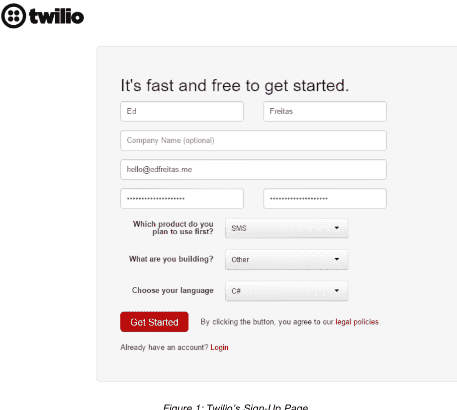

如你所见，注册页面相当简单。你需要提供你的名、姓、可选的公司名称、电子邮件地址和一个强密码（你必须输入两次）。

Twilio 还会询问额外信息，以便了解你最初将尝试使用其平台开发哪种类型的应用程序或项目。填写完详细信息后，你只需要点击“开始使用”即可。

## 购买 Twilio 号码

当你的 Twilio 账户准备就绪后，你需要先购买一个一次性电话号码才能发送 SMS。

为了向账户添加资金，你需要访问此 URL。首先，点击“升级至完整账户”。然后，点击红色的“添加资金”链接来添加资金。

你可以选择使用信用卡或 PayPal 账户付款。最低起始余额为 20 美元。


账户中有资金后，让我们看看如何获取一个号码。这将是一个你可以随时丢弃的真实电话号码。你可以选择你希望号码所属的国家和城市。

为了做到这一点，请将浏览器指向此 URL，然后点击“购买号码”。

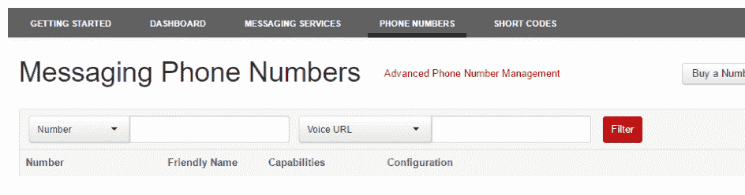

当你点击“购买号码”后，会弹出一个屏幕，如图 4 所示。

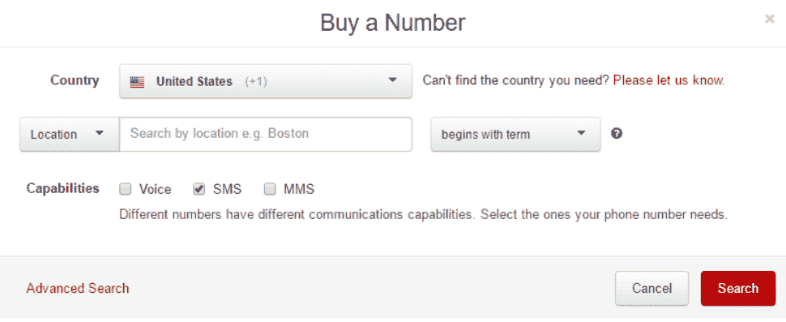

在这里，你可以选择你想购买号码的国家以及具体位置。

你还可以指示该号码是仅用于 SMS，还是也将用于语音和 MMS。

购买号码后，你将看到一个显示最近创建的号码的屏幕。

### 消息电话号码

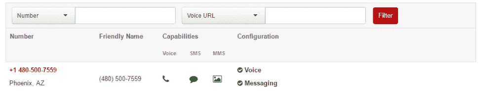

现在，我们准备使用 Visual Studio 安装 Twilio API 辅助库。

## 安装 Twilio API 辅助库

为了开始编码，我们需要创建一个 Visual Studio 控制台应用程序。在 Visual Studio 2015 中，前往“文件”，“新建”，然后选择“项目”。你会看到如图 6 所示的界面。选择“控制台应用程序”并将其命名为 `TwilioSuccinctly`。

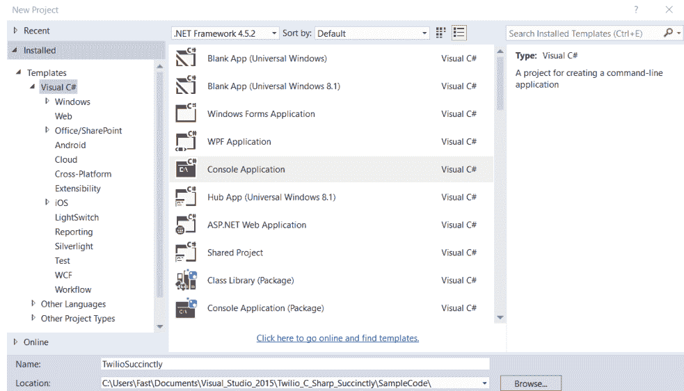

# 图 6：新的 Visual Studio 控制台应用程序

创建 Visual Studio 项目后，让我们添加两个类——一个名为 **`TwilioCore`**，另一个名为 **`TwilioExample`**，后者将作为 **`TwilioCore`** 的封装器。该项目应如图 7 所示。

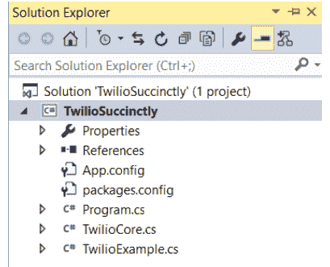

# 图 7：TwilioSuccinctly 项目结构

接下来，让我们添加 Twilio API 辅助库，该库可在 NuGet 上获取。为此，请右键单击 **`TwilioSuccinctly`** 项目，并点击“管理 NuGet 包”。

在搜索框中输入 Twilio，然后从返回的结果中选择 Twilio REST API 辅助库进行安装。

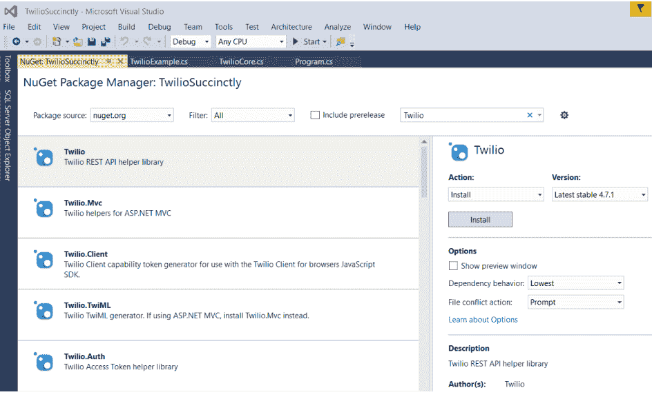

安装 Twilio API 辅助库后，我们开始编写代码。

## 发送短信

该应用程序将包含一个名为 `TwilioSuccinctly` 的命名空间，其中包含两个类：`TwilioCore` 和 `TwilioExample`。

`TwilioCore` 类将继承自 `IDisposable`，并包含所有直接处理 Twilio API 辅助库的逻辑。

`TwilioExample` 类仅是一个封装器，用于使用 `TwilioCore` 对象实现用例。

现在让我们实现 `TwilioCore` 类。我们将实现核心类功能，以及一个负责发送短信的方法，称为 `SendSms`。

> 代码清单 1：TwilioCore 类

```csharp
using System;
using Twilio;

namespace TwilioSuccinctly
{
    public class TwilioCore : IDisposable
    {
        protected bool disposed;

        public string SID
        {
            get;
            set;
        }

        public string aTk
        {
            get;
            set;
        }

        public TwilioCore()
        {
            SID = string.Empty;
            aTk = string.Empty;
        }

        public TwilioCore(string p1, string p2)
        {
            SID = p1;
            aTk = p2;
        }

        ~TwilioCore()
        {
            Dispose(false);
        }

        public virtual void Dispose(bool disposing)
        {
            if (!disposed)
            {
                if (disposing)
                {
                }

                SID = string.Empty;
                aTk = string.Empty;
            }

            disposed = true;
        }

        public void Dispose()
        {
            Dispose(true);
            GC.SuppressFinalize(this);
        }

        public Message SendSms(string from, string to, string msg)
        {
            if (SID != string.Empty && aTk != string.Empty)
            {
                TwilioRestClient client = new TwilioRestClient(SID, aTk);

                return client.SendMessage(from, to, msg);
            }
            else
                return null;
        }
    }
}
```

让我们详细审查此类。为了使用 Twilio API 辅助库，我们需要引入 **`Twilio`** 命名空间。

**`TwilioCore`** 继承自 **`IDisposable`** 接口，这意味着我们可以创建 **`TwilioCore`** 的实例，并且如果在 **`using`** 语句中调用，它可以被自动释放。这非常方便——它帮助我们编写整洁的代码。

为了进行身份验证，Twilio 需要账户 SID 和授权令牌（Auth Token）。

这些已被添加到 **`TwilioCore`** 类中，作为一个构造函数的参数，同时也作为两个分别名为 **`SID`** 和 **`aTk`** 的公共属性。可以在这个 [URL](URL) 找到账户 SID 和 Auth Token。为了查看它们，您需要点击“显示 API 凭据”，如图 9 所示。


到目前为止，实际的 **`TwilioCore`** 类非常简单。有两个构造函数，一个没有参数，不分配任何值给 **`SID`** 和 **`aTk`** 属性；另一个初始化这两个属性。其余部分包括释放机制的实现以及调用 Dispose 方法的类析构函数。

**`SendSms`** 方法特别有趣。该方法返回一个属于 Twilio API 辅助库命名空间的 **`Message`** 对象。为了让 **`SendSms`** 执行任何操作，**`SID`** 和 **`aTk`** 属性都需要分配值。

**`SendSms`** 方法使用 [RestSharp](https://www.restsharp.com/) 库创建 **`TwilioRestClient`** 的实例，它是 Twilio API 的封装器。为了发送短信，执行对 **`SendMessage`** 方法的调用。

**`SendMessage`** 方法需要三个参数。第一个参数 ***from*** 是发送消息的号码。第二个参数 ***to*** 是接收消息的号码。第三个参数 ***msg*** 是消息的实际文本。

既然我们已经看到 **`TwilioRestClient`** 类如何轻松允许我们发送短信，让我们编写一个合适的示例。为了做到这一点，我们将实现 **`TwilioExample`** 类。

### 代码清单 2：TwilioExample 类


```csharp
using System;
using Twilio;

namespace TwilioSuccinctly
{
    public class TwilioExample
    {
        // Your Twilio AccountSID
        private const string cStrSid =
            "<Your Twilio Account SID goes here>";

        // Your Twilio AuthToken
        private const string cStrAuthTk =
            "<Your Twilio Auth Token goes here>";

        // Change these numbers to the ones you own...
        private const string cStrSender = "< Your Twilio Number>";
        private const string cStrReceiver = "+16500000000";

        public static Message SendSimpleSmsExample()
        {
            Message m = null;

            Console.WriteLine("Twilio SendSimpleSmsExample");

            using (TwilioCore tc = new TwilioCore(cStrSid, cStrAuthTk))
            {
                m = tc.SendSms(cStrSender, cStrReceiver,
                               "This is a test SMS");

                // Use C# 6 interpolated string.
                Console.WriteLine($"The status of SMS is: {m?.Status}");
            }

            return m;
        }
    }
}
```

静态方法 `SendSimpleSmsExample` 创建 `TwilioCore` 类的实例，传入账户 SID `cStrSid` 和 Auth Token `cStrAuthTk`，然后使用发送方 `cStrSender` 和接收方 `cStrReceiver` 电话号码调用方法 `SendSms`。

现在只缺少从主程序调用 `SendSimpleSmsExample`。这实现在代码清单 3 中。

### 代码清单 3：主程序

```csharp
using System;

namespace TwilioSuccinctly
{
    public class Program
    {
        static void Main(string[] args)
        {
            TwilioExample.SendSimpleSmsExample();

            Console.ReadLine();
        }
    }
}
```

运行此代码产生如图 10 所示的输出。

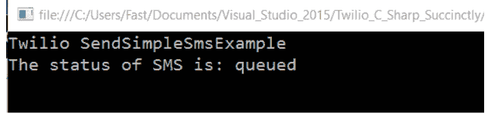

请注意，输出描述短信的状态为“排队中”。这意味着 Twilio 已将短信放入队列等待投递。

如果您要发送消息的目标号码是国际（非美国）号码，您需要启用某些权限以允许 Twilio 执行该操作。可以在这个 URL 中检查和配置这些权限。

## 跟踪短信

到目前为止，我们探讨了如何发送短信。但我们如何跟踪它？

如果我们查看 `SendSimpleSmsExample` 的实现，我们可以看到返回了一个 `Message` 对象。该对象包含一个 `Status` 属性，指示消息是“排队中”还是“已投递”。

通常状态从“排队中”变为“已投递”需要几秒钟（在二到五秒之间），即使接收方号码可能已经收到了短信。

请注意，`Status` 值“排队中”或“已投递”被引用，因为它内部表示为字符串。

Twilio 非常有效——如果您的消息已排队，它很可能会被投递。尽管如此，验证消息确实已有效投递仍然很有用。

让我们探讨如何检查这一点。让我们向 `TwilioCore` 类添加一个方法来检查短信的状态。

### 代码清单 4：TwilioCore 的 CheckSmsStatus 方法

```csharp
public Message CheckSmsStatus(string sid)
{
    if (SID != string.Empty && aTk != string.Empty)
    {
        TwilioRestClient client = new TwilioRestClient(SID, aTk);

        return client.GetMessage(sid);
    }
    else
        return null;
}
```

`CheckSmsStatus` 方法通过调用 `TwilioRestClient` 实例的 `GetMessage` 来检查短信状态。

`GetMessage` 方法需要我们要检查的消息的短信 ID `sid`。这就是为什么 `TwilioCore` 类的 `SendSms` 方法返回一个 `Message` 对象——以便我们可以从中获取短信 ID。

接下来，让我们在 `TwilioExample` 类中通过添加一个 `CheckSmsDelivered` 封装方法围绕 `SendSms` 来实现一个示例。

### 代码清单 5：TwilioExample 的 CheckSmsDelivered 封装方法

```csharp
public static bool CheckSmsDelivered(string mid)
{
```

bool res = false;

using (TwilioCore tc = new TwilioCore(cStrSid, cStrAuthTk))

{

    Message m = tc.CheckSmsStatus(mid);

    res = (m?.Status == "delivered") ? true : false;

}

return res;

}
```

该功能非常直观。该方法创建了一个 `TwilioCore` 类的实例，然后调用 `CheckSmsStatus`。状态是通过检查 `CheckSmsStatus` 返回的 `Message` 对象的 `Status` 属性的值来确定的。

如果 `Status` 属性的值为 "delivered"，`CheckSmsDelivered` 将返回 *true*，确认消息已送达。相反，`CheckSmsDelivered` 将返回 *false*。

正如我们所见，Twilio 通常需要在两到五秒之间更新 `Status` 属性的值，从 "queued" 变为 "delivered"。现在，让我们在主程序中实现一个方法，该方法在调用 `CheckSmsDelivered` 时会考虑到这一点。

*代码清单 6：调整后的主程序*

```csharp
using System;
using System.Threading;
using Twilio;
namespace TwilioSuccinctly
{
    public class Program
    {
        static void Main(string[] args)
        {
            SendSimpleSmsAndCheckIfDeliveredExample();
            Console.ReadLine();
        }
        public static void SendSimpleSmsAndCheckIfDeliveredExample()
        {
            Message m = TwilioExample.SendSimpleSmsExample();
            if (m != null)
            {
                Thread.Sleep(5000);
                bool res = TwilioExample.CheckSmsDelivered(m.Sid);
                Console.WriteLine($"SMS {m.Sid} delivered: {res}");
            }
        }
    }
}
```

我们包含了一个名为 `SendSimpleSmsAndCheckIfDeliveredExample` 的新方法，该方法调用 `TwilioExample` 包装类中的 `SendSimpleSmsExample`，然后，如果返回的 `Message` 对象的值不为 null，则在调用 `Thread.Sleep` 之前等待 5.5 秒，然后调用 `CheckSmsDelivered`。

运行此代码将产生如图 11 所示的输出。


Twilio SendSimpleSmsExample

SMS 的状态为：queued

SMS SM4456f8decfd9435aaa992dfde9e8d784d 已送达：True

图 11：SendSimpleSmsAndCheckIfDelivered 方法的输出

我们已经看到了使用 Twilio 发送和跟踪短信有多么简单和直接。现在，让我们探索一下如何利用这些功能构建一个简单的双因素身份验证（2FA）系统。

## 使用 Authy 设置 2FA

Authy 是一个强大且先进的 2FA 解决方案，它可以加强甚至取代网站、SaaS 产品和移动应用的传统用户名和密码登录。

Authy 让您可以轻松地使用智能手机在线账户上使用 2FA。

Authy 平台在您的设备上生成安全的两步验证码，因为使用 2FA 有助于通过验证两个身份要素来保护您的用户账户安全。它的工作原理是要求您在登录网站或应用时使用两个不同的项目进行身份验证。

大多数登录系统仅验证您已知晓的内容，例如密码。简单来说，2FA 包括先注册您的手机号码，然后随后接收一个一次性使用的代码，用于在身份验证时验证您的登录凭证。

验证的第二个要素与您所拥有的东西（例如您的手机）绑定。因此，你可以将双因素身份验证理解为您知道的东西（您的密码）加上您拥有的东西（您的手机）。再次强调——添加此额外的安全层有助于保护您的账户免受黑客和劫持者的侵害。

Authy 服务已完全集成到 Twilio 平台中，可以通过访问此 URL 从您的 Twilio 账户中访问。当您打开该 URL 时，您将会看到图 12 所示的页面。

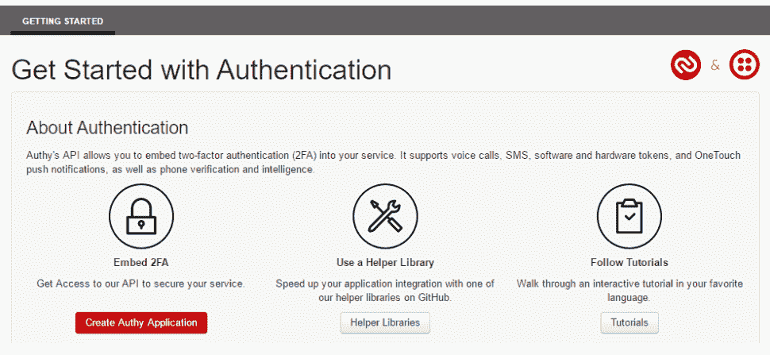

*图 12：Twilio Authy 入门页面*

为了开始使用，请单击“创建 Authy 应用程序”。这将重定向到图 13 中的 Authy 仪表板。


*图 13：Authy 仪表板页面*

该页面很容易理解——我们只需创建第一个应用即可开始。这可以通过单击“创建您的第一个应用”来实现。

这样做时，您将看到以下弹出窗口。

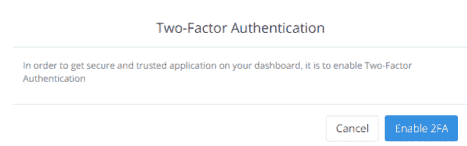

*图 14：启用双因素身份验证弹出窗口*

为了启用 2FA，请单击“启用 2FA”。这样将显示图 15 中的弹出窗口。

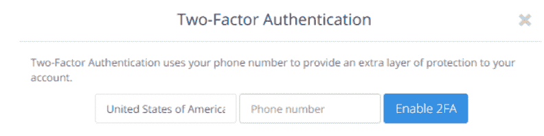

*图 15：双因素身份验证电话号码弹出窗口*

在这里，您必须输入一个可以接收短信的有效电话号码。您可以从 Twilio 支持的国家列表中进行选择。国家/地区选择默认为美国，但您可以更改此设置。

您可以提供之前创建的接收短信的 Twilio 一次性号码，或者使用您拥有的任何可以接收短信的号码。输入号码后，单击“启用 2FA”，这将验证您的身份。

随即，Authy 将显示图 16 中的弹出窗口。

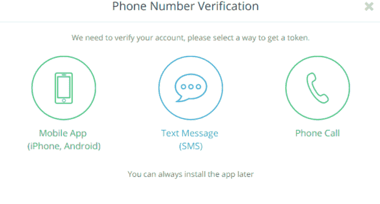

图 16：Authy 电话号码验证

您可以选择任何首选的号码验证方式，但由于我们要创建一个 2FA 短信系统，Twilio 建议您通过短信验证您的号码。

当您单击验证方式时，Authy 将显示图 17 中的弹出窗口。

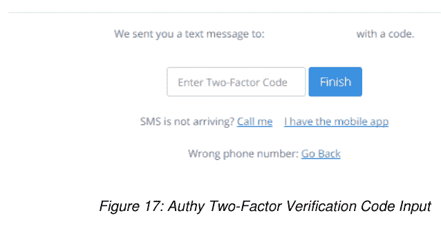

图 17：Authy 双因素验证码输入

此时，您应该在注册 Authy 时使用的电话号码上至少收到一个七位数的验证码。输入该代码并单击“完成”。

如果短信未到达，Authy 提供链接以便给您打电话或让您使用他们的移动应用。在大多数情况下，收到短信后这就足够了。

收到验证后，Authy 仪表板应显示 2FA 已启用。

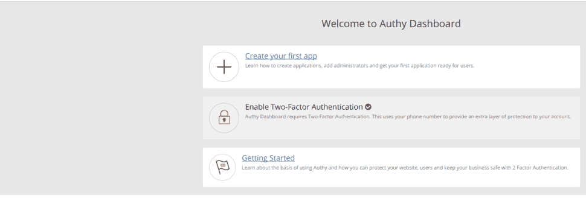

图 18：已启用 2FA 的 Authy 仪表板

## 创建 Authy 应用

完成 Authy 设置后，下一步是创建 Authy 应用。您首先需要给它起个名字。这可以通过在仪表板上单击“创建您的第一个应用”来完成。

然后您将看到以下弹出窗口，允许您输入应用程序的名称。

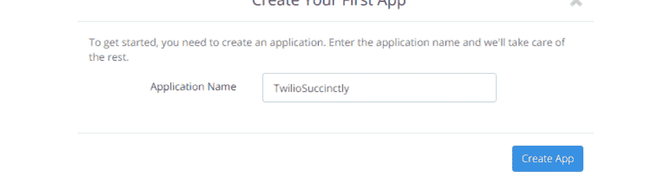

图 19：创建 Authy 应用弹出窗口

输入应用程序名称后，单击“创建应用”。您还将看到几个其他屏幕，有些可以跳过，或者您可以简单地单击“下一步”。

在此过程的末尾，您将看到要使用的 API 密钥。

### 就这样了！

您的应用程序已准备就绪。如果您有任何问题，请通过电子邮件联系我们：customers@authy.com

您用于 TwilioSuccinctly 的 API 密钥是

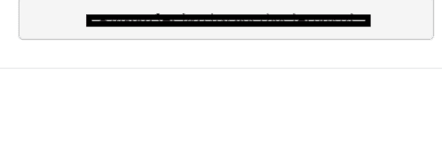


图 20：您的应用的 Authy API 密钥弹出窗口

既然 API 密钥现在可以使用了，我们就可以开始在 Visual Studio 中设置 Authy 了。为了做到这一点，请在 Visual Studio 中右键单击您的项目，然后选择“管理 NuGet 包”。在搜索框中，输入 Authy.Net。您将看到图 21 中所示的屏幕。

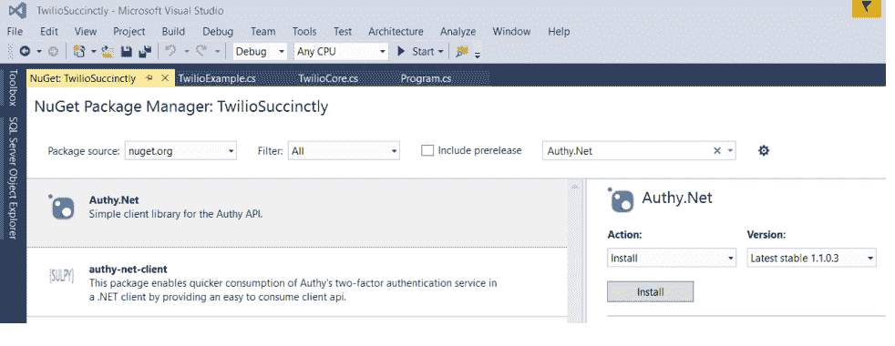

图 21：搜索 Authy.Net 的结果

单击“安装”将安装 Authy.Net。Auth.Net 包也可在此处获取。

现在是时候再次编写代码了。我们将扩展原始的 `TwilioCore` 和 `TwilioExample` 类，并为其添加 Authy 2FA 功能。

## 注册 Authy 接收者

为了通过短信接收验证令牌，必须注册用户（接收者）的手机号码。您可以通过 Authy 仪表板或代码来完成此操作。

让我们修改 `TwilioCore` 类，以便添加一个方法来注册用户的号码。

# 代码清单 7：包含 RegisterUser 方法的 TwilioCore 类


```csharp
using System;
using Authy.Net;

namespace TwilioSuccinctly
{
    public class TwilioCore : IDisposable
    {
        protected bool disposed;

        public TwilioCore()
        {
        }

        ~TwilioCore()
        {
            Dispose(false);
        }

        public virtual void Dispose(bool disposing)
        {
            if (!disposed)
            {
                if (disposing)
                {
                }

                disposed = true;
            }
        }

        public void Dispose()
        {
            Dispose(true);
            GC.SuppressFinalize(this);
        }

        public RegisterUserResult RegisterUser(string apikey, string
                                               uemail, string unumber, int cc, bool tmode)
        {
            if (apikey != string.Empty && uemail != string.Empty &&
                unumber != string.Empty)
            {
                AuthyClient client = new AuthyClient(apikey, tmode);
                return client.RegisterUser(uemail, unumber, cc);
            }
            else
                return null;
        }
    }
}
```

`RegisterUser` 方法非常简单。它接收 Authy API 密钥 `apikey`、接收者的电子邮件地址 `uemail`、接收者的手机号码 `unumber` 以及国家代码 `cc` 作为参数。最后一个参数 `tmode` 指示是否使用测试模式（设置为 `true` 时）或生产模式（设置为 `false` 时）。

当将 `tmode` 设置为 `true` 时，您需要使用用于测试的 Auth API 密钥。如果您想在生产环境中使用此功能（即 `tmode` 设置为 `false` 时），您需要使用用于生产的 API 密钥。两者都可以在 Authy 仪表板上找到。

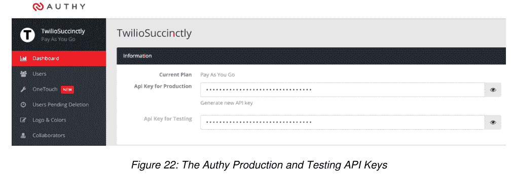

`RegisterUser` 方法首先验证 `apikey`、`uemail` 和 `unumber` 是否为空字符串，然后传入 `apikey` 和 `tmode` 创建 `AuthyClient` 的实例。为了注册用户，调用方法 `RegisterUser` 以传递 `uemail`、`unumber` 和 `cc`。

有了这些，让我们创建一个包装器，以便稍后在主程序中使用。让我们修改 `TwilioExample` 类并添加一个 `RegisterUser` 包装器方法。

### 代码清单 8：TwilioExample 中的 RegisterUser 包装器方法

```csharp
using System;
using Authy.Net;

namespace TwilioSuccinctly
{
    public class TwilioExample
    {
        public static RegisterUserResult RegisterUser(string apikey,
            string uemail, string unumber, int cc, bool tmode)
        {
            RegisterUserResult res = null;

            using (TwilioCore tc = new TwilioCore())
            {
                res = tc.RegisterUser(apikey, uemail, unumber, cc,
                        tmode);
            }

            return res;
        }
    }
}
```

`RegisterUser` 包装器方法的实现也相当直接。本质上，`TwilioCore` 的 `RegisterUser` 方法中使用的相同参数在这里也被使用。

创建一个 `TwilioCore` 类的实例并调用 `RegisterUser` 方法。此调用返回的结果是一个 `RegisterUserResult` 对象，该对象稍后用于获取 `UserId`。发送验证码需要 `UserId`。

### 通过 SMS 获取验证码

在 `TwilioCore` 和 `TwilioExample` 类中都实现了 `RegisterUser` 方法后，下一步是创建一个方法，以便我们可以将验证码作为 SMS 发送。

我们将分两步完成，即在 `TwilioCore` 类上创建一个 `SendSms` 方法，并在 `TwilioExample` 类上创建一个 `SendSms` 包装器方法。

让我们实现 `TwilioCore` 类的 `SendSms` 方法。

> *代码清单 9：TwilioCore 类的 SendSms 令牌验证方法*

```csharp
public SendSmsResult SendSms(string akey, string userid, bool tmode)
{
    if (akey != string.Empty && userid != string.Empty)
    {
        AuthyClient client = new AuthyClient(akey, tmode);
        return client.SendSms(userid);
    }
    else
        return null;
}
```

该方法接受 `apikey`、`userid` 和 `tmode` 参数。如果 `apikey` 和 `userid` 不是空字符串，则创建 `AuthyClient` 的实例，并立即通过传递 `userid` 调用 `SendSms`。然后结果作为 `SendSmsResult` 对象返回给调用方法。

接下来，让我们在 `TwilioExample` 类中创建包装器方法。

*代码清单 10：TwilioExample 类的 SendSms 包装器方法*

```csharp
public static SendSmsResult SendSms(string apikey, string userid, bool tmode)
{
    SendSmsResult res = null;
    using (TwilioCore tc = new TwilioCore())
    {
        res = tc.SendSms(apikey, userid, tmode);
    }
    return res;
}
```

包装器方法的实现也相当简单。创建一个 `TwilioCore` 类的实例，并使用 `apikey`、`userid` 和 `tmode` 参数调用 `TwilioCore` 的 `SendSms` 方法。返回 `SendSmsResult` 对象给调用方法，然后用于检查验证码是否成功发送。

有了这些，为了测试我们所做的工作，让我们现在创建一个方法，该方法在我们的主程序中注册一个接收者并发送 SMS 验证码。

*代码清单 11：主程序*

```csharp
using Authy.Net;
using System;

namespace TwilioSuccinctly
{
    public class Program
    {
        private const string cStrAuthyKey =
"<<Your Authy Production API Key>>";

        public static void SendSmsAndVerifyToken()
        {
            RegisterUserResult user =
            TwilioExample.RegisterUser(cStrAuthyKey,
"hello@edfreitas.me", "+16500000000", 1, false);

            if (user != null)
            {
                SendSmsResult smsRes =
                    TwilioExample.SendSms(cStrAuthyKey, user.UserId, false);

                if (smsRes.Success)
                {
                    Console.WriteLine("Please introduce your verification token: ");
                    string tk = Console.ReadLine();

                    if (tk != string.Empty)
                    {
                        AuthyResult res =
                            TwilioExample.VerifyToken(cStrAuthyKey,
                                user.UserId, tk, false);

                        Console.WriteLine($"Status {res.Status} message: {res.Message}");
                    }
                }
            }
        }

        static void Main(string[] args)
        {
            SendSmsAndVerifyToken();
            Console.ReadLine();
        }
    }
}
```

`main` 方法调用 `SendSmsAndVerifyToken` 方法，该方法从 `TwilioExample` 类调用 `RegisterUser` 方法。如果返回的 `RegisterUserResult` 对象不为 `null`，则将调用 `SendSms` 方法。

`TwilioExample` 类的 `SendSms` 方法返回一个 `SendSmsResult` 对象，该对象有一个名为 `Success` 的属性，当设置为 `true` 时，表示验证码已通过 SMS 发送。

请注意，`RegisterUser` 和 `SendSms` 方法中的 `tmode` 参数被设置为 `false`，这表明 Authy 期望使用生产环境的 API 密钥。

当我们稍后运行程序时，接收者用户将被注册并显示在 Authy 仪表板上。

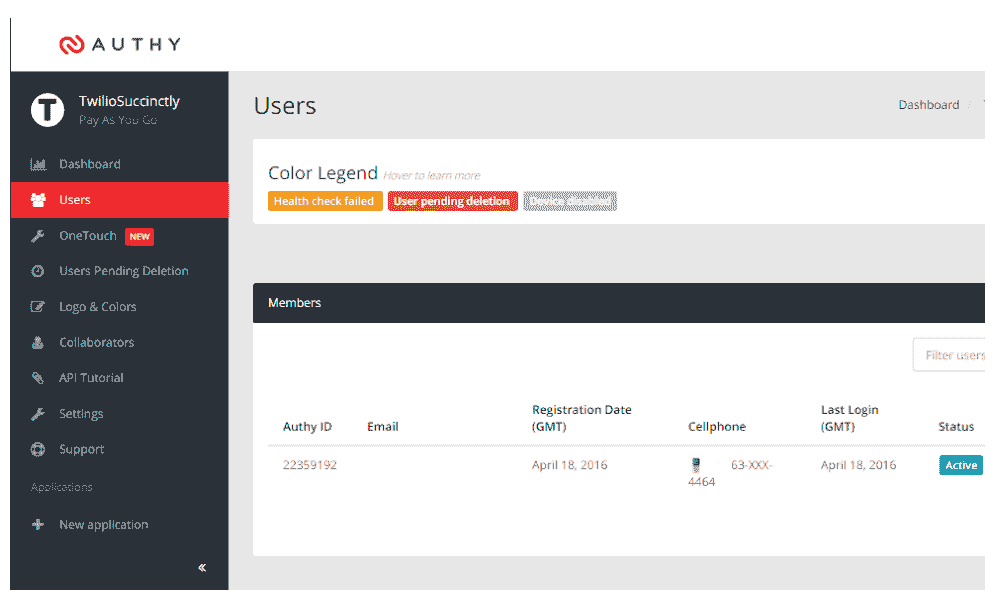

图 23：Authy 仪表板上的注册用户

请注意，在我们的主程序代码中，在调用 SendSms 之后，我们要求用户输入接收到的验证码，以便我们可以进行验证。

可以使用 VerifyToken 方法完成此验证。让我们看看该方法在 TwilioExample 类中的实现。

### 代码清单 12：TwilioExample 的 VerifyToken 包装器方法

```csharp
public static VerifyTokenResult VerifyToken(string apikey, string userid, string token, bool tmode)
{
    VerifyTokenResult res = null;

    using (TwilioCore tc = new TwilioCore())
    {
        res = tc.VerifyToken(apikey, userid, token, tmode);
    }

    return res;
}
```

该方法创建 `TwilioCore` 类的实例，然后从该实例中调用 `VerifyToken` 方法。返回的结果是一个 `VerifyTokenResult` 对象。

现在让我们看看 `TwilioCore` 类中 `VerifyToken` 方法的实现。

### 代码列表 13：TwilioCore 的 VerifyToken 方法

```csharp
public VerifyTokenResult VerifyToken(string apikey, string userid, string token, bool tmode)
{
    if (apikey != string.Empty && userid != string.Empty && token != string.Empty)
    {
        AuthyClient client = new AuthyClient(apikey, tmode);
        return client.VerifyToken(userid, token);
    }
    else
        return null;
}
```

该方法检查 `apikey`、`userid`、`token` 和 `tmode` 是否不为空字符串。请注意，`token` 是用户通过短信接收到的值。我们将验证其是否正确——这就是使用 Authy 进行 2FA 的目的。

令牌本身的验证是通过创建一个 `AuthyClient` 类的实例并调用其 `VerifyToken` 方法来实现的。

当我们运行主 `程序` 时，将产生图 24 所示的结果。请注意，当你运行自己的 `示例` 时，你将收到与图 24 输出截图中显示的不同的验证码。


*图 24：主 Authy 应用程序的输出*

## 总结

在本章中，我们探讨了如何轻松建立并运行 Twilio 和 Authy 账户。我们还看到了如何使用标准的 Twilio API 发送短信，以及如何使用 Authy 来执行 2FA。

由于 Twilio 通过创建友好、易于使用且易于接近的 API 库来封装这些服务的复杂性，因此流程代码非常简单且易于遵循。实施 Twilio 解决方案是一种愉快的体验。

此时，你也应该对如何使用 Twilio 发送短信以及如何使用 C# 辅助库启用 Authy 的 2FA 有相当好的理解。

在下一章中，我们将探索 Twilio 提供的更多功能，包括处理呼叫和其他有用的语音应用程序。

# 第 2 章 使用短信进行自动化

### 引言

我们已经看到 Twilio 如何赋能我们以直观和直接的方式实现短信通信，甚至可用于增强使用 2FA 的认证。

利用我们迄今所学的核心原则和示例，本章将重点介绍如何基于这些知识构建几个小型但实用的应用程序，用于优化和自动化业务流程，例如预约提醒和自动即时销售线索警报。

读完本章后，你应该对如何使用短信实现这些解决方案有一个广泛的理解，并充分理解这两种解决方案背后的整体业务逻辑。

由于本章的一些示例需要数据存储，我们将使用 Azure 表存储（Azure Table Storage）以确保我们的数据安全且易于在微软云上访问。

本章中提供的示例旨在易于跟随和有趣地实现，同时在业务背景下也有用。我们将继续使用我们在第 1 章中开发的 `TwilioCore` 类。

### 使用 Azure 表存储作为后端

你可能知道，Azure 是微软强大的云服务平台。它提供广泛的服务，并跨多个平台工作。

存储是其许多有用服务之一，Azure 包含一个名为表存储（Table Storage）的子系统。

表存储服务使用表格格式存储数据。每条记录代表一个实体，列代表该实体的各种属性（表中的字段）。

每个实体都有一对键（分区键 PartitionKey 和行键 RowKey）用于唯一标识它。每个实体还有一个时间戳列，表服务用它来知道该实体最后一次更新的时间（这是自动发生的，时间戳值不能被覆盖——它由服务内部控制）。

关于存储和表存储服务工作原理的广泛文档可以直接在 Azure 网站上找到，这是一份非常有价值的资源，值得查阅以获得对这两种服务的更好理解。

尽管如此，我们将快速探索如何使用 Azure 表存储开始工作。


为了在 Microsoft Azure 上启动存储实例，你需要使用 Microsoft 账户登录或注册 Azure。你可以通过访问 https://azure.microsoft.com 来完成。

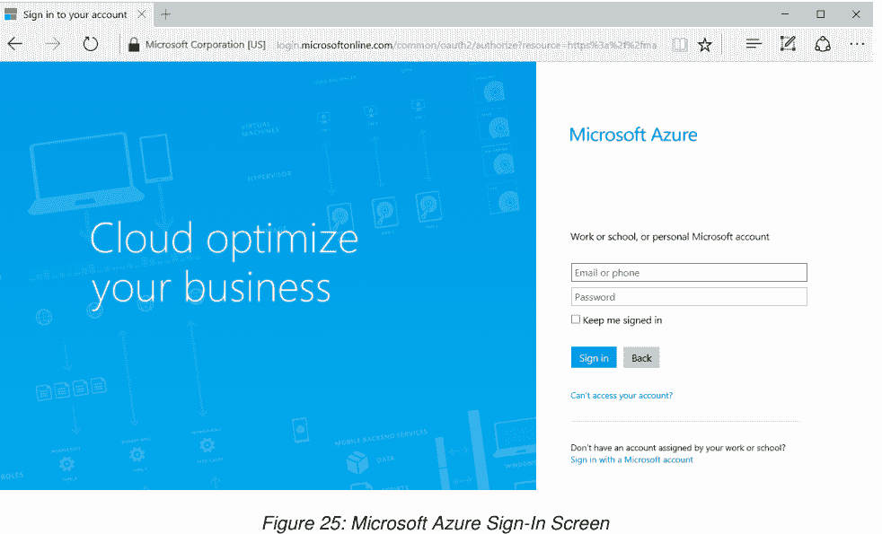

一旦你注册或登录到 Azure 门户，你可以浏览 Azure 服务列表并选择存储账户（经典）`Storage accounts (classic)`。

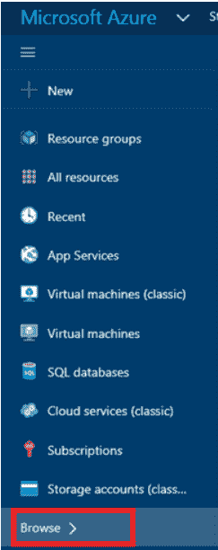

*图 26：筛选 Azure 服务列表*

当你选择存储账户（经典）时，你将看到如下屏幕，允许你添加一个新的存储账户。


*图 27：存储账户（经典）面板*

为了添加一个新的存储账户（经典），点击添加。这将显示一个屏幕，允许你添加账户的名称并选择将托管该账户的 Azure 位置。

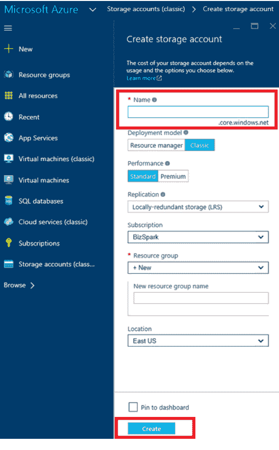

*图 27：创建新存储账户（经典）面板*

一旦你选择了名称并选择了离你最近的位置，点击创建。Azure 将立即创建存储账户。创建后，它将如图 28 所示。你需要你的访问密钥才能从你的代码或任何外部工具与服务交互。可以通过点击密钥（Keys）来找到这些密钥。

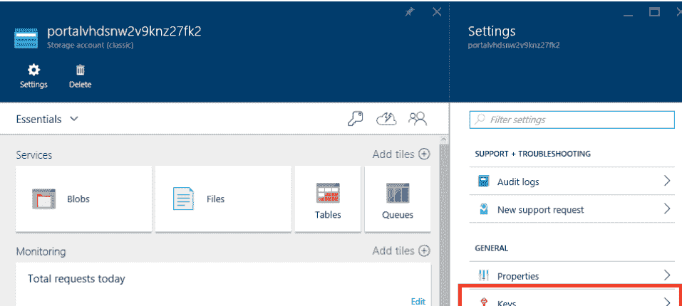

*图 28：存储账户（经典）面板*

随着 Azure 存储账户的准备就绪，你可以使用一个名为 Azure Storage Explorer 的开源便捷工具，它允许你轻松地连接到你的存储账户，并创建、更新、删除和查看任何存储表和数据。

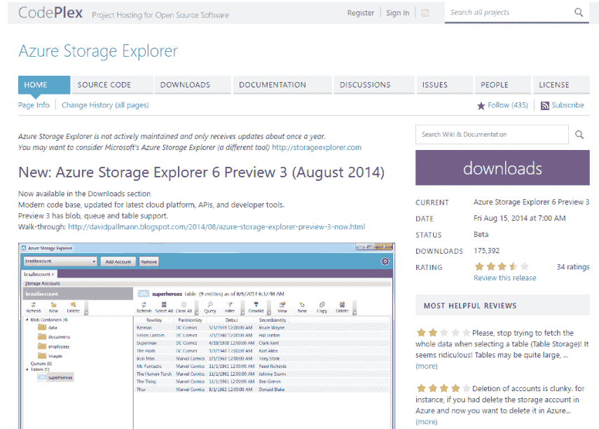

*图 29：CodePlex 上的 Azure Storage Explorer*

在你从 CodePlex 下载并解压 zip 文件后，你会发现一个可执行文件来安装该工具。

安装向导易于跟随且不言自明，只需几次点击，但请注意 Azure Storage Explorer 应用程序仅在 Windows 上运行。

安装完成后，你的磁盘上将出现以下文件。

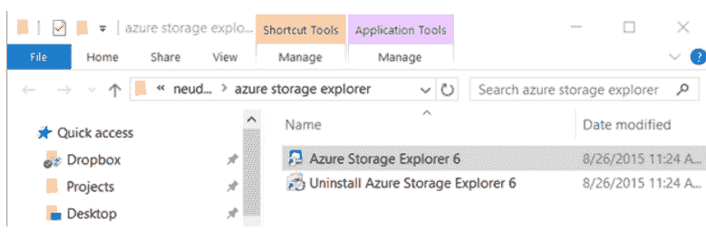

为了运行该工具，双击 Azure Storage Explorer 快捷方式。一旦应用程序正在运行，你需要将你的 Azure 存储账户连接到此应用。这可以通过点击添加账户（Add Account）来完成。

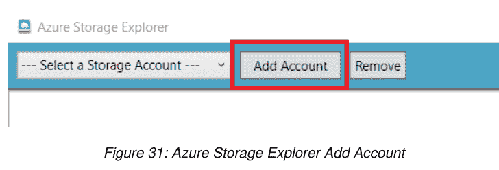

当你点击添加账户时，系统会要求你添加你的存储账户名称和密钥，如图 32 所示。

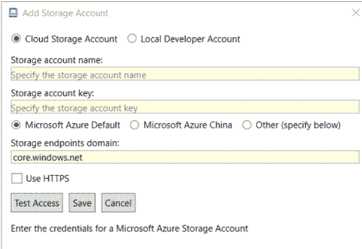

*图 32：Azure Storage Explorer 添加账户设置*

输入所需详细信息后，你应该点击测试访问（Test Access）以检查连接是否正常工作。如果成功，你可以点击保存（Save）。

保存这些详细信息后，下次你打开 Azure Storage Explorer 应用程序时，你将能够从添加账户按钮旁边的下拉菜单中访问你的存储账户。

既然我们的存储账户已连接，现在让我们探索如何使用 Twilio 进行一些短信自动化，并使用表存储作为我们的后端。

## 预约提醒

留住满意的客户可能是任何公司今天面临的最大的挑战。幸运的是，正确的态度和一点自动化可以使客户满意成为一个可实现的目标。

预约提醒是自动化在即将到来的预约前联系客户流程的简单且有效的方法。我们可以编写代码来实现这一点——我们将使用已经编写的 `TwilioCore` 类。

让我们先花一点时间思考如何设计这个解决方案。我们需要能够创建具有未来 `DateTime` 的预约，我们可以将其存储在 Azure 表存储上。这个未来的 `DateTime` 将是预约的计划日期。我们还需要建立一个流程，监视预约何时被计划，从表存储中检索信息，并向该预约的注册电话号码发送短信。

我们将首先探索允许我们与 Azure 表存储进行交互的第一个动作。为了做到这一点，让我们安装 `WindowsAzure.Storage` NuGet 包，然后创建一个 `Appointment` 类。

若要安装 NuGet 包，只需单击“安装”。这将把必要的引用添加到 Visual Studio 项目中。

在深入代码之前，你需要使用 Azure Storage Explorer 创建存储表。让我们将该表命名为 `AppointmentsSuccinctly`。

安装了 NuGet 包后，我们可以创建 `AppointmentData` 和 `Appointment` 类。

### 代码清单 14：Appointment 和 AppointmentData 类


```csharp
using System;
using Microsoft.WindowsAzure.Storage;
using Microsoft.WindowsAzure.Storage.Table;

namespace TwilioSuccinctly
{
    public class AppointmentData : TableEntity
    {
        public AppointmentData(string p, string d)
        {
            PartitionKey = p;
            RowKey = d;
        }

        public AppointmentData()
        {
        }

        public string Id { get; set; }
        public string Name { get; set; }
        public string PhoneNumber { get; set; }
        public string Time { get; set; }
        public bool Sent { get; set; }
    }

    public class Appointment : IDisposable
    {
        private const string cStrConnStr = "<< Your Azure Storage Connection String >>";
        private const string cStrAppTable = "AppointmentsSuccinctly";

        protected bool disposed;

        public AppointmentData Data { get; set; }

        public Appointment(string id, string n, string pn, DateTime t)
        {
            string tt = t.Day.ToString().PadLeft(2, '0') +
                        t.Month.ToString().PadLeft(2, '0') +
                        t.Year.ToString() +
                        t.Hour.ToString().PadLeft(2, '0') +
                        t.Minute.ToString().PadLeft(2, '0') +
                        t.Second.ToString().PadLeft(2, '0');

            Data = new AppointmentData(pn, tt);

            Data.Sent = false;
            Data.Id = id;
            Data.Name = n;
            Data.PhoneNumber = pn;
            Data.Time = tt;
        }

        public Appointment(string pn)
        {
            string tt = DateTime.Now.Day.ToString().PadLeft(2, '0') +
                        DateTime.Now.Month.ToString().PadLeft(2, '0') +
                        DateTime.Now.Year.ToString() +
                        DateTime.Now.Hour.ToString().PadLeft(2, '0') +
                        DateTime.Now.Minute.ToString().PadLeft(2, '0') +
                        DateTime.Now.Second.ToString().PadLeft(2, '0');

            Data = new AppointmentData(pn, tt);
            Data.PhoneNumber = pn;
            Data.Time = tt;
        }

        ~Appointment()
        {
            Dispose(false);
        }

        public virtual void Dispose(bool disposing)
        {
            if (!disposed)
            {
                if (disposing)
                {
                }

                Data = null;
            }
            disposed = true;
        }

        public void Dispose()
        {
            Dispose(true);
            GC.SuppressFinalize(this);
        }

        public bool Create()
        {
            bool res = false;

            try
            {
                var storageAccount = CloudStorageAccount.Parse(cStrConnStr);

                CloudTableClient tableClient =
                    storageAccount.CreateCloudTableClient();
                CloudTable table =
                    tableClient.GetTableReference(cStrAppTable);

                TableOperation retrieveOperation =
                    TableOperation.Retrieve<AppointmentData>
                    (Data.PhoneNumber, Data.PhoneNumber);

                TableResult retrievedResult =
                    table.Execute(retrieveOperation);
                AppointmentData updateEntity =
                    (AppointmentData)retrievedResult.Result;

                if (updateEntity == null)
                {
                    updateEntity = new AppointmentData(Data.PhoneNumber,
                        Data.Time);
                    updateEntity.Id = Data.Id;
                    updateEntity.Name = Data.Name;
                    updateEntity.PhoneNumber = Data.PhoneNumber;
                    updateEntity.Time = Data.Time;
                }

                TableOperation ins = TableOperation.Insert(updateEntity);
                table.Execute(ins);

                res = true;
            }
            catch (Exception ex)
            {
                Console.WriteLine(ex.ToString());
            }

            return res;
        }

        public AppointmentData Get()
        {
            AppointmentData res = null;

            try
            {
                int tDay = DateTime.Now.Day;
                int tMonth = DateTime.Now.Month;
                int tYear = DateTime.Now.Year;
                int tHour = DateTime.Now.Hour;
                int tMin = DateTime.Now.Minute;
                int tSec = DateTime.Now.Second;

                DateTime tdy = new DateTime(tYear, tMonth, tDay, tHour,
                    tMin, tSec);

                var storageAccount =
                    CloudStorageAccount.Parse(cStrConnStr);
                CloudTableClient tableClient =
                    storageAccount.CreateCloudTableClient();
                CloudTable table =
                    tableClient.GetTableReference(cStrAppTable);

                TableQuery<AppointmentData> query = new
                    TableQuery<AppointmentData>().Where(
                    TableQuery.GenerateFilterCondition("PartitionKey",
                        QueryComparisons.Equal, Data.PhoneNumber));

                foreach (AppointmentData en in table.ExecuteQuery(query))
                {
                    int day = Convert.ToInt32(en.Time.Substring(0, 2));
                    int month = Convert.ToInt32(en.Time.Substring(2, 2));
                    int year = Convert.ToInt32(en.Time.Substring(4, 4));
                    int hour = Convert.ToInt32(en.Time.Substring(8, 2));
                    int min = Convert.ToInt32(en.Time.Substring(10, 2));
                    int sec = Convert.ToInt32(en.Time.Substring(12, 2));

                    DateTime exp = new DateTime(year, month, day, hour,
                        min, sec);

                    if (!en.Sent && DateTime.Compare(tdy, exp) >= 0)
                    {
                        res = en;
                        break;
                    }
                }
            }
            catch (Exception ex)
            {
                Console.WriteLine(ex.ToString());
            }

            return res;
        }

        public bool MarkAsSent(AppointmentData ad)
        {
            bool res = false;

            try
            {
                var storageAccount =
                    CloudStorageAccount.Parse(cStrConnStr);
                CloudTableClient tableClient =
                    storageAccount.CreateCloudTableClient();

                CloudTable table =
                    tableClient.GetTableReference(cStrAppTable);

                TableOperation retrieveOperation =
                    TableOperation.Retrieve<AppointmentData>
                    (ad.PhoneNumber, ad.Time);

                TableResult retrievedResult =
                    table.Execute(retrieveOperation);
                AppointmentData updateEntity =
                    (AppointmentData)retrievedResult.Result;

                if (updateEntity != null)
                {
                    updateEntity.Sent = ad.Sent;

                    TableOperation insertOrReplaceOperation =
                        TableOperation.InsertOrReplace(updateEntity);
                    table.Execute(insertOrReplaceOperation);

                    res = true;
                }
            }
            catch (Exception ex)
            {
                Console.WriteLine(ex.ToString());
            }

            return res;
        }

        public string FormatTime(string t)
        {
            int day = Convert.ToInt32(t.Substring(0, 2));
            int month = Convert.ToInt32(t.Substring(2, 2));
            int year = Convert.ToInt32(t.Substring(4, 4));
            int hour = Convert.ToInt32(t.Substring(8, 2));
            int min = Convert.ToInt32(t.Substring(10, 2));
            int sec = Convert.ToInt32(t.Substring(12, 2));

            DateTime exp = new DateTime(year, month, day, hour, min,
                sec);
            return exp.ToString();
        }
    }
}
```


让我们分析这段代码。我们定义了一个 `AppointmentData` 类，它表示要存储在 Azure 表存储中的数据。`AppointmentData` 类继承自 `TableEntity`，并包含表存储用于索引和查找数据记录的 `PartitionKey` 和 `RowKey` 属性。

我们将把用户的电话号码存储在 `PartitionKey` 上，而在 `RowKey` 上，我们将以字符串形式保留预约到期时的日期和时间，例如，29042016203000，其中 29 是日，04 是月，2016 是年，20 是一天中的小时（晚上 8 点），30 是分，00 是秒。

`AppointmentData` 类还包含一个 `string Id` 属性，一个表示预约名称的 `string Name` 属性，一个包含与 `PartitionKey` 相同数据的 `string PhoneNumber` 属性，一个包含与 `RowKey` 相同数据的 `string Time` 属性，以及一个表示是否已为该预约发送短信的 `bool Sent` 属性。

`AppointmentData` 类将由 `Appointment` 类实例化，以便将信息存储在 Azure 表存储中。你可以将 `AppointmentData` 类视为数据层（模型），将 `Appointment` 类视为业务逻辑层（控制器）。

`Appointment` 类的构造函数创建一个 `AppointmentData` 实例，该实例将用于在 Azure 上存储预约数据。

在表存储中，`DateTime` 值应以 `string` 值的形式存储。`FormatTime` 方法的目的接收像 29042016203000 这样的日期时间 `string`，并将其转换为等效的 `DateTime` 表示形式（4/29/2016 8:30:00 PM），作为 `string`，以便可以在 `Console` 上显示。

`Create` 方法负责在表存储中创建预约提醒。通过将 `cStrConnStr` 连接字符串传递给 `CloudStorageAccount.Parse` 方法，建立与 Azure 实例的连接。接下来，创建 `CloudTableClient` 的实例，然后使用它获取 AppointmentsSuccinctly 表的引用。

调用 `CloudTable` 实例的 `Execute` 方法，并使用 `AppointmentData` 类作为 T，`Data.PhoneNumber` 作为 `PartitionKey` 和 `RowKey`。我们这样做是为了获取一个 `TableResult` 对象，以便可以将其 `Result` 属性强制转换为空的 `AppointmentData` 对象。该对象将用于设置相应的预约属性，并通过调用 `TableOperation.Insert` 方法插入到表存储中。最后，`CloudTable` 实例的 `Execute` 方法将 `AppointmentData` 对象提交到表存储。

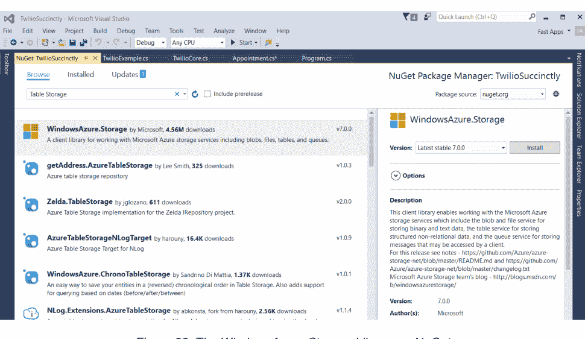

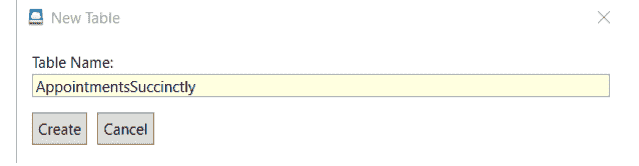

`MarkAsSent` 方法的工作方式与 `Create` 方法几乎完全相同。主要区别在于，`MarkAsSent` 执行的是 `InsertOrReplace` 而非 `Insert`，因此在短信发送完成后，会将 `AppointmentData` 对象的 `Sent` 属性更新为值 `true`。

相应地，`Get` 方法的工作方式也与 `MarkAsSent` 或 `Create` 方法几乎完全相同，不过它会创建一个 `TableQuery` 类的实例，然后通过链式调用 `GenerateFilterCondition` 方法来执行 `Where` 方法。在此配置下，会调用 `CloudTable.ExecuteQuery`，返回类型为 `IEnumerable<AppointmentData>`。

由于 `GenerateFilterCondition` 基于 `PartitionKey` 进行过滤，所有具有相同电话号码的记录都将被检索。通过遍历 `IEnumerable<AppointmentData>` 结果集，并将当前日期 `tdy` 与预约的到期日 `exp` 进行比较，系统将检索并返回给调用方法第一个已过期且未发送短信（`Sent` 属性设置为 `false`）的预约。

现在，让我们实现几个示例，将上述内容付诸实践。在代码清单 15 中，我们将创建一个 `AppointmentExample` 类，该类将创建一些预约，并为到期的预约发送短信。

### 代码清单 15: AppointmentExample 封装类

```csharp
using System;
using System.Timers;

namespace TwilioSuccinctly
{
    public class AppointmentExample
    {
        private const string cStrTwilioSid =
            "<< Your Twilio Account SID goes here >>";
        private const string cStrTwilioAuthTk =
            "<< Your Twilio Auth Token goes here >>";
        private const string cStrTwilioSender =
            "<< Your Twilio Number>>";

        private static bool started = false;

        public static Timer Fetch { get; set; }
        public static string PhoneNumber { get; set; }

        public static void InitFetch(int ms)
        {
            started = false;

            Fetch = new Timer();
            Fetch.Interval = ms;
            Fetch.Elapsed += new ElapsedEventHandler(Fetch_Elapsed);
            Fetch.Start();
        }

        public static void StopFetch()
        {
            started = false;
            Fetch.Stop();
        }

        public static void Fetch_Elapsed(object sender,
            ElapsedEventArgs e)
        {
            if (!started)
            {
                started = true;
                Console.WriteLine(
                    "Fetching Oldest Appointment...");

                using (Appointment a = new Appointment(PhoneNumber))
                {
                    AppointmentData ad = a.Get();

                    if (ad != null)
                    {
                        using (TwilioCore t = new
                            TwilioCore(cStrTwilioSid, cStrTwilioAuthTk))
                        {
                            t.SendSms(cStrTwilioSender, PhoneNumber,
                                $"Reminder of appointment {ad.Id} -
                                {ad.Name} on: {a.FormatTime(ad.Time)}");

                            Console.WriteLine(
                                $"Reminder of appointment
                                {ad.Id} - {ad.Name} on:
                                {a.FormatTime(ad.Time)}");

                            ad.Sent = true;
                        }

                        a.MarkAsSent(ad);
                    }
                }

                started = false;
            }
        }

        public static bool Create(string id, string n, string pn,
            DateTime t)
        {
            bool res = false;

            using (Appointment a = new Appointment(id, n, pn, t))
            {
                res = a.Create();

                if (res)
                    Console.WriteLine(
                        $"Appointment created: {id} - {n} on {t}");
                else
                    Console.WriteLine(
                        $"Could not create appointment: {id} - {n} on {t}");
            }

            return res;
        }
    }
}
```

`AppointmentExample` 类执行两项操作。它通过其 `Create` 方法创建预约，并且还创建一个 `Fetch Timer` 对象，该对象执行 `Fetch_Elapsed` 事件，用于检索第一个过期的预约并发送短信。

在代码清单 16 中，我们将通过在我们的 `Main` 程序中调用它来实际操作。

### 代码清单 16: 主程序

```csharp
using System;

namespace TwilioSuccinctly
{
    public class Program
    {
        public static void CreateSeveralAppointments()
        {
            AppointmentExample.Create("app01", "BurgerKing",
                "33484464", new DateTime(2016, 4, 29, 20, 30, 00));
            AppointmentExample.Create("app02", "Run", "33484464", new
                DateTime(2016, 4, 29, 21, 20, 00));
            AppointmentExample.Create("app03", "Gym", "33484464", new
                DateTime(2016, 4, 29, 22, 05, 00));
        }

        public static void FetchAppointments()
        {
            Console.WriteLine(
                "Waiting for Timer (Appointment Fetch)...");

            AppointmentExample.PhoneNumber = "33484464";
            AppointmentExample.InitFetch(1500);
        }

        static void Main(string[] args)
        {
            CreateSeveralAppointments();
            Console.ReadLine();

            FetchAppointments();
            Console.ReadLine();
        }
    }
}
```

当我们执行 `Main` 程序时，我们会得到图 35 中创建的预约。

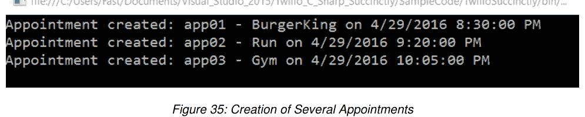

在这些预约创建之后，我们稍等片刻，让程序寻找第一个过期的预约。

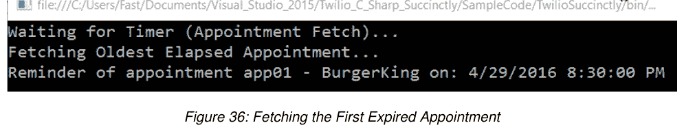

然后，我们可以检查 Azure 上的 AppointmentsSuccinctly 表，以查看执行程序后数据的样子。

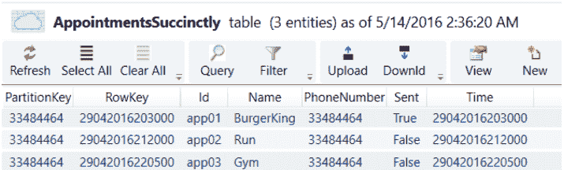

图 37: Azure 表存储中的预约数据

我们可以清楚地看到，对于 BurgerKing（第一个过期的）预约，`Sent` 属性已被设置为 `True`。

## 自动即时线索警报

即时线索是销售人员达成更多交易的好方法，因为它们允许销售代表在识别出感兴趣的客户后的几分钟后即可联系他们。自动化联系线索的过程是将 Twilio 的力量为您所用的一种绝佳方式。

收集线索的过程始于拥有一个或多个落地页，用于收集关于您的组织提供的产品或服务的网站访客信息。

为了简单起见，我们假设所收集的信息存储在 Azure 表存储中。这些信息将包括客户的全名、电子邮件地址、电话号码以及他们感兴趣的网络研讨会。此外，还将有一个 `FollowedUp` 属性，用于指示是否已跟进该线索。

我们将创建一个小型应用程序，从 Azure 获取线索数据，然后使用我们的 `TwilioCore` 类发送短信。

让我们创建一个负责检索存储在 Azure 中的线索并发送短信的 `LeadsCore` 类。我们将使用 Azure Storage Explorer 在表存储上手动创建 Lead 记录。

首先，我们使用 Storage Explorer 创建一个名为 `LeadsSuccinctly` 的表。该表将用于跟踪潜在线索可能感兴趣的网络研讨会。除了 `FollowedUp` 字段具有 `bool` 值外，所有字段都将具有 `string` 值。

该表的 `PartitionKey` 应包含线索感兴趣的网络研讨会的名称，而 `RowKey` 应为线索发布在站点上时日期和时间的字符串表示形式。

就像我们在预约提醒代码中所做的那样，我们将使用 `Timer` 对象来检索第一个发布的线索。

让我们看看 Azure 上从我们网站收集的线索，如图 38 所示。

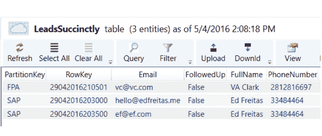

*图 38: Azure 表存储中的线索数据*

让我们编写代码。与我们之前的示例一样，我们将拥有一个与表存储交互的核心类，然后在其周围拥有一个实际实现业务逻辑的封装类。

### 代码清单 17: LeadsCore 类


```csharp
using System;
using Microsoft.WindowsAzure.Storage;
using Microsoft.WindowsAzure.Storage.Table;

namespace TwilioSuccinctly
{
    public class LeadsData : TableEntity
    {
        public LeadsData(string p, string d)
        {
            PartitionKey = p;
            RowKey = d;
        }
        public LeadsData(string p)
        {
            PartitionKey = p;
            RowKey = string.Empty;
        }

        public LeadsData()
        {
            PartitionKey = string.Empty;
            RowKey = string.Empty;
        }

        public string FullName { get; set; }
        public string Email { get; set; }
        public string Webinar { get; set; }
    }
}
```

# 代码清单 17：LeadsData 和 LeadsCore 类

```csharp
public class LeadsData
{
    public string FullName { get; set; }
    public string Email { get; set; }
    public string Webinar { get; set; }
    public bool FollowedUp { get; set; }
    public string PhoneNumber { get; set; }
}

public class LeadsCore : IDisposable
{
    private const string cStrConnStr = 
        "<< Your Azure Storage Connection String >>";
    private const string cStrAppTable = "LeadsSuccinctly";

    protected bool disposed;

    public LeadsData Data { get; set; }

    public LeadsCore()
    {
        LeadsData ld = new LeadsData();
        
        ld.FullName = string.Empty;
        ld.Email = string.Empty;
        ld.Webinar = string.Empty;
        ld.PhoneNumber = string.Empty;
    }

    ~LeadsCore()
    {
        Dispose(false);
    }

    public virtual void Dispose(bool disposing)
    {
        if (!disposed)
        {
            if (disposing)
            { }
            
            Data = null;
        }
        disposed = true;
    }

    public void Dispose()
    {
        Dispose(true);
        GC.SuppressFinalize(this);
    }
}
```

## 方法实现

```csharp
public LeadsData Get(string webinar)
{
    LeadsData res = null;

    try
    {
        int tDay = DateTime.Now.Day;
        int tMonth = DateTime.Now.Month;
        int tYear = DateTime.Now.Year;
        int tHour = DateTime.Now.Hour;
        int tMin = DateTime.Now.Minute;
        int tSec = DateTime.Now.Second;

        DateTime tdy = new DateTime
            (tYear, tMonth, tDay, tHour, tMin, tSec);

        var storageAccount =
            CloudStorageAccount.Parse(cStrConnStr);
        CloudTableClient tableClient =
            storageAccount.CreateCloudTableClient();
        CloudTable table =
            tableClient.GetTableReference(cStrAppTable);

        TableQuery<LeadsData> query = new
            TableQuery<LeadsData>().Where(
            TableQuery.GenerateFilterCondition("PartitionKey",
            QueryComparisons.Equal, webinar));

        foreach (LeadsData en in table.ExecuteQuery(query))
        {
            int day = Convert.ToInt32(
                en.RowKey.Substring(0, 2));
            int month = Convert.ToInt32(
                en.RowKey.Substring(2, 2));
            int year = Convert.ToInt32(
                en.RowKey.Substring(4, 4));
            int hour = Convert.ToInt32(
                en.RowKey.Substring(8, 2));
            int min = Convert.ToInt32(
                en.RowKey.Substring(10, 2));
            int sec = Convert.ToInt32(
                en.RowKey.Substring(12, 2));

            DateTime exp = new DateTime(
                year, month, day, hour, min, sec);

            if (!en.FollowedUp &&
                DateTime.Compare(tdy, exp) >= 0)
            {
                res = en;
                break;
            }
        }
    }
    catch (Exception ex)
    {
        Console.WriteLine(ex.ToString());
    }

    return res;
}

public bool MarkAsFollowedUp(LeadsData ld)
{
    bool res = false;

    try
    {
        var storageAccount =
            CloudStorageAccount.Parse(cStrConnStr);
        CloudTableClient tableClient =
            storageAccount.CreateCloudTableClient();
        CloudTable table =
            tableClient.GetTableReference(cStrAppTable);

        TableOperation retrieveOperation =
            TableOperation.Retrieve<LeadsData>(
                ld.PartitionKey, ld.RowKey);

        TableResult retrievedResult =
            table.Execute(retrieveOperation);
        LeadsData updateEntity =
            (LeadsData)retrievedResult.Result;

        if (updateEntity != null)
        {
            updateEntity.FollowedUp = ld.FollowedUp;

            TableOperation insertOrReplaceOperation =
                TableOperation.InsertOrReplace(updateEntity);
            table.Execute(insertOrReplaceOperation);

            res = true;
        }
    }
    catch (Exception ex)
    {
        Console.WriteLine(ex.ToString());
    }

    return res;
}

public string FormatTime(string t)
{
    int day = Convert.ToInt32(t.Substring(0, 2));
    int month = Convert.ToInt32(t.Substring(2, 2));
    int year = Convert.ToInt32(t.Substring(4, 4));
    int hour = Convert.ToInt32(t.Substring(8, 2));
    int min = Convert.ToInt32(t.Substring(10, 2));
    int sec = Convert.ToInt32(t.Substring(12, 2));


    DateTime exp = new DateTime(
        year, month, day, hour, min, sec);
    return exp.ToString();
}
```

我们定义了一个 `LeadsData` 类，它表示存储在表存储（Table Storage）中的数据模型。

该类包含多个属性，直接对应 Azure 表中的字段。这些字段包括 `FullName`、`Email`、`Webinar`、`FollowedUp` 和 `PhoneNumber`。

`LeadsCore` 类实现了必要的逻辑，用于检索第一个尚未跟进的潜在客户（lead），并将该潜在客户标记为已跟进。

`Get` 方法接收一个字符串参数，该参数将作为我们要筛选的网络研讨会（webinar）名称。该值将使用表的 `PartitionKey` 来查询 Azure 表中的记录。

遵循 `Appointments` 类 `Get` 方法的相同逻辑，`LeadsCore` 类的 `Get` 方法连接到 Azure，检索一个 `LeadsData` 对象的 `IEnumerable` 列表，并检查哪些对象尚未跟进（`FollowedUp` 设为 false），同时也检查潜在客户的发布日期 `exp` 是否早于今天的日期 `tdy`。

`MarkAsFollowedUp` 方法负责连接到 Azure 表，定位使用 `Get` 方法检索到的潜在客户对应的记录，并将其标记为已跟进。`MarkAsFollowedUp` 方法基本上是将 `FollowedUp` 属性设置为 true，以便同一个潜在客户不会被再次检索（跟进）。

为了付诸实践，让我们创建一个 `LeadsExample` 类，该类将封装上述逻辑，并负责创建检索潜在客户的 `Timer` 对象。

# 代码清单 18：LeadsExample 封装类


```csharp
using System;
using System.Timers;

namespace TwilioSuccinctly
{
    public class LeadsExample
    {
        private const string cStrTwilioSid =
            "<< Your Twilio Account SID goes here >>";
        private const string cStrTwilioAuthTk =
            "<< Your Twilio Auth Token goes here >>";
        private const string cStrTwilioSender =
            "<< Your Twilio Number>>";

        private static bool started = false;

        public static Timer Fetch { get; set; }
        public static string PhoneNumber { get; set; }
        public static string Webinar { get; set; }

        public static void InitFetch(int ms)
        {
            started = false;

            Fetch = new Timer();
            Fetch.Interval = ms;
            Fetch.Elapsed += new ElapsedEventHandler(Fetch_Elapsed);
            Fetch.Start();
        }

        public static void StopFetch()
        {
            started = false;
            Fetch.Stop();
        }

        public static void Fetch_Elapsed(object sender,
            ElapsedEventArgs e)
        {
            if (!started)
            {
                started = true;
                Console.WriteLine
                    ("Fetching Oldest Non-Followed Up Lead...");

                using (LeadsCore l = new LeadsCore())
                {
                    LeadsData ld = l.Get(Webinar);
                    if (ld != null)
                    {
                        using (TwilioCore t = new
                            TwilioCore(cStrTwilioSid, cStrTwilioAuthTk))
                        {
                            t.SendSms(cStrTwilioSender, PhoneNumber,
                                $"Please follow up with Lead " +
                                $"{ld.PartitionKey} - " +
                                $"{ld.Email} - {ld.FullName} on: " +
                                $"{l.FormatTime(ld.RowKey)}");
                            Console.WriteLine($"Followed up with Lead " +
                                $"{ld.PartitionKey} - {ld.Email} - " +
                                $"{ld.FullName} on: " +
                                $"{l.FormatTime(ld.RowKey)}");
                            ld.FollowedUp = true;
                        }
                        l.MarkAsFollowedUp(ld);
                    }
                    started = false;
                }
            }
        }
    }
}
```

`LeadsExample`类的`InitFetch`方法创建一个`Timer`对象（赋值给`Fetch`属性），当`Fetch_Elapsed`事件被触发时，该对象将检索潜在客户。

`Fetch_Elapsed`事件创建一个`LeadsCore`类的实例，用于执行`Get`方法以检索需要跟进的潜在客户。检索到的潜在客户随后被标记为已跟进（`FollowedUp`属性设为`true`），然后过程重复——当`Timer`对象再次触发`Fetch_Elapsed`事件时，将获取另一个潜在客户。

现在让我们编写`Main`程序，以便调用`LeadsExample`封装类。

# 代码清单 19：潜在客户主程序

```csharp
using System;
namespace TwilioSuccinctly
{
    class Program
    {
        static void Main(string[] args)
        {
            LeadsExample.InitFetch(60000);
            Console.WriteLine("Press Enter to stop...");
            Console.ReadLine();
            LeadsExample.StopFetch();
        }
    }
}
```

# 摘要

我们已经看到，自动化一些小型但实用的业务流程有多么简单直接，我们也了解了之前编写的`TwilioCore`类如何用于发送短信。我们还学习了如何使用 Azure 表存储（Azure Table Storage）作为快速且可靠的数据后端。

在接下来的章节中，我们将探索 Twilio 提供的一些语音功能，以及它们如何用于自动化有用的业务流程。

## 第 3 章 接听和拨打电话

### 引言

我们了解到，Twilio 是一个易用且强大的平台，可用于启用短信通信、使用短信自动化特定的业务流程，甚至通过双因素认证（2FA）进行身份验证。

然而，我们才刚刚触及 Twilio 可能性的表面。该平台最基础且最强大的功能之一是其接听、拨打和处理电话，以及构建语音应用程序的能力。

你很可能熟悉如 Powwow、WebEx 或 GotoMeeting 等服务，它们允许你拨打会议号码、设置虚拟会议室并与他人交谈。你也可能熟悉自动电话菜单系统，在这些系统中，你拨打银行或航空公司电话，然后被要求按 1、2 或 3 来执行 X、Y 或 Z 操作。我们都经历过这些场景，不是吗？

Twilio 允许我们开发者构建任何这些服务，并量身定制以满足我们自己的需求——无需太多努力，也无需掏空口袋。然而，我们必须谨慎考虑我们要构建的内容以及我们可能产生的潜在成本。话虽如此，与自建整个电信基础设施相比，Twilio 几乎总是更便宜。

Twilio 负责电信网络基础设施，并完全将这种复杂性从我们的开发中抽象出来。我们只需专注于业务逻辑，让 Twilio 处理电信系统和协议的内部机制即可。

在本章和下一章中，我们将探索如何利用 Twilio 语音 API 的强大功能。我们还将使用一种名为 TwiML 的 XML 标记语言，它可以轻松创建语音响应。我们还将查看在 Twilio 上使用语音功能的基础知识、处理传入电话和拨出电话，以及创建简单的答录机。

读完本章后，你应该具备解决这些主题的知识，以及使用 Twilio 和 TwiML 创建语音响应和应用程序的基础知识。

在第 4 章中，我们将探讨 Twilio 语音功能中更高级的问题，例如交互式电话菜单、会议和自动化语音调查。

这些示例应该再次易于跟随且有趣去实现。

### TwiML

为了轻松使用 Twilio 创建语音响应，你可以使用一种名为 TwiML 的 XML 标记语言，它只是一组指令，你可以使用它来告诉 Twilio 在收到传入电话或短信时要做什么。

当你在 Twilio 号码上收到短信或电话时，Twilio 将获取与你的 Twilio 电话号码关联的 URL，并对该 URL 执行 HTTP(S) 请求。此 URL 将包含带有标记指令的 XML 响应，指示 Twilio 需要执行哪些任务。其中一些任务将包括记录通话、播放消息、提示来电者输入一些数字等。

让我们在代码列表 20 中快速探索一个示例。

#### 代码列表 20：TwiML 示例

```xml
<?xml version="1.0" encoding="UTF-8"?>
<Response>
  <Say voice="man">I'm not available to take your call, please leave a message.</Say>
  <Record maxLength="20" />
</Response>
```

如你所见，使用 TwiML 告诉 Twilio 执行特定操作相对简单。该标记语言由代表 Twilio 将执行的操作的蓝色高亮动词组成。

在撰写本文时，可用的 TwiML 动词包括：`Say`、`Play`、`Dial`、`Record`、`Gather`、`Sms`、`Hangup`、`Queue`、`Redirect`、`Pause`、`Conference`、`Reject` 和 `Message`。

关于如何使用这些 TwiML 动词的完整详细信息可以在[这里](#)找到。

### 接收传入电话

让我们回顾一下使用 TwiML 处理传入电话的过程。

你需要提供一个可公开访问的 URL，用于托管你的 TwiML XML 标记文件。Twilio 允许你为语音和短信应用设置默认响应的 TwiML 文件。这些可以托管在你自己的 web 服务器上，甚至托管在 Amazon S3 或 Azure Websites 等可以托管静态资源的服务上。

你可以在 Twilio 账号的语音号码[仪表板](#)上配置这些 URL，然后单击你的 Twilio 号码。这将引导你进入 Twilio 号码的属性页面，在那里你可以设置语音响应的请求 URL。

#### 属性

- 友好名称：[已删除]

- SID：[已删除]

- 电话号码：[已删除]

- 位置：美国亚利桑那州菲尼克斯

- 功能：语音、短信、MMS

### 语音

- 配置方式：(URL) | (Twiml 应用) | (SIP 中继)

- 请求 URL：http://[已删除]/twillo-voice-response.xml | HTTP GET


我们将在代码列表 21 中创建一个快速的语音响应，使用 TwiML 向来电者问好，并指示他们发送 WhatsApp 消息或发送电子邮件。

#### 代码列表 21：TwiML 来电问候响应

```xml
<?xml version="1.0" encoding="UTF-8"?>
<Response>
  <Pause length="1"/>
  <Say voice="man">Hello.</Say>
  <Say voice="man">You've reached Ed's phone.</Say>
  <Say voice="man">I cannot take your call now.</Say>
  <Say voice="man">
      Please send a WhatsApp message, to this same number.
  </Say>
  <Pause length="1"/>
  <Say voice="man">You may also contact me at:</Say>
  <Say voice="man">hello, at:</Say>
  <Say voice="man">ed freitas dot me</Say>
  <Pause length="1"/>
  <Say voice="man">Thank you.</Say>
  <Say voice="man">Have a great day.</Say>
</Response>
```

请注意，通过使用多个`Say`动词以及在一秒`Pause`动词之间进行分隔，响应被分解为几个部分。这是因为 Twilio 使用语音合成引擎来向来电者朗读书面文本。

为了使体验尽可能像人类接听电话一样，以部分形式传达消息并带有必要的停顿非常重要。还要注意句子不长，并且使用了标点符号。

没有“完美”的 TwiML 文本转语音响应的通用规则。为了让声音听起来不像机器，你可能需要稍作调整，直到响应的声音符合你的喜好。

TwiML 是一个极好的资源，允许我们在无需编程的情况下快速添加语音功能。然而，由于响应基于 XML 标记，它们需要静态托管或嵌入在 PHP 或 ASP.NET 等服务器端软件中。

TwiML 作为标记语言的一个局限性是它不允许使用变量，因此如果我们希望响应不是预定义的，必须在服务器端动态构建 XML，然后将其作为响应返回。

我们可以通过创建自定义 TwiML 响应来解决这个问题。让我们探索如何操作。

### 简单答录机

在探索了 TwiML 的一些基础知识后，让我们创建一个简单答录机，它将在电话接听后，根据来电者输入的数字向来电者提供具体说明。

我们将创建一个`SimpleAnsweringMachine`类，其中包含答录机应用所需的逻辑。

由于 TwiML 需要一个 URL 端点，我们将创建一个 [NancyFX](http://example.com/nancyfx) 应用程序，我们可以将其作为 Azure [网站](http://example.com/azure-website) 部署。

如果你希望获取更多关于 NancyFX 的深入信息，Syncfusion 有一本完全专门的[电子书](http://example.com/nancyfx-ebook)，是关于该框架及其功能的绝佳资源。不妨看一眼。

为了创建 NancyFX 应用程序，首先请确保安装 [SideWaffle Template Pack for Visual Studio](http://example.com/sidewaffle-template)。SideWaffle 安装程序易于跟随，只需几次点击。

安装 SideWaffle 后，你可以选择 *Nancy empty project with ASP.NET host*，在图 41 中如下所示，创建一个名为 *TwilioNancyAspNetHost* 的新 NancyFX 项目。

## 添加新项目

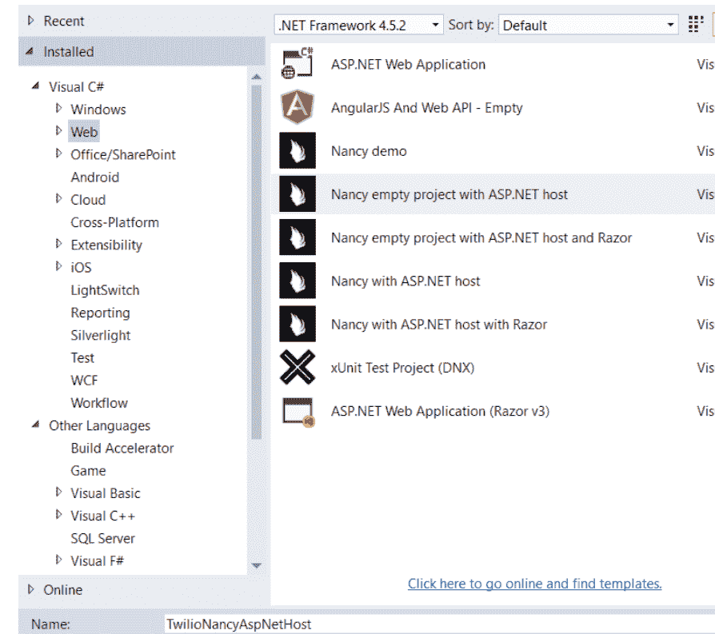

项目创建完成后，下一步是创建一个 NancyFX 模块，这只是一个标准的 C# 类。在图 42 中，我们将把这个模块命名为 AnsweringMachineMain。

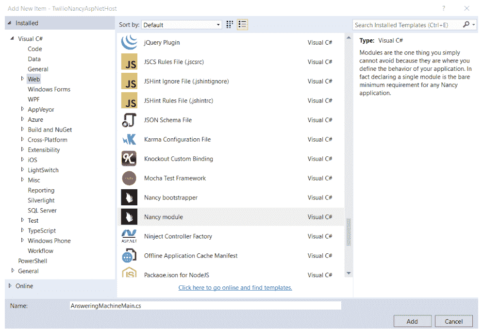

虽然不太可能，但如果由于某种原因在 TwilioNancyAspNetHost 项目中未找到 NancyFX 引用，请使用 NuGet 包管理器检查是否有新的更新。

我们的 AnsweringMachineMain 模块将包含用于向来电者发送正确响应的 HTTP REST 端点。为了测试其是否正常工作，我们可以包含代码清单 22 中的代码。

### 代码清单 22：TwiML 来电问候响应


```csharp
using Nancy;

namespace TwilioNancyAspNetHost
{
    public class AnsweringMachineMain : NancyModule
    {
        public AnsweringMachineMain()
        {
            Get["/"] = _ =>
            {
                return Response.AsText(
                    "<Response>" +
                    "<Say voice=\"man\">I’m not available to take your call, please leave a message.</Say>" +
                    "<Record maxLength=\"20\" />" +
                    "</Response>",
                    "text/xml"
                );
            };
        }
    }
}
```

为了检查我们的 REST 端点是否可公开访问，我们可以使用 Visual Studio 中的发布选项将 `NancyFX` 应用程序部署到 Azure 网站。

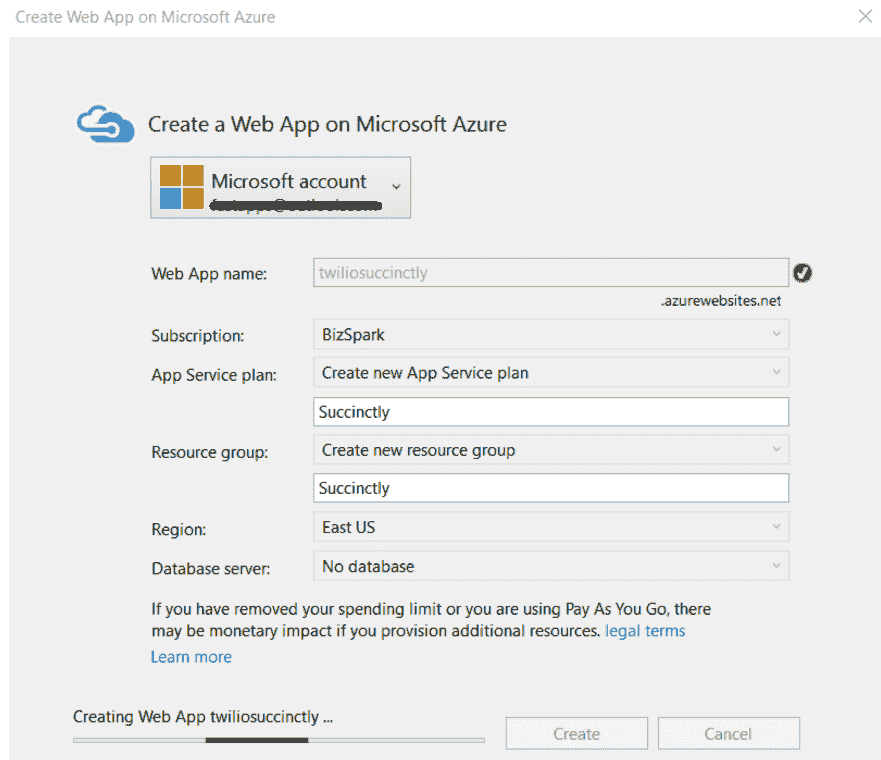

*图 43：将 `NancyFX` 应用程序部署到 Azure 网站*

输入所需详细信息，点击**创建**，并按照交互式向导完成步骤。只需几次点击，解决方案就会部署到 Azure 并准备就绪。

应该可以通过此**URL**访问该站点。在那里，您应该能看到图 44 中所示的内容。

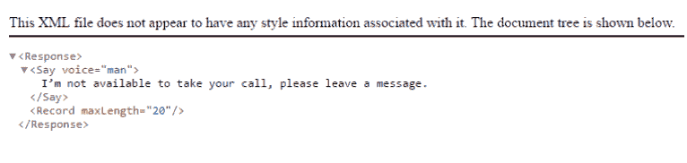

**图 44：来自 `NancyFX` 应用程序的 TwiML 响应**

在 `NancyFX` 应用程序运行起来后，接下来我们将把 Twilio 号码配置指向运行在 Azure 上的 `NancyFX` 应用程序。

为了做到这一点，我们需要进入 Twilio 号码的**仪表板**，然后点击我们要关联的号码。系统将要求您创建一个新的 TwiML 应用程序。

#### 创建 TwiML 应用程序

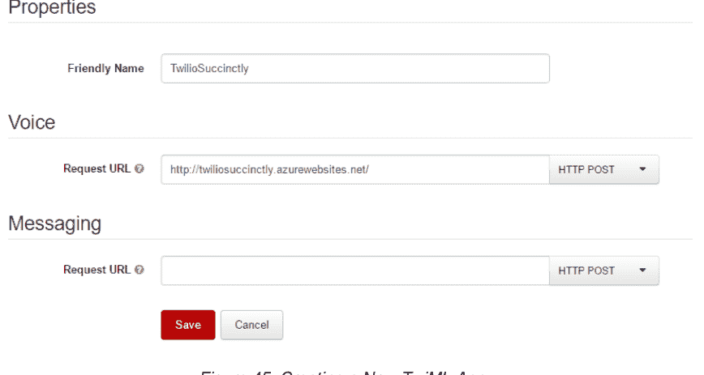

**图 45：创建新的 TwiML 应用程序**

输入 TwiML 应用程序的名称（您可以指定任何您想要的名称），最重要的是，指示语音请求 URL，即返回来自我们 `NancyFX` 应用程序的 TwiML 响应的 URL。提供这些详细信息后，点击**保存**。

为了测试一切是否正常工作，只需拿起电话拨打您的 Twilio 号码。如果您听到与 `NancyFX` XML 响应中输入的消息相同的内容，说明一切正常。

在设置和连接就位后，我们现在可以专注于添加所需的功能，以扩展我们答录机应用程序的功能。

该应用程序应快速问候来电者，并要求他们输入访问代码，以便在一个名为 `SAMSuccinctly` 的 Azure 存储表中返回并存储一个秘密代码。

由于我们的 `NancyFX` (Azure 网站) 应用程序将使用 Azure 存储，请别忘了从 NuGet 安装该包。

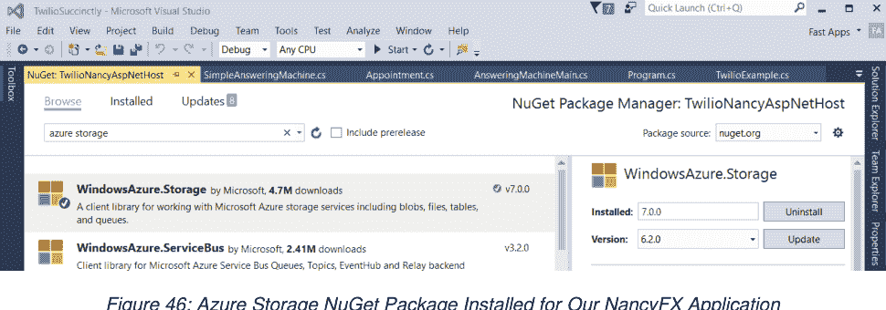

现在我们可以使用 Azure Storage Explorer 按图 47 所示创建我们的 `SAMSuccinctly` 表。让我们将访问代码存储为 `PartitionKey`，将秘密代码存储为 `RowKey`。

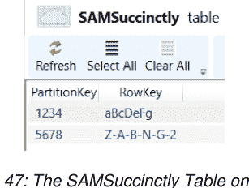

我们可以使用以下 TwiML 标记来问候来电者并要求他们提供访问代码。

#### 代码清单 23：用于我们应用程序的 TwiML 标记问候

```xml
<?xml version="1.0" encoding="UTF-8"?>
<!-- page located at http://twiliosuccinctly.azurewebsites.net/ -->
<Response>
    <Gather action="/sam" method="GET">
        <Say>
            Please enter your access code,
            followed by the pound sign.
        </Say>
    </Gather>
    <Say>We didn't receive any access code. Bye.</Say>
</Response>
```

请注意，负责收集访问代码的这个问候响应托管在网站的根目录上 (`http://twiliosuccinctly.azurewebsites.net/`)。然而，动作响应在 `/sam` 上可用 (`http://twiliosuccinctly.azurewebsites.net/sam`)。

现在，让我们实现我们的 `SimpleAnsweringMachine` 类。

#### 代码清单 24：`SimpleAnsweringMachine` 类

```csharp
using System;
using Microsoft.WindowsAzure.Storage;
using Microsoft.WindowsAzure.Storage.Table;

namespace TwilioSuccinctly
{
    public class SimpleAnsweringMachineData : TableEntity
    {
        public SimpleAnsweringMachineData(string p, string d)
        {
            PartitionKey = p;
            RowKey = d;
        }

        public SimpleAnsweringMachineData()
        {
        }
    }

    public class SimpleAnsweringMachine : IDisposable
    {
        protected bool disposed;

        private const string cStrConnStr =
            "<< Your Azure Storage Connection String >>";
        private const string cStrAppTable = "SAMSuccinctly";

        public SimpleAnsweringMachine()
        {
        }

        ~SimpleAnsweringMachine()
        {
            Dispose(false);
        }

        public virtual void Dispose(bool disposing)
        {
            if (!disposed)
            {
                if (disposing)
                {
                }
            }

            disposed = true;
        }

        public void Dispose()
        {
            Dispose(true);
            GC.SuppressFinalize(this);
        }

        public string Get(string ac)
        {
            string res = string.Empty;

            try
            {
                var storageAccount =
                    CloudStorageAccount.Parse(cStrConnStr);
                CloudTableClient tableClient =
                    storageAccount.CreateCloudTableClient();
                CloudTable table =
                    tableClient.GetTableReference(cStrAppTable);

                TableQuery<SimpleAnsweringMachineData> query = new
                    TableQuery<SimpleAnsweringMachineData>().Where(
                    TableQuery.GenerateFilterCondition("PartitionKey",
                    QueryComparisons.Equal, ac));

                foreach (SimpleAnsweringMachineData en in
                    table.ExecuteQuery(query))
                {
                    res = en.RowKey;
                    break;
                }
            }
            catch (Exception ex)
            {
                Console.WriteLine(ex.ToString());
            }

            return (res == string.Empty) ? "Unknown" : res;
        }
    }
}
```

我们的 `SimpleAnsweringMachine` 类实际上非常简单。它有一个 `Get` 方法，使用访问代码（由 `PartitionKey` 表示）查询 `SAMSuccinctly` 表，并返回一个也包含秘密代码的 `SimpleAnsweringMachineData` 对象。

如您所见，查询 `SAMSuccinctly` 表与我们在上一章中使用 Azure 类看到的类似。

现在，在代码清单 25 中，让我们看看如何扩展我们的 `AnsweringMachineMain` `NancyFX` 模块的功能，以便我们可以实现 `SimpleAnsweringMachine` 类所公开的功能。

### 代码清单 25：扩展的 *AnsweringMachineMain* 类

```csharp
using Nancy;
using TwilioSuccinctly;

namespace TwilioNancyAspNetHost
{
    public class AnsweringMachineMain : NancyModule
    {
        public AnsweringMachineMain()
        {
            Get["/"] = _ =>
            {
                return Response.AsText(
                    "<Response> " +
                    "<Gather action=\"/sam\" method=\"GET\"> " +
                    "<Say voice=\"woman\">Please enter your access " +
                    "code, followed by the pound sign.</Say>" +
                    "</Gather> " +
                    "<Say voice=\"woman\">We didn't receive any " +
                    "access code. Bye.</Say> " +
                    "</Response>",
                    "text/xml"
                );
            };

            Get["/sam"] = _ =>
            {
                string sc = "Unknown";
                string ac = Request.Query["Digits"].Value;
                string res = string.Empty;

                res = "<Response><Say voice=\"woman\">No access " +
                      "code found.</Say>" +
                      "</Response>";

                if (ac != null && ac != string.Empty)
                {
                    using (SimpleAnsweringMachine sam = new SimpleAnsweringMachine())
                    {
                        if (Request.Query["Digits"] != string.Empty)
                            sc = sam.Get(ac);
                    }

                    res = "<Response><Say voice=\"woman\">You entered: " +
                          ac + "</Say>" +
                          "<Say voice=\"woman\">Your secret code is: " +
                          sc + "</Say>" +
                          "</Response>";

                    return Response.AsText(res, "text/xml");
                }

                return Response.AsText(res, "text/xml");
            };
        }
    }
}
```

我们的 `AnsweringMachineMain` `NancyFX` 模块实现了两个 REST 端点。根端点向来电者提供问候信息，并通过 `Gather` TwiML 动词收集访问代码，该动词会触发 `/sam` 端点上的动作。

当 `/sam` 端点被执行时（即来电者输入访问代码数字并按下井号键后），会创建一个 `SimpleAnsweringMachine` 类的实例，并调用其 `Get` 方法，传入由来电者输入的数字（这些数字存储在 HTTP `Request.Query` 对象中）。

然后 `Get` 方法会查询 `SAMSuccinctly` 表，并返回与正在查询的 `PartitionKey`（访问代码）匹配的 `RowKey`（代表秘密代码）。

为了使 `NancyFX` 应用程序正常运行，`*TwilioNancyAspNetHost*` 项目需要发布到 Azure 网站。可以通过拿起电话并拨打与该 TwiML 应用程序相关的 Twilio 号码来轻松测试此应用程序。

您应该能够输入您的访问代码（`SAMSuccinctly` 表中现有的两个代码之一），并以语音响应的形式获取您的秘密代码。

## 发起外呼

我们已经了解了如何接听电话并使用 TwiML 处理语音请求。在结束本章并进入更高级的示例之前，让我们讨论一下如何使用 Twilio C# 辅助类库发起外呼。

我们将扩展我们的 `TwilioCore` 类，并添加一个方法来拨打电话。让我们在代码清单 26 中实现这个方法。

### 代码清单 26: `TwilioCore` 的 `StartCall` 方法


```csharp
public void StartCall(string from, string to, string url)
{
    // SID = Twilio AccountSID, aTk = Twilio AuthToken
    if (SID != string.Empty && aTk != string.Empty && from !=
        string.Empty && to != string.Empty)
    {
        TwilioRestClient client = new TwilioRestClient(SID, aTk);
        client.InitiateOutboundCall(from, to, url);
    }
}
```

如你所见，`StartCall` 方法非常简单。它有两个参数：`from` 和 `to`，分别代表主叫和被叫电话号码。

第三个参数是一个 URL 资源，电话另一端的人在接听电话后将听到该资源的内容。此 URL 需要返回有效的 TwiML 响应。

正如我们在一直使用 `TwilioCore` 类方法时所做的那样，让我们为 `StartCall` 实现一个包装方法，以便我们可以从 `主程序` 中调用它。

### 代码清单 27: StartRecordedCall 包装方法

```csharp
public static void StartRecordedCall()
{
    using (TwilioCore tc = new TwilioCore(cStrSid, cStrAuthTk))
    {
        tc.StartCall(cStrSender, cStrReceiver,
            "http://www.edfreitas.me/twilio/sayhello.xml");
    }
}
```

现在，我们可以从 `主程序` 中调用这个方法。

### 代码清单 28: 从主程序调用 StartRecordedCall 包装方法

```csharp
static void Main(string[] args)
{
    TwilioExample.StartRecordedCall();

    Console.ReadLine();
}
```

当执行这段代码时，您应该能在您于 `TwilioExample` 类中指定为 `cStrReceiver` 的电话号码上听到一段录音。

正如我们所见，使用 Twilio 发起外呼很容易。仅需几行代码，我们就能够发起电话通话并播放消息。

如果您要拨打的目标号码是国际（非美国）号码，您需要启用某些权限以允许 Twilio 执行该操作。您可以在此 URL 中检查并配置这些权限。

您还可以调整此代码，以启用应用程序提供个性化消息或录制对其的反应。

## 总结

在本章中，我们开始探索 Twilio 语音功能所能实现的部分。

我们了解了如何接听来电、根据用户输入提供特定反馈，以及发起外呼。

我们还学习了如何快速设置一个 NancyFX Azure 网站以创建简单的应答机。

在下一章中，我们将更深入地研究使用 Twilio 的语音功能，并创建一些有趣且更高级的示例，这些示例在业务环境中可能非常有用。

# 第 4 章 使用语音进行自动化

## 简介

我们已经探索了 Twilio 语音功能的基础，这应该让您对使用 TwiML 和 C# 辅助类库创建语音启用应用程序的可能性有了很好的了解。

现在让我们探索如何进一步扩展，并使用 Twilio 的语音功能来自动化业务流程。

我们将主要使用 TwiML 来创建一个交互式电话菜单、一个简单的会议服务以及一个令人兴奋的自动化语音调查解决方案。

我们将同样依赖 Azure 表存储和 Azure 网站，正如在第 3 章中那样。由于我们将要使用的代码基于第 3 章的代码，因此示例应该仍然易于遵循且实现起来很有趣。

## 交互式电话菜单

交互式电话菜单是一种自动化的电话软件系统，可以促进并协调主叫方与业务部门之间的通信。如果您曾拨打过保险公司的电话报案并响应了一系列自动提示音，那么您就已经使用过这类系统之一了。

Twilio 使构建此类系统变得容易。我们在第 3 章中通过构建一个简单的应答机已经探索了一些基础知识。现在，让我们为一家拥有位于不同地区部门的创建一套电话菜单系统。该将根据主叫方输入的数字将主叫方连接到特定部门。

为了启动电话菜单，我们需要配置我们的 Twilio 号码，以便在收到来电时向我们的 Web 应用程序发送 HTTP 请求。我们将使用并修改我们在上一章创建的现有 NancyFX 应用程序。

首先，我们将 Twilio 号码配置为指向我们的 Web 应用程序将用于处理来电的特定 URL。接下来，我们将修改我们称为 `TwilioSuccinctly` 的 TwiML 应用程序，使其指向新的入站 URL。此 URL 应该是我们在 Azure 网站上的 NancyFX 应用程序的位置，后跟 `/ipm/incoming`。

### TwilioSuccinctly

| 属性 | 值 |

| :--- | :--- |

| `SID` | *内容已隐藏* |

| `Friendly Name` | TwilioSuccinctly |

| `Voice` | |

| Request URL | http://twiliosuccinctly.azurewebsites.net/ipm/incoming | HTTP GET |

| `Messaging` | |

| Request URL | *(空输入框)* | HTTP POST |

**保存** **取消**


基于图 48，我们将假设我们的电话菜单应用程序将通过此 REST 端点 `/ipm/incoming` 接收来电。

我们将使用此端点向来电者致意。让我们在 `AnsweringMachineMain` NancyFX 模块中添加此端点的逻辑。

### 代码清单 29: 交互式电话菜单的问候语

```csharp
// In NancyFX, _ = > indicates that no parameters are used for this route.
Get["/ipm/incoming"] = _ =>
{
    string res = "<Response>" +
        "<Gather action=\"/ipm/response\" method=\"GET\">" +
        "<Say voice=\"woman\">Welcome to Cool Company.</Say>" +
        "<Say voice=\"woman\">Press 1 to contact Sales.</Say>" +
        "<Say voice=\"woman\">Press 2 to contact Support.</Say>" +
        "<Say voice=\"woman\">Press 3 for general inquiries.</Say>" +
        "</Gather>" +
        "<Say voice=\"woman\">We didn't get any response. Bye.</Say>" +
        "</Response>";

    return Response.AsText(res, "text/xml");
};
```

使用 Visual Studio，让我们将带有此更改的 NancyFX 应用程序发布到 Azure 网站。然后，如果我们拨打我们的 Twilio 号码，我们应该就能听到这个响应。太棒了！

接下来，TwiML 响应中的 `Gather` 动词指向另一个端点：`/ipm/response`。我们将使用此端点根据主叫方输入的内容创建菜单响应。

请注意，我们仍然可以使用并扩展我们的 `SimpleAnsweringMachine` 类，以便添加电话菜单所需的任何特定逻辑。

拥有一个在字符串中每个字符后插入空格的方法也是有用的。这样做是为了让 Twilio 能够逐位读取电话号码，而不是一次性读取整个号码。我们稍后会探讨这一点。

首先，让我们处理主叫方的输入，并在我们的 `AnsweringMachineMain` NancyFX 模块上创建 `/ipm/response` 端点。

正如我们在第 3 章的简单应答机示例中所做的那样，我们将查询 Azure 上的 `SASuccinctly` 表并检索一个值。

然而，该值将是一个与用户输入的选项对应的电话号码。用户输入的数字将是 `PartitionKey`，检索到的电话号码将是 `RowKey`。电话号码需要采用国际格式，例如 +14800001111。

让我们使用 Azure 存储资源管理器在我们的 `SASuccinctly` 表中添加另外三行。

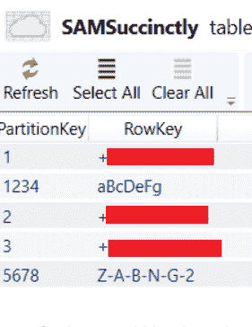

这个电话号码将用于将主叫方连接到公司内相应的部门。

### 代码清单 30: 交互式电话菜单响应端点

```csharp
Get["/ipm/response"] = _ =>
{
    string num = "Unknown";
    // ... 代码继续
}
```

正如你所见，我们再次构建于第 3 章中已学内容之上。

主要区别在于，我们不再使用动词 `Say` 来提供答案（如上一章所示），而是使用动词 `Dial` 将来电者与用户在电话菜单中输入的选项所对应的部门连接起来。

另一个区别是，我们现在在 `SimpleAnsweringMachine` 类中有一个程序定义的 `InsertSpace` 方法，该方法会在字符串中的每个字符后插入一个空格。这应用于电话号码，以便 Twilio 可以逐位读取，而不是作为一个完整的号码。

`SimpleAnsweringMachine` 类中 `InsertSpace` 方法的实现如代码清单 31 所示。

### 代码清单 31

```csharp
public string InsertSpace(string s)
{
    string res = string.Empty;

    int count = 1;
    foreach (char c in s)
    {
        if (char.IsDigit(c) && count < s.Length)
            res += c + " ";
        else
            res += c;

        count++;
    }
    return res;
}
```

如果你现在将此应用程序在 Visual Studio 中发布到 Azure Websites，当你拨打你的 Twilio 号码时，你应该能听到电话菜单，能够输入 1、2 或 3，并连接到所选选项对应的电话号码。这得益于存储在 Azure 表中的数据。

这个示例可以通过增加更多的交互性来进一步改进，但这超出了我们在此涵盖的范围。然而，鼓励你查阅 Twilio 文档并继续添加更多功能。

让我们构建一些其他酷炫的示例。

## 简单会议服务

像 PowwowNow、WebEx 或 GotoMeeting 这样的服务允许你拨打会议电话号码，建立虚拟会议室，并与其他人交谈，这些被称为会议服务。

Twilio 也允许我们构建这类服务。我们将探索如何设置一个小会议应用的基础知识。

首先，让我们扩展我们的 NancyFX 应用程序以包含此功能。

与我们配置电话菜单的方式相同，让我们配置我们的 Twilio 号码指向一个特定的 URL，我们的 web 应用程序将使用该 URL 来处理传入的呼叫。

接下来，让我们修改名为 TwilioSuccinctly 的 TwiML 应用程序，使其指向我们的新传入 URL。此 URL 应包含我们的 NancyFX 应用程序在 Azure Websites 上的位置，后跟 `/conf/incoming`。

我们的 TwilioSuccinctly TwiML 应用程序的 Voice Request URL 应该如图 50 所示。

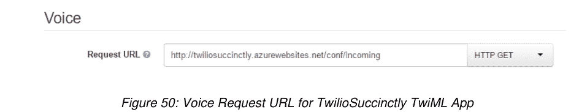

现在，让我们在我们的 `AnsweringMachineMain` NancyFX 模块上创建我们的会议服务问候 REST 端点，如代码清单 32 所示。

### 代码清单 32：会议服务问候

```csharp
Get[@"/conf/incoming"] = _ =>
{
    string res = "<Response>" +
        "<Gather action=\"/conf/connect\" method=\"GET\">" +
        "<Say voice=\"woman\">Welcome to the coolest conference!</Say>" +
        "<Say voice=\"woman\">Press 7 to join as a listener.</Say>" +
        "<Say voice=\"woman\">Press 8 to join as a speaker.</Say>" +
        "<Say voice=\"woman\">Press 9 to join as the moderator.</Say>" +
        "</Gather>" +
        "<Say voice=\"woman\">We didn’t get any response. Bye.</Say>" +
        "</Response>";
    
    return Response.AsText(res, "text/xml");
};
```

这与我们之前看到的没有太大不同。然而，情况即将发生一些变化。为了创建会议，我们需要使用带有几个属性的 `TwiML Conference` 动词。

我们这样做是为了指示加入的人是作为听众（静音）、发言者（非静音）还是主持人。会议实际上直到主持人加入后才开始，而这由动词的属性决定。

我们将通过两步过程来完成。在向来电者问候之后，我们会询问他们希望如何加入。 `Gather` 动词通过向 `/conf/connect` 端点发送请求来实现这一点。

一旦呼叫者选择如何加入会议电话，就会请求一个访问码。

### 代码清单 33：会议服务连接


```csharp
Get[@"/conf/connect"] = _ =>
{
    string val = "Unknown";
    string moderator = false.ToString();
    string muted = false.ToString();

    string ac = Request.Query["Digits"].Value;

    string res = "<Response><Say voice=\"woman\">No valid option or access code found.</Say>" +
                "</Response>";

    if (ac != null && ac != string.Empty)
    {
        using (SimpleAnsweringMachine sam = new SimpleAnsweringMachine())
        {
            if (ac == "7" || ac == "8" || ac == "9")
            {
                if (Request.Query["Digits"] != string.Empty)
                {
                    val = sam.Get(ac);

                    res = "<Response><Say voice=\"woman\">You entered: " + ac + "</Say>" +
                        "<Gather action=\"/conf/connect\" method=\"GET\"></Gather>" +
                        "<Say voice=\"woman\">Please enter your access code.</Say>" +
                        "<Say voice=\"woman\">We didn't get any response. Bye.</Say>" +
                        "</Response>";
                }
            }
            else if (ac == "77" || ac == "88" || ac == "99")
            {
                if (Request.Query["Digits"] != string.Empty)
                {
                    val = sam.Get(ac);

                    if (val == "conf-muted")
                        muted = true.ToString();

                    if (val == "is-moderator")
                        moderator = true.ToString();

                    string typ =
                        (Convert.ToBoolean(moderator)) ? " the moderator" : (Convert.ToBoolean(muted)) ? " a listener" : " a speaker";

                    res = "<Response><Say voice=\"woman\">You entered: " +
                        ac + "</Say>" +
                        "<Say voice=\"woman\">You're being connected to the conference now as: " + typ +
                        ", please hold on.</Say>" +
                        "<Pause length=\"2\"/>" +
                        "<Say voice=\"woman\">You have joined the conference.</Say>" +
                        "<Dial>" +
                        "<Conference startConferenceOnEnter=\"" +
                        moderator + "\" endConferenceOnExit=\"" +
                        moderator + "\" muted=\"" +
                        muted + "\" waitUrl=\"http://bit.ly/20gwxz4\"" +
                        ">CoolestConf</Conference>" +
                        "</Dial>" +
                        "</Response>";
                }
            }
        }
    }

    return Response.AsText(res, "text/xml");
};
```

这个逻辑很容易理解。在收集到访问码之后，`Gather`动词向自身发送请求（再次发往`/conf/connect`端点），然后验证访问码。
如果 Azure 表上存在该访问码，则通过返回包含`Conference`动词的响应来发起会议，并设置正确的属性值，这将取决于所选的菜单选项（而这又由提供的访问码的值决定）。
为了让这正常工作，请在图 51 所示的`SAMSuccinctly`表中创建这些值。

| PartitionKey | RowKey |
| :--- | :--- |
| 7 | 77 |
| 77 | conf-muted |
| 8 | 88 |
| 9 | 99 |
| 99 | is-moderator |

*图 51：会议服务选项和访问码*
- 值为 7 的菜单选项（`PartitionKey`）的访问码（`RowKey`）为 77。
- 值为 8 的菜单选项（`PartitionKey`）的访问码（`RowKey`）为 88。
- 值为 9 的菜单选项（`PartitionKey`）的访问码（`RowKey`）为 99。
值为 77 的访问码（`PartitionKey`）表示呼叫者以静音状态加入会议（`RowKey`）。
值为 99 的访问码（`PartitionKey`）表示呼叫者以主持人身份加入会议（`RowKey`）。
代码将相应的值分配给正确的`Conference`动词属性，例如`startConferenceOnEnter`、`endConferenceOnExit`和`muted`。
由于`startConferenceOnEnter`和`endConferenceOnExit`的值被设置为主持人变量的值，因此会议仅在主持人加入时开始，并在主持人离开时结束。
`waitUrl`属性指向会议开始前播放的背景音乐。
如果加入的人是听众，应用程序生成的 XML 响应将如图 34 所示。

### 代码清单 34：听众的 TwiML 标记响应

```xml
<?xml version="1.0" encoding="UTF-8"?>
<Response>
  <Say voice="woman">You entered: 7</Say>
  <Say voice="woman">You're being connected to the conference now as a listener, please hold on.</Say>
  <Pause length="2"/>
  <Say voice="woman">You have joined the conference.</Say>
  <Dial>
    <Conference startConferenceOnEnter="false" endConferenceOnExit="false" muted="true" waitUrl="http://bit.ly/20gwxz4">CoolestConf</Conference>
  </Dial>
</Response>
```

注意，对于听众，`startConferenceOnEnter`和`endConferenceOnExit`的值设置为`false`，而`muted`设置为`true`。
现在让我们查看作为发言者加入的人生成的 XML 响应。

### 代码清单 35：发言者的 TwiML 标记响应

```xml
<?xml version="1.0" encoding="UTF-8"?>
<Response>
  <Say voice="woman">You entered: 8</Say>
  <Say voice="woman">You're being connected to the conference now as a speaker, please hold on.</Say>
  <Pause length="2"/>
  <Say voice="woman">You have joined the conference.</Say>
  <Dial>
    <Conference startConferenceOnEnter="false" endConferenceOnExit="false" muted="false" waitUrl="http://bit.ly/20gwxz4">CoolestConf</Conference>
  </Dial>
</Response>
```

```xml
<Conference startConferenceOnEnter="false" endConferenceOnExit="false" muted="false" waitUrl="http://bit.ly/20gwxz4">CoolestConf</Conference>
</Dial>
</Response>
```

请注意，当使用扬声器时，`startConferenceOnEnter`和`endConferenceOnExit`的值均设置为`false`，并且`muted`也设置为`false`。
最后，让我们看看为作为主持人加入的人生成的 XML 响应。

*代码清单 36：主持人的 TwiML 标记响应*

```xml
<?xml version="1.0" encoding="UTF-8"?>
<Response>
  <Say voice="woman">You entered: 7</Say>
  <Say voice="woman">You're being connected to the conference now as, please hold on.</Say>
  <Pause length="2"/>
  <Say voice="woman">You have joined the conference.</Say>
  <Dial>
    <Conference startConferenceOnEnter="true" endConferenceOnExit="true"
     muted="false" waitUrl="http://bit.ly/20gwxz4">CoolestConf</Conference>
  </Dial>
</Response>
```

请注意，当使用主持人时，`startConferenceOnEnter`和`endConferenceOnExit`的值均设置为`true`，并且`muted`也设置为`false`。
为了测试这一点，只需使用 Visual Studio 中的发布选项将其部署到 Azure Websites。拨打你的 Twilio 号码，准备就绪。
为了测试此功能，模拟两个用户加入会议，你至少需要两部电话。Twilio 通过几行代码和几个动词及属性所能实现的功能非常酷。
显然，可以为这个会议演示添加更多功能，例如宣布呼叫者的姓名、录制会议以及其他交互式语音选项。可能性是无限的。
我建议你访问 Twilio 文档，以了解`Conference`动词提供的其他所有属性并探索其他可能性。
让我们继续，看看我们的最后一个示例。我们将看看如何实现自动语音调查解决方案，这应该很有趣且令人兴奋。

## 自动语音调查

自动调查允许最终用户拨打一个电话号码，该电话号码将用于执行询问问题并提示用户提供每个问题答案的调查。
电话调查是从用户那里收集有价值数据的好方法，并且它们有许多业务应用，特别是在品牌知名度、产品洞察和客户满意度方面。
首先，让我们解释一下使用 Twilio 时语音调查应该如何工作。
- Twilio 接收呼叫并向我们的 TwilioSuccinctly TwiML 应用发起 HTTP 请求——例如，请求关于如何响应的说明。
- NancyFX 应用指示 Twilio（使用 TwiML）收集用户的语音输入。用户将被要求提供一个唯一的 ID，我们将通过该 ID 识别他们。
- 在每个问题之后，Twilio 将携带用户输入再次向我们的 NancyFX 应用发起请求，我们的应用程序会将这些数据存储在 Azure 表中。
- 存储答案后，应用程序将继续指示 Twilio 将用户重定向到下一个问题，直到调查结束。简而言之，这就是语音调查应用应该做的事情。
我们将扩展我们的 `SimpleAnsweringMachine` 类，包含一个将数据保存到我们称为 `ResponsesSuccinctly` 的 Azure 表中的方法。
我们的 `ResponsesSuccinctly` 表有三个字段。在 `PartitionKey` 中，我们将存储问题 ID。在 `RowKey` 中，我们将存储用户 ID。最后，我们将有一个名为 `Response` 的第三个字段，它也将是一个字符串，并将包含用户的响应。
我们还需要另外两个表——一个名为 `Questions`，将包含问题 ID（`PartitionKey`）以及作为字符串的实际问题本身。我们还需要一个 `PredefinedAnswers` 表，将包含每个问题的可能答案。
因此，我们的调查应用将从 `Questions` 和 `PredefinedAnswers` 表中读取，并将用户输入存储在 Azure 上的 `ResponsesSuccinctly` 表中。
让我们使用 Azure Storage Explorer 创建 `Questions` 和 `PredefinedAnswers` 表。我们将从 `Questions` 表开始，并用示例数据填充它。

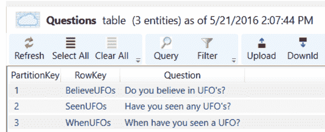

图 52：Azure 上的 `Questions` 表
你可以看到，表的 `RowKey` 是问题本身的简短 ID 表示形式，而实际问题存储在也是字符串的 `Question` 字段中。
现在让我们使用 Azure Storage Explorer 创建 `PredefinedAnswers` 表，并用此示例数据填充它。

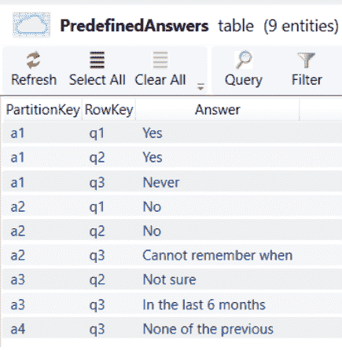

图 53：Azure 上的 `PredefinedAnswers` 表
在 `PredefinedAnswers` 的 `PartitionKey` 中，我们存储答案编号，在 `RowKey` 中，我们存储问题编号。作为字符串的 `Answer` 字段包含实际答案本身。
我们可以看到所有问题都有多个预定义答案，有些比其他的多，这些将是提供给用户的选项。然后，他们的答案将存储在 `ResponsesSuccinctly` 表中。
既然理论部分已经掌握，让我们写一些代码。首先，让我们将我们的 TwiML 应用指向我们的新端点，我们将把它称为 `/survey/incoming`。

### 语音


*图 54：用于我们 TwilioSuccinctly TwiML 应用的语音请求 URL*
现在，让我们定义我们的调查问候语。我们将修改我们的 `AnsweringMachineMain` NancyFX 模块以适应这种情况。

*代码清单 37：自动语音调查问候语*

```csharp
Get["/survey/incoming"] = _ =>
{
    string res = "<Response>" +
        "<Gather action=\"/survey/connect\" method=\"GET\">" +
        "<Say voice=\"woman\">You are about to join the UFO survey.</Say>" +
        "<Say voice=\"woman\">What is your Social Security Number?</Say>" +
        "</Gather>" +
        "<Say voice=\"woman\">We didn't get any response. Bye.</Say>" +
        "</Response>";

    return Response.AsText(res, "text/xml");
};
```


问候语要求呼叫者提供社会安全号码以进行身份验证。请记住，在非演示场景中，你永远不会向用户索要社会安全号码！当信息收集完成后，将向`/survey/connect` REST 端点发送请求，该端点将处理剩余的调查逻辑。我们稍后需要稍作修改此代码以初始化状态（我们稍后将会讨论这一点）。

社会安全号码值将存储在`ResponsesSuccinctly`表中，并将识别用户提供相应答案的用户。

应用程序不会对社会安全号码进行任何验证（为了验证它是有效或唯一的数字），因为目的只是为了演示如何通过交互式选项收集信息。该应用程序始终可以通过更具体的逻辑进行改进和扩展，以验证此或其他方面。

在我们深入`/survey/connect`端点的细节之前，我们需要为我们的`SimpleAnsweringMachine`类添加额外功能，包含一个将数据保存到`ResponsesSuccinctly`表的方法，并且我们需要添加几个从`Questions`和`PredefinedAnswers`表中获取信息的方法。

让我们现在创建一个从`Questions`表中读取的方法，以及另一个从`PredefinedAnswers`表中读取的方法。

我们需要创建一个`QuestionsData`类，对应于`Questions` Azure 表的结构。代码清单 38 展示了我们如何定义此类。

### 代码清单 38：`QuestionsData`类

```csharp
public class QuestionsData : TableEntity
{
    public QuestionsData(string p, string d)
    {
        PartitionKey = p;
        RowKey = d;
    }
    public QuestionsData()
    {
    }
    public string Question { get; set; }
}
```

我们还需要在我们的`SimpleAnsweringMachine`类中包含代码清单 39 的`using`语句，因为我们将使用`List<string>`来从`Questions`表中获取问题。

### 代码清单 39：使用`System.Collections.Generic`

```csharp
using System.Collections.Generic;
```

并且，我们需要在我们的`SimpleAnsweringMachine`类中包含代码清单 40 的常量。

### 代码清单 40：我们`SimpleAnsweringMachine`类的其他常量

```csharp
private const string cStrSurveyResponses = "ResponsesSuccinctly";
private const string cStrSurveyQuestions = "Questions";
private const string cStrSurveyAnswers = "PredefinedAnswers";
```

现在，让我们在我们的`SimpleAnsweringMachine`类中实现`GetQuestions`方法。

### 代码清单 41：`GetQuestions`方法

```csharp
public string[] GetQuestions()
{
    List<string> q = new List<string>();
    try
    {
        var storageAccount = CloudStorageAccount.Parse(cStrConnStr);
        CloudTableClient tableClient =
            storageAccount.CreateCloudTableClient();
        CloudTable table =
```

```csharp
    tableClient.GetTableReference(cStrSurveyQuestions);   

    TableQuery<QuestionsData> query = new
        TableQuery<QuestionsData>().Where(
        TableQuery.GenerateFilterCondition("PartitionKey", 
        QueryComparisons.NotEqual, "-1"));

    foreach (QuestionsData en in table.ExecuteQuery(query))
    {
        {   
            q.Add(en.Question);
        }
    }
    catch (Exception ex)
    {
        Console.WriteLine(ex.ToString());
    }

    return q.ToArray();
}
```

让我们快速检查一下这段逻辑。

由于我们希望检索存储在`Questions`表中的所有问题，我们只需查询所有`PartitionKey`不等于 -1 的记录，这意味着将返回所有记录（因为我们在通过 Azure Storage Explorer 创建该表时，没有为`PartitionKey`等于 -1 输入任何记录）。

与`Questions`一样，我们还需要为`PredefinedAnswers`和`ResponsesSuccinctly`分别定义一个类。我们将这些类分别命名为`PredefinedAnswersData`和`RespondeData`。让我们现在通过代码列表 42 来完成这一操作。

### 代码列表 42：`PredefinedAnswersData`和`RespondeData`类

```csharp
public class PredefinedAnswersData : TableEntity   
{
    public PredefinedAnswersData(string p, string d)
    {
        PartitionKey = p;
        RowKey = d;
    }

    public PredefinedAnswersData()
    {
    }

    public string Answer { get; set; }
}
```

```csharp
public class ResponseData : TableEntity
{
    public ResponseData(string p, string d)
    {
        PartitionKey = p;
        RowKey = d;
    }

    public ResponseData()
    {
    }

    public string Response { get; set; }
}
```

接下来，我们在`SimpleAnsweringMachine`类中实现一个方法来从`PredefinedAnswers`表中检索记录，我们将该方法命名为`GetPredefinedAnswers`。

### 代码列表 43：`GetPredefinedAnswers`方法

```csharp
public string[] GetPredefinedAnswers(string qn)
{
    List<string> pa = new List<string>();

    try
    {
        var storageAccount = CloudStorageAccount.Parse(cStrConnStr);
        CloudTableClient tableClient =
            storageAccount.CreateCloudTableClient();
        CloudTable table =
            tableClient.GetTableReference(cStrSurveyAnswers);

        TableQuery<PredefinedAnswersData> query = new
            TableQuery<PredefinedAnswersData>().Where(
                TableQuery.GenerateFilterCondition("RowKey",
                    QueryComparisons.Equal, "q" + qn));

        foreach (PredefinedAnswersData en in table.ExecuteQuery(query))
        {
            pa.Add(en.PartitionKey + "|" + en.Answer);
        }
    }
    catch (Exception ex)
    {
        Console.WriteLine(ex.ToString());
    }
    
    return pa.ToArray();
}
```

该方法通过`RowKey`查询`PredefinedAnswers`表，查找与调用者所问问题相匹配的记录。然后，这些答案以字符串数组的形式返回，以便进一步处理。

现在，让我们创建一个方法来填充`ResponsesSuccinctly`表。我们也将此方法添加到代码列表 44 中的`SimpleAnsweringMachine`类中。

### 代码列表 44：`InsertSurveyResponse`方法

```csharp
public void InsertSurveyResponse(string qId, string uId, string aId)
{
    try
    {
        var storageAccount = CloudStorageAccount.Parse(cStrConnStr);
        CloudTableClient tableClient =
            storageAccount.CreateCloudTableClient();
        CloudTable table =
            tableClient.GetTableReference(cStrSurveyResponses);

        TableOperation retrieveOperation =
            TableOperation.Retrieve<ResponseData>(qId, uId);

        TableResult retrievedResult = table.Execute(retrieveOperation);
        ResponseData updateEntity = (ResponseData)retrievedResult.Result;
        if (updateEntity == null)
        {
            updateEntity = new ResponseData();
            updateEntity.PartitionKey = qId;
            updateEntity.RowKey = uId;
            updateEntity.Response = aId;
        }

        TableOperation insertOrReplaceOperation =
            TableOperation.InsertOrReplace(updateEntity);
        table.Execute(insertOrReplaceOperation);
    }
    catch (Exception ex)
    {
        Console.WriteLine(ex.ToString());
    }
}
```

观察这个方法，我们可以看到`ResponseSuccinctly`表通过问题 ID (`qId`) 作为`PartitionKey`和用户 ID (`uId`) 作为`RowKey`进行查询。

如果未找到记录（`updateEntity`为`null`），则会为`updateEntity`的属性赋值，并通过调用`Execute`方法将此对象插入到表中。

现在，让我们查看我们的`SimpleAnsweringMachine`类和 .cs 文件的完整更新代码。

### 代码列表 45：更新后的`SimpleAnsweringMachine.cs`文件


# SimpleAnsweringMachine 实现

```csharp
using System;
using Microsoft.WindowsAzure.Storage;
using Microsoft.WindowsAzure.Storage.Table;
using System.Collections.Generic;

namespace TwilioSuccinctly
{
    public class SimpleAnsweringMachineData : TableEntity
    {
        public SimpleAnsweringMachineData(string p, string d)
        {
            PartitionKey = p;
            RowKey = d;
        }

        public SimpleAnsweringMachineData()
        {
        }
    }

    public class QuestionsData : TableEntity
    {
        public QuestionsData(string p, string d)
        {
            PartitionKey = p;
            RowKey = d;
        }

        public QuestionsData()
        {
        }

        public string Question { get; set; }
    }

    public class PredefinedAnswersData : TableEntity
    {
        public PredefinedAnswersData(string p, string d)
        {
            PartitionKey = p;
            RowKey = d;
        }
        public PredefinedAnswersData()
        {
        }

        public string Answer { get; set; }
    }

    public class ResponseData : TableEntity
    {
        public ResponseData(string p, string d)
        {
            PartitionKey = p;
            RowKey = d;
        }

        public ResponseData()
        {
        }

        public string Response { get; set; }
    }

    public class SimpleAnsweringMachine : IDisposable
    {
        #region "private declarations"
        protected bool disposed;

        private const string cStrConnStr =
            "<< Your Azure Storage Connection String >>";
        private const string cStrAppTable = "SAM Succinctly";
        private const string cStrSurveyResponses = "ResponsesSuccinctly";
        private const string cStrSurveyQuestions = "Questions";
        private const string cStrSurveyAnswers = "PredefinedAnswers";

        public SimpleAnsweringMachine()
        {
        }

        ~SimpleAnsweringMachine()
        {
            Dispose(false);
        }

        public virtual void Dispose(bool disposing)
        {
            if (!disposed)
            {
                if (disposing)
                {
                }
            }

            disposed = true;
        }

        public void Dispose()
        {
            Dispose(true);
            GC.SuppressFinalize(this);
        }

        public string Get(string ac)
        {
            string res = string.Empty;

            try
            {
                var storageAccount =
                    CloudStorageAccount.Parse(cStrConnStr);
                CloudTableClient tableClient =
                    storageAccount.CreateCloudTableClient();
                CloudTable table =
                    tableClient.GetTableReference(cStrAppTable);

                TableQuery<SimpleAnsweringMachineData> query = new
                    TableQuery<SimpleAnsweringMachineData>().Where(
                        TableQuery.GenerateFilterCondition("PartitionKey",
                            QueryComparisons.Equal, ac));

                foreach (SimpleAnsweringMachineData en in
                    table.ExecuteQuery(query))
                {
                    res = en.RowKey;
                    break;
                }
            }
            catch (Exception ex)
            {
                Console.WriteLine(ex.ToString());
            }

            return (res == string.Empty) ? "Unknown" : res;
        }

        public string[] GetQuestions() 
        { 
            List<string> q = new List<string>(); 
            try 
            { 
                var storageAccount = 
                    CloudStorageAccount.Parse(cStrConnStr); 
                CloudTableClient tableClient = 
                    storageAccount.CreateCloudTableClient(); 
                CloudTable table = 
                    tableClient.GetTableReference(cStrSurveyQuestions); 

                TableQuery<QuestionsData> query = new 
                    TableQuery<QuestionsData>().Where(
                        TableQuery.GenerateFilterCondition("PartitionKey", 
                        QueryComparisons.NotEqual, "-1")); 

                foreach (QuestionsData en in table.ExecuteQuery(query)) 
                { 
                    q.Add(en.Question); 
                }
            }
            catch (Exception ex) 
            { 
                Console.WriteLine(ex.ToString()); 
            }
            return q.ToArray(); 
        }

        public string[] GetPreDefinedAnswers(string qn) 
        { 
            List<string> pa = new List<string>(); 
            try 
            { 
                var storageAccount = 
                    CloudStorageAccount.Parse(cStrConnStr); 
                CloudTableClient tableClient = 
                    storageAccount.CreateCloudTableClient(); 
                CloudTable table = 
                    tableClient.GetTableReference(cStrSurveyAnswers); 

                TableQuery<PreDefinedAnswersData> query = new 
                    TableQuery<PreDefinedAnswersData>().Where(
```

TableQuery.GenerateFilterCondition("RowKey",

QueryComparisons.Equal, "q" + qn));

foreach (PredefinedAnswersData en in

table.ExecuteQuery(query))

{

    pa.Add(en.PartitionKey + "|" + en.Answer);

}

catch (Exception ex)

{

    Console.WriteLine(ex.ToString());

}

return pa.ToArray();

}

public void InsertSurveyResponse(string qId, string uId,

    string aId)

{

    try

    {

        var storageAccount =

            CloudStorageAccount.Parse(cStrConnStr);

        CloudTableClient tableClient =

            storageAccount.CreateCloudTableClient();

        CloudTable table =

            tableClient.GetTableReference(cStrSurveyResponses);

        TableOperation retrieveOperation =

            TableOperation.Retrieve<ResponseData>(qId, uId);

        TableResult retrievedResult =

            table.Execute(retrieveOperation);

        ResponseData updateEntity =

            (ResponseData)retrievedResult.Result;

        if (updateEntity == null)

        {

            updateEntity = new ResponseData();

            updateEntity.PartitionKey = qId;

            updateEntity.RowKey = uId;

            updateEntity.Response = aId;

        }

        TableOperation insertOrReplaceOperation =

            TableOperation.InsertOrReplace(updateEntity);

table.Execute(insertOrReplaceOperation);

}

catch (Exception ex)

{

    Console.WriteLine(ex.ToString());

}

}

public string InsertSpace(string s)

{

    string res = string.Empty;

    int count = 1;

    foreach (char c in s)

    {

        if (char.IsDigit(c) && count < s.Length)

            res += c + " ";

        else

            res += c;

        count++;

    }

    return res;

}

} // 类 SimpleAnsweringMachine 结束

} // 命名空间 TwilioSuccinctly 结束
```

有了我们最新的 `SimpleAnsweringMachine` 逻辑，让我们将注意力转移到 `AnsweringMachineMain` NancyFX 模块，以便我们可以编写 `/survey/connect` REST 端点的逻辑。

调查应用程序应获取所有问题列表，遍历每个问题，向调用者展示可用的预定义答案，然后存储每个响应。

为了在 `AnsweringMachineMain` NancyFX 模块上保持状态并了解将向调用者询问哪些问题，我们需要创建一些受保护的 `AnsweringMachineMain` 类级属性。

我们需要维护状态，因为 `/survey/connect` 端点对每个新的问题和答案都会调用自身，因此我们需要知道哪些内容已被回答。

## 代码清单 46：用于维护 AnsweringMachineMain 状态的受 protected 类级属性

```
// 状态成员变量使用 protected 修饰符声明，以便在类被继承时使用。
protected static string[] questions = null;
protected static int currentQuestion = 0;
protected static string userId = string.Empty;
```

`questions` 字符串数组保存调用者将被要求回答的问题名称。

`currentQuestion` 整型变量保存当前正在提示用户回答的问题的状态。

最后，`userId` 字符串表示用于识别调用者为每个问题提供的答案的社会安全号码（唯一标识符）的值。

为了简单起见，并为了避免唯一标识符被误认为是对问题的回答，我们演示中对社会安全号码的唯一要求是用户输入至少包含两个字符的任何值。

正如大家记得的那样，我们之前已经解决了需要适应 `/survey/incoming` 端点以初始化状态的问题。我们将在代码清单 47 中对其进行修改。

## 代码清单 47：带有状态初始化的 /survey/incoming REST 端点


```
Get[@"/survey/incoming"] = _ =>
{
    userId = string.Empty;
    currentQuestion = 0;
    questions = null;

    string res = "<Response>" +
        "<Gather action=\"/survey/connect\" method=\"GET\">" +
        "<Say voice=\"woman\">You are about to join the UFO survey.</Say>" +
        "<Say voice=\"woman\">What is your Social Security Number?</Say>" +
        "</Gather>" +
        "<Say voice=\"woman\">We didn't get any response. Bye.</Say>" +
        "</Response>";

    return Response.AsText(res, "text/xml");
};
```

有了状态初始化，我们可以创建 `/survey/connect` 端点逻辑，所有的“魔法”将在那里发生。

# 代码清单 48：`/survey/connect` REST 端点

```
Get[@"/survey/connect"] = _ =>
{
    string res = "<Response><Say voice=\"woman\">No valid option entered.</Say></Response>";
    string val = Request.Query["Digits"].Value;
    if (val != null && val != string.Empty)
    {
        using (SimpleAnsweringMachine sam = new SimpleAnsweringMachine())
        {
            if (userId == string.Empty)
            {
                if (val.Length > 1)
                {
                    userId = val;

                    if (questions == null)
                        questions = sam.GetQuestions();

                    res = ProcessQuestion(sam, string.Empty);
                }
                else
                    res = "<Response><Say voice=\"woman\">No valid option entered.</Say></Response>";
            }
            else
            {
                string[] pa =
                    sam.GetPredefinedAnswers(currentQuestion.ToString());

                foreach (string p in pa)
                {
                    string[] parts = p.Split('|');

                    if (parts[0].ToLower().Contains(val.ToLower()))
                    {
                        sam.InsertSurveyResponse("q" +
                            currentQuestion.ToString(), userId, parts[0]);

                        string nxtQ =
                            (currentQuestion < questions.Length) ?
                            "<Say voice=\"woman\">Please hold for the next question...</Say>" :
                            "<Say voice=\"woman\">The survey is complete. Thank you.</Say>";

                        if (currentQuestion < questions.Length)
                        {
                            res = "<Say voice=\"woman\">Answer... " +
                                parts[0][1] + " saved for question... " +
                                currentQuestion.ToString() + "</Say>" +
                                nxtQ;

                            res = ProcessQuestion(sam, res);
                            break;
                        }
                        else
                        {
                            res = "<Response>" + nxtQ + "</Response>";
                            break;
                        }
                    }
                    else
                    {
                        res = "<Response><Say voice=\"woman\">No valid answer entered.</Say></Response>";
                        break;
                    }
                }
            }
        }
    }
    return Response.AsText(res, "text/xml");
};
```

让我们对此进行分析，以了解正在发生的事情。

因为我们通过设置 `questions` 字符串数组为 `null`，`currentQuestion` 整数值为 `0`，`userId` 变量为空字符串来初始化状态，所以我们执行的第一项检查是验证 `userId` 是否确实为空。然后我们检查变量 `val` 是否包含至少两个字符的值（在此阶段，这代表在 `/survey/incoming` 端点输入的社会安全号码）。

我们希望知道变量 `val` 至少有两个字符，因为我们希望将其与其他响应区分开来，其他响应将是一个字符长，并代表对问题的答案。

当我们确信 `val` 确实是我们要求调用者输入的社会安全号码时，我们将 `userId` 变量的状态赋值给 `val` 变量的值。

如果 `questions` 字符串数组为 `null`，我们通过调用 `SimpleAnsweringMachine` 实例的 `GetQuestions` 方法从 Questions Azure 表中获取可用问题列表。

在可用问题列表准备好后，我们通过调用 `ProcessQuestion` 方法请求应用程序处理第一个问题。`ProcessQuestion` 方法是 `AnsweringMachineMain` NancyFX 模块的一个静态方法，我们稍后将进行探讨。

`ProcessQuestion` 方法的目的是让 Twilio 提出问题并描述可能的答案。然而，Twilio 并不处理对该问题的响应。对问题的实际响应是在 `ProcessQuestion` 方法调用 `/survey/connect` 端点时处理的。

本质上，`/survey/connect` 是自我重复的，这意味着为了提出多个问题并获取每个问题的答案，`ProcessQuestion` 方法会触发对执行该方法的同一端点的调用。这就是为什么维护状态很重要。

当第一个问题被提出后，下一次 `/survey/incoming` 被执行时（当处理对该问题的答案时），控制流传递到主要的 `else` 语句，该语句使代码通过调用 `SimpleAnsweringMachine` 实例的 `GetPredefinedAnswers` 方法获取所有可能的预定义答案。

从调用者接收到的答案，包含在 `val` 变量中，会被检查以确保它存在于从 PredefinedAnswers Azure 表检索到的预定义答案列表中。它通过调用 `GetPredefinedAnswers` 方法来实现这一点。

如果答案存在于正在被提问的当前问题的预定义答案列表中（正在被提问的当前问题是通过 `currentQuestion` 属性保持状态来获知的），该答案将通过调用 `InsertSurveyResponse` 方法与问题编号和 `userId` 一起存储在 `ResponsesSuccinctly` 表中。

如果提供了对问题的错误答案，即不属于正在被提问的当前问题的预定义答案列表中的答案，调查将被终止。此功能可以在未来得到改进，但目前已经足够好用。

当所有问题都被提出，答案被收集和处理后，可以在 Azure 上的 `ResponsesSuccinctly` 表上查看信息。

图 55 展示了完成的自动调查结果的样子（在使用 Visual Studio 发布应用程序并调用我们的 Twilio 号码后）。

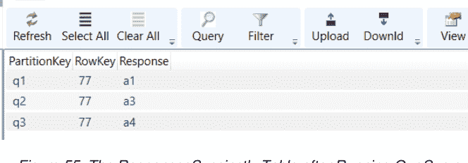


让我们探索一下 `ProcessQuestion` 方法做什么。

## 代码清单 49：`ProcessQuestion` 方法

```csharp
protected static string ProcessQuestion(SimpleAnsweringMachine sam,
    string r)
{
    currentQuestion++;

    string res = "<Response>" +
        "<Gather action=\"/survey/connect\" method=\"GET\">" + r +
        "<Say voice=\"woman\">Question " + currentQuestion + ".</Say>" +
        "<Say voice=\"woman\">" + questions[currentQuestion - 1] + "</Say>" +
        GetPossibleAnswers(sam, currentQuestion) +
        "</Gather>" +
        "<Say voice=\"woman\">We didn't get any response. Bye.</Say>" +
        "</Response>";

    return res;
}
```

正如我们所见，`ProcessQuestion` 方法调用 `/survey/connect` 端点，以处理当前被提问问题的答案。

请注意，该方法内部调用了 `GetPossibleAnswers` 方法，该方法简单返回包含所问问题预定义答案的 TwiML XML 标记代码。

让我们看看 `GetPossibleAnswers` 方法。

## 代码清单 50：`GetPossibleAnswers` 方法

```csharp
protected static string GetPossibleAnswers(SimpleAnsweringMachine sam,
    int q)
{
    string res = string.Empty;
    string[] pAnswers = sam.GetPredefinedAnswers(q.ToString());

    if (pAnswers.Length > 0)
    {
        string tmp = string.Empty;

        foreach(string pa in pAnswers)
        {
            string[] parts = pa.Split('|');
            tmp += "<Say voice=\"woman\">Enter... " + parts[0][1] +
                   " for... " + parts[1] + "</Say>";
        }

        res = "<Say voice=\"woman\">Please choose from one of the possible answers.</Say>" +
"<Pause length=\"1\"/>" + tmp;
}
else
    res =
    "<Say voice=\"woman\">No predefined answers found...</Say>";
    
    return res;
}
```

`GetPossibleAnswers` 方法获取当前被提问问题的预定义答案列表，并将 TwiML 标记返回给调用者 `ProcessQuestion` 方法，以便向呼叫者提供正确的指令，从而允许用户回答问题。

这就结束了我们的调查应用程序。即使由于 `/survey/connect` 端点的自重复特性带来了一些技术挑战，但它仍然很有趣。

## 总结

我们已经完成了本章及这本电子书的内容。希望这是一段探索 SMS、2FA 以及令人惊叹的 Twilio 平台语音功能的精彩旅程。

我提供的示例旨在让您对 Twilio 所能实现的功能有一个良好的了解，并鼓励您使用该平台进一步探索其他可能性。

Twilio 的一大优点在于它支持当今最常见且最重要的编程语言。用 C# 编写的示例可以轻松地转换为任何其他语言，因为 Twilio 的辅助库在各个语言之间非常相似（仅有细微差异），这使得 Twilio 既独立于平台，也独立于语言。

感谢您对这本电子书的兴趣。希望这只是进一步探索 SMS 和基于语音的应用程序世界的起点。

干杯！
