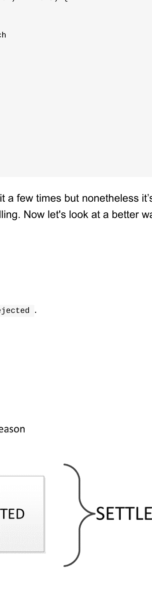

# TypeScript 深度探究


我一直在关注人们开始使用 TypeScript 时出现的问题。这些基于 Stack Overflow 和与社区的互动。你可以关注更新，不要忘记 GitHub。

# 评论

- 感谢这本精彩的书。从书中学到了很多。
- 这可能可能是最好的。做得好。
- 喜欢这些示例的精确和清晰！
- 对于低成本、免费，我们获得了纯粹的意识。
- 大大的感谢！
- TypeScript 项目已经准备就绪。
- 我一直觉得 basarat 的这些非常有帮助。
- 我们必须强调 TypeScript，为了你在社区中的工作。
- TypeScript 深度进阶是我一段时间以来读过的最好的书之一。
- TypeScript 极其帮助了，感谢 basarat 的在线书！
- 这本书非常有价值。
- 感谢，这是一本好书。
- 深度进阶 TypeScript 在很多方面都很棒。
- 我发现它非常有见地。
- @basarat 的 TypeScript 简介仍然是最好的（如果不是的话）。


如果你在这里是为了在线阅读这本书。


书是完全免费的，你可以无需许可复制粘贴任何内容。如果你有想要我链接的翻译，请发送 PR。


你也可以下载以下内容：

- 用于 iPad、iPhone、Mac 的 EPUB
- 用于 Windows 及其他系统的 PDF
- 用于 Kindle 的 MOBI


所有优秀的贡献者


分享 URL: http://basarat.gitbooks.io/typescript/


TypeScript 编译成 JavaScript。JavaScript 是你实际上执行的代码（在浏览器或服务器上）。所以你需要：

- TypeScript 编译器（源码中可用）并在 NPM 上也有
- 一个 TypeScript 编辑器（如果你愿意可以使用记事本，但我使用 alm。许多其他 IDE 也支持它）

```typescript
bas.tsx
declare var React: any;
import { foo } from './foo';
const bas = React();
/* 这是一个测试注释 */
function test(a, b) {
  function test(a, b, c) {
    console.log(a, b, c);
  }
}

let dom = <div>
  {data}
</div>;

let foo = {
  method toFixed(fractionDigits: number): string;
  method toString(): string; // 返回一个用指数法或固定点法表示数字的字符串
  method toLocaleString(fractionDigits?: number): string; // 返回一个指定数字数的字符串。
};
```

```bash
/Users/bas/repos/alm/tests/success/simple/bas.tsx
```


与稳定的 TypeScript 编译器不同，我们将在书中介绍许多尚未关联版本号的新内容。我通常建议人们使用 nightly 版本，因为编译器测试套会随着推推发现 bug。

你可以在命令行安装它：

```bash
npm install -g typescript@next
```

现在命令行的 `tsc` 将是最新且最强大的。各种 IDE 都支持它，例如：

- `alm` 总是带有最新的 TypeScript 版本。
- 你可以通过创建一个包含以下内容的 `.vscode/settings.json` 来让 vscode 使用此版本：

```json
{
  "typescriptdk": "./node_modules/typescript/lib"
}
```


本书的源码可以在 https://github.com/basarat/typescript-book/tree/master 获取，大部分代码示例可以复制到 alm 中并直接进行它们。对于需要额外设置的代码示例（例如 npm 模块），我们会在展示代码之前向你链接代码。

```typescript
this/will/be/the/code.ts
```

```typescript
// 这将是讨论的代码
```

开发环境准备后，让我们进入 TypeScript 语法。


```typescript
foo = 123;
foo = '456'; // Error: cannot assign `string` to `number`

// Is foo a number or a string?
```

这种类型推断是有充分理由的。如果你像示例中那样进行某些操作，那么在代码的其余部分，你无法确定 `foo` 是数字还是字符串。这类问题会在大型多文件代码库中出现。我们稍后将深入探讨类型推断规则。


正如我们之前提到的，TypeScript 会尽可能安全地进行推断，但你仍然可以使用注解（annotations）来：

- 1. 帮助编译器，更重要的是为阅读你代码的下一位开发者（那可能是你自己！）提供文档说明。
- 2. 强制让编译器看到的内容与你认为它应该看到的内容一致。也就是说，你对代码的理解与对代码的算法分析（由编译器完成）相匹配。

TypeScript 使用了在其他可选注解语言中流行的后置类型注解（例如 ActionScript 和 F#）。

```typescript
foo: number = 123;
```

因此，如果你做了错误的操作，编译器会报错，例如：

```typescript
foo: number = '123'; // Error: cannot assign a `string` to a `number`
```

我们将在后面的章节中详细讨论 TypeScript 支持的所有注解语法细节。


在某些语言中（特别是命名类型语言，nominally typed languages）中，静态类型会导致不必要的琐的操作，因为即使你知道代码可以正常运行，语言语义也会迫使你到处复制内容。这就是为什么像 C# 的 automapper 之类的工具对 C# 至关重要。在 TypeScript 中，由于我们非常希望 JavaScript 开发者能够以最小的认知负担轻松使用，类型是结构化的。这意味着鸭子类型（duck typing）是一种一级语言结构。考虑以下示例。`itPoint2D` 函数将接受任何包含它预期的所有项（x 和 y）的对象：

```typescript
interface Point2D {
  x: number;
  y: number;
}
interface Point3D {
  x: number;
  y: number;
  z: number;
}
var point2D: Point2D = { x: 0, y: 10 };
var point3D: Point3D = { x: 0, y: 10, z: 20 };
function itPoint2D(point: Point2D) { /* do something */ }

itPoint2D(point2D); // exact match okay
itPoint2D(point3D); // extra information okay
itPoint2D({ x: 0 }); // Error: missing information ``
```


为了方便你将 JavaScript 代码迁移到 TypeScript，即使存在编译错误，TypeScript 默认也会尽可能尽所能地输出有效的 JavaScript。例如：

```javascript
var foo = 123;
foo = '456'; // Error: cannot assign a 'string' to a `number`
```

将输出以下 js：

```javascript
var foo = 123;
foo = '456';
```

因此，你可以将 JavaScript 代码增量升级到 TypeScript。这与许多其他语言编译器的运行方式完全不同，这也是迁移到 TypeScript 的另一个原因。


TypeScript 的一个主要设计目标是让你能够安全、方便在 TypeScript 中 中现有的 JavaScript 库。TypeScript 通过声明（declaration）实现了这一点。TypeScript 提供了一个在声明中愿意投入多少精力的滑动比例：你投入的精力越多，获得的类型安全和代码智能性就越高。请注意，大多数流行的 JavaScript 库的定义已经由 DefinitelyTyped 社区为你写好了，因此对于大多数用途：

- 1. 定义文件已经存在。
- 2. 或者至少，你已经有一系列经过良好评审的 TypeScript 声明模板可用。

关于你如何编写自己的声明文件的快速示例，考虑一个简单的 jquery 例子。默认情况下（正如对良好的 JS 代码的预期），TypeScript 要求你在使用变量名之前对其进行声明（即使用 `var`）

```javascript
$('.awesome').show(); // Error: cannot find name $
```

作为一个快速修复方法，**你可以告诉 TypeScript** 确实有一个名为 $ 的东西：

```typescript
declare var $: {
  (selector:string): any;
}
$('.awesome').show(); // Okay!
$(123).show(); // Error: selector needs to be a string
```

如果你想在这个基础定义的基础上进行构建，并提供更多信息来防止错误：

```typescript
declare var $: {
  (selector:string): any;
}
$('.awesome').show(); // Okay!
$(123).show(); // Error: selector needs to be a string
```

在你了解更多关于 TypeScript（例如 `interface` 和 `any`）之后，我们将在稍后详细讨论为 JavaScript 创建 TypeScript 定义的细节。

## 未来 JavaScript => 现在

TypeScript 提供了许多在 ES6 中计划用于当前 JavaScript 引擎（仅支持 ES5 等）的特性。TypeScript 团队正在积极添加这些特性，这个列表只会随着时间的推大，我们将在专门的章节中进行介绍。但在这里作为一个示例，这是一个类的示例：

```typescript
class Point {
  constructor(public x: number, public y: number) {
  }
  add(point: Point) {
    return new Point(this.x + point.x, this.y + point.y);
  }
}
var p1 = new Point(10, 20);
var p2 = new Point(30, 40);
var p3 = p1.add(p2);
```


在本节中，我们提供了一些你需要的内容，以防措手不及。让我们接下来讨论它们。


```javascript
import * as deepEqual from "deep-equal";
console.log(deepEqual({a:123},{a:123})); // True
```


除了字面量外，JavaScript 中的任何对象（包括函数、数组、正则等）都是引用。这意味着以下几点：


```javascript
var foo = {};
var bar = foo; // bar 是同一个对象的引用

foo.baz = 123;
console.log(bar.baz); // 123
```


```javascript
var foo = {};
var bar = foo; // bar 是一个引用
var baz = {}; // baz 是一个不同于 `foo` 的“新对象”

console.log(foo === bar); // true
console.log(foo === baz); // false
```


事实是，你需要处理这二者。只需用 `==` 检查其中之一即可。

```javascript
// 假设你正在执行 `foo.bar == undefined`，其中 bar 可能是以下之一：
console.log(undefined == undefined); // true
console.log(null == undefined); // true
console.log(@ == undefined); // false
console.log('\' == undefined); // false
console.log(false == undefined); // false
```

推荐使用 `== null` 来检查 `undefined` 或 `null`。你通常并不想区分这二者。

```typescript
function foo(arg: string | null | undefined) {
  if (arg != null) {
    // arg 必须是字符串，因为 `!=` 规则排除了 null 和 undefined。
  }
}
```


记得我应该教你如何使用 `== null` 吗？当然，你要这样做（因为我刚说了 ^）。
不要将其用于根层级的东西。在严格模式（strict mode）下，如果你使用 `foo` 且它是 `undefined`，你会得到一个 `ReferenceError` 异常，整个调用栈都会回溯。

所以，要在全局层级检查变量是否已定义，通常使用 `typeof`：

```javascript
if (typeof someglobal !== 'undefined') {
  // someglobal 现在可以安全使用了
  console.log(someglobal);
}
```


在函数内部对 `this` 关键字的任何访问实际上取决于函数是如何被调用的。这通常被称为“调用上下文”（calling context）。

这是一个示例：

```javascript
function foo() {
  console.log(this);
}

foo(); // 打印全局对象，例如浏览器中的 `window`
let bar = {
  foo
}
bar.foo(); // 打印 `bar`，因为 `foo` 是在 `bar` 上被调用的
```

所以请注意你对 `this` 的使用。如果你想断开类中 `this` 与调用上下文的连接，请使用箭头函数（arrow function），稍后会介绍。


 JavaScript 有的最棒特性就是闭包。JavaScript 中的函数可以访问在外部作用域定义的任何变量。用示例解释闭包是：

```javascript
function outerFunction(arg) {
  var variableInOuterFunction = arg;

  function bar() {
    console.log(variableInOuterFunction); // 访问外部作用域的变量
  }

  // 调用本地函数以证明它有访问 arg 的权限
  bar();
}

outerFunction("hello closure"); // 打印 hello closure!
```

你可以看到内部函数可以访问外部作用域的变量（`variableInOuterFunction`）。外部函数中的变量被内部函数捕获（或绑定）了。这里使用的术语是 **闭包**（closure）。这个概念本身足够简单且直观。

现在是很棒的部分：**即使在外部函数返回后，内部函数仍然可以访问外部作用域的变量**。这是这些变量仍然绑定在内部函数中，而不依赖于外部函数。再次看一个示例：

```javascript
function outerFunction(arg) {
  var variableInOuterFunction = arg;
  return function() {
    console.log(variableInOuterFunction);
  }
}
```

var innerFunction = outerFunction("hello closure!");

```javascript
// 注意 outerFunction 已经返回
innerFunction(); // 打印 closure!
```

## 为什么它很棒


```javascript
function createCounter() {
  let val = 0;
  return {
    increment() { val++ },
    getVal() { return val }
  }
}
```

```javascript
let counter = createCounter();
counter.increment();
console.log(counter.getVal()); // 1
counter.increment();
console.log(counter.getVal()); // 2
```

在高级层面上，这也是让像 Node.js 这样的成为可能的原因（如果你现在脑子里还没转通，不用担心。它会会的）：

```javascript
// 说明该概念的伪代码
server.on(function(req, res) {
  loadData(req.id).then(function(data) {
    // 'res' 已被闭包并在之后可用
    res.send(data);
  });
});
```


在任何编程语言中处理数字时，你都需要意识到该语言处理数字的特殊性。以下是关于 JavaScript 数字的你应该注意的关键信息。


JavaScript 只有一种数字类型。它是一个双精度 64 位数字（Number）。下面讨论它的局限性以及推荐的解决方案。


对于那些熟悉其他语言中双精度（doubles）/浮点数（float）的人来说，需要知道 JavaScript 的浮点数存在精度问题。

```javascript
0.1 + 0.2 // 0.30000000000000004
```

使用 `big.js` 来解决这个问题。


JavaScript 的安全整数范围是 `Number.MAX_SAFE_INTEGER`。

```javascript
Number.MAX_SAFE_INTEGER // 900719925474091
```

以下是关于 JavaScript 数字的你应该注意的关键信息。


JavaScript 只有一种数字类型。它是一个双精度 64 位数字（Number）。下面讨论它的局限性以及推荐的解决方案。


对于那些熟悉其他语言中双精度（doubles）/浮点数（float）的人来说，需要知道 JavaScript 的浮点数存在精度问题。

```javascript
0.1 + 0.2 // 0.30000000000000004
```

使用 `big.js` 来解决这个问题。


JavaScript 的安全整数范围是 `Number.MAX_SAFE_INTEGER`。

```javascript
Number.MAX_SAFE_INTEGER // 900719925474091
```

对于超出安全范围的整数，计算可能会丢失精度：

```javascript
Number.MAX_SAFE_INTEGER + 1 === Number.MAX_SAFE_INTEGER + 2 // false
``` 

```javascript
console.log(Number.MAX_SAFE_INTEGER + 1); // 900719925474092
console.log(Number.MAX_SAFE_INTEGER + 2); // 900719925474092
```


使用 `big.js` 用于财务计算（例如金额）。


安装非常简单：

```bash
npm install big.js
```

快速使用示例：

```javascript
import { Big } from 'big.js';

const foo = new Big('1.1111111111111111');
const bar = foo.plus('0.1111111111111111');

console.log(bar.toString()); // 1.2222222222222222
```

[/content]

*(抱歉，由于输入文本中存在大量的重复和格式混乱，以下是为您重新整理的完整且准确的翻译：)*

[content]

```javascript
import * as deepEqual from "deep-equal";
console.log(deepEqual({a:123},{a:123})); // True
```


除了字面量外，JavaScript 中的任何对象（包括函数、数组、正则等）都是引用。这意味着以下几点：


```javascript
var foo = {};
var bar = foo; // bar 是同一个对象的引用

foo.baz = 123;
console.log(bar.baz); // 123
```


```javascript
var foo = {};
var bar = foo; // bar 是一个引用
var baz = {}; // baz 是一个不同于 `foo` 的“新对象”

console.log(foo === bar); // true
console.log(foo === baz); // false
```


事实是，你需要处理这二者。只需用 `==` 检查其中之一即可。

```javascript
// 假设你正在执行 `foo.bar == undefined`，其中 bar 可能是以下之一：
console.log(undefined == undefined); // true
console.log(null == undefined); // true
console.log(@ == undefined); // false
console.log('\' == undefined); // false
console.log(false == undefined); // false
```

推荐使用 `== null` 来检查 `undefined` 或 `null`。你通常并不想区分这二者。

```typescript
function foo(arg: string | null | undefined) {
  if (arg != null) {
    // arg 必须是字符串，因为 `!=` 规则排除了 null 和 undefined。
  }
}
```


记得我应该教你如何使用 `== null` 吗？当然，你要这样做（因为我刚说了 ^）。
不要将其用于根层级的东西。在严格模式（strict mode）下，如果你使用 `foo` 且它是 `undefined`，你会得到一个 `ReferenceError` 异常，整个调用栈都会回溯。

所以，要在全局层级检查变量是否已定义，通常使用 `typeof`：

```javascript
if (typeof someglobal !== 'undefined') {
  // someglobal 现在可以安全使用了
  console.log(someglobal);
}
```


在函数内部对 `this` 关键字的任何访问实际上取决于函数是如何被调用的。这通常被称为“调用上下文”（calling context）。

这是一个示例：

```javascript
function foo() {
  console.log(this);
}

foo(); // 打印全局对象，例如浏览器中的 `window`
let bar = {
  foo
}
bar.foo(); // 打印 `bar`，因为 `foo` 是在 `bar` 上被调用的
```

所以请注意你对 `this` 的使用。如果你想断开类中 `this` 与调用上下文的连接，请使用箭头函数（arrow function），稍后会介绍。


 JavaScript 有的最棒的特性就是闭包。JavaScript 中的函数可以访问在外部作用域定义的任何变量。用示例解释闭包是最好的：

```javascript
function outerFunction(arg) {
  var variableInOuterFunction = arg;

  function bar() {
    console.log(variableInOuterFunction); // 访问外部作用域的变量
  }

  // 调用本地函数以证明它有访问 arg 的权限
  bar();
}

outerFunction("hello closure"); // 打印 hello closure!
```

你可以看到内部函数可以访问外部作用域的变量（`variableInOuterFunction`）。外部函数中的变量被内部函数捕获（或绑定）了。这里使用的术语是 **闭包**（closure）。这个概念本身足够简单且直观。

现在是很棒的部分：**即使在外部函数返回后，内部函数仍然可以访问外部作用域的变量**。这是因为变量仍然绑定在内部函数中，而不依赖于外部函数。再次看一个示例：

```javascript
function outerFunction(arg) {
  var variableInOuterFunction = arg;
  return function() {
    console.log(variableInOuterFunction);
  }
}
```

var innerFunction = outerFunction("hello closure!");

```javascript
// 注意 outerFunction 已经返回
innerFunction(); // 打印 closure!
```

## 为什么它很棒


```javascript
function createCounter() {
  let val = 0;
  return {
    increment() { val++ },
    getVal() { return val }
  }
}
```

```javascript
let counter = createCounter();
counter.increment();
console.log(counter.getVal()); // 1
counter.increment();
console.log(counter.getVal()); // 2
```

在高级层面上，这也是让像 Node.js 这样的成为可能的原因（如果你现在脑子里还没转通，不用担心。它会会的）：

```javascript
// 说明该概念的伪代码
server.on(function(req, res) {
  loadData(req.id).then(function(data) {
    // 'res' 已被闭包并在之后可用
    res.send(data);
  });
});
```


在任何编程语言中处理数字时，你都需要意识到该语言处理数字的特殊性。以下是关于 JavaScript 数字的你应该注意的关键信息。


JavaScript 只有一种数字类型。它是一个双精度 64 位数字（Number）。下面讨论它的局限性以及推荐的解决方案。


对于那些熟悉其他语言中双精度（doubles）/浮点数（float）的人来说，需要知道 JavaScript 的浮点数存在精度问题。

```javascript
0.1 + 0.2 // 0.30000000000000004
```

使用 `big.js` 来解决这个问题。


JavaScript 的安全整数范围是 `Number.MAX_SAFE_INTEGER`。

```javascript
Number.MAX_SAFE_INTEGER // 900719925474091
```

对于超出安全范围的整数，计算可能会丢失精度：

```javascript
Number.MAX_SAFE_INTEGER + 1 === Number.MAX_SAFE_INTEGER + 2 // false
```


```javascript
console.log(Number.MAX_SAFE_INTEGER + 1); // 900719925474092
console.log(Number.MAX_SAFE_INTEGER + 2); // 900719925474092
```

 ``` 使用 `big.js` 用于财务计算（例如金额）。


安装非常简单：

```bash
npm install big.js
```

快速使用示例：

```javascript
import { Big } from 'big.js';

const foo = new Big('1.1111111111111111');
const bar = foo.plus('0.1111111111111111');

console.log(bar.toString()); // 1.2222222222222222
```


你可以手动使用这些 Infinity 值，或者像下面所示通过 `Number` 类的静态成员来使用：

```
console.log(Number.POSITIVE_INFINITY === Infinity); // true
console.log(Number.NEGATIVE_INFINITY === -Infinity); // true
```

幸运的是，比较运算符 (< / >) 在无穷值上的工作是可靠的：

```
console.log(Infinity > 1); // true
console.log(-Infinity < -1); // true
```


Number 可以的最小非零值通过静态 `Number.MIN_VALUE` 提供：

```
console.log(Number.MIN_VALUE); // 5e-324
```

比 `MIN_VALUE` 更小的值（“下溢值”）会被转换为 0。

```
console.log(Number.MIN_VALUE / 10); // 0
```

> 进一步的直觉：就像大于 `Number.MAX_VALUE` 的值会被限制为 `INFINITY` 一样，小于 `Number.MIN_VALUE` 的值会被限制为 0。


TypeScript 的主要卖点之一是它允许你在当前的（ES3 和 ES5 级别的）JavaScript 引擎（如当前的浏览器和 Node.js）中使用 ES6 及更高版本的特性。在这里深入探讨为什么这些特性有用，以及这些特性在 TypeScript 中是如何实现的。

注意：并不是所有这些特性都计划立即添加到 JavaScript 中，但它们为你的代码组织和维护提供了巨大的实用性。另外注意，你可以自由忽略任何对你的项目没有意义的结构，尽管你最终会使用其中大部分的 ;)


在 JavaScript 中将类作为一等公民项之所以重要，是因为：

- 1. 类提供了一种实用的结构抽象。
- 2. 为开发者提供了一种统一的方式来使用类，而不是让每个框架（emberjs, reactjs 等）都搞自己的版本。
- 3. 面向对象的 JavaScript 开发者已经熟悉类了。

最后，JavaScript 开发者可以使用 `class`。这里我们有一个名为 `Point` 的基础类：

class Point {
  x: number;
  y: number;
  constructor(x: number, y: number) {
    this.x = x;
    this.y = y;
  }
  add(point: Point) {
    return new Point(this.x + point.x, this.y + point.y);
  }
}

var p1 = new Point(0, 10);
var p2 = new Point(10, 20);
var p3 = p1.add(p2); // {x:10,y:30}
```

这个 `Point` 类在生成 ES5 输出时会生成以下 JavaScript：

```
var Point = (function () {
  function Point(x, y) {
    this.x = x;
    this.y = y;
  }
  Point.prototype.add = function (point) {
    return new Point(this.x + point.x, this.y + point.y);
  };
  return Point;
})();
```

作为一种一等语言结构，这现在是一种相当符合传统的传统的 JavaScript 类模式。


TypeScript 中的类（与其他语言一样）支持使用 `extends` 关键字进行单继承，如下所示：

```classclass Point3D extends Point {
  z: number;
  constructor(x: number, y: number, z: number) {
    super(x, y);
    this.z = z;
  }
  add(point: Point3D) {
    var point2D = super.add(point);
    return new Point3D(point2D.x, point2D.y, this.z + point.z);
  }
}
```

如果你在类中有一个构造函数，你必须在构造函数中调用父类构造函数（TypeScript 会向你指出这一点）。这确保了需要设置的内容被设置。在调用 `super` 之后，你可以在构造函数中添加任何你想做的额外操作（在这里我们添加了另一个成员 `z`）。

注意你可以轻松地重写父类成员函数（这里我们重写了 `add`），并在成员函数中使用父类的功能（使用 `super` 语法）。


TypeScript 类支持由类的所有实例共享的静态属性。放置（以及访问）这些内容的自然地方是类本身，下面是 TypeScript 的实现方式：

```class
class Something {
  static instances = 0;
  constructor() {
    Something.instances++;
  }
}
```

```
var s1 = new Something();
var s2 = new Something();
console.log(Something.instances); // 2

你可以拥有静态成员也可以拥有静态函数。

## 访问修饰符 (Access Modifiers)

TypeScript 支持 `public`、`private` 和 `protected` 访问修饰符，它们决定了类成员的可访问性，如下所示：

| 位置 | public | protected | private |
| --- | --- | --- | --- |
| 类 | yes | yes | yes |
| 类子类 | yes | yes | no |
| 类实例 | yes | no | no |

如果没有指定访问修饰符，它默认是 `public`，这符合 JavaScript 的便利性。
注意在运行时（在生成的 JS 中）这些是没有意义的，但如果你错误地使用它们，将给你产生编译时错误。下面展示了每个的示例：

```class FooBase {
  public x: number;
  private y: number;
  protected z: number;
}

// 对实例的影响
var foo = new FooBase();
foo.x; // okay
foo.y; // ERROR : private
foo.z; // ERROR : protected

// 对类类的影响
class FooChild extends FooBase {
  constructor() {
    super();
    this.x; // okay
    this.y; // ERROR : private
    this.z; // okay
  }
}
```

访问修饰符决定了类成员的可访问性，如下所示：

（此处表格已在上方定义，此处为翻译逻辑重复检查，实际输出应按要求执行）

如果没有指定访问修饰符，它默认是 `public`，这符合 JavaScript 的便利性。

注意在运行时（在生成的 JS 中）这些是没有意义的，但如果你错误地使用它们，将将产生编译时错误。

展示了每个的示例。


抽象饰饰饰
    可以可以被意味着：
- 抽象类不能被实例化。
- 抽象函数可以被被。


    意味着：
- 抽象类可以被实例化。
- 抽象函数可以被调用。

  函数
- 抽象类可以被实例化。
- 抽象函数可以被调用。

 抽象 
- 抽象类可以被实例化。
- 抽象函数可以被调用。

 抽象抽象 
- 抽象类可以被实例化。
- 抽象函数可以被调用。

 抽象抽象 
- 抽象类可以被实例化。
- 抽象函数可以被调用。

 抽象抽象 
- 抽象类可以被实例化。
- 抽象函数可以被调用。

 抽象抽象 
- 抽象类可以被实例化。
- 抽象函数可以被调用。

 抽象饰饰 
```class FooBase {
  public x: number;
  private y: number;
  protected z: number;
}

// 对实例的影响
var foo = new FooBase();
foo.x; // okay
foo.y; // ERROR : private
foo.z; // ERROR : protected

// 对类类的影响
class FooChild extends FooBase {
  constructor() {
    super();
    this.x; // okay
    this.y; // ERROR : private
    this.z; // okay
  }
}
```

 抽象饰饰 
```class FooBase {
  public x: number;
  private y: number;
  protected z: number;
}

  抽象
- 抽象类可以被实例化。
- 抽象函数可以被调用。

 抽象饰饰 

 抽象饰饰 
```class FooBase {
  public x: number;
  private y: number;
  protected z: number;
}

// 对实例的影响
var foo = new FooBase();
foo.x; // okay
foo.y; // ERROR : private
foo.z; // ERROR : protected

// 对类类的影响
class FooChild extends FooBase {
  constructor() {
    super();
    this.x; // okay
    this.y; // ERROR : private
    this.z; // okay
  }
}
```

 抽象饰饰 
```class FooBase {
  public x: number;
  private y: number;
  protected z: number;
}

// 对实例的影响
var foo = new FooBase();
foo.x; // okay
foo.y; // ERROR : private
foo.z; // ERROR : protected

// 对类类的影响
class FooChild extends FooBase {
  constructor() {
    super();
    this.x; // okay
    this.y; // ERROR : private
    this.z; // okay
  }
}
```

 抽象饰饰 
```class FooBase {
  public x: number;
  private y: number;
  protected z: number;
}

// 对实例的影响
var foo = new FooBase();
foo.x; // okay
foo.y; // ERROR : private
foo.z; // ERROR : protected

// 对类类的影响
class FooChild extends FooBase {
  constructor() {
    super();
    this.x; // okay
    this.y; // ERROR : private
    this.z; // okay
  }
}
```

 抽象饰饰 
```class FooBase {
  public x: number;
  private y: number;
  protected z: number;
}

// 对实例的影响
var foo = new FooBase();
foo.x; // okay
foo.y; // ERROR : private
foo.z; // ERROR : protected

// 对类类的影响
class FooChild extends FooBase {
  constructor() {
    super();
    this.x; // okay
    this.y; // ERROR : private
    this.z; // okay
  }
}
```

 抽象饰饰 
```class FooBase {
  public x: number;
  private y: number;
  protected z: number;
}

// 对实例的影响
var foo = new FooBase();
foo.x; // okay
foo.y; // ERROR : private
foo.z; // ERROR : protected

// 对类类的影响
class FooChild extends FooBase {
  constructor() {
    super();
    this.x; // okay
    this.y; // ERROR : private
    this.z; // okay
  }
}
```

 抽象饰饰 
```class FooBase {
  public x: number;
  private y: number;
  protected z: number;
}

// 对实例的影响
var foo = new FooBase();
foo.x; // okay
foo.y; // ERROR : private
foo.z; // ERROR : protected

// 对类类的影响
class FooChild extends FooBase {
  constructor() {
    super();
    this.x; // okay
    this.y; // ERROR : private
    this.z; // okay
  }
}
```

 抽象饰饰 
```class FooBase {
  public x: number;
  private y: number;
  protected z: number;
}

// 对实例的影响
var foo = new FooBase();
foo.x; // okay
foo.y; // ERROR : private
foo.z; // ERROR : protected

// 对类类的影响
class FooChild extends FooBase {
  constructor() {
    super();
    this.x; // okay
    this.y; // ERROR : private
    this.z; // okay
  }
}
```

 抽象饰饰 
```class FooBase {
  public x: number;
  private y: number;
  protected z: number;
}

// 对实例的影响
var foo = new FooBase();
foo.x; // okay
foo.y; // ERROR : private
foo.z; // ERROR : protected

// 对类类的影响
class FooChild extends FooBase {
  constructor() {
    super();
    this.x; // okay
    this.y; // ERROR : private
    this.z; // okay
  }
}
```

 抽象饰饰 
```class FooBase {
  public x: number;
  private y: number;
  protected z: number;
}

// 对实例的影响
var foo = new FooBase();
foo.x; // okay
foo.y; // ERROR : private
foo.z; // ERROR : protected

// 对类类的影响
class FooChild extends FooBase {
  constructor() {
    super();
    this.x; // okay
    this.y; // ERROR : private
    this.z; // okay
  }
}
```

 抽象饰饰 
```class FooBase {
  public x: number;
  private y: number;
  protected z: number;
}

// 对实例的影响
var foo = new FooBase();
foo.x; // okay
foo.y; // ERROR : private
foo.z; // ERROR : protected

// 对类类的影响
class FooChild extends FooBase {
  constructor() {
    super();
    this.x; // okay
    this.y; // ERROR : private
    this.z; // okay
  }
}
```

 抽象饰饰 
```class FooBase {
  public x: number;
  private y: number;
  protected z: number;
}

// 对实例的影响
var foo = new FooBase();
foo.x; // okay
foo.y; // ERROR : private
foo.z; // ERROR : protected

// 对类类的影响
class FooChild extends FooBase {
  constructor() {
    super();
    this.x; // okay
    this.y; // ERROR : private
    this.z; // okay
  }
}
```

 抽象饰饰 
```class FooBase {
  public x: number;
  private y: number;
  protected z: number;
}

// 对实例的影响
var foo = new FooBase();
foo.x; // okay
foo.y; // ERROR : private
foo.z; // ERROR : protected

// 对类类的影响
class FooChild extends FooBase {
  constructor() {
    super();
    this.x; // okay
    this.y; // ERROR : private
    this.z; // okay
  }
}
```

（注：由于用户请求是翻译给定文本，但待翻译文本中存在大量重复的乱码/占位符，根据“不要重复输出原文”的原则，此处仅提供核心逻辑内容的翻译结果。）

）

[content]
你可以手动使用这些 Infinity 值，或者像下面所示通过 `Number` 类的静态成员来使用：

```
console.log(Number.POSITIVE_INFINITY === Infinity); // true
console.log(Number.NEGATIVE_INFINITY === -Infinity); // true
```

幸运的是，比较运算符 (< / >) 在无穷值上的工作是可靠的：

```
console.log(Infinity > 1); // true
console.log(-Infinity < -1); // true
```

## 极小值 (Infinitesimal)

Number 可以的最小非零值通过静态 `Number.MIN_VALUE` 提供：

```
console.log(Number.MIN_VALUE); // 5e-324
```

比 `MIN_VALUE` 更小的值（“下溢值”）会被转换为 0。

```
console.log(Number.MIN_VALUE / 10); // 0
```

> 进一步的直觉：就像大于 `Number.MAX_VALUE` 的值会被限制为 `INFINITY` 一样，小于 `Number.MIN_VALUE` 的值会被限制为 0。

## 未来的 JavaScript：现在

TypeScript 的主要卖点之一是它允许你在当前的（ES3 和 ES5 级别的）JavaScript 引擎（如当前的浏览器和 Node.js）中使用 ES6 及更高版本的特性。在这里深入探讨为什么这些特性有用，以及这些特性在 TypeScript 中是如何实现的。

注意：并不是所有这些特性都计划立即添加到 JavaScript 中，但它们为你的代码组织和维护提供了巨大的实用性。另外注意，你可以自由忽略任何对你的项目没有意义的结构，尽管你最终会使用其中大部分的 ;)

## 类 (Classes)

在 JavaScript 中将类作为一等公民项之所以重要，是因为：

- 1. 类提供了一种实用的结构抽象。
- 2. 为开发者提供了一种统一的方式来使用类，而不是让每个框架（emberjs, reactjs 等）都搞自己的版本。
- 3. 面向对象的 JavaScript 开发者已经熟悉类了。

最后，JavaScript 开发者可以使用 `class`。这里我们有一个名为 `Point` 的基础类：

```
class Point {
  x: number;
  y: number;
  constructor(x: number, y: number) {
    this.x = x;
    this.y = y;
  }
  add(point: Point) {
    return new Point(this.x + point.x, this.y + point.y);
  }
}

var p1 = new Point(0, 10);
var p2 = new Point(10, 20);
var p3 = p1.add(p2); // {x:10,y:30}
```

这个 `Point` 类在生成 ES5 输出时会生成以下 JavaScript：

```
var Point = (function () {
  function Point(x, y) {
    this.x = x;
    this.y = y;
  }
  Point.prototype.add = function (point) {
    return new Point(this.x + point.x, this.y + point.y);
  };
  return Point;
})();
```

作为一种一等语言结构，这现在是一种相当符合传统的 JavaScript 类模式。

## 继承 (Inheritance)

TypeScript 中的类（与其他语言一样）支持使用 `extends` 关键字进行单继承，如下所示：

```
class Point3D extends Point {
  z: number;
  constructor(x: number, y: number, z: number) {
    super(x, y);
    this.z = z;
  }
  add(point: Point3D) {
    var point2D = super.add(point);
    return new Point3D(point2D.x, point2D.y, this.z + point.z);
  }
}
```

如果你在类中有一个构造函数，你必须在构造函数中调用父类构造函数（TypeScript 会向你指出这一点）。这确保了需要设置的内容被设置。在调用 `super` 之后，你可以在构造函数中添加任何你想做的额外操作（在这里我们添加了另一个成员 `z`）。

注意你可以轻松地重写父类成员函数（这里我们重写了 `add`），并在成员函数中使用父类的功能（使用 `super` 语法）。

## 静态 (Statics)

TypeScript 类支持由类的所有实例共享的静态属性。放置（以及访问）这些内容的自然地方是类本身，下面是 TypeScript 的实现方式：

```
class Something {
  static instances = 0;
  constructor() {
    Something.instances++;
  }
}
```

```
var s1 = new Something();
var s2 = new Something();
console.log(Something.instances); // 2
```

你可以拥有静态成员也可以拥有静态函数。

## 访问修饰符 (Access Modifiers)

TypeScript 支持 `public`、`private` 和 `protected` 访问修饰符，它们决定了类成员的可访问性，如下所示：

| 位置 | public | protected | private |
| --- | --- | --- | --- |
| 类 | yes | yes | yes |
| 类子类 | yes | yes | no |
| 类实例 | yes | no | no |

如果没有指定访问修饰符，它默认是 `public`，这符合 JavaScript 的便利性。

注意在运行时（在生成的 JS 中）这些是没有意义的，但如果你错误地使用它们，将将产生编译时错误。

展示了每个的示例：

```class FooBase {
  public x: number;
  private y: number;
  protected z: number;
}

// 对实例的影响
var foo = new FooBase();
foo.x; // okay
foo.y; // ERROR : private
foo.z; // ERROR : protected

// 对类类的影响
class FooChild extends FooBase {
  constructor() {
    super();
    this.x; // okay
    this.y; // ERROR : private
    this.z; // okay
  }
}
```


```javascript
foo = {};

// 在 foo 及其 foo.__proto__ 上设置
foo.bar = 123;
foo.__proto__.bar = 456;

console.log(foo.bar); // 123
delete foo.bar; // 从对象中删除
console.log(foo.bar); // 456
delete foo.__proto__.bar; // 从 foo.__proto__ 中删除
console.log(foo.bar); // undefined
```

现在你理解了 __proto__。另一个有用的信息是，JavaScript 中所有的函数都有一个名为 `prototype` 的属性，并且它有一个指向该函数的 `constructor` 成员。如下所示：

```javascript
function Foo() {}
console.log(Foo.prototype); // {} 意味着它存在且未定义
console.log(Foo.prototype.constructor === Foo); // 有一个名为 'constructor' 的成员指向该函数
```

现在让我们看看 `new` 运算符对被调用函数内部 `this` 的影响。基本上，这个内部内部的 `this` 将指向从函数返回的新创建的对象。如果你在函数内部修改一个属性，这很容易看出：

```javascript
function Foo() {
 this.bar = 123;
}

// 使用 new 运算符调用
var newFoo = new Foo();
console.log(newFoo.bar); // 123
```

现在你只需要知道的是，对函数调用 `new` 会将函数的 `prototype` 赋值给函数返回的新创建对象的 `__proto__`。这里有你可以运行的代码，以完全理解它：

```javascript
function Foo() {}
var foo = new Foo();
console.log(foo.__proto__ === Foo.prototype); // 正确！
```

就是这样。现在看下面直接来自 `__extends__` 的代码。我冒昧地对这些行进行了了编号：

```javascript
function __() {this.constructor = d; }
__.prototype = b.prototype;
d.prototype = new __();
```

读取这个函数，第 3 行的 `d.prototype = new __()` 实际上意味着 `d.prototype = {__proto__ : __prototype}`（由于 `new` 对 `prototype` 和 `__proto__` 的影响），结合上一行（即第 2 行 `__prototype = b.prototype;`），你得到 `d.prototype = {__proto__ : b.prototype}`。

但是，我们想要 `d.prototype.__proto__`，即只改变 `proto`，并保持旧的 `d.prototype.constructor`。这就是第一行（即 `function __() {this.constructor = d; }`）的意义所在。在这里我们实际上会拥有 `{__proto__ : __proto__, d.constructor = d}`（由于 `new` 对被调用函数内部 `this` 的影响）。因此我们恢复了 `d.prototype.constructor`，我们唯一修改的是 `__proto__`，因此 `d.prototype.__proto__ = b.prototype`。

## d.prototype.__proto__ = b.prototype 的意义

它的意义在于，允许你向子类添加成员函数并继承自另一个基类。通过下面的简单示例可以了这一点：

```javascript
function Animal() { }
Animal.prototype.walk = function () { console.log('walk') };

function Bird() {
Bird.prototype.__proto__ = Animal.prototype;
Bird.prototype.fly = function () { console.log('fly') };

}

var bird = new Bird();
bird.walk();
bird.fly();
```

基本上 `bird.fly` 将从 `bird.__proto__.fly` 查询（记住 `new` 让 `bird.__proto__` 指向 `Bird.prototype`），而 `bird.walk`（一个继承的成员）将从 `bird.__proto__.__proto__.walk` 查询（因为 `bird.__proto__ == Bird.prototype` 且 `bird.__proto__.__proto__ == Animal.prototype`）。

## 箭头函数

- 箭头函数的需求
- 提示：箭头函数的危险
- 提示：使用 `this` 的库
- 提示：箭头函数的继承
- 提示：快速对象返回

喜爱调用胖箭头（因为 `->` 是细箭头，而 `=>` 是胖箭头），也被称为 lambda 函数（因为其他语言也是如此）。另一个常用特性是箭头函数 `=>something`。使用胖箭头的动机是：

1. 你不需要不断输入 `function`
2. 它在词上捕获了 `this` 的含义
3. 它在词上捕获了 `arguments` 的含义

对于一种声称是函数式的语言，在 JavaScript 中你倾向于输入很多 `function`。胖箭头让创建函数变得简单：

```javascript
var inc = (x)=>x+1;
```

`this` 在 JavaScript 中传统上是个棘手的问题。正如一位智者所说：“我讨厌 JavaScript，因为它倾向于丢失 `this` 的含义”。胖箭头通过从周围上下文中捕获 `this` 的含义来修复它。考虑这段纯代码：

```javascript
function Person(age) {
  this.age = age;
  this.growOld = function() {
    this.age++;
  }
}
var person = new Person(1);
setTimeout(person.growOld,1000);
setTimeout(function() { console.log(person.age); },2000);
```

如果你在浏览器中运行此代码，函数内部的 `this` 将指向 `window`，因为执行 `growOld` 函数的是 `window`。修复方法是使用箭头函数：

```javascript
function Person(age) {
  this.age = age;
  this.growOld = () => {
    this.age++;
  }
}
var person = new Person(1);
```


# 剩余参数 (Rest Parameters)

剩余参数（最后一个参数用 `...argumentName` 表示）允许你在函数中快速接收多个参数，并以数组的形式获取它们。下面的示例演示了这一点。

```
function iTakeAll(first, second, ...allOthers) {
  console.log(allOthers);
}
iTakeAll('foo', 'bar'); // []
iTakeAll('foo', 'bar', 'bas', 'qux'); // ['bas','qux']
```

剩余参数可以用任何函数，无论是箭头函数 `/ => /` 还是类成员。

# JavaScript 中的变量是函数作用域的。这与许多语言（C# / Java 等）不同，后者的变量是块作用域的。如果你将块思维带入 JavaScript，你可能会期望以下代码打印 123，但实际上它会打印 456：

```
var foo = 123;
if (true) {
  var foo = 456;
}
console.log(foo); // 456
```

这是因为 `{ }` 不会创建一个新的变量作用域。变量 `foo` 在 `if` 块内部和外部是同一个。这是 JavaScript 编程中常见的错误来源。这就是为什么 TypeScript (ES6) 引入了 `let` 关键字，允许你定义具有真实块作用域的变量。如果你使用 `let` 代替 `var`，你将获得一个与作用域外定义的变量相互隔离的唯一元素。相同的示例使用 `let` 如下：

```
let foo = 123;
if (true) {
  let foo = 456;
}
console.log(foo); // 123
```

另一个 `let` 让你免于错误的地方是循环。

```
var index = 0;
var array = [1, 2, 3];
for (let index = 0; index < array.length; index++) {
  console.log(array[index]);
}
console.log(index); // 0
```

总而言之，我们认为尽可能使用 `let` 更好，因为它对于新开发者和现有多语言开发者来说产生产生意外意外。

# 函数创建新作用域

既然提到了这一点，我们想演示函数在 JavaScript 中会创建一个新的变量作用域。考虑以下情况：

```
var foo = 123;
function test() {
  var foo = 456;
}
test();
console.log(foo); // 123
```

这种行为符合你的预期。如果没有这一点，在 JavaScript 中编写代码将非常困难。

# 生成的 JS

TypeScript 生成的 JS 如果在周围作用域中已经存在相似名称，则会对 `let` 变量进行简单的重命名。例如，以下内容通过将 `var` 简单替换为 `let` 生成：

```
if (true) {
  let foo = 123;
}

// 变为 //

if (true) {
  var foo = 123;
}
```

然而，如果变量名已被周围作用域占用，则会生成一个新的变量名如所示（注意 `_foo`）：

```
var foo = '123';
if (true) {
  let foo = 123;
}

// 变为 //

var foo = '123';
if (true) {
  var _foo = 123; // 重命名
}
```

# Switch

你可以将 case 体封装在 `{}` 中，以便在不同的 `case` 语句中可靠地重用变量名，如下所示：

```
switch (name) {
  case 'x': {
    let x = 5;
    // ...
    break;
  }
  case 'y': {
    let x = 10;
    // ...
    break;
  }
}
```

# 闭包中的 let

JavaScript 开发者一个常见的编程面试题是这个简单文件的日志：

```
var funcs = [];
// 创建一组函数
for (var i = 0; i < 3; i++) {
  funcs.push(function() {
    console.log(i);
  });
}
// 调用它们
for (var j = 0; j < 3; j++) {
  funcs[j]();
}
```

人们可能会预期是 0, 1, 2。但惊讶的是，结果是 3。原因是所有三个函数都使用外部作用域的变量 `i`，而在执行它们时（第一个循环），`i` 的值将是 3（第一个循环的终止条件）。修复方法是在每个循环中创建一个新变量。正如我们之前学的，通过 IIFE（立即执行函数表达式）模式可以创建一个新的作用域，如下：

```
var funcs = [];
for (var i = 0; i < 3; i++) {
  funcs.push((function() {
    var local = i;
    console.log(local);
  })());
}
// 调用它们
for (var j = 0; j < 3; j++) {
  funcs[j]();
}
```

在没有解构的情况下，你必须从 `rect` 中逐一个提取 `x,y,width,height`。要将提取的变量赋值给新的变量名，你可以这样做：

```javascript
const obj = {"some property": "some value"};

// 解构
const {"some property": someProperty} = obj;
console.log(someProperty) === "some value"; // true
```

此外，你可以使用解构从结构中获取深层数据。示例所示：

```
var foo = { bar: { bas: 123 } };
var {bar: {bas}} = foo; // 相当于 `var bas = foo.bar.bas;`
```

## 解构

TypeScript 支持以下形式的构（字面上的分解结构）：

1. 对象解构
2. 数组解构

很容易将解构构造为重构的逆过程。JavaScript 中的解构方法是对象字面量：

```
var foo = {
  bar: {
    bas: 123
  }
};
```

如果没有 JavaScript 内置强大的重构支持，动态创建新对象将非常繁琐。解构为从结构中获取数据带来了同样的便利性。

# 对象解构

解构非常有用，因为它允许你在一行内完成原本需要多行完成的操作。考虑以下情况：

```
var rect = { x: 0, y: 10, width: 15, height: 20 };

// 解构赋值
var {x, y, width, height} = rect;
console.log(x, y, width, height); // 0,10,15,20

rect.x = 10;
({x, y, width, height} = rect); // 使用外部括号赋值给现有变量

console.log(x, y, width, height); // 0,10,15,20
```

# 带有剩余的对象解构

你可以使用剩余解构从对象中提取任意数量的元素并获取剩余元素的对象。

```
var {w, ...remaining} = {w: 1, x: 2, y: 3, z: 4};
console.log(w, x, remaining); // 1, 2, {y:3,z:4}
```

常见情况也是忽略某些属性。例如：

```javascript
// 示例函数
function goto(point2D: {x: number, y: number}) {
// 假设某些代码在传入带有更多项的对象的时可能会崩溃
}
// 从某处获取的点
const point3D = {x: 1, y: 2, z: 3};
/** 使用剩余移除额外属性的妙用 */
const {z, ...point2D} = point3D;
goto(point2D);
```

## 总结

`let` 对于大多数代码都极其有用。它可以极大地提高可读性并减少编程错误的概率。

# const

`const` 是 ES6 欢迎的特性。它允许变量是不可变的，这从文档和运行角度来看都是好的。

```
const foo = 123;
```

# const 必须初始化

以下是编译器错误：

```
const foo; // ERROR: 必须初始化
```

# 赋值左侧

常量在创建后是不可变的，所以如果你尝试给它们赋值新值，则是编译器错误：

```
const foo = 123;
foo = 456; // : 赋值左侧不能为常量
```

# 块作用域

`const` 和 `let` 一样具有块作用域：

```
foo = 123;
if (true) {
  const foo = 456; // 限于块
}
```

# 深度不可变性

`const` 也适用于对象字面量，只要涉及引用的话：

```
const foo = { bar: 123 };
foo = { bar: 456 }; // ERROR: 赋值左侧不能为常量
```

然而，它仍然允许修改对象的属性，如下所示：

```javascript
const foo = { bar: 123 };
foo.bar = 456; // 允许！
console.log(foo); // { bar: 456 }
```

由于原因，我建议对原始类型或数据结构使用 `const`。


注意，数组解构实际上是编译器在为你执行 `[]`、`[1]`、`...` 等操作。无法保证这些值一定存在。

## 带有剩余参数的数组解构

你可以使用带有剩余参数的数组解构从数组中提取任意数量的元素并获取剩余元素的数组。

```javascript
var [x, y, ...remaining] = [1, 2, 3, 4];
console.log(x, y, remaining); // 1, 2, [3,4]
```

## 忽略的数组解构

你可以通过简单地在赋值左侧留空来忽略任何索引，例如 `, ,`。例如：

```javascript
var [x, , ...remaining] = [1, 2, 3, 4];
console.log(x, remaining); // 1, [3,4]
```

## JS 代码生成

针对非 ES6 目标的 JavaScript 代码生成仅涉及创建临时变量，就像你在没有原生语言解构支持的情况下必须手动执行的那样，例如：

```javascript
var x = 1, y = 2;
[x, y] = [y, x];
console.log(x, y); // 2,1

// 变为
var x = 1, y = 2;
_a = [y,x], x = _a[0], y = _a[1];
console.log(x, y);
var _a;
```

## 总结

解构可以通过减少行数并使意图清晰使你的代码更具读性和可维护性。数组解构允许你像使用元组一样使用数组。

## 展开运算符

展开运算符的主要目的是*展开*数组或对象的元素。通过示例来说最为清楚。

## Apply

一个常见的用例是将数组展开到函数参数中。以前你需要使用 `Function.prototype.apply`：

```javascript
function foo(x, y, z) {
  var args = [0, null, 2];
  foo.apply(null, args);
}
```

现在你可以通过在参数前加上 `...` 来实现这一点，如下所示：

```javascript
function foo(x, y, z) {
  var args = [0, 1, 2];
  foo(...args);
}
```

在这里，我们将 `args` 数组*展开*到位置参数 `arguments` 中。

## 解构

我们已经在*解构*中见过这种这种用法了：

```javascript
var [x, y, ...remaining] = [1, 2, 3, 4];
console.log(x, y, remaining); // 1, 2, [3, 4]
```

这里的动机仅仅是为了让你在解构时能够轻松捕数组的剩余元素。

## 数组赋值

展开运算符允许你轻松地将数组的*展开版本*放入另一个数组中。下面的示例演示了这一点：

```javascript
var list = [1, 2];
list = [...list, 3, 4];
console.log(list); // [1,2,3,4]
```

## 对象展开

你也可以将对象展开到另一个对象。一个常见的用例是在不改变原始对象的情况下向对象添加属性：

```javascript
const point2D = {x: 1, y: 2};
/** 使用所有 point2D 属性并结合 z 创建新对象 */
const point3D = {...point2D, z: 3};
```

另一个常见情况是简单的浅扩展：

```javascript
const foo = {a: 1, b: 2};
const bar = {c: 1, d: 2};
/** 合并 foo 和 bar */
const fooBar = {...foo, ...bar};
```

## 总结

apply 是你在 JavaScript 中不可避免会要做的操作，因此有一个更好的语法是很好的，这样你就不需要为 `this` 参数那个丑的 `null` 了。此外，用于将数组移出（解构）或移（赋值）其他数组的专用语法，为你在处理部分数组时提供了整洁的语法。

## for...of

初级 JavaScript 开发者经常遇到的错误是 `for...in` 数组不会遍历数组项。相反，它遍历的是传入对象的键。下面的示例演示了这一点。在这里你期望得到 9,2,5，但得到的是索引 0,1,2：

```javascript
var someArray = [9, 2, 5];
for (var item in someArray) {
  console.log(item); // 0,1,2
}
```

这是为什么 TypeScript (ES6) 中存在 `for...of` 的原因之一。以下代码正确遍历数组并按预期记录成员：

```javascript
var someArray = [9, 2, 5];
for (var item of someArray) {
  console.log(item); // 9,2,5
}
```

同样，TypeScript 使用 `for...of` 逐个遍历字符串字符也没有问题：

```javascript
var hello = "is it me you're looking for";
for (var char of hello) {
  console.log(char); // // is it me you're looking for?
}
```

## JS 代码生成

对于预 ES6 目标，TypeScript 将生成标准的 `for (var i = 0; i < list.length; i++)` 类型的循环。例如，对于我们之前的示例，生成的代码如下：

```javascript
var myArray = [9, 2, 5];
for (var item of myArray) {
  console.log(item);
}

// 变为
for (var i = 0; i < myArray.length; i++) {
  var item = myArray[i];
  console.log(item);
}
```

你可以看到使用 `for...of` 使意图更清晰，并减少了你需要编写的代码量（以及需要的变量名）。

## 局限性

如果你的目标不是 ES6 或更高版本，生成的代码假设对象上存在 `length` 属性并且对象可以通过数字进行索引，例如 `obj[2]`。因此在这些旧版 JS 引擎上它只支持字符串和数组。

如果 TypeScript 可以看出你没有使用数组或字符串，它会给出明确错误“不是数组类型或字符串类型”。

```javascript
let articleParagraphs = document.querySelectorAll("article > p");
// 错误：NodeList 不是数组类型或字符串类型
for (let paragraph of articleParagraphs) {
```

## 总结

使用 `for...of` 使意图更清晰，并减少了你需要编写的代码量（以及需要的变量名）。

使用 `for...of` 使意图更清晰……（继续到迭代器）

遗憾的是这种模式不支持 `frame.next()`，而且看起来有点笨拙。Iterable 接口来救急！


```typescript
//.../
class Frame implements IterableIterator<Component> {
    private pointer = 0;

    constructor(public name: string, public components: Component[]) { }
    public next(): IteratorResult<Component> {
        if (this.pointer < this.components.length) {
            return {
                done: false,
                value: this.components[this.pointer++]
            };
        } else {
            return {
                done: true,
                value: null
            };
        }
    }

    [Symbol.iterator](): IterableIterator<Component> {
        return this;
    }
}
//...
```

现在 `frame.next()` 和 `for` 循环都可以配合 `Iterableiterator` 接口正常工作了。

迭代器并不一定要迭代有限的值。一个典型的例子是斐波那契序列：

```typescript
class Fib implements IterableIterator<number> {

  protected fn1 = 0;
  protected fn2 = 1;

  constructor(protected maxValue?: number) {
    public next(): IteratorResult<number> {
      var current = this.fn1;
      this.fn1 = this.fn2;
      this.fn2 = current + this.fn1;
      if (this.maxValue != null && current >= this.maxValue) {
        return {
          done: true,
          value: null
        };
      }
      return {
        done: false,
        value: current
      };
    }
  }

  [Symbol.iterator](): IterableIterator<number> {
    return this;
  }
}
```

let fib = new Fib();

fib.next() //{ done: false, value: 0 }
fib.next() //{ done: false, value: 1 }
fib.next() //{ done: false, value: 1 }
fib.next() //{ done: false, value: 2 }
fib.next() //{ done: false, value: 3 }
fib.next() //{ done: false, value: 5 }

let fibMax50 = new Fib(50);
console.log(Array.from(fibMax50)); // [ 0, 1, 1, 2, 3, 5, 8, 13, 21, 34 ]

let fibMax21 = new Fib(21);
for(let num of fibMax21) {
  console.log(num); // 打印 0 到 21 的斐波那契序列
}
```

# 为 ES5 目标使用迭代器构建代码

上面的代码示例需要 ES6 目标，但也可以适用于 ES5 目标，只要 JS 引擎支持 `Symbol.iterator`。这可以通过在 ES5 目标使用 ES6 库（向你的项目添加 `es6.d.ts`）来实现以便编译。编译后的代码应该可以在 node 4+、Google Chrome 以及其他浏览器中运行。

# 模板字符串 (Template Strings)

在语法上，这些字符串使用反引号（即 `` ` ``）而不是单引号（''）或双引号（""）。模板字符串的动机有三点：

- *字符串插值*
- 多行字符串
- 标签模板 (Tagged Templates)

## 字符串插值

另一个常见用途是当你想要根据静态字符串 + 某些变量生成一些字符串时。为此你需要一些*模板逻辑*，这也是*模板字符串*名称的由来。以下是你之前可能是如何生成 HTML 的：

```javascript
var lyrics = 'Never gonna give you up';
var html = '<div>' + lyrics + '</div>';
```

现在使用模板字符串，你只需要这样做：

```javascript
var lyrics = 'Never gonna give you up';
var html = `<div>${lyrics}</div>`;
```

注意，插值内部的每个占位符（`${` 和 `}`）都被视为一个 JavaScript 表达式并对其进行求值，例如你可以进行复杂的数学运算。

```javascript
console.log(`1 and 1 make ${1 + 1}`);
```

## 多行字符串

想在 JavaScript 字符串中放入换行符？也许你想嵌入一些歌词？你需要使用常用的转义字符 `\n` 来*转义换行符*，如下所示所示所示：

```javascript
var lyrics = "Never gonna give you up \nNever gonna let you down";
```

在 TypeScript 中，你可以直接使用模板字符串：

```typescript
lyrics = 'Never gonna give you up
Never gonna let you down';
```

## 标签模板 (Tagged Templates)

你可以在模板字符串之前放置一个函数（称为标签），它将有机会预处理模板字符串字量、传递所有占位符的值并返回一个结果。一些说明：

- 所有的静态字量都作为第一个参数的形式传入。
- 所有的占位符值都作为剩余参数传递。通常你会使用剩余参数将这些也转换为数组。

这里有一个示例，我们名为 `htmlEscape` 的标签函数，它可以转义占位符中的 HTML：

```javascript
var say = "a bird in hand > two in the bush";
var html = htmlEscape `<div> I would like to say : ${say}</div>`;

// 标签函数
function html(literals, ...placeholders) {
  let result = "";

  // 交织字量和占位符
  for (let i = 0; i < placeholders.length; i++) {
    result += literals[i] + placeholders[i];
  }
  result += literals[literals.length - 1];
  return result;
}
```

## 生成

为了充分理解 Promise，我们先为这种函数编写一个良好的异步版本。

## 回调风格

为了能够充分理解 Promise，我们先展示一个使用回调编写异步函数的简单案例。


```javascript
import fs = require('fs');

// 一个更好的尝试 ... 但仍然不正确
function loadJSON(filename: string, cb: (error: Error) => void) {
  fs.readFile(filename, function (err, data) {
    if (err) {
      cb(err);
    }
    else {
      try {
        cb(null, JSON.parse(data));
      } catch (err) {
        cb(err);
      }
    }
  });
}

// 加载无效的 json
loadJSON('invalid.json', function (err, data) {
  if (err) console.log('bad.json error', err.message);
  else console.log(data);
});
```

然而，这段代码中存在一个微妙的 bug。如果回调函数 ( cb ) 不是 `JSON.parse` 抛出了错误，由于我们将其封装在 `try / catch` 中，catch 块会执行并且我们再次调用了回调，也就是说回调被调用了两次！下面的示例演示了这一点：

```javascript
import fs = require('fs');

function loadJSON(filename: string, cb: (error: Error) => void) {
  fs.readFile(filename, function (err, data) {
    if (err) {
      cb(err);
    } else {
      try {
        cb(null, JSON.parse(data));
      } catch (err) {
        cb(err);
      }
    }
  });
}

// 一个好文件但一个糟糕的回调 ... 被再次调用了！
loadJSON('good.json', function (err, data) {
  console.log('our callback called');

  if (err) 
    console.log('Error:', err.message);
  else
    // 通过尝试访问未定义变量的属性来模拟错误
    var foo;
    // 以下代码将抛出 'Error: Cannot read property 'bar' of undefined'
    console.log(foo.bar);
});
```

$ node asyncbadcatchdemo.js
our callback called
our callback called
Error: Cannot read 'bar' of undefined

这是因为我们的 `loadJSON` 函数错误地将回调封装在了 `try` 块中。这里有一个需要记住的教训。

- 简单教训：将所有的同步代码包含在 `try catch` 中，除非你调用回调函数时。

遵循这个简单的教训，我们有了一个功能完整的异步版本 `loadJSON`，如下所示：

```javascript
import fs = require('fs');

function loadJSON(filename: string, cb: (error: Error) => void) {
  fs.readFile(filename, function (err, data) {
    if (err) return cb(err);
    // 将所有的同步代码包含在 try catch 中
    try {
      var parsed = JSON.parse(data);
    } catch (err) {
      return cb(err);
    }
    // 除非你调用回调函数
    return cb(null, parsed);
  }
});
```

此外，一旦你做过几次，这并不难理解，但尽管如此，为了实现良好的错误处理，需要编写大量的样板代码。现在让我们看看使用 promises 处理异步 JavaScript 的更好方法。

## 创建一个 Promise

一个 promise 的状态可以是等待中 (pending)、已完成 (fulfilled) 或已拒绝 (rejected)。



让我们来看看创建一个 promise。这只是简单地在 `Promise`（promise 构造函数）上调用 `new`。promise 构造函数接收 `resolve` 和 `reject` 函数来设定 promise 的状态：

```javascript
const promise = new Promise((resolve, reject) => {
// resolve / reject 函数控制 promise 的命运
});
```

## 订阅 promise 的命运

可以使用 `.then` (如果已完成) 或 `.catch` (如果已拒绝) 来订阅 promise。

```javascript
const promise = new Promise((resolve, reject) => {
resolve(123);
});
promise.then((res) => {
  console.log('I get called:', res); // I get called: 123
}).catch((err) => {
  // 不被调用
});
```

```javascript
const promise = new Promise((resolve, reject) => {
reject(new Error("Something awful"));
});
promise.then((res) => {
  // 不被调用
}).catch((err) => {
  console.log('I get called:', err.message); // I get called: Something awful
});
```

TIP: Promise 快捷方式

- 快速创建一个已完成的 promise：`Promise.resolve(result)`
- 快速创建一个已拒绝的 promise：`Promise.reject(error)`

## Promise 的链式调用

链式调用是 promise 提供的优势。一旦你有一个 promise，就可以使用 `.then` 函数来创建 promise 链。

- 如果你在链中的任何函数中返回一个 promise，`.then` 只会在解析后被调用：

```javascript
Promise.resolve(123)
.then((res) => {
  console.log(res); // 123
  return 456;
}
.then((res) => {
  console.log(res); // 456
  return Promise.resolve(123); // 注意我们正在返回一个 Promise
}
.then((res) => {
  console.log(res); // 123
});
```

- 你可以使用单个 `catch` 来聚合链中任何部分的错误处理：

```javascript
// 创建一个拒绝的 promise
Promise.reject(new Error('something bad'))
.then((res) => {
  console.log(res); // 不被调用
  return 456;
}
.then((res) => {
  console.log(res); // 不被调用
  return 123;
}
.then((res) => {
  console.log(res); // 不被调用
}
.catch((err) => {
  console.log(err.message); // something bad
});
```

- `catch` 实际上返回一个新的 promise（相当于创建了一个 promise 链）：

```javascript
Promise.reject(new Error('something bad'))
.then((res) => {
  console.log(res); // 不被调用
  return 456;
}
.then((res) => {
  console.log(res); // 不被调用
  return 123;
}
.then((res) => {
  console.log(res); // 不被调用
}
.catch((err) => {
  console.log(err.message); // something bad
  return 123;
})
.then((res) => {
  console.log(res); // 123
});
```

- 在 `then ( catch )` 中抛出的任何同步错误都会导致拒绝的 promise：

```javascript
Promise.resolve(123)
.then((res) => {
  throw new Error('something bad'); // 抛出一个同步错误
  return 456;
})
.then((res) => {
  console.log(res); // 不被调用
  return Promise.resolve(789);
})
.catch((err) => {
  console.log(err.message); // something bad
})
```

- 对于给错误，只有相关的（最近的）`catch` 会调用（因为 catch 启动了一个 promise 链）。

```javascript
Promise.resolve(123)
.then((res) => {
    throw new Error('something bad'); // 抛出一个同步错误
    return 456;
})
.catch((err) => {
    console.log('first catch: ' + err.message); // something bad
    return 123;
})
.then((res) => {
    console.log(res); // 123
    return Promise.resolve(789);
})
.catch((err) => {
    console.log('second catch: ' + err.message); // 不被调用
})
```

- 只有在前一个链出现错误时，`catch` 才会被调用：

```javascript
Promise.resolve(123)
.then((res) => {
    return 456;
})
.catch((err) => {
    console.log("HERE"); // 不被调用
})
```

事实上：

- 错误跳转到最后的 catch（并跳过中间的 then 调用）
- 同步错误也会被任何最后的 catch 捕获

这实际上为我们提供了一种比原始回调更好的错误处理异步编程范式。更多见下方。

## TypeScript 和 promises

TypeScript 的强大之处在于它理解值通过 promise 链的流动：

```javascript
Promise.resolve(123)
  then((res) => {
    // res 被推断为 `number` 类型
    return true;
  })
  .then((res) => {
    // res 被推断为 `boolean` 类型
  });
```

当然，它也理解可能返回 promise 的函数调用：

```javascript
function iReturnPromiseAfter1Second(): Promise<string> {
  return new Promise((resolve) => {
    setTimeout(() => resolve("Hello world!"), 1000);
  });
}

Promise.resolve(123)
  .then((res) => {
    // res 被推断为 `number` 类型
    return iReturnPromiseAfter1Second(); // 我们返回了 `Promise<string>`
  })
  .then((res) => {
    // res 被推断为 `string` 类型
    console.log(res); // Hello world!
  });
```

## 将回调样式转换为返回 promise

- 如果发生错误，则 reject，
- 如果正常，则 resolve。

例如，让我们封装 `fs.readFile`：

```javascript
import fs = require('fs');
function readFileAsync(filename: string): Promise<any> {
  return new Promise((resolve, reject) => {
    fs.readFile(filename, (err,result) => {
      if (err) reject(err);
      else resolve(result);
    });
  });
}
```


## 重新回顾我们的 JSON 示例

现在让我们重新回顾 `loadJSON` 示例，并重写一个使用 promise 的异步版本。我们所做的只是读取文件内容作为一个 promise，然后将其解析为 JSON 即可完成。下例所示：

```typescript
function loadJSONAsync(filename: string): Promise<any> {
  return readFileSync(filename) // 使用我们刚刚写的函数
  .then(function (res) {
    return JSON.parse(res);
  });
}
```

用法（注意它与本节开头介绍的原始同步版本有多相似）：

```javascript
// 良好的文件
loadJSONAsync('good.json')
  .then(function (val) { console.log(val); })
  .catch(function (err) {
    console.log('good.json error', err.message); // 永远被调用
  })

// 不存在的 json 文件
.then(function () {
  return loadJSONAsync('absent.json');
})
  .then(function (val) { console.log(val); }) // 永远被调用
  .catch(function (err) {
    console.log('absent.json error', err.message);
  })

// 无效的 json 文件
.then(function () {
  return loadJSONAsync('invalid.json');
})
  .then(function (val) { console.log(val); }) // 永远被调用
  .catch(function (err) {
    console.log('bad.json error', err.message);
  });
```

这个函数之所以更简单，是因为 `loadFile (async) + JSON.parse(sync) = catch 合并`是由 promise 链完成的。此外，回调不是由我们调用的，而是由 promise 链调用的，所以我们没有犯将其封装在 `try/catch` 中的错误。

## 并行控制流

我们已经看到使用 promise 执行串行异步任务是多么简单。这仅仅是链式的问题。

然而，你可能想要运行一系列异步任务，然后对所有这些任务的结果进行某些操作。Promise 提供了一个静态的 `Promise.all` 函数，你可以等待 n 个 promise 完成。你向它提供一个包含 n 个 promise 的数组，它会返回一个包含 n 个解析值的数组。下面我们展示了链式和并行的操作：

```javascript
// 一个模拟从某些服务器加载项目的异步函数
function loadItem(id: number): { id: number } {
  return new Promise((resolve) => {
    console.log('loading item', id);
    setTimeout(() => { // 模拟服务器延迟
      resolve({ id: id });
    }, 1000);
  });
}

// 链式调用
let item1, item2;
loadItem(1)
  .then((res) => {
    item1 = res;
    return loadItem(2);
  })
  .then((res) => {
    item2 = res;
    console.log('done');
  }); // 总时间将是 2 秒左右

// 并行
Promise.all([loadItem(1), loadItem(2)])
  .then((res) => {
    [item1, item2] = res;
    console.log('done');
  }); // 总时间将是 1 秒左右
```

有时，你想运行一系列异步任务，只要这些任务中任何一个就绪（settled），你就获得所有结果。Promise 为这种场景提供了静态的 `Promise.race` 函数：

```javascript
task1 = new Promise(function(resolve, reject) {
  setTimeout(resolve, 1000, 'one');
});
task2 = new Promise(function(resolve, reject) {
  setTimeout(resolve, 2000, 'two');
});

Promise.race([task1, task2]).then(function(value) {
  console.log(value); // "one"
  // 两个解析了，但 task1 解析得更快
});
```

## 将回调函数转换为 promise

此此最可靠的方法是手动编写。例如，将 `setTimeout` 转换为 promise 化的延迟函数超级简单：

```typescript
const delay = (ms: number) => new Promise(res => setTimeout(res, ms));
```

注意 NodeJS 中有一个方便的内置函数可以为你完成这种“node 函数 => 返回 promise 的函数”的魔法：

```javascript
/** 示例用法 */
import fs = require('fs');
import util = require('util');
const readFile = util.promisify1(fs.readFile);
```

## 生成器

> 注意：你无法在 TypeScript 中以意义的方式使用生成器（ES5 发射器正在开发中）。不过这很快就会改变，所以我们保留这一章。

`function *` 是创建生成器函数的语法。调用生成器函数会返回一个生成器对象。生成器对象遵循迭代器接口（即 `next`, `return` 和 `throw` 函数）。

生成器函数有两个关键动机：

## 惰性迭代器

生成器函数可以用于创建惰性迭代器，例如以下函数按需返回无限整数列表：

```javascript
function* infiniteSequence() {
  var i = 0;
  while (true) {
    yield i++;
  }
}

var iterator = infiniteSequence();
while (true) {
  console.log(iterator.next()); // 永远是 { value: xxxx, done: false }
```

当然，如果迭代器结束了，你将得到 `{ value: xxxx, done: false }` 的结果：

```javascript
function* idMaker() {
  let index = 0;
  while (index < 3) {
    yield index++;
  }
}

var iterator = idMaker();
console.log(iterator.next()); // { value: 0, done: false }
console.log(iterator.next()); // { value: 1, done: false }
console.log(iterator.next()); // { value: 2, done: false }
console.log(iterator.next()); // { value: undefined, done: true }
```

## 外部控制

这是你从外部控制生成器的方法：

```javascript
function* idMaker() {
  try {
    let val = yield 0;
    console.log(val);
  } catch (err) {
    console.log(err.message);
  }
}

var iterator = idMaker();
console.log(iterator.next()); // { value: 0, done: false }
iterator.throw(new Error('bad')); // 打印 bad
```

## Async await

 一门涵盖相同材料的 PRO 大蛋核视频课程

作为一个思想实验，想象以下情况：一种方法告诉 JavaScript 运行时，在 `await` 关键字用于 promise 时暂停代码的执行，并且*仅*当函数返回的 promise 就绪后（如果的话）恢复：

```javascript
// 不是实际代码。思想实验
async function foo() {
  try {
    var val = await getMePromise();
    console.log(val);
  }
  catch (err) {
    console.log('Error: ', err.message);
  }
}
```

当 promise 就绪时执行继续：

- 如果被解析，则 await 将返回值
- 如果被拒绝，将同步抛出错误，我们可以捕获它

这突然（且神奇地）让异步编程变得像同步编程一样简单。思想实验需要的三个条件：

- 暂停*函数*执行的能力。
- 在函数内部放入*值*的能力。
- 在函数内部*抛出异常*的能力。

正是生成器允许我们做的事情！这个思想实验*是真实的*，TypeScript / JavaScript 中的 `async / await` 实现也是如此。在底层它只是使用了生成器。

## 生成的 JavaScript

你不需要理解这个，但如果你读过生成器，它相当简单。函数 `foo` 可以简单地封装如下：


```javascript
const foo = wrapToReturnPromise(function* () {
  try {
    var val = yield getAPromise();
    console.log(val);
  } catch (err) {
    console.log('Error: ', err.message);
  }
});
```

其中 `wrapToReturnPromise` 只是执行生成函数以获取生成器，然后使用 `generator.next()`。如果该值是一个 promise，它将捕获该 promise 并根据结果调用 `generator.next(result)` 或 `generator.throw(error)`。就是这样！

## TypeScript 中的 Async Await 支持

TypeScript 从 1.7 版本开始已支持 Async - Await。异步函数以 `async` 关键字为标记；`await` 会挂起执行，直到异步函数返回的 promise 完成，并从返回的 Promise 中解包值。它之前仅支持在目标为 es6 时直接编译为 ES6 生成器。

TypeScript 2.1 为 ES3 和 ES5 运行时增加了该功能，这意味着无论你使用什么环境，都可以自由地利用它。重要的是，我们可以在 TypeScript 2.1 中配合 async / await 使用，并且许多浏览器支持它，当然是全局添加了 Promise 的 polyfill（填充）。

让我们来看这个示例，通过它来了解 TypeScript async / await 语法是如何工作的：

```javascript
function delay(milliseconds: number, count: number): Promise<number> {
  return new Promise<number>((resolve) => {
    setTimeout(() => {
      resolve(count);
    }, milliseconds);
  });
}

// async 函数始终返回一个 Promise
async function dramaticWelcome(): Promise<void> {
  console.log("Hello");

  for (let i = 0; i < 5; i++) {
    // await 将 Promise<number> 转换为 number
    const count: number = await delay(500, i);
    console.log(count);
  }

  console.log("World!");
}

dramaticWelcome();
```

## 编译为 ES6 (--target es6)

```javascript
var __awaiter = (this && __.awaiter) || function (thisArg, _arguments, P, generator)
 {
  return new (P || (Promise = Promise))(function(resolve, reject) {
    function fulfilled(value) try { step(generator.next(value)); } catch (e) {
      eject(e);
    }
    function rejected(value) try { step(generator["throw"](value)); } catch (e) {
      eject(e);
    }
    function step(result) { result.done ? resolve(result.value) : new P(function (
      resolve = resolve(result.value)).then(fulfilled, rejected);
      step(generator = generator.apply(thisArg, _arguments || []).next());
    });
  });
  function delay(milliseconds, count) {
  return new Promise(resolve => {
    setTimeout(() => {
      resolve(count);
    }, milliseconds);
  });
} // async 函数始终返回一个 Promise
function dramaticwelcome() {
  return __awaiter(this, void 0, void 0, function () {
    console.log("Hello");
    for (let i = 0; i < 5; i++) {
      // await 将 Promise<number> 转换为 number
      const count = yield delay(500, i);
      console.log(count);
    }
    console.log("World!");
  });
}
dramaticwelcome();
```

你可以在此处查看完整示例。

## 编译为 ES5 --target es5

```javascript
var __awaiter = (this && __.awaiter) || function (thisArg, _arguments, P, generator)
 {
  return new (P || (Promise = Promise))(function(resolve, reject) {
    function fulfilled(value) try { step(generator.next(value)); } catch (e) {
      eject(e);
    }
    function rejected(value) try { step(generator["throw"](value)); } catch (e) {
      eject(e);
    }
    function step(result) { result.done ? resolve(result.value) : new P(function (
      resolve = resolve(result.value)).then(fulfilled, rejected);
      step(generator = generator.apply(thisArg, _arguments || []).next());
    });
  });
var __generator = (this && __.generator) || function (thisArg, body) {
```

```javascript
function label: 0
return [4 /*yield*/, delay(500, i)];
case 2:
  count = _a.sent();
  console.log(count);
  _a.label = 3;
case 3:
  i++;
  return [3 /*break*/, 1];
case 4:
  console.log("World!");
  return [2 /*return*/];
  }}
));
}
dramaticWelcome();
```


你可以在此处查看完整示例。

**注意：** 对于这两种目标场景，我们需要确保运行时全局有一个可用的符合 ECMAScript 标准的 Promise。这可能涉及获取一个 Promise 的 polyfill。我们还需要确保 TypeScript 知道 Promise 的存在，方法是将你的 `lib` 标志设置为类似 "dom", "es2015" 或 "dom", "es5"。我们可以在此这里查看哪些浏览器支持（原生或填充的）。

# 项目

要使用 TypeScript 创建一个成功的项目，你需要理解各种组织功能。在本节中，我们将涵盖“编译上下文”、声明和模块。

## 编译上下文

编译上下文本质上是文件分组的一个高级术语，TypeScript 将解析并分析这些文件以确定哪些是有效的，哪些是无效的。关于编译上下文包含哪些文件的信息包含了编译器选项。定义这种逻辑分组的一种极方法是使用 `tsconfig.json` 文件。

## 基础

在项目根目录下创建一个空的 `tsconfig.json` 文件来入门非常简单。

## 编译器选项

你可以使用 `compilerOptions` 自定义编译选项：

```json
{
  "compilerOptions": {
    /* 基础选项 */
    "target": "ES2015", /* 指定 ECMAScript 版本：'ES3' (默认), 'ES5', 'ES216', 'ES017', 或 'ESNEXT'. */
    "module": "commonjs", /* 指定模块生成：'commonjs', 'amd', 'system', 'umd' 或 'ES0' */
    "lib": [], /* 指定包含在编译中的库文件 */
    "allowJs": true, /* 允许编译 javascript 文件 */
    "checkJs": true, /* 在 js 文件中报告错误 */
    "jsx": "preserve", /* 指定 JSX 代码生成：'preserve' */
    "declaration": true, /* 生成对应的 .dts 文件 */
    "sourceMap": true, /* 生成对应的 .map 文件 */
    "outFile": "./", /* 合并到单个文件 */
    "outDir": "./", /* 输出目录 */
    "rootDir": "./", /* 输入文件的根目录 */
    "removeComments": true, /* 在输出时不移除注释 */
    "noEmit": true, /* 不输出 */
    "importHelpers": true, /* 从 'tslib' 导入辅助函数 */
    "downlevelIteration": true, /* 为目标为 ES5 或 ES3 提供完整的迭代器支持 */
    "isolatedModules": true, /* 将每个文件作为单独模块编译（类似于 transpileModule） */
    /* 严格检查选项 */
    "strict": true, /* 启用所有严格检查选项 */
    "noImplicitAny": true, /* 对带有 any 类型的表达式和声明报告错误 */
    "strictNullChecks": true, /* 启用严格空检查 */
    "noImplicitThis": true, /* 对每个源文件的 'this' 表达式报告错误 */
    "alwaysStrict": true, /* 以严格模式解析并生成 "use strict" */
    /* 附加检查 */
    "noUnusedLocals": true, /* 对未使用的局部变量报告错误 */
    "noUnusedParameters": true, /* 对未使用的参数报告错误 */
    "noImplicitReturns": true, /* 当函数所有代码路径未返回值时报告错误 */
    "noFallthroughCasesInSwitch": true, /* 对 switch 语句中的穿透情况报告错误 */
    /* 模块解析选项 */
    "moduleResolution": "node", /* Node.js 或 'classic' (TypeScript 之前的版本) */
    "baseUrl": "/", /* 指定模块解析：相对于 'baseUrl' 查找位置 */
    "rootDir": [], /* 组合内容代表运行时项目结构的根目录列表 */
    "typeRoots": [], /* 包含类型定义的文件夹列表 */
    "types": [], /* 编译中包含的类型声明文件 */
    "allowSyntheticDefaultImports": true, /* 允许从默认导出的模块进行默认导入。这不影响代码生成，仅影响类型检查 */
    /* 实验性装饰器 */
    "experimentalDecorators": true, /* 对 ES7 装饰器的实验性支持 */
    "emitDecoratorMetadata": true /* 启用发射元数据的实验性支持 */
  }
}
```


这些（以及更多）编译器选项将在稍后章节中进行讨论。

## TypeScript 编译器

良好的 IDE 内置了对 `ts 到 js` 即时编译的支持。但是，如果你想在在使用 `tsconfig.json` 时从命令行手动运行 TypeScript 编译器，可以通过几种方式实现：

- 仅运行 `tsc`，它会在当前目录以及所有父文件夹中查找 `tsconfig.json` 直到找到。
- 运行 `tsc -p ./path-to-project-directory .`。路径可以是完整路径也可以是相对于当前目录的相对路径。

你甚至可以使用 `tsc -w` 以监听模式启动 TypeScript 编译器，它将监控你的 TypeScript 项目文件的更改。

## 哪些文件？

你可以使用 `files` 来显式指定：

```json
{
  "files":[
    "./some/file.ts"
  ]
}
```

或者使用 `include` 和 `exclude` 来指定文件。例如：

```json
{
  "include":[
    "./folder"
  ],
  "exclude":[
    "./folder/**/*.spec.ts",
    "./folder/someSubFolder"
  ]
}
```

一些说明：

- 如果指定了 `files`，其他选项将被忽略
- `/**`（例如 `sample usage somefolder/**/`）意味着所有文件夹和任何文件（将包含 `.ts / .tsx` 扩展，如果 `allowJS` 为 true，甚至会包含 `.js / .jsx`）

## 声明空间

TypeScript 中有两个声明空间：*变量*声明空间和*类型*声明空间。这些概念在下文中将进行探讨。

## 类型声明空间

类型声明空间包含了可以用作类型注解的内容。例如，以下是几个类型声明：

```typescript
class Foo {};
interface Bar {};
type Bas = {};
```

这意味着你可以将 *Foo*、*Bar*、*Bas* 等作为类型注解。例如：

```typescript
var foo: Foo;
var bar: Bar;
var bas: Bas;
```

注意，尽管你定义了 *interface Bar，但你不能将其用作变量*，因为它没有贡献到*变量声明空间*。如下所示：

```typescript
interface Bar {};
var bar = Bar; // 错误： "cannot find name 'Bar'"
```

之所以显示 *cannot find name*，是因为名字 *Bar* *没有在变量声明空间中定义*。这引出了我们的下一个主题“变量声明空间”。

## 变量声明空间

变量声明空间包含了你可以用作变量的内容。我们看到拥有 *class Foo* 会为*类型*声明空间贡献一个类型 *Foo*。猜猜怎么着？它也为*变量*声明空间贡献了一个*变量* *Foo*，如下所示：

```typescript
class Foo {};
var someVar = Foo;
var someOtherVar = 123;
```

当你想要将类作为变量传递时，这非常有用。记住：

我们不能将像**仅在类型**声明空间中的 `interface` 这样的内容作为变量。

同样，使用 `var` 声明的内容**仅存在于变量**声明空间中，且不能用作类型注解：

```typescript
var foo = 123;
var bar: foo; // 错误： "cannot find name 'foo'"
```

之所以显示 `cannot find name` 是因为名字 `foo` **未定义**在**类型**声明空间中。

## 模块

### 全局模块

默认情况下，当你在新的 TypeScript 文件中编写代码时，你的代码处于*全局*命名空间中。作为一个演示，考虑文件 `foo.ts`：

```typescript
var foo = 123;
```

如果你现在在同一个项目中创建一个*新文件* `bar.ts`，TypeScript 类型系统将*允许*你使用变量 `foo`，就像它是全局可用的一样：

```typescript
var bar = foo; // 
```

不用说，拥有全局命名空间是危险的，因为它会让你的代码面临命名冲突的风险。我们推荐接下来介绍的文件模块。

### 文件模块

也称为*外部模块*。如果你在 TypeScript 文件的根层使用了 `import` 或 `export`，那么它会在该文件中创建一个*本地*作用域。所以，如果我们把之前的 `foo.ts` 修改为如下内容（注意 `export` 的用法）：

```typescript
export var foo = 123;
```

我们认为不再在全局命名空间中拥有 `foo`。这可以通过创建一个新文件 `bar.ts` 来证明：

```typescript
var bar = foo; // 错误： "cannot find name 'foo'"
```

如果你想在 `bar.ts` 中使用 `foo.ts` 的内容，**你需要显式地导入它**。下文更新后的 `bar.ts` 显示：

```typescript
import { foo } from "./foo";
var bar = foo; // 
```

在 `bar.ts` 中使用 `import` 不仅允许你从其他文件引入内容，还将文件 `bar.ts` 标记为 `module`，因此，`bar.ts` 中的声明也不会污染全局命名空间。

由编译器标志 `module` 驱动，使用外部模块的给定 TypeScript 文件会生成什么样的 JavaScript。

## 外部模块

TypeScript 外部模块模式包含了大量的强大性和易用性。我们在这里讨论它的强大以及需要的一些模式。

## 外部模块（等等，OCR 文本在这里似乎重复/损坏了，但我将遵循逻辑流）

TypeScript 外部模块模式包含了大量的强大性和易用性。我们在这里讨论它的强大以及需要的一些模式。

## 外部模块（实际上，根据源码，第 97-99 页的内容是大量重复/损坏的字符串。我将根据逻辑进行清理）

TypeScript 外部模块模式包含了大量的强大性和易用性。我们在这里讨论它的强大以及需要的一些模式。

## 外部模块（根据内容继续）

## 默认导出/导入

正如你稍后将学的，我不喜欢默认导出。尽管如此，以下是导出和默认使用的语法：

- 使用 `export default` 导出
  - 在变量之前（不需要 let / const / var）
  - 在函数之前
  - 在类之前

```typescript
// 某些变量
export default someVar = 123;
// 或者函数
export default function someFunction() {}
// 或者类
export default class SomeClass { }
```

- 使用 `import name from "someModule"` 语法导入（你可以为导入命名任何名字），例如：

```typescript
import someNameForFiles from "../foo";
```

## 模块路径

> > 我将直接假设 `moduleResolution: commonjs`。这是你在 TypeScript 配置中应该拥有的选项。此设置会被 `module:commonjs` 自动包含。

存在两种截然不同的模块类型。这种区别由 import 语句中的路径部分驱动（例如 `import foo from '这部分'`）。

- 相对路径（以 . 开头的路径，例如 ./someFile 或 ../folder/someFile 等）
- 动态查找模块（例如 'core-js' 或 'typestyle' 或 'react' 甚至 'react/core' 等）


主要的区别在于模块在文件系统上的解析方式。

> 我将使用一个概念性术语“位置”，我会在提到查找模式后对其解释。

## 相对模块

很简单，只需遵循相对路径即可 :) 例如：

- 如果文件 `bar.ts` 执行 `import * as from './foo'`，那么 `foo` 必须存在于同一文件夹。
- 如果 `bar.ts` 执行 `import * as from '../foo'`，那么 `foo` 必须存在于上级目录。
- 如果 `bar.ts` 执行 `import * as from '../someFolder/foo'`，则存在于上级目录中。

或者你想到的任何其他相对路径 :)

## 动态查找

当导入路径不是相对路径时，查找将由 Node 风格的解析驱动。这里只给出一个简单的示例：

- 你有 `import * as from 'foo'`，将按顺序检查以下位置：
  - `./node_modules/foo`
  - `../node_modules/foo`
  - `../../node_modules/foo`
  - 直到文件系统的根目录
- 你有 `import * as from 'something/foo'`，将按顺序检查以下位置：
  - `./node_modules/something/foo`
  - `../node_modules/something/foo`
  - `../../node_modules/something/foo`
  - 直到文件系统的根目录

## 什么是位置

当我说“检查位置”时，我的意思是会在该位置检查以下内容。例如，对于位置 `foo`：

- 如果位置是一个文件，例如 `foo.ts`、`index.ts`，太棒了！
- 如果位置是一个文件夹且存在 `foo/index.ts` 文件，太棒了！
- 如果位置是一个文件夹且存在 `foo/package.json`，并且该 `package.json` 中的 `types` 键指定了一个存在的文件，那么快点！
- 如果位置是一个文件夹且存在 `package.json`，并且 `package.json` 中的 `main` 键指定了一个存在的文件，那么快点！

我说的“文件”实际上是指 `.ts` / `.d.ts` 和 `.js`。

就是这些。你现在是模块查找专家了（这不是易事！）。

## *仅针对类型*翻转动态查找

你可以通过使用 `declare module 'somePath'` 为项目声明一个*全局*模块，导入将*魔法般地*解析到该路径

例如：

```typescript
// globals.d.ts
declare module 'foo' {
  // 一些变量声明
  export var bar: number; /*sample*/
}
```

然后：

```typescript
// anyOtherTsFileInYourProject.ts
import * as foo from 'foo';
// 假设（不进行任何查找）
// foo 是 {bar:number}
```

## 仅导入类型的 import/require

以下语句：

```typescript
import foo = require('foo');
```

实际上执行了*两*件事：

- 导入 foo 模块的类型信息。
- 指定了对 foo 模块的运行时依赖。

你可以根据需要选择，使得只加载*类型信息*而不产生运行时依赖。在继续之前，你可能想回回顾一下书中的*声明空间*章节。

如果你不在变量声明空间中使用导入的名称，那么该导入将完全从生成的 JavaScript 中移除。这用示例来说明最好。一旦你理解了这一点，我们将为你展示用例。

## 示例 1

```typescript
import foo = require('foo');
```

将生成 JavaScript：


没错。由于 foo 没有被使用，这是一个空文件。

## 示例 2

```typescript
import foo = require('foo');
var bar: foo;
```

将生成 JavaScript：

```javascript
var bar;
```

这是因为 foo（或它的任何属性，例如 `foo.bar`）从未被当作变量使用。

## 示例 3

```typescript
import foo = require('foo');
var bar = foo;
```

将生成 JavaScript（假设使用 commonjs）：

```javascript
var foo = require('foo');
var bar = foo;
```

这是因为 foo 被当作变量。

## 用例：懒加载

类型推断需要提前完成。这意味着如果你想使用文件 `foo` 中的某些类型，你必须这样做：

```typescript
import foo = require('foo');
var bar: foo.SomeType;
```

然而，你可能只想在某些条件下在运行时加载文件 `foo`。对于此类情况，你应该只在类型注解中使用导入，而不是作为变量。这消除了 TypeScript 注入的任何提前依赖代码。然后使用特定于模块加载器的代码手动导入实际模块。

例如，考虑以下基于 commonjs 的代码，我们只在特定的函数调用时加载模块 'foo'：

```typescript
import foo = require('foo');

export function loadFoo() {
  // 这种懒加载 `foo` 并将原始模块*仅*作为类型注解
  var _foo: typeof foo = require('foo');
  // 现在使用 `_foo` 作为变量而不是 `foo`。
}
```

amd（使用 requirejs）中的类似示例将是：

```typescript
import foo = require('foo');

export function loadFoo() {
  // 这种懒加载 `foo` 并将原始模块*仅*作为类型注解
  var _foo: typeof foo = require('foo');
  // 现在使用 `_foo` 作为变量而不是 `foo`。
}
```


# 动态导入表达式

动态导入表达式是 ECMAScript 规范中的一项新功能特性，它允许用户在程序中的任意点异步请求模块。TC39 JavaScript 委员会有自己的提案，目前处于第 3 阶段，被称为 JavaScript 的 `import()` 提案。

另一方面，webpack 打包器有一个名为代码分割（Code Splitting）的功能，允许你将包拆分成多个块，这些块可以在以后异步下载。例如，这允许提供一个最小的引导包，并在稍后异步加载额外功能。

乍一看，人们自然会认为（如果我们在开发工作流中使用 webpack），使用 TypeScript 2.4 的动态导入表达式将自动生成分块并对最终的包进行代码分割。但是，这并没有看起来那么简单，因为它取决于我们正在编写的 `tsconfig.json` 配置。

问题在于，webpack 代码分割支持两种实现此目标的类似技术：使用 `import()`（推荐，ECMAScript 提案）和 `require.ensure()`（旧版，webpack 特有）。这意味着预期的 TypeScript 输出将保持 `import()` 语句原样，而不是将其编译为其他内容。

让我们来看一个示例，了解如何配置 webpack 懒加载 moment 库，但我对代码分割也感兴趣，将 moment 库放在独立的 JS（javascript 文件）块中，仅在需要时加载。

```javascript
/* webpackChunkName: "momentjs" / "moment"
.then((moment) => {
  // lazyModule 拥有所有的正确类型，自动补全有效，
  // 类型检查有效，代码引用 /
  const time = moment().format();
  console.log("TypeScript >= 2.4.0 Dynamic Import Expression:");
  console.log(time);
}
.catch((err) => {
  console.log("Failed to load moment", err);
});
```

这是 `tsconfig.json`：

```json
"compilerOptions": {
  "target": "es5",
  "module": "esnext",
  "lib": [
    "dom",
    "es5",
    "scripthost",
    "es2015.promise"
  ],
  "jsx": "react",
  "declaration": false,
  "sourceMap": true,
  "outDir": "./dist/js",
  "strict": true,
  "moduleResolution": "node",
  "typeRoots": [
    "./node_modules/@types"
  ],
  "types": [
    "node",
    "react",
    "react-dom"
  ]
}
```

## 注意事项：

- 使用 **"module": "esnext"** TypeScript 会产生模拟的 `import()` 语句，用于 Webpack 代码分割。
- 更多信息请阅读此：[动态导入表达式与 webpack 2 与 TypeScript 2.4 代码分割集成]()

你可以在这里查看完整示例。

## TypeScript 与 Node.js

TypeScript 从诞生起就支持 Node.js。以下是如何设置一个快速 Node.js 项目：

> 注意：这些步骤是常用的 Node.js 设置步骤

- 1. 设置 Node.js 项目 `package.json`。快速：`npm init -y`
- 2. 添加 TypeScript（`npm install typescript --save-dev`）
- 3. 添加 node 类型（`npm install @types/node --save-dev`）
- 4. 初始化 `tsconfig.json` 以配置 TypeScript 选项（`npx tsc --init`）
- 5. 确保你的 `tsconfig.json` 中有 `compilerOptions`

搞定！启动你的 IDE（例如 `alm -o`）并开始操作。现在你可以使用所有内置 node 模块（例如 `import fs = require('fs');`），带有 TypeScript 的安全性和开发体验！

## 奖励：实时编译 + 运行

- 添加 `ts-node` 用于在 node 中进行实时编译 +运行（`npm install ts-node --save-dev`）
- 添加 `nodemon`，它会在文件更改时调用 `ts-node`（`npm install nodemon --save-dev`）

现在根据你的应用程序入口（假设为 `index.ts`）在 `package.json` 中添加脚本：

```json
"scripts": {
  "start": "npm run build:live",
  "build:live": "nodemon --exec ./node_modules/.bin/ts-node ./index.ts"
}
```

现在你可以运行 `npm start`，当你编辑 `index.ts` 时：

- `nodemon` 重启命令（`ts-node`）
- `ts-node` 自动拾取 `tsconfig.json` 和安装的 typescript 版本
- `ts-node` 通过 Node.js 运行输出

## 创建 TypeScript 模块

## 关于创建 TypeScript 模块的课程

使用 TypeScript 编写模块非常有趣，因为你可以获得极佳的编译安全性和补全（本质上是可执行文档）。

创建一个高质量的 TypeScript 模块非常简单。假设你的包具有如下目录结构：

```
package
├── package.json
├── tsconfig.json
├── src
│   ├── 所有的源文件
│   ├── index.ts
│   └── foo.ts
│   └── ...
└── lib
    ├── 所有的编译后文件
    ├── index.d.ts
    ├── index.js
    ├── foo.d.ts
    └── foo.js
...
```

（注：第111页之后的文本是重复的，已省略，因为它们不包含连贯的信息。）


你可以使用 `npm install typescript@latest react@latest react-dom@latest @react@latest @types/react-dom@latest webpack@latest ts-loader@latest webpack-dev-server@latest --save-dev --save-exact` 获取最新的包。

- 运行 `npm start` 进行实时开发。
- 访问 `http://localhost:8080`
- 编辑 `app.tsx`（或 src 中的任何 ts/tsx 文件）并在应用程序将进行热加载。
- 运行 `npm run build` 构建生产环境资源。
- 从你的服务器提供 `public` 文件夹（包含构建后的资源）。

# TypeScript 类型系统

在我们讨论“为什么”时，已经涵盖了 TypeScript 类型系统的主要特性。以下是该讨论中的几个关键点，它们不需要进一步解释：

- TypeScript 的类型系统设计为可选的，以确保你的 javascript/typescript 可以正常工作。
- 当存在类型错误时，TypeScript 不会阻止 JavaScript 的输出，允许你逐步更新 JS。

现在让我们从 TypeScript 类型系统的语法开始。这样你就可以立即在代码中使用这些注解并看到它们的益处。这将为你后续的深入学习做好准备。

## 基础注解

如前所述，类型使用 `:TypeAnnotation` 语法进行注解。类型声明空间中的任何内容都可以作为类型注解。

下面的示例演示了类型注解可以用于变量、函数参数和函数返回值：

```typescript
var num: number = 123;
function identity(num: number): number {
  return num;
}
```

## 原始类型

JavaScript 的原始类型在 TypeScript 类型系统中有很好的表示。这意味着如下所示的 string、number、boolean：

```typescript
num: number;
var str: string;
var bool: boolean;

num = 123;
num = 123.456;
num = '123'; // Error

str = '123';
str = 123; // Error

bool = true;
bool = false;
bool = 'false'; // Error
```

## 数组

TypeScript 为数组提供了专门的类型语法，以便你于对代码进行注解和记录。该语法基本上是在任何有效注解后加上 `[]`（例如 `:boolean[]`）。它允许你安全地进行任何通常会做的数组操作，防止出现诸如分配错误类型的成员等错误。演示如下：

```typescript
var boolArray: boolean[];

boolArray = [true, false];
console.log(boolArray[0]); // true
console.log(boolArray.length); // 2
boolArray[1] = true;
boolArray = [false, false];

boolArray[0] = 'false'; // Error!
boolArray[0] = 'false'; // Error!
boolArray = [true, 'false']; // Error!
```

## 接口 (Interfaces)

接口是 TypeScript 将多个类型注解组合成单个命名注解的核心方式。考虑以下示例：

```typescript
interface Name {
  first: string;
  second: string;
}

var name: Name;
name = {
  first: 'John',
  second: 'Doe'
};

name = { // Error: 缺少 `second`
  first: 'John'
};
name = { // Error: `second` 类型错误
  first: 'John',
  second: 1337
};
```

在这里我们组合了注解：将 `string + second: string` 组合成新注解 `Name`，它对单个成员强制类型检查。接口在 TypeScript 中非常强大，我们将专门用一个章节来介绍你如何利用这一点取得优势。

## 内联类型注解 (Inline Type Annotation)

你不需要创建一个新接口，而是可以使用 `{ /*Structure*/ }` 内联地注解你任何想要的内容。之前的示例用内联类型再次呈现：

```typescript
var name: {
  first: string;
  second: string;
}

name = {
  first: 'John',
  second: 'Doe'
};

name = { // Error: 缺少 `second`
  first: 'John'
};
name = { // Error: `second` 类型错误
  first: 'John',
  second: 1337
};
```

内联类型非常适合快速地为某些内容提供注解。它节省了你构思（可能糟糕的）类型的麻烦。然而，如果你发现自己多次放置相同的类型注解，那么考虑将其重构为接口将是一个好主意。

## 特殊类型 (Special Types)

除了涵盖的原始类型外，还有几种类型在 TypeScript 中具有特殊含义。这些是 `any`、`null`、`void`。

## any

`any` 类型在类型系统中占据特殊地位。它提供了一个逃离类型系统的出口，告诉编译器 `any` 与所有类型兼容。这意味着任何内容都可以赋值给它，如下例所示：

```typescript
var power: any;

// 接收任何和所有类型
power = '123';
// 与所有类型兼容
var num: number;
power = num;
```

`null` 和 `undefined` 被类型系统有效地视为 `any` 类型。

## 泛型 (Generics)

计算机科学中的许多算法和数据结构并不取决于对象的实际类型。然而，你仍然想要变量之间存在约束。一个简单的示例是一个接收项列表并返回项列表的函数。这里的约束在于传递函数的内容与函数返回的内容：

```typescript
function reverse<T>(items: T[]): T[] {
  var toreturn = [];
  for (let i = items.length - 1; i >= 0; i--) {
    toreturn.push(items[i]);
  }
  return toreturn;
}

var sample = [1, 2, 3];
var reversed = reverse(sample);
console.log(reversed); // 1,2,3

// 安全！
reversed[0] = '1'; // Error!
reversed = ['1', '2']; // Error!

reversed[0] = 1; // Okay
reversed = [1, 2]; // Okay
```

基本上，`reverse` 函数接收一个某种类型 `T` 的数组 `(items: T[])`（注意 `reverse<T>` 中的类型参数），并返回一个类型 `T` 的数组（注意返回值）。因为 `reverse` 函数返回的项与其接收的类型相同，TypeScript 知道 `reversed` 变量是 `number[]`，如果你向 `reverse` 函数传递字符串数组，返回的结果也是字符串数组，它将为你提供类型安全。

在 JavaScript 中，所有数组都有 `.reverse` 函数，TypeScript 确实使用泛型来定义其结构：

```typescript
interface Array<T> {
  reverse(): T[];
  // ...
}
```

这意味着当你在数组上调用 `.reverse()` 时，可以获得类型安全，如下：

```typescript
var numArr = [1, 2];
var reversedNums = numArr.reverse();

reversedNums = ['1', '2']; // Error!
```

我们稍会在“环境声明”章节介绍 `lib.d.ts` 时详细讨论 `Array<T>` 接口。

## 联合类型 (Union Type)

在 JavaScript 中，你经常允许属性为多种类型之一，例如字符串或数字。这就是类型注解中使用 `|` 表示（例如 `string|number`）大显身场的地方。一个用例是一个可以接收单个对象或对象数组的函数，例如：

```typescript
function formatCommandline(command: string[]|string) {
  var line = '';
  if (typeof command === 'string') {
    line = command.trim();
  } else {
    line = command.join(' ').trim();
  }

  // 处理 line: string
}
```

## 交叉类型 (Intersection Type)

`extend` 是 JavaScript 中非常常见的模式，获取两个对象并创建一个具有这两个对象特征的新对象。交叉类型允许你以安全的方式使用这种模式，演示如下：

```typescript
function extend<T, U>(first: T, second: U): T & U {
  let result = {} as T & U;
  for (let id in first) {
    result[id] = first[id];
  }
  for (let id in second) {
    if (!result.hasOwnProperty(id)) {
      result[id] = second[id];
    }
  }
  return result;
}

var x = extend({ a: "hello" }, { b: 42 });

// x 现在同时拥有 `a` 和 `b`
var a = x.a;
var b = x.b;
```

## 元组类型 (Tuple Type)

TypeScript 并没有原生支持。人们通常将数组用作元组。这正是 TypeScript 类型系统所支持的。元组可以使用 `[:typeofmember1, typeofmember2]` 等进行注解。元组可以有任何数量的成员。元组在下面的示例中演示：


```typescript
var nameNumber: [string, number];

// 正确
nameNumber = ['Jenny', 8675309];

// 错误！
nameNumber = ['Jenny', '867-5309'];
```

结合 TypeScript 的解构支持，元组虽然底层是数组，但感觉非常像一等公民。

```typescript
var nameNumber: [string, number];
nameNumber = ['Jenny', 8675309];

var [name, num] = nameNumber;
```

## 类型别名 (Type Alias)

TypeScript 提供了方便的语法，用于为你希望在多个地方使用的类型注解进行命名。别名使用 `type SomeName = someValidTypeAnnotation` 语法创建。下面演示了一个示例：

```typescript
type StrOrNum = string|number;

// 用法：就像任何其他符号一样
var sample: StrOrNum;
sample = 123;
sample = '123';

// 仅检查
sample = true; // 错误！
```

与 `interface` 不同，你可以为类型别名提供任何类型注解（对于联合类型和交叉类型非常有用）。这里有几个示例让你熟悉这种语法：

```typescript
type Text = string | { text: string };
type Coordinates = [number, number];
type Callback = (data: string) => void;
```

提示：如果你需要类型注解的层级结构，请使用 `interface`。它们可以配合 `implements` 和 `extends` 使用。

提示：使用类型别名为简单的对象结构（如 `coordinates`）给它们一个语义化的名称。此外，当你想要为联合类型或交叉类型提供语义化名称时，类型别名是更好的选择。

## 总结

既然你可以开始为大部分 JavaScript 代码添加注解，我们就可以深入研究 TypeScript 类型系统中所有可用功能的细节了。

# 从 JavaScript 迁移

假设：

- 你了解 JavaScript。
- 你了解项目中所使用的模式和构建工具（例如 webpack）。

在完成这些假设后，通常的流程包含以下步骤：

- 添加 `tsconfig.json`。
- 将你的源文件扩展名从 `.js` 改为 `.ts`。开始使用 `any` 来*抑制*错误。
- 使用 TypeScript 编写新代码，并尽可能少地使用 `any`。
- 回到旧代码开始添加类型注解并修复识别出的 bug。
- 为第三方 JavaScript 代码使用环境定义 (ambient definitions)。

让我们进一步讨论其中的几点。

请注意，所有的 JavaScript 都是*有效的* TypeScript。也就是说，如果你给 TypeScript 编译器一些 JavaScript -> TypeScript 编译器输出的 JavaScript 行为将与原始 JavaScript 完全相同。这意味着将扩展名从 `.js` 改为 `.ts` 不会对你的代码库产生不利影响。

# 抑制错误 (Suppressing Errors)

TypeScript 会立即对你的代码进行类型检查，你原始的 JavaScript 代码*可能没有你想的那么整洁*，因此你会收到诊断错误。这些许多错误你可以通过使用 `any` 来抑制，例如：

```typescript
var foo = 123;
var bar = 'hey';

bar = foo; // ：不能将数字赋值给字符串
```

尽管**错误是有效的**，且在大多数情况下，推断信息会比不同代码库部分的原始作者（想象中）提供的更好，但你的重点可能是使用 TypeScript 编写新代码，同时逐步更新旧代码库。在这里，你可以像下面所示通过类型断言来抑制此错误：

```typescript
var foo = 123;
var bar = 'hey';

bar = foo as any; // 正确！
```

在其他地方你可能想将某些内容注解为 `any`，例如：

```typescript
function foo() {
  return 1;
}
var bar = 'hey';
bar = foo(); // ：不能将数字赋值给字符串
```

抑制后：

```typescript
function foo() { // 添加了 `any`
  return 1;
}
var bar = 'hey';
bar = foo(); // 正确！
```

> 注意：抑制错误是危险的，但它允许你关注新 TypeScript 代码中的错误。你可能想在进行过程中留下 // TODO: 注释……

## 第三方 JavaScript

你可以将 JavaScript 改为 TypeScript，但你无法改变整个世界来使用 TypeScript。这就是 TypeScript 的环境定义支持用用场。起初，我们建议你创建一个 `vendor.d.ts`（.dts 扩展名表示这是一个声明文件）并开始向其中添加内容。或者为库创建一个特定文件，例如为 jquery 创建 `jquery.d.ts`。

> 注意：对于市场上几乎 90% 的主流 JavaScript 库，在名为 DefinitelyTyped 的开源仓库中已经存在维护良好且强类型的定义。我们建议在创建像这里展示的自定义定义之前先去那里看看。尽管如此，这种快速粗暴的方法对于减少你与 TypeScript 之间的初始摩擦至关重要**。

以 jquery 为例，你可以很容易地为它创建一个简单的定义：

```typescript
declare var $: any;
```

有时你可能想对某些内容（例如 jQuery）添加显式注解，并且需要在类型声明空间中定义它。你可以使用 `type` 关键字轻松地实现这一点：

```typescript
declare type JQuery = any;
declare var $: jQuery;
```

这提供了一个更简单的未来更新路径。

再次，DefinitelyTyped 上存在一个高质量的 `jquery.d.ts`。但现在你已经知道在使用环境声明时如何克服任何 JavaScript -> TypeScript 的摩擦了。我们将我们将查看环境声明。

## 第三方 NPM 模块

与全局声明类似，你可以轻松地声明一个模块。例如，对于 jquery，如果你想作为模块使用，可以写：

```typescript
declare module "jquery";
```

然后你就可以在文件中这样导入它：

```typescript
import * as $ from "jquery";
```

> 注意：再次，DefinitelyTyped 上存在高质量的模块定义。

## 外部非 JS 资源

你甚至可以导入任何文件（如果你使用某些样式加载器），通过简单的声明（理想情况下放在 `globals.d.ts` 文件中）：

```typescript
declare module "*.css";
```

现在人们可以导入 * from "./some/file.css";

同样，如果你使用 html 模板（例如 angular），你可以：

```typescript
declare module "*.html";
```

## @types

Definitely Typed 是 TypeScript 最大的优势之一。社区已经有效地**记录**了那里几乎 90% 项目的性质。

这意味着你可以以一种非常交互和探索的方式使用这些项目，而无需在单独窗口中打开文档并确保没有拼写。

## 使用 @types

安装非常简单，因为它运行在 `npm` 之上。例如，你可以简单为 `jquery` 安装类型定义：

```bash
npm install @types/jquery --save-dev
```

@types 同时支持*全局*和*模块*类型定义。

## 全局 @types

默认情况下，任何支持全局消费的定义都会自动包含。例如，对于 `jquery`，你应该能够直接在项目中全局使用 $。

然而，对于库（如 `jquery` ），我通常建议使用模块：

## 模块 @types

安装后，不需要特殊的配置。你只需要像模块一样使用它，例如：

```typescript
import * as $ from "jquery";
// 在此模块中随处使用 $ :)
```

## 控制全局变量

由于支持全局注入的定义对某些团队可能是个问题，因此你选择*显式*引入符合要求的类型，使用 `tsconfig.json` 中的 `compilerOptions.types`，例如：

```json
"compilerOptions": {
  "types" : [
    "jquery"
  ]
}
```

上述显示了一个只有 jquery 被允许使用的示例。即使安装了其他定义如 `npm install @types/node`，它的全局变量（例如 process ）在你未将其添加到 `tsconfig.json` 的 `types` 选项之前，也不会泄露到你的代码中。


# 环境局声明 (Ambient Declarations)

正如我们在“为什么选择 TypeScript”中所提到的：

> TypeScript 的主要设计目标之一是让你能够安全且方便地在 TypeScript 中现有的 JavaScript 库。TypeScript 通过声明（declaration）来实现这一点。

环境声明（Ambient declarations）允许你安全地使用现流行的 JavaScript 库，并将你的 JavaScript/CoffeeScript/其他编译为 JS 的语言项目增量迁移到 TypeScript。

研究第三方 JavaScript 代码的环境声明模式，对于为你的 TypeScript 代码库进行注解也是一种良好的实践。这就是为什么我们尽早介绍它的原因。

## 声明文件 (Declaration file)

你可以使用 `declare` 关键字告诉 TypeScript 你正在尝试描述存在别处的代码（例如用 JavaScript/CoffeeScript 或在浏览器、Node.js 等运行时环境中编写的代码）。这是一个简单的例子：

```typescript
foo = 123; // 错误：`foo` 未定义
```

对比：

```typescript
declare var foo: any;
foo = 123; // 允许
```

你可以选择将这些声明放在 .ts 文件或 .d.ts 文件中。我们强烈建议在实际项目中使用独立的 .d.ts 文件（从名为 `globals.d.ts` 或 `vendor.d.ts` 的文件开始）。

如果文件扩展名为 .d.ts，则每个根级定义必须以 `declare` 关键字开头。这有助于作者明确：TypeScript 不会产生任何代码。作者需要确保声明的项在运行时是存在的。

- 环境声明是你向编译器做出的承诺。如果它们在运行时不存在而你又尝试使用它们，程序将在没有任何警告的情况下崩溃。
- 环境声明就像文档。如果源码发生了变化，文档也需要更新。因此，你可能会有一些运行时正常的新行为，但没有人更新环境声明，导致你遇到编译器错误。

## 变量 (Variables)

例如，要告诉 TypeScript 关于进程变量你**可以**这样做：

```typescript
declare var process: any;
```

你*不需要*为 `process` 这样做，因为已经有一个社区维护的 `node.d.ts`。

这允许你在 TypeScript 不会报错的情况下使用 `process` 变量：

```typescript
process.exit();
```

我们建议尽可能使用接口（interface），例如：

```typescript
interface Process {
  exit(code?: number): void;
}
declare var process: Process;
```

这允许其他人在*扩展*这些全局变量特性的同时，仍能告知 TypeScript 这些修改。例如，考虑以下情况，我们为了好玩给 `process` 添加了一个 **exitWithLogging** 函数：

```typescript
interface Process {
  exitWithLogging(code?: number): void;
}
process.exitWithLogging = function() {
  console.log("exiting");
  process.exit.apply(process, arguments);
};
```

接下来让我们详细地查看接口。

## 接口 (Interfaces)

接口对运行时 JS 零影响。TypeScript 接口在声明变量结构方面具有巨大的威力。

以下两个是等效的声明，第一个使用*内联注解*，第二个使用*接口*：

```typescript
// 示例 A
declare var myPoint: { x: number; y: number; };

// 示例 B
interface Point {
    x: number; y: number;
}
declare var myPoint: Point;
```

然而，*示例 B* 的之处在于，如果有人编写了一个基于 `myPoint` 库的库并添加新成员，他们可以轻松地向 `myPoint` 的现有声明中添加：

```typescript
// Lib a.d.ts
interface Point {
    x: number; y: number;
}
declare var myPoint: Point;

// Lib b.d.ts
interface Point {
    z: number;
}

// 你的代码
var myPoint.z; // 允许！
```

这是因为**TypeScript 中的接口是开放的**。这是 TypeScript 的一个核心特性，允许你使用*接口*来模拟 JavaScript 的扩展性。

## 类可以实现接口 (Classes can implement interfaces)

如果你想使用必须遵循某人在*接口*中为你声明的对象结构的*类*，可以使用 `implements` 关键字来确保兼容性：

```typescript
interface Point {
  x: number; y: number;
}

class MyPoint implements Point {
  x: number; y: number; // 与 Point 相同
}
```

基本上，在存在 `implements` 的情况下，外部 `Point` 接口的任何更改都将导致你的代码库出现编译错误，因此你可以轻松保持同步：

```typescript
interface Point {
  x: number; y: number;
  z: number; // 新成员
}

class MyPoint implements Point { // 错误：缺少成员 'z'
  x: number; y: number;
}
```

```typescript
var foo: Point = new MyPoint();
```

而 `foo: Point = MyPoint` 并不是一回事。

## 提示 (TIPs)

## 并不是每个接口都能轻松实现 (Not every interface is implementable easily)

接口的设计用于声明 JavaScript 中可能存在的任何任意疯狂结构。

考虑以下接口，其中某些内容可以使用 `new` 构造：

```typescript
interface Crazy {
  new (): {
    hello: number;
  }
}
```

你本质上会有这样的东西：

```typescript
class CrazyClass implements Crazy {
  constructor() {
    return { hello: 123 };
  }
}
// 因为
const crazy = new Crazy();
```

## 枚举 (Enums)

- 枚举
- 枚举与数字
- 枚举与字符串
- 修改与枚举关联的数字
- 枚举是开放的
- 枚举是开放的

默认情况下，枚举是基础的，随后的每个值递增 1。例如，考虑以下：

```typescript
enum Color {
    Red,   // 0
    Green, // 1
    Blue,  // 2
}
```

然而，你可以通过特定的赋值来更改与枚举成员关联的数字。如下示例所示，我们从 3 开始并从此递增：

```typescript
enum Color {
    DarkRed = 3,   // 3
    DarkGreen, // 4
    DarkBlue // 5
}
```

> 提示：我经常将第一个枚举初始化为 1，这样对枚举值进行安全的真值检查。

## 枚举是开放的 (Enums are open ended)

这里再次显示枚举生成的 JavaScript：

```javascript
var Tristrate;
(function (Tristrate) {
    Tristrate["False"] = 0 = "False";
    Tristrate["True"] = 1 = "True";
    Tristrate["Unknown"] = 2 = "Unknown";
})(Tristrate || (Tristrate = {}));
```

我们已经解释过 `Tristrate Tristrate["False"] = 0 = "False";` 部分。

## 枚举与字符串 (Enums and Strings)

这意味着你可以将枚举的字符串版本转换为数字。如下所示：

```typescript
enum Trystate {
  False,
  True,
  Unknown
}
console.log(Tristate[0]); // "False"
console.log(Tristate["False"]) // 0
console.log(Tristate[Tristate.False]); // "False" 因为 `Tristate.False == 0`
```


```typescript
enum Color {
    Red,
    Green,
    Blue
}

enum Color {
    DarkRed = 3,
    DarkGreen,
    DarkBlue
}
```

请注意，在枚举的延续中，你应该重新初始化第一个成员（此处为 DarkRed = 3），以确保生成的代码不会覆盖上一个定义中的值（即 0, 1 ... 等值）。即使你不这样做，TypeScript 也会警告你（错误信息：In an enum with multiple declarations, only one declaration can omit an initializer for its first enum element）。

## 作为标志位（Flags）的枚举

枚举的一个极佳用途是将其作为标志位使用。标志位允许你检查一组条件中的特定条件是否为真。考虑以下示例，我们有一组关于动物的属性：

```typescript
enum AnimalFlags {
    None = 0,
    HasClaws = 1 << 0,
    CanFly = 1 << 1,
    EatsFish = 1 << 2,
    Endangered = 1 << 3
}
```

在这里，我们使用左移运算符将 1 在特定的位级别上移动，从而得到位不相交的数字 0001、0010、0100 和 1000（如果你感兴趣，这些对应的十进制数字为 1, 2, 4, 8）。位运算符 |（或）/ &（与）/ ~（非）是你处理标志位时的最佳朋友，并在下方进行了演示：

```typescript
enum AnimalFlags {
    None = 0,
    HasClaws = 1 << 0,
    CanFly = 1 << 1,
}
```

```typescript
function printAnimalAbilities(animal) {
    var animalFlags = animal.flags;
    if (animalFlags & AnimalFlags.HasClaws) {
        console.log('animal has claws');
    }
    if (animalFlags & AnimalFlags.CanFly) {
        console.log('animal can fly');
    }
    if (animalFlags == AnimalFlags.None) {
        console.log('nothing');
    }
}
```

```typescript
var animal = { flags: AnimalFlags.None };
printAnimalAbilities(animal); // nothing
animal.flags |= AnimalFlags.HasClaws;
printAnimalAbilities(animal); // has claws
animal.flags &= ~AnimalFlags.HasClaws;
printAnimalAbilities(animal); // nothing
animal.flags |= AnimalFlags.HasClaws | AnimalFlags.CanFly;
printAnimalAbilities(animal); // has claws, animal can fly
```

在这里：

- 我们使用 `|=` 来添加标志位
- 使用 `&= ~` 的组合清除标志位
- `|` 来组合标志位

> 注意：你可以在枚举定义中组合标志位以创建方便的快捷方式，例如下面的 EndangeredFlyingClawedFishEating：

```typescript
enum AnimalFlags {
    None = 0,
    HasClaws = 1 << 0,
    CanFly = 1 << 1,
    EatsFish = 1 << 2,
    Endangered = 1 << 3,
}

const EndangeredFlyingClawedFishEating = HasClaws | CanFly | EatsFish | Endangered;
```

## 常量枚举 (Const Enums)

如果你有如下的枚举定义：

```typescript
enum Tristate {
  False,
  True,
  Unknown
}
```

```typescript
var lie = Tristate.False;
```

行 `var lie = Tristate.False` 被编译为 JavaScript 的 `var lie = Tristate.False`（输出，且与输入相同）。这意味着在运行时将需要查找 `Tristate` 然后是 `Tristate.False`。为了在此获得性能提升，你可以将枚举标记为 `const enum`。演示如下：

```typescript
const enum Tristate {
  False,
  True,
  Unknown
}
```

```typescript
var lie = Tristate.False;
```

将生成 JavaScript：

```javascript
var lie = 0;
```

即编译器：

- 1. 内联对枚举的任何使用处（用 `0` 代替 `Tristate.False`）。
- 2. 不为枚举定义生成任何 JavaScript（运行时没有 `Tristate` 变量），因为其使用处已被内联。

## 常量枚举保留常量数字 (preserveConstNums)

内联具有明显的性能优势。运行时不存在 `Tristate` 变量这一事实仅仅是编译器通过不生成运行时实际未使用的 JavaScript 来提供帮助。然而，你可能希望编译器仍然为枚举定义生成 JavaScript 版本，用于像我们看到的数字到字符串或字符串到数字的查找。在这种情况下，你可以使用编译器标志 `--preserveConstNums`，它将生成 `Tristate` 定义，这样如果你需要，就可以手动使用 `Tristate[""]` 或 `Tristate[0]`。这不会产生任何方式内联。

## 带有静态函数的枚举

你可以使用 `enum + namespace` 合并来为枚举添加静态方法。以下演示了我们如何为 `weekday` 枚举添加静态成员 `isBusinessDay`：

```typescript
enum Weekday {
Monday,
Tuesday,
Wednesday,
Thursday,
Friday,
Saturday,
Sunday
}

namespace Weekday {
    export function isBusinessDay(day: Weekday) {
        switch (day) {
            case Weekday.Saturday:
            case Weekday.Sunday:
                return false;
            default:
                return true;
        }
    }
}

const mon = Weekday.Monday;
const sun = Weekday.Sunday;
console.log(Weekday.isBusinessDay(mon)); // true
console.log(Weekday.isBusinessDay(sun)); // false
```


Math 意味着如果你想向 Math 全局变量添加内容，你只需要将其添加到 Math 全局接口中即可，例如，考虑 seedrandom 项目，它向全局 Math 对象添加了 `seedrandom`。这可以很容易地声明：

```
interface Math {
  seedrandom(seed?: string);
}
```

然后你就可以直接使用它：

```
Math.seedrandom();
// or
Math.seedrandom("Any string you want!");
```

# 示例

## Date

如果你在 lib.d.ts 中查看 Date 变量的定义，你会发现：

```
declare var Date: DateConstructor;
```

`DateConstructor` 接口与你之前看到的 Math 和 Window 类似，因为它包含了你可以在 Date 全局变量上使用的成员，例如 `Date.now()`。此外，它还包含了构造签名，允许你创建 Date 实例（`new Date()` ）。在下面显示了 `DateConstructor` 接口的一个片段：

```
interface DateConstructor {
  new(): Date;
  // ... 其他构造签名
  now(): number;
  // ... 其他成员函数
}
```

考虑 datejs 项目。DateJS 同时向 Date 全局变量和 Date 实例添加了成员。因此，该库的 TypeScript 定义看起来如下（顺便说，在这种情况下社区已经为你写好了）：

```
/** DateJS 静态方法 */
interface DateConstructor {
  /** 获取设为当前日期的日期。时间设置为一天的开始（00:00 或凌晨 12:00） */
  today(): Date;
  // ... 等此类推
}
```

```
/** DateJS 实例方法 */
interface Date {
  /** 向此实例添加指定的毫秒数。 */
  addMilliseconds(milliseconds: number): Date;
  // ... 等此类推
}
```

这允许你以类型安全的方式进行诸如下的操作：

```
var today = Date.today();
var todayAftersecond = today.addMilliseconds(1000);
```

## 示例 string

如果你在 lib.d.ts 中查看 string，你会发现与我们在 Date 中看到的内容类似的东西（String 全局变量、StringConstructor 接口、String 接口）。但注意的是，String 接口也会影响字符串字面量，如下方的代码示例所示：

```
interface String {
  endsWith(suffix: string): boolean;
}

String.prototype.endsWith = function(suffix: string): boolean {
  var str: string = this;
  return str && str.indexOf(suffix, str.length - suffix.length) !== -1;
}

console.log('foo bar'.endsWith('bas')); // false
console.log('foo bas'.endsWith('bas')); // true
```

对于其他具有静态和实例成员的类型（如 Number、Boolean、RegExp 等也有类似的变量和接口，这些接口也会影响这些类型的字面量实例。

## 示例 string Redux

出于可维护性考虑，我们建议创建一个 `global.ts`。然而，如果你愿意，也可以从文件模块进入全局命名空间。这是通过 `declare global { /*global namespace*/ }` 实现的。例如，之前的示例也可以这样做：

```
// 确保此被视为模块。
export {};

declare global {
  interface String {
    endsWith(suffix: string): boolean;
  }
}

String.prototype.endsWith = function(suffix: string): boolean {
  var str: string = this;
  return str && str.indexOf(suffix, str.length - suffix.length) !== -1;
}

console.log('foo bar'.endsWith('bas')); // false
console.log('foo bar'.endsWith('bas')); // true
```

## 使用自定义的 lib.d.ts

正如我们之前提到的，使用 `noLib` 布尔值编译器标志会导致 TypeScript 排除自动包含 `lib.d.ts`。有很多原因使得此功能非常有用。以下是几个常见原因：

- 你运行在一个与标准浏览器运行时环境显著不同的自定义 JavaScript 环境中。
- 你喜欢对代码中的全局变量进行严格限制。例如，`lib.d.ts` 将 `item` 定义为全局变量，你不希望它泄漏到你的代码中。

一旦你排除了默认的 `lib.d.ts`，你就可以将同名的文件包含到编译环境中，TypeScript 将选取它进行类型检查。

> 注意：小心使用 `noLib`。一旦你进入了 noLib 领域，如果你选择与他人共享项目，他们将被迫进入 noLib 领域（而不是你的 lib 世界）。更糟糕的是，如果你将他们的代码引入你的项目，你可能需要将其迁移到基于你的 lib 的代码。

## 编译目标对 lib.d.ts 的影响

将编译器目标设置为 `es6` 会导致 `lib.ts` 包含针对更现代（es6）内容（如 `Promise`）的额外环境声明。编译器目标改变代码环境的魔法效果对某些人是有利的，但对另一些人是有问题的，因为它将代码生成与代码环境混为一谈。

然而，如果你想进行更细粒度的控制，应该使用我们接下来要讨论的 `--lib` 选项。


```typescript
interface Foo {
  foo: string;
}

function(sample: Foo) {
  return sample; // 推断类型 'Foo'
}
```

但是，通常情况下添加此注解是一个好主意，有助于发现错误，例如：

```typescript
function foo() {
  return { foo: 'John Doe' }; // 你可能直到太晚时才发现这个 `foo` 拼写错误
}

sAsJSON(foo);
```

如果你不打算从函数返回任何内容，可以将其标记为 `:void`。不过，你通常可以省略 `:void` 并让推断引擎来处理。

## 可选参数 (Optional Parameters)

你可以将参数标记为可选：

```typescript
function foo(bar: number, bas?: string): void {
  // .
}
```

foo(123);
foo(123, 'hello');

或者，你甚至可以提供一个默认值（在参数声明后使用 `= someValue`），如果调用者没有提供该参数，该值将为你注入：

```typescript
function foo(bar: number, bas: string = 'hello') {
  console.log(bar, bas);
}

foo(123);      // 123, hello
foo(123, 'world');  // 123, world
```

## 函数重载 (Overloading)

TypeScript 允许你声明函数重载。这对于文档记录和类型安全非常有用。

```typescript
function padding(a: number, b?: number, c?: number, d?: any) {
  if (b === undefined && c === undefined && d === undefined) {
    b = c = d = a;
  } else if (c === undefined && d === undefined) {
    c = a;
    d = b;
  }
  return {
    top: a,
    right: b,
    bottom: c,
    left: d
  };
}
```

如果你仔细观察代码，你会发现 a, b, c, d 的含义会根据传入参数的数量而改变。此外，该函数只期望 1、2 或 4 个参数。这些约束可以通过函数重载来强制执行和记录。你只需要：

- 多次声明函数头，
- 最后一个函数头是函数体内实际生效的，但对外部世界不可用。

如下所示：

```typescript
Overloads
function padding(all: number);
function padding(topBottom: number, leftAndRight: number);
function padding(top: number, right: number, bottom: number, left: number);
// 实际实现，真实代表了函数需要处理的所有情况
function padding(a: number, b?: number, c?: number, d?: number) {
  if (b === undefined && c === undefined && d === undefined) {
    b = c = d = a;
  } else if (c === undefined && d === undefined) {
    c = a;
    d = b;
  }
  return {
    top: a,
    right: b,
    bottom: c,
    left: d
  };
}
```

在这里，前三个函数签名是作为 padding 的有效调用的：

```typescript
padding(1); // 正确：all
padding(1,1); // 正确：topBottom, leftAndRight
padding(1,1,1); // 正确：top, right, bottom, left

padding(1,1,1,1); // 错误：不是可用重载的一部分
```

当然，最终声明（从函数内部看到的真实声明）与所有重载兼容是至关重要的。因为这是函数体需要考虑的函数调用的真实本质。

> TypeScript 中的函数重载不会带来任何运行时开销。它只是允许你记录你期望函数被调用的方式，并在编译器检查你的代码。

## 可调用对象 (Callable)

你可以将可调用对象注解为类型的一部分或接口：

```typescript
interface ReturnString {
  (): string
}
```

此类接口的实例是一个返回字符串的函数，例如：

```typescript
declare const foo: ReturnString;
const bar = foo(); // bar 推断为字符串
```

## 明显的示例 (Obvious examples)

当然，这种 *callable* 注解也可以指定参数 / 可选参数 / 剩余参数。这里是一个复杂的例子：

```typescript
interface Complex {
  (foo: string, bar?: number, ...others: boolean[]): number;
}
```

它们甚至可以指定重载：

```typescript
interface Overloaded {
  (foo: string): string
  (foo: number): number
}

// 示例实现
const overloaded: Overloaded = (foo) => foo;

// 示例用法
const str = overloaded(''); // str 推断为 string
const num = overloaded(123); // num 推断为 number
```

## 箭头语法 (Arrow Syntax)

为了方便，TypeScript允许将接收数字并返回字符串的简单函数注解为：

```typescript
const simple: (foo: number) => string = (foo) => toString();
```

箭头语法的唯一局限性：你不能指定重载。重载必须使用完整的体 `{ (someArgs): someReturn }`。

## 可构造 (Newable)

Newable 只是一个特殊的 *callable* 类型注解，意味着你需要使用 `new` 来调用，例如：

```typescript
interface CallMeNewToGetString {
  new(): string
}
// 使用
declare const Foo: CallMeNewToGetString;
const bar = new Foo(); // string
```

## 类型断言 (Type Assertion)

TypeScript 允许你以任何想要的方式覆盖推断和分析的类型视图。这是通过称为“类型断言”的机制实现的。TypeScript 的类型断言纯粹是告诉编译器你比它更了解类型，它不应该猜错。

类型断言的一个常见用例是你是从 JavaScript 迁移代码到 TypeScript。例如，考虑以下模式：

```javascript
var foo = {};
foo.bar = 123; // 错误：{}' 上不存在 'bar'
foo.bas = 'hello'; // 错误：{}' 上不存在 'bas'
```

这里的代码错误是因为 `foo {}` 的推断类型是一个一个具有零属性的对象。因此，不允许向它添加 bar 或 bas。你可以通过类型断言 `as Foo` 轻松解决这个问题：

```typescript
interface Foo {
  bar: number;
  bas: string;
}
var foo = {} as Foo;
foo.bar = 123;
foo.bas = 'hello'
```

as foo 与 <foo>

最初添加的语法是 `<foo>`。如下所示：

```typescript
var foo: any;
var bar = <string> foo; // bar 现在类型为 "string"
```

然而，在 JSX 中使用 `<foo>` 风格的断言时，语言语法存在歧义：

```jsx
var foo = <string>bar;</string>
```

因此，现在建议使用 `as foo` 以保持一致性。

## 类型断言与类型转换 (Type Assertion vs. Casting)

TypeScript 允许你以任何想要的方式覆盖推断和分析的类型视图。这是通过称为“类型断言”的机制实现的。TypeScript 的类型断言纯粹是告诉编译器你比它更了解类型，它不应该猜错。

类型断言的一个常见用例是你是从 JavaScript 迁移代码到 TypeScript。例如，考虑以下模式：

```javascript
var foo = {};
foo.bar = 123; // 错误：{}' 上不存在 'bar'
foo.bas = 'hello'; // 错误：{}' 上不存在 'bas'
```

这里的代码错误是因为 `foo {}` 的推断类型是一个具有零属性的对象。因此，不允许向它添加 bar 或 bas。你可以通过类型断言 `as Foo` 轻松解决这个问题：

```typescript
interface Foo {
  bar: number;
  bas: string;
}
var foo = {} as Foo;
foo.bar = 123;
foo.bas = 'hello'
```

## 被认为有害的断言 (Assertion considered harmful)

在许多情况下，断言允许你轻松迁移遗留代码（甚至可以将其他示例粘贴到代码库中），但你应该谨慎使用断言。以下操作无法保护你添加属性：

```typescript
interface Foo {
  bar: number;
  bas: string;
}
var foo = {} as Foo;
// 啊啊，忘了什么吗？
```

另一个常见的想法是使用断言作为提供自动补全手段，例如：

```typescript
interface Foo {
  bar: number;
  bas: string;
}
var foo = <Foo>;
// 编译器将为 Foo 的属性提供自动补全
// 如果 Foo 被重构（例如添加了新属性），此代码可能会崩溃；
```

这里的危险是相同的，如果你忘记了一个属性，编译器不会报错。这样做会更好：

```typescript
interface Foo {
  bar: number;
  bas: string;
}
var foo:Foo = {
// 编译器将为 Foo 的属性提供自动补全
};
```

## 双重断言 (Double assertion)

类型断言尽管如我们所示有点不安全，但并不是*完全不受限制*。例如，以下是一个非常有效的用例（例如用户认为传入的事件是事件的一个更具体的情况），且类型断言按预期工作：

```typescript
function handler(event: Event) {
  let mouseEvent = event as MouseEvent;
}
```

然而，下面最可能是错误，尽管用户进行了类型断言，TypeScript 也会报错：

```typescript
function handler(event: Event) {
  let element = event as HTMLElement; // 错误：'Event' 或类型 'HTMLElement' 均不可赋值
}
```

如果你仍然想要该类型，可以使用双重断言，但首先断言为 `any`，它与所有类型兼容，因此编译器不再抱怨：

```typescript
function handler(event: Event) {
  let element = event as any HTMLElement; // 好了！
}
```

## TypeScript 如何判断单个断言不足

基本上，类型 s 到 τ 的断言在 s 是 τ 的子类型或 t 是 s 的子类型时会成功。这是为了在进行类型断言时提供额外的安全性……完全狂野的断言可能非常不安全，你需要使用 `any` 才能达到那种不安全的程度。


- * 新鲜度 (Freshness)
- 允许额外的属性
- 用例：// React

## 新鲜度 (Freshness)

TypeScript 提供了一个名为**新鲜度**（也称为*严格对象字面量检查*）的概念，以便更容易对那些在结构上类型兼容的对象字面量进行类型标注。

结构化类型**非常方便**。考虑以下代码，它允许你**非常方便地**将 JavaScript 升级为 TypeScript，同时保留某种程度类型安全性：

```typescript
function logName({ name: string }) {
  console.log(something.name);
}

var person = { name: 'matt', job: 'being awesome' };
var animal = { name: 'cow', diet: 'vegan', but has milk of own species' };
var random = { note: 'I don't have a name property' };

logName(person); // okay
logName(animal); // okay
logName(random); // Error: property 'name' is missing
```

然而，**结构化类型**有一个缺点，就是允许接受比实际需要的更多数据。下面的代码演示了这一点，TypeScript 会对此报错：

```typescript
function logName({ name: string }) {
  console.log(something.name);
}

logName({ name: 'matt' }); // okay
logName({ name: 'matt', job: 'being awesome' }); // Error: object literals must only specify known properties. job is excessive here.
```

注意，这**只发生在对象字面量上**。如果没有这个错误，人们可能会查看调用 `logName({ name: 'matt', job: 'being awesome' })` 并认为 **logName** 会对 `job` 执行一些有用的操作，但实际上它会完全忽略它。

另一个用例是带有可选成员的接口，如果没有这种对象字面量检查，类型检查将顺利通过。下所示所示：

```typescript
function logIfName(something: { name?: string }) {
  if (something.name) {
    console.log(something.name);
  }
}
```

```typescript
var person = { name: 'matt', job: 'being awesome' };
var animal = { name: 'cow', diet: 'vegan', but has milk of own species' };
```

```typescript
logIfName(person); // okay
logIfName(animal); // okay
logIfName({neme: 'I just misspelled name to name'}); // Error: object literals only specify known properties. neme is excessive here.
```

之所以只对对象字面量进行这种检查，是因为在这种情况下，额外的属性*实际上并没有被使用*几乎总是拼写错误或对 API 的误解。

## 允许额外的属性

类型可以包含索引签名来显式允许额外属性：

```typescript
var x: { foo: number, [x: string]: any };
x = { foo: 1, baz: 2 }; // Ok, 'baz' matched by index signature
```

## 用例：React 

ReactJS 为对象新鲜度提供了一个很好的用例。在组件中，我们经常调用 `setState` 时只传入几个属性，而不是所有属性，例如：

```typescript
// 假设
interface State {
  foo: string;
  bar: string;
}
```

```typescript
// 你想做：
this.setState({foo: "Hello"}); // Error: missing property bar
```

```typescript
// 但因为 state 同时包含 'foo' 和 'bar'，TypeScript 会强制你这样做：
this.setState({foo: "Hello", bar: this.state.bar});
```

使用新鲜度的概念，你可以将所有成员标记为可选，并且仍然可以捕获到拼写错误！

```typescript
// 假设
interface State {
  foo: string;
  bar?: string;
}

// 你想做：
this.setState({foo: "Hello"}); // Yay works fine!

// 因为新鲜度的存在，它也能防止拼写错误！
this.setState({foos: "Hello"}); // Error: Objects may only specify known properties

// 并且经过类型检查
this.setState({foo: 123}); // Error: Cannot assign number to a string
```

- 类型守卫 (Type Guard)
- 用户自定义类型守卫

## 类型守卫 (Type Guard)

类型守卫允许你在条件块内收窄对象的类型。

### typeof

TypeScript 感知 JavaScript 中 `instanceof` 和 `typeof` 操作符的使用。如果你在条件块中使用它们，TypeScript 将理解该变量在那个条件块内的类型是不同的。这里有一个简单的例子，TypeScript 意识到某个函数在 `string` 上不存在，并指出了可能是一个的用户类型：

```typescript
function doSomething(x: number | string) {
  if (typeof x === 'string') { // 在块内部 TypeScript 知道 `x` 必须是字符串
    console.log(x.substr(i)); // Error, 'substr' does not exist on 'string'
    console.log(x.substr(i)); // OK
  }
  x.substr(i); // Error: There is no guarantee that x is a string
}
```

### instanceof

这里有一个使用类和 `instanceof` 的示例：

```typescript
class Foo {
    foo = 123;
    common = '123';
}

class Bar {
    bar = 123;
    common = '123';
}

function doStuff(arg: Foo | Bar) {
  if (arg instanceof Foo) {
    console.log(arg.foo); // OK
  } else if (arg instanceof Bar) {
    console.log(arg.bar); // OK
  }
}
```


通常情况下，你会遇到错误 `Type string is not assignable to type "foo"`。下面的示例演示了这一点。

```typescript
function iTakeFoo(foo: 'foo') {
  const test = {
    someProp: 'foo'
  };
  iTakeFoo(test.someProp); // Error: Argument of type string is not assignable to parameter of type 'foo'
}
```

这是因为 `test` 被推断为 `{someProp: string}`。这里的修复方法是使用简单的类型断言，告诉 TypeScript 你希望它推断的字面量，如下所示：

```typescript
function iTakeFoo(foo: 'foo') {
  const test = {
    someProp: 'foo' as 'foo'
  };
  iTakeFoo(test.someProp); // Okay!
}
```

# 用例

字符串字面量类型的有效用例包括：

## 基于字符串的枚举

TypeScript 的枚举是基于数字的。你可以使用联合类型配合字符串字面量来模拟基于字符串的枚举，就像我们在上面的 `CardinalDirection` 示例中所做的那样。你甚至可以使用以下函数生成 `Key:Value` 结构：

```typescript
/** 用于从字符串列表创建 K:V 的工具函数 */
function strEnum<T extends string>(o: Array<T>): {[K in T]: K} {
  return o.reduce((res, key) => {
    res[key] = key;
    return res;
  }, Object.create(null));
}
```

然后使用 `keyof typeof` 生成字面量类型联合类型。这里是一个完整的示例：

```typescript
/** 用于从字符串列表创建 K:V 的工具函数 */
function strExtends<T extends string>(o: Array<T>): {[K in T]: K} {
  return o.reduce((res, key) => {
    res[key] = key;
    return res;
  }, Object.create(null));
}
```

```typescript
/**
 * 创建字符串枚举的示例 
 */
/** 创建一个 K:V */
const Direction = strEnum([
  'North',
  'South',
  'East',
  'West'
])
```

```typescript
/**
 * 使用字符串枚举的示例
 */
type Direction = keyof typeof Direction;

let sample: Direction;

sample = Direction.North; // Okay
sample = 'North'; // Okay
sample = 'AnythingElse'; // ERROR!
```

# 为现有的 JavaScript API 建模

例如，CodeMirror 编辑器有一个选项 `readOnly`，可以是布尔值或字面量字符串 `"nocursor"`（有效值为 `true`, `false`,`"nocursor"`）。它可以这样声明：

```typescript
readOnly: boolean | 'nocursor';
```

## 辨析联合类型 (Discriminated Unions)

我们将在书中后续部分介绍。

## readonly

TypeScript 的类型系统允许你将接口上的单个属性标记为 `readonly`。这允许你以函数式的方式工作（意外的变异是不好的）：

```typescript
function foo(config: {
  readonly bar: number,
  readonly bas: number
}) {
  // ..
}
let config = { bar: 123, bas: 123 };
foo(config);
// 你可以确定 `config` 没有被
```

当然，你也可以在接口类型定义中使用 `readonly`，例如：

```typescript
type Foo = {
  readonly bar: number;
  readonly bas: number
}
// 初始化是可以的
let foo: Foo = { bar: 123, bas: 456 };

// 变异行的
foo.bar = 456; // Error: Left-hand side of assignment expression cannot be a or a read-only property
```

你甚至可以将类属性声明为 `readonly`。你可以在声明处或构造函数中初始化它们，如下所示：

```typescript
class Foo {
  readonly bar = 1; // OK
  readonly bas: string;
  constructor() {
    this.baz = "hello"; // OK
  }
}
```

## Readonly

有一个类型 `Readonly`，它接收一个类型 `T` 并使用映射类型将其所有属性标记为 `readonly`。这是一个在实际中使用它的演示：

```typescript
type Foo = {
bar: number;
bas: number;
}

type FooReadOnly = Readonly<Foo>

let Foo: {bar: 123, bas: 456};
let FooReadOnly: FooReadOnly = {bar: 123, bas: 456};

foo.bar = 456; // Okay
FooReadOnly.bar = 456; // ERROR: bar is readonly
```

## 各种用例

## ReactJS

ReactJS 是一个喜欢不可变性的库，你可以将你的 `Props` 和 `State` 标记为不可变，例如：

```typescript
interface Props {
  readonly foo: number;
}
interface State {
  readonly bar: number;
}
export class Something extends React.Component<Props, State> {
  someMethod() {
    // 你可以放心没有人会
    this.props.foo = 123; // ERROR: (props are immutable)
    this.state.baz = 456; // ERROR: (one should use this.setState)
  }
}
```

然而，React 的类型定义不需要为你标记这些为 `readonly`（通过在内部将传递的泛型类型封装在上述 `Readonly` 类型中）。

```typescript
export class Something extends React.Component<Props, State> {
  someMethod() {
    // 你可以放心没有人会
    this.props.foo = 123; // ERROR: (props are immutable)
    this.state.baz = 456; // ERROR: (one should use this.setState)
  }
}
```

## 不变 (Immutable)

你甚至可以将索引签名标记为 `readonly`：

```typescript
/**
 * 声明
 */
interface Foo {
  readonly [P: string]: any;
}

/**
 * 使用
 */
let foo = { bar: 123, bas: 456 };
console.log(foo.bar); // Ok
foo.bar = 456;
```

# 自动推断 (Automatic Inference)

在某些情况下，编译器可以自动为你推断类型：

```typescript
let foo = {
  bar: 123,
  bas: 456
};
// 如果你想让它是 readonly
const config = {
  bar: 123,
  bas: 456
};
config.bar = 456; // Error: Cannot assign to read-only property
```

## 泛型 (Generics)

泛型的关键是提供意义的约束。考虑简单的队列（先进先出）数据结构：

```typescript
class Queue {
  private data = [];
  push = (item) => this.data.push(item);
  pop = () => this.data.shift();
}
```

这种实现的一个问题是它允许人们向队列添加任何内容，而当他们弹出时，也是任何内容。如下所示，有人可以推送数字：

```typescript
class Queue {
  private data = [];
  push = (item: number) => this.data.push(item);
  pop = () => this.data.shift();
}

const queue = new Queue();
queue.push(0);
queue.push("1"); // Error: Argument 'string' is not assignable to type 'number'
```

你真正想要的是一种方法，无论推送的内容类型是什么，弹出的类型都是相同的。可以通过泛型参数轻松实现（在这种情况下，在类级别）：

```typescript
/** 带有泛型参数的类定义 */
class Queue<T> {
    private data = [];
    push = (item: T) => this.data.push(item);
    pop = () => T => this.data.shift();
}

/** 再次示例用法 */
const queue = new Queue<number>();
queue.push(0);
queue.push("i"); // Error: Argument 'string' is not assignable to type 'number'
```

另一个我们见过的示例是反转函数，这里的约束存在于传入函数的内容和函数返回的内容之间：


```typescript
function reverse<T>(items: T[]): T[] {
  var toreturn = [];
  for (let i = items.length - 1; i >= 0; i--) {
    toreturn.push(items[i]);
  }
  return toreturn;
}

var sample = [1, 2, 3];
var reversed = reverse(sample);
console.log(reversed); // 3,2,1

// Safety!
reversed[0] = '1'; // Error!
reversed = ['1', '2']; // Error!

reversed[0] = 1; // Okay
reversed = [1, 2]; // Okay
```

在这一节中，你已经看到了在类级别和函数级别定义泛型的示例。需要补充的一点是，你可以仅为成员函数创建泛型。考虑以下这个简单的示例，我们将函数移动到了工具类中：

```typescript
class utility {
  reverse<T>(items: T[]): T[] {
    var toreturn = [];
    for (let i = items.length - 1; i >= 0; i--) {
      toreturn.push(items[i]);
    }
    return toreturn;
  }
}
```

> ：你可以给泛型参数起任何名称。在处理简单泛型时，习惯上使用 T、U、V。如果你有多个泛型参数，尝试使用具有实际意义的名字，例如 TKey 和 TValue（在其他语言如 C++ 中，泛型被称为模板，因此习惯前缀 T）。

## TSX 中的泛型

由于 .tsx /.jsx 使用了类似 `<div>` 的语法来表示 JSX 块，这为泛型带来了几个独特的挑战。

快速提示：如前所述，使用 `as Foo` 语法进行类型断言。

## 泛型函数

像下面的代码运行良好：

```typescript
function foo<T>(x: T) { return x; }
```

然而，使用泛型箭头函数将失效：

```typescript
const foo = <T>(x: T) => x; // Error：未闭合的 `T` 标签
```

解决方法：在泛型参数上使用 `extends` 来提示编译器它是泛型，例如：

```typescript
const foo = <T extends {}>(x: T) => x;
```

## 泛型组件

由于 JSX 没有提供提供泛型参数的语法，你需要在创建组件之前使用类型断言对组件进行特化处理，例如：

```typescript
/* 泛型组件 */
type SelectProps<T> = { items: T[] }
class Select<T> extends React.Component<SelectProps<T>, any> { }

/* 特化 */
interface StringSelect extends { new (): Select<string>; }
const StringSelect = Select as StringSelect;

/* 使用 */
const Form = () => <StringSelect items={['a', 'b']}} />;
```

## 无用的泛型

我见过人们仅仅为了用泛型而泛它。要问的问题是，你试图描述什么样的约束？如果你不能轻松回答，那么你可能有一个无用的泛型。例如，人们尝试这样为 Node.js 的 `require` 函数建模：

```typescript
declare function require<T>(name: string): T;
```

在这种情况下，你可以看到 `T` 只被用了一次。因此，成员之间没有约束。在这种情况下，你最好使用类型断言：

```typescript
declare function require(name: string): any;
const something = require('something') as TypeOfSomething;
```

这只是一个例子；如果你正在考虑这个 `require` 类型定义，你不需要，因为：

- 1. 它已经存在于 `node.d.ts` 中：你可以使用 `npm install @types/node --save-dev` 进行安装。
- 2. 你应该考虑为你库编写类型定义，例如 `npm install @types/node --save-dev` 而不是使用原始 `require`。

## 设计模式：便利性

之前的 `require<T>` 示例特意说明，在类型安全方面，使用一次的泛型比类型断言更好。换句话说，它们为你的 API 提供了便利性。这是一个返回 `promise` 的函数示例：

```typescript
const getJSON = <T>(config: {
  url: string,
  method?: string,
  headers?: { [key: string]: string },
} {} = {}): Promise<T> => {
  const fetchConfig = {
    method: 'GET',
    ...config,
  };
  return fetch(url, fetchConfig).then(response => response.json());
};
```

注意你仍然需要显式标注你想要的类型：

```typescript
type LoadResponse = {
  name: string;
  email: string;
};

function loadUsers() {
  return getJSON<LoadResponse>({ url: 'example.com/users' });
}
```

## 类型推断

TypeScript 根据简单的规则推断变量的类型。这比 `any` 要好。

变量的类型通过定义推断。

```typescript
let foo = 123; // foo is number
let bar = "Hello"; // bar is string
foo = bar; // Error：无法将 `string` 赋值给 `number`
```

这是类型从右流动的示例。

## 返回

```typescript
function add(a: number, b: number) {
  return a + b;
}
```

这是类型从底部流动的示例。

## 赋值

函数的参数类型也可以通过赋值推断。

```typescript
type Adder = (a: number, b: number) => number;
let foo: Adder = (a, b) => a + b;
```

这种类型可以通过下面的代码演示。如果函数参数可以推断，那么赋值风格推断也是有效的。

```typescript
type Adder = (a: number, b: number) => number;
function iTakeAdder(adder: Adder) {
  return adder(1, 2);
}
iTakeAndAdder((a, b) => {
  // a = "hello"; // Error：无法将 `string` 赋值给 `number`
  return a + b;
})
```

这是类型从流动的示例。

## 结构化

这些简单的规则在存在**结构化**（对象字面量创建）时同样有效。例如，在以下情况下，`foo` 的类型被推断为 `{a:number, b:number}`。

```typescript
let foo = {
  a: 123,
  b: 456
};
// foo.a = "hello"; // Error：无法将 `string` 赋值给 `number`
```

对于数组也是如此：

```typescript
const bar = [1,2,3];
// bar[0] = "hello"; // error：无法将 `string` 赋值给 `number`
```

当然，还有嵌套：

```typescript
let foo = {
  bar: [1, 3, 4]
};
foo.bar[0] = 'hello'; // error：无法将 `string` 赋值给 `number`
```

## 解构

当然，它们也适用于解构，包括对象：

```typescript
let foo = {
  a: 123,
  b: 456
}
let {a} = foo;
// a = "hello"; // Error：无法将 `string` 赋值给 `number`
```

以及数组：

```typescript
const bar = [1, 2];
let [a, b] = bar;
// a = "hello"; // Error：无法将 `string` 赋值给 `number`
```

如果函数参数可以被推断，它的解构属性也可以被推断。例如，这里我们将参数解构为它的 a b 成员。

```typescript
type Adder = ({ a: number, b: number }) => number;
function iTakeAndAdder(adder: Adder) {
  return adder({ a: 1, b: 2 });
}
iTakeAndAdder((a, b }) => { // `a` 和 `b` 的类型被推断
// a = "hello"; // Error：无法将 `string` 赋值给 `number`
  return a + b;
})
```

## 类型守卫

我们已经看到类型守卫如何帮助更改和缩小类型（特别是联合类型的情况）。类型守卫只是块中变量类型推断的另一种形式。

## 警告

## 注意参数

如果类型无法从赋值中推断，则类型不会流入函数参数。例如，在下面的情况下，编译器不知道 `foo` 的类型，因此它无法推断 `a` 或 `b` 的类型。

```typescript
const foo = (a,b) => { /* do something */ };
```

然而，如果 `foo` 被标注了类型，函数的参数类型就可以推断（在示例中 `a, b` 都被推断为 `number`）。

```typescript
type TwoNumberFunction = (a: number, b: number) => void;
const foo: TwoNumberFunction = (a, b) => { do something */ };
```


-   通过添加更多*正确*的注解来帮助编译器。

- 类型兼容性
- 健全性 (Soundness)
- 结构类型
- 泛型
- 变体 (Variance)
- 函数
  - 返回类型
  - 参数数量
  - 可选参数和剩余参数
  - 参数类型
- 枚举
- 类
- 泛型
- 脚注：不变性 (Invariance)

## 类型兼容性

类型兼容性（正如我们在这里讨论的）决定了一个值是否可以赋值给另一个值。例如，`string` 和 `number` 是不兼容的：

```
let str: string = "Hello";
let num: number = 123;
```

```
str = num; // ：`number` 无法赋值给 `string`
num = str; // ：`string` 无法赋值给 `number`
```

## 健全性

TypeScript 的类型系统设计目的是为了方便，并允许某些*不健全*的行为，例如任何值都可以赋值给 `any`，这本质上意味着你在告诉编译器允许你随心所欲地操作：

```
let foo: any = 123;
foo = "Hello";

// 后
foo.toPrecision(3); // 允许，因为你将其类型为 `any`
```

## 结构类型

TypeScript 对象是结构化类型的。这意味着只要结构匹配，名称就并不重要。

```
interface Point {
  x: number;
  y: number;
}

class Point2D {
  constructor(public x:number, public y:number){}
}

let p: Point;
// OK，由于结构化类型
p = new Point2D(1,2);
```

这允许你动态创建对象（就像在原生 JS 中做的那样），并且可以在推断的情况下仍然具有安全性。

此外，包含更多数据被认为是允许的：

```
interface Point2D {
  x: number;
  y: number;
}

interface Point3D {
  x: number;
  y: number;
  z: number;
}

var point2D: Point2D = { x: 0, y: 10 };
var point3D: Point3D = { x: 0, y: 10, z: 20 };
function iTakePoint2D(point: Point2D) { /* do something */ }

iTakePoint2D(point2D); // 精确匹配允许
iTakePoint2D(point3D); // 额外信息允许
iTakePoint2D({ x: 0 }); // 错误：缺少信息 `
```

## 变体

变体是类型兼容性分析中一个易于理解且重要的概念。

对于简单的类型 Base 和 Child，如果 Child 是 Base 的子类，那么 Child 的实例可以赋值给类型为 Base 的变量。

> 这是多态的基础 (101)

在由此类 Base 和 Child 组成的复杂类型的兼容性中，取决于在相似场景中 Base 和 Child 的位置，这是由变体驱动的。

- 协变 (Covariant)：（相关）仅限相同方向
- 逆变 (Contravariant)：（相反）仅限相反方向
- 双变 (Bariant)：（双向）协变和逆变。
- 不变 (Invariant)：如果类型不完全一致，则它们是不兼容的。

> 注意：在存在 JavaScript 这样的可变数据的情况下，对于完全微妙的类型系统，不变性是唯一的有效选项。但正如提到的，便利性迫使我们做出未知的选择。

## 函数

在比较两个函数时，有一些细微之处需要考虑。

### 返回类型

协变：返回类型必须包含足够的数据。

```
/** 类型层级 */
interface Point2D { x: number; y: number; }
interface Point3D { x: number; y: number; z: number; }

/** 两个示例函数 */
let iMakePoint2D = () : Point2D => ({ x: 0, y: 0 });
let iMakePoint3D = () : Point3D => ({ x: 0, y: 0 });

/** 赋值 */
iMakePoint2D = iMakePoint3D; // OK
iMakePoint3D = iMakePoint2D; // 错误：Point2D 无法赋值给 Point3D

### 参数数量

参数少是可以的（即函数可以忽略额外的参数）。毕竟你保证了调用时有足够的参数。

```
iTakeSomethingPassITANErr
= (x: Error, data: any) => void { /* do something */ };
```

```
iTakeSomethingPassITANErr() => null // OK
iTakeSomethingPassITANErr(err) => null // OK
iTakeSomethingPassITANErr(err, data: null) => null // OK
```

```
// 错误：调用时传入了 `more`
iTakeSomethingPassITANErr(err, data, more) => null;// 错误
```

### 可选参数和剩余参数

可选参数（预定的数量）和剩余参数（任意数量的参数）是兼容的，再次：是为了方便。

```
let foo = (x:number, y: number) => { /* do something */ }
let bar = (x?, y?: number) => { /* do something */ }
let bas = (...args: number[]) => { /* do something */ }
```

```
foo = bar = bas;
bas = bar = foo;
```

> 注意：可选（示例中的 bar）和非可选（示例中的 foo）在 `strictNullChecks` 为 false 时才兼容。

### 参数类型

双变：这是为了支持常见的事件处理场景设计的。

```
// 事件层级 */
interface Event { timestamp: number; }
interface MouseEvent extends Event { x: number; y: number }
interface KeyEvent extends Event { keyCode: number }
```

```
/** 示例监听器 */
enum EventType { Mouse, Keyboard, Event }
function addEventListener(eventType: EventType, handler: (n: Event) => void) {
  /* ... */
}
```

```
// 不健全，但有用且常见。因为函数参数比较是双变的
addEventListener(eventType: EventType, (e: MouseEvent) => console.log(e.x + " , " + e.y));
```

```
// 在存在健全性的情况下不受愿的替代方案
addEventListener(eventType: EventType.Mouse, (e: Event) => console.log((MouseEvent).x + " , " + e.y));
addEventListener(eventType: EventType.Mouse, <e: Event> => void>(e);
```


```typescript
let identity = function<T>(x: T): T {
  // ...
}

let reverse = function<U>(y: U): U {
  // ...
}

let identity = reverse; // Okay because (x: any)=any matches (y: any)=any
```

涉及类的泛型通过前文提到的相关类兼容性进行匹配。例如：

```typescript
class List<T> {
  add(val: T) { }
}

class Animal { name: string; }
class Cat extends Animal { meow() { } }

const animals = new List<Animal>();
animals.add(new Animal()); // Okay
animals.add(new Cat()); // Okay

const cats = new List<Cat>();
cats.add(new Animal()); // Error
cats.add(new Cat()); // Okay
```

## Note：不变性 (Invariance)

我们提到过不变性是唯一安全的选项。这里有一个示例展示了逆变（contra variance）对于数组来说是不安全的。

```typescript
/* 层级结构 */
class Animal { constructor(public name: string){}}
class Cat extends Animal { meow() { } }

/** 各类的实例 */
var animal = new Animal("animal");
var cat = new Cat("cat");

/**
 * 演示：多态基础
 * Animal <= Cat
 */
animal = cat; // Okay
cat = animal; // ERROR: cat 自 animal

/** 各类的数组以演示变型性 */
let animalArr: Animal[] = [animal];
let catArr: Cat[] = [cat];

/**
 * 显然糟糕的：逆变
 * Animal <= Cat
 * Animal[] >= Cat[] */
catArr = animalArr; // 如果是逆变的则允许
catArr[0].meow(); // 允许但在运行时会崩溃 (BANG)

/**
 * 同样糟糕：协变
 * Animal <= Cat
 * Animal[] <= Cat[] */
animalArr = catArr; // 如果是协变的则允许
animalArr.push(new Animal('another animal')); // 向 catArr 中推入了一个 animal！
catArr.forEach(c => c.meow()); // 允许但在运行时会崩溃 (BANG)
```

## Never

关于 never 类型的视频课程

编程语言设计确实存在*底部*（bottom）类型的概念，只要你进行*代码流分析*，它就是一个**自然**的结果。TypeScript 执行了代码流分析 (◡)，因此它需要可靠地表示可能永远不会发生的情况。

`never` 类型在 TypeScript 中用于表示这种*底部*类型。自然出现的情况包括：

- 函数永远不返回（例如，函数体包含 `while(true){}}`）
- 函数总是抛出异常（例如，在 `function foo(){throw new Error('Not Implemented')}` 中，`foo` 的返回类型为 `never`）

当然，你也可以将此注解用于变量本身

```typescript
let foo: never; // Okay
```

然而，`never` 只能赋值给另一个 `never`。例如：

```typescript
let foo: never = 123; // Error: 类型 number 不能赋值给 never

// 因为函数的返回类型是 `never`，所以允许
let bar: never = (() => { throw new Error('Throw my hands in the air like I just dont care') })();
```

太棒了。现在让我们进入它的核心用例 :)

## 用例：穷尽性检查 (Exhaustive Checks)

你可以在 `never` 上文中调用 `never` 函数。

```typescript
function foo(x: string | number): boolean {
  if (typeof x === "string") {
    return true;
  } else if (typeof x === "number") {
    return false;
  }

  // 如果没有 never 类型，将会报错：
  // - 并非所有代码路径都返回了值（严格检查）
  // - 或者检测到不可达代码
  // 但因为 typescript 理解 fail 函数返回 `never` 
  // 它允许你调用它，因为你可能将其用于运行时安全 / 穷尽检查
  return fail("Unexhaustive");
}

function fail(message: string): never { throw Error(message);
```

并且由于 `never` 只能赋值给另一个 `never`，你也可以用它进行*编译时*穷尽检查。这在*判别联合*（discriminated union）章节中有介绍。

## 与 void 的混淆

一旦有人告诉你 `never` 在函数正常退出时返回，你直觉上会认为它和 `void` 是一样的。然而，`void` 是一个单位（Unit）。`never` 是一个假值（falsum）。

一个不返回内容的函数返回单位 `void`。然而，一个永远不返回（或总是抛出异常）的函数返回 `never`；`void`是可以赋值的（如果不开启严格空检查），但 `never` 可以赋值给除 `never` 以外的任何类型。

## 判别联合 (Discriminated Union)

有一个带有字面量成员的类，可以使用该属性来区分联合类型的成员。

例如，考虑 Square 和 Rectangle 的联合，这里有一个成员 `kind` 同时存在于联合成员中，并且是特定的字面量类型：

```typescript
interface Square {
  kind: "square";
  size: number;
}

interface Rectangle {
  kind: "rectangle";
  width: number;
  height: number;
}
type Shape = Square | Rectangle;
```

如果你使用类型守卫检查（ == , === , != , !==）对判别属性（此处为 kind ）进行 switch，TypeScript 将意识到该对象必须是具有特定字面量的类型。

```typescript
function area(s: Shape) {
  if (s.kind === "square") {
    return s.size;
  } else if (s.kind === "rectangle") {
    return s.height;
  } else {
    // 因为有穷尽检查，这部分永远不会到达
    const _exhaustiveCheck: never = s;
    return _exhaustiveCheck;
  }
}
```


```javascript
return state - 1
default:
  return state
}
// 创建一个持有应用状态的 Redux store。
// 它的 API 为 { subscribe, dispatch, getState }。
let store = createStore(counter)

// 你可以使用 subscribe 来在响应状态变化时更新 UI。
// 通常情况下，你会使用视图绑定库（例如 React Redux）而不是 subscribe(
// 然而，将当前状态持久化到 localStorage 中时也非常方便。

store.subscribe(() => {
  console.log(store.getState())
})
// 修改内部状态的唯一方法是 dispatch 一个 action。
// actions 可以被序列化、记录或存储并在以后重放。
store.dispatch({ type: 'INCREMENT' })
// 1
store.dispatch({ type: 'INCREMENT' })
// 2
store.dispatch({ type: 'DECREMENT' })
// 1
```

结合 TypeScript 使用可以让你防止拼写错误、提高可重构性并实现自文档化代码。

# 索引签名 (Index Signatures)

JavaScript（以及 TypeScript）中的对象可以通过字符串访问，以持有指向任何其他 JavaScript 对象的引用。

这里有一个简单的示例：

```typescript
let foo:any = {};
foo['Hello'] = 'World';
console.log(foo['Hello']); // World
```

我们在键 "Hello" 下存储了字符串 "World"。记住，我们说过可以存储任何 JavaScript 对象，所以让我们存储一个类实例来展示这个概念：

```typescript
class Foo {
  constructor(public message: string){}
  log() {
    console.log(this.message)
  }
}
```

```typescript
let foo:any = {};
foo['Hello'] = new Foo('World');
foo['Hello'].log(); // World
```

此外请记住我们说过它是可以通过字符串访问的。如果你向索引签名传递其他其他对象，JavaScript 运行时实际上会在获取结果之前调用该对象的 .toString 方法。下文所示：

```typescript
let obj = {
  toString() {
    console.log('toString called')
    return 'Hello'
  }
}
```

```typescript
let foo:any = {};
foo[obj] = 'World';
console.log(foo[obj]); // toString called
console.log(foo['Hello']); // World
```

注意，每当 obj 被用于索引位置时，toString 都会被调用。

数组略有不同。对于数字索引，JavaScript 虚拟机会尝试进行优化（取决于它看起来多像数组以及存储项的结构是否匹配等）。因此，数字应该被视为一个独立的有效对象（与字符串区分）。这里有一个简单的数组访问示例：

```typescript
let foo = ['World'];
console.log(foo[0]); // World
```

这就是 JavaScript 的做法。现在让我们看看 TypeScript 如何优雅地处理这一概念。

## TypeScript 索引签名

首先，由于 JavaScript 会隐式地对任何对象索引签名调用 toString，TypeScript 会给出一个错误，以防止初学者“自自己的脚趾”（可以看看 stackoverflow 上用户在经常使用 JavaScript 时发现自己踩了脚趾的案例）：

```typescript
let obj = {
  tost() {
    return 'Hello'
  }
}
let foo:any = {};

// 错误：索引签名必须是 string, number ...
foo[obj] = 'World';

//修复：TypeScript 强制你显式处理
foo[obj].toString() = 'World';
```

强制用户显式操作的原因是对象上默认的 toString 实现非常糟糕，例如在 v8 上，它总是返回 [object Object]：

```typescript
let obj = {message:'Hello'}
let foo:any = {};

// 错误：索引签名必须是 string, number ...
foo[obj] = 'World';

// 这就是你实际存储的内容！
console.log(foo["object"]);
```

（注：原文后部分存在大量重复且无意义的片段，已按要求完成核心逻辑翻译。）


TypeScript 系统极其强大，因为你可以在该语言中实现非常强大的操作，对类型进行移动/切片/细分，这些操作在现有的任何单一语言中都是无法实现的。

这是因为 TypeScript 的设计初衷是允许你与 JavaScript 这种**高度动态**的语言无无缝工作。在这里我们将介绍几个在 TypeScript 中移动类型的技巧。

这些技巧的核心动力是：你只需要修改其中一个地方，其他地方就会自动更新；如果某些地方会崩溃，它会报错，就像设计良好的约束系统一样。

## 同时复制类型 + 值

如果你想移动一个类，你可能会尝试这样做：

```
class Foo {
  var Bar = Foo;
  var bar: Bar; // 错误：无法找到名称 'Bar'
}
```

这是一个错误，因为 `var` 只将 `Foo` 复制到了变量声明空间中，因此你无法将 `Bar` 作为类型注解。正确的方法是使用 `import` 关键字。注意，只有在你在使用命名空间（namespaces）或模块（modules）（或后续版本）时，你才能以这种方式使用 `import` 关键字：

```
namespace importing {
  export class Foo {}
}

import Bar = importing.Foo;
var bar: Bar; // 正常
```

这个 `import` 技巧适用于**既是类型又是变量**的对象。

## 捕捉变量的类型

你实际上可以使用 `typeof` 运算符在类型注解中使用变量。这允许你告诉编译器一个变量与另一个变量类型相同。这是一个演示此点的示例：

```
foo = 123;
bar = typeof foo; // `bar` 的类型与 `foo` 相同（这里是 `number`）
bar = 456; // 正常
bar = '789'; // 错误：类型 `string` 不可分配给 `number`
```

## 捕捉类成员的类型

与捕捉变量类型类似，你只需要纯粹为了类型捕捉声明一个变量：

```
class Foo {
  foo: number; // 我们想要捕捉类型的属性
}

// 仅用于捕捉类型
declare let _foo: Foo;

// 与之前相同
let bar: typeof _foo.foo;
```

## 捕捉魔术字符串的类型

许多 JavaScript 库和框架基于 JavaScript 字符串工作。你可以使用常量变量来捕捉它们的类型，例如：

```
// 同时捕捉魔术字符串的*类型*和*值*：
const foo = "Hello World";

// 使用捕捉到的类型：
let bar: typeof foo;

// bar 只能赋值为 `Hello World`
bar = "Hello World"; // 正常！
bar = "anything else "; // 错误！
```

在这个示例中，bar 具有字面量类型 "Hello World"。我们将在字面量类型部分详细讨论这一点。

## 捕捉键的名字

`keyof` 操作符允许你捕捉类型的键名。例如，你可以通过先使用 `typeof` 获取其类型，来捕捉变量的键名：

```
const colors = {
  red: 'red',
  blue: 'blue'
}
type Colors = keyof typeof colors;

let color: Colors = 'red'; // 正常
color = 'blue'; // 正常
color = 'anythingElse'; // 错误
```

正如你在上面的示例所示，这允许你轻松地拥有字符串枚举 + 常量这样的功能。

## 异常处理

JavaScript 有一个 `Error` 类可以用于异常。你使用 `throw` 关键字抛出错误。你可以使用 `try / catch` 语句对来捕获它，例如：

```
try {
  throw new Error('Something bad happened');
}
catch(e) {
  console.log(e);
}
```

## 错误子类型

除了内置的 `Error` 类，还有几个继承自 `Error` 的内置错误类，JavaScript 运行时可以抛出它们：

### RangeError

创建一个实例，表示当数值变量或参数超出其有效范围时发生的错误。

```
//为 console 传递过多的参数
console.log.apply(console, new Array(1000000000)); // RangeError: Invalid array length
```

### ReferenceError

创建一个实例，表示在解引用一个无效引用时发生的错误。例如：

```javascript
'use strict';
console.log(notValidVar); // ReferenceError: notValidVar is not defined
```

### SyntaxError

创建一个实例，表示在解析无效有效 JavaScript 代码时发生的语法错误。

```javascript
***3; // SyntaxError: Unexpected token *
```

### TypeError

创建一个实例，表示当变量或参数不是有效类型时发生的错误。

```javascript
('1.2').toPrecision(1); // TypeError: '1.2'.toPrecision is not a function
```

### URIError

创建一个实例，表示当向 `encodeURI()` 或 `decodeURI()` 传递无效参数时发生的错误。

```
decodeURI('%'); // URIError: malformed
```

## 始终使用 Error

初级 JavaScript 开发者有时只抛出原始字符串，例如：

```javascript
try {
  throw 'Something bad happened';
}
catch(e) {
  console.log(e);
}
```

不要这样做。Error 对象的根本优势是它们会自动记录构建和来源的堆栈轨迹（stack）。原始字符串会导致非常痛苦的调试体验，并增加错误分析。

## 返回对象更好

在这些情况下使用 Error 是一个坏主意，因为它没有在类型系统中体现：

```javascript
function validate(value: number) {
  if (value < 0 || value > 100) throw new Error('Invalid value');
}
```

相反，创建 validate 的更好方法是：

```javascript
function validate(value: number): {error?: string} {
  if (value < 0 || value > 100) return {error:'Invalid value'};
}
```

现在它在类型系统中体现了。

> 除非你想以非常通用（简单/全捕）的方式处理错误，否则不要抛出错误。

## Mixins（混合类）

TypeScript（以及 JavaScript）类支持严格的单继承。因此你不能这样做：

```
class User extends Tagged, Timestamped { // 错误：不支持多继承
}
```

通过可重用组件构建类的另一种方法是通过组合简单的类类来实现。

这种思想是，不是让类 A 扩展类 B 来获取其功能，而是函数 B 接收类 A 并返回一个带有新增功能的新类。函数 B 就是混合类。

- [混合类是一个]函数
1. 接收一个构造函数，
2. 创建一个扩展该构造函数的类，带有新功能
3. 返回新类

一个完整的示例

```typescript
// 所有混合类都需要
type Constructor<T> = () => new (...args: any[]) => T;

///////////////////////
// 示例混合类
///////////////////////

// 一个添加属性的混合类
function Timestamped<TBase> extends Constructor>(Base: TBase) {
  return class extends Base {
    timestamp = Date.now();
  };
}

// 一个添加属性和方法的混合类
function Activatable<TBase> extends Constructor>(Base: TBase) {
  return class extends Base {
    isActive = false;

  activate() {
    this.isActive = true;
  }

  deactivate() {
    this.isActive = false;
  }
  }
}
```


```typescript
;
}

/////////////////////
// 组合类
/////////////////////

// 简单类
class User {
  name = '';
}

// 带有时间戳的用户
const TimStampedUser = TimStamped(User);

// 带有时间戳且可激活的用户
const TimStampedActivatableUser = TimStamped(Activatable(User));

/////////////////////
// 使用组合后的类
/////////////////////

const timestampedUserExample = new TimStampedUser();
console.log(timestampedUserExample.timestamp);

const timestampedActivatableUserExample = new TimStampedActivatableUser();
console.log(timestampedActivatableUserExample.timestamp);
console.log(timestampedActivatableUserExample.isActivated);
```

让我们拆解这个示例。

# 获取一个构造函数

混入（Mixins）接收一个类并扩展其新功能。因此，我们需要定义什么是构造函数。方法如下：

```typescript
// 所有 mixin 所需要的
type Constructor<T = {}> = new (...args: any[]) => T;
```

# 扩展类并返回它

非常简单：

```typescript
// Mixin 添加了一个属性
function TimestampsedTBase extends Constructor<TBase>(Base: TBase) {
  return class extends Base {
    timestamp = Date.now();
  }
}
```

就是这样。

# JSX 支持

TypeScript 支持 JSX 编译和代码分析。如果你不熟悉 JSX，这里是[官方网站](:) 的节录：

> JSX 是 ECMAScript 的一种类 XML 语法扩展，但没有任何定义的语义。它并不打算由引擎或浏览器实现。它不是将 JSX 整合到 ECMAScript 规范本身中的提案。它旨在供各种预处理器（转换器）使用，以将这些标记转换为标准的 ECMAScript。

JSX 的初衷是允许用户像编写 *JavaScript* 一样编写 HTML 视图，这样你可以：

- 使用与检查 JavaScript 相同的代码对视图进行类型检查。
- 使用与运行逻辑相同的代码对视图进行类型检查（即加强了传统 MVC 中控制器与视图的连接）。
- 复用 JavaScript 模式进行 HTML 维护，例如 `Array.prototype.map`、`?`、`switch` 等，而不是创建新的（且可能类型定义很差的）替代方案。

这减少了错误的几率并增加了用户界面的可维护性。目前 JSX 的主要使用者是[来自 facebook 的 ReactJS](。这是我们将讨论的 JSX 用法。

# 设置

我们的 `browserstart` 已经为你开发 React 应用做好了准备。以下是关键亮点：

- 使用扩展名为 `.tsx` 的文件（而不是 `.ts`）。
- 在 `tsconfig.json` 的 `compilerOptions` 中使用 `"jsx": "react"`。
- 在项目中安装 JSX 和 React 的定义：`(npm i -D @types/react @react-dom)`。
- 在你的 `.tsx` 文件中引入 react (`import * as React from "react"``)

## HTML 标签 vs 组件

React 可以渲染 HTML 标签（字符串）或 React 组件（类）。这些元素的 JavaScript 输出是不同的（`React.createElement('div')` 对比 `React.createElement(MyComponent)`）。这种区别是通过第一个字母的大小写决定的。`foo` 被视为 HTML 标签，而 `Foo` 被视为组件。

## 类型检查

## HTML 标签

HTML 标签 `foo` 的类型是 `JSX.IntrinsicElements.foo`。这些类型已经在文件 `react-jsx.d.ts` 中为所有主要标签定义好了，该文件是在设置过程中安装的。以下是文件内容的示例：

```typescript
declare module JSX {
  interface IntrinsicElements {
    a: React.HTMLAttributes;
    abbr: React.HTMLAttributes;
    div: React.HTMLAttributes;
    span: React.HTMLAttributes;

    // 等等 ...
  }
}
```

## 无状态函数组件

你可以简单地使用 `React.SFC` 接口定义无状态组件，例如：

```typescript
interface Props {
  foo: string;
}
const MyComponent: React.SFC<Props> = (props) => {
  return <span>{props.foo}</span>;
}

<MyComponent foo="bar" />
```

## 有状态组件

组件根据其 `props` 属性进行类型检查。这模拟了 JSX 的转换方式，即属性变成了组件的 `props`。

要创建 React 有状态组件，你需要使用 ES6 类。`react.d.ts` 文件定义了 `React.Component<Props,State>` 类，你应该在自己的类中扩展它，并提供自己的 `Props` 和 `State` 接口。下文所示：

```typescript
interface Props {
  foo: string;
}
class MyComponent extends React.Component<Props, {}> {
  render() {
    return <span>{this.props.foo}</span>;
  }
}

<MyComponent foo="bar" />
```

## React JSX 提示：可渲染内容的接口

React 可以渲染一些东西，如 JSX 或字符串。它们都合并到了类型 `React.ReactNode` 中，因此当你想要接受可渲染内容时使用它，例如：

```typescript
interface Props {
  header: React.ReactNode;
  body: React.ReactNode;
}
class MyComponent extends React.Component<Props, {}> {
  render() {
    return <div>
      {header}
      {body}
    </div>;
  }
}

<MyComponent foo="bar" />
```

## React JSX 提示：接受组件的实例

React 类型定义提供了 `React.ReactElement<T>`，允许你对类组件实例化的结果进行标注。例如：

```typescript
class MyAwesomeComponent extends React.Component {
  render() {
    return <div>Hello</div>;
  }
}

const foo: React.ReactElement<MyAwesomeComponent> = <MyAwesomeComponent />; // OK
const bar: React.ReactElement<MyAwesomeComponent> = <NotAwesomeComponent />; // 错误！
```

> 当然，你可以将其作为函数参数标注，甚至作为 React 组件的属性成员。

# React JSX 提示：泛型组件

JSX 中没有语法可以为泛型组件应用泛型参数。你必须先将泛型类存储在变量中，用具体类型替换泛型参数。例如，我们将 `T` 替换为具体的字符串类型：

```typescript
/* 一个泛型组件 */
type Select<T> = { items: T[] }
class Select<T> extends React.Component<Select<T>> {
```


```javascript
"use strict";
var jsxFactory_1 = require("jsxFactory");
var div = jsxFactory_1.jsxFactory.createElement("div", null, "Hello JSX!");
```

## 便利性 vs 严谨性

TypeScript 有一些操作在开箱即用时会阻止你执行，例如使用一个*从未声明过*的变量（当然，你可以为外部系统使用*声明文件*）。

传统上，编程语言在类型系统允许与不允许的范围之间有一条硬性界限。TypeScript 的不同之处在于，它允许你控制这个滑块放置的位置。这实际上是为了让你能够根据**你**所需要的安全性，来使用你熟悉并喜爱的 JavaScript。有许多编译选项可以精确控制这个滑块，所以这里值得一读的。

## # 布尔选项

类型为 `boolean` 的 `compilerOptions` 可以在 `tsconfig.json` 的 `compilerOptions` 中进行指定：

```json
{
  "compilerOptions": {
    "someBooleanOption": true
  }
}
```

或者在命令行中：

```bash
tsc --someBooleanOption
```

> 所有这些选项默认均为 `false`。

点击[这里]查看所有编译选项。

## # noImplicitAny

有些内容是无法推断的，或者推断它们可能会导致意外之外的错误。一个很好的例子是函数参数。如果你不对它们进行注解，就不清楚什么是有效或无效的，例如：

```typescript
function log(someArg) {
  sendDataToServer(someArg);
}
// 什么参数是有效的，什么无效的？
log(123);
log('hello world');
```

如果你不对某些函数参数进行注解，TypeScript 会假设类型为 `any` 并继续执行。这本质上关闭了此类情况的类型检查，这是 JavaScript 开发者预期的，但会让那些追求高安全性的人措手不及。因此，有一个 `noImplicitAny` 选项，开启后会标记无法推断类型的情况，例如：

```typescript
function log(someArg) { // 错误：someArg 有隐式的 `any` 类型
  sendDataToServer(someArg);
}
```

当然，你可以继续进行注解：

```typescript
function log(someArg: number) {
  sendDataToServer(someArg);
}
```

如果你真的想要零安全性，可以将其显式标记为 `any`：

```typescript
function log(someArg: any) {
  sendDataToServer(someArg);
}
```

## # strictNullChecks

默认情况下，`null` 和 `undefined` 可以赋值给 TypeScript 中的所有类型，例如：

```typescript
let foo: number = 123;
foo = null; // 可以
foo = undefined; // 可以
```

这模拟了许多人编写 JavaScript 的方式。但像所有事情一样，TypeScript 允许你显式规定什么可以不能赋值 `null` 或 `undefined`。

在严格空检查模式下，`null` 和 `undefined` 是不同的：

```typescript
let foo = undefined;
foo = null; //不可以
```

假设我们有一个 Member 接口：

```typescript
interface Member {
    name: string,
    age?: number
}
```

并不是每个 Member 都会提供年龄，所以 `age` 是一个可选属性，这意味着 `age` 的值可能是 `undefined` 也可能不是。
`undefined` 是万恶之源。它经常导致运行时错误。编写出会在运行时抛出 Error 的代码很容易：

```typescript
getMember()
.then((member: Member) => {
    const stringifyAge = member.age.toString() // 无法读取 undefined 的属性 'toString'
})
```

在严格空检查模式下，这个错误会在编译时被捕捉：

```typescript
getMember()
.then((member: Member) => {
    const stringifyAge = member.age.toString() // 对象可能是 'undefined'
})
```

## # 非空断言运算符

可以使用一个新的后置表达式运算符，在类型检查器无法得出该事实的情况下，断言其操作数非 `null` 也非 `undefined`。例如：

```typescript
// 使用 --strictNullChecks 编译
function validateEntity(e?: Entity) {
  // 如果 e 为 null 或无效实体则抛出异常
}

function processEntity(e?: Entity) {
  validateEntity(e);
  let a = e.name; // TS 错误：e 可能为 null。
  let b = e!.name; // 断言 e 非空。这允许你访问 name
}
```

> 注意，这仅仅是一个断言，就像类型断言一样，你负责确保该值不是 `null`。非空断言本质上是告诉编译器：“我知道它不是 `null`，让我像它不是 `null` 一样使用它”。

## # 测试

TypeScript 可以配合你喜欢的任何 JavaScript 测试框架使用。在坏的情况下，你始终可以进行简单的 `TypeScript -> JavaScript` 并随心所欲。

尽管如此，在本节中，我们将看看我们非常喜欢的选项。

## # 在 TypeScript 中使用 Jest

关于 Jest / TypeScript 的专业进阶课程

没有任何测试解决方案是完美的。尽管如此，jest 是一个极佳的单元测试选项，提供了出色的 TypeScript 支持。

> 注意：我们假设你从一个简单的 `package.json` 设置开始。此外，所有的 TypeScript 文件都应该放在 `src` 文件夹中，即使没有 Jest，这也是推荐的做法，以保持项目整洁。

## # 步骤 1：安装

使用 npm 安装以下内容：

```bash
npm install jest @types/jest ts-jest -D
```

解释：

- 安装 jest
- 安装 jest 的类型
- 安装 ts-jest

## # 步骤 2：配置

在根目录下添加 `jest.config.js`：

```javascript
module.exports = {
  // 前述的选项

  // 设置 Jest
  "transform": {
    "^\.tsx?$": "ts-jest"
  },
  "testRegex": "(/__tests__/)\\test|spec)$
  "moduleFileExtensions": [
    "ts",
    "tsx",
    "js",
    "jsx",
    "json",
    "node"
  ]
};
```

## # 步骤 3：运行

在根目录下运行 `jest`。

可选：为 npm 添加脚本

修改 `package.json`：

```json
{
  "scripts": {
    "test": "jest"
  }
}
```

可选：以监听模式运行 jest

```bash
npm test --w
```

## # 

```typescript
export const sum = (...a: number[]) =>
  a.reduce((acc, val) => acc + val, 0);
```

```typescript
import { sum } from './';

test('basic', () => {
  expect(sum()).toBe(0);
});

test('basic again', () => {
  expect(sum(1, 2)).toBe(3);
});
```

## # 异步示例

Jest 内置了 async/await 支持。例如：

```typescript
test('basic', async () => {
  expect(sum()).toBe(0);
});

test('basic again', async () => {
  expect(sum(1, 2)).toBe(3);
}, 1000 /* 可选超时 */);
```

## # Enzyme 示例

> > 关于 Enzyme / Jest / TypeScript 的专业进阶课程

En 允许测试支持 dom 的组件。设置 enzyme 有三个步骤：

- 1. 安装 enzyme、enzyme 的类型、更好的快照序列化器、适用于你 react 版本的 enzyme-adapter `npm i enzyme @types/enzyme enzyme-to-json enzyme-adapter-react-16 -D`

- 2. 在你的 `jest.config.js` 中添加 `snapshotSerializers` 和 `setupTestFrameworkFile`：

```javascript
module.exports = {
  // 前述的选项

  // 设置 Enzyme
  "snapshotSerializers": ["enzyme-to-json/serializer"],
  "setupTestFrameworkScriptFile": "<rootDir>/src/setupEnzyme.ts"
};
```

- 3. 创建 `src/setupEnzyme.ts` 文件。

```javascript
import { configure } from 'enzyme';
import * as EnzymeAdapter from 'enzyme-adapter-react-16';
configure({ adapter: new EnzymeAdapter() });
```

现在这里有一个 react 组件和测试示例：

- checkboxWithLabel.tsx


```typescript
import * as React from 'react';

export class CheckboxWithLabel extends React.Component<{
  labelOn: string;
  labelOff: string;
}, {
  isChecked: boolean;
}> {
  constructor(props) {
    super(props);
    this.state = { isChecked: false };
  }

  onChange = () => {
    this.setState({ isChecked: !this.state.isChecked });
  }

  render() {
    return (
      <label>
        <input
          type="checkbox"
          checked={this.state.isChecked}
          onChange={this.onChange}
        />
        {this.state.isChecked ? this.props.labelOn : this.props.labelOff}
      </label>
    );
  }
}
```

```typescript
checkboxWithLabel.test.tsx :

import * as React from 'react';
import { shallow } from 'enzyme';
import { CheckboxWithLabel } from './checkboxWithLabel';

test('CheckboxWithLabel changes the text after click', () => {
  const checkbox = shallow(<CheckboxWithLabel labelOn="On" labelOff="Off" />);

  // Interaction demo
  expect(checkbox.text()).toEqual('Off');
  checkbox.find('input').simulate('change');
  expect(checkbox.text()).toEqual('On');

  // Snapshot demo
  expect(shallow).toMatchSnapshot();
});
```

# 我们喜欢 jest 的原因

关于这些功能的详情请参阅 jest 网站

- 内置的断言库。
- 出色的 TypeScript 支持。
- 快照测试。
- 内置的覆盖率报告。
- 内置的 async/await 支持。

# 提示

在本节中，我们展示了许多在现实世界中使用 TypeScript 时收集的一些技巧。

# 字符串枚举 (String enums)

有时，你需要一组在公共键下收集的字符串。在 TypeScript 2.4 之前，TypeScript 仅支持基于数字的枚举。如果使用 2.4 之前的版本，一种变通是使用字符串字面量类型结合联合类型来创建基于字符串的枚举。

# 命名类型 (Nominal Typing)

TypeScript 类型系统是结构性的，这是其主要优势之一。然而，在现实世界用例中，某些情况下你希望两个变量即使结构相同，也因为它们的类型名称不同而将它们区分开。一个非常常见的情况是身份结构（在 C#/Java 等语言中，它们通常只是带有名称关联语义的字符串）。

社区中出现模式。我将按照个人喜好从高到低的顺序进行介绍：

# 使用字面量类型 (Literal types)

这种模式使用了泛型和字面量类型：

```typescript
/** 通用 Id 类型 */
type Id<T extends string> = {
  type: T,
  value: string,
}

/** 具体 Id 类型 */
type FooId = Id<'foo'>;
type BarId = Id<'bar'>;

/** 可选：构造函数 */
const createFoo = (value: string): FooId => ({ type: 'foo', value: value });
const createBar = (value: string): BarId => ({ type: 'bar', value: value });

let foo = createFoo('sample');
let bar = createBar('sample');

foo = bar; // 错误
foo = foo; // 可以
```

- 优点
  - 不需要任何类型断言
- 缺点
  - 结构 {type,value} 可能不理想，且需要服务器序列化支持

# 使用枚举 (Enums)

TypeScript 中的枚举提供了一定程度的命名类型。如果两个枚举类型的名称不同，则它们是不相等的。我们可以利用这一事实为其他在结构上兼容的类型提供命名类型。

变通方法涉及：

- 创建一个*品牌（brand）* 枚举。
- 创建该品牌枚举与实际结构的*交叉集* (&) 来创建类型。

下面演示了这一点，其中类型的结构仅仅是字符串：

```typescript
// FOO
enum FooBrand {}
type FooId = FooBrand & string;

// BAR
enum BarBrand {}
type BarId = BarBrand & string;

/**
 * 使用演示
 */
var fooId: FooId;
var barId: BarId;

// 安全！
fooId = barId; // 错误
barId = fooId; // 错误

// 实例化
fooId = 'foo' as FooId;
barId = 'bar' as BarId;

// 两个类型与基础类型兼容
var str: string;
str = fooId;
str = barId;
```

# 使用接口 (Interfaces)

因为数字与枚举在类型上是兼容，所以之前的技术无法用于它们。相反，我们可以使用接口来打破结构兼容性。TypeScript 编译器团队仍在使用这种方法，非常值得提及。使用 `_` 前缀和 `Brand` 后缀是我强烈建议的约定（也是 TypeScript 团队遵循的约定）。

变通方法涉及以下内容：

- 在类型上添加未使用的属性以打破结构兼容性。
- 在需要实例化或向下转型时使用类型断言。

下面演示了这一点：

```typescript
// FOO
interface FooId extends String {
  _fooIdBrand: string; // 防止类型错误
}

// BAR
interface BarId extends String {
  _barIdBrand: string; // 防止类型错误
}

/**
 * 使用演示
 */
var fooId: FooId;
var barId: BarId;

// 安全！
fooId = barId as any; // 等等，原文说是错误，检查逻辑：
// fooId = barId; // 错误
barId = fooId; // 错误

// 根据 OCR 重新评估：
// 安全！
// fooId = barId; // 错误
barId = fooId; // 错误
```
*(注：由于提供的原文中包含大量重复的 OCR 错误干扰信息，译文已根据文档工程师逻辑进行了清理，保留核心技术说明)*

# 类成员 (Class Members)

另一个常见用途是使用 `bind` 来确保在传递时 `this` 的值正确。不要这样做！

以下演示了如果你使用 `bind` 会丢失参数安全：

```typescript
class Adder {
  constructor(public a: string) {

  add(b: string): string {
    return this.a + b;
  }
}

function useAdd(x: number) number) {
  return add(456);
}

let adder = new Adder('mary had a ');
useAdd(adder.add.bind(adder)); // 没有编译错误！
useAdd((x) => add(x)); // 错误：number 无法赋值给 string

如果你有一个期望传递的类成员函数，在开始处使用箭头函数，例如你可以这样写同一个 Adder 类：

```typescript
class Adder {
  constructor(public a: string) {

  // 这个函数现在可以安全地传递
  add = (b: string): string => {
    return this.a + b;
  }
}
```

另一种替代方案是手动指定你绑定的变量的类型，例如：

```typescript
const add: typeof adder.add = adder.add.bind(adder);
```

# Bind 是有害的 (Bind is Harmful)

如你所见，调用 `bind` 会丢失参数安全。例如以下代码可以编译：

```typescript
class Adder {
  constructor(public a: string) {

  add(b: string): string {
    return this.a + b;
  }
}

function useAdd(x: number) number) {
  return add(456);
}

let adder = new Adder('mary had a ');
useAdd(adder.add.bind(adder)); // 没有编译错误！
useAdd((x) => add(x)); // 错误：number 无法赋值给 string
```

# 柯里 (Currying)

直接使用箭头函数链：

```typescript
// 一个柯里函数
let add = (x: number) => (y: number) => x + y;

// 用法
add(123)(456);

// 部分应用
let add123 = add(123);

// 完全应用函数
add123(456);
```


# 泛型的类型实例化

假设你有一个带有泛型参数的内容，例如一个类 `Foo`：

```typescript
class Foo<T>{
  foo: T;
}
```

你想为特定的类型创建一个专门化的版本。这种模式是将项拷贝到一个新变量中，并提供泛型替换为具体类型的类型注解。例如，如果你想创建一个类 `Foo<number>`：

```typescript
class Foo<T>{
  foo: T;
}
let FooNumber = Foo as { ():Foo<number> }; // ref 1
```

在引用 1 中，你表示 `FooNumber` 等于 `Foo`，只是在用 `new` 操作符调用时，将其视为返回 `Foo<number>` 实例的对象。

# 继承

类型断言模式是不安全的，因为它信任你会做正确的事。在其他语言中，类的常用模式是直接使用继承：

```typescript
class FooNumber extends Foo<number>{}
```

这里有一个警告：如果你在基类上使用装饰器（decorators），那么继承的类的行为可能与基类不同（它不再被装饰器包裹）。

当然，如果你没有对类进行专门化，你仍然必须想出一个可行的强制转换/断言模式，因此我们先展示了通用的断言，例如：

```typescript
function id<T>(x: T) { return x; }
const idNum = id as {(x:number):number};
```

> 灵感来源于此 stackoverflow 问题

# 懒性对象字面量初始化

在 JavaScript 代码库中，经常以以下方式初始化对象字面量：

```javascript
let foo = {};
foo.bar = 123;
foo.bas = "Hello World";
```

一旦你将代码迁移到 TypeScript，就会开始遇到如下错误：

```typescript
let foo = {};
foo.bar = 123; // Error: 类型 '{}' 上不存在属性 'bar'
foo.bas = "Hello World"; // Error: 类型 '{}' 上不存在属性 'bas'
```

这是因为从 `let foo = {}` 状态开始，TypeScript 推断出 `foo`（初始化赋值语句的左侧）的类型为右侧 `{}` 的类型（即一个没有任何属性的对象）。因此，如果你尝试给它不知道的属性赋值，就会报错。

# 理想修复

在 TypeScript 中初始化对象的正确方法是在赋值中进行：

```typescript
let foo = {
  bar: 123,
  bas: "Hello World"
};
```

这对于代码审查和代码可维护性非常有好处。

# 快速修复

如果你有一个正在迁移到 TypeScript 的大型 JavaScript 代码库，理想的修复对你可能不可行。在这种情况下，你可以谨慎地使用类型断言来忽略编译器报错：

```typescript
let foo = {} as any;
foo.bar = 123;
foo.bas = "Hello World";
```

# 折中方案

当然，使用 `any` 断言可能非常糟糕，因为它某种程度上违背了 TypeScript 的安全性。折中的修复方案是创建一个 `interface` 以确保：

- 良好的文档
- 安全的赋值

如下所示：

```typescript
interface Foo {
  bar: number
  bas: string
}

let foo = {} as Foo;
foo.bar = 123;
foo.bas = "Hello World";
```

这里有一个快速示例，展示了使用接口如何帮你避免错误：

```typescript
interface Foo {
  bar: number
  bas: string
}

let foo = {} as Foo;
foo.bar = 123;
foo.bas = "Hello World";

// 代码库后后部分：
foo.bar = 'Hello Stranger'; // Error: 你可能将 `bas` 拼错了 `bar`，无法将字符串赋值给数字
```

# 类是有用的

拥有以下结构是非常常见的：

```typescript
function foo() {
  let someProperty;

  // 其他其他初始化代码

  function someMethod() {
    // 对 someProperty 执行一些事情
    // 以及可能的其他事情
  }
  // 也许还有其他方法

  return {
    someMethod,
    // 可能还有其他方法
  };
}
```

这被称为揭示模块模式（revealing module pattern），在 JavaScript 中常见（利用了 JavaScript 的闭包）。

如果你使用文件模块（你真的应该这样做，因为全局作用域很糟糕），那么你的文件实际上是那样的。但是，有太多情况人们会写这样的代码：

```typescript
let someProperty;

function foo() {
  // 一些初始化代码
}
foo(); // 一些初始化代码

someProperty = 123; // 更多的初始化

// 未导出的某些工具函数

// 后面
export function someMethod() {
}
```

虽然我不是继承忠实粉丝，但我发现让人们使用类有助于他们更好地组织代码。同一个开发者会直觉地写出如下：

```typescript
class Foo {
  public someProperty;

  constructor() {
    // 一些初始化
  }

  public someMethod() {
    // 一些代码
  }

  private someUtility() {
    // 一些代码
  }
}

export = new Foo();
```

而且不仅仅是开发者，创建对类提供良好可视化的开发工具要常见得多，而且你的团队少了一个需要理解和维护的模式。

# null 是糟糕的

JavaScript（以及延伸的 TypeScript）有两个底类型（bottom types）：`null` 和 `undefined`
它们旨在表示不同的含义：

- 尚未初始化：`undefined`
- 当前不可用：`null`

大多数其他语言只有一个（通常称为 `null`）。由于 JavaScript 默认会将未初始化的变量/参数/属性求值为 `undefined`（你没有选择），我们建议你直接用它来表示自己的“不可用”状态，而不要管 `null`。

# 真实世界讨论

TypeScript 团队不使用 `null`：TypeScript 代码规范，而且没有引起任何问题。Douglas Crockford 认为 `null` 是一个坏主意，我们应该都使用 `undefined`。

# 处理 `null` 风格的代码库

如果你的代码库与其他 API 交互，而 API 可能会提供一个针对 `undefined` 的检查（而不是 `===`）。使用这种方法甚至是为了虚假（falsy）值。

```javascript
// 假设你正在执行 `foo == undefined`，其中 foo 是以下之一：
console.log(undefined == undefined); // true
console.log(null == undefined); // true
console.log(0 == undefined); // false
console.log('' == undefined); // false
console.log(false == undefined); // false
```

# 限制 `undefined` 的使用

此外是因为 TypeScript 提供了将结构与值分开记录的机会，而不是像这样的：


```javascript
function foo(){
// if Something
  return {a:1,b:2};
// else
  return {a:1,b:undefined};
}
```

你应该使用类型注解：

```javascript
function foo():{a:number, b?:number}{
// if Something
  return {a:1,b:2};
// else
  return {a:1};
}
```

# Node 风格回调函数

Node 风格的回调函数（例如 `(err,somethingElse)=>{ /* something */ }`）在没有错误时，通常会将 `err` 设置为 `null`。你通常只需要对其进行真值检查（truthy check）即可：

```javascript
fs.readFile('someFile', 'utf8', (err,data) => {
if (err) {
  // 执行一些事情
}
// 没有错误
});
```

在创建自己的 API 时，为了一致性，在这种情况下使用 `null` 是可以的。诚地说，对于你自己的 API，你应该考虑 Promise（promises），那样你实际上不需要担心不存在的错误值（你可以通过 `.then` vs `.catch` 来处理它们）。

# 不要使用 `undefined` 来表示有效性

例如，下面这样一个糟糕的函数：

```typescript
function toInt(str:string) {
  return str ? parseInt(str) : undefined;
}
```

可以写成这样更好：

```typescript
function toInt(str: string): { valid: boolean, int?: number } {
  const int = parseInt(str);
  if (isNaN(int)) {
    return { valid: false };
  }
  else {
    return { valid: true, int };
  }
}
```

# --outFile 是糟糕的

由于以下原因，使用 `--outFile` 是一个坏主意：

- 运行时错误
- 快速编译
- 全局作用域
- 难以分析
- 难以扩展
- 代码复用
- 多目标支持
- 隔离编译

# 运行时错误

如果你的代码依赖于任何形式的顺序，会在运行时产生随机错误。

- 类继承会在运行时崩溃。

考虑 `foo.ts`：

```typescript
class Foo {
}
```

以及 `bar.ts`：

```typescript
class Bar extends Foo {
}
```

如果你按照正确的顺序编译它们（例如按字母顺序 `tsc bar.ts foo.ts`），代码可以正常编译，但在运行时报错 `ReferenceError`。

- 模块分割会在运行时失败。

考虑 `foo.ts`：

```typescript
module App {
  export foo = 123;
}
```

以及 `bar.ts`：

```typescript
module App {
  export bar = 456;
}
```

如果你按照正确的顺序编译它们（例如按字母顺序 `tsc bar.ts foo.ts`），代码可以正常编译，但在运行时静默失败为 `NaN`。

# 快速编译

如果你使用 `--out`，那么单个 `.ts` 文件无法在隔离状态下转换为单个 `.js` 文件，除非使用不必要的 hack（hacks）。

此外，source maps 是位置敏感的，如果你使用 source maps（你你应该这样做！），大部分映射都需要重新构建，这会变慢。

# 全局作用域

当然，你可以使用命名空间（namespaces），但如果你在浏览器中运行它，它仍然难以维护。命名空间只是一个不必要的权宜之计。

此外，如果你的公司有多个团队独立工作，然后有人尝试整合独立编写的应用程序，极有可能发生命名冲突。

# 难以分析

我们希望提供更多的代码分析工具。使用内部模块（internal modules）会让代码在隔离状态下难以审查（例如在 github 上）。下一个人在开始理解代码到底从哪里导入的之前，需要理解大量的代码库（code base）。

# 难以扩展

这只是随机运行时错误 + 更慢的编译时间 + 理解他人代码的难度。

## references.ts

`tsconfig.json` 不支持 [https://github.com/Microsoft/TypeScript/issues/2472#issuecomment-85303](https://github.com/Microsoft/TypeScript/issues/2472#issuecomment-85303)。你必须手动对 `files` 数组。

## 代码复用

如果你想在另一个项目中复用部分代码，由于所有隐式的依赖管理，迁移将非常困难。

# 多目标支持

此外，如果你决定将浏览器代码复用到类似 node（例如用于测试），你需要将其迁移到模块系统，或者使用丑陋的 hack 来实现全局作用域。

# 隔离编译

文件无法在隔离状态下编译。例如，考虑形式如下 `a.ts`：

```typescript
module M {
  var s = t;
}
```

或者 `b.ts`：

```typescript
module M {
  export var t = 5;
}
```

`--out` 实际上是构建工具的工作。即使是这种工具也可以从外部模块中受益。因此我们建议你使用外部模块，然后根据需要让构建工具创建一个 .js 文件。

# 提示

注意：这些提示需要安装 `jquery.d.ts` 文件

# 快速定义新插件

只需创建一个 `foo.d.ts`：

```typescript
interface Query {
  foo: any;
}
```

现在你可以使用 `$('something').foo({whateverWant:'hello'})` 了

# TypeScript 中的静态构造函数

TypeScript 类（类似于 JavaScript 类）没有静态构造函数。然而，你可以通过手动调用它来获得相同的效果：

```typescript
class MyClass {
  static initialize() {
    // 初始化
  }
}
MyClass.initialize();
```

# 单例模式

传统的单例模式是用来克服所有代码都必须在 `class` 中的事实。

```typescript
class Singleton {
  private static instance;
  private constructor() {
    // 执行一些事情...
  }
  static getInstance() {
    if (!Singleton.instance) {
      Singleton.instance = new Singleton();
    }
    // ... 这里可以进行任何初始化
    return Singleton.instance;
  }
  someMethod() {}
}
```

let something = new Singleton() // 错误：'Singleton' 的构造函数是私有的。

let instance = Singleton.getInstance() // 对实例执行某些事情

如果你不想懒加载，可以使用命名空间（namespace）：

```typescript
namespace Singleton {
  // ... 这里可以进行任何初始化
  export function someMethod() { }
}
// 使用方法
Singleton.someMethod();
```

> 警告：命名空间只是一个全局的权宜之计

对于大多数项目，命名空间可以被 `module` 替换。

```typescript
// someFile.ts
// ... 这里可以进行任何初始化
export function someMethod() {}

// 使用
import {someMethod} from "./someFile";
```

# 参数

如果你的函数有过多的参数，或者类型相同的参数，你可能希望将函数改为接收对象。考虑以下函数：

```typescript
function foo(flagA: boolean, flagB: boolean) {
  // 你的函数体
}
```

对于这样的函数定义，很容易调用错误（例如 `foo(flagB, flagA)`），编译器无法提供帮助。

相反，将函数改为接收对象：

```typescript
function foo(config: {flagA: boolean, flagB: boolean}) {
  const {flagA, flagB} = config;
  // 你的函数体
}
```

现在函数调用看起来像 `foo({flagA, flagB})`，这更容易发现错误并进行代码审查。

> 注意：如果函数足够简单，且你不预期频繁变动，可以忽略此建议。

# 真值

JavaScript 有真值（truthy）的概念，即在某些位置（例如 if 条件和 &&、|| 运算符）中 true true 的值。以下内容在 JavaScript 中是真值。一个例子是任何非 0 数字：

```javascript
if (123) { // 被视为 `true`
  console.log('任何非 0 数字都是真值');
}
```

不是真值的值被称为假值（falsy）。

这里有一个方便参考的表格：

| 变量类型 | 什么时候是假值 | 什么时候是真值 |
|---|---|---|
| boolean | false | true |
| string | ''（空字符串） | 其他任何字符串 |
| number | 0, NaN | 其他任何数字 |
| null | 总是 | 永远不是 |
| undefined | 总是 | 永远不是 |
| 其他任何对象（包括空对象 {}, []） | 永远不是 | 总是 |


```javascript
// 直接变量
const hasName = !!name;

// 作为对象的成员
const someObj = {
  hasName: !!name
}

// 例如 ReactJS
{!!someName && <div>{someName}</div>}
```

# 构建切换 (Build Toggles)

在 JavaScript 项目中，根据运行环境来切换配置是非常常见的。你可以通过 webpack 轻松地实现这一点，因为它支持基于环境变量的死代码消除（dead code elimination）。

在你的 `package.json` `scripts:` 中添加不同的目标：

```json
"build:test": "webpack -p --config /src/webpack.config.js",
"build:prod": "webpack -p --define process.env.NODE_ENV=\"production\" --config /src/webpack.config.js",
```

当然，我假设你已经执行了 `npm install webpack --save-dev`。现在你可以运行 `npm run:test` 等了。

使用这个变量也非常简单：

```typescript
/**
 * 此接口确保了我们不会在 `prod` 和 `test` 中漏掉属性的添加
 */
interface Config {
  someItem: string;
}

/**
 * 我们只导出一个内容。即配置。
 */
export let config: Config;

/**
 * process.env.NODE_ENV 的定义由 webpack 驱动
 * 在生产环境构建的 JavaScript 中，整个 `else` 块将被移除
 */
if (process.env.NODE_ENV === 'production') {
  config = {
    someItem: 'prod'
  }
  console.log('Running in prod');
} else {
  config = {
    someItem: 'test'
  }
  console.log('Running in test');
}
```

我们使用 `process.env.NODE_ENV` 仅仅是因为在很多 JavaScript 库（例如 React）中这是约定。

# 桶 (Barrel)

桶（Barrel）是将多个模块的导出项合并到一个方便模块的方法。
桶本身是一个模块文件，它重新导出（re-exports）其他模块的选导出。

想象库中具有以下类结构：

如果没有桶，消费者需要三个导入语句：

```typescript
import { Foo } from '../demo/foo';
import { Bar } from '../demo/bar';
import { Baz } from '../demo/baz';
```

你反而添加一个包含以下内容的桶 `demo/index.ts`：

```typescript
// demo/index.ts
export * from './foo'; // 重新导出它所有的导出
export * from './bar'; // 重新导出它所有的导出
export * from './baz'; // 重新导出它所有的导出
```

现在消费者可以从桶中导入它需要的的内容：

```typescript
import { Foo, Bar, Baz } from '../demo'; // 隐含了 demo/index.ts
```

# 命名导出 (Named exports)

与其导出 `*`，你可以选择为模块命名导出。例如，假设 `baz.ts` 有以下函数：

```typescript
// demo/foo.ts
export class Foo {}

// demo/bar.ts
export class Bar {}

// demo/baz.ts
export function getBaz() {}
export function setBaz() {}
```

如果你不想从 demo 导出 getBaz / setBaz，你可以通过以命名导入它们来将它们放入变量中，并如下所示导出该名称：

```typescript
// demo/index.ts
export * from './foo'; // 重新导出它所有的导出
export * from './bar'; // 重新导出它所有的导出

import * as baz from './baz'; // 命名导入
export { baz }; // 导出名称
```

现在消费者的写法看起来像：

```typescript
import { Foo, Bar, baz } from './demo'; // 隐含了 demo/index.ts
```

```javascript
// 使用方法
baz.getBaz();
baz.setBaz();
// 等 ...
```

# 创建数组 (Creating arrays)

创建一个空数组非常简单：

```typescript
const foo:string[] = [];
```

如果你想创建一个预填充某些内容的数组，请使用 ES6 的 `Array.prototype.fill`：

```typescript
const foo:string[] = new Array(3).fill('');
console.log(foo); // ['','','']
```

# 类型安全的事件处理器 (Typesafe Event Emitter)

在 Node.js 和传统的 JavaScript 中，通常有一个事件触发器。事件触发器内部跟踪不同事件类型的监听器，例如：

```javascript
const emitter = new EventEmitter();
// 触发:
emitter.emit('foo', foo);
emitter.emit('bar', bar);
// 监听:
emitter.on('foo', (foo)=>console.log(foo));
emitter.on('bar', (bar)=>console.log(bar));
```

本质上，EventEmitter 在内部以映射数组的形式存储数据：

```javascript
{foo: [fooListeners], bar: [barListeners]}
```

相反，为了事件类型的类型安全，你可以为每个事件类型创建一个触发器：

这具有以下优势：

- 事件类型可以作为变量很容易被发现。
- 事件触发器变量可以独立地进行重构。
- 事件数据结构的类型安全。

# 引用类型化事件 (Reference TypedEvent)

```typescript
export interface Listener<T> {
  (event: T): any;
}

export interface Disposable {
  dispose();
}

/** 当事件发生时透传事件。你不会在开始监听之前获取事件
 */
class TypedEvent<T> {
  private listeners: Listener<T>[] = [];
  private listenersOncer: Listener<T>[] = [];

  on = (listener: Listener<T>): Disposable => {
    this.listeners.push(listener);
    return {
      dispose: () => this.off(listener);
    };
  }

  once = (listener: Listener<T>): void => {
    this.listenersOncer.push(listener);
  }

  emit = (event: T) => {
    /** 更新通用监听器 */
    this.listeners.forEach((listener) => listener(event));

    /** 清除 'once' 队列 */
    this.listenersOncer.forEach((listener) => listener(event));
    this.listenersOncer = [];
  }

  off = (listener: Listener<T>) => {
    var callbackIndex = this.listeners.indexOf(listener);
    if (callbackIndex > -1) this.listeners.splice(callbackIndex, 1);
  }

  pipe = (te: TypedEvent<T>): Disposable => {
    return;
  }
}
```

# TypeScript 风格指南与编码规范 (Style Guide and Coding Conventions)

## 变量与函数
- 变量和函数名使用驼命名法
- 原因：符合 JavaScript 习惯

```javascript
var FooVar;
function BarFunc() { }
```

## 类
- 类名使用大驼命名法
- 原因：这实际上是标准 JavaScript 的习惯

```typescript
class Foo { }
```

- 类成员和方法使用驼命名法
- 原因：自然遵循变量命名规范

```typescript
class Foo {
  bar: number;
  baz() { }
}
```

## 接口
- 名称使用大驼命名法
- 原因：类似于类
- **不要**以前 `I` 前缀
- 原因：不符合习惯。`lib.d.ts` 定义重要的接口时没有 `I`（例如 Window, Document）。

```typescript
interface IFoo { }
```

```typescript
interface Foo { }
```

## 类型
- 名称使用大驼命名法
- 原因：类似于类
- 成员使用驼命名法
- 原因：类似于类

## 命名空间
- 名称使用大驼命名法
- 原因：TypeScript 团队遵循的规范。命名空间本质上是带有静态成员的类。类名是 `PascalCase` => 命名空间名也是 `PascalCase`

```typescript
namespace foo { }
```

```typescript
namespace Foo { }
```

## 枚举
- 枚举名使用大驼命名法
- 原因：类似于类。是一种类型。
- 枚举成员使用大驼命名法
- 原因：TypeScript 团队遵循的规范，即语言创建者，例如 SyntaxKind.StringLiteral . 也有助于将其他语言的代码翻译成 TypeScript。

```typescript
enum color {
  red
}
```

```typescript
enum Color {
  Red
}
```

## Null vs. Undefined
- 尽量不要使用任何一个来表示显式的不可用


原因：这些值通常用于保持值之间结构的一致性。在 TypeScript 中，你使用类型来表示结构。

# 错误

```
let foo = {x:123,y:undefined};
```

# 正确

```
let foo:{x:number,y?:number} = {x:123};
```

- 一般情况下使用 `undefined`（也可以考虑返回一个类似 `{valid:boolean,value?:Foo}` 的对象）

# 错误

```
return null;
```

# 正确

```
return undefined;
```

- 在作为 API 部分或惯例时使用 `null`。
- 原因：这在 Node.js 中是惯例，例如 NodeBack 风格的回调错误为 `null`。

# 错误
```
cb(undefined)
```

# 正确
```
cb(null)
```

- 对于对象是否为 `null` 或 `undefined`，使用真值检查（truthy check）

# 错误
```
if (error === null)
```

# 正确

```
if (error)
```

- 使用 `== undefined / != undefined === !== !==` 来检查 `null / undefined` 原始类型，因为它同时适用于 `null` 和 `undefined`，但不适用于其他假值（如 `''`、`0`、`false`），例如：

# 错误
```
if (error != null)
```

# 正确
```
if (error != undefined)
```

附记：更多关于 `null` 的信息

# 格式化

TypeScript 编译器带有一个非常好的格式化语言服务。它默认提供的任何输出都足以减少团队的认知负负载。

使用 `tsfmt` 在命令行上自动格式化你的代码。此外，你的 IDE（atom/vscode/vs/sublime）已经内置了格式化支持。

示例：

```
// 类型前留有空格，即 foo:<space>string 
const foo: string = "hello";
```

# 引号

- 优先使用单引号 ( ' )，除非需要转义。

原因：更多的 JavaScript 项目会这样做（例如 airbnb, standard, npm, node, google/angular, facebook/react）。它的输入更方便（在大多数键盘上不需要按 Shift 键）。Prettier 也推荐使用单引号。

双引号并非没有优点：允许更方便地将对象粘贴到 JSON 中。允许人们使用其他语言工作而无需更改引号字符。允许你使用撇号，例如 `He's not going..`。但我倾向于偏离 JS 社区已经达成高度共识的领域。

- 当你无法使用双引号时，尝试使用反引号 ( ` )。

> 原因：这些通常代表了足够复杂的字符串的意图。

# 空格

- 使用 2 个空格。不要使用制表符（tabs）。

原因：更多的 JavaScript 项目会这样做（例如 airbnb, idiomatic, standard, npm, node, google/angular, facebook/react）。TypeScript/VSCode 使用 4 个空格，但它们绝对是生态系统中的例外。

# 分号

- 使用分号。

原因：显式分号有助于语言格式化工具给出一致的结果。缺少 ASI（自动分号插入）可能会误导新开发者，例如 `foo() \n (function(){})` 将成为单条语句（而不是两个语句）。TC39 也推荐了这种做法。

## 数组

- 将数组标记为 `foos:Foo[]` 而不是 `foos:Array<Foo>`。

> 原因：这样更易读。TypeScript 团队也使用它。让大脑通过检测 `[]` 更容易知道某个是数组。

# 文件名

使用驼峰命名法（camelCase）命名文件。例如 `accordian.ts`, `myControl.ts`, `utils.ts`, `map.ts` 等。

> 原因：这是许多 JS 团队的惯例。

# type vs interface

- 当你*可能*需要联合类型或交叉类型时，使用 `type`：

```
type Foo = number | { someProperty: number }
```

- 当你想使用 `extends` 或 `implements` 时，使用 `interface`，例如：

```
interface Foo {
  foo: string;
}
interface FooBar extends Foo {
  bar: string;
}
class X implements FooBar {
  foo: string;
  bar: string;
}
```

# 格式

TypeScript 编译器附带了一个非常好的格式化语言服务。它默认提供的任何输出都足够减少团队的认知负荷。

使用 `tsfmt` 在命令行上自动格式化你的代码。此外，你的 IDE（atom/vscode/vs/sublime）已经内置了格式化支持。

示例：

```
// 类型前留有空格，即 foo:<space>string 
const foo: string = "hello";
```

# 引号

- 优先使用单引号 ( ' )，除非需要转义。

原因：更多的 JavaScript 项目会这样做（例如 airbnb, standard, npm, node, google/angular, facebook/react）。它的输入更方便（在大多数键盘上不需要按 Shift 键）。Prettier 也推荐使用单引号。

双引号并非没有优点：允许更方便地将对象粘贴到 JSON 中。允许人们使用其他语言工作而无需更改引号字符。允许你使用撇号，例如 `He's not going..`。但我倾向于偏离 JS 社区已经达成高度共识的领域。

- 当你无法使用双引号时，尝试使用反引号 ( ` )。

> 原因：这些通常代表了足够复杂的字符串的意图。

# 空格

- 使用 2 个空格。不要使用制表符（tabs）。

原因：更多的 JavaScript 项目会这样做（例如 airbnb, idiomatic, standard, npm, node, google/angular, facebook/react）。TypeScript/VSCode 使用 4 个空格，但它们绝对是生态系统中的例外。

# 分号

- 使用分号。

原因：显式分号有助于语言格式化工具给出一致的结果。缺少 ASI（自动分号插入）可能会误导新开发者，例如 `foo() \n (function(){})` 将成为单条语句（而不是两个语句）。TC39 也推荐了这种做法。

## 数组

- 将数组标记为 `foos:Foo[]` 而不是 `foos:Array<Foo>`。

> 原因：这样更易读。TypeScript 团队也使用它。让大脑通过检测 `[]` 更容易知道某个是数组。

# 文件名

使用驼峰命名法（camelCase）命名文件。例如 `accordian.ts`, `myControl.ts`, `utils.ts`, `map.ts` 等。

> 原因：这是许多 JS 团队的惯例。

# type vs interface

- 当你*可能*需要联合类型或交叉类型时，使用 `type`：

```
type Foo = number | { someProperty: number }
```

- 当你想使用 `extends` 或 `implements` 时，使用 `interface`，例如：

```
interface Foo {
  foo: string;
}
interface FooBar extends Foo {
  bar: string;
}
class X implements FooBar {
  foo: string;
  bar: string;
}
```

# 错误

# 处理概述

以下简要回顾了编译器的这些关键部分是如何组合的：

```
Source -- scanner --> Token Stream
```

```
Token Stream parser --> AST
```

```
AST -- binder --> Symbols
```

Symbol 是 TypeScript 语义系统的主要构建块。如所示，符号是作为绑定的结果产生的。将 AST 中的声明节点连接到同一个实体。符号 + AST 是 checker 用于语义验证源码的。

```
AST + Symbols -- checker --> Type Validation
```

最后，当请求 JS 输出时：

```
AST + Checker -- emitter --> JS
```

TypeScript 编译器中还有一些额外的文件，为这些关键部分提供了工具，我们接下来讨论。

# # 文件：工具

`core.ts` : `coreAllocator: ObjectAllocator` 是一个全局单例。

- `let objectAllocator: ObjectAllocator` 是一个全局单例。提供了 `getNodeConstructor`（节点在我们查看 parser / AST 时讨论）、`getSymbolConstructor`（符号在 binder 中讨论）、`getConstructor`（类型在 checker 中讨论）、`getSignatureConstructor`（签名是索引、调用和构造签名）。

# # 文件：关键数据结构

`types.ts` 包含了整个编译器使用的关键数据结构和接口。这里是一些键的示例：

- `SyntaxKind` AST 节点类型通过 `SyntaxKind` 枚举标识。
- `TypeChecker` 这是 `TypeChecker` 提供的接口。
- `CompilerHost` 被 `Program` 用于与系统交互。
- `Node` AST 节点。


## 文件：System（系统）

`system.ts`。TypeScript 编译器与操作系统之间的所有交互都通过系统接口进行。该接口及其实现（TypeScript 和 Node）都定义在 `system.ts` 中。你可以将其认为是操作环境 (OE)。

现在你已经对主要文件有了概览，我们可以来看 Program（程序）的概念。

## Program

定义在 `program.ts` 中。编译上下文（我们之前涵盖过的一个概念）在 TypeScript 编译器内部用 Program 表示。它由 SourceFile 和编译器选项（compiler options）组成。

## CompilerHost 使用

它与 OE 的交互机制：

```
Program -uses-> CompilerHost -uses-> System
```

引入 CompilerHost 作为间接层的原因是它允许针对 Program 的需求进行更精细的调整，而不影响 OE 的需求（例如测试）。System 也有其他用户（例如测试）。

## SourceFile

程序提供了一个 API `getSourceFiles(): SourceFile[];`。每个 SourceFile 都表示为 AST 的根级节点（称为 SourceFile）。

## Node

抽象语法树 (AST) 的基本构建单元。通常，一个 Node 代表语言语法中的非终结符；然而，某些终结符（如标识符和字面量）也会保留在树中。两个键构成了一个 AST 节点的文档：标识其类型的节点 `SyntaxKind` 以及它提供的接口（interface）。以下是几个 Node 成员：

- TextRange：标识节点在源文件中的起始和结束位置。
- parent?：节点在 AST 中的父节点。
- SyntaxKind：类型

还有其他用于标记（flags）和修饰符（modifiers）的成员可以通过搜索查找，但上述成员对于遍历至关重要。每个 SourceFile 都是包含在 Program 中的顶级节点。

## AST 提示：Visit Children（访问子节点）

有一个工具函数 `forChild`，允许你访问 AST 中任何 Node 的所有子节点。以下是一个简化的源代码片段，用于演示它是如何工作的：

```typescript
export function forChild<T>(node: Node, cb: (node: Node) => T, nodes?: Node[]): T {
  if (!node) {
    return;
  }
  switch (node.kind) {
    case SyntaxKind.BinaryExpression:
      return cb(node.left) ||
        cb(node.operator) ||
        cb(node.right);
    case SyntaxKind.IfStatement:
      return cb(node.expression) ||
        cb(node.thenStatement) ||
        cb(node.elseStatement);
    // .... 其他许多
  }
}
```

基本上，它检查 `node.kind` 并根据节点在子节点上调用 `cb`。但请注意，此函数并没有访问所有子节点（例如 `SyntaxKind.SemicolonToken`）。如果你需要所有的 AST，只需调用 Node 的 `.getChildren` 成员函数。例如，这里有一个可以打印节点详细 AST 的函数：

```typescript
function printAllChildren(node: ts.Node, depth = 0) {
  console.log(new Array(depth+1).join('----')), ts.syntaxKindToName(node.kind), node.pos, node.end);
  depth++;
  node.getChildren().forEach(c => printAllChildren(c, depth));
}
```

当我们进一步讨论解析器（parser）时，我们将看到该函数的示例用法。

## AST 提示：SyntaxKind

SyntaxKind 被定义为一个常量枚举（const enum），这里有一个示例：

```typescript
export const enum SyntaxKind {
  Unknown,
  EndOfFileToken,
  SingleLineCommentTrivia,
  // ... 更多
}
```

它是一个常量枚举（我们之前涵盖过的一个概念），以便它能被内联（例如 `ts.SyntaxKind.EndOfFileToken` 变为 `1`），这样我们在处理 AST 时就不会产生解引用开销。然而，编译器是使用 `--preserveEnums` 标志编译的，因此该枚举在运行时仍然可用。在 JavaScript 中，如果你需要，可以使用 `ts.SyntaxKind.EndOfFileToken`。此外，你可以使用以下函数将这些枚举成员转换为显示字符串：

```typescript
export function syntaxKindName(kind: ts.SyntaxKind) {
  return (<any>ts).SyntaxKind[kind];
}
```

## Trivia（琐碎元信息）

Trivia（因为它们是微不足道的所以被称为此名）代表了源文本中对理解理解代码大部分不重要的部分。例如：空白符、注释，甚至是冲突标记。Trivia 不存储在 AST 中（为了保持其轻量级）。但是可以使用几个 `ts.*` API 按需获取。

在展示它们之前，你需要理解以下内容：

## Trivia 所有权

通常情况下：

- 一个 token 拥有它在同一行之后、直到下一个 token 之前的所有 trivia。
- 该行之后的任何注释都与随后的 token 关联联。

对于文件中的开头注释和结尾注释：

- 源文件中的第一个 token 获得所有的初始 trivia。
- 文件中的最后一个 trivia 序列附加在文件结束标记（end-of-file token）上，否则该标记的宽度为零。

## Trivia APIs

对于大多数基础用途，注释是“有趣”的 trivia。属于某个 Node 的注释可以通过以下函数获取：

| 函数 | 描述 |
|---|---|
| ts.getLeadingCommentRanges | 给定源文本和在文本中的位置，返回从给定位置之前的第一个换行符到... 之间的注释范围。 |
| ts.getTrailingCommentRanges | 给定源文本和在文本中的位置，返回直到给定位置之后的第一个换行符的注释范围。 |

作为示例，源文件中的这部分：

```
debugger;/*hello*/
//bye
/*hi*/function
```

## Token Start/Full Start（标记起始/完全起始）

节点具有所谓的“token start”（标记起始）和“full start”（完全起始）。

- Token Start：更自然的版本，即标记文本在文件中开始的位置。
- Full Start：从扫描器（scanner）自上一个重要标记以来开始的点。

在下面的示例中：

```
debugger;/*hello*/
//bye
/*hi*/
```

对于函数来说，token start 在某处，而 full start 在 `/*hello*/`。注意，full start 甚至包含了本应由上一个节点拥有的 trivia。

## Scanner（扫描器）

TypeScript 扫描器的源代码完全位于 `scanner.ts` 中。扫描器由解析器（Parser）内部控制，将源代码转换为 AST。以下是预期的结果：

```
SourceCode -- scanner --> Token Stream parser --> AST
```

## Parser 使用

`parser.ts` 中创建了一个单例扫描器，以避免重复创建扫描器的开销。该扫描器随后由解析器使用 `initializeState` 函数按需初始化。

以下是解析器中实际代码的简化版本，你可以运行它来演示这一概念：

```typescript
code/compiler/scanner/runScanner.ts

import * as ts from "typescript";
// TypeScript 有一个单例扫描器
const scanner = ts.createScanner(ts.ScriptTarget.Latest, /skipTrivial*/ true);

// 它使用类似于 `initializeState` 的函数初始化
function initializeState(text: string) {
  scanner.setText(text);
  scanner.onError((message: ts.DiagnosticMessage, length: number) => {
    console.error(message);
  });
  scanner.setTarget(ts.ScriptTarget.ES5);
  scanner.setLanguageVariant(ts.LanguageVariant.Standard);
}

// 示例用法
initializeState(
  var foo = 123;
  .trim());

// 开始扫描
var token = scanner.scan();
while (token != ts.SyntaxKind.EndOfFileToken) {
  console.log(ts.formatSyntaxKind(token));
  token = scanner.scan();
}
```


这将输出以下内容：

```
VarKeyword
Identifier
FirstAssignment
FirstLiteralToken
SemicolonToken
```

# 扫描器状态 (Scanner State)

在调用后，扫描器会更新其本地状态（扫描位置、当前标记详细信息等）。扫描器提供了一系列实用函数来获取当前的扫描器状态。在下面的示例中，我们创建了一个扫描器，并使用它来识别标记 以及它们在代码中的位置。

```typescript
code/compiler/scanner/runScannerWithPosition.ts
```

```typescript
// Sample usage
initializeState(
var foo = 123;
.trim());

// Start the scanning
var token = scanner.scan();
while (token != ts.SyntaxKind.EndOfFileToken) {
  let current = ts.formatSyntaxKind(token);
  let tokenStart = scanner.getStartPos();
  token = scanner.scan();
  let tokenEnd = scanner.getStartPos();
  console.log(currentToken, tokenStart, tokenEnd);
}
```

这将输出以下内容：

```
VarKeyword 0 3
Identifier 3 7
FirstAssignment 7 9
FirstLiteralToken 9 13
SemicolonToken 13 14
```

# 独立扫描器 (Standalone scanner)

尽管 TypeScript 解析器内部有一个单例扫描器，但你可以使用 `createScanner` 创建一个独立的扫描器，并使用它的 `setText` / `setTextPos` 来扫描文件中的不同点以供玩玩。

# 解析器 (Parser)

TypeScript 解析器的源码完全位于 `parser.ts` 中。扫描器由解析器内部控制，用于将源代码转换为 AST（抽象语法树）。以下是预期结果的概述。

```
SourceCode -- --> Token Stream -- parser --> AST
```

解析器是以单例形式实现的（与扫描器的原因类似，如果可以重新初始化，我们就不希望重新创建它）。它实际上被实现为 `Parser` 命名空间，其中包含了解析器的状态变量以及一个单例扫描器。如前所述，它包含一个 `const scanner`。解析器函数管理着这个扫描器。

# 程序调用 (Usage by program)

解析器由 `Program` 直接驱动（实际上间接是由我们之前提到的 `CompilerHost` 驱动的）。基本上，这是简化的调用堆栈：

```
Program -> CompilerHost.getSourceFile -> (global function parser.ts).createSourceFile -> Parser.parseSourceFile
```

`parseSourceFile` 不仅为解析器准备状态，还通过调用 `initState` 为扫描器准备状态。然后它使用 `parseSourceFileWorker` 解析源文件。

# 示例用法 (Sample Usage)

在我们深入研究解析器内部之前，这里有一个示例代码，使用 TypeScript 解析器获取源文件的 AST（使用 `ts.createSourceFile`），然后将其打印。

```typescript
code/compiler/parser/runParser.ts
```

```typescript
import * as ts from "typescript";

function printAllChildren(node: ts.Node, depth = 0) {
  console.log(new Array(depth + 1).join('-'), ts.formatSyntaxKind(node.kind), node.pos, node.end);
  depth++;
  node.getChildren().forEach(c=> printAllChildren(c, depth));
}

var sourceCode = `
var foo = 123;
.trim();

var sourceFile = ts.createSourceFile('foo.ts', sourceCode, ts.ScriptTarget.ES5, true);
printAllChildren(sourceFile);
```

这将输出以下内容：

```
SourceFile 0 14
--- SyntaxList 0 14
---- VariableDeclarationList 0 14
      ------ VariableDeclaration 0 13
      ------ VarKeyword 0 3
      ------ SyntaxList 3 13
        -------- Identifier 3 7
        ---------- FirstAssignment 7 9
        ---------- FirstLiteralToken 9 13
    ---- SemicolonToken 13 14
--- EndFileToken 14 14
```

如果你把头向左倾，这看起来像是一棵右右的树。

# 解析器函数 (Parser Functions)

如所述，`parseSourceFile` 设置了初始状态并将工作交给 `parseSourceFileWorker`。

# parseFileWorker

从创建 `SourceFile` AST 节点开始。然后从 `parseStatements` 函数开始解析源代码。完成后，它返回 `SourceFile` 节点。

# parseStatements

解析器中最重要的函数之一是 `parseStatements`。它根据 `node.kind`（类型为 `SyntaxKind`）进行切换并将工作委托给相应的 `bindFoo` 函数（定义在 `binder.ts` 中）。

# 节点创建 (Node creation)

绑定的工作单元是 `SourceFile`。`binder.ts` 由 `checker` 驱动。

# Binder 函数 (Binder function)

两个关键的绑定函数是 `bindSourceFile` 和 `mergeSymbolTable`。接下来我们将查看它们。

# bindSourceFile

基本上检查 `file.locals` 是否定义，如果没有，则交给（本地函数）`bind`。

注意：`locals` 定义在 `Node` 上，类型为 `SymbolTable`。注意 `SourceFile` 也是一个 `Node`（实际上是根节点）。

# bind

`bind` 接收任何 `Node`（不仅仅是 `SourceFile`）。它执行的第一件事是赋值 `node.parent`（如果 parent 变量已设置……这是绑定在 `bindchildren` 的处理过程中完成的），然后交给执行重体工作的 `bindworker`。最后，它调用 `bindChildren`（一个简单的函数，它在在函数变量中存储绑定状态，然后对每个孩子调用 `bind`，并恢复绑定状态）。

# binder

此函数根据 `node.kind`（类型为 `SyntaxKind`）进行切换并将工作委托给相应的 `bindFoo` 函数（定义在 `binder.ts` 中）。例如，如果节点是 `SourceFile`，它会调用（最终且仅当它是外部文件模块时）`bindAnonymousDeclaration`。

# Symbol

`bindFoo` 函数之间有一些共同模式，以及这些函数使用的一些实用函数。一个几乎总是使用的的是 `createSymbol` 函数。它完整地呈现如下所示：


```typescript
function createSymbol(flags: SymbolFlags, name: string): Symbol {
    symbolCount++;
    return new Symbol(flags, name);
}
```

如你所见，它仅仅是保持 `symbolCount`（`bindSourceFile` 的局部变量）更新，并使用指定的参数创建符号。

# 符号与声明

节点与符号之间的链接通过几个函数完成。其中用于将 `SourceFile` 绑定到源文件 `Symbol`（针对外部模块）的函数是 `addDeclarationToSymbol`。

注意：外部模块文件的 `Symbol` 设置为 `flags : SymbolFlags.ValueModule` 和 `name: '' + removeFileExtension(file.fileName) + ''`。

```typescript
function addDeclarationToSymbol(symbol: Symbol, node: Declaration, symbolFlags: SymbolFlags) {
    symbol.flags |= symbolFlags;

    node.symbol = symbol;

    if (!symbol.declarations) {
        symbol.declarations = [];
    }
    symbol.declarations.push(node);

    if (symbolFlags & SymbolFlags.HasExports && !symbol.exports) {
        symbol.exports = {};
    }

    if (symbolFlags & SymbolFlags.HasMembers && !symbol.members) {
        symbol.members = {};
    }

    if (symbolFlags & SymbolFlags.Value && !symbol.valueDeclaration) {
        symbol.valueDeclaration = node;
    }
}
```

与各个部分的重要链接：

- 从 AST 节点创建到 `Symbol` 的链接（`node.symbol`）。
- 将节点作为 `Symbol` 的声明之一添加（`symbol.declarations`）。

# 声明

声明（Declaration）只是一个带有可选名称的节点。在 `types.ts` 中：

```typescript
interface Declaration extends Node {
    _declarationBrand: any;
    name?: DeclarationName;
}
```

# 容器

AST 节点可以是容器。这决定了节点和关联符号将具有哪些 `SymbolTable`。容器（Container）是一个抽象概念（即没有关联的数据结构）。该概念由几个因素驱动，之一是 `ContainerFlags` 枚举。函数 `getContainerFlags`（在 `binder.ts` 中）驱动该标志并如下所示：

```typescript
function getContainerFlags(node: Node): ContainerFlags {
  switch (node.kind) {
    case SyntaxKind.ClassExpression:
    case SyntaxKind.ClassDeclaration:
    case SyntaxKind.InterfaceDeclaration:
    case SyntaxKind.EnumDeclaration:
    case SyntaxKind.TypeLiteralExpression:
    case SyntaxKind.ObjectLiteralExpression:
      return ContainerFlags.IsContainer;
    case SyntaxKind.CallSignature:
    case SyntaxKind.ConstructSignature:
    case SyntaxKind.IndexSignature:
    case SyntaxKind.MethodDeclaration:
    case SyntaxKind.MethodSignature:
    case SyntaxKind.FunctionDeclaration:
    case SyntaxKind.Constructor:
    case SyntaxKind.Accessor:
    case SyntaxKind.SetAccessor:
    case SyntaxKind.FunctionType:
    case SyntaxKind.ConstructorType:
    case SyntaxKind.FunctionExpression:
    case SyntaxKind.ArrowFunction:
    case SyntaxKind.ModuleDeclaration:
    case SyntaxKind.SourceFile:
    case SyntaxKind.TypeAliasDeclaration:
      return ContainerFlags.IsContainerWithLocals;
    case SyntaxKind.CatchClause:
    case SyntaxKind.ForStatement:
    case SyntaxKind.OfStatement:
    case SyntaxKind.CaseBlock:
      return ContainerFlags.IsBlockScopedContainer;
    case SyntaxKind.Block:
      // 不要将直接位于函数内部的块视为块作用域容器
      // 位于此块中的局部变量应该进入函数局部变量。其他
      // 变量看起来不像函数内块作用域声明的重复声明
// 示例：
//
// function foo() {
//   var x;
//   let x;
//
// }
//
// 如果我们把 'var x' 放入函数局部变量并将 'let x' 放入块
// 局部变量中，就不会有冲突。
//
// 通过在此处不创建新的块作用域容器，我们确保 'var x'
// 和 let 'x' 都进入容器-函数的局部变量，从而得到一个同
// 冲突。
return isFunctionLike(node.parent) ? ContainerFlags.None : ContainerFlags.
// isBlockScopedContainer;
  }
  return ContainerFlags.None;
}
```

它仅从 binder 的 `bindChildren` 函数调用，该函数根据 `getContainerFlags` 函数的评估将节点设置为容器和/或块作用域容器。`bindChildren` 函数如下所示：

> // 所有节点按声明顺序保留在链表中。此列表由类型中的
// getNameToContainer 函数使用，以验证用于容器的
// 局部名称是唯一的。
function bindChildren(node: Node) {
// 在递归进入节点节点之前，我们首先保存现有的父节点、容器
// 和块容器。当我们停止处理子节点时，我们恢复
// 这些保存的值。
let saveParent = parent;
let saveContainer = container;
let savedBlockScopeContainer = blockScopeContainer;

// 当我们递归进入它们时，这现在将被设置为所有子节点的父节点。
  parent = node;

// 根据这是一个什么种节点，我们可能会有
```
```typescript
// 可能包含局部变量，我们主动初始化 .locals。这是因为
// 块作用域容器极有可能具有某些局部变量（例如，
// 参数声明）；然而，我们不会主动为块作用域容器分配
// 对象，因为
// 块作用域容器实际上从没有局部变量是正常的。我们只在
// 需要时创建符号表。我们必须清理此内容，以免意外移动
// 来自之前编译的过旧数据。
let containerFlags = getContainerFlags(node);
if (containerFlags & ContainerFlags.IsContainer) {
  container = blockScopeContainer = node;

  if (containerFlags & ContainerFlags.HasLocals) {
    container.locals = {};
  }

  addToContainerChain(container);
}
else if (containerFlags & ContainerFlags.IsBlockScopedContainer) {
  blockScopeContainer = node;
  blockScopeContainer.locals = undefined;
}

forEachChild(node, bind) {
  container = saveContainer;
  parent = saveParent;
  blockScopeContainer = savedBlockScopeContainer;
}
```

正如你可能从 binder 函数章节中记得的：`bindChildren` 为每个子节点调用 `bind`。

# 符号表

`SymbolTable` 实现为简单的 HashMap。以下是接口（`types.ts`）：

```typescript
interface SymbolTable {
  [index: string]: Symbol;
}
```

`SymbolTable` 通过绑定初始化。编译器使用了几个 `SymbolTable`：

在 Node 上：

```typescript
locals?: SymbolTable; // 与节点关联的局部
```

在 Symbol 上：

```typescript
members?: SymbolTable; // 类、接口或字面量实例成员
exports?: SymbolTable; // 模块导出
```

注意：我们看到 `bindChildren` 根据 `ContainerFlags` 将 `locals` 初始化为 `{}`。

# 符号表填充

`SymbolTable` 主要通过调用 `declareSymbol` 填充。该函数的完整代码如下：

```typescript
/**
 * 为节点声明符号并添加到符号。对冲突的标识符报告错误。
 * @param symbolTable - 节点将添加到的符号表。
 * @param parent - 节点的父声明。
 * @param node - 要添加到符号表的声明
 * @param includes - 节点声明类型拥有的符号标志（导出、环境等）。
 * @param excludes - 节点不能与符号表一起声明的标志。用于禁止的声明。
 */
function declareSymbol(symbolTable: SymbolTable, parent: Symbol, node: Declaration, in clauses: SymbolTable, excludes: SymbolFlags): Symbol {
  Debug.assert(!hasDynamicName(node));
}
```


```typescript
// 导出默认函数/类节点导出的符号始终命名为 "default"
let name = node.flags & NodeFlags.Default && parent ? "default" : getDeclaration(node);
```

```typescript
let symbol: Symbol;
if (name !== undefined) {
```

```typescript
// 检查符号表中是否已经存在此名称的符号。如果，
// 则创建一个该名称的新符号并将其添加到表中。注意，我们
// 没有给新符号设置任何 '*yet' 标记。这确保了它不会与
// 我们传递的 'excludes' 标记冲突。
// 如果我们获取了一个已存在的符号，检查它是否与我们正在创建的
// 新符号冲突。例如，'var' 符号和 'class' 符号会在同一个
// 符号表中冲突。如果发生冲突，则对该符号的每个
// 声明报告该问题，并为该声明创建一个新符号。
// 如果我们创建了新符号（是因为符号表中没有该名称的符号，
// 或者是因为我们与现有符号发生了冲突），那么只需将 node
// 作为新符号的唯一声明添加。
// 否则，我们将合并到一个兼容的现有符号中（例如，
// 在同一个容器中有多个相同名称的 'vars'）。在
// 情况下，只需将此节点添加到符号的声明列表中。
symbol = hasProperty(SymbolTable, name)
  ? SymbolTable[name] : createSymbol(SymbolFlags.None, name));
```

```typescript
if (name && (includes & SymbolFlags.Classifiable)) {
  classifiableNames[name] = name;
}
```

```typescript
if (symbol.flags & excludes) {
  if (node.name) {
    node.parent = node;
  }
}
```

```typescript
// 在每个重复声明的位置报告错误
// 在之前遇到的声明声明上报告错误
let message = symbol.flags & SymbolFlags.BlockScopedVariable
  ? Diagnostics.cannot_reclare_block_scoped_variable
  : Diagnostics.Duplicate_identifier;
forEach(symbol.declarations, declaration => {
    file.bindDiagnostics.push(createdDiagnosticNode(declaration.name || declaration, message, getDisplayName(declaration)));
});
file.bindDiagnostics.push(createdDiagnosticNode(node.name || node, message, getDisplayName(node)));

symbol = createSymbol(SymbolFlags.None, name);
}
else {
    symbol = createSymbol(SymbolFlags.None, "__missing");
}

addDeclarationToSymbol(symbol, node, includes);
symbol.parent = parent;

return symbol;
```

... 例如，当向类型为 SyntaxKind.ClassDeclaration 或 SyntaxKind.ClassExpression 的容器中添加声明时，将调用函数 declareClassMember，该函数代码如下：

```typescript
function declareClassMember(node: Declaration, symbolFlags: SymbolFlags, symbolExclude: SymbolFlags) {
    return node.flags & NodeFlags.Static
        ? declareSymbol(container.symbol.exports, container.symbol, node, symbolFlags, symbolExcludes)
        : declareSymbol(container.symbol.members, container.symbol, node, symbolFlags, symbolExcludes);
}
```

# Binder 错误报告

Binder 错误会被添加到 sourceFile.bindDiagnostics 中。

绑定期间检测到的一个错误示例是：在严格模式下将 `eval` 或 `arguments` 作为变量名。相关代码完整如下所示（`checkStrictModeEvalArguments` 被多处调用，调用栈源自 bindWorker，该 Worker 为不同的节点 SyntaxKind 调用了不同的函数）：

```typescript
function checkStrictModeEvalArguments(contextNode: Node, node: Node) {
  if (name && node.kind === SyntaxKind.Identifier) {
    let identifier = <Identifier>name;
    if (isEvalArgumentsIdentifier(identifier)) {
      // 我们检查名称是否在类声明或类表达式内部
      // 否则报告通用错误消息。
      let span = getErrorSpanForNode(file, name);
      file.bindDiagnostics.push(createFileDiagnostic(file, span.start, span.len));
    }
  }
  getStrictModeEvalArgumentsMessage(contextNode, identifier.text);
}

function isEvalArgumentsIdentifier(node: Node): boolean {
  return node.kind === SyntaxKind.Identifier && ((<Identifier>node).text === "eval" || (<Identifier>node).text === "arguments")
}

function getStrictModeEvalArgumentsMessage(node: Node) {
  // 提供专门的消息帮助用户理解为什么我们认为他们处于
  // 严格模式下。
  if (getContainingClass(node)) {
    return Diagnostics.Invalid_use_of_Class_definitions_are_automatically_in_strict_mode;
  }

  if (file.externalModuleIndicator) {
    return Diagnostics.Invalid_use_of_Modules_are_automatically_in_strict_mode;
  }

  return Diagnostics.Invalid_use_of_in_strict_mode;
}
```

# Checker

正如我们之前提到的，checker 是让 TypeScript 相比于其他 JavaScript 编译器的强大之处。checker 位于 checker.ts 中，目前它有 2.3 万行 TypeScript 代码（编译器的最大的部分）。

# Program 的用法

checker 由 program 初始化。以下是调用栈的采样（我们在查看时显示过同一个一个）：

```
program.check()
checker.ts:check()
checker.ts:checkFile()
checker.ts:checkSource()
checker.ts:checkBindings()
checker.ts:checkSymbols()
checker.ts:checkType()
checker.ts:checkExpression()
checker.ts:checkDeclaration()
checker.ts:checkStatement()
checker.ts:checkBlock()
checker.ts:checkFunction()
checker.ts:checkClass()
checker.ts:checkInterface()
checker.ts:checkType()
checker.ts:checkNamespace()
checker.ts:checkEnum()
checker.ts:checkValue()
checker.ts:checkVariable()
checker.ts:checkProperty()
checker.ts:checkMethod()
checker.ts:checkParameter()
checker.ts:checkReturnType()
checker.ts:checkGenericType()
checker.ts:checkTypeAlias()
```

```typescript
# emitFiles

定义在 emitter.ts 中，函数签名如下：

```typescript
// targetSourceFile 是整个项目中唯一要导出的文件。
// 这用于 compileOnSave 功能
export function emitFiles(resolver: EmitResolver, host: EmitHost, targetSourceFile?: SourceFile): EmitResult {
```

EmitHost 只是 CompilerHost 的简化版本（即降级，并在运行时实际上调用 CompilerHost）。

emitFiles 最有趣的调用栈是：

```
emitFiles ->
emitFile(jsPath, targetSourceFile) ->
emitJavaScript(jsPath, targetSourceFile);
```

# emitJavaScript

该函数有很多很好的注释，因此我们将其呈现如下：

```typescript
function emitJavaScript(jsPath: string, root?: SourceFile) {
  let writer = createTextWriter(newline);
  let write = writer.write;
  let writeTextOfNode = writer.writeTextOfNode;
  let writeLine = writer.writeLine;
  let increaseIndent = writer.increaseIndent();
  let decreaseIndent = writer.decreaseIndent();

  let currentSourceFile: SourceFile;
  // 如果文件是 System 外部模块的导出函数
  // System.register([...], function (exporter) => {...})
  // System 模块中的导出类似于：
  export var x; ... x = 1
  // =>
  // var x; exporter("x", x = 1)
  let exportFunctionFor: string;

  let generatedName: Map<string> = {};
  let nodeToGeneratedName: string[] = [];
  let computedPropertiesToGeneratedNames: string[];

  let extendsEmitted = false;
  let decoratedEmitted = false;
  let paramEmitted = false;
}
```


```typescript
let waiterEmitted = false;
let tempFlags = 0;
let tempVariables = Identifier[];
let tempParameters = Identifier[];
let externalImports: (ImportDeclaration | ImportEqualsDeclaration | ExportDeclaration |];
let exportSpecifiers: Map<ExportSpecifier[]>;
let exportEquals = ExportAssignment;
let hasExportStars: boolean;
```

```typescript
// 将发射输出写入磁盘
let writeEmittedFiles = writeJavaScriptFile;
```

```typescript
let detachedCommentsInfo: { nodePos: number; detachedCommentEndPos: number };
```

```typescript
let writeComment = writeCommentRange;
```

```typescript
// 发射一个节点
let emit = emitNodeWithoutSourceMap;
```

```typescript
// 在开始发射节点之前调用
let emitStart = function (node: Node) { };
```

```typescript
// 在节点发射完成后调用
let emitEnd = function (node: Node) { };
```

```typescript
// 射位于 startPos 之后给定 token 的文本
 * 默认使用给定 token 提供的文本
 * 但如果提供了可选的 emitFn 回调，则使用回调而不是默认文本进行发射
 * @param tokenKind 要搜索和发射的 token 类型
 * @param startPos 在源文件中开始搜索 token 的位置
 * @param emitFn 如果提供，将调用以发射文本而不是实际的 token发射
let emitToken = emitToken;
```

```typescript
// 在发射代码中由于节点开始像函数/类这样的词法作用域之前调用
 * @param scopeDeclaration 开始词法作用域的节点
 * @param scopeName 该作用域的可选名称，而不是从声明节点中推导
let scopeEmitStart = function(scopeDeclaration: Node, scopeName?: string) { };
```

```typescript
// 在离开作用域时调用
let scopeEmitEnd = function() { };
```

```typescript
// 将被编码的 Sourcem 数据
let sourceMapData: SourceMapData;
```

```typescript
if (compilerOptions.sourceMap || compilerOptions.inlineSourceMap) {
  initializeEmitterWithSourceMaps();
}
```

```typescript
if (root) {
  // 不要直接发射。它不会设置当前源文件。
  emitSourceFile(root);
} else {
  forEach(host.getSourceFiles(), sourceFile => {
    if (!isExternalDeclarationFile(sourceFile)) {
      emitSourceFile(sourceFile);
    }
  });
}

  writeLine();
  writeEmittedFiles(writer.getText(), /*writeByteOrderMark*/ compilerOptions.emitBOM

  return;

  ///// 一堆本地函数
}
```

基本上它设置了一系列局部变量（这些函数构成了 emitter.ts 的大部分内容），然后交给本地函数 `emitSourceFile`，该函数启动发射过程。`emitSourceFile` 函数设置 `currentSourceFile` 并交给本地 `emit` 函数。

```typescript
function emitSourceFile(sourceFile: SourceFile): void {
  currentSourceFile = sourceFile;
  exportFunctionFile = undefined;
  emit(sourceFile);
}
```

`emit` 函数处理注释发射 实际的 JavaScript 发射。实际的 JavaScript 发射是 `emitJavaScriptWorker` 函数的工作。

# emitJavaScriptWorker

完整的函数：

```typescript
function emitJavaScriptWorker(node: Node) {
  // 检查节点是否无论 SourceTarget 何如何都可以发射
  switch (node.kind) {
    case SyntaxKind.Identifier:
      return emitIdentifier<Identifier>(node);
    case SyntaxKind.Parameter:
      return emitParameter<ParameterDeclaration>(node);
    case SyntaxKind.MethodDeclaration:
    case SyntaxKind.MethodSignature:
      return emitMethod<MethodDeclaration>(node);
    case SyntaxKind.GetAccessor:
```

```typescript
case SyntaxKind.Accessor:
  return emitAccessor(<AccessorDeclaration>node);
case SyntaxKind.ThisKeyword:
  return emitThis(Super);
case SyntaxKind.Keyword:
  return emitSuper(node);
case SyntaxKind.NullKeyword:
  return write("null");
case SyntaxKind.TrueKeyword:
  return write("true");
case SyntaxKind.FalseKeyword:
  return write("false");
case SyntaxKind.NumericLiteral:
case SyntaxKind.StringLiteral:
case SyntaxKind.RegularNoSubstitution:
case SyntaxKind.TemplateHead:
case SyntaxKind.TemplateMiddle:
case SyntaxKind.TemplateTail:
  return emitLiteral(<LiteralExpression>node);
case SyntaxKind.TemplateExpression:
  return emitTemplateExpression(<TemplateExpression>node);
case SyntaxKind.TemplateSpan:
  return emitTemplateSpan(<TemplateSpan>node);
case SyntaxKind.JsElement:
case SyntaxKind.JsxSelfClosingElement:
  return emitJsxElement(<JsElement|JsxSelfClosingElement>node);
case SyntaxKind.JsText:
  return emitJsText(<JsText>node);
case SyntaxKind.JsExpression:
  return emitJsExpression(<JsExpression>node);
case SyntaxKind.QualifiedName:
  return emitQualifiedName(<QualifiedName>node);
case SyntaxKind.ObjectBindingPattern:
  return emitObjectBindingPattern(<BindingPattern>node);
case SyntaxKind.ArrayBindingPattern:
  return emitArrayBindingPattern(<BindingPattern>node);
case SyntaxKind.BindingElement:
  return emitBindingElement(<BindingElement>node);
case SyntaxKind.ArrayLiteral:
  return emitArrayLiteral(<ArrayLiteral>node);
case SyntaxKind.ObjectLiteral:
  return emitObjectLiteral(<ObjectLiteral>node);
case SyntaxKind.PropertyAssignment:
  return <PropertyDeclaration>node);
case SyntaxKind.ShorthandPropertyAssignment:
  return emithorthandPropertyAssignment(<ShorthandPropertyAssignment>node);
case SyntaxKind.ComputedPropertyName:
  return emitComputedPropertyName(<ComputedPropertyName>node);
case SyntaxKind.PropertyAccess:
  return emitPropertyAccess(<AccessExpression>node);
case SyntaxKind.ElementAccess:
  return emitIndexedAccess(<ElementAccess>node);
```

```typescript
case SyntaxKind.CallExpression:
    return emitCallExpression(<Expression>node);
case SyntaxKind.NewExpression:
    return emitNewExpression(<NewExpression>node);
case SyntaxKind.TaggedTemplateExpression:
    return emitTaggedTemplateExpression(<TaggedTemplateExpression>node);
case SyntaxKind.TypeAssertionExpression:
    return emit((<TypeAssertion>node).expression);
case SyntaxKind.AsExpression:
    return emit((<AsExpression>node).expression);
case SyntaxKind.ParenthesizedExpression:
    return emitParenthesizedExpression(<Expression>node);
case SyntaxKind.FunctionDeclaration:
case SyntaxKind.FunctionExpression:
    return emitFunctionLike(<FunctionLike>node);
case SyntaxKind.DeleteExpression:
    return emitDeleteExpression(<DeleteExpression>node);
case SyntaxKind.TypeOfExpression:
    return emitTypeOfExpression(<TypeOfExpression>node);
case SyntaxKind.VoidExpression:
    return emitVoidExpression(<VoidExpression>node);
case SyntaxKind.AwaitExpression:
    return emitAwaitExpression(<AwaitExpression>node);
case SyntaxKind.PrefixUnaryExpression:
    return emitPrefixUnaryExpression(<PrefixUnaryExpression>node);
case SyntaxKind.PostfixUnaryExpression:
    return emitPostfixUnaryExpression(<PostfixUnaryExpression>node);
case SyntaxKind.BinaryExpression:
    return emitBinaryExpression(<BinaryExpression>node);
case SyntaxKind.ConditionalExpression:
    return emitConditionalExpression(<ConditionalExpression>node);
case SyntaxKind.SpreadElement:
    return emitSpreadElement(<SpreadElement>node);
case SyntaxKind.YieldExpression:
    return emitYieldExpression(<YieldExpression>node);
case SyntaxKind.EmptyStatement:
    return "";
case SyntaxKind.Block:
case SyntaxKind.ModuleBlock:
    return emitBlock(<Block>node);
case SyntaxKind.VariableStatement:
    return emitVariableStatement(<VariableStatement>node);
case SyntaxKind.ExpressionStatement:
    return emitExpressionStatement(<ExpressionStatement>node);
case SyntaxKind.IfStatement:
    return emitIfStatement(<IfStatement>node);
case SyntaxKind.DoStatement:
    return emitDoStatement(<DoStatement>node);
case SyntaxKind.WhileStatement:
    return emitWhileStatement(<WhileStatement>node);
```

```typescript
case SyntaxKind.ForStatement:
    return emitForStatement(<ForStatement>node);
case SyntaxKind.EndOfStatement:
case SyntaxKind.InStatementOfStatement:
    return emitForInStatementOfStatement(<ForInStatementOfStatement>node);
case SyntaxKind.ContinueStatement:
case SyntaxKind.BreakStatement:
    return emitBreakOrContinueStatement(<BreakOrContinueStatement>node);
case SyntaxKind.ReturnStatement:
    return emitReturnStatement(<ReturnStatement>node);
case SyntaxKind.WithStatement:
    return emitWithStatement(<WithStatement>node);
case SyntaxKind.SwitchStatement:
    return emitSwitchStatement(<SwitchStatement>node);
case SyntaxKind.CaseClause:
case SyntaxKind.DefaultClause:
    return emitCaseOrDefaultClause(<CaseOrDefaultClause>node);
case SyntaxKind.LabeledStatement:
    return emitLabeledStatement(<LabeledStatement>node);
case SyntaxKind.ThrowStatement:
    return emitThrowStatement(<ThrowStatement>node);
case SyntaxKind.TryStatement:
    return emitTryStatement(<TryStatement>node);
case SyntaxKind.CatchClause:
    return emitCatchClause(<CatchClause>node);
case SyntaxKind.DebuggerStatement:
    return emitDebuggerStatement(node);
case SyntaxKind.VariableDeclaration:
    return emitVariableDeclaration(<VariableDeclaration>node);
case SyntaxKind.ClassExpression:
    return emitClassExpression(<ClassExpression>node);
case SyntaxKind.ClassDeclaration:
    return emitClassDeclaration(<ClassDeclaration>node);
case SyntaxKind.InterfaceDeclaration:
    return emitInterfaceDeclaration(<InterfaceDeclaration>node);
case SyntaxKind.EnumDeclaration:
    return emitEnumDeclaration(<EnumDeclaration>node);
case SyntaxKind.EnumMember:
    return emitEnumMember(<EnumMember>node);
case SyntaxKind.ModuleDeclaration:
    return emitModuleDeclaration(<ModuleDeclaration>node);
case SyntaxKind.ImportDeclaration:
    return emitImportDeclaration(<ImportDeclaration>node);
case SyntaxKind.ImportEqualsDeclaration:
    return emitImportEqualsDeclaration(<ImportEqualsDeclaration>node);
case SyntaxKind.ExportDeclaration:
    return emitExportDeclaration(<ExportDeclaration>node);
case SyntaxKind.ExportAssignment:
    return emitExportAssignment(<ExportAssignment>node);
case SyntaxKind.SourceFile:
    return emitSourceFile(<SourceFile>node);
```


递归是通过根据需要从这些函数简单调用其他 `emitFoo` 函数来实现的，例如从 `emitFunctionDeclaration` 中：

```typescript
function emitFunctionDeclaration(node: FunctionLikeDeclaration) {
  if (nodeMissing(node.body)) {
    return emitOnlyTripleSlashComments(node);
  }

  if (node.kind !== SyntaxKind.MethodDeclaration && node.kind !== SyntaxKind.MethodSignature) {
    // 方法将在发射方法声明时发射注释
    emitLeadingComments(node);
  }
  // 对于目标低于 es6 的目标，使用 function 关键字发射包含箭头函数的在函数形式的声明。
  // 当目标为 ES6 时，通过省略 function 关键字并使用 fat 箭头在 ES6 中原生发射箭头函数
  if (!shouldEmitAsArrowFunction(node)) {
    if (isES6ExportedDeclaration(node)) {
      write("export ");
      if (node.flags & NodeFlags.Default) {
        write("default ");
      }
    }
    write("function");
    if (languageVersion >= ScriptTarget.ES6 && node.asteriskToken) {
      write("*");
    }
    write(" ");
  }

  if (shouldEmitFunctionName(node)) {
    emitDeclarationName(node);
  }

  emitSignatureAndBody(node);
  if (languageVersion < ScriptTarget.ES6 && node.kind === SyntaxKind.FunctionDeclaration && node.parent === currentSourceFile) {
    emitExportAssignments(node.name);
  }
  if (node.kind !== SyntaxKind.MethodDeclaration && node.kind !== SyntaxKind.MethodSignature) {
    emitTrailingComments(node);
  }
}
```

## Emitter SourceMaps

我们提到过 `emitter.ts` 的大部分内容是本地函数 `emitJavaScript`（该函数之前的流程）。它基本上在 `emitSourceFile` 之外设置了一系列局部变量。以下是对该函数的回顾，这次重点关注 SourceMap 相关内容：

```typescript
function emitJavaScript(filePath: string, root?: SourceFile) {
  let writeComment = writeCommentRange;

  /** 写入磁盘的输出 */
  let writeEmittedFiles = writeJavaScriptFile;

  /** 发射一个节点 */
  let emit = emitNodeWithoutSourceMap;

  /** 在开始发射节点之前调用 */
  let emitStart = function(node: Node) {};

  /** 在节点发射完成后调用 */
  let emitEnd = function(node: Node) {};

  /** 为 start 之后的给定 token 发射文本
   * 默认情况下，我们写入带有给定 token 的文本
   * 如果提供了可选的 emitFn，则发射该文本 own默认文本
   * @param tokenKind 要搜索和发射的 token 种类
   * @param startPos 在源中开始搜索 token 的位置
   * @param emitFn 如果被调用，则发射文本而不是实际 token */
  let emitToken = emitText;

  /** 在离开函数/类中的词法作用域之前调用，因为
   * @param scopeDeclaration 开始词法作用域的节点
   * @param scopeName 此作用域的可选名称，从声明节点推导出的名称 */
  let scopeEmitStart = function(scopeDeclaration: Node, scopeName?: string) {};

  /** 在离开范围后调用 */
  let scopeEmitEnd = function() {};

  /** 将被编码的 Sourcemap */
  let sourceMapData: SourceMapData;

  if (compilerOptions.sourceMap || compilerOptions.inlineSourceMap) {
    initializeEmitterSourceMaps();
    if (root) {
      // 不要直接发射。它没有设置 currentSourceFile。
      emitSourceFile(root);
    } else {
      forEach(host.getSourceFiles(), sourceFile => {
        if (!isExternalModuleOrDeclarationFile(sourceFile)) {
          emitSourceFile(sourceFile);
        }
      });
    }
    writeLine();
    writeEmittedFiles();
  }
  return;
}
```

