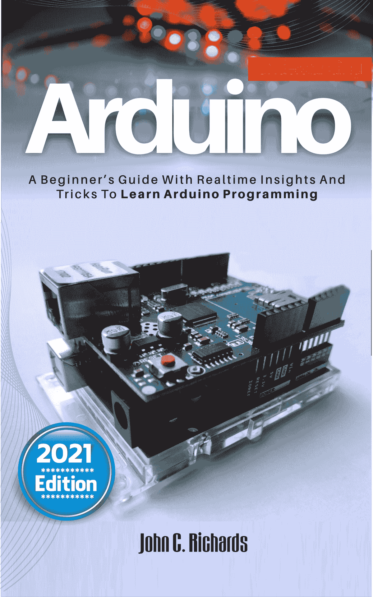
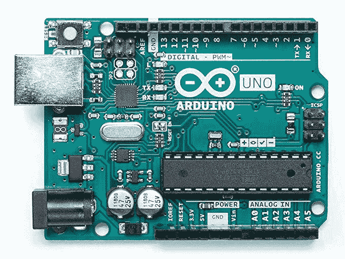
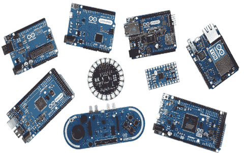
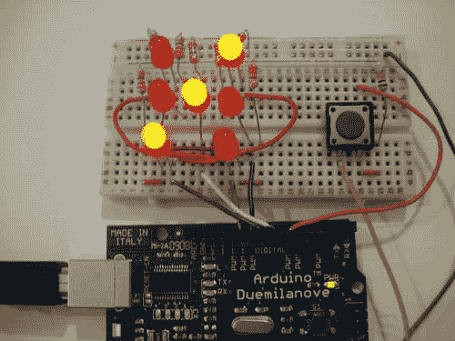
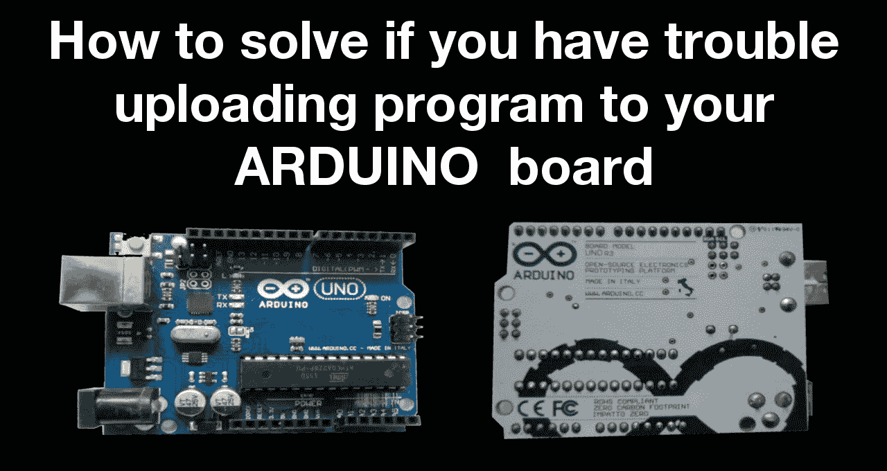

# 理解 Arduino：初学者指南，学习 Arduino 编程的实时洞解与技巧

## 引言

### 什么是 Arduino？

Arduino 是一种可编程的多用途电子平台，其硬件和软件均设计用于开源环境中运行。Arduino 项目始于意大利的伊里亚交互设计学院（Ivrea Interaction Design Institute），源于对快速且易于使用的原型设备的需求。

Arduino 组负责制造和设计单板微控制器和微控制器套件，这些设备能够构建各种数字设备。Arduino 板上的输入和输出引脚可以与其他各种扩展模块进行接口，这为该设备提供了原型制作能力。

对于人口中非技术导向的人群来说，电子和编程听起来可能很复杂，但无需担心，因为 Arduino 最初开发时就特别考虑了电子和编程方面完全零正式知识的人士。然而，即使在今天，使用这种不可或缺的小型设备也不需要电子和编程方面的特殊技能。因此，从爱好者、艺术家、设计师、黑客、新手、游戏玩家到技术专家，任何人都可以可以使用各种 Arduino 架构来满足其个人需求。

作为微型计算机，Arduino 主要由硬件和软件部分组成，其硬件遵循 `CC-BY-SA` 许可，软件则遵循 GNU 较小通用公共许可证（`LGPL`）。因此，只要遵循开源许可规定，它就赋予了第三方公司制造和分发 Arduino 板卡及软件的权利。

Arduino 板卡构建了不同的串口通信接口，可以连接到电脑，以便使用简化的 Arduino 集成开发环境（`IDE`）以及命令行工具在板卡上进行轻松编程。

随着时间推移的不断进步和演变，Arduino 板卡已成为解决和管理各种难度难度日常任务的有用工具。这实际上归功于它将自己的设计与更传统的 8 位板卡区分开来。直到今天，Arduino 板卡仍被用于 3D 打印、云计算、嵌入式环境、物联网应用和可穿戴设备等顶级创新技术。

现在 Arduino 可以帮助我们管理和控制大多数复杂的日常任务，如 LED、电机、互联网、扬声器、自动锁、摄像头、无人机、GPS 设备、智能手机等，因为它设计时具有与这些设备交互的能力。

对于任何对创建交互环境或设备感兴趣的人来说，好消息是，Arduino 项目正是为此目的而设计的，让你探索自己的世界。你可能会感兴趣的是，创造的内容没有限制，从制作个性化的加热垫、取暖毯到拥有你自己的占卜机。只要你能梦想，你就能用 Arduino 板卡创造出来，几乎任何东西都可以被创造。

大多数 Arduino 板卡通常基于 Atmel 8 位 AVR 微控制器。相比之下，最近的一些板卡使用更高配置构建。它们可以通过编程连接的实现方式以及与其他外部电路的集成方式（取决于闪存类型和数量、引脚、功能，以及是否存在单排、双排引脚或母头插座）来区分区分。

## 为什么 Arduino 流行？

Arduino 项目在全球范围内的用户和非用户中一直获得持续的赞誉。这种流行归功于每个 Arduino 板卡自带的几个独特因素和独特特征。以下原因是大多数用户选择坚持使用 Arduino 设备的众多原因之一。

- **安装简单**：Arduino 的设计具有允许非常容易的安装过程的特性。这是因为 Arduino 板卡自带 USB 端口。有了这个独特的端口，安装 Arduino 软件会变得简单得多。

- **易于使用**：Arduino 受许多新手的青睐，因为它可以与其他设备配合使用，而不需要任何特殊的编程技能，且不需要以代码形式向板卡传达任何新指令集。此外，使用 Arduino 执行许多简单活动不需要外部硬件。

- **简单的编程语言**：尽管人们仍然需要对设备进行编程以执行特定功能，但 Arduino `IDE` 是用简化的 `C++` 编程语言编写的。这种语言是最易学习的语言之一，使得设备操作变得非常简单。

- **获取成本相对较低**：由于 Arduino 项目是一个开源平台，这使得它们的软件免费且硬件相对廉价。因此，许多用户感到非常舒适和荣幸，将他们的编码和编程知识贡献给基于 Arduino 的项目，以增强可访问性。

- **良好的备份**：事实上，大多数设备型号的程序加载是从个人电脑上完成的。这是通过使用标准的 `API` 实现的，它被称为“Arduino 语言”。因此，Arduino 设备作为几乎所有电子设备的备份系统发挥着巨大的作用。

- **可更换的处理器**：尽管板卡尺寸很小，但如果检测到板载处理器故障，Arduino 为快速、方便更换处理器留了空间。这使得 Arduino 板卡在考虑易于维护和部件更换时成为理想选择。

- **通信速度**：在现代技术中，速度是选择设备时考虑的一个主要因素。这是许多用户喜欢 Arduino 的主要原因，因为它的板卡以速度闻名。在与个人电脑进行快速通信方面，Arduino 是领先的。这是为了确保 Arduino 与任何电脑之间信息的流畅交换。

如果你想用 Arduino 一些简单项目，但不确定如何或从哪里获取，Arduino 官方网站始终提供产品，其他授权的电子商店也有。

# 第一章

## 为什么使用 Arduino 具有优势

Arduino 具有许多出色的特性，使其成为许多用户（特别是通常将其视为控制大多数电子设备工具的初学者）的首选。以下是使用 Arduino 的优点之一：

- **启动加载器使得程序加载**：硬件编程器可以方便地在 Arduino 设备上加载程序，而无需将其烧接到另一个存储设备中。这是通过板载启动加载器实现的，它将程序转入电路中。

- **成本较低**：与其他类似的设备相比，Arduino 的创建是为了让所有人都能负担得起。从 50 美元以上，可以在市场上购买大多数开发板。花费大约 30 美元即可以 30 美元的价格购买 Arduino，在价格方面没有任何妥协。

## Arduino 特性

- **IDE**：Arduino 自带了自定义的 `IDE`，支持在 Windows、Linux 或 Mac 系统上运行。这完全是因为它是作为开源工具制造的，并具有耐用且支持良好的后端。这使得在其平台上移植变得更加容易。此外，它更容易检测并修复错误。

- **强大的 IDE 社区**：许多 Arduino 用户都是志愿者开发者，他们无私地工作，贡献力量以增强和改进其 `IDE` 的质量。Arduino 的质量标准和价格优势可能是这一现象的主要原因。

- **简单的设计**：Arduino 的设计简单且紧凑，与之前开发的许多设计复杂的类似板不同。在这些复杂的板卡上，`LEDs`、`buttons`、`LCD` 和其他多个多功能结构被集成在一起。这导致与 Arduino 相比，板卡变得非常笨重。

Arduino 采用了非常简单且谦逊的结构。这是因为它支持多种 `Arduino shields`（范围从 `Wi-Fi` 到 `LCD` 不等），这些扩展就像 Arduino 的附加组件，用户可以根据希望让其执行的任务来决定是否使用。

- **Arduino 库执行多种功能**：Arduino 库经过配置可以执行多项任务。这些任务范围从执行复杂功能到执行简单任务不等，例如解析 `GPS` 或向 `SD cards` 写入数据，控制 `pins` 或对 `buttons` 进行去抖处理。

- **Arduino 并非任何芯片制造商的产品**：许多芯片制造商主要感兴趣的是让他们的产品具有独特性。因此，他们制造带有自定义部件的 `Chips`，以与其他类似的芯片制造商区分开来。

然而，Arduino 并不是任何芯片制造商的产品。因此，它在设计上刻意与其他微控制器保持相似性。这意味着任何微控制器能做到的事情，在 Arduino 上也能实现。

- **传感器**：Arduino 是一个很好的数字传感器，因为它配备了模拟数字输入。这使得 Arduino 能够使用传感器提供的数据测量温度、压力和光强度。在这种情况下，市场上几乎所有的可用传感器都可以。

- **Arduino 轻量且可在裸机上运行**：虽然 Arduino 拥有先进且智能的代码编译器，但它可以直接在裸机（bare metal）上运行。尽管具有复杂的功能，它仍然快速、轻量且体积小。代码与 `HEX` 一起提供，可以批量用于为新芯片编程，而像 `BASIC` 或 `.NET` 那样需要解释。

## Arduino 的缺陷

- **分辨率低**：如果需要更高的处理能力或工作内存来处理设备不断增加的负载，Arduino 可能不是一个非常好的选择。因为 Arduino 微控制器只有 `10 bit` 的分辨率。因此，它无法处理复合和高级功能。

- **无调试器**：用户可能无法在 Arduino 上检查脚本，因为它没有内置调试器。因此，检测和纠正编码过程中可能发生的任何错误变得有些困难，因为要追踪自己的操作和进度几乎是不可能的。

- **程序执行受限**：Arduino 同时只能执行一个程序和一项任务。如果你希望你的设备能够多任务处理，这可能会让你感到格外沮丧。因此，Arduino 的使用被限制在微设备和单任务上，因此在 Arduino 上无法进行多任务处理。

- **缺乏 AVR 微控制器知识**：由于需要对 `AVR microcontroller` 有平均水平的知识和理解，使用 Arduino 的学者可能会发现难以适应。特别是，这可能会影响设备的整体效率。

- **编程语言**：Arduino 主要使用 `C` 和 `C++` 编程语言开发。然而，这些编程语言是为有经验的人准备的，而不仅仅是初学者。

- **内存限制**：Arduino 永远无法取代电脑。Arduino 只有 `2 Kb` 的 `RAM` 和 `3 Kb` 的闪存。因此，在上面可以执行或存储的内容始终受到限制。

- **不是全能板**：虽然 Arduino 可以用于管理其他设备，并作为 PC 配件使用，但它无法对通用功能进行充分优化，因为它不是一个全能设备。

- **代码分段**：由于 Arduino 使用的 `IDE`，它并不支持良好的项目环境。这阻碍了轻松学习，并且没有为其他文件留出空间。大多数用户做的只是从网上复制粘贴代码，而并不理解自己在做什么。

- **5V 的使用**：Arduino 的许多板子仍然配备了旧的 `5V`，而不是在考虑速度和精度时表现更好的 `3.3V`。这是过时的，旧的 `5V` 芯片速度慢且电压低。

- **Arduino 的误用**：因为许多用户缺乏对其如何工作原理的深度知识，他们将其视为几乎可以解决任何问题的简易修复工具。因此，这些 Arduino 用户将其用于这种不值一提的任务。

- **抽象的 API**：Arduino 的 API 是延迟的。因此，它阻止了应用程序多个层之间的正常交互。因此，涉及的组件之间几乎没有进行数据传输。

- **端口操作**：大多数用户并没有直接操作 `pins`，而是简单地在设备上进行端口操作。这主要是由于缺乏对所用语言的基础知识。大多数用户并不知道 Arduino 内部有可以处理的 `C` 等效代码。

# 第二章：工程专业学生使用的不同 Arduino 开发板

## Arduino 开发板（类型）

Arduino 开发板已成为设计不同项目的快速途径，在各个工程领域中发挥了影响力。它们有时被用作某些嵌入式工程师项目的收尾工具。这些设计取决于所使用的 Arduino 类型和型号，其范围可以从复杂的复合科学仪器到简单的家用仪器不等。

Arduino 用于各种不同应用的能力得到了增强，所有的开发板都基于开源。市场上的 Arduino 开发板有不同的类型和型号，既有共同特征，也有独特的功能，这些通常取决于它们所处的特定项目。常用的 Arduino 开发板类型包括：

### Arduino Leonardo 开发板

在 Arduino 的最早开发产品中，Leonardo 板是其中之一。在这块板上使用程序库更加容易，因为可以通过 `USB` 直接连接。`USB` 内置在微控制器中，使其成为所有开发板中最廉价且易于使用的之一。由于这一特性，Leonardo 板可以轻松地连接到电脑键盘、鼠标、智能设备等。该板完全依赖于时钟速度为 `16 MHz` 的 `ATmega32u4` 微控制器。此板配备了 2.5 Kb SRAM 内存，同时位于 32 Kb 的闪存内存上。

### Arduino Uno (R3)

在寻找最流行的开发板时，人们会想到 Arduino Uno，据报道它被不同职业的人使用。这块板有 14 个数字输入/输出 (`I/O`) 引脚，其中 6 个引脚作为“脉冲宽度调制” (`PWM`) 输出。在该板上找到的其他特征包括 `USB` 端口、重置按钮、电源接口和 6 个模拟输入引脚。通过维持微控制器，所有功能都可以实现。可以使用 `USB` 线将此板连接到你的电脑。该板带有 `ATmega328` 处理器，时钟速度为 `16 MHz`。SRAM 内存为 2 KB，闪存为 32 KB。

### RedBoard Arduino 开发板

RedBoard Arduino 开发板利用 `Arduino IDE`。随后可以使用 Mini-B `USB` 线进行编程。它可以轻松地配合 Windows 8，而无需修改你的任何安全设置。RedBoard Arduino 开发板可以被轻松控制。在成功创建后，它是最易用的板之一。用电脑或其他仿真器打开板电源后，只需按照菜单进行选择即可。

### LilyPad Arduino 开发板

这块板是可穿戴的，用于电子纺织品技术。其设计专门针对纺织品，而且开发板是可以清洗的。可以用线线将其缝在衣服上。此板上的所有东西如传感器电路、电源和 `I/O` 都是专门为此目的而设计的。此板还包含一个 `Arduino` 引导程序，带有 `2V` 到 `5V` 的可变电源，位于 `ATMEGA328` 微控制器上。

### Arduino Mega (R3)

Arduino Mega 运行在 `ATmega2560` 处理器上，其数字 `I/O` 引脚有 54 个。在这些引脚中，4 个引脚用于 `UART` 硬件的串口，16 个引脚用于模拟输入，14 个引脚作为 `PWM` 输出。这些板上的其他组件还包括电源接口、`USB` 连接、ICSP 插针、`RESET` 引脚和 `16 MHz` 晶振振荡器。

### Arduino Shields（扩展板）

为了连接到其他类型的 Arduino 开发板，使用了 Arduino Shields。它们是预构建的电路板。这些 Arduino 扩展板取决于使用类型。某些包括 `Proto Shield`、`Ethernet Shield`、`Wireless Shield` 和 `GSM Shield`。`Arduino Shield` 和 Arduino 开发板的连接方式是：Arduino 开发板放置在 `Arduino Shield` 下方。这为便于集成留出了空间，因为板最终会连接以控制 `LCD` 和显示器。

### Arduino Micro 开发板

顾如名，这是一种设计非常小的特殊 Arduino 开发板。微控制器运行在名为 `ATmega32U4` 的处理器上。此板总共有 20 个引脚，其中 12 个用于模拟 `I/O`，7 个用于 `PWM`。此板在 Arduino Micro 板上自带了微-USB 连接。板上的其他特征还包括：ICSP 插针、`16 MHz` 晶振振荡器。Arduino micro 通常被称为 Leonardo 的缩减版，因为它很小且外观与 Arduino Leonardo 板相似。

### Arduino Due 开发板

Arduino 系列中第一块设计并开发用于 ARM 微控制器的板是 Arduino Due 板。ARM 内核是 32 位，有 54 个数字 `I/O` 引脚，其中 12 个是模拟引脚。它带有两个不同类型的端口（编程端口和 `USB` 端口）；编程端口作为 `USB` 线微端的接口使用。

### Arduino 蓝牙开发板

这一个之所以被称为蓝牙板，因为它通过蓝牙无线连接进行编程。Arduino BT 板基于 `ATmega168` 微控制器型号。此板的显著特征是螺钉端子、`16 MHz` 晶振振荡器、重置按钮、6 个模拟引脚和 16 个数字引脚。

### Arduino Esplora 开发板

如果你计划拥有易连接的执行器和传感器，那么 Arduino Esplora 板是为你专门设计的。此板与其他类型的 Arduino 开发板不同，因为它嵌入了麦克风、加速度计、温度传感器、滑块、摇杆和按钮。Arduino Esplora 板还带有输入输出连接。

## 哪些 Arduino 开发板在家里很有用？

几种类型的 Arduino 开发板在各种家庭任务中都非常有用。然而，Arduino 处理的任务将决定哪种板最合适，但通常使用的板包括 `Arduino Uno`、`Arduino Mega`、`Arduino Pro` 和 `Arduino Mini`。任务范围从定时、自动门锁到开关灯甚至操作智能手机。

# 第三章

## 如何将你的 Arduino 连接到电脑

在你必须选择适用于特定功能的 Arduino 开发板类型后，接下来是通过电脑将一组指令或代码加载到开发板。Arduino 如何管理给定任务取决于加载到它的指令。然而，加载到 Arduino 板的任何指令将被执行。你的 Arduino 必须连接到电脑以启用加载。要在 Windows 上建立必要的连接，需要以下物品：

- Arduino 开发板
- Arduino 软件
- `USB` 线（A 和 B）

1. 首先下载与电脑兼容的软件。
2. 完成后，解压到 `D:/Arduino`。
3. 然后，通过将 `USB` 线的一端连接到电脑，另一端连接到 Arduino 板，电脑与板之间的连接就准备好了。
4. 当 Windows 提示驱动程序时，可以手动安装（位于 `D:/Arduino/Arduino-0022/drivers`）。
5. 随后可以在此处找到 Arduino 环境：`D:/Arduino/arduino-0022/arduino.exe`。
6. 通过进入 `Tools`、`serial port` 然后 `COM` 来选择串口。
7. 通过选择 `File`、`Examples`、`Basics` 和 `Blink` 来进入示例代码。

9. 点击上传按钮将代码上传到 `Arduino`。当你看到“Done uploading”提示时，你的 `Arduino` 已经成功安装。

# 建立 Arduino 与电脑的连接

## Arduino 方便连接所需的工具

在 `Arduino` 板上成功安装你的运行代码后，你考虑的下一个问题是如何执行某个特定的项目。`Arduino` 可以处理多个项目，例如飞行无人机、移动汽车、点亮 `LED` 灯或让简单的机器人移动去锁门（稍后将讨论一些你可以用 `Arduino` 尝试的项目）。

为了让你执行其中任何一个项目，必须在你的 `Arduino` 板上运行一个特定的程序或一组指令（如上文讨论的如何将你的 `Arduino` 连接到电脑）。这些代码对于分配给特定 `Arduino` 执行的每个功能来说都是独特的。

然而，当你确定这些工作都已完成后，下一步是将 `Arduino` 的其他所有组件部分小心地连接到你想让它管理的设备上。这通常是使用一些简单的工具或仪器完成的。对于任何成功的 `Arduino` 项目，都需要其中的一些工具：

- **剥线器 (Wire Strippers)**：这些是像钳一样的简单工具。它们通常是手持的，用于去除任何电线的绝缘层。它们也可以用于切开电线的任何末端。这些末端通常连接到另一个剥开的线的末端。对于 `Arduino` 项目，此工具用于创建从你的 `Arduino` 到你正在操作的设备之间的连接。这允许交换特定项目主要功能的必要信息。

- **精密螺丝刀套装 (Precision Screw Driver Set)**：这些螺丝刀通常由大多数技术人员或爱好者使用。它们具有不同的槽口以适应各种类型的螺丝。在处理微小或小型螺丝工作时，通常需要精密螺丝刀，因为某些 `Arduino` 板本质上非常小、复杂且困难。这样，这些螺丝刀可以牢固地夹住螺丝，同时扭动你正在的项目中使用的可用小部件。

- **尖嘴钳 (Needle-nose Pliers)**：尖嘴钳有几个名称。流行的包括鸟嘴钳、尖头钳、夹头钳和圆头钳。它兼具夹持和切割的双重功能，特别适合在处理 `Arduino` 项目时可能看到的几种复杂电线。这些工具主要用于剪断、弯曲或重新定位你 `Arduino` 项目中的任何电线，以确保连接紧密，从而保证 `Arduino` 输出你所需的最佳功能。这是因为它们可以到达普通钳子无法工作的非常狭窄的位置。

- **平口剪 (Flush Cutters)**：此工具的主要目的是剪断你的电线。平口剪可以使电线切切得整齐、平整且非常光滑。使用平口剪应与你想要切割的任何线保持垂直位置。当你使用平口剪时，你的 `Arduino` 项目一定会看起来整洁且完美。

- **数字万用表 (Digital Multimeter)**：主要上，万用表测量通过你电路的电量。这通常以伏特 (`V`)、安培 (`A`) 和欧姆 (`Ω`) 。该工具将以很好的精度测量这些参数。使用数字万用表有助于查看通过你设备的电流、电压或电阻值，以便在需要时进行任何必要的调整。

- **细直镊子 (Fine Tip Straight Tweezers)**：此工具用于拾起进入你项目的任何不碎片或材料。它有两个端，一个是尖端，主要用于镊取用途，而另一个端是取物端。

- **吸锡器 (Solder Sucker)**：这是一种俗称为吸锡泵的热焊工具。它专门用于移除你电路中之前焊接过的部分。这可能是为了该部分的维修、更换或故障排除。

- **电烙 (Soldering Iron)**：电烙是一种用于使你项目中的各种电线光滑的工具。这确保了电荷在项目的整个电路中正确流动。它通过加热和熔化接触点的焊锡来工作。需要建立连接的节点使用电烙胶合在一起。

- **Panavise Jr**：另一个用于 `Arduino` 项目的必备工具是 `Panavise Jr`。在连接许多设备时，使用它可以固定项目的任何部分，这非常有帮助。可以使用此工具固定 `Arduino` 板或电路的其他组件。这样做可以让你更方便地在项目上执行你想做的任何事情，因为此工具可以根据意向扭转方向，提供舒适感并让你的项目更容易操作。

## 项目最终完成前的准备工作

在用 `Arduino` 板连接其他设备和电路时，必须遵循某些预防措施，以避免错误连接的复杂性，并避免碰到当前项目不需要板的其他部分，这可能会损坏整个板。

一旦为特定任务或功能编写并了所需的代码加载到你的 `Arduino` 中，剩下的工作就是使用上述某些工具将 `Arduino` 上的所需端口或引脚与它工作的设备连接起来。

完成后，你将确认所有必要的连接是否已准确完成。首先，确保加载了项目的正确代码。确保所有必要的工具和/或设备已正确安排，以防止连接中的错误。这已成为一个关键步骤，因为任何不当的连接都会影响整个项目。

- 使用来自门户网站的 Javascript 来控制硬件
- 使用简单的 HTML 读取开关状态
- 使用 HTML 读取传感器值

### 要求

如果你计划使用你的 Arduino 访问互联网，将需要以下物品：

- 一个 Arduino Mega 服务器（例如 Arduino Mega2560 或 Arduino UNO）
- 速度为 10/100MB 的有线网络连接
- 一个以太网扩展板 (Ethernet Shield)

以太网扩展板的功能是通过 Arduino 作为连接源连接到互联网。扩展板可以通过引脚连接到你的 Arduino。然后将网太线连接到扩展板上。执行此操作时需要的其他硬件包括：

- 网太线
- 按钮
- 9V 适配器
- Wi-Fi 路由器
- 跳线线
- 10K 电阻
- 面包板

### 功能

为了实现各种优化功能，这些工具被用于诸如从网络接收和发送特定命令、搜索任何可用网络、实时时钟、智能家居系统集成、电压和电流控制，以及传感器的维护和温度测量。

此外，你还可以根据需要添加个人模块。这是因为 Arduino Mega 服务器可以独特地编译模块、检测已编译模块，并将它们与尚未编译的模块分开。它还提供了灵活性，可以直接从互联网禁用或启用任何已编译的模块。

在与 Arduino Mega 服务器集成的少数功能中，有一个可以监控 Arduino 输入和输出电压的电气模块。该电气模块同样可以监控电流。它组装在开关板上，可以方便地调节耗电量。追踪人员是该模块可以执行的另一个独特功能。

作为网络示波器是另一个附加功能，该示波器以动态信号或示波图的形式显示网页内的实时网络流量。此外，还有一个屏幕保护程序模块专门显示面板上的信息。这让你能够选择与你相关的信息，同时过滤掉任何其他信息。通过实现高效的频率计，可以使用 Arduino Mega 服务器 防止系统故障。此还有一个用于 3D 系统状态的 216 块指示器，它让你拥有了俯瞰整个系统结构的权限。

### 设置步骤

要将你的 Arduino 作为 Web 服务器，你必须执行以下操作：

- 为 Arduino 使用以太网配置
- 规定 IP 地址
- 提供你正在使用的 MAC 地址
- 将你的 Arduino 连接到可用的互联网服务（你可以使用 Wi-Fi 路由器为此操作）
- 提供运行 Arduino 作为 Web 服务器所需的代码
- 使用路由器将你的电脑连接到 Arduino

由于 Arduino Mega Server 设置简单，许多用户可以为它连接容量高达 32GB 的 SD 卡。因此，不同的网络内容和文件可以从 Web 服务器安全地保存到此张 SD 卡上。Arduino Mega Server 还允许与 MajorDoMo 集成。MajorDoMo 平台就像一个自动化家居系统。通过使用 Arduino 实现这一点，你获得了发送数据、分析数据以及发送任何所需状态的机会。同时还可以实现跨网络的命令控制和数据存储。Arduino Mega Server 一直被认为用作“串联模式”。这意味着 MajorDoMo 服务器上的信息可以在 Arduino Mega Server 中完美运行。虽然 MajorDoMo 并非为串联模式而设计，但它也可以独立工作。

Arduino Mega Server 是构建在 8 位处理器能力的基础上。这是它本质上具有多功能以及许多其他独特特性的主要原因。此外，使用你的 Arduino mega server 时可以托管多个网站。在不关闭控制器或拔出内存的情况下，你也可以更新内容。使用 Arduino Mega Server，可以对许多网页进行修改以调整你的电脑屏幕。这让你在以浏览互联网为目的时，能够获得兴奋的体验。

# 第五章：Arduino 的最佳编程语言

## Arduino 使用的编程语言

Arduino 使用一种编程语言，大多数时候被称为 Arduino 编程语言或简单称为 Arduino 语言。Arduino 为用户提供了若干集成库选择和一个编程编辑器。因此，将这些程序编译并加载到板器中变得非常简单。

根据用户的描述，Arduino 认为是用简化的 C/C++ 编程语言编写的，他们通常将其作为可下载的在线工具使用。由于这些程序的简单性，它们通常被称为“sketch”（草图）。任何用 Arduino 语言编写的文件或文本也称为 sketches。应使用 `.ino` 作为文件扩展名，以便你将 sketches 保存并加载到你的 Arduino 板板上。

以下是 Arduino 编程语言的核心特性：

- **函数 (Functions)**：这些函数让你对你的 Arduino 板板有完全的控制。常见的编程技巧，如分析字符或执行任何数学运算，都是通过这些函数实现的。`setup` 函数或 `loop` 函数是 Arduino 编程语言 sketch。每当你的 Arduino 上电或重置时，都会执行 `setup`。然后使用 `loop` 函数来关闭电源和复位按钮。Arduino 语言中不存在主函数。在处理它时其他有用的函数包括：

  - **数字输入和输出 (I/O)**：有 `digitalRead`，其参数是引脚号；`digitalWrite` 提供高或低电数字输出引脚值；`pinMode` 将其输入和输出设置为引脚；`pulseIn` 从数字信号中从低到高再从高到低再次读取脉冲，`shiftIn` 逐位读取字节，`shiftOut` 逐位写入字节等。

  - **模拟输入和输出 (I/O)**：它们包括 `analogRead`，它使用模拟引脚读取数值，`analogReference` 使用模拟输入来配置输入的数值范围，`analogWrite` 将模拟值写入引脚等。

  - **时间函数 (Time Function)**：这些包括 `delay`，它可以暂停或延迟一个指定为参数的几毫秒的程序；`delayMicroseconds`，这可以暂停一个指定为参数的几微秒的程序等。

  - **数学函数 (Math Function)**：这些包括 `abs`，它指定数字的绝对值，`constrain` 将数字限制在指定的范围内，`cos` 表示角的余弦，`sq` 表示数字的平方，`pow` 表示数字的特定特定次方的值等。

  - **常量和变量 (Constant and Variables)**：这些是 Arduino 值，与 C++ 编程中使用的非常相似。它们主要用于类型转换。它们允许在 Arduino 生态系统中进行方便的数据传输。

  - **结构 (Structure)**：这是 Arduino 编程语言的最后部分。在这里，可以找到像操作符之类的微小代码元素。这使得 Arduino 在最终执行任何编写的代码时具有巨大优势。

你还可以使用 Arduino 编程语言导入外部库。这些库包含了已经写好的代码。这让你工作变得轻松；否则，你可以编写自己的代码，或直接从网上下载你需要的代码。有时可以使用 C 库。这对于 Arduino 语言来说非常独特。Arduino IDE 中提供的库管理器允许你安装此类语言库。

一些可以在线下载的 Arduino 语言有：

- **ArduBlock**：许多初学者发现这种编程语言特别有用。与其输入代码，ArduBlock 允许你构建自己的代码。它允许你为代码选择函数。它对于视觉化学习者来说特别好。

- **Snap4Arduino**：和 ArduBlock 一样，这种编程语言也支持视觉化。它主要以拖放的方式使用。虽然它与 ArduBlock 非常相似，但它是专门为缺乏 Arduino 编程语言基础知识的用户设计的。要安装这种语言，你需要 `StandardFirmata`，它是预安装在你的 Arduino 中的。

- **C#**：这使得 Arduino 与电脑之间的信息共享变得简单。这种编程语言的使用允许你用另一种语言编码，该语言与 Arduino 作为 sketch 使用的语言完全不同。`CmdMesseger` 在这方面特别有帮助。这个消息器可以在 Microsoft Visual Studio 或任何你可以获得的其他第三方替代品上良好运行。C# 语言然后在你的电脑和 Arduino 之间创建一个平滑的通信链接。

- **Python**：虽然基于 Python 语言的代码不能用于 Arduino。但是，通过使用设备上的串口输入可以使用这种语言。这你可以通过下载 `pySerial` 实现。由于其直观性，它经常作为其他高级编程语言的基础。

Arduino 软件（IDE）是增强的通用编程语言。该 IDE 是构建在 wiring 和 processing IDE 之上的。该软件的在线版本更受用户青睐，被称为 Arduino Web 编辑器。这成为使用 Arduino 编码时的一个极佳选择。这让你能够通过互联网随时随地将数据直接存储在云端。Arduino 软件的在线版本更受欢迎，因为它不需要像离线版本那样任何更新。然而，离线版本仍然供其他用户下载并使用。使用 IDE 进行 Arduino 编程语言提供了更好的通信，因为 IDE 兼容多种操作系统。

- 在您的网络浏览器中打开 Arduino 网站 (https://www.arduino.cc/en/Main/Software)。
- 点击链接下载并进入下载页面。
- 在 Arduino 许可协议上点击“同意”按钮。
- 点击下载页面上的 `Windows` 链接，这将下载适用于 Windows 的 Arduino 软件。
- 在您的电脑上找到刚下载的文件，然后解压缩压缩包。
- 将其复制到电脑上的常用位置。
- 然后，通过将 Arduino 板板连接到电脑来连接电脑与 Arduino。
- 点击 Windows 开始菜单按钮启动 Windows 设备管理器。
- 右键点击“此电脑”菜单，并在下拉菜单列表中选择“属性”。
- 点击“设备管理器”链接。
- 此后，设备管理器将显示“Arduino”。
- 右键点击“Arduino”以更新驱动程序软件。
- 将弹出一个对话框，从下拉选项中选择“浏览我的电脑以查找驱动程序”。

在此之后，选择“浏览”按钮。已下载的 Arduino 文件夹中现在有一个 `Driver` 文件夹，选择此 `Drivers` 文件夹。选择好后，您就可以点击“下一步”。会弹出一个对话框，选择“仍安装此驱动程序”。几分钟后，驱动程序的安装将完成。您会注意到另一个对话框弹出，只需记下用于配置 Arduino 的端口。之后，您可以设置您的 Arduino 软件。操作方法如下：

- 进入刚下载的文件夹。
- 现在可以通过双击该文件来打开 Arduino 软件。
- 确保您已选择正确的 Arduino 板板，如果没有，请根据需要更改选项。
- 同时确保所选择的串口是正确的，如果不是，请根据需要进行更改。

在完成所有这些程序后，剩下的就是测试安装是否正常。您可以通过将程序（sketch）加载到 Arduino 来查看安装是否良好。为此，选择“Blink”程序并点击 Arduino 上传按钮（Arduino 板板上的 LED 将闪烁以指示已加载程序）。您可能希望运行程序以确认 Arduino 软件和驱动程序已成功安装。

### 选择哪个版本的 Arduino IDE

Arduino 软件会定期更新以提高效率，并有时修复某些已知错误，因此，发布的 Arduino IDE 版本经常发生。这些修改对于满足持续用户的需求是必要的。

Arduino IDE 版本 `1.0.5` 是首次发布的 Arduino IDE，也是第一代 Arduino 编程中最旧使用的版本。此版本 `1.0.5` 以及其他后续发布的版本如版本 `1.8.11`、`1.8.10`、`1.8.9`、`1.8.8`、`1.0.5`、`1.0.4`、`1.0.3`、`1.0.4`、`0023`、`0022`、`0021` `0020` 等现在已经过时。

目前活跃的版本是版本 `1.8.12` 和版本 `1.8.13`。`1.8.13` 版本是 Arduino IDE 的最新版本。`1.8.13` 版本有很多改进，因此是目前为止发布的最佳版本。该版本的最新更新主要支持 Windows 操作系统（例如 `2000`、`XP`、`7` 和 `Vista`）。它由 Genericom 开发，总文件容量为 90.20 MB。该 Arduino IDE 的其他显著功能包括与任何进行 Arduino 项目的用户共享信息，以及需要时更改原理图和内部布局的能力。

### Arduino 在线 IDE

使用在线 Arduino IDE 或 Arduino 网页编辑器是进行 Arduino 编程另一种方式。通过这种方式，您可以访问教程、配置板板，最重要的是作为 Arduino Create 的功能之一直接在网页上编写代码。对于拥有持续且良好网络连接的用户来说，这是一个非常出色的功能。

这样做的好处是可以随时访问 Arduino 功能，而不一定需要下载 Arduino 软件。因此，可以将程序存储在云端，并在方便的时间和地点轻松访问。要使用 Arduino IDE 的这些在线功能，需要：

- 从 `https://create.arduino.cc/getting-started` 安装 Arduino Create 插件以便连接您的板板。
- 点击 Arduino 网页编辑器登录您的 Arduino 账户（如果您之前没有账户，也可以创建一个新账户）。

登录成功后，你会发现在线 `Arduino IDE` 环境与 Arduino 软件版本非常相似，因为你始终在连接互联网的设备上编写代码。你只需点击“new sketch”（新建项目）按钮旁边的导入按钮即可轻松上传新文件。然后，你就可以准备运行自己的代码了。

在在线`Arduino IDE`中，第一列允许你浏览多个选项，如`sketchbook`（项目）、`examples`（示例）、`libraries`（库）、`serial monitor`（串口视器）和`help`（帮助）。第二列将看到所选项目菜单中的其他选项，而第三列则是进行实际编程的地方。

要上传你自己的库，只需进入“Libraries”（库）然后点击“Library Manager”（库管理器）。通过它，计算机存储的任何库都可以轻松上传。如果你在使用在线`Arduino IDE`时需要任何帮助或遇到挑战，请使用“Help”（帮助）按钮获取核心指南。

使用“Preference”（首选项）标签页查看在线`Arduino IDE`的可用空间。此标签在编程过程中也能提供帮助，因为它提供了自定义在线`Arduino IDE`外观的选项，例如颜色主题或字体大小。代码区域是在线`Arduino IDE`中最常用的功能。你在这里为你的 Arduino 板编写、验证和上传代码。

# 第七章

## 你可以尝试的一些 Arduino 项目

使用 Arduino 板可以管理许多项目，从控制 LED 灯等简单任务到像使用 Arduino 自动化大多数家庭设备等复杂且具有技术性的项目。以下列出了你可以使用 Arduino 动手的众多项目：

- **Arduino Mega 象棋**：这为国际象棋爱好者提供了一个个人数字棋盘。除了你的 Arduino 之外，你还需要一台 3D 打印机和`TFT LCD`触摸屏来享受你的数字象棋。这允许你在设计这个数字棋盘时根据自己的需求进行必要的调整。
- **带有控制器的机械臂**：`Arduino UNO`板允许你对机器人进行完全控制，它是专为这类目的而设计的。你需要一个功能可以通过 3D 打印机增强的机械臂。
- **制作乐器**：许多爱好者使用 Arduino 板制作了乐器。`Arduino Uno`也可以用于此。该项目还需要`Pi supply flick charge`。项目完成后，你只需要点击它，就能看到你的手势被转换为音乐。
- **RFID 读卡器安全访问**：射频识别可用于安全目的。这也可以使用`Adafruit NFC card`实现，它也被用于安全访问。
- **小型天气显示系统**：如果你想拥有自己的微型天气显示系统，Arduino 板将帮助你实现。天气显示系统被编程为以摄氏度和华氏度单位显示环境当前温度。对于一个冒险的初学者来说，这是一个非常有趣的项目。需要一个`OLED`图形显示器来天气信息。
- **为你的门制作指纹扫描仪**：这个项目允许你构建一个检测你的指纹并允许进入门的系统。门只有在指纹提示时才会打开。
- **制作电脑控制面板**：通过控制面板可以的操作包括更改显示偏好、控制音、启动应用程序等。你的 Arduino 板是这个项目的骨干，你可以通过`USB controllers`控制电脑的其他多个部分。
- **机器人汽车**：你可以使用连接`DC motors`的 Arduino 构建机器人汽车。如果你想要一个视觉良好的机器人，使用 3D 打印制作汽车部件是最佳选择。在进行此项目时，你还将学习高级电机控制的基础知识。
- **追踪运动的电动摄像头**：对于你的家庭监控，这个项目是一个更好的替代方案。你的家庭监控摄像头可能无法拍摄某些盲角的视频。有了这个项目，你可以确保家园的安全，因为摄像头将始终跟随它感到的任何移动方向。
- **水质控制系统**：水质传感器可以与`Arduino UNO`结合使用，为你创建一个很好的水质控制系统，特别是当你关注水卫生时。
- **超声波距离查找**：这个超声波距离查找是另一个使用`Arduino Uno`结合`sonic ranging module`和`LCD readout`构建的精彩项目。它用于计算与物体之间的距离。它通过接收器检测从物体反射的声波来工作，接收到的数据随后用于给出该物体的近似距离。
- **高速摄影**：通过这个项目，现在可以使用 Arduino 板拍摄飞翔鸟类或落水流等快速移动物体的慢动作照片。在这个项目中，Arduino 板配合正确的闪光灯使用。如果你喜欢摄影，这对你来说是一个特别好的工具，因为它能让你产出出色的制作内容。
- **GPS 追踪器**：通过 Arduino 板，你可以轻松设计智能`GPS tracker`。这个追踪器在追踪某些物品（甚至是你的车）的位置时非常有帮助。该项目需要你的 Arduino、`GPS module`、`wires`、`OLED display`等。
- **闹钟收音机**：这个 Arduino 项目让你的设备具备双重功能，既是闹钟又是收音系统。这个项目将为你提供设定所需闹钟时间并同时显示时间。
- **植物浇水系统**：这个项目的巧妙之处在于，与其他 Arduino 项目相比，它可以在几小时内完成。通过正确的代码、`moisture sensor`（湿度传感器）和`layout`（布局），根据你的需求构建自动浇水系统。无论植物生长如何，系统都会如期运行。
- **逆器**：这个项目让人们惊讶，Arduino 可以作为逆器的形式。与普通的逆器相比，Arduino 的通常更便宜。构建很简单，你只需要获取电池并配置 Arduino 作为逆器。
- **对讲机**：Arduino 结合一些电子元件可以用来制作对讲机。这允许与任何人进行通信。在这个项目中，通信媒介是蓝牙。
- **示波器**：你的电脑和 Arduino 板可以作为示波器使用。Arduino 板主要设计为便携式。放置示波器电路后，可以达到频率。这是由于 Arduino 板自带模拟/数字转换通过`USB`直接发送到你的电脑。

# 第八章

## 排除

尽管 Arduino 通常很容易使用，但某些用户仍然觉得操作有点困难。这种问题通常可以通过对设备进行简单调整来解决。下面我们查看了在使用 Arduino 时可能遇到的最常见问题以及如何轻松修复它们。

### 串口视器问题

有时你可能想要使用串口视器。它的作用是通过串口发送某些数据。此外，当你开始查看串口视器时可能会出现一些奇怪的情况（有时什么都看不到）。使用相同的波特率可以解决这个问题。

### 电脑/IDE 未被板识别

Arduino 板无法识别电脑或 IDE 是设置时最常见的问题。这由三点引起：

1. **使用 USB 线**：你使用的 USB 线可能与 Arduino 不兼容。因为某些 USB 线是为手机充电而非数据传输设计的。通常建议使用支持数据传输的 USB 线，这将使为设备供电和编程变得简单。
2. **板驱动**：虽然驱动通常由设备自动检测，从而使安装简单，但有时可能无法自动识别。在这种情况下，你需要手动安装驱动。这些驱动取决于你使用的 Arduino 板。
3. **缺少库/头文件**：某些从网上复制并粘贴到`Arduino IDE`的代码没有安装必要的库。这通常会提示错误消息。通过检查电脑上的库管理器可以轻松修复。

### 无法上传代码

这可能是由于以下原因：

1. **未使用正确的板设置**：在为 Arduino 板时，如果未使用该板正确的`Arduino IDE`设置，你将无法上传任何代码。然而，当设置正确时，代码将顺利上传。要修复这个问题，你需要进入`Arduino IDE`环境，然后进入“Tool”菜单查找正在使用的板类型。如果你在这里找不到板类型，直接进入“board manager”将正在使用的板类型添加到列表中。
2. **代码错误**：当代码包含错误时，`Arduino IDE`会持续提醒你。这通常显示在 IDE 底部的黑框中。可以通过发布正确的代码来修复。否则，你只需在 IDE 设置中开启详细输出（verbose output）选项。开启此选项将在上传代码前为你提供很好的建议，并在上传选择的任何代码时引导你。

## 常见问题

对某些需要答案的事情仍然不清楚吗？下面我们尽可能对关于 Arduino 的常见问题提供合适的答案。

1. **Arduino IDE 和 Arduino 网页编辑器（在线）不同吗？** 这两个平台——Arduino IDE 和 Arduino 网页编辑器主要功能相同，即为你提供一个编写代码的环境。然而，Arduino IDE 需要在使用前下载到你的设备上，而 Arduino 网页编辑器允许你在无需下载任何 Arduino 软件的情况下在线完成操作。
2. **如果我决定使用 Arduino 网页编辑器，可以使用哪种板？** 所有类型和型号的 Arduino 板默认都有 Arduino 网页编辑器功能。
3. **如何给 Arduino 充电？** 不同类型的 Arduino 板有不同的电源要求供选择。例如，7-12V 电源适配器或 5V USB 连接可为 Arduino Uno Rev3 供电。
4. **从哪里可以获得 Arduino？** Amazon 在线商店提供。
5. **如何将 LCD 连接到 Arduino？** 输入/输出引脚是 Arduino 连接到 LCD 的接口。使用`Liquid Crystals`库控制连接的 LCD 屏幕。要使用此库，请在库管理器中查找并安装。
6. **Arduino 可以控制许多舵服电机吗？** 事实上，该板通常很容易支持许多舵服电机。
