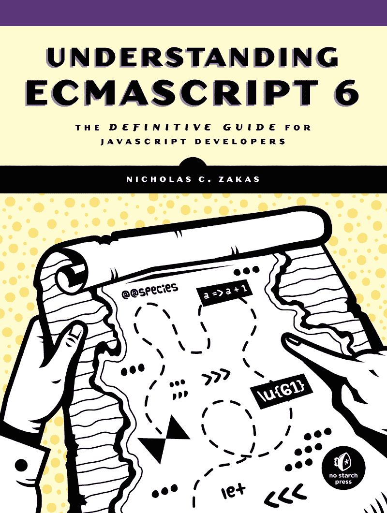
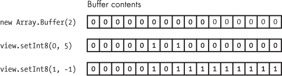

# ECMAScript 6 入门指南




旧金山

## 关于作者

Nicholas C. Zakas 自 2000 年以来一直致力于 Web 应用开发，专注于前端开发，并以编写和演讲前端最佳实践闻名。他在 Yahoo! 工作五年期间积累了丰富的经验，曾担任 Yahoo! 首页首席前端工程师。他编写过多本书，包括《Principles of Object-Oriented JavaScript》（No Starch Press, 2014）和《Professional JavaScript for Web Developers》（Wrox, 2012）。

## 关于技术审核员

Juriy Zaytsev（在线网名为 `kangax`）是居住在纽约的前端 Web 开发者。自 2007 年以来他一直在探索并编写 JavaScript 的奇特性。Juriy 曾贡献过多个开源项目，包括 `Prototype.js` 以及他自己的 `Fabric.js` 等热门项目。他共同创立了名为 `printio.ru` 的按需定制打印服务，目前在 Facebook 工作。

### `u` 标志的实际应用

当正则表达式设置了 `u` 标志时，它会切换模式，以字符而非代码单元来处理工作。这意味着正则表达式不再应该将字符串中的代理对视为独立的字符，并且应该按照预期行为运行。例如，考虑这段代码：

```javascript
let text = "𠮷";
console.log(text.length);           // 2
console.log(/^.$/.test(text));      // false
console.log(/^.$/u.test(text));     // true
```

正则表达式 `/^.$/` 匹配任何包含单个字符的输入字符串。当不带 `u` 标志使用时，该正则表达式基于代码单元进行匹配，因此该日语字符（由两个代码单元表示）不会匹配。

### 计数代码点

遗憾的是，ECMAScript 6 没有添加一个确定字符串包含多少代码点的方法，但通过 `u` 标志，你可以像下面使用正则表达式：

```javascript
function codePointLength(text) {
    let result = text.match(/\s\S]/gu);
    return result ? result.length : 0;
}

console.log(codePointLength("abc"));    // 3
console.log(codePointLength("𠮷"));      // 1
```

当至少有一个匹配项时，结果包含一个匹配项数组，因此长度就是代码点的数量。在 Unicode 中，“abc”和“𠮷”都是匹配的。

### 确定对 `u` 标志的支持

由于 `u` 标志是一种语法变化，在不兼容 ECMAScript 6 的 JavaScript 引擎中尝试使用会导致抛出语法错误。确定是否支持 `u` 标志的安全方法是使用函数，如下：

```javascript
function hasExpU() {
    try {
        var pattern = new RegExp(".", "u");
        return true;
    } catch (ex) {
        return false;
    }
}
```

该函数使用 `RegExp` 构造函数将 `u` 标志作为参数传递。这种语法在早期的 JavaScript 引擎中也是有效的，但如果不支持 `u`，构造函数将抛出错误。

### 其他字符串更改

JavaScript 的字符串处理能力和工具一直落后于其他语言的类似功能。例如，直到 ECMAScript 5 才为字符串增加了 `trim()` 方法，而 ECMAScript 6 继续通过新功能扩展 JavaScript 解析字符串的能力。

#### 识别子字符串的方法

自 JavaScript 诞生以来，开发者一直使用 `indexOf()` 方法识别其他字符串中的字符串，并一直请求更简单的方法来识别子字符串。ECMAScript 6 包含了以下三个方法，它们正是为此设计的：

- `includes()` 方法如果在字符串中任何位置找到给定文本，则返回 `true`，否则返回 `false`。
- `startsWith()` 方法如果给定文本位于字符串开头，则返回 `true`，否则返回 `false`。
- `endsWith()` 方法如果给定文本位于字符串末尾，则返回 `true`，否则返回 `false`。

每个方法都接受两个参数：要搜索的文本以及一个可选的搜索起始索引。当提供第二个参数时，`includes()` 和 `startsWith()` 将从该索引开始匹配，而 `endsWith()` 将从字符串长度减去第二个参数的位置开始匹配；当省略第二个参数时，`includes()` 和 `startsWith()` 从字符串开头开始搜索，而 `endsWith()` 则从末尾开始。实际上，第二个参数的作用是最小化需要搜索的字符串范围。以下是展示这三个方法用法的一些示例：

```javascript
let msg = "Hello world!";

console.log(msg.startsWith("Hello"));      // true
console.log(msg.endsWith("!"));            // true
console.log(msg.includes("o"));            // true
console.log(msg.startsWith("o"));          // false
console.log(msg.endsWith("world!"));       // true
console.log(msg.includes("x"));            // false
console.log(msg.startsWith("o", 4));       // true
console.log(msg.endsWith("o", 8));          // true
console.log(msg.includes("o", 8));         // false
```

前三个调用没有包含第二个参数，因此在需要时，它们将搜索整个字符串。后三个调用只检查字符串的一部分。`msg.startsWith("o", 4)` 调用通过查看 `msg` 字符串的索引 4 开始匹配，即 `Hello` 中的字母 `o`。`msg.endsWith("o", 8)` 同样从索引 4 开始匹配，因为参数 `8` 是从字符串长度（12）中减去而得到的。`msg.includes("o", 8)` 调用从索引 8 开始匹配，即 `world` 中的字母 `r`。

尽管这三个方法让识别子字符串的存在变得更容易，但每个方法都只返回一个布尔值。如果你需要找到一个字符串在另一个字符串中的实际位置，请使用 `indexOf()` 或 `lastIndexOf()` 方法。

### NOTE

如果向 `startsWith()`、`endsWith()` 和 `includes()` 方法传递正则表达式而不是字符串，将将抛出错误。此之下，`indexOf()` 和 `lastIndexOf()` 会将正则表达式参数转换为字符串，然后搜索该字符串。

### `repeat()` 方法

ECMAScript 6 还为字符串添加了 `repeat()` 方法，它接受重复字符串的次数作为参数。它返回一个包含原始字符串按指定次数重复的新字符串。例如：

```javascript
console.log("x".repeat(3));      // "xxx"
console.log("hello".repeat(2));   // "hellohello"
console.log("abc".repeat(4));    // "abcabcabcabc"
```

该方法主要是一个便利函数，在处理文本时特别有用。它在需要创建缩进级别的代码格式化工具中特别有用，例如：

```javascript
// 使用指定数量的空格缩进
let indent = " ".repeat(4),
    indentLevel = 0;

// 每当增加缩进时
let newIndent = indent.repeat(++indentLevel);
```

第一个 `repeat()` 调用创建了一个包含四个空格的字符串，`indentLevel` 变量用于跟踪缩进级别。然后，你只需要带有递增的 `indentLevel` 调用 `repeat()` 即可更改空格的数量。

ECMAScript 6 还对不属于特定类别的正则表达式功能进行了一些实用的更改。下一节将重点介绍这些更改中的一些。

### 其他正则表达式的变化

正则表达式是 JavaScript 中处理字符串的重要部分，与语言的许多部分一样，它们在最近的版本中没有发生太大变化。然而，ECMAScript 6 对正则表达式进行了若干改进，以配合字符串的更新。

### 正则表达式 `y` 标志

在 `y` 标志在 Firefox 中作为正则表达式的专有扩展实现后，ECMAScript 6 将其标准化。`y` 标志影响正则表达式搜索的“粘性”（sticky）属性，它告诉搜索从正则表达式的 `lastIndex` 属性指定的位置开始匹配字符串中的字符。如果在该位置没有匹配，则正则表达式将停止匹配。以下代码显示了其工作原理：

```javascript
let text = "hello1 hello2 hello3",
    pattern = /hello\d\s?/,
    result = pattern.exec(text),
    globalPattern = /hello\d\s?/g,
    globalResult = globalPattern.exec(text),
    stickyPattern = /hello\d\s?/y,
    stickyResult = stickyPattern.exec(text);

console.log(result[0]);         // "hello1 "
console.log(globalResult[0]);   // "hello2 "
console.log(stickyResult[0]);   // null
```

对于 `stickyPattern` 和 `globalPattern` 变量，`lastIndex` 的值在第一次调用 `exec()` 后变为 7，在第二次调用后变为 14。

你需要记住关于 `y` 标志的两个更细微的细节。首先，`lastIndex` 属性只有在调用位于正则表达式对象上的方法（如 `exec()` 和 `test()` 方法）时才会被尊重。

如果将 `y` 标志传递给字符串方法（例如 `match()`），则不会产生粘性行为。

其次，当粘性正则表达式使用 `^` 字符来匹配字符串开头时，它们只从字符串的开头（或多行模式下的行开头）匹配。尽管 `lastIndex` 为 0，但 `^` 使粘性正则表达式变得与非粘性正则表达式相同。如果 `lastIndex` 不对应单行模式下的字符串开头或多行模式下的行开头，则粘性正则表达式将永远无法匹配。

与其他正则表达式标志一样，你可以通过使用属性来检测 `y` 的存在。在这种情况下，你将如下所示检查 `sticky` 属性：

```javascript
let pattern = /hello\d/y;

console.log(pattern.sticky);   // true
```

如果存在 `y` 标志，则 `sticky` 属性被设置为 `true`，否则设置为 `false`。该属性根据标志的存在而是只读的，无法在代码中更改。

与 `u` 标志类似，`y` 标志是一种语法变化，因此在较早的 JavaScript 引擎中它会导致语法错误。你可以使用以下方法来检测支持情况：

```javascript
function hasRegExpY() {
    try {
        var pattern = new RegExp(".", "y");
        return true;
    } catch (ex) {
        return false;
    }
}
```

就像检查 `u` 一，如果无法创建带有 `y` 标志的正则表达式，此代码将返回 `false`。同样类似于 `u`，如果你需要在可以在早期 JavaScript 引擎中运行的代码中使用 `y`，请务必在定义这些正则表达式时使用 `RegExp` 构造函数，以避免语法错误。

### 复制正则表达式

在 ECMAScript 5 中，你可以通过将正则表达式传递给 `RegExp` 构造函数来复制它们，如下：

```javascript
var re1 = /ab/i,
    re2 = new RegExp(re1);
```

`re2` 变量只是 `re1` 变量的拷贝。但如果你为 `RegExp` 构造函数提供第二个参数（指定正则表达式的标志），你的代码将无法工作，如例所示：

```javascript
var re1 = /ab/i,
// 在 ES5 中报错，在 ES6 中正常
    re2 = new RegExp(re1, "g");
```

如果你在 ECMAScript 5 环境中执行此代码，将得到一个错误，指出当第一个参数是正则表达式时，不能使用第二个参数。ECMAScript 6 改变了这一行为，允许使用第二个参数，它会覆盖第一个参数中存在的任何标志。例如：

```javascript
let re1 = /ab/i,
// 在 ES5 中报错，在 ES6 中正常
    re2 = new RegExp(re1, "g");

console.log(re1.toString());     // "/ab/i"
console.log(re2.toString());     // "/ab/g"
console.log(re1.test("ab"));      // true
console.log(re2.test("ab"));      // true
console.log(re1.test("AB"));      // true
console.log(re2.test("AB"));      // false
```

在此段代码中，`re1` 具有 `i`（忽略大小写）标志，而 `re2` 只有 `g`（全局）标志。`RegExp` 构造函数复制了 `re1` 的模式，并将 `g` 标志替换为 `i` 标志。如果没有第二个参数，`re2` 将具有与 `re1` 相同的标志。

### `flags` 属性

除了添加新标志和更改处理标志的方式外，ECMAScript 6 还增加了一个与它们关联的属性。在 ECMAScript 5 中，你可以通过 `source` 属性获取正则表达式的文本，但要获取标志字符串，你必须解析 `toString()` 方法的输出，如下：

```javascript
function getFlags(re) {
    var text = re.toString();
    return text.substring(text.lastIndexOf("/") + 1, text.length);
}

// toString() 是 "/ab/g"
var re = /ab/g;
console.log(getFlags(re));       // "g"
```

此代码将正则表达式转换为字符串，然后返回位于最后一个 `/` 之后的字符。这些字符就是标志。

ECMAScript 6 通过增加一个与 `source` 属性配对的 `flags` 属性使得获取标志变得更容易。这两个属性都是仅分配了 getter 的原型访问器属性，使其成为只读的。`flags` 属性使得为了调试和继承目的检查正则表达式变得更容易。

`flags` 属性是 ECMAScript 6 后期添加的，它返回应用于正则表达式的任何标志的字符串表示。例如：

```javascript
let re = /ab/g;
console.log(re.source);      // "ab"
console.log(re.flags);       // "g"
```

此代码获取 `re` 上的所有标志并将其打印到控制台，使用的代码行比 `toString()` 技术少得多。结合使用 `source` 和 `flags` 允许你提取正则表达式的各个部分。

### 基础语法

在简单的情况下，模板字符串字量的作用类似于由反引号（`` ` ``）分隔的普通字符串，而不是双引号或单引号。例如，考虑以下：

```javascript
let message = `Hello world!`;
console.log(message);         // "Hello world!"
console.log(typeof message);  // "string"
console.log(message.length);  // 12
```

如果你想在字符串中使用反引号，只需用反斜杠（`\`）对其进行转义，如此版本的消息：

```javascript
let message = `\`Hello\` world!`;
console.log(message);         // "`Hello` world!"
console.log(typeof message);  // "string"
console.log(message.length);  // 14
```

### 多行字符串


JavaScript 开发者从语言的第一版本开始就一直想要一种多行字符串的方法。但当你使用双引号或单引号时，字符串必须完全包含在行内。

## ECMAScript 6 之前的替代方案

由于一个长期存在的语法 Bug，JavaScript 确实有一种创建多行字符串的方法。你可以通过在换行之前使用反斜杠（`\`）来创建多行字符串。这是一个示例：

```javascript
var message = "Multiline \
string";
console.log(message); // "Multiline string"
```

当打印到控制台时，`message` 字符串没有换行符，因为反斜杠被视为延续而不是换行。为了在输出中显示换行，你需要手动包含它：

```javascript
var message = "Multiline \n\
string";
console.log(message); // "Multiline
string"
```

此代码在所有主要的 JavaScript 引擎中都应该分行打印 `message` 的内容；然而，这种行为被定义为 Bug，许多开发者建议避免使用。

其他 ECMAScript 6 之前创建多行字符串的尝试通常依赖于数组或字符串拼接，如下：

```javascript
var message = [
    "Multiline ",
    "string"
].join("\n");

let message = "Multiline \n" +
    "string";
```

开发者为了规避 JavaScript 缺少多行字符串的所有方法都不够实用或方便。

## 轻松使用多行字符串

ECMAScript 6 的模板字量（template literals）让多行字符串变得简单，因为没有特殊的语法。只需要在你想的地方包含换行符，它就会出现在结果中，如下：

```javascript
let message = `Multiline

string`;

console.log(message);              // "Multiline

  string"

console.log(message.length);      // 16
```

反引号内的所有空白都是字符串的一部分，因此请注意缩进。例如：

```javascript
let message = `Multiline

              string`;

console.log(message);              // "Multiline

              string"

console.log(message.length);      // 31
```

在这段代码中，模板字面量第二行之前的所有空白都被视为字符串的一部分。

如果你认为让文本与正确的缩进对齐很重要，可以考虑将多行模板字面量的第一行留空，然后在之后进行缩进，如下：

```javascript
let html = `

<div>

    <h1>Title</h1>

</div`.trim();
```

这段代码从第一行开始模板字面量，但在第二行之前没有任何文本。HTML 标签进行了缩进以保持外观正确，然后调用 `trim()` 方法来移除初始的空行。

如果你愿意，也可以在模板字面量中使用 `\n` 来指示应该插入换行符的地方：

```javascript
let message = `Multiline\nstring`;

console.log(message);              // "Multiline

  string"

console.log(message.length);      // 16
```

## 进行替换

到此时，模板字面量看起来可能像普通 JavaScript 字符串的高级版本。两者之间的真正区别在于模板字面量替换。替换允许将任何有效的 JavaScript 表达式嵌入模板字面量中，并将结果作为字符串的一部分输出。

替换由左大括号 `${` 和右大括号 `}` 分隔，其中可以包含任何 JavaScript 表达式。最简单的替换允许你直接将局部变量嵌入到生成的字符串中，如下：

```javascript
let name = "Nicholas",
    message = `Hello, ${name}.`;

console.log(message);      // "Hello, Nicholas."
```

替换 `${name}` 访问了局部变量 `name` 并将其插入到 `message` 字符串中。`message` 变量立即持有替换的结果。

**注意**

模板字面量可以访问其所在作用域内可以的任何变量。在模板字面量中使用未声明的变量会在严格模式和非严格模式下抛出错误。

由于所有的替换都是 JavaScript 表达式，你可以替换的不只是简单的变量名。你可以轻松地嵌入计算、函数调用等。例如：

```javascript
let count = 10,
    price = 0.25,
    message = `${count} items cost $${(count * price).toFixed(2)}.`;

console.log(message);      // "10 items cost $2.50."
```

这段代码在模板字面量中执行了计算。变量 `count` 和 `price` 相乘产生结果，然后使用 `.toFixed()` 将其格式化为两位小数。第二个替换之前的美元符号原样输出，因为它后面没有跟着左大括号。

模板字面量也是 JavaScript 表达式，这意味着你可以将一个模板字面量放在另一个模板字面量内部，如例所示：

```javascript
let name = "Nicholas",
    message = `Hello, ${
        `my name is ${ name }`
    }.`;

console.log(message);          // "Hello, my name is Nicholas."
```

这段代码在另一个模板字面量内部嵌套了另一个。

## 标签模板（Tagged Templates）

你已经看到模板字面量如何创建字符串。但模板字面量的真正威力来自于标签模板。标签模板是一个函数，以字面量和替换作为参数被调用。

### 定义标签

标签仅仅是一个接收字面量和替换的函数。为了更好地理解传递给标签的内容，请考虑下面这个模拟默认行为的示例：

```javascript
function tag(literals, ...substitutions) {
    let result = "";
    for (let i = 0; i < substitutions.length; i++) {
        result += literals[i];
        result += substitutions[i];
    }
    // 添加最后一个字面量
    result += literals[literals.length - 1];
    return result;
}

let count = 10,
    price = 0.25,
    message = tag`${count} items cost $${(count * price).toFixed(2)}.`;

console.log(message);      // "10 items cost $2.50."
```

这个示例定义了一个 `tag` 函数，执行与默认模板字面量相同的转换。唯一的技巧是在循环中使用 `substitutions.length` 而不是 `literals.length`，以避免意外超过 `substitutions` 数组的末尾。

模板标签也可以访问原始字符串信息，这主要意味着访问在被转换为字符等效值之前的字符转义符。处理原始字符串值最简单的方法是使用内置的 `String.raw()` 标签。例如：

```javascript
let message1 = `Multiline\nstring`,
    message2 = String.raw`Multiline\nstring`;

console.log(message1);             // "Multiline
string"
console.log(message2);             // "Multiline\\nstring"
```

在此代码中，`message1` 中的 `\n` 被解释为换行符，而 `message2` 中的 `\n` 则以其原始形式 `"\\n"`（斜杠和字符 字符）返回。通过这种方式检索原始字符串信息可以在需要时进行更复杂的处理。

原始字符串信息也会传递给模板标签。标签函数的第一个参数是一个数组，并包含一个名为 `raw` 的额外属性。`raw` 属性是一个数组，包含每个字面量值的原始等效值。例如，`literals[0]` 中的值始终有一个等值的 `literals.raw[0]`，其中包含了原始字符串信息。知道这一点后，你可以使用以下代码模拟 `String.raw()`：

```javascript
function raw(literals, ...substitutions) {
    let result = "";
    // 仅针对替换的次数运行循环
    for (let i = 0; i < substitutions.length; i++) {
        // 使用原始值
        result += literals.raw[i];
        result += substitutions[i];
    }
    // 添加最后一个字面量
    result += literals.raw[literals.length - 1];
    return result;
}

let message = raw`Multiline\nstring`;

console.log(message);             // "Multiline\\nstring"
console.log(message.length);      // 17
```

这段代码使用 `literals.raw` 而不是 `literals` 来输出字符串结果。这意味着任何字符转义符（包括 Unicode 代码点转义符）将以其原始形式返回。当你想要输出一个包含包含字符转义序列的代码字符串时，原始字符串非常有用。例如，如果你想为某些代码生成文档，你可能希望输出代码的实际显示形式。

## 总结

ECMAScript 6 对 Unicode 的完整支持允许 JavaScript 以逻辑方式处理 UTF-16 字符。通过 `codePointAt()` 和 `String.fromCodePoint()` 在代码点和字符之间转换的能力是字符串处理的重要一步。正则表达式标志 `u` 标志的添加使得对代码点而非 16 位字符进行操作成为可能，而 `normalize()` 方法允许进行更适当的字符串比较。

ECMAScript 6 还增加了处理字符串的新方法，允许你更容易地识别子字符串，无论其在父字符串中的位置如何。正则表达式也增加了更多功能。

模板字符串量是 ECMAScript 6 的一个重要补充，它允许你创建领域特定语言（DSL）来让创建字符串变得更容易。直接在模板字符串量中嵌入变量的能力意味着，开发者拥有了一种比字符串拼接更安全的工具来组合带有变量的长字符串。

对多行字符串的内置支持也使得模板字符串量成为对普通 JavaScript 字符串的有用升级，因为后者从未具备这种能力。虽然模板字符串量内部允许直接使用换行符，但你仍然可以使用 `\n` 和其他字符转义序列。

模板标签是创建 DSL 的模板字符串量功能中最重要的部分。标签是接收模板字符串量片段作为参数的函数。然后可以使用这些数据来返回适当的字符串值。提供的数据包括字面量、它们的原始等效值以及任何替换值。这些信息可以帮助你确定标签的正确输出。

# 3 函数


函数是任何编程语言的重要部分，在 ECMAScript 6 之前，JavaScript 函数自语言创建以来并没有发生太大变化。这留下了许多堆积的问题和细微的行为，导致很容易出错，并且通常需要更多的代码来产生非常基础的行为。

ECMAScript 6 函数向前迈出了一大步，考虑了 JavaScript 开发者多年来的投诉和请求。结果是一系列增量改进，它们增强了 ECMAScript 5 函数，并让 JavaScript 编程更不容易出错且更具活性。

## 带有默认参数值的函数

JavaScript 中的函数独特之处在于，它们允许传递任意数量的参数，无论函数定义中声明了多少个参数。这允许你定义可以处理不同数量参数的函数，通常在未提供参数时通过填入默认值来实现。本节涵盖了 ECMAScript 6 及其及之前默认参数的工作原理，以及 `arguments` 对象。

### 在 ECMAScript 5 中模拟默认参数值

在 ECMAScript 5 及更早版本中，你可能会使用以下模式来创建一个带有默认值的函数：

```javascript
function makeRequest(url, timeout, callback) {
    timeout = timeout || 2000;
    callback = callback || function() {};
}
```

由于未提供的具名参数被设置为 `undefined`，当第一个操作数为假值时，逻辑或（`||`）总是返回第二个操作数。然而，这种方法存在一个缺陷，即 `timeout` 的有效值可能是 `0`，但这将其替换为 `2000`。

在这种情况下，更安全的替代方案是使用 `typeof` 检查参数的类型，例如所示：

```javascript
function makeRequest(url, timeout, callback) {
    timeout = (typeof timeout !== "undefined") ? timeout : 2000;
    callback = (typeof callback !== "undefined") ? callback : function() {};
}
```

尽管这种方法更安全，但执行基本操作仍需要大量的额外代码。这种方法代表了一种常见的模式，流行的 JavaScript 库中充满了类似的模式。

### ECMAScript 6 中的默认参数值

ECMAScript 6 通过提供在参数未正式传递时使用的初始化，使得为参数提供默认值变得更加容易。例如：

```javascript
function makeRequest(url, timeout = 2000, callback = function() {}) {
}
```

此函数期望第一个参数始终被传递。另外两个参数有默认值，这使得函数体变得小得多，因为你不需要添加任何代码来检查缺失值。

当使用三个参数调用 `makeRequest()` 时，不会使用默认值。例如：

```javascript
// 使用默认的 timeout 和 callback
makeRequest("/foo");

// 使用默认的 callback
makeRequest("/foo", 500);

// 不使用默认值
makeRequest("/foo", 500, function(body) {
    doSomething(body);
});
```

ECMAScript 6 认为 `url` 是必须，这就是为什么在三次调用 `makeRequest()` 时都传递了 `"/foo"`。两个带有默认值的参数被认为是可选的。

可以为任何参数指定默认值，包括那些在函数声明中出现在没有默认值的参数之前的参数。例如，这样做是没问题的：

```javascript
function makeRequest(url, timeout = 2000, callback) {
}
```

在这种情况下，`timeout` 的默认值只有在没有传递第二个参数，或者第二个参数被显式地传递为 `undefined` 时才会被使用，如下例所示：

```javascript
// uses default timeout
makeRequest("/foo", undefined, function(body) {
    doSomething(body);
});

// uses default timeout
makeRequest("/foo");

// doesn't use default timeout
makeRequest("/foo", null, function(body) {
    doSomething(body);
});
```

在默认参数值的情况下，`null` 值被认为是有效的，这意味着在第三次调用 `makeRequest()` 时，不会使用 `timeout` 的默认值。

### 默认参数值如何影响 `arguments` 对象

请记住，当存在默认参数值时，`arguments` 对象的行为会有所不同。在 `ECMAScript 5` 非严格模式下，`arguments` 对象会反映函数具命名参数的变化。以下代码示例说明了这种工作原理：

```javascript
function mixArgs(first, second) {
    console.log(first === arguments[0]);
    console.log(second === arguments[1]);
    first = "c";
    second = "d";
    console.log(first === arguments[0]);
    console.log(second === arguments[1]);
}
mixArgs("a", "b");
```

此代码输出如下：

```text
true
true
true
true
```


在非严格模式下，`arguments` 对象始终更新以反映命名参数的变化。因此，当 `first` 和 `second` 被赋值新值时，`arguments[0]` 和 `arguments[1]` 会随之更新，使得所有的 `===` 比较都结果为 `true`。

然而，`ECMAScript 5` 的严格模式消除了 `arguments` 对象中这一令人困惑的行为。在严格模式下，`arguments` 对象不会反映命名参数的变化。这里是 `mixArgs()` 函数，但使用了严格模式：

```javascript
function mixArgs(first, second) {
    "use strict";
    console.log(first === arguments[0]);
    console.log(second === arguments[1]);
    first = "c";
    second = "d"
    console.log(first === arguments[0]);
    console.log(second === arguments[1]);
}
mixArgs("a", "b");
```

调用 `mixArgs()` 的输出如下：

```text
true

true

false

false
```

这一次，更改 `first` 和 `second` 不会影响 `arguments`，因此输出行为符合你通常的预期。

在使用了 `ECMAScript 6` 默认参数值的函数中，`arguments` 对象的行为无论函数是否显式运行在严格模式下，都始终与 `ECMAScript 5` 严格模式相同。默认参数值的存在会触发 `arguments` 对象保持与命名参数分离的状态。这是一个微妙但重要的细节，因为取决于你如何使用 `arguments` 对象。考虑以下情况：

```javascript
// not in strict mode
function mixArgs(first, second = "b") {
    console.log(arguments.length);
    console.log(first === arguments[0]);
    console.log(second === arguments[1]);
    first = "c";
    second = "d"
    console.log(first === arguments[0]);
    console.log(second === arguments[1]);
}
mixArgs("a");
```

此代码输出如下：

```text
1

true

false

false

false
```

在这个示例中，`arguments.length` 为 `1`，因为只向 `mixArgs()` 传递了一个参数。这意味着 `arguments[1]` 是 `undefined`，这在向函数只传递一个参数时的预期行为。这意味着 `first` 也等于 `arguments[0]`。更改 `first` 和 `second` 对 `arguments` 没有影响。这种行为在非严格模式和严格模式下都会发生，因此你可以依赖 `arguments` 始终反映初始调用状态。

### 默认参数表达式

默认参数值最感兴趣的特性可能是，默认值不需要是一个原始值。例如，你可以执行一个函数来获取默认参数值，如如下所示：

```javascript
function getValue() {
    return 5;
}

function add(first, second = getValue()) {
    return first + second;
}
console.log(add(1, 1));      // 2
console.log(add(1));          // 6
```

在这里，如果没有提供最后一个参数，将调用函数 `getValue()` 来获取正确的默认值。请记住，`getValue()` 只有在调用 `add()` 且没有第二个参数时才被调用，而不是在首次解析函数声明时调用。这意味着如果 `getValue()` 的编写方式不同，它可能会返回不同的值。例如：

```javascript
let value = 5;
function getValue() {
    return value++;
}
function add(first, second = getValue()) {
    return first + second;
}
```

在这个示例中，`value` 从 `5` 开始，并在每次调用 `getValue()` 时都会递增。

```javascript
console.log(add(1, 1)); // 6
console.log(add(1));    // 7
```

当函数 `add()` 首次执行时，绑定 `first` 和 `second` 会被添加到特定的参数 TDZ（暂时性死区，类似于 `let` 的行为）。因此，尽管 `second` 可以用 `first` 的值初始化（因为 `first` 在此时总是已初始化），但反过来则不然。现在，考虑这个重写后的 `add()` 函数：

```javascript
function add(first = second, second) {
    return first + second;
}

console.log(add(1, 1));          // 2
console.log(add(undefined, 1)); // 出错误
```

此示例中的 `add(1, 1)` 和 `add(undefined, 1)` 调用现在在背后映射到以下代码：

```javascript
// JavaScript 对 add(1, 1) 用的表示
let first = 1;
let second = 1;

// JavaScript 对 add(undefined, 1) 用的表示
let first = second;
let second = 1;
```

在例例中，调用 `add(undefined, 1)` 会抛出错误，因为在初始化 `first` 时，`second` 尚未被初始化。此时，`second` 处于 TDZ，因此对 `second` 的任何引用都会导致错误。这个示例反映了第 1 章中讨论的 `let` 绑定行为。

**注意**

函数参数有自己的作用域和 TDZ，与函数体作用域是独立的。这意味着参数的默认值无法访问在函数体内声明的任何变量。

## 使用未命名参数

到为止，本章的示例仅涵盖了在函数定义中命名的参数。然而，JavaScript 函数并没有限制传递给参数的数量仅为定义的命名参数数量。你总是可以传递比正式指定的少或更多的参数。默认参数值使得函数能够清晰地何时可以接受更少的参数，而 `ECMAScript 6` 也更好地处理了传递比定义更多的参数的问题。

### ECMAScript 5 中的未命名参数

早期，JavaScript 提供了 `arguments` 对象作为一种检查所有传递的函数参数的方法，而不必定义每个参数。虽然检查 `arguments` 在大多数情况下运行良好，但这个对象处理起来可能有点繁琐。例如，查看这段检查 `arguments` 对象的代码：

```javascript
function pick(object) {
    let result = Object.create(null);
    // 从第二个参数开始
    for (let i = 1, len = arguments.length; i < len; i++) {
        result[arguments[i]] = object[arguments[i]];
    }
    return result;
}

let book = {
    title: "Understanding ECMAScript 6",
    author: "Nicholas C. Zakas",
    year: 2016
};
let bookData = pick(book, "author", "year");
console.log(bookData.author);  // "Nicholas C. Zakas"
console.log(bookData.year);     // 2016
```

该函数模拟了 *Underscore.js* 库中的 `pick()` 方法，该方法返回给定对象的副本，其中包含原始对象的指定子集。此示例仅定义了一个参数，并期望第一个参数是用于复制属性的对象。传递的所有其他参数都是应该在结果中复制的属性名称。

你应该注意关于这个 `pick()` 函数的几点。首先，该函数可以处理多个参数这一点并不显而易见。你可以定义更多几个参数，但你始终无法表明该函数可以接受任意数量的参数。其次，由于第一个参数是命名的并直接使用的，当你寻找要复制的属性时，你必须从 `arguments` 对象的索引 `1` 开始，而不是索引 `0`。记住对 `arguments` 使用适当的索引并不困难，但这是又一个需要跟踪的细节。

`ECMAScript 6` 引入了剩余参数（rest parameters）来帮助解决这些问题。

### 剩余参数

*剩余*参数（rest parameter）通过命名参数前的三个点（`...`）指示。该命名参数将变成一个 `Array`，包含传递给函数的其余参数，这正是 *rest* 参数名称的来源。例如，可以使用剩余参数来重写 `pick()`，如下所示：

```javascript
function pick(object, ...keys) {
    let result = Object.create(null);
    for (let i = 0, len = keys.length; i < len; i++) {
        result[keys[i]] = object[keys[i]];
    }
    return result;
}
```

在函数的这个版本中，`keys` 是一个剩余参数，包含了 `object` 之后传递的所有参数（与 `arguments` 不同，后者包含了包括第一个在内的所有参数）。这意味着你可以从头到尾遍历 `keys` 而无担心。作为额外，你可以通过观察函数看出它能够处理任意数量的参数。

**注意**

剩余参数不影响函数的 `length` 属性。

#### 剩余参数的限制

剩余参数有两个限制。第一个限制是只能有一个剩余参数，且剩余参数必须在最后。例如，这段代码将无法工作：

```javascript
// 语法错误：剩余参数后不能有参数
function pick(object, ...keys, last) {
    let result = Object.create(null);
    for (let i = 0, len = keys.length; i < len; i++) {
        result[keys[i]] = object[keys[i]];
    }
}
```

在这里，`last` 位于剩余参数 `keys` 之后会导致语法错误。第二个限制是剩余参数不能在对象字面量中使用。这意味着代码也会导致语法错误：

```javascript
// 语法错误：不能在字面量中使用剩余参数
let object = {
    set name(...value) {
        // 
    }
};
```

该限制是因为对象字面量被限于单个参数。而剩余参数根据定义是无限数量的参数，因此在这种情况下不允许。

#### 剩余参数对 arguments 对象的影响

剩余参数的设计是为了取代 `arguments`。最初，`ECMAScript 4` 消除了 `arguments` 并添加了剩余参数，以便向函数传递无限数量的参数。`ECMAScript 4` 并没有标准化，但这个想法被保留并引入 `ES6`，尽管 `arguments` 没有从语言中移除。

`arguments` 对象与剩余参数协同工作，反映传递给函数的参数，如下所示：

```javascript
function checkArgs(...args) {
    console.log(args.length);
    console.log(arguments.length);
    console.log(args[0], arguments[0]);
    console.log(args[1], arguments[1]);
}

checkArgs("a", "b");
```

调用 `checkArgs()` 输出如下：

```text
2

2

a a

b b
```

无论如何使用剩余参数，`arguments` 对象始终正确反映传入函数的参数。

### 构造函数能力的增强

`Function` 构造函数是 JavaScript 中一个不经常使用的部分，允许你动态创建新函数。构造函数的参数是函数的参数和函数体，都是字符串。这是一个示例：

```javascript
var add = new Function("first", "second", "return first + second");
console.log(add(1, 1)); // 2
```

`ECMAScript 6` 增强了 `Function` 构造函数的能力，允许使用默认参数和剩余参数。你只需要向参数名称添加等号和值，如下：

```javascript
var add = new Function("first", "second = first", "return first + second");
console.log(add(1, 1)); // 2
console.log(add(1));    // 2
```

在这个示例中，当只传递一个参数时，参数 `second` 被赋值为 `first` 的值。该语法与未使用 `Function` 的函数声明相同。

对于剩余参数（rest parameters），只需在最后一个参数之前添加 `...` 即可，如下：

```javascript
var pickFirst = new Function("...args", "return args[0]");
console.log(pickFirst(1, 2));   // 1
```

这段代码创建了一个仅使用单个剩余参数的函数，并返回传入的第一个参数。默认参数和剩余参数确保了 `Function` 具有与声明式创建函数相同的能力。

## 展开运算符（The Spread Operator）

与剩余参数密切相关的是展开运算符。剩余参数允许你指定将多个独立的参数合并为一个数组，而展开运算符允许你指定将一个数组拆分并作为单独参数传递给函数。考虑内置的 `Math.max()` 方法，它接受任意数量的参数并返回值最大的。这里是该方法的一个简单用例：

```javascript
let value1 = 25,
    value2 = 50;
console.log(Math.max(value1, value2));     // 50
```

当你只处理两个值时（如示例所示），`Math.max()` 非常容易使用。这两个值被传入，并返回较大的值。但如果你一直在数组中跟踪值，而现在你想找到最大值呢？`Math.max()` 方法不允许你传入一个数组，因此在 `ECMAScript 5` 及更早版本中，你只能手动搜索数组或像如下所示使用 `apply()`：

```javascript
let values = [25, 50, 75, 100]
console.log(Math.max.apply(Math, values));  // 100
```

这种解决方案是可行的，但像这样使用 `apply()` 稍微有些困惑。它实际上似乎通过额外的语法模糊了代码的真实含义。

`ECMAScript 6` 的展开运算符使得这种情况变得非常简单。你不需要调用 `apply()`，可以直接将数组传递给 `Math.max()`，并使用与剩余参数时相同的 `...` 模式作为前缀。JavaScript 引擎随后会将数组拆分为单独的参数并传入，如下：

```javascript
let values = [25, 50, 75, 100]
// 等同于
// console.log(Math.max(25, 50, 75, 100));
console.log(Math.max(...values));              // 100
```

现在对 `Math.max()` 的调用看起来更常规，并且避免了为了简单的数学运算而指定 `this` 绑定（上一个示例中 `Math.max.apply()` 的第一个参数）的复杂性。

你也可以将运算符与其他参数混合使用。假设你希望 `Math.max()` 返回的最小数字是 `0`（以防负数混入数组）。你可以单独传递该参数，并对其他参数继续使用展开运算符，如下：

```javascript
let values = [-25, -50, -75, -100]
console.log(Math.max(...values, 0));  // 0
```

在例例中，传递给 `Math.max()` 的最后一个参数是 `0`，它在通过展开运算符传入其他参数之后。

用于参数传递的展开运算符使得使用数组作为函数参数变得简单得多。你可能会发现，在大多数情况下它是 `apply()` 方法的理想替代品。

除了你目前看到的默认参数和剩余参数的用途外，在 `ECMAScript 6` 中，你还可以将这两种参数类型都应用于 JavaScript 的 `Function` 构造函数。

## `name` 属性（The `name` Property）

由于定义函数的方式多种，在 JavaScript 中识别函数可能是具有挑战性的。此外，匿名函数表达式的普及使得调试变得更加困难，通常会导致产生难以阅读和解析的堆栈跟踪。由于这些原因，`ECMAScript 6` 为所有函数添加了 `name` 属性。

### 选择合适的名称


ECMAScript 6 程序中的所有函数都会为其的 `name` 属性有一个合适的值。要查看这一点，请看下面的示例，它显示了一个函数和一个函数表达式，并打印了它们的 `name` 属性：

```javascript
function doSomething() {
    // 空
}
var doAnotherThing = function() {
    // 空
};

console.log(doSomething.name);     // "doSomething"
console.log(doAnotherThing.name);  // "doAnotherThing"
```

在这段代码中，`doSomething()` 有一个等于 `"doSomething"` 的 `name` 属性，因为它是一个函数声明。匿名函数表达式 `doAnotherThing()` 的名称为 `"doAnotherThing"`，因为这是它被赋值的变量名。

### `name` 属性的特例

虽然函数声明和函数表达式的合适名称很容易找到，但 ECMAScript 6 更进一步了，以确保所有函数都有合适的名称。为了说明这一点，请考虑以下程序：

```javascript
var doSomething = function doSomethingElse() {
    // 空
};
var person = {
    get firstName() {
        // 空
    },
    sayName: function() {
        // 空
    }
};

console.log(doSomething.name);      // "doSomethingElse"
console.log(person.sayName.name);   // "sayName"
console.log(person.firstName.name);
```

实际上，根据提供的文本：

`var doSomething = function doSomethingElse() { ... }` 导致 `name` 为 `"doSomethingElse"`。

`person.get firstName()` 是访问器（getter）。

记住，任何函数的 `name` 值并不一定指向同名的变量。`name` 属性旨在提供信息以帮助调试，因此没有办法通过 `name` 的值来获取函数的引用。

## 澄清函数的双用途（Clarifying the Dual Purpose of Functions）

在 ECMAScript 5 及更早版本中，函数具有可以使用 `new` 或直接调用的双重用途。当使用 `new` 时，函数内部的 `this` 值是一个新对象，并返回该新对象，如下例：

```javascript
function Person(name) {
    this.name = name;
}
var person = new Person("Nicholas");
var notAPerson = Person("Nicholas");

console.log(person);     // [object Object]
console.log(notAPerson); // undefined
```

创建 `notAPerson` 时，不使用 `new` 调用 `Person()` 会导致 `undefined`（并在非严格模式下在全局对象上设置属性）。`Person` 的大写是该函数旨在使用 `new` 的唯一指示。这种对函数双重角色的混乱导致了 ECMAScript 6 的一些变化。

JavaScript 有两个不同的内部方法：`[[Call]]` 和 `[[Construct]]`。当不使用 `new` 调用函数时，执行 `[[Call]]` 方法，它会按照代码中的形式执行函数体。当使用 `new` 调用函数时，就会调用 `[[Construct]]` 方法。`[[Construct]]` 方法负责创建一个新对象（称为实例），并在 `this` 设置为该实例的情况下执行函数体。拥有 `[[Construct]]` 方法的函数被称为*构造函数*（constructors）。

请记住，并不是所有函数都有 `[[Construct]]`，因此并不是所有函数都可以通过 `new` 进行调用。在第 54 页的“箭头函数”中讨论过的箭头函数没有 `[[Construct]]` 方法。

## 在 ECMAScript 5 中确定函数是如何调用的

在 ECMAScript 5 中，确定函数是否通过 `new` 运行（因此是作为构造函数调用）最流行的方法是使用 `instanceof`，例如：

```javascript
function Person(name) {
    if (this instanceof Person) {
        this.name = name;   // 使用 new
    } else {
        throw new Error("你必须在调用 Person 时使用 new.")
    }
}

var person = new Person("Nicholas");
var notAPerson = Person("Nicholas");  // 抛出错误
```

在这里，通过检查 `this` 值来判断它是否是该构造函数的实例，如果是，则继续正常执行。如果它不是 `Person` 的实例，则会抛出错误。这种方法之所以有效，是因为 `[[Construct]]` 方法创建了 `Person` 的新实例并将其赋值给 `this`。遗憾的是，这种方法并不完全可靠，因为即使不使用 `new`，`this` 也可以是 `Person` 的实例，如下例所示：

```javascript
function Person(name) {
    if (this instanceof Person) {
        this.name = name;
    } else {
        throw new Error("你必须在调用 Person 时使用 new.")
    }
}

var person = new Person("Nicholas");
var notAPerson = Person.call(person, "Michael");     // 成功！
```

对 `Person.call()` 的调用将 `person` 变量作为第一个参数传递，这意味着 `Person` 函数内部的 `this` 被设置为 `person`。对于函数来说，没有办法区分是通过 `Person.call()`（或 `Person.apply()`）调用的还是通过 `new` 调用的。

## `new.target` 元属性

为了解决识别使用 `new` 调用的函数的问题，ECMAScript 6 引入了 `new.target` 元属性。*元属性*是非对象的一个属性，它提供与其目标（如 `new`）相关的额外信息。当函数的 `[[Construct]]` 方法被调用时，`new.target` 将填充为 `new` 操作符的目标。该目标通常是新创建的对象实例的构造函数，该实例将成为函数体内的 `this`。如果执行的是 `[[Call]]`，则 `new.target` 为 `undefined`。

这个新的元属性允许你通过如下检查 `new.target` 是否定义来安全地检测函数是否通过 `new` 调用：

```javascript
function Person(name) {
    if (typeof new.target !== "undefined") {
        this.name = name;
    } else {
        throw new Error("你必须在调用 Person 时使用 new.")
    }
}

var person = new Person("Nicholas");
var notAPerson = Person.call(person, "Michael");     // 错误！
```

通过使用 `new.target` 代替 `this instanceof Person`，`Person` 构造函数现在在未使用 `new` 调用时会正确地抛出错误。

你还可以检查 `new.target` 是否是通过特定的构造函数调用的。例如，看这个示例：

```javascript
function Person(name) {
    if (typeof new.target === Person) {
        this.name = name;
    } else {
        throw new Error("你必须在调用 Person 时使用 new.")
    }
}

function AnotherPerson(name) {
    Person.call(this, name);
}

var person = new Person("Nicholas");
var anotherPerson = new AnotherPerson("Nicholas");  // 错误！
```

在此代码中，`new.target` 必须是 `Person` 才能正常工作。当调用 `new AnotherPerson("Nicholas")` 时，随后的 `Person.call(this, name)` 调用将抛出错误，因为在 `Person` 构造函数内部 `new.target` 是 `undefined`（因为它是在没有 `new` 的情况下调用的）。

**警告**

*在函数外部使用 `new.target` 是语法错误。*

通过添加 `new.target`，ECMAScript 6 帮助澄清了一些关于函数调用的歧义。遵循这一主题，ECMAScript 6 还解决了语言中另一个之前存在模糊的部分：在块中声明函数。

### 块级函数

在 ECMAScript 3 及更早版本中，在块内部发生的函数声明（*块级函数*）在技术上是一个语法错误，但所有浏览器仍然支持它。遗憾的是，每个允许该语法的浏览器行为略有不同，因此避免在块内部声明函数被认为是最佳实践（最佳替代方案是使用函数表达式）。

为了规范这种行为，ECMAScript 5 在块内部使用函数声明时会引入错误：

```javascript
"use strict";
if (true) {
    function doSomething() {}
}
```

在 ECMAScript 6 中，`doSomething` 在其定义的块是可以的。例如：

```javascript
"use strict";
if (true) {
    function doSomething() {}
}
console.log(typeof doSomething); // "function"
```

#### 决定何时使用块级函数

块级函数与 `let` 相似之处在于一旦执行流出，函数定义就会被移除。关键区别在于块级函数会被提升到块的顶部。例如，使用暂时性死区（TDZ）：

```javascript
"use strict";
if (true) {
    console.log(typeof doSomething); // 抛出错误
    let doSomething = function () {};
}
```

#### 非严格模式下的块级函数

ECMAScript 6 也在非严格模式下允许块级函数，但行为略有不同。这些声明并没有提升到块的顶部，而是提升到包含它的函数或全局环境中。

```javascript
if (true) {
    function doSomething() {}
}
console.log(typeof doSomething); // "function"
```

### 箭头函数

ECMAScript 6 最有趣的新部分之一是*箭头函数*。箭头函数正如其名，是使用新语法箭头（`=>`）定义的函数。但箭头函数在许多重要方面与传统的 JavaScript 函数行为不同：

- **没有 `this`、`super`、`arguments` 和 `new.target` 绑定**：函数内部的 `this`、`super`、`arguments` 和 `new.target` 的值由最近的非箭头函数定义。（`super` 在第 4 章中介绍。）
- **无法通过 `new` 调用**：箭头函数没有 `[[Construct]]` 方法，因此不能作为构造函数使用。箭头函数在与 `new` 使用时会抛出错误。
- **没有原型**：由于你无法在箭头函数上使用 `new`，因此不需要原型（prototype）。箭头函数的 `prototype` 属性是不存在的。
- **无法更改**：函数内部的 `this` 值是无法更改的。它在函数的整个生命周期内始终保持不变。
- **没有 `arguments` 对象**：由于箭头函数没有 `arguments` 绑定，你必须依赖命名参数和剩余参数（rest parameters）来访问函数参数。
- **没有重复的命名参数**：在严格模式或非严格模式下，箭头函数都不允许有重复的命名参数，这与普通函数不同，后者仅在严格模式下不允许有重复的命名参数。

这些差异存在于几个原因。首先，最重要的是，这种绑定是 JavaScript 中常见的错误来源。在函数内部很容易丢失 `this` 的值，这可能会导致意外之外的程序行为，而箭头函数消除了这种困惑。其次，通过将箭头函数限制为仅执行单一 `this` 值的代码，JavaScript 引擎可以更轻松地优化这些操作，而普通函数可能会被用作构造函数或其他被修改。

剩余的差异也侧重于减少箭头函数内部的错误和歧义。通过这样做，JavaScript 引擎能够更好地优化箭头函数的执行。

### 注意

箭头函数也有一个 `name` 属性，该属性遵循与其他函数相同的规则。

## 箭头函数语法

箭头函数的语法有多种形式，取决于你想实现什么。所有变体都以函数参数开始，后面是箭头，然后是函数体。参数和函数体可以根据用法采取不同的形式。例如，下面的箭头函数接收一个参数并简单地返回它：

```javascript
let reflect = value => value;

// 等同于：

let reflect = function(value) {
    return value;
};
```

当箭头函数只有一个参数时，该参数可以直接使用，而无需任何额外的语法。接下来是箭头，箭头右侧的表达式将被求值并返回。即使没有显式的 `return` 语句，这个箭头函数也会返回传入的第一个参数。

如果你传递了多个参数，则必须在这些参数周围加上括号，如下所示：

```javascript
let sum = (num1, num2) => num1 + num2;

// 等同于：

let sum = function(num1, num2) {
    return num1 + num2;
};
```

`sum()` 函数简单是将两个参数相加并返回结果。这个箭头函数与 `reflect()` 函数之间的唯一区别是参数被括在括号中，并用逗号分隔（像传统函数一样）。

如果函数没有参数，你必须在声明中包含一组空括号，如下：

```javascript
let getName = () => "Nicholas";

// 等同于：

let getName = function() {
    return "Nicholas";
};
```

当你想要提供一个更传统的函数体时（可能包含多个表达式），你需要将函数体包围在大括号中，并显式地定义一个 `return` 值，如此版本的 `sum()` 所示：

```javascript
let sum = (num1, num2) => {
    return num1 + num2;
};

// 等同于：

let sum = function(num1, num2) {
    return num1 + num2;
};
```

你可以多或少地将大括号内部的处理方式与传统函数相同，只是这里无法使用参数了。

如果你想创建一个什么都不做的函数，你需要包含大括号，如下所示：

```javascript
let doNothing = () => {};

// 等同于：

let doNothing = function() {};
```

大括号表示函数体，这在你目前为止看到的用例中运行良好。但如果箭头函数想要在函数体之外返回一个对象字面量，则必须将该字面量括在括号中。例如：

```javascript
let getTempItem = id => ({ id: id, name: "Temp" });

// 等同于：

let getTempItem = function(id) {
    return {
        id: id,
        name: "Temp"
    };
};
```

将对象字面量括在括号中标志着大括号是对象字面量，而不是函数体。

## 创建立即执行函数表达式

JavaScript 中函数的一种流行用法是创建立即执行函数表达式（IIFEs）。IIFEs 允许你定义一个匿名函数并立即调用它，而无需保存引用。当你想要创建一个不受程序其余部分影响的作用域时，这种模式会非常有用。例如：

```javascript
let person = function(name) {
    return {
        getName: function() {
            return name;
        }
    };
}("Nicholas");

console.log(person.getName()); // "Nicholas"
```

在此代码中，IIFE 创建了一个带有 `getName()` 方法的对象。该方法使用 `name` 参数作为返回值，实际上使 `name` 成为返回对象的私有成员。

你可以使用箭头函数完成相同的功能，只要你把箭头函数括起来：


```javascript
let person = (name) => {
    return {
        getName: () => {
            return name;
        }
    };
}("Nicholas");

console.log(person.getName()); // "Nicholas"
```

注意，括号只在箭头函数周围，而不是包含`("Nicholas")`。

## 没有 `this` 绑定

JavaScript 中常见的错误区域之一是`this`的绑定。因为`this`的值会根据函数调用时的上下文在函数内部发生变化，可能会在想影响一个对象时错误地影响了另一个。考虑以下示例：

```javascript
let PageHandler = {
    id: "123456",
    init: function() {
        document.addEventListener("click", function(event) {
            this.doSomething(event.type); // 错误
        }, false);
    },
    doSomething: function(type) {
        console.log("Handling " + type + " for " + this.id);
    }
};
```

在此代码中，对象`PageHandler`被设计用于处理交互。`init()`方法被调用以设置交互，该方法随后分配了一个事件处理器来调用`this.doSomething()`。然而，这段代码并没有按预期工作。`this.doSomething()`的调用失败了，因为`this`是指向目标对象的引用（在本例中为`document`），而不是绑定到`PageHandler`。如果你尝试运行这段代码，当事件处理器触发时你会得到错误，因为目标对象`document`上不存在`this.doSomething()`。

你可以通过在函数上使用`bind()`方法显式地将`this`的值绑定到`PageHandler`来修复此，如下所示：

```javascript
let PageHandler = {
    id: "123456",
    init: function() {
        document.addEventListener("click", (function(event) {
            this.doSomething(event.type); // 无错误
        }).bind(this), false);
    },
    doSomething: function(type) {
        console.log("Handling " + type + " for " + this.id);
    }
};
```

现在代码按预期工作了，但它看起来可能有点奇怪。通过调用`bind(this)`，你实际上创建了一个新函数，其`this`绑定到了当前的`this`（即`PageHandler`）。为了避免创建一个额外的函数，修复此代码更好的方法是使用箭头函数。

箭头函数没有`this`绑定，这意味着箭头函数内部的`this`取值只能通过查找作用域链来确定。如果箭头函数包含在一个非箭头函数内部，那么`this`将与该函数相同；否则，它为`undefined`。以下是你使用箭头函数编写这段代码的一种：

```javascript
let PageHandler = {
    id: "123456",
    init: function() {
        document.addEventListener("click",
            event => this.doSomething(event.type), false);
    },
    doSomething: function(type) {
        console.log("Handling " + type  + " for " + this.id);
    }
};
```

此示例中的事件处理器是一个箭头函数，它调用了`this.doSomething()`。`this`的值与在`init()`内部的值相同，因此该版本的的工作方式与使用`bind(this)`的版本类似。尽管`doSomething()`方法没有返回值，但它仍然是函数体中唯一执行的语句，因此不需要包含大括号。

箭头函数被设计为“即用性”函数，因此不能用于定义新类型；这一点从普通函数具有的`prototype`属性的缺失可以看出。如果你尝试对箭头函数使用`new`运算符，将得到错误，如下例：

```javascript
var MyType = () => {},
    object = new MyType();  // error - 你不能对箭头函数使用 'new'
```

在这段代码中，对`new MyType()`的调用失败了，因为`MyType`是一个箭头函数，因此没有`[[Construct]]`行为。由于箭头函数不能与`new`使用，JavaScript 引擎能够进一步优化它们的行为。

此外，由于`this`的值是由定义箭头函数的包含函数决定的，你无法使用`call()`、`apply()`或`bind()`来改变`this`的值。

## 箭头函数与数组

箭头函数的简洁语法使其也成为数组处理的理想理想选择。例如，如果你想使用自定义比较器对数组进行排序，通常会编写类似这样的代码：

```javascript
var result = values.sort(function(a, b) {
    return a - b;
});
```

对于一个非常简单的过程来说，这语法太太多了。相比之下，更简洁的箭头函数版本：

```javascript
var result = values.sort((a, b) => a - b);
```

接受回调函数的数组方法（如`sort()`、`map()`和`reduce()`）都可以从更简单的箭头函数语法中获益，这种语法将看似复杂的过程转换为更简单的代码。

## 参数绑定

尽管箭头函数没有自己的`arguments`对象，但它们可以访问来自包含函数的`arguments`对象。那么该`arguments`对象无论箭头函数之后在何处执行，都是可用的。例如：

```javascript
function createArrowFunctionReturningFirstArg() {
    return () => arguments[0];
}

var arrowFunction = createArrowFunctionReturningFirstArg(5);
console.log(arrowFunction());      // 5
```

在`createArrowFunctionReturningFirstArg()`内部，`arguments[0]`元素被创建的箭头函数引用。该引用包含了传递给`createArrowFunctionReturningFirstArg()`函数的第一个参数。当箭头函数稍后执行时，它返回`5`，这是传递给`createArrowFunctionReturningFirstArg()`的第一个参数。尽管箭头函数不再创建它的函数的作用域内，但由于`arguments`标识符的作用域链解析，`arguments`仍然是可以访问的。

## 识别箭头函数

尽管语法不同，箭头函数仍然是函数，并被识别为函数。考虑以下代码：

```javascript
var comparator = (a, b) => a - b;
console.log(typeof comparator);               // "function"
console.log(comparator instanceof Function);   // true
```

`console.log()`的输出显示，`typeof`和`instanceof`对箭头函数的行为与对其他函数相同。

同样与其他函数一样，你仍然可以在箭头函数上使用`call()`、`apply()`和`bind()`，尽管函数的`this`绑定不会受到影响。以下是一些示例：

```javascript
var sum = (num1, num2) => num1 + num2;
console.log(sum.call(null, 1, 2));      // 3
console.log(sum.apply(null, [1, 2]));     // 3
var boundSum = sum.bind(null, 1, 2);
console.log(boundSum());                   // 3
```

`sum()`函数使用`call()`和`apply()`来传递参数，就像你对任何函数执行的那样。`bind()`方法创建了`boundSum()`，它的两个参数被绑定到`1`、`2`。

## 尾调用

在目前正在使用匿名函数的地方，箭头函数是合适的。也许 ECMAScript 6 最有趣的变化之一是尾调用（tail call），即当一个函数是最后一条语句时，例如：

```javascript
function doSomething() {
    return doSomething();
}
```

在 ECMAScript 5 中实现的尾调用像处理其他函数一样处理：创建一个新的栈帧并将其推入调用栈。

### ECMAScript 6 中尾调用的不同

ECMAScript 6 在满足以下条件时减少调用栈的大小：

- 尾调用不需要访问当前栈帧中的变量。
- 执行尾调用的函数没有进一步的工作要做。
- 返回了尾调用的结果。

例如，这段代码可以很容易地优化：

```javascript
"use strict";
function doSomething() {
    return doSomething();
}
```

该函数对`doSomething()`进行了尾调用，立即返回结果，并且没有访问任何变量。一个微小的变化——不返回结果——就会导致函数未经过优化：

```javascript
"use strict";
function doSomething() {
    doSomething();
}
```

同样，如果你有一个函数在返回尾调用后执行了操作，则该函数无法优化：

```javascript
"use strict";
function doSomething() {
    return 1 + doSomething();
}
```

这个示例在返回值之前将`doSomething()`的结果与`1`相加，足以关闭优化。

另一种无意关闭优化的方法是将函数调的结果存储在变量中然后返回结果，例如：

```javascript
"use strict";
function doSomething() {
    var result = doSomething();
    return result;
}
```

这个示例无法优化，因为`doSomething()`的值没有立即返回。

最难以避免的情况在使用闭包。由于闭包可以访问包含作用域中的变量，尾调用优化可能会被关闭。例如：

```javascript
"use strict";
function doSomething() {
    var num = 1,
        func = () => num;
    return func();
}
```

在这个示例中，闭包`func()`可以访问局部变量`num`。尽管对`func()`的调用立即返回结果，但由于引用了变量`num`，优化无法发生。

# 如何利用尾调用优化

在实践中，尾调用优化（tail call optimization）是在后台发生的，因此除非你正在尝试优化函数，否则不需要考虑它。尾调用优化的主要用例是递归函数，因为那里优化的效果最显著。考虑这个计算阶角的函数：

```javascript
function factorial(n) {
    if (n <= 1) {
        return 1;
    } else {
        // 未优化 - 必须在返回后进行乘法
        return n * factorial(n - 1);
    }
}
```

这个版本的函数无法被优化，因为乘法必须在递归调用`factorial()`之后执行。如果`n`是一个很大的数字，调用栈的大小将会增加，并可能导致栈溢出。

为了优化该函数，你需要确保乘法不会发生在最后一个函数调用之后。为了做到这一点，你可以使用默认参数将乘法操作移动到`return`语句之外。生成的函数会将临时结果传递到下一次迭代，从而创建一个行为相同但可以被`ECMAScript 6`引擎优化的函数。以下是新代码：

```javascript
function factorial(n, p = 1) {
    if (n <= 1) {
        return 1 * p;
    } else {
        let result = n * p;
        // 已优化
        return factorial(n - 1, result);
    }
}
```

在这个重写的`factorial()`版本中，添加了第二个参数`p`，其默认值为`1`。`p`参数持有上一次的乘法结果，这样不需要再次调用函数即可计算出结果。当`n`大于`1`时，先执行乘法，然后将其作为第二个参数传递给`factorial()`。这允许`ECMAScript 6`引擎优化递归调用。

在编写递归函数时，请考虑尾调用优化，因为它可以提供显著的性能提升，特别是应用于计算密集型函数时。

**警告**

在编写本文时，`ECMAScript 6`的尾调用优化正在进行更改审查。尾调用优化最终可能需要特殊的语法来提高清晰度。目前正在进行的讨论可能会导致`ECMAScript 8`（`ECMAScript 2017`）发生变化。

## 总结

函数在`ECMAScript 6`中并没有发生巨大的变化，而是了一系列增量式的改进，使得它们更容易使用。

默认函数参数允许你轻松地指定在未传递特定参数时使用什么值。在`ECMAScript 6`之前，这需要在函数内部编写一些额外的代码来检查参数是否存在并分配不同的值。

剩余参数（Rest parameters）允许你指定一个数组，并将所有剩余参数放入该数组中。使用真实数组并由你指示包含哪些参数，使得剩余参数比`arguments`是一个灵活得多的解决方案。

扩展运算符（spread operator）是剩余参数的伴侣，它允许在调用函数时将数组解构造单独的参数。在`ECMAScript 6`之前，只有两种方法传递包含数组中的单个参数：手动指定每个参数或使用`apply()`。使用扩展运算符，你可以轻松地将数组传递给任何函数，而无需担心函数的`this`绑定。

`name`属性的添加应该帮助你更容易地为调试和评估目的识别函数。`ECMAScript 6`还正式定义了块级函数的行为，因此它们在严格模式下不再是语法错误。

在`ECMAScript 6`中，函数的行为由`[[Call]]`（普通函数执行）和当使用`new`调用函数时的`[[Construct]]`定义。`new.target`元属性还允许你确定函数是否是通过`new`调用的。

`ECMAScript 6`对函数最大的变化是增加了箭头函数。箭头函数的设计目的是为了替代匿名函数表达式。箭头函数具有更简洁的语法、词法`this`绑定，并且没有`arguments`对象。此外，箭头函数不能更改它们的`this`绑定，因此不能作为构造函数。

尾调用优化允许某些函数调用被优化，以保持较小的调用栈、使用更少的内存并防止栈溢出错误。引擎会在安全时自动应用这种优化；但是你可能决定重写递归函数以利用这种优化。


# 4 扩展后的对象功能

`ECMAScript 6`重点关注让对象变得更加实用，这是合理的，因为 JavaScript 中的几乎每个值都是某种对象。随着 JavaScript 应用复杂性的增加，开发者在平均 JavaScript 程序中使用的对象数量持续增加。随着程序中对象的增，更有效地使用它们已变得很有必要。

`ECMAScript 6`从多个方面改进了对象的使用，从简单的语法扩展到操作和交互它们的选项，本章将详细介绍这些改进。

### 对象分类

JavaScript 在标准中与添加的环境中（如浏览器）使用不同的术语来描述对象。`ECMAScript 6`规范对每个对象分类都有明确定义。理解这些术语对于掌握整个语言至关重要。对象分类有：

- **普通对象 (Ordinary objects)**：具有对象的所有默认行为。
- **奇异对象 (Exotic objects)**：行为在某些方面有所不同。
- **标准对象 (Standard objects)**：由`ECMAScript 6`定义，如`Array`、`Date`等。标准对象可以是普通或奇异的。
- **内置对象 (Built-in objects)**：脚本执行时环境中环境中。所有标准对象都是内置对象。

我将在本书中使用这些术语来解释`ECMAScript 6`定义的各种对象。

### 对象字面量语法

对象字面量是 JavaScript 中流行的模式之一。`JSON`构建在它的语法之上，并且它存在于每个 JavaScript 文件中。对象字面量的流行归于其创建对象的简洁语法，否则创建这些对象需要几行代码。对开发者来说，`ECMAScript 6`通过多种方式扩展让对象字面量变得更加强大和简洁。

#### 属性初始化简写


在 `ECMAScript 5` 及之前的版本中，对象字面量仅仅是键值对的集合，这意味着初始化属性值时可能会出现重复。例如：

```javascript
function createPerson(name, age) {
    return {
        name: name,
        age: age
    };
}
```

`createPerson()` 函数创建一个属性名与函数参数名相同的对象。结果看起来是 `name` 和 `age` 的重复，尽管其中一个是对象属性名，另一个提供了该属性的值。返回对象的 `name` 键被赋值为变量 `name` 的值，返回对象的 `age` 键被赋值为变量 `age` 的值。

在 `ECMAScript 6` 中，你可以通过使用属性初始化（property initializer）简写语法消除属性名和局部变量周围的重复。当对象属性名与局部变量相同时，你只需包含该名称而无需冒号和值。例如，`createPerson()` 可以重写为 `ECMAScript 6` 如下：

```javascript
function createPerson(name, age) {
    return {
        name,
        age
    };
}
```

当对象字面量中的属性仅有一个名称时，JavaScript 引擎会在周围作用域中查找同名的变量。如果找到了，则会将该变量的值赋值给对象字面量上的同名属性。在这个示例中，对象字面量的属性名被赋值为局部变量的值。

简写属性语法（Shorthand property syntax）使对象字面量的初始化变得更加简洁，并有助于消除命名错误。在 JavaScript 中，分配与局部变量同名的属性是一种非常常见的模式，因此这一扩展是一个广受欢迎的补充。

### 简写方法

`ECMAScript 6` 还改进了向对象字面量分配方法的语法。在 `ECMAScript 5` 及更早版本中，你必须指定一个名称，然后是完整的函数定义来向对象添加方法，如下：

```javascript
var person = {
    name: "Nicholas",
    sayName: function() {
        console.log(this.name);
    }
};
```

在 `ECMAScript 6` 中，通过消除冒号和 `function` 关键字，语法变得更加简洁。这意味着你可以像这样重写示例：

```javascript
var person = {
    name: "Nicholas",
    sayName() {
        console.log(this.name);
    }
};
```

这种简写语法也称为 `concise method`（紧凑方法）语法，它在 `person` 对象上创建方法的方式与之前的示例相同。`sayName()` 属性被赋值了一个匿名函数表达式，并具有与 `ECMAScript 5` `sayName()` 函数相同的所有特征。唯一的区别是，紧凑方法可以使用 `super`（在第 77 页的“使用 Super 引用轻松访问原型”中讨论），而非紧凑方法则不能。

**注意**

使用紧凑方法快捷创建方法的 `name` 属性是括号之前的名称。在这个示例中，`person.sayName()` 的 `name` 属性值为 `"sayName"`。

### 计算属性名

在 `ECMAScript 5` 及更早版本中，当使用方括号而非点符号（dot notation）设置属性时，可以在对象实例上计算属性名。方括号允许你使用变量和字符串字面量来指定属性名，这些内容可能包含如果在标识符中使用会导致语法错误的字符。这里有一个示例：

```javascript
var person = {},
    lastName = "last name";

person["first name"] = "Nicholas";
person[lastName] = "Zakas";

console.log(person["first name"]);      // "Nicholas"
console.log(person[lastName]);           // "Zakas"
```

由于 `lastName` 被赋值为值 `"last name"`，此示例中的两个属性名都使用了空格，使得无法使用点符号来引用它们。然而，括号符号允许任何字符串值作为属性名，因此将 `"first name"` 赋值给 `"Nicholas"` 并将 `"last name"` 赋值给 `"Zakas"` 是可行的。

此外，你可以直接在对象字面量中使用字符串字面量作为属性名，如下：

```javascript
var person = {
    "first name": "Nicholas"
};

console.log(person["first name"]);      // "Nicholas"
```

这种模式适用于预知且可以用字符串字面量表示的属性名。然而，如果属性名 `"first name"` 包含在变量中（如上一个示例所示）或必须计算，那么在 `ECMAScript 5` 中无法使用对象字面量定义该属性。

在 `ECMAScript 6` 中，计算属性名是对象字面量语法的一部分，它们使用与引用对象实例中的计算属性名时相同的方括号符号。例如：

```javascript
let lastName = "last name";
let person = {
    "first name": "Nicholas",
    [lastName]: "Zakas"
};

console.log(person["first name"]);      // "Nicholas"
console.log(person[lastName]);           // "Zakas"
```

对象字面量内部的方括号表示属性名是计算的，因此其内容会被求值为字符串。这意味着你还可以包含表达式，例如：

```javascript
var suffix = " name";
var person = {
    ["first" + suffix]: "Nicholas",
    ["last" + suffix]: "Zakas"
};

console.log(person["first name"]);      // "Nicholas"
console.log(person["last name"]);       // "Zakas"
```

这些属性求值为 `"first name"` 和 `"last name"`，你可以稍后使用这些字符串引用这些属性。在对象实例上使用括号符号时放入方括号内的任何内容，也适用于对象字面量内部的计算属性名。

#### 新方法

从 `ECMAScript` 开始，`ECMAScript` 的设计目标之一是避免在全局范围内创建新函数。`ECMAScript 6` 引入了 `Object.is()` 来修复等号运算符不准确的问题。

### `Object.is()` 方法

在很多情况下，`Object.is()` 的工作与 `===` 运算符相同。唯一的区别是 `+0` 和 `-0` 被认为是不等的，且 `NaN` 被认为等于 `NaN`。但没有必要停止使用相等运算符。请根据这些特殊情况如何影响你的代码来决定是否使用 `is()` 代替 `==` 或 `===`。

### `Object.assign()` 方法

Mixins（混入）是 JavaScript 中对象组合中最流行的模式之一。在混入中，一个对象接收来自另一个对象的属性和方法。许多 JavaScript 库都有一个类似的 `mixin` 方法：

```javascript
function mixin(receiver, supplier) {
    Object.keys(supplier).forEach(function(key) {
        receiver[key] = supplier[key];
    });
    return receiver;
}
```

`mixin()` 函数遍历 `supplier` 的自有属性并将它们复制到 `receiver` 上（这是一个浅拷贝，当属性值为对象时，会共享对象引用）。这允许接收者在不继承的情况下获得新属性，如下代码所示：

```javascript
function EventTarget() { /*...*/ }
EventTarget.prototype = {
    constructor: EventTarget,
    emit: function() { /*...*/ },
    on: function() { /*...*/ }
};

var myObject = {};
mixin(myObject, EventTarget.prototype);

myObject.emit("somethingChanged");
```

在这里，`myObject` 接收了来自 `EventTarget.prototype` 对象的行为。这使得 `myObject` 能够通过 `emit()` 和 `on()` 方法分别发布和订阅事件。

这种混入（mixin）模式变得足够流行，以至于 `ECMAScript 6` 增加了 `Object.assign()` 方法，它的行为相同：接受一个接收者和任意数量的提供者，然后返回接收者。从 `mixin()` 到 `assign()` 的重命名反映了实际发生的操作。由于 `mixin()` 函数使用了赋值运算符（`=`），它无法将访问器属性（accessor properties）作为访问器属性拷贝到接收者。选择 `Object.assign()` 这个名称是为了反映这一区别。

**注意**

各种库中的类似方法可能对相同的基本功能有其他名称；流行的替代方案包括 `extend()` 和 `mix()` 方法。除了 `Object.assign()` 方法外，`ECMAScript 6` 曾短暂添加过 `Object.mixin()` 方法。主要的区别在于 `Object.mixin()` 也会复制访问器属性，但该方法由于对 `super` 使用的担忧而被移除（在“通过使用 Super 引用轻松访问原型”中进行了讨论，位于第 77 页）。

你可以在任何原本使用 `mixin()` 函数的地方使用 `Object.assign()`。这里有一个示例：

```javascript
function EventTarget() { /*...*/ }

EventTarget.prototype = {
    constructor: EventTarget,
    emit: function() { /*...*/ },
    on: function() { /*...*/ }
}

var myObject = {}

Object.assign(myObject, EventTarget.prototype);

myObject.emit("somethingChanged");
```

`Object.assign()` 方法接受任意数量的提供者，接收者按照提供者指定的顺序接收属性。这意味着第二个提供者可能会覆盖接收者上来自第一个提供者的值，这正是这段代码片段中发生的情况：

```javascript
var receiver = {};

Object.assign(receiver,
    {
        type: "js",
        name: "file.js"
    },
    {
        type: "css"
    }
);

console.log(receiver.type);    // "css"
console.log(receiver.name);    // "file.js"
```

`receiver.type` 的值为 `"css"`，是因为第二个提供者覆盖了第一个提供者的值。

`Object.assign()` 方法并不是 `ECMAScript 6` 的重大新增，但它确实正式化了许多 JavaScript 库中常见的函数。

### 处理访问器属性

请记住，当提供者拥有访问器属性时，`Object.assign()` 不会在接收者上创建访问器属性。由于 `Object.assign()` 使用赋值运算符，提供者上的访问器属性将变成接收者上的数据属性（data property）。例如：

```javascript
var receiver = {},
    supplier = {
        get name() {
            return "file.js"
        }
};

Object.assign(receiver, supplier);

var descriptor = Object.getOwnPropertyDescriptor(receiver, "name");

console.log(descriptor.value);      // "file.js"
console.log(descriptor.get);        // undefined
```

在此代码中，提供者有一个名为 `name` 的访问器属性。在使用 `Object.assign()` 方法后，`receiver.name` 以数据属性的形式，值为 `"file.js"`，因为在调用 `Object.assign()` 时 `supplier.name` 返回了 `"file.js"`。

### 重复的对象字面量属性

`ECMAScript 5` 严格模式引入了对象字面量重复属性的检查，如果发现重复将抛出错误。例如，这段代码是有问题的：

```javascript
"use strict";

var person = {
    name: "Nicholas",
    name: "Greg"         // ES5 严格模式下产生语法错误
};
```

在 `ECMAScript 5` 严格模式下运行时，第二个 `name` 属性会导致语法错误。但在 `ECMAScript 6` 中，重复属性检查被删除了。严格和非严格模式的代码都不再检查重复属性。相反，给定名称的最后一个属性成为该属性的实际值，如下：

```javascript
"use strict";

var person = {
    name: "Nicholas",
    name: "Greg"         // ES6 严格模式下无错误
};

console.log(person.name);      // "Greg"
```

在这个示例中，`person.name` 的值为 `"Greg"`，因为这是赋值给该属性的最后一个值。

### 有属性的枚举顺序

`ECMAScript 5` 没有定义对象属性的枚举顺序；由 JavaScript 引擎厂商决定。然而，`ECMAScript 6` 严格定义了在枚举自有属性时必须返回属性的顺序。这影响了如何使用 `Object.getOwnPropertyNames()` 和 `Reflect.ownKeys` 返回属性（在第 12 章中介绍）。它还影响了 `Object.assign()` 处理属性的顺序。

自有属性枚举的基本顺序为：

1. 所有按升序排列的数字键。
2. 按照它们添加到对象的顺序排列的所有字符串键。
3. 所有的符号键（在第 6 章中介绍），按照它们被添加到对象的顺序排列。

这里有一个示例：

```javascript
var obj = {
    a: 1,
    0: 1,
    c: 1,
    2: 1,
    b: 1,
    1: 1
};

obj.d = 1;
console.log(Object.getOwnPropertyNames(obj).join("")); // "012acbd"
```

`Object.getOwnPropertyNames()` 返回 `obj` 中属性的顺序为 `0, 1, 2, a, c, b`。注意数字键被分组并排序了，尽管它们在字面量中的顺序是乱的。字符串键位于数字键之后，随后是之后添加的键（在本例中为 `d`）。

**注意**

`for-in` 循环的顺序是不确定的，因为并不是所有 JavaScript 引擎的实现都相同。`Object.keys()` 和 `JSON.stringify()` 都使用相同的未指定顺序。

### 原型的增强

原型是 JavaScript 继承的基础，`ECMAScript 6` 继续让原型变得有用。早期版本的 JavaScript 严重限制了对原型可以做的操作。然而，随着语言的成熟和开发者对原型工作原理的熟悉，显然开发者希望对原型有更多控制以及更容易的操作方法。因此，`ECMAScript 6` 对原型引入了某些改进。

#### 修改对象的原型

通常，对象的原型是在创建对象时通过构造函数或 `Object.create()` 方法指定的。对象原型在实例化后保持不变的观点是直到 `ECMAScript 5` 时的主流假设之一。`ECMAScript 5` 确实增加了 `Object.getPrototypeOf()` 方法来获取任何给定对象的原型，但仍然缺乏一种在实例化后更改对象原型的标准方法。

`ECMAScript 6` 通过增加 `Object.setPrototypeOf()` 方法改变了这一假设，允许你更改任何给定对象的原型。`Object.setPrototypeOf()` 方法接受两个参数：要更改原型的对象以及应该成为第一个参数对象原型的对象。例如：


```javascript
let person = {
    getGreeting() {
        return "Hello"
    }
};

let dog = {
    getGreeting() {
        return "Woof"
    }
};

// 原型是 person
let friend = Object.create(person);
console.log(friend.getGreeting()); // "Hello"
console.log(Object.getPrototypeOf(friend) === person); // true

// 将原型设置为 dog
Object.setPrototypeOf(friend, dog);
console.log(friend.getGreeting()); // "Woof"
console.log(Object.getPrototypeOf(friend) === dog); // true
```

这段代码定义了两个基础对象：`person` 和 `dog`。这两个对象都有一个返回字符串的 `getGreeting()` 方法。对象 `friend` 首先继承自 `person` 对象，这意味着 `getGreeting()` 输出为 "Hello"。当原型变为 `dog` 对象时，`person.getGreeting()` 将输出 "Woof"，因为与 `person` 的原始关系被切断了。

对象原型的实际值存储在一个名为 `[[Prototype]]` 的内部特有属性中。`Object.getPrototypeOf()` 方法返回存储在 `[[Prototype]]` 中的值，而 `Object.setPrototypeOf()` 则更改存储在 `[[Prototype]]` 中的值。然而，这些并不是处理 `[[Prototype]]` 值的唯一方法。

### 使用 `super` 引用轻松访问原型

如前所述，原型在 JavaScript 中非常重要，ECMAScript 6 投入了大量工作使它们变得更易于使用。另一个改进是引入了 `super` 引用，它使得访问对象原型上的功能变得更加简单。例如，为了重写对象实例上的方法并同时调用同名的原型方法，在 ECMAScript 5 中你需要这样操作：

```javascript
let person = {
    getGreeting() {
        return "Hello";
    }
};

let dog = {
    getGreeting() {
        return "Woof";
    }
};

let friend = {
    getGreeting() {
        return Object.getPrototypeOf(this).getGreeting.call(this) + ", hi!";
    }
};

// 将原型设置为 person
Object.setPrototypeOf(friend, person);
console.log(friend.getGreeting());                   // "Hello, hi!"
console.log(Object.getPrototypeOf(friend) === person);  // true

// 将原型设置为 dog
Object.setPrototypeOf(friend, dog);
console.log(friend.getGreeting());                   // "Woof, hi!"
console.log(Object.getPrototypeOf(friend) === dog);  // true
```

在这个示例中，`friend` 上的 `getGreeting()` 调用了同名的原型方法。`Object.getPrototypeOf()` 方法确保了正确的原型，然后在输出后面添加了额外的字符串。额外的 `.call(this)` 确保了原型方法内部的 `this` 值被正确设置。

记住使用 `Object.getPrototypeOf()` 和 `.call(this)` 来调用原型上的方法有点繁琐，因此 ECMAScript 6 引入了 `super`。简单来说，`super` 是指向当前对象原型的指针，实际上等同于 `Object.getPrototypeOf(this)` 的值。了解这一点后，你可以如下简化 `getGreeting()` 方法：

```javascript
let friend = {
    getGreeting() {
        // 在上一个示例中，这等同于：
        // Object.getPrototypeOf(this).getGreeting.call(this)
        return super.getGreeting() + ", hi!";
    }
};
```

在此语境下，对 `super.getGreeting()` 的调用等同于 `Object.getPrototypeOf(this).getGreeting.call(this)`。同样，你可以通过 `super` 引用调用对象原型上的任何方法，只要它是在简洁方法（concise method）内部。在简洁方法外部尝试使用 `super` 会导致语法错误，所示：

```javascript
let friend = {
    getGreeting: function() {
        // 语法错误
        return super.getGreeting() + ", hi!";
    }
};
```

这个示例使用了带有函数的具名属性，对 `super.getGreeting()` 的调用会导致语法错误，因为 `super` 在此语境下是无效的。

当你有多级继承时，`super` 引用非常有用，因为在这种情况下 `Object.getPrototypeOf()` 不再在所有情况下都有效。例如：

```javascript
let person = {
    getGreeting() {
        return "Hello";
    }
};

// 原型是 person
let friend = {
    getGreeting() {
        return Object.getPrototypeOf(this).getGreeting.call(this) + ", hi!";
    }
};
Object.setPrototypeOf(friend, person);

// 原型是 friend
let relative = Object.create(friend);
console.log(person.getGreeting());   // "Hello"
console.log(friend.getGreeting());   // "Hello, hi!"
console.log(relative.getGreeting()); // "Hello, hi!"
```

在这个示例中，`friend` 上的 `getGreeting()` 调用了同名的原型方法。`Object.getPrototypeOf()` 方法确保了正确的原型，然后在输出后面添加了额外的字符串。额外的 `.call(this)` 确保了原型方法内部的 `this` 值被正确设置。

### 正式方法定义

在 ECMAScript 6 之前，“方法”的概念并没有被正式定义。方法只是包含函数的属性。ECMAScript 6 正式将方法定义为一个设置了 `[[Home]]` 内部槽位的函数。考虑以下情况：

```javascript
let person = {
    // 方法
    getGreeting() {
        return "Hello";
    }
};

// 不是方法
function shareGreeting() {
    return "Hi!";
}
```

这段代码示例定义的 `person` 包含一个单一方法 `getGreeting()`。由于赋值给了对象，`getGreeting()` 的 `[[Home]]` 是 `person`。然而，`shareGreeting()` 函数没有指定 `[[Home]]`，因为它没有赋值给对象。

## 总结

对象是 JavaScript 编程的核心，ECMAScript 6 对对象进行了一些有用的更改，使其更易于处理且更加灵活。

ECMAScript 6 对对象字面量做了多项改进。简洁属性定义使得赋值与作用域内变量同名的属性变得更简单。计算属性属性允许使用非字面量值作为属性名，这一点你在语言的其他区域已经可以做到。简洁方法允许通过完全省略冒号和 `function` 关键字，在对象字面量上定义方法时输入更少。ECMAScript 6 也放宽了严格模式对对象字面量重名属性的检查，这意味着单个对象字面量可以包含两个同名的属性而不会报错。

`Object.assign()` 方法让你更容易一次性更改单个对象上的多个属性，在使用混入模式（mixin pattern）时非常有用。`Object.is()` 方法对任何值进行严格相等比较，当你在处理特殊的 JavaScript 值时，它实际上是 `===` 的更安全版本。

ECMAScript 6 明确定义了自有属性的枚举顺序。数字键总是按升序排列，随后是按插入顺序排列的字符串键和符号键（symbol keys）。

由于，得益于 ECMAScript 6 的 `Object.setPrototypeOf()` 方法，现在可以在对象创建后修改其原型。

此外，你可以使用 `super` 关键字来调用对象原型上的方法。使用 `super` 触发方法内部的 `this` 绑定设置为自动与 `this` 的当前值工作。

# 5 解构：更便捷的数据访问


对象字面量和数组字面量是 JavaScript 中最常用的表示法，得益于流行的 JSON 数据格式，它们已成为该语言中特别重要的一部分。定义对象和数组，然后从这些结构中系统地提取相关信息是非常常见的操作。ECMAScript 6 通过引入*解构*（destructuring）简化了这一任务，解构是将数据结构拆分为更小部分的过程。本章将向你展示如何利用对象和数组数组。

## 为什么解构很有用？

在 ECMAScript 5 及更早版本中，从对象和数组获取信息可能导致大量的重复代码，以便将某些数据放入局部变量。

例如：

```javascript
let options = {
    repeat: true,
    save: false
};
// 从对象中提取数据
let repeat = options.repeat,
    save = options.save;
```

这段代码从 `options` 对象中提取 `repeat` 和 `save` 的值，并将这些数据存储在同名的局部变量中。虽然这段代码看起来很简单，但想象一下如果有大量的变量需要赋值：你必须一个一个地为它们赋值。如果你必须遍历嵌套的数据结构来查找信息，你可能需要掘遍整个结构才能找到某一条数据。

这就是为什么 ECMAScript 6 为对象*和*数组增加了了解构功能。当你将一个数据结构拆分为更小部分时，从从中获取所需的信息就会变得简单得多。许多语言使用极少的语法来实现解构，以使过程更简单。ECMAScript 6 的实现实际上使用了你已经熟悉的语法：对象和数组字面量的语法。

## 对象解构

对象解构语法在赋值操作的左侧使用对象字面量。例如：

```javascript
let node = {
    type: "Identifier",
    name: "foo"
};
let { type, name } = node;

console.log(type);      // "Identifier"
console.log(name);      // "foo"
```

在这段代码中，`node.type` 的值被存储在一个名为 `type` 的变量中，`node.name` 的值被存储在名为 `name` 的变量中。这种语法与第 4 章中引入的对象字面量属性初始化器简写相同。标识符 `type` 和 `name` 都是局部变量的声明，也是从 `node` 对象中读取值的属性。

### 忘记忘记初始化器

当你使用解构通过 `var`、`let` 或 `const` 声明变量时，你必须提供一个初始化器（等号后面的值）。以下几行代码由于缺少初始化器都会抛出语法错误：

```javascript
// 语法错误！
var { type, name };

// 语法错误！
let { type, name };

// 语法错误！
const { type, name };
```

虽然 `const` 总是要求初始化器，即使在你使用非解构变量时，`var` 和 `let` 只在使用解构时才需要初始化器。

#### 解构赋值

你目前看到的对象解构示例使用了变量声明。然而，也可以在赋值中使用解构。例如，你可能决定在定义后更改变量的值，如下：

```javascript
let node = {
    type: "Identifier",
    name: "foo"
},
type = "Literal",
name = 5;

// 使用解构分配不同的值
({ type, name } = node);

console.log(type);      // "Identifier"
console.log(name);      // "foo"
```

在这个示例中，`type` 和 `name` 在声明时初始化了值，然后两个同名的变量被初始化了不同的值。下一行使用解构赋值通过从 `node` 对象读取来更改这些值。注意，你必须在解构赋值语句周围加上括号。这是因为左大括号被认为是块语句，而块语句不能出现在赋值的左侧。括号表示下一个大括号不是块语句，而应该被解释为表达式，从而允许赋值完成。

解构赋值表达式的值的结果于表达式的右侧（`=` 之后）。这意味着你可以在任何需要值的地方使用解构赋值表达式。例如，考虑这个示例，它向函数传递了一个值：

```javascript
let node = {
    type: "Identifier",
    name: "foo"
},
type = "Literal",
name = 5;

function outputInfo(value) {
    console.log(value ===
);

outputInfo({ type, name } = node);
console.log(type);      // "Identifier"
console.log(name);      // "foo"
```

调用 `outputInfo()` 函数时使用了解构赋值。该表达式的值为 `node`，因为那是右侧的值。对 `type` 和 `name` 的赋值正常进行，并且 `node` 被传递给 `outputInfo()` 函数。

**注意**：当解构赋值表达式的右侧求值为 `null` 或 `undefined` 时，会抛出错误。这是因为任何读取 `null` 或 `undefined` 属性的尝试会导致运行时错误。

### 默认值

当你使用解构赋值语句并指定一个对象上不存在的属性名的局部变量时，该局部变量将被赋值为 `undefined`。例如：

```javascript
let node = {
    type: "Identifier",
    name: "foo"
};
let { type, name, value } = node;

console.log(type);      // "Identifier"
console.log(name);      // "foo"
console.log(value);     // undefined
```

这段定义了一个额外的局部变量 `value` 并尝试为它赋值。然而，`node` 对象上没有对应的 `value` 属性，因此变量被赋值为 `undefined`，正如预期。

你可以可选地定义一个当指定属性不存在时的默认值。要这样做，在属性名后插入一个等号（`=`）并指定默认值，如下：

```javascript
let node = {
    type: "Identifier",
    name: "foo"
};
let { type, name, value = true } = node;

console.log(type);      // "Identifier"
console.log(name);      // "foo"
console.log(value);     // true
```

在这个示例中，变量 `value` 被赋予了 `true` 作为默认值。只有当属性在 `node` 上缺失或其值为 `undefined` 时，才会使用默认值。由于不存在 `node.value` 属性，变量 `value` 使用了默认值。这与第 3 章中讨论的函数默认参数值非常相似。

到此为止，每个解构赋值示例都使用属性名作为局部变量名；例如，`node.type` 的值被存储在 `type` 变量中。当你想要使用相同的名称时这种方法很好，但如果你不想这样做呢？ECMAScript 6 有一种扩展语法，允许你将其赋值一个不同名称的局部变量，该语法看起来类似于对象字面量的非简写属性初始化器语法。这里有一个示例：

```javascript
let node = {
    type: "Identifier",
    name: "foo"
};

let { type: localType, name: localName } = node;
console.log(localType);      // "Identifier"
console.log(localName);      // "foo"
```


这段代码使用解构赋值声明了 `localType` 和 `localName` 变量，它们分别包含了来自 `node.type` 和 `node.name` 属性的值。`type: localType` 语法表示读取名为 `type` 的属性并将其值存储在 `localType` 变量中。这种语法实际上与传统的对象字面量语法相反，在传统语法中，名称在冒号左侧，值在右侧。在这种情况下，名称在冒号的右侧，而要读取的值的位置在左侧。

当你使用不同的变量名时，也可以添加默认值。等号和默认值仍然放置在局部变量之后。例如：

```javascript
let node = {
    type: "Identifier"
};

let { type: localType, name: localName = "bar" } = node;
console.log(localType);      // "Identifier"
console.log(localName);      // "bar"
```

在这里，`localName` 变量有一个默认值 `"bar"`。由于不存在 `node.name` 属性，该变量被赋予了它的默认值。

到目前，你已经学习了如何对属性为原始值的对象使用对象解构。你也可以使用对象解构来获取嵌套对象结构中的值。

### 嵌套对象解构

通过使用与对象字面量类似的语法，你可以进入嵌套对象结构以检索你想要的信息。这里有一个示例：

```javascript
let node = {
    type: "Identifier",
    name: "foo",
    loc: {
        start: {
            line: 1,
            column: 1
        },
        end: {
            line: 1,
            column: 4
        }
    }
};

let { loc: { start }} = node;
console.log(start.line);        // 1
console.log(start.column);      // 1
```

示例中的解构模式使用大括号来指示该模式应该进入 `node` 上名为 `loc` 的属性并寻找 `start` 属性。回想上一节，解构模式中的冒号意味着冒号之前的标识符提供了一个要待检查的位置，而右侧则进行赋值。冒号后的大括号表示目标嵌套在对象的另一层级中。

你还可以更进一步，为局部变量使用不同的名称：

```javascript
let node = {
    type: "Identifier",
    name: "foo",
    loc: {
        start: {
            line: 1,
            column: 1
        },
        end: {
            line: 1,
            column: 4
        }
    }
};

// 提取 node.loc.start
let { loc: { start: localStart }} = node;
console.log(localStart.line);   // 1
console.log(localStart.column); // 1
```

在此版本的代码中，`node.loc.start` 被存储在一个名为 `localStart` 的新局部变量中。解构模式可以嵌套到任意深度，并且每一层级都可以使用所有功能。

对象解构非常强大，因为它为你提供了许多选项，但数组解构提供了一些独特的能力，允许你从数组中提取信息。

#### 语法陷阱（GOTCHA）

在使用嵌套解构时要小心，因为你可能会无意中创建一个没有任何作用的语句。在对象解构中，空大括号是合法的；它们没有任何作用。例如：

```javascript
// 没有声明变量！
let { loc: {} } = node;
```

此语句中没有声明任何绑定。由于右侧的大括号，`loc` 被用作待检查的位置，而不是要创建的绑定。在这种情况下，可能意图是使用 `=` 来定义默认值，而不是使用 `:` 来定义位置。这种语法在未来可能会变为非法，但目前，这是一个需要注意的陷阱。

### 数组解构

数组解构与对象解构非常相似：它只是使用数组字面量而不是对象语法。它作用于位置而不是命名属性。例如：

```javascript
let colors = ["red", "green", "blue"];
let [ firstColor, secondColor ] = colors;
console.log(firstColor); // "red"
console.log(secondColor); // "green"
```

在这里，解构从 `colors` 数组中提取出 `"red"` 和 `"green"`，并将它们存储在 `firstColor` 和 `secondColor` 中。

你可以省略解构模式中的项，只为你感兴趣的项提供名称。例如，如果你只需要数组的第三个值：

```javascript
let colors = ["red", "green", "blue"];
let [ , , thirdColor ] = colors;
console.log(thirdColor); // "blue"
```

这段代码使用解构获取第三项。`thirdColor` 之前的逗号是数组项的占位符。

**注意**：与对象解构类似，在使用 `var`、`let` 或 `const` 使用数组解构时，必须始终提供初始化器。

#### 解构赋值

你可以在赋值上下文中使用数组解构，但与对象解构不同，不需要将表达式括在括号中。考虑以下示例：

```javascript
let colors = ["red", "green", "blue"];
let firstColor = "black", secondColor = "purple";
[ firstColor, secondColor ] = colors;
console.log(firstColor); // "red"
console.log(secondColor); // "green"
```

这段代码中的解构赋值工作方式与之前的解构示例类似。

数组解构赋值有一个非常独特的用途，方便交换两个变量的值。值交换是排序算法中的常见操作，ECMAScript 5 变量的方法涉及第三个临时变量，如下：

```javascript
// ECMAScript 5 交换变量
let a = 1, b = 2, tmp;
tmp = a;
a = b;
b = tmp;
console.log(a); // 2
console.log(b); // 1
```

中间变量 `tmp` 对于交换 `a` 和 `b` 的值是必要的。然而，使用数组解构赋值，就不需要那个额外变量了。这里是在 ECMAScript 6 中交换变量的方法：

```javascript
// ECMAScript 6 交换变量
let a = 1, b = 2;
[ a, b ] = [ b, a];
console.log(a); // 2
console.log(b); // 1
```

此示例中的数组解构赋值看起来像镜像一样。赋值的左侧（等号之前）是一个解构模式，就像其他数组解构示例中的模式一样。右侧是一个为了进行交换而临时创建的数组字面量。解构发生在临时数组上，该数组将 `b` 和 `a` 的值被复制到它的第一个和第二个位置。结果是变量的值发生了对交换。

**注意**

与对象解构赋值一样，当数组解构赋值表达式的右侧求值为 `null` 或 `undefined` 时，会抛出错误。

### 默认值

数组解构赋值还允许你为数组中的任何位置指定默认值。当给定位置的属性不存在或值为 `undefined` 时，将使用该默认值。例如：

```javascript
let colors = [ "red" ];

let [ firstColor, secondColor = "green" ] = colors;

console.log(firstColor);      // "red"
console.log(secondColor);     // "green"
```

在这段代码中，`colors` 数组只有一个项，因此 `secondColor` 没有内容可匹配。由于设置了默认值，`secondColor` 被设置为 "green" 而不是 `undefined`。

### 嵌套数组解构

你可以以类似于解构嵌套对象的方式解构嵌套数组。通过在整体模式中插入另一个数组模式，解构将进入嵌套数组，如下：

```javascript
let colors = [ "red", [ "green", "lightgreen" ], "blue" ];

// 之后

let [ firstColor, [ secondColor ] ] = colors;

console.log(firstColor);      // "red"
console.log(secondColor);     // "green"
```

在这里，变量 `secondColor` 引用 `colors` 数组内部的 "green" 值。由于该项包含在第二个数组中，因此解构模式中 `secondColor` 周围的额外方括号是必要的。与对象一样，你可以嵌套任意深度的数组。

### 剩余项（Rest Items）

第 3 章引入了函数的剩余参数，而数组解构也有类似的概念，称为剩余项。剩余项使用 `...` 语法将数组中的剩余项分配给特定的变量。看看下面的示例：

```javascript
let colors = [ "red", "green", "blue" ];

let [ firstColor, ...restColors ] = colors;

console.log(firstColor);      // "red"
console.log(restColors.length); // 2
console.log(restColors[0]);      // "green"
console.log(restColors[1]);      // "blue"
```

`colors` 中的第一项分配给 `firstColor`，其余项分配到一个新的 `restColors` 数组中。因此，`restColors` 数组有两个项："green" 和 "blue"。剩余项对于从数组中提取某些项并保留其余部分有用，但还有另一个有用的用途。

JavaScript 数组一个明显的缺失是无法方便地创建克隆。在 ECMAScript 5 中，开发者经常使用 `concat()` 方法作为克隆数组的简单方法。例如：

```javascript
// 在 ECMAScript 5 中克隆数组

var colors = [ "red", "green", "blue" ];

var clonedColors = colors.concat();

console.log(clonedColors);      // "[red,green,blue]"
```

尽管 `concat()` 方法旨在连接两个数组，但在不带参数的情况下调用它会返回数组的克隆。在 ECMAScript 6 中，你可以使用剩余项通过旨在为此功能设计的语法来实现相同的任务。它的工作方式如下：

```javascript
// 在 ECMAScript 6 中克隆数组

let colors = [ "red", "green", "blue" ];

let [ ...clonedColors ] = colors;

console.log(clonedColors);      // "[red,green,blue]"
```

在此示例中，使用剩余项将值从 `colors` 数组复制到 `clonedColors` 数组中。虽然关于这种技术是否比使用 `concat()` 方法更能表达开发者的意图取决于主观感受，但仍然是一个值得注意的有用方法。

**注意**

剩余项必须是解构数组中的最后一个项目，且后面不能紧跟逗号。在剩余项后包含逗号将导致语法错误。

### 混合解构

你可以结合使用对象和数组解构来创建更复杂的表达式。通过这样做，你能够从任何对象和数组的混合体中提取你想要的信息。考虑以下示例：

```javascript
let node = {
    type: "Identifier",
    name: "foo",
    loc: {
        start: {
            line: 1,
            column: 1
        }
    }
};

let {
    type,
    name,
    loc: {
        start: { line, column }
    }
} = node;
```

使用解构参数的一个奇之处是，默认情况下，如果在函数调用时未提供这些参数，将会抛出错误。例如，对上一个示例中的 `setCookie()` 函数的以下调用就会报错：

```javascript
// error!

setCookie("type", "js");
```

缺失的第三个参数会如预期般求值为 `undefined`，这会导致错误，因为解构参数只是解构赋值的简写。当调用 `setCookie()` 函数时，JavaScript 引擎实际上执行以下操作：

```javascript
function setCookie(name, value, options) {
    let { secure, path, domain, expires } = options;
    // 设置 cookie 的代码
}
```

由于当右侧表达式求值为 `null` 或 `undefined` 时，解构会抛出错误，因此当未传递第三个参数给 `setCookie()` 时，它也会抛出错误。

如果你希望解构参数是必选的，这种行为并没大碍。但如果你希望解构参数是可选的，可以通过为解构参数提供默认值来规避这种行为，如下所示：

```javascript
function setCookie(name, value, { secure, path, domain, expires } = {}) {
    // 空
}
```

此示例为第三个参数提供了一个新对象作为默认值。为解构参数提供默认值意味着如果没有为 `setCookie()` 提供第三个参数，`secure`、`path`、`domain` 和 `expires` 都将为 `undefined`，且不会抛出错误。

### 解构参数的默认值

你可以像在解构赋值中一样，为解构参数指定解构默认值。只需在参数后添加等号并指定默认值即可。例如：

```javascript
function setCookie(name, value,
    {
        secure = false,
        path = "/",
        domain = "example.com",
        expires = new Date(Date.now() + 360000000)
    } = {}
) {
    // 空
}
```

在这段代码中，解构参数中的每个属性都有一个默认值，因此你可以避免通过检查某个属性是否已包含来使用正确的值。此外，整个解构参数都有一个空对象作为默认值，使得该参数变为可选的。这确实让函数声明看起来比平时复杂一些，但为了确保每个参数都有可用的值，这个代价是值得的。

## 总结

解构让 JavaScript 中的对象和数组操作变得更加简单。通过熟悉的对象字面量和数组字面量语法，你可以分解数据结构以获取你感兴趣的信息。对象模式允许你从对象中提取数据，而数组模式允许你从数组中提取数据。

对象和数组解构都可以为任何 `undefined` 的属性或项目指定默认值，并且当赋值的右侧求值为 `null` 或 `undefined` 时，都会抛出错误。你还可以通过对象和数组解构遍历深度嵌套的数据结构，一直深入到任意深度。

解构声明使用 `var`、`let` 或 `const` 创建变量，并且必须始终有一个初始化器。解构赋值用于替代其他赋值，并允许你解构到对象属性和已存在的变量中。

解构参数使用解构语法，使选项对象在用作函数参数时更加透明。你可以与其他命名参数一起列出所有你感兴趣的实际数据。解构参数可以是数组模式、对象模式或混合模式，并且你可以使用解构的所有特性。

## 6 符号与符号属性


ECMAScript 6 引入了符号作为一种原始类型。（该语言已经五种原始类型：字符串、数字、布尔值、`null` 和 `undefined`。）符号最初是作为创建私有对象成员的方式，这是 JavaScript 开发者长期以来想要的功能。在符号出现之前，任何字符串名称的属性无论名称多么晦涩都易于访问，而私有命名功能是为了让开发者创建非字符串的属性名。这样，检测这些私有命名的常规技术就会失效。

私有命名提案最终演变为 ECMAScript 6 符号，本章将教你如何有效地使用符号。虽然符号为属性名添加了非字符串值，但隐私性的目标被放弃了。相反，符号属性与其他对象属性分开分类。

### 创建符号

符号在 JavaScript 原始类型中是独特的，因为它们没有字面量形式，不像布尔值的 `true` 或数字的 `42`。你可以使用全局函数 `Symbol` 来创建符号，如下例所示：

```javascript
let firstName = Symbol();
let person = {};
person[firstName] = "Nicholas";
console.log(person[firstName]);    // "Nicholas"
```

在这里，创建了符号 `firstName` 并用于在 `person` 对象上分配一个新属性。当你使用符号分配属性时，每次想访问该属性时都必须使用该符号。确保为符号变量命名恰当，以便你可以轻松判断该符号代表什么。

**注意**


由于符号是原始值，调用 `new Symbol()` 会抛出错误。你也可以通过 `new Object(yourSymbol)` 创建 `Symbol` 的实例，但尚不清楚这种能力何时会有用。`Symbol` 函数还接受一个符号的描述作为可选参数。你不能使用该描述来访问属性，但我建议始终提供描述，以便于阅读和调试。例如：

```javascript
let firstName = Symbol("first name");
let person = {};
person[firstName] = "Nicholas";
console.log("first name" in person);    // false
console.log(person[firstName]);         // "Nicholas"
console.log(firstName);                 // "Symbol(first name)"
```

符号的描述存储在内部的 `[[Description]]` 属性。每当显式或隐式调用符号的 `toString()` 方法时，该属性就会被读取。在本示例中，`firstName` 符号的 `toString()` 方法是由 `console.log()` 隐式调用的，因此描述被打印到了日志中。否则无法通过代码直接访问 `[[Description]]`。

### 识别符号

由于符号是原始值，你可以使用 `typeof` 运算符确定变量是否包含符号。ECMAScript 6 扩展了 `typeof`，在用于符号时返回 `"symbol"`。例如：

```javascript
let symbol = Symbol("test symbol");
console.log(typeof symbol); // "symbol"
```

虽然有其他间接方法判断变量是否为符号，但 `typeof` 运算符是最准确且推荐的技术。

### 使用符号

你可以在任何计算属性名的地方使用符号。你在本章已经见过在括号表示中使用符号，但你也可以在计算对象字面量属性名以及 `Object.defineProperty()` 和 `Object.defineProperties()` 调用中使用符号：

```javascript
let firstName = Symbol("first name");
// 使用计算对象字面量属性
let person = {
    [firstName]: "Nicholas"
};

// 将属性设为只读
Object.defineProperty(person, firstName, { writable: false });

let lastName = Symbol("last name");
Object.defineProperties(person, {
    [lastName]: {
        value: "Zakas",
        writable: false
    }
});

console.log(person[firstName]); // "Nicholas"
console.log(person[lastName]);  // "Zakas"
```

此示例首先使用计算对象字面量属性来创建 `firstName` 符号属性。该属性被创建为不可枚举（nonenumerable），这与使用非符号名称创建的计算属性不同。接下来的那行代码将该属性设为只读。随后，使用 `Object.defineProperties()` 方法创建一个只读的 `lastName` 符号属性。再次使用了一个计算对象字面量属性，但这次它是作为 `Object.defineProperties()` 调用的第二个参数的。

尽管你可以在任何允许计算属性名的地方使用符号，但你需要建立一套系统在不同的代码段之间共享这些符号，以便有效地使用它们。

### 共享符号

有时，你可能希望程序代码的不同部分共享符号。例如，假设你的应用程序中有两种不同的对象类型，它们应该使用同一个符号属性来表示唯一标识符。在跨文件或大型代码库中跟踪符号可能是困难且容易出错的。出于这些原因，ECMAScript 6 提供了一个全局符号注册表（global symbol registry），你可以随时访问它。

当你想要创建一个用于共享的符号时，请使用 `Symbol.for()` 方法而不是调用 `Symbol()` 方法。`Symbol.for()` 方法接受一个参数，即你想要创建的符号的字符串标识符。该参数也被用作符号的描述，如示例所示：

```javascript
let uid = Symbol.for("uid");

let object = {};

object[uid] = "12345";

console.log(object[uid]);      // "12345"

console.log(uid);              // "Symbol(uid)"
```

`Symbol.for()` 方法首先在全局符号注册表中查找是否存在键为 `"uid"` 的符号。如果存在，该方法将返回已的符号。如果不存在此类符号，则创建一个新符号，并使用指定的键将其注册到全局符号注册表中。然后返回该新符号。

后续使用相同的键调用 `Symbol.for()` 将返回相同的符号，如下：

```javascript
let uid = Symbol.for("uid");

let object = {
    [uid]: "12345"
};

console.log(object[uid]);      // "12345"

console.log(uid);              // "Symbol(uid)"

let uid2 = Symbol.for("uid");

console.log(uid === uid2);      // true

console.log(object[uid2]);      // "12345"

console.log(uid2);              // "Symbol(uid)"
```

在此示例中，`uid` 和 `uid2` 包含相同的符号并可以互换使用。第一次调用 `Symbol.for()` 创建了符号，第二次调用从全局符号注册表中检索了符号。

共享符号的另一个独特之处是，你可以通过调用 `Symbol.keyFor()` 方法获取全局符号注册表中与符号关联的键。例如：

```javascript
let uid = Symbol.for("uid");

console.log(Symbol.keyFor(uid));  // "uid"

let uid2 = Symbol.for("uid");

console.log(Symbol.keyFor(uid2));  // "uid"

let uid3 = Symbol("uid");

console.log(Symbol.keyFor(uid3));  // undefined
```

注意，`uid` 和 `uid2` 都返回了键 `"uid"`。符号 `uid3` 不在全局符号注册表中，因此它没有关联的键，`Symbol.keyFor()` 返回 `undefined`。

**注意**

全局符号注册表是一个共享环境，就像全局作用域一样。这意味着你不能假设该环境中已经存在或不存在某些内容。在使用第三方组件时，通过对符号键进行命名空间（namespacing）来减少命名冲突的概率。例如，jQuery 代码可能会使用 `"jquery."` 作为所有如 `"jquery.element"` 或类似键的前缀。

### 符号的类型转换

类型转换是 JavaScript 的重要部分，语言在将一种数据类型转换为另一种类型的能力方面具有很大的灵活性。然而，符号在类型转换方面非常不灵活，因为其他类型缺乏符号的逻辑等效类型。具体来说，符号不能转换为字符串或数字，以防止它们被意外用作本应按照符号方式行为的属性。

本章中的示例使用了 `console.log()` 来指示符号的输出，这是可以的，因为 `console.log()` 会对符号调用 `String()` 以创建有用的输出。你可以直接使用 `String()` 获取相同的结果：

```javascript
let uid = Symbol.for("uid"),
    desc = String(uid);

console.log(desc);              // "Symbol(uid)"
```

`String()` 函数调用了 `uid.toString()`，它返回符号的字符串描述。然而，如果你尝试将符号直接与字符串拼接，将抛出错误：

```javascript
var uid = Symbol.for("uid"),
    desc = uid + ""; // Error
```

同样，你不能将符号转换为数字。数学运算符作用于符号时会产生错误。例如：

```javascript
var uid = Symbol.for("uid"),
    sum = uid / 1; // Error
```

### 检索符号

`Object.keys()` 和 `Object.getOwnPropertyNames()` 方法可以检索属性名。前者返回所有可枚举名称，后者无论是否可枚举都返回所有属性。然而，这两个方法都不返回符号属性。相反，`Object.getOwnPropertySymbols()` 方法在 ECMAScript 6 中被添加，允许你检索属性符号。

```javascript
let uid = Symbol.for("uid");

let object = {
    [uid]: "12345"
};

let symbols = Object.getOwnPropertySymbols(object);

console.log(symbols.length);      // 1

console.log(symbols[0]);          // "Symbol(uid)"

console.log(object[symbols[0]]);  // "12345"
```

### 使用已知符号暴露内部操作

ECMAScript 5 的一个核心主题是暴露和定义 JavaScript 的某些“魔法”部分，即开发者当时无法模拟的部分。ECMAScript 6 延续了这一传统，暴露了更多以前语言内部逻辑，主要通过使用符号原型属性来定义某些对象的行为。

ECMAScript 6 有一组预定义的符号，被称为已知符号（well-known symbols）。每个已知符号由 `Symbol` 对象上的一个属性表示，例如 `Symbol.match`。

已知符号包括：

- `Symbol.hasInstance`：`instanceof` 用于判断对象继承的方法。
- `Symbol.isConcatSpreadable`：布尔值，指示当集合作为参数传递给 `Array.prototype.concat()` 时，是否应该展平该集合的元素。
- `Symbol.iterator`：返回迭代器的方法。
- `Symbol.match`：`String.prototype.match()` 用于比较字符串的方法。
- `Symbol.replace`：`String.prototype.replace()` 用于替换子字符串的方法。
- `Symbol.search`：`String.prototype.search()` 用于定位子字符串的方法。
- `Symbol.species`：用于创建派生类的构造函数（第 9 章介绍）。
- `Symbol.split`：`String.prototype.split()` 用于拆分字符串的方法。
- `Symbol.toPrimitive`：返回对象的原始值表示的方法。
- `Symbol.toStringTag`：被 `Object.prototype.toString()` 用于创建对象描述的字符串。
- `Symbol.unscopables`：一个对象，其属性是不应包含在 `with` 语句中的对象属性名。

接下来的章节将讨论一些常用的已知符号；其他符号将在本书的其余部分进行讨论，以确保它们处于正确的语境中。

使用已知符号（well-known symbol）重写的方法会将普通对象转换为异类对象（exotic object），因为某些内部默认行为发生了变化。这对你的代码没有实际影响，仅仅是规范描述对象的方式发生了变化。

### `Symbol.hasInstance` 方法

每个函数都拥有一个 `Symbol.hasInstance` 方法，用于确定给定对象是否为该函数的实例。该方法定义在 `Function.prototype` 上，因此所有函数都继承了 `instanceof` 属性的默认行为。`Symbol.hasInstance` 属性被定义为不可写、不可配置且不可枚举的，以确保它不会被意外重写。

`Symbol.hasInstance` 方法接受一个参数：要检查的值。如果传递的值是函数的实例，则返回 `true`。要理解 `Symbol.hasInstance` 如何工作，请考虑以下代码：

```
obj instanceof Array;
```

这段代码等同于以下代码：

```javascript
ArraySymbol.hasInstance;
```

ECMAScript 6 本质上将 `instanceof` 运算符重新定义为该方法调用的简写语法。现在既然涉及到方法调用，你实际上可以更改 `instanceof` 的工作方式。

例如，假设你想定义一个不认为任何对象为实例的函数。你可以通过将 `Symbol.hasInstance` 的返回值硬编码为 `false` 来实现，如下：

```javascript
function MyObject() {
    // 空
}

Object.defineProperty(MyObject, Symbol.hasInstance, {
    value: function(v) {
        return false;
    }
});

let obj = new MyObject();
console.log(obj instanceof MyObject);      // false
```

你必须使用 `Object.defineProperty()` 来重写不可写属性，因此此示例使用该方法用新函数重写了 `Symbol.hasInstance` 方法。新函数始终返回 `false`，所以尽管 `obj` 实际上是 `MyObject` 类的实例，在调用 `Object.defineProperty()` 之后，`instanceof` 运算符返回 `false`。

当然，你也可以检查该值并根据任何任意条件决定它是否应该被视为实例。例如，可能值于 1 到 100 之间的数字应该被视为特殊数字类型的实例。为了实现这种行为，你可能会编写这样的代码：

```javascript
function SpecialNumber() {
    // 空
}

Object.defineProperty(SpecialNumber, Symbol.hasInstance, {
    value: function(v) {
        return (v instanceof Number) && (v >= 1 && v <= 100);
    }
});

var two = new Number(2),
    zero = new Number(0);

console.log(two instanceof SpecialNumber);  // true
console.log(zero instanceof SpecialNumber); // false
```

这段代码定义了一个 `Symbol.hasInstance` 方法，如果该值是 `Number` 的实例且值在 1 到 100 之间，则返回 `true`。因此，`SpecialNumber` 将声称 `two` 为实例，尽管 `SpecialNumber` 函数与 `two` 变量之间不存在直接定义的关系。注意，`instanceof` 的左操作数必须是一个对象才能触发 `Symbol.hasInstance` 的调用，因为非对象会导致 `instanceof` 始终返回 `false`。

**注意**

你也可以重写所有内置函数的默认 `Symbol.hasInstance` 属性，例如 `Date` 和 `Error` 函数。然而，不建议这样做，因为这对你代码的影响可能是意外且令人困惑的。最好的做法仅在必要时在你自己的函数上重写 `Symbol.hasInstance`。

### `Symbol.isConcatSpreadable` 属性

JavaScript 数组的 `concat()` 方法旨在将两个数组合并。以下是使用该方法的方法：

```javascript
let colors1 = [ "red", "green" ],
    colors2 = colors1.concat([ "blue", "black" ]);

console.log(colors2.length);      // 4
console.log(colors2);              // ["red","green","blue","black"]
```

这段代码将新数组连接到 `colors1` 的末尾并创建 `colors2`，这是一个包含两个数组所有项目的单个数组。然而，`concat()` 方法也可以接受非数组参数；在这种情况下，这些参数会被直接添加到数组的末尾。例如：

```javascript
let colors1 = [ "red", "green" ],
    colors2 = colors1.concat([ "blue", "black" ], "brown");

console.log(colors2.length);      // 5
console.log(colors2);              // ["red","green","blue","black"]
```


在这里，额外的参数 `"brown"` 被传递给 `concat()` 并成为 `colors2` 的第五项项。为什么数组参数的处理方式与字符串不同？在 ECMAScript 6 之前，没有方法可以调整这种行为。

`Symbol.isConcatSpreadable` 属性是一个布尔值，指示对象具有 `length` 属性和数字键，并且其属性值应该单独添加。与其他已知符号不同，该符号默认不会出现在任何标准对象。相反，该符号可以作为一种扩展 `concat()` 工作方式的方式，如下：

```javascript
let collection = {
    0: "Hello",
    1: "world",
    length: 2,
    [Symbol.isConcatSpreadable]: true
};

let messages = [ "Hi" ].concat(collection);
console.log(messages.length); // 3
console.log(messages);         // ["hi","Hello","world"]
```

**注意**

你也可以在派生数组类将 `Symbol.isConcatSpreadable` 设置为 `false`，以防止项目被 `concat()` 调用分开。请参见第 178 页的“使用派生类继承”。

### `Symbol.match`、`Symbol.replace`、`Symbol.search` 和 `Symbol.split` 属性

字符串和正则表达式在 JavaScript 中一直有着紧密的关系。特别是字符串类型有多个接受正则表达式作为参数的方法：

- `match(regex)` 确定字符串是否匹配正则表达式。
- `replace(regex, replacement)` 将正则表达式匹配项替换为替换内容。
- `search(regex)` 在字符串内部查找正则表达式匹配项。
- `split(regex)` 根据正则表达式匹配将字符串拆分为数组。

在 ECMAScript 6 之前，这些方法与正则表达式的交互方式对开发者是隐藏的，无法使用用户自定义对象来模拟正则表达式。ECMAScript 6 定义了对应于这四个方法的四个符号，从而将原生行为外包给了内置的 `RegExp` 对象。

`Symbol.match`、`Symbol.replace`、`Symbol.search` 和 `Symbol.split` 符号代表正则表达式参数上的方法，这些方法应该分别在 `match()` 方法、`replace()` 方法、`search()` 方法和 `split()` 方法的第一个参数上被调用。这四个符号属性定义在 `RegExp.prototype` 上，作为字符串方法应该使用的默认实现。

了解此后，你可以创建一个对象，并以类似于正则表达式的方式在字符串方法中使用它。要做到这一点，你可以在代码中使用以下符号函数：

- `Symbol.match`：接受一个字符串参数并返回匹配项的数组，如果未找到匹配项则返回 `null`。
- `Symbol.replace`：接受一个字符串参数和一个替换字符串，并返回一个字符串。
- `Symbol.search`：接受一个字符串参数并返回匹配的数字索引，如果未找到匹配项则返回 `-1`。
- `Symbol.split`：接受一个字符串参数并返回一个包含根据匹配项分割的字符串片段的数组。

在对象上定义这些属性的能力允许你创建不使用正则表达式即可实现模式匹配的对象，并将这些对象用于期望正则表达式的方法中。这里有一个展示这些符号作用的示例：

```javascript
// Effectively 等同于 /^.{10}$/

let hasLengthOf10 = {
    [Symbol.match]: function(value) {
        return value.length === 10 ? [value.substring(0, 10)] : null;
    },

    [Symbol.replace]: function(value, replacement) {
        return value.length === 10 ? replacement + value.substring(10) : value;
    },

    [Symbol.search]: function(value) {
        return value.length === 10 ? 0 : -1;
    },

    [Symbol.split]: function(value) {
        return value.length === 10 ? ["", ""] : [value];
    }
};

let message1 = "Hello world",   // 11 个字符
    message2 = "Hello John";     // 10 个字符

let match1 = message1.match(hasLengthOf10),
    match2 = message2.match(hasLengthOf10);

console.log(match1);              // null
console.log(match2);              // ["Hello John"]

let replace1 = message1.replace(hasLengthOf10),
    replace2 = message2.replace(hasLengthOf10);

console.log(replace1);             // "Hello world"
console.log(replace2);             // "Hello John"

let search1 = message1.search(hasLengthOf10),
    search2 = message2.search(hasLengthOf10);

console.log(search1);              // -1
console.log(search2);              // 0

let split1 = message1.split(hasLengthOf10),
    split2 = message2.split(hasLengthOf10);

console.log(split1);               // ["Hello world"]
console.log(split2);               // ["", ""]
```

`hasLengthOf10` 对象的设计旨在像正则表达式一样，当字符串长度恰好为 10 时进行匹配。`hasLengthOf10` 四个方法每个都是使用相应的符号实现的，然后调用了两个字符串上的对应方法。第一个字符串 `message1` 有 11 个字符，将不会匹配；第二个字符串 `message2` 有 10 个字符，将会匹配。尽管不是正则表达式，但由于额外方法的引入，`hasLengthOf10` 被传递给每个字符串方法并被正确使用。

尽管这是一个简单的示例，但执行比目前正则表达式能够实现的更复杂匹配的能力，为自定义模式匹配器开启了许多可能性。

#### `Symbol.toPrimitive` 方法

当你应用某些操作时，JavaScript 经常尝试隐式地将对象转换为原始值。例如，当你使用双等号（`==`）运算符比较字符串和对象时，对象在比较之前会被转换为原始值。具体应该使用哪种原始值在以前是一项内部操作，但 ECMAScript 6 通过 `Symbol.toPrimitive` 方法暴露了该值（使其变得可更改）。

`Symbol.toPrimitive` 方法定义在每个标准类型的原型上，并规定了当对象转换为原始值时应该发生什么。当需要原始值转换时，会调用 `Symbol.toPrimitive` 并传入一个参数，该参数在规范中被称为 `hint`。`hint` 参数是三个字符串值之一。如果传递了 `"number"`，`Symbol.toPrimitive` 应该返回一个数字。如果传递了 `"string"`，则应该返回一个字符串；如果传递了 `"default"`，则操作对类型没有偏好。

对于大多数标准对象，`number` 模式具有以下行为，按优先级顺序列出：

1. 调用 `valueOf()` 方法，如果结果是原始值，则返回它。
2. 否则，调用 `toString()` 方法，如果结果是原始值，则返回它。
3. 否则，抛出错误。

同样，对于大多数标准对象，`string` 模式的行为具有以下优先级：

1. 调用 `toString()` 方法，如果结果是原始值，则返回它。
2. 否则，调用 `valueOf()` 方法，如果结果是原始值，则返回它。

对于大多数标准对象，`default` 模式遵循与 `number` 模式相同的优先级：

1. 调用 `valueOf()` 方法，如果结果是原始值，则返回它。
2. 否则，调用 `toString()` 方法，如果结果是原始值，则返回它。
3. 否则，抛出错误。

在许多情况下，`default` 模式与 `number` 模式相同（`Date` 除外，它将 `default` 视为 `string` 模式）。要覆盖这些默认行为，请使用 `Symbol.toPrimitive` 并为其赋值一个函数。例如：

```javascript
function Temperature(degrees) {
    this.degrees = degrees;
}

Temperature.prototype[Symbol.toPrimitive] = function(hint) {
    switch (hint) {
        case "string":
            return this.degrees + "\u00b0";

        case "number":
            return this.degrees;

        case "default":
            return this.degrees + " degrees";
    }
};

var freezing = new Temperature(32);

console.log(freezing + "!");  // "32 degrees!"
console.log(freezing / 2);    // 16
console.log(String(freezing)); // "32°"
```

#### `Symbol.toStringTag` 属性

JavaScript 中最有趣的问题之一是多个全局执行环境的存在。这发生在 Web 浏览器中的页面包含 iframe 时，因为页面和 iframe 每一个都有自己的执行环境。在大多数情况下，这并不是问题，因为数据可以在环境之间来回传递，而无需担心。问题出现在你尝试在对象不同对象之间传递后识别你正在处理的是什么类型的对象时。

该问题的经典示例是将数组从 iframe 传递到包含该 iframe 的页面，反之亦然。在 ECMAScript 6 术语中，iframe 和包含它的页面分别代表不同的 `realm`（域），realm 是 JavaScript 的执行环境。每个 realm 都有自己的全局作用域以及拥有自己的一份全局对象副本。无论数组在哪个 realm 中创建，它都统统是一个数组。然而，当它被传递到另一个 realm 时，`instanceof Array` 调用会返回 `false`，因为该数组是使用来自不同 realm 的构造函数创建的，而 `Array` 代表的是当前 realm 中的构造函数。

## 识别问题的变通方法

面对识别数组的问题，开发者很快发现了一种很好的处理方法。他们发现，通过在对象上调用标准的 `toString()` 方法，总是返回一个可预测的字符串。因此，许多 JavaScript 库开始包含类似这样的函数：

```javascript
function isArray(value) {
    return Object.prototype.toString.call(value) === "[object Array]";
}

console.log(isArray([])); // true
```

虽然这个解决方案看起来有点迂回，但它在所有浏览器中识别数组的效果都很好。在数组上使用 `toString()` 方法对于识别对象没有帮助，因为返回的是对象所包含项的字符串表示。但在 `Object.prototype` 上使用 `toString()` 方法有一个特性：它会在返回结果中包含一个内部定义的名为 `[[Class]]` 的名称。开发者可以在对象上使用此方法，以获取 JavaScript 环境认为该对象的数据类型是什么。

开发者很快意识到，由于没有办法更改这种行为，因此可以使用相同的方法来区分原生对象和开发者创建的对象。最重要的用例是 ECMAScript 5 中的 JSON 对象。

在 ECMAScript 5 之前，许多开发者使用 Douglas Crockford 的 `json2.js`，该脚本会创建一个全局 JSON 对象。随着浏览器开始实现 JSON 全局对象，确定全局 JSON 是由 JavaScript 环境提供的还是通过其他库提供的变得很有必要。通过使用我向你们展示的 `isArray()` 函数时使用的相同技术，许多开发者创建了类似这样的函数：

```javascript
function supportsNativeJSON() {
    return typeof JSON !== "undefined" &&
           Object.prototype.toString.call(JSON) === "[object JSON]";
}
```

`Object.prototype` 允许开发者跨越 iframe 边界识别数组的相同特性，也提供判断 JSON 是否为原生 JSON 对象的方法。非原生 JSON 对象会返回 `[object Object]`，而原生版本则返回 `[object JSON]`。这种方法变成了识别原生对象的的事实标准。

## 在 ECMAScript 6 中定义对象字符串标签

ECMAScript 6 通过 `Symbol.toStringTag` 符号重新定义了原生对象通过 `Object.prototype.toString()` 揭示其身份的倾向。该符号代表每个对象上的一个属性，该属性定义了在对象上调用 `Object.prototype.toString.call()` 时应该产生什么值。对于数组，该函数返回的值通过在 `Symbol.toStringTag` 属性中存储 `"Array"` 来解释。

同样，你也可以为你自己的对象定义 `Symbol.toStringTag` 的值：

```javascript
function Person(name) {
    this.name = name;
}

Person.prototype[Symbol.toStringTag] = "Person";

var me = new Person("Nicholas");

console.log(me.toString()); // "[object Person]"
console.log(Object.prototype.toString.call(me)); // "[object Person]"
```

在这里，在 `Person.prototype` 上定义了 `Symbol.toStringTag` 属性，为创建字符串表示提供默认行为。由于 `Person.prototype` 继承了 `Object.prototype.toString()` 方法，因此在调用 `me.toString()` 方法时，`Symbol.toStringTag` 返回的值也会被使用。然而，你仍然定义自己的 `toString()` 方法来提供不同的行为，而不影响 `Object.prototype.toString.call()` 方法的使用。它可能看起来所示：

```javascript
function Person(name) {
    this.name = name;
}

Person.prototype[Symbol.toStringTag] = "Person";

Person.prototype.toString = function() {
    return this.name;
};

var me = new Person("Nicholas");

console.log(me.toString()); // "Nicholas"
console.log(Object.prototype.toString.call(me)); // "[object Person]"
```

这段代码定义了 `Person.prototype.toString()` 返回 `name` 属性的值。由于 `Person` 实例不再继承 `Object.prototype.toString()` 方法，调用 `me.toString()` 会表现出不同的行为。

**注意**

除非另有指定，所有对象都从 `Object.prototype` 继承 `Symbol.toStringTag`。字符串 `"Object"` 是默认属性值。

对于开发者定义的对象，对 `Symbol.toStringTag` 使用哪些值没有限制。例如，没有任何可以阻止你使用 `"Array"` 作为 `Symbol.toStringTag` 属性的值，例如：

```javascript
function Person(name) {
    this.name = name;
}

Person.prototype[Symbol.toStringTag] = "Array";

Person.prototype.toString = function() {
    return this.name;
};
```


```javascript
var me = new Person("Nicholas");

console.log(me.toString()); // "Nicholas"

console.log(Object.prototype.toString.call(me)); // "[object Array]"
```

在这段代码中，调用`Object.prototype.toString()`的结果是`[object Array]`，这与从实际数组得到的结果相同。这凸显了`Object.prototype.toString()`不再识别对象类型的完全可靠的方法。

更改原生对象的字符串标签也是可能的。只需在对象的原型上赋值`Symbol.toStringTag`即可：

```javascript
Array.prototype[Symbol.toStringTag] = "Magic";

var values = [];

console.log(Object.prototype.toString.call(values)); // "[object Magic]"
```

在这个示例中，数组的`Symbol.toStringTag`被重写，这意味着结果是`"[object Magic]"`尽管我建议不要这样修改内置对象，但语言中并没有禁止你这样做。

### Symbol.unscopables 属性

`with`语句是 JavaScript 中最具争议的部分之一。`with`语句最初旨在避免重复输入，但因为它导致代码难以理解、产生负影响且容易出错而受到广泛批评。因此，严格模式下不允许`with`语句；该限制也影响了类和模块，它们默认都是严格模式且没有退出条件。

尽管未来的代码无疑不会使用`with`语句，但 ECMAScript 6 为了后兼容在非严格模式下支持`with`，因此必须找到方法让使用`with`的代码继续工作。

为了理解这项任务的复杂性，请考虑以下代码：

```javascript
var values = [1, 2, 3],
    colors = ["red", "green", "blue"],
    color = "black";

with (colors) {
    push(color);
    push(...values);
}

console.log(colors); // ["red", "green", "blue", "black", 1, 2, 3]
```

在这个示例中，`with`语句内部的两次`push()`调用等同于`colors.push()`，因为`with`语句将`push`添加为局部绑定。`color`引用指向`with`语句外部创建的，`values`引用也是如此。

但 ECMAScript 6 为数组增加了`values`方法。（`values()`方法将在第 8 章中详细讨论）。因此，在 ECMAScript 6 环境中，`with`语句内部的`values`引用不再指向本地变量`values`，而是指向数组的`values`方法，这将破坏代码。这就是为什么`Symbol.unscopables`符号存在的原因。

`Symbol.unscopables`符号用于`Array.prototype`，用来指示哪些属性不应该在`with`语句内部绑定。当它存在时，`Symbol.unscopables`是一个对象，其键是要从`with`语句绑定中忽略的标识符，其值为`true`以强制执行该限制。以下是数组的默认`Symbol.unscopables`属性：

```javascript
// built into ECMAScript 6 by default

Array.prototype[Symbol.unscopables] = Object.assign(Object.create(null), {
    copyWithin: true,
    entries: true,
    fill: true,
    find: true,
    findIndex: true,
    keys: true,
    values: true
});
```

`Symbol.unscopables`对象具有空原型，该原型是通过`Object.create(null)`调用创建的，并包含了 ECMAScript 6 中所有的新数组方法。（这些方法在第 8 章和第 10 章中有详细介绍。）这些方法的绑定不会在`with`语句内部创建，允许旧代码在没有任何问题的情况下继续运行。

通常情况下，除非你使用了`with`语句并且正在对代码库中的现有对象进行更改，否则你不需要为你的对象定义`Symbol.unscopables`。

## 总结

符号（Symbols）是 JavaScript 中一种新的原始类型，用于创建不可枚举的属性，这些属性在不引用符号的情况下无法访问的。虽然它们并不是真正的私有，但这些属性更难被意外更改或覆盖，因此适用于需要对开发者提供某种程度保护的功能。

你可以为符号提供描述，以便你更容易地识别符号值。全局符号注册表（global symbol registry）允许你通过使用相同的描述在代码的不同部分使用共享符号。因此，同一个符号可以在多个地方用于同一个原因。

像`Object.keys()`或`Object.getOwnPropertyNames()`get方法不会返回符号，因此 ECMAScript 6 增加了一个名为`Object.getOwnPropertySymbols()`的新方法，允许你检索符号属性。你仍然可以通过调用`Object.defineProperty()`和`Object.defineProperties()`方法对符号属性进行更改。

已知符号（Well-known symbols）为标准对象定义了之前内部的功能，并使用了全局符号符号常量，例如`Symbol.hasInstance`属性。这些符号在规范中使用`Symbol.`前缀，并允许开发者以多种方式修改标准对象的行为。

# 7 集合（SETS）与映射（MAPS）


在 JavaScript 的大部分历史中，它只有一种集合类型，由`Array`类型表示。（尽管某些开发者可能认为所有非数组对象都是键值对的集合，但它们最初的设计用途与数组非常不同。）JavaScript 中的数组的用法与其他语言中的数组完全一样，但在 ECMAScript 6 之前，由于缺乏其他集合选项，数组经常也被用作队列和栈。由于数组只使用数字索引，当需要非数字索引时，开发者会使用非数组对象。这种技术导致了使用非数组对象对集合和映射进行自定义实现。

*set*（集合）*是一个不包含重复值的列表。你通常不会像访问数组项那样访问集合中的单个项目；相反，更常见的做法只是检查集合以查看某个值是否存在。*map*（映射）*是一组对应于特定值的键。映射中的每个项目存储两个部分数据，并通过指定要读取的键来检索值。映射经常被用作缓存，存储稍后快速检索的数据。尽管 ECMAScript 5 正式没有集合和映射，但开发者也使用非数组对象来绕过这一局限性。

ECMAScript 6 为 JavaScript 增加了集合和映射，本章将讨论你关于这两种集合类型所需的所有知识。首先，我将讨论开发者在 ECMAScript 6 之前用于实现集合和映射的变通方法，以及为什么这些实现存在问题。然后，我将介绍 ECMAScript 6 中集合和映射是如何工作的。

## ECMAScript 5 中的集合和映射

在 ECMAScript 5 中，开发者通过使用对象属性来模拟集合和映射，如下：

```javascript
var set = Object.create(null);

set.foo = true;

// checking for existence

if (set.foo) {
    // 执行的代码
}
```

示例中的`set`变量是一个具有空原型的对象，确保对象上没有继承的属性。使用对象属性作为要检查的唯一值是 ECMAScript 5 中的一种常用方法。当属性被添加到`set`对象时，它被设置为`true`，这样条件语句（例如示例中的`if`语句）就可以轻松地检查值是否存在。

用于集合的对象和用于映射的对象之间唯一的真实区别在于存储的值。例如，此示例使用对象作为映射：

```javascript
var map = Object.create(null);

map.foo = "bar";

// 检索一个值

var value = map.foo;

console.log(value); // "bar"
```

这段代码在键`foo`下存储了一个字符串值`"bar"`。与集合不同，映射主要用于检索信息，而不仅仅是检查键是否存在。

## 变通方法的问题

在简单情况下，将对象作为集合和映射运行良好，但当你遇到对象属性的局限性时，这种方法可能会变得更加复杂。例如，由于所有对象属性都是字符串，你必须确保没有两个键映射到同一个字符串。考虑以下情况：

```javascript
var map = Object.create(null);

map[5] = "foo";

console.log(map["5"]); // "foo"
```

这个示例将字符串值`"foo"`分配给数字键`5`。在内部，该数字值被转换为字符串，因此`map["5"]`和`map[5]`引用同一个属性。这种内部转换在你在使用数字和字符串作为键时会导致问题。当你使用对象作为键时，会出现另一个问题，如下：

```javascript
var map = Object.create(null),
    key1 = {},
    key2 = {};

map[key1] = "foo";

console.log(map[key2]); // "foo"
```

在这里，`map[key2]`和`map[key1]`引用相同的值。因为对象属性必须字符串，`key1`和`key2`被转换为字符串。由于`"[object Object]"`是对象的默认字符串表示，`key1`和`key2`都转换为该字符串。这可能会导致错误，因为逻辑上假设不同的键实际上是不同的。

转换为默认字符串表示使得将对象作为键变得困难。

具有假（falsy）值的键映射存在其独特的问题。在需要布尔值的情况下（例如在`if`语句的条件中），假值会自动转换为`false`。这种转换本身并不是问题，只要你对值的使用足够小心。例如，看这段代码：

```javascript
var map = Object.create(null);

map.count = 1;

// 是检查 "count" 是否存在还是检查非零值？

if (map.count) {
    // 执行的代码
}
```

这个示例关于如何使用`map.count`存在一些歧义。`if`语句是为了检查`map.count`是否存在，还是检查值是否非零？在这种情况下，`if`语句内部的代码将执行，因为值 1 是真值的。然而，如果`map.count`为 0 或`map.count`不存在，`if`语句内部的代码将不会执行。

当这些问题在大型应用程序中发生时，很难识别和调试，这就是 ECMAScript 6 为该语言增加集合和映射的主要原因。

> **注意**

JavaScript 拥有`in`运算符，它可以在对象中存在某个属性时返回`true`，而无需读取对象的值。然而，`in`运算符还会搜索对象的原型，这使得它只有在对象具有空原型（null prototype）时使用起来才是安全的。尽管如此，许多开发者仍然错误地使用如示例所示的代码，而不是使用`in`。

# ECMAScript 6 中的 Sets

ECMAScript 6 引入了`Set`类型，它是一个不重复的有序值列表。Sets 允许快速访问其包含的数据，提供了一种更高效的离散值的方法。

## 创建 Sets 和添加项

Sets 使用`new Set()`创建，并通过调用`add()`方法向集合中添加项。你可以通过检查`size`属性来查看集合中有多少项：

```javascript
let set = new Set();

set.add(5);
set.add("5");

console.log(set.size); // 2
```

Sets 不会通过转换值来判断它们是否相同。这意味着一个集合可以同时包含数字`5`和字符串`"5"`这两个独立的项。（在内部，比较使用了在第 4 章中讨论的`Object.is()`方法来确定两个值是否相等。）你也可以向集合添加多个对象，这些对象将保持独立性：

```javascript
let set = new Set(),
    key1 = {},
    key2 = {};

set.add(key1);
set.add(key2);

console.log(set.size); // 2
```

由于`key1`和`key2`没有转换为字符串，它们被视为集合中的两个唯一项。如果它们被转换为字符串，它们都将等于`"[object Object]"`。

如果多次使用相同的值调用`add()`方法，之后的所有调用都会有效地被忽略：

```javascript
let set = new Set();

set.add(5);
set.add("5");
set.add(5); // 重复 - 被忽略

console.log(set.size); // 2
```

当`console.log()`输出`set`的大小时，它显示`2`，因为第二个`5`没有被添加。你还可以使用数组来初始化集合，`Set`构造函数会确保只使用唯一值。例如：

```javascript
let set = new Set([1, 2, 3, 4, 5, 5, 5, 5]);

console.log(set.size); // 5
```

在这个示例中，使用一个包含重复值的数组来初始化集合。数字`5`在集合中只出现一次，尽管它在数组中出现了四次。此功能使得将现有代码或 JSON 结构转换为使用 sets 变得简单。

> **注意**

`Set`构造函数实际上接受任何可迭代对象（iterable object）作为参数。数组之所以有效是因为它们默认是可迭代的，sets 和 maps 也是如此。`Set`构造函数使用迭代器从参数中提取值。可迭代对象和迭代器在第 8 章中进行了详细讨论。

你可以使用`has()`方法来测试哪些值在集合中，如下：

```javascript
let set = new Set();

set.add(5);
set.add("5");

console.log(set.has(5)); // true
console.log(set.has(6)); // false
```

在这里，`set.has(6)`返回`false`，因为集合没有该值。

## 移除项

也可以从集合中移除项。你可以使用`delete()`方法移除单个项，也可以通过调用`clear()`方法移除集合中的所有项。这段代码展示了者的操作：

```javascript
let set = new Set();

set.add(5);
set.add("5");

console.log(set.has(5)); // true

set.delete(5);

console.log(set.has(5)); // false
console.log(set.size);   // 1

set.clear();

console.log(set.has("5")); // false
console.log(set.size);     // 0
```

在调用`delete()`之后，只有`5`消失了；执行`clear()`方法后，`set`为空。

Sets 是跟踪唯一有序值的非常简单的机制。然而，如果你想向集合添加项，然后对每个项执行操作呢？这就是`forEach()`方法大显用场的地方。

## 用于 Sets 的 forEach() 方法

如果你习惯于处理数组，可能已经熟悉`forEach()`方法。ECMAScript 5 为数组添加了`forEach()`，以简化对数组中每个项进行的操作，而无需设置`for`循环。该方法在开发者中非常流行，因此相同的方法在 sets 上也可用且工作方式相同。

`forEach()`方法传递一个回调函数，该函数接受三个参数：

- 来自集合中下一个位置的值
- 与第一个参数相同的值
- 读取该值的集合

集合`set`的`forEach()`与数组版本之间奇怪的区别在于，回调函数的第一个和第二个参数实际上是回调函数的第一个和第二个参数。（注：原文在此处包含重复性表述，已保留核心逻辑）。

*注：本节提供的源代码中关于参数的内容包含大量重复/乱码文本。我清理了冗余句子以保持`forEach`工作的上下文。*

## 将 Set 转换为数组

将数组转换为 set 很容易，因为你可以将数组传递给`Set`构造函数；使用扩展运算符（`...`）将集合转换回数组也很容易。第 3 章介绍了扩展运算符，作为将数组中的项拆分为独立函数参数的方法。扩展运算符也可以将可迭代对象（如 sets）转换为数组。例如：

```javascript
let set = new Set([1, 2, 3, 3, 3, 4, 5]),
    array = [...set];

console.log(array); // [1,2,3,4,5]
```


在这里，集合最初加载了一个包含重复项的数组。集合会移除这些重复项，然后使用展开运算符将项放入一个新数组中。集合仍然包含它创建时收到的相同项（1, 2, 3, 4 和 5）。它们只是被复制到了新数组中。

当你已经有一个数组并想要创建一个不包含重复项的数组时，这种方法非常有用，例如所示：

```javascript
function eliminateDuplicates(items) {
    return [...new Set(items)];
}

let numbers = [1, 2, 3, 3, 3, 4, 5],
    noDuplicates = eliminateDuplicates(numbers);

console.log(noDuplicates); // [1,2,3,4,5]
```

在`eliminateDuplicates()`函数中，`set`只是一个临时中间变量，用于在创建无重复的新数组之前过滤掉重复值。

### 弱集合（Weak Sets）

由于`Set`类型存储对象引用的方式，可以被称为*强集合*（strong set）。在`Set`实例中存储对象实际上与将该对象存储在变量中相同。只要指向该`Set`实例的引用存在，对象就无法被垃圾回收以释放内存。例如：

```javascript
let set = new Set(),
    key = {};

set.add(key);

console.log(set.size); // 1

// 移除原始引用
key = null;

console.log(set.size); // 1

// 获取原始引用
key = [...set][0];
```

在这个示例中，将`key`设置为`null`删除了`key`对象的一个引用，但另一个引用仍然留在`set`中。你仍然可以通过使用展开运算符将集合转换为数组并访问第一个项来检索`key`。该结果对于大多数程序来说运行良好，但有时当所有其他引用都消失时，集合中的引用也之消失是最好的。例如，如果你的 JavaScript 代码运行在网页中，并且需要跟踪可能被另一个脚本移除的 DOM 元素，你不希望你的代码持有对 DOM 元素的最后一个引用。（这种情况被称为*内存泄漏*（memory leak）。）

为了解决此类问题，ECMAScript 6 还包含了*弱集合*（weak sets），它们只存储弱对象引用，不能存储原始值。如果一个对象的*弱引用*是仅的引用，则它不会阻止垃圾回收。

#### 创建弱集合

弱集合使用`WeakSet`构造函数创建，并具有`add()`方法、`has()`方法和`delete()`方法。这里有一个使用了所有这三个方法的示例：

```javascript
let set = new WeakSet(),
    key = {};

// 将对象添加到集合
set.add(key);

console.log(set.has(key)); // true

set.delete(key);

console.log(set.has(key)); // false
```

使用弱集合与使用普通集合非常相似。你可以在弱集合中添加、删除和检查引用。你还可以通过向构造函数传递可迭代对象来初始化弱集合的值：

```javascript
let key1 = {},
    key2 = {},
    set = new WeakSet([key1, key2]);

console.log(set.has(key1)); // true
console.log(set.has(key2)); // true
```

在这个示例中，一个数组被传递给`WeakSet`构造函数。因为该数组包含两个对象，这些对象被添加到弱集合中。请记住，如果数组包含任何非对象值，将抛出错误，因为`WeakSet`无法接受原始值。

#### Set 类型之间的主要区别

弱集合和普通集合最大的区别在于，弱引用持有的是对象值。这里有一个演示这种差异的示例：

```javascript
let set = new WeakSet(),
    key = {};

// 将对象添加到集合
set.add(key);

console.log(set.has(key)); // true

// 移除对 key 的最后一个强引用（也会从弱集合中移除）
key = null;
```

此代码执行后，弱集合中对`key`的引用将不再可访问。无法验证其是否已被移除，因为你需要一个该对象的引用传递给`has()`方法。这可能会让测试弱集合变得有些困惑，但你可以信任 JavaScript 引擎已正确地移除了该引用。

之前的示例显示弱集合与普通集合具有一些共同特征，但存在一些关键区别：

- 在`WeakSet`实例中，`add()`方法、`has()`方法和`delete()`方法在传递非对象时都会抛出错误。
- 弱集合不是可迭代的，因此不能用于`for-of`循环中。
- 弱集合不暴露任何迭代器（如`keys()`和`values()`方法），因此无法通过程序方法确定弱集合的内容。
- 弱集合没有`forEach()`方法。
- 弱集合没有`size`属性。

弱集合看似有限的功能是为了它们在内存管理中的特定用例设计的。

### Map 方法

Map 与集合共享了几个方法，这是刻意为之，允许你以类似的方式与 map 和集合进行交互。这三个方法在 map 中可用：

- `has(key)`确定给定键是否存在于 map 中。
- `delete(key)`移除键及其关联的值。
- `clear()`移除 map 中所有的键和值。

Map 还有一个`size`属性，指示它包含的键值对数量。此代码以不同的方式使用了所有三个方法和`size`：

```javascript
let map = new Map();

map.set("name", "Nicholas");
map.set("age", 25);

console.log(map.size); // 2

console.log(map.has("name")); // true
console.log(map.get("name")); // "Nicholas"

console.log(map.has("age")); // true
console.log(map.get("age")); // 25

map.delete("name");

console.log(map.has("name")); // false
console.log(map.get("name")); // undefined
console.log(map.size); // 1

map.clear();

console.log(map.has("name")); // false
console.log(map.get("name")); // undefined

console.log(map.has("age")); // false
console.log(map.get("age")); // undefined

console.log(map.size); // 0
```

与 set 类似，`size`属性始终包含 map 中键值对的数量。此示例中的`Map`实例从`"name"`和`"age"`键开始，因此传入任一键时`has()`返回`true`。在通过`delete()`方法移除`"name"`键后，传入`"name"`时`has()`方法返回`false`，且`size`属性会减少一个项。随后，`clear()`方法移除剩余的键，如`has()`对两个键都返回`false`且`size`为 0 所示。

`clear()`方法是一种从 map 中移除大量数据的快速方法，但也有一种一次性向 map 中添加大量数据的方法。

### Map 初始化

与 set 类似，你可以通过向`Map`构造函数传递一个数组来初始化带有数据的 map。数组中的每个项本身必须是一个数组，其中第一个元素是键，第二个元素是该键对应的值。因此，整个 map 是由这些双元素数组组成的数组，例如：

```javascript
let map = new Map([["name", "Nicholas"], ["age", 25]]);

console.log(map.has("name"));   // true
console.log(map.get("name"));   // "Nicholas"

console.log(map.has("age"));    // true
console.log(map.get("age"));    // 25

console.log(map.size);          // 2
```

键`"name"`和`"age"`通过构造函数中的初始化被添加到 map 中。虽然这种嵌套数组看起来可能有点奇怪，但它为了准确表示键是必要的，因为键可以是任何数据类型。将键存储在数组中是确保它们在存储到 map 之前不被转换为其他数据类型的唯一方法。

### Map 的 `forEach()` 方法

map 的`forEach()`方法与 set 和数组的`forEach()`方法，因为它接受一个接收三个参数的回调函数：

- map 中下一个位置的值
- 该值对应的键
- 读取该值的 map

这些回调参数与数组中的`forEach()`行为更贴合，在数组中，第一个参数是值，第二个参数是键（对应数组中的数字索引）。这是一个示例：

```javascript
let map = new Map([["name", "Nicholas"], ["age", 25]]);

map.forEach(function(value, key, ownerMap) {
    console.log(key + " " + value);
    console.log(ownerMap === map);
});
```

`forEach()`回调函数输出传递给它的信息。值和键直接输出，并比较`ownerMap`和`map`以显示这些值是等等的。代码输出如下：

```text
name Nicholas
true
age 25
true
```

传递给`forEach()`的回调按照键值对被插入到 map 中的顺序接收每个键值对。这种行为与在数组上调用`forEach()`略有不同，后者的回调按数字索引的顺序接收每个项。

**注意**

你也可以通过向`forEach()`的第二个参数传递`thisArg`，为`forEach()`提供一个使用`this`的回调函数。

### Weak Maps

`WeakMap`是一种特殊的 map，其中键是被弱引用持有的。这意味着如果没有其他对键对象的引用，垃圾回收器就可以回收该对象以及关联的值。与普通的`Map`不同，`WeakMap`是可枚举的；你无法遍历它的键或检查其大小。

`WeakMap`的主要用例是将私有数据与对象关联，而防止该对象被垃圾回收。

### 使用 Weak Maps

`WeakMap`仅允许对象作为键。你不能使用字符串或数字等原始类型作为键。其 API 与`Map`相似，但只有部分方法。

```javascript
let userMap = new WeakMap();
let user = { name: "John" };

userMap.set(user, "some data");

console.log(userMap.get(user)); // "some data"
```

如果`user`引用设置为`null`，垃圾回收器最终将从`WeakMap`中移除该条目。

```javascript
let userMap = new WeakMap();
let user = { name: "John" };

userMap.set(user, "some data");

user = null; // 该对象现在可以被垃圾回收
```

尽管大多数开发者认为弱映射（weak maps）的主要用例是将数据与 DOM 元素关联起来，但还有许多其他可能的用途（毫无疑问，还有某些尚未被发现的）。弱映射的一个实际用途是存储对对象实例可见的私有数据。在 ECMAScript 6 中，所有对象的属性都是公开的，因此你需要发挥一些创意，让数据对对象可见，但又不对所有地方可见。考虑以下示例：

```javascript
function Person(name) {
    this._name = name;
}

Person.prototype.getName = function() {
    return this._name;
};
```

这段代码使用了常见的下划线开头的约定，表示该属性被认为是私有的，且不应在对象实例外部进行修改。其意图是使用`getName()`来读取`this._name`而不允许`_name`值发生改变。然而，没有任何东西阻止人们向`_name`属性写入值，因此它可能会被刻意或无意地覆盖。

在 ECMAScript 5 中，可以通过类似下面的模式创建对象，来实现接近真正的私有数据：

```javascript
var Person = (function() {
    var privateData = {},
        privateId = 0;

    function Person(name) {
        Object.defineProperty(this, "_id", { value: privateId++ });

        privateData[this._id] = {
            name: name
        };
    }

    Person.prototype.getName = function() {
        return privateData[this._id].name;
    };

    return Person;
}());
```

这个示例将`Person`的定义封装在一个立即调用函数表达式（IIFE）中，其中包含两个私有变量：`privateData`和`privateId`。`privateData`对象存储了每个实例的私有信息，而`privateId`为每个实例生成一个唯一的 ID。当调用`Person`构造函数时，会添加一个不可枚举、不可配置且不可写的`_id`属性。

然后，在`privateData`对象中会创建一个与对象实例 ID 对应的条目；名称就存储在那里。稍后在`getName()`函数中，可以使用`this._id`作为键进入`privateData`检索出名称。由于`privateData`在 IIFE 外部无法访问，因此即使`this._id`是公开暴露的，实际数据也是安全的。

这种方法的大问题在于`privateData`中的数据永远不会消失，因为没有办法知道对象实例何时被销毁：`privateData`对象将始终包含额外数据。这个问题可以通过使用弱映射来解决，如下：

```javascript
let Person = (function() {
    let privateData = new WeakMap();

    function Person(name) {
        privateData.set(this, { name: name });
    }

    Person.prototype.getName = function() {
        return privateData.get(this).name;
    };

    return Person;
}());
```


这个版本的 `Person` 示例使用弱映射而不是对象存储私有数据。由于 `Person` 对象实例可以作为键，不需要跟踪单独的 ID。当调用 `Person` 构造函数时，会在弱映射中创建一个新条目，其键为 `this`，值为一个包含私有信息的对象。在这种情况下，该值是一个只包含 `name` 的对象。`getName()` 函数通过将 `this` 传递给 `privateData.get()` 方法来检索该私有信息，该方法获取值对象并访问 `name` 属性。这种技术使私有信息保持私密，并在任何与之相关的对象实例被销毁时销毁该信息。

### 弱映射的用途与局限性

当你决定使用弱映射还是普通映射（map）时，要考虑的主要决策是你是否只想使用对象作为键。任何当你只使用对象作为键时，弱映射都是最佳选择。弱映射允许你优化内存使用并避免内存泄漏，确保额外数据在不再被访问后不会被保留。

请记住，弱映射对其内容的可见性非常低，因此你不能使用 `forEach()` 方法、`size` 属性或 `clear()` 方法来管理项。如果你需要某些检查功能，普通映射是更好的选择。只需留心内存使用即可。

当然，如果你只想使用非对象作为键，普通映射是你的唯一选择。

## 总结

ECMAScript 6 正式向 JavaScript 引入了集合（sets）和映射（maps）。在此添加之前，开发者经常使用对象来模拟集合和映射，通常会由于与对象属性相关的限制而遇到问题。

集合是唯一值的无序列表。如果两个值根据 `Object.is()` 方法判断不相等，则它们被视为唯一。集合会自动删除重复值，因此你可以使用集合来过滤数组中的重复项并返回结果。集合不是数组的子类，因此你无法随机访问集合的值。相反，你可以使用 `has()` 方法确定某个值是否包含在集合中，并使用 `size` 属性检查集合中值的数量。`Set` 类型还有一个 `forEach()` 方法来处理每个集合值。

弱集合（weak sets）是只能包含对象的特殊集合。对象以弱引用形式存储，这意味着如果弱集合中的某项是对象的唯一剩余引用，那么该项将不会阻止垃圾收集。由于内存管理的复杂性，无法检查弱集合的内容，因此最好仅将弱集合用于跟踪需要分组在一起的对象。

映射（Maps）是无序的键值对，键可以是任何数据类型。与集合类似，重复键通过调用 `Object.is()` 方法确定，这意味着可以使用数字 `5` 和字符串键 `"5"` 作为两个不同的键。任何数据类型的值都可以使用 `set()` 方法与键关联，之后可以使用 `get()` 方法检索该值。映射还具有 `size` 属性和 `forEach()` 方法以便更方便地访问。

弱映射（weak maps）是一种只能拥有对象键的特殊映射。与弱集合一样，对象键引用是弱的，当它是对象的唯一引用时不会阻止垃圾收集。当键被垃圾收集时，与键关联也会从弱映射中移除。这种内存管理机制使得弱映射非常适用于与生命周期由访问它们的代码管理的对象关联附加信息。

虽然这个循环非常直观，但当你嵌套循环并需要跟踪多个变量时，循环的复杂性就会增加。额外的复杂度可能导致错误，而 `for` 循环的样板性质使得由于在多处编写相似的代码，它更容易产生错误。迭代器的设计目的是消除循环的复杂性和易错的本质。

## 什么是迭代器？

`Iterators`（迭代器）是为迭代设计的特定接口对象。所有迭代器对象都有一个返回结果对象的 `next()` 方法。该结果对象有两个属性：`value`，即下一个值；以及 `done`，一个布尔值，当没有更多值可以返回时为 `true`。迭代器维护一个指向值集合内部某个位置的指针，每次调用 `next()` 方法时，它都会返回下一个适当的值。

如果你在返回最后一个值后再次调用 `next()`，该方法将返回 `done` 为 `true`，且 `value` 包含迭代器的返回值。该返回值不是数据集的一部分；相反，它是相关的最后一段相关数据，或者在不存在此类数据时为 `undefined`。迭代器的返回值与函数的返回值相似，因为它们都是向调用者传递信息的最终方式。

考虑到这些信息，使用 ECMAScript 5 创建迭代器是可能的，如下：

```javascript
function createIterator(items) {
    var i = 0;

    return {
        next: function() {
            var done = (i >= items.length);
            var value = !done ? items[i++] : undefined;

            return {
                done: done,
                value: value
            };
        }
    };
}

var iterator = createIterator([1, 2, 3]);

console.log(iterator.next());              // "{ value: 1, done: false }"
console.log(iterator.next());              // "{ value: 2, done: false }"
console.log(iterator.next());              // "{ value: 3, done: false }"
console.log(iterator.next());              // "{ value: undefined, done: true }"

// 对于所有后续调用
console.log(iterator.next());              // "{ value: undefined, done: true }"
```

`createIterator()` 函数返回一个带有 `next()` 方法的对象。每次调用该方法时，`items` 数组中的下一个值将作为 `value` 返回。当 `i` 为 3 时，`done` 变为 `true`，设置 `value` 的三元条件运算符评估为 `undefined`。这两个结果满足了 ECMAScript 6 中迭代器的特殊最后情况，即在最后一段数据使用后在迭代器上调用 `next()`。

正如此示例所示，编写按照 ECMAScript 6 规则运行的迭代器相当复杂。幸运的是，ECMAScript 6 还提供了生成器（generators），它们使得创建迭代器对象变得简单得多。

## 什么是生成器？

`generator`（生成器）是一个返回迭代器的函数。生成器函数通过函数关键字后面的星号（`*`）指示，并使用新的 `yield` 关键字。星号直接紧挨 `function` 还是与 `*` 字符之间有一些空格都没有关系，如下例：

```javascript
// generator
function *createIterator() {
    yield 1;
    yield 2;
    yield 3;
}

// 生成器的调用方式像普通函数一样，但返回的是迭代器
let iterator = createIterator();

console.log(iterator.next().value);      // 1
console.log(iterator.next().value);      // 2
console.log(iterator.next().value);      // 3
```

`createIterator()` 之前的 `*` 使此函数成为生成器。`yield` 关键字也是 ECMAScript 6 的新特性，它指定了调用 `next()` 时结果迭代器应该返回的值以及它们返回的顺序。此示例中生成的迭代器在连续调用 `next()` 方法时有三个不同的值返回：首先是 1，然后是 2，最后是 3。生成器的调用方式就像任何其他函数一样，如创建 `iterator` 时所示。

生成器函数最感兴趣的方面可能是它们在每个 `yield` 语句后都会停止。例如，在代码执行执行 `yield 1` 之后，在调用迭代器的 `next()` 方法之前，该函数不会执行任何其他内容。在那个点，`yield 2` 会执行。这种在函数中间停止执行的能力导致了生成器函数的一些有趣的用途。

你可以对任何值或表达式使用 `yield` 关键字，因此你可以编写向迭代器添加项的生成器函数，而不仅仅是逐个列出这些项。例如，这是你在 `for` 循环内部使用 `yield` 的方法：

```javascript
function *createIterator(items) {
    for (let i = 0; i < items.length; i++) {
        yield items[i];
    }
}

let iterator = createIterator([1, 2, 3]);

console.log(iterator.next());              // "{ value: 1, done: false }"
console.log(iterator.next());              // "{ value: 2, done: false }"
console.log(iterator.next());              // "{ value: 3, done: false }"
console.log(iterator.next());              // "{ value: undefined, done: true }"

// 对于所有后续调用
console.log(iterator.next());              // "{ value: undefined, done: true }"
```

此示例将名为 `items` 的数组传递给 `createIterator()` 生成器函数。此函数内部的 `for` 循环将数组中的元素 `yield` 到迭代器中。每当 `next()` 被调用时，循环就会继续。当遇到 `yield` 时，循环就会停止。

生成器函数是 ECMAScript 6 的重要特性，由于它们只是函数，你可以在所有相同的地方使用它们。本节将关注编写生成器的其他方式。

### Yield 抛出错误

你只能在生成器内部使用 `yield` 关键字。在其他地方使用它都是语法错误，包括生成器内部的函数中，例如：

```javascript
function *createIterator(items) {
    items.forEach(function(item) {
        // 语法错误
        yield item + 1;
    });
}
```

即使 `yield` 位于 `createIterator` 函数内部，这段代码也是语法错误，因为 `yield` 不能跨越函数边界。`yield` 关键字类似于 `return`，因为嵌套函数无法为其所在的函数返回返回值。

### 生成器表达式

你可以通过在函数关键字和左括号之间包含星号（`*`）来使用函数表达式来创建生成器。例如：

```javascript
let createIterator = function *(items) {
    for (let i = 0; i < items.length; i++) {
        yield items[i];
    }
};

let iterator = createIterator([1, 2, 3]);

console.log(iterator.next());              // "{ value: 1, done: false }"
console.log(iterator.next());              // "{ value: 2, done: false }"
console.log(iterator.next());              // "{ value: 3, done: false }"
console.log(iterator.next());              // "{ value: undefined, done: true }"

// 对于所有后续调用
console.log(iterator.next());              // "{ value: undefined, done: true }"
```

在此代码中，`createIterator()` 是生成器函数表达式而不是函数声明。星号位于函数关键字和左括号之间，是因为该函数表达式是匿名的。否则，此示例与之前的示例相同，也都使用了 `for` 循环。

**注意**：无法创建一个也是生成器的箭头函数。

### 生成器对象方法

由于生成器只是函数，你也可以将其添加到对象中。例如，你可以在 ECMAScript 5 风格的对象字面量中使用函数表达式创建一个生成器，如下：

```javascript
let o = {
    createIterator: function *(items) {
        for (let i = 0; i < items.length; i++) {
            yield items[i];
        }
    }
};

let iterator = o.createIterator([1, 2, 3]);
```

你也可以使用 ECMAScript 6 的方法简写，通过在方法名前面加上星号（`*`），所示：

```javascript
let o = {
    *createIterator(items) {
        for (let i = 0; i < items.length; i++) {
            yield items[i];
        }
    }
};

let iterator = o.createIterator([1, 2, 3]);
```

这些示例与上一节的示例功能等价；它们只是不同的语法。在简写版本中，因为定义 `createIterator()` 方法没有使用 `function` 关键字，因此星号直接放在方法名前之前，尽管你可以在星号和方法名之间留空格。

### 可迭代对象与 for-of 循环

与迭代器（iterators）密切相关，可迭代对象（iterable）是一个具有 `Symbol.iterator` 属性的对象。众知的 `Symbol.iterator` 符号指定了一个返回返回给定对象迭代器的函数。在 ECMAScript 6 中，所有的集合对象（数组、set 和 map）以及字符串都是可迭代的，因此它们都指定了默认迭代器。可迭代对象的设计是为了配合 ECMAScript 的一项新特性：for-of 循环。

**注意**

由生成器（generators）创建的所有迭代器也是可迭代的，因为生成器默认分配了 `Symbol.iterator` 属性。

在本章开始，我提到了在 for 循环内部跟踪索引的问题。迭代器是该问题解决方案的第一部分。for-of 循环是第二部分：它完全消除了跟踪集合中索引的需求，让你能够专注于处理集合的内容。

for-of 循环在每次执行时都会对可迭代对象调用 `next()` 方法，并将结果对象中的值存储在变量中。循环会继续此过程，直到返回对象的 `done` 属性为 `true`。这里有一个示例：

```javascript
let values = [1, 2, 3];

for (let num of values) {
    console.log(num);
}
```

这段代码输出以下内容：

```text
1
2
3
```

这个 for-of 循环首先在 `values` 数组上调用了 `Symbol.iterator` 方法来获取迭代器。（对 `Symbol.iterator` 的调用是在 JavaScript 引擎后台完成的。）然后调用 `iterator.next()`，并将迭代器结果对象上的 `value` 属性读入 `num`。变量 `num`get 首先是 1，然后是 2，最后是 3。当结果对象的 `done` 为 `true` 时，循环退出，因此 `num` 永远不会被赋值为 `undefined`。

如果你只是遍历数组或集合中的值，使用 for-of 循环而不是 for 循环是一个好主。for-of 循环通常不容易出错，因为需要跟踪的条件更少。对于更复杂的控制条件，使用传统的 for 循环。

**警告**

在非可迭代对象、`null` 或 `undefined` 上使用 for-of 语句将抛出错误。

### 访问默认迭代器

你可以使用 `Symbol.iterator` 来访问对象的默认迭代器，如下：

```javascript
let values = [1, 2, 3];

let iterator = values[Symbol.iterator]();

console.log(iterator.next());             // "{ value: 1, done: false }"
console.log(iterator.next());             // "{ value: 2, done: false }"
console.log(iterator.next());             // "{ value: 3, done: false }"
console.log(iterator.next());             // "{ value: undefined, done: true }"
```

这段代码获取 `values` 的默认迭代器，并用它来遍历数组中的项。这在你使用 for-of 循环时后台发生的相同过程。

由于 `Symbol.iterator` 指定了默认迭代器，你可以使用它来检测一个对象是否是可迭代的，如下：

```javascript
function isIterable(object) {
```


```javascript
return typeof object[Symbol.iterator] === "function";
}

console.log(isIterable([1, 2, 3]));      // true
console.log(isIterable("Hello"));         // true
console.log(isIterable(new Map()));        // true
console.log(isIterable(new Set()));        // true
console.log(isIterable(new WeakMap()));    // false
console.log(isIterable(new WeakSet()));    // false
```

`isIterable()` 函数只是检查对象上是否存在默认迭代器以及其是否为函数。`for-of` 循环在执行前也会进行类似的检查。

到为止，本节的示例展示了与内置可迭代类型配合 `Symbol.iterator` 的方法，但你也可以使用 `Symbol.iterator` 属性创建自己的可迭代对象。

### 创建可迭代对象

开发者定义的对象默认不可可迭代的，但你可以通过创建一个一个包含生成器的 `Symbol.iterator` 属性来让它们变得可迭代。例如：

```javascript
let collection = {
    items: [],

    *[Symbol.iterator]() {
        for (let item of this.items) {
            yield item;
        }
    }
};

collection.items.push(1);
collection.items.push(2);
collection.items.push(3);

for (let x of collection) {
    // 使用 x
}
```

### 内置迭代器

迭代器是 ECMAScript 的重要部分，你不需要创建自己的。你最常用的迭代器是针对集合的。

#### 集合迭代器

ECMAScript 6 有三种类型的集合：数组、map 和 set。这三种类型都有以下内置迭代器来帮助你遍历它们的：

- `entries()` 返回一个值为键值对的迭代器
- `values()` 返回一个值为集合值的迭代器
- `keys()` 返回一个值为集合键的迭代器

你可以通过调用这些方法之一获取集合的迭代器。

##### `entries()` 迭代器

`entries()` 迭代器每次调用 `next()` 都会返回一个双元素数组。双元素数组代表每个项的键和值。对于数组，第一个元素是数字索引；对于 set，第一个元素也是值（因为 set 的值也是键）；对于 map，第一个元素是键。

这里是一些使用 `entries()` 迭代器的示例：

```javascript
let colors = ["red", "green", "blue"];
let tracking = new Set([1234, 5678, 9012]);
let data = new Map();

data.set("title", "Understanding ECMAScript 6");
data.set("format", "ebook");

for (let entry of colors.entries()) {
    console.log(entry);
}

for (let entry of tracking.entries()) {
    console.log(entry);
}

for (let entry of data.entries()) {
    console.log(entry);
}
```

`console.log()` 调用产生以下输出：

```text
[0, "red"]
[1, "green"]
[2, "blue"]
[1234, 1234]
[5678, 5678]
[9012, 9012]
["title", "Understanding ECMAScript 6"]
["format", "ebook"]
```

这段代码对每种类型的集合使用 `entries()` 方法获取迭代器，并使用 `for-of` 循环遍历项。

`values()` 迭代器简单地返回集合中存储的值。例如：

```javascript
let colors = ["red", "green", "blue"];
let tracking = new Set([1234, 5678, 9012]);
let data = new Map();

data.set("title", "Understanding ECMAScript 6");
data.set("format", "ebook");

for (let value of colors.values()) {
    console.log(value);
}

for (let value of tracking.values()) {
    console.log(value);
}

for (let value of data.values()) {
    console.log(value);
}
```

这段代码输出以下内容：

```text
"red"
"green"
"blue"
1234
5678
9012
"Understanding ECMAScript 6"
"ebook"
```

如示例所示，调用 `values()` 迭代器返回每个集合中包含的精确数据，而不包含任何关于该数据在集合中位置的信息。

### `keys()` 迭代器

`keys()` 迭代器返回集合中存在的每个键。对于数组，它只返回数字键；它永远不会返回数组的其他自有属性。对于集合（Set），键与值相同，因此 `keys()` 和 `values()` 返回相同的迭代器。对于映射（Map），`keys()` 迭代器返回每个唯一的键。下面是一个演示这三者的示例：

```javascript
let colors = ["red", "green", "blue"];
let tracking = new Set([1234, 5678, 9012]);
let data = new Map();

data.set("title", "Understanding ECMAScript 6");
data.set("format", "ebook");

for (let key of colors.keys()) {
    console.log(key);
}

for (let key of tracking.keys()) {
    console.log(key);
}

for (let key of data.keys()) {
    console.log(key);
}
```

该示例输出以下内容：

```text
0
1
2
1234
5678
9012
"title"
"format"
```

`keys()` 迭代器获取 `colors`、`tracking` 和 `data` 中的每个键，这些键在三个 `for-of` 循环内部被打印。对于数组对象，只打印数字索引，即使你向数组添加了命名属性，结果仍然是这样。这与 `for-in` 循环处理数组的方式不同，因为 `for-in` 循环遍历的是属性而不仅仅是数字索引。

### 集合类型的默认迭代器

每种集合类型都有一个默认迭代器，当没有显式指定迭代器时，`for-of` 就会使用该默认迭代器。`values()` 方法是数组和集合的默认迭代器，而 `entries()` 方法是映射的默认迭代器。这些默认设置使得在 `for-of` 循环中使用集合对象变得更加简单。例如，考虑下面这个示例：

```javascript
let colors = ["red", "green", "blue"];
let tracking = new Set([1234, 5678, 9012]);
let data = new Map();

data.set("title", "Understanding ECMAScript 6");
data.set("format", "print");

// 等同于使用 colors.values()
for (let value of colors) {
    console.log(value);
}

// 等同于使用 tracking.values()
for (let num of tracking) {
    console.log(num);
}

// 等同于使用 data.entries()
for (let entry of data) {
    console.log(entry);
}
```

由于没有指定迭代器，因此将使用默认迭代器。数组、集合和映射的默认迭代器设计用于反映这些对象的初始化方式，因此这段代码输出以下内容：

```text
"red"
"green"
"blue"
1234
5678
9012
["title", "Understanding ECMAScript 6"]
["format", "print"]
```

数组和集合默认返回它们的值，而映射返回与传递给 `Map` 构造函数的相同数组格式。另一方面，弱集合（Weak Set）和弱映射（Weak Map）没有内置的迭代器。管理弱引用意味着无法确切知道这些集合中有多少个值，这也意味着无法对它们进行迭代。

### 解构与 `FOR-OF` 循环

当你在 `for-of` 循环中使用解构时（如示例所示），映射的默认构造函数的行为也非常有用：

```javascript
let data = new Map();

data.set("title", "Understanding ECMAScript 6");
data.set("format", "ebook");

// 等同于使用 data.entries()
for (let [key, value] of data) {
    console.log(key + "=" + value);
}
```

这段代码中的 `for-of` 循环使用解构数组为映射中的每个条目分配 `key` 和 `value`。通过这种方式，你可以轻松同时处理键和值，而不需要访问包含两个元素的数组，或返回映射来获取任何键或值。对映射使用解构数组使得 `for-of` 循环对于映射来说和对于集合和数组一样有用。

### 字符串迭代器

自 ECMAScript 5 以来，字符串逐渐变得像数组一样。例如，如示例所示，括号表示法可以在字符上生效：

```javascript
var message = "A · B";

for (let i = 0; i < message.length; i++) {
    console.log(message[i]);
}
```

这段代码使用括号表示法和 `length` 属性进行迭代。输出是：

```text
A
(空白)
·
(空白)
B
```

由于字符串被视为独立的单元，四个空行是不符合预期的。将先前的示例更改为在 `for-of` 循环中使用默认迭代器会导致更合理的输出。以下是修改后的代码：

```javascript
var message = "A · B";

for (let c of message) {
    console.log(c);
}
```

这段代码输出以下内容：

```text
A
(空白)
·
B
```

### NodeList 迭代器

DOM 有一种 `NodeList` 类型，表示元素的集合。对于那些编写在浏览器中运行的 JavaScript 代码来说，理解 `NodeList` 和数组之间的区别一直是困难的。`NodeList` 对象和数组都使用 `length` 属性来指示项目数量，并且都使用括号表示法来访问单个项目。但在内部，`NodeList` 和数组的行为并不不同。

随着 ECMAScript 6 增加了默认迭代器，DOM 的 `NodeList` 定义包含了一个与数组行为相同的默认迭代器。这意味着你可以在 `for-of` 循环或任何使用对象默认迭代器的地方使用 `NodeList`。例如：

```javascript
var divs = document.getElementsByTagName("div");

for (let div of divs) {
    console.log(div.id);
}
```

这段代码调用 `getElementsByTagName()` 获取表示文档中所有 `div` 元素的 `NodeList`。随后，`for-of` 循环遍历每个元素并输出元素的 ID。

### 展开运算符与非数组迭代器

回顾第 7 章，你可以使用展开运算符（`...`）将 `set` 转换为 `array`。例如：

```javascript
let set = new Set([1, 2, 3, 3, 3, 4, 5]),
    let array = [...set];

console.log(array); // [1,2,3,4,5]
```

这段代码在数组字面量中使用展开运算符用 `set` 的值填充该数组。展开运算符适用于所有迭代器，并使用默认迭代器确定包含哪些值。所有值都从迭代器中读取，并按照从迭代器返回值的顺序插入数组中。

```javascript
let map = new Map([["name", "Nicholas"], ["age", 25]]),
    array = [...map];

console.log(array); // [["name", "Nicholas"], ["age", 25]]
```

在这里，展开运算符将 `map` 转换为一个由数组的数组。因为 map 的默认迭代器返回的是键值对，因此生成的数组看起来与在 `new Map()` 调用时传入的数组相同。

你可以在数组字面量中任意次次使用展开运算符，并且可以在任何需要从可迭代对象插入多个项的地方使用它。这些项将按照顺序出现在新数组中，位置就在展开运算符所在。例如：

```javascript
let smallNumbers = [1, 2, 3],
    bigNumbers = [100, 101, 102],
    allNumbers = [0, ...smallNumbers, ...bigNumbers];

console.log(allNumbers.length); // 7
console.log(allNumbers); // [0, 1, 2, 3, 100, 101, 102]
```

在这里，展开运算符用于从 `smallNumbers` 和 `bigNumbers` 中的值创建 `allNumbers`。这些值按照创建 `allNumbers` 时添加数组的顺序放置在 `allNumbers` 中：首先是 0，然后是 `smallNumbers` 的值，最后是 `bigNumbers` 的值。然而，原始数组没有改变，因为它们的值只是被复制到了 `allNumbers` 中。

由于你可以在任何可迭代对象上使用展开运算符，因此使用它是将可迭代对象转换为数组的最简单方法。你可以将字符串转换为字符数组（而不是代码单元），并将浏览器中的 `NodeList` 对象转换为节点数组。

现在你已经理解了迭代器工作的基础原理，包括 `for-of` 循环和展开运算符，是时候查看迭代器更复杂的用法了。

## 高级迭代器功能

通过迭代器的基本功能以及使用生成器（generators）创建迭代器的便利性，你可以完成很多工作。然而，迭代器还可以用于简单遍历值集合之外的其他任务。在 ECMAScript 6 开发期间，出现了许多独特的想法和模式，鼓励创建者向语言中添加更多功能。其中一些添加的功能是微妙的，但当它们一起使用时，可以实现一些有趣的交互，如下文章节所讨论的。

### 向迭代器传递参数

在本章中，示例展示了迭代器通过 `next()` 方法或在生成器中使用 `yield` 向外传递值。但你也可以通过 `next()` 方法向迭代器传递参数。当你向 `next()` 方法传递一个参数时，该参数将成为生成器内部 `yield` 语句的值。这种能力对于更高级的功能（例如异步编程）非常重要。这里有一个基础示例：

```javascript
function *createIterator() {
    let first = yield 1;
    let second = yield first + 2;     // 4 + 2
    yield second + 3;                 // 5 + 3
}

let iterator = createIterator();

console.log(iterator.next());      // "{ value: 1, done: false }"
console.log(iterator.next(4));     // "{ value: 6, done: false }"
console.log(iterator.next(5));     // "{ value: 8, done: false }"
console.log(iterator.next());      // "{ value: undefined, done: true }"
```


第一次调用 `next()` 是一个特殊情况，传递给它的任何参数都会丢失。因为传递给 `next()` 的参数会成为 `yield` 返回的值，所以第一次调用 `next()` 的参数只有在能够替换生成器函数中的第一个 `yield` 语句时，前提是它在该 `yield` 语句之前就可以被访问。这是不可能的，因此没有理由在第一次调用 `next()` 时传递参数。

在第二次调用 `next()` 时，值 `4` 作为参数传递。`4` 最终被赋值给生成器函数内部的变量 `first`。在包含赋值的 `yield` 语句中，表达式的右侧在第一次调用 `next()` 时求值，左侧在第二次调用 `next()` 且在函数继续执行之前求值。因为第二次调用 `next()` 传递了 `4`，该值被赋值给 `first`，然后继续执行。

第二个 `yield` 使用第一个 `yield` 的结果并加二，这意味着它返回了一个值为 `6` 的结果。当第三次调用 `next()` 时，值 `5` 作为参数传递。该值被赋值给变量 `second`，然后在第三个 `yield` 语句中使用它返回 `8`。

通过考虑每次执行的是哪些代码，来思考发生的情况会更容易一些。

### 在迭代器中抛出错误

向迭代器传递的不仅可以是数据，还可以是错误。

```javascript
function *createIterator() {
    let first = yield 1;
    let second = yield first + 2;
    yield second + 3;
}

let iterator = createIterator();

console.log(iterator.next());      // "{ value: 1, done: false }"
console.log(iterator.next(4));     // "{ value: 6, done: false }"
```

在这个示例中，前两个 `yield` 表达式正常执行，但当调用 `throw()` 时，会抛出一个错误。得知这一点，你可以使用 `try-catch` 块在生成器内部捕捉此类错误：

```javascript
function *createIterator() {
    let first = yield 1;
    let second;

    try {
        second = yield first + 2; // yield 4 + 2，然后抛出
    } catch (ex) {
        second = 6;             // 发生错误时，分配不同的值
    }

    yield second + 3;
}

let iterator = createIterator();

console.log(iterator.next());      // "{ value: 1, done: false }"
console.log(iterator.next(4));     // "{ value: 6, done: false }"
console.log(iterator.throw(new Error("Boom"))); // "{ value: 9, done: false }"
```

```javascript
console.log(iterator.next()); // "{ value: undefined, done: true }"
```

在这个示例中，`try-catch` 块包裹在第二个 `yield` 语句周围。尽管这个 `yield` 执行时没有错误，但在任何值被赋值给 `second` 之前就抛出了错误，因此 `catch` 块为其赋值了值 6。执行随后流向下一个 `yield` 并返回 9。

注意这里发生了一件有趣的事情：`throw()` 方法返回的结果对象与 `next()` 方法一样。由于错误在生成器内部被捕获，代码执行继续到下一个 `yield` 并返回了下一个值 9。

将 `next()` 和 `throw()` 视为对迭代器的指令是有帮助的。`next()` 方法指示迭代器继续执行（在执行时可能带有一个给定的值），而 `throw()` 方法指示迭代器通过抛出错误来继续执行。在该点之后发生什么，取决于生成器内部的代码。

当你使用 `yield` 时，`next()` 和 `throw()` 方法控制着迭代器内部的执行，但你也可以使用 `return` 语句。正如你将在下一节看到的那样，`return` 的工作方式与普通函数略有不同。

#### 生成器返回语句

由于生成器是函数，你可以使用 `return` 语句提前退出，并为 `next()` 方法的最后一次调用指定返回值。在本章的大多数示例中，对迭代器 `next()` 的最后一次返回 `undefined`，但你可以像在任何其他函数一样通过 `return` 指定一个替代值。在生成器中，`return` 表示所有处理已完成，因此 `done` 属性被设置为 `true`，如果提供了值，该值将成为 `value` 字段。这是一个使用 `return` 提前退出的示例：

```javascript
function *createIterator() {
    yield 1;
    return;
    yield 2;
    yield 3;
}

let iterator = createIterator();

console.log(iterator.next()); // "{ value: 1, done: false }"
console.log(iterator.next()); // "{ value: undefined, done: true }"
```

在此代码中，生成器有一个 `yield` 语句，后面跟着一个 `return` 语句。`return` 表示不再有更多值产生，因此剩余的 `yield` 语句不会执行（它们是不可达的）。

你也可以指定一个最终位于返回对象 `value` 字段中的返回值。例如：

```javascript
function *createIterator() {
    yield 1;
    return 42;
}

let iterator = createIterator();

console.log(iterator.next()); // "{ value: 1, done: false }"
console.log(iterator.next()); // "{ value: 42, done: true }"
console.log(iterator.next()); // "{ value: undefined, done: true }"
```

在这里，值 42 在对 `next()` 方法的第二次调用中返回于 `value` 字段（这是 `done` 第一次为 `true`）。第三次调用 `next()` 返回一个对象，其 `value` 属性再次为 `undefined`。你用 `return` 指定的任何值在 `value` 字段重置为 `undefined` 之前，只在返回的对象上可用一次。

**注意**

展开运算符和 `for-of` 会忽略由 `return` 语句指定的任何值。它们一旦看到 `done` 为 `true`，就会停止而不读取该值。然而，在委托生成器时，迭代器的返回值是有帮助的。

#### 委托生成器

在某些情况下，将两个迭代器的值合并为一个是有用的。生成器可以使用带有星号（`*`）的特殊 `yield` 形式委托其他生成器。与生成器定义一样，星号出现的位置并不重要，只要星号位于 `yield` 关键字和生成器函数名之间即可。这是一个示例：

```javascript
function *createNumberIterator() {
    yield 1;
    yield 2;
}

function *createColorIterator() {
    yield "red";
    yield "green";
}

function *createCombinedIterator() {
    yield *createNumberIterator();
    yield *createColorIterator();
    yield true;
}

var iterator = createCombinedIterator();

console.log(iterator.next()); // "{ value: 1, done: false }"
console.log(iterator.next()); // "{ value: 2, done: false }"
console.log(iterator.next()); // "{ value: "red", done: false }"
console.log(iterator.next()); // "{ value: "green", done: false }"
console.log(iterator.next()); // "{ value: true, done: false }"
console.log(iterator.next()); // "{ value: undefined, done: true }"
```

在此示例中，`createCombinedIterator()` 生成器首先委托给 `createNumberIterator()`，然后委托给 `createColorIterator()`。从外部看，返回的迭代器似乎是一个产生所有值的统一迭代器。每次调用 `next()` 都会委托给相应的迭代器，直到由 `createNumberIterator()` 和 `createColorIterator()` 创建的迭代器为空。然后执行最后的 `yield` 以返回 `true`。

生成器委托还让你能够进一步利用生成器的返回值。这是访问此类值最简单的方法，并且在执行复杂任务时非常有用。例如：

```javascript
function *createNumberIterator() {
    yield 1;
    yield 2;
    return 3;
}

function *createRepeatingIterator(count) {
    for (let i=0; i < count; i++) {
        yield "repeat";
    }
}

function *createCombinedIterator() {
    let result = yield *createNumberIterator();
    yield *createRepeatingIterator(result);
}

var iterator = createCombinedIterator();

console.log(iterator.next()); // "{ value: 1, done: false }"
console.log(iterator.next()); // "{ value: 2, done: false }"
console.log(iterator.next()); // "{ value: "repeat", done: false }"
console.log(iterator.next()); // "{ value: "repeat", done: false }"
console.log(iterator.next()); // "{ value: "repeat", done: false }"
console.log(iterator.next()); // "{ value: undefined, done: true }"
```

在此示例中，`createCombinedIterator()` 生成器委托给 `createNumberIterator()` 并将返回值赋值给 `result`。由于 `createNumberIterator()` 包含 `return 3`，返回值为 3。`result` 变量作为参数传递给 `createRepeatingIterator()`，指示产生多少次相同的字符串（在本例中为三次）。

注意值 3 从未通过任何 `next()` 方法输出。现在它仅存在于 `createCombinedIterator()` 生成器内部。但你也可以通过添加另一个 `yield` 语句来输出该值，例如：

```javascript
function *createNumberIterator() {
    yield 1;
    yield 2;
    return 3;
}

function *createRepeatingIterator(count) {
    for (let i=0; i < count; i++) {
        yield "repeat";
    }
}

function *createCombinedIterator() {
    let result = yield *createNumberIterator();
    yield result;
    yield *createRepeatingIterator(result);
}

var iterator = createCombinedIterator();

console.log(iterator.next()); // "{ value: 1, done: false }"
console.log(iterator.next()); // "{ value: 2, done: false }"
console.log(iterator.next()); // "{ value: 3, done: false }"
console.log(iterator.next()); // "{ value: "repeat", done: false }"
console.log(iterator.next()); // "{ value: "repeat", done: false }"
console.log(iterator.next()); // "{ value: "repeat", done: false }"
console.log(iterator.next()); // "{ value: undefined, done: true }"
```

在此代码中，额外的 `yield` 语句显式地输出了来自 `createNumberIterator()` 生成器的返回值。

**注意**

你可以直接在字符串上使用 `yield *`（例如 `yield * "hello"`），将使用字符串的默认迭代器。

围绕生成器（generators）的很多兴奋与异步编程直接相关。JavaScript 中的异步编程是一把双刃剑：简单任务很容易进行异步处理，但复杂任务在代码组织上会变成一场冒险。因为生成器允许你在执行过程中有效挂挂代码，它们开启了许多与异步处理相关的可能性。

执行异步操作传统方法是调用一个带有回调函数的函数。例如，考虑在 Node.js 中从磁盘读取文件：

```javascript
let fs = require("fs");

fs.readFile("config.json", function(err, contents) {
    if (err) {
        throw err;
    }

    doSomethingWith(contents);
    console.log("Done");
});
```

调用 `fs.readFile()` 时传入了要读取的文件名和一个回调函数。当操作完成，就会调用该回调函数。回调函数检查是否存在错误，如果没有，则处理返回的内容。当你有少量有限的异步任务需要完成时，这种方法运行良好；但当你需要嵌套回调或以其他方式对一系列异步任务进行排序时，就会变得复杂。在这些情况下，生成器和 `yield` 就非常有帮助。

### 一个简单的任务运行时

由于 `yield` 会停止执行并等待 `next()` 方法被调用后再次开始，你可以在不需要管理回调的情况下实现异步调用。首先，你需要一个调用生成器并启动迭代器的函数，如下所示：

```javascript
function run(taskDef) {
    // 创建迭代器，并在其他地方可用
    let task = taskDef();

    // 启动任务
    let result = task.next;

    // 持续调用 next() 的递归函数
    function step() {
        // 如果还有事情要做
        if (!result.done) {
            result = task.next();
            step();
        }
    }

    // 启动进程
    step();
}
```

`run()` 函数接受一个任务定义（生成器函数）作为参数。它调用生成器来创建一个迭代器，并将迭代器存储在 `task` 中。第一次调用 `next()` 启动迭代器，并将结果存储起来供以后使用。`step()` 函数检查 `result.done` 是否为 false，如果是，则在递归调用自身之前调用 `next()`。每次调用 `next()` 都会将返回值存储在 `result` 中，该值始终会被覆盖以包含最新信息。初始调用 `step()` 启动了查看 `result.done` 变量的过程，以确定是否有更多事情要做。

通过这种 `run()` 的实现，你可以运行一个包含多个 `yield` 语句的生成器，例如：

```javascript
run(function*() {
    console.log(1);
    yield;
    console.log(2);
```


```javascript
yield;

console.log(3);

});
```

这个示例只是向控制台输出三个数字，这仅仅表明所有对`next()`的调用都在执行。然而，仅仅`yield`几次并并不有用。下一步是将值传入迭代器并从中传出。

### 带有数据的任务运行

通过任务运行时传递数据的最简单方法是将`yield`指定的值传递给下一次`next()`方法调用。要做到这一点，你只需要传递`result.value`，如下代码所示：

```javascript
function run(taskDef) {
    // 创建迭代器，并在其他地方可用
    let task = taskDef();

    // 启动任务
    let result = task.next();

    // 持续调用 next() 的递归函数
    function step() {
        // 如果还有事情要做
        if (!result.done) {
            result = task.next(result.value);
            step();
        }
    }

    // 启动进程
    step();
}
```

现在`result.value`被作为参数传递给`next()`，在`yield`调用之间传递数据变得可能的，如下：

```javascript
run(function*() {
    let value = yield 1;

    console.log(value);

    value = yield value + 3;

    console.log(value);
});
```

这个示例向控制台输出了两个值：1 和 4。值 1 来自于`yield 1`，因为 1 被传回了`value`。4 是通过在`value`上加 3 并将该结果传回`value`计算出来的。现在数据在`yield`的调用之间流转了，你只需要一个微小的改动就可以允许异步调用。

### 一个异步任务运行时

上一个示例在`yield`调用之间往回传递数据，但等待异步过程是不同的。任务运行时需要了解回调以及如何使用它们。因为`yield`表达式将它们的值传递给任务运行时，任何函数调用必须返回一个值，以某种方式指示该调用是一个任务运行时应该等待的异步操作。

这里是你可能信号某个值为异步操作的一种方法：

```javascript
function fetchData() {
    return function(callback) {
        callback(null, "Hi!");
    };
}
```

为了本示例而言，任何打算由任务运行时调用的函数将返回一个执行回调的函数。`fetchData()`返回一个接受回调函数作为参数的函数。当返回的函数被调用时，它会带有一个单条数据（"Hi!"）执行回调函数。回调参数需要来自任务运行时，以确保执行回调能与底层迭代器正确交互。尽管`fetchData()`是同步的，但你可以通过带有轻微延迟的回调轻松将其扩展为异步，例如：

```javascript
function fetchData() {
    return function(callback) {
        setTimeout(function() {
            callback(null, "Hi!");
        }, 50);
    };
}
```

这个版本的`fetchData()`在调用回调之前引入了 50 毫秒的延迟，证明了这种模式对于同步和异步代码同样有效。你只需要确保每个想要使用`yield`用的函数都遵循相同的模式。

在良好理解函数如何信号它是一个异步过程后，你可以修改任务运行时以考虑这一事实。每当`result.value`是函数时，任务运行时将执行它而不是仅仅将该值传递给`next()`方法。这是更新后的代码：

```javascript
function run(taskDef) {
    // 创建迭代器，并在其他地方可用
    let task = taskDef();

    // 启动任务
    let result = task.next();

    // 持续调用 next() 的递归函数
    function step() {
        // 如果还有事情要做
        if (!result.done) {
            if (typeof result.value === "function") {
                result.value(function(err, data) {
                    if (err) {
                        result = task.throw(err);
                        return;
                    }

                    result = task.next(data);
                    step();
                });
            } else {
                result = task.next(result.value);
                step();
            }
        }
    }

    // 启动进程
    step();
}
```

这个新版本的任务运行时已准备好处理所有异步任务。要在 Node.js 从文件中读取数据，你需要对`fs.readFile()`创建一个封装，返回一个与本节开始的`fetchData()`函数相似的函数。例如：

```javascript
let fs = require("fs");

function readFile(filename) {
    return function(callback) {
        fs.readFile(filename, callback);
    };
}
```

`readFile()`方法接受一个参数`filename`，并返回一个调用回调函数的函数。该回调被直接传递给`fs.readFile()`方法，该方法将在完成后执行该回调。然后你可以使用`yield`如下运行此任务：

```javascript
run(function*() {
    let contents = yield readFile("config.json");

    doSomethingWith(contents);

    console.log("Done");
});
```

这个示例执行了异步的`readFile()`操作，而没有在主代码中显示任何回调函数。除了`yield`之外，代码看起来与同步代码一样。只要执行异步操作的函数都符合相同的接口，你就可以编写看起来像同步代码的逻辑。

当然，这些示例中使用的模式也有缺点；即你不能总是确定一个返回函数的函数是否是异步的。但目前，重要的是你要理解任务运行背后的理论。ECMAScript 6 的另一个新特性——承诺（promises），提供了更灵活的方法来调度异步任务，第 11 章 深入介绍了这一主题。

## 总结

迭代器是 ECMAScript 6 的重要部分，也是许多关键语言元素的根源。从表面上看，迭代器提供了一种使用简单 API 返回值序列简单方法。然而，在 ECMAScript 6 中，使用迭代器有许多复杂得的方法。

`Symbol.iterator`符号用于定义对象的默认迭代器。内置对象和开发者定义的对象都可以使用此符号来提供一个返回迭代器的方法。当对象上提供了`Symbol.iterator`时，该对象被认为是可迭代的（iterable）。

`for-of`循环使用可迭代对象在循环中返回一系列值。使用`for-of`比使用传统的`for`循环迭代更简单，因为你不再需要跟踪值并控制循环何时结束。`for-of`循环会自动从迭代器中读取所有值，直到没有更多值为止，然后退出。

为了让`for-of`使用起来更简单，ECMAScript 6 中的许多值都具有默认迭代器。所有的集合类型——即数组、map 和 set——都设计了迭代器，以便于访问其内容。字符串也有默认迭代器，这使得遍历字符串的字符（而不是代码单元）变得简单。

扩展运算符可以与任何可迭代对象工作，使得将可迭代对象转换为数组变得简单。这种转换通过从迭代器中读取值并将其逐个插入数组中来实现。

生成器（generator）是一种特殊的函数，在调用时会自动创建一个迭代器。生成器的定义用星号（`*`）标识，并使用`yield`关键字来指示每次连续调用`next()`方法时返回哪个值。

生成器委托（Generator delegation）通过在新生成器中重用现有的生成器，鼓励迭代器行为的良好封装。你可以通过调用`yield *`而不是`yield`在另一个生成器内部使用现有生成器。此过程允许你创建一个从多个迭代器返回值的迭代器。

生成器和迭代器最有趣且兴奋的方面可能是创建看起来更整洁的异步代码。你不需要到处使用回调函数，可以编写看起来像同步但实际上使用`yield`等待异步操作完成的代码。

# 9 引入 JavaScript 类


与大多数正式的面向对象编程语言不同，JavaScript 在创建时并不支持类和经典继承作为定义相似和相关对象的主要方式。这让许多开发者感到困惑，并且从预-ECMAScript 1 到 ECMAScript 5 期间，许多库创建了工具让 JavaScript 看起来像支持类。尽管一些 JavaScript 开发者强烈认为该语言不需要类，但专门为此目的创建的库数量之多导致了类被包含在 ECMAScript 6 中。

当你探索 ECMAScript 6 的类时，理解类所使用的底层机制是有帮助的，因此本章从讨论 ECMAScript 5 开发者如何实现类类行为开始。然而，正如你所看到的，ECMAScript 6 的类与其他语言中的类不同。它们具有一种拥抱 JavaScript 动态性的独特性。

## ECMAScript 5 中的类结构

正如前面提到的，在 ECMAScript 5 及更早版本中，JavaScript 没有类。类的最接近等物是创建一个构造函数，然后将方法分配给构造函数的原型（prototype），这种方法通常被称为创建自定义类型。例如：

```javascript
function PersonType(name) {
    this.name = name;
}

PersonType.prototype.sayName = function() {
    console.log(this.name);
};

var person = new PersonType("Nicholas");

person.sayName();   // 输出 "Nicholas"

console.log(person instanceof PersonType);  // true
console.log(person instanceof Object);      // true
```

在这段代码中，`PersonType`是一个构造函数，创建一个名为`name`的单个属性。`sayName()`方法被分配给原型，因此所有`PersonType`对象的实例共享同一个函数。然后，通过`new`运算符创建`PersonType`的一个新实例。生成的`person`对象通过原型继承被视为`PersonType`和`Object`的实例。

这种基本模式是许多模拟类库的基础，这也是 ECMAScript 6 类的开始之处。

## 类声明

ECMAScript 6 中简单的类形式是类声明（class declaration），它看起来与其他语言中的类相似。

### 基础类声明

类声明以`class`关键字开头，后跟类名。其余语法部分看起来与对象字面量中的简洁方法相似，但类中的元素之间不需要逗号。这里有一个简单的类声明：

```javascript
class PersonClass {
    // 等同于 PersonType 构造函数
    constructor(name) {
        this.name = name;
    }

    // 等同于 PersonType.prototype.sayName
    sayName() {
        console.log(this.name);
    }
}

let person = new PersonClass("Nicholas");

person.sayName(); // 输出 "Nicholas"

console.log(person instanceof PersonClass); // true
console.log(person instanceof Object);      // true
console.log(typeof PersonClass);            // "function"
console.log(typeof PersonClass.prototype.sayName); // "function"
```

`PersonClass`的类声明行为与上一个示例中的`PersonType`类似。但不是通过定义函数作为构造函数，类声明允许你使用特殊的`constructor`方法名直接在类内部定义构造函数。由于类方法使用了简洁语法，因此不需要`function`关键字。所有其他方法名都没有特殊含义，因此你可以添加任意数量的方法。

**私有/自身属性**（Own properties），即发生在实例上而非原型上的属性，只能在类构造函数或方法内部创建。在这个示例中，`name`是一个自身属性。我建议在构造函数内部创建所有可能的自身属性，以便类中的某一个地方负责所有这些属性。

有趣的是，类声明（class declarations）只是现有自定义类型声明之上的语法糖。`PersonClass`声明实际上创建了一个具有构造方法行为的函数，这就是为什么`typeof PersonClass`的结果是"function"。在这个示例中，`sayName()`方法最终变成了`PersonClass.prototype`上的一个方法，与上一个示例中`sayName()`和`PersonType.prototype`之间的关系相似。这些相似之处允许你混合使用自定义类型和类，无需过多担心你正在使用哪一个。

**注意**

类原型（Class prototypes），例如前一个示例中的`PersonClass.prototype`是只读的。这意味着你不能像对待函数那样为原型分配新值。

## 为什么要使用类语法？

尽管类和自定义类型之间存在相似之处，但你需要记住一些重要的区别：

- 类声明与函数声明不同，类声明不会被提升（hoisted）。类声明的作用类似于`let`声明，因此在执行到达该声明之前，它们存在于暂时性死区（temporal dead zone）。
- 类声明内部的所有代码都会自动运行在严格模式（strict mode）下。在类内部没有办法退出严格模式。
- 所有方法都是不可枚举的（nonenumerable）。这是与自定义类型相比的重大变化，在自定义类型中，你需要使用`Object.defineProperty()`来让方法变为不可枚举。
- 所有方法都缺少内部的`[[Construct]]`方法，如果你尝试用`new`调用它们，将抛出错误。
- 不使用`new`调用类构造函数将抛出错误。
- 尝试在类方法内部重写类名将抛出错误。

考虑到所有这些区别，前一个示例中的`PersonClass`声明直接等同于以下代码，它没有使用类语法：

```javascript
// PersonClass 的直接等价
let PersonType2 = (function() {
    "use strict";

    const PersonType2 = function(name) {
        // 确保函数是用 new 调用的
        if (typeof new.target === "undefined") {
            throw new Error("Constructor must be called with new.");
        }

        this.name = name;
    };

    Object.defineProperty(PersonType2.prototype, "sayName", {
        value: function() {
            // 确保方法不是用 new 调用的
            if (typeof new.target !== "undefined") {
                throw new Error("Method cannot be called with new.");
            }

            console.log(this.name);
        },

        enumerable: false,
        writable: true,
        configurable: true
    });

    return PersonType2;
}());
```


首先，注意有两个 `PersonType2` 声明：一个是外部作用域中的 `let` 声明，另一个是立即调用函数表达式（IIFE）内部的 `const` 声明——这就是为什么类方法被禁止重写类名，而类外部代码被允许这样做。构造函数检查 `new.target` 以确保它是用 `new` 调用的；如果不是，则会抛出错误。接下来，`sayName()` 方法被定义为不可枚举，且该方法检查 `new.target` 以确保它不是用 `new` 调用的。最后一步返回构造函数。

这个示例表明，虽然可以在不使用 `new` 语法的情况下完成类所做的一切工作，但类语法显著简化了功能。

#### 常量名称

类名仅在类内部是常量。这意味着你可以在类外部重写类名，但不能在类方法内部。例如：

```javascript
class Foo {
    constructor() {
        Foo = "bar";    // 执行时会抛出错误...
    }
}

// 但类声明之后这是允许的
Foo = "baz";
```

在此代码中，类构造函数内部的 `Foo` 与类外部的 `Foo` 是一个独立的绑定。内部的 `Foo` 被定义为类似于 `const`，不能被重写。当构造函数尝试用任何值重写 `Foo` 时，会抛出错误。但由于外部的 `Foo` 被定义为类似于 `let` 声明，因此你可以随时重写它的值。

#### 类表达式（Class Expressions）

类和函数的相似之处在于，它们有两种形式：声明（declarations）和表达式（expressions）。函数和类声明以适当的关键字（`function` 或 `class`）开头，后跟一个标识符。函数有不需要标识符的表达式形式；同样，类也有不需要标识符的表达式形式。这些 `class expressions` 设计用于变量声明中或作为参数传递给函数。

#### 基础类表达式

以下是之前 `PersonClass` 的类表达式形式，随后是使用它的代码：

```javascript
let PersonClass = class {
    // 等价于 PersonType 构造函数
    constructor(name) {
        this.name = name;
    }

    // 等价于 PersonType.prototype.sayName
    sayName() {
        console.log(this.name);
    }
};

let person = new PersonClass("Nicholas");

person.sayName(); // 输出 "Nicholas"

console.log(person instanceof PersonClass); // true
console.log(person instanceof Object); // true
console.log(typeof PersonClass); // "function"
console.log(typeof PersonClass.prototype.sayName); // "function"
```

正如此示例所示，类表达式在 `class` 后不需要标识符。除了语法之外，类表达式在功能上等于类声明。在匿名类表达式中（如前一个示例所示），`PersonClass.name` 是空字符串。当你使用类声明时，`PersonClass.name` 将是 `"PersonClass"`。

使用类声明还是类表达式主要是一个风格问题。与函数声明和函数表达式不同，类声明和类表达式不会被提升，因此你的选择对代码运行行为影响很小。唯一的区别是匿名类表达式的 `name` 属性为空字符串，而类声明始终有一个等于类名的 `name` 属性。

### 命名类表达式

上一个示例使用了匿名类表达式，但像函数表达式一样你也可以给类表达式命名。只需在 `class` 关键字后包含一个标识符：

```javascript
let PersonClass = class PersonClass2 {
    // 等价于 PersonType 构造函数
    constructor(name) {
        this.name = name;
    }

    // 等价于 PersonType.prototype.sayName
    sayName() {
        console.log(this.name);
    }
};

console.log(typeof PersonClass); // "function"
console.log(typeof PersonClass2); // "undefined"
```

在此示例中，类表达式被命名为 `PersonClass2`。`PersonClass2` 标识符仅存在于类定义内部以便在类方法（如 `sayName()` 方法）中使用。在类外部，`typeof PersonClass2` 为 `"undefined"`，因为那里不存在 `PersonClass2` 绑定；为了理解原因，请看一个没有使用类的等效声明：

```javascript
// 命名类表达式的直接等价
let PersonClass = (function() {
    "use strict";

    const PersonClass2 = function(name) {
        // 确保函数是用 new 调用的
        if (typeof new.target === "undefined") {
            throw new Error("Constructor must be called with new.");
        }

        this.name = name;
    };

    Object.defineProperty(PersonClass2.prototype, "sayName", {
        value: function() {
            // 确保方法不是用 new 调用的
            if (typeof new.target !== "undefined") {
                throw new Error("Method cannot be called with new.");
            }

            console.log(this.name);
        },
        enumerable: false,
        writable: true,
        configurable: true
    });

    return PersonClass2;
}());
```

```javascript
console.log(this.name);
},
enumerable: false,
writable: true,
configurable: true
});
return PersonClass2;
}());
```

创建一个具名类表达式会略微改变 JavaScript 引擎的执行机制。对于类声明，外部绑定（使用 `let` 定义）的名称与内部绑定（使用 `const` 定义）具有相同的名称。具名类表达式在 `const` 定义中使用了它的名称，因此 `PersonClass2` 的定义仅供在类内部使用。

虽然具名类表达式的行为与具名函数表达式不同，但它们之间仍然有许多相似之处。两者都可以用作值使用，这开启了许多可能性，我将在接下来介绍。

### 作为一等公民的类

在编程中，“一等公民”（first-class citizen）是指可以被传递给函数、从函数返回并赋值给变量的值。JavaScript 函数就是一等公民（也称为一等函数），它们是使 JavaScript 独特的特性之一。

ECMAScript 6 继续延续这一传统，使类也成为一等公民，允许你以许多不同的方式使用类。例如，你可以将类作为参数传递给函数：

```javascript
function createObject(classDef) {
    return new classDef();
}

let obj = createObject(class {
    sayHi() {
        console.log("Hi!");
    }
});

obj.sayHi();        // "Hi!"
```

在这个示例中，调用 `createObject()` 时传入了一个匿名类表达式，它使用 `new` 创建该类的实例并返回该实例。变量 `obj` 然后存储了返回的实例。

类表达式的另一个用途是通过立即调用类构造函数来创建单例。要做到这一点，你必须对类表达式使用 `new` 并在结尾添加括号。例如：

```javascript
let person = new class {
    constructor(name) {
        this.name = name;
    }

    sayName() {
        console.log(this.name);
    }
}("Nicholas");

person.sayName();   // "Nicholas"
```

在这里，创建了一个匿名类表达式并立即执行它。这种模式允许你使用类语法来创建单例，而不会留下类引用可供检查。类表达式结尾的括号表示你正在调用一个函数，并允许你传入参数。

本章到为止的示例主要集中在带有方法的类。但你也可以使用类似于对象字面量的语法在类上创建访问器属性（accessor properties）。

### 访问器属性

尽管你应该在类构造函数内部创建自有属性，但类允许你在原型上定义访问器属性。要创建一个 getter，使用 `get` 关键字后跟一个空格，然后是标识符；要创建一个 setter，使用 `set` 关键字执行相同的操作，如下所示：

```javascript
class CustomHTMLElement {
    constructor(element) {
        this.element = element;
    }

    get html() {
        return this.element.innerHTML;
    }

    set html(value) {
        this.element.innerHTML = value;
    }
}

var descriptor = Object.getOwnPropertyDescriptor(CustomHTMLElement.prototype, "html");

console.log("get" in descriptor);           // true
console.log("set" in descriptor);           // true
console.log(descriptor.enumerable);         // false
```

在这段代码中，`CustomHTMLElement` 类被制作为现有 DOM 元素的封装器。它有一个针对 `html` 的 getter 和 setter，它们委托给元素上的 `innerHTML` 方法。该访问器属性创建在 `CustomHTMLElement.prototype` 上，并且就像任何其他方法一样，它被创建为不可枚举的（nonenumerable）。等效的非类表示如下：

```javascript
// 与上一个示例直接等价
let CustomHTMLElement = (function() {
    "use strict";

    const CustomHTMLElement = function(element) {
        // 确保函数是通过 new 调用的
        if (typeof new.target === "undefined") {
            throw new Error("Constructor must be called with new.");
        }

        this.element = element;
    };

    Object.defineProperty(CustomHTMLElement.prototype, "html", {
        enumerable: false,
        configurable: true,
        get: function() {
            return this.element.innerHTML;
        },
        set: function(value) {
            this.element.innerHTML = value;
        }
    });

    return CustomHTMLElement;
}());
```

与之前的示例一样，这展示了使用类而不是非类表示可以省略多少代码。单是 `html` 访问器属性的大小就几乎相当于整个类声明了。

### 计算成员名称

对象字面量和类之间还存在更多相似之处。类方法和访问器属性也可以具有计算名称（computed names）。不要使用标识符，而是在表达式周围使用方括号，这与你用于对象字面量计算名的语法相同。例如：

```javascript
let methodName = "sayName";

class PersonClass {
    constructor(name) {
        this.name = name;
    }

    [methodName]() {
        console.log(this.name);
    }
};

let me = new PersonClass("Nicholas");

me.sayName();   // "Nicholas"
```

这个版本的 `PersonClass` 使用变量在定义内部为方法分配名称。字符串 `"sayName"` 被赋值给变量 `methodName`，然后使用 `methodName` 来声明该方法。稍后直接访问 `sayName()` 方法。

访问器属性也可以以相同的方式使用名称，如下：

```javascript
let propertyName = "html";

class CustomHTMLElement {
    constructor(element) {
        this.element = element;
    }

    get [propertyName]() {
        return this.element.innerHTML;
    }

    set propertyName {
        this.element.innerHTML = value;
    }
}
```

在这里，`html` 的 getter 和 setter 使用变量 `propertyName` 进行设置。通过 `.html` 访问属性仅影响定义。

### 生成器方法

你已经看到了类和对象字面量之间的许多相似之处，包括方法、访问器属性和计算名称。我还需要介绍的最后一个相似点是生成器（generators）。

回顾第 8 章（`#ch08.xhtml_ch08`），通过在方法名称前加上星号 `*` 在对象字面量上定义生成器。相同的语法也适用于类，允许任何方法成为生成器。这里有一个示例：

```javascript
class MyClass {
    *createIterator() {
        yield 1;
        yield 2;
        yield 3;
    }
}

let instance = new MyClass();
let iterator = instance.createIterator();
```

虽然生成器方法很有用，但如果类代表一个值集合，那么为类定义默认迭代器（default iterator）会有用得多。你可以通过使用 `Symbol.iterator` 定义生成器方法为类定义默认迭代器：

```javascript
class Collection {
    constructor() {
        this.items = [];
    }

    *[Symbol.iterator]() {
        yield *this.items.values();
    }
}

var collection = new Collection();

collection.items.push(1);
collection.items.push(2);
collection.items.push(3);

for (let x of collection) {
    console.log(x);
}

// 输出:
// 1
// 2
// 3
```


此示例使用了一个计算生成器方法，该方法委托给`this.items`数组的`values()`迭代器。任何管理值集合的类都应该包含默认迭代器，因为某些特定于集合的操作要求被操作的集合具有迭代器。现在，你可以直接在`for-of`循环或配合扩展运算符使用任何`Collection`实例。

当你希望方法和访问器属性出现在对象实例上时，在类原型（prototype）上添加这些成员是很有用的。相反，如果你想在类上拥有方法或访问器属性，则需要使用静态成员。

### 静态成员

直接在构造函数上添加方法以模拟静态成员，是 ECMAScript 5 及早期版本中的另一种常见模式。例如：

```javascript
function PersonType(name) {
    this.name = name;
}

// 静态方法
PersonType.create = function(name) {
    return new PersonType(name);
};

// 实例方法
PersonType.prototype.sayName = function() {
    console.log(this.name);
};

var person = PersonType.create("Nicholas");
```

在其他编程语言中，名为`PersonType.create()`的工厂方法会被视为静态方法，因为它的数据依赖于`PersonType`的实例。ECMAScript 6 类通过在方法或访问器属性名称之前使用正式的静态注解简化了静态成员的创建。例如，这里是上述示例的等效类：

```javascript
class PersonClass {
    // 等同于 PersonType 构造函数
    constructor(name) {
        this.name = name;
    }

    // 等同于 PersonType.prototype.sayName
    sayName() {
        console.log(this.name);
    }

    // 等同于 PersonType.create
    static create(name) {
        return new PersonClass(name);
    }
}

let person = PersonClass.create("Nicholas");
```

`PersonClass`定义了一个名为`create()`的单一静态方法。该方法的语法与`sayName()`使用的语法相同，区别在于`static`关键字。你可以在类内部的任何方法或访问器属性定义中使用`static`关键字。唯一的限制是你不能在`constructor`方法定义中使用`static`。

**注意**

静态成员无法从实例访问。你必须始终直接从类访问静态成员。

#### 派生类的继承

在 ECMAScript 6 之前，使用自定义类型实现继承是一个复杂的过程。适当的继承需要多个步骤。例如，考虑这个示例：

```javascript
function Rectangle(length, width) {
    this.length = length;
    this.width = width;
}

Rectangle.prototype.getArea = function() {
    return this.length * this.width;
};

function Square(length) {
    Rectangle.call(this, length, length);
}

Square.prototype = Object.create(Rectangle.prototype, {
    constructor: {
        value: Square,
        enumerable: true,
        writable: true,
        configurable: true
    }
});

var square = new Square(3);

console.log(square.getArea());             // 9
console.log(square instanceof Square);     // true
console.log(square instanceof Rectangle);  // true
```

`Square`继承自`Rectangle`，为了实现这一点，它必须用从`Rectangle.prototype`创建的新对象重写`Square.prototype`，并调用`Rectangle.call()`方法。这些步骤经常让 JavaScript 初学者感到困惑，也是资深开发者的错误来源。

类通过使用熟悉的`extends`关键字来指定类应该继承的函数，使得继承更容易实现。原型会自动调整，你可以通过调用`super()`方法访问基类构造函数。以下是上述示例的 ECMAScript 6 等效代码：

```javascript
class Rectangle {
    constructor(length, width) {
        this.length = length;
        this.width = width;
    }

    getArea() {
        return this.length * this.width;
    }
}

class Square extends Rectangle {
    constructor(length) {
        // 等同于 Rectangle.call(this, length, length)
        super(length, length);
    }
}

var square = new Square(3);

console.log(square.getArea());             // 9
console.log(square instanceof Square);     // true
console.log(square instanceof Rectangle);  // true
```

这一次，`Square`类使用`extends`关键字继承自`Rectangle`。`Square`构造函数使用`super()`用指定的参数调用`Rectangle`构造函数。注意，与 ECMAScript 5 版本的不同，标识符`Rectangle`仅在类声明内部（`extends`之后）使用。

继承其他类的被称为*派生类*。如果你指定了构造函数，派生类要求你使用`super()`；否则将发生错误。

#### 关于`super()`的注意事项

- 你只能在派生类中使用`super()`。如果你尝试在非派生类（没有`extends`的类）中使用它，它将抛出异常。
- 你必须在构造函数中访问`this`之前调用`super()`。未这样做会导致错误。

#### 方法遮蔽

派生类上的方法总是遮蔽基类中同名的方法。例如，你可以为`Square`添加`getArea()`来重新定义它：

```javascript
class Square extends Rectangle {
    constructor(length) {
        super(length, length);
    }

    // 覆盖并遮蔽 Rectangle.prototype.getArea()
    getArea() {
        return this.length * this.length;
    }
}
```

因为`getArea()`方法被定义为`Square`的一部分，任何`Square`实例将不再调用`Rectangle.prototype.getArea()`。当然，你始终可以决定通过使用`super.getArea()`调用基类的方法版本，例如：

```javascript
class Square extends Rectangle {
    constructor(length) {
        super(length, length);
    }

    // 覆盖、遮蔽并调用 Rectangle.getArea()
    getArea() {
        return super.getArea();
    }
}
```

像这样使用`super`的工作与之前讨论的 super 引用相同。`this`值会被自动正确设置，以便你可以进行简单的方法调用。

#### 继承的静态成员

如果基类具有静态成员，这些静态成员在派生类中也可用。继承在其他语言中也是这样工作的，但这是 JavaScript 中的一个新概念。这是一个示例：

```javascript
class Rectangle {
    constructor(length, width) {
        this.length = length;
        this.width = width;
    }

    getArea() {
        return this.length * this.width;
    }

    static create(length, width) {
        return new Rectangle(length, width);
    }
}

class Square extends Rectangle {
    constructor(length) {
        // equivalent of Rectangle.call(this, length, length)
        super(length, length);
    }
}

var rect = Square.create(3, 4);

console.log(rect instanceof Rectangle);  // true
console.log(rect.getArea());              // 12
console.log(rect instanceof Square);      // false
```

在这段代码中，`Rectangle`类被添加了一个新的静态`create()`方法。通过继承，该方法可以作为`Square.create()`使用，并且行为与`Rectangle.create()`方法一致。

## 从表达式派生类

ECMAScript 6 中派生类最强大的特性之一可能是能够从一个表达式派生类。你可以将`extends`配合任何表达式，只要该表达式解析为一个具有`[[Construct]]`和原型的函数即可。例如：

```javascript
function Rectangle(length, width) {
    this.length = length;
    this.width = width;
}

Rectangle.prototype.getArea = function() {
    return this.length * this.width;
};

class Square extends Rectangle {
    constructor(length) {
        super(length, length);
    }
}

var x = new Square(3);

console.log(x.getArea());             // 9
console.log(x instanceof Rectangle);  // true
```

`Rectangle`被定义为 ECMAScript 5 风格的构造函数，而`Square`是一个类。由于`Rectangle`拥有`[[Construct]]`和原型，`Square`类仍然可以直接继承自它。

在`extends`之后接受任何类型的表达式提供了强大的可能性，例如动态决定继承的对象。例如：

```javascript
function Rectangle(length, width) {
    this.length = length;
    this.width = width;
}

Rectangle.prototype.getArea = function() {
    return this.length * this.width;
};

function getBase() {
    return Rectangle;
}

class Square extends getBase() {
    constructor(length) {
        super(length, length);
    }
}

var x = new Square(3);

console.log(x.getArea());             // 9
console.log(x instanceof Rectangle);  // true
```

`getBase()`函数作为类声明的一部分被直接调用。它返回`Rectangle`，使得这个示例在功能上与上一个等效。由于你可以动态确定基类，因此创建不同的继承方法是可能的。例如，你可以有效地创建混入（mixins），如下：

```javascript
let SerializableMixin = {
    serialize() {
        return JSON.stringify(this);
    }
};

let AreaMixin = {
    getArea() {
        return this.length * this.width;
    }
};

function mixin(...mixins) {
    var base = function() {};
    Object.assign(base.prototype, ...mixins);
    return base;
}

class Square extends mixin(AreaMixin, SerializableMixin) {
    constructor(length) {
        super();
        this.length = length;
        this.width = length;
    }
}

var x = new Square(3);

console.log(x.getArea());              // 9
console.log(x.serialize());            // "{"length":3,"width":3}"
```

这个示例使用了混入而不是经典继承。`mixin()`函数接收任意数量的代表混入对象的参数。它创建了一个名为`base`的函数，并将每个混入对象的属性赋值给原型。然后返回该函数，以便`Square`使用`extends`。请记住，由于仍然使用了`extends`，你必须在构造函数中调用`super()`。

`Square`的实例拥有来自`AreaMixin`的`getArea()`和来自`SerializableMixin`的`serialize()`。

**注意**：*你可以在`extends`之后使用任何表达式，但并非所有表达式都是有效的。具体来说，如果表达式求值为`null`或非函数，将抛出错误。*

## 继承内置对象

自 JavaScript 存在以来，开发者一直想要创建自己的特殊类型。在 ECMAScript 5 及之前的版本中，这是可能的。例如：

```javascript
var colors = [];

colors[0] = "red";

console.log(colors.length); // 1

colors.length = 0;

console.log(colors[0]);    // undefined
```

在 ECMAScript 6 中，你可以从内置对象继承。例如：

```javascript
function MyArray() {}

MyArray.prototype = Object.create(Array.prototype, {
    constructor: MyArray,
    value: true,
    configurable: true,
    enumerable: true,
    writable: true
});

var colors = new MyArray();

colors[0] = "red";

console.log(colors.length); // 1

colors.length = 0;

console.log(colors[0]);    // undefined
```

ECMAScript 6 的目标之一是允许从内置对象继承。为了实现这一点，继承模型略不同。在 ECMAScript 5 中，使用`Array.apply()`不返回派生类型。相反，在 ECMAScript 6 中，`Array`方法返回派生类的实例。

以下示例展示了基于类的数组用法：

```javascript
class MyArray extends Array {
    // empty
}

var colors = new MyArray();

colors[0] = "red";

console.log(colors.length); // 1

colors.length = 0;

console.log(colors[0]);    // undefined
```


`console.log(colors[0]); // undefined`

`MyArray` 直接继承自 `Array`，因此行为与 `Array` 一致。与数值属性交互会更新长度属性，而操作长度属性会更新数值属性。这意味着你可以正确地继承 `Array` 来创建你自己的派生数组类，并继承其他内置对象。

### `Symbol.species` 属性

从内置对象继承的一个方便之处是，任何返回内置对象实例的方法都会自动返回派生类实例。因此，如果你有一个继承自 `Array` 的派生类 `MyArray`，像 `slice()` 这样的方法将返回 `MyArray` 的实例。例如：

```javascript
class MyArray extends Array {
    // empty
}

let items = new MyArray(1, 2, 3, 4),
    subitems = items.slice(1, 3);

console.log(items instanceof MyArray); // true
console.log(subitems instanceof MyArray); // true
```

在这段代码中，`slice()` 方法返回一个 `MyArray` 实例。`slice()` 方法继承自 `Array`，通常返回 `Array` 实例。在背后，实际上是 `Symbol.species` 属性引发了这一变化。

`Symbol.species` 这一已知符号用于定义一个返回函数的静态访问器属性。该函数是一个构造函数，用于在类实例方法内部必须创建类实例时使用（而不是直接使用构造函数）。以下内置类型都定义了 `Symbol.species`：

- `Array`
- `ArrayBuffer`（在第 10 章中讨论）
- `Map`
- `Promise`
- `RegExp`
- `Set`
- `Typed arrays`（在第 10 章中讨论）

列表中的每个类型都有一个默认的 `Symbol.species` 属性并返回该值，这意味着该属性将始终返回构造函数。如果你在自定义类上实现了该功能，代码将如下所示：

```javascript
// 几个内置类型使用了类似底方的 species
class MyClass {
    static get [Symbol.species]() {
        return this;
    }

    constructor(value) {
        this.value = value;
    }

    clone() {
        return new this.constructorSymbol.species;
    }
}
```

在此示例中，`Symbol.species` 已知符号用于为 `MyClass` 分配一个静态访问器属性。注意，只有 getter 而没有 setter，因为更改类的 species 是可能的。任何对 `this.constructor[Symbol.species]` 的调用都会返回 `MyClass`。`clone()` 方法使用该定义返回一个新实例，而不是直接使用 `MyClass`，这允许派生类覆盖该值。例如：

```javascript
class MyClass {
    static get [Symbol.species]() {
        return this;
    }

    constructor(value) {
        this.value = value;
    }

    clone() {
        return new this.constructorSymbol.species;
    }
}

class MyDerivedClass1 extends MyClass {
    // 空
}

class MyDerivedClass2 extends MyClass {
    static get [Symbol.species]() {
        return MyClass;
    }
}

let instance1 = new MyDerivedClass1("foo"),
    clone1 = instance1.clone(),
    instance2 = new MyDerivedClass2("bar"),
    clone2 = instance2.clone();

console.log(clone1 instanceof MyClass);             // true
console.log(clone1 instanceof MyDerivedClass1);     // true
console.log(clone2 instanceof MyClass);             // true
console.log(clone2 instanceof MyDerivedClass2);     // false
```

在这里，`MyDerivedClass1` 继承自 `MyClass` 没有更改 `Symbol.species` 属性。当调用 `clone()` 时，它返回一个 `MyDerivedClass1` 的实例，因为 `this.constructor[Symbol.species]` 返回 `MyDerivedClass1`。`MyDerivedClass2` 类继承自 `MyClass` 并覆盖了 `Symbol.species` 以返回 `MyClass`。当在 `MyDerivedClass2` 的实例上调用 `clone()` 时，返回的是 `MyClass` 的实例。使用 `Symbol.species`，任何派生类都可以决定方法返回实例时返回什么类型的值。

例如，`Array` 使用 `Symbol.species` 来指定返回数组的方法所使用的类。在派生自 `Array` 的类中，你可以确定从继承的方法返回的对象类型，例如：

```javascript
class MyArray extends Array {
    static get [Symbol.species]() {
        return Array;
    }
}

let items = new MyArray(1, 2, 3, 4),
    subitems = items.slice(1, 3);

console.log(items instanceof MyArray);     // true
console.log(subitems instanceof Array);     // true
console.log(subitems instanceof MyArray);  // false
```

此代码覆盖了 `MyArray` 上的 `Symbol.species`，该类继承自 `Array`。所有返回数组的继承方法现在都将使用 `Array` 的实例而不是 `MyArray`。

通常情况下，每当你在类方法中可能想要使用 `this.constructor` 时，应该使用 `Symbol.species` 属性。这样做允许派生类轻松地覆盖返回类型。此外，如果你从一个定义了 `Symbol.species` 的类创建派生类，请务必使用该值而不是构造函数。

### 在类构造函数中使用 `new.target`

在第 3 章中，你学习了 `new.target` 以及它的值如何根据调用方式发生变化。你也可以在类构造函数中使用 `new.target` 来确定类是如何被调用的。在简单的情况下，`new.target` 等于类的构造函数，如下例：

```javascript
class Rectangle {
    constructor(length, width) {
        console.log(new.target === Rectangle);
        this.length = length;
        this.width = width;
    }
}
```

当调用 `new Rectangle(10, 20)` 时，`new.target` 是 `Rectangle`。这段代码显示 `new.target` 等于构造函数。类构造函数无法在没有 `new` 的情况下调用，因此 `new.target` 始终定义。考虑这段代码：

```javascript
class Rectangle {
    constructor(length, width) {
        console.log(new.target === Rectangle);
        this.length = length;
        this.width = width;
    }
}

class Square extends Rectangle {
    constructor(side) {
        super(side, side);
    }
}

var r = new Rectangle(10, 20); // true
var s = new Square(5);         // false
```

当调用 `new Square(5)` 时，`new.target` 是 `Square`。

总体而言，类（classes）是 JavaScript 的重要补充。它们提供了更简洁的语法和更强大的功能，能够以安全、一致的方式定义自定义对象类型。

# 10 改进的数组功能


数组是 JavaScript 的基础对象。但尽管 JavaScript 的其他方面随着时间的不断演变，数组一直保持不变，直到 ECMAScript 5 引入了几个方法使其变得更易用。ECMAScript 6 通过增加更多功能继续改进数组，例如新的创建方法、若干个实用的便利方法以及创建类型数组的能力。本章将详细介绍这些变化。

## 创建数组

在 ECMAScript 6 之前，创建数组的两种主要方式是 `Array` 构造函数和数组字面量语法。这两种方法都需要逐个列出数组项，在其他方面也相当有限。将类数组对象（即具有数字索引和 `length` 属性的对象）转换为数组的选项也有限，通常需要额外的代码。为了让 JavaScript 数组更更容易创建，ECMAScript 6 提供了 `Array.of()` 和 `Array.from()` 方法。

### `Array.of()` 方法

ECMAScript 6 为 JavaScript 添加新创建方法的原因之一，是为了帮助开发者避免使用 `Array` 构造函数创建数组时的特殊行为。`Array` 构造函数的行为根据传递给它的参数类型和数量而不同。例如：

```javascript
let items = new Array(2);

console.log(items.length);          // 2
console.log(items[0]);             // undefined
console.log(items[1]);             // undefined

items = new Array("2");

console.log(items.length);          // 1
console.log(items[0]);             // "2"

items = new Array(1, 2);

console.log(items.length);          // 2
console.log(items[0]);             // 1
console.log(items[1]);             // 2

items = new Array(3, "2");

console.log(items.length);          // 2
console.log(items[0]);             // 3
console.log(items[1]);             // "2"
```

当向 `Array` 构造函数传递单个数字值时，数组的 `length` 属性被设置为该值。如果传递的是单个非数字值，该值将成为数组中唯一的项。如果传递了多个值（数字或其他类型），这些值将成为数组中的项。这种行为既令人困惑又带有风险，因为你并不总是知道所传递数据的类型。

ECMAScript 6 引入了 `Array.of()` 来解决这个问题。`Array.of()` 方法的工作方式与 `Array` 构造函数类似，但它对单个数字值没有特殊处理。`Array.of()` 方法始终会创建一个包含其参数的数组，无论参数的数量或类型。以下是使用 `Array.of()` 方法的一些示例：

```javascript
let items = Array.of(1, 2);

console.log(items.length);          // 2
console.log(items[0]);             // 1
console.log(items[1]);             // 2

items = Array.of(2);

console.log(items.length);          // 1
console.log(items[0]);             // 2

items = Array.of("2");

console.log(items.length);          // 1
console.log(items[0]);             // "2"
```

使用 `Array.of()` 方法创建数组，只需向其传递你想要的数组值即可。第一个示例创建了一个包含两个数字的数组，第二个数组包含一个数字，最后一个数组包含一个字符串。这种方法与使用数组字面量类似，在大多数情况下，你可以使用数组字面量代替 `Array.of()` 来处理原生数组。但如果你需要将 `Array` 构造函数传递给一个函数，你可能希望改为传递 `Array.of()` 以确保行为的一致性。例如：

```javascript
function createArray(arrayCreator, value) {
    return arrayCreator(value);
}

let items = createArray(Array.of, value);
```

在这段代码中，`createArray()` 函数接受一个数组创建函数和一个要插入数组的值。你可以将 `Array.of()` 作为第一个参数传递给 `createArray()` 来创建一个新数组。如果你无法保证 `value` 不可能是数字，那么直接传递 `Array` 是危险的。

**注意**

`Array.of()` 方法没有使用 `Symbol.species` 属性来确定返回值的类型。相反，它使用当前构造函数（`of()` 方法内部的 `this`）来确定要返回的数据类型。

### `Array.from()` 方法

将非数组对象转换为数组一直一直麻烦。例如，如果你有一个 `arguments` 对象（它是类数组的）并想像数组一样使用它，你需要先对其进行转换。在 ECMAScript 5 中，将类数组转换为数组，你需要写一个类似这样的函数：

```javascript
function makeArray(arrayLike) {
    var result = [];

    for (var i = 0, len = arrayLike.length; i < len; i++) {
        result.push(arrayLike[i]);
    }

    return result;
}

function doSomething() {
    var args = makeArray(arguments);
}
```

这种方法手动创建结果并复制每一项。虽然这种方法可行，但需要相当多的代码。使用 `slice.call` 是等效的：

```javascript
function makeArray(arrayLike) {
    return Array.prototype.slice.call(arrayLike);
}

function doSomething() {
    var args = makeArray(arrayLike);
}
```

这段代码之所以有效，是因为 `slice()` 只需要数字索引和 `length` 属性即可运行，任何类数组对象都可以。坦率地说，ECMAScript 6 增加了 `Array.from()` 方法作为一种明显而清晰的方式。给定迭代器或类数组对象作为第一个参数，`Array.from()` 方法返回一个数组。这里有一个简单的示例：

```javascript
function doSomething() {
    var args = Array.from(arguments);
}
```

`Array.from()` 调用根据 `arguments` 中的项创建一个新数组。因此 `args` 是 `Array` 的实例，包含了与 `arguments` 相同的位置。

**注意**

`Array.from()` 方法也使用 `this` 来确定数组的类型。

#### Map 转换

如果你想进一步转换数组，可以为 `Array.from()` 提供一个映射函数作为第二个参数。该函数对类数组对象中的每个值进行操作，并在将其转换为最终形式之前存储在数组的相应索引处。考虑以下示例：

```javascript
function translate() {
    return Array.from(arguments, (value) => value + 1);
}

let numbers = translate(1, 2, 3);
```


```javascript
console.log(numbers); // 2,3,4
```

在这里，`Array.from()` 接收`(value) => value + 1`作为映射函数，因此它在存储项之前为数组中的每个项加 1。如果映射函数位于对象上，你还可以向`Array.from()`传递第三个参数，代表映射函数的`this`值：

```javascript
let helper = {
    diff: 1,

    add(value) {
        return value + this.diff;
    }
};

function translate() {
    return Array.from(arguments, helper.add, helper);
}

let numbers = translate(1, 2, 3);

console.log(numbers); // 2,3,4
```

此示例将`helper.add()`作为转换的映射函数。由于`helper.add()`使用了`this.diff`属性，你能够为`Array.from()`提供第三个参数来指定`this.diff`的值。得益于第三个参数，`Array.from()`可以轻松地转换数据，而无需调用`bind()`或通过其他方式指定`this`值。

## 用于可迭代对象（Iterables）

`Array.from()`方法适用于类数组和可迭代对象。这意味着该方法可以将任何具有`Symbol.iterator`属性的对象转换为数组。例如：

```javascript
let numbers = {
    *[Symbol.iterator]() {
        yield 1;
        yield 2;
        yield 3;
    }
};

let numbers2 = Array.from(numbers, (value) => value + 1);

console.log(numbers2); // 2,3,4
```

由于`numbers`对象是一个可迭代对象，你可以直接将`numbers`传递给`Array.from()`将其值转换为数组。映射函数为每个数字加 1，因此生成的数组包含 2、3 和 4，而不是 1、2 和 3。

**注意**

如果一个对象既是类数组又是可迭代的，`Array.from()`将使用迭代器来确定要转换的值。

## 所有数组上的新方法

延续 ECMAScript 5 的趋势，ECMAScript 6 为数组增加了几个新方法。`find()`和`findIndex()`方法旨在帮助使用带有任何值的数组的开发者，而`fill()`和`copyWithin()`的灵感来源于类型数组（typed arrays）的用例，类型数组是 ECMAScript 6 引入的一种仅用于数字的数组形式。

### `find()`和`findIndex()`方法

在 ECMAScript 5 之前，遍历数组非常麻烦，因为没有内置的方法来进行此类操作。ECMAScript 5 增加了`indexOf()`和`lastIndexOf()`方法，终于允许开发者在数组内部搜索特定值。这两个方法是一项巨大的改进，但它们仍然相当有限，因为你一次只能搜索一个值。例如，如果你想在一系列数字中找到第一个偶数，你需要自己写代码来实现。ECMAScript 6 通过引入`find()`和`findIndex()`方法解决了这个问题。

`find()`和`findIndex()`都接受两个参数：一个回调函数和一个用于在回调函数内部`this`的可选值。回调函数接收一个数组元素、该元素在数组中的索引以及数组本身——这与传递给`map()`和`forEach()`等方法的参数相同。如果给定的值符合你定义的某些标准，回调函数应返回`true`。`find()`和`findIndex()`会在回调函数第一次返回`true`时停止搜索数组。

这些方法之间唯一区别是`find()`返回值，而`findIndex()`返回找到该值的索引。这里有一个示例演示：

```javascript
let numbers = [25, 30, 35, 40, 45];

console.log(numbers.find(n => n > 33)); // 35
console.log(numbers.findIndex(n => n > 33)); // 2
```

这段代码调用`find()`和`findIndex()`来定位`numbers`数组中第一个大于 33 的值。`find()`调用返回 35，`findIndex()`返回 2，即 35 在`numbers`数组中的位置。

`find()`和`findIndex()`对于寻找匹配条件而非特定值的数组元素非常有用。如果你只想找到一个值，`indexOf()`和`lastIndexOf()`是更好的选择。

### `fill()`方法

`fill()`方法用特定值填充一个或多个数组元素。当传递一个值时，`fill()`会用该值覆盖数组中的所有值。例如：

```javascript
let numbers = [1, 2, 3, 4];

numbers.fill(1);

console.log(numbers.toString()); // 1,1,1,1
```

在这里，`numbers.fill(1)`的调用将`numbers`中的所有元素更改为 1。如果你只想更改部分元素而不是所有元素，可以可选包含一个起始索引和一个不包含的结束索引，如下所示：

```javascript
let numbers = [1, 2, 3, 4];

numbers.fill(1, 2);

console.log(numbers.toString()); // 1,2,1,1

numbers.fill(0, 1, 3);

console.log(numbers.toString()); // 1,0,0,1
```

在`numbers.fill(1, 2)`调用中，参数 2 从索引 2 开始填充元素。没有通过第三个参数指定不包含的结束索引，因此使用`numbers.length`作为结束索引，这意味着`numbers`中的最后两个元素被填充为 1。`numbers.fill(0, 1, 3)`操作将索引 1 和 2 的数组元素填充为 0。

### `copyWithin()`方法

`copyWithin()`方法与`fill()`类似，因为它一次更改多个元素。然而，它不是指定一个要赋值的单一值，`copyWithin()`允许你从数组中复制值。为了实现这一点，你需要向`copyWithin()`传递两个参数：方法开始的索引和要复制值的起始索引。

例如，为了将数组的前两个元素复制到后两个位置，你可以这样做：

```javascript
let numbers = [1, 2, 3, 4];

// 从索引 2 开始填充值
// 从索引 0 开始复制值

numbers.copyWithin(2);

console.log(numbers.toString()); // 1,2,1,2
```

这段代码将`numbers`中从索引 2 开始填充值，因此索引 2 和 3 被覆盖。将 0 作为`copyWithin()`的第二个参数是从 0 开始复制，直到没有更多元素。

默认情况下，`copyWithin()`总是复制到数组末尾，但你可以提供可选的第三个参数来限制覆盖的元素数量。代码如下：

```javascript
let numbers = [1, 2, 3, 4];

// 从索引 2 开始填充值
// 从索引 0 开始复制值
// 索引 1 停止复制

numbers.copyWithin(2, 0, 1);

console.log(numbers.toString()); // 1,2,1,4
```

在这个示例中，只复制了索引 0 的值，因为可选的结束索引设置为 1。数组的最后一个元素保持不变。

`fill()`和`copyWithin()`的用例现在可能并不明显。这是因为这些方法源于类型数组，然后被添加到普通数组中。然而，正如你在下一节中将学到的，如果你使用类型数组处理数字的位，这些方法将变得有用得多。

## 类型数组（Typed Arrays）

类型数组是为数值类型设计的特殊用途数组（并非如名称所暗示的所有类型）。类型数组的起源可以追溯到 WebGL，它是 OpenGL ES 2.0 的移植版本，设计用于带有`<canvas>`元素的网页。类型数组作为该移植的一部分引入的，旨在为 JavaScript 提供快速的位算术。

在原生 JavaScript 数字上进行算术运算对于 WebGL 来说太慢了，因为这些数字以 64 位浮点格式存储，并在需要时转换为 32 位整数。引入类型数组是为了绕过这一限制并为算术运算提供更好的性能。其概念是任何数字都可以被视为位数组，因此可以使用 JavaScript 数组的常用方法。

ECMAScript 6 将类型数组（typed arrays）作为语言的正式部分，以确保跨 JavaScript 引擎的更好兼容性以及与 JavaScript 数组的可操作性。尽管 ECMAScript 6 的类型数组与 WebGL 版本不同，但它们存在足够的相似性，使得 ECMAScript 6 版本是 WebGL 版本的演进，而不是不同的方法。

## 数值类型

JavaScript 数字存储在 IEEE 754 格式中，使用 64 位存储数字的浮点表示。这种格式表示 JavaScript 中的整数和浮点数，随着数字的变化，这两种格式之间的转换频繁发生。类型数组允许存储和操作八种不同的数值类型：

- 有符号 8 位整数（`int8`）
- 无符号 8 位整数（`uint8`）
- 有符号 16 位整数（`int16`）
- 无符号 16 位整数（`uint16`）
- 有符号 32 位整数（`int32`）
- 无符号 32 位整数（`uint32`）
- 32 位浮点数（`float32`）
- 64 位浮点数（`float64`）

如果你将一个可以放入`int8`的数字表示为普通的 JavaScript 数字，你将浪费 56 位。这些位可能更适合用于存储额外的`int8`值或任何少于 56 位的数字。更高效地利用位是类型数组解决的用例之一。

所有与类型数组相关的操作和对象都围绕这八种数据类型展开。但要使用它们，你需要创建一个数组缓冲区（array buffer）来存储数据。

**注意**：在书中，我使用括号中显示的缩写来指代这八种数据类型。这些缩写不会出现在实际 JavaScript 代码中；它们只是很长的描述的简写。

## 数组缓冲区

所有类型数组的节点是`array buffer`（数组缓冲区），它是一个包含指定数量字节的内存位置。创建数组缓冲区类似于在 C 中调用`malloc()`来分配内存，而不指定该内存块包含的内容。你可以如下所示使用`ArrayBuffer`构造函数创建一个数组缓冲区：

```javascript
let buffer = new ArrayBuffer(10); // 分配 10 字节
```

在调用构造函数时，只需传递数组缓冲区应该包含的字节数即可。这个`let`语句创建了一个长度为 10 字节的数组缓冲区。创建数组缓冲区后，你可以通过检查`byteLength`属性来获取其中的字节数：

```javascript
let buffer = new ArrayBuffer(10); // 分配 10 字节

console.log(buffer.byteLength); // 10
```

你还可以使用`slice()`方法创建一个现有数组缓冲区部分的新数组缓冲区。`slice()`方法的作用类似于数组上的`slice()`方法：你将起始索引和结束索引作为参数传递给它，它返回一个由原始这些元素组成的新`ArrayBuffer`实例。例如：

```javascript
let buffer = new ArrayBuffer(10); // 分配 10 字节

let buffer2 = buffer.slice(4, 6);

console.log(buffer2.byteLength); // 2
```

在此代码中，`buffer2`通过提取索引为 4 和 5 处的字节创建。与调用此方法的数组版本类似，`slice()`的第二个参数是不包含在内的（exclusive）。

当然，如果不能向该位置写入数据，那么创建一个存储位置就没有什么帮助了。要做到这一点，你需要创建一个视图（view）。

**注意**：数组缓冲区始终表示创建时所指定的精确字节数。你可以更改数组缓冲区包含的数据，但永远无法更改数组缓冲区的大小。

## 使用视图操作数组缓冲区

数组缓冲区表示内存位置，而`views`（视图）是你用于操作该内存的接口。视图在数组缓冲区或数组缓冲区字节的子集上操作，以一种数值类型读取和写入数据。`DataView`类型是数组缓冲区上的通用视图，允许你对所有八种数值数据类型进行操作。

要使用`DataView`，你首先创建一个`ArrayBuffer`实例，并使用它创建一个新的`DataView`。这是一个示例：

```javascript
let buffer = new ArrayBuffer(10),
    view = new DataView(buffer);
```

示例中的视图对象可以访问`buffer`中的所有 10 个字节。你也可以针对缓冲区的部分创建视图。只需提供字节偏移量，以及可选的从该偏移量开始包含的字节数。如果未包含字节数，`DataView`默认从偏移量到缓冲区的结束端。例如：

```javascript
let buffer = new ArrayBuffer(10),
    view = new DataView(buffer, 5, 2); // 覆盖字节 5 和 6
```

在这里，`view`只对索引为 5 和 6 的字节进行操作。这种方法允许你在同一个数组缓冲区上创建多个视图，如果你希望为整个应用程序使用单个内存位置，而不是根据需要动态分配空间，这将非常有用。

### 获取视图信息

你可以通过获取以下只读属性来获取有关视图的信息：

- `buffer`：视图绑定的数组缓冲区
- `byteOffset`：`DataView`构造函数的第二个参数，如果提供的话（默认为 0）
- `byteLength`：`DataView`构造函数的第三个参数，如果提供了的话（默认为缓冲区的`byteLength`）

使用这些属性，你可以检查视图的操作位置：

```javascript
let buffer = new ArrayBuffer(10),
    view = new DataView(buffer, 5, 2); // 覆盖字节 5 和 6
```

### 读取和写入数据

对于 JavaScript 的八种数值类型中的每一种，`DataView`原型都有一个向数组缓冲区写入数据的方法和一个从数组缓冲区读取数据的方法。方法名称均以`set`或`get`开头，后跟数据类型的缩写。例如，这里是可以在`int8`和`uint8`上操作的读写方法列表：

```javascript
getInt8(byteOffset, littleEndian) // 从 byteOffset 开始读取一个 int8

setInt8(byteOffset, value, littleEndian) // 从 byteOffset 开始写入一个 int8

getUint8(byteOffset, littleEndian) // 从 byteOffset 开始读取一个 uint8

setUint8(byteOffset, value, littleEndian) // 从 byteOffset 开始写入一个 uint8
```

`get`方法接受两个参数：要读取的字节偏移量和一个指示是否应以小端序（little-endian）读取值的可选布尔值。（小端序意味着最低位字节在字节 0 处，而不是最后一个字节。）`set`方法接受三个参数：要写入的字节偏移量、要写入的值以及一个指示是否应以小端序格式存储值的可选布尔值。

尽管我只展示了可以用于 8 位值的方法，但存在用于操作 16 位和 32 位值的相同方法。只需将每个名称中的 8 替换为 16 或 32 即可。除了所有整数方法外，`DataView`还有以下针对浮点数的读写方法：

```javascript
getFloat32(byteOffset, littleEndian) // 从 byteOffset 开始读取一个 float32

setFloat32(byteOffset, value, littleEndian) // 从 byteOffset 开始写入一个 float32

getFloat64(byteOffset, littleEndian) // 从 byteOffset 开始读取一个 float64
```

`setFloat64(byteOffset, value, littleEndian)`从`byteOffset`开始处写入一个`float64`

以下示例展示了设置和获取方法的用法：

```javascript
let buffer = new ArrayBuffer(2),
    view = new DataView(buffer);

view.setInt8(0, 5);
view.setInt8(1, -1);

console.log(view.getInt8(0)); // 5
console.log(view.getInt8(1)); // -1
```


这段代码使用一个双字节的数组缓冲区（array buffer）来存储两个 `int8` 值。第一个值设置在偏移量 0 处，第二个在偏移量 1 处，反映了每个值占据一个字节（8 位）。随后使用 `getInt8()` 方法从相应位置检索这些值。虽然此示例使用了 `int8` 值，但你可以使用任何八种数值类型及其对应的方法。

数据视图（Views）的独特之处在于，它们允许你在任何时间以任何格式进行读写，无论数据之前是如何存储的。例如，写入两个 `int8` 值并使用 `int16` 方法读取缓冲区是完全行的，正如本示例所示：

```javascript
let buffer = new ArrayBuffer(2),
    view = new DataView(buffer);

view.setInt8(0, 5);
view.setInt8(1, -1);

console.log(view.getInt16(0)); // 1535
console.log(view.getInt8(0));  // 5
console.log(view.getInt8(1));  // -1
```

对 `view.getInt16(0)` 的调用读取了视图中的所有字节并将这些字节解释为数字 1535。要理解为什么会发生这种情况，请查看图 10-1，它显示了每行 `setInt8()` 对数组缓冲区做了什么操作。



图 10-1：调用两次方法后的数组缓冲区

数组缓冲区起始的 16 位全为 0。使用 `setInt8()` 向第一个字节写入 5 会引入两个 1（在 8 位表示法中，5 是 00000101）。向第二个字节写入 –1 会将该字节的所有位都设置为 1，这是 –1 的补码表示。在第二次调用 `setInt8()` 之后，数组缓冲区包含了 16 位，`getInt16()` 将这些位读取为单个 16 位整数，在十进制中为 1535。

`DataView` 对象非常适合这种以此方式混合不同数据类型的用例。然而，如果你只使用一种特定的数据类型，那么特定类型的视图（type-specific views）将是更好的选择。

### 类型数组即是视图

ECMAScript 6 的类型数组（typed arrays）实际上是针对数组缓冲区的特定类型视图。与其使用一个通用的 `DataView` 对象来操作数组缓冲区，你可以使用强制特定数据类型的对象。八种特定类型视图对应八种数值数据类型，外额外增加一个 `uint8` 值的选项。表 10-1 显示了 ECMAScript 6 规范第 22.2 节中完整特定类型视图列表的缩略版本。

表 10-1：ECMAScript 6 中的某些特定类型视图

| 构造函数名 | 元素大小（字节） | 描述 | 等效 C 类型 |
| --- | --- | --- | --- |
| `Int8Array` | 1 | 8 位补码符号整数 | signed char |
| `Uint8Array` | 1 | 8 位无符号整数 | unsigned char |
| `Uint8ClampedArray` | 1 | 8 位无符号整数（限制/截幅转换） | unsigned char |
| `Int16Array` | 2 | 16 位补码符号整数 | short |
| `Uint16Array` | 2 | 16 位无符号整数 | unsigned short |
| `Int32Array` | 4 | 32 位补码符号整数 | int |
| `Uint32Array` | 4 | 32 位无符号整数 | int |
| `Float32Array` | 4 | 32 位 IEEE 浮点数 | float |
| `Float64Array` | 8 | 64 位 IEEE 浮点数 | double |

“构造函数名”列列出了类型数组的构造函数，其他列描述了每个类型数组可以包含的数据。`Uint8ClampedArray` 与 `Uint8Array` 相同，除非数组缓冲区中的值小于 0 或大于 255。`Uint8ClampedArray` 将小于 0 的值转换为 0（例如，–1 变为 0），并将大于 255 的值转换为 255（因此 300 变为 255）。

类型数组操作仅适用于特定类型的数据。例如，对 `Int8Array` 上的所有操作都使用 `int8` 值。类型数组中元素的大小也取决于数组的类型。虽然 `Int8Array` 中的元素长度为单个字节，但 `Float64Array` 每个元素使用八个字节。幸运的是，像普通数组一样使用数字索引来访问元素，这允许你避免对 `DataView` 的 `set` 和 `get` 方法进行某些显拙的调用。

### 创建特定类型视图

类型数组构造函数接受多种参数，可以创建类型视图。首先，你可以通过传递 `DataView` 接受的参数（缓冲区、可选偏移量和可选长度）来创建一个类型数组。例如：

```javascript
let buffer = new ArrayBuffer(10),
    view1 = new Int8Array(buffer),
    view2 = new Int8Array(buffer, 5);

console.log(view1.buffer === buffer); // true
console.log(view2.buffer === buffer); // true
console.log(view1.byteOffset);        // 0
console.log(view2.byteOffset);        // 5
console.log(view1.byteLength);        // 10
console.log(view2.byteLength);        // 5
```

在这种情况下，`view1` 和 `view2` 具有 `DataView` 相同的属性。创建类型数组的另一种方法是向构造函数传递数字，该数字代表元素的个数。例如：

```javascript
let ints = new Int6Array(2),
    floats = new Float2Array(5);

console.log(ints.byteLength);   // 4
console.log(ints.length);       // 2
console.log(floats.byteLength); // 20
console.log(floats.length);     // 5
```

`ints` 数组只有两个元素，每个 16 位整数需要两个字节。`floats` 数组创建了五个元素，因此字节数为 20（每个元素 4 个字节）。在这两种情况下，都创建了新的缓冲区并可以通过 `buffer` 属性访问。

**注意**：如果未向类型数组传递参数，构造函数将就像传递了 0 一。这将创建一个无法包含数据的类型数组。

创建类型数组的第三种方法是将对象作为构造函数的唯一参数。该对象可以是以下任意：

- **类型数组**：每个元素都被复制到一个新的类型数组中。例如，如果你将 `int8` 传递给 `Int16Array` 构造函数，`int8` 值将被复制到 `int16` 数组中。新类型数组的缓冲区与传入的不同。
- **可迭代对象**：调用对象的迭代器以获取插入的项目。如果任何元素对视图类型无效，构造函数将抛出错误。
- **数组**：数组的元素被复制到新的类型数组中。如果任何元素对该类型无效，构造函数将抛出错误。
- **类数组对象**：该对象的行为与数组一样。

在这些这些情况下，都会根据源对象的数据创建一个新的类型数组。当你想要用某些值初始化类型数组时，这可能特别有用，如下：

```javascript
let ints1 = new Int16Array([25, 50]),
    ints2 = new Int32Array(ints1);

console.log(ints1.buffer === ints2.buffer); // false
console.log(ints1.byteLength);              // 4
console.log(ints1.length);                  // 2
console.log(ints1[0]);                      // 25
console.log(ints1[1]);                      // 50
console.log(ints2.byteLength);              // 8
console.log(ints2.length);                  // 2
```

```javascript
console.log(ints2[0]); // 25
console.log(ints2[1]); // 50
```

此示例创建了一个 `Int16Array` 并用包含两个值的数组对其初始化。然后，创建了一个 `Int32Array` 并将其传递给 `Int16Array`。值 25 和 50 从 `ints1` 拷贝到 `ints2`，因为这两个类型数组拥有完全独立的缓冲区。这两个类型数组中表示了相同的数字，但 `ints2` 有八个字节来表示数据，而 `ints1` 只有四个字节。

## 元素大小

每个类型数组由若干个元素组成，元素的大小是每个元素代表的字节数。该值存储在每个构造函数和每个实例的 `BYTES_PER_ELEMENT` 属性上，因此你可以轻松查询元素大小：

```javascript
console.log(UInt8Array.BYTES_PER_ELEMENT);  // 1
console.log(UInt16Array.BYTES_PER_ELEMENT); // 2

let ints = new Int8Array(5);

console.log(ints.BYTES_PER_ELEMENT);         // 1
```

如此代码所示，你可以在不同的类型数组类上检查 `BYTES_PER_ELEMENT`，也可以在类的实例上检查它。

## 类型数组与普通数组的相似之处

类型数组和普通数组在许多方面都是相似的，正如你在本章中看到的，在许多情况下你可以像普通数组一样使用类型数组。例如，你可以使用 `length` 属性检查类型数组中有多少个元素，并可以使用数字索引直接访问类型数组的元素。例如：

```javascript
let ints = new Int16Array([25, 50]);

console.log(ints.length); // 2
console.log(ints[0]);     // 25
console.log(ints[1]);     // 50

ints[0] = 1;
ints[1] = 2;

console.log(ints[0]);     // 1
console.log(ints[1]);     // 2
```

在这段代码中，创建了一个包含两个项目的新 `Int16Array`。使用数字索引读取和写入项目，这些值在操作过程中会被自动存储并转换为 `int16` 值。但相似之处并不仅于此。

### 注意

与普通数组不同，你不能通过 `length` 属性更改类型数组的大小。`length` 属性是不可写的，因此在非严格模式下任何更改尝试都会被忽略，而在严格模式下会抛出错误。

### 常用方法

类型数组还包含了许多功能上与普通数组方法等效的方法。你可以在类型数组可以使用以下数组方法：

`copyWithin()`、`findIndex()`、`lastIndexOf()`、`slice()`  
`entries()`、`forEach()`、`map()`、`some()`  
`fill()`、`indexOf()`、`reduce()`、`sort()`  
`filter()`、`join()`、`reduceRight()`、`values()`  
`find()`、`keys()`、`reverse()`

请记住，尽管这些方法的作用类似于 `Array.prototype` 上的对应方法，但它们并不完全相同。类型数组方法对数字类型安全有额外的检查，并且当返回数组时，它是一个类型数组而不是普通数组（由于 `Symbol.species`）。这里有一个简单的示例来说明这种差异：

```javascript
let ints = new Int16Array([25, 50]),
    mapped = ints.map(v => v * 2);

console.log(mapped.length);               // 2
console.log(mapped[0]);                   // 50
console.log(mapped[1]);                   // 100
console.log(mapped instanceof Int16Array); // true
```

此代码使用 `map()` 方法根据 `ints` 创建了一个新数组。映射函数将数组中的每个值翻倍，并返回一个新的 `Int16Array`。

### 迭代器

类型数组也拥有与普通数组相同的迭代器。这些是 `entries()` 方法、`keys()` 方法和 `values()` 方法。这意味着你可以像对待普通数组一样对类型数组使用展开运算符和 `for-of` 循环。例如：

```javascript
let ints = new Int16Array([25, 50]),
    intsArray = [...ints];

console.log(intsArray instanceof Array); // true
console.log(intsArray[0]);               // 25
console.log(intsArray[1]);               // 50
```

这段代码创建了一个新数组 `intsArray`，包含与类型数组 `ints` 相同的数据。作为其他迭代对象，展开运算符可以将类型数组转换为普通数组。

### `of()` 和 `from()` 方法

此外，所有类型数组都拥有静态的 `of()` 和 `from()` 方法，其作用类似于 `Array.of()` 和 `Array.from()` 方法。区别在于，类型数组上的方法返回的是类型数组而不是普通数组。以下是使用这些方法创建类型数组的示例：

```javascript
let ints = Int16Array.of(25, 50),
    floats = Float32Array.from([1.5, 2.5]);

console.log(ints instanceof Int16Array);   // true
console.log(floats instanceof Float32Array); // true
console.log(ints.length);                  // 2
console.log(ints[0]);                      // 25
console.log(ints[1]);                      // 50
console.log(floats.length);                // 2
console.log(floats[0]);                    // 1.5
console.log(floats[1]);                    // 2.5
```

示例中的 `of()` 和 `from()` 方法分别创建了一个 `Int16Array` 和 `Float32Array`。这些方法确保可以像创建普通数组一样轻松地创建类型数组。

## 类型数组与普通数组的区别

类型数组与普通数组最重要的区别在于类型数组不是普通数组。类型数组不继承自 `Array`，并且当传递类型数组时，`Array.isArray()` 返回 `false`。例如：

```javascript
let ints = new Int16Array([25, 50]);

console.log(ints instanceof Array); // false
console.log(Array.isArray(ints));   // false
```

由于 `ints` 变量是一个类型数组，它不是 `Array` 的实例，无法被识别为数组。这种区别很重要，尽管类型数组和普通数组很相似，但类型数组在许多方面的表现不同。

### 行为差异

普通数组在你交互时可以增大或缩小，但类型数组的大小保持不变。你不能像操作普通数组那样给类型数组中不存在的数字索引赋值，因为类型数组会忽略该操作。这是一个示例：

```javascript
let ints = new Int16Array([25, 50]);

console.log(ints.length); // 2
console.log(ints[0]);     // 25
console.log(ints[1]);     // 50

ints[2] = 5;

console.log(ints.length); // 2
console.log(ints[2]);     // undefined
```

尽管在示例中给索引 2 赋值了 5，但 `ints` 数组并没有增长。长度保持不变，值被丢弃了。

类型数组还有检查以确保使用有效的数据类型。无效值会被用零代替。例如：

```javascript
let ints = new Int16Array(["hi"]);

console.log(ints.length); // 1
console.log(ints[0]);     // 0
```

这段代码尝试在 `Int16Array` 中字符串值 "hi"。当然，字符串是类型数组中无效的数据类型，因此插入的值为 0。数组的长度仍然为 1，尽管 `ints[0]` 槽位存在，但只包含 0。

所有修改类型数组值的方法都执行相同的限制。例如，如果传递给 `map()` 的函数返回类型数组的无效值，则用 0 代替：

```javascript
let ints = new Int16Array([25, 50]),
```


```javascript
let mapped = ints.map(v => "hi");

console.log(mapped.length); // 2

console.log(mapped[0]); // 0

console.log(mapped[1]); // 0

console.log(mapped instanceof Int16Array); // true
```

由于字符串值 `"hi"` 不是 16 位整数，它在结果数组中被替换为 0。受益于这种纠错行为，类型数组方法在存在无效数据时不需要抛出错误，因为数组中永远不会出现无效数据。

虽然类型化数组（typed arrays）拥有许多与普通数组相同的方法，但它们也缺少一些数组方法。以下方法在类型化数组上不可用：

- `concat()`
- `shift()`
- `pop()`
- `splice()`
- `push()`
- `unshift()`

除了 `concat()` 方法外，此列表中的方法都可以改变数组的大小。类型化数组无法更改大小，这就是为什么这些方法对类型化数组不可用。`concat()` 方法不可用是因为合并两个类型化数组的结果（特别是当它们处理不同数据类型时）是不确定的，这与最初使用类型化数组的初衷相悖。

### 附加方法

最后，类型化数组有两个方法是普通数组所没有的：`set()` 和 `subarray()` 方法。这两个方法是相反的：`set()` 将另一个数组复制到现有的类型化数组中，而 `subarray()` 则将现有类型化数组的一部分提取到一个新的类型化数组中。

`set()` 方法接受一个数组（类型化或普通数组）以及一个用于插入数据的可选偏移量（offset）；如果不传递任何参数，则偏移量默认为零。来自数组参数的数据会被复制到目标类型化数组中，同时确保只使用有效的数据类型。这是一个示例：

```javascript
let ints = new Int16Array(4);

ints.set([25, 50]);

ints.set([75, 100], 2);

console.log(ints.toString()); // 25,50,75,100
```

这段代码创建了一个具有四个元素的 `Int16Array`。第一次调用 `set()` 将两个值复制到数组中的第一个和第二个元素。第二次调用 `set()` 使用偏移量 2，表示这些值应该从数组的第三个元素开始放置。

`subarray()` 方法接受一个可选的起始索引和结束索引（结束索引是不包含的，类似于 `slice()` 方法），并返回一个新的类型化数组。你也可以省略两个参数来创建该类型化数组的克隆。例如：

```javascript
let ints = new Int16Array([25, 50, 75, 100]),
    subints1 = ints.subarray(),
    subints2 = ints.subarray(2),
    subints3 = ints.subarray(1, 3);

console.log(subints1.toString()); // 25,50,75,100

console.log(subints2.toString()); // 75,100

console.log(subints3.toString()); // 50,75
```

在这个示例中，从原始 `ints` 数组创建了三个类型化数组。`subints1` 数组是 `ints` 的克隆，包含相同的信息。由于 `subints2` 数组从索引 2 开始复制数据，它只包含 `ints` 数组的最后两个元素（75 和 100）。`subints3` 数组只包含 `ints` 数组中间的两个元素，因为调用 `subarray()` 时带有起始和结束索引。

## 总结

ECMAScript 6 通过使数组更加实用继续了 ECMAScript 5 的工作。新功能包括两种创建数组的方法：`Array.of()` 和 `Array.from()` 方法。`Array.from()` 方法还可以将迭代器（iterables）和类数组对象转换为数组。这两个方法都被派生数组类继承，并使用 `Symbol.species` 属性来确定应该返回什么类型的值（其他继承的方法在返回数组时也会使用 `Symbol.species`）。

此外，数组还引入了几个新方法。`fill()` 和 `copyWithin()` 方法允许你原地修改数组元素。`find()` 和 `findIndex()` 方法用于查找数组中匹配某些标准的第一个元素。前者返回第一个符合标准的元素，后者返回该元素的索引。

从技术上讲，类型化数组并不是数组，因为它们没有自 `Array`，但它们看起来和行为非常像数组。类型化数组包含八种不同的数值类型之一，并构建在 `ArrayBuffer` 对象之上，`ArrayBuffer` 代表一个数字或一组数字的底层位。类型化数组是执行位运算的一种更高效的方法，因为值不会在不同格式之间来回转换（就像 JavaScript 数字类型那样）。

# 11 承诺（Promises）与异步编程


JavaScript 最强大的方面之一是它能够容易地处理异步编程。作为一种为 Web 创建的语言，JavaScript 从初就需要能够响应异步用户交互，例如点击和按键。Node.js 通过使用回调函数（callbacks）作为事件（events）的替代方案，让 JavaScript 的异步编程更加流行。但随着越来越多的程序开始使用异步编程，事件和回调已经强大到无法支持开发者想要做的一切。`Promises`（承诺）就是解决问题的方案。

Promises 是异步编程的另一种选择，它们的工作方式类似于其他语言中的未来（futures）和延迟（deferreds）。像事件和回调一样，承诺指定了稍后执行的代码，但承诺还显式地指示代码是成功还是失败了。你可以根据成功或失败将承诺链起来，使得你的代码更容易被理解和调试。

本章将向你展示承诺是如何工作的。然而，为了完全理解，理解一些基本概念是重要的。

### 异步编程背景

JavaScript 引擎构建在单线程事件循环（single-threaded event loop）的概念之上。`单线程`意味着一次只执行一段代码。这与 Java 或 C++ 等语言形成对比，在这些语言中，线程允许同时执行多个代码段。当多个代码段可以同时执行时，维护保护状态是一个困难的问题。

JavaScript 引擎每次只能执行一段代码，因此它们需要跟踪要运行的代码。这些代码保存在任务队列（job queue）中。每当一段代码准备好执行时，它就会被添加到任务队列。当 JavaScript 引擎执行完代码后，事件循环执行下一个任务。事件循环是 JavaScript 引擎内部的一个监控代码执行并管理任务队列的过程。记住，作为一个队列，任务执行从第一个到最后一个。

### 事件模型

当用户点击按钮或在键盘上按键时，像 `onclick` 这样的事件会被触发。该事件通过向任务队列末尾添加新任务来响应交互。这是 JavaScript 最基本的异步编程形式。事件处理程序在事件触发之前不会执行，当它执行时，它拥有正确的上下文。例如：

```javascript
let button = document.getElementById("my-btn");

button.onclick = function(event) {
    console.log("Clicked");
};
```

在这段代码中，在点击按钮之前 `console.log("Clicked")` 不执行。当点击按钮时，赋值给 `onclick` 的函数被添加到任务队列末尾，并在之前的任务完成后执行。

事件对于简单的交互效果良好，但将多个独立的异步调用链在一起会更复杂，因为你必须跟踪每个事件的目标（示例中的按钮）。此外，你需要确保在第一次事件发生之前添加了所有适当的事件处理器。例如，如果在赋值 `onclick` 之前点击了按钮，则什么都不会发生。因此，虽然事件对于响应用户交互和类似的不频繁的功能有用，但对于更复杂的需求并不灵活。

### 回调模式

Node.js 通过普及回调函数推进了异步编程模型。回调模式与事件模型相似，因为异步代码在稍后的时间点才会执行。它的不同在于要调用的函数是作为参数传递的，如下所示：

```javascript
readFile("example.txt", function(err, contents) {
    if (err) {
        throw err;
    }

    console.log(contents);
});

console.log("Hi!");
```

此示例使用了传统的 Node.js `error-first`（错误优先）回调样式。`readFile()` 函数旨在从磁盘上的文件读取内容（通过第一个参数指定），并在完成后执行回调函数（第二个参数）。如果发生错误，回调的 `err` 参数将是一个错误对象；否则，`contents` 参数将包含字符串格式的文件内容。

使用回调模式时，`readFile()` 会立即开始执行，并在开始从磁盘读取时暂停。这意味着在 `readFile()` 被调用之后，`console.log("Hi!")` 会立即输出，而早于 `console.log(contents)` 打印任何内容之前。当 `readFile()` 完成时，它会将回调函数及其参数作为一个新任务添加到任务队列的末尾。该任务将在其前面的所有其他任务完成后执行。

回调模式比事件更灵活，因为使用回调可以更容易链式调用多个调用。以下是一个示例：

```javascript
readFile("example.txt", function(err, contents) {
    if (err) {
        throw err;
    }

    writeFile("example.txt", function(err) {
        if (err) {
            throw err;
        }

        console.log("File was written!");
    });
});
```

在这段代码中，成功调用 `readFile()` 会导致另一个异步调用，这次是调用 `writeFile()` 函数。注意，两个函数中都存在检查 `err` 的相同基本模式。当 `readFile()` 完成时，它会向任务队列添加一个任务，如果没有错误则调用 `writeFile()` 函数。然后，`writeFile()` 在完成后也会向任务队列添加一个任务。

这种模式工作得相当不错，但你可能会很快发现自己陷入了`回调地狱`（callback hell）。回调地狱发生在你嵌套了太多回调时，如下所示：

```javascript
method1(function(err, result) {
    if (err) {
        throw err;
    }

    method2(function(err, result) {
        if (err) {
            throw err;
        }

        method3(function(err, result) {
            if (err) {
                throw err;
            }

            method4(function(err, result) {
                if (err) {
                    throw err;
                }

                method5(result);
            });
        });
    });
});
```

嵌套多个方法调用（如此示例所示）会创建一个难以理解和调试的错综代码。当你想要实现更复杂的功能时，回调也会带来问题。如果你想让两个异步操作并行运行并在它们都完成后通知你该怎么办？如果你想同时启动两个异步操作，但只取第一个完成的结果怎么办？在这些情况下，你需要跟踪多个回调和清理操作，而 promise 极大地改善了这些情况。

### Promise 基础

Promise 是异步操作结果的占位符。函数不再需要订阅事件或向其传递回调函数，而是可以返回一个 promise，如下所示：

```javascript
// readFile 承诺在未来的某个点完成
let promise = readFile("example.txt");
```

在这段代码中，`readFile()` 不会立即开始读取文件：那将在稍后发生。相反，函数返回一个表示异步读取操作的 promise 对象，以便你将来对其进行处理。你具体何时能够处理该结果完全取决于 promise 的生命周期如何结束。

#### Promise 的生命周期

每个 promise 都会经历一个简短的生命周期，从 `pending`（等待中）状态开始，这表示异步操作尚未完成。pending promise 被视为 `unsettled`（未定）。上一个示例中的 promise 一旦被 `readFile()` 函数返回就处于 `pending` 状态。一旦异步操作完成，promise 被视为 `settled`（已稳定），并进入两种可能状态之一：

- **Fulfilled**（已完成）：promise 的异步操作已成功完成。
- **Rejected**（已拒绝）：promise 的异步操作由于错误或其他原因未能成功完成。

一个内部的 `PromiseState` 属性被设置为 `"pending"`、`"fulfilled"` 或 `"rejected"`，以反映 promise 的状态。此属性不会暴露在 promise 对象上，因此你无法通过程序判断 promise 处于哪种状态。但你可以通过 `then()` 方法在 promise 状态改变时采取特定操作。

`then()` 方法存在于所有 promise 上，并接受两个参数。第一个参数是在 promise 成功完成（fulfilled）时调用的函数。第二个参数是在 promise 被拒绝（rejected）时调用的函数。

**注意**

任何实现了上文所述 `then()` 方法的对象都被称为 thenable。所有 promise 都是 thenable，但并非所有 thenable 都是 promise（注：原文为 "but all thenables are not promises"）。`then()` 的两个参数都是可选的，因此你可以监听完成和拒绝。例如，考虑以下一组 `then()` 调用：

```javascript
let promise = readFile("example.txt");

promise.then(function(contents) {
    console.log(contents);
}, function(err) {
    console.error(err);
});

promise.then(function(contents) {
    console.log(contents);
});

promise.then(null, function(err) {
    console.error(err);
});
```

三个 `then()` 调用作用于同一个 promise。第一个调用监听完成和拒绝。第二个只监听完成；错误不会被报告。第三个只监听拒绝。

Promise 还有一个 `catch()` 方法，当只传递拒绝处理程序时，它的行为与 `then()` 相同。例如，以下 `catch()` 和 `then()` 调用在功能上是等价的：

```javascript
promise.catch(function(err) {
    console.error(err);
});

// 等同于：
promise.then(null, function(err) {
    console.error(err);
});
```

`then()` 和 `catch()` 方法旨在结合使用以正确处理异步操作的结果。这种系统比使用事件和回调更好，因为它清楚地指示了操作是成功还是失败。（事件在出错时通常不会触发，而在回调中你必须始终检查错误参数。）只需知道，如果你没有为 promise 附加拒绝处理程序，所有失败将静默发生。始终附加拒绝处理程序，即使该处理程序只是记录失败。

即使完成或拒绝处理程序是在 promise 稳定后才添加到任务队列的，它们仍会被执行。这允许你在任何时候添加新的完成和拒绝处理程序，并保证它们会被调用。例如：

```javascript
let promise = readFile("example.txt");

// 原始的完成处理程序
promise.then(function(contents) {
    console.log(contents);

    // 现在添加另一个
    promise.then(function(contents) {
        console.log(contents);
    });
});
```


每次对 `then()` 或 `catch()` 的调用都会创建一个新的任务，并在 promise 解析完成时执行。但这些任务会进入一个专门为 promise 保留的独立任务队列。只要你理解任务队列是如何工作的，这第二个任务队列的具体细节对于理解如何使用 promise 并不重要。

## 创建未决状态（Unsettled）的 promise

新的 promise 使用 `Promise` 构造函数创建。该构造函数接受一个参数：一个名为 `executor`（执行器）的函数，它包含了初始化 promise 的代码。执行器接收两个名为 `resolve()` 和 `reject()` 的函数作为参数。当执行器成功完成时，调用 `resolve()` 函数来表示 promise 已准备好被解析，而 `reject()` 函数则表示执行器失败。

这里是一个在 Node.js 中使用 promise 实现本章之前看到的 `readFile()` 函数的示例：

```javascript
// Node.js example

let fs = require("fs");

function readFile(filename) {
    return new Promise(function(resolve, reject) {
        // 触发异步操作
        fs.readFile(filename, { encoding: "utf8" }, function(err, contents) {
            // 检查错误
            if (err) {
                reject(err);
                return;
            }

            // 读取成功
            resolve(contents);
        });
    });
}

let promise = readFile("example.txt");

// 同时监听成功解析和拒绝
promise.then(function(contents) {
    // 成功
    console.log(contents);
}, function(err) {
    // 拒绝
    console.error(err.message);
});
```

在这个示例中，原生的 Node.js `fs.readFile()` 异步调用被封装在一个 promise 中。执行器要么将错误对象传递给 `reject()` 函数，要么将文件内容传递给 `resolve()` 函数。

记住，执行器在调用 `readFile()` 时会立即执行。当在执行器内部调用 `resolve()` 或 `reject()` 时，一个任务会被添加到任务队列中以解析 promise。这被称为*任务调度*（job scheduling），如果你曾经用过 `setTimeout()` 或 `setInterval()` 函数，你已经熟悉它了。在任务调度中，你向任务队列添加一个新任务，表示：“现在不要执行它，稍后执行。”例如，`setTimeout()` 函数允许你指定在任务添加到队列之前的延迟：

```javascript
// 在通过 500 ms 后将此函数添加到任务队列
setTimeout(function() {
    console.log("Timeout");
}, 500);

console.log("Hi!");
```

这段代码调度了一个任务，在 500 ms 后被添加到任务队列。两个 `console.log()` 调用会产生以下输出：

```text
Hi!
Timeout
```

得益于 500 ms 的延迟，传递给 `setTimeout()` 的函数的输出在 `console.log("Hi!")` 的输出之后显示。

promise 的工作原理类似。promise 执行器会立即执行，在源代码中出现在它之后的任何内容之前。例如：

```javascript
let promise = new Promise(function(resolve, reject) {
    console.log("Promise");
    resolve();
});

console.log("Hi!");
```

这段代码的输出是：

```text
Promise
Hi!
```

调用 `resolve()` 会触发一个异步操作。传递给 `then()` 和 `catch()` 的函数是异步执行的，因为它们也被添加到了任务队列。这里有一个示例：

```javascript
let promise = new Promise(function(resolve, reject) {
    console.log("Promise");
    resolve();
});

promise.then(function() {
    console.log("Resolved.");
});

console.log("Hi!");
```

这段代码的输出是：

```text
Promise
Hi!
Resolved
```

注意，尽管对 `then()` 的调用出现在 `console.log("Hi!")` 行之前，但它直到之后才执行（与执行器不同）。原因是成功解析和拒绝的处理器总是在执行器完成后被添加到任务队列的末尾。

## 创建已决状态（Settled）的 promise

由于 promise 执行器行为的动态性质，`Promise` 构造函数是创建未决状态 promise 的最佳方法。但如果你想让 promise 代表一个已知的值，那么调度一个仅仅将值传递给 `resolve()` 函数的任务是没有意义的。相反，你可以使用两种方法根据特定值创建已决状态的 promise。

### 使用 `Promise.resolve()`

`Promise.resolve()` 方法接受一个参数并返回一个处于已解析（fulfilled）状态的 promise。这意味着不会发生任务调度，你需要向 promise 添加一个或多个成功解析处理器来获取该值。例如：

```javascript
let promise = Promise.resolve(42);

promise.then(function(value) {
    console.log(value);
});
```

这段代码创建了一个已解析的 promise，因此成功解析处理器接收到了 42。如果为此 promise 添加了拒绝处理器，则拒绝处理器永远不会被调用，因为 promise 永远不会处于拒绝（rejected）状态。

### 使用 `Promise.reject()`

你也可以使用 `Promise.reject()` 方法创建拒绝状态的 promise。这与 `Promise.resolve()` 类似，但创建的 promise 处于拒绝状态，如下：

```javascript
let promise = Promise.reject(42);

promise.catch(function(value) {
    console.log(value);
});
```

添加到此 promise 的任何额外拒绝处理器都会被调用，但成功解析处理器不会。

**注意**：如果你将 promise 传递给 `Promise.resolve()` 或 `Promise.reject()` 方法，该 promise 将原样返回。

### 非 promise 对象（Thenables）

`Promise.resolve()` 和 `Promise.reject()` 也接受非 promise 对象作为参数。当传递非 promise 对象时，这些方法会创建一个新的 promise，前提是该对象具有 `then()` 方法。当一个对象具有 `then()` 方法并接受 `resolve` 和 `reject` 参数时，如下：

```javascript
let thenable = {
    then: function(resolve, reject) {
        resolve(42);
    }
};
```

thenable 对象除了 `then()` 方法外没有与 promise 关联。你可以调用 `Promise.resolve()` 将 thenable 转换为已解析的 promise：

```javascript
let thenable = {
    then: function(resolve, reject) {
        resolve(42);
    }
};

let p1 = Promise.resolve(thenable);

p1.then(function(value) {
    console.log(value);
});
```

在这个示例中，`Promise.resolve()` 调用 `thenable.then()` 以确定 promise 状态。thenable 的 promise 状态是解析的，因为在 `then()` 方法内部调用了 `resolve(42)`。创建的 promise `p1` 处于解析状态，其值由 `thenable` 传递（即 42），`p1` 的成功解析处理器接收到的值为 42。

你可以使用相同的过程通过 `Promise.resolve()` 从 thenable 创建拒绝的 promise：

```javascript
let thenable = {
    then: function(resolve, reject) {
        reject(42);
    }
};

let p1 = Promise.resolve(thenable);

p1.catch(function(value) {
    console.log(value);
});
```

这个示例与上一个示例相似，但 `thenable` 被拒绝了。当 `thenable.then()` 执行时，会创建一个处于拒绝状态的 promise，值为 42。该值随后被传递给 `p1` 的拒绝处理器。

`Promise.resolve()` 和 `Promise.reject()` 这样工作允许你轻松处理非 promise 对象。在 ECMAScript 6 引入 promise 之前，许多库使用了 thenable，因此将 thenable 转换为正式 promise 对于与现有库的后兼容性很重要。当你不确定某个对象是否为 promise 时，将对象通过 `Promise.resolve()` 或 `Promise.reject()`（取决于你的预期结果）是判断它的最佳方法，因为 promise 将原样通过。

## 执行器错误

如果在执行器内部抛出错误，则 promise 的拒绝处理器会被调用。例如：

```javascript
let promise = new Promise(function(resolve, reject) {
    throw new Error("在执行器内部抛出了一个错误");
});

promise.catch(function(err) {
    console.log(err.message);
});
```

```javascript
let promise = new Promise(function(resolve, reject) {
    throw new Error("Explosion!");
});

promise.catch(function(error) {
    console.log(error.message);    // "Explosion!"
});
```

在这段代码中，执行器故意抛出了一个错误。每个执行器内部都包含一个隐式的 `try-catch`，以便错误能被捕获并传递给拒绝处理器（rejection handler）。之前的示例等于：

```javascript
let promise = new Promise(function(resolve, reject) {
    try {
        throw new Error("Explosion!");
    } catch (ex) {
        reject(ex);
    }
});

promise.catch(function(error) {
    console.log(error.message);    // "Explosion!"
});
```

执行器捕获任何抛出的错误以简化这种常见的用例，但只有当存在拒绝处理器时，执行器中抛出的错误才会被报告。否则，错误会被静默。这在开发者早期使用 promises 时是一个问题，JavaScript 环境通过提供用于捕获被拒绝 promise 的钩子（hooks）来解决这个问题。

## 全局拒绝处理（Global Promise Rejection Handling）

Promises 最具争议的方面之一是 promise 在没有拒绝处理器的情况下被拒绝时发生的静默失败。一些人认为这是规范中最大的缺陷，因为它是 JavaScript 语言中唯一不让错误显现的部分。

由于 promise 的性质，判断一个 promise 拒绝是否被处理并不是容易的。例如，考虑这个示例：

```javascript
let rejected = Promise.reject(42);

// 在此点，rejected 是未处理的

// 一段时间之后...

rejected.catch(function(value) {
    // 现在 rejected 被处理了
    console.log(value);
});
```

你可以在任何时候调用 `then()` 或 `catch()`，并且无论 promise 是否已就绪（settled），它们都能正常工作，这使得很难确切知道 promise 何时会得到处理。在这种情况下，promise 立即被拒绝，但直到之后才被处理。

虽然未来的 ECMAScript 版本可能会解决这个问题，但 Node.js 和浏览器都实现了相应的更改来解决这一开发者的痛点。它们并不属于 ECMAScript 6 规范，但在你使用 promises 时是非常有用的工具。

### Node.js 拒绝处理（Node.js Rejection Handling）

Node.js 在 `process` 对象上触发两个与 promise 拒绝处理相关的事件：

- `unhandledRejection`：当 promise 被拒绝且在事件循环的一个轮次内没有调用拒绝处理器时触发。
- `rejectionHandled`：当 promise 被拒绝且在事件循环的一个轮之后调用了拒绝处理器时触发。

这些事件设计用于协同工作，以帮助识别被拒绝且未处理的 promise。

`unhandledRejection` 事件处理器接收拒绝原因（通常是一个错误对象）和被拒绝的 promise 作为参数。以下代码展示了 `unhandledRejection` 的用法：

```javascript
let rejected;

process.on("unhandledRejection", function(reason, promise) {
    console.log(reason.message);        // "Explosion!"
    console.log(rejected === promise); // true
});

rejected = Promise.reject(new Error("Explosion!"));
```

此示例创建了一个带有错误对象的被拒绝 promise，并监听 `unhandledRejection` 事件。事件处理器接收错误对象作为第一个参数，接收 promise 作为第二个参数。

`rejectionHandled` 事件处理器只有一个参数，即被拒绝的 promise。例如：

```javascript
let rejected;

process.on("rejectionHandled", function(promise) {
    console.log(rejected === promise); // true
});

rejected = Promise.reject(new Error("Explosion!"));

// 等待添加拒绝处理器
setTimeout(function() {
    rejected.catch(function(value) {
        console.log(value.message); // "Explosion!"
    });
}, 1000);
```

在这里，当拒绝处理器最终被调用时，会触发 `rejectionHandled` 事件。如果在 `rejected` 创建后直接将拒绝处理器附加到 `rejected` 上，该事件将不会触发。相反，拒绝处理器将在 `rejected` 创建的同一个事件循环轮次中被调用，这是没有用的。

为了妥善跟踪可能未处理的拒绝，请使用 `rejectionHandled` 和 `unhandledRejection` 事件来存储一个可能未处理拒绝的列表。然后等待一段时间来检查该列表。例如，看这个简单的未处理拒绝跟踪器：

```javascript
let possiblyUnhandledRejections = new Map();

// 当拒绝未被处理时，将其添加到 map 中
process.on("unhandledRejection", function(reason, promise) {
    possiblyUnhandledRejections.set(promise, reason);
});

process.on("rejectionHandled", function(promise) {
    possiblyUnhandledRejections.delete(promise);
});
```


`setInterval(function() {

    possiblyUnhandledRejections.forEach(function(reason, promise) {

        console.log(reason ? reason.message : reason);

    });

}, 60000);`

这段代码使用 `Map` 来存储 promises 及其原因。每个 promise 是一个键，原因是关联的值。每当触发 `unhandledRejection` 时，promise 和原因就会被添加到 map 中。每当触发 `rejectionHandled` 时，promise 就会被移除。`setInterval` 调用定期检查 `possiblyUnhandledRejections` 并输出信息。map 随着事件的调用而增长和缩小。虽然这个示例特定于 Node.js，但浏览器也实现了类似的机制来通知开发者未处理的拒绝。

## 浏览器拒绝处理 (Browser Rejection Handling)

浏览器也会触发两个事件来识别未处理的拒绝。这些事件由 `window` 对象触发，并与 Node.js 的等效实现相同。虽然 Node.js 实现将单独的参数传递给处理器，但这些浏览器事件的处理器接收一个带有以下属性的事件对象：

- `type`: 事件名称（`unhandledrejection` 或 `rejectionhandled`）。
- `promise`: 被拒绝的 promise 对象。
- `reason`: promise 的拒绝值。

浏览器实现的另一个区别是两个事件都可以获取拒绝值（reason）。例如：

```javascript
let rejected;

window.onunhandledrejection = function(event) {

    console.log(event.type); // "unhandledrejection"

    console.log(event.reason.message); // "Explosion!"

    console.log(rejected === event.promise); // true

};

window.onrejectionhandled = function(event) {

    console.log(event.type); // "rejectionhandled"

    console.log(event.reason.message); // "Explosion!"

    console.log(rejected === event.promise); // true

};

rejected = Promise.reject(new Error("Explosion!"));
```

这段代码使用 DOM Level 0 语法 `onunhandledrejection` 和 `onrejectionhandled` 分配了两个事件处理器（如果你愿意，也可以使用 `addEventListener("unhandledrejection")` 和 `addEventListener("rejectionhandled")`）。每个事件处理器接收一个包含被拒绝 promise 信息的事件对象。

在浏览器中跟踪未处理的拒绝（unhandled rejections）的代码与 Node.js 的代码也非常相似：

```javascript
let possiblyUnhandledRejections = new Map();

// 当一个拒绝未被处理时，将其添加到到 map 中

window.onunhandledrejection = function(event) {

    possiblyUnhandledRejections.set(event.promise, event.reason);

};

window.onrejectionhandled = function(event) {

    possiblyUnhandledRejections.delete(event.promise);

};

setInterval(function() {

    possiblyUnhandledRejections.forEach(function(reason, promise) {

        console.log(reason.message ? reason.message : reason);

        // 对这些拒绝进行某种处理

        handleRejection(promise, reason);

    });

    possiblyUnhandledRejections.clear();

}, 60000);
```

这种实现方式与 Node.js 的实现几乎完全相同。它使用了相同的方法：在 map 中存储 promise 及其拒绝值，然后稍后进行检查。唯一的区别在于在事件处理程序中从哪里获取信息。

处理 promise 的拒绝可能会很复杂，但你刚刚开始看到 promise 实际上有多强大。现在是时候迈出一步，将多个 promise 链式连接起来了。

### Promise 链（Chaining Promises）

在此阶段，promise 似乎仅仅比使用回调函数和 `setTimeout()` 函数的组合有所改进，但 promise 的奥远比看到的要得多。具体来说，有多种方法可以将 promise 链起来，以完成更复杂的异步行为。

每次对 `then()` 或 `catch()` 的调用实际上创建并返回另一个 promise。只有当第一个 promise 被完成（fulfilled）或拒绝（rejected）时，第二个 promise 才会解析。考虑这个示例：

```javascript
let p1 = new Promise(function(resolve, reject) {

    resolve(42);

});

p1.then(function(value) {

    console.log(value);

}).then(function() {

    console.log("Finished");

});
```

这段代码输出以下内容：

```
42
Finished
```

`p1.then()` 的调用返回了第二个 promise，并在上面调用了 `then()`。第二个 `then()` 的完成处理程序会在第一个 promise 解决后才被调用。如果你取消这个示例的链式结构，它看起来如下：

```javascript
let p1 = new Promise(function(resolve, reject) {

    resolve(42);

});

let p2 = p1.then(function(value) {

    console.log(value);

})

p2.then(function() {

    console.log("Finished");

});
```

在这个未链式的代码版本中，`p1.then()` 的结果存储在 `p2` 中，然后调用 `p2.then()` 来添加最后的完成处理程序。正如你可能猜的那样，`p2.then()` 的调用也会返回一个 promise，但这个示例并没有使用那个 promise。

### 捕获错误（Catching Errors）

Promise 链允许你捕获上一个 promise 的完成或拒绝处理程序中可能发生的错误。例如：

```javascript
let p1 = new Promise(function(resolve, reject) {

    resolve(42);

});

p1.then(function(value) {

    throw new Error("Boom!");

}).catch(function(error) {

    console.log(error.message);      // "Boom!"

});
```

在这段代码中，`p1` 的完成处理程序抛出一个错误。链式调用 `catch()` 方法（它在第二个 promise 上）能够通过其拒绝处理程序接收该错误。如果拒绝处理程序抛出错误，情况也是如此：

```javascript
let p1 = new Promise(function(resolve, reject) {

    throw new Error("Explosion!");

});

p1.catch(function(error) {

    console.log(error.message);      // "Explosion!"

    throw new Error("Boom!");

}).catch(function(error) {

    console.log(error.message);      // "Boom!"

});
```

在这里，执行器（executor）抛出一个错误并触发了 `p1` promise 的拒绝处理程序。该处理程序随后抛出另一个错误，该错误被第二个 promise 的拒绝处理程序捕获。链式 promise 调用能够感知链中其他 promise 的错误。

**注意**

*务必在 promise 链的末尾保留一个拒绝处理程序，以确保你可以妥善处理可能发生的任何错误。*

### 在链中返回数值（Returning Values in Promise Chains）

Promise 链的另一个重要方面是将数据从一个 promise 传递到下一个 promise 的。我已经展示了传递给执行器内部 `resolve()` 处理程序的值是如何传递给该 promise 的完成处理程序的，但你也可以通过在完成处理程序中指定一个返回值来继续沿链链传递数据。例如：

```javascript
let p1 = new Promise(function(resolve, reject) {

    resolve(42);

});

p1.then(function(value) {

    return value + 1;

}).then(function(value) {

    console.log(value);

});
```

### 在链中返回 Promise（Returning Promises in Promise Chains）

从完成和拒绝处理程序中返回原始值（primitive values）允许传递数据，但如果你返回的是一个对象呢？如果该对象是一个 promise，则需要额外的一个步骤来确定如何继续操作。考虑以下内容：

```javascript
let p1 = new Promise(function(resolve, reject) {

    resolve(42);

});

let p2 = new Promise(function(resolve, reject) {

    resolve(43);

});

p1.then(function(value) {

    console.log(value);

    return p2;

}).then(function(value) {

    console.log(value);

});
```

在这段代码中，`p1` 调度了一个解析为 42 的任务。`p1` 的完成处理程序返回了 `p2`，这是一个处于解决状态的 promise。关于这种模式的重要一点是，第二个完成处理程序并不是被添加到 `p2`，而是被添加到第三个 promise。这使得示例等同于：

```javascript
let p1 = new Promise(function(resolve, reject) {

    resolve(42);

});

let p2 = new Promise(function(resolve, reject) {

    resolve(43);

});

let p3 = p1.then(function(value) {

    console.log(value);

    return p2;

});

p3.then(function(value) {

    console.log(value);

});
```

在这里，第二个完成处理程序附加到 `p3` 而不是 `p2`。这是一个微妙但重要的区别，因为如果 `p2` 被拒绝，第二个完成处理程序将不会被调用。例如：

```javascript
let p1 = new Promise(function(resolve, reject) {

    resolve(42);

});

let p2 = new Promise(function(resolve, reject) {

    reject(43);

});

p1.then(function(value) {

    console.log(value);

    return p2;

}).then(function(value) {

    console.log(value); // 永远不会被调用

});
```

在这个示例中，第二个履行处理函数永远不会调用，因为 `p2` 被拒绝了。然而，你可以挂载一个拒绝处理函数：

```javascript
let p1 = new Promise(function(resolve, reject) {

    resolve(42);

});

let p2 = new Promise(function(resolve, reject) {

    reject(43);

});

p1.then(function(value) {

    //第一个履行处理函数

    console.log(value);     // 42

    return p2;

}).catch(function(value) {

    // 拒绝处理函数

    console.log(value);      // 43

});
```

现在由于 `p2` 被拒绝，调用了拒绝处理函数。来自 `p2` 的拒绝值 `43` 被传递给该拒绝处理函数。

从履行或拒绝处理函数中返回 thenable（thenables）不会改变 promise 执行器的执行时机。第一个定义的 promise 将先运行它的执行器，然后第二个 promise 执行器将会运行，依此类推。返回 thenable 只是允许你对 promise 的结果定义额外的响应。通过在履行处理函数内部创建一个新的 promise，你可以推迟履行处理函数的执行。例如：

```javascript
let p1 = new Promise(function(resolve, reject) {

    resolve(42);

});

p1.then(function(value) {

    console.log(value);     // 42

    // 创建一个新的 promise

    let p2 = new Promise(function(resolve, reject) {

        resolve(43);

    });

    return p2

}).then(function(value) {

    console.log(value);      // 43

});
```

在这个示例中，在 `p1` 的履行处理函数内部创建了一个新的 promise。这意味着在 `p2` 履行之前，第二个履行处理函数不会执行。当你想要在触发另一个 promise 之前等待上一个 promise 处于就绪状态时，这种模式非常有用。

### 响应多个 Promise

到目前为止本章中的每个示例都是一次处理一个 promise 的响应。但有时你可能想要监控多个 promise 的进度以决定下一步操作。ECMAScript 6 提供了两个监控多个 promise 方法：`Promise.all()` 和 `Promise.race()`。

### Promise.all() 方法

`Promise.all()` 方法接受单个参数，该参数是一个要监控的 promise 可迭代对象（例如数组），并返回一个 promise，只有当迭代对象中的每个 promise 都解析时，它才会被解析。当迭代对象中的每个 promise 都履行时，返回的 promise 就会履行，如下例所示：

```javascript
let p1 = new Promise(function(resolve, reject) {

    resolve(42);

});

let p2 = new Promise(function(resolve, reject) {

    resolve(43);

});

let p3 = new Promise(function(resolve, reject) {

    resolve(44);

});

let p4 = Promise.all([p1, p2, p3]);

p4.then(function(value) {

    console.log(Array.isArray(value));  // true

    console.log(value[0]);              // 42

    console.log(value[1]);              // 43

    console.log(value[2]);              // 44

});
```


这里的每个 promise 都用一个数字解析。对 `Promise.all()` 的调用创建了 promise `p4`，它在 `p1`、`p2` 和 `p3` 履行后最终会履行。传递给 `p4` 履行处理函数的结果是一个包含每个解析值的数组：`42`、`43` 和 `44`。这些值按照 promise 解析的顺序存储，因此你可以将 promise 结果与解析出结果的 promise 匹配。

如果传递给 `Promise.all()` 的任何 promise 被拒绝，返回的 promise 将立即被拒绝，而无需等待其他 promise 完成：

```javascript
let p1 = new Promise(function(resolve, reject) {
    resolve(42);
});

let p2 = new Promise(function(resolve, reject) {
    reject(43);
});

let p3 = new Promise(function(resolve, reject) {
    resolve(44);
});

let p4 = Promise.all([p1, p2, p3]);

p4.catch(function(value) {
    console.log(Array.isArray(value)); // false
    console.log(value); // 43
});
```

在这个示例中，`p2` 被以值 `43` 拒绝。`p4` 的拒绝处理函数被立即调用，无需等待 `p1` 或 `p3` 完成。（它们完成了执行；只是 `p4` 没有等待。）拒绝处理函数始终接收一个值而不是数组，且该值是被拒绝的 promise 的拒绝值。在这种情况下，拒绝处理函数传递了 `43` 以反映来自 `p2` 的拒绝。

### `Promise.race()` 方法

`Promise.race()` 方法对监控多个 promise 提供了一个略不同的视角。该方法也接受一个监控的 promise 可迭代对象并返回一个 promise，但一旦第一个 promise 处于就绪状态，返回的 promise 就会稳定。不像 `Promise.all()` 方法那样等待所有 promise 履行，`Promise.race()` 方法在数组中的任何 promise 履行后就会返回一个相应的 promise。例如：

```javascript
let p1 = Promise.resolve(42);

let p2 = new Promise(function(resolve, reject) {
    resolve(43);
});

let p3 = new Promise(function(resolve, reject) {
    resolve(44);
});

let p4 = Promise.race([p1, p2, p3]);

p4.then(function(value) {
    console.log(value); // 42
});
```

在此代码中，`p1` 被创建为一个已履行的 promise，而其他则在调度。`p4` 的履行处理函数带有值 `42` 调用并忽略了其他 promise。传递给 `Promise.race()` 的 promise 确实是在竞争看哪一个先就绪。如果第一个就绪的 promise 是履行的，则返回的 promise 就会履行；如果第一个就绪的 promise 被拒绝的，则返回的 promise 将被拒绝。这里有一个拒绝的示例：

```javascript
let p1 = new Promise(function(resolve, reject) {
    resolve(42);
});

let p2 = Promise.reject(43);

let p3 = new Promise(function(resolve, reject) {
    resolve(44);
});

let p4 = Promise.race([p1, p2, p3]);

p4.catch(function(value) {
    console.log(value); // 43
});
```

在这里，`p4` 被拒绝，因为当调用 `Promise.race()` 时 `p2` 已经处于拒绝状态。尽管 `p1` 和 `p3` 是履行的，但由于它们发生在 `p2` 拒绝之后的结果被忽略了。

### 继承 Promise

就像与其他类型一样，你可以将 promise 作为派生类的基类。这允许你定义 promise 的变体以扩展内置 promise 能实现的功能。例如，假设你想创建一个除了 `then()` 和 `catch()` 方法之外还可以使用 `success()` 和 `failure()` 方法的 promise。你可以这样创建 promise 类型：

```javascript
class MyPromise extends Promise {
    // 使用默认构造函数

    success(resolve, reject) {
        return this.then(resolve, reject);
    }

    failure(reject) {
        return this.catch(reject);
    }
}

let promise = new MyPromise(function(resolve, reject) {
    resolve(42);
});

promise.success(function(value) {
    console.log(value); // 42
}).failure(function(value) {
    console.log(value);
});
```

在这个示例中，`MyPromise` 继承自 `Promise` 并拥有两个额外方法。`success()` 方法模拟了 `resolve()`，`failure()` 方法模拟了 `reject()`。每个添加的方法都利用此调用它模拟的方法。派生 promise 的功能与内置 promise 相同，现在你可以根据需要调用 `success()` 和 `failure()`。

由于静态方法是可以继承的，`MyPromise.resolve()` 方法、`MyPromise.reject()` 方法、`MyPromise.race()` 方法以及 `MyPromise.all()` 方法也都派生 promise 上。后两个方法与内置方法相同，但前两个略有不同。

`MyPromise.resolve()` 和 `MyPromise.reject()` 无论传递什么值都会返回 `MyPromise` 的实例，因为这些方法使用 `Symbol.species` 属性来确定返回的 promise 类型。如果将内置 promise 传递给任一方法，该 promise 将被解析或拒绝，并且方法将返回一个新的 `MyPromise` 以便你分配履行和拒绝处理函数。

```javascript
let p2 = MyPromise.resolve(p1);

p2.success(function(value) {
    console.log(value); // 42
});

console.log(p2 instanceof MyPromise); // true
```

在这里，`p1` 是一个传递给 `MyPromise.resolve()` 方法的内置 promise。结果 `p2` 是 `MyPromise` 的一个实例，其中从 `p1` 解析出的值被传递给成功处理函数（fulfillment handler）。

如果将 `MyPromise` 的实例传递给 `MyPromise.resolve()` 或 `MyPromise.reject()` 方法，它将会被直接返回，而不会被解析。在所有其他情况下，这两个方法的行为与 `Promise.resolve()` 和 `Promise.reject()` 相似。

## 基于 Promise 的异步任务运行

在第 8 章中，我介绍了生成器（generators），并向你展示了如何使用它们来运行异步任务，如下：

```javascript
let fs = require("fs");

function run(taskDef) {
    // 创建迭代器，供其他地方使用
    let task = taskDef();

    // 开始任务
    let result = task.next();

    // 递归调用 next() 的函数
    function step() {
        // 如果还有后续工作要做
        if (!result.done) {
            if (typeof result.value === "function") {
                result.value(function(err, data) {
                    if (err) {
                        result = task.throw(err);
                        return;
                    }

                    result = task.next(data);
                    step();
                });
            } else {
                result = task.next(result.value);
                step();
            }
        }
    }

    // 开始进程
    step();
}

// 定义一个供任务运行器使用的函数
function readFile(filename) {
    return function(callback) {
        fs.readFile(filename, callback);
    };
}

// 运行一个任务
run(function*() {
    let contents = yield readFile("config.json");

    doSomethingWith(contents);

    console.log("Done");
});
```

这种实现导致了一些痛点。首先，将每个函数都包装在一个返回函数的函数里有些让人困惑（即使这句话本身也让人困惑）。其次，没有办法可以区分作为任务运行器回调的函数返回值，以及另一个不是回调的返回值。

通过确保每个异步操作都返回一个 promise，你可以极地简化并泛化这一过程。这里有一种使用 promise 作为所有异步代码的通用接口来简化该任务运行器的方法：

```javascript
let fs = require("fs");

function run(taskDef) {
    // 创建迭代器
    let task = taskDef();

    // 开始任务
    let result = task.next();

    // 递归迭代的匿名函数
    (function step() {
        // 如果还有后续工作要做
        if (!result.done) {
            // 解析为 promise 以便处理
            let promise = Promise.resolve(result.value);

            promise.then(function(value) {
                result = task.next(value);
                step();
            }).catch(function(error) {
                result = task.throw(error);
                step();
            });
        }
    }());
}

// 定义一个供任务运行器使用的函数
function readFile(filename) {
    return new Promise(function(resolve, reject) {
        fs.readFile(filename, function(err, contents) {
            if (err) {
                reject(err);
            } else {
                resolve(contents);
            }
        });
    });
}

// 运行一个任务
run(function*() {
    let contents = yield readFile("config.json");

    doSomethingWith(contents);

    console.log("Done");
});
```

在此版本的代码中，通用的 `run()` 函数执行生成器以创建一个迭代器。它调用 `task.next()` 来启动任务，并递归调用 `step()` 直到迭代器完成。

在 `step()` 函数内部，如果还有更多工作要做，则 `result.done` 为 `false`。此时，`result.value` 应该是一个 promise，但为了防万一该函数没有返回 promise，我们调用了 `Promise.resolve()`。（记住，`Promise.resolve()` 只是直接透传传入的 promise，并将任何非 promise 包装在 promise 中）。接下来，添加一个成功处理函数来获取 promise 的值并将该值传回迭代器。然后，在 `step()` 函数调用自身之前，`result` 被赋值为下一个 yield 结果。

失败处理函数（rejection handler）将任何拒绝结果存储在错误对象中。`task.throw()` 方法将该错误传回迭代器，如果在任务中捕到了错误，`result` 将赋值为下一个 yield 结果。最后，在 `catch()` 内部调用 `step()` 以继续。

此 `run()` 函数可以运行任何使用 `yield` 实现异步代码的生成器，而无需向开发者暴露 promise（或回调）。事实上，由于函数调用的返回值总是会被转换为 promise，因此该函数甚至可以返回除 promise 以外的内容。这意味着在使用 `yield` 时，同步和异步方法都能正常工作，且你永远不需要检查返回值是否为 promise。

唯一需要的是确保像 `readFile()` 这样的异步函数返回的是一个能正确标识其状态的 promise。对于 Node.js 内置方法，这意味着你必须将这些方法转换为返回 promise 的形式。

## 未来的异步任务运行

为 JavaScript 任务运行带来更简洁的语法正在进行中。例如，一种 `await` 语法正在开发中，它将类似于前节中基于 promise 的示例。基本思想是使用标记为 `async` 的函数代替生成器，并在调用函数时使用 `await` 代替 `yield`，如下：

```javascript
(async function() {
    let contents = await readFile("config.json");

    doSomethingWith(contents);

    console.log("Done");
});
```


函数前的 `async` 关键字表示该函数旨在异步方式运行。`await` 关键字信号 `readFile("config.json")` 调用应该返回一个 promise，如果不是，则将其包装在 promise 中。与前节 `run()` 的实现一样，`await` 在 promise 被拒绝时将抛出错误，否则返回 promise 的值。

`await` 语法预计将在 ECMAScript 2017 (ECMAScript 8) 中确定。

## 总结

Promise 的设计旨在改进 JavaScript 的异步编程，因为它比事件和回调为异步操作提供了更好的控制力和可组合性。Promise 将任务调度到 JavaScript 引擎的任务队列中以便后续执行，另一个任务队列则跟踪 promise 的成功和拒绝处理函数以确保执行正确。

Promise 有三种状态：等待中（pending）、已成功（fulfilled）和已拒绝（rejected）。promise 从等待中状态开始，执行成功后变为已成功或已拒绝。在任何情况下，你都可以添加处理函数来指示 promise 的就绪。`then()` 方法允许分配成功和拒绝处理函数，而 `catch()` 方法允许只分配拒绝处理函数。

将生成器（generators）和承诺（promises）结合使用，异步任务的运行会变得更容易，因为承诺为异步操作的结果提供了一个通用接口。你可以使用生成器和 `yield` 运算符来等待异步响应并做出相应的响应。

大多数新的 Web API 都是在承诺之上构建的，你可以预计未来会有更多此类效仿。

# 12. 代理（PROXIES）与反射 API（REFLECTION API）


ECMAScript 5 和 ECMAScript 6 的开发都考虑了解密 JavaScript 功能的设计。例如，在 ECMAScript 5 之前，JavaScript 环境包含不可枚举和不可写的对象属性，但开发者无法无法定义自己的不可枚举或不可写属性。ECMAScript 5 包含了 `Object.defineProperty()` 方法，这允许开发者实现与 JavaScript 引擎原本已经能够完成的操作。

ECMAScript 6 通过添加内置对象，让开发者能够进一步访问 JavaScript 引擎的能力。为了允许开发者创建内置对象，语言通过 `proxies`（代理）暴露了对象的内部机制，代理是一种可以拦截并修改底层 JavaScript 引擎操作的包装器。本章将从详细描述代理旨在解决的问题开始，然后讨论如何有效地创建和使用代理。

## 数组问题

JavaScript 数组对象的行为在 ECMAScript 6 之前是开发者无法在自己的对象中模拟的。当你为特定的数组项赋值时，数组的 `length` 属性会受到影响，你可以通过修改 `length` 属性来修改数组项。例如：

```javascript
let colors = ["red", "green", "blue"];

console.log(colors.length);          // 3

colors[3] = "black";

console.log(colors.length);          // 4

console.log(colors[3]);              // "black"

colors.length = 2;

console.log(colors.length);          // 2

console.log(colors[3]);              // undefined

console.log(colors[2]);              // undefined

console.log(colors[1]);              // "green"
```

`colors` 数组初始包含三个项。给 `colors[3]` 赋值 "black" 会将 `length` 属性增加到 4。将 `length` 属性设置为 2 会删除数组中的最后两个项，只留下前两个项。ECMAScript 5 中没有任何机制允许开发者实现这种行为，但代理改变了这一点。

**注意**

数值属性和长度属性的这种非标准行为，是数组在 ECMAScript 6 中被视为奇异对象（exotic objects）的原因。

## 引入代理和反射

调用新的 `Proxy()` 会创建一个用于替代另一个对象（称为 `target`）的代理。代理虚拟化目标，使得代理和目标在功能上看起来是相同的。

代理允许你拦截对目标进行的底层对象操作，而这些操作通常是 JavaScript 引擎内部的。这些底层操作通过 `trap`（陷器）进行拦截，陷器是一个响应特定操作的函数。

由 `Reflect` 对象表示的反射 API 是一个方法集合，为代理可以覆盖的相同底层操作提供了默认行为。每个代理陷器都有一个对应的 `Reflect` 方法。这些方法具有相同的名称，并接收与其对应的代理陷器相同的参数。表 12-1 总结了代理陷器的行为。

**表 12-1：JavaScript 中的代理陷器**

| 代理陷器 | 覆盖的操作行为 | 默认行为 |
| --- | --- | --- |
| `get` | 读取属性值 | `Reflect.get()` |
| `set` | 写入属性 | `Reflect.set()` |
| `has` | `in` 运算符 | `Reflect.has()` |
| `deleteProperty` | `delete` 运算符 | `Reflect.deleteProperty()` |
| `getPrototypeOf` | `Object.getPrototypeOf()` | `Reflect.getPrototypeOf()` |
| `setPrototypeOf` | `Object.setPrototypeOf()` | `Reflect.setPrototypeOf()` |
| `isExtensible` | `Object.isExtensible()` | `Reflect.isExtensible()` |
| `preventExtensions` | `Object.preventExtensions()` | `Reflect.preventExtensions()` |
| `getOwnPropertyDescriptor` | `Object.getOwnPropertyDescriptor()` | `Reflect.getOwnPropertyDescriptor()` |
| `defineProperty` | `Object.defineProperty()` | `Reflect.defineProperty()` |
| `ownKeys` | `Object.keys()`、`Object.getOwnPropertyNames()` 和 `Object.getOwnPropertySymbols()` | `Reflect.ownKeys()` |
| `apply` | 调用函数 | `Reflect.apply()` |
| `construct` | 使用 `new` 调用函数 | `Reflect.construct()` |

每个陷器都会覆盖 JavaScript 对象的某些内置行为，允许你拦截并修改这些行为。如果你仍然需要使用内置行为，可以使用相应的反射 API 方法。当你开始创建代理时，代理与反射 API 之间的关系就会变得清晰，因此最好深入查看一些示例。

**注意**

原始的 ECMAScript 6 规范还有一个名为 `enumerate` 的额外陷器，设计用于更改 `for-in` 属性的处理方式。然而，`enumerate` 陷器在 ECMAScript 7 中被移除了，因为在实现过程中发现了困难。它在任何 JavaScript 环境中都不再存在。

## 创建一个简单的代理

当你使用 `Proxy` 构造函数创建代理时，你会传递两个参数：`target`（目标）和 `handler`（处理器）。`handler` 是一个定义了一个或多个陷器的对象。要创建一个简单的代理，你可以使用一个不带陷器的处理器，如下所示：

```javascript
let target = {};

let proxy = new Proxy(target, {});

proxy.name = "proxy";

console.log(proxy.name);             // "proxy"

console.log(target.name);             // "proxy"

target.name = "target";

console.log(proxy.name);             // "target"

console.log(target.name);             // "target"
```

在这个示例中，代理直接将所有操作转发给目标。当将 "proxy" 赋值给 `proxy.name` 时，`target` 上会被设置 `name`。代理并没有存储该属性；它只是将操作转发给目标。同样，`proxy.name` 和 `target.name` 的值是相同的，因为它们都引用 `target.name`。这意味着将 `target.name` 设置为新值会导致 `proxy.name` 反映相同的值。当然，没有陷器的代理毫无趣味，那么定义陷器时会发生什么？

## 使用陷器验证属性

假设你想创建一个值必须为数字的对象。这意味着对象的每个新属性都必须经过验证，如果值不是数字，则抛出异常。为了完成此任务，你可以定义一个 `set` 陷器来覆盖设置值的默认行为。`set` 陷器接收四个参数：

- `trapTarget`：将接收属性的对象（代理的目标）。
- `key`：要写入的属性键（字符串或符号）。
- `value`：写入属性的值。
- `receiver`：发生操作的对象（通常是代理）。

`Reflect.set()` 是 `set` 陷器对应的反射方法，它是该操作的默认行为。`Reflect.set()` 方法接受与 `set` 代理陷器相同的四个参数，使得该方法在陷器内部易于使用。陷器在属性设置成功时返回 `true`，否则返回 `false`（`Reflect.set()` 方法会根据操作是否成功返回正确的值）。

为了验证属性值，你会使用 `set` 陷器并检查传入的值。这里有一个示例：

```javascript
let target = {
  name: "target"
};

let proxy = new Proxy(target, {
  set(trapTarget, key, value, receiver) {
    // 忽略现有属性以防影响它们
    if (!trapTarget.hasOwnProperty(key)) {
      if (isNaN(value)) {
        throw new TypeError("Property must be a number.");
      }
    }

    // 添加属性
    return Reflect.set(trapTarget, key, value, receiver);
  }
});

// 添加一个新属性
proxy.count = 1;

console.log(proxy.count);  // 1
console.log(target.count); // 1

// 你可以赋值 name，因为它已经在 target 上存在
proxy.name = "proxy";

console.log(proxy.name);  // "proxy"
console.log(target.name); // "proxy"

// 抛出错误
proxy.anotherName = "proxy";
```

这段代码定义了一个代理拦截器（proxy trap），用于验证添加到 `target` 的任何新属性的值。当执行 `proxy.count = 1` 时，会调用 `set` 拦截器。`trapTarget` 的值等于 `target`，`key` 为 `"count"`，`value` 为 `1`，而 `receiver`（在此示例中未使用）为 `proxy`。`target` 中不存在名为 `count` 的现有属性，因此代理通过将其传递给 `isNaN()` 来验证值。如果结果为 `NaN`，则属性值不是数字，并将抛出错误。由于这段代码将 `count` 设置为 `1`，代理会使用传递给拦截器的相同四个参数调用 `Reflect.set()` 来添加该新属性。

当给 `proxy.name` 赋值字符串时，操作成功完成。由于 `target` 已经有一个 `name` 属性，通过调用 `trapTarget.hasOwnProperty()` 方法，验证检查跳过了该属性。这确保了之前存在的非数值属性值仍然受到支持。

然而，当给 `proxy.anotherName` 赋值字符串时，会抛出错误。`target` 上不存在 `anotherName` 属性，因此需要对其值进行验证。在验证过程中，由于 `"proxy"` 不是数值值，因此抛出错误。

`set` 代理拦截器允许你拦截写入属性的操作，而 `get` 代理拦截器允许你拦截读取属性的操作。

## 使用 get 拦截器进行对象形状验证（Object Shape Validation）

JavaScript 的特殊且有时令人困惑的方面之一是读取不存在的属性不会抛出错误。相反，它会使用 `undefined` 作为属性值，如下例所示：

```javascript
let target = {};

console.log(target.name);  // undefined
```

在大多数其他语言中，尝试读取 `target.name` 会抛出错误，因为属性不存在。但 JavaScript 仅使用 `undefined` 作为 `target.name` 属性的值。如果你处理过大型代码库，你可能见过这种行为如何导致严重问题，特别是当属性名出现拼写错误时。代理通过对象形状验证来帮助你避免这个问题。

*对象形状*（object shape）是对象上可用的属性和方法的集合。JavaScript 引擎使用对象形状来优化代码，通常会创建类来表示对象。如果你可以安全地假设对象将始终拥有其初始时的属性和方法（这种行为可以通过 `Object.preventExtensions()` 方法、`Object.seal()` 方法或 `Object.freeze()` 方法强制执行），那么尝试访问不存在的属性时抛出错误将会很有用。代理让对象形状验证变得简单。

由于属性验证只需要在读取属性时发生，因此你会使用 `get` 拦截器。当读取属性时（即使该属性在对象上不存在），也会调用 `get` 拦截器，它接收三个参数：

- `trapTarget`：读取属性的对象（代理的 `target`）。
- `key`：要读取的属性键（字符串或符号）。
- `receiver`：执行操作的对象（通常是代理）。

这些参数反映了 `set` 拦截器的参数，但有一个明显的区别。它没有 `value` 参数，因为 `get` 拦截器不写入值。`Reflect.get()` 方法接收与 `get` 拦截器相同的三个参数，并返回属性的默认值。

你可以使用 `get` 拦截器和 `Reflect.get()` 在属性不存在于 `target` 上时抛出错误，如下：

```javascript
let proxy = new Proxy({}, {
  get(trapTarget, key, receiver) {
    if (!(key in receiver)) {
      throw new TypeError("Property " + key + " doesn't exist.");
    }

    return Reflect.get(trapTarget, key, receiver);
  }
});

// 添加属性仍然有效
proxy.name = "proxy";

console.log(proxy.name);  // "proxy"

// 不存在的属性会抛出错误
console.log(proxy.nme);
```

## 使用 has 拦截器隐藏属性的存在性

`has` 拦截器确定属性是否存在。使用 `has` 允许你修改 `in` 运算符的响应。例如：

```javascript
let target = {
  name: "target",
  value: 42
};

let proxy = new Proxy(target, {
  has(trapTarget, key) {
    if (key === "value") {
      return false;
    } else {
      return Reflect.has(trapTarget, key);
    }
  }
});

console.log("value" in proxy);    // false
console.log("name" in proxy);     // true
console.log("toString" in proxy); // true
```

## 使用 deleteProperty 拦截器防止属性删除

`delete` 运算符从对象中删除属性，成功时返回 `true`，失败时返回 `false`。在严格模式下，尝试删除不可配置属性时，`delete` 会抛出错误；在非严格模式下，`delete` 仅返回 `false`。示例如下：

```javascript
let target = {
  name: "target",
  value: 42
};
```


```javascript
Object.defineProperty(target, "name", { configurable: false });

console.log("value" in target); // true

let result1 = delete target.value;

console.log(result1); // true

console.log("value" in target); // false

// 注意：下行代码在严格模式下会抛出错误

let result2 = delete target.name;

console.log(result2); // false

console.log("name" in target); // true
```

`value` 属性通过 `delete` 运算符被删除，因此在第三次 `console.log()` 调用中，`in` 操作符返回 `false`。不可配置的 `name` 属性无法被删除，因此 `delete` 运算符简单地返回 `false`（如果你在严格模式下运行此代码，则会抛出错误）。你可以通过在 `proxy` 中 `deleteProperty` 拦截来改变这种行为。

每当在对象属性上使用 `delete` 运算符时，就会调用 `deleteProperty` 拦截器。该拦截器接收两个参数：

- `trapTarget`：需要从中删除属性的对象（代理的目标对象）
- `key`：要删除的属性键（字符串或符号）

`Reflect.deleteProperty()` 方法提供了 `deleteProperty` 拦截器的默认实现，并接受相同的两个参数。你可以结合 `Reflect.deleteProperty()` 和 `deleteProperty` 拦截器来改变 `delete` 操作符的行为。例如，你可以确保 `value` 属性无法被删除，如下所示：

```javascript
let target = {
    name: "target",
    value: 42
};

let proxy = new Proxy(target, {
    deleteProperty(trapTarget, key) {
        if (key === "value") {
            return false;
        } else {
            return Reflect.deleteProperty(trapTarget, key);
        }
    }
});

// attempt to delete proxy.value

console.log("value" in proxy);      // true

let result1 = delete proxy.value;

console.log(result1);              // false

console.log("value" in proxy);      // true

// attempt to delete proxy.name

console.log("name" in proxy);      // true

let result2 = delete proxy.name;

console.log(result2);              // true

console.log("name" in proxy);      // false
```

这段代码与 `has` 拦截器的示例非常相似，`deleteProperty` 拦截器会检查 `key` 是否为 `"value"`，如果是则返回 `false`。否则，将通过调用 `Reflect.deleteProperty()` 方法使用默认行为。通过代理无法删除 `value` 属性，因为操作被拦截了，但 `name` 属性如预期地被删除了。当你想要保护属性不被删除且不想在严格模式下抛出错误时，这种方法特别有用。

## 原型代理拦截器

第 4 章 引入了 `Object.setPrototypeOf()` 方法，ECMAScript 6 添加此是为了补充 ECMAScript 5 的 `Object.getPrototypeOf()` 方法。代理允许你通过 `setPrototypeOf` 和 `getPrototypeOf` 拦截器来拦截这两个方法的执行。在两种情况下，`Object` 上的方法都会调用代理上对应命名的拦截器，允许你改变方法的行为。

由于原型代理与两个拦截器相关，因此每个类型的拦截器都关联一组方法。`setPrototypeOf` 拦截器接收这些参数：

- `trapTarget`：需要设置原型的对象（代理的目标对象）
- `proto`：用作原型的对象

这些与传递给 `Object.setPrototypeOf()` 和 `Reflect.setPrototypeOf()` 方法的参数相同。另一方面，`getPrototypeOf` 拦截器只接收 `trapTarget` 参数，这正是传递给 `Object.getPrototypeOf()` 和 `Reflect.getPrototypeOf()` 方法的参数。

### 原型代理拦截器如何工作

原型代理拦截器具有一些限制。首先，`getPrototypeOf` 拦截器必须返回一个对象或 `null`，任何其他返回值都会导致运行时错误。返回值检查确保了 `Object.getPrototypeOf()` 始终返回预期的值。其次，如果操作没有成功，`setPrototypeOf` 拦截器的返回值必须为 `false`。当 `setPrototypeOf` 返回 `false` 时，`Object.setPrototypeOf()` 会抛出错误。如果 `setPrototypeOf` 返回 `false` 以外的任何值，`Object.setPrototypeOf()` 将认为操作成功。

下面的示例通过始终返回 `null` 隐藏了代理的原型，并且不允许更改原型：

```javascript
let target = {};

let proxy = new Proxy(target, {
    getPrototypeOf(trapTarget) {
        return null;
    },

    setPrototypeOf(trapTarget, proto) {
        return false;
    }
});

let targetProto = Object.getPrototypeOf(target);

let proxyProto = Object.getPrototypeOf(proxy);

console.log(targetProto === Object.prototype);  // true

console.log(proxyProto === Object.prototype);  // false

console.log(proxyProto);                        // null
```

### 为什么有两组方法？

`Reflect.getPrototypeOf()` 和 `Reflect.setPrototypeOf()` 的困惑之处在于，它们看起来与 `Object.getPrototypeOf()` 和 `Object.setPrototypeOf()` 方法非常相似。

`Object.getPrototypeOf()` 和 `Object.setPrototypeOf()` 是从一开始就为开发者使用创建的高级操作。`Reflect.getPrototypeOf()` 和 `Reflect.setPrototypeOf()` 方法是低级操作，允许开发者访问以前仅限内部使用的 `[[GetPrototypeOf]]` 和 `[[SetPrototypeOf]]` 操作。`Reflect.getPrototypeOf()` 方法是内部 `[[GetPrototypeOf]]` 操作的封装（带有一些输入验证）。`Reflect.setPrototypeOf()` 方法与 `[[SetPrototypeOf]]` 具有相同的关系。`Object` 上的对应方法也会调用 `[[GetPrototypeOf]]` 和 `[[SetPrototypeOf]]`，但在调用之前会执行几个步骤，并检查返回值以决定如何行为。

如果参数不是对象，`Reflect.getPrototypeOf()` 方法将抛出错误，而 `Object.getPrototypeOf()` 则在执行操作之前会先将该值强制转换为对象。如果你向每个方法传递一个数字，你将得到不同的结果：

```javascript
let result1 = Object.getPrototypeOf(1);

console.log(result1 === Number.prototype);  // true

// throws an error

Reflect.getPrototypeOf(1);
```

`Reflect.setPrototypeOf()` 方法与 `Object.setPrototypeOf()` 方法不同。具体来说，`Reflect.setPrototypeOf()` 返回一个 `Boolean` 值，表示操作是否成功。成功返回 `true`，失败返回 `false`。而如果 `Object.setPrototypeOf()` 执行失败，它会抛出一个错误。

正如第 252 页中“原型代理拦截器是如何工作原理”章节中的第一个示例所示，当 `setPrototypeOf` 代理拦截器返回 `false` 时，会导致 `Object.setPrototypeOf()` 抛出错误。`Object.setPrototypeOf()` 方法将第一个参数作为其返回值，因此不适合实现 `setPrototypeOf` 代理拦截器的默认行为。以下代码演示了这些差异：

```javascript
let target1 = {};

let result1 = Object.setPrototypeOf(target1, {});

console.log(result1 === target1);             // true

let target2 = {};

let result2 = Reflect.setPrototypeOf(target2, {});

console.log(result2 === target2);             // false

console.log(result2);                         // true
```

在这个示例中，`Object.setPrototypeOf()` 返回 `target1` 作为其值，但 `Reflect.setPrototypeOf()` 返回 `true`。这种细微的差异非常重要。你会在 `Object` 和 `Reflect` 上看到更多看似重复的方法，但请务必在任何代理拦截器内部使用 `Reflect` 上的方法。

**注意**

当 `Reflect.getPrototypeOf()`/`Object.getPrototypeOf()` 和 `Reflect.setPrototypeOf()`/`Object.setPrototypeOf()` 用于代理时，它们会分别调用 `getPrototypeOf` 和 `setPrototypeOf` 代理拦截器。

## 对象扩展性拦截器（Object Extensibility Traps）

ECMAScript 5 通过 `Object.preventExtensions()` 和 `Object.isExtensible()` 方法增加了对象扩展性修改功能，而 ECMAScript 6 允许代理通过 `preventExtensions` 和 `isExtensible` 拦截器拦截对底层对象的方法调用。这两个拦截器都接收一个名为 `trapTarget` 的参数，该参数是调用方法的对象。`isExtensible` 拦截器必须返回一个 `Boolean` 值，表示该对象是否可扩展，而 `preventExtensions` 拦截器必须返回一个 `Boolean` 值，表示操作是否成功。

`Reflect.preventExtensions()` 和 `Reflect.isExtensible()` 方法实现了默认行为。它们都返回 `Boolean` 值，因此你可以直接在对应的拦截器中使用它们。

### 两个基础示例

为了看到对象扩展性拦截器的作用，请考虑以下代码，它实现了 `isExtensible` 和 `preventExtensions` 拦截器的默认行为：

```javascript
let target = {};

let proxy = new Proxy(target, {
    isExtensible(trapTarget) {
        return Reflect.isExtensible(trapTarget);
    },

    preventExtensions(trapTarget) {
        return Reflect.preventExtensions(trapTarget);
    }
});

console.log(Object.isExtensible(target));      // true

console.log(Object.isExtensible(proxy));       // true

Object.preventExtensions(proxy);

console.log(Object.isExtensible(target));      // false

console.log(Object.isExtensible(proxy));       // false
```

这个示例显示了 `Object.preventExtensions()` 和 `Object.isExtensible()` 方法正确地从代理传递到目标对象。当然，你可以更改其行为。例如，如果你不想允许 `Object.preventExtensions()` 在你的代理上成功，你可以从 `preventExtensions` 拦截器中返回 `false`：

```javascript
let target = {};

let proxy = new Proxy(target, {
    isExtensible(trapTarget) {
        return Reflect.isExtensible(trapTarget);
    },

    preventExtensions(trapTarget) {
        return false;
    }
});

console.log(Object.isExtensible(target));      // true

console.log(Object.isExtensible(proxy));       // true

Object.preventExtensions(proxy);

console.log(Object.isExtensible(target));      // true

console.log(Object.isExtensible(proxy));       // true
```


在这里，对 `Object.preventExtensions(proxy)` 的调用返回了 `true`，是因为 `preventExtensions` 拦截器返回了 `false`。`Object.preventExtensions()` 方法传递到了目标对象。

#### 重复的扩展性

你可能注意到，`Object` 和 `Reflect` 上再次存在重复的方法。`Object.isExtensible()` 和 `Reflect.isExtensible()` 方法相似，区别在于 `Object.isExtensible()` 在传入非对象时会返回 `false`；而 `Reflect.isExtensible()` 会抛出错误。`Object.preventExtensions()` 和 `Reflect.preventExtensions()` 方法也相似。`Object.preventExtensions()` 方法即使传入的不是对象也会返回传入的值。而 `Reflect.preventExtensions()` 在操作成功时返回 `true`。

### 属性描述符拦截器（Property Descriptor Traps）

ECMAScript 5 最重要的功能之一是使用 `Object.defineProperty()` 方法定义属性。在早期的 JavaScript 版本中，没有办法定义访问器属性（accessor property）、使属性变为只读或使属性变为不可枚举。所有这些都可以通过 `Object.defineProperty()` 方法实现，并且可以通过 `Object.getOwnPropertyDescriptor()` 方法获取这些属性。

代理允许你通过 `defineProperty` 和 `getOwnPropertyDescriptor` 拦截器分别拦截对 `Object.defineProperty()` 方法和 `Object.getOwnPropertyDescriptor()` 方法的调用。`defineProperty` 拦截器接收以下参数：

- `trapTarget`：要定义属性的对象（代理的目标）。
- `key`：属性的字符串或符号。
- `descriptor`：属性的描述符对象。

`defineProperty` 拦截器要求在操作成功时返回 `true`，否则返回 `false`。`getOwnPropertyDescriptor` 拦截器仅接收 `trapTarget` 和 `key`，并应返回描述符。对应的 `Reflect.defineProperty()` 和 `Reflect.getOwnPropertyDescriptor()` 方法接收与对应的代理拦截器相同的参数。下面是一个实现每个拦截器默认行为的示例：

```javascript
let proxy = new Proxy({}, {
    defineProperty(trapTarget, key, descriptor) {
        return Reflect.defineProperty(trapTarget, key, descriptor);
    },

    getOwnPropertyDescriptor(trapTarget, key) {
        return Reflect.getOwnPropertyDescriptor(trapTarget, key);
    }
});

Object.defineProperty(proxy, "name", {
    value: "proxy"
});

console.log(proxy.name); // "proxy"

let descriptor = Object.getOwnPropertyDescriptor(proxy, "name");

console.log(descriptor.value); // "proxy"
```

这段代码使用 `Object.defineProperty()` 方法在代理上定义了一个名为 `"name"` 的属性。随后，通过 `Object.getOwnPropertyDescriptor()` 方法获取该属性的描述符。

### 拦截 `Object.defineProperty()`

`defineProperty` 陷阱要求你返回一个布尔值，以指示操作是否成功。当返回 `true` 时，`Object.defineProperty()` 方法像通常一样成功；当返回 `false` 时，`Object.defineProperty()` 方法会抛出错误。你可以使用此功能来限制 `Object.defineProperty()` 方法定义的属性类型。例如，如果你想防止定义符号（symbol）属性，可以检查键是否为字符串，如果不是则返回 `false`，如下所示：

```javascript
let proxy = new Proxy({}, {
    defineProperty(trapTarget, key, descriptor) {
        if (typeof key === "symbol") {
            return false;
        }

        return Reflect.defineProperty(trapTarget, key, descriptor);
    }
});

Object.defineProperty(proxy, "name", {
    value: "proxy"
});

console.log(proxy.name); // "proxy"

let nameSymbol = Symbol("name");

// 抛出错误
Object.defineProperty(proxy, nameSymbol, {
    value: "proxy"
});
```

当 `key` 为符号时，`defineProperty` 代理陷阱返回 `false`，否则继续执行默认行为。当使用 `"name"` 作为键调用 `Object.defineProperty()` 时，该方法执行成功，因为键是字符串。当使用 `nameSymbol` 调用 `Object.defineProperty()` 时，它会抛出错误，因为 `defineProperty` 陷阱返回了 `false`。

**注意**

你也可以通过返回 `true` 而不调用 `Reflect.defineProperty()` 方法，让 `Object.defineProperty()` 静默失败。这将抑制错误，但不会实际定义属性。

### 描述符对象的限制

为了确保在使用 `Object.defineProperty()` 和 `Object.getOwnPropertyDescriptor()` 方法时行为一致，传递给 `defineProperty` 陷阱的描述符对象会被归一化处理。从 `getOwnPropertyDescriptor` 陷阱返回的对象也因为相同的原因而经过验证。

无论作为第三参数传递给 `Object.defineProperty()` 方法的对象是什么，传递给 `defineProperty` 陷阱的描述符对象上只包含 `enumerable`、`configurable`、`value`、`writable`、`get` 和 `set` 这几个属性。例如：

```javascript
let proxy = new Proxy({}, {
    defineProperty(trapTarget, key, descriptor) {
        console.log(descriptor.value); // "proxy"
        console.log(descriptor.name);  // undefined

        return Reflect.defineProperty(trapTarget, key, descriptor);
    }
});

Object.defineProperty(proxy, "name", {
    value: "proxy",
    name: "custom"
});
```

在这里，调用 `Object.defineProperty()` 时第三个参数使用了非标准的 `name` 属性。当调用 `defineProperty` 陷阱时，描述符对象没有 `name` 属性，但有一个 `value` 属性。这是因为 `descriptor` 并不是传递给 `Object.defineProperty()` 方法的实际第三参数的引用，而是一个包含允许属性的新对象。`Reflect.defineProperty()` 方法也会忽略描述符上的任何非标准属性。

`getOwnPropertyDescriptor` 陷阱有一个略有不同的限制，要求返回值必须是 `null`、`undefined` 或一个 `object`。如果返回一个对象，则只允许 `enumerable`、`configurable`、`value`、`writable`、`get` 和 `set` 作为该对象的自有属性。如果你返回的对象包含不允许的自有属性，将会抛出错误，代码所示：

```javascript
let proxy = new Proxy({}, {
    getOwnPropertyDescriptor(trapTarget, key) {
        return {
            name: "proxy"
        };
    }
});

// 抛出错误
let descriptor = Object.getOwnPropertyDescriptor(proxy, "name");
```

属性 `name` 在属性描述符上是不允许的，因此当调用 `Object.getOwnPropertyDescriptor()` 时，`getOwnPropertyDescriptor` 的返回值会触发错误。这一限制确保了 `Object.getOwnPropertyDescriptor()` 返回的值无论在代理上如何使用，都具有可靠的结构。

### 重复的描述符方法

再次，ECMAScript 6 有了一些非常相似的方法：`Object.defineProperty()` 和 `Object.getOwnPropertyDescriptor()` 方法的作用分别与 `Reflect.defineProperty()` 和 `Reflect.getOwnPropertyDescriptor()` 方法看起来相同。与本章讨论的其他方法对一样，这四个方法之间存在细微差异。

#### `defineProperty()` 方法

`Object.defineProperty()` 和 `Reflect.defineProperty()` 方法相同之处仅在于它们的返回值。`Object.defineProperty()` 方法返回第一个参数，而 `Reflect.defineProperty()` 在操作成功时返回 `true`，失败时返回 `false`。例如：

```javascript
let target = {};

let result1 = Object.defineProperty(target, "name", { value: "target" });

console.log(target === result1); // true

let result2 = Reflect.defineProperty(target, "name", { value: "reflect" });

console.log(result2); // true
```

当在 `target` 上调用 `Object.defineProperty()` 时，返回值是 `target`。当在 `target` 上调用 `Reflect.defineProperty()` 时，返回值是 `true`，表示操作成功。由于 `defineProperty` 陷阱要求返回布尔值，因此需要时，最好使用 `Reflect.defineProperty()` 来实现默认行为。

#### `getOwnPropertyDescriptor()` 方法

当传递的是原始值时，`Object.getOwnPropertyDescriptor()` 方法会将第一个参数强制转换为对象，然后继续操作。相反，`Reflect.getOwnPropertyDescriptor()` 方法在第一个参数是原始值时会抛出错误。以下是一个展示两者的示例：

```javascript
let descriptor1 = Object.getOwnPropertyDescriptor(2, "name");

console.log(descriptor1); // undefined

// 抛出错误
let descriptor2 = Reflect.getOwnPropertyDescriptor(2, "name");
```

`Object.getOwnPropertyDescriptor()` 方法返回 `undefined` 是因为它将 `2` 转换为对象，而该对象没有 `name` 属性。当在对象上找不到指定名称的属性时，这是该方法的标准行为。

### `ownKeys` 陷阱

`ownKeys` 代理陷阱拦截内部方法 `[[OwnPropertyKeys]]`，并允许你通过返回值数组来覆盖该行为。该数组被四个方法使用：`Object.keys()` 方法、`Object.getOwnPropertyNames()` 方法、`Object.getOwnPropertySymbols()` 方法以及 `Object.assign()` 方法。`Object.assign()` 方法使用该数组来决定复制哪些属性。

`ownKeys` 陷阱的默认行为由 `Reflect.ownKeys()` 方法实现，并返回包含所有自有属性键（包括字符串和符号）的数组。`Object.getOwnPropertyNames()` 方法和 `Object.keys()` 方法会从数组中过滤符号并返回结果，而 `Object.getOwnPropertySymbols()` 则从数组中过滤字符串并返回结果。`Object.assign()` 方法则使用包含字符串和符号的数组。

`ownKeys` 陷阱接收一个参数 `target`，并且必须始终返回一个数组或类数组对象；否则将抛出错误。你可以使用 `ownKeys` 陷阱来过滤掉某些属性键，例如在使用 `Object.keys()` 方法、`Object.getOwnPropertyNames()` 方法、`Object.getOwnPropertySymbols()` 方法或 `Object.assign()` 方法时不想使用的键。假设你不想包含任何以下划字符 `_` 开头的属性名——这是 JavaScript 中表示字段为私有的常用表示法。你可以按照如下方式使用 `ownKeys` 陷阱过滤掉这些键：

```javascript
let proxy = new Proxy({}, {
    ownKeys(trapTarget) {
        return Reflect.ownKeys(trapTarget).filter(key => {
            return typeof key !== "string" || key[0] !== "_";
        });
    }
});

let nameSymbol = Symbol("name");

proxy.name = "proxy";
proxy._name = "private";
proxy[nameSymbol] = "symbol";

let names = Object.getOwnPropertyNames(proxy),
    keys = Object.keys(proxy),
    symbols = Object.getOwnPropertySymbols(proxy);

console.log(names.length);  // 1
console.log(names[0]);      // "proxy"

console.log(keys.length);   // 1
console.log(keys[0]);       // "proxy"

console.log(symbols.length); // 1
console.log(symbols[0]);     // "Symbol(name)"
```


这个示例使用了 `ownKeys` 陷阱，它首先调用 `Reflect.ownKeys()` 获取目标对象的默认键列表。接下来，使用 `filter()` 方法过滤掉字符串类型且以下划线开头的键。然后，向 `proxy` 对象添加了三个属性：`name`、`_name` 和 `nameSymbol`。当在 `proxy` 上调用 `Object.getOwnPropertyNames()` 和 `Object.keys()` 时，只返回 `name` 属性。同样，当在 `proxy` 上调用 `Object.getOwnPropertySymbols()` 时，只返回 `nameSymbol`。`_name` 属性没有出现在任何结果中，因为它被过滤掉了。

尽管 `ownKeys` 代理陷阱允许你修改少量操作返回的键，但它不会影响更常用的操作，例如 `for-of` 循环和 `Object.keys()` 方法。这些操作无法通过代理进行修改。`ownKeys` 陷阱还会影响 `for-in` 循环，该循环会调用此陷阱来确定循环内部使用哪些键。

### 使用 `apply` 和 `construct` 陷阱处理函数代理

在所有代理陷阱中，只有 `apply` 和 `construct` 要求代理目标是一个函数。回想第 3 章，函数有两个内部方法，分别称为 `[[Call]]` 和 `[[Construct]]`，它们分别在函数不带 `new` 操作符调用和带 `new` 操作符调用时执行。`apply` 和 `construct` 陷阱对应于这些内部方法，并允许你覆盖它们。

当函数在不带 `new` 的情况下被调用时，`apply` 陷阱接收 `Reflect.apply()` 期望的以下参数：

- `trapTarget`：正在执行的函数（代理的目标）
- `thisArg`：调用期间函数内部 `this` 的值
- `argumentsList`：传递给函数的参数数组

当函数使用 `new` 执行时，会调用 `construct` 陷阱并接收以下参数：

- `trapTarget`：正在执行的函数（代理的目标）
- `argumentsList`：传递给函数的参数数组

`Reflect.construct()` 方法也接受这两个参数，并有一个可选的第三个参数 `newTarget`。提供该参数时，`newTarget` 指定了函数内部 `new.target` 的值。

`apply` 和 `construct` 陷阱共同控制任何代理目标函数的行为。为了模拟函数的默认行为，可以这样做：

```javascript
let target = function() { return 42 },
    proxy = new Proxy(target, {
        apply: function(trapTarget, thisArg, argumentList) {
            return Reflect.apply(trapTarget, thisArg, argumentList);
        },
        construct: function(trapTarget, argumentList) {
            return Reflect.construct(trapTarget, argumentList);
        }
    });

// 目标为函数的代理看起来像一个函数

console.log(typeof proxy);                 // "function"
console.log(proxy());                       // 42

var instance = new proxy();

console.log(instance instanceof proxy);     // true
console.log(instance instanceof target);    // true
```

在这里，你有一个返回数字 42 的函数。该函数的代理使用 `apply` 和 `construct` 陷阱，将这些行为分别委托给 `Reflect.apply()` 和 `Reflect.construct()` 方法。结果是代理函数的工作与目标函数完全相同，包括在使用 `typeof` 时识别自己为函数。

代理在不带 `new` 的情况下被调用并返回 42，然后带 `new` 被调用以创建一个名为 `instance` 的对象。`instance` 对象被认为既是 `proxy` 的实例，也是 `target` 的实例，因为 `instanceof` 使用原型链来确定此信息。原型链查找不受此代理的影响，这就是为什么 `proxy` 保持不变的原因。

#### 参数验证

`apply` 和 `construct` 陷阱为改变函数的执行方式提供了多种可能性。例如，假设你想验证所有参数是否为特定类型。你可以在 `apply` 陷阱中检查：

```javascript
function sum(...values) {
    return values.reduce((previous, current) => previous + current, 0);
}

let sumProxy = new Proxy(sum, {
    apply: function(trapTarget, thisArg, argumentList) {
        argumentList.forEach((arg) => {
            if (typeof arg !== "number") {
                throw new TypeError("所有参数必须是数字.");
            }
        });

        return Reflect.apply(trapTarget, thisArg, argumentList);
    },

    construct: function(trapTarget, argumentList) {
        throw new TypeError("此函数不能通过 new 调用.");
    }
});

console.log(sumProxy(1, 2, 3, 4)); // 10 // 非数字则抛出错误
```

也可以相反操作，确保函数必须通过 `new` 调用并验证其参数为数字：

```javascript
function Numbers(...values) {
    this.values = values;
}

let NumbersProxy = new Proxy(Numbers, {
    apply: function(trapTarget, thisArg, argumentList) {
        throw new TypeError("此函数必须通过 new 调用.");
    },

    construct: function(trapTarget, argumentList) {
        argumentList.forEach((arg) => {
            if (typeof arg !== "number") {
                throw new TypeError("所有参数必须是数字.");
            }
        });

        return Reflect.construct(trapTarget, argumentList);
    }
});

let instance = new NumbersProxy(1, 2, 3, 4);

console.log(instance.values); // [1,2,3,4]
```

在这里，`apply` 陷阱抛出错误，而 `construct` 陷阱使用 `Reflect.construct()` 方法验证输入并返回新实例。当然，你可以在不使用代理的情况下通过 `new.target` 实现相同的功能。

#### 不带 `new` 调用构造函数

第 3 章引入了新的元属性 `new.target`。回顾一下，`new.target` 是对通过 `new` 调用的函数的引用，这意味着你可以通过检查 `new.target` 的值来确定函数是否是使用 `new` 调用的，如下：

```javascript
function Numbers(...values) {
    if (typeof new.target === "undefined") {
        throw new TypeError("This function must be called with new.");
    }

    this.values = values;
}

let instance = new Numbers(1, 2, 3, 4);

console.log(instance.values); // [1,2,3,4]

// 抛出错误
Numbers(1, 2, 3, 4);
```

当不使用 `new` 而调用 `Numbers()` 时，这段代码会抛出错误，这与第 264 页上“验证函数参数”中的第二个示例类似，但它没有使用代理。编写这样的代码比使用代理简单得多。如果你的唯一目标是防止在不使用 `new` 的情况下调用函数，这种方法会更好。但有时你无法控制需要修改行为的函数。在这种情况下，使用代理是有意义的。

假设 `Numbers()` 函数定义在你无法修改的代码中。你知道该代码依赖于 `new.target`，并且想调用函数的同时避免该检查。使用 `new` 时的行为已经设定，因此你只需使用 `apply` 陷阱：

```javascript
function Numbers(...values) {
    if (typeof new.target === "undefined") {
        throw new TypeError("This function must be called with new.");
    }

    this.values = values;
}

let NumbersProxy = new Proxy(Numbers, {
    apply: function(trapTarget, thisArg, argumentsList) {
        return Reflect.construct(trapTarget, argumentsList);
    }
});

let instance = NumbersProxy(1, 2, 3, 4);

console.log(instance.values); // [1,2,3,4]
```

`NumbersProxy()` 函数允许你在不使用 `new` 的情况下调用 `Numbers()`，并使其行为就像使用了 `new` 一样。为了实现这一点，`apply` 陷阱使用传入 `apply` 的参数调用 `Reflect.construct()`。`Numbers()` 内部的 `new.target` 等于 `Numbers()`，因此不会抛出错误。虽然这是一个修改 `new.target` 的简单示例，但你也可以更直接地这样做。

#### 覆盖抽象基类构造函数

通过指定 `Reflect.construct()` 的第三个参数为分配给 `new.target` 的特定值，可以进一步修改 `new.target`。当函数与已知值对比检查 `new.target` 时，这种技术非常有用，例如你正在创建一个抽象基类（在第 9 章中讨论）。

在抽象基类构造函数中，`new.target` 应该是类本身之外的内容，例如：

```javascript
class AbstractNumbers {
    constructor(...values) {
        if (new.target === AbstractNumbers) {
            throw new TypeError("This function must be inherited.");
        }

        this.values = values;
    }
}

class Numbers extends AbstractNumbers {}

let instance = new Numbers(1, 2, 3, 4);

console.log(instance.values); // [1,2,3,4]

// 抛出错误
AbstractNumbers(1, 2, 3, 4);
```

当调用 `AbstractNumbers()` 时，`new.target` 等于 `AbstractNumbers` 并抛出错误。调用 `Numbers()` 仍然有效，因为 `new.target` 等于 `Numbers`。你可以通过代理手动分配 `new.target` 来绕过构造函数的限制：

```javascript
class AbstractNumbers {
    constructor(...values) {
        if (new.target === AbstractNumbers) {
            throw new TypeError("This function must be inherited.");
        }

        this.values = values;
    }
}

let AbstractNumbersProxy = new Proxy(AbstractNumbers, {
    construct: function(trapTarget, argumentList) {
        return Reflect.construct(trapTarget, argumentList, function() {});
    }
});

let instance = new AbstractNumbersProxy(1, 2, 3, 4);

console.log(instance.values); // [1,2,3,4]
```

`AbstractNumbersProxy` 使用 `construct` 陷阱拦截对 `new AbstractNumbersProxy()` 的调用。然后，使用来自陷阱的参数调用 `Reflect.construct()`，并添加一个空函数作为第三个参数。该空函数被用作构造函数内部 `new.target` 的值。因为 `new.target` 不等于 `AbstractNumbers`，所以没有抛出错误，构造函数完全执行。

#### 可调用类构造函数

第 9 章解释了类构造函数必须始终使用 `new` 调用，因为类构造函数的内部 `[[Call]]` 方法被规定为抛出错误。但代理可以拦截对 `[[Call]]` 方法的调用，这意味着你可以通过代理有效地创建可调用的类构造函数。

例如，如果你想让类构造函数通过 `new` 工作，可以使用 `apply` 陷阱创建一个新实例。下面是一些示例代码：

```javascript
class Person {
    constructor(name) {
        this.name = name;
    }
}

let PersonProxy = new Proxy(Person, {
    apply: function(trapTarget, thisArg, argumentsList) {
        return new trapTarget(...argumentsList);
    }
});

let me = PersonProxy("Nicholas");

console.log(me.name);                    // "Nicholas"
console.log(me instanceof Person);       // true
console.log(me instanceof PersonProxy);   // true
```

`PersonProxy` 对象是 `Person` 类的代理。类构造函数只是函数，当它们被使用时表现得像函数。`apply` 陷阱覆盖了默认行为，而是返回 `trapTarget` 的新实例（我在此示例中手动指定了 `trapTarget`）。`argumentList` 使用扩展运算符传递给 `trapTarget`。

如果不使用 `new` 调用 `PersonProxy()`，构造函数仍会抛出错误。创建可调用的类构造函数只有使用代理才是可能的。

### 可撤销代理

通常情况下，代理一旦创建就无法从其目标解绑。本章到目前为止的所有示例都使用了不可撤销的代理。但在某些情况下，你可能想要撤销代理，使其不再可用。当你出于安全目的通过 API 提供对象，并保持能够在任何时候切断访问的能力时，撤销代理非常有帮助。

你可以使用 `Proxy.revocable()` 方法创建可撤销代理，该方法接收与 `Proxy` 构造函数相同的参数——目标对象和代理处理器。返回值是一个具有以下属性的对象：

- `proxy`：可被撤销的代理对象
- `revoke`：调用以撤销代理的函数

当调用 `revoke()` 函数时，无法通过代理执行任何操作。任何以触发代理陷阱的方式与代理对象的交互都会抛出错误。例如：

```javascript
let target = {
    name: "target"
};

let { proxy, revoke } = Proxy.revocable(target, {});

console.log(proxy.name); // "target"

revoke();

// 抛出错误
console.log(proxy.name);
```


此示例创建了一个可撤销代理。它使用解构将 `proxy` 和 `revoke` 变量赋值为 `Proxy.revocable()` 返回的对象的同名属性。之后，代理对象可以像不可撤销的代理对象一样使用，因此 `proxy.name` 返回 `"target"`，因为它传递到了 `target.name`。然而，一旦调用 `revoke()` 函数，代理就不再工作了。

在本章的开头，我解释了在 ECMAScript 6 之前，开发者无法在 JavaScript 中准确模拟数组的行为。`Proxies` 和反射 API（reflection API）允许你创建一个对象，其在添加或删除属性时的行为与内置的 `Array` 类型相同。为了唤起你的记忆，这里有一个示例展示了代理帮助模拟的行为：

```javascript
let colors = ["red", "green", "blue"];

console.log(colors.length);          // 3

colors[3] = "black";

console.log(colors.length);          // 4

console.log(colors[3]);              // "black"

colors.length = 2;

console.log(colors.length);          // 2

console.log(colors[3]);              // undefined

console.log(colors[2]);              // undefined

console.log(colors[1]);              // "green"
```

注意此示例中两个特别重要的行为：

- 当给 `colors[3]` 赋值时，`length` 属性增加到 4。
- 当 `length` 属性被设置为 2 时，数组中的最后两个项被删除。

这两种行为是准确重建内置数组工作方式唯一需要模拟的行为。接下来的几节将描述如何创建一个能够正确模拟它们的对象。

### 检测数组索引

请记住，为整数属性键赋值对于数组来说是一个特殊情况，因为它们的处理方式与非整数键不同。ECMAScript 6 规范对如何判断一个属性键是否为数组索引给出了以下说明：

当且仅当 `ToString(ToUint32(P))` 等于 `P` 且 `ToUint32(P)` 不等于 `2³²-1` 时，字符串属性名 `P` 是数组索引。

该操作在 JavaScript 中可以如下实现：

```javascript
function toUint32(value) {
    return Math.floor(Math.abs(Number(value))) % Math.pow(2, 32);
}

function isArrayIndex(key) {
    let numericKey = toUint32(key);
    return String(numericKey) == key && numericKey < (Math.pow(2, 32) - 1);
}
```

`toUint32()` 函数使用规范中描述的算法将给定值转换为无符号 32 位整数。`isArrayIndex()` 函数首先将键转换为 `uint32`，然后执行比较以确定该键是否为数组索引。有了这两个实用函数，你就可以开始实现一个模拟内置数组的对象了。

### 在添加新元素时增加长度

注意，我之前描述的两种数组行为都依赖于属性的赋值。这意味着你只需要使用 `set` 代理拦截器（trap）即可完成这两种行为。开始之前，看这个示例，它通过在在使用大于 `length - 1` 的数组索引时增加 `length` 属性来实现两种行为中的第一种：

```javascript
function toUint32(value) {
    return Math.floor(Math.abs(Number(value))) % Math.pow(2, 32);
}

function isArrayIndex(key) {
    let numericKey = toUint32(key);
    return String(numericKey) == key && numericKey < (Math.pow(2, 32) - 1);
}

function createMyArray(length = 0) {
    return new Proxy({ length }, {
        set(trapTarget, key, value) {
            let currentLength = Reflect.get(trapTarget, "length");

            // 特殊情况
            if (isArrayIndex(key)) {
                let numericKey = Number(key);

                if (numericKey >= currentLength) {
                    Reflect.set(trapTarget, "length", numericKey + 1);
                }
            }

            // 无论键的类型始终执行此操作
            return Reflect.set(trapTarget, key, value);
        }
    });
}

let colors = createMyArray(3);

console.log(colors.length);          // 3

colors[0] = "red";
colors[1] = "green";
colors[2] = "blue";

console.log(colors.length);          // 3

colors[3] = "black";

console.log(colors.length);          // 4

console.log(colors[3]);              // "black"
```

此代码使用 `set` 代理拦截器来拦截数组索引的设置。如果 `key` 是数组索引，它会被转换为数字，因为键总是以字符串形式传递的。接下来，如果该数值大于或等于当前的 `length` 属性，则 `length` 属性将更新为数字键加 1（在位置 3 设置一个项意味着长度必须为 4）。然后，通过 `Reflect.set()` 使用设置属性的默认行为，因为你希望属性按照指定接收值。

初始的自定义数组通过调用长度为 3 的 `createMyArray()` 创建，并紧接着添加了这三个项的值。`length` 属性正确地保持为 3，直到值 `"black"` 被赋值给位置 3。此时，`length` 被设置为 4。

第一种数组行为正常工作后，时候处理第二种了。

### 删除元素减少长度

第一种数组行为仅在数组索引大于或等于 `length` 属性时使用。第二种行为相反，当 `length` 属性被设置为比包含的值的值时移除数组项。例如，如果将长度为 4 的数组设置为 2，位置 2 和 3 的项将被删除。你可以在 `set` 拦截器内部实现这一点。这里是之前的示例，但更新了 `createMyArray`：

```javascript
function toUint32(value) {
    return Math.floor(Math.abs(Number(value))) % Math.pow(2, 32);
}

function isArrayIndex(key) {
    let numericKey = toUint32(key);
    return String(numericKey) == key && numericKey < (Math.pow(2, 32) - 1);
}

function createMyArray(length = 0) {
    return new Proxy({ length }, {
        set(trapTarget, key, value) {
            let currentLength = Reflect.get(trapTarget, "length");

            // 特殊情况
            if (isArrayIndex(key)) {
                let numericKey = Number(key);

                if (numericKey >= currentLength) {
                    Reflect.set(trapTarget, "length", numericKey + 1);
                }
            } else if (key === "length") {
                if (value < currentLength) {
                    for (let index = currentLength - 1; index >= value; index--) {
                        Reflect.deleteProperty(trapTarget, index);
                    }
                }
            }

            // 无论键的类型始终执行此操作
            return Reflect.set(trapTarget, key, value);
        }
    });
}
```

在实现了这两种行为后，你可以轻松创建一个模拟内置数组行为的对象。但使用函数来实现这种行为不如创建一个类来封装这种行为理想，因此下一步是以类（class）的形式实现这一功能。

## 实现 `MyArray` 类

创建一个使用代理（proxy）的类的最简单方法是像往常一样定义类，然后从构造函数返回一个代理。这样，当实例化类时，返回的对象将是代理而不是实例。（实例是构造函数内部 `this` 的值）。实例成为代理的目标对象（target），而代理则像实例一样被返回。该实例将是完全私有的，你将无法直接访问它，尽管你可以通过代理间接访问它。

这里有一个从类构造函数中返回代理的简单示例：

```javascript
class Thing {
    constructor() {
        return new Proxy(this, {});
    }
}

let myThing = new Thing();

console.log(myThing instanceof Thing);   // true
```

在这个示例中，`Thing` 类从它的构造函数中返回了一个代理。代理的目标是 `this`，且代理是从构造函数中返回的。这意味着 `myThing` 实际上是一个代理，尽管它是通过调用 `Thing` 构造函数创建的。由于代理会将其行为传递给目标对象，`myThing` 仍然被视为 `Thing` 的实例，这使得代理对于任何使用 `Thing` 类的人都是完全透明的。

在理解了可以从构造函数返回代理的前提下，使用代理创建自定义数组类是相对直接的。代码大部分与第 272 页上“[在缩减长度时删除元素”节中的代码相同。你可以使用相同的代理代码，但这次你需要将其放在类构造函数内部。以下是完整示例：

```javascript
function toUint32(value) {
    return Math.floor(Math.abs(Number(value))) % Math.pow(2, 32);
}

function isArrayIndex(key) {
    let numericKey = toUint32(key);
    return String(numericKey) == key && numericKey < (Math.pow(2, 32) - 1);
}

class MyArray {
    constructor(length = 0) {
        this.length = length;

        return new Proxy(this, {
            set(trapTarget, key, value) {
                let currentLength = Reflect.get(trapTarget, "length");

                // 特殊情况
                if (isArrayIndex(key)) {
                    let numericKey = Number(key);

                    if (numericKey >= currentLength) {
                        Reflect.set(trapTarget, "length", numericKey + 1);
                    }
                } else if (key === "length") {
                    if (value < currentLength) {
                        for (let index = currentLength - 1; index >= value; index--) {
                            Reflect.deleteProperty(trapTarget, index);
                        }
                    }
                }

                // 无论类型如何始终执行此操作
                return Reflect.set(trapTarget, key, value);
            }
        });
    }
}

let colors = new MyArray(3);

console.log(colors instanceof MyArray);  // true

console.log(colors.length);  // 3

colors[0] = "red";
colors[1] = "green";
colors[2] = "blue";
colors[3] = "black";

console.log(colors.length);  // 4

colors.length = 2;

console.log(colors.length);  // 2

console.log(colors[3]);  // undefined
console.log(colors[2]);  // undefined
console.log(colors[1]);  // "green"
console.log(colors[0]);  // "red"
```

这段代码创建了一个 `MyArray` 类，它从构造函数中返回一个代理。`length` 属性在构造函数中添加（初始化为传入的值或默认值 0），然后创建并返回代理。这使得 `colors` 变量看起来像是 `MyArray` 的实例，并实现了两种关键行为。

尽管从类构造函数中返回代理是很容易的，但也意味着为每个实例都创建一个新代理。然而，有一种方法可以让所有实例共享一个代理：你可以将代理作为原型（prototype）。

### 使用代理作为原型

虽然你可以将代理作为原型，但这样做比本章中之前的示例要稍微复杂一些。当代理作为原型时，只有当默认操作通常会在原型上继续时，代理拦截器（traps）才会被调用，这限制了代理作为原型的能力。考虑以下示例：

```javascript
let target = {};

let newTarget = Object.create(new Proxy(target, {
    // 永远不会被调用
    defineProperty(trapTarget, name, descriptor) {
        // 如果被调用会导致错误
        return false;
    }
}));

Object.defineProperty(newTarget, "name", {
    value: "newTarget"
});

console.log(newTarget.name);  // "newTarget"

console.log(newTarget.hasOwnProperty("name"));  // true
```


`newTarget` 对象是用代理作为原型创建的。将 `target` 设置为代理目标实际上使 `target` 成为 `newTarget` 的原型，因为代理是透明的。现在，只有当 `newTarget` 上的操作传递到 `target` 上执行时，代理拦截器才会被调用。

`Object.defineProperty()` 方法在 `newTarget` 上调用以创建一个名为 `name` 的属性。在对象上定义属性并不是通常继续到原型上的操作，因此代理上的 `defineProperty` 拦截器永远不会被调用，`name` 属性作为自身属性添加到 `newTarget`。

尽管代理在用原型时受到严重限制，但某些拦截器是有用的。我将在接下来的几节中介绍它们。

## 在原型上使用 get 拦截器

当内部 `Get` 方法被调用读取属性时，操作会首先查找自身属性。如果没有找到指定名称的自身属性，操作将继续到原型进行查找。该过程一直持续直到没有更多原型可以检查。

由于这个过程，如果你设置了 `get` 代理拦截器，当指定名称的自身属性不存在时，会在原型上调用拦截器。你可以使用 `get` 拦截器防止在访问无法保证存在的属性时出现意外行为。只需创建一个在访问不存在属性时抛出错误的对象即可：

```javascript
let target = {};

let thing = Object.create(new Proxy(target, {

    get(trapTarget, key, receiver) {

        throw new ReferenceError(`${key} 不存在`);

    }

}));

thing.name = "thing";

console.log(thing.name);  // "thing"

// 抛出错误

let unknown = thing.unknown;
```

这段代码中，`thing` 对象是用代理作为其原型创建的。`get` 拦截器在调用时会抛出错误，以指示指定的键不存在于 `thing` 对象。当读取 `thing.name` 时，操作不会调用原型上的 `get` 拦截器，因为该属性存在 `thing` 上。只有在访问不存在的 `thing.unknown` 属性时，`get` 拦截器才会被调用。

这种行为在 JavaScript 中非常有用，因为在未知属性会静默返回 `undefined` 而不是抛出错误（这在其他语言中会发生）。

重要的是理解在当前例子中，`trapTarget` 和 `receiver` 是不同的对象。当使用 `proxy` 用作原型时，`trapTarget` 是原型对象，而 `receiver` 是实例对象。在这种情况下，这意味着 `trapTarget` 等于 `target`，而 `receiver` 等于 `thing`。这允许你访问 `proxy` 的原始 `target` 以及本应执行操作的实例。

### 在原型上使用 set 陷阱

内部的 `Set` 方法也会检查自有属性（own properties），并在需要时继续查找原型。当你给对象的属性赋值时，如果存在一个同名的自有属性，则该值将赋值给该自有属性。如果不存在给定名称的自有属性，操作将继续到原型。棘手之处在于，尽管赋值操作持续到了原型链，但默认情况下，给该属性赋值值会在实例上（而不是原型上）创建一个属性，无论原型上是否存在该名称的属性。

为了帮助你更清楚地了解 `set` 陷阱何时会在原型上被调用，何时不会调用，请考虑以下示例，它展示了默认行为：

```javascript
let target = {};

let thing = Object.create(new Proxy(target, {

    set(trapTarget, key, value, receiver) {

        return Reflect.set(trapTarget, key, value, receiver);

    }

}));

console.log(thing.hasOwnProperty("name"));      // false

// 触发 `set` 代理陷阱

thing.name = "thing";

console.log(thing.name);                      // "thing"

console.log(thing.hasOwnProperty("name"));      // true

// 不触发 `set` 代理陷阱

thing.name = "boo";

console.log(thing.name);                      // "boo"
```

在这个示例中，`target` 最初没有自有属性。`thing` 对象有一个 `proxy` 作为其原型，它定义了一个 `set` 陷阱来捕获任何新属性的创建。当给 `thing.name` 赋值 "thing" 时，触发了 `set` 代理陷阱，因为 `thing` 没有名为 `name` 的自有属性。在 `set` 陷阱内部，`trapTarget` 等于 `target`，`receiver` 等于 `thing`。该操作最终会在 `thing` 上创建一个新属性，幸运的是，如果你将 `receiver` 作为第四个参数传递，`Reflect.set()` 会为你实现这种默认行为。

一旦在 `thing` 上创建了 `name` 属性，将 `thing.name` 设置为不同的值将不再调用 `set` 代理陷阱。此时，`name` 是一个自有属性，因此 `Set` 操作永远不会继续到原型链。

### 在原型上使用 has 陷阱

记住，`has` 陷阱拦截了对对象使用 `in` 运算符。`in` 运算符首先搜索对象中给定名称的自有属性。如果不存在该名称的自有属性，操作将继续到原型。如果原型上没有自有属性，搜索将沿着原型链继续，直到找到自有属性或没有更多原型可以搜索。

因此，`has` 陷阱只有在搜索到达原型链中的 `proxy` 对象时才会被调用。当你使用 `proxy` 作为原型时，只有在不存在给定名称的自有属性时才会调用 `has` 陷阱。例如：

```javascript
let target = {};

let thing = Object.create(new Proxy(target, {

    has(trapTarget, key) {

        return Reflect.has(trapTarget, key);

    }

}));

// 触发 `has` 代理陷阱

console.log("name" in thing);                  // false

thing.name = "thing";

// 不触发 `has` 代理陷阱

console.log("name" in thing);                  // true
```

这段代码在 `thing` 的原型上创建了一个 `has` 代理陷阱。`has` 陷阱不像 `get` 和 `set` 陷阱那样接收一个 `receiver` 对象，因为在使用 `in` 运算符时，搜索原型会自动进行。相反，`has` 陷阱必须仅对 `trapTarget` 操作，它等于 `target`。在这个示例中，第一次使用 `in` 运算符时，触发了 `has` 陷阱，因为属性名称作为 `thing` 的自有属性。当给 `thing.name` 赋值并再次使用 `in` 运算符时，`has` 陷阱不会被调用，因为操作在找到 `thing` 上的属性名称后就停止了。

### 作为原型的类

到目前为止的原型示例都集中在使用 `Object.create()` 方法创建的对象上。但如果你想创建一个以 `proxy` 为原型的类，过程会稍微复杂一些。

类不能直接修改为使用 `proxy` 作为原型，因为它们的原型是固定的。然而，你可以使用一种“引导”方法创建一个以 `proxy` 为其原型的类。首先，你需要创建一个函数。这是一个示例：

```javascript
function NoSuchProperty() {

    // 空

}

// 存储将作为原型的代理引用

let proxy = new Proxy({}, {

    get(trapTarget, key, receiver) {

        throw new Error(`${key} doesn't exist`);

    }

});

NoSuchProperty.prototype = proxy;

class Square extends NoSuchProperty {

    constructor(length, width) {

        super();

        this.length = length;

        this.width = width;

    }

}

let shape = new Square(2, 6);

let area1 = shape.length * shape.width;

console.log(area1); // 12

// 抛出错误因为 "wdth" 不存在

let area2 = shape.length * shape.wdth;
```

`Square` 类继承自 `NoSuchProperty`，因此 `proxy` 位于 `Square` 的原型链中。`shape` 对象随后被创建为 `Square` 的实例，并有两个自有属性：`length` 和 `width`。读取这些属性的值是成功的，因为 `get` 陷阱从未被调用。只有当访问 `shape` 上不存在的属性时（`shape.wdth`，一个明显的拼写错误），`get` 陷阱才会触发并抛出错误，这证明了 `proxy` 在 `shape` 的原型链中。但可能并不看出 `proxy` 并不是 `shape` 的直接原型。事实上，`proxy` 位于 `shape` 原型链向上几级。你可以通过稍微修改前面的示例更清楚地看到这一点：

```javascript
let shapeProto = Object.getPrototypeOf(shape);

console.log(shapeProto === proxy); // false

let secondLevelProto = Object.getPrototypeOf(shapeProto);

console.log(secondLevelProto === proxy); // true
```

此版本的代码将代理存储在名为 `proxy` 的变量中，以便后续识别。`shape` 的原型是 `Shape.prototype`，它并不是一个代理。但 `Shape.prototype` 的原型是自 `NoSuchProperty` 继承而来的代理。

继承在原型链中又增加了一个步骤，这很重要，因为任何可能导致调用代理的 `get` 拦截器的操作，在执行这些操作之前，都需要额外多经过一个步骤。如果 `Shape.prototype` 上存在某个属性，它将阻止 `get` 代理拦截器的调用，如本例所示：

```javascript
function NoSuchProperty() {

    // 空函数

}

NoSuchProperty.prototype = new Proxy({}, {

    get(trapTarget, key, receiver) {

        throw new ReferenceError(`${key} doesn't exist`);

    }

});

class Square extends NoSuchProperty {

    constructor(length, width) {

        super();

        this.length = length;

        this.width = width;

    }

    getArea() {

        return this.length * this.width;

    }

}

let shape = new Square(2, 6);

let area1 = shape.length * shape.width;

console.log(area1);                 // 12

let area2 = shape.getArea();

console.log(area2);                 // 12

// 抛出错误，因为 "wdth" 不存在

let area3 = shape.length * shape.wdth;
```

在这里，`Square` 类有一个 `getArea()` 方法。`getArea()` 方法会被自动添加到 `Square.prototype` 中，因此当调用 `shape.getArea()` 时，对方法 `getArea()` 的搜索将从 `shape` 实例开始，然后进行到它的原型。由于在原型上找到了 `getArea()`，搜索就会停止，代理永远不会被调用。这实际上是你在这种情况下所想要的行为，因为你并不希望在调用 `getArea()` 时错误地抛出异常。

尽管创建一个在原型链中带有代理的类需要一些额外的代码，但如果你需要这种功能，那么努力是值得的。

## 总结

在 ECMAScript 6 之前，某些对象（如数组）表现出开发者无法复制的非标准行为。代理改变了这一点。它们允许你为某些低级 JavaScript 操作定义自己的非标准行为，因此你可以通过代理拦截器复制所有内置 JavaScript 对象的行为。当发生各种操作（例如使用 `in` 运算符）时，这些拦截器会在后台被动态调用。

ECMAScript 6 还引入了反射 API（reflection API），允许开发者实现每个代理拦截器的默认行为。每个代理拦截器在 `Reflect` 对象上都有一个同名的对应方法，这是 ECMAScript 6 的另一个新增。通过结合代理拦截器和反射 API 方法，可以过滤某些操作，使其在特定条件下表现出不同行为，同时默认使用内置行为。

可撤销代理（Revocable proxies）是特殊的代理，可以通过使用 `revoke()` 函数来有效禁用。`revoke()` 函数会终止代理上的所有功能，因此在调用 `revoke()` 之后，任何与代理属性交互的尝试都会抛出错误。可撤销代理对于应用程序安全非常重要，因为第三方开发者可能需要在特定时间内访问某些对象。

虽然直接使用代理是最强大的用例，但你也可以将代理作为另一个对象的原型。在这种情况下，你能够有效使用的代理拦截器数量受到严格限制。当代理被用作原型时，只有 `get`、`set` 和 `has` 代理拦截器会被调用，导致用例场景较少。

# 13 使用模块封装代码


JavaScript “共享一切”的加载加载方法是最容易出错且令人困惑的方面之一。随着应用程序变得复杂并开始使用更多的包，这种方法导致了命名冲突和安全问题。ECMAScript 6 的目标之一就是解决作用域问题并引入秩序，这就是模块的用场。

## 什么是模块？

`module` 是自动在严格模式下运行的 JavaScript 代码。与共享一切的方法不同，模块的两个特性非常重要：首先，模块顶层 `this` 的值为 `undefined`。其次，模块不允许 HTML 风格的注释。脚本（Scripts）缺乏这些功能。模块与其他代码的差异看起来很细微，但影响重大。

### 基础导出

你可以使用 `export` 关键字将代码部分暴露给其他模块。在最简单的情况下，你可以在任何变量、函数或类前面放置 `export`，将其从模块导出，如下所示：

```javascript
// 导出变量

export var color = "red";

export let name = "Nicholas";

export const magicNumber = 7;

// 导出函数

export function sum(num1, num2) {

    return num1 + num2;

}

// 导出类

export class Rectangle {

    constructor(length, width) {

        this.length = length;

        this.width = width;

    }

}

// 此函数对模块是私有的

function subtract(num1, num2) {

    return num1 - num2;

}

// 定义一个函数...

function multiply(num1, num2) {

    return num1 * num2;

}

// ...稍后导出

export multiply;
```

在这个示例中有几个需要注意的细节。除了 `export` 关键字外，每个声明与脚本相同。每个导出的函数或类都有名称，因为导出的函数和类声明需要名称。除非使用 `default` 关键字，否则你无法使用这种语法导出匿名函数或类。

此外，考虑 `multiply()` 函数，它在定义时并没有被导出。之所以可以这样做，是因为你并不总是需要导出声明：你也可以导出引用。此外，注意这个示例没有导出 `subtract()` 函数。该函数将无法从模块外部访问，因为任何显式导出的变量、函数或类对模块内部都是私有的。

### 基础导入

当你有一个带有导出的模块时，可以使用 `import` 关键字在另一个模块中访问这些功能。导入语句的两个部分是你导入的标识符以及应该从哪个模块导入这些标识符。

这是该语句的基本形式：

```javascript
import { identifier1, identifier2} from "./example.js";
```


`import` 之后的大括号表示要从给定模块导入的绑定。`from` 关键字表示要从哪个模块导入该给定的绑定。该模块由一个表示模块路径的字符串指定（称为模块规范符）。浏览器使用与你可能传递给 `<script>` 元素相同的路径格式，这意味着你必须包含文件扩展名。相比之下，`Node.js` 遵循其惯例，即根据文件系统前缀来区分本地文件和包。例如，`example` 将是一个包，而 `./example.js` 将是一个本地文件。

**注意**

要导入的绑定列表看起来像解构后的对象，但它并不是对象。

当你从模块导入一个绑定时，该绑定的作用就像是使用 `const` 定义的一样。因此，你不能定义另一个同名的变量（包括再次导入另一个同名的绑定），不能在 `import` 语句之前使用该标识符，也不能更改绑定的值。

### 导入单个绑定

假设[第 284 页]的“基础导出”中的示例位于一个名为 `example.js` 的模块中。你可以通过多种方式导入并使用该模块中的绑定。例如，你只需要导入一个标识符：

```javascript
// 仅导入一个

import { sum } from "./example.js";

console.log(sum(1, 2));     // 3

sum = 1;                   // 抛出错误
```

尽管 `example.js` 导出的不仅仅这一个函数，但此示例只导入了 `sum()` 函数。如果你尝试给 `sum` 赋值新值，结果将是错误，因为你不能重新赋值导入的绑定。

**注意**

确保在表示要导入的文件字符串开头包含 `/`、`./` 或 `../`，以便在浏览器和 Node.js 之间获得良好的兼容性。

### 导入多个绑定

如果你想从示例模块导入多个绑定，可以如下所示明确列出它们：

```javascript
// 导入多个

import { sum, multiply, magicNumber } from "./example.js";

console.log(sum(1, magicNumber));      // 8

console.log(multiply(1, 2));            // 2
```

在这里，从示例模块导入了三个绑定：`sum`、`multiply` 和 `magicNumber`。它们的使用方式就像是在本地定义的一样。

### 导入整个模块

特殊情况允许你将整个模块作为一个单一对象导入。随后，所有导出内容都可以作为属性在该对象上可用。例如：

```javascript
// 导入所有

import * as example from "./example.js";

console.log(example.sum(1,
          example.magicNumber));           // 8

console.log(example.multiply(1, 2));      // 2
```

在这段代码中，`example.js` 中所有导出的绑定都被加载到一个名为 `example` 的对象中。具名导出（`sum()` 函数、`multiply()` 函数和 `magicNumber`）随后可以作为 `example` 的属性访问。这种导入格式被称为命名空间导入（namespace import），因为 `example` 对象在 `example.js` 文件内部不存在，而是被创建用于作为 `example.js` 所有导出成员的命名空间对象。

然而，请记住，无论你在 `import` 语句中使用多少次模块，该模块只会执行一次。在导入模块的代码执行后，实例化的模块将保留在内存中，并在另一个 `import` 语句引用它时被重用。考虑以下情况：

```javascript
import { sum } from "./example.js";

import { multiply } from "./example.js";

import { magicNumber } from "./example.js";
```

尽管此模块中有三个导入语句，但 `example.js` 只会执行一次。如果同一应用程序中的其他模块导入了 `example.js` 的绑定，这些模块将使用与此代码相同的模块实例。

#### 模块语法限制

导出和导入的一个重要限制是，它们必须在其他语句和函数之外使用。例如，这段代码将导致语法错误：

```javascript
if (flag) {
    export flag;     // 语法错误
}
```

`export` 语句位于 `if` 语句内部，这是不允许的。导出不能以任何方式进行条件或动态进行。模块语法存在的一个原因是让 JavaScript 引擎能够静态地确定什么将被导出。因此，你只能在模块的顶层使用 `export`。

同样，你不能在语句内部使用 `import`；你只能在顶层使用它。这意味着这段代码也会导致语法错误：

```javascript
function tryImport() {
    import flag from "./example.js";  // 语法错误
}
```

你不能动态导入绑定，原因与你不能动态导出绑定相同。`export` 和 `import` 关键字被设计为静态的，以便文本编辑器等工具可以轻松识别从模块中提供的可用信息。

### 导入绑定的微妙特性

ECMAScript 6 的 `import` 语句为变量、函数和类创建只读绑定，而不是简单地引用原始值。尽管导出的模块可以更改该值。例如，假设你想使用这些：

```javascript
export var name = "Nicholas";

export function setName(newName) {
    name = newName;
}
```

当你导入这些绑定时，`setName()` 函数无法更改 `name` 的值：

```javascript
import { name, setName } from "./example.js";

console.log(name); // "Nicholas"

setName("Greg");

console.log(name); // "Nicholas"
```

对 `setName("Greg")` 的调用会回到模块并设置 `name`。注意这种变化会自动反映在导入的绑定上。这是该上下文中使用的名称。

### 重命名导出和导入

有时，你可能不想使用从模块导入的变量、函数或类的原始名称。幸运的是，你可以在导出和导入时更改它们的名称。

在第一种情况下，假设你有一个想要以不同名称出的函数。你可以使用 `as` 关键字指定该函数在模块外的名称：

```javascript
function sum(num1, num2) {
  return num1 + num2;
}

export { sum as add };
```

在这里，本地名为 `sum()` 的函数使用 `add()` 作为其导出名称。这意味着当另一个模块想要导入此函数时，它必须使用 `add`：

```javascript
import { add } from "./example.js";
```

如果导入函数的模块想要使用不同的名称，它也可以使用 `as`：

```javascript
import { add as sum } from "./example.js";

console.log(typeof add); // "undefined"

console.log(sum(1, 2)); // 3
```

这段代码使用导入名称 `sum` 来重命名 `add()` 函数（该上下文中文中本地名称）。在导入时更改函数的本地名称意味着该模块中没有名为 `add()` 的标识符，尽管该模块导入了 `add()` 函数。

### 模块中的默认值

模块语法针对从模块导出和导入默认值进行了优化，因为这种模式在其他模块系统中非常常见，例如 CommonJS（另一种在浏览器外使用 JavaScript 的规范）。模块的默认值是由 `default` 关键字指定的单个变量、函数或类，且每个模块只能设置一个默认导出。使用 `default` 关键字进行多个导出会导致语法错误。

#### 导出默认值

这是一个使用 `default` 关键字的简单示例：

```javascript
export default function(num1, num2) {
  return num1 + num2;
}
```

此模块将一个函数作为其默认值导出（export）。`default` 关键字表示这是一个默认导出。该函数不需要名称，因为模块本身代表了该函数。

你也可以通过在 `export default` 之后放置一个标识符来指定默认导出，如下所示：

```javascript
function sum(num1, num2) {
    return num1 + num2;
}

export default sum;
```

`sum()` 函数首先被定义，随后作为模块的默认值导出。如果默认值需要经过计算，你可能希望使用这种方法。

指定标识符作为默认导出的第三种方法是使用如下重命名语法：

```javascript
function sum(num1, num2) {
    return num1 + num2;
}

export { sum as default };
```

标识符 `default` 在重命名导出中具有特殊含义，表示某个值应作为模块的默认值。由于 `default` 是 JavaScript 中的一个关键字，你不能将它用作变量、`function` 或 `class` 的名称；但你可以将其用作属性名。因此，使用 `default` 来重命名导出是一个特殊情况，旨在与非默认导出的定义方式保持一致。如果你想使用单个导出语句同时指定多个导出（包括默认导出），这种语法就会非常有用。

## 导入默认值

你可以使用以下语法从模块中导入默认值：

```javascript
// 导入默认值

import sum from "./example.js";

console.log(sum(1, 2));     // 3
```

此导入语句从 `example.js` 模块导入了默认值。请注意，这里没有使用大括号，这与你在非默认导入中看到的情况不同。使用本地名称 `sum` 来表示模块导出的任何默认函数。这种语法是最简洁的，ECMAScript 6 的创建者期望它成为 Web 上导入的主流形式，允许你使用已经存在的对象。

对于导出了默认值以及一个或多个非默认绑定的模块，你可以使用一条语句导入所有导出的绑定。例如，假设你有这样一个模块：

```javascript
export let color = "red";

export default function(num1, num2) {
    return num1 + num2;
}
```

你可以使用以下导入语句导入 `color` 和默认函数：

```javascript
import sum, { color } from "./example.js";

console.log(sum(1, 2));     // 3

console.log(color);          // "red"
```

逗号将默认本地名称与非默认值分开，后者也被大括号包围。请记住，在导入语句中，默认值必须位于非默认值之前。与导出默认值一样，你也可以使用重命名语法导入默认值：

```javascript
import { default as sum, color } from "./example.js";

console.log(sum(1, 2));     // 3

console.log(color);          // "red"
```

在此代码中，默认导出（`default`）被重命名为 `sum`，并且导入了额外的 `color` 导出。此示例与之前的示例等。

## 重新导出绑定

最终，你可能想要重新导出你的模块已经导入的某些。例如，你可能正在从几个小模块创建一个库。你可以使用本章讨论过的模式重新导出已导入的值，如下：

```javascript
import { sum } from "./example.js";

export { sum };
```

虽然这种方法可行，但单条语句也可以完成相同任务：

```javascript
export { sum } from "./example.js";
```

这种形式的导出会在指定的模块中查找 `sum` 的声明并将其导出。当然，你也可以为同一个值导出不同的名称：

```javascript
export { sum as add } from "./example.js";
```

在这里，`sum` 从 `example.js` 导入，然后作为 `add` 导出。

如果你想从另一个模块导出所有内容，可以使用 `*` 模式：

```javascript
export * from "./example.js";
```

通过导出所有内容，你包含了默认导出以及任何具名的导出，这可能会影响你从模块中导出的内容。例如，如果 `example.js` 有默认导出，当你使用这种语法时将无法定义新的默认导出。

## 不带绑定的导入

某些模块可能什么都不导出；相反，它们可能只修改全局作用域中的对象。尽管模块内部顶级变量、`functions` 和 `classes` 不会自动进入全局作用域，但这并不意味着模块无法访问全局作用域。内置对象（如 `Array` 和 `Object`）的共享定义在模块内部是可以访问的，对这些对象的更改将反映在其他模块中。

例如，如果你想为所有数组添加一个 `pushAll()` 方法，你可以这样定义一个模块：

```javascript
// 没有导出或导入的模块代码

Array.prototype.pushAll = function(items) {
    // items 必须是一个数组

    if (!Array.isArray(items)) {
        throw new TypeError("Argument must be an array.");
    }

    // 使用内置的 push() 和扩展运算符

    return this.push(...items);
};
```

这是一个有效的模块，尽管没有导出或导入。

```javascript
import "./example.js";

let colors = ["red", "green", "blue"];

let items = [];

items.pushAll(colors);
```

**注意**

不带绑定的导入可能用于创建填充（polyfills）和垫（shims）。

## 加载模块

尽管 ECMAScript 6 定义了模块的语法，但它并没有定义如何加载。这是一个与实现环境无关的规范的一部分。与其创建一个适用于所有 JavaScript 环境的单一规范，ECMAScript 6 仅指定了语法，并将加载机制抽象为一个名为 `HostImportedModule` 的未定义操作。浏览器和 Node.js 开发者负责决定如何以符合各自环境的方式来实现 `HostImportedModule`。

### 在浏览器中使用模块

在 ECMAScript 6 之前，浏览器就有多种在 Web 应用程序中引入 JavaScript 的方法。这些脚本加载选项包括：

- 使用带有 `src` 属性的 `<script>` 元素加载 JavaScript 代码文件
- 使用不带 `src` 属性的 `<script>` 元素嵌入 JavaScript 代码
- 加载 JavaScript 文件作为工作线程（如 web worker 或 service worker）

为了完全支持模块，浏览器必须更新这些每一个机制。这些细节在 HTML 规范中有详细定义，我将在接下来的章节中进行总结。

#### 使用 `<script>` 使用模块

`<script>` 元素的默认行为是将 JavaScript 文件作为脚本加载，而不是模块。这发生在 `type` 属性缺失或 `type` 属性包含 JavaScript 内容类型（如 `"text/javascript"`）时。`<script>` 元素可以执行内联代码或加载 `src` 中指定的文件。为了支持模块，`"module"` 值被添加为类型选项。将 `type` 设置为 `"module"` 告诉浏览器将任何内联代码或包含在 `src` 指定的文件中的代码作为模块而不是脚本加载。这是一个简单的示例：

```html
<!-- 加载模块 JavaScript 文件 -->

<script type="module" src="module.js"></script>

<!-- 内联包含模块 -->

<script type="module">
    import { sum } from "./example.js";

    let result = sum(1, 2);
</script>
```


此示例中的第一个 `<script>` 元素使用 `src` 属性加载外部模块文件。它与加载脚本的唯一区别在于将 `type` 设置为 `"module"`。第二个 `<script>` 元素包含一个直接嵌入在 Web 中的模块。变量 `result` 不暴露在全局范围内，因为它只存在于模块内部（由 `<script>` 元素定义），因此不会作为属性被添加到 `window` 对象中。

如你所见，在网页中引入模块非常简单，与引入脚本相似。然而，模块在实际加载的加载方式上存在一些差异。

**注意**

你可能已经注意到 `"module"` 并不是像 `"text/javascript"` 那样的内容类型。模块 JavaScript 文件的服务器内容类型与脚本 JavaScript 文件相同，因此无法仅根据内容类型来区分它们。此外，当 `type` 属性无法识别时，浏览器会忽略 `<script>` 元素，因此不支持模块的浏览器会自动忽略 `<script type="module">` 这一行，提供了良好的向后兼容性。

## 浏览器中的模块加载顺序

模块的独特之处在于，与脚本不同，它们可能使用 `import` 来指定必须加载其他文件才能正确执行。为了支持这一功能，`<script type="module">` 总是表现得好像应用了 `defer` 属性。

加载脚本文件时 `defer` 属性是可选的，但加载模块文件时始终会被应用。一旦 HTML 解析器遇到带有 `src` 属性的 `<script type="module">`，模块文件就会开始下载，但直到文档完全解析后才会执行。模块还按照它们在 HTML 文件中出现的顺序进行执行。这意味着第一个 `<script type="module">` 保证在第二个之前执行，即使其中一个模块包含内联代码而不是指定 `src`。例如：

```html
<!-- 这将首先执行 -->

<script type="module" src="module1.js"></script>

<!-- 这将第二个执行 -->

<script type="module">
import { sum } from "./example.js";

let result = sum(1, 2);
</script>

<!-- 这将第三次执行 -->

<script type="module" src="module2.js"></script>
```

这三个 `<script>` 元素按照它们被指定的顺序执行，因此 `module1.js` 模块保证在内联模块之前执行，而内联模块保证在 `module2.js` 模块之前执行。

每个模块都可以从一个或多个模块导入，这使得情况变得复杂。由于由于，模块会首先完全解析以识别所有的 `import` 语句。每个 `import` 语句都会触发一次获取（从网络或缓存），在所有导入资源加载并执行之前，没有任何模块会被执行。

所有模块（无论是使用 `<script type="module">` 显式包含的还是使用 `import` 隐式包含的）都会顺序加载并执行。在本示例中，完整的加载顺序如下：

1. 下载并解析 `module1.js`。
2. 递归下载并解析 `module1.js` 中的导入资源。
3. 解析内联模块。
4. 递归下载并解析内联模块中的导入资源。
5. 下载并解析 `module2.js`。
6. 递归下载并解析 `module2.js` 中的导入资源。

加载完成后，在文档完全解析之前，什么都不会执行。在文档解析完成后，会发生以下操作：

1. 递归执行 `module1.js` 的导入资源。
2. 执行 `module1.js`。
3. 递归执行内联模块的导入资源。
4. 执行内联模块。
5. 递归执行 `module2.js` 的导入资源。
6. 执行 `module2.js`。

注意，内联模块的作用与其他两个模块相似，只是代码不需要预先下载。否则，加载导入资源和执行模块的顺序是相同的。

**注意**

在 `<script type="module">` 上 `defer` 属性会被忽略，因为它的行为已经像应用了 `defer` 一样了。

## 浏览器中的异步模块加载

你可能已经熟悉 `<script>` 元素上的 `async` 属性。当与脚本使用时，`async` 会导致脚本文件在完全下载并解析后立即执行。然而，文档中 `async` 脚本的顺序不会影响脚本执行的顺序。脚本总是在下载完成后立即执行，而无需等待包含它的文档完成解析。

`async` 属性也可以应用于模块。在 `<script type="module">` 上使用 `async` 会导致模块以类似于脚本的方式执行。唯一的区别是，模块的所有导入资源在模块执行之前都会完成下载。这保证了模块运行所需的所有资源在模块执行前会被下载；你只是无法保证模块*何时*执行。考虑以下代码：

```html
<!-- 无法保证其中哪一个先执行 -->

<script type="module" async src="module1.js"></script>

<script type="module" async src="module2.js"></script>
```

在本示例中，两个模块文件被异步加载。仅通过观察此代码无法确定哪个模块将先执行。如果 `module1.js` 先完成下载（包括它所有的导入资源），它将先执行。如果 `module2.js` 先完成下载，则它将先执行。

## 作为 Workers 加载模块

Workers（如 web workers 和 service workers）在网页上下文之外执行 JavaScript 代码。创建一个新的 worker 涉及创建一个新的 `Worker` 实例（或其他类）并传入 JavaScript 文件的位置。默认加载机制是作为脚本加载，如下：

```javascript
// 作为脚本加载 script.js

let worker = new Worker("script.js");
```

为了支持加载模块，HTML 标准的开发者为这些构造函数添加了第二个参数。第二个参数是一个对象，带有 `type` 属性，默认值为 `"script"`。你可以将 `type` 设置为 `"module"` 来加载模块文件：

```javascript
// 作为模块加载 module.js

let worker = new Worker("module.js", { type: "module" });
```

此示例通过传递一个带有 `"module"` 类型属性值的第二个参数，将 `module.js` 作为模块而不是脚本。（`type` 属性旨在模仿 `<script>` 元素区分模块和脚本。）浏览器中的所有 worker 类型都支持第二个参数。

模块通常与 worker 脚本相同，但有两个例外。首先，worker 脚本只能从引用它的网页同源加载，但模块并没有那么局限。虽然模块具有相同的默认限制，但它们也可以加载具有适当跨源资源共享（CORS）头部的文件。其次，虽然 worker 脚本可以使用 `self.importScripts()` 方法将额外的脚本加载到 worker 中，`self.importScripts()` 在模块上总是失效，因为你应该使用 `import`。

### 浏览器模块限定符解析

到本章为止的所有示例都使用相对路径（如字符串 `./example.js`）作为模块限定符。浏览器要求模块限定符符合以下格式之一：

- 以 `/` 开头，从根目录解析
- 以 `./` 开头，从当前目录解析
- 以 `../` 开头，从父目录解析
- URL 格式

例如，假设有一个位于 [`https://www.example.com/modules/module.js`](https://www.example.com/modules/module.js) 的模块文件，包含以下代码：

```javascript
// 从 https://www.example.com/modules/example1.js 导入

import { first } from "./example1.js";
```

```javascript
// imports from https://www.example.com/example2.js

import { second } from "../example2.js";

// imports from https://www.example.com/example3.js

import { third } from "/example3.js";

// imports from https://www2.example.com/example4.js

import { fourth } from "https://www2.example.com/example4.js";
```

此示例中的每个模块标识符在浏览器中都是有效的，包括最后一行的完整 URL。（你只需要确保 [www2.example.com](http://www2.example.com) 已正确配置了 CORS 头部以允许跨域加载即可。）这些是浏览器默认解析的唯一模块标识符格式，尽管尚未完成的模块加载器规范将提供解析其他格式的方法。

在此之前，某些看起来正常的模块标识符在浏览器中实际上是无效的并且会导致错误，例如：

```javascript
// invalid - 不以 /, ./, 或 ../ 开

import { first } from "example.js";

// invalid - 不以 /, ./, 或 ../ 开

import { second } from "example/index.js";
```

这些模块标识符都无法被浏览器加载。这两个模块标识符的格式无效（缺少正确的起始字符），尽管它们在作为 `<script>` 标签的 `src` 属性使用时都能工作。这是 `<script>` 和 `import` 之间有意的行为存差异。

## 总结

ECMAScript 6 将模块引入语言中，用作一种打包和封装功能的方式。模块的行为与脚本不同，因为它们不会通过其顶层变量、函数和类来修改全局作用域，而这种行为是未定义的。为了实现这种行为，模块使用不同的模式进行加载。

你必须导出任何你想让模块的调用者可用的功能。变量、函数和类都可以被导出，并且每个模块还允许一个默认导出。导出后，另一个模块可以导入所有或部分导出的名称。这些名称就像是由 `let` 定义的一样，并作为块级绑定运行，不能在同一个模块中重复声明。

如果模块正在操作全局作用域中的内容，则它们不需要导出任何内容。你实际上可以从这样的模块导入，而不会在模块作用范围内引入任何绑定。

由于模块必须在不同的模式下运行，浏览器引入了 `<script type="module">` 来指示源文件或内联代码应作为模块执行。使用 `<script type="module">` 加载的模块文件的加载方式就像对其应用了 `defer` 属性一样。模块在文档完全解析后，按照它们在包含文档中出现的顺序进行执行。

## A: ECMASCRIPT 6 的微小变化


除了本书涵盖的重大变化外，ECMAScript 6 还包含了其他几个较小的更改，这些更改对改进 JavaScript 有帮助。这些更改包括让整数更易用、为计算添加新方法、调整 Unicode 标识符以及正式化 `__proto__` 属性，我将在本附录中描述所有这些内容。

### 处理整数

JavaScript 使用 IEEE 754 编码系统来表示整数和浮点数，这在多年来引起了许多困惑。语言付出了巨大努力确保开发者不需要担心数字编码的细节，但问题仍然会偶尔发生。ECMAScript 6 通过让整数更容易识别和处理来解决这些问题。

### 识别整数

ECMAScript 6 增加了 `Number.isInteger()` 方法，它可以判断一个值是否代表 JavaScript 中的整数。尽管 JavaScript 使用 IEEE 754 来表示两种类型的数字，但浮点数的整数的存储方式不同。`Number.isInteger()` 利用了这种存储差异，当对一个值调用方法时，JavaScript 引擎会查看值的底层表示来判断该值是否为整数。结果，看起来像浮点数的数字实际上可能作为整数存储，并导致 `Number.isInteger()` 返回 `true`。例如：

```javascript
console.log(Number.isInteger(25));      // true

console.log(Number.isInteger(25.0));    // true

console.log(Number.isInteger(25.1));    // false
```

在此代码中，`Number.isInteger()` 对 `25` 和 `25.0` 都返回 `true`，尽管后者看起来像浮点数。在 JavaScript 中，仅仅给数字添加小数点并不会自动变成浮点数。因为 `25.0` 实际上就是 `25`，所以被存储为整数。然而，数字 `25.1` 被存储为浮点数，因为存在小数值。

### 安全整数

IEEE 754 只能准确表示 `-2⁵³` 到 `2⁵³` 之间的整数，在这个“安全”范围之外，二进制表示会被重用于多个数值。这意味着在问题出现之前，JavaScript 只能安全地表示 IEEE 754 范围内的整数。例如，考虑此段代码：

```javascript
console.log(Math.pow(2, 53));      // 9007199254740992

console.log(Math.pow(2, 53) + 1);  // 9007199254740992
```

这个示例并不包含拼写错误，但两个不同的数字被同一个整数表示了。值越超出安全范围，这种影响就越明显。

ECMAScript 6 引入了 `Number.isInteger()` 方法来更好地识别语言可以表示的整数。它还添加了 `Number.MAX_SAFE_INTEGER` 和 `Number.MIN_SAFE_INTEGER` 属性来分别表示范围的边界。如本例所示：

```javascript
var inside = Number.MAX_SAFE_INTEGER,
    outside = inside + 1;

console.log(Number.isInteger(inside));     // true

console.log(Number.isSafeInteger(inside)); // true

console.log(Number.isInteger(outside));    // true

console.log(Number.isSafeInteger(outside)); // false
```

数字 `inside` 是最大的安全整数，因此方法返回 `true`。数字 `outside` 是第一个可疑的整数值，它是不安全的。在 JavaScript 中进行整数算术或比较时，通常你只想处理安全整数；因此在输入验证中使用 `Number.isSafeInteger()` 是一个好主意。

### 新方法

对游戏和图形的新关注导致 ECMAScript 6 在 JavaScript 中包含了类型数组，这也让 JavaScript 引擎可以更高效地执行许多数学计算。但像 asm.js 这种通过 JavaScript 子集提高性能的优化策略需要更多信息以最快速度进行计算。例如，知道数字应该被视为 32 位整数还是 64 位浮点数，对于硬件操作至关重要，而硬件操作比软件操作快得多。

结果，ECMAScript 6 在 `Math` 对象中添加了几个方法，以提高常用数学计算速度。提高常用计算的速度也提高了执行许多计算的应用程序的整体速度，例如图形程序。表 A-1 显示了新方法。

**表 A-1：ECMAScript 6 中的 Math 方法**

| 方法 | 返回 |
| --- | --- |
| `Math.acosh(x)` | x 的反双曲余弦 |
| `Math.asinh(x)` | x 的反双曲正弦 |
| `Math.atanh(x)` | x 的反双曲正切 |
| `Math.cbrt(x)` | 立根 |
| `Math.clz32(x)` | x 的 32 位整数表示中导零比特的个数 |
| `Math.cosh(x)` | 双曲余弦 |
| `Math.expm1(x)` | x 的指数函数减去 1 的结果 |
| `Math.fround(x)` | 最接近 x 的单精度浮点数 |
| `Math.hypot(...values)` | 每个参数平方之和的平方根 |
| `Math.imul(x, y)` | 对两个参数执行真 32 位乘法的结果 |
| `Math.log1p(x)` | 1 + x 的自然对数 |
| `Math.log2(x)` | 以 2 为底的对数 |
| `Math.log10(x)` | 以 10 为底的对数 |
| `Math.sign(x)` | 如果 x 为负则返回 -1，如果为 +0 或 -0 则返回 0，如果 x 为正则返回 1 |
| `Math.sinh(x)` | x 的双曲正弦 |
| `Math.tanh(x)` | x 的双曲正切 |
| `Math.trunc(x)` | 整数（移除浮数的数部分） |

详细解释每个新方法及其作用已超出了本书的范围。但如果你的应用程序需要进行相当常见的计算，请务必在自己实现之前检查新的 `Math` 方法。

### Unicode 标识符

ECMAScript 6 比之前的 JavaScript 版本提供了更好的 Unicode 支持，它还改变了你可以作为标识符使用的字符。在 ECMAScript 5 中，可以使用 Unicode 转义序列作为标识符。例如：

```javascript
// 在 ECMAScript 5 和 6 中均有效

var \u0061 = "abc";

console.log(\u0061);      // "abc"

// 等同于：

console.log(a);           // "abc"
```


在此示例的 `var` 语句之后，你可以使用 `\u0061` 或 `a` 来访问变量。在 ECMAScript 6 中，你还可以使用 Unicode 代码点转义序列作为标识符，如下：

```javascript
// 在 ECMAScript 5 和 6 中均有效

var \u{61} = "abc";

console.log(\u{61}); // "abc"

// 等同于：

console.log(a); // "abc"
```

此示例仅将 `\u0061` 替换为其代码点等价值。否则，代码的功能与上例相同。

此外，ECMAScript 6 根据 Unicode 标准附录 #31“Unicode 标识符和模式语法”（[`unicode.org/reports/tr31/`](http://unicode.org/reports/tr31/)）正式规定了有效标识符，包含以下规则：

- 第一个字符必须是 `$`、`_` 或任何派生核心属性为 `ID_Start` 的 Unicode 符号。
- 每个后续字符必须是 `$`、`_`、`\u200c`（零宽不连字符）、`\u200d`（零宽连接字符）或任何派生核心属性为 `ID_Continue` 的 Unicode 符号。

派生核心属性 `ID_Start` 和 `ID_Continue` 在“Unicode 标识符和模式语法”中定义用于识别适用于标识符（如变量和域名）的符号。该规范并不特定于 JavaScript。

### 正式化 `__proto__` 属性

甚至在 ECMAScript 5 完成之前，几个 JavaScript 引擎已经实现了一个名为 `__proto__` 的自定义属性，用于获取和设置 `[[Prototype]]` 属性。有效来说，`__proto__` 是 `Object.getPrototypeOf()` 和 `Object.setPrototypeOf()` 方法的早期原型。期望所有 JavaScript 引擎都移除此属性是不现实的（多个流行的 JavaScript 库都使用了 `__proto__`），因此 ECMAScript 6 也正式化了 `__proto__` 的行为。但这种正式化出现在 ECMA-262 的附录 B（#app02.xhtml_app02）中，并带有以下警告：

这些特性不被视为 ECMAScript 语言的核心。程序员在编写新的 ECMAScript 代码时不应使用或假设这些特性和行为的存在。不鼓励 ECMAScript 实现实现这些特性，除非该实现是浏览器的一部分，或者为了运行浏览器遇到的相同的遗留 ECMAScript 代码。

ECMAScript 规范建议使用 `Object.getPrototypeOf()` 和 `Object.setPrototypeOf()`，因为 `__proto__` 具有以下特性：

- 你只能在对象字面量中指定一次 `__proto__`。如果你指定了两个 `__proto__` 属性，将抛出错误。这是唯一具有该限制的对象字面量属性。
- 计算形式 `["__proto__"]` 行为类似于普通属性，不会设置或返回当前对象的原型。所有与对象字面量属性相关的规则在这种形式下均适用，而非计算形式则有例外。

尽管你应该避免使用 `__proto__` 属性，但规范定义该属性的方式值得注意。在 ECMAScript 6 引擎中，`Object.prototype.__proto__` 被定义为一个访问器属性，其 `get` 方法调用 `Object.getPrototypeOf()`，而其 `set` 方法调用 `Object.setPrototypeOf()` 方法。因此，使用 `__proto__` 与 `Object.getPrototypeOf()` 或 `Object.setPrototypeOf()` 方法之间的唯一区别在于，`__proto__` 允许你直接设置对象字面量的原型。其工作原理如下：

```javascript
let person = {
    getGreeting() {
        return "Hello";
    }
};

let dog = {
    getGreeting() {
        return "Woof";
    }
};

person.__proto__ = dog;

console.log(person.getGreeting()); // "Woof"
```

## 理解 ECMAScript 7（2016）


### 指数运算符

ECMAScript 6 的开发花费了四年，之后 TC-39 认为这种开发周期是不可持续的。相反，它转向了年度发布周期以确保新特性能更快进入开发。频繁的发布意味着每个 ECMAScript 版本的特性都少于 ECMAScript 6。为了标识这一变化，新规范不再突出版本号，而是引用其发布年份。因此，ECMAScript 6 也称为 ECMAScript 2015，而 ECMAScript 7 正式称为 ECMAScript 2016。TC-39 预计对未来所有的 ECMAScript 版本使用年份命名法。

ECMAScript 2016 于 2016 年 3 月定稿，向语言增加了三个：一个新的数学运算符、一个新的数组方法和一种新语法。这三者都在附录中涵盖。

#### 指数运算符

ECMAScript 2016 引入 JavaScript 语法的唯一变化是指数运算符，它是一种将指数应用于基数的数学运算。JavaScript 已经有了 `Math.pow()` 方法来执行指数运算，但 JavaScript 也是唯一需要方法而非正式运算符的语言。此外，某些开发者认为运算符更容易阅读和理解。

指数运算符是两个星号（`**`）：左操作数是基数，右操作数是指数。例如：

```javascript
let result = 5 ** 2;

console.log(result); // 25

console.log(result === Math.pow(5, 2)); // true
```

##### 顺序

指数运算符是 JavaScript 中所有二进制运算符中优先级最高的（元运算符的优先级高于 `**`）。这意味着它会优先应用于复合操作，如下例所示：

```javascript
let result = 2 * 5 ** 2;

console.log(result); // 50
```

首先计算 5²。然后将得到的值乘以 2，得到最终结果 50。

### 操作数限制

幂运算符确实有一个其他运算符所不具备的相当异常的限制。幂运算的左侧不能是 `++` 或 `--` 以外的一元表达式。例如，以下代码使用了无效的语法：

```javascript
// syntax error

let result = -5 ** 2;
```

在这个示例中，`-5` 是一个语法错误，因为操作顺序存在歧义。`-` 是仅作用于 `5`，还是作用于 `5 ** 2` 表达式的结果？在幂运算符的左侧不允许一元表达式可以消除这种歧义。为了明确指定意图，你需要在 `-5` 周围或 `5 ** 2` 周围加上括号，如下：

```javascript
// okay

let result1 = -(5 ** 2); // 等于 -25

// 也可以

let result2 = (-5) ** 2; // 等于 25
```

如果你将括号放在表达式周围，`-` 将应用于整个表达式。将 `-5` 括在括号内可以清楚地表示你想将 –5 的二次方。

在幂运算符的左侧使用 `++` 和 `--` 时不需要括号，因为这两个运算符对其操作数有明确定义的行为。前缀 `++` 或 `--` 会在任何其他操作之前更改操作数，而后缀版本则在整个表达式求值之后不会进行任何更改。在下面的代码中，两种用例在运算符的左侧都是安全的：

```javascript
let num1 = 2,
    num2 = 2;

console.log(++num1 ** 2); // 9

console.log(num1); // 3

console.log(num2-- ** 2); // 4

console.log(num2); // 1
```

在这个示例中，`num1` 在应用幂运算符之前增加了 1，所以 `num1` 变为 3，操作结果为 9。对于 `num2`，该值在幂运算期间保持为 2，然后减小到 1。

## `Array.prototype.includes()` 方法

你可能记得 ECMAScript 6 添加了 `String.prototype.includes()` 来检查某些子字符串是否存在于给定的字符串中。最初，ECMAScript 6 还打算引入 `Array.prototype.includes()` 方法，以继续对待字符串和数组类似的趋势。但 `Array.prototype.includes()` 的规范在 ECMAScript 6 截止日期尚未完成，因此 `Array.prototype.includes()` 最终出现在 ECMAScript 2016 中。

### 如何使用 `Array.prototype.includes()`

`Array.prototype.includes()` 方法接受两个参数：要搜索的值和一个用于开始搜索的可索引。当提供第二个参数时，`includes()` 将从该索引开始匹配。（默认起始索引为 0。）如果在数组内部找到该值，则返回 `true`，否则返回 `false`。例如：

```javascript
let values = [1, 2, 3];

console.log(values.includes(1)); // true

console.log(values.includes(0)); // false

// 从索引 2 开始搜索

console.log(values.includes(1, 2)); // false
```

在这里，调用 `values.includes()` 对于值 1 返回 `true`，对于值 0 返回 `false`，因为 0 不在数组中。当使用第二个参数从索引 2（包含值 3）开始搜索时，`values.includes()` 方法返回 `false`，因为 1 并不在索引 2 和数组末尾之间。

### 值比较

`includes()` 方法执行的值比较使用了 `===` 运算符，但有一个例外：`NaN` 被认为等于 `NaN`，尽管 `NaN === NaN` 的求值结果为 `false`。这与 `indexOf()` 方法的行为不同，后者严格使用 `===` 进行比较。要看到区别，考虑这段代码：

```javascript
let values = [1, NaN, 2];

console.log(values.indexOf(NaN)); // -1

console.log(values.includes(NaN)); // true
```

`values.indexOf()` 方法对 `NaN` 返回 -1，尽管 `values` 数组中包含了 `NaN`。相反，`values.includes()` 对于 `NaN` 返回 `true`，因为它使用了不同的值比较运算符。

如果你只想检查数组中是否存在某个值，而不需要知道索引，我建议使用 `includes()`，因为 `includes()` 和 `indexOf()` 方法处理 `NaN` 的方式不同。如果你确实需要知道某个值在数组的什么位置，你必须使用 `indexOf()` 方法。

该实现的另一个奇特性是 `+0` 和 `-0` 被认为是相等的。在这种情况下，`indexOf()` 和 `includes()` 的行为是相同的：

```javascript
let values = [1, +0, 2];

console.log(values.indexOf(-0)); // 1
```

## 函数作用域严格模式的变更

当严格模式在 ECMAScript 5 中引入时，`"use strict"` 指令只能在脚本或函数的开头使用。ECMAScript 6 允许在块级作用中使用它。为了理解这个问题，请考虑以下代码：

```javascript
function doSomething(first) {
  "use strict";

  return first;
}
```

这里的 `"use strict"` 指令仅作用于 `doSomething` 函数。如果你在块中使用它，它将仅作用于该块：

```javascript
{
  "use strict";

  let x = 1;
}
```

这对 JavaScript 引擎来说是一个问题，因为它们必须为了支持 `"use strict"` 指令为每个块创建一个新的作用域，这是开销很大的。为了解决这个问题，ECMAScript 2016 更改了这一点，使得块内的 `"use strict"` 作用于整个包含它的函数。

总体来说，这一变更消除了 JavaScript 开发者的一个困惑点，并解决了 JavaScript 引擎的一个实现问题。

- `...`（剩余项），92–93
- `...`（剩余参数），44–46
- `...`（展开运算符），47–48
- 将集合转换为数组，126
- 非数组迭代器和，151–152
- `=`（等号），87
- `==`（相等运算符），72
- `===`（全等运算符），72
- `||`（逻辑或运算符），36
- `[]`（方括号），70–71

### A

- 访问器属性，74，173–174
- `add()` 方法，40–42
  - 用于集合，122–123
  - 用于弱集合，127–128
- `apply()` 方法，47–48，51，61
- `apply` 拦截器，245，262–265，268
- `arguments` 对象
  - 箭头函数和，55，60
  - 默认参数值对的影响，38–39
  - 剩余参数对的影响，45–46
- `ArrayBuffer` 构造函数，200
- 数组缓冲区，199–206
  - 创建，199–200
  - 通过视图操作，200–206
  - 读写数据，202–203
  - 获取视图信息，201
  - 特定类型的视图，203–206
- `Array` 构造函数，191–192
- `Array.from()` 方法，193–196
  - 映射转换，194–195
  - 用于迭代器，195–196
- `Array.isArray()` 方法，209
- `Array.of()` 方法，192–193
- `Array.prototype.includes()` 方法，307–308
- 数组，191–212
  - 箭头函数和，60
  - 将集合转换为，126
  - 创建，191–195
  - `Array.from()` 方法，193–196
  - `Array.of()` 方法，192–193
  - 创建行为类似于对象，244，269–275
  - 缩减长度时删除元素，272–273
  - 检测数组索引，270
  - 实现 `MyArray` 类，273–275
  - 在添加新元素时增加长度，270–271
  - 用于解构的，90–93
  - 默认值，92
  - 解构赋值，90–92
  - 与对象解构混合，93–94
  - 嵌套数组解构，92
  - 剩余项，92–93
  - 用于的方法，196–198
  - `copyWithin()` 方法，197–198
  - `fill()` 方法，197
  - `findIndex()` 方法，196–197
  - `find()` 方法，196–197
  - 类型类型的，198–206
  - 数组缓冲区，199–206
  - 元素大小，206
  - 数值数据类型，199–206
  - 普通数组，207–211
  - 视图，200–206
- 箭头函数，54
  - 参数绑定，60
  - 数组和，60
  - 与其他函数相比，54–55
  - 识别，61
  - 立即调用函数表达式，57–58
  - 用于语法，55–57
  - `this` 绑定，58–60
- 赋值，解构数组，90–92
- 对象，85–86
- 星号（`*`），139–142，157，159，175
- 异步模块加载，295–296
- 异步编程，213–216
  - 回调，215–216
  - 事件，214–215
- 异步任务运行，159–164，237–240
  - 异步任务运行示例，161–164
  - 简单任务运行示例，159–160
  - 带数据的任务运行，160–161
- `await` 语法，240

### B

- 反斜杠（`\`），26
- 反引号（`` ` ``），26
- 基本文字平面（BMP），14，16
- `bind()` 方法，49
- 块级绑定，1–12
  - 声明，2–7
  - `const` 声明，4–6
  - `let` 声明，3–4
  - 重声明，4
  - 暂时性死区，6–7
  - `var` 声明，2–3
  - 涌出的最佳实践，12
  - 全局，11–12
  - 提升，2–3
  - 在循环中，7–11
  - `const` 声明，10–11
  - 函数，`let` 声明，9–10
- 块级函数，52–54
  - 严格模式，54
  - 何时使用，53


- 块作用域（词法），3
- 基本文字平面（BMP），14，16
- 缓冲区，201，205
- 内置迭代器，145–151
  - 集合迭代器，145–149
  - 默认用于，145–150
  - `entries()`，146–147
  - `keys()`，147–149
  - `values()`，146–147
  - `Node` 迭代器，151–152
  - 字符串迭代器，149–150
- 内置对象，68
  - `byte` 属性，201，205
  - `byteOffset`，201，205
  - `BYTES_PER_ELEMENT`，206

### C

- 回调，215–216
- `call()` 函数，61
- `call` 方法，50–51
- `catch()` 方法，218–219，221，225，228–229，239–240
- `charAt()` 方法，13–14
- `charCodeAt()` 方法，13–15
- `check()` 方法，46
- 类，165–190
  - 访问器属性，173–174
  - 可调用，267–268
  - `new.target` 在，188–189
  - 重写抽象，266–267
  - 类声明，166–169
    - 基础，166–167
    - 用于语法，167–169
  - 类表达式，169–171
    - 基础，169–170
    - 命名的，170–171
  - ECMAScript 5 中的类类结构，166
  - 计算成员名，174–175
  - 常量类名，169
  - 派生的，178–188
    - 来自表达式，181–183
    - 继承的静态成员，181
    - 继承自内置，184–185
    - 影蔽类方法，180–181
  - `Symbol.species` 属性，185–188
  - 作为一等公民，172–173
  - 迭代器方法，175–176
  - 静态成员，176–177，181
  - 使用代理作为原型在，279–282
  - `class` 关键字，166
- `clear()` 方法
  - 针对 maps，130
  - 针对 sets，123–124
- `clone()` 方法，186–187
- `codePointAt()` 方法，15–16
- 代码点，14–15
- 代码单元，13–14
- 集合迭代器，145–149
- 集合类型的默认值，148–149
- `entries()` 迭代器，146
- `keys()` 迭代器，147–148
- `values()` 迭代器，146–147
- 冒号（`:`），69，88
- 计算的成员名，174–175
- 计算的属性名，70–71
- `concat()` 方法，93，107–108，210–211
- 简洁方法语法，69–70
- `console.log()` 方法，61，103
- `const` 声明，4–5
  - 在全局作用域中，11
  - `let` 声明对比，5
  - 在循环中，10–11
  - 针对对象，6
  - 暂时性死区，6
  - 默认使用，11
- `[[Construct]]` 方法，50–51
- 构造函数，50–52
- 构造陷阱，245，262–267
- `copyWithin()` 方法，197–198，207
- CORS（跨域资源共享），296
- `count` 变量，4
- `createIterator()` 函数，139–142
- `create()` 方法，181
- Crockford，Douglas，113
- 跨域资源共享（CORS），296
- 大括号（`{}`），56–57，88–89，285

### D

- `DataView` 类型，200–201
- `default` 关键字，289–290
- 默认参数值，36–43
  - 默认参数表达式，40–41
  - 解构的参数，96–97
  - 在 ECMAScript 5 中，36
  - 在 ECMAScript 6 中，37–38
  - 对对象的影响，38–39
  - 对象解构，86–87
  - 暂时性死区，41–43
- `defineProperty` 陷阱，245，257–261
- 针对 maps 的 `delete()` 方法，130
- 针对 sets，123–124
- 针对 weak maps，133
- 针对 weak sets，127–128
- `delete` 运算符，250
- `deleteProperty` 陷阱，245，250–252
- 派生类，178–188
  - 来自表达式，181–183
  - 继承的静态成员，181
  - 继承内置对象，184–185
  - 类的类方法，180–181
  - `Symbol.species` 属性，185–188
- 解构，83–97
  - 针对 arrays，90–93
  - 默认值，92
  - 解构赋值，90–92
  - 嵌套数组解构，92
  - 剩余项（rest items），92–93
  - `for-of` 循环和，149
  - 初始化器和，85
  - 混合，93–94
  - 针对对象，84–89
  - 赋值给不同的变量名，87–88
  - 默认值，86–87
  - 解构赋值，85–86
  - 嵌套对象解构，88–89
  - 针对参数，94–97
  - 默认值，96–97
  - 必须的，95–96
- 领域特定语言（DSLs），25

### E

- ECMAScript 2016（ECMAScript 7），305
  - `Array.prototype.includes()` 方法，307–308
  - 幂运算符，306–307
  - 函数作用域的严格模式，308–309
- `endsWith()` 方法，19–20
- `entries()` 迭代器，145–146，148，207–208
- 枚举陷阱，245
- 等号（`=`），87
- 等于运算符（`==`），72
- 错误优先回调样式，215
- 事件，214–215
- `exec()` 方法，23
- 奇异对象，68
- 幂运算符（`**`），306–307
- 导出到模块，284–285
- 重导出绑定，291–292
- 重命名导出，288–289
- `export` 关键字，284–285
- `extends` 关键字，178

### F

- `factorial()` 方法，64
- `failure()` 方法，236–237
- `fill()` 方法，197–198，207
- `find()` 方法，196–197，207
- `findIndex()` 方法，196–197，207
- 一等公民作为，172–173
- 标志属性，24–25
- `Float32Array` 构造函数，204
- `Float64Array` 构造函数，204
- `forEach()` 方法，207–208
  - 针对 maps，130
  - 针对 sets，123–124
  - 在 `const` 声明中，10–11
  - 在 `let` 声明中，9–10
- 举顺序，76
- `for` 循环，7–9
  - 在 `const` 声明中，10
  - 在 `let` 声明中，9–10
  - 在 `var` 声明中，7–8
  - 在 `const` 声明中，10
  - 解构和，149–150
  - 迭代器和，142–145
  - 访问默认迭代器，143–144
  - 创建迭代器，144–145
  - 在 `let` 声明中，9–10
- `from()` 方法，208–209
- `func()` 方法，63
- `Function` 构造函数，46–47
- 函数，35–65
  - `arrow`，54–61
    - 参数绑定，60
    - 数组和，60
    - 与其他函数相比，54–55
    - 立即调用函数表达式，57–58
    - 语法，55–57
    - `this` 绑定，58–60
  - 块级，52–54
    - 在非严格模式下，54
    - 何时使用，53
  - 构造函数，50–52
  - 带有默认参数值，36–43
    - 默认参数表达式，40–41
    - 在 ECMAScript 5 中，36
    - 在 ECMAScript 6 中，37–38
    - 对 `arguments` 对象的影响，38–39
    - 暂时性死区，41–43
  - `Function` 构造函数，46–47
  - 在循环中，8
  - `name` 属性，48–49
  - 展开运算符，47–48
  - 尾递归优化，61–64
    - 在 ECMAScript 6 中，62–63
    - 充分的使用，63–64
  - 未命名参数，43–46
    - 在 ECMAScript 5 中，43–44
    - 剩余参数，44–46

### G

- 生成器 generators，139–142，155–164
  - 异步任务运行，159–164
  - 异步任务运行器示例，161–164
  - 简单任务运行器示例，159–160
  - 带有数据的任务运行，160–161
  - 委托，156–159
  - 用于的函数表达式，141
  - 循环和复杂度，138
  - 用于的方法，175–176
  - 用于对象的方法，142
  - `return` 语句，155–156
- `getFloat32()` 方法，202
- `getFloat64()` 方法，202
- `getInt8()` 方法，202–203
- `getInt16()` 方法，203
- `get()` 方法
  - 用于 maps，129
  - 用于 weak maps，132–134
- `getOwnPropertyDescriptor` 陷阱，245，257–261
- `getPrototypeOf` 陷阱，245，252–254
- `get` 陷阱，245
  - 使用进行对象形状验证，247–249
  - 在原型上使用，276–277
- `getUint8()` 方法，202
- `getValue()` 函数，2–3，40–41
- `g` 标记，22，24
- 全局块绑定，11–12

### H

- 处理器 handlers，245
- `has()` 方法
  - 用于 maps，130
  - 用于 sets，123
  - 用于 weak maps，133–134
  - 用于 weak sets，127–128
- `has` 陷阱，245
  - 使用进行隐藏属性存在性，249–250
  - 在原型上使用，278–279
- 提升，2–3，53
- `[[HomeObject]]` 属性，80–81
- HTML 转义，25

### I

- 全等运算符（`===`），72
- `i` 标记，24
- `if` 语句，121–122
- 立即调用函数表达式（IIFEs），8–9，57–58，135，168
- 导入模块，285–288
  - 整个模块，286–287
  - 多个绑定，286
  - 导入绑定的怪异，288
  - 重命名导入，288–289
  - 单个绑定，286
  - 无绑定，292
- `import` 关键字，285
- `includes()` 方法，19–20，307–308
- `indentLevel` 变量，21
- `indexOf()` 方法，19–20，196–197，207
- 继承。参见派生类
- 初始化，与解构，85
- `init()` 方法，58–60
- `in` 运算符，122
- `instanceof`，50
- `Int8Array` 构造函数，204–205
- `Int16Array` 构造函数，204–207
- `Int32Array` 构造函数，204，206
- 整数，299–301
- `extensible` 陷阱，245，255–257
- 可迭代对象，142
  - 创建类型数组，205
  - `for-of` 循环与，142–145
  - 访问默认迭代器，143–144
  - 创建可迭代对象，144–145
  - 展开运算符和非数组，151–152
  - 使用 `Array.from()` 方法，195–196
- 迭代器，137–139，142–155，159–164
  - 异步任务运行，159–164
  - 异步任务运行器示例，161–164
  - 简单任务运行器示例，159–160
  - 带有数据的任务运行，160–161
  - 内置，145–151
    - 集合迭代器，145–149
    - `NodeList` 迭代器，151
    - 字符串迭代器，149–150
  - `for-of` 循环和可迭代对象，142–145
    - 访问默认迭代器，143–144
    - 创建可迭代对象，144–145
  - 循环和复杂度，138
  - 传递参数，152–154
  - 展开运算符和非数组可迭代对象，151–152
  - 抛出错误在，154–155
- `i` 变量，7–9

### J

- 任务队列，14
- 任务调度，220
- `join()` 方法，207
- `json2.js`，13
- `JSON` 全局对象，13
- `JSON.stringify()` 方法，76

### K

- `keys()` 迭代器，145，147–148，207

### L

- `lastIndexOf()` 方法，19–20，196–197，207
- `let` 声明
  - 与 `const` 声明对比，5
  - 在全局作用域，11
  - 在循环中，9–10
  - 不重复声明，4
  - 语法用于
  - 暂时性死区，6
- 词法作用域（块作用域），3
- 小端序，202
- 加载模块，293–297
  - 异步模块加载，295–296
  - 浏览器模块指定符，297
  - 加载序列，293–295
  - `<script>` 元素，293–294
  - workers，296
- `localName` 变量，87–88
- `localType` 变量，87
- 逻辑或运算符（`||`），36
- 循环。参见循环的名称
  - 块绑定在，7–11
  - 循环中的 `const` 声明，10–11
  - 循环中的函数，8
  - 循环中的 `let` 声明，9–10
  - 复杂度与，138

### M

- `makeRequest()` 方法，37–38
- `Map` 构造函数，131
- `map()` 方法，207–208
- maps，119–122，129–136
  - 使用映射函数的数组转换，194–195
  - 在 ECMAScript 5 中，120–122
  - 用于 `forEach()` 方法，131–132
  - 初始化，131
  - 用于的方法，130
  - 拒绝处理，226–227
  - 弱，132–136
    - 初始化，133
    - 局限性，136
    - 用于的方法，133–134
    - `private object data`，134–135
    - `using`，132–133
- `match()` 方法，18，109
- `Math.max()` 方法，47–48
- `Math` 对象方法，301–302
- `MAX_SAFE_INTEGER` 属性，300
- 内存泄漏，127
- 元属性，51
- 方法。另见特定方法的名称
  - 用于数组，196–198
    - `copyWithin()` 方法，197–198
    - `fill()` 方法，197
    - `findIndex()` 方法，196–197
    - `find()` 方法，196–197
  - 类型化数组与普通数组，207–211
  - 正式定义，80–81
  - 用于生成器，142，175–176
  - 用于识别子字符串，19–21
  - 用于 map，130
  - 数学，301–302
  - 全局 `Object` 上，71–74
    - 访问器属性，74
    - `Object.assign()` 方法，72–74
    - `Object.is()` 方法，72
  - 用于 weak map，133–134
- `MIN_SAFE_INTEGER` 属性，300
- `mixArgs()` 函数，38–39
- `mixin()` 函数，73，183
- 混入，72
- 模块，283–298
  - 默认值，289–291
  - 导出，289–290
  - 导入，290–291
  - 导出，284–285
  - 重导出绑定，291–292
  - 重命名导出和导入，288–289
  - 导入，285–288
    - 整个模块，286–287
    - 多个绑定，286
    - 导入绑定的特殊特性，288
    - 重命名导入，288–289
    - 单绑定，286
    - 无绑定，292
  - 加载，293–297
    - 异步模块加载，295–296
    - 浏览器模块标识符解析，297
    - 加载顺序，294–295
    - `<script>` 元素，293–294
    - 作为 worker，296
  - 语法限制，287
  - 模块标识符，285，297
- 多行字符串，26–28

### N

- `name` 属性，48–49，55
  - 选择合适的名称，48
  - 简洁方法语法，70
  - 的特殊情况，49
- 嵌套数组解构，92
- 嵌套对象解构，88–89
- `new.target` 元属性，51–52，188–189，265
- `next()` 方法，138–140
  - 传递给迭代器，152–154
  - 生成器的返回语句，155–156
  - 带有迭代器的任务，160
  - 在迭代器中抛出错误，160
- `Node` 迭代器，16–17
- `Number.is()` 方法，16–17
- `Number.isInteger()` 方法，300–301
- 数值类型，类型化数组，199
- `Object.assign()` 方法，72–75，261
- `Object.create()` 方法，76–79，104，261


`Object.keys()` 方法, 101–102, 106, 143–145, 261

`Object.defineProperty()` 方法, 101–102, 106, 143–145, 261–261, 275–279

`Object.getDescriptor()` 方法, 101–102, 106, 143–145, 261–261

`Object.getOwnPropertyNames()` 方法, 101–102, 106, 143–145, 261–261

`Object.getOwnPropertySymbols()` 方法, 101–102, 106, 143–145, 261–261

`Object.getPrototypeOf()` 方法, 76–79, 122–124, 252–254

`Object.freeze()` 方法, 248–251

`Object.isExtensible()` 方法, 255–257

`Object.seal()` 方法, 248–251

`Object.prototype.toString()`, 14–15

对象, 67

分类的, 68

解构用于, 84

赋值给本地名称, 87

默认值, 85–86

解构赋值, 93–94

重复的对象属性, 75

语法扩展, 68–71

计算属性属性名, 70–71

简洁方法语法, 69–70

属性初始化器, 68–69

可扩展性, 255–257

混入性, 255–257

示例, 255–257

冻结, 248–251

- 默认值，96–97
- 必，95–96
- 无名的，43–46
- 在 ECMAScript 5 中，43–44
- 剩余参数，44–46
- 校验，264–265
- `pick()` 方法，44
- `pop()` 方法，210
- `p` 参数，64
- `preventExtensions` 陷阱，245, 255–257
- `Promise` 构造函数，219
- `Promise.reject()` 方法，222–223
- `Promise.resolve()` 方法，222–223, 239–240
- promises，217–241
  - 异步任务运行，237–240
  - 链式，228–233
  - 捕获错误，229–230
  - 在 promise 链中返回 promises，231–233
  - 在 promise 链中返回值，230–231
  - 全局拒绝处理，224–228
    - 浏览器拒绝处理，227–228
    - Node.js 拒绝处理，225–227
  - 继承自，236–237
  - 的生命周期，217–219
  - 响应多个，233–236
    - `Promise.all()` 方法，234–235
    - `Promise.race()` 方法，235–236
  - 已结算，221–224
    - 执行器错误，224
  - 未决定的，219–221
- 属性描述符陷阱，257–261
  - 阻塞 `Object.defineProperty()`，258–259
  - `defineProperty()` 方法，260–261
  - 描述符对象限制，259–260
  - 重复描述符方法，260
  - `getOwnPropertyDescriptor()` 方法，261
- 属性初始化简写语法，68–69
- `__proto__` 属性，303–304
- `prototype` 属性，54
- `[[Prototype]]` 属性，77
- 原型，76–80
  - 使用 `super` 引用访问，77–80
  - 改变，76–77
- 原型代理陷阱，252–255
  - 的函数，252–253
  - 两组方法的目的，254–255
- 将代理用作，275–282
  - 在类上，279–282
  - 在原型上使用 `get` 陷阱，276–277
  - 在原型上使用 `has` 陷阱，278–279
  - 在原型上使用 `set` 陷阱，277–278
- 代理，243–282
  - 创建，244, 245–246
  - 函数代理，262–268
    - 可调用的构造函数，267–268
    - 不带 `new` 运行构造函数，265–266
    - 覆盖抽象构造函数，266–267
    - 校验函数参数，264–265
  - 隐藏属性存在，249–250
  - 模拟数组行为，244, 269–275
    - 减少长度时删除元素，272–273
    - 检测数组索引，270
    - 实现 `MyArray` 类，273–275
    - 添加新元素时增加长度，270–271
  - 对象可扩展性陷阱，255–257
    - 重复扩展性方法，256–257
    - 示例，255–256
  - 对象形状校验，247–249
  - `ownKeys` 陷阱，261–262
  - 防止属性删除，250–252
  - 属性描述符陷阱，257–261
    - 阻塞 `Object.defineProperty()`，258–259
    - `defineProperty()` 方法，260–261
    - 描述符对象限制，259–260
    - 重复描述符方法，260
    - `getOwnPropertyDescriptor()` 方法，261
  - 原型代理陷阱，252–255
    - 的函数，252–253
    - 两组方法的目的，254–255
  - 可撤销代理，268–269
  - 使用原型，275–282
    - 在类上，279–282
    - 在原型上使用 `get` 陷阱，276–277
    - 在原型上使用 `has` 陷阱，278–279
    - 在原型上使用 `set` 陷阱，277–278
  - 校验属性，246–247
  - `Proxy.revocable()` 方法，268–269
- `push()` 方法，210

### R

- `readFile()` 函数，215–217, 219–220, 240
- `reduce()` 方法，207
- `reduceRight()` 方法，207
- `Reflect.apply()` 方法，263
- `Reflect.construct()` 方法，263, 265–267
- `Reflect.defineProperty()` 方法，257, 259–261
- `Reflect.deleteProperty()` 方法，251
- `Reflect.get()` 函数，56
- `Reflect.get()` 方法，248, 273
- `Reflect.getOwnPropertyDescriptor()` 方法，257, 260
- `Reflect.getPrototypeOf()` 方法，252, 260
- `Reflect.ownKeys()` 方法，249
- `Reflect.own()` 方法，244, 256
- `Reflect.setPrototypeOf()` 方法，255, 271
- `Reflect.set()` 方法，246, 277
- `Reflect.setPrototypeOf()` 方法，252, 278

### S

- `<script>` 元素，293–294
- 脚本，284
- `search()` 方法，109
- `Set` 构造函数，122–123
- `setCookie()` 函数，95–96
- `setFloat32()` 方法，202
- `setFloat64()` 方法，202
- `setInt8()` 方法，202–203
- `setInterval()` 函数，220, 226
- `set` 关键字，173

# 核心方法与属性

## `set()` 方法, 132, 211

- `setPrototypeOf` 陷阱, 245, 252–254
- `sets`, 119–129, 136
  - 添加项, 122–123
  - 转换为数组, 126
  - 创建, 122
  - 在 ECMAScript 5 中, 120–122
  - 用于 `forEach()` 方法, 124–126
  - 删除项, 123–124
  - `weak`, 127–129
    - 创建, 127–128
    - 普通与, 128–129
  - 将 sets 转换为数组, 126
  - 非数组迭代器和, 151–152
- `setUint8()` 方法, 202
- `shift()` 方法, 210
- `slice()` 方法, 185, 194, 200, 207
- `some()` 方法, 207
- `sort()` 方法, 207
- `splice()` 方法, 210

## 字符串与文本

- `startsWith()` 方法, 19–20
- `String.fromCodePoint()` 方法, 16
- `String()` 函数, 103–104
- `String.raw()` 标签, 31–32
- `strings`, 13–33
  - 重要性, 13
  - 识别子字符串的方法, 19–21
  - `repeat()` 方法, 20–21
  - 模板字面量, 25–32
    - 替换, 28–29
    - 多行字符串, 26–28
    - 语法, 26
  - 标签化模板, 29–32
  - Unicode 支持, 13–19
    - `codePointAt()` 方法, 15–16
    - `normalize()` 方法, 16–17
    - UTF-16 代码点, 14–15, 18

# 对象与原型

## 静态成员与属性

- `static` 关键字, 177
- `static` 成员, 176–177, 181
- `step()` 方法, 160, 239–240
- `[]` 方括号, 70–71
- 标准对象, 68

## 原型陷阱

- `set` 陷阱, 245
- 位于原型上的, 277–278
- 验证属性, 246–247

# 异步与执行控制

- `setTimeout()` 函数, 220–221
- 已决定的 promises, 217, 221–224
  - 执行器错误, 224
- 单线程事件循环, 214

# 符号与迭代

- `spread` 运算符 (`...`), 47–48
- `super()` 方法, 77–80, 179, 180, 189
  - 补充平面, 14
  - 代理对, 14
- `Symbol.for()` 方法, 102–103
- `Symbol` 函数, 100
- `Symbol.hasInstance()` 方法, 105
- `Symbol.isConcatreadable` 属性, 105, 107–108
- `Symbol.iterator()` 方法, 105, 142–145, 176
- `Symbol.keyFor()` 方法, 103
- `Symbol.match` 属性, 105, 109–110
- `Symbol.replace` 属性, 105
- 字符串迭代器, 149–150
- `subarray()` 方法, 211
- 替换, 28–29
- 识别子字符串的方法, 19–21
- `success()` 方法, 236–237
- `sum()` 函数, 56, 61, 264
- 粘性正则表达式, 21–23
- 严格模式的变化, 308–309

# 数组缓冲区 (array buffers), 199–206

- 创建, 199–200
- 通过视图进行操作, 200–206
- 元素大小, 206
- 数值数据类型, 199
- 与普通数组对比, 207
- 之间的行为差异, 209–210
- 迭代器, 208
- 共同方法, 207–208
- 类型类型数组中缺失的方法, 210–211
- 类型数组中存在的方法, 211
- `of()` 和 `from()` 方法, 208–209

# `typeof` 运算符, 6–7, 36, 101

## U

- `u` 标志, 18–19
- `Uint8Array` 构造函数, 204
- `Uint8ClampedArray` 构造函数, 204
- `Uint16Array` 构造函数, 204
- `Uint32Array` 构造函数, 204
- `unhandledrejection` 事件, 227–228
- `unhandledRejection` 事件, 225–226
- Unicode 支持, 13–19
  - `codePointAt()` 方法, 15–16
  - 标识符, 302–303
  - `normalize()` 方法, 16–17
  - `String.fromCodePoint()` 方法, 16
  - UTF-16 代码点, 14–15, 18
- 未命名参数, 43–46
  - 在 ECMAScript 5 中, 43–44
  - 剩余参数, 44–46
- 未决定的 Promise, 217, 219–221
- `unshift()` 方法, 210

## V

- `valueOf()` 方法, 111
- `values()` 迭代器, 145–148, 176, 207–208
- `value` 变量, 2–4, 6
- `var` 声明, 2–3
  - 在全局作用域中, 11–12
  - 在循环中, 7–8
- 视图,通过视图操作数组缓冲区, 200–206

## W

- `WeakMap` 构造函数, 133
- 弱映射 (weak maps), 132–136
  - 初始化, 133
  - 局限性, 136
  - 用于...的方法, 133–134
  - 私有对象数据, 134–135
  - 使用, 132–133
- 弱引用, 127
- `WeakSet` 构造函数, 127–128
- 弱集合, 127–129
  - 创建, 127–128
  - 与普通数组对比, 128–129
- WebGL, 198–199
- 著名的符号, 105
- `window` 对象, 11
- 使用语句, 115–116
- 工作线程, 296
- `writeFile()` 函数, 216

## Y

- `y` 标志, 21–23
- `yield` 关键字, 139–141

# 更新

访问 [`www.nostarch.com/ecmascript/`](https://www.nostarch.com/ecmascript/) 获取更新、错误或其他信息。

# NO STARCH PRESS

- **ELOQUENT JAVASCRIPT, 第二版** - 编程的现代入门，MARIJN HAVERKE。2014 年 12 月，472 页，$39.95。
- **THE PRINCIPLES OF OBJECT-ORIENTED JAVASCRIPT** NICHOLAS ZAKAS。2014 年 2 月，120 页，$24.95。
- **WICKED COOL SCRIPTS, 第二版** - 适用于 Linux、OS X 和 UNIX 的脚本，DAVE TAYLOR 和 BRANDON PERRY。2016 年秋季，368 页。
- **DATA VISUALIZATION WITH JAVASCRIPT** STEPHEN A. THOMAS。2015 年 3 月，384 页分页 39.95。
- **PYTHON CRASH COURSE** - 基于项目的实上手入门，ERIC MATTHES。2015 年 11 月，560 页，$39.95。
- **IF HEMINGWAY WROTE JAVCRIPT** ANGUS CROLL。2014 年 10 月，192 页，$19.95。

**电话**: 800-420-7240 或 415-863-9900

**邮箱**: SALES@NOARCH.COM

**网址**: [WWW.NOSTARCH.COM](http://WWW.NOSTARCH.COM)

# 提升你的 JAVASCRIPT

ECMAScript 6 是 JavaScript 语言历史上最大的核心更新。在《理解 ECMAScript 6》中，专家开发者 Nicholas C. Zakas 为 ECMAScript 6 带来的对象类型、语法和其他令人兴奋的变化提供了完整指南。每个章节都充满了可以在任何 JavaScript 环境中运行的示例代码，让你能够看到新功能。你将学习：

- ECMAScript 6 类语法与熟悉的 JavaScript 概念之间的关系
- 迭代器和生成器为什么有用
- 箭头函数与普通函数的区别
- 使用 `Set`、`Map` 等等存储数据的方法
- 继承的力量
- 如何通过 `Promise` 改进异步编程
- 模块如何改变你组织代码的方式

无论你是 Web 开发者还是 Node.js 开发者，《理解 ECMAScript 6》都是你从 ECMAScript 5 跨越到 ECMAScript 6 之旅的必备读物。

## 关于作者

Nicholas C. Zakas 自千禧以来一直从事 Web 应用开发，专注于前端开发，并以编写和演讲前端最佳实践而闻名。在 Yahoo! 工作的五年里，他曾担任 Yahoo! 主页的主席前端工程师。他是多本书的作者，包括《面向对象的 JavaScript 原理》（No Starch Press）和《Web 开发专业 JavaScript》（Wrox）。
