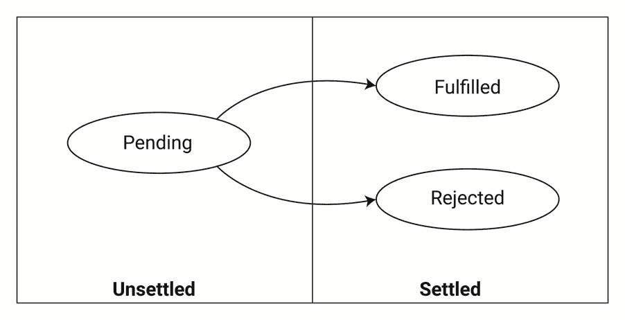

# JavaScript Promises 入门指南


## 目录

- 介绍
- 关于本书
- 感谢
- 关于作者
- 免责声明
- 1. Promise 基础
    - Promise 的生命周期
    - 创建新的（未定型）Promise
    - 创建已定型 Promise
    - 总结
- 2. Promise 链式调用
    - 捕获错误
    - 在 Promise 链中使用 `finally()`
    - 在 Promise 链中返回结果
    - 在 Promise 链中返回 Promise
    - 总结
- 3. 多个 Promise Promise
    - `Promise.all()` 方法
    - `Promise.allSettled()` 方法
    - `Promise.any()` 方法
    - `Promise.race()` 方法
    - 总结
- 4. 异步函数与 await 表达式
    - 定义异步函数
    - 异步函数的不同之处
    - 总结
- 5. 未处理拒绝拒绝的跟踪
    - 检测未处理的拒绝
    - Web 浏览器未处理拒绝的跟踪
    - Node.js 未处理拒绝的跟踪
    - 总结
- 结语
- 下载额外资源
- 支持作者
- 帮助与支持
- 关注作者
- 笔记

## 介绍

JavaScript 最强大的方面之一是能够轻松处理异步编程。作为一种为 Web 创建的语言，JavaScript 从一开始就需要响应点击和按键等用户交互，因此产生了如 `onclick` 等事件处理器。事件处理器允许开发者指定一个函数在未来的某个时刻执行，以响应事件。

Node.js 通过在使用事件的同时使用回调函数进一步普及了 JavaScript 中的异步编程。随着越来越多的程序开始使用异步编程，事件和回调已不足以支持开发者想要的所有操作。Promise 就是解决这个问题的方案。

Promise 是异步编程的另一种选择，它们的工作方式类似于其他语言中的 futures（未来）和 deferreds（延迟）。Promise 指定一段稍后执行的代码（就像事件和回调一样），并显式地指示代码执行是否成功或失败。你可以根据成功或失败将 Promise 链在一起，使得你的代码更容易于理解和调试。

## 关于本书

本书的目标是解释 JavaScript Promise 的工作原理，同时提供何时使用它们的实际示例。今后所有新的异步 JavaScript API 都将基于 Promise 构建，因此 Promise 是理解整个 JavaScript 的核心概念。我希望这本书能为你提供在项目成功成功使用 Promise 所需的信息。

### 浏览器、Node.js 和 Deno 兼容性

你可能会使用多种 JavaScript 运行时，例如 Web 浏览器、Node.js 和 Deno。本书并不尝试解决这些 JavaScript 运行时之间的差异，除非这些差异大到足以令人困惑。通常情况下，本书关注 `ECMA-262` 中描述的 Promise，只有当 JavaScript 运行时之间存在实质性差异时，才会讨论它们的区别。因此，你的 JavaScript 运行时可能不符合书中描述的基于标准的行为。

### 本书的读者群体

本书旨在为已经熟悉 JavaScript 的读者提供指南。特别是，本书针对在 Web 浏览器、Node.js 或 Deno 中工作，并想要学习 Promise 如何工作的中中高级 JavaScript 开发者。

本书不适合从未写过 JavaScript 的初学者。你将对该语言有良好的基础理解才能使用本书。

### 概述

本书的五个章节每一章都涵盖了 JavaScript Promise 的不同方面。许多章节涉及 Promise API，每个章节都在前一章节的基础上构建，允许你逐步建立知识。所有章节都包含代码示例，帮助你学习新的语法和概念。

- **第 1 章：Promise 基础** 介绍了 Promise 的概念、工作原理以及创建和使用它们的不同方法。
- **第 2 章：Promise 链式调用** 讨论了将多个 Promise 链在一起的各种方法，使组合异步操作更容易。
- **第 3 章：多个 Promise** 解释了旨在监控和响应并行执行多个 Promise 的内置 JavaScript 方法。
- **第 4 章：异步函数与 await 表达式** 介绍了异步函数和 await 表达式的概念，并解释了它们如何关联 Promise 以及如何使用 Promise。
- **第 5 章：未处理拒绝跟踪** 解释了如何正确跟踪在没有拒绝处理器的情况下 Promise 被拒绝的情况。

## 使用的规范

本书使用了以下排版规范：

- *斜体* 新术语
- 等宽字体表示代码或文件名
- 所有的 JavaScript 代码示例均以模块（也称为 ECMAScript 模块或 ESM）的形式编写

此外，较长的代码示例包含在等宽代码块中，例如：

```javascript
function doSomething () {
    // empty
}
```

在代码块中，`console.log()` 语句右侧的注释表示执行代码时你在浏览器或 Node.js 控制台中看到的输出。例如：

```javascript
console.log("Hi"); // "Hi"
```

如果代码块中的某行代码抛出错误，也会在代码右侧指示：

```javascript
doSomething(); // error!
```

## 帮助与支持

如果你阅读本书时有问题，请向我的邮件列表发送消息：`books@humanwhocodes.com`。请务必在邮件主题中注明书名。

## 感谢

感谢父亲 Speros Zakas 对本书进行校对，感谢 Rob Friesel 的技术编辑。你们都让这本书变得好得多。

感谢所有评审早期版本并提供反馈的人：Mike Sherov、David Hund、Murat Corlu 和 Chris Ferdandi。

## 关于作者

Nicholas C. Zakas 是一名独立的软件工程师、顾问和教练。他是 ESLint 开源项目的创建者，并在 ESLint 技术指导委员会任。Nicholas 与公司和个人合作改进软件工程流程，并帮助技术领导成长和成功。他还编写或贡献了十多本关于 JavaScript 和 Web 开发的书。你可以在 `https://humanwhocodes.com` 和 Twitter @slick 上找到 Nicholas。

## 免责声明

虽然出版商和作者尽力确保书中包含的信息和指令准确，但他们不对错误或遗漏承担责任，包括限于对使用或依赖本书所造成的损害的责任。使用书中的信息和指令自自。如果书中包含或描述的任何代码示例或其他技术受开源许可或其他知识产权限制，你有责任确保你的使用符合此类许可和或权利。

# 1. Promise 基础

虽然 Promise 通常与异步操作相关联，但它们仅仅是值的占位符。值可能已知，或者更常见的是，值可能是异步操作的结果。与订阅事件或向函数传递回调不同，函数可以返回一个 Promise，如下：

```javascript
// fetch() 承诺在未来的某个时刻完成
const promise = fetch("books.json");
```


`fetch()` 函数是 JavaScript 运行时中一种常用的工具函数，用于发送网络请求。`fetch()` 的调用并不会立即完成网络请求；该将在稍后发生。相反，该函数会返回一个 promise 对象（在本示例中存储在 `promise` 变量中，但你可以随心命名），代表该异步操作，以便你将来对其进行处理。你具体何时能够处理该结果完全取决于 promise 的生命周期的进展。

## Promise 的生命周期

每个 promise 都经历一个短暂的生命周期，从 `pending`（等待中）状态开始，表示 promise 尚未完成。`pending` 的 promise 被视为未决（unsettled）。一旦 `fetch()` 函数返回 promise，该 promise 就处于 `pending` 状态。一旦 promise 完成，它就会被视为已决（settled），并进入两种可能状态之一（见图 1-1）：

- **Fulfilled**（已完成）：promise 成功完成。
- **Rejected**（已拒绝）：promise 因为错误或其他原因未能成功完成。



图 1-1：Promise 状态

内部属性 `[[PromiseState]]` 被设置为 `"pending"`、`fulfilled"` 或 `"rejected"` 以反映 promise 的状态。该属性不会在 promise 对象上暴露，因此你无法通过程序确定 promise 处于何种状态。但你可以通过 `then()` 方法在 promise 状态改变时采取特定操作。

## 使用 then() 赋值处理器

所有 promise 都有 `then()` 方法，并接收两个参数。第一个参数是在 promise 已完成时调用的函数，称为“完成处理程序”（fulfillment handler）。与异步操作相关的任何额外数据都会传递给此函数。第二个参数是在 promise 被拒绝时调用的函数，称为“拒绝处理程序”（rejection handler）。与完成处理器类似，拒绝处理程序也会接收与拒绝相关的任何额外数据。

任何以这种方式实现 `then()` 方法的对象被称为 `thenable`。所有的 promise 都是 thenable，但并非所有的 thenable 都是 promise。

`then()` 的两个参数都是可选的，因此你可以监听完成和拒绝的任何组合。例如，考虑这组 `then()` 调用：

```javascript
const promise = fetch ( “books.json” );
// 添加一个完成处理器和一个拒绝处理器
promise .then ( response => {
    // fulfillment
    console .log ( response . status );
}, reason => {
    // rejection
    console .error ( reason . message );
});

// 添加另一个完成处理器
promise .then ( response => {
    // fulfillment
    console .log ( response . statusText );
});

// 添加另一个拒绝处理器
promise .then ( null , reason => {
    // rejection
    console .error ( reason . message );
});
```

所有三个 `then()` 调用都作用于同一个 promise。第一次调用同时分配了完成处理器和拒绝处理器。第二次只分配了完成处理器；错误不会被报告。第三次仅分配了拒绝处理器，且不报告成功。

`fetch()` 函数的一个特点是，只要它接收到 HTTP 状态码（即使是 404 或 500），返回的 promise 就会完成。只有当网络请求由于某些原因失败时，promise 才会被拒绝。如果你想确保状态处于 200-299 范围内，可以像示例所示检查 `response.ok` 属性：

```javascript
const promise = fetch ( “books.json” );
promise .then ( response => {
    if ( response .ok ) {
        console .log ( “Request succeeded.” );
    } else {
        console .error ( “Request failed.” );
    }
});
```

## 使用 catch() 赋值拒绝处理器

Promise 也有一个 `catch()` 方法，当只传递拒绝处理器时，它的行为与 `then()` 相同。例如，以下 `catch()` 和 `then()` 调用在功能上是等价：

```javascript
const promise = fetch ( “books.json” );
promise .catch ( reason => {
    // rejection
    console .error ( reason . message );
});

// 等同于：
promise .then ( null , reason => {
    // rejection
    console .error ( reason . message );
});
```

`then()` 和 `catch()` 的意图让你结合使用它们，清楚地指示结果是如何被处理的。这种系统比事件和回调更好，因为它让成功或失败完全清晰。（事件在发生错误时往往不会触发，而在回调中你必须始终记得检查错误参数。）只需知道，如果你没有为被拒绝的 promise 附加拒绝处理器，JavaScript 运行时将向控制台输出消息，或者抛出错误，或者两者兼有（取决于运行时）。

## 使用 finally() 赋值结算处理器

除了 `then()` 和 `catch()`，还有 `finally()`。传递给 `finally()` 的回调（称为“结算处理程序”，settlement handler）无论成功失败都会调用。与 `then()` 和 `catch()` 的回调不同，`finally()` 回调不接收任何参数，因为不清楚它是否有参数。由于结算处理器在完成和拒绝时都会调用，它与 `then()` 相似（但并不相同；将在第 2 部分进一步讨论）。这是一个示例：

```javascript
const promise = fetch ( “books.json” );
promise .finally (() => {
    // 无法知道是完成还是拒绝
    console .log ( “Settled” );
});

// 类似于：
const callback = () => {
    console .log ( “Settled” );
};
promise .then ( null , callback );
```

只要你不访问传递给 `callback` 的参数，这两个示例之间的行为是相同的。但是，作为 `catch()`，使用 `finally()` 会让意图更清晰。

当你想要知道某个操作已完成而不在乎结果时，结算处理器非常有用。例如，你可能希望在 `fetch()` 请求活动期间在页面上显示加载指示，并在请求完成后将其隐藏。请求是否成功并不重要。你的 Web 应用程序中可能会有如下代码：

```javascript
const appElement = document .getElementById ( “app” );
const promise = fetch ( “books.json” );

appElement .classList .add ( “loading” );

promise .then (() => {
    // 处理成功
});

promise .catch (() => {
    // 处理失败
});

promise .finally (() => {
    appElement .classList .remove ( “loading” );
});
```

在这里，`appElement` 代表封装整个应用的 HTML 元素。使用 `fetch()` 启动网络请求，并将 CSS 类“loading” 添加到 HTML 元素中（允许你根据需要更改样式）。当网络请求完成后，`promise` 结算，结算处理器从 HTML 元素移除“loading”类以重置应用状态。

通过 `finally()` 添加的结算处理器不会防止拒绝向控制台输出错误或抛出错误。你仍然必须添加拒绝处理器，以防止在这种情况下抛出错误。

## 为已结算的 Promise 赋值处理器

即使在 promise 已经结算后添加完成、拒绝或结算处理器，它们仍然会被执行。这允许你在任何时候添加新的完成和拒绝处理器，并保证它们会被调用。例如：


```javascript
const promise = fetch ( “books.json” );
// original fulfillment handler
promise .then ( response => {
    console .log ( response .status );
    // now add another
    promise .then ( response => {
        console .log ( response .statusText );
    });
});
```

在这段代码中，成功处理器（fulfillment handler）为同一个 promise 添加了另一个成功处理器。此时 promise 已经完成，因此新的成功处理器会被添加到微任务队列（microtask queue）并在就绪时调用。拒绝处理器（rejection handler）和状态处理器（settlement handler）的工作方式相同。

### 处理器与微任务

在程序的常规流中执行的 JavaScript 是作为 `task`（任务）执行的，这意味着 JavaScript 运行时创建了一个新的执行上下文并完全执行代码，在完成后退出。例如，网页中按钮的 `onclick` 处理器是作为任务 `task` 执行的。当按钮被点击时，会创建一个新任务并执行 `onclick` 处理器。一旦完成，JavaScript 运行时将等待下一次交互以执行更多代码。然而，Promise 处理器是以不同的方式执行的。

所有的 Promise 处理器（无论是成功、拒绝还是状态处理）都是在 JavaScript 引擎内部作为 `microtasks`（微任务）执行的。`microtasks` 被入队，并在当前运行的任务完成后立即执行，在 JavaScript 运行时变为空闲之前。调用 `then()`、`catch()` 或 `finally()` 会告诉 promise 在状态确定（settled）后队列指定的 `microtasks`。

这与使用 `setTimeout()` 或 `setInterval()` 创建定时器不同，后者都会创建新任务在稍后的时间点执行。排队的 Promise 处理器始终会在同一任务中排队的定时器之前执行。你可以通过使用全局 `queueMicrotask()` 函数来亲自测试，该函数用于在 promise 之外创建 `microtasks`：

```javascript
setTimeout (() => {
    console .log ( “timer” );
    queueMicrotask (() => {
        console .log ( “microtask in timer” );
    });
}, 0 );

queueMicrotask (() => {
    console .log ( “microtask” );
});
```

在这段代码中，创建了一个延迟为 0 毫秒的定时器，并在定时器内部创建了一个新的 `microtask`。此外，在定时器外部也创建了一个 `microtask`。当这段代码执行时，你将在控制台看到以下输出：

```
microtask
timer
microtask in timer
```

尽管定时器设置的延迟为 0 毫秒，`microtask` 首先执行，随后是定时器，然后是定时器内部的 `microtask`。

关于 `microtasks`（包括所有 Promise 处理器）最重要的点是，它们一旦任务完成就会尽快执行。这最小化了 promise 状态确定到对状态做出反应之间的时间，使得 promise 适用于对运行时性能重要的场景。

### 创建新的（未决定的）Promise

新的 promise 使用 `Promise` 构造函数创建。该构造函数接受一个参数：一个名为 `executor`（执行器）的函数，它包含了初始化 promise 的代码。`executor` 接收两个名为 `resolve()` 和 `reject()` 的函数作为参数。当 `executor` 成功完成时，你调用 `resolve()` 函数来表示 promise 已解析，或者调用 `reject()` 函数表示操作失败。

这里有一个使用旧 `XMLHttpRequest` 浏览器 API 的示例：

```javascript
// 浏览器示例
function requestURL ( url ) {
    return new Promise (( resolve , reject ) => {
        const xhr = new XMLHttpRequest ();
        // 分配事件处理器
        xhr .addEventListener ( “load” , () => {
            resolve ({
                status : xhr .status ,
                text : xhr . responseText
            });
        });
        xhr . addEventListener ( “error” , error => {
            reject ( error );
        });
        // 发送请求
        xhr .open ( “get” , url );
        xhr . send ();
    });
}

const promise = requestURL ( “books.json” );

// 均监听成功和拒绝
promise .then ( response => {
    // 成功
    console .log ( response .status );
    console .log ( response .text );
}, reason => {
    // 拒绝
    console .error ( reason .message );
});
```

在这个示例中，`XMLHttpRequest` 调用被封装在了一个 promise 中。`load` 事件表示请求何时成功完成，因此 promise `executor` 在事件处理器中调用了 `resolve()`。同样，`error` 事件表示请求无法完成，因此在该事件处理器中调用了 `reject()`。你可以遵循同样的流程（在事件处理器中使用 `resolve()` 和 `reject()`）将基于事件的功能转换为基于 promise 的功能。

`executors` 的一个重要方面是，它们在 promise 创建时刻就会立即执行。在上一个示例中，`xhr` 对象被创建，事件处理器被被分配，并且在 `requestURL()` 返回 promise 之前就已经发起了调用。当在 `executor` 内部调用 `resolve()` 或 `reject()` 时，promise 的状态和值会被立即设置，但所有的 promise 处理器（作为 `microtasks`）在当前脚本任务完成之前不会执行。例如，考虑如果在 `executor` 内部立即调用 `resolve()` 会发生什么，如下代码所示：

```javascript
const promise = new Promise (( resolve , reject ) => {
    console .log ( “Executor” );
    resolve ( 42 );
});
promise .then ( result => {
    console .log ( result );
});

console .log ( “Hi!” );
```

在这里，当 `then` 处理器被添加时 promise 立即解析，但输出将是：

```
Executor
Hi!
42
```

这里的 `executor` 首先运行，输出“Executor”。接下来，成功处理器被分配但没有执行。相反，创建了一个新任务在脚本任务后运行。

Promise 只能解析一次，因此如果你在 `executor` 内部多次调用 `resolve()`，后续的调用将忽略忽略。

#### 执行器错误

如果在 `executor` 内部抛出错误，则会调用该 promise 的拒绝处理器。例如：

```javascript
const promise = new Promise (( resolve , reject ) => {
    throw new Error ( “Uh oh!” );
});

promise .catch ( reason => {
    console .log ( reason .message );
});
```

在这段代码中，执行器故意抛出了一个错误。每个执行器内部都有一个隐式的 `try-catch`，以便错误被捕获并传递给拒绝处理器。上一个示例等同于：

```javascript
const promise = new Promise (( resolve , reject ) => {
    try {
        throw new Error ( “Uh oh!” );
    } catch ( ex ) {
        reject ( ex );
    }
});

promise .catch ( reason => {
    console .log ( reason .message );
});
```

`executor` 处理了捕获任何抛出的错误以简化这种常见用例，并且与其他拒绝一样，如果没有分配拒绝处理器，JavaScript 引擎将抛出错误并停止执行。

### 创建已决定的（Settled）Promise

由于 promise 执行器所做内容的动态性质，`Promise` 构造函数是创建未决定 promise 的最佳方法。但如果你想 promise 代表预先计算过的值，那么创建一个仅仅将值传递给 `resolve()` 或 `reject()` 函数的执行器就没有意义了。相反，有两种方法可以根据特定值创建已决定的 promise。

使用 `Promise.resolve()`


`Promise.resolve()` 方法接受单个参数并返回一个处于已完成（fulfilled）状态的 promise。这意味着如果你已经知道了 promise 的值，就不需要提供执行器（executor）。例如：

```javascript
const promise = Promise.resolve(42);
promise.then(value => {
    console.log(value); // 42
});
```

这段代码创建了一个已完成的 promise，因此完成处理程序接收到的 `42` 作为 `value`。与本章中的其他示例一样，完成处理程序会在当前脚本任务完成后作为微任务（microtask）执行。如果给此 promise 添加了拒绝处理程序（rejection handler），该处理器将永远不会被调用，因为 promise 永远不会处于拒绝（rejected）状态。

如果你向 `Promise.resolve()` 传递 promise，函数将返回你传递的同一个 promise。例如：

```javascript
const promise1 = Promise.resolve(42);
const promise2 = Promise.resolve(promise1);
console.log(promise1 === promise2); // true
```

### 使用 `Promise.reject()`

你也可以通过 `Promise.reject()` 方法创建被拒绝的 promise。它的工作原理类似于 `Promise.resolve()`，但创建的 promise 处于拒绝状态，如下：

```javascript
const promise = Promise.reject(42);
promise.catch(reason => {
    console.log(reason); // 42
});
```

向此 promise 添加的任何额外拒绝处理程序都会被调用，但完成处理程序不会，因为 promise 永远不会处于已完成状态。

如果你向 `Promise.resolve()` 或 `Promise.reject()` 方法中的任意一个传递 promise，该 promise 将不修改地返回。

#### 非 Promise 的 Thenables

`Promise.resolve()` 和 `Promise.reject()` 也接受非 promise 的 thenables（具有 then 方法的对象）作为参数。当传递一个非 promise 的 thenable 时，这些方法会创建一个在 `then()` 函数之后调用的新 promise。

当一个对象拥有一个 `then()` 方法且该方法接受 `resolve` 和 `reject` 参数时，就会产生一个非 promise 的 thenable：

```javascript
const thenable = {
    then(resolve, reject) {
        resolve(42);
    }
};
```

示例中的 thenable 对象除了 `then()` 方法外，没有其他与 promise 相关的特征。你可以调用 `Promise.resolve()` 将 thenable 转换为已完成的 promise：

```javascript
const thenable = {
    then(resolve, reject) {
        resolve(42);
    }
};
const promise = Promise.resolve(thenable);
promise.then(value => {
    console.log(value); // 42
});
```

在此示例中，`Promise.resolve()` 调用了 `thenable.then()`，以便确定 promise 的状态。由于在 `then()` 方法内部调用了 `resolve(42)`，所以 `thenable` 的 promise 状态是已完成的。创建一个名为 `promise` 的新已完成 promise，其值为从 `thenable` 传递的（即 `42`），并且 `promise` 的完成处理程序接收到的 `42` 作为值。

相同的过程也可以用于 `Promise.resolve()` 从 thenable 创建被拒绝的 promise：

```javascript
const thenable = {
    then(resolve, reject) {
        reject(42);
    }
};
const promise = Promise.resolve(thenable);
promise.catch(value => {
    console.log(value); // 42
});
```

此示例与上一个相似，但 `thenable` 是被拒绝的。当 `thenable.then()` 执行时，会创建一个处于拒绝状态的新 promise，其值为 `42`。该值随后被传递给 `promise` 的拒绝处理程序。

`Promise.resolve()` 和 `Promise.reject()` 正是这样工作的，允许你轻松地处理非 promise 的 thenables。在 2015 年 promise 引入之前，许多库都使用 thenables，因此将 thenables 转换为正式 promise 对于与现有库的向后兼容至关重要。当你不确定一个对象是否为 promise 时，将对象传递给 `Promise.resolve()` 或 `Promise.reject()`（取决于你的预期结果）是查明的最佳方法，因为 promise 会被原样传递通过。

# 总结

Promise 是一个值的占位符，该值可能会作为某些异步操作的结果在以后提供。与其赋值事件处理器或向函数传递回调函数，不如你可以使用 promise 来表示操作的结果。

Promise 有三种状态：等待（pending）、已完成（fulfilled）和拒绝（rejected）。promise 从等待（未稳定）状态开始，并在成功执行时变为已完成，或在失败时变为拒绝（完成和拒绝都是稳定状态）。在何种情况下，都可以添加处理程序来指示 promise 何时稳定。`then()` 方法允许你分配一个完成处理器和一个拒绝处理程序；`catch()` 方法允许你只分配一个拒绝处理程序；`finally()` 方法允许你分配一个无论结果如何都会被调用的稳定处理器。所有 promise 处理程序都作为微任务运行，因此它们在当前脚本任务完成之前不会执行。

你可以使用 `Promise` 构造函数创建新的未稳定 promise，该构造函数接受执行器函数作为其唯一参数。执行器被传递 `resolve()` 和 `reject()` 函数，你使用这些函数来指示 promise 的成功或失败。执行器在 promise 创建时立即运行，这与作为微任务运行的处理器不同。在执行器中抛出的任何错误都会被自动捕获并传递给 `reject()`。

可以使用 `Promise.resolve()` 创建已完成的 promise，使用 `Promise.reject()` 创建被拒绝的 promise。每种方法都会将其参数包装在 promise 中（如果它不是 promise 和非 promise-thenable），或者透传现有 promise。这些方法在你不确定值是否为 promise 但希望它像 promise 一样运行时非常有帮助。

虽然创建单个 promise 是处理 JavaScript 操作的一种实用且有效的方法，但 promise 在链式运行时允许有趣的组合模式。在下一章中，你将学习 promise 处理程序如何创建 promise 链以及为什么这非常有价值。

## 2. Promise 链

到目前，promise 似乎只是对组合回调和 `setTimeout()` 函数的改进，但 promise 远比看到的复杂。具体来说，有许多方法可以链式 promise 以实现更复杂的行为。

对 `then()`、`catch()` 或 `finally()` 的每次调用实际上创建并返回另一个 promise。第二个 promise 只有在第一个 promise 完成或拒绝后才会变为稳定。考虑这个示例：

```javascript
const promise = Promise.resolve(42);
promise.then(value => {
    console.log(value);
}).then(() => {
    console.log("Finished");
});
```

代码输出为：

```
42
Finished
```

`promise.then()` 调用返回第二个 promise，并在上面调用 `then()`。第二个 `then()` 完成处理器只有在第一个 promise 解析后才会被调用。如果对此示例取消链，它看起来像这样：

```javascript
const promise1 = Promise.resolve(42);
const promise2 = promise1.then(value => {
    console.log(value);
});
promise2.then(() => {
    console.log("Finished");
});
```

在代码取消链的版本中，`promise1.then()` 的结果存储在 `promise2` 中，然后调用 `promise2.then()` 来添加最后的完成处理器。`promise2.then()` 的调用也返回一个 promise。这个示例只是没有使用那个 promise。

#### 捕获错误

Promise 链允许你捕获在前一个 promise 的完成或拒绝处理器中可能发生的错误。例如：

```javascript
const promise = Promise.resolve(42);
promise.then(value => {
    throw new Error("Oops!");
}).catch(reason => {
    console.error(reason.message); // "Oops!"
});
```


在这段代码中，promise 的成功处理函数（fulfillment handler）抛出了一个错误。第二个 promise 上的 `catch()` 方法链式调用能够通过其拒绝处理函数（rejection handler）接收该错误。如果拒绝处理函数抛出错误，结果也是如此：

```javascript
const promise = new Promise (( resolve , reject ) => { 
    throw new Error ( “Uh oh!” ); 
}); 
promise . catch ( reason => { 
    console . log ( reason . message );     // “Uh oh!”
    throw new Error ( “Oops!” ); 
}). catch ( reason => { 
    console . error ( reason . message );  // “Oops!” 
});
```

在这里，执行器（executor）抛出的错误触发了 promise 的拒绝处理函数。该处理器随后抛出另一个错误，该错误被第二个 promise 的拒绝处理函数捕获。链式 promise 调用可以感知链中其他 promise 中的错误。

你可以利用这种能力通过 promise 链捕获错误，从而有效地模拟 `try-catch` 语句。考虑使用 `fetch()` 获取某些数据并想要捕获可能发生的任何错误：

```javascript
const promise = fetch ( “books.json” ); 
promise . then ( response => { 
    console . log ( response . status ); 
}). catch ( reason => { 
    console . error ( reason . message ); 
});
```

如果 `fetch()` 调用成功，此示例将输出响应状态；如果调用失败，将输出错误消息。你可以更进一步，通过检查 `response.ok` 属性（第 1 章讨论过）并将 200-299 范围之外的状态码作为错误处理，如果它为 false 则抛出错误，如下例所示：

```javascript
const promise = fetch ( “books.json” ); 
promise . then ( response => { 
    if ( response . ok ) { 
        console . log ( response . status ); 
    } else { 
        throw new Error ( `Unexpected status code: ${ response . status } ${ response .statusText }` ); 
    } 
}). catch ( reason => { 
    console . error ( reason . message ); 
});
```

此示例中的链式 `catch()` 调用创建了一个拒绝处理函数，它可以同时捕获由 `fetch()` 返回的错误以及在成功处理函数中抛出的任何错误。因此，你不需要两个不同的处理器来捕获两种不同类型的错误，可以使用一个处理器来处理链中可能发生的所有错误。

始终在 promise 链的末尾保留一个拒绝处理函数，以确保能够妥善处理可能发生的任何错误。

### 在 Promise 链中使用 finally()

`finally()` 方法的行为与 `then()` 或 `catch()` 都不同，因为它会将上一个 promise 的状态和值复制到它返回的 promise 中。这意味着如果原始 promise 成功完成并带有值，那么 `finally()` 返回的 promise 也将相同值成功完成。例如：

```javascript
const promise = Promise . resolve ( 42 ); 
promise . finally (() => { 
    console . log ( “Finally called.” ); 
}). then ( value => { 
    console . log ( value );         // 42
});
```

在这里，判定处理器（settlement handler）无法接收来自 `promise` 的成功值，因此该值被复制到方法调用返回的新 promise 中。新 promise 以值 42（从 `promise` 复制）成功完成，因此成功处理函数接收到的 42 作为参数。请记住，尽管返回的 promise 和 `promise` 具有相同的值，但它们并不是同一个对象，如示例所示：

```javascript
const promise1 = Promise . resolve ( 42 ); 
const promise2 = promise1 . finally (() => { 
    console . log ( “Finally called.” ); 
}); 
promise2 . then ( value => { 
    console . log ( value );         // 42
}); 
console . log ( promise1 === promise2 ); // false
```

在这段代码中，`promise1.finally()` 的返回值被存储在 `promise2` 中，此时你可以确定它与 `promise1` 不是同一个对象。`finally()` 的调用总是从原始 promise 复制状态和值。这意味着当在被拒绝的 promise 上调用 `finally()` 时，它反过来返回一个被拒绝的 promise，如下例所示：

```javascript
const promise = Promise . reject ( 43 ); 
promise . finally (() => { 
    console . log ( “Finally called.” ); 
}). catch ( reason => { 
    console . error ( reason );      // 43
});
```

此示例中的 `promise` 因原因 43 被拒绝。再次，判定处理器无法访问此信息，因为它不是作为参数传递的，相反，它返回了一个因相同原因被拒绝的新 promise。然后你可以使用 `catch()` 获取该原因。

`finally()` 工作机制的唯一例外是当在判定处理器内部抛出错误或者被拒绝的 promise 再次被拒绝。在这种情况下，返回的 promise 不维护原始 promise 的状态和值，而是被抛出的错误所拒绝。这里有一个示例：

```javascript
const promise1 = Promise . reject ( 43 ); 
promise1 . finally (() => { 
    throw 44 ; 
}). catch ( reason => { 
    console . error ( reason ); 
}); 

const promise2 = Promise . reject ( 43 ); 
promise2 . finally (() => { 
    throw 44 ; 
}). catch ( reason => { 
    console . error ( reason ); 
});
```

由于第一个示例中的 `promise1` 被 43 拒绝，`catch()` 处理器接收到了 43。在第二个示例中，`promise2` 被 44 拒绝，`catch()` 处理器接收到了 44。

在第 1 章中，你看到了如何使用判定处理器来切换应用程序的加载状态。使用 promise 链重写该示例，并结合之前的错误处理，这是一个完整的示例：

```javascript
const appElement = document . getById ( “app” ); 
const promise = fetch ( “books.json” ); 
appElement . classList . add ( “loading” ); 
promise . then ( response => { 
    if ( response . ok ) { 
        console . log ( response . status ); 
    } else { 
        throw new Error ( `Unexpected status code: ${ response . status } ${ response .statusText }` ); 
    } 
}). finally (() => {
    appElement . classList . remove ( “loading” ); 
}). catch ( reason => { 
    console . error ( reason . message ); 
});
```

与 `try-catch` 语句不同，发生错误，你不希望 `finally()` 是链的最后部分。因此首先调用 `then()` 来处理 `fetch()` 的响应，然后向链中添加 `finally()` 以触发 UI 变化，最后由 `catch()` 为整个链添加错误处理器。这就是处理器传递上一个 promise 状态有用的地方：如果成功处理函数最终抛出错误，拒绝处理器将访问它。

### 在 Promise 链中返回值

Promise 链的另一个重要方面是是将数据从一个 promise 传递到下一个的能力。你已经看到传递给执行器内部 `resolve()` 方法的值会传递给该 promise 的成功处理函数。你可以通过在成功处理函数中指定返回值继续在链中传递数据。例如：

```javascript
const promise = Promise . resolve ( 42 ); 
promise . then ( value => { 
    console . log ( value );         // 42
    return value + 1 ; 
}). then ( value => { 
    console . log ( value );         // 43
});
```

`promise` 的成功处理函数在执行时返回 `value + 1`。由于 `value` 是 42（来自执行器），成功处理函数返回了 43。


你也可以对拒绝处理器（rejection handler）执行相同的操作。当拒绝处理函数被调用时，它可能会返回一个值。如果确实了，该值将用于完成链中的下一个 promise，如下所示：

```javascript
const promise = Promise . reject ( 42 );
promise . catch ( value => {
    // 拒绝处理器
    console . error ( value );      // 42
    return value + 1 ;
}). then ( value => {
    // 成功处理函数
    console . log ( value );        // 43
});
```

在这里，创建了一个值为 `42` 的被拒绝 promise。该值被传递给该 promise 的拒绝处理函数，并在其中返回了 `value + 1`。尽管这个返回值来自拒绝处理函数，但它仍然会在链中下一个 promise 的成功处理函数中使用。在必要时，一个 promise 的失败可以允许整个链的恢复。

然而，使用 `finally()` 会导致产生不同的行为。从状态处理函数（settlement handler）返回的任何值都会被忽略，以便你可以访问原始 promise 的值。这里有一个示例：

```javascript
const promise = Promise . resolve ( 42 );
promise . finally (() => {
    // 状态处理器
    return 43 ;                   // 被忽略！
}). then ( value => {
    // 成功处理函数
    console . log ( value );        // 42
});
```

传递给成功处理函数的值是 `42` 而不是 `43`。状态处理器中的 `return` 语句被忽略，因此可以使用 `then()` 获取原始值。这是 `finally()` 返回一个状态和值都从原始 promise 复制的 promise 的结果之一。

# 在 Promise 链中返回 Promise

从 promise 处理函数中返回原始值允许在 promise 之间传递数据，但如果你返回的是一个对象呢？如果该对象是一个 promise，那么会有一个额外的步骤来确定如何继续。考虑以下示例：

```javascript
const promise1 = Promise . resolve ( 42 );
const promise2 = Promise . resolve ( 43 );

promise1 . then ( value => {
    console . log ( value );    // 42
    return promise2 ;
}). then ( value => {
    console . log ( value );    // 43
});
```

在这段代码中，`promise1` 解析为 `42`。`promise1` 的成功处理函数返回了 `promise2`，这是一个已经处于解析状态的 promise。第二个成功处理函数被调用是因为 `promise2` 已经执行成功了。如果 `promise2` 被拒绝，则会调用拒绝处理器（如果存在），而不是第二个成功处理函数。

关于这种模式需要识别的重要的一点是，第二个成功处理函数并没有被添加到 `promise2` 上，而是被添加到第三个 promise 上，这使得上一个示例等同于：

```javascript
const promise1 = Promise . resolve ( 42 );
const promise2 = Promise . resolve ( 43 );

const promise3 = promise1 . then ( value => {
    console . log ( value );    // 42
    return promise2 ;
});

promise3 . then ( value => {
    console . log ( value );    // 43
});
```

在这里，很明显第二个成功处理函数是附加到 `promise3` 的，而不是 `promise2`。这是一个细微但重要的区别，因为如果 `promise2` 被拒绝，第二个成功处理函数将不会调用。例如：

```javascript
const promise1 = Promise . resolve ( 42 );
const promise2 = Promise . reject ( 43 );

promise1 . then ( value => {
    console . log ( value );    // 42
    return promise2 ;
}). then ( value => {
    console . log ( value );    // 永远不会被调用
});
```

在这个示例中，第二个成功处理函数永远不会被调用，因为 `promise2` 被拒绝了。然而，你可以附加一个拒绝处理器：

```javascript
const promise1 = Promise . resolve ( 42 );
const promise2 = Promise . reject ( 43 );

promise1 . then ( value => {
    console . log ( value );    // 42
    return promise2 ;
}). catch ( value => {
    console . error ( value );  // 43
});
```

在这里，拒绝处理器是因为 `promise2` 被拒绝而被调用的。来自 `promise2` 的拒绝值 `43` 被传递到该拒绝处理器中。

从成功处理函数中返回 promise 对于一个操作需要多个 promise 才能执行完成的情况很有帮助。例如，`fetch()` 需要第二个 promise 来读取响应的体。要读取 JSON 体，你需要使用 `response.json()`，它会返回另一个 promise。以下是在不使用 promise 链时的的写法：

```javascript
const promise1 = fetch ( “books.json” );

promise1 . then ( response => {
    promise2 = response . json ();
    promise2 . then ( payload => {
        console . log ( payload );
    }). catch ( reason => {
        console . error ( reason . message );
    });

}). catch ( reason => {
    console . error ( reason . message );
});
```

这段代码需要两个不同的拒绝处理器来捕获过程中两个不同步骤的潜在错误。从第一个成功处理函数返回第二个 promise 简化了代码：

```javascript
const promise = fetch ( “books.json” );

promise . then ( response => {
    return response . json ();
}). then ( payload => {
    console . log ( payload );
}). catch ( reason => {
    console . error ( reason . message );
});
```

在这里，第一个成功处理函数在接收到响应时被调用，并返回一个 promise 来读取体。你只需要在最后需要一个拒绝处理器来捕获沿发生的错误。

使用 `finally()` 从状态处理函数返回 promise 也表现出与 `then()` 或 `catch()`不同的行为。首先，如果你从状态处理函数返回一个解析的 promise，那么该 promise 被忽略，转而使用原始值，如下所示：

```javascript
const promise = Promise . resolve ( 42 );
promise . finally (() => {
    return Promise . resolve ( 44 );
}). then ( value => {
    console . log ( value );
```

在这个示例中，状态处理器返回了一个解析为 `44` 的 promise，但返回的 promise 使用的是原始值 `42`。

然而，如果你从状态处理函数返回一个被拒绝的 promise，那么返回的 promise 将采纳该原因且返回的 promise 将被拒绝，如下所示：

```javascript
const promise = Promise . resolve ( 42 );
promise . finally (() => {
    return Promise . reject ( 43 );
}). catch ( reason => {
    console . error ( reason );
});
```

即使原始 promise 被拒绝，这种情况仍然成立，如下所示：

```javascript
const promise = Promise . reject ( 43 );
promise . finally (() => {
    return Promise . reject ( 45 );
}). catch ( reason => {
    console . log ( reason );
});
```

从状态处理函数返回拒绝 promise 在功能上等同于抛出一个错误：返回的 promise 将根据指定的原因被拒绝。

从成功或拒绝处理器返回 promise 不会改变 promise 执行器的执行顺序。第一个定义的 promise 将运行其执行器；然后运行第二个 promise 执行器，依此类推。返回 promise 允许你对 promise 的结果定义额外的响应。通过在成功处理函数内部创建一个 promise 来延迟成功处理函数的执行。例如：

```javascript
const p1 = Promise . resolve ( 42 );
p1 . then ( value => {
    console . log ( value );    // 42
    // 创建一个新的 promise
    const p2 = new Promise (( resolve , reject ) => {
        setTimeout (() => {
            resolve ( 43 );
        }, 500 );
    });
    return p2 ;
}). then ( value => {
    console . log ( value );    // 43
});
```


在这个示例中，在 `p1` 的成功处理器内部创建了一个新的 promise。这意味着在 `p2` 成功完成之前，第二个成功处理器不会执行。`p2` 的执行器通过 `setTimeout()` 延迟了 500 毫秒，但在更实际场景中，你可能会发起网络请求或文件系统请求。当你希望在启动新的异步操作之前等待上一个 promise 状态稳定时，这种模式非常有用。

# 总结

多个 promise 可以以各种方式链在一起，以便在它们之间传递信息。对 `then()`、`catch()` 和 `finally()` 的每次调用都会创建并返回一个新的 promise，该 promise 在前一个 promise 稳定后变为解析（resolved）。如果 promise 处理器返回一个值，那么该值将成为 `then()` 和 `catch()` 创建的新 promise 的值（`finally()` 会忽略此值）；如果 promise 处理器抛出错误，则错误会被捕获，且返回的新 promise 将以该错误为原因被拒绝（rejected）。

当链中的一个 promise 被拒绝时，从其他链式处理器创建的 promise 也会被拒绝，直到到达链的末尾。基于这一点，建议在每个 promise 链末尾附加一个拒绝处理器，以确保错误被正确处理。未能捕获 promise 拒绝将导致控制台输出消息、抛出错误或两者兼有（取决于运行时环境）。

你可以从处理器返回 promise，在这种情况下，从 `then()` 和 `catch()` 调用返回的 promise 的稳定状态将与处理器返回的 promise 的稳定状态和值相（`finally()` 返回的解析 promise 会被忽略，而拒绝的 promise 会被遵循）。你可以利用这一点，延迟某些操作直到某个 promise 成功完成，然后启动并返回第二个 promise，以继续使用同一个 promise 链。

本章探讨了如何将多个 promise 链在一起，使它们的作用更像一个 promise。在下一章中，你将学习如何处理并行运行的多个 promise。

## 3. 使用多个 promise

到目前为止，书中的每个示例都处理一次对一个 promise 的响应。然而，有时你可能希望监控多个 promise 的进度，以决定下一步操作。JavaScript 提供了几种方法来监控多个 promise 并以略有不同的方式对其响应。本章讨论的所有方法都允许多个 promise 并行执行，然后作为一个整体进行响应，而不是逐个处理。

### Promise.all() 方法

`Promise.all()` 方法接受单个参数，该是一个要监控的 promise 可迭代对象（例如数组），并返回一个 promise，只有当迭代对象中的每个 promise 都解析时，该 promise 才会解析。当迭代对象中的每个 promise 都成功完成时，返回的 promise 变为成功，如示例所示：

```javascript
let promise1 = Promise.resolve(42);
let promise2 = new Promise((resolve, reject) => {
    resolve(43);
});
let promise3 = new Promise((resolve, reject) => {
    setTimeout(() => {
        resolve(44);
    }, 100);
});

let promise4 = Promise.all([promise1, promise2, promise3]);

promise4.then(value => {
    console.log(Array.isArray(value));   // true
    console.log(value[0]);             // 42
    console.log(value[1]);             // 43
    console.log(value[2]);             // 44
});
```

这里的每个 promise 都用数字解析。对 `Promise.all()` 的调用创建了 `promise4`，它最终在 `promise1`、`promise2` 和 `promise3` 都成功完成后变为成功完成。传递给 `promise4` 成功处理器的结果是一个包含每个解析值的数组：`42`、`43` 和 `44`。这些值按照 promise 传递给 `Promise.all()` 的顺序存储，因此你可以将 结果与解析它们的 promise 相匹配。

如果传递给 `Promise.all()` 的任何 promise 被拒绝，返回的 promise 将立即被拒绝，无需等待其他 promise 完成：

```javascript
let promise1 = Promise.resolve(42);
let promise2 = Promise.reject(43);
let promise3 = new Promise((resolve, reject) => {
    setTimeout(() => {
        resolve(44);
    }, 100);
});

let promise4 = Promise.all([promise1, promise2, promise3]);

promise4.catch(reason => {
    console.log(Array.isArray(reason)); // false
    console.log(reason);                 // 43
});
```

在这个示例中，第二个 promise (`promise2`) 被以值 `43` 拒绝。`promise4` 的拒绝处理器被立即调用，而无需等待第一个 promise。

### 何时使用 Promise.all()

在任何你需要等待多个 promise 且任何一个失败都应导致整个操作失败的情况下，你都会想要使用 `Promise.all()`。

### 共同处理多个文件

当使用 Node.js 或 Deno 等服务端运行时时，你可能需要读取多个文件来处理数据。在这种情况下，最有效的方法是并行读取文件并等待它们全部完成。这是一个在 Node.js 中运行的示例：

```javascript
import { readFile } from "node:fs/promises";

function readFiles(filenames) {
    return Promise.all(
        filenames.map(filename => readFile(filename, "utf8"))
    );
}

readFiles(["file1.json", "file2.json"])
    .then(fileContents => {
        // 解析 JSON 数据
        const data = fileContents.map(
            fileContent => JSON.parse(fileContent)
        );
        // 根据需要处理
        console.log(data);
    })
    .catch(reason => {
        console.error(reason.message);
    });
```

### 调用多个相关的 Web 服务 API

`Promise.all()` 的另一个常见用例是调用多个 Web 服务 API。这在 REST API 中特别常见，因为与实体关联的每个类型数据可能有其自己的端点。例如，考虑一个应用程序，每个用户都有博客文章和专辑，你可能需要在用户个人资料上收集所有这些信息。代码可能如下所示：


```javascript
const API_BASE = “https://jsonplaceholder.typicode.com” ;
function fetchUserData ( userId ) {
    const urls = [
        `${ API_BASE } /users/ ${ userId } /posts` ,
        `${ API_BASE } /users/ ${ userId } /albums`
    ];
    return Promise . all ( urls . map ( url => fetch ( url)));
}

fetchUserData ( 1 ). then ( responses => {
    return Promise . all (
        responses . map (
            response => {
                if ( response . ok ) {
                    return response . json ();
                } else {
                    return Promise . reject (
                        new Error ( `Unexpected status code: ${ response . status } ${ response . statusText } for ${ response . url }` )
                    );
                }
            }
        )
    );
}). then (([ posts , albums ]) => {
    // process your data as necessary
    console . log ( posts );
    console . log ( albums );

}). catch ( reason => console . error ( reason . message ));
```

此示例使用了 `JSONPlaceholder` 服务，这是一个用于测试和原型设计的免费虚假 API。给定一个特定的用户 ID，JSONPlaceholder 将生成伪数据。在这种情况下，代码对每个用户使用了 `/posts` 和 `/albums` 端点。`fetchUserData()` 函数接收一个用户 ID 并生成用于调用的 URL。然后，这些 URL 被映射到每个 `fetch()` 调用返回的 promise。当获取到响应时，会使用另一个 `Promise.all()` 调用将每个响应映射到另一个 promise：如果响应在 200-299 范围内，则映射为 JSON 体；否则映射为被拒绝的 promise（这将短路整个操作并调用拒绝处理程序）。在最后一个结算处理程序中，可以获取 `posts` 和 `albums` 数据以供进行处理。

## 创建人工延迟

`Promise.all()` 的一个不常见场景是你希望推迟某些事情发生得不要太快。这种情况在浏览器中比在服务器端更容易发生，在服务器端，你有时需要在用户操作和响应之间设置微小的延迟。例如，你可能希望在从服务器获取数据时显示加载指示器，但如果响应太快，用户可能看不到加载旋转图标，因此不知道屏幕上的数据是最新的。在这样的情况下，你可以引入一个人工延迟，如下：

```javascript
const API_BASE = “https://jsonplaceholder.typicode.com” ;
const appElement = document . getElementById ( “app” );

function delay ( milliseconds ) {
    return new Promise ( resolve => {
        setTimeout (() => {
            resolve ();
        }, milliseconds );
    });
}

function fetchUserData ( userId ) {
    appElement . classList . add ( “loading” );

    const urls = [
        `${ API_BASE } /users/ ${ userId } /posts` ,
        `${ API_BASE } /users/ ${ userId } /albums`
    ];

    return Promise . all ([
        … urls . map ( url => fetch ( url )),
        delay ( 1500 )
    ]). then ( results => {
        // strip off the undefined result from delay()
        return results . slice ( 0 , results . length - 1 );
    });
}
fetchUserData ( 1 ). then ( responses => {
    return Promise . all (
        responses . map (
            response => {
                if ( response . ok ) {
                    return response . json ();
                } else {
                    return Promise . reject (
                        new Error ( `Unexpected status code: ${ response . status } ${ response . statusText } for ${ response . url }` )
                    );
                }
            }
        )
    );
}). then (([ posts , albums ]) => {
    // process your data as necessary
    console . log ( posts );
    console . log ( albums );

}). finally (() => {
    appElement . classList . remove ( “loading” );
}). catch ( reason => console . error ( reason . message ));
```

这段代码在之前示例的基础上，通过在每个 `fetch()` 调用中引入延迟来实现。`delay()` 函数返回一个在经过指定的毫秒数后解析（resolve）的 promise。它是通过使用原生的 `setTimeout()` 函数并传递一个调用 `resolve()` 的回调函数来实现的。注意，在这种情况下不需要向 `resolve()` 传递任何值，因为没有相关数据。你也可以直接将 `resolve` 作为 `setTimeout()` 的第一个参数传递；然而，某些 JavaScript 运行时会向超时回调传递参数。为了跨运行环境具有最佳兼容性，最好在另一个函数内部调用 `resolve()`。

`fetchUserData()` 函数为指定的用户 ID 发起 Web 服务请求。如上一节的示例所示，`Promise.all()` 被用于监控多个 `fetch()` 请求，但在本示例中，传递给 `Promise.all()` 的数组还包含了对 `delay()` 的调用。当返回的 promise 完成时，完成处理程序接收到一个包含所有结果的数组，最后一个元素是 `undefined`。在从 `fetchUserData()` 返回之前，删除了最后一个元素，这样调用 `fetchUserData()` 的代码就不需要感知 `delay()` 调用。CSS 类 `loading` 被添加到 DOM 中的应用程序元素中，以指示数据正在检索，稍后在接收响应时由结算处理程序移除。

你刚刚学习了使用 `Promise.all()` 作为最佳解决方案的用例。但如果你希望即使一个 promise 被拒绝，你的操作仍然继续呢？这时 `Promise.allSettled()` 是更好的选择。

## Promise.allSettled() 方法

`Promise.allSettled()` 方法是 `Promise.all()` 的一种变体，它等待指定的迭代器中的所有 promise 都结算（settled），无论它们是已完成还是被拒绝。`Promise.allSettled()` 的返回值始终一个解析为包含结果对象数组的 promise。

已完成 promise 的结果对象有两个属性：
- `status`: 始终设置为字符串 `fulfilled`
- `value`: promise 的完成值

对于被拒绝的 promise，结果对象中也有两个属性：
- `status`: 始终设置为字符串 `rejected`
- `reason`: promise 的拒绝原因

你可以使用返回的结果对象数组来确定每个 promise 的结果。

```javascript
let promise1 = Promise . resolve ( 42 );
let promise2 = Promise . reject ( 43 );

let promise3 = new Promise (( resolve , reject ) => {
    setTimeout (() => {
        resolve ( 44 );
    }, 100 );
});

let promise4 = Promise . allSettled ([ promise1 , promise2 , promise3 ]);

promise4 . then ( results => {
    console . log ( Array . isArray ( results )); // true
    console . log ( results [ 0 ]. status ); // “fulfilled”
    console . log ( results [ 0 ]. value ); // 42
    console . log ( results [ 1 ]. status ); // “rejected”
    console . log ( results [ 1 ]. reason ); // 43
    console . log ( results [ 2 ]. status ); // “fulfilled”
    console . log ( results [ 2 ]. value ); // 44
});
```

即使第二个 promise（ `promise2` ）是一个被拒绝的 promise，对 `Promise.allSettled()` 的调用仍然返回一个解析为结果对象数组的 promise。

## 分别处理多个文件


在讨论 `Promise.all()` 时，你已经看到过一个处理多个相互依赖且必须全部成功的文件操作示例。在某些情况下，分别处理多个文件意味着如果其中一个操作失败了，你不需要停止整个操作；你可以继续完成成功的操作，然后记录失败的操作以便稍后重试。以下是一个 Node.js 的示例：

```javascript
import { readFile, writeFile } from "node:fs/promises";

// 或者对文件进行任何操作
function transformText(text) {
    return text.split("").reverse().join("");
}

function transformFiles(filenames) {
    return Promise.allSettled(
        filenames.map(filename =>
            readFile(filename, "utf8")
                .then(text => transformText(text))
                .then(newText => writeFile(filename, newText))
                .catch(reason => {
                    reason.filename = filename;
                    return Promise.reject(reason);
                })
        )
    );
}

transformFiles(["file1.txt", "file2.txt"]).then(results => {
    // 获取失败的结果
    const failedResults = results.filter(
        result => result.status === "rejected"
    );

    if (failedResults.length) {
        console.error("以下文件未能成功转换:");
        console.error("");
        failedResults.forEach(failedResult => {
            console.error(failedResult.reason.filename);
            console.error(failedResult.reason.message);
            console.error("");
        });
    } else {
        console.log("所有文件已成功转换.");
    }
});
```

这个示例读取了一系列文件，反转文件中文本的顺序，然后将文本写回原始文件（当然，你可以将 `transformText()` 替换为任何你的操作）。`transformFiles()` 函数接收一个 `filenames` 数组，读取文件内容，转换文本并将转换后的文本写回文件。Promise 链代表了过程中的每一步，而拒绝处理程序为任何拒绝原因添加了 `filename` 属性，以便在事后更容易解释结果。

当所有文件的操作完成后，会对结果进行过滤，以找到任何转换未成功的文件，并将这些结果输出到控制台。在生产系统中，你可能会将失败的结果输入监控系统或队列，以尝试重新转换。

### 调用多个独立的 Web 服务 API

`Promise.all()` 部分的另一个示例是调用多个 Web 服务 API，而你希望所有请求都成功。如果你不需要所有请求都成功，那么可以使用 `Promise.allSettled()`。回到之前的示例，如果即使在缺少部分数据的情况下也可以显示用户个人资料页面，那么请使用 `Promise.allSettled()` 代替 `Promise.all()`，以避免向用户显示错误。例如：

```javascript
const API_BASE = "https://jsonplaceholder.typicode.com";

function fetchUserData(userId) {
    const urls = [
        `${API_BASE}/users/${userId}/posts`,
        `${API_BASE}/users/${userId}/albums`,
        `${API_BASE}/users/${userId}/extras`
    ];
    return Promise.allSettled(urls.map(url => fetch(url)))
        .then(results => results.map(result => result.value));
}

fetchUserData().then(responses => {
    return Promise.all(
        responses.map(response => {
            if (response?.ok) {
                return response.json();
            }
        })
    );
}).then(([posts, albums, extras]) => {
    // 根据需要处理你的数据
    if (posts) {
        console.log("Posts");
        console.log(posts);
    }
    if (albums) {
        console.log("Albums");
        console.log(albums);
    }
    if (extras) {
        console.log("Extras");
        console.log(extras);
    }
}).catch(reason => console.error(reason.message));
```

在这个版本的示例中，`fetchUserData()` 函数使用 `Promise.allSettled()` 代替 `Promise.all()`，以确保拒绝可以被忽略。此示例还调用了第三方端点 `/users/{userId}/extras`，该端点并不存在，演示目的将返回 404。一旦所有请求完成，成功处理程序会将每个结果映射到其 `value` 属性，这确保了任何拒绝的 Promise 都映射为 `undefined`，而已实现的 Promise 则映射到 `fetch()` 返回的响应对象。

由于 `response` 可能是 `undefined`，你需要在检查 `ok` 属性之前检查 `response` 是否为真。然后会读取每个有效响应的 JSON 体，并由最后一个成功处理程序读取这些数据。无法保证每个请求的数据都会存在（在此示例中 `extras` 将是 `undefined`），因此你需要在处理每个值之前检查该值是否存在。

### 等待动画完成

在网页中，元素可以以多种不同的方式同时进行动画处理。例如，你可以让元素从页面底部向上移动，同时动画化宽度和高度，以使元素进入视野。在这些情况下，在对元素或页面进行下一次修改之前，等待所有动画完成是有帮助的。在名为《构建 toast 组件》（Building a toast component）一篇文章中，Adam Argyle 解释了跟踪 DOM 元素动画何时完成的基本方法。我在这里重写了代码以便理解：

```javascript
function waitForAnimations(element) {
    return Promise.allSettled(
        element.getAnimations().map(animation => animation.finished)
    );
}

const toasterElement = document.getElementById("toaster");
waitForAnimations(toasterElement).then(() => console.log("Toaster 完成。"));
```

在这种情况下，你并不真正关心过程中是否有任何动画失败，你也不关心接收动画的任何成功值，因此 `Promise.allSettled()` 比 `Promise.all()` 更合适。`getAnimations()` 方法返回一个动画对象数组，每个对象都有一个 `finished` 属性，该属性包含一个在动画完成后解析的 Promise。通过将这些 Promise 传递给 `Promise.allSettled()`，会在所有动画完成后通知。由于 `Promise.allSettled()` 永远不会返回拒绝的 Promise，你可以附加一个成功处理程序而不必担心任何未捕获的拒绝错误。

### Promise.any() 方法

`Promise.any()` 方法也接受 Promise 迭代器，并在传入的 Promise 中任何一个被实现时返回一个已实现的 Promise。一旦其中任何一个 Promise 被实现，操作就会短路。（这与 `Promise.all()` 相反，后者在一个 Promise 被拒绝时操作就会短路）。这里是一个示例：

```javascript
let promise1 = Promise.reject(43);

let promise2 = Promise.resolve(42);

let promise3 = new Promise((resolve, reject) => {
    setTimeout(() => {
        resolve(44);
    }, 100);
});

let promise4 = Promise.any([promise1, promise2, promise3]);

promise4.then(value => console.log(value));
```


尽管此示例中的第一个承诺（`promise1`）被拒绝了，但 `Promise.any()` 的调用仍然成功，因为第二个承诺（`promise2`）已完成。第三个承诺（`promise3`）的结果被丢弃了。

如果传递给 `Promise.any()` 的所有承诺都被拒绝了，那么返回的承诺将会被 `AggregateError` 拒绝。`AggregateError` 是一种表示存储在 `errors` 属性中的多个错误的错误。例如：

```javascript
let promise1 = Promise.reject(43);
let promise2 = new Promise((resolve, reject) => {
    reject(44);
});

let promise3 = new Promise((resolve, reject) => {
    setTimeout(() => {
        reject(45);
    }, 100);
});

let promise4 = Promise.any([promise1, promise2, promise3]);

promise4.catch(reason => {
    // 运行时相关的错误消息
    console.log(reason.message);

    // 输出拒绝值
    console.log(reason.errors[0]);  // 43
    console.log(reason.errors[1]);  // 44
    console.log(reason.errors[2]);  // 45
});
```

在这里，`Promise.any()` 接收到的承诺均未完成，因此返回的承诺被 `AggregateError` 拒绝。你可以检查 `errors` 属性（这是一个数组），以获取每个承诺的拒绝值。

### 何时使用 Promise.any()

当你希望承诺中的任何一个完成，且不在乎有多少个承诺被拒绝（除非它们全部被拒绝）时，使用 `Promise.any()` 方法最佳。以下是你可能想要使用 `Promise.any()` 的场景。

#### 执行对冲请求 (Hedged Requests)

正如《The Tail at Scale² 定义，对冲请求（hedged request）是指客户端向多个服务器发送请求，并接受第一个响应的服务器的结果。这对于需要尽可能低延迟、且有服务器资源用于管理额外负载和响应去重的情况非常有帮助。这是一个示例：

```javascript
const HOSTS = [
    "api1.example.com",
    "api2.example.com"
];

function hedgedFetch(endpoint) {
    return Promise.any(
        HOSTS.map(hostname => fetch(`https://${hostname}${endpoint}`))
    );
}

hedgedFetch("/transactions")
    .then(transactions => console.log(transactions))
    .catch(reason => console.error(reason.message));
```

此示例维护了一个在每个对冲请求中应调用的主机数组。`hedgedFetch()` 函数根据这些主机名创建一个 `fetch()` 请求数组，并将该数组传递给 `Promise.any()`。对于 `hedgedFetch()` 的消费者来说，看起来只发送了一个请求，尽管后台有多个请求在进行。这允许消费者只使用一个完成处理器和一个拒绝处理器来处理结果。如果任何一个请求失败了，消费者将永远感知不到；只有当所有请求都失败时，才会调用拒绝处理器。

#### 在 Service Worker 中使用快速响应

使用 service workers 的 页面通常可以选择从哪里加载数据：网络或从缓存。在某些情况下，网络请求实际上可能比从缓存加载更快，因此你可能想使用 `Promise.any()` 来选择更快的响应。以下是在 service worker 内部演示这种模式的代码：

```javascript
self.addEventListener("fetch", event => {
    // 获取缓存响应
    const cachedResponse = caches.match(event.request);

    // 获取新响应
    const fetchedResponse = fetch(event.request.url);

    // 使用最佳选项响应
    event.respondWith(
        Promise.any([
            fetchedResponse.catch(() => cachedResponse),
            cachedResponse,
        ])
        .then(response => response ?? fetchedResponse)
        .catch(() => {})
    );
});
```

`fetch` 事件监听器允许你监听网络请求并拦截响应。这个 service worker 示例使用 `fetch` 事件监听器来同时从缓存（使用 `caches.match()`）和网络（使用 `fetch()`）读取内容。`caches.match()` 的调用返回一个承诺。`event.respondWith()` 方法接收一个承诺。`Promise.any()` 方法返回一个在第一个承诺完成时就处于就状态的承诺。

### Promise.race() 方法

`Promise.race()` 方法对多个承诺提供了略有不同的处理。它也接受承诺的可迭代器并返回一个承诺，但只要任何一个承诺就绪它就会就绪。它不像 `Promise.all()` 那样等待所有承诺解析，也不像 `Promise.any()` 那样仅在第一个完成时进行短路，`Promise.race()` 返回第一个就绪承诺的结果。例如：

```javascript
let promise1 = Promise.resolve(42);
let promise2 = new Promise((resolve, reject) => {
    reject(43);
});
let promise3 = new Promise((resolve, reject) => {
    setTimeout(() => {
        resolve(44);
    }, 100);
});

let promise4 = Promise.race([promise1, promise2, promise3]);

promise4.then(value => console.log(value));
```

段代码中，第一个承诺（`promise1`）被创建一个已完成的承诺，而其他的在调度任务。`promise4` 的完成处理器随后带有值 42 被调用并忽略了其他的。传递给 `Promise.race()` 的承诺确实在竞争看哪个先就绪。如果第一个就绪的承诺是完成的，则返回的承诺也是完成的；如果第一个就绪的承诺是被拒绝的，则返回的承诺是被拒绝的。这是一个包含拒绝的示例：

```javascript
let promise1 = new Promise((resolve, reject) => {
    setTimeout(() => {
        resolve(42);
    }, 100);
});
let promise2 = new Promise((resolve, reject) => {
    reject(43);
});
let promise3 = new Promise((resolve, reject) => {
    setTimeout(() => {
        resolve(44);
    }, 50);
});

let promise4 = Promise.race([promise1, promise2, promise3]);

promise4.catch(reason => console.log(reason));
```


`Promise.race()` 方法最适用于你希望对多个不同 promise 的完成进行短路处理的情况。与 `Promise.any()` 不同（后者是你明确希望其中一个 promise 成功，并且只关心所有 promise 是否都失败），在使用 `Promise.race()` 时，只要其中一个 promise 在其他任何 promise 履行之前失败，你就想要获知这个失败。以下是一些你可能想要使用 `Promise.race()` 的场景。

### 为操作设置超时时间

虽然 `fetch()` 函数有很多非常有用的功能，但它没有的一点就是管理特定请求的超时；请求会一直挂起，直到以某种方式完成为止。你可以通过使用 `Promise.race()` 轻松创建一个封装方法，为任何请求添加超时限制：

```javascript
function timeout(milliseconds) {
  return new Promise((resolve, reject) => {
    setTimeout(() => {
      reject(new Error("Request timed out."));
    }, milliseconds);
  });
}

function fetchWithTimeout(...args) {
  return Promise.race([
    fetch(...args),
    timeout(5000)
  ]);
}

const API_URL = "https://jsonplaceholder.typicode.com/users";

fetchWithTimeout(API_URL)
  .then(response => response.json())
  .then(users => console.log(users))
  .catch(reason => console.error(reason.message));
```

`timeout()` 函数与本章之前创建的 `delay()` 函数类似，不同之处在于在延迟后调用 `reject()` 而不是 `resolve()`。在这种情况下，延迟代表一种错误状态，因为你希望在请求时间超过预期（在本例中为 5000 毫秒）时获得通知。`fetchWithTimeout()` 函数将 `fetch()` 和 `timeout()` 在一个数组中传递给 `Promise.race()`。如果 `fetch()` 的调用时间超过了超时，返回的 promise 将被拒绝，这样你就可以适当地处理失败。

请记住，尽管 `fetchWithTimeout()` 会在请求时间超过指定的超时时间时拒绝，但该请求并不会被取消。它会在后台继续等待响应，尽管该响应会被忽略。

# 总结

当你需要同时监控并响应多个 promise 时，JavaScript 提供了几种方法。每种方法的行为略有不同，但都允许你并行运行 promise 并作为一个整体对其进行响应：

- `Promise.all()` - 当所有 promise 都履行时，返回的 promise 履行；当任何 promise 被拒绝时，返回的 promise 被拒绝。
- `Promise.allSettled()` - 返回的 promise 总是通过包含 promise 结果数组的形式履行，返回的 promise 永远不会被拒绝。
- `Promise.any()` - 当第一个 promise 履行时，返回的 promise 履行；当所有 promise 都拒绝时，返回的 promise 被拒绝。
- `Promise.race()` - 当第一个确定的 promise 履行时，返回的 promise 履行；当第一个确定的 promise 被拒绝时，返回的 promise 被拒绝。

这些方法都适用于不同的用例，取决于你自己在任何情况下决定哪种是合适的。

## 4. Async 函数和 Await 表达式

JavaScript promises 被设计为一种低级工具，可以被高级功能使用。Async 函数就是这样一种高级功能，它使得使用 promise 编程更类似于同步代码。在深入研究 async 函数细节之前，了解它们是如何定义的会有所帮助。

#### 定义 Async 函数

异步函数可以用任何可以使用函数的地方。在大多数情况下，你需要在函数或方法之前添加 `async` 关键字。这里是一些示例：

```javascript
// async 函数
async function doSomething() {
  // 函数体
}

// async 箭头函数
const doSomething = async () => {
  // 函数体
};

// async 箭头函数
const doSomething = async () => {
  // 函数体
};

// async 对象
const object = {
  async doSomething() {
    // 函数体
  }
};

// async 类
class MyClass {
  async doSomething() {
    // 函数体
  }
}
```

#### Async 函数的不同之处

Async 函数与同步函数有四个方面的不同：

1. 返回值始终是一个 promise
2. 抛出的错误是 promise 拒绝
3. 可以使用 `await` 表达式
4. for-of 循环

##### 返回值始终是一个 Promise

你可以在 async 函数中使用 `return` 运算符，这与同步函数相同。区别在于，无论你指定什么类型，async 函数总是始终返回一个 promise。例如，如果你返回一个数字，它会被封装在一个 promise 中：

```javascript
async function getOfLife() {
  return 42;
}

const result = getOfLife();
console.log(result instanceof Promise); // true
console.log(typeof result === "number"); // false
result.then(value => {
  console.log(value); // 42
});
```

在这段代码中，async 函数 `getOfLife()` 返回了数字 `42`，但返回值实际上是一个履行的 promise。你可以挂载一个履行处理器来获取该值。有效来说，async 函数在后台调用了 `Promise.resolve()` 以确保始终返回 promise。

如果你在 async 函数内部向 `return` 传递一个 promise，那么该 promise 不会被直接传递。相反，promise 的状态和值会被复制到一个新的 promise 并返回。这里是一个示例：

```javascript
const promise = Promise.resolve(42);

async function getOfLife() {
  return promise;
}

const result = getOfLife();
console.log(result === promise); // false
result.then(value => {
  console.log(value); // 42
});
```

在这里，`result` 与 `promise` 不是同一个 promise 对象，但它具有相同的内部状态，因此仍然解析为 `42`。

如果你没有为 async 函数指定返回值，那么返回值将是一个解析为 `undefined` 的 promise。例如：

```javascript
async function doSomething() {
  // 没有返回值
}

const result = doSomething();
console.log(result instanceof Promise); // true
result.then(value => {
  console.log(value); // undefined
});
```

底线是，无论你在 async 函数内部做了什么，它始终会返回一个 promise。在抛出错误时也是如此。

##### 抛出的错误是 Promise 拒绝

当 async 函数中抛出错误时，返回一个被拒绝的 promise，而不是在函数外部抛出错误。这意味着你无法使用 `try-catch` 捕获 async 函数的错误。例如，以下代码无法捕获错误：


```javascript
async function throwError () {
    throw new Error (“Oh no!”);
}
try {
    throwError ();
    console .log (“Didn’t catch error”);
} catch ( ex ) {
    // never called
    console .log (“Caught error”);
}
```

在这个示例中，`try-catch` 语句没有捕获 `throwError()` 抛出的错误，因为它返回了一个被拒绝的 promise（rejected promise）。要捕获该错误，你需要提供一个拒绝处理器，如下：

```javascript
async function throwError () {
    throw new Error (“Oh no!”);
}
throwError (). catch ( reason => {
    console .log (“Caught error:”, reason . message );
});
```

在这里，使用 `catch()` 分配拒绝处理器，错误会导致消息输出到控制台。

JavaScript 引擎付出了大量努力确保 `async` 函数始终返回 promise，这样你就有了一种一致的方式来处理返回值。这引向了 `async` 函数与同步函数的第三种区别：`await` 表达式。

## 使用 await 表达式

`await` 表达式的设计是为了让处理 promise 变得简单。与其手动分配完成处理器和拒绝处理器，在 `await` 表达式中使用的任何 promise 行为都都更像同步函数中的代码：该表达式在成功时返回 promise 的完成值（fulfilled value），在 promise 失败时抛出拒绝值（rejection value）。这允许你轻松地将 `await` 表达式的结果赋值给变量，并使用 `try-catch` 语句捕捉任何拒绝。这是一个使用 `fetch()` API（在 浏览器和 Deno 中可用）但不使用 `await` 的示例：

```javascript
function retrieveJsonData ( url ) {
    return fetch ( url )
        .then ( response => {
            if ( response . ok ) {
                return response . json ();
            } else {
                throw new Error (`Unexpected status code: ${ response . status } ${ response . statusText }` );
            }
        })
        .catch ( reason => console . error ( reason . message ));
}
```

`retrieveJsonData()` 函数返回一个 promise，该 promise 解析为 `fetch()` 调用响应中的 JSON 数据。它还存在拒绝处理器来打印任何错误消息。以下是你如何将此函数重写为使用 `await` 的 `async` 函数：

```javascript
async function retrieveJsonData ( url ) {
    try {
        const response = await fetch ( url );
        if ( response . ok ) {
            return await response . json ();
        } else {
            throw new Error (`Unexpected status code: ${ response . status } ${ response . statusText }` );
        }
    } catch ( error ) {
        console . error ( error . message );
    }
}
```

在重写后的 `retrieveJsonData()` 版本中，对 `await fetch(url)` 的调用处理了返回 promise 的完成和拒绝处理器的定义。变量 `response` 被赋值为该 promise 的完成值（如果成功），拒绝抛出一个被 `try-catch` 语句捕捉的错误。该函数仍然返回一个解析为 JSON 数据的 promise，但它是通过返回 `response.json()`（另一个 promise）的完成值来实现的。如果在 `response.json()` 触发拒绝，它也会作为错误抛出并在 `try-catch` 语句中被捕获。

你可能会奇怪，为什么如果 `response.json()` 是一个 promise，不直接返回它而不使用 `await` ？例如：

```javascript
async function retrieveJsonData ( url ) {
    try {
        const response = await fetch ( url );
        if ( response . ok ) {
            return response . json ();
        } else {
            throw new Error (`Unexpected status code: ${ response . status } ${ response . statusText }` );
        }
    } catch ( error ) {
        console . error ( error . message );
    }
}
```

当 `response.json()` 成功时，它的工作与之前的示例相同；当 `response.json()` 失败时，该拒绝不会作为错误抛出，因此不会被 `try-catch` 捕获。是 `await` 表达式导致了拒绝作为错误抛出，因此如果你省略了 `await`，promise 的拒绝将会被拒绝处理器捕获。在这个示例中，必须由调用此函数的代码添加拒绝处理器，如下：

```javascript
async function retrieveData ( url ) {
    try {
        const response = await fetch ( url );
        if ( response . ok ) {
            return response . json ();
        } else {
            throw new Error (`Unexpected status code: ${ response . status } ${ response . statusText }` );
        }
    } catch ( error ) {
        console . error ( error . message );
    }
}
retrieveData (“https://api.com/users”)
    .then ( data => doSomething ( data ))
    .catch ( reason => console . error ( reason . message ));
```

这两种场景都有有效的用例，有些是你希望在 `async` 函数内部捕获错误，而有些是你希望错误流向外部。

## 结合非 Promise 值使用 await 表达式

你也可以对非 promise 值使用 `await`，因为该值始终通过 `Promise.resolve()` 传递。这意味着 promise 会被直接传递，非 promise 被解析为 promise，而其他值被封装在 promise 中。例如：

```javascript
async function getMeaningOfLife () {
    return await 42 ;
}
getMeaningOfLife (). then ( value => console .log ( value ));
```

此代码中的 `getMeaningOfLife()` 函数返回一个带有值 `42` 完成的 promise。你可以通过将之前的示例重写如下，在不使用 `async` 函数的情况下实现相同的功能：

```javascript
function getMeaningOfLife () {
    return Promise .resolve ( 42 );
}
getMeaningOfLife (). then ( value => console .log ( value ));
```

`await` 处理非 promise 值的能力意味着即使你对所使用的值估测错误，也不会受到惩罚。

## 结合多个 Promise 使用 await 表达式

尽管 `await` 表达式作用于单个 promise 上，但你可以利用内置的 promise 方法来有效地操作多个 promise。例如，如果你想等待数组中的每个 promise 都完成，你可以配合 `await` 使用 `Promise.all()` 方法：

```javascript
async function doSomething () {
    try {
        return await Promise .all ([
            promise1 ,
            promise2 ,
            promise3
        ]);
    } catch ( error ) {
        console . error ( error . message );
    }
}
```

在段代码中，`await` 使用在 `Promise.all()` 的结果上，使函数等待直到所有 promise 都完成，或者其中一个被拒绝（此时会抛出错误）。在函数等待期间，三个 promise 可以自由地并行完成。以下是在 Node.js 中读取多个文件的示例：

```javascript
import { readFile } from “node:fs/promises” ;

async function readFiles ( filenames ) {
    const fileContents = await Promise .all (
        filenames . map ( filename => readFile ( filename , “utf8” ))
    );

    return fileContents . map (
        fileContent => JSON . parse ( fileContent )
    );
}

readFiles ([
    “file1.json” ,
    “file2.json”
]).then ( data => {
    // 根据需要处理
    console .log ( data );
}).catch ( reason => {
    console . error ( reason . message );
});
```

`readFiles()` `async` 函数使用 `await` 配合 `Promise.all()` 等待所有文件读取。然后可以将文件内容解析为 JSON，以最适合处理的格式返回数据。

当然，你也可以配合 `await` 使用 `Promise.allSettled()`、`Promise.any()`、`Promise.race()` 或任何其他返回 promise 的函数。


# 使用 for-await-of 循环

异步函数内部支持另一种特殊语法： `for-await-of` 循环，它允许你从可迭代对象或异步可迭代对象获取值。可迭代对象（iterable）是一个具有 `Symbol.iterator` 方法的对象，该方法返回一个迭代器；异步可迭代对象（async iterable）是一个具有 `Symbol.asyncIterator` 方法的对象，该方法返回的迭代器其值总是 promise。`for-await-of` 循环会对从可迭代对象返回的每个值调用 `Promise.resolve()`，并在等待每个 promise 解析完成之前继续循环的下一次。

JavaScript 中最常用的可迭代对象是数组，因此你可以使用 `for-await-of` 循环配合 promise 数组来按顺序处理 promise，例如所示：

```javascript
const promise1 = Promise.resolve(1);
const promise2 = Promise.resolve(2);
const promise3 = Promise.resolve(3);

for await (const value of [promise1, promise2, promise3]) {
    console.log(value);
}
```

此示例按顺序处理 `promise1`、`promise2` 和 `promise3`。尽管这些是已决定的 promise，`for-await-of` 循环同样适用于未决定的 promise。而且由于 `for-await-of` 循环总是对从可迭代对象中获取的任何值调用 `Promise.resolve()`，你可以直接在数组上使用它，如下：

```javascript
for await (const value of [1, 2, 3]) {
    console.log(value);
}
```

尽管此示例的数组中没有 promise，`for-await-of` 循环仍然可以工作。

Node.js 中最常用的异步可迭代对象是 `ReadStream` 对象。`ReadStream` 对象用于从数据源定期读取数据，而所有数据可能无法一次可用。对于网络请求、读取大文件或事件流，`ReadStream` 对象是处理此类数据的方便方法。这是一个示例：

```javascript
import fs from "node:fs";

async function readCompleteTextStream(readable) {
    readable.setEncoding("utf8");

    let data = "";
    for await (const chunk of readable) {
        data += chunk;
    }

    return data;
}

const stream = fs.createReadStream("data.txt");
readCompleteTextStream(stream)
    .then(text => console.log(text));
```

`readCompleteTextStream()` 函数接受一个名为 `readable` 的 `ReadStream` 对象作为参数。读取文本文件的第一步是通过 `setEncoding()` 方法将编码设置为 `"utf8"`。然后，`for-await-of` 循环遍历从 `readable` 读取的数据。如果文件很短，可能只有一个数据块；如果文件很长，可能会有多个数据块。使用 `for-await-of` 循环允许你无需担心返回块的数量。

与 `await` 表达式类似，如果异步可迭代对象返回的任何 promise 被拒绝（rejected），`for-await-of` 循环将抛出错误。你可以在异步函数内部使用 `try-catch` 语句捕获该错误，例如：

```javascript
import fs from "node:fs";

async function readCompleteTextStream(readable) {
    readable.setEncoding("utf8");

    try {
        let data = "";
        for await (const chunk of readable) {
            data += chunk;
        }
        return data;
    } catch (error) {
        console.error(error.message);
    }
}

const stream = fs.createReadStream("data.txt");
readCompleteTextStream(stream)
    .then(text => console.log(text));
```

在此示例中，`for-await-of` 循环中的第一个被拒绝的 promise 会导致抛异常。`try-catch` 语句可以捕获该错误并将其记录到控制台。如果没有 `try-catch` 语句，`for-await-of` 循环中的拒绝 promise 将捕获并作为拒绝的 promise 从 `readCompleteTextStream()` 函数返回。

# 顶级 await 表达式

你还可以在 JavaScript 模块的顶级异步函数外部使用 `await`。本质上，JavaScript 模块默认是一个封装了整个模块的异步函数。这允许你直接调用基于 promise 的函数，例如使用 `import()` 函数：

```javascript
// 静态导入
import something from "./file.js";

// 动态导入
const filename = "./another-file.js";
const somethingElse = await import(filename);
```

使用顶级 await，你可以与静态加载的模块一起动态加载模块。（动态加载模块允许你构建指定符，这在静态导入中是不可能的。）

# 总结

- 异步函数允许你使用 promise 而无需手动分配处理程序。你可以通过添加 `async` 关键字将任何函数转换为异步函数。
- 异步函数的返回值始终是一个 promise。如果你从异步函数返回一个 promise，它将被复制并返回到调用处；如果你返回非 promise 值，则该值将被解析为一个 promise。
- 在异步函数内部抛出的错误会被捕获并作为被拒绝的 promise 返回。由于这种行为，你无法使用 `try-catch` 捕获源自异步函数的错误；相反，你需要为返回的 promise 分配拒绝处理器。
- 异步函数启用了两种特殊语法：`await` 表达式和 `for-await-of` 循环。`await` 表达式用于自动为 promise 分配成功和拒绝处理程序，使得成功值成为 `await` 表达式的返回值，而拒绝会导致错误的抛出。同样，`for-await-of` 循环对异步可迭代对象的操作，并允许使用 promise 代替循环。`for-await-of` 循环等待异步可迭代对象返回的每个 promise 解析完成后才继续处理下一个 promise。如果异步可迭代对象中的 promise 被拒绝，则会抛出错误。
- 你只有在 JavaScript 模块中可以在异步函数外部使用顶级 await 表达式。

# 未处理拒绝的跟踪

在 promise 的第一代中，没有拒绝处理器的拒绝 promise 会静默失败。很多人认为这是规范中最大的缺陷，因为它是 JavaScript 语言中唯一没有让错误显性化的部分。后来，JavaScript 运行时引入了控制台警告，至少在发生未处理的拒绝时通知开发者，有些甚至决定抛出错误。最终，未处理拒绝的跟踪被加入了 JavaScript 规范中。

## 检测未处理的拒绝

由于 promise 的性质，确定 promise 拒绝是否被处理并不是易事的。例如，考虑这个示例：

```javascript
let rejected = Promise.reject(42);

// 在此时，rejected 是未处理的
setTimeout(() => {
    rejected.catch(value => {
        // 现在 rejected 被处理了
        console.log(value);
    });
}, 5000);
```


你可以在任何点调用 `then()` 或 `catch()`，并且无论 promise 是否已就绪（settled），它们都能正常工作，这使得很难准确判断一个 promise 何时会被处理处理。在这种情况下，promise 会立即被拒绝（rejected），但直到之后才被处理。

JavaScript 规范认为，如果 promise 的 `then()` 方法被调用，则该 promise 已经被处理（这包括 `catch()` 和 `finally()`，这两者在底层都会调用 `then()`）。实际上，只要调用了 `then()`，无论你是附加了成功处理程序、拒绝处理程序还是两者都没有，这并不重要。每次调用 `then()` 都会创建一个新的 promise，然后由该 promise 负责处理任何成功完成或拒绝。考虑这个示例：

```javascript
const promise1 = new Promise (( resolve , reject ) => {
    reject ( 43 );
});
const promise2 = promise1 .then ( value => {
    console .log ( value );
});
```

在这里，`promise1` 被视为已处理，因为它调用了 `then()` 并且附加了一个成功处理程序。当 `promise1` 被拒绝时，该拒绝会被传递给 `promise2`，而 `promise2` 尚未被处理。运行时会报告来自 `promise2` 的未处理拒绝并忽略 `promise1`。因此，运行时并没有真的在追踪所有未处理的拒绝，而是追踪链式中的最后一个 promise 是否附加了任何处理程序。

虽然 JavaScript 规范确实指示了如何追踪未处理的拒绝，但它并没有规定当发生未处理的拒绝时运行时应该做什么。这些细节留给运行时自行决定，因为取决于运行时执行的位置，适当的反应可能有所不同。

## Web 浏览器未处理拒绝追踪

Web 浏览器的未处理拒绝追踪定义在 HTML 规范中。未处理拒绝追踪的核心是由 `globalThis` 对象发射的两个事件：

- `unhandledrejection`：当 promise 被拒绝且在事件循环的一个轮次内没有调用拒绝处理程序时发射。
- `rejectionhandled`：当 promise 被拒绝，且在经过事件循环的一个轮次后调用了拒绝处理程序时发射。

这两个事件被设计用于结合使用，以准确检测未处理的 promise 拒绝。以下是一个显示每个事件触发时机的示例：

```javascript
const rejected = Promise .reject ( new Error ( “Oops!”));

setTimeout (() => {
    // 这里触发“rejectionhandled”
    rejected .catch (
        reason => console .error ( reason . message ) // “Oops!”
    );
}, 500 );

// 此处触发“unhandledrejection”
```

在这段代码中，`rejected` 是一个最初没有附加拒绝处理程序的被拒绝的 promise。一旦脚本任务完成，就会发射 `unhandledrejection` 事件，通知你存在一个没有拒绝处理程序的拒绝 promise。定时器在 500 毫秒后添加了一个拒绝处理程序，此时会发射 `rejectionhandled` 事件，通知你之前被标记为具有未处理拒绝的 promise 现在已被处理。这意味着你需要追踪触发这些事件的 promise，以便准确检测问题。

`unhandledrejection` 和 `rejectionhandled` 都会生成包含以下属性的事件对象：

- `type`：事件名称（“unhandledrejection” 或 “rejectionhandled”）
- `promise`：被拒绝的 promise 对象
- `reason`：来自 promise 的拒绝值

通过这些信息，你可以追踪哪些 promise 没有拒绝处理程序，如下例所示：

```javascript
const rejected = Promise .reject ( new Error ( “Oops!”));

setTimeout (() => {
    // 这里触发“rejectionhandled”
    rejected .catch (
        reason => console .error ( reason . message ) // “Oops!”
    );
}, 500 );

globalThis .onunhandledrejection = event => {
    console .log ( event .type ); // “unhandledrejection”
    console .log ( event .reason .message ); // “Oops!”
    console .log ( rejected === event .promise ); // true
};

globalThis .onrejectionhandled = event => {
    console .log ( event .type ); // “rejectionhandled”
    console .log ( event .reason .message ); // “Oops!”
    console .log ( rejected === event .promise ); // true
};

// 此处触发“unhandledrejection”
```

这段代码使用 DOM Level 0 记法 `onunhandledrejection` 和 `onrejectionhandled` 分配了两个事件处理程序。（如果你喜欢，在两种情况下都可以使用 `addEventListener()`）。每个事件处理程序都会接收一个包含被拒绝信息的事件对象。`type`、`promise` 和 `reason` 属性在事件处理程序中均可用。

尽管本节关注 Web 浏览器中的未处理拒绝，但 Deno 决定将 HTML 规范的未处理拒绝作为其兼容性的一部分来实现。在写作期间，Deno 已经为 workers 实现了 `unhandledrejection` 和 `rejectionhandled` 事件，但尚未实现主线程。此问题正在处理中，应该很快解决。

## 在 Web 浏览器中报告未处理拒绝

虽然 `unhandledrejection` 和 `rejectionhandled` 事件有助于识别问题，但在没有额外功能的情况下，它们对于生产环境中的追踪并没有用。你并不需要记录每一个未处理的拒绝，因为之后可能会添加拒绝处理程序，因此指定一个你预期所有拒绝都被处理的时间范围是合理的。例如，你可能希望记录每一分钟内未处理的每一个拒绝。做到这一点，你需要。以下是实现这一点的方法：

```javascript
const possiblyUnhandledRejections = new Map ();

// 当拒绝未被处理时，将其加入 map
globalThis .onunhandledrejection = event => {
    possiblyUnhandledRejections .set ( event .promise , event .reason );
};

// 当拒绝被处理时，从 map 中移除
globalThis .onrejectionhandled = event => {
    possiblyUnhandledRejections .delete ( event .promise );
};

setInterval (() => {
    possiblyUnhandledRejections .forEach (( reason , promise ) => {
        console .error ( “Unhandled rejection” );
        console .error ( promise );
        console .error ( reason .message ? reason .message : reason );
        // 处理这些拒绝
    });

    possiblyUnhandledRejections .clear();
}, 60000 );
```

这是一个简单的未处理拒绝追踪器。它使用 map 存储 promise 及其拒绝理由。每个 promise 是一个键，promise 的理由是关联的值。每当发射 `unhandledrejection`，promise 及其拒绝理由就会被加入 map。每当发射 `rejectionhandled`，已处理的 promise 就会从 map 中移除。结果是 `possiblyUnhandledRejections` 随着事件的发射而增长缩小。此示例中使用 map 而不是 weak map，是因为你需要定期检查 map 中存在哪些 promise，这在 weak map 中是无法实现的。


默认情况下，浏览器和 Deno 会将未捕获的拒绝（uncaught rejections）输出到控制台，这种行为不会因为你监听了 `uncaughtrejection` 事件而改变。你可以在 `onuncaughtrejection` 事件处理程序中调用 `event.preventDefault()` 来阻止控制台警告，如下例所示：

```javascript
globalThis . onununhandledrejection = event => {
    // 防止控制台警告
    event . preventDefault ();
};
```

此示例阻止了控制台警告，但不会影响与 `rejectionhandled` 事件之间的关系。如果触发 `unhandledrejection` 的 promise 之后被赋值了拒绝处理程序，则 `rejectionhandled` 事件仍会被触发。

# 在 Web 浏览器中处理未处理的拒绝

`unhandledrejection` 和 `rejectionhandled` 事件之间关系的另一个特殊之处在于，你可以在 `onunhandledrejection` 事件处理程序内部添加拒绝处理程序，从而阻止 `rejectionhandled` 事件的触发，如下所示：

```javascript
globalThis . onununhandledrejection = ({ promise , reason }) => {
    promise . catch (() => {}); // 处理拒绝
};

// 这将永远不会被调用
globalThis . onrejectionhandled = ({ promise }) => {
    console . log ( promise );
};
```

在这种情况下，`rejectionhandled` 事件不会被触发，因为在该事件触发之前已经添加了拒绝处理程序。浏览器假设你知道该 promise 现在已处理处理，因此没有理由触发 `rejectionhandled` 事件。

即使在 `onunhandledrejection` 内部处理了拒绝，控制台仍然会输出警告，除非你也在 `onunhandledrejection` 内部调用了 `event.preventDefault()`。

# Node.js 未处理拒绝追踪

Node.js 追踪未处理的 promise 拒绝的方式与浏览器相似，但并不完全相同。Node.js 中有两个事件，但它们是在 `process` 对象上发射的，且字母大小写规则与浏览器事件不同：

- `unhandledRejection`: 当 promise 被拒绝且在事件循环的一个轮次内没有调用拒绝处理程序时，触发此事件。
- `rejectionHandled`: 当 promise 被拒绝且在一个事件循环循环之后调用了拒绝处理程序时，触发此事件。

此外，与浏览器事件不同，这些事件不接收事件对象。`unhandledRejection` 事件处理程序将拒绝原因和被拒绝的 `promise` 作为参数传递。以下代码显示了 `unhandledRejection` 的用法：

```javascript
const rejected = Promise . reject ( new Error ( “Oops!” ));
process . on ( “unhandledRejection” , ( reason , promise ) => {
    console . log ( reason .message ); // “Oops!”
    console . log ( rejected === promise ); // true
});
```

此示例创建了一个带有错误对象的被拒绝的 promise，并监听 `unhandledRejection` 事件。事件处理程序接收错误对象作为第一个参数，并将 `promise` 作为第二个参数。

`rejectionHandled` 事件处理程序只有一个参数，即被拒绝的 `promise`。例如：

```javascript
const rejected = Promise . reject ( new Error ( “Oops!” ));

setTimeout (() => {
    // “rejectionhandled” 在此处触发
    rejected . catch (
        reason => console . error ( reason . message ) // “Oops!”
    );
}, 500);

process . on ( “rejectionHandled” , promise => {
    console . log ( rejected === promise ); // true
});
```

在这里，当拒绝处理程序最终被调用时，会发射 `rejectionHandled` 事件。注意，与浏览器不同，拒绝的原因没有传递给 `rejectionHandled` 事件处理程序。

默认情况下，当发生未处理的 promise 拒绝时，除非存在 `unhandledRejection` 事件处理器，否则 Node.js 会抛出一个错误。你可以通过 `--unhandled-rejection` 命令行选项更改 Node.js 处理未捕获 promise 拒绝的方式。

- `--unhandled-rejection=throw`（默认）意味着发射 `unhandledRejection` 事件。如果没有指定 `unhandledRejection` 事件处理器，则拒绝原因将作为错误抛出，可以通过 `uncaughtException` 事件处理器进行捕获。如果没有指定 `uncaughtException` 处理器，Node.js 进程将退出并将 `process.exitCode` 设置为 1。
- `--unhandled-rejection=strict` 意味着不发射 `unhandledRejection` 事件。相反，拒绝原因将被抛出，可以通过 `uncaughtException` 事件处理器进行捕获。任何 `unhandledRejection` 处理器都不会执行。
- `--unhandled-rejection=warn` 意味着发射 `unhandledRejection` 事件，并且无论是否定义了任何 `unhandledRejection` 处理器，控制台始终会输出警告。进程退出代码不会改变。
- `--unhandled-rejection=warn-with-error-code` 的作用与 `--unhandled-rejection=warn` 相同，不同之处在于如果没有指定其他退出代码，进程退出时会将 `process.exitCode` 设置为 1。
- `--unhandled-rejection=none` 完全忽略任何未处理的 promise 拒绝。没有控制台输出，进程继续执行 JavaScript。

对于生产部署，建议使用 `--unhandled-rejection=strict`，因为 promise 拒绝可能会以某种方式让应用程序处于不稳定状态。

# 在 Node.js 中报告未处理的拒绝

为了正确追踪未处理的拒绝，请使用 `unhandledRejection` 和 `rejectionHandled` 事件来维护未处理拒绝的列表。以下是 Node.js 版本的拒绝追踪器：

```javascript
const possiblyUnhandledRejections = new Map ();

// 当拒绝未处理时，将其加入 map
process . on ( “unhandledRejection” , ( reason , promise ) => {
    possiblyUnhandledRejections . set ( promise , reason );
});

// 当拒绝被处理时，将其从 map 中删除
process . on ( “rejectionHandled” , promise => {
    possiblyUnhandledRejections . delete ( promise );
});

setInterval (() => {
    possiblyUnhandledRejections .forEach (( reason , promise ) => {
        console . error ( “Unhandled rejection” );
        console . error ( promise );
        console . error ( reason . message ? reason . message : reason );
        // 处理这些拒绝
    });
    possiblyUnhandledRejections .clear ();
}, 60000);
```

此拒绝追踪器的算法与浏览器中相同，只是使用了 Node.js 特有的功能。除此之外，`possiblyUnhandledRejections` 随着事件的调用增加和减少，并使用 `setInterval()` 定期检查未处理的拒绝并将信息输出到控制台。

# 总结

所有 JavaScript 运行时都以某种方式追踪未处理的拒绝。浏览器和 Deno 实现了 HTML 规范中的算法，而 Node.js 实现了了自己的解决方案。两种解决方案都依赖于两个事件：一个在检测到未处理的拒绝时发射，另一个在之前未处理的拒绝被添加了拒绝处理程序时发射。

`unhandledrejection` 事件在浏览器和 Deno 中在 `globalThis` 对象上每当检测到未处理拒绝都会发射。`unhandledrejection` 事件处理器接收一个包含事件类型、被拒绝的 `promise` 以及 拒绝原因的事件对象。`rejectionhandled` 事件在之前未处理的拒绝被添加了拒绝处理程序时发射。

Node.js 也使用两个事件，但它们发生在 `process` 对象上，且名称略有不同：`unhandledRejection` 和 `rejectionHandled`。`unhandledRejection` 事件处理器接收拒绝原因和 `promise` 作为参数；`rejectionHandled` 事件处理器只接收 `promise`。


两种方法都允许你通过监听这两个事件并在单独的位置跟踪它们提供的 promise，从而为你的应用程序实现未处理的拒绝（unhandled rejection）报告。然后，你可以定期检查 promise 列表，并将它们报告到你的日志或报告系统中。

## 结语

当 promise 在 2015 年被引入 JavaScript 语言时，它们曾是争议的来源，也是许多深度文章的主题，人们在探讨这是否是解决 JavaScript 异步未来的正确方式。几年之后，尘埃已经落定，promise 赢得了许多人的认可，特别是随着 2017 年 async 函数的引入。所有新的异步 异步 API 都是为了利用 promise 而构建的，因此理解如何使用 promise 是任何与 JavaScript 相关工作的重要组成部分。

我希望你喜欢这次对 JavaScript promise 的探索。

## 下载额外资源

你可以从 `https://bit.ly/promises-extras` 下载本书的配套材料。这些额外资源包括：

- 一份 promise 速查表
- 书中的所有示例
- 关于 promise 的常见问题

## 支持作者

编写像这样的书需要花费大量的时间和精力。如果你想支持我的工作，并免费获得未来电子书的副本，请访问 `https://bit.ly/support-nzakas`。

## 与支持

如果你对本书有任何问题或建议，请发送邮件至 `books@humanwhocodes.com`。请务必在邮件主题中注明书名。

## 关注作者

你可以在以下网站关注 Nicholas C. Zakas：

- 博客：`https://humanwhocodes.com`
- Twitter: `@slicknet`, `@humanwhocodes`
- GitHub: `@nzakas`, `@humanwhocodes`
- Instagram: `@nzakas`, `@humanwhocodes`

联系我并打个招呼吧！

## Notes

3. 处理多个 promise

1 `https://jsonplaceholder.typicode.com/` ↩︎
2 `https://www.barroso.org/publications/TheTailAtScale.pdf` ↩︎

