# Swift 入门指南：针对 C 和 C++ 程序员，尽可能少学习 Objective-C，Swift 2

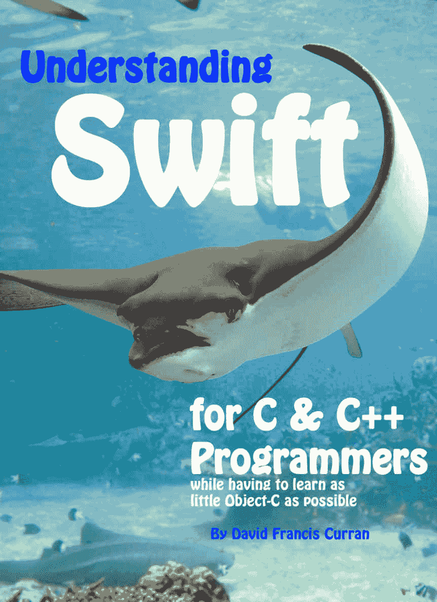

由 David Francis Curran 编写，旨在让 C 和 C++ 程序员在尽可能少学习 Objective-C 的情况下理解 Swift。

本书的初衷是为具有某些 C 和 C++ 背景的人士设计的。它并不是真正为编程完全初学者设计的。如果你想理解 Swift，我强烈建议你在学习 Swift 之前先学习 C 和/或 C++ 或其他语言。

为了将我的程序从 C 和 C++ 迁移到 Mac 和 iPad 上运行，我不得不学习 Objective-C。Swift 让你有机会在很大程度上跳过 Objective-C。这一系列书籍的目的是帮助你弥补这一鸿沟，而无需花费大量时间学习 Objective-C。在随后的章节中，我们将讨论如何将 C 或 C++ 包含到 Swift 项目中。这种包含将涉及一些 Objective-C。但我希望让你能够编写 Swift 代码，从而让你决定使用 Swift 而不是 C 或 C++。

多年前，我曾认为我在数学理解上有问题。显然，许多富有想象力的人都有这个问题。我曾让数学的想法压倒了我。后来，我在夏天参加的一门微积分课上，一位非常好的老师在课开始时解释，他将告诉我们已知宇宙中关于数学的所有知识。他说：

一加一等于二：这是加法。

二减一等于一：这是减法。

二乘二等于四：这是乘法。

四除以二等于二：这是除法。

这就是全部了。我们在小学学到的数学的复杂部分。每个数学公式都可以拆解为这四个简单部分的组合。

我不知道你对编程 C 或 C++ 了解或记得多少，也不知道你已经对 Swift 了解了多少。正因为我不知道你了解什么，我将解释这些基础部分。

本书旨在作为一种程序化教学。我将尝试为你的大脑编程以掌握 Swift 语言这一主题。希望你回答每个章节末尾的所有测验题。我在那里隐藏了一些小贴士，通过解决这些问题可以增加你的知识。例如，“常量与变量”章节中的第 7 题包含一个我们在文中未涵盖的转换方法。仅仅因为主题没有被涵盖，并不意味着它不起作用。书中也解释了如何在 `Xcode` 参考中找到此类内容。在你的 playground（练习）中评估内容时不要担心错误。（尽管在继续之前，你需要删除它们或将它们注释掉。错误将停止 playground 你输入内容的能力。）记住，最好的程序员是那些犯过最多错误并从中学习的人。

> 注意：作品《Understanding Swift for C and C++ programmers》分章节出版，其原因有两个：
>
> 1. 尝试跟上 Swift 的变化。
> 2. 允许尽可能多的图像，而无需由于文件大小限制（在 Kindle 上的上传限制）而限制它们。

我希望你喜欢这本书，就像我编写它时一样喜欢。

书中的项目代码可以在线获取：[`geniusat.work/swift.php`](http://geniusat.work/swift.php)。对于 playground 代码，只需从页面上复制代码并将其粘贴到你的 playground 中即可。单个 playground 代码没有在线上的原因是我们会频繁地更改代码，例如，为了强调错误而更改其中的单行代码，因此包含所有可能的 playground 代码将变得臃肿且混乱。

## 第一章

### 下载程序

要在你的 Mac 上运行 Swift，你需要下载最新版本。操作系统要求——（即，你运行最新版本的 `Xcode` 需要什么种版本的 Mac OS X）将在那里进行说明。`Xcode` 是免费的。你只需要付费成为一名 Mac 开发者。但如果你只是在学习编程，或者只是从 C 或 C++ 转型到 Swift，你暂时不需要担心这个。

注意，可能有新的测试版本可用。例如（图 1.1），有一个 6.4 beta 2，它为 Apple Watch 提供了编程支持。目前，我建议坚持使用当前版本。所以请下载，并在运行起 `Xcode` 后回来。

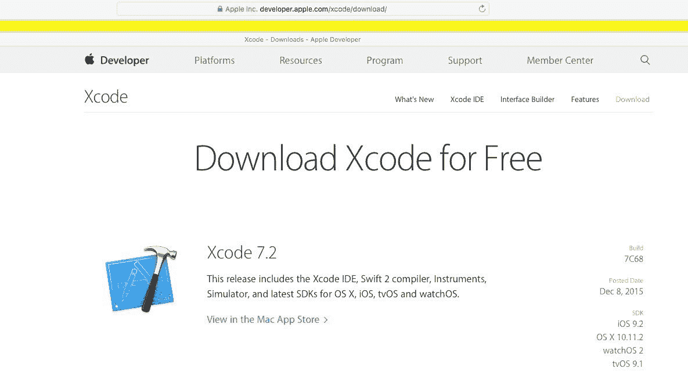

图 1.1 Apple 的 Xcode 下载页面

## 第二章

### 让我们开始编程

如果你对下面的任何术语感到陌生，不要担心。随着我们的学习，你将了解更多关于它们的内容。

通过 Swift，你可以设置一个“可执行程序”，也可以设置一个“playground”。你可以设置一个“Cocoa 应用程序”或“命令行应用程序”。你甚至可以在“终端（terminal）”中运行 Swift。

- 一个 Cocoa 应用程序是运行在带有按钮和文本字段的窗口中的应用程序，你的代码根据你输入的输入进行操作。你的结果显示在图形用户界面中。（图 2.1）

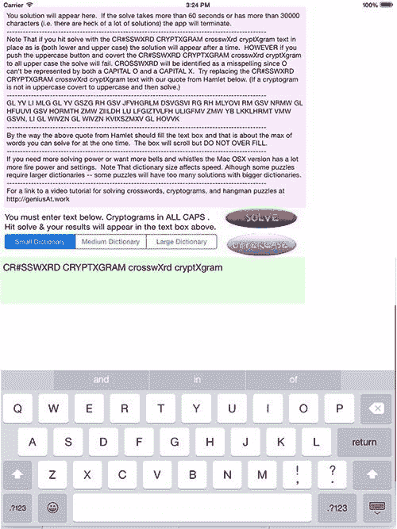

图 2.1 iPad IOS 应用程序的图形界面。

- 命令行应用程序（我们将很快就会演示的）是一个你输入文本并看到输出而不是图形的应用程序。

- 命令行应用程序（我们将很快就会演示的）是一个你输入文本并看到输出而不是图形的应用程序。通过命令行应用程序（我们将很快就会演示的），它是一个你输入文本并看到输出而不是图形的应用程序。通过命令行应用程序（我们将很快就会演示的），它是一个你输入文本并看到输出而不是图形的应用程序。通过命令行应用程序（我们将很快就会演示的），它是一个你输入文本并看到输出而不是图形的应用程序。通过命令行应用程序（我们将很快就会演示的），它是一个你输入文本并看到输出而不是图形的应用程序。通过如果你对其进行调试（即，你的代码中没有错误），它将执行。（图 2.1）你的结果将显示在 Debug Area 窗口中。

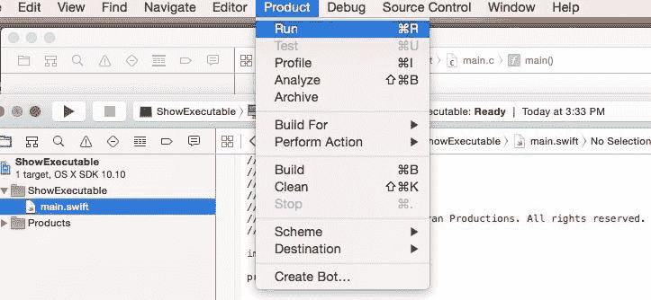

图 2.2 运行执行文件。

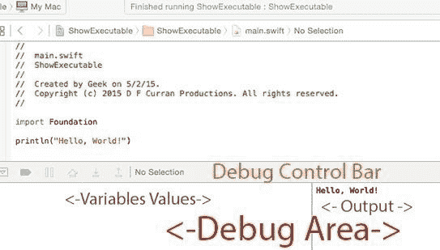

图 2.3 结果显示在 Debug Area 窗口中。

`println` 在 `Xcode` 7.1 中被 `print` 替换。

- 通过 Swift playground，你编写代码并在 gutter 中看到代码的即时反馈。它是测试代码的极佳方法。（图 2.6）这里 gutter 重复了你的字符串。

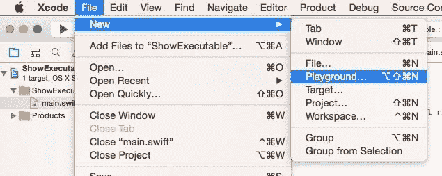

图 2.4 通过 File -> New -> Playground 打开。

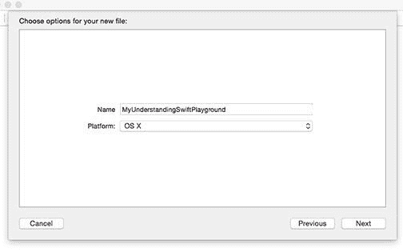

图 2.5 MySwiftPlayground。使用 OS

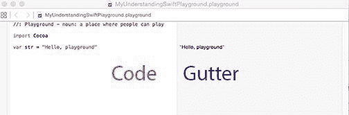

图 2.6 你的 playground。

你已经准备好学习代码了。

### 章节问题

1. Cocoa 应用程序具有

   A. 文本界面。

   B. 图形界面。

   C. 有趣界面。

   B. 同时具有文本和图形界面。

2. 可执行程序

   A. 与 playground 没有区别。

   B. 比 playground 优越。

   C. 当你运行时它执行。

   D. 自动运行。

3. 可执行程序打印其结果

   A. 在互联网上。

   B. 在 playground 中。

   C. 在 Debug Area 窗口中。

   D. 在电视上。

4. playground 输入的反馈出现在

   A. 在 Debug Area 窗口中。

   B. gutter 中。

   C. 在互联网上。

   D. 图形界面中。

## 第三章

### 一些介绍说明

你可以通过以下地址下载 playground 和项目：

[`geniusat.work/SwiftForC_CplusplusCode.sitx`](http://geniusat.work/SwiftForC_CplusplusCode.sitx)

或：

[`geniusat.work/SwiftForC_CplusplusCode.zip`](http://geniusat.work/SwiftForC_CplusplusCode.zip)

playground 或项目章节包含了你可以粘贴到 Swift 中的文本。只需删除你选择的阅读器可能附加的任何作者注释即可。

### 注释包含

`Comment inclusion`（注释包含）与 C 和 C++ 基本一致。我首先提到这一点，是因为在我们学习的过程中，你可能需要注释掉自己犯的错误。

正如我在前言中所说的：最好的程序员是那些犯过最多错误并从中学习的人。

```swift
// 将一行变为注释

/* 创建一个跨越多行的长注释 */
```

它们都不会作为代码包含在程序或游乐场（playground）中。

下面由 `var` 引入的两个声明类似于：

`int bananas = 5;`

以及：

`int grapes = 6;`

在 C 和 C++ 中是这样，尽管在 Swift 中它们不仅仅是整数。我们将在“常量与变量”中详细讨论这一点。但目前这只是一个打印的示例。

```swift
var bananas = 5  // 注意这里以前末尾没有 `()`，但现在已经更改了。

var grapes = 6

/* 注意这里以前末尾没有 `()`
现在已经更改了。 */
```

### `print` 取代 `println`

当 Swift 出现时，`println()` 是向某些地方打印内容的方法。苹果将其更改为了 `print()`。但你仍可以将其视为 `println`，因为它会打印一行并在结尾包含一个换行符 `\n`。你很快就会看到它的用法。要在 `print()` 语句中打印变量或常量，可以使用类似 `print("We have \(grapes) grapes and \(bananas) bananas")` 的语句。

```swift
print("We have \(grapes) grapes and \(bananas) bananas")
```

注意引号必须不能是智能引号（全角引号）。

Swift `print()` 的默认结尾是 `\n`，但如果我们愿意，可以通过 `terminator:` 来更改它。在游乐场中输入以下内容：

```swift
print("We have \(apples) apples and \(oranges) oranges", terminator: "")

print(" and \(pears) pears")
```

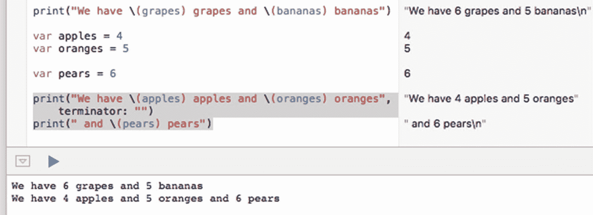

（图 3.1 使用带不带 `terminator` 的 `print()`）

当行尾设置为空字符串 `""` 时，两个 `print` 命令在打印时会合并在同一行。这在我们以后想要让不同类型的连续循环在同一行上合并数据时将非常有帮助。

**不要忘记 `terminator:` 后的 `:`！**

这个 `print-function(something to print, terminator: "")` 是 Objective-C 的遗留物。

### 最后

在示例游乐场或项目中，我可能会有这样一行代码：

```swift
let diamonds = 5

//diamonds = 7 // 取消注释以查看错误
```

这意味着移除该行前两个 `//`：

```swift
diamonds = 7  // 取消注释以查看错误
```

我一直使用所谓的 `camelCaseLettering`（驼峰命名法），即我在编写常量和变量时，第一个单词小写，与其他所有单词通过首字母大写连接。我偶尔会改变这种写法，但大多数情况下你可以假设我的变量和常量是这样命名的。

```swift
var howManyBananas = 3
```

## 运算符

在 Swift 中，运算符大部分与 C 和 C++ 中的非常相似。我们很快就会使用它们，所以让我们先来看看它们。

### 数学运算符

- `=` 将一个值赋给另一个。
- `+` 将一个值加到另一个值上。
- `-` 从另一个值减去一个值。
- `*` 将一个值乘以另一个值。然而，它并不表示指针。Swift 中没有指针。
- `/` 将一个值除以另一个值。

```swift
var addition = xInt + yInt

var multiplication = addition * addition

var subtraction = multiplication - yInt

var division = (subtraction * multiplication) / addition
```

`%` 模运算符在一个值被除以另一个值时给出余数。然而在 Swift 中，你可以获取一个 `Double` 除以 `Double` 的余数作为 `Double`。而在 C 和 C++ 中，余数始终是整数。这意味着你需要小心，比如当你正使用模运算符来判断结果是偶数还是奇数。

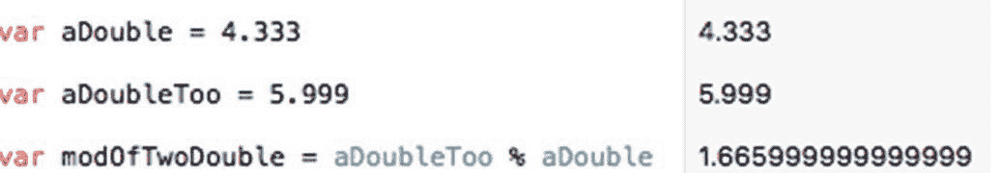

（图 4.1 在 `double` 上使用模运算。）

- `+=` 将左项加到右项。
- `-=` 从右项减去左项。
- `++` 在变量末尾使其增加 1。它等同于 `var negtiveItem += positiveItem`（仅限整数。尝试对 `Double` 这样做。）
- `--` 在变量末尾使其减少 1。它等同于 `var negtiveItem -= negtiveItem`（仅限整数。尝试对 `Double` 这样做。）

```swift
var xInt = 1

var yInt = 1

print(--xInt) // 在打印前减 1

print(yInt--) // 在打印后减 1

print(yInt)  // 显示减去后的值
```

输出：

```text
0

1

0
```

你自己检查一下，如果在上述操作之后添加：

```swift
print(++xInt)

print(yInt++)

print(yInt)
```

输出：

```text
1

0

1
```

### 应用于布尔结果的逻辑运算符

- `||` OR（或）运算符，两者中必须有一个符合预期。
- `&&` AND（与）运算符，两者都必须符合预期。

### 返回布尔值的比较运算符

- `==` 一个值等于另一个值。
- `>=` 左侧对象小于或等于右侧。
- `<=` 左侧对象大于或等于右侧。
- `!=` 它们之间不相等。

### 新运算符

（位置非常特殊，将在稍后讨论。）

- `?` 表示项尚未赋值。这被称为可选值（optional value）。
- `!` 与 `?` 类似，但表示该可选值在赋值后永远不会为 nil。

Swift 还有范围运算符：

- `...` 是闭区间运算符，包含右侧。
- `..<` 是半区间运算符，不包含右侧。

## 常量与变量

在 C 和 C++ 中你标记数据的类型。在 Swift 中，`let` 和 `var` 引入类型。注意与 C 和 C++ 不同，你不需要分号。行尾是假设的。如果你愿意，可以加上分号。

`let` 创建一个常量。不像 C/C++ 需要显式声明你正在创建的类型，Swift 可以根据你输入的内容推断。

`let` 创建一个常量，即一个不能改变的值。例如 `let myConstX = 5` 类似于 `const int ConstX = 5`。

`var` 创建一个值可以改变的变量。类似于 `int x = 5`。例如 `var x = 5` 相当于 `int x = 5;`。

```swift
import Cocoa

var str = "Hello, playground"

var x = 5

let myConstX = 5

var z = 5.00

var y = 5.01

var myDoubleX = 5.0000001

var mySmallDouble = .69
```

Swift 将 `x` 和 `myConstX` 识别为 `Int`。（使用大写 `I` 而不是 `C` 或 `C++` 中的小写 `i`。正如你将看到的，`Int` 与 `int` 并不完全相同。）

顺便说一下，如果你输入两次相同的变量名将会得到错误。Swift 像 `C` 和 `C++` 一样，只允许变量的一个实例。（作用域异常除外。）

我们将在本书的后部分讨论 `switch` 语句。它们的工作方式存在一些差异，例如不需要 `break`；目前，我只想展示作用域的差异，这种差异允许我们声明一个新的 `var x`。（并不建议这样做。）使用上面的 `x` 和 `y`，将以下内容输入你的 playground。

```swift
switch (y) {
case 0:
  var x = 3  // 这个 x 与上面的 x 在不同的作用域内
case 1:
  print(x)
default:
  print(y)
  print(x)
}
```

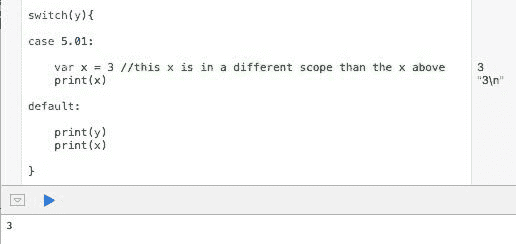

（图 5.3 具有同名变量的作用域异常示例。尝试将 `switch` 语句中的值 `y` 改为其他值会发生什么。）

如果这看起来和 `C` 和 `C++` 一样，那它其实并不是。`Int` 不是 `int`。`Double` 也不是 `double`。事实上，`Int` 和 `Double` 都是类。它们各有多个属性。（顺便说一下，Swift 在这里将 `x` 和 `y` 都指定为 `Double` 而不是 `Float`。因为它无法判断你的意图，所以采取了谨慎的做法，将 `x` 和 `y` 分别设为 `Double`。关于 `Double` 和 `Float` 的更多内容稍后可见。）

`Bool` 基本上如你预期的那样。（并不是 `bool`，因为它也是一个类。）我们稍后会使用它们。

```swift
let j: Bool = true
var B = false
```

但并没有所谓的 `Char` 或 `char`。不过，确实有一个 `Character`。`Character` 是你能找到的最接近 `C/C++` 中 `"char"` 的类型。我们将回到 `Character` 和 `String`，因为在 `String` 中寻找 `Character` 并不像 `C/C++` 中那样容易。事实上，在我们涵盖许多其他内容（如 `for` 循环、`while` 循环、`if` 语句和数组）之后我会回到这里。现在让我们先玩玩数字。

### 算术

让我们尝试一些数学。算术运算符 `+` 和 `-` 基本上相同。

```swift
var zPlusY = z + y
```

在侧栏中给了我们 `10.1`。

```swift
var xTimesMyConstX = x * myConstX
```

你应该在侧栏看到 `25`。


但如果你尝试写入（即更改`myConstX`的值）：

```swift
myConstX = 7
```

你将得到一个错误（仅如果是第一个错误时。有时只显示第一个错误。见图 5.4）。有错误时，侧栏是空的。

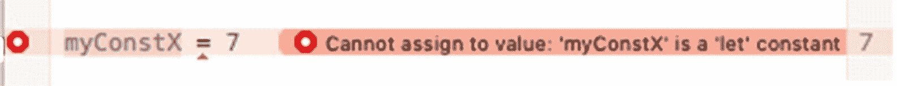

（图 5.4 错误。你不能更改用`let`创建的值。）

点击带有感叹号的红点将弹出消息。（见图 5.5）

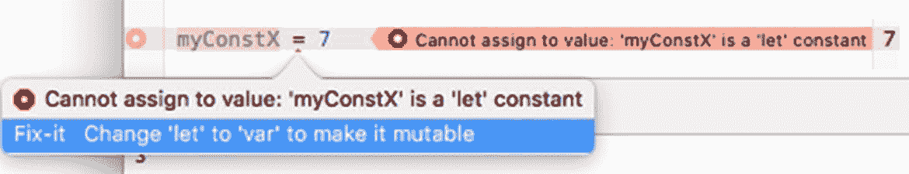

（图 5.5 尝试更改常量的值会导致错误。）

使用双斜杠`//`注释掉错误。

你也可以像在`C/C++`中一样使用`/* */`。

现在尝试乘以这些：

```swift
var yTimesZ = z*y
var MyConstXTimesZ = myConstX*z 
```

前者可以。一个`Double`乘以一个`Double`得到一个`Double`。但后者（图 5.6）失败了，因为`Int`无法直接乘以`Double`。

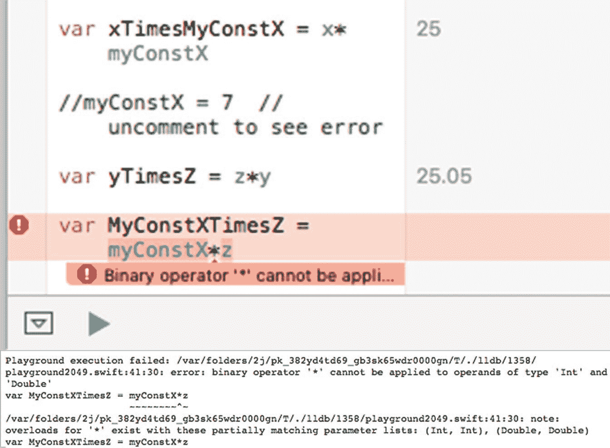

（图 5.6 `Int`乘以`Double`在 Swift 中会失败，但两个`Double`可以相乘。）

注释掉错误。不这样做会导致播放器卡住。

```swift
//var MyConstXTimesZ = myConstX*z
```

你否以某种方式将`Int`转换为`Double`然后再相乘？可以。尝试：

```swift
//let myConstX = 5
//var z = 5.00
var myConstXTimesZInt = myConstX* Int(z)
```

侧栏中应该出现`25`。而在使用：

```swift
var zTimesMyConstXDouble = Double(myConstX)* z
```

我承认，当我第一次看 Swift 时，我以为它们简单地反转了`C/C++`的转换格式`(int)someFloat`或`(float)someInt`。但！`Double()`或`Int()`实际上是函数，而不仅仅是简单的转换。你现在不需要知道它们是如何工作的。就像你从未真正需要知道`C/C++`中的`strlen(word)`是如何工作一样。（在 Swift 中是`o = strlen("Me")`。并且注意直引号。）

`25.05`将出现。添加以下内容，我们将查看结果（图 5.7）：

```swift
var myConstXTimesYInt = myConstX * Int(y)
var yTimesMyConstXDouble = Double(myConstX)*y
var zTimesMyConstXDouble = Double(myConstX) * z
var zTimesMyConstXDouble2 = Double(myConstX) * y
var zTimesMyConstXDouble3 = Double(myConstX) * myDoubleX
```

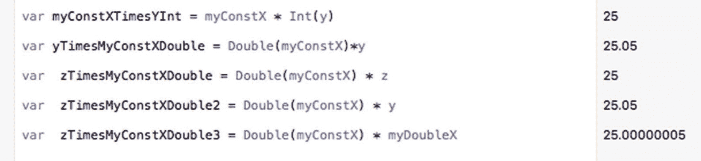

图 5.7 在`myConstXTimesZInt`中，结果被转换为`Int`。但在所有其他情况下，值都是`Double`。即使对于`var zTimesMyConstXDouble = Double(myConstX) * z`也是如此。答案显示为`25`，没有小数点或零。但那个`25`是一个`double`。只是没有显著小数，所以没有显示。

### 显式与隐式转换

你可以显式地转换变量或常量。只需引入你的变量或常量，后面跟着一个冒号，然后是你希望它变成的类型。尝试：

```swift
let f:Float = 9.99
let d:Double = 9.99
let e = 9.99
var fl = f*1.0002
var dl = d*1.0002
var el = e*1.0002
```

结果出来了（见图 5.8）。注意精度的差异。`dl`在侧栏中有更多的小数位。`el`具有相同的结果，说明 Swift 确实将`e`解析为`Double`。

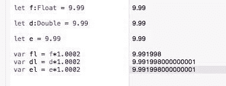

（图 5.8 `Double`的精度就是为什么 Swift 除非另有说明，否则会转换为`Double`的原因。）

## 8) 选择题

如果图 5.3 中`y`的值在进入`switch`语句之前被改为 1.0，导致执行了默认语句。那么`print(x)`会打印什么值？

a. 5.0

b. 3

c. 3.0

d. 5.01

**六**

## 布尔值游戏（Bool Play）

在你的 playground（练习）中输入：

```swift
let blue:Bool = true
let red: Int = Int(blue)
print(blue)
print(red)
```

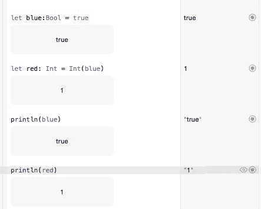

（图 6.1 注意，如果你点击屏幕右侧的按钮，值也会出现在赋值语句下方。同时请注意，当`print()`用于常量或变量时，它会带引号打印。）再次强调，命令`println`已更改为`print.`。

现在在上面，我们将一个`Bool`类型`blue`转换成了`Int`。并发现它的值为 1。让我们反过来试一次。

```swift
let one = 1
let boolOne = Bool(one)
```

在上面`boolOne`等于`true`。但如果是：

```swift
let boolSeven = Bool(7)
```

这同样等于`true`。

```swift
var boolSeven = true
let notBoolSeven = !boolSeven
```

在这里`notBoolSeven`将是`false`。

按住你的 Apple 键并点击上面的`Bool`单词。会出现`Bool`类的实例和方法。我们调用了一个函数`Bool(7)`来返回`boolSeven`的值 "true"。你可以以同样的方法检查`Int`、`Float`、`Double`等。

尝试输入：

```swift
var petite = Bool(-1)
var zero = Bool(0)
```

（我们将在下面的问题中使用上述内容。）

怎样才能让`Bool`变量和常量得到`false`的值？插入`Bool()`的负值是`true`还是`false`？

布尔值在比较中非常有用。就像在 C 和 C++ 中一样。

```swift
var big = 100
var bigCopy = big
var little = 4
var resultOfComparison = big > little  //true
resultOfComparison = big == little  //false
resultOfComparison = little <= big  //true
resultOfComparison = big <= bigCopy  //true
resultOfComparison = big >= bigCopy  //true
resultOfComparison = big <= little  //false
```

## Questions

1. 如果我们在 playground 中输入，将得到什么结果：

   `zero.description`

   A. 一个错误

   B. "false"

   C. 与`petite.description`相同

   D. 0

2. 这里的`var turtles`结果是什么：

   ```swift
   var turtles = Bool(-1)
   ```

   A. 我们没有乌龟。

   B. false

   C. true

   D. 我们少于一只乌龟

3. `var liar = false`以下哪项是等价。

   A. `var liar = Bool(28)`

   B. `var liar = Book(-21)`

   C. `var liar = Bool(2.444)`

   D. `var liar = Bool(0)`

4. `var truly = true; var falsely = false` `var whichIsIt = truly && falsely`

   A. `whichIsIt`是 true

   B. `whichIsIt`是 false

5. `var truly = true; var falsely = false` `var whichIsIt = truly || falsely`

   A. `whichIsIt`是 true

   B. `whichIsIt`是 false

**七**

## 数组（Arrays）

因为我有 C 和 C++ 的背景，当我想到数组时，我首先想到的是一个字符串。

在 Swift 中创建一个新的 playground，但这次选择 IOS 而不是 OS X。此时唯一的区别将是你看到`import UIKIT`而不是`import Cocoa`。

```swift
import UIKit
var str = "Hello, playground"
char dave = "Dave"; // `dave[4]`为'\0'
```

尝试在你的 playground 中输入`var dave = '\0'`。

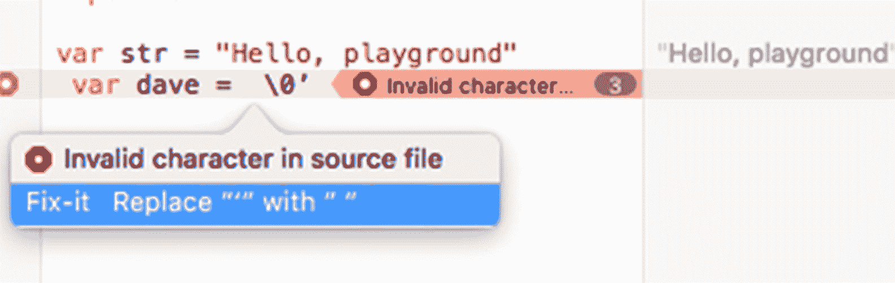

（图 7.1 `'\0'`是一个无效字符。）

抱歉，Swift 中没有`'\0'`。注意：我没有忘记上面`'\0'`中的第一个`'`。Swift 有一个箭头指向它的位置，并建议在该处进行更改。

有一个`String`类型的"\0"，如果将其转换为数字，它们将等于 nil。还有一个`Character`类型的"\0"，它必须先转换为`String`才能转换为数字 nil。但它们与 C 和 C++ 中的`'\0'`并不完全相同。

你不能像在 C 和 C++ 中那样在 Swift 中创建字符串。

```swift
var dave = "Dave" 
```

隐式地创建一个名为`dave`的`String`。

但你**不能**像在 C 或 C++ 中那样访问字符：

```swift
var firstLetter = dave[0] // 产生错误信息
var dave = ['D','a','v','e'] // 产生下面的错误
```

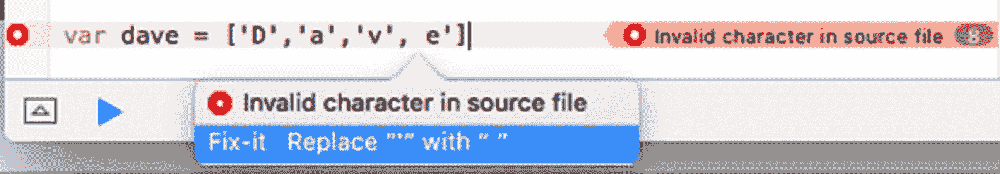

（图 7.2 单引号在 Swift 中不起作用。）

`'`并没有缺失。Xcode 当它指向它所占据的空间时会将其移除，建议用`"`替换。**不允许使用单引号，也不允许使用大括号引号！**

所有的`'`都必须替换为`"`才能获得有效的数组声明。

```swift
var dave = ["D","a","v","e"] 
```

此时`dave`将不是一个`String`。它将是一个字符字符串的数组。这在我们学习字符串时会变得更清晰。目前，我们只讨论数组，它们与 C 和 C++ 不同之处在于它们不能是字符串。

如果我们在 C 或 C++ 中创建一个整数数组，可以这样声明：

```cpp
int anArrayOfInts[10];
```

我将有十个槽位存放整数。无论我何时或何地做这都不重要。我可以设置：

```cpp
anArrayOfInts[2] = 7;
```

而不会得到任何投诉。但如果我尝试向`anArrayOfInts[11]`放入一个额外的整数，区别就重要了：

```cpp
anArrayOfInts[11] = 2;
```

因为没有`anArrayOfInts[11]`，这可能会导致我的程序崩溃。在 Swift 中，数组的工作方式完全不是这样的！而且我们最好从头开始思考。把 Swift 中的数组（注意大写的 A）想象成火车车厢，可以装满你想要的任何东西。至于字符串，它们的思考方式与数组完全不同，我们稍后会介绍字符串。

首先，数组中只允许一种类型的元素。

```swift
var biElementArray = ["Mom", 7]
```

这是一个错误！但它不会被识别为错误！

```swift
var aNewStringArray = Array<String>()

var anotherNewStringArray = [Array]()
```

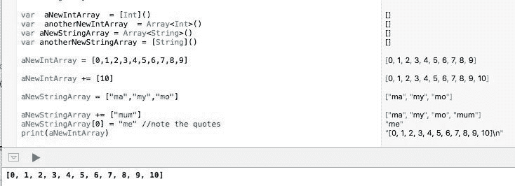

（图 7.6 在添加`aNewStringArray[0] = "me"`后，`aNewStringArray`看起来是什么样？）

在你的 playground 中尝试一下。点击`Array<Int>()`中的`Array`单词，查看使用新数组的可能方法。下面是一些示例：

```swift
var kot = Array<String>()
kot = ["What","is"]
```

按住苹果键并将光标停在`Array`上，你会看到可用的扩展。

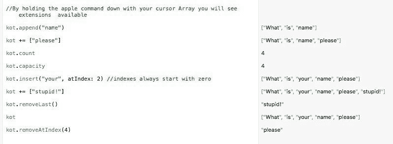

（图 7.7 从数组中添加和删除项目的方法。）

`kot.count`告诉我们数组中有多少项目。我们将在循环部分使用它。

当我们谈到循环时，将讨论如何遍历和打印数组。

**问题：**按住 command 键并将光标停在`Array`上，并在扩展中找到这些问题的答案。

1. 这里的`result`是什么？

   ```swift
   var result = kot + aStringArray
   ```

   a. "Fee Fi Fo Fum"

   b. ["ma","my","mo","What", "is", "your", "name"]

   c. ERROR

   d. ["What", "is", "your", "name", "me", "my", "mo","mum"]

2. 对于上面的`aNewIntArray`，`aNewIntArray.isEmpty`会返回什么。

   a. true

   b. false

   c. nil

3. 对于`aNewIntArray`类型：

   ```swift
   aNewIntArray.insert(-1, atIndex: 0)
   ```

   现在如果你尝试：

   ```swift
   aNewIntArray.popLast()
   ```

   将返回什么：

   a. -1

   b. 4

   c. 10

   d. 1

4. 你会在你的 playground 中使用这个`Array`扩展？

   ```swift
   public init(count: Int, repeatedValue: Element)
   ```

5. 从你的`kot`数组中删除所有内容的简单方法是？

   a. `kot.removeAll()`

   b. `kot.capacity = 0`

   c. `kot = nil`

6. 数组可以包含不同类型的元素吗？

   a. 是

   b. 不

   c. 取决于情况

7. `var someElementTypeArray:[这里填写什么使其成为有效的 Array] = ["My", "Mom"]`

**答案：**

1. d

2. b. false

3. c. 10

4. `var list = Array<Int>(count: 4, repeatedValue: 6)`

   `var list2 = Int`

5. a. `kot.removeAll()`

6. b. 数组元素必须全部相同。

### 八

### If else

在`if`语句中真的不需要提到`then`。因此 Swift 并没有`then`，甚至不需要`()`。由于`if`语句的工作方式与`C`和`C++`类似，仅有细微差异，我们将快速过一遍这些差异。

`if`语句包含一个条件语句，如果该语句解析为`true`，它将执行返回“真”的指令。

（*注意：我没有说"is" true，因为那意味着你的数据等等是正确的。）

Swift 中的`if`语句后面总是跟着括号：

```swift
if (true)
{ 
  // 魔法发生的地方
}
```

在下面我们可以买糖果。如果有其他可能，我们可以添加一个`else`语句。**不同于**`C`和`C++`，你必须使用括号。

```swift
var pennies = 5
let enoughToBuyCandy = 5

if pennies >= enoughToBuyCandy{
  print("We may buy candy!")
}

var numberOfPenniesString = "pennies"
pennies = 4

if enoughToBuyCandy - pennies == 1{
  numberOfPenniesString = "penny"
}

if pennies >= enoughToBuyCandy{
  print("We can may candy!")
} else {
  print("We go home candy less \(enoughToBuyCandy - pennies) \(numberOfPenniesString) short.")
}
```

我们得到：We go home candy less 1 penny short

正如在`C`和`C++`中一样，我们可以有一个`else if`。


```swift
pennies = 7

if enoughToBuyCandy - pennies == 1 {
  numberOfPenniesString = "penny"
}

if pennies == enoughToBuyCandy {
  print("We may buy candy!")
} else if pennies > enoughToBuyCandy {
  print("We may get \(pennies - enoughToBuyCandy) pennies worth more of candy.")
} else {
  print("We go home candy less \(enoughToBuyCandy - pennies) \(numberOfPenniesString) short.")
}
```

我们得到：`We may get 2 pennies worth more of candy.`

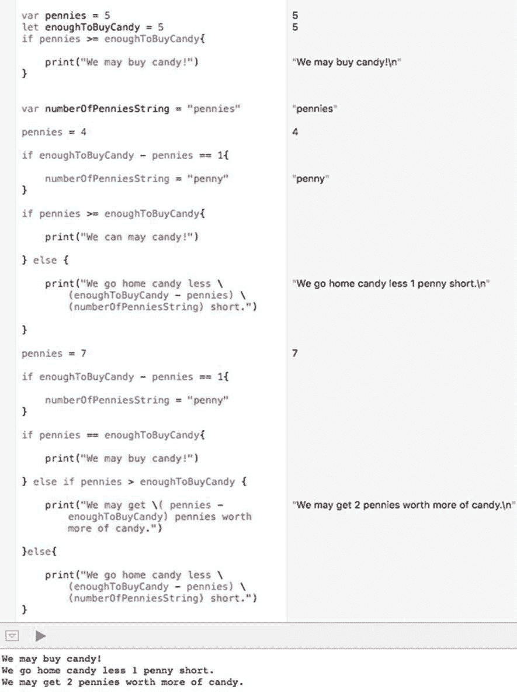

（图 8.1 使用 `if else` 操作的硬币。）

## 九

### 可选类型（Optionals）

什么是可选类型？在你的 playground 中输入：

```swift
var lemons = Int?()
var limes = Int!()
var peaches = 5

lemons = 5
limes = 5
lemons = nil
limes = nil
peaches = nil
```

最后一个项目 `peaches = nil` 将产生一个 `ERROR`。只有可选类型可以有 `nil` 值。也就是说，`nil` 根本没有值。

与其他语言不同，Swift 中的 `nil` 并不是指向一个不存在对象的指针。也就是说，我们可以把 `C` 和 `C++` 中的指针想象成索引卡片。想象一个图书馆，你有一组卡片——就像旧时代按字母顺序排列的抽屉，列出了书的位置。而书在按杜威分类法组织的书架上。一个指针就像一张索引卡片，它指向书的位置。书就是该位置的值。

在真实的图书馆中，卡片还在，书可能已经没了。在 `C` 和 `C++` 中，一张填写好的卡片**必须**指向书架上的某个位置，且书必须在那里，否则就会导致灾难。

为了复习 `C++` 中的编程示例，请查看下一节。如果你觉得不需要复习，请跳到后续章节。

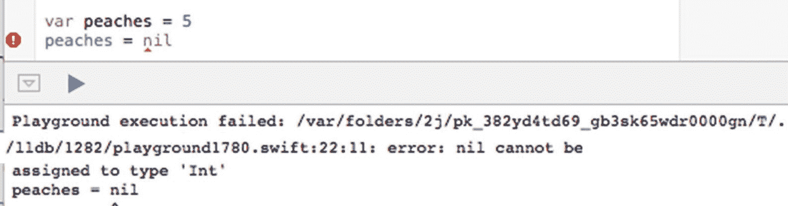

（图 9.1 一旦设置了值，`peaches` 就不能为 `nil`。）

如果你熟悉 `C` 或 `C++` 并且清楚指针如何导致崩溃，你可以跳到下一章。否则，请享受这个复习。

创建一个新的控制台项目。

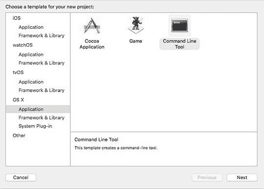

（图 9.2 设置指针。）

`var lemons = Int?()`……你可以随心所欲地命名。

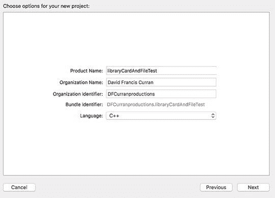

（图 9.3 你的项目。）

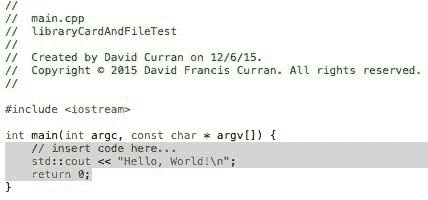

```cpp
#include <iostream>
using namespace std;
```

然后删除高亮部分：

```cpp
int book = 999334;
int *libraryCardPtr = &book;
```

```cpp
cout << "Now we free( intBlockPt\n\n"; //我们已经删除了架子和地板

free(intBlockPtr);

cout << " intBlockPtr = " << intBlockPtr << "\n\n"; //指针仍然指向该位置

//但编译器认为该块已经释放了。这里有一个小程序，下面的一行可能仍然有效。然而，编译器可能会在该处写入其他内容，导致灾难性的结果。

cout << " *intBlockPtr = " << *intBlockPtr << "\n\n";

///////////////////////////////////////////////////

return 0;

///////////////////////////////////////////////////
```

在已经被擦除的位置请求书籍会导致错误。

指向一个在内存中已被释放的地方，就像是让某人去图书馆的索引卡位置，但那里的架子已经消失了，他们会掉进地板。

在 `C` 和 `C++` 中，每本书都需要一张索引卡和架子上的空间。在我们的类比中，两者都占用内存。

但在 Swift 中，一个设置为 `nil` 的 `var` 变量意味着它目前还没有**任何类型**的数值。Swift 没有指针。它就像完全没有图书馆索引卡一样。`nil` 告诉你书籍不存在，仅此而已。

那常量值呢？尝试设置 `let dogs = Int()`，看看会发生什么。当你尝试将 `dogs` 设置为某个真实值时，会出现一个带有解决方案的小红色错误圈，并且 `let` 会自动为你更改为 `var`。常量不能是可选的（optionals）。

让我们玩玩可选类型。引用一个 `nil` 值会导致问题。我们能如何使用可选类型来防止这种情况？这里有很多内容需要理解，所以如果你在结束之前有疑问，请耐心听听。

让我们想象一下，在你开始时不知道某个值是什么。你有 1 美元，但不知道用这 1 美元可以买多少个苹果。

```swift
var apples = Int?() //注意，这末尾以前没有 ()，但现在已经更改了。

if apples >= 1 {
  print("我们有 \(apples)")
} else {
  print("我们今天没有苹果！")
}
```

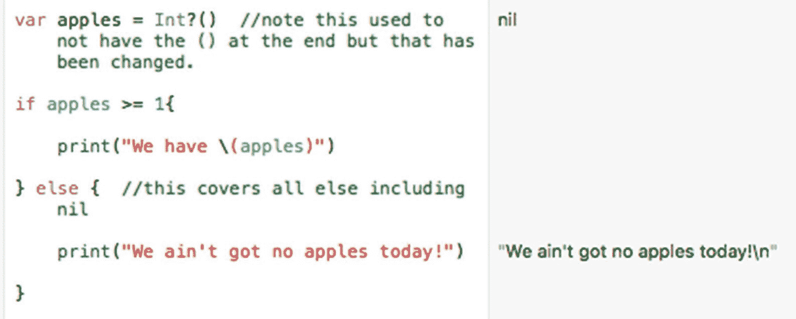

（图 9.4 避免等于 `nil` 的值。）

注意在侧边栏中的 `var apples` 被赋予了 `nil` 值。并且 `if else` 知道 `nil` 不大于或等于 1。

但如果从那里继续添加：

```swift
let applesPerCrate = 20

var appleCratesNeeded = apples / applesPerCrate
```

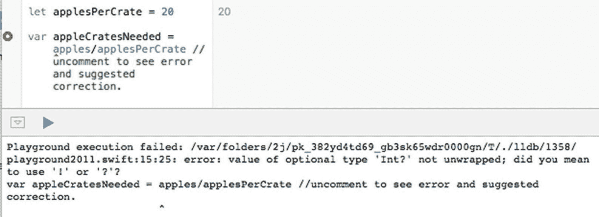

（图 9.5 Swift 对未解包的值表示不满。）

我们得到了一个错误。中间带有圆点的圆圈（错误标记）表示如果我们点击它，它将向我们显示错误的可能修复方法。这与圆圈中间的感叹号不同，后者不提供可能的更改建议。

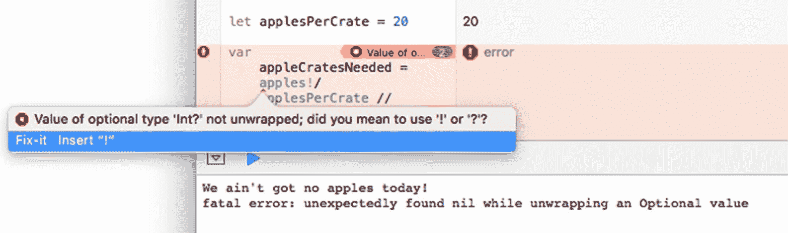

（图 9.6 点击红圈以获取更多信息。）

如果我们点击下方带有白色点的圆圈，上方会呈现一个解决方案。

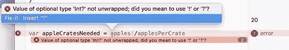

（图 9.7 进一步探索错误。）

点击蓝色的 Fix-it Solution（修复解决方案）将导致该行变为：

```swift
var appleCratesNeeded = apples! / applesPerCrate
```

注意在 `apples` 之后、除斜符号 `/` 之前插入了一个 `!`。这被称为强制解包（forced unwrapping）。然而，像这样写（因为 `apples` 是 `nil`）同样会导致致命的崩溃。

当程序说“可选类型 `Int?` 的值未解包”时意味着什么？非常简单：

```swift
var potatoes = 1
```

隐式地将 `potatoes` 转换为 `Int`。也就是说，程序假设 `potatoes` 是一个 `Int`。

```swift
var motatoes = Double(1)
```

显式地将 `potatoes` 转换为 `Double`。

```swift
var apples = Int?()
```

显式地将 `apples` 转换为 `Int`，但 `apples` 的值尚未被解包。

```swift
var appleCratesNeeded = apples / applesPerCrate
```

在上面，`apples` 没有被解包。但它需要被解包，所以 Swift 在上方询问你是否要解包 `apples`。


（图 9.8 你被询问是否要解包 `apples`。）

要这样做，你可以这样写：

```swift
var appleCratesNeeded = apples! / applesPerCrate
```

```swift
var pears = Int!()
```

显式地声明 `pears` 是一个“已解包”的 `Int`。因为它是显式解包，你可以写：

```swift
var pearCratesNeeded = pears / applesPerCrate
```

不需要在 `pears` 之后加感叹号。

我们很快就会向你展示如何让强制解包工作。首先，我想展示一下 Swift 在各种情况下会做什么。

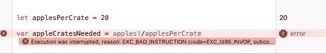

（图 9.9 `apples` 已解包，但它的解包值在哪里？）

所以让我们重新开始。使用橙子 `var oranges = Int!()`。在这里我们使用了 `!` 而不是 `?`。

这意味着 `oranges` 被显式声明为 `Int`，并且显式声明为已解包的可选类型。假设我们声明 `pennies` 为：

```swift
var pennies = 21
```

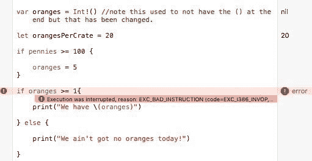

（图 9.10 如果 `oranges` 是 `nil`，程序会崩溃。）

这意味着 `oranges` 被显式声明为 `Int`，并且显式声明为已解包的可选类型。假设我们声明 `pennies` 为：

```swift
var pennies = 21
```

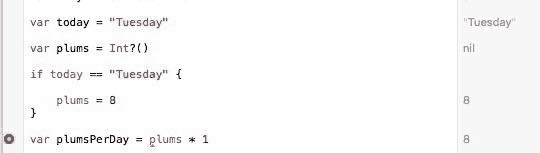

（图 9.11 这里的 `oranges` 是未解包的。）

这意味着 `oranges` 被显式声明为 `Int`，并且显式声明为已解包的可选类型。假设我们声明 `pennies` 为：

```swift
var pennies = 21
```

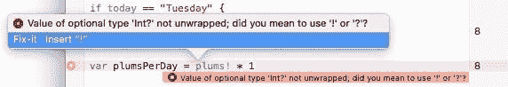

（图 9.12 这里的 `oranges` 是未解包的。）

这意味着 `oranges` 被显式声明为 `Int`，并且显式声明为已解包的可选类型。假设我们声明 `pennies` 为：

```swift
var pennies = 21
```

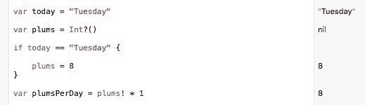

（图 9.13 `apples` 已解包，程序会崩溃。）


我们很快就会向你展示如何让强制解包工作。首先，我想展示一下 Swift 在各种情况下会做什么。


（图 9.9 `apples` 已解包，但它的解包值在哪里？）

所以让我们重新开始。使用橙子 `var oranges = Int!()`。在这里我们使用了 `!` 而不是 `?`。

这意味着 `oranges` 被显式声明为 `Int` 并且显式声明为已解包的可选类型。假设我们声明 `pennies` 为：

```swift
var pennies = 21
```


（图 9.10 如果 `oranges` 是 `nil`，程序会崩溃。）

这意味着 `oranges` 被显式声明为 `Int` 并且显式声明为已解包的可选类型。假设我们声明 `pennies` 为：

```swift
var pennies = 21
```


（图 9.11 这里的 `oranges` 是未解包。）

这意味着 `oranges` 被显式声明为 `Int` 并且显式声明为已解包的可选类型。假设我们声明 `pennies` 为：

```swift
var pennies = 21
```


（图 9.12 这里的 `oranges` 是未解包。）

这意味着 `oranges` 被显式声明为 `Int` 并且显式声明为已解包的可选类型。假设我们声明 `pennies` 为：

```swift
var pennies = 21
```


（图 9.13 `apples` 已解包，程序会崩溃。）

```c
printf("We are on the verge of breakthrough%d!\n",x); // 执行我们需要的操作。

x++; // 为我们提供了退出循环的方法。

}
```

```c
// 或者用于 do-while 循环

x = 100;

do{
  printf("We are on the verge of breakthrough%d!\n",x); // 执行我们需要的操作。

  x++; // 为我们提供了退出循环的方法。

}while( x < 6);
```

而在 Swift 中应该是这样的：

```swift
var x = 0

while x < 6 {
  print("We are on the verge of a breakthrough\(x)")
  x++
}
```

以及：

```swift
x = 100

repeat { // 在 Swift 中现在用 repeat 代替了 do
  print("We are on the verge of a breakthrough\(x)")
  x += 100

}while x < 8 // 我们需要确保 while 循环在某个时候结束。
```

在两种情况下，我们得到的结果类似于：

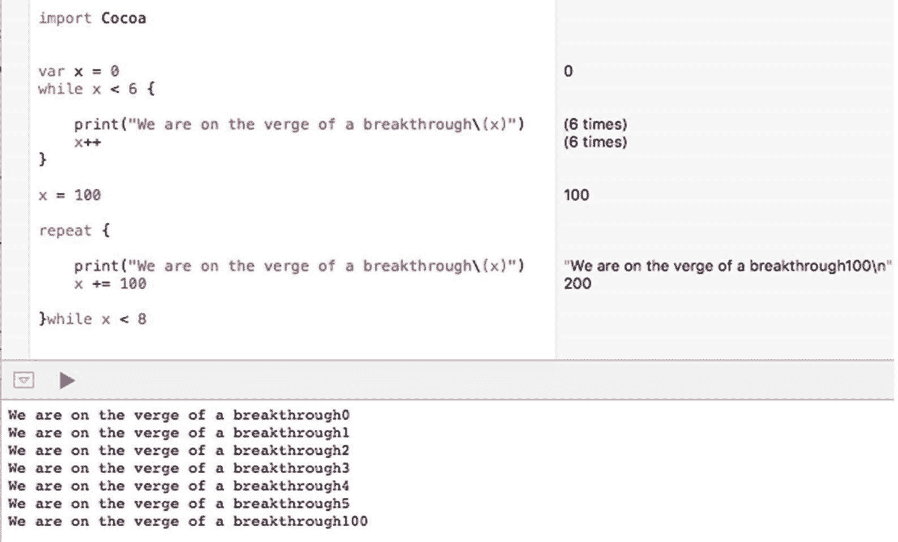

（图 11.1 使用 `while` 循环。）

注意这里的 `repeat{…..}while` 循环只运行了一次。无论设置了什么条件，`repeat` 循环至少都会运行一次。取决于设置的条件，`while` 可能一次都不运行。

## 十二

### Switches（切换）

C 或 C++ 中的 `switch` 语句与 Swift 中的非常相似，某些约定略有不同。

```c
int dog = 5;

switch(dog)
{
case 0:
  printf("Boxer");
  break; // 除非你想让它们一起运行，否则每个 case 都需要 break

case 2:
  printf("Irish Setter");
  break;

case 3:
  printf("Doberman");
  break;

case 4:
  printf("Springer Spaniel");
  break;

case 5:
  printf("Unknown "); // 没有 break，这些会合并执行
default:
  printf("Mutt");
}

printf("\n\n");
```

将输出 `"Unknown Mutt"`。

在 Swift 中，`switch` 语句必须是穷尽的（exhaustive）。你并不总是需要 `default:`，但你确实需要在 `switch` 语句中有一个穷尽的列表。

考虑：

```swift
var trueOrFalse = true

switch(trueOrFalse){
case true:
  print("true")
case false:
  print("false")
}
```

这是穷尽的。`true` 和 `false` 是唯一可能的 `Bool` 返回值，且都被涵盖了，所以它确实有效。

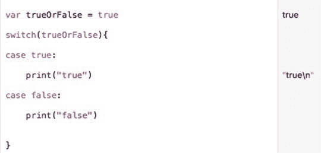

（图 12.1 一个穷尽的 `switch`，没有其他可能的回复，因此它是穷尽的。）

那么以下呢？

```swift
var trueOrFalse = "blue"

switch(trueOrFalse){
case "true":
  print("true")
case "false":
  print("false")
}
```

在这个例子中，回复是不穷尽的。

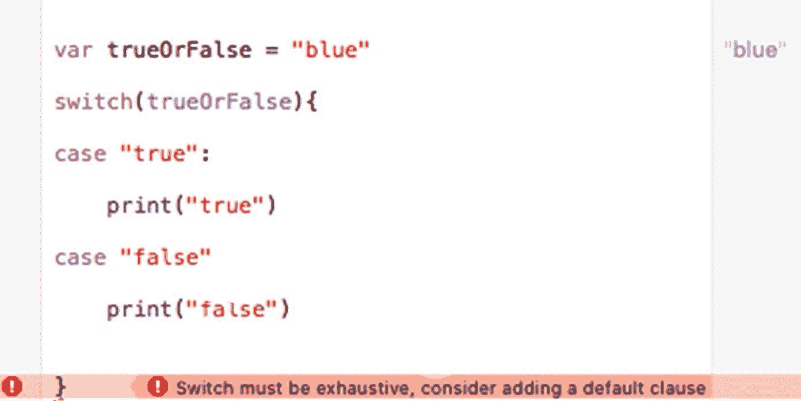

（图 12.2 我们不知道 `blue` 是 `true` 还是 `false`，所以搜索不是穷尽的。）

我们实际上收到一个警告，说明我们的 `switch` 不是穷尽的。

```swift
var trueOrFalse = "blue"

switch(trueOrFalse){
case "true":
  print("true")
case "false":
  print("false")
default:
  print("false")
}
```

通过添加 `default`，我们使上面的代码变为穷尽的。

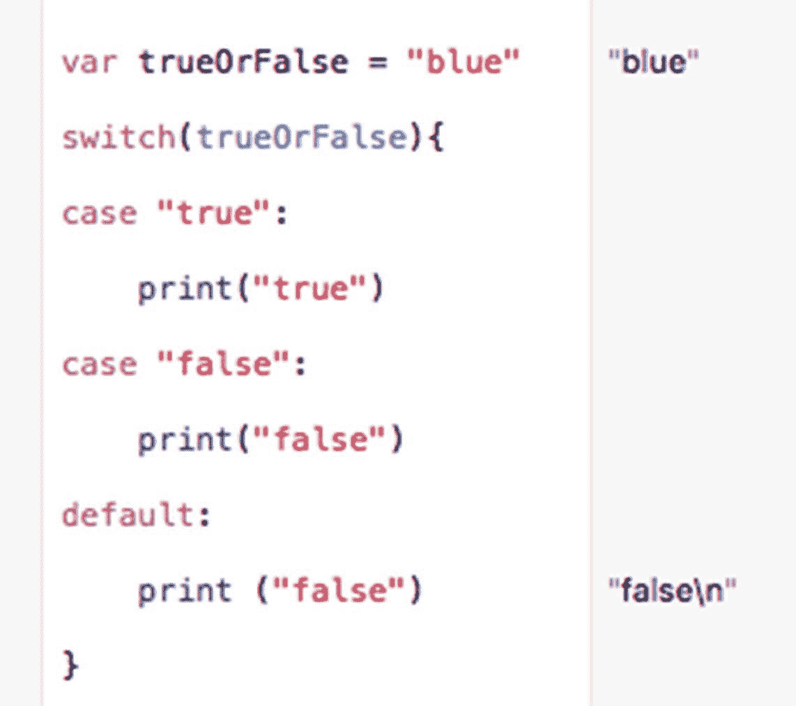

（图 12.3 我们有默认，所以搜索是穷尽的。）

所以使用 Swift 中的 `switch` 时，如果你的回复列表已经是穷尽的，就不需要 `default`。

正如在 C 和 C++ 中，`switch` 语句比长长的 `if else` 组合更容易编写和阅读。

如果你的用户输入是 `String`，`switch` 语句可以让可能的答案更容易处理。

创建一个新的 Swift 控制台项目而不是 playground（播放场）

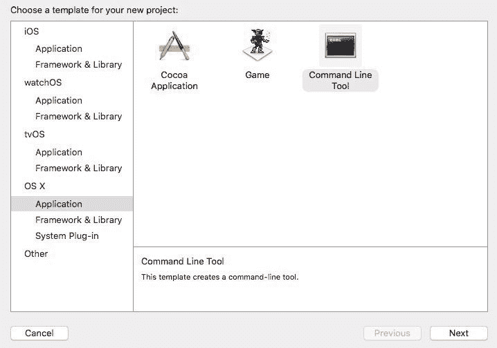

（图 12.4 保存控制台项目（命令行工具）。）

我将我的项目命名为 `switchByEnteredString`。

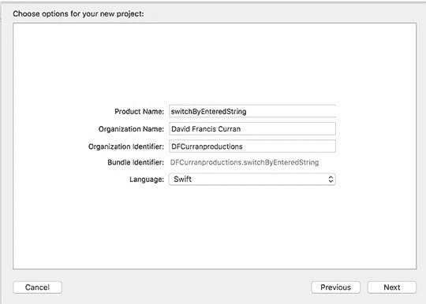

（图 12.5 命名你的项目并点击 next。然后在在下一个屏幕上点击 Create。）

点击 Next，确保它位于你想要所在的文件中并点击 create。

然后打开 `main.swift` 文件。

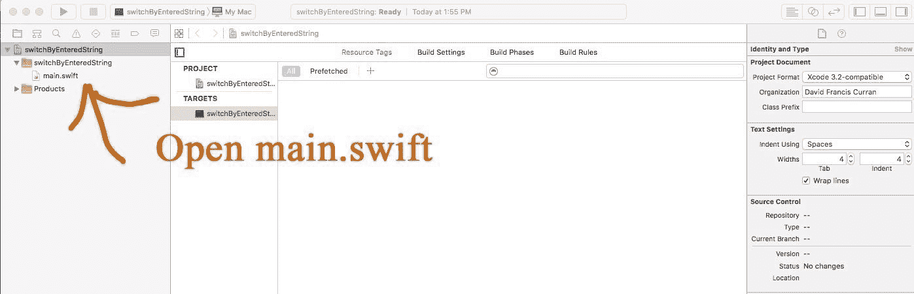

（图 12.6 打开 `main.swift`。）

输入下面的代码。在名称和版权信息注释掉之后。我将 `var reply` 设为一个强制解包的条件 `String`。然后使用了空值合并运算符（coalescing operator），以防没有输入任何内容。我们还没有讨论过函数，所以那部分稍后会讨论。现在只需使用这里的代码。

```swift
//
// main.swift
// switchByEnteredString
//
// Created by David Curran on 12/8/15.
// Copyright © 2015 David Francis Curran. All rights reserved.
//

import Foundation

func userEnteredData() -> String{ 
  let userTypedIn = NSFileHandle.fileHandleWithStandardInput()
  let myEnteredString = userTypedIn.availableData
  return NSString(data: myEnteredString, encoding:NSUTF8StringEncoding) as! String
}

print( "Please enter your gender")
var reply = String!()
reply = userEnteredData()
var replyForSwitch = reply ?? "Error "

switch(replyForSwitch){
case "true":
  print("true")
case "false":
  print("false")
default:
  print("false")
}
```

## 引言

然而，Apple 为其新的 `enum` 制定规则确实有其合理的理由。新的 `enum` 比旧的 C `enum` 具有多得的功能。由于旧的 C `enum` 的值只能是 `ints`，因此类型安全性并不是问题。但 Apple 新的 `enum` 在 `Swift` 中不必仅仅是 `Int`。

## Swift 中的基础枚举

由于你可能在问自己，这个 `enum` 与旧的有什么不同。让我们看看需要做什么才能让我们的 Swift `enum` 尽可能地像旧的那个。

为枚举创建一个新的 playground。并输入：

```swift
enum Numbers { //注意每个值之前的单词大小写。这可以通过不同的方式实现，但如果没有 case，你就无法拥有 rawValue —— 即某种某种一致类型的值。

  case ZERO

  case ONE
  case TWO
  case THREE
  case FOUR
  case FIVE
  case SIX
  case SEVEN
  case EIGHT
  case NINE
  case TEN
} //不需要分号 ;
```

这建立了一个名为 `Numbers` 的 `enum`，但它没有值。Apple 喜欢称它们为 `rawValues`。简单来说，`rawValues` 是赋予 `enum` 的值。

在 `Swift` 中，`Numbers` 现在是一个类型，尝试像在 `C` 或 `C++` 中那样写写 `enum Numbers` 将导致错误。显式转换可以运行，但它的写法不像在 `C` 或 `C++` 中那样。

```swift
var count: enum Numbers = .EIGHT //会给你返回一个错误 ERROR
var count1: Numbers = .EIGHT //可以正常工作。
```

隐式转换也有效。

```swift
var count = Numbers.EIGHT
```

注意，要将变量或常量设置为我们 `Numbers` 中的其中一个值，你需要在值之前使用点符号。如上面的 `.EIGHT` 所示。但我们的 `enum` `Numbers` 不会在你的 playground 中显示任何值。

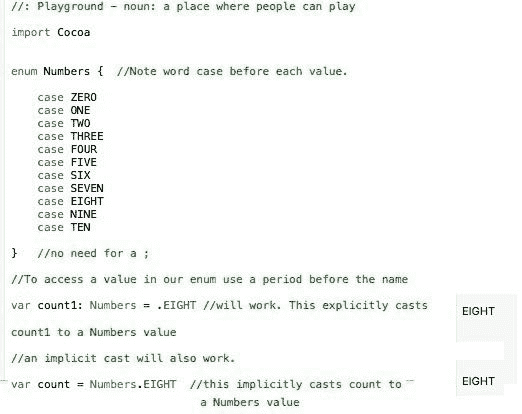

（图 13.3 在 Swift 中，枚举的值在你像上面的 `count` 和 `count1` 那样使用它们之前，不会显示在 playground 中。）

如你所见，侧边栏中只显示了 `EIGHT`。如果你喜欢，可以添加 `print(count1)`！

上面的 `enum` 没有任何基础值或原始值（raw values）。`Swift` 中的 `enum` 实际上并不需要基础值即可发挥作用。以这个 `enum` 为例：

```swift
enum PlantsNameHint {

  case my, very, eager
  case mother, just, served, up
  case nine, pies
}

var aPlanet = PlantsNameHint.served

switch(aPlanet){
case .my:
  print( "Mercury" )
case .very:
  print( "Venus" )
case .eager:
  print( "Earth" )
case .mother:
  print( "Mars" )
case .just:
  print( "Jupiter" )
case .served:
  print( "Saturn" )
case .up:
  print( "Uranus" )
case .nine:
  print( "Neptune" )
case .pies:
  print( "Poor Pluto" )
}
//打印 "Saturn"
```

## 原始值（Raw Values）与 Int 类型

但让我们假设你目前的目标是让它像 `C` 或 `C++` 的 `enum`。实际上这并不困难。让我们重做我们的 `Numbers` `enum`。

```swift
enum Numbers:Int {
```

这实际上会将 `enum` 从未指定的类型更改为 `Int` 类型。它还会为每个 `case` 提供一个从零开始的 `Int` 值。如果你将 `enum` `Numbers` 包含 `:Int`，它看起来和上面的图形没有区别，除了包含了 `:Int`。

### Playground 中有“幽灵”

当你在 `Xcode` 中创建 `C`、`C++`、`Object-C` 或 `Swift` 项目时，项目菜单除了 `RUN`、`BUILD` 等之外还有一个 `CLEAN` 选项。这是因为有时我们的项目会记住一些不该记得的东西，我们需要从头开始构建。`CLEAN` 会删除当前构建并从头开始。Playgrounds 有时会记住一些不再存在的东西，我称之为“幽灵”。我提到这一点是因为你可能会在学习这一节时遇到这种情况。

现在我们将 `enum Numbers` 更改为 `enum Numbers:Int` 并进行几处更改。我们将通过添加 `:Int` 赋予我们的 `enum` 所谓的 `rawValue`。这以前被称为 `toRaw()`，但在当前版本的 `Swift` 中已不再适用。如果你在不指定 `enum` 类型的情况下访问 `rawValue`，将得到错误。

注意，我们可以从任何想要的 `int` 值开始此 `enum` 的编号。默认值是 0。如果你对下面的代码有任何问题，请将 `case ZERO` 改为 `case ZERO = 0`。

将此内容输入你的 playground：

```swift
enum Numbers:Int { //注意每个值之前的单词大小写。 

  case ZERO
  case ONE
  case TWO
  case THREE
  case FOUR
  case FIVE
  case SIX
  case SEVEN
  case EIGHT
  case NINE
  case TEN
} //不需要分号 ;

var time:Numbers = .FIVE

if  time == .FIVE {
  print(time.rawValue)
  let theTime = time.rawValue
  print(theTime)
  print(theTime)
}
```

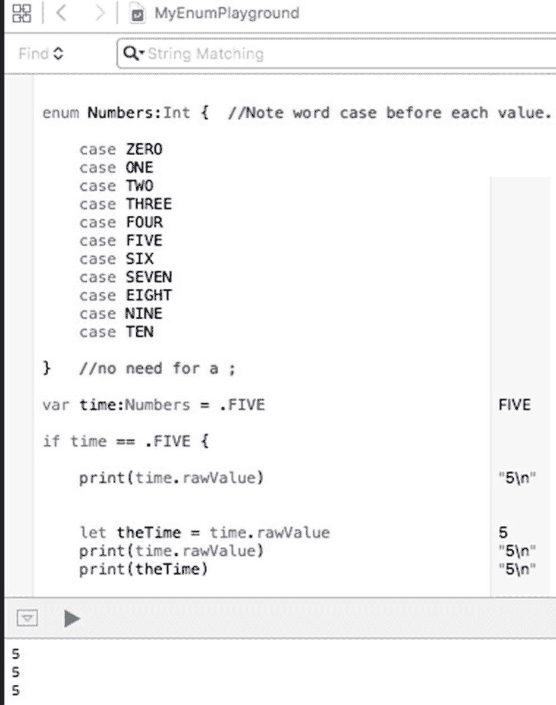

（图 13.4 在 Swift 中，编号的默认值为 0，在本例中为 `ZERO`。）

注意上面的 `theTime` 是一个等于 5 的常量 `Int`。它不是 `enum` `Numbers` 的实例。

在上面的示例中，每行都有一个 `case`，但你不需要为 `enum` 中的每个新值都使用 `case` 单词。下面的代码如下：

```swift
enum MyInt: Int {
  case a
  case b
  case c
}
```

（注：提供的文本在结尾处中断；我已根据可用片段格式化了逻辑。）

```swift
var someOtherVariable = Name_Of_Enum(rawValue: Some_Int_Included_In_Name_Of_Enum)(! needed)

someOtherVariable = .SOME_VALID_MEMBER_OF_ENUM

someOtherVariable(! not needed or Wanted ).rawValue

var myEvenNewerBubble = MyInt2.c

myEvenNewerBubble = MyInt2(rawValue:0)!

myEvenNewerBubble.rawValue

print (myEvenNewerBubble)
```

如果你回答了下面的问题，你将会发现枚举 `enum SomeFloatEnum: Float {}` 与 `enum SomeIntEnum: Int{}` 没有太大区别。

但字符串又是呢？输入：

```swift
enum MyStringEnum: String {
  case sweet = "Sweet", young, thing
}
```

```swift
var string1 = MyStringEnum.sweet

string1.rawValue

string1 = .young

string1.rawValue
```

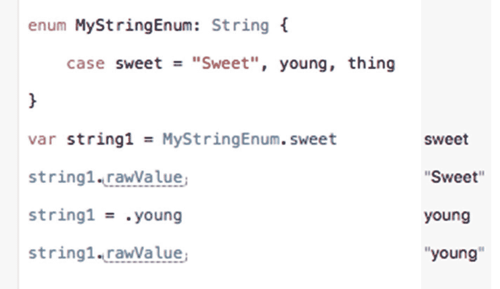

（图 13.12 使用 `rawValue` 查找枚举的值。）

由于为 `young` 没有提供 `String`，系统为我们提供了字符串 `"young"`。

```swift
enum myCountingString: String {
  case one, two, three
}
```


# 枚举

本节的最后一个注意事项。请记住以下两者之间的区别：

```swift
enum MyIntToo: Int {
  case a, b, c, d
}
```

```swift
let ace = MyIntToo.a
let doc = MyIntToo.a.rawValue
```

在这里 `ace == a`，它是 `MyIntToo` 的一个实例，但 `doc == 0` 仅仅是一个 `Int`。没有 `doc.a`、`doc.b`、`doc.c` 或 `doc.d`。

枚举的第一节就此结束。在涵盖另外几个主题后，我们将在第二书中回到它们。关于枚举我们还可以做更多事情。

## 问题

1) 给定：

```swift
enum An_ENUM: Int {
  case a, b, c
}
```

```swift
var Y = Int!()
var X = An_ENUM(rawValue: Y)
```

a. `var z = An_ENUM.a`，`z` 将等于 `2`（`z == 2`）

b. `var Y = Int!()` 会导致致命错误

c. `var X = An_ENUM(rawValue: Y)` 会导致致命错误

d. `var X` 将为 `nil`

2) 给定：

```swift
enum aLittleEnum: Int {
  case a = 15, b, c, d, e, f, g
}
```

```swift
var w = aLittleEnum.c
```

`w.rawValue` 将是什么？

a. 2

b. 3

c. 17

d. 18

3) 给定：

```swift
enum MyFloatEnum: Float {
  case a, b, c, d, q, e, m
}
```

```swift
var f = MyFloatEnum.e
```

`f.rawValue` 将是什么？

a. nil

b. 致命错误（FATAL ERROR）

c. 3.0

d. 5.0

# 字典（Dictionaries）

当我用 C 或 C++ 工作时，我有时会创建数组的数组：

```cpp
int myArrayOfArrays[10][10];
```

或者

```cpp
int myArrayOfArraysOfArrays[10][10][10]; // 依此类推
```

在 Swift 中你并没有看到很多这种操作。你可以设置一个包含 1000 个 `Int` 值的 `Array`：

```swift
var aThousandIntArray = Int
```

然后对其中的值进行操作。但数据始终是以我们需要的方式收集的。Swift 确实给了我们在所谓的字典（dictionary）中收集数据的机会。它并不像 `int myArrayOfArrays[10][10];`，但你可以创建一个相似的东西。

假设我们创建了一个包含 100 个值的 `myArrayOfArrays`，并说 `myArrayOfArrays[0][0] = 5;`、`myArrayOfArrays[0][1] = 7;`、`myArrayOfArrays[0][2] = 9;` 直到 `myArrayOfArrays[10][10] = 122;`

```swift
var A_DICTIONARY_NAME: [Int : Int] = [0 : 5, 1: 7, 2 : 9]
```

相反，Swift 使用的是字典。每个字典条目由两个项目组成，第一个是键（key），第二个是值（value）。这里有一个键值都是字符串的字典：

```swift
var myExampleDictionary: [String : String] = ["Key" : "Value"]
```

`Dictionary` 中的项目在哈希表中按其键排序，用户永远看不到这个哈希表。Swift 在后台处理了排序。简单来说，Swift 接收你的 `Key`，将其拆分为可排序的代码并在你需要时找到你的 `Key`。键可以是任何类型，`Int`、`Double`、`String`，只要可以转换为哈希值进行存储即可。值可以是任何类型。

可以显式创建一个字典：

`var` 或 `let` `dictionaryName`（冒号）`[` 键的类型名（冒号）值的类型名 `]` = `[` 指定类型的键（冒号）指定类型的值（如果需要，用逗号分隔）…. 指定类型的键（冒号）指定类型的值 `]`

你可以使用字典来收集姓和名，名字按姓氏排序：

```swift
var myDictionary: [String : String] = ["LastNameOne" : "David", "LastNameTwo" : "Two"]
```

`myDictionaryTenTen.count` // 仍然等于 101

同样地

`myDictionaryTenTen[3*33] = (3*33 + (3*33 % 10) * 2) + 5`

也给了我们 101 的计数。键是根据它们的声明类型进行评估的，在本例中为 `Int`。

## 移除值

Apple 提供了 `removeValueForKey(_:)` 作为移除内容的方法。

我们同样需要将其附加到字典的名称上，并只放入键。

```
myDictionaryTenTen.count
myDictionaryTenTen[100]
myDictionaryTenTen[199]
myDictionaryTenTen.count
myDictionaryTenTen.removeValueForKey(199)
myDictionaryTenTen[199]
myDictionaryTenTen.count
```

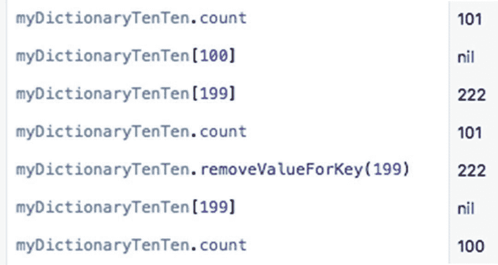

（图 14.3 显示使用 `.count` 和 `.removeValueForKey()` 的结果）

注意，尽管我们的字典中有 101 个项目，但键 100 显示为 `nil`。移除键 199 的值后，它也被显示为 `nil`。

另外请注意，`myDictionaryTenTen.removeValueForKey(199)` 给了我们被移除的值：

222

正如我们在 For-In 循环中学到的，我们可以使用 For-In 循环来遍历字典。为了好玩，让我们把键 199 的值放回去。

```
myDictionaryTenTen[199] = 1000

for (whoCaresWhatICallTheKey, whoCaresWhatICallTheValue) in myDictionaryTenTen {
  print("\(whoCaresWhatICallTheKey):\(whoCaresWhatICallTheValue)")
}
```

在你的 playground 中试试！

让我们尝试一些新东西，在你的 playground 中输入：

```
print(myDictionaryTenTen.keys)
print(myDictionaryTenTen.values)
```

觉得还不太印象深刻？嗯，你不会那样使用 `.keys` 或 `.values`。你可能会做类似这样的操作。

```swift
for SomeSillyValue in myDictionaryTenTen.values {
  if SomeSillyValue % 11 == 0 {
    print("SomeSillyValue) "
  }
}
```

我们得到：

55

99

33

66

110

88

33

77

44

`.keys` 和 `.values` 告诉 Swift 单独提取键或值。

# 处理字符串

字符串在 Swift 中略有不同。在 C 和 C++ 中，字符串是填充了字符的字符数组。

而不是

`char aLetter = 'a';`

我们使用的是

```swift
var aLetter = "o";
var anotherletter: Character = "k"
```

注意，我们对 Characters 使用双引号（永远不要使用智能引号）。现在，只需记住有 Characters 即可。

我们如何知道这些确实是 Characters 而不是 Strings？

在 Swift 中我们可以相加 Strings，但相加 Characters 稍微复杂一些。

```
var word = aLetter + anotherLetter
```

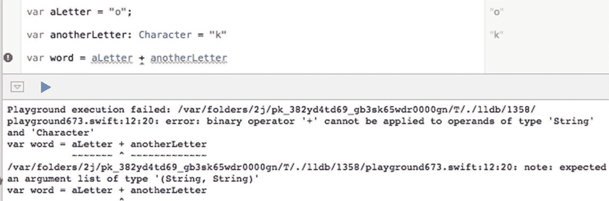（图 15.1 Swift 中的 Characters 不能简单地相加来形成 Strings。）

因此上面的代码会给我们一个错误信息。我们不能直接相加 Characters。稍后我们会看到可以将一个 Character 追加到单词中，但那需要小心。

存在隐式 Character 吗？

```swift
var myWord1 = "n"
var myWord2 = "o"
var myFinalWord = myWord1 + myWord2
```

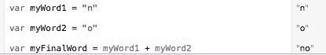

（图 15.2 如果你可以将两个单字符变量或常量相加，它们是 Strings 而不是 Characters。）

你可以看到 Swift 将 `myWord1` 和 `myWord2` 解释为 Strings 而不是 Characters。

Characters 必须显式声明。

所以当我查看 Swift 中的 Strings 时，我的第一个问题是如何访问单个 Characters？让我们尝试访问我们的 "Hello, playground" `str` 中的一个字符。

```swift
var aThirdLetter: Character = str[0] // 崩溃
```

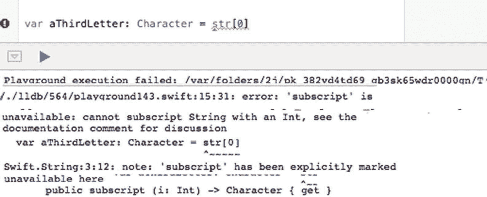

（图 15.3 你不能通过使用 Int 指向字符串中的位置来为 Character 赋值。）

我们如何获取 Swift 在我们打开 playground 时提供的如 `str` 字符串中的单个字符，即 `var str = "Hello, playground"`？

这以前可行，但现在不再行了：

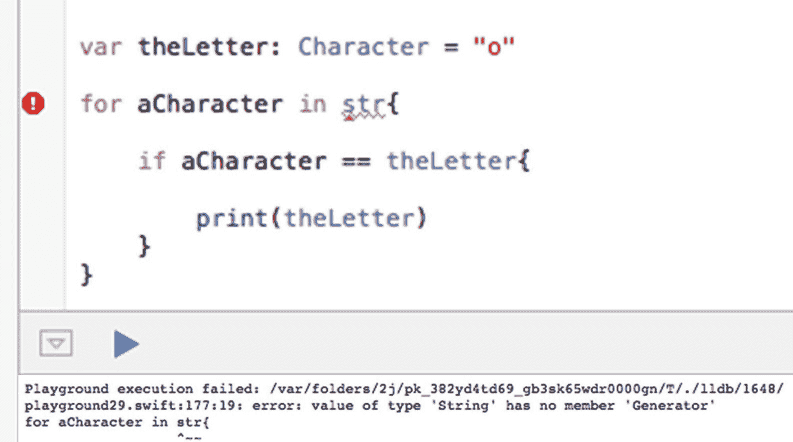

（图 15.4 这种方法不再起作用。）

现在实现此的一种方法是在字符串末尾追加 `.characters`。

```swift
for myCharacter in str.characters {
  print(myCharacter)
}
```

// 结果为

H

e

l

l

o

，

p

l

a

y

g

r

o

u

n

d

另一种稍有不同的方法是：

```swift
for index in str.characters.indices {
  print("\(str[index])")
}
```

尝试上面的操作看看是否给你相同的结果。在第一种情况下，我们直接访问字符。在第二种情况下，我们获取每个字符的索引，然后使用 `str[index]` 在字符串中找到它。要记住的重要点是索引不等同于 `Int`。

```swift
var myOtherCharacter = str[index]
```

`myString[myString.endIndex.predecessor().predecessor().predecessor().predecessor().predecessor()]` 将带我们一直回到 "D"

但那是一种相当笨拙的移动方式。如果我们多加了一个 `.predecessor()`，就会导致致命性错误。因此 Swift 也给了我们 `.successor()`。

```swift
myString.startIndex.successor() // 工作方式与 .predecessor() 类似，只是 successor() 会向前移动。
```


（图 15.8 使用 `.startIndex` 移动。使用 `.successor()` 并添加额外的 `.successor()`。）

不要访问不存在的索引的 `Character`。

```swift
myString.endIndex.predecessor().successor() // 结果为 5，正如你所看到的，它并不存在，尝试访问这里的 Character 将导致错误。
```

不要访问不存在的索引。

```swift
myString.startIndex.predecessor()
```


（图 15.9 然而，就像在 C 和 C++ 中一样，你无法到达不存在的位置。`.startIndex`.`.predecessor()` 失败。）

`.advancedBy()` 实际上接受一个 `Int` 作为参数。它需要像 `startIndex` 的起始位置。

```swift
myString.startIndex.advancedBy(2) // 得到 2
myString[myString.startIndex.advancedBy(2)] // 得到 "V"
```

在 `advancedBy()` 中达到 `myString.characters.count` 或其等价 `myString.endIndex` 会导致错误。`advancedBy()` 为我们提供了另一种打印 `String` 中字符的方法。在你的 playground 中尝试一下。

```swift
var counter = 0  // counter 必须设置为 int 而不是索引
while counter < str.characters.count { // str.characters.count 确实返回一个 Int。
  print(str[str.startIndex.advancedBy(counter)]) // advancedBy 接收 Int 参数。
  counter++
}
```

`.advancedBy(Int)` 可以接受负值。在你的 playground 中用我们的 Swift 启动字符串 `str` 尝试这个。

```swift
var countOfCharacters = str.characters.count  // str.characters.count 返回一个 int
str.endIndex  // 记得我们不能使用它，它是一个索引而不是 int。
var counterNeg = countOfCharacters
str.endIndex.advancedBy(-counterNeg)
while counterNeg > 0 {
  print(str[str.endIndex.advancedBy(-counterNeg)])
  counterNeg--
}
```

考虑一下，`.endIndex` 不包含字符，但它是一个有效的后续索引，可以在那里插入字符。

```swift
myString.insert("!", atIndex: myString.endIndex) // 不会覆盖，而是插入到字符串的末尾处。
```

但 `.endIndex` 不是一个删除字符的有效位置，因为那里没有字符。我们刚刚插入的字符 "!" 并不是从末尾移除的，所以位于 `myString.endIndex.predecessor()`。

为了删除它前面的字符（即原始的 "?"），我们这样做：

```swift
myString.removeAtIndex(myString.endIndex.predecessor().predecessor()) // 删除了我们向前移动的 "?"
print(myString)
```


（图 15.10 使用 `.insert` 和 `.removeAtIndex` 更改 String。注意 String 索引不是 Int。）

对于我们的 `String` 甚至有一个 `.removeRange(_:)` 方法。注意，当 Apple 用 `_` 表示某项内容时：该值将直接插入，无需任何其他指令。

```swift
var aRange = str.startIndex.advancedBy(7)...str.startIndex.advancedBy(10)

// 让我们添加一些必要的标点符号。
str.insert(".", atIndex: str.endIndex)

// 那个伞没打开的跳伞兵说了什么？
str.removeRange(aRange)
```

# String 额外扩展

Unicode 标量（Unicode scalars）被视为单词，可以简单地添加，例如，骷髅和交叉骨的代码是 `"\u{2620}"`。输入：

```swift
var myFavoriteFlag = "My favorite flag is "

myFavoriteFlag += "\u{2620}"

print(myFavoriteFlag)
```


（图 16.1 尽管海盗旗是一个字符，但在这里添加时它是一个单词。）

我们可以在我们的字符串中找到一个 `String`。让我们用 `myString` 试试（DAVE!）

```swift
myString.containsString("AV") // 得到 true
```

`hasPrefix` 和 `hasSuffix` 类似的。

```swift
myString.hasPrefix("DA") // 得到 true，这是前缀
```


`myString.hasSuffix("VE")` // 得到 false，这不是后缀

`myString.hasSuffix("E!")` // 得到 true，这是后缀。

```swift
print("myString has \(myString.characters.count) characters.")
```

// 得到 "myString has 5 characters.\n"

`myString.isEmpty` // 将得到 false，因为那里有字符。

```swift
var aBlankString = ""  //将其为空字符串

var anotherBlankSting = String() //将其为空字符串

aBlankString.isEmpty  // 得到 true

anotherBlankSting.isEmpty  // 得到 true

aBlankString = myString

if( aBlankString == myString){

  print("These two Strings are equal")

} else {

  print("\u{2620}")

}
```


（图 16.2 hasPrefix, hasSuffix）

seventeen

### 使用结构体 (Structs)

结构体非常像 C 和 C++，区别在于它们没有方法。等等，不对。结构体可以有方法。但现在，让我们看看如何使用它们。我们可以使用结构体向 Swift 添加数据。结构体可以有方法。

```swift
struct businessCard {

  var firstName: String?

  var middleName: String?

  var surName: String?

  var age: Int

  var isFemale: Bool

}
```

我们可以通过填充它的属性向结构体添加数据。

```swift
var myCard = businessCard()

myCard.firstName = "Bob"

myCard.middleName = "David"

myCard.surName = "Cats"

myCard.age = 33

myCard.isFemale = false
```

我们可以向字典向结构体添加数据。

```swift
var businessCardDictionary: [Int: businessCard] = [:]

businessCardDictionary[0] = myCard
```

我们可以向字典向结构体添加数据。

```swift
if let card = businessCardDictionary[0] {

  print(card.firstName)

}
```

我们可以向字典向结构体添加数据。

```swift
if let card = businessCardDictionary[0] {

  print(card.middleName)

}
```

结构体也可以有自己的方法。

```swift
struct businessCard {

  var firstName: String?

  var middleName: String?

  var surName: String?

  var age: Int

  var isFemale: Bool

  func printName() {

    print("\(firstName ?? "") \(middleName ?? "")")

  }

}
```

eighteen

### 函数 (Functions)

我喜欢 C 或 C++ 函数。

```cpp
#include <iostream>

using  namespace  std;

int giveMeTheAverageMileage( int myMileArray[], int entriesTotal){

  int result = 0;

  for( int x = 0; x < entriesTotal; x++ ){

 result += myMileArray[x];

 }

  return result;

}

int main(int argc, const  char * argv[]) {

  int distance[6] = {11,14,56,61,4,2};

  cout << "Average milage == " << giveMeTheAverageMileage(distance, 6) << "\n\n";

}
```

但尽管我总是给函数和变量命名，以便它们能被理解和记住，但别人不喜欢人们像这样写函数。

```swift
int doIt( int forbar[], int foo){

  int w = 0;

  for( int x = 0; x < foo; x++ ){

    w += forbar[x];

  }

  return w;

}
```

因此，Object-C 有许多指令写在函数中，就在它们本该出现的地方，这样函数可以更容易被理解。

我们不需要使用它们来将上述 C++ 程序翻译为 Swift：

创建一个新的游乐场（playground）并将其命名为你的函数 playground。输入：

```swift
var listOfNumbers = [11,14,56,61,4,2]

func giveMeTheAverageMileage(listOfNumbers: Array<Int>) -> Int{

  var total = 0

  for var i = 0; i < listOfNumbers.count; i++ { //我们不需要知道我们的数组有多少个元素 //Swift 会帮我们处理这些。

    total += listOfNumbers[i]

  }

  return total

}

print(giveMeTheAverageMileage(listOfNumbers))
```


（图 18.1 一个简单的函数，为我们提供一组数字的平均值。）

函数的模型应该是：

`func nameOfFunction( NameOfEntity: type, nameOfNextItemToEnter: type, etc.) -> return type{}`

让我们通过我将向你展示的下一个函数示例来看这些内容。它包含：

- 单词：`func`
- 函数名：`returnPrefix`
- 参数：`type` `wordToPrefix:String`
- `.`
- `.` // 根据需要可以使用任意数量，用逗号分隔
- `.`
- 参数：`type` `lengthOfPrefixToReturn: Int`
- 箭头：`->`
- 返回类型：`String`

### 作业 1

尝试根据你目前所学的内容写一个函数，接收一个 String 和一个长度，并返回该字符串中前长度的字符。完成后，将你的代码与下方的对比。我将使用 Swift 的 `var str = "Hello, playground"` 作为我的字符串。

```swift
var str = "Hello, playground"

func returnPrefix(wordToPrefix:String, lengthOfPrefixToReturn: Int) ->String {

  if lengthOfPrefixToReturn == 0 {

    return ""

  }

  var nextIndexMarker = 1

  //设置一个字符数组

  var aPrefix:[Character] = [wordToPrefix[wordToPrefix.startIndex]]

  lengthOfPrefixToReturn

  nextIndexMarker

  wordToPrefix.characters.count

  while nextIndexMarker < wordToPrefix.characters.count && lengthOfPrefixToReturn > nextIndexMarker {

    aPrefix.append(wordToPrefix[wordToPrefix.startIndex.advancedBy(nextIndexMarker)])

    nextIndexMarker++

  }

  let result:String = String(aPrefix)

  return(result)

}

var myPrefixString = returnPrefix(str,lengthOfPrefixToReturn: 3)

print(myPrefixString)
```


（图 18.2 `returnPrefix()` 接收一个字符串和一个长度，并返回该长度的前缀。）

### 作业 2

在结构体（Structs）章节中，我们展示了如何使用

`myBusinessCardDictionary.updateValue(myCard, forKey: 5555551212)`

这里的 `updateValue` 要求提供整个 `myCard`。如果你只想更新 `myCard.age` 呢？假设 Jan 不想被列为 30 岁。

你能写一个函数来处理这个吗？尝试一下并与下方的解决方案对比。

```swift
func upDateMyCardAge( myCard: businessCard, NewValueForAge: Int)->businessCard{

  var newAgeCard = myCard

  newAgeCard.age = NewValueForAge

  return newAgeCard

}

myBusinessCardDictionary.updateValue(upDateMyCardAge( myCard, NewValueForAge: 27), forKey: 5555551212)
```


（图 18.3 写一个函数来更新我们简单的 businessCard 上的一个值。）

感谢阅读：我们将在即将出版的系列丛书中介绍更多针对 C 和 C++ 程序员的 Swift。

### 作业 3

在关于 switch 的章节中，我们说如果可能的 switch 是穷尽的（如 true 或 false 示例），那么就不需要默认（default）：

Swift 在理解给定的 switch 是否穷尽方面表现如何？让我们测试一下。写一个函数，其返回值使得该 switch 是穷尽的。

```swift
func SOMEFUNC(anIntValue:Int)->Int{

  //在这里写下你的代码

}

var valueToSwitchOn = 5

switch(valueToSwitchOn){

  case 1:

    print("Opps")

  case 2:

    print("Whoops")

  case SOMEFUNC(valueToSwitchOn):

    print("如果 Swift 不要求默认值则成功。")

}
```

你可以吗？在查看我下方的解决方案（如果我找到了）之前尝试解决。


（图 18.4 我返回输入的值的想法（这总是提供解决方案）不起作用。但如果你是一个 C 或 C++ 程序员，你应该知道，编译器和程序员都不是完美的。）

**nineteen**

**Playgrounds**

```swift
//: 第 3 章节游乐场 - 名: 人可以玩的地方

import Cocoa

var str = "Hello, playground"

var bananas = 5

var grapes = 6

print("We have \(grapes) grapes and ")
```

```swift
//anArrayOfInts[11] = 5  //因为没有索引 11，所以会崩溃。索引 10 处的值是 11。

//anArrayOfInts += 12 // 取消注释查看为什么这会崩溃并报错

anArrayOfInts += [12] //可以工作，12 必须在 [] 内部

anArrayOfInts[11] = 11  //可以工作，因为现在已经添加了第 11 个位置。我们只是在这里更改值。

anArrayOfInts[10] = 10

anArrayOfInts += [13] //可以工作，并在索引 12 处添加了第 13 个项目

anArrayOfInts

var aStringArray = ["ma","my","mo"] //注意智能引号！

aStringArray += ["mum"] //可以工作

aStringArray[0] = "me"  //可以工作

var aNewIntArray = [Int]()

var anotherNewIntArray = Array<Int>()

var aNewStringArray = Array<String>()

var anotherNewStringArray = [String]()

aNewIntArray = [0,1,2,3,4,5,6,7,8,9]

aNewIntArray += [10]

aNewStringArray = ["ma","my","mo"]

aNewStringArray += ["mum"]

aNewStringArray[0] = "me"  //注意引号

print(aNewIntArray)

var kot = Array<String>()

kot = ["What","is"]

//通过光标按住 Array 命令，你将看到可用的扩展

kot.append("name")

kot += ["please"]

kot.count

kot.capacity

kot.insert("your", atIndex: 2) //索引始终从零开始

kot += ["stupid!"]

kot.removeLast()

kot

kot.removeAtIndex(4)

//////////////////////////////////

//以下与章节问题相关

/////////////////////////////////

var result = kot + aStringArray

kot.removeAll()

kot

aNewIntArray.isEmpty

//aNewIntArray.popLast()

aNewIntArray.insert(-1, atIndex: 0)

aNewIntArray.popLast()

aNewIntArray

var number = (4,5)

print(number)

var list = Array<Int>(count: 4, repeatedValue: 6)

var list2 = Int

var myArray=[1,2,3,5,7,11,13,17]

//: 第 8 章 Playground - 名词：人们可以玩的地方

import Cocoa

var str = "Hello, playground"

var pennies = 5

let enoughToBuyCandy = 5

if  pennies >= enoughToBuyCandy{

  print("我们可以买糖果了!")

}

var numberOfPenniesString = "pennies"

pennies = 4

if  enoughToBuyCandy - pennies == 1{

  numberOfPenniesString = "penny"

}

if  pennies >= enoughToBuyCandy{

  print("我们可以买糖果了!")

} else {

  print("我们回家吧，糖果少了 \(enoughToBuyCandy - pennies) \(numberOfPenniesString)。")

}

pennies = 7

if  enoughToBuyCandy - pennies == 1{

  numberOfPenniesString = "penny"

}

if  pennies == enoughToBuyCandy{

  print("我们可以买糖果了!")

} else  if  pennies > enoughToBuyCandy {

  print("我们可以多买 \(  pennies - enoughToBuyCandy) 分钱价值的糖果。")

}else{

  print("我们回家吧，糖果少了 \(enoughToBuyCandy - pennies) \(numberOfPenniesString)。")

}

//: 第 9 章 Playground - 名词：人们可以玩的地方

import Cocoa

var str = "Hello, playground"

var lemons = Int?

var limes = Int!()

var peaches = 5

lemons = 5

limes = 5

lemons = nil

limes = nil

peaches = nil //取消注释查看错误

var apples = Int? //注意这里用于结尾的 () 已经更改。

if  apples >= 1{

  print("我们有苹果)")

} else { //涵盖了 nil

  print("我们今天没有苹果!")

}

let applesPerCrate = 20
```


```swift
//varCratesNeeded = apples/applesCrate //取消注释查看错误和建议的修正

var potatoes = 1

var motatoes = Double(1)

var oranges = Int!()

var pennies = 21

if pennies >= 100 {
  oranges = 5
}

var today = "Tuesday"

var plums = Int?

if today == "Tuesday" {
  plums = 8
}

var plumsPerDay = plums! * 1 //! 是必要的

var cuties = Int!() //用于结尾的 () 已经更改。

var numberOfCuties = cuties ?? 0 //在这里我们将 cuties 设置为 0，如果 cuties 为 nil。

print(numberOfCuties)

if cuties >= 1 {
  print("我们有糖果)")
} else {
  print("我们今天没有糖果!")
}

//也可以用 if else 这样做

if cuties != nil {
  print("我们有糖果)")
} else {
  print("我们今天没有糖果!")
}

var bananas = Int? //显式为 Int 但不会强制解包。

bananas = Int(random_uniform(12) + 1) //将 bananas 设置为一到十二之间的随机数。

print("我们有 \(bananas!) 糖果，是 \((Double(bananas!) / 12.0 * 100))% 一打")

//: 第 10 章 Playground - 名词：人们可以玩的地方

import Cocoa

var str = "Hello, playground"

for var i = 4; i < 7; i++ {
  print(i)
}

print("i \n")

var x: double = 0

for (x = 0; x < 4; x++) {
  print(x)
}

for i in 4 ..< 7 // 使用开区间

for j in 7...10 // 使用闭区间运算符

print("\(i) \(j)")

var myLoopArray = ["My", "very", "eager", "mother", "just", "up", "nine", "pies"]

var y = 0 //隐式定义为 Int

for (y = 0; y < myLoopArray.count; y++) {
  print(myLoopArray[y])
}

myLoopArray.count

for (y = 0; y < myLoopArray.count; y++) {
  print(myLoopArray[y])
}

for planet in myLoopArray.enumerate() {
  print(planet)
}

for planet in myLoopArray {
  print(planet)
}

////////////////////////

// 问题

///////////////////////

for indice in 4...7 {
  print(indice)
}

//: 第 11 章 Playground - 名词：人们可以玩的地方

import Cocoa

var str = "Hello, playground"

var x = 6

while (x > -1) { // 断言一个条件被满足
  if (x != 0) {
    print("离突破还有 \(x) 分钟") // 执行我们需要的事情。
  } else {
    print("我们正在取得突破")
  }

  x-- //给了我们退出循环的方法。
}

while x < 6 {
  print("我们正处于 \(x)")
  x++
}

x = 100

repeat { // 在 SWIFT 中 repeat 现在代替了 do
  print("我们正处于 \(x)")
  x += 100
} while x < 8 //我们需要让 while 循环在某个时候结束。

//: 第 12 章 Playground - 名词：人们可以玩的地方

import Cocoa

var str = "Hello, playground"

//这与 C++ 版本略有不同。因为不需要 break，运行结果是不同的。

var dog = 5

switch dog {
case 0:
  print("Boxer") // break 是不必要的
case 2:
  print("Irish Setter")
case 3:
  print("Doberman")
case 4:
  print("Springer Spaniel")
case 5, 6: // 在一起的项目是这样处理的
  print("Unknown ")
default:
  print("Mutt")
}

print("\n\n")

var trueOrFalse = true

switch trueOrFalse {
case true:
  print("true")
case false:
  print("false")
}

//: 第 13 章 Playground - 名词：人们可以玩的地方

import Cocoa

var str = "Hello, playground"

enum Numbers { // 注意每个值前面的 case。。可以以不同的方式进行，但没有 case 就无法拥有原始值——某种一致类型的值。
  case ZERO
  case ONE
  case TWO
  case THREE
  case FOUR
  case FIVE
  case SIX
  case SEVEN
  case EIGHT
  case NINE
  case TEN
} // 不需要分号

//var count: enum Numbers = .EIGHT //会给你一个错误

var count1: Numbers = .EIGHT //可以工作

//隐式转换也可以工作。

var count = Numbers.EIGHT

enum PlantsNameHint {
  case my, very, eager
  case mother, just, served, up
  case nine, pies
}

var aPlanet = PlantsNameHint.served

switch aPlanet {
case .my:
  print("Mercury ")
case .very:
  print("Venus ")
case .eager:
  print("Earth ")
case .mother:
  print("Mars ")
case .just:
  print("Jupiter ")
case .served:
  print("Saturn ")
case .up:
  print("Uranus ")
case .nine:
  print("Neptune ")
case .pies:
  print("Poor Pluto ")
}

//我在 Numbers 下方添加了一个 x (xNumbers) 以避免重复名称错误

enum xNumbers: Int { // 注意每个值前面的 case。
  case ZERO
  case ONE
  case TWO
  case THREE
  case FOUR
  case FIVE
  case SIX
  case SEVEN
  case EIGHT
  case NINE
  case TEN
} // 不需要分号

var time: xNumbers = .FIVE

if time == .FIVE {
  print(time.rawValue)
  let theTime = time.rawValue
  print(theTime)
  print(theTime)
}

enum YourInt: Int {
  case a, b, c
}

// 效果与仅枚举的名称不同时是一致的。

enum MyInt: Int {
  case a
  case b
  case c
}

// 你确实至少需要一次 case 单词来获取 rawValue。

/*
// 因为缺少 case 单词，会报错
enum errorNum {
  a, b, c
}
*/

var myBubble = MyInt.c
var yourBubble = YourInt.c

print(myBubble.rawValue)
print(yourBubble.rawValue)

myBubble = MyInt(rawValue: 0)!
print(myBubble)
print(myBubble.rawValue)

var myNewBubble = MyInt(rawValue: 3)
// myNewBubble!.rawValue // 这里会导致一个错误！

myNewBubble = .b // 你会在行间距中看到 b。

enum MyInt2: Int {
  case a, b, c
}

var myNextNewBubble = MyInt2(rawValue: 33) // 33 差得太远，MyInt2 只有 0, 1 和 2。
myNextNewBubble = .a
myNextNewBubble!.rawValue

var myEvenNewerBubble = MyInt2.c
myEvenNewerBubble = MyInt2(rawValue: 0)! // 尝试移除这里的 ! 看看错误
myEvenNewerBubble.rawValue
print(myEvenNewerBubble)

enum MyStringEnum: String {
  case sweet = "Sweet", young, thing
}

var string1 = MyStringEnum.sweet
string1.rawValue
string1 = .young
string1.rawValue

enum myCountingString: String {
  case one, two, three
}

var countTwo = myCountingString.two.rawValue

enum MyIntToo: Int {
  case a, b, c, d
}

let ace = MyIntToo.a
let doc = MyIntToo.a.rawValue
let myNewMyIntTooValue = ace.rawValue
// let myNewMyIntTooValue2 = doc.rawValue // 取消注释查看错误
// ace = .b // 取消注释查看可以修复的错误。

let diamonds = 5
// diamonds = 7 // 取消注释查看错误
这意味着移除该行的前两个 //
diamonds = 7 // 取消注释查看错误

//: 第 14 章游乐场 -名词：人们可以玩的地方

import Cocoa

var aThousandIntArray = Int
let Mom = 4 // 一个隐式创建的 Int

var myExampleDictionary: [String: String] = ["Key": "Value"]
var myDictionary: [String: String] = ["LastNameOne": "David", "LastNameTwo": "Lee", "LastNameThree": "Pat", "LastNameFour": "Sean"]
let Pap = ["Dad", 7]

print(Pap)

for (surname, familyName) in myDictionary {
  print("\(surname) \(familyName)")
}

var myDictionary2: Dictionary<String, String> = ["LastNameOne": "David", "LastNameTwo": "Lee", "LastNameThree": "Pat", "LastNameFour": "Sean"]
var myDictionary3 = ["LastNameOne": "David", "LastNameTwo": "Lee", "LastNameThree": "Pat", "LastNameFour": "Sean"]
var myFunFile = ["Dave": 11, "Pat": 12, "Sean": 14.01]

for (key, value) in myFunFile {
  print("\(value * 0.202)")
}

let myNameNumber = myFunFile["Pat"]
// 将带我们与 ["Pat"] 关联的值，即 12。
print(myNameNumber! * 0.202) // 我们需要 ! 因为 myNameNumber 是一个可选值

// var myNameNumber = myDictionary2["LastNameOne"]?[1] as? String

var myDictionaryTenTen: [Int: Int] = [0: 5, 1: 7, 2: 9]

for var i = 3; i < 100; i++ {
  myDictionaryTenTen[i] = (i + (i % 10) * 2) + 5
}

print(myDictionaryTenTen)

var myresulting = myDictionaryTenTen[99]
myDictionaryTenTen[9]
myDictionaryTenTen.updateValue(33, forKey: 9)
myDictionaryTenTen[9]
myDictionaryTenTen.updateValue(32, forKey: 0)
myDictionaryTenTen[199] = (199 + (199 % 10) * 2) + 5
myDictionaryTenTen.count
myDictionaryTenTen[099] = (099 + (099 % 10) * 2) + 5
myDictionaryTenTen.count
myDictionaryTenTen[3 * 33] = (3 * 33 + (3 * 33 % 10) * 2) + 5
myDictionaryTenTen.count
myDictionaryTenTen[100]
myDictionaryTenTen[199]
myDictionaryTenTen.count
```

```swift
print("myString has \(myString.characters.count) characters.")
```

var aRange = str.startIndex.advancedBy(7)...str.startIndex.advancedBy(10)

//让我们添加一些需要的标点符号。

```swift
str.insert(".", atIndex: str.endIndex)
```

// 那个伞没打开的跳伞员说了什么？

```swift
str.removeRange(aRange)
```

//: 第 16 章 Playground - 名词：人们可以玩的地方

import Cocoa

var str = "Hello, playground"

var myFavoriteFlag = "My favorite flag is "

myFavoriteFlag += "\u{2620}"

print(myFavoriteFlag)

var myString = "PROGRAMMER"

myString.hasPrefix("PR") // 返回 true，这是前缀

myString.hasSuffix("OG") // 返回 false，这不是后缀

myString.hasSuffix("ER") // 返回 true，这是后缀。

```swift
print("myString has \(myString.characters.count) characters.")
```

// 我们得到了 "myString has 10 characters.\n"

myString.isEmpty // 返回 false，因为那里有字符。

var aBlankString = "" //将其设置为空字符串

var anotherBlankSting = String() //将其设置为空字符串

aBlankString.isEmpty // 返回 true

anotherBlankSting.isEmpty // 返回 true

aBlankString = myString

if aBlankString == myString {
  print("这两个字符串相等")
} else {
  print("\u{2620}")
}
```


# 第 17 章 Playground - 名词：人们可以玩的地方

```swift
import Cocoa

var str = "Hello, playground"

struct businessCard {
  var firstName = String?()
  var middleName = String?()
  var surName = String?()
  var age = Int?()
  var isFemale = Bool?()
}

// 另一种方法是为未完成的卡片将年龄设为 0。虽然上面的 var age = 0 会更简单。

var myCard = businessCard(firstName: nil, middleName: nil, surName: nil, age: 0, isFemale: nil)

// 电话号码可以是 Int 或 String。我们在这里就用 Int。

var myBusinessCardDictionary:[Int : businessCard] = [0:myCard]

// 我们可以这样这样打印单个值

print(myCard.age)

// 让我们创建一个字典
// 为了放入一个电话号码，我们实际上必须移除由 0 标识的键

myBusinessCardDictionary.removeValueForKey(0)

// 现在我们的字典是空的
//print(myBusinessCardDictionary)
// 向我们的 myCard 添加值
// 我们将使用电话号码作为键

myBusinessCardDictionary = [5555551212:myCard]

// 我们可以填充我们的空卡片

if  myCard.age == 0 {
  myCard.firstName = "Bob"
  myCard.middleName = "David"
  myCard.surName = "Cats"
  myCard.age = 33
  myCard.isFemale = false
}

// 然后我们就可以更新 myCard 的值

myBusinessCardDictionary.updateValue(myCard, forKey: 5555551212)

var myCard2 = businessCard(firstName: "Jan", middleName: "Michelle", surName: "Dogs", age: 32, isFemale: true)

myBusinessCardDictionary[5555551020] = myCard2

//print(myBusinessCardDictionary)

func upDateMyCardAge( myCard: businessCard, NewValueForAge: Int)->businessCard{
  var newAgeCard = myCard
  newAgeCard.age =  NewValueForAge
  return newAgeCard
}

myBusinessCardDictionary.updateValue(upDateMyCardAge( myCard, NewValueForAge: 27), forKey: 5555551020)

print(myBusinessCardDictionary)
```

# 第 18 章 Playground - 名词：人们可以玩的地方

```swift
import Cocoa

var str = "Hello, playground"
```

# Playground - 名词：人们可以玩的地方

```swift
import Cocoa

var listOfNumbers = [11,14,56,61,4,2]

func giveMeTheAverageMileage(listOfNumbers: Array<Int>) -> Int{

  var total = 0

  for  var i = 0; i < listOfNumbers.count; i++ { // 我们不需要知道数组中有多少个项目 //Swift 会帮我们处理这些。

    total += listOfNumbers[i]

  }

  return total

}

print(giveMeTheAverageMileage(listOfNumbers))

// 这是我的函数，它接收一个字符串并返回指定长度的前缀。

func returnPrefix(wordToPrefix:String, lengthOfPrefixToReturn: Int) ->String {

  // 检查要返回的长度是否大于 0

  if lengthOfPrefixToReturn == 0 {

    return  ""

  }

  // 隐式创建一个 Int 类型的计数器

  var nextIndexMarker = 1

  // 设置一个 Characters 数组并用字符串中的第一个字符初始化它

  var aPrefix:[Character] = [wordToPrefix[wordToPrefix.startIndex]]

  // 下面的三行仅用于向你展示在使用它们之前的值

  lengthOfPrefixToReturn

  nextIndexMarker

  wordToPrefix.characters.count

}
```

```cpp
intBlockPtr += 10000789; //我们已经创建了书架空间并添加了书籍 10000789

cout << "*intBlockPtr == " << *intBlockPtr << "\n\n";

cout << "intBlockPtr == " << intBlockPtr << "\n\n";

cout << "Now we free( intBlockPt\n\n"; //我们已经删除了书架和地板

free(intBlockPtr);

cout << " intBlockPtr = "<< intBlockPtr << "\n\n"; // 指针仍然指向一个已不存在的位置

cout << *intBlockPtr << " = intBlockPtr\n\n";

return 0;
```

# main.c - 第 12 章 Switch

```c
// main.c
// 第 12 章 Switch
// 由 David Curran 创建于 1/9/16.
// Copyright © 2016 David Francis Curran. 保留所有。

#include <stdio.h>

int main(int argc, const char * argv[]) {

  int dog = 5;

  switch(dog)

  {

  case 0:

    printf("Boxer");

    break; // 每个 case 后面都必须加 break，除非你想让它们一起执行

  case 2:

    printf("Irish Setter");

    break;

  case 3:

    printf("Doberman");

    break;

  case 4:

    printf("Springer Spaniel");

    break;

  case 5:

    printf("Unknown "); // 没有 break，这些会合并执行

  default:

    printf("Mutt");

  }

  printf("\n\n");

  return 0;

}
```

# main.swift - 第十二章 SwitchSwift

```swift
// main.swift
// 第十二章章 SwitchSwift
// 由 David Curran 创建于 1/9/16.
// Copyright © 2016 David Francis Curran. 保留所有。

import Foundation

print("Hello, World!")
```

# main.swift - 根据输入的字符串进行 switch

```swift
// main.swift
// 根据输入的字符串进行 switch
// 由 David Curran 创建于 12/8/15.
// Copyright © 2015 David Francis Curran. 保留所有。

import Foundation

func userEnteredData() -> String{

  let userTypedIn = NSFileHandle.fileHandleWithStandardInput()

  let myEnteredString = userTypedIn.availableData

  return NSString(data: myEnteredString, encoding:NSUTF8StringEncoding) as! String

}

print("Please enter your gender")

var reply = String!()

reply = userEnteredData()

var replyForSwitch = reply ?? "Error "  // 使用空值合并运算符防止错误。

switch(replyForSwitch){

case "Error":

  print("There has been a ERROR please try again!")

// 下面是修正后的 case

case "Male\n","M\n","MALE\n","m\n","male\n":

  print( "Thank you sir!")

default: // 如果不是男性的话……

  print( "Thank you ma'am'!")

}
```

# main.c - 枚举测试

```c
// main.c
// 枚举测试
// 由 David Curran 创建于 1/9/15.
// Copyright © 2015 David Francis Curran. 保留所有。

#include <stdio.h>

int main(int argc, const char * argv[]) {

  enum Numbers {

  ZERO, ONE, TWO, THREE, FOUR, FIVE, SIX, SEVEN, EIGHT, NINE, TEN

  };

  enum Numbers nowTime = THREE;

  printf("\nnowTime is == %d and THREE is == %d\n", nowTime,THREE);

  nowTime = TEN;

  printf("\nnowTime is == %d and TEN is == %d\n", nowTime,TEN);

  nowTime = 15;

  printf("\nnowTime is == %d and 15 is == %d\n", nowTime,15);

  return 0;

}
```

# main.c - 第 15.7 章 C 语言越界

```c
// main.c
// 第 15.7 章 C 语言越界
// 由 David Curran 创建于 1/10/16.
// Copyright © 2016 David Francis Curran. 保留所有。

#include <stdio.h>

int main(int argc, const char * argv[]) {

  char name[] = "Dave";

  printf("%c\n", name[5]);

  return 0;

}
```

# main.cpp - 第 18 章 函数示例

```cpp
// main.cpp
// 第 18 章 函数示例
// 由 David Curran 创建于 1/10/16.
// Copyright © 2016 David Francis Curran. 保留所有。

#include <iostream>

using namespace std;

int giveMeTheAverageMileage( int myMileArray[], int entriesTotal){

  int result = 0;

  for( int x = 0; x < entriesTotal; x++ ){

    result += myMileArray[x];

  }

  return result;

}

int doIt( int forbar[], int foo){

  int w = 0;

  for( int x = 0; x < foo; x++ ){

    w += forbar[x];

  }

  return w;

}

int main(int argc, const char * argv[]) {

  int distance[6] = {11,14,56,61,4,2};

  cout << "Average milage == " << giveMeTheAverageMileage(distance, 6) << "\n\n";

  cout << "Average milage is also == " << doIt(distance, 6) << "\n\n";

  return 0;

}
```
