# Windows 和 Macintosh 的 JMP Student Edition 使用指南：JMP Student Edition 统计用户指南


## 开始使用 JMP 学生版

欢迎使用 JMP 学生版——SAS Institute 屡获殊荣的 JMP 统计发现软件的专为入门统计学学生量身定制的版本。

JMP 学生版易于学习，易于使用。所有统计功能都以熟悉的点选格式呈现，且统计概念均以图表和适当的数值结果为支撑。此外，所有数据表、图形和图表都动态链接在一起，允许在出现时交互式探索模式和异常值。我们希望这种可视化能让学习统计学比以往任何时候都更有趣、更容易。

### 本书的前提条件

使用 JMP 学生版，需要具备最少的计算机和统计知识。具体前提条件如下：

#### 计算机和操作系统

在本手册中，假定读者熟悉标准计算机操作和操作系统术语，尤其是鼠标的使用、标准菜单和命令。在阅读本指南之前，还应具备打开、关闭和保存文件的知识。有关这些主题的更多信息，请参阅操作系统和计算机的参考书籍。

#### 统计学

由于 JMP 学生版是专门为初学统计学学生制作的，因此不需要正式的统计学知识。本书展示了如何完成简单的统计任务，如所有入门统计学教材中的任务。

### 使用其文档学习 JMP 学生版

JMP 学生版包含一套全面的在线帮助系统。它可以像书籍一样阅读，因为它包含完整的目录，也可以用于搜索特定主题。

此外，JMP 学生版配备了上下文相关帮助。要使用它，请选择帮助工具（见图 1.1），然后在数据表或报告中的任何位置单击。JMP 学生版会打开特定于您单击的项目的帮助。

**图 1.1** JMP 学生版帮助工具

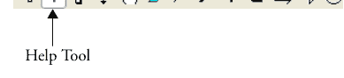

### 本书中使用的约定

在本手册中，特殊字体用于指定命令、菜单项或其他独特功能。

- **菜单项**、**按钮**和**报告标题**通常由 JMP 学生版设置，用户无法更改。
- 研究中的**变量**在数据电子表格中以**列**形式排列，因此**变量**和**列**这两个词经常可以互换使用。
- **文件名**打开并保存到磁盘或网络文件夹。
- *新*或*重要词语*用斜体强调。

某些段落旨在在阅读文本时执行。它们由左侧的鼠标指定。

- 记号 **File > Open** 表示从 **File** 菜单中选择 **Open** 命令。
- 标题为“Introduction”的部分提供了学习 JMP 学生版基础知识的实践方法。每个“Introduction”部分都使用指定的平台或功能探索 Denim.jmp 示例数据集。它们与章节中的其余材料是分开的。事实上，所有“Introduction”部分都可以在阅读本书其余主要作为参考的材料之前，从各章中阅读。

### 启动 JMP 学生版

JMP 学生版可以通过两种方式启动：

- 双击 JMP 学生版图标
- 双击 JMP 学生版数据集或脚本。

默认情况下，JMP 学生版开始时打开一个特殊的导航窗口，称为 *JMP Starter*（见图 1.2）。如果 JMP Starter 未自动打开，请选择 **View > JMP Starter**。

**图 1.2** JMP Starter 窗口

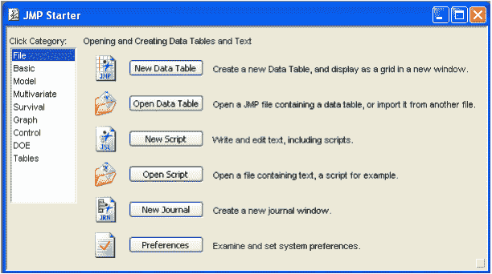

此窗口可快速轻松地访问 JMP 学生版的所有菜单命令。尽管这些命令可通过菜单和工具栏访问，但它们也在 JMP Starter 中以逻辑、有序的方式呈现。有九个选项卡组根据其功能对命令进行分区：

- **File** 组包含与打开和关闭多种类型文件相关的命令。
- **Basic** 组包含用于单变量和双变量情况的分析命令。
- **Model** 组包含匹配对（一种特殊的双变量情况）和多元模型的命令。
- **Survival** 组包含可靠性和生存命令。
- **Graph** 组包含图表和 3D 绘图命令。
- **Measure** 组包含用于能力分析的工具。
- **Control** 组包含用于控制图的命令。
- **DOE** 组包含用于设计实验的命令。
- **Tables** 选项卡包含用于操作数据表的命令。

### JMP 学生版工具栏

访问 JMP 学生版命令的另一种方式是使用工具栏。

## Windows

复制 JMP Starter 命令的工具栏包括 File/Edit 工具栏（图 1.3）、Tools 工具栏（图 1.4）、Analyze 工具栏（图 1.5）、Graph 工具栏（图 1.6）和 Tables 工具栏（图 1.7）。还有一个 Data Files 工具栏，用于在打开的数据表之间切换，以及用户可自定义的工具栏。这些命令将在后面的章节中详细介绍。

**图 1.3** File/Edit 工具栏

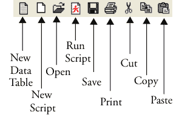

**图 1.4** Tools 工具栏

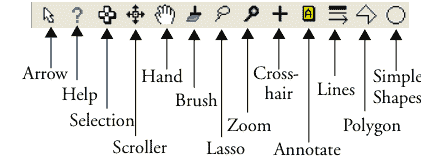

**图 1.5** Analyze 工具栏

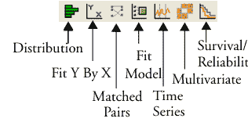

**图 1.6** Graph 工具栏

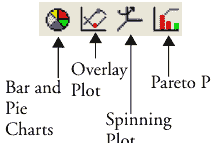

**图 1.7** Tables 工具栏

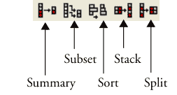

其中一些工具栏默认不显示。要激活未显示的工具栏，

- 选择 **View > Toolbars > Show Toolbars** 以打开 Show Toolbars 窗口（图 1.8）。

已勾选的工具栏会显示，未勾选的工具栏会被隐藏。

**图 1.8** Show Toolbars 窗口

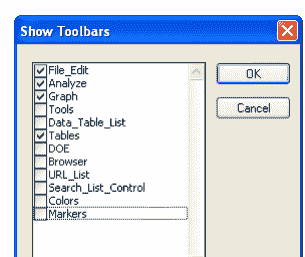

## Macintosh

在 Macintosh 上，工具栏不是分组设置的，而是都可以添加到单个工具栏。要查看工具栏上每个按钮的定义，或向工具栏添加和删除按钮，

- 在窗口的工具栏区域上 Control-单击。
- 从出现的窗口中，将按钮拖到工具栏上以添加它们。

### 首次使用

本节指导您完成几个简单的步骤，演示如何打开数据表、请求分析以及关闭数据表。

- 要打开数据表，请选择 **File > Open**，从 JMP Starter 中选择 **Open Data Table**，或单击 File/Edit 工具栏上的 **Open** 按钮。
- 选择文件 Denim.jmp 并单击 Open。

数据应如下图 1.9 所示。

**图 1.9** Denim 数据文件的部分列表

| 7 Cols | Lot Number | Method | Size of Load (lbs) | Sand blasted? | Thread Wear Measured | Thread Wear | Starch Content (%) |
|---|---|---|---|---|---|---|---|
| 1 | 1 | Alpha Amylase | 113 | no | 7 | Moderate | 21.4 |
| 2 | 2 | Alpha Amylase | 114 | no | 1 | Low | 14.9 |
| 3 | 3 | Alpha Amylase | 150 | no | 7 | Moderate | 8.8 |
| 4 | 4 | Alpha Amylase | 152 | no | 6 | Moderate | 15.4 |
| 5 | 5 | Alpha Amylase | 156 | no | 9 | Moderate | 12.6 |
| 6 | 6 | Alpha Amylase | 157 | no | 4 | Low | 14.6 |
| 7 | 7 | Alpha Amylase | 173 | no | 10 | Severe | 16.3 |
| 8 | 8 | Alpha Amylase | 175 | no | 4 | Low | 18.7 |
| 9 | 9 | Alpha Amylase | 192 | no | 8 | Moderate | 20.4 |
| 10 | 10 | Alpha Amylase | 206 | no | 7 | Moderate | 20.7 |
| 11 | 11 | Alpha Amylase | 218 | no | 8 | Moderate | 14.8 |
| 12 | 12 | Alpha Amylase | 225 | no | 3 | Low | 8.8 |
| 13 | 13 | Alpha Amylase | 237 | no | 10 | Severe | 22.1 |
| 14 | 14 | Alpha Amylase | 253 | no | 9 | Moderate | 13.8 |
| 15 | 15 | Alpha Amylase | 254 | no | 3 | Low | 19.9 |
| 16 | 16 | Alpha Amylase | 255 | no | 4 | Low | 19.7 |
| 17 | 1 | Alpha Amylase | 103 | yes | 9 | Moderate | 12.3 |
| 18 | 2 | Alpha Amylase | 113 | yes | 2 | Low | 18.8 |
| 19 | 3 | Alpha Amylase | 124 | yes | 8 | Moderate | 28.6 |
| 20 | 4 | Alpha Amylase | 125 | yes | 5 | Moderate | 25.4 |
| 21 | 5 | Alpha Amylase | 144 | yes | 7 | Moderate | 24.4 |
| 22 | 6 | Alpha Amylase | 145 | yes | 10 | Severe | 21.4 |

此数据集包含加工牛仔布淀粉含量的数据。在此示例中，我们检查 Starch Content (%) 变量的数据并回答以下问题：

- 数据的均值是多少？
- 其中位数是多少？
- 其标准差是多少？
- 此外，生成数据的直方图。

#### 查找均值、中位数和标准差

要回答这些问题，请使用 Distribution 平台。

选择 **Analyze > Distribution**。

这会打开如图 1.10 所示的启动对话框。


## 图 1.10 分布对话框

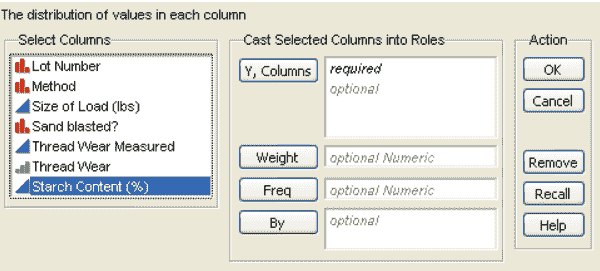

选择变量 Starch Content (%)，然后点击“Y, Columns”按钮。

此步骤告诉 JMP Student Edition 要分析的变量。由于 Starch Content (%) 是唯一感兴趣的变量，此对话框操作就完成了。

点击“确定”。

报告以默认的垂直格式呈现。不过，有些人更喜欢分布报告的水平布局。要改为水平布局，

点击报告中 Starch Content (%) 一词旁边的红色三角形（见图 1.11）。

## 图 1.11 红色三角形显示弹出菜单

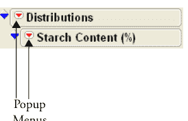

所有这些红色三角形在被点击时都会显示弹出菜单。请密切注意它们——它们会显示数据探索过程中可用的更多选项和探索方式。

Starch Content (%) 旁边的菜单显示该单一变量的选项，尽管在某些情况下（后文可见）分布平台会处理多个变量。

报告中所有变量可用的选项位于“Distributions”一词旁边的菜单中。

选择“显示选项”>“水平布局”以查看图 1.12 中的报告。

## 图 1.12 Starch Content 分布报告

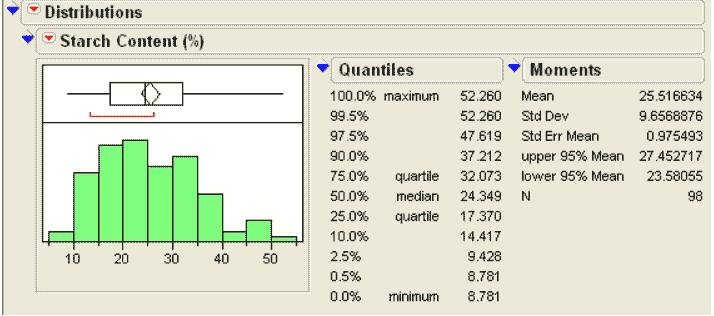

四个问题的答案都在此报告中。读取平均值 (25.516634)、中位数 (24.349) 和标准差 (9.6568876)。直方图显示在左侧。

如果需要此报告的打印副本，

- 选择“文件”>“打印”。

或者，可以将此输出包含在文字处理器编写的实验报告中。要将报告移至另一个程序，请使用 JMP Student Edition 的剪切和粘贴功能：

- 选择“选择”工具，它看起来像一个粗加号。

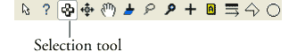

- 按住 Shift 键，然后点击需要复制的报告的每个部分。

在图 1.13 中，所有文本列和直方图都已被选中。标题均未被选中，箱线图也未被选中。请注意，直方图的轴与直方图本身是分开选择的。

## 图 1.13 报告部分的选择

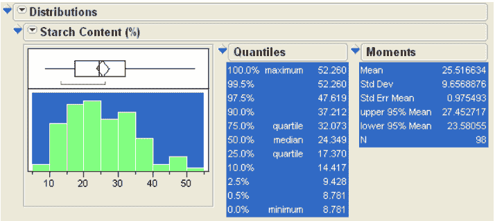

- 选择“编辑”>“复制”。

在文字处理器中，选择“编辑”>“粘贴”。

现在分析已完成，请关闭 JMP Student Edition。

选择“文件”>“退出”。

## 下一步做什么

这个简单示例展示了完成 JMP Student Edition 分析所需的所有步骤。接下来，您可以随意探索 JMP Student Edition 附带的任何示例数据文件、浏览在线帮助，或继续阅读本书。

## 分布平台

单变量统计属于 JMP Student Edition 分布平台的领域。它计算汇总统计量、显示图形，并为这些变量计算假设检验。

## 简介

打开数据文件 Denim.jmp。

有关打开文件的信息，请参阅“首次会话”，第 15 页。

## 关于数据

该文件包含一项蓝色牛仔裤实验的信息，本书的每个介绍性章节都会提及。蓝色牛仔裤在制造时通常含有相当多的淀粉，这使得织物具有硬挺度和稳定性。然而，大多数人认为这种硬挺感并不理想——事实上，一些顾客表示牛仔裤需要一段“磨合期”才会真正舒适。实际上，这段磨合期就是牛仔裤中的部分淀粉被磨损并洗去所需的时间。

为了尽量减少新牛仔裤所需的磨合时间，牛仔布制造商会对织物进行各种处理以去除部分淀粉。该实验在三种不同大小的洗涤量中使用了这三种处理。三种不同的处理记录在 Method（方法）列中，如下所示：

- *Alpha Amalyze* 是一种添加到洗涤水中的酶，可分解淀粉。
- *Caustic Soda* 是一种溶解在洗涤水中的化学物质，通过化学反应破坏淀粉。
- *Pumice Stone* 是一种添加到洗涤水中的物理磨料，通过物理作用将淀粉“捶打”出来。这些磨料颗粒就是所谓的 *石磨水洗* 牛仔裤的来源。

此外，经过初始洗涤过程后，部分牛仔裤会进行喷砂处理。织物是否经过喷砂处理记录在“Sand Blasted?”列中。样本来自几个不同的织物卷，每卷在“Lot Number”列中标明。

处理完牛仔裤后，进行了两项测量：一项用于量化织物中的淀粉含量（测量硬度，以重量百分比记录），另一项用于计算已破坏纱线的数量（测量磨损程度，记录在“Thread Wear Measured”列中）。测量到的纱线磨损已通过公式编辑器转换为“Thread Wear”列中的有序变量。

## 启动平台

在本示例中，将逐一检查变量。

从菜单栏中选择“分析”>“分布”。

这将调出分布平台的启动对话框。

图 2.1 分布启动对话框

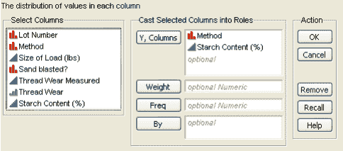

在左侧列表中，通过点击第一个变量名，按住 Control（Windows）或 Option（Macintosh）键，然后点击第二个变量名，选择变量 Method 和 Starch Content (%)。

点击“Y, Columns”按钮。

点击“确定”。

现在会出现所有变量的直方图和文本信息。有关这些报告的详细信息，请参阅“连续变量图形和报告”，第 30 页，以及“分类变量图形和报告”，第 34 页。

本报告中的两个直方图将在本章后面使用，见第 29 页图 2.9。许多描述性统计量可以直接从这些直方图附带的文本报告中读取。

## 使用直方图

直方图以 JMP Student Edition 内部计算的条宽和位置显示。有时需要更改这些设置。例如，假设需要修改 Starch Content (%) 直方图的条宽和位置。要更改它们，

从工具工具栏中选择抓手工具（图 2.2）。

图 2.2 抓手工具

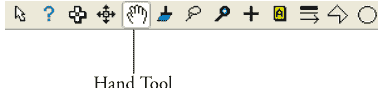

将抓手工具放在 Starch Content (%) 直方图上并按下鼠标按钮。

水平移动鼠标（假设直方图采用默认的垂直布局）可更改直方图的条宽。

垂直移动鼠标可更改条的位置。

这些直方图在查看变量之间的某些关系时也很有用。例如，

点击 Method 直方图中与 Alpha Amalyze 对应的条形。

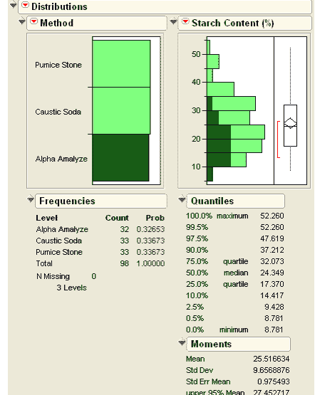

Alpha Amalyze 的条形会被高亮显示，其他直方图中所有以 Alpha Amalyze 为方法的数据点的条形也会高亮显示。请注意，数据表中相应的行也会被高亮显示。

要将数据表置于前面，请选择“窗口”>“Denim”。

要将分布报告置于前面，请选择“窗口”>“Denim-Distribution”。

数据表中的数据行会被高亮显示，以便分配行状态——特定标记、颜色或标签——这些状态在所有 JMP Student Edition 的活动图形中持续存在。每当在任何图形中选择一行时，其选择状态会波及所有 JMP Student Edition 的打开窗口。

高亮显示并探索其他洗涤方法，注意每种方法高亮显示的淀粉含量。尝试判断是否有一种方法的淀粉含量比其他方法更低。

点击 Caustic Soda 和 Pumice Stone 的直方图条形。查看 Starch Content (%) 直方图中相应的高亮点。

在这些直方图中，对均值或水平设置置信区间通常很有用。例如，要获得 Method 和 Starch Content (%) 各水平的 95% 置信区间，


滚动报告查看可发现，此命令仅为报告中的一个变量添加了正态分位数图。很多时候，需要将一个命令发送到报告中的所有变量，但逐个选择同一命令很繁琐。因此 JMP Student Edition 提供了使用 Control（Windows）或 ⌘（Macintosh）键“广播”命令到整个报告的方法。

按住 Control（Windows）或 ⌘（Macintosh）键，再次从变量名称旁的下拉列表中选择 Normal Quantile Plot。

这次，一个正态分位数图会被追加到每个直方图上。此快捷方式适用于大多数下拉菜单中的命令。

你也可以通过拟合正态分布然后执行拟合优度检验来检验正态性。

从平台下拉列表中选择 Fit Distribution > Normal。

当报告出现时，从拟合分布报告中选择 Goodness of Fit。

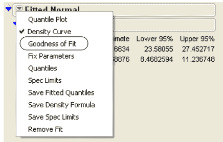

这会生成一份报告，显示分布的参数，以及检验原假设为分布确实为正态的拟合优度统计量。小 p 值表示非正态分布。

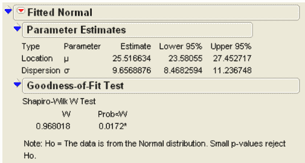

## Testing Probabilities

关于此数据还能提出另一个问题，即 Thread Wear 的三个水平是否以相等频率出现。为检验此假设，需要 Thread Wear 变量的分布。

确保原始 Denim 数据表为前台窗口。如果不是，请选择 Window > Denim.jmp。

请求 Thread Wear（不是 Thread Wear Measured）的分布。

直方图出现后，从直方图标题栏中 Thread Wear 旁的下拉列表中选择 Test Probabilities。

报告中会增加一项。稍后本章中，图 2.6 第 36 页会显示该增加项的屏幕截图。

确保选中 Fix omitted at estimated values, rescale hypothesis。JMP Student Edition 会自动缩放输入到输入字段中的数字，使其总和为一。这提供了一种轻松检验相等概率的方法——只需在每个输入字段中输入 1 即可。

在报告 Test Probabilities 部分的每个 Hypoth Prob 输入字段中输入 1。

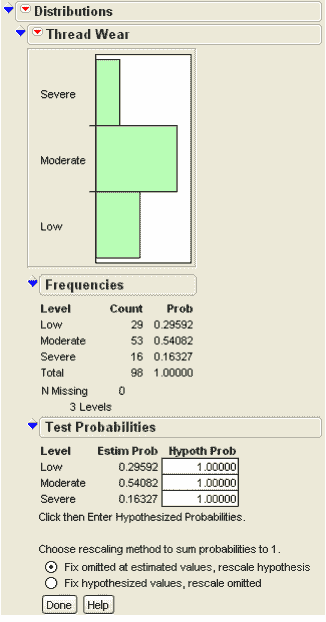

点击 Done。

**Figure 2.6 Test Probabilities Results**

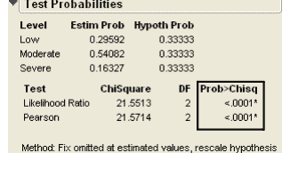

检验结果列在标记为 Prob>Chisq 的列中。此检验显示出高度显著的结果（p<0.001），因此可以安全地说三个水平出现的概率不同。

## Annotating Results

如果这些结果要剪切并粘贴到文字处理程序中（用于实验报告，或作为家庭作业提交），可能需要一些注释。例如，你可能希望对上面的检验概率进行注释，说明检验结果是显著的。要向任何 JMP Student Edition 输出添加注释，请使用 Tools 工具栏中的 Annotate 工具。

**Figure 2.7 The Annotate Tool**

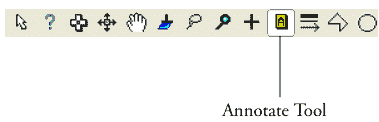

- 选择 Annotate 工具，如图 2.7 所示。
- 在 Test Probabilities 表格右侧的空白处，单击顶部“0.3333”旁边。初始点击点将在下面的 Tag Line 选项中使用。
- 在出现的框中输入“These results are highly significant”。
- 单击注释框外部。注释变为黄色。
- 右键单击黄色注释以调出格式菜单，如右侧所示。
- 选择 Tag Line。
- 将鼠标移到右下角，直到光标变为双箭头。单击并拖动角落以调整注释大小。
- 单击并拖动注释框内部以重新定位它，同时标签线保持锚定。
- Control-click（Windows）或 ⌘-click（Macintosh）并拖动以一起移动注释和标签线。

最终注释如图 2.8 所示。

**Figure 2.8 Final Annotation**

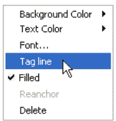

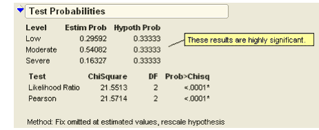

注释在标准（RTF）剪切粘贴中不会保留，而是与其各自的报告合并为单个图形。要将带注释的报告粘贴到另一文档中，请选择 Edit > Paste Special 并选择其中一种图形格式。

## The Modeling Type of Variables

JMP Student Edition 基于其分析的变量的建模类型来生成报告。变量可以有三种建模类型之一：

- Continuous variables are numeric and measured on a continuous scale. For example, temperature measurements are often on a continuous scale, limited only by the exactness of the measuring instrument. In the example data set Denim.jmp, the variable Size of Load is a continuous variable.

- Ordinal variables are measured on a discrete scale. There is an implicit order in the measuring scale, although the data are not necessarily numerical. For example, the age of people is often recorded on an ordinal scale — seldom do people report their age as 24.461 years, yet it is obvious that some ages are older than others. In the Denim.jmp data set, Thread Wear, with values “low”, “moderate”, and “severe”, is an ordinal variable.

- Nominal variables simply name data. There is no order in the scale. People’s names, for example, are represented as a nominal variable in JMP Student Edition. Method is a nominal variable in the Denim.jmp data set.

Ordinal and Nominal variables are often referred to collectively as categorical variables.

变量的建模类型决定了 JMP Student Edition 执行的分析。相同的平台通常会产生不同的报告和图形，因为分析的变量类型不同。Distribution 平台就表现出这种行为。它在任何情况下都会生成直方图，但会根据变量类型追加其他图形。

**Figure 2.9 Distribution Graphs**

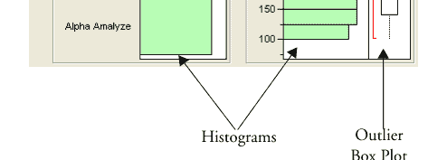

- Categorical variables show a histogram.

- Continuous variables have an *outlier box plot*, constructed to show possible outliers in continuous variables. Outlier plots are discussed in the section “Outlier Box Plot,” p. 31.

## Continuous Variable Graphs and Reports

最初，JMP Student Edition 生成图形和文本报告以提供分析信息。连续变量的文本报告总结了典型的单变量统计量，例如均值、标准差、均值的置信区间、数据点数和分位数。

连续变量的弹出菜单（图 2.10）显示了连续变量可用的选项。

**Figure 2.10 Continuous Variable Popup Menu**

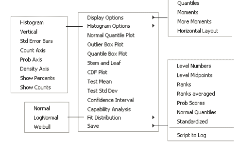

### Display Options

Display Options 菜单包含以下项目：

- **Quantiles** 显示或隐藏 Quantiles 表。
- **Moments** 显示或隐藏 Moments 表。此表显示均值、标准差、均值的标准误差、均值的上下 95% 置信限和数据集大小。
- **More Moments** 在 Moments 表中添加变量的总和、方差、偏度、峰度和变异系数。
- **Horizontal Layout** 将文本报告排列在相应图形右侧，并将直方图显示为水平条形图。再次选择此选项会将报告返回到垂直布局。

### Histogram Options

Histogram Options 菜单包含以下项目：

- **Histogram** 显示或隐藏直方图。
- **Std Err Bars** 在直方图的每个层级上绘制标准误差条。标准误差条会自动调整以反映你使用手工具更改直方图的条宽和位置时的变化。
- **Count Axis** 添加一个轴，显示直方图条代表的每个值的频率。
- **Prob Axis** 添加一个轴，显示直方图条代表的每个值的比例。
- **Density Axis** 是直方图中条的长度。

这些轴的任意组合都可以添加到分类或连续直方图中。随着手工具改变条的长度，Count 和 Prob 轴会发生变化，但 Density 轴保持不变。

### Normal Quantile Plots

Normal Quantile Plot 选项向报告添加一个图，用于可视化变量正态分布的程度。如果变量为正态，正态分位数图大致为一条对角直线。这种图有时也称为分位数-分位数图，或 q-q 图。

正态分位数图还显示置信界限。如果数据落在这些置信界限内，则数据近似正态。

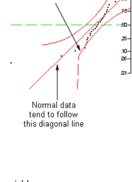

### Outlier Box Plot

Outlier Box Plot 是一个示意图，显示变量的离散程度。这使得识别具有极端值的数据点，有时称为离群值，变得相对容易。

箱子的两端是第 25 和第 75 分位数，也称为四分位数。四分位数之间的差值为四分位距。离群值通常被识别为落在上四分位数 + 1.5×（四分位距）以上或下四分位数 − 1.5×（四分位距）以下的数据点。

箱子中间的线标识中位数样本值，均值菱形指示样本均值和 95% 置信区间。

离群值箱线图中的虚线有时称为须线，从箱子的两端延伸。须线延伸到落在用于判断离群值的距离范围内的最外层数据点。

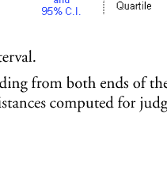


边框边缘的红色括号标识了最短的一半，即包含 50% 数据的最小长度。这在确定底层分布的形状时很有用。

## 分位数箱线图

分位数箱线图命令在直方图的轴上显示额外的分位数（有时称为百分位数）。如果分布是正态的，则分位数彼此大致等距。与正态分位数图类似，分位数箱线图可图形化地显示正态性。例如，如果分位数标记在一端聚集得很近，但在另一端间距更大（如本图所示），则分布向间距更大的那一端倾斜。

请注意，分位数箱线图与第 31 页的异常值箱线图不同。分位数是将分布划分为两组的数值——其中第 p 个分位数大于 p% 的数值。例如，一半的数据低于第 50 百分位数（中位数）。

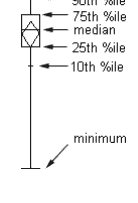

## 茎叶图

茎叶图命令构造的图本质上是直方图的一种变体。它是在计算机打印输出既不图形化也不易生成的日子里为统计数据而开发的。它们仍然很有用，因为它们同时显示了实际数据和数据的形状。图的每一行都有一个茎值，即一系列列值的首位数字。叶值由值的剩余数字构成。数据值可以通过连接茎和叶（如果存在则乘以比例因子）来重建。

如图 2.11 所示的示例中，表的第三行显示存在值为 40 和 41 的数据点。值是通过使用图底部图例重建的。

图 2.11 茎叶图

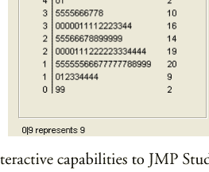

茎叶图具有与 JMP Student Edition 图形图相似的交互功能，即在图中选择时会在数据表中突出显示相应的数据点。

## CDF 图

CDF 图命令使用观察到的数据（如果指定则使用权重或频率）绘制累积分布函数阶梯图。请参阅统计学教材以了解密度函数的定义。CDF 图（图 2.12）估计到每个数据点为止密度曲线下的面积。

图 2.12 负载大小的 CDF 图

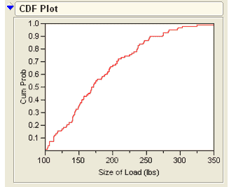

## 拟合分布

拟合分布菜单允许您将某些分布（正态、对数正态、威布尔）拟合到数据。拟合后，您可以选择多种选项，包括拟合优度检验。

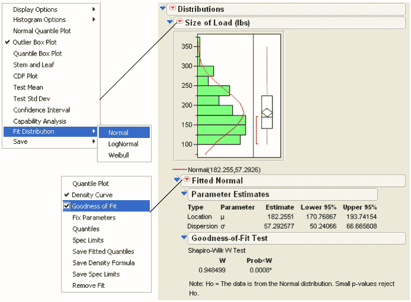

## 分类变量图和报告

分类分布报告中默认出现的唯一文本报告是频率表（图 2.13）。

图 2.13 频率表

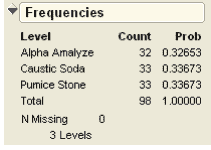

该表列出了分类变量的水平、每个水平的计数（有时称为频率）以及与每个变量相关的概率。此概率只是每个水平计数与总计数的比率。

这些概率的标准误差（StdErr Prob）和数据的累积概率（Cum Prob）也已计算，但结果表中最初未显示。要查看它们，

- 右键单击表以调出弹出菜单（图 2.14）
- 选择列以显示所有可能的表的列的弹出菜单。

当前显示的表在其旁边有一个复选标记。

- 选择要显示或隐藏的列。

图 2.14 表弹出菜单

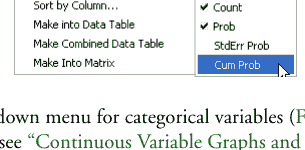

分类变量下拉菜单中列出的选项（图 2.15）的工作方式与连续变量的选项相同（参见“连续变量图和报告”，第 30 页。）

图 2.15 分类变量的下拉菜单

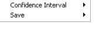

## 统计检验

JMP Student Edition 包含大量针对单个变量的统计检验，包括：

- **Prob>|ChiSq|** 是当样本标准差与假设值无差异时，仅凭机会获得更大的绝对卡方值的概率。这是双尾 *t* 检验的观察显著性的 *p* 值。
- **Prob>ChiSq** 是当样本标准差不是假设值时，仅凭机会获得大于计算样本卡方值的卡方值的概率。这是单尾 *t* 检验的观察显著性的 *p* 值。
- **Prob<ChiSq** 是当样本标准差不是假设值时，仅凭机会获得小于计算样本卡方值的卡方值的概率。这是单尾 *t* 检验的观察显著性的 *p* 值。

## 检验分类概率

**检验概率**选项显示图 2.16 所示的对话框，其中输入假设概率。对那些概率计算似然比和皮尔逊卡方检验。

图 2.16 检验概率

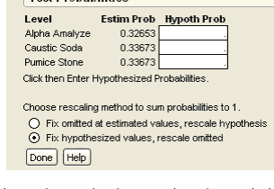

**检验概率**可以缩放假设值，使概率之和为一。因此，检验所有概率相等的最简单方法是为每个字段输入一个 1。要检验概率的子集，请将不涉及的水平留空。JMP Student Edition 会为留空的水平代入估计概率。

对话框上的单选按钮允许在将假设值重新缩放为总和为一或使用未重新缩放的输入值之间进行选择。

## 置信区间

对于连续变量，均值的置信区间会自动显示在 Moments 表中（图 2.17）。

## 图 2.17 连续变量的 Moments 表

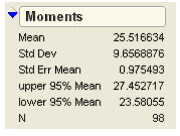

要计算特定 α 值的置信区间，

- 从标题栏中变量名称旁边的弹出菜单中选择置信区间。

会出现一个对话框，让您指定要显示的置信区间。

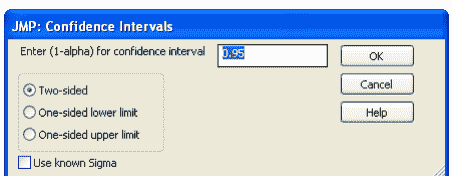

- 选择要查看的所需水平，例如 0.95。

## 图 2.18 连续变量的置信区间

置信区间
| Parameter | Estimate | Lower CI | Upper CI | 1-Alpha |
|---|---|---|---|---|
| Mean | 25.51663 | 23.58055 | 27.45272 | 0.950 |
| Std Dev | 9.656888 | 8.468259 | 11.23675 |  |

要获得分类变量的等效表，请选择置信区间 > 0.95。要获得置信区间菜单上未列出的置信区间 alpha，请选择置信区间 > 其他并输入所需水平。示例显示在图 2.19 中。

## 图 2.19 分类变量的置信区间

置信区间
| Level | Count | Prob | Lower CI | Upper CI | 1-Alpha |
|---|---|---|---|---|---|
| Alpha Analyze | 32 | 0.32653 | 0.241763 | 0.424385 | 0.950 |
| Caustic Soda | 33 | 0.33673 | 0.250901 | 0.434885 |  |
| Pumice Stone | 33 | 0.33673 | 0.250901 | 0.434885 |  |
| Total | 98 |  |  |  |  |
Note: Computed using score confidence intervals.

## 保存信息

要保存从连续响应变量计算的信息，请使用保存菜单命令。每个命令在当前数据表中生成一个新列，其名称通过将响应列名称（以下定义中表示为 colname）附加到保存的统计量的名称来命名。

保存命令可以重复使用。这使得可以在不同情况下多次保存相同的统计量，例如在合并直方图条之前和之后。如果多次使用保存命令，统计量的列名称将命名为 colname1、colname2 等，以创建唯一的列名称。

保存菜单包含以下命令：

- **等级编号**创建一个名为 Level colname 的新列。每个观测值的等级编号对应于包含该观测值的直方图条。直方图条从低到高编号，从 1 开始。
- **等级中点**创建一个名为 Midpoint colname 的新列。每个观测值的中点值通过将其等级宽度的一半加到其下限来计算。
- **秩**创建一个名为 Ranked colname 的新列，其中包含对应列每个值的排名，从 1 开始。如果列中有重复项，则按其在电子表格中出现的顺序分配连续排名。
- **平均秩**创建一个名为 RankAvgd colname 的新列。如果值是唯一的，其平均秩与秩相同。如果值出现 k 次，其平均秩计算为其值秩的总和除以 k。
- **概率分数**创建一个名为 Prob colname 的新列。对于 N 个非缺失分数，值的概率分数计算为该值的平均秩除以 N+1。此列类似于经验累积分布函数。
- **正态分位数**创建一个名为 N-Quantile colname 的新列。这些正态分数是正态分布预期顺序统计量的 Van Der Waerden 近似值。
- **标准化**创建一个名为 Std colname 的新列。它包含原始列的标准化值（每个值减去列均值，然后除以列标准差）。

## 整体平台选项

每个统计平台在最外层大纲级别的平台名称旁边都有一个弹出菜单。此菜单中的选项和命令会影响平台上的所有文本报告和图形。

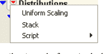

分布平台的整体平台选项包括以下内容：

- **统一缩放**使用相同的最小值、最大值和间隔缩放所有轴，以便轻松比较分布。选择此选项时，该选项适用于所有响应变量的报告。
- **堆叠**让您将报告窗口中的所有输出定向为纵向或横向。
- **脚本**让您重新运行或保存生成平台结果的 JSL 脚本。如果脚本保存到文件中，您可以编辑它；如果它与当前数据表一起保存，下次打开表时即可运行它。**保存所有对象的脚本**生成的 JSL 与**保存到脚本窗口的脚本**相同，如果没有按组。按组存在时，脚本包括标识按组水平的 JSL Where 子句。


## 图 2.20 脚本菜单

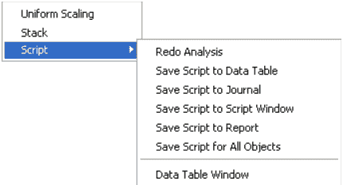

- 数据表窗口提供基础数据表的视图，当存在“按组”时尤其有用。

## 能力分析

“能力分析”选项为质量控制应用提供能力分析。能力研究衡量过程对给定规格限的符合性。对话框会提示您输入“规格下限”、“规格上限”和“目标值”。您只需输入三个值中的一个。只有您输入的字段才会包含在生成的能力分析表中。可选地，您可以输入一个已知的 sigma 值，即过程标准差。

能力分析可以使用几种不同的短期 σ 估计来计算能力指数。在请求一个“分布”后，从感兴趣变量的轮廓栏上的弹出菜单中选择“能力分析”。出现如图 2.21 所示的对话框，允许指定长期 sigma 或一个或多个短期 sigma，并可按列或固定样本大小分组。

## 图 2.21 能力分析对话框

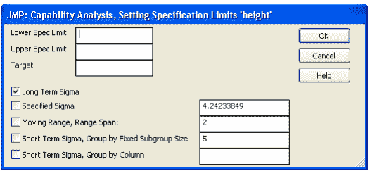

所有能力分析都使用相同的公式。选项之间的区别在于 sigma 的计算方式。sigma 的这些选项可解释为：

- 长期（Long-term）使用整体 sigma。这是用于 Ppk 统计的选项，其 sigma 计算公式为：

σ = √[ Σ (从 i=1 到 n) (x_i - x̄)² / (n - 1) ]

- **指定 Sigma（Specified Sigma）** 允许用户输入一个特定的、已知的 sigma 用于计算能力分析。显然，Sigma 是由用户指定的，因此不进行计算。此选项用于控制图生成的能力分析，其中图中使用的 sigma（在对话框中）作为指定 sigma 输入。

- **短期，按固定子组大小分组** 使用以下公式计算 σ。在这种情况下，如果 r 是子组数量，且每个第 i 个子组由数据的顺序定义，则 sigma 计算为：

σ = √[ Σ (i=1 到 n) (x_ij - x̄_i.)² / (n - r - 1) ]

- **短期，按列分组** 会弹出一个列列表对话框，您从中选择分组列。在这种情况下，r 等于子组数量，sigma 计算为：

σ = √[ Σ (i=1 到 n) (x_ij - x̄_i.)² / (n - r - 1) ]

（请注意，这与“短期，按固定子组大小分组”的公式相同，通常称为均方根误差（Root Mean Square Error）或 RMSE。）

**注意：** “分布”有一个名为 **Ppk 能力标记** 的首选项，它将用 Ppk 标签标记长期能力输出。该选项可通过 **文件 > 首选项** 找到。

当您点击 **确定** 时，平台会在文本报告底部附加一个能力分析表，如图 2.22 所示。您可以随时移除并重新进行能力分析，次数不限。

规格限可以作为列属性存储并自动检索。为此，请从 **保存** 命令菜单中选择 **规格限**。保存规格限后，稍后打开直方图时它们会显示出来。

## 图 2.22 能力分析表

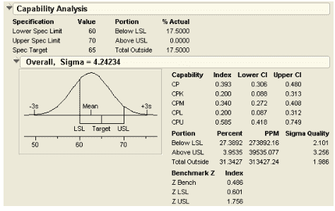

能力分析表分为两部分。表格的上部显示以下量：

- “规格”列列出了显示值的项目名称。它们是规格下限、规格上限和规格目标。
- “值”列列出了您为每个限值和目标指定的值。
- “%实际”是落在规格限之外的数据的观察百分比。

能力分析表的下部列出了五个基本过程能力指数、它们的值以及它们的置信区间上下限。它还列出了规格限外区域的百分比和 PPM。PPM 列（百万分之一）是百分比列乘以 10,000。

Sigma 质量度量常用于六西格玛方法中，也被称为过程 sigma。

Sigma 质量 = 正态分位数( 1 − 预期缺陷数(# defects) / n ) + 1.5

例如，如果 n=1,000,000 个观测值中有 3 个缺陷，该公式得出 6.03，即 6.03 Sigma 过程。上方和下方列之和并不等于总计列，因为 Sigma 质量使用正态分布的值，因此不具有可加性。

表 2.1 “能力指数名称与计算”（第 41 页）描述了这些指数并给出了计算公式。

## 表 2.1 能力指数名称与计算

| 指数 | 指数名称 | 计算 |
|---|---|---|
| CP | 过程能力比率，Cₚ | (USL − LSL)/6σ，其中 USL 为规格上限，LSL 为规格下限 |

## 表 2.1 能力指数名称与计算（续）

| CP 的置信区间 | CP 的下限置信区间 | CP√[ χ²_{1-α/w, n-1} / (n-1) ] |
| CP 的置信区间 | CP 的上限置信区间 | √[ χ²_{1-(1-α)/w, n-1} / (n-1) ] |
| CPK（AIAG 称为 PPK） | 过程能力指数，Cₚₖ | min(CPL, CPU) |
| CPK 的置信区间 | 期望值 E(Ĉₚₖ) | 令 c = √n (μ - (USL + LSL)/2) / σ 表示非中心参数，d = (USL - LSL)/σ 表示以 σ 为单位的规格限。则期望值为 (1/6)√[(n-1)/(2n)] [Γ((n-2)/2)/Γ((n-1)/2)] (d√n - 2√[2/π] exp((-c²/2) - 2c(1 - 2Φ(-c)))) |
|  | 方差 Var(Ĉₚₖ) | 利用上述 c 和 d，方差为 [d²/(36) (n-1)/(n-3)] - [d/(9√n) (n-1)/(n-3)] [√[2/π] exp((-c²/2)) + c(1 - 2Φ(-c))] + (1/9)[(n-1)/(n(n-3))](1 + c²) - ((n-1)/(72n))[Γ((n-2)/2)/Γ((n-1)/2)]² (d√n - 2√[2/π] exp((-c²/2) - 2c(1 - 2Φ(-c))))² |
|  | 下限置信区间 | E(Ĉₚₖ) - k√Var(Ĉₚₖ) |
|  | 上限置信区间 | E(Ĉₚₖ) + k√Var(Ĉₚₖ) |

如工程规格等关注项。在能力评估中，Z USL 是到规格上限的距离，Z LSL 是到规格下限的距离。

Z USL = (USL-Xbar)/sigma = 3 * CPU

Z LSL = (Xbar-LSL)/sigma = 3 * CPL

Z Bench = 逆累积概率(1 - P(LSL) - P(USL))

其中

P(LSL) = Prob(X < LSL) = 1 - Cum Prob(Z LSL)

P(USL) = Prob(X > USL) = 1 - Cum Prob(Z USL)

**注意：** 您还可以通过 **拟合分布** 选项进行非正态能力分析，下一节将对此进行说明。拟合分布后，您可以为拟合分布生成分位数和目标值。如果给出目标值，系统将使用您指定的分位数和目标值自动生成能力分析。

## Fit Y by X 平台

任何时候需要比较两个变量时，Fit Y by X 平台都是理想之选。这个单一平台可以生成单因素方差分析、散点图和列联表分析——涵盖了入门统计学课程中的大部分双变量分析。

## 简介

启动 JMP 学生版后，

- 打开数据文件 Denim.jmp。

有关该数据的详细信息，请参阅第 2 章“分布平台”中“关于数据”一节，第 21 页。

## 启动平台

在本简介部分，将成对检查变量。

- 从菜单栏中选择 **分析 > Fit Y By X**。

这将打开 Fit Y By X 平台启动对话框，如图 3.1 所示。

## 图 3.1 Fit Y By X 启动对话框

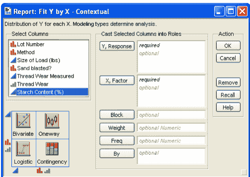

请注意标题栏中的“Contextual”一词。它存在是因为该对话框会根据分析中变量的建模类型（连续或分类）来启动其他平台。有关建模类型的更多信息，请参见“变量的建模类型”（第 29 页）。最初，此示例由三个分析组成，所有分析都以淀粉含量（%）作为 Y 变量。方法、装载量（磅）和 Sand Blasted? 是 X 变量。同时请求这三个分析是为了演示 JMP 学生版的一些交互功能。如果分别执行这些分析，同样有效。

- 从列列表中选择“淀粉含量（%）”，然后点击 **Y，响应** 按钮。
- 要选择所有三个 X 变量，请点击“方法”，按住 Shift 键，然后点击“Sand Blasted?".
- 请注意，这些对话框对拖拽和按钮点击都有响应，如下一步所示。
- 将这些突出显示的变量拖到 **X，因子** 按钮右侧的框中。
- 点击 **确定**。

如图 3.2 所示，出现三个图。

## 图 3.2 Fit Y by X 结果

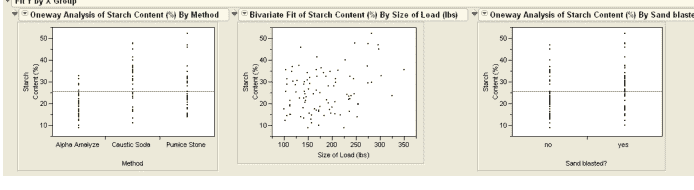

在最左边和最右边，名义变量每个水平的点图并排绘制，这种情况会进行单因素方差分析。在中间的图中，JMP 学生版生成两个连续变量的散点图，这种情况会拟合线和曲线。

## 计算 t 检验

作为一个简单示例，检查最右边的图，该图将淀粉含量与织物是否经过喷砂处理相关联。对于“Sand Blasted?”的两个水平，淀粉含量是否不同？这是使用双样本 t 检验进行检查的典型情况。要进行 t 检验：

- 从图标题栏的下拉菜单中选择 **t 检验**。

t 检验报告出现在图下方标记为“t 检验”的轮廓中。

## 图 3.3 t 检验结果

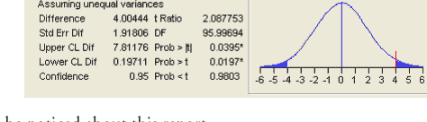

关于此报告，需要注意以下几点。


在t检验报告的第二行有一句“假设方差不等”。该检验也称为未合并t检验。如果你想要合并版本（假设方差相等），请选择“均值/方差分析/合并t”（Means/Anova/Pooled t）命令。

从报告的下拉菜单中选择“均值/方差分析/合并t”（Means/Anova/Pooled t）命令。

图形会添加均值菱形和其他文本表格。所有这些内容将在本教程后面的“方差分析（ANOVA）”（第50页）中讨论。这里请注意，未合并t检验的p值列在原始t检验报告中的Prob>|t|旁边。注意，该值与新的方差分析报告中“Prob>F”列中的值相同。本质上，JMP Student Edition使用两种不同的方法对同一假设进行了两次检验，两种方法的结果一致（理应如此！）。实际上，t统计量（列在t检验下）的平方等于F统计量（在方差分析表中列为F比率）的值。

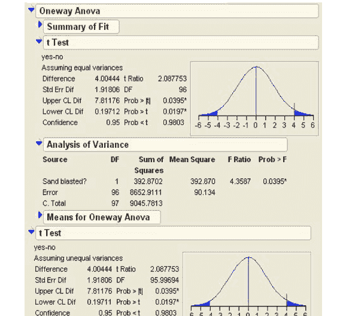

从“单因素分析”（Oneway Analysis）标题栏的下拉菜单中选择“均值/方差分析/t检验”（Means/Anova/t test），即可移除合并t检验报告。

这是双样本t检验，而非配对t检验。如果两组数据存在自然配对（例如，患者服用试验药物前后的测量值），请使用“配对”（Matched Pairs）平台。有关配对比较的详细信息，请参见“配对平台”（The Matched Pairs Platform）一章，第71页。

## 合并t检验

现在，查看图3.2报告中左侧的图，即“淀粉含量（%）与方法”的关系图。使用Alpha Amalyze清洗过的牛仔布，其淀粉含量似乎低于使用烧碱（Caustic Soda）或浮石（Pumice Stone）清洗的牛仔布。为了更具体地分析，查看这些结果的文本报告会很有帮助，这些报告检查了“方法”（Method）变量三个水平的均值、中位数、标准差和分位数，生成方式如下。

从“单因素分析”（Oneway Analysis）标题栏的下拉菜单中选择“分位数”（Quantiles）。

文本报告出现在图下方，箱线图叠加在图上。有关箱线图的详细信息，请参阅“分位数箱线图”（Quantile Box Plots）一节，第32页，或在线帮助。

从同一个下拉菜单中选择“均值和标准差”（Means and Std Dev）。

除了新的文本报告外，图上还会出现均值误差条和标准差线。箱线图也叠加在图上，为每个水平的潜在分布提供线索。有关这些新增内容的详细信息，请参阅“单因素方差分析——连续变量×分类变量情形”（One Way anova—The Continuous by Categorical Case），第61页。

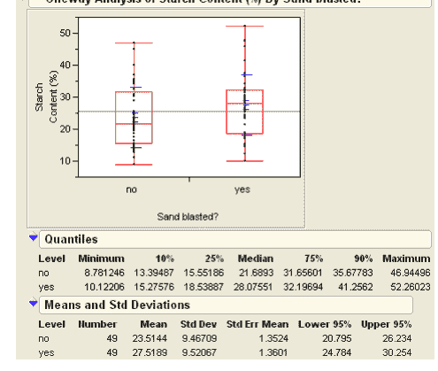

这些新增内容也可以移除。

在同一个下拉菜单中，再次选择“分位数”（Quantiles）和“均值和标准差”（Means and Std Dev）。

## 选择与标记点

此图不仅可用于计算结果，还可用于在其他图中选择结果。

从工具工具栏中选择套索工具，如图3.4所示。

图3.4 套索工具

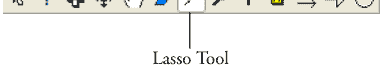

套索工具用于围绕点绘制曲线。“捕获”的点即被选中。

按住鼠标按钮的同时，拖动套索工具将Alpha Amalyze周围的点完全圈住，如图3.5所示。

释放鼠标按钮。

## 图3.5 使用套索工具选择点

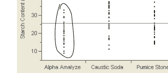

JMP Student Edition会短暂闪烁显示选择区域中包含多少个点（本例中为32个），然后选中这些点。请注意，这些点在所有图和数据表中都会高亮显示。套索工具适用于所有显示单个点的图，如散点图和杠杆图。

为使这些点醒目，为它们指定独特的颜色和标记。

选中这些点后，在图中右键单击，从弹出菜单中选择“行颜色”（Row Colors），然后从颜色调色板中选择红色。

Alpha Amalyze的点在所有图中都变为红色。

再次在图中右键单击，选择“行标记”（Row Markers）。从标记调色板中选择小三角形。

Alpha Amalyze的点在所有图中都变为三角形。

实际上，如果存在某个列可以将数据分组，那么更改图中点的颜色和标记还有更简便的方法。例如，假设需要生成能清晰区分“方法”（Method）变量三个水平的图。要一次性标记所有数据：

从“行”（Rows）菜单中选择“按列着色或标记”（Color or Mark by Column）。

在出现的对话框中，从变量列表中选择“方法”（Method）。确保勾选“按值设置颜色”（Set Color by Value）、“按值设置标记”（Set Marker by Value）和“创建带图例的窗口”（Make Window with Legend）复选框。

在所有图中，系统会为“方法”（Method）变量的每个水平分配独特的颜色和标记。

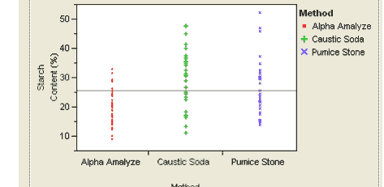

## 方差分析（ANOVA）

了解洗涤方法是否有助于预测牛仔布的淀粉含量？回答这个问题的统计检验称为*单因素方差分析*，其生成方式与上面的*t*检验相同。

从**单因素分析（Oneway Analysis）**旁边的下拉菜单中选择**均值/方差分析（Means/Anova）**。

请注意，当分类变量只有两个水平时，此命令显示为**均值/方差分析/t检验（Means/Anova/t test）**。在所有其他情况下（如本例），t检验不适用，因此在菜单中不可用。

图下方会出现方差分析表，图上会出现均值菱形。*均值菱形*用于说明样本均值及其95%置信区间，如图3.6中的示意图所示。穿过每个菱形的水平线代表组均值。每个菱形的垂直跨度代表该组的95%置信区间。*重叠标记*绘制在组均值上方和下方。对于样本量相等的组，若重叠标记相互重叠，则表明在95%置信水平下，这两个组均值没有显著差异。

图3.6 均值菱形示意图

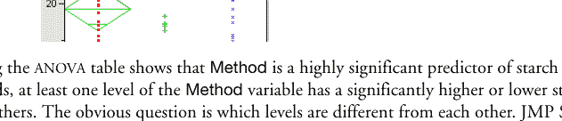

查看方差分析表可以看出，“方法”是淀粉含量的高度显著预测因子。换句话说，“方法”变量中至少有一个水平的淀粉含量显著高于或低于其他水平。显然的问题是哪些水平彼此不同。JMP Student Edition使用比较圆来探究这一点。

## 比较圆

选择**比较均值 > 每对，学生t（Compare Means > Each Pair, Student's t）**

比较圆的完整细节见第63页。简而言之，它们显示变量各水平之间的差异，并且可以点击。当点击某个圆时，它会变为红色，与该圆*没有*显著差异的水平也变为红色，而与该圆*有*显著差异的水平则变为灰色。要查看这一点：

点击底部的比较圆，即对应于Alpha Amalyze的那个圆。

## 图3.7 淀粉含量比较圆


显示画面将变为图3.7所示的样式。这表明Alpha Amalyze与其他两种洗涤方法存在显著差异。

点击另外两个圆以了解它们之间的关系。

这些比较圆基于均值周围的置信区间，而置信区间本身又基于α水平。默认情况下，α水平为5%。不过，它可以更改。

从“单因素分析”（Oneway）标题栏的弹出菜单中选择“设置α水平”（Set α Level） > .10。

请注意，当α水平改变时，比较圆的直径也会改变。

## 拟合线

图3.2报告的中间图是两个连续变量的关系图，这种情况可以通过最小二乘回归拟合直线和曲线。

例如，假设你想根据洗涤量大小来预测淀粉含量。一个不错的猜测可能只是所有数据点的平均淀粉含量。要查看这个均值：

从图标题栏的下拉列表中选择“拟合均值”（Fit Mean）。

图上会出现一条代表均值的线，并且图下方的图例中会出现“拟合均值”（Fit Mean）。请注意，图下方的“拟合均值”（Fit Mean）有自己下拉菜单，如图3.8所示。

## 图3.8 拟合均值结果


平台菜单

拟合菜单


一个更有趣的统计问题是：相对于这个简单均值，用一条直线或曲线来预测淀粉含量是否更好。要对这些数据拟合一条回归直线：

- 在图形标题栏的平台菜单中选择**拟合直线**。

图形上会叠加一条直线。这条直线应与简单均值进行比较，以判断它是否有助于预测。为了进行这种比较，JMP Student Edition 可以围绕拟合直线绘制拟合的置信区间。如果这些置信区间不包含水平均值，则拟合直线是有帮助的。

- 在图形下方的图例中，从**线性拟合**菜单中选择**置信曲线拟合**。

如图 3.9 所示，围绕线性拟合的虚线置信区间不包含均值。因此，线性拟合在统计上是显著的。使用拟合直线进行预测在统计上是可靠的。

### 图 3.9 拟合直线结果


还可以使用**置信阴影**拟合命令生成带阴影的置信曲线。


直线的方程以及若干计算统计量可在**线性拟合**报表中找到。斜率和截距的值也会打印在报表的**参数估计**部分。

除了上述图形化的置信曲线方法之外，还有数值化的显著性度量。其中之一是与直线斜率相关的 *p* 值，同样可以在参数估计报表中找到。本例中，*p* 值为 0.0045，几乎按任何标准来看都是显著的，这进一步印证了上述图形结果。

换句话说，在 Alpha Amalyze 中洗涤时，淀粉含量与负载大小的关系是否与在苛性钠或浮石中洗涤时相同？虽然这个问题更属于“拟合模型”平台（详见“拟合模型平台”一章）的范畴，但使用当前平台进行初步调查很容易。

首先，指示 JMP Student Edition 按“方法”变量的每个水平分组计算。

- 在图形标题栏的平台菜单中选择“分组”。
- 在出现的对话框中，选择“方法”作为分组变量。

现在，像之前一样请求 JMP Student Edition 拟合一条直线。

- 从图形上方标题栏的平台弹出菜单中选择“拟合直线”。

图形上会为每种洗涤方法显示单独的直线，如图 3.12 所示。

### 图 3.12 分组与线性拟合


统计问题是：这些直线之间的差异是否足够大，使得分别报告三条直线是值得的，而不是像之前那样以更紧凑（但可能没那么准确）的方式只报告一条直线。

## 二维列联表

在下一个示例中，X 和 Y 都是分类变量。问题是洗涤牛仔布的方法是否对纱线磨损有影响。该分析使用列联表——一种有序排列计数数据的方式。要为该问题生成列联表：

- 从菜单栏中选择“分析 > Y按X拟合”。
- 将“纱线磨损”（而非“纱线磨损测量值”）分配给 Y 的“响应”角色。
- 将“方法”分配给 X 的“因子”角色。
- 点击“确定”。

由于两个变量都是分类变量，因此会出现马赛克图，随后是列联表。这些显示的详细信息见第 66 页“列联分析——分类变量对分类变量”一节。

请注意，与 JMP Student Edition 中的所有图形一样，马赛克图是可点击的。例如，若要选择所有用 Alpha Amalyze 洗涤且磨损程度低的行：

- 点击马赛克图中 Alpha Amalyze 上方条带的较低红色区域（见图 3.13）。

### 图 3.13 马赛克图

点击此区域以选择用 Alpha Amalyze 洗涤且磨损较低的牛仔裤


列联图正下方是两个变量独立性的检验。该检验的 p 值出现在标有“Prob>ChiSq”的列中，本例中为不显著的 0.76。没有足够证据说明这两个变量不是独立的——换句话说，没有足够证据说明牛仔布的纱线磨损受到洗涤方法的影响。

## 逻辑回归

“逻辑回归”平台将响应类别的概率拟合为连续 X 预测变量的函数。拟合模型估计归属于每个 X 值的概率。该平台是“Y按X拟合”命令用于名义/有序（Y）与连续（X）情况的分析特性。在该平台上，名义响应和有序响应之间存在区别：

- 名义逻辑回归估计一组曲线，以在各类别之间划分归属概率。
- 有序逻辑回归对响应小于或等于给定类别的概率进行建模。其效果是估计一条单一的逻辑曲线，通过水平移动生成有序类别的概率。该模型通用性较低但更简洁，建议用于有序响应。

例如：

- 选择“分析 > Y按X拟合”。
- 将“纱线磨损”分配为 Y（响应），将“负载大小（%）”分配为 X（因子）。
- 点击“确定”。

出现的报表显示每种负载大小下纱线磨损为低、中或严重的概率。


p 值为 0.0657，暗示这两个变量之间存在较弱的关联。

## 公式编辑器

JMP Student Edition 的一个强大（且常常未被充分利用）的功能是公式编辑器。公式的用途非常广泛，从赋值简单的数值到使用参数和条件子句进行复杂计算。在转换数据时尤其有用。

由公式计算其值的列既是链接的，也是锁定的。它与公式中涉及的所有其他列相链接（并依赖于它们）。每当这些列中的值被编辑时，其值会自动重新计算。该列是锁定的，因此不能单独编辑其数据值。在 Denim.jmp 示例数据表中，有序变量“纱线磨损”由一个公式计算得出，该公式将“纱线磨损测量值”的值划分为低、中、严重三类。

查看公式的方法：

- 右键单击“纱线磨损”列的标题。
- 在出现的菜单中选择“公式”。
- 点击“取消”返回数据表。

公式编辑器窗口的操作就像一台袖珍计算器：带有按钮、显示区以及一系列易于使用的丰富功能。

### 示例

公式编辑器的基本功能最好通过一个示例来展示。假设需要计算“淀粉含量（%）”列中数值的对数（这种计算在实际统计中很常见）。需要新建一个列来存储这些新值。创建新列有两种方法。

从主菜单栏中选择“列 > 新建列”。

或者，双击数据表中最后一列右侧的区域。

创建新列后，默认标题会高亮显示，可直接更改。

将新列的标题改为“淀粉对数”。

现在，为该列添加一个公式。

右键单击“淀粉对数”列的标题。

在出现的菜单中选择“公式”。

当公式编辑器出现后，


在“函数”列表中点击“超越函数”，然后在出现的菜单中选择“Log”。


请注意，Log 是自然对数（以 e 为底）。常用对数（以 10 为底）使用 Log10 函数计算。

从列列表中选择“淀粉含量（%）”。


点击“确定”关闭公式编辑器并应用该公式。

更多示例以及公式编辑器所有函数的完整文档，见 JMP Student Edition 的在线帮助。


## 散点图——连续变量与连续变量的情况

如果 X 和 Y 变量都是连续的，JMP Student Edition 会生成一个双变量分析，最初显示一个散点图。散点图出现后有许多选项，均可通过标题栏中变量名称旁的弹出菜单访问（图 3.14）。

图 3.14 双变量弹出菜单


Show Points 会交替隐藏或显示图中的点。

通常先拟合均值作为其他拟合的参考线很有用。Fit Mean 命令会在响应变量（Y）的均值处向图中添加一条水平线。与该平台中的所有拟合命令一样，图下方会出现一个图例，其自带下拉菜单，可在其中访问每个拟合的附加命令。Fit Mean 拟合表显示均值的值、其标准差、其标准误以及围绕均值的误差平方和。

图 3.15 拟合命令


Fit Line 命令使用最小二乘回归向图中添加一条直线拟合。其下拉菜单（访问方式见图 3.15）具有将预测值和残差保存为当前数据表中新列的命令。

如果该线周围的置信区域（通过 **Confid Curves Fit** 命令生成）包含响应均值处的水平线，则拟合线的斜率在 0.05 显著性水平下与零无显著差异。

**Fit Polynomial** 命令拟合一个从 **Fit Polynomial** 子菜单中选择的次数的多项式曲线。选择多项式次数后，曲线将使用最小二乘回归拟合到数据点。95% 置信限会与 **Confid Curves Fit** 和 **Confid Curves Indiv** 显示选项一起绘制。

**Fit Polynomial** 选项可使用不同的多项式次数多次选择以进行比较。与线性拟合一样，选项可将预测值和残差保存为当前数据表中的新列，以对应每个多项式拟合。

每次选择线性或多项式拟合时，都会向报告中追加三个额外的表（见图 3.16）。如果存在重复，则还会出现 Lack of Fit 表。有关缺乏拟合检验的详细信息，请参阅“The Lack of Fit Table”，第 90 页或在线帮助。

**图 3.16** 线性拟合文本报告


### The Summary of Fit Table

拟合汇总表显示以下信息：

- $R^2$ (**RSquare**)，衡量直线拟合的好坏
- 调整后的 $R^2$ (**RSquare Adj**)，用于比较具有不同变量数量的模型
- **Root Mean Square Error**，随机误差标准差的估计值
- 响应变量的均值
- 观测值的数量（或，如果涉及加权变量，则为权重的总和）。

### The Lack of Fit Table

缺乏拟合表显示一个特殊的诊断检验，仅在数据和模型提供机会时出现。它用于检验不同形式的模型是否能更好地拟合数据。该表中的显著 F 统计量表明应检查不同的模型。有关缺乏拟合检验的详细信息，请参阅“The Lack of Fit Table”，第 90 页或在线帮助。

### Analysis of Variance Table

该表看起来与大多数教科书中的 ANOVA 表相似。然而，ANOVA 表各部分的术语可能存在一些差异。JMP Student Edition 使用以下术语：

- **Source** 列出三个变异来源，称为 **Model**、**Error** 和 **C Total**。**C Total** 中的“C”代表 *corrected*，即校正均值。
- **DF** 记录每个变异来源相关的自由度（**DF**）。
- **Sum of Squares** 记录每个变异来源相关的平方和（简写为 SS）。
- **Mean Square** 是平方和除以其相关的自由度。
- **F Ratio** 是模型均方除以误差均方。拟合的潜在假设是所有回归参数（除截距外）均为零。如果参数是显著的模型效应，则 F 比率通常高于仅由 chance 预期。
- **Prob > F** 是在指定模型拟合情况不比总体响应均值更好时，仅凭 chance 得到更大 F 值的观测显著性概率（*p*-值）。

## Parameter Estimates Table

线性拟合的 Parameter Estimates 表中的项（之前在图 3.16 中看到）为截距和单个 X 变量。

Parameter Estimates 表显示以下内容：

- **Term** 列出请求模型中每个参数的名称。截距是所有模型中的常数项。
- **Estimate** 列出线性模型的估计参数。这些估计值是线性模型中的系数。
- **Std Error** 列出参数估计的标准误的估计值。它们用于构建检验和置信区间。
- **t Ratio** 列出每个参数为零的假设的检验统计量。它是参数估计与其标准误之比。寻找绝对值大于 2 的 t 比率是判断显著性的常用经验法则，因为它近似于 0.05 显著性水平。
- **Prob>|t|** 列出从每个 t 比率计算的观测显著性概率。它是在真实假设下，仅凭 chance 得到绝对值大于计算值的 t 比率的概率。通常，将低于 0.05 的值解释为参数显著不同于零的证据。

### Other Fitting Commands

Fit Special 命令显示一个对话框，可选择 Y 和 X 变量的变换。变换包括对数、平方根、平方、倒数和指数。

拟合线在原始尺度上绘制，因此在图上显示为曲线。回归报告使用变换后的变量显示，但额外报告显示以原始 Y 尺度变换的拟合度量（如果进行了 Y 变换）。

Fit Each Value 命令为每个唯一的 X 值拟合一个值。拟合每个值类似于单向方差分析，但在连续与连续双变量平台中进行。将它与其他拟合线进行比较以了解缺乏拟合的概念。

Density Ellipse 命令绘制一个包含指定质量点的椭圆，该质量由从 Density Ellipse 子菜单中选择的概率决定。Other 选择允许指定大于零且小于或等于一的任意概率。

密度椭圆是衡量两个变量之间相关性的良好图形指标。随着两个变量之间的相关性接近 1 或 −1，椭圆会沿对角线收缩。如果两个变量不相关，椭圆会更接近圆形（对角线方向较弱）。

伴随每个 Density Ellipse 拟合的 Density Ellipse 表显示 X 和 Y 变量的相关系数（r）以及变量之间相关性显著的概率。

拟合菜单中的 Group By 命令显示一个对话框，允许选择分类（分组）变量。选择分组变量后，Fit Y by X 平台会为分组变量的每个水平计算单独的分析，并将回归曲线或椭圆叠加在散点图上。分组变量每个水平的拟合会显示在散点图下方，并带有单独的弹出菜单以保存或删除拟合信息。

当分组变量生效时，拟合菜单中的 Group By 命令会被选中。要更改已生效的分组变量，

1. 选择 Group By 命令以移除（取消选中）现有变量。
2. 然后再次选择 Group By 命令并像之前一样响应其对话框。

## 单向方差分析——连续变量与分类变量的情况

如果 X 变量是分类的而 Y 变量是连续的，JMP Student Edition 会生成单向方差分析，最初显示一个图，显示每个 X 值对应的 Y 点的垂直分布。散点图出现后有许多选项，均可通过标题栏中变量名称旁的弹出菜单访问（图 3.17）。


## 图 3.17 单因子方差分析弹出菜单


**Quantiles**（分位数）命令显示分位数表，其中列出了每个组的 0%（最小值）、10%、25%、50%（中位数）、75%、90% 和 100%（最大值）分位数。它还会从“显示选项”菜单中激活箱线图。

**Means/Anova/t test**（均值/方差分析/t 检验）命令拟合每个组的均值，并执行单因子方差分析，以检验均值之间是否存在差异。会生成三个表格：一个汇总表、一个单因子方差分析表，以及一个列出组频数、均值和标准误的表格，其中标准误使用误差方差的合并估计值计算。如果只有两个组，还会显示 t 检验。此选项会自动激活“均值菱形”显示选项。有关均值菱形的详细说明，请参见第 50 页的“方差分析 (anova)”。

**Means and Std Dev**（均值和标准差）命令拟合每个组的均值，但使用在每个组内计算的标准差，而不是用于计算均值标准误的合并标准差估计值。此命令还会显示“均值点”、“误差线”和“标准差线”显示选项。

**Compare Means**（比较均值）有一个子菜单，提供以下四种多重比较方法，用于比较组均值集合。所有这些方法都会激活“比较圆”显示选项。

- **Each Pair, Student's t**（每对，Student t）显示一个表格，其中包含所有组均值组合的 Student t 统计量。
- **All Pairs, Tukey HSD**（所有对，Tukey HSD）显示一个表格，展示组均值的 Tukey-Kramer HSD（诚实显著差异）比较。
- **With Best, Hsu's MCB**（与最佳值比较，Hsu 的 MCB）显示一个表格，展示组均值与最佳（最大或最小）组均值的 Hsu MCB（与最佳值多重比较）结果。
- **With Control, Dunnett's**（与对照组比较，Dunnett）显示一个表格，展示组均值与对照组的 Dunnett 比较结果。

每种多重比较检验都以比较圆图开始，这是组均值比较的可视化表示。该图之后是一个均值比较表。图 3.18 中的插图显示了比较圆与其各自组均值置信区间的对齐方式。

## 图 3.18 比较圆的对齐


通过检查比较圆的相交方式来直观地比较每对组均值。相交的外角大小可以判断组均值是否显著不同（见图 3.19）。显著不同的均值对应的圆要么不相交，要么几乎不相交，因此相交的外角小于 90°。如果圆相交的角度大于 90°，或者圆相互嵌套，则均值没有显著差异。

如果相交角度接近 90°，可以通过单击比较圆来轻松验证均值是否显著不同，单击后该圆会高亮显示。高亮显示的圆以粗实线出现。与高亮圆没有显著差异的均值对应的圆以细线显示（见图 3.20）。与高亮圆有显著差异的均值对应的圆以粗灰色图案显示。要取消选择圆，请单击图形中圆之外的区域。

## 图 3.19 比较圆中的角度


## 图 3.20 单击后的比较圆


**Nonparametric**（非参数）子菜单允许计算三种非参数检验：Wilcoxon、Median 和 van der Waerden 检验。非参数检验可用于检验各组间的组均值或中位数是否相同。然而，通常方差分析所假设的正态性不再需要。非参数检验使用响应变量秩的函数，称为秩得分。

- Wilcoxon 秩得分是数据的简单秩。Wilcoxon 检验对于具有逻辑分布的误差是最有效的秩检验。
- 中位数秩得分根据秩是否高于或低于中位数秩而取值为 1 或 0。中位数检验对于具有双指数分布的误差是最有效的秩检验。
- Van der Waerden 秩得分是数据的秩除以观测数加一，然后通过应用正态分布函数的逆函数转换为正态得分。Van der Waerden 检验对于具有正态分布的误差是最有效的秩检验。

**UnEqual Variances**（方差不齐）命令检验组间方差是否相等。它使用（并报告）四种不同的检验：O'Brien 检验、Brown-Forsythe 检验、Levene 检验和 Bartlett 检验。当各组方差不等时，通常的方差分析假设不满足，因此标准 ANOVA F 检验无效。标准 ANOVA 有一种有效的变体，称为 Welch ANOVA，会在此处显示。

**Set Alpha Level**（设置 Alpha 水平）有一个子菜单，允许从最常见的 alpha 水平中选择，或通过“其他”选项指定任意水平。更改 alpha 水平会重新计算任何置信限，调整图上显示的均值菱形（如果正在显示），并修改报告中的上下置信水平值。

**Normal Quantile Plot**（正态分位数图）为 X 变量的每个水平显示叠加的正态分位数图。除了单变量正态分位数图的标准正态性评估能力外，此图还显示了分类 X 因子每个水平的均值差异（垂直位置）和方差差异（斜率）（图 3.21）。

## 图 3.21 正态分位数图


**Normal Quantile Plot**（正态分位数图）具有以下附加选项：

- **Plot Actual by Quantile**（按分位数绘制实际值）生成一个分位数图，其中响应变量在 y 轴上，分位数在 x 轴上。该图显示在分类 X 因子的每个水平内计算的分位数。
- **Plot Quantile by Actual**（按实际值绘制分位数）交换 x 轴和 y 轴，如图 3.21 所示。
- **Line of Fit**（拟合线）为 X 变量的每个水平绘制直线对角参考线。
- **Probability Labels**（概率标签）在 Quantile by Actual 图的右轴以及 Actual by Quantile 图的顶部轴上显示概率。

**CDF** 在 Oneway 报告中绘制所有组的累积分布函数。

**Save**（保存）有一个子菜单，包含将以下量保存为当前数据表中新列的命令：

- **Save Centered**（保存中心化值）保存计算为响应变量减去因子变量每个水平内响应变量均值的值。
- **Save Standardized**（保存标准化值）保存因子变量每个水平内计算的响应变量标准化值。这是中心化响应除以每个水平内的标准差。
- **Save Normal Quantiles**（保存正态分位数）保存在分类因子变量的每个水平内计算的正态分位数值。

**Display Options**（显示选项）允许添加或移除图元素。

- **All Graphs**（所有图形）显示或隐藏所有图形。
- **Points**（点）显示散点图上的数据点。
- **Box Plots**（箱线图）显示每个组的离群值箱线图。
- **Means Diamonds**（均值菱形）绘制均值菱形。有关均值菱形的完整详细信息，请参见第 50 页的“方差分析 (anova)”。
- **Mean Lines**（均值线）在每个组的均值处画一条线。
- **Mean CI Lines**（均值置信区间线）为每个组绘制 95% 置信水平的上限和下限线。
- **Mean Error Bars**（均值误差线）用大标记标识每个组的均值，并显示均值上下一个标准误的误差线。
- **Grand Mean**（总均值）在散点图上绘制 Y 变量的总体均值。
- **Std Dev Lines**（标准差线）显示每个组均值上下一个标准差的虚线。
- **Comparison Circles**（比较圆）显示为平台菜单中选定的多重比较方法计算的比较圆。
- **Connect Means**（连接均值）用直线连接组均值。
- **Mean of Means**（均值的均值）
- **X-Axis Proportional**（X 轴按比例）使 x 轴上的间距与每个水平的样本量成比例。
- **Points Spread**（点展开）将点展开到区间的宽度上。
- **Points Jittered**（点抖动）添加随机水平抖动，以便可以看到叠加在相同 Y 值上的点。

## 脚本子菜单

**Script**（脚本）子菜单包含与保存脚本以重做分析相关的命令。

- **Redo Analysis**（重做分析）重复报告中表示的分析。
- **Save Script to Data Table**（将脚本保存到数据表）生成一个可以重新绘制报告的脚本，并将其附加到数据表。
- **Save Script to Report**（将脚本保存到报告）将脚本附加到报告的顶部。
- **Save Script to Script Window**（将脚本保存到脚本窗口）生成一个可以在文本窗口中重新创建报告的脚本。然后可以编辑此脚本或将其保存到外部文件。
- **Save Script for All Objects**（为所有对象保存脚本）在多个分析（例如来自 By 组的分析，或单个 Distribution 报告中的多个变量）位于同一窗口时非常有用。生成的脚本会生成窗口中的所有报告。
- **Data Table Window**（数据表窗口）将数据表带到显示的前面。

## 列联分析——分类变量对分类变量的情况

如果 X 和 Y 变量都是分类变量，JMP Student Edition 会生成一个列联分析，最初显示马赛克图、列联表（有时称为交叉表）和卡方检验表。

图 3.22 列联分析


列联分析的弹出菜单包含用于打开和关闭报告各部分的菜单项。**马赛克图**、**列联表**和**检验**均以开关方式操作。**显示选项 > 水平马赛克**可将马赛克图旋转90度。最后一项**脚本**将在第66页“脚本子菜单”一节中说明。


列联表本身有一个弹出菜单，用于打开或关闭其单元格内容。


- **计数** 是单元格频数、边缘合计频数和总合计（总样本量）。
- **总百分比** 是单元格计数和边缘合计占总合计的百分比。
- **行百分比** 是每个单元格计数占其行合计的百分比。
- **列百分比** 是每个单元格计数占其列合计的百分比。
- **期望频数** 是在独立性假设下每个单元格的期望频数。其计算为相应行合计与列合计的乘积除以总合计。
- **偏差** 是观测（实际）单元格频数减去期望单元格频数。
- **单元格卡方** 是按以下公式为每个单元格计算的卡方值

$$\frac{(\mathrm{Observed}-\mathrm{Expected})^2}{\mathrm{Expected}}$$

## 逻辑回归——分类变量与连续变量的情形

如果 Y 变量为分类变量而 X 变量为连续变量，JMP Student Edition 会生成一项逻辑分析，最初显示逻辑图和文本报告。

累积逻辑概率图完整地展现了逻辑模型所拟合的内容。在每个 *x* 值处，*y* 方向上的概率尺度被划分（分割）为每个响应类别的概率。这些概率以曲线之间的垂直距离来度量，所有 Y 类别概率的总和为 1。

### 图 3.25 解读逻辑图


### 整体模型检验

| 模型 | 负对数似然 | 自由度 | 卡方 | 概率>卡方 |
| --- | --- | --- | --- | --- |
| 差异 | 1.693202 | 1 | 3.386404 | 0.0657 |
| 完整 | 95.195141 |  |  |  |
| 简化 | 96.888343 |  |  |  |
| R方 (U) | 0.0175 |  |  |  |
| 观测数（或权重和） | 98 |  |  |  |
| 按梯度收敛 |  |  |  |  |

### 参数估计

| 项 | 估计值 | 标准误差 | 卡方 | 概率>卡方 |
| --- | --- | --- | --- | --- |
| 截距[低] | -2.0414108 | 0.6932111 | 8.67 | 0.0032* |
| 截距[中等] | 0.52799389 | 0.6607462 | 0.64 | 0.4242 |
| 载荷大小（磅） | 0.00630744 | 0.0034849 | 3.28 | 0.0703 |

数据的标记绘制在其 x 坐标处，y 位置在对应行响应类别所对应的范围内随机抖动。可以看到，这些点往往会将线条推开，在点数量较多的地方制造出垂直空间，而在没有数据的地方则让曲线彼此靠近。数据之所以推动曲线，是因为被最大化的准则是模型所拟合概率的乘积。拟合会尽量避免被视为小概率的点，也就是那些被拟合曲线挤压在一起的点。

逻辑下拉菜单中只有几个选项（见图 3.26）——通过“逻辑图”命令打开和关闭图形，以及脚本选项。（关于脚本选项的详细信息，请参见第 66 页的“脚本子菜单”。）

### 整体模型检验表

整体模型检验表显示模型是否比恒定响应概率拟合得更好。该表类似于连续响应模型的方差分析表。它是一种特定的似然比卡方检验，用于评估分类模型对数据的拟合程度。观测概率的对数负和称为负对数似然（−LogLikelihood）。分类数据的负对数似然所起的作用与连续数据中的平方和相同。由数据拟合的模型与等概率模型之间的对数似然差是一个卡方统计量。该检验统计量检验 x 变量对响应无影响的假设。

在图 3.25 中，卡方统计量的 p 值为 0.3657，不具有统计学意义。

## 平台选项

平台选项菜单如图 3.26 所示。这些选项可打开和关闭各种图形元素，并允许调整线条颜色。此外，还出现标准的脚本菜单。

图 3.26 逻辑图弹出菜单


## 匹配对平台

某些双变量数据具有自然的配对关系。一个经典例子是药物疗效的前后对照研究。此类形式的数据由匹配对平台处理。

## 简介

启动 JMP Student Edition 后，打开数据文件 Denim.jmp。有关此数据的详细信息，请参见“分布平台”一章中第 21 页的“关于数据”。

### 准备数据

本例检验蓝色牛仔裤的淀粉含量，其中一组经过喷砂处理，另一组未经过。所检验的牛仔裤来自同一批次，因此形成配对情形，需要使用匹配对平台。

要使用匹配对平台，配对数据必须位于两列中。但在 Denim 文件中，所有淀粉数据都位于 Starch Content (%) 这一个列中。因此，需要根据牛仔布是否经过喷砂处理，将该列拆分为两个淀粉列。要按此方式拆分数据，

选择“表 > 拆分”。

在随之出现的对话框中，从列列表中选择 Sand Blasted? 并点击“按此拆分”。

从列列表中选择 Starch Content(%) 并点击“拆分列”。

选择 Lot Number 和 Method，并点击“分组”。

此时，拆分命令将创建一张新数据表，根据 Sand Blasted? 列中的值将 Starch Content (%) 拆分为两列。在接下来的示例分析中，不会使用所有原始变量，因此无需将它们包含在这张新表中。实际上，除对话框中已有的变量外，不需要保留任何其他变量。要删除不必要的变量，

在“拆分”对话框底部选择“全部删除”单选按钮。

在“输出表名称”框中，输入“Paired Denim”作为新数据表的名称。

该对话框应类似于图 4.1 中的对话框。

### 图 4.1 拆分列对话框


点击确定以创建数据表。

数据表如图 4.2 所示，其中新列 no 和 yes 包含淀粉信息。

### 图 4.2 配对牛仔布数据


## 启动平台

从菜单栏中选择“分析 > 匹配对”。

这将弹出“匹配对”平台启动对话框，如图 4.4 所示。

要启动该对话框，请选择要分析的两个配对变量。

从列列表中选择 no 和 yes 变量，然后点击“Y，配对响应”按钮。

生成的报表易于解读，如图 4.3 所示。

### 图 4.3 配对牛仔布匹配对报表


该图下方的文本报表显示了相同的结果——牛仔布的淀粉含量因喷砂处理而存在差异，p 值为 0.002。

### 匹配对启动对话框

匹配对平台启动对话框（图 4.4）要求至少输入两个变量。

这两个变量是配对的值。

### 图 4.4 匹配对启动对话框


或者，可以在“X，分组”角色中输入一个分组变量，让 JMP Student Edition 估计各组的均值，并对配对之间和配对内部进行检验。有关使用分组变量的示例，请参阅在线帮助。

### 匹配对散点图

启动后，匹配对平台会显示散点图和数值结果。该平台的主要图形是以两个响应变量的差值为 y 轴、以两个响应变量的均值为 x 轴的图。此图与两个原始变量的散点图相同，


但顺时针旋转了 45°（见图 4.5）。45° 旋转将原始坐标转换为差值和和值。通过重新缩放，该图显示了两个变量之间的差异，以及两个变量的均值。有关此转换的更多详细信息，请参阅在线帮助。

## 图 4.5 散点图与配对图比较


请注意图 4.6 中的以下内容：

- 45° 倾斜的正方形显示了原始列散点图的框架。
- 均值差异显示为水平线，其上方和下方为 95% 置信区间。如果置信区域包含零处的水平线，则均值在 0.05 水平上没有显著差异。在图 4.6 所示的示例中，差异是显著的。
- 配对均值的均值由垂直线表示。

## 图 4.6 配对散点图


图 4.7 所示的配对菜单允许两种绘图选项——按均值绘制差异，如图 4.6 所示，或按行号绘制差异。还可以打开或关闭正方形参考框架，并提供标准的脚本项目。有关脚本子菜单的详细信息，请参阅“Script Submenu”，第 66 页。

## 图 4.7 配对菜单


## 解释配对图

在新的旋转坐标中，可以对发现的模式做出许多陈述。下面示例展示了六种不同的情况及其解释。

### 图 4.8 无变化


垂直分布很小且以零为中心。Y1 到 Y2 的变化不显著。这是高正相关模式，是典型情况。

### 图 4.9 高度显著的向下偏移


Y2 分数在所有受试者中 consistently 低于 Y1。

## 图 4.10 无平均偏移，但关系被放大


这种情况显示差异的方差较低，而受试者内部两个值的均值的方差较高。总体而言，Y1 到 Y2 的均值相同，但个体中，高分变得更高，低分变得更低。

## 图 4.11 无平均偏移，但关系反转


此示例显示差异的方差较高，而受试者内部两个值的均值的方差较低。总体而言，Y1 到 Y2 的均值相同，但高的 Y1 与低的 Y2 相关，反之亦然。这是高负相关模式，且不常见。

## 图 4.12 无平均偏移，正相关，但减弱而非加速


总体而言，Y1 到 Y2 的均值相同，但高分略有下降，低分略有增加。

## Fit Model 平台

一般线性模型——其形式比简单线性回归更复杂——使用 Fit Model 平台进行拟合。标准最小二乘拟合，包括逐步程序，均使用此单一平台进行拟合。

## 引言

启动 JMP Student Edition 后，

- 打开数据文件 Denim.jmp。

有关此数据的详细信息，请参阅“About the Data”，第 21 页，“The Distribution Platform” 章节。

在本介绍中，建立模型以确定哪些变量（如果有）是牛仔布淀粉含量的预测因子，哪些是牛仔布线磨损的预测因子。

## 启动平台

- 从菜单栏选择 Analyze > Fit Model。

这会调出 Fit Model 对话框，其示例如图 5.1 所示。

首先，拟合一个仅包含主效应的简单模型——无交互作用，无幂次。

- 在列列表中，选择 Starch Content (%) 并单击 Y 按钮。
- 要一起选择所有模型效应，请单击 Method，按住 Shift 键，单击 Sand Blasted?，然后单击 Add 按钮。
- 单击 Run Model。

与 JMP Student Edition 中的其他平台启动器不同，Fit Model 对话框在运行模型后不会消失。要确认它仍然可用，

- 单击顶部菜单栏中的 Window 以查看打开窗口的列表。

## 图 5.1 Fit Model 对话框


## 设置标题

此处生成的报告将在本演示文稿后面使用，因此需要在其他窗口中进行识别。为了便于识别，按如下方式将其标题更改为有意义的名称。

确保报告窗口是前台窗口。

- 选择 Window > Set Title。 （Macintosh 上为 Window > Set Report Title）
- 在 resulting 对话框中，输入“Main Effects Only”。

报告内的标题栏也可以编辑。

- 双击标题栏上写着 Response Starch Content (%) 的部分。
- 再次输入“Main Effects Only”并按 Enter。


## 检查结果

现在，检查这些结果。此报告包含大量信息，虽然本示例中只使用了其中一部分，但所有内容都在后续章节中进行了记录。在对数据进行初步查看时，首先检查模型整体是否显著。然后，查看与每个效应相关的 p 值，打印在多个位置，包括每个杠杆图下方。杠杆图的详细信息请参阅“Leverage Plots”，第 91 页。

第一个杠杆图是针对整个模型的，其 p 值表明模型是显著的。要检查各个效应的 p 值，请滚动窗口直到每个效应可见。滚动可通过窗口边缘的滚动条或使用 Scroller 工具完成。

### 图 5.2 Scroller 工具


Scroller Tool

要使用 Scroller 工具滚动，

- 在 Tools 工具栏中 Shift-click Scroller 工具。

Shift-click 工具可使工具在多次点击中保持激活状态。未 Shift-click 时，JMP Student Edition 在其他工具首次使用后会恢复为箭头工具。

- 将 Scroller 工具移到结果报告上。

按住鼠标按钮并移动滚动工具以查看窗口移动。

尝试在释放鼠标按钮的同时移动鼠标，反复进行短距离移动。 （即多次短暂的点击并拖动。）

这说明了滚动工具赋予报告的“惯性”。

## 最小二乘均值

最小二乘均值，由 JMP Student Edition 称为 LSMeans，显示响应（本例中为淀粉含量）对名义效应水平的取值。响应值已针对模型中的其他项进行调整，以便可以检查每个变量的效果。

默认情况下，在此示例模型中显示 LSMeans。要查看 LSMeans 的图，

- 从某个效应的标题栏下拉菜单中选择 LSMeans Plot。

### 图 5.3 LS Means 表格和图


在这种情况下，该图表明在控制模型中其他效应的情况下，Caustic Soda 的淀粉含量高于 Pumice Stone，而 Pumice Stone 又高于 Alpha Amalyze。

## 重新运行分析

在报告中移动并观察每个效应的 p 值后，应该很清楚它们都在 0.05 水平上显著。然而，此分析相当原始，因为它没有考虑变量之间的任何交互作用。删除模型中现有的效应并重新运行包含交互作用的分析，按如下操作。

- 单击 Window 菜单并选择 Fit Model 对话框。

有两种方法可以从模型中删除效应。在本例中，我们希望删除所有效应。

- 选择其中一个变量并单击位于效应列表上方的 Remove 按钮。
- 双击其他每个变量。

现在，添加交互效应。

- 在列列表中选择 Method 和 Size of Load (lbs) 并单击 Cross 按钮。


由于逐一指定所有主效应和所有交互效应相当繁琐，JMP Student Edition 提供了一些预定义的宏来将流行的效应组合添加到模型中。这些宏在“Macros”第 86 页中有完整讨论。现在，请求一个全因子模型——所有主效应和所有可能的交互作用。

- 在模型效应列表中选择 Method、Size of Load (lbs) 和 Sand Blasted?，记住 Control（Windows）或 ⌘（Macintosh）键可进行多项选择。
- 点击 Macros 按钮并从弹出菜单中选择 Full Factorial。


相应的效应出现在效应列表中。

- 确保 Starch Content (%) 仍在启动对话框顶部的 Y 角色中。


点击 Run Model。

另一个报告出现，这次大得多。一个谨慎的建模者此时会检查每个效应的 p 值，一次性地将它们从模型中移除，然后重新运行模型以重复该过程，直到所有效应都显著。

| Term | Estimate | Std Error | t Ratio | Prob>|t| |
|---|---|---|---|---|
| Intercept | 17.17221 | 2.875529 | 5.97 | <.0001* |
| Method[Alpha Amalyze] | -6.192953 | 1.17652 | -5.26 | <.0001* |
| Method[Caustic Soda] | 4.4801456 | 1.164215 | 3.85 | 0.0002* |
| Size of Load (lbs) | 0.0462385 | 0.015059 | 3.07 | 0.0029* |
| Method[Alpha Amalyze]*(Size of Load (lbs)-182.255) | -0.020131 | 0.021867 | -0.92 | 0.3598 |
| Method[Caustic Soda]*(Size of Load (lbs)-182.255) | -0.011805 | 0.021016 | -0.56 | 0.5758 |
| Sand blasted?[no] | -1.628985 | 0.830229 | -1.96 | 0.0530 |
| Method[Alpha Amalyze]*Sand blasted?[no] | -1.453621 | 1.17652 | -1.24 | 0.2200 |
| Method[Caustic Soda]*Sand blasted?[no] | 1.6901024 | 1.164215 | 1.45 | 0.1502 |
| (Size of Load (lbs)-182.255)*Sand blasted?[no] | 0.0035691 | 0.015059 | 0.24 | 0.8081 |
| Method[Alpha Amalyze]*(Size of Load (lbs)-182.255)*Sand blasted?[no] | -0.014287 | 0.021867 | -0.65 | 0.5153 |
| Method[Caustic Soda]*(Size of Load (lbs)-182.255)*Sand blasted?[no] | 0.0010434 | 0.021016 | 0.05 | 0.9605 |

例如，注意到 Method*Size of Load*Sand Blasted 效应的两个水平在 0.05 水平上均不显著，

再次使用 Window 菜单将 Fit Model 对话框带到前面。

删除 Method*Size of Load*Sand Blasted 效应。

点击 Run Model。

这正是 Fit Model 对话框在点击 Run Model 按钮后仍然存在的理由。许多模型在检查初始结果后都需要调整。如果检查新的模型结果，你会发现 Method*Size of Load 效应水平不显著，因此也可以将其从模型中移除。此迭代过程可重复多次。

## Linear Contrasts

另一个常见任务是检验效应内各水平是否彼此不同。这是通过使用线性对比来实现的。例如，要检验 Alpha Amalyze 洗涤方法是否与 Pumice Stone 洗涤方法显著不同，

在 Method 变量标题栏的下拉菜单中选择 LS Means Contrast。

JMP Student Edition 将一个 Contrast Dialog（图 5.4）附加到报告中，在其中指定线性对比的细节。

Figure 5.4 Contrast Dialog


点击 Alpha Amalyze 旁边的 + 按钮一次。

- **Freq**，一个可选角色，标识一个列，其值指定分析中行的频率

## Model Effects

通过使用对话框 **Construct Model Effects** 部分中的按钮将效应添加到模型中。

要向模型添加一个简单的回归变量，选择变量名并点击 **Add** 按钮。

要向模型添加一个交叉效应，选择要在 **Select Columns** 列表中交叉的两个变量（使用 Control-click 或 ⌘-click 进行多项选择）并点击 **Cross** 按钮。

当一个效应（称为 B）的水平仅在另一个效应（称为 A）的单个水平内出现时，则称 B *嵌套*在 A 内，而 A 称为 *外部效应*。要添加嵌套效应，

- 在列选择列表中选择外部效应并点击 **Add** 或 **Cross**。
- 当外部效应出现在 Model Effects 列表中时，再次选择它。
- 在列选择列表中选择嵌套变量并点击 **Nest**。

## Macros

可以使用宏下拉列表生成常见模型。

Figure 5.5 Macros drop-down list


以下模型可用：

### Full Factorial

要查看许多交叉因子，例如在因子设计中，使用 **Full Factorial**。它创建与在列列表中选择的全部变量的所有交叉相对应的效应集。例如，使用所选变量 A、B 和 C，**Full Factorial** 选择会将 A、B、C、A*B、A*C、B*C 和 A*B*C 放入 Model Effects 列表中。

### Factorial to Degree

要创建有限因子，选择 **Factorial to Degree** 并在 **Degree** 框中输入交互作用的次数。二阶因子是一个非常常见的分析。

### Factorial Sorted

**Factorial Sorted** 选择创建与 **Full Factorial** 相同的效应集，但按次数顺序列出。所有主效应首先列出，其次是所有两向交互，然后是所有三向交互，依此类推。

### Response Surface

*响应面模型* 找到使预期响应最大或最小的项的值。这是通过拟合二次模型中的一组项来实现的。表面的临界值从参数估计中计算出来，并与有关表面形状的报告一起呈现。

要指定 Response Surface 效应，选择变量名，然后从 **Attributes** 菜单中选择 **Response Surface Effect**。响应面效应在其名称后附加一个与号（&）。

### Mixture Response Surface

*混合响应面变量* 的选择方式与 Response Surface Effect 变量相同。选择变量名后，从 **Attributes** 菜单中选择 **Mixture Response Surface**。

### Polynomial to Degree

*多项式效应* 是一系列单个变量的幂项。要指定多项式效应，

- 在列选择列表中点击一个或多个变量
- 在 **Degree** 框中输入多项式的次数
- 在 **Macros** 弹出菜单中选择 **Polynomial to Degree** 命令。

### Scheffe Cubic

三次模型是一个高级主题，通常不在高级课程中涉及。如果您对 Scheffe 三次感兴趣，请参阅 JMP 帮助。

### Fitting Personalities

用于模型拟合的三种可用个性在 Personality 下拉列表中可用，如图 5.6 所示。

**Figure 5.6** Fitting Personalities


- **Standard Least Squares** 以通常的方式通过最小二乘拟合线性模型来建模一个或多个连续响应。
- **Stepwise** 回归是一种选择回归模型中效应子集的方法。**Stepwise** 功能计算的估计值与 **Standard Least Squares** 个性相同，但它便于在许多模型中搜索和选择。Stepwise 个性仅允许一个连续 Y。
多个分类响应需要 MANOVA 或其他高级方法，仅在 JMP 专业版中可用。

## Emphasis Choices

Emphasis 弹出菜单控制分析报告中最初显示的图表和表格：

- **Effect Leverage** 最初为整个模型显示杠杆和残差图。从报告本身选择效应细节和其他统计报告。
- **Effect Screening** 显示全模型信息，然后是缩放参数报告和 Prediction Profiler。
- **Minimal Report** 抑制所有图表。从报告本身请求图表和报告。

## Run Model

Run Model 按钮将模型提交给拟合平台，但不会关闭对话框窗口。使用对话框对模型进行更改以进行额外拟合，或对数据进行更改然后重新拟合同一模型。

## Fit Model Report Items

使用 Standard Least Squares 或 Stepwise 个性拟合模型时，根据 Fit Model 对话框中选择的 Emphasis，会出现多个报告。任何默认未出现的报告都可从平台菜单中请求。


## 回归报告

回归报告提供拟合的文本信息。

## 拟合汇总表

拟合汇总表首先出现，并显示多元回归模型响应值的以下数值汇总：

**Rsquare** (*R²*) 估计响应值围绕均值的变异中可归因于模型中的项而非随机误差的比例。

它也是实际响应与预测响应之间相关性的平方。*R²* 为 1 时表示拟合完美（误差全部为零）。*R²* 为 0 表示拟合预测响应与总体响应均值无异。

**Rsquare Adj** 对 *R²* 进行调整，使其在参数数量不同的模型之间更具可比性。由于向现有模型添加项总是会增加 *R²*，此调整补偿了向已包含项的模型中添加项的影响。它是均方而非平方和的比率。

**均方根误差** 估计随机误差的标准差。它是对应方差分析表中误差的均方的平方根，通常记为 *s*。

**响应均值** 是响应值的总体均值。它作为预测的基础模型很重要，因为所有其他模型都与之比较。围绕该均值测量的方差是方差分析表中的 **校正总和 (C Total)** 均方。

**观测值（或权重之和）** 记录拟合中使用的观测值数量。如果没有缺失值且没有排除的行，则该值与数据表中的行数相同。如果有一列被指定为权重角色，则该值为该列值的总和。权重用于加权最小二乘法——一个高级主题。

## 方差分析表

方差分析表显示线性模型的计算基础。该表将模型与仅包含均值的模型进行比较：

**Source** 列出三种变异来源，称为 **Model**、**Error** 和 **C Total**。

**DF** 为每个变异来源记录相应的自由度。

**C Total** 自由度用于简单均值模型。在变异计算中仅使用一个自由度（均值参数的估计），因此 **C Total DF** 始终比观测值数量少一个。

总自由度被划分为 **Model** 和 **Error** 项：

- **Model** 自由度是用于拟合模型的参数数量（不包括截距）。
- **Error DF** 是 **C Total DF** 与 **Model DF** 的差值。

**Sum of Squares** 为每个变异来源记录相应的平方和。每个平方和都是拟合响应与实际响应之差的平方和。

- **Total (C Total) SS** 是每个响应与样本均值的距离的平方和。
- **Error SS** 是拟合值与实际值之间平方差的总和。该平方和对应于拟合回归模型后未被解释的误差（残差）。

**均方** 是平方和除以其相应的自由度。此计算将平方和转换为平均值。

**F 比值** 是模型均方除以误差均方。它检验除截距外的所有回归参数是否都为零的假设。如果模型中存在显著效应，则 F 比值高于仅由随机产生的预期值。

**Prob>F** 是在指定模型拟合情况不优于总体响应均值的情况下，仅凭随机原因获得更大 F 值的概率。0.05 或更小的显著性概率通常被认为是模型中至少存在一个显著回归因子的证据。

请注意，Model SS 的大值和 Error SS 的小值会导致 F 比值大且 *p* 值低——如果目标是宣布模型中的项显著不同于零，这是理想的。大多数从业者首先检查此 F 检验，并在进一步深入研究拟合细节之前确保其显著。此显著性也由整体模型杠杆图图形化显示，描述于“杠杆图”第 91 页。

## 拟合不足表

拟合不足表显示特殊诊断检验，仅在数据和模型提供机会时出现。有时，可以独立于所考虑的模型形式是否正确来估计误差方差。这发生在观测值在 X 变量方面彼此完全重复时。这些完全重复观测值的误差称为 *纯误差*。这是无论模型对 X 变量使用何种形式都无法解释或预测的样本误差部分。

模型残差误差与纯误差之间的差异称为 *拟合不足误差*。如果回归变量在模型中的函数形式错误，或方差分析模型中交互效应过少，则拟合不足误差可能显著大于纯误差。在这些情况下，考虑添加交互项（如果合适），以便更好地捕捉回归变量的函数形式。

存在拟合不足检验的两种常见情况：

- 相对于 X 数据没有完全重复的点，因此纯误差没有自由度。
- 模型是饱和的，即模型本身对每个不同的 X 值都有一个自由度；因此拟合不足没有自由度。

拟合不足表显示误差项的信息：

**Source** 列出三种变异来源，称为 **Lack of Fit**、**Pure Error** 和 **Total Error**。请注意，纯误差 DF 从每个具有多个行具有相同效应值的组中汇总。

拟合不足表的其余部分与方差分析表相似。唯一附加信息是 **Max RSq**，即仅使用模型中的变量可以达到的最大 *R²*。

Figure 5.7 Example Leverage Plot from Denim Data


此外，还有一个名为 Whole Model 的特殊杠杆图，显示响应实际值与预测值的关系图。此 Whole Model 杠杆图戏剧化了模型中除截距外的所有参数均为零的检验。这说明了方差分析报告中报告的相同检验。

通常，图上的水平线表示如果从模型中移除该效应，模型值将是什么。斜线表示包含该效应时的模型值。效应的显著性可通过比较斜线的斜率与水平线的斜率来判断，如图 5.9 所示。

Figure 5.8 General Leverage Plot


points farther out pull on the line of fit with greater leverage than the points near the middle

Figure 5.9 Significance of Effects


Significant
confidence curve crosses horizontal line

Borderline
confidence curve asymptotic to horizontal line

Not Significant
confidence curve does not cross horizontal line

confidence curve crosses horizontal line

confidence curve asymptotic to horizontal line

confidence curve does not cross horizontal line

## 效应细节

在标准最小二乘分析中，以下效应细节可用，涉及 *最小二乘均值*，由 JMP Student Edition 命名为 LS Means。每个命令的更详细描述可在在线帮助中找到。

**Figure 5.10**  Effect Details


- **LS Means Table** 显示指定模型在分类效应各水平上的预测值。其他模型因子被 *控制*——即设为中性值。最小二乘均值显示在保持模型中其他变量恒定的情况下，哪些水平产生更高或更低的响应。最小二乘均值也称为 *调整后均值* 或 *总体边际均值*。
- **LS Means Plot** 绘制名义和序数主效应以及两向交互作用的 LSMeans。
- **LS Means Contrast** 显示用于指定相对于效应进行对比的对话框。（参见“线性对比”，第 84 页，了解使用对比的示例。）此命令仅对分类效应启用。要构造对比，请在要比较的水平旁点击 + 和 - 按钮。如果可能，对话框在每次点击后进行归一化，使列的和为零且绝对和在每次点击后等于二。它按比例添加到正负分数中。
- **LS Means Student’s t** 命令请求多重比较检验。

## 探索估计值

以下命令允许您进一步探索模型估计系数。

### 展开估计值

标准 Fit Model 输出包括参数估计表，如图 5.11 所示。对于连续效应，估计值是线性模型中每个项的（估计）系数。对于名义效应，估计值是哑变量的系数，其值对变量的所有水平为 1，除了最后一个水平为 -1。序数效应显示哑变量的系数，用于衡量变量水平与该效应所有水平的均值的差异。

**Figure 5.11**  Parameter Estimates Table

| Term | Estimate | Std Error | t Ratio | Prob>|t| |
|---|---|---:|---:|---:|---:|
| Intercept | 16.964153 | 2.727789 | 6.22 | <.0001* |
| Method[Alpha Analyze] | -6.132609 | 1.155205 | -5.31 | <.0001* |
| Method[Caustic Soda] | 4.552406 | 1.146512 | 3.97 | 0.0001* |
| Size of Load (lbs) | 0.0465825 | 0.014287 | 3.26 | 0.0016* |
| Sand blasted?[no] | -1.800295 | 0.814471 | -2.21 | 0.0295* |

**Expanded Estimates** 命令显示相同信息，但为每个连续变量和每个其他变量的每个水平提供系数。


### 图 5.12 扩展估计表


将扩展估计与此模型的预测公式进行比较，如下所示。

```
16.9641526057058
+Match(Method) {"Alpha Amalyze" => -6.1326090308367, "Caustic Soda" => 4.55240663376582, "Pumice Stone" => 1.58020239707087, else => .}
+0.0465825281069*Size of Load (lbs)
+Match(Sand blasted?) {"no" => -1.8002952999013, "yes" => 1.80029529990132, else => .}
```

## 自定义检验

在入门统计学课程中，原假设通常关于一个变量，经常假设某个参数为零。然而，可以检验比这更复杂的原假设。例如，检验多个参数为零、为一或为其他值是合理的，或者检验某些参数等于其他参数。这些检验在统计学中称为广义线性假设，并使用 JMP 的 Custom Test 命令进行检验。

要进行自定义假设检验，请从 Estimates 弹出菜单中选择 **Custom Test**，将显示如图 5.13 所示的对话框。

### 图 5.13 自定义检验启动

您可以为此检验输入描述性标签——如果您进行多个检验，这很有用。


Custom Test 标题栏下方的空间是用于输入检验名称的可编辑区域。

Parameter 列出模型参数的名称。在参数列表右侧是对应于这些参数的零列。单击这些单元格以输入对应于所需检验的假设参数值。

其中一个参数标记为“=”。在其右侧的编辑框中，输入您要检验对比的值。例如，您可能要检验某些因子组合之和为 1。您将在此对话框中“=”旁边输入 1。

**Add Column** 添加另一列零，以便可以联合检验参数的多个线性函数。使用 **Add Column** 按钮根据需要向检验添加尽可能多的列。

当检验被指定时，单击 **Done** 以查看检验的执行结果。结果将附加到对话框底部。

完成自定义检验后，报告列出检验名称、所检验参数的函数值、标准误差以及对话框中每个检验列的其他统计量。所有列的联合 F 检验位于底部。对自定义检验（检验负载大小系数是否等于 1）的示例输出显示在图 5.14 中。

### 图 5.14 自定义检验输出


注意：对于分类效应内的检验，而不是使用 Custom 检验，请考虑使用对比对话框，该对话框检验关于最小二乘均值的假设。

## 估计的相关性

Estimates 平台菜单中的 Correlation of Estimates 选项为模型中的所有效应生成相关矩阵。

## 行诊断

杠杆图（**Plot Actual by Predicted** 和 **Plot Effect Leverage** 命令）已在本章“杠杆图”第 91 页中介绍。

- **Plot Actual by Predicted** 显示 Y 的观测值与预测值。这是整个模型的杠杆图。
- **Plot Effect Leverage** 为模型中的每个效应生成杠杆图，显示该效应检验的逐点构成。
- **Plot Residual By Predicted** 显示 Y 的预测值与残差值。您通常希望看到残差值随机散布在零附近。
- **Plot Residual By Row** 显示残差值与其观测值的行号。
- **Durbin-Watson Test** 显示 Durbin-Watson 统计量，以检验误差是否具有一阶自相关。残差的自相关也显示出来。Durbin-Watson 表有一个弹出命令，可计算并显示与该统计量相关的精确概率。此 Durbin-Watson 表仅适用于时间序列数据，当您怀疑误差随时间相关时。

## 保存命令

Save 子菜单提供以下选项。每个选择在当前数据表中生成一个或多个新列，标题如所示，其中 `colname` 为响应变量的名称：

- **Prediction Formula** 创建一个名为 `Pred Formula colname` 的新列，其中包含由指定模型计算的预测值。它与 Save Predicted Values 列的不同之处在于预测公式随新列一起保存。这对于预测新行中的值或获得拟合模型的图像很有用。

  使用 Column Info 命令并单击 Edit Formula 按钮查看预测公式。如果模型很大，预测公式可能需要相当大的空间。如果您不需要随预测值列一起的公式，请使用 Save Predicted Values 选项。

- **Predicted Values** 创建一个名为 `Predicted colname` 的新列，其中包含由指定模型计算的预测值。

- **Residuals** 创建一个名为 `Residual colname` 的新列，其中包含残差，即观测响应值减去预测值。

- **Mean Confidence Interval** 创建两个新列，名为 `Lower 95% Mean colname` 和 `Upper 95% Mean colname`。新列包含拟合线 95% 置信限的下限和上限。

  注意：如果按住 Shift 键并选择 Save Mean Confidence Interval，您将被提示输入计算的 α 水平。

- **Individual Confidence Interval** 创建两个新列，名为 `Lower 95% Indiv colname` 和 `Upper 95% Indiv colname`。新列包含个体响应值 95% 置信限的下限和上限。

  注意：如果按住 Shift 键并选择 Save Individual Confidence Interval，您将被提示输入计算的 α 水平。

- **Studentized Residuals** 创建一个名为 `Studentized Resid colname` 的新列。新列值是残差除以其标准误差。

- **Std Error of Predicted** 创建一个名为 `StdErr Pred colname` 的新列，其中包含预测值的标准误差。

- **Std Error of Residual** 创建一个名为 `StdErrResid colname` 的新列，其中包含残差值的标准误差。

- **Std Error of Individual** 创建一个名为 `StdErr Indiv colname` 的新列，其中包含个体预测值的标准误差。

- **Effect Leverage Pairs** 创建一组新列，其中包含每个杠杆图的值。新列由每个效应的 *X* 和 *Y* 列组成。列命名如下。如果响应列名为 R，效应为 X1 和 X2，则新列名为：

  - X Leverage of X1 for R
  - Y Leverage of X1 for R
  - X Leverage of X2 for R
  - Y Leverage of X2 for R.

## 逐步回归

逐步回归是一种选择回归模型效应子集的方法。当几乎没有理论指导模型项的选择，建模者迫切希望使用任何似乎提供良好拟合的方法时使用。

这种方法存在一定争议。所选模型的统计量的显著性水平违反了标准统计假设，因为模型是被选择而不是在固定模型中检验的。积极的一面是，这种方法在过去 30 年中在帮助修剪用于预测许多类型响应的模型方面具有实用价值。A. J. Miller（1990）所著的书籍 *Subset Selection in Regression* 为模型选择统计量带来了统计上的合理性。

本章以机械的方式使用术语“显著性概率”，表示该计算在固定模型中有效，同时认识到真实的显著性概率可能与报告的值相差甚远。

## 简介

在 JMP 中，逐步回归是 Model Fitting 平台的一个 *personality*——它是 Model Specification 对话框中 Fitting Personality 弹出菜单中的一个选项（参见第 87 页图 5.6）。**Stepwise** 功能计算的估计值与其它最小二乘平台相同，但它便于在许多模型中搜索和选择。

作为示例，打开 Sample Data 文件夹中的 Fitness.jmp 数据表。

此数据显示了一项有氧健身研究的結果。图 6.1 显示了 Fitness.jmp 数据表的部分列表。

有氧健身可使用一种特殊测试进行评估，该测试测量人在跑步机上跑规定距离时的氧气摄取量。然而，更经济的方法是找到一个使用更简单测量值来评估健身并预测氧气摄取量的公式。为了确定这样的方程，对 31 名跑 1.5 英里的参与者进行了年龄、体重、运行时间和脉搏的测量。

为了找到一个良好的氧气摄取量预测方程，您需要比较许多不同的回归模型。Stepwise 平台可让您搜索包含效应组合的模型并选择您想要的模型。


## 图 6.1 健身数据表

|   | Name | Sex | Age | Weight | Oxy | Runtime | RunPulse | RstPulse | MaxPulse |
|---:|---|:---:|---:|---:|---:|---:|---:|---:|---:|
| 1 | Donna | F | 42 | 68.15 | 59.57 | 8.17 | 166 | 40 | 172 |
| 2 | Gracie | F | 38 | 81.87 | 60.06 | 8.63 | 170 | 48 | 186 |
| 3 | Luanne | F | 43 | 85.84 | 54.30 | 8.65 | 156 | 45 | 168 |
| 4 | Mini | F | 50 | 70.87 | 54.63 | 8.92 | 146 | 48 | 155 |
| 5 | Chris | M | 49 | 81.42 | 49.16 | 8.95 | 180 | 44 | 185 |
| 6 | Allen | M | 38 | 89.02 | 49.87 | 9.22 | 178 | 55 | 180 |
| 7 | Nancy | F | 49 | 76.32 | 48.67 | 9.40 | 186 | 56 | 188 |
| 8 | Patty | F | 52 | 76.32 | 45.44 | 9.63 | 164 | 48 | 166 |
| 9 | Suzanne | F | 57 | 59.08 | 50.55 | 9.93 | 148 | 49 | 155 |
| 10 | Teresa | F | 51 | 77.91 | 46.67 | 10.00 | 162 | 49 | 168 |
| 11 | Bob | M | 40 | 75.07 | 45.31 | 10.07 | 185 | 62 | 185 |
| 12 | Harriett | F | 49 | 73.37 | 50.39 | 10.08 | 168 | 67 | 168 |
| 13 | Jane | F | 44 | 73.03 | 50.54 | 10.13 | 168 | 45 | 168 |
| 14 | Harold | M | 48 | 91.63 | 46.77 | 10.25 | 162 | 48 | 164 |
| 15 | Sammy | M | 54 | 83.12 | 51.86 | 10.33 | 166 | 50 | 170 |

**注：** 为说明目的，MaxPulse 和 RunPulse 的某些值已从 Rawlings (1988, p.105) 报告的数据中更改。

## 图 6.2 逐步模型的模型规范对话框


要执行逐步回归，

- 在 **Analyze** 菜单中选择 **Fit Model**。

在模型规范对话框中，

- 选择 Oxy 作为 *Y* 响应
- 选择 Weight、Runtime、RunPulse、RstPulse 和 MaxPulse 作为效应。
- 从 Fitting Personality 弹出菜单中选择 **Stepwise**。
- 单击 **Run Model**。

报告出现时，您会看到一个控制面板，用于指定效应应如何进入或退出模型。在此示例中，我们希望添加在 0.25 水平或更好水平上显著的任何效应。

保留 0.25 作为 Prob to Enter。

我们现在有三种逐步方法可供选择：Forward（效应在变得显著时被添加）、Backward（效应在变得不显著时被移除）或 Mixed，即上述两种的组合。本示例使用向前选择，因此

保留默认的 Forward 选择方法。

我们现在想要添加显著的效应。要添加第一个检测到的效应，

单击 Step 按钮。

经过一步后，最显著的项 Runtime 进入模型（图 6.3 中的顶部 Current Estimates 表）。

要自动添加所有检测到的效应（而不是手动使用 Step 按钮）

单击 Go 以查看逐步过程运行到完成。

图 6.3 中的底部表显示，除了 RstPulse 和 Weight 未在 Stepwise Regression Control Panel 中指定的 Prob to Enter 值 0.25 水平上显著外，所有项都已添加。

## 图 6.3 当前估计表


现在我们已经选择了有助于解释 Oxy 的效应，我们可以建立一个模型并检查其分析。

单击 Make Model。

会出现一个 Fit Model 对话框。

单击 Run Model。

这会产生与“Fit Model Platform”章节中看到的相同的报告。

## 逐步窗口

启动后，逐步平台显示一个窗口，其中包含三个区域：

- Stepwise Regression Control 面板，即用于操作平台的交互式控制面板
- Current Estimates 表，显示指定模型的当前状态，并提供额外的控制功能
- Step History 表，列出逐步选择中的步骤。

以下各节描述了这些区域的组件以及如何使用它们。

## 逐步回归控制面板

逐步回归控制面板（简称 Control Panel），如下所示，具有可编辑区域、按钮和弹出菜单。您使用这些对话框功能来限制回归效应概率、确定选择效应的方法、开始或停止选择过程，以及创建模型。


您按如下方式使用控制面板：

- Prob to Enter 是回归项必须具有的显著性概率，以便被视为向前步骤并进入模型。单击该字段输入值。
- Prob to Leave 是回归项必须具有的显著性概率，以便被视为向后步骤并从模型中移除。单击该字段输入值。
- Direction 访问此处显示的弹出菜单，让您选择希望变量如何进入回归方程。


- Forward 在给定该项在 Prob to Enter 指定的水平上显著的情况下，引入拟合改善最大的回归量。
- **Backward** 在给定该项在 **Prob to Leave** 指定的水平上不显著的情况下，移除对拟合影响最小的回归量。
- **Mixed** 交替进行向前和向后步骤。它包括满足 **Prob to Enter** 的最显著项，并移除满足 **Prob to Leave** 的最不显著项。它继续移除项，直到剩余项显著，然后它切换到向前方向。

控件面板上的按钮让您控制逐步处理：

- **Go** 开始选择过程。该过程在后台继续运行，直到模型完成。
- **Stop** 停止后台选择过程。
- **Step** 在逐步过程的每一步后停止
- **Enter All** 将所有未锁定的项进入模型。
- **Remove All** 从模型中移除所有项。
- **Make Model** 根据 Current Estimates 表中显示的当前模型为 Model Specification Dialog 形成一个模型。在存在名义或序数项的情况下，**Make Model** 可以创建新的数据表列以包含模型所需的项。

## 当前估计表

Current Estimates 表让您进入、移除和锁定模型效应。平台开始时模型中除了截距外没有项，如下所示。截距永久锁定在模型中。


您使用复选框来定义逐步回归过程：

- **Lock** 将项锁定在模型中或锁定在模型外。Lock 不允许已选中的项进入或从模型中移除。单击某个效应的复选框以更改其锁定状态。
- **Entered** 显示项当前是否在模型中。您可以单击项的复选框手动将效应带入或移出模型。

以下数量在拟合过程中不断更新，并用于确定最终模型。

- **Parameter** 列出回归项（效应）的名称。
- **Estimate** 是当前参数估计。如果效应当前不在模型中，则缺失（.）。

## 图 6.4 来自向前逐步程序的新模型规范对话框


## 所有可能的回归

Stepwise 包含一个 All Possible Models 命令。它可从逐步控制面板上的红色三角形下拉菜单访问（见图 6.5）。

## 图 6.5 所有可能模型


选中后，将运行回归参数的所有可能模型，从而产生图 6.6 中看到的报告。请注意，此报告适用于由 Runtime、RunPulse 和 MaxPulse 组成的三个变量模型。

## 图 6.6 所有模型报告


模型按参数数量递减的顺序列出。每个参数数量的 $R^2$ 最高的模型被突出显示。

我们建议使用此平台的变量不超过约 15 个。可能更多，但会占用计算机内存（和人类的耐心）。

**注：** Mallow’s $C_p$ 统计量已计算，但最初在表中隐藏。要使其可见，请右键单击（Macintosh 上按 Control 键单击）并从出现的菜单中选择 **Columns > Cp**。


## 控制图

控制图是一种图形化分析工具，用于判断过程是否处于统计控制状态，并监控受控过程。这种监控过程通常称为*质量控制*或 QC。

## 简介

控制图具有以下特征：
- 每个点表示根据质量特性的子组样本测量值计算得到的汇总统计量。
- 控制图的垂直轴以与汇总统计量相同的单位进行刻度。
- 控制图的水平轴标识子组样本。
- 休哈特控制图上的中心线表示过程处于统计控制状态时汇总统计量的平均值（期望值）。
- 标记为 UCL 和 LCL 的上控制限和下控制限给出了过程处于统计控制状态时汇总统计量的预期变异范围。
- 超出控制限的点表示存在特殊原因导致的变异。
- “图形 > 控制图”子命令可创建控制图，并可在样本被接收、记录或添加到数据表时动态更新。


以下示例使用“质量控制”示例数据文件夹中的 Coating.jmp 数据（摘自 ASTM《数据呈现与控制图分析手册》）。所关注的质量特性是 Weight 列。选取了一个包含 4 个样本的子组。图 7.1 显示了该过程的 X̄ 图和 R 图。

要复现此示例：

选择“图形 > 控制图 > XBar”命令。

注意已选择的 XBar 和 R 图表类型。

将 Weight 指定为过程变量。

由于示例中每个子组有 4 个样本，

将样本大小常数从 5 改为 4。


单击“确定”。

样本 6 表明过程未处于统计控制状态。要检查样本值，请在任一控制图上单击样本 6 的汇总点。数据表中相应的行将高亮显示。

## 图 7.1 涂层数据的变量控制图


|  | 19 | 19 | 5 | 20.8 | • |
|  | 20 | 20 | 5 | 21.6 | 21.6 |
| x | 21 | 21 | 6 | 22.8 | 22.8 |
| x | 22 | 22 | 6 | 22.2 | 22.2 |
| x | 23 | 23 | 6 | 23.2 | 23.2 |
| x | 24 | 24 | 6 | 23 | 23 |
|  | 25 | 25 | 7 | 19 | 19 |
|  | 26 | 26 | 7 | 20.5 | 20.5 |

您可以使用 Fit Y by X 对数据进行另一种可视化。首先，将 Sample 的建模类型更改为“名义型”。将区间变量 Weight 指定为 Y，将名义变量 Sample 指定为 X。图 7.2 中的箱线图显示，样本 6 的取值范围较小，数值较高。

## 图 7.2 Fit Y By X 平台中的分位数选项


## 控制图启动对话框

当您从“图形 > 控制图”菜单中选择控制图时（图 7.3），会看到类似于图 7.4 的控制图启动对话框。（具体控件因您选择的图表类型而异。）初始时，该对话框显示三类信息：
- 过程信息，用于选择测量变量
- 图表类型信息
- 限值规格

图 7.3 控制图菜单


每个部分显示的具体信息根据您请求的图表类型而有所不同。

图 7.4 控制图启动对话框


通过与启动对话框交互，您可以准确地指定希望如何创建图表。以下各节介绍面板元素。

## 图 7.5 子组样本大小不等的变量控制图


## 阶段

“阶段”角色使您能够指定一个列来标识不同的阶段或区段。阶段是数据表中一组连续的观测。例如，阶段可能对应于一个新过程投入生产并随后经历一系列变更的时间段。对于所指定“阶段”变量的每个水平，阶段都会生成新的 sigma、一组控制限、区域以及相应的检验。

- P、NP、C 和 U 图以及运行图没有其他规格设置。

## 参数

您可以通过输入 k（K Sigma）值或输入 α（Alpha）概率来指定控制限的计算方式。必须指定 K Sigma 或 Alpha 中的一项。K Sigma 的对话框默认值为 3。

### K Sigma

K Sigma 允许以样本标准误差的倍数来指定控制限。K Sigma 将控制限指定在期望值（显示为中心线）上方和下方的 k 个样本标准误差处。要指定 k（sigma 的数量），请单击 K Sigma，然后在文本框中输入正的 k 值。k 通常取 3，即三个标准差。图 7.6 中的示例比较了 Coating.jmp 数据的 X̄ 图与使用 K Sigma = 3 和 K Sigma = 4 绘制的控制线。

图 7.6 K Sigma = 3（左）和 K Sigma = 4（右）的控制限


### Alpha

Alpha 根据单个子组统计量超出其控制限的概率 α 来指定控制限（也称为概率限），假设过程处于受控状态。要指定 alpha，请单击 Alpha 单选按钮，然后输入所需的概率。α 的合理选择为 0.01 或 0.001。

## 使用指定的统计量

如果单击控制图启动对话框中的“指定统计量 (Specify Stats)”按钮（可用时），启动对话框底部会附加一个带有可编辑字段的选项卡。这使您可以为过程变量输入历史统计量（从历史数据获得的统计量）。控制图平台使用这些输入来构建控制图。此处的示例将过程变量的标准差显示为 1，测量均值显示为 20。


注意：当均值由用户指定时，图中会将其标记为 μ0。

如果在控制图启动对话框中选中“能力 (Capability)”选项（参见图 7.4），则启动平台时会出现一个对话框，要求输入规格限。所选控制图的标准差会传递到该对话框，并显示为“指定 Sigma”值，这是默认选项。输入规格限并单击“确定”后，能力输出将出现在同一窗口内控制图的旁边。

## 定制水平轴

当您双击 x 轴时，将出现“X 轴规格”对话框，供您指定在 x 轴上显示的格式、轴值、刻度数、网格线和参考线。

例如，Pickles.JMP 数据列出了三天内每天 8 次的测量值。在此示例中，默认情况下 x 轴每隔一个刻度标注一次。有时这会产生冗余标签，如图 7.7 左侧所示。如果指定以 8 为增量放置一个标签，且两个标签之间有 7 个刻度，则 x 轴每天标注一次，如右侧图表所示。

图 7.7 带标签的 x 轴刻度示例


## 显示选项

控制图具有影响平台不同部分的弹出菜单：
- 最顶部标题栏上的菜单影响整个平台窗口。其菜单项因您选择的图表类型而异。
- 图表类型标题栏上有一个菜单，其中包含可单独影响每个图表的选项。

## 单个图表选项

当您单击图表名称旁边的图标或右键单击图表区域时，会出现图表选项弹出菜单。


### 箱线图

将箱线图叠加在均值图中绘制的子组均值上。箱线图显示子组最大值、最小值、第 75 百分位数、第 25 百分位数和中位数。除非取消选择“显示点”选项，否则会显示子组均值的标记。所显示的控制限仅适用于子组均值。“箱线图”选项仅适用于 X̄ 图。它最适用于较大的子组样本量（每个子组超过 10 个样本）。

### 针状线

使用垂直线段将绘制的点连接到中心线。

### 连接点

在连接点与不连接点之间切换。

### 显示点

在显示与不显示表示汇总统计量的点之间切换。初始时会显示这些点。当“箱线图”选项生效时，您可以使用此选项隐藏表示子组均值的标记。


## 图 7.8 Airport.jmp 数据的箱线图选项和针状图选项


## 连接颜色

显示 JMP-SE 颜色调色板，供您选择用于连接点的线段颜色。

## 中心线颜色

显示 JMP-SE 颜色调色板，供您选择用于绘制中心线的线段颜色。

## 限界颜色

显示 JMP-SE 颜色调色板，供您选择用于上、下限界线中的线段颜色。

## 线宽

允许您选择控制线的宽度。选项为 Thin、Medium 或 Thick。

## 显示中心线

初始时以绿色显示中心线。取消选择显示中心线将从图表中移除中心线及其图例。

## 显示控制限界

在显示和不显示图表控制限界及其图例之间切换。

## 测试

显示一个子菜单，可让您选择在测试为阳性时在图表上标记哪些测试。测试仅适用于限界为 3σ 限界的图表。测试 1 至 4 适用于均值、个体和属性图表。测试 5 至 8 仅适用于均值图表和个体测量图表。如果测试不适用于某个图表，则测试选项为灰色显示。测试适用，但对于由于子组样本量不相等而导致控制限界变化的图表，不会显示测试，直到样本量变得相等为止。这些特殊测试也称为 Western Electric 规则。有关特殊原因测试的更多信息，请参阅本章稍后第 119 页的“Tests for Special Causes”。

## 显示区域

在显示和不显示用于特殊原因测试的区域线之间切换。区域在此处以 Coating.jmp 示例数据中的重量均值图为例，标记为 A、B 和 C。控制图测试使用区域线作为边界。七条区域线以中心线为中心，每条相隔一个 sigma。


## Westgard 规则

将在后面的章节中详细介绍。参见“Westgard Rules”第 122 页的文本和图表。

## 测试超出限界

将任何超出限界的点标记为“*”。该测试适用于所有具有限界的图表，无论样本量是否恒定，也无论 k 的大小或限界的宽度。例如，如果您有不相等的样本量，并希望标记 r 图中超出限界的任何点，则可以使用此命令。

## OC 曲线

为特定控制图提供操作特性（OC）曲线。OC 曲线在 JMP-SE 中仅针对 X̄-、p-、np-、c- 和 u- 图定义。该曲线显示接受批量的概率如何随样本质量变化。当您从控制图选项列表中选择 OC 曲线选项时，JMP-SE 会打开一个新窗口，其中包含曲线，使用直接来自活动控制图的计算值。或者，您可以直接从 JMP-SE 启动窗口的 QC 选项卡运行 OC 曲线。选择要基于其生成曲线的图表，然后对话框会提示您输入 Target、LCL、UCL、K、Sigma 和样本量。

## 窗口选项

窗口标题栏上的弹出菜单列出了影响报表窗口的选项。此处显示的示例菜单出现在同时请求 XBar 和 R 时出现。您可以检查每个图表以显示或隐藏它。


可用特定选项取决于您请求的控制图类型。不可用的选项显示为灰色的菜单项。

以下选项适用于除运行图外的所有控制图：

- Show Limits Legend 显示或隐藏图表右侧的 Avg、UCL 和 LCL 值。
- Connect thru Missing 在某些样本缺少值时连接点。图 7.9 中的左侧图表是没有缺失点的控制图。中间图表缺少样本 8、9 和 10，点未连接。右侧图表出现在您使用 Connect thru Missing 选项时，该选项为默认值。
- Capability 启动能力分析。详细信息见第 39 页的图 2.20。

图 7.9 Connect thru Missing 选项示例


- Script 具有适用于所有平台的子菜单命令，可让您重新执行分析或将分析的 JSL 命令保存到窗口或文件中。

## 特殊原因测试

图表类型弹出菜单中的 Tests 选项显示用于测试选择的子菜单。您可以使用选项弹出菜单选择一个或多个特殊原因测试。Nelson（1984）制定了用于标识控制图上特殊测试的编号表示法。

如果所选测试为阳性，则测试序列中的最后一个点会用测试编号标记，其中序列是为该特定测试评估的移动点集。当您选择多个测试进行显示且多个测试在某一点发出信号时，数值上最低的指定测试的标签会出现在该点旁边。

## Western Electric 规则

Western Electric 规则在 Tests 子菜单中实现。表 7.1 第 120 页列出了并解释了八项测试，图 7.10 说明了这些测试。以下规则适用于每项测试：

- 上限和下限之间的区域分为六个区域，每个区域宽度为一个标准差。
- 区域标记为 A、B、C、C、B、A，其中区域 C 最靠近中心线。
- 如果点位于分隔区域 C 和 B 的线之外，则该点位于区域 B 或更远处。也就是说，如果它距离中心线超过一个标准差。
- 位于分隔两个区域线的线上的任何点都被认为属于最外侧区域。

注意：所有测试和区域都需要非缺失数据的子组中样本量相等。

测试 1 至 8 适用于均值（X̄）和个体测量图。测试 1 至 4 也可适用于 p-、np-、c- 和 u- 图。

测试 1、2、5 和 6 分别适用于图表的上半部分和下半部分。测试 3、4、7 和 8 适用于整个图表。

有关如何使用这些测试的进一步建议，请参阅 Nelson（1984、1985）。


> Nelson (1984, 1985)

## 表 7.1 特殊原因测试的描述和解释

| Test 1 | 一点超出 Zone A | 检测均值偏移、标准差增加或过程中的单一异常。对于解释 Test 1，可使用 R 图来排除变异增加。 |
| Test 2 | 连续九点在同一侧（上或下）的 Zone C 或更远处 | 检测过程均值偏移。 |
| Test 3 | 连续六点稳步上升或下降 | 检测过程均值的趋势或漂移。小趋势将由此测试在 Test 1 之前发出信号。 |
| Test 4 | 连续十四点上下交替 | 检测系统效应，例如交替使用的两台机器、供应商或操作员。 |

## 表 7.1 特殊原因测试的描述和解释

| Test | Description | Interpretation |
|---|---|---|
| Test 5 | 连续三点中有两点在 Zone A 或更远处 | 检测过程平均值偏移或标准差增加。任意两点中的三点即提供阳性测试。 |
| Test 6 | 五点中有四点在 Zone B 或更远处 | 检测过程均值偏移。任意五点中的四点即提供阳性测试。 |
| Test 7 | 连续十五点在 Zone C，在中心线上下 | 检测子组的分层，当单个子组中的观测值来自具有不同均值的各种来源时。 |
| Test 8 | 连续八点在中心线两侧且均不在 Zones C | 检测子组的分层，当单个子组中的观测值来自单一来源，但子组来自具有不同均值的不同来源时。 |


## 图 7.10 特殊原因检验示意图


Nelson（1984, 1985）

## Westgard 规则

Westgard 规则在“控制图”平台的 **Westgard 规则** 子菜单下实现。不同的检验用特定检验的判定规则缩写表示。例如，**1 2s** 表示一个点偏离均值两个标准差的检验。

## 排除、隐藏和删除的样本

下表总结了各种条件对样本和子组的影响：

### 表 7.3 排除、隐藏和删除的样本

|  |  |
|---|---|
| 创建图表前排除样本。 | 样本不包含在限值的计算中，但会出现在图形上。 |
| 创建图表后排除样本。 | 样本包含在限值的计算中，并且出现在图形中。在图形打开时排除样本，输出不会发生任何变化。 |
| 创建图表前隐藏样本。 | 样本包含在限值的计算中，但不会出现在图形上。 |
| 创建图表后隐藏样本。 | 样本包含在限值的计算中，但不会出现在图形上。样本标记将从图形中消失，样本标签仍会显示在坐标轴上，但限值保持不变。 |
| 创建图表前同时排除和隐藏样本。 | 样本不包含在限值的计算中，并且不会出现在图形上。 |
| 创建图表后同时排除和隐藏样本。 | 样本包含在限值的计算中，但不会出现在图形上。样本标记将从图形中消失，样本标签仍会显示在坐标轴上，但限值保持不变。 |
| 创建图表前通过删除样本对数据集进行子集化。 | 样本不包含在限值的计算中，坐标轴不会包含该样本的值，并且样本标记不会出现在图形上。 |
| 创建图表后通过删除样本对数据集进行子集化。 | 样本不包含在限值的计算中，并且不会出现在图形上。样本标记将从图形中消失，样本标签将从坐标轴上移除，图形将移动，限值将发生变化。 |

一些附加说明：

- 1. 排除和隐藏仅作用于样本中第一个观测值的行状态。例如，如果样本中的第二个观测值被隐藏，而第一个观测值未被隐藏，该样本仍会出现在图表上。
- 2. 排除/隐藏规则的一个例外：特殊原因检验可以对被排除的样本发出标记，但不会对被隐藏的样本发出标记。

## 休哈特控制图

休哈特控制图大致分为计量值控制图和计数值控制图。移动平均图是计量值控制图的一种特殊类型。

JMP-SE 中的控制图平台实现了多种控制图：

- X̄、R 和 S 图，
- 单值和移动极差图，
- p、np、c 和 u 图，
- 适用于 X̄、r、IR、p、np、c 和 u 图的分阶段控制图

控制图相对于 JMP-SE 中其他平台的一个特殊功能是，当表中的数据添加或更改时，控制图会动态更新。

## 计量值休哈特控制图

计量值控制图根据绘制在图表上的子组汇总统计量进行分类：

- X̄ 图显示子组均值（平均值）
- R 图显示子组极差（最大值 – 最小值）
- S 图显示子组标准差。
- 运行图将数据显示为一系列连通的点。

IR 选择提供了另外两种图表类型：

- 单值测量图显示单个测量值
- 移动极差图显示两个或更多连续测量值的移动极差。

## XBar、R 和 S 图

对于在连续尺度上测量的质量特性，典型分析会同时显示过程均值及其变异性，均值图与其对应的 R 图或 S 图垂直对齐。或者，如果您绘制的是单值测量，则单值测量图显示在其对应的移动极差图上方。

## 示例：具有不同子组大小的 X̄ 和 S 图

此示例使用与示例 1 相同的数据，即质量控制示例数据文件夹中的 Coating.jmp。这次感兴趣的质量特性是 Weight 2 列。该过程的 X̄ 图和 S 图如图 7.11 所示。

要复现此示例：

- 选择“图形 > 控制图 > XBar”命令。
- 选择 XBar 和 S 的图表类型。
- 将 Weight 2 指定为“过程”变量。
- 将列 Sample 指定为“样本标签”变量。
- “样本大小”选项应自动更改为“按样本标签分组”。
- 单击“确定”。

## 图 7.11 不同子组大小的 X̄ 和 S 图


Weight 2 在数据中有几个缺失值，因此您可能会注意到图表具有不均匀的限值。尽管每个样本具有相同数量的观测值，但样本 1、3、5 和 7 各有一个缺失值。

注意：尽管它们会打开并显示为已勾选，但在所有样本大小相等之前，图上不会显示任何区域或检验，因为它们在样本大小不等的图表上均无效。如果在图表打开时样本发生变化并变得大小相等，并且已选择区域和/或检验选项，则区域和/或检验将立即应用并出现在图表上。

## 运行图

运行图将一列数据显示为一系列连通的点。以下示例是 Coating.jmp 中 Weight 变量的运行图。

## 图 7.12 运行图


当您在运行图下拉菜单中选择“显示中心线”选项时，会绘制一条穿过列中心值的线。中心线由平台下拉菜单中的“使用中位数”设置确定。选中“使用中位数”时，中位数用作中心线。否则，使用均值。将限值保存到文件时，均值和总体中位数都会保存。

当给定样本标签时，运行图也可以绘制组均值，无论是在对话框中还是通过脚本。

## 单值测量图

单值测量图类型显示单个测量值。当每个子组样本只有一个测量值时，单值测量图是合适的。

移动极差图类型显示两个或更多连续测量值的移动极差。移动极差是根据您在“极差跨度”框中输入的连续测量值个数计算的。默认极差跨度为 2。由于移动极差是相关的，因此应谨慎解释这些图表。

## 示例：单值测量图和移动极差图

质量控制示例数据文件夹中的 Pickles.jmp 数据包含泡菜桶的酸含量。由于泡菜对酸度敏感，并且在大桶中生产，因此高酸度会毁掉整桶泡菜。每天在下午 1 点、2 点和 3 点测量四个桶的酸度。数据表记录了日期、时间和酸度测量值。图 7.13 中的对话框创建了单值测量图和移动极差图，水平轴上带有日期标签。

## 图 7.13 单值测量图和移动极差图的启动对话框


要完成此示例：

- 选择 **图形 > 控制图 > IR** 命令。
- 同时选择 **单值测量** 和 **移动极差** 图表类型。
- 将 **Acid** 指定为 **过程** 变量。
- 将 **Date** 指定为 **样本标签** 变量。
- 单击 **确定**。

图 7.14 中显示的单值测量图和移动极差图监测了所生产的每一桶泡菜的酸度。


Figure 7.14 Individual Measurement and Moving Range Charts for Pickles Data


Note: If you choose a Median Moving range chart, the limits on the Individuals chart use the Median Moving Range as the sigma, rather than the Average Moving Range.

## Shewhart Control Charts for Attributes

In the previous types of charts, measurement data was the process variable. This data is often continuous, and the charts are based on continuous theory. Another type of data is count data, where the variable of interest is a discrete count of the number of defects or blemishes per subgroup. For discrete count data, attribute charts are applicable, as they are based on binomial and poisson models. Since the counts are measured per subgroup, it is important when comparing charts to determine whether you have similar number of items in the subgroups between the charts. Attribute charts, like variables charts, are classified according to the subgroup sample statistic plotted on the chart:

## Table 7.4 Determining which Attribute Chart to use

| Each item is judged as either conforming or non-conforming | For each item, the number of defects is counted |
| The subgroups are a constant size | The subgroups vary in size | The subgroups are a constant size | The subgroups vary in size |
| *np*-chart | *p*-chart | *c*-Chart | *u*-chart |

- p-charts display the proportion of nonconforming (defective) items in subgroup samples which can vary in size. Since each subgroup for a p-chart consists of N items, and an item is judged as either conforming or nonconforming, the maximum number of nonconforming items in a subgroup is N.
- np-charts display the number of nonconforming (defective) items in constant sized subgroup samples. Since each subgroup for an np-chart consists of Ni items, and an item is judged as either conforming or nonconforming, the maximum number of nonconforming items in subgroup i is Ni.
- c-charts display the number of nonconformities (defects) in a subgroup sample that usually consists of one inspection unit.
- u-charts display the number of nonconformities (defects) per unit in subgroup samples that can have a varying number of inspection units.

## p- and np-Charts

### Example. np-Charts

The Washers.jmp data in the Quality Control sample data folder contains defect counts of 15 lots of 400 galvanized washers. The washers were inspected for finish defects such as rough galvanization and exposed steel. If a washer contained a finish defect, it was deemed nonconforming or defective. Thus, the defect count represents how many washers were defective for each lot of size 400. To replicate this example, follow these steps:

- Choose the Graph > Control Chart > NP command.
- Choose # defects as the Process variable.
- Change the Constant Size to 400.
- Click OK.

The example here illustrates an np-chart for the number of defects.

Figure 7.15 np-Chart


### Example. p-Charts

Again, using the Washers.jmp data, we can specify a sample size variable, which would allow for varying sample sizes.

Note: This data contains all constant sample sizes. Follow these steps or submit the JSL script below:

- Choose the Graph > Control Chart > P command.
- Choose Lot as the Sample Label variable.
- Choose # defects as the Process variable.
- Choose Lot Size as the Sample Size variable.
- Click OK.

The chart shown here illustrates a p-chart for the proportion of defects.

Figure 7.16 p-Chart


Note that although the points on the chart look the same as the np-chart, the y-axis, Avg and limits are all different since they are now based on proportions

## u-Charts

The Braces.jmp data in the Quality Control sample data folder records the defect count in boxes of automobile support braces. A box of braces is one inspection unit. The number of boxes inspected (per day) is the subgroup sample size, which can vary. The u-chart, shown here, is monitoring the number of brace defects per subgroup sample size. The upper and lower bounds vary according to the number of units inspected.

Note: When you generate a u-chart, and select Capability, JMP-SE launches the Poisson Fit in Distribution and gives a Poisson-specific capability analysis.

- Click OK.

Figure 7.18 c-Chart


## Phases

A phase is a group of consecutive observations in the data table. For example, phases might correspond to time periods during which a new process is brought into production and then put through successive changes. Phases generate, for each level of the specified Phase variable, a new sigma, set of limits, zones, and resulting tests.

On the dialog for X̄-, r-, s-, IR-, p-, np-, c-, u-, Presummarized, and Levey-Jennings charts, a Phase variable button appears. If a phase variable is specified, the phase variable is examined, row by row, to identify to which phase each row belongs.

Saving to a limits file reveals the sigma and specific limits calculated for each phase.

### Example

Open Diameter.JMP, found in the Quality Control sample data folder. This data set contains the diameters taken for each day, both with the first prototype (phase 1) and the second prototype (phase 2).

- Select Graph > Control Chart > XBar.
- Choose DIAMETER as the Process, DAY as the Sample Label, and Phase as the Phase.
- Click OK.

Figure 7.19 Launch Dialog for Phases


The resulting chart has different limits for each phase

Figure 7.20 Phase Control Chart


Note: The sigma was calculated using the standard deviation.

## Cumulative Sum (Cusum) Charts

Cumulative Sum (Cusum) charts display cumulative sums of subgroup or individual measurements from a target value. Cusum charts are graphical and analytical tools for deciding whether a process is in a state of statistical control and for detecting a shift in the process mean.

JMP cusum charts can be one-sided, which detect a shift in one direction from a specified target mean, or two-sided to detect a shift in either direction. Both charts can be specified in terms of geometric parameters (h and k described in Figure 7.21); two-sided charts allow specification in terms of error probabilities α and β.

To interpret a two-sided Cusum chart, you compare the points with limits that compose a V-mask. A V-mask is formed by plotting V-shaped limits. The origin of a V-mask is the most recently plotted point, and the arms extended backward on the x-axis, as in Figure 7.21. As data are collected, the cumulative sum sequence is updated and the origin is relocated at the newest point.

Figure 7.21 Illustration of a V-Mask for a Two-Sided Cusum Chart


Shifts in the process mean are visually easy to detect on a cusum chart because they produce a change in the slope of the plotted points. The point where the slope changes is the point where the shift occurs. A condition is out-of-control if one or more of the points previously plotted crosses the upper or lower arm of the V-mask. Points crossing the lower arm signal an increasing process mean, and points crossing the upper arm signal a downward shift.

There are major differences between cusum charts and other control (Shewhart) charts:

- A Shewhart control chart plots points based on information from a single subgroup sample. In cusum charts, each point is based on information from all samples taken up to and including the current subgroup.
- On a Shewhart control chart, horizontal control limits define whether a point signals an out-of-control condition. On a cusum chart, the limits can be either in the form of a V-mask or a horizontal decision interval.


休哈特控制图的控制限通常设为3σ限。对于累积和（cusum）控制图，控制限则根据平均运行长度、错误概率或经济性设计来确定。

累积和（CUSUM）控制图在检测过程均值的较小偏移方面效率更高。Lucas（1976）指出，对于1σ偏移，V形模板的检出速度大约是休哈特控制图的四倍。

## CUSUM 控制图的启动选项

当您选择 **图形 > 控制图 > CUSUM** 时，将出现“控制图启动”对话框，其中包含相应的选项和规格，如下所示。


注意：以下项目仅适用于 CUSUM 控制图。

### 双侧（Two Sided）

选中后请求使用双侧 CUSUM 方案。若未选中，则使用单侧方案，且不显示 V 形模板。如果指定了 H 值，则会显示决策区间。

### 数据单位（Data Units）

指定在不将子组均值或单个值标准化的条件下计算累积和，从而使 CUSUM 控制图的纵轴与数据使用相同的单位进行刻度。

注意：使用“数据单位”要求将子组样本大小指定为常数。

### Beta

指定未能发现指定偏移发生的概率。Beta 是第 II 类错误的概率，并且仅在您指定 Alpha 时可用。

## H

对于双侧方案，H 是 V 形模板原点与 V 形模板上臂或下臂之间的垂直距离 h。单击 H 时，Beta 输入框会标记为 K。您还需要输入一个值，表示 V 形模板下臂在子组轴上每单位变化时下降的增量（见图 7.26）。对于单侧方案，H 是决策区间。选择 H 作为标准误差的倍数。

### 指定统计量（Specify Stats）

将此处所示的面板附加到“控制图启动”对话框中，以便您输入过程变量规格。


### 目标值（Target）

是过程或总体的目标均值（目标）。目标均值必须与数据使用相同的单位进行刻度。

### Delta

指定需要检出的最小偏移的绝对值，表示为过程标准差或标准误差的倍数，具体取决于该偏移被视为总体均值的偏移还是子组均值抽样分布的偏移。Delta 是“偏移”（Shift）选项（见下文）的替代选项。Shift 与 Delta 的关系由下式给出：

δ = Δ / (σ / (√n))

其中 δ 表示 Delta，Δ 表示偏移，σ 表示过程标准差，n 为（共同的）子组样本大小。

### 偏移（Shift）

是您希望在目标均值任一侧检出的最小值。您以与数据相同的单位输入偏移值，并将其解释为子组均值抽样分布均值的偏移。您可以选择 Shift 或 Delta。

### Sigma

指定过程标准差 σ 的已知标准差 σ₀。默认情况下，“控制图”平台会根据数据估计 sigma。您可以在“控制图启动”对话框中使用 Sigma 代替 Alpha 选项。

### 启始值（Head Start）

为单侧 CUSUM 方案指定累积和 S₀ 的初始值（S₀ 通常为零）。以标准误差的倍数输入 Head Start。

## CUSUM 控制图选项

CUSUM 控制图具有以下选项（除了标准控制图选项之外）。

### 显示点（Show Points）

显示或隐藏样本数据点。

### 连接点（Connect Points）

用直线连接样本点。

### 模板颜色（Mask Color）

显示 JMP 调色板，供您为 V 形模板选择线条颜色。

### 连线颜色（Connect Color）

显示 JMP 调色板，供您在 **连接点** 选项生效时为连接线选择颜色。

### 中心线颜色（Center Line Color）

显示 JMP 调色板，供您为中心线选择颜色。

### 显示偏移（Show Shift）

显示或隐藏您输入的偏移或中心线。

### 显示 V 形模板（Show V Mask）

当在“控制图启动”对话框中选择 CUSUM 作为图表类型时，根据指定的参数（统计量）显示或隐藏 V 形模板。

### 显示参数（Show Parameters）

显示一个“参数”表（见图 7.26），汇总 CUSUM 控制图的绘图参数。

### 显示 ARL（Show ARL）

显示平均运行长度（ARL）信息。

## 示例 1：带 V 形模板的双侧 CUSUM 控制图

要查看双侧 CUSUM 控制图的示例，请从“质量控制”示例数据文件夹中打开 Oil1 Cusum.jmp 文件。一台机器填充 8 盎司罐装二冲程发动机油添加剂。该填充过程被认为处于统计控制状态。过程设置为填充罐的平均重量 μ₀ 为 8.10 盎司。先前分析表明，填充重量的标准差 σ₀ 为 0.05 盎司。

每小时选取四个罐的子组样本并称重，持续十二小时。Oil1 Cusum.jmp 数据表中的每个观测都包含一个 weight 值以及与之关联的 hour 值。观测按 hour 值升序排序。“控制图”平台假定数据已按升序排序。

使用双侧 CUSUM 控制图来检测相对于目标均值 8.10 盎司至少一个标准差方向的偏移。

要为此示例创建 CUSUM 控制图：

-   选择 **图形 > 控制图 > CUSUM** 命令。
-   如果 **双侧** 复选框未选中，请单击选中。
-   将 weight 指定为“过程”变量。
-   将 hour 指定为“样本标签”。
-   单击 **H** 单选按钮，并在文本框中输入 2。
-   单击 **指定统计量** 以打开“CUSUM 控制图的已知统计量”选项卡。
-   将 **目标值** 设置为平均重量 8.1。
-   输入 **Delta** 值为 1。
-   将 **Sigma** 设置为标准差 0.05。

完成后的对话框应类似于图 7.22 所示。

图 7.22 CUSUM 控制图示例的对话框


单击“确定”后，将出现如图 7.23 所示的控制图。

图 7.23 Oil1 Cusum.jmp 数据的 CUSUM 控制图


您可以通过将各点与 V 形模板进行比较来解释该控制图，V 形模板的右边缘以最近的点（hour=12）为中心。由于没有点穿过 V 形模板的臂，因此没有证据表明过程发生了偏移。

如果在时间 *t* 之前绘制的点中有一个或多个点穿过 V 形模板的臂，则在时间 *t* 发出偏移或失控状态的信号。向上偏移由点穿过下臂发出信号，向下偏移由点穿过上臂发出信号。发生偏移的时间对应于绘图点斜率发生明显变化的时间。

当您添加新样本时，CUSUM 控制图会自动更新。图 7.24 中的 CUSUM 控制图是之前控制图添加了额外点后的结果。您可以使用手形工具单击某个点来移动 V 形模板的原点。中心线和 V 形模板会相应调整，以反映该点的过程状况。

图 7.24 更新后的 OIL 数据 CUSUM 控制图


## 示例 2：不带 V 形模板的单侧 CUSUM 控制图

考虑示例 1 中使用的数据，即机器填充 8 盎司罐装发动机油。同时考虑制造商现在关注的是显著的过度填充以削减成本，而对填充不足并不那么关注。可以使用单侧 CUSUM 控制图来识别接近或超过关注侧的数据。超出均值 8.1 的任何 0.25 盎司偏移都被视为问题。要执行此示例：

-   选择 **图形 > 控制图 > CUSUM** 命令。
-   *取消选中* **双侧** 复选框。
-   将 weight 指定为 **过程** 变量。
-   将 hour 指定为 **样本标签**。
-   单击 **H** 单选按钮，并在文本框中输入 0.25。
-   单击 **指定统计量** 以打开“CUSUM 控制图的已知统计量”选项卡。
-   将 **目标值** 设置为平均重量 8.1。
-   输入 **Delta** 值为 1。
-   将 **Sigma** 设置为标准差 0.05。

生成的输出应类似于图 7.25 中的图片。


Figure 7.25 One-Sided Cusum Chart for the OIL Data


Notice that the decision interval or horizontal line is set at the H-value entered (0.25). Also note that no V-mask appears with One-Sided Cusum charts.

The Show Parameters option in the Cusum chart popup menu shows the Parameters report in Figure 7.26. The parameters report summarizes the charting parameters from the Known Statistics for CUSUM chart tab on the Control Chart Launch dialog. An additional chart option, Show ARL, adds the average run length (ARL) information to the report. The average run length is the expected number of samples taken before an out-of-control condition is signaled:

- ARL (Delta), sometimes denoted ARL1, is the average run length for detecting a shift the size of the specified Delta
- ARL(0), sometimes denoted ARL0, is the in-control average run length for the specified parameters (Montgomery (1985)).

Figure 7.26 Show Parameters and Show ARL Options


## Time Series

The Time Series platform lets you explore, analyze, and forecast univariate time series. A time series is a set y₁, y₂, …, yₙ of observations taken over a series of equally-spaced time periods. The analysis begins with a plot of the points in the time series. In addition, the platform displays graphs of the autocorrelations and partial autocorrelations of the series. These indicate how and to what degree each point in the series is correlated with earlier values in the series and can be used to identify the type of model appropriate for describing and predicting (forecasting) the evolution of the time series. The model types include

- **ARIMA**, autoregressive integrated moving-average, often called Box-Jenkins models
- **Smoothing Models**, several forms of exponential smoothing and Winter’s method.

**Note:** The Time Series Launch dialog requires that one or more continuous variables be assigned as the time series. Optionally, you can specify a time ID variable, which is used to label the time axis. If a time ID variable is specified, it must be continuous, sorted ascending, evenly spaced, and without missing values.

## Introduction

The data for the next examples are in the Series.jmp table found in the Time Series sample data folder (Box and Jenkins 1976). The time series variable is Passengers and the time ID is Time.

Select **Analyze > Time Series** to display the Time Series Launch dialog (Figure 8.1).

This dialog allows you to specify the number of lags to use in computing the autocorrelations and partial autocorrelations. It also lets you specify the number of future periods to forecast using each model fitted to the data.

For this example, assign Passengers as **Y, Time Series** and Time as **X, Time ID**.


Figure 8.3 Log Passenger Series


Since the autocorrelation graph decreases slowly and steadily, but the partial autocorrelation graph drops off drastically after lag 1, a reasonable guess for a model is an MA(1). To try this model,

- Select **ARIMA** from the platform menu.
- Enter a 1 beside **q, Moving Average Order.**
- Click **Estimate.**

JMP Student Edition estimates the model and displays a model summary, parameter estimates, and a forecast graph. The most important graph, however, is the residuals, which is initially closed.

Figure 8.4 Model Results


Open the Residuals node to reveal a graph and autocorrelation plots for the model residuals.

Figure 8.5 MA(1) Model Results


The expected reduction in spikes did not occur, so an MA(1) is not an appropriate model. A second model, an MA(2), can be run in the same way.

- Select **ARIMA** from the platform menu.
- Enter a 2 beside **q, Moving Average Order**.
- Click **Estimate**.

Similar unsatisfactory results appear. However, note that JMP is accumulating a list of models, along with appropriate fit statistics, in the **Model Comparison** table.

Figure 8.6 Model Comparison Table

| Model | DF | Variance | AIC | SBC | RSquare | -2LogLH |
|---|---:|---:|---:|---:|---:|---:|
| MA(1) | 142 | 0.011726 | -638.2299 | -632.2903 | 0.673 | -637.2532 |
| MA(2) | 141 | 0.0098454 | -662.4197 | -653.5102 | 0.727 | -662.7299 |

Examine the $R^2$ for the two models in this table. In fact, the MA(2) is a *worse* fit than the MA(1). Some reflection is necessary.

### The Time Series Platform

First, assign columns for analysis with the dialog in Figure 8.1. The selector list at the left of the dialog shows all columns in the current table. To cast a column into a role, select one or more columns in the column selector list and click a role button. Or, drag variables from the column selector list to one of the following role boxes:

- **X, Time ID** for the x-axis, one variable used for labeling the time axis
- **Y, Time Series** for the y-axis, one or more time series variables.

To remove an unwanted variable from an assigned role, select it in the role box and click **Remove**. After assigning roles, click **OK** to see the analysis for each time series variable versus the time ID.

You set the number of lags for the autocorrelation and partial autocorrelation plots in the **Autocorrelation Lags** box. This is the maximum number of periods between points used in the computation of the correlations. It must be more than one but less than the number of rows. A commonly used rule of thumb for the maximum number of lags is $n/4$, where $n$ is the number of observations. The **Forecast Periods** box allows you to set the number of periods into the future that the fitted models are forecast. By default, JMP uses 25 lags and 25 forecast periods.

Figure 8.7 Time Series Plot of Seriesg (Airline Passenger) Data


By default, graphs of the autocorrelation and partial autocorrelation (Figure 8.5) of the time series are also shown, but can be hidden with commands from the platform popup menu on the Time Series title bar.

The platform popup menu, discussed next, also has fitting commands and options for displaying additional graphs and statistical tables.

### Time Series Commands

The popup menu next to the time series name has the commands shown here.


The first three items in this menu control the descriptive and diagnostic graphs and tables. These are typically used to determine the nature of the model to be fitted to the series.

The ARIMA and Smoothing Model commands are for fitting various models to the data and producing forecasts. You can select the model fitting commands repeatedly. The result of each new fit is appended to the report. After the first model has been fit, a summary of all the models is inserted just above the first model report (an example is shown in “Model Comparison Table,” p. 151).

The following sections describe options and model fits, discuss statistical results, and cover additional platform features.

### Graph


The Time Series platform begins by showing a time series plot, like the one shown previously in Figure 8.7. The Graph command on the platform popup menu has a submenu of controls for the time series plot with the following commands.

- Time Series Graph hides or displays the time series graph.
- Show Points hides or displays the points in the time series graph.
- Connecting Lines hides or displays the lines connecting the points in the time series graph.
- Mean Line hides or displays a horizontal line in the time series graph that depicts the mean of the time series.

### Autocorrelation

The Autocorrelation command alternately hides or displays the autocorrelation graph of the sample, often called the sample autocorrelation function. This graph describes the correlation between all the pairs of points in the time series with a given separation in time or lag. By definition, the first autocorrelation (lag 0) always has length 1.

In addition, confidence curves show twice the large-lag standard error (± 2 standard errors). The autocorrelation plot for the Seriesg data is shown on the left in Figure 8.8. You can examine the autocorrelation and partial autocorrelations plots to determine whether the time series is stationary (meaning it has a fixed mean and standard deviation over time) and what model might be appropriate to fit the time series.

### Partial Autocorrelation

The Partial Autocorrelation command alternately hides or displays the graph of the sample partial autocorrelations. The plot on the right in Figure 8.8 shows the partial autocorrelation function for the Seriesg data. The solid black lines represent ± 2 standard errors for approximate 95% confidence limits


Figure 8.8 Autocorrelation and Partial Correlation Plots


## Number of Forecast Periods

Number of Forecast Periods 命令会显示一个对话框，让您重置拟合模型将预测到未来的期数。初始值在 Time Series 启动对话框中设置。所有现有和未来的预测结果都将通过此命令显示新的期数。

## Modeling Reports

时间序列建模命令用于将理论模型拟合到序列并使用拟合模型预测序列的未来值。这些命令还产生统计量和残差，让您能够判断所选模型的适用性。您可以重复选择建模命令。每次选择一个模型时，拟合结果和预测的报告都会添加到平台结果中。

每个模型的拟合都从一个对话框开始，让您指定拟合模型的细节以及拟合方式。每一类通用模型都有自己的对话框，如其各自章节中所述。模型是通过最大化似然函数进行拟合的，使用卡尔曼滤波器计算似然函数。ARIMA、季节性 ARIMA 和平滑模型以以下报告表开始。

## Model Comparison Table

| Model | DF | Variance | AIC | SBC | RSquare | -2LogLH |
|---|---|---|---|---|---|---|
| AR(1) | 142 | 1134.3871 | 1014.8601 | 1020.7997 | 0.922 | 1013.5251 |
| MA(1) | 142 | 4264.6121 | 1205.5533 | 1211.4829 | 0.703 | 1204.2083 |
| ARMA(1,1) | 141 | 989.13835 | 996.11244 | 1005.0219 | 0.932 | 993.09397 |
| ARIMA(1,1,1) | 140 | 978.9437 | 987.73389 | 996.62242 | 0.932 | 982.30512 |

模型比较表汇总了每个模型的拟合统计量。您可以使用它来比较拟合到同一时间序列的多个模型。每一行对应一个不同的模型。表中的数值取自每个拟合模型的模型汇总表。上面显示的模型比较表汇总了 ARIMA 模型 (1, 0, 0)、(0, 0, 1) 和 (1, 0, 1) 分别。

## Model Summary Table

每个模型拟合都会生成一个模型汇总表，汇总拟合的统计量。在下面的公式中，n 是非缺失观测值的数量，k 是模型中拟合参数的数量。

- **DF** 是拟合中的自由度，n − k。
- **Sum of Squared Errors** 是预测误差平方和，SSE。
- **Variance Estimate** 是无条件平方和 SSE 除以自由度，SSE / (n − k)。这是第 154 页“ARIMA 模型”部分所述随机冲击 a_t 方差的样本估计值。
- **Standard Deviation** 是方差估计值的平方根。这是 a_t 随机冲击标准差的样本估计值
- **Akaike’s Information Criterion [AIC], Schwartz’s Bayesian Criterion [SBC or BIC]** 是拟合优度统计量，详见在线帮助。这些准则值越小表示拟合越好。
- **RSquare** 和 **RSquare Adj** 也是拟合优度统计量，其中值越接近 1 表示拟合越好。
- **−2LogLikelihood** 是似然函数在最佳拟合参数估计值处取值的自然对数的负两倍。值越小拟合越好。
- **Stable** 指示自回归算子是否稳定。即 φ(z) = 0 的所有根是否位于单位圆之外。
- **Invertible** 指示移动平均算子是否可逆。即 θ(z) = 0 的所有根是否位于单位圆之外。

**Note:** φ 和 θ 算子的定义见第 154 页“ARIMA 模型”部分。

## Parameter Estimates Table

| Term | Lag | Estimate | Std Error | t Ratio | Prob>|t| | Constant Estimate |
|---|---|---|---|---|---|---|
| AR1 | 1 | -0.4767619 | 0.1152473 | -4.14 | <.0001* | 3.61907311 |
| MA1 | 1 | -0.864542 | 0.0713742 | -12.11 | <.0001* |  |
| Intercept | 0 | 2.45068156 | 3.2495581 | 0.75 | 0.4520 |  |

每个选定的拟合都有一个参数估计表，给出时间序列模型参数的估计值。每种类型的模型都有自己的一组参数。它们在特定时间序列模型的部分中描述。参数估计表包含以下术语：

- **Term** 列出参数的名称。这些参数在每个模型类型下描述。某些模型包含 *截距* 或均值项。在这些模型中，相关的 *常数估计值* 也会显示。常数估计值的定义在 ARIMA 模型描述下给出。
- **Factor**（仅季节性 ARIMA）列出包含该参数的模型因子。这仅在乘法模型中显示。在乘法季节性模型中，因子 1 为非季节性，因子 2 为季节性。
- **Lag** 列出应用于参数所乘项的滞后或后移算子的阶数。
- **Estimate** 列出时间序列模型的参数估计值。
- **Std Error** 列出参数估计值的标准误估计值。它们用于构建检验和置信区间。
- **t Ratio** 列出每个参数为零的假设的检验统计量。它是参数估计值与其标准误之比。如果假设为真，则该统计量具有近似 Student t 分布。寻找绝对值大于 2 的 t 比率是判断显著性的常用经验法则，因为它近似于 0.05 显著性水平。
- **Prob>|t|** 列出从每个 t 比率计算的观察显著性概率。它是在假设为真的情况下，仅凭偶然得到绝对值大于计算值的 t 比率的概率。通常，低于 0.05（有时为 0.01）的值被解释为参数显著不同于零的证据。

参数估计表还给出包含截距或均值项的模型的常数估计值。常数估计值的定义见“ARIMA 模型”，第 154 页。

## Forecast Plot


每个模型都有自己的预测图。预测图显示模型对时间序列的预测值。它被一条垂直线分为两个区域。在分隔线左侧，显示了一步超前预测叠加在输入数据点上。在线右侧是模型预测的未来值以及预测的置信区间。

您可以通过更改平台启动对话框中 **Forecast Periods** 框的设置，或从 Time Series 下拉菜单中选择 **Number of Forecast Periods** 来控制预测值的数量。数据和置信区间可以使用模型弹出菜单上的 **Show Points** 和 **Show Confidence Interval** 命令打开或关闭。

## Residuals

输出中残差部分下的图形显示基于拟合模型的残差值。这些是实际值减去一步超前预测值。此外，还显示了这些残差的自相关和偏自相关。这些可用于确定拟合模型是否足以描述数据。如果是，残差图中的点应围绕零线正态分布，且残差的自相关和偏自相关在大于零的滞后中不应有任何显著分量。

## Iteration History

模型参数估计是一个迭代过程，通过调整参数估计值来最大化对数似然。您请求的每个模型的迭代历史显示每次迭代的似然函数值。这对于诊断拟合程序中的问题很有用。尝试拟合不适合数据的模型可能会导致大量迭代无法收敛到似然的最优值。


## 模型报告选项


您所请求的每个模型的标题栏都有一个弹出菜单，如右图所示，包含以下适用于该模型的选项：

**显示点** 在预测图中隐藏或显示数据点。

**显示置信区间** 在预测图中隐藏或显示置信区间。

**保存列** 创建一个新数据表，其中的列表示该模型的结果。

**残差统计** 控制为该模型显示哪些残差统计报表。这些报表在第 148 页的“时间序列命令”一节中有所描述；不过，它们应用于残差序列（一步超前模型预测值减去输入序列）。

## ARIMA 模型

一个**自**回归**积**分**滑**动**平**均（ARIMA）模型通过其过去值的线性组合和一系列误差（也称为*随机扰动*或*新息*）来预测时间序列的未来值。ARIMA 命令对时间序列执行指定 ARIMA 模型的最大似然拟合。

对于响应序列 {y_t}，ARIMA 模型的一般形式为：

φ(B)(w_t − μ) = θ(B)a_t

其中
t 是时间索引
B 是后移算子，定义为 B y_t = y_{t−1}
w_t = (1 − B)^d y_t 是差分后的响应序列
μ 是截距项或均值项。
φ(B) 和 θ(B) 分别是自回归算子和移动平均算子，写作
φ(B) = 1 − φ_1 B − φ_2 B^2 − … − φ_p B^p 以及 θ(B) = 1 − θ_1 B − θ_2 B^2 − … − θ_q B^q
a_t 是随机扰动序列。

假设 a_t 独立且服从均值为零、方差恒定的正态分布。模型可重写为 φ(B)w_t = δ + θ(B)a_t，其中常数估计 δ 由以下关系给出：

$\delta = \phi(B)\mu = \mu - \phi_1\mu - \phi_2\mu - \cdots - \phi_p\mu.$

ARIMA 命令显示“指定 ARIMA 模型”对话框，该对话框允许您指定要拟合的 ARIMA 模型。当您单击**估计**时，结果将出现。


“指定 ARIMA 模型”对话框可为 ARIMA 模型指定以下三种阶数：

- 1. **自回归阶数**是多项式 $\phi(B)$ 算子的阶数 ($p$)。
- 2. **差分阶数**是差分算子的阶数 ($d$)。
- 3. **移动平均阶数**是移动平均算子 $\theta(B)$ 的阶数 ($q$)。
- 4. ARIMA 模型通常记为 ARIMA($p,d,q$)。如果 $p$、$d$ 或 $q$ 中任意一个为零，则通常省略对应的字母。例如，如果 $p$ 和 $d$ 为零，则该模型将记为 MA($q$)。

**置信区间**框允许您为预测置信带设置 0 到 1 之间的置信水平。**截距**复选框决定截距项 $\mu$ 是否包含在模型中。如果选中**约束拟合**复选框，拟合过程将自回归参数始终约束在稳定区域内，并将移动平均参数约束在可逆区域内。如果拟合器难以找到真正的最优值，或者您希望加快拟合速度，则可能需要取消选中此框。您可以检查模型汇总表，以查看最终拟合的模型是否稳定且可逆。

## 平滑模型

JMP 提供了多种平滑技术。

平滑模型通过以下模型表示时间序列的演变：

$y_t = \mu_t + \beta_t + s(t) + a_t$  其中

- $\mu_t$ 是时变均值项，
- $\beta_t$ 是时变斜率项，
- $s(t)$ 是 $s$ 个时变季节项之一，
- $a_t$ 是随机扰动。

每个平滑权重都可以是有界、固定或无约束，具体取决于权重名称旁边的弹出菜单的设置。


此处显示的示例将水平权重 (α) 固定为 0.3，并将趋势权重 (γ) 约束在 0 和 1 之间。在这种情况下，趋势权重的值可以在 0 到 1 的范围内移动，而水平权重保持在 0.3。请注意，您可以使用这些自定义约束预先指定所有平滑权重。在这种情况下，虽然仍会计算预测值和残差，但不会根据数据估计任何权重。当您单击“估计”按钮时，拟合结果将替代对话框显示。

### 简单指数平滑

简单指数平滑的模型为 $y_t = \mu_t + \alpha_t$。

平滑方程 $L_t = \alpha y_t + (1 - \alpha)L_{t-1}$ 由单一平滑权重 $\alpha$ 定义。该模型等价于 ARIMA(0, 1, 1) 模型，其中

$(1 - B) y_t = (1 - \theta B) \alpha_t$ 且 $\theta = 1 - \alpha$。

该模型的移动平均形式为

$y_t = a_t + \sum_{i=1}^{\infty} \alpha a_{t-j}$

### 双重（布朗）指数平滑

双重指数平滑的模型为 $y_t = \mu_t + \beta_1 t + a_t$。

平滑方程由单一平滑权重 $\alpha$ 定义：

$L_t = \alpha y_t + (1 - \alpha)L_{t-1}$ 和 $T_t = \alpha(L_t - L_{t-1}) + (1 - \alpha)T_{t-1}$。

该模型等价于 ARIMA(0, 1, 1)(0, 1, 1) 模型

$(1 - B)^2 y_t = (1 - \theta B)^2 a_t$，其中 $\theta_{1,1} = \theta_{2,1}$ 且 $\theta = 1 - \alpha$。

该模型的移动平均形式为

### 线性（霍尔特）指数平滑

线性指数平滑的模型为 $y_t = \mu_t + \beta_t t + a_t$。

平滑方程由平滑权重 $\alpha$ 和 $\gamma$ 定义：

$L_t = \alpha y_t + (1-\alpha)(L_{t-1}+T_{t-1})$ 和 $T_t = \gamma(L_t - L_{t-1}) + (1-\gamma)T_{t-1}$

该模型等价于 ARIMA(0, 2, 2) 模型，其中

$(1-B)^2 y_t = (1-\theta B - \theta_2 B^2)a_t$，且 $\theta = 2 - \alpha - \alpha\gamma$，$\theta_2 = \alpha - 1$。

该模型的移动平均形式为

$y_t = a_t + \sum_{j=1}^{\infty} (\alpha + j\alpha\gamma)a_{t-j}$

### 阻尼趋势线性指数平滑

阻尼趋势线性指数平滑的模型为 $y_t = \mu_t + \beta_t t + a_t$。

以平滑权重 $\alpha$、$\gamma$ 和 $\varphi$ 表示的平滑方程为

$L_t = \alpha y_t + (1-\alpha)(L_{t-1} + \varphi T_{t-1})$ 和 $T_t = \gamma(L_t - L_{t-1}) + (1-\gamma)\varphi T_{t-1}$

该模型等价于 ARIMA(1, 1, 2) 模型，其中

$(1-\varphi B)(1-B)y_t = (1-\theta_1 B - \theta_2 B^2)a_t$，且 $\theta_1 = 1 + \varphi - \alpha - \alpha\gamma\varphi$，$\theta_2 = (\alpha - 1)\varphi$。

该模型的移动平均形式为

$y_t = \alpha_t + \sum_{j=1}^{\infty} \left(\frac{\alpha + \alpha\gamma\varphi(\varphi^{j} - 1)}{\varphi - 1}\right) \alpha_{t-j}$

### 季节指数平滑

季节指数平滑的模型为 $y_t = \mu_t + s(t) + a_t$。

以平滑权重 $\alpha$ 和 $\delta$ 表示的平滑方程为

$L_t = \alpha(y_t - S_{t-s}) + (1-\alpha)L_{t-1}$ 和 $S_t = \delta(y_t - L_{t-s}) + (1-\delta)\varphi S_{t-s}$

因此

(1 − B)(1 − B^s) y_t = (1 − θ₁ B − θ₂ B² − θ₃ B^{s+1}) a_t

其中

θ₁ = 1 − α，θ₂ = δ(1 − α)，θ₃ = (1 − α)(δ − 1)。

该模型的移动平均形式为

y_t = a_t + Σ_{j=1}^{∞} ψ_j a_{t−j}，其中 ψ = { α，当 j mod s ≠ 0；α + δ(1 − α)，当 j mod s = 0 }

### 温特斯法（加法）

温特斯法的加法版本模型为 y_t = μ_t + β_t t + s(t) + a_t。

以权重 α、γ 和 δ 表示的平滑方程为

L_t = α(y_t − S_{t−s}) + (1 − α)(L_{t−1} + T_{t−1})，T_t = γ(L_t − L_{t−1}) + (1 − γ)T_{t−1}，以及 S_t = δ(y_t − L_t) + (1 − δ)S_{t−s}。

该模型等价于季节性 ARIMA(0, 1, s+1)(0, 1, 0)s 模型

(1 − B)(1 − B²) y_t = (1 − Σ_{i=1}^{s+1} θ_i B^i) a_t

该模型的移动平均形式为

y_t = a_t + Σ_{j=1}^{∞} Ψ_j a_{t−j}

其中

Ψ = { α + j α γ，当 j mod s ≠ 0；α + j α γ + δ(1 − α)，当 j mod s = 0 }


## 相关性和多元技术

Multivariate 平台专门用于探索多个变量之间的关系。该平台首先显示一个标准的相关矩阵。Multivariate 平台弹出菜单提供了额外的相关选项以及查看多个变量的其他技术，例如

- 带有正态密度椭圆的散点图矩阵
- 逆相关、偏相关和成对相关
- 协方差矩阵
- 非参数关联度量
- 简单统计量（例如均值和标准差）

所有图形和当前数据表都是链接的。你可以在散点图矩阵中的任何散点图上高亮显示点，或在离群距离图上高亮显示点。这些点会在所有其他图形上高亮显示，并在数据表中被选中。

## 简介

有关 Multivariate 平台的简短介绍，请执行以下操作：

- 从示例数据文件夹中打开 Solubility.jmp。
- 选择 Analyze > Multivariate 以调出启动对话框。


报告出现时，你会看到相关性和散点图矩阵。


从这里，你可以计算多种不同的相关性，包括非参数相关性（见下文各种类别实例）。

请注意，前两个变量（1-Octanol 和 Ether）彼此相关。此外，最后四个变量也类似相关。这表明这六个变量中的变异可以用更少的维度来解释。主成分分析将证实这一点。

从平台的下拉列表中选择 Principal Components > on Correlations。


此处显示的主成分报告表明存在两个强变异方向，对应于特征值 4.785 和 0.945。我们可以用仅两个维度来表达这六个维度的 95% 变异。

### 启动平台并选择选项

当你选择 **Analyze > Multivariate** 时，首先会出现标准相关矩阵和散点图矩阵。此处显示的平台弹出菜单列出了额外的相关选项以及查看多个变量的其他技术。以下各节描述了 Multivariate 平台提供的表和图。


在以下大多数分析选项中，观测值中的缺失值会导致整个观测值被删除。例外情况是 **Pairwise Correlations**，它会排除在所考虑的任一变量上缺失的行，以及 **Simple Statistics > Univariate**，它按列计算其统计量，不考虑其他列中的缺失值。

以下许多示例使用 Solubility.jmp 示例数据表。

### Correlations Multivariate

**Correlations Multivariate** 选项给出 Correlations 表，即相关系数矩阵，汇总了每对响应（*Y*）变量之间线性关系的强度。该相关矩阵仅使用对分析中所有变量都有非缺失值的观测值。

| Variable | Ether | 1-Octanol | Carbon Tetrachloride | Benzene | Hexane | Chloroform |
|---|---:|---:|---:|---:|---:|---:|
| Ether | 1.0000 | 0.9343 | 0.5376 | 0.6489 | 0.5494 | 0.5146 |
| 1-Octanol | 0.9343 | 1.0000 | 0.6151 | 0.7197 | 0.6046 | 0.5976 |
| Carbon Tetrachloride | 0.5376 | 0.6151 | 1.0000 | 0.9573 | 0.9498 | 0.9210 |
| Benzene | 0.6489 | 0.7197 | 0.9573 | 1.0000 | 0.9091 | 0.9411 |
| Hexane | 0.5494 | 0.6046 | 0.9498 | 0.9091 | 1.0000 | 0.8719 |
| Chloroform | 0.5146 | 0.5976 | 0.9210 | 0.9411 | 0.8719 | 1.0000 |

### 逆相关和偏相关

逆相关矩阵（**Inverse Corr** 表），显示在下一幅图的顶部，提供了有用的多元信息。矩阵的对角线元素是变量与其它变量呈线性函数关系程度的函数。在逆相关中，对角线为 1/(1 − *R*²)，即该变量由所有其它变量拟合时的值。如果多元相关为零，逆对角线为 1。

### 散点图矩阵

**Figure 9.1 Example of a Scatterplot Matrix**


> 两个相关簇：前两个变量和接下来的四个变量。

**Scatterplot Matrix** 标题栏按钮旁边的弹出菜单可让你使用颜色和密度椭圆，并通过设置 α 水平来自定义矩阵。


- **Density Ellipses** 切换散点图上密度椭圆的显示，由你选择的 α 水平构建。默认情况下为 95% 椭圆。
- **Show Correlations** 在每个散点图的左上角显示相关系数。
- **Show Histograms** 在散点图矩阵的对角线上绘制直方图。这些直方图可以指定为 **Horizontal** 或 **Vertical**。此外，你还可以使用 **Show Counts** 命令切换每个条形标签的计数。


Ellipse α 可让你从标准 α 水平的子菜单中选择，或选择 Other 命令并具体设置密度椭圆的 α 水平。

Ellipse Color 可让你从调色板中选择以更改椭圆的颜色。

你可以通过将对角线（标签）单元格拖到对角线上的另一个位置来重新排序散点图矩阵列。例如，如果你将标记为 1-octanol 的列的单元格沿对角线向下拖动一个单元格，则列将按图 9.2 所示重新排序。

当你查看带有重新排序列的整个散点图矩阵中的模式时，你会清楚地看到变量根据其相关性聚集成组，如图 9.1 中所示的两个组所说明的那样。

**Figure 9.2 Reorder Scatterplot Matrix**


Drag cell diagonally

### 协方差矩阵

Covariance Matrix 命令显示分析的协方差矩阵。

### 成对相关

Pairwise Correlations 表列出了每对 Y 变量的 Pearson 积矩相关性，使用所有可用值。如果任一对存在缺失值，则计数值会有所不同。这些是 Fit Y by X 平台上 Density Ellipse 选项产生的值。

Pairwise Correlations 报告还显示显著性概率并通过条形图比较相关性，如图 9.3 所示。

**Figure 9.3 Pairwise Correlations Report**


### 简单统计量

Simple Statistics 子菜单允许你为每列显示简单统计量（均值、标准差等）。这些统计量可以通过两种方式计算，在数据表中有缺失值时有所不同。

Univariate Simple Statistics 是针对每列计算的，而不考虑其他列中的值。这些值与使用 Distribution 平台产生的值相匹配。


**Univariate Simple Statistics**

| Column | N | Mean | Std Dev | Sum | Minimum | Maximum |
|---|---:|---:|---:|---:|---:|---:|
| Ether | 72 | 1.1010 | 1.0011 | 79.2700 | -1.3000 | 2.7000 |
| 1-Octanol | 72 | 1.2665 | 0.8219 | 91.1900 | -0.7700 | 2.7000 |
| Carbon Tetrachloride | 72 | -0.0746 | 1.2700 | -5.3700 | -3.3000 | 2.7400 |
| Benzene | 72 | 0.3949 | 1.2302 | 28.4300 | -2.2600 | 3.0300 |
| Hexane | 72 | -0.7817 | 1.3964 | -56.2800 | -4.6000 | 2.1000 |
| Chloroform | 72 | 0.8065 | 1.1617 | 58.0700 | -1.9200 | 3.6700 |

注：统计量是针对每列独立计算的，不考虑其他列中的缺失值。

Multivariate Simple Statistics 是通过删除分析中任一列有缺失值的行来计算的。这些是 Multivariate 平台用于计算相关性的统计量。

**Multivariate Simple Statistics**

| Column | N | Mean | Std Dev | Sum | Minimum | Maximum |
|---|---:|---:|---:|---:|---:|---:|
| Ether | 72 | 1.1010 | 1.0011 | 79.2700 | -1.3000 | 2.7000 |
| 1-Octanol | 72 | 1.2665 | 0.8219 | 91.1900 | -0.7700 | 2.7000 |
| Carbon Tetrachloride | 72 | -0.0746 | 1.2700 | -5.3700 | -3.3000 | 2.7400 |
| Benzene | 72 | 0.3949 | 1.2302 | 28.4300 | -2.2600 | 3.0300 |
| Hexane | 72 | -0.7817 | 1.3964 | -56.2800 | -4.6000 | 2.1000 |
| Chloroform | 72 | 0.8065 | 1.1617 | 58.0700 | -1.9200 | 3.6700 |

注：已排除缺失值的行。

### 非参数相关

当你从平台弹出菜单中选择 Nonparametric Correlations 时，会显示 Nonparametric Measures of Association 表。Nonparametric 子菜单提供这三种非参数度量：

- **Spearman's Rho** 是基于数据值秩而非数据值本身计算的相关系数。
- **Kendall's Tau** 基于一致对和不一致对观测值的数量。如果 X 值较大的观测值也具有较大的 Y 值，则该对是一致的。如果 X 值较大的观测值具有较小的 Y 值，则该对是不一致的。对平局对（X 值相等或 Y 值相等的观测对）进行了校正。
- **Hoeffding's D** 是一个统计量尺度，范围从 −0.5 到 1，正值较大表示存在依赖关系。该统计量近似为对两个分类表的卡方统计量的加权和，并检测更一般的独立性偏离。

Nonparametric Measures of Association 报告还显示所有度量的显著性概率，并通过与图 9.3 类似的条形图进行比较。

参见“Computations and Statistical Details”，第 169 页，了解计算信息。


## 计算与统计细节

### Pearson 积差相关系数

Pearson 积差相关系数衡量两个变量之间线性关系的强度。对于响应变量 X 和 Y，用 r 表示，计算公式为

r = Σ(x - x̄)(y - ȳ) / √[Σ(x - x̄)²] √[Σ(y - ȳ)²]

如果两个变量之间存在完全的线性关系，则相关系数为 1 或 −1，具体取决于变量是正相关还是负相关。如果不存在线性关系，相关系数趋向于零。

### 非参数相关度量

对于 Spearman、Kendall 或 Hoeffding 相关系数，首先对数据进行排序。然后对数据值的秩进行计算。若存在并列，则使用平均秩。

### Spearman 的 ρ（rho）系数

Spearman 的 ρ 相关系数是基于数据的秩，使用前面所述的 Pearson 相关系数公式计算得出。

### Kendall 的 τ_b 系数

Kendall 的 τ_b 系数基于一致对和不一致对的数量。对于两个变量的行对，如果它们在哪个变量更大方面一致，则为一致对。否则为不一致对，或为并列。

公式

τ_b = Σ_{i<j} sgn(x_i - x_j) sgn(y_i - y_j) / √[(T0 - T1)(T0 - T2)]

计算 Kendall 的 τ_b，其中

T0 = (n(n - 1))/2,
T1 = Σ((t_i)(t_i - 1))/2, 且
T2 = Σ((u_i)(u_i - 1))/2,

注意 sgn(z) 在 z > 0 时等于 1，在 z = 0 时等于 0，在 z < 0 时等于 −1。

t_i（u_i）是在第 i 个并列组中并列的 x 值（分别为 y 值）的数量，n 为观测值数量，Kendall 的 τ_b 范围为 −1 到 1。如果指定了权重变量，则会被忽略。

计算按以下方式进行：

- 根据第一个变量的值按顺序对观测值进行排序。
- 然后根据第二个变量的值重新对观测值进行排序。
- 第一个变量的互换次数用于计算 Kendall 的 τ_b。

### Hoeffding 的 D 统计量

Hoeffding 的 D（1948）公式为

```
D = 30( ( (n-2)(n-3)D1 + D2 - 2(n-2)D3 ) / ( n(n-1)(n-2)(n-3)(n-4) ) ) where
D1 = Si(Qi - 1)(Qi - 2)
D2 = Si(Ri - 1)(Si - 1)(Si - 2)
D3 = (Ri - 1)(Si - 2)(Qi - 1)
```

Ri 和 Si 是 x 和 y 值的秩，Qi（有时称为双变量秩）是 1 加上 x 和 y 值均小于第 i 个点的点数。一个在 x 值或 y 值上并列但不同时并列的点，如果另一个值小于第 i 个点的对应值，则对 Qi 的贡献为 1/2。在 x 和 y 上同时并列的点对 Qi 的贡献为 1/4。

当观测值之间没有并列时，D 统计量的取值范围在 −0.5 到 1 之间，1 表示完全依赖。如果指定了权重变量，则会被忽略。

### 逆相关矩阵

逆相关矩阵提供了有用的多元信息。逆相关矩阵的对角元素，有时称为方差膨胀因子（VIF），是变量与其它变量呈线性函数关系密切程度的函数。具体而言，如果相关矩阵记为 R，逆相关矩阵记为 R⁻¹，对角元素记为 rⁱⁱ，计算公式为

```
rⁱⁱ = VIFᵢ = 1 / (1 - Rᵢ²)
```

其中 Rᵢ² 是将第 i 个解释变量对其它解释变量进行回归的模型中的变异系数。因此，较大的 rⁱⁱ 表示第 i 个变量与其它一个或多个变量高度相关。

注意，对于无截距模型，R² 的定义会发生变化。对于无截距和隐藏截距模型，JMP 使用未校正的平方和的 R²，即来自零模型的 R²，而不是来自均值模型的校正平方和。

## 导入、导出和图表数据

本章向您展示如何使用 JMP 与外部世界交互。因此，它说明了如何从各种格式导入数据到 JMP 以进行分析。

除非其结果可以传达给他人，否则任何统计软件包都无用。图表通常用于总结结果，因此本章还描述了如何将结果从 JMP Student Edition 复制并粘贴到文字处理器、演示管理器或网页制作工具中。除了完成这些任务的技术外，还记录了 Chart 和 Overlay Plot 平台。

## 引言

启动 JMP Student Edition 后，

- 打开数据文件 Denim.jmp。

有关此数据的详细信息，请参阅“关于数据”，第 21 页，“分布平台”章节。

在本介绍中，部分变量的统计数据被制图。

### 使用 Chart 平台

首先，制作一个条形图，显示每种洗涤方法下平均淀粉含量和最大纱线磨损量。

- 从菜单栏选择 Graph > Chart。

这会弹出一个类似图 10.7 第 181 页所示的对话框，后文本章会展示。

- 从列列表中选择 Starch Content (%)。
- 点击 Statistics 按钮并从下拉列表中选择 Mean。
- 从列列表中选择 Thread Wear Measured。
- 点击 Statistics 按钮并选择 Max。
- 从变量列表中选择 Method。
- 点击 Categories, X Levels 按钮。


点击 OK。

会出现类似图 10.1 的条形图。

图 10.1 条形图


Chart 平台使格式化此图表变得容易，甚至可以更改为其他图表类型。

右键单击绘图右侧图例中的 Mean(Starch Content (%))，选择 Overlay Color，并从 resulting 调色板中选择一种颜色。

淀粉含量的条形颜色会更改为所选颜色。

请注意，仅因为 JMP Student Edition 允许更改大量图表选项，并不意味着所有选项都必须更改。简单图表几乎总是更有效。

在仍选择 Mean(Starch Content (%)) 的情况下：

从标题栏旁边的 Chart 下拉列表中选择 Y Options > Needle Plot。

Mean(Starch Content (%)) 的条形会更改为针状图，如图 10.2 所示。

### 图 10.2 半针状图


点击图例上方空白区域的某处以取消选择所有列。

从标题栏旁边的 Chart 下拉列表中选择 Y Options > Line Chart。


整个图表会更改为线图。因此，图表选项可以应用于单个级别，也可以应用于整个图表。

### 使用 Overlay Plot 平台

在此示例中，生成两个图表：

- 淀粉含量和纱线磨损量随洗涤方法的图。
- 每种洗涤方法水平下淀粉含量与纱线磨损量的图。

从菜单栏选择 Graph > Overlay Plot。

将 Thread Wear Measured 和 Starch Content (%) 分配给 Y 角色，并将 Method 分配给 Categories, X Level 角色。


点击 OK。

这会生成一个图，其中两个变量均绘制在 y 轴上。要连接点并生成图 10.3 所示的图，

从标题栏旁边的 Overlay Plot 下拉列表中选择 Y Options > Connect Points。

### 图 10.3 最终叠加图


要生成每种洗涤方法水平下淀粉含量与装载量的图，

- 再次从菜单栏选择 Graph > Overlay Plot。
- 从列列表中选择 Starch Content (%) 并点击 Y 按钮。
- 从列列表中选择 Size of Load 并点击 X 按钮。
- 从列列表中选择 Method 并点击 By 按钮。

这会生成三个单独的图，每个图对应 Method 变量的一个水平。这里显示的图已通过按住 control 或 ⌘ 键并拖动一个图的角来缩小大小。它们都可以调整大小。

### 导入数据

File > Open 命令会显示一个专门的打开文件对话框，用于定位要打开的文件并告诉 JMP Student Edition 输入文件的格式。Open 命令随后将文件读入 JMP Student Edition 数据表。

JMP Student Edition 可直接读取 JMP 数据表、JMP 日志文件、JMP 脚本文件、SAS 传输文件、具有任意列分隔符的文本文件以及 Excel 文件和平文件数据库文件。

## Windows

Files of Type 选择会过滤对话框中显示的文件列表。如果适用，JMP Student Edition 会在 File Open 对话框中提供有关文件的额外信息。图 10.4 中的示例显示了当 Files of Type 下拉列表从默认值更改为 JMP 数据表时的打开数据文件对话框。对话框会显示表注释（如果存在）。

如果从 Files of Type 菜单中选择 *.*，JMP 会根据文件名的 3 个字符扩展名判断文件类型并相应打开。只要文件具有其名称所指示的结构，这就可以正常工作。


## 图 10.4 打开数据文件对话框以读取 JMP 表


## Macintosh

打开窗口允许你将任何类型的文件打开到 JMP 中。如果你选择一个文本文档打开，窗口中会出现“打开方式”菜单（有关文本导入的详细信息请参见下一节）。


## 导入文本文件

导入文本的方式有三种，具体取决于你使用的操作系统。

## Windows

在 Microsoft Windows 下，

从 **文件类型** 下拉列表中选择 文本，以根据当前首选项导入数据。

选中 **数据预览** 复选框以查看传入文本文件的预览。

然后你会看到图 10.5 所示的对话框，用于指定分隔符和其他导入细节。

## Macintosh

在 Macintosh 上，选择要打开的文本文件。这会在对话框的下部显示 **打开方式** 菜单。然后选择以下三种文本命令之一：

- **文本** 以简单文本编辑窗口打开文件
- **数据（最佳猜测）** 根据文件内容以 JMP 认为合适的方式打开数据。
- **数据（使用预览）** 显示与图 10.5 所示类似的对话框，让你指定分隔符和其他信息，并显示 resulting 数据表的预览。
- **数据（使用首选项）** 打开文件并使用默认规则（在首选项面板中设置）来解释字段结束和行结束分隔符以创建 JMP 数据表

## 所有平台

JMP Student Edition 尝试辨别文本数据的排列方式。对于没有缺失字段、字段分隔符一致且行结束分隔符一致的矩形文本文件而言，这已足够。

注意：如果在导入文本数据时遇到双引号，JMP 会更改分隔符规则以查找结束双引号。引号内的其他文本分隔符，包括空格，都将被忽略并视为文本字符串的一部分。

分隔导入对话框中的初始设置取自当前首选项文件。对话框还显示列名、数据类型以及数据的前两行。在图 10.5 中，首选项设置为指示传入表包含用作列名的列标题；列名为 name、age、sex 和 height。如果未指示列名，名称字段将称为 Column 1、Column 2，依此类推。

一个或多个字段结束分隔符、行结束分隔符、剥离包围引号的选项以及设置将读取的行数和列数的能力是对话框中提供的其他选项。

## 图 10.5 导入文本文件


## 固定宽度文本

如果你的数据是固定宽度的（即每个变量在文本文件中使用固定数量的列），请单击“尝试固定宽度”按钮以指定每个导入列的分隔。

## 导入 Microsoft Excel 文件

JMP Student Edition 能够在 Macintosh 和 Microsoft Windows 下直接导入 Microsoft Excel 工作表和工作簿。Excel 工作表和工作簿只需从“文件类型”（Windows）或“启用”（Macintosh）列表中选择 Excel 文件即可导入，如图 10.6 所示。

图 10.6 Excel 打开选项


JMP Student Edition 还可以导入包含多个数据表的 Excel 工作簿。选择“打开”对话框中的 Excel 文件(*.xls) 并双击所需的工作簿后，JMP Student Edition 会打开工作簿中的所有工作表。

## 平台结果

JMP Student Edition 平台的结果可通过系统的剪贴板，使用标准的剪切和粘贴功能剪切并粘贴到其他程序中。要将结果复制到另一个程序中，

- 选择选择工具（ ）。
- 按住 Shift 键并单击报告中需要复制的每个部分。请注意，轴通常需要与它们所伴随的图形一起选择。
- 选择 编辑 > 复制。
- 在文字处理器中，选择 编辑 > 粘贴。

## 图表平台

图表平台计算并绘制数据及其统计信息。与 JMP 中的统计平台不同，图表平台并非用作探索性工具。它用于报告其他探索的结果。因此，图表平台中的图表与其他平台相比“交互性”较低。本质上，在使用图表平台之前，应已知将要报告的内容。

要在调出图表启动对话框（图 10.7）后绘制数据的描述，请完成以下步骤

图 10.7 图表启动对话框


- 在列列表中选择数据列。
- 单击统计按钮（显示图 10.8 所示的菜单）并选择要绘制的统计量。
- 从标记为“选项”的部分，使用下拉列表选择图表的方向（垂直或水平）以及要生成的图表类型（条形图、线图、饼图、针图或点图）。

不必太担心最初的方向和图表类型的正确性——图表生成后可以更改。

可选地，包含要在水平轴上绘制的 X、级别列，或分组变量以为列的每个级别生成单独的图形，要么在单独的窗口中，要么在同一窗口中叠加。权重、频率和“按”选项的工作方式与其他平台相同。

单击确定。

一个示例条形图，绘制使用方法作为类别、X 级别的淀粉含量（%）的平均值，如图 10.9 所示。

## 图 10.8 可绘制统计量


## 图 10.9 图表示例


启动对话框上的许多选项都可以使用平台弹出菜单更改。平台选项会影响报表窗口中的所有图表。然而，一些选项可以应用于单个图表。

## 单图表选项

要将以下选项应用于单个图表，请右键单击图表图例以查看图 10.10 所示的弹出菜单。当此菜单通过图表图例访问时，命令仅适用于单个图表。当通过平台弹出菜单访问且未突出显示任何图例时，命令适用于所有图表。

图 10.10 图表选项


- **条形图** 为图表变量的每个级别显示一个条形。默认图表是条形图。
- **线图** 将条形图替换为线图并用直线连接每个点。选择 **显示点** 选项以显示或隐藏点。
- **针图** 将每个条形替换为从轴到绘图值的线。
- **点图** 仅显示绘图点，而不连接它们。
- **显示点** 在线图或针图上切换点标记的显示与隐藏。
- **连接点** 切换连接点的线条的显示与隐藏，留下点图。
- **标准误差线** 在均值正负一个标准误差处叠加针线。
- **叠加颜色** 为变量分配颜色，以便在与其他图表叠加时识别它。
- **叠加标记** 为叠加图表中的绘图点分配标记以识别它们。
- **叠加图案** 为叠加图表中的条形分配填充图案以识别它们。
- **笔样式** 允许从图 10.10 所示调色板中选择线条样式。

## 框架选项

框架选项允许整体控制绘图框架的元素。

图 10.11 框架选项


- **背景颜色** 使用 JMP Student Edition 颜色调色板中选择的颜色为绘图背景着色。
- **标记大小** 允许从六种点大小的调色板中选择标记，从点到非常大。**首选大小** 在 **首选项** 中设置。标记大小适用于绘图点及其关联的行。
- **标记绘制模式** 让你调整标记的绘制方式。快速模式适用于点数较多的图形，以便在调整后快速重绘。轮廓模式通常用于演示。
- **边框** 让你打开或关闭边框线。
- **大小/比例** 允许更改轴和绘图框架。**X 比例** 仅在 X 轴为数值的平台上处于活动状态（图表平台的 X 轴为分类）。**Y 比例** 显示标准轴比例对话框，也可通过双击 Y 轴显示。轴比例对话框允许指定轴的最大值、最小值、增量和刻度标记，并在绘图上绘制定制的参考线或网格。**框架大小** 命令显示对话框以输入绘图框架的确切像素大小。
- **添加图形脚本** 显示文本输入框以输入 JSL 命令，通常用于以命令和选项未提供的方式定制图形输出。有关 JSL 命令的文档，请参阅 *JMP 脚本语言指南*。
- **DisplayBox** 列出方便地选择和取消选择绘图区域并重绘绘图的命令。


## 水平选项

点击图例中的某个值可将其高亮显示。右键单击高亮显示的图例，可显示“颜色”和“标记”调色板的命令，这些命令与图10.10中的叠加图对应命令相同。这些命令仅影响高亮显示的水平及其在数据表中关联的行。

## 平台选项

图表出现后，其下拉菜单包含以下选项。

- **叠加（Overlay）**：当图表有多个Y（统计量）变量时，显示单个叠加图表。每个图表可以有自己的图表类型，并且可以叠加。例如，图10.10所示的图表有两个叠加变量，一个为条形图，一个为针形图。当“叠加”未选中时，平台会为每个图表显示重复的轴标注。

图10.12 不同的图表类型


- **垂直（Vertical）**：将水平条形图或饼图更改为垂直条形图。
- **水平（Horizontal）**：将垂直条形图或饼图更改为水平条形图。
- **饼图（Pie）**：将水平或垂直图表更改为饼图。
- **Y选项（Y Options）**：访问“单图表选项”（第182页）中所述的选项。这些选项影响其图例被高亮显示的变量。
- **水平选项（Level Options）**：访问“水平选项”（第184页）中所述的颜色、标记和图案调色板选项。这些选项影响高亮显示的条形。
- **分离轴（Separate Axes）**：当有多个图表时，为每个图表重复显示轴标注。默认情况下，如果图表未叠加，轴标注仅显示在最后显示的图表上。仅当存在多个未叠加的Y变量时，“分离轴”才会在菜单中启用。
- **脚本（Script）**：包含适用于所有平台的命令子菜单，用于重做分析或将分析的JSL命令保存到窗口或文件。（参见“脚本子菜单”，第66页。）

## 叠加图平台

叠加图平台将数值型Y变量与单个数值型或字符型X变量叠加。可选地，X变量的值按升序排列，并按照该顺序绘制和连接点。

叠加图平台具有通过叠加图标题栏上的弹出菜单图标访问的平台绘图选项。每个Y变量还有一个单图选项菜单，当右键单击图下方的Y变量图例时显示。这些单个图选项与平台级别的**Y选项**子菜单中的选项相同。在平台级别选择其中某个选项时，如果未高亮显示任何图例，则该选项影响报告中的所有图；如果高亮显示了一个或多个图例，则这些选项影响所有高亮显示的图。

## 平台选项

平台选项影响报告窗口中的每个图。

- **叠加（Overlay）**：叠加所有分配了Y角色的列的图。图初始以叠加形式显示，并启用**连接点**选项。当“叠加”选项关闭时，图将分开显示。
- **分离轴（Separate Axes）**：让X轴刻度值仅打印一次，位于窗口中的最后一个图上。当选中**分离轴**时，其他Y变量的X轴显示刻度标记，但不显示刻度值。
- **统一Y刻度（Uniform Y Scale）**：使分组图的Y刻度保持一致。
- **连接缺失值（Connect Through Missing）**：连接图中相邻的点，即使它们之间存在缺失值。
- **范围图（Range Plot）**：在每个X值处，用一条两端带有短线的线连接最低点和最高点。

  *注：* 下述的**针形**选项与**范围**选项不能同时选择。
- **Y选项（Y Options）**：从主平台窗口中选择时，其子菜单中的选项适用于报告窗口中的*所有*变量和图。“单图选项”一节（第186页）描述了每个单独变量的Y选项。
- **取消分组图（Ungroup Plots）**：为分组变量的每个水平创建单独的图表。
- **排列图（Arrange Plots）**：允许您指定每行中的图数量。
- **脚本（Script）**：包含适用于所有平台的命令子菜单，用于重做分析或将分析的JSL命令保存到窗口或文件。（参见“脚本子菜单”，第66页。）

## 单图选项

每个Y变量在图表下方都有标签，显示其名称和符号。可以通过右键单击变量名称调出菜单来修改每个Y变量的图。

- **显示点（Show Points）**：交替显示或隐藏点。
- **连接点（Connect Points）**：一个切换开关，用于用线交替连接点。即使**显示点**未启用，**连接点**也可以被激活，从而为图表显示提供更大的灵活性。
- **针形（Needle）**：从每个点向X轴绘制一条垂直线。
- **阶梯（Step）**：通过从每个点向后续点的X值绘制一条水平直线，然后绘制一条垂直直线到达该点，以离散阶梯方式连接点的位置。图10.13展示了不显示点时的**阶梯**效果。

*注：* **连接点**、**针形**和**阶梯**中同一时间只能选择一项。

## 图10.13 叠加阶梯图


- **函数图（Function Plot）**：将存储在Y列中的公式绘制为平滑曲线。要使用此功能，请在Y列中存储一个作为单个X列函数的公式。例如，下面的列包含一个涉及正弦函数的公式。在叠加图中使用时，该函数将绘制为曲线而不是单个点。


注：当Y列包含公式时，叠加图通常假定您需要函数图。然而，包含随机数函数的公式更常用于模拟，而模拟中通常不需要函数绘图。因此，当存在随机数函数时，“函数图”选项默认关闭，而对于其他所有函数则默认开启。

- **连接颜色（Connect Color）**：显示标准JMP颜色调色板（参见图10.10），用于为连接点的线指定颜色。
- **叠加标记（Overlay Marker）**：使用标准JMP标记调色板（参见图10.10）为绘制的点分配标记。
- **叠加标记颜色（Overlay Marker Color）**：允许您选择叠加标记的颜色。
- **线型（Line Style）**和**线宽（Line Width）**：允许您调整图上所绘制线的外观。

完成的对话框如图11.1所示。

## 图11.1 全因子示例响应和因子面板


- 6. 点击**继续（Continue）**以查看输出选项面板。全因子设计包括五个变量的高水平和低水平所有组合的试验，共32次试验。
- 7. 点击**生成表格（Make Table）**。

设计数据表（图11.3）包含了五个变量的高水平和低水平每个组合的一次试验。由于有五个变量，因此共有2⁵ = 32次试验。这涵盖了五个因子各两个水平的所有组合。最初，表中有一个名为“Percent Reacted”的空Y列，用于在实验完成后输入响应值。

您表中的值可能不同于下方显示的值。

## 图11.2  2⁵ 因子反应器数据


要查看完整的实验并继续此示例，请打开安装JMP时安装的**样本数据**文件夹。在该文件夹中，打开**设计实验 > Reactor 32 Runs.jmp**。

## 图11.3  Reactor 32 Runs.jmp


在拟合因子模型之前，先快速查看数据来开始分析。

- 1. 选择**分析 > 分布**。
- 2. 高亮**Percent Reacted**并点击**Y，列**。然后点击**确定**。
- 3. 点击“Percent Reacted”标题栏上的红色三角形图标，并选择**正态分位数图**。结果如图11.4所示。

## 图11.4 反应器数据响应变量的分布


使用逐步回归开始正式分析。数据表带有存储的脚本，该脚本自动定义包含主效应和所有双因子交互作用的模型分析，并调出“逐步”控制面板。

- 1. 点击“拟合模型”脚本旁边的红色三角形图标，并选择**运行脚本**。
- 2. 模型中因子的进入概率（Prob to Enter）应为0.05。
- 3. 因子的剔除概率（Prob to Leave）应为0.1。


## 图 11.5 运行 JSL 脚本进行逐步回归


4 使用 Stepwise 平台的一个有效方法是检查 Current Estimates 表中的所有主效应。为此，请确保 Direction 旁边的菜单指定为 Mixed。

5 勾选因子主效应的复选框，如图 11.6 所示。

6 单击 Go。

## 图 11.6 逐步过程的起始模型


混合逐步过程会移除不显著的主效应并添加重要的交互作用。最终结果如图 11.7 所示。请注意，Feed Rate 和 Stir Rate 因子已不在模型中。

## 图 11.7 混合逐步回归后的模型


7 单击 Make Model 按钮。出现的 Model Specification 窗口会自动设置适当的效应（图 11.8）。

## 图 11.8 拟合预测模型


8 单击 Run Model 以查看候选预测模型的分析（图 11.9）。

图 11.9 左侧的图形显示了该模型的实际值与预测值图。预测模型覆盖的预测范围为 40% 至 95% 反应。随机噪声的大小以 RMSE 衡量仅为 3.3311%，这比预测范围小一个数量级以上。这是模型具有良好预测能力的强有力证据。

图 11.9 右侧的图形显示了模型系数及其标准误差的表格（标记为 Parameter Estimates）。逐步过程选出的所有效应都高度显著。

## 图 11.9 实际值与预测值图和预测模型估计


因子 Prediction Profiler 也为您提供了一种比较因子并找到最佳设置的方法。

- 1 通过单击 Response Percent Reacted 标题栏上的红色三角形并选择 Factor Profiling > Profiler 打开 Prediction Profiler，如图 11.10 所示。

## 图 11.10 选择 Profiler


图 11.11 显示了分析器的初始显示。

## 图 11.11 查看 Profiler


2 单击 Prediction Profiler 标题栏上的红色三角形并选择 Maximize Desirability 以查看图 11.12 中的分析器。

## 图 11.12 查看最大期望值


Desirability 与 Percent Reacted 的图显示目标是最大化 Percent Reacted。除非 Percent Reacted 高于 90%，否则反应在经济上不可行，因此小于 90% 的值的 Desirability 下降并最终变为零。随着 Percent Reacted 的增加，Desirability 线性增加。

当 Catalyst 和 Temperature 处于最高设置且 Concentration 处于最低设置时，最大 Desirability 为 0.945。Percent Reacted 从因子范围中心的 65.5 增加到最理想设置下的 95.875。

## 创建全因子设计

要开始全因子设计，请选择 DOE > Full Factorial Design，或单击 JMP Starter DOE 页面上的 Full Factorial Design 按钮。然后，按照以下步骤操作。

## 输入响应和因子

要输入响应，请按照图 11.13 中的步骤操作。然后，如图 11.14 所示输入因子

图 11.13 输入响应


提示：要快速输入多个响应，请单击 N Responses 按钮并输入所需响应的数量。

## 图 11.14 在全因子设计中输入因子

要输入因子，请单击 Continuous 按钮或 Categorical 按钮并选择因子类型，级别 2 - 9。


双击以编辑因子名称。

单击以输入值或更改级别名称。要删除一个级别，请单击它，按键盘上的 delete 键，然后按键盘上的 Return 或 Enter 键。

完成添加因子后，单击 Continue。

## 选择输出选项

使用 Output Options 面板指定希望输出数据表的外观：


- Run Order—可指定在数据表创建时希望运行在数据表中出现的顺序。选项有：
  - Keep the Same—输出表中的行（运行）与 Design 面板中的显示方式相同。
  - Sort Left to Right—输出表中的行（运行）按从左到右排序。
  - Randomize—输出表中的行（运行）按随机顺序出现。
  - Sort Right to Left—输出表中的行（运行）按从右到左排序。
- Number of Center Points—指定在每个连续因子的范围中心放置的额外运行次数。
- Number of Replicates—指定整个设计（包括中心点）的重复次数。 在关联的文本框中输入要重复设计的次数。一次重复会使运行次数翻倍。

## 创建表格

单击 Make Table 时，将出现图 11.15 所示的表格。

图 11.15 全因子设计表

表的名称是生成它的设计类型。

此脚本可让您轻松使用设计表中的值拟合模型。

Pattern 列中的值描述了每一行代表的运行

对于连续因子，+ 号表示高水平

对于连续因子，- 号表示低水平

级别数字表示分类因子的值


## 筛选设计

## 设计实验

筛选设计可以说是工业实验中最流行的设计。它们检查许多因子，以了解哪些因子对过程结果的影响最大。

与其它设计方法相比，筛选设计所需的实验运行次数更少，这就是它们便宜的原因。因此，它们很有吸引力，因为它们是开始改进过程的一种廉价高效的方法。

筛选设计通常是进一步实验的前奏。明智的做法是将资源预算的约四分之一用于初始筛选实验。然后，您可以使用结果来指导进一步的研究。

筛选设计的效率取决于效应稀疏性的关键假设。效应稀疏性之所以存在，是因为现实世界的过程通常只有少数几个驱动因子；其它因子相对不重要。为了理解效应稀疏性的重要性，您可以将筛选设计与全因子设计进行对比：

- 全因子设计由因子水平的全部组合组成。运行次数是因子水平的乘积。例如，具有两水平因子、三水平因子和四水平因子的因子实验有 2 x 3 x 4 = 24 次运行。
- 相比之下，筛选设计通过将因子限制为两个（或三个）水平并仅执行全因子设计的一部分来减少运行次数。

筛选设计中的每个因子通常设置为两个水平，以节省所需的运行次数，并且仅对可能水平的组合的一小部分进行响应测量。在上述情况下，您可以将因子限制为两个水平，这产生 2 x 2 x 2 = 8 次运行。此外，通过执行这八种组合中的一半，您仍然可以评估三个因子的单独效应。因此，筛选方法将 24 次运行的实验减少到四次运行。

当然，这种减少是有代价的。本章详细讨论了筛选方法，展示了其利弊。它还描述了如何使用 JMP 的筛选设计器，该设计器提供两种或更多因子的流行筛选设计列表。这些因子可以是连续的或分类的，具有两个或三个水平。您可以使用筛选设计列表包括将实验运行分组为大小相等且大小为 2 的幂的块的设计。

## 引言

假设一位工程师想要研究使用电子束焊接机将两个零件焊接在一起的过程。工程师将两个零件装入焊接夹具中，使其紧密贴合。施加到束发生器的电压产生一束电子，使两个零件受热，从而导致它们


熔合。熔合区的理想深度为 0.17 英寸。工程师希望研究焊接工艺，以确定光束发生器的最佳设置，从而在熔合区产生所需的深度。

在本研究中，工程师希望探讨以下三个输入，即研究的 *因子*：

- 操作员，即操作焊接机的技术人员
- 转速，即零件在光束下旋转的速度
- 束流电流，即影响光束强度的电流

每次加工运行后，工程师都会将零件切成两半。这样会露出两个零件已经熔合的区域。该熔合区的长度即为焊缝熔深。此熔深就是研究的响应。

研究的目标是：

- 找出哪些因子影响焊缝熔深
- 量化这些效应
- 找到能够预测 0.17 英寸焊缝熔深的特定因子设置

要开始此示例，请从主菜单中选择 DOE > **筛选设计**。请注意，在响应面板中，有一个名为 Y 的默认响应。按如下方式更改默认响应：

1. 双击响应名称，将其更改为 深度（英寸）。
2. 单个默认响应的默认目标是最大化，但此过程的目标是使目标值达到 0.17 英寸，下限为 0.12，上限为 0.22。单击目标文本编辑区域并选择 **匹配目标**，如图 12.1 所示。
3. 单击 **下限** 文本编辑区域，输入 **0.12** 作为下限（最小可接受值）。然后，单击 **上限** 文本编辑区域，输入 **0.22** 作为上限（最大可接受值）。

此示例有一个分类因子（操作员）和两个连续因子（速度和电流）。

4. 通过单击 **两水平分类** 旁边的 **添加** 按钮来添加分类因子。
5. 在 **连续** 框中输入 **2**，并单击关联的 **添加** 按钮，以添加两个连续因子。
6. 双击因子名称，并将其重命名为“操作员”、“速度”和“电流”。
7. 将“速度”的高值和低值设置为 3 和 5 rpm。将“电流”的高值和低值设置为 150 和 165 安培，并为名为“操作员”的分类因子指定 Mary 和 John 作为值，如图 12.2 所示。

## 12 筛选设计 创建筛选设计

### 图 12.2 具有两个连续因子和一个分类因子的筛选设计


8. 单击 **继续**。

9. 在设计列表中选择“全因子”，如图 12.3 所示，然后单击 **继续**。

### 图 12.3 两个连续因子和一个分类因子的筛选设计列表


设计详细信息完成后，单击 **创建表** 以创建包含指定设计的 JMP 表。此时会出现图 12.4 中的表。该表使用你指定的响应、因子和水平的名称。Pattern 变量显示编码后的设计试验。

10. 通过选择 **帮助**（在 Macintosh 上为 **视图**）> **示例数据目录** > **设计实验** > **DOE Example 1.jmp**，查看此示例生成的表。

### 图 12.4 设计数据表


## 创建筛选设计

要开始筛选设计，请选择 **DOE > 筛选设计**，或单击 JMP Starter 的 **DOE** 页面上的 **筛选设计** 按钮。然后，按以下步骤操作。

## 输入响应

要输入响应，请按照图 12.5 中的步骤操作。

### 图 12.5 输入响应


**提示：** 要快速输入多个响应，请单击 **N 个响应** 按钮，然后输入你想要的响应数。

## 指定目标类型以及下限和上限

输入响应时，你可以告诉 JMP：你的目标是尽可能获得最大值或最小值、匹配特定值，或者没有目标。

以下说明解释了目标类型（图 12.5 中的步骤 3）与下限和上限（图 12.5 中的步骤 4）之间的关系：

- 对于强度或产量等响应，最佳值通常是尽可能大的值。**最大化** 目标支持这一目标。
- **最小化** 目标适用于最佳值应为最小值的情况，例如当响应为杂质或缺陷时。
- **匹配目标** 目标适用于响应最佳值为特定目标值的情况，例如零件尺寸。默认目标值假定为下限和上限的中点。

**注意：** 如果目标范围不是围绕目标值对称的，你可以在从设计生成表后更改默认目标。在数据表中，双击列名打开响应的“列信息”对话框，然后输入非对称目标值。

## 了解重要性权重

在计算总体合意性时，JMP 将你在重要性权重（图 12.5 中的步骤 4）中输入的值用作每个响应的权重。如果只有一个响应，则无需指定重要性。如果有两个响应，你可以通过为其中一个响应指定更高的重要性值来赋予它更大的权重。

## 输入因子

输入响应后，输入因子。“因子”面板的外观取决于你选择的设计。在筛选设计、空间填充设计、混料设计和响应曲面设计中，输入因子的方式相同。该过程如图 12.6 所述。

图 12.6 输入因子

要输入因子，请键入因子数量并单击“添加”。

突出显示该因子，然后单击“移除所选”按钮以移除列表中的因子。

双击可编辑因子名称。

单击可输入因子值。要移除一个水平，请单击该水平，按键盘上的删除键，然后按键盘上的 Return 或 Enter 键。


## 因子类型

一般来说，设计实验时，你可以在模型中输入不同类型的因子。下面介绍创建筛选设计时可选择的因子类型：

- 连续 连续因子仅具有数值数据类型。理论上，你可以将连续因子设置为所提供下限和上限之间的任意值。
- 分类 分类因子（数值或分类数据类型）没有隐含顺序。如果值为数值，则顺序按数值大小排列。如果值为字符，则顺序为排序顺序。分类因子的设置是离散的，没有内在顺序。分类因子的示例包括机器、操作员和性别。

输入响应和因子后，单击“继续”。

## 选择设计

可用的筛选设计列表包括将实验试验划分为大小相等区组的设计，区组大小为 2 的幂。突出显示你要使用的筛选设计类型，然后单击“继续”。

### 图 12.7 选择一种筛选设计类型


筛选设计器提供以下类型的设计：

## 两水平全因子设计

全因子设计包含因子各水平的所有组合。样本量是因子各水平数的乘积。对于两水平设计，样本量为 2^k，其中 k 是因子数。如果因子数大于 3 或 4，成本可能会很高。

这些设计是正交的。这意味着效应的估计值不相关。如果在分析中移除一个效应，其他估计值保持不变。它们的 p 值会略有变化，因为误差方差估计值和自由度不同。

全因子设计允许估计最高为因子数的所有阶交互作用。大多数经验建模涉及因子与响应之间真实函数关系的一阶或二阶近似。图 12.8 中左侧的图是两水平因子设计的几何表示。

## 两水平部分因子设计

部分因子设计的样本量也是 2 的幂。如果 k 是因子数，则试验次数为 2^(k-p)，其中 p < k。全因子设计的分数为 2^p。与全因子设计一样，部分因子设计也是正交的。

筛选设计需要在试验次数与设计分辨率之间进行权衡。如果成本不是问题，你可以对 m 个因子水平的所有可能组合进行多次重复试验。这可以为所有效应（包括直至 m 阶的交互效应）提供良好的估计。但由于运行实验既费时又费钱，你通常只会运行所有可能水平中的一小部分。这会导致模型中的某些高阶效应变得不可估计。当一个效应与另一个效应混杂时，该效应就是不可估计的。实际上，部分因子设计是通过预先确定哪些交互效应与其他交互效应混杂来设计的。

## 分辨率数：混杂程度

实际上，很少有实验人员关注高于两因子交互作用的交互作用。这些高阶交互作用被假定为零。因此，实验可以按分辨率数分为三组：

- 分辨率 = 3 表示主效应与一个或多个两因子交互作用混杂；要使主效应有意义，必须假定这些两因子交互作用为零。
- 分辨率 = 4 表示主效应不与其他主效应或两因子交互作用混杂。但是，两因子交互作用与其他两因子交互作用混杂。


- 分辨率 ≥ 5 表示主效应之间、两因子交互作用之间，或主效应与两因子交互作用之间不存在混杂。

所有析因部分设计都是 *最小混杂* 设计。对于 DOE 专家而言，给定分辨率的最小混杂设计会使定义关系中长度最小的字的数量最小化。

图 12.8 右侧的图是两水平析因部分设计的几何表示。

## Figure 12.8 Representation of Full Factorial (Left) and Two-Level Fractional Factorial (Right) Designs


## Plackett-Burman Designs

Plackett-Burman 设计是用于筛选的析因部分设计的替代方案。其一个有用特性是样本量是四的倍数而不是二的幂。样本量在 16 到 32 次运行之间没有两水平析因部分设计。然而，存在 20 次运行、24 次运行和 28 次运行的 Plackett-Burman 设计。

主效应是正交的，两因子交互作用仅部分与主效应混杂。这与分辨率三的析因部分设计不同，在后者中两因子交互作用与主效应无法区分。

在效应稀疏的情况下，逐步回归方法可以允许在移除一些不显著的主效应的同时加入高度显著且仅与之略相关联的两因子交互作用。

## Mixed-Level Designs

如果您有三个水平的质量因子，则之前讨论的经典设计都不适用。对于纯三水平析因设计，JMP 提供析因部分设计。对于混合两水平和三水平设计，JMP 提供完全析因设计和专门的正交阵列设计，列于下方。

## Table 12.1

| Design | Two-Level Factors | Three-Level Factors |
|---|---|---|
| L18 John | 1 | 7 |
| L18 Chakravarty | 3 | 6 |
| L18 Hunter | 8 | 4 |
| L36 | 11 | 12 |

如果您拥有的因子数少于或等于表中列出的设计中的因子数，您可以通过从原始设计中选择适当的列子集来使用该设计。其中一些设计即使全部正交也不是平衡的。

## Cotter Designs

Cotter 设计用于您资源非常有限但因子很多，并且您认为可能存在交互作用的情况。假设您相信效应稀疏——真正非零的效应非常少。您对此信念如此强烈，以至于您愿意赌注：如果您将若干效应相加，只要其中包含一个活跃效应，总和就会显示出效应。危险在于若干具有混合符号的活跃效应会相互抵消，仍总和接近零，从而产生假阴性。

Cotter 设计易于设置。对于 k 个因子，有 2k + 2 次运行。该设计类似于许多书籍称之为低效和天真的“一次改变一个因子”方法。

Cotter 设计始于所有因子均处于高水平的一次运行。然后是 k 次运行，每次依次将一个因子置于低水平，其余为高。接下来一次运行将所有因子置于低水平，然后再依次进行 k 次运行，其中一个因子为高，其余为低。这完成了 Cotter 设计，须对运行进行随机化。

当您使用 JMP 生成 Cotter 设计时，JMP 还包含一组额外的列用作回归变量。它们的形式为 factorOdd 和 factorEven，其中 factor 为因子名称。它们是通过对每个因子的所有奇数和偶数交互项求和构造的。例如，如果您有三个因子 A、B 和 C：

## Figure 12.9

AOdd = A + ABC      AEven = AB + AC
BOdd = B + ABC      BEven = AB + BC
COdd = C + ABC      CEven = BC + AC

由于 Cotter 设计中的这些列构成正交变换，对这些组合上的参数进行检验等同于对原始效应上的组合进行检验。在上述因子示例中，AOdd 估计涉及 A 的奇数项之和。AEven 估计涉及 A 的偶数项之和，以此类推。

由于 Cotter 设计存在假阴性风险，许多统计学家不鼓励使用它们。

## How to Run a Cotter Design

默认情况下，JMP 不在可用筛选设计列表中包含 Cotter 设计（图 12.7）。但是，如果您想制作 Cotter 设计：

- 1. 在输入响应和因子后、点击 Continue 之前，立即点击筛选设计标题栏中的红色三角形图标。
- 2. 选择 Supress Cotter Designs。

通过红色三角形菜单更改设置仅适用于当前设计。要更改所有筛选设计的设置：

- 1. 选择 File > Preferences。
- 2. 点击 Platform 图标。
- 3. 点击 DOE 以突出显示它。
- 4. 取消选中 Supress Cotter Designs 旁边的框。

## Figure 12.14 The Third Level Alias for the Five-Factor Reactor Example


## Understanding the Coded Design

在编码设计面板中，每一行代表一次运行。加号表示高水平，减号表示低水平。如图 12.15 所示，编码设计的前三列代表进料速率、催化剂和搅拌速率，其行均为高低值的组合（完全析因设计）。编码设计的第四列（温度）是前三列的逐元素乘积。类似地，最后一个列（浓度）是第二列和第三列的乘积。

## Figure 12.15 Default Coded Designs


## Changing the Coded Design

在 Change Generating Rules 面板中，改变复选标记并点击 Apply 会更改编码设计；它会更改给定因子数时不同析因部分设计的选择。图 12.16 中的 Change Generating Rules 表显示了最后两列是如何根据前三列构造的。温度的复选标记显示它是进料速率、催化剂和搅拌速率的函数。浓度的复选标记显示它是催化剂和搅拌速率的函数。

如果您按图 12.16 所示勾选选项并点击 Apply，编码设计面板会发生变化。编码设计的前三列仍为前三个因子（进料速率、催化剂和搅拌速率）的完全析因。温度现在是进料速率和催化剂的乘积，因此编码设计的第四列是前两列的逐元素乘积。浓度是进料速率和搅拌速率的函数。

## Figure 12.16 Modified Coded Designs and Generating Rules


## Specifying Output Options

使用 Output Options 面板指定您希望输出数据表如何显示。当选项设置正确时，点击 Make Table。

## Figure 12.17 Select the Output Options


- Run Order—让您指定在数据表创建时希望运行在数据表中出现的顺序。选项有：
- Keep the Same—输出表中的行（运行）与设计面板中的显示方式相同。
- Sort Left to Right—输出表中的行（运行）按从左到右排序显示。
- Randomize—输出表中的行（运行）按随机顺序显示。
- Sort Right to Left—输出表中的行（运行）按从右到左排序显示。
- Randomize within Blocks—输出表中的行（运行）将在您设置的块内按随机顺序显示。
- Number of Center Points—指定在中心点处放置的额外运行次数。
- Number of Replicates—指定整个设计（包括中心点）的重复次数。在相关文本框中输入您希望重复设计的次数。一次重复使运行次数加倍。


The next sections describe some of the parts of the analysis report that appears when you click Run Model.

## Viewing an Actual-by-Predicted Plot

When the model contains no interactions, an actual-by-predicted plot, shown on the left in Figure 12.20, appears at the top of the Fit Model report.

Figure 12.20 An Actual-by-Predicted Plot


To show labels in the graph (on the right in Figure 12.20), select all points, right-click the graph, and select Row Label. The pattern variable displayed in the data table serves as the label for each point.

In Figure 12.20, the mean line falls inside the bounds of the 95% confidence curves, which tells you that the model is not significant. The model p-value, R², and RMSE appear below the plot.

The RMSE is an estimate of the standard deviation of the process noise assuming that the unestimated effects are negligible. In this case, the RMSE is 14.199, which is much larger than expected. This suggests that effects other than the main effects of each factor are important. Because of the confounding between two-factor interactions and main effects in this design, it is impossible to determine which two-factor interactions are important without performing more experimental runs.

## Viewing a Scaled Estimates Report

When you fit the model, JMP displays a Scaled Estimates report (Figure 12.21) as a part of the Fit Model report. The Scaled Estimates report displays a bar chart of the individual effects embedded in a table of parameter estimates. The last column of the table has the p-values for each effect. None of the factor effects are significant, but the Catalyst effect is large enough to be interesting if it is real. At this stage the results are not clear, but this does not mean that the experiment has failed. It means that some follow-up runs are necessary.

## Response Surface Designs

Response surface designs are useful for modeling a curved quadratic surface to continuous factors. If a minimum or maximum response exists inside the factor region, a response surface model can pinpoint it. Three distinct values for each factor are necessary to fit a quadratic function, so the standard two-level designs cannot fit curved surfaces.

The most popular response surface design is the central composite design, illustrated in the figure to the left below. It combines a two-level fractional factorial and two other kinds of points:

- *Center points*, for which all the factor values are at the zero (or midrange) value.
- *Axial (or star) points*, for which all but one factor are set at zero (midrange) and that one factor is set at outer (axial) values.

The Box-Behnken design, illustrated in the figure on the right below, is an alternative to central composite designs.

One distinguishing feature of the Box-Behnken design is that there are only three levels per factor.

Another important difference between the two design types is that the Box-Behnken design has no points at the vertices of the cube defined by the ranges of the factors. This is sometimes useful when it is desirable to avoid these points due to engineering considerations. The price of this characteristic is the higher uncertainty of prediction near the vertices compared to the central composite design.

Central Composite Design

Box-Behnken Design


## Introduction

The Bounce Data.jmp sample data file has response surface data inspired by the tire tread data described in Derringer and Suich (1980). To see this sample data table, open the Sample Data folder that was installed when you installed JMP, and select Design Experiment > Bounce Data.jmp.

The objective of this experiment is to match a standardized target value (450) of tennis ball bounciness. The bounciness varies with amounts of Silica, Silane, and Sulfur used to manufacture the tennis balls. The experimenter wants to collect data over a wide range of values for these variables to see if a response surface can find a combination of factors that matches a specified bounce target. To follow this example:

- 1. Select DOE > **Response Surface Design**.
- 2. Load factors by clicking the red triangle icon on the Response Surface Design title bar and selecting **Load Factors**. Navigate to the Sample Data folder that was installed when you installed JMP, and select Design Experiment > Bounce Factors.jmp.
- 3. Load the responses by clicking the red triangle icon on the Response Surface Design title bar and selecting **Load Responses**. Navigate to the Sample Data folder that was installed when you installed JMP, and select Design Experiment > Bounce Response.jmp. Figure 13.1 shows the completed Response panel and Factors panel.


After the response data and factors data are loaded, the Response Surface Design Choice dialog lists the designs in Figure 13.2.


The Box-Behnken design selected for three effects generates the design table of 15 runs shown in Figure 13.3.

In real life, you would conduct the experiment and then enter the responses into the data table. Let’s pretend this happened and use a finalized data table called Bounce Data.jmp.

1 Open to the Sample Data folder that was installed when you installed JMP, and select Design Experiment > Bounce Data.jmp (Figure 13.3).

### Figure 13.3 JMP Table for a Three-Factor Box-Behnken Design


After obtaining the Bounce Data.jmp data table, run a fit model analysis on the data. The data table contains a script labeled Model.

- 2 Right-click Model and select Run Script to start a fit model analysis.
- 3 Click Run Model.

The standard Fit Model analysis results appear in tables shown in Figure 13.4, with parameter estimates for all response surface and crossed effects in the model.

The prediction model is highly significant with no evidence of lack of fit. All main effect terms are significant as well as the two interaction effects involving Sulfur.

### Figure 13.4 JMP Statistical Reports for a Response Surface Analysis of Bounce Data


The Response Surface report also has the tables shown in Figure 13.5.

### Figure 13.5 Statistical Reports for a Response Surface Analysis


Provides a summary of the parameter estimates

Lists the critical values of the surface factors and tells the kind of solution (maximum, minimum, or saddlepoint). The solution for this example is a saddlepoint. The table also warns that the critical values given by the solution are outside the range of data values.

Shows eigenvalues and eigenvectors of the effects. The eigenvector values show that the dominant negative curvature (yielding a maximum) is mostly in the Sulfur direction. The dominant positive curvature (yielding a minimum) is mostly in the Silica direction.

## Creating a Response Surface Design

Response Surface Methodology (RSM) is an experimental technique invented to find the optimal response within specified ranges of the factors. These designs are capable of fitting a second-order prediction equation for the response. The quadratic terms in these equations model the curvature in the true response function. If a maximum or minimum exists inside the factor region, RSM can find it. In industrial applications, RSM designs involve a small number of factors. This is because the required number of runs increases dramatically with the number of factors. Using the response surface designer, you choose to use well-known RSM designs for two to eight continuous factors. Some of these designs also allow blocking.

Response surface designs are useful for modeling and analyzing curved surfaces.

To start a response surface design, select DOE > Response Surface Design, or click the Response Surface Design button on the JMP Starter DOE page. Then, follow the steps below:

- “Entering Responses and Factors,” p. 219
- “Choosing a Design,” p. 219
- “Specifying Axial Value (Central Composite Designs Only),” p. 220
- “Specifying Output Options,” p. 221
- “Viewing the Design Table,” p. 221
- “Continuing the Analysis, If Needed,” p. 222


## 输入响应和因子

在响应曲面设计中输入因子的步骤是该设计所特有的。要添加因子，请按照图13.6中的步骤操作。

图13.6 向响应曲面设计输入因子


点击“继续”进入下一步。

## 选择设计

高亮显示您想使用的响应曲面设计类型，然后点击“继续”。

图13.7 选择设计类型


响应曲面设计器提供以下设计类型：

## Box-Behnken设计

Box-Behnken设计每个因子仅有三个水平，且在因子范围所定义的立方体顶点处没有试验点。当出于工程考虑需要避免极端点时，这种设计有时很有用。这种特性的代价是，与中心复合设计相比，在顶点附近的预测不确定性更高。

## 中心复合设计

响应曲面设计列表包含两种类型的中心复合设计：*均匀精度*和*正交*。中心复合设计的这些性质与设计中的中心点数量以及轴向值有关：

- 均匀精度意味着选择中心点的数量，使得中心处的预测方差与设计顶点处的预测方差大致相同。
- 对于正交设计，选择中心点的数量，使得二阶参数估计与其他参数估计的相关性最小。

## 指定轴向值（仅限中心复合设计）

当您选择中心复合设计（CCD-均匀精度）并点击**继续**时，会看到图13.8中的面板。它提供了默认的轴向缩放信息。在文本框中输入1.0，即指示JMP将轴向值置于因子所定义的立方体表面上，这控制了轴向点的外延距离。您可以灵活地输入您想要使用的值。


**图13.8** 显示和修改中心复合设计

- **可旋转** 使预测方差仅依赖于距设计中心的缩放距离。这会导致轴向点比因子的范围更极端。如果该因子范围无法实际达到，建议您选择“位于表面”或指定您自己的值。
- **正交** 使效应在分析中正交。这会导致轴向点比表示因子范围的−1或1更极端。如果该因子范围无法实际达到，建议您选择“位于表面”或指定您自己的值。
- **位于表面** 将轴向点保留在−1和1范围的末端。
- **用户指定** 使用用户输入的值，该值可以是任何大于零的值。将该值输入到“轴向值”文本框中。

如果您想要内接设计，请点击**内接**旁边的复选框。选中后，JMP会重新缩放整个设计，使轴向点位于范围的低端和高端（轴向点为−1和1，因子点根据该缩放比例缩小）。

## 指定输出选项

使用“输出选项”面板来指定输出数据表的显示方式。当选项设置正确后，点击“生成表”。

图13.9 选择输出选项


- 运行顺序——允许您指定创建数据表时运行在数据表中出现的顺序。选项有：
  - 保持不变——输出表中的行（运行）将按照设计面板中的显示顺序出现。
  - 从左到右排序——输出表中的行（运行）将按从左到右的顺序排序出现。
  - 随机化——输出表中的行（运行）将以随机顺序出现。
  - 从右到左排序——输出表中的行（运行）将按从右到左的顺序排序出现。
  - 在区组内随机化——输出表中的行（运行）将在您设置的区组内以随机顺序出现。
- 中心点数——指定在中心点处额外进行的运行次数。
- 重复次数——指定重复整个设计的次数，包括中心点。在关联的文本框中输入您想要重复设计的次数。重复一次会使运行次数加倍。

## 查看设计表

现在您有了一个概述实验的数据表，如图13.10所示。

## 图13.10 设计数据表


表名是生成该表的设计类型。

该脚本允许您使用设计表中的值轻松拟合模型。

每个重复有两个中心点。

名为Pattern的列标识因子的编码。它显示所有编码，其中“+”表示高水平，“−”表示低水平因子，“a”和“A”分别表示低和高轴向值，“0”表示中值。Pattern适合用作绘图中的标签变量，因为当您将鼠标悬停在因子图中的一个点上时，pattern值会显示该点的因子编码。

运行按随机顺序排列。

Y列用于记录实验结果。

## 如有需要，继续分析

创建并查看设计表、运行实验并将结果记录在设计表的Y列之后，对数据运行拟合模型分析。数据表包含一个标记为**Model**的脚本。右键点击它并选择**运行脚本**（图13.11）以拟合模型。

## 图13.11 运行脚本


在对话框中点击**运行模型**后（图13.12），查看分析结果。

## 图13.12 拟合模型


- **误差标准差** 误差标准差是均值周围无法解释的随机变异。
- **样本量** 样本量是实验中涉及的实验单元（运行或样本）的数量。
- **功效** 功效是判定结果显著的概率。
- **效应量** 效应量是各均值之间或均值与假设值之间的差异程度。

JMP中的“样本量和功效”命令有助于预先估计实验所需的样本量、预期功效或效应量，适用于单均值比较、双样本比较或比较k个样本均值的情况。

当您选择DOE > 样本量和功效时，会显示如图14.1所示的面板，其中包含针对实验情况的按钮选项。以下各节描述了这些选项中的每一个，并解释了如何输入估计参数值和所需计算。

## 图14.1 样本量和功效选择


## 单样本和双样本均值

在初始的“样本量”选择列表（图14.1）中点击“单样本均值”或“双样本均值”后，会出现图14.2中的“功效和样本量”对话框，并要求输入预期的实验值。您输入的值取决于您的初始选择。例如，考虑双样本情况。

## 图14.2 单均值（左）和双均值（右）的初始功效和样本量对话框


初始“功效和样本量”对话框中的“双样本均值”选项始终要求输入Alpha和误差标准差（误差标准差），如此处所示，以及另外三个值中的一个或两个：待检出的差异、样本量和功效。然后，功效和样本量平台会计算缺失的项。如果有两个未指定的字段，功效和样本量平台会构建一个图，展示这两个值之间的关系：

- 给定特定效应量时，功效作为样本量的函数
- 给定样本量时，功效作为效应量的函数
- 给定功效时，效应量作为样本量的函数

“功效和样本量”对话框根据您最初选择的设计来要求输入值：

- Alpha Alpha是显著性水平，通常为0.05。这意味着愿意接受（如果组间真实差异为零）在5%（alpha）的情况下会错误地判定为显著差异。
- 误差标准差 误差标准差是真实的残差误差。尽管真实误差未知，但功效计算是一种概率练习，计算如果真实值如所指定那样可能会发生什么。
- 额外参数 额外参数（参数）仅用于多因子设计。在简单情况下将此字段留为零。在多因子平衡设计中，除了拟合所述情况中的均值外，还有其他带有额外参数的因子可以在此处指定。例如，在三因子两水平设计中，包含所有三个两因子交互作用，额外参数的数量为五个——两个用于额外主效应，三个用于交互作用。在实践中，您在此处输入的值并不十分重要，除非实验处于误差自由度非常少的范围内。
- 待检出的差异 待检出的差异是最小可检出的差异（您希望能够判定为统计显著的最小差异）。对于单样本问题，这是假设值与真实值之间的差异。
- 样本量 样本量是观测值（运行、实验单元或样本）的总数。样本量不是每组数量，而是所有组的总数。计算出的样本量数字可能带有小数，您需要将其调整为实际单位。这通常通过


- **功效** 功效是得到一个将在统计上被宣布为显著的统计量的概率。功效越大越好，但代价是所需样本量更大。当指定效应量为零时，功效等于 α。如果条件允许，应争取至少 0.90 或 0.95 的功效。如果一项实验需要相当大的投入，应进行设计规划，使实验设计在存在较大效应时能够检出该效应。
- **继续** 按输入的值计算。
- **返回** 返回上一个对话框。
- **动画脚本** **动画脚本**按钮会运行一个 JSL 脚本，显示一个展示功效或样本量的交互式图形。有关此动画脚本的示例，请参见第 229 页的“单样本的功效与样本量动画”一节。

## 单样本均值

假设有一个单样本，目标是检测差异为 2 的情形，其中误差标准差为 0.9，如图 14.3 左侧对话框所示。要计算样本量为 10 时的功效，请在对话框中将功效留空，然后点击“继续”。图 14.3 右侧对话框显示计算出的功效为 0.99998，四舍五入为 1。

**图 14.3** 单样本示例


要查看功效与样本量关系的图形，请将 **样本量** 和 **功效** 均留空，然后点击 **继续**。

双击水平轴可获得任意所需的刻度。图 14.4 左侧图形显示了功效从约 0.2 变化到 0.95 的样本量范围。通过改变水平轴的范围来改变曲线的范围。例如，图 14.4 右侧的图形将水平轴刻度设置为从 1 到 8，得到了一条更典型的功效曲线。

**图 14.4** 单样本示例图


当仅指定样本量（图 14.5）且“待检差值”和“功效”为空时，将显示功效随差值变化的图形。

**图 14.5** 给定样本量下功效随待检差值变化的图形


## 单样本的功效与样本量动画

用于单个均值的“功效和样本量”对话框上的“动画脚本”按钮会显示一个交互式图形，用于说明更改样本量对功效的影响。在图 14.6 所示的示例中，样本量为 10，α 为 0.05，待检差值设置为 0.4。动画开始显示一条均值位于 0 处的正态曲线（代表估计均值和真实均值），以及另一条均值位于 0.4 处的正态曲线（即待检差值）。犯第二类错误（当存在差异时未能检出差异）的概率在文献中通常用 β 表示，在该图形中以蓝色阴影显示。

您可以在曲线上拖动控制柄，查看它们的位置如何影响功效。此外，您还可以点击图形下方显示的样本量和 α 值来更改它们。

**图 14.6** 用于说明功效的动画脚本示例


## 双样本均值

这些对话框对双样本的处理方式类似；“待检差值”是两个均值之差。假设误差标准差为 0.9（与之前相同），所需检出的差异为 1，样本量为 16。

将“功效”留空并点击“继续”，可看到功效计算结果为 0.5433，如图 14.7 左侧对话框所示。这比单样本情况低得多，因为每个均值对应的样本量只有一半。比较是在两个随机样本之间进行，而不是一个样本。

要提高功效，需要更大的样本。要了解需要多大，将“样本量”和“功效”都留空，并查看图 14.7 右侧生成的图形。十字准线工具估计，要获得 0.9 的功效，大约需要样本量 35。

**图 14.7** 给定差值下功效随样本量变化的图形


## k 样本均值

**k 样本均值** 情形最多可以考察 10 种均值。下一个示例考虑这样一种情形：4 个水平的均值预期约为 10 到 13，误差标准差为 0.9。当输入样本量 16 时，功效计算结果为 0.95，如图 14.8 左侧对话框所示。

如果将“样本量”和“功效”都留空，功效和样本量计算将生成图 14.8 右侧所示的功效曲线。这证实样本量 16 看起来是可接受的。

请注意，均值差为 2.236，计算方法为各均值与总均值之差的平方和再开平方根。在本例中，它是 \((-1.5)^2 + (-0.5)^2 + (0.5)^2 + (1.5)^2\) 的平方根，即 5 的平方根。

**图 14.8** k 均值的预期功效和功效随样本量变化的图形


## 单样本方差

“功效和样本量”对话框中的“单样本方差”选项（图 14.1）用于确定检测方差变化的样本量。此选项的通常目的是计算足够大的样本量，以保证接受错误假设的风险（β）很小。在对话框中，指定基线方差、α 水平和要检测的变化方向。要指示变化方向，请从“防范变化”菜单中选择“更大”或“更小”。随后计算会显示真实方差是大于还是小于其假设值（以基线方差输入）。例如，某一批硅晶圆的电阻率测量方差声称是 100 欧姆-厘米，而买方不愿意接受方差大于 55 欧姆-厘米的特定批次货物。

本章其余部分的示例使用美国国家标准与技术研究院（NIST）在线手册中的工程示例。您可以在 http://www.itl.nist.gov/div898/handbook 访问 NIST 手册示例。

与前面的对话框一样，您在其中输入两个项目，“功效和样本量”计算将确定第三个项目。

假设您想要在基线方差为 100 的情况下检测 55 的增加，α 为 0.05，功效为 0.99。按图 14.9 所示输入这些项目。点击“继续”后，计算结果将显示您需要样本量 170。

如果要检测方差变小，请在“待检差值”框中输入负值。

**注意：** 请记住在“基线方差”框中输入方差，而不是标准差。

**图 14.9** 比较单方向单样本方差的样本量和功效对话框


## 单样本和双样本比例

用于检验比例的功效和样本量的对话框及计算，与检验样本均值的对话框及计算类似。对话框相同，区别在于您需要输入“基线比例”，并指定单侧或双侧检验。对于单样本情形，“基线比例”是已知基线比例与单个样本比例的平均值。当有两个样本时，您输入的“基线比例”是两个样本比例的平均值。

比例的抽样分布实际上是二项分布，但确定样本量和检验比例的计算使用正态近似，如对话框中所指示（图 14.10）。

**图 14.10** 单样本和双样本比例的默认功效和样本对话框


输入基线和单样本比例的平均值，或双样本比例的平均值。

输入 1 或 2 以指示检验类型（单侧或双侧）。

比例检验在生产线上很有用，因为缺陷比例是过程控制监控的一部分。例如，假设生产线经理想要检测缺陷品比例的变化，该变化比已知的约 10% 的缺陷基线高出 6%。除非过程已经恶化到缺陷率大于 16%（比已知的 10% 缺陷基线高 6%），否则经理不想停止该过程。本示例中的“基线比例”为 0.08，即基线（10%）与高于基线的比例（6%）的平均值。该示例过程使用单侧检验进行监控，α 为 5%，漏检该幅度变化的失败风险为 10%（即功效为 90%）。

图 14.11 显示了用于检测观测比例与基线比例之间给定差值的“样本量和功效”对话框中的输入内容，以及计算出的约 77 的样本量。要查看图 14.11 右侧的图形，请将“待检差值”和“样本量”均留空。使用抓手工具（手形）移动 x 轴，以显示特定的差值范围和样本量范围。

**图 14.11** 比较一个比例与基线的对话框及样本量图形


## 每单位计数

“每单位计数”选项用于计算服从泊松分布计数的样本量，适用于每个单位可以测量多个缺陷的情形。单位可以是区域，计数可以是分数或大数。

尽管在给定大小的区域中观察到的缺陷数通常假定服从泊松分布，但区域和计数需要足够大以支持正态近似。

关注的问题有：

- 缺陷密度是否在规定限值内？
- 缺陷密度是大于还是小于规定限值？

输入 alpha 和基线每单位计数。然后输入其余字段中的任意两个，即可看到第三个的计算。该检验针对单侧（单尾）变化。以基线每单位计数（每单位缺陷数）为单位输入要检测的差异。计算出的样本量也以这些单位表示。

例如，考虑一个晶圆制造过程，目标为每个晶圆 4 个缺陷，您想要验证新工艺是否达到该目标。

1. 选择 **DOE > 样本量与功效**。
2. 单击**每单位计数**按钮。
3. 输入 alpha 为 0.1，作为当新工艺与目标一样好时检验失败的概率。
4. 输入功效为 0.9，即检测到大于 2（每个晶圆 6 个缺陷）的变化的概率。在这种情况下，alpha 有时称为*生产者风险*，beta 称为*消费者风险*。
5. 单击**继续**，查看计算出的样本量 8.128（图 14.12）。

如果缺陷总数小于 48（在 8 个晶圆的样本中，每个晶圆 6 个缺陷），则该工艺达到目标。


## Sigma 质量水平

使用“Sigma 质量水平”功能（通过选择“DOE > 样本量与功效”访问），输入以下三个数量中的任意两个：

- 缺陷数
- 机会数
- Sigma 质量水平

当您单击“继续”时，Sigma 质量计算器将使用公式 Sigma 质量水平 = NormalQuantile(1 - 缺陷数/机会数) + 1.5 计算缺失的数量。

例如，使用“样本量与功效”功能计算 1,000,000 个机会中 50 个缺陷的 Sigma 质量水平：

1. 选择 DOE > 样本量与功效。
2. 单击 Sigma 质量水平按钮。
3. 输入 50 作为缺陷数，输入 1,000,000 作为机会数，如图 14.13 中左侧窗口所示。
4. 单击“继续”。结果显示（如图 14.13 中右侧窗口所示）Sigma 质量水平为 5.3。

图 14.13 Sigma 质量水平示例 1


如果您想知道对于 1,000,000 个机会，多少缺陷会将 Sigma 质量水平降低到“六西格玛”，请输入 6 作为 Sigma 质量水平，并将“缺陷数”留空（图 14.14 中左侧窗口）。计算（图 14.14 中右侧窗口）显示“缺陷数”不能超过约 3.4。

图 14.14 Sigma 质量水平示例 2


## 索引

## 符号

- “F 比” 104
- “Prob>F” 104

## 数字

- -2 对数似然 151
- 95% 双变量正态密度椭圆 164

## A

- 偏差设计 205
- 可接受值 参见下限和上限
- 激活工具栏 14
- 实际值-预测值图 212
- 添加按钮 86
- 添加列按钮 95
- 添加图形脚本命令 184
- 额外试验 196, 210, 221
- AIC 151
- AIC 104
- 赤池信息准则 104, 151
- 混杂效应 207
- 所有图形命令 65
- 所有配对，Tukey Kramer 命令 62
- Alpha 225, 227
- Alpha 分析 21
- 方差分析
  - 报表 47, 92
  - 表 53, 60, 89
- 分析菜单 22, 45, 72, 79
- 分析工具栏 13–14
- 动画脚本 228
- 注释工具 28
- 注释 28
  - 调整大小和重新定位 28
- ANOVA 60
  - 显示选项命令 62
  - JMP INTRO 术语 60
  - 单因素 46
  - 弹出菜单 62
  - 报表 47
  - 表 53, 89
- ARIMA 143, 154–156
- 排列图 186
- 分配重要性（响应的）195, 202
- 自相关 149
- 自相关 148–149
- 自相关滞后 147
- 自回归阶数 155
- 轴向
  - 点 215
  - 缩放，中心复合设计 220

## B

- 背景颜色命令 184
- 向后 103
- 条形图 172, 181
  - 生成 171
- 条形图命令 183
- 相关性条形图 167
- Bartlett 检验 64
- BIC 151
- 双变量正态密度椭圆 164
- 蓝色菱形披露图标 53
- 边框 184
- Bounce Data.jmp 216
- Bounce Factors.jmp 216–217
- 有界 157
- 箱线图命令 62, 65
- Box-Behnken 设计 215–216, 219
  - 另请参见响应曲面设计
- Box-Jenkins 模型 参见 ARIMA
- Braces.jmp 131
- Brown 平滑 157
- Brown-Forsythe 检验 64
- 按角色 38

## C

- C 总和 89
- 能力分析
  - 命令 39
  - 与控制图 115
- 分类因子 203
- 分类概率
  - 检验 36
- 分类变量 29
  - 图形和报表 34
- Caustic Soda 21
- CCD 参见中心复合设计
- c 控制图 132
- CDF 绘图命令 33
- 中心点
- 中心复合设计 215
  - 响应曲面设计 215
- 中心复合设计 215, 219–220
  - 另请参见响应曲面设计
- Chakravarty 205
- 更改单个水平 172
- 图启动对话框 181–182
- 图平台 171, 181
  - 框架选项 183
  - 水平选项 184
  - 平台选项 185
  - 单图选项 182
- 图平台 172
  - 更改所有水平 173
- 图类型 185
- 卡方统计量 35
- 剪贴板 180
- 关闭命令 19
- Coating.jmp 107, 125–126
- 按列着色或标记命令 49
- 颜色和标记 49
- 颜色命令 184
- 列信息 96
- 报表中的列命令 34
- 比较均值命令 50, 62
- 比较圆 50, 63
  - 解释 63
- 比较圆命令 66
- 置信曲线拟合命令 59
- 置信曲线拟合选项 52
- 置信区间命令 24, 37
- 置信区间 155–156
- 置信区间
  - 在方差分析中 50
  - 在线性回归中 52
  - 均值 23, 30, 36
  - 得分 37
  - 选择水平 37
- 置信限
  - 在线性回归中 59
- 混杂 207, 212
  - 分辨率编号 204
- 混杂模式 208
- 连接颜色命令 187
- 连接均值命令 66
- 连接点选项 174, 183, 186
- 通过缺失连接 186
- 连接线 149
- 常数估计 152
- 约束拟合 155
- 列联表 54, 66
  - 分析 45, 66
  - 报表 66
- 列联表命令 67
- 连续因子 203
- 连续变量 29, 46
  - 图形和报表 30
  - 弹出菜单 30
- 对比对话框 84
- 对比 84
- 控制图
  - c 132
  - 单值测量 127
  - 移动极差 127
  - np 130
  - p 130
  - R 125
  - S 125
  - 休哈特 124–133
  - u 131
  - XBar 125
- 复制命令 18, 180
- 校正总和 89
- 相关性 161–170
- 相关系数 53
- 相关矩阵 163
- 估计相关性命令 95
- 多元相关性 163
- Cotter 设计 206
- 计数 34
- 计数轴命令 31
- 每单位计数（功效和样本量）235
- 协方差 161–170
- 协方差矩阵 166
- Cₚ 41, 104
- Cp 104
- Cpk 41
- Cpm 41
- 交叉按钮 82, 86
- 交叉效应 86
- 交叉表 66
- 累积分布函数 33
- 累积逻辑概率图 67
- 累积概率 34
- 当前估计表 102
- 自定义 156
- 自定义检验命令 94
- 剪切和粘贴 18, 28, 171, 180

## D

- 阻尼趋势线性指数平滑 158
- 数据表
  - 打开 15
- 数据表窗口 39, 66
- 缺陷 235
- Denim.jmp 21, 29, 45, 71, 79, 171
  - 详细信息 21
- 密度轴命令 31
- 密度椭圆 164–165, 167
- 密度椭圆命令 53, 61
- 密度函数 33
- 描述性统计 22
- 设计
  - 分辨率 204
- 设计
  - 偏差 205
  - Box-Behnken 215–216, 219
  - 中心复合 215
  - 部分因子设计 204
  - 全因子设计 189, 195, 199
  - 全因子设计 204
  - 最小偏差 205
  - 混合水平 205
  - 正交
    - 筛选设计 204
    - 曲面设计 220
  - 正交表 205
  - Plackett-Burman 205
  - 响应曲面 215
  - 筛选 199
  - 均匀精度 220
- 合意性
  - 值 202
- DF 151
- DFE 104
- 对话框
  - 在其中拖动 46
- 要检测的差异选项 227, 230
- 差分阶数 155
- 方向 102
- 披露图标 53
- DisplayBox 命令 184
- 显示选项命令 62, 65
- 分布平台 16–17, 21
  - 图形 29
  - 启动对话框 17, 22, 24
  - 启动 22
  - 报表 25
- DOE
  - 简单示例 199
- 二次指数平滑 157
- 拖动 147, 166
- 虚拟变量 93
- Dunnett 比较 62
- Durbin-Watson 检验 96

## E

- 每对，Student t 命令 62
- 编辑公式 96
- 效应
  - 混杂 207
  - 特征值 218
  - 特征向量 218
  - 大小 226
  - 稀疏性 199, 205–206
- 效应详细信息 93
- 效应杠杆对 97
- 效应杠杆特性 88
- 效应筛选特性 88
- 效应检验表 91
- 效应
  - 不可估计 204
  - 正交 220
- 效应的特征值 218
- 效应的特征向量 218
- 椭圆 Alpha 166
- 椭圆颜色 166
- 全部输入 103
- 已输入 103
- t 检验中的等方差 47
- 误差条命令 62
- 误差平方和 90
- 误差标准差 226–227
- 估计 103, 152, 155, 157
- 演化 156
- 展开估计命令 93


## F

指数平滑 参见 Smoothing Models
额外参数 227
"F Ratio" 104
F Ratio 47
F 检验 90
因子 152
因子分析选项 193
析因设计
  部分 204
  完全 189, 195, 199, 204
  三水平 205
因子排序宏 87
因子转次数宏 86
因子
  分类 203
  连续 203
  关键因子 199
假阴性 206
Fat Plus（选择）工具 18, 180
文件选项卡 13
文件/编辑工具栏 13–14
拟合分布 26, 44
拟合直线命令 52, 54, 58
拟合均值命令 51, 58
拟合模型
  对话框 79–80, 85
  平台 79
拟合模型平台 100
  检查结果 81
  启动 79
  保存 96–97
拟合多项式命令 59
拟合特殊命令 61
拟合 Y 对 X 平台 45
  启动 45
Fitness.jmp 99
拟合直线 51
拟合个性 85, 87
固定 157
预测期数 147, 153
预测图 153
公式命令 56
公式编辑器 56
向前 102
部分因子设计 204
Freq 按钮 86
频数表 34
频率 34

## G

完全因子设计 189, 195, 199, 204
  示例 189
完全因子宏 83, 86
广义线性模型 79
Go 101, 103
目标类型 195, 202
目标
  匹配目标 202
  最小化和最大化 202
拟合优度 33
大均值命令 65
图 149
图菜单 171, 173, 175
图工具栏 13–14
图表选项卡 13
按组命令 54, 61
组方差
  均质性 64
分组变量 54, 61, 181

## H

手工具
  在分布平台中 22
  与分布平台一起使用 31
帮助系统 11
帮助工具 12
直方图 16, 18, 22, 24
  条形位置 23
  条形宽度 22
  红色括号（箱线图） 32
  使用 22
直方图命令 30
Hoeffding's D 168, 170
Holt 平滑 158
方差齐性 64
诚实显著差异 62
水平命令 185
水平布局命令 17, 30
假设均值
  指定 25

## I

识别关键因子 199
响应的重要性 195, 202
自变量 55
个体置信区间 96
个体测量图 127
滚动条工具的惯性 82
Inscribe 选项 220
添加交互效应 82
交互作用 206
  高阶 204
截距 155
截距 152
四分位距 31
介绍部分，关于 12
逆相关表 163
逆相关 163, 170
可逆 151

## J

JMP Starter 12–13
JSL（JMP 脚本语言）
  动画脚本 228

## K

保持相同命令 196, 210, 221
Kendall’s Tau 168
Kendall’s tau-b 169
k-样本均值（功效和样本量） 231

## L

L18 Chakravarty 205
L18 Hunter 205
L18 John 205
L36 205
标签列 211, 222
拟合不足 59, 61, 90
  误差 90
  表 60
滞后 152
套索工具 48
叶值 32
最小二乘均值 82, 93
最小二乘回归 51, 58, 79
图例
  带有颜色和标记 49
水平中点命令 38
水平数字命令 38
水平选项命令 185
水平平滑权重 156
Levene 检验 64
杠杆图 91–92
  整体模型 92
似然比检验 36
线图命令 183
拟合线命令 65
线样式 187
线性对比 84
线性指数平滑 158
线性回归 51, 58
  置信限 59
锁定 103
Log 函数 57
Log10 函数 57
Logistic 平台 55
Logistic Plot 命令 68
逻辑回归 67
对数正态 33
长期 sigma 39
批号列 21
下规格限 39
LSMeans 82, 93
LSMeans 对比命令 84, 93
LSMeans 图 82
LSMeans 图命令 93
LSMeans Student’s t 命令 93
LSMeans 表命令 93

## M

宏 83
宏下拉列表 86
创建模型 103–104
Mallow’s Cp 准则 104
标记绘制模式 184
标记大小命令 184
标记命令 184
标记点 48
配对 47
  图表解释 75
  散点图 73
配对平台 47, 71
  解释散点图 73
  启动 72
  准备数据 71
匹配目标目标 195, 202
最大化响应 195, 202
最大化
  目标 202
均值 16, 18, 30
  置信区间 30, 36
  指定假设 25
  检验 35
  检验 24
均值 CI 线命令 65
均值置信区间 96
均值误差条命令 65
均值误差条选项 48
均值线 149
均值线命令 65
均值
  一样本和两样本 226
均值和标准差命令 48
均值菱形 31, 50
均值菱形命令 62, 65
均值点命令 62
均值/方差分析/t 检验命令 50, 62
均值/标准差/标准误命令 62
中位数 16, 18, 31–32
中位秩分数 64
方法列 21
最小报告个性 88
最小化响应 195, 202
最小化目标 202
最小失真设计 205
缺失值 163
缺失值 167
混合 103
混合水平设计 205
混合响应面宏 87
模型比较表 151
模型效应 86
模型脚本
模型规范对话框 211, 217, 222
模型平方和 90
模型汇总表 151, 155
建模选项卡 13
建模类型 29, 45
矩命令 30
矩表 36
更多矩命令 30
马赛克图 54, 66
马赛克图命令 67
移动平均阶数 155
移动范围图 127
MSE 104
多重比较检验 62–63, 93
多元回归示例 99–105
多元 161, 163
多元平台 161–170

## N

N 响应按钮 195, 202
nDF 104
针状图命令 183
针状选项 186
针状图命令 172
嵌套效应 86
名义逻辑回归 参见 Logistic 平台
名义变量 29
名义/序数对连续拟合 参见 Logistic 平台
不合格单元 43
不可估计效应 204
非参数相关 168
非参数关联度量
  表 168
非参数检验 25, 35
正态 33
正态 26
正态密度椭圆 164
正态分位数图 25, 32
正态分位数图命令 25, 31, 64
正态分位数命令 38
正态性 25
np-图 130
预测期数 150
运行次数
  筛选设计 204

## O

O’Brien 检验 64
OC 曲线 118
Oil1 Cusum.jmp 138
On Face 选项 220
单向分析 47
单向方差分析 46
单样本和双样本均值 226
单样本比例（功效和样本量） 233
单样本方差（功效和样本量） 232
打开数据表 15
运行顺序 196, 210, 221
序数变量 29
正交阵列设计 205
  筛选设计 204
  表面设计 220
正交选项 220
其他 166
离群值箱线图 30–31
离群值 31
外部效应 86
重叠标记 50
叠加颜色命令 183
叠加标记颜色 187
叠加标记命令 183, 187
叠加选项 185–186
叠加图案命令 183
叠加图平台 173, 185
  连接点选项 174
  平台选项 186
  单图选项 186
  Y 选项 174
  Y 选项命令 186

## P

p 值 35, 47, 81, 85
p, d, q 参数 155
成对相关 163
成对相关表 167
参数 103
参数估计 60
  带有拟合线 52
参数估计表 60, 91
参数估计表 152
参数，额外 227
偏自相关 149
偏自相关 148
偏相关表 164
偏相关 164
粘贴命令 19, 180
图案列 197, 201, 211, 222
图案
  混淆 208
p-图 130
Pearson 卡方检验 36
Pearson 相关 167, 169
笔样式命令 183
每季期数 156
个性 99
Pickles.jmp 127
饼图命令 185
Plackett-Burman 设计 205
绘制实际值与预测值 96
绘制实际值与分位数命令 65
绘制效应杠杆 96
绘制分位数与实际值命令 65
绘制残差与预测值 96
绘制残差与行 96
绘制残差命令 53
图
  实际值-预测值 212
点图命令 183
点
  轴向 215
  颜色和标记 49
点命令 65
抖动点命令 66
分散点命令 66
泊松分布计数 235
多项式效应 87
多项式转次数宏 87
功效
  分析 226
  均值统计检验中的功效 226
  单样本和双样本均值 227–228
功效分析命令 93
功效和样本量计算 225–237
  动画 229
  每单位计数 235
  k-样本均值 231
  单样本和双样本比例 233
  单样本均值 228
  单样本方差 232
  sigma 质量水平 236
  双样本均值 230
Ppk 能力标签 40
预测值 96
预测值
  保存 58–59
预测
  方差 220
预测公式 96
先决条件，使用 JMP INTRO 11
Press 96
打印命令 18
打印报告 18
Prob Axis 命令 31
Prob Scores 命令 38
Prob to Enter 102
Prob to Leave 102
Prob>|t| 152
"Prob>F" 104
概率
  检验 26, 35
概率标签命令 65
过程能力比 41
产品-矩相关 167, 169
比例（功效和样本量） 233
Pumice Stone 21
纯误差 90


p-value 36

Q
q-q plot 31
Quantile Box Plot command 32
quantile-quantile plot 31
quantiles 32
Quantiles command 30, 48, 62
quartiles 31

R
r 53
R² 59, 89
R²
adjusted 59, 89
Random Effect 99
Randomize within Blocks 210, 221
randomizing
runs 196, 210, 221
Range option 186
Range Plot command 186
Ranks Averaged command 38
Ranks command 38
R-Chart 125
Reactor 32 Runs.jmp 189
Reactor Factors.jmp 189–190
Reactor Response.jmp 189
red bracket (box plot) 32
red triangle popup menus 17
Redo Analysis command 66
regressor columns 206
Remove 147
Remove 85
Remove All 103
Remove button 82
Remove Fit command 53
reports
setting titles 80
requesting additional runs 196, 210, 221
re-running an analysis 82
rescaling designs 220
Residual Statistics 154
Residuals 96
residuals 53, 153
plotting 53
saving 58
resolution numbers 204
resolutions of designs 204
response surface designs
examples 216–223
introduction 218
purpose 215
reports 217
Response Surface Effect macro 87
Response Surface Methodology (RSM) 218
response surface models 87
responses
custom designs 202, 219
desirability values 202
goals 195, 202
lower limits 202
upper limits 202
results
annotating 28
revealing columns in reports 34
RMSE 193, 212
root mean square error 59, 89
Rotatable option 220
Row Colors command 49
Row Markers command 49
row states 23
RSM (Response Surface Methodology) 218
RSquare 104, 151
Rsquare 89
Adj 89
RSquare Adj 104
Run Charts 114
Run Model 100
Run Model button 84, 88
runs
additional 196, 210, 221
order they appear in table 196, 210, 221
requesting additional 196, 210, 221
screening designs 204

S
sample autocorrelation function 149
sample data
Denim.jmp 21, 29, 45, 71, 79, 171
details 21
sample means 226
Sample Size and Power command 225
sample sizes
example comparing one proportion to baseline and sample size plot 234
example comparing single-direction one-sample variances 232
example with counts per unit 235
one and two sample means 227
prospective power analysis 226
screening designs 189
Sand Blasted? column 21
Save 40
Save Centered command 65
Save Columns 154
Save commands 37
Save Normal Quantiles command 65
Save Predicted Values 96
Save Script 38
Save Script for All Objects command 66
Save Script to Data Table command 66
Save Script to Report command 66
Save Script to Script Window command 66
Save Standardized command 65
SBC 151
scaling
axial 220
designs 220
scatterplot 45–46, 58
Scatterplot Matrix 164
scatterplot matrix 163
S-Chart 125
Schwartz’s Bayesian Criterion 151
score confidence intervals 37
screening designs 199
design types 204
Script 38
Script submenu 66, 185–186
scripts
animation 228
generating the analysis model
Model script See Model table property
scripting See JSL
Scroller tool 81
seasonal exponential smoothing 158
seasonal smoothing weight 156
Select Columns list 86
select rows in data table 161
selecting and marking points 48
selecting report items 18, 180
selection tool 18, 180
Separate Axes command 185–186
Seriesg.jmp 143
Set Alpha Level command 51, 64
setting titles
windows and reports 80
Shewhart Control Charts 124–133
Shirts.jmp 132
Short Term, Grouped by Column 40
Short Term, Grouped by fixed subgroup size 40
shortest half 32
Show Center Line 127
Show Confidence Interval 153–154
Show Correlations 165
Show Histogram 165
Show Points 149, 153–154
Show Points command 58, 183, 186
sigma 39–40
Sigma Quality 41
sigma quality level (power and sample size) 236
signed-rank test 35
significance probability 167
stepwise regression 99
simple exponential smoothing 157
single-sample means (power and sample sizes) 228
Size/Scale commands 184
Smoothing Model dialog 156
smoothing models 143, 155–159
smoothing weight 156
Sort Left to Right 196, 210, 221
Sort Right to Left 196, 210, 221
sparsity, effect 199, 205–206
Spearman’s Rho 169
Spearman’s Rho 168
Spec Limits 40
Specified Sigma 40
specifying hypothesized means 25
Split command 71
Split command
selecting rows 71
SS 104
SSE 104
Stable 151
Stable Invertible 156
Stack 38
Standard Deviation 151
standard deviation 16, 18, 25, 30
testing 35
standard deviation, error 226
Standardize command 38
standardized values 38
star points 215
starting JMP INTRO 12
statistical tests 34
Statistics 171
Statistics button 181
Std Dev Lines command 62, 65
Std Dev Lines option 48
Std Err Bars command 31
Std Error 152

## Index JMP-SE

- Std Error of Individual 97
- Std Error of Predicted 96
- Std Error of Residual 97
- StdErr Prob 34
- Stem and Leaf command 32
- Step 101, 103
- Step command 186
- Step History table 102
- stepwise regression 100
  - Control panel 102–103
- Stop 103
- Studentized Residuals 96
- Sum of Squared Errors 151
- Summary of Fit table 59, 89
- sums of squares 89
- surface designs See response surface designs

## T

- t Ratio 152
- t statistic 35
- t test 25, 35–36, 46–47
  - report 46
  - two sample 46–47
- Tables menu
  - Split command 71
- Tables tab 13
- Tables toolbar 14
- Tag Line option 28
- Target 39
  - target values 202
- Term 152
- Test Mean
  - command 24, 35
  - dialog 25
- Test Probabilities
  - command 27, 36
  - table 36
- Test Std Dev command 35
  - testing a mean 24
  - testing for independence 55
  - testing probabilities 26
    - scaling estimated values 27
- Tests command 67
- Thread Wear column 21
- Thread Wear Measured column 21
- Time ID role 147
- Time Series 143
- Time Series Graph 149
- Time Series platform 143–159
  - ARIMA 154–155
  - commands 148–150
  - example 143–148
  - smoothing models 155–159
- Time Series Plot 148
- Time Series role 147
- titles
  - setting in windows and reports 80
- toolbars 13
  - showing and hiding 14
- Tools toolbar 13–14
- trade-off in screening designs 204
- trend 156
- Try Fixed Width 179
- Tukey-Kramer HSD 62
- tutorial examples
  - DOE 199–201
  - full factorial designs 189
  - multiple regression 99–105
  - response surface designs 216–223
  - time series 143–148
- two-level categorical 200
- two-level fractional factorials 204
- two-level full factorials 204
- two-sample and one-sample means 226, 230
- two-sample proportion (power and sample size) 233
- two-way contingency table 54

## U

- u-Chart 131
- Unconstrained 156–157
- UnEqual Variances command 64
- Ungroup Plots 186
- uniform precision designs 220
- Uniform Scaling 38
- Uniform Y Scale 186
- Univariate 163
- Upper Spec Limit 39
- Use Median 127
- User Defined option 220
  - using histograms 22

## V

- values
  - target 202
- Van der Waerden 64
- variables
  - categorical 29
  - continuous, ordinal, and nominal 29
- modeling type 29
- standardized values 65
- Variance Estimate 151
- variance of prediction 220
- variances
  - equality in t test 47
- Vertical command 185

- Washers.jmp 130
- Weibull 33
- Weight button in Fit Model 85
- weight, importance 195, 202
- Welch ANOVA 64
- Westgard Rules 122
- where 38
- whiskers 31
- whole model 92
- Whole Model Test table 68
- Wilcoxon rank scores 64
- Wilcoxon signed-rank test 25, 35
- Window menu 23, 26, 79–80, 82, 84
- windows
  - setting titles 80
- Winter’s method 159
- With Best, Hsu’s MCB command 62
- With Control, Dunnett’s command 62
- word processing program
  - with cut and paste 28, 180
- X role 147
- X-Axis Proportional command 66
- XBar Chart 125
- Y button in Fit Model 85
- Y Options command 185
- Y role 147
- Y, Columns button 22
- Z statistics 43
- z test 25, 35
- Zero To One 156

## Notices

## Technology License Notices

The ImageMan DLL is used with permission of Data Techniques, Inc.
Scintilla is Copyright 1998-2003 by Neil Hodgson <neilh@scintilla.org>. NEIL HODGSON DISCLAIMS ALL WARRANTIES WITH REGARD TO THIS SOFTWARE, INCLUDING ALL IMPLIED WARRANTIES OF MERCHANTABILITY AND FITNESS, IN NO EVENT SHALL NEIL HODGSON BE LIABLE FOR ANY SPECIAL, INDIRECT OR CONSEQUENTIAL DAMAGES OR ANY DAMAGES WHATSOEVER RESULTING FROM LOSS OF USE, DATA OR PROFITS, WHETHER IN AN ACTION OF CONTRACT, NEGLIGENCE OR OTHER TORTIOUS ACTION, ARISING OUT OF OR IN CONNECTION WITH THE USE OR PERFORMANCE OF THIS SOFTWARE.

XRender is Copyright © 2002 Keith Packard. KEITH PACKARD DISCLAIMS ALL WARRANTIES WITH REGARD TO THIS SOFTWARE, INCLUDING ALL IMPLIED WARRANTIES OF MERCHANTABILITY AND FITNESS, IN NO EVENT SHALL KEITH PACKARD BE LIABLE FOR ANY SPECIAL, INDIRECT OR CONSEQUENTIAL DAMAGES OR ANY DAMAGES WHATSOEVER RESULTING FROM LOSS OF USE, DATA OR PROFITS, WHETHER IN AN ACTION OF CONTRACT, NEGLIGENCE OR OTHER TORTIOUS ACTION, ARISING OUT OF OR IN CONNECTION WITH THE USE OR PERFORMANCE OF THIS SOFTWARE.

SAS INSTITUTE INC.’S LICENSORS MAKE NO WARRANTIES, EXPRESS OR IMPLIED, INCLUDING WITHOUT LIMITATION THE IMPLIED WARRANTIES OF MERCHANTABILITY AND FITNESS FOR A PARTICULAR PURPOSE, REGARDING THE SOFTWARE. SAS INSTITUTE INC.’S LICENSORS DO NOT WARRANT, GUARANTEE OR MAKE ANY REPRESENTATIONS REGARDING THE USE OR THE RESULTS OF THE USE OF THE SOFTWARE IN TERMS OF ITS CORRECTNESS, ACCURACY, RELIABILITY, CURRENTNESS OR OTHERWISE. THE ENTIRE RISK AS TO THE RESULTS AND PERFORMANCE OF THE SOFTWARE IS ASSUMED BY YOU. THE EXCLUSION OF IMPLIED WARRANTIES IS NOT PERMITTED BY SOME STATES. THE ABOVE EXCLUSION MAY NOT APPLY TO YOU.

IN NO EVENT WILL SAS INSTITUTE INC.’S LICENSORS AND THEIR DIRECTORS, OFFICERS, EMPLOYEES OR AGENTS (COLLECTIVELY SAS INSTITUTE INC.’S LICENSOR) BE LIABLE TO YOU FOR ANY CONSEQUENTIAL, INCIDENTAL OR INDIRECT DAMAGES (INCLUDING DAMAGES FOR LOSS OF BUSINESS PROFITS, BUSINESS INTERRUPTION, LOSS OF BUSINESS INFORMATION, AND THE LIKE) ARISING OUT OF THE USE OR INABILITY TO USE THE SOFTWARE EVEN IF SAS INSTITUTE INC.’S LICENSOR’S HAS BEEN ADVISED OF THE POSSIBILITY OF SUCH DAMAGES. BECAUSE SOME STATES DO NOT ALLOW THE EXCLUSION OR LIMITATION OF LIABILITY FOR CONSEQUENTIAL OR INCIDENTAL DAMAGES, THE ABOVE LIMITATIONS MAY NOT APPLY TO YOU. SAS INSTITUTE INC.’S LICENSOR’S LIABILITY TO YOU FOR ACTUAL DAMAGES FOR ANY CAUSE WHATSOEVER, AND REGARDLESS OF THE FORM OF THE ACTION (WHETHER IN CONTRACT, TORT (INCLUDING NEGLIGENCE), PRODUCT LIABILITY OR OTHERWISE WILL BE LIMITED TO $50.00.


<!-- no content -->
