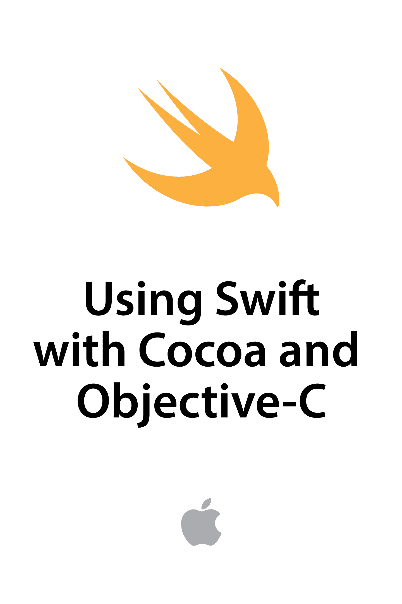
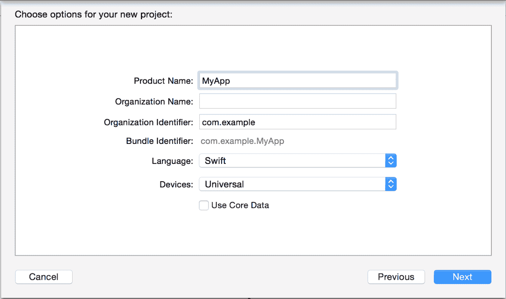
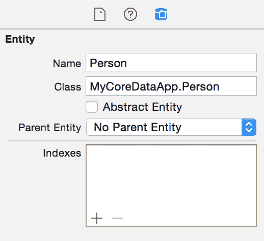
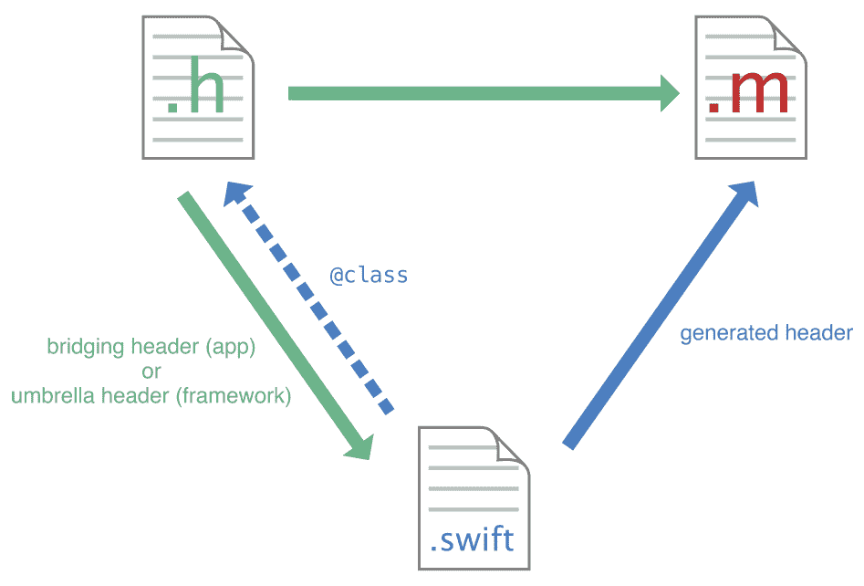
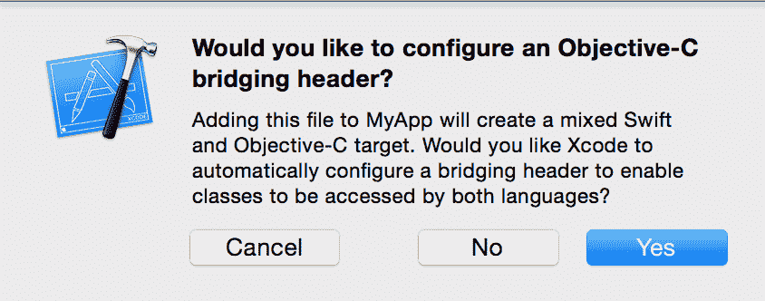

# Swift Cocoa 和 Objective-C 使用指南



## 设置

Swift 的设计旨在提供与 Cocoa 和 Objective-C 的无缝兼容。你可以在 Swift 中使用 Objective-C API（从系统框架到你自定义的代码），也可以在 Objective-C 中使用 Swift API。这种兼容性使得 Swift 成为集成到你应用开发工作流中一个简单、方便且强大的工具。

本指南涵盖了这种兼容性的三个重要方面，你可以在开发 Cocoa 应用时利用这些特性：

- **互操作性（Interoperability）**允许你在 Swift 和 Objective-C 之间进行接口交互，允许你在一种语言的文件中访问并使用另一种语言编写的代码。
- **混合与匹配（Mix and match）**允许你创建包含 Swift 和 Objective-C 文件的混合应用程序，这些文件可以相互通信。
- **迁移（Migration）**通过互操作性和混合匹配，从 Objective-C 代码迁移到 Swift 变得简单，使可以使用最新的 Swift 特性替换 Objective-C 应用的部分。

在开始学习这些特性之前，你需要基础了解如何设置一个可以访问 Cocoa 框架的 Swift 环境。

### 设置 Swift 环境

为了开始在 Swift 中尝试访问 Cocoa 框架，请从 Xcode 模板创建一个基于 Swift 的应用程序。

**在 Xcode 中创建 Swift 项目**

1. 选择 `File` > `New` > `Project` > `(iOS or OS X)` > `Application` > `选择你的模板`。
2. 点击 `Language` 下拉菜单并选择 `Swift`。



Swift 项目的结构与 Objective-C 项目几乎相同，唯一的区别是 Swift 没有头文件。实现和接口之间没有显式区分，因此关于特定类的所有信息都位于单个 `.swift` 文件中。从这里，你可以通过在 delegate 中编写 Swift 代码来开始尝试，或者通过 `File` > `New` > `File` > `(iOS or OS X)` > `Source` > `Swift` 创建一个新的 Swift 类。

### 理解 Swift 导入过程

设置好 Xcode 项目后，你可以从 Cocoa 导入任何框架以便在 Swift 中使用 Objective-C。

任何作为 `module` 可访问的 Objective-C 框架（或 C 库）都可以直接导入到 Swift。这包括系统提供的所有 Objective-C 框架——例如 `Foundation`、`UIKit` 和 `SpriteKit`——以及常用的 C 库。例如，要导入 `Foundation`，只需在你正在工作的 Swift 文件顶部添加此导入语句：

```swift
import Foundation
```

此导入使得所有的 `Foundation` API（包括 `NSDate`、`NSURL`、`NSMutableData` 以及它们的所有方法、属性和分类）在 Swift 中可用。

导入过程非常简单。Objective-C 框架在头文件中提供 API。在 Swift 中，这些头文件被编译为 Objective-C 模块，然后作为 Swift API 导入。导入过程决定了在 Objective-C 代码中声明的函数、类和类型在 Swift 中如何显示。对于函数和方法，此过程影响它们的参数和返回值的类型。对于类型，导入过程可以做到：

- 将某些 Objective-C 类型映射到 Swift 中的等效类型，例如 `id` 到 `AnyObject`
- 将某些 Objective-C 核心类型映射到 Swift 中的替代类型，例如 `NSString` 到 `String`
- 将某些 Objective-C 概念映射到 Swift 中对应的概念，例如指针映射到可选值（optionals）

在“互操作性”部分，你将学习更多关于这些映射以及如何在 Swift 代码中利用它们。

将 Swift 导入 Objective-C 的模型与将 Objective-C 导入 Swift 模型相似。Swift 将其 API（例如来自框架的）作为 Swift 模块导出。与这些 Swift 模块同时生成的 Objective-C 头文件。这些头文件提供了映射回 Objective-C 的 API。某些 Swift API 不映射回 Objective-C，因为它们利用了 Objective-C 的语言特性。有关在 Objective-C 中使用 Swift 的更多信息，请参见同一项目中的 Swift 和 Objective-C。

## 互操作性

### 与 Objective-C API 交互

`互操作性`是在 Swift 和 Objective-C 之间进行双向交互的能力，允许你在一种语言的文件中访问并使用另一种语言的代码。当你开始将 Swift 集成到应用开发工作流时，了解如何利用互操作性来重新定义、改进和增强编写 Cocoa 应用的方法是一个好主意。

互操作性的一个重要方面是，它允许你在编写 Swift 代码时使用 Objective-C API。在导入 Objective-C 框架后，你可以从中实例化类并使用原生 Swift 语法与其交互。

#### 初始化

要在 Swift 中实例化 Objective-C 类，你需要使用 Swift 语法调用其初始化器之一。当 Objective-C 的 `init` 方法进入 Swift 时，它们采用了原生的 Swift 初始化器语法。“init”前缀被去掉，并变成一个指示该方法为初始化器的关键字。对于以“initWith”开头的 `init` 方法，“With”也会被去掉。被剥离 `init` 或 `initWith` 的选择器部分（selector piece）的首字母变为小写，该选择器部分被视为第一个参数的。剩余的选择器部分也对应参数名称。每个选择器部分都放在括号内，并在调用处是必须的。

例如，在 Objective-C 中你会这样做：

```objective-c
UITableView *myTableView = [[UITableView alloc] initWithFrame:CGRectZero style:UITableViewStyleGrouped];
```

在 Swift 中，你这样做：

```swift
let myTableView: UITableView = UITableView(frame: .Zero, style: .grouped)
```

你不需要调用 `alloc`；Swift 会为你处理好。注意在调用 Swift 风格的初始化器时，任何地方都没有出现“init”。

你可以在初始化期间显式指定对象的类型，也可以省略类型。Swift 的类型推断正确确定了对象的类型。

```swift
let myTextField = UITextField(frame: CGRect(x: 0.0, y: 0.0, width: 200.0, height: 40.0))
```

这些 `UITableView` 和 `UITextField` 对象拥有在 Objective-C 中相同的熟悉功能。你可以像在 Objective-C 中一样使用它们，访问相应类中定义的任何属性并调用任何方法。

为了保持一致性和简单，Objective-C 的工厂方法被映射为 Swift 中的便利初始化器。这种映射允许你与初始化器相同的简洁、清晰的语法使用它们。例如，在 Objective-C 中你会这样调用这个工厂方法：

```objective-c
UIColor *color = [UIColor colorWithRed:0.5 green:0.0 blue:0.5 alpha:1.0];
```

在 Swift 中，你这样调用它：

```swift
let color = UIColor(red: 0.5, green: 0.0, blue: 0.5, alpha: 1.0)
```

#### 可失败初始化

在 Objective-C 中，初始化器直接返回它们所初始化的对象。为了在初始化失败时通知调用者，Objective-C 初始化器可以返回 `nil`。在 Swift 中，这种模式被内置在名为“可失败初始化”（failable initialization）的语言特性中。iOS 和 OS 系统框架中的许多 Objective-C 初始化器已经过审核，以指示初始化可能会失败。这些 Objective-C 初始化器被导入为 `init(...)`——如果初始化不会失败——或 `init?(...)`——如果初始化可能会失败。在你自定义的 Objective-C 类以及尚未审核的框架中的类中，初始化器被导入为 `init!(...)`。例如，如果提供的路径下不存在文件，则内置的 `NSString(contentsOfFile:)` 初始化器可能无法初始化一个 `NSString` 对象。如果初始化成功，你可以使用可选绑定（optional binding）来解包失败初始化器的结果。

##### Swift

```swift
if let fileContents = NSString(contentsOfFile:"MyFile.txt") {
    println(fileContents)
}
```

#### 访问属性

在 Swift 中使用点语法（dot syntax）访问和设置 Objective-C 对象的属性。

##### Swift

```swift
myTextField.textColor = UIColor.darkGrayColor()
myTextField.text = "Hello world"
```

在获取或设置属性时，使用属性名且不加括号。注意 `darkGrayColor()` 有一组括号。这是因为 `darkGrayColor()` 是 `UIColor` 的类方法，而不是属性。

在 Objective-C 中，一个返回值且没有参数的方法可以被视为隐式 getter（implicit getter），并可以使用与属性 getter 相同的语法调用。在 Swift 中并非如此。在 Swift 中，只有在 Objective-C 中使用 `@property` 语法编写的属性才会被导入为属性。方法的导入和调用如与方法进行交互所示。

#### 与方法进行交互

当从 Swift 调用 Objective-C 方法时，请使用点语法。

当 Objective-C 方法传递到 Swift 时，Objective-C 选择器（selector）的第一部分将成为基础方法名，并出现在括号之外。第一个参数紧接在括号内部，没有名称。选择器的其余部分对应于参数名，并位于括号内部。在调用处需要所有的选择器部分。

例如，在 Objective-C 中你可能会这样做：

##### Objective-C

```objective
[myTableView insertSubview:mySubview atIndex:2];
```

在 Swift 中，你这样做：

```swift
myTableView.insertSubview(mySubview, atIndex:2)
```

如果你调用的是一个没有参数的方法，仍然必须包含括号。

##### Swift

```swift
myTableView.layoutIfNeeded()
```

#### `id` 兼容性

Swift 包含一个名为 `AnyObject` 的协议类型，它代表任何类型的对象，就像 Objective-C 中的 `id` 一样。`AnyObject` 协议允许你在编写类型安全的 Swift 代码的同时，保持未类型化对象的灵活性。由于 `AnyObject` 协议提供了额外的安全性，Swift 将 `id` 导入为 `AnyObject`。

例如，与 `id` 一样，你可以将任何类类型的对象赋值给类型为 `AnyObject` 的常量或变量。你也可以将变量重新赋值为不同类型的对象。

##### Swift

```swift
var myObject: AnyObject = UITableViewCell()
myObject = NSDate()
```

你也可以调用任何 Objective-C 方法并访问任何属性，而无需强制转换为更具体的类类型。这包括标记有 `@objc` 属性的 Objective-C 兼容性方法。

##### Swift

```swift
let futureDate = myObject.dateByAddingTimeInterval(10)
let timeSinceNow = myObject.timeIntervalSinceNow
```

然而，由于类型为 `AnyObject` 的对象的特定类型在运行时未知，因此可能会无意中编写不安全的代码。与 Objective-C 一样，如果你在一个 `AnyObject` 类型对象上调用不存在的方法或访问的属性，会导致运行时错误。例如，以下代码可以编译而不会报错，但在运行时会导致未识别的选择器错误（unrecognized selector error）：

##### Swift

```swift
myObject.characterAtIndex(5)
// crash，myObject 不响应该方法
```

你可以利用 Swift 中的可选值（optionals）从代码中消除这种常见的 Objective-C 错误。当你对 `AnyObject` 类型对象调用 Objective-C 方法时，该方法调用的实际上类似于隐式解包可选值（implicitly unwrapped optional）。你可以使用与协议中的可选方法相同的可选链（optional chaining）语法，来可选地调用 `AnyObject` 的方法。同样的过程也适用于属性。

例如，在下面的代码列表中，第一行和第二行不会执行，因为 `NSDate` 对象上不存在 `count` 属性和 `characterAtIndex:` 方法。`myCount` 常数被推断为可选的 `Int`，并设置为 `nil`。你也可以使用 `if–let` 语句来条件地解包对象可能不响应的方法的结果，如第三行所示。

##### Swift

```swift
let myCount = myObject.count?
let myChar = myObject.characterAtIndex?(5)
if let fifthCharacter = myObject.characterAtIndex?(5)
```

与 Swift 中所有的向下转换（downcasts）一样，从 `AnyObject` 转换为特定的对象类型不能保证成功，因此返回一个可选值。你可以检查该可选值来确定转换是否成功。

##### Swift

```swift
let userDefaults = NSUserDefaults.standardUserDefaults()
let lastRefreshDate: AnyObject? = userDefaults.objectForKey("LastDate")
if let date = lastRefreshDate as? NSDate {
    print("Found \(date.timeIntervalSinceReference)")
}
```

当然，如果你确定对象的类型（并且知道它不是 `nil`），可以使用 `as` 运算符强制调用。

##### Swift

```swift
let myDate = lastRefreshDate as NSDate
let timeInterval = myDate.timeIntervalSinceReference
```

#### 处理 `nil`

在 Objective-C 中，你使用可能为 `NULL`（在 Objective-C 中称为 `nil`）的原始指针处理对象引用。在 Swift 中，所有值（包括结构体和对象引用）都保证非空。相反，你通过将值的类型包装在可选类型中表示可能缺失的值。当你需要指示值缺失时，使用值 `nil`。有关可选值的更多信息，请参阅 Swift 编程语言中的可选。

由于 Objective-C 不保证对象非空，Swift 将导入的 Objective-C API 中的类类型包装在隐式解包可选类型（implicitly unwrapped optional type）中。在使用 Objective-C 对象之前，你应该检查它是否缺失。例如，下面的 Objective-C 方法：

##### Objective-C

```objectivec
- (NSDate *)dueDateForProject:(Project*)project;
```

被导入到 Swift 中变为：

##### Swift

```swift
func dueDateForProject(project: Project!) -> NSDate!
```

在某些情况下，你可能完全确定某个 Objective-C 方法或属性永远不会返回 `nil` 对象引用。为了让这种特殊场景下的对象处理起来更加方便，Swift 将对象类型导入为*隐式解包可选类型*（implicitly unwrapped optionals）。隐式解包可选类型包含了可选类型的所有安全特性。此外，你可以直接访问该值，而无需检查 `nil` 或由自己进行解包。当你访问这种可选类型中的值而没有先进行安全解包时，隐式解包可选类型会检查该值是否缺失。如果值缺失，就会发生运行时错误。因此，除非你确定值不会缺失，否则你应该始终自己检查并解包隐式解包可选类型。

#### Extensions（扩展）

Swift 扩展（extension）类似于 Objective-C 的分类（category）。扩展可以扩展现有类、结构体和枚举的行为，包括在 Objective-C 中定义的类型。你可以对来自系统框架的类型或你自定义的任一类型定义扩展。只需导入相应的模块，并使用你在 Objective-C 中使用的名称引用该类、结构体或枚举即可。


例如，你可以扩展 `UIBezierPath` 类，根据提供的边长和起始点，创建一个带有等边三角形的简单贝塞尔路径。

```swift
extension UIBezierPath {
    convenience init(triangleSideLength: Float, origin: CGPoint) {
        self.init()
        let squareRoot = Float(sqrt(3.0))
        let altitude = (squareRoot * triangleSideLength) / 2
        moveToPoint(origin)
        addLineToPoint(CGPoint(x: triangleSideLength, y: origin.x))
        addLineToPoint(CGPoint(x: triangleSideLength / 2, y: altitude))
        closePath()
    }
}
```

你可以使用扩展来添加属性，包括类属性和静态属性。然而，这些属性必须是计算属性；扩展不能为类、结构体或枚举添加存储属性。

此示例扩展了 `CGRect` 结构体，以包含一个计算属性 `area`：

```swift
extension CGRect {
    var area: CGFloat {
        return width * height
    }
}

let rect = CGRect(x: 0.0, y: 0.0, width: 10.0, height: 50.0)
let area = rect.area
// area: CGFloat = 500.0
```

你还可以使用扩展在不创建子类的情况下为类添加协议遵循（protocol conformance）。如果协议是在 Swift 中定义的，你也可以为在 Swift 或 Objective-C 中定义的结构体或枚举添加该协议的遵循。

你不能使用扩展来重写 Objective-C 类型现有的方法或属性。

### Closures（闭包）

Objective-C blocks 会自动导入为 Swift 闭包。例如，这里有一个 Objective-C block 变量：

```objective-c
void (^completionBlock)(NSData*, NSError*) = ^(NSData *data, NSError *error) { /* ... */ };
```

这是它在 Swift 中的对应形式：

```swift
let completionBlock: (NSData, NSError) -> Void = { data, error in /* ... */ }
```

Swift 闭包和 Objective-C blocks 是兼容的，因此你可以将 Swift 闭包传递给期望 blocks 的 Objective-C 方法。Swift 闭包和函数具有相同的类型，你甚至可以传递 Swift 函数名。

闭包的捕获语义与 blocks 相似，但在一个关键点上不同：变量是可变的而不是拷贝的。换句话说，Objective-C 中 `__block` 的行为是 Swift 中变量的默认行为。

### Object Comparison（对象比较）

在 Swift 中比较两个对象时，有两种不同的比较类型。第一种是等价性（`==`），比较对象的内容。第二种是标识性（`===`），判断常量或变量是否指向同一个对象实例。

Swift 和 Objective-C 对象通常在 Swift 中使用 `==` 和 `===` 运算符进行比较。Swift 为派自 `NSObject` 类的对象提供了 `==` 运算符的默认实现。在该运算符的实现中，Swift 会调用 `NSObject` 类中定义的 `isEqual:` 方法。`NSObject` 类只执行标识比较，因此你应该在派自 `NSObject` 的类中实现你自己的 `isEqual:` 方法。由于你可以将 Swift 对象，包括未派自 `NSObject` 的对象，传递给 Objective-C API，如果你希望 Objective-C API 比较对象的内容而非身份，则应该为这些类实现 `isEqual:` 方法。

在为你的类实现等价性时，请确保根据 Cocoa Core Competencies 中对象比较的规则实现 `hash` 属性。此外，如果你想将你的类作为字典的键，还要遵循 `Hashable` 协议并实现 `hashValue` 属性。

### Swift Type Compatibility（Swift 类型兼容性）

当你创建一个派自 Objective-C 类的 Swift 类时，该类及其成员——属性、方法、下标和初始化器——可以自动从 Objective-C 调用。在某些情况下，你需要对 Swift API 暴露给 Objective-C 的方式进行更细粒度的控制。如果你的 Swift 类没有继承自 Objective-C 类，或者你想要更改接口在暴露给 Objective-C 代码时的符号名称，可以使用 `@objc` 属性。如果你正在使用如键值观察（key–value observing）等通过动态替换方法实现的 API，还可以使用 `dynamic` 修饰符来要求对成员的访问通过 Objective-C 运行时进行动态分发。

### Exposing Swift Interfaces in Objective-C（在 Objective-C 中暴露 Swift 接口）

当你定义一个继承 `NSObject` 或任何其他 Objective-C 类的 Swift 类时，该类会自动与 Objective-C 兼容。本节中的所有步骤已由 Swift 编译器为你完成。如果你从未在 Objective-C 中导入 Swift 类，在这种情况下不需要担心类型兼容性。否则，如果你的 Swift 类没有派自 Objective-C 类，且你想在 Objective-C 代码中使用它，可以使用下述的 `@objc` 属性。

`@objc` 属性使你的 Swift API 在 Objective-C 和 Objective-C 运行时可用。换句话说，你可以在任何要在 Objective-C 中使用的 Swift 方法、属性、下标、初始化器或类之前使用 `@objc` 属性。如果你的类继承自 Objective-C 类，编译器会为你插入该属性。编译器还会为标记了 `@objc` 的类的每个成员添加该属性。当你使用 `@IBOutlet`、`@IBAction` 或 `@NSManaged` 属性时，也会添加 `@objc` 属性。当你处理使用选择器（selector）来实现目标-动作模式的 Objective-C 类时，例如 `NSTimer` 或 `UIButton`，该属性也非常有用。

当从 Objective-C 使用 Swift API 时，编译器通常执行直接翻译。例如，Swift API `func playSong(name: String)` 在 Objective-C 中导入为 `- (void)playSong:(NSString *)name`。然而，有一个例外：当你在 Objective-C 中使用 Swift 初始化器时，编译器会在方法开头添加“initWith”文本，并正确大写原始初始化器的第一个字母。例如，这个 Swift 初始化器 `init (songName: String, artist: String)` 在 Objective-C 中导入为 `- (instancetype)initWithSongName:(NSString *)songName artist:(NSString *)artist`。

#### Swift

Swift 还提供了 `@objc` 属性的变体，允许你为符号在 Objective-C 中指定名称。例如，如果你的 Swift 类名称包含 Objective-C 不支持的字符，你可以提供一个替代名称供 Objective-C 使用。如果你为 Swift 函数提供了 Objective-C 名称，请使用 Objective-C 选择器（selector）语法。记住，在任何选择器片段之后跟有参数的地方添加冒号（`:`）。

```swift
@objc(`Squirrel`)
class `Белка` {
    @objc(`initWithName`:)
    init (`имя:` `String`) { /*...*/ }

    @objc(`hideNuts`:`inTree`:)
    func `прячьОрехи`(`Int`, `вДереве:` `Дерево`) { /*...*/ }
}
}
```

当你在 Swift 类上使用 `@objc(<#name#>)` 属性时，该类可以在无需任何命名空间的情况下在 Objective-C 中可用。因此，当你将可归档（archivable）的 Objective-C 类迁移到 Swift 时，该属性也可能有用。因为归档对象在归档中存储了它们的类名，所以你应该使用 `@objc(<#name#>)` 属性指定与你的 Objective-C 类相同的名称，以便你的新 Swift 类能够解归档旧的归档文件。

## 要求动态分发

虽然 `@objc` 属性将你的 Swift API 暴露给 Objective-C 运行时，但它不能保证属性、方法、下标或初始化器的动态分发。Swift 编译器仍然可能会对成员访问进行去虚拟化（devirtualize）或内联（inline）以优化代码性能，从而绕过 Objective-C 运行时。当你用 `dynamic` 修饰符标记成员声明时，对该成员的访问始终是动态分发的。由于标记有 `dynamic` 修饰符的声明使用 Objective-C 运行时分发，因此它们隐式地标记了 `@objc` 属性。

要求动态分发很少是必要的。然而，当你知道 API 的实现在运行时替换时，必须使用 `dynamic` 修饰符。例如，你可以使用 Objective-C 运行时中的 `method_exchangeImplementations` 函数在应用运行时交换方法的实现。如果 Swift 编译器内联了该方法的实现或对其访问进行了去虚拟化，则不会使用新的实现。

## Objective-C Selectors

Objective-C 选择器是一种引用 Objective-C 方法名的类型。在 Swift 中，Objective-C 选择器由 `Selector` 结构体表示。你可以使用字符串字面量构造选择器，例如 `let mySelector: Selector = "tappedButton:"`。由于字符串字面量可以自动转换为选择器，你可以将字符串字面量传递给任何接受选择器的方法。

```swift
import UIKit

class MyViewController: UIViewController {
    let myButton = UIButton(frame: CGRect(x: 0, y: 0, width: 100, height: 50))

    init(nibName nibNameOrNil: String?, bundle nibBundleOrNil: NSBundle?) {
        super.init(nibName: nibNameOrNil, bundle: nibBundleOrNil)
        myButton.addTarget(self, action: "tappedButton:", forControlEvents: .TouchUpInside)
    }

    func tappedButton(sender: UIButton!) {
        println("tapped button")
    }
}
```

如果你的 Swift 类继承自 Objective-C 类，则类中的所有方法和属性都可以作为 Objective-C 选择器可用。否则，如果你的 Swift 类没有继承自 Objective-C 类，你需要用 `@objc` 属性为你想要作为选择器的符号添加前缀，如 Swift 类型兼容性中所述。

## 编写具有 Objective-C 行为的 Swift 类

互操作性允许你定义包含 Objective-C 行为的 Swift 类。在编写 Swift 类时，你可以继承自 Objective-C 类、采用 Objective-C 协议并利用其他 Objective-C 功能。这意味着你可以根据 Objective-C 中熟悉且已确立的行为来创建类，并用 Swift 现代且强大的语言特性对其进行增强。

### 继承 Objective-C 类

在 Swift 中，你可以定义 Objective-C 类的子类。要创建一个继承自 Objective-C 类的 Swift 类，请在 Swift 类名后添加一个冒号（`:`），然后是 Objective-C 类的名称。

```swift
import UIKit

class MySwiftViewController: UIViewController {
    // 定义类
}
```

你将获得 Objective-C 中父类提供的所有功能。如果你为父类方法提供了自己的实现，请记住使用 `override` 关键字。

### 采用协议

在 Swift 中，你可以采用在 Objective-C 中定义的协议。像 Swift 协议一样，Objective-C 协议遵循类的命名规则。

```swift
class MySwiftViewController: UIViewController, UITableViewDelegate, UITableViewDataSource {
    //
}
```

在 Swift 中，Objective-C 协议被称为 `UITableViewDelegate`。因为 Swift 统一了类和协议的命名空间，Objective-C 中的 `NSObject` 协议被映射为 `NSObject`。

### 编写初始化器和析构器

Swift 编译器确保你的初始化器不会让类中的任何属性未初始化，以增加代码的安全性和预测性。此外，与 Objective-C 不同，Swift 中没有单独调用的内存分配方法。即使在处理 Objective-C 类时，你也使用原生 Swift 语法。你可以在《Swift 编程语言》中阅读更多关于实现初始化器的信息。

当你想在类释放之前执行额外的清理工作时，可以实现析构器（deinitializer）而不是 `dealloc` 方法。Swift 析构器在实例释放之前自动调用。Swift 在调用子类析构器后会自动调用父类析构器。当你处理 Objective-C 类或你的 Swift 类继承自 Objective-C 类时，Swift 也会为你调用类的父类的 `dealloc` 方法。

### 与 Interface Builder 集成

Swift 编译器包含了为你的 Swift 类启用 Interface Builder 功能的属性。与 Objective-C 一样，你可以在 Swift 中使用 outlet、action 和实时渲染。

### 使用 Outlet 和 Action

Outlet 和 action 允许你将源代码连接到 Interface Builder 中的用户界面对象。在 Swift 中使用 outlet 和 action，请在属性或方法声明之前插入 `@IBOutlet` 或 `@IBAction`。使用相同的 `@IBOutlet` 属性声明 outlet 集合——只需为类型指定数组。

当你在 Swift 中声明 outlet 时，你应该将 outlet 的类型设置为隐式解包可选（implicitly unwrapped optional）。这样，你就可以让 storyboard 在初始化后的运行时连接 outlet。当你的类从 storyboard 或 `xib` 文件初始化时，你可以假设 outlet 已经连接。

例如，以下 Swift 代码声明了一个带有 outlet、outlet 集合和 action 的类：

```swift
class MyViewController: UIViewController {
    //
}
```

```swift
@IBOutlet weak var button: UIButton!
@IBOutlet var textFields: [UITextField]!
@IBAction func buttonTapped(_ sender: AnyObject) {
    println("button tapped!")
}
```

由于 `buttonTapped` 方法没有使用 `sender` 参数，因此可以省略参数名称。

### 实时渲染

你可以使用两个不同的属性——`@IBDesignable` 和 `@IBInspectable`——在 Interface Builder 中启用实时的、交互式的自定义视图设计。当你创建一个继承自 `UIView` 类或 `NSView` 类的自定义视图时，可以在类声明之前添加 `@IBDesignable` 属性。当你将该自定义视图添加到 Interface Builder 中，通过在检查器面板中设置视图的自定义类来实现后，Interface Builder 就会在画布上渲染你的视图。

你还可以将 `@IBInspectable` 属性添加到类型与用户定义运行时属性兼容的属性上。当你将自定义视图添加到 Interface Builder 后，就可以在检查器中编辑这些属性了。

#### Swift

```swift
@IBDesignable
class MyCustomView: UIView {
    @IBInspectable var textColor: UIColor
    @IBInspectable var iconHeight: CGFloat
    /* ... */
}
```

### 指定属性特性


在 Objective-C 中，属性有一系列潜在的特性，用于指定关于属性行为的额外信息。在 Swift 中，你以不同的方式指定这些属性特性。

### 强与弱

Swift 属性默认是强引用（strong）。使用 `weak` 关键字表示该属性对存储为其值的对象有一个弱引用。该关键字只能用于可选类类型的属性。有关更多信息，请参阅 *The Swift 编程语言* 中的“属性”。

### 读/写与只读

在 Swift 中，没有 `readwrite` 和 `readonly` 属性。在声明存储属性时，使用 `let` 使其变为只读，使用 `var` 使其变为读写。在声明计算属性时，仅提供 getter 以使其变为只读，同时提供 getter 和 setter 以使其变为读写。有关更多信息，请参阅 Swift 编程语言中的“属性”。

### 拷贝语义

在 Swift 中，Objective-C 的 `copy` 属性特性翻译为 `@NSCopying`。属性的类型必须遵守 `NSCopying` 协议。有关更多信息，请参阅 Swift 编程语言中的“属性”。

### 实现 Core Data 管理对象类

Core Data 在 `NSManagedObject` 类的子类中提供了属性的底层存储和实现。在你的管理对象子类中，对于每个与 Core Data 模型中的属性或关系对应的属性定义，在其之前添加 `@NSManaged` 属性。与 Objective-C 中的 `@dynamic` 属性一样，`@NSManaged` 属性告知 Swift 编译器属性的存储和实现将在运行时提供。然而，与 `@dynamic` 不同，`@NSManaged` 属性仅适用于 Core Data 支持。

Swift 类是有命名空间的——它们被限制在编译时所在的模块（通常是项目）。若要在 Core Data 模型中使用 `NSManagedObject` 类的 Swift 子类，请在模型实体检查器的 Class 字段中为类名加上模块名称。



### 在 Objective-C API 中使用 Swift 类名

即使在 Objective-C 代码中使用，Swift 类也根据其编译所在的模块具有命名空间。与 Objective-C 不同（在 Objective-C 中所有类都是全局命名空间的一部分，且不能具有相同的名称），Swift 类可以根据它们所在的模块进行区分。例如，在名为 `MyFramework` 的框架中名为 `DataManager` 的 Swift 类的完全限定名是 `MyFramework.DataManager`。Swift App 目标（target）本身就是一个模块，因此在名为 `MyGreatApp` 的 App 中名为 `Observer` 的 Swift 类的完全限定名是 `MyGreatApp.Observer`。

为了在 Objective-C 代码中使用 Swift 类时保留命名空间，Swift 类将以其完全限定名暴露给 Objective-C 运行时。因此，当你处理基于 Swift 类字符串表示操作的 API 时，必须包含该类的完全限定名。例如，当你创建一个基于文档的 Mac 应用时，你需要在 App 的 `Info.plist` 文件中提供你的 `NSDocument` 子类的名称。在 Swift 中，你必须使用文档子类的全名，包括源自你的 App 或框架名称的模块名。

在下面的示例中，使用 `NSClassFromString` 函数从其字符串表示获取对类的引用。为了获取一个 Swift 类，使用了包含 App 名称在内的完全限定名。

#### Swift

```swift
let myPersonClass: AnyClass = NSClassFromString("MyGreatApp.Person")
```

### 与 Cocoa 类型协作

作为其与 Objective-C 互操作性的一部分，Swift 提供了方便高效的方法来处理 Cocoa 类型。Swift 自动将 Objective-C 类型转换为 Swift 类型，并将某些 Swift 类型转换为 Objective-C。Swift 和 Objective-C 中还有许多数据类型可以互换使用。可以转换或互换使用的数据类型被称为桥接类型（bridged types）。例如，在 Swift 中，你可以将 `Array` 值传递给期望 `NSArray` 的方法。

### 字符串

Swift 自动在 `String` 类型和 `NSString` 类之间进行桥接。这意味着在任何需要使用 `NSString` 对象的地方，你都可以使用 `String` 类型，并获得两者的优势：`String` 类型的插值和 Swift 设计的 API，以及 `NSString` 类广泛的功能。由于这个原因，你几乎不需要在自己的代码中使用 `NSString` 类。事实上，当 Swift 导入 Objective-C API 时，它会将所有的 `NSString` 类型替换为 `String` 类型。当你的 Objective-C 代码使用 Swift 类时，导入器会将导入 API 中的所有的 `String` 类型替换为 `NSString`。

要启用字符串桥接，只需导入 Foundation。例如，你可以对 Swift 字符串调用 `capitalizedString`——`NSString` 类的一个方法——Swift 会自动将 Swift `String` 桥接为 `NSString` 对象并调用该方法。该方法甚至返回 `String` 类型，因为它在导入时已经过转换了。

#### Swift

```swift
import Foundation
let greeting = "hello, world!"
let capitalizedGreeting = greeting.capitalizedString
// capitalizedGreeting: String = Hello, World!
```

如果你确实需要使用 `NSString` 对象，可以通过强制转换将其转换为 `String` 值。`String` 类型始终可以从 `NSString` 对象转换为 `String` 值，因此不需要使用类型转换运算符的可选版本（`as?`）。你还可以通过显式类型标注常量或变量来创建一个 `NSString` 对象。

#### Swift

```swift
import Foundation
let myString: NSString = "123"
if let integerValue = (myString as String).toInt() {
    print("\(myString) is the integer \(integerValue)")
}
```

### 本地化

在 Objective-C 中，你通常使用 `NSLocalizedString` 系列宏来对字符串本地化。这组宏包含了 `NSLocalizedString`、`NSLocalizedStringFromTable`、`NSLocalizedStringFromTableInBundle` 和 `NSLocalizedStringWithDefaultValue`。在 Swift 中，你可以使用单个函数来提供与整组 `NSLocalizedString` 宏相同的功能——`NSLocalizedString(key:tableName:bundle:value:comment:)`。`NSLocalizedString` 函数为 `tableName`、`bundle` 和 `value` 参数提供了默认值。像使用它所替换的宏一样使用它即可。

### 数字

Swift 自动将某些原生数字类型（如 `Int` 和 `Float`）桥接到 `NSNumber`。这种桥接允许你从这些类型之一创建一个 `NSNumber`：

#### Swift

```swift
let n = 42
let m: NSNumber = n
```

它还允许你将 `Int` 类型的值传递给期望 `NSNumber` 的参数（例如）。请注意，由于 `NSNumber` 可以包含多种不同的类型，因此你不能将其传递给期望 `Int` 值的对象。

以下所有类型都会自动桥接到 `NSNumber`：

- `Int`
- `UInt`
- `Float`
- `Double`
- `Bool`

### 集合类

Swift 自动将 `NSArray` 和 `NSDictionary` 类桥接为它们的原生 Swift 等价类型。这意味着你可以利用 Swift 强大的算法和自然的语法来处理集合——并交替使用 Foundation 和 Swift 集合类型。

### 数组

Swift 自动在 `Array` 类型和 `NSArray` 类之间进行桥接。当你从 `NSArray` 对象桥接到 Swift 数组时，生成的数组类型为 `[AnyObject]`。如果一个对象是 Objective-C 或 Swift 类的实例，或者该对象可以桥接为类，则该对象是兼容 `AnyObject` 的。你可以将任何 `NSArray` 对象桥接为 Swift 数组，因为所有 Objective-C 对象都与 `AnyObject`。由于所有 `NSArray` 对象都可以桥接到 Swift 数组，Swift 编译器在导入 Objective-C API 时，会将 `NSArray` 类替换为 `[AnyObject]`。

在将 `NSArray` 对象桥接到 Swift 数组之后，你还可以将数组向下转换（downcast）为更具体的类型。与从 `NSArray` 类转换到 `[AnyObject]` 类型不同，从 `AnyObject` 向更具体类型的向下转换并不保证能成功。在运行时之前，编译器无法确定数组中的所有元素是否都能向下转换到你指定的类型。因此，从 `[AnyObject]` 到 `[SomeType]` 的向下转换返回一个可选值（optional value）。例如，如果你知道一个 Swift 数组仅包含 `UIView` 类的实例（或 `UIView` 类的子类），你可以将 `AnyObject` 类型元素的数组向下转换为 `UIView` 对象的数组。如果 Swift 数组中的任何元素在运行时实际上不是 `UIView` 对象，则转换将返回 `nil`。

#### Swift

```swift
let swiftArray = foundationArray as [AnyObject]
if let downcastedSwiftArray = swiftArray as? [UIView] {
    // downcastedSwiftArray 仅包含 UIView 对象
}
```

你还可以在 `for` 循环中直接从 `NSArray` 对象向下转换为具有特定类型的 Swift 数组：

```swift
for aView in foundationArray as [UIView] {
    // aView 的类型为 UIView
}
```

当你从 Swift 数组桥接到 `NSArray` 对象时，Swift 数组中的元素必须兼容 `AnyObject`。例如，类型为 `[Int]` 的 Swift 数组包含 `Int` 结构体元素。`Int` 类型不是类的实例，但由于 `Int` 类型桥接到了 `NSNumber` 类，因此 `Int` 类型兼容 `AnyObject`。因此，你可以将类型为 `[Int]` 的 Swift 数组桥接为 `NSArray` 对象。如果 Swift 数组中的元素不兼容 `AnyObject`，则在桥接到 `NSArray` 对象时会发生运行时错误。

你还可以直接从 Swift 数组字面量创建 `NSArray` 对象，遵循上述概述的桥接规则。当你显式将常量或变量的类型指定为 `NSArray` 对象并赋值一个数组字面量时，Swift 会创建一个 `NSArray` 对象而不是 Swift 数组。

```swift
let schoolSupplies: NSArray = ["Pencil", "Eraser", "Notebook"]
// schoolSupplies 是一个包含 NSString 对象的 NSArray 对象
```

在上面的示例中，Swift 数组字面量包含三个 `String` 字面量。由于 `String` 类型桥接到了 `NSString` 类，该字面量被桥接为 `NSArray` 对象，且对 `schoolSupplies` 的赋值成功。

当你在 Objective-C 代码中使用 Swift 类或协议时，导入器会将导入 API 中所有任何类型的 Swift 数组替换为 `NSArray`。如果你将 `NSArray` 对象传递给期望元素为不同类型的 Swift API，则会发生运行时错误。如果 Swift API 返回一个无法桥接到 `NSArray` 的 Swift 数组，则会发生运行时错误。

### 字典

除了数组之外，Swift 还自动在 `Dictionary` 类型和 `NSDictionary` 之间进行桥接。当你从 `NSDictionary` 对象桥接到 Swift 字典时，生成的字典类型为 `[AnyObject: AnyObject]`。如果一个对象是 Objective-C 或 Swift 类的实例，或者它可以桥接为类，则该对象是兼容 `AnyObject` 的。所有 `NSDictionary` 对象都可以桥接为 Swift 字典，因此 Swift 编译器在导入 Objective-C API 时，会将 `NSDictionary` 类替换为 `[AnyObject: AnyObject]`。在将 `NSArray` 对象桥接到 Swift 字典之后，你还可以将字典向下转换为更具体的类型。与 Swift 数组一样，向下转换并不保证成功。从 `[AnyObject: AnyObject]` 到更具体类型的向下转换结果是一个可选值。例如，如果你知道一个 Swift 字典仅包含 `UIView` 类的实例，你可以将 `AnyObject` 类型元素的字典向下转换为 `UIView` 对象的字典。如果 Swift 字典中的任何元素在运行时实际上不是 `UIView` 对象，则转换将返回 `nil`。

你还可以直接从 Swift 字典字面量创建 `NSArray` 对象，遵循上述概述的桥接规则。当你显式将常量或变量的类型指定为 `NSArray` 对象并赋值一个字典字面量时，Swift 会创建一个 `NSArray` 对象而不是 Swift 字典。

### Foundation 数据类型

Swift 为与 Foundation 框架中定义的数据类型提供了方便的覆盖层。使用此覆盖层处理 `NSSize` 和 `NSPoint` 等类型时，可以使用与 Swift 语言其他部分自然且统一的语法。例如，你可以使用这种语法创建一个 `NSSize` 结构体：

```swift
let size = NSSize(width: 20, height: 40)
```

覆盖层还让你以自然的方式在结构体上调用 Foundation 函数。

```swift
let rect = CGRect(x: 50, y: 50, width: 100, height: 100)
let width = rect.width // 等于 CGRectGetWidth(rect)
let maxX = rect.maxY // 等于 CGRectGetMaxY(rect)
```

Swift 将 `NSUInteger` 和 `NSInteger` 桥接为 `Int`。这两个类型在 Foundation API 中都变为 `Int`。为了一致，Swift 中尽可能使用 `Int`，但如果你需要无符号整数类型，可以使用 `UInt` 类型。

### Foundation 函数

`NSLog` 在 Swift 中可用，用于向系统控制台日志。你使用与在 Objective-C 中相同的格式化语法。

```swift
NSLog("%.7f", pi) // 向控制台打印 "3.1415927"
```

Swift 也提供了如 `print` 和 `println` 等打印函数。由于 Swift 的字符串插值功能，这些函数简单、强大且多功能。它们不会打印到系统控制台，但适用于常规打印需求。

`NSAssert` 函数不会迁移到 Swift。相反，请使用 `assert` 函数。

## 核心基础（Core Foundation）

Core Foundation 类型会被自动导入为完整的 Swift 类。在提供了内存管理注解的地方，Swift 会自动管理 Core Foundation 对象的内存，包括你自己实例化的 Core Foundation 对象。在 Swift 中，你可以交替使用对无缝桥接（toll-free bridged）的 Foundation 和 Core Foundation 类型。如果你先强制转换为桥接的 Foundation 类型，你还可以将某些无缝桥接的 Core Foundation 类型桥接到 Swift 标准库类型。

## 重映射类型（Remapped Types）

当 Swift 导入 Core Foundation 类型时，编译器会重映射这些类型的名称。编译器删每个类型名称末尾的 `Ref`，因为所有 Swift 类都是引用类型，因此该后缀是多余的。

Core Foundation 的 `CFTypeRef` 类型完全重映射为 `AnyObject` 类型。现在你应该在代码中使用 `AnyObject` 代替 `CFTypeRef`。

## 内存管理对象（Memory Managed Objects）


从带注解 API 返回的 Core Foundation 对象在 Swift 中会被自动内存管理——你不需要手动调用 `CFRetain`、`CFRelease` 或 `CFAutorelease` 函数。如果你从自己的 C 函数和 Objective-C 方法返回 Core Foundation 对象，请为它们添加 `CF_RETURNS_RETAINED` 或 `CF_RETURNS_NOT_RETAINED` 注解。编译器在编译调用这些 API 的 Swift 代码时，会自动插入内存管理调用。

如果你只使用未间接返回 Core Foundation 对象的注解 API，可以跳过本节的剩余部分。否则，请继续学习如何处理未管理的（unmanaged）Core Foundation 对象。

## 未管理对象（Unmanaged Objects）

当 Swift 导入未注解的 API 时，编译器无法自动管理返回的 Core Foundation 对象。Swift 将这些返回的 Core Foundation 对象封装在 `Unmanaged<T>` 结构中。所有间接返回的 Core Foundation 对象也是未管理的。

例如，这里有一个未注解的 C 函数：

```objectivec
CFStringRef StringByAddingTwoStrings(CFStringRef string1, CFStringRef string2)
```

以及 Swift 导入它的方式：

```swift
func StringByAddingTwoStrings(CFString!, CFString!) -> Unmanaged<CFString>!
```

当你从未注解的 API 接收到一个未管理对象时，应该在使用它之前立即将其转换为内存管理对象。这样，Swift 就可以为你处理内存管理了。

`Unmanaged<T>` 结构提供了两种将未管理对象转换为内存管理对象的方法：`takeUnretainedValue()` 和 `takeRetainedValue()`。这两个方法都返回对象的原始未解包类型。你根据所调用的 API 返回的是未保留（unretained）还是保留（retained）对象来选择使用哪种方法。

例如，假设上述 C 函数在返回 `CFString` 对象之前没有对其保留（retain）。要开始使用该对象，你使用 `takeUnretainedValue()` 函数。

```swift
let memoryManagedResult = StringByAddingTwoStrings(str1, str2).takeUnretainedValue()
// memoryManagedResult 是一个内存管理的 CFString
```

你也可以在未管理对象上调用 `retain()`、`release()` 和 `autorelease()` 方法，但不建议使用这种方法。

## 采用 Cocoa 设计模式（Adopting Cocoa Design Patterns）

编写设计良好、健壮的应用程序的一种方法是使用 Cocoa 成熟的设计模式。这些模式许多依赖于在 Objective-C 中定义的类。由于 Swift 与 Objective-C 的互操作性，你可以在 Swift 代码中利用这些常用模式。在许多情况下，你可以使用 Swift 语言特性来扩展或简化现有的 Cocoa 模式，使其更加强大且易用。

### 代理模式（Delegation）

在 Swift 和 Objective-C 中，代理模式通常通过定义交互的协议和一个符合协议的代理属性来表示。与 Objective-C 中一样，在发送代理可能不会响应的消息之前，你会询问代理它是否响应该选择器（selector）。

在 Swift 中，你可以使用可选链在可能为 `nil` 的对象上调用可选协议方法，并使用 `if-let` 语法解包可能的结果。下面的代码列表说明了以下过程：

1. 检查 `myDelegate` 是否为 `nil`。
2. 检查 `myDelegate` 是否实现了 `window:willUseFullScreenContentSize:` 方法。
3. 如果 1 和 2 成立，则调用该方法并将方法的结果赋值给名为 `fullScreenSize` 的值。
4. 打印方法的返回值。

```swift
class MyDelegate: NSObject, NSWindowDelegate {
    func window(_ window: NSWindow, willUseFullScreenContentSize proposedSize: NSSize) -> NSSize {
        return proposedSize
    }
}

var myDelegate: NSWindowDelegate? = MyDelegate()

if let fullScreenSize = myDelegate?.window?(myWindow, willUseFullScreenContentSize: mySize) {
    println(NSStringFromSize(fullScreenSize))
}
```

### 错误报告（Error Reporting）

Swift 中的错误报告遵循与 Objective-C 相同的模式，并额外具有可选返回值的优势。在最简单的情况下，你从函数返回一个 `Bool` 值来指示是否成功。当你需要报告错误时，可以为函数添加一个 `NSError` 输出参数。如下所示，使用 `&` 运算符传递 `NSError` 对象的引用。

```swift
var writeError: NSError?
let written = myString.writeToFile(path, atomically: false, encoding: NSUTFStringEncoding, error: &writeError)

if !written {
    if let error = writeError {
        println("write failure: \(error.localizedDescription)")
    }
}
```

当你实现需要配置 `NSError` 对象的函数时，将 `NSErrorPointer` 对象的 `memory` 属性设置为创建的 `NSError` 对象。确保先检查调用者传递了非空的 `NSErrorPointer`：

```swift
func contentsFor(typeName: String!, error: NSErrorPointer) -> AnyObject! {
    if cannotProduceContentsFor(typeName) {
        if error {
            error.memory = NSError(domain: domain, code: code, userInfo: [:])
        }
        return nil
    }
    // ...
}
```

### 键值观测（Key-Value Observing）

键值观测是一种允许对象让其他对象指定属性变化的机制。只要类继承自 `NSObject` 类，你就可以在 Swift 类中使用键值观测。

1. 为要观察的任何属性添加 `dynamic` 修饰符。有关 `dynamic` 的更多信息，请参见“要求动态分发”。

```swift
class MyObjectToObserve: NSObject {
    dynamic var myDate = NSDate()

    func updateDate() {
        myDate = NSDate()
    }
}
```

2. 创建一个全局上下文变量。

```swift
private var myContext = 0
```

3. 为键路径（key-path）添加观察者，覆盖 `observeValueForKeyPath:ofObject:change:context:` 方法，并在 `deinit` 中移除观察者。

```swift
class MyObserver: NSObject {
    var objectToObserve = MyObjectToObserve()

    override init() {
        super.init()
        objectToObserve.addObserver(self, forKeyPath: "myDate", options: .New, context: &myContext)
    }

    override func observeValueForKeyPath(
        keyPath: String,
        ofObject object: AnyObject,
        change: [NSObject: AnyObject],
        context: UnsafeMutablePointer<Void>
    ) {
        if context == &myContext {
            println("Date changed: \(change[NSKeyValueChangeNewKey])")
        } else {
            super.observeValueForKeyPath(
                keyPath,
                ofObject: object,
                change: change,
                context: context
            )
        }
    }

    deinit {
        objectToObserve.removeObserver(self, forKeyPath: "myDate", context: &myContext)
    }
}
```

### 目标动作（Target-Action）

目标-动作是一种常见的 Cocoa 设计模式，当特定事件发生时，一个对象会向另一个对象发送消息。目标-动作模型在 Swift 和 Objective-C 中本质上是类似的。

在 Swift 中，你使用 `Selector` 类型来引用 Objective-C 选择器。有关在 Swift 代码中使用目标-动作模式的示例，请参阅“Objective-C Selectors”。

### 内省检查（Introspection）

在 Objective-C 中，你使用 `isKind:` 方法检查对象是否属于某个类类型，并使用 `conformsToProtocol:` 方法检查对象是否符合指定的协议。在 Swift 中，你通过使用 `is` 运算符检查类型，或使用 `as?` 运算符向下转换到该类型来完成此任务。

你可以使用 `is` 运算符检查实例是否属于某个子类类型。如果实例属于该子类类型，`is` 运算符返回 `true`，否则返回 `false`。

```swift
if object is UIButton {
    // object 的类型是 UIButton
} else {
    // object 的类型不是 UIButton
}
```

你也可以尝试使用 `as?` 运算符向下转换到子类类型。`as?` 运算符返回一个可选值（optional），该值可以使用 `if-let` 语句绑定到常量。

```swift
if let button = object as? UIButton {
    // object 成功转换为类型 UIButton 并绑定到 button
} else {
    // object 无法转换为类型 UIButton
}
```

更多信息，请参阅《Swift 编程语言》中的“类型转换”。

检查协议并转换到协议的语法与检查类并转换到类的语法完全相同。以下是一个使用 `as?` 运算符检查是否符合协议的示例：

```swift
if let dataSource = object as? UITableViewDataSource {
    // object 符合 UITableViewDataSource 并绑定到 dataSource
} else {
    // object 不符合 UITableViewDataSource
}
```

注意，在转换之后，`dataSource` 常量的类型为 `UITableViewDataSource`，因此你只能调用在 `UITableViewDataSource` 协议定义的方法并访问属性。你必须将其转换回其他类型以执行其他操作。

更多信息，请参阅《Swift 编程语言》中的“协议”。

## 与 C API 交互

作为与 Objective-C 互操作的一部分，Swift 与许多 C 语言类型和特性保持兼容。Swift 还提供了一种处理常用 C 构造结构和模式的方法，以防你的代码需要。

### 原始类型

Swift 提供了 C 原始整数类型的对应类型，例如 `char`、`int`、`float` 和 `double`。然而，这些类型与 Swift 核心整数类型（如 `Int`）之间没有隐式转换。因此，如果你的代码特别需要这些类型，请使用它们，否则在尽可能的情况下使用 `Int`。

| C 类型 | Swift 类型 |
| --- | --- |
| `bool` | `CBool` |
| `char`、`signed char` | `CChar` |
| `unsigned char` | `CUnsignedChar` |
| `short` | `CShort` |
| `unsigned short` | `CUnsignedShort` |
| `int` | `CInt` |
| `unsigned int` | `CUnsignedInt` |
| `long` | `CLong` |
| `unsigned long` | `CUnsignedLong` |
| `long long` | `CLongLong` |
| `unsigned long long` | `CUnsignedLongLong` |
| `wchar_t` | `CWideChar` |
| `char16_t` | `CChar16` |
| `char32_t` | `CChar32` |
| `float` | `CFloat` |
| `double` | `CDouble` |

### 枚举

Swift 将任何标记有 `NS_ENUM` 宏的 C 风格枚举导入为 Swift 枚举。这意味着当它们被导入 Swift 时，枚举值名称的前缀会被截断，无论它们是否是在 Swift 中定义的。

在 Objective-C 中，你这样定义一个枚举：

```objectivec
typedef NS_ENUM(NSInteger, UITableViewCellStyle) {
    UITableViewCellStyleDefault,
    UITableViewCellStyleValue,
    UITableViewCellStyleSubtitle
};
```

在 Swift 中，它是这样导入的：

```swift
enum UITableViewCellStyle: Int {
    case defaultStyle
    case value
    case subtitle
}
```

当你引用枚举值时，使用前导点（`.`）。在 Swift 中：

```swift
let style: UITableViewCellStyle = .defaultStyle
```

Swift 还会导入标记有 `NS_OPTIONS` 的选项。在 Objective-C 中，你这样定义一个枚举：

```objectivec
typedef NS_OPTIONS(NSInteger, MyOptions) {
    MyOptionA = (1 << 0),
    MyOptionB = (1 << 1);
};
```

在 Swift 中，它是这样导入的：

```swift
struct MyOptions: OptionSet {
    case optionA = 1 << 0
    case optionB = 1 << 1
}
```

然后你可以这样使用它：

```swift
let options: MyOptions = [.optionA, .optionB]
```

### 指针

尽可能的情况下，Swift 避免让你直接访问指针。然而，当你需要直接访问内存时，有各种指针类型供你使用。以下表格使用 `Type` 作为占位名称来表示映射语法。

对于返回类型、变量和参数，适用以下映射：

| C 语法 | Swift 语法 |
| --- | --- |
| `const Type *` | `UnsafePointer<Type>` |
| `Type *` | `UnsafeMutablePointer<Type>` |

对于类类型，适用以下映射：

| C 语法 | Swift 语法 |
| --- | --- |
| `Type * const *` | `UnsafePointer<Type>` |
| `Type * __strong *` | `UnsafeMutablePointer<Type>` |
| `Type **` | `AutoreleasingUnsafeMutablePointer<Type>` |

### 常量指针

当函数被声明为接收 `UnsafePointer<Type>` 参数时，它可以接受以下任何一种内容：

- `nil`，作为空指针传递。
- `UnsafePointer<Type>`、`UnsafeMutablePointer<Type>` 或 `AutoreleasingUnsafeMutablePointer<Type>` 值，必要时将转换为 `UnsafePointer<Type>`。


* 操作数为 `Type` l 值的 `in-out` 表达式，作为该 l 值的地址传递。

* `[Type]` 值，作为数组起始位置的指针传递，并在调用期间延长生命周期。

如果你声明了像下面这样的函数：

```swift
func takesAPinter(x: UnsafePointer<Float>) {
    /*...*/
}
```

你可以通过以下任何方式之一调用它：

```swift
var x: Float = 0.0
var p: UnsafePointer<Float>? = nil
takesAPinter(nil!)
takesAPinter(p!)
takesAPinter(&x)
```

* `takesAPointer([1.0, 2.0, 3.0])`

当一个函数声明为接收 `UnsafePointer<Void>` 参数时，它可以接受与针对任何类型 `Type` 的 `UnsafePointer<Type>` 相同的操作数。

如果你声明了类似下面这样的函数：

```swift
func takesAVoidPointer(x: UnsafePointer<Void>) { /* ... */ }
```

你可以通过以下任何一种方式调用它：

```swift
var x: Float = 0.0, y: Int = 0
var p: UnsafePointer<Float> = nil, q: UnsafePointer<Int> = nil
takesAVoidPointer(nil)
takesAVoidPointer(p)
takesAVoidPointer(q)
takesAVoidPointer(&x)
takesAVoidPointer(&y)
takesAVoidPointer([1.0, 2.0, 3.0] as [Float])
let intArray = [1, 2, 3]
takesAVoidPointer(intArray)
```

### 可变指针（Mutable Pointers）

当一个函数声明为接收 `UnsafeMutablePointer<Type>` 参数时，它可以接受以下任何一个项：

* `nil`，作为空指针传递。

* 一个 `UnsafeMutablePointer<Type>` 值。

* 一个 `in-out` 表达式，其操作数是类型为 `Type` 的存储左值（lvalue），作为该左值的地址传递。

* 一个 `in-out` `[Type]` 值，作为指向数组起始位置的指针传递，并在调用期间内扩展其生命周期。

如果你声明了类似下面这样的函数：

```swift
func takesAMutablePointer(x: UnsafeMutablePointer<Float>) { /*...*/ }
```

你可以通过以下任何一种方式调用它：

```swift
var x: Float = 0.0
var p: UnsafeMutablePointer<Float> = nil
var a: [Float] = [1.0, 2.0, 3.0]
takesAMutablePointer(nil)
takesAMutablePointer(p)
takesAMutablePointer(&x)
takesAMutablePointer(&a)
```

当一个函数声明为接收 `UnsafeMutablePointer<Void>` 参数时，它可以接受与针对任何类型 `Type` 的 `UnsafeMutablePointer<Type>` 相同的操作数。

如果你声明了类似下面这样的函数：

```swift
func takesAMutableVoidPointer(x: UnsafeMutablePointer<Void>) { /* ... */ }
```

你可以通过以下任何一种方式调用它：

```swift
var x: Float = 0.0, y: Int = 0
var p: UnsafeMutablePointer<Float> = nil, q: UnsafeMutablePointer<Int> = nil
var a: [Float] = [1.0, 2.0, 3.0], b: [Int] = [1, 2, 3]
takesAMutableVoidPointer(nil)
takesAMutableVoidPointer(p)
takesAMutableVoidPointer(q)
takesAMutableVoidPointer(&x)
takesAMutableVoidPointer(&y)
takesAMutableVoidPointer(&a)
takesAMutableVoidPointer(&b)
```

### 自动释放指针（Autoreleasing Pointers）

当一个函数声明为接收 `AutoreleasingUnsafeMutablePointer<Type>` 时，它可以接受以下任何一个项：

* `nil`，作为空指针传递。

* 一个 `AutoreleasingUnsafeMutablePointer<Type>` 值。

* 一个 `in-out` 表达式，其操作数被原始拷贝到一个临时的非所有缓冲区（nonowning buffer）。该缓冲区的地址被传递给调用者，并在返回时，缓冲区中的值被加载、保留并重新赋值给操作数。

注意，此列表不包含数组。

如果你声明了类似下面这样的函数：

```swift
func takesAnAutoreleasingPointer(x: AutoreleasingUnsafeMutablePointer<NSDate?>) { /* ... */ }
```

你可以通过以下任何一种方式调用它：

```swift
var x: NSDate? = nil
var p: AutoreleasingUnsafeMutablePointer<NSDate?> = nil
takesAnAutoreleasingPointer(nil)
takesAnAutoreleasingPointer(p)
takesAnAutoreleasingPointer(&x)
```

所指向的类型不会被桥接（bridged）。例如，`NSString **` 导入 Swift 时是 `AutoreleasingUnsafeMutablePointer<NSString?>`，而不是 `AutoreleasingUnsafeMutablePointer<String?>`。

### 函数指针（Function Pointers）

C 函数指针被导入 Swift 时为 `CFunctionPointer<Type>`，其中 `Type` 是一个 Swift 函数类型。例如，C 中类型为 `int (*)(void)` 的函数指针导入 Swift 中为 `CFunctionPointer<() -> Int32>`。

### 全局常量（Global Constants）

在 C 和 Objective-C 源文件中定义的全局常量会被 Swift 编译器自动导入为 Swift 全局常量。

### 预处理器指令（Preprocessor Directives）

Swift 编译器不包含预处理器。相反，它利用编译时属性、构建配置和语言特性来实现相同的功能。

### 简单宏（Simple Macros）

在 C 和 Objective-C 中你通常使用 `#define` 来定义常量，而在 Swift 中，你使用全局常量。例如，常量 `#define FADE_ANIMATION_DURATION 0.35` 在 Swift 中用 `let FADE_ANIMATION_DURATION = 0.35` 表达更好。因为简单宏直接映射到 Swift 变量，编译器会自动导入在 C 和 Objective-C 中定义的简单宏。

### 复杂宏（Complex Macros）

复杂宏在 C 和 Objective-C 中用于规避类型检查限制或避免重复大量的样板代码。然而，宏会让调试和重构变得困难。在 Swift 中，你可以使用函数和泛型来实现相同的结果。因此，在 C 和 Objective-C 中的复杂宏不可供你的 Swift 代码使用。

### 构建配置（Build Configurations）

Swift 代码和 Objective-C 代码的条件编译方式不同。Swift 代码可以根据*构建配置*的评估进行条件编译。构建配置包括 `true` 和 `false` 字面量、命令行标志以及下表中的平台测试函数。你可以使用 `-D <flag>` 指定命令行标志。

| 函数 | 有效参数 |
| --- | --- |
| `os()` | `OS X`、`iOS` |
| `arch()` | `x86_64`、`arm`、`arm64`、`i386` |

简单的条件编译语句采用如下形式：

```swift
#if build configuration
 statements
#else
 statements
#endif
```

*statements* 由零或多个有效的语句组成，包括表达式、语句和控制流语句。你可以使用 `&&` 和 `||` 运算符向条件编译语句添加额外的构建配置要求，使用 `!` 运算符反反构建配置，并使用 `#elseif` 添加条件块：

```swift
#if build configuration && !build configuration
 statements
#elseif build configuration
 statements
#else
 statements
#endif
```

与 C 预处理器的条件编译语句不同，Swift 的条件编译语句必须完全围绕自包含且语法正确的代码块。这是因为所有 Swift 代码即使未编译也会进行语法检查。

## 混合使用（Mix and Match）

### 在同一项目中使用 Swift 和 Objective-C

Swift 与 Objective-C 的兼容性允许你创建一个包含用任一语言编写的文件的项目。你可以使用这种称为“混合匹配”（mix and match）的功能来编写具有混合语言代码库的 App。通过混合匹配，你可以使用最新的 Swift 特性实现应用的部分功能，并将其无缝地整合回现有的 Objective-C 代码库中。

### 混合匹配概述

Objective-C 和 Swift 文件可以共存在于同一个项目中，无论该项目最初是 Objective-C 项目还是 Swift 项目。你只需要直接向现有项目添加另一种语言的文件即可。这种自然的工作流使得创建混合语言的 App 和框架（framework）目标变得像创建由单语言编写的 App 或框架目标一样简单。

处理混合语言目标的过程略有不同，具体取决于你编写的是 App 还是框架。在同一目标内使用两种语言的通用导入模型如下所示，并在后续章节中进行了更详细的描述。



### 从同一个 App 目标内部导入代码

如果你正在编写混合语言 App，你可能需要从 Swift 访问 Objective-C 代码，以及从 Objective-C 访问 Swift 代码。本节描述的过程适用于非框架目标。

#### 将 Objective-C 导入 Swift

要在与 Swift 代码相同的 App 目标中导入一组 Objective-C 文件，你需要依靠“Objective-C 桥接头文件”（Objective-C bridging header）将这些文件暴露给 Swift。当你向现有的 Objective-C App 添加 Swift 文件，或向现有的 Swift App 添加 Objective-C 文件时，Xcode 会提议创建此头文件。



如果你接受，Xcode 会随你创建的文件一起创建头文件，并命名为你的产品模块名称后加上 `"-Bridging-Header.h"`。（你稍后将在命名你的产品模块中学习更多信息。）

或者，你可以通过选择 `File > New > File > (iOS or OS X) > Source > Header File` 来自己创建一个桥接头文件。

你需要编辑该桥接头文件，将你的 Objective-C 代码暴露给 Swift 代码。

##### 从同一目标将 Objective-C 代码导入 Swift

1. 在你的 Objective-C 桥接头文件中，导入每一个你想暴露给 Swift 的 Objective-C 头文件。例如：

   Objective-C

   * `#import "XYZCustomCell.h"`

   * `#import "XYZCustomView.h"`

   * `#import "XYZCustomViewController.h"`

2. 在 `Build Settings` 下，确保 `Swift Compiler - Code Generation` 下的 `Objective-C Bridging Header` 构建设置具有指向头文件的路径。

   该路径应相对于你的项目，类似于你在 `Build Settings` 中指定 `Info.plist` 路径的方式。在大多数情况下，你不需要修改此设置。

在该桥接头文件中列出的任何公共 Objective-C 头文件对 Swift 都是可见的。Objective-C 功能将自动在该在该目标内的任何 Swift 文件中可用，无需任何导入语句。使用你与系统类时相同的 Swift 语法使用你自定义的 Objective-C 代码。

Swift

* `let myCell = XYZCustomCell()`

* `myCell.subtitle = "A custom cell"`

#### 将 Swift 导入 Objective-C

当你将 Swift 代码导入 Objective-C 时，你依靠一个“Xcode 生成的头文件”（Xcode-generated header）将这些文件暴露给 Objective-C。这个自动生成的文件是一个 Objective-C 头文件，声明了你目标中的 Swift 接口。它可以被视为 Swift 代码的伞头头。该头文件的名称为你的产品模块名称后加上 `"-Swift.h"`。（你稍后将在命名你的产品模块中学习更多信息。）

默认情况下，生成的头文件包含标记有 `public` 修饰符的 Swift 声明的接口。如果你的 App 目标有一个 Objective-C 桥接头文件，它还包含标记有 `internal` 修饰符的声明。标记为 `private` 的声明不会出现在生成的头文件中。除非显式标记了 `@IBAction`、`@IBOutlet` 或 `@objc`，否则私声明不会暴露给 Objective-C。关于访问级别修饰符的更多信息，请参见 Swift 编程语言中的访问控制。

你不需要任何特殊操作来创建生成的头文件——只需将其导入并在你的 Objective-C 代码中使用其内容。请注意，生成的头文件中的 Swift 接口包含了其中使用的所有 Objective-C 类型的引用。如果你在 Swift 代码中使用自定义的 Objective-C 类型，请在将 Swift 生成的头文件导入要访问 Swift 代码的 Objective-C `.m` 文件之前，确保已导入这些类型的 Objective-C 头文件。

##### 从同一目标将 Swift 导入 Objective-C

* 使用此语法并替换相应的名称，将该目标中的 Swift 代码导入该目标内的任何 Objective-C `.m` 文件：

  Objective-C

  * `#import "ProductModuleName-Swift.h"`

目标中的 Swift 文件将在包含此导入语句的 Objective-C `.m` 文件中可见。关于在 Objective-C 代码中用 Swift 的信息，请参阅在 Objective-C 中使用 Swift。

|  | 导入到 Swift | 导入到 Objective-C |
| --- | --- | --- |
| Swift 代码 | 无导入语句 | `#import "ProductModuleName-Swift.h"` |
| Objective-C 代码 | 无导入语句；需要 Objective-C 桥接 | `#import "Header.h"` |

### 从同一个框架目标内部导入代码

如果你正在编写混合语言框架，你可能需要从 Swift 访问 Objective-C 代码，以及从 Objective-C 访问 Swift 代码。

#### 将 Objective-C 导入 Swift

要在与 Swift 代码相同的框架目标中导入一组 Objective-C 文件，你需要将这些文件导入框架的 Objective-C 伞头文件中。

##### 从同一框架将 Objective-C 代码导入 Swift

1. 在 `Build Settings` 的 `Packaging` 下，确保该框架目标的 `Defines Module` 设置为 Yes。

2. 在你的伞头文件中，导入每一个你想暴露给 Swift 的 Objective-C 头文件。例如：

   Objective-C

   * `#import <XYZ/XYZCustomCell.h>`

   * `#import <XYZ/XYZCustomView.h>`

   * `#import <XYZ/XYZCustomViewController.h>`

Swift 将看到你在伞头文件中公有的所有头文件。该框架内 Objective-C 文件的内容将自动在该框架目标内的任何 Swift 文件中可用，无需任何导入语句。使用你与系统类时相同的 Swift 语法使用你自定义的 Objective-C 代码。

Swift

* `let myCell = XYZCustomCell()`

* `myCell.subtitle = "A custom cell"`


由于框架目标生成的头文件是框架公共接口的一部分，因此只有标记有 `public` 修饰符的声明才会出现在框架目标生成的生成的头文件中。你仍然可以在框架的 Objective-C 部分中使用标记有 `internal` 修饰符的 Swift 方法和属性，前提是这些方法和属性被声明在继承自 Objective-C 类的类中。有关访问级别修饰符的更多信息，请参阅 Swift 语言中的访问控制。

### 如何从同一框架向 Objective-C 导入 Swift 代码

1. 在 `Build Settings`（编译设置）的 `Packaging`（打包）中，确保该框架目标的 `Defines Module` 设置为 `Yes`。

2. 使用以下语法并替换相应的名称，将该框架目标的 Swift 代码导入到该框架目标内的任何 Objective-C `.m` 文件中：

Objective-C

```objc
#import <ProductName/ProductModuleName-Swift.h>
```

包含此导入语句的框架目标中的 Swift 文件将在 Objective-C `.m` 文件中是可见的。关于在 Objective-C 代码中使用 Swift 的信息，请参阅在 Objective-C 中使用 Swift。

|  | 导入到 Swift | 导入到 Objective-C |
| --- | --- | --- |
| Swift 代码 | 无导入语句 | `#import <ProductName/ProductModuleName-Swift.h>` |
| Objective-C 代码 | 无导入语句；需要 Objective-C 伞形头文件 | `#import "Header.h"` |

### 导入外部框架

你可以导入具有纯 Objective-C 代码库、纯 Swift 代码库或混合语言代码库的外部框架。无论框架是用单语言编写的，还是包含这两种语言的文件，导入外部框架的过程都是相同的。当你导入外部框架时，请确保你所导入的框架的 `Defines Module` 编译设置设置为 `Yes`。

你可以使用以下语法将框架导入到不同目标中的任何 Swift 文件中：

Swift

```swift
import FrameworkName
```

你可以使用以下语法将框架导入到不同目标中的任何 Objective-C `.m` 文件中：

Objective-C

```objc
@import FrameworkName;
```

|  | 导入到 Swift | 导入到 Objective-C |
| --- | --- | --- |
| 任何语言框架 | `import FrameworkName` | `@import FrameworkName;` |

### 在 Objective-C 中使用 Swift

一旦将 Swift 代码导入 Objective-C，就可以使用普通的 Objective-C 语法来处理 Swift 类。

Objective-C

```objc
MySwiftClass *swiftObject = [[MySwiftClass alloc] init];
[swiftObject swiftMethod];
```

Swift 类或协议必须标记有 `@objc` 属性，才能在 Objective-C 中访问和使用。该属性告诉编译器，这段 Swift 代码可以从 Objective-C 访问。如果你的 Swift 类是 Objective-C 类的后代，编译器会自动为你添加 `@objc` 属性。要需更多信息，请参阅 Swift 类型兼容性。

只要与 Objective-C 兼容，你就可以访问类或协议中标记有 `@objc` 属性的任何内容。这排除了 Swift 特有的功能，如下所示列出的：

- 泛型
- 元组
- 在 Swift 中定义的枚举
- 在 Swift 中定义的结构体
- 在 Swift 中定义的顶层函数
- 在 Swift 中定义的全局变量
- 在 Swift 中定义的类型别名
- Swift 风格的变变参数
- 嵌套类型
- 柯里函数

例如，一个接受泛型类型作为参数或返回元组的方法将无法在 Objective-C 中使用。

为了避免循环引用，不要在 Objective-C 头文件中导入 Swift。相反，你可以对 Swift 类进行前置声明以便在 Objective-C 头文件中使用它。请注意，你不能在 Objective-C 中对 Swift 类建模。

### 如何在 Objective-C 头文件中引用 Swift 类

- 前置声明你正在使用的 Swift 类：

Objective-C

```objc
// MyObjcClass.h
@class MySwiftClass;
@interface MyObjcClass : NSObject
- (MySwiftClass*)returnSwiftObject;
/* ... */
@end
```

### 命名你的产品模块

Xcode 为 Swift 代码生成的头文件名称，以及 Xcode 为你创建的 Objective-C 桥接头文件名称，都是根据你的产品模块名称生成的。默认情况下，你的产品模块名称与产品名称相同。然而，如果你的产品名称包含任何非字母数字字符（例如点 `.`），它们在产品模块名称中会被替换为下划线（`_`）。如果名称以数字开头，第一个数字将被替换为下划线。

你也可以为产品模块名称提供自定义名称，Xcode 在命名桥接和生成的头文件时将使用它。这样做需要更改 `Product Module Name` 编译设置。

### 故障排除提示与提醒

- 将你的 Swift 和 Objective-C 文件视为整体，并注意命名冲突。
- 如果你正在处理框架，请确保 `Defines Module` 设置为 `Yes`。
- 如果你正在处理 Objective-C 桥接头文件，请确保 `Swift Compiler - Code Generation` 下的 `Objective-C Bridging Header` 设置了相对于项目的头路径。路径必须直接指向文件，而不仅仅是它所在的目录。
- Xcode 使用产品模块名称而非目标名称来命名 Objective-C 桥接头文件和 Swift 代码生成的头文件。有关产品模块的信息，请参阅命名你的产品模块。
- 为了在 Objective-C 中访问和使用，Swift 类必须是 Objective-C 类的后代，或者标记为 `@objc`。
- 当你将 Swift 代码引入 Objective-C 时，请记住 Objective-C 无法翻译某些 Swift 特有的功能。列表请参阅在 Objective-C 中使用 Swift。
- 如果你在 Swift 代码中使用了自定义 Objective-C 类型，请在将 Swift 生成的头文件导入 Objective-C `.m` 文件之前，先导入这些类型的 Objective-C 头文件。
- 标记有 `private` 修饰符的 Swift 声明不会出现在生成的头文件中。除非这些声明也显式标记了 `@IBAction`、`@IBOutlet` 或 `@objc`，否则它们不会暴露给 Objective-C。
- 对于应用目标，如果应用目标具有 Objective-C 桥接头文件，则标记有 `internal` 修饰符的声明会出现在生成的头文件中。

`Migration`（迁移）提供了一个重新审现有 Objective-C 应用的机会，通过用 Swift 替换部分代码来改进其架构、逻辑和性能。对于应用进行简单、增量的迁移，你将使用之前学过的工具——混合使用（mix and match）以及互操作性（interoperability）。混合使用的功能让你轻松选择哪些特性和功能在 Swift 中实现，哪些保留在 Objective-C 中。互操作性使得能够无缝地将这些功能整合回 Objective-C 代码中。使用这些工具可以探索 Swift 广泛的功能，并将其整合回你现有的 Objective-C 应用中，而无需一次性用 Swift 重写整个应用。

### 为迁移准备 Objective-C 代码

在开始迁移代码库之前，请确保你的 Objective-C 和 Swift 代码将具有最佳的兼容性。这意味着要清理并使你现有的 Objective-C 代码库现代化。你的现有代码应该遵循现代编码规范，以便于与 Swift 进行无缝交互。有关在继续之前应采用的实践简短列表，请参见*采用现代 Objective-C*。

### 迁移过程

将代码迁移到 Swift 最有效的方法是按文件为单位的——也就是说，一次处理一个类。因为你无法在 Objective-C 中对 Swift 类进行类化，所以最好选择应用中没有任何子类的类。你将用单个 `.swift` 文件替换该类的 `.m` 和 `.h` 文件。实现和接口中的所有内容将直接进入这个单一的 Swift 文件。你不需要创建头文件；如果需要引用它，Xcode 会自动生成一个头文件。

### 在开始之前

- 通过选择 `File > New > File > (iOS or OS X) > Source > Swift File` 为你对应的 Objective-C `.m` 和 `.h` 文件创建一个 Swift 类。你可以使用与 Objective-C 类相同的名称或不同的名称。在 Swift 中，类名前缀是可选的。
- 导入相关的系统框架。
- 如果你需要在 Swift 文件中从同一个应用目标访问 Objective-C 代码，请填写一个 Objective-C 桥接头文件（bridging header）。操作说明请参见从同一个应用目标内部导入代码。
- 为了让你的 Swift 类在 Objective-C 中可访问且可用，请使其成为 Objective-C 类的后代，或用 `@objc` 属性标记它。要为类在 Objective-C 中指定特定名称，请标记为 `@objc(<#name#>)`，其中 `<name#>` 是你的 Objective-C 代码引用 Swift 类时使用的名称。有关 `@objc` 的更多信息，请参见 Swift 类型兼容性。

### 在你工作时

- 你可以通过派生 Objective-C 类、采用 Objective-C 协议等，设置你的 Swift 类以集成 Objective-C 行为。更多信息请参见带有 Objective-C 行为的 Swift 类编写。
- 当你与 Objective-C API 工作时，你需要知道 Swift 如何翻译某些 Objective-C 语言特性。更多信息请参见与 Objective-C API 交互。
- 当编写包含 Cocoa 框架的 Swift 代码时，请记住某些类型是桥接的，这意味着你可以使用 Swift 类型代替 Objective-C 类型。更多信息请参见处理 Cocoa 数据类型。
- 当你将 Cocoa 模式整合到 Swift 类中时，请参见采用 Cocoa 设计模式获取有关翻译常用设计模式的信息。
- 关于将属性从 Objective-C 翻译到 Swift 的考虑因素，请阅读 Swift 编程语言中的属性部分。
- 在必要时使用 `@objc(<#name#>)` 属性为属性和方法提供 Objective-C 名称。例如，你可以这样标记名为 `enabled` 的属性使其在 Objective-C 中具有名为 `isEnabled` 的 getter：

```swift
var enabled: Bool {
    @objc(isEnabled) get {
        /* ... */
    }
}
```

- 分别用 `func` 和 `class func` 标记实例方法（`-`）和类方法（`+`）。
- 将简单的宏声明为全局常量，并将复杂的宏翻译为函数。

### 在你完成后

- 更新 Objective-C 代码中的导入语句（更改为 `#import "ProductModuleName-Swift.h"`），如从同一个应用目标内部导入代码所示。
- 通过取消勾选目标成员框从目标中移除原始的 Objective-C `.m` 文件。不要立即删除 `.m` 和 `.h` 文件；使用它们进行故障排除。
- 如果你为 Swift 类起了不同的名称，请更新代码以使用 Swift 类名而不是 Objective-C 名称。

### 故障提示与提醒

尽管每次迁移体验取决于你现有的代码库，但有一些通用步骤和工具可以帮助你排除代码迁移故障：

- 记住你不能在 Objective-C 中对 Swift 类进行类。
- 一旦将类迁移到 Swift，你必须移除相应的 `.m` 文件以避免符号重复。
- 为了在 Objective-C 中可访问且可用，Swift 类必须是 Objective-C 类的后代，或者标记为 `@objc`。
- 当你将 Swift 代码引入 Objective-C 时，请记住它无法翻译某些特性。列表请参见在 Objective-C 使用。
- `Command` 点击 Swift 类名查看生成的头文件。
- `Option` 点击符号查看其信息，如类型、属性和注释。

## 文档历史

此表描述了*使用 Swift 和 Objective-C*的更改。

| 日期 | 说明 |
| --- | --- |
| 2014-09-15 | 在[与 Objective-C API 交互]章节增加了可失败初始化节。 |
| 2014-09-02 | 在[带有 Objective-C 行为的 Swift 类编写]章节增加了在 Objective-C 中使用 Swift 名称节。<br>纠正了实时渲染节，该节之前说明实时渲染仅在在框架中编译时有效。现在这种限制不再存在。<br>在键值观察节的最后一个代码示例增加了 `deinit` 的实现和对 `super` 的调用。 |
| 2014-08-04 | 更新了指针节，以反映 `UnsafePointer` 被 `UnsafeMutablePointer` 取代，`ConstUnsafePointer` 被 `UnsafePointer` 取代，`AutoreleasingUnsafePointer` 被 `AutoreleasingUnsafeMutablePointer` 取代。<br>指出被指向的类型（如 `NSString **`）没有桥接。<br>增加了在 Objective-C 使用 Swift 节。 |

## 修订历史

### 2014-07-21

- 在与 Objective-C API 交互章节中添加了需要动态分发小节。
- `@IBOutlet` 属性不再隐式地将属性声明为可选（optional）和弱引用（weak）。
- 注意到编译器不再为私有方法和属性隐式合成 `@objc` 属性。
- 更新了指针章节，以反映 `CMutablePointer` 和 `CMutableVoidPointer` 已被 `UnsafePointer` 替换，`CConstPointer` 和 `CConstVoidPointer` 已被 `ConstUnsafePointer` 替换。
- 注意到 C 函数指针现在被导入为 `CFunctionPointer`。
- 更新了在同一项目中使用 Swift 和 Objective-C 章节，提供了关于混合语言目标目标中访问控制的信息。

### 2014-07-07

- 将代码列表改为使用新的 `Array` 和 `Dictionary` 类型语法。
- 添加了关于 `Dictionary` 与 `NSDictionary` 之间桥接的信息。
- 更新了 Core Data 章节，包含了配置托管对象模型的指导。

### 2014-06-02

- 新建文档，描述了 Swift 与 Objective-C 语言以及 Cocoa/Cocoa Touch 框架兼容性的各个方面。

## 版权与声明

Apple Inc.

Copyright © 2014 Apple Inc.

保留所有权利。

未经 Apple Inc. 事先书面许可，不得以任何形式或通过手段（机械、电子、复印、录制或其他）复制、存储在检索系统中或传输本出版物的任何部分，但符合以下例外情况：特此授权任何人仅为个人目的在单台计算机或设备上存储文档，并为个人目的打印文档副本，前提是该文档必须包含 Apple 的版权声明。

对于本文档描述的任何技术，均不授予任何明示或隐含的许可。Apple 保留与本文描述的技术相关的所有知识产权。本文档旨在协助应用程序开发者仅为 Apple 品牌产品开发应用程序。

Apple Inc.

1 Infinite Loop

Cupertino, CA 95014

408-996-1010

Apple、Apple 标志、Cocoa、Cocoa Touch、Mac、Numbers、Objective-C、OS X 和 Xcode 均为 Apple Inc. 在美国和其他国家的注册商标。

IOS 是 Cisco 在美国和其他国家的商标或注册商标，并经许可使用。

Apple 对本文档的质量、准确性、可销售性或特定用途适用性不做任何明示或隐含的保证或表示。因此，本文档按“现状”提供，您作为读者对其质量和准确性承担全部风险。

在任何情况下，Apple 对因本文档中的任何缺陷、错误或不准确导致的任何直接、间接、特殊、偶然或后果性损害均不承担责任，即使被告知可能此类损害。

某些司法管辖区不允许排除隐含保证或责任，因此上述排除可能不适用于您。
